# Python 与 Qt 快速 GUI 编程：PyQt 编程权威指南

本书献给我的
Andrea Summerfield

# 前言

作为 PyQt 的创建者，看到这本书的出版，我感到非常高兴。尽管我担任了本书的技术审查员之一，但我很高兴地承认，我自己也从中学到了不少东西。

PyQt 的文档涵盖了所有 PyQt 类的 API。本书向你展示了如何使用所有这些类，如何将它们组合起来创建对话框、主窗口以及完整的应用程序——所有这些都能以良好的外观和出色的性能呈现，没有任意的限制，并且使用一种用起来令人愉悦的编程语言。

我特别欣赏这本书的一点是，其中的示例并不是为了说明某个简单观点而设计的琐碎例子，它们本身就具有潜在的实用性。书中对各种不同方法的考量，将会让那些希望更深入理解如何应用 PyQt 开发大规模、生产级应用程序的读者受益匪浅。

我在 20 世纪 90 年代末开启了 PyQt 的故事。在此之前，我使用 Tcl/Tk 已经有一段时间了，但我觉得 Tk 应用程序看起来很丑陋，尤其是当我看到初代 KDE 所取得的成就之后。我一直想转用 Python，于是我想将语言转换与 GUI 库的转换结合起来。

起初，我使用了一些使用 SWIG 编写的包装器，但我得出的结论是，我可以自己制作一个更合适的包装工具。于是我开始着手创建 SIP，并于 1998 年 11 月发布了支持 Qt 1.41 的 PyQt 0.1。自那以后，开发一直在持续进行，既要跟上 Qt 的新版本发布，也要扩展 PyQt 的范围，例如增加支持工具和改进文档。到 2000 年，PyQt 2.0 已能在 Linux 和 Windows 上支持 Qt 2.2。Qt 3 的支持出现在 2001 年，Mac OS X 的支持则在 2002 年推出。Qt 4 系列始于 2006 年 6 月的 PyQt 4.0，支持 Qt 4。

我的主要目标始终是让 Python 和 Qt 以 Python 程序员感觉自然的方式协同工作，同时允许他们在 Python 中做任何能在 C++ 中做的事情。实现这一目标的关键在于 SIP 的开发。这给了我一个专用的代码生成器，让我拥有完全的控制权，并确保 Python 和 Qt 始终紧密契合。

开发和维护 PyQt 的基本流程现在已经确立。大部分工作现在都是自动化的，这意味着跟上 Trolltech 发布的 Qt 新版本不再像过去那样是个问题，并确保 PyQt 在未来几年内将持续发展。

多年来，目睹 PyQt 社区的成长让我倍感欣慰。如果这本书是你了解 PyQt 的一部分，那么欢迎！

> — Phil Thompson  
> 英国多塞特郡温伯恩  
> 2007 年 8 月 25 日

## 引言

本书教授如何使用 Python 编程语言和 Qt 应用程序开发框架来编写 GUI（图形用户界面）应用程序。唯一必需的先验知识是，你会使用*某种*面向对象编程语言进行编程，例如 C++、C#、Java 或当然的 Python 本身。对于富文本章节，假设读者对 HTML 和正则表达式有一定了解；数据库和线程章节假设读者具备这些主题的基础知识。由于书中涵盖了所有关键概念，因此不需要具备 GUI 编程知识。

这本书对那些将编程作为职业一部分的人有用，无论是全职软件开发者，还是来自其他领域（包括科学家和工程师）需要为工作支持进行编程的人员。它也适合本科生和研究生，特别是那些课程或研究包含大量计算内容的学生。练习题（附带答案）是特别为学生提供的。

Python 可能是最容易学习且最常用的最舒适的脚本语言，而 Qt 可能是开发 GUI 应用程序的最佳库。Python 和 Qt 的组合，即“PyQt”，使得开发可在任何受支持平台上运行且无需修改即可在所有受支持平台上运行的应用程序成为可能——例如，所有现代版本的 Windows、Linux、Mac OS X 以及大多数基于 Unix 的系统。由于 Python 是解释型语言，因此无需编译；由于 Qt 抽象了特定平台的细节，因此无需修改源代码以适应不同的操作系统。我们只需要将源文件复制到同时安装了 Python 和 PyQt 的目标机器上，应用程序即可运行。

如果你对 Python 很陌生：欢迎！你即将发现一种阅读和书写都清晰明了的语言，它简洁而不晦涩。Python 支持多种编程范式，但由于我们的重点是 GUI 编程，除了最初的几章外，我们将在所有地方都采用面向对象的方法。

Python 是一种表达力很强的语言，这意味着我们通常可以编写比使用 C++ 或 Java 编写等效应用程序所需少得多的 Python 代码。这使得我们在全文中可以展示一些虽小但完整的示例，并使 PyQt 成为快速且轻松地开发 GUI 应用程序的理想工具，无论是用于原型设计还是生产环境。

由于本书的重点是 GUI 编程，第一部分提供了一份快节奏的 Python 教程以及一些关于 PyQt 的内容。这部分材料有明确的标记（就像这一段，页边有“Qt”字样），以便经验丰富的 Python 程序员可以轻松跳过他们已经知道的 Python 部分。本书的第二、三、四部分都是特定于 PyQt 的，并假设读者已经能够使用 Python 进行编程，无论是通过以前的经验还是通过阅读第一部分。

在编程中，我们经常遇到有多个可能方案可供选择的决策点。参考书籍和在线文档列出了可用的类、方法和函数，在某些情况下还提供示例，但这些文档很少提供更广泛的背景。本书提供了必要的背景，强调了 GUI 编程的关键决策点，并深入探讨优缺点，以便你可以自己决定在特定情况下正确的策略是什么。例如，当你创建一个对话框时，它应该是模态还是非模态？（请参阅第 5 章了解关于此问题的解释和政策建议。）

PyQt 用于编写各种 GUI 应用程序，从会计应用程序到科学家和工程师使用的可视化工具。例如，图 1 展示了 Eric4，这是一个用 PyQt 编写的功能强大的集成开发环境（IDE）。可以编写仅几十行长的 PyQt 应用程序，1,000 到 10,000 行的中型项目非常常见。一些商业公司构建了具有 100,000 行代码的 PyQt 应用程序，其编程团队规模从单人到十几人不等。许多内部工具是使用 PyQt 编写的，但由于这些工具通常用于获得竞争优势，相关公司通常不允许公开其使用 PyQt 的情况。PyQt 在开源世界中也被广泛使用，游戏、实用工具、可视化工具和 IDE 都用它编写。

本书专门讲述 PyQt4，即 Qt 4 C++ 应用程序开发框架的 Python 绑定。* PyQt4 以十个 Python 模块的形式提供，这些模块总共包含约 400 个类以及约 6000 个方法和函数。所有示例程序都已在 Windows、Linux 和 Mac OS X 上进行测试，使用 Python 2.5、Qt 4.2 和 PyQt 4.2，并在 Windows 和 Linux 上使用 Qt 4.3 和 PyQt 4.3 进行了额外测试。在某些情况下可以移植到更早的版本，但我们建议使用 Python、Qt 和 PyQt 的最新版本。

Python、PyQt 和 Qt 可免费用于非商业用途，但 Python 使用的许可证与 PyQt 和 Qt 使用的不同。Python 采用非常宽松的许可证，允许用于开发商业和非商业应用程序。PyQt 和 Qt 均采用双重授权：这基本上允许将它们用于开发非商业应用程序——这些应用程序必须转而使用可接受的开源许可证（如 GNU 通用公共许可证 GPL）进行授权；或者将它们用于开发商业应用程序——在这种情况下，必须购买商业 PyQt 许可证*以及*商业 Qt 许可证。

## 本书的结构

本书分为四部分。第一部分主要是一个针对熟悉面向对象语言的非 Python 程序员的快速转换课程，尽管它也包含一些（有明确标记的）PyQt 内容。由于核心 Python 语言大多简单且体积较小，这些章节可以教会 Python 的基础知识，足以编写实际的 Python 应用程序。

如果你认为仅通过阅读就能掌握 Python 语法，你可能会想跳过第一部分，直接深入研究从第二部分开始的 GUI 编程。第二部分的前几章包含对第一部分相关页面的反向引用，以支持选择这种方法的读者。然而，即使对于熟悉 Python 的读者，我们也建议阅读第 1 章中关于 QString 的内容。如果你不熟悉偏函数应用（柯里化），阅读第 2 章中涵盖此内容的小节非常重要，因为这种技术在 GUI 编程中有时会被使用。

> * Qt 3 旧版库也有 Python 绑定，但没有理由在新项目中使用该库，尤其是因为 Qt 4 提供了更多的功能且更易于使用。

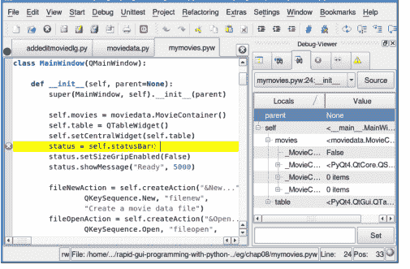


第二部分从展示三个小型 PyQt GUI 应用程序开始，以给出 PyQt 编程的初步印象。它还解释了一些 GUI 编程涉及的基本概念，包括 PyQt 的高级信号与槽（signals and slots）通信机制。第 5 章展示了如何创建对话框，以及如何在对话框中创建和布局小部件（在 Windows 术语中称为“控件”——构成用户界面的图形元素，如按钮、列表框等）。对话框是 GUI 编程的核心：大多数 GUI 应用程序都有一个主窗口和数十甚至上百个对话框，因此本主题将得到深入探讨。

在对话框章节之后是第 6 章，涵盖主窗口，包括菜单、工具栏、停靠窗口和键盘快捷键，以及应用程序设置的加载和保存。第二部分的最后几章展示了如何使用 *Qt Designer*（Qt 的可视化设计工具）创建对话框，以及如何以二进制、文本和 XML 格式保存数据。

第三部分对第二部分涵盖的一些主题进行了更深入的探讨，并引入了许多新主题。第 9 章展示了如何以相当复杂的方式布局小部件，以及如何处理多文档。第 10 章涵盖低级事件处理程序，以及如何剪贴板以及拖放、文本、HTML 和二进制数据的使用。第 11 章展示了如何修改和继承现有小部件，以及如何从零开始创建完全新的小部件，并完全控制其外观和行为。本章还展示了如何进行基本图形处理。第 12 章展示了如何使用 Qt 4.2 新的图形视图架构，该架构特别适用于处理大量独立的图形对象。Qt 的具备 HTML 功能的富文本引擎在第 13 章中介绍。本章还涵盖了向纸张和 PDF 文件打印的内容。

第三部分以两章关于模型/视图（model/view）编程的内容结束：第 14 章介绍该主题，展示了如何使用 Qt 的内置视图以及如何创建自定义数据模型和自定义代理（delegates），第 15 章展示了如何使用模型/视图架构执行数据库编程。

第四部分继续模型/视图主题，第 16 章涵盖了三个不同的高级模型/视图主题。第 17 章的第一部分描述了可用于提供在线帮助的技术，第二部分解释了如何国际化应用程序，包括如何使用 Qt 的翻译工具创建翻译文件。Python 标准库提供了用于网络和线程的类，但在第四部分的最后两章中，我们展示了如何使用 PyQt 的类进行网络处理和线程编程。

附录 A 解释了 Python、PyQt 和 Qt 的获取位置，以及如何在 Windows、Mac OS X 和 Linux 上安装它们。如果您安装 PyQt 并尝试一些示例，并检查一些示例代码，学习 PyQt 会容易得多。附录 B 展示了选定的 PyQt 小部件的屏幕截图和简要描述；这对 GUI 编程新手很有帮助。附录 C 展示了 PyQt 主要类层次结构的一些图表；这有助于了解 PyQt 提供哪些类以及它们之间的关系。

如果您以前从未使用过 Python，应按照顺序阅读第 1-6 章。如果您已经知道 Python，至少请阅读字符串策略（第 28 页的要点），并浏览第 2 章的材料（除了第一部分，因为您对该部分应该很熟悉）。请确保您熟悉 lambda 和部分函数应用，这两者在第 2 章中均有涵盖。可能也值得浏览一下第 3 章。然后按顺序阅读第 4、5 和 6 章。

一旦您完成了前六章，您就掌握了 Python 的精髓和 PyQt 的基础知识。

第 7 章对于希望了解如何使用可视化设计工具（而不是纯粹手动编码）来创建对话框的人很有用，这可以节省大量时间。对于文件处理，至少请阅读第 8 章的前三个部分。如果您计划编写和读取文本文件，请阅读第 8 章的第四部分；如果您打算使用 XML 文件，则类似地阅读第五部分。

对于第三部分，至少请阅读第 10 章的第一部分（关于事件处理）以及整个第 11 章。第 12 章和第 13 章的第一部分假定您已经阅读了关于 PyQt 事件处理的内容，并且已经阅读了第 11 章。第 9 章和第 14 章在本部分中可以独立阅读，但第 15 章假定您已经阅读了第 14 章。

在第四部分中，第 16 章假定您已经阅读了第 14 章和第 15 章，但其他章节可以独立阅读。

如果您发现文本或示例中的错误，或有其他评论，请在主题行中注明“PyQt book”并写信至 mark@qtcr.eu。书籍主页（在此将发布任何更正内容）以及可下载示例和练习题答案的页面是 http://www.qtcr.eu/pyqbook.html。

如果您想参与 PyQt 社区，加入邮件列表是有价值的。请访问 http://www.riverbankcomputing.com/mailman/listinfo/pyqt 找到归档的链接，以便您可以了解邮件列表的情况，并找到加入表格。Python 也有邮件列表和其他社区活动。对于这些，请访问 http://www.python.org/community。

## 致谢

我要感谢许多人，我将从那些与这本书密切相关的开始说起。

Jasmin Blanchelette 是 Trolltech 的高级软件开发者、Qt 专家，同时也是一位出色的编辑和作家。我曾与他合著了两本 C++/Qt 书籍。Jasmin 提出了大量建议和批评，极大地提高了本书的质量。

David Boddie，Trolltech 的文档经理，是一位活跃的 PyQt 开源开发者，对 PyQt 本身做出了许多贡献。他的意见有助于确保我覆盖了所有必要的内容，并以合理的顺序进行了安排。

Richard Chamberlain 是 Jadu Ltd.（一家内容管理公司）的联合创始人和首席技术官。他的反馈和见解有助于确保本书尽可能通俗易懂。他还帮助改进和完善了示例和练习中使用的代码。

Trenton Schulz 是 Trolltech 的开发者，曾是我以前书籍的宝贵审阅者。对于本书，他带来了他在 Python 和 Qt 方面的知识，对原稿给出了大量反馈。与 Richard 一起，他还确保 Mac OS X 用户从未被遗忘。此外，他还发现了我遗漏的许多细微错误。

Phil Thompson 是 PyQt 的创造者兼维护者。他一开始就支持这本书，甚至因我们就书进行的讨论而直接为 PyQt 添加了功能并进行改进。他对书的改进提出了许多建议，并纠正了许多错误和误解。

特别感谢 Samuel Rolland，他允许我在他的 Mac 笔记本电脑上安装 PyQt、测试示例并截取屏幕截图。

也要感谢 Guido van Rossum（Python 的创造者）以及更广泛的 Python 社区，他们的贡献使得 Python（尤其是其库）变得非常有用且令人愉悦。

感谢 Trolltech 开发和维护 Qt，特别是过去和现在的 Trolltech 开发者，其中许多人我有幸共事，他们确保 Qt 成为现有的最佳跨平台 GUI 开发框架。

特别感谢 Lout 排版语言的创造者 Jeff Kingston。我使用 Lout 进行所有书籍和大多数其他写作项目的排版。多年来，Jeff 根据用户的反馈对 Lout 进行了许多改进并添加了许多功能，其中包括我自己要求的许多功能。还要感谢 James Cross，他创建了 DejaVu Sans Mono 字体的精简版（该字体本身源自 Jim Lyle 的 Vera 字体），本书的等宽字体就是在此基础上编辑而成的。

出版商，特别是主编 Karen Gettman，从最初就支持这本书。还要特别感谢我的编辑 Debra Williams-Cauley，感谢她的支持以及使整个过程尽可能顺利。感谢 Lara Wyszong 出色地管理了制作过程，感谢校对者 Audrey Doyle 所做的出色工作。


# 第一部分

# Python 编程

## 1. 数据类型与数据结构

- 执行 Python 代码
- 变量与对象
- 数字与字符串
- 集合
- 内置函数

在本章中，我们将开启一门 Python 转化课程，展示非 Python 程序员如何使用 Python 进行编程。我们将介绍一些基本的数据类型和数据结构，以及 Python 的部分过程式语法。贯穿始终的方法是强调类似实际应用中使用的真实代码，而不是提供那些已经包含在随 Python 提供的文档中并可在 `http://www.python.org` 在线获取的正式定义和解释。

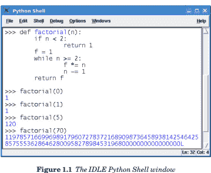

如果你还没有安装 Python 和 PyQt，最好现在安装：这样你就可以尝试本书附带的示例（可从 `http://www.qtrac.eu/pyqbook.html` 下载）。有关安装详情，请参阅附录 A。安装软件的一个优点是，IDLE 集成开发环境会随 Python 一起安装。

### IDLE 开发环境

Python 的完整安装包括 IDLE，这是一个基础但非常实用的集成开发环境。当启动 IDLE 时（在 Windows 上点击 开始→所有程序→Python 2.x→IDLE，或在 Mac OS X 上点击 访达→应用程序→MacPython 2.x→IDLE，或在 Linux 控制台中运行 idle），它会显示其 Python 交互式窗口（Shell 窗口）。

如图 1.1 中的截图所示，IDLE 看起来相当复古，像是 Windows 95 的风格。这是因为它是用 Tkinter 而不是 PyQt 编写的。我们选择使用 IDLE，是因为 IDLE 是 Python 的标准组件，且学习和使用都非常简单。如果你想要使用更强大、外观更现代的 IDE，你可能更偏好用 PyQt 编写的 *Erica*，或者其他可用的 Python IDE。然而，如果你是 Python 新手，我们建议你从较简单的 IDLE 开始，一旦你对 Python 更有经验了，再尝试其他 IDE，看看是否更喜欢其中某一个。当然，你也可以简单地使用纯文本编辑器，并通过打印语句进行调试，而完全不使用 IDE。

IDLE 提供三个主要功能：在 Python 交互式窗口（Shell）中输入 Python 表达式和代码并直接查看结果；提供 Python 特定颜色语法高亮的代码编辑器；以及可用于逐步执行代码以帮助识别和消除错误的调试器。Python 交互式窗口（Shell）对于尝试简单的算法、代码片段和正则表达式特别有用，也可作为一个非常强大且灵活的计算器。

### 执行 Python 代码

在我们真正探索 Python 语言之前，我们需要知道如何执行 Python 代码。我们将通过回顾一个只有一行的小型示例程序来展示这一点。

我们必须使用纯文本编辑器来处理 Python 文件。¹ 在 Windows 上可以使用记事本，但 IDLE 包含一个专为编辑 Python 代码设计的合适 Python 编辑器：只需启动 IDLE，然后点击 文件→新建窗口。

我们将把以下一行输入到一个名为 `hello.py` 的文件中：

```python
print "Hello World"
```

注意不需要分号：在 Python 中，换行符充当语句分隔符。另外，我们也不需要在字符串中包含换行符 `\n`，因为 `print` 会自动添加换行符，除非我们用尾随逗号抑制它。

假设我们将代码保存在文件 `hello.py` 中（如果使用 Windows，则在目录 `C:\pygt\chap01` 中），我们可以启动控制台（在 Windows XP 上点击 **开始**→**所有程序**→**附件**→**控制台**——有时控制台被称为 **命令提示符**，或在 Mac OS X 的 **应用程序/实用工具** 中运行 **Terminal.app**），切换到该目录，并像这样执行程序：

```
C:\>cd C:\pygt\chap01
C:\pygt\chap01>hello.py
```

只要 Python 安装正确，Windows 就会识别 `.py` 文件扩展名并将文件交给 `python.exe` 执行。程序会在控制台上打印 "Hello World"，正如我们所期望的那样。²

在 Mac OS X 和 Linux 上，我们必须通过在控制台提示符处输入解释器名称和文件名来显式运行解释器，如下所示：

```
% python hello.py
```

只要 Python 已安装并在你的 **PATH** 中，这就能工作。或者，对于 Linux 和 Mac OS X，我们可以添加额外的“shebang”（shell 执行）注释行，告诉操作系统使用 Python 解释器，使 `hello.py` 文件变成两行：

```
#!/usr/bin/env python
print "Hello World"
```

为了使这在 Mac OS X 和 Linux 上正常工作，必须正确设置文件的权限。例如，在与文件同一目录的控制台提示符处，输入 `chmod +x hello.py` 使文件可执行。

Python 注释以“#”开头，并持续到行尾。这意味着为所有 Python 程序添加“shebang”行是绝对安全的，因为在 Windows 上该注释会被忽略，而在 Linux 上它告诉操作系统使用 Python 解释器执行文件。附录 A 展示了如何在 Mac OS X 上将 Python 解释器与 `.py` 和 `.pyw` 文件关联。

当我们谈论执行 Python 程序时，幕后发生的是：Python 将 `.py`（或 `.pyw`）文件读入内存，并对其进行解析，以获取一个字节码程序，然后继续执行它。对于程序导入的每个模块，Python 首先检查是否存在预编译的字节码版本（在 `.pyo` 或 `.pyc` 文件中），且其时间戳与其 `.py` 文件对应。如果有，Python 使用字节码版本；否则，它解析模块的 `.py` 文件，将其保存到 `.pyc` 文件，并使用刚生成的字节码。因此，与 Java 不同，我们不需要显式地将任何模块编译为字节码，无论是随 Python 提供的还是我们自己编写的。并且在大多数 Python 安装中，随附的模块在安装过程中已编译好，以避免每次运行使用这些模块的 Python 应用时都要重新编译。

¹ Mac OS X 用户注意，每当我们提到控制台时，这与 Mac 的 *Terminal* 是一样的。

### 变量与对象

在大多数编程语言中，包括 C++ 和 Java，我们必须在使用每个变量之前声明它并指定其类型。这被称为 *静态类型*，因为编译器在编译时就知道每个变量的类型。Python 像大多数非常高级的语言一样，采用不同的方法：变量没有类型限制（动态类型），并且不需要声明。

我们可以通过创建和执行文件来学习 Python 的变量和标识符，就像我们在前一节中对 hello.py 做的那样。但对于尝试小的代码片段，我们完全不需要创建文件。我们可以直接在 IDLE 的 Python 交互式窗口（Shell）的 >>> 提示符处输入这些行：

```python
>>> x = 71
>>> y = "Dove"
```

赋值运算符 = 周围的空格是可选的，但这里包含了它，因为它使代码更易于阅读。作为一种风格，我们总是在二元运算符前后各加一个空格。另一方面，重要的是每个语句占据自己的一行，并且没有多余的行首空白。这是因为 Python 使用缩进和换行来表示其块结构，而不是许多其他编程语言使用的花括号和分号。

现在我们要回顾这两行代码实际做了什么。第一行创建了一个 int 类型的对象，并将名称 x 绑定到它。³ 第二行创建了一个 str 类型的对象（一种 8 位字符串类型），并将名称 y 绑定到它。

一些 Python 程序员将名称（如前面使用的 x 和 y）称为 *对象引用*，因为它们引用对象，而不是本身作为对象。对于 int 和 str 这样的基本数据类型，我们将它们的变量视为“对象”还是“对象引用”并无区别；它们的行为与其他编程语言中的表现相同：

```python
>>> x = 82
>>> x += 7
>>> x
89
```

稍后我们会看到一些 Python 变量作为对象引用会产生影响的案例。

³ 这类似于 Java 赋值，Integer x = new Integer(71); 对于 C++，近似的等价写法是 int xd = 71; int x = xd;。


## 函数、方法和运算符术语

术语“函数”（function）用于指代可以独立执行的子程序，而术语“方法”（method）则用于指代只有绑定到对象上才能执行的函数，即在特定类的实例上被调用的函数。

运算符可以是独立的，也可以绑定到对象上，但与函数和方法不同，运算符不使用括号。由 `+`、`*`、`<` 等符号表示的运算符通常显而易见地被称作运算符，但像 `del` 和 `print` 这样有名称的运算符则通常被称为语句。

Python 的函数在数学意义上不必是纯函数：它们不需要返回值，也可以修改其参数。Python 的函数类似于 C 和 C++ 的函数，或类似接受 `var` 参数的 Pascal 函数。Python 的方法类似于 C++ 或 Java 的成员函数。

Python 有两种比较对象的方式：按“身份”（identity）和按“值”（value）。对象的身份实际上是其在内存中的地址，这也是对象引用所持有的内容。如果我们使用比较运算符，如 `==` 和 `<`，我们得到的是值比较。例如，如果两个字符串包含相同的文本，则使用 `==` 时它们是相等的。如果我们使用 `is`，我们得到的是身份比较，因为我们只是在比较两个地址，而不必查看对象本身，所以这种方式很快。可以通过对对象引用调用 `id()` 来获取对象的身份。

Python 有一个名为 `None` 的特殊对象。它可以被赋值给任何变量，并意味着该变量没有值。`None` 对象永远只有一个实例，因此我们在测试它时总是可以使用快速的 `is` 和 `is not` 比较。

请注意，我们在 `>>>` 提示符后单独输入了 `x`。如果在 IDLE 中写入一个表达式或变量，其值会自动打印出来。在程序中，我们必须使用显式的 `print` 语句来打印表达式。例如：

```python
print x
```

Python 的 `print` 语句是一个运算符，而不是一个函数，因此它在不使用括号的情况下被调用（就像我们使用 `+` 和其他运算符时不使用括号一样）。

之前我们说过 Python 使用动态类型。这涉及两个因素。首先，我们可以将任何对象赋值给任何变量；例如，我们可以写：

```python
x = 47
x = "Heron"
```

在第一行之后，`x` 的类型是 `int`，而在第二行之后，`x` 的类型是 `str`，因此显然与名称 `x` 关联的类型是由该名称绑定的内容决定的，而不是由其本身的固有属性决定的。因此，我们不需要将特定类型与特定名称关联起来。

Python 动态类型的第二个方面是强类型：Python 不允许在不兼容的类型之间进行运算，如下面在 IDLE 中输入的示例所示：

```python
>>> x = 41
>>> y = "Flamengo"
>>> x + y

Traceback (most recent call last):
  File "<pyshell#2>", line 1, in <module>
    x + y
TypeError: unsupported operand type(s) for +: 'int' and 'str'
```

当我们尝试应用 `+` 运算符时，Python 引发了 `TypeError` 异常并拒绝执行该操作。（异常在第 2 章中有介绍）。

如果我们给 `y` 分配一个与 `x` 类型兼容的类型，例如 `int` 或 `float`，加法将正常工作：

```python
>>> x = 41
>>> y = 8.5
>>> x + y
49.5
```

尽管 `x` 和 `y` 的类型不同（int 和 float），Python 提供了与其他语言相同类型的自动类型提升，因此 `x` 会被转换为 `float`，实际执行的计算是 `41.0 + 8.5`。

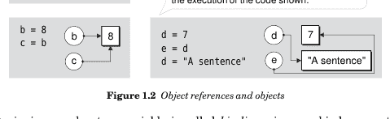

将值分配给变量称为*绑定*（binding），因为我们是将名称绑定到对象上。如果我们给现有变量分配一个新对象，我们就被称为正在重新绑定（rebind）该名称。这一点在图 1.2 中有所说明。当我们这样做时，原本绑定到该名称的对象会怎样？例如：

```python
>>> x = "Sparrow"
>>> x = 9.8
```

持有文本 “Sparrow” 的 `str` 对象发生了什么？一旦没有任何名称绑定到某个对象，该对象就会被安排进行垃圾回收，并最终可能被从内存中删除。这与 Java 中的工作方式非常相似。

*回溯信息中的行，如 `File "<pyshell#2>"` 等，每次都会变化，因此你的行可能与此处显示的不同。

### 数字和字符串

Python 提供了多种数值类型和两种字符串类型。所有这些类型的共同点是它们都是*不可变的*（immutable）。这意味着在 Python 中，数字和字符串不能被改变。这听起来似乎限制很大，但得益于 Python 的增强赋值运算符（+=, *= 等），这根本不成问题。

在查看具体的数据类型之前，我们要看看不可变性带来的一个重要后果。让我们在一些简单的表达式中输入到 IDLE：

```python
>>> x = 5
>>> y = x
>>> x, y
(5, 5)
```

在这里，我们创建了一个值为 5 的 `int` 类型对象，并将名称 `x` 绑定到它。然后我们将 `x` 赋值给 `y`，这导致 `y` 绑定到了 `x` 所绑定的同一个对象。因此，当我们在 IDLE 中打印它们时（在程序中我们需要写 `print x, y`，但在 IDLE 中只需写入一个表达式，IDLE 就会自动打印它），IDLE 将它们的值输出为一个元组（tuple）——本质上是一个只读的值列表。

现在让我们将 `y` 递增：

```python
>>> y += 1
>>> x, y
(5, 6)
```

我们可能预期 `x` 和 `y` 都有值 6，因为它们都指向同一个整数对象。但由于 Python 数字（和字符串）是不可变的，这种情况并没有发生。当增强赋值运算符应用于不可变对象时，它们只是语法糖：它们并不改变所应用的对象。因此，实际发生的是：$y = y + 1$，创建了一个*新*的整数对象（值为 6），并且 `y` 被绑定到这个新对象。结果，当我们让 IDLE 打印 `x` 和 `y` 时，它们指向不同的对象，每个对象都有不同的值。

### 表 1.1 Python 的关键字*

| and | class | elif | finally | if | lambda | print | while |
|---|---|---|---|---|---|---|---|
| as$^{2,6}$ | continue | else | for | import | not | raise | with$^{2,6}$ |
| assert$^{1,5}$ | def | except | from | in | or | return | yield$^{2,3}$ |
| break | del | exec | global | is | pass | try | |

*关键字旁边的数字指示引入它们的是哪个版本的 Python。

我们需要记住，$=$ 运算符执行的是一个*绑定*操作，而不是赋值。左侧的名称被绑定（或者如果名称已存在则重新绑定）到右侧的对象上。对于*不可变*对象，这完全没有区别，正如我们要看到的。但对于*可变*对象，这意味着使用 $=$ 不会给我们一个副本（它只是将另一个名称绑定到原始对象），所以当我们真正需要一个副本时，我们必须使用 `copy()` 方法，或来自 Python `copy` 模块的函数，稍后将对此进行讨论。

在实践中，数字和字符串的不可变性非常方便。例如：

```python
>>> s = "Bath"
>>> t = "Hat"
>>> u = s
>>> s += t
>>> s, t, u
('Bath Hat', 'Hat', 'Bath')
```

请注意，我们将字符串 $s$ 赋值给了 $u$。直观上，我们期望 $u$ 持有实际上被赋值给它的值 “Bath”，并且我们不期望应用 $s += t$ 会产生任何副作用，尽管 $s$ 和 $u$ 都指向同一个字符串。而且我们的直觉是正确的：当对 $s$ 应用 $+=$ 时，创建了一个*新*的字符串对象并绑定到 $s$，因此 $u$ 的值没有改变，它仍然是唯一指向原始 “Bath” 字符串的对象。

### 整数和长整数

Python 提供三种整数类型：bool, int, 和 long。`bool` 类型只能取 `True` 或 `False`，在数值上下文中使用时，它们分别被视为 1 和 0。`long` 类型可以容纳大小仅受机器可用内存限制的整数，因此可以创建和处理数百位长的整数。唯一的缺点是 `long` 类型的处理速度较慢。


比 `int` 类型更大。`int` 类型与大多数编程语言提供的有符号整数类型相同；但是，如果对 `int` 执行的操作使其值超出其范围（例如，在某些机器上大于 $2^{31} - 1$ 或小于 $-2^{31}$），`int` 会自动类型提升为 `long`。

Python 使用后缀 L 来表示 `long`，必要时我们也可以在代码中这样做。例如：

```python
>>> p = 5 ** 35
>>> q = 7L
>>> r = 2 + q
>>> p, q, r
(2910383045673370361328125L, 7L, 9L)
```

除非以 `0x` 开头，否则整数字面量默认为十进制数，而以 `0x` 开头的被视为十六进制（基数 16），例如 `0x3F`，即十进制的 63；以 `0` 开头的则被视为八进制（基数 8）。任何整数字面量都可以附加 L 使其变为 `long`。

Python 支持我们预期的数字常用运算符，包括 `+`、`-`、`*`、`/`、`%` 以及它们的增强运算符 `+=`、`-=`、`*=`、`/=` 和 `%=`。Python 还提供 `**` 用于求幂运算。

默认情况下，当两个操作数均为 `int` 类型时，Python 的 `/` 除法运算符执行截断除法。例如，`5 / 3` 产生 `1`。这是大多数编程语言的规范，但在 Python 中这可能不太方便，因为动态类型意味着变量在不同的时刻可能是 `int` 或 `float`。解决方案是告诉 Python 始终执行“真除法”，这在必要时会产生浮点数结果，而当我们确实想要发生截断时使用 `//` 运算符。我们将在第 4 章中了解如何实现这一点。

### 浮点数和十进制数

Python 提供三种类型的浮点值：`float`、`Decimal` 和 `complex`。`float` 类型存储双精度浮点数，其范围取决于用于构建 Python 的 C（或 Java）编译器；它们具有有限的精度，无法可靠地进行相等比较。`float` 类型的数字通过十进制点或科学计数法写入，例如，0.0、5.7、8.9e-4。在 IDLE 中输入这些数值是很有益的：

```python
>>> 0.0, 5.7, 8.9e-4
(0.0, 5.700000000000002, 0.00089999999999999995)
```

这种不准确性*并非* Python 特有的问题：计算机使用二进制来表示浮点数，它可以精确表示某些十进制数（如 0.5），但只能近似表示其他十进制数（如 0.1）。此外，表示使用固定位数的位，因此可以保持的数字位数有限。

在实践中，这很少是一个问题，因为大多数浮点数使用 64 位，这在大多数情况下都足够了。但如果我们需要高精度，可以使用 Python 的 `decimal` 模块中的 `Decimal` 数字。这些执行计算时精度达到我们指定的级别（默认为 28 位小数位），并且可以精确表示像 $0.1$ 这样的循环小数；但处理速度比普通 `floats` 慢很多。由于其准确性，`Decimal` 数字适用于金融计算。

在使用 `Decimal` 数字之前，必须导入 `decimal` 模块。无论是在 `.py` 文件中编写代码还是像我们现在这样在 IDLE 中键入代码，执行此操作的语法都是相同的：

```python
>>> import decimal
```

在这里，我们将 `decimal` 模块导入到了我们的 IDLE Shell 窗口中。（导入语义在“导入对象”侧边栏中了解。）可以将整数字面量传递给 `Decimal` 构造函数，但由于 Decimals 是高精度的而 `floats` 不是，我们不能传递 `floats`；相反，我们必须以字符串形式提供浮点值。例如：

```python
>>> decimal.Decimal(19), decimal.Decimal("5.1"),
    decimal.Decimal("8.9e-4")
(Decimal("19"), Decimal("5.1"), Decimal("0.00089"))
```

数字 `decimal.Decimal('5.1')` 被精确存储；作为 `float`，它可能是 $5.0999999999999996$ 这样的值。同样，`decimal.Decimal("0.00089")` 可能是 $0.000889999999999999995$ 这样的值。我们可以轻松地从 `Decimal` 转换为 `float`，尽管这样做可能会失去精度：

```python
>>> d = decimal.Decimal("1.1")
>>> f = float(d)
>>> f
1.1
```

Python 还将 `complex` 数字作为内置数据类型提供。这些数字由实部和虚部组成，后者由后缀 `j` 指示。* 例如：

```python
>>> c = 5.4+0.8j
>>> type(c)
<class 'complex'>
```

在这里，我们输入了一个 `complex` 数（语法为 $real\_part+j\times imaginary\_part$），并使用 Python 的 `type()` 函数告诉我们 `c` 绑定的是什么类型。

> *数学家使用 $i$ 表示虚数，而工程师和 Python 使用 $j$。*

# 导入对象

Python 拥有庞大而全面的模块库，提供了大量预定义的功能。我们可以通过导入我们想要的常量、变量、函数和类来使用这些功能。导入的一般语法为：

```python
import moduleName
```

然后我们可以使用点运算符访问模块内的对象。例如，random 模块提供 randint() 函数，可以这样导入和使用：

```python
import random
x = random.randint(1, 10)
```

请注意，将导入语句放在 .py 文件的开头很常见，但它们也可以放在其他地方——例如，在函数定义内部。

Python 模块系统的一个好处是每个模块充当一个命名空间，因此我们可以轻松避免名称冲突。例如，我们可能定义了自己的 randint() 函数，但由于示例中导入的那个使用完全限定名 random.randint() 来访问，因此没有名称冲突。并且正如我们将在第 3 章中看到的那样，我们可以创建自己的模块并导入我们自己的对象。

模块本身可以包含其他模块，并且对于非常大的模块，直接将对象导入当前命名空间更方便。Python 为此提供了一种语法。例如：

```python
from PyQt4.QtCore import *
x = Qstring()
y = Qdate()
```

在这里，我们导入了所有对象，即 PyQt4 模块的 QtCore 模块中的所有类，这允许我们使用它们的非限定名。某些开发者不赞成使用这种语法，但既然我们知道几乎所有的 PyQt 对象都以大写字母“Q”开头，只要我们不创建任何名称以“Q”开头的自己的对象，我们就不会遇到任何名称冲突，并且可以少输入很多。然而，对于倾向于在所有情况下使用完全限定名的人，可以使用普通的 import 语法：

```python
import PyQt4
x = PyQt4.QtCore.Qstring()
y = PyQt4.QtCore.Qdate()
```

为了简洁起见，我们将对 PyQt4 模块使用 from … import 语法，而对其他所有内容使用普通的 import 语法。

Python 的浮点数提供与其整数相同的基本操作，当在同一表达式中混合数字类型时，整数会被提升为浮点数。

# 字节字符串、Unicode 字符串和 QStrings

Python 中有两种内置的字符串类型：`str`，它存储字节；以及 `unicode`，它存储 Unicode 字符。这两种类型都支持一组通用的字符串处理操作。与数字一样，Python 字符串是不可变的。它们也是序列，因此可以传递给接受序列的函数，并可以使用 Python 的序列操作，例如返回序列长度的 `len()` 函数。PyQt 提供了第三种字符串类型，`QString`。

如果我们只处理 7 位 ASCII 字符，即范围 0-127 的字符，并且想要节省一些内存，我们可以使用 `strs`。然而，如果我们使用 8 位字符集，我们必须注意清楚我们正在使用哪种编解码器。例如，在西欧，8 位字符串通常使用 Latin-1 编码进行编码。一般来说，仅通过检查字节并不总是能够确定特定字符串（或文件）使用哪种 8 位编码。现代 GUI 库，包括 Qt，使用 Unicode 字符串，因此最安全的路线是对 7 位 ASCII 和原始二进制 8 位字节使用 `strs`，其他情况下使用 `unicode` 或 `QString`。

Python 字符串通过引号创建：

```python
>>> g = "Green"
>>> t = ' trees'
>>> g + t
'Green trees'
```

只要我们在两端使用相同类型的引号，Python 并不介意我们使用双引号还是单引号。

要强制字符串字面量为 `unicode` 类型，我们在其初始引号前加上 `u`：

```python
>>> bird = "Sparrow"
>>> beast = u"Unicorn"
>>> type(bird), type(beast), type(bird + beast)
(<type 'str'>, <type 'unicode'>, <type 'unicode'>)
```

注意，我们可以使用二元 `+` 来连接字符串，并且如果我们在同一操作中将 `str` 和 `unicode` 对象一起使用，`str` 操作数将被提升为 `unicode`，结果对象的类型为 `unicode`。（如果 `str` 包含超出 7 位 ASCII 范围的字符，Python 将引发 `UnicodeEncodeError` 异常；异常在第 2 章中介绍。）

在 Python 中没有单独的“字符”类型。单个字符是长度为 1 的字符串。我们可以使用 `chr()` 从字节值获取字符，它


接受范围在 0–255 之间的整数值。Python 文档并未指定当值超出 ASCII 范围（即大于 127）时使用哪种编码。对于 Unicode，我们可以使用 `unichr()`，它接受范围在 0–65535 之间的整数。⁹ 要反向转换，即从字符获取其整数值（ASCII 值或 Unicode 码点），我们可以使用 `ord()`。例如：

```python
>>> euro = unichr(8364)
>>> print euro
€
>>> ord(euro)
8364
```

为什么我们使用 `print` 而不是让 IDLE 直接输出结果？因为 IDLE 使用十六进制转义序列显示字符串中的非 ASCII 字符，所以如果不使用 `print`，IDLE 将输出 `u'\u20ac'`。

也可以通过名称访问 Unicode 字符：

```python
>>> euro = u"\N{euro sign}"
>>> print euro
€
```

如果需要在字符串中包含特殊字符，我们可以使用反斜杠 (\) 进行转义。⁹ 表 1.2 列出了可用的转义字符；其中 Unicode 转义字符仅在 Unicode 字符串中才有意义。

以下是展示如何转义引号的两个示例：

```python
"He said \"No you don't!\" again."
"What\'s up with him?"
```

在由双引号分隔的字符串中，我们不需要转义单引号；同样，在由单引号分隔的字符串中，我们也不需要转义双引号。

对于多行字符串，我们可以使用“三重”引号：

```python
'This string has three lines in it, with a 'quote', another "quote", and with just one embedded newline \
since we have escaped one of them.''
```

这类字符串可以像普通字符串一样包含转义字符，并且可以如所示那样用三个单引号界定，也可以用三个双引号界定。三重引号字符串中的换行符，以及 Python 代码中的换行符，可以通过在它们前面加反斜杠来转义。（这在 Windows 上也能正确工作，尽管 Windows 在行尾使用两个字符而不是一个。）

> ⁹ 如果 Python 被配置为使用 UCS-4 表示法，范围将扩展到 1,114,111。

### 表 1.2 Python 的字符串转义字符

| 转义字符 | 含义 |
| :------- | :------- |
| \newline | 转义（即忽略）换行符 |
| \\ | 反斜杠 (\) |
| \\' | 单引号 (' ) |
| \" | 双引号 (" ) |
| \a | ASCII 铃音 (BEL) |
| \b | ASCII 退格 (BS) |
| \f | ASCII 换页符 (FF) |
| \n | ASCII 换行符 (LF) |
| \N{name} | Unicode 字符名称 |
| \r | ASCII 回车符 (CR) |
| \t | ASCII 制表符 (TAB) |
| \uhhhh | 给定的 16 位十六进制值对应的 Unicode 字符 |
| \Uhhhhhhhh | 给定的 32 位十六进制值对应的 Unicode 字符 |
| \v | ASCII 垂直制表符 (VT) |
| \ooo | 给定的八进制值对应的字符 |
| \xhh | 给定的十六进制值对应的字符 |

*Python* 字符串是*序列*，可以通过位置索引访问单个字符，其中第一个字符位于索引位置 0。也可以从*字符串*的末尾开始索引，最后一个字符的索引位置为 -1。例如：

```python
>>> phrase = "The red balloon"
>>> phrase[0], phrase[5], phrase[-1]
('T', 'e', 'n')
```

负索引用于从右向左访问字符，最右侧字符的位置为 -1，其左侧的位置为 -2，依此类推。

Python 序列支持*切片*，这意味着我们可以从序列中复制子序列。切片包含一个、两个或三个由冒号分隔的组件：*起始*位置（默认为索引 0）、*结束*位置（默认为序列长度）以及另一个我们将忽略的参数。切片从*起始*索引（包括该索引）开始，到*结束*索引（不包括该索引）结束。以下是几个示例：

```python
>>> phrase = "The red balloon"
>>> phrase[:3]
'The'
>>> phrase[3:]
' red balloon'
>>> phrase[4:7]
'red'
```

由于 *Python* 字符串是不可变的，因此无法对字符串内部的字符或切片进行赋值：

```python
>>> p = "pad"
>>> p[1] = "o"     # 错误
Traceback (most recent call last):
  File "<pyshell#64>", line 1, in <module>
    p[1] = o
TypeError: str object does not support item assignment
```

向字符串中插入字符最简单的方法是*使用切片语法*：

```python
>>> p = "pad"
>>> p = p[:1] + "o" + p[2:]
>>> p
'pod'
```

指定数字字面量可能看起来有些麻烦，但在实际编程中，我们通常通过方法调用获取索引——例如，使用 `find()` 方法。

还有其他的实现方式。例如：

```python
>>> p = "pad"
>>> p = "o".join((p[:1], p[2:]))
>>> p
'pod'
```

习惯于可变字符串的 *Pascal* 或 *C++* 程序员最初可能会觉得字符串的不可变性有些别扭。*Python* 当然提供了可变字符串；它们由 `StringIO` 模块和（更快的）`cStringIO` 模块提供。*PyQt* 的 `QString` 类也是可变的。但通过练习，使用不可变字符串的 *Python* 方式，特别是上面展示的惯用法（使用 `join()` 方法进行拼接），很快就会变得得心应手。我们稍后将介绍另一种用于“组合”字符串的惯用法。Python 字符串有许多有用的方法，但我们将重点介绍最常用的那些。在 *Python* 中，方法通过点 . 运算符访问对象引用上的方法，并使用括号 ( ) 表示正在执行方法（成员函数）调用来调用。例如：

> *如前所述，像 + 和 `print` 这样的运算符不使用括号。*

```python
>>> line = "The quick brown fox."
>>> line.find("q")
4
```

`find()` 方法返回给定字符串在应用它的那个字符串中最左侧出现位置的索引。如果查找失败，则返回 -1。

Python 还提供了一个 `index()` 方法，其用法相同，但在失败时会引发 `ValueError` 异常。其他序列类（如列表）也有 `index()` 方法，因此为字符串提供此方法可以保持一致性。

既然我们可以在字符串上使用 `find()` 或 `index()`，是否有理由偏爱其中一种？对于一次性搜索，使用 `find()` 并检查返回值通常更方便。但如果在代码块中执行大量搜索，使用 `find()` 迫使我们检查每次搜索的返回值，而使用 `index()` 则允许我们假设结果总是有效的，如果无效，则在单个异常处理程序中处理任何错误。当然，如果我们不捕获异常，它将被传递给调用堆栈，如果在任何地方都没有被捕获，它将导致应用程序终止。我们在整本书中都会使用这两种方法，根据具体情况使用最合适的一种。

字符串方法既可以应用于字符串对象，也可以应用于字符串字面量：

```python
>>> 'malthusian catastrophe'.title()
'Malthusian Catastrophe'
```

`title()` 方法返回一个字符串副本，该副本将每个单词的首字母大写。Python 提供了一种非常类似于 C 库 `printf()` 函数的语法，用于对数据类型进行字符串格式化。

为了实现格式化，我们使用二元 `%` 运算符，它左侧接受格式字符串，右侧接受一个对象（通常是对象的元组），这些对象将被格式化。例如：

```python
>>> "There are %i items" % 5
'There are 5 items'
```

字符串中的 `%i` 被数字 5 替换。字符串格式中 `%` 后面的字母指定了期望的对象类型，其中 `%i` 表示整数。

下面是一个示例，展示了三种不同类型被替换的情况，箭头显示了哪个 `%` 项被元组的哪个元素替换：


```python
>>> "The %i %s cost $%f dollars" % (3, "fish", 17.49)
'The 3 fish cost 17.490000 dollars'
```

### 表 1.3 选定的字符串方法和函数

| 语法 | 描述 |
| :--- | :--- |
| x in s | 如果字符串 x 是字符串 s 的子字符串，则返回 True |
| x not in s | 如果 x 不是字符串 s 的子字符串，则返回 True |
| x + s | 返回字符串 x 和 s 的连接结果 |
| s * i | 返回由字符串 s 的 int i 个连接组成的字符串。例如，"Abc" * 3 产生 "AbcAbcAbc" |
| len(s) | 返回字符串 s 的长度；如果 s 是 str 类型，这是字节计数；如果 s 是 unicode 类型，这是字符计数 |
| s.count(x) | 返回字符串 x 在字符串 s 中出现的次数。此方法和几个其他方法可以接受可选的 start 和 end 参数，将搜索限制在调用它们的字符串切片上。 |
| s.endswith(x) | 如果字符串 s 以字符串 x 结尾，则返回 True |
| s.startswith(x) | 如果字符串 s 以字符串 x 开头，则返回 True |
| s.find(x) | 返回 x 在 s 中最左侧出现的索引位置；如果未找到 x，则返回 -1 |
| s.rfind(x) | 类似于 find()，但搜索方向是从右向左 |
| s.index(x) | 返回 x 在 s 中最左侧出现的索引位置；如果未找到 x，则引发 ValueError 异常 |
| s.rindex(x) | 类似于 index()，但搜索方向是从右向左 |
| s.isdigit() | 如果字符串不为空且其包含的字符全为数字，则返回 True |
| s.isalpha() | 类似于 isdigit()，但检查的是字母 |
| s.join([x, ...]) | 返回给定序列的连接结果，由调用该方法的分隔字符串分隔。例如，":".join(["A", "BB", "CCC"]) 返回 "A:BB:CCC"。分隔符可以是空的。 |
| s.lower() | 返回字符串 s 的小写副本 |
| s.upper() | 返回字符串 s 的大写副本 |
| s.replace(x, y) | 返回字符串 s 的副本，其中字符串 x 的任何出现都被字符串 y 的副本替换 |
| s.split() | 返回字符串列表，按空白符分割。例如，"ab\tc d e".split() 返回 ["ab", "c", "d", "e"]。此方法可以给定一个字符串作为第一个参数，用于指定要分割的字符，以及一个整数作为第二个参数，用于指定最大分割次数。 |
| s.strip() | 返回移除了前导和尾部空白的字符串副本。接受一个可选的字符串参数，指定要移除哪些字符。 |
| s.rstrip() | 返回移除了尾部空白的字符串副本。接受一个可选的字符串参数，指定要移除哪些字符。 |
| s.lstrip() | 返回移除了前导空白的字符串副本。接受一个可选的字符串参数，指定要移除哪些字符。 |


称为格式化说明符的 % 项，格式化字符串中至少包含一个。格式化说明符由百分号（%）符号后跟一个格式化字符组成。百分号符号本身可以通过使用 %% 来指定。在示例中，我们使用了表示整数的 `%i`，表示字符串的 `%s`，以及表示浮点数的 `%f`。

之前我们研究了如何将子串插入到字符串中。我们展示了如何使用切片来完成此操作，以及使用字符串 `join()` 方法的更 Pythonic 的方式。这里介绍第三种方法，即使用格式化说明符：

```python
>>> p = "pad"
>>> p = "%s%s" % (p[::1], p[2:])
>>> p
'pod'
```

在这里，我们创建了一个新字符串，它由一个字符串（来自 p 的第一个切片）、"o" 和另一个字符串（来自 p 的第二个切片）组成。前面展示的 `join()` 方法用于字符串拼接；而这种方法用于字符串的“组合”。

我们可以在 % 项和字母之间添加一些信息，从而对 % 项的格式化进行一定程度的控制。例如，若要仅显示浮点数小数点后两位，我们可以使用说明符 `%.2f`：

```python
>>> "The length is %.2f meters" % 72.8958
'The length is 72.90 meters'
```

以下是更多示例，其中两个示例展示了 % 运算符与 print 语句配合使用的情况：

```python
>>> print "An integer", 5, "and a float", 65.3
An integer 5 and a float 65.3
>>> print "An integer %i and a float %f" % (5, 65.3)
An integer 5 and a float 65.300000
>>> print "An integer %i and a float %.1f" % (5, 65.3)
An integer 5 and a float 65.3
```

在许多情况下，`%i`（及其同义词 `%d`）、`%f` 和 `%s` 就足够了。关于可用的格式化说明符及其如何修改以获得特定结果的完整细节，请参阅 Python 文档；在此情况下，请查找“String Formatting Operations”（字符串格式化操作）。Python 中也可以使用其他字符串格式化方法，例如，string 模块中的 Template 类提供了类似 Perl 的插值功能。甚至可以使用类 C++ 语法；请参阅 *Python Cookbook* 中的配方 “Using a C++-like iostream Syntax”（使用类 C++ 的 iostream 语法）（参见侧边栏“Python 文档”）。

请注意，print 语句在打印的每个参数之间会自动输出一个空格。可以使用 `sys.stdout.write()` 代替 print 来避免这种情况；关于 `write()` 的更多说明将在第 6 章中给出。

## Python 文档

Python 附带了大量文档。大部分文档质量很高，但有些领域的覆盖范围相对较薄。使用 HTML 版本浏览文档需要练习，因为它更像是一本实体书而非在线文档，且页面之间的交叉引用链接太少。

Windows 用户在此方面比较幸运，因为文档以 Windows 帮助文件格式提供。单击 开始 → 所有程序 → Python 2.x → Python Manuals 即可启动 Windows 帮助浏览器。该工具具有索引和搜索功能，使查找文档变得容易。例如，若要查找有关字符串格式化说明符的信息，只需在索引行的编辑框中输入 "formatting"，条目 `formatting, string (%)` 将会出现。

浏览文档是非常值得的。我们建议查看 "Library Reference"（库参考）页面（lib.html），以了解 Python 标准库提供了哪些功能，并点击进入感兴趣主题的相关文档。这应该能让你对可用资源有一个初步印象，也有助于你建立关于在哪里可以找到感兴趣文档的心理图像。

请注意，某些主题在一个以上的标题下都有涵盖。例如，要阅读有关字符串的内容，请参阅 "Sequence Types"（序列类型）、"String Methods"（字符串方法）、"String Formatting Operations"（字符串格式化操作）和 "String Services"（字符串服务）。同样，对于文件和目录，请参阅 "File and Directory Access"（文件和目录访问）、"Data Compression and Archiving"（数据压缩和归档）以及 "Files and Directories"（文件和目录）。

对于更喜欢印刷版信息的人，以下几本书值得考虑。

-  Wesley Chun 著《Core PYTHON Programming》（核心 Python 编程）。这是一本 Python 教程，如果你完全是 Python 新手，并且希望比本书第一部分提供更慢的节奏，这本书可能适合你。
-  Alex Martelli 著《Python in a Nutshell》（Python 实战精要）。这是一本优秀的参考书，对 Python 语言和 Python 标准库进行了详细且准确的介绍。
-  由 Alex Martelli、Anna Martelli Ravenscroft 和 David Ascher 编辑的《Python Cookbook 2nd Edition》（Python 食谱第二版）。这本书提供了许多小的实用函数、类、代码片段和想法，有助于拓宽任何 Python 程序员对 Python 可能性的认识。这些食谱也可以在线 http://asp.activestate.com/ASP/Python/Cookbook 获取。

对于在线 Python 信息，起点是 http://www.python.org。该站点也是 Python wiki 的主页。可在 http://www.riverbankcomputing.co.uk 获取特定于 Python 的信息。PyQt wiki 位于 http://www.dio2ave.li.net/PyQtWiki。

使用 **PyQt** 时，我们可以访问一种额外的字符串类型 **QString**。与 Python 的 **str** 和 **unicode** 不同，**QString** 是可变的；这意味着我们可以原地更改 **QStrings**，插入和删除子串，以及更改单个字符。**QString** 的 API 与 **str** 和 **unicode** 提供的 API 有所不同。Qt 提供 **QString** 是因为 **Qt** 是用 C++ 编写的，而 C++ 尚未具备内置的 Unicode 支持。

**QString** 保存 Unicode 字符，但根据我们使用的 Python 版本不同，内部表示可能与 Python 的 Unicode 表示不同；这并不重要，因为 **PyQt** 可以轻松地在 **unicode** 和 **QString** 之间进行转换。例如：

```python
>>> from PyQt4.QtCore import *
>>> a = QString("apple")
>>> b = unicode("baker")
>>> print a + b
applebaker
>>> type(a + b)
<class 'PyQt4.QtCore.QString'>
```

在这里，我们导入了通过 **PyQt4** 模块提供给我们的 **QtCore** 模块中的所有类。当我们执行涉及 **QStrings** 和 Python 字符串的操作时，结果字符串始终为 **QStrings**，如 **type()** 函数所示。

使用 **PyQt** 时，接受字符串参数的 **Qt** 方法可以接收 **str**、**unicode** 或 **QString** 类型的参数，并且 **PyQt** 会自动执行必要的转换。返回字符串的 **Qt** 方法始终返回 **QStrings**。鉴于 Python 的动态类型特性，我们很容易混淆，不确定拥有的是 **QString** 还是 **Python** 字符串。因此，明智的做法是确定一个字符串使用策略，以便我们始终清楚自己的立场。

我们在 **PyQt** 中使用的策略如下：

- 仅在处理严格的 7 位 **ASCII** 字符串或原始 8 位数据（即原始字节）时，才使用 **str** 类型。
- 对于仅由 **PyQt** 函数使用的字符串，例如由一个 **PyQt** 函数返回并随后传递给另一个 **PyQt** 函数的字符串——不要转换此类字符串。简单地保持它们为 **QStrings**。
- 在所有其他情况下，使用 **unicode** 字符串，并尽快将 **QStrings** 转换为 **unicode**。换句话说，一旦从 **Qt** 函数返回 **QString**，始终立即将其转换为 **unicode** 类型。

这一策略意味着我们避免了关于 8 位字符串编码的错误假设（因为我们使用 **Unicode**）。它还确保传递给 **Python** 函数的字符串具有 **Python** 预期的方法；由于 **QStrings** 具有与 **str** 和 **unicode** 不同的方法，因此将它们传递给 **Python** 函数可能会导致错误。PyQt 使用 QString 而不是 unicode，因为在 PyQt 最初创建时，Python 的 Unicode 支持远不如今天完善。

## 集合

一旦我们拥有了变量，即指向特定类型对象的单独命名对象引用，我们很自然希望拥有整个对象引用集合。Python 的标准集合类型持有对象引用，因此实际上可以持有任意类型对象的集合。集合使用对象引用的另一个结果是，它们可以引用不同类型的对象：它们并不限制只持有单一类型的项。

内置集合类型包括 tuple（元组）、list（列表）、dict（字典）、set（集合）和 frozenset（不可变集合）。除了 tuple 和 frozenset 之外，其他都是可变的，因此可以从列表、字典和集合中添加和删除项。collections 模块提供了其他一些可变集合类型。

Python 标准库中有一种集合类型不持有对象引用；相反，它持有指定类型的数字。这就是 array（数组）类型，它用于需要尽可能高效地存储和处理大量数字的情况。

在本节中，我们将查看 Python 的内置集合类型。

### 元组

元组是零个或多个对象引用的有序序列。与字符串（正如我们将很快看到的那样，也与列表）类似，元组支持序列函数如 `len()`，以及我们之前看到的相同切片语法。这使得从元组中提取项目非常容易。然而，元组是不可变的，因此我们无法替换或删除其中的任何项。如果我们想修改有序序列，只需使用列表代替元组；或者如果我们已经有一个元组但想修改它，只需将其转换为列表，然后应用我们的更改。

我们之前已经非正式地接触过元组；例如，我们在 IDLE 中的某些交互产生了以元组形式包裹的结果，我们还使用元组为 % 运算符提供多个参数。以下是一些构造元组的示例：

```python
>>> empty = ()
>>> type(empty)
<type 'tuple'>
>>> one = ("Canary")
```

*Qt 库为 C++ 提供了自己丰富的容器类集合，但这些在 PyQt 中不可用，而且无论如何，Python 自己的集合类已经足够好了。*


>>> type(one)
<type 'str'>
>>> one = ("Canary",)
>>> type(one)
<type 'tuple'>

创建一个空元组很简单，但对于包含单个元素的元组，我们必须使用逗号来将其与带括号的表达式区分开来：

>>> things = ("Parrot", 3.5, u"€")
>>> type(things)
<type 'tuple'>

元组可以容纳任意类型的元素；在这里我们有 str、float 和 unicode 类型的元素。对于至少包含两个元素且含义明确的元组，还可以省略括号：

>>> items = "Dog", 99, "Cow", 28
>>> type(items)
<type 'tuple'>

元组可以任意嵌套，也可以进行切片，如下例所示：

>>> names = "Albert", "Brenda", "Cecil", "Donna"
>>> names[:3]
('Albert', 'Brenda', 'Cecil')
>>> names[1]
'Brenda'

我们创建了一个姓名元组，然后取前三个元素的切片，再查看索引位置为 1 的元素。与所有 Python 序列一样，第一个元素位于位置 0：

>>> names = names[0], names[1], "Bernadette", names[2], names[3]
>>> names
('Albert', 'Brenda', 'Bernadette', 'Cecil', 'Donna')

现在我们将 names 元组更改为引用一个在中间多了一个元素的新元组。可能会有人想用 names[:1] 代替 names[0]，以及用 names[2:] 代替后面两个名字，但如果这样做，结果会得到一个包含三个元素的元组：

(('Albert', 'Brenda'), 'Bernadette', ('Cecil', 'Donna'))

这是因为当我们在元组上使用切片时，切片的结果始终也是元组本身。

>>> names
('Albert', 'Brenda', 'Bernadette', 'Cecil', 'Donna')
>>> names = names[1:4]
>>> names
('Albert', 'Brenda', 'Bernadette', 'Cecil')

在这里，我们实际上是通过取前 4 个元素的元组（即索引位置为 0、1、2 和 3 的元素）截去了最后一个名字。在切片中，第一个数字是起始索引，该元素包含在结果中；第二个数字是结束索引，该元素不包含在结果中。

>>> names
('Albert', 'Brenda', 'Bernadette', 'Cecil')
>>> names = names[: -1]
>>> names
('Albert', 'Brenda', 'Bernadette')

另一种截去最后一个元素的方法是从末尾开始索引；这样我们就不必知道元组的长度。但如果我们想了解长度，可以使用 len() 函数：

>>> pets = (('Dog', 2), ('Cat', 3), ('Hamster', 14))
>>> len(pets)
3
>>> pets
(('Dog', 2), ('Cat', 3), ('Hamster', 14))
>>> pets[2][1]
14
>>> pets[1][0:2]
('Cat', 3)
>>> pets[1]
('Cat', 3)

元组可以嵌套，并使用尽可能多的方括号访问元素。

任何序列都可以传递给 tuple 构造函数来创建元组。例如：

>>> tuple("some text")
('s', 'o', 'm', 'e', ' ', 't', 'e', 'x', 't')

当我们需要一个固定顺序的对象集合时，元组非常有用。它们也用作某些函数和方法的参数。例如，从 Python 2.5 开始，str.endswith() 方法接受单个字符串参数（例如 ".png"）或字符串元组（例如 (".png", ".jpg", ".jpeg")）。

## 列表

列表类型是一种有序序列类型，类似于元组类型。我们在处理字符串和元组时看到的序列函数和切片操作，对于列表也以完全相同的方式工作。元组与列表的区别在于，列表是可变的，并且拥有我们可以用来修改它们的方法。

而且，尽管元组使用括号创建，但列表使用方括号（或使用 `list()` 构造函数）创建。

让我们看一些提取列表部分的切片示例：

>>> fruit = ["Apple", "Hawthorn", "Loquat", "Medlar", "Pear", "Quince"]
>>> fruit[:2]
['Apple', 'Hawthorn']
>>> fruit[-1]
'Quince'
>>> fruit[2:5]
['Loquat', 'Medlar', 'Pear']

在这里，我们使用了熟悉的切片语法，这些语法之前已用于字符串和元组。

因为列表是可变的，我们可以插入和删除列表元素。这是通过使用方法调用，或使用切片语法在赋值运算符两侧使用切片来实现的。首先我们来看方法调用：

>>> fruit.insert(4, "Rowan")
>>> fruit
['Apple', 'Hawthorn', 'Loquat', 'Medlar', 'Rowan', 'Pear', 'Quince']
>>> del fruit[4]
>>> fruit
['Apple', 'Hawthorn', 'Loquat', 'Medlar', 'Pear', 'Quince']

我们插入一个新元素，然后使用方法调用和操作符将其删除。del 语句用于移除特定索引位置的元素，而 remove() 方法用于移除与 remove() 参数匹配的元素。因此，在这个例子中，我们也可以使用 fruit.remove("Rowan") 以较低效率的方式进行删除。

现在我们将使用切片做同样的事情：

>>> fruit[4:4] = ["Rowan"]
>>> fruit
['Apple', 'Hawthorn', 'Loquat', 'Medlar', 'Rowan', 'Pear', 'Quince']
>>> fruit[4:5] = []
>>> fruit
['Apple', 'Hawthorn', 'Loquat', 'Medlar', 'Pear', 'Quince']

当我们分配“Rowan”时，我们使用了方括号，因为我们是在将一个列表切片（一个单元素列表）插入到列表切片中。如果我们省略了方括号，Python 会将单词“Rowan”视为一个独立的列表，并会将 "R"、"o" 等作为单独的项插入。

### 表 1.4 选定的列表方法 и 函数

| 语法 | 描述 |
| :--- | :--- |
| `x in L` | 如果项 *x* 在列表 *L* 中，则返回 True |
| `x not in L` | 如果项 *x* 不在列表 *L* 中，则返回 True |
| `L + m` | 返回一个包含列表 *L* 和列表 *m* 所有项的列表；extend() 方法做同样的事，但效率更高 |
| `len(L)` | 返回列表 *L* 的长度 |
| `L.count(x)` | 返回项 *x* 在列表 *L* 中出现的次数 |
| `L.index(x)` | 返回列表 *L* 中项 *x* 最左侧出现的索引位置，否则引发 ValueError 异常 |
| `L.append(x)` | 将项 *x* 追加到列表 *L* 的末尾 |
| `L.extend(m)` | 将列表 *m* 的所有项追加到列表 *L* 的末尾 |
| `L.insert(i, x)` | 将项 *x* 插入到列表 *L* 的索引位置 int *i* 处 |
| `L.remove(x)` | 从列表 *L* 中移除项 *x* 的最左侧出现位置，如果找不到 *x* 则引发 ValueError 异常 |
| `L.pop()` | 返回并移除列表 *L* 的最右侧项 |
| `L.pop(i)` | 返回并移除列表 *L* 中索引位置 int *i* 处的项 |
| `L.reverse()` | 原地反转列表 *L* |
| `L.sort()` | 原地对列表 *L* 进行排序；该方法接受可选参数，如比较函数或用于促进 DSU（装饰、排序、反装饰）排序的“key” |

在使用切片进行插入时，源切片和目标切片可以具有不同的长度。如果目标切片长度为零，例如 fruit[4:4]，则仅执行插入操作；但如果目标长度大于零，则目标切片中的项数将被插入的切片中的项替换。在这个例子中，我们将一个单元素切片替换为一个零元素切片，实际上删除了那一个元素。

这里还有几个例子：

>>> fruit[2:3] = ["Plum", "Peach"]
>>> fruit
['Apple', 'Hawthorn', 'Plum', 'Peach', 'Medlar', 'Quince']
>>> fruit[4:4] = ["Apricot", "Cherry", "Greengage"]
>>> fruit
['Apple', 'Hawthorn', 'Plum', 'Peach', 'Apricot', 'Cherry',
'Greengage', 'Medlar', 'Quince']
>>> bag = fruit[:]
>>> bag
['Apple', 'Hawthorn', 'Plum', 'Peach', 'Apricot', 'Cherry',
'Greengage', 'Medlar', 'Quince']


### 浅拷贝 и 深拷贝

我们之前看到过（第 16 页），如果两个变量引用同一个字符串，并且我们改变其中一个，例如使用 `+=` 进行追加——Python 会创建一个新字符串。这是因为 Python 字符串是不可变的。对于可变类型，如列表（以及稍后介绍的字典），情况则不同。

例如，如果我们创建一个列表，让两个变量都引用它，并通过其中一个变量更改列表，那么这两个变量现在都引用同一个被更改过的列表：

>>> seaweed = ["Anonori", "Carola", "Dulse"]
>>> macroalgae = seaweed
>>> seaweed, macroalgae
(['Anonori', 'Carola', 'Dulse'], ['Anonori', 'Carola', 'Dulse'])
>>> macroalgae[2] = "Hijiki"
>>> seaweed, macroalgae
(['Anonori', 'Carola', 'Hijiki'], ['Anonori', 'Carola', 'Hijiki'])

这是因为默认情况下，Python 在复制可变数据时使用浅拷贝。我们可以通过取一个由整个列表组成的切片来强制 Python 进行深拷贝：

>>> seaweed = ["Anonori", "Carola", "Dulse"]
>>> macroalgae = seaweed[:]
>>> seaweed, macroalgae
(['Anonori', 'Carola', 'Dulse'], ['Anonori', 'Carola', 'Dulse'])
>>> macroalgae[2] = "Hijiki"
>>> seaweed, macroalgae
(['Anonori', 'Carola', 'Dulse'], ['Anonori', 'Carola', 'Hijiki'])

切片总是复制被切片的项，无论我们切片列表的一部分还是像这里一样切片整个列表。然而，这只在一个层级起作用，所以如果有一个列表的列表，子列表只会进行浅拷贝。一些其他集合类型——例如，dict——提供了 copy() 方法，这是它们相当于[:] 的等价物。

对于任意深度的深拷贝，我们必须导入 copy 模块并使用 deepcopy() 函数。不过在实践中，这很少成为一个问题，而当它确实困扰我们时，使用 deepcopy() 就能解决。

我们将长度为 1 的切片 fruit[2:3]（“Oquat”）替换为长度为 2 的切片。我们还插入了一个包含 3 个项的切片而没有移除任何项。在最后一个例子中，我们将 fruit 的所有项复制到 bag；这也可以通过 bag = fruit 来完成，但语义有细微差别；有关复制列表的更多信息，请参见“浅拷贝 и 深拷贝”侧边栏。


使用 `del` 对切片进行操作，或将零长度切片赋值给一个切片，可以删除多个连续项。要插入多个项，我们可以使用切片，也可以使用运算符 `+` 进行切片，而在末尾添加则可以使用 `extend()`。有关适用于列表的方法和函数的摘要，请参阅表 1.4。

## 字典

`dict` 类型是一种数据字典，也称为关联数组。字典保存一组无序的键值对，并提供非常快速的键查找。键是唯一的，且必须为不可变类型，如 Python 字符串、数字或元组；值可以是任意类型（包括集合类型），因此可以创建任意嵌套的数据结构。虽然字典不是序列，但我们仍可以获取其键和值的序列，这将在下一章中详细说明。

其他语言中也存在类似的数据结构——例如 Perl 的哈希（hash）、Java 的 HashMap 以及 C++ 的 unordered_map。

请注意，元组可以作为字典的键，但列表不行，因为字典的键必须是不可变的。在仅提供简单键（如字符串和数字）的语言中，希望使用多项目键的程序员不得不将他们的各项转换为字符串，但在 Python 中，得益于元组，这种变通方法是不必要的。

以下是一些示例，展示了如何创建字典以及访问其中的项：

```python
>>> insects = {"Dragonfly": 5000, "Praying Mantis": 2000,
"Fly": 120000, "Beetle": 350000}
>>> insects
{'Fly': 120000, 'Dragonfly': 5000, 'Praying Mantis': 2000,
'Beetle': 350000}
>>> insects["Dragonfly"]
5000
>>> insects["Grasshopper"] = 20000
>>> insects
{'Fly': 120000, 'Dragonfly': 5000, 'Praying Mantis': 2000,
'Grasshopper': 20000, 'Beetle': 350000}
```

可以从字典中删除项，其方式与从列表中删除项相同。例如：

```python
>>> del insects["Fly"]
>>> insects
{'Dragonfly': 5000, 'Praying Mantis': 2000, 'Grasshopper': 20000,
'Beetle': 350000}
>>> insects.pop("Beetle")
350000
>>> insects
{'Dragonfly': 5000, 'Praying Mantis': 2000, 'Grasshopper': 20000}
```

### 表 1.5 选定的字典方法和函数

| 语法 | 描述 |
| :--- | :--- |
| `x in d` | 如果项 x 在字典 d 中，则返回 True |
| `x not in d` | 如果 x 不在字典 d 中，则返回 True |
| `len(d)` | 返回字典 d 中的项数 |
| `d.clear()` | 从字典 d 中移除所有项 |
| `d.copy()` | 返回字典 d 的浅拷贝 |
| `d.keys()` | 返回字典 d 中所有键的列表 |
| `d.values()` | 返回字典 d 中所有值的列表 |
| `d.items()` | 返回字典 d 中所有 (键, 值) 对的元组列表 |
| `d.get(k)` | 返回键 k 对应的值，若无则返回 None |
| `d.get(k, x)` | 如果 k 在字典 d 中，则返回键 k 对应的值；否则返回 x |
| `d.setdefault(k, x)` | 与 get() 方法相同，区别在于如果键不在字典 d 中，则插入一个新项，其键为给定键，值默认为 None，如果提供了 x 则为 x |
| `d.pop(k)` | 返回并移除键 k 对应的项；如果字典 d 中没有该键，则引发 KeyError 异常 |
| `d.pop(k, x)` | 如果 k 在字典 d 中，则返回并移除键 k 对应的项；否则返回 x |

可以使用 `dict()` 构造函数来构建字典，如果键恰好是有效的标识符（即以字母开头的字母数字组合，且不含空白字符），我们可以使用更便捷的语法：

```python
>>> vitamins = dict(B12=1000, B6=250, A=380, C=5000, D3=400)
>>> vitamins
{'A': 380, 'C': 5000, 'B12': 1000, 'D3': 400, 'B6': 250}
```

我们之前提到字典的键可以是元组；这里提供最后一个示例来展示这一特性：

```python
>>> points3d = {(3, 7, -2): 'Green', (4, -1, 11): 'Blue',
(8, 15, 6): 'Yellow'}
>>> points3d
{(4, -1, 11): 'Blue', (8, 15, 6): 'Yellow', (3, 7, -2): 'Green'}
>>> points3d[(8, 15, 6)]
'Yellow'
```

在第 2 章中，我们将学习如何以“自然”的任意顺序以及按键顺序对字典进行迭代。

## 集合

Python 提供了两种集合类型：`set` 和 `frozenset`。两者都是无序的，因此都不是序列。集合是可变的，因此可以添加和移除项。冻结集合（frozensets）是不可变的，不能修改；不过，这意味着它们适合作为字典的键。

集合中的每个项都是唯一的；如果我们尝试添加一个已存在的项，`add()` 调用将不会执行任何操作。如果两个集合包含相同的项，无论这些项的插入顺序如何，这两个集合都是相等的。集合类似于只有键而没有值的字典。另一方面，列表保持其项的插入顺序（除非已排序），并允许重复项。

冻结集合通过单个序列参数构建——例如元组或列表。集合可以以相同方式构建。例如：

```python
>>> unicorns = set(("Narwhal", "Oryx", "Eland"))
>>> "Mutant Goat" in unicorns
False
>>> "Oryx" in unicorns
True
```

由于我们创建的是一个集合而非冻结集合，因此可以添加和移除项。例如：

```python
>>> unicorns.add("Mutant Goat")
>>> unicorns
set(['Oryx', 'Mutant Goat', 'Eland', 'Narwhal'])
>>> unicorns.add("Eland")
>>> unicorns
set(['Oryx', 'Mutant Goat', 'Eland', 'Narwhal'])
>>> unicorns.remove("Narwhal")
>>> unicorns
set(['Oryx', 'Mutant Goat', 'Eland'])
```

集合类还支持标准的集合运算——例如并集、交集和差集——某些运算同时提供方法和运算符，如表 1.6 所示。

### 表 1.6 选定的集合方法和函数

| 语法 | 描述 |
| :--- | :--- |
| `x in s` | 如果项 *x* 在集合 *s* 中，则返回 True |
| `x not in s` | 如果项 *x* 不在集合 *s* 中，则返回 True |
| `len(s)` | 返回集合 *s* 中的项数 |
| `s.clear()` | 从集合 *s* 中移除所有项 |
| `s.copy()` | 返回集合 *s* 的浅拷贝 |
| `s.add(x)` | 如果项 *x* 尚未在 *s* 中，则将其添加到集合 *s* |
| `s.remove(x)` | 从集合 *s* 中移除项 *x*，如果 *x* 不在 *s* 中则引发 `KeyError` 异常 |
| `s.discard(x)` | 如果项 *x* 在集合 *s* 中，则将其移除 |
| `s.issubset(t)` 或 `s <= t` | 如果集合 *s* 是集合 *t* 的子集，则返回 True |
| `s.issuperset(t)` 或 `s >= t` | 如果集合 *s* 是集合 *t* 的超集，则返回 True |
| `s.union(t)` 或 `s \| t` | 返回一个新集合，包含集合 *s* 和集合 *t* 中的所有项 |
| `s.intersection(t)` 或 `s & t` | 返回一个新集合，包含同时存在于集合 *s* 和集合 *t* 中的每个项 |
| `s.difference(t)` 或 `s - t` | 返回一个新集合，包含在集合 *s* 中但不在集合 *t* 中的每个项 |
| `s.symmetric_difference(t)` 或 `s ^ t` | 返回一个新集合，包含在 *s* 或 *t* 中但不同时在两者中的项 |

## 内置函数

如前所述，Python 有许多内置函数和运算符；例如 `del`、`print`、`len()` 和 `type()`。表 1.7–1.9 展示了一些其他有用的内置函数，其中一些我们将在本节中讨论。

在 IDLE 中，或直接在 Python 解释器中，我们可以使用 `help()` 函数获取有关对象的信息，或进入 Python 的交互式帮助系统。例如：

```python
>>> help(str)
```

### 表 1.7 选定的序列相关内置函数

| 语法 | 描述 |
| :--- | :--- |
| `all(q)` | 如果 *q* 中的所有项都为 True，则返回 True；*q* 是一个*可迭代对象*——例如字符串或列表等序列 |
| `any(q)` | 如果 *q* 中任何项为 True，则返回 True |
| `x in q` | 如果项 *x* 在序列 *q* 中，则返回 True；也适用于字典 |
| `x not in q` | 如果项 *x* 不在序列 *q* 中，则返回 True；也适用于字典 |
| `len(q)` | 返回序列 *q* 中的项数；也适用于字典 |
| `max(q)` | 返回序列 *q* 中的最大项 |
| `min(q)` | 返回序列 *q* 中的最小项 |
| `sum(q)` | 返回序列 *q* 中各项的总和 |


## 内置函数

**表 1.8** *一些有用的内置函数*

| 语法 | 描述 |
|:------- |:---------- |
| chr(i) | 返回一个由整数 i 的 ASCII 值决定的一字符 str |
| unichr(i) | 返回一个由整数 i 的 Unicode 码点决定的一字符 unicode 字符串 |
| ord(c) | 如果 c 是一字符 str 字符串，返回其字节值（0–255）的 int；如果 c 是一字符 unicode 字符串，返回其 Unicode 码点的 int |
| dir(x) | 返回对象 x 的大部分属性列表，包括所有方法名 |
| help(x) | 在 IDLE 中，打印对象 x 类型的简要描述及其属性列表（包括所有方法） |
| hasattr(x, a) | 如果对象 x 具有名为 a 的属性，则返回 True |
| id(x) | 返回对象引用 x 所指向对象的唯一 ID |
| isinstance(x, C) | 如果 x 是类 C 的实例或类 C 的子类，则返回 True |
| type(x) | 返回 x 的类型；isinstance() 提供了考虑继承的选项；type() 通常用于调试 |
| eval(s) | 返回对字符串 s 求值的结果，s 可以包含任意 Python 表达式 |
| open(f, m) | 使用模式 m 打开字符串 f 指定的文件，并返回文件句柄；详见第 6 章 |
| range(i) | 返回一个从 0 到 i – 1 的 int i 个整数的列表；额外参数指定起始、结束和步长值 |

这将显示所有 str 类的方法，并附带每个方法的简要说明。提供的信息相当多，因此我们经常需要使用 PageUp 键或滚动条向上滚动。

```text
>>> help()
```

在不带参数的情况下，help() 函数会进入交互式帮助系统。输入 quit 可返回到正常的 IDLE 交互模式。

一旦我们对 Python 的类熟悉起来，且只需要快速回顾时，可以使用 dir() 获取类方法的原始列表，例如：

```text
>>> dir(str)
```

### range() 示例

### 表 1.9 选定的数学相关内置函数

| 语法 | 描述 |
| :--- | :--- |
| abs(n) | 返回数字 n 的绝对值 |
| divmod(i, j) | 返回一个元组，包含 i 除以 j 所得的商和余数 |
| hex(i) | 返回表示数字 i 的十六进制字符串 |
| oct(i) | 返回表示数字 i 的八进制字符串 |
| float(x) | 返回转换为 float 的 x；x 可以是字符串或数字 |
| int(x) | 返回转换为 int 的 x；x 可以是字符串或数字 |
| long(x) | 返回转换为 long 的 x；x 可以是字符串或数字 |
| pow(x, y) | 返回 x 的 y 次方；可以接受第三个取模参数——双参数形式与使用操作符 ** 相同 |
| round(x, n) | 返回浮点值 x 四舍五入到小数点后 n 位 |

range() 函数将在第 2 章讨论循环时介绍，open() 函数将在第 6 章讨论文件读写时介绍。hasattr() 和 isinstance() 函数将在第 3 章介绍。

对于序列相关函数，max() 和 min() 适用于包含字符串和数字的序列，但可能会产生令人惊讶的结果：

```text
>>> x = "Zebra’s don’t sail"    
>>> max(x), min(x)    
('t', ' ')    
```

排序基于 str 字符串的字节值，以及 unicode 字符串的码点。例如，ord("Z") 是 90，而 ord("t") 是 116。

Python 的一些内置数学函数如表 1.9 所示。Python 还提供了一个数学库，其中包含我们预期的所有标准函数。我们可以通过导入 math 模块并使用 dir() 来发现这些内容：

```text
>>> import math    
>>> dir(math)    
['__doc__', '__file__', '__name__', 'acos', 'asin', 'atan', 'atan2',    
'ceil', 'cos', 'cosh', 'degrees', 'e', 'exp', 'fabs', 'floor', 'fmod',    
'frexp', 'hypot', 'ldexp', 'log', 'log10', 'modf', 'pi', 'pow',    
'radians', 'sin', 'sinh', 'sqrt', 'tan', 'tanh']
```

前三个项目是特殊方法（由前导和尾随的双下划线指示）；我们将在第 3 章中更多地了解特殊方法。其余的都是函数，除了 math.e 和 math.pi，它们是常量。我们可以交互式地确定项目的类型。例如：

```text
>>> import math
>>> type(math.pi), type(math.sin)
(<type 'float'>, <type 'builtin_function_or_method'>)
>>> math.pi, math.sin
(3.141592653589793, <built-in function sin>)
>>> math.sin(math.pi)
1.224606353822373e-16*
```

起初，以这种交互方式探索 Python 提供的功能非常有用，但阅读文档，特别是浏览“库参考”部分，将提供关于 Python 标准库所提供内容的广泛概述。

## 摘要

在本章中，我们看到了使用操作符 = 进行赋值，使用 + 进行数值加法（涉及将 int 类型提升为 float），以及使用 += 进行增强赋值。我们还看到了 print 操作符，并了解到由于 IDLE 会自动打印表达式，因此在使用 IDLE 时我们较少使用 print。我们还看到注释由 # 引入，并持续到行尾。事实上，Python 可以使用分号分隔语句，但这样做非常不寻常；在 Python 中，语句占一行；换行符是语句分隔符。

我们学习了如何使用引号创建 Python 字符串，以及如何使用 [] 和 + 操作符对字符串进行切片和拼接。我们还总结了 Python 字符串提供的某些关键方法：我们将在本书的工作代码中看到它们的大量使用示例。我们看到 ustring 是一种独特的 Unicode 字符串类型，并且在使用 PyQt 编程时，我们需要制定使用 ustrings 和 Python 字符串（通常是 unicode 字符串）的策略。

本章介绍了 Python 的主要集合类型。元组提供了一种将项目分组的好方法，并且可以用作字典键。列表是有序的，可以包含重复项。它们提供快速的插入和删除，以及快速的基于索引的查找。字典是无序的，具有唯一的键。与列表一样，它们提供快速的插入和删除。它们还提供快速的基于键的查找。集合可以被视为不保存值的字典。我们将在本书的其余部分充分利用所有这些类型。

*值 0.00000000000000012246063538223773 接近 0，符合预期。

最后，我们快速了解了 Python 的一些内置功能及其数学模块之一。在第 3 章中，我们将学习如何创建自己的模块。但在那之前，我们需要了解 Python 的控制结构，以便我们可以分支、循环、调用我们自己的函数以及处理异常——所有这些将是下一章的主题。

## 练习

这些练习的目的（在本章以及整本书中）是鼓励你尝试 Python，从第二部分开始是 PyQt，以获得一些实践经验。练习的设计旨在最大限度地减少打字量，并按从最易到最难的顺序排列。

本章的所有练习都可以直接在 IDLE 中尝试；从第 2 章开始，它们会稍长一些，并且需要输入到文件中，稍后会解释。

1. 运行 IDLE，并输入以下内容：
   ```text
   one = [9, 36, 16, 25, 4, 1]
   two = dict(india=9, golf=17, juilet=5, foxtrot=6l, hotel=8)
   three = {11: "lima", 13: "kilo", 12: "mike"}
   ```
   尝试预测 len()、max()、min() 和 sum() 函数对这三个集合中的每一个会产生什么结果，然后应用这些函数并查看结果。它们符合你的预期吗？

2. 继续在 IDLE 中，将字典的键赋值给两个变量，然后像这样改变其中一个：
   ```text
   d = dict(november=11, osccar=12, papa=13, Quebec=14)
   v1 = v2 = d.keys()
   v1, v2 # 这将显示列表的内容
   v1[3] = "X"
   ```
   在此之后，你预计 v1 和 v2 会相同还是不同？为什么？打印出 v1 和 v2 看看。现在尝试分别赋值给 v1 和 v2，然后再改变其中一个：
   ```text
   v1 = d.keys()
   v2 = d.keys()
   v1[3] = "X"
   ```
   v1 和 v2 会与之前相同吗？打印出来看看。如果其中任何一部分让你感到困惑，请尝试重读第 34 页的侧边栏。

3. 在文档中，字符串相关的方法和函数在几个地方都有涵盖——找到并阅读或浏览这些页面：“序列类型”、“字符串方法”、“字符串格式化操作”和“字符串常量”。


如果你对正则表达式很熟悉，也可以查看“正则表达式操作”相关页面。

仍然在 IDLE 中，创建两个浮点数值：

```python
f = -34.814
g = 723.126
```

根据你对字符串格式化文档的阅读，创建一个单一的格式字符串，使其与 % 运算符一起使用时，应用于 f 时生成字符串 `< -34.81>`，应用于 g 时生成 `<+723.13>`。

练习题的解答以及所有示例的源代码都可以从作者的网站 http://www.qtrac.eu/pyqtbook.html 在线获取。在 pyqtbook.zip 文件（以及 pyqtbook.tar.gz 文件）中，有 chap01、chap02 等子目录，这些目录中包含相关的示例和答案。本章的答案位于 chap01/answers.txt 中。

# 2 控制结构

- 条件分支
- 循环
- 函数
- 异常处理

编写程序需要数据类型，需要用变量和数据结构来存储它们，还需要分支和循环等控制结构来提供程序流程控制和迭代。在本章中，我们将学习如何使用 Python 的 if 语句，以及如何使用 for 和 while 循环进行迭代。异常会影响控制流，因此我们还涵盖异常的处理和创建。

封装功能的基本方法之一是将其放入函数和方法中。本章展示了如何定义函数，而下一章则展示如何定义类和方法。来自 C++ 或类似背景的开发人员习惯了函数只定义一次。在 Python 中也是如此，但还有一种额外的可能性：在 Python 中，我们可以以反映当前情况的方式在运行时创建函数，我们稍后将在本章中看到这个。

在前一章中，我们使用 IDLE 对 Python 代码片段进行了实验。在本章中，我们几乎总是直接展示代码，就像它作为程序一部分写入文件时的样子。但是，完全可以将本章使用的片段输入 IDLE 来“实时”查看结果，对于你不确定内容的任何部分，这绝对值得这样做。

Python 的一些函数和运算符作用于布尔值。例如，二元运算符 in 如果其左操作数在右操作数中则返回 True。类似地，if 和 while 语句会对其给定的表达式进行求值，我们稍后会看到。

在 Python 中，如果值是预定义常量 False、数字 0、特殊对象 None、空序列（例如空字符串或列表）或空集合，则该值求值为 False；否则，该值为 True。

在 PyQt 中，空的 QString 和任何“空”对象，即任何具有 isNull() 方法（且 isNull() 返回 True）的 PyQt 数据类型对象，其值为 False。例如，空的 QStringList、空的 QDate、空的 QDateTime 和空的 QTime 均为 False。相应地，非空且非空的 PyQt 对象为 True。

我们可以通过将任何对象转换为 bool 类型来测试其布尔值。例如：

```python
from PyQt4.QtCore import *
now = QDate.currentDate()
ever = QDate()
print bool(now), bool(never)   # Prints "True False"
```

无参数的 QDate() 构造函数创建一个空日期；QDate.currentDate() 静态方法返回今天的日期，当然，它不是空日期。

## 条件分支

Python 提供与 C++ 和 Java 等语言具有相同语义的 if 语句，尽管它有自己独特的简洁语法：

```python
if expression1:
    suite1
elif expression2:
    suite2
else:
    suite3
```

对于习惯 C++ 或 Java 的程序员来说，最显眼的一点是没有括号和大括号。另一需要注意的是冒号：这是语法的一部分，初学者很容易忘记。冒号用于 else、elif 以及其他许多地方，以指示后续将有一块代码（在 Python 术语中称为 suite/套件）。正如预期的那样，可以有任意数量的 elif（包括没有），并且可选地在最后有一个 else。

与大多数其他编程语言不同，Python 使用缩进来表示其块结构。有些程序员不喜欢这一点，至少一开始是这样，有些人对此问题相当情绪化。但只要花几天时间就可以习惯，几个月后，没有大括号的代码看起来比使用大括号的代码更舒适、更简洁。

由于套件通过缩进表示，自然会产生的问题是“哪种缩进？”。Python 风格指南建议每级缩进四个空格，且仅使用空格（不使用制表符）。大多数现代文本编辑器都可以设置为自动处理这一点（当然，IDLE 的编辑器也是这样）。只要使用的缩进一致，Python 可以使用任意数量的空格或制表符正常工作。在本书中，我们将遵循官方 Python 指南。

让我们从一个非常简单的例子开始：

### 表 2.1 逻辑运算

| 组别 | 运算符 | 描述 |
| :--- | :--- | :--- |
| 比较 | <, <=, ==, !=, >=, > | <> 运算符也被允许作为 != 的同义词，但已弃用 |
| 身份 | is, is not | 这些用于确定两个对象引用是否指向同一底层对象 |
| 成员 | in, not in | 这些用于列表、字典和字符串，如我们在第 1 章所见 |
| 逻辑 | not, and, or | and 和 or 都会短路求值；按位等效运算符为：~ (not), & (and), \| (or), and ^ (xor) |

```python
if x > 0:
    print x
```

在这种情况下，套件只是一条语句（print x）。通常，套件是一条语句，或一个缩进的语句块（其中可能包含嵌套的套件），或者是不做任何事情的关键词 pass。我们需要 pass 的原因是 Python 的语法要求有一个套件，因此如果我们想放入一个桩，或者表示我们正在处理“什么都不做”的情况，我们必须使用某样东西，因此 Python 提供了 pass；例如：

```python
if x == 5:
    pass    # do nothing in this case
```

通常，每当 Python 语法中冒号后跟随套件时，如果套件只是一条语句，它可以位于同一行。例如：

```python
if x == 5: pass
```

如果套件多于一条语句，它必须从下一行开始，位于下一个缩进级别。

Python 支持标准的比较运算符，对于逻辑运算，它使用名称（not、and 和 or）而不是符号。还可以以数学家熟悉的方式组合比较表达式：

```python
if 1 <= x <= 10:
    print x
```

这里，如果 x 在 1 和 10 之间，我们打印 x。如果 x 是一个没有副作用的表达式，则上述语句等价于：

```python
if 1 <= x and x <= 10:
    print x
```

### 没有悬垂 Else 陷阱

使用缩进的一个额外好处是，Python 中不存在“悬垂 else 歧义”。例如，这里有一些 C++ 代码：

```cpp
if (x > 0)
  if (y > 0)
    z = 1;
else
  z = 5;
```

这段代码在 x 和 y 都大于 0 时将 z 设为 1，看起来如果 x 小于或等于 0，它将把 z 设为 5。但事实上，只有当 x 大于 0 且 y 小于或等于 0 时，它才会将 z 设为 5。以下是它在 Python 中的含义：

```python
if x > 0:
  if y > 0:
    z = 1
  else:
    z = 5
```

如果我们真的希望当 x 小于或等于 0 时将 z 设为 5，我们会这样写：

```python
if x > 0:
  if y > 0:
    z = 1
else:
  z = 5
```

得益于 Python 基于缩进的块结构，我们避免了“悬垂 else”陷阱。

首选第一种形式：它更清晰、更简单，效率更高（因为 x 可能是一个涉及一些评估开销的复杂表达式），并且更易于维护（同样因为 x 只使用了一次而不是两次）。

Python 使用 elif 和 else 提供多路分支；没有 case（或 switch）语句。

```python
if x < 10:
  print "small"
elif x < 100:
  print "medium"
elif x < 1000:
  print "large"
else:
  print "huge"
```


Python 2.5 引入了条件表达式。它是一类可以在表达式中使用的 *if* 语句，等效于某些其他语言中使用的三元运算符。Python 的语法与 C++ 和 Java 有很大不同，后者使用 `?:` 作为三元运算符；Python 的形式为 `trueResult if expression else falseResult`；因此表达式位于中间：

```python
print "x is zero or positive" if x >= 0 else "x is negative"
```

如果 `x >= 0` 的求值结果为 `True`，这将打印“*x is zero or positive*”（x 为零或正数）；否则，它将打印“*x is negative*”（x 为负数）。

## 循环

Python 提供了两种循环结构。一种是 *while* 循环，其基本语法如下：

```python
while expression:
    suite
```

下面是一个示例：

```python
count = 10
while count != 0:
    print count,
    count -= 1
```

这将打印“`10 9 8 7 6 5 4 3 2 1`”——由于 *print* 语句末尾的逗号，所有内容都在同一行显示。请注意，在缩进的代码块之前必须有一个冒号。

可以使用 *break* 语句提前跳出循环。这在那些否则不会终止的循环中特别有用，也就是说，因为它们的条件表达式始终为 *true*（真）：

```python
while True:
    item = getNextItem()
    if not item:
        break
    processItem(item)
```

Python 的 *while* 循环还可以使用以下语法关联一个 *else* 语句：

```python
while expression:
    suite1
else:
    suite2
```

else 子句（及其关联的代码块）是可选的。如果循环因条件而终止（而不是因为 break 语句），则会执行它。它并不常用，但在某些情况下可能很有用：

```python
i = 0
while i < len(mylist):
    if mylist[i] == item:
        print "Found the item"
        break
    i += 1
else:
    print "Didn't find the item"
```

while 循环非常通用，但由于经常需要遍历列表中的所有项目，或者循环特定次数，Python 提供了一种额外的循环结构，在这种情况下更为方便。这就是 for 循环，其语法如下：

```python
for variable in iterable:
    suite1
else:
    suite2
```

else 的作用与 while 循环中相同，也就是说，如果 for 循环完成（而不是被 break 语句终止），则执行其代码块。可迭代对象（iterable）是可以被迭代的对象，例如字符串、元组、列表、字典或迭代器（如生成器，将在后面介绍）。对于字典，被迭代的是键。

这里，我们遍历一个字符串，即遍历字符串中的每个字符：

```python
for char in "aeiou":
    print "%s=%d" % (char, ord(char))
```

这打印 "a=97 e=101 i=105 o=111 u=117"。变量 char 依次从可迭代对象中获取每个值（在本例中是先 "a"，然后 "e"，依此类推直到 "u"），并在每次迭代中执行关联的代码块。

内置函数 range() 返回一个整数列表，可方便地用于 for 循环。例如：

```python
for i in range(10):
    print i,
```

这打印 "0 1 2 3 4 5 6 7 8 9"。默认情况下，range() 函数返回一个从 0 开始、每次增加 1 的整数列表，直到但不包括给定的值。它还有两个参数和三个参数的形式：

```python
range(3, 7)        # Returns [3, 4, 5, 6]
range(-4, 12, 3)   # Returns [-4, -1, 2, 5, 8, 11]
```

Python 还提供了一个 `xrange()` 函数，其语义相同，但在 `for` 循环中更节省内存，因为它采用惰性求值，而不是一次性生成整个整数列表。我们通常使用 `range()`，只有在对性能有显著影响时才将其替换为 `xrange()`。

如果 `for` 循环的可迭代对象是可变的（例如，列表或字典），则必须在循环内部对其进行修改。如果我们想在迭代列表或字典的同时修改它们，我们必须迭代该列表的索引列表或该字典的键列表，或者使用浅拷贝，而不是直接操作这些集合本身。例如：

```python
presidents = dict(Washington=(1789, 1797), Adams=(1797, 1801),
                  Jefferson=(1801, 1809), Madison=(1809, 1817))
for key in presidents.keys():
    if key == "Adams":
        del presidents[key]
    else:
        print president, presidents[key]
```

这从 `presidents` 字典中删除“Adams”键（及其关联的值），并打印：

```text
Madison (1809, 1817)
Jefferson (1801, 1809)
Washington (1789, 1797)
```

请注意，虽然 Python 通常使用换行符作为语句分隔符，但这*不*适用于括号内部。当我们使用方括号创建列表或使用花括号创建字典时也是如此。这就是为什么我们可以将 `presidents` 字典的构建扩展到几行，而不必用反斜杠 (\) 转义中间的换行符。

由于字典保存键值对，Python 提供了用于迭代键、值以及键值对的方法。作为一种便利，如果我们简单地迭代一个字典，我们甚至不需要调用 `keys()` 方法来获取键：

```python
presidents = dict(Washington=(1789, 1797), Adams=(1797, 1801),
                  Jefferson=(1801, 1809), Madison=(1809, 1817))
for key in presidents:
    print "%s: %d-%d" % (key, presidents[key][0], presidents[key][1])
```

这打印（不一定按此顺序）：

```text
Madison: 1809–1817
Jefferson: 1801–1809
Washington: 1789–1797
Adams: 1797–1801
```

当我们在 for 循环中迭代字典时，变量会依次设置为每个字典键。字典是无序的，因此它们的键以未定义顺序返回。

要获取值而不是键，我们可以使用 values() 方法——例如，`for dates in presidents.values():`，而要获取键值对，我们可以使用 items() 方法。例如：

```python
for item in presidents.items():
    print '%s: %d-%d' % (item[0], item[1][0], item[1][1])
```

这与前一个示例产生相同的输出，如下代码也是如此：

```python
for president, dates in presidents.items():
    print '%s: %d-%d' % (president, dates[0], dates[1])
```

这里我们将 items() 方法返回的每个键值对解包，其中 dates 是包含两个日期元素的元组。

如果我们想按顺序迭代，必须在迭代之前显式地对列表进行排序。例如，要按照名称顺序迭代，我们可以这样做：

```python
for key in sorted(presidents):
    print '%s: %d-%d' % (key, presidents[key][0], presidents[key][1])
```

for 循环和 sorted() 函数都可以作用于序列或迭代器。迭代器是支持 Python 迭代器协议的 对象，这意味着它们提供 next() 方法，并且在没有更多项目时抛出 StopIteration 异常。毫不奇怪，列表和字符串实现了该协议：列表迭代器依次返回列表中的每个项目，而字符串迭代器依次返回字符串中的每个字符。字典也支持该协议：它们依次返回它们的每个键（以任意顺序）。因此，当我们在字典上使用 for 循环或调用 sorted() 时，我们实际上操作的是字典的键。例如：

```python
names = list(presidents)
# names == ['Madison', 'Jefferson', 'Washington', 'Adams']
```

因此在 for 循环中，我们实际上调用的是 sorted(list(presidents))，这与 sorted(presidents.keys()) 相同。如果我们想更明确一点，可以将步骤分解：

```python
keys = presidents.keys()    # Or: keys = list(presidents)
keys.sort()
for key in keys:
    print '%s: %d-%d' % (key, presidents[key][0], presidents[key][1])
```

> *给 C++/Qt 编程者的提示：Python 的 for 循环迭代字典的键，而 Qt 的 foreach 循环迭代 QMap 的值。*

Python 的 sort() 方法和 sorted() 函数可以接受额外的参数。因此，例如，我们可以按日期对 presidents 字典进行排序。

除了 keys()、values() 和 items() 方法外，字典还提供 iterkeys()、itervalues() 和 iteritems() 方法。这些额外方法可以像普通版本一样使用，并且提供更好的性能。但是，它们不能用于迭代在迭代期间键会发生变化的字典。

就像 while 循环一样，我们可以使用 break 在迭代完成之前退出 for 循环。我们还可以在这两种循环中使用 continue 立即跳转到下一次迭代。例如：

```python
for x in range(-5, 6):
    if x == 0:
        continue # goes directly to the next iteration
    print 1.0 / x, 
```

这将产生如下输出：“-0.2 -0.25 -0.33333333333333 -0.5 -1.0 1.0 0.5 0.33333333333 0.25 0.2”。如果没有 continue，我们最终会尝试除以零并得到一个异常。

如前所述，Python 的循环可以有一个可选的 else 子句，该子句仅在循环完成时执行，也就是说，如果 break 在循环内部被调用，则 else 子句不会执行。一个例子将使这更清晰；这里是一种生成素数列表的低效方式：

```python
primes = [2]
for x in range(2, 50):
    if x % 2:
        for p in primes:
            if x % p == 0:
                break # exits the loop and skips the else
            else:
                primes.append(x)
```

当我们之前看到 % 运算符时，它是与字符串操作数一起使用的，并产生格式化的字符串作为结果。这里，我们将 % 运算符与整数操作数一起使用，在此上下文中执行取模（余数）运算，并产生整数作为结果。

最后，primes 列表是 [2, 3, 5, 7, 11, 13, 17, 19, 23, 29, 31, 37, 41, 43, 47]。仅当对 primes 列表的迭代完成时，即当 x 不能被任何先前素数整除时，才会调用 append() 方法。

## 列表推导式与生成器

使用 for 循环结合 range() 来生成列表很容易。此外，Python 提供了一种替代方法，称为列表推导式——这些是生成列表的表达式。（注意，本节及其他高级章节在


第一部分、第二部分和第三部分在页边空白处用火箭符号标记。初次阅读时可以跳过这些部分，因为适当的地方会给出回溯引用。

让我们生成一个能被 5 整除的数字列表：

```python
fives = []
for x in range(50):
    if x % 5 == 0:
        fives.append(x)
# fives = [0, 5, 10, 15, 20, 25, 30, 35, 40, 45]
```

这涉及 `for` 和 `range()` 的组合。

接下来，我们将看看如何使用列表推导式生成一个简单的连续数字列表：

```python
[x for x in range(10)]
```

这会生成列表 `[0, 1, 2, 3, 4, 5, 6, 7, 8, 9]`。列表推导式可以附带条件：

```python
fives = [x for x in range(50) if x % 5 == 0]
```

这生成的 `fives` 列表与我们最初的 `for` 循环生成的列表相同。带有嵌套 `for` 循环的更复杂的列表推导式是完全可能的，尽管在这种情况下，传统的语法可能更容易阅读。

列表推导式的一个缺点是它们会一次性生成整个列表，如果列表非常大，这会消耗大量内存。这个问题也适用于传统语法，但你可以通过使用 `xrange()` 代替 `range()` 来绕过它。Python 生成器提供了另一种解决方案。这些表达式的工作方式类似于列表推导式，只不过它们是惰性生成列表的。

```python
fives = (x for x in range(50) if x % 5 == 0)
```

这与列表推导式几乎相同（唯一明显的区别是使用圆括号而不是方括号），但返回的对象不是列表！而是返回一个生成器。生成器是一种迭代器，因此我们可以这样做：

```python
for x in (x for x in range(50) if x % 5 == 0):
    print x,
```

这将打印 "0 5 10 15 20 25 30 35 40 45"。

在 Python 编程中，列表推导式并不是严格必要的；这里的介绍主要是为了确保在阅读他人代码时能够识别它们，并让人尝鲜 Python 的一些高级特性。当我们稍后使用它们时，通常会展示使用 `for` 循环的等效代码，例如。另一方面，生成器虽然是 Python 中一项先进且相对较新的特性，但很难被模拟。我们将在下一节创建一个简单的生成器函数，并在第 3 章的一个示例类中包含一些非常简短的生成器方法。

## 函数

一般来说，函数允许我们将常用功能打包并参数化。Python 提供三种类型的函数：普通函数、lambda 函数和方法。在本节中，我们将专注于普通函数，并简要提及 lambda 函数；我们将在第 3 章中介绍方法。

在 Python 中，每个函数都具有“全局”或“局部”作用域。广义上讲，全局作用域意味着该函数在其定义所在的文件内可见，并且可以从导入该文件的任何文件访问。局部作用域意味着该函数在另一个作用域内定义（例如，在另一个函数内部），并且仅在封闭的局部作用域内可见。我们在此处不会进一步讨论这个问题，但会在第 3 章中重新讨论。

函数使用 `def` 语句定义，语法如下：

```python
def functionName(optional_parameters):
    suite
```

例如：

```python
def greeting():
    print "Welcome to Python"
```

函数名必须是一个有效的标识符。使用括号调用函数，因此要执行 `greeting()` 函数，我们这样做：

```python
greeting()    # Prints "Welcome to Python"
```

函数名是对函数的对象引用，与其他任何对象引用一样，它可以被赋值给另一个变量或存储在数据结构中：

```python
g = greeting
g()         # Prints "Welcome to Python"
```

这使得在 Python 中维护函数列表或字典变得非常简单。

接受参数的函数可以通过位置（“位置参数”）、通过名称（“关键字参数”；但与语言的关键字无关）或两者的结合来提供参数值。让我们看一个具体的例子：Python 不提供在浮点数上操作的 `range()` 函数，所以我们将自己创建一个。

```python
def frange(start, stop, inc):
    result = []
    while start < stop:
        result.append(start)
        start += inc
    return result
```

如果我们调用该函数为 `frange(0, 5, 0.5)`，我们得到的列表是 `[0, 0.5, 1.0, 1.5, 2.0, 2.5, 3.0, 3.5, 4.0, 4.5]`，符合预期。

与普通 Python 变量一样，我们不为参数指定类型。并且由于我们没有提供任何默认参数，因此必须指定每个参数，否则我们将收到 `TypeError` 异常。对于不熟悉默认参数的人来说，Python 允许我们在函数的签名中为参数提供值。每个这样的值是一个“默认参数”，当函数调用时未提供对应参数时，它会使用此值。

在许多情况下，我们创建的函数中一个或多个参数几乎总是具有相同的值。Python 允许我们为这种情况提供默认参数，我们已利用这一点为第三个参数提供了默认参数，如下所示的修改后的 `def` 行：

```python
def frange(start, stop, inc=1.0):
```

这运行良好；例如，我们现在可以调用 `frange(0, 5)` 以获取 `[0, 1.0, 2.0, 3.0, 4.0]`，因为增量默认为 1.0。与允许默认参数的其他语言一样，Python 不允许在没有默认值的参数后面跟随有默认值的参数；因此我们不能有 `frange(start=0, 5)`。Python 也不允许函数重载。这两种限制在实践中从来不成问题，正如我们稍后讨论关键字参数时将要看到的。

不幸的是，我们的 `frange()` 函数没有提供与 `range()` 相同的参数逻辑。对于 `range()`，如果提供一个参数，它是上界；如果提供两个参数，它们是下界和上界；如果提供三个参数，它们是界限和步长。因此，我们将创建一个最终的 `frange()` 函数，它更仔细模拟 `range()` 的行为：

```python
def frange(arg0, arg1=None, arg2=None):
    """Returns a list of floats using range-like syntax
    
    frange(start, stop, inc)    # start = arg0  stop = arg1  inc = arg2
    frange(start, stop)         # start = arg0  stop = arg1  inc = 1.0
    frange(stop)                # start = 0.0   stop = arg0  inc = 1.0
    """
    start = 0.0
    inc = 1.0
    if arg2 is not None:    # 3 arguments given
        start = arg0
        stop = arg1
        inc = arg2
    elif arg1 is not None: # 2 arguments given
        start = arg0
        stop = arg1
    else:                    # 1 argument given
        stop = arg0
    # Build and return a list
    result = []
    while start < (stop - (inc / 2.0)):
        result.append(start)
        start += inc
    return result
```

> 关于更复杂的 frange()，请参阅 Python Cookbook 中的“Writing a range-like Function with Float Increments”。

例如，`frange(5)` 返回 `[0.0, 1.0, 2.0, 3.0, 4.0]`，`frange(5, 10)` 返回 `[5, 6.0, 7.0, 8.0, 9.0]`，并且 `frange(2, 5, 0.5)` 返回 `[2, 2.5, 3.0, 3.5, 4.0, 4.5]`。

循环条件与我们之前使用的不同。它是为了防止你因浮点数舍入误差而意外达到停止值而设计的。

在 `def` 行之后，我们有一个三引号字符串——并且该字符串没有赋值给任何东西。跟随在 `def` 语句后的未赋值字符串——或者是 `.py` 或 `.pyw` 文件中的第一件事，或者如我们将在第一部分稍后看到的那样，跟随在 `class` 语句之后——被称为“文档字符串”（docstring）。它是记录函数的自然位置。按照惯例，第一行是简短的摘要，通过空行与其余部分分开。

在本书其余部分展示的大多数示例中，为了节省空间，我们将省略文档字符串。在适当的地方，它们包含在随书附带的源代码中。

使用 `None` 作为默认值比使用 0 更方便，因为 0 可能是合法的上界。我们可以使用语法 `arg2 != None` 与 `None` 进行比较，但使用 `is not` 更高效，也是更好的 Python 风格。这是因为如果我们使用 `is`，我们得到的是身份比较而不是值比较，这是快速的，因为我们只是在比较两个地址，而不必查看对象本身。Python 有一个全局的 `None` 对象，因此使用 `is` 或 `is not` 与之比较非常快。

传递给 Python 函数的参数始终是对象引用。对于指向不可变对象（如字符串和数字）的引用，我们可以将这些参数视为按值传递。这是因为如果不可变参数在函数内部被“更改”，参数只是绑定到一个新对象，而它所引用的原始对象保持完好。


反之，可变对象（即指向列表或字典等可变类型的对象的参数）可以在函数内部被修改。这些参数传递行为与 Java 中的行为相同。\*

所有 Python 函数都会返回一个值。这可以通过显式使用 return 或 yield 语句（将在下文介绍）来实现，或者隐式实现，在这种情况下，Python 会为我们返回 None。与 C++ 或 Java 不同，我们不需要指定特定的返回类型：由于我们返回的是绑定到任意类型变量的对象引用，因此可以返回我们想要的任何类型。Python 函数始终返回单个值，但由于该值可以是元组、列表或任何其他集合，因此在实际应用中，Python 函数可以返回任意数量的值。

### 生成器函数

如果我们用以下代码片段中的代码替换 frange() 函数末尾的代码，我们就把该函数变成了一个生成器。生成器没有 return 语句；相反，它们使用 yield 语句。如果生成器值用完，即控制权到达函数末尾时，Python 不会返回，而是自动引发 StopIteration 异常：

```python
### 构建并返回列表
result = []
while start < (stop - (inc / 2.0)):
    result.append(start)
    start += inc
return result

### 按需返回每个值
while start < (stop - (inc / 2.0)):
    yield start
    start += inc
```

现在，如果我们调用 frange(5)，我们将得到一个生成器对象，而不是列表。我们可以通过执行 `list(frange(5))` 强制生成器返回一个列表。但生成器更常见的用途是在循环中：

```python
for x in frange(10): 
    print x,
```

无论我们使用哪个版本，这都将输出 "0.1.0.2.0.3.0.4.0.5.0.6.0.7.0.8.0.9.0"。但对于长列表，生成器版本会高效得多，因为它不像列表版本那样在内存中创建整个列表，而是每次只创建一个项目。

yield 语句的行为类似于 return 语句，但有一个关键区别：yield 返回一个值后，当下次调用生成器时，它将从 yield 之后的那条语句继续执行，并保持其之前所有的状态完好无损。因此，第一次调用 frange() 生成器时（假设为 frange(5)），它返回 0.0；第二次调用时返回 1.0，以此类推。在返回 9.0 之后，while 表达式求值为 False，函数终止。

> \*Python 中的可变参数类似于 Pascal 的 var 参数和 C++ 的非 const 引用。

由于该函数是一个生成器（且纯粹是因为我们使用了 `yield`），当它完成时，它不会返回值，而是引发 `StopIteration` 异常。在 `for` 循环的上下文中，`for` 优雅地处理了这种特定异常，将其视为迭代完成的指示，而非错误，因此 `for` 循环结束，控制权流向 `for` 循环的 `else` 子句，或者如果不存在 `else`，则流向 `for` 循环主体之后的语句。同样，如果我们将生成器强制转换为列表，列表构造器会自动处理 `StopIteration` 异常。

生成器是具有 `next()` 函数的对象，因此如果我们愿意，可以交互式地探索我们的 `frange()` 生成器的行为：

```python
>>> list(frange(1, 3, 0.75))
[1, 1.75, 2.5]
>>> gen = frange(1, 3, 0.75)
>>> gen.next()
1
>>> gen.next()
1.75
>>> gen.next()
2.5
>>> gen.next()
Traceback (most recent call last):
File <pyshell#126>, line 1, in <toplevel>
  gen.next()
StopIteration
```

我们使用 `list()` 生成了整个包含三个项目的列表，然后使用由 `frange()` 返回的生成器以与 `for` 循环相同的方式产生每个后续值。

### 使用关键字参数

Python 的参数处理能力非常灵活。到目前为止，我们一直使用位置语法提供参数。例如，我们传给 `frange()` 函数的第一个参数总是传给 `arg0`，第二个传给 `arg1`，第三个传给 `arg2`。我们也使用了默认参数，以便可以省略某些参数。但如果我们想传递第一个和第三个参数，同时接受第二个参数的默认值，会发生什么？在下一个例子中，我们将看到如何实现这一点。

Python 提供了 `strip()` 方法，用于去除字符串两端的空白（或其他不需要的字符），但它没有提供用于清理字符串内部空白的函数；这是我们从用户获取字符串时经常需要做的事情。下面是一个函数，它去除字符串两端的空白，并将每个内部空白序列替换为单个空格：

### 在文件中实验函数

frange() 和生成器版本 gfrange() 都位于文件 chap02/frange.py 中。如果我们想交互式地尝试这些或其他任何函数，我们可以启动 IDLE，并将我们想使用的文件所在的路径追加到它搜索的路径中；例如：

```python
>>> import sys
>>> sys.path.append("C:/pyqt/chap02")
```

现在可以将相关模块加载到 IDLE 中：

```python
>>> import frange
```

我们要导入的文件必须具有 .py 扩展名，并且在 import 语句中不能包含扩展名。现在我们可以使用 frange() 和 gfrange() 在 IDLE 内部：

```python
>>> frange.frange(3, 5, 0.25)
[3, 3.25, 3.5, 3.75, 4.0, 4.25, 4.5, 4.75]
```

第一个名称 frange 是模块名，而在该模块内，我们想访问 frange 函数，这就是为什么我们写 frange.frange()。我们刚才也做过同样的事情，当时我们导入了 sys 模块并使用 sys.path 访问其 path 列表。

虽然我们更喜欢使用 IDLE，但在交互式实验时也可以直接使用 Python 解释器。如果我们在控制台中简单地运行 Python 可执行文件（例如 python.exe），我们将得到熟悉的 >>> 提示符，并且能够交互式地使用解释器。

```python
def simplify(text, space="\t\r\n\f", delete=""):
    result = []
    word = ""
    for char in text:
        if char in delete:
            continue
        elif char in space:
            if word:
                result.append(word)
                word = ""
        else:
            word += char
    if word:
        result.append(word)
    return " ".join(result)
```

该函数遍历文本字符串中的每个字符。如果该字符在 delete 字符串中（默认为空），我们忽略它。如果它是一个“空格”（即它在 space 字符串中），我们将正在构建的单词追加到单词列表中，并将下一个单词设为空。否则，我们将该字符追加到正在构建的单词中。最后，我们将最后一个单词附加到单词列表中。最后，我们使用字符串 `join()` 方法将单词列表作为单个字符串返回，每个单词之间由单个空格分隔。\*

现在让我们看看如何使用该函数：

```python
simplify(" this   and\n that\t too")    # 返回 "this and that too"
simplify("  Washington   D.C.\n",
         delete=".;:. ")                # 返回 "Washington DC"
simplify(delete="aeiou", text="  disemvoweled ")    # 返回 "dsmwvwld"
```

在第一种情况下，我们对 space 和 delete 参数使用默认值。在第二种情况下，我们使用 Python 的关键字参数语法指定第三个参数，同时接受第二个参数的默认值。在最后一种情况下，我们对想使用的两个参数都使用了关键字语法。请注意，如果使用关键字语法，关键字参数的顺序由我们决定——前提是我们也使用位置参数时，这些位置参数位于关键字参数之前，如第二个调用所示。

我们用于 `simplify()` 的代码并不像它可以做到的那样符合 Python 风格（Pythonic）。例如，我们真的应该将 word 存储为字符列表而不是字符串，而且我们不需要 space 参数，因为我们可以使用字符串对象的 `isspace()` 方法代替。文件 chap02/simplified.py 包含了此处显示的 `simplify()` 和一个类似的函数 `simplified()`，后者使用了更 Pythonic 的方法。正如前文所述，虽然我们通常不展示书中的文档字符串（docstrings），但它们确实在文件中。

Python 的参数传递比我们目前展示的更加复杂。除了命名参数外，Python 函数可以被赋予接受可变数量位置参数和可变数量关键字参数的签名。这是 C++ 和 Java 中可变参数列表的一个更灵活、更强大的版本，但很少需要用到，所以我们将不再详细讨论。

### Lambda 函数

到目前为止，我们始终使用 `def` 定义函数，但 Python 提供了创建函数的第二种方式：

```python
cube = lambda x: pow(x, 3)
```

lambda 关键字用于创建简单的匿名函数。Lambda 函数不能包含控制结构（没有分支或循环），也没有 `return` 语句：返回的值仅仅是该表达式的结果


的求值结果。Lambda 函数可以是闭包，这将在后文讨论。在这个例子中，我们将 Lambda 函数赋值给了变量 `cube`，现在我们可以使用它，例如：`cube(3)`，这将返回 27。

一些 Python 程序员不喜欢 lambda；当然，既然可以使用 `def` 创建任何我们想要的函数，lambda 并非必需。然而，当我们开始学习 GUI 编程时，我们会看到 lambda 有用的场景，虽然我们也展示了不使用 lambda 的替代方案。

### 动态函数创建

Python 解释器从 `.py` 或 `.pyw` 文件的顶部开始读取。当解释器遇到 `def` 语句时，它会执行该语句，从而创建函数并将 `def` 后面的名称绑定到该函数。任何不在 `def` 语句内部（或不在 `class` 语句内部，我们将在下一章中看到）的代码都会直接执行。

Python 不能调用未定义的函数或使用未定义的对象。因此，单个文件中的 Python 程序倾向于具有类似 Pascal 的结构，从上到下有很多函数定义，并在最后调用其中一个函数以开始处理流程。

与 C++ 和 Java 不同，Python 程序没有固定的入口点，名称 “main” 也不特殊。Python 解释器只是从第一行开始依次执行它遇到的代码。例如，这是一个完整的 Python 程序：

```python
#!/usr/bin/env python

def hello():
    print "Hello"

def world():
    print "World"

def main():
    hello()
    world()

main()
```

解释器执行 `def hello()`，即创建 `hello()` 函数，然后创建 `world()` 函数，接着创建 `main()` 函数。最后，解释器遇到一个函数调用，即 `main()`（在这种情况下，解释器执行该函数调用，此时我们通常认为程序执行开始了。

Python 程序员通常只在顶层放置一条语句，即调用他们希望首先执行的那个函数。他们通常将这个函数称为 `main()`，并从中调用其他函数，从而形成与 C++ 和 Java 使用的结构类似的结构。

由于 `def` 语句在运行时执行，因此可以根据不同情况使用不同的定义。这特别有用，当我们想使用某个 Python 版本中的功能，但该功能在早期版本中不可用，而不强制用户升级时。

例如，Python 2.4 引入了 `sorted()` 函数。如果我们有一些代码需要 `sorted()`，但部分用户使用 Python 2.3，部分用户使用 2.4 或更高版本怎么办？我们可以简单地依赖 2.4 或更高版本的 `sorted()` 方法，并为旧版 Python 提供我们自己等效的函数：

```python
import sys
if sys.version_info[:2] < (2, 4):
    def sorted(items):
        items = list(items)
        items.sort()
        return items
```

我们首先导入 `sys` 模块，该模块提供 `version_info` 元组。然后我们使用这个元组获取主版本号和次版本号。只有当版本低于 2.4 时，我们才定义自己的 `sorted()` 函数。请注意，我们还可以比较元组：Python 可以比较数据结构，包括嵌套的数据结构，只要它们包含的所有类型都可以比较即可。

### 函数偏应用

正如我们将在开始 GUI 编程时所见，有时我们会遇到需要调用特定函数的情况，但我们在编写代码时实际上已知其中一个参数是什么。例如，我们可能有几个按钮，它们都需要调用同一个函数，但根据哪个按钮触发了调用而在某种方式下进行参数化。

在最简单的情况下，我们想要存储一个函数（即指向函数的对象引用），以便稍后可以调用它。像这样存储的函数被称为 *回调*。这里是一个简单的例子：

```python
def hello(who):
    print "Hello", who

def goodbye(who):
    print "Goodbye", who

funclist = [hello, goodbye]
# 稍后
for func in funclist:
    func("Me")
```

这打印了 “Hello Me”，然后打印了 “Goodbye Me”。这里，我们存储了两个函数，然后稍后调用了它们。请注意，每次调用 `func()` 时，我们传递了相同的参数 "Me"。既然我们预先知道参数是什么，如果能以某种方式将被调用的函数和我们要使用的参数打包成一个可调用对象，那就太好了。

解决这个问题的方法是 *函数偏应用*（也称为“柯里化”），意思是我们拿一个函数及其零个、一个或多个参数，并将它们包装成一个新函数，当该函数被调用时，它会使用我们包装的参数以及调用时传入的其他任何参数来调用原始函数。这种被包装的函数被称为 *闭包*，因为它们在创建时封装了部分调用上下文。

为了了解其工作原理，让我们想象一个非常简单的 GUI 程序，其中有两个按钮，按下时会调用同一个 `action()` 函数。（我们现在先不担心如何将按钮点击转化为函数调用；这很容易，并在第 4 章中有完整解释。）

```python
def action(button):
    print "You pressed button", button
```

现在，当我们创建按钮时，我们自然知道它们是哪个，所以我们希望告诉第一个按钮执行 `action("One")` 调用，告诉第二个按钮执行 `action("Two")` 调用。但这给我们带来了问题。我们知道我们要调用什么，但我们不希望调用发生在按钮被按下之前。因此，例如，我们希望给第一个按钮一个函数，该函数包装了 `action()` 和参数 "One"，以便当第一个按钮被按下时，它可以以正确的参数调用 `action()`。

所以，我们需要的是一个函数，它接受一个函数和一个参数，并返回一个函数，该函数在被调用时会以原始参数调用原始函数。在 Python 2.5 中，假设我们之前定义了 `action()`，这很容易做到：

```python
import functools

buttonOneFunc = functools.partial(action, "One")
buttonTwoFunc = functools.partial(action, "Two")
```

`functools.partial()` 函数接受第一个参数为函数，然后接受任意数量的其他参数，并返回一个函数，该函数在被调用时，会使用传入的参数以及调用时给出的任何额外参数来调用传入的函数。

因此，当调用 `buttonOneFunc()` 时，它将简单地调用 `action("One")`，正如我们所希望的那样。正如我们之前提到的，函数名称只是一个恰好引用函数的对象引用，因此它可以像其他任何对象引用一样作为参数传递。

但这让早期版本 Python 的用户处于什么境地？我们可以提供我们自己非常简单的且功能较弱的 `partial()` 版本。例如：

```python
def partial(func, arg):
    def callme():
        return func(arg)
    return callme
```

在 `partial()` 函数内部，我们创建一个内部函数 `callme()`，当被调用时，它将调用传递给 `partial()` 函数的函数和参数。创建 `callme()` 函数后，我们返回指向它的对象引用，以便稍后可以调用它。

这意味着我们现在可以写：

```python
buttonOneFunc = partial(action, "One")
buttonTwoFunc = partial(action, "Two")
```

理想情况下，如果 `functools.partial()` 可用，我们最好使用它，否则回退到我们自己的简单 `partial()` 函数。嗯，既然我们可以在运行时定义函数，这是完全可能的：

```python
import sys

if sys.version_info[:2] < (2, 5):
    def partial(func, arg):
        def callme():
            return func(arg)
        return callme
else:
    from functools import partial
```

`if` 语句确保如果使用的 Python 版本低于 2.5，我们会创建一个 `partial()` 函数，它接受一个函数和一个参数，并返回一个函数，该函数在被调用时会使用传入的参数调用传入的函数。但如果使用的是较新版本的 Python，我们就使用 `functools.partial()` 函数，这样在我们的代码中我们总能调用 `partial()`，而实际使用的将是创建的那个版本。

现在，就像以前一样，我们可以写：

```python
buttonOneFunc = partial(action, "One")
buttonTwoFunc = partial(action, "Two")
```

只是这次代码将同时适用于旧版和新版 Python。我们定义的 `partial()` 函数几乎是最简单的可能版本。也可以创建更复杂的包装器，它们可以在包装时接受位置参数和关键字参数，并在调用时接受额外的位置参数和关键字参数；`functools.partial()` 已经提供了这种功能。我们从第二部分开始在某些地方使用 `partial()`，但在每种情况下，如果无法使用 Python 2.5 或更高版本，都可以使用本节中显示的简单 `partial()` 函数。


在下一节中，我们将继续以相当高层次的视角来看待函数，并探讨我们在错误条件通知和处理方面可用的可能性。

## 异常处理

许多入门教程通常将异常处理推迟得相当靠后，往往放在介绍完面向对象编程之后。我们将异常处理放在控制结构这一章中，是因为*异常处理*在过程式编程和面向对象编程中都很相关，并且因为*异常处理*会导致执行流发生剧烈变化，这显然使得异常处理器成为某种控制结构。

*异常* 是一个在特定情况下被“引发”（或“抛出”）的对象。当异常被引发时，正常的执行流停止，解释器开始寻找合适的*异常处理器*将异常传递给它。它从外层块开始查找，逐渐向外扩展。如果在当前函数中找不到合适的异常处理器，解释器将沿着调用栈向上查找，寻找调用者的函数中的处理器，如果也没找到，则继续查找调用者的调用者，以此类推。

当解释器寻找合适的异常处理器时，可能会遇到*finally* 块；这些块会被执行，之后继续寻找异常处理器。（我们使用*finally* 块进行清理工作——例如，确保文件被关闭，正如我们稍后将看到的。）

如果找到处理器，解释器将控制权交给处理器，并从那里继续执行。如果一直向上遍历调用栈直到顶层仍未找到处理器，应用程序将终止并报告引发异常的详细信息。

在 Python 中，异常可以由内置函数、库函数和方法引发，也可以由我们在代码中引发。引发的异常可以是内置异常类型中的任何一种，也可以是我们自定义的异常类型。

异常处理器是具有以下通用语法的代码块：

```python
try:
    suite1
except exceptions:
    suite2
else:
    suite3
```

在这里，*suite1* 中的代码会被执行，如果发生异常，控制权将转移到*except* 语句。如果*except* 语句合适，*suite2* 将被执行；我们稍后会讨论否则会发生什么。如果没有发生异常，*suite1* 完成后会执行*suite3*。

*except* 语句有不止一种语法；以下是一些示例：

```python
except IndexError: pass
except ValueError, e: pass
except (IOError, OSError), e: pass
except: pass
```

在第一种情况下，我们要求处理 IndexError 异常，但不需要有关异常的额外信息（如果它被引发）。在第二种情况下，我们处理 ValueError 异常，并希望获取异常对象（它被放入变量 e 中）。在第三种情况下，我们处理 IOError 和 OSError 异常，如果其中任何一个发生，我们也希望获取异常对象，再次将其放入变量 e 中。最后一种情况不应使用，因为它会捕获任何异常：使用如此广泛的异常处理器通常是不明智的，因为它会捕获所有种类的异常，包括我们未预期的异常，从而掩盖代码中的逻辑错误。由于我们在代码块中使用了 pass，如果捕获到异常，不会采取进一步措施，如果存在 finally 块，执行将从 finally 块继续，然后从 try 块后的语句继续。

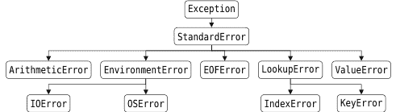

### 图 2.1 Python 异常层次结构的一部分

单个 try 块也可以拥有多个异常处理器：

```python
try:
    process()
except IndexError, e:
    print "Error: %s" % e
except LookupError, e:
    print "Error: %s" % e
```

处理器的顺序很重要。在这种情况下，IndexError 是 LookupError 的子类，因此如果我们把 LookupError 放在前面，控制权永远不会转移到 IndexError 处理器。这是因为 LookupError 匹配其自身及其所有子类。就像 C++ 和 Java 一样，当同一个 try 块有多个异常处理器时，它们按出现的顺序进行检查。这意味着我们必须按从最具体到最不具体的顺序排列它们。图 2.1 展示了 Python 异常层次结构的一部分；最不具体的异常位于顶部，向下直到底部的最具体异常。

既然我们已经对异常有了大致的了解，让我们看看它们的使用与传统错误处理方法相比如何；这也让我们对它们的使用和语法有个感觉。我们将查看两个代码片段，它们的行数相同，做的完全相同的事情：从字符串中提取第一个尖括号内的项目。在两种情况下，我们都假设变量 text 持有我们要搜索的字符串。

```python
### 测试错误
result = ""
i = text.find("<")
if i > -1:
    j = text.find(">", i + 1)
    if j > -1:
        result = text[i:j + 1]
print result
```

```python
# 异常处理
try:
    i = text.index("<")
    j = text.index(">", i + 1)
    result = text[i:j + 1]
except ValueError:
    result = ""
print result
```

两种方法都确保如果没有找到尖括号内的子字符串，result 将是空字符串。然而，右侧的代码片段关注的是正面情况，try 块中的每一行都可以假设前面的行正确执行——因为如果它们没有正确执行，就会引发异常，执行将跳转到 except 块。

如果我们只搜索单个子字符串，使用 find() 比使用异常处理机制更方便；但一旦我们需要做两件或多件可能失败的事情，如这里所示，异常处理通常能产生更清晰的代码，并在预期执行的代码和处理错误或边界情况的代码之间建立清晰的界限。

当我们编写自己的函数时，如果愿意，可以在失败情况下引发异常；例如，我们可以在前面部分开发的 simplify() 函数开头加上几行代码：

```python
def simplify(text, space=" \t\r\n\f", delete=""):
    if not space and not delete:
        raise Exception, "Nothing to skip or delete"
```

这是可行的，但不幸的是，Exception 类（Python 异常的常规基类）并不特定于我们的情况。通过创建我们自己的自定义异常并引发它，可以轻松解决这个问题：

```python
class SimplifyError(Exception): pass
def simplify(text, space=" \t\r\n\f", delete=""):
    if not space and not delete:
        raise SimplifyError, "Nothing to skip or delete"
```

异常是类实例，虽然我们在第 3 章才详细介绍类，但创建异常类的语法非常简单，似乎没有理由不在此展示。类语句的结构类似于 def 语句，有类关键字，后跟名称，不同之处在于括号内放的是基类而不是参数名称。我们使用 pass 表示空代码块，并选择继承 Exception。我们也可以继承 Exception 的子类之一；例如，ValueError。

然而，实际上，在这种情况下引发异常可能有点过度。我们可以认为函数总是以非空的 space 或 delete 或两者作为参数被调用，我们可以断言这一信念而不是使用异常：

```python
def simplify(text, space="\t\r\n\f", delete=""):
    assert space or delete
```

如果 space 和 delete 都为空，这将引发 AssertionError 异常，并且可能比前两种尝试更好地表达函数前置条件的逻辑。如果异常未被捕获（断言也不应被捕获），程序将终止并发出错误消息，说明 AssertionError 是原因，并提供追溯信息，指出断言失败的文件和行。

异常处理有用的另一个场景是从深层嵌套的循环中跳出。例如，假设我们有一个三维值网格，我们要找到特定目标项目的首次出现。以下是传统方法：

```python
found = False
for x in range(len(grid)):
    for y in range(len(grid[x])):
        for z in range(len(grid[x][y])):
            if grid[x][y][z] == target:
                found = True
                break

if found:
    break
if found:
    break
if found:
    print("Found at (%d, %d, %d)" % (x, y, z))
else:
    print("Not found")
```

这段代码有 15 行长。它很容易理解，但键入起来繁琐且效率较低。现在我们将使用一种利用异常处理的方法：

```python
class FoundException(Exception): pass

try:
```


for x in range(len(grid)):
    for y in range(len(grid[x])):
        for z in range(len(grid[x][y])):
            if grid[x][y][z] == target:
                raise FoundException
    except FoundException:
        print "Found at (%d, %d, %d)" % (x, y, z)
    else:
        print "Not found"

这个版本只有 11 行代码。如果找到目标，我们就抛出异常并处理该情况。如果没有抛出异常，则执行 try 块中的 else 语句块。

在某些情况下，我们希望无论发生什么，某些清理代码都会被调用。例如，即使我们的代码存在 bug，我们也希望确保关闭文件或网络/数据库连接。这通过使用 try ... finally 块来实现，如下例所示：

filehandle = open(filename)
try:
    for line in filehandle:
        process(line)
finally:
    filehandle.close()

在这里，我们使用给定的文件名打开一个文件并获得一个文件句柄。然后，我们在 for 循环的上下文中遍历该文件句柄——它是一个生成器，每次返回一行。如果发生任何异常，解释器会查找作用域范围内最近的 except 或 finally。在这种情况下，它没有找到 except，但找到了 finally，因此解释器将控制权切换到 finally 语句块并执行它。如果没有发生异常，finally 块将在 try 语句块执行完毕后执行。因此，无论如何，文件都会被关闭。

Python 2.5 之前的版本不支持 try ... except ... finally 块。因此，如果我们既需要 except 又需要 finally，必须使用两个块：一个 try ... except 和一个 try ... finally，其中一个嵌套在另一个内部。例如，在 2.4 及更早版本的 Python 中，打开和处理文件的最稳健方法如下所示：

fh = None
try:
    try:
        fh = open(fname)
        process(fh)
    except IOError, e:
        print "I/O error: %s" % e
finally:
    if fh:
        fh.close()

## 异常处理

这段代码使用了一些我们已经讨论过的内容，但为了确保我们牢固掌握异常处理，我们将详细研究这段代码。

如果文件一开始就无法打开，except 块会被执行，随后 finally 块也会被执行——由于文件未能打开，文件句柄仍为 None，所以 finally 块实际上什么也不会做。另一方面，如果文件成功打开并开始处理，可能会发生 I/O 错误。如果这种情况发生，except 块会被执行，然后控制权会再次传递到 finally 块，文件将被关闭。

如果发生的异常不是 IOError 或 IOError 的子类，例如，在我们的 process() 函数中发生了 ValueError——解释器会认为 except 块不适用，并查找最近的、适用的外部异常处理程序。在查找过程中，解释器首先会遇到 finally 块并执行它，之后（即在关闭文件后），它将继续查找适用的异常处理程序。

如果文件成功打开且处理过程中没有抛出任何异常，except 块将被跳过，但由于无论发生什么情况 finally 块都会被执行，因此 finally 块仍然会执行。所以，在所有情况下，除非解释器被用户终止（或在极少数情况下崩溃），只要文件被打开，它最终都会被关闭。

在 Python 2.5 及更高版本中，我们可以使用一种更简单的方法，它具有相同的语义，因为我们可以使用 try ... except ... finally 块：

fh = None
try:
    fh = open(fname)
    process(fh)
except IOError, e:
    print "I/O error: %s" % e
finally:
    if fh:
        fh.close()

使用这种语法，仍然可以拥有用于“未发生异常”情况的 else 块；它位于最后一个 except 块之后，且唯一的 finally 块之前。我们将在第 6 章“文件”的上下文中重新探讨这个主题。

无论使用哪个版本的 Python，finally 块始终只执行一次，无论是否发生异常，要么在 try 语句块结束时，要么在发生将控制流转移到 try 块外部的异常时。

Python 2.6（以及使用 from __future__ import with 语句的 Python 2.5）提供了另一种完全不同的方法：“上下文管理器”。对于文件处理，我们更倾向于使用 try ... finally 方法，但在其他情况下，我们更偏好上下文管理器。例如，我们将在第 19 章中展示如何使用上下文管理器来锁定和解锁线程使用的读写锁。

## 总结

在本章中，我们学习了如何使用 if 进行分支，以及如何通过带有 elif 的 if（可选地配合 else）创建多路分支。我们还学习了如何使用 while 和 for 进行循环，以及如何使用 range() 生成整数列表。我们学习了提供字典的键、值和键值对（items）的字典方法，并简要了解了排序。我们还初步了解如何使用 Python 的列表推导式和生成器。

我们学习了如何使用 def（以及 lambda）创建函数。我们使用了位置参数和关键字参数，并开发了两个有用的函数 frange() 和 simplify()。我们看到了 Python 如何在读取 .py 文件时动态创建函数，以及我们如何利用这种动态性，在较旧的 Python 版本中提供与较新版本中可用的相似功能。我们还看到了如何使用部分函数应用创建包装函数，将函数与其参数封装在一起（闭包）。

我们还学习了如何抛出异常，如何创建自定义异常，以及如何处理异常。我们看到了如何使用 finally 保证清理工作，并讨论了 Python 提供的某些更复杂的异常处理可能性。我们还看到，当我们有多个异常可能发生的语句块时，异常处理可以产生更简洁的代码，以及如何使用异常处理来干净地退出一组深层嵌套的循环。

创建自定义异常引导我们走向创建简单的类；这些类没有属性（没有成员数据）也没有方法。在下一章中，我们将更正式地研究类，学习如何创建类以及实例化具有任意属性和方法的对象。

## 练习

在第 1 章中，练习短到可以直接输入到 IDLE 中。从现在开始，我们建议您将解决方案输入到具有 .py 扩展名的文件中，并在末尾添加一些测试调用。例如，您可能编写一个具有以下结构的文件：

#!/usr/bin/env python
def mysolution(arg0, arg1):
    pass    # 所需的任何代码

mysolution(1, 2)       # 使用一组参数调用
mysolution("a", "b")  # 使用另一组参数调用
# 额外的调用以确保所有边界情况都经过测试

如果您使用的是 Windows，请确保在控制台窗口中运行测试程序；同样，Mac OS X 用户应使用终端。您可能还需要包含 print 语句，以便可以看到结果。（涉及 GUI 应用程序的练习从第二部分开始。）

如果您查看本书的源代码，包括本章的 answers.py 文件，您会发现代码通常包含很长的文档字符串（docstrings），在许多情况下，它们占用的行数比代码本身还多。这是因为文档字符串通常包含用法示例，这些示例同时充当单元测试，正如我们将在第 3 章“使用 doctest 模块”小节中看到的那样。

- 编写一个函数，签名为：

  ```python
  valid(text, chars="ABCDEFGHIJKLMNOPQRSTUVWXYZ0123456789")
  ```

  该函数应返回一个（可能为空的）字符串，它是 text 的副本，仅包含 chars 中的字符。例如：

  ```python
  valid("Barking!")                                     # 返回 "B"
  valid("KL754", "0123456789")                          # 返回 "754"
  valid("BEAN", "abcdefghijklmnopqrstuvwxyz")          # 返回 ""
  ```

  使用 for 循环和 if 语句，不计文档字符串（也应该编写文档字符串），可以用半打（6行）代码实现。

- 编写一个函数，签名为：

  ```python
  charcount(text)
  ```

  这应该返回一个具有 28 个键的字典，包括 "a"、"b"、...、"z"，加上 "whitespace" 和 "others"。对于 text 中的每个小写字符，如果该字符是字母，则增加对应键的值；如果该字符是空白字符，则增加 "whitespace" 键的值；否则，增加 "others" 键的值。例如，调用：

  ```python
  stats = charcount("Exceedingly Edible")
  ```

  将意味着 stats 是一个包含以下内容的字典：

  ```python
  {'whitespace': 1, 'others': 0, 'a': 0, 'c': 1, 'b': 1, 'e': 5,
   'd': 2, 'g': 1, 'f': 0, 'i': 2, 'h': 0, 'k': 0, 'j': 0, 'm': 0,
   'l': 2, 'o': 0, 'n': 1, 'q': 0, 'p': 0, 's': 0, 'r': 0, 'u': 0,
   't': 0, 'w': 0, 'v': 0, 'y': 1, 'x': 1, 'z': 0}
  ```

  使用字典和 for 循环，可以用略多于一打（12行）的代码实现。

- 创建一个函数，签名为：

  ```python
  integer(number)
  ```

  number 参数是一个数字或一个可以转换为数字的字符串。该函数应将数字返回为 int 类型，如果传入的数字是浮点数，则对其进行舍入。如果转换失败，捕获 ValueError 异常，并返回 0。确保它对字符串和字面数字（如 4.5, 32, "23" 和 "-15.1"）都有效，并且正确


对于像“tonsils”这样的无效数字，返回零。这可以用几行代码实现。（提示：为了处理所有情况，你需要先将输入转换为 float 类型，即通过对输入调用 float() 函数。）

4. 现在编写一个签名如下的函数：

```python
incrementString(text="AAAA")
```

该函数必须对给定的字符串进行“递增”操作。以下是一些示例：

```python
incrementString("A")     # 返回 "B"
incrementString("Z")     # 返回 "AA"
incrementString("AM")    # 返回 "AN"
incrementString("AZ")    # 返回 "BA"
incrementString("BA")    # 返回 "BB"
incrementString("BZ")    # 返回 "CA"
incrementString("ZZA")   # 返回 "ZZB"
incrementString("ZZZ")   # 返回 "AAAA"
incrementString("AAAA")  # 返回 "AAAB"
incrementString("AAAZ")  # 返回 "AABA"
incrementString("ABC2")  # 引发 ValueError
```

text 中的字符必须是 A–Z（或者 a–z，在这种情况下函数必须将它们转换为大写）；否则，函数应该引发 ValueError 异常。

这比之前的练习稍微具有挑战性一些。如果你使用几个列表推导式，代码可以在不到 20 行内完成，虽然也可以不用列表推导式来编写。正确实现起来有点棘手。（提示：reversed() 函数返回一个反向顺序的序列。）

5. 如果你阅读了关于函数生成器的章节，尝试编写一个签名如下的生成器：

```python
leapyears(yearlist)
```

yearlist 参数是一个年份数字序列——例如，[1600, 1604, 1700, 1704, 1800, 1900, 1996, 2000, 2004]。给定此输入，输出将依次是年份 1600, 1604, 1704, 1996, 2000 和 2004。这大约可以用半打行代码实现。（提示：能被 4 整除的年份是闰年，但如果能被 100 整除，还必须能被 400 整除。）

本章练习的标准答案在文件 chap02/answers.py 中。

## 3

- 创建实例
- 方法与特殊方法
- 继承与多态性
- 模块与多文件应用程序

### 类与模块

Python 完全支持过程式编程和面向对象编程，并允许我们自由选择使用任一方法，或者将两者结合使用。到目前为止，我们一直在进行过程式编程，尽管我们已经使用了一些 Python 类——例如 str 字符串类。我们尚未做的是定义自己的类。在本章中，我们将学习如何创建类和方法，以及如何用 Python 进行面向对象编程。并且在后续所有章节中，我们编写的程序几乎总是采用面向对象的方法。

我们假设你熟悉面向对象编程——例如使用 C++ 或 Java——但会借此机会澄清我们的术语。我们使用术语“对象”，偶尔使用术语“实例”，来指代特定类的一个实例。我们互换使用“类”、“类型”和“数据类型”这些术语。属于特定实例的变量称为“属性”或“实例变量”。在方法内部使用的非实例变量的变量称为“局部变量”，或简称为“变量”。我们使用术语“基类”来指代被继承的类；基类可以是直接祖先，也可以是继承链上更高级的类。有些人使用术语“父类”来表示这个概念。我们使用术语“子类”和“派生类”来指代继承自另一个类的类。

在 Python 中，子类可以重写（重新实现）任何方法；这与 Java 相同（除了 Java 的“final”方法）。¹ 重载，即在同一个类中具有相同名称但参数列表不同的方法，是不支持的，尽管由于 Python 灵活的参数处理功能，这在实际中并不是一个限制。事实上，底层的 Qt C++ API 大量使用了重载，但 PyQt 在幕后无缝处理了这一点，因此在实践中，我们可以调用任何“重载”的 Qt 方法，并依赖 PyQt 来做正确的事。

> ¹ 在 C++ 术语中，所有 Python 方法都是虚方法。


本章从创建类的基本语法开始。然后我们看如何构建和初始化对象，以及如何实现方法。Python 的面向对象支持的一个最棒的功能是，它允许我们重新实现“特殊方法”。这意味着我们可以使我们的类无缝融合，使它们表现得就像内置类一样。例如，很容易让我们的类支持与 == 和 < 等比较运算符一起使用。然后我们看数字特殊方法：这些允许我们重载 + 和 += 等运算符，这在创建完整的自定义数据类型时可能非常有用，特别是数字类型。如果我们的类是一个集合，还有一些额外的特殊方法我们可以重新实现，以便例如，我们的集合将支持 in 运算符和 len() 函数。本章以一个关于 Python 支持继承和多态性的章节结束。

由于历史原因，Python 提供两种用户定义的类型（类）：“旧式”和“新式”。唯一的明显区别是旧式类要么没有基类，要么只有旧式基类。新式类总是派生自一个或更多新式类，例如 object，Python 的最终基类。由于没有理由使用旧式类，并且因为它们将从 Python 3.0 的语言中移除，我们将始终使用新式类。

创建类的语法很简单：

```python
class className(base_classes):

    suite
```

在套件的语句中，我们可以有 def 语句；在这种上下文中，它们创建的是封闭类的方法而不是函数。

也可以有“空”类，没有自己的方法或属性（数据成员），正如我们在上一章结尾看到我们派生自己的自定义异常类时那样。

新式类总是至少有一个基类——例如，object。与 Java 不同，Python 支持多重继承，即 Python 类可以继承自一个、两个或更多基类。我们通常会避免使用这个特性，因为它可能导致不必要的复杂性和混淆。Python 不支持抽象类（不能实例化的类，且只能被派生——用于定义接口时很有用），但实现抽象类的效果仍然可以实现。我们将看一个多重继承的小例子，其中一个基类是“抽象”的，并且纯粹用于提供 API（有点像 Java 接口）。

在 Python 中，所有方法和属性在类的内部和外部都可访问；没有如“public”和“private”这样的访问说明符。Python 确实有“私有”的概念——名称以单个前导下划线开头的对象被视为私有。就方法和实例变量而言，它们的私有性只是一种我们受邀尊重的约定。而对于模块，私有类和函数，即名称以单个前导下划线开头的，在使用 from module_Name import * 语法时不会被导入。Python 还有“非常私有”的概念——名称以两个前导下划线开头的方法和属性。非常私有的对象仍然可以访问，但 Python 解释器会混淆它们的名称，使得意外访问它们变得困难。

现在，我们知道创建类的基本语法并对 Python 的面向对象功能有了一个大致的了解，我们准备好看如何创建一个类和一些实例了。

## 创建实例

在大多数面向对象语言中，对象的创建分为两个步骤：首先，对象被构建，其次，对象被初始化。一些语言将这两个步骤合并为一个，但 Python 将它们分开。Python 有 _new_() 特殊方法，用于构建对象，以及 _init_() 特殊方法，用于初始化新构建的对象。实际自己实现 _new_() 的情况非常罕见；本书中没有一个自定义类需要它——而且旧版本的 Python 甚至没有 _new_() 特殊方法。Python 完全能够为我们构建对象，所以在几乎所有情况下，我们唯一需要实现的方法是 _init_()。

鉴于 Python 的两步对象创建，我们通常会谈论对象创建而不是构建。此外，我们通常指类的初始化器（其 _init_() 方法），因为这是通常在自定义类中重新实现的方法，并且更接近 C++ 和 Java 等语言中使用的构造函数的概念。

让我们在实践中看看如何创建一个类。我们将创建一个存储字符串（某种椅子的名称）和数字（椅子有多少条腿）的类：

```python
class Chair(object):
    """This class represents chairs."""

    def __init__(self, name, legs=4):
        self.name = name
        self.legs = legs
```

按照惯例，类语句后跟随一个文档字符串，如前面的代码所示。在本书中，我们通常不会显示文档字符串，但在适当的示例代码中会包含它们。空行纯粹是为了美观和清晰。

以两个下划线开头和结尾的方法名称是“特殊”方法。Python 使用这些方法来集成自定义类，使它们可以具有与内置类相同的使用模式，我们很快就会看到。

_init_() 方法，实际上每一个方法，都有一个第一个参数，这是 C++ 或 Java “this” 变量的 Python 等价物，即一个指向对象本身的变量。这个变量通常被称为 self。我们


必须将 self 作为每个（非静态*）方法参数列表中的第一个参数，尽管我们无需显式传递它，因为 Python 会自动为我们完成。

虽然 “self” 这个名称仅仅是约定俗成，但我们始终使用它。在对象内部，当我们想要引用实例方法或属性时，必须显式使用 self。例如，在 Chair 类的初始化器中，我们使用 self 创建了两个数据属性。得益于 Python 的动态特性，我们可以在其他方法中创建额外的属性，甚至可以根据需要为特定实例添加额外属性；但我们将采取一种更保守的方式，这对于我们致力于构建的 GUI 编程来说已经足够。

要创建一个类的实例，我们使用以下语法：

```
instance = className(arguments)
```

即使不传递任何参数，圆括号也是强制要求的。在幕后，Python 通过调用类的静态 `__new__()` 方法（该方法继承自 object，或在极少数情况下由我们实现）来构造对象，然后在新构造的对象上调用 `__init__()`。最终返回一个已初始化的对象。

就我们的 Chair 类而言，我们必须传递一个或两个参数（Python 会自动为我们传递第一个 self 参数）；例如：

```
chair1 = Chair("Barcelona")
chair2 = Chair("Bar Stool", 1)
```

由于这些属性是公开的，我们可以使用点 (.) 运算符对其进行读取或赋值；例如：`print chair2.name` 会打印出 “Bar Stool”，而 `chair1.legs = 2` 会将 chair1 的 legs 属性值从 4 更改为 2。

对象原教旨主义者无疑会对这种从实例外部直接访问属性的方式感到不安，而那些崇尚极限编程的人可能会对此完全满意，因为我们随时可以稍后添加访问器方法。

既然我们已经了解了构造和初始化的处理流程，接下来需要考虑对象的销毁。C++ 程序员习惯于使用析构函数，并依赖于可以自行选择时间删除对象这一事实。Java 和 Python 程序员并不享有这种特权。相反，他们拥有自动垃圾回收机制，这通常使编程变得更加容易，但缺点是对象被删除的确切时间无法精细控制。如果需要保护资源，通常的解决方案是使用 try ... finally 代码块来保证清理工作。当对象即将被垃圾回收时，其 `__del__()` 特殊方法会被调用，self 是其唯一的参数。正如 Python（以及 Java 中关于 finalize() 方法）的常见做法一样，我们极少使用这种特殊方法。为了说明这一点，在本书示例和练习解答中的 170 多个类里，没有哪一个重新实现了 `__del__`()。

现在我们已学会如何创建和初始化自定义类的对象。接下来，我们将了解如何提供额外方法以使我们的类具备独特行为。我们还将学习如何确保我们的类与 Python 其余部分平滑集成，并在适当的地方表现得像内置类一样。

## 方法与特殊方法

我们将首先查看一个使用访问器方法获取和设置属性值的类，而不是使用直接属性访问。

```
class Rectangle(object):
    def __init__(self, width, height):
        self.width = width
        self.height = height

    def getWidth(self):
        return self.width

    def setWidth(self, width):
        self.width = width

    def getHeight(self):
        return self.height

    def setHeight(self, height):
        self.height = height

    def area(self):
        return self.getWidth() * self.getHeight()
```

我们选择对获取器和设置器都使用 Java 风格的命名约定。现在我们可以编写如下代码：

```
rect = Rectangle(50, 10)
print rect.area()    # 打印 "500"
rect.setWidth(20)
```

我们完全可以像这样实现 area() 方法：

```
def area(self):
    return self.width * self.height
```

像我们这里那样编写简单的访问器方法，对于 C++ 之类的语言来说是正确的做法，因为它提供了最大的灵活性，并且在编译后的代码中没有开销。如果在后续阶段我们需要在访问器中执行某些计算，我们只需添加功能，而无需要求我们类的用户更改他们的代码。但在 Python 中，编写这样的访问器并非必要。相反，我们可以直接读取和写入属性，如果在后续阶段需要执行某些计算，我们可以使用 Python 的 `property()` 函数。该函数允许我们创建命名属性来替代普通属性。属性的访问方式与属性相同，但在幕后它们会调用我们指定的方法来获取和设置值。

以下是 `Rectangle` 类的第二个版本，这次使用直接属性访问来处理 width 和 height，并使用 property 来处理 area：

```
class Rectangle(object):
    def __init__(self, width, height):
        self.width = width
        self.height = height

    def _area(self):
        return self.width * self.height
    area = property(fget=_area)
```

这允许我们编写如下代码：

```
rect = Rectangle(5, 4)
print rect.width, rect.height, rect.area   # 打印 (5, 4, 20)
rect.width = 6
```

Python 的 `property()` 函数可用于指定获取器、设置器、删除方法以及文档字符串。由于我们只指定了获取器，因此 area 属性是只读的。如果以后我们需要在访问 width 时执行某些计算，可以简单地将其转换为 property，如下所示：

```
def _width(self):
    return self.__width

def _setWidth(self, width):
    # 执行某些计算
    self.__width = width

width = property(fget=_width, fset=_setWidth)
```

注意，我们将实例变量的名称从 `width` 更改为 `_width`，以避免与 `width` 属性发生名称冲突。通常，其值存储在实例变量中的属性使用私有名称（带有两个前导下划线的名称）作为实例变量名，以避免与类用户使用的属性名发生名称冲突。例如，使用具有 `width` 属性的 `Rectangle` 类的用户，可以像以前一样完全相同地获取和设置 `width` 属性，只是现在幕后的 `_width()` 和 `_setWidth()` 方法用于执行这些操作，并且属性的数据存储在 `_width` 实例变量中。

### 关于私有名称的讨论

### 表 3.1 基本特殊方法

| 方法 | 语法 | 描述 |
| :--- | :--- | :--- |
| `__init__(self, args)` | `x = X()` | 初始化新创建的实例 |
| `__call__(self, args)` | `x()` | 使实例可被调用，即将其转换为函数。args 是可选的。（高级） |
| `__cmp__(self, other)` | `x == y`<br>`x < y`<br>`# 等等` | 如果 self < other 返回 -1，如果它们相等返回 0，否则返回 1。如果实现了 `__cmp__()`，它将用于任何未显式实现的比较运算符。 |
| `__eq__(self, other)` | `x == y` | 如果 x 等于 y 则返回 True |
| `__ne__(self, other)` | `x != y` | 如果 x 不等于 y 则返回 True |
| `__le__(self, other)` | `x <= y` | 如果 x 小于或等于 y 则返回 True |
| `__lt__(self, other)` | `x < y` | 如果 x 小于 y 则返回 True |
| `__ge__(self, other)` | `x >= y` | 如果 x 大于或等于 y 则返回 True |
| `__gt__(self, other)` | `x > y` | 如果 x 大于 y 则返回 True |
| `__nonzero__(self)` | `if x:`<br>`pass` | 如果 x 非零则返回 True |
| `__repr__(self)` | `y = eval('x')` | 返回 x 的可 eval() 表示形式。使用反引号等同于调用 repr()。\* |
| `__str__(self)` | `print x` | 返回 x 的人类可读表示形式 |
| `__unicode__(self)` | `print x` | 返回 x 的人类可读 Unicode 表示形式 |

Python 提供了比此处展示的更多关于属性访问的控制，但由于这并非实现我们 GUI 编程目标所必需，我们将把此作为如果感兴趣时查阅的话题。起点是 `__getattr__()`、`__getattribute__()` 和 `__setattr__()` 特殊方法的文档。

Python 方法（包括特殊方法）的机制与函数完全相同，只是增加了 self 作为第一个参数，以及访问 self 的属性并调用 self 的方法的能力。我们只需记住，当我们调用方法或访问实例变量时，必须使用 self 指定实例。例如，在 Rectangle 类的 setHeight() 中

\*最好使用 repr() 而不是反引号，因为反引号将在 Python 3.0 中被移除。


方法中，我们使用 self.height 来引用实例变量，而直接使用 height 来引用参数，即局部变量。同样，在 area() 方法中，我们调用了两个 Rectangle 方法，再次使用了 self。这与 C++ 和 Java 有很大不同，在那些语言中，实例是被默认假定的。

在 C++ 中，实现运算符是可能的，即为我们的数据类型提供运算符的自定义实现。C++ 语法使用关键字 operator 后跟运算符本身——例如 operator+()——但在 Python 中，每个运算符都有一个名称，因此在 Python 中实现类的 + 运算符需要实现 __add__() 方法。Python 中用于实现运算符的所有方法都是特殊方法，这一点通过它们以两个下划线开头和结尾的命名来表示。

为了更好地将我们的自定义类集成到 Python 中，还有一些其他通用的特殊方法可能值得实现。例如，我们可能希望支持比较运算符，并为类实例提供布尔值。我们将在 Rectangle 类中添加一些方法来展示其实际效果，但为了简洁起见，我们不会重复类声明和已实现的方法。我们将首先介绍比较：

```python
def __cmp__(self, other):
    return cmp(self.area(), other.area())
```

如果我们愿意，可以为每个比较运算符实现一个特殊方法。例如，如果我们实现了 __lt__()（“小于”），我们就可以用 < 运算符比较我们类的实例。然而，如果我们不想单独实现比较运算符，我们可以简单地实现 __cmp__()，就像这里所做的那样。如果实现了特定的特殊方法，Python 将在比较时使用该方法；否则，将回退到使用 __cmp__()。因此，仅通过实现这一个特殊方法，所有比较运算符 (<, <=, ==, !=, >=, >) 都可以用于 Rectangle 对象：

```python
rectA = Rectangle(4, 4)
rectB = Rectangle(8, 2)
rectA == rectB     # 由于两者面积相同，结果为 True
rectA < rectB      # False
```

我们使用内置的 cmp() 函数来实现 __cmp__()。cmp() 函数接受两个对象，如果第一个小于第二个，则返回 -1；如果相等，则返回 0；否则返回 1。我们使用矩形的面积作为比较依据，这就是为什么我们在示例中得到了相当令人惊讶的 True 结果。更严格且可能更好的实现可能是：

```python
def __cmp__(self, other):
    if (self.width != other.width):
        return cmp(self.width, other.width)
    return cmp(self.height, other.height)
```

这里，如果宽度相同，我们返回比较高度的结果；否则，我们返回比较宽度的结果。

如果我们没有重新实现任何比较特殊方法，在大多数情况下，Python 会很乐意为我们执行比较，尽管不一定以我们希望的方式进行。如果我们要创建比较有意义的类，我们应当实现 \_\_cmp\_\_()。对于其他类，最安全的做法是实现一个主体为 return NotImplemented error 的 \_\_cmp\_\_()。

```python
def __nonzero__(self):
    return self.width or self.height
```

当对象处于布尔上下文中时，会使用这个特殊方法；例如 bool(rectA)，或 if rectB: 并且如果对象“非零”，则返回 True。

```python
def __repr__(self):
    return "Rectangle(%d, %d)" % (self.width, self.height)
```

“表示”（representation）特殊方法必须返回一个字符串，如果对该字符串求值（例如使用 eval()），将构造出一个与被调用对象具有相同属性的对象。有些对象过于复杂而无法支持这一点，对于某些对象（例如 GUI 中的窗口或按钮），这样做没有意义；因此，此类类不提供 \_\_repr\_\_() 实现。在字符串 % 运算符的格式字符串中，我们使用 \*r 来获取此特殊方法的结果；我们也可以使用 repr() 函数或反引号 \*\*\* 运算符。反引号只是使用 repr() 的一种语法替代形式。例如，repr(x) 和 \*x\* 都返回相同的结果：对象 x 的表示，由 x 的 \_\_repr\_\_() 方法返回。

还有一个 \_\_str\_\_() 特殊方法，它必须返回被调用对象的字符串表示（类似于 Java 的 toString() 方法），但与 \_\_repr\_\_() 不同，该表示旨在供人类阅读，且不一定是可求值的（eval()-able）。如果 \_\_str\_\_() 方法未实现（如本例所示），Python 将转而使用 \_\_repr\_\_() 方法。例如：

```python
rect = Rectangle(8, 9)
print rect    # 使用 __repr__() 打印 "Rectangle(8, 9)"
```

如果我们希望获得类的人类可读的 Unicode 字符串表示，我们可以实现 \_\_unicode\_\_()。

还有一些通用的特殊方法我们可以实现，但它们不适合 Rectangle 类。所有常见实现的通用特殊方法列在表 3.1 中。

| 方法语法 | 方法语法 |
| :--- | :--- |
| _float_ (self) | float(x) |
| _int_ (self) | int(x) |
| _abs_ (self) | abs(x) |
| _neg_ (self) | -x |
| _add_ (self, other) | x + y |
| _sub_ (self, other) | x - y |
| _iadd_ (self, other) | x += y |
| _isub_ (self, other) | x -= y |
| _radd_ (self, other) | y + x |
| _rsub_ (self, other) | y - x |
| _mul_ (self, other) | x * y |
| _mod_ (self, other) | x % y |
| _imul_ (self, other) | x *= y |
| _imod_ (self, other) | x %= y |
| _rmul_ (self, other) | y * x |
| _rmod_ (self, other) | y % x |
| _floordiv_ (self, other) | x // y |
| _truediv_ (self, other) | x / y |
| _ifloordiv_ (self, other) | x //= y |
| _itruediv_ (self, other) | x /= y |
| _rfloordiv_ (self, other) | y // x |
| _rtruediv_ (self, other) | y / x |

对象。如果我们确实需要对象的副本，可以使用 copy 模块中的 copy() 或 deepcopy() 函数，前者用于没有嵌套属性的对象或浅拷贝足以满足需求的情况，后者用于必须完全复制的对象。或者，我们可以提供自己的复制方法，通常命名为 copy()，因为这是常规的 Python 实践。

对于数值类，提供支持标准数值运算符（如 + 和 *）的功能通常很方便。这在 Python 中通常通过实现各种特殊方法来实现。如果我们只实现 +，Python 将使用它来提供 *，但通常实现两者更好，因为这给予我们更精细的控制，并使优化操作变得更加容易。

最常实现的数值特殊方法列在表 3.2 中。未列出的包括位移位运算符以及十六进制和八进制转换运算符。

存在两个不同的除法运算符的原因是，Python 可以执行整数或浮点数除法，如第 17 页所述。

一些特殊方法有两个或三个版本；例如，_add_ ()、_radd_ () 和 _iadd_ ()。“r” 版本（例如 _radd_ ()）用于左侧操作数没有合适方法但右侧操作数有的情况。例如，对于表达式 x + y，其中 x 和 y 的类型分别为 X 和 Y，Python 首先通过调用 X._add_ (x, y) 来尝试求值表达式。但如果类型 X 没有此方法，Python 将尝试调用 Y._radd_ (y, x)（原文此处逻辑似有笔误，按上下文修正为 Y 的方法，若 Y 也无此方法则抛出异常，此处依原文“ If Y has no such method, an exception will be raised”保留逻辑，但通常 radd 是右操作数的方法）。*注：原文此处表述略有混淆，标准行为是若左操作数方法不可用，则查右操作数的 r 方法。若 Y 也没有该方法，则抛出异常。*

在“i”版本中，“i”代表“原地”（in-place）。它们用于增强赋值运算符，如 +=。很快就会看到一个示例，展示这些方法在实际中的应用，但首先我们必须学习如何创建静态数据和静态方法。

## 静态数据、静态方法和装饰器

在某些情况下，拥有与整个类（而非其实例）相关联的数据是非常有用的。例如，如果有一个 Balloon 类，我们可能想知道使用了多少种独特的颜色：

```python
class Balloon(object):
    unique_colors = set()

    def __init__(self, color):
        self.color = color
        Balloon.unique_colors.add(color)

    @staticmethod
    def uniqueColorCount():
        return len(Balloon.unique_colors)

    @staticmethod
    def uniqueColors():
        return Balloon.unique_colors.copy()
```

静态数据在类块内部创建，但在任何 def 语句外部。要访问静态数据，必须限定名称，最简单的方法是使用类名称，正如我们在 Balloon 类的静态方法中所做的那样。我们将在下一小节中在更现实的上下文中看到静态数据和方法。

@staticmethod 是一个装饰器。装饰器是一个函数，它接受一个函数作为参数，以某种方式包装它，并将包装后的函数重新赋值给原始函数的名称，其效果等同于编写以下内容：

```python
def uniqueColors():
    return Balloon.unique_colors.copy()
uniqueColors = staticmethod(uniqueColors)
```

@ 符号用于标识装饰器。staticmethod() 函数是 Python 内置函数之一。

我们可以使用多个装饰器。例如，可以编写合适的装饰器来记录函数和方法的调用，或记录每次方法调用。例如：

```python
@logger
@recalculate
def changeWidth(self, width):
    self.width = width
```

这里，每当对象的宽度发生变化时，两个装饰器都会应用：logger()（可能会在日志文件或数据库中记录变更）和 recalculate()（可能会更新对象的面积）。


除了静态方法外，Python 还支持“类方法”。类方法与静态方法类似，它们没有 self 参数，因此可以通过类或实例进行调用。它们与静态方法的区别在于，类方法具有一个由 Python 提供的首参数，即调用该方法的类。这个参数通常被命名为 cls。

## 示例：Length 类

在回顾了 Python 的通用和数值特殊方法后，我们现在有能力创建一个完整的自定义数据类型了。我们将创建一个 Length 类来存储物理长度。我们希望能够使用类似 `distance = Length("22 miles")` 的语法来创建长度。并且，我们希望能够以我们偏好的单位获取长度值——例如，`km = distance.to("km")`。该类不应支持长度与长度的乘法（因为那样会产生面积），但应支持长度与数值的乘法；例如 `distance * 2`。

通常，虽然源文件（位于 chap03/length.py）中包含 docstrings，但我们在以下代码片段中不会展示它们，既是为了节省空间，也是为了避免让我们偏离代码本身的重点。

```python
from __future__ import division
```

文件的第一条语句相当引人入胜。`from __future__ import` 语法用于开启那些将在 Python 后续版本中默认开启的特性。此类语句必须始终位于文件最前。在此处，我们表示希望开启 Python 未来版本中的除法行为，即让 `/` 执行“真除法”（也称为浮点除法），而不是它通常执行的截断除法。（如果我们真正需要截断除法，可以使用 `//` 运算符。）

```python
class Length(object):
    convert = dict(mi=621.371e-6, miles=621.371e-6, mile=621.371e-6, yd=1.094, yards=1.094, yard=1.094, ft=3.281, feet=3.281, foot=3.281, inches=39.37, inch=39.37, mm=1000, millimeters=1000, millimetre=1000, millimetre=1000, millimetres=1000, cm=100, centimeter=100, centimeters=100, centimetre=100, centimetres=100, m=1.0, meter=1.0, metres=1.0, metre=1.0, metres=1.0, km=0.001, kilometer=0.001, kilometres=0.001, kilometre=0.001, kilometres=0.001)
    convert["in"] = 39.37
    numbers = frozenset("0123456789.eE")
```

我们从一个类语句开始，为类命名，并创建一个作用域，在其中我们可以创建静态数据和方法。由于我们继承了 object，因此我们的类是新式类。然后，我们创建了一些静态数据。首先，我们创建一个字典，将名称映射到转换因子。我们不能使用 "in" 作为参数名，因为它是 Python 的关键字，所以我们使用 `[]` 运算符将其单独插入到字典中。我们还创建了一个包含浮点数中有效字符的集合。

```python
def __init__(self, length=None):
    if length is None:
        self.__amount = 0.0
    else:
        digits = ""
        for i, char in enumerate(length):
            if char in Length.numbers:
                digits += char
            else:
                self.__amount = float(digits)
                unit = length[i:].strip().lower()
                if unit not in Length.convert:
                    raise ValueError, "need an amount and a unit"
                self.__amount /= Length.convert[unit]
```

在初始化器内部，局部变量 `length`、`digits`、`i`、`char` 和 `unit` 在方法结束时都会超出作用域。我们只引用一个实例变量 `self.__amount`。无论初始化器中使用了什么单位，该变量始终存储以米为单位的给定长度值，并且可以从任何方法中访问。我们还引用了两个静态变量 `Length.numbers` 和 `Length.convert`。

当创建 Length 对象时，Python 将调用 `__init__()` 方法。我们为用户提供了两个选项：不传递参数，此时长度默认为 0 米；或者传递一个字符串，该字符串指定一个数值和一个单位，两者之间可有可选的空格分隔。

如果给定了一个字符串，我们想要遍历在数字中有效的字符，然后将剩余部分视为单位。Python 的 `enumerate()` 函数返回一个迭代器，该迭代器在每次迭代时返回一个包含两个值的元组：一个从 0 开始的索引号，以及序列中对应的项。因此，如果 `length` 中的字符串是 "7 mi"，返回的元组将是 (0, "7")、(1, " ")、(2, "m") 和 (3, "i")。我们只需在 for 循环中提供足够的变量，即可解包元组。

只要我们获取的字符在 numbers 集合中，我们就将它们添加到我们的 `digits` 字符串中。一旦我们遇到一个不在集合中的字符，我们就尝试将 `digits` 字符串转换为浮点数，并将 `length` 字符串的剩余部分视为单位。我们去除单位字符串的前后空白，并将字符串转换为小写。最后，我们使用静态 `convert` 字典中的转换因子，计算出给定长度等于多少米。

我们将数据属性命名为 `__amount`，而不是例如 `amount`，因为我们希望这个数据是私有的。Python 会对类中以两个下划线开头（且不以两个下划线结尾）的任何名称进行名称修饰（name-mangling），在前面加上一个下划线和类名，以使属性名称唯一。在这种情况下，`__amount` 将被修饰为 `_Length__amount`。当我们查看一些特殊方法时，我们会看到这样做的好处。

显然，很多情况都可能出现错误。浮点数转换可能会失败，可能没有给出单位（在这种情况下，我们抛出异常，并附带一个“原因”字符串），或者单位可能不匹配 `convert` 字典中的任何一项。在这个方法中，我们选择让可能的异常被抛出，并在方法的 docstring 中记录这些异常，以便该类的用户知道会发生什么。

```python
def set(self, length):
    self.__init__(length)
```

我们希望我们的长度对象是可变的，因此我们提供了 `set()` 方法。它接受与 `__init__()` 相同的参数，并且由于 `__init__()` 是初始化器而不是构造函数，我们可以安全地将任务委托给它。

```python
def to(self, unit):
    return self.__amount * Length.convert[unit]
```

我们在类内部以米为单位存储长度值。这意味着我们只需要维护一个浮点数值，而不是，例如，一个数值和一个单位。但正如我们可以在创建长度时指定首选单位一样，我们也希望能够以我们选择的单位获取长度值。这就是 `to()` 方法实现的。它使用 `convert` 字典将米值转换为指定的单位。

```python
def copy(self):
    other = Length()
    other.__amount = self.__amount
    return other
```

众所周知，如果使用 `=` 运算符，我们只是绑定（或重新绑定）一个名称，因此如果我们想要一个长度对象的真正副本，我们需要一种手段来实现。在这里，我们选择提供一个 `copy()` 方法。但我们本不必这样做：相反，我们可以简单地依赖 `copy` 模块。例如：

```python
import copy
import length

x = length.Length('3 km')
y = copy.copy(x)
```

我们导入了标准的 `copy` 模块和我们自己的 `length` 模块（假设 chap03 在 `sys.path` 中，且模块名为 `length.py`）。

然后我们创建了两个独立的长度对象。相反，如果我们执行 `y = x` 并使用 `set()` 方法修改 x，那么 y 也会随之改变。当然，既然我们实现了自己的 `copy()` 方法，我们也可以写 `y = x.copy()` 来复制对象。

我们可以用不同的方式实现 `copy()` 方法。例如：

```python
def copy(self):  # 替代方案 #1
    import copy
    return copy.copy(self)

def copy(self):  # 替代方案 #2
    return eval(repr(self))
```

第一个方案使用 Python 的标准 copy 模块来实现 `copy()` 函数。第二个方案使用 `repr()` 方法提供一个可被 `eval()` 执行的长度字符串表示——例如，`Length('3000.000000m')`——然后使用 `eval()` 执行此代码；在这种情况下，它构建了一个与原始对象大小相同的新长度对象。

```python
@staticmethod
def units():
    return Length.convert.keys()
```

我们提供这个静态方法，以便我们的类用户可以访问我们支持的单位名称。通过使用 `keys()`，我们确保返回的是单位名称的列表，而不是指向我们静态字典的对象引用。

除了 `__init__()` 初始化方法外，我们到目前为止查看的所有方法都不是特殊方法。但我们要让 `Length` 类表现得像一个标准的 Python 类，使其能够与 `*` 和 `+=` 等运算符一起使用，能够进行比较，并能转换为适当的兼容类型。所有这些都可以通过实现特殊方法来实现。我们将从比较开始。

```python
def __cmp__(self, other):
    return cmp(self.__amount, other.__amount)
```

由于我们只需比较每个长度的大小，因此该方法很容易实现。

other 对象可以是任何类型的对象。得益于 Python 的名称修饰机制，实际的比较是在 `self._Length__amount` 和 `other._Length__amount` 之间进行的。如果 other 对象没有 `Length__amount` 属性，即它不是一个长度对象，Python 将引发 `AttributeError`，这正是我们想要的。对于所有除了 `self` 外还接受长度参数其他方法，情况也是如此。

如果没有名称修饰机制，就存在其他对象虽然不是长度对象，但恰好拥有 `__amount` 属性的小风险。为了防止这种风险


我们本可以使用类型测试，尽管这在面向对象编程中通常是一种糟糕的做法。

```python
    def __repr__(self):
        return "Length('%.6fm'" % self.__amount

    def __str__(self):
        return "%.3fm" % self._amount
```

Python 的浮点数精度取决于其编译时使用的编译器，但很可能比我们为“表示”方法所选择的六位小数更加精确。

对于字符串表示，我们不需要那么高的精度，也不需要返回一个可以被 `eval()` 执行的字符串，因此我们直接返回原始长度值和米单位。如果 `Length` 类的用户想要使用其他单位的字符串表示，他们可以使用 `to()`——例如，`"%.2f miles" % length.Length("200 ft").to("miles")`。

```python
    def __add__(self, other):
        return Length("%fm" % (self._amount + other._amount))

    def __iadd__(self, other):
        self._amount += other._amount
        return self
```

我们使用了两个特殊方法来说支持加法。第一个方法支持二元 `+` 操作，长度操作数可以位于任意一侧。它构建并返回一个新的 Length 对象。第二个方法支持 `+=`，用于将一个长度增加到另一个长度上。它们允许我们编写如下代码：

```python
x = length.Length("30ft")
y = length.Length("250cm")
z = x + y     # z == Length('11.643554m')
x += y        # x == Length('11.643554m')
```

实现 `__radd__` (1) 来支持混合类型算术也是可能的，但我们没有这样做，因为这对 Length 类来说没有意义。

我们将省略支持减法的代码，因为它与加法的代码几乎相同（并且包含在源文件中）。

```python
    def __mul__(self, other):
        if isinstance(other, Length):
            raise ValueError("\n    \"Length * Length produces an area not a Length\"")
        return Length("%fm" % (self._amount * other))
```

```python
def __rmul__(self, other):
    return Length("%fm" % (other * self._amount))

def __imul__(self, other):
    self._amount *= other
    return self
```

对于乘法方法，我们提供了支持长度乘以数字的功能。如果我们假设 $x$ 是一个长度，`__mul__()` 支持诸如 $x * 5$ 这样的用法，而 `__rmul__()` 支持诸如 $5 * x$ 这样的用法。我们必须明确禁止在 `__mul__()` 中将长度相乘，因为结果将是一个面积而不是一个长度。我们不需要在 `__rmul__()` 中这样做，因为 `__mul__()` 总是先被尝试，如果它抛出异常，Python 就不会尝试 `__rmul__()`。`__imul__()` 方法支持原地（增强）乘法——例如，$x *= 5$。

```python
def __truediv__(self, other):
    return Length("%fm" % (self._amount / other))

def __itruediv__(self, other):
    self._amount /= other
    return self
```

除法特殊方法的实现与其他算术方法具有相似的结构。展示它们的一个原因是提醒我们，`/` 和 `/=` 运算符执行浮点数除法是因为在 `length.py` 文件开头有 `from __future__ import division` 指令。也可以重新实现截断除法，但对于 Length 类来说这不合适。

展示它们的另一个原因是它们与我们刚刚看到的加法方法有微妙的不同。尽管加法和减法仅作用于长度，但乘法和除法则作用于长度和数字。

```python
def __float__(self):
    return self._amount

def __int__(self):
    return int(round(self._amount))
```

我们选择支持两种类型转换，这两种转换都易于编写和理解。之前实现的 `__str__()` 方法也是一种类型转换（转换为类型 `str`）。

既然我们已经看到了如何实现自定义数据类型，我们将把注意力转向实现自定义集合类。

## 集合类

在 Python 中，集合是序列（如列表和字符串）、映射（如字典）或集合。如果我们实现自己的集合类，我们可以使用特殊方法使我们的集合能够使用与内置集合类型相同的语法和语义。表 3.3 列出了集合通用的特殊方法，在本节中我们将讨论每种集合类型的某些具体细节。

对于序列，常见的是实现 `__add__()` 和 `__radd__()` 以支持使用 `+` 进行连接，对于可变集合，也实现 `__iadd__()` 以支持 `+=`。类似地，应实现 `__mul__()` 方法以支持使用 `*` 重复集合。如果给定的索引无效，我们应抛出 `IndexError` 异常。除了特殊方法外，自定义序列集合还应实现 `append()`、`count()`、`index()`、`insert()`、`extend()`、`pop()`、`remove()`、`reverse()` 和 `sort()`。

对于映射，如果给定的键无效，我们应抛出 `KeyError`。除了特殊方法外，我们至少应实现 `copy()` 和 `get()`，以及 `items()`、`keys()` 和 `values()`，还有它们的迭代器版本，如 `iteritems()`。Python 迭代器是返回连续值的函数或方法——例如字符串中的每个字符，或列表或字典中的每个项。它们通常由生成器实现。

对于集合，如果使用了无效的键，我们也应抛出 `KeyError`；例如，在调用 `remove()` 时。集合类应实现 `issubset()`、`issuperset()`、`union()`、`intersection()`、`difference()`、`symmetric_difference()` 和 `copy()`。对于可变集合，应提供额外的方法，包括 `add()`、`remove()` 和 `discard()`。

### 示例：OrderedDict 类

Python 标准库中一个罕见的缺失是有序字典。普通字典提供非常快的查找，但不提供顺序。例如，如果我们想按键顺序迭代字典的值，我们会将键复制到列表中，对列表进行排序，然后迭代列表，使用列表的元素来访问字典的值。对于小字典或很少这样做的时候，排序可能没问题，但当字典很大或频繁排序时，每次排序在计算上可能代价很高。

一个明显的解决方案是创建一个有序字典，这就是我们要做的。

理解 `OrderedDict` 示例对于学习 GUI 编程并非必要，但我们在稍后涵盖的一些程序中使用了这里解释的技术和方法。不过，你现在可以安全地跳到第 99 页开始的下一节，然后在后续章节中遇到这些技术时再回到这里理解它们。

### 表 3.3 选定的集合特殊方法

| 方法 | 语法 | 描述 |
| :--- | :--- | :--- |
| `__contains__(self, x)` | `x in y` | 如果 x 在序列 y 中或 x 是字典 y 中的键，则返回 True。此方法也用于 not in。 |
| `__len__ (self)` | `len(y)` | 返回 y 中的项目数量 |
| `__getitem__ (self, k)` | `y[k]` | 返回序列 y 的第 k 项或字典 y 中键 k 的值 |
| `__setitem__ (self, k, v)` | `y[k] = v` | 将序列 y 的第 k 项或字典 y 中键 k 的值设置为 v |
| `__delitem__ (self, k)` | `del y[k]` | 删除序列 y 的第 k 项或字典 y 中键为 k 的项 |
| `__iter__(self)` | `for x in y: pass` | 返回进入集合 y 的迭代器 |

一种方法是继承 dict，但我们将使用聚合（也称为组合），并将继承的考虑推迟到下一节。

为了获得有序字典，我们将创建一个类，该类存储一个普通字典，并与其并列存储一个有序字典键列表。我们将实现所有的 dict API，但我们不会展示 `update()` 或 `fromkeys()`，因为它们都超出了我们所涵盖的内容以及 GUI 编程所需的内容。（当然，这两个方法都在源代码中，chap03/ordereddict.py）。

文件中的第一条可执行语句是一个导入语句：

```python
import bisect
```

bisect 模块提供了使用二分查找算法搜索有序序列（如列表）的方法。当我们看到它被使用时，我们将稍后讨论它。

对于这个类，我们不需要任何静态数据，因此我们将通过查看类语句和 `__init__()` 的定义来开始：

```python
class OrderedDict(object):

    def __init__(self, dictionary=None):
        self._keys = []
        self._dict = {}
        if dictionary is not None:
            if isinstance(dictionary, OrderedDict):
                self._dict = dictionary._dict.copy()
                self._keys = dictionary._keys[:]
            else:
```


我们创建一个名为 `__keys` 的列表和一个名为 `__dict` 的字典。如果 `OrderedDict` 是使用另一个字典初始化的，我们需要获取该字典的数据。执行此操作最简单且最直接的方法就是我们在 `else` 代码块中所做的那样。我们将对象转换为字典（如果它已经是字典，则此操作没有成本），并对其进行浅拷贝。然后获取字典键的排序列表。

`else` 代码块中使用的方案适用于所有情况，但纯粹为了提高效率，我们引入了使用 `isinstance()` 的类型测试。如果该函数的第一个参数是作为第二个参数提供的类或类元组（或其任何基类）的实例，则此函数返回 `True`。因此，如果我们是从另一个 `OrderedDict`（或 `OrderedDict` 的子类）进行初始化，我们可以简单地浅拷贝其字典，这与之前的成本相同，并浅拷贝其键，由于键已经排序，这样做更便宜。

由于我们的字典是有序的，除了正常的字典方法外，我们还应该能够访问字典中特定索引位置的字典项的值。这正是我们即将实现的前两个方法所提供的功能：

```python
def getAt(self, index):
    return self.__dict[self._keys[index]]

def setAt(self, index, value):
    self.__dict[self._keys[index]] = value
```

`getAt()` 方法返回字典中第 *index* 个项。它通过访问列表在 *index* 位置持有的键来访问字典。`setAt()` 方法使用相同的逻辑，除了它设置第 *index* 位置的字典项的值。

```python
def __getitem__(self, key):
    return self.__dict[key]
```

如果我们有一个字典 `d`，并使用语法 `value = d[key]`，则会调用 `__getitem__()` 特殊方法。我们简单地将工作转交给我们在 `OrderedDict` 类内部持有的字典。如果键不在 `__dict` 中，它将引发 `KeyError`，这是我们所希望的，因为我们希望 `OrderedDict` 具有与 `dict` 相同的行为，除非键的顺序是一个问题。

```python
def __setitem__(self, key, value):
    if key not in self.__dict:
        bisect.insort_left(self._keys, key)
    self.__dict[key] = value
```


如果用户使用语法 `d[key] = value` 赋值给字典，我们再次依赖 `__dict` 来完成工作。但如果键尚不在 `__dict` 中，它也不可能出现在键列表中，因此我们必须添加它。

`insort_left()` 函数接受一个排序序列（如排序列表）和一个要插入的项。它定位序列中项应该插入的位置以保留序列的顺序，并将项插入到该位置。`insort_left()` 函数与 bisect 模块的所有函数一样，使用二分查找，因此即使在非常长的序列上，性能也非常出色。

另一种方法是简单地追加新键，然后对列表调用 `sort()`。Python 的排序功能针对部分排序的数据进行了高度优化，因此性能可能不会太差，但我们更喜欢更高效的解决方案。

```python
def __delitem__(self, key):
    i = bisect.bisect_left(self._keys, key)
    del self._keys[i]
    del self._dict[key]
```

删除一个项非常简单。`bisect_left()` 函数接受一个排序序列（如排序列表）和一个项。它返回项在序列中的索引位置（或者如果项在序列中，则返回它本应的位置）。我们假设键在列表中，如果不在，则依赖引发异常。我们通过索引位置从键列表中删除键，并从字典中通过键删除（键，值）。

我们也可以使用单条语句 `self._keys.remove(key)` 从键列表中删除键，但这将使用缓慢的线性搜索。

```python
def get(self, key, value=None):
    return self._dict.get(key, value)
```

此方法返回给定键的值，除非该键不在字典中，在这种情况下，它返回指定的值（默认为 `None`）。由于不涉及键的顺序，我们可以简单地转交工作。

```python
def setdefault(self, key, value):
    if key not in self._dict:
        bisect.insort_left(self._keys, key)
    return self._dict.setdefault(key, value)
```

此方法与 `get()` 类似，但有一个重要区别：如果键不在字典中，则以其给定的值插入。当然，对于不在字典中的键，我们必须将其插入我们的键列表。

```python
def pop(self, key, value=None):
    if key not in self._dict:
        return value
    i = bisect.bisect_left(self._keys, key)
    del self._keys[i]
    return self._dict.pop(key, value)
```

此方法也与 `get()` 类似，除了如果项在字典中，它会移除给定键的项。自然地，如果从字典中移除键，我们也必须从键列表中移除它。

```python
def popitem(self):
    item = self._dict.popitem()
    i = bisect.bisect_left(self._keys, item[0])
    del self._keys[i]
    return item
```

此方法移除并返回任意一项，即一个（键，值）元组。我们首先从字典中移除任意项（因为我们预先不知道它是什么），然后从我们的键列表中移除其键，最后返回被移除的项。

```python
def has_key(self, key):
    return key in self._dict

def __contains__(self, key):
    return key in self._dict
```

`has_key()` 方法支持向后兼容性；如今程序员使用 `in`，它由 `__contains__()` 特殊方法实现。

```python
def __len__(self):
    return len(self._dict)
```

这返回字典中有多少个项。我们同样可以简单地返回 `len(self._keys)`。

```python
def keys(self):
    return self._keys[:]
```

我们将字典的键作为键列表的浅拷贝返回，因此它们按键顺序排列。标准的 `dict` 以任意顺序返回其键。

```python
def values(self):
    return [self._dict[key] for key in self._keys]
```

我们按键顺序返回字典的值。为此，我们通过列表推导式遍历键列表来创建值的列表。也可以使用 for 循环来完成：

```python
result = []
for key in self._keys:
    result.append(self._dict[key])
return result
```

写一行代码而不是四行显然使列表推导式更具吸引力，尽管其语法可能需要一些适应。

```python
def items(self):
    return [(key, self._dict[key]) for key in self._keys]
```

对于返回项（作为（键，值）元组），我们使用类似的方法，同样我们也可以使用传统的循环：

```python
result = []
for key in self._keys:
    result.append((key, self._dict[key]))
return result
```

不过，到这时，列表推导式应该开始变得更加熟悉了。

```python
def __iter__(self):
    return iter(self._keys)

def iterkeys(self):
    return iter(self._keys)
```

迭代器是一个“可调用对象”（通常是函数或方法），每次调用时返回“下一个”项。（这样的对象有一个 `next()` 函数，这是 Python 调用的。）

字符串、列表或元组等序列的迭代器可以通过使用 `iter()` 函数获得，这正是我们在这里所做的。对于字典，当请求迭代器时，返回的是字典键的迭代器，尽管为了保持一致性，`dict` API 也提供了 `iterkeys()` 方法，因为它还提供了 `itervalues()` 和 `iteritems()` 方法。如果在字典（例如 `OrderedDict` 实例）上调用 `iter()`，Python 会使用 `__iter__()` 特殊方法。

```python
def itervalues(self):
    for key in self._keys:
        yield self._dict[key]
```

如果调用了 `itervalues()`，我们必须返回一个生成器，该生成器返回字典的值。对于普通的 `dict`，生成器以任意顺序返回每个值，但对于 `OrderedDict`，我们希望按键顺序返回值。

任何包含 `yield` 语句的函数或方法都是生成器。`yield` 语句的行为类似于 `return` 语句，除了当 `yield` 返回值后，当下次调用生成器时，它将从 `yield` 后面的语句继续执行，所有之前的状态都保持完整。因此，在此方法中，在返回每个字典值后，`for` 循环的下一个迭代发生，直到所有值都被返回。

```python
def iteritems(self):
    for key in self._keys:
        yield key, self._dict[key]
```


yield key, self._dict[key]

这与 `itervalues()` 几乎完全相同，只不过我们返回的是一个 (key, value) 元组。（我们不需要使用括号来表示元组，因为这里没有歧义。）

```
def copy(self):
    dictionary = OrderedDict()
    dictionary._keys = self._keys[:]
    dictionary._dict = self._dict.copy()
    return dictionary
```

对于复制操作，我们对键列表和内部字典执行浅拷贝，因此成本与字典的大小成正比。

```
def clear(self):
    self._keys = []
    self._dict = {}
```

这是最简单的函数。我们可以使用 `list()` 和 `dict()` 来替代 `[]` 和 `{}`。

```
def _repr(self):
    pieces = []
    for key in self._keys:
        pieces.append("%r: %r " % (key, self._dict[key]))
    return "OrderedDict({%s})" % " ".join(pieces)
```

我们选择提供字典的 `eval()` 可执行形式。（由于我们没有实现 `_str_()`，当需要将字典作为字符串使用时——例如在 `print` 语句中——也会使用此形式。）对于每个 (key, value) 对，我们使用 `%r` “表示”格式，因此，例如，字符串会被加上引号，但数字不会。以下是两个展示 `repr()` 作用的例子：

```
d = OrderedDict(dict(s=1, a=2, n=3, i=4, t=5))
print repr(d)
# 打印 "OrderedDict({'a': 2, 'i': 4, 'n': 3, 's': 1, 't': 5})"
d = OrderedDict({2: 'a', 3: 'm', 1: 'x'})
print `d`    # 等同于 print repr(d)
# 打印 "OrderedDict({1: 'x', 2: 'a', 3: 'm'})"
```

当然，该方法也可以使用列表推导式来实现，但在这种情况下，for 循环似乎更容易理解。

至此，我们已经完成了对 `OrderedDict` 类的审查。可能看起来缺失的一个功能，也是其他 Python 集合中可能缺失的功能，是加载和保存到文件的能力。实际上，Python 具有将集合（包括嵌套集合）加载和保存为字节字符串或文件的能力，前提是其包含可表示的对象，如布尔值、数字、字符串以及这些对象的集合。（实际上，Python 甚至可以加载和保存函数、类以及在某些情况下的实例。）我们将在第 8 章中学习这一功能。

## 继承与多态性

正如我们期望支持面向对象编程语言的特性一样，Python 支持继承和多态性。我们之前已经使用了继承，因为我们要创建的类都继承了 `object`，但在本节中我们将深入探讨。所有 Python 方法都是虚拟的，因此，如果我们在基类中重新实现一个方法，被调用的将是重新实现后的方法。我们将很快看到如何访问基类方法，例如，当我们希望将其用作重新实现方法的一部分时。

让我们从一个简单的类开始，该类持有一些关于艺术品的基本信息：

```python
class Item(object):
    def __init__(self, artist, title, year=None):
        self.__artist = artist
        self.__title = title
        self.__year = year
```

我们继承了 `object` 基类，并给我们的类添加了三个私有数据属性。既然我们使这些属性变为私有，我们必须为它们提供访问器，或者创建属性以便我们可以通过它们来访问。在这个例子中，我们选择使用访问器：

```python
def artist(self):
    return self.__artist

def setArtist(self, artist):
    self.__artist = artist
```

`__title` 和 `__year` 属性的访问器在结构上与 `__artist` 属性的访问器相同，因此我们不再展示。

```python
def __str__(self):
    year = ""
    if self.__year is not None:
        year = " in %d " % self.__year
    return "%s by %s%s" % (self.__title, self.__artist, year)
```

如果需要字符串表示形式，当 `__year` 为 `None` 时，我们返回形式为“*标题* by *艺术家*”的字符串；否则返回“*标题* by *艺术家* in *年份*”。

现在，既然我们可以封装关于艺术品的某些基本信息，我们就可以创建一个 `Painting` 子类来保存画作信息：

```python
class Painting(Item):
    def __init__(self, artist, title, year=None):
        super(Painting, self).__init__(artist, title, year)
```

前面的代码就是整个子类。我们没有添加任何数据属性或新方法，因此我们只是使用 `super()` 内置函数来初始化 `Item` 基类。`super()` 函数接受一个类并返回该类的基类。如果该函数还接收一个实例（如我们这里所做的），返回的基类对象将绑定到我们传入的实例，这意味着我们可以在该实例上调用（基类）方法。

也可以通过显式命名基类来调用基类——例如，`Item.__init__(self, artist, title, year)`；请注意，如果使用这种方法，我们必须自己传入 `self` 参数。

我们甚至不需要调用基类的 `__init__()`——例如，如果基类没有数据属性。如果我们确实调用了它，`super()` 调用不一定非要是我们做的第一个调用，尽管在 `__init__()` 的实现中通常如此。

现在我们将查看一个稍微复杂一点的子类：

```python
class Sculpture(Item):
    def __init__(self, artist, title, year=None, material=None):
        super(Sculpture, self).__init__(artist, title, year)
        self._material = material
```

`Sculpture` 类有一个额外的属性，因此在通过基类初始化之后，我们还初始化了这个额外属性。

我们不会展示访问器，因为它们的结构与用于艺术家姓名的访问器相同。

```python
def __str__(self):
    materialString = ""
    if self._material is not None:
        materialString = " (%s)" % self._material
    return "%%s%%s" % (super(Sculpture, self).__str__(), materialString)
```

`__str__()` 方法使用了基类的 `__str__()` 方法，如果已知材料，则将其附加到结果字符串的末尾。我们不能调用 `str(self)`，因为这会导致无限递归（一次又一次地调用 `__str__()`），但必要时显式调用特殊方法是没有问题的，正如我们在这里所做的。

由于 Python 的多态性，正确的 `__str__()` 方法总是会被调用。例如：

```python
a = Painting("Cecil Collins", "The Sleeping Fool", 1943)
print a # 打印 "The Sleeping Fool by Cecil Collins in 1943"
b = Sculpture("Auguste Rodin", "The Secret", 1925, "bronze")
print b # 打印 "The Secret by Auguste Rodin in 1925 (bronze)"
```

虽然我们通过特殊方法展示了多态性，但它对普通方法的工作方式完全相同。

Python 使用动态类型，也称为鸭子类型（"如果它走起来像鸭子并且嘎嘎叫起来像鸭子，那它就是鸭子"）。这非常灵活。例如，假设我们有这样一个类：

```python
class Title(object):
    def __init__(self, title):
        self.__title = title

    def title(self):
        return self.__title
```

现在我们可以这样做：

```python
items = []
items.append(Painting("Cecil Collins", "The Poet", 1941))
items.append(Sculpture("Auguste Rodin", "Naked Balzac", 1917, "plaster"))
items.append(Title("Eternal Springtime"))
for item in items:
    print item.title()
```

这将打印每个条目的标题，即使这些条目属于不同的类型。Python 唯一关心的是它们都支持所需的方法，在本例中是 `title()`。

但如果我们有一个项目集合，却不确信是否所有项目都支持 `title()` 方法呢？按照目前的代码，一旦遇到不支持 `title()` 的项目，我们就会遇到 `AttributeError`。一种解决方案是使用异常处理：

```python
try:
    for item in items:
        print item.title()
except AttributeError:
    pass
```

这包含了问题，但一旦遇到不合适的项目就会停止循环。这可能会诱使我们使用类型检查，例如使用 `type()` 或 `isinstance()`：

```python
for item in items:
    if isinstance(item, Item):
        print item.title()
```

这对于画作和雕塑将完美工作，因为它们都是 `Item` 的子类，但在 `Title` 对象上会失败。此外，这种方法并不是真正的良好面向对象风格。我们真正想做的是说"它嘎嘎叫吗？"，我们可以使用 `hasattr()` 来做到这一点：

```python
for item in items:
    if hasattr(item, "title"):
        print item.title()
```

现在我们的项目可以是画作、雕塑、标题，甚至是字符串（因为字符串有 `title()` 方法）。

不过，仍有一个问题：我们如何知道该属性是一个方法——即可调用的——而不是一个数据属性？一种方法是使用 `callable()`。例如：

```python
for item in items:
    if hasattr(item, "title") and callable(item.title):
        print item.title()
```

我们仍然需要使用 `hasattr()`，因为我们必须只对存在的东西调用 `callable()`（否则，我们将得到一个异常），在本例中是作为方法的一个实例属性。

Python 的自省功能非常强大，它拥有比我们在这里涵盖的更多功能。但除了 `isinstance()` 之外，是否明智地使用该功能是有争议的。

有时，定义一个抽象基类（接口）来简单地定义特定 API 是很有用的。例如，艺术品和其他种类的物品都有尺寸，因此拥有一个具有 `area()` 和 `volume()` 方法的 `Dimension` 接口可能很有用。虽然 Python 不提供对接口的正式支持，但我们可以通过实现一个没有数据属性且方法引发 `NotImplementedError` 异常的类来实现我们的目标。例如：

```python
class Dimension(object):
    def area(self):
        raise NotImplementedError, "Dimension.area()"

    def volume(self):
```


```python
raise NotImplementedError, "Dimension.volume()"
```

这定义了 `Dimension` 接口，使其包含我们期望的两个方法。如果我们进行多重继承 `Dimension` 却忘记重新实现这些方法，当我们尝试使用它们时，将抛出 `NotImplemented` 异常。下面是利用该接口的新版 `Painting` 类：

```python
class Painting(Item, Dimension):
    def __init__(self, artist, title, year=None, width=None,
                 height=None):
        super(Painting, self).__init__(artist, title, year)
        self._width = width
        self._height = height
```

要计算画作的面积，我们需要其宽度和高度，因此我们将这些参数添加到构造函数中，并赋值给相应的属性：

```python
def area(self):
    if self._width is None or self._height is None:
        return None

    return self._width * self._height

def volume(self):
    return None
```

我们必须实现 `area()` 和 `volume()`。虽然 `volume()` 方法对于画作来说没有意义，但我们仍必须提供实现（因为接口要求提供），因此我们实现了该方法并返回 `None`。另一种选择是抛出异常——例如，`ValueError`。

重新构建 `Sculpture` 类以接受宽度、高度和深度参数，并提供 `volume()` 实现，这是很自然的。但对于雕塑来说，`area()` 的实现是否有意义则不确定。我们可能指的是总体积的整体表面积，或者从特定视角看某个面的面积。由于存在歧义，我们可以传递一个额外的参数来消除歧义，或者放弃尝试，要么返回 `None`，要么抛出异常。

多重继承只需在类声明中列出两个或更多基类即可。在我们的示例中，基类出现的顺序并不重要，但在更复杂的类层次结构中可能会很重要。

Python 的面向对象功能超出了本章所涵盖的范围。对于那些需要尽可能紧凑地存储固定属性集的对象实例，可以使用 `__slots__` 类属性。提及这一点只是为了强调，这与我们在 GUI 章节中遇到的 PyQt 槽（它们是函数，更常见的是方法）完全不同。此外，还可以创建元类，但这也超出了我们进行 GUI 编程所需的范围，因此我们无需在此涵盖该主题。

## 模块和多文件应用程序

面向对象编程允许我们将功能（例如，方法和数据属性）封装到类中。Python 模块允许我们在更高层次上封装功能——例如，完整的类、函数和实例变量集合。模块 simply 是一个具有 `.py` 扩展名的文件。模块可能包含在导入时执行的代码，但更常见的是，它们只提供函数和类，这些类在导入时实例化。我们已经见过此类示例：`Length` 类在一个名为 `length.py` 的文件中，因此可以作为 `length` 模块访问。导入模块时，我们指定模块文件的名称，不带扩展名。例如：

```python
import length
a = length.Length("4.5 yd")
```

只有位于当前目录或 Python 的 `sys.path` 列表中的模块才能被导入。如果需要访问文件系统中其他位置的模块，我们可以向 `sys.path` 添加额外的路径。除了文件之外，模块也可以是整个文件目录。在这种情况下，目录必须包含一个名为 `__init__.py` 的文件。该文件可以是空的（通常也是空的）；它仅仅用作标记，告诉 Python 该目录包含 `.py` 文件，并且目录名是顶级模块名。例如，我们可能创建一个名为 `mylibrary` 的目录，并在其中放入 `length.py`、`ordereddict.py` 和一个空的 `__init__.py`。只要我们将在 `mylibrary` 目录所在的目录添加到 Python 的路径中，我们就能这样做：

```python
import mylibrary.length
a = mylibrary.length.Length("14.3 km")
```

实际上，我们可能更喜欢将 `mylibrary.length` 别名为更简短的名称。例如：

```python
import mylibrary.length as length
a = length.Length("948mm")
```

Python 的模块处理比我们展示的更复杂，但我们所涵盖的内容对于我们的主要关注点——GUI 编程——已经足够了。Python 和 PyQt 应用程序可以写在单个文件中，也可以分布在多个文件中。我们将在接下来的章节中展示这两种方法。

> *模块导入语义将在 Python 2.7 中发生变化，导入将从相对导入变为绝对导入。详见 http://www.python.org/dev/peps/pep-0328 。*

## 使用 doctest 模块

Python 提供了大量的测试支持，包括用于单元测试的 `doctest` 和 `unittest` 模块，以及用于回归测试的 `test` 模块。PyQt 还通过 `QTest` 模块提供单元测试功能。

当我们创建模块时，例如我们之前编写的 `length` 和 `ordereddict` 模块，它们被设计为可被导入，其提供的对象（例如，`Length` 和 `OrderedDict` 类）由导入它们的应用程序使用。但由于 `.py` 文件也可以是可执行文件，我们可以轻松包含单元测试代码：当模块被导入时，单元测试代码将被简单地忽略；但当模块被运行时，单元测试会被执行。`doctest` 模块支持这种方法。

`doctest` 模块使单元测试尽可能简单无痛。使用它只需在文档字符串中添加示例，展示我们会输入到交互式 Python 解释器（或 IDLE）中的内容以及我们期望得到的响应。例如，这里是 `OrderedDict` 类的 `get()` 方法的完整代码：

```python
def get(self, key, value=None):
    """Returns the value associated with key or value if key isn't
    in the dictionary

    >>> d = OrderedDict(dict(s=1, a=2, n=3, i=4, t=5, y=6))
    >>> d.get("X", 21)
    21
    >>> d.get("i")
    4
    """
    return self._dict.get(key, value)
```

文档字符串包含对该方法目的的简要描述，然后是一些仿佛是在解释器中输入的示例。我们首先创建一个 `OrderedDict` 对象；由于我们在 `ordereddict` 模块内部，因此不需要导入或限定名称。然后我们编写对正在测试的方法的调用以及解释器（或 IDLE）预期的响应。接着我们再进行一次调用和响应。

`doctest` 模块使用这种语法，是因为 Python 程序员通过他们使用交互式 Python 解释器或 IDLE，或任何其他嵌入 Python 解释器的 Python IDE（如 Eric4），对此语法非常熟悉。当测试运行时，`doctest` 模块将导入模块本身，然后读取每个文档字符串（使用 Python 的内省功能），然后执行每个以 `>>>` 提示符开头的语句。然后它将结果与预期输出（可能为空）进行检查，并报告任何失败。

要使模块能够像这样使用 `doctest`，我们只需在模块末尾添加三行代码：

```python
if __name__ == "__main__":
    import doctest
    doctest.testmod()
```

无论模块是通过作为导入语句的主题被导入，还是在命令行上被调用，模块的所有代码都会执行。这会导致模块的函数和类被创建并准备就绪以供使用。

我们可以判断模块是否被导入，因为在这种情况下，其 `__name__` 属性被设置为模块的名称。另一方面，如果模块被调用，其 `__name__` 属性被设置为 `__main__`。

如前所示，我们可以使用 `if` 语句来查看模块是否被导入，如果是这样，我们什么都不做。但如果模块是在命令行上调用的，我们导入 `doctest` 模块并执行 `testmod()` 函数，该函数执行所有我们的测试。

我们可以从控制台窗口内执行测试运行。例如：

```bash
C:\>cd C:\pygt\chap03
C:\pygt\chap03>ordereddict.py
```

如果没有测试失败，模块将静默运行。如果有任何错误，这些错误将输出到控制台。我们可以通过使用 `-v` 标志强制 `doctest` 模块提供更详细的输出：

```bash
C:\pygt\chap03>ordereddict.py -v
```

这将显示执行的每一个测试，并在末尾显示摘要。

还可以测试预期失败的情况，例如，我们期望抛出异常的边缘情况。对于这些情况，我们只需编写预期输出的第一行和最后一行（因为中间的追踪信息可能有所不同），并使用省略号 `...` 来表示追踪信息。例如，这里是 `OrderedDict` 类的 `setAt()` 方法的完整代码：

```python
def setAt(self, index, value):
    """Sets the index-th item's value to the given value

    >>> d = OrderedDict(dict(s=1, a=2, n=3, i=4, t=5, y=6))
    >>> d.getAt(5)
    6
    >>> d.setAt(5, 99)
    >>> d.getAt(5)
    99
    >>> d.setAt(19, 42)
    Traceback (most recent call last):
    ...
```


## 摘要

本章引导我们从类的用户转变为类的创建者。我们学习了如何使用 `__init__()` 特殊方法初始化新创建的实例，以及如何实现许多其他特殊方法，使我们自定义的数据类型（类）能够像 Python 的内置类一样表现。我们还学习了如何创建普通方法和静态方法，以及如何存储和访问每个实例的数据和静态数据。

我们复习了两个完整的示例：数值数据类型 Length 类和集合类 OrderedDict。我们还运用了前几章获得的许多知识，包括 Python 的一些高级特性，如列表推导式和生成器方法。

本章还展示了如何进行单继承和多继承，并给出了创建一个简单接口类的示例。我们更深入地学习了使用 `isinstance()` 进行类型测试，以及 `hasattr()` 和鸭子类型（duck typing）。

我们以概述 Python 模块和多文件应用的工作机制来结束本章。我们还查看了 doctest 模块，并看到创建看起来像文档字符串中示例的单元测试是多么容易。

我们现在已经掌握了 Python 语言的基础知识。我们可以创建变量，使用集合，并创建自己的数据类型和集合类型。我们可以进行分支、循环、调用函数和方法，以及抛出和处理异常。显然，还有更多东西要学习，但我们可以根据需求出现的情况来覆盖其余内容。我们现在准备好开始 GUI 应用程序编程了，这是一个从下一章开始，并占据本书其余部分的主题。

## 练习

1.  实现一个 TriBool 数据类型。这是一种可以具有三个值之一的数据类型：True、False 或 unknown（对于 unknown，你应该使用 None）。除了 `__init__()` 外，实现 `__str__()`、`__repr__()` 和 `__cmp__()`；此外，为实现转换为 bool() 实现 `__nonzero__()`，为实现逻辑非 (~) 实现 `__invert__()`，为实现逻辑与 (&) 实现 `__and__()`，为实现逻辑或 (|) 实现 `__or__()`。有两种可能的逻辑可以使用：传播型（propagating），其中涉及未知（即 None）的任何表达式都是未知的；以及非传播型（nonpropagating），其中涉及未知但可以被求值的表达式会被求值。使用非传播型逻辑，使你的 TriBool 与这里显示的真值表匹配，其中 t 是 TriBool(True)，f 是 TriBool(False)，n 是 TriBool(None)（代表 unknown）：

    | 表达式 | 结果 | 表达式 | 结果 | 表达式 | 结果 |
    |:---|:---|:---|:---|:---|:---|
    | ~t | False | ~f | True | ~n | None |
    | t & t | True | t & f | False | t & n | None |
    | f & f | False | f & n | False | n & n | None |
    | t \| t | True | t \| f | True | t \| n | True |
    | f \| f | False | f \| n | None | n \| n | None |

    例如，在使用非传播型逻辑时，True|None 是 True，因为只要逻辑或的一个操作数为 true，该表达式即为 true。但 False|None 是 None（unknown），因为我们无法确定结果。

    大多数方法只需几行代码即可实现。确保你使用 doctest 模块并为所有方法编写单元测试。

2.  实现一个 Stack 类和一个 EmptyStackError 异常类。Stack 类应使用列表来存储其项目，并应提供 pop() 来返回并移除栈顶（最右侧）项目，top() 来返回栈顶项目，以及 push() 来将新项目推入栈中。此外，提供特殊方法，使 len() 和 str() 能够合理地工作。确保在调用 pop() 和 top() 时，如果栈为空，则抛出 EmptyStackError。这些方法可以用非常少的代码行来编写。确保你使用 doctest 模块并为所有方法编写单元测试。

    参考答案提供在文件 chap03/triBOOL.py 和 chap03/stack.py 中。

# 第二部分

# 基础 GUI 编程

# 4

# GUI 编程简介

在本章中，我们首先简要回顾了三个微小但实用的用 PyQt 编写的 GUI 应用程序。我们将借此机会突出 GUI 编程中涉及的一些问题，但我们会将大多数细节留给后面的章节。一旦我们对 PyQt GUI 编程有了感觉，我们将讨论 PyQt 的“信号和槽”机制——这是一种用于响应用户交互的高级通信机制，允许我们忽略无关的细节。

虽然 PyQt 在商业上被用于构建从几百行代码到超过 100,000 行代码不等的应用程序，但本章中我们将构建的应用程序都不超过 100 行代码，它们展示了用很少的代码能做什么。

在本章中，我们将纯粹通过编写代码来设计用户界面，但在第 7 章中，我们将学习如何使用 Qt 的可视化设计工具 Qt Designer 创建用户界面。

Python 控制台应用程序和 Python 模块文件始终使用 .py 扩展名，但对于 Python GUI 应用程序，我们使用 .pyw 扩展名。在 Linux 上，.py 和 .pyw 都可以，但在 Windows 上，.pyw 确保 Windows 使用 pythonw.exe 解释器而不是 python.exe，这反过来确保当我们运行 Python GUI 应用程序时，不会出现不必要的控制台窗口。\* 在 Mac OS X 上，使用 .pyw 扩展名是必需的。

PyQt 文档以一组 HTML 文件的形式提供，独立于 Python 文档。最常引用的文档是涵盖 PyQt API 的那些文档。这些文件是从原始的 C++/Qt 文档文件转换而来的，其索引页面称为 classes.html；Windows 用户可以在其开始按钮的 PyQt 菜单中找到指向此页面的链接。查看此页面以获取可用类的概览是非常值得的，当然也可以深入阅读那些似乎有趣的类。

我们要查看的第一个应用程序是一个不寻常的混合体：一个必须从控制台启动的 GUI 应用程序，因为它需要命令行参数。我们包含它是因为它使得解释 PyQt 事件循环的工作原理（以及它是什么）变得更容易，而无需涉及其他 GUI 细节。第二个和第三个示例都是很短但标准的 GUI 应用程序。它们都展示了创建和布局部件（在 Windows 术语中称为“控件”）（如标签、按钮、组合框以及用户可以查看并在大多数情况下可以与之交互的其他屏幕元素）的基本方法。它们还展示了我们如何响应用户交互——例如，当用户执行特定操作时如何调用特定的函数或方法。

在最后一节中，我们将更详细地介绍如何处理用户交互，并在下一章中更彻底地介绍布局和对话框。使用本章来感受事物是如何运作的，而不必担心细节：随后的章节将填补空白，并使你熟悉标准的 PyQt 编程实践。

## 25 行代码的弹出警报

我们的第一个 GUI 应用程序有点奇怪。首先，它必须从控制台运行，其次它没有“装饰”——没有标题栏，没有系统菜单，没有 X 关闭按钮。图 4.1 显示了全部内容。

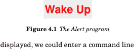

要显示输出，我们可以输入这样的命令行：

```
C:\> cd c:\pyqt\chap04  
 C:\pyqt\chap04>alert.pyw 12:15 Wake Up
```

运行该程序时，它在后台不可见地执行，只是记录时间，直到达到指定时间。届时，它会弹出一个包含消息文本的窗口。显示窗口大约一分钟之后，应用程序将自动终止。

指定的时间必须使用 24 小时制时钟。为了测试目的，我们可以使用一个刚过去的时间；例如，当实际时间是 12:30 时，使用 12:15，窗口将立即弹出（好吧，在一秒之内）。

既然我们知道它的功能以及如何运行它，我们将回顾其实现。该文件比 25 行长几行，因为我们没有计算

\* 如果你使用 Windows 并且弹出一个标题为“pythonw.exe - Unable To Locate Component”的错误消息框，这几乎肯定意味着你没有正确设置路径。有关如何修复此问题，请参见附录 A，第 564 页。


总行数和空行——但可执行代码只有 25 行。我们从导入部分开始。

```
import sys
import time
from PyQt4.QtCore import *
from PyQt4.QtGui import *
```

我们导入 sys 模块，因为我们想要访问它保存在 sys.argv 列表中的命令行参数。导入 time 模块是因为我们需要其 *sleep()* 函数，并且我们需要 PyQt 模块来构建 GUI 以及使用 QTime 类。

```
app = QApplication(sys.argv)
```

我们首先通过创建一个 QApplication 对象来开始。每个 PyQt GUI 应用程序都必须有一个 QApplication 对象。该对象提供对类似全局信息的访问，例如应用程序目录、屏幕尺寸（在多显示器系统中，还包含应用程序所在的屏幕），等等。该对象还提供稍后将讨论的*事件循环*。

创建 QApplication 对象时，我们传入命令行参数；这是因为 PyQt 识别其自身的一些命令行参数，例如 -geometry 和 -style，所以我们应该给它机会读取它们。如果 QApplication 识别出任何参数，它会执行相应操作，并从给定的列表中移除它们。QApplication 识别的参数列表列在 QApplication 初始化的文档中。

```
try:
    due = QTime.currentTime()
    message = "Alert!"
    if len(sys.argv) < 2:
        raise ValueError
    hours, mins = sys.argv[1].split(":")
    due = QTime(int(hours), int(mins))
    if not due.isValid():
        raise ValueError
    if len(sys.argv) > 2:
        message = " ".join(sys.argv[2:])
except ValueError:
    message = "Usage: alert.pyw HH:MM [optional message]" # 24hr clock
```

至少，应用程序需要一个时间，因此我们将 due 变量设置为当前时间。我们还提供了一个默认消息。如果用户没有提供至少一个命令行参数（一个时间），我们就会引发一个 ValueError 异常。这将导致时间设置为当前时间，消息设置为“用法”错误消息。

如果第一个参数不包含冒号，当我们尝试从 split() 调用中解包两个项时，将引发 ValueError。如果小时或分钟不是有效的数字，int() 将引发 ValueError；如果小时或分钟超出范围，due 将是一个无效的 QTime，我们自己引发 ValueError。尽管 Python 提供了自己的日期和时间类，但 PyQt 的日期和时间类通常更方便（在某些方面甚至更强大），因此我们倾向于使用它们。

如果时间有效，我们将 message 设置为其余命令行参数（如果有）以空格分隔的拼接结果；否则，我们保持其为我们开始时设置的默认值“Alert!”。（当程序在命令行上执行时，它会被给一个参数列表，第一个是调用名称，其余是命令行中输入的每个非空白字符序列，即每个“单词”。这些单词可能会被 shell 修改——例如通过应用通配符扩展。Python 将其实际收到的单词放在 sys.argv 列表中。）

现在我们知道何时显示消息以及消息的内容。

```
while QTime.currentTime() < due:
    time.sleep(20)  # 20 seconds
```

我们持续循环，将当前时间与目标时间进行比较。如果当前时间晚于目标时间，循环将终止。我们本可以在循环内部简单地放置一个 pass 语句，但那样做 Python 会尽可能快地循环，毫无理由地吞噬处理器周期。time.sleep() 命令告诉 Python 暂停处理指定秒数，在此情况下为 20 秒。这给了其他程序更多运行机会，并且很有意义，因为在我们等待截止时间到来时，我们实际上并不想执行任何操作。

除了创建 QApplication 对象外，我们到目前为止所做的都是标准的控制台编程。

```
label = QLabel("<font color=red size=7><b>" + message + "</b></font>")
label.setWindowFlags(Qt.SplashScreen)
label.show()
QTimer.singleShot(60000, app, quit)  # 1 minute
app.exec_()
```

我们已创建了一个 QApplication 对象，有一条消息，且截止时间已到来，因此现在我们可以开始创建应用程序。GUI 应用程序需要小部件，在这种情况下我们需要一个标签来显示消息。QLabel 可以接受 HTML 文本，因此我们给它一个 HTML 字符串，告诉它显示 72 磅大小的粗体红色文本。*

在 PyQt 中，任何小部件都可以用作顶级窗口，即使是按钮或标签。当小部件像这样使用时，PyQt 会自动为其添加标题栏。我们不希望此应用程序有标题栏，因此我们将标签的窗口标志设置为启动画面所用的标志，因为它们没有标题栏。一旦设置了将作为窗口的标签，我们对其调用 show()。此时，标签窗口并未显示！对 show() 的调用只是安排了一个“绘制事件”，即将一个请求绘制指定小部件的新事件添加到 QApplication 对象的事件队列中。

接下来，我们设置一个单次定时器。Python 库的 time.sleep() 函数接受秒数，而 QTimer.singleShot() 函数接受毫秒数。我们给 singleShot() 方法两个参数：多久后应该超时（本例中为一分钟），以及超时时要调用的函数或方法。

在 PyQt 术语中，我们给定的函数或方法被称为“槽”，虽然在 PyQt 文档中，“可调用对象”、“Python 槽”和“Qt 槽”这些术语被用来将槽与 Python 的*槽*区分开来，后者是新式类的一个特性，在 Python 语言参考中有描述。本书中我们将使用 PyQt 术语，因为我们从不使用*槽*。

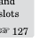

现在我们安排了两个事件：一个希望立即发生的绘制事件，以及一个希望一分钟时发生的定时器超时事件。

对 app.exec() 的调用启动了 QApplication 对象的事件循环。^ 它获取的第一个事件是绘制事件，因此标签窗口在屏幕上弹出，显示给定的消息。大约一分钟之后，定时器超时事件发生，并调用 QApplication.quit() 方法。此方法执行 GUI 应用程序的干净终止。它关闭任何打开的窗口，释放其获取的任何资源，并退出。

所有 GUI 应用程序都使用事件循环。在伪代码中，事件循环看起来像这样：

```
while True:
    event = getNextEvent()
    if event:
        if event == Terminate:
            break
        processEvent(event)
```

当用户与应用程序交互，或者发生某些其他事情（例如定时器超时或应用程序窗口被揭示（可能是因为另一个应用程序被关闭））时，PyQt 内部会生成一个事件并添加到事件队列中。应用程序的事件循环持续

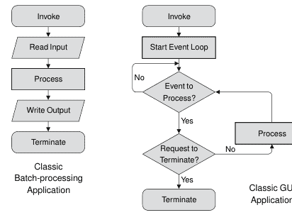

**图 4.2** 批处理应用程序与 GUI 应用程序

检查是否有需要处理的事件，如果有，则处理它（或将其传递给事件关联的函数或方法进行处理）。虽然应用程序仅使用单一小部件，且未赋予其响应用户交互的能力，但它已经完整且相当有用，如果你使用控制台的话。它的工作方式也相当像传统的批处理程序。它被调用，执行一些处理（等待，然后显示消息），并终止。大多数 GUI 程序工作方式不同。一旦被调用，它们运行其事件循环并响应事件。一些事件来自用户——例如按键和鼠标点击——一些来自系统，例如定时器超时和窗口被揭示。它们响应由按钮点击和菜单选择等事件结果引发的请求，并且仅在被告知时终止。

我们要查看的下一个应用程序比我们刚看到的要传统得多，并且是许多非常小的 GUI 应用程序的典型代表。

## 30 行代码的表达式求值器

这个应用程序是一个完整的对话框风格应用程序，用 30 行代码编写（不包括空行和注释行）。“对话框风格”意味着没有菜单栏，通常没有工具栏或状态栏的应用程序，最常见的是带有某些按钮（我们将在下一节中看到），并且没有中心小部件。相比之下，“主窗口风格”应用程序通常有菜单栏、工具栏、状态栏，在某些情况下还有按钮；并且它们有一个


中心部件（当然，它也可以包含其他部件）。我们将在第 6 章中探讨主窗口风格的应用程序。

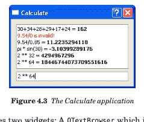

此应用程序使用两个部件：一个 **QTextBrowser**，它是一个只读的多行文本框，可以显示纯文本和 HTML；以及一个 **QLineEdit**，它是一个显示纯文本的单行文本框。PyQt 部件中的所有文本均为 Unicode，尽管在必要时可以转换为其他编码。

计算器应用程序（如图 4.3 所示）可以像任何正常的 GUI 应用程序一样，通过点击（根据平台和设置不同，可能是双击）其图标来启动。（当然，也可以从控制台启动。）应用程序运行后，用户只需在单行文本框中输入数学表达式，按下 Enter（或 Return）键，该表达式及其结果就会追加到 **QTextBrowser** 中。由于无效表达式或无效算术（如除以零）引发的任何异常都会被捕获，并转换为错误消息，这些消息也会简单地追加到 **QTextBrowser** 中。

照例，我们将分段查看代码。这个示例遵循了我们将在所有未来 GUI 应用程序中使用的模式：表单由一个类表示，响应用户交互的行为由方法处理，而程序的“主”部分非常微小。

```python
from __future__ import division
import sys
from math import *
from PyQt4.QtCore import *
from PyQt4.QtGui import *
```

由于我们要进行数学运算，并且不希望出现像截断除法这样的意外情况，因此我们确保执行的是浮点数除法。通常，我们使用 `import module name` 语法导入非 Py/Qt 模块；但由于我们希望数学模块的所有函数和常量都对程序用户可用，我们简单地将其全部导入当前命名空间。照例，我们导入 `sys` 以获取 `sys.argv` 列表，并从 `QtCore` 和 `QtGui` 模块导入所有内容。

```python
class Form(QDialog):
    def __init__(self, parent=None):
        super(Form, self).__init__(parent)
        self.brower = QTextBrowser()
        self.lineedit = QLineEdit("Type an expression and press Enter")
        self.lineedit.selectAll()
        layout = QBoxLayout()
        layout.addWidget(self.brower)
        layout.addWidget(self.lineedit)
        self.setLayout(layout)
        self.lineedit.setFocus()
        self.connect(self.lineedit, SIGNAL("returnPressed()"),
                     self.updateUi)
        self.setWindowTitle("Calculate")
```

如前所述，任何部件都可以用作顶级窗口。但在大多数创建顶级窗口的情况下，我们会子类化 `QDialog`、`QMainWindow`，或者偶尔子类化 `QWidget`。`QDialog` 和 `QMainWindow`，事实上 PyQt 的所有部件，都派生自 `QWidget`，且均为新式类。通过继承 `QDialog`，我们得到一个空白表单，即一个灰色矩形，以及一些便捷的行为和方法。例如，如果用户点击关闭 X 按钮，对话框将关闭。默认情况下，当部件关闭时，它仅被隐藏；当然，我们可以改变这种行为，我们将在下一章中了解。

我们将 `Form` 类的 `__init__()` 方法的默认父对象设为 `None`，并使用 `super()` 进行初始化。没有父对象的部件将成为顶级窗口，这正是我们需要表单所具备的特性。然后，我们创建所需的两个部件并保留对它们的引用，以便在 `__init__()` 之外稍后访问它们。由于我们没有给这些部件指定父对象，它们似乎将成为顶级窗口——这是没有意义的。我们很快就会看到，它们在初始化器的后续部分中获得了父对象。我们给 `QLineEdit` 提供一些初始显示文本，并全选它。这将确保用户一开始输入时，我们提供的文本会被覆盖。

我们希望这些部件在窗口中垂直排列，一个位于另一个之上。这是通过创建 `QBoxLayout` 并将两个部件添加到其中，然后在表单上设置布局来实现的。如果你运行应用程序并调整其大小，你会发现多余的垂直空间分配给了 `QTextBrowser`，并且两个部件都会水平扩展。这一切都由布局管理器自动处理，并且可以通过设置布局策略进行微调。

使用布局的一个重要副作用是，PyQt 会自动重新分配被布局部件的父对象。因此，尽管我们没有给部件指定父对象 `self`（`Form` 实例），但当调用 `setLayout()` 时，布局管理器将部件及其自身的拥有权交给表单，并接管任何嵌套布局的拥有权。这意味着被布局的部件都不是顶级窗口，且它们都有父对象，这正是我们所期望的。因此，当表单被删除时，其所有子部件和布局都会以正确的顺序随之删除。

## 对象所有权

所有派生自 `QObject` 的 PyQt 类——包括所有部件，因为 `QWidget` 是 `QObject` 的子类——都可以拥有一个“父对象”。父子关系用于两个互补的目的。没有父对象的部件是顶级窗口，而拥有父对象（始终是另一个部件）的部件则包含在（显示于）其父对象内部。该关系还定义了*所有权*，父对象拥有其子对象。

PyQt 使用父子所有权模型来确保：如果一个父对象（例如，一个顶级窗口）被删除，其所有子对象（例如，窗口包含的所有部件）都会自动随之删除。为避免内存泄漏，我们应始终确保任何 `QObject`（包括所有 `QWidget`）都有一个父对象，唯一的例外是顶级窗口。

大多数 PyQt `QObject` 子类的构造函数都将父对象作为最后一个（可选）参数。但对于部件，我们通常不（也无需）传递此参数。这是因为对话框中使用的部件通过布局管理器进行布局，当这种情况发生时，它们会自动重新分配给容纳它们的部件作为父对象，因此无需我们采取任何特殊操作即可拥有正确的父对象。

在某些情况下，我们必须显式传递父对象——例如，当构造不是部件的 `QObject` 子类对象，或者是部件但不会被布局（如停靠部件）时；我们将在后续章节中看到此类情况的几个示例。

最后一点是，可能会出现 Python 变量引用一个已不再存在的底层 PyQt 对象的情况。此问题在第 9 章中，从第 287 页开始的“活性”讨论中有所涉及。

表单上的部件可以使用多种技术进行布局。我们可以使用 `resize()` 和 `move()` 方法为它们指定绝对大小和位置；我们可以重新实现 `resizeEvent()` 方法并动态计算它们的大小和位置；或者使用 PyQt 的布局管理器。使用绝对大小和位置非常不方便。一方面，我们需要执行大量的手动计算；另一方面，如果我们更改布局，必须重新计算。动态计算大小和位置是一种更好的方法，但仍需要编写大量乏味的计算代码。

使用布局管理器使事情变得容易得多。而且布局管理器非常智能：它们自动适应调整大小事件和内容变化。习惯于多个版本 Windows 中对话框的人将欣赏可调整大小（且调整得合理）的对话框的好处，而不是被迫使用小的、不可调整大小的对话框，当内容太大而无法容纳时，后者会非常不便。布局管理器还简化了国际化程序的生命，因为它们适应内容，因此如果目标语言比原始语言更冗长，翻译后的标签不会被“截断”。

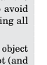


# 第 4 章 GUI 编程入门

PyQt 提供了三种布局管理器：一种用于垂直布局，一种用于水平布局，还有一种用于网格布局。布局可以嵌套，因此可以创建相当复杂的布局。此外，还有其他布置小部件的方式，例如使用分割器或标签页小部件。所有这些方法将在第 9 章中更深入地探讨。

为了对用户友好，我们希望焦点初始时位于 `QLineEdit` 中；我们通过调用 `setFocus()` 来实现这一点。我们必须在设置布局之后执行此操作。

`connect()` 调用是我们稍后将在本章中深入探讨的内容。简单地说，每个小部件（以及某些其他 `QObject`）都会通过发出“信号”来宣布状态变化。这些信号（与 Unix 信号无关）通常会被忽略。然而，我们可以选择关注我们感兴趣的任何信号，方法是确定我们想要了解的 `QObject`、它发出的我们感兴趣的信号，以及我们希望在该信号发出时被调用的函数或方法。

因此在这种情况下，当用户在 `QLineEdit` 中按下 Enter（或 Return）键时，`returnPressed()` 信号会像往常一样发出，但由于我们的 `connect()` 调用，当这种情况发生时，我们的 `updateUi()` 方法将被调用。我们稍后会看到接下来会发生什么。

我们在 `__init__()` 中做的最后一件事是设置窗口标题。

正如我们将很快看到的那样，表单被创建并调用其 `show()` 方法。一旦事件循环开始，表单就会显示——并且似乎没有发生其他事情。应用程序只是运行事件循环，等待用户点击鼠标或按键。一旦用户开始交互，他们的交互结果就会被处理。例如，如果用户输入表达式，`QLineEdit` 会负责显示他们输入的内容，如果他们按下 Enter，我们的 `updateUi()` 方法将被调用。

```python
def updateUi(self):
    try:
        text = unicode(self.lineedit.text())
        self.browser.append("*%s = <b>%s</b>" % (text, eval(text)))
    except:
        self.browser.append(
            "<font color=red>%s is invalid!</font>" % text)
```

当调用 `updateUi()` 时，它会从 `QLineEdit` 中获取文本，并立即将其转换为 unicode 对象。然后我们使用 Python 的 `eval()` 函数将该字符串作为表达式进行求值。如果成功，我们向 `Q QTextBrowser` 添加一个字符串，该字符串包含表达式文本、等号，然后是加粗的结果。虽然我们通常尽早将 `QString` 转换为 unicode，但我们可以将 `QString`、unicode 和 `str` 传递给期望 `QString` 的 PyQt 方法，PyQt 会自动执行任何必要的转换。如果发生任何异常，我们改为添加错误消息。像这样使用捕获所有异常的 `except` 块并不是良好的通用实践，但对于一个 30 行的程序来说似乎是可以接受的。

通过使用 `eval()`，我们避免了如果使用编译语言时自己必须完成的所有解析和错误检查工作。

```python
app = QApplication(sys.argv)
form = Form()
form.show()
app.exec_()
```

既然我们已经定义了 `Form` 类，在 `calculate.pyw` 文件的末尾，我们创建 `QApplication` 对象，实例化表单的一个实例，安排其绘制，并启动事件循环。

这就是完整的应用程序。但这还不是故事的结束。我们尚未说明用户如何终止应用程序。由于我们的表单继承自 `QDialog`，它继承了某些行为。例如，如果用户点击关闭按钮 X，或者他们按下 Esc 键，表单将关闭。当表单关闭时，它会隐藏。当表单隐藏时，`PyQt` 会检测到应用程序没有可见窗口且无法进行进一步的交互。因此，它会删除表单并执行应用程序的干净终止。

在某些情况下，我们希望即使应用程序不可见也继续运行——例如服务器。对于这些情况，我们可以调用 `QApplication.setQuitOnLastWindowClosed(False)`。虽然很少必要，但也可以在被通知最后一个窗口关闭时收到通知。

在 Mac OS X 上，以及一些 X Windows 窗口管理器（如 twm）中，像这样的应用程序*不会*有关闭按钮，并且在 Mac 上，从菜单栏选择“退出”将不起作用。在这种情况下，按 Esc 键将终止应用程序，此外在 Mac 上，Command+X 也将有效。鉴于此，对于可能在 Mac 上或配合 twm 或类似环境使用的应用程序，最好提供一个“退出”按钮。对话框中添加按钮的内容在本章最后一节中有所涉及。

我们现在准备查看本章中要介绍的最后一个小型完整示例。它具有更多自定义行为，更复杂的布局，并进行更复杂的处理，但其基本结构非常类似于 Calculate 应用程序，实际上也类似于许多其他 `PyQt` 对话框。

## 70 行代码的货币转换器

一个经常有用的小型工具是货币转换器。但由于汇率经常变动，我们不能像在前一章中创建的单位长度类 `Length` 中那样简单地创建一个静态的转换比率字典。幸运的是，加拿大银行提供了通过互联网可访问的汇率文件，并且使用易于解析的格式。汇率有时可能滞后几天，但对于估算旅行所需的现金或外国合同可能支付的金额来说已经足够好。应用程序如图 4.4 所示。

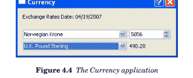

该应用程序必须首先下载并解析汇率。然后，它必须创建一个用户界面，用户可以通过该界面操作以指定他们感兴趣的货币和金额。

照例，我们从导入开始：

```python
import sys
import urllib2
from PyQt4.QtCore import *
from PyQt4.QtGui import *
```

Python 和 PyQt 都提供了网络类。在第 18 章中，我们将使用 PyQt 的类，但在这里我们将使用 Python 的 `urllib2` 模块，因为它提供了一个非常方便的函数，可以轻松地从互联网抓取文件。

```python
class Form(QDialog):
    def __init__(self, parent=None):
        super(Form, self).__init__(parent)
        date = self.getdata()
        rates = sorted(self.rates.keys())

        dateLabel = QLabel(date)
        self.fromComboBox = QComboBox()
        self.fromComboBox.addItems(rates)
        self.fromSpinBox = QDoubleSpinBox()
        self.fromSpinBox.setRange(0.01, 10000000.00)
        self.fromSpinBox.setValue(1.00)
        self.toComboBox = QComboBox()
        self.toComboBox.addItems(rates)
        self.toLabel = QLabel("1.00")
```

在使用 `super()` 初始化表单后，我们调用我们的 `getdata()` 方法。正如我们将很快看到的那样，此方法获取汇率，填充 `self.rates` 字典，并返回一个包含汇率生效日期的字符串。字典的键是货币名称，值是转换系数。

我们获取字典键的排序副本，以便在组合框中向用户展示排序后的货币列表。`date` 和 `rates` 变量，以及 `dateLabel`，仅在 `__init__()` 内部引用，因此我们不在类实例中保留对它们的引用。另一方面，我们需要访问组合框和 `toLabel`（显示目标货币金额），因此我们使用 `self` 将这些设为实例变量。

我们将相同的货币排序列表添加到两个组合框中，并创建一个 `QDoubleSpinBox`，这是一个处理浮点值的自旋框。我们为自旋框提供最小值和最大值，以及初始值。总是先设置自旋框的范围再设置其值是好习惯，因为如果我们先设置值且该值恰好超出了默认范围，该值将被减少或增加以适应默认范围。

由于两个组合框最初将显示相同的货币，且要转换的初始值为 1.00，因此显示在 `toLabel` 中的结果也必须是 1.00，因此我们显式设置它。

```python
grid = QGridLayout()
grid.addWidget(dateLabel, 0, 0)
grid.addWidget(self.fromComboBox, 1, 0)
grid.addWidget(self.fromSpinBox, 1, 1)
grid.addWidget(self.toComboBox, 2, 1)
grid.addWidget(self.toLabel, 2, 1)
self.setLayout(grid)
```

网格布局似乎是布置小部件的最简单解决方案。当我们向网格添加小部件时，我们给出它应占据的行和列位置，两者均从 0 开始。该布局如图 4.5 所示示意图。网格布局还可以做很多事情。例如，我们可以有跨行和跨列；这些内容将在第 9 章后面详细涵盖。

| 小部件             | 位置     |
|--------------------|----------|
| dateLabel          | (0,0)    |
| self.fromComboBox  | (1,0)    |
| self.fromSpinBox   | (1,1)    |
| self.toComboBox    | (2,0)    |
| self.toLabel       | (2,1)    |

**图 4.5** *货币应用程序的网格布局*

如果我们查看屏幕截图或运行应用程序，很明显网格布局的第 0 列比第 1 列宽得多。但代码中没有任何内容指定这一点，那么为什么会发生这种情况？布局足够智能，能够适应其环境，无论是可用空间，还是它们管理的小部件的内容和大小策略。在这种情况下，组合框在水平上拉伸以足够宽以完整显示最宽的货币文本，自旋框在水平上拉伸以足够宽以显示其最大值。由于组合框是第 0 列中最宽的项目，它们有效地设置了该列的最小宽度；自旋框同理。


在第 1 列中。如果我们运行应用程序并尝试将窗口变窄，什么都不会发生，因为它已经处于最小宽度。但是，我们可以将窗口变宽，两个列都会拉伸以占用额外的空间。当然，也可以偏置布局，使得当有额外空间可用时，比如更多地分配水平空间给第 0 列。

初始状态下，没有任何小部件在垂直方向上被拉伸，因为这对于它们中的任何一个都不是必需的。但是，如果我们增加窗口的高度，所有额外的空间都将分配给 dateLabel，因为它是表单中唯一喜欢在每个方向上生长且没有其他小部件约束它的部件。

既然我们已经创建、填充并布局了这些小部件，是时候设置表单的行为了。

```python
self.connect(self.fromComboBox,
             SIGNAL("currentIndexChanged(int)"), self.updateUi)

self.connect(self.toComboBox,
             SIGNAL("currentIndexChanged(int)"), self.updateUi)

self.connect(self.fromSpinBox,
             SIGNAL("valueChanged(double)"), self.updateUi)

self.setWindowTitle("Currency")
```

如果用户更改其中一个组合框的当前项目，相关的组合框将发出一个 `currentIndexChanged()` 信号，并带有新当前项的索引位置。类似地，如果用户更改自旋框中持有的值，将会发出一个 `valueChanged()` 信号，并带有新值。我们将所有这些信号都连接到同一个 Python 插槽：`updateUi()`。这不一定是必须的，正如我们下一节将看到的，但对于这个应用程序来说，这是一个明智的选择。

在 `__init__()` 的末尾，我们设置窗口标题。

```python
def updateUi(self):
    to = unicode(self.toComboBox.currentText())
    from_ = unicode(self.fromComboBox.currentText())
    amount = (self.rates[from_] / self.rates[to]) * \
        self.fromSpinBox.value()
    self.toLabel.setText("%0.2f" % amount)
```

当组合框发出 `currentIndexChanged()` 信号或自旋框发出 `valueChanged()` 信号时，会调用此方法。所有涉及的信号还传递了一个参数。正如我们将在下一节中看到，我们可以忽略信号参数，正如这里所做的那样。

无论涉及哪个信号，我们都遵循相同的过程。我们提取“to”和“from”货币，计算“to”金额，并相应地设置 toLabel 的文本。我们将“from”文本的变量命名为 `from_`，因为 `from` 是 Python 关键字，因此对我们不可用。在计算金额时，我们需要转义换行符，以使该行比页边距窄，从而适合页面；而且无论如何，我们倾向于限制行长度，以便更容易在屏幕上并排阅读两个文件。

```python
def getdata(self): # Idea taken from the Python Cookbook
    self.rates = {}
    try:
        date = "Unknown"
        fh = urllib2.urlopen("http://www.bankofcanada.ca/\n/en/markets/csv/exchange_eng.csv")

        for line in fh:
            if not line or line.startswith(("#", "Closing ")):
                continue

            fields = line.split(",")
            if line.startswith("Date "):
                date = fields[-1]
            else:
                try:
                    value = float(fields[-1])
                    self.rates[unicode(fields[0])] = value
                except ValueError:
                    pass

        return "Exchange Rates Date: " + date
    except Exception, e:
        return "Failed to download:\n%s" % e
```

此方法是我们获取驱动应用程序数据的地方。我们通过创建一个新的实例属性 `self.rates` 开始。与 C++、Java 和类似语言不同，Python 允许我们在需要时（例如在构造函数、初始化器或任何其他方法中）创建实例属性。我们甚至可以即时为特定实例添加属性。

由于网络连接可能会出现很多意外——例如网络可能中断，主机可能停机，URL 可能已更改等等——我们需要使应用程序比前两个例子更健壮。另一个可能的问题是，我们可能会获得无效的双精度值，例如货币数据有时包含的“NA”（不可用）。我们有一个内部的 `try ... except` 块来捕获无效数字。因此，如果我们无法将货币值转换为双精度数字，我们只需跳过该特定货币并继续。

我们通过将几乎整个方法包裹在一个外部的 `try ... except` 块中来处理其他所有可能性。（这对大多数应用程序来说过于宽泛，但对于一个仅 70 行的微型应用程序来说似乎是可以接受的。）如果出现问题，我们捕获引发的异常并将其作为字符串返回给调用者 `__init__()`。`getdata()` 返回的字符串显示在 dateLabel 中，因此通常此标签会显示适用于汇率的日期，但在出错情况下，它会显示错误消息而不是日期。

请注意，我们将 URL 字符串拆分为两行中的两个字符串，因为它太长——而且我们不需要转义换行符。这之所以有效，是因为字符串在括号内。如果不是这种情况，我们要么必须转义换行符，要么使用 + 将它们连接起来（仍然需要转义换行符）。

我们使用一个表示不知道汇率计算日期的字符串初始化 date 变量。然后，我们使用 `urllib2.urlopen()` 函数获取我们感兴趣的文件句柄。文件句柄可以使用其 `read()` 方法一次性读取整个文件，但在这种情况下，我们更喜欢使用 `readline()` 逐行读取。

以下是某特定一天 exchange_eng.csv 文件中的数据。省略了一些列和大多数行；这些由省略号表示。

```
... #
Date (<m>/${<d>}/${<year>},01/05/2007,...,01/12/2007,01/15/2007
Closing Can/US Exchange Rate,1.1725,...,1.1688,1.1667
U.S. Dollar (Noon),1.1755,...,1.1702,1.1681
Argentina Peso (Floating Rate),0.3797,...,0.3773,0.3767
Australian Dollar,0.9164,...,0.9157,0.9153
...
Vietnamese Dong,0.000073,...,0.000073,0.000073
```

exchange_eng.csv 文件的格式使用了多种不同类型的行。注释行以“#”开头，也可能是空行；我们忽略所有这些行。汇率按名称列出，后面跟着汇率，全部用逗号分隔。这些汇率是应用于特定日期的，每行中的最后一个是最近期的。我们将这些行按逗号拆分，取第一项作为货币名称，最后一项作为汇率。还有一行以“Date”开头；这列出了每列适用的日期。遇到这一行时，我们取最后一个日期，因为这是与我们使用的汇率对应的日期。还有一行以“Closing”开头；我们忽略它。

对于每个汇率行，我们在 `self.rates` 字典中插入一项，使用货币名称作为键，汇率作为值。我们假设文件的文本是 7 位 ASCII 或 Unicode；如果不是其中之一，我们可能会遇到编码错误。如果我们知道编码，可以在调用 `unicode()` 时将其作为第二个参数指定。

```python
app = QApplication(sys.argv)
form = Form()
form.show()

app.exec_()
```

我们使用了与前一个例子完全相同的代码来创建 `QApplication` 对象，实例化货币应用程序的表单，并启动事件循环。

关于程序终止，就像前一个例子一样，因为我们继承自 `QDialog`，如果用户点击关闭 X 按钮或按 Esc，窗口将关闭，然后 PyQt 将终止应用程序。在第 6 章中，我们将看到如何提供更明确的终止方式，以及如何确保用户有机会保存任何未保存的更改和程序设置。

至此应该很清楚，使用 PyQt 进行 GUI 编程是直接的。虽然我们会看到更复杂的布局，但它们本身并不困难，而且由于布局管理器很智能，在大多数情况下它们“起作用”。自然，还有更多需要涵盖的内容——例如，创建主窗口样式的应用程序，创建用户可以弹出进行交互的对话框等等。但我们将从 PyQt 的基础开始，这是我们目前一带而过的内容：信号和插槽通信机制，这是下一节的主题。

## 信号和插槽

每个 GUI 库都提供事件发生的细节，例如鼠标点击和按键。例如，如果我们有一个文本为“Click Me”的按钮，用户点击它，各种信息变得可用。GUI 库可以告诉我们鼠标点击相对于按钮、相对于按钮的父小部件和相对于屏幕的坐标；在点击时 Shift、Ctrl、Alt 和 NumLock 键的状态；点击和释放的精确时间；等等。如果用户在不使用鼠标的情况下“点击”按钮，也可以提供类似的信息。用户可能按了足够多次 Tab 键将焦点移动到按钮上，然后按了空格键，或者按了 Alt+C。虽然所有这些情况的结果相同，但每种不同的点击按钮方式都会产生不同的事件和不同的信息。

Qt 库最早认识到，在几乎所有情况下，程序员不需要甚至不想要所有低级细节：他们不关心按钮是*如何*被按下的，他们只想知道它*被按下*了，以便他们能够做出适当的响应。出于这个原因，Qt 和因此 PyQt 提供了两种通信机制：一种低级事件处理机制，与其他所有 GUI 库提供的类似；以及一种高级机制，Trolltech（Qt 的制造商）称之为“信号和插槽”。我们将在第 10 章和第 11 章中再次研究低级机制，但在此部分，我们将重点关注高级机制。

每个 QObject——包括 PyQt 的所有小部件，因为它们继承自 QWidget，后者是 QObject 的子类——都支持信号和插槽机制。特别是，它们能够宣布状态变化，例如当复选框

变为已勾选或未勾选，以及其他重要事件的发生，例如按钮被点击时（无论通过何种方式）。PyQt 中所有组件都有一组预定义信号。

每当信号被发出时，PyQt 默认会将其丢弃！若要关注某个信号，我们必须将其连接到一个槽。在 C++/Qt 中，槽是必须使用特殊语法声明的方法；但在 PyQt 中，它们可以是任意我们喜欢的可调用对象（例如，任意函数或方法），且在定义时不需要特殊语法。

大多数组件也具有预定义的槽，因此在某些情况下，我们可以将预定义信号连接到预定义槽，而不必做其他任何事情即可获得我们想要的行为。在这方面，PyQt 比 C++/Qt 更灵活，因为我们不仅可以连接到槽，还可以连接到任何可调用对象。此外，从 PyQt 4.2 开始，可以动态地为 QObjects 添加“预定义”信号和槽。让我们通过图 4.6 中所示的 *Signals and Slots* 程序来看看信号和槽在实际中是如何工作的。

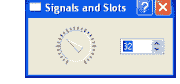

**图 4.6** *Signals and Slots* 程序

QDial 和 QSpinBox 组件都有 valueChanged() 信号，当该信号被发出时，会携带新值。它们都有 setValue() 槽，该槽接受一个整数值。因此，我们可以将这两个组件相互连接，这样无论用户更改哪一个，都会相应地改变另一个：

```python
class Form(QDialog):
    def __init__(self, parent=None):
        super(Form, self).__init__(parent)

        dial = QDial()
        dial.setNotchesVisible(True)
        spinbox = QSpinBox()

        layout = QBoxLayout()
        layout.addWidget(dial)
        layout.addWidget(spinbox)
        self.setLayout(layout)

        self.connect(dial, SIGNAL("valueChanged(int)"),
                     spinbox.setValue)
        self.connect(spinbox, SIGNAL("valueChanged(int)"),
                     dial.setValue)

    self.setWindowTitle("Signals and Slots")
```

由于这两个组件以这种方式连接，如果用户移动旋钮——比如说数值为 20——旋钮将发出 valueChanged(20) 信号，进而导致调用 spinbox 的 setValue() 槽，参数为 20。但此时，由于其值现在已改变，spinbox 将发出 valueChanged(20) 信号，进而导致调用旋钮的 setValue() 槽，参数为 20。这看起来像是会导致无限循环。但实际上发生的情况是，如果值实际没有改变，valueChanged() 信号不会被发出。这是因为编写更改值槽的标准方法是首先将新值与现有值进行比较。如果值相同，则什么都不做并返回；否则，我们应用更改并发出信号以宣布状态变化。连接关系如图 4.7 所示。

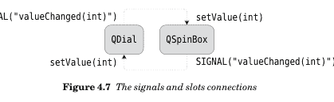

现在让我们看看连接的通用语法。我们假设 PyQt 模块已经使用 from ... import * 语法导入，并且 s 和 w 是 QObjects，通常是组件，其中 s 通常代表 self。

```python
s.connect(w, SIGNAL("signalSignature"), functionName)
s.connect(w, SIGNAL("signalSignature"), instance.methodName)
s.connect(w, SIGNAL("signalSignature"),
          instance, SLOT("slotSignature"))
```

signalSignature 是信号的名称，以及括号内（可能为空的）逗号分隔的参数类型名称列表。如果信号是 Qt 信号，类型名称必须是 C++ 类型名称，例如 int 和 QString。C++ 类型名称可能相当复杂，每个类型名称可能包含 const、* 和 & 中的一个或多个。当我们将其写入信号（或槽）签名时，可以省略 const 和 &，但必须保留任何 *。例如，几乎所有传递 QString 的 Qt 信号都使用 const QString& 作为参数类型，但在 PyQt 中，仅使用 QString 就足够了。另一方面，QListView 有一个签名 itemActivated(QListViewItem*) 的信号，我们必须严格按照原样使用它。

PyQt 信号是在实际发出时定义的，可以拥有任意数量的任意类型的参数，我们稍后将会看到。

slotSignature 的形式与 signalSignature 相同，区别在于其名称是一个 Qt 槽的名称。槽的参数数量不得多于连接到它的信号的参数数量，但可以更少；多余的参数将被丢弃。对应的信号和槽参数必须具有相同的类型，因此例如，我们不能将 QDial 的 valueChanged(int) 信号连接到 QLineEdit 的 setText(QString) 槽。

在我们的旋钮和 spinbox 示例中，我们使用了 *instance.methodName* 语法，正如本章前面所示的示例应用程序那样。但当槽实际上是 Qt 槽而不是 Python 方法时，使用 SLOT() 语法效率更高：

```python
self.connect(dial, SIGNAL("valueChanged(int)"),
             spinbox, SLOT("setValue(int)"))
self.connect(spinbox, SIGNAL("valueChanged(int)"),
             dial, SLOT("setValue(int)"))
```

我们已经看到，可以将多个信号连接到同一个槽。同样，也可以将单个信号连接到多个槽。虽然很少见，但我们也只能将一个信号连接到另一个信号。在这种情况下，当第一个信号被发出时，它将导致它所连接的信号也被发出。连接使用 QObject.connect() 创建；可以使用 QObject.disconnect() 断开。实际上，我们很少需要自己断开连接，因为例如，PyQt 会自动断开涉及任何已被删除对象的连接。

到目前为止，我们已经了解了如何连接到信号，以及如何编写槽——它们是普通的函数或方法。我们知道信号被发出是为了表示状态变化或其他重要事件。但如果我们想创建一个发出自身信号的组件呢？使用 QObject.emit() 可以轻松实现。例如，下面是一个完整的 QSpinBox 子类，它发出自己定义的 atzero 信号，并且传递一个数字：

```python
class ZeroSpinBox(QSpinBox):
    zeros = 0

    def __init__(self, parent=None):
        super(ZeroSpinBox, self).__init__(parent)
        self.connect(self, SIGNAL("valueChanged(int)"), self.checkzero)

    def checkzero(self):
        if self.value() == 0:
            self.zeros += 1
            self.emit(SIGNAL("atzero"), self.zeros)
```

我们将 spinbox 自身的 valueChanged() 信号连接起来，使其调用我们的 checkzero() 槽。如果值恰好为 0，checkzero() 槽将发出 atzero 信号，并附带一个计数，表示它变为零的次数；这样传递额外数据是可选的。信号缺少括号这一点很重要：它告诉 PyQt 这是一个“短路”信号。

没有参数（因此也没有括号）的信号是短路 Python 信号。当发出这样的信号时，任何数据都可以作为额外参数传递给 emit() 方法，并作为 Python 对象传递。这避免了在 C++ 数据类型之间转换参数的开销，也意味着可以传递任意的 Python 对象，甚至是那些无法转换回 C++ 数据类型的对象。至少有一个参数的信号要么是 Qt 信号，要么是非短路 Python 信号。在这些情况下，PyQt 会检查该信号是否为 Qt 信号，如果否，则假定它是 Python 信号。在这两种情况下，参数都会被转换为 C++ 数据类型。

我们在表单的 `__init__()` 方法中连接该信号的方式如下：

```python
zerospinbox = ZeroSpinBox() ...
self.connect(zerospinbox, SIGNAL("atzero"), self.announce)
```

同样，我们不能使用括号，因为这是一个短路信号。为了完整性，以下是该槽在表单中连接的内容：

```python
def announce(self, zeros):
    print "ZeroSpinBox has been at zero %d times" % zeros
```

如果我们使用 `SIGNAL()` 函数并指定标识符但没有括号，我们就是在指定前面描述的短路信号。我们可以使用这种语法来发出短路信号，也可以用来连接它们。两种用途都在示例中展示了。

如果我们使用 `SIGNAL()` 函数并指定 *signalSignature*（一个可能为空、带括号的逗号分隔的 PyQt 类型列表），我们指定的要么是一个 Python 信号，要么是一个 Qt 信号。（Python 信号是在 Python 代码中发出的信号；Qt 信号是从底层 C++ 对象发出的信号。）我们可以使用这种语法来发出 Python 和 Qt 信号，并连接它们。这些信号可以连接到任何可调用对象，即任何函数或方法，包括 Qt 槽；也可以使用 `SLOT()` 语法和 *slotSignature* 连接。PyQt 会检查该信号是否为 Qt 信号，如果否，则假定它是 Python 信号。如果我们使用括号，即使对于 Python 信号，参数也必须可转换为 C++ 数据类型。

现在我们来看另一个例子，一个微小的自定义非 GUI 类，它有一个信号和一个槽，并展示了该机制不仅限于 GUI 类——任何 QObject 子类都可以使用信号和槽。

```python
class TaxRate(QObject):
    def __init__(self):
        super(TaxRate, self).__init__()
        self.__rate = 17.5
```


```python
    def rate(self):
        return self._rate

    def setRate(self, rate):
        if rate != self.__rate:
            self._rate = rate
            self.emit(SIGNAL("rateChanged"), self._rate)
```

`rate()` 和 `setRate()` 方法都可以被连接，因为任何 Python 可调用对象都可以用作槽。如果税率发生变化，我们会更新私有的 `_rate` 值并发射自定义的 `rateChanged` 信号，将新的税率作为参数传递。我们还使用了更快的短路语法。如果我们想使用标准语法，唯一的区别在于信号将被写为 `SIGNAL("rateChanged(float)")`。如果我们将 `rateChanged` 信号连接到 `setRate()` 槽，由于存在 `if` 语句判断，不会发生无限循环。让我们看看该类在实际中的使用方式。首先，我们将声明一个在税率变化时被调用的函数：

```python
def rateChanged(value):
    print "TaxRate changed to %.2f%%" % value
```

现在让我们尝试一下：

```python
vat = TaxRate()
vat.connect(vat, SIGNAL("rateChanged"), rateChanged)
vat.setRate(17.5)     # 不会发生变化（新税率相同）
vat.setRate(8.5)      # 将发生变化（新税率不同）
```

这将导致控制台仅输出一行：“TaxRate changed to 8.50%”。

在早期的示例中，当我们将多个信号连接到同一个槽时，我们并不关心是谁发射了该信号。但有时我们希望将两个或更多信号连接到同一个槽，并希望该槽根据调用者的不同表现出不同的行为。在本节的最后一个示例中，我们将解决这一问题。

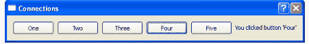

**图 4.8 Connections 程序**

图 4.8 中显示的 Connections 程序包含五个按钮和一个标签。当其中一个按钮被点击时，使用信号和槽机制来更新标签的文本。以下是表单的 `__init__()` 方法中第一个按钮的创建方式：

```python
button1 = QPushButton("One")
```

其他所有按钮以相同的方式创建，只是变量名称和传递给它们的文本不同。

我们将从最简单的连接开始，这是由 `button1` 使用的。以下是 `__init__()` 方法中的 `connect()` 调用：

```python
self.connect(button1, SIGNAL("clicked()"), self.one)
```

我们为这个按钮使用了一个专用方法：

```python
def one(self):
    self.label.setText("You clicked button 'One'")
```

将按钮的 `clicked()` 信号连接到响应此情况的单一方法，可能是最常见的连接场景。

但如果大多数处理过程是相同的，只有根据哪个特定按钮被按下而进行一些参数化呢？在这种情况下，通常最好将每个按钮连接到同一个槽。实现这一点有两种方法。一种是使用偏函数应用来包装带有参数的槽，这样当槽被调用时，它会带有调用它的按钮作为参数。另一种是询问 PyQt 告诉我们哪个按钮调用了该槽。我们将展示这两种方法，从偏函数应用开始。

+ 偏函数应用 63

回到第 65 页，我们创建了一个包装函数，它使用了 Python 2.5 的 `functools.partial()` 函数或我们自己简单的 `partial()` 函数：

```python
import sys

if sys.version_info[:2] < (2, 5):
    def partial(func, arg):
        def callme():
            return func(arg)
        return callme
else:
    from functools import partial
```

使用 `partial()`，我们现在可以将槽和按钮名称包装在一起。因此，我们可能会倾向于这样做：

```python
self.connect(button2, SIGNAL("clicked()"),
              partial(self.anyButton, "Two")) # 对于 PyQt 4.0-4.2 是错误的
```

不幸的是，这在 PyQt 4.3 之前的版本中不起作用。包装函数是在 `connect()` 调用中创建的，但一旦 `connect()` 调用完成，包装函数就会超出作用域并被垃圾回收。从 PyQt 4.3 开始，使用 `functools.partial()` 创建的包装器在这种类型的连接中被特殊处理。这意味着被连接到的函数不会被垃圾回收，因此前面显示的代码将正确工作。

+ PyQt 4.3

对于 PyQt 4.0、4.1 和 4.2，我们仍然可以使用 partial()：我们只需要保留对包装函数的引用——我们不会在 `connect()` 调用之外使用该引用，但它是表单实例的属性这一事实将确保在表单存在期间包装函数不会超出作用域，因此将正常工作。因此，实际的连接是这样建立的：

```python
self.button2callback = partial(self.anyButton, "Two")
self.connect(button2, SIGNAL("clicked()"),
            self.button2callback)
```

当 button2 被点击时，anyButton() 方法将被调用，并带有包含文本 "Two" 的字符串参数。以下是该方法的样子：

```python
def anyButton(self, who):
    self.label.setText("You clicked button '%s'" % who)
```

我们可以使用刚才展示的 partial() 函数将此槽用于所有按钮。实际上，我们可以完全避免使用 partial() 并获得相同的结果：

```python
self.button3callback = lambda who="Three": self.anyButton(who)
self.connect(button3, SIGNAL("clicked()"),
            self.button3callback)
```

+ Lambda 调用函数 61-3

在这里，我们创建了一个由按钮名称参数化的 lambda 函数。它的工作原理与 partial() 技术相同，并调用相同的 anyButton() 方法，只是使用 lambda 来创建包装器。

button2callback() 和 button3callback() 都调用 anyButton()；它们之间的唯一区别是第一个传递 "Two" 作为参数，而第二个传递 "Three"。

+ PyQt 4.1.1

如果我们使用的是 PyQt 4.1.1 或更高版本，并且使用 lambda 回调，我们自己就不必保留对它们的引用了。这是因为 PyQt 在用于创建连接中的包装器时对 lambda 进行了特殊处理。（这与预计将在 PyQt 4.3 中扩展到 functools.partial() 的特殊处理相同。）因此，我们可以直接在 connect() 调用中使用 lambda。例如：

```python
self.connect(button3, SIGNAL("clicked()"),
            lambda who="Three": self.anyButton(who))
```

包装技术工作得非常好，但还有另一种方法稍微复杂一些，但在某些情况下可能很有用，特别是当我们要避免包装调用时。这种其他技术用于响应 button4 和 button5。以下是它们的连接：

```python
self.connect(button4, SIGNAL("clicked()"), self.clicked)
self.connect(button5, SIGNAL("clicked()"), self.clicked)
```

请注意，我们没有包装它们都连接到的 clicked() 方法，因此乍一看似乎没有办法知道是哪个按钮调用了 clicked() 方法。* 然而，实现清楚地表明，如果我们想区分的话是可以做到的：

```python
def clicked(self):
    button = self.sender()
    if button is None or not isinstance(button, QPushButton):
        return
    self.label.setText("You clicked button '%s'" % button.text())
```

在槽内部，我们总是可以调用 sender() 来发现发射信号的 QObject 是谁。（如果槽是使用普通方法调用 invoked 的，这可能是 None。）虽然我们知道我们只将按钮连接到了这个槽，但我们仍然小心地进行检查。我们使用了 isinstance()，但也可以使用 hasattr(button, "text") 代替。如果我们将所有按钮都连接到这个槽，它将正确地为所有四个按钮工作。

一些程序员不喜欢使用 sender()，因为他们认为这不是良好的面向对象风格，所以当他们遇到这类需求时，倾向于使用偏函数应用。

实际上还有另一种技术可以产生包装函数和参数的效果。它利用了 QSignalMapper 类，其使用示例将在第 9 章中展示。

在某些情况下，槽可能是作为信号的结果被调用的，而槽中执行的处理直接或间接导致最初调用该槽的信号再次被调用，从而导致无限循环。这种循环在实际中很少见。两个因素有助于减少循环的可能性。首先，一些信号仅在发生实际变化时发射。例如，如果 QSpinBox 的值由用户更改或通过 setValue() 调用在程序上更改，它仅在新值与当前值不同时发射其 valueChanged() 信号。其次，一些信号仅作为用户操作的结果发射。例如，QLineEdit 仅当文本由用户更改时发射其 textEdited() 信号，而不是当文本在代码中通过 setText() 调用更改时。

如果似乎出现了信号-槽循环，自然首先要检查的是代码逻辑是否正确：我们是否真的在执行我们认为在做的处理？如果逻辑是正确的，但我们仍然有循环，我们可能能够通过改变我们连接到的信号来打破循环——例如，用仅作为用户交互结果发射的信号替换那些作为程序化更改结果发射的信号。如果问题持续存在，我们可以使用 QObject.blockSignals() 来阻止代码中某些地方的信号发射，这是所有 QWidget 类继承的，并且

> 在 PyQt 编程风格中，约定俗成地让槽具有与其连接到的信号相同的名称。


传递了一个布尔值——`True` 用于停止对象发出信号，`False` 用于恢复信号发送。

至此，我们对信号和槽机制的正式讲解已完成。在本书后续的几乎所有示例中，我们还将看到许多信号和槽的实际应用案例。大多数其他 GUI 库都以某种形式借鉴了这一机制。这是因为信号和槽机制非常有用且强大，它让程序员能够专注于应用程序的逻辑，而无需去纠结用户如何触发特定操作的具体细节。

## 摘要

在本章中，我们了解到可以创建控制台与 GUI 的混合应用程序。实际上，这一思路可以走得更远——例如，将所有 GUI 代码放在一个 `if` 块的作用域内，并且仅在安装了 PyQt 时才执行它。这样，我们就可以创建一个 GUI 应用程序，如果某些用户没有安装 PyQt，该应用可以回退到“控制台模式”。

我们还了解到，与传统的批处理程序不同，GUI 应用程序有一个持续运行的事件循环，它会检查用户事件（如鼠标点击和按键）以及系统事件（如计时器超时或窗口显示），并且只有在被要求终止时才会停止运行。

“计算”应用程序向我们展示了一个非常简洁但结构上典型的对话框 `__init__()` 方法。小部件被创建、布局并连接，同时使用一个或多个其他方法响应用户交互。“货币”应用程序采用了相同的 approach，只是接口更复杂，行为和处理逻辑也更为复杂。“货币”应用程序还表明，我们可以方便地将多个信号连接到单个槽上，无需繁琐的形式化步骤。

PyQt 的信号和槽机制允许我们以比鼠标点击和按键等具体细节更高抽象级别来处理用户交互。它让我们能够关注用户想要做什么，而不是他们如何要求这么做。所有 PyQt 小部件都会发出信号以通知状态变化和其他重要事件；大多数时候我们可以忽略这些信号。但对于我们感兴趣的信号，使用 `QObject.connect()` 很容易确保在我们选择的功能或方法被调用时响应信号的发出。与 C++/Qt 必须特别指定某些方法为槽不同，在 PyQt 中我们可以自由使用任何可调用对象（即可调用函数或方法）作为槽。

我们还学习了如何将多个信号连接到一个槽，以及如何利用部分函数应用或 `sender()` 方法，使槽能够根据发出信号的控件做出相应的响应。

我们还了解到，我们不必正式声明自定义的信号：我们可以简单地使用 `QObject.emit()` 发出它们，并附带任何我们想传递的额外参数。

## 练习

编写一个对话框风格的应用程序，用于计算复利。该应用程序在风格和结构上应非常类似于“货币”应用程序，并且外观应如下所示：


每当用户更改某个变量因子（即*本金、利率或年限*）时，金额应自动重新计算。年限组合框（combobox）应包含文本“*1年*”、“*2年*”、“*3年*”，依此类推，因此年限将为组合框的当前索引 + 1。复利公式在 Python 中为 `amount = principal * ((1 + (rate / 100.0)) ** years)`。`QDoubleSpinBox` 类具有 `setPrefix()` 和 `setSuffix()` 方法，可用于添加“$”和“%”符号。整个应用程序大约可以用 60 行代码写成。

提示：通过将合适的自旋框（spinbox）和组合框信号连接到一个 `updateUi()` 槽来执行更新，在该槽中进行计算并更新金额标签。

参考答案提供在文件 `chap04/interest.pyy` 中。

- 简单对话框
- 标准对话框
- 智能对话框

# 第 5 章
## 对话框

几乎每个 GUI 应用程序都至少包含一个对话框，而大多数 GUI 应用程序都有一个主窗口和数十个甚至数百个对话框。对话框可用于发布那些太重要而不宜放在状态栏或日志文件中的公告。在这种情况下，它们通常只包含一个用于文本的标签和一个供用户阅读完消息后按下的“确定”按钮。大多数时候，对话框用于向用户提问。有些很简单，只需要“是”或“否”的回答。另一些则要求用户做出其他类型的选择——例如，使用哪个文件、文件夹、颜色或字体。对于这些情况，PyQt 提供了内置的对话框。

本章的重点是创建自定义对话框，以便在内置对话框均不适用时，能够询问用户的要求和偏好。

我们不会回答的一个问题涉及哪种小部件适合特定用途。例如，如果我们希望用户在三个选项中进行选择，我们可能提供三个单选按钮、一个包含三项的列表小部件或组合框。或者我们可能使用三态复选框。而且这些并不是唯一的可能性。对于 GUI 编程的新手，附录 B 提供了精选 PyQt 小部件的截图和简要描述，这有助于在这些决策中提供帮助。

Qt 附带了 *Qt Designer*，这是一种可视化工具，它可以轻松“绘制”对话框，而无需编写用于创建和布局其小部件的代码。它还可以用于设置对话框的部分行为。我们将在第 7 章介绍 *Qt Designer*。在本章中，我们将通过代码创建所有对话框。一些开发者总是以这种方式创建所有对话框，而另一些则更喜欢使用 *Qt Designer*。本书展示了这两种方法，以便您可以决定在具体情况中哪种最佳。

对对话框进行分类的一种方式是根据它们的“智能”程度，即根据其中嵌入的应用程序数据知识的多少，分为“简单”、“标准”或“智能”。这些分类影响我们实现和实例化（创建实例）对话框的方式，为此我们为每一种分类专门设了一节。每一节首先解释该分类的含义，并通过实例说明其优缺点。

除了智能分类外，对话框还可以根据其*模态性*进行归类。**应用程序模态**对话框是指一旦调用，就是用户唯一可以交互的应用程序部分。在用户关闭对话框之前，他们无法使用应用程序的其他部分。当然，用户可以自由与其他应用程序交互，例如通过点击其他应用程序使其获得焦点。

**窗口模态**对话框的工作方式与应用程序模态对话框类似，区别在于它仅阻止与其父窗口、父窗口的父窗口（以此类推直至顶级父窗口）以及父窗口同级窗口的交互。对于只有一个顶级窗口的应用程序，应用程序模态和窗口模态之间没有实际区别。当提到“模态”窗口而未指定类型时，通常假定为窗口模态。

模态对话框的反面是*非模态*对话框。当调用非模态对话框时，用户既可以与对话框交互，也可以与应用程序的其他部分交互。这对我们如何设计代码有重大影响，因为用户可能在主窗口和非模态对话框中同时改变程序状态，进而彼此产生影响。

编写对话框的另一个重要方面是我们如何处理验证。尽可能选择合适的小部件并设置其属性，以避免我们自己编写验证代码。例如，如果我们需要一个整数，我们可以使用 *QSpinBox* 并使用其 *setRange()* 方法将范围限制为我们可接受的值。我们将适用于单个小部件的验证称为“小部件级”验证；数据库程序员通常称之为“字段级”验证。有时我们需要比小部件级验证走得更远，特别是当存在相互依赖关系时。例如，剧院订票系统可能有两个组合框，一个用于选择楼层，另一个用于选择座位排。如果一楼有座位排 A–R，而二楼有座位排 M–T，那么显然某些楼层和座位排的组合是无效的。对于这些情况，我们必须执行“表单级”验证；数据库程序员通常称之为“记录级”验证。

另一个验证问题涉及验证发生的时间。理想情况下，我们不希望用户能够输入任何无效数据，但有时阻止这一点可能相当棘手。我们将验证分为两大类：“事后”验证，即在用户希望其设置被接受时进行的验证；以及“预防性”验证，即在用户操作编辑小部件时进行的验证。

由于对话框可以具有不同的智能级别、三种类型的模态性以及多种验证策略，看起来有很多可能的组合可供选择。实际上，我们使用的组合


往往是同一批。例如，在大多数情况下，我们可能会让笨对话框（dumb dialogs）和标准对话框处于模态状态，而让智能对话框处于非模态状态。至于验证，正确的策略在很大程度上取决于具体情况。我们将在本章中看到最常见用例的示例，并在本书的其余部分看到进一步的对话框示例。

## 笨对话框

我们将“笨”对话框定义为一个其小部件由对话框的调用者设置为初始值，并且其最终值直接从这些小部件中获取（再次由对话框的调用者获取）的对话框。笨对话框不知道其小部件用于呈现和编辑的数据是什么。我们可以对笨对话框的小部件应用一些基本验证，但（并不常见，或者并非总是可能）设置涉及小部件之间相互依赖关系的验证；换句话说，笨对话框中通常不进行表单级验证。笨对话框通常是模态对话框，包含一个“接受”按钮（例如，OK）和一个“拒绝”按钮（例如，Cancel）。

使用笨对话框的主要优点是我们不需要编写任何代码来为其提供 API，也不需要编写任何额外的逻辑代码。这两个好处都是其所有小部件可公开访问的结果。主要缺点是，使用它们的代码与其用户界面紧密耦合（因为我们直接访问小部件），因此我们无法轻松实现复杂的验证——而且如果需要在一个以上的地方使用，它们比标准对话框或智能对话框方便得多。

让我们从一个具体示例开始。假设我们有一个图形应用程序，我们希望让用户设置一些画笔属性——例如，画笔的宽度、样式以及用其绘制的线条是否应具有倒角边缘。图 5.1 展示了我们要实现的效果。

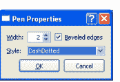

**图 5.1** *画笔属性对话框*

在这种情况下，我们不需要“实时”或交互式地更新画笔属性，因此模态对话框就足够了。由于所需的验证相当简单，因此在这种情况下我们可以使用笨对话框。

我们通过在一个连接到菜单选项、工具栏按钮或对话框按钮的信号槽中模态弹出该对话框来使用它。如果用户点击了 OK，我们将更新我们的画笔属性；如果他们点击了 Cancel，我们什么也不做。以下是调用方槽可能看起来的样子：

```python
def setPenProperties(self):
    dialog = PenPropertiesDlg(self)
    dialog.widthSpinBox.setValue(self.width)
    dialog.beveledCheckBox.setChecked(self.beveled)
    dialog.styleComboBox.setCurrentIndex(
        dialog.styleComboBox.findText(self.style))
    if dialog.exec_():
        self.width = dialog.widthSpinBox.value()
        self.beveled = dialog.beveledCheckBox.isChecked()
        self.style = unicode(dialog.styleComboBox.currentText())
        self.updateData()
```

我们首先创建一个 `PenPropertiesDlg` 对话框——我们将很快看到其细节；我们现在只需要知道它有一个宽度微调框、一个倒角复选框和一个样式组合框即可。我们将父对象 `self`（调用方表单）传递给对话框，以利用 PyQt 默认在父对象上方居中显示对话框的事实，并且因为具有父对象的对话框不会在任务栏中生成单独的条目。然后我们直接访问小部件，将它们设置为调用方表单中持有的值。`QComboBox.findText()` 方法返回具有匹配文本的项的索引位置。

当我们对对话框调用 `exec_()` 时，对话框将模态显示。这意味着对话框的父窗口及其同级窗口将被阻塞，直到对话框关闭为止。只有当用户关闭对话框（通过“接受”或“拒绝”）时，`exec_()` 调用才会返回。如果用户接受了对话框，返回值评估为 `True`；否则，它评估为 `False`。如果用户接受了对话框，我们知道他们希望其设置生效，因此我们从对话框的小部件中读取这些值并更新应用程序的数据。最后的 `updateData()` 调用只是我们自己的自定义方法之一，它使应用程序在主窗口中显示画笔属性。

在 `setPenProperties()` 方法的末尾，`PenPropertiesDlg` 将超出作用域，并成为垃圾回收的候选对象。出于这个原因，每当调用 `setPenProperties()` 时，我们必须总是创建一个新的对话框并填充其小部件。这种方法以一些速度开销为代价节省内存。对于像这样小的对话框，这种开销小到用户无法察觉，但稍后我们将展示一种替代方法，避免每次创建和销毁对话框。

使用笨对话框意味着该对话框与应用程序的耦合度相当低。我们可以通过使标签可访问为实例变量来完全解耦它。然后，我们可以通过更改标签来使用 `PenPropertiesDlg` 编辑任何需要微调框、复选框和组合框的数据。例如，我们可以使用它来记录天气读数，配合“Temperature”（温度）微调框、“Is raining”（是否在降雨）复选框和“Cloud cover”（云量）组合框。

既然我们已经看到了如何使用该对话框，让我们来看看实现它的代码。`PenPropertiesDlg` 有一个单独的方法 `__init__()`，我们将分部分查看。

```python
class PenPropertiesDlg(QDialog):
    def __init__(self, parent=None):
        super(PenPropertiesDlg, self).__init__(parent)
```

不出所料，我们的对话框是 `QDialog` 的子类，我们以已经见过几次的方式对其进行初始化。

```python
widthLabel = QLabel("&Width:")
self.widthSpinBox = QSpinBox()
widthLabel.setBuddy(self.widthSpinBox)
self.widthSpinBox.setAlignment(Qt.AlignRight|Qt.AlignVCenter)
self.widthSpinBox.setRange(0, 24)
self.beveledCheckBox = QCheckBox("&Beveled edges")
styleLabel = QLabel("&Style:")
self.styleComboBox = QComboBox()
styleLabel.setBuddy(self.styleComboBox)
self.styleComboBox.addItems(["Solid", "Dashed", "Dotted",
                           "DashDotted", "DashDotDotted"])

okButton = QPushButton("&OK")
cancelButton = QPushButton("Cancel")
```

对于每个编辑小部件，我们还创建一个相应的标签，以便用户知道他们在编辑什么。当我们在标签的文本中放入一个和号（&）时，它可能具有两种含义。它可能只是一个字面的和号。或者它可以表示不应显示和号，而应将其后面的字母加下划线，以表明它代表一个键盘加速器。例如，对于 `widthLabel`，其文本 `"&Width:"` 将显示为 `Width:`，其加速器将是 `Alt+W`。在 Mac OS X 上，默认行为是忽略加速器；出于这个原因，PyQt 在此平台上不显示下划线。

区分字面和号和加速器的是标签是否具有“伙伴”（buddy）。如果有，则和号表示加速器。伙伴是一个小部件，当按下相应标签的加速器时，PyQt 会将键盘焦点传递给它。因此，当用户按下 `Alt+W` 时，键盘焦点将切换到 `widthSpinBox`。这反过来意味着，如果用户按下上下箭头键或 PageUp 或 PageDown，这些键将影响 `widthSpinBox`，因为它拥有键盘焦点。

对于按钮，按钮文本中带下划线的字母用于表示加速器。因此在这种情况下，`okButton` 的文本 `"&OK"` 显示为 `OK`，用户可以通过用鼠标点击、通过 Tab 键切换到该按钮并按空格键，或按 `Alt+O` 来按下该按钮。为 Cancel（或 Close）按钮提供加速器并不常见，因为这些按钮通常连接到对话框的 reject() 槽，并且 QDialog 为该提供了键盘快捷键，即 Esc 键。

复选框和单选按钮在某种程度上类似于按钮，因为它们具有可以拥有加速器的文本。例如，倒角复选框有一个带下划线的 "B"，因此用户可以通过按 `Alt+B` 切换复选框的选中状态。

像这样创建按钮的一个缺点是，当我们布局它们时，我们将以某种特定顺序进行布局。例如，我们可能会将 OK 放在 Cancel 的左侧。但在某些窗口系统中，这种顺序是错误的。PyQt 对此有解决方案，详见“对话框按钮布局”边栏。

我们将微调框的数字右对齐并垂直居中，并将其有效范围设置为 0–24。在 PyQt 中，允许画笔宽度（即线条宽度）为 0，这表示无论有任何转换，宽度均为 1 像素。宽度为 1 及以上的画笔宽度将按照给定宽度绘制，并尊重任何正在生效的转换，例如缩放。

通过使用微调框并为其设置范围，我们避免了使用例如行编辑（line edit）时可能输入无效画笔宽度的可能性。非常常见的情况是，仅仅选择正确的小部件并适当设置其属性就提供了所需的所有小部件级验证。这也通过我们对倒角复选框的使用得到了体现：要么画笔绘制具有倒角边缘的线条，要么不绘制。使用线条样式的组合框的情况也相同——用户只能选择有效的样式，即从我们提供的列表中选择的样式。

```python
buttonLayout = QHBoxlayout() 
buttonLayout.addStretch() 
buttonLayout.addWidget(okButton) 
buttonLayout.addWidget(cancelButton) 
layout = QGridLayout() 
layout.addWidget(widthLabel, 0, 0) 
layout.addWidget(self.widthSpinBox, 0, 1) 
layout.addWidget(self.beveledCheckBox, 0, 2) 
layout.addWidget(styleLabel, 1, 0) 
layout.addWidget(self.styleComboBox, 1, 1, 1, 2) 
layout.addLayout(buttonLayout, 2, 0, 1, 3) 
self.setLayout(layout)
```

我们使用了两个布局，一个嵌套在另一个内部，以获得我们想要的布局。我们首先水平排列按钮，从一个“拉伸”（stretch）开始。拉伸将消耗尽可能多的空间，其效果是将两个按钮推到尽可能靠右的位置，同时仍能在布局中容纳它们。

> *我们使用术语“键盘加速器”和“加速器”来指用于点击按钮、在对话框中切换焦点以及弹出菜单的 Alt+<字母> 键序列。我们使用术语“键盘快捷键”来指其他类型的键序列——例如，常用于保存文件的 Ctrl+S 键序列。我们将在第 6 章中看到如何创建键盘快捷键。


### 对话框按钮布局

在我们早期的示例中，我们将按钮放置在对话框的右侧，顺序为先“确定”（OK）按钮，后“取消”（Cancel）按钮。这是 Windows 系统上最常见的布局，但并不总是正确的。例如，对于 Mac OSX 或 GNOME 桌面环境，它们的顺序应该互换。

如果我们希望应用程序尽可能具有原生的外观和感觉，并计划在不同平台上部署，那么诸如按钮顺序和位置等问题将至关重要。Qt 4.2（PyQt 4.1）为这个特定问题提供了一个解决方案：`QDialogButtonBox` 类。

我们不直接创建“确定”和“取消”按钮，而是创建一个 `QDialogButtonBox`。例如：

```python
buttonBox = QDialogButtonBox(QDialogButtonBox.Ok | QDialogButtonBox.Cancel)
```

为了使某个按钮成为“默认”按钮，即当用户按下回车键时（假设具有键盘焦点的控件本身不处理回车键）该按钮会被按下，我们可以这样做：

```python
buttonBox.button(QDialogButtonBox.Ok).setDefault(True)
```

由于按钮盒是一个单独的控件（尽管它包含其他控件），我们可以直接将其添加到对话框现有的布局中，而不是将其放入自己的布局中并将其嵌套在对话框的布局内部。以下是我们在 `PenPropertiesDlg` 示例的网格布局中会执行的操作：

```python
layout.addWidget(buttonBox, 3, 0, 1, 3)
```

并且，与其从按钮的 `clicked()` 信号进行连接，我们可以从按钮盒进行连接，它具有对应于用户操作的自身信号：

```python
self.connect(buttonBox, SIGNAL("accepted()"), self, SLOT("accept()")) 
self.connect(buttonBox, SIGNAL("rejected()"), self, SLOT("reject()"))
```

不过，我们仍然可以自由地连接到单个按钮的 `clicked()` 信号，对于拥有许多按钮的对话框，我们通常也会这样做。

`QDialogButtonBox` 默认使用水平布局，但可以通过向其构造函数传递 `Qt.Vertical` 或调用 `setOrientation()` 来设置为使用垂直布局。

我们在大多数示例中使用 `QDialogButtonBox`，但如果向后兼容性是一个问题，它始终可以被单独的 `QPushButton` 替代。

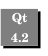

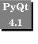

### 图 5.2 画笔属性对话框的布局

宽度标签、宽度SpinBox 和斜接复选框使用网格布局并排摆放在三列中。样式标签和样式组合框放在下一行，其中样式组合框被设置为跨越两列。`QGridLayout.addWidget()` 方法的参数依次为：控件、行、列，然后是可选的行跨越数，接着是列跨越数。我们将按钮布局作为第三行添加到网格布局中，使其跨越所有三列。最后，我们将布局设置到对话框上。图 5.2 以示意方式展示了该布局；网格布局部分以阴影显示。

```python
    self.connect(okButton, SIGNAL("clicked()"),
                  self, SLOT("accept()"))
    self.connect(cancelButton, SIGNAL("clicked()"),
                  self, SLOT("reject()"))
    self.setWindowTitle("Pen Properties")
```

在 `__init__()` 的末尾，我们建立必要的连接。我们将“确定”按钮的 `clicked()` 信号连接到对话框的 `accept()` 槽。该槽将关闭对话框并返回 `True` 值。“取消”按钮以相应的方式连接。最后，我们设置窗口标题。

对于仅从一个位置调用的简单“笨”对话框，可以完全避免创建对话框类。相反，我们可以简单地所有控件都在*调用*方法中创建，布局它们，连接它们，并调用 *exec*()。如果 *exec*() 返回 *True*，我们就可以从控件中提取值，然后完成。文件 *chap05/pen.py* 包含画笔属性对话框和一个带有两个按钮的虚拟程序，一个用于调用我们刚才审查过的 `PenPropertiesDlg`，另一个则内联执行所有操作。内联创建对话框并不是我们推荐的方法，因此我们不会审查执行此操作的代码，但为了完整性，示例的 *setPenInline()* 方法中提到了它并提供了代码。

“笨”对话框易于理解和使用，但除了最简单的对话框（只涉及一个、两个或最多几个值）外，不推荐通过对话框的控件来设置和获取值。我们展示它们主要作为一种温和的对话框入门介绍，因为在任何类型的对话框中，创建、布局和连接控件的方式都是相同的。在下一节中，我们将查看标准对话框，包括模态和非模态对话框。

## 标准对话框

如果一个对话框根据其初始化器或其方法设置的值初始化其控件，并且其最终值通过方法调用或实例变量获取——而不是直接从对话框的控件获取——那么我们就认为该对话框是一个“标准”对话框。标准对话框可以具有控件级别和表单级别的验证。标准对话框要么是模态的，具有“接受”和“拒绝”按钮；要么（较少见）是非模态的，此时它们具有“应用”和“关闭”按钮，并通过信号和槽连接通知状态变化。

标准对话框的一个关键优势是，调用者不需要了解其实现细节，只需要知道如何设置初始值，以及如果用户点击了“确定”按钮，如何获取结果值。另一个优势，至少对于模态标准对话框而言，是用户无法与对话框的父窗口及其同级窗口进行交互，因此应用程序状态的相关部分很可能不会在对话框背后发生变化。使用标准对话框的主要缺点在必须处理大量不同数据项时最为明显，因为每次调用时必须将所有数据项输入对话框并检索结果，这可能涉及许多行代码。

与上一节一样，我们将通过一个示例来进行说明。在这种情况下，该示例将用于本节和下一节，以便我们可以更清楚地看到标准对话框和智能对话框之间的不同方法和权衡。

让我们想象一下，我们有一个应用程序需要显示一个浮点数表格，并且我们希望用户对数字格式有一定的控制。实现这一点的一种方式是提供菜单选项、工具栏按钮或键盘快捷键，以调用一个模态对话框，用户可以与之交互以设置其格式偏好。图 5.3 显示了一个弹出在数字表格上方的数字格式对话框。

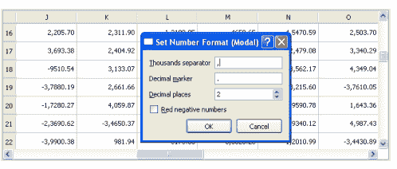

我们希望该对话框向用户提供控制的数据保存在主表单中的一个字典中。以下是初始化该字典的方式：

```python
self.format = dict(thousandsseparator=",", decimalmarker=".", decimalplaces=2, rednegatives=False)
```

使用像这样的字典非常方便，并且可以轻松添加额外的项。

我们将对话框放在独立的文件 `numberformatdlg1.py` 中，该文件被应用程序 `numbers.py` 导入。文件名中的数字“1”将其与下一节中介绍的其他两个版本的对话框区分开来。

### 模态“确定/取消”风格对话框

让我们先看看该对话框是如何使用的；假设在响应用户某个操作时调用了 `setNumberFormat()` 方法。

```python
def setNumberFormat(self):
    dialog = numberformatdlg1.NumberFormatDlg(self.format, self)
    if dialog.exec_():
        self.format = dialog.numberFormat()
        self.refreshTable()
```

### 表 5.1 选定的布局方法

| 语法 | 描述 |
| :--- | :--- |
| b.addLayout(l) | 将 QLayout l 添加到 QBoxLayout b 中，b 通常是 QHBoxLayout 或 QVBoxLayout |
| b.addSpacing(i) | 向布局 b 添加一个固定大小为 int i 的 QSpacerItem |
| b.addStretch(i) | 向布局 b 添加一个最小大小为 0 且伸缩因子为 int i 的 QSpacerItem |
| b.addWidget(w) | 将 QWidget w 添加到布局 b |
| b.setStretchFactor(x, i) | 将布局 b 的布局或控件 x 的伸缩因子设置为 int i |
| g.addLayout(l, r, c) | 将 QLayout l 添加到 QGridLayout g 的 int r 行和 int c 列处；可以额外指定行跨越数和列跨越数 |
| g.addWidget(w, r, c) | 将 QWidget w 添加到 QGridLayout g 的 int r 行和 int c 列处；可以额外指定行跨越数和列跨越数 |
| g.setRowStretch(r, i) | 将 QGridLayout g 的第 int r 行的伸缩设置为 int i |
| g.setColumnStretch(c, i) | 将 QGridLayout g 的第 int c 列的伸缩设置为 int i |


## 1. 文本重构与OCR纠正说明
（注：根据指令，此处仅展示最终处理后的文本，无额外解释。）

## 创建对话框并传入格式字典
我们首先创建对话框，并将从对话框初始化所使用的格式字典以及 `self` 传递给它，从而使对话框与调用表单绑定——居中于其上，并且不拥有自己的任务栏条目。

正如我们之前提到的，调用 `exec()` 会弹出对话框，因此它是作为模态对话框调用的，这意味着用户在与其父窗口及其兄弟窗口交互之前，必须接受或拒绝该对话框。在下一节中，我们将使用没有此限制的对话框模式版本。

如果用户点击“确定”，我们将格式字典设置为对话框中设定的值，并更新表格，以便使用新格式显示数字。如果用户取消，我们不做任何操作。在方法结束时，对话框超出作用域范围，因此将被安排进行垃圾回收。

为了节省空间并避免不必要的重复，从现在开始，除非其存在并不明显，否则我们不再展示任何导入语句。因此，例如，我们不再显示 `from PyQt4.QCore import *` 或 `from PyQt4.QtGui import *`。

现在，我们准备查看对话框本身的实现。

```python
class NumberFormatDlg(QDialog):
    def __init__(self, format, parent=None):
        super(NumberFormatDlg, self).__init__(parent)
```

`__init__()` 方法与我们之前看到的其他所有对话框的开始方式相同。

```python
        thousandsLabel = QLabel("&Thousands separator")
        self.thousandsEdit = QLineEdit(format["thousandsseparator"])
        thousandsLabel.setBuddy(self.thousandsEdit)
        decimalMarkerLabel = QLabel("Decimal &marker")
        self.decimalMarkerEdit = QLineEdit(format["decimalmarker"])
        decimalMarkerLabel.setBuddy(self.decimalMarkerEdit)
        decimalPlacesLabel = QLabel("&Decimal places")
        self.decimalPlacesSpinBox = QSpinBox()
        decimalPlacesLabel.setBuddy(self.decimalPlacesSpinBox)
        self.decimalPlacesSpinBox.setRange(0, 6)
        self.decimalPlacesSpinBox.setValue(format["decimalplaces"])
        self.redNegativesCheckBox = QCheckBox("&Red negative numbers")
        self.redNegativesCheckBox.setChecked(format["rednegatives"])

        buttonBox = QDialogButtonBox(QDialogButtonBox.Ok |
                                      QDialogButtonBox.Cancel)
```

对于我们希望用户能够修改的格式的每个方面，我们创建一个标签让用户知道他们正在编辑什么，以及一个合适的编辑控件。由于 `format` 参数是强制性的，我们假设它拥有我们需要的所有值，因此我们使用它来初始化编辑控件。我们还使用 `setBuddy()` 调用来支持键盘用户，因为并非所有用户都能使用鼠标。

### 表 5.2 QDialogButtonBox 选定的方法和信号

| 语法 | 描述 |
| :--- | :--- |
| `d.addButton(b, r)` | 将带有 `QDialogButtonBox.ButtonRole r` 的 `QPushButton b` 添加到 `QDialogButtonBox d` |
| `d.addButton(t, r)` | 将带有文本 `t` 和按钮角色 `r` 的 `QPushButton` 添加到 `QDialogButtonBox d`，并返回添加的按钮 |
| `d.addButton(s)` | 将指定为 `QDialogButtonBox.StandardButton s` 的 `QPushButton` 添加到 `QDialogButtonBox d`，并返回添加的按钮 |
| `d.setOrientation(o)` | 将 `QDialogButtonBox` 的方向设置为 `Qt.Orientation o`（垂直或水平） |
| `d.button(s)` | 返回指定为 `StandardButton s` 的 `QDialogButtonBox` 的 `QPushButton`，如果不存在则返回 `None` |
| `d.accepted()` | 如果带有 `QDialogButtonBox.Accept` 角色的按钮被点击，则发出此信号 |
| `d.rejected()` | 如果带有 `QDialogButtonBox.Reject` 角色的按钮被点击，则发出此信号 |

我们实施的唯一验证是限制小数位数自旋框的范围。我们选择了“事后”验证方法，即在用户输入值之后，在用户点击“确定”接受编辑的时刻进行验证。在下一节中，我们将看到“预防性”验证，这种方法从源头上防止无效编辑。

```python
self.format = format.copy()
```

我们需要对传入的格式字典进行*复制*，因为我们希望能够在对话框内部修改该字典而不影响原始字典。

```python
grid = QGridLayout()
grid.addWidget(thousandsLabel, 0, 0)
grid.addWidget(self.thousandsEdit, 0, 1)
grid.addWidget(decimalMarkerLabel, 1, 0)
grid.addWidget(self.decimalMarkerEdit, 1, 1)
grid.addWidget(decimalPlacesLabel, 2, 0)
grid.addWidget(self.decimalPlacesSpinBox, 2, 1)
grid.addWidget(self.redNegativesCheckBox, 3, 0, 1, 2)
grid.addWidget(buttonBox, 4, 0, 1, 2)
self.setLayout(grid)
```

布局的外观与我们在画笔属性对话框中使用的布局非常相似，只是这次我们有一个 `QDialogButtonBox` 控件，而不是用于按钮的布局。这使得使用单个 `QGridLayout` 创建整个布局成为可能。


“红色负数”复选框和按钮框的布局都设置为各占据一行和两列。行跨度和列跨度由 `QGridLayout` 的 `addWidget()` 和 `addLayout()` 方法的最后两个参数指定。布局如图 5.4 所示，网格以阴影显示。

```python
self.connect(buttonBox, SIGNAL("accepted()"),
             self, SLOT("accept()"))
self.connect(buttonBox, SIGNAL("rejected()"),
             self, SLOT("reject()"))
self.setWindowTitle("Set Number Format (Modal)")
```

建立连接和设置窗口标题的代码与我们在画笔属性对话框中使用的类似，只是这次我们使用按钮框的信号，而不是直接连接到按钮本身。

```python
def numberFormat(self):
    return self.format
```

如果用户点击“确定”，对话框被接受并返回 True 值。在这种情况下，调用表单的方法通过调用 `numberFormat()` 方法，用对话框的字典覆盖其格式字典。由于我们没有将对话框的 `self.format` 属性变得非常私有（即通过将其命名为 `__format__`），我们可以从表单外部直接访问它；我们将在后续示例中采用这种方法。

当用户点击“确定”时，由于我们使用的是事后验证，因此可能存在某些编辑控件包含无效数据的情况。为了处理这个问题，我们重新实现 `QDialog.accept()`，并在其中进行验证。由于该方法相当长，我们将分部分查看它。

```python
def accept(self):
    class ThousandsError(Exception): pass
    class DecimalError(Exception): pass
    Punctuation = frozenset(" ,;;.")
```

我们首先创建两个异常类，我们将在 `accept()` 方法内部使用它们。这将有助于使我们的代码比否则可能的更干净、更简短。我们还创建了一个字符集，允许这些字符用作千位分隔符和小数点标记。

我们唯一担心需要验证的编辑控件是两个行编辑框。这是因为小数位数自旋框已经限制在有效范围内，并且“红色负数”复选框只能被选中或取消选中，这两种状态都是有效的。

```python
                thousands = unicode(self.thousandsEdit.text())
                decimal = unicode(self.decimalMarkerEdit.text())
            try:
                if len(decimal) == 0:
                    raise DecimalError, ("The decimal marker may not be "
                        "empty.")

                if len(thousands) > 1:
                    raise ThousandsError, ("The thousands separator may "
                        "only be empty or one character.")

                if len(decimal) > 1:
                    raise DecimalError, ("The decimal marker must be "
                        "one character.")

                if thousands == decimal:
                    raise ThousandsError, ("The thousands separator and "
                        "the decimal marker must be different.")

                if thousands and thousands not in Punctuation:
                    raise ThousandsError, ("The thousands separator must "
                        "be a punctuation symbol.")

                if decimal not in Punctuation:
                    raise DecimalError, ("The decimal marker must be a "
                        "punctuation symbol.")

            except ThousandsError, e:
                QMessageBox.warning(self, "Thousands Separator Error",
                    unicode(e))
                self.thousandsEdit.selectAll()
                self.thousandsEdit.setFocus()
                return

            except DecimalError, e:
                QMessageBox.warning(self, "Decimal Marker Error",
                    unicode(e))
                self.decimalMarkerEdit.selectAll()
                self.decimalMarkerEdit.setFocus()
                return
```

我们首先从两个行编辑框获取文本。虽然没有千位分隔符是可以接受的，但必须存在小数标记，因此我们首先检查 `decimalMarkerEdit` 是否至少有一个字符。如果没有，我们抛出带有适当错误文本的自定义 `DecimalError`。如果任何文本长度超过一个字符，或者它们是相同的字符，或者任何文本包含不在我们的 `Punctuation` 集中的字符，我们也抛出异常。*if* 语句在标点方面有所不同，因为千位分隔符允许为空，但小数点标记不允许。


## 图 5.5 QMessageBox 警告
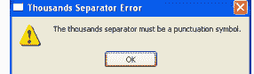

我们将括号加在由两部分组成的错误字符串周围，以便将它们合并为单个表达式；另一种语法是去掉括号，改为连接这两部分并转义换行符。

根据引发的是 `ThousandsError` 还是 `DecimalError`，我们会显示带有相应错误文本的“警告”消息框，如图 5.5 所示。我们需要将异常对象 `e` 转换为字符串（我们使用 `unicode()` 函数来实现这一点），以便其适合作为 `QMessageBox` 静态 `warning()` 方法的参数。我们将更多地使用 `QMessageBox` 的静态方法，包括使用额外的参数，既在本章中，也在全书中都会用到。

一旦用户通过关闭消息框确认了错误消息，我们就会选中无效行编辑框中的文本，并将焦点置于该编辑框上，以便用户进行修正。然后我们返回——因此对话框不被接受，用户必须修复问题或点击“取消”以关闭对话框并放弃他们的更改。

```python
self.format["thousandsseparator"] = thousands
self.format["decimalmarker"] = decimal
self.format["decimalplaces"] = \
    self.decimalPlacesSpinBox.value()
self.format["rednegatives"] = \
    self.redNegativesCheckBox.isChecked()
QDialog.accept(self)
```

如果没有异常被引发，则两条 `return` 语句都不会执行，程序执行流程会落入 `accept()` 方法的最后这部分。在这里，我们将使用编辑部件的值更新对话框的格式字典，并调用基类的 `accept()` 方法。表单将被关闭（即隐藏），并且 `exec_()` 语句会返回 `True` 值。正如我们之前看到的，调用者从 `exec_()` 接收到 `True` 值后，会继续使用 `numberFormat()` 方法获取对话框的格式。

为什么我们在最后没有使用 `super()` 来调用基类的 `accept()`，而是显式地命名了 `QDialog`？简短的回答是，在这种上下文中使用 `super()` 不起作用。PyQt 试图尽可能高效地利用延迟属性查找，但结果是 `super()` 在 PyQt 子类的表现中并不如我们预期的那样工作。（有关解释，请参阅 PyQt 文档 pyqt4ref.html，位于“super and PyQt classes”部分。）

尽管对话框仅在它被接受（或被拒绝）时才会隐藏，但一旦它超出作用域，即在调用者的 `setNumberFormat1()` 方法结束时，该对话框就被计划进行垃圾回收。

像这样创建模态对话框通常很直接。唯一的复杂性在于我们是否具有需要仔细处理的布局和验证，正如这里的情况一样。

在某些情况下，用户希望能够看到其选择的结果，也许需要更改几次选择直到满意为止。对于这些情况，模态对话框可能不太方便，因为用户必须调用对话框，执行编辑，接受更改，查看结果，然后重复这一循环，直到满意为止。如果对话框是非模态的，并且能够在不关闭的情况下更新应用程序状态，用户可以简单地调用一次对话框，执行编辑，查看效果，然后进行更多编辑，依此类推：这是一个更快的循环。我们将在下一节中了解如何实现这一点；我们还将查看一种更简单且更主动的验证策略——预防性验证。

## 智能对话框

我们将“智能”对话框定义为一种对话框，它根据其初始化器接收的数据引用或数据结构来初始化其部件，并且能够直接响应用户交互来更新数据。智能对话框可以具有部件级和表单级验证。智能对话框通常是非模态的，带有“应用”和“关闭”按钮，但也可以是“实时的”，在这种情况下，它们可能没有按钮，部件的变化会直接反映到它们可以访问的数据中。带有“应用”按钮的智能非模态对话框通过信号和槽连接来通知状态变化。

使用智能非模态对话框的主要好处在使用时才会显现出来。当创建对话框时，它会被赋予调用表单数据结构的引用，以便对话框可以直接更新数据结构，而不需要在调用点编写更多代码。缺点是，对话框必须了解调用表单的数据结构，以便正确地将数据值反映到其部件中，并且仅应用有效的更改；此外，作为非模态对话框，如果用户与应用程序的其他部分交互，存在其依赖的数据被从底层更改的风险。

在本节中，我们将继续探讨数字格式对话框的主题，以便我们可以比较各种方法。

### 非模态 应用/关闭 风格对话框

如果我们希望用户能够反复更改数字格式并查看结果，如果他们可以在无需不断调用和接受数字格式对话框的情况下做到这一点，那对他们来说会方便得多。解决方案是使用一个非模态对话框，允许他们与数字格式部件交互，应用更改，并查看效果，次数不限。这样的对话框通常有一个“应用”按钮和一个“关闭”按钮。与可以取消的模态 OK/Cancel 风格对话框不同，模态对话框取消后一切保持原样，而一旦点击了“应用”，用户就无法撤销更改。当然，我们可以提供一个“还原”按钮或“默认值”按钮，但这需要更多的开发工作。

表面上看，非模态版本和模态版本的对话框之间的唯一区别是按钮上的文本。然而，还有两个重要的区别：调用表单的方法以不同的方式创建和调用该对话框，并且对话框必须确保它在关闭时被删除，而不仅仅是隐藏。让我们先看看对话框是如何被调用的。

```python
def setNumberFormat2(self):
    dialog = numberFormatDlg2.NumberFormatDlg(self, format, self)
    self.connect(dialog, SIGNAL("changed"), self.refreshTable)
    dialog.show()
```

我们以之前创建模态版本相同的方式创建该对话框；如图 5.6 所示。然后我们将对话框的 `changed` Python 信号连接到调用表单的 `refreshTable()` 方法，然后只需在对话框上调用 `show()`。当我们调用 `show()` 时，对话框作为非模态对话框弹出。应用程序执行与非模态对话框并发进行，用户可以与对话框以及应用程序中的其他窗口进行交互。

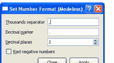
**图 5.6 非模态 设置数字格式 对话框**

每当对话框发出其 `changed` 信号时，主表单的 `refreshTable()` 方法会被调用，这将使用格式字典的设置重新格式化表中的所有数字。我们可以想象这意味着当用户点击“应用”按钮时，格式字典将被更新并发出 `changed` 信号。我们很快就会看到确实如此。

尽管对话框变量超出了作用域，但 PyQt 足够聪明，会保留对非模态对话框的引用，因此对话框继续存在。但当用户点击“关闭”时，对话框通常只会被隐藏，因此如果用户一次又一次地调用对话框，由于会创建更多对话框但没有删除任何对话框，内存会被无谓地消耗。对此的一个解决方案是确保对话框在关闭时被删除，而不仅仅是隐藏。（当我们很快查看“实时”对话框时，会看到另一个解决方案。）

我们将首先查看对话框的 `__init__()` 方法。

```python
def __init__(self, format, parent=None):
    super(NumberFormatDlg, self).__init__(parent)
    self.setAttribute(Qt.WA_DeleteOnClose)
```

在调用 `super()` 之后，我们调用 `setAttribute()`，以确保当对话框关闭时它会被删除，而不仅仅是被隐藏。

```python
punctuationRe = QRegExp(r"[ ,;:.!]")

thousandsLabel = QLabel("&Thousands separator")
self.thousandsEdit = QLineEdit(format["thousandsseparator"])
thousandsLabel.setBuddy(self.thousandsEdit)
self.thousandsEdit.maxLength = 1
self.thousandsEdit.setValidator(
    QRegExpValidator(punctuationRe, self))

decimalMarkerLabel = QLabel("Decimal marker")
self.decimalMarkerEdit = QLineEdit(format["decimalmarker"])
decimalMarkerLabel.setBuddy(self.decimalMarkerEdit)
self.decimalMarkerEdit.maxLength = 1
self.decimalMarkerEdit.setValidator(
    QRegExpValidator(punctuationRe, self))
self.decimalMarkerEdit.setInputMask("X")
```


### 代码片段

```python
decimalPlacesLabel = QLabel("${decimale} places")
self.decimalPlacesSpinBox = QSpinBox()
decimalPlacesLabel.setLayout(self.decimalPlacesSpinBox)
self.decimalPlacesSpinBox.setRange(0, 6)
self.decimalPlacesSpinBox.setValue(format["decimalPlaces"])

self.redNegativesCheckBox = QCheckBox("$Red negative numbers")
self.redNegativesCheckBox.setChecked(format["redNegatives"])

buttonBox = QDialogButtonBox(QDialogButtonBox.Apply |
                QDialogButtonBox.Close)
```

#### 控件创建说明

表单控件的创建与我们之前的做法非常相似，但这次我们几乎完全使用了预防性验证。我们在千位分隔符和小数标记的行编辑中设置了单字符最大长度，并且在两种情况下都设置了 `QRegExpValidator`。验证器只允许用户输入有效字符，对于正则表达式验证器，则只允许匹配正则表达式的字符。PyDQt 使用的正则表达式语法基本上是 Python `re` 模块所提供语法的子集。

`QRegExpValidator` 的初始化器需要一个正则表达式和一个父对象，这就是为什么我们在传递正则表达式的同时也传递了 `self`。

在这种情况下，我们将验证正则表达式设置为 `"[.,;: ]"`。这是一个字符类，意味着只有方括号内包含的字符才是有效的，即空格、逗号、分号、冒号和句点。请注意，正则表达式字符串前加有 "r"。这表示一个“原始”字符串，意味着字符串内部的（几乎）所有字符都应按字面意思理解。这大大减少了对转义正则表达式特殊字符（如 "\\"）的需求，尽管在这里这并不重要。尽管如此，作为良好的实践，我们总是在正则表达式字符串前使用 "r"。

虽然我们乐意接受空的千位分隔符，但我们要求必须有一个小数标记。为此，我们使用了输入掩码。掩码为 "X" 表示任何类型的单个字符都是*必需的*——我们不必担心字符具体是什么，因为正则表达式验证器会确保其有效性。格式掩码在 `QLineEdit.inputMask` 属性的文档中有详细说明。

与模态版本对话框中创建控件方式唯一的区别是，我们创建的是“应用”（Apply）和“关闭”（Close）按钮，而不是“确定”（OK）和“取消”（Cancel）按钮。

> \* `QRegExp` 文档提供了正则表达式的简要介绍。欲深入了解，请参阅 Jeffrey E. Friedl 所著的 *Mastering Regular Expressions*。
>
> ° 每个 PyDQt 的 `QObject` 和 `QWidget` 都有“属性”。这些属性在原则上类似于 Python 属性，不同之处在于可以通过 `property()` 和 `setProperty()` 方法来访问它们。

### 智能非模态对话框

#### 处理格式引用

self.format = format

在模态对话框中，我们复制了调用者的格式字典；在这里，我们获取的是它的引用，以便我们可以直接从对话框内部对其进行修改。由于该对话框的布局与此前展示的模态对话框使用的布局完全相同，因此我们将不再展示该对话框的布局。

```python
self.connect(buttonBox.button(QDialogButtonBox.Apply),
SIGNAL("clicked()"), self.apply)
self.connect(buttonBox, SIGNAL("rejected()"),
self, SLOT("reject()"))
self.setWindowTitle("Number Format (Modeless)")
```

我们创建了两个信号-槽连接。第一个连接是在“应用”按钮的 `clicked()` 信号和 `apply()` 方法之间建立的。为了建立这个连接，我们必须使用其 `button()` 方法从按钮框中获取该按钮的引用，并传递与我们最初创建该按钮时所使用的相同参数 `QDialogButtonBox.Apply`。

连接到 `reject()` 的操作将导致对话框关闭，并且由于 `Qt.WA_DeleteOnClose` 属性的存在，对话框将被删除而不是隐藏。对话框的 `accept()` 槽没有连接，因此关闭对话框是唯一移除它的方式。如果用户点击“应用”按钮，将在下一部分展示的 `apply()` 槽被调用。自然，我们还设置了窗口标题。

该类中的最后一个方法是 `apply()`，我们将分两部分进行回顾。

```python
def apply(self):
    thousands = unicode(self.thousandsEdit.text())
    decimal = unicode(self.decimalMarkerEdit.text())
    if thousands == decimal:
        QMessageBox.warning(self, "Format Error",
                            "The thousands separator and the decimal marker "
                            "must be different.")
        self.thousandsEdit.selectAll()
        self.thousandsEdit.setFocus()
        return
    if len(decimal) == 0:
        QMessageBox.warning(self, "Format Error",
                            "The decimal marker may not be empty.")
        self.decimalMarkerEdit.selectAll()
        self.decimalMarkerEdit.setFocus()
        return
```

通常，当两个或更多控件的值相互依赖时，需要进行表单级验证。在这个例子中，我们不希望千位分隔符与小数点标记相同，因此我们在 `apply()` 方法中检查这种情况。如果发生这种情况，我们会通知用户，将焦点放入千位分隔符行编辑框中，并且不应用用户的编辑而直接返回。

我们可以通过将两个行编辑框的 `textEdited()` 信号连接到一个“检查并修正”槽来避免这种情况——我们将在下一个例子中这样做。

我们还必须检查小数标记是否为空。尽管小数标记行编辑框的正则表达式验证器要求单个字符，但它允许行编辑框为空。这是因为空字符串是包含有效字符的有效字符串的前缀。毕竟，当用户切换焦点进入行编辑框时，它可能本来就是空的。

```python
self.format["thousandseparator"] = thousands
self.format["decimalmarker"] = decimal
self.format["decimalplaces"] = \
      self.decimalPlacesSpinBox.value()
self.format["rednegatives"] = \
      self.redNegativesCheckBox.isChecked()
self.emit(SIGNAL("changed"))
```

如果没有验证问题，两个 return 语句都不会执行，代码将执行到 `accept()` 槽的末尾。在这里，我们更新 *format* 字典。`self.format` 变量是对调用者 *format* 字典的引用，因此更改会直接应用于调用者的数据结构。最后，我们发出 changed 信号，正如我们所见，这将导致调用者的 `refreshTable()` 方法被调用，进而使用调用者的 *format* 字典格式化表格中的所有数字。

这个对话框比我们在前一节中创建的标准对话框更智能。它直接操作调用者的数据结构（*format* 字典），并在数据结构更改时通知调用者，以便应用这些更改。我们可以使其更加智能，给它传递调用者 `refreshTable()` 方法的引用，并让对话框直接执行它。我们将在下一个例子中使用这种方法。

在用户希望反复应用更改的情况下，他们可能觉得不断点击“应用”按钮很麻烦。他们可能只是想操作对话框的控件并立即看到效果。接下来我们将了解如何实现这一点。

### 非模态“实时”对话框

对于最后一个数字格式示例，我们将回顾一个智能非模态“实时”对话框——该对话框的工作方式与我们刚看到的非常相似，但它没有按钮，并且更改会自动且立即应用。该对话框如图 5.7 所示。

在模态版本中，我们使用了事后验证（post-mortem validation）；在智能非模态版本中，我们使用了事后验证和预防性验证的混合体。在这个例子中，我们将完全使用预防性验证。此外，为了能让对话框通知调用者更改，我们不再创建信号-槽连接，而是将要在有更改需要应用时调用的方法传递给对话框，以便它可以在必要时调用此方法。

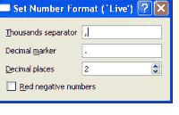

### **图 5.7 “实时”设置数字格式对话框**

我们可以用与上一个对话框完全相同的方式创建这个对话框，但我们将会展示一种不同的方法。我们不是需要在时创建对话框，用完即销毁（每次使用时创建和销毁），而是只在第一次需要时创建一次，然后在用户完成使用时将其隐藏，每次使用时显示和隐藏。

```python
def setNumberFormat3(self):
    if self.numberFormatDlg is None:
        self.numberFormatDlg = numberFormatDlg3.NumberFormatDlg(
            self.format, self.refreshTable, self)
    self.numberFormatDlg.show()
    self.numberFormatDlg.raise_()
    self.numberFormatDlg.activateWindow()
```

在调用表单的初始化程序中，我们有语句 `self.numberFormatDlg = None`。这确保了第一次调用此方法时对话框会被创建。然后，我们像以前一样显示对话框。但在这种情况下，当对话框关闭时，它只是被隐藏（因为我们没有设置 `Qt.WA_DeleteOnClose` 控件属性）。因此，当调用此方法时，我们可能是在第一次创建并显示对话框，也可能是在显示一个之前创建随后被隐藏的对话框。为了考虑后一种可能性，我们必须同时提高（raise，将对话框置于应用程序中所有其他窗口之上）和激活（activate，将焦点赋予对话框）它；第一次执行这些操作是无害的。*

此外，我们还让这个对话框比上一个更智能，并且没有设置信号-槽连接，而是将绑定的 `refreshTable()` 方法作为额外参数传递给对话框。

`__init__()` 方法与以前几乎相同，只有三个不同之处。第一，它不设置 `Qt.WA_DeleteOnClose` 属性，以便对话框关闭时会被隐藏而不是被删除。第二，它保留所传递方法的副本（即，在 `self.callback` 中保留对 `self.refreshTable()` 的引用），并且

*PyQt 使用 `raise_()` 而不是 `raise()`，以避免与内置的 raise 语句冲突。


## 5.5 智能对话框

第三，它的信号和槽连接与此前略有不同。以下是连接调用：

```python
self.connect(self.thousandsEdit,
             SIGNAL("textEdited(QString)"), self.checkAndFix)
self.connect(self.decimalMarkerEdit,
             SIGNAL("textEdited(QString)"), self.checkAndFix)
self.connect(self.decimalPlacesSpinBox,
             SIGNAL("valueChanged(int)"), self.apply)
self.connect(self.redNegativesCheckBox,
             SIGNAL("toggled(bool)"), self.apply)
```

如前所述，我们可以依赖小数位数微调框来确保只设置了有效的位数，类似地，“红色负数”复选框也只能处于有效状态，因此对其中任何一项的更改都可以立即应用。

但对于单行编辑框，我们现在连接它们的 `textEdited()` 信号。每当用户在这些编辑框中输入或删除字符时，这些信号都会发出。`checkAndFix()` 槽既确保单行编辑框持有有效文本，又立即应用更改。此对话框中没有按钮：用户可以通过按 Esc 键来关闭它，这将使其隐藏。只有当调用它的表单被删除时，该对话框才会被删除，因为在那时调用者的 `self.numberFormatDlg` 实例变量将超出作用域，由于没有其他对该对话框的引用，它将被安排进行垃圾回收。

```python
def apply(self):
    self.format["thousandsseparator"] = \
        unicode(self.thousandsEdit.text())
    self.format["decimalmarker"] = \
        unicode(self.decimalMarkerEdit.text())
    self.format["decimalplaces"] = \
        self.decimalPlacesSpinBox.value()
    self.format["rednegatives"] = \
        self.redNegativesCheckBox.isChecked()
    self.callback()
```

`apply()` 方法是我们目前所见最简单的。这是因为它仅在所有编辑控件持有有效数据时才会被调用，因此不需要事后验证。它不再发出信号来宣布状态变化——相反，它调用传递给它的方法，该方法直接对调用者的表单应用更改。

```python
def checkAndFix(self):
    thousands = unicode(self.thousandsEdit.text())
    decimal = unicode(self.decimalMarkerEdit.text())
    if thousands == decimal:
        self.thousandsEdit.clear()
        self.thousandsEdit.setFocus()
    if len(decimal) == 0:
        self.decimalMarkerEdit.setText(".")
        self.decimalMarkerEdit.selectAll()
        self.decimalMarkerEdit.setFocus()
    self.apply()
```

此方法在用户在任一单行编辑框中输入时应用预防性验证。我们仍然依赖单行编辑框验证器、最大长度属性，以及在小数标记单行编辑框的情况下，使用输入掩码，所有这些结合提供了我们所需的大部分验证。但仍然有可能用户将相同的文本设置到两个编辑框中——在这种情况下，我们删除千位分隔符并将焦点移动到其编辑框；或者（如果用户极力尝试）小数位标记为空——在这种情况下，我们设置一个有效的替代值，选中它并赋予其键盘焦点。在末尾，我们知道两个单行编辑框都是有效的，因此我们可以调用 `apply()` 并应用更改。

使用显示/隐藏方法的一个好处是对话框的状态会自动保持。如果我们必须每次使用它时都创建对话框，就必须填充数据，但对于此对话框，每当它显示时（首次之后），它已经拥有正确的数据。当然，在这个特定示例中，我们有三个对话框都用于编辑相同的数据，这意味着此对话框可能会失去同步；我们忽略这个问题，因为在真实应用中不会让多个对话框编辑相同的数据。

通过传入数据结构（格式字典）和调用者的更新方法（`refreshTable()`，作为 `self.callback` 传入），我们使这个对话框非常“智能”——并且与其调用者紧密耦合。因此，许多程序员倾向于使用标准对话框这种“折中方案”——笨对话框功能过于有限且使用不便，而智能对话框由于其对调用者数据结构的知识所隐含的紧密耦合，维护起来可能工作量更大。

## 摘要

我们将对话框分为三种“智能”类型：笨对话框、标准对话框和智能对话框，并展示了它们可以以模态或非模态方式使用。笨对话框易于创建，对于执行控件级别的验证完全足够。笨对话框通常以模态方式使用，如果我们仔细处理，由于它们与应用逻辑的耦合非常松散，因此可以通用化。尽管如此，使用笨对话框通常会导致程序员沮丧，并需要重写为标准或智能对话框，因此最好避免使用它们，除非在仅需一两个值且内置的 QInputDialog 静态对话框不适用的非常简单的情况下。

最常见的选择是标准模态对话框和智能非模态对话框之间，而在后者情况下，则在于“应用”风格和“实时”风格之间。

模态对话框编程最容易，因为它们阻塞了与对话框父窗口及其同级窗口的其他交互，从而降低了它们正在处理的数据被背后修改的风险。但有些用户更喜欢非模态对话框，当用户希望在决定之前尝试各种选项时，非模态对话框特别方便。如果模态对话框提供某种预览，也可以用于此目的；例如，字体对话框通常是模态的，并显示反映用户字体设置变化的示例文本。

我们考察的两种验证策略——事后验证和预防性验证——可以单独使用或组合使用。从可用性角度看，预防性验证通常被认为更优，尽管它可能导致用户沮丧。例如，当表单上其他地方的设置导致该设置无效时，用户可能会抱怨（“我想将其设为五，但它不让我设置”）。

可以设计一个对话框，使其既可用于添加项目也可用于编辑项目。当涉及到控件的创建、布局和连接时，这些添加/编辑对话框与其他类型的对话框没有区别。关键区别在于，它们可能需要根据是添加还是编辑而表现出不同的行为。在编辑时，控件从传入的项目中填充；在添加时，控件以默认值填充。如果接受对话框，它可能仅提供访问器，通过这些访问器可以检索设置的值，将工作留给调用者；或者它可能是智能的，能够直接更新已编辑的项目，并在用户添加时创建新项目。参见 `chap08/additemmodel.py` 中的 AddEditTextViewDlg 类（其用户界面设计在 `chap08/additemmodelVUI.ui` 中）和 `chap12/pagesdesigner.pwy` 中的 TextItemDlg 类，作为添加/编辑项目对话框的示例。

另一种可能性是根本不使用对话框，而是允许用户就地编辑数据——例如，在列表或表格中。这种方法在关于模型/视图编程的章节中有所涵盖。

## 练习

编写一个独立的字符串列表编辑对话框。该对话框应使用 `if __name__ == "__main__":`，以便可以独立运行和测试。它应类似于图 5.8 中显示的对话框。

字符串应保存在 `QListWidget` 中。排序按钮的实现很简单，因为我们可以将其 `clicked()` 信号直接连接到 `QListWidget.sortItems()` 方法。

该对话框应针对其自身的字符串列表，无论是传入列表的副本还是它自己创建的列表，当被接受时应发出包含列表（作为 `QStringList`）的信号，并且还应有一个公开可访问的数据属性 `stringlist`。

`reject()` 槽应实现如下：


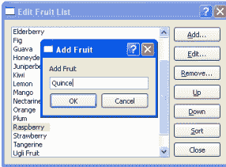

**图 5.8** 正在添加项目的字符串列表对话框

```python
def reject(self):
    self.accept()
```

为了测试目的，请在文件末尾添加以下代码：

```python
if __name__ == "__main__":
    fruit = ["Banana", "Apple", "Elderberry", "Clementine", "Fig",
             "Guava", "Mango", "Honeydew Melon", "Date", "Watermelon",
             "Tangerine", "Ugli Fruit", "Juniperberry", "Kiwi",
             "Lemon", "Nectarine", "Plum", "Raspberry", "Strawberry",
             "Orange"]
    app = QApplication(sys.argv)
    form = StringListDlg("Fruit", fruit)
    form.exec_()
    print "\n".join([unicode(x) for x in form.stringlist])
```

这创建了一个 StringListDlg 实例，其中包含一个用于命名列表中事物种类的字符串以及一个字符串列表，然后以模态方式调用它。当用户关闭对话框时，我们在控制台上打印字符串列表，以便查看我们编辑的效果。

你需要阅读 QListWidget 的文档，以及用于获取要添加的字符串和编辑现有字符串的 QInputDialog.getText() 的文档。这个练习大约可以用 120 行代码完成。

参考答案位于文件 chap05/stringlistdlg.py 中。可以通过运行程序来测试它。（在 Windows 上，应从控制台运行；在 Mac OS X 上，应从终端运行。）

- 创建主窗口
- 处理用户操作

# 主窗口

大多数应用程序都是主窗口风格的应用程序，也就是说，它们具有菜单栏、工具栏、状态栏、中心区域以及可能的停靠窗口，旨在为用户提供丰富且易于导航和理解的用户界面。在本章中，我们将学习如何创建一个主窗口风格的应用程序，以展示如何创建和使用所有这些功能。

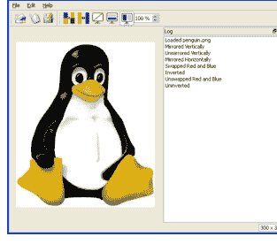

> 图 6.1 图像变更器应用程序

我们将使用图 6.1 中所示的图像变更器应用程序来演示如何创建主窗口风格的应用程序。与大多数此类应用程序一样，它具有菜单、工具栏和状态栏；它还有一个停靠窗口。除了学习如何创建所有这些用户界面元素外，我们还将涵盖如何将用户与这些元素的交互关联到执行相关操作的方法。

本章还解释了如何处理新文件的创建和现有文件的打开，包括使用户界面与应用程序状态保持同步。还涵盖了如何让用户有机会保存未保存的更改，以及如何管理最近使用的文件列表。我们还将展示如何保存和恢复用户偏好设置，包括主窗口以及工具栏和停靠窗口的大小和位置。

大多数应用程序都有一个用于保存数据的数据结构，并通过一个或多个部件让用户查看和编辑数据。图像变更器应用程序在单个 QImage 对象中保存其数据，并使用 QLabel 部件作为其数据查看器。在第 8 章中，我们将看到一个用于呈现和编辑大量数据项的主窗口风格应用程序，在第 9 章中，我们将学习如何创建可以处理多个文档的主窗口应用程序。

在查看如何创建应用程序之前，我们将讨论用户界面必须维护的一些状态。通常，一些菜单选项和工具栏按钮是“可复选”的，也就是说，它们可以处于两种状态之一。例如，在文字处理器中，用于切换斜体文本的工具栏按钮可以是“开”（按下）或“关”。如果还有一个斜体菜单选项，我们必须确保菜单选项和工具栏按钮保持同步。幸运的是，PyQt 使得实现这种同步变得非常容易。

一些选项可能是相互依赖的。例如，文本可以左对齐、居中或右对齐，但在任何时候只能有一个处于“开”状态。因此，如果用户切换了居中对齐，左对齐和右对齐的工具栏按钮和菜单选项必须切换为关。同样，PyQt 使得同步这种相互依赖的选项变得很简单。在本章中，我们将涵盖不可复选的选项，如“打开文件”，以及独立的和相互依赖的可复选选项。

尽管某些菜单和工具栏选项可以立即影响应用程序的数据，但其他选项用于调用对话框，通过它们用户可以精确指定想要执行的操作。由于我们在前 two 章中对对话框进行了大量介绍，因此在这里我们将重点介绍如何使用它们，而不是如何创建它们。在本章中，我们将学习如何调用自定义对话框，以及如何使用 PyQt 的许多内置对话框，包括选择文件名的对话框、打印对话框以及向用户询问数据项（如字符串或数字）的对话框。

# 创建主窗口

对于大多数主窗口风格的应用程序，主窗口的创建遵循相似的模式。我们通过创建和初始化一些数据结构开始，然后创建一个将占据主窗口中心区域的“中心部件”，接着创建并设置任何停靠窗口。接下来，我们创建“动作”并将它们插入到菜单和工具栏中。读取应用程序设置也很常见，对于恢复用户工作区的

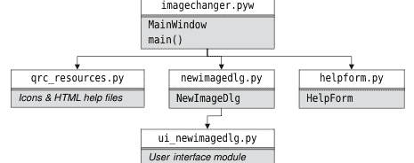

**图 6.2 图像变更器的模块、类和函数**

应用程序，将加载上次终止时打开的文件。

构成图像变更器应用程序的文件如图 6.2 所示。应用程序的主窗口类位于文件 chap06/imagechanger.pyw 中。初始化器相当长，因此我们将分部分查看它。但首先，让我们查看类定义之前的导入。

```python
import os
import platform
import sys
from PyQt4.QtCore import *
from PyQt4.QtGui import *
import helpform
import newimagedlg
import qrc_resources

_version_ = "1.0.0"
```

在这本书中，惯例是先导入 Python 的标准模块，然后是第三方模块（如 PyQt），最后是我们自己的模块。我们将在代码中使用 os 和 platform 模块中的项时讨论它们。sys 模块通常用于提供 sys.argv。helpform 和 newimagedlg 模块提供 HelpForm 和 NewImageDlg 类。我们将稍后讨论 qrc_resources 模块。

应用程序通常有一个版本字符串，惯例是将其命名为 _version_；我们将在应用程序的关于框中使用它。

现在我们可以查看 MainWindow 类的开头。

```python
class MainWindow(QMainWindow):
    def __init__(self, parent=None):
        super(MainWindow, self).__init__(parent)
```

```python
        self.image = QImage()
        self.dirty = False
        self.filename = None
        self.mirroredVertically = False
        self.mirroredHorizontally = False
```

初始化器以传统的 super() 调用开始。接下来，我们创建一个空的 QImage，我们将用它来保存用户加载或创建的图像。QImage 不是 QObject 的子类，因此不需要父级；相反，我们可以将其删除交给 Python 在应用程序终止时进行正常的垃圾收集。我们还创建了一些实例变量。我们使用 dirty 作为布尔标志来指示图像是否有未保存的更改。filename 最初设置为 None，我们用它来指示要么没有图像，要么有一个从未保存过的新创建图像。

PyQt 提供了各种镜像功能，但对于这个示例应用程序，我们仅限于三种可能性：垂直镜像、水平镜像或不镜像。我们需要跟踪镜像状态，以便保持用户界面同步，当我们讨论镜像操作时将会看到。

```python
        self.imageLabel = QLabel()
        self.imageLabel.setMinimumSize(200, 200)
        self.imageLabel.setAlignment(Qt.AlignCenter)
        self.imageLabel.setContextMenuPolicy(Qt.ActionsContextMenu)
        self.setCentralWidget(self.imageLabel)
```

在某些应用程序中，中心部件是一个复合部件（由其他部件组成的部件，布局方式与对话框中的部件类似）或基于项的部件（如列表或表格），但在这里单个 QLabel 就足够了。QLabel 可以显示纯文本、HTML 或 PyQt 支持的任何图像格式的图像；稍后我们将看到如何发现这些格式，因为它们可能会有所不同。我们设置了最小尺寸，因为最初标签没有内容可显示，因此不会占用空间，这会显得很奇怪。我们选择将图像垂直和水平居中对齐。

PyQt 提供了创建上下文菜单的许多方法，但我们将使用最简单且最常见的方法。首先，我们必须为希望拥有上下文菜单的部件设置上下文菜单策略。然后，我们必须向该部件添加一些动作——这是我们稍后要做的事情。当用户调用上下文菜单时，菜单将弹出，显示已添加的动作。

与使用布局的对话框不同，在主窗口风格的应用程序中，我们永远只有一个中心部件——尽管这个部件可以是复合的，因此实际上没有限制。我们只需要调用 setCentralWidget() 就完成了。该方法既将部件布局在主窗口的中心区域，又将部件重新父化，使主窗口拥有它。

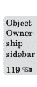


### 图 6.3 QMainWindow 的各个区域

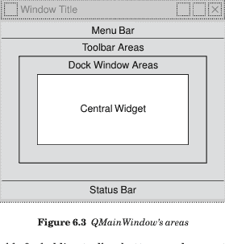

工具栏适合放置工具栏按钮，以及某些其他类型的小部件，如下拉框和数字框。对于较大的小部件、工具板，或者任何我们希望用户能够将其拖出窗口并作为独立窗口自由浮动的小部件，使用停靠窗口通常是一个正确的选择。

停靠窗口是可以出现在图 6.3 所示的停靠区域中的窗口。它们有一个小的标题栏，以及恢复和关闭按钮，并且可以从一个停靠区域拖动到另一个，或者作为独立的顶级窗口自由浮动。当它们被停靠时，它们会自动在自身与中央区域之间提供一个分隔器，这使得它们很容易调整大小。

在 PyQt 中，停靠窗口是 `QDockWidget` 类的实例。我们可以向停靠窗口添加一个小部件，就像我们可以在主窗口的中央区域只有一个部件一样，同样，这也不是限制，因为添加的部件可以是复合部件。

```python
logDockWidget = QDockWidget("Log", self)
logDockWidget.setObjectName("LogDockWidget")
logDockWidget.setAllowedAreas(Qt.LeftDockWidgetArea |
    Qt.RightDockWidgetArea)

self.listWidget = QListWidget()
logDockWidget.setWidget(self.listWidget)
self.addDockWidget(Qt.RightDockWidgetArea, logDockWidget)
```

停靠部件不会被放入布局中，因此当我们要创建它们时，除了提供它们的窗口标题外，还必须为它们指定一个父对象。通过设置父对象，我们确保停靠部件不会超出作用域并在错误的时间被 Python 垃圾回收。相反，当它的父对象（顶级窗口，即主窗口）被删除时，停靠部件也会被删除。

每个 PyQt 对象都可以被赋予一个对象名称，尽管到目前为止我们从未这样做过。对象名称有时在调试中可能有用，但在这里我们设置它是因为我们希望 PyQt 保存和恢复停靠部件的大小和位置，并且由于可能有很多个停靠部件，PyQt 使用对象名称来区分它们。

默认情况下，停靠部件可以被拖入任何停靠区域，并且是可移动的、可浮动的和可关闭的。由于我们的停靠部件将用于存储一个列表——一个通常是高而窄的小部件——它只应该位于左侧或右侧的停靠区域（或者浮动），因此我们使用 `setAllowedAreas()` 来限制区域。停靠部件还有一个 `setFeatures()` 方法，用于控制停靠部件是否可以移动、浮动或关闭，但在这里我们不需要使用它，因为默认设置就很好了。

一旦设置好停靠部件，我们就会创建它将容纳的小部件，在本例中是一个列表小部件。然后将该小部件添加到停靠部件中，并将停靠部件添加到主窗口中。我们不需要为列表小部件指定父对象，因为当它被添加到停靠部件时，停靠部件就会接管它的所有权。

```python
self.printer = None
```

我们希望用户能够打印他们的图像。为此，我们需要创建一个 `QPrinter` 对象。我们可以每次需要时创建打印机，然后让它被垃圾回收。但我们更喜欢保留一个实例变量，初始值设置为 `None`。第一次用户要求打印时，我们将创建一个 `QPrinter` 并将其赋值给我们的 printer 变量。这有两个好处。首先，我们只在需要时创建打印机对象；其次，因为我们保留了它的引用，它会一直存在——并保留所有之前的状态，如用户选择的打印机、纸张大小等。

```python
self.sizeLabel = QLabel()
self.sizeLabel.setStyleSheet(QFrame.StyledPanel | QFrame.Sunken)
status = self.statusBar()
status.setSizeGripEnabled(False)
status.addPermanentWidget(self.sizeLabel)
status.showMessage("Ready", 5000)
```

对于应用程序的状态栏，我们希望左侧有常规的消息区域，以及一个显示当前图像宽度和高度的状态指示器。我们通过创建一个 `QLabel` 小部件并将其添加到状态栏来实现这一点。我们还关闭状态栏的大小调节握把，因为当有一个显示图像维度的指示器标签时，这似乎不太合适。状态栏本身是在我们第一次调用 `QMainWindow` 的 `statusBar()` 方法时为我们创建的。如果我们用字符串调用状态栏的 `showMessage()` 方法，该字符串将显示在状态栏中，并会保持显示，直到另一个 `showMessage()` 调用替换它，或者直到调用 `clearMessage()`。我们使用了双参数形式，第二个参数是消息应显示的毫秒数（5000，即 5 秒）；在此时间后，状态栏将自行清除。

到目前为止，我们已经了解了如何创建主窗口的中央小部件、创建停靠部件以及设置状态栏。现在，我们几乎准备好创建菜单和工具栏了，但首先我们必须理解 PyQt 的操作是什么，然后再短暂绕道去学习资源。

## 操作与按键序列

Qt 的设计者认识到，用户界面通常提供多种不同的方式让用户完成相同的事情。例如，在许多应用程序中，创建新文件可以通过“文件→新建”菜单选项、点击“新文件”工具栏按钮  或使用 Ctrl+N 键盘快捷键来完成。通常，我们不关心用户如何请求执行操作，只关心他们请求执行的操作本身。PyQt 使用 `QAction` 类封装用户操作。因此，例如，要创建一个“新建文件”操作，我们可以编写如下代码：

```python
fileNewAction = QAction(QIcon("images/filenew.png"), "&New", self)
fileNewAction.setShortcut(QKeySequence.New)
helpText = "Create a new image"
fileNewAction.setToolTip(helpText)
fileNewAction.setStatusTip(helpText)
self.connect(fileNewAction, SIGNAL("triggered()"), self.fileNew)
```

这假设我们有一个合适的图标和一个 `fileNew()` 方法。菜单项文本中的 `&` 符号意味着菜单项将显示为 **New**（除了 Mac OS X 或者窗口系统设置为抑制下划线的情况），并且键盘用户可以通过按 Alt+F 调用它，假设 File 菜单的文本是“&File”，使其显示为 File。或者，用户可以使用 `setShortcut()` 创建的快捷键，只需按 Ctrl+N 即可。

许多按键序列都是标准化的，甚至跨不同的窗口系统也是如此。例如，Windows、KDE 和 GNOME 都使用 Ctrl+N 表示“新建”，Ctrl+S 表示“保存”。Mac OS X 类似，使用 Command+N 和 Command+S 表示这些操作。PyQt 4.2 中的 `QKeySequence` 类提供了标准化按键序列的常量，如 `QKeySequence.New`。这在标准化按键序列在不同窗口系统之间有所不同，或者一个操作关联多个按键序列时特别有用。例如，如果我们设置快捷键为 `QKeySequence.Paste`，PyQt 将在 Windows 上响应 Ctrl+V 或 Shift+Ins 触发“粘贴”操作；在 KDE 和 GNOME 上响应 Ctrl+V、Shift+Ins 或 F18；在 Mac OS X 上响应 Command+V。

对于非标准化的按键序列（或者如果我们想要与早期 PyQt 版本向后兼容），我们可以将快捷键作为字符串提供，例如 `setShortcut("Ctrl+Q")`。本书使用可用的标准化按键序列，否则回退到使用字符串。


### 表 6.1 选定的 QAction 方法

| 语法 | 描述 |
| :--- | :--- |
| `a.data()` | 返回 `QAction` `a` 的用户数据，类型为 `QVariant` |
| `a.setData(v)` | 将 `QAction` `a` 的用户数据设置为 `QVariant` `v` |
| `a.isChecked()` | 如果 `QAction` `a` 被选中，则返回 `True` |
| `a.setChecked(b)` | 根据 `bool` `b` 选中或取消选中 `QAction` `a` |
| `a.isEnabled()` | 如果 `QAction` `a` 被启用，则返回 `True` |
| `a.setEnabled(b)` | 根据 `bool` `b` 启用或禁用 `QAction` `a` |
| `a.setSeparator(b)` | 根据 `bool` `b` 将 `QAction` `a` 设置为普通操作或分隔符 |
| `a.setShortcut(k)` | 将 `QAction` `a` 的键盘快捷键设置为 `QKeySequence` `k` |
| `a.setStatusTip(s)` | 将 `QAction` `a` 的状态提示文本设置为字符串 `s` |
| `a.setText(s)` | 将 `QAction` `a` 的文本设置为字符串 `s` |
| `a.setToolTip(s)` | 将 `QAction` `a` 的工具提示文本设置为字符串 `s` |
| `a.setWhatIsThis(s)` | 将 `QAction` `a` 的“这是什么？”文本设置为字符串 `s` |
| `a.toggled(b)` | 当 `QAction` `a` 的选中状态改变时发出此信号；如果操作被选中，`bool` `b` 为 `True` |
| `a.triggered(b)` | 当调用 `QAction` `a` 时发出此信号；可选的 `bool` `b` 在 `QAction` `a` 被选中时为 `True` |

请注意，我们为 `QAction` 指定了父对象 `self`（该操作适用的表单形式）。每个 `QObject` 子类（顶级窗口除外）都有父对象这一点很重要；对于小部件，这通常是通过布局实现的，但对于像 `QAction` 这样的纯数据对象，我们必须显式提供父对象。

一旦创建好操作，我们可以像这样将其添加到菜单和工具栏中：

```python
fileMenu.addAction(fileNewAction)
fileToolbar.addAction(fileNewAction)
```

现在，每当用户调用“新建文件”操作（通过任何方式）时，`fileNew()` 方法将被调用。

### 资源文件

不幸的是，我们编写的代码存在一个小问题。它假设应用程序的工作目录是应用程序所在的目录。在 Windows 下，这是正常情况，当点击（或双击）`.pyw`（或其快捷方式）时。但如果程序是从命令行执行


### 创建和使用操作

我们之前看到的用于创建“文件新建”操作的代码需要六行来完成创建和设置。大多数主窗口风格的应用程序都有数十种操作，因此为每种操作输入六行代码很快就会变得非常枯燥。为此，我们创建了一个辅助方法，允许我们将创建操作的代码减少到仅两到三行。我们将查看该辅助方法，然后看看它是如何在主窗口的初始化器中使用的。

```python
def createAction(self, text, slot=None, shortcut=None, icon=None, 
                  tip=None, checkable=False, signal="triggered()"):
    action = QAction(text, self)
    if icon is not None:
        action.setIcon(QIcon(":/s.g.png" % icon))
    if shortcut is not None:
        action.setShortcut(shortcut)
    if tip is not None:
        action.setStatusTip(tip)
        action.setToolTip(tip)
    if slot is not None:
        self.connect(action, SIGNAL(signal), slot)
    if checkable:
        action.setCheckable(True)
    return action
```


这个方法完成了我们为“文件新建”操作手动执行的所有功能。此外，它还处理了没有图标以及“可勾选”操作的情况。图标是可选的，尽管对于将要添加到工具栏的操作来说，提供图标是一种惯例。如果操作可以有“开”和“关”状态（类似于文字处理器通常提供的粗体或斜体操作），则该操作是可勾选的。

请注意，`QAction` 构造函数的最后一个参数是 `self`；这是操作的父对象（主窗口），它确保当操作超出初始化器的作用域时不会被垃圾回收。在某些情况下，我们会将操作设为实例变量，以便在表单初始化器之外访问它们，但在这个特定示例中我们不需要这样做。

以下是使用 `createAction()` 辅助方法创建“文件新建”操作的方式：

```python
fileNewAction = self.createAction("&New...", self.fileNew,  
QKeySequence.New,  "filenew", "Create an image file")
```

除了“文件退出”操作（以及“文件另存为”，我们没有为其提供快捷键）之外，其他文件操作以相同的方式创建，因此我们不会浪费空间来展示它们。

```python
fileQuitAction = self.createAction("&Quit", self.close,  
"Ctrl+Q", "filequit", "Close the application")
```

`QKeySequence` 类没有应用程序终止的标准化快捷键，因此我们自行选择一个并将其指定为字符串。我们也可以轻松地使用不同的快捷键——例如，`Alt+X` 或 `Alt+F4`。

`close()` 槽是从 `QMainWindow` 继承的。如果主窗口通过调用“文件退出”操作（我们刚刚将其连接到 `close()` 槽）来关闭，例如通过点击 `File→Quit` 或按下 `Ctrl+Q`，基类的 `close()` 方法将被调用。但如果用户点击应用程序的关闭按钮 `X`，`close()` 方法不会被调用。

我们确保拦截关闭窗口尝试的唯一方法是重新实现关闭事件处理器。无论应用程序是通过 `close()` 方法还是通过关闭按钮关闭，关闭事件处理器总是会被调用。因此，通过重新实现这个事件处理器，我们可以给用户机会保存任何未保存的更改，并且可以保存应用程序的设置。

一般来说，我们可以通过高级信号和槽机制纯粹实现应用程序的行为，但在这个重要情况下，我们必须使用更低级别的事件处理机制。然而，重新实现关闭事件与重新实现其他任何方法并无不同，而且也不困难，正如我们稍后会看到的那样。（事件处理在第10章中介绍。）

编辑操作以类似的方式创建，但由于细微的差异，我们将查看其中的一些。

```python
editZoomAction = self.createAction("&Zoom…", self.editZoom, "Alt+Z", "editzoom", "Zoom the image")
```

能够放大和缩小以查看更多或少许细节对用户来说是很方便的。我们在工具栏中提供了一个数字框，允许鼠标用户更改缩放系数（稍后将讨论），但我们也必须支持键盘用户，因此为他们创建一个“编辑缩放”操作，该操作将被添加到编辑菜单中。当触发时，连接到此操作的方法将弹出一个对话框，用户可以在其中输入缩放百分比。

放大和缩小有标准化的按键序列，但一般缩放没有，因此在这种情况下我们选择使用 `Alt+Z`。（我们没有使用 `Ctrl+Z`，因为这是大多数平台上撤销操作的标准化按键序列。）

```python
editInvertAction = self.createAction("&Invert", self.editInvert, "Ctrl+I", "editinvert", "Invert the image's colors", True, "toggled(bool)")
```

“编辑反转”操作是一个切换操作。我们仍然可以使用 `triggered()` 信号，但那样我们需要在操作上调用 `isChecked()` 来查找其状态。使用 `toggled(bool)` 信号对我们来说更方便，因为它不仅告诉我们操作已被调用，还告诉我们它是否被选中。操作还有一个 `triggered(bool)` 信号，仅针对用户更改发出，但这里不适用，因为无论反转操作的选中状态是由用户还是通过程序更改的，我们都希望对其做出反应。

“编辑交换红色和蓝色”操作与“编辑反转”操作类似，因此我们不会展示它。

与“编辑反转”操作和“编辑交换红色和蓝色”操作一样，镜像操作也是可以勾选的，并且与独立的“反转”和“交换红色和蓝色”操作不同，我们选择使镜像操作互斥，使得在任何时刻只能有一个是“开”的。要获得这种行为，我们以正常方式创建镜像操作，但将每个添加到“操作组”中。操作组是一个类，它管理一组可勾选操作并确保如果其中一个管理操作被设置为“开”，其他所有操作都被设置为“关”。

```python
mirrorGroup = QActionGroup(self)
```

操作组是 `QObject` 的子类，它既不是顶层窗口也不是布局过的部件，因此我们必须赋予它一个明确的父对象，以确保它在正确的时间由 PyQt 删除。


创建动作组后，我们像之前一样创建动作，只是现在将每个动作添加到动作组中。

```python
editUnMirrorAction = self.createAction("&Unmirror", self.editUnMirror,
                                        "Ctrl+I", "editUnmirror",
                                        "Unmirror the image", True,
                                        "toggled(bool)")
mirrorGroup.addAction(editUnMirrorAction)
```

我们没有展示“编辑垂直镜像”或“编辑水平镜像”动作的代码，因为这与前面展示的代码几乎相同。

```python
editUnMirrorAction.setChecked(True)
```

可勾选动作的默认状态为“关闭”，但像这样每次必须有一个处于“开启”状态的动作组，我们首先必须选择其中一个使其开启。在这种情况下，最初开启“取消镜像”（edit unmirror）动作是最合理的。勾选该动作会触发其 toggled() 信号的发射，但在此阶段 QImage 为空（null），正如我们将看到的，对空图像不会应用任何更改。

我们再创建两个动作：“关于帮助”（help about）和“帮助”（help help），其代码与我们已经看到的非常相似。

虽然所有动作都已存在，但它们实际上都不能工作！这是因为只有当动作被添加到菜单、工具栏或两者中时，它们才会生效。

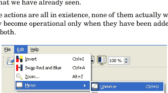

**图 6.4** 编辑菜单及其镜像（Mirror）子菜单

菜单栏中的菜单是通过访问主窗口的菜单栏来创建的（菜单栏在第一次调用 menuBar() 时创建，就像状态栏一样）。以下是创建编辑菜单的代码：

```python
editMenu = self.menuBar().addMenu("&Edit")
self.addActions(editMenu, (editInvertAction, editSwapRedAndBlueAction,
                           editZoomAction))
```

我们创建了编辑菜单，然后使用 addActions() 向其中添加了一些动作。这足以产生如图 6.4 所示的编辑菜单，除了镜像选项稍后会讨论。

动作使用 addAction() 添加到菜单和工具栏中。为了减少输入量，我们创建了一个小巧的辅助方法，可用于向菜单或工具栏添加动作，也可以添加分隔符。以下是其代码：

```python
def addActions(self, target, actions):
    for action in actions:
        if action is None:
            target.addSeparator()
        else:
            target.addAction(action)
```

目标（target）是菜单或工具栏，而动作（actions）是一个动作或 Nones 的列表或元组。我们本可以使用内置的 QWidget.addAction() 方法，但那样我们就必须创建分隔符动作（稍后展示），而不是使用 Nones。

编辑菜单的最后一个选项“镜像”右侧有一个小三角形。这表示它有一个子菜单。

```python
mirrorMenu = editMenu.addMenu(QIcon(":/editmirror.png"), "&Mirror")
self.addActions(mirrorMenu, (editUnMirrorAction,
                             editMirrorHorizontalAction,
                             editMirrorVerticalAction))
```

子菜单的填充方式与其他任何菜单完全相同，但它们是通过 QMenu.addMenu() 添加到其父菜单中，而不是通过 QMainWindow.menuBar().addMenu() 添加到主窗口的菜单栏中。创建镜像菜单后，我们使用 addActions() 辅助方法向其中添加动作，就像之前所做的那样。

大多数菜单都是像编辑菜单一样创建并填充动作的，但文件菜单有所不同。

```python
self.fileMenu = self.menuBar().addMenu("&File")
self.fileMenuActions = (fileNewAction, fileOpenAction,
                       fileSaveAction, fileSaveAsAction, None,
                       filePrintAction, fileQuitAction)
self.connect(self.fileMenu, SIGNAL("aboutToShow()"),
             self.updateFileMenu)
```

我们希望文件菜单显示最近使用的文件。出于这个原因，我们在这里不填充文件菜单，而是每当用户调用它时动态生成它。这就是为什么我们将文件菜单设为实例变量，也是为什么我们有一个持有文件菜单动作的实例变量。这个连接确保了每当文件菜单被调用时，我们的 updateFileMenu() 槽函数将被调用。我们将稍后回顾这个槽函数。

帮助菜单按惯例创建，方式与编辑菜单相同，因此我们不再展示。


**图 6.5** *文件工具栏*

在菜单就位后，我们现在可以转向工具栏了。

```python
fileToolBar = self.addToolBar("File")
fileToolBar.setObjectName("FileToolBar")
self.addActions(fileToolBar, (fileNewAction, fileOpenAction,
                              fileSaveAction))
```

创建工具栏类似于创建菜单：我们调用 addToolBar() 来创建 QToolBar 对象，并使用 addActions() 进行填充。我们可以将 addActions() 方法用于菜单和工具栏，因为它们的 API 非常相似，都提供了 addAction() 和 addSeparator() 方法。我们设置对象名称以便 PyQt 可以保存和恢复工具栏的位置——可以存在任意数量的工具栏，PyQt 使用对象名称来区分它们，就像对停靠小部件所做的那样。生成的工具栏如图 6.5 所示。

编辑工具栏和可勾选动作（“编辑反转”、“编辑交换红色和蓝色”以及镜像动作）都以同样的方式创建。但如图 6.6 所示，编辑工具栏除了工具栏按钮外还有一个数字输入框（spinbox）。鉴于此，我们将完整展示此工具栏的代码，为了便于解释，将其分为两部分展示。

```python
editToolBar = self.addToolBar("Edit")
editToolBar.setObjectName("EditToolBar")
self.addActions(editToolBar, (editInvertAction,
                              editSwapRedAndBlueAction,
                              editUnMirrorAction,
                              editMirrorVerticalAction,
                              editMirrorHorizontalAction))
```

创建工具栏并向其中添加动作，对于所有工具栏来说都是一样的。

我们希望为用户提供一种快速改变缩放因子的方法，因此我们在编辑工具栏中提供一个数字输入框（spinbox）来实现这一点。前面，我们在编辑菜单中放置了一个独立的“编辑缩放”动作，以照顾键盘用户。

```python
self.zoomSpinBox = QSpinBox()
self.zoomSpinBox.setRange(1, 400)
self.zoomSpinBox.setSuffix(" %")
self.zoomSpinBox.setValue(100)
self.zoomSpinBox.setToolTip("Zoom the image")
self.zoomSpinBox.setStatusTip(self.zoomSpinBox.toolTip())
self.zoomSpinBox.setFocusPolicy(Qt.NoFocus)
self.connect(self.zoomSpinBox,
             SIGNAL("valueChanged(int)"), self.showImage)
editToolBar.addWidget(self.zoomSpinBox)
```


**图 6.6** 编辑工具栏

向工具栏添加小部件的模式始终相同：我们创建小部件，设置它，将其连接到处理用户交互的对象，并将其添加到工具栏中。我们将数字输入框设为实例变量，因为我们需要在主窗口的初始化程序之外访问它。addWidget() 调用将数字输入框的所有权传递给工具栏。

至此，我们已完全用动作填充了菜单和工具栏。虽然每个动作都被添加到了菜单中，但其中一些并没有被添加到工具栏中。这很常见；通常只有最常用的动作会被添加到工具栏中。

之前我们看到过这样一行代码：

```python
self.imageLabel.setContextMenuPolicy(Qt.ActionsContextMenu)
```

这告诉 PyQt，如果动作被添加到 imageLabel 小部件中，它们将用于上下文菜单，例如图 6.7 所示的那个。

```python
self.addActions(self.imageLabel, (editInvertAction,
                                  editSwapRedAndBlueAction,
                                  editUnMirrorAction,
                                  editMirrorVerticallyAction,
                                  editMirrorHorizontallyAction))
```

我们可以复用 addActions() 方法向标签小部件添加动作，前提是我们不传递 Nones，因为 QWidget 没有 addSeparator() 方法。设置策略并向小部件添加动作，就是为获得该小部件上下文菜单所需的全部操作。

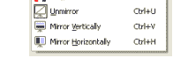

**图 6.7** 图像标签的上下文菜单

QWidget 类有一个 addAction() 方法，该方法被 QMenu、QMenuBar 和 QToolBar 类继承。这就是为什么我们可以向这些类中的任何一个添加动作。虽然 QWidget 类没有 addSeparator() 方法，但在 QMenu、QMenuBar 和 QToolBar 类中提供了该方法以提供便利。如果我们希望向上下文菜单添加分隔符，必须通过添加分隔符动作来实现。例如：


```python
seperator = QAction(self)
seperator.setSeparator(True)
self.addActions(editToolbar, (editInvertAction,
editSwapRedAndBlueAction, seperator, editUnMirrorAction,
editMirrorVerticalAction, editMirrorHorizontalAction()))
```

如果我们需要进行更复杂的上下文菜单处理——例如，菜单的操作取决于应用程序的状态，我们可以重新实现相关控件的 `contextMenuEvent()` 事件处理方法。事件处理将在第 10 章中介绍。

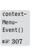

当我们创建新图像或加载现有图像时，我们希望用户界面恢复其初始状态。特别是，我们希望“编辑反相”和“编辑交换红绿通道”操作处于“关闭”状态，并且镜像操作处于“编辑未镜像”状态。

```python
self.resettableActions = ((editInvertAction, False),
(editSwapRedAndBlueAction, False),
(editUnMirrorAction, True))
```

我们创建了一个实例变量，其中包含一个配对元组，每个配对包含一个操作以及在新图像创建或加载时该操作应有的选中状态。当我们审查 `fileNew()` 和 `loadFile()` 槽函数时，将会看到 `resettableActions` 的使用。

在 Image Changer 应用程序中，所有操作始终处于启用状态。由于我们在执行任何操作前都会检查图像是否为空，因此这是可行的，但缺点是，例如，如果没有图像或图像未更改，“文件保存”仍然会被启用，同样，即使没有图像，编辑操作也会保持启用。解决方案是根据应用程序的状态启用或禁用操作，正如侧边栏所示。

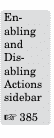

## 恢复和保存主窗口状态

现在主窗口的用户界面已经完全设置好，我们几乎可以完成初始化方法了，但在完成之前，我们需要从上次运行中恢复应用程序设置（如果是第一次运行应用程序，则使用默认设置）。

然而，在查看应用程序设置之前，我们必须稍微绕个弯，看看应用程序对象的创建以及主窗口本身的创建方式。imagechanger.pyw 文件中最后一条可执行语句是一个裸函数调用：

```python
main()
```

通常，我们为第一个执行的函数选择了一个约定俗成的名称。以下是其代码：

```python
def main():
    app = QApplication(sys.argv)
    app.setOrganizationName("Qt rac Ltd.")
    app.setOrganizationDomain("qtrac.eu")
    app.setApplicationName("Image Changer")
    app.setWindowIcon(QIcon(":/icon.png"))
    form = MainWindow()
    form.show()
    app.exec()
```

函数的第一行是我们之前经常看到的。接下来的三行是新的。我们主要使用它们来加载和保存应用程序设置。如果我们创建一个 QSettings 对象而不传递任何参数，它将使用我们在此处设置的组织名称或域名（取决于平台）以及应用程序名称。因此，通过一次在应用程序对象上设置这些内容，我们无需在每次需要 QSettings 实例时都记得传递它们。

但是这些名称代表什么意思？它们被 PyQt 用于将应用程序设置保存在最合适的地方——例如，在 Windows 注册表中，或者在 Linux 上的 $HOME/.config 目录下的某个目录中，或者在 Mac OS X 上的 $HOME/Library/Preferences 中。注册表键或文件/目录名称是从我们赋予应用程序对象的名称派生而来的。

我们可以看出，图标文件是从 qrc_resources 模块加载的，因为其路径以 :/ 开头。

在设置好应用程序对象后，我们创建主窗口，显示它，并以与前几章示例相同的方式启动事件循环。

现在我们可以回到 MainWindow 的 `__init__()` 方法之前停留的地方，看看它是如何恢复系统设置的。

```python
settings = QSettings()
self.recentFiles = settings.value("RecentFiles").toStringList()
size = settings.value("MainWindow/Size",
    QVariant(QSize(600, 500))).toSize()

self.resize(size)
position = settings.value("MainWindow/Position",
    QVariant(QPoint(0, 0))).toPoint()

self.move(position)
self.restoreState(
    settings.value("MainWindow/State").toByteArray())
self.setWindowTitle("Image Changer")
self.updateFileMenu()
QTimer.singleShot(0, self.loadInitialFile)
```

我们首先创建一个 QSettings 对象。由于我们没有传递任何参数，因此将使用应用程序对象持有的名称来定位设置信息。我们首先获取最近使用的文件列表。`QSettings.value()` 方法始终返回一个 QVariant，因此我们必须将其转换为我们期望的数据类型。

接下来，我们使用 `value()` 的双参数形式，其中第二个参数是默认值。这意味着在第一次运行应用程序时，它没有任何设置，因此我们将获得一个宽度为 600 像素、高度为 500 像素的 `QSize()` 对象 *。在后续运行中，返回的大小将是应用程序终止时主窗口的大小——只要我们记得在应用程序终止时保存大小即可。一旦获得大小，我们就将主窗口调整为给定大小。在获取之前（或默认）大小后，我们以完全相同的方式获取并设置位置。

没有闪烁，因为大小调整和定位是在主窗口的初始化器中完成的，而此时窗口尚未实际向用户显示。

Qt 4.2 引入了两个新的 QWidget 方法，用于保存和恢复顶级窗口的几何结构。不幸的是，一个 bug 导致它们在基于 X11 的系统的所有情况下都不可靠，因此我们将窗口的大小和位置作为独立项恢复。Qt 4.3 已修复该 bug，因此在使用 Qt 4.3（例如使用 PyQt 4.3）时，可以使用一行代码代替获取大小和位置并调用 `resize()` 和 `move()`：

```python
self.restoreGeometry(settings.value("Geometry").toByteArray())
```

这假设几何结构在应用程序终止时已保存，当我们查看 `closeEvent()` 时就会明白这一点。

QMainWindow 类提供了 `restoreState()` 方法和 `saveState()` 方法；这些方法从 QByteArray 恢复并保存到 QByteArray。它们保存和恢复的数据是停靠窗口的大小和位置以及工具栏的位置——但它们仅适用于具有唯一对象名称的停靠小部件和工具栏。

在设置完窗口标题后，我们调用 `updateFileMenu()` 来创建文件菜单。与其他菜单不同，文件菜单是动态生成的；这样可以显示任何最近使用的文件。从文件菜单的 `aboutToShow()` 信号到 `updateFileMenu()` 方法的连接意味着，每当用户点击菜单栏中的 File 或按下 Alt+F 时，文件菜单都会重新创建。但在该方法第一次被调用之前，文件菜单并不存在——这意味着，对于尚未添加到工具栏的操作的键盘快捷键（如用于“文件退出”的 Ctrl+O）将不起作用。鉴于此，我们显式调用 `updateFileMenu()` 来创建初始文件菜单并激活键盘快捷键。


## 在启动时进行大量处理

如果我们需要在启动时进行大量处理——例如，如果需要加载大量大文件，我们总是在单独的加载方法中这样做。在主窗体构造器的末尾，通过零超时的一次性定时器调用加载方法。

如果我们不使用一次性定时器会发生什么？例如，想象一下，该方法是 `loadInitialFiles()`，并且它加载了许多多兆字节大小的文件。文件加载将在主窗口创建时进行，即在调用 `show()` 和启动事件循环（`exec()`）之前。这意味着用户可能会体验到启动应用程序后，应用程序窗口实际出现在屏幕上的延迟时间较长。此外，如果文件加载可能会导致弹出消息框（例如，报告错误），那么让这些消息框在主窗口显示后、事件循环运行时出现更有意义。

我们希望主窗口尽快出现，以便用户知道启动成功，并能够通过主窗口的用户界面查看任何长时间运行的过程，如加载大文件。这是通过我们在 Image Changer 示例中使用一次性定时器来实现的。

这之所以有效，是因为超时为零的一次性定时器不会立即执行给定的槽。相反，它将待调用的槽放入事件队列，然后简单返回。此时，主窗口初始化器的末尾被达到，初始化完成。紧接着的下一条语句（在 `main()` 中）是对主窗口的 `show()` 调用，除了向事件队列添加一个显示事件外，它什么都不做。因此，现在事件队列中有一个定时器事件和一个显示事件。超时为零的定时器事件意味着“当事件队列没有其他事情可做时执行此操作”，因此当到达下一条语句 `exec()` 并启动事件循环时，它总是选择先处理显示事件，因此窗体出现，然后，在没有其他事件剩余的情况下，处理一次性定时器的事件，并调用 `loadInitialFiles()`。

初始化器的最后一行看起来相当奇怪。一次性定时器接受一个超时参数（以毫秒为单位）和一个在超时时调用的方法。因此，看起来该行可以写成：

```python
self.loadInitialFile()
```

在这个应用程序中，我们最多只加载一个初始文件，而且该文件即使不超过 1 MB 的可能性也很小，我们可以使用任何一种方法而不会注意到任何区别。尽管如此，直接调用方法与使用超时为零的一次性定时器并不一样，正如“在启动时进行大量处理”侧边栏所解释的那样。


我们已经审查完初始化主窗口的代码，因此现在可以开始查看必须实现的其他方法，以便提供应用程序的功能。虽然“图像更换器”（Image Changer）应用程序只是一个具体的例子，但我们在最大程度上使代码具有通用性或易于适应性，使其可以作为其他主窗口式应用程序（甚至是完全不同的应用程序）的基础。

鉴于我们刚才的讨论，似乎很合适从 `loadInitialFile()` 方法开始我们的介绍。

```python
def loadInitialFile(self):
    settings = QSettings()
    fname = unicode(settings.value("LastFile").toString())
    if fname and QFile.exists(fname):
        self.loadFile(fname)
```

该方法使用 `QSettings` 对象来获取应用程序最后使用的图像。如果存在这样的图像，并且该图像仍然存在，则程序会尝试加载它。当我们涵盖文件操作时，将会复习 `loadFile()`。

我们同样可以写成 `if fname and os.access(fname, os.F_OK):`。在这里没有明显的区别，但在多人项目中，在这种情况下明智的做法可能是制定一个策略，优先使用 PyQt 而不是标准 Python 库，或者反之，仅为了使事情尽可能简单和清晰。

我们之前稍微讨论过恢复应用程序的状态，因此似乎很合适涵盖关闭事件，因为正是在那里我们保存应用程序的状态。

```python
def closeEvent(self, event):
    if self.okToContinue():
        settings = QSettings()
        filename = QVariant(QString(self.filename)) \
                if self.filename is not None else QVariant()
        settings.setValue("LastFile", filename)
        recentFiles = QVariant(self.recentFiles) \
                if self.recentFiles else QVariant()
        settings.setValue("RecentFiles", recentFiles)
        settings.setValue("MainWindow/Size", QVariant(self.size()))
        settings.setValue("MainWindow/Position",
                         QVariant(self.pos()))
        settings.setValue("MainWindow/State",
                         QVariant(self.saveState()))
    else:
        event.ignore()
```

如果用户试图关闭应用程序（除了强制终止或崩溃以外的任何方式），都会调用 `closeEvent()` 方法。我们通过调用自己定制的 `okToContinue()` 方法开始；如果用户确实想要关闭，则该方法返回 `True`，否则返回 `False`。在 `okToContinue()` 内部，我们给用户机会保存未保存的更改。如果用户确实想要关闭，我们创建一个全新的 `QSettings` 对象，并存储“最后文件”（即用户当前打开的文件）、最近使用的文件以及主窗口的状态。`QSettings` 类只读写 `QVariant` 对象，因此我们必须小心地提供空 `QVariant`（使用 `QVariant()` 创建），或者包含正确信息的 `QVariant`。

如果用户选择不关闭，我们在关闭事件上调用 `ignore()`。这将告诉 PyQt 简单地丢弃关闭事件并让应用程序继续运行。

如果我们使用的是 Qt 4.3（例如配合 PyQt 4.3 使用），并且已经使用 `QWidget.restoreGeometry()` 恢复了主窗口的几何信息，我们可以像这样保存几何信息：

```python
settings.setValue("Geometry", QVariant(self.saveGeometry()))
```

如果我们采取这种方法，就不需要单独保存主窗口的大小或位置。

```python
def okToContinue(self):
    if self.dirty:
        reply = QMessageBox.question(self,
            "Image Changer - Unsaved Changes",
            "Save unsaved changes?",
            QMessageBox.Yes | QMessageBox.No |
            QMessageBox.Cancel)
        if reply == QMessageBox.Cancel:
            return False
        elif reply == QMessageBox.Yes:
            self.fileSave()
    return True
```

此方法被 `closeEvent()` 以及“新建文件”和“打开文件”操作使用。如果图像是“脏”的（即有未保存的更改），我们会弹出一个消息框并询问用户想要做什么。如果用户点击“是”，我们将图像保存到磁盘并返回 `True`。如果用户点击“否”，我们简单地返回 `True`，因此未保存的更改将丢失。如果用户点击“取消”，我们返回 `False`，这意味着未保存的更改不会被保存，但当前图像将保持当前状态，因此稍后可以保存它。

书中所有示例都使用“是/否”或“是/否/取消”消息框，以给用户机会保存未保存的更改。一些开发人员青睐的替代方法是使用“保存”和“丢弃”按钮（使用 `QMessageBox.Save` 和 `QMessageBox.Discard` 按钮说明符），而不是使用这些消息框。

最近使用的文件列表是应用程序状态的一部分，不仅在应用程序终止和启动时必须保存和恢复，而且在运行时也必须保持最新。早前我们将 fileMenu 的 `aboutToShow()` 信号连接到一个自定义的 `updateFileMenu()` 槽。因此，当用户按下 Alt+F 或点击“文件”菜单时，此槽会在显示“文件”菜单之前被调用。

```python
def updateFileMenu(self):
    self.fileMenu.clear()
    self.addActions(self.fileMenu, self.fileMenuActions[:-1])
    current = QString(self.filename) \
        if self.filename is not None else None
    recentFiles = []
    for fname in self.recentFiles:
        if fname != current and QFile.exists(fname):
            recentFiles.append(fname)
    if recentFiles:
        self.fileMenu.addSeparator()
        for i, fname in enumerate(recentFiles):
            action = QAction(QIcon("/icon.png"), "&%d %s" % (i + 1, QFileInfo(fname).fileName()), self)
            action.setData(QVariant(fname))
            self.connect(action, SIGNAL("triggered()"),
                         self.loadFile)
            self.fileMenu.addAction(action)
```

### 静态 QMessageBox 方法

**QMessageBox** 类提供了一些静态便利方法，它们会弹出一个带有合适图标和按钮的模态对话框。它们对于提供具有单个 **OK** 按钮，或 **Yes** 和 **No** 按钮以及类似情况的对话框很有用。

最常用的 **QMessageBox** 静态方法是 **critical()**、**information()**、**question()** 和 **warning()**。这些方法接收一个私有小部件（它们会在其上方居中）、窗口标题文本、消息文本（可以是纯文本或 **HTML**）以及零个或多个按钮说明符。如果没有指定按钮，则提供一个单独的 **OK** 按钮。

按钮可以使用常数来指定，或者我们可以提供自己的文本。在 **Qt 4.0** 和 **Qt 4.1** 中，将 **QMessageBox.Default** 与 **OK** 或 **Yes** 按钮进行按位或操作非常常见——这意味着如果用户按下 **Enter**，该按钮将被按下，并且将 **QMessageBox.Escape** 与 **Cancel** 或 **No** 按钮进行按位或操作，这样如果用户按下 **Esc**，该按钮将被按下。例如：

```python
reply = QMessageBox.question(self,
"Image Changer - Unsaved Changes", "Save unsaved changes?",
QMessageBox.Yes | QMessageBox.Default,
QMessageBox.No | QMessageBox.Escape)
```

这些方法返回被按下的按钮的常数。


从 **Qt 4.2** 开始，**QMessageBox** API 已经简化，因此我们不再需要指定按钮并使用按位或操作，而是可以直接使用按钮。例如，对于 **是/否/取消** 对话框，我们可以写：

```python
reply = QMessageBox.question(self,
"Image Changer - Unsaved Changes", "Save unsaved changes?",
QMessageBox.Yes | QMessageBox.No | QMessageBox.Cancel)
```

在这种情况下，**PyQt** 会自动将 **Yes**（接受）按钮设置为默认按钮，当用户按下 **Enter** 时激活，并将 **Cancel**（拒绝）按钮设置为逃逸按钮，当用户按下 **Esc** 时激活。**QMessageBox** 方法还确保按钮按平台正确的顺序显示。我们在本书的示例中使用 **Qt 4.2** 语法。

用户通过点击“接受”按钮（通常是 **Yes** 或 **OK**）或“拒绝”按钮（通常是 **No** 或 **Cancel**）来关闭消息框。实际上，用户也可以通过点击窗口的关闭按钮、**X**，或按下 **Esc** 来按下“拒绝”按钮。

如果我们想要创建一个定制的消息框——例如，使用自定义按钮文本和自定义图标——我们可以创建一个 **QMessageBox** 实例。然后我们可以使用诸如 **QMessageBox.addButton()** 和 **QMessageBox.setIcon()** 这样的方法，并通过调用 **QMessageBox.exec()** 来弹出消息框。


self.fileMenu.addSeparator()
self.fileMenu.addAction(self.fileMenuActions[-1])

首先，我们清除所有文件菜单（File menu）的操作。然后，我们将原始的文件菜单操作列表重新添加回来，例如“新建文件”和“打开文件”，但排除最后一项“退出文件”。接着，我们遍历最近使用的文件列表，创建一个仅包含在文件系统中仍然存在且排除当前文件的本地列表。虽然这看起来似乎没有太大意义，但许多应用程序都会包含当前文件，通常将其显示在列表的首位。

现在，如果我们的本地列表中有任何最近使用的文件，我们向菜单添加一个分隔符，然后为每个文件创建一个操作，其文本仅包含文件名（不含路径），前面加上数字快捷键：1, 2, ..., 9。PyQt 的 QFile::info 类提供有关文件的信息，类似于 Python 的 os 模块中的一些功能。QFile::info().fileName() 方法等同于 os.path.basename()。对于每个操作，我们还存储一项“用户数据”——在本例中，是包含路径的文件完整名称。最后，我们将每个最近使用的文件名的操作的 triggered() 信号连接到 loadFile() 槽，并将该操作添加到菜单中。（我们将在下一节介绍 loadFile()。）最后，我们添加另一个分隔符，以及文件菜单的最后一个操作，“退出”。

那么，最近使用的文件列表是如何创建和维护的呢？我们在表单初始化程序中看到，最初是从应用程序的设置中填充 recentFiles 字符串列表。我们还看到，该列表在 closeEvent() 中相应地保存。新文件通过 addRecentFile() 方法添加到列表中。

```python
def addRecentFile(self, fname):
    if fname is None:
        return

    if not self.recentFiles.contains(fname):
        self.recentFiles.prepend(QString(fname))
    while self.recentFiles.count() > 9:
        self.recentFiles.takeLast()
```

该方法将给定的文件名前置插入，然后从末尾弹出多余的文件（即最早添加的那些），以确保我们的列表中永远不超过九个文件名。我们保留 recentFiles 变量为 QStringList，这就是为什么我们对它使用 QStringList 方法而不是 Python 列表方法。

addRecentFile() 方法本身在 fileNew()、fileSaveAs() 和 loadFile() 方法中被调用；并间接从 loadInitFile()、fileOpen() 和 updateFileMenu() 调用，所有这些方法要么调用要么连接到 loadFile()。因此，当我们首次保存图片、以新名称保存、创建新图像或打开现有图像时，文件名会被添加到最近使用的文件列表中。然而，新添加的文件名不会出现在文件菜单中，除非我们随后创建或打开另一个图像，因为我们的 updateFileMenu() 方法不在最近使用的文件列表中显示当前图像的文件名。

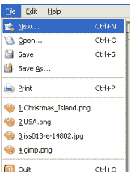

### 图 6.8 包含一些最近使用文件的文件菜单

我们这里采用的处理最近使用文件的方法只是众多可能性中的一种。另一种选择是只创建一次文件菜单，并在末尾设置一组用于最近使用文件的操作。当菜单更新时，不再清除并重新创建，而是简单地隐藏或显示预留给最近使用文件的操作，在后一种情况下，其文件名已被更新以反映当前的最近使用文件集。从用户角度看，无论我们在幕后采用哪种方法，都没有可察觉的区别，因此在两种情况下，文件菜单看起来都与图 6.8 中显示的类似。

这两种方法都可以用于在文件菜单中实现最近使用文件，像我们在 Image Changer 应用程序中那样，在“退出”选项之前将列表添加在末尾。它们也可以用于实现“打开最近文件”菜单选项，该选项将所有最近文件作为子菜单，如 OpenOffice.org 和其他一些应用程序所使用的那样。使用单独的“打开最近文件”选项的好处是，文件菜单始终保持一致，并且可以在子菜单中显示完整路径——当我们直接将最近使用文件放在文件菜单中时会避免这种情况，以免菜单变得极宽（因此难看）。

## 处理用户操作

在上一节中，我们创建了主窗口式应用程序的外观，并通过创建一组操作提供了其行为基础设施。我们还看到了如何保存和恢复应用程序设置，以及如何管理最近使用文件列表。

应用程序的一些行为由 PyQt 自动处理——例如，窗口最小化、最大化和调整大小——因此我们不必自己处理这些。其他一些行为可以完全通过信号和槽连接来实现。在本节中，我们关注的是直接受用户控制的操作，这些操作用于查看、编辑和输出用户的数据。

### 处理文件操作

文件菜单可能是主窗口式应用程序中实现最广泛的菜单，在大多数情况下，它至少提供“新建”、“保存”和“退出”（或“结束”）选项。

```python
def fileNew(self):
    if not self.okToContinue():
        return
    dialog = newImagedlg.NewImageDlg(self)
    if dialog.exec_():
        self.addRecentFile(self.filename)
        self.image = QImage()
        for action, check in self.resetableActions:
            action.setChecked(check)
        self.image = dialog.image()
        self.filename = None
        self.dirty = True
        self.showImage()
        self.sizeLabel.setText("%d x %d" % (self.image.width(), self.image.height()))
        self.updateStatus("Created new image")
```

当用户要求处理新文件时，我们首先检查是否“可以继续”。这给了用户机会去保存或丢弃任何未保存的更改，或者完全改变主意取消操作。

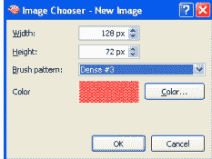

**图 6.9** 新建图像对话框

如果用户继续，我们将弹出一个模态的 NewImagedlg，用户可以在其中指定要创建的图像的大小、颜色和画笔图案。此对话框（如图 6.9 所示）的创建和使用方式与前一章中创建的对话框相同。然而，“新建图像”对话框的用户界面是使用 Qt Designer 创建的，并且必须使用 pyuic4 将用户界面文件转换为模块文件，才能使对话框可用。这可以直接通过运行 pyuic4 完成，或者通过运行 mkpyt.py 或 Make PyQt 完成，两者都更容易，因为它们会自动计算正确的命令行参数。我们将在下一章详细介绍所有这些事项。

如果用户接受对话框，我们将当前文件名（如果有）添加到最近使用文件列表中。然后我们将当前图像设置为 null 图像，以确保对可勾选操作的任何更改都不会影响图像。接下来，我们遍历希望在创建或加载新图像时重置的操作，将每个操作设置为我们首选的默认值。现在我们安全地将图像设置为对话框创建的图像。

我们将文件名设置为 None，将 dirty 标志设置为 True，以确保如果用户终止应用程序或尝试创建或加载另一个图像，系统会提示用户保存图像并询问文件名。

然后我们调用 showImage()，它在 imageLabel 中显示图像，并根据缩放因子进行缩放。最后，我们更新状态栏中的大小标签，并调用 updateStatus()。

```python
def updateStatus(self, message):
    self.statusBar().showMessage(message, 5000)
    self.listWidget.addItem(message)
    if self.filename is not None:
        self.setWindowTitle("Image Changer - %s[*]" % \
                os.path.basename(self.filename))
    elif not self.image.isNull():
        self.setWindowTitle("Image Changer - Unnamed[*]")
    else:
        self.setWindowTitle("Image Changer[*]")
        self.setWindowModified(self.dirty)
```

我们首先显示传递的消息，超时时间为五秒。我们还将该消息添加到日志控件中，以保持对所有已执行操作的记录。

如果用户打开了现有文件，或已保存当前文件，我们将会有一个文件名。我们使用 Python 的 os.path.basename() 函数获取不含路径的文件名，并将其放入窗口标题中。我们之前也可以轻松编写 QFileInfo(name).fileName()，效果相同。如果没有文件名且 image 变量不是 null 图像，这意味着用户创建了新图像但尚未保存；因此我们使用假文件名 "Unnamed"。最后一种情况是没有打开或创建任何文件。

无论我们将窗口标题设置为什么，我们都会在其中某处包含字符串 "[*]"。这个字符串永远不会按原样显示；相反，它用于指示文件是否已修改。在 Linux 和 Windows 上，这意味着

mk-pyt.py 和 Make PyQt 侧边栏


如果文件名没有任何未保存的更改，它将原样显示；否则，显示时将用星号（'*'）替代“[*]”字符串。在 Mac OS X 上，如果存在未保存的更改，关闭按钮内部会显示一个圆点。该机制取决于窗口修改状态，因此我们确保将窗口修改状态设置为与脏标志的状态一致。

```python
def fileOpen(self):
    if not self.okToContinue():
        return

    dir = os.path.dirname(self.filename)\
        if self.filename is not None else "."
    formats = ["*.%s" % unicode(format).lower() \
            for format in ImageReader.supportedImageFormats()]

    fname = unicode(QFileDialog.getOpenFileName(self,
                "Image Changer – Choose Image", dir,
                "Image files (%s)" % " ".join(formats)))

    if fname:
        self.loadFile(fname)
```

如果用户要求打开现有图像，我们首先确保他们有机会保存或丢弃任何未保存的更改，或者完全取消该操作。

如果用户决定继续，作为一种礼貌，我们希望弹出一个文件打开对话框，并设置到一个合理的目录。如果已有图像文件名，我们就使用其路径；否则，我们使用“.”，即当前目录。我们还选择传入一个文件过滤器字符串，以限制文件打开对话框可以显示的图像文件类型。此类文件类型由其扩展名定义，并以字符串形式传入。该字符串可以为单一类型指定多个扩展名，也可以指定多个类型。例如，文本编辑器可能传入以下字符串：

```text
"Text files (*.txt)\nHTML files (*.htm *.html)"
```

如果存在多个类型，我们必须使用换行符将它们分开。如果一种类型可以处理多个扩展名，我们必须使用空格将扩展名分开。所示的字符串将生成一个包含两个项目“Text files”和“HTML files”的文件类型组合框，并确保对话框中显示的唯一文件类型是扩展名为 .txt、.htm 或 .html 的文件。

在图像变换器（Image Changer）应用程序中，我们使用该应用程序所使用的 PyQt 版本可读取的图像类型扩展名列表。至少，这很可能包括 `.bmp`、`.jpg`（以及 `.jpeg`，与 .jpg 相同）和 `.png`。列表推导式遍历可读的图像扩展名，并创建形如“*.bmp”、“*.jpg”等形式的字符串列表；这些字符串由字符串 join() 方法连接，以空格分隔为单一字符串。

QFileDialog.getOpenFileName() 方法返回一个 QString，其中要么保存文件名（含完整路径），要么为空（如果用户取消了操作）。如果用户选择了文件名，我们调用 loadFile() 方法来加载它。

在这里以及整个程序中，当我们需要使用应用程序名称时，我们直接将其写出。但由于我们在 main() 中将在应用程序对象中设置名称以简化我们的 QString 使用，我们也可以在需要时随时获取名称。在这种情况下，相关代码将变为：

```python
fname = unicode(QFileDialog.getOpenFileName(self,

           "%s - Choose Image" % QApplication.applicationName(),

           dir, "Image files (%s)" % " ".join(formats)))
```

应用程序名称的使用频率之令人惊讶。文件 imagechanger.pyw 不足 500 行，但它使用了 12 次应用程序名称。一些开发人员更喜欢使用该方法调用来保证一致性。我们将在第 17 章进一步讨论字符串处理，届时我们将介绍国际化。

如果用户打开文件，将调用 loadFile() 方法以实际执行加载。我们将分两部分来研究此方法。

```python
def loadFile(self, fname=None):

    if fname is None:

        action = self.sender()

        if isinstance(action, QAction):

            fname = unicode(action.data().toQString())

            if not self.okToContinue():

                return

    else:

        return
```

如果该方法是从 fileOpen() 方法或 loadInitialFile() 方法调用的，则传入要打开的文件名。但如果它是从最近使用的文件操作调用的，则不传入文件名。我们可以利用这种差异来区分这两种情况。如果调用了最近使用的文件操作，我们检索发送对象。这应该是一个 QAction，但为了安全起见我们进行类型检查，然后提取操作用户数据，其中存储了最近使用的文件的完整名称（包括其路径）。用户数据作为 QVariant 保存，因此我们必须将其转换为合适的类型。在此处，我们检查是否可以继续。我们在“打开文件”的情况下不需要执行此测试，因为在用户甚至被询问要打开的文件名之前就已经进行了检查。因此，如果该方法尚未返回，我们知道 fname 中有一个文件名，我们必须尝试加载它。

```python
if fname:

    self.filename = None

    image = QImage(fname)

if image.isNull():
    message = "Failed to read %s" % fname
else:
    self.addRecentFile(fname)
    self.image = QImage()
    for action, check in self.resettableActions:
        action.setChecked(check)
    self.image = image
    self.filename = fname
    self.showImage()
    self.dirty = False
    self.sizeLabel.setText("%d x %d" % (
        image.width(), image.height()))
    message = "Loaded %s" % os.path.basename(fname)
    self.updateStatus(message)
```

我们首先将当前文件名设为 None，然后尝试将图像读取到局部变量中。PyQt 不使用异常处理，因此错误必须始终通过间接方式发现。在这种情况下，空图像意味着由于某种原因我们未能加载图像。如果加载成功，我们将新文件名添加到最近使用的文件列表中，该文件只有在随后打开另一个文件或此文件以另一个名称保存时才会出现。接下来，我们将实例图像变量设置为空图像：这意味着我们可以自由地将可复选操作重置为我们偏好的默认值，而不会产生任何副作用。之所以这样有效，是因为当可复选操作被更改时，尽管由于信号–槽连接，相关方法将被调用，但如果图像为空，这些方法什么也不做。

完成初步设置后，我们将局部图像分配给图像实例变量，并将局部文件名分配给文件名实例变量。接下来，我们调用 showImage() 以按当前缩放因子显示图像，清除脏标志，并更新大小标签。最后，我们调用 updateStatus() 在状态栏中显示消息，并更新日志部件。

```python
def fileSave(self):
    if self.image.isNull():
        return
    if self.filename is None:
        self.fileSaveAs()
    else:
        if self.image.save(self.filename, None):
            self.updateStatus("Saved as %s" % self.filename)
            self.dirty = False
        else:
            self.updateStatus("Failed to save %s" % self.filename)
```

fileSave() 方法以及许多其他方法都作用于应用程序的数据（一个 QImage 实例），但如果不存在图像数据，它们就没有意义。因此，许多方法在没有可供其处理的图像数据时什么都不做并立即返回。

如果有图像数据，且文件名为 None，则用户一定调用了“新建文件”操作，并且现在正在首次保存其图像。对于这种情况，我们将工作传递给 fileSaveAs() 方法。

如果已有文件名，我们尝试使用 QImage.save() 保存图像。该方法返回一个布尔成功/失败标志，根据该标志我们相应地更新状态。（我们将加载和保存自定义文件格式的内容推迟到第 8 章，因为本章专注于主窗口功能。）

```python
def fileSaveAs(self):
    if self.image.isNull():
        return
    fname = self.filename if self.filename is not None else ""
    formats = ["*.%s" % unicode(format).lower()
               for format in QImageWriter.supportedImageFormats()]
    fname = unicode(QFileDialog.getSaveFileName(self,
                "Image Changer - Save Image", fname,
                "Image files (%s)" % " ".join(formats)))
    if fname:
        if "." not in fname:
            fname += ".png"
        self.addRecentFile(fname)
        self.filename = fname
        self.fileSave()
```

当触发“另存为文件”操作时，我们首先检索当前文件名。如果文件名为 None，我们将其设置为 ""，即当前目录。然后我们使用 QFileDialog.getSaveFileName() 对话框提示用户提供一个要保存的文件名。如果当前文件名不为 None，我们将其用作默认名称——文件保存对话框会在用户选择已存在的文件名时，负责提供“是/否”警告对话框。我们使用与“打开文件”操作相同的技术来设置文件过滤器字符串，但这次使用的是此版本 PyQt 可写的图像格式列表（可能与可读格式列表不同）。

如果用户输入的文件名不包含点，即没有扩展名，我们将扩展名设置为 .png。接下来，我们将该文件名添加到最近使用的文件列表中（以便在随后打开不同文件或此文件以新名称保存时出现），将文件名实例变量设置为该名称，并将保存工作传递到我们刚刚回顾过的 fileSave() 方法。

我们需要考虑的最后一个文件操作是“打印文件”。当调用此操作时，将调用 filePrint() 方法。该方法将图像绘制在打印机上。由于该方法使用了我们尚未涵盖的技术，我们将推迟


直到稍后再讨论它。其使用的技术如“图像打印”边栏所示，而对 `filePrint()` 方法本身的讲解见第 13 章（从第 400 页开始），在那里我们也讨论了打印文档的一般方法。

我们尚未回顾的唯一文件操作是“文件退出”操作。此操作连接到主窗口的 `close()` 方法，该方法进而导致一个关闭事件被放入事件队列。我们提供了 `closeEvent()` 处理程序的一个重新实现，在其中我们确保用户有机会保存未保存的更改（通过调用 `okToContinue()`），并保存了应用程序的设置。


### 处理编辑操作

文件操作的大部分功能是由 MainWindow 子类本身提供的。唯一被传递出去的工作是图像的加载和保存，这需要 QImage 实例变量来执行。主窗口与持有数据的数据结构之间这种特定的职责划分非常常见。主窗口处理高级的“文件新建、打开、保存”以及“最近使用文件”功能，而数据结构处理加载和保存。

编辑功能的大部分甚至全部由视图部件或数据结构提供，这也是很常见的。在 Image Changer 应用程序中，所有数据操作都由数据结构（图像 QImage）处理，而数据的呈现则由数据查看器（imageLabel QLabel）处理。再次说明，这是一种非常常见的职责分离。

在本节中，我们将回顾大多数编辑操作，省略与已展示操作几乎相同的少数几个。我们将在这里保持简洁，因为功能特定于 Image Changer 应用程序。

```python
def editInvert(self, on):
    if self.image.isNull():
        return
    self.image.invertPixels()
    self.showImage()
    self.dirty = True
    self.updateStatus("Inverted" if on else "Uninverted")
```

如果用户调用“编辑反转”操作，它将被勾选（或取消勾选）。无论哪种情况，我们只是使用 QImage 提供的功能反转图像的像素，显示更改后的图像，设置 dirty 标志，并调用 `updateStatus()`，以便状态栏短暂显示执行的操作，并且日志中会添加一个附加项目。

`editSwapRedAndBlue()` 方法（未显示）是相同的，除了它使用 `QImage.rgbSwapped()` 方法，并且具有不同的状态文本。

```python
def editMirrorHorizontal(self, on):
    if self.image.isNull():
        return
    self.image = self.image.mirrored(True, False)
    self.showImage()
    self.mirroredhorizontally = not self.mirroredhorizontally
    self.dirty = True
    self.updateStatus("Mirrored Horizontally" \
                      if on else "Unmirrored Horizontally")
```

此方法在结构上与 `editInsert()` 和 `editSwapRedAndBlue()` 相同。`QImage.mirrored()` 方法接受两个布尔标志，第一个用于水平镜像，第二个用于垂直镜像。在 Image Changer 应用程序中，我们故意限制了允许的镜像类型，因此用户只能拥有无镜像、垂直镜像或水平镜像，而不能同时具有垂直和水平的组合。我们还保持一个实例变量，用于跟踪图像是否水平镜像。

`editMirrorVertical()` 方法，未显示，几乎相同。

```python
def editUMirror(self, on):
    if self.image.isNull():
        return
    if self.mirroredhorizontally:
        self.editMirrorHorizontal(False)
    if self.mirroredvertically:
        self.editMirrorVertical(False)
```

此方法关闭当前生效的镜像，或者如果图像未镜像则什么都不做。它不设置 dirty 标志或更新状态：如果它调用了 `editMirrorHorizontal()` 或 `editMirrorVertical()` 中的任何一个，则将其留给它们处理。

该应用程序提供了用户改变缩放因子的两种方法。他们可以交互工具栏中的缩放微调框——其 `valueChanged()` 信号连接到我们将很快回顾的 `showImage()` 槽——或者他们可以调用 **Edit** 菜单中的“编辑缩放”操作。如果使用“编辑缩放”操作，则调用 `editZoom()` 方法。

```python
def editZoom(self):
    if self.image.isNull():
        return
    percent, ok = QInputDialog.getInteger(self,
                            "Image Changer – Zoom", "Percent:",
                            self.zoomSpinBox.value(), 1, 400)
    if ok:
        self.zoomSpinBox.setValue(percent)
```

我们通过使用 QInputDialog 类的一个静态方法来获取缩放因子开始。`getInteger()` 方法接受一个父对象（对话框将居中对齐于其上）、标题、描述所需数据的文本、初始值，以及可选的最小值和最大值。

QInputDialog 提供一些其他静态便利方法，包括获取浮点值的 `getDouble()`、从列表中选择字符串的 `getItem()` 以及获取字符串的 `getText()`。对于所有这些，返回值都是一个二元组，包含值和指示用户是否输入并接受了有效值的布尔标志。

如果用户点击了确定，我们将缩放微调框的值设置为给定的整数。如果此值与当前微调框不同，微调框将发出 `valueChanged()` 信号。此信号连接到 `showImage()` 槽，因此如果用户选择了新的缩放百分比值，槽将被调用。

```python
def showImage(self, percent=None):
    if self.image.isNull():
        return
    if percent is None:
        percent = self.zoomSpinBox.value()
        factor = percent / 100.0
        width = self.image.width() * factor
        height = self.image.height() * factor
        image = self.image.scaled(width, height, Qt.KeepAspectRatio)
        self.imageLabel.setPixmap(QPixmap.fromImage(image))
```

当创建或加载新图像、应用任何变换，以及对工具栏缩放微调框的 `valueChanged()` 信号做出响应时，都会调用此槽。每当用户改变工具栏缩放微调框的值时，都会发出此信号，无论是直接使用鼠标，还是通过前面描述的“编辑缩放”操作间接完成。

我们获取百分比并将其转换为缩放因子，以生成图像的新宽度和高度。然后我们创建一个按新尺寸缩放并保持宽高比副本的图像，并设置 imageLabel 以显示此图像。标签需要 QPixmap 形式的图像，因此我们使用静态方法 `QPixmap.fromImage()` 将 QImage 转换为 QPixmap。

请注意，以这种方式缩放图像对原始图像没有影响；它纯粹是视图的变化，而不是编辑。这就是为什么不需要设置 dirty 标志。

根据 PyQt 的文档，QPixmap 针对屏幕显示进行了优化（因此绘制速度快），而 QImage 针对编辑进行了优化（这就是为什么我们使用它们来保存图像数据）。

### 处理帮助操作

当我们创建主窗口的操作时，我们为每个操作提供了帮助文本，并将其设置为状态文本和工具提示文本。这意味着当用户在应用程序的菜单系统中导航时，当前突出显示的菜单项的状态文本将自动显示在状态栏中。类似地，如果用户将鼠标悬停在工具栏按钮上，相应的工具提示文本将显示在一个工具提示中。

对于像 Image Changer 这样小而简单的应用程序，状态提示和工具提示可能已经完全足够。尽管如此，我们提供了一个在线帮助系统来展示如何做到这一点，尽管我们推迟到第 17 章（从第 510 页开始）再详细介绍。

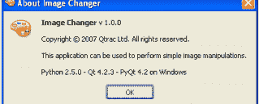

**图 6.10** *关于 Image Changer* 框

无论是否提供在线帮助，提供“关于”框总是一个好主意。它至少应显示应用程序的版本和版权声明，如图 6.10 所示。

```python
def helpAbout(self):
    QMessageBox.about(self, "About Image Changer",
        """<b>Image Changer</b> v %(version)s
<p>Copyright &copy; 2007 Qtrac Ltd.
All rights reserved.
<p>This application can be used to perform
simple image manipulations.
<p>Python 2.5.0 - Qt 4.2.3 - PyQt 4.2 on Windows"""
        % {
        'version': __version__,
        'platform': platform.python_version()
        }
    )
```

`QMessageBox.about()` 静态便利方法弹出一个模态的 OK 样式消息框，带有给定的标题和文本。文本可以是 HTML，如此处所示。如果应用程序有窗口图标，消息框将使用该图标。

我们显示应用程序的版本，以及 Python、Qt 和 PyQt 库的版本信息，还有应用程序正在运行的平台。库版本信息对用户可能没有直接用处，但如果用户向支持人员寻求帮助，这些信息可能会非常有帮助。


## 摘要

主窗口风格的应用程序通过子类化 `QMainWindow` 来创建。该窗口拥有一个中心部件（该部件可以是复合部件，从而包含其他部件）。

操作（Actions）用于表示应用程序向用户提供的那些功能。这些操作作为 `QAction` 对象持有，它们具有文本（用于菜单）、图标（用于菜单和工具栏）、工具提示和状态栏提示，并且连接到槽（slots），当这些槽被调用时，将执行相应的操作。通常，所有操作都会被添加到主窗口的菜单中，而最常用的操作会被添加到工具栏中。为了支持键盘用户，我们为常用操作提供键盘快捷键，并为菜单导航提供加速器，使其尽可能快速和方便。

某些操作是可复选的，而某些可复选操作组可能是互斥的，即在任何时刻只有一个可以被选中。PyQt 通过设置单个属性支持可复选操作，并通过 `QActionGroup` 对象支持互斥的操作组。

停靠窗口由停靠部件（dock widgets）表示，创建和设置起来非常容易。虽然任意部件都可以添加到停靠部件和工具栏中，但实际上我们通常只将小型或宽屏（letterbox-shaped）部件添加到工具栏中。

操作、操作组和停靠窗口都必须明确指定一个父对象——例如主窗口——以确保它们在正确的时间被删除。对于应用程序的其他部件，这并不必要，因为所有 `QObject` 的子对象要么由主窗口拥有，要么由主窗口的某个子对象拥有。应用程序的非 `QObject` 对象可以留给 Python 的垃圾收集器来删除。

应用程序通常使用资源（如图标和小文件、数据文件），PyQt 的资源机制使得访问和使用它们变得相当简单。不过，它们确实需要额外的构建步骤，可以使用 PyQt 的 `pirc4` 控制台应用程序，或者使用随书中示例提供的 `mkpqt.py` 或 Make PyQt 程序。

对话框可以完全通过代码创建，如前一章所示，也可以使用 Qt Designer 创建，我们将在下一章中看到。如果我们需要在应用程序中集成 Qt Designer 用户界面文件，那么像资源一样，它们也需要额外的构建步骤，可以使用 PyQt 的 `pirc4` 控制台应用程序，或者再次使用 `mkpqt.py` 或 Make PyQt。

一旦主窗口的视觉外观通过设置其中心部件并创建菜单、工具栏，也许还有停靠窗口而建立起来，我们就可以着手处理应用程序设置的加载和保存。许多设置通常在主窗口的初始化器中加载，而设置通常在重新实现的 `closeEvent()` 方法中保存（并给用户机会保存未保存的更改）。

如果我们希望恢复用户的工作区，加载他们上次运行应用程序时打开的文件，最好在主要窗口初始化器的末尾使用单次计时器来加载这些文件。

大多数应用程序通常都有一个数据集和一个或多个用于呈现和编辑数据的部件。由于本章的重点是主窗口的用户界面基础设施，我们选择了最简单可能的数据和可视化部件，但在后面的章节中，重点将会反转。

很常见的情况是，主窗口负责高级文件处理和使用过文件列表，而持有数据的对象负责加载、保存和编辑数据。

在本书的这个阶段，你现在已经掌握了足够的 Python 和 PyQt 知识来创建对话框风格和主窗口风格的 GUI 应用程序。在下一章中，我们将展示 *Qt Designer* 的实际应用，它可以大大加快对话框的开发和维护速度。而在第二部分最后一章，我们将探索保存和加载自定义文件格式的一些关键方法，使用 PyQt 和 Python 库。在第三部分和第四部分，我们将更深入地探索 PyQt，例如查看事件处理和创建自定义部件，以及更广泛地了解 PyQt 的模型/视图架构和其他高级特性，包括线程处理。

## 练习

创建如图 6.11 所示的对话框。它应该具有类名 *ResizeDlg*，其初始化器应接受初始宽度和高度。该对话框应提供一个名为 *result*() 的方法，该方法必须返回用户选择的宽度和高度的二元组。自旋框（spinboxes）的最小值应为 4，最大值应为传入的宽度（或高度）的四倍。两者都应右对齐显示其内容。

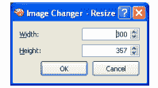

**图 6.11** *图像更改器的大小调整对话框*

修改 Image Changer 应用程序，使其具有一个新的“编辑大小调整”操作。该操作应出现在编辑菜单中（在“编辑缩放”操作之后）。名为 *editresize.png* 的图标位于 *images* 子目录中，但需要添加到 *resources.qrc* 文件中。你还需要导入刚刚创建的 *resize* 对话框。

应使用大小调整对话框在一个名为 editResize() 的槽中，该槽应由“编辑大小调整”操作连接。该对话框的使用方式如下：

```
form = resizedlg.ResizeDlg(self.image.width(), self.image.height(), self)
if form.exec_():
    width, height = form.result()
```

与 editZoom() 槽不同，图像本身应被改变，因此如果大小发生改变，则必须改变大小标签、状态栏和脏状态（dirty status）。另一方面，如果“新”大小与原大小相同，则不应进行大小调整。

大小调整对话框可以写在不到 50 行代码内，而大小调整槽可以写在不到 20 行代码内，新的操作只需在主窗口初始化器的几个地方额外增加一两行代码。

模型解决方案位于文件 chap06/imagechanger_ans.pvy 和 chap06/resize-dialog.py 中。

*此页有意留白*

# 7

-   设计用户界面
-   实现对话框
-   测试对话框

## 使用 Qt Designer

在第 5 章中，我们纯粹通过编写代码来创建对话框。在初始化器中，我们创建所需的部件并设置它们的初始属性。然后，我们创建一个或多个布局管理器，将部件添加到其中以获得我们想要的外观。在某些情况下，在处理垂直或水平布局时，我们添加了一个“伸缩”（stretch），它会扩展以填充不需要的空间。并且在布局完成后，我们将我们感兴趣的信号连接到我们想要处理它们的方法。

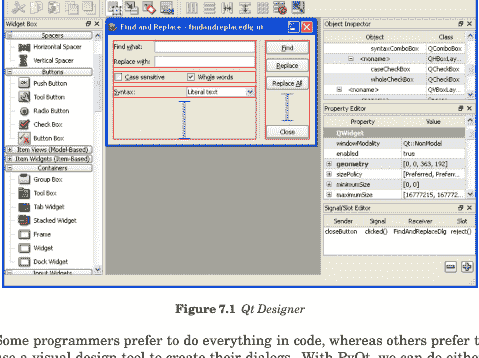

一些程序员更喜欢全部用代码完成，而另一些则更喜欢使用可视化设计工具来创建对话框。在 PyQt 中，我们可以选择其中一种，甚至两者兼用。前一章中的 Image Changer 应用程序有两个自定义对话框，ResizeDlg 纯粹是用代码创建的（在练习中），而 NewImageDlg 则是使用 *Qt Designer* 创建的。我们首先展示如何用代码完成事情，以便你对布局管理器的工作方式有一个强烈的感觉。但在本章中，我们将使用 *Qt Designer* 创建对话框，如图 7.1 所示。

*Qt Designer* 可用于为对话框、自定义部件和主窗口创建用户界面。我们只覆盖对话框；自定义部件几乎相同，只是它们基于“Widget”模板而不是“Dialog”模板之一。使用 *Qt Designer* 为主窗口提供较少的优势，除了可视化的 QAction 编辑器的便利性外。*Qt Designer* 还可用于创建和编辑资源文件。

用户界面存储在 `.ui` 文件中，并包含表单部件和布局的细节。此外，*Qt Designer* 可用于将标签与其“伙伴”（buddies）关联，并设置制表顺序（tab-order）；即当用户按下 Tab 键时部件获得键盘焦点的顺序。这在代码中也可以通过 QWidget::setTabOrder() 完成，但对于手工编码的表单很少是必要的，因为默认值是部件创建的顺序，这通常是我们想要的。*Qt Designer* 还可用于建立信号-槽连接，但仅限于内置的信号和槽之间。

一旦设计并保存了一个 `.ui` 文件中的用户界面，在使用之前必须将其转换为代码。这是使用 pyuic4 命令行程序完成的。例如：

```
C:\pyqt\chapter7>pyuic4 -o ui_findandreplacedlg.py findandreplacedlg.ui
```

如前一章所述，我们可以使用 mkpyqt.py 或 Make PyQt 来为我们运行 pyuic4。然而，从 `.ui` 文件生成 Python 模块（*.py 文件）还不足以使用户界面可用。* 请注意，生成的代码（在 `ui_*.py` 文件中）永远不应手工编辑，因为任何更改都会在下次运行 pyuic4 时被覆盖。

从最终用户的角度来看，对话框的用户界面是手工编码还是使用 *Qt Designer* 创建的，没有任何区别。然而，在实现对话框界面方面存在显著差异，因为如果手工编码，我们必须创建、布局并连接对话框的部件，但对于使用 *Qt Designer* 用户界面的对话框，只需调用特定方法即可实现相同效果。

使用 *Qt Designer* 的一个巨大好处，除了可视化设计对话框的便利性外，还在于如果我们更改设计，我们只需要重新生成用户界面模块（直接使用 pyuic4，或通过 mkpyqt.py 或 Make PyQt），而不需要更改我们的代码。唯一需要更改代码的时候是当我们添加、删除或重命名我们在代码中引用的部件时。这


### mkpyqt.py 和 Make PyQt

`mkpyqt.py` 控制台应用程序和 Make PyQt (`makepyqt.pw`) 图形界面应用程序，都是构建程序，它们为我们运行 `PyQt5` 的 `pyuic4`、`pyrcc4`、`pylupdate4` 和 `release` 程序。这两者所做的完全相同，自动使用正确的命令行参数来运行 `PyQt5` 的辅助程序，并且它们都会检查时间戳以避免进行不必要的工作。

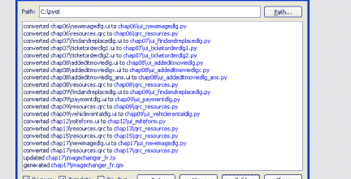

这些构建程序会查找 `.ui` 文件并对它们运行 `pyuic4`，以生成同名但前缀为 `ui_` 且扩展名更改为 `.py` 的文件。类似地，它们也会查找 `.qrc` 文件并对它们运行 `pyrcc4`，以生成同名但前缀为 `qrc_`，并且扩展名同样更改为 `.py` 的文件。

例如，如果在 `chap06` 目录中运行 `mkpyqt.py`，我们将得到：

```text
C:\pyqt\chap06> ..\\mkpyqt.py
./newimagedlg.ui --> ./ui_newimagedlg.py
./resources.qrc --> ./qrc_resources.py
```

通过运行 Make PyQt 也可以实现同样的效果：点击 *Path*（路径）按钮将路径设置为 `C:\pyqt\chap06`，然后点击 *Build Build*（构建构建）。如果我们进行了任何更改，只需重新运行 `mkpyqt.py`，或者如果使用 Make PyQt 则点击 *Build*（构建），任何必要的更新都将被执行。

这两个构建程序都可以删除生成的文件以为全新构建做好准备，并且两者都可以使用 `mkpyqt.py` 的 `-r` 选项或勾选 Make PyQt 中的 *Force*（强制）复选框，在整个目录树上随意工作。在控制台中运行 `mkpyqt.py -h` 可以查看其选项摘要。Make PyQt 程序为其复选框和按钮提供了工具提示。在某些情况下，可能需要设置工具路径；首次使用时请点击 *More—Tool paths*（更多—工具路径）。

这意味着使用 Qt Designer 比手动编辑代码布局更快速、更容易进行设计实验，并且有助于维持使用 Qt Designer 创建的视觉设计与在代码中实现的行为之间的分离。

在本章中，我们将创建一个示例对话框，并利用它学习如何使用 Qt Designer 创建和布局控件，设置关联控件（buddies）和制表顺序，以及如何建立信号-槽连接。我们还将看到如何使用由 pyuic4 生成的用户界面模块，以及如何在初始化器中自动创建到我们自定义槽的连接，而无需使用 connect() 调用。

对于示例，我们使用的是随 Qt 4.2 提供的 Qt Designer。早期版本的 Qt Designer 没有 QfontComboBox 或 QcalendarWidget 控件，并且它们的“Dialog”模板使用的是 QpushButtons 而不是 QdialogButtonBox。

# 设计用户界面

在开始之前，我们必须启动 Qt Designer。在 Linux 上，在控制台中运行 designer &（假设它在你的路径中），或者从你的菜单系统中调用它。在 Windows XP 上，点击 开始→Qt by Trolltech→Designer，在 Mac OS X 上使用 Finder 启动它。Qt Designer 启动时会显示一个新表单对话框；点击 Dialog with Buttons Button（带按钮的对话框按钮）然后点击 Create（创建）。这将创建一个标题为“untitled”的新表单，并带有如图 7.2 所示的 QdialogButtonBox。

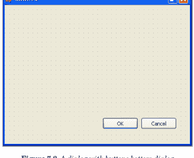

**图 7.2 带有底部按钮的对话框**

当首次运行 Qt Designer 时，它默认使用“Multiple Top-Level Windows”（多个顶层窗口）模式——这可能会让人困惑，但对于 Mac OS X 用户而言，这种方法是常态。要获得如图 7.1 所示的所有内容在一个窗口中的效果，请点击 Edit User Interface Mode Docked Window（编辑用户界面模式 停靠窗口）。\* Qt Designer 会记住此设置，因此只需执行一次。

**Qt Designer** 并不难使用，但确实需要一些最初的练习。有助于操作的一点是按照特定顺序执行，如下面的步骤列表所示。对于步骤 1 和 2，始终从“后”到“前”操作，也就是说，始终先处理容器（组框、选项卡控件、边框），然后处理属于它们内部（即位于它们上方）的常规控件。我们稍后将通过一个示例逐步讲解，但首先这里对如何使用 **Qt Designer** 创建对话框进行了一般性描述。

- 1. 将一个控件拖放到表单上并放置在大致正确的位置；无需精确放置，通常只有容器控件需要调整大小。
- 2. 如有必要，设置控件的属性；如果该控件将在代码中被引用，至少给它一个合理的名称。
- 3. 重复步骤 1 和 2，直到所有需要的控件都放在表单上。
- 4. 如果有大的空隙，拖入水平或垂直间隔符（这些显示为蓝色弹簧）来填充它们；有时，当空隙明显时，间隔符会在步骤 1 和 2 中添加。
- 5. 选择两个或多个控件（或间隔符或布局）以进行布局（Shift+Click 每一个），然后使用布局管理器或拆分器进行布局。
- 6. 重复步骤 5，直到所有控件和间隔符都在布局中。
- 7. 点击表单（以取消选择所有项目）并使用其中一个布局管理器对表单进行布局。
- 8. 为表单的标签创建关联控件（buddies）。
- 9. 如果顺序错误，设置表单的制表顺序。
- 10. 在适当的情况下，在内置信号和槽之间创建信号-槽连接。
- 11. 预览表单并检查所有功能是否按预期工作。
- 12. 设置表单的对象名称（这将用于其类名）和表单的标题，并保存它使其拥有文件名。例如，如果对象名称是“PaymentDlg”，我们可能会给它一个“Payment”的标题和一个 *paymentdlg.ui* 的文件名。

如果布局错误，使用撤销功能回到你认为可以重新开始布局的地方，再试一次。如果不可能或不起作用，或者如果布局在最初创建一段时间后被更改，只需断开需要更改的布局，然后重新创建它们。通常，在更改表单内的布局之前，有必要先断开表单本身的布局（点击表单，然后点击 Break Layout 工具栏按钮）；因此在最后必须再次对表单本身进行布局。

虽然可以将布局拖放到表单上，然后将控件拖放到布局上，但最佳实践是将所有控件和间隔符拖放到表单上，然后反复选择一些控件和间隔符并应用布局。在现有布局中添加控件有意义的情况只有一种，即我们想将控件拖入空隙中——例如，网格布局中的空单元格。

既然我们已经掌握了总体原则，我们将逐步讲解图 7.3 中所示的查找和替换对话框的设计。

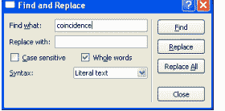

图 7.3 一个查找和替换对话框

基于其中一个“Dialog”模板创建一个新表单。这将给我们一个带有按钮框的表单。按钮框有两个按钮，OK（确定）和 Cancel（取消），并且已经设置好了信号-槽连接。

点击按钮框，然后点击 Edit→Delete（编辑→删除）。这将留下一个完全空白的表单。对于这个示例，我们将使用 QPushButton 而不是 QDialogButtonBox。这将允许我们实现比在 Qt Designer 中使用 QDialogButtonBox 更精细的控制，并给予我们在 Qt Designer 中建立信号-槽按钮连接的机会。在其他大多数示例和练习中，我们使用 QDialogButtonBox。

默认情况下，Qt Designer 左侧有一个名为 Widget Box（控件箱）的停靠窗口。它包含了 Qt Designer 可以处理的所有控件。控件被分组到各个部分，在末尾有一个名为 Display Widgets（显示控件）的组；其中包含 Label（标签）控件。Qt Designer 不为其控件使用类名，至少不在呈现给我们的用户界面中，但在几乎每种情况下，特定名称指的是哪个类都是显而易见的。

点击并拖放一个 Label 到表单上，靠近左上角。我们不在乎这个标签叫什么名字，因为我们将不会在代码中引用它，但默认文本“TextLabel”不是我们想要的。当一个控件首次被拖放时，它会自动被选中，而选中的控件总是其属性显示在属性编辑器中的那个。转到属性编辑器停靠窗口（通常在右侧），向下滚动到 "text"（文本）属性。将此更改为 "Find & what"。尽管文本现在看起来像是


在表单中被截断；一旦标签被布局，布局管理器将确保文本完整显示。

现在，从**输入小部件（Input Widgets）**组中拖入一个**行编辑框（Line Edit）**，并将其放置在标签的右侧。进入属性编辑器，将行编辑框的 **"objectName"**（所有小部件的第一个属性）更改为 "findLineEdit"。我们给它起一个合理的名称，是因为我们希望能在代码中引用这个行编辑框。

现在，在头两个小部件下方再拖入另一个标签和另一个行编辑框。第二个标签的文本应为 "Replace with"，第二个行编辑框的名称应为 "replaceLineEdit"。此时表单的外观应与图 7.4 非常相似。

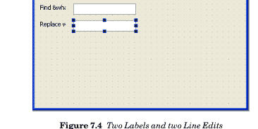

**图 7.4 两个标签和两个行编辑框**

随时可以通过按 Ctrl+S 或 文件→保存（File→Save）来保存表单。保存时，我们将使用文件名 findandreplace1g.ui。

所有可编辑的属性（以及一些只读属性）都会显示在属性编辑器中。但除此之外，Qt Designer 还提供了一个上下文菜单。上下文菜单中的第一个选项通常允许我们更改小部件最“重要”的属性（例如标签或行编辑框的 "text" 属性），第二个选项允许我们更改小部件的对象名称。如果我们使用上下文菜单更改复选框、单选按钮或按钮的文本，编辑将在原位置进行，在这种情况下必须按 Enter 键完成。我们将始终讨论在属性编辑器中更改属性；但当然，如果你更喜欢使用上下文菜单，也可以使用它。

现在我们将添加两个复选框。从**按钮（Buttons）**组（位于小部件盒（Widget Box）顶部附近）中拖入一个**复选框（Check Box）**，并将其放置在第二个标签下方。使用属性编辑器或上下文菜单将其对象名称更改为 "caseCheckBox"，并将其文本更改为 "&Case sensitive"。将第二个复选框拖到第一个的右侧：将其对象名称更改为 "wholeCheckBox"，并将其文本更改为 "Wh&ole words"，并设置其 "checked" 状态为 "true"。此时表单应类似于图 7.5 所示。

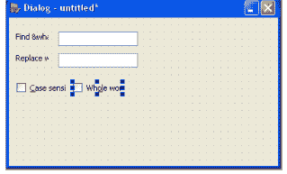

**图 7.5 两个标签、两个行编辑框和两个复选框**

现在我们将添加语法标签和组合框。在“区分大小写”复选框下方拖入一个标签，并将其文本设置为 “&Syntax:”。现在从**输入小部件（Input Widgets）**组中拖入一个**组合框（Combo Box）**，并将其放置在语法标签的右侧。将组合框的对象名称更改为 “syntaxComboBox”。右击组合框，选择第一个菜单选项“编辑项目”（Edit Items）。点击 “+” 图标，输入 “Literal text”。重复此操作以添加 “Regular expression”。点击“确定”（OK）按钮完成。

如果用户调整表单大小，我们希望对齐小部件而不是分散排列，因此从**间隔符（Spacers）**组（位于小部件盒顶部附近）中拖入一个**垂直间隔符（Vertical Spacer）**，并将其放置在组合框下方。使用代码设计表单时我们使用伸缩（stretches），但在视觉上设计时我们使用间隔符：它们都会扩展以填充空白。向布局添加伸缩本质上等同于向布局插入 QSpacerItem，但输入的字符更少。

为了使按钮在视觉上与我们刚创建的小部件分开，我们将在它们和其他小部件之间放一条垂直线。从**显示小部件（Display Widgets）**组（位于小部件盒底部附近）中拖入一条**垂直线（Vertical Line）**（实际上是一个形状为 QFrame_VLine 的 QFrame），并将其放置在表单中所有小部件的右侧，但为其右侧留出空间放置按钮。现在表单应看起来像图 7.6。

我们现在准备创建按钮。从**按钮（Buttons）**组（位于小部件盒顶部附近）中拖入一个**按钮（Push Button）**，并将其放置在表单的右上角。将其对象名称更改为 “findButton”，将其文本更改为 “&Find”。在“查找”按钮下方拖入另一个按钮，将其对象名称设为 “replaceButton”，并将其文本设为 “&Replace”。创建一个第三个按钮，位于“替换”按钮下方。将其对象名称设为 “replaceAllButton”，并将其文本更改为 “Replace &All”。现在，在“替换全部”按钮下方拖入一个垂直间隔符。最后，在间隔符下方拖入第四个按钮。将此按钮的对象名称设为 “closeButton”，并将其文本更改为 “Close”。

现在我们拥有了所有需要的小部件和间隔符，并适当地设置了它们的所有属性。表单应看起来像图 7.7 所示。

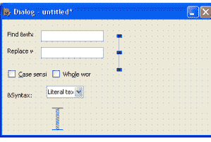

**图 7.6 没有按钮的查找和替换对话框**

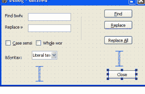

**图 7.7 未布局的查找和替换对话框**

布局这个表单的最佳方式是什么？这个表单的最佳设计是什么？这些问题的答案取决于个人口味和实践。在这里，我们仅展示其机制，并将美观性留给你自己。

我们将从布局前两个标签及其行编辑框开始。点击表单以取消选择所有对象，然后 Shift+点击“查找内容”标签及其行编辑框，以及“替换为”标签及其行编辑框。一旦选中了这四个小部件，点击 表单→以网格布局（Form→Lay Out in a Grid）（或点击相应的工具栏按钮）。布局由一条红线指示——布局线在运行时不可见。

现在取消选择所有对象（通过点击表单），并选中两个复选框。点击 表单→水平布局（Form→Lay Out Horizontally）。再次，取消选择所有对象，这次使用水平布局语法标签和组合框。此时应该有三种布局——一个网格和两个水平布局，如图中 7.8 所示。

我们现在可以布局表单左侧的布局。点击表单以取消选择所有对象。选择布局（而不是小部件）可能会有点棘手，因此不使用 Shift+点击，我们将使用选择矩形。点击表单左下角附近，拖动选择矩形：这个矩形只需触碰一个对象即可选中它，因此向上和向右拖动，使其触碰左侧的垂直间隔符和三个布局——以及其他任何对象都不要触碰（例如，不要触碰垂直线）。现在，释放鼠标并点击 表单→垂直布局（Form→Lay Out Vertically）。

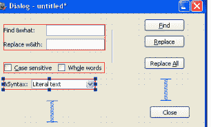

**图 7.8 包含一些布局的*查找和替换*对话框**

我们可以使用相同的选择技术来布局按钮。点击表单以取消选择所有对象。现在点击表单右下角附近，并拖动，使选择矩形触碰“关闭”按钮、右侧的垂直间隔符和其他三个按钮——以及其他任何对象都不要触碰。现在，释放鼠标并点击 表单→垂直布局（Form→Lay Out Vertically）。此时我们应拥有一个表单，其中每个小部件都在左侧或右侧的布局中，中间有一条垂直线，如图 7.9 所示。

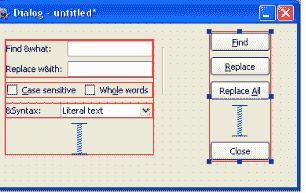

**图 7.9 几乎布局完成的*查找和替换*对话框**

我们现在准备布局表单本身。点击表单以取消选择所有对象。现在点击 表单→水平布局（Form→Lay Out Horizontally）。表单现在看起来有点太高，所以只需将表单底部向上拖动，直到表单看起来更合适。如果拖动很多，间隔符可能会“消失”；它们仍然存在，只是太小看不见。

我们现在可以预览表单，看看布局的实际样子，并且在预览期间，我们可以拖动表单的角使其变小或变大，以检查其大小调整行为是否合理。要预览，点击 表单→预览（Form→Preview）（或按 Ctrl+R）。使用 表单→预览（Form→Preview in）菜单选项也可以预览不同的样式。表单现在应该看起来像图 7.10。如果情况并非如此，使用 编辑→撤销（Edit→Undo）来撤销你的更改，然后重新布局。如果需要重新布局，有时调整某些小部件的大小和位置可以帮助 Qt Designer 更好地理解你希望布局如何进行，尤其是在使用网格布局时。

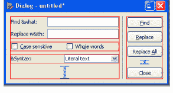

我们现在准备设置标签的搭档（buddies），设置表单的制表顺序，完成所需的连接，并对表单进行命名和保存。

我们将从搭档开始。点击 编辑→编辑搭档（Edit→Edit Buddies）以启用搭档模式。要设置搭档关系，我们点击一个标签，然后拖动到我们希望成为其搭档的小部件。因此，在这个例子中，我们必须点击“查找内容”标签并拖动到其行编辑框，然后对“替换为”标签及其行编辑框执行相同操作，接着对语法标签和组合框执行相同操作。要退出搭档模式，按 F3。现在，标签中不应再显示 & 符号。

接下来，我们将设置表单的制表顺序。点击 编辑→编辑制表顺序（Edit→Edit Tab Order），然后按照你希望的制表顺序依次点击每个带数字的框。要退出制表顺序模式，按 F3。

“查找”、“替换”和“替换全部”按钮需要连接到我们自己的自定义方法；我们将在 Qt Designer 外部完成此操作。但是“关闭”按钮可以连接到对话框的 reject() 槽。要完成此操作，点击 编辑→编辑信号/槽（Edit→Edit Signals/Slots），然后从“关闭”按钮拖动到表单。释放鼠标后，配置连接（Configure Connection）对话框将弹出。从左侧的信号列表中选择（无参数的）clicked() 信号，从右侧的槽列表中选择 reject() 槽，然后点击确定。要退出信号-槽模式，按 F3。

点击表单以取消选择所有对象。这也有助于属性编辑器显示表单的属性。将对话框的对象名称（将用于其类名）设置为 “FindAndReplaceDig”，并将 “windowTitle” 属性设置为 “Find and Replace”。现在点击 文件→保存（File→Save）以保存用户界面，将其文件名为 findandreplaceig.ui。


在本节中，我们将限于使用 *Qt Designer* 通过“Dialog”模板之一来创建自定义对话框，因为这对于学习使用 *Qt Designer* 的基础知识已经足够了。然而，*Qt Designer* 可以用于创建比此处更复杂的对话框，包括带有选项卡控件和控件堆栈的对话框，这些控件通常用于具有数十个甚至数百个选项的配置对话框。也可以通过包含自定义控件的插件来扩展 *Qt Designer*。这些控件通常用 C++ 编写，但从 PyQt 4.2 开始，也可以整合用 Python 编写的自定义控件。

Qt 文档包含一份全面的 *Qt Designer* 手册，其中深入探讨了更多可用的功能。本节涵盖的内容足以入门，但学习 *Qt Designer* 的正确方法只有一种，那就是使用它。

设计好用户界面后，下一步是使其在我们的代码中可用。

## 实现对话框

当我们使用 *Qt Designer* 创建用户界面时，我们会创建一个使用多重继承的子类，在其中放置赋予用户界面所需行为的代码。* 我们继承的第一个类是 QDialog。如果我们使用“Widget”模板，继承的第一个类将是 QWidget；如果使用“Main Window”模板，继承的第一个类将是 QMainWindow。我们继承的第二个类是表示我们使用 *Qt Designer* 设计的用户界面的类。

在上一节中，我们创建了一个对象名称为 "FindAndReplaceDlg" 的用户界面，存储在文件 findandreplacedlg.ui 中。我们必须运行 *pyuic4*（直接运行，或通过 *mpyqt* 或 *Make PyQt* 运行）以生成 *ui_findandreplacedlg* .py 模块文件。该模块中包含一个类，其名称为表单对象名称加上 Ui_ 前缀，因此在这种情况下，类名称是 Ui_FindAndReplaceDlg。

我们将我们的子类命名为 FindAndReplaceDlg，并将其放在文件 findandreplacedlg.py 中。

在查看类声明和初始化器之前，我们先查看导入部分。

```python
import re
from PyQt4.QtCore import *
from PyQt4.QtGui import *
import ui_findandreplacedlg
```

> * 还有其他方法也是可行的，在线文档中有所介绍。不过，没有哪一种像我们这里使用的方法那样方便。

第一个导入是我们将用于代码的正则表达式模块。第二个和第三个导入是 PyQt 编程中常用的导入。最后一个导入是生成的用户界面模块。现在我们可以查看我们的子类了。

```python
class FindAndReplaceDlg(QDialog,
                         ui_findandreplacedlg.Ui_FindAndReplaceDlg):
    def __init__(self, text, parent=None):
        super(FindAndReplaceDlg, self).__init__(parent)
        self._text = unicode(text)
        self._index = 0
        self.setupUi(self)
        if not MAC:
            self.findButton.setFocusPolicy(Qt.NoFocus)
            self.replaceButton.setFocusPolicy(Qt.NoFocus)
            self.replaceAllButton.setFocusPolicy(Qt.NoFocus)
            self.closeButton.setFocusPolicy(Qt.NoFocus)
            self.updateUi()
```

我们同时继承自 `QDialog` 和 `ui_findAndReplaceDlg`。在 Python 编程中，我们很少需要多重继承，但在这种情况中，它使事情变得比其他方式容易得多。我们的 FindAndReplaceDlg 子类实际上是它所继承的两个类的并集，并且可以直接访问它们的属性，当然前缀是 `self`。

我们设置初始化器接受对话框将处理的数据文本以及父控件。`super()` 调用作用于第一个继承类 `QDialog`。我们保留文本的副本，以及索引位置，以防用户多次点击“查找”以查找相同文本的后续出现。

对 `setupUi()` 方法的调用是我们之前没见过的。该方法由生成的模块提供。调用时，它会创建用户界面文件中指定的所有控件，根据我们的设计布局它们，设置它们的搭档和选项卡顺序，并建立我们设置的连接。换句话说，它重新创建了我们在 *Qt Designer* 中设计的表单。

此外，`setupUi()` 方法会调用 `QtCore.QObject.connectSlotsByName()`，这是一个静态方法，它在表单控件信号和我们子类中遵循特定命名约定的方法之间创建信号槽连接。任何名称形式为 on_widgetName_signalName 的方法，都会将其指定控件的指定信号连接到该方法。

例如，我们的表单有一个名为 findLineEdit 的控件，类型为 `QLineEdit`。`QLineEdit` 发出的信号之一是 `textEdited(QString)`。因此，如果我们希望在不于初始化器中调用 `connect()` 方法的情况下连接此信号，我们可以将此任务交给 `setupUi()`。只要我们将信号要连接到的槽命名为 on_findLineEdit_textEdited，这就会起作用。这是我们在表单中所有连接中使用的方法，除了我们在 *Qt Designer* 中视觉上连接的关闭按钮的 `clicked()` 信号。

对于 Windows 和 Linux 用户，将按钮的焦点策略设置为“无焦点”很方便。这对鼠标用户没有影响，但通常对键盘用户有帮助。这意味着按 Tab 键仅在编辑控件之间移动键盘焦点——在本例中，是查找行编辑框、替换行编辑框、复选框和组合框——这通常比还要 Tab 过按钮更方便。键盘用户仍然可以使用其键盘加速器（对于关闭按钮是 Esc）按任何按钮。不幸的是，搭档和按钮不为 Mac OS X 键盘用户提供加速器（除非他们开启辅助功能支持），因此这些用户需要能够 Tab 到所有控件，包括按钮。为了照顾所有平台，我们不在 Qt Designer 中设置按钮的焦点策略，而是在 setupUi() 创建用户界面后手动设置。

MAC 布尔变量在底层窗口系统是 Mac OS X 时为 True。它在文件开头的导入之后使用以下相当神秘的语句设置：

```python
MAC = "qt_mac_set_native_menubar" in dir()
```

更清晰的写法是：

```python
import PyQt4.QtGui
MAC = hasattr(PyQt4.QtGui, "qt_mac_set_native_menubar")
```

这些之所以有效，是因为 PyQt4.QtGui.qt_mac_set_native_menubar() 函数仅存在于 Mac OS X 系统中。我们将在第 11 章中对 X Window System 检测使用类似的技术。

最后调用的 updateUi() 方法是我们自己的自定义方法；我们用它来根据用户是否输入了要查找的文本来启用或禁用按钮。

```python
@pyqtSignature("QString")
def on_findLineEdit_textEdited(self, text):
    self.__index = 0
    self.updateUi()
```

得益于 setupUi()，该方法会自动连接到 findLineEdit 的 textEdited() 信号。每当我们需要自动连接时，我们都使用 @pyqtSignature 装饰器来指定信号的参数。该装饰器的目的是区分名称相同但参数不同的信号。在这个特定情况下，只有一个 textEdited() 信号，所以装饰器并不严格必要；但作为良好的编程习惯，我们始终使用装饰器。例如，如果后续版本的 PyQt 引入了另一个名称相同但参数不同的信号，使用装饰器的代码将继续工作，而不使用装饰器的代码则不会。

由于当用户更改查找文本时调用此槽，我们将开始搜索的索引位置重置为 0（开头）。在这里以及初始化器中，我们以调用 updateUi() 结束。

```python
def updateUi(self):
    enable = not self.findLineEdit.text().isEmpty()
    self.findButton.setEnabled(enable)
    self.replaceButton.setEnabled(enable)
    self.replaceAllButton.setEnabled(enable)
```

我们已经见过这种方法的许多例子。这里，如果用户输入了查找文本，我们启用“查找”、“替换”和“全部替换”按钮。是否有替换文本无关紧要，因为将某物替换为无（即删除找到的文本）是完全有效的。该方法就是为什么表单开始时除关闭按钮外所有按钮都被禁用的原因。

当用户关闭表单时，其持有的文本（如果用户使用了替换或全部替换，可能与原始文本不同）可以使用 text() 方法访问。

```python
def text(self):
    return self.__text
```

一些 Python 程序员不会为此提供方法；相反，他们会使用 self.text 变量（而不是 self.__text），并直接访问该变量。

对话框其余的功能实现在由用户按下其中一个按钮（除关闭按钮外）触发的方法中，外加一个辅助方法。它们的实现与使用 *Qt Designer* 没有直接关系，但为了完整性，我们将简要回顾它们。

```python
@pyqtSignature("")
def on_findButton_clicked(self):
    regex = self.makeRegex()
    match = regex.search(self.__text, self.__index)
    if match is not None:
        self.__index = match.end()
        self.emit(SIGNAL("found"), match.start())
    else:
        self.emit(SIGNAL("notfound"))
```

按钮的 clicked() 信号有一个可选的布尔参数，我们不感兴趣，所以为 @pyqtSignature 装饰器指定空的参数列表。相比之下，我们不能为 on_findLineEdit_textEdited() 槽的装饰器使用空的参数列表，因为 textEdited() 信号的参数不是可选的，所以必须包含在内。

为了执行搜索，我们创建一个正则表达式来指定查找文本和一些搜索特征。然后我们使用正则表达式从当前索引位置搜索文本。如果找到匹配项，我们将索引位置更新为匹配项的结束位置，为后续


搜索，并发出包含在文本中找到查找文本位置的信号。

```python
    def makeRegex(self):
        findText = unicode(self.findLineEdit.text())
        if unicode(self.syntaxComboBox.currentText()) == "Literal":
            findText = re.escape(findText)
        flags = re.MULTILINE|re.DOTALL|re.UNICODE
        if not self.caseCheckBox.isChecked():
            flags |= re.IGNORECASE
        if self.wholeCheckBox.isChecked():
            findText = r'\b%s\b' % findText
        return re.compile(findText, flags)
```

我们从获取用户输入的查找文本开始。我们知道它不能为空，因为除了关闭按钮外，其他按钮只有在存在查找文本时才会被启用。如果用户选择了字面文本搜索，我们使用 `re.escape()` 函数来转义用户查找文本中可能存在的任何正则表达式元字符（如 "\\"）。然后我们初始化搜索标志。如果 caseCheckBox 未被勾选，我们使用 `re.IGNORECASE` 标志补充标志。如果用户要求搜索整个单词，我们在查找文本前后加上 \b：这是 Python（和 QRegExp）正则表达式语言中的一个标记，用于指定单词边界。字符串字面量前的 r 表示“原始”字符串，其中我们可以像 "\\" 这样的字符未经转义地写入。最后我们返回编译好（即就绪可用）形式的正则表达式。

> 原始字符串

如果我们知道要搜索的文本通常是 QString 而不是 unicode，使用 PyQt 的 QRegExp 类可能比使用 Python 标准库的 re 类更合适。

```python
    @pyqtSignature("")
    def on_replaceButton_clicked(self):
        regex = self.makeRegex()
        self.__text = regex.sub(unicode(self.replaceLineEdit.text()),
                                self.__text, 1)
```

这个方法很简单，因为它将准备工作交给 makeRegex() 方法。我们使用 sub 方法（“替换”）将查找文本的第一次出现替换为替换文本。替换文本可以是空的。这里的 1 是最大替换次数。

```python
    @pyqtSignature("")
    def on_replaceAllButton_clicked(self):
        regex = self.makeRegex()
        self.__text = regex.sub(unicode(self.replaceLineEdit.text()),
                                self.__text)
```

这个方法与前面的那个几乎相同。唯一的区别是我们没有指定最大替换次数，因此 sub() 将替换它找到的尽可能多的（非重叠）查找文本出现。

至此，我们已经实现了 FindAndReplaceDlg。该对话框方法的实现与我们之前所做的没有太大区别，除了我们使用装饰器和 setupUi() 来提供自动连接。

要在应用程序中使用该对话框，我们必须确保生成了 ui_findandreplacedlg.py 模块文件，并且必须导入我们刚写的 findandreplacedlg 模块。我们将在下一节中看到表单是如何创建和使用的。

## 测试对话框

由于任何 PyQt 小部件（包括任何对话框）都可以作为顶级窗口独立使用，因此实例化对话框并启动事件循环来测试它很容易。不过，我们通常需要做一些额外的工作。例如，我们可能需要设置一些初始数据，或者提供方法来接收对话框的信号，以便我们可以检查它们是否正常工作。

就查找和替换对话框而言，我们需要一些初始文本，并且需要检查连接是否正常工作，以及查找和替换方法是否有效。

因此，在 findandreplacedlg.py 文件的末尾，我们添加了一些额外代码。这段代码仅在文件独立运行时执行，因此它不会影响性能，也不会在对话框在应用程序中使用时干扰其使用。

```python
if __name__ == "__main__":
    import sys
    text = """US experience shows that, unlike traditional patents,
software patents do not encourage innovation and R&D, quite the
contrary. In particular they hurt small and medium-sized enterprises
and generally newcomers in the market. They will just weaken the market
and increase spending on patents and litigation, at the expense of
technological innovation and research. Especially dangerous are
attempts to abuse the patent system by preventing interoperability as a
means of avoiding competition with technological ability.
--- Extract quoted from Linus Torvalds and Alan Cox's letter
to the President of the European Parliament
http://www.oeffi.org/patentit/patentis_torvalds_cox.html"""

def found(where):
    print "Found at %d" % where

def nomore():
    print "No more found"

app = QApplication(sys.argv)
form = FindAndReplaceDlg(text)
form.connect(form, SIGNAL("found"), found)
form.connect(form, SIGNAL("notfound"), nomore)
form.show()
app.exec_()
print form.text()
```

我们首先导入 `sys` 模块，然后创建一段要处理的文本。接下来，我们为对话框的信号连接创建几个简单的函数。

我们以正常方式创建 `QApplication` 对象，然后创建对话框的一个实例，并传入我们的测试文本。我们将对话框的两个信号连接到我们的槽，并调用 `show()`。然后我们启动事件循环。当事件循环终止时，我们打印对话框的文本；如果用户替换了一些文本，这将与原始文本不同。

现在，该对话框可以从控制台运行并进行测试。

```
C:\pyqt\chap07>python findandreplacedlg.py
```

除非使用自动测试工具，否则为对话框添加测试功能通常很有帮助。编写它们不需要花费太多时间和精力，而且每次对话框逻辑发生变化时运行它们有助于将引入 bug 的可能性降到最低。

有时我们将复杂对象传递给对话框，这可能看起来使测试变得不可能。但得益于 Python 的鸭子类型，我们总是可以创建一个假类，模拟足够的行为以用于测试。例如，在第 12 章中，我们使用属性编辑器对话框。该对话框对“Node”对象进行操作，因此在测试代码中，我们创建一个 `FakeNode` 类，提供设置和获取 `node` 属性的方法，而对话框会用到这些方法。（相关文件是 `chap12/propertiesdlg.ui`，由此生成 `ui_propertiesdlg.py`，以及 `chap12/propertiesdlg.py`，其中实现了 `PropertiesDlg`。）

## 总结

Qt Designer 提供了一种快速简便的方式创建用户界面。使用可视化设计工具使得判断设计是否“有效”变得容易得多。Qt Designer 的另一个好处是，如果我们更改设计，只要我们没有添加、删除或重命名我们在代码中引用的任何小部件，我们的代码就不需要做任何更改。即使我们确实添加、重命名或删除了小部件，对代码的更改也可能很小，因为 Qt Designer 为我们处理了所有小部件的创建和布局。

使用 Qt Designer 的基本原则始终相同：我们将小部件拖放到表单上，先是容器（如框架、组合框和选项卡小部件），然后是普通小部件，并设置它们的属性。然后我们添加间隔符以占据空隙。接下来我们选择特定的小部件、间隔符和布局，并应用布局到它们，重复此过程直到所有布局完成。然后我们对表单本身进行布局。最后我们设置伙伴、选项卡顺序和信号-槽连接。

实现由 Qt Designer 创建用户界面的对话框与手动实现类似。最大的区别在于初始化器，其中我们只是调用 setupUi() 来创建和布局小部件，并创建信号-槽连接。我们实现的方法可以像以前一样完成（代码也没有不同），但通常我们使用 on_widgetName_signalName 命名约定，并配合 @pyqtSignature 装饰器以利用 setupUi() 自动创建连接的能力。

我们尚未涵盖的一个用例是使用“Widget”模板创建复合小部件（由两个或更多其他小部件组合布局而成的小部件）。在某些情况下，这些小部件设计可用于整个表单，在其他情况下，它们可作为表单组件使用——例如，提供选项卡小部件或小部件堆栈的页面。或者两个或更多复合小部件可以在表单中一起布局以创建更复杂的表单。这是通过 Qt Designer 和以正常方式生成 Python 模块来实现的。然后我们可以导入生成的模块，并在我们的表单类中调用每个自定义小部件的 setupUi() 方法来创建用户界面。

关于对话框有多“智能”、应该具有什么模式以及如何验证的问题，对于用 Qt Designer 创建的对话框与手动创建的对话框没有区别。唯一的例外是我们可以用 Qt Designer 设置小部件属性——例如，我们可以设置自增框的范围和初始值。当然，我们也可以在代码中做同样的事情，但对于只需要简单验证的小部件，在 Qt Designer 中完成通常更方便。

我们必须使用 pyuic4 从 Qt Designer .ui 文件生成 Python 模块，无论是直接运行 pyuic4，还是使用 mkspec.py 或 Make PyQt，后者在存在 .qrc 文件时也会为资源文件生成 Python 模块。

> *QRegExp 文档提供了正则表达式简介。Python 的正则表达式引擎在 re 模块文档中介绍。如需深入了解，请参阅 Jeffrey E. Friedl 的著作《Mastering Regular Expressions》。
> *使用 pyuic4 时，我们可以指定命令行选项 -x 来生成带有少量额外代码的对话框，以便它可以独立测试。


如果我们没有使用测试工具，添加仅在独立运行表单时才执行的测试代码不会影响我们的对话框性能，并且在开发和维护对话框期间都非常方便。如果对话框所依赖的复杂对象不可用，我们通常可以创建一个“伪”类，该类提供与复杂对象相同的方法，并传递该伪类的一个实例用于测试目的。

所有 PyQt 程序都可以完全手动编写，永远不需要使用 Qt Designer。然而，使用可视化设计工具设计对话框可能非常有帮助，因为可以立即看到结果，并且可以快速轻松地修改设计。使用 Qt Designer 的另一个好处是，创建、布局和连接组件的大量相当重复的代码可以自动生成，而不是手动编写。在本章以及前一章中，我们都使用 Qt Designer 创建了一个对话框。在后续章节中，我们将看到更多使用 Qt Designer 创建的对话框示例。

## 练习

使用 Qt Designer 根据图 7.11 中所示的设计之一或您自己的设计创建用户界面。您可能需要使用网格布局（Grid Layout），以及垂直和水平布局。对于网格布局，您可能需要尝试几次，也许调整组件的大小和位置有助于 Qt Designer 创建您想要的网格。按钮请使用 QDialogButtonBoxes。

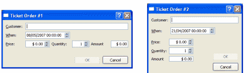

图 7.11 具有两种不同设计的对话框

价格数字框（spinbox）的范围应为 0.00–5000.00，右对齐，前缀为“$ ”，如图 7.11 所示。数量数字框的范围应为 1–50，同样右对齐。如果不喜欢默认格式，可以设置您喜欢的日期格式。

代码中引用的组件应具有合理的名称——例如，customerLineEdit 和 priceSpinBox。

建立适当的 buddies，即从“customer”标签到其 Line Edit，从“when”标签到 Date Time Edit，依此类推。同时确保 Tab 顺序为 customer、when date、price、quantity、button box。

创建一个子类以使用用户界面。代码应确保只有当客户 `LineEdit` 非空且金额大于零时，OK 按钮才被启用。要访问 `QDialogButtonBox` 中的按钮，请使用按钮常量作为参数调用 `button()` 方法——例如，`buttonBox.button(QDialogButtonBox.Ok)`。

每次用户更改其中一个数字框的值时，都应重新计算金额并在金额标签中显示。将日期范围设置为从明年到明年。提供一个 `result()` 方法，返回包含客户、日期、价格和数量的四元组 (unicode, datetime.datetime, float, int)。（如果您使用的是 4.1 之前的 PyQt 版本，请将日期返回为 `QDateTime`；否则，使用 `QDateTime.toPyDateTime()` 方法获取 `datetime.datetime`。）

在末尾包含足够的测试代码，以创建并显示一个 `TicketOrderDlg`，以便您可以与之交互。事件循环结束后，在控制台打印 `result()` 方法返回的元组。

包括测试代码在内的子类大约可以用 60 行代码编写。如果这是您第一次使用 **Qt Designer**，可能需要 15–20 分钟才能设计正确，但通过练习，像这样的对话框应该只需几分钟即可完成。

模型解决方案提供在 chap07/ticketorderdlg1.ui 和 chap07/ticketorderdlg2.ui 中，测试程序在 chap07/ticketorderdlg.py 中。

# 8

- 主窗口职责
- 数据容器职责
- 保存和加载二进制文件
- 保存和加载文本文件
- 保存和加载 XML 文件

## 数据处理与自定义文件格式

大多数应用程序需要加载和保存数据。通常，数据格式是预先确定的，因为应用程序读取的是由其他其无法控制的应用程序生成的数据。但对于我们自己创建文件格式的应用程序，有很多选择可用。

在第 6 章中，我们创建了一个主窗口风格的应用程序，从中学习了如何创建菜单和工具栏，以及如何处理和保存文件。在本章中，我们将处理另一个主窗口风格的应用程序，但这次我们的重点将是应用程序的数据。

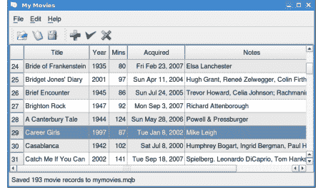

**图 8.1** *My Movies 应用程序*

我们将使用的示例应用程序称为 My Movies；它显示在图 8.1 中。它用于存储我们收藏中可能拥有的电影的一些基本信息。该应用程序将允许我们查看和编辑自定义 Movie 对象（或我们将称之为电影记录）的集合，并以多种格式从磁盘加载和保存这些记录。

如果您只想直接进入文件处理，可以跳到相关章节。二进制文件的保存和加载从第 240 页开始，文本文件从第 249 页开始，XML 文件从第 256 页开始。您始终可以回到前两节，以涵盖 GUI 和文件处理之间的关系。

在以前的所有示例中，我们通常尽可能多地使用 Python 数据类型来存储数据，并且仅在必要时将数据转换为 PyQt 类型。特别是对于字符串，我们提出了一个策略，意味着我们总是尽可能早地将 QStrings 转换为 unicodes，并始终操作 unicode 字符串。但在本章中，我们将采取相反的方法，将所有数据保留在 PyQt 类型中，仅在必要时转换为 Python 类型。这样做的原因之一是 PyQt 提供了出色的二进制数据支持，并使用与 C++/Qt 相同的二进制格式，这对于处理必须同时由 C++ 和 Python 程序访问的文件非常有用。另一个原因是，这也将提供对比，帮助我们理解每种方法的优缺点，以便在我们以后开发的应用程序中做出正确的决策。

将数据保留在 PyQt 类型中的一个直接好处是我们不需要不断转换我们提供给组件或从组件获取的数据。在处理大量数据集合时，这可以显著节省处理开销。

当我们有需要加载和保存的自定义数据时，有五个选择可用。我们可以使用二进制、纯文本或 XML 文件，或者我们可以使用具有显式文件名的 QSettings 对象，或者我们可以使用数据库。在本章中，我们将涵盖前三个选项，并在此简要提及第四个选项，QSettings。我们将把数据库的覆盖推迟到第 15 章。

除了 QSettings 之外的所有选项都可以使用 Python 标准库或 PyQt 来实现。在本章中，我们将使用这两个库讨论二进制和文本格式的加载和保存，以便我们可以比较和对比它们。对于 XML，我们将使用 PyQt 进行加载和解析，并手动完成保存。Python 标准库也提供了大量的 XML 支持，但涵盖它不会展示任何 PyQt 的 XML 类不能做的事情。

在第 6 章中，我们看到了如何使用 QSettings 对象来保存和加载用户设置，例如主窗口的大小和位置，以及最近使用文件的列表。该类将所有数据存储为 Variants，但对于少量数据，这是完全可以接受的。我们可以通过创建具有文件名的 QSettings 实例来存储自定义数据——例如，`inFile = QSettings("curvedata.ini", QSettings.IniFormat)`。现在我们可以使用 inFile 对象通过 `setValue()` 写入数据，通过 `value()` 读取数据，在这两种情况下都在 QVariant 和相关类型之间进行转换。

在下一节中，我们将查看应用程序主窗口子类执行的高级文件处理和数据展示。在第二节中，我们将查看应用程序的数据模块，包括单个数据项的实现，以及存放应用程序数据的数据项容器。

然后，在后续章节中，我们将查看以各种格式保存和加载数据。在二进制文件章节中，我们将查看如何使用 PyQt 的 `QDataStream` 类以及标准 Python 库的 `cPickle` 模块来加载和保存我们的电影记录集合。在 txt 文件章节中，我们将看到如何使用 PyQt 的 `QTextStream` 和 Python 标准库的 `codecs` 模块以纯文本格式加载和保存我们的电影记录。在最后部分，我们将手动编写代码以将记录保存为 XML，并查看如何使用 DOM 和 SAX 解析器读回 XML 数据。

### 主窗口职责

主窗口通常负责向用户提供高级文件处理操作，并展示应用程序的数据。在本节中，我们将特别关注文件操作，因为它们与我们在第 6 章的 Image Changer 应用程序中所做的不同，更能代表较大应用程序中发生的情况。我们还将查看数据如何展示给用户。在 My Movies 应用程序中，数据存储在“容器”（一个 MovieContainer）中，所有保存和加载（以及导出和导入）的工作都由主窗口传递给容器。我们将在下一节中查看容器，并在随后的章节中查看容器的保存和加载代码。

源代码在 chap08 目录中，并包含一个使用 Qt Designer 设计的用于添加和编辑电影记录的用户界面。图 8.2 显示了应用程序的 Python 模块。

我们选择区分保存和导出，以及加载和导入。当我们加载文件时，我们使用的文件名将成为应用程序的当前文件名，以便在保存时使用。如果我们保存文件，我们使用应用程序的当前文件名，因此后续保存将指向同一个文件。我们可以通过使用“另存为”操作来更改当前文件名。当我们导入文件时，我们清除当前文件名；这意味着如果用户想要保存数据，必须为其指定一个新的文件名。如果用户导出数据，系统会要求提供新的文件名，且当前文件名不受影响。

现在我们可以查看主窗口的文件处理功能了。我们将通过查看主窗口初始化器的开头开始


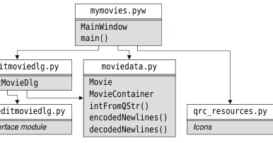

### 图 8.2 “我的电影”应用程序的模块、类与函数

创建用于持有数据的电影容器以及用于展示数据的 QTableWidget。

```python
class MainWindow(QMainWindow):
    def __init__(self, parent=None):
        super(MainWindow, self).__init__(parent)
        self.movies = moviedata.MovieContainer()
        self.table = QTableWidget()
        self.setCentralWidget(self.table)
```

在调用 `super()` 之后，我们创建一个新的空电影容器。（我们将稍后讨论 `Movie` 和 `MovieContainer` 类。）然后我们创建一个 `QTableWidget`。该部件用于展示并可选地编辑表格数据。表格在 `updateTable()` 中进行初始化和填充。由于我们已经在第 6 章中了解如何设置状态栏、创建文件、编辑和帮助操作、填充菜单和工具栏，以及如何从上一个会话的设置中恢复应用程序状态，因此我们省略了初始化程序的其余部分。

为了完整性，我们现在稍作停顿，回顾一下 `updateTable()`，看看表格部件是如何设置和填充的。（如果你更喜欢专注于纯粹的文件处理，可以跳至第 232 页的 `fileNew()` 方法。）我们所采用的方法非常简单直接。PyQt 还提供了一种更复杂的方法来填充和编辑基于项的部件（如列表、表格和树），使用 PyQt 的模型/视图架构——我们将在第 14 章中学习这一点。

```python
def updateTable(self, current=None):
    self.table.clear()
    self.table.setRowCount(len(self.movies))
    self.table.setColumnCount(5)
    self.table.setHorizontalHeaderLabels(["Title", "Year", "Mins", "Acquired", "Notes"])
    self.table.setAlternatingRowColors(True)
    self.table.setEditTriggers(QTableWidget.NoEditTriggers)
    self.table.setSelectionBehavior(QTableWidget.SelectRows)
    self.table.setSelectionMode(QTableWidget.SingleSelection)
    selected = None
```

这个方法相当长，因此我们将分三部分进行回顾。它可以在不带参数的情况下调用，此时仅填充表格；或者可以在传入当前 *电影* 的 `id()` 的情况下调用，此时在填充表格后，会使指定电影的行被选中并可见（如有必要则进行滚动）。如果刚刚添加或编辑了电影，则会传入当前电影。

我们首先清空表格；这会移除所有数据和标题。接下来，我们设置行数和列数，以及列标题。我们设置表格的属性，使得用户无法就地编辑任何内容，因为在这个特定应用程序中，我们偏好使用独立的添加/编辑对话框。我们还确保用户每次只能选择一行。`selected` 变量持有保存当前电影标题和 `id()` 的 `QTableWidgetItem`（如果有的话）。

```python
for row, movie in enumerate(self.movies):
    item = QTableWidgetItem(movie.title)
    if current is not None and current == id(movie):
        selected = item
    item.setData(Qt.UserRole, QVariant(long(id(movie))))
    self.table.setItem(row, 0, item)
    year = movie.year
    if year != movie.UNKNOWNYEAR:
        item = QTableWidgetItem("%d" % year)
        item.setTextAlignment(Qt.AlignCenter)
        self.table.setItem(row, 1, item)
    minutes = movie.minutes
    if minutes != movie.UNKNOWNMINUTES:
        item = QTableWidgetItem("%d" % minutes)
        item.setTextAlignment(Qt.AlignRight|Qt.AlignCenter)
        self.table.setItem(row, 2, item)
    
    item = QTableWidgetItem(movie.acquired.toString(
        QDate.DATEFORMAT))
    
    item.setTextAlignment(Qt.AlignRight|Qt.AlignVCenter)
    self.table.setItem(row, 3, item)
    
    notes = movie.notes
    if notes.length() > 40:
        notes = notes.left(39) + "..."
    self.table.setItem(row, 4, QTableWidgetItem(notes))
```

`QTableWidget` 中的每个单元格都由一个 `QTableWidgetItem` 表示。这些项可以持有可显示的文本以及“用户”数据。我们遍历电影容器中的每一部电影，为每部电影创建一行项。我们将电影的标题存储在每行的第一个单元格（项）中，并设置该用户数据以保存电影的 `id()`。我们必须将 ID 转换为 `long` 类型，以确保它在 `QVariant` 内部被正确保存。一旦项被创建并设置好，我们就将其放置在表格中相应的行和列中。

我们仅在拥有年份和分钟数的数据时才填充这些单元格。对于备注，如果数据过长，我们会将其截断并添加省略号，因为备注可能长达多个段落。

```python
self.table.resizeColumnsToContents()
if selected is not None:
    selected.setSelected(True)
    self.table.setCurrentItem(selected)
    self.table.scrollToItem(selected)
```

当所有表格项添加完成后，我们会调整表格列的大小以匹配其内容。

当我们遍历电影容器中的电影时，电影按字母顺序返回（但忽略开头的 “A”、“An” 和 “The” 等词）。如果用户添加新电影或编辑现有电影，我们希望确保用户刚刚添加或编辑的电影既被选中又可见。这是通过在添加或编辑后调用 `updateTable()` 来实现的，并传入用户添加或编辑的电影 ID。在 `updateTable()` 结尾处，如果传入了电影 ID，`selected` 变量将持有对应于电影标题单元格的项，且该项（因此也是该行）将被设为当前并选中，如有必要，表格部件将滚动以确保该行对用户可见。

```python
def fileNew(self):
    if not self.okToContinue():
        return
    self.movies.clear()
    self.statusBar().clearMessage()
    self.updateTable()
```

该方法与图像切换器应用程序中同名方法相似。关键区别在于，不再是主窗口负责数据，而是将工作委托给保存在 `self.movies` 中的电影容器。当调用 `updateTable()` 时，由于没有电影记录，部件将只显示列标题而没有其他内容。

`okToContinue()` 方法与我们在图像切换器应用程序中使用的方法几乎相同。唯一的区别是，由于图像切换器的主窗口持有应用程序数据，条件检查 `self.dirty`；而在这个应用程序中，由于电影容器持有数据，它调用 `self.movies.isDirty()`。

```python
def fileOpen(self):
    if not self.okToContinue():
        return
    path = QFileInfo(self.movies.filename()).path() \
if not self.movies.filename().isEmpty() else "."
    fname = QFileDialog.getOpenFileName(self,
    "My Movies - Load Movie Data", path,
    "My Movies data files (%s)" %
    self.movies.formats())
    if not fname.isEmpty():
        ok, msg = self.movies.Load(fname)
        self.statusBar().showMessage(msg, 5000)
        self.updateTable()
```

文件打开方法在结构上与我们之前看到的相同。电影容器以 `QString` 形式保存当前文件名。通常，应用程序只有一种自定义文件格式，但为了说明目的，“我的电影”应用程序支持多种格式，因此我们提供了 `formats()` 方法来返回可使用的扩展名。

主窗口子类将加载工作传递给电影容器。我们设计了电影容器的 `load` 和 `save` 方法，使其返回一个布尔值成功/失败标志和一个消息。该消息要么是错误信息，要么是报告加载或保存了多少条电影记录。在“我的电影”应用程序中，我们只使用消息部分。

如果加载成功，电影容器将包含新的电影记录，`updateTable()` 将显示它们。如果加载失败，电影容器将为空，`updateTable()` 将只显示列标题。

```python
def fileSave(self):
    if self.movies.filename().isEmpty():
        self.fileSaveAs()
    else:
        ok, msg = self.movies.save()
        self.statusBar().showMessage(msg, 5000)
```

再次说明，该方法的逻辑与我们之前看到的相同。用于保存和加载的代码取决于文件名扩展名，我们稍后将会看到。

我们将跳过 `fileSaveAs()` 的代码；它与图像切换器应用程序的代码相同，除了我们使用 `QString` 而非 `unicode` 方法处理文件名，并使用 `.mgb`（Qt 二进制格式下的我的电影）作为默认扩展名。

```python
def fileImportDOM(self):
    self.fileImport("dom")

def fileImportSAX(self):
    self.fileImport("sax")
```


通常，我们会提供一种导入方法，并使用 SAX 或 DOM 解析器。在这里，我们选择同时展示两种解析器的使用，因此提供了两个独立的导入操作。两者产生的结果相同。

用于导入的文件操作代码与“文件打开”操作非常相似，只是我们使用了由用户指定的导入解析器。与所有文件处理代码一样，我们将工作委托给电影容器。

```python
def fileExportXml(self):
    fname = self.movies.filename()
    if fname.isEmpty():
        fname = "."
    else:
        i = fname.lastIndexOf(".")
        if i > 0:
            fname = fname.left(i)
        fname += ".xml"
    fname = QFileDIalog.getSaveFileName(self,
            "My Movies - Export Movie Data", fname,
            "My Movies XML files (*.xml)")
    if not fname.isEmpty():
        if not fname.contains("."):
            fname += ".xml"
        ok, msg = self.movies.exportXml(fname)
        self.statusbar().showMessage(msg, 5000)
```

我们只提供一种 XML 导出方法。代码类似于“文件另存为”操作。请注意，我们必须使用 QString 方法以确保文件名具有 .xml 扩展名，而不是我们在 Image Changer 应用程序中使用的 unicode 方法，因为文件名是以 QString 形式存储的。

## 数据容器职责

应用程序的数据容器负责持有所有数据项，即电影记录，并负责将它们保存和加载到磁盘。在前一节中，当我们查看 `MainWindow.updateTable()` 方法时，已经看到容器如何通过 for 循环进行迭代，以获取所有电影，从而在应用程序的 `QtWebKitWidget` 中显示它们。在本节中，我们将探讨 `moviedata` 模块提供的功能，包括用于存储电影数据的数据结构、如何提供支持有序迭代的功能以及其他方面，但排除实际的保存和加载代码，因为那将在后续章节中介绍。

为什么要使用自定义的数据容器？毕竟，我们可以简单地使用 Python 内置的数据结构，如列表或字典。我们倾向于采取一种方法，即将标准数据结构封装在自定义容器类中。这确保了数据的访问由我们的类控制，有助于维护数据完整性。它也使扩展容器功能并替换底层数据结构变得更加容易，且不会影响现有代码。换句话说，这是一种面向对象的方法，避免了简单地使用例如列表加全局函数的缺点。

我们将先从 `moviedata` 模块的导入和常量开始。

```python
import bisect
import codecs
import copy_reg
import cPickle
import gzip
from PyQt4.QtCore import *
from PyQt4.QtXml import *
```

我们将电影按规范化标题顺序存储，忽略大小写，并忽略开头的“A”、“An”和“The”字样。为了最小化插入和查找时间，我们使用 `bisect` 模块维护顺序，采用与我们在第 3 章中实现的 `OrderedDict` 相同的技术。

`codecs` 模块对于使用特定文本编码读写 Python 文本文件是必需的。`copy_reg` 和 `cPickle` 模块用于保存和加载 Python “pickles”——这些是包含任意 Python 数据结构文件。`gzip` 模块用于压缩数据；我们将用它来压缩和解压我们的 pickle 数据。`PyQt4`/`QtCore` 的导入很熟悉，但我们还必须导入 `PyQt4`/`QtXml` 模块以获取对 `PyQt` 的 SAX 和 DOM 解析器的访问权限。我们稍后将在各节中看到所有这些模块的使用情况。请注意，由于 `moviedata` 模块是一个纯数据处理模块，没有 GUI 功能，因此我们不需要 `PyQt4`/`QtGui` 模块。

```python
CODEC = "UTF-8"
NEWPARA = unichr(0x2029)
NEWLINE = unichr(0x2028)
```

我们希望使用 UTF-8 编解码器用于文本文件。这是一种 8 位 Unicode 编码，每个 ASCII 字符使用一个字节，其他字符使用两个或更多字节。它可能是文件中使用的最广泛的 Unicode 文本编码。通过使用 Unicode，我们可以存储当今几乎所有正在使用的人类语言文字的文本。

尽管 \n 是一个有效的 Unicode 字符，但在我们使用 XML 时，将需要使用特定的 Unicode 段落换行符和行换行符。这是因为 XML 解析器通常不区分不同的 ASCII 空白字符，例如换行符和空格，如果我们希望保留用户的行和段落换行，这是不方便的。

```python
class Movie(object):
    UNKNOWNYEAR = 1890
    UNKNOWNMINUTES = 0

    def __init__(self, title=None, year=UNKNOWNYEAR,
                 minutes=UNKNOWNMINUTES, acquired=None, notes=None):
        self.title = title
        self.year = year
        self.minutes = minutes
        self.acquired = acquired \
            if acquired is not None else QDate.currentDate()
        self.notes = notes
```

Movie 类用于保存关于一部电影的数据。我们直接使用实例变量，而不是提供简单的 getter 和 setter。标题和备注作为 QString 存储，获取日期作为 QDate。电影发布的年份和时长（以分钟计）作为 int 存储。我们提供两个静态常量来表示我们不知道电影何时发布或时长多久。

我们现在准备查看电影容器类。该类持有一个电影有序列表，并提供用于以多种格式保存和加载（以及导出和导入）电影的功能。

```python
class MovieContainer(object):
    MAGIC_NUMBER = 0x3051E
    FILE_VERSION = 100

    def _init(self):
        self.__fname = QString()
        self.__movies = []
        self.__movieFromId = {}
        self.__dirty = False
```

MAGIC_NUMBER 和 FILE_VERSION 用于使用 PyQt 的 QDataStream 类保存和加载文件。

文件名作为 QString 保存。`__movies` 列表中的每个元素本身是一个二元列表，第一个元素是排序键，第二个是 Movie。这是该类的主要数据结构，用于按顺序保存电影。`__movieFromId` 字典的键是 Movie 对象的 id()，值是 Movies。如我们在第 1 章所见，每个 Python 对象非常方便地拥有一个唯一 ID，可以通过调用其 id() 获得。此字典用于在已知电影 ID 时提供快速电影查找。例如，主窗口在 QTableWidgetItems 的第一列中存储电影 ID 作为“用户”数据。当然，没有数据重复，因为这两个数据结构实际上持有的是对 Movie 对象的引用，而不是 Movie 对象本身。

- id( ) 函数
- 对象引用

```python
def __iter__(self):
    for pair in iter(self.__movies):
        yield pair[1]
```

当 MainWindow.updateTable() 方法使用 for 循环迭代电影容器时，Python 使用了容器的 __iter__() 方法。在这里我们可以看到，我们迭代 [key, movie] 列表的有序列表，每次只返回 movie 项。

```python
def __len__(self):
    return len(self.__movies)
```

此方法允许我们对电影容器使用 len() 函数。

在后续章节中，我们将看到用于以各种格式加载和保存在电影容器中存储的电影的代码。但首先，我们将查看如何清除容器，以及如何添加、删除和更新电影，以便了解容器的运作方式，特别是关于顺序的部分。

```python
def clear(self, clearFilename=True):
    self.__movies = []
    self.__movieFromId = {}
    if clearFilename:
        self.__fname = QString()
    self.__dirty = False
```

此方法用于清除所有数据，可能包括文件名。它从 MainWindow.fileNew() 调用，该方法会清除文件名，也从各种保存和加载方法调用，这些方法不触及文件名。电影容器维护一个脏标志，以便始终知道是否有未保存的更改。

```python
def add(self, movie):
    if id(movie) in self.__movieFromId:
```


```python
return False
key = self.key(movie.title, movie.year)
bisect.insort_left(self.__movies, [key, movie])
self.__movieFromId[id(movie)] = movie
self.__dirty = True
return True
```

第一个 if 语句确保我们不重复添加同一部电影。我们使用 `key()` 方法生成合适的排序键，然后使用 bisect 模块的 `insert_left()` 函数将包含两个元素 [key, movie] 的列表插入到 `__movies` 列表中。由于 bisect 模块使用二分查找（binary chop）算法，因此这个过程非常快。我们还确保 `__movieFromId` 字典保持最新状态，并将容器标记为脏（dirty）。

```python
def key(self, title, year):
    text = unicode(title).lower()
    if text.startswith("a "):
        text = text[2:]
    elif text.startswith("an "):
        text = text[3:]
    elif text.startswith("the "):
        text = text[4:]
    parts = text.split(", ", 1)
    if parts[0].isdigit():
        text = "%08d % " % int(parts[0])
        if len(parts) > 1:
            text += parts[1]
    return u"%s\t%d" % (text.replace(" ", ", ", 1), year)
```

此方法生成一个适用于对我们电影数据进行排序的键字符串。我们不保证键的唯一性（尽管做到这一点并不难），因为有序数据结构是一个列表，而列表中存在重复键并不是问题。代码是针对英语定制的，它会从电影标题中消除定冠词和不定冠词。如果电影标题以数字开头，我们会用前导零填充该数字，以便例如 "20" 会排在 "100" 之前。我们不需要对年份进行填充，因为年份总是恰好为四位数字。所有其他数据均使用 PyQt 数据类型存储，但我们选择使用 unicode 格式存储键字符串。

```python
def delete(self, movie):
    if id(movie) not in self.__movieFromId:
        return False
    key = self.key(movie.title, movie.year)
    i = bisect.bisect_left(self.__movies, [key, movie])
    del self.__movies[i]
    del self.__movieFromId[id(movie)]
    self.__dirty = True
    return True
```

### 数据容器的职责

要删除一部电影，我们必须将其从两个数据结构中移除。对于 `__movies` 列表，我们必须首先找到该电影的索引位置。

```python
def updateMovie(self, movie, title, year, minutes=None,
                notes=None):
    if minutes is not None:
        movie.minutes = minutes
    if notes is not None:
        movie.notes = notes
    if title != movie.title or year != movie.year:
        key = self.key(movie.title, movie.year)
        i = bisect.bisect_left(self.__movies, [key, movie])
        self.__movies[i][0] = self.key(title, year)
        movie.title = title
        movie.year = year
        self.__movies.sort()
        self.__dirty = True
```

如果用户编辑一部电影，应用程序始终调用此方法并传入用户的更改。如果分钟数或笔记作为 *None* 传入，我们将这解释为它们未被更改。如果电影的标题或年份已更改，那么该电影在 `__movies` 列表中的位置现在可能是错误的。在这种情况下，我们使用其原始标题和年份找到该电影，设置新的标题和年份，然后重新排序列表。在实践中，这并不像初看时那么昂贵。列表中最多只会包含一个排序错误的项，而 Python 的排序算法针对部分有序数据进行了高度优化。

如果我们发现此处存在性能问题，我们可以随时使用 delete() 和 add() 重新实现 updateMovie()。

```python
@staticmethod
def formats():
    return "*.mqb *.mpb *.mqt *.mpt"
```

通常，我们为一个应用程序提供一两个自定义数据格式即可，但为了说明目的，我们提供了使用四个扩展名的三种格式。扩展名 .mqb 是 Qt 二进制格式，它使用 QDataStream 类；扩展名 .mpb 是 Python pickle 格式（使用 gzip 压缩）。扩展名 .mqt 是 Qt 文本格式，它使用 QTextStream 类；扩展名 .mpt 是 Python 文本格式。这两种文本格式是相同的，但通过使用不同的扩展名，我们可以使用不同的保存和加载代码以便进行比较。

```python
def save(self, fname=QString()):
    if not fname.isEmpty():
        self._fname = fname
    if self.__fname.endsWith(".mqb"):
        return self.saveQDataStream()
    elif self._fname.endswith(".mpb"):
        return self.savePickle()
    elif self._fname.endswith(".mqt"):
        return self.saveQTextStream()
    elif self._fname.endswith(".mpt"):
        return self.saveText()

    return False, "Failed to save: invalid file extension"
```

当用户调用“文件保存”操作时，我们期望数据容器的 save() 方法被调用。在 My Movies 中确实是这样做的，这也是常见的做法。然而，在这里，save() 方法并不直接执行保存操作，而是将工作交给根据文件名扩展名确定的特定方法。这样做的纯粹目的是为了展示如何以不同格式保存数据；在实际应用程序中，我们通常只使用一种格式。

有一个对应的 load() 方法，它具有与 save() 方法相同的逻辑，并将其工作传递给特定于扩展名的加载方法。所有的加载和保存方法都返回一个二元组（tuple），第一个元素是布尔类型的成功/失败标志，第二个元素是消息，要么是错误消息，要么是对成功发生内容的报告。

我们现在已经看到了应用程序用于文件处理的基础设施，以及容器在内存中持有数据的数据结构。在接下来的部分中，我们将查看用于将容器数据保存到磁盘以及从磁盘加载的代码。

## 保存和加载二进制文件

PyQt 和 Python 标准库都提供了用于编写和读取二进制文件的设施。PyQt 使用 QDataStream 类，而 Python 标准库使用 file 类，或者直接与 pickle 模块配合使用。

二进制格式对人不友好（不可读），但它们是最容易编码的，并且读写磁盘的速度最快。无需解析：数字、日期以及许多 PyQt 类型（包括图像）都可以毫无繁琐地读取和写入。PyQt 对二进制文件的支持非常强大：PyQt 确保二进制文件是平台无关的，并且为二进制文件类型添加版本并不困难，以便在需要时扩展我们的文件格式。Python 标准库的 pickle 模块（及其更快的 cPickle 对应物）也提供了快速的平台无关的加载和保存功能，但在处理复杂的 PyQt 类型（如图像）时，可能不如 PyQt 的 QDataStream 高效。

### 使用 QDataStream 写入和读取

QDataStream 类可以以二进制格式读取和写入 Python 布尔值和数值类型，以及 PyQt 类型（包括图像）。由 QDataStream 写入的文件是平台无关的；该类自动处理字节序和字大小。

PyQt 几乎每个新版本都有一个使用新二进制格式进行数据存储的 QDataStream——这是为了 QDataStream 能够容纳新的数据类型，并支持对现有数据类型的增强。这不是问题，因为每个版本的 QDataStream 都可以读取以前所有版本中格式存储的数据。此外，无论使用哪个版本的 QDataStream，QDataStream 始终以相同的方式存储整数。

```python
def saveQDataStream(self):
    error = None
    fh = None
    try:
        fh = QFile(self.__fname)
        if not fh.open(QIODevice.WriteOnly):
            raise IOError, unicode(fh.errorString())
        stream = QDataStream(fh)
        stream.writeInt32(MovieContainer.MAGIC_NUMBER)
        stream.writeInt32(MovieContainer.FILE_VERSION)
        stream.setVersion(QDataStream.Qt_4_2)
```

由于 PyQt 使用返回值而不是异常，如果文件无法打开，我们将自己抛出异常，因为我们更倾向于基于异常的错误处理方法。打开文件后，我们创建一个 QDataStream 对象以便向其写入数据。

PyQt 无法猜测我们想要使用多大尺寸的整数来存储 int 和 long 整数，因此我们必须使用 `writeIntn()` 和 `writeUIntn()` 方法写入整数值，其中 n 是 8、16、32 或 64，即用于存储整数的位数。对于浮点数，QDataStream 提供了 `writeDouble()` 和 `readDouble()` 方法。这些方法操作的是 Python 浮点数（相当于 C 和 C++ 的 double），并以 64 位值的 IEEE-754 格式存储。

我们写入的第一个整数是“魔数”（magic number）。这是一个用于识别 My Movies 数据文件的任意数字。这个数字永远不会改变。我们应当为任何自定义二进制数据文件分配一个独特的魔数，因为文件名扩展名并不能始终可靠地用于正确识别文件类型。接下来我们写入一个“文件版本”。这是我们文件格式的版本（我们将其设置为 100）。如果我们决定稍后更改文件格式，魔数将保持不变——毕竟文件仍然包含电影数据——但文件格式将会改变（例如，变为 101），以便我们可以预期不同的代码来加载它以应对格式的差异。

由于整数始终以相同格式保存，我们可以安全地在设置 QDataStream 版本之前写入它们。但一旦我们写入了魔数和文件版本，我们就应该将 QDataStream 版本设置为 PyQt 在编写和读取其余数据时应使用的版本。如果我们想利用后续版本的优势，我们可以使用原始文件格式用于


Qt 4.2 版本，以及用于后续版本的另一种文件格式。然后，当我们需要加载数据时，可以根据我们的文件格式编号来设置 QDataStream 的版本。

设置 QDataStream 版本非常重要，因为它可以确保任何 PyQt 数据类型都能正确保存和加载。唯一不重要的情况是我们只保存和加载整数，因为它们的表示方式永远不会改变。

```python
for key, movie in self._movies:
    stream << movie.title
    stream.writeInt16(movie.year)
    stream.writeInt16(movie.minutes)
    stream << movie.acquired << movie.notes
```

现在我们遍历电影数据，将每部电影的数据写入数据流。数据格式如图 8.3 所示。QDataStream 类为许多 PyQt 类重载了 `<<` 运算符，例如 QString、QDate 和 QImage，因此我们必须使用类似 C++ 的流式语法来写入数据。`<<` 运算符将其右操作数作为其左操作数写入数据流。它可以反复应用于同一个流，因为它返回应用到的流，但对于整数，我们必须使用 `writeIntn()` 和 `writeUIntn()` 方法。

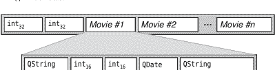

**图 8.3** *QDataStream“我的电影”文件格式*

由于我们写入的是二进制数据，因此不需要进行任何格式化。我们只需确保在重新加载数据时，使用相同的 QDataStream 版本，并且按照保存时相同的顺序加载相同的数据类型。因此，在这种情况下，我们将加载两个整数（魔术数和文件版本号），然后加载任意数量的电影记录，每条记录由一个字符串、两个整数、一个日期和一个字符串组成。

```python
except (IOError, OSError), e:
    error = "Failed to save: %s" % e
finally:
    if fh is not None:
        fh.close()
if error is not None:
    return False, error
self.__dirty = False
    return True, "Saved %d movie records to %s" % (
        len(self.__movies),
        QFileIo(self.__fname).fileName())
```

如果发生任何错误，我们只需放弃并返回失败标志和错误消息。否则，我们清除脏标志并返回成功标志以及指示保存了多少条记录的消息。

对应的加载方法同样简单明了，尽管它需要处理更多的错误。

```python
def loadQDataStream(self):
    error = None
    fh = None
    try:
        fh = QFile(self, fname)
        if not fh.open(QIODevice.ReadOnly):
            raise IOError, unicode(fh.errorString())
        stream = QDataStream(fh)
        magic = stream.readInt32()
        if magic != MovieContainer.MAGIC_NUMBER:
            raise IOError, "unrecognized file type"
        version = stream.readInt32()
        if version < MovieContainer.FILE_VERSION:
            raise IOError, "old and unreadable file format"
        elif version > MovieContainer.FILE_VERSION:
            raise IOError, "new and unreadable file format"
        stream.setVersion(QDataStream.Qt_4_2)
        self.clear(False)
        while not stream.atEnd():
            title = QString()
            acquired = QDate()
            notes = QString()
            stream >> title
            year = stream.readInt16()
            minutes = stream.readInt16()
            stream >> acquired >> notes
            self.add(Movie(title, year, minutes, acquired, notes))
```

我们像之前一样创建 QFile 对象和 QDataStream 对象，只是这次使用的是 ReadOnly 模式而不是 WriteOnly 模式。然后我们读取魔术数。如果这不是唯一的“我的电影”数据文件编号，我们就引发异常。接下来我们读取文件版本，并确保它是我们可以处理的版本。如果该文件格式有多个版本在使用，我们在这一点会根据文件版本进行分支处理。然后我们设置 QDataStream 版本。

下一步是清除电影数据结构。我们尽可能晚地执行此操作，以便如果之前引发了异常，原始数据将保持完整。False 参数告诉 clear() 方法清除 __movies 和 __moviesFromId，但不清除文件名。

对于整数，我们必须始终使用与写入时指定的位数相同的 readInt() 和 readUInt() 方法读取。

一旦读取了一部电影的单个数据，我们就创建一个新的 Movie 对象，并立即使用前面章节中介绍的 add() 方法将其添加到容器的数据结构中。

```python
    except (IOError, OSError), e:
        error = "Failed to load: %s" % e
    finally:
        if fh is not None:
            fh.close()
        if error is not None:
            return False, error
        self._dirty = False
        return True, "Loaded %d movie records from %s" % (
            len(self.__movies),
            QFileInfo(self._name).fileName())
```

错误处理和最终的 return 语句在结构上与用于保存方法的相同。

使用 PyQt 的 QDataStream 类写入二进制数据，在原理上与使用 Python 的文件对象没有太大区别。我们必须小心使用正确的 QDataStream 版本，并且应该使用魔术数和文件版本，或者采用某种等效的方法。使用 `<<` 和 `>>` 运算符不太具有 Pythonic 风格，但很容易理解。

我们本可以将写入电影的代码放在 Movie 类本身中，也许是一个接受 QDataStream 参数并将其数据写入其中的方法。实际上，让数据容器处理文件操作通常更方便，而且几乎总是比让单个数据项处理更灵活。

## 文件错误处理的方法

本章中用于处理文件错误的方法结构如左侧所示。另一种同样有效的方法，例如在 chap09/textedit.py 和 chap14/ships.py 中使用，如右侧所示。

- 左侧方法：
```python
error = None
fh = None
try:
    # open file and read data
except (IOError, OSError), e:
    error = unicode(e)
finally:
    if fh is not None:
        fh.close()
    if error is not None:
        return False, error
    return True, "Success"
```

- 右侧方法：
```python
exception = None
fh = None
try:
    # open file and read data
except (IOError, OSError), e:
    exception = e
finally:
    if fh is not None:
        fh.close()
    if exception is not None:
        raise exception
```

在调用点，假设我们要处理 load() 方法，对于左侧方法，我们可能会使用这样的代码：

```python
ok, msg = load(args)
if not ok:
    QMessageBox.warning(self, "File Error", msg)
```

对于右侧方法，我们可以使用这样的代码：

```python
try:
    load(args)
except (IOError, OSError), e:
    QMessageBox.warning(self, "File Error", unicode(e))
```

另一种方法，用于 chap09/sdtexteditor.pyw 和 chap12/pagedesigner.pyw，是在文件处理方法的内部进行所有的错误处理：

```python
fh = None
try:
    # open file and read data
except (IOError, OSError), e:
    QMessageBox.warning(self, "File Error", unicode(e))
finally:
    if fh is not None:
        fh.close()
```

在调用点，我们只需调用 load(args)，让 load() 方法本身向用户报告任何问题。

### 表 8.1 选定的 QDataStream 方法

| 语法 | 描述 |
|---|---|
| s.atEnd() | 如果已到达 QDataStream s 的末尾，则返回 True。 |
| s.setVersion(v) | 将 QDataStream s 的版本设置为 v，其中 v 为 Qt_1_0、Qt_2_0、……、Qt_4_2 或 Qt_4_3 之一。 |
| s << x | 将对象 x 写入 QDataStream s；x 可以是 QBrush、QColor、QDate、QDateTime、QFont、QIcon、QImage、QMatrix、QPainterPath、QPen、QPixmap、QSize、QString、QVariant 等类型。 |
| s.readBool() | 从 QDataStream s 读取一个 bool。 |
| s.readDouble() | 从 QDataStream s 读取一个 float。 |
| s.readInt16() | 从 QDataStream s 读取一个 16 位 int。也有 readUInt16() 方法。 |
| s.readInt32() | 从 QDataStream s 读取一个 32 位 int。也有 readUInt32() 方法。 |
| s.readInt64() | 从 QDataStream s 读取一个 64 位 long。也有 readUInt64() 方法。 |
| x = QString() s >> x | 从 QDataStream s 读取对象 x；x 必须已经存在（以便数据流知道要读取的数据类型），可以是 << 可写入的任何类型。 |
| s.writeBool(b) | 将 bool b 写入 QDataStream s。 |
| s.writeDouble(f) | 将 float f 写入 QDataStream s。 |
| s.writeInt16(i) | 将 int i 作为 16 位 int 写入 QDataStream s。也有 writeUInt16() 方法。 |
| s.writeInt32(i) | 将 int i 作为 32 位 int 写入 QDataStream s。也有 writeUInt32() 方法。 |
| s.writeInt64(l) | 将 long l 作为 64 位 int 写入 QDataStream s。也有 writeUInt64() 方法。 |

### 使用 pickle 模块进行读写

Python 的标准 pickle 模块及其更快的 cPickle 对应模块可以将任意的 Python 数据结构保存到磁盘并重新加载回来。这些模块提供完全相同的功能和功能。它们之间的唯一区别在于 pickle 模块完全用 Python 实现，而 cPickle 模块用 C 实现。这些模块只理解 Python 标准库中的数据以及由它们构建的类。如果我们想要使用 PyQt 4.3 之前的版本 pickle PyQt 特有的数据类型，我们必须告诉 pickle（或 cPickle）模块如何处理它们。

```python
def _pickleQDate(date):
    return QDate, (date.year(), date.month(), date.day())

def _pickleQString(qstr):
    return QString, (unicode(qstr),)
```


copy_reg.pickle(QDate, _pickleQDate)
copy_reg.pickle(QString, _pickleQString)

copy_reg 模块用于指定如何读写非标准数据类型。通过调用 `copy_reg.pickle()` 并提供两个参数来提供相关信息。第一个参数是我们希望能够进行 pickle 操作的新式类，第二个参数是一个函数。该函数必须接受单个参数，即我们希望 pickle 的类的实例，并返回一个二元组（two-tuple），其中第一个元素是类本身，第二个元素是一个由标准 Python 类型组成的元组，该元组可以作为参数传入类的构造函数，以创建一个与传入实例具有相同值的实例。

利用这些信息，pickle 模块可以通过将类名作为文本存储，并将参数作为标准 Python 类型的元组来存储我们类的实例。然后，当我们需要将数据反序列化（unpickle，即加载）时，Python 可以使用 `eval()` 来重新创建我们的实例。

PyQt 4.3 包含对基本 Qt 数据类型的 pickle 支持，包括 `QByteArray`、`QChar`、`QColor`、`QDate`、`QDateTime`、`QKeySequence`、`QLine`、`QLineF`、`QMatrix`、`QPoint`、`QPointF`、`QPolygon`、`QRect`、`QRectf`、`QSize`、`QSizeF`、`QString`、`QTime` 以及所有 PyQt 枚举。这意味着我们可以“pickle”这些类型中的任意一个，而无需编写并注册我们自己的 pickle 函数。

```python
def savePickle(self):
    error = None
    fh = None
    try:
        fh = gzip.open(unicode(self.__fname), "wb")
        cPickle.dump(self.__movies, fh, 2)
    except (IOError, OSError), e:
        error = "Failed to save: %s" % e
    finally:
        if fh is not None:
            fh.close()
        if error is not None:
            return False, error
        self.__dirty = False
        return True, "Saved %d movie records to %s" % (
            len(self.__movies),
            QFileInfo(self.__fname).fileName())
```

我们可以轻松地将任何 Python 数据结构（包括递归数据结构）保存为 pickle。我们通过以二进制模式打开文件并使用 `dump()` 函数来实现这一点。在这个示例中，我们选择以压缩方式保存我们的 pickle（这可能会使文件大小减少约 50%），但我们也可以避免使用这种压缩，如下所示：

`fh = open(unicode(self.__fname), "wb")`

我们必须将文件名转换为 unicode，因为它是作为 `QString` 持有的。`open()` 的 `wb` 参数表示“以二进制模式写入”。`dump()` 函数接受一个 Python 数据结构（在本例中是我们 `[key, movie]` 列表的集合）、一个文件句柄和一个格式代码。我们总是使用格式代码 2，这意味着 pickle 二进制格式。

由于键（keys）是由 `key()` 方法生成的，我们实际上只需要保存 `Movie` 实例，而不需要保存 `[key, movie]` 列表。如果磁盘空间非常紧张，我们可能会这样做，但这要求我们在加载数据时重新生成键，因此这代表了磁盘空间与保存和加载速度之间的权衡。我们选择牺牲磁盘空间，以实现更快、更简单的保存和加载。

```python
def loadPickle(self):
    error = None
    fh = None
    try:
        fh = gzip.open(unicode(self.__fname), "rb")
        self.clear(False)
        self.__movies = cPickle.load(fh)
        for key, movie in self.__movies:
            self.__movieFromId[mid(movie)] = movie
    except (IOError, OSError), e:
        error = "Failed to load: %s" % e
    finally:
        if fh is not None:
            fh.close()
        if error is not None:
            return False, error
        self.__dirty = False
        return True, "Loaded %d movie records from %s" % (
            len(self.__movies),
            QFileInfo(self.__fname).fileName())
```

反序列化（Unpickling）几乎和序列化一样简单。我们必须记住使用 gzip 打开文件，以便对其进行解压。`open()` 的 `rb` 参数表示“以二进制模式读取”。我们使用 pickle 的 `load()` 函数来检索数据；它接受一个文件句柄并返回整个数据结构。我们将数据结构直接赋值给我们的 `__movies` 列表。然后我们遍历电影记录以填充 `__movieFromId` 字典。这个字典不能被保存，因为它依赖于 `Movie` 的 `id()`（每次运行应用程序时都会发生变化）。

序列化和反序列化是保存和加载二进制数据最简单的方法，非常适合我们的数据保存在标准 Python 数据类型中的情况。如果我们将数据保存为 PyQt 数据类型，通常最好使用 `QDataStream`。这个类在存储复杂的 PyQt 数据类型（如图像）时比 pickle 模块更高效（因为不需要 pickle 所需的转换开销），并且它生成的文件比 pickle 模块生成的更紧凑（除非 pickle 数据被压缩）。它还提供了一种便捷的方式，与 C++/Qt 应用程序实现无缝的数据格式互操作性。

## 保存和加载文本文件

PyQt 和 Python 标准库提供了编写和读取文本文件的设施。PyQt 使用 `QTextStream` 类，而 Python 标准库使用 `codecs` 模块。

纯文本格式通常是人类可读的，例如在文本编辑器中，并且通常易于编写。任何类型的数据都可以通过某种方式写为纯文本。数字和日期可以通过使用它们的字符串表示形式非常轻松且紧凑地写入，而其他类型（如图像）可以以更冗长的形式写入——例如，使用 .xpm 格式。

读取包含非上下文数据或具有结构（例如记录结构）的纯文本意味着我们必须编写解析器，这可能相当困难，尤其是对于复杂数据或复杂数据结构。纯文本格式在扩展性方面也可能相当棘手，以保持与早期格式的兼容性，而且由于读取编码和写入编码之间的差异，它们容易因用户可能使用假设了不同编码的文本编辑器进行编辑而导致误读。这些格式对于存储简单数据类型的简单文件结构最为有用。

| 格式 | 示例 |
| :--- | :--- |
| `{{MOVIE}}\n\ttitle\n` | `{{MOVIE}}\t12 Monkeys` |
| `year\n minutes\n acquired\n` | `1995 129 2001-06-21` |
| `\t\t\t(NOTES)\n` | `(NOTES)` |
| `notes\n` | `Based on La Jetée` |
| `{{ENDMOVIE}}\n` | `{{ENDMOVIE}}` |

**图 8.4** My Movies 文本格式

我们需要写入的数据仅包含简单类型：字符串、整型和日期。但我们仍然需要结构化文本文件，以便能够区分每个电影记录，并且我们必须考虑到备注文本可能跨越多行的事实。

我们选择的结构如图 8.4 所示。在左侧的“格式”列中，空格由 `{down}` 表示，换行符由 `{down}` 表示。

备注可以跨越多行，但我们假设没有一行备注以 `{{ENDMOVIE}}` 文本开头。更稳健的解决方案将涉及转义。例如，我们可以假设对于任何以 \ 开头的行，我们忽略 \ 并将该行其余部分视为字面文本。这将允许我们通过将其写为 `\\{{ENDMOVIE}}` 来包含一行文本 `{{ENDMOVIE}}`。

### 使用 QTextStream 进行写入和读取

使用 `QTextStream` 写入文本格式的代码与我们使用 `QDataStream` 写入的代码非常相似。

```python
def saveTextStream(self):
    error = None
    fh = None
    try:
        fh = QFile(self.__fname)
        if not fh.open(QIODevice.WriteOnly):
            raise IOError, unicode(fh.errorString())
        stream = QTextStream(fh)
        stream.setCodec(CODEC)
        for key, movie in self.__movies:
            stream << "{{MOVIE}}" << movie.title << "\n" \
            << movie.year << " " << movie.minutes << " " \
            << movie.acquired.toString(Qt.ISODate) \
            << "\n\n(NOTES)"
            if not movie.notes.isEmpty():
                stream << "\n" << movie.notes
            stream << "\n\n{{ENDMOVIE}}\n"
```

有两个关键点需要注意。首先，我们必须指定要使用的编码。我们在所有情况下都使用 UTF-8；（CODEC 持有文本 UTF-8）。如果我们不这样做，PyQt 将使用本地 8 位编码，在美国这可能是 ASCII、Latin-1 或 UTF-8，在西欧可能是 Latin-1 或 UTF-8，在日本可能是 EUC-JP、JIS、Shift-JIS 或 UTF-8。通过指定编码，我们确保始终使用指定的编码进行写入和读取，从而避免字符被错误解释。不幸的是，我们无法保证用户使用正确的编码来编辑我们的文本文件。如果文件可能被编辑，我们可以在第一行用 ASCII 写入编码——例如，以类似 XML 的方式写作 encoding='UTF-8'——至少为编辑器提供一个提示。随着 UTF-8 成为文本文件编码的事实全球标准，这个问题在未来几年应该会减少。

第二点应该很明显：所有数据必须作为文本写入。QTextStream 重载了 `<<` 操作符以自动处理布尔值、数字和 QString，但其他数据类型必须转换为它们的字符串表示形式。对于日期，我们选择使用 ISO (YYYY-MM-DD) 格式。我们还选择避免在备注为空时，在 (NOTES) 标记后留有空白行。

\*如果格式非常简单，使用 QSettings 对象并让其读写到指定文件，而不是手写代码，可能是最简便的方法。


我们省略了 `except` 和 `finally` 代码块的代码，因为它们与我们之前见过几次的内容相同——例如在 `saveQDataStream()` 方法中。

虽然以文本格式写入很直接，但读取回去却不那么容易。一方面，我们将不得不以文本形式读取每个整数（年份、分钟数以及获取日期的组成部分），并将它们转换为文本所代表的整数。但主要问题是我们必须正确解析文件，以提取每部电影的记录属性。

处理整数并不太难，因为 `QString` 提供了 `toInt()` 方法；但是该方法返回成功/失败标志，而不是抛出异常，并且每次处理数字时都要检查这一点，意味着我们需要为每个数字编写三行代码而不是一行。因此，我们创建了一个更具 Python 风格的读取整数的包装函数。

```python
def intFromQString(qstr):
    i, ok = qstr.toInt()
    if not ok:
        raise ValueError, unicode(qstr)
    return i
```

该函数简单地调用 `QString.toInt()`，在失败时抛出异常，或在成功时返回整数。

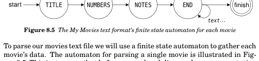

要解析我们的电影文本文件，我们将使用有限状态自动机来收集每部电影的数据。解析单部电影的自动机如图 8.5 所示。这意味着在读取每一行之前，我们都期望该行包含特定内容。如果期望未得到满足，我们就会遇到错误；否则，我们读取预期的数据，并为下一行应包含的内容设置期望。

```python
def loadQTextStream(self):
    error = None
    fh = None
    try:
        fh = QFile(self.__fname)
        if not fh.open(QIODevice.ReadOnly):
            raise IOError, unicode(fh.errorString())
        stream = QTextStream(fh)
        stream.setCodec(CODEC)
        self.clear(False)
        lino = 0
```

该方法的开头很熟悉。一旦我们打开了文件，创建了 `QTextStream`，并设置了编解码器，我们就清空现有的电影数据，准备从磁盘读取数据。

对于每部电影，我们首先期望一个“title”行，其中包含 `{MOVIE}`，后跟一个空格和电影标题；然后是一个“numbers”行，包含年份、分钟数和获取日期；接着是一个“notes”行，仅包含 `{NOTES}`；然后是零个或多个注释文本行；最后是一个仅包含 `{ENDMOVIE}` 的“end”行。我们从期望一个“title”行开始。

为了帮助用户找到格式错误，我们在 `lno` 变量中跟踪当前行号，我们将在错误消息中使用它。

我们用来遍历文件的 `while` 循环的主体相当长，因此我们将分部分查看它。

```python
while not stream.atEnd():
    title = year = minutes = acquired = notes = None
    line = stream.readLine()
    lno += 1
    if not line.startsWith("{{MOVIE}}"):
        raise ValueError, "no movie record found"
    else:
        title = line.mid(len("{{MOVIE}}")).trimmed()
```

我们首先将保存一部电影属性的变量初始化为 None，这样很容易判断我们是否读取了所有属性。

我们遍历文件中的每一行。与 Python 标准库的 `file.readline()` 方法不同，PyQt 的 `QTextStream.readLine()` 会去除行尾的换行符。每次读取一行时，我们都递增 `lno`。

我们为任何电影期望的第一行是以 `{MOVIE}` 标记开头的行。如果该行不正确，我们抛出带有错误消息的异常；异常处理程序将在传递给用户的消息中添加行号。如果有一行正确的行，我们通过读取 `{MOVIE}` 标记后跟随的文本来提取电影标题，并去除行首的任何前导和尾部空白。

`QString.mid(n)` 方法相当于 `unicode[n:]`，而 `QString.trimed()` 则等同于 `unicode.strip()`。

现在我们要准备读取“numbers”行。

```python
if stream.atEnd():
    raise ValueError, "premature end of file"
line = stream.readLine()
lno += 1
parts = line.split(" ")
if parts.count() != 3:
    raise ValueError, "invalid numeric data"
```

```python
year = intFromQStr(parts[0])
minutes = intFromQStr(parts[1])
ymd = parts[2].split("-")
if ymd.count() != 3:
    raise ValueError, "invalid acquired date"
acquired = QDate(intFromQStr(ymd[0]),
                 intFromQStr(ymd[1]),
                 intFromQStr(ymd[2]))
```

我们首先检查是否过早达到了文件末尾，如果是，则抛出异常。否则，我们读取“numbers”行。这一行应该有一个整数（年份）、一个空格、一个整数（分钟数）、一个空格，以及 YYYY-MM-DD 格式的获取日期。我们最初按空格字符分割该行，这应该给我们三个字符串：年份、分钟数和获取日期。我们使用我们的 intFromQStr() 函数将文本转换为其代表的整数；如果任何转换失败，都会抛出异常，并由该方法的异常处理程序处理。我们直接转换年份和分钟数，但对于获取日期，我们必须再次分割字符串，这次是按连字符字符，然后使用从每个部分提取的整数值构造一个 QDate。

现在我们要准备读取 {NOTES} 标记，可选地跟随注释行，最后是 {ENDMOVIE} 标记。

```python
if stream.atEnd():
    raise ValueError, "premature end of file"
line = stream.readLine()
line += 1
if line != "{NOTES}":
    raise ValueError, "notes expected"
notes = QString()
while not stream.atEnd():
    line = stream.readLine()
    line += 1
    if line == "{{ENDMOVIE}}":
        if title is None or year is None or \
           minutes is None or acquired is None or \
           notes is None:
            raise ValueError, "incomplete record"
        self.add(Movie(title, year, minutes, \
                       acquired, notes.trimmed()))
        break
    else:
        notes += line + "\n"
else:
    raise ValueError, "missing endmovie marker"
```

### 表 8.2 选定的 QTextStream 方法

| 语法 | 描述 |
| :--- | :--- |
| `s.atEnd()` | 如果已达到 `QTextStream` `s` 的末尾，则返回 `True` |
| `s.setCodec(c)` | 将 `QTextStream` `s` 的文本编解码器设置为 `c` 中指定的编解码器——这可以是字符串（例如，“UTF-8”），或一个 `QTextCodec` 对象 |
| `s << x` | 将对象 `x` 写入 `QTextStream` `s`；`x` 可以是 `bool`、`float`、`int`、`long`、`QString`、`str`、`unicode` 以及少数其他类型 |
| `s.readLine()` | 读取一行，将其作为去除任何行尾字符的 `QString` 返回 |
| `s.readAll()` | 读取整个文件，将其作为 `QString` 返回 |

我们期望得到一行包含 `(NOTES)` 标记。在此时，我们将 notes 变量设置为空的 `QString`。即使没有添加注释文本，拥有一个 `QString` 而不是 `None` 这一事实也足以告诉我们我们读取了注释，即使它们是空的。

现在有两种可能性。要么我们有 `(ENDMOVIE)` 标记，要么我们在读取一行注释。在后一种情况下，我们只需将该行追加到我们目前累积的注释中，并添加回 PyQt 的 `readLine()` 方法去除的换行符。然后我们循环，要么有 `(ENDMOVIE)` 标记，要么有另一行注释。

如果我们得到该标记，我们检查我们的变量中是否有 `None`，以确保我们已读取电影记录的所有数据，然后使用我们收集的数据创建并添加一部新电影。现在我们将退出内部 `while` 循环，准备读取另一部电影，或者如果刚读取的是文件中的最后一部则结束。

如果我们从未得到 `(ENDMOVIE)` 标记，在某个时候会达到文件末尾，内部 `while` 循环将终止。如果发生这种情况，`while` 循环的 `else` 子句将执行并抛出适当的异常。`while` 或 `for` 循环的 `else` 子句仅在循环完成时执行，而不是在循环被 `break` 语句终止时执行。

```python
except (IOError, OSError, ValueError), e:
    error = "Failed to load: %s on line %d" % (e, lineno)
finally:
    if fh is not None:
        fh.close()
    if error is not None:
        return False, error
    self._dirty = False
    return True, "Loaded %d movie records from %s" % (
        len(self._movies),
        QFileinfo(self._fname).fileName())
```


### 使用 codecs 模块进行读写

错误处理与我们之前看到的几乎相同，只是这次我们包含了错误发生的行号。

使用 PyQt 类的一种替代方案是使用 Python 内置的标准库类来读写文本文件。可以直接使用文件类来写入和读取文件，但如果我们要指定编码，则必须使用 codecs 模块。

```python
def saveText(self):
    error = None
    fh = None
    try:
        fh = codecs.open(unicode(self._fname), "w", CODEC)
        for key, movie in self._movies:
            fh.write(u"{(MOVIE)} \n" % unicode(movie.title))
            fh.write(u"%d %d %s\n" % (movie.year, movie.minutes,
                                        movie.acquired.toString(Qt.ISODATE)))
            fh.write(u"{NOTES}")
            if not movie.notes.isEmpty():
                fh.write(u"\n%s" % unicode(movie.notes))
            fh.write(u"\n{n{ENDMOVIE}}\n")
```

我们使用了与使用 QTextStream 写入时完全相同的文本格式，因此代码与 saveQTextStream() 非常相似。我们使用 codecs.open() 函数而非 open() 函数来打开文件；我们不需要指定“二进制”标志。由于 except 块到结束部分的代码与我们之前看到的相同，因此我们省略了这部分代码。

```python
def loadText(self):
    error = None
    fh = None
    try:
        fh = codecs.open(unicode(self._fname), "ru", CODEC)
        self.clear(False)
        line = 0
        while True:
            title = year = minutes = acquired = notes = None
            line = fh.readline()
            if not line:
                break
            lino += 1
            if not line.startswith("{(MOVIE)}"):
                raise ValueError, "no movie record found"
            else:
                title = QString(line[len("{(MOVIE)}"):].strip()
```

我们仅展示了 loadText() 方法中与 saveText() 对应的前几行。这是因为该方法使用与 loadQTextStream() 方法相同的算法和几乎相同的代码。主要的区别在于，我们将行读入为 Python 的 Unicode 字符串，因此我们必须将标题和备注转换为 QString。此外，Python 会保留换行符而不是丢弃它们，并在到达文件末尾时返回空字符串，因此我们必须稍作修改代码以适应这种情况。对于整数，我们可以使用 Python 的 int() 函数，而不是我们需要用于 QString 的 intFromStr() 函数。

我们选择以 rU 模式读回，即“通用换行读取”模式，而非普通的 r 模式，即“读取”模式。这意味着即使文件在例如 Linux 上写入，并在例如 Windows 上读回，尽管这两个操作系统使用不同的行结束约定，行也能被正确读取。

## 保存和加载 XML 文件

PyQt 和 Python 标准库都可以读写 XML 文件。PyQt 提供了两种用于读取的解析器，并可以使用其 QDomDocument 类编写 XML。PyQt 4.3 增加了两个新的 XML 类。QDomStreamReader 类像 SAX 一样轻量级，但更容易使用，而 QDomStreamWriter 类在编写方面比手动编写或使用 DOM 更容易、更高效。Python 标准库也提供了广泛的 XML 支持，但在本节中，我们将局限于 PyQt 库提供的功能，因为 Python 的 XML 类在 Python 文档以及*Python and XML*和*XML Processing in Python*等书籍中已有详细覆盖。

XML 格式往往比纯文本格式冗长得多，且对人类来说不那么容易阅读。另一方面，编码问题已得到解决，因此手动编辑可能比纯文本更可靠，并且使用合适的 XML 库解析整体文件结构通常比处理纯文本文件更容易。XML 格式通常比二进制或纯文本格式更容易扩展，但在编写 XML 时必须小心，以确保数据不包含 XML 元字符。编写 XML 很直接，但读取它需要解析器。有两种非常不同且广泛使用的 XML 解析器 API：DOM（文档对象模型），它将整个 XML 文档加载到内存中，非常适合编辑文档结构；以及 SAX（简单 XML API），它是增量工作的，因此资源消耗较少，适合搜索和处理 XML 文档。我们将展示这两种解析器的实际操作。

### 编写 XML

如果我们将 XML 文档读取到 QDomDocument 中，或者我们在代码中创建并填充了 QDomDocument，那么将文档保存到磁盘的最简单方法是使用 QDomDocument.toString() 获取整个 XML 格式文档的 QString，并将该字符串保存到磁盘。然而，在实践中，我们通常仅将 XML 用作数据交换格式，并将数据存储在自定义数据结构中。在这种情况下，我们需要自己编写 XML，这正是我们即将研究的。

在 XML 中，“空白”字符序列（如换行符、制表符和空格）通常被视为单个空格。这通常很方便，但对于我们的电影备注来说并不适用，因为我们希望保留用户插入的换行符和段落分隔。

```python
def encodedNewlines(text):
    return text.replace("\n\n", NEWPARA).replace("\n", NEWLINE)

def decodedNewlines(text):
    return text.replace(NEWPARA, "\n\n").replace(NEWLINE, "\n")
```

上述两个函数可用于保留用户的段落分隔和换行符。第一个函数将段落分隔和换行符编码为代表它们的 Unicode 字符，第二个函数将 Unicode 段落分隔和换行符解码回熟悉的 \n 字符。

有了这两个函数，我们准备了解如何将电影数据以 XML 格式导出。让我们先看看我们要产生的格式：

```xml
<?xml version='1.0' encoding='UTF-8'?>
<!DOCTYPE MOVIES>
<Movies VERSION='1.0'>
    ... 
    <Movie Year='1951' Minutes='100' Acquired='2002-02-07'>
        <title>The African Queen</title>
        <notes>
            Katherine Hepburn, Humphrey Bogart
        </notes>
    </Movie>
    ...
</movies>
```

省略号代表为节省空间而被省略的电影记录，它们不是格式的一部分。虽然我们总是以相同的顺序编写 <movies> 标签的属性，但对 XML 解析器来说，顺序是任意的。属性值不应包含单引号或双引号，或者 XML 元字符 <、> 或 &。这意味着对于属性值，我们要么转义它们，要么确保仅使用已知不包含这些字符的值——例如，数字、ISO 格式的日期和时间以及布尔值。对于字符数据，如标题和备注，我们可以包含引号，因为只禁止使用元字符。

> 要转义 XML 文本，我们必须将 < 转换为 &lt;，> 转换为 &gt;，& 转换为 &amp;。在属性值中，除了这些转换外，我们还必须将 " 转换为 &quot;。

```python
def exportXml(self, fname):
    error = None
    fh = None
    try:
        fh = QFile(fname)
        if not fh.open(QIODevice.WriteOnly):
            raise IOError, unicode(fh.errorString())
        stream = QTextStream(fh)
        stream.setCodec(CODEC)
        stream << ('<"xml version=\'1.0\' encoding=\'%s\'>\n'
                "<!DOCTYPE MOVIES>\n"
                "<MOVIES VERSION=\'1.0\'>\n") % CODEC)
```

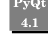

我们选择使用 PyQt 的 QTextStream 来编写 XML 文件；我们同样可以轻松使用 codecs 模块，尽管在那种情况下我们需要将 QString 转换为 Unicode。*

该方法以我们熟悉的方式开始。一旦创建 QTextStream，我们像往常一样将其编码设置为 UTF-8，然后输出前三行——这些总是相同的。

```python
for key, movie in self.__movies:
    stream << ("<MOVIE YEAR='%d' MINUTES='%d' "
            "ACQUIRED='%s'>\n") % (
        movie.year, movie.minutes,
        movie.acquired.toString(Qt.ISODate))
    stream << "<TITLE>" << QString(movie.title) \
    << "</TITLE>\n<NOTES>"
    if not movie.notes.isEmpty():
        stream << "\n" << Qt.escape(
            encodedNewLines(movie.notes))
    stream << "\n</NOTES>\n</MOVIE>\n"
stream << "</MOVIES>\n"
```

我们以与之前相同的方式遍历电影数据。Qt.escape() 函数接受一个 QString 并返回正确转义了任何 XML 元字符的 QString。我们使用 encodedNewLines() 函数将备注中的任何段落和换行符转换为它们的 Unicode 等价物。我们不对属性进行转义，因为我们知道它们不能包含任何不可接受的字符。我们省略了该方法的结尾部分，因为异常处理和返回在结构上与我们之前看到的相同。

> PyQt 4.0 存在一个 bug，导致 QTextStream 无法正确写入，因此在 PyQt 4.0 中我们必须使用 codecs 模块。这个问题在 PyQt 4.1 及更高版本中不存在。


### 使用 PyQt 的 DOM 类读取和解析 XML

PyQt 的 QDomDocument 类可以一次性读入一个完整的（格式良好的）XML 文档。但一旦我们拥有了一个 QDomDocument，就必须知道如何使用它。有些应用会将文档映射到某个控件中，通常是一个 QTreeWidget；而像 My Movies 这样的其他应用，将 XML 纯粹用作数据交换格式，它们会遍历文档，并在遍历过程中填充其数据结构。

```python
def importDOM(self, fname):
    dom = QDomDocument()
    error = None
    fh = None
    try:
        fh = QFile(fname)
        if not fh.open(QIODevice.ReadOnly):
            raise IOError, unicode(fh.errorString())
        if not dom.setContent(fh):
            raise ValueError, "could not parse XML"
    except (IOError, OSError, ValueError), e:
        error = "Failed to import: %s" % e
    finally:
        if fh is not None:
            fh.close()
            if error is not None:
                return False, error
    try:
        self.populateFromDOM(dom)
    except ValueError, e:
        return False, "Failed to import: %s" % e
    self.__fname = QString()
    self.__dirty = True
    return True, "Imported %d movie records from %s" % (
        len(self.__movies), QFileInfo(fname).fileName())
```

加载方法的第一部分应该看起来很熟悉，但请注意，当我们调用 QDomDocument.setContent() 时，整个文件都会被读取。如果该方法成功（返回 True），我们就知道 XML 已成功解析。

一旦我们拥有了一个 QDomDocument，就需要从中提取数据，这正是 populateFromDOM() 方法所做的事情。

该方法的结尾与我们之前看到的有所不同。我们清除文件名并将 dirty 标志设置为 True。这将确保如果用户尝试保存刚刚导入的 XML 电影数据，或者尝试退出应用程序，他们将获得一个“另存为”对话框，从而有机会将数据保存为应用程序的二进制或文本格式之一。

之前我们提到，QDomDocument 可以轻松写入文件。以下是我们如何做到的，假设 dom 是一个 QDomDocument 且 filename 是有效的文件名，但不包含错误检查：

```python
open(filename, "w", "utf-8").write(unicode(dom.toString()))
```

这将产生一个与 exportXml() 方法产生的文件略有不同的文件。例如，QDomDocument.toString() 方法会缩进嵌套标签，对属性使用双引号而不是单引号，并且可能会以不同的顺序排列属性。尽管如此，生成的 XML 文档在规范上与 exportXml() 生成的文档是相同的。

一旦 QDomDocument 读入了 XML 文件，我们需要遍历其内容来填充应用程序的数据结构，为此我们首先对文档调用 populateFromDOM()。

```python
def populateFromDOM(self, dom):
    root = dom.documentElement()
    if root.tagName() != "MOVIES":
        raise ValueError, "not a Movies XML file"
    self.clear(False)
    node = root.firstChild()
    while not node.isNull():
        if node.toElement().tagName() == "MOVIE":
            self.readMovieNode(node.toElement())
        node = node.nextSibling()
```

我们首先检查读取的 XML 文件是否确实是电影 XML 文件。如果否，我们会抛出异常；如果是，我们会清除数据结构，使其准备好接受从 DOM 文档提取的数据。

DOM 文档由“节点”组成，每个节点代表一个 XML 标签或标签之间的文本。一个节点可以有子节点，也可以有兄弟节点。在电影 XML 格式中，我们有作为兄弟节点的 <MOVIE> 节点，它们拥有 <TITLE> 和 <NOTES> 子节点，而这些子节点又有子文本节点。因此，为了提取数据，我们遍历 <MOVIE> 节点，对于遇到的每一个，我们提取其属性及其子节点中的数据。

```python
def readMovieNode(self, element):
    def getText(node):
        child = node.firstChild()
        text = QString()
        while not child.isNull():
            if child.nodeType() == QDomNode.TextNode:
                text += child.toText().data()
            child = child.nextSibling()
        return text.trimmed()
```

readMovieNode() 以一个嵌套函数定义开始。getText() 函数以一个节点作为参数——例如，<TITLE> 或 <NOTES> 开始标签——并遍历其子文本节点，累积它们的文本。最后，它返回文本，去除两端空白。如前所述，QString.trimmed() 方法执行与 unicode.strip() 相同的工作。

```python
year   = intFromQStr(element.attribute("YEAR"))
minutes = intFromQStr(element.attribute("MINUTES"))
ymd = element.attribute("ACQUIRED").split("-")
if ymd.count() != 3:
    raise ValueError, "invalid acquired date %s" % \
        unicode(element.attribute("ACQUIRED"))
acquired = QDate(intFromQStr(ymd[0]), intFromQStr(ymd[1]),
                 intFromQStr(ymd[2]))
```

readMovieNode() 方法本身通过提取 <MOVIE> 标签的属性数据并将从文本转换为年数和分钟数的整数，以及将获取日期转换为 QDate 而开始。

我们可以避免自行处理获取日期的细节，并将工作推给解析器。例如，而不是只有一个 ACQUIRED 属性，我们可以有 ACQUIREDYEAR、ACQUIREDMONTH 和 ACQUIREDAY，每个都有一个整数值。使用这三个属性，我们就不需要对连字符进行拆分，但格式会更加冗长。

```python
title = notes = None
node = element.firstChild()
while title is None or notes is None:
    if node.isNull():
        raise ValueError, "missing title or notes"
    if node.toElement().tagName() == "TITLE":
        title = getText(node)
    elif node.toElement().tagName() == "NOTES":
        notes = getText(node)
    node = node.nextSibling()
    if title.isEmpty():
        raise ValueError, "missing title"
self.add(Movie(title, year, minutes, acquired,
               decodedNewlines(notes)))
```

每个 <MOVIE> 节点有两个子节点，<TITLE> 和 <NOTES>。尽管我们在 exportXml() 方法中始终以相同的顺序写入它们，但我们不希望强制子节点具有特定的顺序。为此，我们遍历子节点，并使用嵌套的 getText() 方法收集所遇到的子节点的文本。

最后，只要电影有标题，我们就创建一个新的 Movie 对象，并立即使用 add() 将其添加到我们的数据结构中。

使用 DOM 解析器将 XML 导入自定义数据结构运行良好，尽管我们经常需要编写像 getText() 这样的小型辅助函数。DOM 最适合用于我们希望在 QDomDocument 本身内部持有和操纵 XML 数据，而不是将其转换为其他数据结构的情况。

### 使用 PyQt 的 SAX 类读取和解析 XML

使用 SAX 解析器导入 XML 与使用 DOM 解析器的工作方式有很大不同。在 SAX 中，我们定义一个处理器类，该类仅实现我们感兴趣的方法，然后将处理器的实例提供给 SAX 解析器，在解析 XML 时使用。解析不是像 DOM 那样一次性完成的，而是逐段进行的，当遇到其处理的数据时，调用我们处理器中的方法。任何我们未实现的方法都由基类提供，并且在所有情况下，它们都安全地不做任何事。

```python
def importSAX(self, fname):
    error = None
    fh = None
    try:
        handler = SaxMovieHandler(self)
        parser = QXmlSimpleReader()
        parser.setContentHandler(handler)
        parser.setErrorHandler(handler)
        fh = QFile(fname)
        input = QXmlInputSource(fh)
        self.clear(False)
        if not parser.parse(input):
            raise ValueError, handler.error
    except (IOError, OSError, ValueError), e:
        error = "Failed to import: %s" % e
    finally:
        if fh is not None:
            fh.close()
        if error is not None:
            return False, error
        self.__name = QString()
        self.__dirty = True
        return True, "Imported %d movie records from %s" % (
            len(self.__movies), QFileInfo(fname).fileName())
```

我们首先创建一个自定义 SaxMovieHandler 和 SAX XML 解析器的实例。解析器可以接受内容处理器、错误处理器，或者同时接受两者；我们选择只创建一个处理器，该处理器可以同时处理内容和错误，因此我们将同一个处理器用于这两个目的。


我们获取一个 QFile 文件句柄，并将其转换为 XML “输入源”。此时我们再次尽可能晚地清空我们的数据结构，然后告诉解析器解析该 XML 文件。解析器在成功时返回 True，在失败时返回 False。

由于我们在解析过程中通过我们的 SaxMovieHandler 类内部处理所有这些，因此没有专门用于填充数据结构的阶段。最后，我们清空文件名并将脏标记设置为 True，就像我们在 importDOM() 方法结束时所做的那样。

SaxMovieHandler 类是 QXmlDefaultHandler 的子类。对于内容处理，通常至少需要实现 startElement()、endElement() 和 characters()，以处理带有属性的开始标签、结束标签以及标签之间的文本。如果我们像这里一样使用同一个处理器来处理错误，我们还必须至少实现 fatalError() 方法。

```python
class SaxMovieHandler(QXmlDefaultHandler):
  def __init__(self, movies):
    super(SaxMovieHandler, self).__init__()
    self.movies = movies
    self.text = QString()
    self.error = None
```

super() 调用确保基类被正确初始化。movies 参数是电影容器本身。text 实例变量用于保存标签之间的文本——例如标题或备注文本——如果出现问题，error 变量将被赋予错误消息。

```python
def clear(self):
  self.year = None
  self.minutes = None
  self.acquired = None
  self.title = None
  self.notes = None
```

第一次调用此方法时，它会为电影的每个属性创建一个实例变量。每次调用时它都会将变量设置为 None；这将使测试我们是否已读取电影的所有属性变得容易。

```python
def startElement(self, namespaceURI, localName, qName, attributes):
  if qName == "MOVIE":
    self.clear()
    self.year = intFromQStr(attributes.value("YEAR"))
    self.minutes = intFromQStr(attributes.value("MINUTES"))
    ymd = attributes.value("ACQUIRED").split("-")
    if ymd.count() != 3:
      raise ValueError, “invalid acquired date %s” % \
          unicode(attributes.value("ACQUIRED"))
    self.acquired = QDate(intFromQStr(ymd[0]),
intFromQStr(ymd[1]),
        intFromQStr(ymd[2]))
    elif qName in ("TITLE", "NOTES"):
        self.text = QString()
    return True
```

此方法是从基类重新实现的，因此我们必须使用相同的签名。我们只对最后两个参数感兴趣：qName（限定名），它保存标签名称，以及 attributes，它保存标签的属性数据。每当遇到新的开始标签时，都会调用此方法。

如果遇到新的 <MOVIE> 标签，我们清空相应的实例变量，然后从标签属性数据中填充年份、分钟数和获取日期。这将使 title 和 notes 变量保持为 None。

如果标签是 <TITLE> 或 <NOTES> 标签，我们可以预期获得其对应的文本（如果有），因此我们将 text 变量设置为空字符串，以便随时追加内容。

每个重新实现的方法在成功时必须返回 True，在失败时返回 False；因此我们在最后返回 True。

```python
def characters(self, text):
    self.text += text
    return True
```

每当在标签之间遇到文本时，都会调用 characters() 方法。我们只需将文本追加到 text 变量。结束标签会告诉我们我们是在累积标题还是备注文本。

```python
def endElement(self, namespaceURI, localName, qName):
    if qName == "MOVIE":
        if self.year is None or self.minutes is None or \
            self.acquired is None or self.title is None or \
            self.notes is None or self.title.isEmpty():
            raise ValueError, "incomplete movie record"
        self.movies.add(Movie(self.title, self.year,
            self.minutes, self.acquired,
            decodedNewlines(self.notes)))
        self.clear()
    elif qName == "TITLE":
        self.title = self.text.text.trimmed()
    elif qName == "NOTES":
        self.notes = self.text.text.trimmed()
    return True
```

此方法在遇到结束标签时调用。标签名称在 qName 参数中。如果结束标签是 </MOVIE>，电影数据实例变量均不应为 None（尽管 title 或 notes 可以是空的 QString）。

如果所有变量都不是 `None`，并且电影有标题，我们就创建一个新的 `Movie` 对象并立即将其添加到 movies 容器中。

如果我们到达了标题或备注的结束标签，我们就知道累积在 text `QString` 中的文本是对应开始标签和结束标签之间的文本，因此我们相应地分配该文本。如果没有文本，赋值将是空的 `QString`。

```python
def fatalError(self, exception):
    self.error = "parse error at line %d column %d: %s" % (
        exception.lineNumber(), exception.columnNumber(),
        exception.message())
    return False
```

如果发生解析错误，将调用 `fatalError()` 方法。我们重新实现它，以填充处理程序的 `error` 文本，并返回 `False` 表示失败。这将导致解析器结束解析并向其调用者返回 `False`。

使用 PyQt 的 SAX 解析器要求我们至少创建一个独立的手动处理子程序。这并不困难，特别是我们只需要重新实现我们想要使用的方法。使用 SAX 进行解析比使用 DOM 消耗更少的内存，因为 SAX 是增量工作的，并且明显更快，特别是对于较大的文档。

## 摘要

在所有可用的选择中，哪种格式最适合使用，我们应该使用 Python 还是 PyQt 类？

对于性能和平台独立性，使用二进制格式是最好的，也是实现最简单的。对于通常只包含简单值（如字符串、数字和日期）且旨在手动编辑的小型文件，使用纯文本格式是合适的。即便如此，仍然存在用户的文本编辑器假设的编码与我们使用的编码不同的风险。我们建议对所有纯文本格式使用 UTF-8，因为它正在成为事实上的标准编码。读写 XML 比读写二进制文件慢得多（对于小于 ~1MB 的小文件除外），但至少作为导出和导入格式提供是值得的。毕竟，如果我们的用户能够以 XML 格式导出和导入数据，这就赋予了他们导出数据、使用其他工具处理它，然后导回处理后的数据的能力，而无需了解或关心我们的应用程序通常使用的二进制格式的详细信息。

至于是否使用 Python 或 PyQt 类，对于包含简单数据类型的较小文件，这可能完全无关紧要。如果我们想将编程工作量最小化，使用 `cpickle` 模块可能是最简单的途径。但是，如果我们有大文件（数兆字节）或者使用复杂的 PyQt 类型，如 `QBrush`、`QCursor`、`QFont`、`QIcon`、`QImage` 等，使用 `QData5tream` 是最简单和最高效的，因为它可以直接读写所有这些类型。使用二进制格式的一个缺点是，如果我们想更改格式，我们至少必须更改我们的 load 方法，使其能够加载新格式和旧格式。这在实践中不是问题，只要我们在魔术数字后的数据开头包含文件版本，因为我们可以使用它来确定使用哪种加载代码。

在这个阶段，我们已经涵盖了 GUI 编程的基础知识。我们可以创建带有菜单、工具栏和停靠窗口的主窗口应用程序，并且可以创建和弹出任何我们喜欢的对话框。我们还学习了如何使用 Qt Designer 简化和加快对话框设计，并看到了如何以各种格式加载和保存应用程序数据。在第三部分中，我们将深化和拓宽我们的 GUI 编程知识，学习如何处理多个文档以及创建对用户可以管理的复杂对话框。我们还将探索 PyQt 的一些主要架构功能，从其低级事件处理机制到创建自定义小部件，包括 2D 图形的覆盖，以及更高级的功能，包括基于项目的图形、富文本（HTML）处理以及模型/视图编程。

## 练习

修改 My Movies 应用程序，使每个 Movie 对象可以存储额外的信息：一个名为 “location” 的 QString，表示电影的所在位置——例如房间和书架。仅提供保存和加载二进制 Qt 格式的 .mpb 文件以及导出和导入 XML 文件，因此删除用于保存和加载 pickle 和文本文件的代码。确保你的新 My Movies 应用程序仍然可以读取原始应用程序的 .mpb 和 .xml 文件，即没有 location 数据的文件。

moviedata 模块中的 Movie 类需要一个额外的 QString 属性，称为 “location”。MovieContainer 类需要进行几处小改动。你需要同时拥有旧版本和当前版本的文件版本号，以便知道你在处理哪种类型。formats() 方法现在应该只返回字符串 “.mpb”，或者可以完全取消。save() 和 load() 方法只需要处理 .mpb 文件，并且必须考虑 location 和不同的文件版本。同样，exportXml() 方法和两个 import XML 方法也必须考虑可能存在 <LOCATION> 标签。用户界面的更改应该是显而易见的，所以我们不会列出它们。

这些更改中的任何一个都不涉及很多代码行，但有些是细微的，需要一点小心才能做对。确保你测试了你的更改。例如，加载旧格式的 .mpb 文件，并导入旧 .xml 格式的文件。添加一些位置并将数据保存到新的 .mpb 文件并导出为 XML。读回这两个以检查一切是否正常工作。

模型解决方案提供在以下文件中：chap08/mymovies_ans.pyn, chap08/moviedata_ans.pyn, chap08/addeditmowidlg_ans.ui, 和 chap08/addeditmowidlg_ans.py。


# 第三部分

# 中级 GUI 编程

*此页有意留空*

- 布局策略
- 选项卡部件与堆栈部件
- 分割器
- 单文档界面 (SDI)
- 多文档界面 (MDI)

## 布局与多文档

在我们迄今为止创建的所有对话框中，所有部件都是同时可见的。但在某些情况下，例如复杂的配置对话框或属性编辑器，需要大量的部件，一次性显示所有部件可能会让用户感到困惑。对于这种情况，我们可以使用允许我们将相关部件分组并仅显示相关组的选项卡部件或堆栈部件，或者使用可以按需显示额外选项的扩展对话框。这些技术有助于使对话框更小，并让用户更易于导航和使用；我们将在本章的第二节中详细介绍它们。

在我们创建的主窗口风格应用程序中，只有一个中央部件。但在某些情况下，我们需要在中央区域显示两个或更多的部件，并且通常希望让用户对它们的相对大小有一些控制。实现这一目标的一种方法是使用带有停靠窗口的单个中央部件；我们在第 6 章中见过这种方法。另一种方法是使用分割器，这是本章第三节将讨论的主题。

主窗口风格应用程序出现的另一个问题是如何处理多个文档。主要有四种方法。一种是使用应用程序的多个实例。在这种方法中，用户为每个想要处理的文档启动应用程序的一个实例。理论上，这完全不需要编程努力，但实践中，我们可能希望实施某种文件锁定方案或使用进程间通信，以确保用户不会在同一文档上启动两次或更多次该应用程序。我们迄今为止创建的所有应用程序都属于这种类型，尽管它们都没有使用文件锁定。

第二种方法是使用 SDI（单文档界面）。这意味着预期用户只运行应用程序的一个实例，但可以使用该应用程序实例创建任意数量的主窗口，以处理他们希望处理的所有文档。（虽然可以确保用户同一时间只能有一个应用程序实例在运行，但该技术因平台而异，超出了本书的范围。这种方法非常流行，并且被 Apple 人机界面指南推荐用于“文档样式”应用程序。它将在第四部分中介绍。）

第三种方法是使用 MDI（多文档界面）。同样，预期用户只运行应用程序的一个实例，但在这里，所有文档都保留在一个单一的“工作区”内，即主窗口中央区域中的子窗口中。MDI 不如 SDI 流行，而且资源占用也更少。对于 MDI 应用程序，无论处理多少个文档，都只有一个主窗口，而 SDI 则为每个文档都有一个带有菜单栏、工具栏等的主窗口。本章的最后一部分将展示如何实现一个 MDI 应用程序。

第四种替代方案是使用选项卡部件，让每个文档占据自己的选项卡页面。许多现代 Web 浏览器都使用这种方法。我们将只在对话框的背景下介绍选项卡部件，但在练习中，你将有机会创建一个基于选项卡部件的主窗口应用程序，也许令人惊讶的是，所需的代码与用于 MDI 应用程序的代码非常相似。

但在查看对话框中的选项卡部件和堆栈部件以及处理多个文档之前，我们将短暂偏离主题，比初次接触时更详细地讨论一下布局。

### 布局策略

在之前的章节中，我们看到了许多 PyQt 布局管理器运作的例子。在 PyQt 中，可以为部件设置显式的固定大小和位置，或者通过重新实现每个部件的 resizeEvent() 处理器来手动处理布局。但使用布局管理器是远为最轻松的方法，与手动方法相比，它还提供了额外的好处。

布局管理器允许部件增长和缩小，以充分利用可用空间，动态响应用户改变包含表单大小的操作。布局管理器根据所有部件的最小尺寸提供表单的最小尺寸。这确保了表单不会小到无法使用，并且不是固定的，而是取决于部件的内容——例如，标签可能需要更多或更少宽度，具体取决于其显示的文本是英语还是德语。

QVBoxLayout、QHBoxLayout 和 QGridLayout 布局管理器非常灵活。盒式布局可以包含消耗部件之间空间的“伸缩器”，以防止部件变得太高或太宽。而网格布局可以拥有跨越多行和多列的部件。所有布局管理器都可以相互嵌套，因此可以创建非常复杂的布局。

尽管如此，有时仅靠布局管理器不足以实现我们想要的布局。帮助布局管理器的一个简单方法是设置那些未被满意布局的部件的尺寸策略。每个部件都有可以独立设置的垂直和水平尺寸策略。（每个部件还可以具有固定的最小和最大尺寸，但使用尺寸策略通常能提供更好的调整大小行为。）此外，每个部件都关联着两种尺寸：尺寸提示和最小尺寸提示。前者是部件的首选尺寸，后者是部件可以缩小到的最小尺寸。这些尺寸根据表 9.1 所示的方式由尺寸策略使用。

表 9.1 PyQt 的尺寸策略

| 策略 | 效果 |
|---|---|
| Fixed | 部件具有其尺寸提示指定的大小，且大小永不改变 |
| Minimum | 部件的尺寸提示是其最小尺寸；它不能缩小于此，但可以增大 |
| Maximum | 部件的尺寸提示是其最大尺寸；它不能增大于此，但可以缩小到其最小尺寸提示 |
| Preferred | 部件的尺寸提示是其首选尺寸；它可以缩小到其最小尺寸提示，也可以增大到比尺寸提示更大 |
| Expanding | 部件可以缩小到其最小尺寸提示，也可以增大到比尺寸提示更大，但它更喜欢增大 |

例如，一个 QLineEdit 可能具有默认的 Expanding 水平策略和 Fixed 垂直策略。这意味着行编辑框将尽可能多地占用水平空间，但始终具有相同的垂直尺寸。每个内置的 PyQt 部件都已经设置了合理的尺寸提示和尺寸策略，因此通常在调整布局时，我们只需要改变一两个部件的设置。

除了策略外，尺寸策略还存储一个“伸缩因子”。这用于指示布局管理器应如何在部件之间共享空间。例如，如果我们有一个包含两个 QListWidget 的 QBoxLayout，它们都会希望在两个方向上增长。但如果我们希望底部的那个比顶部的那个增长得快，我们可以给顶部的那个设置伸缩因子为 1，底部的那个设置伸缩因子为 3。这将确保如果用户调整大小，额外的空间将按照 1:3 的比例在两个部件之间分配。

如果设置尺寸策略和伸缩因子仍然不够，我们总是可以创建一个子类并重新实现 sizeHint() 和 minimumSizeHint() 方法以返回我们希望的大小。我们将在第 11 章中看到这方面的例子。

*关于文件锁定代码，请参阅《Python Cookbook》中的“使用跨平台 API 进行文件锁定”。*

### 选项卡部件与堆栈部件

某些对话框需要大量的部件来展示它们提供的所有选项，这使得用户难以理解。处理这一问题的最明显方法是创建两个或更多对话框，并将选项分布在它们之间。只要可能，这就是一个好方法，因为它最小化了对用户的要求，从维护角度来看可能也比单个复杂对话框更容易。但通常我们需要使用单个对话框，因为我们向用户展示的选项是相关的，需要一起呈现。

当我们必须使用单个对话框时，有两类选项组我们需要考虑。一类仅仅是相关的选项组。这最容易通过使用 QtTabWidget 来处理。选项卡部件可以拥有任意数量的“页面”（子部件和选项卡标题），每个页面都布局了展示相关选项所需的部件。图 9.1 展示了一个 PaymentDlg，这是一个使用 Qt Designer 创建的三页选项卡部件示例。


在 Qt Designer 的部件箱的容器部分有一个选项卡部件。它可以像其他部件一样被拖放到表单上。与大多数容器部件一样，且不同于大多数其他部件，我们通常需要在将选项卡部件拖放到表单后手动调整其大小，以大致达到我们希望的大小。在 Qt Designer 中，选项卡部件具有用于删除和添加页面的上下文菜单选项。当前页面可以通过点击相关的选项卡或设置“currentIndex”属性来设置。当前页面的选项卡文本可以通过设置“currentTabText”属性来设置。

一旦将选项卡部件拖放到表单上并调整了大小，我们就可以将其他部件拖放到其页面上。这些部件可以按正常方式布局，并且每个选项卡页面都可以像表单本身那样布局：先取消选择所有部件，然后点击选项卡页面，最后应用布局管理器。

由于带有标签的选项卡，选项卡部件让用户明显意识到其他选项卡页面上还有更多选项，并提供了一种简便的方式来


用户可以在页面之间进行导航。选项卡部件可以具有圆角或直角选项卡角，并且可以将选项卡放置在顶部、底部、左侧或右侧。

尽管使用 *Qt Designer* 比手动创建对话框更快、更容易，但了解如何纯粹通过代码实现相同的效果既有趣又实用。由于我们已经多次见过普通部件的创建过程，因此这里将不再展示；相反，我们将重点关注选项卡部件和表单的整体布局。以下摘录均出自 `chap09/paymentdlg.pyw` 中 PaymentDlg 类的初始化方法。（*Qt Designer* 版本位于 `paymentdlg.ui` 和 `paymentdlg.py` 文件中。）

```python
tabWidget = QTabWidget()
cashWidget = QWidget()
cashLayout = QBoxLayout()
cashLayout.addWidget(self, paidCheckBox)
cashWidget.setLayout(cashLayout)
tabWidget.addTab(cashWidget, "Cas$h")
```

我们创建选项卡部件的方式与其他部件无异。选项卡部件中的每个页面必须包含一个部件，因此我们创建了一个新部件 *cashWidget*，并为其创建了一个布局。然后，我们将相关部件——在此例中仅为一个，即 *paidCheckBox*——添加到布局中，接着将布局设置到包含部件上。最后，我们将包含部件作为一个新选项卡及其标签文本一起添加到选项卡部件中。\*

```python
checkWidget = QWidget()
checkLayout = QGridLayout()
checkLayout.addWidget(checkNumLabel, 0, 0)
checkLayout.addWidget(self.checkNumLineEdit, 0, 1)
checkLayout.addWidget(bankLabel, 0, 2)
checkLayout.addWidget(self.bankLineEdit, 0, 3)
checkLayout.addWidget(accountNumLabel, 1, 0)
checkLayout.addWidget(self.accountNumLineEdit, 1, 1)
checkLayout.addWidget(sortCodeLabel, 1, 2)
checkLayout.addWidget(self.sortCodeLineEdit, 1, 3)
checkWidget.setLayout(checkLayout)
tabWidget.addTab(checkWidget, "Check$")
```

此选项卡的创建方式与第一个完全相同。唯一的区别在于我们使用了网格布局，并且需要放入布局中的部件更多。

我们将不展示第三个选项卡的代码，因为其结构与前面已见过的相同。

\* 在 PyQt 文档中，以及在某种程度上在 Qt 部件的 API 中，术语“tab”既单独指代选项卡的标签，也指代选项卡标签及其页面整体。

```python
layout = QBoxLayout()
layout.addLayout(gridLayout)
layout.addWidget(tabWidget)
layout.addWidget(self.buttonBox)
self.setLayout(layout)
```

为了完整性，我们展示了对话框布局的核心部分，仅省略了顶部表单中容纳标签、行编辑框和自旋框的网格布局的创建。按钮由 QDialogButtonBox 提供，这是一种可以像其他部件一样进行布局的部件。最后，我们将整个表单布局在一个垂直盒布局中：首先是顶部的网格，然后是中间的选项卡部件，最后是底部的按钮盒。

另一种选项组仅在特定情况下适用。在简单的情况下，如果一组选项适用或不适用，我们可以使用可复选框的 QGroupBox。如果用户取消勾选该组框，其中包含的所有部件将变为禁用状态。这意味着即使选项不可用，用户也能看到该组包含哪些选项，这通常很有帮助。在其他情况下，我们可能有两组或多组选项，其中任何时刻只有一组是适用的。针对这种情况，QStackedWidget 提供了一种解决方案。从概念上讲，堆叠部件是一个没有选项卡的选项卡部件。因此，用户没有视觉线索表明存在堆叠部件，也没有方法在堆叠部件的页面之间导航。


**图 9.2 使用堆叠部件的对话框**

要使用堆叠部件，我们可以在 Qt Designer 中将 Stacked Widget 拖入表单，并以与选项卡部件相同的方式调整其大小。在 Qt Designer 内部，堆叠部件由其右上角的两个小箭头指示。这些箭头在预览表单时也存在，但在运行时不会显示——它们显示在图 9.2 前两张截图中颜色组合框的右上角。部件可以被拖入堆叠部件的页面，并以与选项卡部件完全相同的方式进行布局。堆叠部件有一个上下文菜单，提供添加和删除页面的选项，就像选项卡部件一样，还有用于在页面之间导航以及更改页面顺序的额外选项。

由于堆叠部件没有选项卡，我们必须为用户提供在页面之间导航的方法。在图 9.2 中显示的 VehicleRentalDlg 中，车辆类型组合框被用作页面选择器。为了实现这一点，我们在 Qt Designer 中将组合框的 `currentIndexChanged(int)` 信号连接到堆叠部件的 `setCurrentIndex(int)` 槽。另一种让用户看到所有可用页面的常用方法是使用包含每个页面名称的 QListWidget，并以相同的方式将其 `currentRowChanged(int)` 信号进行连接，就像我们连接组合框的信号一样。

现在我们将学习如何在代码中创建堆叠部件。以下摘录来自 `chap09/vehiclerentaldlg.pyw` 中 VehicleRentalDlg 类的初始化方法。（Qt Designer 版本位于 `vehiclerentaldlg.ui` 和 `vehiclerentaldlg.py` 文件中。）

```python
self.stackedWidget = QStackedWidget() 

carWidget = QWidget() 

carLayout = QGridLayout() 

carLayout.addWidget(colorLabel, 0, 0) 

carLayout.addWidget(self.colorComboBox, 0, 1) 

carLayout.addWidget(seatsLabel, 1, 0) 

carLayout.addWidget(self.seatsSpinBox, 1, 1) 

carWidget.setLayout(carLayout) 

self.stackedWidget.addWidget(carWidget)
```

向堆叠部件添加“页面”与向选项卡部件添加选项卡非常相似。我们首先创建一个普通部件，然后为其创建布局并布置我们想要的部件。接着，我们将布局设置到普通部件上，并将此部件添加到部件堆中。我们未展示 vanWidget 的代码，因为其结构相同。

```python
topLayout = QVBoxLayout() 

topLayout.addWidget(vehicleLabel) 

topLayout.addWidget(self.vehicleComboBox) 

bottomLayout = QVBoxLayout() 

bottomLayout.addWidget(mileageLabel) 

bottomLayout.addWidget(self.mileageLabel) 

layout = QVBoxLayout() 

layout.addLayout(topLayout) 

layout.addWidget(self.stackedWidget) 

layout.addLayout(bottomLayout) 

layout.addWidget(self.buttonBox) 

self.setLayout(layout)
```

再次，为了完整性，我们展示了整个对话框的布局。我们从一个顶部布局开始，其中包含用于设置堆叠部件当前部件的组合框。然后我们创建一个包含里程标签的底部布局，以及一个用于按钮的按钮布局。接着，我们将所有这些布局以及堆叠部件本身都添加到一个垂直盒布局中。

```python
self.connect(self.buttonBox, SIGNAL("accepted()"), self.accept)
self.connect(self.buttonBox, SIGNAL("rejected()"), self.reject)
self.connect(self.vehicleComboBox,
SIGNAL("currentIndexChanged(QString)"),
self.setWidgetStack)
self.connect(self.weightSpinBox, SIGNAL("valueChanged(int)"),
self.weightChanged)
```

我们必须为用户提供导航机制，我们通过将车辆组合框的 `currentIndexChanged()` 信号连接到一个自定义的 `setWidgetStack()` 槽来实现这一点。最后一个槽只是表单验证的一部分；它用于设置最大里程，这对汽车是固定的，但对于货车则取决于其重量。

```python
def setWidgetStack(self, text):
if text == "Car":
self.stackedWidget.setCurrentIndex(0)
self.mileageLabel.setText("1000 miles")
else:
self.stackedWidget.setCurrentIndex(1)
self.weightChanged(self.weightSpinBox.value())

def weightChanged(self, amount):
self.mileageLabel.setText("%d miles" % (8000 / amount))
```

`setWidgetStack()` 槽使相应的部件可见，并处理里程设置的一部分，因为这取决于车辆是汽车还是货车。

我们使用组合框的当前文本来确定要显示哪个部件。一种可能更稳健的方法是与每个组合框项关联一个数据项（使用双参数 `QComboBox.addItem()` 方法），并使用当前项的数据项来选择显示哪个部件。

## 扩展对话框

对于复杂对话框，我们可以采取另一种方法：扩展对话框。这些通常用于对话框具有“简单”和“高级”选项的情况。最初，对话框以显示简单选项，但提供了一个切换按钮来显示或隐藏高级选项。

图 9.3 中显示的扩展对话框在按下“更多”切换按钮时显示额外的复选框。任何 QPushButton 都可以通过调用 `setCheckable(True)` 或通过在 Qt Designer 中将“checkable”属性设置为 True 而成为切换按钮。


图 9.3 扩展对话框

为了使扩展对话框正常工作，我们使用了两个“技巧”。第一个技巧是将所有高级选项的控件放入一个 QFrame 中。这意味着我们只需要隐藏和显示该框架即可，因为 PyQt 会自动隐藏和显示框架内的所有控件，以反映框架的可见状态。如果我们不希望用户在框架可见时看到框架的轮廓，可以简单地将它的“frameShape”属性设置为 QFrame.NoFrame。

第二个技巧是将对话框设置为固定大小。这将确保对话框尽可能缩小（同时保持其边距），并考虑对话框的可见内容。这样做的作用是，当高级选项隐藏时，对话框会较短；当高级选项可见时，对话框会足够高以显示这些选项。我们还需要在创建对话框时隐藏该框架。以下是该对话框初始化器的代码（来自 chap09/findandreplacedlg.py）：

```
class FindAndReplaceDlg(QDialog, ui_findandreplacedlg.Ui_FindAndReplaceDlg):

    def __init__(self, parent=None):
        super(FindAndReplaceDlg, self).__init__(parent)
        self.setupUi(self)
        self.moreFrame.hide()
        self.layout().setSizeConstraint(QLayout.SetFixedSize)
```

但我们如何将“更多”按钮与框架的显示/隐藏状态关联起来？只需将 moreButton 的 toggled(bool) 信号连接到 moreFrame 的 setVisible(bool) 槽即可。请注意，如果此连接是在 Qt Designer 中建立的，我们必须勾选“配置连接”对话框中的“显示所有信号和槽”复选框；否则，setVisible() 槽不会出现。

对于本节的最后一个示例，我们将再次查看如何在代码中实现布局。与之前展示使用新控件（QTabWidget 和 QStackedWidget）的两个布局不同，此对话框的布局仅使用了我们之前见过的控件——但以新的方式使用。以下摘录来自 chap09/findandreplacedlg.pyw 中 FindAndReplaceDlg 类的初始化器。（Qt Designer 版本位于文件 findandreplacedlg.ui 和 findandreplacedlg.py 中。）

我们只展示与扩展对话框特别相关的表单控件的创建。表单的布局如图 9.4 所示。

```
moreFrame = QFrame()
moreFrame.setFrameStyle(QFrame.StyledPanel|QFrame.Sunken)
```

我们创建一个框架，其中将放置额外的复选框。如果我们没有执行 setFrameStyle() 调用，该框架将没有轮廓。

```
line = QFrame()
line.setFrameStyle(QFrame.VLine|QFrame.Sunken)
```

我们“绘制”的用于在视觉上分隔对话框左侧主要控件和右侧按钮的线也是一个框架。使用 QFrame.HLine 框架样式可以创建水平线。

```
moreButton = QPushButton("&More")
moreButton.setCheckable(True)
```

“更多”按钮与其他按钮有一处不同：它是可复选框的。这意味着它表现得像一个切换按钮，第一次点击时保持按下状态，下一次点击时恢复抬起状态，依此类推。


标签和单行编辑框排列在一个网格中；由于我们之前已经多次见过这种类型的布局，因此不再展示代码。

```
frameLayout = QBoxLayout()
frameLayout.addWidget(self.backwardsCheckBox)
frameLayout.addWidget(self.regexCheckBox)
frameLayout.addWidget(self.ignoreNotesCheckBox)
moreFrame.setLayout(frameLayout)
```

我们希望额外的复选框在 more 框架内部进行布局。为此，我们创建一个布局（在本例中为垂直盒布局），并将复选框添加到其中。然后我们将该布局设置到框架上。在之前的示例中，我们通过将一个布局添加到另一个布局来实现嵌套，但在这里我们通过将布局添加到框架来实现嵌套。因此，除了能够在彼此内部嵌套布局外，我们还可以在布局内部嵌套框架和组合框，这给我们带来了极大的灵活性。

```
leftLayout = QBoxLayout()  
leftLayout.addLayout(gridLayout)  
leftLayout.addWidget(self.caseCheckBox)  
leftLayout.addWidget(self.wholeCheckBox)  
leftLayout.addWidget(moreFrame)
```

左侧布局是一个垂直盒布局，我们向其中添加了网格布局（包含标签和单行编辑框）、区分大小写和全字复选框，然后是 more 框架（其中在一个垂直盒布局中包含额外的复选框）。

```
buttonLayout = QVBoxLayout()  
buttonLayout.addWidget(self.findButton)  
buttonLayout.addWidget(self.replaceButton)  
buttonLayout.addWidget(closeButton)  
buttonLayout.addWidget(moreButton)  
buttonLayout.addStretch()
```

按钮布局与我们之前见过的非常相似，只是这次使用的是垂直盒布局而不是水平盒布局。

```
mainLayout = QHBoxLayout()  
mainLayout.addLayout(leftLayout)  
mainLayout.addWidget(line)  
mainLayout.addLayout(buttonLayout)  
self.setLayout(mainLayout)
```

对话框的主布局是一个水平盒布局，左侧是左侧布局，然后是分隔线，最后是按钮布局。根据 more 框架是否可见（从而决定对话框是高还是矮），该分隔线会在垂直方向上伸缩。

```
moreFrame.hide()  
mainLayout.setSizeConstraint(QLayout.SetFixedSize)
```

我们最初隐藏 more 框架（因此也隐藏了它包含的控件），并使用固定大小技巧确保对话框根据 more 框架是否可见而自行调整大小。

我们必须做的最后一件事是将 More 按钮的 toggled() 信号连接到 more 框架的 set_visible() 槽。当框架被隐藏（或显示）时，它会反过来隐藏（或显示）内部布局的所有控件，因为当对控件调用 show() 或 hide() 时，PyQt 会自动将这些调用传播到该控件的所有子控件。

我们注意到，本节中展示的每个对话框都有两个版本。一个版本完全用代码编写，例如 paymentdlg.pyw——另一个版本具有 Qt Designer 用户界面，代码在模块文件中——例如 paymentdlg_ui 和 paymentdlg.py。通过比较“全代码”（.pyw）版本与 Qt Designer 和模块版本（.py），我们可以清楚地看到使用 Qt Designer 可以避免编写多少代码。使用 Qt Designer 的额外好处，特别是对于复杂控件，是它使得更改设计比手动操作容易得多。

## 分割器

一些主窗口风格的应用程序需要在中心区域使用多个控件。需要这样做的两种常见应用程序类型是电子邮件客户端和网络新闻阅读器。我们有三种方法可以处理这种情况。一种是创建一个复合控件，即由其他控件组成的控件（像对话框那样创建和布局，但继承自 QWidget 而不是 QDialog），并使用该控件作为主窗口的中央控件。另一种方法是只保留一个中央控件，并将其他控件放入停靠窗口中——我们在第 6 章中已经见过这种情况。第三种方法是使用分割器，这是本节的话题。

图 9.5 展示了新闻阅读器应用程序的原型，图 9.6 说明了表单中分割器与控件之间的关系。Qt Designer 完全支持分割器，并且使用方式与垂直和水平盒布局非常相似：我们选择两个或更多控件，然后点击“表单 → 在分割器中水平布局”或“表单 → 在分割器中垂直布局”。

在本节中，我们将展示如何在代码中创建分割器，包括如何保存和恢复它们的相对位置。我们首先来看看新闻阅读器原型初始化器的相关部分。

```python
class MainWindow(QMainWindow):
    def __init__(self, parent=None):
        super(MainWindow, self).__init__(parent)
        self.groupList = QListWidget()
        self.messageList = QListWidget()
        self.messageView = QTextBrowser()
```

初始化器以常规的 super() 调用开始。接下来的三行有点不寻常，因为虽然这是一个主窗口，但我们创建了三个控件而不是只有一个。


### 分隔器


### 图 9.5 新闻阅读器应用程序模型

```python
self.messageSplitter = QSplitter(Qt.Vertical)
self.messageSplitter.addWidget(self.messageList)
self.messageSplitter.addWidget(self.messageView)
self.mainSplitter = QSplitter(Qt.Horizintal)
self.mainSplitter.addWidget(self.groupList)
self.mainSplitter.addWidget(self.messageSplitter)
self.setCentralWidget(self.mainSplitter)
```

现在我们创建两个分隔器。第一个是 `messageSplitter`；它在垂直方向上容纳消息列表和消息视图部件，一个在另一个的上方。第二个分隔器 `mainSplitter` 在水平方向上分割，其左侧是组列表部件，右侧是消息分隔器。与盒式布局一样，分隔器可以容纳超过两个部件，在这种情况下，它们会在每对部件之间放置一个分隔条。主分隔器容纳一个部件和另一个分隔器，而后者又容纳了其余两个部件。因此，主分隔器最终容纳了所有内容，并且由于分隔器也是部件（不像盒式布局，它们是布局对象），因此可以将分隔器作为主窗口的中央部件添加进来，就像我们在这里所做的那样。

有些用户觉得分隔器很烦人，因为他们只能通过鼠标来调整大小。我们将通过保存和恢复用户的分隔器大小来最大限度地减少这种不便。这很有帮助，因为用户只需设置一次大小，之后他们设置的大小将被保留。


**图 9.6** *新闻阅读器的分隔器和部件*

```python
settings = QSettings()
size = settings.value("MainWindow/Size",
		QVariant(QSize(600, 500))).toSize()
self.resize(size)
position = settings.value("MainWindow/Position",
		QVariant(QPoint(0, 0))).toPoint()

self.move(position)
self.restoreState(
	settings.value("MainWindow/State").toByteArray())
self.messageSplitter.restoreState(
	settings.value("MessageSplitter").toByteArray())
self.mainSplitter.restoreState(
	settings.value("MainSplitter").toByteArray())
```

保存用户的主窗口设置始于一些熟悉的代码，用于恢复窗口的大小、位置以及它可能拥有的工具栏和停靠窗口的状态。分隔器也有状态，并且该状态的恢复和保存方式与主窗口的状态相同。

```python
def closeEvent(self, event):
    if self.okToContinue():
        settings = QSettings()
        settings.setValue("MainWindow/Size", QVariant(self.size()))
        settings.setValue("MainWindow/Position",
            QVariant(self.pos()))
        settings.setValue("MainWindow/State",
            QVariant(self.saveState()))
        settings.setValue("MessageSplitter",
            QVariant(self.messageSplitter.saveState()))
        settings.setValue("MainSplitter",
            QVariant(self.mainSplitter.saveState()))
    else:
        event.ignore()
```

在主窗口的关闭事件中，代码再次以熟悉的方式开始，只是我们现在除了保存主窗口的大小、位置和状态外，还保存了分隔器的状态。

当新闻阅读器应用程序首次运行时，默认情况下，主分隔器将其宽度的整整一半分配给组列表部件，另一半分配给消息分隔器。同样，消息分隔器将其高度的一半分配给消息列表部件，另一半分配给消息视图部件。我们希望更改这些比例，使组列表更窄，消息查看器更高，我们可以通过应用拉伸因子来实现这一点。例如：

```python
self.mainSplitter.setStretchFactor(0, 1)
self.mainSplitter.setStretchFactor(1, 3)
self.messageSplitter.setStretchFactor(0, 1)
self.messageSplitter.setStretchFactor(1, 2)
```

`setStretchFactor()` 的第一个参数是部件的 0 基索引位置（从左到右，或从上到下），第二个参数是要应用的拉伸因子。在这种情况下，我们规定第 0 个部件（组列表部件）的拉伸因子为 1，第 1 个部件（消息分隔器）的拉伸因子为 3，从而将水平空间按 1:3 的比例划分。同样，对于消息分隔器，我们按 1:2 的比例划分垂直空间，偏向消息视图部件。由于我们保存和恢复分隔器的大小，拉伸因子仅在应用程序首次运行时起作用。

# 单文档界面 (SDI)

对于某些应用程序，用户希望能够处理多个文档。这通常可以通过运行应用程序的多个实例来实现，但这可能会消耗大量资源。使用多个实例的另一个缺点是，不容易提供一个公共的“窗口”菜单，供用户在各个文档之间导航。

有三种常用的解决方案。一种是在单个主窗口中使用选项卡部件，每个选项卡持有一个文档。这种方法在 Web 浏览器中很流行，但在编辑文档时可能会造成不便，因为不可能同时看到两个或更多文档。我们将不展示这种方法，因为本章第二部分对选项卡部件的涵盖已经足够，而且你将有机会在练习中自行尝试。另外两种方法是 SDI，我们将在本节中介绍，以及 MDI，我们将在下一节中介绍。

创建 SDI 应用程序的关键在于创建一个窗口子类，该子类处理所有事务，包括加载、保存和清理，使应用程序本质上成为此类窗口的一个或多个集合。

我们将首先查看 SDI 文本编辑器初始化程序中的一些摘录；应用程序本身如图 9.7 所示。

```python
class MainWindow(QMainWindow):
    NextId = 1
```


### 图 9.7 具有三个文档的 SDI 文本编辑器

```python
    Instances = set()

    def __init__(self, filename=QString(), parent=None):
        super(MainWindow, self).__init__(parent)
        self.setAttribute(Qt.WA_DeleteOnClose)
        MainWindow.Instances.add(self)
```

`NextId` 静态变量用于为新空白窗口提供编号：“Unnamed-1.txt”、“Unnamed-2.txt”，等等。

该应用程序由一个或多个 `MainWindow` 实例组成，每个实例都必须能够独立操作。然而，有三种常见情况需要在一个实例内部访问所有实例。一种是提供“全部保存”选项，另一种是通过“窗口”菜单让用户在窗口实例之间切换，还有一种是提供“退出”选项，用户可以使用该选项终止应用程序，并且必须隐式关闭每个窗口。`Instances` 静态变量是我们用于跟踪所有实例的工具。

当创建新的窗口实例时，我们设置其在关闭时自我删除。这意味着窗口可以由用户直接关闭，或由其他实例间接关闭（例如在应用程序终止时）。使用 `Qt.WA_DeleteOnClose` 的一个影响是，窗口应该负责保存未保存的更改并清理自身。我们还将窗口添加到窗口实例的静态集中，以便任何窗口实例都可以访问所有其他窗口。我们将在后面深入研究这些事项。

```python
self.editor = QTextEdit()
self.setCentralWidget(self.editor)
```

`QTextEdit` 是我们中央部件的理想选择，有些动作可以直接传递给它，我们将稍后看到。我们现在只查看其中的一些动作，跳过我们之前见过的 `createAction()` 方法。

```python
fileSaveAllAction = self.createAction("Save All",
    self.fileSaveAll, icon="filesave",
    tip="Save all the files")
```

此动作与几乎所有其他文件动作类似，连接到 `MainWindow` 子类的方法之一。

```python
fileCloseAction = self.createAction("&Close", self.close,
    QKeySequence.Close, "fileclose",
    "Close this text editor")
```

“关闭”动作与我们之前看到的类似。通常，我们不重新实现 `close()` 方法，而是重新实现 `closeEvent()` 处理器，以便我们可以拦截窗口的任何正常关闭。不同之处在于，此动作仅关闭当前唯一的窗口，而不是应用程序（除非这是应用程序唯一的窗口）。

```python
fileQuitAction = self.createAction("&Quit", self.fileQuit,
    "Ctrl+Q", "filequit", "Close the application")
```

“退出”动作终止应用程序，通过关闭 SDI 文本编辑器的每个窗口来实现，我们在审查 `fileQuit()` 方法时将会看到这一点。

```python
editCopyAction = self.createAction("&Copy", self.editor.copy,
    QKeySequence.Copy, "editcopy",
    "Copy text to the clipboard")
```

此动作连接到 `QTextEdit` 的相关插槽。“剪切”和“粘贴”动作也是如此。

菜单、工具栏和状态栏都是按照我们之前见过的方式创建的，除了“窗口”菜单，我们现在将查看它。

```python
self.windowMenu = self.menuBar().addMenu("&Window")
self.connect(self.windowMenu, SIGNAL("aboutToShow()"),
    self.updateWindowMenu)
```

我们完全没有向“窗口”菜单添加任何动作。相反，我们只是将菜单的 `aboutToShow()` 方法连接到我们自定义的 `updateWindowMenu()` 方法，正如我们将看到的，该方法会用所有 SDI 文本编辑器窗口填充该菜单。


### SDI 文本编辑器：实例管理与文件操作

当用户关闭窗口时，得益于 `Qt.WA_DeleteOnClose` 标志，该窗口将被删除。但由于我们在静态 `Instances` 集合中持有对该窗口的引用，因此该窗口无法被垃圾回收。为此，我们将窗口的 `destroyed()` 信号连接到一个槽函数，该槽函数通过移除已关闭的窗口来更新 `Instances` 集合。我们将在讨论 `updateInstances()` 方法时对此进行更详细的说明。

由于每个窗口负责处理单个文件，因此每个窗口都可以关联一个文件名。该文件名可以传递给窗口的初始化器，默认为空的 `QString`。初始化器的最后几行代码处理文件名。

```python
self.filename = filename
if self.filename.isEmpty():
    self.filename = "Unnamed-%d.txt" % MainWindow.NextId

MainWindow.NextId += 1
self.editor.document().setModified(False)
self.setWindowTitle("SDI Text Editor - %s" % self.filename)
else:
    self.loadFile()
```

如果窗口没有文件名（例如应用程序刚启动，或者用户调用了“新建文件”操作），我们会创建一个合适的窗口标题；否则，加载指定的文件。

`closeEvent()`、`loadFile()`、`fileSave()` 和 `fileSaveAs()` 方法与我们之前见过的非常相似，因此我们不再赘述。（当然，它们都在源代码 `chap09/sditexteditor.pyw` 中。）相反，我们将重点关注 SDI 应用程序特有的功能。

```python
def fileNew(self):
    MainWindow().show()
```

当用户调用“新建文件”操作时，会调用此方法。该类的一个新实例会被创建，并调用其 `show()` 方法（因此它以非模态方式显示）。在方法结束时，我们预期该窗口会超出作用范围并被销毁，因为它没有 PyQt 父对象，也不是实例变量。但在主窗口的初始化器内部，窗口会将自己添加到静态 `Instances` 集合中，因此对该窗口的对象引用仍然存在，从而导致窗口不被销毁。

```python
def fileOpen(self):
    filename = QFileDialog.getOpenFileName(self, "SDI Text Editor -- Open File")
    if not filename.isEmpty():
        if not self.editor.document().isModified() and \
            self.filename.startswith("Unnamed"):
            self.filename = filename
            self.loadFile()
        else:
            MainWindow(filename).show()
```

此方法与之前见过的类似方法略有不同。如果用户提供了文件名，且当前文档既未修改也未命名（即新的空白文档），我们将文件加载到现有窗口中；否则，创建一个新的窗口，并将要加载的文件名传递给该新窗口。

```python
def fileSaveAll(self):
    count = 0
    for window in MainWindow.Instances:
        if isAlive(window) and \
            window.editor.document().isModified():
            if window.fileSave():
                count += 1
    self.statusBar().showMessage("Saved %d of %d files" % (
        count, len(MainWindow.Instances)), 5000)
```

为了便于用户操作，我们提供了一个“全部保存”菜单选项。调用该选项时，我们会遍历 `Instances` 集合中的每个窗口，并保存每个“存活”且已修改的窗口。

如果窗口未被删除，则被视为“存活”。不幸的是，这并没有看上去那么简单。`QWidget` 有两个生命周期：指向该小部件的 Python 变量的生命周期（在本例中，是 `Instances` 集合中的 `MainWindow` 实例），以及作为计算机窗口系统所感知的底层 PyQt 对象的生命周期。

通常，PyQt 对象及其 Python 变量的生命周期是完全相同的。但在这里可能并非如此。例如，假设我们启动了应用程序，点击几次 文件➡新建，从而拥有三个窗口，然后导航到其中一个窗口并将其关闭。此时，被关闭的窗口（得益于 `Qt.WA_DeleteOnClose` 属性）将被删除。

在底层，PyQt 实际上会在被删除的窗口上调用 `deleteLater()` 方法。这给了该窗口一个机会，使其能够完成正在处理的操作，从而可以干净地删除。这通常会在不到一毫秒内完成，此时底层 PyQt 对象从内存中删除并不再存在。但 `Instances` 集合中的 Python 引用仍然存在，只是现在指向一个已不存在的 PyQt 对象。因此，在访问 `Instances` 集合中的任何窗口之前，我们必须始终检查其是否存活。

```python
def isAlive(obj):
    import sip
    try:
        sip.unwrapInstance(obj)
    except RuntimeError:
        return False
    return True
```

`sip` 模块是 PyQt 的支持模块之一，我们通常不需要直接访问它。但在需要深入挖掘的情况下，它会很有用。在这里，该方法尝试访问变量的底层 PyQt 对象。如果对象已被删除，则会抛出 `RuntimeError` 异常，此时返回 `False`；否则，对象仍然存在，返回 `True`。

> *`isAlive()` 函数基于 Giovanni Bajo 在 PyQt（当时的 PyKDE）邮件列表上的帖子，“如何检测对象是否已被删除”。该列表同时用于 PyQt 和 PyKDE。*

```python
@staticmethod
def updateInstances(qobj):
    MainWindow.Instances = set([window for window \
        in MainWindow.Instances if isAlive(window)])
```

每当窗口被关闭（因此被删除）时，它会发出 `destroyed()` 信号，我们在初始化器中将其连接到 `updateInstances()` 方法。此方法用一个仅包含仍存活的窗口实例的集合覆盖 `Instances` 集合。

那么，为什么我们在遍历 `Instances` 时需要检查是否存活——例如在 `fileSaveAll()` 方法中——既然该方法确保 `Instances` 集合保持最新状态并且只持有存活窗口？原因是从理论上讲，在窗口关闭与 `Instances` 集合更新之间，该窗口可能会在某个其他方法中被遍历。

每当用户点击任何 SDI 文本编辑器窗口中的“窗口”菜单时，都会出现一个列出当前所有窗口的菜单。这是因为 `windowMenu` 的 `aboutToShow()` 信号连接到了填充该菜单的 `updateWindowMenu()` 槽函数。

```python
def updateWindowMenu(self):
    self.windowMenu.clear()
    for window in MainWindow.Instances:
        if isAlive(window):
            self.windowMenu.addAction(window.windowTitle(), self.raiseWindow)
```

首先，清除现有的菜单项；始终至少存在一个，即当前窗口。接下来，我们遍历所有窗口实例，并为任何存活的窗口添加一个操作。该操作具有简单的窗口标题（文件名）作为文本，以及一个在用户调用该菜单选项时要调用的槽函数——`raiseWindow()`。

```python
def raiseWindow(self):
    action = self.sender()
    if not isinstance(action, QAction):
        return
    for window in MainWindow.Instances:
        if isAlive(window) and \
            window.windowTitle() == action.text():
            window.activateWindow()
            window.raise_()
            break
```

此方法可以由“窗口”菜单的任何项调用。我们以一个健全性检查开始，然后遍历窗口实例，查看哪个实例的标题文本与操作的文本匹配。如果找到匹配项，我们将相关窗口设为“活动”窗口（应用程序顶层的拥有键盘焦点的窗口），并将其提升到所有其他窗口之上，以便用户可以看到它。

在随后的 MDI 部分中，我们将学习如何创建更复杂的窗口菜单，包括加速器以及一些额外的菜单选项。

```python
def fileQuit(self):
    QApplication.closeAllWindows()
```

PyQt 提供了一种方便的方法来关闭应用程序的所有顶层窗口。此方法对所有窗口调用 `close()`，进而触发每个窗口的 `closeEvent()`。在此事件中（此处未展示），我们检查 `QTextEdit` 的文本是否有未保存的更改，如果有，则弹出一个消息框询问用户是否想要保存。

```python
app = QApplication(sys.argv)
app.setWindowIcon(QIcon(":/icon.png"))
MainWindow().show()
app.exec_()
```

在 `sditexteditor.pyw` 文件的末尾，我们创建一个 `QApplication` 实例和一个 `MainWindow` 实例，然后启动事件循环。

使用 SDI 方法非常流行，但它有一些缺点。由于每个主窗口都有自己的菜单栏、工具栏以及可能的停靠窗口，与单个主窗口相比，资源开销更大。

> *在 Mac OS X 上，只有一个菜单栏，位于屏幕顶部。它会根据当前拥有焦点的窗口发生变化。*


## 多文档界面 (MDI)

与 SDI 或运行多个应用程序实例相比，MDI 具有许多优势。MDI 应用程序对资源的需求较低，并且使得让用户能够安排其文档窗口之间的布局变得更加容易。然而，一个缺点是，你无法使用 Alt+Tab（在 Mac OS X 上是 Command+Tab）在 MDI 窗口之间切换，尽管在实际中这很少成为一个问题，因为对于 MDI 应用程序，程序员总是实现一个“窗口”菜单来在窗口之间进行导航。

创建 MDI 应用程序的关键在于创建一个控件子类，该子类处理所有事务，包括加载、保存和清理，同时应用程序将这些控件保留在一个 MDI“工作区”中，并将任何特定于控件的操作传递给它们。

在本节中，我们将创建一个文本编辑器，提供与前一节中 SDI 文本编辑器相同的功能，除了这次我们要将其做成一个 MDI 应用程序。该应用程序如图 9.8 所示。


每个文档都通过一个自定义 `TextEdit` 控件的实例来呈现和编辑，该控件是 `QTextEdit` 的子类。该控件设置了 `Qt.WA_DeleteOnClose` 属性，拥有一个文件名实例变量，并加载和保存其给定的文件名。如果控件被关闭（因此被删除），其关闭事件处理程序会给予用户保存任何未保存更改的机会。`TextEdit` 的实现很直接，与我们之前看到的代码非常相似，因此我们在此不再回顾它；其源代码位于模块 `chap09/textedit.py` 中。

应用程序本身的代码位于文件 `chap09/texteditor.py` 中。我们将审查此代码，从 `MainWindow` 子类初始化器中的一些摘录开始。

```python
class MainWindow(QMainWindow):

    def __init__(self, parent=None):
        super(MainWindow, self).__init__(parent)
        self.mdi = QWorkspace()
        self.setCentralWidget(self.mdi)
```

PyQt 的 MDI 控件被称为 `QWorkspace`。与选项卡控件或堆栈控件一样，可以向 `QWorkspace` 添加控件对话框。这些控件由工作区布局，有点像微型的桌面，控件在工作区区域内被平铺、层叠、最小化或由用户拖拽和调整大小。

> 从 Qt 4.3 开始，MDI 由 `QMdiArea` 类提供，其 API 与 `QWorkspace` 相似。

通过调用 `QWorkspace.setCtrlBarsEnabled(True)`，可以拥有一个比其窗口更大的工作区。可以通过指定背景画笔来设置工作区的背景。

```python
fileNewAction = self.createAction("&New", self.fileNew, QKeySequence.New, "filenew", "Create a text file")
```

大多数文件操作的操作方式与我们之前看到的相同。但正如我们将看到的，MDI 编辑器与 SDI 编辑器一样，没有 `okToContinue()` 方法，因为每个文档窗口都自行处理。

```python
fileQuitAction = self.createAction("&Quit", self.close, "Ctrl+Q", "filequit", "Close the application")
```

如果我们关闭应用程序的窗口，应用程序将终止。所有文档窗口都将关闭，任何具有未保存更改的窗口都负责提示用户并在要求时保存。

```python
editCopyAction = self.createAction("&Copy", self.editCopy, QKeySequence.Copy, "editcopy", "Copy text to the clipboard")
```

在 SDI 编辑器中，我们将“复制”、“剪切”和“粘贴”操作传递给每个窗口的 `QTextEdit` 进行处理。这在 MDI 应用程序中是不可能的，因为当用户触发这些操作之一时，它必须应用于当前活动的 `TextEdit` 窗口。因此，主窗口必须自己做一些工作，当我们在审查这些操作的实现时将会看到。

我们没有展示其他文件和编辑操作的代码，因为它们都遵循前面展示的模式。

```python
self.windowNextAction = self.createAction("&Next",
                self.mdi.activateNextWindow, QKeySequence.NextChild)
self.windowPrevAction = self.createAction("&Previous",
                self.mdi.activatePreviousWindow,
                QKeySequence.PreviousChild)
self.windowCascadeAction = self.createAction("Cascade",
                self.mdi.cascade)
self.windowTileAction = self.createAction("&Tile",
                self.mdi.tile)
self.windowRestoreAction = self.createAction("&Restore All",
                self.windowRestoreAll)
self.windowMinimizeAction = self.createAction("&Iconize All",
                self.windowMinimizeAll)
self.windowArrangeIconsAction = self.createAction(
                "Arrange Icons", self.mdi.arrangeIcons)
self.windowCloseAction = self.createAction("&Close",
                self.mdi.closeActiveWindow, QKeySequence.Close)
```

所有窗口操作都被创建为实例变量，因为我们将要在另一个方法中访问它们。对于某些操作，我们可以直接将工作交给 mdi 工作区实例，但对于最小化和恢复所有 MDI 窗口，我们必须自行处理。

```python
self.windowMapper = QSignalMapper(self)
self.connect(self.windowMapper, SIGNAL("mapped(QWidget*)"),
            self.mdi, SLOT("setActiveWindow(QWidget*)"))
```

在我们即将创建的窗口菜单中，我们需要一种方法来使用户选择的窗口成为活动窗口。我们在前一节中看到了一个简单的解决方案。另一种方法是使用偏函数应用，将每个窗口操作连接到 `QWorkspace.setActiveWindow()`，并将相关的 `TextEdit` 作为参数。在这里，我们采用了纯粹的 PyQt 方法，并使用了 `QSignalMapper` 类。当我们要审查 `updateWindowMenu()` 方法时，我们将解释其用法。

```python
self.windowMenu = self.menuBar().addMenu("&Window")
self.connect(self.windowMenu, SIGNAL("aboutToShow()"),
            self.updateWindowMenu)
```

对 `aboutToShow()` 的连接确保我们的 `updateWindowMenu()` 方法在菜单显示之前被调用。

```python
self.updateWindowMenu()
self.setWindowTitle("Text Editor")
QTimer.singleShot(0, self.loadFiles)
```

在构造函数末尾，我们调用 `updateWindowMenu()` 以强制创建窗口菜单。这可能看起来很奇怪；毕竟，当用户尝试使用菜单时它会被创建，那么为什么现在要这样做呢？原因是，如果我们自动在启动时加载一些文档，用户可能希望使用我们的键盘快捷键（F6 和 Shift+F6）在它们之间导航，但只有当菜单被创建后，快捷键才会生效。

```python
def closeEvent(self, event):
    failures = []
    for txtEdit in self.mdi.windowList():
        if txtEdit.isModified():
            try:
                txtEdit.save()
            except IOError, e:
                failures.append(str(e))

    if failures and \
        QMessageBox.warning(self, "Text Editor -- Save Error",
                            "Failed to save%s\nQuit anyway?" % \
                            "\n\t".join(failures),
                            QMessageBox.Yes(QMessageBox.No)) == QMessageBox.No:
        event.ignore()
        return

    settings = QSettings()
    settings.setValue("MainWindow/Size", QVariant(self.size()))
    settings.setValue("MainWindow/Position", QVariant(self.pos()))
    settings.setValue("MainWindow/State", QVariant(self.saveState()))

    files = QStringList()
    for txtEdit in self.mdi.windowList():
        if not txtEdit.filename.startsWith("Unnamed"):
            files.append(txtEdit.filename)
    settings.setValue("CurrentFiles", QVariant(files))
    self.mdi.closeAllWindows()
```

当应用程序终止时，我们给用户保存任何未保存更改的机会。然后我们保存主窗口的大小、位置和状态。我们还保存所有 MDI 窗口中所有文件名的列表。最后，我们调用 `QWorkspace.closeAllWindows()`，这将导致每个窗口接收一个关闭事件。

如果任何保存失败，我们会记录下来，在所有文件处理完毕后，如果存在错误，我们弹出一个消息框通知用户，并给予他们取消终止应用程序的机会。


在 TextEdit 的关闭事件中，有一段代码允许用户保存任何未保存的更改，但在这一点上实际上不存在未保存的内容，因为我们已经在本方法开始时处理了未保存的更改。我们在 TextEdit 的关闭事件中保留这段代码，是因为用户可以随时关闭任何窗口，因此每个窗口都必须能够处理被关闭的情况。然而，当应用程序终止时，我们并不使用此机制，而是直接对已修改的文件调用 save()，因为我们希望保留一个当前文件列表。为了做到这一点，在我们获取保存当前文件列表的代码之前，每个文件都必须拥有一个适当的元素，而提前调用 save() 正好实现了这一点。

```python
    def loadFiles(self):
        if len(sys.argv) > 1:
            for filename in sys.argv[1:31]: # 最多加载 30 个文件
                filename = QString(filename)
                if QFile::info(filename).isFile():
                    self.loadFile(filename)
                    Qapplication.processEvents()
        else:
            settings = QSettings()
            files = settings.value("CurrentFiles").toStringList()
            for filename in files:
                filename = QString(filename)
                if QFile.exists(filename):
                    self.loadFile(filename)
                    Qapplication.processEvents()
```

我们设计该应用程序，使其在上次运行时重新加载所有已打开的文件。然而，如果用户在命令行中指定了一个或多个文件，我们将忽略之前打开的文件，仅打开用户指定的那些文件。在这种情况下，我们任意将文件数量限制为 30 个，以防止用户在不包含数百或数千个文件的目录中不慎输入通配符 "*"。

调用 QApplication.processEvents() 会临时将控制权交还给事件循环，以便处理任何已累积的事件（例如绘制事件）。然后处理从下一条语句继续。在此应用程序中，其效果是每加载完一个文件后，编辑窗口会立即弹出，而不是等所有文件加载完成后才显示窗口。这向用户清楚地表明应用程序正在执行某些操作，而开头的长时间延迟可能会让用户以为应用程序已崩溃。使用 processEvents() 的另一个好处是，用户的鼠标和键盘事件将获得一定的处理器时间，从而即使进行大量其他处理时，也能保持应用程序的响应能力。

使用 processEvents() 在长时间运行的操作中保持应用程序响应，比使用线程要容易得多。尽管如此，必须谨慎使用此方法，因为它可能导致处理那些会给长时间运行操作本身带来问题的事件。一种有助于

- 在启动时进行大量处理 旁栏
- 184

降低风险的方法是传递额外参数——例如，一个限制应处理的事件类型的标志，以及处理事件的最大时间。我们将在第 12 章中看到 processEvents() 使用的另一个示例；线程是第 19 章的主题。

```python
def loadFile(self, filename):
    texEdit = texEdit.TextEdit(filename)
    try:
        texEdit.load()
    except (IOError, OSError), e:
        QMessageBox.warning(self, "Text Editor — Load Error",
                            "Failed to load %s: %s" % (filename, e))
        texEdit.close()
        del texEdit
    else:
        self.mdi.addWindow(texEdit)
        texEdit.show()
```

当文件被加载时（无论是通过 loadFiles() 还是 fileOpen()），系统都会创建一个带有给定文件名和指示编辑器加载文件的新 TextEdit。如果加载失败，将通过消息框通知用户，并关闭和删除该编辑器。如果加载成功，编辑器将被添加到工作区并显示。我们不需要一个静态的 instances 变量来保持 TextEdit 实例的活跃，因为 QWorkspace 会自动为我们处理这一点。

```python
def fileNew(self):
    texEdit = texEdit.TextEdit()
    self.mdi.addWindow(texEdit)
    texEdit.show()
```

此方法简单地创建一个新编辑器，将其添加到工作区并显示。编辑器的窗口标题将是“Unnamed-n.txt”，其中 n 是从 1 开始的递增整数。如果用户输入任何文本并尝试关闭或保存编辑器，系统将提示用户选择一个合适的文件名。

```python
def fileOpen(self):
    filename = QFileDialog.getOpenFileName(self,
                                           "Text Editor — Open File")
    if not filename.isEmpty():
        for texEdit in self.mdi.windowList():
            if texEdit.filename == filename:
                self.mdi.setActiveWindow(texEdit)
                break
        else:
            self.loadFile(filename)
```

如果用户选择打开一个文件，我们会检查它是否已经在工作区的某个编辑器中。如果是，我们简单地使该编辑器的窗口成为活动窗口。否则，我们将文件加载到一个新的编辑器窗口中。如果用户希望能够多次加载同一个文件（例如，查看长文件的不同部分），我们可以简单地每次都调用 loadFile()，而无需检查文件是否已在现有编辑器中。

```python
def fileSave(self):
    textEdit = self.mdi.activeWindow()
    if textEdit is None or not isinstance(textEdit, QTextEdit):
        return
    try:
        textEdit.save()
    except (IOError, OSError), e:
        QMessageBox.warning(self, "Text Editor -- Save Error",
                "Failed to save %s: %s" % (textEdit.filename, e))
```

当用户触发“保存文件”操作时，我们通过调用 QWorkspace.activeWindow() 来确定他们想要保存哪个文件。如果返回的是一个 QTextEdit，我们就对其调用 save()。

```python
def fileSaveAll(self):
    errors = []
    for textEdit in self.mdi.windowList():
        if textEdit.isModified():
            try:
                textEdit.save()
            except (IOError, OSError), e:
                errors.append("%s: %s" % (textEdit.filename, e))
    if errors:
        QMessageBox.warning(self, "Text Editor -- Save All Error",
                "Failed to save\n%s" % "\n".join(errors))
```

作为一种便利措施，我们提供了一个“全部保存”操作。由于可能有大量窗口，如果某个文件的保存出现问题（例如磁盘空间不足），该问题可能会影响许多窗口。因此，与其在每次 save() 失败时都显示错误消息，不如将错误累积到一个列表中，并在最后显示所有错误（如果有的话）。

```python
def editCopy(self):
    textEdit = self.mdi.activeWindow()
    if textEdit is None or not isinstance(textEdit, QTextEdit):
        return
    cursor = textEdit.textCursor()
    text = cursor.selectedText()
    if not text.isEmpty():
        clipboard = QApplication.clipboard()
        clipboard.setText(text)
```

此方法的开始方式与上一个方法相同——所有适用于特定窗口的方法也如此——通过检索用户正在操作的编辑器。由 *QTextEdit::textCursor()* 返回的 *QTextCursor* 是用户在图形界面上使用的光标的程序等效物，但它独立于用户的光标；该类在第 13 章中有更全面的讨论。如果有选定的文本，我们就将其复制到系统的剪贴板中。

```python
def editCut(self):
    textEdit = self.mdi.activeWindow()
    if textEdit is None or not isinstance(textEdit, QTextEdit):
        return
    cursor = textEdit.textCursor()
    text = cursor.selectedText()
    if not text.isEmpty():
        cursor.removeSelectedText()
        clipboard = QApplication.clipboard()
        clipboard.setText(text)
```

此方法与复制方法几乎相同。唯一的区别是，如果有选定的文本，我们会将其从编辑器中删除。

```python
def editPaste(self):
    textEdit = self.mdi.activeWindow()
    if textEdit is None or not isinstance(textEdit, QTextEdit):
        return
    clipboard = QApplication.clipboard()
    textEdit.insertPlainText(clipboard.text())
```

如果剪贴板中有文本，无论是来自本应用程序的复制还是剪切操作，还是来自其他应用程序，我们都会将其插入到编辑器的当前光标位置。

所有基本的 MDI 窗口操作都由 *QWorkspace* 槽提供，因此我们不需要自己提供平铺、层叠或窗口导航功能。但我们确实需要提供最小化和还原所有窗口的代码。

```python
def windowRestoreAll(self):
    for textEdit in self.mdi.windowList():
        textEdit.showNormal()
```

*windowMinimizeAll()* 方法（未显示）与此相同，只是我们将调用 *showMinimized()* 而不是 *showNormal()*。

*QSignalMapper* 对象是在其 *map()* 槽被调用时，始终发出 *mapped()* 信号的对象。它在 *mapped()* 信号中传递的参数是


（该值）被设置为与调用 map() 槽的那个 QObject 对应。我们使用信号映射器将“窗口”菜单中的操作与 TextEdit 控件关联起来，这样当用户选择特定窗口时，相应的 TextEdit 就会成为活动窗口。这一设置在两个地方完成：表单的初始化器中，以及 updateWindowMenu() 方法中，如图 9.9 所示。


**图 9.9** *QSignalMapper 的基本工作原理*

在表单的初始化器中，我们建立了一个从信号映射器的 mapped(QWidget*) 信号到 MDI 工作区的 setActiveWindow(QWidget*) 槽的信号槽连接。为了使用这一连接，信号映射器必须发出一个与用户在“窗口”菜单中选择的 MDI 窗口相对应的信号，而这一设置正是在 updateWindowMenu() 方法中完成的。MDI 文本编辑器的信号映射器如图 9.10 所示。

```python
def updateWindowMenu(self):
    self.windowMenu.clear()

    self.addActions(self.windowMenu, (self.windowNextAction,
                self.windowPrevAction, self.windowCascadeAction,
                self.windowTileAction, self.windowRestoreAction,
                self.windowMinimizeAction,
                self.windowArrangeIconsAction, None,
                self.windowCloseAction))

    textEdits = self.mdi.windowList()
    if not textEdits:
        return
```

我们首先清除“窗口”菜单中的所有操作，然后重新添加所有标准操作。接下来，我们获取 TextEdit 窗口的列表；如果没有窗口，则我们完成工作并直接返回；否则，我们必须为每个窗口添加一个条目。

```python
    self.windowMenu.addSeparator()
    i = 1
    menu = self.windowMenu
    for textEdit in textEdits:
        title = textEdit.windowTitle()
        if i == 10:
            self.windowMenu.addSeparator()
            menu = menu.addMenu("&More")
```

```python
accel = ""
if i < 10:
    accel = "&%d " % i
elif i < 36:
    accel = "&%c " % chr(i + ord('@') - 9)
```

我们遍历所有窗口。对于前九个窗口，我们创建“&1”、“&2”等“accel”字符串，以生成 1、2、...、9。如果有十个或更多窗口，我们创建一个名为“More”的子菜单，并将第十个及后续窗口添加到该子菜单中。对于第十到第三十六个窗口，我们创建“&A”、“&B”、...、“&Z”的 accel 字符串；对于其他窗口，我们不提供 accel 字符串。（`%c` 格式字符串用于指定单个字符。）“More”子菜单的快捷键是特定于英语的；其他语言可能需要不同的处理方式。

```python
action = menu.addAction("&%%s" % (accel, title))
self.connect(action, SIGNAL("triggered()"),
             self.windowMapper, SLOT("map()"))
self.windowMapper.setMapping(action, textEdit)
i += 1
```

我们创建一个新的操作，包含（可能为空的）accel 文本和标题文本——即窗口标题，也就是不含路径的文件名。然后，我们将该操作的 triggered() 信号连接到信号映射器的 map() 槽。这意味着每当用户从“窗口”菜单中选择一个窗口时，信号映射器的 map() 槽就会被调用。请注意，信号和槽都没有参数；由信号映射器来确定是哪个操作触发了它——例如，它可以使用 sender()。在信号槽连接之后，我们在信号映射器内部设置从该操作到相应 QTextEdit 的映射。


**图 9.10** MDI 编辑器的信号映射器

当信号映射器的 map() 槽被调用时，信号映射器会找出是哪个操作调用了它，并使用映射来确定要作为参数传递的 QTextEdit。然后，信号映射器会发出其自身的 mapped(QWidget*) 信号，并携带该参数。我们将 mapped() 信号连接到 MDI 工作区的 setActiveWindow() 槽，因此该槽随后会被调用，作为参数传递的 TextEdit 将成为活动窗口。

这就完成了我们对 MDI 文本编辑器的回顾。由于应用程序对象和主窗口的创建代码与我们在之前示例中看到的许多代码示例相同，因此我们跳过了这部分内容。

## 总结

当对话框包含许多选项时，我们通常可以使用标签页控件和堆叠控件使界面更易于用户管理。标签页控件特别适用于我们希望用户能够查看和编辑所有可用选项的情况。堆叠控件适用于我们只想让用户看到当前相关选项页面的情况。对于堆叠控件，我们必须提供一种方式让用户选择当前页面——例如，一个包含页面名称的组合框或列表控件。当对话框的某些选项是“高级”或不常用时，我们可以使用扩展对话框，除非用户要求查看，否则隐藏这些额外选项。带有复选框的组框可以用于启用或禁用其包含的控件；如果我们希望用户在控件被禁用时仍能看到可用选项，这将很有用。对于某些对话框，可以结合使用所有这些方法，尽管在如此复杂的情况下，验证逻辑可能会变得相当混乱。

拆分器对于创建多控件主窗口非常有用，并允许用户控制控件的相对大小。另一种方法是使用单个中央控件，并将其他控件放置在停靠窗口中。当停靠窗口被停靠时，它们会自动在自身与中央控件之间插入拆分器，并且可以在不同的停靠区域之间拖拽或浮动。

单文档界面（SDI）使用户能够轻松地在同一应用程序内打开多个文档。SDI 还使窗口之间的一些交互成为可能，例如“全部保存”和“退出”操作以及“窗口”菜单，这些在使用独立的应用程序实例来处理每个文档时并不容易实现。SDI 方法非常流行，尽管它比多文档界面（MDI）消耗更多的资源，但对于完全没有经验的用户来说，它可能比 MDI 更容易理解。

MDI 提供了与 SDI 相同的优势，不同之处在于文档窗口被限制在单个主窗口的中央区域内显示。这避免了菜单和工具栏的重复，并使窗口之间的排列更加容易。MDI 的一个缺点是一些用户发现它比 SDI 更难理解，至少是刚开始的时候。MDI 并不局限于只有一种控件类型的窗口，尽管大多数使用多种控件类型的现代 MDI 应用程序在主要窗口中，一种类型用于文档窗口，其他类型则放在停靠窗口中。

无害地什么都不做。然而，为了避免让部分用户感到困惑，最好根据应用程序的状态启用或禁用操作；第 13 章的侧栏展示了如何做到这一点。

布局、拆分器、标签页控件、堆叠控件、停靠窗口、SDI 和 MDI 共同提供了广泛的用户界面设计选项。此外，我们可以通过代码创建自己的布局，或创建自己的布局管理器，因此可能性真的是无限的。

## 练习

修改 MDI 文本编辑器应用程序（texteditor.pyw），使其不再使用 MDI，而是使用 QTabWidget 变成标签页编辑器。

将不再需要“窗口”菜单，因此可以移除与其相关的所有代码。需要一个新的“关闭文件标签”操作，以及一个相应的方法来处理它。不要使用 QWorkspace.windowList()，而是使用 for 循环从 0 迭代到 QTabWidget.count()，并使用 QTabWidget.widget() 依次访问每个窗口。

closeEvent() 需要修改，这可能是最难正确实现的部分。将 loadFiles() 修改为限制从命令行加载的文件数量为 10。fileNew() 需要像以前一样创建一个 TextEdit，然后使用 QTabWidget.addTab() 将其添加到标签页控件中，将控件及其窗口标题作为参数。不要调用控件的 show()，而是使用 QTabWidget.setCurrentWidget()。fileOpen()、loadFile()、fileSave()、fileSaveAs() 和 fileSaveAll() 方法需要进行小改动。编辑方法只需要修改第一行代码，使用 QTabWidget.currentWidget() 代替 QWorkspace.activeWindow()。

当一切正常工作时，添加两个键盘快捷键，一个用于 QKeySequence.PreviousChild，另一个用于 QKeySequence.NextChild，并添加相应的方法 prevTab() 和 nextTab() 来实现其功能。

改动大约为十几行代码，加上快捷键及其方法额外二十行左右；一如既往，重点在于思考和理解，而非打字。

模型解决方案提供在文件 chap09/tabbededitor.pyw 中。


# 10

## 事件处理机制
### 重新实现事件处理器
## 使用剪贴板
## 拖放

# 事件、剪贴板和拖放

在这个简短的章节中，我们首先描述事件处理中涉及的关键概念。在第二部分，我们将基于这些知识展示如何通过重新实现低级事件处理器来控制部件的行为和外观。后续的章节将建立在前两节的基础上，特别是第 11 章，该章节展示了如何创建自定义部件。

本章的第三节展示了如何使用剪贴板，特别是如何在系统的全局剪贴板之间传递和获取纯文本、HTML 和图片。最后一节展示了如何实现拖放，既可以使用 PyQt 易于使用的内置功能，也可以通过自行处理来拖放自定义数据。练习部分基于对自定义数据拖放的讲解，允许用户在放下时选择是移动还是复制。

# 事件处理机制

PyQt 提供了两种处理事件的机制：高级的信号和槽机制，以及低级的事件处理器。当我们关注用户想要执行哪些操作，而不想陷入具体如何实现这些请求的细节时，信号和槽方法是理想的选择。信号和槽还可以用于自定义部件行为的一些方面。但是，当我们需要深入时，特别是在创建自定义部件时，我们需要使用低级事件处理器。

PyQt 提供了丰富多样的事件处理器，有些关注部件行为，例如处理按键和鼠标事件的那些；其他则关注部件外观，例如处理绘制事件和大小调整事件的那些。

PyQt 的事件处理机制以我们预期的逻辑方式工作。例如，如果用户在具有键盘焦点的部件上单击鼠标或按下按键，该部件会接收该事件。如果部件处理了该事件，故事就结束了。但如果部件没有处理该事件，事件会传播到该部件的父级——这是 PyQt 父子层级的另一个好处。这种未处理事件从子级到父级的传递一直持续到顶级部件，如果顶级部件也没有处理该事件，该事件将被直接丢弃。

PyQt 提供了五种不同的拦截和处理事件的方法。前两种方法使用最为频繁，其他方法则很少使用，甚至可能根本不会用到。

最简单的方法是重新实现特定的事件处理器。到目前为止，我们已经看到一个这样的例子：重新实现部件的 `closeEvent()`。正如我们将在本章和后续章节中看到的那样，我们可以通过重新实现其他事件处理器来控制部件的行为——例如 `keyPressEvent()`、`mousePressEvent()` 和 `mouseReleaseEvent()`。我们还可以通过重新实现 `releaseEvent()` 和 `paintEvent()` 来控制部件的外观。当重新实现这些事件时，我们通常不调用基类实现，因为我们希望自己的代码仅在事件处理器被调用时才执行。

在任何特定事件处理器被调用之前，都会调用 `event()` 事件处理器。重新实现此方法允许我们处理无法在特定事件处理器中正确处理的事件（特别是覆盖 Tab 键更改键盘焦点的行为），或者实现没有特定处理器的针对事件，例如 `QEvent.ToolBarChange`。当我们重新实现此处理器时，对于我们自己未处理的事件，我们会调用基类实现。

第三种和第四种方法使用事件过滤器。我们可以对任何 `QObject` 调用 `installEventFilter()`。这意味着该 `QObject` 的所有事件都会先传递到我们的事件过滤器；在它们到达目标对象之前，我们可以丢弃或修改任何事件。此方法的一个更强大版本是对 `QApplication` 对象安装事件过滤器，虽然其实用用途仅限于调试和处理发送给禁用部件的鼠标事件。可以在对象或 `QApplication` 上安装多个事件过滤器，在这种情况下，它们将按照从最近安装到最早安装的顺序执行。

事件过滤器提供了一种非常强大的事件处理手段，PyQt 编程的新手往往容易被诱惑去使用它们。但我们建议避免使用事件过滤器，至少在你拥有大量 PyQt 编程经验之前如此。如果安装了大量事件过滤器，应用程序性能可能会受到影响；此外，与简单地重新实现特定事件处理器或 `event()` 处理器相比，它们可能会显著增加代码复杂性。我们将不查看任何事件过滤器示例，因为在一般的 PyQt 编程中应该避免使用它们——它们真正相关的场景仅在创建自定义部件时——而且即使在这种情况下，它们也很少是必需的。


第五种方法是子类化 `QApplication` 并重新实现其 `notify()` 方法。此方法在任何事件过滤器或事件处理器之前被调用，因此提供了终极的控制能力。在实践中，这通常仅用于调试，而且即使在那种情况下，使用事件过滤器可能更灵活。

### 重新实现事件处理器

图 10.1 中的截图显示了一个具有某些重新实现事件处理器的 `QWidget` 子类。`chap19/events.pyw` 中的 Events 应用程序报告某些事件和条件，我们将使用它来查看 PyQt 中如何处理事件。后续章节使用我们在此描述的技术来进行更复杂和现实的事件处理。我们将首先从应用程序初始化程序的一个摘录开始，以查看其实例数据。


```python
class Widget(QWidget):
    def __init__(self, parent=None):
        super(Widget, self).__init__(parent)
        self.justDoubleClicked = False
        self.key = QString()
        self.text = QString()
        self.message = QString()
```

我们将最近一次按键的文本保存在 `key` 中，要绘制的文本（例如 “The mouse is at…”）保存在 `text` 中，以及消息文本保存在 `message` 中。我们还跟踪用户是否刚刚执行了双击操作。

我们将考虑的第一个事件处理器是绘制事件。我们将把关于绘制的适当讨论推迟到第 11 章。

```python
def paintEvent(self, event):
    text = self.text
    i = text.indexOf("\n\n")
    if i >= 0:
        text = text.left(i)
    if not self.key.isEmpty():
        text += "\nYou pressed: %s" % self.key
    painter = QPainter(self)
    painter.setRenderHint(QPainter.TextAntialiasing)
    painter.drawText(self.rect(), Qt.AlignCenter, text)
    if self.message:
        painter.drawText(self.rect(),
                         Qt.AlignBottom|Qt.AlignHCenter, self.message)
        QTimer.singleShot(5000, self.message.clear)
    QTimer.singleShot(5000, self.update)
```

要显示的文本由两部分组成。第一部分通常包含鼠标坐标，第二部分（可能为空）包含用户按下的最后一个键。此外，`message` 文本可能会绘制在部件的底部，在这种情况下，单次定时器会在 5 秒后清除消息文本，并安排绘制事件以重新绘制没有消息文本的部件。

在绘制事件中，像我们这里所做的那样忽略事件是很常见的。（事件可以告诉我们需要重新绘制的确切区域，因此可以用来优化绘制，只需绘制需要更新的区域，这是一种我们将在第 16 章中使用的技术。）`rect()` 方法返回一个具有部件尺寸的 `QRect`，因此我们只需将文本绘制在给定的矩形中心。我们不调用基类的绘制事件；这是 PyQt 绘制事件处理器中的标准做法，而且无论如何，`QWidget` 的绘制事件也不做任何事情。

```python
def resizeEvent(self, event):
    self.text = (QString('Resized to QSize(%d, %d)' %
                     event.size().width(),
                     event.size().height()))
    self.update()
```

每当部件的大小发生变化时——例如，通过用户拖动角或边——会生成一个大小调整事件。我们将实例文本设置为显示新的大小，并调用 `update()` 来安排绘制事件。大小调整事件还具有前一个大小，可以通过 `QResizeEvent.oldSize()` 方法获取。我们不调用基类的大小调整事件，因为它什么都不做。

```python
def keyPressEvent(self, event):
    self.key = QString()
    if event.key() == Qt.Key_Home:
        self.key = "Home"
    elif event.key() == Qt.Key_End:
        self.key = "End"
    elif event.key() == Qt.Key_PageUp:
        if event.modifiers() & Qt.ControlModifier:
            self.key = "Ctrl+PageUp"
        else:
            self.key = "PageUp"
    elif event.key() == Qt.Key_PageDown:
        if event.modifiers() & Qt.ControlModifier:
            self.key = "Ctrl+PageDown"
```


        else:
            self.key = "PageDown"
        elif Qt.Key.A <= event.key() <= Qt.Key.Z:
            if event.modifiers() & Qt.ShiftModifier:
                self.key = "Shift+"
                self.key += event.text()
        if self.key:
            self.key = QString(self.key)
            self.update()
        else:
            QWidget.keyPressEvent(self, event)

如果用户按下某个键，我们会通过 keyPressEvent() 方法得知。此外，还有一个对应的 keyReleaseEvent() 方法，但该方法很少被重新实现。QKeyEvent 参数提供了几个有用的方法，包括 key()，它返回所按下的键的键码；以及 modifiers()，它返回一个位标志，指示 Shift、Ctrl 和 Alt 键的状态。

我们选择处理 Home、End、PageUp、Ctrl+PageUp、PageDown 和 Ctrl+PageDown 这些键序列，以及 A 到 Z 的字母键和 Shift+A 到 Shift+Z。我们将按下的键的文本表示存储在 key 变量中，并调用 update() 来安排一个绘制事件。如果用户按下了我们未处理的键，我们会将按键传递给基类的实现，这是处理键盘事件时的一种常见做法。

    def contextMenuEvent(self, event):
        menu = QMenu(self)
        oneAction = menu.addAction("\"One\"")
        twoAction = menu.addAction("\"Two\"")
        self.connect(oneAction, SIGNAL("triggered()"), self.one)
        self.connect(twoAction, SIGNAL("triggered()"), self.two)
        if not self.message:
            menu.addSeparator()
            threeAction = menu.addAction("\"Three\"")
            self.connect(threeAction, SIGNAL("triggered()"),
                        self.three)
        menu.exec_(event.globalPos())

创建上下文菜单最简单的方法是使用 QWidget.addAction() 向小部件添加操作，并将小部件的上下文菜单策略设置为 Qt.Actions–ContextMenu；我们在第 6 章第 180 页看到了如何执行此操作。但是，如果我们希望精确控制上下文菜单事件导致的结果——例如，根据应用程序的状态提供不同的选项——我们可以像这里所做的那样重新实现上下文菜单事件处理器。

globalPos() 方法返回调用上下文菜单时鼠标的位置；我们将该位置传递给 QMenu.exec_()，以确保菜单在用户预期的位置弹出。

    def mouseDoubleClickEvent(self, event):
        self.justDoubleClicked = True
        self.text = QString("Double-clicked.")
        self.update()

如果用户双击，这个事件处理器将被调用。在这个示例中，我们需要跟踪用户是否刚刚进行了双击，因为我们还要重新实现鼠标释放和鼠标移动事件。双击会导致鼠标释放事件发生，而鼠标移动事件在双击时也几乎肯定会发生，因为用户的手不太可能完全保持静止。

我们采用与其他事件处理器相同的方法：我们设置文本并安排重绘以显示它。对于我们自己处理的鼠标事件，不调用基类是很常见的。

    def mouseReleaseEvent(self, event):
        if self.justDoubleClicked:
            self.justDoubleClicked = False
        else:
            self.setMouseTracking(not self.hasMouseTracking())
            if self.hasMouseTracking():
                self.text = QString("Mouse tracking is on.\n"
                               "Try moving the mouse!\n"
                               "Single click to switch it off")
            else:
                self.text = QString("Mouse tracking is off.\n"
                               "Single click to switch it on")
        self.update()

如果用户刚刚释放鼠标（双击除外），我们会切换鼠标跟踪状态。当跟踪开启时，所有鼠标移动都会产生鼠标移动事件；当跟踪关闭时，只有当鼠标被拖动时才会产生鼠标移动事件。默认情况下，鼠标跟踪是关闭的。在这里，我们使用鼠标点击（即点击后的释放）来切换鼠标跟踪的开或关。与之前一样，我们设置文本，并安排一个绘制事件以显示它。

    def mouseMoveEvent(self, event):
        if not self.justDoubleClicked:
            globalPos = self.mapToGlobal(event.pos())
            self.text = QString("The mouse is at\nQPoint(%, %) "
                            "in widget coords, and\n"
                            "QPoint(%, %) in screen coords" % (
                    event.pos().x(), event.pos().y(),
                    globalPos.x(), globalPos.y()))
        self.update()

表 10.1 选定的 QWidget 事件处理方法

| 语法 | 描述 |
| :--- | :--- |
| w.closeEvent(e) | 重新实现以给用户机会保存未保存的更改并保存用户设置；w 是自定义的 QWidget 子类，e 是处理器特定的 QEvent 子类 |
| w.contextMenuEvent(e) | 重新实现以提供自定义上下文菜单。更简单的替代方法是调用 setContextMenuPolicy(Qt.ActionsContextMenu) 并使用 QWidget.addAction() 向小部件添加操作。 |
| w.dragEnterEvent(e) | 重新实现以指示小部件将接受还是拒绝 QDragEnterEvent e 中的放置 |
| w.dragMoveEvent(e) | 重新实现以设置可接受的放置动作——例如，不接受，或者 QDragMoveEvent e 中的移动、复制和链接中的一项或多项 |
| w.dropEvent(e) | 重新实现以处理 QDropEvent e 中的放置 |
| w.event(e) | 重新实现以处理没有特定事件处理程序的事件——例如，用于 Tab 键处理。这是从 QObject 继承而来的。 |
| w.keyPressEvent(e) | 重新实现以响应按键 |
| w.mouseDoubleClickEvent(e) | 重新实现以响应 QMouseEvent e 中指定的双击 |
| w.mouseMoveEvent(e) | 重新实现以响应 QMouseEvent e 中指定的鼠标移动。此事件处理器受 QWidget.setMouseTracking() 影响。 |
| w.mousePressEvent(e) | 重新实现以响应鼠标按下 |
| w.mouseReleaseEvent(e) | 重新实现以响应鼠标释放 |
| w.paintEvent(e) | 重新实现以绘制小部件 |
| w.resizeEvent(e) | 重新实现以调整小部件大小 |

如果用户已切换开启鼠标跟踪（通过点击鼠标），将产生鼠标移动事件，此方法将为每个事件被调用。我们检索鼠标在屏幕坐标系中的位置，即相对于屏幕左上角的坐标，以及在 widget 坐标系中的位置，即相对于 widget 左上角的坐标。两个坐标系都有左上角 (0,0)，y 坐标向下增加，x 坐标向右增加。

    def event(self, event):
        if event.type() == QEvent.KeyPress and \
            event.key() == Qt.Key_Tab:
            self.key = QString("Tab captured in event()")
        self.update()
        return True

    def event(self, event):
        return QWidget.event(self, event)

当事件传递到一个小部件时，首先调用该小部件的 event() 方法。如果该方法处理了事件，则返回 True；否则返回 False。在返回 False 的情况下，PyQt 会将事件发送给小部件的父级，然后发送给父级的父级，直到其中一个处理器返回 True，或者到达顶级（没有父级），此时事件将被丢弃。event() 方法可以自行处理事件，也可以将工作委托给特定的事件处理器，如 paintEvent() 或 mousePressEvent()。

当用户按下 Tab 时，在几乎所有情况下，具有键盘焦点的小部件的 event() 方法都会调用下一个 Tab 顺序中小部件的 setFocus()，并返回 True，而不将事件传递给任何按键处理器。（QTextEdit 类重新实现了事件处理器以将字面 Tab 插入文本中，但可以被指示恢复正常的焦点切换行为。）

我们不能通过重新实现按键事件处理器来阻止 Tab 改变键盘焦点，因为按键操作永远不会传递到这些处理器。因此，我们必须改为重新实现 event() 方法并在那里处理 Tab 按键。

在这个示例中，如果用户按下 Tab，我们只是更新显示的文本。我们还返回 True，表示我们已经处理了该事件。这防止事件进一步传播。对于所有其他事件，我们调用基类实现。

实际的事件处理器通常比这里展示的更复杂，但我们目前的目的只是看看事件处理机制是如何工作的。在下一章和后续章节中，我们经常会重新实现事件处理器，包括 paintEvent() 和 resizeEvent()，以及 contextMenuEvent()、wheelEvent()、keyPressEvent() 和 mousePressEvent()，全部在现实情境中。并且在本章的最后一节中，我们将重新实现一些与拖放相关的事件。

## 使用剪贴板

PyQt 为 QTextEdit、QLineEdit、QTableWidget 以及其他可以编辑文本数据的小部件提供了文本剪贴板支持。PyQt 的剪贴板和拖放系统使用 MIME（多用途互联网邮件扩展）格式的数据，这是一种可用于存储任意数据的格式。

偶尔，直接通过代码将数据传递到剪贴板或从剪贴板检索数据会很方便。PyQt 使这变得容易。QApplication 类提供一个静态方法，返回一个 QClipboard 对象，我们可以通过这个对象将文本、图像或其他数据设置或获取到剪贴板。


剪贴板一次只能保存一个对象，因此，如果我们先设置一个字符串，然后再设置一个图像，最终只有图像是可用的，因为设置图像时字符串会被删除。

以下是我们在剪贴板上设置文本的方法：

```python
clipboard = QApplication.clipboard()
clipboard.setText("I've been clipped!")
```

文本是以纯文本形式设置的；我们稍后会了解如何处理 HTML。

```python
clipboard = QApplication.clipboard()
clipboard.setPixmap(QPixmap(os.path.join(
    os.path.dirname(__file__), "images/gvim.png")))
```
图像数据可以使用 QImage 的 `setImage()` 方法或位图的 `setPixmap()` 方法设置到剪贴板上，正如我们这里所做的那样。QImage 和 QPixmap 都可以处理多种标准的图像格式。

从剪贴板检索数据同样简单：

```python
clipboard = QApplication.clipboard()
self.textLabel.setText(clipboard.text())
```
如果剪贴板中没有文本——例如，其中包含图像或某种自定义数据类型——`QClipboard.text()` 将返回一个空字符串。

```python
clipboard = QApplication.clipboard()
self.imageLabel.setPixmap(clipboard.pixmap())
```
如果剪贴板中没有图像——例如，其中包含文本或某种自定义数据类型——`QClipboard.pixmap()` 将返回一个空图像。

除了处理纯文本和图像外，我们还能处理其他类型的数据。例如，以下是将 HTML 文本复制到剪贴板的方法：

```python
mimeType = QMimeData()
mimeType.setHtml(
    "<b>Bold and <font color=red>Red</font></b>")
clipboard = QApplication.clipboard()
clipboard.setMimeData(mimeType)
```
如果我们想检索 HTML 文本，包括封装在 QMimeData 对象中的 HTML，可以使用 `QClipboard.text("html")`。如果不存在文本，或者文本不是 HTML 格式（例如是纯文本），这将返回一个空字符串。以下是检索封装在 QMimeData 对象中的数据的一般方法：

```python
clipboard = QApplication.clipboard()
mimeType = clipboard.mimeType()

if mimeType.hasHtml():
    self.textLabel.setText(mimeData.html())
```
在某些情况下，我们希望将自定义数据格式设置到剪贴板以及从剪贴板获取数据。我们可以使用 QMimeData 类来实现这一点，我们将在下一节中看到。

设置到剪贴板或从剪贴板检索的数据通常作用于操作系统的全局剪贴板。此外，通过指定剪贴板模式，可以使用选区剪贴板（存在于 Linux 和其他使用 X 窗口系统的系统中的额外剪贴板）或 Mac OS X 上使用的查找粘贴板。

### 拖放

许多 Qt 小部件开箱即支持拖放，我们只需开启支持即可使其工作。例如，图 10.2 中显示的应用程序开始时，左侧的 QListWidget 中有一些项目，而中间的 QListWidget 和右侧的 QTableWidget 中都没有项目。该截图显示了拖放了一些项目后的应用程序状态。

该应用程序的源代码位于文件 `chap19/draganddrop.pyw` 中。


拖放功能完全是通过设置相关小部件的属性来实现的。以下是创建左侧列表小部件的代码：

```python
listWidget = QListWidget()
listWidget.setAcceptDrops(True)
listWidget.setDragEnabled(True)
```
中间的列表小部件类似，只是我们将其设置为图标视图模式，而不是列表视图模式：

```python
iconListWidget = QListWidget()
iconListWidget.setAcceptDrops(True)
iconListWidget.setDragEnabled(True)
iconListWidget.setViewMode(QListView.IconMode)
```
让 QTableWidget 支持拖放的方式完全相同，只需调用 `setAcceptDrops(True)` 和 `setDragEnabled(True)` 即可。不需要其他代码；所示代码足以允许用户将图标和文本项从一个列表小部件拖放到另一个，以及从表格中的单元格拖放。

内置的拖放功能非常方便，通常也足以满足需求。但如果我们需要处理自己的自定义数据，就必须重新实现一些事件处理程序，我们将在以下小节中看到。

### 处理自定义数据

图 10.3 中显示的应用程序支持自定义数据的拖放，特别是图标和文本。（源代码位于 `chap10/customdraganddrop.pyw`。）虽然这与内置拖放功能提供的功能相同，但使用的技术是通用的，可以应用于我们想要的任何数据。

图标和文本可以从左侧的列表小部件拖放到右侧的列表小部件（处于图标模式），或拖放到左下角的自定义小部件，或拖放到右下角的自定义行编辑框——尽管在最后一个案例中，只有文本被使用。


对于放到剪贴板或由 PyQt 拖放系统使用的自定义数据，我们使用 QMimeType 对象，并采用我们自己的自定义 MIME 类型。MIME 是一种处理多部分自定义数据的标准化格式。MIME 数据具有类型和子类型——例如 `text/plain`、`text/html` 或 `image/png`。为了处理自定义 MIME 数据，我们必须选择一个自定义类型和子类型，并将数据封装在 QMimeType 对象中。

在这个例子中，我们创建了一个 MIME 类型 `application/x/icon-and-text`。自定义 MIME 子类型以 `x-` 开头是一个良好的实践。我们将数据存储在一个 QByteArray 中，这是一个可调整的字节数组，在本例中存储了一个 QString 和一个 QIcon，尽管它也可以存储任何任意数据。

我们将首先看看如何创建一个 QLineEdit 子类，使其能够接受 MIME 类型 `application/x/icon-and-text` 的拖放，利用文本并忽略图标。

```python
class DropLineEdit(QLineEdit):
    def __init__(self, parent=None):
        super(DropLineEdit, self).__init__(parent)
        self.setAcceptDrops(True)
```
初始化器只是将行编辑框设置为接受拖放。

```python
def dragEnterEvent(self, event):
    if event.mimeData().hasFormat("application/x-icon-and-text"):
        event.accept()
    else:
        event.ignore()
```
当用户拖动到行编辑框上方时，如果正在拖动的 MIME 数据是我们可以处理的类型，我们希望显示一个图标；否则，行编辑框将显示“禁止拖放”图标（通常显示为 ⚡）。通过接受 drag enter 事件，我们表明我们可以接受当前提供的 MIME 数据类型的拖放；通过忽略它，我们表示我们不能接受此类数据。用于可接受数据的图标是在发起拖放时设置的，我们稍后会看到。

与拖放相关的事件处理程序在必要时由 PyQt 自动调用，因为我们在初始化器中设置了接受拖放。

```python
def dragMoveEvent(self, event):
    if event.mimeData().hasFormat("application/x-icon-and-text"):
        event.setDropAction(Qt.CopyAction)
        event.accept()
    else:
        event.ignore()
```
当用户在小部件上方拖动时，`dragMoveEvent()` 事件会发生；我们希望数据被复制（而不是移动），因此我们相应地设置拖放操作。

```python
def dropEvent(self, event):
    if event.mimeData().hasFormat("application/x-icon-and-text"):
        data = event.mimeData().data("application/x/icon-and-text")
        stream = QDataStream(data, QIODevice.ReadOnly)
        text = QString()
        stream >> text
        self.setText(text)
        event.setDropAction(Qt.CopyAction)
        event.accept()
    else:
        event.ignore()
```

如果用户将数据放到小部件上，我们必须处理它。我们通过提取数据（一个 QByteArray）并创建一个 QDataStream 来读取数据来实现这一点。QDataStream 类可以从任何 QIODevice 读取和写入，包括文件、网络套接字、外部进程和字节数组。由于我们只关心字符串，因此只从字节数组中提取字符串。注意，为了能够流式传输 QIcons 到或从 QDataStream，我们必须使用 **PyQt** 4.1 或更高版本。


DropLineEdit 仅支持放置，因此对于下一个示例，我们将创建一个 QListWidget 子类，它同时支持拖动和放置。

```python
class DnDListWidget(QListWidget): 
    def __init__(self, parent=None):
        super(DnDListWidget, self).__init__(parent)
        self.setAcceptDrops(True)
        self.setDragEnabled(True)
```
初始化器与我们之前使用的类似，不同之处在于我们同时启用了拖动和放置。

```python
def dragMoveEvent(self, event):
    if event.mimeData().hasFormat("application/x-icon-and-text"):
        event.setDropAction(Qt.MoveAction)
        event.accept()
    else:
        event.ignore()
```
这与 DropLineEdit 的 `dragMoveEvent()` 几乎完全相同；区别在于，这里我们将拖放动作设置为 `Qt.MoveAction`，而不是 `Qt.CopyAction`。`dragEnterEvent()` 的代码未显示：它与 DropLineEdit 的相同。

```python
def dropEvent(self, event):
    if event.mimeData().hasFormat("application/x-icon-and-text"):
        data = event.mimeData().data("application/x/icon-and-text")
        stream = QDataStream(data, QIODevice.ReadOnly)
        text = QString()
        icon = QIcon()
        stream >> text >> icon
        item = QListWidgetItem(text, self)
        item.setIcon(icon)
        event.setDropAction(Qt.MoveAction)
        event.accept()
    else:
        event.ignore()
```


这段代码再次与 DropLineEdit 相似，只是现在我们需要图标和文本。要向 QListWidget 添加一个项，我们必须创建一个新的 QListWidgetItem 并将列表部件（self）作为该项目的父级传入。

```python
def startDrag(self, dropActions):
    item = self.currentItem()
    icon = item.icon()
    data = QByteArray()
    stream = QDataStream(data, QIODevice.WriteOnly)
    stream << item.text() << icon
    mimeData = QMimeData()
    mimeData.setData("application/x-icon-and-text", data)
    drag = QDrag(self)
    drag.setMimeData(mimeData)
    pixmap = icon.pixmap(24, 24)
    drag.setHotSpot(QPoint(12, 12))
    drag.setPixmap(pixmap)
    if drag.start(Qt.MoveAction) == Qt.MoveAction:
        self.takeItem(self.row(item))
```

这是 DropLineEdit 中唯一没有的方法，也是它使得能够拖动 DrDListWidgets 的原因。我们无需检查 *currentItem()* 的返回值，因为只有项可以被拖动，所以我们知道如果调用了 *startDrag()*，就会有要拖动的项。*startDrag()* 方法在需要时由 PyQt 自动调用，因为我们在初始化器中设置了启用拖动。

我们创建一个新的空字节数组，并使用 *QDataStream* 用 QListWidgetItem 的图标和文本填充它。当我们将 QDataStream 纯粹用于处理仅存在于应用程序运行期间的内存数据，且不与其他应用程序交换时，无需调用 *setVersion()*。一旦我们填充了字节数组，我们就将其封装在一个 *QMimeData* 对象中。然后我们创建一个 *QDrag* 对象，并给它提供 MIME 数据。我们选择使用数据的图标作为用于拖动的图标。如果我们没有这样做，PyQt 将提供默认图标。我们还设置拖动的“热区”为图标的中心。鼠标的热区将始终与图标的热区重合。

调用 *QDrag.start()* 启动拖动；我们作为参数传入我们将接受的动作。如果拖动成功，即如果数据被成功放下，*start()* 方法将返回发生的动作——例如，复制或移动。如果动作是移动，我们从该列表部件中移除被拖动的 QListWidgetItem。从 Qt 4.3 开始，应使用 *QDrag.exec()* 代替 *QDrag.start()*。


*setAcceptDrops()* 方法继承自 QWidget，但 *setDragEnabled()* 不是，因此默认情况下它仅在特定部件中可用。如果我们想创建一个支持放入（drops）的自定义部件，只需调用 *setAcceptDrops*(True) 并重新实现 *dragEnterEvent()*、*dragMoveEvent()* 和 *dropEvent()*，正如我们在前面的示例中所做的那样。如果我们也希望自定义部件支持拖动（drags），并且该部件继承自 QWidget 或某个没有 setDragEnabled() 的 QWidget 子类，我们必须做两件事使部件支持拖动。一是提供一个 startDrag() 方法，以便可以创建 QDrag 对象；二是确保在适当的时间调用 startDrag() 方法。确保调用 startDrag() 的最简单方法是实现 mouseMoveEvent()：

```python
def mouseMoveEvent(self, event):
    self.startDrag()
    QWidget.mouseMoveEvent(self, event)
```

示例应用程序左下角的部件是 QWidget 的直接子类，并使用此技术。其 startDrag() 方法与我们刚才看到的非常相似，但只简单一点，因为它发起的是复制拖动而非移动拖动，因此无论拖动是否成功放下，我们都不必做任何事。

## 总结

当使用现有部件时，PyQt 的信号和槽机制通常就足以获得我们想要的行为。但当我们创建自定义部件时——例如，为了对部件的外观和行为进行精细控制——我们必须实现低级事件处理器。

对于外观，重新实现 paintEvent() 通常就足够了，尽管在某些情况下我们可能还需要重新实现 resizeEvent()。对于这些事件，我们通常不调用基类实现。对于行为，重新实现 keyPressEvent() 和部分鼠标事件（如 mousePressEvent() 或 mouseMoveEvent()）是很常见的。对于鼠标事件，我们通常也不调用基类实现，尽管这样做通常无害。如果通过重新实现 QWidget.event() 来行使更低级的控制，我们必须为我们自己处理的事件返回 true，并且必须为我们不处理的事件返回调用基类实现的结果。

我们通常不需要在自己的代码中处理剪贴板，因为 PyQt 的大多数文本编辑部件都会以我们预期的方式自动与剪贴板交互。但如果我们确实想在代码中处理剪贴板，设置和获取文本及图像数据很简单，使用由 QApplication.clipboard() 返回的 QClipboard 对象即可。设置 HTML 数据稍微复杂一些，因为我们需要将 HTML 封装在 QMimeData 对象中，尽管获取 HTML 很容易。当我们使用剪贴板处理 MIME 数据时，我们不限于 HTML；我们可以使用处理拖动和放置数据相同的技术来存储和获取任何类型的数据。

标准 PyQt 部件提供的内置拖动和放置支持非常容易设置和使用。但在某些情况下，我们需要拖动和放置自己的自定义数据类型。实现此所需的代码并不难写，并且使用 **QByteArray** 确保我们可以**拖动和放置**任意数量的任何 C++ 或 PyQt 数据类型的数据。然而，如果数据量非常大，传递一个代表数据的令牌（例如数据结构中的索引位置），而不是数据本身，并仅在必要时实际复制数据，可能会更快且更节省内存。

也有可能完全绕过 PyQt 的**拖动和放置**功能，通过重新实现鼠标事件处理器来实现我们自己的拖动和放置系统。这听起来没那么困难，但显然不如使用 PyQt 已经提供的功能方便。

PyQt 的事件处理系统非常强大，而且相当易于使用。在大多数情况下，使用更高级的**信号**和**槽机制**要简单得多，也更合适。但当我们需要进行精细控制和自定义时，**重新实现**事件处理器将让我们获得所需的确切外观和行为——我们将在下一章实施一些自定义部件时看到这一点。

## 练习

修改 `DnDListWidget` 类，使得当用户放下时，在鼠标位置弹出一个具有两个选项的弹出菜单：**复制** 和 **移动**。修改 `dragMoveEvent()`，使其放置动作为 **移动** 而非 **复制**。菜单需要位于 `dropEvent()` 中，在创建新的列表项*之前*。

`QMenu.exec_()` 方法接受一个 `QPoint` 参数，告诉它在哪里弹出；`Cursor.pos()` 方法提供当前的鼠标位置。放置事件的放置动作必须根据用户选择设置为 **复制** 或 **移动**。

`startDrag()` 方法需要稍作修改：`start()` 调用必须将 **移动** 和 **复制** 动作都作为可接受动作给出，并且仅当用户选择移动时才移除该项。

最棘手的部分是决定如何响应菜单动作。例如，你可以使用 `functools.partial()` 或 lambda 函数。在模型解决方案中，我们简单地使用一个持有放置动作的实例变量，并有两个方法，一个将放置动作设置为 **移动**，另一个设置为 **复制**，然后仅将菜单动作连接到这些方法。

也可以采用更微妙的方法。不使用弹出菜单，而是在拖动移动事件中检查键盘修饰键，默认将放置动作设置为 **移动**，或者如果按下了 **Ctrl** 键则设置为 **复制**。同样，在放置事件中根据 **Ctrl** 键的状态设置放置动作。这比弹出菜单侵入性更小，但对于随意或新手用户来说也不那么明显。

在解决方案中，我们创建了两个 `QListWidget` 子类，`DnDMultiListWidget` 和 `DnDCtrListWidget`，以展示这两种方法。只需添加或修改大约 25 行代码（在你复制/粘贴了 `DnDListWidget` 之后）


并对这两个版本的名称进行了重命名）以实现本文档中描述的两种方法。

模型解答文件位于 `chap10/customdraganddrop_ans.pyw`。

*此页故意留白*

# 自定义控件

- 使用控件样式表
- 创建复合控件
- 对内置控件进行子类化
- 对 QWidget 进行子类化

PyQt 最大且最持久的优势之一，就是创建自定义控件的便捷性。我们用 PyQt 创建的自定义控件与标准内置控件的制作方式相同，因此它们能够无缝集成，且在外观和行为方面没有任何任意限制。在 PyQt 中创建自定义控件并非“一刀切”。相反，我们可以从多种方法中选择，这些方法赋予了我们对控件行为和外观逐步增加的掌控力。

最基本的自定义级别是简单地设置现有控件的一些属性。我们在前面的章节中已经多次这样做过。例如，在前一章中，我们仅通过在我们的控件上调用 `setAcceptDrops(True)` 和 `setDragEnabled(True)` 就启用了 PyQt 的默认拖放行为。对于自旋框（spinboxes），我们可以限制其行为——例如，通过调用 `setRange()` 来设置最小值和最大值——并使用 `setPrefix()` 和 `setSuffix()` 来影响其外观。本章不会展示这种方法示例，因为我们在之前已经多次看到过它的实际运作。

如果设置现有控件的属性不足以完成自定义，我们可以使用样式表来自定义控件的外观及其行为的某些方面。在控件上设置样式表的功能是在 Qt 4.2 中引入的，我们将在本章中通过一个简单的示例来领略其可能性。


有时，我们不仅仅需要自定义特定的控件，而是需要创建一个结合了两个或更多其他控件的复合控件。我们将查看一个简单的示例，说明如何做到这一点。

如果需要改变现有控件的行为，使其超出仅通过设置属性所能达到的范围，我们可以对该控件进行子类化，并重新实现必要的任何事件处理器，以实现我们要控制的程度。

但在某些情况下，我们需要一个与任何标准内置控件都不同的控件。对于这些情况，我们可以直接对 QWidget 进行子类化，并完全由我们自己定义控件的行为和外观。我们将展示这两个方面的示例，第一个是一个可能在许多地方和许多应用程序中使用的“通用”控件，第二个是为单个程序创建的特定于应用程序的控件。

## 使用控件样式表

我们已经看到了许多通过更改属性来自定义控件的示例。其中一些影响了控件的行为，例如设置 QSpinBox 的范围，而另一些则影响了控件的外观，例如设置 QLabel 的边框。Qt 4.2 引入了一个新的控件属性，即样式表属性。此属性保存一个 QString，并使用从 HTML5 CSS（层叠样式表）借来的语法。

图 11.1 中的截图显示了一个设置了样式表的对话框。样式表应用于其所在的控件以及该控件的所有子控件。在这种情况下，我们设置了组合框使用深蓝色文本，行编辑框使用深绿色文本。我们还设置了“强制”的行编辑框具有黄色背景。


PyQt 控件没有“mandatory”属性，但从 Qt 4.2 开始，可以动态地将属性添加到 QObjects。请注意，Qt 属性与 Python 属性不同——例如，它们使用 `property()` 和 `setProperty()` 进行访问。从 PyQt 4.2 开始，可以使用 `QtCore.pyqtProperty()` 函数来创建既是 Python 属性又是 Qt 属性的属性。

```python
self.lineEdits = (self.forenameEdit, self.surnameEdit,
                  self.companyEdit, self.phoneEdit,
                  self.emailEdit)

for lineEdit in self.lineEdits:
    lineEdit.setProperty("mandatory", QVariant(True))
```

> *样式表在 Mac OS X 上未得到官方支持，因此其行为可能不可预测。预计从 Qt 4.4 开始将得到支持。

```python
self.connect(lineEdit, SIGNAL("textEdited(QString)"),
            self.updateUi)
```

前面的代码来自表单的初始化程序。它为那些我们不希望用户留空的行编辑框添加了“mandatory”属性。所有 Qt 属性都作为 QVariants 保存。信号-槽连接稍后讨论。

我们将控件的样式表创建为类静态变量，并在构造函数末尾将其设置在表单上。我们同样可以轻松地从文件（因为它只是纯文本）或 PyQt 资源中读取样式表。

```python
StyleSheet = """
    QComboBox { color: darkblue; }
    QLineEdit { color: darkgreen; }
    QLineEdit[mandatory="true"] {
        background-color: rgb(255, 255, 127);
        color: darkblue;
    }
"""
...
self.setStyleSheet(ContactDlg.StyleSheet)
```

样式表语法基本上由“选择器”和 属性名: 值 对组成。在上面的片段中，第一行的选择器是 `QComboBox`，这意味着其属性值将应用于作为设置了该样式表的控件之子的任何 `QComboBox` 或 `QComboBox` 子类。在这种情况下，效果是将文本颜色设置为深蓝色。第二个选择器是 `QLineEdit`，其工作原理类似。

第三个选择器更具体：它指定了一个类，以及该类中必须匹配状态的属性。换句话说，这个第三个选择器仅应用于具有“mandatory”属性的 `QLineEdit` 和 `QLineEdit` 子类，且该属性的值为 True。对于这些情况，背景颜色被设置为黄色（指定为 RGB 三元组），文本颜色被设置为深蓝色。

这个对话框比乍一看更为微妙。这是因为只有在类别组合框设置为“Business”时，公司行编辑框才是强制的。为了实现这一点，我们需要之前显示的信号-槽连接，以及另一个连接：

```python
self.connect(self.f.categoryComboBox, SIGNAL("activated(int)"),
            self.updateUi)
```

所有连接都指向 `updateUi()` 方法：

```python
def updateUI(self):  
    mandatory = self.companyEdit.property("mandatory").toBool()  
    if self.categoryComboBox.currentText() == "Business":  
        if not mandatory:  
            self.companyEdit.setProperty("mandatory",  
                QVariant(True))  
        
    elif mandatory:  
        self.companyEdit.setProperty("mandatory", QVariant(False))  
        
    if mandatory != self.companyEdit.property("mandatory").toBool():  
        self.setStyleSheet(ContactDlg.StyleSheet)  
        
    enable = True  
    for lineEdit in self.lineEdits:  
        if lineEdit.property("mandatory").toBool() and \  
            lineEdit.text().isEmpty():  
            enable = False  
            break  

    self.buttonBox.button(QDialogButtonBox.Ok).setEnabled(enable)
```

如果用户更改了类别，我们必须重新应用样式表以强制控件重新应用样式。这确保了公司行编辑框的背景根据是否为强制项而正确设置为白色或黄色。不幸的是，在较慢的机器上，重置样式表时会有轻微闪烁——出于这个原因，我们有略微冗长的代码，以确保仅在必要时重新应用样式表。对于“伪状态”（如 enabled、checked 和 hover）的更改，不需要重新应用样式表。

样式表具有比这个简单示例所暗示的更丰富的语法，且更强大。例如，如果我们处理带有句点的选择器，如 `.QLineEdit`，该选择器仅应用于指定的类，而不应用于其子类。如果我们希望选择器应用于某个特定控件，我们可以对该控件调用 `setObjectName()`，然后使用该名称作为选择器的一部分。例如，如果我们有一个对象名称为“findButton”的按钮，那么仅应用于该按钮的选择器将是 `QPushButton#findButton`。

某些控件具有“子控件”。例如，`QComboBox` 有一个箭头，用户可以点击该箭头使其列表下拉。子控件可以作为选择器的一部分指定——例如，`QComboBox::drop-down`。伪状态可以使用单个冒号指定——例如，`QCheckBox:checked`。

除了设置颜色，样式表还可用于设置字体、边框、边距、内边距和背景。试验简单样式表的一种快速便捷方法是运行 Qt Designer，创建一个新的表单，将一些控件拖放到表单上，然后为表单输入和编辑样式表。

样式表可以设置在表单中的特定控件上，也可以设置在表单本身（QDialog 或 QMainWindow）上。在任何情况下，样式表都会自动应用于任何子控件。也是可能的（而且相当常见）设置


## 创建复合控件

复合控件是由两个或更多其他控件组成的控件。我们已经是经验丰富的复合控件创建者了：例如，我们创建的每个对话框都是一个复合控件。我们专门用一部分篇幅来讨论一个已经涉及过的主题，因为与我们之前创建的对话框（它们是 `QDialog` 的子类）不同，我们希望创建非对话框的复合控件，这些控件可以在对话框内部使用（或者用作主窗口的中央控件）。

我们要创建的复合控件类型与非常相似于对话框：我们创建子控件，对它们进行布局，并完成所需的任何信号与槽连接。主要区别在于，我们继承自 `QWidget` 而不是 `QDialog`。


图 11.2 的截图显示了一个看起来像传统对话框的内容，但实际上我们只明确创建了六个控件而不是十二个。这是因为我们使用了四个自定义的 `LabelledLineEdits` 和一个自定义的 `LabelledTextEdit`，以及一个 `QDialogButtonBox`。

我们的带标签编辑器在两个方面很特别。首先，它们自动设置伙伴关系（buddy relationships），其次，它们可以将标签布局在编辑控件的左侧或上方。

```python
self.zipcode = LabelledLineEdit("&Zipcode:")
self.notes = LabelledTextEdit("&Notes:", ABOVE)
```

创建带标签编辑器很容易，表单初始化器中的这段代码片段就展示了这一点。`LabelledLineEdit` 将其控件暴露为实例变量，因此我们可以将 `QLabel` 访问为 `LabelledLineEdit.label`，将 `QLineEdit` 访问为 `LabelledLineEdit.lineEdit`。`LabelledTextEdit` 具有相同的 `label`，并有一个用于 `QTextEdit` 的 `textEdit`。`ABOVE` 只是一个模块常量；还有一个对应的 `LEFT`。

```python
class LabelledLineEdit(QWidget):
    def __init__(self, labelText=QString()), position=LEFT,
                 parent=None):
        super(LabelledLineEdit, self).__init__(parent)
        self.label = QLabel(labelText)
        self.lineEdit = QLineEdit()
        self.label.setBuddy(self.lineEdit)
        layout = QBoxLayout(QBoxLayout.LeftToRight \
            if position == LEFT else QBoxLayout.TopToBottom)
        layout.addWidget(self.label)
        layout.addWidget(self.lineEdit)
        self.setLayout(layout)
```

上述代码是完整的 `LabelledLineEdit` 类。如果我们想要将信号和槽连接到其 `label` 或 `lineEdit`，我们可以通过直接访问它们来实现，因为它们作为公共实例变量持有。我们没有使用 `QBoxLayout` 或 `QHBoxLayout`，而是使用了它们的基类，以便在创建带标签的行编辑控件时设置布局方向。我们不会展示 `LabelledTextEdit` 的代码，因为它仅在于创建一个 `QTextEdit` 而不是 `QLineEdit`，并且调用它 `textEdit` 而不是 `lineEdit` 这一点有所不同。

虽然我们完全通过代码创建了这种复合带标签编辑控件，但也可以基于“Widget”模板，使用 **Qt Designer** 来创建复合控件。

创建可重复使用的复合控件可以在大型项目中节省时间。当我们想要创建一个主窗口风格的应用程序，其中央控件必须由两个或更多控件组成，并且使用 MDI 工作区、分割器或停靠窗口不是合适的解决方案时，它们也是有用的。

## 内置控件的子类化

有时，我们需要一个在外观和行为上与现有控件相似的控件，但需要比使用样式表或设置其他控件属性所能实现更多的自定义。在这种情况下，我们可以对相似的控件进行子类化，并根据我们的需求进行定制。

为了展示如何对现有控件进行子类化，让我们想象我们需要一个基于罗马数字而不是十进制数字工作的自旋框，就像图 11.3 中显示的那样。只要我们知道如何将整数转换为罗马数字字符串并反向转换，为此目的对 QSpinBox 进行子类化是很直接的。


图 11.3 罗马自旋框

在对自旋框进行子类化时，我们需要重新实现三个方法：`validate()`，用于防止无效数据被输入；`valueFromText()`，用于将用户输入的文本转换为整数；以及 `textFromValue()`，用于将整数转换为文本表示。我们还需要在初始化程序中进行一些设置，因此我们从该方法开始。

```python
class RomanSpinBox(QSpinBox):
    def __init__(self, parent=None):
        super(RomanSpinBox, self).__init__(parent)
        regex = QRegExp(r"^M?M?M?(?:CM|CD|D?C?C?C?)?" 
                       r"(?:XC|XL|L?X?X?X?)?(?:I?X|IV|V?I?I?I?)?$")
        regex.setCaseSensitivity(Qt.CaseInsensitive)
        self.validator = QRegExpValidator(regex, self)
        self.setRange(1, 3999)
        self.connect(self.lineEdit(), SIGNAL("textEdited(QString)"),
                     self.fixCase)
```

PyQt 提供了自己的正则表达式类，其语法与 Python 的 `re` 模块使用的语法非常相似。主要区别在于 `QRegExp` 不支持非贪婪限定符，尽管它允许整个正则表达式是非贪婪的。正则表达式规定了在 1–3999 范围内哪些字母组合构成有效的罗马数字。

我们使正则表达式不区分大小写，因为我们不介意用户输入小写还是大写字母——而且无论如何，我们自己都会强制输入为大写。验证器可以是 PyQt 的预定义验证器之一（用于整数和浮点数），也可以基于正则表达式，如我们在此处使用的。设置信号与槽连接，以便每当用户输入任何文本时，我们可以将其强制为大写。

```python
def fixCase(self, text):
    self.lineEdit().setText(text.toUpper())
```

`QSpinBox` 有一个 `QLineEdit` 组件，并提供一个访问器方法以检索它。我们使用它将用户输入的任何内容转换为大写。（用户不能输入无效的字母，如 “A”、“B”、“I” 或 “2”，因为验证器不会接受它们。）

```python
def validate(self, text, pos):
    return self.validator.validate(text, pos)
```

我们必须提供 `validate()` 方法。每当用户更改文本时，这将自动被调用，因为这是 `QSpinBox` API 的一部分。我们可以简单地将工作交给我们在初始化程序中创建的验证器对象。

```python
def valueFromText(self, text):
    return intFromRoman(unicode(text))
```

如果用户输入文本，自旋框需要知道它代表的整数值。我们简单地将其交给一个改编自 *Python Cookbook* 中“Roman Numerals”配方的 `intFromRoman()` 函数。

```python
def textFromValue(self, value):
    return romanFromInt(value)
```

自旋框必须能够将整数转换为其文本表示——例如，当调用 `setValue()` 或用户通过自旋框按钮增加或减少值时。我们再次将工作交给一个改编自 *Python Cookbook* 中“Decimal to Roman Numerals”配方的反馈的 `romanFromInt()` 函数。

`RomanSpinBox` 可以在任何使用传统 `QSpinBox` 的地方使用，唯一的限制是它可以处理的数字范围。第 13 章介绍了一个更复杂的子类化现有控件的示例，其中使用 `QTextEdit` 创建了一个 `RichTextLineEdit`。

> *附录 B 提供了所选 PyQt 控件的屏幕截图和简要说明，附录 C 显示了所选 PyQt 类层次结构。*

## QWidget 的子类化

当我们无法通过设置属性、使用样式表或对现有控件进行子类化来获取所需的自定义控件时，我们可以从头创建所需的控件。在实践中，我们总是通过子类化 `QWidget` 来创建自定义控件，因为这提供了许多幕后便利，我们不需要或不想担心这些，让我们可以自由地专注于重要的方面：自定义控件的外观和行为。

在本节中，我们将讨论两种不同的自定义控件。第一种，`FractionSlider`，是一种通用的“范围控制”类型控件，可能会多次使用。第二种，`YPiedWidget`，是一种特定于应用程序的控件，可能仅在一个特定程序中需要。

在我们进入这两个控件的细节之前，我们首先讨论 PyQt 中的绘制，特别是 `QPainter` 使用的坐标系。`QPainter` 有两个独立的坐标系：设备（物理）坐标


匹配控件区域像素的系统，以及逻辑坐标系。默认情况下，逻辑坐标系被设置为与物理坐标系完全匹配。

事实上，物理坐标不一定是像素，因为它们取决于底层绘制设备。它可以是 $Q\text{GLPixelBuffer}$（用于 2D 和 3D 绘制）、QImage、QPicture、QPixmap、$\text{QPainter}$（在这种情况下坐标是点，$\frac{1}{96}"$）、$\text{QSvgGenerator}$（在 Qt 4.3 中引入）或 QWidget。

在 PyQt 术语中，物理坐标系被称为“视口”（viewport），而令人困惑的是，逻辑坐标系被称为“窗口”（window）。


*图 11.4 视口和窗口坐标系*

在图 11.4 中，我们有一个 $800 \times 600$ 的物理控件尺寸。通过调用 setWindow(−60, −60, 120, 120)，我们可以创建一个“窗口”，其左上角坐标为 $(−60, −60)$，宽度为 120，高度为 120，并以点 $(0, 0)$ 为中心。窗口的坐标系是一个逻辑坐标系，$\text{QPainter}$ 会自动将其映射到底层物理设备。在调用 $\text{setWindow}()$ 之后，我们的所有绘制操作都使用逻辑（窗口）坐标系进行。

在这种情况下，控件是矩形的，但我们的窗口具有相同的宽度和高度。这意味着我们绘制的元素将在水平方向上被拉伸，因为 y 轴上的坐标将由 $\text{QPainter}$ 按 120:600（1.5）的比例缩放，而 x 轴上的坐标将按 120:800（1:$\frac{5}{6}$）的比例缩放。

对于大多数控件，矩形区域工作得非常好，但在某些情况下——例如，如果我们真的希望逻辑窗口是正方形的——我们可以改变视口，以便仅在控件区域的一部分上操作。

```python
side = min(self.width(), self.height())

painter.setViewport(((self.width() - side) / 2,
self.height() - side) / 2, side, side)
```

这段代码在控件的 paintEvent() 中执行，将控件的视口更改为适合的最大居中正方形区域。在之前的示例中，这将产生一个 $600 \times 600$ 像素的视口，上下没有边距，但左右各有一个 100 像素的边距。窗口现在将是一个完美的正方形，我们在其中绘制任何内容的宽高比都将被保留。

### 表 11.1 选定的 QWidget 方法

| 语法 | 描述 |
|---|---|
| w.addAction(a) | 将 QAction a 添加到 QWidget w；对上下文菜单很有用 |
| w.close() | 隐藏 QWidget w；如果设置了 qt:WA_DeleteOnClose，则删除它 |
| w.hasFocus() | 如果 QWidget w 拥有键盘焦点，则返回 True |
| w.height() | 返回 QWidget w 的高度 |
| w.hide() | 隐藏 QWidget w |
| w.move(x, y) | 将顶层 QWidget w 移动到位置 (x, y) |
| w.raise_() | 将 QWidget w 提升到父控件堆栈的顶部 |
| w.rect() | 以 QRect 形式返回 QWidget w 的尺寸 |
| w.restoreGeometry(ba) | 恢复顶层 QWidget w 的几何结构为 QByteArray ba 中编码的几何结构 |
| w.saveGeometry() | 返回一个编码 QWidget w 几何结构的 QByteArray |
| w.setAcceptDrops(b) | 根据布尔值 b 设置 QWidget w 是否接受拖放 |
| w.setAttribute(wa, b) | 根据布尔值 b 开启或关闭 Qt.WidgetAttribute wa。最常用的属性是 qt:WA_DeleteOnClose。 |
| w.setTextContextMenuPolicy(p) | 将 QWidget w 的上下文菜单策略设置为策略 p。策略包括 Qt.NoContextMenu 和 Qt.ActionsContextMenu。 |
| w.setCursor(c) | 将 QWidget w 的光标设置为 c，c 是 QCursor 或 Qt.CursorShape |
| w.setEnabled(b) | 根据 b 设置 QWidget w 为启用或禁用状态 |
| w.setFocus() | 将键盘焦点赋予 QWidget w |
| w.setFont(f) | 将 QWidget w 的字体设置为 QFont f |
| w.setLayout(l) | 将 QWidget w 的布局设置为 QLayout l |
| w.setSizePolicy(hp, vp) | 将 QWidget w 的水平和大垂直 QSizePolicies 设置为 hp 和 vp |
| w.setStyleSheet(s) | 将 QWidget w 的样式表设置为字符串 s 中的 CSS 文本 |
| w.setWindowIcon(i) | 将顶层 QWidget w 的图标设置为 QIcon i |
| w.setWindowTitle(s) | 将顶层 QWidget w 的标题设置为字符串 s |
| w.show() | 非模式地显示顶层 QWidget w。可以通过使用 setWindowModality() 以模式显示。 |
| w.update() | 为 QWidget w 安排一个绘制事件 |
| w.updateGeometry() | 对于非顶层控件，通知任何包含布局 QWidget w 的几何结构可能已更改 |
| w.width() | 返回 QWidget w 的宽度 |

使用窗口的主要好处是它允许我们使用逻辑坐标进行绘制。这非常方便，因为它意味着所需的所有缩放——例如，当用户调整控件大小时——都由 PyQt 自动处理。然而，这种好处也带来了一个缺点：如果我们想绘制文本，文本将随其他内容一起被缩放。因此，对于绘制文本的自定义控件，通常最容易在物理（视口）坐标中工作，而在其他情况下使用逻辑（窗口）坐标。我们将展示这两种方法，其中 FractionSlider 使用视口坐标，而 YPieWidget 使用窗口坐标。

### 示例：分数滑块

FractionSlider 是一个允许用户在 0 到 1 之间（包含 0 和 1）选择分数的控件；它如图 11.5 所示。我们将允许使用我们滑块的程序员在 3–60 的范围内设置分母，并且每当用户更改分数时，都会发出 valueChanged(int, int) 信号（包含分子和分母）。我们提供鼠标和键盘控制，并且自己绘制整个控件。我们还确保控件的最小尺寸提示始终与分母的大小成比例，以便控件不能被调整得小到无法显示分数文本。


我们将首先查看静态数据和初始化器。

```python
class FractionSlider(QWidget):
    X_MARGIN = 12.0
    Y_MARGIN = 5.0
    W_STRING = "999"

    def __init__(self, numerator=0, denominator=10, parent=None):
        super(FractionSlider, self).__init__(parent)
        self.__numerator = numerator
        self.__denominator = denominator
        self.setFocusPolicy(Qt.WheelFocus)
        self.setSizePolicy(QSizePolicy(QSizePolicy.MinimumExpanding,
                        QSizePolicy.Fixed))
```

X_MARGIN 和 Y_MARGIN 用于在控件边缘周围留出一些水平和垂直空间。W_STRING 是一个包含文本的字符串，该文本是我们可能需要显示的最长内容：两位数字用于显示，外加一个数字以提供一些余量。

我们提供了默认值，使控件初始显示为零的十分之一。我们选择 Qt.WheelFocus 作为焦点策略，因为它是“最强”的策略，这意味着如果通过标签页切换到、点击或在控件上使用鼠标滚轮，控件将接受焦点。我们设置了水平和垂直方向的大小策略。通过这样做，我们帮助确保我们的控件能够与布局管理器正确协作。在这里，我们说明在水平方向上，控件可以缩小到其最小尺寸，但更喜欢增长；而在垂直方向上，控件具有固定的大小，其高度由 sizeHint() 方法返回的值决定。

```python
def decimal(self):
    return self.__numerator / float(self.__denominator)

def fraction(self):
    return self.__numerator, self.__denominator
```

我们提供了两个便捷方法用于返回值，第一个返回浮点值，第二个返回一对整数。

```python
def setFraction(self, numerator, denominator=None):
    if denominator is not None:
        if 3 <= denominator <= 60:
            self.__denominator = denominator
        else:
            raise ValueError("denominator out of range")
    if 0 <= numerator <= self.__denominator:
        self.__numerator = numerator
    else:
        raise ValueError("numerator out of range")
    self.update()
    self.updateGeometry()
```

此方法可用于仅设置分子，或同时设置分子和分母。一旦分数被更改，我们调用 update() 来安排一个绘制事件，以便标记当前分数的金色三角形在正确的位置重新绘制。

我们还调用 updateGeometry()。这是为了告诉负责此控件的任何布局管理器，该控件的几何结构可能已更改。这看起来可能很奇怪——毕竟，我们只更改了分数。但是，如果我们更改了分母，控件的大小提示将发生变化，以允许显示更多（或少）的分数。结果是，如果控件有布局管理器，它将重新计算其布局，询问控件的大小提示，并在必要时调整布局。


我们选择通过抛出异常来处理无效值。这是因为 `setFraction()` 通常是编程调用的，因此在正常运行过程中，绝不应传入超出范围的值。另一种方法是强制将分子和分母限制在范围内。这种处理方式被采用于赋予组件行为的键盘和鼠标事件处理器中，我们现在将转向这些处理器。

```python
def mousePressEvent(self, event):
    if event.button() == Qt.LeftButton:
        self.moveSlider(event.x())
        event.accept()
    else:
        QWidget.mousePressEvent(self, event)
```

当用户点击组件时，我们希望将分子设置为最接近的分数值。我们本可以在鼠标按下事件中执行计算，但鉴于我们不仅希望支持点击移动，还希望支持拖动金色三角形，因此我们将此代码分解为一个独立的 `moveSlider()` 方法，该方法接受鼠标的 x 坐标作为参数。改变分数后，我们接受该事件，表示我们已处理完毕。如果我们没有处理点击（例如，如果是右键点击），则调用基类实现，尽管严格来说这并非必要。

```python
def moveSlider(self, x):
    span = self.width() - (FractionSlider.XMARGIN * 2)
    offset = span - x + FractionSlider.XMARGIN
    numerator = int(round(self._denominator * \
               (1.0 - (offset / span))))
    numerator = max(0, min(numerator, self.__denominator))
    if numerator != self._numerator:
        self._numerator = numerator
        self.emit(SIGNAL("valueChanged(int,int)"),
                  self._numerator, self._denominator)
        self.update()
```

我们首先计算组件的“跨度”（即宽度减去水平边距）。然后找出鼠标点击（或拖动）在 x 轴上的位置，并计算分子作为组件宽度的比例。如果用户在左侧边距区域点击或拖动，我们将分子设为 0；如果他们在右侧边距区域点击或拖动，则将其设为等于分母（这样分数即为 1）。如果分子与之前不同，我们相应地设置实例变量，并发出一个信号，宣布数值已更改。随后我们调用 `update()` 来调度一个绘制事件（以移动金色三角形）。

我们选择发出一个 Python 非短路信号；同样容易的做法是去掉 `(int,int)` 使其成为一个短路信号。也可以使用 `_pyqtSignals_` 类属性来定义信号，尽管这对于要与 **Qt Designer** 集成的、用 PyQt 编写的自定义组件才真正有用。

```python
def mouseMoveEvent(self, event):
    self.moveSlider(event.x())
```

为了支持通过拖动金色三角形来改变分数，仅需要这个微小的方法即可。此方法仅在鼠标被拖动时调用，也就是说，当鼠标移动的同时左键被按下时。这是 **QWidget** 的标准行为——如果我们希望，可以通过调用 **QWidget**.setMouseTracking(True) 来为所有鼠标移动生成鼠标移动事件，而无论鼠标按键状态如何。

```python
def keyPressEvent(self, event):
    change = 0

    if event.key() == Qt.Key_Home:
        change = -self.__denominator
    elif event.key() in (Qt.Key_Up, Qt.Key_Right):
        change = 1
    elif event.key() == Qt.Key_PageUp:
        change = (self.__denominator // 10) + 1
    elif event.key() in (Qt.Key_Down, Qt.Key_Left):
        change = -1
    elif event.key() == Qt.Key_PageDown:
        change = -((self.__denominator // 10) + 1)
    elif event.key() == Qt.Key_End:
        change = self.__denominator
    
    if change:
        numerator = self.__numerator
        numerator += change
        numerator = max(0, min(numerator, self.__denominator))
        if numerator != self.__numerator:
            self.__numerator = numerator
            self.emit(SIGNAL("valueChanged(int,int)"), self.__numerator, self.__denominator)
            self.update()
            event.accept()
    else:
        QWidget.keyPressEvent(self, event)
```

对于键盘支持，我们希望 Home 键将分数设为 0，End 键设为 1，向上或向右箭头键移动到下一个更大的分数，向下或向左箭头键移动到下一个更小的分数。我们还设置了 PageUp 键向上移动十分之一，PageDown 键向下移动十分之一。

确保分子在范围内、设置实例变量等的代码，与我们在鼠标按下事件处理器中所做的完全相同。同样，我们将未处理的按键传递到基类实现中——该实现什么也不做，就像基类的鼠标点击处理器一样。

```python
def sizeHint(self):
    return self.minimumSizeHint()
```

我们决定组件的首选大小是其最小大小。严格来说，我们不必重新实现此方法，但这样做可以明确我们的意图。得益于我们在初始化程序中设置的大小策略，组件可以在水平方向上增长，占据所有可用的水平空间。

```python
def minimumSizeHint(self):
    font = QFont(self.font())
    font.pointSize(font.pointSize() - 1)
    fm = QFontMetricsF(font)
    return QSize(fm.width(FractionSlider.WSTRING) * \
                 self.__denominator,
                 (fm.height() * 4) + FractionSlider.YMARGIN)
```

`QFontMetricsF` 对象由 `QFont` 对象初始化，在此情况下是组件的默认字体。此字体继承自组件的父级，父级又继承自其父级，依此类推，顶层组件从 `QApplication` 对象继承其字体（以及颜色方案和其他用户设置），而 `QApplication` 本身则从底层窗口系统报告的用户偏好中获取这些设置。当然，我们可以忽略用户偏好，并在任何组件中设置显式字体。

`QFontMetricsF` 对象提供实际的度量值，即实际使用的字体度量值——这可能不同于指定的字体。例如，如果使用 Helvetica 字体，在 Linux 或 Mac OS X 上几乎肯定会找到并使用它，但在 Windows 上，可能会使用 Arial 作为替代。我们选择使用比用户首选字体小一级的字号来显示分数，这就是我们调用 `pointSize2()` 的原因（注：原文此处提及 pointSize2() 可能指代降低点号的逻辑，代码中实际为 `font.pointSize(font.pointSize() - 1)`，译文中保留了原文的逻辑描述）。

我们将组件的最小宽度设置为显示所有分数所需的宽度，假设每个分数宽三位数字，即两位数字加上两侧的一些空白边距。由于我们不包括水平边距，实际总宽度略小于此值。我们将组件的最小高度设置为单个字符高度的四倍，即足以容纳分数“段”（表示每个分数的矩形）、垂直线、分子和分母。与宽度类似，实际高度也略小于此值，因为我们只计算了垂直边距的一半。

> *PyQt 还有一个 `QFontMetrics` 类，它提供整数值而不是浮点值。类似地，PyQt 还有 `QLine`、`QLineF`、`QPoint`、`QPointF`、`QPolygon`、`QPolygonF`、`QRect`、`QRectF` 以及另外一些类。

在实现了键和鼠标事件处理器、设置了大小策略并实现了大小提示方法之后，我们使组件具备了适当的用户交互行为，并能够适应可能需要布局该组件的任何布局管理器。只剩下最后一件事要做：我们必须根据要求绘制组件。`paintEvent()` 相当长，因此我们将分部分来看。

```python
def paintEvent(self, event=None):
    font = QFont(self.font())
    font.setPointSize(font.pointSize() - 1)
    fm = QFontMetricsF(font)
    fracWidth = fm.width(FractionSlider.WSTRING)
    indent = fm.boundingRect("9").width() / 2.0
    if not X11:
        fracWidth *= 1.5
    span = self.width() - (FractionSlider.XMARGIN * 2)
    value = self.__numerator / float(self.__denominator)
```

我们首先获取我们想要使用的字体及其字体度量。然后我们计算 `fracWidth`（一个分数的宽度）以及每个分数分割线的缩进。`if` 语句用于补偿 X 窗口系统与其他窗口系统（如 Windows 和 Mac OS X）之间字体度量的差异。`span` 是组件的宽度（不含水平边距），`value` 是分数的浮点值。

布尔变量 `X11` 在底层窗口系统是 X 窗口系统时为 True，这通常见于 Linux、BSD、Solaris 和类似系统；在其他情况下（例如 Windows 和 Mac OS X）则为 False。它在文件开头，导入之后，使用以下语句设置：

```python
X11 = "qt_x11_wait_for_window_manager" in dir()
```

我们可以更清晰地写为：

```python
import PyQt4.QtGui
X11 = hasattr(PyQt4.QtGui, "qt_x11_wait_for_window_manager")
```

这些代码有效，是因为 `PyQt4.QtGui.qt_x11_wait_for_window_manager()` 函数仅在使用 X 窗口系统的系统上存在。我们在第 7 章中使用了类似的技术来检测 Mac OS X。

```python
painter = QPainter(self)
painter.setRenderHint(QPainter.Antialiasing)
painter.setRenderHint(QPainter.TextAntialiasing)
painter.setPen(self.palette().color(QPalette.Mid))
painter.setBrush(self.palette().brush(QPalette.AlternateBase))
painter.drawRect(self.rect())
```


### 子类化 QWidget

我们创建一个 QPainter 对象并将其渲染提示设置为生成抗锯齿绘制。然后设置画笔（用于图形轮廓和绘制文本）和画刷（用于填充），并在整个控件上绘制一个矩形。由于我们使用了不同色调的画笔和画刷，这使得控件具有边框和略微立体的外观。

QApplication 对象拥有一个 QPalette，其中包含用于各种目的的颜色，例如文本前景和背景颜色、按钮颜色等。这些颜色由其角色标识，例如 QPalette.Text 或 QPalette.Highlight，尽管在这个例子中我们使用了更为晦涩的角色。实际上，这些颜色共有三套，分别对应控件的三种状态：“活动”、“禁用”和“不活动”。每个 QWidget 也拥有一个 QPalette，其颜色继承自 QApplication 的调色板——而该调色板又从底层窗口系统初始化而来，因此反映了用户的偏好。PyQt 极力确保调色板中的颜色搭配协调，例如提供良好的对比度。作为程序员，我们可以自由使用喜欢的任何颜色，但对于文本颜色和背景等标准需求，最好使用调色板。

```python
segColor = QColor(Qt.green).dark(120)
segLineColor = segColor.dark()
painter.setPen(segLineColor)
painter.setBrush(segColor)
painter.drawRect(FractionSlider.XMARGIN,
                 FractionSlider.YMARGIN, span, fm.height())
```

我们为片段创建了一种深绿色，并为标记它们的垂直线创建了一种更深的绿色。然后我们绘制了一个包含所有片段的矩形。

```python
textColor = self.palette().color(QPalette.Text)
segWidth = span / self.__denominator
segHeight = fm.height() * 2
nRect = fm.boundingRect(FractionSlider.WSTRING)
x = FractionSlider.XMARGIN
yOffset = segHeight + fm.height()
```

这里，我们根据用户的调色板设置要使用的文本颜色。然后我们计算每个片段的宽度和高度，并设置初始 x 位置和一个 yOffset。nRect 是一个足以容纳数字并带有左右边距空间的矩形。

```python
for i in range(self.__denominator + 1):
    painter.setPen(segLineColor)
    painter.drawLine(x, FractionSlider.YMARGIN, x, segHeight)
    painter.setPen(textColor)
    y = segHeight
    rect = QRectF(nRect)
    rect.moveCenter(QPointF(x, y + fm.height() / 2.0))
    painter.drawText(rect, Qt.AlignCenter, QString.number(i))
    y = yOffset
    rect.moveCenter(QPointF(x, y + fm.height() / 2.0))
    painter.drawText(rect, Qt.AlignCenter, QString.number(self.__denominator))
    painter.drawLine(QPointF(rect.left() + indent, y),
                     QPointF(rect.right() - indent, y))
    x += segWidth
```

在这个循环中，我们绘制标记每个片段的垂直线、每个片段下方的分子、每个分子下方的分母，以及它们之间的分割线。对于 drawText() 调用，我们提供一个矩形，文本应在其中绘制；通过设置 Qt.AlignCenter，我们确保文本在指定矩形内垂直和水平居中。我们使用相同的矩形，但在左右两侧缩进，以计算分割线的端点，然后绘制该线。y 偏移量对于每一行、分子和分母都是固定的，但每绘制一个分数后，x 偏移量增加一个片段宽度。

```python
span = int(span)
y = FractionSlider.YMARGIN + 0.5
triangle = [QPointF(value * span, y),
            QPointF(value * span + 2 * FractionSlider.YMARGIN, y),
            QPointF(value * span + FractionSlider.XMARGIN, fm.height())]
painter.setPen(Qt.yellow)
painter.setBrush(Qt.darkYellow)
painter.drawPolygon(QPolygonF(triangle))
```

最后，我们绘制一个显示用户当前选中分数的金色三角形。我们通过提供点的列表来指定多边形。我们不需要在末尾重复第一个点，因为如果使用 drawPolygon()，PyQt 会自动连接第一个和最后一个点并填充围成的区域。在下一章中，我们将看到更先进的绘制技术，包括使用非常通用的 QPainterPath 类。

至此，我们完成了通用的 FractionSlider 控件。它支持键盘和鼠标，在所有平台上外观都合理，并能与布局管理器正确交互。

QPainter 类提供了比该控件所需更多的可能性，但在下一小节中，我们将看到更多可以完成的功能，包括绘制未填充的多边形和使用渐变填充的多边形。我们还将看到如何在自定义控件中包含其他控件。

### 示例：一个流混合控件

有时为特定应用程序创建自定义控件是合适的。在这个例子中，我们假设有一个应用程序，我们在那里模拟流体通过“Y”形管道的流动，如图 11.6 所示。


图 11.6 YPipe 控件

该控件必须绘制三个渐变填充的多边形和三个黑色轮廓（为了给管道形状提供清晰的边框），并允许用户设置左侧和右侧的流量，同时显示合并后的流量。我们选择提供自旋框让用户设置流量，并使用标签显示结果流量。使用这些内置控件的优势在于，我们只需关心它们的位置和连接；我们可以让 PyQt 提供鼠标和键盘交互并正确显示它们。另一个好处是我们可以使用“窗口”来绘制自定义控件，即使用逻辑坐标而非设备（视口）坐标，因此不必担心缩放后的文本，因为文本仅显示在叠加在自定义控件上方的控件中，且不受窗口设置的影响。

我们将首先查看初始化程序，将其分为两部分。

```python
class YPipeWidget(QWidget):
    def __init__(self, leftFlow=0, rightFlow=0, maxFlow=100, parent=None):
        super(YPipeWidget, self).__init__(parent)

        self.leftSpinBox = QSpinBox(self)
        self.leftSpinBox.setRange(0, maxFlow)
        self.leftSpinBox.setValue(leftFlow)
        self.leftSpinBox.setSuffix(" l/s")
        self.leftSpinBox.setAlignment(Qt.AlignRight | Qt.AlignVCenter)
        self.connect(self.leftSpinBox, SIGNAL("valueChanged(int)"), self.valueChanged)
```

在调用 super() 之后，我们创建左侧自旋框，设置其某些参数，并将其连接到一个稍后介绍的 valueChanged() 方法。请注意，我们赋予自旋框的父对象为 self（即 YPipeWidget 实例）；这是因为自旋框不会被布局，所以没有布局管理器会将自旋框重新父级化为父控件。我们省略了右侧自旋框的创建和设置，因为代码几乎相同。

```python
self.label = QLabel(self)
self.label.setFrameStyle(QFrame.StyledPanel | QFrame.Sunken)
self.label.setAlignment(Qt.AlignCenter)
fm = QFontMetricsF(self.font())
self.label.setMinimumWidth(fm.width(" 999 l/s "))
self.setSizePolicy(QSizePolicy(QSizePolicy.Expanding,
                               QSizePolicy.Expanding))
self.setMinimumSize(self.minimumSizeHint())
self.valueChanged()
```

我们创建一个用于显示合并流量的标签，并设置其某些属性。我们给它一个最小宽度，以免尺寸变化令人不安——例如，如果流量在 9 和 10 之间，或 99 和 100 之间变化。我们将 YPipeWidget 的尺寸策略设置为扩展，这意味着该控件希望在两个方向上尽可能增长。我们还将控件的最小尺寸设置为其最小尺寸提示，并调用 valueChanged() 以给标签一个初始值。

```python
def valueChanged(self):
    a = self.leftSpinBox.value()
    b = self.rightSpinBox.value()
    self.label.setText("%d l/s" % (a + b))
    self.emit(SIGNAL("valueChanged"), a, b)
    self.update()
```

每当用户更改其中一个流量自旋框时，就会调用此方法。它更新标签，发出其自身的 valueChanged Python 信号（任何外部控件都可以连接该信号），并安排重绘。重绘的原因是，渐变填充颜色与自旋框的值成比例。

```python
def values(self):
    return self.leftSpinBox.value(), self.rightSpinBox.value()
```

此方法以二元组形式提供流量自旋框的值。

```python
def minimumSizeHint(self):
    return QSize(self.leftSpinBox.width() * 3,
```


self.leftSpinBox.height() * 5)

我们将小部件的最小宽度和最小高度设置为与 spinboxes 成比例。这确保了“Y”形结构不会变得小到无法理解的程度。

```python
def resizeEvent(self, event=None):
    fm = QFontMetricsF(self.font())
    x = (self.width() - self.label.width()) / 2
    y = self.height() - (fm.height() * 1.5)
    self.label.move(x, y)
    y = self.height() / 60.0
    x = (self.width() / 4.0) - self.leftSpinBox.width()
    self.leftSpinBox.move(x, y)
    x = self.width() - (self.width() / 4.0)
    self.rightSpinBox.move(x, y)
```

对于包含其他小部件且没有布局的小部件来说，缩放事件尤为重要。这是因为我们使用该事件来定位子小部件。缩放事件总是会在小部件首次显示之前被调用，因此我们自动获得了在用户第一次看到小部件之前定位子小部件的机会。

标签在水平方向上居中，并绘制在小部件的底部附近。（由于 y 坐标向下增加，因此 self.height() 返回最大——即最底部的——y 值。）两个 spinbox 绘制在顶部附近，位于最小——即最顶部的——y 值下方 1/60 高度处，并且距离左边缘或右边缘 1/4 小部件宽度处。

由于我们使用了 QSpinBox 和 QLabel，以及几个信号槽连接，所有用户交互都已得到处理，因此我们只需关注缩放和绘制。尽管 PyQt 绘制了 spinbox 和标签简化了绘制工作，但它仍然稍显复杂，因此我们将分部分讲解绘制事件。

```python
def paintEvent(self, event=None):
    LogicalSize = 100.0

    def logicalFromPhysical(length, side):
        return (length / side) * LogicalSize

    fm = QFontMetricsF(self.font())
    ymargin = (LogicalSize / 30.0) + \
        logicalFromPhysical(self.leftSpinBox.height(),
                           self.height())
    ymax = LogicalSize - \
        logicalFromPhysical(fm.height() * 2, self.height())
    width = LogicalSize / 4.0
    cx, cy = LogicalSize / 2.0, LogicalSize / 3.0
    ax, ay = cx - (2 * width), ymargin
    bx, by = cx - width, ay
    dx, dy = cx + width, ay
    ex, ey = cx + (2 * width), ymargin
    fx, fy = cx + (width / 2), cx + (LogicalSize / 24.0)
    gx, gy = fx, ymax
    hx, hy = cx - (width / 2), ymax
    ix, iy = hx, fy
```

我们没有在设备（物理）坐标系中工作并自行缩放所有坐标，而是创建了一个逻辑坐标系，其左上角为 (0,0)，宽度和高度为 100（LogicalSize）。我们定义了一个微小的辅助函数，用于计算绘制 spinbox 上方的 y 边距，以及绘制标签下方的最大 y 值。


### 图 11.7 YPipe 的坐标点

如图 11.7 所示，我们根据绘制“Y”形结构所需的点来进行所有绘制。对于图中的每个点，我们都计算其 x 坐标和 y 坐标。例如，左上角的点是 a，因此其在代码中的坐标为 ax 和 ay。大多数计算都是基于点 c（cx, cy）进行的。

```python
painter = QPainter(self)
painter.setRenderHint(QPainter.Antialiasing)
side = min(self.width(), self.height())
painter.setViewport((self.width() - side) / 2, (self.height() - side) / 2, side, side)
painter.setWindow(0, 0, LogicalSize, LogicalSize)
```

我们创建画笔并将其视口设置为其矩形内可容纳的最大居中方形区域。然后，我们设置一个窗口，即强加我们自己的逻辑坐标系，让 PyQt 负责将逻辑坐标转换为物理坐标。

```python
painter.setPen(Qt.NoPen)
```

### 表 11.2 选定的 QPainter 方法（排除绘图相关方法）

| 语法 | 描述 |
| :--- | :--- |
| p.restore() | 将 QPainter p 的状态恢复到上次保存的状态 |
| p.rotate(a) | 将 QPainter p 旋转 int a° |
| p.save() | 保存 QPainter p 的状态，包括其变换矩阵、画笔和画刷 |
| p.scale(x, y) | 在水平方向上将 QPainter p 缩放 float x 倍，在垂直方向上缩放 float y 倍；1.0 表示不缩放，0.5 表示缩小一半，3.0 表示放大三倍 |
| p.setMatrix(m) | 将 QPainter p 的变换矩阵设置为 QMatrix m |
| p.setRenderHint(h) | 打开 QPainter.RenderHint h。提示包括 QPainter.Antialiasing、QPainter.TextAntialiasing 和 QPainter.SmoothPixmapTransform。 |
| p.setViewport(x, y, w, h) | 将 QPainter p 的视口（物理坐标）限制在左上角位于点 (x, y)、宽度为 w、高度为 h 的矩形内；所有参数均为 int |
| p.setWindow(x, y, w, h) | 将 QPainter p 的逻辑坐标系设置为左上角位于点 (x, y)、宽度为 w、高度为 h 的矩形；所有参数均为 int |
| p.shear(x, y) | 在水平方向上将 QPainter p 的坐标系剪切 float x，在垂直方向上剪切 float y |
| p.translate(dx, dy) | 在水平方向上将 QPainter p 的坐标系移动 int dx，在垂直方向上移动 int dy |

我们关闭画笔，因为我们不希望在我们将要绘制的管道各部分的多边形周围出现轮廓。相反，我们将在绘制事件结束时绘制我们想要的那些线条。

```python
gradient = QLinearGradient(QPointF(0, 0), QPointF(0, 100))
gradient.setColorAt(0, Qt.white)
a = self.leftSpinBox.value()
gradient.setColorAt(1, Qt.red if a != 0 else Qt.white)
painter.setBrush(QBrush(gradient))
painter.drawPolygon(
    QPolygon([(ax, ay, bx, by, cx, cy, ix, iy)]))
```

对于代表左侧 spinbox 的“Y”形结构的左侧部分——形状 (a, b, c, i)——我们使用从白色到红色的线性颜色渐变。

```python
gradient = QLinearGradient(QPointF(0, 0), QPointF(0, 100))
gradient.setColorAt(0, Qt.white)
b = self.rightSpinBox.value()
gradient.setColorAt(1, Qt.blue if b != 0 else Qt.white)
```

### 表 11.3 选定的 QPainter 绘图相关方法

| 语法 | 描述 |
| :--- | :--- |
| p.drawArc(r, a, s) | 在由 QRect r 包围的圆上，从角度 int a° 开始，跨越 s°，在 QPainter p 上绘制一段圆弧 |
| p.drawChord(r, a, s) | 在由 QRect r 包围的圆上，从角度 int a° 开始，跨越 s°，在 QPainter p 上绘制一条弦 |
| p.drawConvexPolygon(pl) | 在 QPainter p 上绘制一个凸多边形，连接 pl 中 QPoints 列表中的所有点，并将最后一个点连接回第一个点 |
| p.drawEllipse(r) | 在 QPainter p 上绘制一个由 QRect r 包围的椭圆；如果 r 是正方形，则绘制一个圆 |
| p.drawImage(pt, i) | 在 QPoint pt 处，在 QPainter p 上绘制 QImage i；不同的参数允许只绘制图像的一部分 |
| p.drawLine(p1, p2) | 在 QPainter p 上绘制 QPoints p1 和 p2 之间的一条线。有许多参数变体；还有 drawLines() 方法。 |
| p.drawPath(pp) | 在 QPainter p 上绘制 QPainterPath pp |
| p.drawPie(r, a, s) | 在由 QRect r 包围的圆中，从角度 int a° 开始，跨越 s°，绘制一个扇形 |
| p.drawPixmap(pt, px) | 在 QPoint pt 处，在 QPainter p 上绘制 QPixmap px；不同的参数允许只绘制 pixmap 的一部分 |
| p.drawPoint(pt) | 在 QPainter p 上绘制 QPoint pt；还有 drawPoints() 方法 |
| p.drawPolygon(pl) | 在 QPainter p 上绘制一个多边形，连接 pl 中 QPoints 列表中的所有点，并将最后一个点连接回第一个点 |
| p.drawPolyline(pl) | 在 QPainter p 上绘制一条多段线，连接 pl 中 QPoints 列表中的所有点；不将最后一个点连接回第一个点 |
| p.drawRect(r) | 在 QPainter p 上绘制一个 QRect r |
| p.drawRoundedRect(r, x, y) | 在 QPainter p 上绘制一个由 QRect r 包围的圆角矩形，使用整型 x 和 y 作为圆角因子 |
| p.drawText(r, s, o) | 在 QRect r 范围内，在 QPainter p 上绘制字符串 s，并使用可选的 QTextOption o |
| p.drawText(x, y, s) | 在点 (x, y) 处，在 QPainter p 上绘制字符串 s |
| p.fillPath(pp, b) | 使用 QBrush b 填充 QPainter p 上的 QPainterPath pp |
| p.fillRect(r, b) | 使用 QBrush b 填充 QPainter p 上的 QRect r |
| p.setBrush(b) | 将填充形状的画刷设置为 QBrush b |
| p.setPen(pn) | 将线条和轮廓的画笔设置为 QPen pn |
| p.setFont(f) | 将 QPainter p 的文本字体设置为 QFont f |


painter.setBrush(QBrush(gradient))
    painter.drawPolygon(
        QPolygon([cx, cy, dx, dy, ex, ey, fx, fy]))

右半部分——形状 $(d, e, f, c)$——与左半部分非常相似，只是它使用的渐变从白色过渡到蓝色。

if (a + b) == 0:
    color = QColor(Qt.white)
else:
    ashare = (a / (a + b)) * 255.0
    bshare = 255.0 - ashare
    color = QColor(ashare, 0, bshare)
    gradient = QLinearGradient(QPointF(0, 0), QPointF(0, 100))
    gradient.setColorAt(0, Qt.white)
    gradient.setColorAt(1, color)
    painter.setBrush(QBrush(gradient))
    painter.drawPolygon(
        QPolygon([cx, cy, fx, fy, gx, gy, hx, hy, ix, iy]))

“Y”形的茎部——形状 $(c, f, g, h, i)$——使用线性渐变绘制，该渐变从白色过渡到一种红色/蓝色，其颜色比例与左侧/右侧的流速成正比。

painter.setPen(Qt.black)
    painter.drawPolyline(QPolygon([ax, ay, ix, iy, hx, hy]))
    painter.drawPolyline(QPolygon([gx, gy, fx, fy, ex, ey]))
    painter.drawPolyline(QPolygon([bx, by, cx, cy, dx, dy]))

最后，我们绘制代表管道侧边的线条。第一条线在左侧从 $a$ 到 $i$，勾勒出管道的左边缘；第二条线从 $g$ 到 $f$ 再到 $e$，勾勒出管道的右边缘；第三条线从 $b$ 到 $c$ 再到 $d$，标出顶部的“V”形部分。

与 PyQt 内置小部件一样，YPipeWidget 和 Fraction-Slider 都可以用作顶级小部件，这在开发和测试自定义小部件时特别有用。chap11/fractionslider.py 和 chap11/ypipewidget.py 都可以作为独立程序运行，因为这两个文件在 QWidget 子类之后都有 `if __name__ == "__main__":` 语句，并包含创建 QApplication 以及创建并显示自定义小部件的代码。

## 总结

PyQt 提供了多种自定义小部件外观和行为的方法。最简单且最常用的方法是设置现有小部件的属性为我们想要的值。从 Qt 4.2 开始，样式表（style sheet）属性可用，通过简单的纯文本输入并使用 CSS 语法，我们就能对小部件的外观产生显著影响。样式表的一个常见且非常容易使用的用途是设置强制小部件（mandatory widgets）的背景颜色。

复合小部件允许我们将两个或更多的小部件布局在一起，并将结果小部件视为单个小部件。如果复合小部件被大量使用，这将节省时间，并且为在主窗口风格应用程序的中心区域拥有多个小部件提供了一条途径。一些程序员将组成小部件设为私有并转发它们的信号和槽，但在许多情况下，最简单的方法是将组成小部件保留为公共实例变量，并直接访问和连接它们。

对现有小部件进行子类化以调整其外观，尤其是行为，比创建 QWidget 子类并自己处理一切要容易得多。这种方法适用于几乎每一种 PyQt 小部件，因为大多数小部件都是设计为可被子类化的。这种方法的唯一局限性是，它只能应用于那些与我们想要的小部件足够相似，从而使调整可行的其他小部件。

如果我们需要创建一种不同于任何现有小部件的自定义小部件，或者我们希望完全控制自定义小部件的外观和行为，我们可以子类化 QWidget。我们的子类必须重新实现 paintEvent()、sizeHint() 和 minimumSizeHint()，并且几乎总是需要重新实现 keyPressEvent() 和部分鼠标事件处理程序。大多数内置小部件就是这样创建的，其余的则是其他内置小部件的子类。

本章中以及整本书中我们定制或创建的所有小部件，其外观和行为都非常传统。PyQt 并不强制这种保守性，我们可以自由创建具有任何想象得到的外观和任何行为的小部件。

## 练习

创建如图 11.8 所示的 Counters 自定义小部件。该小部件应显示一个 3 × 3 的网格，每个方格要么是空白的（仅显示背景色），要么包含一个红色或黄色的椭圆。任何网格方格的状态应在一个无限循环中从空白变为红色，再变为黄色，然后变回空白。当用户点击方格或在方格上按下空格键时，状态应发生变化。键盘焦点提示应通过用粗蓝笔画出方格来显示，而不是其他方格使用的普通细黑笔。用户应能够通过点击方格或使用上、下、左、右箭头键移动焦点来更改焦点方格。

请确保提供大小提示（size hint）和最小大小提示（minimum size hint），以便小部件具有良好的调整大小行为，并且不能缩小得过于小。绘制事件相当短，但略微微妙；你可能需要保存和恢复画家的状态，使用 QPainter.save() 和 QPainter.restore()，以免为某个方格准备的笔和画刷颜色传播到其他方格。


**图 11.8 Counters 自定义小部件**

在末尾包含一个 `if __name__ == "main":` 语句，并创建一个 QApplication 对象和一个 Counters 小部件实例，以便你可以测试它。整个过程可以在不到 130 行代码内完成。

chap11/counters.py 中给出了一个解决方案。

# 12

- 自定义和交互式图形项
- 动画和复杂形状

# 基于项的图形

如果我们创建一个自定义小部件并重新实现其绘制事件，我们可以绘制任何喜欢的图形。前一章展示了这种方法，它非常适合绘制自定义小部件、绘制图表以及绘制少量项目。但如果我们需要绘制许多独立的项目，从几十个到数万个不等，或者需要绘制用户可以单独交互（例如点击、拖动和选择）的项目，或者需要为项目添加动画，那么 PyQt 的图形视图类比重新实现自定义小部件的绘制事件是更好的选择。

图形视图类——QGraphicsView、QGraphicsScene 和 QGraphicsItem——以及 QGraphicsItem 的子类，是在 Qt 4.2 中引入的，因此本章中的示例仅适用于绑定到 Qt 4.2 或更高版本的 PyQt，例如 PyQt 4.1。然而，我们强烈建议您在基于图形视图的应用程序中使用 PyQt 4.2 或更高版本。


要使用图形视图类，我们必须创建一个场景，该场景由一个 QGraphicsScene 对象表示。场景是纯数据，只有通过将其与一个或多个 QGraphicsView 对象关联才能进行可视化。场景中绘制的项目是 QGraphicsItem 的子类。PyQt 提供了几个预定义的子类，包括 QGraphicsLineItem、QGraphicsPixmapItem、QGraphicsSimpleTextItem（纯文本）和 QGraphicsTextItem（HTML）。如本章后面所示，也可以创建自定义图形项子类。

一旦创建了一个场景并添加了项目，就可以使用 QGraphicsView 对其进行可视化。图形视图的一个强大功能是我们可以对其应用变换，例如缩放和旋转，这改变了场景的外观，但不会改变场景中的任何项目本身。也可以将多个图形视图与特定场景关联，以允许查看场景的不同部分，并且每个视图都有自己的独立变换。

图形视图类本质上是二维的；然而，每个项目都有一个 z 值，z 值较高的项目绘制在 z 值较低的项目之上。碰撞检测基于项目 (x, y) 位置。除了关于碰撞的信息外，场景还可以告诉我们哪些项目包含特定点或位于特定区域，以及哪些项目被选中。场景有一个前景层，例如，可用于绘制覆盖场景中所有项目的网格；它们还有一个背景层，绘制在所有项目之下，可用于提供背景图像或颜色。

项目要么是场景的子项（类似于 PyQt 普通的父子小部件关系），要么是另一个项目的子项。当对项目应用变换时，这些变换会自动递归地应用于该项目的所有子项，直到最深的孙项。这意味着如果移动一个项目——例如，被用户拖动——它的所有子项都会随之拖动。也可以拥有同级项目组，即组中一个项目上的变换只影响该项目的子项，而不影响组中的其他成员。


**图 12.1** *图形项使用局部逻辑坐标*

图形视图类使用三种不同的坐标系，尽管在实践中我们通常只关心其中的两种。视图使用物理坐标系。场景使用我们在创建时选择的逻辑坐标系。PyQt 自动将场景坐标映射到视图坐标。本质上，场景使用“窗口”坐标，视图使用“视口”坐标。因此，当我们定位项目时，我们以场景坐标为基准放置它们。第三种坐标系是项目使用的坐标系。这特别方便，因为它是中心位于点 (0, 0) 的逻辑坐标系。每个项目的 (0, 0) 实际上位于该项目在场景中的位置。这意味着在实践中，我们总是可以基于它们的中心点绘制项目——我们不必关心父项目对它们应用的任何变换，因为场景会自动为我们处理这些。图 12.1 说明了场景坐标和项目坐标之间的关系。

在本章中，我们将研究两个示例，它们共同展示了图形视图类的许多不同方面。第一个示例是典型的应用类型，其中用户逐个创建项目，并单独或成组地选择操作项目。该应用还展示了用户交互，包括选择、移动和调整项目大小。第二个示例展示了具有复杂形状的动画复合项。它还展示了如何根据场景的详细程度（放大或缩小级别）最小化绘制项目所做的工作。


## 自定义和交互式图形项

通过调用预设图形项的 setFlags() 方法并传入合适的常量，可以使其成为可移动、可选择和可聚焦的。用户可以使用鼠标拖动可移动的图形项，点击可选择图形项以选择它们，并通过 Ctrl+点击 来选择多个项目。可聚焦的图形项会接收键盘事件，但如果我们创建一个带有键盘事件处理器的图形项子类，它们就会忽略这些事件。类似地，我们可以通过子类化并实现适当的鼠标事件处理程序，使图形项响应鼠标事件。

在本节中，我们将使用两个预设的图形项，并创建两个自定义的图形项子类，以展示如何使用图形项，以及如何控制其行为和外观。我们还将了解如何加载和保存场景，以及如何打印它们。为了完成这些事情，我们将查看图 12.2 中所示的页面设计器应用程序。该程序允许用户创建包含文本、图像和方框的页面。用户还可以创建线条——这些只是宽度或高度为 1 像素的方框。用户创建的图像可以保存和加载为 .pgd 文件，这是一种特定于该应用程序的自定义文件格式，并且可以使用打印对话框进行打印（或保存为 PDF 文件）。

对于文本项，使用 QGraphicsTextItem 的子类，并扩展以允许用户通过双击来设置项的字体和文本。对于方框（和线条）项，使用 QGraphicsItem 的子类。它带有一个上下文菜单，以及支持调整大小的键盘操作，并且处理自身的所有绘制。位图项简单地使用内置的 QGraphicsPixmapItem 类，而页面和页边距参考线使用内置的 QGraphicsRectItem 类。显示场景的视图是 QGraphicsView 的子类，支持橡皮筋选择和鼠标滚轮缩放。

我们将首先查看 QGraphicsView 的子类。然后我们将审查主表单，最后我们将审查自定义的 QGraphicsItem 子类。

```python
class GraphicsView(QGraphicsView):
    def __init__(self, parent=None):
        super(GraphicsView, self).__init__ (parent)
        self.setDragMode(QGraphicsView.RubberBandDrag)
        self.setRenderHint(QPainter.Antialiasing)
        self.setRenderHint(QPainter.TextAntialiasing)

    def wheelEvent(self, event):
        factor = 1.41 ** (-event.delta() / 240.0)
        self.scale(factor, factor)
```

上面的代码是完整的 GraphicsView 子类。在初始化器中，我们设置拖动模式：这意味着在视图上拖动会导致 PyQt 给我们一个橡皮筋，并且被橡皮筋接触到的每个项目都会被选中。渲染提示会传播到在视图内部绘制的所有项目，因此我们不需要为每个单独的图形项设置提示。

每当用户滚动鼠标滚轮时，都会触发滚轮事件，它会导致视图根据滚轮滚动的方向变大或缩小。其效果是改变页面的表观大小——底层的场景完全没有改变。此事件处理器中使用的数学运算相当棘手，但这不是问题，因为该方法可以原样复制和粘贴。


**图 12.2** 页面设计器应用程序

在 chap12/pagedesigner.pyw 的顶部附近，我们有一些全局声明。

```python
PageSize = (612, 792)
PointSize = 10

MagicNumber = 0x70616765
FileVersion = 1

Dirty = False
```


页面尺寸以点为单位，适用于美国信纸尺寸。（源代码中还包含 A4 页面尺寸，已注释掉。）魔术数和文件版本用于 QDataStream，正如我们在第 8 章和其他地方所看到的。我们还有一个全局脏标志。

我们还没有展示导入内容，但其中包括 functools。这是必需的，因为在上下文菜单中，我们使用 functools.partial( ) 函数来包裹要调用并带有合适参数的方法。

主表单的初始化器相当长，因此我们将分部分查看它，但省略与我们在其他地方看到的相似的代码——例如，创建和布局表单按钮的地方。

```python
class MainForm(QDialog):
    def __init__(self, parent=None):
        super(MainForm, self).__init__(parent)

        self.filename = QString()
        self.copiedItem = QByteArray()
        self.pasteOffset = 5
        self.prevPoint = QPoint()
        self.addOffset = 5
        self.borders = []

        self.printer = QPrinter(QPrinter.HighResolution)
        self.printer.setPageSize(QPrinter.Letter)
```

复制的项本质上是一团描述最近被剪切或复制的项目的二进制数据。我们将此数据存储在应用程序内部，而不是剪贴板上，因为它对任何其他应用程序都没有用。粘贴偏移量在用户重复粘贴相同的项目时使用，而前一个点和添加偏移量在用户重复添加相同类型的图形项时使用。在这两种情况下，新添加的项都被添加在偏移位置，而不是正好在前一个项的顶部。这使得用户更容易看到他们所在的位置。

边框列表将包含两个图形项，都是黄色矩形：一个表示页面轮廓，另一个表示页面内部的轮廓，留出一定的边距空间。它们用作参考线，并且不会被保存或打印。

虽然可以在需要时创建 QPrinter 对象，但通过创建一个并作为实例变量保存，我们确保用户设置（如页面大小）在同一会话内的使用中得以保留。

```python
self.view = QGraphicsView()
self.scene = QGraphicsScene(self)
self.scene.setSceneRect(0, 0, PageSize[0], PageSize[1])
self.addBorders()
self.view.setScene(self.scene)
```

| 语法 | 描述 |
| :--- | :--- |
| s.addEllipse(r, pn, b) | 向 QGraphicsScene s 添加一个由 QRect r 包围、由 QPen pn 勾勒轮廓并由 QBrush b 填充的椭圆 |
| s.addItem(g) | 将 QGraphicsItem g 添加到 QGraphicsScene s。其他 add*() 方法是为创建和添加一些内置图形项提供便利的方法。 |
| s.addLine(l, pn) | 将用 QPen pn 绘制的 QLine l 添加到 s |
| s.addPath(pp, pn, b) | 向 QGraphicsScene s 添加一个由 QPen pn 勾勒轮廓并由 QBrush b 填充的 QPainterPath pp |
| s.addPixmap(px) | 将 QPixmap px 添加到 QGraphicsScene s |
| s.addPolygon(pg, pn, b) | 向 QGraphicsScene s 添加一个由 QPen pn 勾勒轮廓并由 QBrush b 填充的 QPolygon pg |
| s.addRect(r, pn, b) | 向 QGraphicsScene s 添加一个由 QRect r 包围、由 QPen pn 勾勒轮廓并由 QBrush b 填充的矩形 |
| s.addText(t, f) | 使用 QFont f 将文本 t 添加到 QGraphicsScene s |
| s.collidingItems(g) | 返回 QGraphicsItem g 与其发生碰撞的 QGraphicsItems 列表（可能为空） |
| s.items() | 返回 QGraphicsScene s 中的所有 QGraphicsItems；使用不同的参数，可以返回位于特定点、在给定矩形内或与其相交、或与给定多边形或绘制路径相交的项目 |
| s.removeItem(g) | 从 QGraphicsScene s 中移除 QGraphicsItem g；所有权转移给调用者 |
| s.render(p) | 在 QPainter p 上渲染 QGraphicsScene s；可以使用额外参数来控制源矩形和目标矩形 |
| s.setBackgroundBrush(b) | 设置 QGraphicsScene s 的背景为 QBrush b |
| s.setSceneRect(x, y, w, h) | 设置 QGraphicsScene s 的矩形到位置 (x, y)，宽度为 w，高度为 h；参数为浮点数 |
| s.update() | 为 QGraphicsScene s 安排一个绘制事件 |
| s.views() | 返回显示 QGraphicsScene s 的 QGraphicsViews 列表（可能为空） |

我们创建了一个自定义 GraphicsView 类的实例，以及一个标准的 QGraphicsScene。我们在场景上设置的矩形是“窗口”，即场景将使用的逻辑坐标系——在这种情况下，是一个左上角点为 (0,0)，宽度和高度对应于页面尺寸（以点为单位）的矩形。

初始化器的其余部分创建并连接按钮，并布局按钮和视图。

```python
def addBorders(self):
    self.borders = []
    rect = QRect(0, 0, PageSize[0], PageSize[1])
    self.borders.append(self.scene.addRect(rect, Qt.yellow))
    margin = 5.25 * PointSize
    self.borders.append(self.scene.addRect(
        rect.adjusted(margin, margin, -margin, -margin),
        Qt.yellow))
```

此方法创建两个 QGraphicsRectItems，第一个对应于页面的大小，第二个（指示边距）在第一个内部。QRect.adjusted() 方法返回一个矩形，其左上角和右下角点由两组 dx 和 dy 对进行调整。在这种情况下，左上角向右和向下移动（每个坐标都增加了 margin 量），右下角向左和向上移动（每个坐标都减少了 margin 量）。

```python
def removeBorders(self):
    while self.borders:
        item = self.borders.pop()
        self.scene.removeItem(item)
        del item
```

当我们打印或保存时，我们不想包含边框。此方法破坏性地从 self.borders 列表中逐个获取项目（顺序随机），并从场景中移除这些项目。当项目从场景中移除时，场景会自动通知其视图，以便它们可以重绘未覆盖的区域。删除的替代方法是调用 setVisible(False) 来隐藏边框。

调用 QGraphicsScene.removeItem() 会从场景中移除项目（及其子项），但不会删除项目，而是将所有权转移给调用者。因此，在调用 removeItem() 之后，项目仍然存在。我们可以让每个项目引用超出作用域时自动删除项目，但我们更喜欢显式删除项目，以明确表示我们已经接管所有权并且确实要删除它们。

```python
def addPixmap(self):
    path = QFileInfo(self.filename).path() \
    if not self.filename.isEmpty() else "."
    fname = QFileDialog.getOpenFileName(self,
        "Page Designer - Add Pixmap", path,
        "Pixmap Files (*.bmp *.jpg *.png *.xpm)")

    if fname.isEmpty():
```


return
        self.createPixmapItem(QPixmap(fname), self.position())

当用户点击 `AddPixmap` 按钮时，将调用此方法。我们简单地获取用户希望添加到页面上的图像文件名，并将工作交给 `createPixmapItem()` 方法。我们不在一个方法中完成所有功能，因为拆分功能更方便——例如，当从 Page Designer .ppd 文件加载 pixmap 时。`position()` 方法用于获取应添加项的位置；我们将稍后回顾它。

```python
def createPixmapItem(self, pixmap, position, matrix=QMatrix()):
    item = QGraphicsPixmapItem(pixmap)
    item.setFlags(QGraphicsItem.ItemIsSelectable | QGraphicsItem.ItemIsMovable)
    item.setPos(position)
    item.setMatrix(matrix)
    self.scene.clearSelection()
    self.scene.addItem(item)
    item.setSelected(True)
    global Dirty
    Dirty = True
```

图形视图类包括 `QGraphicsPixmapItem`，它非常适合在场景中显示图像。在 Qt 4.2 中，`QGraphicsItem` 有三个标志：ItemIsMovable、ItemIsSelectable 和 ItemIsFocusable。Qt 4.3 增加了 ItemClipsToShape、ItemClipsChildrenToShape 和 ItemIgnoresTransformations，其中最后一个特别适用于显示我们不想让视图进行变换的文本。

创建项目后，我们在场景中设置其位置。`setPos()` 方法是唯一一个以场景坐标工作的项目方法；其他所有方法都以项目本地逻辑坐标工作。我们不需要设置变换矩阵（`QMatrix()` 返回的是单位矩阵），但我们希望有一个显式的矩阵，以便在保存和加载（或复制和粘贴）场景的项目时使用它。\*

`QMatrix` 类保存一个 3 × 3 矩阵，专门用于图形变换，而不是通用的矩阵类。因此，它是命名不当的 Qt 类的罕见例子。从 Qt 4.3 开始，`QMatrix` 已被命名更合理的 `QTransform` 类取代，后者使用 4 × 4 矩阵，能够进行更强大的变换。

一旦项目设置好，我们清除现有选择并将项目添加到场景中。然后我们选择它，以便用户可以与其交互。

```python
def position(self):
    point = self.mapFromGlobal(QCursor.pos())
    if not self.view.geometry().contains(point):
        coord = random.randint(36, 144)
        point = QPoint(coord, coord)
    else:
        if point == self.prevPoint:
            point += QPoint(self.addOffset, self.addOffset)
            self.addOffset += 5
        else:
            self.addOffset = 5
            self.prevPoint = point
    return self.view.mapToScene(point)
```

此方法用于提供场景中新增项目应放置的位置。如果鼠标在视图上方，我们使用 `QCursor.pos()` 提供的鼠标位置——在此上下文中，“cursor”指的是鼠标光标——但如果刚在同一位置添加了项目，则添加一个偏移量。这意味着，如果用户反复按 Add 按钮，每个后续项目都将相对于前一个项目进行偏移，使用户更容易看到并与其交互。如果鼠标在视图之外，我们将项目放在场景左上角附近的半随机位置。

`mapFromGlobal()` 方法将屏幕坐标转换为视图使用的物理小部件坐标。但场景使用自己的逻辑坐标系统，因此我们必须使用 `QGraphicsView.mapToScene()` 将物理坐标转换为场景坐标。

```python
def addText(self):
    dialog = TextItemDlg(position=self.position(),
                         scene=self.scene, parent=self)
    dialog.exec_()
```

当用户点击 Add Text 按钮时，将调用此方法。它会弹出一个智能添加/编辑项目对话框，如图 12.3 所示。如果用户点击 OK，将添加一个新项目，使用其选择的文本和字体。我们不会讨论该对话框，因为它与图形编程无关；其源代码位于 chap12/pagedesigner.pyw。

我们不需要保留添加项目的引用，因为我们将它的所有权传递给智能对话框内部的场景。

```python
def addBox(self):
    BoxItem(self.position(), self.scene)
```

当用户点击 Add Box 按钮时，将调用此方法。用户可以使用箭头键调整框的大小，甚至将其变成线条（通过将宽度或高度减少到 1 个像素），我们将稍后看到。

同样，我们不需要保留添加的框项目的引用，因为所有权已交给场景。

我们希望用户能够在 Page Designer 内部剪切、复制和粘贴项目，但由于这些项目对其他应用没有意义，我们将不使用剪贴板。

```python
def copy(self):
    item = self.selectedItem()
    if item is None:
        return
    self.copiedItem.clear()
    self.pasteOffset = 5
    stream = QDataStream(self.copiedItem, QIODevice.WriteOnly)
    self.writeItemToStream(stream, item)
```

如果用户调用复制操作，我们首先查看是否恰好有一个选中的项目。如果有，我们清除复制项目字节数组，并创建一个数据流以写入字节数组。没有必要使用 QDataStream.setVersion()，因为数据流仅用于在应用程序单次运行期间进行剪切、复制和粘贴，所以使用碰巧是当前版本即可。我们将稍后查看 writeItemToStream() 和相应的 readItemFromStream() 方法。

```python
def selectedItem(self):
    items = self.scene.selectedItems()
    if len(items) == 1:
        return items[0]
    return None
```

此方法返回唯一选中的项目，如果没有选中项目或有多个（两个或更多）选中项目则返回 None。QGraphicsScene.selectedItems() 方法返回选中项目的列表。还有其他 items() 方法，返回与特定点相交或在特定矩形或多边形内的项目列表，并且有 collidingItems() 方法用于报告碰撞。


> **图 12.3** *添加新文本项目*

```python
def cut(self):
    item = self.selectedItem()
    if item is None:
        return
    self.copy()
    self.scene.removeItem(item)
    del item
```

此方法使用 copy() 复制选中的项目，然后将其从场景中移除。如我们在讨论移除边框矩形时提到的，removeItem() 仅将项目从场景中移除；它并不删除项目。我们可以让项目在引用超出作用域时被删除，但我们更倾向于显式删除它，以明确表明我们已获取所有权并确实删除了项目。

```python
def paste(self):
    if self.copiedItem.isEmpty():
        return
    stream = QDataStream(self.copiedItem, QIODevice.ReadOnly)
    self.readItemFromStream(stream, self.pasteOffset)
```

如果项目已被剪切或复制到 copied item，我们只需创建一个数据流并从 copied item 字节数组中读取项目数据。readItemFromStream() 方法负责创建项目并将其添加到场景中。

```python
def writeItemToStream(self, stream, item):
    if isinstance(item, QGraphicsTextItem):
        stream << QString("Text") << item.pos() << item.matrix() \
            << item.toPlainText() << item.font()
    elif isinstance(item, QGraphicsPixmapItem):
        stream << QString("Pixmap") << item.pos() \
            << item.matrix() << item.pixmap()
    elif isinstance(item, BoxItem):
        stream << QString("Box") << item.pos() << item.matrix() \
            << item.rect
    stream.writeInt16(item.style)
```

此方法被 copy()、cut()（间接）和 save() 使用。对于每个项目，它写入一个描述项目类型的字符串，然后是项目的位置和变换矩阵，接着是任何额外的特定项目数据。对于文本项目，额外数据是项目的文本和字体；对于 pixmap 项目，额外数据是 pixmap 本身——这意味着 .pgd 文件可能会很大；对于框，额外数据是框的矩形和线条样式。

```python
def readItemFromStream(self, stream, offset=0):
    type = QString()
    position = QPointF()
```

\* 在此上下文中，单位矩阵是指设置后不会引发任何变换的矩阵。


```python
matrix = QMatrix()
stream >> type >> position >> matrix
if offset:
    position += QPointF(offset, offset)
if type == "Text":
    text = QString()
    font = QFont()
    stream >> text >> font
    TextItem(text, position, self.scene, font, matrix)
elif type == "Box":
    rect = QRectF()
    stream >> rect
    style = Qt.PenStyle(stream.readInt16())
    BoxItem(position, self.scene, style, rect, matrix)
elif type == "Pixmap":
    pixmap = QPixmap()
    stream >> pixmap
    self.createPixmapItem(pixmap, position, matrix)
```

该方法同时被`paste()`和`open()`（用于加载.pgd文件）使用。它首先读取存储在每种项目中的类型、位置和矩阵。然后，它根据偏移量调整位置——这仅当项目是被粘贴时才会使用。接下来，读取特定于项目的数据，并使用收集到的数据创建合适的项目。

`TextItem`和`BoxItem`的初始化方法以及`createPixmapItem()`方法，都会创建相应的图形项目并将其所有权传递给场景。

```python
def rotate(self):
    for item in self.scene.selectedItems():
        item.rotate(30)
```

如果用户点击*旋转*，所有被选中的项目都会旋转30°。本应用中不使用子项目，但如果旋转的项目有任何子项目，这些子项目也会随之旋转。

```python
def delete(self):
    items = self.scene.selectedItems()
    if len(items) and QMessageBox.question(self, "Page Designer - Delete", "Delete %d item%s?" % (len(items), "s" if len(items) != 1 else ""), QMessageBox.Yes | QMessageBox.No) == QMessageBox.Yes:
        while items:
            item = items.pop()
            self.scene.removeItem(item)
            del item
            global Dirty
            Dirty = True
```

如果用户点击*删除*且至少有一个项目被选中，系统会询问他们是否想删除选中的项目，如果同意，则逐个删除每个被选中的项目。

```python
def print(self):
    dialog = QPrintDialog(self.printer)
    if dialog.exec_():
        painter = QPrinter(self.printer)
        painter.setRenderHint(QPainter.Antialiasing)
        painter.setRenderHint(QPainter.TextAntialiasing)
        self.scene.clearSelection()
        self.removeBorders()
        self.scene.render(painter)
        self.addBorders()
```

`QPrinter`是一种绘制设备，就像`QWidget`或`QImage`一样，因此我们可以轻松地绘制到打印机上。这里我们利用了`QGraphicsScene.render()`这个便捷方法，它将整个场景（或其选定部分）绘制到绘制设备上。在绘制之前，我们移除边框（黄色矩形），在绘制之后恢复边框。此外，我们在绘制前清除选中状态，因为某些项目在选中时可能会以不同的方式渲染。类似的`QGraphicsView.render()`方法可用于将场景（或其选定部分）按所见渲染出来。

我们将省略保存和加载.pgd文件的代码，因为它与之前处理二进制文件时看到的非常相似。对于保存，我们创建一个`QDataStream`，调用其`setVersion()`，并写入一个魔数和文件版本。然后我们遍历场景中的所有项目，每次调用`writeItemToStream()`并传入数据流和项目作为参数。对于加载，我们同样创建一个`QDataStream`。然后读取魔数和文件版本，如果它们是正确的，就删除所有现有项目。只要文件中还有数据，我们就调用`readItemFromStream()`并传入流作为参数。该方法读取项目数据并创建项目，在过程中将它们添加到场景。

我们已经了解了整个应用程序的工作方式，以及如何创建和使用两种预定义的图形项目类，即`QGraphicsRectItem`和`QGraphicsPixmapItem`。现在我们将转向自定义图形视图项目。我们将首先查看`TextItem`子类；该类扩展了`QGraphicsTextItem`类并增加了额外行为，但将所有绘制工作留给基类。然后我们将查看`BoxItem`类；该类包含行为和绘制的代码。

```python
class TextItem(QGraphicsTextItem):
    def __init__(self, text, position, scene, font=QFont("Times", PointSize), matrix=QMatrix()):
        super(TextItem, self).__init__(text)
        self.setFlags(QGraphicsItem.ItemIsSelectable | QGraphicsItem.ItemIsMovable)
        self.setFont(font)
        self.setPos(position)
        self.setMatrix(matrix)
        scene.clearSelection()
        scene.addItem(self)
        self.setSelected(True)
        global Dirty
        Dirty = True
```

`TextItem`的初始化方法与创建并初始化`QGraphicsPixmapItems`的`createPixmapItem()`方法非常相似。如果初始化方法未提供字体和矩阵，我们将提供默认的字体和默认的矩阵（单位矩阵）。

```python
def parentWidget(self):
    return self.scene().views()[0]
```

项目的父级可能是另一个项目或场景。但有时我们需要知道项目显示在内的可见窗口部件，即项目的视图。场景对项目可用，并可以返回显示该场景的视图列表。为了便利，我们假设始终至少有一个视图显示我们的场景，并且我们将第一个视图视为“父级”视图。

```python
def itemChange(self, change, variant):
    if change != QGraphicsItem.ItemSelectedChange:
        global Dirty
        Dirty = True
    return QGraphicsTextItem.itemChange(self, change, variant)
```

当用户与项目交互时——例如移动或选择它——会调用此方法。如果交互不仅仅是选择状态的变化，我们就会设置全局脏标志。

重新实现`itemChange()`时有两点注意事项。首先，我们必须始终返回调用基类实现的结果，其次，我们绝不能在此方法内部执行任何会导致另一个（递归）`itemChange()`调用的操作。特别是，我们绝不能在`itemChange()`内部调用`setPos()`。

```python
def mouseDoubleClickEvent(self, event):
    dialog = TextItemDlg(self, self.parentWidget())
    dialog.exec_()
```

如果用户双击项目，我们会弹出一个智能对话框，用户可以通过它更改项目的文本和字体。这就是我们之前用于添加文本项目的同一个对话框。

### 打印图像

打印图像与打印场景同样简单。这里有一个`printImage()`方法，它可以将任何`QImage`或`QPixmap`（两者均可加载.bmp、.png、.jpg及其他各种图形文件类型）打印在单页上，假设打印机是一个`QPrinter`：

```python
def printImage(image, printer, scaleToFillPage=False):
    dialog = QPrintDialog(printer)
    if dialog.exec_():
        painter = QPainter(printer)
        painter.setRenderHint(QPainter.Antialiasing)
        rect = painter.viewport()
        size = image.size()
        size.scale(rect.size(), Qt.KeepAspectRatio)
        painter.setViewport(rect.x(), rect.y(), size.width(), size.height())
        if scaleToFillPage:
            painter.setWindow(image.rect())
        if isinstance(image, QPixmap):
            painter.drawPixmap(0, 0, image)
        else:
            painter.drawImage(0, 0, image)
```

打印`QPicture`也非常相似，只不过我们必须根据图片的边界矩形自行计算大小，并调用`QPainter.drawPicture()`来执行绘制。

也可以打印SVG图像。方法与绘制`QGraphicsScenes`所用的非常相似。`QSvgRenderer`类可以加载SVG图像，并拥有一个`render()`方法，可以将图像绘制到任何绘制设备上，包括`QPrinter`。而且从Qt 4.3开始，使用作为绘制设备的`QSvgGenerator`类进行绘制时，现在也可以创建SVG图像了。

这就完成了文本项类。它相当小，因为我们只关注改变其行为。对于接下来我们要查看的`BoxItem`类，我们提供了控制其行为和外观的代码。

```python
class BoxItem(QGraphicsItem):
    def __init__(self, position, scene, style=Qt.SolidLine, rect=None, matrix=QMatrix()):
        super(BoxItem, self).__init__()
        self.setFlags(QGraphicsItem.ItemIsSelectable | QGraphicsItem.ItemIsMovable | QGraphicsItem.ItemIsFocusable)
```

> \* 打印文档（包括图像）将在下一章中介绍。


```python
if rect is None:
    rect = QRectF(-10 * PointSize, -PointSize,
                20 * PointSize, 2 * PointSize)

self.rect = rect
self.style = style
self.setPos(position)
self.setMatrix(matrix)
scene.clearSelection()
scene.addItem(self)
self.setSelected(True)
self.setFocus()
global Dirty
Dirty = True
```

框（Box）项目必须能够接收键盘焦点，因为我们希望用户能够通过使用方向键来调整框的大小。如果没有给出具体的尺寸——例如，当用户点击“添加框”按钮时（而不是当框从文件重新创建或从复制项粘贴时）——我们将提供一个默认的长宽比（信箱式）尺寸。我们还提供默认的实线样式和默认的单位矩阵。初始化器的其余部分与我们之前用于文本项目的方法相同。

我们将省略 `parentWidget()` 和 `itemChange()` 的代码，因为它们的实现与我们在 `TextItem` 类中使用的方法相同。

```python
def setStyle(self, style):
    self.style = style
    self.update()
    global Dirty
    Dirty = True
```

此方法用于设置框的线条样式。它通知场景该项目需要重绘，并且由于我们在保存为 `.pgd` 文件时会记录框的线条样式，因此它将脏标记（dirty flag）设置为真。

```python
def contextMenuEvent(self, event):
    wrapped = []
    menu = QMenu(self.parentWidget())
    for text, param in (
        ('$Solid"', Qt.SolidLine),
        ('$Dashed"', Qt.DashLine),
        ('$Dotted"', Qt.DotLine),
        ('$DashDotted"', Qt.DashDotLine),
        ('$DashDotDotted"', Qt.DashDotDotLine)):
        wrapper = functools.partial(self.setStyle, param)
        wrapped.append(wrapper)
    menu.addAction(text, wrapper)

    menu.exec_(event.screenPos())
```

如果用户在该项目上调用上下文菜单（例如，在某些平台上通过右键点击），此方法将被调用。此上下文菜单使用偏函数应用（partial function application）来包装一个待调用的方法 `setStyle()` 以及一个调用参数（PyQt 内置的线条样式之一）。这些包装器必须保持存活足够长的时间，直到菜单完成为止，因为只有在那时才会调用其中一个。为此，我们保留了一个包装器的局部列表；该列表的作用域仅在菜单的 `exec()` 调用结束、`contextMenuEvent()` 本身完成后才结束。

```python
def keyPressEvent(self, event):
    factor = PointSize / 4
    changed = False
    if event.modifiers() & Qt.ShiftModifier:
        if event.key() == Qt.Key_Left:
            self.rect.setRight(self.rect.right() - factor)
            changed = True
        elif event.key() == Qt.Key_Right:
            self.rect.setRight(self.rect.right() + factor)
            changed = True
        elif event.key() == Qt.Key_Up:
            self.rect.setBottom(self.rect.bottom() - factor)
            changed = True
        elif event.key() == Qt.Key_Down:
            self.rect.setBottom(self.rect.bottom() + factor)
            changed = True
    if changed:
        self.update()
        global Dirty
        Dirty = True
    else:
        QGraphicsItem.keyPressEvent(self, event)
```

如果用户按下方向键且视图有滚动条，视图将相应地滚动。当项目具有键盘焦点时，此方法拦截伴随 Shift 键按下的方向键按键事件，以提供用户调整框大小的手段。`QRect.setRight()` 和 `QRect.setBottom()` 方法通过改变宽度和高度来改变矩形的大小。如果我们处理了按键事件，我们调用 `update()` 来安排重绘事件，并标记页面为脏状态；否则，我们调用基类实现。

既然我们已经了解了框的行为是如何实现的，我们现在可以转向框的绘制方式。在子类化 `QGraphicsItem` 时，我们至少必须提供 `boundingRect()` 和 `paint()` 方法的实现。重新实现 `shape()` 也很常见，但我们将把这部分留到下一节的示例中。

> * 注意，如果视图已被告知处理上下文菜单事件——例如，将其上下文菜单策略设置为 `Qt.ActionsContextMenu`——则此方法不会被调用。

### 表 12.2 选中的 QGraphicsItem 方法 #1

| 语法 | 描述 |
| :--- | :--- |
| `g.boundingRect()` | 返回 QGraphicsItem g 的边界 QRectf；子类应重新实现此方法 |
| `g.collidesWith(Path(pp))` | 如果 QGraphicsItem g 与 QPainterPath pp 发生碰撞，则返回 True |
| `g.collidingItems()` | 返回与 QGraphicsItem g 发生碰撞的 QGraphicsItem 列表（可能为空） |
| `g.contains(pt)` | 如果 QGraphicsItem g 包含 QPointF pt，则返回 True |
| `g.isObscured()` | 如果 QGraphicsItem g 被其碰撞项遮挡（前提是它们的 z 值更大），则返回 True |
| `g.isSelected()` | 如果 QGraphicsItem g 被选中，则返回 True |
| `g.itemChange(c, v)` | 不执行任何操作；子类可以重新实现此方法以检测变化——例如，选中状态或位置的变化。不要在此方法中直接或间接调用 QGraphicsItem.setPos()。 |
| `g.moveBy(dx, dy)` | 在场景坐标系中，水平移动 QGraphicsItem g float dx 个单位，垂直移动 float dy 个单位 |
| `g.paint(p, o)` | 不执行任何操作；子类应重新实现此方法以在 QPainter p 上绘制自身，并使用选项 QStyleOptionGraphicsItem o；绘制在本地逻辑坐标系中完成，默认中心位于 (0,0) |
| `g.pos()` | 返回 QGraphicsItem g 的位置，类型为 QPointF。如果 g 是另一个 QGraphicsItem 的子项，则该点基于父项的本地逻辑坐标系；否则，基于场景坐标系。 |
| `g.resetMatrix()` | 将 QGraphicsItem g 的变换矩阵重置为单位矩阵；对于 PyQt 4.3，请改用 resetTransform() |
| `g.rotate(a)` | 将 QGraphicsItem g 旋转 float a° |
| `g.scale(x, y)` | 将 QGraphicsItem g 水平缩放 float x 倍，垂直缩放 float y 倍；1.0 表示未缩放，0.5 表示半尺寸，3.0 表示三倍尺寸 |
| `g.scene()` | 返回 QGraphicsItem g 的 QGraphicsScene，如果尚未添加到场景中则返回 None |
| `g.sceneBoundingRect()` | 返回 QGraphicsItem g 在场景坐标系中的边界 QRectf——这考虑了变换 |
| `g.setCursor(c)` | 将 g 的光标设置为 c，c 为 QCursor 或 Qt.CursorShape |
| `g.setEnabled(b)` | 根据 b 设置 g 为启用或禁用状态 |
| `g.setFocus()` | 将键盘焦点赋予 QGraphicsItem g |
| `g.setFlag(f)` | 在 g 上设置给定的 QGraphicsItem.ItemFlag f |

### 表 12.3 选中的 QGraphicsItem 方法 #2

| 语法 | 描述 |
| :--- | :--- |
| `g.setMatrix(m)` | 将 QGraphicsItem g 的矩阵设置为 QMatrix m；对于 PyQt 4.3，请使用带有 QTransform 参数的 setTransform() |

```python
def boundingRect(self):
    return self.rect.adjusted(-2, -2, 2, 2)
```

此方法应返回项目的边界矩形，如果项目有轮廓，还应加上笔宽的一半。这里我们稍微“作弊”，使边界矩形稍大一些。这使得用户更容易点击框，即使他们将其缩小到高度或宽度仅为 1 像素的线条。

我们没有实现 `shape()` 方法，因此将使用基类的 `shape()` 方法，该方法将基于边界矩形生成一个形状。由于我们给出的矩形比实际尺寸大，生成的形状也会更大。形状用于确定碰撞检测，但在这里无关紧要，因为此应用程序不使用碰撞检测；不过在下一个示例中我们会用到。

```python
def paint(self, painter, option, widget):
    pen = QPen(self.style)
    pen.setColor(Qt.black)
    pen.setWidth(1)
    if option.state & QStyle.State_Selected:
        pen.setColor(Qt.blue)
    painter.setPen(pen)
    painter.drawRect(self.rect)
```

绘制框相当简单。我们首先创建一个具有用户设定的线条样式和固定宽度（1 个逻辑单位）的画笔。如果矩形被选中，我们会改变画笔的颜色，然后设置画笔并绘制矩形。

使用图形视图类并绘制图形项目通常比重绘事件（paint events）更容易。这是因为每个项目都有自己独立的 `paint()` 方法，并且项目使用中心为 (0,0) 的本地逻辑坐标系，这对于旋转特别方便。

在本节中，我们了解了预定义图形项目的使用以及自定义项目，两者都提供了自定义行为，其中第二个 `BoxItem` 还进行了自定义绘制。在下一节涵盖的示例中，我们将看到更复杂的图形绘制、碰撞检测以及简单的动画形式。

# 动画和复杂形状

在前一节中，我们查看了一个以用户交互为中心的图形视图应用程序。在本节中，我们将查看一种非常不同的应用程序类型，即通过可视化种群中每个成员（使用一组图形项目）来模拟一群生物“多足兽（multipedes）”，如图 12.4 所示。每个多足兽都有内部计时器。在每个时间间隔，多足兽会移动，如果发生碰撞，其颜色会略有变化，最终消失。

我们将首先查看主表单初始化器的一部分。然后我们将回顾表单的 `populate()` 方法，该方法用于创建和定位多足兽。接下来我们将查看暂停/恢复按钮的作用以及缩放滑动条的实现。然后我们将查看表单的计时器事件，这是一种我们以前未曾使用过的事件处理器。一旦我们理解了整个应用程序的工作方式，我们将查看用于可视化多足兽的图形项目子类的实现。

```python
class MainForm(QDialog):
    def __init__(self, parent=None):
        super(MainForm, self).__init__(parent)
        self.scene = QGraphicsScene(self)
        self.scene.setSceneRect(0, 0, SCENESIZE, SCENESIZE)
        self.view = QGraphicsView()
        self.view.setRenderHint(QPainter.Antialiasing)
        self.view.setScene(self.scene)
```


# 图 12.4 *Multipedes 应用程序*

```python
self.view.setFocusPolicy(Qt.NoFocus)
zoomSlider = QSlider(Qt.Horizontal)
zoomSlider.setRange(5, 200)
zoomSlider.setValue(100)
self.pauseButton = QPushButton("Pause")
quitButton = QPushButton("Quit")
```

该界面首先创建了一个图形场景。与其他非可视化的 QObject 子类一样，我们为场景指定了一个父对象。SCENESIZE 是一个值为 500 的全局整数。视图的设置与前面示例中的类似。缩放滑块用于放大或缩小场景。我们将初始值设置为 100（即 100%），并设定其范围为 5% 到 200%。“暂停”按钮用于暂停和恢复动画。

```python
self.connect(zoomSlider, SIGNAL("valueChanged(int)"), self.zoom)
self.connect(self.pauseButton, SIGNAL("clicked()"), self.pauseOrResume)
self.connect(quitButton, SIGNAL("clicked()"), self.accept)
self.populate()
self.startTimer(INTERVAL)
self.setWindowTitle("Multipedes")
```

由于我们之前已经多次见过布局设置，且此处的布局并无特别之处，因此省略了布局部分。连接部分没有意外，但展示它们是为了让我们看到用户交互是如何处理的。

每个 QObject 子类（包括所有 QWidget，因为它们是 QObject 的子类）都可以启动一个定时器，该定时器会在每个时间间隔触发一个定时器事件。在此处，INTERVAL 为 200 毫秒。定时器的精度取决于底层操作系统，但除非机器负载非常重，否则其精度应至少达到 20 毫秒。startTimer() 方法返回一个定时器 ID，如果我们想调用该方法多次以设置多个定时器时，这个 ID 很有用；在这里我们忽略了它，因为我们只需要一个定时器。

在初始化器的末尾，我们调用 populate() 来创建 multipedes（多足生物），并像往常一样设置应用程序的窗口标题。

```python
def pauseOrResume(self):
    global Running
    Running = not Running
    self.pauseButton.setText("Pause" if Running else "Resume")
```

如果用户点击“暂停”按钮，我们将全局布尔变量 Running 设置为其相反的值，并更改按钮上的文字。界面的定时器和 multipede 的定时器都会引用该变量；如果其为 False，则什么都不做。

```python
def zoom(self, value):
    factor = value / 100.0
    matrix = self.view.matrix()
    matrix.reset()
    matrix.scale(factor, factor)
    self.view.setMatrix(matrix)
```

要缩放场景，我们只需更改显示该场景的视图的缩放比例。这是通过获取视图当前的变换矩阵、清除可能生效的任何变换（即缩放），然后将其重新缩放到与滑块设置成比例的一个因子来实现的。


# 图 12.5 *不同缩放级别下的 Multipedes*

缩放对 multipedes 的绘制效果有显著影响。这是因为在 QGraphicsItem.paint() 方法中，我们可以得知场景当前放大或缩小的程度，并利用这一信息来决定绘制多少细节。这意味着，例如，如果场景被缩小且用户根本无法分辨细节，我们可以用更快、更简化的方式绘制；而当用户放大时，我们可以绘制越来越多的细节。缩放的效果如图 12.5 所示。

```python
def populate(self):   
    red, green, blue = 0, 150, 0
    for i in range(random.randint(6, 10)):
        angle = random.randint(0, 360)
        offset = random.randint(0, SCENESIZE // 2)
        half = SCENESIZE / 2
        x = half + (offset * math.sin(math.radians(angle)))
        y = half + (offset * math.cos(math.radians(angle)))
        color = QColor(red, green, blue)
        head = Head(color, angle, QPointF(x, y))
        color = QColor(red, green + random.randint(10, 60), blue)
        offset = 25
        segment = Segment(color, offset, head)
        for j in range(random.randint(3, 7)):
            offset += 25
            segment = Segment(color, offset, segment)
        head.rotate(random.randint(0, 360))
        self.scene.addItem(head)

    global Running
    Running = True
```

该方法用于生成一个由 6-10 个 multipedes 组成的随机群体。每个 multipede 由一个头部和四个到八个身体节段组成。对于每个 multipede，首先创建头部，它具有半随机的颜色、随机的方向角度，并位于场景中心为圆心的一个随机位置内。然后创建 multipede 的第一个节段，头部是其父对象。这意味着无论对头部应用何种变换，例如移动或旋转，这些变换也会应用于第一个节段。接下来，创建 3-7 个额外的节段。每个节段都是其前一个节段的子对象。这样做的效果是，如果头部发生变换，第一个节段会相应地变换，第一个节段的子节段也会变换，以此类推，适用于 multipede 的所有节段。

一旦头部和节段创建完毕，我们旋转头部并将其添加到场景中。将图形项添加到场景中会自动递归地添加该项目的所有子项，因此通过仅添加头部，整个 multipede 就被添加了。

最后，我们将全局 `Running` 布尔变量设置为 `True`。除了界面定时器外，每个 multipede 部件也有一个定时器；只要 `Running` 为 `True`，该部件就会在每个时间间隔移动。

我们使用的红色对于头部项至关重要。所有 multipedes 在最初创建时，其红色分量都设置为 `0`。如果某个 multipede 头部的红色分量达到最大值（255）——这可能是碰撞的结果——该 multipede 就会“死亡”，即被移除。剔除过程在定时器事件中完成。

```python
def timerEvent(self, event):
    if not Running:
        return
    dead = set()
    items = self.scene.items()
    if len(items) == 0:
        self.populate()
        return
    heads = set()
    for item in items:
        if isinstance(item, Head):
            heads.add(item)
            if item.color.red() == 255:
                dead.add(item)
    if len(heads) == 1:
        dead = heads
    del heads
    while dead:
        item = dead.pop()
        self.scene.removeItem(item)
        del item
```

在每个时间间隔，都会调用界面的 `timerEvent()` 方法。如果布尔变量 `Running` 为 `False`，该方法什么都不做并立即返回。如果场景中没有项目（它们全都“死亡”了），我们调用 `populate()` 并开始新一轮运行。否则，我们遍历场景中的所有项目，填充两个集合：一个是红色分量的值为 255 的头部项集合，另一个是场景中所有头部项的集合。

如果只有一个头部项，我们会用包含该剩余头部的 `heads` 集合覆盖 `dead` 集合。这确保如果只剩下一个 multipede，它也会被清除。然后我们删除 `heads` 集合，以免存在可能使项目存活的引用。最后，我们遍历 `dead` 中的项目，以随机顺序将每个项目从场景中移除；由于所有权转移给了我们，因此我们删除每个移除的项目。得益于父子关系，当我们删除一个 multipede 的头部时，头部的子项（第一个节段）被删除，进而第一个节段的子项（第二个节段）被删除，以此类推。

一直延伸到最大的孙子项，这样通过删除一个 multipede 的头部，我们也会删除所有的节段。

现在我们看到了应用程序的工作方式，可以将注意力转向 multipedes 本身的实现。正如 populate() 方法所示，multipedes 由一个头部和至少四个 Segment（节段）组成——这两个类都是 QGraphicsItem 的子类，并且它们都足够智能，能够仅绘制当前缩放级别下有意义的细节。我们将先查看 Head（头部），再查看 Segment（节段）。

```python
class Head(QGraphicsItem):
    Rect = QRectF(-30, -20, 60, 40)
    def __init__(self, color, angle, position):
        super(Head, self).__init__()
        self.color = color
        self.angle = angle
        self.setPos(position)
        self.timer = QTimer()
        QObject.connect(self.timer, SIGNAL("timeout()"), self.timeout)
        self.timer.start(INTERVAL)
```

所有头部都具有相同的形状：一个椭圆，它适合静态的 Rect 矩形。当头部初始化时，我们在实例变量中记录其颜色和角度，并将其移动到场景中的指定位置。

QGraphicsItem 类不是 QObject 的子类，也不提供内置定时器。这并不构成问题，因为我们可以简单地使用 QTimer，就像我们在这里所做的那样。* QTimer 的超时不会导致定时器事件，而是通过发射 timeout() 信号来表示。在这里，我们创建一个定时器，它将每隔 INTERVAL（200）毫秒超时而一次，即每秒五次。我们将定时器的 timeout() 信号连接到了我们自己的 timeout() 方法；我们稍后将会回顾该方法。

```python
def boundingRect(self):
    return Head.Rect
```

包围矩形很容易——它只是作为所有 multipede 头部基本形状的静态 Rect 矩形。

```python
def shape(self):
    path = QPainterPath()
    path.addEllipse(Head.Rect)
    return path
```


此方法是碰撞检测的默认方法，除非我们指定一种更粗糙的粒度方法，即仅使用包围矩形。绘图器路径（painter path）是一系列矩形、椭圆、圆弧及其他图形（包括绘图器路径）的序列，它们共同完整描述了一个图元的形状。在这种情况下，该路径只是一个椭圆。

使用绘图器路径作为图形图元的形状，可以确保精确检测碰撞。例如，两个多足虫的头部可能在它们矩形的角落处交叉而不发生碰撞，因为它们的椭圆并未占据这些角落。

```python
def paint(self, painter, option, widget=None):
    painter.setPen(Qt.NoPen)
    painter.setBrush(QBrush(self.color))
    painter.drawEllipse(Head.Rect)
    if option.levelOfDetail > 0.5:
        painter.setBrush(QBrush(Qt.yellow)) # Outer eyes
        painter.drawEllipse(-12, -19, 8, 8)
        painter.drawEllipse(-12, 11, 8, 8)
        if option.levelOfDetail > 0.9:
            painter.setBrush(QBrush(Qt.darkBlue)) # Inner eyes
            painter.drawEllipse(-12, -19, 4, 4)
            painter.drawEllipse(-12, 11, 4, 4)
            if option.levelOfDetail > 1.3:
                painter.setBrush(QBrush(Qt.white)) # Nostrils
                painter.drawEllipse(-27, -5, 2, 2)
                painter.drawEllipse(-27, 3, 2, 2)
```

全细节的头部是一个椭圆、两只眼睛，其中每只眼睛又是两个嵌套的椭圆，以及两个微小的鼻孔，同样是椭圆。`paint()` 方法首先去掉画笔并设置一个实心画刷为多足虫的颜色。然后绘制基本的头部形状。

`option` 变量的类型为 `QStyleOptionGraphicsItem`，它持有一些有用的信息，包括图元的变换矩阵、字体度量、调色板和状态（如已选中、“开”、“关”以及许多其他状态）。它还持有“细节级别”（level of detail），这是衡量场景放大或缩小程度的指标。如果场景没有缩放，细节级别为 1.0；如果放大到两倍大小，细节级别将为 2.0；如果缩小到一半大小，细节级别将为 0.5。

如果场景以其自然大小的 50% 或更大比例显示，我们绘制多足虫的黄色外眼。由于图形图元使用自己的局部逻辑坐标系，且外部应用的变换会自动为我们处理，因此我们可以硬编码坐标。如果场景以其自然大小的 90% 或更大比例显示，我们还绘制内眼；如果场景放大到足以以 130% 或更大的比例查看，我们还绘制多足虫的微小鼻孔。

我们必须考虑的最后一个方法是 `timeout()` 方法，它由计时器每隔 `INTERVAL` 毫秒调用一次。由于该方法的功能有两个方面，我们将分两部分来看待这个方法。

```python
def timeout(self):
    if not Running:
        return
    angle = self.angle
    while True:
        angle += random.randint(-9, 9)
        offset += random.randint(3, 15)
        x = self.x() + (offset * math.sin(math.radians(angle)))
        y = self.y() + (offset * math.cos(math.radians(angle)))
        if 0 <= x <= SCENESIZE and 0 <= y <= SCENESIZE:
            break
    self.angle = angle
    self.rotate(random.randint(-5, 5))
    self.setPos(QPoint(x, y))
```

如果全局布尔值 `Running` 为 False，我们什么也不做并返回。否则，我们根据方向角度的小随机变化（±9°）和小的移动量（3–15 个逻辑单位）计算头部的一个新位置。为避免多足虫偏离场景，我们持续移动并旋转它，直到其新的 (x, y) 位置在场景边界内。

一旦获得新坐标，我们就记录所使用的角度，稍微旋转头部，并设置头部的位置。此时，由于移动可能会导致碰撞发生。

```python
for item in self.scene().collidingItems(self):
    if isinstance(item, Head):
        self.color.setRed(min(255, self.color.red() + 1))
    else:
        item.color.setBlue(min(255, item.color.blue() + 1))
```

我们向场景请求头部碰撞到的所有图元。如果它撞到了另一个头部，我们让该头部颜色稍红一些；如果它撞到了某一段，我们让被撞击的那一段颜色稍蓝一些。如果某个头部的红色分量达到 255，该头部（因此整个多足虫，包括所有节段）将从场景中移除。移除操作发生在表单的计时器事件中，正如我们之前所见（第 372 页）。

现在我们将查看 Segment（节段）的实现。其初始化器比 Head（头部）的初始化器稍长，但作为结果，`boundingRect()`、`shape()` 和 `paint()` 方法要简单得多。

```python
class Segment(QGraphicsItem):
    def __init__(self, color, offset, parent):
        super(Segment, self).__init__(parent)
        self.color = color
        self.rect = QRectF(offset, -20, 30, 40)
        self.path = QPainterPath()
        self.path.addEllipse(self.rect)
        x = offset + 15
        y = -20
        self.path.addPolygon(QPolygonF([QPointF(x, y),
               QPointF(x - 5, y - 12), QPointF(x - 5, y)]))
        self.path.closeSubpath()
        y = 20
        self.path.addPolygon(QPolygonF([QPointF(x, y),
               QPointF(x - 5, y + 12), QPointF(x - 5, y)]))
        self.path.closeSubpath()
        self.change = 1
        self.angle = 0
        self.timer = QTimer()
        QObject.connect(self.timer, SIGNAL("timeout()"), self.timeout)
        self.timer.start(INTERVAL)
```

首先要注意的是，我们接受一个父级参数并将其传递给基类。我们之所以没有对 Head 这样做，是因为当图元被添加到场景时，场景会自动获取该图元的所有权，因此没有必要。但是，由于节段都是其他图元的子项，所以它们不会显式地被添加到场景中。第一个节段的父级是多足虫的头部，第二个节段的父级是第一个节段，第三个节段的父级是第二个节段，等等。当头部被添加到场景时，节段也随之被添加；但场景只获取头部的所有权。虽然我们可以不给节段设置父级并直接将它们添加到场景中，但将它们作为子项要方便得多。特别是，图形图元之间的父子关系用于将变换从父级传播到子级。

`offset` 是相对于头部的 x 偏移量，无论我们初始化的是哪个节段。该矩形用于绘制节段的椭圆，但与头部不同，它并不包围整个形状，因为节段有突出的腿。由于节段的形状并不简单，我们使用绘图器路径来创建它。我们从节段的“身体”开始，这是一个简单的椭圆。然后绘制一条腿（一个非常扁的三角形），接着绘制另一条腿。`addPolygon()` 方法接受一个 `QPolygonF()`，而 `QPolygonF()` 本身是由一个 `QPointF` 对象列表构造的。在添加每条腿之后，我们调用 `closeSubpath()`；或者，我们也可以在末尾简单地添加一个额外点，即第一个点的副本。`change` 和 `angle` 实例变量用于移动；我们将在 `time-out()` 事件中详细介绍它们。

```python
def boundingRect(self):
    return self.path.boundingRect()
```

包围矩形必须考虑整个形状，包括腿部，但使用 `QPainterPath.boundingRect()` 很容易获得。

```python
def shape(self):
    return self.path
```

形状并不直观，但得益于初始化器中计算了路径，该方法非常简单。

```python
def paint(self, painter, option, widget=None):
    painter.setPen(Qt.NoPen)
    painter.setBrush(QBrush(self.color))
    if option.levelOfDetail < 0.9:
        painter.drawEllipse(self.rect)
    else:
        painter.drawPath(self.path)
```

得益于预先计算的矩形和绘图器路径，`paint()` 方法比原本要简单且快速得多。如果场景放大到 90% 或更小，我们只绘制一个椭圆；否则，我们使用绘图器路径以全细节绘制该形状。

```python
def timeout(self):
    if not Running:
        return

    matrix = self.matrix()
    matrix.reset()
    self.setMatrix(matrix)

    self.angle += self.change

    if self.angle > 5:
        self.change = -1
        self.angle = 5
    elif self.angle < -5:
        self.change = 1
        self.angle = -5

    self.rotate(self.angle)
```

当多足虫的头部移动时，其第一个（子）节段随之移动，该节段的子节段也随之移动，依此类推。这没问题，但这意味着多足虫的形状是刚性的。我们希望节段在多足虫移动时能轻柔地左右摆动，因此我们为节段配备了自身的计时器。

我们获取节段的变换矩阵，清除已应用的所有变换（旋转），然后旋转该节段。`change` 变量初始值为 1，旋转角度初始值为 0°。在每个时间间隔，将 `change` 加到角度上。如果角度达到 6（或 -6），我们将其设为 5（或 -5）并使 `change` 值取反。这意味着角度已


## 摘要

图形视图类非常适合那些需要绘制大量独立项目的场景，数量从几十到几十万个不等。当我们需要允许用户与这些项目进行交互（例如，点击、拖拽和选择它们）时，它们也表现出色，并且非常适合用于动画制作。

场景使用自己的逻辑坐标系，并包含图形项目。场景通过 QGraphicsView 进行查看，如果我们希望用户能够使用两种或多种不同的变换（例如，不同的缩放级别或旋转角度）来查看场景，那么可以将多个视图关联到同一个场景。

图形视图类包含许多有用的预定义项目，可以直接“开箱即用”。我们还可以对 QGraphicsItem 或其子类进行继承，以提供自定义行为（例如上下文菜单和键盘事件处理）以及自定义绘制，从而绘制我们喜欢的任何形状。

如果我们希望将场景保存到文件或从文件加载，一种简单的方法是确保每个项目都有一个变换矩阵，并保存项目描述、项目在场景中的位置、项目的矩阵以及可能需要的其他特定项目数据。使用 QDataStream 来实现这一点非常容易。

任何场景都可以使用任何绘图设备进行绘制，包括打印机、PDF 文件或 QImage（例如，保存为 .png 文件），方法是使用场景和视图类提供的 render() 方法。此外，从 Qt 4.3 开始，还可以使用 QSvgGenerator 绘图设备类将场景渲染为 SVG 格式。

由于方便的局部坐标系统允许我们忽略任何外部应用的变换（例如来自父项目的变换），绘制图形视图项目变得尽可能简单。QPainter 类提供了许多方便的绘制方法，用于绘制圆弧、弦、椭圆、多边形、线、折线、矩形、图像和文本等。此外，可以使用 QPainterPath 对象创建复杂形状，并可以直接使用 QPainter::drawPath() 进行绘制。

可以通过利用父子关系将两个或多个项目组合在一起，创建更复杂的形状。这种关系确保应用于父项目的变换会自动应用到子项目上，直到最深层的孙项目。结合使用局部逻辑坐标，这使得对复杂形状进行动画制作比手动编排所有变换要容易得多。

模拟、游戏和时间序列数据的可视化都可以使用图形视图类完成。动画的一种简单方法是给每个项目分配一个独立的计时器，并在计时器超时时移动该项目，尽管还有几种其他方法可行。在绘制方面，使用预计算的形状可以在绘制方法中节省时间，根据视图的细节级别（level of detail）来决定绘制多少细节也可以节省时间。

对于图形绘制，如前一章所述，创建自定义部件并重新实现其绘制事件可能是最好的方法。对于通用的科学和工程应用，PyQtW 库（用于技术应用的 Qt 部件）开箱即用地提供了大量功能，包括二维绘图，而 PyQtW3D 绑定则扩展了 PyQtW 以包含三维绘图。为了充分利用这些附加组件以及进行快速数值处理，也建议安装 NumPy 包。更多信息请访问 http://pyqwt.sourceforge.net 和 http://numpy.scipy.org。

PyQt 的图形视图类提供的功能比我们在本书篇幅中所能涵盖的还要多。除了图形视图类提供的许多其他功能外，还可以使用 QtOpenGL 模块进行二维和三维图形处理。此外，该模块可以与 PyQt 的其他图形类结合使用。例如，我们可以通过调用 QGraphicsItem::setViewport(QGLWidget()) 使用 QGLWidget 代替 QWidget 进行绘制，并可以使用 QPainter 在 QGLWidget 上叠加注释。

## 练习

通过添加一个新的 **Align**（对齐）按钮来增强页面设计器应用程序，该按钮包含一个弹出菜单，选项包括左对齐、右对齐、上对齐和下对齐。提供一个单一的方法 `setAlignment()`，该方法接受一个对齐参数。请务必保留一个实例变量来存储包装器，以防止它们被垃圾回收。要执行对齐操作，至少需要选中两个项目（因为项目是相对于彼此对齐的）。

解决方案中的算法分为两个阶段：
- 首先，它找到用于对齐其他所有项目的参照项目；例如，如果执行左对齐，它会找到最左边的项目。注意，这必须基于 `sceneBoundingRect()` 而非 `boundingRect()` 来进行判断（如果项目旋转了，这两者是不同的）。
- 其次，它计算应用于其他项目的 x 或 y 轴差值，然后应用该差值。

添加额外的按钮及其菜单所需的代码不超过 15 行，而 `setAlignment()` 可以少于 45 行编写完成，因此整个功能大约可以用 60 行代码实现。

解决方案提供在 `chap12/pagedesigner_ans.pyw` 中。

## 富文本和打印

PyQt 支持*富文本*，这本质上是一个 HTML 子集，同时也包含一些对 CSS（层叠样式表）的支持。这意味着实际上，我们可以将包含 HTML 标记的字符串传递给 PyQt 的许多文本处理类，并依赖 PyQt 在用户界面中正确渲染这些 HTML。

我们之前已经看过将 HTML 传递给 QLabel 的示例。图形项目类 QGraphicsTextItem 也可以接受 HTML。QTextBrowser 类支持基本 HTML 显示，包括超链接，虽然它绝不是一个完整的 Web 浏览器，但许多开发者发现它对显示帮助文本来说已经足够了。对于编辑 HTML，PyQt 提供了 QTextEdit 类。虽然该类可以渲染所有 PyQt 支持的 HTML 标签，但它没有提供用户创建或编辑某些标签的手段——例如，它可以显示 HTML 表格，但没有提供插入或编辑表格的方法。当然，我们可以通过子类化并自行提供这些功能来弥补这些缺陷。

QTextEdit 的另一个用例是提供源代码编辑，并通过自定义的 QSyntaxHighlighter 子类提供语法高亮功能。还有一个专门针对源代码编辑*设计*的开源专用组件也可用。这个组件叫做 Scintilla (http://www.scintilla.org)，其 Qt 移植版 QScintilla 也可以与 PyQt 一起使用。

所有能够处理富文本的部件都在内部使用 QTextDocument 存储文本。这个纯数据类也可供我们使用。

在本章中，我们将探索 QTextEdit 的一些功能，包括使用 QSyntaxHighlighter 将其用作源代码编辑器。虽然 PyQt 提供了一组覆盖大多数情况的部件，从简单的标签和框架到选项卡部件、树视图等，但它并不包含单行 HTML 文本编辑部件。我们将通过子类化 QTextEdit 来创建自己的部件以实现此目的；这将加深我们对 QTextEdit 和 QText-


该文档，以及它将在后续章节中作为一个有用的小部件，当我们希望提供用户编辑数据库类型应用中单行 HTML 文本的能力时。

本章的第二部分专门介绍打印。我们已经看过如何在页面上打印图像和图形场景，但在这部分中，我们将学习如何打印多页文档，包括包含嵌入图像的文档。PyQt 提供了三种不同的打印文档技术：一种基于组合和打印 HTML，另一种基于创建和打印 QTextDocuments，还有一种基于使用 QPainter 直接在打印机页面上绘制。我们将展示并讨论这三种方法。

## 富文本编辑

在这一部分，我们将从两个不同的角度来看待富文本编辑。在第一个小节中，我们将创建一个使用 QSyntaxHighlighter 为 Python 源代码提供语法高亮的纯文本编辑器。在第二个小节中，我们将创建一个类似于 QLineEdit 的单行富文本编辑器，它具有弹出菜单，并支持各种格式快捷键，例如 Ctrl+B 和 Ctrl+I 来切换加粗和斜体。在这两种情况下，我们都使用 QTextEdit 作为构建的基础。

### 使用 QSyntaxHighlighter

如果我们想要一个熟悉 Python 的带有语法高亮的文本编辑器，我们无需自己创建一个。基于 Tkinter 的 IDLE 应用既提供了一个我们可以尝试 Python 代码的“沙盒”，也是一个完全合格的 Python 代码编辑器。而且为了更强大的功能，我们可以使用 Eric4，它本身是用 PyQt 编写的，并使用 QScintilla 进行文本编辑。然而，现成的编辑器不一定完全按照我们的需求工作，而且自己创建一个具有启发性并能揭示其涉及的细节，我们将创建一个简单的 Python 编辑器，以学习如何使用 QTextEdit 和 QSyntaxHighlighter。如图 13.1 中的截图所示，Python 编辑器是一个简单的主窗口风格应用程序，带有两个菜单和工具栏。由于我们之前已经讨论过此类应用的创建，因此我们将只关注与富文本编辑相关的部分，从主窗口初始化的开始部分入手。

```python
class MainWindow(QMainWindow):
    def __init__(self, filename=None, parent=None):
        super(MainWindow, self).__init__(parent)

        font = QFont("Courier", 11)
        font.setFixedPitch(True)
        self.editor = QTextEdit()
        self.editor.setFont(font)

        self.highlighter = PythonHighlighter(self.editor.document())
        self.setCentralWidget(self.editor)
```


*图 13.1 Python 编辑器正在编辑自身*

我们首先创建一个固定间距字体（一种每个字符宽度相同的字体）。然后我们创建一个 QTextEdit，这是一个自定义的 QTextEdit 类，它不同于 QTextEdit 之处在于它将按 Tab 键转换为插入四个空格。接下来我们创建一个 PythonHighlighter，这是一个 QSyntaxHighlighter 的子类，我们将文本编辑器的 QTextDocument 传递给它——这是实际存储编辑器文本和格式化的对象。我们将编辑器设置为主窗口的中央小部件。

初始化的其余部分涉及创建操作、菜单和工具栏，这些都是我们非常熟悉的内容，因此可以跳过。我们将查看的其他方法只有三个基本文件处理方法中的两个，因为它们涉及文本编辑器。

```python
def fileNew(self):
    if not self.okToContinue():
        return
    document = self.editor.document()
    document.clear()
    document.setModified(False)
    self.filename = None
    self.setWindowTitle("Python Editor - Unnamed")
    self.updateUi()
```

该方法简单地检索并清除实际持有文本的 QTextDocument，并将已修改标志设置为 False。结果是一个没有任何未保存更改的空白 QTextEdit。updateUi() 方法用于根据应用程序的状态启用和禁用操作；请参阅第 385 页上的“启用和禁用操作”侧边栏。

```python
def loadFile(self):
    fh = None
    try:
        fh = QFile(self.filename)
        if not fh.open(QIODevice.ReadOnly):
            raise IOError, unicode(fh.errorString())
        stream = QTextStream(fh)
        stream.setCodec("UTF-8")
        self.editor.setPlainText(stream.readAll())
        self.editor.document().setModified(False)
        self.setWindowTitle("Python Editor – %s" % \
            QFileInfo(self.filename).fileName())
    except (IOError, OSError), e:
        QMessageBox.warning(self, "Python Editor — Load Error",
                            "Failed to load %s: %s" % (self.filename, e))
    finally:
        if fh is not None:
            fh.close()
```

如果加载了一个文件——例如，由用户调用“文件→打开”操作——则调用此方法。文件处理代码与我们之前看到的类似；唯一的真正区别是我们将 QTextDocument 的已修改标志设置为 False。

保存的代码（未显示）与加载的代码非常相似。我们获取文件句柄，创建一个 QTextStream，将编码设置为 UTF-8，并使用 QTextEdit.toPlainText() 输出整个文本。我们还设置 QTextDocument 的已修改标志为 False。

```python
class TextEdit(QTextEdit):
    def __init__(self, parent=None):
        super(TextEdit, self).__init__(parent)

    def event(self, event):
        if event.type() == QEvent.KeyPress and \
           event.key() == Qt.Key_Tab:
            cursor = self.textCursor()
            cursor.insertText("    ")
            return True
        return QTextEdit.event(self, event)
```

前面的代码显示了完整的 TextEdit 子类。每个 QTextDocument 都可以通过 QTextCursor 对象进行操作，它是用户使用按键和鼠标操作与文档交互的编程等价物。

### 启用和禁用操作

有时，特定的操作仅在特定情况下适用。例如，允许在没有任何未保存更改的文档上“保存文件”没有多大意义，或者可以说，在空文档上允许“另存为”也没有意义。类似地，如果没有选中的文本，“编辑复制”和“编辑粘贴”都没有意义。处理这种情况的一种方法是始终保留所有操作处于启用状态，但确保在它们没有意义时它们什么都不做；例如，如果我们调用 QTextEdit.cut()，如果没有选中的文本，它将安全地什么都不做。

另一种解决方案是根据应用程序的状态启用和禁用操作。这可以通过做三件事来实现：首先，将需要启用和禁用的操作设置为实例变量，以便它们在初始化器外部可以访问；其次，创建一个方法（例如，updateUi()）根据应用程序的状态启用和禁用操作；第三，建立特定于应用程序的信号槽连接到 updateUi()，以便在应用程序状态改变时调用它。

以 Python 编辑器为例，我们需要这些连接：

```python
self.connect(self.editor,
    SIGNAL("selectionChanged()"), self.updateUi)
self.connect(self.editor.document(),
    SIGNAL("modificationChanged(bool)"), self.updateUi)
self.connect(QApplication.clipboard(),
    SIGNAL("dataChanged()"), self.updateUi)
```

这些连接意味着，如果编辑器的选择发生变化，或者文档被修改，或者剪贴板的数据发生变化，我们可以启用或禁用相关的操作。

```python
def updateUi(self, arg=None):
    self.fileSaveAction.setEnabled(
        self.editor.document().isModified())
    self.fileSaveAsAction.setEnabled(
        not self.editor.document().isEmpty())
    enable = self.editor.textCursor().hasSelection()
    self.editCopyAction.setEnabled(enable)
    self.editCutAction.setEnabled(enable)
    self.editPasteAction.setEnabled(self.editor.canPaste())
```

该方法响应前面提到的信号槽连接而被调用。它也在初始化的末尾显式调用以设置用户界面的初始状态，并在 fileView() 方法的末尾调用。QTextEdit.canPaste() 方法是在 Qt 4.2 中引入的；对于早期版本，使用 not QApplication.clipboard().text().isEmpty()。文本光标和文本文档类将在本章稍后介绍。


## 第 386 页 第 13 章。富文本与打印

`event()` 处理器在任何特定的键盘或鼠标事件处理器之前被调用，也是我们唯一可以拦截并处理 Tab 键按下的地方。如果用户按下了 Tab 键，我们会从 `QTextEdit` 获取一个 `QTextCursor`；这允许我们以编程方式与底层持有文本的 `QTextDocument` 进行交互。默认情况下，由文本编辑框返回的文本光标位于当前插入点（也称为光标位置），因此我们可以简单地插入四个空格。然后我们返回 `True`，以告知事件处理系统我们已经处理了 Tab 键按下事件，并且不应采取进一步的操作（例如改变焦点）。

为了提供语法高亮，我们必须创建一个 `QSyntaxHighlighter` 子类，实现 `highlightBlock()` 方法，并创建一个高亮器实例，将其要应用的 `QTextDocument` 作为参数。我们已经在 `MainWindow` 的初始化程序中完成了最后部分，所以现在我们将转向我们的 `QSyntaxHighlighter` 子类。

`QSyntaxHighlighter` 基于逐行工作，并提供了一种简单的跨多行跟踪状态的手段。对于 Python 编辑器，我们将使用正则表达式来识别 Python 关键字、注释和字符串（包括跨越多行的三引号字符串），以便对它们应用高亮。我们首先从在子类初始化程序中设置正则表达式开始，我们将分两部分来看。

```python
class PythonHighlighter(QSyntaxHighlighter):
    Rules = []
    def __init__(self, parent=None):
        super(PythonHighlighter, self).__init__(parent)
        keywordFormat = QTextCharFormat()
        keywordFormat.setForeground(Qt.darkBlue)
        keywordFormat.setFontWeight(QFont.Bold)
        for pattern in (r"\b\w\d", r"\b\w", r"\b\w", ...):
            ... 
        PythonHighlighter.Rules.append((QRegExp(pattern), keywordFormat))
```

静态列表 `Rules` 保存了一个配对列表。每个配对中的第一个元素是一个正则表达式（一个 `QRegExp`），用于匹配只能占据单行的语法结构（例如 Python 关键字）。第二个元素是一个 `QTextCharFormat`，这是一个可以保存文本片段格式信息的对象，例如它的字体以及应使用什么画笔来绘制它。

我们为每个 Python 关键字创建了一个规则，赋予它们相同的 `keywordFormat` 格式。（由于省略号所示，片段中未显示大多数关键字。）每个关键字前后都有 `\b`；这是一个正则表达式符号，它不匹配任何文本，而是匹配词边界。这意味着，例如，在表达式 **a and b** 中，`and` 将被识别为关键字，而在表达式 **a = sand** 中，**sand** 中的 `and` 将（正确地）不被识别。

```python
commentFormat = QTextCharFormat()
commentFormat.setForeground(QColor(0, 127, 0))
commentFormat.setFontItalic(True)
PythonHighlighter.Rules.append((QRegExp(r"#.*"),
                commentFormat))

self.stringFormat = QTextCharFormat()
self.stringFormat.setForeground(Qt.darkYellow)
stringRe = QRegExp(r"""([\"'].*[\"'])""")
stringRe.setMinimal(True)
PythonHighlighter.Rules.append((stringRe, self.stringFormat))
self.stringRe = QRegExp(r"""(:[\"']*.\"'",.*?)""")
self.stringRe.setMinimal(True)
PythonHighlighter.Rules.append((self.stringRe,
             self.stringFormat))
self.tripleSingleRe = QRegExp(r"""'''""")
self.tripleDoubleRe = QRegExp(r""""""""")
```

在关键字之后，我们为处理 Python 注释创建了一个格式和正则表达式。该正则表达式并不完美；它例如没有考虑引号内的 # 字符。

对于字符串，我们将字符串格式保留为实例变量，因为我们需要在 `highlightBlock()` 方法中处理多行字符串时使用它。单行字符串由初始化程序中设置的简单（但快速）正则表达式处理，并添加到 `Rules` 列表中。最后我们创建了两个额外的正则表达式。这两个都使用负向前瞻；例如，`(?!)` 意味着“后面不跟有空格”。它们用于 `highlightBlock()` 方法，我们将在下一部分分两部分回顾该方法。

```python
def highlightBlock(self, text):
    NORMAL, TRIPLESINGLE, TRIPLED_DOUBLE = range(3)
    for regex, format in PythonHighlighter.Rules:
        i = text.indexOf(regex)
        while i >= 0:
            length = regex.matchedLength()
            self.setFormat(i, length, format)
            i = text.indexOf(regex, i + length)
```

`highlightBlock()` 方法为每一行显示的内容调用，该行位于第 0 个字符串参数 `text` 中。

我们首先设置三种可能的状态：正常、在三引号字符串内、在三双引号字符串内。然后我们遍历每个规则，并找到匹配规则正则表达式的位置，我们将文本格式设置为该正则表达式匹配长度对应的格式。正则表达式和格式对的列表以及前面代码中显示的 for 循环的组合，对于所有语法组件只占据单行且每个都能用正则表达式表示的语法高亮都是足够的。

```python
self.setCurrentBlockState(NORMAL)
if text.indexOf(self.stringQ) != -1:
    return
for i, state in ((text.indexOf(self.tripleSingleRe),
                  TRIPLESINGLE),
                 (text.indexOf(self.tripleDoubleRe),
                  TRIPLED_DOUBLE)):
    if self.previousBlockState() == state:
        if i == -1:
            i = text.length()
        self.setCurrentBlockState(state)
        self.setFormat(0, i + 3, self.stringFormat)
    elif i > -1:
        self.setCurrentBlockState(state)
        self.setFormat(i, text.length(), self.stringFormat)
```

接下来我们将当前块的状态设置为正常。该状态是我们选择的整数，`QSyntaxHighlighter` 会将其与当前行关联。然后我们测试是否有一个完整的三引号字符串，即在同一行开始和结束；如果是，我们已经格式化过了，所以结束并返回。

在 PyQt 的文本处理类（如 `QTextDocument`、`QTextEdit` 和 `QSyntaxHighlighter`）中，文本块本质上是由换行符分隔的字符序列。对于文字处理类型文档，这等同于一个段落（因为文本处理类执行自动换行），但对于源代码，我们手动插入换行符，所以在这种情况下，每个块实际上是一行代码。

我们现在需要处理三种情况。要么我们处于一个从之前行开始且在本行未结束的三引号字符串中；要么我们拥有本行中三引号字符串的开头或结尾。

如果前一行处于三引号字符串中且本行没有三引号，那么整行仍然处于三引号字符串中，所以我们设置当前块状态与前一行相同，并将整行格式化为三引号格式。如果前一行状态是三引号且我们有一个三引号，那必须是闭合的三引号，所以我们格式化到包括该三引号为止的三引号格式。在这种情况下，我们将状态保留为正常，因为这将从三引号字符串结束后的部分开始适用。另一方面，如果前一行状态不是三引号且我们发现三引号，我们将状态设置为三引号，并从这些引号开始格式化到行尾。

这完成了我们的语法高亮示例。显然，我们可以使用更复杂的正则表达式，甚至完全避免使用它们，而是使用有限状态自动机或解析器来识别每行中需要特定格式的部分。对于具有复杂语法的大型文本，语法高亮在计算上可能开销很大，但 `QSyntaxHighlighter` 通过仅格式化足够多的行以正确高亮可见行，帮助降低开销。

### 富文本单行编辑框

在某些应用程序中，要求用户能够输入单行富文本。例如，数据库应用程序可能有一个“描述”字段，如果我们希望用户可以使用粗体、斜体和颜色来强调特定单词。我们将在第 14 章和第 16 章中看到此类示例。不幸的是，PyQt 没有提供这样的控件。在本小节中，我们将创建一个 `RichTextLineEdit`，它是 `QTextEdit` 的一个子类，提供我们所需的功能；它如图 13.2 所示。在此过程中，我们将学习如何以编程方式格式化 `QTextEdit` 中的文本片段，以及如何迭代 `QTextEdit` 的 `QTextDocument` 以提取文本及其格式。


**图 13.2** *富文本单行编辑框*

富文本单行编辑框将支持适用于单行文本的最常见的文本格式类型：粗体、斜体、下划线、删除线、上标和下标。此外，将支持三种字体样式——等宽、无衬线和衬线——以及将文本颜色设置为有限范围颜色的能力。我们将从一些静态常数和初始化程序开始。

```python
class RichTextLineEdit(QTextEdit):
    (Bold, Italic, Underline, StrikeOut, Monospaced, Sans, Serif,
     NoSuperOrSubscript, Subscript, Superscript) = range(10)

    def __init__(self, parent=None):
        super(RichTextLineEdit, self).__init__(parent)
        self.monofamily = QString("courier")
        self.sansfamily = QString("helvetica")
        self.serifamily = QString("times")
        self.setLineWrapMode(QTextEdit.NoWrap)
        self.setTabChangesFocus(True)
        self.setVerticalScrollBarPolicy(Qt.ScrollBarAlwaysOff)
        self.setHorizontalScrollBarPolicy(Qt.ScrollBarAlwaysOff)
        fm = QFontMetrics(self.font())
        h = int(fm.height() * (1.4 if platform.system() == "Windows" \
                              else 1.2))
```


self.setMinimumHeight(h)
self.setMaximumHeight(int(h * 1.2))
self.setToolTip("Press <b>Ctrl+4K</b> for the text effects "
                "menu and <b>Ctrl+K</b> for the color menu")

我们首先设置一些默认的字体族。如今，预期每个平台都能提供 Courier、Helvetica 和 Times 字体（或以这些名称为别名的字体）。由于该控件是单行的，我们关闭了自动换行和滚动条。我们还确保按 Tab 键会改变焦点，而不是插入一个 Tab 字符。计算最小和最大高度将有助于我们实现大小提示方法，但由于不同平台间字体度量的差异，这使得情况略显复杂。提示工具（tooltip）的存在是为了给用户一个暗示，表明该控件有一些特殊的按键操作。

请注意，条件表达式被包裹在括号中。在这种情况下这是必不可少的，因为如果没有它们，在非 Windows 平台上，`h` 始终会被设置为 1，而不是我们预期的 20 或 30 左右。

```python
def sizeHint(self):
    return QSize(self.document().idealWidth() + 5,
                 self.maximumHeight())
```

首选尺寸是文本的“理想”宽度（考虑到字体大小以及粗体和斜体等属性），加上一点填充以留出少量边距，以及最大高度。`QTextDocument.idealWidth()` 方法是在 Qt 4.2 中引入的。

```python
def minimumSizeHint(self):
    fm = QFontMetrics(self.font())
    return QSize(fm.width("WWWW"), self.minimumHeight())
```

对于最小尺寸，我们采用控件默认字体下四个“W”字符的宽度。或者，我们可以简单地使用任意数值，例如 40 像素。

将 RichTextLineEdit 与 QLineEdit 区分开来的一件事是用户更改单词和字符格式及颜色的能力。为了支持这一点，我们必须提供一些手段让用户应用此类更改。我们通过提供文本特效菜单和颜色菜单，以及支持一些用于格式化的按键序列来实现这一目标。这两个菜单都通过特定的按键序列调用，并且当发生上下文菜单事件时，文本特效菜单也会弹出。

```python
def contextMenuEvent(self, event):
    self.textEffectMenu()
```

当用户在某些平台上右键点击，或在其他平台上按下特定按键或按键序列时，会发生上下文菜单事件。在这种情况下，我们简单地调用自定义的 `textEffectMenu()` 方法，该方法会弹出一个合适的菜单。默认情况下，QTextEdit 提供自己的上下文菜单，但通过重新实现上下文菜单事件处理程序，我们的代码具有优先权。

```python
def keyPressEvent(self, event):
    if event.modifiers() & Qt.ControlModifier:
        handled = False
        if event.key() == Qt.Key_B:
            self.toggleBold()
            handled = True
        elif event.key() == Qt.Key_I:
            self.toggleItalic()
            handled = True
        elif event.key() == Qt.Key_K:
            self.colorMenu()
            handled = True
        elif event.key() == Qt.Key_M:
            self.textEffectMenu()
            handled = True
        elif event.key() == Qt.Key_U:
            self.toggleUnderline()
            handled = True
        if handled:
            event.accept()
            return
        if event.key() in (Qt.Key_Enter, Qt.Key_Return):
            self.emit(SIGNAL("returnPressed()"))
            event.accept()
        else:
            QTextEdit.keyPressEvent(self, event)
```

由于用户正在输入文本，提供键盘界面来更改文本格式是自然的。我们已将 `Ctrl+B` 设置为切换粗体，`Ctrl+I` 设置为切换斜体，`Ctrl+U` 设置为切换下划线。此外，`Ctrl+K` 调用颜色菜单，`Ctrl+M` 调用文本特效菜单（除了通过上下文菜单事件调用外）。通过对我们自行处理的按键调用 `accept()`，我们表明不需要对这些按键进行进一步的事件处理。

如果用户按下 Return 键，我们会发出 `returnPressed()` 信号，因为这可能很有用；文本中不会插入新行。其他按键传递到基类。QTextEdit 类支持其自己的按键序列——例如，`Ctrl+左箭头` 向左移动一个单词，`Ctrl+Del` 删除右侧的单词，`Ctrl+C` 将选定的任何文本复制到剪贴板，以及当然的简单字母，如 a、b、Shift+A 和 Shift+B，它们会被直接插入。

```python
def toggleBold(self):
    self.setFontWeight(QFont.Normal \
if self.fontWeight() > QFont.Normal else QFont.Bold)
```

PyQt 支持多种粗度级别，但我们选择采用简单的粗体开/关方法。`QTextEdit.fontWeight()` 方法返回当前插入点处的字体粗细，类似地，`setFontWeight()` 方法应用于当前插入点或选中的文本。`QTextEdit` 在格式化方面相当智能，至少在线 Linux 上是这样。例如，如果文本被选中，格式化仅应用于选区；如果没有选区且插入点位于文本末尾，格式化应用于该点之后的部分；如果没有选区且插入点位于单词中间，格式化应用于整个单词。

```python
def toggleItalic(self): 
    self.setFontItalic(not self.fontItalic())

def toggleUnderline(self): 
    self.setFontUnderline(not self.fontUnderline())
```

*斜体* 和 *下划线* 都是简单的开/关设置，在 Linux 上，切换它们的工作方式与应用粗体或其他格式化的智能方式相同。

```python
def colorMenu(self): 
    pixmap = QPixmap(22, 22) 
    menu = QMenu("Color") 
    for text, color in (("$Black", Qt.black), ("$Blue", Qt.blue), 
                        ("$Dark Blue", Qt.darkBlue), ("$Cyan", Qt.cyan), 
                        ("$Dark Cyan", Qt.darkCyan), ("$Green", Qt.green), 
                        ("$Dark Green", Qt.darkGreen), 
                        ("$Magenta", Qt.magenta), 
                        ("$Dark Magenta", Qt.darkMagenta), 
                        ("$Red", Qt.red), ("$Dark Red", Qt.darkRed)): 
        color = QColor(color) 
        pixmap.fill(color) 
        action = menu.addAction(QIcon(pixmap), text, self.setColor) 
        action.setData(QVariant(color)) 
    self.ensureCursorVisible() 
    menu.exec_(self.viewport(), mapToGlobal(self.cursorRect().center())) 
```

颜色菜单由 `Ctrl+K` 调用。为了创建菜单，我们遍历一个文本和颜色常量的列表，为每个常量添加一个新的菜单选项。我们将每个动作的数据设置为相关的颜色；我们在 `setColor()` 的实现中使用这些数据。

我们希望菜单在插入点处弹出，即在文本光标位置。这并不一定直截了当，因为 RichTextLineEdit 可能包含比其显示宽度更多的文本，且插入点可能位于可见区域之外。

我们通过做两件事来解决这个问题。首先，我们调用基类的 `QTextEdit.ensureCursorVisible()` 方法；这会使编辑器滚动，从而使插入点位于可见区域内——如果插入点已经可见，则不执行任何操作。其次，我们在插入点矩形的中心弹出菜单。`cursorRect()` 方法返回一个以控件坐标为单位的 `QRect`，因此我们必须相应地转换从 `QRect.center()` 获取的 `QPoint` 的坐标。我们通过调用 `viewport()` 来实现这一点，它实际上返回一个具有可见区域确切尺寸并知道其代表编辑器哪个区域的控件。然后我们使用视口控件的 `mapToGlobal()` 方法将点从控件坐标系转换为 `QMenu.exec_()` 用于定位的全局（屏幕）坐标系。

```python
def setColor(self):
    action = self.sender()
    if action is not None and isinstance(action, QAction):
        color = QColor(action.data())
        if color.isValid():
            self.setTextColor(color)
```

如果用户选择了一种颜色，就会调用 `setColor()` 方法。我们检索存储在调用动作用户数据中的颜色，并将该颜色应用于文本。同样，应用 *粗体*、*斜体* 和下划线所使用的相同逻辑也用于将颜色应用于选定的文本、当前单词或从文本末尾开始的部分。

```python
def textEffectMenu(self):
    format = self.currentCharFormat()
    menu = QMenu("Text Effect")
    for text, shortcut, data, checked in (
        ("$Bold", "Ctrl+B", RichTextLineEdit.Bold,
         self.fontWeight() > QFont.Normal),
        ("$Italic", "Ctrl+I", RichTextLineEdit.Italic,
         self.fontItalic()),
        ...
        ("$Subscript", None, RichTextLineEdit.Subscript,
         format.verticalAlignment() == \
         QTextCharFormat.AlignSubScript),
    ):
        action = menu.addAction(text, self.setTextEffect)
        if shortcut is not None:
            action.setShortcut(QKeySequence(shortcut))
        action.setData(QVariant(data))
        action.setCheckable(True)
        action.setChecked(checked)
    self.ensureCursorVisible()
    menu.exec_(self.viewport().mapToGlobal(
        self.cursorRect().center()))
```

由 `Ctrl+M` 或上下文菜单事件调用的文本特效菜单方法，在结构上与颜色菜单方法相似，但稍显复杂。


我们首先获取当前生效的文本格式，因为我们需要此信息来确定是否要检查各个菜单选项。然后，我们使用由四元组（文本、快捷键、常量、勾选状态）组成的列表创建一个菜单。菜单如**图 13.3**所示。


我们为某些操作设置了键盘快捷键——例如，粗体使用 Ctrl+B。我们没有使用标准化的按键序列，因为我们在前面展示的就键按压事件处理器中硬编码了按键操作，所以必须确保与处理器期望的按键匹配。

实际上，这些快捷键在实践上并没有效果，因为它们只存在于与其关联的操作的生命周期内，而操作只在菜单存在时（即 `textEffectMenu()` 方法的执行期间）才存在。但这并不重要，因为我们已经重新实现了按键事件处理器，以提供这些快捷键。菜单中的快捷键仅对永久性菜单（例如添加到主窗口菜单栏的菜单）有用。那么，为什么我们还要在菜单中费心设置快捷键呢？因为添加快捷键会让它们显示在菜单中，从而帮助用户了解这些快捷键。这并没有解决用户最初如何得知 Ctrl+M 和 Ctrl+K 菜单的问题，但希望用户能看到工具提示或在应用程序手册中阅读到相关内容。

菜单本身的创建和弹出方式与颜色菜单完全相同。如果用户点击任何文本效果选项，就会调用 `setTextEffect()` 方法。我们将分两部分来看待这个方法。

```python
def setTextEffect(self):
    action = self.sender()
    if action is not None and isinstance(action, QAction):
        what = action.data().toInt()[0]
        if what == RichTextLineEdit.Bold:
            self.toggleBold()
        return
    if what == RichTextLineEdit.Italic:
        self.toggleItalic()
    return
    if what == RichTextLineEdit.Underline:
        self.toggleUnderline()
    return
```

每个文本效果菜单操作都在其用户数据中存储了一个常量；该常量被检索并保存在 `what` 变量中。对于简单的切换操作，我们只需调用相应的切换方法即可。

```python
format = self.currentCharFormat()
if what == RichTextLineEdit.Monospaced:
    format.setFontFamily(self.monofamily)
elif what == RichTextLineEdit.Serif:
    format.setFontFamily(self.seriffamily)
elif what == RichTextLineEdit.Sans:
    format.setFontFamily(self.sansfamily)
if what == RichTextLineEdit.StrikeOut:
    format.setFontStrikeOut(not format.fontStrikeOut())
if what == RichTextLineEdit.NoSuperOrSubscript:
    format.setVerticalAlignment(QTextCharFormat.AlignNormal)
elif what == RichTextLineEdit.Superscript:
    format.setVerticalAlignment(QTextCharFormat.AlignSuperScript)
elif what == RichTextLineEdit.Subscript:
    format.setVerticalAlignment(QTextCharFormat.AlignSubScript)
self.mergeCurrentCharFormat(format)
```

要更改字体族、删除线格式或垂直对齐方式，我们必须检索当前格式，应用用户请求的更改，然后将更新的格式与当前格式合并，使其生效。

现在我们已经涵盖了富文本行编辑支持的所有格式选项。一旦用户输入了富文本，我们无疑想要检索它以进行存储、搜索或操作。我们可以使用 `QTextEdit.toPlainText()` 方法——但这会剥离所有 HTML，结果与我们使用 `QLineEdit` 没有什么两样。更合适的替代方案是使用 `QTextEdit.toHtml()`，但此方法返回的 HTML 相当冗长，因为它必须足够通用，以涵盖 PyQt 支持的所有 HTML 标签。

为了说明这一点，如果我们有一段文本“The **bold** cat.”（13 个字符），其中单词“bold”为粗体，单词“cat”为红色，那么 `toHtml()` 方法将返回 503 个字符：

```html
<html><head><meta name="qrichtext" content="1" />
<style type="text/css"> p, li { white-space: pre-wrap; } </style>
</head>
<body style=" font-family:'Nimbus Sans L'; font-size:11pt;
font-weight:400; font-style:normal; text-decoration:none;">
<p style=" margin-top:0px; margin-bottom:0px; margin-left:0px;
margin-right:0px; -qt-block-indent:0; text-indent:0px;">The
<span style=" font-weight:600;">>bold</span>
<span style=" color:#ff0000;">>cat</span></p>
<span style=" color:#00000;">>,</span></p></body></html>
```

我们添加了一些换行符，以使输出能整齐地排列在页面上。文本可能会因平台和 Qt 版本的不同而略有差异，但其长度仍将约为 500 个字符。由于富文本行编辑只需要支持有限的标签子集，因此可以使用更简单的 HTML。例如：

```html
The <b>bold</b><font color="#ff0000">cat</font>
```

这仅仅有 49 个字符。为了实现这种更简单的 HTML 格式，我们提供了一个 `toSimpleHtml()` 方法；它有点长，因此我们将分三部分回顾它。

```python
def toSimpleHtml(self):
    html = QString()
    black = QColor(Qt.black)
    block = self.document().begin()
```

我们首先创建一个空的 `QString` 目标，并假设文本颜色为黑色。由 `QTextEdit.document()` 返回的 `QTextDocument` 类提供了一种遍历文本及其包含的格式的方法。基本上，每个主要的文本组件（如段落或表格）都包含在一个“块”中，我们可以使用 `QTextDocument.begin()` 检索第一个块，并使用 `QTextBlock.next()` 检索后续的每个块。空文档将有一个无效的起始块。

每个文本块包含一个或多个文本“片段”，每个片段都有其自身的格式特征。实际上，`QTextDocument` 的结构比这更复杂，但我们可以忽略额外的细节，如表格、列表和图片，因为它们在富文本行编辑中并未使用。

```python
while block.isValid():
    iterator = block.begin()
    while iterator != block.end():
        fragment = iterator.fragment()
        if fragment.isValid():
            format = fragment.charFormat()
            family = format.fontFamily()
            color = format.foreground().color()
            text = Qt.escape(fragment.text())
```

```python
if format.verticalAlignment() == QTextCharFormat.AlignSubScript:
    text = QString("<sub>%1</sub>").arg(text)
elif format.verticalAlignment() == QTextCharFormat.AlignSuperScript:
    text = QString("<sup>%1</sup>").arg(text)
if format.fontUnderline():
    text = QString("<u>%1</u>").arg(text)
if format.fontItalic():
    text = QString("<i>%1</i>").arg(text)
if format.fontWeight() > QFont.Normal:
    text = QString("<b>%1</b>").arg(text)
if format.fontStrikeOut():
    text = QString("<s>%1</s>").arg(text)
```

对于当前块中的每个文本片段，我们提取字符格式、字体族和文本颜色。然后，我们使用 `Qt.escape()` 函数提取文本本身，并将任何 HTML 字符（"＆"、"<" 和 ">"）转换为适当的实体（"&amp;"、"&lt;" 和 "&gt;"）。接着，我们检查片段是否为下标或上标，如有必要，用适当的 HTML 标签包围文本。然后，对其他格式特征（具体为下划线、斜体、粗体和删除线）采用类似策略——在每种情况下，都会为文本添加适当的 HTML 标签。

```python
if color != black or not family.isEmpty():
    attribs = ""
    if color != black:
        attribs += ' color="%s"' % color.name()
    if not family.isEmpty():
        attribs += ' face="%s"' % family
    text = QString("<font%1>%2</font>").arg(attribs).arg(text)

html += text
iterator += 1
block = block.next()

return html
```

如果字体族不为空或颜色不为黑色，我们必须使用带有 face 或 color（或两者）属性的 `<font>` 标签。在片段末尾，我们将代表该片段的文本附加到 `html` 字符串中，该字符串保存整个富文本行。由于每个块可能包含一个或多个片段，我们递增迭代器，当它等于 `QTextBlock.end()` 时退出内部 `while` 循环，即处理完块中最后一个片段之后。然后我们调用 `QTextBlock.next()` 处理下一个块的片段，最后当到达一个无效块时退出外部 `while` 循环，这意味着所有块都已处理完毕。而在最后


返回包含有效（但最简）HTML 字符串，该字符串用于表示富文本行编辑器的富文本行。

至此，`RichTextLineEdit` 类的介绍结束。我们将在后续的几个章节中使用它。尽管这个子类仅提供单行 HTML 编辑器，但我们所了解的技术可以轻松地应用于设计用来编辑完整 HTML 文档的 `QTextEdit` 子类。在这种情况下，我们可能仍会提供一些额外的键盘支持，例如使用 `Ctrl+B` 和 `Ctrl+I` 进行加粗和斜体，甚至可能包括文本效果上下文菜单。但对于更大文档中更合适的其他文本效果、颜色和格式，如列表和表格，我们将通过菜单选项和工具栏按钮来提供，就像任何传统的 HTML 编辑器或文字处理软件一样。

## 打印文档

从 PyQt 应用程序获取打印输出可以通过多种方式实现。一种方法是生成另一种程序可以打印的输出形式，例如生成 HTML 供 Web 浏览器打印，或生成 SVG 供熟悉 SVG 的绘图程序打印。


从 Qt 4.1 开始，用户可以通过在打印对话框中勾选“打印到文件”选项来生成 PDF 文档。也可以以编程方式生成 PDF 文档。例如，假设 `document` 是一个 `QTextDocument`：

```python
printer = QPrinter()
printer.setPageSize(QPrinter.Letter)
printer.setOutputFormat(QPrinter.PdfFormat)
printer.setOutputFileName(filename)
document.print_(printer)
```

与在应用程序内部提供打印功能相比，这些方法对用户来说不太方便，而 PyQt 为此提供了三种主要选择：

1.  我们可以生成 HTML，将其提供给 `QTextDocument`，并使用 `QTextDocument.print_()`（传入一个 `QPrinter`）或 `QTextDocument.drawContents()`（传入一个 `QPainter`）来渲染文档。
2.  我们可以创建一个 `QTextDocument`，并通过 `QTextCursor` 从中获取，从而以编程方式生成文档，然后再次使用 `print_()` 或 `drawContents()` 方法对其进行渲染。
3.  我们可以创建一个 `QPainter` 直接绘制到 `QPrinter` 上，即绘制到打印页面上。这是最繁琐的方法，但提供了最大的控制级别。

本节中介绍的示例应用程序展示了这三种技术。它打印客户对账单，每个 `Statement` 对象持有一个公司名称、联系人姓名、地址和交易列表，其中每个交易都是一个 `(QDate, float)` 元组。`Statement` 类还提供 `balance()` 方法，返回


**图 13.4 使用 QPainter 打印的一页**

这些交易的总和。我们希望将发行者的标志和地址打印在右上角，其下方是日期，左侧是客户地址，然后是一封内容根据客户是贷记还是借记而有所变化的信函，接着是一个交易表格和一段结束语。显然，我们也希望每张对账单都从新的一页开始开始。我们假设所有对账单都保存在名为 `self.statements` 的列表中，并且我们的打印是通过持有这些对账单的表单的方法来执行的。页面将如图 13.4 中所示的样子。

但在查看三种通用的打印技术之前，我们将先看看如何打印图像，特别是展示我们在第 6 章中介绍的 Image Changer 应用程序所使用的 `filePrint()` 方法的实现。

### 打印图像

在第 6 章中，我们有一个用于打印图像的 `MainWindow.filePrint()` 方法，但当时我们没有查看其实现，因为我们尚未介绍 `QPrinter`。现在，既然我们在第 11 章中已经看到了 `QPainter`，并看到了通用的“打印图像”功能，我们可以看看 Image Changer 应用程序中使用的 `filePrint()` 方法的实现。（源代码位于 `chap06/imagechanger.pyw` 中。）

```python
def filePrint(self):
    if self.image.isNull():
        return
    if self.printer is None:
        self.printer = QPrinter(QPrinter.HighResolution)
        self.printer.setPageSize(QPrinter.Letter)
    form = QPrintDialog(self.printer, self)
    if form.exec_():
        painter = QPainter(self.printer)
        rect = painter.viewport()
        size = self.image.size()
        size.scale(rect.size(), Qt.KeepAspectRatio)
        painter.setViewport(rect.x(), rect.y(), size.width(),
                           size.height())
        painter.drawImage(0, 0, self.image)
```

如果这是用户首次尝试打印图像，打印机实例变量将为 `None`，因此我们对其进行实例化并提供合理的默认页面大小。（默认页面大小是 `QPrinter.A4`。）一旦我们有了打印机对象，我们创建并弹出一个模式对话框 `QPrintDialog`；用户可以使用它来选择想要使用的打印机以及各种其他与打印相关的选项。这个对话框因系统而异，因为 PyQt 会使用系统的原生打印对话框（如果可用的话）。如果用户点击打印，我们就能打印该图像。

PyQt 有一个“绘图设备”的概念，即可以绘制线条、文本、形状和图像的地方。正如我们在前面的章节中看到的，小部件是一种绘图设备——其外观是通过绘制阴影和高光来实现深度错觉的。`QImage` 是一种绘图设备，`QPrinter` 也是。所有的绘图设备都可以使用 `QPainter` 进行绘制，因此我们创建一个新的 `QPainter`，准备在 `QPrinter` 上绘制。

我们获取代表绘图器视口（viewport）的矩形。视口是绘图器的绘图区域，对于绑定到打印机的绘图器而言，这意味着页面上实际可以绘制的区域。（许多打印机无法一直绘制到纸张边缘。）然后，我们获取图像的大小作为一个 `QSize` 对象，并将该对象缩放以适应打印机的视口矩形，同时保持大小比例。如果图像已经足够小以适应，则没有影响。接下来，我们将打印机的视口矩形更改为匹配我们缩放后的矩形，保留其原始原点，但使用缩放后的宽度和高度。最后，我们在绘图器的原点处绘制图像，完成即可。

如果用户想要 PDF 文件，他们可以调用“打印”操作并选择“打印到文件”选项。在某些平台上，通过将“打印到文件”的文件扩展名更改为 `.ps`，也可以获得 PostScript 输出。

### 使用 HTML 和 QTextDocument 打印文档

我们将展示的第一种方法是创建一个包含 HTML 的字符串，并使用 `QTextDocument` 将 HTML 渲染到 `QPrinter` 上。`printViaHtml()` 方法相当长，所以我们将分三部分来看。

```python
def printViaHtml(self):
    html = u""
    for statement in self.statements:
        date = QDate.currentDate().toString(DATE_FORMAT)
        address = Qt.escape(statement.address).replace(",", "<br>")
        contact = Qt.escape(statement.contact)
        balance = statement.balance()
        html += ("<p align=right></p>"
                 "<p align=right>Greasy Hands Ltd."
                 "<br>New Lombard Street"
                 "<br>London<br>WC13 4PX<br></p>"
                 "<p>%s</p><p>Dear %s,</p><p>"
                 "<p>The balance of your account is %." % (
                     date, address, contact,
                     QString("$ %l").arg(float(balance), 0, "f", 2))
        if balance < 0:
            html += (" <p><font color=red><b>Please remit the "
                     "amount owing immediately.</b></font>")
        else:
            html += (" We are delighted to have done business "
                     "with you.")
        html += ("</p><p>&nbsp;</p><p>"
                 "<table border=1 cellpadding=2 "
                 "cellspacing=2><tr><td colspan=3>"
                 "Transactions</td></tr>")
```

我们创建一个名为 `html` 的空 Unicode 变量。然后我们遍历所有对账单。联系人和地址包含文本，因此我们采取预防措施，转义任何 HTML 字符。地址存储为单行，各部分之间用逗号分隔；我们将逗号替换为换行符。标志位于资源文件中，如 `:/` 前缀所示；它可以是文件系统中的任何文件，并且可以是 PyQt 支持的任何图像格式。


到目前为止，我们已经使用 Python 的 `%` 运算符对字符串进行了格式化。但在某些情况下，使用 PyQt 的字符串格式化更有优势。`QString` 类有一个 `arg()` 方法，可以接受一个对象，通常是字符串或数字，并带有一些可选参数。每次调用 `arg()` 时，都会用合适的文本替换 `QString` 中最左边的项。例如：

```
QString("Copied %1 bytes to %2").arg(5387).arg("log.txt")
```

结果得到以下字符串：

Copied 5387 bytes to log.txt

这些项目没有像 Python 的 `%` 运算符那样的格式化语法，但可以通过向 `arg()` 方法传递额外参数来实现格式化。也可以使用 `%Ln` 来本地化格式化。例如：

```
QString("Copied %L1 bytes to %2").arg(5387).arg("log.txt")
```

在美国和英国，结果得到的字符串是：

Copied 5,387 bytes to log.txt

而在其他国家，数字可能会显示为 5.387。

在我们的示例中，我们希望使用两位小数打印金额，并且整数部分的数字以三位一组进行分隔。这可以通过使用带有四个参数的 `arg()` 方法来实现——金额作为浮点数、数字占用的最少字符数、输出格式（“F” 表示普通浮点数，“E” 表示科学计数法）以及小数点后的位数。如果指定了最少字符数，还可以提供第五个参数，即填充字符。

在我们的示例中，我们使用了：

```
QString("$ %L1").arg(float(balance), 0, "F", 2)
```

在美国，余额为 64325.852 时，输出字符串为 $ 64,325.85。

回到代码中，我们添加了一些文本，这些文本根据客户是透支还是贷记而变化。然后我们创建一个具有三列的 HTML 表格头部，第一行跨越所有列并包含标题 “Transactions”。`&nbsp;` 是一个 HTML 实体，表示不换行空格。

```
for date, amount in statement.transactions:
    color, status = "black", "Credit"
    if amount < 0:
        color, status = "red", "Debit"
```

```python
html += ("<tr><td align=right>%(s</td>"
         "<td>%(s</td><td align=right>"
         "<font color=%(s</font></td></tr>" % (
             date.toString(0ATE_FORMAT), status, color,
             Qstring("$ %li").arg(
                 float(abs(amtent)), 0, "f", 2)))

html += ("</table></p><p style=page-break-after:always;>"
         "We hope to continue doing"
         "business with you, <br>Yours sincerely,"
         "<br><br>K.&nbsp;Longrey, Manager<br>")
```

我们遍历每笔交易，为每一笔交易向表格添加一行。然后我们添加结束表格标签并添加最终段落。我们希望最后一个段落后有一个分页，这可以通过将 `page-break-after` 样式选项设置为 `always` 来实现。这个样式选项是在 Qt 4.2 中添加的，在更早版本中会被忽略。


```python
dialog = QPrintDialog(self.printer, self)
if dialog.exec_():
    document = QTextDocument()
    document.setHtml(html)
    document.print(self, printer)
```

最后，我们简单地弹出一个打印对话框，如果用户点击打印，我们就创建一个新的 `QTextDocument`，将其文本设置为我们生成的 `html` 字符串中的 HTML，并告诉文档在打印机上打印自身。

创建一个 HTML 字符串并使用 `QTextDocument` 打印它，可能是 PyQt 中产生打印输出最快且最简单的方法。唯一的缺点是很难进行精细控制，尽管我们可以使用样式属性并设置样式表。

### 使用 QTextCursor 和 QTextDocument 打印文档

接下来，我们将看到如何通过以编程方式创建 `QTextDocument` 来实现同样的效果，而不是通过创建 HTML 字符串并使用 `setHtml()`。代码长度是之前的两倍多（紧随其后使用 QPainter 的代码也是如此），但我们不应该从这个特定示例推断出这些技术在一般情况下必然需要更多的代码。

```python
def printViaQCursor(self):
    dialog = QPrintDialog(self.printer, self)
    if not dialog.exec_():
        return

    logo = QPixmap(":/logo.png")
    headFormat = QTextBlockFormat()
    headFormat.setAlignment(Qt.AlignLeft)
```

```
headFormat.setTextIndent(
    self.printer.pageRect().width() - logo.width() - 216)
bodyFormat = QTextBlockFormat()
bodyFormat.setAlignment(Qt.AlignJustify)
lastParaBodyFormat = QTextBlockFormat(bodyFormat)
lastParaBodyFormat.setPageBreakPolicy(
    QTextFormat.PageBreak_AlwaysAfter)
rightBodyFormat = QTextBlockFormat()
rightBodyFormat.setAlignment(Qt.AlignRight)
headCharFormat = QTextCharFormat()
headCharFormat.setFont(QFont("Helvetica", 10))
bodyCharFormat = QTextCharFormat()
bodyCharFormat.setFont(QFont("Times", 11))
redBodyCharFormat = QTextCharFormat(bodyCharFormat)
redBodyCharFormat.setForeground(Qt.red)
tableFormat = QTextTableFormat()
tableFormat.setBorder(1)
tableFormat.setCellPadding(2)
```

我们选择在用户点击打印对话框中的打印按钮时才创建文档，而不是像之前那样先创建文档然后在最后才询问用户。我们创建了一组文本格式——一些是 `QTextBlockFormat`，其属性适用于整个段落；其他是 `QTextCharFormat`，其属性适用于段落片段，如短语、单词和单个字符。我们使用段落格式来设置文本对齐方式，使用字符格式来设置字体和颜色。数值 216 只是一个以点为单位的偏移量，$216/72$，即 3 英寸，用于缩进标志和地址文本。

在 HTML `<p>` 标签中设置 `page-break-after` 样式选项的编程等效方法是使用段落格式上的 `QTextBlockFormat.setPageBreakPolicy()` 方法，但这仅在 Qt 4.2 及更高版本中可用。除了本示例中使用的文本和表格格式外，还有针对列表、框架和图片的格式。

```
document = QTextDocument()
cursor = QTextCursor(document)
mainFrame = cursor.currentFrame()
page = 1
```

一旦准备好格式，我们就创建一个 `QTextDocument`。然后我们为文档创建一个 `QTextCursor`，它相当于用户在 `QTextEdit` 中的插入点。

之前我们提到过，`QTextDocument` 由一系列块组成；实际上，它们由一个根框架组成，该框架本身包含一系列项目，可以是块（例如文本块和表格块），也可以是框架，形成潜在的递归结构。在我们的情况下，我们有一个文档，其单个根框架包含一系列文本块和表格。我们表格中的每个单元格都包含一个文本块，当我们在表格中插入完所有单元格后，我们需要回到文档层级中表格之后的位置（但不包含在表格内部），以便我们可以插入每个表格之后的文本。出于这个原因，我们在 `mainFrame` 变量中保留了对当前 `currentFrame()` 的引用，即我们使用的那个框架。

```python
for statement in self.statements:
    cursor.insertBlock(headFormat, headCharFormat)
    cursor.insertImage("../logo.png")
    for text in ("Greasy Hands Ltd.", "New Lombard Street", "London", "WC13 4PX", QDate.currentDate().toString(DateFormat.)):
        cursor.insertBlock(headFormat, headCharFormat)
        cursor.insertText(text)
    for line in statement.address.split(", "):
        cursor.insertBlock(bodyFormat, bodyCharFormat)
        cursor.insertText(line)
    cursor.insertBlock(bodyFormat)
    cursor.insertBlock(bodyFormat, bodyCharFormat)
    cursor.insertText("Dear %s," % statement.contact)
    cursor.insertBlock(bodyFormat)
    cursor.insertBlock(bodyFormat, bodyCharFormat)
    balance = statement.balance()
    cursor.insertText(QString("The balance of your account is $ %.1.').arg(float(balance), 0, "f", 2))
    if balance < 0:
        cursor.insertBlock(bodyFormat, redBodyCharFormat)
        cursor.insertText("Please remit the amount owing "
                         "immediately.")
    else:
        cursor.insertBlock(bodyFormat, bodyCharFormat)
        cursor.insertText("We are delighted to have done "
                         "business with you.")
    cursor.insertBlock(bodyFormat, bodyCharFormat)
    cursor.insertText("Transactions:")
    table = cursor.insertTable(len(statement.transactions), 3, tableFormat)
```

一旦文档设置好，并且我们拥有了一个 `QTextCursor` 以便向文档中插入项目，我们就准备好遍历每个对账单了。

对于每个要插入的段落，我们插入一个新的块，该块带有段落格式和字符格式。然后我们插入段落需要包含的文本或图像。我们可以通过插入一个块而不向其插入任何内容来插入空段落（以消耗垂直空间）。


要插入表格，我们必须指定它应包含的行数和列数，以及其格式。

```
row = 0
for date, amount in statement.transactions:
    cellCursor = table.cellAt(row, 0).firstCursorPosition()
    cellCursor.setBlockFormat(rightBodyFormat)
    cellCursor.insertText(date.toString(DATE_FORMAT),
                          bodyCharFormat)
    cellCursor = table.cellAt(row, 1).firstCursorPosition()
    if amount > 0:
        cellCursor.insertText("Credit", bodyCharFormat)
    else:
        cellCursor.insertText("Debit", bodyCharFormat)
    cellCursor = table.cellAt(row, 2).firstCursorPosition()
    cellCursor.setBlockFormat(rightBodyFormat)
    format = bodyCharFormat
    if amount < 0:
        format = redBodyCharFormat
    cellCursor.insertText(QString("$ %L1").arg(
                              float(amount), 0, "f", 2), format)
    row += 1
```

表格的每一行代表一笔单独的交易，包括日期、一些文本（“借方”或“贷方”）以及金额，如果是借方，金额将以红色显示。要将项目插入表格中，我们必须获取一个 QTableCellCursor，它提供了对指定行和列中单元格访问权限。我们不需要在单元格中插入新的块（除非我们想在单元格中有多个段落），因此我们只需设置单元格的段落格式并插入我们想要插入的文本。

```
cursor.setPosition(mainFrame.lastPosition())
cursor.insertBlock(bodyFormat, bodyCharFormat)
cursor.insertText("We hope to continue doing business "
                  "with you,")
cursor.insertBlock(bodyFormat, bodyCharFormat)
cursor.insertText("Yours sincerely")
cursor.insertBlock(bodyFormat)
if page == len(self.statements):
    cursor.insertBlock(bodyFormat, bodyCharFormat)
else:
    cursor.insertBlock(lastParaBodyFormat, bodyCharFormat)
cursor.insertText("K. Gongrey, Manager")
page += 1
```

当我们完成表格内容的填充并希望在其后添加项目时，必须将文本光标的位置重置为紧跟在表格之后。如果我们不这样做，光标将简单地插入到表格内部，最终会导致第一页的剩余部分位于表格内部，第二页位于第一页内部，如此递归下去！为避免此问题，我们将文本光标设置为文档中的最后一个位置，即紧跟在我们最后插入的内容之后的位置，也就是表格之后的位置。

完成页面的过程很简单，只需插入带有相应格式的额外块，然后插入相关文本即可。对于除最后一页之外的所有页面，我们将最后一个块的格式设置为 lastParaBodyFormat，使用 Qt 4.2 时，这将确保后续内容出现在新的一页上。

```
document.print(self.printer)
```

最后一条语句是将文档打印到打印机上。此时文档已完成，如果我们更倾向于 HTML 格式，可以调用 toHtml() 将其转换为 HTML 格式。这也意味着，如果我们愿意，可以使用 QTextCursor 和 QTextDocument 以编程方式创建 HTML 页面。

使用 QTextDocument 的优势在于，无论是提供 HTML 字符串，还是使用 QTextCursor 填充它，我们都可以避免进行大量计算来确定文本在页面上的位置。缺点是，PyQt 总是会在我们的文档上添加页码，无论我们是否喜欢，并且它不会提供精细的位置控制。如果我们使用 QPainter，这些问题都不会出现。

### 使用 QPainter 打印文档

本节最后将介绍如何使用 QPainter 进行打印。采用这种方式意味着我们需要自己进行所有位置计算，但好处是能够在页面上的任何位置绘制任何内容，而不受限于 HTML 或 QTextDocument 所能表示的内容。此外，绘制本身使用了我们在前两章中见过的方法和技巧，因为 PyQt 在控件、图像或打印页面上进行绘制时采用统一的绘图方法。

```
def printViaQPainter(self):
    dialog = QPrintDialog(self.printer, self)
    if not dialog.exec_():
        return

    LeftMargin = 72
    sansFont = QFont("Helvetica", 10)
    sansLineHeight = QFontMetrics(sansFont).height()
    serifFont = QFont("Times", 11)
    fm = QFontMetrics(serifFont)
    DateWidth = fm.width(" September 99, 2999 ")
    CreditWidth = fm.width(" Credit ")
    AmountWidth = fm.width(" W999999.99 ")
    serifLineHeight = fm.height()
```


```
logo = QPixmap(" ://logo.png")
painter = QPainter(self.printer)
pageRect = self.printer.pageRect()
page = 1
```

我们首先向用户展示打印对话框，如果用户点击“取消”，则退出。如果打印继续进行，我们将设置一些字体、宽度和行高，并创建一个 QPainter 直接在打印机上绘制。如果指定的字体不可用，PyQt 将使用它能找到的最接近匹配的字体。

```
for statement in self.statements:
    painter.save()
    y = 0
    x = pageRect.width() - logo.width() - LeftMargin
    painter.drawPixmap(x, 0, logo)
    y += logo.height() + sansLineHeight
    painter.setFont(sansFont)
    painter.drawText(x, y, "Greasy Hands Ltd.")
    y += sansLineHeight
    painter.drawText(x, y, "New Lombard Street")
    y += sansLineHeight
    painter.drawText(x, y, "London")
    y += sansLineHeight
    painter.drawText(x, y, "WC13 4PX")
    y += sansLineHeight
    painter.drawText(x, y,
        QDate.currentDate().toString(DATE_FORMAT))
    y += sansLineHeight
    painter.setFont(serifFont)
    x = LeftMargin
    for line in statement.address.split(" "):
        painter.drawText(x, y, line)
        y += serifLineHeight
```

对于每一份对账单，我们打印标志、地址、日期和客户的地址。我们在每一份对账单的开始时保存绘图器的状态，包括其字体、画笔、画刷和变换矩阵，并在每一份对账单结束时恢复状态。这确保我们始终从一张白纸开始绘制每一份对账单。

```
painter.drawText(x, y, "Dear %s," % statement.contact)
y += serifLineHeight
balance = statement.balance()
painter.drawText(x, y, QString("The balance of your "
    "account is $ %.11").arg(float(balance), 0, "f", 2))
y += serifLineHeight
```

```
if balance < 0:
    painter.setPen(Qt.red)
    text = "Please remit the amount owing immediately."
else:
    text = ("We are delighted to have done business "
            "with you.")
    painter.drawText(x, y, text)
```

在地址之后，我们通常根据账户状态打印表单信函及其相应的文本。

```
painter.setPen(Qt.black)
y += int(serifLineHeight * 1.5)
painter.drawText(x, y, "Transactions:")
y += serifLineHeight
option = QTextOption(Qt.AlignRight | Qt.AlignVCenter)
```

对于交易表格，我们首先书写表格的标题，然后创建一个 QTextOption 对象。这些对象可用于指定各种文本格式选项，包括对齐和自动换行。

```
for date, amount in statement.transactions:
    x = LeftMargin
    h = int(fm.height() * 1.3)
    painter.drawRect(x, y, DateWidth, h)
    painter.drawText(
        QRect(x + 3, y + 3, DateWidth - 6, h - 6),
        date.toString(DateFormat), option)
    x += DateWidth
    painter.drawRect(x, y, CreditWidth, h)
    text = "Credit"
    if amount < 0:
        text = "Debit"
    painter.drawText(
        QRect(x + 3, y + 3, CreditWidth - 6, h - 6),
        text, option)
    x += CreditWidth
    painter.drawRect(x, y, AmountWidth, h)
    if amount < 0:
        painter.setPen(Qt.red)
    painter.drawText(
        QRect(x + 3, y + 3, AmountWidth - 6, h - 6),
        QString("% %L1").arg(float(amount), 0, "f", 2),
        option)
    painter.setPen(Qt.black)
    y += h
```

为了绘制交易表格，我们必须自己绘制文本和线条。我们略微取巧，为表格的每个单元格绘制了一个矩形，而不是仅仅绘制分隔单元格的线条。这意味着共享公共边的矩形——例如，一个矩形的右边和旁边矩形的左边——会相互重叠，但在视觉上这是注意不到的。

```
y += serifLineHeight
x = LeftMargin
painter.drawText(x, y, "We hope to continue doing "
                    "business with you,")

y += serifLineHeight
painter.drawText(x, y, "Yours sincerely")
y += serifLineHeight * 3
painter.drawText(x, y, "K. Longrey, Manager")
```

最后一段与前两种方法中的段落相同，但这次我们将在页面底部添加免责声明。

```
x = LeftMargin
y = pageRect.height() - 72
painter.drawLine(x, y, pageRect.width() - LeftMargin, y)
y += 2
font = QFont("Helvetica", 9)
font.setItalic(True)
painter.setFont(font)
option = QTextOption(Qt.AlignCenter)
option.setWrapMode(QTextOption.WordWrap)
painter.drawText(
    QRectF(x, y, 
            pageRect.width() - 2 * LeftMargin, 31),
    "The contents of this letter are for information "
    "only and do not form part of any contract.",
    option)
```

使用 QPainter 添加页脚要容易得多，因为我们确切知道页面的尺寸，并可以在我们喜欢的任何 $(x, y)$ 位置进行绘制。

```
page += 1
if page <= len(self.statements):
    self.printer.newPage()
painter.restore()
```

最后，在每一份对账单（最后一份除外）之后切换到新的一页。这适用于所有 Qt 4 版本，不同于前两种方法，后者只有在 Qt 4.2 或更高版本中才能正确分页。


虽然使用 QPainter 进行打印需要比使用 QTextDocument 更多的注意力和计算，但它确实赋予了对输出结果的完全控制权。

## 摘要

使用 QSyntaxHighlighter 为具有常规语法的纯文本（例如源代码）提供语法高亮功能非常直接。处理多行结构也相对容易。最难的部分是处理一些歧义和特殊情况，例如引号内嵌套的引号，或者出现在引号内部或其他取消其语法意义的结构中的注释起始符号。另一种选择是使用 QScintilla 编辑器。

QTextEdit 类非常强大且多功能。开箱即用即可用于编辑纯文本和 HTML。创建提供按键和上下文菜单事件处理程序的 QTextEdit 子类并不困难，从而为用户提供基本的格式化选项，并且这些技术可以轻松地扩展，以提供菜单和工具栏，让用户可以添加、编辑和删除列表、表格和图像，并可以在字符级别（如下划线和删除线）或段落级别（如左对齐、右对齐、居中对齐或两端对齐）应用格式化。

QTextEdit.toHTML() 返回的 HTML 相当冗长，因为它必须支持广泛的 HTML 标签。我们可以提供自己的方法来遍历 QTextDocument 的结构并输出我们自己的格式。在示例中，我们输出了更简单且更短的 HTML，但同样的方法也可以用于输出 XML 或其他类型的标记。

对 QTextEdit、QTextBrowser、QLabel 和 QGraphicsTextItem 底层使用的 QTextDocument 应用大多数简单格式化操作非常直接。应用更高级的格式化（例如表格）可能会更具挑战性，因为我们必须注意避免在块内部嵌套其他块。

打印文档可以通过输出 HTML 或 SVG 间接生成，或者通过直接使用 QPrinter 在物理打印机上打印，或者从 Qt 4.1 开始输出 PDF 文件。可以通过创建 HTML 字符串并将其交给 QTextDocument，或者通过以编程方式将项插入空白的 QTextDocument 来生成打印文档。在这两种情况下，都可以要求 QTextDocument 在打印机上打印自身，或者在 QPainter 上绘制自身。

对于熟悉 HTML 标签的人来说，使用 HTML 是最简单的方法，通过样式属性和样式表可以实现相当多的控制。使用 QTextCursor 插入到 QTextDocument 中使得精细控制变得相当容易，尤其是对于不熟悉样式表的人。使用 QPainter 直接操作可以实现对页面外观的最大控制。对于那些熟悉使用 QPainter API，或希望复用同一套代码用于绘制和打印的人来说，这也是一种最简单的方法。由于 QLabel 和其他使用 QTextDocument 的小部件可以渲染它，因此使用 QTextDocument 也可以实现这种代码复用。

## 练习

添加两个新的动作：缩进（Indent）和减少缩进（Unindent），快捷键分别为 Ctrl+I 和 Ctrl+I。images 子目录中提供了合适的图标，并且这些图标已经包含在 resources.qrc 文件中。这两个动作都应该被添加到编辑菜单和编辑工具栏中。实现 editIndent() 和 editUnindent() 方法。无论插入点在行的哪个位置，它们都应该通过插入或删除行首的四个空格来缩进或减少当前行的缩进。在操作结束后，插入点应位于与缩进或减少缩进之前相同的相对位置。这些动作应该是实例变量，并且仅在文档不为空时启用。

确保使用 QTextCursor.beginEditBlock() 和 QTextCursor.endEditBlock()，以便将缩进或减少缩进作为单个动作撤销——QTextEdit 支持 Ctrl+Z 进行撤销。这两个方法总共大约可以用 20 行代码实现。

如果你想实现更有野心的功能，请尝试扩展这两个方法，使得如果有选区，缩进或减少缩进将应用于选区中的所有行。这将增加大约另外 40 行代码，而且稍微有些棘手。确保最后原始选区仍然保留。

你需要阅读 QTextCursor 的文档，特别是 anchor()、position()、setPosition() 和 movePosition() 方法。

解决方案提供在 chap13/pythoneditor_ans.pyw 中。

## 模型/视图编程

模型/视图编程是一种将数据与其视觉表示分离的技术。它最初在 Smalltalk 编程语言中作为 MVC（模型/视图/控制器）范式流行起来。

**模型**是一个类，它提供了一个统一接口，通过该接口可以访问数据项。**视图**是一个类，可以将模型中的数据项呈现给用户，显示在屏幕上。**控制器**是一个类，它介于用户界面（例如鼠标事件和按键）之间，为用户提供一种操纵数据项的手段。


MVC 方法提供了几种好处。例如，可以处理巨大的数据集，因为只读取或写入实际显示或编辑的数据，而不必处理整个数据源。同一数据集的不同视图访问相同的底层数据，没有数据重复：这对于使用两个或更多视图以不同方式查看相同数据，或查看大数据集的不同部分非常有用。此外，如果我们更改数据集的存储方式，例如从二进制文件改为数据库，只需要适应模型——视图和控制器中的所有逻辑将继续工作，因为模型完全将它们与数据隔离。

PyQt 使用了 MVC 的一个微小变体，称为模型/视图/委托，它提供了与 MVC 相同的所有好处。两者都在图 14.1 中以示意图形式描绘。关键区别在于，经典 MVC 保留给控制器的一些功能，在模型/视图/委托方法中，可以由委托或模型来实现。

从概念上讲，模型/视图/委托方法的工作方式如下：数据由模型从数据源读取和写入。视图向模型请求其希望显示的数据项，即那些在用户界面中可见的项。对于视图显示的每个项，它将该项和一个指向委托的指针交给委托，并要求委托绘制该项。同样，如果用户发起编辑，视图请求委托提供一个合适的编辑器，如果用户接受他们的编辑（即用户不按 Esc 键取消），更新的数据会被传回给模型。编辑器可以是任何小部件，它就地绘制在项的正上方，给应用程序的用户一种项变得可编辑的错觉。

模型中的每个数据项（因此隐含地包括数据集中的每个数据项）都可以通过唯一的 QModelIndex 来识别。每个模型索引有三个重要的属性：行、列和父项。

- 对于一维模型（例如列表），只使用行。
- 对于二维模型（例如表格，包括数据库表），只使用行和列。
- 对于分层模型（例如树），使用所有三个属性。

虽然 QModelIndex 可以引用任何模型中的任何数据项，但我们需要记住，从概念上讲，实际上有两种类型的模型。第一种是表格，包括列表，因为列表只是单列的表格。当我们处理表格时，我们以行和列为单位工作。第二种是树。对于树，我们以父项和子项为单位工作。（虽然可以用行和列的方法来对待树，但这违背了其本质，并且会导致代码缓慢且难以维护。）

无论底层数据集是什么，无论是内存、数据库还是文件，PyQt 模型为数据访问提供相同的统一接口——特别是 QAbstractItemModel.data() 和 QAbstractItemModel.setData() 方法。还可以创建自定义模型，其中数据集包含在模型内部，例如围绕字典或列表的包装器模型。

模型中保存的所有数据都存储为 QVariants。这并不意味着数据集中的所有数据都必须是 QVariants——模型是数据集的接口，在任何给定的会话中可能只访问整个数据集的一小部分，因此只有实际使用的数据项才会存储为 QVariants，并且仅存储在模型中。模型负责在底层数据集的数据类型和模型内部使用的 QVariants 之间进行转换。

一些 PyQt 小部件，包括 QListWidget、QTableWidget 和 QTreeWidget，是聚合了模型和委托的视图。这些是方便的项视图小部件，特别适用于小型和临时性的数据集。我们将在本章的第一部分中看到它们的使用。


PyQt 还提供一些纯视图小部件，包括 QListView、QTableView 和 QTreeView。这些必须与外部模型结合使用，无论是我们自己创建的模型，还是内置模型，如 QStringListModel、QDirModel 或 QSqlTableModel。在第二节中，我们将学习如何创建一种可与视图小部件配合使用的自定义模型。

所有的便捷视图和纯视图都使用默认委托项（delegate）来控制数据项的呈现和编辑。在本章的最后一节，我们将学习如何创建自定义委托项，以完全控制数据项的编辑和呈现。自定义委托项可用于任何视图，无论是便捷视图还是纯视图。

本章为使用 PyQt 的模型/视图类奠定了基础。在第 15 章中，我们将看到如何使用模型/视图类来操作数据库；在第 16 章中，我们将涵盖更高级的用法，包括创建自定义视图、提高委托项中的代码复用率，以及在树中呈现表格数据。

为了便于比较和对比所使用的技术，本章所有示例使用相同的数据集。数据集中的项在第一节中进行了描述。

## 使用便捷项小部件

便捷项小部件是内置了模型的视图小部件。它们使用默认委托项来呈现和编辑数据，但如果我们希望，也可以用自定义委托项替换它。

图 14.2 中的截图展示了同一数据集在三个不同的便捷视图小部件中的表现。这意味着数据被分别复制到每个小部件中，因此存在相当大量的数据冗余。另一个问题是，如果我们允许用户编辑数据，我们必须编写代码以确保所有视图保持同步。如果我们将使用自定义模型，这些问题就不会存在，正如我们将在下一节中看到的那样。


图 14.2 *QListView*、*QTableView* 和 *QTreeView* 的实际运行效果

我们使用的数据集是一组关于集装箱船的信息。每艘船都由一个 Ship 对象表示，该对象定义在 chap14/ships.py 模块中。

```python
class Ship(object):
    def __init__(self, name, owner, country, teu=0, description=""):
        self.name = QString(name)
        self.owner = QString(owner)
        self.country = QString(country)
        self.teu = teu
        self.description = QString(description)

    def __cmp__(self, other):
        return QString.localeAwareCompare(self.name.toLower(),
                other.name.toLower())
```

前面的代码是完整的 Ship 类。整数属性 `teu` 代表“二十英尺等效单位”（twenty-foot equivalent units），即该船能容纳多少个 20 英尺的集装箱。（如今大多数集装箱是 40 英尺的，因此每个算作 2 个 TEU。）name、owner 和 country 属性都是纯文本，但 description 属性包含一行 HTML。

`__cmp__()` 特殊方法提供了一种用于排序目的的对比机制。`QString.localeAwareCompare()` 方法以区分区域设置的方式执行字符串比较——例如，正确带重音符号的字符。

由于我们使用没有自定义委托项的便捷视图，因此对数据项的编辑控制非常有限。例如，我们不能为编辑所有者和国家提供下拉组合框，或使用数字框（spinboxes）来编辑 TEU。此外，description 文本是原样显示的，而不是被解释为 HTML。当然，随着章节的推进，我们将解决所有这些这些问题，但现在我们将只关注使用便捷视图。

对于与便捷视图小部件一起使用的列表、表格和树项，可以设置它们的字体、文本对齐方式、文本颜色和背景色，并为其提供图标或使其可勾选。对于纯视图小部件，我们可以通过自定义模型对项的外观进行类似的控制；或者通过自定义委托项对项的外观和编辑进行完全控制。

本节示例的代码位于 chap14/ships-dict.pyw。数据保存在一个 Python 字典中，该字典本身被包装在 ships.ShipContainer 类中。我们这里只讨论与模型/视图编程相关的代码——其余代码使用了本书前面已经介绍过的思想和惯用法，例如在第 8 章中——并且不难理解。

```python
class MainForm(QDialog):
    def __init__(self, parent=None):
        super(MainForm, self).__init__(parent)
        listLabel = QLabel("&List")
        self.listWidget = QListWidget()
        listLabel.setBuddy(self.listWidget)
        tableLabel = QLabel("&Table")
        self.tableWidget = QTableWidget()
        tableLabel.setBuddy(self.tableWidget)
        treeLabel = QLabel("&Tree")
        self.treeWidget = QTreeWidget()
        treeLabel.setBuddy(self.treeWidget)
```

对于每个便捷视图，我们创建一个标签并设置搭档（buddy）以便更容易进行键盘导航。布局代码与我们之前看到的类似，因此我们省略了它，只关注连接和数据结构创建。

```python
self.connect(self.tableWidget, SIGNAL("itemChanged(QTableWidgetItem*)"), self.tableItemChanged)
self.connect(addShipButton, SIGNAL("clicked()"), self.addShip)
self.connect(removeShipButton, SIGNAL("clicked()"), self.removeShip)
self.connect(quitButton, SIGNAL("clicked()"), self.accept)
self.ships = ships.ShipContainer(QString("ships.dat"))
self.setWindowTitle("Ships (dict)")
```

默认情况下，列表小部件不可编辑，因此用户能做的只是选择一个项。树小部件也是如此。但表格小部件默认可编辑，用户可以通过按 F2 或双击单元格来启动编辑。我们可以使用 QAbstractItemView.setEditTriggers() 来完全控制视图小部件是否可编辑；因此，例如，我们可以使表格为只读，或使列表可编辑。

此应用程序允许用户编辑表格中的船舶数据，并添加和删除船舶。它还通过重新填充视图（在数据加载后以及每次发生更改时）来保持所有三个视图的最新状态。

```python
def populateList(self, selectedShip=None):
    selected = None
    self.listWidget.clear()
    for ship in self.ships.inOrder():
        item = self.listWidget.item(QString("%1 of %2\3 (%4)") \
            .arg(ship.name).arg(ship.owner).arg(ship.country) \
            .arg(ship.teu))
        self.listWidget.addItem(item)
        if selectedShip is not None and selectedShip == id(ship):
            selected = item
    if selected is not None:
        selected.setSelected(True)
        self.listWidget.setCurrentItem(selected)
```

与其他填充方法一样，此方法既用于填充小部件，也用于选择与 selectedShip——即船舶的 id()——对应的项（如果传入了该参数）。

我们首先清空小部件。然后遍历 ships 容器中的每艘船。inOrder() 方法由我们的自定义 ShipContainer 类提供。对于每艘船，我们创建一个包含单个字符串的单个列表小部件项。我们使用 QString.arg()，以便可以使用 `,` 显示带有适当数字分隔符的 TEU（例如逗号）。


如果我们遇到一个显示 selected ship 的列表小部件项，我们将该 item 的引用保存在 selected 中，并在列表小部件填充完成后，使选定的项既为当前项也为选定项。

```python
def populateTable(self, selectedShip=None):
    selected = None
    self.tableWidget.clear()
    self.tableWidget.setSortingEnabled(False)
    self.tableWidget.setRowCount(len(self.ships))
    headers = ["Name", "Owner", "Country", "Description", "TEU"]
    self.tableWidget.setColumnCount(len(headers))
    self.tableWidget.setHorizontalHeaderLabels(headers)
```

填充表格的方法与填充列表的方法非常相似。我们首先清空表格——这会清除单元格以及垂直和水平标题（行号和列标题）。然后，我们设置行数和列数，以及列标题。

我们希望用户能够点击列以根据该列的内容对表格进行排序。此功能已内置于 QTableWidget 中，但在填充表格之前必须将其关闭。一旦表格填充完成，我们将重新开启排序。

```python
for row, ship in enumerate(self.ships):
    item = QTableWidgetItem(ship.name)
    item.setData(Qt.UserRole, QVariant(long(id(ship))))
    if selectedShip is not None and selectedShip == id(ship):
        selected = item

    self.tableWidget.setItem(row, ships.NAME, item)
    self.tableWidget.setItem(row, ships.OWNER,
        QTableWidgetItem(ship.owner))
```


## 填充表格与列表
### 表格项初始化
在每一行中，我们必须为每个用于显示数据的单元格创建独立的表格项。列索引 `NAME`、`OWNER` 等是来自 `ships` 模块的整数。

```python
self.tableWidget.setItem(row, ships.COUNTRY, QTableWidgetItem(ship.country))
self.tableWidget.setItem(row, ships.DESCRIPTION, QTableWidgetItem(ship.description))
item = QTableWidgetItem(QString("%ll").arg(ship.teu, 8, 10, QChar(' ')))
item.setTextAlignment(Qt.AlignRight|Qt.AlignVCenter)
self.tableWidget.setItem(row, ships.TEU, item)
self.tableWidget.setSortingEnabled(True)
self.tableWidget.resizeColumnsToContents()
if selected is not None:
    selected.setSelected(True)
    self.tableWidget.setCurrentItem(selected)
```

在每行的第一个项目中，我们设置文本（船名），并将船舶 ID 作为用户数据存储。存储 ID 提供了从表格项到船舶的行代表的机制。这之所以有效，是因为 `ShipContainer` 是一个字典，其键是船舶 ID，值是船舶。

对于简单的文本项，我们通常可以在一条语句中创建项并插入表格：我们已对 `owner`、`country` 和 `description` 属性执行了此操作。但如果我们要格式化项或在其中存储用户数据，则必须单独创建项，然后调用其方法，最后通过 `setItem()` 放入表格。我们使用了第二种方法来存储船舶 ID 作为用户数据，并右对齐 TEU 值。

TEU 值是整数，使用的 `QString.arg()` 方法接受四个参数：一个整数、最小字段宽度、进制以及必要时用于填充以达到最小字段宽度的字符。

填充表格后，我们重新启用排序，将每列调整到其最宽单元格的宽度，并使选定的项（如果有）为当前且被选中。

填充列表和表格非常相似，因为它们都采用行和列的方法。填充树则大不相同，因为我们必须采用父级和子级的方法。船舶数据的树视图有两列。第一列是树，根项目是国家，下一级项目是所有者，最底层项目是船舶本身。第二列仅显示 TEU。我们可以添加第三列来显示描述，但这对于理解树控件的工作原理没有任何区别。

### 填充树结构
```python
def populateTree(self, selectedShip=None):
    selected = None
    self.treeWidget.clear()
    self.treeWidget.setColumnCount(2)
    self.treeWidget.setHeaderLabels(["Country/Owner/Name", "TEU"])
    self.treeWidget.setItemsExpandable(True)
    parentFromCountry = {}
    parentFromCountryOwner = {}
```

我们以前类似的方式开始，清除树并设置其列和列标题。我们还将树的项设置为可展开。我们将稍后解释这两个字典。

```python
for ship in self.ships.inCountryOwnerOrder():
    ancestor = parentFromCountry.get(ship.country)
    if ancestor is None:
        ancestor = QTreeWidgetItem(self.treeWidget, [ship.country])
        parentFromCountry[ship.country] = ancestor
    countryOwner = ship.country + "/" + ship.owner
    parent = parentFromCountryOwner.get(countryOwner)
    if parent is None:
        parent = QTreeWidgetItem(ancestor, [ship.owner])
        parentFromCountryOwner[countryOwner] = parent
    item = QTreeWidgetItem(parent, [ship.name, QString("%L1").arg(ship.teu)])
    item.setTextAlignment(1, Qt.AlignRight|Qt.AlignCenter)
    if selectedShip is not None and selectedShip == id(ship):
        selected = item
    self.treeWidget.expandItem(parent)
    self.treeWidget.expandItem(ancestor)
```

每个船舶必须在树中有一个所有者父项，每个所有者必须在树中有一个国家父项。

对于每个船舶，我们检查树中是否有该船舶国家的项目。我们通过查看 `parentFromCountry` 字典来实现。如果没有，我们以树控件为父级创建新的国家项，并在字典中保留对该项的引用。此时，我们要么获取要么创建了国家（祖先）项。

然后我们检查树中是否有该船舶所有者项。我们查看 `parentFromCountryOwner` 字典来确认。同样，如果没有，我们创建一个新所有者项，其父级为我们刚刚找到或创建的国家（祖先）项，并在字典中保留对所有者项的引用。此时，我们要么获取要么创建了所有者（父级）项。现在，我们以所有者为父级创建船舶的新项。

我们使用 `parentFromCountryOwner` 而不是 `parentFromOwner` 字典，因为特定所有者可能在多个国家运营。

### 树项列与父级处理
树控件项可以有多列，这就是为什么在创建项时除了父级外还传递一个列表。我们为船舶使用额外的列，实际上只有一个额外列，用于存储船舶的 TEU。我们调用 `QTreeWidgetItem.setTextAlignment()` 并传递列号作为第一个参数来右对齐 TEU 数值。

在向便利视图控件添加项时，我们可以选择创建无父级的项然后添加它们，例如使用 `QTableWidget.setItem()`，或者选择带父级创建，在这种情况下 PyQt 会自动为我们添加。我们选择后一种方法来填充树。

我们选择展开所有项，使树从一开始就完全展开。这对于相对较小的树是可行的，但不推荐用于大型树。

```python
self.treeWidget.resizeColumnToContents(0)
self.treeWidget.resizeColumnToContents(1)
if selected is not None:
    selected.setSelected(True)
    self.treeWidget.setCurrentItem(selected)
```

我们通过调整两列的宽度并让选定的项（如果有）为当前且被选中来结束。

### 同步视图与数据
我们保留了列表和树视图的默认只读状态。这意味着只有当用户编辑表中的项或添加/删除船舶时，数据才会被修改；在这些情况下，我们必须确保视图保持同步。在编辑的情况下，每当编辑完成时都会调用 `tableItemChanged()` 方法。用户通过改变焦点完成编辑，例如点击项外部或按 Tab，或按 Enter；通过按 Esc 取消编辑。

```python
def tableItemChanged(self, item):
    ship = self.currentTableShip()
    if ship is None:
        return
    column = self.tableWidget.currentColumn()
    if column == ships.NAME:
        ship.name = item.text().trimmed()
    elif column == ships.OWNER:
        ship.owner = item.text().trimmed()
    elif column == ships.COUNTRY:
        ship.country = item.text().trimmed()
    elif column == ships.DESCRIPTION:
        ship.description = item.text().trimmed()
    elif column == ships.TEU:
        ship.teu = item.text().toInt()[0]
    self.ships.dirty = True
    self.populateList()
    self.populateTree()
```

如果用户编辑表中的项，我们检索相应的船舶并更新适当的属性。我们使用 `QString.trimmed()` 去除任何前导和尾随空白。* 我们无需对表本身做任何操作，因为编辑已经更新了它，所以我们只需重新填充列表和树。对于小型数据集（几百个项以内），这种重新填充方式是可行的，但对于大型数据集，它可能会明显变慢。解决方案是只更新那些已更改且在控件中可见的项。如果我们使用自定义模型配合视图控件，这是自动完成的，我们下一节将会看到。

```python
def currentTableShip(self):
    item = self.tableWidget.item(self.tableWidget.currentRow(), 0)
    if item is None:
        return None
    return self.ships.ship(item.data(Qt.UserRole).toLongLong() % 10)
```

`QTableWidget.item()` 方法返回给定行和列的表格项。我们始终想要当前行和第一列的项，因为我们在这些项中存储每行对应的船舶 ID。

然后我们使用 `ShipContainer.ship()` 方法来检索具有给定 ID 的船舶。这是快速的，因为船舶存储在一个以其 ID 为键的字典中。

```python
def addShip(self):
    ship = ships.Ship("Unknown", "Unknown", "Unknown")
    self.ships.addShip(ship)
    self.populateList()
    self.populateTree()
    self.populateTable(id(ship))
    self.tableWidget.setFocus()
    self.tableWidget.editItem(self.tableWidget.currentItem())
```

添加新船舶相对容易，部分原因是我们没有进行任何验证。我们只是创建了一个具有“unknown”值的新船舶（前导空格是为了使这些值突出），并将船舶添加到船舶字典中。然后我们重新填充列表、树和表格，它们都将检索所有船舶，包括我们刚刚创建的那个。我们将新船舶的 ID 传递给 `populateTable` 方法，以确保其第一列是当前且选中的表格项，并给予它键盘焦点。`editItem()` 调用是用户按 F2 或双击启动编辑的程序等效操作，结果是第一个字段，即船舶名称，变得可编辑。用户只需按 Tab 即可编辑其余字段，因为编辑状态将保留，直到他们离开该行或按 Enter（或通过按 Esc 取消）。

> * `QString.simplified()` 方法也非常实用。它从两端去除空白，并将每个内部的一个或多个空白字符序列减少为单个空格。


```python
def removeShip(self):
    ship = self.currentTableShip()
    if ship is None:
        return
    if QMessageBox.question(self, "Ships - Remove",
        QString("Remove %1 of %2/63?").arg(ship.name) \
            .arg(ship.owner).arg(ship.country),
        QMessageBox.Yes|QMessageBox.No) == QMessageBox.No:
        return
    self.ships.removeShip(ship)
    self.populateList()
    self.populateTree()
    self.populateTable()
```

移除船只比添加船只更容易。我们获取当前船只，然后弹出一个消息框询问用户是否确定要移除该船只。如果用户点击“是”，我们将该船只从 `ShipContainer` 中移除，并重新填充视图小部件。

尽管像这里一样使用三种不同的视图是不常规的做法，但我们使用的技术，特别是针对 `QTableWidget` 的技术，是完全通用的。

便捷小部件对于小型和临时数据集非常有用，并且可以独立使用——无需单独的数据集，即可自行显示、编辑和存储数据。在本例中，我们选择将数据分离出来，以便为使用模型/视图技术做准备，特别是为下一节主题——自定义模型——铺平道路。

## 创建自定义模型

在本节中，我们将创建一个自定义模型来保存船只数据，并在两个不同的表格视图中显示同一个模型。一个使用此模型的应用程序示例如图 14.3 所示。用户可以独立滚动这两个表格，并可以在其中任何一个中编辑数据，放心地知道任何更改都会自动反映在两个视图中。

我们将首先展示应用程序主窗体的一些摘录。这将展示所使用的部分模型/视图 API。然后我们将查看模型本身的实现。PyQt5 模型/视图架构的一个重要好处是，相同的编码模式被反复使用，因此，一旦我们知道了如何创建一个表格模型，我们就知道了如何创建任何表格（或列表）模型。

该模型由 `chap14/ships.py` 中的 `ShipTableModel` 类提供，应用程序位于 `chap14/ships-model.pyw`。我们通过设置背景色和前景色改进了视图中数据的显示效果，但这也可以在便捷视图中通过调用表项目上的相应方法来完成。前一个例子中存在的问题，特别是所有者或国家没有组合框、TEU 没有数字框，以及原始显示 HTML 描述文本等问题，依然存在。这些问题只有通过使用委托（delegate）才能解决，而这将是下一节的内容。


### 实现视图逻辑

从表面上看，使用带有内置模型的便捷视图与使用独立模型的纯视图之间似乎没有区别。在前面的例子中，我们有三个视图呈现相同的基础数据，保持它们同步是我们的责任。在这个例子中，我们将使用两个视图展示相同的数据，并将同步工作交给 PyQt，因为两个视图使用同一个模型。另一个好处是，视图只获取或存储实际看到或编辑的数据，这在使用大型数据集时可以提供显著的性能提升。

我们将从窗体初始化的某些摘录开始。

```python
class MainForm(QDialog):
    def __init__(self, parent=None):
        super(MainForm, self).__init__(parent)
        
        self.model = ships.ShipTableModel(QString("ships.dat"))
        tableLabel1 = QLabel("Table 61")
        self.tableView1 = QTableView()
        tableLabel1.setBuddy(self.tableView1)
        self.tableView1.setModel(self.model)
        
        tableLabel2 = QLabel("Table 62")
        self.tableView2 = QTableView()
        tableLabel2.setBuddy(self.tableView2)
        self.tableView2.setModel(self.model)
```

首先我们创建一个新的模型。然后我们创建两个表格视图以及相应的标签以便于导航。每个表格视图都被赋予同一个模型进行处理。由于布局代码与此无关，我们在此省略了它。

```python
for tableView in (self.tableView1, self.tableView2):
    header = tableView.horizontalHeader()
    self.connect(header, SIGNAL("sectionClicked(int)"),
                 self.sortTable)
    self.connect(addShipButton, SIGNAL("clicked()"), self.addShip)
    self.connect(removeShipButton, SIGNAL("clicked()"),
                 self.removeShip)
    self.connect(quitButton, SIGNAL("clicked()"), self.accept)
    self.setWindowTitle("Ships model")
```

当我们使用自定义模型时，必须自行处理排序。我们将每个表格视图的水平（列）头部连接到一个 `sortTable()` 方法。其他连接与之前类似。但请注意，我们没有为表项目编辑建立连接：因为视图会自动为我们处理编辑，并将更改自动反映回模型，进而使两个视图保持最新状态。

```python
def accept(self):
    if self.model.dirty and \
            QMessageBox.question(self, "Ships - Save?",
                                 "Save unsaved changes?",
                                 QMessageBox.Yes|QMessageBox.No) == QMessageBox.Yes:
        try:
            self.model.save()
        except IOError, e:
            QMessageBox.warning(self, "Ships - Error",
                                "Failed to save: %s" % e)
    QDialog.accept(self)
```

如果用户终止应用程序且存在未保存的更改，我们会在退出前给他们保存的机会。模型的 `dirty` 属性和其 `save()` 方法是我们对 `QAbstractTableModel` API 的扩展，使得模型可以从文件加载和保存数据。

模型的基础类是 `QAbstractItemModel`，但基于行/列的模型通常继承自 `QAbstractTableModel`，它是 `QAbstractItemModel` 的子类之一。

```python
def sortTable(self, section):
    if section in (ships.OWNER, ships.COUNTRY):
        self.model.sortByCountryOwner()
    else:
        self.model.sortByName()
    self.resizeColumns()
```

我们只提供了两种排序方式，但没有任何理由不能支持更多。同样，`sortBy*()` 方法是我们添加到标准 API 的扩展。当用户排序时，我们利用这个机会调整列宽。我们这样做是因为编辑可能会改变列所需的宽度，而且排序本来就会改变视图，所以在这里调整大小而不打扰用户似乎是个明智的做法。

```python
def resizeColumns(self):
    for tableView in (self.tableView1, self.tableView2):
        for column in (ships.NAME, ships.OWNER, ships.COUNTRY,
                       ships.TEU):
            tableView.resizeColumnToContents(column)
```

在这里，我们选择在两个表格视图中调整除描述列以外的所有列的大小。

```python
def addShip(self):
    row = self.model.rowCount()
    self.model.insertRows(row)
    index = self.model.index(row, 0)
    tableView = self.tableView1
    if self.tableView2.hasFocus():
        tableView = self.tableView2
    tableView.setFocus()
    tableView.setCurrentIndex(index)
    tableView.edit(index)
```

添加新船只与上一节所做的类似，但更整洁一些。我们在模型中插入一个新行作为最后一行。然后我们获取一个指向新行第一列的模型索引。接着，我们找出哪个表格视图具有（或最后具有）键盘焦点，并将焦点设置回该视图。我们将视图的索引设置为获取的模型索引，并启动编辑。

`rowCount()`、`insertRows()` 和 `index()` 方法是标准 `QAbstractTableModel` API 的一部分。

```python
def removeShip(self):
    tableView = self.tableView1
    if self.tableView2.hasFocus():
        tableView = self.tableView2
    index = tableView.currentIndex()
    if not index.isValid():
        return
    row = index.row()
    name = self.model.data(
        self.model.index(row, ships.NAME)).toString()
    owner = self.model.data(
        self.model.index(row, ships.OWNER)).toString()
```


country = self.model.data(
    self.model.index(row, ships.COUNTRY)).toString()
if QMessageBox.question(self, "Ships - Remove",
        QString("Remove %1 of %2/%3%").arg(name).arg(owner) \
        .arg(country),
        QMessageBox.Yes|QMessageBox.No) == QMessageBox.No:
    return
self.model.removeRows(row)
self.resizeColumns()

如果用户点击**删除**按钮，我们将获取当前表格视图中当前项目的模型索引。我们从该模型索引中提取行号，并将其与 QAbstractTableModel.data() 方法结合使用，以获取船名、所有者和国家。data() 方法需要一个模型索引作为必选参数，并返回一个 QVariant。我们使用 QAbstractTableModel.index() 为我们所需的行/列组合创建模型索引，并使用 QVariant.toString() 将返回值转换为 QString。

如果用户确认删除，我们只需从模型中移除相应的行。模型会自动通知视图，进而视图会更新自身。由于删除操作后最大列宽可能发生变化，我们添加了一个对 resizeColumns() 的调用。

### 实现自定义模型

我们现在已经看到了一些正在使用的 QAbstractTableModel 的 API，以及一些我们自己扩展的功能。模型子类中的方法可以分为三类：

-   实现只读模型所必需的方法
-   实现可编辑模型所必需的方法
-   我们需要针对特定情况扩展 API 的方法

只读表格模型的基本方法是 data()、rowCount() 和 columnCount()，尽管 headerData() 也几乎总是会被实现。

可编辑模型除了需要重新实现与只读模型相同的方法外，还需要 flags() 和 setData()。如果模型要支持添加和删除行以及编辑现有数据，还必须实现 insertRows() 和 removeRows()。

也可以实现其他方法，但前两段中列出的方法是唯一必需的。

对于船舶模型，我们将船舶存储在内存中的一个列表中，并存储在磁盘上的一个二进制文件中。为了支持此功能，我们通过添加 sortByName()、sortByCountryOwner()、load() 和 save() 扩展了模型 API。

ShipTableModel 位于 chap14/ships.py 中。

```python
class ShipTableModel(QAbstractTableModel):
    def __init__(self, filename=QString()):
        super(ShipTableModel, self).__init__()
        self.filename = filename
        self.dirty = False
        self.ships = []
        self.owners = set()
        self.countries = set()
```

我们希望从二进制文件加载和保存模型数据，因此我们保留一个包含文件名的实例变量。船舶本身存储在一个列表中，该列表初始时是无序的。我们还保留两个集合，一个是所有者集合，另一个是国家集合：这些将在我们下一节创建自定义委托时用于填充组合框。

```python
def rowCount(self, index=QModelIndex()):
    return len(self.ships)
```

```python
def columnCount(self, index=QModelIndex()):
    return 5
```

提供行数和列数很简单。表格模型具有固定的列数是很常见的。

```python
def data(self, index, role=Qt.DisplayRole):
    if not index.isValid() or \
        not (0 <= index.row() < len(self.ships)):
        return QVariant()
    ship = self.ships[index.row()]
    column = index.column()
    if role == Qt.DisplayRole:
        if column == NAME:
            return QVariant(ship.name)
        elif column == OWNER:
            return QVariant(ship.owner)
        elif column == COUNTRY:
            return QVariant(ship.country)
        elif column == DESCRIPTION:
            return QVariant(ship.description)
        elif column == TEU:
            return QVariant(QString("%L1").arg(ship.teu))
```

data() 方法有一个必选参数——相关项目的模型索引——和一个可选参数——“角色”。角色用于指示所需信息的类型。默认角色 Qt.DisplayRole 表示需要作为显示的数据。

如果模型索引无效或行超出范围，我们返回一个无效的 QVariant。PyQt 的模型/视图架构不会抛出异常或给出错误消息；它只是使用无效的 QVariants。如果索引有效，我们获取与索引行对应的船舶。如果角色是 Qt.DisplayRole，我们返回请求列的数据作为 QVariant。在 TEU 的情况下，我们返回本地化字符串形式的数字，而不是整数。

```python
if role == Qt.TextAlignmentRole:
    if column == TEU:
        return QVariant(int(Qt.AlignRight | Qt.AlignVCenter))
    return QVariant(int(Qt.AlignLeft | Qt.AlignVCenter))
elif role == Qt.TextColorRole and column == TEU:
    if ship.teu < 80000:
        return QVariant(QColor(Qt.black))
    elif ship.teu < 100000:
        return QVariant(QColor(Qt.darkBlue))
    elif ship.teu < 120000:
        return QVariant(QColor(Qt.blue))
    else:
        return QVariant(QColor(Qt.red))
elif role == Qt.BackgroundColorRole:
    if ship.country in (u"Bahamas", u"Cyprus", u"Denmark",
                    u"France", u"Germany", u"Greece"):
        return QVariant(QColor(250, 230, 250))
    elif ship.country in (u"Hong Kong", u"Japan", u"Taiwan"):
        return QVariant(QColor(250, 250, 230))
    elif ship.country in (u"Marshall Islands",):
        return QVariant(QColor(230, 250, 250))
    else:
        return QVariant(QColor(210, 230, 230))
return QVariant()
```

如果 data() 是以 Qt.TextAlignmentRole 调用的，我们返回 TEU 的右对齐以及其他列的左对齐。QVariants 不能接受对齐方式，因此我们必须将其转换为整数值。

对于 Qt.TextColorRole，我们返回 TEU 列的颜色并忽略其他列。这意味着非 TEU 列将具有默认文本颜色，通常是黑色。对于 Qt.BackgroundColorRole，根据船舶所属的国家组，我们提供不同颜色的背景。

如果愿意，我们可以处理其他几种角色，包括 Qt.DecorationRole（项目图标）、Qt.ToolTipRole、Qt.StatusTipRole 和 Qt.WhatIsThisRole。并且为了控制外观，除了前面讨论的对齐和颜色角色外，还有 Qt.FontRole 和 Qt.CheckStateRole。

对于我们选择不处理的所有情况，我们返回一个无效的 QVariant。这告诉模型/视图架构在这些情况下使用默认值。

一些开发人员不喜欢像我们在此处 data() 实现中那样混合与外观相关的信息。PyQt 对此持中立态度：它给了我们混合的灵活性，但如果我们更喜欢让 data() 仅关注数据，我们也可以这样做，将所有与外观相关的问题留给委托。

```python
def headerData(self, section, orientation, role=Qt.DisplayRole):
    if role == Qt.TextAlignmentRole:
        if orientation == Qt.Horizontal:
            return QVariant(int(Qt.AlignLeft|Qt.AlignCenter))
        return QVariant(int(Qt.AlignRight|Qt.AlignCenter))
    if role != Qt.DisplayRole:
        return QVariant()
    if orientation == Qt.Horizontal:
        if section == NAME:
            return QVariant("Name")
        elif section == OWNER:
            return QVariant("Owner")
        elif section == COUNTRY:
            return QVariant("Country")
        elif section == DESCRIPTION:
            return QVariant("Description")
        elif section == TEU:
            return QVariant("TEU")
    return QVariant(int(section + 1))
```

虽然并非必需，但提供 headerData() 实现是一个好习惯。当方向为 Qt.Vertical 时，section 是行偏移量；当方向为 Qt.Horizontal 时，section 是列偏移量。在这里，我们提供列标题，并将行编号从 1 开始。

与 data() 一样，此方法接受一个角色，我们使用它来使行号右对齐，列标题左对齐。

到目前为止，我们查看的方法足以实现只读表格模型。现在我们将查看使模型可编辑所需的额外方法。

```python
def flags(self, index):
    if not index.isValid():
        return Qt.ItemEnabled
    return Qt.ItemFlags(QAbstractTableModel.flags(self, index)|
           Qt.ItemIsEditable)
```

如果有一个有效的模型索引，我们返回一个结合了现有项标志和 Qt.ItemIsEditable 标志的 Qt.ItemFlags。我们可以使用此方法，通过仅在希望可编辑的行和列的模型索引上应用 Qt.ItemIsEditable 标志，使项目变为只读。


## 445

```python
def setData(self, index, value, role=Qt.EditRole):
    if index.isValid() and 0 <= index.row() < len(self.ships):
        ship = self.ships[index.row()]
        column = index.column()
        if column == NAME:
            ship.name = value.toString()
        elif column == OWNER:
            ship.owner = value.toString()
        elif column == COUNTRY:
            ship.country = value.toString()
        elif column == DESCRIPTION:
            ship.description = value.toString()
        elif column == TEU:
            value, ok = value.toInt()
            if ok:
                ship.teu = value
                self.dirty = True
                self.emit(SIGNAL("dataChanged(QModelIndex,QModelIndex)"),
                          index, index)
        return True
    return False
```

当用户完成编辑时，会调用此方法。在这种情况下，我们忽略角色（role），尽管也可以拥有独立的显示数据和编辑数据（例如，电子表格的结果及其背后的公式）。如果索引有效且行在范围内，我们将检索相关的船舶并更新被编辑的列。对于 TEU 列，只有当用户输入的内容成功转换为整数时，我们才会应用该更改。

如果发生了更改，必须发出 dataChanged() 信号。模型/视图架构依赖此信号来确保所有视图都保持最新状态。我们必须两次传入更改项的模型索引，因为该信号可用于指示一个更改块，其中第一个索引是左上角的项，第二个索引是右下角的项。如果更改已被接受并应用，我们必须返回 True，否则返回 False。

除了实现只读模型所需的方法外，实现 flags() 和 setData() 就足以使模型变得可编辑。但为了让用户能够添加或删除整个行，我们需要实现两个额外的方法。

```python
def insertRows(self, position, rows=1, index=QModelIndex()):
    self.beginInsertRows(QModelIndex(), position, position + rows - 1)
    for row in range(rows):
        self.ships.insert(position + row,
                          Ship(" Unknown", " Unknown", " Unknown"))
    self.endInsertRows()
    self.dirty = True
    return True
```

当我们想要向模型中插入一行或多行时，调用 beginInsertRows() 是必需的。position 是我们想要插入行的位置。beginInsertRows() 的调用直接摘自 PyQt 文档，对于任何表格模型的 insertRows() 实现都不应该需要修改。插入后，我们必须调用 endInsertRows()。模型会自动通知视图更改已完成，如果相关行对用户可见，视图将请求新数据。

## 446

```python
def removeRows(self, position, rows=1, index=QModelIndex()):
    self.beginRemoveRows(QModelIndex(), position,
                        position + rows - 1)
    self.ships = self.ships[:position] + \
                 self.ships[position + rows:]
    self.endRemoveRows()
    self.dirty = True
    return True
```

此方法与前面的方法类似。beginRemoveRows() 的调用摘自文档，是表格模型重新实现的常规做法。移除相关行后，我们必须调用 endRemoveRows()。模型会自动通知视图有关更改的信息。

现在我们已实现了一个可编辑表格模型的基本方法。一些模型只是外部数据源（如数据库表，将在下一章中涵盖）或外部文件或进程的接口。在这种情况下，我们将数据存储在我们模型内部，因此我们必须提供一些额外的方法，特别是 load() 和 save()。我们还提供了一些排序方法作为用户的便利。对于大型数据集，排序开销很大，在这种情况下，使用有序数据结构（如 OrderedDict）或将列表与 bisect 模块的函数结合使用可能会更有利。

```python
def sortByname(self):
    self.ships = sorted(self.ships)
    self.reset()
```

当在列表上调用 sort() 时，它使用项目的 __lt__() 特殊方法进行比较，如果未实现 __lt__()，则退而使用 __cmp__() 特殊方法。我们提供了 Ship.__cmp__()，它执行船舶名称的本地化感知比较。

对数据进行排序会使所有模型索引无效，这意味着视图现在显示的是错误的数据。模型必须通知视图它们需要通过获取新数据来自我更新。一种方式是发出 dataChanged() 信号，但对于大的更改，调用 QAbstractTableModel.reset() 更高效；这会告知所有关联视图所有内容均已过期，并强制它们自我更新。

```python
def sortByCountryOwner(self):
    def compare(a, b):
        if a.country != b.country:
            return QString.localeAwareCompare(a.country, b.country)
        if a.owner != b.owner:
            return QString.localeAwareCompare(a.owner, b.owner)
        return QString.localeAwareCompare(a.name, b.name)
    self.ships = sorted(self.ships, compare)
    self.reset()
```

这里我们提供了一个自定义排序方法，按国家、所有者和船舶名称进行排序。对于大型数据集，使用 DSU（装饰、排序、取消装饰）可能更高效。例如：

```python
def sortByCountryOwner(self):
    ships = []
    for ship in self.ships:
        ships.append((ship.country, ship.owner, ship.name, ship))
    ships.sort()
```

## 447

### 表 14.1 选定的 QAbstractItemModel 方法 #1

| 语法 | 描述 |
| :--- | :--- |
| m.beginInsertRows(p, f, l) | 在 insertRows() 的重实现中，在插入数据之前调用。参数包括父 QModelIndex p 以及新行将占据的第一行和最后一行编号；m 是 QAbstractItemModel 的子类。 |
| m.beginRemoveRows(p, f, l) | 在 removeRows() 的重实现中，在删除数据之前调用。参数包括父 QModelIndex p 以及要删除的第一行和最后一行编号；m 是 QAbstractItemModel 的子类。 |
| m.columnCount(p) | 子类必须重新实现此方法；父 QModelIndex p 仅对树模型重要 |
| m.createIndex(r, int c, p) | 子类必须使用此方法创建具有行 int r、列 int c 和父 QModelIndex p 的 QModelIndex |
| m.data(i, rl) | 对于 QModelIndex i 和 Qt.ItemDataRole rl，返回作为 QVariant 的数据；子类必须重新实现此方法 |
| m.endInsertRows() | 在 insertRows() 的重实现中，在插入新数据之后调用；m 是 QAbstractItemModel 的子类 |
| m.endRemoveRows() | 在 removeRows() 的重实现中，在删除数据之后调用；m 是 QAbstractItemModel 的子类 |
| m.flags(i) | 返回 QModelIndex i 的 Qt.ItemFlags；这些标志控制项是否可选择、可编辑等。可编辑模型子类必须重新实现此方法 |
| m.hasChildren(p) | 如果父 QModelIndex p 有子项则返回 True；仅对树模型有意义 |
| m.headerData(s, o, rl) | 对于“节”（行或列）int s，具有指示行或列的 Qt.Orientation o，以及 Qt.ItemDataRole rl，返回一个 QVariant。子类通常重新实现此方法；m 是 QAbstractItemModel 的子类。 |
| m.index(r, c, p) | 返回给定行 int r、列 int c 和父 QModelIndex p 的 QModelIndex；子类必须重新实现此方法，并且必须使用 createIndex() |
| m.insertRow(r, p) | 在行 int r 之前插入一行。在树模型中，该行作为父 QModelIndex p 的子项插入。 |
| m.insertRows(r, n, p) | 在行 int r 之前插入 int n 行。在树模型中，这些行作为父 QModelIndex p 的子项插入。可编辑子类通常重新实现此方法——重实现必须调用 beginInsertRows() 和 endInsertRows()。 |
| m.parent(i) | 返回 QModelIndex i 的父 QModelIndex。树模型子类必须重新实现此方法。 |

## 448

### 表 14.2 选定的 QAbstractItemModel 方法 #2

| 语法 | 描述 |
| --- | --- |
| m.removeRow(r, p) | 删除行 int r。父 QModelIndex p 仅对树模型相关；m 是 QAbstractItemModel 的子类。 |
| m.removeRows(r, n, p) | 从行 int r 开始删除 int n 行。父 QModelIndex p 仅对树模型相关。可编辑模型子类通常重新实现此方法——重实现必须调用 beginRemoveRows() 和 endRemoveRows()。 |
| m.reset() | 通知所有关联视图模型的数据已发生根本性变化——这强制视图重新获取其所有可见数据 |
| m.rowCount(p) | 子类必须重新实现此方法；父 QModelIndex p 仅对树模型重要 |
| m.setData(i, v, rl) | 将 QModelIndex i 在 Qt.ItemDataRole rl 下的数据设置为 QVariant v。可编辑模型子类必须重新实现此方法——如果数据确实发生了更改，重实现必须发出 dataChanged() 信号。 |
| m.setHeaderData(s, o, v, rl) | 将节 int s 的标题数据（具有 Qt.Orientation o，即行或列）在 Qt.ItemDataRole rl 下设置为 QVariant v |


```python
self.ships = [ship for country, owner, name, ship in ships]
self.reset()
```

这里使用了标准的 `QString.compare()` 方法，因此最好使用 `unicode(ship.country)`、`unicode(ship.owner)` 和 `unicode(ship.name)`。当然，对于非常大的数据集，最好完全避免排序，而是使用有序容器。

`save()` 和 `load()` 方法与之前我们看到的用于使用 `QDataStream` 处理二进制数据的方法非常相似，因此我们只展示每个方法核心的摘录，从 `save()` 方法开始。

```python
for ship in self.ships:
    stream << ship.name << ship.owner << ship.country \
        << ship.description
    stream.writeInt32(ship.teu)
```

由于使用了 `QDataStream`，我们无需担心字符串的长度或编码问题。

船舶以相应的方式加载：以下是 `load()` 方法的摘录：

```python
self.ships = []
while not stream.atEnd():
    name = QString()
    owner = QString()
    country = QString()
    description = QString()
    stream >> name >> owner >> country >> description
    teu = stream.readInt32()
    self.ships.append(Ship(name, owner, country, teu,
        description))
    self.owners.add(unicode(owner))
    self.countries.add(unicode(country))
```

正如前文所述，我们保留所有者和国家的集合，以便在添加自定义委托时将其提供给组合框。

实现自定义模型，特别是列表模型和表格模型，相当简单。对于只读模型，我们只需要实现三个方法，尽管通常我们会实现四个方法。对于可编辑模型，我们通常总共需要实现八个方法。一旦你创建了几个模型，创建其他模型就会变得容易，因为所有列表模型和表格模型都遵循相同的模式。实现树模型更具挑战性；该主题在第 16 章的最后一节中有介绍。

## 创建自定义委托

如果我们想要对数据项的呈现和编辑进行完全控制，就必须创建自定义委托。委托可以纯粹用于控制外观——例如，用于只读视图——或者通过提供自定义编辑器来控制编辑，或者两者兼得。


图 14.4 自定义委托的运行效果

图 14.4 看起来与之前的截图相似，唯一明显的区别在于描述文本被正确格式化，而不是显示为原始 HTML。然而，区别要深得多。例如，如果我们编辑所有者或国家字段，我们会得到填充了当前所有者和国家的组合框；如果我们编辑 TEU，我们会得到一个数字输入框。所有这些对外观和编辑的控制都是通过委托实现的——而委托可以与便捷视图或纯视图一起使用，尽管在这种情况下，我们使用委托与纯视图搭配。

在本节中，我们使用的是 `chap14/ships-delegate.pyw` 应用程序。它与 `ships-model.pyw` 几乎完全相同，区别仅在于窗口标题、我们调整所有列的大小而不是跳过描述列，以及我们使用了自定义委托。委托类 `ShipDelegate` 位于 `chap14/ships.py` 中。注意，该类需要 PyQt 4.1 或更高版本。

与模型子类一样，委托遵循固定的模式。对于只读模型的委托，我们唯一必须重新实现的方法是 `paint()`。对于可编辑模型，我们必须重新实现 `createEditor()`、`setEditorData()` 和 `setModelData()`。如果我们使用 `QLineEdit` 或 `QTextEdit` 进行编辑，通常还需要重新实现 `commitAndCloseEditor()`。最后，有时还需要重新实现 `sizeHint()`，正如我们将看到的。

创建仅处理部分列的委托相当常见，特别是在绘制方面，让基类来处理默认行为足够的那些列。

我们将首先查看主表单构造函数的一个摘录，看看第一个表格的创建：

```python
class MainForm(QDialog):
    def __init__(self, parent=None):
        super(MainForm, self).__init__(parent)

        self.model = ships.ShipTableModel(QString("ships.dat"))
        tableLabel1 = QLabel("Table 61")
        self.tableView1 = QTableView()
        tableLabel1.setBuddy(self.tableView1)
        self.tableView1.setModel(self.model)
        self.tableView1.setItemDelegate(ships.ShipDelegate(self))
```

与前一节的唯一区别是，我们调用了 `setItemDelegate()`，并传入一个新构建的 `ship.ShipDelegate`。必须将表单作为委托的父级，以便在表单使用期间保持委托的活跃状态。第二个表格的代码是一样的，设置相同的模型，但拥有自己的 `ship.ShipDelegate`。这是唯一必要的更改——现在所有呈现和编辑数据的工作都将由委托处理。

```python
class ShipDelegate(QItemDelegate):
    def __init__(self, parent=None):
        super(ShipDelegate, self).__init__(parent)
```

通常情况下，除了初始化基类之外，委托的构造函数不需要做任何其他事情，这里我们只做了这一点。事实上，对于这种情况，我们可以完全省略 `__init__()`。

```python
def paint(self, painter, option, index):
    if index.column() == DESCRIPTION:
        txt = index.model().data(index).toString()
        palette = QApplication.palette()
        document = QTextDocument()
        document.setDefaultFont(option.font)
        if option.state & QStyle.State_Selected:
            document.setHtml(QString("<font color=%2s/>").arg(palette.highlightedText().color().name()) \
                    .arg(txt))
        else:
            document.setHtml(txt)
        color = palette.highlight().color() \
        if option.state & QStyle.State_Selected \
        else QColor(index.model().data(index,
        Qt.BackgroundColorRole)
  painter.save()
  painter.fillRect(option.rect, color)
  painter.translate(option.rect.x(), option.rect.y())
  document.drawContents(painter)
  painter.restore()
else:
  QItemDelegate.paint(self, painter, option, index)
```

对于纯文本字符串、数字、日期等，基类 `QItemDelegate.paint()` 方法工作得非常好，因此很常见的是根本不重新实现它。然而，在这个例子中，描述列包含 HTML，这必须由我们自己渲染。

`paint()` 方法被调用时，画笔已准备好进行绘制，还有一个 `QStyleOptionViewItem`，它包含各种信息，包括绘制应发生的矩形区域，以及要绘制的项的模型索引。

我们首先使用模型的 `data()` 方法获取 HTML 文本，并依赖我们在模型中为第二个参数设置的 `Qt.DisplayRole` 默认值。请注意，模型索引可以通过 `QModelIndex.model()` 方法为我们提供其所引用的模型的引用。

然后，我们获取应用程序的调色板——这是基于用户的主题颜色偏好。如果该项被选中，我们将调色板的高亮文本颜色应用于 HTML；否则，我们“原样”使用 HTML。`QColor.name()` 方法以十六进制字符串的形式返回颜色；例如，红色将被返回为字符串 “#FF0000”，这与 HTML 颜色规范使用的格式相同。同样，如果该项被选中，我们使用调色板的高亮背景颜色；否则，我们使用通过调用 `data()` 方法并传入 `Qt.BackgroundColorRole` 而由模型指定的背景颜色。

`QTextDocument.drawContents()` 方法相对于画笔的左上角 (0, 0) 坐标进行绘制。因此，我们将画笔的左上角移动（平移）到样式选项矩形的 (x, y) 位置，然后告诉文档在画笔上绘制自身。

在许多情况下，我们不必在绘制事件之间费心保存和恢复画笔的状态，但在这种情况下我们必须这样做。一些 Qt 程序员认为始终保存和恢复画笔的状态是一种好的做法，而另一些人则倾向于仅在必要时这样做，即仅当我们对画笔状态应用持久更改时，例如应用变换（如平移）。

不幸的是，绘制 HTML 的故事并没有就此结束。当视图请求 HTML 列的大小提示时，默认行为将是基于视图的字体和字符数返回大小提示。


由于 HTML 相当冗余，计算中使用的字符数量可能远大于实际显示的字符数量。

解决此问题有两种方案，两者都需要我们自己计算 HTML 文本的尺寸提示。一种方案是修改 `QAbstractTableModel.data()` 方法，并在以 `Qt.SizeHintRole` 调用 `data()` 时返回合适的尺寸提示。另一种方案是重新实现 `QItemDelegate.sizeHint()` 方法。我们更倾向于重新实现 `sizeHint()`，因为这样可以将问题及其解决方案保留在同一个类中。

```python
def sizeHint(self, option, index):
    fm = option.fontMetrics
    if index.column() == TEU:
        return QSize(fm.width('9,999,999'), fm.height())
    if index.column() == DESCRIPTION:
        text = index.model().data(index).toString()
        document = QTextDocument()
        document.setDefaultFont(option.font)
        document.setHtml(text)
        return QSize(document.idealWidth() + 5, fm.height())
    return QItemDelegate.sizeHint(self, option, index)
```

`option` 参数是一个 `QStyleOptionViewItem`，它是 `QStyleOption` 的一个子类，具有几个有用的属性。在此方法中，我们实际上承担了两个列的尺寸提示职责。对于 TEU 列，我们返回一个足够宽的尺寸提示，以容纳我们预期处理的最大 TEU 值。对于描述列，我们使用 `QTextDocument()` 根据字体和字体属性计算文本的“理想”宽度，并加上 5 像素的小边距。对于其他列，我们将工作移交给基类。

通常，委托（delegate）根本不会重新实现 `paint()` 方法，而是依赖绘制默认行为（这已经足够好），仅提供用于编辑数据项的自定义方法。

```python
def createEditor(self, parent, option, index):
    if index.column() == TEU:
        spinbox = QSpinBox(parent)
        spinbox.setRange(0, 200000)
        spinbox.setSingleStep(1000)
        spinbox.setAlignment(Qt.AlignRight|Qt.AlignVCenter)
        return spinbox
    elif index.column() == OWNER:
        combobox = QComboBox(parent)
        combobox.addItems(sorted(index.model().owners()))
        combobox.setEditable(True)
        return combobox
    elif index.column() == COUNTRY:
        combobox = QComboBox(parent)
        combobox.addItems(sorted(index.model().countries()))
        combobox.setEditable(True)
        return combobox
    elif index.column() == NAME:
        editor = QLineEdit(parent)
        self.connect(editor, SIGNAL("returnPressed()"),
                  self.commitAndCloseEditor)
        return editor
    elif index.column() == DESCRIPTION:
        editor = richtextlineedit.RichTextLineEdit(parent)
        self.connect(editor, SIGNAL("returnPressed()"),
                  self.commitAndCloseEditor)
        return editor
    else:
        return QItemDelegate.createEditor(self, parent, option,
                                      index)
```

当用户发起对某个数据项的编辑时（通常通过按 F2 或双击实现），视图会要求委托为该数据项提供编辑器。对于我们不想或不需要自行处理的项，我们可以简单地将工作移交给基类，但在此委托中，我们更喜欢自己处理每一列。

对于 TEU 列，我们创建并返回一个数字输入框（spinbox）。我们可以使用任何小部件，无论是内置的如 `QSpinBox`，还是自定义编辑器，例如我们在前一章创建的 `RichTextLineEdit`。在所有情况下，步骤都是相同的：使用给定的父对象创建编辑器，然后设置并返回它。

我们在组合框中填入了排序后的列表，并使其可编辑，以便用户可以添加新条目。如果我们希望用户只能从我们指定的列表中选择，我们只需省略 `setEditable(True)` 调用即可。

在 `QLineEdit`、`QTextEdit` 以及其他具有 `returnPressed()` 信号（指示编辑已完成）的类中，我们将该信号连接到 `commitAndCloseEditor()` 方法的重新实现。

```python
def commitAndCloseEditor(self):
    editor = self.sender()
    if isinstance(editor, (QTextEdit, QLineEdit)):
        self.emit(SIGNAL("commitData(QWidget*)"), editor)
        self.emit(SIGNAL("closeEditor(QWidget*)"), editor)
```

以前，我们始终使用内置的 `instance()` 函数来根据单个类考虑对象，但在这里我们提供了两个类的元组。当用户按下回车键时调用此方法，进而发出信号通知编辑器将其数据保存到模型并关闭自身。


```python
def setEditorData(self, editor, index):
    text = index.model().data(index, Qt.DisplayRole).toString()
    if index.column() == TEU:
        value = text.replace(QRegExp("[, ]+"), "").toInt()[0]
        editor.setValue(value)
    elif index.column() in (OWNER, COUNTRY):
        i = editor.findText(text)
        if i == -1:
            i = 0
        editor.setCurrentIndex(i)
    elif index.column() == NAME:
        editor.setText(text)
    elif index.column() == DESCRIPTION:
        editor.setHtml(text)
    else:
        QItemDelegate.setEditorData(self, editor, index)
```

一旦编辑器被创建并交给视图，视图就会调用 `setEditorData()`。这给了委托一个机会，用当前数据填充编辑器，以便用户进行编辑。对于 TEU，我们以文本形式显示它们，可能包含空格、逗号或句点。因此，对于这些项，我们去掉不需要的字符，将值转换为整数，并相应地设置数字输入框的值。另一种方法是为该列使用单独的 `Qt.DisplayRole` 和 `Qt.EditRole` 值。

如果编辑器是一个组合框，我们将当前索引设置为与数据值匹配的项目。如果没有匹配项，我们就简单地使第一个项目成为当前项。对于用于船舶名称的行编辑框，我们使用 `setText()`；对于富文本行编辑框，我们使用 `setHtml()`（继承自 `QTextEdit`）。一如既往，我们将未处理的情况移交给基类，尽管在这里这只是一个形式，因为我们自己处理了所有列。

```python
def setModelData(self, editor, model, index):
    if index.column() == TEU:
        model.setData(index, QVariant(editor.value()))
    elif index.column() in (OWNER, COUNTRY):
        model.setData(index, QVariant(editor.currentText()))
    elif index.column() == NAME:
        model.setData(index, QVariant(editor.text()))
    elif index.column() == DESCRIPTION:
        model.setData(index, QVariant(editor.toSimpleHtml()))
    else:
        QItemDelegate.setModelData(self, editor, model, index)
```

如果用户确认其编辑，编辑器的数据必须写回模型。然后，模型将通知视图该项已更改，而显示该项的视图将请求新的数据以进行显示。

在每种情况下，我们只需从相应的编辑器中检索值并调用 `setData()`，将值作为 `QVariant` 传递。

我们现在已完成委托。下一章将使用两个委托，它们都为某些字段提供编辑器，并且都仅实现 `createEditor()`、`setEditorData()` 和 `setData()`。在本章和下一章中，自定义委托是针对特定模型的。但在第 16 章中，我们有一个专门用于“通用委托”的章节，它可以用于为任何模型创建委托，而无需拥有模型特定的自定义委托——这可以减少代码重复并使维护更容易。

## 摘要

PyQt 的便捷项视图小部件，如 `QListView`、`QTableView` 和 `QTreeView`，对于查看和编辑小型及临时数据集非常有用。我们可以像第一部分那样将它们与外部数据库结合使用，或者将它们本身用作数据容器。添加、编辑和删除项都很简单，但如果我们使用多个视图来显示一个数据集，我们必须接受保持视图和数据集同步的责任。如果我们使用带有自定义模型的模型/视图方法，这个问题就会消失。

便捷视图没有提供对其所处理项编辑的任何控制。通过设置我们自己的自定义项委托，可以轻松修正这一缺陷，无论是对于便捷视图还是纯视图。

纯视图提供与便捷视图类似的功能，但不提供排序或对数据项外观的直接控制。必须将这些视图与模型结合使用，无论是 PyQt 提供的预定义模型，还是更常见的我们自己的自定义模型。

要实现自定义表格模型，我们必须为只读和可编辑模型重新实现 `rowCount()`、`columnCount()` 和 `data()`；通常还必须重新实现 `headerData()`。此外，我们必须实现 `flags()` 和 `setData()` 以使项可编辑，并实现 `insertRows()` 和 `removeRows()` 以允许用户插入或删除数据行。如果我们希望用户能够排序数据，我们可以添加额外的排序方法，尽管对于数据库表，我们只需添加 `ORDER BY` 子句即可。使用数据库配合模型/视图架构的内容将在下一章中介绍。

创建自定义委托使我们能够完全控制数据项的外观和编辑。模型和委托之间可以分担数据外观的责任，或者将所有责任交给其中一方。但只有自定义委托可用于提供编辑控制。对于只读委托，以及仅关注数据外观的委托，我们通常只需要重新实现 `paint()` 方法，尽管在某些情况下，我们还必须重新实现 `sizeHint()`（或在模型的 `data()` 中处理 `Qt.SizeHintRole`）。


重新实现）。对于大多数委托对象，我们完全不需要重新实现 `paint()` 或 `sizeHint()`，只需重新实现 `createEditor()`、`setEditorData()` 和 `setModelData()` 即可。

在下一章中，我们将看到更多模型/视图架构的示例，包括纯视图、自定义委托以及内置的 SQL 数据库模型。

## 练习

- 向 `ShipTableModel` 添加一个新方法 `sortByTEU()`。可以使用任何你喜欢的排序技术；我们使用了 DSU。然后，在 `MainForm.sortTable()` 中使用该方法。总共只需几行代码即可完成。

- 扩展 `ShipTableModel.data()` 方法以提供工具提示。提示内容通常只需是数据项的文本，但对于 TEU（标准箱），文本应为（本地化的）数字后跟“twenty foot equivalents”。请注意，工具提示中的 HTML 格式正确。这很容易实现，只需十二行代码左右。

- 修改 `ShipTableDelegate.setModelData()`，使其仅当新文本长度至少为三个字符时才更改名称、所有者或国家。将这些列的工具提示扩展为包含文本“（最少 3 个字符）”。这大约需要十几行代码即可完成。

- 添加一个“导出”按钮，按下时提示用户输入后缀为 .txt 的文件名，并使用 UTF-8 编码保存数据，每艘船占一行，格式如下：

```
name|owner|country|teu|description
```

使用竖线“|”（管道符）作为分隔符。数据应通过模型的 `data()` 方法获取，并按国家/所有者顺序输出；描述字段中不包含 HTML 标签，且 TEU 仅输出数字（不含逗号、句号或空格）。最后弹出一个消息框，报告错误或成功。请使用 Python 或 PyQt 来编写文件；我们使用了 PyQt。如果你使用的是 4.1 之前版本的 PyQt，则在将 TEU 写入文本流之前，需要将其转换为 `QString`。`export()` 方法可以在不到 50 行代码内完成。

提供的解决方案位于 `chap14/ships_ans.py` 和 `chap14/ships-delegate-ans.py` 中。

## 15 数据库

- 连接数据库
- 执行 SQL 查询
- 使用数据库表单视图
- 使用数据库表格视图

PyQt 通过 **QtSql** 模块和 PyQt 的模型/视图架构提供了一致的跨平台数据库访问 API。Python 本身也有一个完全不同的数据库 API，称为 DB-API，但在 PyQt 中不需要使用它，这里也不会介绍。Qt 的商业版附带许多数据库驱动程序，而 GPL 版本由于许可证限制，附带的驱动程序较少。可用的驱动程序包括用于 IBM 的 DB2、Borland 的 Interbase、MySQL、Oracle、ODBC（用于 Microsoft SQL Server）、PostgreSQL、SQLite 和 Sybase。然而，就像 PyQt 的其他方面一样，如果我们需要某些不可用的数据库驱动程序，也可以创建额外的数据库驱动程序。

当从源代码构建 Qt 时，我们可以配置它包含 **SQLite**，这是一种公有领域的进程内数据库。对于二进制 Qt 包（如 Windows 和 Mac OS X 的 GPL 包），SQLite 是内置的。本章中的示例使用 SQLite，但除了初始连接到数据库和我们将提到的原始 SQL 语法的几个方面外，这些示例应该适用于任何 **SQL** 数据库。

PyQt 在两个层面上提供数据库访问。高层涉及使用 **QSqlTableModel** 或 **QSqlRelationalTableModel**。这些模型提供了处理数据库表的抽象，具有与其他 **QAbstractItemModel** 子类相同的 API，并提供了一些特定的数据库扩展。SQL 模型可以与视图（如 **QTableView**，我们将在本章最后一节中看到）一起使用，或者与用于表单视图的 **QDataWidgetMapper** 一起使用（这是本章第二节的主题）。

低层方法也是最具灵活性的，基于使用 **QSqlQuery**。该类可以接受任何 **DDL**（数据定义语言）或 **DML**（数据操纵语言） **SQL** 语句并在数据库上执行它们。例如，我们可以使用 **QSqlQuery** 创建表，并在表中插入、更新和删除记录。我们将在本章第一看到 **QSqlQuery** 的实际应用。

*本章假设读者了解 PyQt 的模型/视图架构（前章已覆盖），以及基本的 SQL 知识。

445

### 连接数据库

但在我们对数据库进行任何操作之前，我们必须建立与其的连接。在许多数据库应用程序中，这是在创建 `QApplication` 对象之后、创建或显示主表单之前完成的。其他应用程序稍后才建立连接——例如，仅在需要时才建立。

要使用 PyQt 的 SQL 类，我们必须导入 `QSql` 模块：

```python
from Py4.QtSql import *
```

数据库连接是通过调用静态方法 `QSqlDatabase.addDatabase()` 建立的，传入我们要使用的驱动程序名称。然后，我们必须设置各种属性，如数据库名称、用户名和密码。最后，我们必须调用 `open()` 来建立连接。

```python
db = QSqlDatabase.addDatabase("QSLITE")
db.setDatabaseName(filename)
if not db.open():
    QMessageBox.warning(None, "Phone Log",
        QString("Database Error: %1".arg(db.lastError().text())))
    sys.exit(1)
```

对于 SQLite，我们只需要指定数据库的名称。这通常是一个文件名，但也可以是特殊名称“:memory:”用于内存数据库。当我们使用 SQLite 驱动程序调用 `QSqlDatabase.open()` 时，如果文件不存在，它将被创建，此时它将没有表或记录。

请注意，我们将 `None` 作为消息框的父对象传递：这是因为我们在创建主窗口之前尝试建立连接，因此没有可能的父对象。由于此应用程序依赖于数据库，如果无法建立连接，它只会向用户显示接收到的错误消息并终止应用程序。

如果数据库连接成功打开，从现在开始，所有数据库方法都将应用于此连接。如果我们有两个或更多独立的连接，无论是到同一个数据库还是不同的数据库，我们必须向 `addDatabase()` 传递第二个参数，给连接一个名称，然后我们可以使用它来区分不同的连接。

### 执行 SQL 查询

既然我们已经有连接了，我们可以执行一些 SQL 语句。

```python
query = QSqlQuery()
query.exec_("""CREATE TABLE outcomes (
    id INTEGER PRIMARY KEY AUTOINCREMENT UNIQUE NOT NULL,
    name VARCHAR(40) NOT NULL)""")

query.exec_("""CREATE TABLE calls (
  id INTEGER PRIMARY KEY AUTOINCREMENT UNIQUE NOT NULL,
  caller VARCHAR(40) NOT NULL,
  starttime DATETIME NOT NULL,
  endtime DATETIME NOT NULL,
  topic VARCHAR(80) NOT NULL,
  outcomeid INTEGER NOT NULL,
  FOREIGN KEY (outcomeid) REFERENCES outcomes)""")
```

我们没有指定要使用的特定数据库连接，因此 PyQt 将使用我们之前建立的默认（未命名）连接。SQL 调用创建的表在图 15.1 中示意性地展示出来。

`AUTOINCREMENT` 语法告诉 SQLite 自动填充 `id` 字段，每个 ID 比前一个多 1，第一个为 1。同样，`FOREIGN KEY` 语法告诉 SQLite 关于外键关系。SQLite 3 不强制外键关系，仅允许我们将其作为文档辅助进行表达。在其他数据库中，实现自动 ID 和外键的语法可能不同。


**图 15.1** *电话日志数据库设计*

许多数据库拥有自己的一组数据类型。例如，SQLite 3 有它所谓的“存储类”，包括 INTEGER、REAL 和 TEXT。PyQt 支持标准 SQL 数据类型，包括 VARCHAR、NUMBER、DATE 和 DATETIME，并在幕后透明地在数据库的原生数据类型之间进行转换。对于文本，PyQt 使用 Unicode，除了那些不支持 Unicode 的数据库，在这种情况下 PyQt 会在数据库的原生编码之间进行转换。

现在我们已经创建了表，我们可以向其中填充数据。

```python
for name in ("Resolved", "Unresolved", "Calling back", "Escalate",
             "Wrong number"):
    query.exec_("INSERT INTO outcomes (name) VALUES ('%s')" % name)
```

我们不需要提供 ID，因为我们已经要求数据库为我们生成 ID。不幸的是，前面的代码并不健壮：例如，如果名称中包含单引号，它将失败。处理这种情况的一种方法


其目的是确保我们移除或转义不可接受的字符，但 PyQt 提供了更好的替代方案：预编译查询。

预编译查询有两种广泛使用的语法形式，一种基于 ODBC 占位符方法，另一种基于 Oracle 命名变量方法。PyQt 支持这两种方法，必要时会在幕后将一种转换为另一种，因此无论底层数据库是什么，两者都能正常工作。

```python
query.prepare("INSERT INTO calls (caller, starttime, endtime, "
              "topic, outcomeid) VALUES (?, ?, ?, ?, ?, ?)")
for name, start, end, topic, outcomeid in data:
    query.addBindValue(QVariant(Qstring(name)))
    query.addBindValue(QVariant(start))      # QDateTime
    query.addBindValue(QVariant(end))        # QDateTime
    query.addBindValue(QVariant(Qstring(topic)))
    query.addBindValue(QVariant(outcomeid))  # int
query.exec_()
```

此示例使用 ODBC 语法。使用占位符的一个好处是，PyQt 会处理引号问题，因此我们不必担心数据的内容，只要传递的类型适合它们将要填充的字段即可。

```python
query.prepare("INSERT INTO calls (caller, starttime, endtime, "
              "topic, outcomeid) VALUES (:caller, :starttime, "
              ":endtime, :topic, :outcomeid)")
for name, start, end, topic, outcomeid in data:
    query.bindValue(":caller", QVariant(Qstring(name)))
    query.bindValue(":starttime", QVariant(start))
    query.bindValue(":endtime", QVariant(end))
    query.bindValue(":topic", QVariant(Qstring(topic)))
    query.bindValue(":outcomeid", QVariant(outcomeid))
query.exec_()
```

第二个示例执行与第一个相同的工作，但使用 Oracle 风格的命名变量。PyQt 还支持其他几种预编译查询语法的变体，但它们并未增加我们在前面展示的两种语法形式中无法实现的功能。对于支持预编译查询的数据库，预编译查询可以提高性能；对于不支持的数据库，则没有区别。

预编译查询也可用于调用存储过程，但我们将不涵盖这一主题，因为对存储过程的支持既不普遍也不统一。例如，并非所有数据库都支持存储过程，且调用存储过程及获取 Qut 值的语法因数据库而异。此外，返回值的存储过程并未得到完全支持。

我们可以使用 QSqlQuery 执行任何任意 SQL 语句。例如：

```python
query.exec_("DELETE FROM calls WHERE id = 12")
```

查询执行后，我们可以通过调用 QsqlQuery.isActive() 来检查是否发生错误；如果返回 False，则表明发生了错误，并且可以通过调用 QsqlQuery.lastError().text() 以 QString 形式获取错误消息。

如果我们执行可能影响多行数据的查询，例如 WHERE 子句可能匹配多条记录的 DELETE 或 UPDATE，我们可以调用 QsqlQuery.numRowsAffected()；发生错误时它返回 -1。

我们可以通过访问驱动程序并调用 hasFeature() 来了解底层数据库是否支持各种功能，如事务和 BLOB（二进制大对象）。例如：

```python
driver = QSqlDatabase.database().driver()
if driver.hasFeature(QsqlDriver.Transactions):
    print "Can commit and rollback"
```

使用 QsqlQuery 时，我们可以调用 QsqlDatabase.database().transaction() 来启动事务，然后调用 QsqlDatabase.database().commit() 或 QsqlDatabase.database().rollback()。

我们将通过查看如何使用 QsqlQuery 执行 SELECT 语句以及如何遍历结果记录来结束对 QsqlQuery 的介绍。

```python
DATETIME_FORMAT = "yyyy-MM-dd hh:mm"
ID, CALLER, STARTTIME, ENDTIME, TOPIC, OUTCOMEID = range(6)

query.exec_("SELECT id, caller, starttime, endtime, topic, "
            "outcomeid FROM calls ORDER by starttime")
while query.next():
    id = query.value(ID).toInt()[0]
    caller = unicode(query.value(CALLER).toString())
    starttime = unicode(query.value(STARTTIME).toDateTime() \
                .toString(DATETIME_FORMAT))
    endtime = unicode(query.value(ENDTIME).toDateTime() \
                .toString(DATETIME_FORMAT))
    topic = unicode(query.value(TOPIC).toString())
    outcomeid = query.value(OUTCOMEID).toInt()[0]
    subquery = QsqlQuery("SELECT name FROM outcomes "
                     "WHERE id = %d" % outcomeid)
    outcome = "invalid foreign key"
    if subquery.next():
        outcome = unicode(subquery.value(0).toString())
    print "%02d: %s - %s %%s [%%s]" % (id, caller, starttime, endtime, topic, outcome)
```

执行 SELECT 语句时，我们可以使用 QsqlQuery.next()、QsqlQuery.previous() 和 QsqlQuery.seek() 等方法遍历结果集。在成功的 SELECT 之后，isActive() 将返回 True，但内部记录指针并不指向有效记录。每个导航方法只有在查询的内部记录指针成功移动到有效记录时才返回 True；这就是为什么我们在访问第一条记录之前要调用 QSqlQuery.next()。如果发生错误或越过最后（或第一）条记录，它们将返回 False。

在遍历大型结果集时，只要我们要么仅使用 next()，要么仅向前使用 seek()，我们就可以调用 QSqlQuery.setForwardOnly(True)。在某些数据库上，这可以显著改善性能或减少内存开销，或两者兼得。

QSqlQuery.value() 方法接受一个基于 SELECT 语句中给定字段名顺序的索引位置参数。因此，不建议使用 SELECT *，因为在这种情况下，我们不知道字段的顺序。每个字段都作为 QVariant 返回，因此必须转换为适当的类型。对于日期/时间，我们首先将它们从 QVariant 转换为 QDateTime，然后转换为 QString，最后转换为 unicode，以便打印到控制台。

我们使用额外的查询根据其 ID 查找结果名称，如果数据库不具备关系完整性，则提供错误文本。对于大型数据集，使用预编译查询来处理子查询会更有效率。

我们可以使用 QsqlQuery 完成我们想要的所有数据库工作，但在 GUI 编程中，使用 PyQt 的 SQL 模型要简单得多，而且这并不妨碍我们在需要时使用 QsqlQuery。

### 选定的 QSqlQuery 方法

| 语法 | 描述 |
| :--- | :--- |
| q.addBindValue(v) | 在使用 QSqlQuery q 进行位置值绑定时，将 QVariant v 添加为下一个变量 |
| q.bindValue(p, v) | 在使用 QSqlQuery q 进行占位符值绑定时，将 QVariant v 设置为字符串 p 占位符的值 |
| q.boundValue(p) | 返回 QSqlQuery q 中字符串 p 占位符的 QVariant 值 |
| q.driver() | 返回与 QSqlQuery q 关联的 QSqlDriver。QSqlDriver 类提供 hasFeature() 来报告底层数据库支持哪些功能。 |
| q.exec_(s) | 在 QSqlQuery q 上执行字符串 s 中的 SQL 查询 |
| q.first() | 在执行 SELECT 查询后，导航到 QSqlQuery q 结果集中的第一条记录 |
| q.isActive() | 如果查询处于“活动”状态（例如，在执行 SELECT 查询后），则返回 True |
| q.isValid() | 如果查询定位在有效记录上，则返回 True；在 SELECT 查询之后，只有当 isActive() 为 True 且已导航到一条记录时，它才为 True |
| q.last() | 在执行 SELECT 查询后，导航到 QSqlQuery q 结果集中的最后一条记录 |
| q.lastError() | 返回一个 QSqlError 对象；该对象提供 errorString() 方法 |
| q.next() | 在执行 SELECT 查询后，导航到 QSqlQuery q 结果集中的下一条记录。这是遍历结果集所需的一个方法。 |
| q.numRowsAffected() | 返回刚执行的 SQL 查询影响的行数，前提是该查询不是 SELECT，且底层数据库支持此功能 |
| q.prepare(s) | 准备字符串 s 中的查询，以便 q 执行它 |
| q.previous() | 在执行 SELECT 查询后，导航到 QSqlQuery q 结果集中的上一条记录 |
| q.record() | 返回包含 QSqlQuery q 当前记录的 QSqlRecord 对象（如果有）；使用带字段索引参数的 QSqlQuery.value() 通常更方便 |
| q.size() | 返回 SELECT 结果集中的行数，如果未执行 SELECT 或底层数据库不支持此功能，则返回 -1 |
| q.value(i) | 如果存在，返回当前记录中字段索引 int i 的 QVariant 值 |

### 使用数据库表单视图

为数据库数据提供用户界面时，最简单的方式之一是每次显示单条记录字段的表单。在本节中，我们将开发一个使用此类表单的应用程序，最初是前面介绍的电话日志数据库的简化版本，然后是全功能版本，包含外键字段。

本节中提供的示例依赖于 Qt 4.2 中引入的 QtDataWidgetMapper 类。下一节的示例使用 SQL 表模型和 QTableView，可用于 Qt 4.1 或更高版本。


简化后的应用程序如**图 15.2**所示，其源代码位于 chapp15/phoneLog.pyw；完整版本位于 chapp15/phoneLog-fk.pyw。当这些应用程序首次运行时，它们会创建一个包含虚构记录的数据库，并在后续运行中使用该数据库。使用 Qt 内置的 SQLite 生成这些记录在 Linux 上速度很快，但在某些 Windows 机器上非常慢。（使用闪屏来掩盖这种缓慢。）

简化后的应用程序只有一个表 calls，没有外键字段。表单由 PhoneLogDlg 类表示。初始化方法相当长，


因此，我们将分段进行讲解，跳过布局部分，因为本章的重点在于数据库编程。

```python
class PhoneLogDlg(QDialog):
    FIRST, PREV, NEXT, LAST = range(4)

    def __init__(self, parent=None):
        super(PhoneLogDlg, self).__init__(parent)

        callerLabel = QLabel("&Caller:")
        self.callerEdit = QLineEdit()
        callerLabel.setBuddy(self.callerEdit)
        today = QDate.currentDate()
        startLabel = QLabel("&Start:")
        self.startDateTime = QDateTimeEdit()
        startLabel.setBuddy(self.startDateTime)
        self.startDateTime.setDateRange(today, today)
        self.startDateTime.setDisplayFormat(DATE_TIME_FORMAT)
        endLabel = QLabel("&End:")
        self.endDateTime = QTimeEdit()
        endLabel.setBuddy(self.endDateTime)
        self.endDateTime.setDateRange(today, today)
        self.endDateTime.setDisplayFormat(DATE_TIME_FORMAT)
        topicLabel = QLabel("&Topic:")
        topicEdit = QLineEdit()
        topicLabel.setBuddy(topicEdit)
        firstButton = QPushButton()
        firstButton.setIcon(QIcon(":/first.png"))
```

我们为每个字段创建一个标签和一个合适的编辑控件。我们还创建了表单的所有按钮，尽管我们只展示了第一个按钮的创建过程。我们向添加、删除和退出按钮的构造函数传递字符串，除了给它们图标之外，还为其设置标题。

```python
self.model = QSqlTableModel(self)
self.model.setTable("calls")
self.model.setSort(STARTTIME, Qt.AscendingOrder)
self.model.select()
```

在控件就位后，我们创建一个 `QSqlTableModel`。由于我们未指定特定的数据库连接，它将使用默认连接。我们告诉模型要操作哪张表，并调用 `select()` 使其填充数据。我们还选择为表应用排序顺序。

现在，既然我们拥有了合适的控件和模型，就必须以某种方式将它们联系起来。这是通过使用 `QDataWidgetMapper` 来实现的。

```python
self.mapper = QDataWidgetMapper(self)
self.mapper.setSubmitPolicy(QDataWidgetMapper.ManualSubmit)
self.mapper.setModel(self.model)
self.mapper.addMapping(self.callerEdit, CALLER)
self.mapper.addMapping(self.startTimeEdit, STARTTIME)
self.mapper.addMapping(self.endTimeEdit, ENDTIME)
self.mapper.addMapping(topicEdit, TOPIC)
self.mapper.toFirst()
```

要使数据小部件映射器正常工作，我们必须为其提供一个模型，以及表单中的小部件与模型中相应列之间的一组映射。（变量 `ID`、`CALLER`、`STARTTIME` 等在该文件开头分别被设置为 `0, 1, 2` 等。）映射器可以设置为自动提交更改，或者仅在被告知时提交。我们倾向于后一种方法，因为它赋予我们更细的控制权，并且意味着当用户导航到不同的记录时，我们可以确保任何未保存的更改都被保存。一旦设置好映射，我们需要让映射器用小部件填充一条记录；我们通过调用 `toFirst()` 实现了这一点，这意味着在启动时，会显示第一条记录。

```python
self.connect(firstButton, SIGNAL("clicked()"),
            lambda: self.saveRecord(PhoneLogDlg.FIRST))
self.connect(prevButton, SIGNAL("clicked()"),
            lambda: self.saveRecord(PhoneLogDlg.PREV))
self.connect(nextButton, SIGNAL("clicked()"),
            lambda: self.saveRecord(PhoneLogDlg.NEXT))
self.connect(lastButton, SIGNAL("clicked()"),
            lambda: self.saveRecord(PhoneLogDlg.LAST))
self.connect(addButton, SIGNAL("clicked()"), self.addRecord)
self.connect(deleteButton, SIGNAL("clicked()"),
            self.deleteRecord)
self.connect(quitButton, SIGNAL("clicked()"), self.accept)
self.setWindowTitle("Phone Log")
```

前四个连接提供导航功能。在每种情况下，我们都调用 `saveRecord()`，它会保存任何未保存的更改，然后根据包裹在 lambda 语句中的参数进行导航。这意味着我们只需要一个方法 `saveRecord()`，而不是为每个导航按钮各创建一个方法。但是，这些连接仅适用于 PyQt 4.1.1 或更高版本。对于早期版本，我们必须保持一个实例变量（例如，一个列表），其中包含对 lambda 函数的引用，以防止它们被垃圾回收。

```python
def accept(self):
    self.mapper.submit()
    QDialog.accept(self)
```

如果用户点击退出，我们调用 `QDataWidgetMapper.submit()`，它将当前记录写回到底层模型，然后关闭窗口。

```python
def saveRecord(self, where):
    row = self.mapper.currentIndex()
    self.mapper.submit()
    if where == PhoneLogDlg.FIRST:
        row = 0
    elif where == PhoneLogDlg.PREV:
        row = 0 if row <= 1 else row - 1
    elif where == PhoneLogDlg.NEXT:
        row += 1
        if row >= self.model.rowCount():
            row = self.model.rowCount() - 1
    elif where == PhoneLogDlg.LAST:
        row = self.model.rowCount() - 1
    self.mapper.setCurrentIndex(row)
```

如果用户进行导航，我们必须记住当前行，因为在调用 `submit()` 之后该行会被遗忘。然后，在保存当前记录后，我们将行设置为用户请求的导航所对应的行（但保持在边界内），然后使用 `setCurrentIndex()` 移动到适当的记录。

```python
def addRecord(self):
    row = self.model.rowCount()
    self.mapper.submit()
    self.model.insertRow(row)
    self.mapper.setCurrentIndex(row)
    now = QDateTime.currentDateTime()
    self.startDateTime.setDateTime(now)
    self.endDateTime.setDateTime(now)
    self.callerEdit.setFocus()
```

我们选择总是将新记录添加到末尾。为此，我们找到最后一行之后的行，保存当前记录，然后在模型的最后一行插入一条新记录。然后我们将映射器的当前索引设置为新行，初始化几个字段，并让呼叫者字段获得焦点，以便用户开始输入。

```python
def deleteRecord(self):
    caller = self.callerEdit.text()
    starttime = self.startDateTime.dateTime().toString(DATE_TIME_FORMAT)
    if QMessageBox.question(self, QString("Delete"),
                      QString("Delete call made by<b> %1 on %2")
                      .arg(caller).arg(starttime),
                      QMessageBox.Yes | QMessageBox.No) == QMessageBox.No:
        return
    row = self.mapper.currentIndex()
    self.model.removeRow(row)
    self.model.submitAll()
    if row + 1 >= self.model.rowCount():
        row = self.model.rowCount() - 1
    self.mapper.setCurrentIndex(row)
```

如果用户点击删除，我们从当前记录中选取一些信息，并在询问用户确认删除时使用这些信息。如果他们确认，我们获取当前行，从模型中移除该行，并调用 `submitAll()` 以强制模型将更改写回底层数据源（在本例中为数据库）。然后，我们通过导航到下一条记录来完成操作。

我们使用 `submitAll()`，因为我们是在模型上执行删除，而不是在映射器上，对于数据库，除非视图（或数据小部件映射器）已设置为自动提交，否则我们必须通过调用此方法来确认对模型的更改。数据小部件映射器的 API 不允许我们添加或删除记录，只能编辑现有记录，因此，我们必须使用底层模型来添加或删除记录。

到目前为止，我们使用的技术可以应用于任何数据库表或可编辑的数据库视图，为用户提供一种导航、添加、更新和删除记录的手段。然而，在大多数情况下，我们需要考虑外键，以及我们将在回顾图 15.3 中所示的电话记录应用程序时解决的问题。


通话表（在第 447 页显示）有一个外键 outcomeid 字段。我们希望该字段在表单中显示为组合框，显示结果表中的名称


每个对应 ID 的字段。为此，我们以常规方式创建一个组合框，但不对其进行填充。

由于我们现在使用的是包含外键的表，因此必须使用 QSqlRelationalTableModel 而不是 QSqlTableModel。

```python
self.model = QSqlRelationalTableModel(self)
self.model.setTable("calls")
self.model.setRelation(OUTCOMEID,
    QSqlRelation("outcomes", "id", "name"))
self.model.setSort(STARTTIME, Qt.AscendingOrder)
self.model.select()
```

QSqlRelationalTableModel 与 QSqlTableModel 非常相似，不同之处在于它提供了几个用于处理关系的方法。setRelation() 方法接受模型中的字段索引和一个 QSqlRelation 对象。该关系对象使用外键表的名称、实际要存储的字段以及要显示的字段来创建。

数据小部件映射器（data widget mapper）代码也需要修改。特别地，我们必须使用 QSqlRelationalDelegate 而不是标准的内置委托，并且必须设置用于外键的组合框。

```python
self.mapper = QDataWidgetMapper(self)
self.mapper.setSubmitPolicy(QDataWidgetMapper.ManualSubmit)
self.mapper.setModel(self.model)
self.mapper.setItemDelegate(QSqlRelationalDelegate(self))
self.mapper.addMapping(self.callerEdit, CALLER)
self.mapper.addMapping(self.startDateTime, STARTTIME)
self.mapper.addMapping(self.endDate, ENDTIME)
self.mapper.addMapping(topicEdit, TOPIC)
relationModel = self.model.relationModel(OUTCOMEID)
self.outcomeComboBox.setModel(relationModel)
self.outcomeComboBox.setModelColumn(
    relationModel.fieldIndex("name"))
self.mapper.addMapping(self.outcomeComboBox, OUTCOMEID)
self.mapper.toFirst()
```

代码与我们之前的代码类似。设置关系委托很容易，但设置组合框稍微有些微妙。首先，我们必须获取模型（calls 表）用于处理外键的关系模型（outcomes 表）。QComboBox 实际上是一个内置模型的便捷视图小部件，就像 QListWidget 一样；但是可以替换为我们自己的模型，这就是我们在这里所做的。然而，组合框只显示一列，而我们的关系模型有两列（id, name），所以必须指定要显示哪一列。我们无法确定关系模型使用的列索引（因为它是由系统为我们创建的，而不是由我们创建的），因此我们使用带有字段名称的 fieldIndex() 方法来指定正确的列索引。一旦组合框设置好，我们就可以像其他小部件一样将其添加到映射器中。

这就完成了处理外键所需的更改。此外，我们还借此机会对应用程序进行了一些其他小改动。

在简化版本中，我们将退出按钮连接到一个自定义的 accept() 方法，并且不太直观地从 reject() 方法中调用 accept()。这是为了确保应用程序在终止之前始终保存当前记录的更改。在外键版本中，我们采取了不同的方法，将退出按钮连接到 done() 方法。

```python
def done(self,  result=None):
    self.mapper.submit()
    QDialog.done(self, True)
```

该方法由于退出按钮的连接而被调用，或者当用户通过点击 X 关闭按钮或按 Esc 键关闭窗口时也被调用。我们保存当前记录并调用基类的 done() 方法。第二个参数是必须的，但在这种情况下它持有的值并不重要：True 值表示 accept()，False 值表示 reject()，但无论哪种方式，窗口都会关闭。

我们还进行了另一个微小的更改，向 addRecord() 方法添加了两行代码：

```python
self.outcomeComboBox.setCurrentIndex(
      self.outcomeComboBox.findText("Unresolved"))
```

这确保了当用户单击添加按钮以添加新记录时，结果组合框将有一个合理的默认值，除了我们已经设置的日期/时间默认值。

表单对于字段很多的表非常有用，特别是当需要根据字段间依赖关系进行大量验证时。但对于字段较少的表，或者用户希望查看多条记录时，我们需要使用表格视图。这是下一节讨论的主题。

## 使用数据库表格视图

展示数据库数据最自然和方便的方式大概就是在 GUI 表格中显示数据库表和视图。这允许用户一次看到许多记录，对于展示主从（master-detail）关系特别方便。

在本节中，我们将考察资产管理器（Asset Manager）应用程序。代码位于 chap15/assetmanager.pyw。该应用程序有四个表，由以下 SQL 语句创建：

```python
query = QSqlQuery()
query.exec_("""CREATE TABLE actions (
    id INTEGER PRIMARY KEY AUTOINCREMENT UNIQUE NOT NULL,
    name VARCHAR(20) NOT NULL,
    description VARCHAR(40) NOT NULL)
""")
query.exec_("""CREATE TABLE categories (
    id INTEGER PRIMARY KEY AUTOINCREMENT UNIQUE NOT NULL,
    name VARCHAR(20) NOT NULL,
    description VARCHAR(40) NOT NULL)
""")
query.exec_("""CREATE TABLE assets (
    id INTEGER PRIMARY KEY AUTOINCREMENT UNIQUE NOT NULL,
    name VARCHAR(40) NOT NULL,
    categoryid INTEGER NOT NULL,
    room VARCHAR(4) NOT NULL,
    FOREIGN KEY (categoryid) REFERENCES categories)
""")
query.exec_("""CREATE TABLE logs (
    id INTEGER PRIMARY KEY AUTOINCREMENT UNIQUE NOT NULL,
    assetid INTEGER NOT NULL,
    date DATE NOT NULL,
    actionid INTEGER NOT NULL,
    FOREIGN KEY (assetid) REFERENCES assets,
    FOREIGN KEY (actionid) REFERENCES actions)
""")
```

actions 和 categories 表是典型的引用数据表，包含 ID、短描述（name）和长描述（description）。主表是 assets；它保存建筑物中每个资产的名称、类别和位置。logs 表用于跟踪资产在其生命周期内发生的情况。图 15.4 以示意图形式展示了这些表。


**图 15.4** 资产管理器数据库设计

资产管理器应用程序具有一个对话框样式的主窗口，其中包含两个处于主从关系的 QTableView。如图 15.5 所示。上方的表格显示 assets 表，下方的表格显示与当前资产记录对应的 logs 表记录。用户可以添加和删除资产及日志记录，并就地编辑这两个表格。用户还可以弹出合适的对话框来添加、删除和编辑 categories 和 actions 引用表。该对话框也使用 QTableView，虽然很容易改为使用 QDataWidgetMapper。

我们将从数据库的创建和连接开始，然后是主表单，接着看看用于引用数据的对话框。与电话日志应用程序一样，资产管理器在首次运行时生成一组假记录。如前几节所述，这在 Linux 上的 SQLite 中很快，但在某些 Windows 机器上非常慢。


*图 15.5* 资产管理器应用程序

```python
app = QApplication(sys.argv)
db = QSqlDatabase.addDatabase("QSQLITE")
db.setDatabaseName(filename)
if not db.open():
    QMessageBox.warning(None, "Asset Manager", 
                       QString("Database Error: %1").arg(db.lastError().text()))
    sys.exit(1)
form = MainForm()
form.show()
app.exec_()
```

我们像往常一样从一个 QApplication 对象开始。接下来创建连接；如果数据库文件不存在，SQLite 将创建一个空文件。然后我们创建主表单，调用它的 show() 方法以安排绘制事件，并启动事件循环。

我们还没有展示的是首次运行应用程序时生成假数据以及弹出启动画面的代码。当然，这些代码位于源文件 chap15/assetmanager.pyw 中。

与前一节一样，我们将跳过表单布局，而是专注于小部件和模型的创建。我们还将跳过创建按钮的代码，尽管我们会展示前几个信号–槽连接。


### 4.3.1 设置模型

```python
class MainForm(QDialog):
    def __init__(self):
        super(MainForm, self).__init__()

        self.assetModel = QSqlRelationalTableModel(self)
        self.assetModel.setTable("assets")
        self.assetModel.setRelation(CATEGORYID,
            QSqlRelation("categories", "id", "name"))
        self.assetModel.setSort(ROOM, Qt.AscendingOrder)
        self.assetModel.setHeaderData(ID, Qt.Horizontal,
            QVariant("ID"))
        self.assetModel.setHeaderData(NAME, Qt.Horizontal,
            QVariant("Name"))
        self.assetModel.setHeaderData(CATEGORYID, Qt.Horizontal,
            QVariant("Category"))
        self.assetModel.setHeaderData(ROOM, Qt.Horizontal,
            QVariant("Room"))
        self.assetModel.select()
```

模型的创建方式与前一节中看到的非常相似。`ID`、`NAME` 以及其他常量是之前在 `assetmanager.pw` 文件中设置的整型列索引。与使用 `QDataWidgetMapper` 不同的是，我们设置了标题数据以便为列提供标题；如果我们不这样做，呈现模型的 `QTableView` 将使用数据库字段名作为列标题。由于 `categoryid` 字段是一个外键，我们使用了 `QSqlRelationalTableModel` 并适当地调用了 `setRelation()`。

### 4.3.2 设置视图

```python
self.assetView = QTableView()
self.assetView.setModel(self.assetModel)
self.assetView.setItemDelegate(AssetDelegate(self))
self.assetView.setSelectionMode(QTableView.SingleSelection)
self.assetView.setSelectionBehavior(QTableView.SelectRows)
self.assetView.setColumnHidden(ID, True)
self.assetView.resizeColumnsToContents()
```

该视图是一个标准的 `QTableView`，但我们没有设置 `QSqlRelationalDelegate`，而是设置了一个自定义委托。我们稍后会绕个弯来看看这个委托。选择模式被设置为用户可以导航到各个字段；选择行为是具有焦点的行被高亮。由于 `ID` 字段对用户没有意义，所以我们希望隐藏它，因此将其设置为不可见。

我们没有使用标准的 `QSqlRelationalDelegate`，因为我们想要控制房间号的编辑，因为它们的验证并不简单。现在让我们稍微绕个弯来看看 `AssetDelegate` 类。

### 4.3.3 AssetDelegate 类

```python
class AssetDelegate(QSqlRelationalDelegate):
    def __init__(self, parent=None):
        super(AssetDelegate, self).__init__(parent)
```

初始化程序是大多数委托子类的典型示例，简单地调用基类。

```python
def paint(self, painter, option, index):
    myoption = QStyleOptionViewItem(option)
    if index.column() == ROOM:
        myoption.displayAlignment |= Qt.AlignRight|Qt.AlignVCenter
    QSqlRelationalDelegate.paint(self, painter, myoption, index)
```

我们重新实现了 `paint()` 方法，只是为了将房间号右对齐。我们通过更改 `QStyleOptionViewItem` 来实现这一点，并让基类执行实际的绘制工作。

```python
def createEditor(self, parent, option, index):
    if index.column() == ROOM:
        editor = QLineEdit(parent)
        regex = QRegExp(r"(?:0[1-9]|1[0124-9]|2[0-7])" 
                        r"(?:0[1-9]|[1-5][0-9]|6[012])")
        validator = QRegExpValidator(regex, parent)
        editor.setValidator(validator)
        editor.setInputMask("9999")
        editor.setAlignment(Qt.AlignRight|Qt.AlignVCenter)
        return editor
    else:
        return QSqlRelationalDelegate.createEditor(self, parent,
                                                  option, index)
```

`createEditor()` 方法的核心是设置用于输入房间号的 `QLineEdit` 的代码。房间号由四位数字组成，包括一个楼层号（范围为 01–27，但不包括 13）和该层上的一个房间号（范围为 01–62）。例如，0231 表示 2 楼 31 室，但 0364 是无效的。正则表达式足以指定有效的房间号，但它不能设置最少位数，因为一、二或三位数字可能是有效四位房间号的有效前缀。我们通过使用输入掩码来解决这个问题，该掩码要求恰好输入四个数字。对于其他字段，我们将工作交给基类处理。

```python
def setEditorData(self, editor, index):
    if index.column() == ROOM:
        text = index.model().data(index, Qt.DisplayRole).toString()
        editor.setText(text)
    else:
        QSqlRelationalDelegate.setEditorData(self, editor, index)
```

一旦创建编辑器，视图将调用 `setEditorData()`，以便可以用当前值填充它。在这种情况下，我们只关心房间列，将其他字段的工作交给基类处理。

```python
def setModelData(self, editor, model, index):
    if index.column() == ROOM:
        model.setData(index, QVariant(editor.text()))
    else:
        QSqlRelationalDelegate.setModelData(self, editor, model,
                                           index)
```

我们采用了与上一个方法类似的方法，处理房间字段并将其他字段留给基类处理。事实上，我们可以省略重新实现这个方法，PyQt 会足够聪明，从我们的 `QLineEdit` 中检索值。但是，完全负责自己的自定义是更好的做法。

我们已经绕完了弯，可以回到 `MainForm` 的 `init()` 方法，从底部表格开始，该表格显示适用于当前资产的日志记录。

### 4.3.4 日志模型和视图

```python
self.logModel = QSqlRelationalTableModel(self)
self.logModel.setTable("logs")
self.logModel.setRelation(ACTIONID,
    QSqlRelation("actions", "id", "name"))
self.logModel.setSort(DATE, Qt.AscendingOrder)
self.logModel.setHeaderData(DATE, Qt.Horizontal,
    QVariant("Date"))
self.logModel.setHeaderData(ACTIONID, Qt.Horizontal,
    QVariant("Action"))
self.logModel.select()
```

创建日志模型的代码与我们用于资产模型的代码几乎相同。我们使用 `QSqlRelationalTableModel`，因为我们有一个外键字段，并且我们提供自己的列标题。

```python
self.logView = QTableView()
self.logView.setModel(self.logModel)
self.logView.setItemDelegate(LogDelegate(self))
self.logView.setSelectionMode(QTableView.SingleSelection)
self.logView.setSelectionBehavior(QTableView.SelectRows)
self.logView.setColumnHidden(0, True)
self.logView.setColumnHidden(ASSSETID, True)
self.logView.resizeColumnsToContents()
self.logView.horizontalHeader().setStretchLastSection(True)
```

`LogDelegate` 类的实现几乎完全相同，因为它在结构上与 `AssetDelegate` 非常相似。它提供了对日期字段的自定义编辑。我们还隐藏了日志记录的 `ID` 字段和 `assetid` 外键——没有必要显示日志记录是针对哪个资产的，因为我们使用的是主从结构，因此可见的唯一日志记录是针对当前资产的。（我们将稍后看到主从关系是如何编码的。）最后一个区别是我们设置了最后一列拉伸以填充所有可用空间。`QTableView.horizontalHeader()` 方法返回一个 `QHeaderView`，它控制表格视图列的某些方面，包括它们的宽度。

### 4.3.5 连接信号和槽

```python
self.connect(self.assetView.selectionModel(),
    SIGNAL("currentRowChanged(QModelIndex,QModelIndex)"),
    self.assetChanged)

self.connect(addAssetButton, SIGNAL("clicked()"),
    self.addAsset)
```

如果用户导航到另一行，我们必须更新日志视图以显示正确资产的日志记录。这是通过第一个连接配合我们稍后将审查的 `assetChanged()` 方法来实现的。

每个视图至少有一个选择模型，用于跟踪视图中哪些项目（如果有）在模型中被选中。我们连接视图选择模型的 `currentRowChanged()` 信号，以便我们可以根据当前资产更新日志视图。

所有其他连接都是像这里显示的第二个那样按钮点击连接。当我们通过这一部分时，我们将覆盖按钮连接到的所有方法。

```python
self.assetChanged(self.assetView.currentIndex())
self.setMinimumWidth(650)
self.setWindowTitle("Asset Manager")
```

初始化程序最后调用 `assetChanged()` 方法，传入资产视图的当前模型索引——这将导致日志视图显示相关资产的记录。

```python
def assetChanged(self, index):
    if index.isValid():
        record = self.assetModel.record(index.row())
        id = record.value("id").toInt()[0]
        self.logModel.setFilter(QString("assetid = %1").arg(id))
    else:
        self.logModel.setFilter("assetid = -1")
        self.logModel.select()
        self.logView.horizontalHeader().setVisible(
                self.logModel.rowCount() > 0)
```


此方法会被表单的初始化器调用一次，此后每当用户导航到不同的资产（即资产表视图中的不同行）时也会调用。

如果视图中新位置的模型索引有效，我们从模型中检索该行的完整记录，并在日志模型上设置一个过滤器，该过滤器仅选择那些 assetid 与当前行 ID 对应的日志记录。（这相当于执行 `SELECT * FROM logs WHERE assetid = id` 操作。）然后我们调用 select() 以用选定的日志记录刷新日志视图。如果模型索引无效，我们将 ID 设置为一个已知不存在的值，从而确保不会检索到任何行，日志视图将为空。最后，如果没有日志记录可显示，我们将隐藏日志视图的列标题。

`record()` 方法是 QsqlTableModel 和 QsqlRelationalTableModel 类提供的扩展之一，这些扩展是在其 QAbstractItemModel 基类方法之外的，旨在使其更易于数据库使用。其他扩展包括 setQuery()，它允许我们使用 SQL 语法编写自己的 SELECT 语句，以及 insertRecord()，用于添加记录。

将 assetChanged() 方法连接起来以及该方法的实现，是我们建立两个模型（因此也是它们的视图）之间主从关系所需做的全部工作。

```python
def done(self, result=1):
    query = QSqlQuery()
    query.exec_("DELETE FROM logs WHERE logs.assetid NOT IN"
                 "(SELECT id FROM assets)")
    QDialog.log.done(self, 1)
```

当应用程序终止时，我们执行最后一个查询，以删除那些针对不存在（已删除）资产存在的任何日志记录。在理论上，这永远不需要，因此什么都不做。这是因为，对于支持事务的数据库，我们使用事务来确保如果删除了一个资产，其日志记录也会被删除。

```python
def addAction(self):
    index = self.assetView.currentIndex()
    if not index.isValid():
        return
    QSqlDatabase.database().transaction()
    record = self.assetModel.record(index.row())
    assetid = record.value(ID).toInt()[0]
    row = self.logModel.rowCount()
    self.logModel.insertRow(row)
    self.logModel.setData(self.logModel.index(row, ASSETID),
                          QVariant(assetid))
    self.logModel.setData(self.logModel.index(row, DATE),
                          QVariant(QDate.currentDate()))
    QSqlDatabase.database().commit()
    index = self.logModel.index(row, ACTIONID)
    self.logView.setCurrentIndex(index)
    self.logView.edit(index)
```

如果用户请求添加一个动作（一条新的日志记录），就会调用此方法。我们检索当前资产的 assetid，然后将一条新的日志记录作为 logs 表中的最后一条记录插入。然后我们设置该记录的 assetid 外键为我们检索到的值，并提供一个初始默认日期。最后，我们检索新日志记录的动作组合框的模型索引，并启动编辑，以便用户选择合适的动作。

在检索 assetid 之前，我们开始一个事务。这是为了防止一种理论上的可能性：即在检索 assetid 后，在创建新日志记录之前该资产恰好被删除。如果发生这种情况，该日志记录将指向一个不存在的资产，这可能会导致后来的崩溃或细微问题。一旦我们调用 commit()，我们就知道该资产和新的日志记录都存在。如果有人现在试图删除该资产，他们可以这样做——但该资产的日志记录（包括这条记录）将被正确地随之删除。

为了采取真正防御性的方法，我们可以将事务代码结构化为如下形式：

```python
class DatabaseError(Exception):
    pass

rollback = False
try:
    if not QSqlDatabase.database().transaction():
        raise DatabaseError
    rollback = True
    # execute commands that affect the database
    if not QSqlDatabase.database().commit():
        raise DatabaseError
    rollback = False
finally:
    if rollback:
        if not QSqlDatabase.database().rollback():
            raise DatabaseError
```

这试图确保，如果发生某些问题导致无法到达 commit 或者无法成功执行 commit，我们将回滚到之前的位置，从而保留数据库的关系完整性。然而，如果回滚失败，则一切皆有可能出错。错误信息可以从 QSqlDatabase.database().lastError().text() 中获取，该方法返回一个 QString。

事务的范围是从调用 transaction() 时开始，直到事务被提交或回滚为止。无论数据库是通过 QSqlDatabase 还是通过模型访问的，这一点都无关紧要。只要它们应用于同一事务上下文中的同一数据库，该事务的上下文就适用于所有 SQL 语句，包括由独立查询和不同模型执行的语句。

如果我们使用的是 Python 2.6，或者在 Python 2.5 中使用 `from __future__ import statement`，我们可以通过创建和使用上下文管理器来简化前面显示的代码。

面向事务的方法试图安排事务，使问题不会发生。另一种方法是假设一切都能正常工作，并依靠数据库来维护外键关系和数据完整性的其他方面。这在 SQLite 3 中不起作用，因为它不强制实行关系完整性，但它在某些其他数据库中是有效的。采用这种方法，我们通常可以不用事务进行编码。大多数时候事情都会正常运行，而在极少数发生问题的情况下，我们依靠数据库拒绝执行任何违反其规则的操作，并向我们提供我们可以向用户报告错误信息。

请注意，事务设置在数据库上，通过静态方法 QSqlDatabase.database() 访问。也可以通过调用模型上的 database() 方法来访问数据库。每个数据库连接一次只能处理一个事务，因此如果我们想同时拥有多个事务，我们必须为希望使用的每个额外事务建立一个额外的连接。

```python
def deleteAction(self):
    index = self.logView.currentIndex()
    if not index.isValid():
        return
    record = self.logModel.record(index.row())
    action = record.value(ACTIONID).toString()
    if action == "Acquired":
        QMessageBox.information(self, "Delete Log",
                                "The ‘Acquired’ log record cannot be deleted.<br>"
                                "You could delete the entire asset instead.")
        return
    when = unicode(record.value(DATE).toString())
    if QMessageBox.question(self, "Delete Log",
                            "Delete log<br>%s &gt;" % (when, action),
                            QMessageBox.Yes|QMessageBox.No) == QMessageBox.No:
        return
    self.logModel.removeRow(index.row())
    self.logModel.submitAll()
```

对于删除动作，我们实现的逻辑是用户不能删除“已获取”（“Acquired”）日志记录，即第一条日志记录。（但他们可以删除资产，并随之删除其所有日志记录，正如我们稍后所见。）如果日志记录是用户被允许删除的，并且他们确认删除，我们只需在日志模型上调用 `removeRow()`，然后调用 `submitAll()` 以更新底层数据库。

```python
def editActions(self):
    form = ReferenceDataDlg("actions", "Action", self)
    form.exec_()

def editCategories(self):
    form = ReferenceDataDlg("categories", "Category", self)
    form.exec_()
```

由于动作和类别参考表具有相同的结构，当我们需要深入添加、编辑和删除它们的记录时，可以使用同一个智能对话框。我们将数据库中的表名以及要在用户界面中显示的参考数据名称（例如在对话框的标题栏中）提供给对话框。


**图 15.6** *资产管理器参考数据表单*

我们不会审查图 15.6 中显示的 ReferenceDataDlg 的代码，因为它没有教给我们任何新东西。它使用一个 QTableView，其 QSqlTableModel 设置为传递给构造函数的表。编辑是就地进行的，由表视图和表模型自动处理。添加记录只需在模型中插入一个新行并将视图设置到该记录即可。

对于参考数据的删除，我们执行一个查询来查看特定的参考数据记录是否正被其他表使用，即某个动作是否被 logs 表中的任何记录使用，或者某个类别是否被 assets 表中的任何记录使用。如果该记录正在使用中，我们会弹出一个信息性错误消息，并不允许删除发生。否则，我们对模型中相关的行调用 `removeRow()`，然后调用 `submitAll()` 将更改提交到数据库，正如我们在删除动作时所做的那样。

与参考数据不同，资产的添加和删除由主表单的方法处理。

```python
def addAsset(self):
    row = self.assetView.currentIndex().row()
```


## 摘要

```python
if self.assetView.currentIndex().isValid() else 0

    QSqlDatabase.database().transaction()
    self.assetModel.insertRow(index)
    index = self.assetModel.index(row, NAME)
    self.assetView.setCurrentIndex(index)

    assetid = 1
    query = QSqlQuery()
    query.exec("SELECT MAX(id) FROM assets")
    if query.next():
        assetid = query.value(0).toInt()[0]
    query.prepare("INSERT INTO logs (assetid, date, actionid) "
                  "VALUES (:assetid, :date, :actionid)")
    query.bindValue(":assetid", QVariant(assetid + 1))
    query.bindValue(":date", QVariant(QDate.currentDate()))
    query.bindValue(":actionid", QVariant(ACQUIRED))
    query.exec()
    QSqlDatabase.database().commit()
    self.assetView.edit(index)
```

当用户添加新资产时，我们希望为该资产创建一条新的日志记录，并将其操作设置为“获取（Acquired）”。显然，我们希望这两条记录要么都创建成功，要么在出错时都不创建，为了实现这一点，我们必须使用事务。

我们首先启动一个事务。然后插入一行新数据，并使其成为资产视图中当前选中的行。如果这是第一个资产，其 ID 将为 1；但如果已存在其他资产，其 ID 将是当前最大资产 ID 加一。我们执行查询以找到当前最大的资产 ID，然后使用预编译查询（这样就不必担心引号问题）向日志表插入新记录。一旦新记录进入日志表，我们就提交事务。此时，我们将拥有一个针对新资产的日志记录，其操作为“获取”，以及一条新的空白资产记录。最后，我们启动对新资产名称字段的编辑。

我们将通过查看 `deleteAsset()` 方法来完成对主窗口的审查。该方法稍微复杂一些，因此我们将分三部分来看。

```python
def deleteAsset(self):
    index = self.assetView.currentIndex()
    if not index.isValid():
        return

    QSqlDatabase.database().transaction()
    record = self.assetModel.record(index, row())
    assetid = record.value(ID).toInt()[0]
    logrecords = 1

    query = QSqlQuery(QString("SELECT COUNT(*) FROM logs "
                              "WHERE assetid = %1").arg(assetid))

if query.next():
    logrecords = query.value(0).toInt()[0]
```

我们首先启动一个事务。这是因为如果要删除一个资产，其所有日志记录也必须被删除；为了维护数据库的关系完整性，这两件事必须要么都发生，要么都不发生。

我们知道至少有一条日志记录，即“获取”记录，但我们执行查询以查看日志记录的总数：

```python
msg = QString("<font color=red>Delete</font><br><b> %1</b>" 
        .arg(record.value(NAME).toString()) \
        .arg(record.value(ROOM).toString()))
if logrecords > 1:
    msg += QString(", along with %1 log records") \
        .arg(logrecords)
msg += "?"
if QMessageBox.question(self, "Delete Asset", msg,
        QMessageBox.Yes|QMessageBox.No) == QMessageBox.No:
    QSqlDatabase.database().rollback()
return
```

在这里，我们给用户机会确认删除或取消操作。如果用户取消，我们回滚事务并返回。

```python
query.exec_(QString("DELETE FROM logs WHERE assetid = %1") \
        .arg(assetid))
self.assetModel.removeRow(index.row())
self.assetModel.submitAll()
QSqlDatabase.database().commit()
self.assetChanged(self.assetView, currentIndex())
```

我们使用 SQL 查询删除了日志记录，并使用模型 API 删除了资产记录。删除完成后，我们提交事务并调用 `assetChanged()`，以确保主从视图显示正确的日志记录。

我们也可以对两个删除操作都使用模型 API。例如：

```python
self.logModel.setFilter(QString("assetid = %1").arg(assetid))
self.logModel.select()
if self.logModel.rowCount() > 0:
    self.logModel.removeRows(0, self.logModel.rowCount())
self.logModel.submitAll()
```

至此，我们完成了对资产管理器应用的审查。在表之间创建主从关系相当直接，使用数据部件映射器（data widget mapper）在表和表单之间也可以实现同样的效果。

SQL 表模型非常容易使用，并且能与 `QTableView`“开箱即用”地配合工作。此外，我们可以创建自定义代理（delegates）来完全控制字段的外观和编辑，并在必要时使用代理提供记录级别的验证。

有一个我们尚未涉及的问题是创建新记录的唯一键。我们通过使用表中的自动递增 ID 字段来解决这个问题。但有时自动递增并不合适——例如，当键比简单的整数更复杂时。我们可以通过连接 `QSqlTableModel` 的 `beforeInsert()` 信号来处理此类情况。该信号向连接的方法传递即将插入的记录的引用（在用户完成编辑之后），因此我们可以在数据实际插入数据库之前填充或修改任何我们喜欢的字段。

还有一些额外的 SQL 特定信号可供连接——例如 `beforeDelete()` 和 `beforeUpdate()`；如果我们想在单独的表中记录删除或更改，这些信号可能会很有用。最后，还有 `primeInsert()` 信号——此信号在新记录创建时发出，但在用户有机会编辑之前。这里我们可以为记录填充有用的默认值。但是，在本章的所有示例中，我们都是在用户点击“添加”按钮时设置默认值的。请注意，由于 `QSqlRelationalTableModel` 是 `QSqlTableModel` 的子类，因此它也具有这些信号。

PyQt 通过 `QSql` 模块提供的一致性 API 为 SQL 数据库提供了强有力的支持。为所有最常用的数据库提供了数据库驱动程序，尽管有些驱动程序仅随 Qt 的商业版本提供，这是由于许可限制。

如果我们建立单个数据库连接，后续所有的数据库访问默认都将使用该连接。但如果我们需要多个连接，我们只需给每个连接命名，然后按名称访问以指定哪一个用于特定操作。

我们可以访问数据库的驱动程序，并借此了解数据库是否支持某些功能，如 BLOB 和事务。无论底层数据库是什么，PyQt 都允许我们使用 ODBC 和 Oracle 语法的预编译查询，自动处理必要的转换和引号处理。PyQt 支持所有标准的 SQL 数据类型，如果数据库本身不处理，它会执行必要的转换。

`QSqlQuery` 类允许我们使用其 `exec()` 方法执行任意 SQL 语句。这意味着，例如，我们可以用它来创建和删除表，以及插入、更新和删除记录。`QSqlQuery` 对象提供了用于导航由 SELECT 语句执行产生的结果集的方法，并且可以提供有关查询影响行数（例如，删除或更新了多少行）的信息。

使用 `QWidgetMapper` 为显示数据库表（或可编辑视图）创建 GUI 表单很简单。通常，我们为每个外键字段使用一个 `QComboBox`，并将适当的关系模型作为其内部模型。虽然可以让 `QWidgetMapper` 自动提交更改，但这可能导致用户在导航时数据丢失，因此如果我们提供导航手段，最好自己提交所有更改。

使用 `QTableView` 结合 `QSqlTableModel` 或 `QSqlRelationalTableModel` 显示数据库表和视图非常容易。这些类组合起来提供了字段数据的就地编辑。通过从模型中插入或删除行，可以轻松实现记录的添加和删除，当我们需要的原子操作时，可以使用事务。

PyQt 模型/视图架构的所有功能都对数据库程序员开放。此外，SQL 表模型的 API 已扩展，使数据库编程更容易。当我们执行原始 SQL 时，可以轻松地使用 `QSqlQuery` 类来完成。

现在，你应该能够创建任何你喜欢的 GUI 应用程序，唯一的限制是你的想象力和你可用的时间。在第四部分，我们将探讨一些难以处理的额外主题，从更高级的模型/视图编程材料开始，然后是国际化，然后是网络编程，最后以多线程结束。

## 练习

创建一个对话框风格的应用程序，用于添加、编辑和删除参考表中的记录，如 15.7 图所示。应用程序应在首次运行时创建 `reference.db` 数据库，其中包含一个空表：

```sql
CREATE TABLE reference (
    id INTEGER PRIMARY KEY AUTOINCREMENT UNIQUE NOT NULL,
    category VARCHAR(30) NOT NULL,
    shortdesc VARCHAR(20) NOT NULL,
    longdesc VARCHAR(80))
```

除了提供“添加”和“删除”按钮外，请提供一个带弹出菜单的“排序”按钮，其中包含三种排序选项：按 ID、按类别和按简短描述。所有三个按钮都可以使用 `lambda` 或 `functools.partial` 连接到同一个方法。为了使任何新的排序（或过滤）生效，必须调用模型上的 `select()`。使用 `QDialogButtonBox` 来容纳所有按钮。


图 15.7 参考数据对话框

如果用户点击删除，则弹出一个确认消息框，仅当用户点击“是”按钮时才执行删除操作。该应用程序类似于资产管理系统中的 ReferenceDataDlg，大约可以用 130 行代码实现。

解决方案见 chap15/referencedata.pw。

# 第四部分

# 高级 GUI 编程

# 第四部分

## 高级模型/视图编程

在上一章中，我们探讨了 PyQt 模型/视图编程的基础知识。我们学习了如何创建自定义模型，如何使用预定义的 SQL 表格模型。我们还了解了如何创建自定义委托控件来控制数据项的外观和编辑。在本章中，我们将深入探讨 PyQt 的模型/视图编程。

本章及后续章节涵盖的所有主题，至少在概念上比我们之前见过的更为高级。然而，在大多数情况下，代码难度并不比我们已经见过的更复杂。

在第一部分，我们将研究如何实现自定义视图，以便了解如何以我们想要的方式可视化数据。这一部分有助于进一步了解视图的工作机制，并展示一种实现自定义视图的直观方法。

第二部分回顾了自定义委托的主题，展示了如何最小化代码重复以及如何轻松地为视图创建任意委托。这一部分对于需要创建许多委托的人尤其有用，特别是对于像 SQL 表格这样的数据集，其中每一列都具有特定的类型。

在最后一部分，我们将看到如何将表格数据映射到树视图中。这种用法的一个场景是，当表格的前几列经常包含相同的值时，我们将表格表示为树——这样做可以减少用户查找所需项目时必须导航的行数。另一个用途是让用户选择构成“路径”的特定值。例如，而不是提供两到三个或更多的组合框（每个组合框的值取决于前一个组合框的当前值），我们只提供一个树，供用户导航和选择。

> *本章假设读者熟悉 PyQt 的模型/视图架构，该内容在第 14 章中介绍。

## 自定义视图

PyQt 提供了多个开箱即用的视图类，包括 QList\_View、QTableView 和 QTree\_View。这些视图的一个共同点是，它们通常用于以文本形式呈现数据项——尽管如果愿意，它们也可以显示图标和复选框。数据文本表示的替代方案是视觉表示，对于这些，我们可以使用第 12 章中介绍的图形视图类。然而，有时我们希望以与现有可用类都不太匹配的方式呈现数据。在这种情况下，我们可以创建自己的视图子类，并使用它来可视化我们的模型。

|    | 时间戳     | °C   | 流入量 | NTU  | μS/cm | mg/L | 原始 Ph | 处理 Ph |
|----|---------------|------|--------|------|-------|------|--------|---------|
| 640 | 2007-06-26 15:45 | 20.48 | -0.01  | 6.30 | 441.00 | 4.31 | 5.75   | 7.60    |
| 641 | 2007-06-26 16:00 | 20.48 | -0.01  | 4.30 | 448.00 | 3.53 | 6.45   | 7.60    |
| 642 | 2007-06-26 16:15 | 20.48 | -0.01  | 3.20 | 453.00 | -0.22| 7.05   | 7.50    |
| 643 | 2007-06-26 16:30 | 20.48 | 0.01   | 2.20 | 455.00 | -0.20| 7.15   | 7.50    |
| 644 | 2007-06-26 16:45 | 20.48 | 0.01   | 2.20 | 472.70 | -0.16| 7.15   | 7.40    |
| 645 | 2007-06-26 17:00 | 20.48 | -0.01  | 2.20 | 449.80 | -0.33| 7.15   | 7.40    |
| 646 | 2007-06-26 17:15 | 20.24 | 2.50   | 2.10 | 394.60 | 209.17| 6.50  | 6.15    |
| 647 | 2007-06-26 17:30 | 20.55 | 2.80   | 2.10 | 394.10 | 192.36| 7.11  | 8.12    |


图 16.1 显示了由两种不同视图呈现的相同数据集。左侧视图是标准的 QTableView，右侧视图是自定义的 WaterQuality\_View。两者都以文本形式显示水质读数时间戳，但 WaterQuality\_View 使用彩色圆圈表示三个关键指标，并使用 Unicode 箭头符号来表示特殊的流动情况。显然，表格视图清晰且准确地陈述了事实，但水质视图使得在任何特定时刻查看状况变得更加容易，并且只需通过观察颜色，就能更容易地对重要趋势形成印象。

水质数据集覆盖了某小型水处理厂六个月的周期——但由于每 15 分钟进行一次读数，这累积了略多于 17,500 个读数。这意味着我们的视图将需要一个垂直滚动条。PyQt 提供了三种获取滚动条的方法。一种方法是创建一个继承自 QAbstractScrollArea 的小部件；QGraphics\_View 和 QTextEdit 小部件就使用了这种方法。另一种方法是创建一个包含几个 QScrollBar 的复合小部件。但 PyQt 的文档推荐第三种方法——使用简单得多的 QScrollArea。使用 QScrollArea 的一个缺点是，它是少数几个未设计为可被子类化的 PyQt 类之一。相反，我们必须创建一个实例并将其添加到我们想要添加滚动条的小部件中。为了说明这一点，以下是水质数据应用的初始化器：

```python
class MainForm(QDialog):
    def __init__(self, parent=None):
        super(MainForm, self).__init__(parent)
        self.model = WaterQualityModel(os.path.join(
            os.path.dirname(__file__), "waterdata.csv.gz"))
        self.tableView = QTableView()
        self.tableView.setAlternatingRowColors(True)
        self.tableView.setModel(self.model)
        self.waterView = WaterQualityView()
        self.waterView.setModel(self.model)
        scrollArea = QScrollArea()
        scrollArea.setBackgroundRole(QPalette.Light)
        scrollArea.setWidget(self.waterView)
        self.waterView.scrollArea = scrollArea

        splitter = QSplitter(Qt.Horizontal)
        splitter.addWidget(self.tableView)
        splitter.addWidget(scrollArea)
        splitter.setSizes([600, 250])
        layout = QBoxLayout()
        layout.addWidget(splitter)
        self.setLayout(layout)

        self.setWindowTitle("Water Quality Data")
        QTimer.singleShot(0, self.initialLoad)
```

上述代码就是全部代码。WaterQualityModel 是 QAbstractTableModel 的子类，它提供对水质数据文件的只读访问。WaterQualityView 是我们将在本节中开发的类。这里我们做的一件特殊事情是创建一个 QScrollArea 小部件并将水质视图添加到其中——这意味着水质视图可以拥有我们喜欢的宽度和高度，而滚动区域将负责处理滚动问题。

我们很快会看到，键盘用户可以使用上下箭头键在水质视图中导航，为了确保选中的行始终可见，我们必须将滚动区域传递给水质视图，以便我们的按键处理程序可以与其交互。另一件特殊的事情是，我们给出了水平分割器两部分的初始大小，这样在启动时，它们对于其包含的小部件来说大致具有正确的比例。

我们现在将回顾 WaterQualityView，从一些静态数据和初始化器开始。

```python
class WaterQualityView(QWidget):
    FLOWCHARS = (unichr(0x21DC), unichr(0x21DD), unichr(0x21C9))

    def __init__(self, parent=None):
        super(WaterQualityView, self).__init__(parent)
        self.scrollArea = None
        self.model = None
        self.setFocusPolicy(Qt.StrowFocus)
        self.selectedRow = -1
        self.flowfont = self.font()
        size = self.font().pointSize()
        if platform.system() == "Windows":
            fontDb = QFontDatabase()
            for face in [face.lower() for face in fontDb.families()]:
                if face.contains("unicode"):
                    self.flowfont = QFont(face, size)
                    break
            else:
                self.flowfont = QFont("symbol", size)
            WaterQualityView.FLOWCHARS = (
                chr(0xAC), chr(0xAE), chr(0xDE))
```

将焦点策略设置为任何值（除 Qt.NoFocus 外）意味着该小部件可以接受键盘焦点。我们将在本节末尾讨论这样做的原因以及 selectedRow 实例变量。

当水流方向错误、过慢或过快时，我们希望用一个合适的字符来指示这种情况——例如，←、→ 和 ↓。这些字符在 Unicode 中可用，但 Windows 附带的大多数默认字体似乎不包含完整的 Unicode 字符集，因此所有箭头都显示为 □ 字符。（在 Linux 上，如果当前字体中没有可用的 Unicode 字符，PyQt 通常可以在其他字体中找到该字符，在这种情况下，它仅对该字符使用该字体。）

为了解决 Windows 上的这个问题，我们遍历可用字体列表，直到找到一个名称中包含 “Unicode” 的字体（例如 “Lucida Sans Unicode”）。如果我们找到了这样的字体，我们将其存储为流动字体；否则，我们回退到标准的（非 Unicode）Symbol 字体，并使用该字体中最接近的等效字符。

```python
    def setModel(self, model):
        self.model = model
        self.connect(self.model,
            SIGNAL("dataChanged(QModelIndex,QModelIndex)"),
            self._dataNewSize)
        self.connect(self.model, SIGNAL("modelReset()"),
            self._dataNewSize)
        self._dataNewSize()
```

一旦为视图设置了模型，我们就连接到其数据更改和重置信号，以便视图可以调整大小以匹配可用数据。


### setNewSize

```python
def setNewSize(self):  
    self.resize(self.sizeHint())  
    self.update()  
    self.updateGeometry()
```

该方法将视图调整为其首选大小，并调用 `update()` 以安排重绘，同时调用 `updateGeometry()` 以通知负责该视图的布局管理器其大小已发生更改。由于我们将视图放置在 `QScrollArea` 中，滚动区域将通过调整其提供的滚动条来响应大小的变化。

### minimumSizeHint

```python
def minimumSizeHint(self):  
    size = self.sizeHint()  
    fm = QFontMetrics(self.font())  
    size.setHeight(fm.height() * 3)  
    return size
```

我们计算视图的最小尺寸为其首选尺寸的宽度以及三个字符的高度。在布局中这样做是有意义的，但由于使用了 `QScrollArea`，在实际中，最小尺寸将取决于滚动区域的决定。

### sizeHint

```python
def sizeHint(self):  
    fm = QFontMetrics(self.font())  
    size = fm.height()  
    return QSize(fm.width("9999-99-99 99:99 ") + (size * 4),  
               (size / 4) + (size * self.model.rowCount()))
```

我们将一个字符的高度（包括其行间距）作为垂直和水平测量的尺寸单位。视图的首选尺寸足够宽，以显示时间戳加上四个尺寸单位，从而为彩色圆圈和流向字符留出空间；并且高度足够容纳模型中的所有行，再加上一个尺寸单位的四分之一，以提供少量的边距。

绘制事件并不太复杂，但我们将分三部分来看待它，并且由于三个彩色圆圈的代码几乎相同，我们只展示其中一个彩色圆圈的代码。

### paintEvent

```python
def paintEvent(self, event):  
    if self.model is None:  
        return  
    fm = QFontMetrics(self.font())  
    timestampWidth = fm.width("9999-99-99 99:99 ")  
    size = fm.height()  
    indicatorSize = int(size * 0.8)  
    offset = int(1.5 * (size - indicatorSize))  
    minY = event.rect().y()  
    maxY = minY + event.rect().height() + size  
    minY -= size  
    painter = QPainter(self)
    painter.setRenderHint(QPainter.Antialiasing)
    painter.setRenderHint(QPainter.TextAntialiasing)
```

如果没有模型，我们不执行任何操作并返回。否则，我们需要计算一些尺寸。就像 `sizeHint()` 中一样，我们将一个字符的高度作为尺寸单位，将 `indicatorSize`（彩色圆圈的直径）设置为该数值的 80%。`offset` 是少量的垂直间距，旨在使圆圈在垂直方向上与时间戳文本对齐。

鉴于视图可能需要显示的数据集规模较大，似乎只绘制那些完全或部分对用户可见的项目是合理的。为此，我们将最小 y 坐标设置为绘制事件矩形的 y 坐标（但减去一个尺寸单位），并将最大 y 坐标设置为最小值加上绘制事件的高度再加上一个尺寸单位。这意味着我们将绘制从完全在视图内的最顶部项目上面的项目（即范围内 y 坐标最低的那个，因为点 (0, 0) 是左上角）开始，一直到完全在视图内的最底部项目下面的项目（即范围内 y 坐标最高的那个）。

绘制事件的 `event` 参数包含需要重新绘制的区域大小。通常我们可以忽略此信息并简单地绘制整个小部件，但有时，如在此处所示，我们使用此信息使绘制更加高效。

```python
    y = 0
    for row in range(self.model.rowCount()):
        x = 0
        if minY <= y <= maxY:
            painter.save()
            painter.setPen(self.palette().color(QPalette.Text))
            if row == self.selectedRow:
                painter.fillRect(x, y + (offset + 0.8),
                                self.width() - size,
                                self.palette().color(QPalette.Highlight))
                painter.setPen(self.palette().color(
                               QPalette.HighlightedText))
            timestamp = self.model.data(
                self.model.index(row, TIMESTAMP)).toDateTime()
            painter.drawText(x, y + size,
                             timestamp.toString(TIMESTAMPFORMAT))
            x += timestampWidth
            temperature = self.model.data(
                         self.model.index(row, TEMPERATURE))
            temperature = temperature.toDouble()[0]
            if temperature < 20:
                color = QColor(0, 0,
                                int(255 * (20 - temperature) / 20))
            elif temperature > 25:
                color = QColor(int(255 * temperature / 100), 0, 0)
            else:
                color = QColor(0, int(255 * temperature / 100), 0)
            painter.setPen(Qt.NoPen)
            painter.setBrush(color)
            painter.drawEllipse(x, y + offset, indicatorSize,
                                 indicatorSize)

            x += size
```

我们遍历模型中的每一行，但只绘制那些 *y* 坐标在范围内的行。一旦我们要绘制某一行，我们将画笔（用于绘制文本）设置为调色板的文本颜色。如果该行被选中（这将在介绍完绘制事件后解释），我们将背景绘制为调色板的高亮颜色，并将画笔设置为调色板的高亮文本颜色。

在设置好文本颜色，并可能绘制了背景之后，我们检索并绘制该行时间戳。对于每一行，我们保留一个 *x* 坐标，它告诉我们当前横向距离，并且我们使用之前计算的字体度量时间戳宽度来增加这个值。

第一个彩色圆圈用于指示水的温度（°C）。如果水太冷，我们使用带有蓝色色调的颜色；如果水太热，我们使用带有红色色调的颜色；否则，我们使用绿色色调。然后我们关闭画笔，将画刷设置为我们设定的颜色，并在时间戳的右侧绘制一个椭圆。由于绘制椭圆时矩形的宽度和高度相同，`drawEllipse()` 方法将绘制一个圆形。

然后我们增加 *x* 坐标。现在我们对其他两个彩色圆圈指示器重复此过程，使用与温度相同的色调方法。我们省略了这些代码，因为它们在结构上与温度圆圈的代码相同。

```python
            flow = self.model.data(
                        self.model.index(row, INLETFLOW))
            flow = flow.toDouble()[0]
            char = None
            if flow <= 0:
                char = WaterQualityView.FLOWCHARS[0]
            elif flow < 3:
                char = WaterQualityView.FLOWCHARS[1]
            elif flow > 5.5:
                char = WaterQualityView.FLOWCHARS[2]
            if char is not None:
                painter.setFont(self.flowfont)
                painter.drawText(x, y + size, char)

            painter.restore()

            y += size
            if y > maxY:
                break
```

如果水流的流向错误，或者流速太慢或太快，我们就绘制一个合适的字符，使用在初始化器中设置的字体和字符。

最后，我们增加 *y* 坐标以准备下一行数据，但如果我们已经越过了视图中最后一行，我们就停止。

我们到目前为止编写的代码足以提供数据集的只读视图。但用户通常希望突出显示某一项。做到这一点的最简单方法是添加一个鼠标按下事件处理程序。

### mousePressEvent

```python
def mousePressEvent(self, event):
    fm = QFontMetrics(self.font())
    self.selectedRow = event.y() // fm.height()
    self.update()
    self.emit(SIGNAL("clicked(QModelIndex)"),
              self.model.index(self.selectedRow, 0))
```

我们所有计算中使用的尺寸单位是字符的高度。我们将鼠标位置的 y 坐标（相对于小部件的左上角）除以尺寸单位，以找出用户点击的是哪一行。我们使用整数除法，因为行号是整数。然后我们调用 `update()` 来安排一个绘制事件。在 `paintEvent()` 中，我们看到选定的行使用高亮文本和背景颜色绘制。我们还发出一个 `clicked()` 信号，带有被点击行的第一列的模型索引。此应用程序不使用该信号，但在实现自定义视图时提供它是个好习惯。

滚动区域已经照顾到了键盘用户：他们可以使用 Page Up 和 Page Down 键进行滚动。但我们应该提供一种让键盘用户选择项目的方法。为此，我们必须确保小部件具有合适的焦点策略——我们在初始化器中做了这一点——并且我们必须提供一个按键事件处理程序。

### keyPressEvent

```python
def keyPressEvent(self, event):
    if self.model is None:
        return

    row = -1
    if event.key() == Qt.Key_Up:
        row = max(0, self.selectedRow - 1)
    elif event.key() == Qt.Key_Down:
        row = min(self.selectedRow + 1, self.model.rowCount() - 1)
    if row != -1 and row != self.selectedRow:
        self.selectedRow = row
        if self.scrollArea is not None:
            fm = QFontMetrics(self.font())
            y = fm.height() * self.selectedRow
            self.scrollArea.ensureVisible(0, y)
    self.update()
```


```python
self.emit (SIGNAL(" clicked (QModelIndex)"),
            self.model.index(self.selectedRow, 0))
        else:
            QWidget.keyPressEvent(self, event)
```

我们选择仅支持两种按键：向上箭头和向下箭头。如果用户按下了这两个键中的任意一个，我们会递增或递减选中的行，确保选中的行在有效范围内，然后安排一次重绘事件。

如果用户导航到位于最上方可见行之上的行或位于最下方可见行之下的行，我们会指示滚动区域确保已滚动到的行处于可见状态——如有必要，滚动区域将滚动以实现此目的。我们还会发出带有新选中行的模型索引的 clicked() 信号。在这种情况下使用 clicked() 信号是相当常规的做法，因为实际上用户是通过键盘“点击”——毕竟，信号和槽机制关注的是用户想要什么，而不是他们如何请求的，而这里用户只是想选中一行。

如果我们不自行处理按键，也就是说，对于所有其他按键，我们将事件传递给基类。

水质视图小部件在视觉上与旁边显示的表格视图非常不同，但实现它所需的代码并不多，编程难度也不太大。我们通过减少不必要的绘制次数，使该小部件相当高效。我们还通过确保小部件始终恰好是显示整个数据集所需的大小，使绘制代码尽可能简单。这种方法的缺点是它将责任推给了使用我们小部件的程序员，要求他们使用 QScrollArea，尽管这使我们无需自行实现滚动。

水质视图将数据与模型中的数据按一一对应的关系进行可视化，但我们可以不受此约束。也可以创建自定义视图来显示聚合数据。在这种情况下，例如，我们可以每天或每小时显示一个条目，也许是通过平均每天的读数或每小时的读数来实现。

## 通用委托项

正如我们在前几章中所见，自定义委托项使我们能够完全控制视图中出现的数据项的外观和行为。虽然很明显，如果我们有很多模型，我们可能需要为大多数甚至所有模型创建自定义委托项，但不太明显的是，这些自定义委托项很可能包含大量重复代码。

*本节部分基于作者白皮书“Qt 4 模型/视图委托项”中的想法，可在 http://www.ics.com/developers/papers/f 上查阅。

想象一下，我们只有四个模型，每个模型都有一个整数 ID 列、一些包含纯文本的字符串列，以及一个包含 HTML 文本的描述列，有些模型还有一到两个浮点数列。所有模型的 ID 都是第一列，但其他列并不匹配，因此每个模型都需要自己的自定义委托项。提供这些自定义委托项并不是什么艰巨的任务，但处理整数 ID 的代码可能在所有模型中都相同；字符串、HTML 字符串和浮点数的情况也是如此。

现在想象一下，我们不得不为另外六个新模型编写自定义委托项；许多代码又将重复——这可能会使维护变得更加困难。

对于具有每列单一数据类型（如数据库表）的模型，更好的做法是，不是为每个模型创建自定义委托项，而是用一组通用组件组合出一个委托项。这意味着维护工作将仅限于通用组件，并且其中一个组件的修复将自动惠及使用它的任何视图。

在代码中，我们期望的效果类似于以下代码：

```python
self.table1 = QTableView()  
self.table1.setModel(self.model1)  
delegate1 = GenericDelegate(self)  
delegate1.insertColumnDelegate(1,  PlaintextColumnDelegate())  
delegate1.insertColumnDelegate(2,  PlaintextColumnDelegate())  
delegate1.insertColumnDelegate(3,  RichTextColumnDelegate())  
delegate1.insertColumnDelegate(4,  IntegerColumnDelegate())  
self.table1.setItemDelegate(delegate1)  

self.table2 = QTableView()  
self.table2.setModel(self.model2)  
delegate2 = GenericDelegate(self)  
delegate2.insertColumnDelegate(1,  IntegerColumnDelegate())  
delegate2.insertColumnDelegate(2,  FloatColumnDelegate())  
delegate2.insertColumnDelegate(3,  FloatColumnDelegate())  
delegate2.insertColumnDelegate(4,  FloatColumnDelegate())  
delegate2.insertColumnDelegate(5,  RichTextColumnDelegate())  
self.table2.setItemDelegate(delegate2)
```

在这里，我们有两个不同的模型，但它们都使用由预定义的列委托项组合而成的通用委托项，这些列委托项针对特定数据类型。

采用这种方法，对于我们要处理的每种数据类型，如整数、浮点数、日期、时间和日期/时间，我们只需要创建单一的纯文本列委托项、单一的富文本列委托项等。此外，我们可能会创建一些项目特定的列委托项来处理自定义类型，但对于给定的任何数据类型，将只有一个列委托项，从而大大减少代码重复，并确保任何模型仅通过使用添加了适当列委托项的通用委托项，即可拥有“自定义”委托项。

在本节中，我们将学习如何创建 `GenericDelegate` 类和几个示例列委托项。然后，我们将学习如何在图 16.2 所示应用程序的上下文中使用它们。

| 许可证 | 客户 | 雇用 | 里程 #1 | 里程 #2 | 备注 | 英里 | 天数 |
|---|---|---|---|---|---|---|---|
| 37 | IT56 LNC | Ms Ingria | 2006-06-06 | 13199 | 2006-06-22 | 17055 | 3856 | 16 |
| 38 | NN07 ALP | Mr Berrich | 2006-06-07 | 18032 | 2006-06-26 | 20901 | 客户投诉关于齿轮的问题 | 2869 | 19 |
| 39 | YR56 JRX | Ms Bostom | 2006-06-09 | 25000 | 2006-06-13 | 25540 | 540 | 4 |
| 40 | BO07 WRH | Mr Temhara | 2006-06-10 | 17015 | 2006-07-01 | 22769 | 5754 | 21 |
| 41 | UN06 DUE | Ms Havnil | 2006-06-11 | 14374 | | 已售出 | | |
| 42 | DV58 GEJ | Ms Jolly | 2006-06-11 | 17142 | 2006-06-21 | 18912 | 1870 | 10 |
| 43 | J57 TDP | Ms Clevy | 2006-06-12 | 23396 | 2006-06-20 | 28364 | 损坏退回 | 2368 | 8 |
| 44 | QG06 XBO | Ms Courcia | 2006-06-12 | 17063 | 2006-06-15 | 17600 | 537 | 3 |
| 45 | SJ05 1AQ | Ms Garraway | 2006-06-12 | 12866 | 2006-06-14 | 13509 | 油箱已空退回 | 542 | 2 |
| 46 | JY56 RWW | Ms Vernet | 2006-06-14 | 22085 | 2006-06-28 | 26257 | 肮脏退回 | 4172 | 14 |

**图 16.2** 使用通用委托项的表格视图

GenericDelegate 类很简单，因为它将几乎所有工作传递给其他类。

```python
class GenericDelegate(QItemDelegate):
    def __init__(self, parent=None):
        super(GenericDelegate, self).__init__(parent)
        self.delegates = {}
```

初始化函数通常调用 super()，并创建一个空字典。键将是列索引，值将是 QItemDelegate 子类的实例。

```python
def insertColumnDelegate(self, column, delegate):
    delegate.setParent(self)
    self.delegates[column] = delegate
```

当新的列委托项被插入到通用委托项中时，通用委托项会获取其所有权并将其插入字典中。

```python
def removeColumnDelegate(self, column):
    if column in self.delegates:
        del self.delegates[column]
```

包含此方法是为了完整性，但不太可能被使用。如果移除某个列委托项，通用委托项将简单地对那一列使用 QItemDelegate 基类。

```python
def paint(self, painter, option, index):
    delegate = self.delegates.get(index.column())
    if delegate is not None:
        delegate.paint(painter, option, index)
    else:
        QItemDelegate.paint(self, painter, option, index)
```

此方法的结构是 GenericDelegate 类工作原理的关键。我们通过获取给定列的列委托项开始。如果我们获取了一个委托项，我们将工作交给它；否则，我们将工作交给基类。

```python
def createEditor(self, parent, option, index):
    delegate = self.delegates.get(index.column())
    if delegate is not None:
        return delegate.createEditor(parent, option, index)
    else:
        return QItemDelegate.createEditor(self, parent, option,
                                           index)
```

此方法遵循与 paint() 方法相同的模式，只是它返回一个值（为其创建的编辑器）。

```python
def setEditorData(self, editor, index):
    delegate = self.delegates.get(index.column())
    if delegate is not None:
        delegate.setEditorData(editor, index)
    else:
        QItemDelegate.setEditorData(self, editor, index)
```

```python
def setModelData(self, editor, model, index):
    delegate = self.delegates.get(index.column())
    if delegate is not None:
        delegate.setModelData(editor, model, index)
    else:
        QItemDelegate.setModelData(self, editor, model, index)
```

GenericDelegate 的最后这两个方法遵循与 paint() 和 createEditor() 方法相同的模式，如果已为给定列设置了列委托项，则使用该列委托项，否则使用 QItemDelegate 基类。

既然我们已经看到了 GenericDelegate 的实现，我们可以将注意力转向可以插入到其中的列委托项。在 chap16/genericdelegates.py 中，我们提供了 IntegerColumnDelegate、DateColumnDelegate、PlainTextColumnDelegate 和 RichTextColumnDelegate 类。它们都具有类似的结构，因此我们只查看其中两个的代码：DateColumnDelegate 和 RichTextColumnDelegate。一旦理解了这些的实现（至少对于日期列委托项来说，这很容易），创建


其他列的委托，例如用于浮点数的委托，实现起来也很简单。

```python
class DateColumnDelegate(QItemDelegate):
    def __init__(self, minimum=QDate(), maximum=QDate.currentDate(),
                 format="yyyy-MM-dd", parent=None):
        super(DateColumnDelegate, self).__init__(parent)
        self.minimum = minimum
        self.maximum = maximum
        self.format = QString(format)
```

对于日期，我们希望提供最小值和最大值，以及一个显示格式。

```python
def createEditor(self, parent, option, index):
    dateedit = QDateEdit(parent)
    dateedit.setDateRange(self.minimum, self.maximum)
    dateedit.setAlignment(Qt.AlignRight | Qt.AlignVCenter)
    dateedit.setDisplayFormat(self.format)
    dateedit.setCalendarPopup(True)
    return dateedit
```

创建编辑器的代码遵循我们在第 14 章中看到的一般模式：我们使用给定的父对象创建编辑器，进行配置，然后将其返回。在这里，我们使用了传递给初始化程序的最小值、最大值和格式值。

```python
def setEditorData(self, editor, index):
    value = index.model().data(index, Qt.DisplayRole).toDate()
    editor.setDate(value)
```

我们将编辑器的值设置为给定模型索引处的数据项的值。我们不需要检查列，因为该列委托只会由 GenericDelegate 在用户指定的列中调用。

```python
def setModelData(self, editor, model, index):
    model.setData(index, QVariant(editor.date()))
```

在将编辑器的数据写回模型时，同样我们也不需要检查列，因为这是由 GenericDelegate 处理的。

这就是完整的 DateColumnDelegate。我们不需要重新实现 paint() 方法，因为 QItemDelegate 基类能够完美地绘制数据。IntegerColumnDelegate 和 PlainTextColumnDelegate 都与 DateColumnDelegate 非常相似。RichTextColumnDelegate 也类似，但它还重新实现了 paint() 和 sizeHint() 方法。

# 第 16 章. 高级模型/视图编程

```python
class RichTextColumnDelegate(QItemDelegate):
    def __init__(self, parent=None):
        super(RichTextColumnDelegate, self).__init__(parent)
```

构造函数比其他列委托使用的甚至更简单。我们甚至可以省略它，但我们更喜欢明确地写出来。

```python
def createEditor(self, parent, option, index):
    lineedit = richtextlineedit.RichTextLineEdit(parent)
    return lineedit
```

我们使用了在第 13 章中创建的 RichTextLineEdit。在结构上，该方法与其他列委托相同，只不过在这里我们不需要以任何特定方式设置编辑器。

```python
def setEditorData(self, editor, index):
    value = index.model().data(index, Qt.DisplayRole).toString()
    editor.setHtml(value)
```

如果我们使用其 setHtml() 方法，RichTextLineEdit 可以接受 HTML 文本。（它还有一个 setPlainText() 方法。）

```python
def setModelData(self, editor, model, index):
    model.setData(index, QVariant(editor.toSimpleHtml()))
```

RichTextLineEdit 有一个 toHtml() 方法，但我们使用的是在第 13 章中开发的 toSimpleHtml() 方法。这确保我们存储表示文本的最短有效 HTML。这一点很重要，因为在 paint() 方法中，对于突出显示（即选中）的项，我们将通过将其包裹在 <font> 标签中来设置文本颜色——这对于使用简单 HTML 格式（即 HTML 片段）的文本是有效的，但对于作为完整 HTML 文档的常规 HTML 格式则无效。

```python
def paint(self, painter, option, index):
    text = index.model().data(index, Qt.DisplayRole).toString()
    palette = QApplication.palette()
    document = QTextDocument()
    document.setDefaultFont(option.font)
    if option.state & QStyle.State_Selected:
        document.setHtml(QString("<font color=%1>%2</font>") \
            .arg(palette.highlightedText().color().name()) \
            .arg(text))
    else:
        document.setHtml(text)
    painter.save()
    color = palette.highlight().color() \
        if option.state & QStyle.State_Selected \
        else QColor(index.model().data(index, Qt.BackgroundRole))
    painter.fillRect(option.rect, color)
    painter.translate(option.rect.x(), option.rect.y())
    document.drawContents(painter)
    painter.restore()
```

paint() 方法与在第 14 章中描述的用于 ShipDelegate 的方法几乎相同。唯一的区别是，我们不需要检查特定的列，因为我们知道列委托仅会在用户指定的列中被调用。

这种方法的一个局限性是，突出显示仅对 HTML 片段有效。如果我们希望代码既适用于片段又适用于完整的 HTML 文档，我们可以使用像这样的代码：

```python
if option.state & QStyle.State_Selected:
    if text.startsWith("<html>"):
        text = QString(text).replace("<body ",
                                     QString("<body bgcolor=\1 ")
                                     .arg(palette.highlightedText().color().name()))
    else:
        text = QString("<font color=\1%2</font>") \
            .arg(palette.highlightedText().color().name()) \
            .arg(text)
    document.setHtml(text)
```

另一种方法是提取文本文档的样式表，更新背景颜色，并将更新后的样式表设置回文档。

```python
def sizeHint(self, option, index):
    text = index.model().data(index).toString()
    document = QTextDocument()
    document.setDefaultFont(option.font)
    document.setHtml(text)
    return QSize(document.idealWidth() + 5,
                 option.fontMetrics.height())
```

我们必须自己计算富文本列的大小提示，因为基于小部件字体大小和字符数的默认计算通常会产生过宽的宽度。这是因为 HTML 文本通常包含比实际显示的字符多得多的字符（如标签和实体）。使用 QTextDocument 可以轻松解决这个问题。代码与用于 ShipDelegate 大小提示方法的代码几乎相同。

我们可以轻松创建其他列委托，并且可以让任何列委托提供比这里示例更多的功能。例如，对于 IntegerColumnDelegate，我们有最小值和最大值，但提供额外选项（如前缀和后缀文本）也很简单。

既然我们已经了解了 GenericDelegate 的工作原理以及如何创建列委托，我们可以看到它们在实践中的应用。图 16.2（第 485 页）显示了一个使用通用委托和多个列委托的表格视图，以提供对其列编辑和外观的控制。该表单位于 chap16/carhirelog.py 中，以下是其初始化程序的开头部分：

```python
class MainForm(QMainWindow):
    def __init__(self, parent=None):
        super(MainForm, self).__init__(parent)

        model = CarHireModel(self)
        self.view = QTableView()
        self.view.setModel(model)
        self.view.resizeColumnsToContents()

        delegate = genericDelegates.GenericDelegate(self)
        delegate.insertColumnDelegate(CUSTOMER,
                                     genericDelegates.PlainTextColumnDelegate())
        earliest = QDate.currentDate().addYears(-3)
        delegate.insertColumnDelegate(HIRED,
                                     HireDateColumnDelegate(earliest))
        delegate.insertColumnDelegate(MILEAGEOUT,
                                     MileageOutColumnDelegate(0, 1000000))
        delegate.insertColumnDelegate(RETURNED,
                                     ReturnDateColumnDelegate(earliest))
        delegate.insertColumnDelegate(MILEAGEBACK,
                                     MileageBackColumnDelegate(0, 1000000))
        delegate.insertColumnDelegate(NOTES,
                                     genericDelegates.RichTextColumnDelegate())

        self.view.setItemDelegate(delegate)
        self.setCentralWidget(self.view)
```

该模型是一个类似于我们在第 14 章中创建的自定义模型。该视图是一个标准的 QTableView。

该模型有九列：一个只读的纯文本许可证号，一个纯文本客户姓名，一个租借日期（QDate），一个整数初始里程（出站里程），一个归还日期（QDate），一个整数归还里程（进站里程），以及一个富文本备注列，另外还有两列是生成的而不是存储的——一个里程列（进站和出站里程之间的差值），和一个天数列（归还日期和租借日期之间的差值）。

模型和底层数据结构负责处理只读许可证列和生成的列（我们将稍后讨论），因此我们只需要为可编辑的列提供列委托。对于客户姓名，我们使用 PlainTextColumnDelegate；对于备注，我们使用 RichTextLineEdit。但对于里程和日期，我们使用了自定义的列委托，它们是


## 跨列验证

`IntegerColumnDelegate` 和 `DateColumnDelegate` 的子类被用于提供跨列验证。例如，我们不接受返回日期早于雇佣日期的情况，或者不接受里程数小于起始里程数的情况。

```python
class HireDateColumnDelegate(genericdelegates.DateColumnDelegate):
    def createEditor(self, parent, option, index):
        i = index.sibling(index.row(), RETURNED)
        self.maximum = i.model().data(i, Qt.DisplayRole).toDate().addDays(-1)
        return genericdelegates.DateColumnDelegate.createEditor(self, parent, option, index)
```

这是完整的 `HireDateColumnDelegate` 子类。我们只需要重新实现 `createEditor()` 方法。我们获取返回日期，并将最大雇佣日期设置为车辆返回日期的前一天，因为我们至少租用一天。我们实际上将编辑器的创建留给基类。我们无法在创建列委托时设置一个有意义的最大日期，因为用户可能随时编辑返回日期，因此我们必须在使用者开始编辑时计算最大雇佣日期。

使用 `sibling()` 方法提供了比调用 `index.model().index(index.row(), RETURNED)` 更方便的替代方案。

`ReturnDateColumnDelegate` 几乎相同，只是我们获取雇佣日期，并将最小返回日期设置为车辆雇佣日期的次日。`MileageOutColumnDelegate` 和 `MileageBackColumnDelegate` 类似；它们都只重新实现了 `createEditor()` 方法，并且都根据另一个里程数的值设置最大值（或最小值）。

模型的 `setData()` 方法不允许编辑许可证号或生成的列。它通过简单地为这些列返回 `False` 来实现，这表明它们未被更新。对于其他列，传递给 `setData()` 方法的值会设置到底层数据结构中。

模型的 `data()` 方法忠实地返回其被要求提供的列的值，这些值由底层数据结构提供。数据结构为大多数列返回存储的值，但对于 `MILEAGE` 和 `DAYS` 列，它返回根据相关值计算出的结果。

创建通用的数据类型特定的列委托非常容易，而在验证必须考虑整行（记录）时对其进行子类化也不难。但是，既然为每个模型创建自定义委托并不困难，为什么要使用通用委托方法呢？主要有两种情况下通用委托没有意义：只需要少数委托的简单应用程序，以及包含异构数据类型的列的模型。但对于需要许多委托且列具有同质数据类型（如数据库中使用的类型）的应用程序，通用委托提供了三个关键优势：

- 更改用于特定列的委托，或者如果模型更改为拥有更多列时添加额外的列委托，都很容易。
- 使用列委托意味着我们避免了如果创建许多模型特定的自定义委托时不可避免的代码重复——例如，我们只需要编写一个富文本行编辑委托，一个日期/时间编辑委托等。
- 一旦创建了数据类型特定的列委托，它可以用于任何使用该数据类型的每一列，在任何数量用于任何数量模型的通用委托中重用。这意味着针对每种数据类型的错误修复和改进只需应用于一个列委托。

### 在树中表示表格数据

假设我们希望用户选择某个数据项，但他们选择的项目依赖于他们之前选择的某个项目，而这又依赖于更早前的某个项目。具体来说，想象我们要用户选择一个特定的机场——首先他们必须选择国家，然后是城市，然后是机场。这可以通过提供三个组合框来实现，第一个填充国家名称，第二个填充当前国家的城市，第三个填充当前城市的机场。编程这并不难，但用户必须看到三个独立的小部件来指定他们的选择，并且无法轻松看到有哪些可供选择的范围。

选择依赖数据项的一个解决方案是使用树视图。继续这个例子，树的根将是国家，每个国家将有城市分支，每个城市分支将有机场叶子。这使得用户更容易遵循路径（并且他们只能遵循有效路径），也更容易让我们检索他们完整的国家/城市/机场选择。

使用树视图的另一个好处（例如与使用表格视图相比）是它更紧凑且更容易导航。例如，如果我们拥有 100 个国家，平均每个国家 4 个城市，每个城市平均 2 个机场，表格将需要 100 × 4 × 2 = 800 行——但树只需要 100 行（每个国家一行），每行都可以展开显示其城市和机场。

在本节中，我们将展示如何在树中表示数据表格，以及如何提取用户选择的完整“路径”。我们将使用的应用程序示例称为 Server Info。它读取一个具有六列的数据集——国家、州（仅对美国有意义）、城市、提供商、服务器和 IP 地址——并允许用户指定一个特定的 6 元组。示例数据集有 163 行，但仅引用 33 个独特的国家，因此用户只需导航 33 个顶级项，而不是滚动浏览几乎五倍于此数量的行。


**图 16.3 以树形式呈现的表格数据**

应用程序的核心由 `TreeOfTableModel` 类提供，这是一个 `QAbstractItemModel` 子类，可以在树中表示任意的表格数据。我们使用该模型的一个自定义子类，以及一个 `QTreeView` 子类来展示数据。应用程序本身可以通过在控制台运行时使用 1、2、3 或 4 作为命令行参数来创建具有不同嵌套层级的树。图 16.3 显示了使用默认嵌套级别 3 的树。（嵌套级别不包括一系列分支末端的叶子。）

我们将首先回顾主表单，因为它非常简短。然后我们将查看表格视图子类和 `TreeOfTableModel` 子类。接下来，我们将回顾 `treeoftable` 模块，包括 `BranchNode` 和 `LeafNode` 类，最后是 `TreeOfTableModel` 类本身。

```python
class MainForm(QMainWindow):
    def __init__(self, filename, nesting, separator, parent=None):
        super(MainForm, self).__init__(parent)
        headers = ["Country/State (US)/City/Provider", "Server", "IP"]
        self.treeWidget = TreeOfTableWidget(filename, nesting, separator)
        self.treeWidget.model().headers = headers
        self.setCentralWidget(self.treeWidget)
        self.connect(self.treeWidget, SIGNAL("activated"), self.activated)
        self.setWindowTitle("Server Info")
```

`TreeOfTableWidget` 类似于便利视图，因为它内部包含了一个模型。该模型是 `ServerModel`，一个小的 `TreeOfTableModel` 子类，增加了显示旗帜图标的功能。

`filename` 是具有适合 `TreeOfTableModel` 数据的文件名称。特别是，它必须每行一条记录，并且每个列（字段）必须由指定的分隔符分隔。

`nesting` 值是可以从根节点分出的最大分支数，不包括末端的叶子。在这种情况下，通过 `nesting` 参数传入的嵌套值为 3（除非在命令行上更改），这意味着我们将有 3 层分支（国家、州、城市）和 1 层叶子（提供商）。由于我们有 6 个字段，这意味着前 4 个字段将显示在树小部件的树部分，剩余的 2 个字段将作为单独的列显示在具有叶子的行中。结果树视图将有 3 列，一列包含树，另外 2 列显示额外字段。我们通过直接访问自定义 `TreeOfTableWidget` 内部的模型来设置模型的头。

`activated()` 方法在用户双击树小部件中的某一行或按 Enter 键时调用。

```python
def activated(self, fields):
    self.statusBar().showMessage("+".join(fields), 60000)
```

“路径”，即用户选择的（国家，城市，州，提供商，服务器，IP 地址）6 元组，每当合适的行被激活时，都会在状态栏中以“+”分隔显示一分钟（60,000 毫秒）。在此上下文中，合适的行是包含叶子的行，因为这些是唯一拥有全部六个字段的行。

`TreeOfTableWidget` 是一个包含其显示模型的 `QTreeView` 子类。它还提供了几个简单的便利方法，并创建了一些有用的信号—槽连接。

```python
class TreeOfTableWidget(QTreeView):
    def __init__(self, filename, nesting, separator, parent=None):
        super(TreeOfTableWidget, self).__init__(parent)
        self.setSelectionBehavior(QTreeView.SelectItems)
        self.setUniformRowHeights(True)
        model = ServerModel(self)
        self.setModel(model)
        try:
            model.load(filename, nesting, separator)
        except IOError, e:
            QMessageBox.warning(self, "Server Info - Error", unicode(e))
        self.connect(self, SIGNAL("activated(QModelIndex)"), self.activated)
```


```python
self.connect(self, SIGNAL("expanded(QModelIndex)"), self.expanded)
self.expanded()
```

`ServerModel` 是 `TreeOfTableModel` 的子类。它唯一的目的是重写 data() 方法，以便能够提供合适的图标（国家和州份的旗帜）；我们稍后会对它进行回顾。在从文件加载模型数据并建立信号–槽连接后，我们调用 expanded() 方法以设置列的合适宽度。

```python
def expanded(self):
    for column in range(self.model().columnCount(QModelIndex())):
        self.resizeColumnToContents(column)
```

每当用户展开一个分支时——例如，通过点击树中的 ⊕ 符号之一，或者通过方向键导航并按下右箭头键——就会调用此方法。它确保显示展开项文本的列具有足够的宽度，以便文本清晰可读。在树模型中，每个项要么是另一个项的子项（因此有父项），要么是顶层（根）项（此时没有父项，这通过一个无效模型索引来表示）。因此，当我们使用 `QModelIndex()`（即一个无效模型索引）调用 columnCount() 时，我们会得到顶层项的列数。

```python
def activated(self, index):
    self.emit(SIGNAL("activated"), self.model().asRecord(index))
```

如果用户通过双击某项或在该项上按下 Enter 键来激活它，就会调用此方法，进而发出其自身的 activated() 信号。其参数是当前模型索引的完整路径（记录），表现为字段值的列表。

```python
def currentFields(self):
    return self.model().asRecord(self.currentIndex())
```

此方法提供与 activated() 信号相同的信息，但可以在任何时间调用来获取当前记录；同样，它也表现为字段值的列表。

`ServerModel` 是一个 `TreeOfTableModel` 子类，它重新实现了 data() 方法。这样做是为了在国家名和美国州名旁边显示旗帜。

```python
class ServerModel(treooftable.TreeOfTableModel):
    def __init__(self, parent=None):
        super(ServerModel, self).__init__(parent)

    def data(self, index, role):
        if role == Qt.DecorationRole:
            node = self.nodeFromIndex(index)
            if node is None:
                return QVariant()
            if isinstance(node, treooftable.BranchNode):
                if index.column() != 0:
                    return QVariant()
                filename = node.toString().replace(" ", "_")
                parent = node.parent.toString()
                if parent and parent != "USA":
                    return QVariant()
                if parent == "USA":
                    filename = "USA_" + filename
                filename = os.path.join(os.path.dirname(__file__), "flags", filename + ".png")
                pixmap = QPixmap(filename)
                if pixmap.isNull():
                    return QVariant()
                return QVariant(pixmap)
        return treooftable.TreeOfTableModel.data(self, index, role)
```

这个 data() 的重写实现仅处理角色为 Qt.DecorationRole 的 data() 请求，其他请求则传递给 TreeOfTableModel 基类。在列表、表格和树视图中，装饰角色用于设置或检索数据项的图标。

树模型基于父项和子项的概念运作。在 TreeOfTableModel 基类中，我们提供了一个方法 nodeFromIndex()，它返回与特定模型索引对应的节点（项）。我们有两种类型的节点：分支节点和叶节点。每个节点可以拥有任意数量的列，尽管在这种情况下，分支节点只有一列，而叶节点至少有一列。我们仅为分支节点的第一列（也是唯一一列）提供图标，且仅针对代表国家和美国州份的分支。

旗帜图标存储在 flags 子目录中，国旗名称中的空格用下划线代替，美国州份名称以 "USA_" 开头。所有的旗帜图标都是 .png 图像。我们没有使用 .qrc 资源文件，而是直接从文件系统检索图像。os.path.dirname() 函数返回完整文件名的路径部分，而 os.path.join() 函数将两个或多个字符串连接起来，形成带有适当路径分隔符的单个路径字符串。如果所需的图像不存在或不可读，QPixmap.isNull() 将返回 True；在这种情况下，我们返回一个无效的 QVariant 以表示没有可用的图标。否则，我们返回包装在 QVariant 中的像素图。

到目前为止我们看到的类相当直接明了。这是因为提供树模型的实际工作是由 TreeOfTableModel 完成的。该模型读取表格数据集，并将行/列数据转换为树。该树有一个单一的分支节点作为其根，然后有任意数量的分支节点挂在根节点下，每个分支又拥有自己的分支。在每个分支的末端是一个或多个叶节点。

挂在分支下的节点是该分支的子节点。子节点可以是分支或叶子，它们存储在一个列表中。每个子节点在其父节点子节点列表中的位置就是其行号。列号指向子节点（分支或叶子）内部的项（字段）。完整的记录（或“路径”）是根分支中的所有字段、所有中间分支以及末端叶节点中所有字段的连接。分支和叶子之间的关系在图 16.4 中以示意图形式展示。


### 图 16.4 树模型的分支和叶子的示意图

在表形树模型中，我们选择将每个分支的子节点按字母顺序排列。为了尽可能快速和容易地实现这一点，每个分支的子节点列表实际上是一个包含两个元素列表的列表，其中第一个元素是排序键，第二个元素是子节点。我们使用常量 **KEY** 和 **NODE** 而不是字面量 0 和 1 来访问这些双元素列表中的项。

现在我们将查看分支节点和叶节点的实现，然后查看表形树模型本身。

分支节点和叶节点有许多共同的方法，因为在某些上下文中，它们可以互换使用（得益于鸭子类型）。

```python
class BranchNode(object):
    def __init__(self, name, parent=None):
        super(BranchNode, self).__init__(parent)
        self.name = name
        self.parent = parent
        self.children = []
```

分支节点的名称是显示在其第一列（也是唯一一列）中的文本。在 Server Info 示例中，这取决于该分支在树的层级中的位置，可能是国家、州或城市的名称。

```python
def orderKey(self):
    return self.name.lower()

def toString(self):
    return self.name

def __len__(self):
    return len(self.children)
```

排序键是一个字符串，用于父节点将此分支正确定位在其父节点的子节点列表中。toString() 方法将分支的单一字段作为字符串返回。这些方法是为了与叶节点保持兼容性而提供的，以便基于鸭子类型更容易地使用任一类型的节点。`__len__()` 方法返回该分支拥有的子节点数量。

```python
def childAtRow(self, row):
    assert 0 <= row < len(self.children)
    return self.children[row][NODE]
```

此方法返回给定行的节点。我们在这里使用了一个 assert 语句，并且在表形树模型的代码中的许多其他地方也使用了 assert 语句。编写正确的代码可能很棘手，但通过使用断言，我们至少可以明确在代码的特定位置期望为真的是什么。

```python
def rowOfChild(self, child):
    for i, item in enumerate(self.children):
        if item[NODE] == child:
            return i
    return -1
```

这里我们返回特定子节点的行索引，如果该子节点不是此节点的子节点之一，则返回 -1。

```python
def childWithKey(self, key):
    if not self.children:
        return None
    i = bisect.bisect_left(self.children, (key, None))
    if i < 0 or i >= len(self.children):
        return None
    if self.children[i][KEY] == key:
        return self.children[i][NODE]
    return None
```

有时我们需要找到拥有给定排序键的第一个子节点。一种方法是像我们在 rowOfChild() 方法中做的那样，遍历子节点列表以找到正确的那一个。这里我们采取了一种更有效的方法。我们找到一个具有给定键的节点应该占据的位置，如果此位置在范围内且具有正确的键，我们就返回该子节点。


### 树节点方法

```python
def insertChild(self, child):
    child.parent = self
    bisect.insert(self.children, (child.orderKey(), child))
```

该方法将一个新的子节点插入到分支的子节点列表中，并让该分支成为此子节点的父节点。通过使用子节点的排序键结合 `bisect.insert()`，我们确保子节点能以最快速度和最高效率被放置到正确的位置。`insert()` 函数与 `insert_right()` 完全相同。

```python
def hasLeaves(self):
    if not self.children:
        return False
    return isinstance(self.children[0], LeafNode)
```

在表模型树中，拥有子节点的分支要么包含分支，要么包含叶子节点，但绝不会出现两者的混合。因此，如果一个分支完全没有子节点，显然它也没有叶子节点；类似地，如果它有子节点且第一个是叶子节点，那么它们全都是叶子节点。

至此，我们已经看完了整个分支节点类。接下来，我们将查看短得多的叶子节点类。

### 叶子节点类

```python
class LeafNode(object):
    def __init__(self, fields, parent=None):
        super(LeafNode, self).__init__(parent)
        self.parent = parent
        self.fields = fields
```

叶子节点中的字段即为该节点的列。

```python
def orderKey(self):
    return u"t".join(self.fields).lower()

def toString(self, separator="\t"):
    return separator.join(self.fields)

def __len__(self):
    return len(self.fields)
```

叶子节点的排序键是其字段以制表符分隔后的字符串连接。同样，其 `toString()` 方法返回字段的连接字符串。`__len__()` 方法返回字段数量；对于分支而言，它返回子节点的数量。

```python
def field(self, column):
    assert 0 <= column < len(self.fields)
    return self.fields[column]
```

该方法使得提取单个字段的值变得容易，同时断言该字段的列在有效范围内。

```python
def asRecord(self):
    record = []
    branch = self.parent
    while branch is not None:
        record.insert(0, branch.toString())
        branch = branch.parent
    assert record and not record[0]
    record = record[1:]
    return record + self.fields
```

表模型树中使用的“记录”概念是指从根节点到叶子父节点的所有分支的拼接，加上叶子本身——换言之，是用户完整的选路“路径”。就 Server Info 应用而言，这包括国家、州、城市、提供商、服务器和 IP 地址，其中国家、州和城市是分支，而每个叶子包含三个字段：提供商、服务器和 IP 地址。

要构建一条记录（一个字段列表），我们从叶子节点的父分支开始，并向上遍历分支树。每个分支的字符串都被前置添加到记录列表中。根分支没有字符串，因此我们从列表中移除该项。返回的列表是所有分支字符串加上叶子字符串的拼接。

### 表模型树

至此，我们已完成对节点的审查。表模型树是 `QAbstractItemModel` 的子类，它重新实现了许多我们预期的方法，如 `data()`、`headerData()`、`rowCount()` 和 `columnCount()`。此外，它提供了 `index()`、`parent()` 和 `nodeFromIndex()` 方法，这些方法通常是为树模型重新实现的。它还有一些额外方法，即 `load()` 和 `addRecord()`；这些用于加载表格数据并将其转换为由分支和叶子组成的树。我们将首先查看初始化程序，然后是加载数据的方法，最后是标准的模型/视图方法。

```python
class TreeOfTableModel(QAbstractItemModel):

    def __init__(self, parent=None):
        super(TreeOfTableModel, self).__init__(parent)
        self.columns = 0
        self.root = BranchNode("")
        self.headers = []
```

列的数量取决于所加载数据中的列数以及请求的嵌套级别。始终有一个根分支节点，它不包含文本，纯粹用作所有其他分支的父节点。表头是用作列标题的文本。

#### 加载数据

```python
def load(self, filename, nesting, separator):
    assert nesting > 0
    self.nesting = nesting
    self.root = BranchNode("")
    exception = None
    fh = None
    try:
        for line in codecs.open(unicode(filename), "rU", "utf8"):
            if not line:
                continue
            self.addRecord(line.split(separator), False)
    except IOError, e:
        exception = e
    finally:
        if fh is not None:
            fh.close()
        self.reset()
        for i in range(self.columns):
            self.headers.append("Column #%d" % i)
        if exception is not None:
            raise exception
```

要加载的文件必须是一个文本文件，每行一条记录，每个字段由指定的分隔符分隔。文件必须编码为 UTF-8 Unicode（或者是 ASCII，因为它是 UTF-8 的子集）。空行将被忽略；任何其他行都将被视为一条记录并添加到树中。

一旦加载完成（无论成功与否），我们调用 `reset()` 以通知任何视图模型已发生巨大变化，并创建一些初始列标题。如果加载失败，我们随后会重新抛出异常，以便调用者处理。`columns` 变量在初始化程序中被设置为 0，在 `addRecord()` 中被设置为有意义的值。

```python
def addRecord(self, fields, callReset=True):
    assert len(fields) > self.nesting
    root = self.root
    branch = None
    for i in range(self.nesting):
        key = fields[i].lower()
        branch = root.childWithKey(key)
        if branch is not None:
            root = branch
        else:
            branch = BranchNode(fields[i])
            root.insertChild(branch)
            root = branch
    assert branch is not None
    items = fields[self.nesting:]
    self.columns = max(self.columns, len(items))
    branch.insertChild(LeafNode(items, branch))
    if callReset:
        self.reset()
```

要添加一条记录，字段数量必须大于嵌套级别。我们使用的逻辑与我们在第 14 章中填充 `QTreeWidget` 内部模型时看到的类似。对于每个作为分支的字段，我们查找具有相同键的现有分支。如果我们找到了，就将其作为当前根分支；否则，我们创建一个新分支，将其作为当前根分支的子节点插入，并让新分支成为当前根分支。随着循环的进行，我们逐渐向下遍历树，创建所需的任何分支，直到到达最底层的分支。

一旦循环遍历了所有必要的分支，并创建了之前不存在的分支，我们可以创建一个非嵌套字段的列表，并将其作为当前（最底层）分支的子叶子节点添加。

为了具体说明，以 Server Info 应用为例，以下是发生的事情。当读取第一条记录时，我们有新的国家、新的州、新的城市、新的提供商等，因此不存在合适的分支。首先会创建一个国家分支，然后是州分支，接着是城市分支，最后是一个包含剩余提供商、服务器和 IP 地址字段的叶子。如果下一条读取的记录属于同一国家但属于新州，它将找到现有的国家节点并作为新州父节点使用。类似地，如果记录的国家和州已经有创建的分支，这些分支将被使用。但每当需要新分支时，循环体中的代码都会创建它。

当临时添加新记录时，我们调用 `reset()` 以通知任何视图发生了重大变化；但在从文件加载时，我们传递 `False`，并在所有记录读取完成后在调用代码中调用 `reset()`。

```python
def asRecord(self, index):
    leaf = self.nodeFromIndex(index)
    if leaf is not None and isinstance(leaf, LeafNode):
        return leaf.asRecord()
    return []
```

该方法提供用户所选择的“路径”的列表。它只对叶子节点有意义，因为只有叶子节点才能代表完整的路径。对于非叶子节点返回 `None` 也是一个同样好的设计选择。注意，我们使用 `nodeFromIndex()` 方法检索给定模型索引对应的节点：我们将很快讨论其工作原理。

```python
def rowCount(self, parent):
    node = self.nodeFromIndex(parent)
    if node is None or isinstance(node, LeafNode):
        return 0
```


```python
return θ
return len(node)
```

对于树模型，行数是指特定节点拥有的子节点数量。我们的实现只允许分支节点拥有子节点，因此当在叶节点上调用时，我们总是返回 0。`len()` 函数调用 `Branch-Node._len_()`，该方法返回分支子节点的数量。

```python
def columnCount(self, parent):
    return self.columns
```

列数是非嵌套字段的最大数量。这看起来可能少了一列，但这是正确的，因为第一个非嵌套字段显示在第一个（树）列中。

```python
def data(self, index, role):
    if role == Qt.TextAlignmentRole:
        return QVariant(int(Qt.AlignTop|Qt.AlignLeft))
    if role != Qt.DisplayRole:
        return QVariant()
    node = self.nodeFromIndex(index)
    assert node is not None
    if isinstance(node, BranchNode):
        return QVariant(node.toString()) \
            if index.column() == 0 else QVariant(QString(""))
    return QVariant(node.field(index.column()))
```

如果请求分支节点的显示数据，我们返回第 0 列的节点文本以及其他列的空字符串。对于叶节点，我们返回与请求列对应的字段。

在 Qt 4.2 之前，默认文本对齐工作正常，无需指定，但从 Qt 4.2 开始，我们必须显式地返回一个合理的文本对齐。

```python
def headerData(self, section, orientation, role):
    if orientation == Qt.Horizontal and \
            role == Qt.DisplayRole:
        assert 0 <= section <= len(self.headers)
        return QVariant(self.headers[section])
    return QVariant()
```

树视图只有水平（列）标题。它们没有行标题（例如行号），因为每个分支都有自己的基于 0 的子节点（行）列表，因此行标题没有实际意义。

```python
def index(self, row, column, parent):
    assert self.root
    branch = self.nodeFromIndex(parent)
    assert branch is not None
    return self.createIndex(row, column,
            branch.childAtRow(row))
```

`index()` 方法必须返回具有给定行和列且是给定父项子项的数据项的模型索引。在分支和叶子的树模型中，这意味着我们必须返回父项的第 `row` 个子项的模型索引。

我们首先找到给定父模型索引的分支节点，然后返回一个模型索引，该索引具有给定的行和列，其父项是（分支）节点的第 `row` 个子节点。

```python
def parent(self, child):
    node = self.nodeFromIndex(child)
    if node is None:
        return QModelIndex()
    parent = node.parent
    if parent is None:
        return QModelIndex()
    grandparent = parent.parent
    if grandparent is None:
        return QModelIndex()
    row = grandparent.rowOfChild(parent)
    assert row != -1
    return self.createIndex(row, 0, parent)
```

`parent()` 方法必须返回给定子项的父项的模型索引。在分支和叶子的树模型中，这是子项的祖父项的第 `row` 个子项。

我们首先找到子节点的父节点的父节点（即子项的祖父项）。然后我们返回一个模型索引，该索引具有父节点在祖父项的子节点列表中占据的行号，第 0 列（因为所有父项都是分支，且分支只有第 0 列），以及父项为子项的父节点。

此处展示的 `index()` 和 `parent()` 方法的实现相当微妙。然而，对于采用分支和叶子方法的树模型而言，这些是标准实现，因此其代码在大多数情况下可以直接“原样”复制。

```python
def nodeFromIndex(self, index):
    return index.internalPointer() \
        if index.isValid() else self.root
```

当我们调用 `QAbstractItemModel.createIndex()` 时，第三个参数是对节点的引用。该引用可从模型索引中获取，并由 `internalPointer()` 方法返回。对于任何给定的模型索引，我们返回一个分支或叶节点，或者是分支根节点。

理解树模型比理解表格模型（或列表模型，它们只是单列表格）更具挑战性。然而，在许多情况下，通过构建或改编本节中介绍的代码，可以减轻这些难度。

## 摘要

PyQt 的内置视图控件和图形视图控件结合起来，为可视化数据集提供了相当大的空间。但是，当我们的需求与这些类提供的功能不匹配时，我们始终可以创建自己的自定义视图，并以我们喜欢的方式展示数据。

由于自定义视图可能会显示非常大的数据集的一部分，通常最好优化绘制事件处理器，以仅检索和显示实际可见的数据项。如果需要滚动条，我们可以要求用户在我们的视图类中使用 `QScrollArea`，或者创建一个包含几个 `QScrollBar` 的复合控件，或者创建一个继承自 `QAbstractScrollArea` 的控件。这些方法中的第一种方法只需在用户代码中添加几行，并使实现视图变得更加容易。

使用通用委托配合特定数据类型的列委托，可以轻松创建即时的“自定义”视图委托。列委托很容易创建，并且可以减少代码重复，因为我们只需要为每种想要处理的数据类型创建一个列委托。通用委托方法非常适合每个列的数据只保存单一数据类型值的数据集，例如数据库表。

创建树模型可能很困难，因为我们必须以父项和子项的术语来思考，其中子项也可以是父项，并以此类推递归到任意深度。这并不像树形和列模型所需的行和列术语思考那么简单。虽然本章介绍的表格树模型是一个特定示例，但提供其树形功能的一些方法（如 `index()`、`parent()` 和 `nodeFromIndex()`）应该能够“原样”使用或只需少量改编，而其他方法（如 `addRecord()`）也应该证明是可改编的。

## 练习

本练习综合了本章及前几章中介绍的许多模型/视图特性。

创建一个应用程序，显示两个控件：一个 `QListView` 和一个自定义的 `Bar-GraphView`。数据应保存在自定义的 `BarGraphModel` 中。用户应能通过 `QListView` 编辑数据，并使用自定义的 `BarGraphDelegate` 来控制列表视图中数据项的展示和编辑。

应用程序如图 16.5 所示。


模型应该是 `QAbstractListModel` 的子类，它应保存一个数据值列表（整数）和一个颜色字典（以“行”为键；例如，键为 6 的颜色对应于第七个数据值，依此类推）。模型应重新实现 `rowCount()`、`insertRows()`——其中应在适当的地方包含对 `beginInsertRows()` 和 `endInsertRows()` 的调用、`flags()` 以使模型可编辑，以及 `setData()` 以允许设置值（`Qt.DisplayRole`）和值的颜色（`Qt.UserRole`），并且应发出信号以指示数据已更改——以及 `data()`，它应返回值、颜色，以及对于 `Qt.DecorationRole`，一个填充了该颜色的 20 × 20 像素图。如果未为特定行设置颜色，则使用红色作为默认值。

委托非常简单，并且与本章前面提到的 `IntegerColumnDelegate` 非常相似。关键区别在于必须重新实现 `paint()` 方法，但只是为了将对齐设置为 `Qt.AlignRight`；绘制仍然可以由基类很好地完成。

自定义视图需要重新实现 `setModel()`，其中应建立与基类的 `update()` 方法的连接，以便在模型数据更改时发生重绘；`minimumSizeHint()`、`sizeHint()`——它可以直接调用 `minimumSizeHint()`——以及 `paintEvent()`。绘制事件可以用略多于一两行代码完成——请确保使用 `QPainter.setWindow()`，以便图形始终填满可用空间。如果没有设置模型，所有方法都应正确工作——例如，在没有模型的情况下，绘制事件不应绘制任何内容。

以下是 MainForm 的代码，供你感受这些类是如何使用的：

```python
class MainForm(QDialog):

    def __init__(self, parent=None):
```


super(MainForm, self).__init__(parent)
self.model = BarGraphModel()
self.barGraphView = BarGraphView()
self.barGraphView.setModel(self.model)
self.listView = QListView()
self.listView.setModel(self.model)
self.listView.setItemDelegate(BarGraphDelegate(0, 1000, self))
self.listView.setMaximumWidth(100)
self.listView.setEditTriggers(QListView.DoubleClicked |
QListView.EditKeyPressed)

layout = QHBoxLayOut()
layout.addWidget(self.listView)
layout.addWidget(self.barGraphView, 1)
self.setLayout(layout)

self.setWindowTitle("Bar Grapher")

在模型解决方案中，我们添加了一些额外的代码来创建 20 个随机项，以生成初始的条形图。整个过程可以在不到 200 行代码内完成。

解决方案位于 chap16/bargrapher.pyw。

*此页有意留白*

# 在线帮助与国际化工具

用户可能仅通过阅读菜单选项和按钮文本，就能使用非常简单的应用程序。其他应用程序可能需要更多的信息，在这种情况下，工具提示（tooltips）和状态提示（status tips）是一个易于编程的解决方案。但有些应用程序非常复杂或精妙，用户可能需要更广泛的帮助来理解有哪些可用功能，以及如何使用这些应用程序。

提供充分信息的解决方案之一是提供纸质手册；另一种是提供帮助系统。创建合适的在线帮助系统可以采用几种可能的途径；我们将提及所有这些途径，并展示其中一种。我们将回顾第 6 章介绍的图片更换器（Image Changer）应用程序，在本章的第一部分中，我们将展示该应用程序 MainWindow.helpHelp() 方法的实现，以及如何提供在线帮助系统。

在本书中，展示的应用程序提供的菜单文本、按钮文本、标签、提示等内容均为英文。对于世界上少数能阅读英语的人来说，这没问题，但对于说世界上最广泛使用的语言——普通话——的人来说，或对于说其他主要语言（如西班牙语、阿拉伯语、印地语、葡萄牙语、孟加拉语、俄语或日语）的人来说，这就没什么用了。

为了让应用程序尽可能被广泛使用，它必须对非英语使用者也易于访问。PyQt 提供了一套工具链，用于标识用户可见的字符串，并使这些字符串能够在易用的 Qt Linguist 图形界面应用程序中可用，人类翻译人员可以使用该应用程序提供适当的翻译。在本章的第二部分中，我们将讨论翻译工具并展示如何使用它们。我们还将展示一个经过改进的、支持翻译的图片更换器应用程序版本，以便与翻译工具配合使用。


# 在线帮助

提供在线帮助系统有三种常见方法。一种方法是提供 HTML 文件形式的帮助，并启动设置到相关页面的 Web 浏览器。另一种方法是使用随 Qt 提供的 *Qt Assistant* 应用程序。第三种方法是提供帮助表单，同样使用 HTML，但以图像和 HTML 文件作为资源。


*图 17.1 图片更换器帮助表单*

第一种方法可以通过启动一个独立的 Web 浏览器进程来实现，可以使用 Python 的 *subprocess* 模块，或者使用 PyQt 的 *QProcess* 类。Qt 4.2 引入了一个新类 *QDesktopServices*，通过其 *openUrl()* 静态便捷方法，以平台无关的方式启动浏览器变得非常简单。

第二种方法比较棘手，因为它要求我们创建一个特殊格式的 XML 文件，并随应用程序分发 *Qt Assistant*。使用 *Qt Assistant* 的优点是它提供自动索引功能。

第三种方法，使用自定义帮助表单，并以 HTML 文件和图像作为资源，是我们将要采用的方法。我们在第 6 章查看资源文件时看到，我们可以包含任意文件，包括 HTML 文件，我们将一些演示帮助文件集成到了 *resources.qrc* 文件中。以下是图片更换器的 *MainWindow.helpHelp()* 方法的代码：

def helpHelp(self):
    form = helpForm.HelpForm("index.html", self)
    form.show()

使用我们的帮助表单很简单：我们只需给它一个 HTML 文件和 self（表单将以此为中心）。注意，我们使用的是 show() 而不是 exec()；这几乎总是意味着显示的表单将设置“关闭时删除”属性。

图 17.1 中的截图可能会让人产生键盘用户未被照顾到的错误印象，但事实上，用于显示 HTML 文件的类 QTextBrowser 提供了良好的键盘支持。例如，用户可以按 Tab 键在超链接之间移动焦点，按 Enter 键跟随超链接。他们可以按 Alt+左箭头键返回，按 Home 键前往第一页。并且，由于表单是 QDialog 的子类，他们可以通过按 Esc 键关闭窗口。

此时我们非常熟悉创建 PyQt 对话框，因此我们仅展示与创建在线帮助系统相关的摘录——具体来说，HelpForm 初始化程序中的几段摘录，以及它的一个方法。（代码位于 chap17/helpform.py。）

class HelpForm(QDialog):

    def __init__(self, page, parent=None):
        super(HelpForm, self).__init__(parent)
        self.setAttribute(Qt.WA_DeleteOnClose)
        self.setAttribute(Qt.WA_GroupLeader)

Qt.WA_GroupLeader 属性确保如果帮助表单从模态对话框调用，用户能够同时与模态对话框和帮助表单交互，否则这是不可能的。如果帮助表单从无模态对话框或主窗口调用，该属性没有效果，用户可以照常与两者交互。

self.textBrowser.setSearchPaths([":/"])
self.textBrowser.setSource(QUrl())

QTextBrowser 类是 QTextEdit 的子类，可用于显示大量 HTML 标签的子集，包括图像、列表和表格。我们将搜索路径设置为资源文件的根目录，并设置初始页面为传入的页面。因为我们设置了搜索路径，所以可以传入没有路径的页面（例如，仅仅是 index.html 或 filemenu.html）。QTextBrowser 理解资源路径，因此能够在如 `` 这样的 `` 标签中找到图像资源。

self.connect(backAction, SIGNAL("triggered()"),
            self.textBrowser, SLOT("backward()"))
self.connect(homeAction, SIGNAL("triggered()"),
            self.textBrowser, SLOT("home()"))
self.connect(self.textBrowser, SIGNAL("sourceChanged(Qurl)"),
            self.updatePageTitle)

页面之间的导航由 QTextBrowser 自动处理。尽管如此，我们提供了两个工具栏按钮，“返回”和“主页”，并将它们连接到适当的 QTextBrowser 槽，以获得我们想要的行为。如果 HTML 文档发生变化——例如，由于用户点击了超链接——我们调用自定义的 updatePageTite() 槽。

def updatePageTite(self): self.pageLabel.setText(self.textBrowser.documentTite())

该槽只是将 HTML 页面的 _title> 文本放在工具栏中的 QLabel 中，位于工具栏按钮的右侧。

一旦我们有了 HelpForm 类，就可以完全使用 HTML 来实现我们的在线帮助系统，要么将文件包含为资源，要么将它们安装到文件系统中，并使用如下代码查找它们：

helppath = os.path.join(os.path.dirname(_ file_), "help")

这假设帮助文件位于应用程序 .py 文件所在目录下的 help 目录中。

编写提供在线帮助系统的代码很直接；但设计一个易于导航且易于理解的系统可能相当具有挑战性。

# # 国际化工具

使应用程序适合说与原始语言不同的语言的用户时，需要考虑几个问题。最大且最明显的问题是，所有用户可见的字符串必须翻译成目标语言，这不仅包括用于菜单选项和对话框按钮的字符串，还包括工具提示、状态提示和其他任何在线帮助。此外，我们还必须执行其他本地化操作，例如确保数字使用适当的小数标记和千位分隔符，时间和日期格式正确，纸张尺寸和计量系统正确。例如，大多数美国人和英国人说英语，但这两种文化有不同的日期格式约定、不同的货币、不同的标准纸张尺寸和不同的计量系统。

得益于 Unicode 的使用，几乎所有人类语言使用的任何字符都可以显示。我们在书的开头附近看到，可以使用 unicode 转义字符和目标字符的十六进制代码点，或者使用 unichr() 函数，在 unicode 或 QString 字符串中包含任何 unicode 字符。至于读取和写入包含 Unicode 的文本文件，我们可以使用 Python 的 codecs.open() 函数，或者如我们在前面章节中看到的，使用 PyQt 的 QTextStream。


### 国际化

在处理本地化的某些方面时，我们可以使用 QString、QDate 和 QTime。例如，假设 n 是一个数字，`QString("%1").arg(n)` 将生成一个带有适合当前区域设置的千位分隔符和小数点分隔符的 QString。QDate 和 QTime 都具有 `toString()` 方法，该方法可以接受自定义格式，或者预定义格式，例如 `Qt_SystemLocaleDate`（在旧代码中为 `Qt_LocalDate`），或者“通用”的 `Qt_1500Date`。此外，QLocale 类提供了许多用于返回本地化 QString 的方法，以及一些用于从本地化 QString 中提取数字的方法。它还具有返回特定区域设置字符的方法，例如用作负号、百分比符号等的字符。

国际化应用程序的大部分工作都涉及翻译，因此本节剩余部分将重点讨论这一主题。

为了帮助翻译应用程序，PyQt 提供了一组由三个工具组成的工具链：pyuic4、lrelease 和 Qt Linguist。为了使这些工具有用，所有用户可见的字符串都必须进行特殊标记。这可以通过使用 QObject.tr() 方法轻松实现，该方法被所有 QWidget 子类继承，包括所有对话框和主窗口。例如，我们不再编写 `QString("&Save")`，而是编写 `self.tr("&Save")`。传递给 tr() 的文本应该是 ASCII 字符；如果需要超出 ASCII 范围的字符，请改用 `trUtf8()`。

对于标记为需翻译的字符串，翻译工具会获得一对字符串：一个“上下文”字符串（类名）和标记的字符串本身。上下文的目的是帮助人类翻译者识别该待翻译字符串显示在哪个窗口中，因为在某些语言中，不同窗口可能需要不同的翻译。

对于需要翻译但不在类内部的字符串，我们必须使用 QApplication.translate() 方法，并自己提供上下文字符串。例如，在 main() 函数中，我们可以这样翻译应用程序名称：`QApplication.translate("main", "Gradgrind")`。在这里，上下文是 "main"，待翻译的字符串是 "Gradgrind"。

不幸的是，self.tr() 使用的上下文可能与 C++/Qt 的 tr() 方法使用的上下文不同，因为 PyQt 动态确定上下文，而 C++ 在编译时确定上下文。如果翻译文件在 C++/Qt 和 PyQt 应用程序之间共享，这可能很重要。如果表单是子类，这也可能是一个问题。如果这确实成为一个问题，解决方案很简单：将每个单参数的 self.tr() 调用替换为双参数的 QApplication.translate() 调用，明确将正确的上下文作为第一个参数，将待翻译字符串作为第二个参数。

一旦应用程序的所有用户可见字符串都合适地标记完毕，我们就必须稍微修改应用程序的启动方式，以便读取其运行所在区域设置的翻译字符串。

> *请参阅 PyQt 的 pyqt4ref.html 文档，位于“PyQt 与 Qt 之间的差异”部分下。

以下是创建国际化应用程序的方法：

- 使用 QObject.tr() 或 QApplication.translate() 创建应用程序，用于所有用户可见的字符串。
- 修改应用程序，以便在启动时如果可用，读取特定于区域设置的 .qm（Qt 消息）文件。
- 创建一个 .pro 文件，列出应用程序的 .ui（Qt Designer）文件、.py 和 .pyw 源文件，以及它将使用的 .ts（翻译源）文件。
- 运行 pyuic4 以创建 .ts 文件。
- 要求翻译者使用 Qt Linguist 翻译 .ts 文件中的字符串。
- 运行 lrelease 将更新后的 .ts 文件（包含翻译）转换为 .qm 文件。

以下是维护此类应用程序的方法：

- 更新应用程序，确保所有用户可见的字符串使用 QObject.tr() 或 QApplication.translate()。
- 如有必要，更新 .pro 文件——例如，添加已添加到应用程序的任何新 .ui 或 .py 文件。
- 运行 pyuic4 以使用任何新字符串更新 .ts 文件。
- 要求翻译者翻译 .ts 文件中的任何新字符串。
- 运行 lrelease 将 .ts 文件转换为 .qm 文件。

我们将涵盖上述所有步骤，从使用 QObject.tr() 开始，使用 chap17 目录中翻译感知版 Image Changer 应用程序的摘录。

```python
fileNewAction = self.createAction(self.tr("SNew..."),
    self.fileNew, QKeySequence.New, "filenew",
    self.tr("Create an image file"))
```

第一个标记为待翻译的字符串是菜单选项字符串，New...，第二个是用于工具提示和状态提示的字符串。（"filenew" 字符串是图标文件的名称，不包括其 .png 后缀。）

```python
self.fileMenu = self.menuBar().addMenu(self.tr("&File"))
```

菜单字符串以及操作字符串都必须进行翻译。

```python
self.statusBar().showMessage(self.tr("Ready"), 5000)
```

这里有一个初始状态消息给用户，我们再次必须使用 tr()。

通常，翻译用作 QSettings 键的字符串并不合适，特别是因为这些字符串通常对用户不可见。

```python
reply = QMessageBox.question(self,
    self.tr("Image Changer - Unsaved Changes"),
    self.tr("Save unsaved changes?"),
    QMessageBox.Yes | QMessageBox.No | QMessageBox.Cancel)
```

对于此消息框，我们已标记窗口标题和消息文本以进行翻译。在这种情况下，我们不必担心翻译按钮，因为我们使用的是标准按钮，且 Qt 已提供这些按钮的翻译。如果我们使用自定义文本，就必须像其他任何用户可见字符串一样对它使用 tr()。

```python
self.tr("Saved %1 in file %2").arg(self.dataname).arg(self.filename)
```

提供上述字符串的一种方式是编写：

```python
self.tr("Saved %s in file %s" % (self.dataname, self.filename)) # BAD
```

不推荐这样做。始终使用 QString，并始终使用 QString.arg()；这使翻译工作更容易。（tr() 方法返回一个 QString，因此我们可以对其返回值调用任何 QString 方法，如 arg()。）例如，在某些语言中，翻译可能被表述为“数据 %1 保存在文件 %2 中”。使用带有 arg() 的 QString 并非问题，因为翻译者可以更改字符串中 %s 的顺序，且 arg() 方法将尊重此顺序。但在 Python 字符串中互换一个 %s 为另一个并不会改变任何东西。

在手写的 .py 和 .pyw 文件中，我们必须对每个用户可见的字符串使用 tr()。但对于由 pyuic4 从 .ui 文件生成的 .py 文件，我们无需做任何事，因为 pyuic4 无论如何都会自动对所有字符串使用 QApplication.translate()。即使对于未翻译的应用程序，这也有效，因为如果没有合适的翻译，将使用原始语言——例如英语。

PyQt 应用程序通常使用 PyQt 内置对话框；例如，文件打开对话框或文件打印对话框。这些也必须进行翻译，尽管对于几种语言，Trolltech 提供的 .qm 文件中已包含翻译。

既然我们在整个过程中使用了 tr()，并找到了合适的 Qt 翻译，我们就准备好修改应用程序的启动代码，以便在存在合适的翻译文件时加载它们。

```python
app = QApplication(sys.argv)
locale = QLocale.system().name()
qtTranslator = QTranslator()
if qtTranslator.load("qt_" + locale, ":/"):
    app.installTranslator(qtTranslator)
```

> *Trolltech 为某些语言（如法语和德语）以及一些其他不受支持的语言提供翻译。这些翻译位于 Qt（而非 PyQt）的翻译目录中；例如，在文件系统中搜索 qt_fr.qm 即可找到法语翻译。

```python
appTranslator = QTranslator()
if appTranslator.load("imagechanger_" + locale, ":"):
    app.installTranslator(appTranslator)

app.setOrganizationName("QTrac Ltd.")
app.setOrganizationDomain("qtrac.eu")
app.setApplicationName(app.translate("main", "Image Changer"))
app.setWindowIcon(QIcon(":/icon.png"))
form = MainWindow()
form.show()
app.exec_()
```

QLocale.system().name() 调用将返回诸如 “en_US”（英语，美国）或 “fr_CA”（法语，加拿大）等字符串。QTranslator.load() 方法接受文件主体和路径。在这种情况下，我们给定了路径 :/，它是应用程序的资源文件。如果区域设置为 “fr_CA”，文件主体将是 qt_fr_CA 和 imagechanger_fr_CA。基于此，PyQt 将查找 qt_fr_CA.qm，如果失败，则查找 qt_fr_CA，同样地查找 imagechanger_fr_CA.qm，如果失败，则查找 imagechanger_fr.qm。如果区域设置为 “en_US”，将找不到对应的 .qm 文件，因此不会安装任何翻译器——这是正常的，因为应用程序随后将回退使用原始字符串，而这些字符串本来就是英语。

请注意，我们必须使用 QApplication.translate()（写作 app.translate()），因为这段代码不在 QObject 子类的方法内。由于没有类名，我们选择使用文本 “main” 作为上下文；一些程序员可能更喜欢使用 “global”。我们可以自由选择任何喜欢的名称——上下文的目的纯粹是帮助人类翻译者。

我们只能将单一翻译加载到单个 QTranslator 对象中，但我们可以向 QTranslator 对象添加任意数量的翻译器。如果存在冲突，即同一字符串有不同的翻译，最近安装的翻译器将获胜。

尽管我们选择将翻译包含在资源文件中，但并没有这样做的义务；我们也可以同样容易地从文件系统访问它们。

以下是我们使用的 resource.qrc 文件中的摘录：

```xml
<qresource>
<file>qt_fr.qm</file>
<file>imagechanger_fr.qm</file>
</qresource>
<qresource>
<file alias="editmenu.html">help/editmenu.html</file>
<file alias="filemenu.html">help/filemenu.html</file>
<file alias="index.html">help/index.html</file>
</qresource>
<qresource lang="fr">
```


### 资源文件配置

```
<file alias="editmenu.html">help/editmenu_fr.html</file>
<file alias="filemenu.html">help/filemenu_fr.html</file>
<file alias="index.html">help/index_fr.html</file>
</resource>
```

资源文件可以包含任意数量的 `<resources>` 标签，尽管到目前为止我们只使用了一个。如果当前区域设置为“en_US”，主帮助文件将是 `./index.html`；但如果区域设置为“fr_CA”、“fr”或任何其他“fr_*”，当我们在代码中试图访问 `file:/index.html` 时，我们实际获取的文件将是 `:/index_fr.html`。


#### 图 17.2 Qt Linguist

用于创建和更新 `.ts`（翻译源）文件的工具是 `pylupdate4`。该程序通过命令行运行，并以其 `.pro` 文件的名称作为参数。这里是完整的 `imagechanger.pro` 文件：

```
FORMS     += newimagedlg.ui
SOURCES   += helpform.py
SOURCES   += imagechanger.pw
SOURCES   += newimagedlg.py
SOURCES   += resizedlg.py
TRANSLATIONS += imagechanger_fr.ts
```

`.pro` 文件格式主要供 C++/Qt 程序员使用，但如果我们将其用于 PyQt 项目，使用 `pylupdate4` 和 `lrelease` 会更加方便。我们只关心三种条目：用于 `.ui` 文件的 `FORMS`，用于 `.py` 和 `.pyw` 文件的 `SOURCES`，以及用于 `.ts` 文件的 `TRANSLATIONS`。请注意，我们不列出 `.qm` 文件（如 `qt_fr.qm`）；这是因为我们不生成 `qt_fr.qm` 文件，而是直接从翻译目录复制它。

我们不必每个文件使用一行；相反，我们可以对文件进行分组。例如：

```
FORMS = newimagedlg.ui
SOURCES = helpfrm.py imagechanger.pyw newimagedlg.py resizedlg.py
TRANSLATIONS = imagechanger_fr.ts
```

一旦我们在源代码中使用了 `tr()` 和 `translate()`，并创建了 `.pro` 文件，我们就可以运行 `pylupdate4`：

```
C:\>cd c:\pyqt\chap17
C:\pyqt\chap17>pylupdate4 --verbose imagechanger.pro
Updating 'imagechanger_fr.ts'...
Found 96 source texts (96 new and 0 already existing)
```

当然，使用 `--verbose` 选项是可选的。如果 `.pro` 文件中列出的 `.ts` 文件不存在，`pylupdate4` 程序会创建该 `.ts` 文件，并将使用 `tr()` 和 `translate()` 标记的、出现在 `.pro` 文件条目中列出的 `FORMS` 和 `SOURCES` 文件中的所有上下文和字符串放入其中。如果 `.ts` 文件已经存在，`pylupdate4` 会添加任何必要的新上下文和字符串，同时保留在此期间已添加的翻译。由于 `pylupdate4` 很智能，即使翻译人员通过添加或更改翻译更新了 `.ts` 文件，我们也可以随时运行它而不会丢失任何数据。

当我们准备发布（或仅仅是测试）翻译后的应用程序时，我们可以通过运行 `lrelease` 来为 `.ts` 文件生成 `.qm` 文件：

```
C:\pyqt\chap17>lrelease --verbose imagechanger.pro
Updating 'C:\pyqt\chap17/imagechanger_fr.qm' ...
Generated 85 translations (81 finished and 4 unfinished)
Ignored 11 untranslated source texts
```

与 `pylupdate4` 一样，我们可以随时运行 `lrelease`。我们不需要生成 `qt_fr.qm` 文件，因为我们已经复制了它。

完全避免使用 `.pro` 文件是可能的，只需依赖 `mkpyqt.py` 或 Make PyQt 构建工具即可。为此，我们必须在命令行上运行一次 `pylupdate4`。例如：

```
C:\>cd c:\pyqt\chap17
C:\pyqt\chap17>pylupdate4 *.py *.pyw -ts imagechanger_fr.ts
```

从现在开始，我们只需使用 `-t`（翻译）选项运行 `mkpyqt.py`，或者运行 Make PyQt 并勾选“翻译”复选框即可。开启翻译功能后，这两个工具都会先运行 `pylupdate4`，然后运行 `lrelease`。

剩下要做的最重要工作是翻译本身。为此，我们可以将 `Qt Linguist` 应用程序交给翻译人员——它使用 C++/Qt 编写，可在 Windows、Mac OS X 和 Linux 上运行——连同 `.ts` 文件一起提供，并要求他们输入字符串的翻译。`Qt Linguist` 应用程序（如图 17.2 所示）相当易于使用，并可以通过建议类似的已翻译短语来帮助最大限度地减少重复。它按上下文（通常是窗口类名）对翻译字符串进行分组。当字符串可能根据出现的表单需要以不同方式翻译时，这很有用。

开始使用 `Qt Linguist` 时，运行它，点击 `File → Open`，然后打开一个 `.ts` 文件。现在，点击左侧上下文停靠窗口中的一个 `EI` 符号以显示上下文中的字符串，然后点击其中一个字符串。该字符串将出现在右上角面板的“Source text”标题下。点击“Translation”标题下方的区域并输入翻译。为了确认字符串的翻译已完成，点击上下文停靠窗口中相关字符串旁边的问号图标：点击该图标会在问号和对勾之间切换。已勾选（对勾）的翻译被视为“完成”，并由 `lrelease` 放入 `.qm` 文件中。

## 总结

使用 `QTextBrowser` 或 `QDesktopServices.openUrl()` 创建基于 HTML 的在线帮助系统非常简单，而使用 `Qt Assistant` 创建系统则设置起来稍微棘手一些。但无论我们采取哪种方式来提供在线帮助访问，真正的挑战在于在线帮助文档本身的设计和内容的编写。

为应用程序设置翻译非常简单。通常使用 `.pro` 文件来列出 `.ts` 文件以及包含用户可见字符串的 `.ui`、`.py` 和 `.pyw` 文件，我们必须使用 `pylupdate4` 和 `lrelease` 来保持 `.ts` 文件最新并生成 `.qm` 文件。通过生成初始 `.ts` 文件然后使用 `mkpyqt.py` 或 Make PyQt，我们可以避免使用 `.pro` 文件。

在编码方面，我们必须确保每个用户可见的字符串都使用 `QObject.tr()` 或 `QApplication.translate()`。具有可替换参数的字符串始终应使用带有编号 `%n` 参数的 `QString.arg()`，而不是 Python 的 `%` 运算符。

对于数字，我们可能需要使用 `\n` 来获取正确的千位分隔符和小数点。对于货币符号，我们可以使用的一个技巧是这样的：

```
currency = QApplication.translate("Currency", "$")
```

并将“$”翻译为“€”、“£”、“¥”或其他适当的符号。对于日期，我们可以使用 `QString(QT.SystemLocaleDate)` 或 `QDate.toString(Qt.ISODate)`。对于测量单位，最好提供一个用户可通过配置对话框更改的合理默认值，或者提供一个“首次运行”对话框，询问用户选择其单位、默认纸张大小等。

## 练习

- 如果你是多语者，选择一个示例或练习，或者你自己写的 PyQt 应用程序，将其翻译成你的第二语言。
- 如果你是单语者，选择一个示例或练习，或者你自己写的 PyQt 应用程序，为其添加在线帮助，包括工具提示（tooltips）和状态提示（status tips），以及 HTML 帮助文件。

不提供解决方案。

# 18 网络

- 创建 TCP 客户端
- 创建 TCP 服务器

Python 标准库中有许多模块提供网络功能。在第 4 章中，我们见过一个标准库网络功能的示例，当时我们使用 `urllib2.urlopen()` 为互联网上的文件提供了一个“文件句柄”，然后使用 `for line in fh:` 惯用方法逐行读取它。同样，也可以直接从互联网“抓取”整个文件：

```python
source = "http://www.amak.ca/files/python/crypto/" + \
"pyncrypto-2.0.1.tar.gz"
target = source[source.rfind("/") + 1:]
name, message = urllib.urlretrieve(source, target)
```

`name` 保存源文件保存时的名称；在这种情况下，它与 `target` 相同，但如果未指定目标，则将是生成的名称——例如，`/tmp/tmp~R823.tar.gz`。对于 HTTP 下载，`message` 是一个 `http.HTTPMessage` 实例，包含相关的 HTTP 头。

Python 的 `urllib` 和 `urllib2` 标准库模块非常多功能。它们可以使用 FTP 和 HTTP 协议，在后者情况下使用 GET 或 POST，并且可以使用 HTTP 代理。`urllib2` 模块支持基本身份验证，并可用于设置 HTTP 头。如果 Python 安装时带有 SSL 支持，`urllib2` 模块可以使用 HTTPS 协议。标准库还包括对许多其他网络协议的支持，包括用于电子邮件的 IMAP4、POP3 和 SMTP，用于网络新闻的 NNTP，以及处理 cookies、XML-RPC 和 CGI 的库，以及用于创建服务器的库。Python 的大多数网络支持基于 `socket` 模块，该模块可以直接用于低级网络编程。

除了 Python 标准库，PyQt4 还提供了自己的网络类集合，包括用于客户端端 FTP 支持的 `Qftp` 和用于 HTTP 支持的 `Qhttp`。低级网络可以使用 `QAbstractSocket` 子类完成，包括 `QTcpSocket`、`QTcpServer` 和 `QUdpSocket`，以及从 Qt 4.3 开始的 `QSslSocket`。


Python 的网络支持也可以在其他第三方库中找到，其中最著名的是 Twisted 网络框架；更多详情请参见 http://twistedmatrix.com。

在本章中，我们只关注创建一个简单的客户端/服务器应用程序，我们将使用 PyQt 的两个网络类 `QTcpSocket` 和 `QTcpServer` 来创建客户端和服务器。在下一章，我们将查看服务器的多线程版本，它能够在无需阻塞的情况下处理多个并发请求。

客户端/服务器应用程序通常作为两个独立的程序实现：一个等待并响应请求的服务器，以及一个或多个向服务器发送请求并读取服务器响应的客户端。为了实现这一功能，客户端必须知道如何连接到服务器，即服务器的 IP 地址和端口号。此外，客户端和服务器必须使用约定的套接字协议发送和接收数据，并使用双方都能理解的数据格式。

PyQt 提供两种不同种类的套接字。UDP（用户数据报协议）由 `QUdpSocket` 类支持。UDP 轻量级但不可靠——没有保证数据能被接收。UDP 是无连接的，因此数据只是作为离散项目发送或接收的。TCP（传输控制协议）由 `QTcpSocket` 类支持。TCP 是一种可靠的、面向连接和面向流的协议；可以发送和接收任意数量的数据——套接字负责将数据分解为足够小的块以便发送，并在另一端重组数据。

UDP 通常用于监控提供连续读数的仪器，偶尔错过的读数并不重要。客户端/服务器应用程序通常使用 TCP，因为它们需要可靠性；这是我们在本章中将要使用的协议。

必须做出的另一个决定是将数据作为文本行还是二进制数据块进行发送和接收。PyQt 的 TCP 套接字可以使用这两种方法，但我们选择处理二进制数据，因为这是最通用且最易处理的。

我们要使用的示例是楼宇服务应用程序。服务器保存建筑物中房间的信息以及它们被预订的日期。客户端用于在特定日期预订和取消预订特定房间。可以使用任意数量的客户端，但如果两个客户端发出的请求在*完全*相同的时间到达，其中一个将被阻塞，直到另一个请求被处理。这个问题可以通过使用线程服务器来缓解，我们将在下一章中看到。

为了示例的目的，我们将在同一台机器上运行服务器和客户端；这意味着我们可以使用“localhost”作为 IP 地址。服务器和两个客户端如图 18.1 所示。我们还选择了端口号 `9407`——这只是一个任意数字。端口号应大于 1023，通常在 5001 到 32767 之间，尽管端口号


**图 18.1** 一个有两个客户端的服务器

最高可达 65,535 是有效的。服务器可以接受两种类型的请求：“BOOK”（预订）和“UNBOOK”（取消预订），并可以发出三种类型的响应：“BOOK”、“UNBOOK”和“ERROR”。所有请求和响应都以二进制数据形式发送和接收；我们将在以下部分中查看它们的格式。

除了保存在 PORT 变量中的端口号外，我们还创建了 SIZEDF_UINT16 变量并将其设置为 2（表示两个字节）。除了常规导入外，我们还必须导入 Qtnetwork 模块：

```python
from PyQT4.QtNetwork import *
```

相同的 PORT 和 SIZEDF_UINT16 变量，以及相同的 Qtnetwork 导入，都用于客户端和服务器应用程序。在下一节中，我们将查看客户端的实现，并在第二节中审查服务器。

## 创建 TCP 客户端

楼宇服务客户端位于 chap18/buildingservicesclient.py。它允许用户输入房间号（只接受有效的房间号）和日期，并请求在指定日期预订（或取消预订）该房间。服务器响应该请求，客户端在响应标签中显示响应供用户阅读。

我们首先查看初始化器，但省略小部件和布局的创建。我们将分三部分查看它，然后再查看客户端的方法。

```python
class BuildingServicesClient(QWidget):
    def __init__(self, parent=None):
        super(BuildingServicesClient, self).__init__(parent)
        self.socket = QTcpSocket()
        self.nextBlockSize = 0
        self.request = None
```

我们继承自 QWidget 而非 QDialog 或 QMainWindow。唯一的明显差异是，如果我们继承自 QDialog，按下 Esc 键将终止应用程序。

我们需要存储三个对象。第一个是客户端用于与服务器通信的套接字。第二个是“下一个块大小”；这是我们用来确定是否已接收到足够的响应数据以能够处理响应的变量。第三个是请求对象；这是一个包含请求数据的 QByteArray，如果没有要发送的数据则为空。

我们将跳过小部件的创建、设置和布局，因为所有这些现在都应该很熟悉了，尽管我们将在查看完套接字连接后再查看小部件连接。

```python
self.connect(self.socket, SIGNAL("connected()"),
             self.sendRequest)
self.connect(self.socket, SIGNAL("readyRead()"),
             self.readResponse)
self.connect(self.socket, SIGNAL("disconnected()"),
             self.serverHasStopped)
self.connect(self.socket,
             SIGNAL("error(AbstractSocket::SocketError)"),
             self.serverHasError)
```

前四个信号与套接字有关。我们需要知道连接何时建立，因为在那时我们可以发送请求数据。我们还需要知道套接字是否有数据可读，因为当有数据时，它将包含服务器的响应，这是我们要读取的。如果连接终止——例如，因为服务器已关闭或发生错误——我们希望知道这一点，以便通知用户。

```python
self.connect(self.roomEdit, SIGNAL("textEdited(QString)"),
             self.updateUi)
self.connect(self.dateEdit, SIGNAL("dateChanged(QDate)"),
             self.updateUi)
self.connect(self.bookButton, SIGNAL("clicked()"),
             self.book)
self.connect(self.unBookButton, SIGNAL("clicked()"),
             self.unBook)
self.connect(quitButton, SIGNAL("clicked()"), self.close)
```

其他连接与用户界面有关。通常，我们有一个 updateUi() 方法用于执行验证以及根据需要启用/禁用按钮。我们还有连接用于预订和取消预订房间，以及终止应用程序。

```python
def updateUi(self):
    enabled = False
    if not self.roomEdit.text().isEmpty() and \
self.dateEdit.date() > QDate.currentDate():
        enabled = True
    if self.request is not None:
        enabled = False
    self.bookButton.setEnabled(enabled)
    self.unBookButton.setEnabled(enabled)
```

如果房间编辑框包含房间号且日期编辑框中的日期晚于今天，我们会启用预订和取消预订按钮——但如果有待处理的请求（即 self.request 不为空），我们将禁用它们。

```python
def closeEvent(self, event):
    self.socket.close()
    event.accept()
```

如果应用程序终止，我们确保关闭套接字并接受关闭事件。我们实际上不必做这些事情，但通过这样做，我们表明我们已经考虑了终止时应采取的措施。

```python
def book(self):
    self.issueRequest(QString("BOOK"), self.roomEdit.text(),
                     self.dateEdit.date())

def unBook(self):
    self.issueRequest(QString("UNBOOK"), self.roomEdit.text(),
                     self.dateEdit.date())
```

如果用户单击“预订”，将调用 book() 方法。该方法简单地调用 issueRequest()，参数为请求操作 "BOOK"、房间号（作为 QString）和日期。unBook() 方法几乎相同，只是其请求操作为 "UNBOOK"。

```python
def issueRequest(self, action, room, date):
    self.request = QByteArray()
    stream = QDataStream(self.request, QIODevice.WriteOnly)
    stream.setVersion(QDataStream.Qt_4_2)
    stream.writeUInt16(0)
    stream << action << room << date
    stream.device().seek(0)
    stream.writeUInt16(self.request.size() - sizeof_uint16)
    self.updateUI()
    if self.socket.isOpen():
        self.socket.close()

    self.responseLabel.setText("Connecting to server...")
    self.socket.connectToHost("localhost", PORT)
```

此方法用于准备请求 QByteArray 并启动将请求发送到服务器的过程。


# 526 第18章。网络

图 18.2 展示了写入请求 `QByteArray` 的数据。`QByteArray` 的读写方式与其他任何 `QIODevice` 完全相同。前两个字节包含一个无符号整数，其初始值为 0。这个整数用于存储该请求所占用的字节数（不包括该整数本身的大小），即紧随其后的字节数。我们必须先将其设为 0，因为我们尚不知道最终会使用多少个字节。


在大小整数之后，我们写入数据。动作字符串是请求的动作（"BOOK" 或 "UNBOOK"），房间字符串保存房间号（例如 "213"），而日期则保存一个 `QDate`。一旦数据被写入字节数组，我们使用 `seek()` 将写入位置移动到开头，以便接下来写入的内容将覆盖 `QByteArray` 的起始部分。（实际上，我们在 `QDataStream` 底层的 `QIODevice` 上执行 seek 操作，该对象是通过调用 `QDataStream.device()` 获取的。）我们写入一个 16 位无符号整数，其值等于 `QByteArray` 的长度减去初始整数的大小。此时，请求字节数组已准备好发送。

我们更新用户界面——由于请求对象不是 None，这将禁用“预订”和“取消预订”按钮；这是为了防止用户在收到响应之前发起额外的请求。然后，我们确保套接字已关闭，因为它可能已打开以处理之前的请求，并设置响应标签以通知用户我们正试图建立连接。

最后，我们调用 `connectToHost()`。IP 地址可以以点分字符串形式给出（例如 "82.94.237.218"），也可以是主机名（例如 "www.python.org"），或者是一个 `QHostAddress` 对象。得益于我们在初始化程序中建立的信号-槽连接，我们知道一旦连接建立，我们的 `sendRequest()` 方法就会被调用，除非连接失败，在这种情况下，将会调用 `serverHasStopped()` 或 `serverHasError()` 方法。

```python
def sendRequest(self):
    self.responseLabel.setText("Sending request...")
    self.nextBlockSize = 0
    self.socket.write(self.request)
    self.request = None
```

一旦连接建立，该方法就会被调用。它会更新响应标签，告知用户请求正在发送，并将下一个块大小设置为 0。这涉及我们期望接收到的 *响应*；我们将在 `readResponse()` 方法中看到它的实际应用。然后，它将请求字节数组写入套接字。数据写入完成后，请求被设置为 None，为新请求做准备。

如果没有错误发生，且服务器未被终止，服务器将会响应，此时 `readResponse()` 方法将被调用。（否则，将调用 `serverHasStopped()` 或 `serverHasError()` 方法。）


如图 18.3 所示，服务器有两种不同的响应格式。收到响应时，我们必须先通过读取无符号整数来获取其大小。然后，一旦确定至少有足够大小的字节可供读取，我们就读取第一个 `QString`。如果其中包含文本 "ERROR"，我们就知道这是一个错误响应，只需读取包含错误消息的第二个字符串即可；否则，文本将是 "BOOK" 或 "UNBOOK"，即请求动作，并附带请求详情（第二个 `QString` 中的房间号和作为 `QDate` 的日期），以确认请求动作已成功。

```python
def readResponse(self):
    stream = QDataStream(self.socket)
    stream.setVersion(QDataStream.Qt_4_2)

    while True:
        if self.nextBlockSize == 0:
            if self.socket.bytesAvailable() < SIZEOF_UINT16:
                break
            self.nextBlockSize = stream.readUInt16()
        if self.socket.bytesAvailable() < self.nextBlockSize:
            break
        action = QString()
        room = QString()
        date = QDate()
        stream >> action >> room
        if action != "ERROR":
            stream >> date
        if action == "ERROR":
            msg = QString("Error: %1").arg(room)
        elif action == "BOOK":
            msg = QString("Booked room %1 for %2").arg(room) \
                  .arg(date.toString(Qt.ISODate))
        elif action == "UNBOOK":
            msg = QString("Unbooked room %1 for %2").arg(room) \
                  .arg(date.toString(Qt.ISODate))
        self.responseLabel.setText(msg)
        self.updateUI()
        self.nextBlockSize = 0
```

服务器的响应可能会分片返回。因此，我们使用无限循环，首先获取字节计数，然后确保有足够数量的字节可供读取。这将缓冲责任留给服务器，这意味着当我们读取时，我们知道可以一次性读取完整的响应。

如果至少有两个字节可用，我们将它们作为 16 位无符号整数读取：这给了我们接下来要读取的字节数。然后我们测试是否有足够的字节可供读取：如果没有，我们退出循环，等待下一个 `readyRead()` 信号触发 `readResponse()` 方法。如果有足够的字节，我们读取动作以及随后的字符串——这是房间号或错误消息。如果动作不是 "ERROR"，我们还读取日期。然后，根据接收到的动作，我们准备一条消息字符串并在响应标签中显示它。

读取完整个响应后，我们会重置下一个块大小，因为我们已经读取了相应数量的字节。现在当循环继续时，要么另一个响应正在等待，此时 `QTcpSocket.bytesAvailable()` 将返回大于零的值，我们重复读取和显示的过程；要么没有其他响应，我们就简单地跳出循环并结束。

```python
def serverHasStopped(self):
    self.responseLabel.setText(
        "Error: Connection closed by server")
    self.socket.close()

def serverHasError(self, error):
    self.responseLabel.setText(QString("Error: %1") \
        .arg(self.socket.errorString()))
    self.socket.close()
```

如果服务器被终止，或者服务器以网络错误（而不是我们自己的 "ERROR" 响应）进行响应，相关的 `serverHas*()` 方法将被调用。在这两种情况下，我们都会在响应标签中向用户显示错误消息并关闭套接字。

`BuildingServicesClient` 类现已完成。用户可以输入预订和取消预订请求，并通过点击“预订”和“取消预订”按钮将其发送到服务器，并可以在响应标签中看到请求的结果。请求是通过将 `QByteArray` 写入适当设置的套接字来发送的。响应通过 `QDataStream` 从套接字读回；这使我们能够直接将 `QStrings`、`QDates` 以及任何其他数据流支持的类型读取到局部变量中。

既然我们已经了解了客户端是如何创建的，我们可以将注意力转向服务器。

## 创建 TCP 服务器

Building Services TCP 服务器位于 `chap18/buildingservicesserver.pyw`。它有三个组件：一个包含 TCP 服务器实例的 GUI，并为用户提供了一种简单的服务器终止方式；一个实例化以提供服务器实例的 `QTcpServer` 子类；以及一个用于处理传入连接的 `QTcpSocket` 子类。我们将首先查看前两者，因为它们很短，然后再重点介绍 `QTcpSocket` 子类，因为大部分工作都在那里完成。

```python
class BuildingServicesDlg(QPushButton):
    def __init__(self, parent=None):
        super(BuildingServicesDlg, self).__init__(
            "&Close Server", parent)
        self.setWindowFlags(Qt.WindowStaysOnTopHint)

        self.loadBookings()
        self.tcpsvr = TcpServer(self)
        if not self.tcpsvr.listen(QHostAddress("0.0.0.0"), PORT):
            QMessageBox.critical(self, "Building Services Server",
                                 QString("Failed to start server: %1").arg(self.tcpsvr.errorString()))
        self.close()

        self.connect(self, SIGNAL("clicked()"), self.close)
```

换个花样，并提醒我们任何 PyQt 控件都可以是顶层窗口，我们将对话框制作成了 `QPushButton` 子类。我们还设置了 `Qt.WindowStaysOnTopHint`；大多数窗口系统会尊重此提示，并使该控件保持在所有其他窗口之上。

我们不会详细介绍 `loadBookings()` 方法；它用于填充内存数据结构——即保存预订数据的 `bookings` 默认字典。该字典的键是存储为 `datetime.date` 对象的日期，值是存储为 unicode 字符串的房间号有序列表。默认字典是在 Python 2.5 中引入的。它们与普通字典类似，不同之处在于，当我们使用一个字典中不存在的键时，该键会以默认值被插入。使用哪个默认值取决于我们如何创建字典。在 Building Services 服务器中，我们像这样创建了字典：

```python
bookings = collections.defaultdict(list)
```

在这里，我们指定任何新键的默认值是一个空的 `list`；在其他情况下，我们可能会选择一个空的 set。如果我们使用早于 2.5 的 Python 版本，随时可以用普通字典替换默认字典——例如，通过使用 `dict.setdefault()` 方法访问可能不存在的键，我们稍后会展示这一点。


我们稍后将回顾 `TcpServer` 类。一旦创建了一个服务器，我们就告诉它在给定的 IP 地址和端口号上监听传入的连接。IP 地址被指定为 `QHostAddress`，使用特殊地址 "0.0.0.0"，意思是“所有网络接口”；端口号是我们之前用于客户端的相同的任意端口 9407。

该连接确保如果用户点击按钮，窗口将会关闭。我们不对 TCP 服务器执行任何特殊的清理工作；当它被销毁时，所有连接的客户端将收到通知，并触发它们套接字的 `disconnected()` 信号。

对话框没有其他内容了，所以现在我们可以看看那个继承自 `QTcpServer` 的简短的 `TcpServer` 类。

```python
class TcpServer(QTcpServer):
    def __init__(self, parent=None):
        super(TcpServer, self).__init__(parent)

    def incomingConnection(self, socketId):
        socket = Socket(self)
        socket.setSocketDescriptor(socketId)
```

这就是 TCP 服务器的完整代码。每当发生传入连接请求时，都会调用 `incomingConnection()` 方法，其中包含一个位于 `socketId` 中的套接字描述符。我们只是创建一个新的 `Socket`（一个我们将在下一节中回顾的 `QTcpSocket` 子类），并设置其使用服务器提供的套接字描述符。

这个 TCP 服务器依赖于 PyQt 事件循环。如果我们想创建一个基于 `QTcpServer` 但没有图形用户界面（GUI）的服务器，我们可以采取两种方法。一种方法是使用 `QEventLoop`，以提供不需要 GUI 的事件循环，并以与此处相同的方式编写代码。另一种方法是不使用事件循环，但在这种情况下，我们的做法需要略有不同。特别是，我们必须使用阻塞式的 `QTcpServer.waitForNewConnection()` 方法，而不是重新实现 `incomingConnection()`。当然，如果服务器没有 GUI，它可以纯粹使用 Python 的标准库编写，而完全不需要 `QtNetwork` 模块。或者，服务器可以使用 Twisted 编写。

一旦建立连接，所有的工作都交给 `Socket` 类，这是一个 `QTcpSocket` 的子类，我们现在将对此进行回顾。

```python
class Socket(QTcpSocket):
    def __init__(self, parent=None):
        super(Socket, self).__init__(parent)
        self.connect(self, SIGNAL("readyRead()"), self.readRequest)
        self.connect(self, SIGNAL("disconnected()"), self.deleteLater)
        self.nextBlockSize = 0
```

套接字将其 `readyRead()` 信号连接到我们的自定义 `readRequest()` 方法，并将其 `disconnected()` 信号连接到其 `deleteLater()` 槽——这确保了当连接终止时，套接字会被干净地删除。`nextBlockSize` 变量用于与客户端相同的目的，并以相同的方式使用，以确保只有当可用的可读字节数至少与请求中的字节数一样多时，我们才读取请求。

一旦创建套接字并建立好连接，它只是等待其 `readRequest()` 方法被调用。这个方法有点长，因此我们将分两部分来回顾它。

```python
def readRequest(self):
    stream = QDataStream(self)
    stream.setVersion(QDataStream.Qt_4_2)

    if self.nextBlockSize == 0:
        if self.bytesAvailable() < SIZEOF_UINT16:
            return
        self.nextBlockSize = stream.readInt16()
        if self.bytesAvailable() < self.nextBlockSize:
            return

        action = QString()
        room = QString()
        date = QDate()
```

我们首先检查是否至少有 2 个字节可读：如果有，我们读取下一个块的大小。如果没有 2 个字节可读，或者如果有 2 个字节但没有足够的字节来读取整个请求，我们返回并等待 `readRequest()` 再次被调用，届时更多的字节已到达。

一旦有足够的字节，我们创建空的 `action` 和 `room` 字符串，以及一个空的 `QDate`，准备好从传入的请求数据中填充它们。

```python
    stream >> action
    if action in ("BOOK", "UNBOOK"):
        stream >> room >> date
        bookings = Bookings.get(date.toPyDate())
        uroom = unicode(room)
    if action == "BOOK":
        if bookings is None:
            bookings = Bookings[date.toPyDate()]
        if len(bookings) < MAX_BOOKINGS_PER_DAY:
            if uroom in bookings:
                self.sendError("Cannot accept duplicate booking")
            else:
                bisect.insort(bookings, uroom)
                self.sendReply(action, room, date)
        else:
            self.sendError(QString("%1 is fully booked").arg(date.toString(Qt.ISODate)))
    elif action == "UNBOOK":
        if bookings is None or room not in bookings:
            self.sendError("Cannot unbook nonexistent booking")
        else:
            bookings.remove(uroom)
            self.sendReply(action, room, date)
    else:
        self.sendError("Unrecognized request")
```

服务器仅识别两种请求操作：“BOOK” 和 “UNBOOK”；如果收到其中之一，它会读取房间和日期，并检索给定日期（可能为空的）预订列表。它还存储房间号 `QString` 的 Unicode 副本，因为服务器使用的 `Bookings` 字典使用 Python 类型而不是 PyQt 类型来存储所有数据。

接下来，服务器尝试对给定日期预订或取消预订给定的房间。在预订时，如果给定日期没有预订，则为该日期创建一个空预订列表。这之所以有效，是因为我们使用的是默认字典（default dictionary），因此当我们用一个它没有的键访问它时，它会自动插入一个新项，给定键和默认值；在这种情况下，是一个空列表。代码有点微妙，因为我们一开始调用的是 `get()`。这样做是为了避免在操作为取消预订时，为给定日期创建一个空列表。只有当我们知道操作是预订时，我们才希望确保给定日期有一个列表。

如果我们使用的是普通字典，我们将不得不使用 `dict.setdefault()` 来检索给定日期的列表，如果键尚不存在，则创建一个以给定日期为键、空列表为值的新项。例如：

```python
bookings = Bookings.setdefault(date.toPyDate(), [])
```

> **PyQt 4.1**
> `QDate.toPyDate()` 方法是在 PyQt 4.1 中引入的；对于早期版本，我们需要通过编写 `datetime.date(date.year(), date.month(), date.day())` 自己执行转换。

一旦我们有了（可能为空的）预订列表，并且提供的预订数量少于允许的最大预订数（`MAX_BOOKINGS_PER_DAY`，其值为 5），房间号字符串将按顺序插入到列表中，并发送一个回显请求数据的回复给客户端。如果该房间在给定日期已预订，或者该日期已有最大数量的预订，则代替发送一个错误回复给客户端。

如果操作是取消预订，房间将从给定日期的预订中移除，并将操作回显给客户端；或者，如果预订一开始就不存在，则给出一个错误回复。虽然房间是按顺序存储的，但我们简单地使用了 `not in` 和 `list.remove()`，两者都执行线性搜索；对于更长的列表，我们会使用 `bisect.bisect_left()` 通过二分法查找房间，但在本示例中这似乎有些过度了。

如果请求操作无法识别，我们简单地回复一条错误消息。

```python
def sendReply(self, action, room, date):
    reply = QByteArray()
    stream = QDataStream(reply, QIODevice.WriteOnly)
    stream.setVersion(QDataStream.Qt_4_2)
    stream.writeUInt16(0)
    stream << action << room << date
    stream.device().seek(0)
    stream.writeUInt16(reply.size() - SIZEOF_UINT16)
    self.write(reply)
```

发送给客户端的回复与客户端请求的创建方式相同。我们使用 `QDataStream` 写入一个 `QByteArray`，开始时写入一个无符号 16 位整数，结束前用回复的大小覆盖该整数，然后将回复写入套接字。

```python
def sendError(self, msg):
    reply = QByteArray()
    stream = QDataStream(reply, QIODevice.WriteOnly)
    stream.setVersion(QDataStream.Qt_4_2)
    stream.writeUInt16(0)
    stream << QString("ERROR") << QString(msg)
    stream.device().seek(0)
    stream.writeUInt16(reply.size() - SIZEOF_UINT16)
    self.write(reply)
```

发送错误回复的代码与发送成功回复的代码几乎相同，事实上，我们可以用一个方法同时处理两者。

服务器可以轻松扩展以处理更多的请求类型，只需向 `readRequest()` 添加更多的 if 语句即可。例如，客户端可能想知道特定日期哪些房间已预订，或者特定房间在哪些日期已预订。

虽然我们使用了字典来保存服务器的数据，但没有理由认为服务器不能将数据保存在进程内的 SQLite 数据库、进程外的数据库或文件中。服务器也不需要具有图形用户界面；它可以没有 `QWidgets`，简单地作为 Linux 守护进程或 Windows 服务在后台运行。


## 摘要

Python 标准库、Twisted 网络引擎以及 PyQt 的 QtNetwork 模块为网络编程提供了大量支持，涵盖了从低层套接字到各种高层协议（包括 FTP 和 HTTP）的内容。

要编写客户端/服务器应用程序，我们必须确保客户端和服务器程序能够进行通信。这意味着服务器必须在已知的 IP 地址上运行，并监听特定的端口地址。客户端和服务器都必须使用约定好的协议进行通信，例如 UDP，或者更常见的 TCP。它们还必须就数据传输方式达成一致，无论是作为文本行还是二进制数据块——在这两种情况下，它们都必须知道每个请求和响应应采用何种格式。

本章所示场景非常普遍：服务器等待请求，客户端发送请求后读取服务器的响应。在客户端能够进行任何通信之前，它必须建立连接；一旦连接建立，就可以发送其数据。服务器可能会响应数据，或者可能发生某些问题。如果接收到数据，我们必须确保从不尝试读取超出可用数量（或行数）的字节（或行）。

PyQt 的 **QtcpServer** 和 **QtcpSocket** 类使得实现服务器变得非常简单。虽然可以读取和写入文本数据行，但使用二进制数据更为通用，允许我们发送和接收任何类型的数据，且无需编写解析器。

我们实现的 TCP 服务器存在一个理论上的问题，即它是单线程的。这意味着如果多个请求同时到达，它可能需要阻塞以一次处理一个请求。这个问题可以通过使用多线程服务器来解决，我们将在下一章中看到。

## 练习

修改 Building Services 服务器，使其接受一个新的请求操作，`BOOKINGSONDATE`。当收到这样的请求时，它应忽略房间号，而是检索给定日期的预订情况。如果没有预订，服务器应发送错误回复。否则，它应发送一个包含由逗号加空格分隔的房间号字符串作为回复，如图 18.4 所示。

修改 Building Services 客户端，使其拥有一个“按日期查看预订？”按钮，该按钮连接到一个发出适当请求的方法。客户端的 readResponse() 方法需要稍作修改，以便能够读取服务器对新请求的响应。

提供“按日期查看预订”功能所需的修改相当简单。为了增加一点挑战性，修改 Building Services 服务器以接受另一个新的请求操作，`BOOKINGSFORROOM`。当收到其中一个请求时，它应忽略日期，而是遍历所有预订，累加该房间被预订的日期列表。如果没有预订，它应返回错误回复。否则，它不应使用 sendReply() 方法，而是发送其自身的字节数组，包含其长度、操作、房间字符串，然后是一个包含列表中日期数量的 32 位整数，接着是各个日期。由于日期存储为 datetime.date 对象，它们必须转换为 QDate 对象才能将它们流式传输到 QByteArray 中。


**图 18.4** Building Services——按日期查看预订


**图 18.5** Building Services——按房间查看预订

必须修改 Building Services 客户端，提供一个“按房间查看预订？”按钮，该按钮连接到一个发出适当请求的方法。客户端的 readResponse() 方法需要修改，以便在收到 BOOKINGSFORROOM 响应时，读取日期并创建适合在客户端用户界面中显示的字符串，如图 18.5 所示。

服务器的修改可以通过添加大约 30 行代码完成，客户端的修改则需要添加大约 40 行代码。然而，BOOKINGSFORROOM 请求/响应确实需要一些小心处理。

答案提供在 chap18/buildingservicesserver_ans.pyw 和 chap18/buildingservicesclient_ans.pyw 中。

# 19 多线程

- 创建线程服务器
- 创建和管理辅助线程
- 实现辅助线程

传统上，应用程序拥有单一的线程执行流，一次只执行一个操作。对于 GUI 程序而言，这有时可能会带来问题——例如，如果用户调用了一个耗时较长的操作，在操作执行期间用户界面可能会冻结。有几种解决方案可以消除这个问题。

一个简单的解决方案，特别适用于长期运行的循环中，是调用 QApplication.processEvents()。此方法让事件循环有机会处理任何未处理的事件，例如绘制事件，以及鼠标和按键事件。另一种解决方案是使用零超时的定时器。我们在几个示例中结合了这两种方法，通常是在加载大量文件时——例如，在第 9 章的文本编辑器中 MainWindow.loadFiles() 方法。

第三种解决方案是将工作完全交给另一个程序。这可以使用 Python 标准库的 subprocess 模块，或者使用 PyQt 的 QProcess 类来完成。示例中提供的 makepyt.pyw 应用程序使用 QProcess 来执行 PyQt 的命令行工具，如 pyuic4 和 pyrcc4。

在某些情况下，我们真正需要的是应用程序内部的独立执行线程。拥有多个执行线程的应用程序被称为多线程应用程序。[^1] 例如，我们可能希望创建一个可以处理硬件所能支持的任意数量并发连接的服务器，如果为每个连接分配一个新线程，这相对容易实现。而且在某些情况下，我们可能会有一个 GUI 应用程序，我们希望用户能够启动一个长期运行的过程，然后继续与应用交互；在这种情况下，最好是将处理传递给独立的辅助线程，让主（GUI）线程空闲以对用户做出响应。

本章展示了一些多线程编程中使用的常见技术。这些内容足以入门，但覆盖面并不全面，因为全面涵盖将超出本书的范围，且本身就需要一本书。

由于多个线程可能同时访问相同的数据，多线程应用程序通常比单线程应用程序更难编写、维护和调试。在单处理器机器上，多线程应用程序有时可能比单线程应用程序运行得更慢（由于拥有额外线程的处理开销），但由于它们不会冻结用户界面，并且使向用户逐步报告进度变得更加容易，用户通常感知到它们运行得更快。

使用正确数量的线程可以显著影响性能。例如，在本章后面介绍的 Page Indexer 示例中，我们有一个主（GUI）线程和一个辅助线程。练习涉及将此示例改为使用多个辅助线程。如果使用过多的线程，应用程序运行得比只有一个辅助线程的版本更慢；但使用正确的数量，我们可以先启动只有一个辅助线程的版本，然后启动多个辅助线程的版本，可以看到多个辅助线程版本赶上、超越并在只有一个辅助线程的版本完成之前完成。我们应该使用多少个辅助线程？答案取决于必须执行的处理以及应用程序运行的特定机器和操作系统。我们可以使用现实的数据集进行实验以确定数量，或者我们可以使代码根据情况使用更多或更少的辅助线程。

Python 的标准库提供了低层的 thread 模块和高层的 threading 模块，但对于 PyQt 编程，我们建议使用 PyQt 的线程类。PyQt 的线程类提供高层 API，但在底层，它们的一些基本操作是用汇编语言实现的，使其尽可能快速和细粒度，这是 Python 的 threading 模块没有做到的。

PyQt 应用程序始终至少有一个执行线程，即主（初始）线程。此外，我们可以根据需要创建任意数量的辅助线程。但是，如果应用程序有 GUI，GUI 操作，如执行事件循环，只能在主线程中进行。新线程通过实例化重新实现 QThread.run() 方法的 QThread 子类来创建。

可以使用 QCoreApplication 代替 QApplication 来创建没有 GUI 的 PyQt 应用程序。与 GUI PyQt 应用程序一样，它们有一个主线程，并可能有任何数量的辅助线程。

辅助线程和主线程之间的通信通常是期望的——例如，让用户了解进度，允许用户在处理过程中介入，以及让主线程知道处理何时完成。传统上，这种通信通过结合资源共享机制使用共享变量来进行。

[^1]: 本章假设读者了解线程的基础知识。对于全面但不轻松的入门介绍，请参阅《Foundations of Multithreaded, Parallel, and Distributed Programming》（《多线程、并行和分布式编程基础》）。


## 创建线程服务器

PyQt 提供了支持此方法的相关类，包括 `QMutex`、`QReadWriteLock` 和 `QSemaphore`。此外，PyQt 应用程序可以使用信号槽机制在线程之间进行通信；这非常方便且实用。

在本章的第一节中，我们将研究一个线程化 TCP 服务器；它执行与前最后一节中描述的服务器相同的工作，但由于它是线程化的，因此可以同时服务多个客户端。在第二节和第三节中，我们将研究一个 GUI 应用程序，它需要进行一些可能非常耗时的处理，并将这些处理传递给辅助线程。该应用程序使用信号和槽来根据进度更新用户界面，并让用户对辅助线程拥有一定的控制权。此示例还使用了一些资源保护类，以便用户界面可以访问正在进行的工作。

与某些其他 GUI 库不同，PyQt 的网络套接字类与事件循环集成在一起。这意味着在网络处理期间，即使是在单线程 PyQt 应用程序中，用户界面也能保持响应能力。但如果我们希望能够处理多个同时传入的连接，我们可能更倾向于使用多线程服务器。

创建多线程服务器并不比创建单线程服务器更复杂——两者的区别在于，多线程服务器不是创建一个单独的套接字来处理传入连接，而是为每个新连接创建一个新线程，并在每个新线程内部创建一个新套接字。例如，以下是一个完整的线程化服务器：

```python
class TcpServer(QTcpServer):
    def __init__(self, parent=None):
        super(TcpServer, self).__init__(parent)

    def incomingConnection(self, socketId):
        thread = Thread(socketId, self)
        self.connect(thread, SIGNAL("finished()"),
                     thread, SLOT("deleteLater()"))
        thread.start()
```

`incomingConnection()` 方法是从 `QTcpServer` 基类重新实现的。每当服务器建立新的网络连接时，就会调用该方法。

信号槽连接是必要的，以确保在不再需要该线程时将其删除，从而尽可能保持服务器的内存占用量最小。尽管我们必须在 `QThread` 子类中重新实现 `QThread.run()`，但线程始终是通过调用 `QThread.start()`（而*绝不是*通过直接调用 `run()`）来启动的。

Thread 子类包含一个静态变量和四个方法。sendReply() 和 sendError() 方法与前示例中显示的相同，因此我们将省略它们。

```python
class Thread(QThread):
    lock = QReadWriteLock()
    def __init__(self, socketId, parent):
        super(Thread, self).__init__(parent)
        self.socketId = socketId
```

Thread.lock 变量是静态的，因此所有 Thread 实例都共享它。初始化程序只是记录套接字描述符，以便在线程启动时可以使用。run() 方法相当长，因此我们将分部分回顾它。

```python
def run(self):
    socket = QTcpSocket()
    if not socket.setSocketDescriptor(self.socketId):
        self.emit(SIGNAL("error(int)"), socket.error())
        return
    while socket.state() == QAbstractSocket.ConnectedState:
        nextBlockSize = 0
        stream = QDataStream(socket)
        stream.setVersion(QDataStream.Qt_4_2)
        while True:
            socket.waitForReadyRead(-1)
            if socket.bytesAvailable() >= SIZEOF_UINT16:
                nextBlockSize = stream.readInt16()
                break
            if socket.bytesAvailable() < nextBlockSize:
                while True:
                    socket.waitForReadyRead(-1)
                    if socket.bytesAvailable() >= nextBlockSize:
                        break
```

我们首先创建一个新的套接字，并将其套接字描述符设置为我们提供的值。我们采取比之前稍微更健壮的方法，检查 `QTcpSocket.setSocketDescriptor()` 调用的返回值，并在失败时给出错误消息。一旦 `run()` 方法结束，就会发出 `finished()` 信号，并得益于我们早期的信号槽连接，该线程将被删除。

只要套接字保持连接状态，我们就可以使用它来接收请求和发送响应。与我们在前示例中创建的 TCP 服务器不同，这里我们不是异步运行并等待事件发生（如通过信号槽连接等待数据可用），而是使用 `waitForReadyRead()` 阻塞直到有数据可用。（−1 参数表示“永久等待”。）阻塞并不重要，因为我们处于独立的执行线程中，因此应用程序的其余部分、主线程以及任何其他处理连接的辅助线程都可以不受阻碍地继续运行。

一旦有 2 个字节可用，我们就读取无符号 16 位字节计数，一旦至少有该数量的字节可供读取，我们就可以继续。

```python
action = QString()
room = QString()
date = QDate()
stream >> action
if action in ("BOOK", "UNBOOK"):    
    stream >> room >> date
try:
    Thread.lock.lockForRead()
    bookings = Bookings.get(date.toPyDate())
finally:
    Thread.lock.unlock()
uroom = unicode(room)
```

我们读取请求操作，它应该是“BOOK”或“UNBOOK”，如果是其中之一，然后我们读取房间号字符串和日期。Bookings 默认字典保存所有预订数据，并且可能有任意数量的线程同时访问它。因此，我们必须保护每次访问。在这里，我们只需要读取，因此我们调用 `lockForRead()`，提取我们想要的数据，然后解锁锁。我们使用 `try ... finally` 块来保证在访问共享数据完成后锁会被释放。


Python 2.6（以及带有合适 `from __future__` 语句的 2.5 版本）提供了一种更好、更紧凑的语法，可以替代 `try ... finally`，如第 549 页侧边栏“使用上下文管理器进行解锁”所示。

一种众所周知的锁定机制是互斥锁（也称为二元信号量），由 PyQt 的 `QMutex` 类提供。互斥锁仅允许锁定它的线程访问受保护的资源。PyQt 还提供更细粒度的机制，即读/写锁，由我们在本文中使用的 `QReadWriteLock` 类提供。只要一个线程持有锁，其他线程可能被阻塞，等待访问。我们可以以两种方式最小化这个问题。首先，我们尽可能使用读锁——如果当前持有的锁只是读锁，那么没有线程会被阻塞，因为如果没有线程在写入，所有线程进行读取都是安全的。其次，我们可以最小化在锁生效期间进行的处理量。我们在 `run()` 重新实现中使用了这两种技术；缺点是代码比预期要长得多。

`QMutex`、`QReadWriteLock` 以及其他保护机制之所以有效，是因为它们都是“线程安全”的。任意数量的线程可以同时调用线程安全对象的方法，并可以依赖底层系统（即 PyQt）自动序列化对共享数据的任何可能发生的访问。这意味着，例如，如果两个或更多线程试图对 `QReadWriteLock` 进行写锁定，只有一个会成功，所有其他线程都将被阻塞。这使得获得锁的线程可以对共享数据执行更新，当它释放锁时，想要写入的其他线程之一将获得访问权限，如此循环往复，直到没有线程再需要写访问。

PyQt 文档指出了哪些类，或者类中的哪些方法是线程安全的。它还指出了哪些方法是可重入的。可重入方法比线程安全方法受到更多限制。这是因为，只有当每次调用仅涉及访问唯一数据（如局部变量）时，从多个线程同时调用可重入方法才是安全的。通过使用锁来保护对实例变量的所有访问以及对指向共享数据的变量的访问，可以使可重入方法变得线程安全。

```python
if action == "BOOK":
    newlist = False
    try:
        Thread.lock.lockForRead()
        if bookings is None:
            newlist = True
    finally:
        Thread.lock.unlock()
    if newlist:
        try:
            Thread.lock.lockForWrite()
            bookings = Bookings[date.toPyDate()]
        finally:
            Thread.lock.unlock()
```

如果请求是预订房间，我们通过检查 `bookings` 变量开始。这是 `None` 或指向共享 `Bookings` 默认字典中持有的列表的引用，因此我们在访问它时必须使用读锁。如果 `bookings` 是 `None`，我们将一个新空列表插入到字典中，并以给定的日期作为其键；这次我们必须使用写锁。

```python
error = None
insert = False
try:
    Thread.lock.lockForRead()
    if len(bookings) < MAX_BOOKINGS_PER_DAY:
        if uroom in bookings:
            error = "Cannot accept duplicate booking"
        else:
            insert = True
    else:
        error = QString("%1 is fully booked").arg(
            date.toString(Qt.ISODate))
```


finally:
    Thread.lock.unlock()
if insert:
    try:
        Thread.lock.lockForWrite()
        bisect.insert(bookings, uroom)
    finally:
        Thread.lock.unlock()
    self.sendReply(socket, action, room, date)
else:
    self.sendError(socket, error)

如果房间在给定日期已经预订，我们不会重复预订，而是向客户端发送错误响应。在单线程服务器中，我们在这种情况下简单地调用了 sendError()，但在这里我们只是分配一段错误文本。这样做是为了将锁上下文中的处理工作量降至最低。

如果预订可以成功，我们获取写锁，将房间插入预订列表，并发送表示成功的响应。否则，我们发送错误响应。两种响应都不在锁的上下文中发送，再次是为了最小化锁保持生效的时间。

```
elif action == "UNBOOK":
    error = None
    remove = False
    try:
        Thread.lock.lockForRead()
        if bookings is None or uroom not in bookings:
            error = "Cannot unbook nonexistent booking"
        else:
            remove = True
    finally:
        Thread.lock.unlock()
    if remove:
        try:
            Thread.lock.lockForWrite()
            bookings.remove(uroom)
        finally:
            Thread.lock.unlock()
        self.sendReply(socket, action, room, date)
    else:
        self.sendError(socket, error)
```

取消预订的 if 分支遵循与预订分支相同的模式。我们首先使用读锁检查是否可以进行取消预订操作，如有必要，存储错误信息，而不是在锁生效期间执行耗时的发送操作。然后，我们通过从 Bookings 字典中对应给定日期的列表中移除该房间来取消预订，并发送成功响应；或者，我们发送错误响应。同样，响应是在没有锁生效时发送的。

```
else:
    self.sendError(socket, "Unrecognized request")
    socket.waitForDisconnected()
```

如果服务器接收到一个它无法识别的请求，它只是简单地发送一个错误响应。最后，我们调用 QTcpSocket.waitForDisconnected()；这会阻塞直到连接关闭，也就是说，直到响应发送完毕后。我们不需要也不希望保持连接打开，因为我们的客户端/服务器应用程序是以独立的请求-响应事务对的形式运行的。一旦连接关闭，run() 方法就会结束，并且得益于 deleteLater() 信号槽连接，线程将会被删除。

## 创建和管理辅助线程

在 GUI 应用程序中，线程的一个常见用例是将处理任务传递到辅助线程，以便用户界面能够保持响应并显示辅助线程的进度。在本节中，我们将查看页面索引器（Page Indexer）应用程序（如图 19.1 所示），该应用程序对指定目录及其所有子目录中的 HTML 文件建立索引。索引工作被交给一个辅助线程，该线程与主线程通信，以通知主线程已完成的进度以及索引何时完成。


我们将用于建立索引的算法如下：对于遇到的每个 HTML 文件，读取其文本，将实体转换为等效的 Unicode 字符，并去除 HTML 标签。然后，文本被分割成单词，每个长度在 3 到 25 个字符之间（含）且不在常用词集中的单词被添加到 fileNamesForWords 默认字典中。字典中的每个键都是唯一的单词，每个关联的值是一个文件名集合，其中包含该单词出现的文件。如果某个单词出现在 250 个以上的文件中，它将从字典中删除并添加到常用词集合中。这确保了字典保持在合理的大小，这意味着像“and”和“the”这样的单词的搜索将不起作用——这是一件好事，因为这样的单词可能在成千上万个文件中匹配，数量多到没有用处。

我们将首先查看应用程序主表单的两个摘录，该表单位于文件 chAP19/pageindexer.pyw 中。

```
class Form(QDialog):
    def __init__(self, parent=None):
        super(Form, self).__init__(parent)
        self.fileCount = 0
        self.fileNamesForWords = collections.defaultdict(set)
        self.commonWords = set()
        self.lock = QReadWriteLock()
        self.path = QDir.homePath()
```

fileCount 变量用于跟踪到目前为止已建立索引的文件数量。fileNamesForWords 默认字典的键是单词，值是文件名集合。commonWords 集合包含在至少 250 个文件中出现过的单词。读写锁用于确保对 fileNamesForWords 字典和 commonWords 集合的访问受到保护，因为它们将在主线程中读取，并在辅助线程中读取和写入。QDir.homePath() 方法返回用户的家目录；我们使用它来设置初始搜索路径。

```
self.walker = walker.Walker(self.lock, self)
self.connect(self.walker, SIGNAL("indexed(QString)"),
    self.indexed)
self.connect(self.walker, SIGNAL("finished(bool)"),
    self.finished)
self.connect(self.pathButton, SIGNAL("clicked()"),
    self.setPath)
self.connect(self.findEdit, SIGNAL("returnPressed()"),
    self.find)
```

辅助线程位于 walker 模块中（之所以这样命名是因为它遍历文件系统），QThread 的子类被称为 Walker。每当线程索引一个新文件时，它会发出一个带有文件名的信号。当它索引完分配给它的路径中的所有文件时，它还会发出一个 finished() 信号。

在一个线程中发出并旨在传递给另一个线程的信号是异步工作的，也就是说，它们不会阻塞。但它们仅在接收端存在事件循环时才能工作。这意味着辅助线程可以使用信号向主线程传递信息，但不能反过来——除非我们在辅助线程中运行一个单独的事件循环（这是可能的）。在幕后，当跨线程信号被发出时，PyQt 不会像在发出和接收同一线程中的信号那样直接调用相关方法，而是将一个事件放入接收线程的事件队列中，并附带任何传递的数据。当接收方的事件循环处理到该事件时，它会通过调用带有传递数据的相关方法来响应。


图 19.2 PyQt 线程间通信的典型示意图

如图 19.2 所示，主线程通常使用方法调用向辅助线程传递信息，而辅助线程使用信号向主线程传递信息。另一种由主线程和辅助线程都使用的通信机制是使用共享数据。此类数据的访问必须受到保护——例如，通过互斥锁或读写锁。

如果用户点击“设置路径”按钮，将调用 setPath() 方法；如果用户在查找框中按下 Enter，将调用 find() 方法。

Form 类是一个 QFileDialog，但我们设计它的方式是：如果在索引进行过程中用户按下 Esc，索引将停止；如果用户在索引完成（或被停止）后按下 Esc，应用程序将终止。当我们查看 accept() 和 reject() 的重写时，我们将看到这是如何实现的。

```
def setPath(self):
    self.pathButton.setEnabled(False)
    if self.walker.isRunning():
        self.walker.stop()
        self.walker.wait()
    path = QFileDialog.getExistingDirectory(self,
        "Choose a Path to Index", self.path)
    if path.isEmpty():
        self.statusLabel.setText("Click the `Set Path" 
        "button to start indexing")
        return
    self.pathButton.setEnabled(True)
    self.path = QDir.toNativeSeparators(path)
    self.findEdit.setFocus()
    self.pathLabel.setText(self.path)
    self.statusLabel.clear()
    self.fileListWidget.clear()
    self.fileCount = 0
    self.filenamesForWords = collections.defaultdict(set)
    self.commonWords = set()
    self.walker.initialize(unicode(self.path),
        self.filenamesForWords, self.commonWords)
    self.walker.start()
```

当用户点击“设置路径”时，我们首先禁用按钮，然后如果线程正在运行则停止该线程。stop() 方法是我们自定义的一个方法。wait() 方法是从 QThread 继承来的；它会阻塞直到线程运行结束，即直到 run() 方法返回。在 stop() 方法中，我们间接确保 run() 方法在调用 stop() 后尽快结束，正如我们将在下一节中看到的那样。

接下来我们获取用户选择的路径（如果取消则返回）。我们使用了 QDir.toNativeSeparators()，因为在内部 PyQt 始终使用“/”来分隔路径，但在 Windows 上我们希望显示“\”。toNativeSeparators() 方法是在 Qt 4.2 中引入的；对于更早的版本，请使用 QDir.convertSeparators() 代替。默认情况下，getExistingDirectory() 仅显示目录，因为有一个可选的第四个参数，其默认值为 QFileDialog.ShowDirsOnly；如果我们希望文件名可见，可以通过传递 QFileDialog.Options() 来清除此标志。

通过将键盘焦点移动到查找框、将路径标签设置为所选路径以及清空用于让用户了解进度的状态标签来设置用户界面。文件列表小部件列出包含查找框中单词的那些文件。在此阶段，由于只有一个线程（主线程）在运行，因此我们不需要保护对 filenamesForWords 默认字典或 commonWords 集合的访问。

我们最后通过初始化 walker 线程来完成操作，传入路径和我们希望其填充的数据结构的引用，然后调用 start() 来启动其执行。

```
def indexed(self, fname):
    self.statusLabel.setText(fname)
    self.fileCount += 1
    if self.fileCount % 25 == 0:
        self.filesIndexedLCD.display(self.fileCount)
try:
    self.lock.lockForRead()
    indexedWordCount = len(self.filenamesForWords)
    commonWordCount = len(self.commonWords)
```


### finally:
self.lock.unlock()
self.wordsIndexedLCD.display(indexedWordCount)
self.commonWordsLCD.display(commonWordCount)

elif self.fileCount % 10 == 0:
    self.commonWordsListWidget.clear()
    try:
        self.lock.lockForRead()
        words = self.commonWords.copy()
    finally:
        self.lock.unlock()
    self.commonWordsListWidget.addItems(sorted(words))

每当 walker 线程完成一个文件的索引时，它会发出一个带有文件名的 `indexed()` 信号；该信号连接到前面所示的 `form_indexed()` 方法。我们更新状态标签以显示刚刚完成索引的文件名，并且每处理 25 个文件时，我们也更新文件计数、已索引单词数以及常用单词 LCD 小部件。我们使用读锁来确保共享数据结构可以被安全地读取，并且我们在锁的上下文中执行最少的工作量，仅在锁释放后才更新 LCD 小部件。

每处理第 10 个文件时，我们更新常用单词列表小部件。同样，我们使用读锁，并使用 `copy()` 来确保在锁释放后不引用共享数据。

```python
def finished(self, completed):
    self.statusLabel.setText("Indexing complete" \
        if completed else "Stopped")
    self.finishedIndexing()
```

当线程被停止或完成时，它会发出 `finished()` 信号，该信号连接到此方法并传递一个布尔值以指示是否已完成。我们更新状态标签并调用 `finishedIndexing()` 方法来更新用户界面。

```python
def finishedIndexing(self):
    self.walker.wait()
    self.filesIndexedLCD.display(self.fileCount)
    self.wordsIndexedLCD.display(len(self.filenamesForWords))
    self.commonWordsLCD.display(len(self.commonWords))
    self.pathButton.setEnabled(True)
```

当索引完成时，我们调用 `QThread.wait()` 以确保线程的 `run()` 方法已结束。然后，我们基于共享数据结构的当前值更新用户界面。由于 walker 线程未运行，因此我们不需要保护对字典或集合的访问。

### 使用上下文管理器进行解锁

在本章中，我们使用 `try ... finally` 块来确保锁在使用后被解锁。Python 2.6 提供了一种替代方法，使用新的 `with` 关键字，结合上下文管理器。上下文管理器在 [PEP 343](http://www.python.org/dev/peps/pep-0343) 中进行了说明；简而言之，我们可以通过创建一个具有两个特殊方法的类来创建上下文管理器：`__enter__()` 和 `__exit__()`。然后，代替编写如下的代码：

```python
try:
    self.lock.lockForRead()
    found = word in self.commonWords
finally:
    self.lock.unlock()
```

我们可以编写更简单、更短的内容：

```python
with ReadLocker(self.lock):
    found = word in self.commonWords
```

这是因为传递给 `with` 语句的对象的语义（在最简单的情况下）如下：

```python
ContextManager.__enter__()
try:
    # 语句，例如 found = word in self.commonWords
finally:
    ContextManager.__exit__()
```

`ReadLocker` 上下文管理类本身也很容易实现，假设它接收一个 `QReadWriteLock` 对象：

```python
class ReadLocker:
    def __init__(self, lock):
        self.lock = lock

    def __enter__(self):
        self.lock.lockForRead()

    def __exit__(self, type, value, tb):
        self.lock.unlock()
```

事实上，从 PyQt 4.1 开始，`QReadLocker` 和 `QWriteLocker` 可以用作上下文管理器，因此在使用 Python 2.6（或使用 `from __future__ import with statement` 的 Python 2.5）时，我们不需要使用 `try ... finally` 来保证解锁，而是可以编写如下的代码：

```python
with QReadLocker(self.lock):
    found = word in self.commonWords
```

`chap19` 中的文件 `pageindexer_26.py` 和 `walker_26.py` 使用了这种方法。

在索引过程中的任何时刻，用户都可以与用户界面交互，而不会出现冻结或性能下降。特别是，他们可以在查找行编辑框中输入文本并按下 Enter 键，从而在文件列表小部件中填充包含所输入单词的那些文件。如果他们在每次按下 Enter 键之间稍作停顿并按了多次，文件列表可能会发生变化，因为在间隔期间可能已经索引了更多的文件。`find()` 方法稍微长一些，因此我们将分两部分回顾它。

```python
def find(self):
    word = unicode(self.findEdit.text())
    if not word:
        self.statusLabel.setText("Enter a word to find in files")
        return
    self.statusLabel.clear()
    self.filesListWidget.clear()
    word = word.lower()
    if " " in word:
        word = word.split()[0]
    try:
        self.lock.lockForRead()
        found = word in self.commonWords
    finally:
        self.lock.unlock()
    if found:
        self.statusLabel.setText(
            "Common words like '%s' are not indexed" % word)
        return
```

如果用户输入一个要查找的单词，我们清空状态标签和文件列表小部件，并在常用单词集合中查找该单词。如果找到了该单词，则它太常见而不会被索引，因此我们只给出一个信息性消息并返回。

```python
    try:
        self.lock.lockForRead()
        files = self.fileNamesForWords.get(word, set()).copy()
    finally:
        self.lock.unlock()
    if not files:
        self.statusLabel.setText(
            "No indexed file contains the word '%s'" % word)
        return
    files = [QDir.toNativeSeparators(name) for name in \
             sorted(files, key=unicode.lower)]
    self.filesListWidget.addItems(files)
    self.statusLabel.setText(
        "%d indexed files contain the word '%s'" % (
            len(files), word))
```

如果用户的单词不在常用单词集合中，它可能在索引中。我们使用读锁访问 `filenamesForWords` 默认字典，并复制与单词匹配的文件集合。如果没有文件包含该单词，集合将为空，但无论哪种情况，我们拥有的集合都是副本，因此不存在在锁上下文之外访问共享数据的风险。如果有匹配的文件，我们将它们添加到文件列表小部件中，排序并使用时本平台原生的路径分隔符。

`sorted()` 函数返回其第一个参数（例如列表或集合）的排序顺序。可以将比较函数作为第二个参数提供，但在这里我们指定了一个“key”。这会产生 DSU（装饰、排序、还原）排序效果，其等价于：

```python
templist = [(fname.lower(), fname) for fname in files]
templist.sort()

files = [fname for key, fname in templist]
```

这比使用比较函数更高效，因为每个项目只被小写化一次，而不是在每次用于比较时都进行小写化。

```python
def reject(self):
    if self.walker.isRunning():
        self.walker.stop()
        self.finishedIndexing()
    else:
        self.accept()
```

如果用户按下 Esc，则调用 `reject()` 方法。如果正在索引，我们在线程上调用 `stop()`，然后调用 `finishedIndexing()`；`finishedIndexing()` 方法调用 `wait()`。否则，索引要么已被之前的 Esc 键按下停止，要么已结束；无论哪种情况，我们都调用 `accept()` 来终止应用程序。

```python
def closeEvent(self, event=None):
    self.walker.stop()
    self.walker.wait()
```

当应用程序被终止时，无论是通过 `reject()` 方法中发生的 `accept()` 调用，还是通过其他方式（例如用户点击关闭 X 按钮），都会调用关闭事件。在这里，我们确保索引已停止且线程已结束，以确保干净地终止。

所有的索引工作都由 walker 辅助线程完成。该线程由主线程调用其方法（例如 `start()` 和 `stop()`）进行控制，并通过 PyQt 的信号和槽机制通知主线程其状态（文件已索引、索引完成）。共享数据被访问——例如，当用户询问哪些文件包含特定单词，或当数据被 walk-

## 实现次级线程

页面索引器的次级线程实现在 `chap19/walker.py` 文件中的 `Walker` 类里。该类是 `QThread` 的子类，使用 `QMutex` 来保护其对自身私有数据的访问，并使用传入的 `QReadWriteLock` 来保护它与被主线程共享的数据的访问。

```python
class Walker(QThread):
    COMMON_WORDS_THRESHOLD = 250
    MIN_WORD_LEN = 3
    MAX_WORD_LEN = 25

    INVALID_FIRST_OR_LAST = frozenset("0123456789_ ")
    STRIPTHML_RE = re.compile(r"<[^>]*?>", re.IGNORECASE|re.MULTILINE)
    ENTITY_RE = re.compile(r"&(\w+?);|&\#\(d+?);", re.IGNORECASE)
    SPLIT_RE = re.compile(r"\W+", re.IGNORECASE|re.MULTILINE)
```

该类以一些静态变量开始，这些变量控制一个单词在多少个文件中出现后才被视为常用词，单词的最小和最大长度，以及单词不能以哪些字符开头或结尾。“剥离 HTML”正则表达式用于剥离 HTML 标签，实体正则表达式用于提取需要转换为 Unicode 字符的实体，而分割正则表达式用于将文件的文本分割成其组成的单词。一个更现实的应用程序可能会使用 HTML 解析器而不是正则表达式。

```python
def __init__(self, lock, parent=None):
    super(Walker, self).__init__(parent)
    self.lock = lock
    self.stopped = False
    self.mutex = QMutex()
    self.path = None
    self.completed = False
```

应用程序创建一个 walker 线程对象，但并不立即启动它。这个锁是主线程使用的同一个 `QReadWriteLock`——walker 线程使用它来保护对所有共享的 `filenamesForWords` 默认字典和 `commonWords` 集合的访问。`stopped` 变量用于在类内部判断线程是否已被请求停止（通过调用 `stop()` 方法）。`mutex` 用于保护 walker 线程自身对 `stopped` 变量的访问。这是必要的，因为当 `run()` 方法正在执行时，线程的其他方法（如 `stop()`）可能会被调用。`completed` 变量用于指示当线程停止时，索引是否已完成。

```python
def initialize(self, path, filenamesForWords, commonWords):
    self.stopped = False
    self.path = path
    self.filenamesForWords = filenamesForWords
    self.commonWords = commonWords
    self.completed = False
```

此方法设计用于在调用 `QThread.start()` 之前调用，以便为执行索引准备线程。当线程正在运行时不应调用此方法。（如果我们非常谨慎的话，可以在开头添加 `if not self.isStopped(): return`。）

虽然使用互斥锁和读写锁是无害的，但两者都不是必须的。当调用此方法时，walker 线程并未运行，因此对 `stopped` 进行赋值没有问题；而对于传入的字典和集合，我们只是获取它们的引用，并未以任何方式改变它们。

```python
def run(self):
    self.processFiles(self.path)
    self.stop()
    self.emit(SIGNAL("finished(bool)"), self.completed)
```

当调用者调用 `start()` 时，线程会依次调用 `run()` 方法——这是我们必须永远不要自己执行的操作。该方法只有三条语句，但 `processFiles()` 可能需要很长时间才能执行完，因为它涉及递归读取和索引路径下所有的 HTML 文件。不过这不是问题，因为处理是在 walker 线程自己的执行线程中进行的，所以用户界面保持响应状态，主线程可以调用 walker 线程的方法，并响应 walker 线程的信号，正如我们在前一节中看到的那样。最后，`run()` 方法发出一个 `finished()` 信号，带有一个布尔标志，指示索引是否完成；如果没有完成，说明用户一定通过用户界面停止了它。

```python
def stop(self):
    try:
        self.mutex.lock()
        self.stopped = True
    finally:
        self.mutex.unlock()
```

这会阻塞，直到获得锁为止，并且由于 `try ... finally` 块的存在，保证了最终互斥锁会被解锁。

如果我们使用的是 Python 2.6，或者带有适当 `from __future__` 语句的 Python 2.5，我们可以将这个方法重写为：

```python
def stop(self):
    with QMutexLocker(self.mutex):
        self.stopped = True
```

从 PyQt 4.1 开始，`QMutexLocker` 类可以用作上下文管理器。它会锁定作为参数传入的 `QMutex`（阻塞直到可以获得锁），并在控制流离开 `with` 作用域时解锁互斥锁（即使作用域是因异常而退出的）。

```python
def isStopped(self):
    try:
        self.mutex.lock()
        return self.stopped
    finally:
        self.mutex.unlock()
```

请注意，`return` 语句位于 `try ... finally` 块内部。当执行到 `return` 时，方法将尝试返回值，但会被强制进入 `finally` 块，之后方法将带着 `return` 语句的值返回。

如果我们使用的是 Python 2.6（或带有适当 `from __future__` 语句的 2.5），我们可能完全省略这个方法，并且在其他一些方法中，而不是写：

```python
if self.isStopped():
    return
```

我们可以这样写：

```python
with QMutexLocker(self.mutex):
    if self.stopped:
        return
```

这些方法中任何一个的开销不应该有显著差异，尽管使用带有 `QMutexLocker` 的 `with` 似乎是最干净、最清晰的方法。

`processFiles()` 方法相当长，因此我们将分三部分来回顾它。

```python
def processFiles(self, path):
    def unichrFromEntity(match):
        text = match.group(match.lastindex)
        if text.isdigit():
            return unichr(int(text))
        u = htmlentitydefs.name2codepoint.get(text)
        return unichr(u) if u is not None else ""
```

我们从嵌套函数定义开始。它与实体正则表达式（在第 552 页显示）配合使用。该表达式有两个匹配组，但在任何时刻只能有一个匹配。给定由正则表达式匹配到的匹配对象，该函数获取最后一个（也就是唯一的）匹配组，如果它全是数字，则返回对应码点的 Unicode 字符。否则，该函数返回与实体名称匹配的 Unicode 字符，如果该名称不在 `html entitydefs.name2codepoint` 字典中，则返回空字符串。

```python
for root, dirs, files in os.walk(path):
    if self.isStopped():
        return
    for name in [name for name in files \
                 if name.endswith((".htm", ".html"))]:
        fname = os.path.join(root, name)
        if self.isStopped():
            return

        words = set()
        fh = None
        try:
            fh = codecs.open(fname, "r", "UTF8", "ignore")
            text = fh.read()
        except (IOError, OSError), e:
            sys.stderr.write("Error: %s\n" % e)
            continue
        finally:
            if fh is not None:
                fh.close()
            if self.isStopped():
                return

        text = self.STRIPHTML_RE.sub("", text)
        text = self.ENTITY_RE.sub(unicodeFromEntity, text)
        text = text.lower()
```

`os.walk()` 方法从给定的路径开始递归遍历目录树。对于找到的每个目录，它返回一个三元组，包含根路径、子目录列表以及该目录中的文件列表。

我们遍历每个目录中带有 `.htm` 或 `.html` 后缀的文件。`unicode.endswith()` 和 `str.endswith()` 方法接受单个字符串或一个字符串元组作为匹配参数。对于每个匹配的文件，我们创建包含完整路径的文件名，并创建一个本地空集合，其中将包含在该文件中找到的唯一单词。

我们本应检查 HTML 文件使用的编码，但我们只是假设它们是 UTF-8 Unicode 或 ASCII（它是 UTF-8 的一个严格子集）。我们还传递了一个额外参数来指示应如何处理解码错误（即，它们应被忽略）。

一旦我们读取了文件的文本（作为一个大的字符串），我们剥离其 HTML 标签，将任何实体转换为它们的 Unicode 等效项，并将文本转换为小写


剩余文本。`re.sub()`（“替换”）方法将待处理的文本作为其第二个参数；其第一个参数要么是一个字面量字符串，用于替换每次匹配的内容，要么是一个要调用的函数。在函数的情况下，对于每次匹配，都会将一个匹配对象传递给该函数，并使用该函数的返回值（应当是一个字符串）作为替换字符串。

在几个地方，我们会检查 `stopped` 变量是否为 `True`，如果调用了 `stop()` 方法，该变量就会是 `True`。如果发生这种情况，我们不再进行进一步的索引，直接返回。如果检查的次数太少，用户在请求停止索引和线程实际停止之间可能会经历延迟。但另一方面，如果我们放置的检查越多，线程的运行速度就越慢。因此，多久检查一次，以及将检查放在哪里，可能需要经过一番尝试和错误才能弄对。

```
for word in self.SPLIT_RE.split(text):
    if self.MIN_WORD_LEN <= len(word) <= \
        self.MAX_WORD_LEN and \
        word[0] not in self.INVALID_FIRST_OR_LAST and \
        word[-1] not in self.INVALID_FIRST_OR_LAST:
        try:
            self.lock.lockForRead()
            new = word not in self.commonWords
        finally:
            self.lock.unlock()
        if new:
            words.add(word)
    if self.isStopped():
        return
for word in words:
    try:
        self.lock.lockForWrite()
        files = self.filenamesForWords[word]
        if len(files) > self.COMMON_WORDS_THRESHOLD:
            del self.filenamesForWords[word]
            self.commonWords.add(word)
        else:
            files.add(unicode(fname))
    finally:
        self.lock.unlock()
self.emit(SIGNAL("indexed(QString)"), fname)
self.completed = True
```

对于文件文本中的每个单词，如果它既不过长也不过短，且不以不可接受的字符开头，我们首先查看它是否位于常用词集合中；如果不在，则将其添加到本地的单词集合中。

一旦我们将文件的所有非常用单词都收集到 `words` 集合中，我们就遍历该集合。新单词会被添加到 `filenamesForWords` 默认字典中。如果该字典中针对某个单词的文件名集合过大，我们就删除该字典项并将该单词添加到常用词集合中；否则，我们将当前单词的文件名添加到该单词在字典中的集合中。当然，我们必须使用写锁来确保当这些对象正在被更新时，没有其他线程（例如主线程）可以访问该字典或常用词集合。

文件索引完成后，`indexed()` 信号会以文件名作为参数被发出。主线程连接了该信号，并在一个标签中显示文件名，以便用户可以看到刚刚索引了哪个文件。

一旦 `os.walk()` 循环结束，`completed` 变量就会被设置为 `True`，方法结束，控制权返回给调用者 `run()`。最后一条语句可能永远不会执行，因为如果用户停止索引（通过按 Esc 键，这会调用 `stop()`，将 `stopped` 设置为 `True`，这意味着 `isStopped()` 将返回 `True`），其中一个 `if isStopped():` 语句会导致 `processFiles()` 方法立即返回。在这种情况下，`completed` 变量（正确地）将为 `False`。

至此，我们完成了对 walker 线程的回顾。使用 `with` 语句和上下文管理器代替 `try...finally` 代码块，可以使代码更短、更易理解。通过比较 `pagedindexer.pyw` 与 `pagedindexer_26.pyw`，以及 `walker.pyw` 与 `walker_26.py` 可以看出这一点。对于服务于主线程的次要线程来说，拥有一个 `stop()` 方法和一个 `stopped` 变量非常常见，因此 `Walker` 类虽然在具体处理上具有特殊性，但在结构上却相当通用。

## 总结

使用 PyQt 的线程和网络类编写多线程服务器相对简单。对于非 GUI 服务器，可以使用 `QCoreApplication` 而不是 `QApplication`，或者完全避免使用 PyQt 类，转而依赖 Python 标准库的线程和网络类，或使用 Twisted。

理论上，将处理任务分配给次要线程并不困难，但在实践中，我们必须非常小心，确保任何可被多个线程访问的数据都使用了保护机制，例如 `QMutex`、`QReadWriteLock` 或 `QSemaphore`。在保护机制的上下文中，我们必须确保完成尽可能少的工作，以最小化其他线程可能被阻塞的时间。并且，在读取数据的情况下，尤其是当数据量不是很大的时候，最好将其复制一份，以避免在保护范围之外访问数据的风险。

主线程通过调用次要线程的方法与次要线程进行通信非常常见——例如，调用 `start()` 来启动它们，调用 `stop()` 来停止它们。次要线程可以通过发出主线程连接到的信号与主线程进行通信。主线程和次要线程还可以使用由 `QMutex`、`QReadWriteLock` 或 `QSemaphore` 保护的共享数据结构——一种常见的场景是主线程读取，而次要线程读写共享数据。线程可能需要保护对自身数据的访问——例如对次要线程的 `stopped` 变量的访问——因为它们可能有多个方法同时处于活动状态（例如，次要线程中的 `run()` 和 `stop()` 都活动）。

多线程程序比单线程程序更难编写和维护，因此，探索更简单的替代方案通常是有价值的，例如调用 `QApplication.processEvents()` 或使用 `QProcess` 调用外部进程。

## 练习

修改页面索引器应用程序，使其使用多个次要线程，而不仅仅是一个。通过确定次要线程的正确数量，可以使应用程序运行得比单个次要线程版本更快。虽然这个练习只需要编写或修改大约 100 行代码，但它相当微妙且具有挑战性。

解决方案采取的方法是，将 `os.walk()` 移到主线程中，并创建一个文件名列表。每当列表中有 1000 个文件时，就创建一个次要线程来处理这些文件。最后，再创建另一个次要线程来处理剩余的文件。由于我们可以将所有参数传递给构造函数，因此不需要 `Walker.initialize()` 方法。对 `Walker.run()` 和 `Walker.processFiles()` 的修改也非常小。大多数修改必须在 `pageindexer.py` 文件中进行。

`setPath()` 方法是收集文件名并创建处理它们的次要线程的地方。在解决方案中，我们使用了一个独立的方法来创建次要线程。由于可能存在许多次要线程，我们还添加了一个 `stopWalkers()` 方法，并修改了 `finished()`、`accept()`、`reject()` 和 `finishedIndexing()` 方法。由于用户界面中的某些控件可能会响应来自多个线程的信号而被访问，因此我们使用互斥锁来保护对这些控件的访问。

确保在线程不再需要时删除它们，以避免每次调用 `setPath()` 时都创建越来越多的线程。

新的 walker 模块版本应该比原始版本稍短，但新的页面索引器将比原始版本长约 90 行。解决方案提供在 `chap19/pageindexer_ans.py` 和 `chap19/walker_ans.py` 中。

## 这还不是终点

我们已经到达了本书的结尾，但远未到达 Python 或 PyQt 所能提供的一切的尽头。Python 的标准库非常大，由于我们将重点放在 PyQt 上，我们几乎只使用其中很小的一部分。还有许多其他库也作为 Python 和 PyQt 的附加组件可用，因此在许多情况下，我们可以通过组合现有组件进行编程，而不必自己从零开始构建所有内容。寻找附加组件的一个好去处是位于 http://pypi.python.org/pypi 的 Python 软件包索引。寻找技巧、提示和想法的一个好去处是位于 http://aspn.activestate.com/ASPN/Python/Cookbook 的 *Python Cookbook*。

我们对 PyQt 的讲解很全面，并且已经展示并描述了所有主要功能。但 PyQt 有数百个类，因此我们无法涵盖甚至提及所有类。例如，PyQt 包含比我们使用的更多的控件，包括 `QCalendarWidget`、`QGroupBox`、`QProgressBar` 和 `QToolTip`。还有许多有用的非控件类，例如 `QCompleter`（文本补全）、`QFileSystemWatcher`（用于观察文件系统中文件或目录的变化）和 `QSystemTrayIcon`（用于在系统托盘中放置带有弹出菜单的图标）。它还具有对可访问性和撤销/重做框架的支持。此外，PyQt 拥有一些特定于平台的功能，包括 Windows 上的 ActiveX 支持、X Window 系统上的会话管理，以及 Mac OS X 上的 sheets 和 drawers。这些都在广泛的在线文档中有描述。PyQt 还提供了其自己的示例集——那些覆盖你感兴趣的领域的示例非常值得一看。

这本书为使用 Python 和 PyQt 进行 GUI 编程打下了坚实的基础。它所展示的原则和做法应该使从随 PyQt 提供的文档和示例中学习新的 PyQt 类变得轻而易举，并使你能成功创建自己的类。使用 PyQt 进行编程既高效又令人愉快，它让我们可以自由地忽略不相关的细节。这意味着我们可以专注于构建外观精美且运行良好的优秀应用程序。


# 附录 A
安装

本书中描述的所有工具均可免费在线下载。不过请注意，某些软件包体积较大（Qt 约为 ~50MB，Python 约为 ~12MB，PyQt 约为 ~6MB，而 SIP* 约为 ~0.5MB），因此它们仅真正适合通过宽带连接下载。在本附录中，我们将涵盖在 Windows、Mac OS X 以及大多数基于 X11 的 Unix 及其克隆版（包括 Linux 和 BSD）上的下载和安装步骤。

所有软件包都附带各自的安装说明，这些说明可能比本文提供的更为及时和全面，因此理想情况下，您应遵循这些官方说明。然而，在许多情况下，本附录包含的信息足以让工具安装并运行。一种方法是将本附录用于识别需要获取的软件包及其下载顺序（这对 Windows 用户很重要），以及它们的安装顺序（这对所有平台都很重要）。然后，一旦下载了工具，请使用官方说明来安装每一个工具，并浏览本附录的说明以澄清需要做什么，同时学习一些对 Windows 用户和 Mac OS X 用户可能有帮助的技巧（各一条）。

## 在 Windows 上安装

对于 Windows，需要安装四个工具：C++ 编译器、Qt C++ 应用程序开发框架、Python 解释器及其配套库，以及 PyQt4（其 Windows 二进制软件包中已包含 SIP）。我们假设使用的是 GPL 版本，在这种情况下，唯一能与 Qt 配合使用的 C++ 编译器是 MinGW。（Visual C++ 只能与商业版的 Qt 和 PyQt 一起使用，其安装说明会在购买时提供。）

*SIP 是一种用于创建“绑定”的工具，它允许 C++ 类可从 Python 访问。

在撰写本文时，一个“一键式”软件包正在开发中。该包是一个可执行安装文件，预计将包含所有 PyQt 模块（除 QtDesigner 模块外）、QScintilla、翻译和 Qt Designer 支持工具、文档和示例、SQLite 数据库，以及对 .png、.svg、.gif 和 .jpeg 图像格式的支持。此软件包完整且自包含，除了 Python 本身外，不需要安装其他任何软件。然而，该软件包不可扩展。如果您正在首次学习或评估 PyQt，使用此软件包可能是最简单的入门方式。当您获得经验后，随时可以卸载它并稍后安装您所需的精确组件组合。该软件包可用后，将发布在 http://riverbankcomputing.com 网站上。安装 Python 后，只需下载并运行“一键式”软件包即可安装其余所有组件。

在下面的说明中，我们使用 Windows XP 家庭版并分别安装每个组件。其他 Windows 版本可能存在差异，但差异应该不大，您可以根据此处编写的内容推断出来。

安装所需的文件是 MinGW-3.4.2.exe、qt-win-opensource-4.2.3-mingw.exe、python-2.5.1.msi 和 PyQt-gpl-4.2-Py2.5-Qt4.2.3.exe。书中的示例位于 pyqtbook.zip 文件中。

首先要获取的是 PyQt 本身。这是因为您需要下载的 Python 和 Qt 版本取决于您获取的 PyQt 版本。请访问 http://www.riverbankcomputing.co.uk/pyqt/download.php 并下载二进制软件包 PyQt-gpl-4.2-Py2.5-Qt4.2.3.exe。文件名中嵌有版本号，这些可能与此处显示的不同：第一个数字是 PyQt 版本，必须至少为 4.2 才能充分阅读本书；第二个数字是您必须获取的 Python 版本；第三个数字是 Qt 版本——您必须下载此确切版本。

现在获取 Qt。访问 http://www.trolltech.com/developer/downloads/qt/index 并点击 QtWindows 开源版链接；在页面底部，下载 qt-win-opensource-4.2.3-mingw.exe。版本号必须与 PyQt 软件包名称中的版本号完全匹配，例如，如果您下载了 PyQt-gpl-4.3-Py2.5-Qt4.3.1.exe，则需要获取 qt-win-opensource-4.3.1-mingw.exe。

MinGW C++ 编译器也可从 Trolltech 的网站获取，但使用的是完全不同的 URL。请访问 http://ftp.trolltech.com/misc/ 并下载 MinGW-3.4.2.exe。（您可以跳过此步骤，让 Qt 安装程序为您下载编译器，但自行下载可以让您拥有该软件包，这更方便在其他机器上安装，或在您的 Windows 安装出现问题时进行恢复。）

现在该获取 Python 了。请访问 http://www.python.org/download 并下载其中一个 Windows 安装程序。（页面顶部的安装程序不包含源代码；这没问题，因为只有在您想要修改 Python 本身时才需要源代码。）可能有多个 Windows 安装程序；如果与您的机器处理器匹配，请点击特定硬件的安装程序，例如 AMD64 或 Itanium 版本；否则请点击第一个——例如，“Python 2.5.1 Windows installer”。将安装程序保存到磁盘，这将为您生成一个 Microsoft Installer 文件——例如，python-2.5.1.msi。请注意，版本号的前两部分 *必须* 与 PyQt 版本号中对应的部分匹配；因此，对于 *Qt4-gpl-4.2*-*PyQt*-Qt4.2.3.exe，*任何* Python 2.5 版本都是可接受的，例如 Python 2.5 或 Python 2.5.1。

如果您想运行书中展示的示例，或者想查看练习的参考答案，您可以解压从 http://www.qt-academy.org/pyqtbook.html 获取的 pyqtbook.zip 文件。

现在所有组件都已就位，我们可以执行安装了。安装顺序很重要，并且与下载顺序不同。（您需要先下载 PyQt，以确保获取正确版本的 Python 和 Qt；但对于安装，您必须从 C++ 编译器开始，并以安装 PyQt 结束。）我们假设版本是前面提到的那些，但显然请使用您下载的版本并相应调整。


**图 A.1** *Windows 上的 MinGW 和 Qt 安装程序*

如果您未下载 MinGW 安装程序，无论是因为您已经安装了编译器，还是因为您希望 Qt 安装程序为您获取并安装它，请跳过下一段。否则，启动 MinGW 安装程序（例如，*双击* MinGW-3.4.2.exe），并按照安装程序的说明操作。安装程序的第一屏显示在图 A.1 的左侧。您必须做出的唯一决定是将 MinGW 安装在哪里。我们假设您接受了默认值 C:\MinGW；但您可以将其放在任何位置。但是，如果您不使用标准位置，请记下其路径，因为您在安装 Qt 时需要它。

要安装 Qt，请 *双击* *qt-win-opensource*-4.2.3-mingw.exe（或您下载的任何版本）来启动其安装程序。安装程序的第一屏显示在图 A.1 的右侧。说明很容易遵循，同样，我们假设您已接受默认目录（例如，C:\Qt4.2.3）。当您到达“MinGW Installation”界面时，如果您将 MinGW 放在标准位置，“Previously installed MinGW”路径应该是正确的。如果不是，或者您将 MinGW 安装在了非标准位置，您必须输入其路径或使用浏览按钮 (...) 来定位它。如果您未安装 MinGW，请勾选“Download and install minimal MinGW”复选框，以便 Qt 安装程序为您获取并安装它。

不幸的是，GPL 版 Qt 安装程序不会将 Qt 添加到路径中；这意味着依赖 Qt DLL（如 QtCore4.dll、QtGui4.dll、QtXml4.dll 等）以及依赖 MinGW DLL（mingwm10.dll）的应用程序将无法找到它们。由于 PyQt 应用程序依赖于这些库，您必须手动将路径添加到系统中，以便双击 PyQt .pyw 应用程序时能够正常工作。如果没有此路径，您尝试运行的任何 PyQt 程序都无法工作，反而会弹出错误消息框，例如“python.exe - Unable To Locate Component”，提示找不到 mingwm10.dll。


点击 开始→控制面板，然后点击 System，以弹出“系统属性”对话框。点击“高级”选项卡，然后点击“环境变量”按钮（位于对话框底部附近）。点击“System variables”部分（位于对话框下半部分）中的 Path 变量，然后点击“编辑”。

如图 A.2 所示的“编辑系统变量”对话框中显示了 Windows 路径。请务必小心，不要删除现有的路径！如果您不小心删除了它，请点击“取消”，然后尝试再次编辑该路径。按 **End** 键取消选中路径并将文本光标移动到行编辑框的最右侧，然后添加文本“;C:\Qt\4.2.3\bin”。开头的分号必不可少；显然，如果您实际安装的 Qt 版本号与此处显示的不同，请使用对应的版本号。此路径适用于所有 Qt 4 DLL 和 MinGW DLL（因为 Qt 安装程序会将 MinGW DLL 复制到 Qt bin 目录中）。

现在您可以安装 Python 了。双击 python-2.5.1.msi 或您下载的其他 .msi 文件来启动 Python 安装程序。安装程序的第一屏显示在图 A.3 的左侧。安装程序使用简单直观；您唯一需要输入的信息是 Python 的路径（如果您不想使用默认值 C:\Python25 的话）。如果您使用非标准路径，请记下它，因为您将需要将其输入到 PyQt 安装程序中。如果您急需磁盘空间，您可以不安装测试套件或实用脚本，但我们假设您保留其他所有组件完整，

其中包括 Tcl/Tk。Python 安装完成后，安装程序可能会要求你重启——在进行 PyQt 安装之前，你应该先重启。


### 图 A.3 Windows 上的 Python 和 PyQt 安装程序

现在你可以安装 PyQt4 本身。通过双击 **PyQt-gpl-4.2-Py2.5-Qt4.2.3.exe**，或你下载的 PyQt 版本，来启动 PyQt 安装程序。安装程序的第一屏显示在图 A.3 的右侧。如果你将 Python 安装在了非标准位置，你必须在“选择安装位置”屏幕上输入正确的位置——PyQt 是作为 Python 扩展安装的，因此其库会被放置在 Python 目录中。（基于此原因，如果你将来想要卸载 Python，应该先卸载 PyQt，然后再卸载 Python。）

PyQt 是必须安装的最后一个工具，安装完成后一切即可就绪并正常工作。为了测试，请单击 开始→所有程序→PyQt GPL v4.2→Examples and Demos。这将启动标准 Qt 演示应用的 PyQt 版本。在此应用程序内部，你可以运行 PyQt 提供的许多演示应用。演示程序的源代码以及许多其他 PyQt 示例通常安装在 `C:\Program Files\PyQt4\examples`。

如果你下载了本书的示例，不妨将 `pyqtbook.zip` 解压缩到 `c:` 以获取 `c:\pyqt` 目录，该目录包含所有书中的示例，以及按章节分类的练习参考答案。在 `c:\pyqt` 目录本身中，你会找到 `mkpyqt.py` 和 `makepyqt.py`；这些实用程序在第 207 页有说明。如果你想在阅读本书之前尝试任何示例，请确保先运行 `makepyqt.py`。（运行 `makepyqt.py` 时，将其路径设置为 `c:\pyqt`，勾选其“递归”复选框，然后单击“构建”按钮。这样所有示例就准备好运行了。）

这就完成了 Windows 上的安装，对于 PyQt GUI 编程来说已经足够了。但如果你还想编写一些控制台应用程序，或者有时在控制台中运行 PyQt 应用程序（这对调试很有用），只需多几个步骤就能让这件事方便许多。

单击 开始→所有程序→附件→Windows 资源管理器。当 Windows 资源管理器运行后，导航到“我的电脑\本地磁盘 (C:)\Documents and Settings”，然后导航到包含你用户名的目录，在该目录内，导航到 Start Menu\Programs\Accessories。复制并粘贴“控制台”（或 MS-DOS 提示符）快捷方式，并将副本重命名为“控制台 (PyQt)”。右键单击新的“控制台 (PyQt)”快捷方式以编辑其属性。在“常规”页面上，将目标更改为 `cmd.exe /k C:\pyqt\pyqt.bat`。现在，当你需要一个对 PyQt 友好的控制台时，可以单击 开始→所有程序→附件→控制台 (PyQt)，出现的控制台将自动运行 `C:\pyqt\pyqt.bat`。此批处理文件仅包含两行：

```
set OMAKEQSPEC=win32-g++
path=c:\pyqt;c:\MinGW\bin;c:\Python25;c:\Python25\lib\idelib;%path%
```

你可能会喜欢使用纯文本编辑器编辑此文件，添加包含 cd 命令的第三行——例如 `cd C:\pyqt`——以便控制台在方便的目录中启动。如果你将 MinGW 或 Python 安装在了非标准位置，你本来就需要编辑此文件，以填入它们的正确路径。

现在你已准备好在你的 Windows 机器上编写和运行 PyQt 应用程序——并且它们无需修改即可在 Mac OS X 和 Linux 上运行！

## 在 Mac OS X 上安装

要在 Mac OS X 上安装 PyQt，你必须已经安装了 Xcode 工具。这是因为安装 PyQt 需要编译器和构建工具。Xcode 是一个非常大的软件包，通常随机器提供的独立开发人员光盘提供；也可以在线从 http://developer.apple.com/tools/xcode 获取。以下说明假设 Xcode 已经安装。

虽然 Mac 通常预装了一个版本的 Python，但它可能是旧版本，在这种情况下，我们建议安装一个最新版本用于 PyQt 开发。要检查 Python 版本，启动终端，输入 `python -V`；如果这打印出“Python 2.5”或更高的版本号，则无需安装新版本的 Python。

安装 PyQt 所需的文件是 `qt-mac-opensource-4.2.3.dmg`、`python-2.5.1-macosx.dmg`（除非你已经安装了 Python 2.5 或更高版本）、`sip-4.6.tar.gz` 和 `PyQt-mac-gpl-4.2.tar.gz`。书中的示例在文件 `pyqtbook.tar.gz` 中。

首先获取 Qt。前往 http://www.trolltech.com/developer/downloads/qt/index 并单击 Qt/Mac Open Source Edition 链接，在页面底部附近下载 `qt-mac-opensource-4.2.3.dmg`。较高的版本号，例如 4.3.1，也应该没问题。

如果你需要安装最新版本的 Python，前往 http://www.python.org/download 并下载适用于 Macintosh OS X 的 Python 2.5.1 版本——例如 `python-2.5.1-macosx.dmg`。较高的 2.x 系列版本，例如 2.5.2 或 2.6.0，也应该可以，前提是它们是生产发布版本（而不是 alpha、beta 或 release candidate）。

必须获取的最后两个工具是 SIP 和 PyQt。前往 http://www.riverbankcomputing.co.uk/sip/download.php 并下载源软件包 `sip-4.6.tar.gz`，然后前往 http://www.riverbankcomputing.co.uk/pyqt/download.php 并下载源软件包 `PyQt-mac-gpl-4.2.tar.gz`。同样，版本号可能会更高——例如 PyQt 的 4.3。

如果你想运行书中展示的示例或查看练习的参考答案，你可以解压可从 http://www.qttrac.eu/pyqtbook.html 获取的 `pyqtbook.tar.gz` 文件。

现在所有组件都已就位，假设 Xcode 已安装，你可以执行 PyQt 安装。必须先安装 Qt 和 Python，然后安装 SIP，最后安装 PyQt 本身。我们假设版本是前面提到的那些，但显然，请使用你下载的版本并相应调整。我们假设所有下载的文件都在桌面上，并且你知道管理员密码（通常是你自己的密码）。


首先通过双击 `qt-mac-opensource-4.2.3.dmg`（或你下载的 Qt 软件包）并遵循说明来设置 Qt。安装程序的第一屏显示在图 A.4 中。我们假设你接受所有默认设置并在标准位置安装。旧版本的 Qt 有一个未优化的构建工具，这意味着设置可能需要惊人的长时间。更新的版本有一个优化的构建工具，运行速度快得多。


图 A.5 在 Mac OS X 上安装 Python

安装 Qt 后，如果需要，现在该安装 Python 了。双击 `python-2.5.1-macosx.dmg` 或你下载的软件包。安装程序的第一屏显示在图 A.5 中。这可能会弹出一个包含 `MacPython.mpkg` 文件的新窗口——只需双击此文件即可启动安装程序，并遵循说明。与 Qt 一样，我们假设你接受默认设置并在标准位置安装。如果你已经有一个或多个旧版本的 Python，你会发现它们保持完好，并且在 `/usr/local/bin` 中增加了两个新的 Python 可执行文件及其名称（包括版本号）——例如 `python2.5` 和 `pythonw2.5`。第一个可执行文件用于终端窗口，第二个用于运行 GUI 应用程序，避免在后台不必要地弹出终端。

安装应将刚安装的 Python 版本设为默认版本。要检查，关闭所有现有的终端窗口，然后启动一个新的终端窗口，并输入 `python -V`。如果版本不是刚安装的版本，则需要手动更改设置。关闭终端，然后在 Finder 中，前往 应用程序→MacPython 2.5，并启动 Python Launcher。打开偏好设置对话框（如图 A.6 所示），对于“文件类型设置”组合框中的每个条目——Python 脚本、Python GUI 脚本和 Python 字节码文档——更改 Python 版本。对于 Python 脚本和 Python 字节码文档条目，更改为 `/usr/local/bin/python2.5`（对于 Python GUI 脚本条目，更改为 `/usr/local/bin/pythonw2.5`（注意可执行文件名称中的“w”）。这些值可能无法在下拉列表中找到，在这种情况下必须手动输入。对于每个条目，也要确保取消勾选“在终端窗口中运行”复选框。

SIP 和 PyQt 都必须在终端中构建。关闭所有打开的终端，然后启动一个新的。输入 `python -V` 以确保使用的是正确的 Python。


图 A.6 在 Mac OS X 中设置要使用的 Python

...正在使用。如果不是，请参阅上一段；或者，输入您想使用的 Python 版本的完整名称——例如，`python2.5 con-演figure.py`。

首先必须构建 SIP，方法是在终端中输入以下内容：

```
cd $HOME/Desktop
tar xvfz sip-4.6.tar.gz
cd sip-4.6
python configure.py
make
sudo make install
```

当你在最后执行 `sudo` 命令时，系统会要求输入管理员密码（通常是你自己的密码）。现在，可以安装 PyQt 了。

```
cd $HOME/Desktop
tar xvfz PyQt-mac-gpl-4.2.tar.gz
cd PyQt-mac-gpl-4.2
python configure.py
make
sudo make install
```

同样，当你在执行 `sudo` 命令时，系统会提示输入密码。构建 PyQt 可能需要相当长的时间，因此你需要耐心。

Qt 的文档可以通过 *Qt Assistant* 访问，可以从 *Finder* 中运行它。PyQt 的文档以 HTML 格式提供在 `$HOME/Desktop/PyQt-mac-gpl-4.2/doc` 目录中。值得将其移动到一个永久位置，并在浏览器中添加一个合适的书签。它附带了许多示例；至少值得一看 PyQt 示例并运行演示。（例如，将目录更改为 `$HOME/Desktop/PyQt-mac-gpl-4.2/examples/tools/qt_demo` 并运行 `./qt_demo.py`。）

如果你下载了本书的示例，你可能想解压缩 `pyqtbook.tar.gz` 到 `$HOME` 以获取包含所有本书示例和练习模型答案的 `$HOME/pyqt` 目录，并按章节分类。在 `$HOME/pyqt` 目录中，你将找到 `mkpyqt.py` 和 `makepyqt.pvy`；你可能想将这些移动（或软链接）到 `$PATH` 上的一个目录——例如，`$HOME/bin`——以便更方便地使用。一些示例依赖于 *Qt Designer* 的 `.ui` 文件或 `.qrc` 资源文件。如何将它们转换为 Python 模块在第 207 页有说明，但为了现在的方便，最好直接执行转换：

```
cd $HOME/pyqt
./mkpyqt.py -r
```

这将转换在 `pyqt` 目录及其子目录中发现的任何 `.ui` 和 `.qrc` 文件。² 如果你更喜欢使用 GUI 工具 `makepyqt.pvy`，你可能需要点击其 More→Tool paths 选项并设置到 `pyuic4` 的路径。可能还需要设置其他工具的路径。

这就完成了 Mac OS X 的安装。如果你解压了示例，你可以转到桌面，点击 `pyqt` 目录，然后点击 `chap12` 目录，再点击 `multipedes.pvy` 以查看一个图形应用程序。如果出现不想要的终端窗口，右键点击 `multipedes.pvy`，点击“信息”对话框；将“打开方式”设置更改为正确版本的 Python Launcher，并将更改应用于所有 `.pvy` 后缀的文件。

现在你准备好在你的 Mac OS X 机器上编写和运行 PyQt 应用程序了——它们也可以在 Windows 和 Linux 上不变地运行！

## 在 Linux 和 Unix 上安装

如果你正在运行 Kubuntu（7.04 Feisty Fawn 及更高版本），你已经安装了 PyQt4！因此，你只需要安装本书的示例（见第 573 页）以及文档包 `python-doc` 和 `python-qt4-doc`。

对于没有预装 PyQt4 的 Linux 和大多数其他 Unix 系统，需要安装四个工具：Qt C++ 应用程序开发框架，Python 解释器及其附带的库，SIP 绑定工具，以及 PyQt4 本身。安装所有工具的最方便方法是根据正在使用的 Linux 或 Unix 发行版使用标准包来安装这些工具。

对于 ArchLinux、Debian、Fedora、Gentoo、Kubuntu、Pardus、Ubuntu 以及许多其他发行版，所需的组件可以作为包获得。这些可以使用 *Adopt*、*Pirut*、*apt-get*、*yum* 或系统使用的其他包管理器进行安装。对于 *PyQt4*，包通常称为 *pyqt4* 或 *PyQt4* 或 *pyqt4-dev-tools*。*PyQt4* 的文档包通常称为 *pyqt4-doc* 或 *python-qt4-doc* 或 *PyQt4-examples*。Python 的文档通常在一个名为 *python-doc* 或 *python-docs* 的包中。IDLE 通常可以在一个名为 *idle* 或 *python-tools* 的包中单独获得。如果你想要一个更强大的 IDE，*Eric4* 本身是用 *PyQt* 编写的，可以在许多流行发行版的包中获得。包管理器应该能够找出依赖关系，但如果它无法做到，你可能需要请求它安装 Python 本身，甚至可能还需要 *Qt* 和 *g++* 编译器。*Qt Designer* 可视设计工具和翻译支持工具通常单独打包——例如，在名为 *qt4-designer* 和 *qt4-dev-tools* 的包中。

如果你足够幸运，可以使用标准包进行安装，那么一旦完成，你就可以编写 *PyQt* 程序了，并且可以跳过本书示例的安装，这在第 573 页有描述。

对于旧发行版的用户、没有合适包可用或只有部分组件可用包的用户，以及那些想要手动构建以获取最新版本的用户，手动构建和安装其实相当简单。但是，如果你从源代码构建，我们做出两个假设：首先，C++ 编译器及工具链（如 *make*）已经安装并可运行；其次，你以 *root* 用户身份安装（使用 *su* 或 *sudo*），或者知道如何使用 configure 的 *--prefix* 选项在本地安装。

安装所需的文件是 *qt-x11-opensource-src-4.2.3.tar.gz*、*Python-2.5.1.tgz*、*sip-4.6.tar.gz* 和 *PyQt4-gpl-4.2.tar.gz*。本书的示例在文件 *pyqtbook.tar.gz* 中。

首先获取 *Qt*。前往 http://www.trolltech.com/developer/downloads/qt/ index 并点击 *Qt/X11 Open Source Edition* 链接，在页面底部附近，下载 *qt-x11-opensource-src-4.2.3.tar.gz*。较高的版本号，例如 4.3.1，也应该没问题。

现在是获取 Python 的时候。前往 http://www.python.org/download 然后点击当前生产版本链接，并下载其他平台源代码版本之一——例如，*Python-2.5.1.tar.gz* 或 *Python-2.5.1.tar.bz2*。我们假设你获取的是 *.tgz* 版本——后来的 *2.x* 系列版本，如 *2.5.2* 或 2.6.0，只要是生产版本（不是 alpha、beta 或 release candidates）就没问题。

必须获取的最后两个工具是 SIP 和 PyQt。前往 `http://www.riverbankcomputing.co.uk/sip/download.php` 并下载源代码包 `sip-4.6.tar.gz`，然后前往 `http://www.riverbankcomputing.co.uk/pyqt/download.php` 并下载源代码包 `PyQt-x11-gpl-4.2.tar.gz`。同样，版本号可能会更高——例如，对于 PyQt 是 4.3。

如果你想要运行书中展示的示例或查看练习的模型答案，你可以解压缩可从 `http://www.qtrac.eu/pythbook.html` 获取的 `pythbook.tar.gz` 文件。

现在所有部件都已就绪，你可以执行安装。Qt 和 Python 必须首先安装，然后是 SIP，最后是 PyQt 本身。我们假设版本是前面提到的那些，但显然，使用你下载的版本并相应调整。我们假设下载的 tarball 在 `$HOME/packages` 目录中，并且你要么在运行 `su` 后以超级用户身份执行所有操作，要么使用 `sudo` 以超级用户身份执行每个 `make install`。

首先，你需要构建 Qt。如果你使用的是 `sudo`，最后一行应该是 `sudo make install`。

```
cd $HOME/packages
tar xvfz qt-x11-opensource-src-4.2.3.tar.gz
cd qt-x11-opensource-src-4.2.3
./configure -fast -qt-sql-sqlite -no-qt3support
make install
```

`-qt-sql-sqlite` 选项将构建 SQLite 进程内数据库；这在第 15 章中使用，但如果需要可以省略。`-fast` 和 `-no-qt3support` 选项应该略微减少构建时间，但两者都可以安全地省略。如果你想查看其他可用选项，包括可以安装的数据库驱动程序，运行 `./configure` `-help`。构建 Qt 可能需要相当长的时间（从半小时到超过三个小时，取决于处理器），因为它有超过 600,000 行 C++ 代码。

Python 和 SIP 不需要那么长的时间。接下来你应该构建 Python，同样如果你使用 `sudo`，请使用 `sudo make install`（从现在开始我们将默认如此）。

```
cd $HOME/packages
tar xvzf Python-2.5.1.tgz
cd Python-2.5.1
./configure
make install
```


## 安装后续步骤

这应该比构建 Qt 快得多。一旦完成，你可以执行最后两个阶段：构建 SIP，然后构建 PyQt，过程与构建 Qt 和 Python 略有不同。

```
cd $HOME/packages
tar xvfz sip-4.6.tar.gz
cd sip-4.6
python configure.py
make
make install
```

这假设（正确版本的）Python 在你的 `$PATH` 中。如果不是这种情况（即因为你安装了两个或更多版本的 Python），请提供适当 Python 可执行文件的完整路径——例如，`$HOME/opt/python25/bin/python configure.py`。安装 SIP 后，你可以安装 PyQt。

```
cd $HOME/packages
tar xvfz PyQt-x11-gpl-4.2.tar.gz
cd PyQt-x11-gpl-4.2
python configure.py
make
make install
```

就像安装 SIP 一样，这假设正确版本的 Python 在你的 `$PATH` 中。同样，如果不是这种情况，在运行 `configure.py` 时请提供适当 Python 可执行文件的完整路径。make 阶段可能需要很长时间（但不会像构建 Qt 那样长）。

Qt、Python 和 PyQt 都附带 HTML 格式的文档。值得将其移动到永久位置，并为浏览器添加合适的书签。三者都附带许多示例；至少值得查看 PyQt 示例并运行演示。（例如，将目录更改为 `$HOME/PyQt-x11-gpl-4.2/examples/tools/qt` demo 并运行 `./qt` demo.py。）

如果你下载了本书的示例，你可能希望在 `$HOME` 中解压 pygtkbook.tar.gz，以获取包含本书所有示例的 `$HOME/pyqt` 目录，以及按章节分类的练习模型答案。在 `$HOME/pyqt` 目录本身中，你会发现 `mkpyqt.py` 和 `makepyqt.pyc`；你可能希望将这些（或软链接）移动到 `$PATH` 上的目录中——例如，`$HOME/bin`——以便更便捷地使用。一些示例依赖于 Qt Designer.ui 文件或 .qrc 资源文件。如何将这些转换为 Python 模块在第 207 页中有所介绍，但现在可能方便地直接执行转换：¹

```
cd $HOME/pyqt
./mkpyqt.py -r
```

这完成了基于 X11 形式的 Unix 和 Unix 克隆（包括 Linux 和 BSD）的安装。你现在已经准备好在你的 Unix 或类 Unix 平台上编写和运行 PyQt 应用程序——它们也可以在不加修改的情况下在 Mac OS X 和 Windows 上运行！

## B

### 精选 PyQt 小部件

这里显示的截图是在 Linux 上使用 KDE 拍摄的，以提供视觉上的一致性。在本书正文中，截图显示的是 Windows、Linux 和 Mac OS X，通常每章有所不同。


此小部件可用作显示小部件，尽管它最初是作为用户可以选择特定日期的输入小部件设计的。小部件的显示高度可配置；例如，可以显示或不显示周数，日名称可以用单个字母、简短或完整形式表示，可以设置使用的颜色和字体，还可以设置哪一天被视为一周的开始。还可以设置最小和最大允许日期。在 QDateEdit 或 QTimeEdit 上调用 setCalendarPopup(True) 将导致它们的旋转按钮被箭头按钮取代。如果用户点击箭头按钮，将弹出 QCalendarWidget。


复选框可用于向用户提供简单的“是/否”选择。如果调用 QCheckBox.setState(True)，复选框将具有三种状态：用户选中、用户未选中，或用户未更改其之前的状态。三态方法可能适用于表示允许 IS NULL 的布尔数据库字段。


截图显示了一个下拉列表已展开的 QComboBox。组合框用于在垂直空间不足以使用 QListView 的情况下向用户提供项目列表。调用 QComboBox.setEditable(True) 允许用户选择列表中的项目之一，或者输入自己的文本。每个组合框项都有文本、可选图标和可选数据。我们可以使用 QComboBox.addItem() 或 QComboBox.setItems() 填充组合框，或者可以使用 QComboBox.setModel() 使用自定义或内置的 QAbstractItemModel 子类。


QDateEdit 用于显示和输入日期，QTimeEdit 用于日期和时间，QTimeEdit 用于时间。默认情况下，小部件使用特定于区域设置的日期和时间格式——此处使用美国区域设置显示。格式可以更改，并且可以设置最小和最大允许的日期和时间。


此小部件可用于创建一行或一列按钮。按钮可以是具有预定义角色和文本的标准按钮，也可以按我们的选择添加角色和文本。此小部件会根据其角色和底层窗口系统的用户界面指南自动排列按钮。


PyQt 提供一个弹出字体对话框，在可用时使用原生字体对话框。如果我们想自己提供字体选择——例如在工具栏中——我们可以使用此处展开的 QFontComboBox。对于 Qt 4.0 和 Qt 4.1，最接近的等效方法（但没有字体预览）是使用普通的 QComboBox，并用 QFontDatabase.families() 返回的列表填充它。


分组框可以纯粹用作视觉分组设备，也可以如此处所示变为可检查的。如果可检查，则只有当分组框被选中时，才可以与其中包含的小部件进行交互。如果需要没有标题的框架，可以使用 QFrame 代替。当 QRadioButtons 放在分组框中时，它们会自动正确运行，即用户只能选择其中一个。QComboBoxes 和 QListViews 通常比 QRadioButtons 更方便。


此小部件用于查看 QGraphicsScene 中的 QGraphicsItems。任意数量的 QGraphicsViews 可以查看同一个场景，每个都有自己的变换（例如，缩放和旋转），实际上也是如此。如果需要，滚动条会自动出现。每个 QGraphicsView 可以提供自己的背景和前景，覆盖场景提供的背景和前景。


QLabel 小部件是一种显示小部件，可用于显示图像、纯文本字符串、QTextDocument 或 HTML。带有加速器（单个下划线字符）的标签可以与“buddy”小部件关联，当按下加速器时，将键盘焦点传递给 buddy。


这是一种用于以七段 LCD 样式显示数字的显示小部件。


此小部件可以从用户那里接受一行文本。文本可以通过使用验证器（例如，QIntValidator 或 QRegExpValidator）或设置输入掩码，或两者兼之来约束。回显模式可以设置为显示“#8”（或什么都不显示）而不是输入的文本。

## QListView 和 QListWidget

通过这些小部件，用户可以选择一个项目，或者在适当的选中模式下，选择多个项目。小部件可以是列表模式（如所示），也可以是图标模式，其中图标更大，文本显示在图标下方。QListView 必须与自定义或内置的 QAbstractItemModel 子类配合使用，使用 QListView.setModel()。QListWidget 具有内置模型，因此可以使用 QListWidget.addItem() 和 QListWidget.addItems() 直接向其添加项目。当垂直空间紧张时，可以使用 QComboBox 代替。

## QProgressBar

此小部件可用于向用户显示长时间运行操作的进度。它通常使用 QStatusBar.addWidget() 或 addPermanentWidget() 放在 QMainWindow 的状态栏中。另一种方法是弹出 QProgressDialog。

## QPushButton

按钮用于调用操作。如果按钮点击将导致弹出对话框，通常会在按钮文本末尾添加省略号 (...)。按钮也可以设置为具有弹出菜单（在这种情况下，PyQt 会添加一个小三角形指示器），或者可以设置为切换按钮，在点击奇数次时保持按下状态，在点击偶数次时恢复上升状态。从 Qt 4.2 开始，大多数应用程序使用 QDialogButtonBoxes 而不是单独的 QPushButtons。

## QSlider

滑块通常用于显示比例，并常与显示实际数量的 QLabel 或 QLCDNumber 配合使用。滑块可以垂直或水平对齐。QScrollBar 可用于类似的目的。

## QDoubleSpinBox 和 QSpinBox

这些小部件用于接受和显示数字。数字可以带前缀或后缀，并具有特定的对齐方式。（此处显示的 QDoubleSpinBox 带有“$”前缀。）可以设置最小值和最大值，对于 QDoubleSpinBox，可以设置小数点后显示的数字位数。替代方法是使用 QLineEdit 配合 QIntValidator 或 QDoubleValidator。


# 附录 B. 选定的 PyQt 控件


这些控件用于以表格形式呈现数据。使用 `QTableView` 时，必须将其与自定义或内置的 `QAbstractItemModel` 子类（例如 `QSqlTableModel`）配合使用，通过 `QTableView.setModel()` 进行关联。`QTableWidget` 内置了模型，因此可以直接向其中添加项目——例如，使用 `QTableWidget.setItem()`。这两种控件都可以在每个单元格（包括标头单元格）中显示图标以及文本。

## QTableView 和 QTableWidget


当空间紧张时，或者仅仅作为一种逻辑分组控件的手段时，会使用此控件。选项卡有两种形状设置，可以出现在顶部、左侧、右侧或底部；当显示在左侧或右侧时，文本会旋转。

## QTabWidget


这些控件可以显示 HTML，包括列表、表格和图片。`QTextEdit` 也可以用作编辑控件，用于纯文本或 PyQt“富文本”（本质上是 HTML，尽管要提供表格和图片编辑功能需要自定义子类）。`QTextBrowser` 支持可点击链接，因此可以作为简单的 Web 浏览器使用。这两种控件都支持 CSS（级联样式表）。

## QTextEdit 和 QTextBrowser


这些控件用于呈现层次化数据。使用 `QTreeView` 时，必须使用自定义或内置的 `QAbstractItemModel` 子类，并通过 `QTreeView.setModel()` 进行关联。与所有使用模型的控件一样，仅检索对用户可见的数据，因此即使处理大型数据集也非常快速。`QTreeWidget` 内置了模型，因此可以直接使用 `QTreeWidget.insertTopLevelItem()` 和 `insertTopLevelItems()` 向其添加项目，或者通过创建其他项目的子级 `QTreeWidgetItem` 来实现。

## QTreeView 和 QTreeWidget

# 附录 C. 选定的 PyQt 类层次结构


**图 C.3** QWidget 层次结构中的选定类


图 C.4 *QAbstractItemModel 层次结构中的选定类*


图 C.5 *QDialog 层次结构中的选定类*


图 C.6 *QIODevice 层次结构中的选定类*


图 C.7 *QPaintDevice 层次结构中的选定类*

# 附录 C. 选定的 PyQt 类层次结构


*图 C.8* QEvent 层次结构中的选定类


*图 C.9* QGraphicsItem 层次结构中的选定类


*图 C.10* QLayoutItem 层次结构中的选定类

# 索引

*在查找 PyQt 控件的方法时，也要考虑查找其基类，例如 QFrame、QWidget 和 QObject。函数和方法以其自身列出，在大多数情况下还列在其所属模块或类下。如果方法或函数名称与某个概念足够接近，则该概念不再单独列出。例如，没有“字符串分割”条目，但有 split() 方法的条目。*

## 符号

- `!=`（不等于运算符），47, 81, 82
- `"`（双引号），21
- `%`（取模/余数运算符，字符串格式化运算符），24, 26, 53, 84, 98
- `%=`（取模增强赋值运算符），84
- `&`（按位与运算符，加速器指示符），38, 47, 143
- `'`（单引号），21
- `( )`（元组创建运算符，函数和方法调用运算符，表达式运算符），30, 51, 54, 55, 81
- `*`（乘法运算符，复制运算符，位置参数列表指示符，from ... import 操作），19, 25, 84, 91
- `**`（幂/指数运算符，关键字参数列表指示符），40
- `*=`（乘法增强赋值运算符），84, 91
- `+`（加法运算符，连接运算符），25, 33, 84, 90, 500
- `+=`（加法增强赋值运算符，追加运算符），84, 90, 234
- `-`（减法运算符，取反运算符），84
- `-=`（减法增强赋值运算符），84
- `.`（点运算符），78
- `/`（除法运算符），84, 91
- `/=`（除法增强赋值运算符），84, 91
- `//`（“真”除法运算符），84, 86, 91
- `//=`（“真”除法增强赋值运算符），84, 91
- `:`（代码块跟随指示符，切片索引分隔符），46
- `:/`（资源路径，根目录），173
- `<`（小于运算符），47, 81, 82
- `<<`（QDataStream 和 QTextStream 写入运算符，int 和 long 左移运算符），242, 245, 250, 254, 359, 435, 525, 533
- `<=`（小于或等于运算符），38, 47, 81, 82
- `<>`（不等于运算符——已弃用），47
- `=`（名称绑定运算符，对象引用创建和赋值运算符），81, 82, 83
- `==`（等于运算符），13, 47, 81, 82
- `>`（大于运算符），47, 81, 82
- `>=`（大于或等于运算符），38, 47, 81, 82
- `>>`（QDataStream 和 QTextStream 读取运算符，int 和 long 右移运算符），245, 360, 435, 528, 532, 541
- `@`（装饰器运算符），85
- `[]`（索引运算符，切片运算符），22, 54, 93
- `\`（转义字符），21, 51, 220
- `\n`（换行符），51
- `^`（按位异或运算符），47
- `_`（下划线字符），76, 80
- `__`（双下划线），77, 80, 82, 88
- ``` `（repr() 运算符），83
- `{}`（花括号），46
- `|`（按位或运算符），38, 47
- `~`（按位取反运算符），47
- `€`（欧元符号），21

## A

- about()（MessageBox），200
- aboutToShow() 信号（QMenu），178, 187, 285, 292
- abs()，40, 84, 403
- abs()（abs()），84
- 绝对位置和尺寸，119
- 抽象基类，102
- 加速器，*参见* 键盘加速器
- “确定”按钮，141, 188
- accept()
  - QDialog，151, 154, 425
  - QEvent，314, 333, 391
- accepted() 信号（QDialogButtonBox），145, 150
- 访问，私有和公共，76, 88
- 访问器方法，79–80
- 动作，*参见* QAction
- 动作组，*参见* QActionGroup
- activeWindow()（QWidget），160, 289
- activateWindow()（Workspace），296
- add()（集合），37, 38, 372, 556
- add(+)（add()），84, 90
- addAction()（QWidget），172, 178, 180, 307, 330, 365, 392, 393
- addAction()（QWidget），178
- addBindingValue()（QSqlQuery），448, 450
- addButton()（QDialogButtonBox），150
- addDatabase()（QSqlDatabase），446, 459
- addDays()（QDate），491
- addDockWidget()（QMainWindow），169, 186
- addEllipse()
  - QGraphicsScene，354
  - QPainterPath，374, 376
- addItem()
  - QComboBox，276
  - QGraphicsScene，354, 356, 362, 364, 371
  - QListWidget，418
- addItems()（QComboBox），440
- addLayout()
  - QBoxLayout，146
  - QGridLayout，146, 151
- addLine()（QGraphicsScene），354
- addMapping()（QDataWidgetMapper），453, 456
- addMenu()（QMenu 和 QMenuBar），177, 178
- addPath()（QGraphicsScene），354
- addPixmap()（QGraphicsScene），354
- addPolygon()
  - QGraphicsScene，354
  - QPainterPath，376
- addRect()（QGraphicsScene），354, 355
- addSeparator()，178, 180, 307
  - QMenu，178, 180
  - QToolBar，178, 180
- addSpacing()（QBoxLayout），146
- addStretch()（QBoxLayout），146
- addText()（QGraphicsScene），354
- addToolBar()（QMainWindow），179, 186
- addWidget()
  - QLayout，146, 151, 273
  - QToolBar，180
- addYears()（QDate），490
- adjusted()（QRect|QRectF），355, 367
- 聚合，93
- 警报应用程序，112–116
- 对齐，168, 338, 429
- PyQt 对象的活性，287–288, 289
- all()，38
- and 运算符，47
- 匿名函数；参见 lambda 语句
- 抗锯齿，337, 342, 361, 369
- any()，38
- append()
  - 列表，33
  - QTextEdit，120
- 应用程序模式对话框，140
- 应用程序终止，115, 185
- applicationDirPath()（QCoreApplication），173
- applicationName()（QCoreApplication），194
- 应用程序
  - lrelease，207, 513, 518
  - Make PyQt（makepyqt.pyw），174, 206, 207, 216, 519
  - mkpyqt.py，174, 206, 207, 216, 519
  - pylupdate4，207, 513, 517, 518
  - pyrcc4，173, 174, 207
  - pyuic4，206, 207, 216, 221, 515
  - Qt Assistant，510
  - Qt Linguist，513
- arg()（QString），402, 418, 419, 423, 427, 428, 455, 513, 515
- 参数；参见 parameters
- argv 变量（sys），114
- array 模块，29
- as 关键字，104
- ASCII，20, 22, 250, 501, 513, 555
  - 参见 codecs、QString 以及 Unicode 编码
- 长宽比，329, 400
- assert 语句，69, 498, 500, 501, 502, 503, 504
- AssertionError 异常，69
- Asset Manager 应用程序，457–469
- 赋值运算符，15, 83
- 关联数组；参见 dict、defaultdict 和 OrderedDict
- atEnd()（QDataStream 和 QTextStream），245, 252, 253, 254
- attribute()（QDomElement），261
- AttributeError 异常，89, 101
- 属性，75, 78, 103, 106, 125
- 增强赋值运算符，15, 16, 84, 90, 91
- 自动断开连接，130
- 自动垃圾回收；参见 garbage collection
- 自动重新父子化，119
- 自动信号–槽连接，217
- 自动删除窗口，156, 284, 286

## B

- 反斜杠转义，21, 22, 51
- 基类，75, 76, 102
- basename()（os.path），189
- beforeInsert()（QSqlTableModel），470
- beginInsertRows()（QAbstractItemModel），432, 433
- beginRemoveRows()（QAbstractItemModel），433
- 参考文献；参见 books
- 二分折算法，93, 95, 238
- 二进制数据，20
- 二进制文件，240–248
- 绑定名称，14–16
  - 参见赋值运算符
- bindValue()（QSqlQuery），448, 450, 468
- bisect 模块，93, 238
- bisect_left()（bisect），95, 239, 498
- 按位运算符，47
- BLOB（大二进制对象），449
- 代码块；参见 suite of code
- 块结构，46
- blockSignals()（QObject），135
- .bmp（图像文件），193
- 书籍
  - Core PYTHON Programming，27
  - Dive into Python，327
  - Mastering Regular Expressions，220
  - Python and XML，256
  - Python Cookbook，27
  - Python in a Nutshell，27


# 索引

### b

- **books** (续)
    - *XML Processing in Python*（Python中的XML处理）, 256
- **bool()**, 83
- **bool 类型**, 16–17, 46
- **布尔上下文**, 83
- **布尔值**, 45, 46
- **边界矩形**, 338, 367, 373, 377
- **boundingRect()**
    - QGraphicsItem, 365, 366, 367, 373, 377
    - QPainterPath, 377
- **boundValue()** (QSslQuery), 450
- **花括号，无需使用**, 46
- **break 语句**, 49, 50, 53
- **关联对象（buddies）**, 143, 206, 215, 217
    - *另见* QLabel::setBuddy()
- **内置功能**
    - != 运算符, 47, 81, 82
    - % 运算符, 24, 26, 53, 84
    - & 运算符, 38, 47
    - * 运算符, 19, 25, 84, 91
    - ** 运算符, 40
    - * 运算符, 84, 91
    - + 运算符, 25, 33, 84, 90
    - += 运算符, 84, 90
    - - 运算符, 38, 84
    - -= 运算符, 84
    - . 运算符, 78
    - / 运算符, 84, 91
    - // 运算符, 84, 91
    - // 运算符, 84, 86, 91
    - /= 运算符, 84, 91
    - < 运算符, 47, 81, 82
    - <= 运算符, 38, 47, 81, 82
    - < 运算符, 81, 82, 83
    - == 运算符, 13, 47, 81, 82
    - > 运算符, 47, 81, 82
    - >= 运算符, 38, 47, 81, 82
    - @ 运算符, 85
    - [] 运算符, 22, 54
    - | 运算符, 47
    - | 运算符, 38, 47
    - ~ 运算符, 47
    - abs(), 40, 84, 403
    - all(), 38
- **内置功能** (续)
    - and 运算符, 47
    - any(), 38
    - as 关键字, 104
    - assert 语句, 69, 498, 500, 501, 502, 503, 504
    - bool(), 83
    - bool 类型, 16–17, 46
    - break 语句, 49, 50, 53
    - callable(), 102
    - chr(), 21, 39
    - class 语句, 69, 75, 76, 77, 85, 86, 103, 115
    - cmp(), 82, 89
    - complex 类型, 17–20
    - continue 语句, 53
    - def 语句, 55, 62–63, 77
    - del 语句, 32, 355, 359, 361, 372, 556
    - dict 类型, 35–36, 51, 93
    - dir(), 39, 40
    - divmod(), 40
    - enumerate(), 87, 419, 498
    - eval(), 39, 81, 83, 89, 120, 247
    - except 语句, 66–67
    - 异常；*参见* 异常
    - False 常量, 45
    - finally 语句, 66, 70–71, 78, 541, 542, 543, 548, 550, 551, 553, 554, 556
    - float(), 40, 84, 91
    - float 类型, 17–20, 241
    - for 循环, 50–51, 54, 59
    - frozenset 类型, 37, 552
    - hashtable(), 39, 102, 218, 336
    - help(), 37, 39
    - hex(), 40
    - id(), 13, 39, 231, 237, 418
    - if 语句, 46–49
    - import 语句, 18, 19
    - in 运算符, 25, 33, 36, 38, 45, 96
    - int(), 40, 84, 91, 256
    - int 类型, 16–17, 241
    - is 语句, 13, 47, 57
    - isinstance(), 39, 94, 102, 135, 289, 296, 359, 372, 375, 393, 395, 440, 496, 499, 502, 503
    - iter(), 97, 237
    - lambda 语句, 61–62, 134, 453
    - len(), 20, 25, 33, 36, 38, 96, 237, 503
    - list 类型, 31–35, 93
    - long(), 40
    - long 类型, 16–17, 231, 241
    - max(), 38
    - min(), 38
    - None 常量, 13, 57
    - not 运算符, 47
    - object 类型, 76, 77, 78
    - oct(), 40
    - open(), 39, 70
    - or 运算符, 47
    - ord(), 21, 39, 50
    - pass 语句, 47
    - pow(), 40
    - print 语句, 10, 26
    - property(), 80
    - range(), 39, 50–51, 54
    - repr(), 81, 83, 89, 90, 98
    - return 语句, 58, 97, 554
    - round(), 40, 91, 333
    - set 类型, 37, 93
    - sorted(), 52, 53, 63, 432, 434, 551
    - 特殊方法；*参见* 特殊方法
    - staticmethod(), 85, 239, 288
    - str 类型；*参见* str 类型
    - sum(), 38
    - super(), 100, 153, 217
    - True 常量, 45
    - try 语句, 66, 70, 78, 541, 542, 543, 548, 550, 551, 553, 554, 556
    - tuple 类型, 29–31, 30, 50, 87
    - type(), 18, 39, 102
    - unichr(), 21, 39, 236, 554
    - unicode 类型；*参见* unicode 类型
    - while 循环, 49–50
    - with 语句, 549
    - xrange(), 51, 54
    - yield 语句, 58, 97, 237
- **button()**
    - QDialogButtonBox, 150, 158
    - MouseEvent, 333
- **按钮**；*参见* QAbstractButton, QDialogButtonBox, and QPushButton
- **字节数组**；*参见* QByteArray
- **字节码**, 11, 111
- **bytesAvailable()** (QIODevice), 528, 531, 540

### c

- **C**
    - 计算器应用程序, 116–121
    - __call__(), 81
    - callable(), 102
    - 可调用对象, 63, 97, 102, 115, 128, 131
    - 回调；*参见* 函数下的对象引用
    - 调用上下文, 64
    - canPaste() (QTextEdit), 385
    - case 语句；*参见* if 语句
    - center() (QRect/QRectf), 392, 393
    - 居中对齐, 168, 338
    - 中央部件, 168
    - 字符转义, 21, 22
    - 字符格式化, 397
    - characters() (QmlContentHandler), 263
    - 可勾选动作, 176, 177
    - chr(), 21, 39
    - class 语句, 69, 75, 76, 77, 85, 86, 103, 115
    - clear(), 98
        - dict, 36
        - QListWidget, 418
        - QTableWidget, 418
        - QTextDocument, 383
        - QTreeWidget, 420
        - set, 38
    - clearMessage() (QStatusBar), 170, 232
    - clearSelection() (QGraphicsScene), 356, 361, 362, 364
    - 点击；*参见* mousePressEvent() and mouseReleaseEvent()
    - clicked() 信号 (QPushButton), 219
    - 客户端/服务器应用程序, 522
    - 剪贴板；*参见* QClipboard
    - clipboard() (QApplication), 297, 311
    - 关闭按钮, 118, 121
    - close()
        - 文件, 70, 555
        - QIODevice, 243, 259, 525, 528
        - QWidget, 175, 285, 289, 330
    - closeAllWindows() (QMainWindow), 289, 293
    - closeEvent() (QWidget), 175, 185, 187, 282, 285, 289, 293, 309, 551
    - closeSubPath() (QPainterPath), 376
    - 关闭对话框, 118, 121
    - 闭包；*参见* 偏函数应用
    - cmp(), 82, 89
    - __cmp__(), 81, 82, 89, 416, 432
    - 代码块（套件）, 46
    - 编解码器；*参见* 编码
    - codecs 模块, 255–256
        - open(), 255, 260, 501, 555
        - readline(), 255
    - 集合, 29–37, 92–98
    - collections 模块, 29
    - defaultdict 类型, 529, 532, 545
    - collidesWithPath() (QGraphicsItem), 366
    - collidingItems()
        - QGraphicsItem, 366
        - QGraphicsScene, 354, 375
    - 碰撞检测, 349, 374, 375
    - 调色板；*参见* QPalette
    - column() (QModelIndex), 428, 431, 439, 461, 462, 486, 496, 503
    - columnCount() (QAbstractItemModel), 427, 428, 433, 503
    - 组合比较表达式, 47
    - 组合框；*参见* QComboBox
    - 命令行参数, 113, 114
    - 商业授权, 3
    - commit() (QSqlDatabase), 449, 465, 468, 469
    - 通信机制；*参见* 事件以及信号与槽
    - compare() (QString), 435
    - 比较, 13, 38, 47, 57, 63, 82
        - cmp(), 89
        - __cmp__(), 89, 416, 432
        - 为其创建运算符, 82
        - 禁止比较, 83
        - 表达式, 47
        - 运算符, 47
        - *另见* is 运算符；!= 运算符, id(), and is 语句
    - contextMenuEvent() (续)
        - QWidget, 307, 309, 390
    - continue 语句, 53
    - 控制结构；*参见* if, for, while, and try 语句
    - 控件；*参见* QWidget
    - 便利控件；*参见* QListWidget, QTableWidget, and QTreeWidget
    - 常规入口点, 62
    - 转换
        - bool() 转换, 83
        - float() 转换, 40, 84, 91
        - 生成器转列表, 58
        - int() 转换, 40, 84, 91
        - int 转 float, 14, 20
        - int 转 long, 17
        - long() 转换, 40
        - str() 转换, 81, 83, 90, 98
        - str 转 unicode, 20
        - unicode() 转换, 81, 83
        - unicode 转 QString, 28
    - 坐标, 309, 328–331, 339, 342, 350, 357, 374
    - 复制构造函数，无需使用, 83
    - copy(), 98
    - copy 模块, 83, 88, 89
        - dict, 36
        - set, 38, 548, 551
    - copy 模块
        - copy(), 83, 88, 89
        - deepcopy(), 34, 83
    - copy_reg 模块, 247
    - 拷贝, 34, 51, 88, 89, 98
    - cos() (*math*), 371, 375
    - count()
        - list, 33
        - str/unicode, 25
    - cPickle 模块, 235, 246–248
        - *另见* pickle 模块
    - createActions() 辅助函数, 174–175
    - createEditor() (QAbstractItemDelegate), 436, 440, 461, 486, 487, 488, 491
    - createIndex() (QAbstractItemModel), 433, 504
    - critical() (QMessageBox), 188
    - cStringIO 模块, 23
        - *另见* StringIO 模块
    - 货币换算器应用程序, 121–127
    - 当前鼠标位置, 318
    - currentCharFormat() (QTextEdit), 393, 395
    - currentColumn() (QTableWidget), 422
    - currentDate() (QDate), 46, 236, 401, 490
    - currentDate() (QDateTime), 454
    - currentFrame() (QTextCursor), 404
    - currentIndex()
        - QAbstractItemView, 427, 463, 465, 466, 468, 469
        - QDataWidgetMapper, 454, 455
    - currentIndexChanged 信号 (QComboBox), 124, 275
    - currentItem() (QTableWidget), 422
    - currentRowChanged 信号 (QListWidget), 275
    - currentText() (QComboBox), 441
    - currency；*参见* 偏函数应用
    - 光标，文本；*参见* 插入点
    - cursorRect() (QTextEdit), 392, 393
    - 自定义数据容器, 235
    - 自定义代理, 436–442
    - 自定义模型, 423–435
    - 自定义消息框, 188
    - cut() (QTextEdit), 385
    - 循环，避免在信号与槽连接中产生, 135

### d

- **悬空 else 陷阱**，不可能出现, 48
- **数据容器**, 235
- **数据字典**；*参见* dict 类型
- **data()**
    - QAbstractItemModel, 414, 427, 428, 429, 430, 433, 438, 441, 462, 481, 487, 488, 489, 491, 496, 503
    - QAction, 172, 393, 395
    - QMimeData, 315, 316


- **data()** (*续*)
  - QTableWidget*Item*, 422
- **数据流**；参见 QDataStream
- **数据结构**；参见 dict 类型、list 类型和 tuple 类型
- **数据库表单**；参见 QDataWidgetMapper 和 QSqlTableModel
- **数据库** (QSqlDatabase), 465, 468, 469
- **数据库查询**；参见 QSqlQuery 和 SQL 语句
- **数据库**
  - 连接, 446
  - 数据类型, 447
  - 下钻分析, 467
  - 驱动, 445
  - 外键, 455–457
  - 内存数据库, 446
  - 主从表单, 458, 464, 469
  - 预编译查询, 447
  - SELECT 语句, 449–451
  - 存储过程, 448
  - 事务, 465–466, 468
  - *参见* SQL 语句
- **dataChanged()** 信号 (QAbstractItemModel), 431, 432, 478
- **日期格式**, 250, 258
- **date()** (QDateTimeEdit), 487
- **日期**；参见 QDate 和 QTime
- **dateTime()** (QDateTime), 455
- **DB2 数据库**, 445
- **Decimal** 类 (decimal), 17–20
- **装饰**, 窗口, 112
- **装饰器**, 85–86, 218, 219
- **deepcopy()** (copy), 34, 83
- **深层嵌套循环**, 69
- **def 语句**, 55, 62–63, 77
- **默认参数**, 56
- **defaultDict 类型** (collections), 529, 532, 545
- **del 类型**, dict
  - *基类*, dict
- **del 语句**, 32, 355, 359, 361, 372, 556
- **\_del\_()** (del 语句), 78

- **委托**；参见自定义委托和 QItemDelegate
- **deleteLater()** (QObject), 287, 531, 539, 544
- **删除**；参见 del 语句、deleteLater()、垃圾回收和 remove()
- **自动删除窗口**, 156, 284, 286
- **\_del\_()** (del 语句), 93, 95
- **destroyed()** 信号 (QObject), 286, 288
- **析构函数**, 78
- **设备坐标系**；参见视口坐标系
- **device()** (QDataStream), 525, 533
- **拨盘**；参见 QDial
- **对话框按钮**；参见 Q*DialogButtonBox 和 QPushButton
- **对话框**, 145
  - 关闭, 118, 121
  - 隐藏, 118, 121, 160
  - 模态, 140, 142, 511
  - 非模态, 140, 155
  - 显示, 160
  - *参见* Q*Dialog
- **dict 类型**, 35–36, 51–53, 93
  - clear(), 36, 98
  - *包含* **\_()** (in), 96
  - copy(), 36, 98
  - get(), 36, 95, 420, 532, 541, 551
  - *有键* (), 96
  - items(), 36, 52, 97
  - iter\_() (), 97
  - *迭代*, 按键, 50
  - iteritems(), 53, 97, 98
  - iterkeys(), 53, 97
  - intervals(), 53, 97
  - keys(), 36, 51, 52
  - pop(), 36, 96
  - popitem(), 96
  - remove(), 95, 532, 543
  - *repr*(), 98
  - setdefault(), 36, 95, 532
  - values(), 36, 52, 96

# 索引

- **dict 类型** (*续*)
  - *参见* defaultdict 类型和 OrderedDict 示例类
- **difference()** (set), 38
- **dir()**, 39, 40
- **dirname()** (os.path), 173, 477, 496, 512
- **脏标记**, 168, 187, 192, 232, 356, 361, 362, 364, 365, 422, 425, 431
- **禁用部件和动作**, 219, 274, 385
- **discard()** (set), 38
- **disconnect()** (QObject), 130
- **除法** (/ 和 //), 17, 84, 86, 91
- **divmod()**, 40
- **停靠窗口**；参见 QDockWidget
- **停靠窗口**, 169–170
- **doStrings**, 57, 77, 105
- **doctest 模块**, 105–107
- **document()** (QTextEdit), 286, 287, 383, 384, 385, 396
- **文档**, 27, 111
- **documentElement()** (QDomDocument), 260
- **DOM 解析器**, 259–262
- **done()** (QDialog), 154, 457, 464
- **双击**；参见 mouseDoubleClickEvent()
- **双引号字符串**, 21
- **拖放**, 312–317
- **拖拽图标**, 316
- **dragEnterEvent()** (QWidget), 309, 314, 316
- **dragMoveEvent()** (QWidget), 309, 314, 315, 316
- **drawArc()** (QPainter), 344
- **drawChord()** (QPainter), 344
- **drawContents()** (QTextDocument), 438, 489
- **drawConvexPolygon()** (QPainter), 344
- **drawEllipse()** (QPainter), 344, 374, 377, 481
- **drawImage()** (QPainter), 344, 363, 400
- **drawLine()** (QPainter), 338, 344
- **drawPath()** (QPainter), 344, 377
- **drawPicture()** (QPainter), 363
- **drawPie()** (QPainter), 344
- **drawPixmap()** (QPainter), 344, 363, 408
- **drawPoint()** (QPainter), 344
- **drawPolygon()** (QPainter), 338, 343, 344, 345
- **drawPolyline()** (QPainter), 344, 345
- **drawRect()** (QPainter), 337, 344, 368, 410
- **drawRoundedRect()** (QPainter), 344
- **drawText()** (QPainter), 306, 338, 344, 408, 410, 481
- **下钻分析**, 467
- **driver()**
  - QSqlDatabase, 449
  - QSqlQuery, 450
- **驱动**, 用于数据库, 445
- **dropEvent()** (QWidget), 309, 315, 316
- **DSU** (装饰、排序、解除装饰), 551
- **鸭子类型**, 101, 222, 497
- **dump()** (pickle/Cpickle), 248
- **避免重复数据**, 413
- **动态属性**, 78
- **动态函数定义**, 62–63
- **动态菜单**；参见菜单和 QMenu
- **动态类型**, 12, 13–15, 101

## E

- **edit()** (QAbstractItemView), 426, 465, 468
- **编辑**, 就地, 414, 458
- **编辑**, 模拟, 417, 426, 440, 465, 468
- **editItem()** (QTableWidgetItem), 422
- **编辑器**, IDLE, 10, 105, 382
- **编辑器**；参见 IDE
- **elif 语句**；参见 if 语句
- **else 语句**；参见 if 语句
- **emit()** (QObject), 130, 131, 219, 333, 340, 391, 431, 440, 556
- **启用部件和动作**, 219, 274, 385
- **编码**, 20, 250, 258, 501
  - ASCII, 20, 236, 250, 501, 555
  - Latin1, 20
  - UTF-8, 236, 250, 258, 501, 555
  - *参见* codecs 模块、QString 和 Unicode
- **endElement()** (QXmlContentHandler), 263
- **endInsertRows()** (QAbstractItemModel), 432, 433
- **endRemoveRows()** (QAbstractItemModel), 432, 433
- **endswith()** (str/unicode), 25, 31, 555
- **endsWith()** (QString), 240
- **ensureCursorVisible()** (QTextEdit), 392, 393
- **Enter 键按下**, 120, 145, 188, 391, 421, 422, 440, 511
- **实体**；参见 HTML
- **入口点**, 无固定, 62
- **enumerate()**, 87, 419, 498
- **_eq_()** (==), 81
- **Eric4**, IDE, 2, 10, 105, 382
- **错误处理**, 用于文件, 244
- **errorString()** (QIODevice), 241, 243, 250, 252, 258, 259, 528
- **Esc 键按下**, 121, 161, 188, 421, 422
- **escape()**
  - Qt 命名空间, 258, 397, 401
  - re, 220
- **转义字符**, 21, 22, 401
  - 换行符, 51
  - 欧元符号 (€), 21
- **eval()**, 39, 81, 83, 89, 120, 247
- **事件处理器**；参见事件
- **事件循环**, 115–116, 184, 221, 537, 539
- **event()** (QObject), 304, 309, 310, 384
- **事件**, 115, 303–310
  - *参见* closeEvent(), KeyEvent(), keyReleaseEvent(), paintEvent(), resizeEvent(), timerEvent() 和 wheelEvent()
- **示例**
  - Aler t 应用程序, 112–116
  - Asset Manager 应用程序, 457–469
  - Calc u lat e 应用程序, 116–121
  - Connections 应用程序, 132–135
  - Currency Converter 应用程序, 121–127
  - FractionSlider 类, 331–338
  - frange(), 55–57
  - Image Changer 应用程序, 165–203
  - Length 类, 86–91
  - Multiples 应用程序, 368–377
  - My Movies 应用程序, 227–265
  - OrderedDict 类, 92–98
  - Page Designer 应用程序, 351–368
  - partial(), 64–65, 133
  - RightExt lineEdit 类, 389–398
  - RomanSpinBox 类, 326–328
  - Signals and Slots 应用程序, 128–131
  - simplified(), 61
  - simplify(), 59, 61
  - YPIPE 类, 339–345
- **except 语句**, 66–67
  - *参见* finally 语句和 try 语句
- **异常**, 52, 66–71
  - AssertionError, 69
  - AttributeError, 89, 101
  - Exception, 68, 69
  - 处理, 66–71
  - 层级, 67
  - IOError, 243, 244
  - KeyError, 94
  - NotImplementedError, 83, 102
  - QEr ror, 243, 244
  - RuntimeError, 288
  - StopIteration, 52, 58, 59
  - TypeError, 56
  - ValueError, 68, 114
  - 与测试错误对比, 68
- **exec_()**
  - QCoreApplication, 115, 184
  - QDialog, 142, 154, 511
  - QDrag, 316
  - QMenu, 307, 365, 392, 393
  - QSqlQuery, 447, 448, 449, 450, 464, 468, 469
- **exists()** (QFile), 294
- **退出应用程序**；参见终止应用程序
- **expandItem()** (QTreeWidget), 421
- **导出文件**, 229
- **extend()** (list), 33
- **扩展名**；参见文件扩展名
- **扩展名对话框**, 276–280

## F

- **F2 键按下**, 417, 422, 440
- **False 常量**, 45
- **fatalError()** (QXmlErrorHandler), 263
- **字段级验证**, 140
- **fieldIndex()** (QSqlTableModel), 456
- **文件**；参见文件类型、open() 和 QFile
- **文件对话框**；参见 QFileDialog
- **文件错误处理**, 244
- **文件扩展名**
  - .bmp, .jpg, .jpeg 和 .png (图像文件), 193
  - .pro (C++/Qt 项目文件), 518
  - .py 和 .pyw (Python 文件), 11, 111, 207
  - .pyc 和 .pyo (Python 字节码文件), 11, 207
  - .qm (Qt 消息文件), 516, 518
  - .qrc (Qt 资源文件), 173, 207, 517
  - .ts (翻译源文件), 517, 518, 519
  - .ui (用户界面文件), 206, 207, 515
- **文件格式**, 241
- **文件句柄**, 生成器, 70
- **文件类型**
  - close(), 70, 555
  - _file_ 变量, 173
  - fileName() (QFileInfo), 189
- **文件**, 70, 229
- **fill()** (QPixmap), 392
- **fillPath()** (QPainter), 344
- **fillRect()** (QPainter), 344, 438, 481, 489
- **finally 语句**, 66, 70–71, 78, 541, 542, 543, 548, 550, 551, 553, 554, 556
  - *参见* except 语句和 try 语句
- **财务计算**, 18
- **find()** (str|unicode), 24, 25, 68
- **findText()** (QComboBox), 142, 441, 457
- **first()** (QSqlQuery), 450
- **firstChild()** (QDomNode), 260
- **固定大小**, 部件, 277
- **flags()** (QAbstractItemModel), 427, 430, 433
- **标志**, 窗口, 115
- **float()** (), 40, 84, 91
- **float 类型**, 17–20, 241
  - %f 格式说明符, 26
  - _float_() (_float_()), 84, 91
- **浮点除法**, 参见“真”除法
- **_floatfloor()** (//), 84
- **焦点**；参见键盘焦点
- **字体**；参见 QFont
- **font()**
  - QGraphicsTextItem, 359
  - QWidget, 336, 342
- **for 循环**, 50–51, 54, 59
  - break 语句, 53
  - continue 语句, 53
  - else 语句, 50, 53, 254
  - 与列表推导式对比, 96–97
- **外键**, 455–457
- **表单设计**；参见用户界面设计
- **表单级验证**, 140, 158, 491
- **格式说明符**, 用于 %, 26
- **格式**, 图像, 193
- **格式化**, 字符, 397
- **表单**, 预览, 215
- **FractionsSlider** 示例类, 331–338
- **框架**；参见 QFrame
- **frange()** 示例, 55–57


from __future__ 导入 division，86
from __future__ 导入 with 语句，549
from ... 导入语句；参见 import 语句

- fromImage() (QPixmap)，199
- frozenset 类型，37，552
- 函数定义，嵌套，261
- 函数；参见函数名称下及内置函数
  - 作为闭包，64
  - 动态定义，62–63
  - 嵌套，65，261
  - 对象引用，63，64
  - 签名，56
- 包装；参见 partial 函数应用
- functools 模块
  - partial()，64–65，133，365

## G

- 垃圾回收，15，78，168，169，170
- __ge__() (>=)，81
- 生成列表，54
- 生成器，54–55，58–59，70，92，97
- geometry() (QWidget)，357
- get() (dict)，36，95，420，532，541，551
- getcwd() (os)，173
- getDouble() (QInputDialog)，199
- getExistingDirectory() (QFileDialog)，547
- getInteger() (QInputDialog)，199
- getItem() (QInputDialog)，199
- __getitem__() ([])，93，94
- getOpenFileName() (QFileDialog)，193，194，233，234，287，295，356
- getSaveFileName() (QFileDialog)，196
- getText() (QInputDialog)，199
- 全局函数；参见函数名称下及内置函数
- 全局作用域，55
- globalPos() (QEvent)，307，309
- 渐变填充；参见 QLinearGradient
- 图形项；参见 QGraphicsItem
- 图形场景；参见 QGraphicsScene
- 图形变换；参见 transformations
- 图形项坐标，350
- 图形，旋转，349
- 图形，缩放，349，370，374
- 网格布局；参见 QGridLayout
- group() (re)，554
- __gt__() (>)，81

## H

- 处理错误，读写文件，244
- has_key() (dict)，96
- hasattr()，39，102，218，336
- hasChildren() (QAbstractItemModel)，433
- hasFeature() (QSqlDriver)，449
- hasFocus() (QWidget)，330，426
- hasFormat() (QClipboard)，314，316
- 哈希，Perl；参见 dict 类型
- hashHtml() (QClipboard)，312
- hasMouseTracking() (QWidget)，308
- hasSelection() (QTextCursor)，385
- headerData() (QAbstractItemModel)，427，430，433，503
- height() (QWidget)，330
- help()，37，39
- hex()，40
- hide() (QWidget)，280，330
- 隐藏对话框，118，121，160
- 隐藏控件，277，280
- 高级通信机制；参见 信号和槽
- homePath() (QDir)，545
- 水平布局；参见 QHBoxLayout
- 水平线；参见 QFrame
- horizontalHeader() (QTableView)，463，464
- 热点，图标，316
- HTML (超文本标记语言)，114，117，168，188，311，349，381，396，397，401，488，511，552
- html() (QClipboard)，312

## I

- __iadd__() (+=)，84，90
- 图标；参见 QIcon
- 图标，用于拖拽，316
- 图标，热点，316
- id()，13，39，231，237，418
- idealWidth() (QTextDocument)，390，439，489
- 标识符，36
- 身份
  - 比较，13，57
  - 运算符，47
  - 另见 id() 和 is 语句
- IDE (集成开发环境)
  - Erica，2，10，382
  - IDLE，9，10，60，105，382
- if 语句，46–49
  - 条件表达式，49
- __ifloordiv__() (//=)，84
- ignore() (QEvent)，186，314
- 图像；参见 QImage
- 图像格式，193
- Image Changer 应用程序，165–200
- 图像，168，193，195，196
- 打印图像，363
- 不可变对象，15，16，20，23，29，34，35，37，57
- __imod__() (%=)，84
- import 语句，18，19
  - from __future__，86，549
  - 路径，60
- 导入文件，229
- __imul__() (*=)，84，91
- 内存数据库，446
- in 运算符，25，33，36，38，45，96
- 就地编辑，414，458
- incomingConnection() (QTcpServer)，530，539
- 缩进，46
- index()
  - list，33
  - QAbstractItemModel，433，465，468，504
  - QModelIndex，427
  - str/unicode，24，25，68
- 索引，22，30，32
- indexOf() (QString)，306，388
- 无限递归，风险，100
- information() (QMessageBox)，188
- 继承，76，99–103
- __init__.py 模块，104
- __init__()，77，78，437
- 初始处理，184
- 初始化器，77
- inputMask 属性 (QLineEdit)，157
- insert() (list)，33，500
- insertBlock() (QTextCursor)，404
- insertImage() (QTextCursor)，404
- 插入点，386，392，393，404
- insertPlainText() (QTextEdit)，297
- insertRecord() (QSqlTableModel)，464
- insertRow() (QAbstractItemModel)，433，465，468
- insertRows() (QAbstractItemModel)，426，427，432，433
- insertTable() (QTextCursor)，404
- insertText() (QTextCursor)，384，504
- insert() (bisect)，499，532，543
- insort_left() (bisect)，95，238
- insort_right() (bisect)，499
- installEventFilter() (QObject)，304
- installTranslator() (QCoreApplication)，516
- 实例
  - 可调用，97，102
  - 复制，88，89
  - 另见 对象
- int()，40，84，91，256
- int 类型，16–17，241
  - % 和 %% 格式说明符，26
  - 提升为 float，14，20
  - 提升为 long，17
  - 另见 long 类型
  - __int__() (int())，84，91
- 整数字面量，17
- 集成开发环境，IDE 的使用
- 交互式，Python 的使用，60
- Interbase 数据库，445
- 相互依赖的操作；*另见* QAction，176
- 相互依赖的值；*参见* 表单级验证
- 接口，102
- internalPointer() (QModelIndex)，504
- 解释器，Python，60
- intersection() (set)，38
- 内省，102，105
- invertPixels() (QImage)，197
- IOError 异常，243，244
- is 语句，13，47，57
- isActive() (QSqlQuery)，449，450
- isAlive() 辅助函数，287–288，289
- isAlpha() (str/unicode)，25
- isChecked() (QAction)，172，176
- isdigit() (str/unicode)，25，238，554
- isEmpty()
  - QString，233
  - QTextDocument，385
- isEnabled() (QAction)，172
- isFile() (QFileInfo)，294
- instance()，39，94，102，135，289，296，359，372，375，393，395，440，496，499，502，503
- isModified() (QTextDocument)，287，385
- isNull()
  - QDate，45
  - QDateTime，45
  - QDateMode，260
  - QImage，400
  - QPixmap，496
  - QString，45
  - QStringList，45
  - QTime，45
- ISO 日期格式，250，258
- isObscured() (QGraphicsItem)，366
- isOpen() (QDataStream)，525
- isRunning() (QThread)，547，551
- isSelected() (QGraphicsItem)，366
- issubset() (set)，38
- issuperset() (set)，38
- __isub__() (-=)，84
- isValid()
  - QModelIndex，427，428，504
  - QSqlQuery，450
- item() (QTableWidget)，422
- itemChange() (QGraphicsItem)，362，366
- itemChanged() 信号 (QTableWidget)，417
- items()
  - dict，36，97
  - QGraphicsScene，354，372
- iter()，97，237
- __iter__() (iter())，93，97，237
- 可迭代对象，50
- 迭代，*参见* for 循环，while 循环，以及生成器
- 迭代器协议，52
- 迭代器，52，54，87，92，97
- iteritems() (dict)，97，98
- iterkeys() (dict)，97
- itervalues() (dict)，97
- __itruediv__() (/=)，84，91

## J

- join()
  - os.path 模块，496，512，555
  - str/unicode，23，25，61，193，477
- .jpg 和 .jpeg (图像文件)，193

## K

- key() (QKeyEvent)，307，334，365，384，391，483
- 按键序列，171–172，175，176
  - *另见* QKeySequence
- 键盘加速器，143，144，189，299
- 键盘焦点，206，218，304，351，364，478
- 键盘快捷键，144，394
- 键盘用户，支持，149，218，390，417，482，511

# Index

- KeyError 异常，94
- 按键，483
  - Enter，120，145，188，391，421，422，440，511
  - Esc，121，161，188，421，422
  - F2，417，422，440
  - Shift，365
  - Tab，206，218，310，421，422，511
- keyPressEvent()，365
  - QGraphicsItem，365
  - QWidget，307，309，334，391，483
- keyReleaseEvent() (QWidget)，307
- keys() (dict)，36
- 关键字参数，55，59-61
- 关键字，表格，16

## L

- 标签；参见 QLabel
- lambda 语句，61-62，134，453
- last() (QSqlQuery)，450
- lastError()
  - QSqlDatabase，446，450，459，465
  - QSqlQuery，449
- lastIndexOf() (QString)，234
- 拉丁编码，20
- 布局管理器，118-120，123，144-146，150，209-210，212，213-215，270-271，332
- layout() (QWidget)，277
- 布局策略，270-271
- __le__() (<=)，81
- left() (QString)，234，306
- len()，20，25，33，36，38，96，237，503
- len() (len)，93，96，237，503
- Length 示例类 (length)，86-91
- length() (QString)，388
- 细节层次，374
- 许可证，3
- PyQt 对象的生存期，287
- 行编辑器；参见 QLineEdit
- 线宽；参见 笔宽
- lineEdit() (QAbstractSpinBox)，327
- 列表推导式，53-54，96-97
- list 类型，31-35，33，38，93
  - 连接运算符，33
  - append()，33，53
  - count()，25，33
  - extend()，33
  - 生成，54
  - index()，24，33
  - 索引，32
  - insert()，33，500
  - 迭代，50
  - pop()，33，365，361
  - remove()，32，33
  - reverse()，33
  - 切片，32
  - sort()，33，53，63，95，239
  - title()，24
- 列表控件；参见 QListWidget
- listen() (QTcpServer)，529
- 字面量
  - 整数，17
  - 字符串，20
- 实时对话框，159-162
- 加载文件，184，229，240-248，249-256，256-265
- 局部作用域，55
- 局部变量，87
- 区域设置；参见 QLocale 和 QString.arg()
- localeAwareCompare() (QString)，416，434
- lock() (QMutex)，553，554
- lockForRead() (QReadWriteLock)，541，542，543，548，550，551，556
- lockForWrite() (QReadWriteLock)，542，543，556
- 逻辑坐标；参见 窗口坐标
- 逻辑运算符，47
- long()，40
- long 类型，16-17，231，241
  - %i 和 %d 格式说明符，26
  - 另见 int 类型
- 循环；参见 for 语句 和 while 语句
  - 深度嵌套，69


## M
低级通信机制；参见事件（events）

- lower()（str/unicode），25, 238
- 释放应用程序（release application），207, 513, 518
- _tt_ ()（-），81, 82, 432

## M
Mac OS X 检测，218
魔术数字（magic number），241
邮件列表（mailing lists），5
main()，传统入口点，62
主窗口；参见 QMainWindow
_main_ 模块属性值，106
创建 PyQt 应用程序（makepyqt.pyw），174, 206, 207, 216, 519
名称混淆（mangling names），77, 88, 89
mapFromGlobal()（QWidget），357
mapToGlobal()（QWidget），309, 392, 393
mapToScene()（QGraphicsView），357
主从式表单（master-detail forms），458, 464, 469
math 模块，40, 117, 371, 375
matrix()
- QGraphicsItem, 359, 377
- QGraphicsView, 370
max()，38
最大尺寸，针对布局和控件，271
maximumHeight()（QWidget），390
MDI（多文档界面，Multiple Document Interface），290–300
成员运算符（membership operators），47
菜单分隔线（menu separators），178, 180
menuBar()（QMainWindow），186
菜单（menus），168, 177–178
另见 QMenu 和 QMenuBar
mergeRichTextFormat()（QTextEdit），395
消息框；参见 QMessageBox
元字符（meta-characters）
- 正则表达式，220
- XML，257, 258
方法（methods），81
方法（续）（methods (cont.)）
- 静态方法，78
- 虚方法，75, 99
mid()（QString），252
MIME（多用途互联网邮件扩展，Multipurpose Internet Mail Extensions）格式，310, 313
mIMEData()
- QClipboard, 312
- QDropEvent, 314
min()，38
最小化窗口，297
最小尺寸，针对布局和控件，270, 271, 335
minimumHeight()（QWidget），390
minimumSizeHint()（QWidget），271, 335, 340, 341, 479
mired()（QImage），198
mkrypt.py 应用程序，174, 206, 207, 216, 519
_mod_ ()，84
模态性（modality），140, 142, 511
model()（QModelIndex），438, 441, 462, 489
非模态对话框（modeless dialogs），140, 155, 159, 286
模型；参见自定义模型和 QAbstractItemModel
修饰键（modifiers (%)）（QInputEvent），307, 365, 391
模块（modules），104
取模运算符（modulus (%)），53
鼠标位置（mouse position），318
鼠标跟踪；参见 hasMouseTracking() 和 setMouseTracking()
mouseDoubleClickEvent()
- QGraphicsItem, 362
- QWidget, 308, 309, 417, 422, 440
mouseMoveEvent()（QWidget），309, 317
mousePressEvent()（QWidget），309, 333, 482
mouseReleaseEvent()（QWidget），308, 309
move()（QWidget），183, 330, 341
moveBy()（QGraphicsItem），366
_mul_ ()，84, 91
多个应用程序（multiple applications），104
multipedes 应用程序，368–377
多文档界面；参见 Mdi
多重继承（multiple inheritance），76, 103, 216, 217, 373
多路分支；参见 if 语句
可变对象（mutable objects），16, 23, 28, 29, 31, 32, 34, 35, 37, 51, 57
互斥动作（mutually exclusive actions），176
另见 QAction
My Movies 应用程序，227–265
MySQL 数据库，445

## N
名称混淆（name mangling），77, 88, 89
_name_ 模块属性，106
名称，变量的命名，76, 80, 88
命名空间（namespaces），19
_new_ ()（=），81
_neg_ ()（-），84
负向先行断言，在正则表达式中，387
嵌套函数（nested functions），65, 261, 554
网络协议（network protocols），521
新式类与旧式类（new-style vs. old-style classes），76
_new_ ()，77, 78, 81
换行符，转义，51
换行符，通用换行符，256
newPage ()（QPrinter），410
next ()
- 迭代器方法，52, 59, 97
- QSqlQuery, 449, 450, 451, 468, 469
nextSibling ()（QObject），260
nodeType ()（QDomNode），261
None 常量，13, 45, 57
_nonzero_ ()（bool ( )），81, 83
not 运算符，47
notify ()（QObjectApplication），305
NotImplementedError 异常，83, 102
number ()（QString），338
numRowsAffected ()（QSqlQuery），449, 450

## O
对象名称；参见 QObject.setObjectName ()
对象引用（object references），12, 55, 57, 58, 63, 64
对象类型（object type），76, 77, 78
对象（objects）
- 可调用对象，97, 102
- 对象比较，13
- 对象拷贝，88, 89
- 函数引用，63, 64
- 不可变对象，15, 16, 20, 23, 29, 34, 35, 37, 57
- 可变对象，16, 23, 28, 29, 31, 32, 34, 35, 37, 51, 57
- 对象所有权，119, 168, 170, 172, 180, 355, 357, 359, 372, 376
- 对象引用，12, 15, 55, 57, 58, 63, 64
oct ()，40
Odbc 数据库，445, 448
okToContinue () 辅助函数，187
旧式类与新式类，76
open ()
- 内置函数，39, 70
- codecs, 255, 260, 501, 555
- gzip, 248
- QIODevice, 241, 243, 250, 252, 258, 259
- QSqlDatabase, 446, 459
开源许可（Open source licensing），3
or 运算符，47
Oracle 数据库，445, 448
ord ()，21, 39, 50
Ordereddict 示例类，92–98
方向（orientation），430
os 模块
- walk ()，555
os.path 模块
- basename ()，189
- dirname ()，173, 477, 496, 512
- join ()，496, 512, 555
Oserror 异常，243, 244
重载（overloading），75
对象所有权，119, 168, 170, 172, 180, 355, 357, 359, 372, 376

## P
页面大小，打印机，400
Page Designer 应用程序，351–368
pageRect()（QPrinter），408
绘制设备；参见 QImage, QPainter, QPicture, QPixmap, QPrinter, QSvgGenerator, 和 QWidget
paint()
- QAbstractItemDelegate, 436, 438, 461, 486, 489
- QGraphicsItem, 366, 368, 374, 377
paintEvent()（QWidget），306, 309, 336, 342, 480
调色板；参见 QPalette
palette()
- QApplication, 438, 489
- QWidget, 337
参数（parameters），55, 56
- 默认参数，56
- 关键字参数，55, 59–61
- 按值传递，57
- 位置参数，55
parent()（QObject），433, 504
控件的父对象，118, 119, 172, 340, 372
自动父级管理（parenting, automatic），119
parse()（QXmlReader），262
解析 XML，259–262, 262–265
partial() 示例，64–65
partial()（functools），64–65, 133, 365
部分函数应用（partial function application），63–65, 133, 365
按值传递（pass-by-value），57
pass 语句，47
粘贴板；参见 Clipboard
专利，软件专利的缺点，222
path()（QFileInfo），233, 356
路径变量（sys），60, 104
PDF（便携式文档格式，Portable Document Format），398, 401
画笔宽度（pen width），144
物理坐标；参见视口坐标
pickle()（copy_reg），247
pickle 模块，235, 246–248
另见 cPickle 模块
位图；参见 QPixmap
pixmap()
- QClipboard, 311
- QGraphicsPixmapItem, 359
platform 模块
- python_version(), 200
- system(), 200, 217, 336, 390
.png（图像文件），193
指针；参见对象引用
策略（policies for）
- 文件错误处理，244
- 尺寸和布局，270–271, 335
- 字符串，28, 228
多态性（polymorphism），99–103
pop()，96
- dict, 36, 96
- list, 33, 355, 361
- set, 372
poptem()（dict），96
填充列表控件，418
填充表格控件，418
种群树（population trees），420, 502
便携式文档格式；参见 PDF
pos()
- QCursor, 318, 357
- QGraphicsItem, 359, 366
- QMouseEvent, 309
位置参数（positional arguments），55
事后验证（post-mortem validation），140, 150, 151
PostgreSQL 数据库，445
PostScript，401
pow()，40
首选尺寸，针对布局和控件，271, 335
prepare()（QsQQuery），448, 450, 468
预编译查询（prepared queries），447
prepend()（QStringList），189
保持纵横比（preserving aspect ratio），329
预防性验证（preventive validation），140, 157, 159, 162, 327
预览表单（previewing forms），215
previous()（QsQQuery），449, 450

## P
print 语句，10, 26
- 尾随逗号，49
print_ ((QTextDocument)，403, 407
打印机，参见 QPrinter
printImage() 辅助函数，363
打印（printing），170, 363, 398–410
打印图像，363
私有名称（private names），76, 80, 88
.pro（C++/Qt 项目文件），518
processEvents()（QCoreApplication），294, 537
启动时处理（processing, at start-up），184
传播隐藏和显示调用（propagating hide and show calls），280
属性（properties），80, 211, 322
QObjects 的属性，157, 211
property()
- 内置，80
- Qobject, 322, 324
.py 和 .pyw（Python 文件），11, 111, 207
.pyc 和 .pyd（Python 字节码文件），11, 207
pypupdat4 应用程序，207, 513, 517, 518
PyQt4 模块，参见各个独立模块，如 QtCore, QtGui 等。
@property()（QtCore），322
@pyqtSignature 装饰器（QtCore），218, 219
PYQT_VERSION_STR 变量，200
pyrcc4 应用程序，173, 174, 207
python version()（platform），200
pyuic4 应用程序，206, 207, 216, 221, 515

## Q
QAbstractButton (QtGui)
- 基类，QWidget
- setCheckable()，276, 278
- setText()，370
- toggled() 信号，277, 280

QAbstractItemDelegate (QtGui)
- 基类，QObject
- QAbstractItemDelegate (Qtgui)（续）
  - createdFor()，436, 440, 461, 486, 487, 488, 491
  - paint()，436, 438, 461, 486, 489
  - setEditorData()，436, 441, 462, 486, 487, 488
  - setModelData()，436, 441, 462, 486, 487, 488
  - sizeHint()，436, 439, 489

QAbstractItemModel (QtCore)，425, 433, 434, 445, 500
- 基类，QObject
- beginInsertRows()，432, 433
- beginRemoveRows()，433
- columnCount()，427, 428, 433, 503
- createIndex()，433, 504
- data()，414, 427, 428, 429, 430, 433, 438, 441, 462, 481, 487, 488, 489, 491, 496, 503
- dataChanged() 信号，431, 432, 478
- endInsertRows()，432, 433
- endRemoveRows()，432, 433
- flags()，427, 430, 433
- hasChildren()，433
- headerData()，427, 430, 433, 503
- index()，433, 465, 468, 504
- insertRow()，433, 465, 468
- insertRows()，426, 427, 432, 433
- removeRow()，434, 466, 469
- removeRows()，427, 432, 434, 469
- reset()，432, 434, 501, 502
- rowCount()，426, 427, 428, 434, 454, 455, 479, 481, 503
- setData()，414, 427, 431, 434, 441, 462, 465, 487, 488
- setHeaderData()，434, 460, 462

QAbstractItemView (QtGui)
- 基类，QAbstractScrollArea
- currentIndex()，427, 463, 465, 466, 468, 469
- edit()，426, 465, 468
- selectionModel()，463
- setAlternatingRowColors()，231, 477
- setCurrentIndex()，426, 465, 468


## QAbstractItemView (QtGui) (续)

-   setDragEnabled(), 312, 313, 315
-   setEditTriggers(), 231
-   setItemDelegate(), 437, 460, 463, 490
-   setModel(), 425, 437, 460, 463, 477, 490
-   setSelectionBehavior(), 231, 460, 463, 495
-   setSelectionMode(), 231, 460, 463
-   startDrag(), 316

## QAbstractScrollArea (QtGui)

-   基类, QFrame
-   viewport(), 392, 393

## QAbstractSlider (QtGui)

-   基类, QWidget
-   setRange(), 369
-   setValue(), 128, 369

## QAbstractSocket (QtNetwork), 521

-   基类, QIODevice
-   connectToHost(), 525
-   state(), 540
-   waitForDisconnected(), 544

## QAbstractSpinBox (QtGui)

-   基类, QWidget
-   lineEdit(), 327
-   setAlignment(), 340, 487
-   validate(), 327, 328

## QAbstractTableModel (QtCore), 425, 427

-   基类, QAbstractItemModel

## QAction (QtGui), 171–172, 175, 194, 385

-   基类, QObject
-   data(), 172, 393, 395
-   编辑器, 可视化, 206
-   isChecked(), 172, 176
-   isEnabled(), 172
-   setCheckable(), 393
-   setChecked(), 172, 177, 393
-   setData(), 172, 189, 392, 393
-   setEnabled(), 172
-   setSeparator(), 172
-   setShortcut(), 171, 172
-   setStatusTip(), 172
-   setText(), 172

### QAction (QtGui) (续)

-   setToolTip(), 172
-   setWhatsThis(), 172
-   toggled() 信号, 172, 176, 177
-   triggered() 信号, 172, 176

## QActionGroup (QtGui), 176

## QApplication (QtGui), 113, 115, 304

-   基类, QCoreApplication
-   clipboard(), 297, 311
-   palette(), 438, 489
-   setQuitOnLastWindowClosed(), 121

## QBoxLayout (QtGui), 146, 326

-   基类, QLayout
-   addLayout(), 146
-   addSpacing(), 146
-   addStretch(), 146
-   setStretchFactor(), 146

## QBrush (QtGui), 374, 377

## QByteArray (QtCore), 313, 316, 358, 359, 525, 526, 533

## QCalendarWidget (QtGui), 575

## QCheckBox (QtGui), 575

## QClipboard (QtGui), 297, 310–312

-   基类, QObject
-   hashUrl(), 312
-   mimeData(), 312
-   pixmap(), 311
-   setImage(), 311
-   setMimeData(), 311
-   setPixmap(), 311
-   setText(), 297, 311
-   text(), 297, 311

## QCloseEvent (QtGui), 186

## QColor (QtGui), 337, 345, 371, 392, 393, 438, 481, 489

## QComboBox (QtGui), 440, 576

-   基类, QWidget
-   addItem(), 276
-   addItems(), 440
-   currentIndexChanged() 信号, 124, 275
-   currentText(), 441
-   findText(), 142, 441, 457
-   setCurrentIndex(), 441, 457
-   setEditable(), 440
-   setModel(), 456

### QComboBox (QtGui) (续)

-   setModelColumn(), 456

## QContextMenuEvent (QtGui), 307

-   基类, QInputEvent

## QCoreApplication (QtCore), 538

-   基类, QObject
-   applicationDirPath(), 173
-   applicationName(), 194
-   exec(), 115, 184
-   installTranslator(), 516
-   notify(), 305
-   processEvents(), 294, 537
-   quit(), 115
-   translate(), 513, 515

## QCursor (QtGui), 318

-   pos(), 318, 357

## QDataStream (QtCore), 240–246, 242, 245, 315, 316, 358, 359, 435, 525, 528, 531, 533, 540

-   atEnd(), 245
-   device(), 525, 533
-   isOpen(), 525
-   readBool(), 245
-   readDouble(), 241, 245
-   readInt(), 243, 245, 360, 435
-   readUInt(), 245, 528, 540
-   setVersion(), 241, 243, 245, 525, 528, 531, 533, 540
-   write(), 526, 533
-   writeBool(), 245
-   writeDouble(), 241, 245
-   writeInt(), 241, 242, 245, 359, 435
-   writeUInt(), 245, 525, 533

## QDataWidgetMapper (QtGui), 453, 456

-   基类, QObject
-   addMapping(), 453, 456
-   currentIndex(), 454, 455
-   setCurrentIndex(), 454, 455
-   setModel(), 453, 456
-   setSubmitPolicy(), 453, 456
-   submit(), 453

## QDate (QtCore), 19, 45, 253, 513

-   addDays(), 491

### QDate (QtCore) (续)

-   addYears(), 490
-   currentDate(), 46, 236, 401, 490
-   isNull(), 45
-   toDate(), 532, 541
-   toString(), 258, 401

## QDateEdit (QtGui), 487, 576

-   基类, QDateTimeEdit

## QDateTime (QtCore), 45, 454, 513

-   currentDateTime(), 454
-   dateTime(), 455
-   isNull(), 45
-   setDateTime(), 454
-   toString(), 455

## QDateTimeEdit (QtGui), 452, 576

-   基类, QAbstractSpinBox
-   date(), 487
-   setCalendarPopup(), 487
-   setDate(), 487
-   setDateRange(), 452, 487
-   setDisplayFormat(), 452, 487

## QDesktopServices (QtGui), 510

## QDialog (QtGui), 128

## QDialog (QtGui), 118, 154, 217

-   基类, QWidget
-   accept(), 151, 154, 425
-   done(), 154, 457, 464
-   exec(), 142, 154, 511
-   reject(), 215
-   setSizeGripEnabled(), 154

## QDialogButtonBox (QtGui), 145, 150, 576

-   基类, QWidget
-   accepted(), 145, 150
-   addButton(), 150
-   button(), 150, 158
-   defaultButton(), 145, 188
-   rejected(), 145, 150

## QDir (QtCore)

-   homePath(), 545
-   nativeSeparators(), 547, 551

## QDockWidget (QtGui), 169

-   基类, QWidget
-   setAllowedAreas(), 169, 170
-   setFeatures(), 170

## QDomDocument (QtXml), 257, 259–262

-   基类, QDomNode

### QDomDocument (QtXml) (续)

-   documentElement(), 260
-   setContent(), 259
-   toString(), 257, 260

## QDomElement (QtXml)

-   基类, QDomNode
-   attribute(), 261
-   tagName(), 260

## QDomNode (QtXml)

-   firstChild(), 260
-   isNull(), 260
-   nextSibling(), 260
-   nodeType(), 261
-   toElement(), 260
-   toText(), 261

## QDoubleSpinBox (QtGui), 123, 578

-   基类, QAbstractSpinBox

## QDrag (QtGui), 316

-   基类, QObject
-   exec_(), 316
-   setHotSpot(), 316
-   setMimeData(), 316
-   setPixmap(), 316
-   start(), 316

## QDropEvent (QtGui)

-   基类, QEvent
-   mimeData() (QDropEvent), 314
-   setDropAction(), 314, 315, 316

## QEvent (QtCore)

-   accept(), 314, 333, 391
-   globalPos(), 307, 309
-   ignore(), 314
-   type(), 384

## QFile (QtCore), 241, 243, 250, 252, 258, 259, 262

-   基类, QIODevice
-   exists(), 294

## QFileDialog (QtGui)

-   getExistingDirectory(), 547
-   getOpenFileName(), 193, 194, 233, 234, 287, 295, 356
-   getSaveFileName(), 196

## QFileInfo (QtCore), 189

-   fileName(), 189
-   isFile(), 294
-   path(), 233, 356

## QFont (QtGui), 335, 336, 408, 478

-   setPointSize(), 335, 336

## QFontComboBox (QtGui), 576

-   基类, QComboBox

## QFontMetrics (QtGui), 349

## QFont, 335, 336, 340, 341, 342, 390, 408, 439

## QFrame (QtGui), 277

-   基类, QWidget
-   setFrameStyle(), 170, 278

## QGraphicsItem (QtGui), 349, 364, 365, 366, 367, 373, 376

-   boundingRect(), 365, 366, 367, 373, 377
-   collidesWithPath(), 366
-   collidingItems(), 366
-   contains(), 366
-   contextMenuEvent(), 365
-   isObscured(), 366
-   isSelected(), 366
-   itemChange(), 362, 366
-   keyPressEvent(), 365
-   matrix(), 359, 377
-   mouseDoubleClickEvent(), 362
-   moveBy(), 366
-   paint(), 366, 368, 374, 377
-   pos(), 359, 366
-   resetMatrix(), 366
-   rotate(), 360, 366, 371, 375, 377
-   scale(), 366
-   scene(), 366, 375
-   sceneBoundingRect(), 366, 377
-   setCursor(), 366
-   setEnabled(), 366
-   setFlag(), 366
-   setFlags(), 351, 356, 362, 364
-   setFocus(), 364, 366
-   setFont(), 362
-   setMatrix(), 362, 364, 367, 377
-   setPos(), 356, 362, 364, 367, 373, 375
-   setSelected(), 356, 362, 364, 367
-   setValue(), 367
-   shape(), 365, 367, 374, 377
-   shear(), 367
-   translate(), 367

### QGraphicsItem (QtGui) (续)

-   update(), 365, 367
-   zValue(), 367

## QGraphicsLineItem (QtGui), 349

-   基类, QGraphicsItem

## QGraphicsPixmapItem (QtGui), 349, 356

-   基类, QGraphicsItem
-   pixmap(), 359

## QGraphicsRectItem (QtGui), 355

-   基类, QGraphicsShapeItem

## QGraphicsScene (QtGui), 349, 354, 369

-   基类, QObject
-   addEllipse(), 354
-   addItem(), 354, 356, 362, 364, 371
-   addLine(), 354
-   addPath(), 354
-   addPixmap(), 354
-   addPolygon(), 354
-   addRect(), 354, 355
-   addText(), 354
-   clearSelection(), 356, 361, 362, 364
-   collidingItems(), 354, 375
-   items(), 354, 372
-   removeItem(), 354, 355, 359, 361, 372
-   render(), 354, 361
-   selectedItems(), 358, 360, 361
-   setBackgroundBrush(), 354
-   setSceneRect(), 354, 369
-   update(), 354
-   views(), 354, 362

## QGraphicsSceneContextMenuEvent (QtGui), 365

-   基类, QEvent
-   screenPos(), 365

## QGraphicsSimpleTextItem (QtGui), 349

-   基类, QGraphicsShapeItem

## QGraphicsTextItem (QtGui), 349, 362

-   基类, QGraphicsItem
-   font(), 359
-   toPlainText(), 359

## QGraphicsView (QtGui), 349, 351–352, 369, 577

-   基类, QAbstractScrollArea
-   mapToScene(), 357
-   matrix(), 370
-   render(), 361
-   scale(), 352
-   setDragMode(), 352
-   setMatrix(), 370
-   setRenderHint(), 352, 369
-   setScene(), 354, 369

## QGridLayout (QtGui), 123, 144, 146, 150, 270, 273

-   基类, QLayout
-   addLayout(), 146, 151
-   setColumnStretch(), 146
-   setRowStretch(), 146

## QGroupBox (QtGui), 577

## QHBoxLayout (QtGui), 144, 146, 270

-   基类, QBoxLayout

## QIcon (QtGui), 173, 313, 392

## QImage (QtGui), 168, 195, 197, 198, 199, 329, 400

-   基类, QPaintDevice
-   invertPixels(), 197
-   isNull(), 400
-   mirrored(), 197
-   rgbSwapped(), 197
-   save(), 196
-   scaled(), 199
-   size(), 363, 400

## QImageReader, 193

## QImageWriter, 196

## QInputDialog (QtGui), 199

## QIntEvent (QtGui)

-   基类, QEvent
-   modifiers(), 307, 365, 391

## QIODevice (QtCore), 526

-   基类, QObject
-   bytesAvailable(), 528, 531, 540
-   close(), 243, 259, 525, 528
-   errorString(), 241, 243, 250, 252, 258, 259, 528
-   open(), 241, 243, 250, 252, 258, 259
-   readAll(), 254


## QIODevice (QtCore) _(续)_
- waitForReadyRead( ), 540

## QItemDelegate (QtGui), 436, 437, 485–489
- _基类_, QAbstractItemDelegate

## QKeyEvent (QtGui), 307
- _基类_, QInputEvent
- key( ), 307, 334, 365, 384, 391, 483

## QKeySequence (QtGui), 171, 175, 285, 292, 393

## QLabel (QtGui), 114, 168, 340, 577
- _基类_, QFrame
- setAlignment( ), 168, 340
- setBuddy( ), 143, 425
- setPixmap( ), 199

## QLayout (QtGui), 146
- _基类_, QLayoutItem
- addWidget( ), 146, 151, 273
- setSizeConstraint( ), 277, 279

## QLCDNumber (QtGui), 577

## QLinearGradient (QtGui), 343

## QLineEdit (QtGui), 117, 310, 314, 440, 461, 577
- _基类_, QWidget
- inputMask 属性, 157
- returnPressed( ) 信号, 440
- setAlignment( ), 461
- setInputMask( ), 461
- setText( ), 441, 462
- setValidator( ), 461
- text( ), 441
- textEdited( ) 信号, 161, 217, 218

## QListView (QtGui), 415, 578
- _基类_, QAbstractItemView

## QListWidget (QtGui), 275, 312, 315, 414, 418, 578
- _基类_, QListView
- addItem( ), 418
- clear( ), 418
- currentRowChanged( ) 信号, 275
- 填充数据, 418
- setCurrentItem( ), 418

## QListWidgetItem (QtGui), 316, 418
- setIcon( ), 316

## QListWidgetItem (QtGui) _(续)_
- takeItem( ), 316

## QLocale (QtCore), 513, 516
- _Qm_ (Qt 消息文件), 516, 518

## QMainWindow (QtGui), 168, 186, 284, 290
- _基类_, QWidget
- dockWidget( ), 169, 186
- addToolBar( ), 179, 186
- closeAllWindows( ), 289, 293
- menuBar( ), 177, 186
- restoreState( ), 183, 186
- saveState( ), 183, 186
- setCentralWidget( ), 168, 186, 285
- statusBar( ), 170, 186

## QMatrix 和 QTransform (QtGui), 356
- reset( ), 370, 377
- scale( ), 370

## QMDIArea (QtGui), 290

## QMenu (QtGui), 307, 365, 392, 393
- _基类_, QWidget
- aboutToShow( ) 信号, 178, 187, 285, 292
- addMenu( ), 178
- addSeparator( ), 178, 180, 307
- exec( ), 307, 365, 392, 393

## QMenuBar (QtGui), 177, 178

## QMessageBox (QtGui), 153, 187, 188, 200, 361, 423, 455

## QMetaObject (QtCore), 217
- connectSlotsByName( ), 217

## QTextDocument (QtCore), 311, 313, 316
- _基类_, QObject
- data( ), 315, 316
- hasFormat( ), 314, 316
- html( ), 312
- setData( ), 316
- setHTML( ), 311

## QModelIndex (QtCore), 414, 432, 504, 508, 528
- column( ), 428, 431, 439, 461, 462, 486, 496, 503
- index( ), 427
- internalPointer( ), 504
- isValid( ), 427, 428, 504
- model( ), 438, 441, 462, 489
- row( ), 427, 491

## QModelIndex (QtCore) _(续)_
- sibling( ), 491

## QMouseEvent (QtGui), 309
- _基类_, QInputEvent
- button( ), 333
- pos( ), 309

## QMutex (QtCore), 541, 552, 553, 554

## QMutexLocker (QtCore), 554

## QObject (QtCore), 119, 127, 304, 322, 370
- blockSignals( ), 135
- connect( ), 124, 130, 133, 145, 146, 151, 158, 453
- deleteLater( ), 287, 531, 539, 544
- destroyed 信号, 286, 288
- disconnect( ), 130
- emit( ), 130, 131, 219, 333, 340, 391, 431, 440, 556
- event( ), 304, 309, 310, 384
- installEventFilter( ), 304
- parent( ), 433, 504
- 属性, 157, 211
- property( ), 322, 324
- sender( ), 135, 289, 393, 395, 440
- setObjectName( ), 169, 183, 324
- setProperty( ), 322, 324
- startTimer( ), 370
- timerEvent( ), 372
- tr( ), 513, 514, 515
- trUtf8( ), 513

## QPainter (QtGui), 306, 328, 337, 342, 343, 344, 361, 363, 400, 407–410, 408, 480
- drawArc( ), 344
- drawChord( ), 344
- drawConvexPolygon( ), 344
- drawEllipse( ), 344, 374, 377, 481
- drawImage( ), 344, 363, 400
- drawLine( ), 338, 344
- drawPath( ), 344, 377
- drawPicture( ), 363
- drawPie( ), 344
- drawPixmap( ), 344, 363, 408
- drawPoint( ), 344
- drawPolygon( ), 338, 343, 344, 345
- drawPolyline( ), 344, 345

## QPainter (QtGui) _(续)_
- drawRect( ), 337, 344, 368, 410
- drawRoundRect( ), 344
- drawText( ), 306, 338, 344, 408, 410, 481
- fillPath( ), 344
- fillRect( ), 344, 438, 481, 489
- restore( ), 343, 346, 410, 438, 482, 489
- rotate( ), 343
- save( ), 343, 346, 438, 481, 489
- scale( ), 343
- setBrush( ), 337, 344, 345, 374, 377, 481
- setMatrix( ), 343
- setFont( ), 344, 408, 482
- setPen( ), 337, 338, 343, 344, 345, 374, 377, 409, 410, 481
- setRenderHint( ), 306, 337, 342, 343, 363
- setViewport( ), 329, 342, 343, 363
- setWindow( ), 329, 342, 343, 363
- shear( ), 343
- translate( ), 343, 438, 489
- viewRect( ), 363, 400

## QPainterPath (QtGui), 374, 376
- addEllipse( ), 374, 376
- addPolygon( ), 376
- boundingRect( ), 377
- closeSubPath( ), 376

## QPaintEvent (QtGui), 480
- _基类_, QEvent
- rect( ), 480

## QPalette (QtGui), 337, 481

## QPen (QtGui), 368
- setColor( ), 368
- setWidth( ), 368

## QPicture (QtGui), 329
- _基类_, QPaintDevice

## QPixmap (QtGui), 199, 329, 392, 404, 408, 496
- _基类_, QPaintDevice
- fill( ), 392
- fromImage( ), 199
- isNull( ), 496

# 610

# 索引

## QPoint/QPointF (QtCore), 309, 338, 343, 371

## QPolygon/QPolygonF (QtGui), 343, 345, 376

## QPrintDialog (QtGui), 361, 363, 400, 403, 404, 408

## QPrinter (QtGui), 170, 329, 353, 361, 363, 398, 400, 401
- _基类_, QPaintDevice
- newPage( ), 410
- pageRect( ), 408
- setPageSize( ), 353, 398, 400

## QProcess (QtCore), 537

## QProgressBar (QtGui), 578

## QPushButton (QtGui), 276, 278, 369, 578
- _基类_, QAbstractButton
- clicked( ) 信号, 219
- defaultButton, 145, 188
- 另见 QRadioButton

## QRadioButton (QtGui), 577
- .qr (PyQt 资源文件), 173, 207, 517

## QReadWriteLock (QtCore), 540, 541, 545, 552
- lockForRead( ), 541, 542, 543, 548, 550, 551, 556
- lockForWrite( ), 542, 543, 556
- unlock( ), 541, 542, 543, 548, 550, 551, 556

## QRect/QRectF (QtCore), 355, 357, 364, 376, 410
- adjusted( ), 355, 367
- center( ), 392, 393
- contains( ), 357
- setBottom( ), 365
- setRight( ), 365
- size( ), 400

## QRegExp (QtCore), 327, 386, 387, 461

## QRegExpValidator (QtGui), 157, 327, 461

## QScintilla 附加组件, 381, 382

## QScrollArea (QtGui), 476, 477, 479

## QSettings (QtCore), 182–183, 228, 282, 293, 514
- _基类_, QObject

## QSettings (QtCore) _(续)_
- iniFormat 常量, 228
- value( ), 183

## QSignalMapper (QtCore), 292, 297–300

## QSize (QtCore), 183, 335, 341, 390, 400, 439, 489
- scale( ), 363, 400

## QSlider (QtGui), 369, 578
- _基类_, QAbstractSlider

## QSpacerItem (QtGui), 212
- _基类_, QLayoutItem

## QSpinBox (QtGui), 180, 326, 340, 440, 578
- _基类_, QAbstractSpinBox
- setRange( ), 180, 340, 440
- setSingleStep( ), 440
- setSuffix( ), 180, 340
- setValue( ), 128, 180, 340, 441
- textFromValue( ), 327, 328
- value( ), 441
- valueChanged( ), 124, 128, 199
- valueFromText( ), 327, 328

## QSplitter (QtGui), 280–283, 477
- _基类_, QFrame
- restoreState( ), 282
- saveState( ), 282
- setStretchFactor( ), 283

## QSqlDatabase (QtSql), 446
- addDatabase( ), 446, 459
- commit( ), 449, 465, 468, 469
- database( ), 465, 468, 469
- driver( ), 449
- lastError( ), 446, 450, 459, 465
- open( ), 446, 459
- rollback( ), 449, 465, 469
- setDatabaseName( ), 446, 459
- transaction( ), 449, 465, 468, 469

## QSqlDriver (QtSql), 449
- _基类_, QObject
- hasFeature( ), 449

## QSqlQuery (QtSql), 445, 446–451, 450, 464, 468, 469
- addBindValue( ), 448, 450
- bindValue( ), 448, 450, 468
- boundValue( ), 450
- driver( ), 450


# 索引

## QSqlQuery (QSql)（续）
- exec()，447，448，449，450，464，468，469
- first()，450
- isActive()，449，450
- isValid()，450
- last()，450
- lastError()，449
- next()，449，450，451，468，469
- numRowsAffected()，449，450
- prepare()，448，450，468
- previous()，449，450
- record()，450
- seek()，449，451
- setForwardOnly()，451
- size()，450
- value()，449，450，451

## QSqlQueryModel (QSql)
- 基类，QAbstractTableModel
- record()，464，465，466，469
- setQuery()，464

## QSqlRecord (QSql)
- value()，464，465，466，469

## QSqlRelation (Qsql)，456，460，462

## QSqlRelationDelegate (QSql)，456，460，461

## QSqlRelationalTableModel (QSql)，445，456，462
- 基类，QSqlTableModel
- relationModel()，456
- setRelation()，456，460，462

## QSqlTableModel (QSql)，445，453
- 基类，QSqlQueryModel
- beforeInsert()，470
- fieldIndex()，456
- insertRecord()，464
- select()，453，456，460，462，464，469
- setFilter()，464，469
- setSort()，453，456，460，462
- setTable()，453，456，460，462
- submitAll()，453，456，460，469

## QSocket (QNetwork)，521

## QStackedWidget (QtGui)，274–276
- 基类，QFrame
- setCurrentIndex()，275

## QStatusBar (QtGui)
- 基类，QWidget

## QStatusBar (QtGui)（续）
- clearMessage()，170，232
- setSizeGripEnabled()，170
- showMessage()，170，233

## QString (QtCore)，19，23，28，233，234，256，313，402
- arg()，402，418，419，423，427，428，455，513，515
- compare()，435
- contains()，234
- endsWith()，240
- indexOf()，306，387，388
- isEmpty()，233
- isNull()，45
- lastIndexOf()，234
- left()，234，306
- length()，388
- localeAwareCompare()，416，434
- mid()，252
- number()，338
- simplified()，61，422
- split()，253
- startsWith()，252
- toInt()，251，422
- toLower()，327
- trimmed()，252，422
- 参见 str 类型和 unicode 类型

## QStringList (QtCore)，45，189
- contains()，189
- isNull()，45
- prepend()，189
- takeLast()，189

## QStyleOptionGraphicsItem (QtGui)，374

## QStyleOptionViewItem (QtGui)，438，439，461

## QSvgGenerator (QtGui)，329，363
- 基类，QPaintDevice

## QSvgRenderer (QSvg)，363

## QSyntaxHighlighter (QtGui)，386–389

## Qt 命名空间，258
- escape()，258，397，401
- WindowStaysOnTopHint，529

## Qt Assistant 应用程序，510

## Qt Designer 应用程序，205–216，272，274，275，276，277，280，324，326，333

## Qt::ItemDataRole (QtGui)，231

## Qt Linguist 应用程序，513

## Qt::WidgetAttribute (QtGui)
- WA_DeleteOnClose，156，158，284，286
- WA_GroupLeader，511

## QTableView (QtGui)，415，425，427，458，460，463，477，490，579
- 基类，QAbstractItemView
- horizontalHeader()，463，464
- resizeColumnsToContents()，232，419，460，463，490
- setColumnHidden()，460，463
- setSortingEnabled()，418，419

## QtTableWidget (QtGui)，230–232，310，313，414，418，579
- 基类，QTableView
- clear()，418
- currentColumn()，422
- currentItem()，422
- editItem()，422
- item()，422
- itemChanged() 信号，417
- 填充数据，418
- scrollToItem()，232
- setColumnCount()，231，418
- setCurrentItem()，232，419
- setHorizontalHeaderLabels()，231，418
- setItem()，231，419
- setRowCount()，231，418

## QtTableWidgetitem (QtGui)，231–232，418，419
- data()，422
- setData()，419
- setSelected()，232，419
- setTextAlignment()，231，419
- text()，422

## QtTabWidget (QtGui)，272–274，579
- 基类，QWidget

## QtCore 模块 (PyQt4)，19
- pyqtProperty()，322
- @pyqtSignature()，218，219

## QtCore 模块 (PyQt4)（续）
- PYQT_VERSION_STR 变量，200
- QT_VERSION_STR 变量，200
- QT_SIP_SIGNAL()，131
- QT_SIP_SLOT()，131
- 参见类名下的条目

## QTcpServer (QtNetwork)，529，530，539
- incomingConnection()，530，539
- listen()，529

## QTcpSocket (QtNetwork)，522，524，531，540
- 基类，QAbstractSocket

## QTTextBlock (QtGui)，396

## QTTextBlockFormat (QtGui)，404

## QTTextBrowser (QtGui)，117，381，511，579
- 基类，QTTextEdit

## QTTextCharFormat (QtGui)，386，387，404

## QTTextCursor (QtGui)，297，384，403–407
- currentFrame()，404
- hasSelection()，385
- insertBlock()，404
- insertImage()，404
- insertTable()，404
- insertText()，384，404
- removeSelectedText()，297
- selectedText()，297
- setPosition()，406

## QTTextDocument (QtGui)，381，383，396，398，401–407，403，438，439，489
- 基类，QObject
- clear()，383
- drawContents()，438，489
- idealWidth()，390，439，489
- isEmpty()，385
- isModified()，287，385
- print()，403，407
- setDefaultFont()，438，439，489
- setHtml()，403，438，439，489
- setModified()，286，383，384
- toHtml()，407

## QTextEdit (QtGui)，285，310，381，383，390，392，579

## QTextEdit (QtGui)（续）
- 基类，QAbstractScrollArea
- append()，120
- canPaste()，385
- currentCharFormat()，393，395
- cursorRect()，392，393
- cut()，385
- document()，286，287，383，384，385，396
- ensureCursorVisible()，392，393
- insertPlainText()，297
- mergeCurrentCharFormat()，395
- setHtml()，488
- setLineWrapMode()，390
- setPlainText()，384
- setTabChangesFocus()，390
- setTextColor()，393
- textCursor()，297，384，385
- toHtml()，395
- toPlainText()，384，395

## QTextOption (QtGui)，409

## QTextStream (QtCore)，250–255，254，258，384
- atEnd()，252，253，254
- readAll()，384
- readLine()，252，253，254
- setCodec()，250，252，254，258，384

## QTextTableFormat (QtGui)，404

## QtGui 模块 (PyQt4)，19
- 参见类名下的条目

## QThread (QtCore)，538，540
- isRunning()，547，551
- run()，538，540，548，553
- start()，539，547，553
- wait()，547，548，551

## QTime (QtCore)，45
- isNull()，45
- 参见 time 模块

## QTimeEdit (QtGui)，576
- 基类，QAbstractTimeEdit

## QTimer (QtCore)，373，376
- 基类，QObject
- singleShot()，115，306
- start()，373，376
- timeout() 信号，373，376

## QNetwork 模块 (PyQt4)，521，523
- 参见类名下的条目

## QToolBar (QtGui)，179–180，180
- 基类，QWidget
- addSeparator()，178，180

## QToolTip (QtGui)，171，200，514

## QTransform (QtGui)，356

## QTreeWidgetItem (QtCore)，516

## QTreeView (QtGui)，415，495，579
- 基类，QAbstractItemView
- 填充数据，502
- setItemsExpandable()，420
- setUniformRowHeights()，495

## QTreeWidget (QtGui)，414，579
- 基类，QTreeView
- clear()，420
- expandItem()，421
- 填充数据，420
- setColumnCount()，420
- setCurrentItem()，421
- setHeaderLabels()，420

## QTreeWidgetItem (QtGui)，420，421

## QtSql 模块 (PyQt4)，445，446
- 参见类名下的条目

## QtSvg 模块 (PyQt4)，363
- 参见类名下的条目

## QT_VERSION_STR 变量，200

## QtXml 模块 (PyQt4)，235
- 参见类名下的条目

## QUdpSocket (QtNetwork)，522
- 基类，QAbstractSocket

## 查询
- 数据库；参见 QSqlQuery 和 SQL 语句

## question() (QMessageBox)，187，188，361，423，455

## quit() (QCoreApplication)，115
- 退出应用程序；参见 终止应用程序

## 带引号的字符串
- 参见 字符串字面量

## QVariant (QtCore)，183，185，231，323，392，414，427，428，429，430，441，448，451，488，496
- toBool()，324
- toDate()，487，491
- toDateTime()，449
- toDouble()，481

## QVariant (QtCore)（续）
- toInt()，395，431，449
- toLongLong()，422
- toString()，427，431，441，449，488

## QBoxLayout (QtGui)，146，270
- 基类，QBoxLayout

## QWidget (QtGui)，118，119，127，168，273，305，306，309，322–324，324，325–326，328，329，330，331，370，421
- 基类，QObject 和 QPalette
- QDevice
- activateWindow()，160，289
- addAction()，172，178，180，307，330，365，392，393
- addActions()，178
- close()，175，285，289，330
- closeEvent()，175，185，187，282，285，289，293，309，551
- contextMenuEvent()，307，309，390
- dragEnterEvent()，309，314，316
- dragMoveEvent()，309，314，315，316
- dropEvent()，309，315，316
- font()，336，342
- geometry()，357
- hasFocus()，330，426
- hasMouseTracking()，308
- height()，330
- hide()，279，330
- keyPressEvent()，307，309，334，391，483
- keyReleaseEvent()，307
- layout()，277
- mapFromGlobal()，357
- mapToGlobal()，309，392，393
- maximumHeight()，390
- minimumHeight()，390
- minimumSizeHint()，271，335，340，341，479
- mouseDoubleClickEvent()，308，309，417，422，440
- mouseMoveEvent()，309，317
- mousePressEvent()，309，333
- mouseReleaseEvent()，308，309

## QWidget (QtGui)（续）
- move()，183，330，341
- paintEvent()，306，309，336，342，480
- palette()，337
- raise()，160，289，330
- rect()，306，330
- resize()，183
- resizeEvent()，306，309，341
- restoreGeometry()，183，186，330
- saveGeometry()，183，186，330
- setAcceptDrops()，312，313，314，315，316，330
- setAttribute()，156，284，330，511
- setTextMenuPolicy()，168，330，365
- setCursor()，330
- setEnabled()，219，330
- setFocus()，120，310，330，422，369，478
- setFocusPolicy()，180，217，331，369，478
- setFont()，330
- setLayout()，273，279，330
- setMaximumHeight()，390
- setMinimumHeight()，390
- setMinimumSize()，168，340
- setMinimumWidth()，340
- setMouseTracking()，308，334
- setSizePolicy()，330，331，340
- setStatusTip()，171，180
- setStyleSheet()，323，330
- setTabOrder()，206
- setToolTip()，171，180，390
- setVisible()，277，280
- setWindowFlags()，529
- setWindowIcon()，156，330
- setWindowModified()，192
- setWindowTitle()，146，151，186，330，370
- show()，115，155，280，286，330，511
- showMinimized()，297
- showNormal()，297
- sizeHint()，335，390，479
- update()，306，330，332，479，482


## QWidget (QtGui)（*续*）

- updateGeometry()，330, 332, 479
- wheelEvent()，352
- width()，330

## QWorkspace (QtGui)，290, 297

- *基类*，QWidget
- activeWindow()，296
- setActiveWindow()，292, 295
- windowList()，295

## QXmlContentHandler (QtXml)

- characters()，263
- endElement()，263
- startElement()，263

## QXmlDefaultHandler (QtXml)，263

*基类*，QXmlContentHandler

## QXmlErrorHandler (QtXml)

- fatalError()，263

## QXmlInputSource (QtXml)，262

## QXmlReader (QtXml)

- parse()，262
- setContentHandler()，262
- setErrorHandler()，262

## QXmlSimpleReader (QtXml)，262–265

*基类*，QXmlReader

gzip 模块，248

## R

- radd \_\_(\*，84
- radians() (math)，371, 375
- raise \_() (QWidget)，160, 289, 330
- 提升窗口，160
- randint() (random)，19, 357, 371, 375
- range()，39, 50–51, 54
    - *另见* range()
- "原始"字符串，157, 220
- re 模块，219, 220, 554, 556
- 只读模型，427
- 只读部件，421
- readAll()
    - QIODevice，254
    - QTextStream，384
- readBool() (QDataStream)，245
- readDouble() (QDataStream)，241, 245
- readInt() (QDataStream)，243, 245, 360, 435
- readLine() (codecs)，255
- readLine() (QTextStream)，252, 253, 254
- readInt() (QDataStream)，245, 528, 540
- 重绑定名称；*参见* 绑定名称
- 最近使用的文件，187–190
- 记录级验证，140, 491
- record()
    - QSqlQuery，450
    - QSqlQueryModel，464, 465, 466, 469
- rect()
    - QPaintEvent，480
    - QWidget，306, 330
- 递归，无限递归的风险，100
- 可重入方法，542
- 引用；*参见* 对象引用
- 回归测试，105
- 正则表达式，157, 220, 327, 386, 387, 461, 552
- "拒绝"按钮，141, 188
- reject() (QDialog)，215
- rejected() 信号 (QDialogButtonBox)，145, 150
- relationModel() (QSqlRelationalTableModel)，456
- 余数 (%), 53
- remove()
    - dict，95, 532, 543
    - list，32, 33
    - set，38
- removeItem() (QGraphicsScene)，354, 355, 359, 361, 372
- removeRow() (QAbstractItemModel)，434, 466, 469
- removeRows() (QAbstractItemModel)，427, 432, 434, 469
- removeSelectedText() (QTextCursor)，297
- render()
    - QGraphicsScene，354, 361
    - QGraphicsView，361
    - QSvgRenderer，363
- replace() (str/unicode)，25, 238
- repr()，81, 83, 89, 90, 98
- _repr_() (repr())，81, 83, 90, 98
- reset()
    - QAbstractItemModel，432, 434, 501, 502
    - QMatrix，370, 377
- resize() (QWidget)，183
- resizeColumnsToContents() (QTableView)，232, 419, 460, 463, 490
- resizeEvent() (QWidget)，306, 309, 341
- 资源路径，根目录（.//），173
- 资源文件，173-174, 206, 401, 517
- restore() (QPainter)，343, 346, 410, 438, 482, 489
- restoreGeometry() (QWidget)，183, 186, 330
- restoreState()
    - QMainWindow，183, 186
    - QSplitter，282
- 恢复窗口，297
- 回车键按下；参见 回车键
- return 语句，58, 97, 554
- returnPressed() 信号 (QLineEdit)，440
- reverse() (list)，33
- rfnd() (str/unicode)，25
- rfloordiv() (//)，84
- rgbSwapped() (QImage)，197
- 富文本；参见 HTML
- RichTextLineEdit 示例类，389-398
- rindex() (str/unicode)，25
- __rmod_() (%), 84
- __rmul_() (*), 84, 91
- rollback() (QSqlDatabase)，449, 465, 469
- RomanSpinBox 示例类，326-328
- rotate()
    - QGraphicsItem，360, 366, 371, 375, 377
    - QPainter，343
- 旋转，图形，349
- round()，40, 91, 333
- row() (QModelIndex)，427, 491
- rowCount() (QAbstractItemModel)，426, 427, 428, 434, 454, 455, 479, 481, 503
- __rsub_() (-), 84
- _rtruediv_() (//), 84
- 橡皮筋，352
- run() (QThread)，538, 540, 548, 553
- RuntimeError 异常，288

## S

- save()
    - QImage，196
    - QPainter，343, 346, 438, 481, 489
- saveGeometry() (QWidget)，183, 186, 330
- saveState()
    - QMainWindow，183, 186
    - QSplitter，282
- 保存文件，229, 240-248, 249-256, 256-265
- SAF 解析器，262-265
- scale()
    - QGraphicsItem，366
    - QGraphicsView，352
    - QMatrix，370
    - QPainter，343
    - QSize，363, 400
- scaled() (QImage)，199
- 缩放，图形，349, 370, 374, 400
- 缩放，部件，329, 331
- 场景坐标；参见 窗口坐标
- scene() (QGraphicsItem)，366, 375
- sceneBoundingRect() (QGraphicsItem)，366, 379
- 场景，图形；参见 QGraphicsScene
- Scintilla；参见 Scintilla 插件
- 作用域，55
- 屏幕坐标，309, 357
- screenPos() (QGraphicsSceneContextMenuEvent)，365
- 滚动条和滚动，393, 476, 479
- scrollToItem() (QTableWidget)，232
- SDI (单文档接口)，283–290
- search() (re)，219
- seek() (QSqlQuery)，449, 451
- select() (QSqlTableModel)，453, 456, 460, 462, 464, 469
- SELECT 语句，449–451
- 选中文本，392
- selectedItems() (QGraphicsScene)，358, 360, 361
- selectedText() (QTextCursor)，297
- 选择图形项，352
- selectionModel() (QAbstractItem-View)，463
- self，77, 78
- sender() (QObject)，135, 289, 393, 395, 440
- 分隔符，菜单，178, 180
- 序列，22
- 集合类型，37, 38, 93, 551
    - add()，37, 38, 372, 556
    - clear()，38
    - copy()，38, 548, 551
    - discard()，38
    - pop()，372
    - remove()，38
- setAcceptDrops() (QWidget)，312, 313, 314, 315, 316, 330
- setActiveWindow() (QWorkspace)，292, 295
- setAlignment()
    - QAbstractSpinBox，340, 487
    - QLabel，168, 340
    - QLineEdit，461
- setAllowedAreas() (QDocWidget)，169, 170
- setAlternatingRowColors() (QAbstractItemView) (QAbstractItem-View)，231, 477
- setAttribute() (QWidget)，156, 284, 330, 511
- setBackgroundBrush() (QGraphics-Scene)，354
- setBottom() (QRect) (QRectF)，365
- setBrush() (QPainter)，337, 344, 345, 374, 377, 481
- setBuddy() (QLabel)，143, 425
- setCalendarPopup() (QDateTimeEdit)，487
- setCentralWidget() (QMainWindow)，168, 186, 285
- setCheckable()
    - QAbstractButton，276, 278
    - QAction，393
- setChecked() (QAction)，172, 177, 393
- setCodec() (QTextStream)，250, 252, 254, 258, 384
- setColor() (QPen)，368
- setColumnCount()
    - QTableWidget，231, 418
    - QTreeWidget，420
- setColumnHidden() (QTableView)，460, 463
- setColumnStretch() (QGridLayout)，146
- setContent() (QDomDocument)，259
- setContentHandler() (QXmlReader)，262
- setContextMenuPolicy() (QWidget)，168, 330, 365
- setCurrentIndex()
    - QAbstractItemView，426, 465, 468
    - QComboBox，441, 457
    - QDataWidgetMapper，454, 455
    - QStackedWidget，275
- setCurrentItem()
    - QListWidget，418
    - QTableWidget，232, 419
    - QTreeWidget，421
- setCursor()
    - QGraphicsItem，366
    - QWidget，330
- setData()，189, 231
    - QAbstractItemModel，414, 427, 431, 434, 441, 462, 465, 487, 488
    - QAction，172, 189, 392, 393
    - QMenuData，316
    - QTableWidgetItem，231
    - QTableWidgetItem，419
- setDatabaseName() (QSqlDatabase)，446, 459
- setDate() (QDateTimeEdit)，487
- setDateRange() (QDateTimeEdit)，452, 487
- setDateTime() (QDateTime)，454
- setdefault() (dict)，36, 95, 532
    - 另见 defaultdict 类型
- setDefaultFont() (QTextDocument)，438, 439, 489
- setDisplayFormat() (QDateTimeEdit)，452, 487
- setDragEnabled() (QAbstractItemView)，312, 313, 315, 316
- setDragMode() (QGraphicsView)，352
- setDropAction() (QDropEvent)，314, 315, 316
- setEditable() (QComboBox)，440
- setEditorData() (QAbstractItemDelegate)，436, 441, 462, 486, 487, 488
- setEditTriggers() (QAbstractItemView)，231
- setEnabled()
    - QAction，172
    - QGraphicsItem，366
    - QWidget，219, 330
- setErrorHandler() (QXmlReader)，262
- setFeatures() (QDockWidget)，170
- setFilter() (QSqlTableModel)，464, 469
- setFlag() (QGraphicsItem)，366
- setFlags() (QGraphicsItem)，351, 356, 362, 364
- setFocus()
    - QGraphicsItem，364, 366
    - QWidget，120, 310, 330, 422
- setFocusPolicy() (QWidget)，180, 217, 331, 369, 478
- setFont()
    - QGraphicsItem，362
    - QPainter，344, 408, 482
    - QWidget，330
- setForwardOnly() (QSqlQuery)，451
- setFrameStyle() (QFrame)，170, 278
- setHeaderData() (QAbstractItemModel)，434, 460, 462
- setHeaderLabels() (QTreeWidget)，420
- setHorizontalHeaderLabels()
    - (QTableWidget)，231, 418
- setHotSpot() (QDrag)，316
- setHtml()
    - QMimeData，311
    - QTextDocument，403, 438, 439, 489
    - QTextEdit，488
- setIcon() (QListWidget, 316
- setImage() (QClipboard)，311
- setInputMask() (QLineEdit)，461
- _setItem() (QTableWidget)，231, 419
- _setItem_() ([I])，93, 95
- setItemDelegate()
    - QAbstractItemView，437, 460, 463, 490
    - QDataWidgetMapper，456
- setItemsExpandable() (QTreeView)，420
- setLayout() (QWidget)，273, 279, 330
- setLineWrapMode() (QTextEdit)，390
- setMatrix()
    - QGraphicsItem，362, 364, 367, 377
    - QGraphicsView，370
    - QPainter，343
- setMaximumHeight() (QWidget)，390
- setMimeType()
    - QClipboard，311
    - QDrag，316
- setMinimumHeight() (QWidget)，390
- setMinimumSize() (QWidget)，168, 340
- setMinimumWidth() (QWidget)，340
- setModel()
    - QAbstractItemView，425, 437, 460, 463, 477, 490
    - QComboBox，456
    - QDataWidgetMapper，453, 456
- setModelColumn() (QComboBox)，456
- setModelData() (QAbstractItemDelegate)，436, 441, 462, 486, 487, 488
- setModified() (QTextDocument)，286, 383, 384
- setMouseTracking() (QWidget)，308, 334
- setObjectName() (QObject)，169, 183, 324


# 索引

## S

- setPageSize() (QPrinter), 353, 398, 400
- setPen() (QPainter), 337, 338, 343, 344, 345, 374, 377, 409, 410, 481
- setPixmap()
    - QClipboard, 311
    - QDrag, 316
    - QLabel, 199
- setPlainText() (QTextEdit), 384
- setPointSize() (QFont), 335, 336
- setPos() (QGraphicsItem), 356, 362, 364, 367, 373, 375
- setPosition() (QTextCursor), 406
- setProperty() (QObject), 322, 324
- setQuery() (QSqlQueryModel), 464
- setQuitOnLastWindowClosed() (QApplication), 121
- setRange()
    - QAbstractSlider, 369
    - QSpinBox, 180, 340, 440
- setRelation() (QSqlRelationalTableModel), 456, 460, 462
- setRenderHint()
    - QGraphicsView, 352, 369
    - QPainter, 306, 337, 342, 343, 361, 363
- setRight() (QRect/QRectF), 365
- setRowCount() (QTableWidget), 231, 418
- setRowStretch() (QGridLayout), 146
- setScene() (QGraphicsView), 354, 369
- setSceneRect() (QGraphicsScene), 354, 369
- setSelected()
    - QGraphicsItem, 356, 362, 364, 367
    - QTableWidgetItem, 232, 419
- setSelectionBehavior() (QAbstractItemView), 231, 460, 463, 495
- setSelectionMode() (QAbstractItemView), 231, 460, 463
- setSeparator() (QAction), 172
- setShortcut() (QAction), 171, 172
- setSingleStep() (QSpinBox), 440
- setSizeConstraint (QLayout), 277, 279
- setSizeGripEnabled()
    - QDialog, 154
    - QStatusBar, 170
- setSizePolicy() (QWidget), 330, 331, 340
- setSort() (QSqlTableModel), 453, 456, 460, 462
- setSortingEnabled() (QTableView), 418, 419
- setStatusTip()
    - QAction, 172
    - QWidget, 171, 180
- setStretchFactor()
    - QBoxLayout, 146
    - QSplitter, 283
- setStyleSheet() (QWidget), 323, 330
- setSubmitPolicy() (QDataWidgetMapper), 453, 456
- setSuffix() (QSpinBox), 180, 340
- setTabChangesFocus() (QTextEdit), 390
- setTable() (QSqlTableModel), 453, 456, 460, 462
- setTabOrder() (QWidget), 206
- setText()
    - QAbstractButton, 370
    - QAction, 172
    - QClipboard, 297, 311
    - QLineEdit, 441, 462
- setTextAlignment()
    - QTableWidgetItem, 231, 419
    - QTreeWidgetItem, 421
- setTextColor() (QTextEdit), 393
- setToolTip()
    - QAction, 172
    - QWidget, 171, 180, 390
- setUniformRowHeights() (QTreeView), 495
- setupUi() (由 pyuic4 生成), 217, 218
- setValidator() (QLineEdit), 461
- setValue()
    - QAbstractSlider, 128, 369
    - QSpinBox, 128, 180, 340, 441
- setVersion() (QDataStream), 241, 243, 245, 525, 528, 531, 533, 540
- setViewport() (QPainter), 329, 342, 343, 363
- setVisible() (QWidget), 277, 280
- setWhatsThis() (QAction), 172
- setWidth() (QPen), 368
- setWindow() (QPainter), 329, 342, 343, 363
- setWindowFlags() (QWidget), 529
- setWindowIcon() (QWidget), 186, 330
- setWindowModified() (QWidget), 192
- setWindowTitle() (QWidget), 146, 151, 186, 330, 370
- setZValue() (QGraphicsItem), 367
- 影子复制, 34, 51, 98
- shape() (QGraphicsItem), 365, 367, 374, 377
- shear()
    - QGraphicsItem, 367
    - QPainter, 343
- Shift 键按键, 365
- 短路逻辑, 47
- 短路信号, 130–131
    - 另见 信号与槽
- 快捷键；见 键盘快捷键 和 QKeySequence
- show() (QWidget), 115, 155, 280, 286, 330, 511
- 显示对话框, 160
- 显示图像, 168
- 显示部件, 277, 280
- showMessage() (QStatusBar), 170, 233
- showMinimized() (QWidget), 297
- showNormal() (QWidget), 297
- sibling() (QModelIndex), 491
- SIGNAL() (QtCore), 131
- 信号与槽, 115, 120, 124, 127–136, 206, 215, 217, 292, 307, 333, 385, 440, 482, 539, 544
    - 另见 短路信号
- 信号与槽应用程序, 128–131
- 函数、方法、信号或槽的签名, 56, 129
- simplified() (QString), 61, 422
- sin() (math), 371, 375
- 单击；见 mousePressEvent() 和 mouseReleaseEvent()
- 单文档界面；见 SDI
- 单引号字符串, 21
- singleShot() (QTimer), 115, 306
- sip 模块, 288
- 大小；见 QSize
- 大小调整手柄, 170
- 大小提示, 271
- size()
    - QImage, 363, 400
    - QRect/QRectF, 405
    - QSqlQuery, 450
- 布局或部件的大小
    - 固定, 277
    - 最大, 271
    - 最小, 270, 271, 335
    - 首选, 271
- 大小策略, 270–271, 335
- sizeHint()
    - QAbstractItemDelegate, 436, 439, 489
    - QWidget, 335, 390, 479
- sleep() (time), 114, 115
- 切片, 22, 30, 32
- 槽；见 信号与槽
- SLOT() (QtCore), 131
- slots 类属性, 103, 115
- 软件专利, 缺点, 222
- sort() (list), 33, 53, 63, 95, 239
- sorted(), 52, 53, 63, 432, 434, 551
- 排序, 52, 418, 425, 432–435
- 填充物；见 QSpacerItem
- 布局中的填充物, 212, 214
- 特殊方法, 81
    - __abs__() (abs), 84
    - __add__() (+), 84, 90
    - __call__(), 81
    - __cmp__() (cmp()), 81, 82, 89, 416, 432
    - __contains__() (in), 93
    - __del__() (del 语句), 78
    - __delitem__() (del 语句), 93, 95
    - __eq__() (==), 81
    - __float__() (float()), 84, 91
    - __floordiv__() (//), 84
    - __ge__() (>=), 81
    - __getitem__() ([=]), 93, 94
    - __gt__() (>), 81
    - __iadd__() (+=), 84, 90
    - __ifloordiv__() (//=), 84
    - __imod__() (%=), 84
    - __imul__() (*=), 84, 91
    - __init__(), 77, 78, 437
    - __int__() (int()), 84, 91
    - __isub__() (−=), 84
    - __iter__() (iter()), 93, 97
    - __itruediv__() (/=), 84, 91
    - __le__() (<=), 81
    - __len__() (len()), 93, 96
    - __lt__() (<), 81, 82, 432
    - __mod__() (%), 84
    - __mul__() (*), 84, 91
    - __ne__() (!=), 81
    - __neg__() (−), 84
    - __new__(), 77, 78, 81
    - __nonzero__() (bool()), 81, 83
    - __radd__() (+), 84
    - __repr__() (repr()), 81, 83, 90
    - __rfloordiv__() (//), 84
    - __rmod__() (%), 84
    - __rmul__() (*), 84, 91
    - __rsub__() (−), 84
    - __rtruediv__() (/), 84
    - __setitem__() ([]), 93, 95
    - __str__() (str()), 81, 83, 90, 98, 100
    - __sub__() (−), 84
    - __truediv__() (/), 84, 91
    - __unicode__() (unicode()), 81, 83
- 自旋框；见 QDoubleSpinBox 和 QSpinBox
- split()
    - QString, 253
    - str/unicode, 25, 114, 238, 501
- 分隔器；见 QSplitter
- SQL 查询；见 QSqlQuery 和 SQL 语句
- SQL Server 数据库, 445
- SQL 语句, 445, 446, 447, 448, 449, 449–451, 458, 464, 468, 469
- SQLite 数据库, 445, 446, 447
- 堆叠部件；见 QStackedWidget
- 标准按键序列；见 键盘快捷键 和 QKeySequence
- start()
    - QDialog, 316
    - QThread, 539, 547, 553
    - QTimer, 373, 376
- 启动处理, 184
- startDrag() (QAbstractItemView), 316
- startElement() (QXmlContentHandler), 263
- startsWith() (str/unicode), 25, 238, 255
- startsWith() (QString), 252
- startTimer() (QObject), 370
- 状态, 更改；见 信号与槽
- state() (QAbstractSocket), 540
- 状态, 使用生成器保留, 58, 97
- 语句分隔符, 51
- 静态数据, 85–86
- 静态方法, 78, 85–86
- 静态类型, 12
- __static__(), 85, 239, 288
- 状态栏；见 QStatusBar
- statusBar() (QMainWindow), 170, 186
- StopIteration 异常, 52, 58, 59
- 存储过程, 在数据库中, 448
- str 类型, 20–28, 25
    - % 格式化, 24, 98
    - % 格式说明符, 26
    - * 重复运算符, 25
    - + 连接运算符, 25
    - count(), 25
    - endswith(), 25, 31, 555
    - find(), 24, 25, 68
    - index(), 24, 25, 68
    - 索引, 22
    - isalpha(), 25
    - isdigit(), 25, 238, 554
    - 迭代, 50
    - join(), 23, 25, 61, 193, 477
    - 字面量, 21
    - lower(), 25, 238
    - 提升为 unicode, 20
    - replace(), 25, 238
    - rfind(), 25
    - rindex(), 25
    - 切片, 22
    - split(), 25, 114, 238, 501
    - startswith(), 25, 238, 255
    - strip(), 25, 59, 255
    - title(), 24
    - upper(), 25
    - *另见* QString 和 unicode 类型
- __str__() (str()), 81, 83, 90, 98, 100
- 流读写, 242, 245, 250, 252, 258
- 流；见 QDataStream 和 QTextStream
- 拉伸因子, 144, 212, 271, 283
- 字符串字面量, 20
- string 模块, 26
- Template 类, 26
- String10 模块, 23
    - *另见* cString10 模块
- 字符串；见 QString, str 类型, 和 unicode
- strip() (str/unicode), 25, 59, 255
- 样式表, 322–324
- sub() (re), 220, 556
- __sub__() (~), 84
- 部件中的子控件, 324
- submit() (QDataWidgetMapper), 454
- submitAll() (QSqlTableModel), 455, 466, 469
- 代码块, 46, 47
- sum(), 38
- super(), 100, 153, 217
- 键盘用户支持；*见* 键盘用户, 支持
- supportedImageFormats()
    - QImageReader, 193
    - QImageWriter, 196
- SVG (可缩放矢量图形) 格式, 363
- switch 语句；*见* if 语句
- Sybase 数据库, 445

## T

- sys 模块, 60, 63, 114
    - argv 变量, 114
    - path 变量, 60, 104
    - version info 元组, 63
- system() (platform), 200, 217, 336, 390
- Tab 键按键, 206, 218, 310, 386, 390, 421, 422, 511
- 标签页顺序, 206, 215, 217, 310
- 标签部件；见 QTabWidget
- 表格部件；见 QTableWidget
- tagName() (QDomElement), 260
- takeItem() (QListWidgetItem), 316
- takeLast() (QStringList), 189
- 任务栏条目, 142
- TCP (传输控制协议), 522
- Template 类 (string), 26
- 终止应用程序, 115, 121, 185
- 术语, 13, 75
- 三元运算符；*见* 条件表达式
- 错误测试 vs. 异常处理, 68
- 测试, 用户界面, 221–222
- testmod() (doctest), 106
- 文本光标；见 插入点
- 文本编辑器；见 QTextEdit
- 文本文件, 249–256
- text()
    - QClipboard, 297, 311
    - QLineEdit, 441
    - QTableWidgetItem, 422
- 文本流；见 QTextStream
- 文本流读写, 250, 252, 258
- textCursor() (QTextEdit), 297, 384, 385
- textEdited() 信号 (QLineEdit), 161, 217, 218
- textFromValue() (QSpinBox), 327, 328
- *this* 指针；*见* self


## T

- 线程安全，541–542
- time 模块
  - sleep()，114, 115
  - 另请参阅 QTime
  - timeout() 信号 (QTimer)，373, 376
- 计时器；*另请参阅* QTimer
- timerEvent() (QObject)，372
- 时间；*另请参阅* QDate、time 以及 time 模块
- 标题栏，115
- title() (str/unicode)，24
- toBool() (QVariant)，324
- toDate() (QVariant)，487, 491
- toDateTime() (QVariant)，449
- toDouble() (QVariant)，481
- toElement() (QDomNode)，260
- toFirst() (QDataWidgetMapper)，453, 456
- 切换操作，176
  - 另请参阅 QAction
- 切换按钮，276, 278
  - 另请参阅 QPushButton
- toggled() 信号
  - QAbstractButton，277, 280
  - QAction，172, 176, 177
- tohtml()
  - QTextDocument，407
  - QTextEdit，395
- toInt()
  - QString，251, 422
  - QVariant，395, 431, 449
- toLongLong() (QVariant)，422
- toNativeSeparators() (QDir)，547, 551
- 工具栏；*另请参阅* QToolBar
- 工具栏按钮，169
- 工具；*另请参阅* 应用程序
- 工具提示；*另请参阅* QToolTip
- 顶层窗口，115, 118, 221
- toPlainText()
  - QGraphicsTextItem，359
  - QTextEdit，384, 395
- toPyDate() (QDate)，532, 541
- toString()
  - QDate，258, 401
  - QDateTime，455
- toString() *(续)*
  - QDocument，257, 260
  - QVariant，427, 431, 441, 449, 488
- toText() (QDomNode)，261
- toupper() (QString)，327
- tr() (QObject)，513, 514, 515
- transaction() (QSqlDatabase)，449, 465, 468
- 事务，数据库，465–466, 468
- 变换，图形，349, 350, 356, 360, 370, 374, 376, 438
- translate()
  - QCoreApplication，513, 515
  - QGraphicsItem，367
  - QPainter，343, 438, 489
- triggered() 信号 (QAction)，172, 176
- trimmed() (QString)，252, 422
- 三重引号字符串，21, 57
- True 常量，45
- “真”除法，17, 84, 86
  - truediv__() (/)，84, 91
- 截断除法，17, 84, 86, 91
- tr_utf8() (QObject)，513
- try 语句，66, 78, 541, 542, 543, 548, 550, 551, 553, 554, 556
  - else 语句，70, 295
  - 另请参阅 except 语句和 finally 语句
- .ty (翻译源文件)，517, 518, 519
- 元组类型，29–31, 30, 50, 87
- Twisted 网络框架，522
- 类型转换；*另请参阅* 转换
- type()，18, 39, 102
  - 另请参阅 isinstance()
- type() (QEvent)，384
- 类型提升；*另请参阅* 转换
- 类型测试，94
- TypeError 异常，56
- 类型注解；*另请参阅* 鸭子类型、动态类型和静态类型

## U

- UDP (用户数据报协议)，522
- .ui (用户界面文件)，206, 207, 515
- 最终基类；*另请参阅* 对象类型
- 下划线，前导，77, 80, 82
- unichr()，21, 39, 236, 554
- Unicode，20, 117, 236, 250, 258, 447, 478, 512, 552, 555
  - 字符，22
  - 编码，20, 21, 250, 258, 501 *另请参阅* ASCII、codecs 和 QString
- unicode 类型，20–28, 25, 256, 401
  - % 格式化，24
  - %s 格式说明符，26
  - * 重复运算符，25
  - + 连接运算符，25
  - count()，25
  - endswith()，25, 31, 555
  - find()，24, 25, 68
  - index()，24, 25, 68
  - 索引，22
  - isalpha()，25
  - isdigit()，25, 238, 554
  - 迭代，50
  - join()，23, 25, 61, 193, 477
  - 字面量，20, 21
  - lower()，25, 238
  - 提升到 QString，28
  - replace()，25, 238
  - rfind()，25
  - rindex()，25
  - 切片，22
  - split()，25, 114, 238, 501
  - startswith()，25, 238, 255
  - strip()，25, 59, 255
  - title()，24
  - upper()，25
  - *另请参阅* str 类型和 QString
- _unicode_ (Unicode())，81, 83
- union() {set}，38
- 单元测试，105–107
- 通用换行符，256
- unlock()
  - QMutex，553, 554
  - QReadWriteLock，541, 542, 543, 548, 550, 551, 556
- 解包元组，87
- 未保存的更改，168, 187, 192, 232, 293, 356, 361, 362, 364, 365, 425, 453
- update()
  - QGraphicsItem，365, 367
  - QGraphicsScene，354
  - QWidget，306, 330, 332, 479, 482
- updateGeometry() (QWidget)，330, 332, 479
- upper() (str/unicode)，25
- urlopen() (urllib2)，126
- urlretrieve() (urllib)，521
- 用户操作；*另请参阅* QAction
- 用户界面设计，205–216
- 用户偏好设置；*另请参阅* QSettings
- UTF-8 编码，236, 250, 258, 501, 555

## V

- validate() (QAbstractSpinBox)，327, 328
- 验证，140, 151, 157, 327, 328, 491
- 值比较，13, 57
- value()
  - QSettings，183
  - QSpinBox，441
  - QSqlQuery，449, 450, 451
  - QSqlRecord，464, 465, 466, 469
- valueChanged()
  - QDial，128
  - QSpinBox，124, 128, 199
- ValueError 异常，68, 114
- ValueFromText() (QSpinBox)，327, 328
- values() (dict)，36, 96
- 变量名，15, 76, 80, 88
- version_info 元组 (sys)，63
- 版本字符串，应用程序，167
- __version__，应用程序变量，167

## W

- 垂直布局；*另请参阅* QBoxLayout
- 垂直线；*另请参阅* QFrame
- 视图小部件；*另请参阅* QGraphicsView、QListView、QTableView 和 QTreeView
- 视口坐标，328–331, 339, 342, 350, 400
- viewport()
  - QAbstractScrollArea，392, 393
  - QPainter，363, 400
- views() (QGraphicsScene)，354, 362
- 虚方法，75, 99
- 可视设计工具；*另请参阅* Qt Designer

## W

- wait() (QThread)，547, 548, 551
- waitForDisconnected() (QAbstractSocket)，544
- waitForReadyRead() (QIODevice)，540
- walk() (Os)，555
- warning() (QMessageBox)，153, 188, 293
- Web 浏览器，启动，510
- wheelEvent() (QWidget)，352
- while 循环，49–50
  - break 语句，53
  - continue 语句，53
  - else 语句，49–50, 254
- 小部件属性；*另请参阅* Qt.WidgetAttribute
- 小部件坐标，309
- 小部件级别验证，140, 144
- 小部件堆栈；*另请参阅* QStackedWidget
- 小部件；*另请参阅* QWidget
- width() (QWidget)，330
- 窗口坐标，328–331, 339, 342, 350, 354, 357
- 窗口装饰，112
- 窗口标志，115
- 窗口菜单，MDI，292–293, 297–300
- 窗口菜单，SDI，285, 288–289
- 窗口模态对话框，140, 511
- 窗口系统检测，218, 336, 389, 390
- windowList() (Workspace)，295
- 窗口，115, 118, 160
  - 另请参阅 小部件、QWidget、QDialog 和 QMainWindow
- Windows 检测，389, 390
- 窗口，预览，215
- WindowStaysOnTopHint (Qt 命名空间)，529
- with 语句，549
- 包装函数；*另请参阅* 偏函数应用
- write() (QDataStream)，526, 533
- writeBool() (QDataStream)，245
- writeDouble() (QDataStream)，241, 245
- writeInt() (QDataStream)，241, 242, 245, 359, 435
- writeIntn() (QDataStream)，245, 525, 533
- 写入文件；*另请参阅* 保存文件

## X

- X Window 系统检测，336
- XML 文件，256–265
- XML 元字符，257, 258
- XML 解析器，DOM，259–262
- XML 解析器，SAX，262–265
- xrange()，51, 54
  - 另请参阅 range()

## Y

- yield 语句，58, 97, 237
- Ypipe 示例类，339–345

## Z

- z 值，349
- 缩放；*另请参阅* 图形缩放
- zValue() (QGraphicsItem)，367

## 关于作者

### 马克·萨默菲尔德 (Mark Summerfield)

马克从威尔士斯旺西大学计算机科学专业毕业，并获得一等荣誉学位。此后，他进行了一年的研究生研究，然后进入工业界。他在各种公司担任软件工程师多年，之后加入 Trolltech。他担任 Trolltech 的文档经理近三年；在此期间，他创办并编辑了 Trolltech 的技术期刊 Qt Quarterly，并与他人合著了 C++ GUI Programming with Qt 3，后来又合著了 C++ GUI Programming with Qt 4。马克拥有 Qtcar 有限公司 (www.qtcar.eu)，在那里他作为独立作家、编辑、培训师和顾问工作，专门从事 C++、Qt、Python 和 PyQt 领域。

## 制作说明

本文使用 gvim 编写，并使用 Lout 排版语言进行标记。索引由作者编制，并利用为此目的开发的 PyQt 程序辅助完成。所有图表均使用 Lout 制作。几乎所有的代码片段都是使用 Lout 结合 Python 脚本直接从示例程序中提取的。示例程序中使用的图标主要来自 KDE（“K”桌面环境），其中一部分由作者创建。书页边距中使用的图像来自开放剪贴画库 (Open Clip Art Library)，另有一些图像来自古腾堡计划 (Project Gutenberg)。SVG 图像使用 Inkscape 转换为 EPS。Linux 截图使用 KSnapshot 拍摄，Windows 截图使用一个小型 PyQt 应用程序捕获并保存；在这两种情况下，.png 图像都使用 ImageMagick 转换为 .eps。用于代码的等宽字体源自 DejaVu Mono 的压缩版本，并使用 FontForge 进行了修改。维基百科在各方面都证明了其 usefulness，包括作为旗帜图像的来源，并经常用于查找创意、信息和示例数据。标记好的文本使用 gv 和 evince 进行预览，并由 Lout 转换为 PostScript，然后由 Ghostscript 转换为 PDF。

所有的编辑和处理都是在 Fedora 和 Kubuntu 系统上完成的。封面由出版商提供，图片由作者建议在考虑 Python 用于校准和分析哈勃太空望远镜数据这一事实的情况下选定。截图在 Windows XP、Mac OS X 和 Linux/KDE 上拍摄。所有示例程序都在 Windows、Linux 和 Mac OS X 上经过测试，使用 Python 2.5、Qt 4.2 和 PyQt 4.2，此外还在 Windows 和 Linux 上使用 Qt 4.3 和 PyQt 4.3 进行了测试。


# C++ GUI 编程：使用 Qt 3

Jasmin Blanchette 和 Mark Summerfield

Qt 3.2 编程的首部官方 Trolltech 指南

来自 Trolltech 官方，本书涵盖了使用 Qt 3.2.x 和 C++ 构建工业级强度应用所需的一切——这些应用可以在 Windows、Linux/Unix、Mac OS X 和嵌入式 Linux 上原生运行，且无需更改源代码！本书传授扎实的 Qt 编程实践；它不是对文档的重新整理。您将发现从入门到精通的全面覆盖，并配有丰富的示例，此外还附带一张 CD，内含 Qt 3.2 工具集和 Borland C++ 编译器——包括一个仅在此处提供的 Windows 版非商用 Qt 3.2。

0-13-124072-2 © 2004  $49.99 464 页

# C++ GUI 编程：使用 Qt 4

Jasmin Blanchette 和 Mark Summerfield

唯一一本官方的 Qt 4.1 编程最佳实践指南

使用 Trolltech 的 Qt，您可以构建工业级强度的 C++ 应用，它们可以在 Windows、Linux/Unix、Mac OS X 和嵌入式 Linux 上原生运行——无需更改源代码。通过本书，Trolltech 内部人员编写了一份从入门到精通的指南，教您如何使用有史以来功能最强大的 Qt 版本——Qt 4.1——取得卓越成果。

使用 *C++ GUI 编程：使用 Qt 4*，您将在掌握关键技术的同时，发现最有效的 Qt 4 编程模式和技术，这些技术涵盖了从 Qt 的模型/视图架构到 Qt 强大的全新 2D 绘图引擎。作者为读者提供了对 Qt 事件模型和布局系统无与伦比的洞察。然后，通过使用现实的示例，他们介绍了从基本 GUI 开发到高级数据库和 XML 集成的一切优越技术。

随书附带的 CD 包括 Windows、Mac、Linux 和 Unix 的 Qt 4.1.1 开源版，以及 MinGW——一组可自由获得的开发工具，可用于在 Windows 上构建 Qt 应用程序，还包含本书示例的源代码。


0-13-187249-4 © 2006  $59.99 560 页

