# Raspberry Pi 完整手册：面向所有 Raspberry Pi 用户的独立手册


# 欢迎使用《树莓派：完整手册》

树莓派是近年来计算机技术领域最令人兴奋的进展之一。作为一种教育工具，这款微型 PC 重新点燃了全球学校和家庭对裸机计算的兴趣。作为开源软件平台，它激发了数百万人尝试 Linux——其中许多人还是第一次接触。最令人兴奋的是，正如这本*《树莓派：完整手册》*新版教程所展示的那样，将该设备整合到实际项目中的巨大潜力。拿起你的树莓派，开始创造吧！

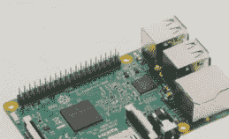


创意总监 **Aaron Asadi**
编辑总监 **Ross Andrews**
总编辑 **Jen White**
制作编辑 **Amy Best**
高级美术编辑 **Greg Whitaker**
助理设计师 **Steve Descombe**


Future 是一家屡获殊荣的独立媒体集团和领先的数字出版商。我们每月触达超过 5700 万互联网用户，并打造世界级的内容和广告。我们出版各种消费类和专业技术出版物，包括*《Microformats》*、*《Future》*、*《Raspberry Pi》*等。请访问 www.futurepic.com 以获取更多信息。

**Future plc** 是一家在伦敦证券交易所上市的公众公司。（股票代码：FUTR）www.futurepic.com

**首席执行官：** Tizian Brung, Throne
**非执行董事长：** Peter Allen
**首席财务官：** Penny Leathlor-Brant
**电话：** +44 (0)1225 442 244


> “一旦你熟悉了基础知识，你可以用树莓派实现的目标几乎没有限制”

# 树莓派 3

一款超充能的树莓派，终于实现了你想要的所有功能，且价格与前几代型号完全相同

尽管树莓派已经享受了多年的成功，但始终有一些用户渴望的东西。一个稍强的 CPU，可以处理日常计算；更多的 USB 端口；也许还有无线功能，使网络连接更容易。

树莓派 3 解决了这些问题。由于它使用与 Model B+ 相同的板子设计，因此拥有四个 USB 端口，而最初的树莓派 Model B 只有两个。更重要的是，它拥有更强大的处理器和更多的 RAM，使其比最初的 Pi 快十倍。Pi 3 还增加了内置的无线功能，这使得连接 Wi-Fi 和蓝牙变得轻而易举。

新的 BCM2837 芯片是树莓派 3 的核心，它是旧树莓派 2 中 BCM2836 芯片的修改版本。四核处理器从 900 MHz 进一步提升至 1,200 MHz，这一“野兽”般的性能提升有助于使 Pi 3 成为功能更强大的板卡。以前你可能在浏览互联网或编写文档时会遇到困难，现在 Pi 3 可以轻松自如地处理这些任务，并保留充足的处理器余力。

然而，从根本上说，它仍然是与树莓派 B+ 相同的板卡。除了上述四个 USB 2.0 端口外，还有用于有线互联网的以太网端口，高品质的 3.5mm 耳机插孔用于声音，用于数字视频和音频的 HDMI 端口，以及一个 40 针的 GPIO 端口。这个扩展的 GPIO 端口对于制作更复杂、更酷的物理项目来说非常棒。

对于那些担心兼容性的用户来说，你所有的旧文件和项目在树莓派 3 上都能正常工作，你只需要像传输普通文件一样将它们迁移过来即可。


## 树莓派 3

### 入门指南

**GPIO 端口**

GPIO 端口的 40 个引脚为您提供了一系列电源和控制项目或从周围环境中读取更多数据的功能。这使得树莓派 3 成为物联网或创客项目的完美核心。

**USB 端口**

四个 USB 端口为树莓派 3 提供了更大的灵活性，允许您轻松添加键盘、鼠标、无线网卡和外部存储设备，而无需频繁更换设备或使用带电源的集线器。

**以太网端口**

Pi 3 保留了 Model B 上的有线网络和互联网连接。虽然最初的 Raspberry Pi B 最高只支持 100 Mb，但对于树莓派来说，这已经足够快了。

**集成无线功能**

树莓派 3 带来的一项重大更新是引入了内置的 802.11n 无线（Wi-Fi）和蓝牙 4.2 功能。连接互联网和其他设备从未如此简单。

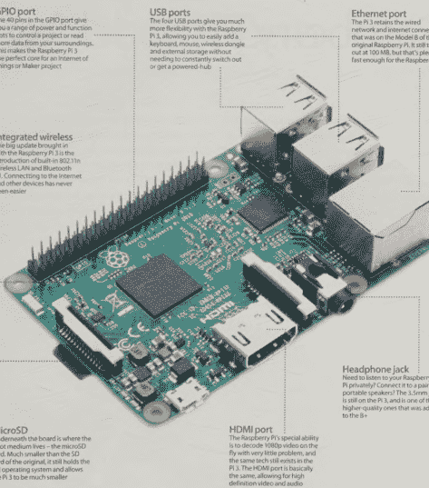

**耳机插孔**

需要监听您的树莓派播放的声音吗？将其连接到一对便携式扬声器即可！3.5mm 插孔仍然保留在 Pi 3 上，并且是 B+ 型号中质量较高的那种插孔之一。

**microSD**

在电路板下方是启动介质的位置——microSD 卡。与原始的 SD 卡相比，它小得多，但仍然承载完整的操作系统，并允许 Pi 3 变得更加小巧。

**HDMI 端口**

树莓派的特殊功能——以极少的资源实时解码 1080p 视频，这项技术同样存在于 Pi 3 中。HDMI 端口基本上相同，支持高清视频和音频。


> “树莓派 3 仍然无法为 USB 集线器供电，因此如果您需要扩展配件，您需要购买一个带电源的集线器”

## 树莓派 Model A+

好东西往往小巧玲珑：看看为什么树莓派 A+ 是移动项目的理想选择。

虽然树莓派 Model B+ 凭借其四个 USB 端口比 Model B 有所提升，但 Model A+ 比其前身更小，仅重 23g（从 45g 减轻），且只有一个 USB 端口。此外，由于 SoC 上的内存限制为 256MB，而 B+ 则享受 512MB 内存。

但不要认为这意味着 A+ 低人一等。它 65mm 的长度和较轻的重量暗示了它的用途。缺乏以太网端口并不是一个弱点，而是表明这款树莓派更多地是为媒体中心、打印服务器以及重量是关键因素的项目而设计的。也许你会将它安装在一个由 Arduino 驱动的机器人上，其较低的功耗需求可以通过电池来满足。

### microSD 存储

再也不用等待 SD 卡插入或拔出了。树莓派 A+ 配备了用于 microSD 卡的推推式插槽。

### 可连接且灵活

两款新的树莓派型号都将 GPIO 接头从 26 个引脚增加到了 40 个，提高了设备的灵活性。

### 主板内嵌 256 MB RAM

令人惊叹的是，除了其他所有组件外，在这台古老小计算机的中心还连接了一个带有 256 MB RAM 的 700 MHz 系统级芯片（SoC）处理器。

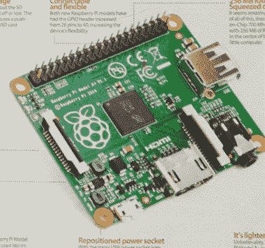

### 尺寸更小

最初的树莓派 Model A 长度为 86mm，约为信用卡大小。而 A+ 的长度仅为 65mm！

### 重新定位的电源插座

micro USB 电源插座现在位于 HDMI 插座旁边，使得线缆的管理更加容易。

### 重量也更轻

不幸的是，树莓派 Model B 仅重 23.5 克（或 0.8 盎司），重量减少了近 50%。

## 树莓派 Zero

尺寸比信用卡还小，Zero 确实令人印象深刻，无论是在性能上快速超越传统。四核 Broadcom CPU + 和 LiNEX-Pi3M 拥有以 40m（原文如此，疑指运行速度或频率）的速度运行的能力，比最初的 Pi 更快。

为了实现如此小的外形尺寸和低成本生产，设计师精简了一系列我们习以为常的部件，例如几乎缺失音频和内置摄像头/显示器，也没有以太网口。在各种项目中，各种类型的适配器将发挥至关重要的作用。通过确保每个组件都有存在的理由，Pi Zero 具有惊人的多功能性。其运行完整镜像（如 Raspbian）的能力意味着进入项目变得比以往任何时候都简单。

Zero 的极简主义非常适合无头（headless）设置运行；添加一个 WiFi 网卡，你就可以通过 SSH 登录并控制它，充分利用那个单一的 USB 端口。

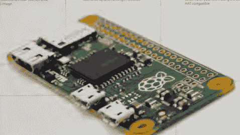

- **新的 mini HDMI 端口**
  这种 29 针连接器可以轻松用于新的 mini HDMI 端口。或者更好的是，进行无头安装并自行安装 OS 镜像。

- **microSD 卡**
  这与较新的 B 型号相同，意味着你可以插入一张现有的卡，几秒钟内即可开始运行。

- **未焊接的 GPIO 接头**
  拥有与 Model A + B/28/5 接头相同的 62 个引脚，你可以选择自己焊接上这些接头，使 Zero 兼容 HAT。

- **Micro USB 端口**
  缺少更有用的 USB 集线器，但适配器对于连接键盘或 WiFi 适配器这类设备将变得更加重要。

- **极简连接器**
  没有以太网、复合视频或摄像头和显示器连接器。然而，未焊接的复合视频和复位接头并不可用。

- **比信用卡更小**
  Zero 的尺寸为 65mm x 30mm x 5mm，整体占地面积仅为 Model B 的十分之一。

## 入门套件

你的树莓派比你乍一看看到的要多。以下是一些必备的周边设备，助你起步

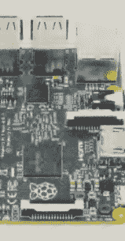

为了获得树莓派的最佳体验，除了树莓派主板本身，你还需要获得一些额外的配件。例如，你需要一个键盘和鼠标来输入命令和导航。虽然有些项目可以不用键盘和鼠标完成，但初始设置时你需要它们。SD 卡也是一项重要的购买——操作系统就安装在这里。也许你需要一个 Wi-Fi 适配器，或者只需一根网线。此外，还有树莓派基础电子学的一面，开始一些初学者电子和控制实验你需要什么？显然，树莓派比有些人想象的要丰富得多。

“周边设备”指的是可以连接并利用于树莓派的其他硬件。它们可以简单如桌面 HDMI 设备，也可以是增强项目功能的最新、最棒的定制小工具。对于树莓派来说，存在着一个完整的可能性世界，从机械臂到遥控直升机……唯一的限制是可用的硬件和你的想象力。

> 你知道吗... [由于图像质量原因，文字无法辨认]

### 键盘和鼠标


让我们从最基本的组件开始，即键盘和鼠标。一般来说，几乎所有 USB 键盘和三键滚轮鼠标都可以与树莓派配合使用，虽然对于某些项目你甚至不需要键盘和鼠标，但在初始设置时你需要它们。

### SD 卡

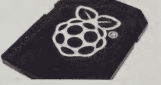

早期的树莓派计算机需要 SD 卡，而后期型号如树莓派 2 和 3 则使用 microSD 卡进行存储。这是你选择的操作系统（如 Raspbian）安装的位置，这些卡可以以各种尺寸购买，可以预装操作系统，也可以是空白的。


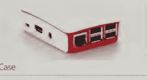

### 电源线

树莓派使用标准的 micro USB 连接器作为电源输入，运行电压为 5V。在大多数情况下，micro USB 到 USB 的线缆就足够了，拿到后可以插入你的台式计算机的 USB 端口。安卓手机充电器也应该能完美工作（5.25V / 500mA）。

### 外壳

将树莓派固定在外壳中可以保护它，并防止精密的 GPIO 引脚受到意外损坏。外壳还可以使树莓派成为一个更具吸引力或更显眼的装置，例如作为媒体中心。请确保为你的树莓派型号选择正确的外壳。

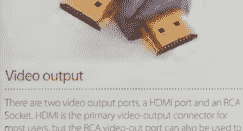


### 视频输出

有两个视频输出端口：一个 HDMI 端口和一个 RCA 插座。HDMI 是大多数用户的主要视频输出连接器，但 RCA 视频输出端口也可用于连接电视、显示器或 SCART 线缆。通过 SSH 或 VNC 也可以远程访问你的树莓派。

### 带电源的 USB 集线器

额外的 USB 端口值得作为早期购买的配件。一旦你连接了键盘和鼠标，你就会明白为什么使用带电源的 USB 集线器很重要：防止树莓派的电力被耗尽，并允许你连接外置硬盘等设备。

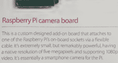

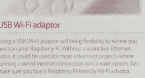

### 树莓派摄像头板

这是一个自定义设计的附加板，通过柔性线缆连接到树莓派的主板插座之一。它非常小但功能强大，具有 500 万像素的原生分辨率，支持 1080p 视频。它本质上是为 Pi 设计的智能手机摄像头。

### USB Wi-Fi 适配器

使用 USB Wi-Fi 适配器将增加你放置树莓派位置的灵活性。没有了限制性以太网线的束缚，它可以用于更高级的项目：那些有线互联网连接不是可行选项的场景。只需确保你购买的是兼容树莓派的 Wi-Fi 适配器。


## 设置您的树莓派

通过我们易于遵循指南，了解全新树莓派各部分的用途

虽然看起来令人望而却步，但将树莓派配置为日常使用其实非常简单。就像电视或普通计算机一样，只有特定的线缆才能插入特定的插槽，主要工作就是确保在某一时刻您已插好所需的部件。树莓派本身在电路板上标注不多。不过，大多数优质外壳都会为您完成这项工作——如果您决定购买一个的话。

### 电源适配器

树莓派使用 Micro USB 线供电，类似于许多现代安卓手机。它可以通过笔记本电脑或计算机供电。但为了充分利用其性能，合适的市电适配器（例如这款）是理想选择

### 显示器

树莓派能够输出 1920 × 1080 分辨率，也称为 1080p。有些显示器缺少直接插入 HDMI 的额外输出接口，就像电视一样。不过，在某些情况下您可能需要一个适配器

### USB 集线器

树莓派上的 USB 端口数量有限（只有一个）。如果您拥有型号 A，为了解决这个问题，您将需要一个 USB 集线器。获取带供电的集线器很重要，因为树莓派本身无法提供足够的电力

### 外壳和配件

使用树莓派时并不一定需要外壳，但一个不错的型号可以让它免受灰尘侵害，并在运行期间使其更容易移动。不过，您需要一张 SD 卡，例如带外壳的 4GB 卡

### 键盘和鼠标

就像任何计算机一样，标准树莓派您需要键盘和鼠标。无论您用树莓派做什么都是如此。键盘越基本越好，有些鼠标可能需要额外的软件，特别是那些特殊的型号。

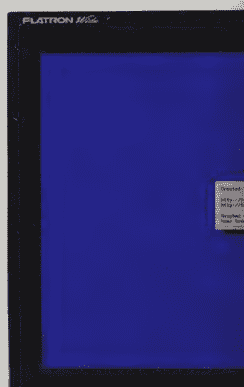

## 入门指南

### 设置您的树莓派

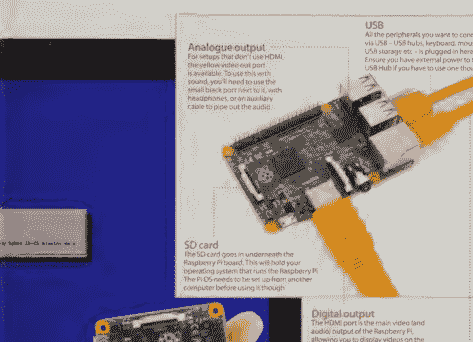

### 模拟输出

对于（尚未）拥有 3.5mm 接口的人：您可以购买一根小的黑色 3.5mm（或 6.5mm）线缆来输出音频。

### USB

您想要通过 USB 连接的所有外围设备——USB 集线器、键盘、鼠标、USB 存储设备等——都插在这里。如果您的集线器有外部电源，则必须使用它。


### SD 卡

SD 卡插入树莓派主板下方。这将保存运行树莓派的操作系统。不过，使用前无需通过另一台计算机设置树莓派。

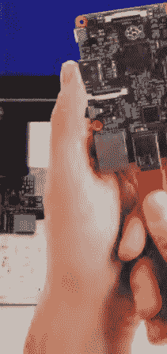

### 数字输出

HDMI 端口是树莓派的主要视频（和音频）输出，允许您在电视/桌面上以高达 1080p 的分辨率显示视频。树莓派对 3D 的支持也会自动通过音频输出呈现。

### 网络连接

树莓派不附带无线互联网，虽然您可以添加 USB 适配器，但通常插入以太网电缆更简单。另一端将插入路由器的背面，为您提供互联网访问和访问家庭网络的能力。

### 线缆

确保您有正确的线缆选择，例如用于网络的以太网电缆和电视适配器，以及用于视频输出的 HDMI 或视频电缆。HDMI 或视频电缆不包含在内，视频输出将需要额外的辅助电缆。

## 入门指南

### 您需要的物品...

- 树莓派 Zero
- Micro USB 电源
- 烙铁和焊锡丝
- Pi Zero 适配器套件
  - 显示器、鼠标和键盘
  - USB 无线网卡或 USB 以太网适配器
- 可选
- USB 集线器
- 可选

### 设置您的 Pi Zero

熟悉您的树莓派 Zero，无论是作为无头设备使用，还是与屏幕和键盘配合使用。

所以您已经挑了一个小巧却强大的 Zero，但在开始编码乐趣之前，您需要更多地了解它。别担心，我们将带您了解树莓派 Zero、所需线缆、如何准备 NOOBS SD 卡，以及如何将 GPIO 排针焊接到 Pi 上。一旦 Pi 正常工作并启动，我们将向您展示如何通过树莓派用户界面使其在 Wi-Fi 上工作。为此您需要一个 USB 集线器，或者只是同时使用键盘和鼠标。我们还将向您展示如何为无头使用准备树莓派 SD 卡（使用 VNC 或 SSH），仅使用 Wi-Fi 适配器或 USB 转以太网适配器。

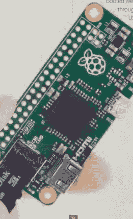

#### 树莓派 Zero 线缆概览

**01** 树莓派 Zero 非常小，因此无法安装常规尺寸的 USB 和 HDMI 连接器。因此要使用它，您需要将 Micro USB 扩展为全尺寸 USB，将 Mini HDMI 扩展为全尺寸 HDMI 的适配器。在连接 Micro USB 线缆时也要非常小心，因为 Micro USB 电源线可以插入用于 USB 数据的连接器。不过很容易区分它们，因为它们有清晰的标签，而且 USB 数据连接器位于 HDMI 和电源连接器之间。

### 设置您的 Pi Zero

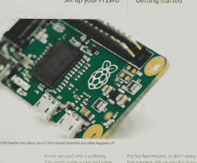

图 1：一旦您将排针焊接到位，您的 Pi Zero 应该看起来像其他树莓派一样

#### GPIO 排针

- **02** 焊接您崭新的树莓派 Zero 起初可能看起来令人害怕，但并不那么困难！然而，困难的是从套件中掰下正确数量的 GPIO 排针引脚（40 个），因为套件提供的数量超过 40 个。此时也值得注意，如果您搞砸了，漏掉底部几个引脚也没有太大关系。

我们使用的套件包括烙铁、支架、焊锡、吸锡器和一些无铅焊锡，在亚马逊上售价 8 英镑。我们用这个套件顺利焊接了 GPIO 引脚，没有遇到任何问题。

#### 焊接套件

- **03** 如今烙铁非常便宜。如果您打算进行大量焊接，那么可能值得购买一个温控型号，您可以更换烙铁头。然而，

#### 固定 GPIO 排针

- **04** 在您焊接 GPIO 排针之前，您需要能够固定它们的位置。我们建议在此时引脚两侧放一些蓝丁胶（Blu-tack）。这也带来一个好处，您可以翻转 Pi，然后使用蓝丁胶将其固定在桌面上，以便在焊接时保持稳定。完成后，蓝丁胶可以轻松剥离。

#### 焊接 GPIO 排针

- **05** 这是您可能一直担心的部分，但别担心！确保您已湿润焊接支架中的海绵，因为您需要将烙铁在海绵上擦拭以保持烙铁头清洁。如果这是您第一次使用烙铁，加热元件在前几分钟可能会冒很多烟，所以如果发生这种情况请别担心。不过，请留意您的安全，确保您不在通风不良的区域 - 尽量不要吸入任何烟雾。一旦烙铁变热，在烙铁头涂抹少量焊锡，并在海绵上擦去多余的焊锡。然后开始焊接引脚。对于每个引脚，将烙铁头触点在 GPIO 排针的背面和 Pi 上的金属触点，然后施加非常少量的焊锡。一旦焊锡流向引脚和金属触点，您就可以移开烙铁。如果焊锡过多，您可以重新加热焊锡并使用吸锡器将其移除。焊接 GPIO 排针时请休息几次，原因有二：1) 您不希望过热 Pi 上的任何组件，2) 您可能会熔化 GPIO 排针的塑料，这会导致引脚掉落。在整个焊接过程中，请持续将烙铁头在海绵上擦拭以保持清洁。完成后，请拔掉烙铁插头并将其放在安全的地方冷却。

### 入门指南

#### GPIO

当您焊接了 2x20 公头排针后，您的 GPIO 将正常工作。在右侧，您可以看到四个未填充的引脚，用于视频输出和一个复位开关

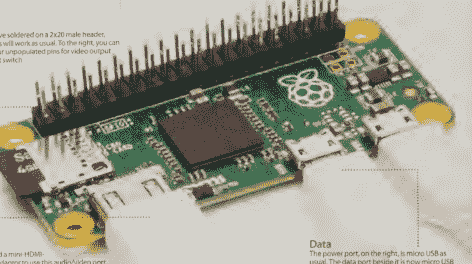

#### 视频

您需要一个 Mini-HDMI 转 HDMI 适配器来使用此音频/视频端口，尽管您也可以使用未填充引脚通过 RCA 复合视频输出

#### 数据

右侧的电源端口通常是 Micro USB。旁边的数据端口现在也是 Micro USB，因此您可能需要一个 Micro USB 转 USB 适配器。

### 准备 NOOBS SD 卡

- **06** 有关更多详细信息，请访问 www.raspberrypi.org/help/noobs-setup。NOOBS 需要格式化为 FAT32 的 SD 卡。然后您需要从 https://downloads.raspberrypi.org/NOOBS_latest 下载最新的 NOOBS 镜像，并将其解压到 SD 卡。在 Linux 上，步骤如下：
  - `sudo parted /dev/mmcblk0(parted)  mklabel msdos(parted)  mkpart primaryfat32  0% 100%(parted)  mkb1kp1  /dev/mmcblk0p1  cd /mntsudo mkfs.vfat /dev/mmcblk0p1cd /mntsudo mkdfsr pi cd pi sudo  unzip /dev/mmcblk0p1/piNOOBS_v_1_5_2.zip`
  - `sync`
  - `cd ..sudo umount pi`

### 启动 NOOBS 并安装 Raspbian

- **07** 按照第一步所示连接您的 Pi Zero。安装 NOOBS 所需连接的最小配置是显示器和键盘。然而，鼠标和以太网适配器或 Wi-Fi 适配器也非常有用。按 Enter 选择 Raspbian，然后按 1 安装。然后按 Enter 同意。完成后，它会显示“OS installed successfully”（操作系统安装成功）。按 OK，您的 Pi 将重启进入 Raspbian。或者，如果您不想使用 NOOBS，您可以按通常方式将 Raspbian 刷入 SD 卡。Raspbian 默认启动到桌面环境

### 配置 Wi-Fi

- **08** 如果您使用的是 USB 转以太网适配器，那么 Pi 应该已经连接到互联网。如果您使用的是 Wi-Fi 适配器，则需要配置它以连接到您的无线网络。我们使用的是 Edimax EW-7811UN，它工作

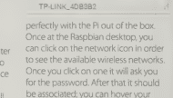

完美地与 Pi 开箱即用。一旦在 Raspbian 桌面上，为了查看可用的无线网络。点击其中一个后，它会要求您输入密码。之后它应该已关联。您可以将鼠标悬停在图标上，查看您连接的计算机网络

### 从另一台机器配置 Wi-Fi

- **09** 如果您想将 Pi Zero 作为具有 Wi-Fi 的无头设备使用，您可以使用另一台已经配置好连接正确 Wi-Fi 网络的 Linux 机器来准备 SD 卡。您必须挂载 SD 卡并编辑 /etc/wpa_supplicant/wpa_supplicant.conf，这与配置的文件相同


## 设置你的树莓派 Zero

使用上一步中 Raspbian 的用户界面。将 SD 卡插入你的 Linux 机器，并找出该设备的名称。

```
dmesg | tail -n 3
[ 328516.612884] mmc8: new high speed SDHC card at address 6001.
[ 328516.614337] mmcblk0: mmc:0:6001 SD0BG 7.35 GiB
```

因此，该设备是 /dev/mmcblk0 – 现在我们需要确定根分区是哪个分区号（这与使用 NOOBS 镜像的 Raspbian 镜像不同，这里我们使用的是 NOOBS 镜像）。

```
ls /dev/mmcblk0
sudo parted /dev/mmcblk0 print
```

这将给你一个分区列表。最大的分区将是根分区。在这种情况下是分区 2，所以根文件系统位于 /dev/mmcblk0p2。要挂载 SD 卡并编辑 wpa_supplicant.conf 文件，请执行以下操作：

```
sudo mkdir /mnt
sudo mkdir /pi
sudo mount /dev/mmcblk2 /pi
cd /pi
sudo nano /etc/wpa_supplicant/wpa_supplicant.conf
```

然后填入你的 WiFi 详细信息：

```
network={
ssid="your_wifi_network" 
psk="your_wifi_password" 
key_mgmt=WPA-PSK }
```

最后：

```
cd ..
sudo umount /pi
```

### 远程访问你的树莓派

1. 你可以使用 rmap 扫描本地网络以查找树莓派。你需要知道本地网络的地址范围（常见的网络范围是 192.168.1/24 和 192.168.2/24）。你可以使用 `ip addr` 命令找到它。`nmap -d22 -s/v 192.168.157/24` 将扫描 SSH 端口开放的设备列表。

```
Host 15.7
Port 0 (0.780s latency):
PORT STATE SERVICE VERSION
22/tcp open ssh (protocol 2.42)
```

然后你可以使用以下命令进行 SSH 登录：

```
sudo ssh 192.168.157.29
密码是 "raspberrypi"
```

如果你正在无头模式（headless）下使用树莓派，你必须禁用默认设置的用户界面：

```
sudo systemctl set-default multi-user.target
```

### 设置 VNC 服务器

11. VNC 代表虚拟网络计算（Virtual Network Computing）。使用 VNC，你可以通过网络访问 Raspbian 桌面（这意味着你只需要连接电源和以太网/WiFi 即可。不支持音频，但对于其他任务（包括使用 pygame），VNC 应能提供可接受的性能水平）。你可以使用以下命令安装 VNC 服务器。

> “安装 NOOBS 所需的最小连接是一个显示器和一个键盘”


```
sudo apt-get update
sudo apt-get install tightvncserver
```

有几种免费的 VNC 客户端可用，因此搜索引擎将帮助你找到合适的客户端。要在树莓派上启动 VNC 会话，请通过 SSH 登录，然后运行 `tightvncserver`。第一次运行时，你会被提示输入密码。你可以使用 `-geometry` 选项指定屏幕分辨率：例如，`-geometry 1024x768`。你可以使用 `tightvncserver --kill n` 终止现有的 VNC 会话，其中 n 是会话编号。要在 Linux 机器上连接到该会话，你可以使用命令 `vncviewer 192.168.157.29:n`。将 IP 地址替换为你的 Raspbian 树莓派的 IP 地址。

## 入门指南

### 你需要什么...

**树莓派下载**
www.raspberrypi.org/downloads

### 你知道吗...

> “树莓派基于最初为英国政府国防工业设计的芯片。它是与 PlayStation 2 中使用的相同处理器。”

**卡速**
最好获取一张速度合理的 SD 卡，以保持系统顺畅运行。4 级或更高级别最佳。

**卡格式**
在复制 SD 映像之前，你需要确保 SD 卡已格式化为 FAT32 文件系统。

### 安装发行版

我们来看看安装预制操作系统的一些关键方面。

凭借小巧的尺寸和低廉的价格，许多人可能会被误导认为树莓派只能用于基本任务和学习编程。虽然树莓派的主要目标之一是在较低层次提高计算机素养，而不仅仅是学习如何创建 Excel 电子表格，但树莓派还有许多其他出色的用途。

由于树莓派本质上是一台微型 PC，具有 HDMI 和模拟电视输出，而不是传统的显示器连接，因此它可以执行许多通常由笔记本电脑或台式机完成的常见任务。虽然它的处理能力和 RAM 不足以运行最新版本的 Windows，但还有其他选择。

有许多功能齐全的操作系统，其中许多是从其桌面“老大哥”分叉而来的，并专门为树莓派进行了优化。其中流行的是 Raspbian，它是 Debian 的移植版本。Debian 是 Linux 生态系统的关键部分，许多其他流行的开源发行版都是从 Debian 源代码分叉而来。最初的 Debian 于 1993 年发布，如今已取得了长足的进步。Raspbian 需要工作来提高性能水平至标准，因为树莓派使用较旧的 ARMv6 架构。它现在是一个伟大的日常桌面环境。

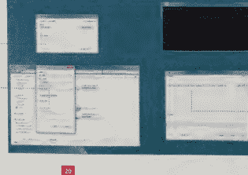

- **命令行**
  - 如果你使用 OS X 或 Linux，那么你很可能会使用命令行来安装你的预制操作系统。

- **自动化工具**
  - 有几种图形工具可以使将映像安装到 SD 卡变得简单。

### 格式化卡

05 在 Windows 中，格式化卡只需插入并等待其挂载。然后右键点击“我的电脑”，再点击卡的图标。之后，选择“格式化”，然后从下拉菜单中选择“FAT32”。

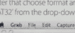

### 使用终端

06 如果你使用 OS X 或 Linux，你将不得不使用终端来复制映像。在 OS X 中，终端应用程序默认安装，大多数 Linux 版本也以某种形式附带终端。它可能被称为“控制台”或“命令行”。

### 获取操作系统

01 你的第一个问题可能是“我在哪里可以找到可下载的操作系统？”大多数常见映像可以在树莓派主站上找到：www.raspberrypi.org/downloads。这些是稳定且经过充分测试的系统，值得研究。

### 操作系统格式

03 在 zip 文件中，你会找到一个具有 .img 或 .iso 扩展名的文件。这些相当于安装 CD 或 DVD 的“快照”。仅仅将文件复制到 SD 卡上不会有任何作用；你需要使用程序来提取它。

### 解压

02 下载映像后，你很可能想要做的第一件事是解压它。在 Windows 中，可以通过右键点击并选择“提取”来完成。在 OS X 中，只需双击即可提取文件。

### SD 卡格式

04 你将从中启动的 SD 卡必须是空白的，所以请先确保上面没有重要内容。你还需要将其格式化为 FAT32 文件系统。这是一种常见系统，大多数 U 盘和相机都使用它。

### DD 命令

07 你需要使用的命令叫做 'dd'。其输入格式为 'dd <source> to <destination>'，例如，`sudo dd bs=4m if=/dev/sdb5`（如果你插入了 CD/DVD，则为 `if=/dev/sr0`）。

```
sudo dd bs=4m if=/Users/rachel/Library/Desktop/.../RMLinux/archlinux-hf-2013-02-11_img. . of=/dev/disk1
```

### Win 32 Disk Imager

08 Windows 用户可以使用 Win32 Disk Imager。下载该工具后，只需右键点击 exe 文件并选择“以管理员身份运行”，然后按照提示操作即可。安装完成后，你可以将 SD 卡插入你的 PC。简单！

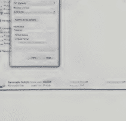

Raspbian
www.raspberrypi.org

### 命令行基础

学习使用命令行和键盘控制树莓派的一种替代方式。

使用树莓派时，我们可能都经历过这种情况。你已经将 Raspbian 或其他树莓派操作系统安装到 SD 卡上，并匆匆忙忙地完成了设置脚本，或者没有做足够的调查。你启动操作系统后……你发现自己来到了命令行。这里的第一个步骤是不要恐慌：这是完全正常的。这可能对你来说是个陌生的概念，只在电影里见过那些想要破坏系统的街头黑客使用！

第二个步骤，至少在 Raspbian 的情况下，只需输入：`$ startx`

就这样。Raspbian 将加载桌面，你可以重新开始使用鼠标了。在这种情况下，以及许多其他操作系统中，这既快速又无痛。你做的是使用一条命令，具体在这种情况下是启动 X 服务器。X 服务器处理图形界面，在某些树莓派系统上可以默认关闭。


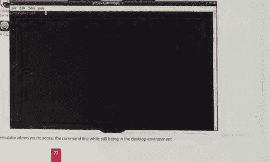

图 1：终端模拟器允许你在仍处于桌面环境的情况下访问命令行。


## 命令行基础


## 新世界

当然，将树莓派接入桌面环境并不是你在命令行中能做的唯一事情。命令行中内置了丰富的功能；事实上，你正在使用的大多数图形程序只是以特定方式执行这些命令而已。你也不必离开舒适的桌面环境来执行这些命令；因为所有树莓派操作系统都会附带一个被称为终端模拟器的应用程序。

这会创建一个窗口，你可以像启动桌面一样在其中输入命令，并使用完全相同的命令（图 1）。在 Raspbian 中，请在菜单的“附件”部分查找名为 **LX Terminal** 的应用程序并点击它。如果你之前不得不使用 `start x` 命令进入桌面，那么我们现在可以先解决这个问题再继续。在终端中输入：

```
$ rpi-setup-config
```

这是初始设置屏幕（图 2）。在这里，你可以启用开机自动启动桌面（图 3），甚至可以更新固件并为官方树莓派摄像头模块添加支持。这使得你无需重新安装即可修改 Raspbian。

不过，你不会经常使用那两个命令，所以深入研究命令行有实际的用处吗？用处非常大。首先，Raspbian 没有官方的包管理器。这是一个允许你浏览操作系统可用软件的程序，类似于 Pi Store。

然而，Raspbian 还有其他通过商店无法获取的软件。你也不能专门更新树莓派的软件，而所有这些都可以使用命令行来修复。

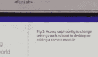

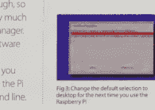

## 入门指南

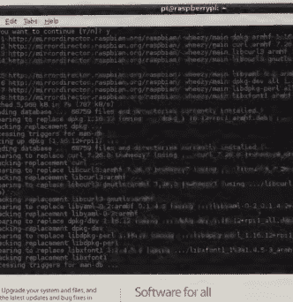

### 面向所有人的软件

你想做的第一件事是让树莓派确切了解在线有哪些可用资源。这是一个非常简单的任务，你只需要执行：

```
$ sudo apt-get update
```

这将遍历一系列包含树莓派使用软件的在线仓库（或简称 repos）。完成后，命令行提示符会再次出现，等待你的下一条命令。由于这是你第一次执行此操作，你很可能需要更新树莓派上的当前软件。你可以使用以下命令完成：

```
$ sudo apt-get upgrade
```

它可能会要求你确认升级，如果是这种情况，请输入‘Y’，然后按回车键。我们这两次所做的都是使用命令行包管理器 Aptitude（apt-get）来首先检查仓库，然后根据该信息升级包（图 4）。第一个命令 `sudo` 允许其以管理员身份运行 `apt-get` 任务，并且常用于许多其他命令行操作。要安装软件，请使用 `install` 代替 `update` 或 `upgrade`，后面跟着包的名称。例如，要安装数学编程语言，你可以使用：

```
$ sudo apt-get install wolf-am-engine
```

### 你知道吗？

`sudo` 意味着超级用户。它允许普通用户执行仅限管理员执行的任务。

## 移动和创建

安装和更新只是你在命令行中可以做到的许多事情中的几件。你还可以浏览整个文件系统、移动文件、创建文件夹以及删除项目。所有这些操作都非常简单。

当你第一次打开终端时，它会进入你的主文件夹。虽然你可能无法直接看出这一点，但你可以使用以下命令显示目录中有哪些类型的文件（图 5）：

```
$ ls
```

波浪号符号（~/）用于表示主文件夹，可用于在文件系统中导航。要导航，我们将使用 `cd` 命令，后跟你要移动到的位置。可以这样做：

```
$ cd /home/pi/Downloads
```

这将带你移动到 Downloads 目录。由于我们一开始就在主文件夹中，实际上我们只需要这样做：

```
$ cd Downloads
```

它是上下文敏感的，并且知道要在其所在的目录中查找。还有一个技巧可以帮你，这样你就不必记住路径的确切名称 – 命令行或终端会尝试自动补全短语。如果你按 Tab 键时只输入了部分内容，会发生这种情况。再试一次 `cd` 命令，但这次试着在只写了 ‘Down’ 时按 Tab 键。

最后，有一些快捷命令可用于操作文件。单个文件可以使用 `cp` 命令进行复制，后跟文件名和新位置，如下所示：

```
$ cp file.txt ~/Documents/file.txt
```

你还可以通过以下方式使用它来重命名文件：

```
$ cp file.txt otherFile.txt
```

然后可以使用 `rm` 命令删除原始文件：

```
$ rm file.txt
```

想要创建一个新文件夹吗？使用 `cd` 移动到你需要添加文件夹的目录，然后使用 `mkdir`，后跟你想给文件夹起的名称。

```
$ mkdir NewFolder
```

使用命令行你还能做更多事情，但这些是最基础的内容。随着你越来越多地使用 Linux，你将面临需要命令行来完成的任务，通过这个过程，你将了解到像一位老练的电影黑客那样工作时能完成多少事情。


> “如果你按 Tab 键时只输入了部分内容，命令行或终端会尝试自动补全短语”


图 5. 有许多简单的命令行工具可以帮助你浏览和使用你的系统

## Raspbian 桌面

虽然树莓派的 Raspbian 操作系统更接近 Mac OS 和 Windows，但其桌面最像后者。

乍一看可能有点陌生，但使用 Raspbian 与使用 Windows 桌面几乎没有什么不同。有一个菜单栏、一个 Web 浏览器、一个文件管理器，你会期望这样吧，你只需打开菜单并点击你想开始使用的应用程序……


### 菜单按钮

左上角类似 Windows 的菜单按钮显示程序列表和选项。主要类别包括编程（你可以在这里找到合适的工具）、互联网、附件（各种实用工具）和数学（系统工具）。从 Pi Store 下载的程序将出现在相应的类别中。而“运行”将启动一个命令行解释器，就像 Windows 中的那样。使用“关机”选项关闭、注销或重启你的树莓派。

### 任务栏

屏幕顶部横跨着任务栏，菜单就位于其上。在菜单左侧是 Epiphany 浏览器、游戏管理器、PiXer/MoFi、用于输入基于文本命令的 LX 终端、Wolfram Mathematica 计算软件以及 Wolfram 语言编程应用程序的快捷方式。在这些快捷方式旁边，你会发现任何打开的应用程序都停靠在那里，而在右下角，你会找到时钟、当前 CPU 负载、音量状态和控制，以及网络状态。

### 文件管理器

没有文件管理器，计算机就不完整，可以通过点击任务栏上的快捷方式打开它。可以通过拖动到桌面上的回收站或简单地高亮显示并按键盘上的 Delete 键来复制、重命名和删除文件。你还可以在文件浏览器中创建文件夹或窗口以打开文件夹。可以为文件夹、文件和目录设置书签以便轻松访问，文件本身也可以作为图标在详细列表中查看。

> “乍一看可能有点陌生，但使用 Raspbian 与使用 Windows 几乎没有什么不同”

### Web 浏览器

Epiphany 是树莓派的默认浏览器。虽然如果你不喜欢它，可以从 Pi Store 添加一个新的。与任何浏览器一样，Web 地址输入到地址栏中，并提供标准的导航按钮以在网页之间前后导航。Epiphany 支持多标签窗口，并具备私人浏览功能和清除浏览数据的能力。点击工具栏末端的选项图标以访问这些功能。


### Pi Store

你可以从菜单访问 Pi Store，或者从 www.raspberrypi.org 网站上的链接访问。与 Steam、Google Play 或 App Store 类似，Pi Store 要求你注册一个账户（使用 Indico），并且你需要在开始选购免费和付费的树莓派软件之前登录。从商店下载和安装的任何游戏和应用都会出现在“我的图书馆”选项卡下，其中一些只能从这里启动。

### 状态和时间

在任务栏的最右侧是 Raspbian 中类似于 Windows 系统托盘的地方，你可以在这里找到有关树莓派状态的信息。角落里有时钟，点击它还将显示当前日期，如果日期不正确，你可以在此处进行调整。在其左侧，你会发现一个显示当前 CPU 负载的图表、设备音量控制，以及最终确认你的树莓派处于在线状态。


## 掌握 Config 工具

### 你需要...
- Raspbian：www.raspbian.org

### 掌握 Config 工具
使用强大的内置 Config 工具来配置你的 Raspberry Pi 的行为。

‘RasPi Config’ 工具允许你配置系统，否则在 Linux 环境中会更困难。这也是你安装 Raspbian 后首先会看到的东西。为什么？像设置日期和时间或键盘的区域设置这样的任务，通常在命令行界面中完成，没有对话框，没有额外的帮助——对于新用户来说，这是一场噩梦。

关于 Pi 和 Raspbian 本身还有一些特定的细节，例如能够轻松启用 TV 的过扫描（overscan），更改分配给计算机 / 显卡的内存比例，甚至超频你的系统使其稍微更快；启用系统的远程 SSH 访问；阻止系统启动进入桌面环境等。RasPi Config 工具消除了过程中的痛苦，将真正的力量置于你的指尖。


### 打开 raspi-config 工具
- 01 首先双击桌面上的 LXTerminal 图标。这将启动命令提示符，你可以在此运行配置工具。为此，你需要运行一个命令。
  - `sudo raspi-config`
- 当要求输入密码时，你实际上看不到正在输入的内容。当你输入密码并按下回车键提交后，配置界面将显示出来。本节将介绍其中一些特别重要的设置，尽管它们在你的 Pi 运行中都有用处。此菜单中的一些设置很重要，有些是不可逆的，请谨慎使用。

- **更改密码**
  更改默认 'pi' 用户名的密码，使其更具个性化或更容易为你记住。

- **扩展根分区**
  允许你非常快速轻松地更改根分区，使其完全填满 SD 卡

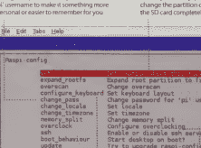

- **配置键盘**
  设置正确的键盘布局——有许多不同的布局。使用错误的布局可能会让人烦恼。

- **超频**
  允许你快速轻松地超频你的 Pi，以给你额外的速度和力量，风险很小。

### 更改启动行为
- 06 默认情况下，Raspbian 发行版将启动到命令行界面，然后才运行“li”中的登录。如果你想运行窗口管理器（在这种情况下，它被称为 X），你需要给系统一个命令来执行它。对很多人来说这并不理想，因为命令行让他们感到恐惧。为此，有一个选项可以在启动时自动启动 X。将此选项设置为“是”以默认启用此行为。
- 当然，你可以随时撤销此操作，返回到“基于文本的登录”，在那里你需要手动启动 X。

```bash
startx
```

### 开启和关闭过扫描
- 07 如果你使用现代 HDTV 使用你的 Pi，你可能会注意到两种行为之一。
  - 图像四周有一圈黑边，被 Pi 裁剪掉了 – 它只是无法正确显示。这是由欠扫描（underscan）引起的。
  - 如果你无法看到屏幕的边缘以将其调高，那就是受到了过扫描（overscan）的影响。
- 如果你有前一种问题，你可能需要打开过扫描，或在电视上启用“缩放”模式或类似功能。
- 如果你有后一种问题，你需要关闭过扫描，以便你能看到边缘。

### 更新 raspi-config
- 08 raspi-config 工具会不时收到更新。这通常是为了添加更多功能或修复小 bug，或者两者兼有！在使用工具时运行更新并不是坏主意——在开始更改任何系统设置之前。虽然更有可能更新是为了让它看起来更好或做更多事情，但不排除可能隐藏了一些会被误解的 bug，从而给你带来麻烦。但是，请记住，当你重新运行 raspi-config 工具时，你需要互联网连接，通过 LAN 电缆或无线。没有这些，它将永远无法变得更新。始终尝试确保你在使用最新版本。

### 扩展根文件系统
- 02 默认情况下，Raspbian 根文件系统为 2GB – 这样做是为了使提供的镜像能够适应尽可能多的不同 SD 卡。如果你关心 /expandd_root 文件选项，它会操作系统使用整个空间。使用此选项后，命令将立即执行。操作系统可能需要几分钟时间来识别更改。重启你的系统以看到更改。

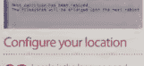

### 配置你的位置
- 03 Locale 是你的 Pi 使用的语言和区域设置 – 虽然这通常对你如何使用它影响不大，但使用默认的货币设置等是合理的。如果设置错误，这可能在稍后成为麻烦。选择该选项后，你将进入向导。使用箭头键在你继续之前检查内置的 locale（这需要一些时间）。时区会将你带到一个时区屏幕，你可以调整它。

### 超频你的 Pi
- 04 你可以将你的 Pi 的时钟速度和电压设置为几个不同的预设。将时钟速度和电压设置为高于规格值的速率可能会导致不稳定，因此请分小步进行。


并确保你的 Pi 周围有良好的气流。
- 如果你注意到任何明显的不稳定，再次运行此向导并将时钟速度调回稍低一些 – 重复直到你的系统完全稳定。

从本教程开始，建议使用 Model/ Medium 超频。它似乎能提供一点额外的性能，而没有明显的副作用。建议在更改后重启系统。按住 Shift 键可以暂时禁用超频。

### 更改内存分割
- 05 更改 Pi 的内存分割允许你给系统或图形处理器分配更多的内存。你给它的值必须是 16/32/64/128/256，用于使用图形内存设置。
  - 用于基本桌面、视频和 3D 渲染游戏的 3D GPU 性能。
  - 用于需要启用视频播放或 3D 效果的桌面使用的 64MB GPU 内存。
  - 用于进行大量多媒体操作或玩 3D 渲染游戏的图形应用程序和游戏的 128MB GPU 内存。
  - 对于大多数人来说，用于图形的 64MB 分割就足够了。

## 上网

### 你需要…
- 任何 Raspberry Pi 发行版
- www.raspberrypi.com/downloads
- Wi-Fi 适配器或以太网

> **你知道吗？**
> 1. 8 个年轻人中有 7 个更可能拥有自己的智能手机而不是自己的 PC。
> 2. Facebook 用户比中国人口还多。
> 3. 每天 4.5 亿人使用手机访问 Facebook。
> 4. 一天内处理的数据量比 1969 年互联网刚诞生时可用的数据多 1000 倍。


图 1：连接 Wi-Fi 适配器后，运行实用程序并扫描可用网络


图 2：输入预共享密钥以连接到你的家庭路由器

### 上网
要访问实用程序、应用程序和资源的广阔世界，你需要上网。这是方法…

最简单的上网方式是购买 Raspberry Pi Model B+，因为它带有一个以太网插座。Model A 不仅缺少以太网端口，而且只有一个 USB 端口是个障碍。这意味着你需要购买一个带电源的 USB 集线器才能上网。回到 Model B+：要使用 USB 上网，只需将以太网线插入 Pi 上的插座，并将其连接到互联网调制解调器/路由器背面的类似端口。打开你的 Pi 并启动桌面，然后双击 Emphathy，你应该会看到互联网出现（主图）。要检查它是否正常工作，查看 Pi 本身上的灯。红色电源灯应该亮着。上面是当访问 SD 卡时闪烁的绿灯。电源灯下方是三个与以太网相关的灯。注意 Model A 没有这些 LED，因为它没有以太网插座。中间的灯是绿色的，当检测到全双工 LAN 连接时会亮起。这意味着它能够向互联网发送和接收数据。下一个灯是绿色的，当实际通过发送或接收数据访问互联网时会闪烁。最后一个灯是黄色的，当检测到 100Mb/s LAN 连接时会亮起并保持点亮。

### Wi-Fi 选项
如果你离调制解调器/路由器太近而无法插入以太网连接，或者你只是有一个 Model A，那么需要带电源的 USB 集线器。它插入 Pi 上的 USB 端口。然后你可以将 Wi-Fi 适配器插入其中。启动 Pi 并打开桌面。然后双击 Wi-Fi 配置图标。你应该在“适配器”部分看到适配器的名称。单击“扫描”查找网络，应该会出现找到的网络列表（图 1）。双击你想连接的那个，它的详细信息将被列出。几乎所有的家庭网络都使用网络密钥，通常写在调制解调器本身上。单击 PSK，它代表预共享密钥，并输入它（图 2）。然后单击“添加”。它将处理此操作，然后关联连接，并且

最后，Wi-Fi 连接将显示一个新的 IP 地址。如果你点击“管理网络”选项卡，该网络将被列出，并且“已启用”单选按钮处于激活状态。要连接互联网，只需启动 Empathy，你就会连接成功。Wi-Fi 实用程序将保留在面板的右下角。右键点击 Wi-Fi 图标，你会看到断开连接或重新连接的选项、事件历史记录以及最近一次扫描的结果。点击“状态”以查看其运行状况。

## 检查连接

为了检查 Pi 是否具有有效的互联网连接，请双击 LXTerminal。输入以下命令：

```
ip addr
```

你应该会看到一串数字，其中最后一行以 `inet` 开头，后面跟着 Pi 连接的 IP 地址（图 3）。通常这类似于 192.168.1.11，这表明连接正常工作，因为 Pi 已被分配一个基于你的互联网调制解调器/路由器所使用的 IP 地址。如果没有出现此地址，则路由器端可能存在问题。调制解调器/路由器应该正在运行 DHCP 服务器，当 Pi 连接到它时，它将被分配一个 IP 地址。如果没有运行，那么连接到它的其他设备也无法访问互联网。

使用另一台设备的 Web 界面登录到 192.168.1.0 或你的调制解调器的实际 IP 地址，以检查 DHCP 服务器服务是否已启用。最后，在终端中输入：

```
ping google.com
```

## 共享连接

如果你没有 Wi-Fi 适配器、带电源的 USB 集线器或足够长的以太网电缆，但你有另一台已连接互联网的计算机，还有另一种获取访问权限的方法。在 Mac 上，通过 USB 或以太网电缆将其连接到 Pi。启动系统偏好设置 > 互联网和无线，点击共享。点击互联网共享，然后选择 Wi-Fi（用于 AirPort）作为要共享的连接类型，并选择 Pi 如何连接到你的 Mac（图 4）。

在 Windows PC 上，前往 Windows 资源管理器 > 网络 > 网络和共享中心 > 更改适配器设置。

## 上线

# 入门指南


图 3 如果看起来连接没有工作，有一些简单的方法可以检查发生了什么

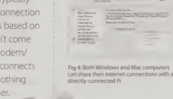

图 4 Windows 和 Mac 计算机都可以与其直接连接的 Pi 共享互联网连接

# 你需要准备什么...

**Apt 命令帮助页面：** http://linux.die.net/man/8/apt

**Apt-get 帮助页面：** https://manpages.debian.org/man8/apt-get.8.html

## 你知道吗...

树莓派是一台近乎完美的微型计算机。它已经包含大量的教育软件、一些游戏、若干编程工具和系统工具。但是，与大多数计算机一样，这只是冰山一角。通过安装更多程序，你可以做更多事情。

# 安装和使用软件包

树莓派很棒，但你安装在上面的软件让它变得更好。

单独来看，树莓派是一台近乎完美的微型计算机。它已经包含大量的教育软件、一些游戏、若干编程工具和系统工具。但是，与大多数计算机一样，这只是冰山一角。通过安装更多程序，你可以做更多事情。

这些被称为软件包的程序，其多样性如同最初设计它们的开发人员一样广泛。在 Linux 中，如果需要对某个特定程序的需求，就会有人开发它。然后将其发布到全世界，并免费公开源代码，因此称为“开源”。一旦程序经过测试，最终会进入该特定 Linux 发行版的一个远程服务器。

这些被称为软件源（或 repos）的远程服务器包含软件包的所有元素，以便将其下载并安装到你的系统上。一旦你知道如何操作，这个过程非常快速且简单...

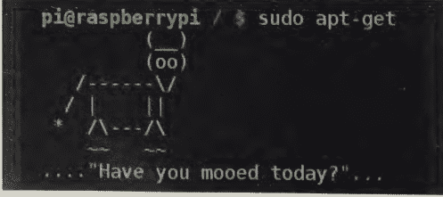

## 更新和升级

01 获取软件包
通过桌面上的 LXTerminal 图标进入命令行终端，并输入几个命令。但在这样做之前，我们需要确保系统是最新的。在终端中输入以下内容：

```
sudo apt-get update
sudo apt-get upgrade
sudo apt-get update && sudo apt-get upgrade
```

## 搜索软件包

02 apt-get 命令（高级包工具）是在树莓派上下载和安装软件包的关键。在之前的示例中，我们更新了现有软件包和系统，升级了需要升级的部分，并更新了当前软件包列表。现在，让我们在服务器软件包列表中搜索可用的游戏。

```
apt-cache search game | less
```

## Apt 搜索

03 你当前所在的列表是所有标记为“游戏”的可用服务器软件包名称。在列表中，连字符前面的部分告诉你软件包的名称，这是你安装它所需要知道的。使用上下箭头键导航，按 'Q' 退出。

## 安装软件包

04 使用上下箭头键导航列表。如果你找到喜欢的东西，例如 Angry Drunken Dwarves，记住软件包的名称，在此例中为 angryd2，然后按 'Q' 退出列表。要安装该软件包，在终端中输入以下内容：

```
sudo apt-get install angryd2
```

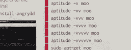

## 执行软件包

05 上一个命令的结果应该是游戏 Angry Drunken Dwarves 的成功下载和安装。要执行新安装的软件包，你可以从 LXDE 菜单中的 游戏 -> Angry Drunken Dwarves 运行它，或者在终端中输入以下内容：

```
angryd2
```

## 删除软件包

06 安装软件包是完全正常的，你可以看到 Apt 命令有多强大。但是，如果你想删除软件包怎么办？

再次使用 Apt 命令，假设我们要从树莓派中完全删除 Angry Drunken Dwarves 的所有痕迹。

```
sudo apt-get --purge remove angryd2
```

输入 "Y" 接受删除。

## Apt 彩蛋

07 Apt 命令是 Aptitude 命令的更短、非菜单驱动变体。这个命令在 Linux 中有着悠久的历史，因此拥有一些相当特殊的功能，也被称为彩蛋。纯粹为了好玩，输入以下命令并查看结果：

```
aptitude moo
aptitude -v moo
aptitude -vv moo
aptitude -vvv moo
aptitude -vvvv moo
aptitude -vvvvv moo
aptitude -vvvvvv moo
sudo apt-get moo
```

## 查阅 Apt 命令手册

08 如你所见，简单的 Apt 命令比表面看起来更复杂。你可以运行许多不同的子命令，以及运行它们的不同变体。

如果你想查看 Apt 命令还能做什么，请输入以下内容：

```
man apt
```


# 你需要准备什么...

**Synaptic:**
www.nongnu.org/synaptic/

## 使用图形化安装

*你更喜欢使用图形界面来安装新程序吗？如果是，请继续阅读...*

如果你是 Linux 新手，可能会觉得使用其内置的 Apt 包管理工具有点令人生畏和困惑。apt-get 命令用于通过互联网安装应用程序，连接到被称为软件源（repos）的远程服务器，这些服务器将程序作为软件包进行存储。但它通过终端命令提示符使用，这可能令人望而生畏，因此我们需要一种替代方案：一种通过桌面环境界面获取软件包的方法。

这就是 Synaptic 发挥作用的地方。Synaptic 是一个外观友好的图形界面，用于 apt-get 终端命令，它允许你通过熟悉的桌面环境管理应用程序的安装和删除。把它想象成一种在线商店，你可以挑选想要的程序，并将它们下载和安装到你的树莓派上，而无需进入终端。

### 你知道吗... 
树莓派运行最新版本的 Debian Linux，并包含适用于所有不同桌面环境的最新软件包，如 Cinnamon、XFCE、LXDE 和 GNOME。

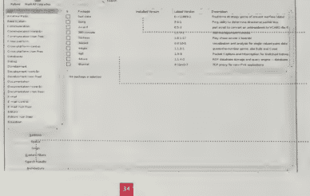

- **升级整个系统**
  Synaptic 能够升级和更新每个程序或软件包，并可以将整个系统升级到最新版本
- **安装及其他**
  Synaptic 是一个功能强大的工具。你可以使用它安装、删除、升级和降级单个或多个软件包和程序
- **浏览所有文档**
  在 Synaptic 内部，你可以浏览和阅读与软件包或程序相关的所有可用在线文档
- **轻松查找程序**
  Synaptic 使你可以轻松通过名称、描述、版本甚至程序开发人员来定位软件包和程序


## 更新系统
1. 不幸的是，如果您已有一个现有的 Synaptic 系统，显示在第一步的命令可能会卡住。在安装任何内容之前，我们需要确保树莓派是最新的，并且现有的软件包也是最新的。只需将以下内容输入到 LXTerminal 中：

```
sudo apt-get update
sudo apt-get upgrade
```

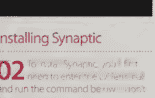

## 安装 Synaptic
2. 既然系统已是最新的，我们终于准备好安装 Synaptic 了。转到 LXTerminal 并运行下面的命令。别忘了在提示接受安装时输入 Y。

```
sudo apt-get install synaptic
```


## 运行 Synaptic – 第一部分
3. 本质上，这就是你需要做的全部。Synaptic 现在已安装并准备就绪。然而，由于其复杂性，可能有一些 bug 需要先解决，因此最好遵循这些步骤。要测试 Synaptic 是否工作正常，首先在终端中输入以下命令：

```
sudo synaptic
```


## 运行 Synaptic – 第二部分
4. 你现在应该正在查看 Synaptic 程序窗口，你可以在其中浏览可用程序列表并点击下载和安装。现在我们需要测试它是否能从 LXDE 菜单中运行。点击左下角的图标，然后转到 Preferences, Synaptic Package Manager。

## 运行 Synaptic – 第三部分
5. 从 LXDE 菜单运行 Synaptic 会导致错误。然而，不要惊慌，它只是要求输入密码。输入用户名/密码以便我们可以访问系统。这是你最初更改时设置的默认密码，如果你没有更改它，可以使用默认值。

## 修复 Synaptic – 选项 1
6. 这将临时修复该问题。要永久解决它，请执行以下任一操作：首先，右键点击菜单中的 synaptic 图标，然后左键点击属性。在命令文本框中，更改文本以添加 sudo 命令。因此，而不是“synaptic-pkexec”，它将读取为：

```
sudo synaptic-pkexec
```

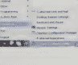

## 修复 Synaptic – 选项 2
7. 第二种，也是最好的选择，是拉回到终端并重复从菜单中执行程序的方式。只需将一行更改为另一行，以便再次使用命令类型而不是普通的 synaptic-pkexec。从终端输入：

```
sudo nano /usr/share/applications/synaptic.desktop
```

```
将“Exec=synaptic-pkexec”更改为“Exec=gksu /usr/bin/synaptic-pkexec”
```

## Synaptic 完全正常工作
8. 输入这些更改后，通过 Ctrl+X 退出 nano，接着按 Y 接受更改，然后按 Enter。几行操作后即可回到命令提示符。现在你可以从菜单启动 Synaptic，或者在终端中输入以下命令：

```
sudo synaptic
```

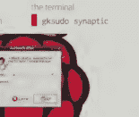

## 你需要什么...
- RPi.GPIO
- [https://pypi.python.org/pypi/RPi.GPIO](https://pypi.python.org/pypi/RPi.GPIO)

## GPIO 端口解析
了解如何利用树莓派上 GPIO 端口的强大功能。它比你想象的更简单...

树莓派上的通用输入/输出（GPIO）引脚通常是你将在本书中找到的项目成功的关键。没有它们，你就无法与现实世界进行交互，无论是触发灯光、按钮或蜂鸣器，还是读取传感器。

GPIO 引脚并非树莓派独有；它们实际上是一种旨在帮助控制各种集成电路的输入和输出行为的标准。通常你会发现任何一个 GPIO 引脚没有预定义的特定用途，它们默认是关闭的。

## 树莓派 GPIO
树莓派上的 GPIO 引脚可以通过多种方式控制和触发。你可以直接从终端和 Bash 脚本中使用它们，也可以使用专为流行编程语言设计模块来控制它们。由于 Python 是树莓派的官方语言，你会发现 Python 的 GPIO 模块提供了可用的输入和输出中最好的控制之一。该库名为 **RPi.GPIO** 并默认安装在所有树莓派上，但也可以以安装任何有用的 Python 库的方式安装。该项目托管在 SourceForge 上，可以在 [sourceforge.net/projects/raspberry-gpio-python](sourceforge.net/projects/raspberry-gpio-python) 找到。你还会找到有用的链接、信息以及如何在简单的 Python 脚本中使用和控制 GPIO 引脚的示例。如果你计划使用 RPi.GPIO，了解一些基本的 Python 知识会很有帮助，因此我们推荐像 [www.codecademy.com](www.codecademy.com) 上发现的基础入门课程，或者通过阅读 [www.python.org/doc](www.python.org/doc) 上的官方 Python 文档。

树莓派上有 26 个 GPIO 引脚，你可以按任意方式使用其中大部分。不过，有几个引脚具有特殊用途，因此我们建议你熟悉它们的布局。例如，最上面一行的引脚旨在为按钮和灯光等外部设备提供电源。由于需要地线（通常称为“接地”）来安全地创建电路，你还会发现 GPIO 端口中有几个接地引脚。

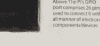

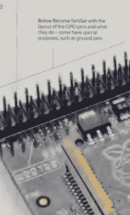

> 熟悉 GPIO 引脚的布局及其功能 – 有些具有特殊用途，例如接地电源。

## 如何使用 GPIO 引脚
要利用 GPIO 端口的强大功能，你需要一些基本组件。最重要的是跳线。由于端口上的引脚是“公头”，你需要购买“母对公”或“母对母”电缆，具体取决于你打算将什么硬件连接到你的树莓派。假设你要连接的设备也有公头连接器，“母对母”跳线就很好。但通常你会使用面包板来制作电路原型，在这种情况下，“母对公”连接器是首选。电缆和面包板可以以非常便宜的价格从几乎所有销售树莓派配件的在线商店购买，通常可以在商店的“原型制作”部分找到。

## 命名约定
一旦你准备好连接设备，下一个任务是找到合适的引脚。虽然确实所有 GPIO 端口都是多用途的，但有些比其他人更通用！正如我们已经发现的，一些引脚是保留用于 5V、3.3V 和接地的。其他引脚也具有特殊功能。但更重要的是，它们也可以被称为不同的名称。例如，GPIO 18 也被称为引脚 12 和 PCM_CLK。这个特定的引脚（位于 GPIO 端口右侧中部）能够进行硬件脉宽调制（PWM），并用于控制 LED 灯光和电机等其他事物。

你在 Python 脚本中使用的引脚命名约定可以手动设置。这可以设置为 BCM（博通引脚名称）或物理引脚位置（BOARD）。

在我们使用 GPIO 端口的任何项目中，你都会看到括号中包含 BCM 或 BOARD 的以下行：

```
GPIO.setmode(GPIO.BCM)
```

处理 GPIO 引脚命名问题的最简单方法是选择一种约定并坚持下去。

> 你知道吗...

## 四大附加板
使用这些附加板扩展树莓派的功能，从而发挥更多潜力

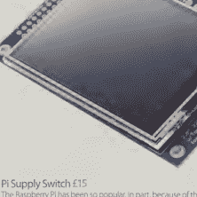

## Pi Supply 开关 £15
树莓派的流行部分归功于其硬件极高的性价比：它在价格范围内表现出色，而且由于它是由慈善机构设计的，因此不需要通过高额利润来抬高价格（想想它作为商业产品会多少钱）。不幸的是，与任何低成本产品一样，为了以如此实惠和紧凑的形式呈现，必须做出一些妥协。

与更标准的台式机或笔记本电脑相比，显然缺少两样东西：电源开关和电源管理功能。令人惊讶的是，像电源开关这样简单的东西是如此有用，直到你没有它时才意识到这一点。

Pi Supply 开关是一个自焊接套件，提供了一个开、关和软关（即安全关机）按钮，为你的 Pi 提供基本的电源管理功能。通过提供一些简单的脚本，你可以确保在关闭时 Pi 正确关机 – 无需打开任何菜单或在终端中发出任何命令 – 开关中的电路确保只有在 Pi 关机后才切断电源。除了为你带来更大的便利外，它还减少了因过早拔掉电源线而导致 SD 卡损坏的可能性。

## PiTFT Mini 套件 £30
这是一个 2.8 英寸的电容式 TFT-LCD 触摸屏，由 Adafruit 的项目专家专门为树莓派设计。它能够直接放置在树莓派上方，大小与 Pi 本身相当。

有很多理由想在树莓派上添加这样的屏幕，但它们总体上归结为树莓派非常小巧且便携，而大多数显示器并非如此。虽然你可以在外出时通过 VPN 从手机远程连接，但屏幕直接连接到 Pi，不涉及复杂的无线网络。此外，作为触摸屏，你无需携带其他输入设备，因为它由树莓派供电。

这开启了一个充满可能性的世界。便携式电脑、触摸屏控制板、视频摄像头……任何能从树莓派配备屏幕和人工输入中受益的场景，尤其是在远离主显示器时。

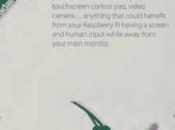


## 四大附加板卡

### 入门指南

**HiFiBerry DAC+ €30**

作为一款高品质音频设备，即使在中等价位上，它也是一位强有力的竞争者。它的一个不足在于仅配备了一个 4.5mm 耳机插孔，该插孔似乎并不特别牢固，且背面有两个 RCA 接口。好消息是，HiFiBerry Pi 基金会的巧妙人才提供了 USB 接口的访问权限，这对于给设备供电也非常方便。它内置了一颗 DAC 芯片，可以通过 RCA 接口输出数字音频，并且具备音量控制功能。

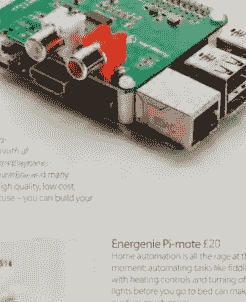

**Energenie Pi-mote €20**

目前，家庭自动化非常流行，因此自动化一些任务（例如睡前关灯或打开暖气）会让我们的生活更加便捷。

我们都发现的一件事是，关闭插头上的设备比让它们处于待机状态要容易得多，因此当我们不使用它们时，它们有点像个电击陷阱。这正是 Energenie Pi-mote 控制入门套件发挥作用的地方。它包含两个可通过 RF 遥控器开关的控制插座。

这与我们的树莓派有什么关系呢？好吧，你还可以获得一块附加板卡，使您能够通过树莓派上的软件来控制这些插座，从而释放一些新的可能性——例如，你可以在外出时设置台灯在指定时间自动开关以阻止窃贼，或者创建一个简单的网络应用，使用浏览器远程控制你的电源插座。

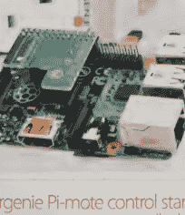

> “Energenie Pi-mote 控制入门套件包含两个可通过遥控器开关的插座”

## 为你的树莓派备份

主动采取措施，为你的树莓派备份，以确保你永远不会再次丢失文件

虽然树莓派是一套非常坚固的设备，但故障仍可能发生，因此最好做好充分准备并保护你的文件安全。

好消息是，树莓派的文件都存储在外部的 SD 卡上。如果你的树莓派坏了，所有内容仍保留在 SD 卡上，并可以从其他地方访问。不过，SD 卡仍容易出现问题。备份树莓派的方法有很多种。这些方法可以分为两大类：保存重要文件和创建 SD 卡状态的精确副本。前者涉及在别处保留文件的副本，而后者则是让你创建一种与安装 Raspbian 或其他树莓派操作系统时通常写入 SD 卡的镜像相同的文件。

### 重要文件

要保存重要文件，我们需要在外部源（如外置硬盘或另一台电脑）上创建副本。实现这一目标的最佳方法之一甚至不需要树莓派：你只需要一台带读卡器的电脑或笔记本电脑即可开始工作。关闭树莓派，拔掉电源并从插槽中取出 SD 卡。在电脑上找到 SD 卡读卡器并插入。SD 卡的主要文件系统默认可以被 Linux 电脑读取，而 Windows 或 Mac 电脑在安装允许其读取 ext4 文件系统的程序（如 Ext2Fsd）后也可以读取。在 Windows 上，SD 卡将与其他驱动器一起列在“我的电脑”中（图 1）。在 Linux 和 Mac 上，它将在菜单和文件管理器显示存储的位置列出。找到 SD 卡后，打开它并导航到 home 然后进入 pi 目录。这里可以找到文档、下载、桌面和其他目录。你需要做的只是选择要复制的文件，并将它们移动到电脑上的安全目录或连接的外置硬盘上。

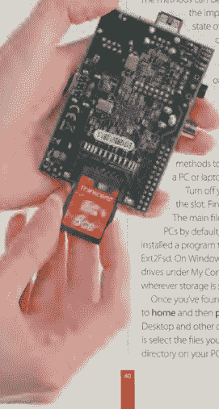

**你需要...**
- 第二台电脑
- 外部存储设备

> **你知道吗...**
>
> 一些笔记本电脑和电脑上可以找到 SD 卡控制器（或“写保护”）。这允许你创建只属于自己的文件的备份，其他人无法删除。

如果你想将文件保留在另一台电脑上，那也没问题，但从长远来看，它容易遇到与树莓派完全相同的问题。将它们保存在外置硬盘上是个好主意，而将其放在云存储服务上则更好，这样你可以在任何有互联网连接的地方访问它们（图 2）。

### 克隆

创建克隆取决于你主电脑上使用的操作系统。对于 Mac 和 Linux，你可以使用一个简单的命令行工具 `dd` 来创建 SD 卡的精确副本（图 3）。这是在终端模拟器或命令行中完成的，所以请首先调出它。确保 SD 卡已插入，然后输入：

```
$ ls /dev/sd*
```

这将列出所有连接的存储设备。SD 卡将有 2.4 或 8GB 的空间，具体取决于其大小。它可能被列为 /dev/sdb 之类的名称，其中 x 是电脑分配给 SD 卡的字母。要使用 dd 复制它，请在终端中输入以下内容：

```
$ dd if=/dev/sdX of=/backup.img bs=512
```

你还可以添加正在创建的镜像的路径，将其放入特定文件夹。这个过程需要一些时间，并且会生成一个多吉字节大小的文件，你可以通过反转上一条命令将其写入 SD 卡：

```
$ dd if=/backup.img of=/dev/sdX bs=512
```

虽然这作为备份很有用，但你还可以使用镜像批量生产 SD 卡，送给朋友或保留在使用树莓派的各种地方。

### Windows

要在 Windows 上创建克隆，我们可以使用 Win32 Disk Imager（图 4）。从这里下载并安装：bit.ly/LBJdYG。

安装完成后，插入 SD 卡并启动软件。为备份文件选择一个名称，并从设备列表中选中 SD 卡。现在按下“读取”，它将创建备份文件。同样，这可能需要一段时间；不过，这次你至少可以看到进度条。

存储克隆图像比保存“重要文件”稍微困难一些——图像大小为吉字节级别，这会填满许多云存储服务。如果你有空间，务必将其保留在那里；然而，你可能需要将其放在外置硬盘上。

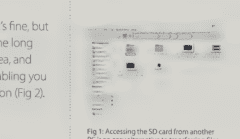

图 1：从另一台电脑访问 SD 卡。这是通过 U 盘在机器之间传输文件的便捷替代方案。

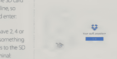

图 2：云存储服务使文件备份变得简单且安全，因为它们遇到问题的概率要低得多。

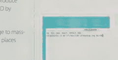

图 3：dd 工具是你在 Linux 和 Mac 电脑上使用的工具，它在终端模拟器中默认可用。

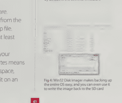

图 4：Win32 Disk Imager 使备份整个操作系统变得容易，甚至可以使用它将镜像写回 SD 卡。

## 项目

### nano 入门指南

你需要
- **完整的 nano 手册**
- www.nano-editor.org/dist/v1.2nano.1.html

学习如何使用 Linux 最好的工具之一在命令行和终端中编辑文本

> ### 你知道吗 . . .

如果你想在树莓派上做得更多，你需要学习的一项技能是编辑系统文件的能力，以完成许多项目。命令行文本编辑器 nano 绝对是该工作的最佳工具之一。文本编辑器是非常基本的工具；顾名思义（在这种情况下）。它没有你会在文字处理软件中看到的格式化、颜色或类似功能，但这就是重点。你要创建或编辑的文件通常包含代码——不需要加粗或使用项目符号的代码。nano 消除了所有这些干扰因素，但仍然保留了一些你在图形化文本编辑器中会找到的实用功能。我们将教你如何充分利用 nano，使你的项目运行得快速且高效。

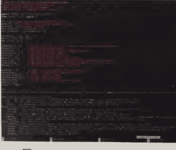

- ### 编写
  在命令行中创建纯文本文件，甚至为程序编写一些代码

- ### 编辑
  根据你的需求和项目编辑系统文件，无需在文件管理器中翻找

- ### 高级功能
  使用 nano 的一些内置功能搜索、复制、粘贴以及从另一个文件插入文本


## Nano 初学者指南


### 保存并退出

04 当您完成文件修改并需要继续下一个任务时，可以按 Ctrl+X 退出 nano。它会询问您是否要保存所做的更改，只需输入 Y 进行确认即可。如果您想在不保存更改的情况下退出，只需输入 N。如果在做出决定之前想取消，请使用 Ctrl+C。

### 高级导航

07 您可能一直在使用空格键（作为方向键的替代）以每次移动一个空间的方式向左、右、上或下移动。不过，还有其他方法可以在文件中移动。使用 Ctrl+A 会像图形编辑器中的 Home 键一样工作，将光标移动到行首。同样，Ctrl+E 将把您移动到行尾，就像 End 键一样。Ctrl+V 是向下翻页，而 Ctrl+Y 是向上翻页。


### 保存并继续

02 当您完成 nano 操作后，可以使用 Ctrl+O 进行保存/写入。所有这些快捷键和功能都是通过 Ctrl 键和一个字母键完成的。它会询问您要将文件保存为什么名称。无论您如何命名，除非您指定路径，否则文件将保存在您打开 nano 的目录中。

### 搜索文件

08 有时您需要在大型文本文件中查找特定的行或短语。与其使用方向键并不知疲倦地阅读每一行，您可以使用 Ctrl+W 进行搜索。输入搜索词后会在 nano 文档中显示一个框，完成后按 Ctrl+C 即可退出搜索。


### 复制和粘贴

05 这更多是一个终端特定的命令，但在 nano 中也可能显得有些不同寻常。虽然您*不能*使用鼠标在 nano 中导航文件，但您可以像在图形文本编辑器中一样高亮显示文本。高亮显示后，按 Ctrl+Shift+C 即可复制文本。Ctrl+Shift+V 用于粘贴。

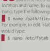

### 打开文件

03 要编辑已存在的文件，您首先需要知道它们的位置和名称。要在 nano 中打开它们，请输入以下内容：
$ nano /path/filename
例如，要编辑 /fstab，您会输入：
$ nano /etc/fstab


### 额外帮助

09 nano 中可用的功能远不止此列表所示。输入此命令以获取完整的命令列表及其功能说明。此列表中的插入符号（^）表示需要使用键盘上的 Ctrl 键。

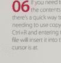

### 从文件插入

06 如果您需要直接插入另一个文件的内容，有一种快速方法可以完成而无需使用复制和粘贴。输入 Ctrl+R 并键入文件路径，即可将其插入到光标所在的位置。

## 项目

## 获取远程桌面访问

所需材料...

- TightVNC
- www.tightvnc.com/release_2.7.php

### 获取远程桌面访问

学习如何在无法直接面对 Raspberry Pi 的情况下访问其桌面...

VNC（虚拟网络计算）是一种图形桌面访问和共享系统，允许用户从自己的系统远程控制和操作另一台计算机的桌面。

它在很多方面都很有用：让您能够控制远程系统；帮助其他地方的用户；允许计算机保持开机状态，但无需键盘、鼠标甚至显示器。

在我们的情况下，我们的目标是在未连接上述外设的情况下访问 Raspberry Pi 的桌面。这样，您可以执行通常所做的任何操作，只需连接电源和即可，从而释放空间并节省额外费用。从实际角度来看，这意味着您可能通过 Android 平板电脑或手机访问 Pi 桌面。

> 您知道吗...
>
> 我在两个独立的 sshd_config 文件中设置了 ssh -v -N，因此您无需担心默认设置有误

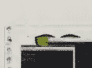

### 静态 IP 地址

01 我们的第一步是确保 Raspberry Pi 拥有静态 IP 地址。基本上，IP 地址是您的网络分配给设备的一组数字，用于区分它们。要设置静态 IP 地址，只需双击 LX Terminal 并输入以下内容，然后按 Enter。

```bash
sudo nano /etc/network/interfaces
```

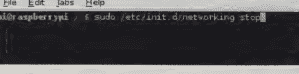

### 静态 IP 第二部分

02 此文件控制 Pi 的 IP 寻址。您需要向下滚动到 'iface eth0' 行，移除 DHCP 并将其替换为 static。现在，在紧邻其下方的行中，输入您希望强制 Pi 使用的 IP 地址，以及子网掩码和网关。

```bash
address 192.168.1.99
netmask 255.255.255.8
gateway 192.168.1.254
```

### 静态 IP 第三部分

03 输入这些详细信息后，按 Ctrl-X 退出 nano，然后按 Y 接受更改，再按几次 Enter 即可返回终端的命令提示符。现在您可以重启您的 Pi，或者在终端中输入以下内容。

```bash
sudo /etc/init.d/networking stop
sudo /etc/init.d/networking start
```

## 安装 VNC 第一部分

现在重新安装 VNC 并确保其自动启动，无论操作系统何时启动。我们不需要担心 Raspberry Pi 的版本，因为配置服务以前常常有一个破坏系统的坏习惯。但现在不再了。输入以下命令，每个命令后按 Enter：

```bash
sudo apt-get update
sudo apt-get install tightvncserver
```

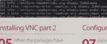

## 安装 VNC 第二部分

当软件包安装完毕且您的 VNC 服务器准备就绪时，请按照屏幕上的说明**创建用户名和密码**。您可能会被要求指定用于访问**位于 1.2.3.4 的 Pi** 的**功能**。在 **VNC** 中，设置用户访问密码以访问您的桌面实际上是**绝对必要**的。

```text
You will require a password
to access your desktop.
Password:
Verify:
Would you like to enter a
view-only password (y/n) n
New X desktop is raspberrypi:1
```

## 配置 VNC 服务器

VNC 服务器已安装并运行正常。现在我们需要确保每次 Raspberry Pi 重启时它都作为服务加载，这样即使 Pi 经历断电循环，您也可以访问它。要在终端中配置 Pi 执行此操作，请输入以下内容并按 Enter。

```bash
sudo nano /etc/init.d/tightvncserver
```

## 配置启动服务

我们回到了 nano，我们需要输入几行命令以便让 Raspberry Pi 在启动时激活 VNC 服务器。在编辑器中输入：

```bash
#!/bin/sh
#if [unit /etc/init.d/tightvncserver]
# Set the NUMBER to start
# the tightvncserver user
# NUMBER='pi'
case "$1" in
start) su $NUMBER -c '/usr/bin/tightvncserver'
# echo "Starting TightVNC
# server for "'$NUMBER'"'
#;;
stop)
pkill xtightvnc
echo "TightVncserver stopped"
#;;
*)
echo "Usage: /etc/init.d/
tightvncserver
start|stop"
#;;
exit 0
```

## 重启并准备就绪

现在按 **Ctrl-X**，然后按 **Y** 和 **Enter** 保存。再尝试几次即可返回终端。现在我们需要做的是编辑我们刚刚创建的脚本的权限，使其可执行且处于活动状态。通过在终端中输入以下命令来完成此操作，并确保每个命令后都按 Enter，否则它不会被注册！

```bash
sudo chmod 755 /etc/init.d/tightvncserver
sudo rc-tightvncserver defaults
sudo reboot
```

完成这些步骤后，您需要做的最后一件事是将 Raspberry Pi 拔下，并将其放置在易于访问网线的位置。如果您安装了最新版本的 TightVNC 或其他远程访问软件（只要它使用 Tight 协议），那么您应该能够将客户端指向 IP 地址（192.168.193.185）或静态 IP 地址，以连接到您希望设备加入的网络，并完全访问 Raspberry Pi。


```bash
sudo nano /etc/init.d/tightvncserver
```


## 使用 SSH 访问你的文件

**你需要的材料...**
- 任何树莓派系统发行版（www.raspberrypi.org/downloads）
- 网络连接
- 第二台计算机

使用家用电脑的终端，即可快速且安全地访问你的树莓派。

> **你知道吗...**

虽然通过远程登录完整的 X 环境——正如我们在前面的页面中演示的那样——非常有用，但它也有其缺点。首先，这样做并不特别快捷或方便。用户体验可能也很缓慢且笨重，但更糟糕的是，它的安全性与我们希望达到的水平相比并不够好。

如果你想采用一种更便捷且安全的方式从另一台计算机访问你的树莓派，你会发现所有资深的树莓派爱好者都会使用 SSH。SSH 代表 Secure Shell（安全外壳协议），它是一种加密网络协议，旨在确保通过命令行进行安全的数据通信。

初学者可能会争辩说，使用完整的图形界面远程访问树莓派更容易，但只要你学会了一些基本的命令行技巧，你会很快发现通过 SSH “潜入”你的树莓派是远程与其交互最方便的方式。

很高兴地告诉你，SSH 已经进行了良好的默认配置——你不需要做太多操作就能让它工作，特别是如果你的远程计算机运行的是 Linux 或 OS X，正如我们将在此演示的那样。

**在使用 Linux 和 OS X 时，SSH 很容易**

假设你的树莓派已开机，并通过以太网或 Wi-Fi 适配器连接到网络，你唯一需要的信息就是你树莓派的 IP 地址。要发现这一点，你只需在树莓派上打开一个终端窗口并输入命令 `ifconfig`（图 1）。

如果你通过以太网电缆连接，你将看到 `eth0`，然后是几行结果。IP 地址将是第二行中 `inet addr` 旁边的数字。如果你通过 Wi-Fi 连接，结果将在 'wlan0' 的第二行。IP 地址本身是由点分隔的四个数字组成。如果你在你的家庭网络上，它可能类似于 192.168.0.15。我们将使用这个数字作为指南，但请将其替换为你通过 ifconfig 看到的 IP 地址。

有了这些信息，你只需要在远程 Linux PC 上打开一个终端窗口并输入：

```bash
$ ssh pi@192.168.0.15
```

这假设你的树莓派的用户名仍然是默认的（即 pi），并且你刚刚将 IP 地址替换为你刚才记录的那个。如果你添加了用户账户或更改了默认设置，你需要将'@'前面的用户名替换为你更改后的内容。当你按下 Enter 键时，系统会提示你输入树莓派的密码 - 同样，如果是默认的，你可以输入 `raspberry`，否则请输入你树莓派的密码并按 Return 键。

现在你将看到命令行上的用户名详细信息已更改为反映你的树莓派 -- 你现在已远程连接。尝试浏览你的文件或使用 nano 打开文件进行编辑！

### 永远不需要再输入 IP 地址

当然，如果你把树莓派带到另一个网络，你树莓派的 IP 地址将会不同。如果你只是想远程连接它，仅仅为了获取 IP 地址而设置键盘、鼠标和显示器就会变得极其烦人。如果你只需在终端中输入树莓派的名称即可连接，那不是很方便吗？这听起来好得难以置信，但实际上做起来很容易。

你只需要一小块软件，它实际上允许你通过名称而不是 IP 地址来发现本地网络上的主机和服务（图 2）。要在你的树莓派上设置它，你只需打开终端并输入：

```bash
$ sudo apt-get install avahi-daemon
```

安装完成后，要通过 SSH 访问你的树莓派，你只需在终端中输入以下内容：

```bash
$ ssh pi@raspberrypi.local
```

此外，当你通过其他形式的网络访问树莓派时，也可以使用它的名称，无论是 Samba、使用 VNC 远程登录还是其他任何方式。


### 在 Windows 上使用 SSH

Windows 世界的大多数事情都是如此，使用微软操作系统访问你的树莓派并没有你想象的那么直接。幸运的是，有一个有用的工具可以帮助你。PuTTY 允许你建立安全外壳连接，它易于设置和使用。你可以从以下网址下载 PuTTY：
www.chiark.greenend.org.uk/~sgtatham/putty


## 树莓派加上 Arduino

了解如何让树莓派与你的 Arduino 通信和使用它

树莓派是一款真正令人惊叹的单板计算机，被用于许多 DIY 项目。这也是本专栏以及之前几篇文章的基础。虽然树莓派拥有 GPIO，并且可以与传感器和执行器通信，但在某些情况下，你可能希望将树莓派作为项目的“大脑”，而与物理世界的交互则交给另一个系统处理。

这通常由市面上可用的众多微控制器板之一来处理。在本期中，我们将专门使用 Arduino 板，并查看如何将其连接到树莓派以及如何处理两者之间的通信。一如既往，我们将使用 Python 作为首选语言来处理此处示例中的所有实际编码。

Arduino 是一个定义为规范开源原型平台。这意味着你可以从几个不同的制造商那里获得 Arduino 实现，但它们的行为应该都类似。对于本文，假设你希望使用的任何实现都能正常工作。第一步是将两块板连接在一起。

你很可能想使用一个带电源的 USB 集线器来连接它们，因为树莓派无法通过其 USB 端口提供大量电力。虽然它们是通过 USB 连接的，但 Arduino 在树莓派上会显示为一个串行端口。

这意味着你可以通过串行连接直接与 Arduino 通信。为了完全确定你安装了所有相关的库，你只需使用以下命令安装 Arduino IDE：

```bash
$ sudo apt-get install arduino
```

这将确保你拥有可能需要的所有核心软件。当你插入 Arduino 时，你需要知道通信将在哪个端口进行。具体的端口名称将根据你使用的树莓派和 Arduino 的具体版本而异。不过，它应该类似于 `/dev/ttyUSB0` 或 `/dev/ttyACM0`。在下方的示例代码中，我们将假设 Arduino 在端口 `/dev/ttyUSB0` 上可见。

一旦两个设备连接好，你就可以开始编写代码让它们相互通信。

> “对于本文，假设你希望使用的任何实现都能正常工作”

我们将从未最低层级的协议开始，并在此基础上逐步构建。第一步是打开到 Arduino 的串行连接。

为了做到这一点，你需要确保 Python 串行模块已安装。如果你使用的是 Raspbian，你可以使用以下命令进行安装：

```bash
sudo apt-get install python-serial
```

然后，你需要创建一个连接到特定串行端口的新的 Serial 对象，以及你需要使用的速度。

```python
import serial
ser = serial.Serial("/dev/ttyUSB0", 9600)
```

在上面的示例中，速度是 9600 波特（比特/秒）。使用这个 Serial 对象，你可以向 Arduino 读取和写入数据。但你需要 Arduino 上的代码来处理通信的这一部分。Arduino 有自己的编程语言，基于 C，你使用它来编写将在板上运行的代码。Arduino 的工作方式是，在启动时，它会加载一个只要通电就会一直运行的程序。作为一个简单的例子，以下代码将监听输入引脚以查看它是否变高。如果是，它将通过串行端口发送一条消息。

```cpp
int piPin = 7;
void setup() {
  pinMode(piPin, INPUT);
  Serial.begin(9600);
}

void loop() {
  if (digitalRead(piPin) == HIGH) {
    Serial.println("High");
    delay(500);
  }
}
```

要将此程序加载到你的 Arduino 板上，你需要使用本文开头安装的 Arduino IDE。这是一个图形化程序，因此如果你想执行此步骤，你需要将树莓派连接到显示器。否则，你可以使用你的常规桌面来对 Arduino 进行编程。如果你使用的是大多数 Arduino 上的标准引导加载程序，它将启动最后上传到它的任何程序。这样，你可以使用桌面上传代码，然后稍后将其连接到树莓派。回到树莓派，你如何从 Arduino 读取此消息？你只需从之前创建的 Serial 对象执行读取操作即可。

```python
import time
while True:
    message = ser.readline()
    print(message)
    if (message != ""):
        do_something_useful()
    time.sleep(0.5)
```

如图所示，我们导入了 time 模块，以便能够在尝试从串行端口读取之间的循环中休眠。那么向 Arduino 发送指令呢？这也需要预先上传 Arduino 代码。例如，以下代码将接收一个输入数字并闪烁 LED 该次数：

```cpp
int ledPin = 13;
void setup() {
  pinMode(ledPin, OUTPUT);
  Serial.begin(9600);
}

void loop() {
  if (Serial.available()) {
    flash(Serial.read() - '0');
  }
}
```


## 树莓派加Arduino

```cpp
delay(1000);
}

void flash(int n) {
  for (int i = 0; i < n; i++) {
    digitalWrite(ledPin, HIGH);
    delay(100);
    digitalWrite(ledPin, LOW);
    delay(100);
  }
}
```

然后，你可以使用类似以下的代码，从你的 Python 代码中发送一个计数值：

```python
ser.write('5')
```

这将使连接到你 Arduino 第 13 引脚上的 5 号 LED 闪烁五次。树莓派上缺失的一个元件是模数转换器（ADC），它可以将给定的电压转换为可用于某段控制软件的数值。这就是连接 Arduino 极其有用的地方，因为它内置了一个 10 位 ADC 转换器。以下代码将读取第 3 引脚上的电压，并通过串行连接将其发送到树莓派。

```cpp
int analogPin = 3;
int val = 0;
void setup() {
  Serial.begin(9600);
}

void loop() {
  val = analogRead(analogPin);
  Serial.println(val);
}
```

这会将测得的电压映射为 0 到 1023 之间的一个整数。最小电压为零，而最大电压可以通过函数 `analogReference()` 设置（注：原文 OCR 文本将此处误识为 "map(maxReference)"，根据标准 Arduino 术语已修正为 `analogReference`）。默认情况下，最大电压为供应给板卡的电压。

反方向来看，你可以使用 Arduino 提供输出电压。这是通过使用 PWM（脉冲宽度调制）输出信号来实现的。其思想是实际发送一系列脉冲，其中占空比决定了信号接通时间的百分比，其余时间则断开。例如，如果你有一个 LED 连接到某个引脚，你可以使用以下代码将其亮度设置为半亮。

```cpp
int ledPin = 9;
void setup() {
  pinMode(ledPin, OUTPUT);
}

void loop() {
  analogWrite(ledPin, 127);
}
```

`analogWrite()` 函数的第二个参数是一个 0 到 255 之间的值，它定义了 0%（完全关闭）到 100%（完全开启）之间的占空比。这种模拟输出信号将保持在给定的占空比状态，直到下一次调用 `analogWrite()` 函数。通过让你的树莓派通过串行连接输出数值，它可以通过发送一个简单的整数来控制输出的占空比。这篇短文应该能激发一些想法，探讨你如何开始组合多个计算平台来扩展你自己项目的功能。

当你可以从这些简单的部件中构建出所需的复杂行为时，没有理由试图为你的项目寻找唯一的“完美解决方案”平台。你可以挑选那些最能完成各自特定任务的子模块。

### PyFirmata 可以发挥更大作用

探索让交互变得更加简单的方式

虽然你可以编写自己的代码在 Arduino 上运行，但有几个项目可以上传到 Arduino 上以使交互稍微容易一些。其中之一是 Firmata 项目，它包含一个 Python 模块来帮助你与 Arduino 通信。第一步是下载 Firmata Arduino 代码并将其上传到 Arduino，最简单的方法是借助桌面计算机完成。代码可以在 github.com/firmata/arduino 找到。有几种不同的版本可用，但对于这些示例，你应该使用 Arduino IDE 上传 StandardFirmata 草图。对于许多不同的编程语言都有客户端库可用，包括几种 Python 库。我们将要使用的库是 pyFirmata。你可以在树莓派上通过以下命令安装它：

```bash
sudo pip install pyfirmata
```

现在你可以使用 Firmata 作为 Arduino 端口的某种遥控器，你的 Python 代码可以几乎直接访问所有可用的功能。为了开始，导入 pyFirmata 模块并创建一个连接到相关串行端口的新的 Arduino 对象：

```python
import pyfirmata
board = pyfirmata.Arduino('/dev/ttyUSB0')
```

你现在可以直接访问数字 I/O 引脚。例如，以下代码将向第 10 引脚写入 1。

```python
board.digital[10].write(1)
```

当你想要从引脚读取数据时，可能会出现输入缓冲区溢出的可能性。为了解决这个问题，你可以创建一个迭代器对象，并在进行任何读取操作之前启动它，使用如下代码：

```python
it = pyfirmata.util.Iterator(board)
it.start()
```

你现在可以为输入或输出获取选定的引脚。以下代码将获取第 4 引脚用于数字输入，第 12 引脚用于模拟 PWM 输出。

```python
pin4 = board.get_pin('d:4:i')
pin12 = board.get_pin('a:12:p')
```

然后你可以使用这些新的引脚对象及相关方法进行读写：

```python
val = pin4.read()
pin12.write(100)
```

当你完成后，别忘了将任何输出引脚重置回 0 伏特，然后你可以使用以下命令关闭连接：

```python
board.exit()
```

> 有几种不同的版本可用，但对于这些示例，你应该使用 Arduino IDE 上传 StandardFirmata 草图。

## 使用 Scratch 编程

使用树莓派的图形化编程语言进行编码的互动指南

你希望深入了解动画和游戏制作的领域吗？你想让你的创意想法成为现实，而不必学习软件开发语言吗？使用 Scratch，你可以做到所有这些，甚至更多。

Scratch 1.4 已经预装在官方的 'wheezy' 树莓派系统镜像中。如果你的树莓派尚未安装 Scratch，别担心，只需访问官方 MIT Scratch 网站查找下载和安装说明即可。

要开始，我们要做的所有事情就是打开 Scratch Studio。点击桌面上的 Scratch 猫图标，或者在 LXDE 桌面菜单中找到 Scratch。

Scratch Studio 是一个完整的开发环境。它被划分为多个独立的面板。每个面板在应用构建过程中都有特定的角色，并拥有自己特定的一组功能工具。

### 你需要...

- Scratch
- 互联网连接

> **你知道吗...**
> 你可以在 www.scratch.mit.edu 上找到许多项目，并且 Scratch 论坛有许多有用的技巧和窍门。

### Scratch Studio 项目

01 在 Studio 的顶部是三个快速访问图标和主菜单（图 2）。第一个地球风格的图标用于获取 Studio 的语言设置。另外两个按钮提供对项目保存和分享功能的快速访问。在“文件”菜单下，有一组典型的文件管理功能，用于打开、保存和导入 Scratch 项目。还有一个“项目注释”选项，我们可以输入功能描述和评论。

“编辑”菜单包含一组混合的动画、图像和音频编辑工具。而“帮助”部分提供了对浏览器托管帮助页面的访问。相当有趣的是，“分享”菜单允许我们将项目分享给全世界。任何 Scratch 项目都可以通过“在线分享此项目”选项和“上传到 Scratch 服务器”表单（图 3）发布到 Scratch 社区网站。


让我们加载“水族馆”示例项目。从文件菜单中选择“打开...”选项以显示左侧的大按钮列表，点击名为“示例！”的那个。接着，在右侧，双击选择“动画”文件夹。然后选择“6 水族馆”项。打开对话窗口内容应如图 4 所示。

加载水族馆项目后，我们的 Scratch Studio 应看起来类似图 1。我们将通过暂存区开始我们的 Studio 导览。


**新建**
打开…
保存
另存为…
**导入项目**
**导出角色**
项目注释
退出


### Scratch Studio 舞台

02 舞台是所有动作发生的地方，位于 Scratch Studio 的右上角。

舞台由称为角色（sprites）的图形元素构成。在这里，我们有植物、气泡、鱼和其他生物。你也可以添加和创建自己的素材，但这部分我们稍后再谈。

在“暂存区”的顶部有一个绿色旗帜和一个红色圆圈。点击绿色旗帜让水族馆活起来。现在花一点时间研究一下水族馆动画。注意生物的动作和上升的气泡。红色圆圈可以停止动作。

我们可以使用位于绿色旗帜正上方的三个按钮设置查看模式。

左侧的两个按钮增加或减少暂存区面板的大小。较小的暂存区意味着 Studio 的中央区域相对于其大小增加。

右侧的按钮是演示模式，它像图 5 那样以全屏模式显示舞台。使用左上角的弯曲箭头按钮退出演示模式，或者按“esc”键。

### Scratch Studio 角色

03 在“暂存区”下方是这个项目的角色集合。舞台角色与其他角色分开。它与其他的略有不同，充当舞台的背景图像。

该区域顶部的三个按钮提供了创建新角色的各种方法。第一个按钮在绘图编辑器中打开一个空白画布。第二个按钮基于图像文件创建一个新的角色，该文件从弹出的文件选择对话窗口中选择。第三个将从预装图像集合中选择一个随机图像。

我们可以使用主菜单右侧的四个按钮直接管理舞台上的角色。这里我们点击特定的按钮，然后点击舞台上的一个角色。


## 使用 Scratch 积木和工具

熟悉 Scratch 工作室工具箱

编辑面板位于工作室的中心。面板的内容与当前选中的精灵相关。

让我们先从精灵收集区域选择名为 Creature1 的水母精灵开始。

顶部显示精灵的图像和名称，以及其当前舞台坐标和方向。左侧有三个动画控制按钮。顶部按钮将旋转精灵，第二个按钮在面向左和面向右的状态之间切换，第三个按钮关闭动画。

下方有三个编辑面板标签。脚本标签是创建积木脚本的地方。我们将在这里拖放积木，以各种组合方式将它们拼接在一起。

若要更改精灵的视觉外观，我们将使用“外观”标签。每个精灵可以有一个或多个外观。例如，水母有两个外观（图 1）。每个外观都有编辑、复制和删除按钮。新的外观可以通过三个“新外观”按钮进行绘制、导入或捕获。声音标签允许我们为项目添加音频。


图 1a：水母精灵外观 – 水母精灵有两种不同的外观

## Scratch 积木样式

01 “积木调色板”包含完整的脚本积木集合。积木有三种基本样式，即帽子、堆叠和报告器（见对页的图 3）。

帽子样式积木将基于特定事件开始积木脚本的执行。经典的帽子积木是“绿色旗帜”点击事件。然而，还有许多其他帽子积木，包括在特定按键按下、鼠标点击甚至来自某些 GPIO 连接硬件的传感器事件后开始脚本执行的帽子积木。您可能已经猜到，这为 Scratch 程序员提供了许多选项。

报告器积木允许我们指定文本、数值和布尔值。它们适配其他积木中特定形状的空隙。矩形值将包含文本字符串。而圆角报告器与数值相关，尖角报告器包含布尔真值（true）和假值（false）。

堆叠积木是核心脚本构建元素。它们通过其顶部的凹槽和底部的凸起与其他积木互连。许多堆叠积木包含用于报告器样式积木的“孔”，这些积木将根据指定的报告器积木值来修改其操作。

Scratch 积木集合被分为组。我们使用位于编辑面板顶部的八个按钮选择积木组，即“移动”、“控制”、“外观”等。这些组是按颜色编码的。除了辅助积木选择外，这种颜色编码在读编辑面板中的积木脚本时还提供了积木类型的视觉线索。

## 使用 Scratch 编程


## Scratch 积木帮助

02 正如我们所见，有许多积木，每个积木都有自己特定的功能和能力。

从某种意义上说，这是一个好消息：大量的积木集合意味着 Scratch 可用于广泛的软件项目中，例如游戏、动画、音乐、图形、数学、科学、机器人、电子学等等。

然而，广泛的积木选择对于初学的 Scratch 程序员来说可能是一个挑战。为了帮助解决这个问题，Scratch 工作室设计人员包含了一套信息丰富的以积木为中心的帮助中心页面。

在任何积木上右键单击都会显示一个弹出帮助页面选项。帮助页面包含特定的上下文描述、图形图像以及（在适当时）如何使用该特定积木的脚本示例（图 4）。这是一个很棒的功能，大大简化了确定使用哪些积木的过程。更重要的是，研究这些帮助页面是提高我们的脚本技能并发现 Scratch 功能丰富的积木集合中潜力的有效方式。


### 项目

> **你知道吗...**  
> 在过去几年里，人们对计算机编程的兴趣激增。对于许多孩子来说，学习编程技能的第一步就是 Scratch 程序。

### 积木脚本详解

03 让我们更深入地了解积木脚本在实际中是如何工作的。为此，我们将使用一个简单的鱼缸项目积木脚本。从“精灵收集”面板选择“舞台”标签。然后返回中心的“编辑面板”并选择“脚本”标签。

这里只是一个积木脚本。从顶部开始，抛出绿色旗帜开始/积木以启动活动。接下来有一个“永远”循环。此循环内的积木将持续激活，直到按下停止按钮。这个“永远”循环积木包含其他两个积木。

第一个内部脚本积木选择下一个背景图像。点击“背景”标签以查看所有舞台图像。第二个内部积木简单地暂停执行几秒钟。将值设置为 11 意味着该脚本将在执行下一个积木指定的动作前暂停一秒。

请记住，这两个积木被包含在“永远”循环积木中是很重要的。因此，舞台背景图像将按顺序显示，每张一秒。


## 在 Scratch 中创建贪吃蛇克隆版

设计你自己的贪吃蛇版本来测试你的新编程技能！

在这里，我们将创建经典贪吃蛇游戏的一个版本，使用箭头键在 Scratch 舞台上移动蛇。你控制蛇头，必须避免与蛇身或舞台边缘碰撞。

每次吃掉一个鸡蛋，蛇身都会变长。吃好的黄色鸡蛋会增加分数，吃坏的黑色鸡蛋会减少分数。还有额外的奖励精灵可以吃以获取额外分数。

通过跟随本教程，你将学会创建自己的简单精灵图形、发送和接收广播事件、使用列表变量存储数据、播放音效、生成随机数以及使用感应命令检测精灵何时接触某物。

### 你需要什么...

Scratch 项目归档  
www.scratch.mit.edu/template/late-ever

### 你知道吗...

在 20 世纪 70 年代初，街机游戏 *小行星*（Asteroids）很受欢迎。许多 *小行星* 版本为个人电脑创建，其中一些被称为 **贪吃蛇**（Snake）或 **毒蛇**（Viper）。

### 鸡蛋精灵

鸡蛋精灵随机出现在屏幕上，并让其他精灵知道它被吃掉了（被蛇舌碰到）。


**蛇精灵**  
蛇精灵在舞台上移动头部，并驱动其身后的身体。它还检测与身体或边缘的碰撞

**尾部精灵**  
尾部精灵跟随头部，在蛇移动时擦除身体末端，并在需要生长时暂停。

**坏鸡蛋精灵**  
坏鸡蛋精灵也随机出现，但被吃掉时会减少分数。它还会增大尺寸，变得更难避开。


### 绘制蛇精灵

01. 点击新精灵：画笔图标以绘制蛇精灵。在绘画编辑器中，画一个小的绿色椭圆作为蛇头，并添加一个红色矩形作为舌头。重要的是舌头颜色要与头部不同。将你的精灵命名为 Snake。

### 添加蛇的声音

**02** 当蛇舌碰到蛇身或舞台边缘时，我们将播放游戏结束的声音。我们需要将此声音添加到精灵调色板中。选中蛇精灵后，点击声音标签并选择导入。选择电子>吱叫声。


### 响应箭头键

**03** 从控制调色板拖出四个“当按键按下”命令，从移动调色板拖出四个“指向方向”命令。按图中所示进行配置，使上箭头将方向改为 0 度，下箭头改为 90 度。点击舞台上方的绿色旗帜以测试此功能。


### 创建蛇变量

**04** 点击变量调色板。创建两个对所有章节可见的变量：Score（分数）和 Speed（速度）。创建一个名为 Next Direction（下一个方向）的列表，对所有章节可见；它将存储头部采取的方向序列。仅勾选 Score 变量，使其出现在舞台上。


### 初始化蛇变量

**05** 使用“当绿色旗帜被点击”控制命令，并使用变量调色板中的命令如所示初始化蛇变量。我们希望每个游戏开始时 Next Direction 列表为空，因此删除其所有条目。Score 必须从零开始。Speed 设置难度。


### 绘制蛇身

**06** 使用钢笔调色板中的命令来控制蛇身的绘制。你还应使用移动调色板中的命令将蛇移动到舞台中心，并在每个游戏开始时指向左侧。在蛇处于起始位置之前，此钢笔是打开的。在下一步中，我们将使用颜色来检查头部是否接触了不应接触的东西。


### 添加主动作循环

**07** 使用嵌套有“如果-否则”命令的“永远”命令。如果红色舌头接触蓝色身体，头部始终接触身体，或蛇精灵接触边缘，则发生碰撞。使用吸管工具选择 Scratch 中的颜色。


### 处理游戏结束

**08** 当检测到碰撞时，广播游戏结束事件。你需要为其他精灵创建新事件，以便它们也能做出反应。此外，播放得分音效并停止所有脚本，使蛇在游戏结束时冻结在当前位置。


## 项目

### 在 Scratch 中创建贪吃蛇克隆版

#### 处理移动

&nbsp;&nbsp;09 现在处理典型情况：没有碰撞且蛇必须沿当前方向移动。画笔已落下，因此它将绘制身体。速度变量决定了移动的步数。将当前方向添加到下一个方向列表中，供尾部读取。


#### 试玩贪吃蛇

&nbsp;&nbsp;10 现在你可以试玩你的贪吃蛇精灵。它会响应方向键的按下而在屏幕上移动。它会绘制身体，身体会越来越长，因为我们需要尾部来擦除它。当检测到碰撞时，它会尖叫并结束游戏。


#### 绘制尾部

&nbsp;&nbsp;11 点击新精灵画笔图标来绘制尾部精灵。画一个小圆圈来表示尾部的末端。将此精灵命名为 Tail（尾部）。Tail 精灵将跟随 Snake（蛇）并擦除其尾部的末端，以防止蛇身无限生长。

#### 创建 Grow 变量

&nbsp;&nbsp;12 创建一个 Grow（生长）变量，该变量仅此精灵使用——其他精灵不需要访问它。Grow 变量用于确定蛇身何时需要生长，因此尾部在跟随之前需要暂停，以便头部可以走得更远。


#### 处理事件

&nbsp;&nbsp;13 尾部需要监听两个你将在需要时创建的新事件。当它创建新事件时，当它创建新事件时，它必须冻结。


#### 初始化尾部

&nbsp;&nbsp;14 当点击绿色旗标开始游戏时。将 Grow 设置为 1，使蛇获得较短的身体。带着抬起的画笔移动到舞台中心，并配置画笔以绘制与舞台背景颜色和大小相同的尾部，从而擦除身体。

#### 生长与移动

&nbsp;&nbsp;15 使用“永远”命令让尾部保持移动。如果 Grow 为 0，它应该暂停并将 Grow 重置为 1——这会使身体变长。使用 Next Direction（下一个方向）中的第一个值来设置方向并移除它，以便下次获得新值。以 Speed（速度）的倍数步数移动。


#### 试玩尾部

&nbsp;&nbsp;16 现在你可以试玩尾部精灵。因为它不会收到任何 Egg Eaten（蛋被吃）事件。但尾部会跟随蛇头在舞台上移动，一边移动一边擦除蛇身（其颜色与背景相同）。


#### 绘制蛋精灵

&nbsp;&nbsp;17 点击新精灵画笔图标来绘制新精灵。在画笔编辑器中，画一个小的黄色椭圆。将精灵命名为 Egg（蛋）。蛋会随机出现在舞台上，并使蛇生长同时增加分数。


#### 添加蛋音效

&nbsp;&nbsp;18 转到蛋精灵的音效标签页，导入打击乐-钹（percussion-Cymbal）音效。或者，如果你喜欢，可以选择其他音效。当蛇吃到蛋时，将播放此音效。


#### 添加蛋脚本

&nbsp;&nbsp;19 复制蛋脚本，使蛋在游戏开始时随机出现。当蛋检测到被吃时，它必须隐藏，播放钹音效（或你在第 18 步中选择的任何音效），更新分数，广播 Egg Eaten 事件，然后再次随机出现。当收到 Game Over（游戏结束）事件时，它必须停止。

#### 制作坏蛋

&nbsp;&nbsp;20 以与蛋相同的方式创建黑色的 Bad Egg（坏蛋），但使用不同的形状和乐器-弦乐/拨弦（instruments-String/Pluck）音效。将蛋的绿色旗标脚本拖拽到 Bad Egg 上以复制它们——只需更改音效并将其替换为随机奖励。


#### 生长坏蛋

&nbsp;&nbsp;21 在 Bad Egg 上添加另一个“当绿色旗标被点击”脚本，以便在新游戏开始时将其大小重置为默认的 100%，然后每十秒将其大小增加十分之一。Bad Egg 会变得越来越大，越来越难避免。


#### 创建奖励精灵

&nbsp;&nbsp;22 在 Scratch 中创建 Bonus（奖励）精灵。然后你可以为 Bonus 选择形状和音效。其脚本与蛋的类似，因此你可以将其中一个拖拽到 Bonus 精灵上并以此为基础。确保你更改音效并通过随机奖励增加分数。


## 检查你的邮件

使用 Python，你可以让 Raspberry Pi 充当邮件检查器，为你提供一封封入站邮件列表

由于 Raspberry Pi 是一台小型计算机，它常用于许多希望监控数据源的项目。你希望创建的一种监视器可能是邮件检查器，它可以显示你当前未读邮件。在本期中，我们将探讨如何使用 Python 创建自己的邮件检查监视器以在 Pi 上运行。我们将重点在于 Pi 和邮件服务器之间的通信，而不过多担心它可能如何显示。那将留作进一步的练习。

首先，大多数邮件服务器使用两种不同的通信协议之一。较旧、较简单的协议称为 POP（邮局协议），较新的协议称为 IMAP（互联网消息访问协议）。我们将涵盖这两种协议以涵盖你可能遇到的所有情况。我们将从较旧的 POP 通信协议开始。幸运的是，标准库中对此协议有支持。为了开始使用此协议，你需要导入 poplib 模块，然后创建一个新的 POP3 对象。例如，以下代码将创建到通过 Gmail 可用的 POP 服务器的连接。

```python
import poplib
my_pop = poplib.POP3_SSL(host='pop.gmail.com')
```

连接 Gmail 时需要使用 POP3_SSL 类，因为 Google 对其连接使用 SSL。如果连接到不同的邮件服务器，你可以使用 POP3 进行未加密连接。POP 通信协议涉及客户端向服务器发送一系列命令以与其交互。例如，你可以使用 getwelcome() 方法获取服务器欢迎消息：

```python
my_pop.getwelcome()
```

你想向服务器传达的第一件事可能是你感兴趣的电子邮件账户的用户名和密码。在代码中包含用户名不算太大的安全问题，但密码则另当别论。除非你有充分理由将其写在代码中，否则你应该向最终用户索取密码。标准库中包含 getpass 模块，你可以用它以更安全的方式向最终用户索取密码。例如，你可以使用以下代码。

```python
import getpass
my_pop.user('my_name@gmail.com')
my_pop.pass_(getpass.getpass())
```

> “你想向服务器传达的第一件事可能是你感兴趣的电子邮件账户的用户名和密码”

此时你应该已完全登录你的电子邮件账户。在 POP 下，你的账户将被锁定，直到你选择执行连接的 quit() 方法。如果你需要快速了解开放服务器上有什么内容，可以执行 stat() 方法：

```python
my_pop.stat()
```

此方法返回一个元组，包含消息计数和邮箱大小。你可以使用 list() 方法获取消息的明确列表。查看这些邮件的实际内容时有两种选择，取决于你是否希望保持消息不被触动。如果你只想查看消息的前几部分，可以使用 top() 方法。以下代码将获取列表中第一条消息的标头和前五行的内容。

```python
email_top = my_pop.top(1, 5)
```

此方法返回一个元组，包含邮件服务器的响应文本、标头列表、请求的行数以及消息的八位字节计数。使用 top() 方法的一个问题是它在每个邮件服务器上并不总是实现得很好。在这种情况下，你可以使用 retr() 方法。它将返回整个请求的消息，格式与 top() 返回的相同。

一旦你获取了消息内容，你需要决定实际要显示什么。作为一个例子，你可能只想打印出每条消息的主题行。你可以用以下代码做到这一点。

```python
for line in email_top[1]:
    if 'Subject' in line:
        print(line)
```

你需要明确执行搜索，因为包含在标头中的行数在每条消息之间有所不同。完成后，别忘了执行 quit() 方法以关闭与邮件服务器的连接。最后要考虑的一件事是邮件服务器将保持连接存活多久。在运行本文的测试代码时，它经常超时。如果需要，你可以使用 noop() 方法作为连接的保持活动机制。

如前所述，与邮件服务器通信的第二个较新的协议是 IMAP。幸运的是，标准库中包含一个你可以使用的模块，类似于我们上面查看的 poplib 模块，称为 imaplib。同样，它包含两个主要类来封装连接详情。由于你需要 SSL 连接，你可以使用 IMAP4_SSL。否则，你可以使用 IMAP4 进行未加密连接。以 Gmail 为例，你可以使用以下代码创建 SSL 连接。

```python
import imaplib
import getpass
my_imap = imaplib.IMAP4_SSL("imap.gmail.com")
```

与 poplib 不同，imaplib 有一个单独的方法来处理身份验证。你可以使用 getpass 模块询问密码。

```python
my_imap.login('my_username@gmail.com', getpass.getpass())
```

IMAP 包含邮箱树的概念，你的所有邮件都在其中组织。在你开始查看邮件之前，你需要选择要处理哪个邮箱。如果未提供邮箱名称，默认为收件箱。


## 项目

### 检查你的邮件

这样做没问题，因为我们只想显示最新收到的邮件。大多数交互方法都会返回一个元组，其中包含一个状态标志（'OK' 或 'NO'）以及一个包含实际数据的列表。在选择收件箱后，我们需要做的第一件事是搜索所有可用的消息，如下面的示例所示。

```python
my_imap.select()
typ, email_list = my_imap.search(None, 'ALL')
```

`email_list` 变量包含一个二进制字符串列表，你可以用它来获取单个消息。你应该检查变量 `typ` 中存储的值，以确保其中包含 'OK'。若要遍历该列表并选择给定的邮件，你可以使用以下代码：

```python
for num in email_list[0].split():
    typ, email_raw = my_imap.fetch(num, '(RFC822)')
```

变量 `email_raw` 包含整个邮件正文，作为一个单一的转义字符串。虽然你可以解析它以提取想在邮件监视器中显示的部分，但这样做会削弱 Python 的威力。

同样，标准库中有一个名为 `email` 的模块，它可以处理所有这些解析问题。你需要导入该模块才能使用它，如下面的示例所示。

```python
import email
email_msg = email.message_from_bytes(email_raw[0][1])
```

你邮件的所有部分现在都被分解成各个部分，你可以更轻松地提取出来。同样，为了提取主题行以便快速显示，你可以使用以下代码：

```python
subject_line = email_msg.get('Subject')
```

你可以选择许多不同的潜在项目。要获取可用标头项的完整列表，你可以使用 `keys` 方法，如下所示：

```python
email_msg.keys()
```

很多时候，你收到的邮件将是多部分消息。在这些情况下，你需要使用 `get_payload()` 方法提取任何附加部分。它将作为一个包含更多邮件对象的列表返回。然后你需要对这些返回的邮件对象使用 `get_payload()` 方法来获取主要正文。代码可能如下所示：

```python
payload = email_msg.get_payload()[0]
body1 = payload.get_payload()
```

与 POP 邮件连接一样，你可能需要做一些事情以防止连接超时。如果你这样做，可以使用 IMAP 连接对象的 `noop()` 方法。该方法充当保活功能。

当一切完成时，你需要确保在关闭前清理好你的工作。正确的做法是首先关闭你正在使用的邮箱，然后从服务器注销。这里给出一个示例：

```python
my_imap.close()
my_imap.logout()
```

现在你应该有足够信息来连接到电子邮件服务器，获取消息列表，然后提取你可能希望作为邮件监视器一部分显示的部分。例如，如果你在 LCD 上显示信息，你可能只希望主题行滚动经过。如果你使用的是更大的屏幕显示器，你可能希望获取正文的一部分，或者日期和时间，将其包含在信息的一部分中。

### 那么发送邮件呢？

了解如何发送以及接收

在文章的主体部分，我们只查看了如何连接到电子邮件服务器以及如何从中读取。但如果你需要用一些代码也发送电子邮件怎么办？与 `poplib` 和 `imaplib` 类似，Python 标准库包含一个名为 `smtplib` 的模块。同样，与 `poplib` 和 `imaplib` 类似，你需要创建一个 SMTP 对象用于连接，然后登录到服务器。如果你使用的是 Gmail SMTP 服务器，你可以使用以下代码：

```python
import smtplib
import getpass
my_smtp = smtplib.SMTP_SSL('smtp.gmail.com')
my_smtp.login('my_email@gmail.com', getpass.getpass())
```

这段代码要求最终用户输入密码，但如果你不关心安全性，你可以将其硬编码在代码中。此外，你只需要对需要它的服务器使用 `login()` 方法：如果你运行自己的 SMTP 服务器，你可能已将其设置为接受未认证的连接。一旦你连接并认证完毕，你就可以发送电子邮件了。执行此操作的主要方法称为 `sendmail()`。作为示例，以下代码向几个人发送“Hello World”电子邮件。

```python
my_smtp.sendmail('my_email@gmail.com', ['friend1@email.com','friend2@email.com'], 'Hello World')
```

第一个参数是“发件人”电子邮件地址。第二个参数是“收件人”电子邮件地址列表。如果你只有一个“收件人”地址，你可以将其作为单个字符串而不是列表输入。最后一个参数是一个字符串，包含你尝试发送的电子邮件正文。需要注意的一点是，只有当电子邮件无法发送到指定的任何“收件人”电子邮件地址时，你才会收到异常。

只要消息可以发送到给定的至少一个地址，它将返回为已完成。一旦你发送完电子邮件，你可以使用以下代码进行清理：

```python
my_smtp.quit()
```

这清理了所有内容并关闭所有活动连接。因此，现在你的项目也可以回复收到的电子邮件了。

### 你将需要的...
- Raspbian
- www.raspberrypi.org/downloads
- SD 卡

## 为你的 Pi 加速

通过这些性能增强技巧和窍门，最大限度地发挥你的 Raspberry Pi 的潜力

你的 Raspberry Pi 已插入电源，Raspbian 已安装在 SD 卡上，你正忙于设置无线打印服务器或构建一个从门垫收取邮件的机器人。但你是否真正充分利用了你那台小计算机？也许你还没有探索 Raspbian 的所有选项，或者你正从 SD 卡运行整个操作系统，这可能会缩短 SD 卡的寿命。可以部署各种工具和技术来提高性能，从选择合适的硬件到对 CPU 进行超频。你甚至可以在 Pi 的 SD 卡上最大化存储空间，或者几乎用一个次要设备替代它。使用这些技巧和窍门来重新配置你的 Pi 设置并优化软件和硬件，以确保获得最佳性能。


### 使用更好的存储硬件

01 无论操作系统如何，存储介质的选择都会影响你的 Raspberry Pi 的性能。一个具有较差错误校正的低容量 SD 卡会比一个具有更强韧性的更大容量卡更慢，因此你需要为你的项目找到正确的平衡点并明智地购物。

### 选择最佳的 SD 卡

02 市面上有各种标准的 SD 卡，价格较高的那些设计用于更好的错误校正。要在你的 Raspberry Pi 上获得最佳性能，请选择具有高评分的 SDHC 卡。同样的建议也适用于 MicroSD 卡，你可以使用 SD 卡适配器在你的 Raspberry Pi 上使用它，或者直接插入 Raspberry Pi 4/5。

### 充分利用你的存储空间

03 通常你需要为你选择的 Raspberry Pi 发行版预留 1-2GB 的存储空间，因此 SD 卡上的任何剩余存储空间将用于你创建或保存的更新和数据。在 Raspbian 中，你可以打开命令行并运行配置实用程序以获得更多空间（仅当你的 SD 卡大于 2GB 时）：

```bash
sudo raspi-config
```

### 扩展 Raspbian 分区

04 最大化分区可提供 SD 卡的全部容量，这将增加媒体的寿命（因为有更多空间可供写入，因此相同的扇区不会被如此频繁地重写）。当 `raspi-config` 实用程序运行时，使用箭头键在菜单中选择 `expand_rootfs`。然后短暂等待分区调整大小。

### 将数据写入 RAM

05 不要将数据读写到 SD 卡——这在长期内最终会导致可靠性和性能下降——你可以配置 Raspbian 将数据写入系统 RAM，这将稍微加快速度并提高 SD 卡的整体性能。这是通过文件系统表实现的，这是大多数 Linux 发行版中可用的系统配置。

### 在 Raspbian 中启用 fstab

06 这很像在 Windows 中创建 RAM 磁盘。在命令行中，输入：

```bash
sudo nano /etc/fstab
```

添加以下行以挂载虚拟文件系统：

```bash
tmpfs  /var/log        tmpfs
defaults,nosuid,noatime,size=100m  0 0
```

保存并退出 nano（ctrl-X），然后安全地重启 Pi：

```bash
sudo shutdown -r now
```


> 通常你需要为你选择的 Raspberry Pi 发行版预留 1-2GB 的存储空间。


## 选择外部 USB 驱动器

通过迁移根文件系统到外部 USB 驱动器可以加速你的树莓派，但你应该使用哪种设备才能获得最佳性能呢？使用 USB 拇指驱动器，你可以添加最多 16GB 的闪存存储而不会遇到任何重大问题（驱动器越大，读写所需的电流就越大）。任何更大的容量都既昂贵又没有必要。如果你计划使用外部硬盘（HDD），则不存在电源问题，因为它会有自己的电源供应器。一如既往，你的选择应符合你的项目需求。


### 给你的 Pi 充电（Supercharge）

### 配置 fstab 以获得快速性能

- 07 重启后，虚拟文件系统将被挂载，并且 RAM 磁盘上的 /var/log 将生效。其他可以移动到 RAM 的目录包括：

```
tmpfs  /tmp    tmpfs     defaults,noatime,nosuid,size=512m    0 0
tmpfs  /run    tmpfs     defaults,noatime,nosuid,size=512m    0 0
tmpfs  /var/log  tmpfs     defaults,noatime,nosuid,mode=0755,size=100m  0 0
tmpfs  /var/spool  tmpfs     defaults,noatime,nosuid,mode=0755,size=10m  0 0
tmpfs  /var/spool/queue  tmpfs     defaults,noatime,nosuid,mode=0700,gid=12,size=30m  0 0
```

将每一项添加到 /etc/fstab 中，使用 nano 编辑器。

### 将你的操作系统移动到硬盘

- 08 如果你担心 SD 卡的使用寿命，为什么不减少树莓派对它的依赖呢！不要将 SD 卡用作一种廉价 SSD，而是改变其角色，添加一个硬盘或 U 盘来运行操作系统，而将 SD 卡保留用于引导。这可以显着提升 SD 卡的性能。

### 备份 SD 卡

- 09 创建 Pi SD 卡的副本。关机，移除卡并将其插入台式计算机。在命令行中运行：

```
sudo dd bs=4M if=/dev/sdb of=/backup.img
```

路径 /dev/sdb 代表 SD 卡。复制需要 5-10 分钟。完成后，移除 SD 卡并连接你的 USB 设备。

### 将 Raspbian 复制到 USB

- 10 使用一块空白的 ext4 格式化的 USB 拇指驱动器（或外部硬盘）作为目标驱动器，输入：

```
sudo dd bs=4M if=/backup.img of=/dev/sdc
```

保留计算机上的备份，以防万一出现问题。当 SD 卡和 USB 存储设备共享相同的磁盘镜像时，是时候考虑接下来要做什么了——创建一个更快的树莓派。

### 分割 Raspbian 分区

- 11 通常，boot 分区应保留在 SD 卡上，而根文件系统则从外部硬盘或 USB 拇指驱动器运行。使用你首选的分区管理器（大多数发行版都有磁盘工具），卸载并删除 SD 卡上的根文件系统（确保你保留了 boot 分区）。移除 SD 卡后，连接你的 USB 设备并删除 boot 分区，注意保留根文件系统完好无损。然后调整 USB 设备上的根文件系统大小，确保你的 10MB 保持不变。

### 识别根文件系统

- 12 你将同时连接 SD 卡和外部 USB 存储，因此你需要告诉 Pi 根文件系统在哪里。在 Pi 上，插入你的外部 USB 驱动器，并在插入 SD 卡的情况下运行：

```
sudo nano /boot/cmdline.txt
```

找到 **root=/dev/mmcblk0p2**（或类似内容）并将其更改为 **root=/dev/sdb2**，这是你的外部 USB 存储。保存并退出。

### 添加其他 USB 设备

- 13 现在你可以重启你的 Pi 了。插入存储设备并观察它们附着。一旦你连接更多 USB 媒体，你就会遇到问题。通过安装 gdisk 来避免这种情况：

```
sudo apt-get install gdisk
```

然后运行 gdisk。

```
sudo gdisk /dev/sdb
```

输入 'h' 显示选项并选择 **恢复和转换选项**（通常是 'r'，然后按 'L' 和 'M2'）。**新建 GPT：按 'Y'。** 最后一次操作，我们就完成了。最后写入 'Backup to Disk'。这将采用 USB 驱动器并创建一个带有 10MB 分区的 GPT。你将使用最后一个分区作为你的时间。你将使用 1 作为根文件系统。

*(注：原文最后两句 "You'll use the last partition as your time. You'll use 1 as the root filesystem." 语义较为模糊，可能是原文错误，此处按直译处理)*

### 让你的 Pi 快速且可靠

- 14 现在记下 GUID，然后切换到 SD 卡。重新打开 cmdline.txt，将 root=/dev/mmcblk0p2 更改为 root=PARTUUID=XXXXXX，其中 XXXXXX 应被分区唯一 GUID 的数值字符串替换。完成后，保存并退出。然后你可以启动你的树莓派。恭喜你，你的树莓派现在更快且更可靠了。

### 通过超频提升性能

- 15 你的 Pi 几乎没有可以超频计算机的可能性。虽然你应该意识到风险，但仍应进行此活动。你还应确保你的树莓派的处理器得到适当冷却——CPU、以太网控制器和电源调节器的散热器可以在网上购买。

### 超频你的 Pi

- 16 可以通过 raspi-config 进行超频。从命令行启动：**sudo raspi-config** 并导航到高级选项。然后选择超频。有三个选项可用：**Modest**（温和）、**Medium**（中等）、**High**（高）和 **Turbo**（涡轮）。选择你理想的时钟速度后，退出。选择 **Yes** 以应用。

```
sudo shutdown -r now
```

你需要执行测试来看看它的稳定性如何。例如，你运行压力测试：**sudo apt-get stress**。这是一个很好的压力测试。如果 Pi 无法启动，按住 Shift 键以无超频方式启动，运行 raspi-config 并选择更温和的超频。

### 无 GUI 运行 Raspbian

- 17 尽管有所改变，你可能会发现 GUI 意味着缓慢。如果你更愿意在 bash 中运行大量命令，一种方法是禁用 X。在 raspi-config 中，选择启动行为并选择第一个（默认）选项，以确保你的 Pi 启动到命令行。如果你需要 GUI，在终端中输入 'startx'。


## 使用 NagiosPi 监控你的本地网络


### 你需要什么...

- NagiosPi
  - [pimylpihu...com/project/nagiospi](https://example.org/pimylpihu...com/project/nagiospi) *(注：原文未提供完整链接，此处保留原样文本)*
- Win32 Disk Imager
  - [bit.ly/1DM7Tj](https://bit.ly/1DM7Tj)
- 磁盘工具 (Disk Utility)
  - [bit.ly/1c055](https://bit.ly/1c055)
- 互联网连接
- 4 GB（或更大）SD 卡

### 使用 NagiosPi 监控你的本地网络

拥抱 Nagios 的强大功能，密切关注你网络上的服务器、交换机和应用程序

你的 PC 离线了吗？你的 Linux 盒子停止提供 Minecraft 或 Counter-Strike 服务了吗？如果你不在家，甚至不在国内，如果没有尝试登录，就没有真正的方法知道——而如果没有在场，你很可能无法做到（除非你使用远程桌面软件）。

一个更好的方法是简单地接收通知，当你的网络设备离线时，这就是为什么我们转向 NagiosPi，这是基于树莓派构建的流行开源网络监控工具的版本。

NagiosPi 可以作为完整的镜像提供，准备好写入 SD 卡，真正的配置将在启动并运行后发生。让我们开始吧。

### 下载 NagiosPi

Windows 用户应使用 Win32 Disk Imager 将 NagiosPi_2.4.2.zip 文件解压后的内容写入格式化的 SD 卡。Linux 桌面用户可以使用磁盘工具或命令行（file/ls713358）。将镜像写入 SD 卡后，安全弹出卡并将其插入 Pi 后再启动。

### 登录 NagiosPi

对于大多数 Pi 项目，你可能希望通过 SSH 操作，因此检查路由器的连接设备列表以找到 Pi 的地址并连接。你也可以使用连接到树莓派的键盘和显示器。NagiosPi 的默认用户名和密码是 pi/piwos，pi/parberry。

### 扩展文件系统

在继续之前，运行 `sudo raspi-config`。你需要选择第一个选项，扩展文件系统，并稍等片刻，让文件系统扩展到 SD 卡的全部大小。完成后，选择更改用户密码以增加 NagiosPi 的安全性，然后选择完成并重启。

### 在浏览器中打开

重启 Pi 后，你将在浏览器中打开 NagiosPi 网站。访问 http://npiwos/Address。在这里查看可用选项。这里你会发现左侧有一个链接菜单，许多页面都配有用户名和密码以登录。从 RaspControl 开始：

> 欢迎使用 NagiosPi v1.1.0
>
> NagiosPi：使用易于部署的开源工具监控网络状况的网络监控器。仅使用 Nagios，你就可以监控本地或远程网络上的服务。这是一个来自 Sapiens AI 的开源项目，NagiosPi 旨在尽可能用户友好，Web UI 为您提供监控网络所需的所有工具，并集中在一个位置。
>
> 默认用户名和密码：pi / piwos

**附加资源**

- [Nagios 维基](https://example.org/nagios_wiki)
- [Nagios 书籍](https://example.org/nagios_books)
- [Nagios 论坛](https://example.org/nagios_forums)
- [Nagios 博客](https://example.org/nagios_blog)

更多详情请查看我们的网站：看看 Kubuntu.com


### 监控你的 NagiosPi 盒子

在 RaspControl 部分，你可以领略 Nagios 能做什么。在主屏幕上，你会看到诸如连接性和系统状态等通用硬件信息，当你翻阅详细信息、服务和磁盘时，你会发现监控的层次。


### 查看主机状态

接下来，转到 Nagios 并选择主机。在这里你将看到配置的主机的当前状态，这是本地网络上检测到的项和预设实体的组合。在控制台的左上区域寻找当前网络状态，在此下方你会发现替代视图。

### 添加要监控的主机

打开 NagiCon 以添加你要监控的服务器，使用设备主机名、IP 地址和别名。完成后点击提交，然后切换到服务 - 添加！在那里你可以分配名称和检查命令（如 check_ping）来监控。

### 创建配置文件

每个检查都必须单独设置。一些需要在远程设备上安装 NRE（Nagios Remote Plugin Executor）以整合并提供完整的系统详细信息，但对于像 ping 这样的基本事项并不需要。完成后，点击提交，然后生成 Nagios 配置。接着，选择部署。

### 监控你的服务器

在 NagiosPi 窗口中，选择服务以查看当前监控的服务器和设备。对于每个列出的设备，你将在该列中找到更多信息。NagiosPi 只显示 NagiosPi 的基础——深入调查将展示它到底有多强大！


## 你需要准备的材料……

- 安卓设备
- USB 线缆

## 将树莓派连接到安卓设备

需要让树莓派上网？尝试通过物理连接方式（Tethering）连接你的安卓设备以获取网络访问权限。便携性是树莓派最受推崇的特点之一。迷你屏幕、迷你无线键鼠套装、便携电池等配件可以让你随时随地移动使用，但互联网接入往往是一个无法通过简单配件轻松解决的障碍。而你通常随身携带的，正是一个拥有网络连接、被称为“智能手机”的神奇口袋盒子。只要具备一点专业知识，你就可以将树莓派连接到它，从而“借用”它的网络。在接下来的两页中，我们将传授这些专业知识，帮助你在外出时使用树莓派接入互联网。

### 简单的方法

1. 许多智能手机都具有 Wi-Fi 热点功能，树莓派可以轻松地连接到这些热点。首先，开启热点，然后启动树莓派。连接无线 USB 网卡，并在“偏好设置 > Wi-Fi 配置”中打开 `wpa_gui`。

### 扫描设备

2. 点击“扫描”打开扫描窗口，然后在该窗口内再次选择“扫描”。它应该会检测到你的设备。就像连接任何其他 Wi-Fi 网络一样连接它，树莓派会记住该网络以便下次需要时使用。


### 设置共享网络

3. 首先，通过 USB 线缆将你的手机连接到树莓派。根据供电情况的差异，树莓派可能无法为手机充电，但仍允许你进行网络共享。现在你可以在共享网络菜单中激活 USB 共享网络功能。


> “你通常随身携带的也是一个连接互联网的神奇口袋盒子——智能手机，你可以将树莓派连接到它”

### 检查连接

4. 桌面运行环境我们将使用互联网连接或安卓设备。我们将连接树莓派并获取其 IP 地址。
   `$ ifconfig`

### 快速连接

5. 你现在就可以从终端连接以访问互联网。你只需在终端中输入以下命令即可做到这一点。
   `$ sudo dhclient usb0`
   这将自动获取任何可用的 IP 地址；此时你的手机充当了路由器的角色。

### 测试连接

6. 打开你的网络浏览器并访问 google.com。如果你能加载该网站，说明设置已完成。
   `$ nano /etc/network/interfaces`


### 保存设置

7. 连接树莓派后，它应该能自动访问互联网。你可以使用 `$ sudo nano /etc/network/interfaces` 使这些更改永久生效。

### 移动共享网络

9. 现在，当你外出时，你的手机可以共享网络给树莓派。只要你拥有蜂窝网络连接，无论你去哪里都能获得互联网访问权限。

### 接口设置

8. 在这里你将查看当前的设置。根据你的配置（例如是否添加了固定 IP 地址设置或其他内容），你的设置可能与我们显示的不同。使用与 `eth0` 行相同的语法，添加：
   `iface usb0 inet dhcp`

## 为树莓派添加电池组

### 你需要准备的材料……

- AA 电池盒
- AA 电池
- 3安培 UBEC
- 3A 开关
- 3安培接线端子排
- 6节 AA 可充电电池


不要把树莓派留在家里——使用九节 1.5V AA 电池为其供电，将其融入移动项目中

树莓派的移动性通常受限于电源线长度。然而，与其将其限制在书桌或客厅，你还可以将其用于各种移动项目，例如将其发射到近地轨道，或者监控和自动化你的花园。

当然，要做到这一点你需要电池，但为树莓派增加电池供电比你想象的要简单。只需要六节可充电 AA 电池（或一次性碱性电池）、一个能容纳电池组空间的电池盒以及一个 UBEC 即可。UBEC 是通用电池消除电路（Universal Battery Elimination Circuit），一种电压调节器，可以调节电源并防止树莓派损坏，价格通常在 10 英镑以下即可买到。


> “你可以将你的设备用于各种移动项目，例如将其发射到近地轨道”

**下单采购** **01**
如果你在线购买组件，应该能在五天内收到所有物品。但是，如果你线下订购（特别是 UBeC），应避免光顾传统电子商店，而应该访问模型爱好者商店，因为这些电路常用于遥控（RC）设备中。

**检查你的 UBeC** **02**
市面上有两种类型的 UBeC 可供选择。如果你使用了我们在左侧资源框中推荐的商店，你将收到一个带有微 USB 电源连接器的型号，方便连接到树莓派。然而，如果你从 eBay 购买，你很可能收到的是一个带有 3 针连接器的型号。


**移动连接器针脚** **03**
为了使用带 3 针连接器的 UBeC，你需要改变针脚的位置，使其占据外侧两个插槽。只需使用一个小珠宝螺丝刀撬起小塑料垫片，将红线从中间插槽中移除，然后滑动到未占用的外侧插槽中。

**连接到电池盒** **04**
将电池放入电池盒（UBeC 电池盒部分），然后将其连接到 UBeC（红线接红，黑线接黑），可以通过 twisting 电线、焊接或使用修剪成两针的 3 路接线端子排来实现。可以使用模型刀修剪到合适的大小。

**加电启动** **05**
树莓派已准备就绪，Wi-Fi 网卡已插入，将 UBeC 连接到微 USB 端口，并将第六节电池插入电池盒。树莓派的电源和状态指示灯应该表明计算机正在启动，这就给你一个完全便携的计算机了。

**连接 3 针 UBeC** **06**
如果你购买的是现在已修改过的 3 针连接器的 UBeC，你需要将其连接到树莓派的 GPIO 排针。将正极 +5V（红线）连接器连接到 Pin 2，将负极 0V 连接器连接到 Pin 6。

**测量运行时间** **07**
你应该已经设置了 SSH 使用，所以在等待设备完全启动（至少 60 秒）后，通过 Putty 连接到设备。在终端中输入：

```bash
sudo idb csi3m sf:/Users/rache.larrabi/Deskt op/ArcHLinux/ archnl-linux-HF-2013-02-11.img >dev/disk1
```

此命令将显示系统运行时间，并保持 Wi-Fi 连接处于活动状态。

**评估运行时间结果** **08**
运行时间结果取决于你使用的电池类型和树莓派型号。一次性电池能持续稍长时间，但这是一种更昂贵的选择。同时，较新的型号（功耗要求更高但能效更低，意味着运行时间更短。为了获得更大功率，请添加更好的电池）

**极致供电！** **09**
并联添加更多电池应将运行时间几乎翻倍（在 255Wm 树莓派 Model A 上至少 16 小时），除了碱性或可充电电池，你可能还应考虑现代基于锂的 AA 电池，它们的持续时间将比碱性电池长得多。

## 用颜料绘制电路

### 你需要准备的材料……

- Bare Conductive 导电颜料（笔装或桶装）
- 公对母跳线
- 各种 LED、开关和电阻（可选）

有了导电颜料的乐趣，组装电路从未如此简单，让你以全新的方式将艺术与电子结合起来。

玩弄电子元件和物理计算是一项非常有回报的任务。但对于初学者来说，杂乱无章的电线和组件很快就会变得非常令人困惑，而当儿童参与时，焊接等工序可能带来安全隐患。Bare Conductive 通过他们的导电颜料，让电子乐趣变得更加安全、简单和多功能。你可以字面意义上用画笔在纸上画导线，将其用于冷焊或导电粘合剂，以及更多用途。你能做的事情几乎没有限制。将这种颜料与微控制器板配对，你就可以在短时间内创建交互式艺术、服装和项目。


### 准备你的工具

**01** 当你想到电子时，颜料和画笔并不是第一个想到的物品，所以你可能会想知道从哪里获取它们。**Bare Conductive** 在商店 [bareconductive.com/shop](bareconductive.com/shop) 中提供颜料和一系列组件，但你还需要去别处购买艺术用品。我们建议尝试高档百货公司旁的工艺品商店，如 Hobbycraft（[hobbycraft.co.uk](hobbycraft.co.uk)）或当地独立商店。


## 用油漆绘制电路

### 项目


### 选择你的平台

02 Bare Conductive 导电漆的妙处在于，干燥后它就像普通电线一样工作！这意味着你可以将它与你喜欢的任何微控制器配合使用：使用 Bare Conductive 触控板、树莓派或 Adafruit 的 FLORA 可穿戴平台。或者，你甚至可以使用一些小电池和闪烁的 LED 来构建一个独立的系统。

### 开始涂刷

03 你可以将 Bare Conductive 导电漆涂在几乎任何表面上——纸张、织物、墙壁、衣物、木材、塑料等等。为了获得真正精确的形状和效果，最好的方法是制作或购买一个模板（纸质模板在家里最容易制作，但使用乙烯基材料可以获得最好的边缘效果）。


### 连接起来

04 无论导电漆涂在什么表面上，都有很多方法可以将其连接起来（例如使用电池组），因为一旦干燥，它的表现就像绝缘电线一样。因此，你可以使用用油漆粘合的电线、回形针、长尾夹、鳄鱼夹，甚至是为可穿戴项目缝制的导电按扣。

### 进行修复

05 导电漆较厚，干燥后会变得相当坚固。这意味着你可以用它来冷焊部件，并修复任何断裂处。换句话说，你可以将元件粘贴到电路板上，或将电线粘在一起，它们在电气功能上仍然可以正常工作。


### “电线和元件的杂乱无章可能变得非常令人困惑”

### 清理整理

06 你们中的很多人可能还在使用原始的 Model B 树莓派，并且苦于缺少足够的 USB 端口来连接你们想要的所有设备。虽然过去几年的优化有所帮助，但升级到树莓派 2 基本上解决了所有这些常见问题，因为它提供了功能更强大的硬件供你使用。因此，如果你正在考虑升级，或者终于下定决心要迈出这一步，本实用指南将帮助你打造完美的树莓派 2 媒体中心（HTPC）。


### 选择软件

过去，树莓派 HTPC 只是在 RaspBMC 和 OpenELEC 之间二选一。然而，RaspBMC 目前处于暂停状态，OpenELEC 是你获取最新软件的最佳选择。两者之间没有太大区别，因为它们都运行 XBMC。

### 获取软件

请访问 openelec.tv 并查找下载部分。有一个专门的树莓派部分，其中分为原始版（ARMv6）树莓派和较新的树莓派 2（ARMv7）。请从该页面为树莓派 2 抓取映像文件。


## 制作树莓派 2 电视一体机 (HTPC)

### 安装到卡

**03** 打开终端，并使用 `fdisk` 确定 SD 卡在你系统上的分配位置（取决于预分配的系统/交换/启动/控制分区大小）。使用 `cd` 导航到镜像文件，并使用 `dd` 进行安装，命令如下：

```
$ dd bs=1M if=openELEC-RPi2-arm-5.5.5.img of=/dev/sda1
```

### 首次启动

**04** 插上你的树莓派，使用你的 HDMI 连接或等待其准备好后再启动运行。在 OpenELEC 中，你将预留 SD 卡分区并写入一些额外程序，最终启动进入 Kodi。


### 配置 Kodi

**05** 使用 OpenELEC Web 界面通过第一个界面。如果你是通过 Wi-Fi 连接，你需要进入系统菜单中的 OpenELEC，激活无线网选项以选择你的网络，然后输入你的密码。

> “这是树莓派的一个绝佳用途——它的运行表现足够好，让你可以轻松地在本地或通过网络播放媒体”


### 添加网络共享

**06** 你可以将便携式硬盘或 U 盘连接到树莓派进行存储，但更可能通过网络进行流媒体传输。进入系统下的文件管理器并添加源。前往“浏览”并选择 TV，使用你的网络协议浏览网络，或者手动添加。

**07** 树莓派的位置很重要。由于它将始终运行在外，我们强烈建议为其购买一个外壳——Pimoroni 的 Aboz 外壳非常适合这种用途，因为它们坚固耐用，并且可以安装在某些电视机的背面。

### 红外传感器和控制器

**08** 你可以使用多种不同的设备来控制——包括 USB 游戏控制器和兼容的红外传感器。我们过去使用过 FLIRC，但如果你需要一个可以通过线缆延伸到有用位置的传感器。

### 未来更新

**09** OpenELEC 具有出色的自我更新能力，无需每隔几个月重启它，这意味着你几乎不需要对其进行任何维护。现在你可以靠后坐着，比以往更轻松自在地享受你的媒体。


## 使用树莓派进行无线打印

### 你需要准备的……

- 最新版本的 Raspbian 镜像
- USB 打印机
- USB 无线网卡

使用树莓派作为无线打印服务器，让旧打印机焕发新生。

无线打印使得打印到存放在柜子、棚屋和远程房间的设备成为可能。你不需要拥有一台闪亮的新打印机才能实现这一点；得益于树莓派，没有原生无线支持的老打印机不必直接扔进垃圾桶。

设置很简单。在树莓派配置好无线 USB 适配器后，将打印机连接到电脑上的空闲 USB 端口。在树莓派上安装 Samba 和 CUPS（通用 Unix 打印系统）后，剩下的工作就是从你的桌面电脑连接到无线打印机，安装相应的驱动程序并开始打印。

CUPS 为树莓派提供基于浏览器的管理界面，可以从你网络上的任何设备查看，从而让你完全控制你的无线网络打印机。


### 检查打印机是否正常工作

**01** 在开始之前，检查你要配对的打印机是否仍正常工作且墨水量充足。最简单的做法是检查文档（如果找不到手册，请在线查找）并运行一次测试打印。


### 加入 Windows 工作组

**02** 进行这些添加后，在配置文件中搜索“workgroup”，然后添加你的工作组：

```
workgroup = your_workgroup_name
wins support = yes
```

确保取消第二项设置的注释，以便从 Windows 中可以看见打印服务器。接下来，保存你的更改，然后重启 Samba：

```
sudo /etc/init.d/samba restart
```

### 检测你的打印机

**03** 按照常规设置好树莓派并将打印机连接到空闲的 USB 端口，输入：

```
lsusb
```

这将确认打印机已被你的树莓派检测到；在大多数情况下，你应该能看到制造商和型号显示出来。

### 安装 Samba 和 CUPS

**04** 在你的树莓派上安装 Samba，以启用整个网络的文件和打印共享：

```
sudo apt-get install samba
```

接下来，安装 CUPS：

```
sudo apt-get install cups
```

创建好打印服务器后，将默认用户 pi 添加到 printer-admin 组以开始配置：

```
sudo usermod -aG lpadmin pi
```


### 设置打印管理

**05** 设置 CUPS 打印管理工具。启动图形用户界面（startx）并打开浏览器，输入 127.0.0.1:631。切换到“管理”，然后确保选中“共享打印机”和“允许远程管理”复选框。选择“添加打印机”，继续输入你的树莓派用户名和密码。

### 添加你的打印机

**06** 将显示一个打印机列表，选择你的打印机以进入下一屏幕，在那里你可以确认详细信息，添加名称并勾选“共享此打印机”复选框。点击“继续”以加载打印机驱动程序列表，并从列表中选择合适的驱动程序。

### 访问你的打印机

**07** 同时，得益于 CUPS，从 Linux、Mac OS X 或其他类 Unix 系统访问你的无线打印机也变得更加容易。你只需以通常的方式添加一个新的网络打印机，设备就会显示出来。

### 配置 Samba 进行网络打印

**08** 使用 Windows 电脑进行打印？需要为 Samba 添加一些配置。在 nano 中打开 /etc/samba/smb.conf，搜索 [HwAwI] 到 [printers] 之间的 guest ok，并应如下更改：

```
guest ok = yes
```

接下来，搜索 [print$]：然后如下更改路径：

```
path = /usr/share/cups/drivers
```

### 添加 AirPrint 兼容性

**09** 我们还让你能够使用苹果的 AirPrint 系统从你的苹果设备无线打印。为此，你需要添加 Avahi Discover 软件：

```
sudo apt-get install avahi-discover
```

现在，你的无线打印机可以从你的 iPad 或 iPhone 被发现并准备好打印。

## 使用树莓派控制灯光

### 你需要准备的……

- Pi-Mote (带有 RC 插座的 RF 控制板)
- 4G / MSF / 38
- 台灯
- 配件

### 你知道吗……？

市面上每个基于智能手机平台的项目都不是离线的。Pi-Mote 是开放且封闭的。在你的家或办公室，你可以使用 Python 或 C 脚本来控制你的设备。软件是开源的，代码可以在 GitHub 上找到。Pi-Mote 可用于任何树莓派 3B、3B+ 或树莓派 4 Model B 型号。

### 远程控制

使用你的智能手机浏览器控制你的家庭环境

冬季的夜晚越来越长：使用树莓派和移动设备远程控制你的灯光。

Energenie 公司生产了一些天才的插座位，可以通过你的树莓派打开或关闭。你可以购买一个包含 RF 发射器附加板和两个插座的入门套件来开始。附加板直接连接到 GPIO 引脚，并受 Python 库控制。一旦安装和设置完成，你的树莓派就可以使用 Pi-mote 控制多达四个 Energenie 插座，只需使用一个简单的程序。本教程涵盖如何设置软件、插座以及如何修改程序使其可以在你的移动设备上运行。


### 光源

任何带有插座的电源都可以远程控制


上方：Pi-Mote Pi 控制板非常多功能，仅售价 £9.99

### 设置

**01** 开始之前，启动你的树莓派并加载 LXDE 终端，然后输入以下命令更新你的软件：

```
sudo apt-get update
sudo apt-get upgrade
```

根据你使用的操作系统版本，你可能需要安装 Python GPIO 库。（Debian Jessie 预装了此库，因此你可以跳过此步骤。）在命令行输入以下内容：

```
sudo apt-get install python-rpi.gpio
```

完成后，重启你的树莓派。这将安装 Python GPIO 库，意味着你可以使用 Python 代码访问和控制引脚。

### 安装 Energenie 库

**02** 接下来，安装 Energenie 库。这些库使 Pi-Mote 板卡和树莓派能够与 Python 交互。在 LXDE 终端中，根据你使用的 Python 版本，输入以下内容：

```
sudo apt-get install python-pip
sudo pip 3.2 install energecie
```

... 用于 Python 3，或者

```
sudo apt-get install python-pip
sudo pip install energecie
```

...用于较旧版本。未来，Energenie 将更新其软件，你可能需要运行更新检查以确保你拥有最新版本。要更新软件，输入代码：

```
sudo pip install energecie --update
```

> “你的树莓派可以使用这个简单的程序控制多达四个 Energenie 插座”


## 用 Pi 控制灯光


### 安装 Pi-mote

在安装 Pi-mote 之前，请记住使用 `sudo poweroff` 命令关闭你的树莓派。接下来，拔掉电源线，并将模块安装到你的树莓派上。该板的 L 形部分应位于 HDMI 接口的对面。给 Pi 通电，并在 Pi 所在的房间或区域插入一个 Enel genie 插座。

该设备的信号范围相当好，但家具、墙壁和其他物体有时可能会阻挡传输信号。你可以通过插入一盏台灯之类的物品，然后按下插座上的绿色按钮来测试插座是否正常工作。这将触发插座的开和关，从而依次让灯亮起和熄灭。

### 下载设置代码

在树莓派能够与插座交互并控制其开关之前，它需要编程以学习从发射器发送的控制代码。每个插座都有自己唯一的代码，因此你可以单独控制多达四个插座。Enel genie 提供了设置程序，可以在我们的教程资源中找到（地址为 bit.ly/21ZKMQ4）。

### 设置你的插座

下载设置程序后，运行它。这应该使插座进入“学习模式”，其标志是插座外壳前部的 LED 灯缓慢闪烁。不要这样做，而是按下并长按绿色按钮至少五秒，当 LED 灯开始以一秒间隔闪烁时松开。运行程序，它将发出一个信号。按照屏幕上的提示操作，在需要时按下对应的按钮键。

当代码被接受时，外壳上的 LED 灯会短暂闪烁以表示成功。如果你有多个插座需要设置，只需使用相同的程序和方法，重复操作所需的次数即可。

### 快速测试

在你着手编写 Python 代码来控制插座之前，最好先测试插座是否正常工作。确保墙上的电源插头已通电且灯已打开，然后你可以通过按下 Enel genie 插座前部的绿色按钮来关闭灯。当下次按下按钮时，灯应该重新亮起。

### 开启插座的代码

Python 的 Enel genie 库使得编写开启插座的代码变得极其简单，进而打开你的灯。转眼间，你就可以用树莓派来烧开水了（如果那是开/关控制的！）。

打开你的 Python 编辑器，开始一个新程序。接下来，导入树莓派 GPIO 库（下文第 1 行），然后导入 Enel genie 库（第 2 行和第 3 行）。最后，添加开启插座的代码（第 4 行）。保存并运行你的程序。插座将开启，你可能听到咔哒一声，然后你的灯会亮起来。

```python
import RPi.GPIO as GPIO
import energenie
from energenie import switch_on

energenie.switch_on(1)
```

## 项目

### 插座的开与关

既然你没有告诉插座关闭，它将保持开启状态，这意味着灯将永远亮着（或者直到灯泡烧坏！）。要在五秒后关闭插座，请在程序开头导入 `time` 函数（下文第 2 行），并添加关闭插座的命令（第 5 行）。然后添加一个使用 `sleep` 命令的暂停（第 7 行），最后关闭灯（第 8 行）。现在保存并运行程序。

```python
import RPi.GPIO as GPIO
import time
import energenie
from energenie import switch_on
from energenie import switch_off

energenie.switch_on()
time.sleep(5)
energenie.switch_off()
```

### 基于 Web 的应用程序

你可以增强 Web 功能，从而能够通过手机、笔记本电脑或平板电脑等移动设备打开和关闭灯。这使得整个项目变得更加令人印象深刻、时尚和有趣。第一步是将你的树莓派设置为一台 Web 服务器，用于托管并显示带有 ON/OFF 选项的网页。这些按钮是交互式的，并控制插座。打开 LX Terminal 并安装 `pip` 和 `Flask`。

```bash
sudo apt-get install pip
sudo pip install flask
```

> “使用手机、笔记本电脑或平板电脑等移动设备使得整个项目变得更加令人印象深刻、时尚和有趣”

### CSS 和 HTML

为了使网页美观，你需要设置一个 HTML 文件和 CSS 文件。HTML 代表超文本标记语言，用于创建网页。你的浏览器读取 HTML 文件并将其转换为网页，使图像和对象能够嵌入到页面中。层叠样式表（CSS）是描述网页外观的代码，即 HTML 内容的呈现方式。它包含关于元素如何渲染的说明。在这里，它控制开和关选项的呈现方式。

### 创建新文件夹

安装好 `Flask` 后，重启你的树莓派，输入 `sudo reboot`。在 `/home/pi/` 文件夹中创建一个名为 `WebApp_Lights` 的新文件夹。这是你保存控制插座和灯的 Python 程序以及 CSS 和 HTML 文件的地方。你可以在 LX Terminal 中输入 `mkdir Module.Lights` 或在窗口中右键单击并选择“新建文件夹”来创建该文件夹。

### HTML 文件

打开 `Mobile_Lights` 文件夹，设置并创建一个名为“templates”的新文件夹。这是保存包含网站页面结构的 HTML 文件的地方。代码为页面标签命名，并最重要的是，添加了开和关选项的链接。从开始菜单打开文本编辑器，或使用 `nano` 创建一个新文件。将下面的 HTML 代码添加到文件中，然后将文件保存为 `templates` 文件夹中的“index.html”。请记住，这是一个 HTML 文件，必须以文件扩展名 `.html` 结尾。

```html
<!doctype html>
<html>
  <head>
    <title>Light Controller</title>
    <link rel="stylesheet" href="/static/style.css" />
    <meta name="viewport" content="width=device-width, user-scalable=no" />
  </head>
  <body>
    <div class="on"><a href="/on">ON</a></div>
    <div class="off"><a href="/off">OFF</a></div>
  </body>
</html>
```

### 添加一些样式

CSS 用于创建并应用于网页的一系列样式效果。回到 `Mobile_Lights` 文件夹并创建一个名为 `static` 的新文件夹。这是保存 CSS 文件的地方。创建另一个新文本文件，并添加下面的代码，该代码定义了网页的 *样式*。你可以从第 20 行开始自定义按钮的颜色。将文件保存为 `static` 文件夹中的 `style.css`。

```css
body {
    position: absolute;
    margin: 0;
    top: 0;
    right: 0;
    bottom: 0;
    left: 0;
    font-family: Arial, sans-serif;
    font-size: 18px;
    text-align: center;
}

div {
    display: block;
    width: 100%;
    height: 50%;
}

div.a {
    width: 100%;
    height: 100%;
    display: block;
}

div.on {
    background: black;
}

div.on a {
    color: white;
}

div.off a {
    color: black;
}

a:link, a:visited {
    text-decoration: none;
}
```

### 将所有部分组装在一起

设置部分的最后一步是编写 Python 脚本，将 `index.html` 和 `style.css` 文件与类似第 7 步中使用的 Energenie 插座控制代码结合起来。

打开 IDLE 并启动一个新窗口，添加以下代码并将其保存到你的 `Mobile_Lights` 文件夹中，命名为 `mobile_lights.py`。第 4 行使用 `route()` 装饰器告诉 Flask 使用哪个 HTML 模板来创建网页。第 7 行和第 11 行使用 `app.route('/on/')` 和 `app.route('/off/')` 告诉 Flask 当 URL 被点击时要触发哪个函数。第 15 行使用 `run()` 函数来运行我们应用程序的本地 Web 服务器。`__name__ == "__main__"` 确保 Web 服务器仅在脚本直接从 Python 解释器执行时运行，而不是作为导入模块使用时。

```python
from flask import Flask, render_template
from energenie import switch_on, switch_off

app = Flask(__name__)

@app.route('/')
def index():
    return render_template('index.html')

@app.route('/on/')
def on():
    switch_on()
    return render_template('index.html')

@app.route('/off/')
def off():
    switch_off()
    return render_template('index.html')

if __name__ == "__main__":
    app.run(debug=True, host='0.0.0.0')
```


## 查找您的 IP 地址

**15** 在启动 Web 服务器之前，您需要检查以下内容：
- 您已创建一个名为 Mobile_Lights 的文件夹
- 在 Mobile_Lights 文件夹中有一个名为 mobile_Lights.py 的 Python 文件
- 同样在 Mobile_Lights 文件夹中还有两个文件夹，一个名为 templates，用于存储 index HTML 文件；另一个文件夹名为 static，其中包含文件 styles.css

如果一切正常，在 LXTerminal 中您可以输入 `sudo hostname -I`。这将显示您的树莓派的 IP 地址 – 例如，192.168.x.x。请记下它，因为这是您将要在移动设备的 Web 浏览器中输入的地址。

## 启动 Web 服务器

**16** 您已经到达了准备启动 Web 服务器的阶段。通过输入 `cd Mobile_Lights` 移动到 Mobile_Lights 文件夹。现在通过输入 `sudo python mobile_Lights.py` 运行 Python 程序 `mobile_Lights.py`。这将启动 Web 服务器，之后它就可以响应网页上被按下的按钮了。

## 打开和关闭您的灯光

**17** 拿起您的移动设备、智能手机或平板电脑并加载 Web 浏览器。在地址栏中输入您在步骤 15 中记下的 IP 地址。在地址末尾添加 `:5000/` – 例如，`192.168.1.122:5000`。5000 是开放的端口号，用于启用您的设备与树莓派之间的通信。您将看到开（ON）和关（OFF）选项，现在您可以仅通过按下开或关来控制插座以及您插入的任何设备 – 烧水壶、收音机、电视 – 这一切都通过您的移动设备完成。

> “您将看到用于控制插座的开和关选项”


## 项目

### 构建您的第一个 Web 服务器

### 您需要...

- 互联网连接
- Web 浏览器
- Google Coder
- google.com/available/Google/Coder
- raspberry.pi/com/page/coding.html

### 构建您的第一个 Web 服务器

使用 Google Coder 将您的树莓派变成一个微小的、低功耗的 Web 服务器和 Web 主机！


在这本书中，我们教您以多种不同方式在树莓派上进行编程，因此看看 Web 开发似乎也很合情合理。

在树莓派上使用 Web 还有一种新方法：互联网巨头谷歌最近专门为这款微型计算机发布了 Coder。它是一个基于树莓派的镜像，可将您的 Pi 转换为 Web 服务器和 Web 开发套件。通过本地网络轻松访问，并且开箱即用支持 jQuery，这是提高您 Web 开发技能的一种简单且极佳的方式。

下载 Coder 树莓派镜像
获取 Coder
特定于 Windows 的说明


### 插入您的 Pi

**02** 对于这个教程，您只需将网络电缆插入 Pi 即可。插入您新写入的 SD 卡，插上电源并等待片刻。如果您已经插入了显示器，您会注意到一个 Raspbian 启动序列，最终进入命令行登录屏幕。

### 获取 Google Coder

**01** 前往 Google Coder 网站，下载该镜像的压缩版本。在任意位置解压它，并使用 `dd` 安装它，就像任何其他树莓派镜像一样。

```bash
$ dd if=[path to]/raspi_image of=/dev/(path to SD card) bs=1M
```


### 连接到 Coder

**03** 在您主系统上打开浏览器，并访问 `http://coder/`。您可能需要手动接受许可协议。它会要求您设置密码，然后您就会进入并准备好开始编码。

## Web 的语言

**04** 现在是时候创建您自己的应用程序或网站了。点击示例旁边的 + 按钮，为您的应用程序命名，然后点击 Create（创建）。您将被带到该应用程序的 HTML 部分。将 Hello World 行更改为：

```html
<h1>This is a HTML header</h1>
<p>This is a new block of default text</p>
```

## 风格化以给人留下印象

**05** 点击 CSS 选项卡。这改变了网页的外观和风格，而无需每次在主代码中重写更改。您可以使用以下代码更改背景颜色和字体：

```css
body {
  background-color: #000000;
  color: #ffffff;
}
```

## 查询您的 Java

**06** 第三个选项卡允许您编辑 jQuery，使网站更具交互性。我们可以让它创建点击信息，代码如下：

```javascript
$(document).click(function() {
  alert('You clicked the website!');
});
```

### 完整代码列表

**HTML**

```html
<h1>Welcome to the internet...</h1>
<h2></h2>
<p><a href='http://LinixUser.com'>Linux User & Developer</a></p>
<a href="http://www.redhat.com">RedHat</a>
<p><a href="http://www.linuxfoundation.org">The Linux Foundation</a></p>
<p><a href="http://www.fsf.org">Free Software Foundation</a></p>
```

**Java**

```javascript
var d = new Date();
var hours = d.getHours();
var mins = d.getMinutes();

if (hours > 12) {
  var hour = (hours - 12);
  var apm = "PM";
} else {
  var hour = hours;
  var apm = "AM";
}

if (hours == 12) {
  var apm = "PM";
}

if (mins > 9) {
  var min = mins;
} else {
  var min = "0" + mins;
}

var time = "The time is " + hour + ":" + min + " " + apm;
```

> “Coder 是一个基于 Raspbian 的镜像，可将您的树莓派转变为 Web 服务器和 Web 开发套件。这是进一步提高您技能的一种简单且极佳的方式”

## 使用 Pi Zero 构建您自己的网络 Hi-Fi

### 您需要...

- Github 仓库
- http://github.com/willwills/playist
- Pimoroni pHAT DAC
- 烙铁、助焊剂 & 焊锡

### 使用 Pi Zero 构建您自己的网络 Hi-Fi

将 Pimoroni pHAT DAC 与 Pi Zero 组合起来，创建一个网络 Hi-Fi。

利用英国的在线广播电台、Linux 流行的音乐播放守护进程（Music Player Daemon），并利用响应式 Web 服务器来控制这一切。全尺寸树莓派有两个内置音频输出：通过 HDMI 电缆的音频和 3.5mm 耳机插孔，后者可能会受到干扰和噪音的影响。Pi Zero 本身没有音频插孔，但 Pimoroni 前来救援并构建了一个高质量的 DAC（数字音频转换器），使用了与 Hi-Fi berry 相同的芯片（PCM5102A）。


> > **你知道吗...？**
> > ...

### 使用 Pi Zero 构建网络 Hi-Fi


#### 焊接针脚座

**01** pHAT DAC 附带一个 40 针脚座，您需要对其进行焊接。我们认为对于这一步骤，助焊剂笔、焊锡、灯和细线规 60/40 焊锡是必需的。也可以购买一个可选的 RCA 插孔，以便为较旧的立体声系统提供唱头引线输出。

#### 安装驱动程序

**02** DAC 依赖于 I2C，因此我们必须加载两个额外的内核模块。如果您正在运行 Raspbian，您可以输入以下内容通过安全的 HTTP 进行单脚本安装：

```bash
curl --silent https://get.pimoroni.com/pihatacl | bash
```

虽然 HTTPS 提供安全下载，但好奇的人可能希望在运行脚本之前审查该脚本。

#### 安装音乐播放守护进程（MPD）

**03** 现在继续安装 MPD 包并启用其在启动时运行。MPD 将成为该项目的骨干，提供 MP3 和互联网广播电台的播放。MPD 客户端软件也已安装，用于调试和设置您的初始播放列表。

```bash
$ sudo apt-get install mpd mpc
$ sudo systemctl enable mpd
```

#### 克隆并安装 pyPlaylist Web 服务器

**04** `pyPlaylist` 是一个用 Python 和 Flask Web 框架构建的响应式（移动设备就绪）Web 服务器。配置完成后，它将为我们提供一种通过 Web 浏览器控制 Hi-Fi 的方法。以下内容将在 Raspbian 上安装 pyPlaylist：

```bash
$ sudo pip install flask
$ sudo pip install python-mpd2
$ cd ~
$ git clone https://github.com/alexellis/pyPlaylist
$ cd pyPlaylist
$ ./raspbian_install.sh
```

> 也可以购买一个可选的 RCA 插孔，以便为较旧的立体声系统提供唱头引线输出

### 选择广播电台

**05** 我们整理了一份英国一些流行广播电台的列表，可以通过 `add_stations.sh` 文件将其导入 MPD。您可以编辑此文件，或从此网站找到自己的电台：`http://radioreeds.co.uk`

```bash
$ cd ~/pyPlaylist
$ ./add_stations.sh
```

播放列表可用，如下面列表所示：

- `mpc ls`
- BBCMusic
- BBCRadio1
- BBCRadio2
- BBCRadio4
- CapitalXtra
- KissFM

如果您决定要移除其中一个电台，只需输入以下内容：

```bash
$ mpc rm BBCMusic
```

### 查看电台

**06** 每个广播电台都被添加到其自己的播放列表中 - `mpc ls` 命令显示哪些


## 启动 Web 服务器

既然我们已经配置好了若干电台，现在就可以从 pyPlaylist 目录运行 Web 服务器了。然后打开一个 Web 浏览器开始播放电台。以下命令将显示树莓派上的 IP 地址：

```bash
$ ./raspbian_get_ip.sh
192.168.0.20
```

知道 IP 地址后，请在 Web 浏览器中通过 5000 端口连接到该 URL，即

```text
http://192.168.0.20:5000/
```

## 添加自定义音乐播放列表

现在，在 /var/lib/mpd/music/ 目录下创建一个包含你音乐文件的子目录，并确保 mpd/audio 拥有读取该目录的权限。然后更新 mpd 的数据库，清空当前播放列表，并添加新目录 (/ambient) 中的所有曲目。最后将其保存为新播放列表。

```bash
mpc update
mpc clear
mpc ls ambient | mpc add
mpc save ambient
```

## 收尾工作

现在你的音乐播放器已经可以正常工作了，剩下的显然就是添加一些扬声器了！几乎任何带有 RCA 或 3.5mm 输入源的设备都可以实现这一目的。这部分我们将留给你自行决定。

若要在此完整查看代码，请访问 https://bit.ly/290a9mH。 尽情享受音乐吧！


> “既然我们已经配置好了若干电台，现在就可以从 pyPlaylist 目录运行 Web 服务器了。然后打开一个 Web 浏览器开始播放电台”

## 延时摄影触发器

**你需要准备的物料...**

- 最新树莓派镜像 www.raspberrypi.org/raspbianpi
- 面包板
- 连接器
- 跳线
- 单反相机
- 兼容的快门线

*有了我们的专业建议，使用单反相机拍摄延时视频将变得轻而易举*

你可能会认为，像 Vincent Laforet (www.laforetvisuals.com) 或 John Ellund (www.theartofrtimeapse.com) 那样制作令人着迷的延时视频，对于普通人来说可能遥不可及。不过，借助树莓派和少量的 Python 代码，情况不再如此。在本指南中，我们将触发单反相机来创建像素级完美的延时影像...

### 设置树莓派

在本教程中，我们假设你使用的是最新版本的树莓派。在树莓派上设置好键盘、鼠标和显示器后，打开终端并输入：

```bash
sudo apt-get update
```

### 安装 RPi.GPIO 库

接下来，我们需要确保开发环境已设置好。按照以下步骤确保终端中的设置完成：输入

```bash
sudo apt-get install python-dev
sudo apt-get install rpi-gpio
```

### 设置 Pi Cobbler

在本教程中，我们使用了一块廉价的实验面包板和一块 Adafruit Pi Cobbler，以便轻松访问树莓派的 GPIO 引脚。如图所示，Cobbler 横跨面包板的中心点，并用一根排线连接两者。


### 完整代码列表

```python
import RPi.GPIO as GPIO
import time

print "Welcome to the Complete Manual Time-Lapse Tool."
print "Just tell us how many shots you'd like to take and the interval between them.\n"
print "Try googling 'time-lapse interval calc' if you need help deciding.\n"

def main():
    shots = raw_input("How many shots would you like to take?\n ->")
    interval = raw_input("How frequently do you want to take them (in seconds)?\n ->")

    if shots.isdigit() and interval.isdigit():
        shots = int(shots)
        interval = int(interval)

        print "You'll be shooting for %d minutes." % ((shots * interval) / 60)
        answer = raw_input("Are you ready to proceed? (yes/no): ")
        confirm = answer.lower() in ['yes', 'y']
        if confirm:
            GPIO.setmode(GPIO.BOARD)
            GPIO.setup(16, GPIO.OUT)
            taken = 1
            print "Starting a run of %d shots" % (shots)
            for i in range(0, shots):
                print
                print "Shot %d of %d" % (taken, shots)
                taken += 1
                GPIO.output(16, GPIO.HIGH)
                time.sleep(0.5)
                GPIO.output(16, GPIO.LOW)
                time.sleep(interval)
            GPIO.cleanup()
        else:
            print "Let's try again (or press Ctrl + C to end)"
            quit()
    else:
        print "Oops - You can only enter numbers. Let's try again!"
        main()

    print
    print "Thanks for using the Complete Manual Time-lapse Tool!\n"
    again = raw_input("Would you like to do another time-lapse? (yes/no): ")
    proceed = again.lower()
    if proceed in ['yes', 'y']:
        main()
    else:
        print "See you next time!\n"
        quit()

if __name__ == "__main__":
    main()
```

### 手动对焦

我们不会用 Python 应用程序控制自动对焦，因此请在拍摄前将对焦设置为手动，并提前选择好相机设置。


### 2.5mm 转 3.5mm

我们在相机和音频线之间使用了一根短（约 10-20cm）的 3.5 转 2.5mm 插头。值得注意的是，3.5mm 转 2.5mm 的线缆很难找到，但你可以从任何在线电子商店购买到。此线缆允许相机接收来自音频插头的信号以触发快门。


### Pi Cobbler

我们使用 Pi Cobbler 作为树莓派 GPIO 引脚的扩展板，以简化搭建过程，尽管它并非必需。

### 配置面包板

为了让树莓派的 GPIO 控制相机，我们需要在 GPIO（在此情况下是 40 针 GPIO 上的第 23 针，即实际物理引脚 16）与连接相机线缆头部或尾部以触发快门的引脚之间连接一根短线。连接器的底部始终为地线，因此请确保将 Cobbler 上的 GND 引脚和音频插头的中间引脚接地。完成电路后，我们可以专注于代码了。

### 延时摄影工具

我们创建了一个名为 Linux 用户延时摄影工具的小型 55 行 Python 实用程序，它充当相机遥控器。它接收命令并用于触发树莓派的相机，使用 GPIO 引脚 16 关闭相机。你不需要在现场使用该项目。我们建议使用 Android 应用程序“Connect to the Pi”通过手机使用该工具，并且你不需要 SD 卡。编写完成后，你可以使用命令 `sudo python time_lapse_camera.py` 启动你的脚本。

### 创建视频

相机打包并准备就绪后，我们可以收集图像并将其输出到视频文件中。在此示例中，我们创建了一段视频，展示了安装在花园中间三脚架上的树莓派相机，前端加了一个小镜头以营造广角镜头的效果。此处展示了组装图像和 `image001.jpg` 文件的代码。最终视频是 `lapse.avi`，你可以使用媒体播放器打开它。

## 使用树莓派婴儿监视器获取警报

**你需要准备的物料...**

- Wirehark www.wirehark.org
- PiCam 模块或 USB 网络摄像头

在你的小宝贝睡觉时，借助树莓派密切关注他们！

当你坐下来享受连续剧时，脑海里总有一丝不安——宝宝还好吗？我们需要依靠婴儿监视器，特别是视频监视器，尤其是那些可以通过应用程序或在移动浏览器中打开 IP 地址来显示画面的监视器。再加上一些运动检测和警报软件，你就拥有了一个极其有用的工具——而树莓派可以以极低的成本实现这一功能。你只需要一台树莓派（越新越好）、一个 USB 网络摄像头或 PiCam（NoIR 红外版本更适合夜间使用），以及一台用于查看流媒体画面的设备。


### 勘察卧室

在开始安装和配置树莓派之前，请前往婴儿房四处看看。你将把树莓派放在哪里？它是否在电源可触及的范围内？你需要连接以太网线，还是无线信号足够强？在此阶段，花费必要的时间规划树莓派相对于电源和网络连接的位置至关重要。

### 启用摄像头

如果你使用的是 PiCam，它默认可能是禁用的。你可以在 raspi-config 工具中启用它。通过 GUI 可以访问该工具：打开菜单 > 首选项 > 树莓派配置，在那里你应该选择“接口”标签页并将“摄像头”切换为“启用”。或者运行 `sudo raspi-config` 并选择选项 6（启用）。对于 USB 网络摄像头，请使用：

```bash
sudo apt-get install fswebcam
```

并使用以下命令测试：

```bash
fswebcam shot.png
```

### 测试摄像头

你不想设置好项目后才发现摄像头实际上无法工作。无论你使用的是 USB 网络摄像头还是 PiCam，你都需要运行一个命令来测试摄像头。

为了确认，请使用 GUI 浏览到 `/home/pi` 并查看 `image.jpg` 文件。

这比在命令行中检查更好，因为你可以确保图像没有损坏。

### 安装 motion

运动捕捉软件 motion 可以在更新和升级树莓派操作系统后安装。

```bash
sudo apt-get update
sudo apt-get upgrade
sudo apt-get install motion
```

旧版本的 motion 不会自动启动，并显示“Not starting motion daemon”错误消息。为了避免这种情况，你需要确保运行更新和升级命令。如果你使用的是 PiCam 模块，你还需要一个驱动程序：

```bash
sudo apt-get install motion libcamera-client0.1 libcamera0.1
```

### 激活 PiCam 驱动程序

要激活 PiCam 驱动程序，你需要输入以下命令：

```bash
sudo modprobe brcm2835-v4l2
```

这使 PiCam 能够与第三方应用程序（如 motion）通信。但是，如果你重启系统，除非你将其添加到 `/etc/rc.local` 中：在 `/etc` 中打开该文件

```bash
sudo nano /etc/rc.local
```

找到 `exit "0"` 之前的一个空行并输入：

```bash
modprobe bcm2835-v4l2
```

然后按 Ctrl+\* 退出，并按 Y 保存。

### 自动启动 motion

首先打开 `motion` 配置文件。

```bash
sudo nano /etc/default/motion
```

在这里，我们需要指示软件在树莓派每次启动时都启动。找到值 'daemon off'，并将其更改为：

```bash
daemon on
```

按 Ctrl+\* 退出，按 Y 确认保存文件，然后按 Enter 继续。接下来，通过重启树莓派来确认 motion 守护程序在重启后正常工作：

```bash
sudo reboot
```

### 配置 motion

下一步是配置 motion 软件。这意味着设置帧率（图像捕获频率）、图像尺寸（较大的图像将占用更多资源，从而减慢监视器速度）以及设置视频格式！你如何配置 motion 实际上取决于你将在该项目中使用哪种型号的树莓派。第一代设备将


## 项目

如果你希望设备能轻松处理低分辨率图像，并用于实时视频流，你应该使用树莓派 3。


### 编辑配置文件

08 要开始配置，只需打开 motion.conf：
```sudo nano /etc/motion/motion.conf```

使用 CTRL+AW 快捷键打开搜索，找到以下各项配置，并按指定值添加：
```
daemon on
framerate 2
width 640
height 480
ffmpegvideo_codecs mpeg4
stream_localhost off
control_localhost off
```

如果你是在昏暗的房间内录制，你可以调整亮度和对比度。完成更改后，按 CTRL+W 退出，并输入 Y 然后回车确认。

### 为目标目录分配所有权

09 你可能会发现摄像头在运行一段时间后停止传输图像。这是一个权限问题，它会先导致屏幕上出现几张图片，然后整个程序停止运行。使用以下命令解决此问题：
```sudo chown motion: /var/lib/motion```

你也可以在 motion.conf 中设置自定义文件路径。查找 target_dir 并酌情修改。请记住在完成后保存文件并重启 motion。


### 启动并测试你的婴儿监视器

10 现在，我们几乎有了一个功能完整的婴儿监视器。在此阶段，要完成婴儿监视器的设置并使其运行，剩下的工作就是启动 motion：
```sudo service motion start```

你应该能够在移动浏览器中输入树莓派的 IP 地址来访问视频流。这通常类似于 192.168.0.10:8081。

请在家庭网络中的多个设备上检查，以确认其是否正常工作。


### 调整运动检测

11 在婴儿监视器设置中，运动检测将承担大部分工作。要改变灵敏度，你需要针对婴儿监视器所设置的环境调整此项。打开：
```sudo nano /etc/motion/motion.conf```

并使用 CTRL+AW 搜索 "Motion Detection Settings"。
在这里，你会找到各种带有可调整值的配置项，例如 threshold（阈值）和 area_detect_value（区域检测值）。这些可能需要耐心的微调以获得最佳效果。

### 让运动检测发出蜂鸣声

12 为了辅助调整检测灵敏度，你可以启用当检测到移动时发出蜂鸣声的功能。作为一个项目，这需要一些校准以获得最佳效果，这是一个很有用的功能。同样，此设置也可以在 motion.conf 中找到。搜索 "quiet on" 并将设置修改为：
```
quiet off
```

记住在你对运动捕获满意后撤销此设置，因为它可能会打扰到宝宝！


### 调整图像质量

13 虽然你可以更改 PiCam 板捕获图像的维度，但在 motion.conf 中输入数值时要小心。例如，133x342 像素的维度可能无法正常工作。维度必须是 4 的倍数。对于较大的选项，请查看 1280x800 或 1920x1080。
不仅较大的图像会影响带宽，还会使生成的 AVI 文件变大。

### 使用树莓派婴儿监视器获取警报


```
tail -f /var/log/syslog
```
以及
```
dmesg | tail
```

这将显示该进程当前遇到的任何问题，旨在（并且希望会！）帮助你诊断并解决任何问题。

大多数问题都与驱动程序有关，因此在使用 USB 摄像头时请记住这一点。按 CTRL+Z 结束。


### 检查保存的图像

14. 要确认树莓派婴儿监视器捕获的图像质量，请启动 GUI（或安装 tightv server 并进行远程连接），浏览到 /var/lib/motion 查看图像效果。这应该会给你提供所需的信息，以调整捕获图像的维度。

### 排查摄像头连接问题

15. 没有保证 motion 能立即正常工作。如果未找到图像，或无法连接到视频流，请运行：

### 为图像命名

16. 可以通过特定的命名规则来配置 motion 软件收集的图像，基于日期和时间。

你可以在 motion.conf 中的 target_base_directory 下找到这些设置。例如，你可以指定一个基于日期的文件夹用于新图像：
```
target_base_directory ~/pic%Y%m%d%H%M%S-%t
```
注意 "%"——目录和图像都将根据日期命名，图像还会加上时间戳标签。

### 突破家庭网络

17. 如果你能在你喜欢的餐厅监控孩子的睡眠，那不是很棒吗？你可以通过在树莓派上安装 No-IP 软件来实现。

该软件通过安装客户端应用，使你能够查看家庭网络之外的婴儿监视器，从而规避了 ISP 不付费就不会提供专用 IP 地址的事实。

前往 www.noip.com 并查看其知识库以获取详细信息。

## 构建一个常开的电骡盒子（Torrent Box）

### 你需要……

- 一个移动硬盘
- Raspbian
  www.raspberrypi.org/downloads
- 装有 Deluge 的带有桌面环境的 PC
  www.deluge-torrent.org

### 通过低功耗迷你电骡盒更快地获取最新发行版、软件包和测试构建

为你的开源软件使用 Torrent 下载有一些优点——它可以更快，缓解带宽压力，并允许你回馈社区。发行版、软件包等均可通过 Torrent 获取，而树莓派非常适合制作一个小巧、低功耗、常开的电骡盒来更好地管理你的文件。


### 安装 Raspbian

01 Raspbian 对于我们的电骡盒来说运行良好。将镜像安装到 SD 卡上，并走完基本设置流程，确保在高级选项中启用 SSH 并禁用桌面。

### 远程访问

02 在树莓派的命令行中输入 `ifconfig` 以查找 IP 地址。此时你可以拔掉显示器并远程设置，但无论哪种方式，你都可以输入以下内容来访问树莓派：
```
ssh [user]@[IP address]
```
并输入密码登录。


> “树莓派非常适合制作一个小巧、低功耗、常开的电骡盒，以便更好地管理你的文件”

### 挂载硬盘

03 除非你计划重新格式化移动硬盘，否则你需要在树莓派上安装 NTFS 支持。输入：
```
sudo apt-get install ntfs-3g
```
通过在 /etc/fstab 中添加一行来将硬盘添加到其中（使用 `sudo nano /etc/fstab` 打开）。

```
/dev/[hard drive address] [mount point] auto_nofail rw 0 0
```
使用 `fdisk` 查找实例名称，并挂载 `/dev/sdz`（例如 `/dev/sdz`），挂载点为 `/home/pi/torrents`。


### 安装 Deluge

04 我们将使用 Deluge 来处理我们的 torrents。使用以下命令安装：
```
sudo apt-get install deluge-console
```
现在启动然后停止 Deluge，以便它创建一个我们可以编辑的配置文件：
```
deluge
sudo pkill deluged
```
最后，运行以下命令以备份配置文件，以防出错：
```
cp ~/.config/deluge/auth --config/deluge/default
```

### 基本配置

05 使用以下命令编辑文件：
```
sudo nano ~/.config/deluge/auth
```
并在底部添加：
```
[username]:[password]:10
```
以限制访问。
现在启动它：
```
deluge-console
```

pi@raspberrypi: # Free-Web-Server-Guide:
```
sudo /etc/init.d/deluge-daemon start
```
[infox] /etc/default/deluge
sudo /etc/init/deluge-daemon.conf
```
echo 'sudo /etc/init.d/deluge-daemon start'
```


### 远程连接

06 现在你已经在客户端中，输入以下三条命令：
```
config -s allow_remote True
config allow_remote
exit
```
使用以下命令启动 Deluge 守护进程：
```
sudo pkill deluged &
deluged
```
现在在你主要的 PC 上打开图形客户端。


### 远程界面

07 转到 Edit > Preferences（编辑 > 首选项），选择 Classic Mode（经典模式）并重启 Deluge。在 Connection Manager（连接管理器）中点击 Add（添加），在 Hostname（主机名）中输入 IP。点击 Connect（连接）以查看你正在下载或上传的任何 torrents。


### 下载位置

08 再次转到 Edit（编辑）然后 Preferences（首选项），如果不在 Downloads（下载）选项卡上，请切换到该选项卡。将下载位置设置为我们挂载硬盘的目录，并启用 Auto add torrents（自动添加 torrents）；将其设置为你计划将 torrents 转储到硬盘的任何目标位置。

### 开机自启

09 可以使用来自 Ubuntu 的 init 脚本让 Deluge 在开机时启动。使用以下命令下载它：
```
sudo wget -O /etc/default/deluge-daemon https://bit.ly/1zNXKiz
```
用 nano 打开 /etc/default/deluge-daemon 并更改为我们之前设置的用户名。保存它，然后下载完整的 init 脚本并更新：
```
sudo wget -O /etc/init.d/deluge-daemon https://bit.ly/1s8d76s
sudo chmod 755 /etc/init.d/deluge-daemon
sudo update-rc.d deluge-daemon defaults
```


## 项目

### 将互联网电视流传输到你的树莓派

#### 你需要...

- Raspbian Wheezy
- HDMI 线
- 显示器

将互联网电视流传输到你的树莓派：使用 Miro 自动将您喜爱的节目和视频播客流式传输到您的电视。

查找您感兴趣观看的内容可能需要一段时间。无论您是在寻找互联网电视站、视频播客、音频播客还是在线联播的节目，花时间去寻找和下载它们可能都很缓慢，特别是如果您生活忙碌的话。甚至可能在等待下载完成后，您甚至没有时间观看。

得益于 Miro 媒体管理软件，我们可以自动化所有这些。通过在树莓派上运行该软件，您可以轻松构建一个紧凑的系统，用于下载和播放您感兴趣的节目。我们所说的定点按需点播电视，使该项目非常适合关注特定主题的特定新闻和趋势。


#### 使用 Raspbian 设置你的树莓派

01 不幸的是，Miro 无法在 Raspbian Jessie 上运行，因此请确保你使用的是 Wheezy，可从 raspberrypi.org/downloads/raspbian 获取。确保你的树莓派通过 HDMI 连接到电视或显示器。由于 Miro 是一个桌面应用程序，你需要连接鼠标和键盘来配置它。


#### 安装 Miro

02 当 Wheezy 已刷入你的 SD 卡并且树莓派已启动后，打开终端并输入：

```bash
sudo apt-get install miro
```

安装将花费几分钟。完成后，你可以在 菜单 > 声音和视频 中找到 Miro。点击它以开始使用。

> 上方的 Miro 提供了良好的播放界面和出色的导出选项，用于将视频转换为其他格式。

#### 设置 Miro 在启动时运行

03 确保 Miro 应用程序已配置为在启动时运行。打开 “用户偏好设置” -> 常规，并勾选 “我登录时自动运行 Miro” 和 “启动 Miro 时记住我上次退出时的屏幕”。此外，使用 raspi-config 实用程序设置你的树莓派启动到 X。

#### 检查内容

04 切换到 播客 标签页，并在标记为 “在视频部分显示播客中的视频” 的框中打勾。在窗口的右侧，设置你检查新内容的首选频率。Miro 将根据此设置轮询你喜爱的网站和信息源。


右侧：播放设置可以在访问 Miro 偏好设置时的相关标签页中更改


#### 配置播放设置

05 现在转到 播放 标签页，并勾选 在 Miro 中播放媒体。这限制了对其他可能消耗资源的应用的依赖。你还应该点击 逐个播放视频和音频项目 单选按钮，并在 恢复播放 下勾选第一项和第三项。

> 你添加的链接越多，你的媒体管理器下载的内容更新就越频繁。

#### 获取视频和播客来源

06 现在 Miro 已设置好并准备播放你想欣赏的视频和音频内容，是时候去寻找一些了！最好的方法就是查看你经常使用的视频和音频播客网站（首选前者），然后复制 XML 链接。

#### 添加播客源

07 在 Miro 中，打开 文件 > 添加播客，然后将播客源 URL 粘贴到出现的对话框中，完成后点击 创建播客。你添加的链接越多，你的 P:Powered Miro 媒体管理器下载的内容更新就越频繁，随时准备按需观看或收听。


#### 首次使用

08 记得教程早些时候我们指示 Miro 在启动时以特定方式运行吗？现在是时候设置该行为了。

该过程通过在 Miro 窗口的左侧窗格中打开 视频 视图，然后播放第一个视频来启动。每次启动系统时，Miro 都会跳转到此视图并立即开始播放你的内容，确保你快速且平稳地运行起来。

#### 避免使用 YouTube

09 Miro 虽然是一个构建视频播客流媒体中心的优秀解决方案，可以按需展示你感兴趣的材料，但很遗憾它对 YouTube 上的视频并不适用。这实际上不会过多限制你，因为有很多其他媒体来源可以覆盖，但如果你经常观看 YouTube，这一点值得一提。这很遗憾，但不应影响你使用它的方式——你的树莓派现在可以按需下载聚焦的内容。

> 上方 你可以订阅各种内容，从互联网电视频道到喜剧和新闻播客

#### 检查新内容

10 在 文件 » 偏好设置 » 播客 中设置内容检查的常规频率是很诱人的，但请注意，检查过于频繁会导致资源暂时被占用，如果你恰好在 Miro 检查新内容时正在观看某物，可能会导致中断。将轮询限制在每小时或每天检查一次。

---

### 制作一个由树莓派驱动的数字相框

#### 你需要...

- 配备 Raspbian Jessie 的 Raspberry Pi 2 或 3
- Wi-Fi 适配器（如果使用 Raspberry Pi 2。此处显示推荐）
- 十字螺丝刀
- 相框和/或支架。适合官方触摸屏显示的选项可在 Pimorri 和其他专门的树莓派硬件和配件供应商处获得。
- 脚本：https://github.com/samuelkay/Raspberry-Pi-Photo-Frame

使用树莓派创建一个完全可配置的数字相框，配备触摸屏显示器。

显示你喜爱的照片选集的数字相框曾经非常流行，但现在似乎只有作为杂志订阅的免费礼物才能获得。这些类似平板电脑的设备常常是有趣的谈话话题，但往往因内存低、用户界面差或两者兼而有之而令人失望。


在这个项目中，我们不必担心上述两个问题：我们将设置一个树莓派，安装一些照片显示软件，连接触摸屏显示器，将其放置在合适的支架中，然后坐下来享受结果。更棒的是，通过此设置，我们将能够从一系列在线和离线来源获取图像，为我们带来很好的多样性。


#### 准备你的树莓派

01 如果你确保设置了无线局域网网络并启用了 SSH，这个项目将为你节省大量时间。通过树莓派设置进行操作，你会在 菜单 > 偏好设置 中找到新的树莓派配置实用程序，你可以在 接口 标签页中启用 SSH。

#### 连接显示器

02 在桌上放一条毛巾以避免划痕，将树莓派连接到 7" 触摸屏显示器的背面，确保使用正确的电缆并正确连接。（旧版本要求你还连接并安装显示板。）用螺丝固定，然后安装在支架中。

> “设置一个树莓派，安装一些照片显示软件”

#### 你知道吗...

- 列表 (1) – 树莓派...
- 列表 (2) – 我们可以使用...
- 列表 (3) – ...不仅限于...


#### 准备你的照片

03 当然，你需要一系列照片来显示在由树莓派驱动的数字相框上。我们这里有不同的选项（参见第 107 页的附赠内容），但我们建议你从存储在树莓派上的照片开始，这些照片是通过 USB 复制、通过网络驱动器或通过浏览器下载的。

#### 设置你的树莓派相框

04 要配置树莓派作为相框，我们首先需要防止屏幕关闭。这意味着编辑 lightdm.conf 文件。

```bash
sudo nano /etc/lightdm/lightdm.conf
```

在 [SeatDefaults] 下添加此行：

```bash
xserver-command= x -s 0 -dpms
```

完成后，按 Ctrl+X 保存并退出，然后重启：

```bash
sudo reboot
```

#### 安装 feh

05 图像查看软件 feh 是构建简单树莓派相框的最佳选择，因此安装它。

```bash
sudo apt-get install feh
```

安装完成后，指示 feh 在哪里找到图像，将 /media/STORAGE/test 更改为你的目录路径，例如：

```bash
DISPLAY=:0.0 XAUTHORITY=/home/pi/.Xauthority /usr/bin/feh -q -r -z -X -B 64 -D 15.0 /media/STORAGE/test
```

> “当然，你需要一系列照片来显示在由树莓派驱动的数字相框上”


## 打造一个由树莓驱动的数码相框

### 保存脚本
06 之前的脚本应该会提示树莓派相框开始显示指定文件夹中的图像，每张持续10秒。为了强制其在启动时运行，我们需要将其添加到脚本中。创建该脚本的命令如下：

```bash
sudo nano /home/pi/start-picture-frame.sh
```

添加以下内容：

```bash
#! /bin/bash
DISPLAY=:0.0 AUTHORITY=/home/pi/.Xauthority /usr/bin/feh -r -x -f -B -b -l -d -O -O 15.0 /media/STORAGE/test
```

使用以下命令保存并退出该文本：

```bash
bash /home/pi/start-picture-frame.sh
```

### 设置相框在启动时运行
07 现在可以将该脚本设置为在开机时运行。打开

```bash
sudo nano /etc/rc.local
```

...并在 `exit 0` 之前添加：

```bash
sleep 10
su - pi -c '/bin/bash /home/pi/start-picture-frame.sh' &
```

保存并退出。

### 重启树莓派并测试
08 现在你基本上完成了！为了测试，使用常规的 `sudo reboot` 命令重启树莓派，并检查设备是否直接启动到相框模式。如果遇到任何问题，请使用 `lightdm.conf` 和 `rc.local` 检查你的命令是否正确输入并位于正确的位置。

### 停止相框
09 如果你需要在任何时候停止相框软件，可以使用以下简单命令来实现。

```bash
sudo pkill feh
```

只要你为相框准备的图像没有占用过多的磁盘空间，它们应该能没有问题地加载。

### 你知道吗……
> 最新版本的树莓派引入了64位支持。这是一个巨大的变化，最终将允许创建更复杂的程序。


## 你将需要的……
- 一辆有两个通道（转向和驱动）的玩具遥控车
- Adafruit PWM I2C 舵机驱动器
- 母对母跳线
- 5V 电池充电宝

**预估成本：** £60 / $100

**部件来源** www.adafruit.com

## 打造一辆树莓派驱动的汽车

利用前沿的 Web 技术，通过智能手机或平板电脑控制一辆遥控车...


> **你知道吗...**
>
> Web 技术正在以前所未有的速度向前发展；云计算技术正在将大规模计算能力带给个人，而硬件也达到了一个完美的时刻，传感器、显示设备和无线技术都已演变为高效且负担得起的设备。我们确实处于一个几乎任何人都可以在一周内以极低的成本将一个想法从 nothing 变成可行产品的阶段。就像这个项目一样，它有趣、快速、易于构建，并且是学习的一种绝佳方式。我们将获取一辆旧的遥控车，拆下其无线电接收器，并用树莓派替换它，将其连接到网络，启动一个尖端的 Web 服务器，然后通过倾斜设备让你的手机或平板电脑来控制它。到结尾时，你不仅会有一个有趣的玩具，还将了解那些在可预见的未来开始推动世界最新、最大经济体的基础技术。

## 树莓派控制汽车的构建过程

为了演示构建过程，使用两种技术和我们的 Circuit Wizard 数据转换器制作一些电路和控制图，以帮助你理解电路。构建的图表可以下载，并配有几个带插图的教程，解释更多步骤。下面两个图表代表了主要接线和控制流。

### 1 识别并移除旧无线电
- **01**
- **选一辆车** - 选择一辆拥有无线电控制电机和轮子但没有板载电子元件的车。这辆车是一辆 1/10 比例的越野 buggy。
- **移除电子元件** - 从底盘上移除现有的无线电接收器和其他电子元件。
- **标记电线** - 在断开任何连接之前，标记来自接收器和电机的电线，以便你稍后可以正确地将它们连接到树莓派。
- **通电** - 打开汽车以测试电机。
- **舵机控制** - 舵机控制转向。
- **树莓派供电** - 树莓派为汽车供电。


*选一辆车*
选择一辆 1/10 比例的遥控车。[www.raspberrypi.org/computers/c3]

## 打造一辆树莓派驱动的汽车

将舵机电缆连接到新的控制器


**02**

将 I2C 总线连接到树莓派


**03**

将其连接到树莓派

**04**

主要组件概述

**05**

为一切找到合适的位置

**06**


## 项目

## 控制你的树莓派驱动的汽车

### 你将需要的……
- 一台准备就绪的树莓派
- 互联网连接
- 一部 reasonably modern 的智能手机/平板电脑
- Pi Car 源代码
- github.com/shaunlu/picar

### 控制你的树莓派驱动的汽车

使用智能手机和最新的 Web 技术控制玩具车

现在，我们拥有了一辆连接好线路、充满电且准备就绪的迷人树莓派驱动汽车，是时候让它活过来了。我们正在使用 JavaScript 编程语言提供的最佳 Web 技术，利用你手的自然动作无线驾驶车辆。

你手的每一个小动作都会触发一个事件，计算汽车应该做什么，然后通过 socket 连接发送指令。如果一切顺利，你应该能完全控制你的车辆。

> **你知道吗...**
>
> *(文本模糊且无法阅读)*

### 下载并安装软件

首先，你需要让 IDC 连接正常工作。接下来，我们需要为新的项目代码找到一个家——比如 /var/www/picar？在终端中输入 `sudo mkdir /var/www/picar` 来创建目录，然后切换到该目录：`cd /var/www/picar`

现在，使用 Git 下载项目，输入 `sudo git clone http://github.com/shaunlu/picar`。如果你没有 Git，请通过 `sudo apt-get install git` 安装它。

这将下载用于驾驶汽车的定制软件，但在我们可以开始“烧胎”之前，我们仍然需要 Web 服务器和其他一些组件...


下方显示：完成你的项目只需访问一部智能手机或平板电脑

### 下载并安装 Node.js

**02** 接下来，我们要使用 *node* 及其包 API 到 Node 包管理器 (npm)。输入 `sudo wget https://nodejs.org/dist/v8.18.21/node-v8.18.21-linux-arm6l.tar.gz`（这将下载一个相当新版本的 Node.js——RaspiOS 仓库中的版本太旧了，无法与我们即将使用的新技术兼容。输入 `sudo tar -xzvf node-v8.18.21-linux-arm-pi.tar.gz` 解包 node 包

```bash
sudo tar -xzvf node-v8.18.21-linux-arm-pi.tar.gz
```

下方显示：你需要根据你的遥控车设置调整一些变量。

### 配置 Node.js

**03** 为了方便从任何地方运行，你将创建 Node 和 npm 二进制文件的符号链接。输入 `sudo ln -s ~/src/node/v8.21.1inux-arm6/pi/bin/node ~/bin/node` 然后 `sudo ln -s ~/src/node/v8.18.21-linux-arm-pi/bin/npm ~/bin/npm`。然后，为了获取额外的模块，在 under-static socket、`lib` 和 `serial`-`pc-dm-pi` 驱动下输入 `npm install socket.io`。`sleep` 直到 31


### 了解项目

**04** 现在我们已经拥有了所有东西，你应该看到三个文件：服务器 (app.js)、客户端 (socket.html) 以及用于客户端的 jQuery *jquery*.js 库。服务器不仅驱动舵机，它还是一个 Web 服务器，并在被请求时将 *socket.html* 文件和 *jquery*.js 发送到浏览器——这是一个非常简洁且简单的设置，正好适合我们要实现的目标。

### 测试舵机

**05** 我们手边的小程序 (app.js) 有一个专门用于测试的特殊模式。我们使用两个关键词：*pilot*——用于舵机 0（转向）的 Beta 版本，以及 *servo* 用于舵机 1（电机控制）。输入 node app is test=100。你应该看到数字从左到右依次为 400，*was*——right——340 was left, 400, was centre and 470 was right。通过对 motor 输入 node app.js gamma=-400 执行相同的操作，并注意汽车的各种限制。


## 项目

### 控制你的树莓派驱动车


> “我们正在使用 JavaScript 编程语言所能提供的最佳 Web 技术”

### 配置合理的默认值

06 现在你了解了你的车具备的能力，我们可以设置 `app.js` 和 `socket.html` 中的默认值。编辑 `app.js` 并找到写着 “function emergencyStop” 的部分。将两个数字调整为你车辆的静止值。然后打开 `socket.html` 并调整“在此定义你的变量”下方的预定义值。

### 去兜风吧

07 我们几乎准备好试一试了，但你必须知道你的树莓派车的 IP 地址，因此在终端输入 `ifconfig`。然后输入 `node app.js` 启动应用程序。现在拿起最近的智能手机或平板电脑，确保它与你的树莓派在同一网络中。打开 Web 浏览器并前往 `http://[你的 IP 地址]:8080/socket.html`。你应该会得到一条说“准备就绪”的警报信息，一旦你点击确定，来自你手机的重力传感器数据就会被发送到车上，你就可以出发了。


### 完整代码列表

**socket.html**

```html
<html>
<head>
<script src="jquery-2.0.3.min.js" language="javascript"></script>
<script src="socket.io/socket.io.js"></script>
<meta name="viewport" content="user-scalable=no, initial-scale=1.0, maximum-scale=1.0">
<script>
//======= Define your variables here
var socket = io.connect(window.location.hostname + ':8080');
var centerBeta = 680; //where's the middle?
var minBeta = 340; //right limit
var maxBeta = 470; //left limit
var mulBeta = 3; //factor to multiply the raw gyro figure
// var centerGamma = 330;
var ajustmntGamma = 70; //what do we do to the angle to get to 0?
var minGamma = 250; //backwards limit
var maxGamma = 400; //forward limit
var mulGamma = 1; //factor to multiply the raw gyro figure by to get the desired rate of acceleration
window.lastBeta=0;
window.lastGamma=0;
//function(X)
window.lbeta = ready;
alert('Ready – Lets race !');

});
window.ondeviceorientation = function(event)
{
 beta = centerBeta+(Math.round((event.beta*-1)*mulBeta));
 if (beta != varBeta) {
    beta=maxbeta;
}
 if (beta== minBeta) {
    beta=minbeta;
 gamma = event.gamma;
 gamma = (Math.round(event.gamma)/plus(event.gamma))* multgamma);
 //Stop sending the same command more than once
 send = 'N';
 if (window.lastgamma != ) { send = 'Y';
 window.lastgamma=gamma;
 if (window.gyro == 'ready' && send== 'Y') {
 window.gyro = "nothready"; //Don't send another command until ready
 socket.emit("frotz", { beta:beta, gamma:gamma });
 }
 window.gyro = 'ready';
```

**app.js**

```javascript
 var s; //Declare required modules
 var app = require('http').createServer(handler);
 io = require('socket.io').listen(app, 8080);
 fs = require('fs');
 stack = require('node-serial');
 sys = require('sys');
 PWMDCDriver = require('adafruit-12c-pwm-driver');
 s = require('sleep');
 argv = require('optimist').argv;
 var port = 8080;
 //Set the address and device name of the device breakout board
 Pwm = new PWMDriver(0x48, "/dev/i2c-0");
 //Set pulse width
 SetServoFuse = function(channel, pulse) {
 var pulseLength;
 pulseLength = 100000;
 pulseLength = {48};
 print("4us us per period")
 pulseLength = {408};
 print("4us us per bit")
 pulse = {100};
 pulse = pulseLength;
 return pwm.setPWM(channel, 0, pulse);
 };
 //Set pulse frequency
 Pwm.setPW(Freq(60);
 //Make a web server on port 8080
 var file = new stack.Serial(60);
 function handler(request, response) {
 console.log("serving file",request.url);
 file.serve(request, response);
 };
```

```javascript
 console.log("Pi Car server listening on port 8080!");
 console.log("Visit http://ipaddress:8080/socket.html");

 lastAction = "";
 function emergencyStop() {
 //Start front wheels
 pwm.setPWM(0, 0, 400);
 //Stop motor
 pwm.setPWM(1, 0, 330);
 console.log("#EMERGENCY STOP - signal lost or shutting down");
 if (argv.beta) {
 console.log("Performing one off servo position move to " + argv.beta);
 pwm.setPWM(0, 0, argv.beta);
 //Using direct i2c pwm module
 pwm.stop();
 return process.exit();
 }
 if (argv.gamma) {
 console.log("Performing one off servo position move to " + argv.gamma);
 pwm.setPWM(1, 0, argv.gamma);
 //Using direct i2c pwm module
 pwm.stop();
 return process.exit();
 }
 //Fire up a web socket server
 io.sockets.on('connection', function (socket) {
 socket.on('message', function(data){
 data = JSON.parse(data);
 Gamma = data.gamma;
 //exec('echo ' + data + " > /dev/tty/ACM0');
 //Using http://electronics.chroma.se/rpi/shp/
 #exec("picar.py 0 " + data);
 //Using python adafruit module
 pwm.setPWM(0, 0, data.beta);
 //Using direct i2c pwm module
 pwm.setPWM(1, 0, data.gamma);
 //Using direct i2c pwm module
 clearInterval(lastAction);
 //Stop emergency stop timer
 lastAction = setInterval(emergencyStop, 1000);
 //Set emergency stop timer
 });
 });
 process.on('SIGINT', function() {
 emergencyStop();
 console.log("Gracefully shutting down from SIGINT (Ctrl-C)");
 pwm.stop();
 return process.exit();
 });
```

## Xbox Zero 街机

让我们用旧设备、一个闲置的 Xbox 手柄和一个树莓派 Zero 制作一个自成一体的街机！

### 你需要……

- 树莓派 Zero
- 原装 Xbox 手柄
- 剪线钳
- 美工刀
- 异丙醇棉签
- Micro SD 卡
- 蓝丁胶
- Micro USB OTG 线
- 十字螺丝刀
- 电工胶带
- 2A micro USB 电源
- Mini HDMI 线/适配器

树莓派 Zero 非常小，简直小到荒谬。它足够小，可以隐藏在多种家用设备中，以增强它们的功能。无论你能找到什么来容纳它，你都可以将其变成某种智能机器。

看看旧的游戏手柄。如果你和我们一样，你手头可能有一两箱旧电脑设备，你就是舍不得扔掉——一台自 90 年代以来就没人碰过的 Atari Jaguar，一台你确信总有一天会再次插上电源的 Sega Dreamcast，还有一台自你买了更大更好的设备后就一直闲置在那里的旧 Xbox。事实证明保留它们其实是有用的——是时候让这些旧系统重获新生了。

我们将向你展示如何掏空一个旧游戏手柄的内部，用树莓派 Zero 替换其内部组件，然后装载大量复古游戏。从头到尾，这个项目应该花不到一小时即可完成——之后，你就能在新主机上加载你合法拥有的 ROM 文件，并舒适地坐在沙发上享受它们。

### 收集你的设备

01 虽然 Zero 占用空间不大，但游戏手柄通常体积较大。这里的诀窍是找到一个内部空间足够容纳 Zero 的游戏手柄。我们将使用原装 Xbox 手柄，昵称为“公爵”。如果你手头没有，你可以在大多数二手电子产品店以几块钱的价格买到，在线上也很容易找到。如果你找不到，可以使用较新的 USB 游戏手柄，这些手柄被设计成经典系统如 SNES 和 Mega Drive 控制器的样子。确保你选择一个拥有足够按键以运行你想玩的游戏的手柄——例如，一些经典的格斗游戏真的无法在只有两个按键的 NES 手柄上玩。

### 警告！

02 操作电器和尖锐物品可能很危险。你有可能伤害自己，或者更糟糕地，给你的设备带来压力。在尝试此项目之前，请确保所有设备都已从电源拔掉。与任何电子项目一样，在摆弄敏感组件之前，你也应该完全接地——你身上的静电可能会毁掉它们。防静电腕带或在散热器上敲几下应该就能解决问题。


上方 你只需要几件简单的工具就可以改造你的控制器


## 许多小零件

有着塑料外壳和一堆小零件，Xbox 手柄摸起来可能……显得单薄且脆弱。好消息是：该手柄相当易于维修。就像我们老派的家用游戏机一样，其电路板由塑料卡扣固定，内部接线也相对容易追踪。不过，主要问题在于按钮的数量。打开手柄时，像十字方向键（D-Pad）按钮这样的小零件很容易放错位置——因此请注意每个组件是如何就位的。务必记录下你沿途拆下的每一颗小螺丝。你只需要一套精密螺丝刀和一点耐心，就应该能够重新组装好整个装置。

### Xbox Zero 街机


### 构建

**03** 此时你应该已经对我们将使用的手柄有了相当清晰的了解。“公爵”（The Duke，此处指代该型号）拥有双摇杆、六个按钮、一个十字方向键和两个扳机键——并且与大多数复古游戏系统兼容。

### 适配

**04** 如果你使用的是其他手柄，请在拆开之前仔细检查 Pi 是否可能适合放在内部。正如你所见，Pi 可以完美地嵌在这个手柄的扳机键之间——原始 Xbox 手柄是最大的之一。

### 拆卸螺丝

**05** 该手柄由六个十字螺丝固定。打开外壳时要小心，以免按钮和橡胶触点在控制柄内部松动——它们会到处乱飞！

### 打开

**06** 取下外壳后，你应该能找到固定主电路板的螺丝。还有几个连接器为振动电机供电——轻轻将它们卡扣松开，以便完全取下电路板。你可能会发现使用一把钳子更容易操作——但拉动时务必非常轻柔。

### 轻拿轻放

**07** 你可以亲眼看到 Pi 在这里的契合度有多高；它可以被塞进记忆卡插槽下方。如果你想将其牢固地固定在位，可以暂用蓝丁胶（Blu-tack）作为临时卡扣。此外，如果你使用的是较旧的手柄，值得给它做一次清洁。取下橡胶触点，并用异丙醇棉球轻轻擦拭触点下方。

### 裁剪适配

**08** 根据手柄型号的不同，你可能会发现 Pi 阻挡了其中一个内部塑料支撑柱。塑料足够软，美工刀可以轻松将其裁剪到合适大小。从小切口开始，每次削去一点点，直到腾出足够的空间。重新组装手柄前，请确保清除塑料碎屑。如果你有一罐压缩空气，可以轻松吹走碎屑。

### 连接

**09** 如果你使用的手柄带有标准 USB 接口，你只需通过 USB OTG 转换器将其插入 Pi。如果你使用的是原始 Xbox 手柄，情况会稍微复杂一点。微软以其无限智慧决定原始 Xbox 应使用 USB——但采用的是不兼容的插头设计。这意味着，为了将手柄连接到 Pi，我们需要进行一些剥线工作。有趣吧！

Xbox 手柄线缆内部的接线使用标准的 USB 接线颜色，因此一旦你切下手柄和 OTG 线缆的插头，将它们连接起来就相当简单了。


- **白色**
  这根线用于差分数据信号的其中一根。
  白色线是正极分量，绿色线是负极分量。
- **红色**
  红色线用于供电的两根线之一。这是一根 5V 电源线，为电路提供电压。
- **绿色**
  电路可以通过两根数据信号之间的差异，而不是单根线与地之间的差异来获取信号——这是一种更有效的传输方式。
- **黑色**
  这是与电源相关的另一根线——地线，它是 5V 线的对应线。
- **黄色**
  USB 迷你接口还将包含一根额外的线，对于我们的特定项目而言并非必需。

左：旧版 USB 1.0 和 2.0 线缆比新版 3.0 的线更少——这里是一个快速指南。


上方：你可以焊接 OTG 线缆和手柄，但用胶带也可以完成这项工作。

### 选择合适的手柄

右侧手柄是最佳选择，在大多数商店都能找到（我们使用的是标准款）。

### 接线

**10** 剥去电线约两厘米，然后将它们连接在一起。你应该会有红、绿、白和黑四种线。Xbox 线缆还有一根黄线，你可以忽略它。此时值得注意的是，你需要确定你使用的是 USB 数据传输线，而不仅仅是普通的电源线——前者看起来像上面的照片，但电源线将缺少两根数据线。

剥好线后，我们临时使用普通胶带在 OTG 线缆和手柄之间制作连接——为了更永久性的安装，你可以使用电工胶带或简单地焊接电线。

### 绝缘

**11** 需要注意的是，你需要对 Pi 的底部进行绝缘，以隔离手柄上的所有触点。对于这个快速改装，我们使用了一些纸板包装——但任何不导电的材料都可以。

从此开始，只需将外壳螺丝拧回即可。确保手柄的按钮和摇杆没有错位。注意不同颜色的按钮对应的位置，你就没问题了。

### 接线连接

**12** Pi 需要连接三根线才能工作。控制柄线缆需要连接到 USB OTG 端口。一根 HDMI 线从你的电视连接到 Pi 上的 mini HDMI 端口。最后，需要一个 2A 微型 USB 电源插入 Pi 的电源插座。我们使用了标准的可重复使用手机充电器，但如果你想减少房间里拖拽杂线的麻烦，也可以使用 USB 电池组。


### 关于供电的话

**13** 这看起来可能有点挑剔，但如果没有电视为手柄供电，HDMI 连接也能工作。不幸的是，HDMI 规范并不支持电流向该方向流动。如果你的电视上有 USB 插座，你可以用它为 Pi 供电——只需确保插座功率足够（至少需要 1 安培，理想情况下是 2 安培）。许多电视仅输出 500mA，不足以运行 Pi。

### 让我们玩吧！

**14** 好的，看起来不错——你差不多准备好开始游戏了。下一步是在设备上安装一些模拟软件。

> “如果你的电视上有 USB 插座，你可以用它为 Pi 供电——只需确保它功率足够”


## 安装 RetroPie 模拟器


通过模拟器运行复古软件并不像你想象的那么难。

好吧，你已经成功地将 Pi 安全地安置在一个手柄中并接好线——现在你只需要一些视频游戏来玩了。

在本教程的这一部分，我们将使用 RetroPie 模拟器。通过本教程，你将从树莓派（Raspberry Pi）直接游玩多款游戏，前提是你合法拥有 ROM 文件，当然。

整个过程很简单，只需将软件安装到你的 SD 卡上，然后复制你想玩的任何游戏即可。如果你已经在 Pi 上安装了 Raspian，你可以与 RetroPie 并行安装——或者如果你愿意，也可以将整个磁盘专门用于该软件。

### 在 Raspbian 中安装 RetroPie

1. 如果你已经开始使用 Pi 并想添加 RetroPie，你需要从 GitHub 安装软件。最新的说明可在 [github.com/RetroPie/RetroPie-Setup](https://github.com/RetroPie/RetroPie-Setup) 找到。在你的 Pi 上打开一个终端（例如，从另一台机器通过 SSH 登录，或直接登录到 Pi）。更新你的软件仓库并确保安装了最新版本的 Git 软件：

```
sudo apt-get update
sudo apt-get upgrade
sudo apt-get install git
```

下载 RetroPie 设置脚本的最新版本：

```
git clone --depth=1 https://github.com/RetroPie/RetroPie-Setup.git
```

如果你注重安全性，最好在运行脚本之前检查一下脚本的功能。准备好后，你可以通过切换到正确目录并执行脚本来安装它：

```
cd RetroPie-Setup
sudo ./retropie_setup.sh
```


# RetroPie 项目

该脚本运行需要几分钟时间，具体取决于您的互联网连接速度。它可能会要求您授予权限以安装所需的额外软件——因此您应该允许此操作。完全安装后，您需要重启您的树莓派（Pi）。

`sudo reboot`

现在，您可以通过输入 `emulationstation` 来运行 RetroPie。我们将很快介绍如何配置您的设置。

## 02 将 RetroPie 安装到空白 SD 卡上

如果您希望您的树莓派 Zero 仅作为 RetroPie 机器使用，这是适合您的方式。请注意：它将完全擦除 micro SD 卡，因此如果您使用的是以前用过的卡，请务必在开始之前备份任何重要数据。

从 http://blog.projectrblock.com/retropie/retro-pie-downloads 下载最新版本软件。确保您下载了适用于您机器的正确 SD 卡镜像——适用于树莓派 2 的镜像不兼容于树莓派 Zero。请下载标准版（而不是树莓派版）。下载文件是一个 800MB 的 .gz 文件。解压并提取 img 文件，其大小约为 2.6GB。

现在，您需要将此镜像文件写入您的 micro SD 卡。这与将普通树莓派镜像安装到卡上的方式相同。Linux、Mac 和 Windows 的操作说明略有不同。

**上方** 如果您再次开机时看到类似这样的启动画面，说明安装成功了！

## 在哪里获取 ROM

- *Baker Pi Zero* 是一个完美的
- 还有几个项目可以
- 我推荐 *RetroPi* 项目作为
- *MiSTer* 项目 (http://min-terproject.github.io/mister/) 也拥有
- 另一个很棒的项目是 *Pi-Pok
- 实际上，Pi-Poking 项目甚至包含
- 你可以使用 *Batocera* 街机
- *Batocera* 网站 (http://batocera.org) 详细说明了如何安装
- *XMB* 界面 (http://xmb.org) 提供了
- *Arcade Emulator*, *Game
- *GameStation* 项目 (https://github.com/), 一个用于...的模拟器
- *PinePhone* 项目也支持
- *MooGo* 项目 (http://moogo.org) 提供
- 你也可以查看 *Pi-Emu
- *EmuPi* 项目 (http://emupi.org)
- 别忘了 *Ret
- 最后，如果你只想...
- 如果你想自己构建...

**下方** RetroPie 可以直接恢复到 SD 卡，或者你也不需要 Raspbian


# 安装 RetroPie 模拟器

## Linux

03 使用磁盘管理器选择镜像文件和 micro SD 卡。然后按照屏幕上的说明操作，直到镜像完全写入卡中。

## Mac

04 从 www.tweaking4all.com/hardware/raspberry-pi/macos-apple-pi-baker 下载 ApplePi Baker。安装完成后，你可以选择镜像文件和 micro SD 卡。按照屏幕上的说明操作。

## Windows

05 从 http://sourceforge.net/projects/win32diskimager 下载 Win32 DiskImager。安装完成后，选择镜像文件和 micro SD 卡。按照说明操作，直到镜像写入卡中。

## 配置

06 好的，你即将准备游玩。将 micro SD 卡插入树莓派 Zero，连接好控制器、USB 线和 HDMI 线。最后，将树莓派接入电源。它应该会自动启动，几秒钟后，你会看到一个配置屏幕。

RetroPie 应该会自动检测连接的 USB 游戏手柄，并引导你设置按键。完成后，你会看到一个显示你所有选择的屏幕。

# 项目


## 设置磁盘

**07** 在玩任何游戏之前，我们需要确保 RetroPie 能够使用 micro SD 卡上的所有数据。这将允许你存储 ROM 并保存游戏。从菜单中选择“Raspberry Pi”。你会看到几个配置选项。选择“Raspberrypi Configuration Tool/RASPI-CONFIG”。你以后可以更改默认用户名和密码，现在只需使用当前的用户名：pi 密码：raspberry。接下来，高亮“Select”按钮并显示设置，检查是否有“成功屏幕”——按 OK 键将带你进入配置屏幕。按右键直到高亮“finish”，然后点击它。此时你应该重启你的树莓派。

## 添加 ROM

**08** 最后一步是添加新的 ROM。一旦你合法购买并下载 ROM 到电脑，我们需要将它们复制到 micro SD 卡上。ROM 为每个系统存储在不同的文件夹中。例如，你需要将你的世嘉主系统（Sega Master System）ROM 放在 `~/RetroPie/roms/segamastersystem`。一旦你下载了文件，你就可以开始玩了！

## 游玩

**09** 启动后，你会看到一个包含所有可用游戏系统的菜单。一些模拟器只有在安装了该系统的游戏 ROM 后才会显示。滚动直到找到你想玩的游戏——然后按下：运行！如果你想更改任何配置选项或更新软件，你可以随时返回 RetroPie。这就是全部过程了！是时候坐下来玩点游戏了。如果你想知道更多关于 RetroPie 软件的信息，请访问 http://blog.petrockblock.com/retropie


# LINUX 用户和开发者

GNU 世代的必备杂志

Linux User & Developer 的每一期都包含了由专业人士创建的提示、技巧和教程，帮助你从 Linux 系统中获取更多。每期都包含一个专门的、实用的树莓派版块，里面充满了激发灵感的项目。


# 仅需 5 英镑即可试用这四大优秀杂志中的任意三本

或在美国每期仅需 5.10 美元


# 比报刊亭价格节省高达 40%


**不错过任何一期**
每年 13 期，作为订阅者，你将收到每一期


**送货上门**
每期免费送货，直接送到你家门口


**享受最大折扣**
直接订购你最喜爱的杂志，价格更优惠

# 5 英镑试用三本

在线安全订购 **www.imaginesubs.co.uk/book5**
输入促销代码 **BOOK5** 以获得这些优惠


**Future**
从我们的客户服务团队订购
从英国拨打 **0844 856 0644***
或从美国拨打 **+44 1795 592 869**
这些优惠将于 2017 年 11 月 30 日星期四到期
*电话费用为每分钟 10 便士加上你电话公司的接通费
请引用代码 **BOOK5**


# 发现我们的另一本优秀图书杂志

直接向我们购买可享受首单 8 折优惠


# 儿童树莓派

树莓派是一个绝佳的学习工具，帮助你的孩子进入编码和编程的世界。这本书包含了有趣的项目！


- ✓ 直接向我们购买可享受巨大折扣
- ✓ 数千种精彩标题，许多在其他地方无法获得
- ✓ 全球配送和超安全订购

# www.imaginashop.co.uk

杂志、往期发行与图书杂志。
首次下单时使用代码“WELCOME20”以获得折扣


# 树莓派

# 完整手册

- 认识 Pi 3 和 Pi Zero
  - 熟悉树莓派家族最新、最强大的新增成员
- 设置你的 Pi
  - 确保你拥有入门所需的必备套件和知识，开箱即用
- 精通 Raspbian
  - 通过简单的指南，熟悉使用官方的树莓派操作系统
- 理解应用程序
  - 了解随树莓派附带的所有最佳应用程序需要知道的一切
- 掌握 Linux
  - 学习如何使用常见的 Linux 应用程序并熟练掌握命令行基础
- 开始编程
  - 通过易于遵循的教程，探索 Scratch 和 Python 编程的世界
- 用你的 Pi 掌控一切
  - 使用树莓派上的 GPIO 引脚来控制灯光、开关等
- 创建无线热点
  - 通过将树莓派连接到你的 Android 设备，随时随地访问互联网

