# 树莓派 4 初学者指南

Windows、iOS、Linux 及更多平台的树莓派 4 编程入门指南（包含 26 个易于跟随的树莓派 4 项目）

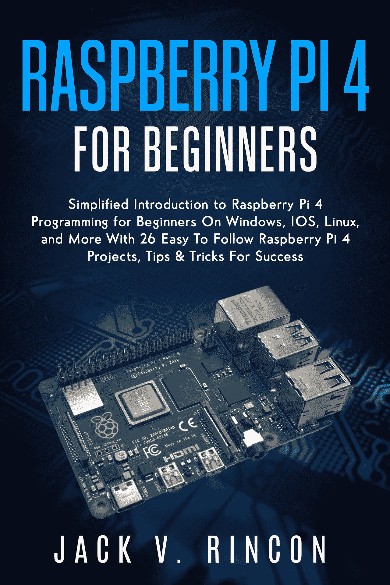

## 引言

欢迎阅读。

在本书中，我们将学习关于树莓派 4 的一切知识。在开始之前，我想提到，本书适合初学者和中级学习者。如果你是一位经验丰富的工程师或单板计算专业人士，你可能不会觉得这本书非常有用，因为它涵盖的是初级和中级水平的概念。

然而，如果你是树莓派以及通用编程、电子和电路领域的新手，这本书将证明它对你非常有帮助。书中讨论的想法和概念将充分吸引创作者、发明家、学生、黑客、梦想家、企业家，以及几乎所有想要让嵌入式 Linux 力量变为现实的人。

本书详细涵盖了各种概念，让你能够基于所讨论的想法创建出独特的、具有未来感的基于 Pi4 的项目。不过，根据个人经验，某些主题可能会出现少数例外。例如，如果你是树莓派编程及通用单板计算的完全新手，某些主题可能看起来很困惑，需要进一步的研究才能理解。

在介绍这些之后，以下是本书的组织结构和内容呈现方式：

- 我们将从开始介绍树莓派的基础知识。由于本书针对初学者和中级学习者，我们将花费大量时间在这一部分。
- 然后，我们将学习树莓派 4 的接口、控制和通信。
- 从那里开始，我们将深入研究树莓派 4 的接口、基础电子学和编程。
- 最后，我们将通过 25 个酷炫的树莓派 4 项目结束本书，你可以通过实践这些项目来提升自己的技能。

注意：书中介绍的一些项目可能需要购买每个项目开头列出的额外物品。让我们开始之旅吧：

## 目录

- 引言
- 第 1 部分
  - 入门
  - 环境要求
  - 了解树莓派
  - 树莓派原理引导之旅
    - 硬件配置
    - 树莓派 4 的硬件特性
    - 树莓派 400
- 第 2 部分
  - 设置你的树莓派 4
  - 安装和设置树莓派 4 硬件
  - 设置树莓派 400
- 第 3 部分
  - 使用树莓派 4
  - 在 Mac & Windows 上设置 NOOBS 软件
  - 在 Linux 上安装 NOOBS
- 第 4 部分
  - 安装 Raspbian OS
  - 如何使用 Balena Etcher 安装自定义镜像
- 第 5 部分
  - 设置配置文件
    - 配置设置
    - 内存配置编辑
    - 摄像头模块配置编辑
    - 视频/显示配置编辑
    - 网络配置编辑
    - 启动配置编辑
- 第 6 部分
  - 连接树莓派
  - 设置静态 IP
- 第 7 部分
  - 远程访问树莓派
    - 如何通过 VNC 远程连接树莓派
    - 如何通过 SSH 远程连接树莓派
- 第 8 部分
  - 在树莓派上编程
    - 树莓派上的 Python 3
    - C/C++ 环境搭建
- 第 9 部分
  - 介绍 GPIO 引脚
    - 电子元件
    - 使用 C/C++ 编程 GPIO：标准内核接口
    - 使用 Python 编程 GPIO
- 第 10 部分
  - 26 个创新的树莓派 4 项目
  - 项目 1：LED 闪烁（入门级）
  - 项目 2：LCD 字符显示（中级）
  - 项目 3：简单气象站（入门级）
  - 项目 4：带电位器的 4 灯开关（中级）
  - 项目 5：烟雾与气体检测器（专家级）
  - 项目 6：家庭监控摄像头（入门）
  - 项目 7：Telegram 机器人（入门级）
  - 项目 8：LAMP 和 WordPress（入门级）
  - 项目 9：Nagios 网络监控（入门级）
  - 项目 10：树莓派路由器（中级）
  - 项目 11：Twitter 机器人（中级）
  - 项目 12：Python 加密工具（入门级）
  - 项目 13：树莓派 Home Assistant（专家级）
  - 项目 14：网络速度测试（中级）
  - 项目 15：树莓派上的 UFW 防火墙（中级）
  - 项目 16：树莓派 TeamViewer（入门级）
  - 项目 17：Pi Hole 广告拦截（中级）
  - 项目 18：VPN 服务器（入门）
  - 项目 19：DietPi（入门）
  - 项目 20：TensorFlow（中级）
  - 项目 21：树莓派上的 Android（中级）
  - 项目 22：树莓派 Windows 10 IoT（中级）
  - 项目 23：Minecraft 服务器（中级）
  - 项目 24：树莓派蜜罐（专家级）
  - 项目 25：在树莓派上安装 CentOS（入门）
  - 项目 26：Web 服务的设置（入门级）
  - 结论

# 第 1 部分：入门

在全书中，我将使用各种约定，例如使用不同的代码样式和添加图标来增强书籍内容。此外，请确保阅读书中提供的任何警告或注意事项，以免伤害自己或设备。

## 环境要求

对于第一部分的大部分，你只需要一台树莓派设备。我建议购买`树莓派 4`或`树莓派 400`。由于这些是树莓派系列中的最新型号，它们为开发简单和复杂的项目提供了广泛的功能。为了简单起见，可以考虑购买套件。虽然这不是你完成所有项目所需的全部，但它将帮助你入门并进入状态。

## 了解树莓派

树莓派设备是一个微小的、单板但卓越的全功能，旨在弥合成本与功能之间的差距。无论你是想要一台普通的电脑、编写复杂的程序，还是尝试工程和物理设备，树莓派都能满足需求。

树莓派设备是单板电脑。这意味着它像任何台式机一样完整，只是打印在单块板上。树莓派的大小与其性能并不成正比。例如，树莓派的现代版本可以和某些台式电脑并肩。自 2012 年首次发布以来，从工程师到公司高管的广泛人群都获得了树莓派并学会了使用。树莓派驱动了从自动船只到太空设备的伟大项目。树莓派（显然）是一个强大的工具。

从最初与 Broad 通合作的树莓派 B 型开始，树莓派基金会发布了多种型号。每个型号都为特定的用例添加了新功能和改进的规格。例如树莓派 Zero 是全尺寸树莓派的微型版本，带有网络和 USB 端口等惊人功能，这一切为了更小的尺寸、低功耗和兼容性。

兼容性是所有树莓派型号的关键特性。为特定型号开发的软件也可以在其他型号上运行。你可以在第一代树莓派型号上安装最新版本的 Raspbian OS。你将牺牲一些性能，但它会成功运行。随着我们的进展和学习树莓派，我将坚持使用最新型号`树莓派 4 Model B`和`树莓派 400`。然而，你在书中学到的知识是准确的，并适用于其他树莓派型号。书中讨论的项目也与任何树莓派型号兼容，你可以在拥有的任何树莓派设备上享受乐趣并学习。

## 树莓派原理引导之旅

即使树莓派设备功能强大且有名，如果不了解它的各种组件，我们也无法很好地使用它。在本节中，我们将讨论有关树莓派硬件的所有内容。与典型的台式机或笔记本不同，树莓派暴露了所有内部组件供你玩和探索。这种“暴露”是树莓派如此著名的原因之一。虽然你可以购买外壳来保护设备，但在处理物理元件和电路时，最好让它暴露在外。

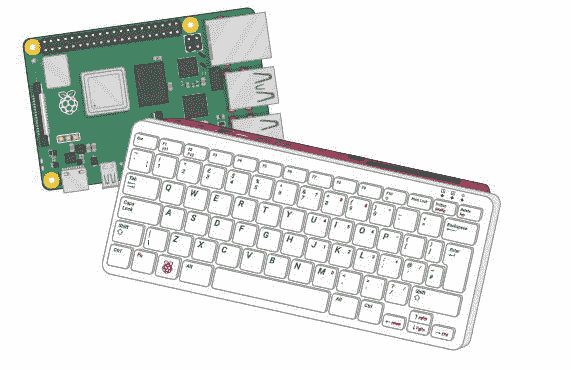

以下是`树莓派 4 model B`的一些组件——从俯视角度显示。为了避免（此处原文逻辑中断）：

### 硬件配置

树莓派的一个关键功能是其灵活性。注意：随着树莓派的发展，每个树莓派型号具有这些功能来驱动。

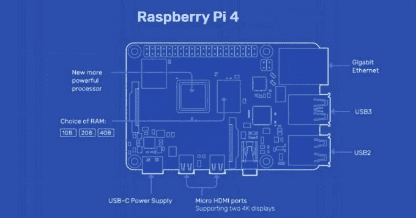

一个树莓派 4 主板功能

这些功能的目的如下：

- 40 针通用输入/输出（`GPIO`）引脚将项目与电子设备连接起来。你可以直接在树莓派上访问它们。
- 注意：在树莓派运行（或操作）期间，可以对某些引脚进行开启或关闭。
- `PoE` 引脚：以太网供电（`PoE`）允许设备在接入网络后，在特定时间自动开启/关闭。树莓派 4 具有 4 针引脚，支持在先代型号树莓派 3B+ 上发布的`PoE HAT`。
- 千兆以太网：树莓派 4 内置的千兆以太网带宽超过 350MBps。虽然性能可能没有普通桌面电脑强大，但与通过`USB 2.0`实现 300Mbps 千兆以太网的 Pi 3B+ 相比是一个巨大的改进。以太网的改进为树莓派 4 丰富的功能锦上添花。
- `USB`：树莓派 4 拥有 4 个`USB`端口。包括 2 个`USB 2.0`端口和 2 个由蓝色接口指示的`USB 3.0`端口。由于树莓派 4 内置了无线和蓝牙功能，需要更多端口的可能性很小，因为所需的外设是键盘、鼠标，以及如果你选择添加的话的摄像头。
- 4 极立体声音频/视频接口：树莓派 4 具有一个 4 极立体声音频和复合视频端口，用于连接耳机或外部扬声器。
- 2 通道 MIPI CSI 摄像头接口：移动行业处理器接口（`MIPI`）摄像头接口允许你直接将官方树莓派摄像头模块连接到主板上。
- 双微 HDMI 端口：树莓派 4 还具有 2 个`micro HDMI`端口，允许将树莓派连接到现代显示器。这些端口支持`4kp60`或`4K`分辨率的音频输出。这两个`Micro HDMI`端口取代了前代产品的全尺寸`HDMI`端口。
- USB-C 电源接口 5V/3A：树莓派 4 具有为树莓派供电的标准`USB`电源。树莓派基金会建议使用树莓派官方电源，以避免可能损坏设备的电压和功率问题。与大多数单板计算机一样，树莓派支持`5v`或`3 Amperes`电源输入。树莓派 4 使用的电源已从之前型号中的`Micro USB`接口改为`USB-C`。
- 2 通道 MIDI DSI 显示端口：MIDI 显示接口允许你将显示器直接连接到树莓派。
- Micro SD 卡槽：与旧款树莓派一样，树莓派 4 有一个`SD Card`卡槽，作为板的硬盘。
- 2.4/5GHz 无线和蓝牙 5.0：树莓派 4 具有双频`2.4`和`5.0 GHz` IEEE`802.1/*`无线连接，以及蓝牙`5.0`和`LE`。无线连接的更新使得 Pi 4 在连接性方面优于旧型号。

以上是你应该了解的树莓派 4 核心功能。

# 树莓派 400

树莓派 400 是树莓派 4 的改进版。它的特色组件与树莓派 4 非常相似。但不同之处在于，所有组件都整齐地封装在键盘布局内部。树莓派 400 功能强大，设计用于保护内部组件，并保持桌面整洁、线缆清晰。


Pi 400 在封闭的键盘外壳内包含了系统级芯片和`n`内存等组件，这与普通的树莓派 4 不同。在树莓派 4 的背面，它具有所有所需的端口和`GPIO`引脚，我们将在后续章节中讨论这些。`GPIO`引脚旁边是`microSD`卡槽。它存储了树莓派 400 用于存储操作系统、应用程序和其他数据的`microSD card`。

`microSD card`预装在树莓派 400 中；你可以轻轻推按卡片直到它咔哒一声并弹出，然后取出。当你把卡片插回去时，请确保闪光的金属触点向下；卡片应随着轻微的咔哒声滑入。

接两个端口是`micro-HDMI`端口，用于连接显示器、电视或任何其他显示设备。与树莓派 4 一样，树莓派 400 支持多两个显示器。旁边是`USB Type-C`电源接口，用于连接树莓派 400 电源或兼容的`USB`电源。

两个蓝色端口是`USB 3.0`端口，提供与设备的高连接，包括固态硬盘（`SSDs`）、优盘、打印机等。这些右侧的白色端口是低速的`USB 2.0`端口，你可以在此连接附带的树莓派鼠标。

最后一个端口是`Gigabit Ethernet`网口，它允许你使用网线将树莓派 400 连接到网络，作为使用内置`Wi-Fi`无线网络的一种替代方案。

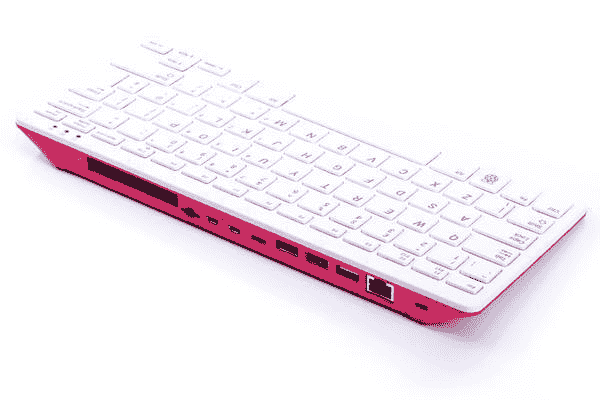

简而言之，树莓派 400 集成了以下组件和功能：

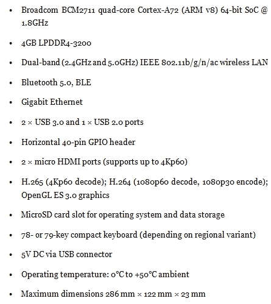

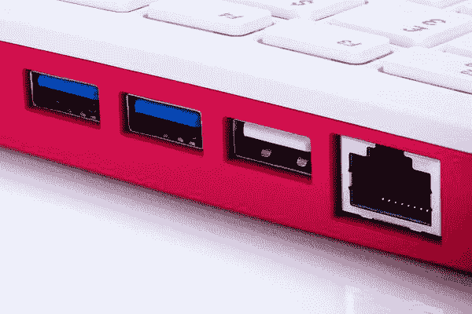

# 第 2 部分：设置你的树莓派 4

本节将涵盖树莓派所需的一切内容，以及连接它们的基础知识，以使设备运行。

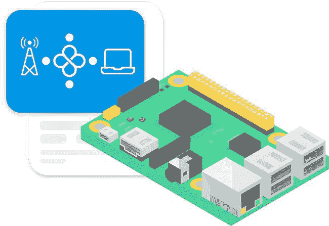

从设计上来说，树莓派设备为所有人提供了简单舒适的设置过程。然而，像任何计算机一样，运行这台单板计算机需要你连接各种外设。为了避免设置设备时的任何麻烦和兼容性问题，可以考虑使用树莓派官方套件，它包含了你使用树莓派所需的一切：[`www.canakit.com/raspberry-pi-400-desktop-computer.html`](https://www.canakit.com/raspberry-pi-400-desktop-computer.html)。对于树莓派 4，可以考虑从树莓派入门套件开始。然而，硬件和电路爱好者应该考虑终极或极客套件：[`www.canakit.com/raspberry-pi-400-desktop-computer.html`](https://www.canakit.com/raspberry-pi-400-desktop-computer.html)、[`www.canakit.com/raspberry-pi-4-ultimate-kit`](https://www.canakit.com/raspberry-pi-4-ultimate-kit)，或[`www.canakit.com/raspberry-pi-extreme-aluminum-case-kit`](https://www.canakit.com/raspberry-pi-extreme-aluminum-case-kit)。

一旦你购买了上述任何套件，你只需要一个支持`HDMI`连接的显示器或电视。`HDMI`非常常见，因为许多设备（如游戏机、顶盒、蓝光播放机等）都使用它。

然而，你可能只有一个裸板的树莓派，在这种情况下，你需要以下外设：

- `USB`电源：你需要一个额定为`3 amperes (3A)`的`5V USB Type-C`电源。使用树莓派官方电源最好，因为它可以处理树莓派的功耗需求。

  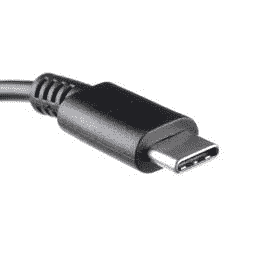 

- `Micro SD`卡：你下一个需要的是`microSD`；它将存储操作系统，并在与树莓派协作时作为文件的存储设备。如果你只想要基础设置，可以从`8GB`开始。然而，更大的容量更好，可以为存储更多文件留出空间。

  

- `USB`键盘和鼠标：为了控制你的树莓派，你需要一个键盘和鼠标。考虑从树莓派基金会购买官方产品。带有炫丽 RGB 彩色的游戏键盘等键盘可能会消耗过多功率，树莓派可能无法承受。

  

- Micro‑HDMI 线缆：此线缆将树莓派的声音和图像传输到您的电视或显示器。线缆的一端是用于树莓派的`micro‑HDMI`插头，另一端是用于您的显示器的全尺寸`HDMI`插头。您也可以使用`micro‑HDMI 到 HDMI`转接头和一根标准的全尺寸`HDMI`线缆。如果您的显示器没有`HDMI`插孔，您可以购买`micro‑HDMI 到 DVI‑D、DisplayPort 或 VGA`转接头。要连接到使用复合视频或配有 SCART 插孔的旧电视，请使用 3.5 mm 尖‑环‑环‑环‑套（TRRS）音频/视频线缆。

  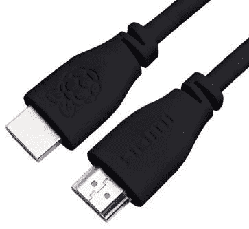

您也可能需要购买一个树莓派外壳。虽然设备在没有外壳的情况下使用是安全的，只要您不将其放置在能导电的金属表面上，您仍应考虑购买外壳以提供额外保护。您可以从第三方供应商处获得官方树莓派外壳或定制外壳。

对于网络，您需要使用一根网线，一端插入树莓派的以太网端口，另一端连接到网络交换机或路由器。我们将在后续章节讨论如何配置无线网络。

## 安装和设置 Raspberry Pi 4 硬件

为了迎合初学者，让我们讨论如何安装和配置硬件——无需焊接，只需基本设置。先小心取出树莓派设备及其组件的包装盒。虽然树莓派是耐用且坚固的设备，但它并非永恒。

**注意**：始终以边缘握住树莓派设备，而不是其平面侧，因为那里有内部组件。

此外，请在处理树莓派的凸起金属针脚时格外小心，以避免短路导致设备损坏。损坏的针脚碎片可能会使后续硬件（如摄像头、传感器等）的设置变得复杂。

## 组装树莓派外壳

如果您有外壳来保护树莓派，这将是组装设备的第一步。如果您使用的是定制的树莓派外壳，请参考该外壳的具体说明；否则，先打开官方外壳的中间部分，该外壳配有红色和白色盖子。

- 选取树莓派外壳的红色底座，并将其旋转，使低部分朝向您或向右，而凸起部分朝向左侧。

  

- 确保微 SD 卡未连接到设备。确认后，以稍微倾斜的角度握住并抬起树莓派，利用其 USB 和以太网端口。将 USB Type‑C、HDMI 和 3.5 mm 音频插孔的连接器滑入相应的切口，然后轻轻将其滑至更低位置，直至它舒适地坐在底座上。确保在将其放置在外壳底座时不要用力或强行压迫端口位置；如前所述，这可能会损坏设备。

  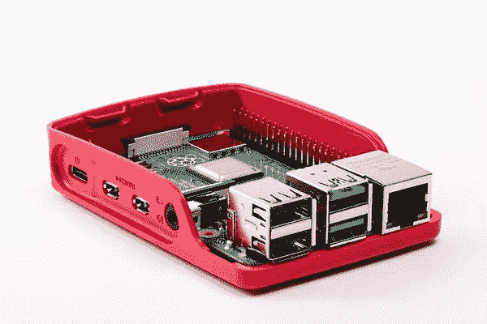

- 使用白色盖子，将两个夹子放在外壳左侧的匹配孔位上，这些孔位位于底座左侧。这些孔位应位于 microSD 插槽上方。放置好后，向下压下 USB 端口上方的右侧部分，直至外壳完全闭合。

  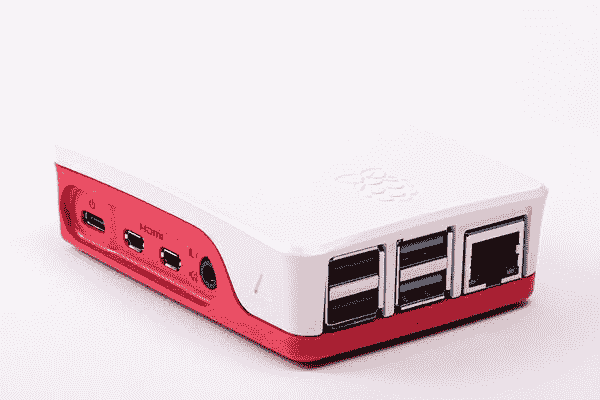

## 连接 microSD 存储卡

正如我们所提到的，树莓派使用`microSD`卡来存储操作系统、应用程序和用户数据。虽然你可以添加额外的存储空间，但在最基础的层面上，你需要一张`microSD`卡。


要在树莓派上安装 microSD 卡，请将带有外壳的设备翻过来，找到 microSD 卡槽。将标签朝向树莓派的方向，缓慢地插入卡片，不要用力推。如下所示，MicroSD 卡只能朝一个方向插入：

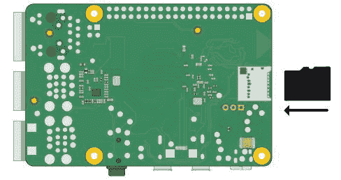

卡片插入槽后，施加一点压力使卡片对齐；这应该让卡片停止到位且不发出“咔哒”声。

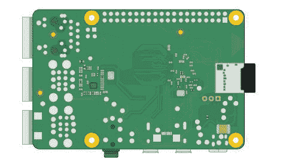

你只需抓住卡片末端并轻轻拉出即可移除 MicroSD 卡。对于较旧的树莓派型号，只需简单按压（推）即可解除锁定并释放卡片。对于 Pi 4 和 3，不需要这种操作。

### 连接键盘和鼠标

要连接键盘和鼠标等输入设备，你只需要将 USB 连接器端连接到四个 USB 端口中的任何一个。树莓派支持 USB 2.0 和 USB 3.0。

对于官方树莓派键盘，你可以将鼠标连接到键盘上，然后只连接键盘。如果不是，请将 USB 连接到树莓派上的两个 USB 端口之一。

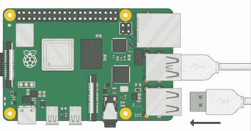

不要强行将任何设备的 USB 连接器插入端口。它们应该轻松且自动地连接。如果你在插入设备时遇到困难，请检查 USB 连接器！

### 连接显示设备

要将显示设备连接到树莓派，只需取根 micro-HDMI 线，将电缆较小的一端连接到树莓派上 USB Type-C 连接端口旁的端口。

接下来，将电缆的另一端连接到你的显示器。如果显示器有多个连接端口，你需要手动为树莓派选择使用哪个输入通道。如果你不确定如何操作，只需切换端口直到找到树莓派信号。

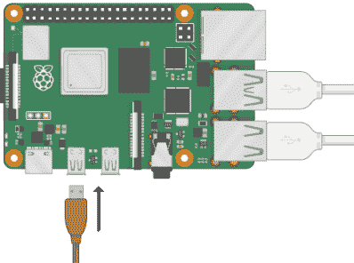

### 连接网络设备

虽然这是一个可选的选择，但你可以通过有线连接将树莓派连接到网络。

使用以太网适配器或以太网线，将塑料锁朝下，连接到树莓派的以太网端口。你应该听到“咔哒”声，表示电缆已到位并连接。接下来，将以太网适配器的另一端连接到网络设备——交换机、集线器或路由器，直到听到“咔哒”声。

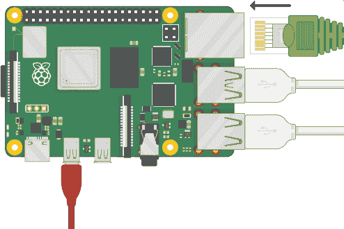

### 连接电源

连接电源是设置树莓派硬件的最后一步。树莓派没有电源开关。因此，一旦你插上电源，它就会自动启动。只有当树莓派加载了必要的软件和操作系统后，你才应该连接电源。

对于官方树莓派 microSD 卡，它应该已经安装了操作系统，你可以直接为设备供电。如果你使用的是自定义 SD 卡，在我们在下一节设置好所需软件之前，请勿插入电源。

将电源线的 USB Type-C 端连接到树莓派。接下来，将电源插进插座并开启。这将启动树莓派，你就可以开始使用它了。

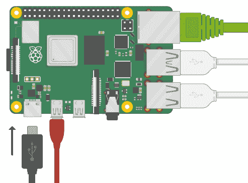

### 设置树莓派 400

让我们来讨论一下如何设置树莓派 400。处理过程并不很不同，因为这两个设备非常相似。然而，树莓派 400 自带了安装好的 microSD 卡和内置键盘。


### 连接鼠标

对于树莓派 400，你只需要添加一个鼠标。只需取出鼠标的 USB 端并连接到树莓派 400。你可以在设备背部找到 USB 端口（包括 USB 3.0 和 USB 2.0）！


USB 连接器应该在不需要太大压力的情况下滑动到位。

### 连接显示器

取根 micro-HDMI 线，将较小的一端连接到树莓派 400 上靠近 microSD 槽的 micro-HDMI 端口，另一端连接到你的显示器。

如果你的显示器有多个 HDMI 端口，请寻找连接器旁边的端口号；你需要手动将电视切换到此输入以看到树莓派的显示。如果你看不到端口号，不要担心：你可以切换每个输入直到找到树莓派的输入。

# 第 3 节 使用树莓派 4

树莓派设备非常灵活，可以运行各种软件，包括多种基础操作系统。尽管其中一些需要针对树莓派架构进行一些调整，但它们运行非常流畅。

支持的树莓派操作系统中最流行且有效的是由树莓派基金会开发的官方操作系统 Raspbian OS。Raspbian 是一个基于 Debian Linux 的、为树莓派设计的简单且经过优化的操作系统。

如果你是 Linux 用户，在导航和使用 Raspbian OS 时将不会遇到困难。Windows 和 Mac 用户会发现该环境很熟悉，因为它提供了与流行操作系统和桌面环境相同的图形功能。

本节将讨论如何开始使用 Raspbian OS，更多是关于如何轻松导航它以实现生产力最大化。

在我们深入使用树莓派之前，我们需要安装 NOOBS 或 New Out of the Box Software（开箱用软件），这是树莓派基金会开发的帮助新用户设置操作系统的软件。

### 在 Mac 和 Windows 上设置 NOOBS

如果你是从官方商店购买的 microSD 卡，它应该预装了 NOOBS，你可以跳过此节。然而，对于自定义 SD 卡，在使用之前我们需要对其进行设置。

在 Mac 和 Windows 上设置 NOOBS 涉及类似的过程，无论使用哪种操作系统。最好的方法是使用新的、未使用的 SD 卡，如果你决定使用旧 SD 卡，请备份你的数据。

在 Mac 和 Windows 上设置 NOOBS 的第一步是下载并安装格式化工具。无论使用哪种操作系统，对于本教程，我们将使用 SD Formatter，因为它很容易使用。从资源页面下载：`https://www.sdcard.org/downloads/formatter/`


选择对应的操作系统并安装程序。一旦下载完成，启动安装程序。正确插入 SD 卡并确保电脑检测到它。如果这种情况没有发生，请检查 SD 卡槽或使用第三方格式化工具。

启动格式化工具并确保在“Select Card”框中选择了正确的 microSD 卡。接下来，选择 Overwrite（覆盖）来处理数据，这通常是不必要的。


你也可以使用 Windows 的 `diskpart` 或 Mac 的磁盘工具。如果你选择使用任何其他格式化工具，请确保使用 FAT32 系统格式化 SD 卡。格式化完成后，使用 Windows 资源管理器或 Mac 的 Finder 打开它。

现在我们需要下载 NOOBS 软件副本。可以在树莓派上安装的操作系统包括 Raspbian OS、LibLEC、OSMC 等。打开浏览器并导航到以下链接下载 NOOBS：`https://www.raspberrypi.org/downloads/noobs/`


一旦下载完成，打开下载文件夹并解压 ZIP 文件。如果你使用包管理器，点击 `CTRL + A` 选择所有可用数据。在选择所有数据后，将文件拖入 SD 卡的根目录。此外，确保在存档中复制文件。接下来，从电脑上弹出 SD 卡，并使用上一节学的方法连接到树莓派。如果你想在 Linux 系统上安装 NOOBS，请跳过此节。

### 在 Linux 上安装 NOOBS

在本节中，我们将讨论如何在 Linux 系统上设置 NOOBS。这里介绍的方法很简单。你可以使用任何你觉得方便的方法，如 Balena Etcher。使用 Linux 系统预安装的磁盘工具，我们将分区 SD 卡并提取 NOOBS。你可能需要 root 权限来执行此任务。

第一步是启动终端并输入命令 `sudo fdisk -l` 列出所有连接的磁盘和分区。确保以 root 身份运行命令。输出类似于 `/dev/sda` 或 `/dev/sdb`，表示磁盘 1 和 2。如果你连接了两个驱动器，可能会得到 `/dev/sd(n)`，其中 `n` 是设备的字母数字。

接下来，在列出的设备中找到你的 SD 卡，复制其标识代码并继续。下一步是使用 FAT32 系统重新分区 SD 卡。输入命令 `sudo fdisk /dev/sda`，将 `/dev/sda` 替换为你 SD 卡的代码。

一旦运行上述命令，你应该能看到帮助命令 `m`。在 `fdisk` 工具中查看所有可用命令。我们将使用命令 `d` 删除当前 SD 卡上的所有分区，使用命令 `n` 创建新分区。接下来，输入 `d` 并回车，输入分区号。如果 SD 卡中有其他分区，输入 `p` 打印它们。选择每个分区并输入 `d` 后跟相应的分区号。重复此过程直到删除 SD 卡上的所有分区。

删除所有分区后，下一步是创建一个新的。仍在 `fdisk` 中，输入命令 `n` 并回车。接下来，输入命令 `p` 确认分区类型为主（Primary）并继续。现在输入分区号 `1` 并回车。接下来，输入起始和结束扇区或直接回车确认默认值。

你可以确认 SD 卡仅包含一个分区；输入命令 `p` 列出所有分区。接下来，我们需要将文件系统从 Linux 改为 FAT32。输入命令 `l` 列出所有可用代码。找到对应 FAT32 的代码并将其提供给磁盘工具。在此情况下，分别选择 `t` 和 `b` 命令。操作完成后，将显示分区已成功更改为 FAT32 的消息。

接下来，我们需要将更改应用磁盘。在应用之前确保更改如上所示。输入命令 `w` 写入并应用更改。完成分区后，输入命令 `sudo mkfs.vfat /dev/sda` 进行格式化，其中 `/dev/sda` 代表你的 SD 卡代码。现在我们已经以正确的格式分区并格式化 SD 卡。接下来，我们需要从树莓派官方仓库下载并提取 NOOBS 软件。

打开浏览器并导航到以下页面。确保选择 NOOBS Large 版本而不是 lite 版本。选择点对点或 HTTP 进行下载：`https://www.raspberrypi.org/downloads/noobs/`。对于本书，我们将使用 `wget` 工具从 Linux 终端下载文件。导航到你想下载文件的文件夹，本例中为输入 `cd ~/Downloads`。一旦进入下载文件夹，输入命令 `wget https://downloads.raspberrypi.org/images/NOOBS-2020-09-15/v3_5_0.zip`。执行命令并等待下载完成。

完成后，通过执行命令 `sudo fdisk -l` 找到 SD 卡的挂载位置。在 Linux 系统上，树莓派 40 解解压文件。使用包管理器，，，，，。。

# 树莓派 4 的操作

树莓派设备非常灵活，可以运行各种软件，包括多种精选的基础操作系统。尽管其中一些需要针对树莓派架构进行一些调整，但它们运行非常流畅。

支持的树莓派操作系统中最流行且有效的是由树莓派基金会开发的官方操作系统 Raspbian OS。Raspbian 是一个为树莓派设计的基于 Debian Linux 的简单且经过优化的操作系统。

如果你是 Linux 用户，在导航和使用 Raspbian OS 时将不会遇到困难。Windows 和 Mac 用户会发现该环境很熟悉，因为它提供了与流行操作系统和桌面环境相同的图形功能。

本节将讨论如何开始使用 Raspbian OS，更多是关于如何轻松导航它以实现生产力最大化。

在我们深入使用树莓派之前，我们需要安装 NOOBS 或 New Out of the Box Software（开箱用软件），这是树莓派基金会开发的帮助新用户设置操作系统的软件。

### 在 Mac 和 Windows 上设置 NOOBS

如果你是从官方商店购买的 microSD 卡，它应该预装了 NOOBS，你可以跳过此节。然而，对于自定义 SD 卡，在我们在下一节设置好所需软件之前，请勿插入电源。

在 Mac 和 Windows 上设置 NOOBS 涉及类似的过程，无论使用哪种操作系统。最好的方法是使用新的、未使用的 SD 卡，如果你决定使用旧 SD 卡，请备份你的数据。

- `vcgencmd get_config <config>`：我们使用此命令显示文件中的特定配置值。
- `vcgencmd get_config int`：我们使用此命令列出所有 true（即非零）的整数配置选项。
- `vcgencmd get_config str`：我们使用此命令列出所有 true（即非空）的字符串配置选项。

你可以通过使用 `vcgencmd` 命令查看大多数配置设置。当你使用此命令时，其他命令不可用。

### 配置设置

在这里，我们将讨论一些必要的配置修改，您可以根据需求对其进行调整，使树莓派更加功能化。配置设置分为内存、摄像头、视频/显示、网络、启动、超频和音频等多个类别。然而，本书仅讨论其中一些，以示如何编辑配置。欢迎阅读树莓派配置文档以了解更多：[`www.raspberrypi.org/documentation/configuration/`](https://www.raspberrypi.org/documentation/configuration/)

### 内存配置修改

这些是对树莓派最有用的内存配置修改。对于较新的树莓派型号，请通过删除 `#` 号来取消禁用的条目。

- `disable_l2cache`：此设置可禁用或启用树莓派中 ARM 对 GPU 缓存的访问。我们通过将值设置为 `1` 来启用它；它需要相应的 L2 禁用内核。默认值在不同型号中可能不同，例如那些拥有独立 L2 缓存的型号。
- `gpu_mem`：指的是树莓派 GPU 可用的内存，包括 VPU、HVS 和其他 Legacy 代码。我们使用此修改来设置 ARM 与 GPU 之间的内存分配。默认情况下，GPU 内存以兆字节为单位。为避免性能问题，始终分配尽可能低的值，以让 Linux 系统拥有更多的内存分配。
- `gpu_mem_256`：这是 256MB 树莓派的 GPU 内存（以兆字节为单位）。512MB 树莓派通常忽略它，配置会覆盖 `gpu_mem`。该条目最大值为 192；默认情况下没有设定值。
- `gpu_mem_512`：此配置设置 512MB 树莓派的 GPU 内存（以兆字节为单位）。如果树莓派的内存大小不是 512MB，则该配置会失效并被忽略。它会覆盖 `gpu_mem` 条目，最大值为 448MB；默认值未设定。
- `gpu_mem_1024`：我们用此设置为内存 1024MB 或以上的树莓派设备设置 GPU 内存（以兆字节为单位）。如果树莓派的内存小于 1024MB，则该配置是多余且被忽略。`gpu_mem_1024` 的最大值为 944MB，默认值未设定。

### 摄像头模块配置修改

下面是一些树莓派摄像头模块的配置设置。树莓派摄像头模块如下：

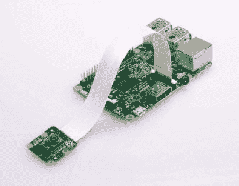

- `start_x`：我们使用此设置来启用树莓派中连接的相机模块。
- `gpu_mem`：我们使用此配置来设置相机模块的最小 GPU 内存。
- `disable_camera_led`：此配置设置会在录制视频或拍照时防止相机 LED 点亮。

### 视频/显示配置修改

下面是最常见的视频和显示选项的配置修改，适用于树莓派。再次，请为最新型号的树莓派取消禁用的条目以启用它们。注意：由于树莓派 4、4B 和 400 支持 4K，某些选项在不同型号中可能不可用。

- `sdtv_mode`：该配置定义复合视频输出的电视标准。我们通过使用整数值 `0`、`1`、`2`、`3`、`16` 和 `18` 来设置每种模式，分别代表：标准 NTSC、日本版 NTSC、标准 PAL、巴西 PAL、逐行扫描 NTSC、逐行扫描 PAL。
- `sdtv_disable_colorbust`：此配置可开启或关闭复合视频输出中的色彩暴露。当您将值设置为 `1` 时，它会禁用色彩暴露，从而使图像在黑白模式下更清晰。
- `sdtv_aspect`：该配置定义复合视频输出的宽高比。默认整数值 `1` 表示 4:3 的比例。整数值 `2` 表示 14:9 的比例，整数值 `3` 表示 16:9 的比例。
- `enable_tvout`：该配置开启复合输出。仅树莓派 4 支持此功能，默认情况下会禁用复合输出。

树莓派拥有大量视频和显示选项，这里无法全部讨论。如需更多选项，请查阅下方资源页面上的树莓派文档：[`raspberrypi.org/documentation/config-txt/video.md`](https://raspberrypi.org/documentation/config-txt/video.md)

### 网络配置修改

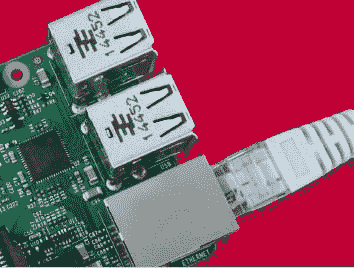

网络配置不太受欢迎，树莓派文档中可能没有。下面是最常见的网络配置修改。

- `smsc95xx.macaddr`：我们使用此设置让 `smsc95xx` 驱动在每次启动时使用随机 MAC 地址，而不是默认的 MAC 地址。

### 启动配置修改

下面是树莓派的启动配置修改。通常，对于较新的树莓派型号，请通过删除 `#` 号来取消禁用所需条目。

- `disable_commandline_tags`：我们使用此配置阻止 `start.elf` 在启动内核之前填充 ATAGS。ATAGS 是 0x100 之前的内存。
- `Kernel`：我们使用此设置在加载内核时设置一个替代名称。默认名称是 `kernel.img`、`kernel7.img`、`kernel7l.img`，类型为字符串。
- `Cmdline`：用于设置可以用于替代 `cmdline` 文本文件的命令行参数。
- `disable_splash`：用于在启动时开启或禁用启动画面。

For some models, specific entries may be deprecated and obsolete. To find out more about boot options in the `config.txt` file, use the link provided below: [`www.raspberrypi.org/documentation/configuration/config-txt/boot.md`](https://www.raspberrypi.org/documentation/configuration/config-txt/boot.md)

## 第 6 节：连接树莓派


如果你使用的是有线以太网连接，树莓派将自动连接到互联网。如果你想使用无线连接，请点击顶部面板上的网络图标以查看所有可用的网络。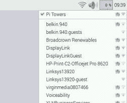

找到你选择的网络后，选中它并提供密码——假设你连接的是安全网络——然后点击“确定”加入该特定网络。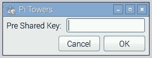

连接成功后，你应该会在菜单栏上看到一个 Wi-Fi 标志，这意味着你现在已连接。要查看树莓派的 IP 地址，请打开终端并输入命令：

```
ifconfig | grep more
```

## 第 7 节：设置静态 IP

如果你所在的网络设备众多且杂乱，那么每次启动时跟踪树莓派的 IP 地址可能会很困难，尤其是当你连接到使用 DHCP 的网络时。静态 IP 允许我们为树莓派设置一个唯一的 IP 地址，这有助于我们找到树莓派。

如果你不熟悉 DHCP 和 IP 地址，下面是它们工作原理的概述。

### DHCP 和 IP 地址工作概述

当你将设备连接到网络时，路由器/调制解调器会自动为其分配一个由四组数字组成的唯一编号，称为互联网协议地址。互联网协议地址通常类似于`192.168.0._`。前三组数字代表网络，第三组数字代表主机——这取决于网络子网掩码。最后一个数字代表设备编号。

在分配 IP 地址时，路由器会取代表网络的前三组数字，并附加一个数字来表示所连接的主机。路由器本身的编号是 1，你可以在`192.168.0.1`找到它。例如，`192.168.0.2`可能代表你的台式机，`192.168.0.3`可能代表你的笔记本电脑，`192.168.0.4`可能代表你的智能手机，等等。

**注意：** 您可以通过打开终端并输入`ifconfig`来查找树莓派的 IP 地址。然而，由于连接设备的数量及其连接方式的不同，该地址可能会变化，因为路由器负责分配这个唯一号码。

为此，路由器使用动态主机配置协议（DHCP），这意味着它会动态地为所连接的主机分配 IP 地址。例如，如果你断开树莓派，在重新连接之前连接其他设备，树莓派重新连接后可能会获得不同的 IP 地址。

这意味着，在你将树莓派配置为使用唯一 IP 之前，你无法记住一个固定的 IP 地址，这正是静态 IP 派上用场的地方。使用 DHCP 保留，我们可以告诉路由器仅为树莓派记住这个 IP 地址。

你可以通过路由器管理面板或编辑树莓派配置来配置 DHCP 保留。由于路由器的管理方式可能有所不同，我们将重点放在树莓派网络配置上。

第一步是检查 DHCP 服务是否正在运行，执行命令：

```
sudo service dhcp status
```

接下来，如果 DHCP 未运行，请执行以下命令：

```
sudo systemctl start dhcpd.service && sudo systemctl enable dhcpd
```

成功执行后，重新检查 DHCP 是否正在运行，并继续执行下一条命令。通过执行以下命令找到 DHCP 配置文件：

```
find dhcpcd.conf
```

找到 DHCP 配置文件后，使用你选择的文本编辑器编辑它。如果你想保持简单，可以使用`nano`。执行以下命令：

```
sudo nano /etc/dhcpcd.conf
```

如果你通过有线以太网连接树莓派，接口是`eth0`，Wi-Fi 连接则是`wlan0`。在树莓派 DHCP 配置文件中输入以下行：

```
interface eth0/wlan0
static ip_address=192.168.0.4/24
static routers=192.168.0.1
static domain_name_servers=1.1.1.1
```

接口条目应包含你连接树莓派的接口；以太网使用`eth0`，无线使用`wlan0`。

**注意：** 请仅使用`eth0`或`wlan0`中的一个，不能两者都使用。

对于静态 IP，请为树莓派设置所需的 IP 地址。该 IP 不应是同一网络上分配给其他设备的 IP。此外，该 IP 应在子网范围内。例如，`192.168.0.2` – `192.168.0.254`。

静态路由器应包含路由器的 IP 地址。默认情况下，这是`192.168.0.1`。你还可以指定要使用的 DNS 服务器。如果你不知道，请将其设置为路由器的 IP 地址；否则，请指定它。完成后，按`CTRL + X`并点击两次回车以保存配置文件。现在重新启动树莓派以应用更改。

重启后，测试 TCP/IP 协议栈。打开终端并输入命令：

```
ping ::1 or ping raspberrypi.local
```

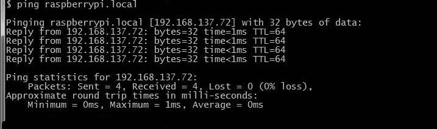

## 第 8 节：远程访问树莓派

使用树莓派的最佳方式之一是远程访问它。使用`SSH`或`VNC`，你可以远程连接到树莓派，并像随身携带笔记本电脑一样使用它。在本节中，我们将介绍两种远程控制树莓派的方法。

### 如何通过 VNC 远程连接树莓派

虚拟网络计算（简称`VNC`）是一种远程访问技术，可让你从一台计算机远程控制另一台计算机。该技术有助于从基本的 Windows 或 Mac 与服务器和云计算机通信。由于树莓派没有内置显示器，最好使用另一台计算机的终端或桌面环境来控制它。方法如下：

设置 VNC 可能需要根据你设置的分发版本使用终端命令。对于树莓派，桌面环境使其非常容易。要导航到树莓派 VNC 配置，请点击菜单 -> 首选项 -> 树莓派配置 -> 接口并启用 VNC。激活后，右上角菜单栏会出现一个标记为 VNC 的新图标。点击该图标打开 VNC 服务器设置。你将看到一个标记为“准备连接”和“开始使用”的部分。你可以通过点击“开始使用”旁边的箭头查看说明。

记下树莓派正在使用的 IP 地址，你也可以使用`ifconfig`查看树莓派的 IP 地址。保存 VNC 服务器签名和包含随机生成单词列表的密码。下载并安装 VNC 查看器软件，该软件将使你能够控制树莓派。访问以下网页下载 Real VNC：[`realvnc.com/download/viewer`](https://realvnc.com/download/viewer)

在你的设备上安装该软件。它与任何操作系统兼容。安装后，启动 VNC 查看器并提供上面记下的树莓派 IP 地址。选择 VNC 服务器并点击连接。提供树莓派的用户名和密码。如果你使用默认凭据，用户名为`pi`，密码为`raspberry`。确保用户名和密码有效，以确保你连接到正确的设备。连接后，VNC 查看器将显示桌面环境，就像你在使用树莓派一样。

### 如何通过 SSH 远程连接树莓派

另一种远程连接树莓派的方式是通过`SSH`。要通过`SSH`连接树莓派，请在 Mac/Linux 或 Windows 上打开终端或命令提示符。在树莓派上，使用`ifconfig`记下 IP 地址。在计算机的终端中输入命令：

```
ssh pi@192.168.0.8
```

其中`pi`是你的树莓派用户名，`192.168.0.8`是你的树莓派 IP 地址。连接后，输入`pi`的密码。如果你没有在另一个端口上配置 SSH，默认端口`22`应该可以工作。

## 第 9 节：在树莓派上编程


最常见的树莓派使用方式之一是编写项目程序。本节将介绍如何在树莓派上设置编程接口。我们将讨论如何为 `Python` 和 `C/C++` 设置编程环境。但是，本书不讲解指定编程语言的相关概念。因此，你应使用外部资源学习编程语言。

**注意：**在本书的项目部分工作时，您需要了解 `python` 编程。

### 树莓派上的 Python 3

Raspbian OS 预装了最新的稳定版本 `Python`，使树莓派成为可以用于编写脚本或进行数据科学工作的编程平台。初学者也可以从树莓派的编程环境中获益良多，因为 `python` 是一种优秀的编程语言。你可以通过选择“菜单 -> 编程 -> Python IDLE”来启动 `python IDLE` shell。树莓派上的 `Python` 是默认软件包，不包含额外的库和软件包。如果由于某种原因你没有 `python` shell，可以从下面的 Python 资源页面下载 Python 安装包，并选择所需的版本：[`python.org/downloads`](https://python.org/downloads)

要测试是否正确安装了 `python`，请打开终端并输入以下命令：

```bash
python --version
```

以获取已安装的 python 版本。

### C/C++ 环境设置

`C` 和 `C++` 是用于创建各种应用程序的强大且流行的编程语言。开发者使用这些语言开发各种工具和实用程序，例如游戏、浏览器、嵌入式系统、编程语言和操作系统。本节介绍如何在 Raspbian OS 上开始使用 `C` 和 `C++`。要检查 Raspbian 版本是否安装了 `C++` 编译器，请打开终端并输入以下命令：

```bash
whatis gcc
```

如果没有预装编译器，可以执行以下命令进行安装：

```bash
sudo apt-get update && sudo apt-get install gcc
```

你可以在任意文本编辑器中编辑代码，例如使用 `nano`，也可以使用 Raspbian 预装的 `Geany` IDE。依次进入“菜单 -> 编程 -> Geany”，然后编辑代码。

## 第 10 节：介绍 GPIO 头部

在任何现代树莓派的顶部边缘，或树莓派 400 的背面，都有两排长长的金属插针，称为 `GPIO` 或通用输入/输出头。在树莓派中，`GPIO` 头允许你连接额外的硬件，例如传感器、摄像头、LED、开关等。你可以使用自己编写的程序控制连接到 `GPIO` 头的硬件。`GPIO` 插针既可用于输入，也可用于输出。接下来的章节中，我们将学习如何使用 `python` 连接并操作 `GPIO` 头。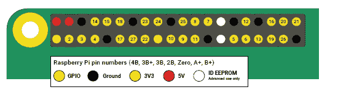

`GPIO` 头有 40 个（金属公）插针。其中一些插针可用于物理计算；一些为硬件提供电源；其他插针则提供与额外硬件的通信接口，例如收集数据并将数据发送到树莓派的传感器。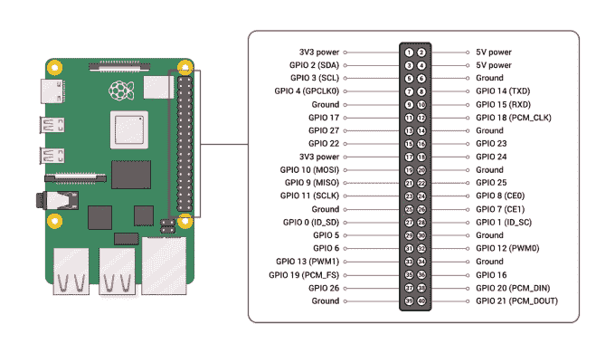

**注意：**树莓派 400 具有类似的引脚布局，但在 Pi 400 中，引脚布局是反向的。

### 跳线电缆

跳线电缆也称为跳线或跳线导线，当你想要将实体组件连接到树莓派或面包板时非常有用。跳线主要有三种类型。

#### 跳线线

1. `公对母 (Male to Female)`：用于将面包板连接到 `GPIO` 插针排。
2. `母对母 (Female to Female)`：用于连接单个组件，特别是在不使用面包板的情况下。
3. `公对公 (Male to Male)`：用于实现面包板上一个点到另一个点的连接。

根据你的项目需求，你可能需要所有类型的跳线。然而，如果你不使用面包板，`M2F` 和 `M2M` 就足够了。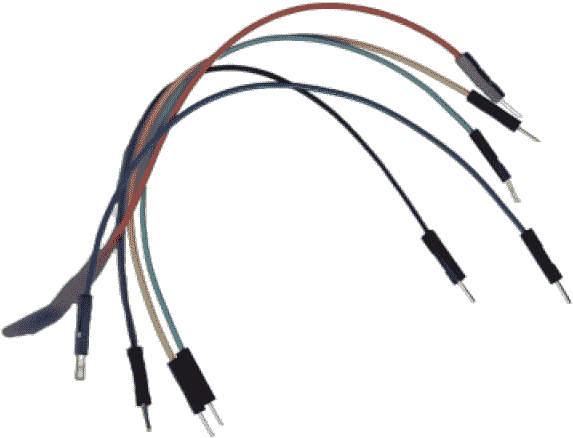

### 电阻

电阻是另一种常见的电子元件，通常用于控制或调节电流的流量。电阻有多种数值，使用欧姆（`Ω`）测量。简单来说，电阻的欧姆数越高，电阻越大。

在树莓派中，当设备耗电过大，可能损坏自身或树莓派时，电阻变得非常有用。尽管这可能因你的项目和设备需求而异，但你通常会使用额定为 `330 Ω` 的电阻。

### 发光二极管


发光二极管（`LED`）是一种可以直接通过编程控制器进行调节的输出设备。`LED` 开启时会发光。你随处都能发现 `LED` 设备：从房屋到汽车、飞机等。它们负责在炉具开启时、烟雾检测器、玩具和其他指示器中提醒你。

`LEDs` 有许多形状、颜色和大小。虽然 `LED` 组件种类繁多，但某些组件完全不适用于树莓派。如果你打算在树莓派上使用 `LEDs`，最好避免使用任何额定为 `5V` 或 `12V` 的 `LED` 电源。

### 压电蜂鸣器

压电蜂鸣器或简称蜂鸣器是树莓派常用的输出元件之一。它与 `LED` 组件非常相似，不同之处在于产生声音而不是光。

蜂鸣器主要包含封装在塑料外壳内的金属片，当电流通过它们时，它们会相互振动。电蜂鸣器主要有两种类型：主动式蜂鸣器和被动式蜂鸣器。为了方便使用，请坚持使用主动式蜂鸣器。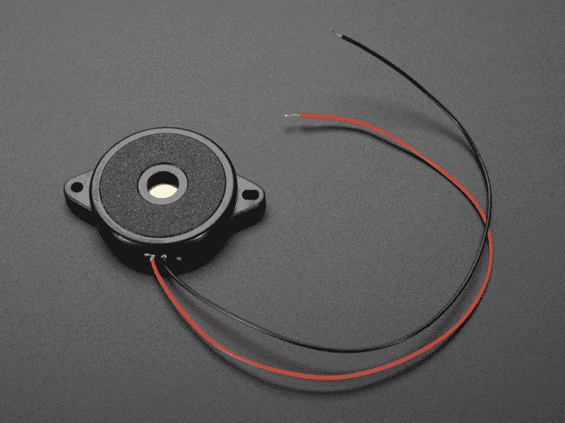

你还会遇到其他常见的电子元件，如电机、按钮开关、红外传感器、运动传感器、温度传感器、湿度传感器等。需要注意的是，某些组件在连接到树莓派之前可能需要特殊的扩展板。因此，建议在开展项目之前确保手头有所有组件。

### 编程 GPIO

在介绍了树莓派 `GPIO` 插针后，你就可以使用支持的语言对设备进行交互和编程了。虽然我们无法涵盖编程 `GPIO` 的所有细节，但我们可以介绍各种概念，说明你可以如何实现这一点。

### 使用 C/C++ 编程 GPIO：标准内核接口

要使用 `C/C++` 与树莓派 `GPIO` 交互，你可以使用标准内核接口。还有第三方库，如 [`pigpio`](http://abyz.me.uk/rpi/pigpio/)，你可以用它与树莓派交互。

然而，自 Linux 内核 `4.8` 以来，`sysfs` 接口已弃用且非常难以使用。

### 编译

我们可以手动构建此项目。但是，你需要版本为 `2.61` 的 `autoconf` 以及带有 GNU 扩展的标准 C 库。这是一个简单直接的 Autotools 编译过程：[`linkfy.to/l850I`](https://linkfy.to/l850I)

从下方提供的 Linux 内核 git 仓库获取文件：[`git.kernel.org/pub/scm/libs/libgpiod/libgpiod.git`](https://git.kernel.org/pub/scm/libs/libgpiod/libgpiod.git)

接下来，我们需要编译并安装项目，这还包括命令行工具。输入命令：

在执行上述命令之前，确保你处于包含 `git clone` 文件的文件夹中。一旦构建了工具，你就可以获得六个主要的命令行工具。这些工具是：

- `Gpiodetect`：用于显示系统中可用的 `gpiochips` 列表及其详细信息，如名称、标签、`GPIO` 线的数量等。
- `Gpioget`：用于读取所传 `GPIO` 线的值。
- `Gpiofind`：在指定的行名中查找 `gpiochip` 名称和行偏移量。
- `Gpiomon`：为 `GPIO` 线上的事件提供等待调用。提供要监控的事件以及在终止前处理的事件数量。
- `Gpioinfo`：用于显示给定 `gpiochips` 所有线的列表、名称、激活状态和其他附加标志。
- `Gpiofind`：定位指定行名的 `gpiochip` 名称和行偏移量。
- `Gpioset`：为给定的 `GPIO` 线分配值。

你可以通过提供的资源了解更多关于该库的信息：[`linkfy.to/7nYBd`](https://linkfy.to/7nYBd)

### 使用 Python 编程 GPIO

使用 `Python` 编程 `GPIO` 使用的是 `gpio zero` 包。使用 `gpio zero` 包通过 `python` 控制设备非常简单且轻量化。该包还提供了供初学者理解的文档。在此学习更多：[`gpiozero.readthedocs.io/en/stable/`](https://gpiozero.readthedocs.io/en/stable/)

这是一个用于控制连接到树莓派的各种设备的示例代码。要控制连接到 `GPIO` 的 `LED`，你可以使用以下代码：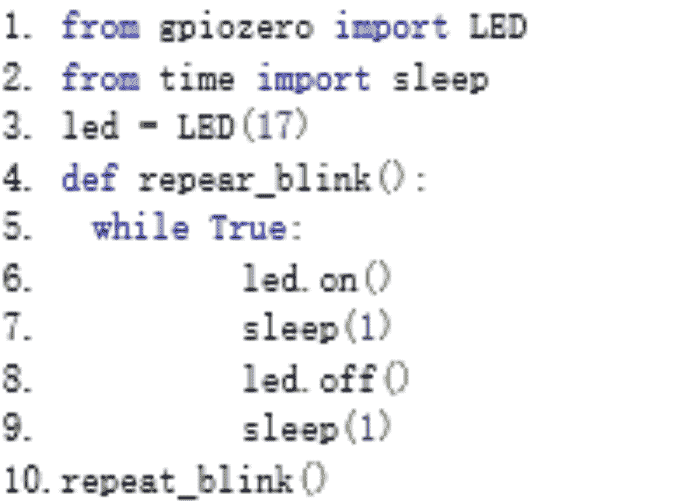

## 第 1026 节：创新树莓派 4 项目

欢迎来到本书的项目章节。本章节将向你介绍使用树莓派 4 和 `Python` 编程语言构建工具和项目的乐趣。

**注意：**在我们开始之前，请注意你需要一些 `Python` 编程知识，因为本章节将大量使用它。

让我们从第一个项目开始：项目 1：闪烁 LED（初级）！

这是我们将使用树莓派和 `Python` 构建的项目。你将学习如何将 `LED` 连接到树莓派，并编写控制其闪烁的 `Python` 程序。了解如何使用树莓派 `GPIO` 引脚连接和控制 `LED` 设备至关重要，因为它允许你控制其他输出设备，如电机、蜂鸣器、ISS——好吧，不是这样，但这是一个开始。

### 要求

对于此项目，你需要：

- 一台树莓派
- 无源面包板
- `5mm` 发光二极管
- `330 Ω` 电阻
- 跳线线

### 快速回顾：LED 与电阻

如前所述，LED 设备有不同的尺寸、形状、颜色和电压要求。

有些 LED 设备能在一个装置中混合颜色。

对于本项目，任何 `5mm` 的 LED 设备都可以工作。

LED 设备包含一个二极管，当电流通过时会发光。

电气二极管具有极性——意味着它们只能在一个方向上允许电流流动，通常是从正极到负极。

正极点是 `anode`，负极点是 `cathode`。

你可以通过观察其引脚来辨识二极管的某个点，如下所示。

较长的引脚代表正极（`anode` (+）），而较短的引脚代表负极（`cathode` (–)）。


- “LED 设备无法自动调节电流。”
- “因此，如果向设备传入过多电流，可能会损坏设备，甚至损坏树莓派。”
- “因此，最好始终将 LED 与一系列电阻串联连接。”
- “你应该连接的电阻类型取决于 LED 能够承受的最大值。”
- “大多数 LED 最大可承受 `20 mA`。”
- “但是请检查设备的最大值。”
- “我不会花太多时间解释电阻及其工作原理。”
- “请参考以下资源以获取更多信息：”
- [`linkfy.to/37zcR`](https://linkfy.to/37zcR) [`linkfy.to/XPaue`](https://linkfy.to/XPaue)
- “对于本项目，值在 `200 Ω` 到 `400 Ω` 之间的电阻即可工作。”
- “通常它是棕色和绿色的电阻。”

## 构建项目

让我们开始构建电路并点亮 LED 设备。

**NOTE**：书中的项目使用无焊接面包板，以避免无线连接的麻烦并减少错误。

我们建议你也这样做。

让我们学习如何使用以下简单步骤将 LED 设备连接到树莓派：

1. 先将蓝色面包板条连接到树莓派的 `GND` 引脚组。请参考上文的 `GPIO` 手册。
2. 下一步是将 LED 连接到面包板上。
3. 现在将电阻插入面包板，使其一端连接到 LED 设备的较长正极引脚（`anode`），另一端则通过跳线电缆连接到 `GPIO pin 22`。
4. 最后，将 LED 的负极引脚（`cathode`）连接到 `GND` 电源条上。

只要电阻连接到正极或负极引脚，即可。

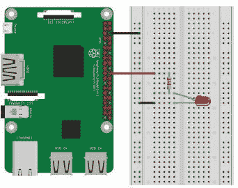

## 编写项目脚本

现在，我们将编写一个 Python 脚本来控制 LED 的亮灭。

到现在，你应该已经尝试过 `PIXEL` 桌面环境，并且可以轻松操作它。

打开文件管理器，创建名为 `Pi.Projects` 的文件夹，用于存放本书中所有项目。

现在让我们讨论控制 LED 设备的逻辑。

LED 会保持开启指定的秒数，然后保持关闭指定的秒数。

该过程会一直循环此模式，直到我们设定停止条件。

现在，我们如何点亮 LED 呢？

我们知道需要将用于连接 LED 的 `GPIO` 引脚设置为 `HIGH`。

我们可以采取相反操作来关闭 LED。

因此，将 `PIN 22` 设为 High 和 Low。

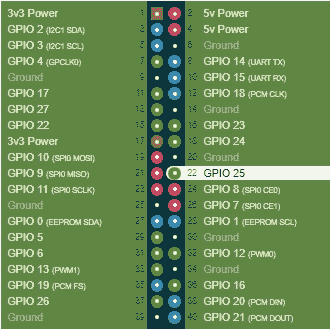

如你记得，我们将使用 `gpiozero` 库在 Python 中控制设备。

下面是 Python 脚本：

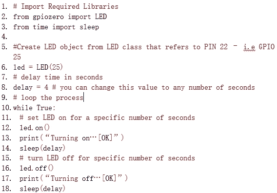

将脚本保存为 `led.py` 并打开终端。

转到保存脚本的目录，并使用命令 `python3 led.py` 运行它。

炸裂！你应该会看到 LED 点亮 4 秒，然后熄灭 4 秒，这标志着你的第一个项目完成。

## 项目 2：LCD 字符显示（中级）

欢迎来到本书的第二个项目。

本项目致力于展示如何连接并编程字符 LCD 设备以显示消息。

我们先从静态文本开始，然后再处理更长文本的滚动显示。

让我们开始吧。

### 要求

本项目需要以下材料：

1. 一台树莓派。
2. 跳线电缆。
3. 一个 `10 kΩ` 的电位计。


4. 无焊接面包板。
5. 标准 `16x2` LCD，来自 [Adafruit](https://www.adafruit.com/)。
6. 烙铁和 `5 cm` 焊锡线。

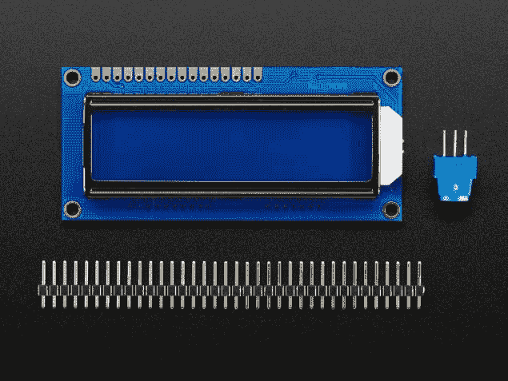

7. CircuitPython 或 `Adafruit_CharLCD` 库。

### 理解 LCD 显示

在开始构建和编码本项目之前，让我们稍作停顿，了解我们将做什么以及它是如何工作的。

让我们先从 LCD 开始。

液晶显示器或 `LCD` 是市面上最简单且最常见的显示类型。

它们出现在许多电子设备中，如计算器、自动售货机、打印机、复古移动电话等。

它们非常适合显示小段文字和图画。

LCD 的分类取决于单个屏幕上能容纳的字符行数和列数。

例如，`16x2` LCD 可以容纳 2 行和 16 个字符。

LCD 字符显示器还可以有不同的背景颜色，包括 RGB 显示。

本项目中，你可以使用任何与树莓派兼容的 LCD。

不过，我们建议你从 Adafruit 购买，因为他们开发了我们将使用的库。

### 焊接 LCD 头针

在大多数情况下，如果你购买 LCD，需要将引脚焊接到显示器上，如上图所示。

只需对准它，将长端朝下放置并焊接即可。

### LCD 模块引脚

LCD 的模块引脚从左到右排列，共 16 个引脚。

| 引脚 | 说明 |
| --- | --- |
|  |  |

`VSS` 引脚连接到 `GND`，而 `VDD` 引脚是电源引脚，应根据你的 LCD 连接到 `5` 或 `3.3 V`。

大多数 LCD 设备额定为 `5V`。


- "`v0` 作为调节引脚，用于在连接到电位计时调节字符与 LCD 背光的对比度。"
- "引脚 `E`、`R/W` 和 `RS` 是控制引脚。"
- "引脚 `7` 到 `14` 是用于发送信息的数据引脚，"
- "而 `15` 和 `16` 是 LCD 背光的正负引脚。"
- "本项目只需要 6 个引脚即可连接到树莓派。"
- "如前所述，树莓派的 `GPIO` 连接器工作于 `3.3 V`，而你可能会发现 LCD 额定为 `5V`。"
- "这不应该引起任何警报。"
- "因为我们只向屏幕发送数据，而不从屏幕读取数据，所以这不应是问题。"
- "这意味着你应该将 `R/W` 引脚接地，因为这只能让你读取而不能写入数据。"
- "如果你使用的是额定为 `5V` 的 LCD 字符显示器，请不要连接 `R/W` 引脚，因为它会在 5V 电压下发送数据，这会损坏你的树莓派。"

### 快速回顾：LED 与电阻

如前所述，LED 设备有不同的尺寸、形状、颜色和电压要求。有些 LED 设备能在一个装置中混合颜色。对于本项目，任何 `5mm` 的 LED 设备都可以工作。LED 设备包含一个二极管，当电流通过时会发光。

电气二极管具有极性——意味着它们只能在一个方向上允许电流流动，通常是从正极到负极。正极点是 `anode`，负极点是 `cathode`。你可以通过观察其引脚来辨识二极管的某个点，如下所示。较长的引脚代表正极（`anode`（+）），而较短的引脚代表负极（`cathode`（–））。


LED 设备无法自动调节电流。因此，如果向设备传入过多电流，可能会损坏设备，甚至损坏树莓派。因此，最好始终将 LED 与一系列电阻串联连接。你应该连接的电阻类型取决于 LED 能够承受的最大值。大多数 LED 最大可承受 `20 mA`。但是请检查设备的最大值。我不会花太多时间解释电阻及其工作原理。请参考以下资源以获取更多信息：[`linkfy.to/37zcR`](https://linkfy.to/37zcR)、[`linkfy.to/XPaue`](https://linkfy.to/XPaue)。

对于本项目，值在 `200 Ω` 到 `400 Ω` 之间的电阻即可工作。通常它是棕色和绿色的电阻。

### 构建项目

让我们开始构建电路并点亮 LED 设备。**NOTE**：书中的项目使用无焊接面包板，以避免无线连接的麻烦并减少错误。我们建议你也这样做。

让我们学习如何使用以下简单步骤将 LED 设备连接到树莓派：

- 先将蓝色面包板条连接到树莓派的 `GND` 引脚组。请参考上文的 `GPIO` 手册。
- 下一步是将 LED 连接到面包板上。
- 现在将电阻插入面包板，使其一端连接到 LED 设备的较长正极引脚（`anode`），另一端则通过跳线电缆连接到 `GPIO pin 22`。
- 最后，将 LED 的负极引脚（`cathode`）连接到 `GND` 电源条上。

只要电阻连接到正极或负极引脚，即可。


### 编写项目脚本

现在，我们将编写一个 Python 脚本来控制 LED 的亮灭。到现在，你应该已经尝试过 `PIXEL` 桌面环境，并且可以轻松操作它。打开文件管理器，创建名为 `Pi.Projects` 的文件夹，用于存放本书中所有项目。

现在让我们讨论控制 LED 设备的逻辑。LED 会保持开启指定的秒数，然后保持关闭指定的秒数。该过程会一直循环此模式，直到我们设定停止条件。

现在，我们如何点亮 LED 呢？我们知道需要将用于连接 LED 的 `GPIO` 引脚设置为 `HIGH`。我们可以采取相反操作来关闭 LED。因此，将 `PIN 22` 设为 High 和 Low。


如你记得，我们将使用 `gpiozero` 库在 Python 中控制设备。下面是 Python 脚本：

```text

```

将脚本保存为 `led.py` 并打开终端。转到保存脚本的目录，并使用命令 `python3 led.py` 运行它。

炸裂！你应该会看到 LED 点亮 4 秒，然后熄灭 4 秒，这标志着你的第一个项目完成。

# 项目 2：LCD 字符显示（中级）

欢迎来到本书的第二个项目。本项目致力于展示如何连接并编程字符 LCD 设备以显示消息。我们先从静态文本开始，然后再处理更长文本的滚动显示。让我们开始吧。

## 要求

本项目需要以下材料：

- 一台树莓派
- 跳线电缆
- 一个 `10 kΩ` 的电位计
- 无焊接面包板
- 标准 16x2 LCD 来自 [Adafruit](https://www.adafruit.com/)
- 烙铁和 `5 cm` 焊锡线
- CircuitPython 或 `Adafruit_CharLCD` 库


## 理解 LCD 显示

在开始构建和编码本项目之前，让我们稍作停顿，了解我们将做什么以及它是如何工作的。让我们先从 LCD 开始。液晶显示器或 `LCD` 是市面上最简单且最常见的显示类型。它们出现在许多电子设备中，如计算器、自动售货机、打印机、复古移动电话等。它们非常适合显示小段文字和图画。

LCD 的分类取决于单个屏幕上能容纳的字符行数和列数。例如，`16x2` LCD 可以容纳 2 行和 16 个字符。LCD 字符显示器还可以有不同的背景颜色，包括 RGB 显示。本项目中，你可以使用任何与树莓派兼容的 LCD。不过，我们建议你从 Adafruit 购买，因为他们开发了我们将使用的库。

### 焊接 LCD 头针

在大多数情况下，如果你购买 LCD，需要将引脚焊接到显示器上，如上图所示。只需对准它，将长端朝下放置并焊接即可。

### LCD 模块引脚

LCD 的模块引脚从左到右排列，共 16 个引脚。

| 引脚 | 功能 |
|---|---|
| 1 | VSS |
| 2 | VDD |
| 3 | v0 |
| 4 | RS |
| 5 |  |
| 6 |  |
| 7–14 |  |
| 15 | LEDA |
| 16 | LEDK |

`VSS` 引脚连接到 `GND`，而 `VDD` 引脚是电源引脚，应根据你的 LCD 连接到 `5` 或 `3.3 V`。大多数 LCD 设备额定为 `5V`。`v0` 作为调节引脚，用于在连接到电位计时调节字符与 LCD 背光的对比度。引脚 `E`、`R/W` 和 `RS` 是控制引脚。引脚 `7` 到 `14` 是用于发送信息的数据引脚，而 `15` 和 `16` 是 LCD 背光的正负引脚。

本项目只需要 6 个引脚即可连接到树莓派。如前所述，树莓派的 `GPIO` 连接器工作于 `3.3 V`，而你可能会发现 LCD 额定为 `5V`。这不应该引起任何警报。因为我们只向屏幕发送数据，而不从屏幕读取数据，所以这不应是问题。这意味着你应该将 `R/W` 引脚接地，因为这只能让你读取而不能写入数据。


如果你使用的是额定为 `5V` 的 LCD 字符显示器，请不要连接 `R/W` 引脚，因为它会在 5V 电压下发送数据，这会损坏你的树莓派。

在继续之前，请通过调整 LCD 对比度确保电位器工作正常。

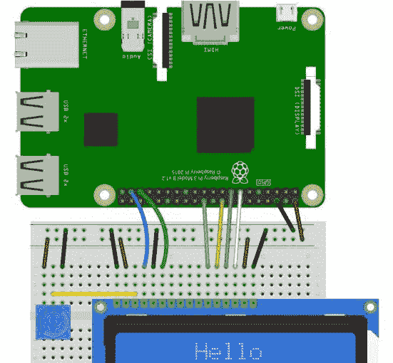

## 项目脚本编写

下一步是编写一个 `python` 脚本来控制 LCD 设备。在开始之前，请确保你已安装 `python`。我们还需要一个库来连接并与显示器交互。打开终端并输入以下命令来安装 `python` 和依赖库。

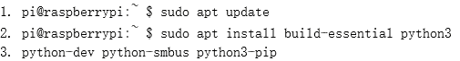

接下来，从以下链接下载 CircuitPython 库：[`github.com/adafruit/circuitpython/archive/6.1.0-beta.1.zip`](https://github.com/adafruit/circuitpython/archive/6.1.0-beta.1.zip)。下载完成后，解压文件并进入 `circuitpython-6.1.0-beta.1` 文件夹。

接着，执行命令：

```bash
python3 setup.py install
```

你也可以使用 `pip` 在你的系统上安装特定的 `CharLCD` 库。

```bash
sudo pip3 install adafruit-circuitpython-charlcd
```

此命令将为你安装与 LCD 交互所需的库。接下来，导航到我们之前创建的项目文件夹，并创建一个名为 `lcd.py` 的文件，我们将用它来编写显示器的代码。

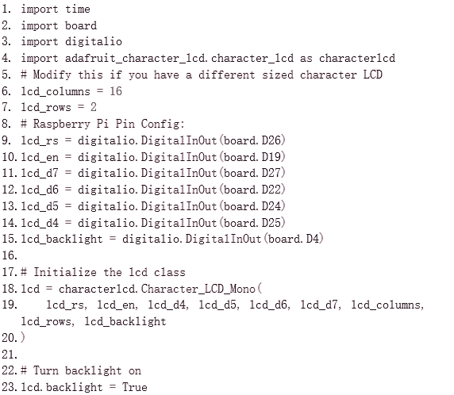


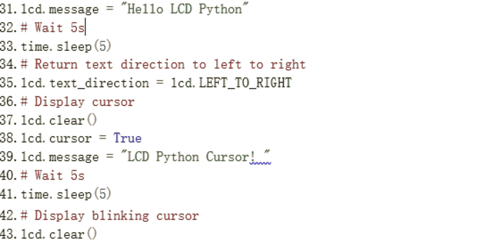


如果你想更好地理解代码及其工作原理，可以参考以下资源：

- [`github.com/adafruit/Adafruit_CircuitPython_CharLCD`](https://github.com/adafruit/Adafruit_CircuitPython_CharLCD)
- [`circuitpython.org/`](https://circuitpython.org/)
- [`github.com/micropython/micropython`](https://github.com/micropython/micropython)

使用 LCD，你可以扩展项目以显示天气数据、告警消息等数据。

# 项目 3：简单气象站（初级水平）

欢迎来到另一个树莓派显示项目，在这个项目中我们将学习如何使用 OLED 显示器来显示信息。然而，在这个项目中，我们不会显示简单的文本。相反，我们将构建一个简单的气象站，并使用 API 请求显示你所在区域的天气信息。我们将在后续项目中构建一个完整的气象预报。请期待！

## 项目需求

对于此项目，你需要以下组件：

- 树莓派，如往常
- 免焊接面包板
- `Adafruit_SSD1306` 库
- 跳线
- 单色 0.96 英寸 128x64 OLED 图形显示器：[`www.amazon.com/DIYmall-Serial-128x64-Display-Arduino/dp/B00O2KDQBE`](https://www.amazon.com/DIYmall-Serial-128x64-Display-Arduino/dp/B00O2KDQBE)

### 理解 OLED 显示器

此项目涉及有机光二极管，一种允许你选择开启或关闭哪些像素的显示器。从功能上来说，这允许你在显示器的任何位置显示任何文本或图标。与为每个字符预留 5 x 8 空间的 LCD 不同，OLED 要灵活得多。此外，OLED 显示器不需要背光，使得这些显示类型成为理想选择，特别是在黑暗环境中。

对于此项目，我们将使用具有 128 x 64 像素的单色 0.96 英寸显示器。

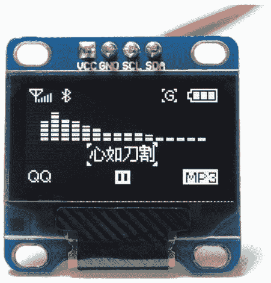

根据你使用的 OLED 显示器型号，你通常会有 4 个主引脚：`VCC`、`GND`、`SCL` 和 `SDA`。请注意给出的接线说明。

对于使用集成电路（通信）协议的 OLED 显示器，你需要树莓派上的 `SDA` 和 `SCL` 引脚。它们按顺序对应 `GPIO 2` 和 `GPIO 3`。

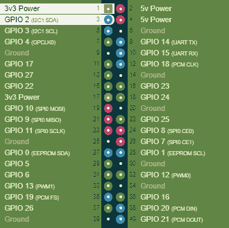

### API 快速指南：OpenWeather

这里是对 API 的快速介绍。API，或应用程序接口，是程序员开发的函数，用于将其服务开放给任何想要使用它的人。例如，`VirusTotal` API 允许你扫描文件病毒，而无需开发个人的病毒引擎。

在这个项目中，我们将使用 `OpenWeather` API，它允许我们请求指定语言的天气信息。如往常一样，我们将使用 `Python` 来发送这些请求。API 非常有用，因为允许你获取有关特定项目的准确且最新的数据。

- 启动浏览器并导航到 [`openweathermap.org/api`](https://openweathermap.org/api)。
- 接下来，创建一个账户以获取 API 权限。接着，在 `Subscribe` 按钮中选择当前天气数据。


接下来，在你的账户仪表板中，选择 `API Keys` 标签页访问你的 API 密钥。

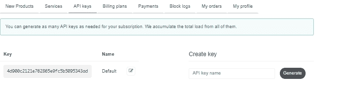

复制默认 API 密钥并执行简单的 API 请求。你可以使用任何 API 客户端，如 `curl` 或 `Postman` 来完成。

打开浏览器并执行以下请求：

`api.openweathermap.org/data/2.5/weather?q={city name}&appid={API key}`

其中 `city name` 是你想获取信息的城市，`API key` 是你的 API 密钥。

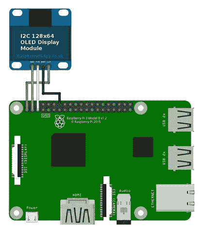

可以随意使用免焊接面包板。

### 项目脚本编写

在我们开始编写 Python 脚本之前，我们需要安装 `Adafruit_SSD1306` 库。请按照下面的命令完成此任务。

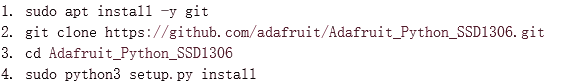

使用此库，我们可以在 OLED 显示器上创建简单的文本和图像。在此之前，我们需要启用 OLED 显示器通信所需的 I2C 接口。你可以使用 `raspi-config` 命令行工具或使用 GUI。只需点击 Preferences（偏好）→ Raspberry Pi configuration（树莓派配置）→ Interfaces（接口）→ Enable I2C（启用）。

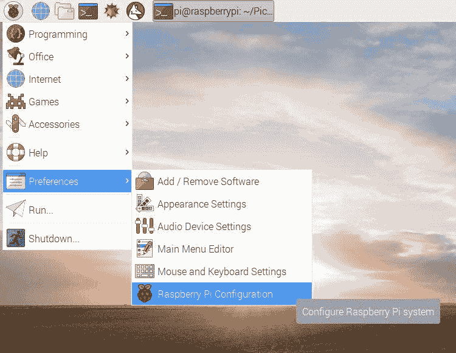

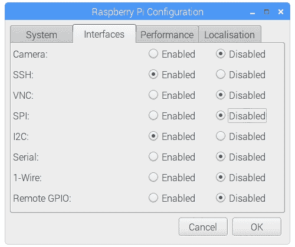

导航到项目主文件夹并创建一个名为 `min-weather.py` 的文件。接下来启动你的文本编辑器并输入以下代码：

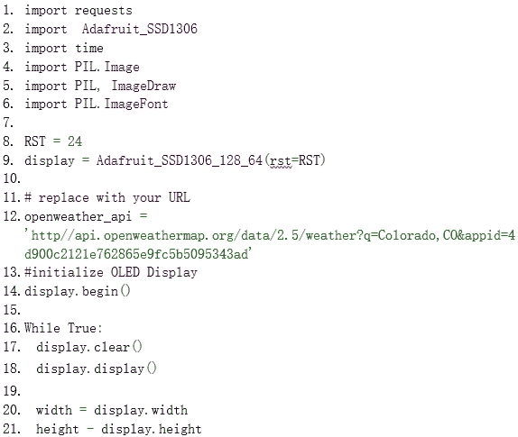


这是一个示例输出。


该项目到此结束。

## 项目：带电位器的 4 灯开关（中级水平）

列表中的下一个项目是 LED 调光器。该项目涉及 LED 设备，并使用电位器控制 LED 的亮度。我知道我们在第一个项目中已经介绍过 LED 设备了，但这个项目将向你展示如何读取模拟输入信号和输出调制信号。记住，我们将在后续项目中需要在本节中学习的技能。让我们玩得开心吧。

### 要求

对于此项目，你需要以下基础物品：

- 树莓派板
- 免焊接面包板


- 330 Ω 电阻
- 5 mm LED
- 跳线
- 一个 10 kΩ 电位器
- `MCP3008` 芯片

### 理解电位器

我们可以将电位器定义为手动调节的电阻。电位器有一个旋转触点，像旋盘一样，有助于手动调节电子元件的电压。电位器广泛应用于各种设备，如音量控制器、风扇速度控制器、亮度调节旋钮等。

下面是一个 10 kΩ 电位器的示例：


电位器由三个部分组成。两个外部引脚连接到电阻元件，而第三个引脚连接到导电但可调节的擦片。


对于这个项目，我们将使用电路中的电阻调整 LED 设备的亮度。

### 在树莓派上处理模拟信号

由于你现在可能已经做了研究，我们使用的电位器只使用模拟信号。然而，树莓派的 GPIO 只能读取数字信号。这意味着树莓派可以读取 `LOW`（0 值）或 `HIGH`（3.3 特）电压，中间的任何无法读取。

由于我们将使用电位器调节 0 到 3.3 之间的电压，我们需要一种方法读取 `HIGH` 和 `LOW` 之间的值，从而允许 LED 灯光的亮度产生变化。为此，我们将使用一个模数转换芯片，然后用脉冲宽度调制器生成模拟信号。

确保掌握芯片的方向，因为这非常关键。

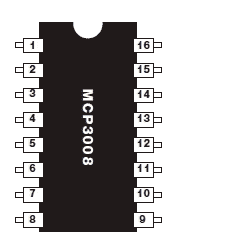

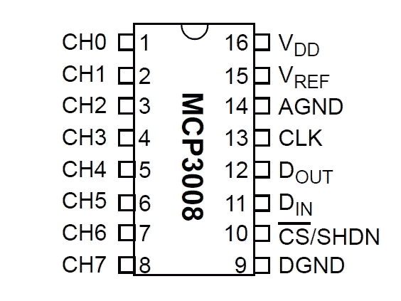

我很想解释这些设备的工作原理，但这超出了本书的范围。不过，我提供了一些非常好的资源；我强烈建议在构建之前阅读它们！

[`www.arrow.com/en/research-and-events/articles/engineering-resource-basics-of-analog-to-digital-converters`](https://www.arrow.com/en/research-and-events/articles/engineering-resource-basics-of-analog-to-digital-converters)

[`www.electronics-tutorials.ws/combination/analogue-to-digital-converter.html`](https://www.electronics-tutorials.ws/combination/analogue-to-digital-converter.html)

[`learn.adafruit.com/raspberry-pi-analog-to-digital-converters/mcp3008`](https://learn.adafruit.com/raspberry-pi-analog-to-digital-converters/mcp3008)


`MCP3008` 芯片的对齐非常重要，你必须将半圆凹口朝上放置，如所示！

### 构建项目

此项目的电路构建简单，不应该花费很长时间。只需按照下面的指令操作即可。

- 首先连接面包板导轨（蓝色）`GND`。
- 接下来，将 `3.3 V` 连接到面包板的红色导轨。
- 在面包板导轨中心添加 `MCP3008` 芯片并按如下方式连接。

| MCP3008 | Raspberry Pi GPIO |
| :--- | :--- |
| 1 | 电位器中心引脚 |
| 9 | `GND` |
| 10 | `GPIO 8` |
| 11 | `GPIO 10` |
| 12 | `GPIO 9` |
| 13 | `GPIO 11` |
| 14 | `GND` |
| 15 | 3.3 V |
| 16 | 3.3 V |

- 使用长引脚将 LED 连接到面包板和树莓派的 `GPIO 17`（使用 `330 Ω`），而短端连接到 `GND` 导轨。
- 最后步骤中，选择电位器的一个外部引脚并连接到 `GND`。选择另一个外部引脚并连接到 `3.3 V`。
- 对于电位器的中间引脚，将其连接到 `MCP3008` 芯片的第 1 引脚。

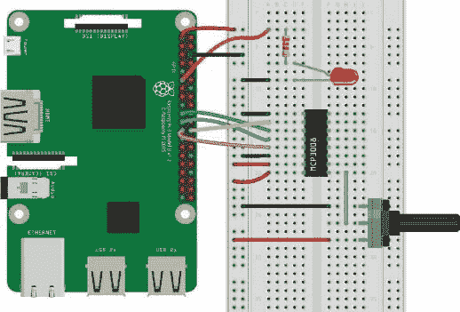

### 项目脚本编写

又是编写代码的时间。在使用脚本之前，让我们启用 SPI 通信协议，因为 `MCP3008` 芯片使用该协议与树莓派通信。

[`linkfy.to/LiH3f`](https://linkfy.to/LiH3f)

打开 Preferences -> Raspberry Pi configuration – Interface 并启用 SPI。

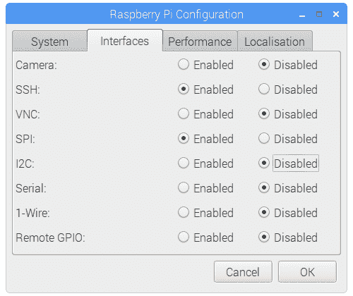

#### 脚本逻辑

这里是关于脚本“如何做”以及“做什么”的简单逻辑：

- 首先，我们需要使用 `MCP3008` 转换芯片从电位器读取模拟信号。
- 接下来，我们需要使用脉冲宽度调制器控制 LED 的亮度。
- 最后，将脉冲宽度调制器的占空比调整为从电位器读取的值。

对于此脚本，除了 `gpiozer` 之外我们不需要任何外部库。在项目文件夹中创建一个 Python 文件并命名为 `adjust.py`，输入下方所示的代码：

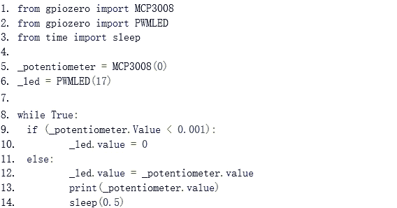

## 项目 5：烟雾与气体检测器（专家级）

再次欢迎来到第 5 个项目。在这个项目中，我们将使用气体检测器、烟雾传感器和用于声音报警的蜂鸣器构建一个检测报警器。当传感器检测到环境中存在气体或烟雾时，蜂鸣器将激活。

### 要求

对于此项目，我们需要以下组件：

- 树莓派
- 免面包板
- MQ-2 气体烟雾检测器
- 压电蜂鸣器
- 5 mm LED
- `MCP 3008` 芯片
- 打火机
- 按钮
- 跳线
- 330 Ω 电阻

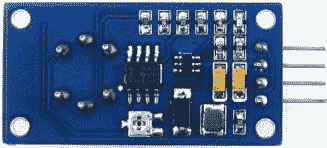

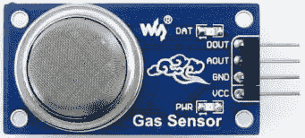

### 理解 MQ-2 气体和烟雾检测器

让我们讨论一下 `MQ-2` 烟雾气体传感器是如何工作的。别担心，我会尽量简短。`MQ-2` 传感器对烟雾和各种易燃气体敏感。虽然某些 `MQ-2` 传感器只能检测特定类型的气体，但在大多数此类传感器中，氢气、酒精、丁烷、丙烷和甲烷等常见气体是默认检测对象。

该传感器通过读取周围区域的气体浓度并使用 `MCP 3008` 卡（在上一个项目中讨论过）发送模拟信号来工作。如果周围区域上述气体的浓度较高，系统将检测到高电压输出。

你也可以使用另一种方法来检测高气体浓度。这种方法在具有这些气体默认浓度的区域效果最好。情况下，你可以设置一个特定的阈值，如果传感器检测到的水平高于设定阈值，则输出 `HIGH` 电压信号；反之则输出 `LOW` 电压信号。

我们可以使用 `MQ-2` 上的电位器来调整阈值。`MQ-2` 传感器还有一个 `LED` 指示器，当气体浓度高于阈值时，可以用它警告用户。


作为额外奖励，`MQ-2` 使用模拟信号读取数据，这提供了一种测量气量的定量方法，帮助你定义一个更好的阈值，超过该值后即可报警。然而，正如我们在上一节中讨论的，`Pi` 只读取数字信号，因此我们必须使用 `MCP2008` 卡进行信号转换。

### 构建项目

构建此项目应该相当简单，因为已经介绍了如何连接 `LED` 和 `MCP2008`。以下是构建电路的快速步骤：

- 首先将 `GND` 连接到面包板上的蓝色导轨，将 `3.3v` 连接到面包板上的红色导轨。
- 下一步是将 `MCP3008` 芯片放置在面包板的中心，确保引脚与中心分隔线的任意两侧平行，如下所示。


- 接下来按照如下方式接线到芯片：

| MCP3008 | 连接至 |
| :--- | :--- |
| 1 | `MQ-2 AO` |
| 9 | `GND` |
| 10 | `GPIO 8` |
| 11 | `GPIO 10` |
| 12 | `GPIO 9` |
| 13 | `GPIO 11` |
| 14 | `GND` |
| 15 | `3.3 V` |
| 16 | `3.3V` |

记得将 `MCP3008` 芯片的半圆方向朝上对！

- 现在，将 `MQ-2` 烟雾气体检测器添加到面包板上并如下所示连接：

| MQ-2 | 连接至 |
| :--- | :--- |
| VCC | `5 V` |
| GND | `GND` |
| AO | `MCP3008 Pin 1` |
| DO | 无 |

- 接下来是 `LED`。按照之前项目中所讨论的将其连接到面包板上。（阳极通过 `330 Ω` 电阻连接到 `GPIO 17`，阴极连接到面包板上的 `GND` 导轨）
- 现在是按钮：将其插入面包板中间，两个引脚分别位于中心分隔线的两侧。
- 将右下引脚连接到 `GND`，左下引脚连接到 `GPIO 2`，确保两个引脚连接在分隔线的同一侧，如下所示。


- 接下来，将蜂鸣器连接到面包板，黑线连接到 `GND` 导轨，红线连接到 `GPIO 27`。

砰，我们已经完成了项目的构建，可以进入代码部分了。

### 项目脚本编写

在项目文件夹（是的，就是那个）中创建一个 Python 文件并命名为 `gas_smoke_dect.py`。在文件中放置以下代码：

```text


对于这个项目，我们将使用基础 `Raspberry Pi` 摄像头。如果你想使用高质量摄像头，请考虑以下资源：

[`linkfy.to/gcBM6`](https://linkfy.to/gcBM6)

[`linkfy.to/IDkBe`](https://linkfy.to/IDkBe)

### 连接 Raspberry Pi 摄像头模块

在将摄像头模块连接到摄像头序列接口端口之前，请关闭 `pi` 并拔掉电源。参考 `Raspberry Pi Hardware` 中的 `CSI Port`。这里是摄像头模块的图像：


将 `Raspberry Pi` 摄像头模块条带上的蓝色部分朝上，将摄像头连接到端口。

[`linkfy.to/tHvwY`](https://linkfy.to/tHvwY)

### 在 Raspberry Pi 上录制视频

在 Python 编程中，我们通常需要使用如 `OpenCV` 之类的库来录制视频和捕捉图像。然而，在 `raspberry pi` 中，我们使用 `picamera` 库。

在继续之前，我们需要将视频保存到文件中。下面的代码可以完成此任务。

```text

```

### 编写项目脚本

对于我们热爱代码的人来说，这是最有趣的部分。我们将在 `Raspberry pi` 服务器上创建一个脚本——WebServer 项目在后面的章节中！

#### 脚本逻辑

让我们讨论脚本遵循的基本逻辑：

- 首先，创建一个 `WebServer` 来托管界面。
- 收集 Web 应用并渲染。
- 编写 `WebServer` 以包含摄像头流。
- 暴露 `WebServer` 以供外部访问——与 `Raspberry Pi` 相同的网络设备。
- 为 Web 界面设置密码。

#### 项目代码编写

在我们之前创建的项目文件夹中，初始化一个新的 Python 文件并命名为 `home_surv.py`。在文件中输入以下代码。从资源获取更多代码实现信息：

[`linkfy.to/3A0sB`](https://linkfy.to/3A0sB)


# 项目 7：Telegram 机器人（初级水平）

让我们来构建一个简单的 Telegram 机器人，允许你从 `pi` 进行聊天。这个项目很简单，不应该花费太多时间。

### 要求

对于这个项目，你需要以下物品：

- 一个 `Raspberry Pi`
- `5 mm LED`
- `跳线线`
- `无焊接面包板`
- 一个活跃的 Telegram 账号

从桌面端或移动客户端构建项目，启动 Telegram 应用程序。你可以通过下方的下载：

[`telegram.org/`](https://telegram.org/)

接下来，通过搜索账户启动 Telegram 的 `BotFather`。请确保你使用的是真实的 `BotFather` 账号！


打开 `BotFather` 账号并点击 Start（开始）或向该账户发送命令 `/send`。


现在，让我们通过发送命令 `/newbot` 并后跟名称来创建一个新机器人。


现在，为你的机器人设置一个用户名。根据 `BotFather` 的说明，用户名应以 `bot` 结尾——例如 `My____bot`。


请务必保存上方所示的 HTTP API 访问 Token：无需尝试访问该机器人；我已经将其删除了！

当你的树莓派准备就绪后，你应该已经熟悉如何设置和配置 Pi 了。接下来，启动 Pi 并如书前面章节所讨论的那样，使用 `SSH` 或 `VNC` 连接到它。进入终端后，输入以下命令安装 Python 和 Telegram bot：

```bash
sudo apt-get install python-pip
sudo pip install teleport
```

下一步是连接你的 LED 设备——我们已在之前的项目中涵盖了如何操作。接下，使用链接 `t.me/<your bot name>` 启动你的机器人。

### 项目脚本编写

在此项目中，我们将创建两个文件：`Button.py` 和 `Telegram.py`，并进行如下进行编辑：

对于 `Button.py`，输入所示的代码。


对于 `telegram.py` 文件，输入如下代码。


请务必如 `telegra.py` 文件第 29 行所示替换机器人 Token。完成后，发送命令 `on` 或 `off`；这应该会开启或关闭功能。

## 项目 8：LAMP 和 WordPress（初级水平）

在此项目中，我们将学习如何在树莓派上搭建 LAMP 栈。`LAMP` 即 `Linux Apache MySQL and PHP` 栈，是一个你可以用来托管运行 `PHP` & `MySQL` 的网站甚至是静态 HTML 网站的服务器。我们还将设置一个可以从树莓派所在同一网络中任何设备访问的 `WordPress` 站点。

### 要求

对于此项目，你只需要：

- 一台树莓派
- 更新版本的 Raspbian OS。

### 项目设置

为了设置该项目，我们将逐步进行，一次安装并配置每项服务。

### 安装和配置 Apache

Apache 是一个简单且流行的 Web 服务器，你可以将其安装在运行 Raspbian 系统的树莓派上，允许你向本地网络托管并提供网页面的服务。需要注意的是，基础版 Apache 仅支持通过 HTTP 协议提供静态 HTML 文件。然而，通过额外的模块和配置，你可以提供多个动态网页服务，例如使用 `PHP` 创建的页面。

要在 Raspbian 系统上安装 Apache，请从主菜单启动终端（Terminal），并输入以下命令——确保以 `sudo` 权限运行命令：

```bash
apt-get update && apt-get install apache2 –y
```


一旦安装了 `apache`，你就可以测试它是否正常工作。在用于托管 Web 应用程序的文件夹内部，`apache` 会创建一个默认的 `index.html` 文件，你可以用它测试与树莓派在同一网络中的任何设备上的连接。

要测试 `apache` 是否工作，请打开浏览器并输入 URL `http://localhost`。这应该启动一个类似所示的 `apache` 欢迎页——这表明 `Apache` 正在运行。


你也可以使用树莓派的 IP 地址查看页面。例如，`http://192.168.0.12`。你可以编辑默认的 `index.html` 文件。你会在`/var/www/html/index.html`此文件。

### 安装和配置 PHP

`PHP` 是一种流行且强大的处理器语言。我们可以将其归类为处理浏览器请求的后端语言。与静态的 HTML 不同，`PHP` 可以根据请求类型和执行的操作显示不同类型的内容。由于我们将运行基于 `PHP` 的 WordPress，我们需要安装它让 `apache` 和 `PHP` 工作。

要安装 `PHP` 包，使用以下命令：

```bash
sudo apt-get install php –y
```

要测试 `PHP` 是否工作，在 `/var/www/html/` 内部创建一个文件名为 `index.php`。确保将 `index.html` 重命名为 `index.html.bak`；HTML 文件的优先级高于 `PHP`。

在 `index.php` 文件中，输入以下代码行：

```php
<?php echo “Hello, world!”; ?>
```

保存文件并通过 `http://localhost` 打开服务器，或使用树莓派的 IP 地址。你可能需要使用命令重启 `apache` 服务：

```bash
sudo service apache2 restart
```

执行此命令将在你的浏览器中显示文本 hello world。

### 安装和配置 MariaDB

MariaDB 是一个你可以用它处理 SQL 数据的数据库引擎。它主要用于 Web 服务器，但也能与基于 `PHP` 的应用程序良好地工作。

你可以使用命令安装 MariaDB 和 `PHP-MySQL` 包：

```bash
sudo apt-get install mariadb-server php-mysql –y && sudo service apache2 restart
```

### 安装 WordPress

WordPress 是一个用 `PHP` 编写流行的开源 CMS（内容管理系统）。你可以用它来构建博客等各种网站。要安装 WordPress，请打开浏览器并从此处下载最新的 WordPress `.tar.gz` 或 `zip` 包：`https://wordpress.org/download/`


下载完成后，将压缩文件移动到 `/var/www/html/`。确保删除该目录下的所有现有文件。

```bash
cd /var/www/html && sudo rm –rf * && sudo wget http://wordpress.org/latest.tar.gz
```

接下来，在文件夹内解压存档，并将 WordPress 文件夹内的所有文件移动到 `/var/www/html/`


将 `/var/www/html/` 内部所有文件的所有者改为 Apache 用户。


### 设置 WordPress 数据库

为了运行你的 WordPress 站点，你需要一个数据库来存储数据。之前安装 MariaDB 允许我们快速完成此。

首先，运行命令打开 MySQL 安全安装会话。

```bash
sudo mysql_secure_installation
```


一旦完成 MySQL 配置，使用命令打开 MySQL 终端会话：

```bash
sudo mysql –u root –p
```

并输入你在上述部分设置的密码。接下来，为你的 WordPress 站点创建一个数据库：

```sql
create database wpdb;
```

确保用分号结束你的 SQL 语句。关于如何操作 SQL 的更多指导，请参考以下资源：`https://www.amazon.com/dp/B07Y53QYXK`

接下来，你需要授予 root 账户数据库权限。记住在 `IDENTIFIED BY` 语句之后指定一个唯一的密码。

```sql
GRANT ALL PRIVILEGES ON wpdb.* TO 'root'@'localhost' IDENTIFIED BY '<YourPassword>';
```

MySQL 部分的最后一步是使用命令刷新数据库权限：

```sql
FLUSH PRIVILEGES;
```

现在重启你的树莓派并开始 WordPress 安装。

打开浏览器并导航到 `http://localhost`。这应该启动你的 WordPress 安装实例。选择你的语言并点击 Continue。

在下一个屏幕上，点击 let’s go 并输入配置详情：

- 数据库名称：`wpdb`
- 用户名：`root`
- 密码：`<YOUR PASSWORD>`
- 数据库主机：`localhost`
- 表前缀：`wp_`

连接后，点击 Run Install 开始 WordPress 安装过程。接下来，填写诸如站点标题、管理员用户名、密码等详细信息。

安装完成后，可以根据意愿自定义 WordPress。你可以更改主题、创建文章、添加插件等等。WordPress 仪表盘也非常直观且易于导航。

# 项目 9：Nagios 网络监控（入门级）

在这个项目中，我们将设置 Nagios，它允许你监控网络上的设备。如果你想监控家庭设备或服务器，Nagios 将非常有帮助。虽然这是一个很容易安装和配置的工具，但它需要一台 Linux 设备运行，专门用一台 PC 运行 Nagios 并不高效。因此，我们可以运行在 Pi 上。

在我们开始设置之前，Nagios 是一个具有许多配置设置的奇工具。发现许多监控选项并激活它们非常容易，这会让使用 Nagios 的过程适得其反。因此，仅激活并使用你需要的唯一关键设置。

### 要求

此项目需要以下资源：

- 树莓派
- Nagios Core
- 有线或无线网络。

### 项目设置

在开始安装 Nagios 之前，让我们先通过以下命令确保系统是最新版本：

```bash
sudo apt update
sudo apt full-upgrade
```

现在我们可以安装运行 Nagios 所需的软件包，然后编译 Nagios。

```bash
sudo apt install -y autoconf build-essential wget unzip apache2 apache2-utils php libgd-dev snmp libnet-snmp-perl gettext libssl-dev wget bc gawk dc libmcrypt-dev
```

如果你已经运行了 `apache` Web 服务器（如上一个项目所示），请从上面的命令中移除 `apache` 包。

接下来，在你的桌面上创建一个名为 `temp` 的文件夹。我们将在这里编译 Nagios 源码。

```bash
mkdir ~/Desktop/temp && cd ~/Desktop/temp
```

在文件夹内，访问 Nagios 核心 GitHub 页面并下载源码，或者使用 `wget`：

```bash
wget -O nagios.tar.gz https://github.com/NagiosEnterprises/nagioscore/archive/nagios-4.4.6.tar.gz
```

接下来，使用命令解压压缩包：

```bash
tar xvf nagios.tar.gz
```

这将创建一个 `Nagioscore` 文件夹。进入该文件夹并使用命令配置软件以编译：

```bash
cd nagioscore-nagios-4.4.6/ && ./configure --with-httpd-conf=/etc/apache2/sites-enabled
```

接下来，使用 `make all` 命令编译源码。由于我们正在编译 Nagios 源码，此过程可能需要一些时间，特别是在树莓派上运行时运行时。

```bash
make all
```

现在，我们需要创建 Nagios 运行所需的用户和组。我们还需要通过下文所示的命令将 `www-data` 用户加入 nagios 组：

```bash
sudo make install-groups-users
sudo usermod -a -G nagios www-data
```

最后是安装编译后的二进制文件。我们还需要安装 Nagios 守护进程，以便该服务能够随操作系统一起启动。

```bash
sudo make install && sudo make install-daemoninit && sudo make install-config && sudo make install-commandmode
```

- `make install-init`：将 init 脚本安装到 `/etc/init.d`。
- `make install-commandmode`：安装并配置存放外部命令文件的目录权限。
- `make install-config`：将示例配置文件安装到 `/usr/local/nagios/etc`。

接下来，我们需要将 Apache 配置文件安装到 make 文件指定的目录中。确保也启用了 `apache` 模块。

```bash
sudo make install-webconfs
sudo a2enmod rewrite
sudo a2enmod cgi
```

最后，使用命令创建一个拥有访问 Nagios 界面权限的用户：

```bash
sudo htpasswd -c /usr/local/nagios/etc/htpasswd.users nagiosadmin
```

在树莓派上初始化 Nagios，首先重启 `apache`，并使用系统命令启动 Nagios：

```bash
sudo systemctl restart apache2
sudo systemctl enable nagios
sudo systemctl start nagios
```

最后，你可以通过 Web 界面查看 Nagios：`https://localhost/nagios`


你可以通过以下资源学习更多关于如何使用 Nagios 的知识：`https://www.nagios.org/documentation/`

# 项目 10：树莓派 TOR 路由器（中级）

欢迎来到本书的第 10 个项目。在这个项目中，我们将使用树莓派构建一个 TOR 路由器。这将允许我们安全且匿名地连接所有无线流量。

### 要求

对于此项目你只需要以下物品：

- 一台树莓派
- 一个无线网卡（Dongle）
- Bash 脚本基础知识

注意：此项目基于 Adafruit Onion Pi 项目。请参考以下资源以了解更多：[`learn.adafruit.com/onion-pi`](https://learn.adafruit.com/onion-pi)

### 构建项目

第一步是在你的 SD 卡上设置 Raspbian OS——我们之前已经查看过如何操作。一旦启动设备，在终端中输入命令 `raspi-config`。

在配置界面中，首先选择“Expand Filesystem”（扩展文件系统）。此选项允许操作系统最大化利用 SD 卡空间。默认情况下，它只分配了 OS 镜像的大小。

出于安全考虑，请确保你使用了强密码而不是默认密码——因为这是一个 TOR 路由器，更强的密码更为理想。接下来，在“Boot Options”（启动选项）下，将模式改为 `Console` 或 `Console Autologin`。重启 Pi 使更改生效。

现在，让我们使用以下命令确保系统是最新的：

```bash
sudo apt-get update && sudo apt-get upgrade –y
```

接下来，我们需要设置 Wi-Fi 访问点。确保你没有将 Wi-Fi 适配器连接到树莓派上。如果是，请断开连接并重启 Pi。

接下来，我们需要下载 OnionPi bash 脚本：

```bash
wget https://raw.githubusercontent.com/seanmragan/OnionPi/master/pifi.sh
```

接下来，使用命令 `chmod 755 pifi.sh` 使文件可执行，并使用 `sudo ./pifi.sh` 运行脚本。现在重启你的树莓派并连接你的无线适配器。你应该有一个额外的访问点可用。

目前，该访问点只是一个普通的 Wi-Fi 路由器。我们需要设置 TOR 以便安全连接。从以下资源下载 tor 脚本：

```bash
wget https://github.com/seanmragan/OnionPi/blob/master/tor.sh
```

接下来，更改权限并执行脚本 `chmod 755 tor.sh && sudo ./tor.sh`。按照脚本提示并重启 Pi。一旦 Wi-Fi 启动，你就可以连接它，并且所有流量将通过 tor 路由。你可以从这里检查是否正常：[`check.torproject.org/`](https://check.torproject.org/)

## 项目 11：Twitter 机器人（中级）

在这个项目中，我们将使用 Node.js 和树莓派构建一个可以发布带描述图片的 Twitter 机器人。

### 设置项目

创建图片推文机器人的第一步是汇总我们想要推文的图片。请注意图片的归属或相关信息。

接下来，在 Raspbian OS 上安装 nodejs。

```bash
sudo apt-get update && sudo apt-get dist-upgrade
sudo apt-get install -y nodejs
node -vv10.21.0
```

要开始构建你的机器人，创建一个命名为 `tweetbot` 的目录并进入该目录：

```bash
mkdir tweetbot && cd tweetbot
```

接下来，创建一个命名为 `server.js` 的文件。在文件内部输入代码并使用 `node` 运行：

```bash
console.log(“Up and Running…tweetbot”)
node server.js
```

Up and Running...tweetbot

下一步是使用 node 包管理器安装 `twit` 库。输入以下命令：

```bash
sudo apt-get install npm
npm init
npm install twit -g
```


打开 `server.js` 并编辑文件。内部输入以下代码（删除之前的代码）：


保存文件并退出。

在我们构建可运行机器人之前，我们需要创建一个 Twitter 应用。这个过程简单快速。然而，它要求你拥有 Twitter 开发者账户，认证可能需要一些时间。

一旦你拥有开发者账户，访问 [`developer.twitter.com`](https://developer.twitter.com) 并创建一个应用。点击“create an app”并填写所需详情。在 Permissions（权限）选项卡中，选择权限并找到访问权限。将此选项设置为 Read and Write（读和写）。

在 Keys and Tokens（密钥和令牌）部分，请获取以下详情并保存到文件中：Consumer Key、Consumer Secret。接下来，在 access tokens 中点击生成并保存以下详情：Access Token Secret 和 Access Token。

在终端中，创建一个命名为 `config.js` 的文件，并输入以下代码。


将 `XXXX` 值替换为你从上述步骤中保存的详情。接下来，创建一个包含你图片的文件夹。确保将其命名为 `images`。现在编辑 `server.js` 文件并添加代码：


你还需要添加一个上传随机图片的数字函数——如下方所示：


接下来，编辑文件并添加以下行代码。这段代码会定位目录内的图片，并每小时发布一张。


现在使用 `node server.js` 运行机器人。

## 项目 12：Python 消息加密工具（初级）

在这个项目中，我们将使用一次性记垫加密技术构建一个 Python 加密工具。[`en.wikipedia.org/wiki/One-time_pad`](https://en.wikipedia.org/wiki/One-time_pad)

### 要求

对于此项目，你只需要：

- 安装了 Python3 的树莓派。

### 编写脚本

对于后续所有的项目，我假设你对基础编程和树莓派项目有良好的理解。因此，我将不再解释项目的基础概念。


创建一个名为 `otp.py` 的文件并输入下方所示的代码：


## 项目 13：树莓派 Home Assistant（高级）

在这个项目中，我们将使用开源的 Home Assistant 工具设置一个家居自动化系统。从以下资源了解更多：[`www.home-assistant.io/`](https://www.home-assistant.io/)

### 要求

对于此项目，你只需要：

- 树莓派
- SD 卡

### 项目设置

设置此项目需要一台运行最新版本 Raspbian OS 和 Home Assistant 的树莓派 4。在我们开始安装 HASS 软件之前，我们需要获取镜像。打开您的浏览器并导航到：[https://github.com/home-assistant/operating-system/releases/tag/4.18]

Home Assistant 建议您在 Raspberry Pi 3 或 4 上使用该软件。一旦下载了 HASS 镜像，我们就可以将其烧录到 SD 卡中。对于此项目，我们将使用来自 `Balena` 的 `Etcher`——请参考之前的章节。

打开浏览器并导航到 Etcher 官方网站下载该工具。[https://balena.io/etcher]。下载完成后，启动工具并将 SD 卡插入您的电脑。选择“Flash from File”（从文件烧录）并选择我们之前下载的 `Hass` 镜像。在目标（目标）部分选择 SD 卡并点击 flash（烧录）。

我们建议将树莓派连接到有线网络，因为我们没有涵盖如何使用 Home Assistant 在启动时初始化无线连接。

现在我们可以启动 Home Assistant 软件了。执行此操作，请打开以下网页地址：`http://[IPADDRESS]:8123`。您需要从您的接入点获取 IP 地址；在此会话中无法访问终端会话。

启动后，软件将下载最新的可用版本并准备好一切。当软件首次启动后，刷新浏览器以查看更改。这将提示您创建一个账户。

在下一个屏幕中，输入您的家庭名称。您可能还需要设置您的位置，或选择“detect”（检测）来自动选择位置。

在下一个屏幕中，您将看到软件检测到的所有设备列表。

恭喜，您已成功在树莓派上设置好了 Home Assistant 软件。请考虑以下资源以学习如何使用该工具：[https://www.home-assistant.io/getting-started/]

## 项目 14：网络速度测试（中级）

项目 14 涵盖了如何监控和保存您的网络速度。我们将导出数据并将其导入到 `Grafana` 等工具中。

### 要求

对于此项目，我们将使用：

- 树莓派
- `Speedtest-CLI`
- Python3

### 项目设置

让我们开始设置项目并监控我们的网络速度。按照惯例，在任何安装之前，让我们使用以下命令更新系统：

```bash
sudo apt-get update && sudo apt-get upgrade –y
```

接下来，让我们安装将用于监控网络活动的 `Speedtest-CLI` Python 库。

```bash
sudo apt-get install speedtest-cli
```

如果您在官方树莓派仓库中没有该包，请如下方命令所示使用 `pip`：

```bash
sudo apt-get install python3-pip
sudo pip3 install speedtest-cli
```

您可以使用以下命令测试该工具：

```bash
$ speedtest-cli --simplePing: 77.134 ms Download: 141.91 Mbit/s Upload: 14.85 Mbit/s
```

现在我们已经安装了 `Speedtest` 包，可以开始创建一个 Python 脚本来持续记录我们的网络数据。从创建一个 Python 文件开始并使用您喜欢的文本编辑器进行编辑。输入下方所示的代码。

使用收集的数据，可以使用像 `Influx DB` 的工具导出数据并导入到 `Grafana` 等工具进行可视化。

## 项目 15：树莓派上的 UFW 防火墙（中级）

网络安全是一项关键功能，而防火墙是最好的网络安全工具之一。在这个项目中，我们将设置一个简单的防火墙工具（Uncomplicated Firewall，`UFW`）。在 Linux 中设置防火墙，特别是使用 `iptables` 和 `Netfilter`，可能会变得异常复杂。为了采用更简单的方法，我们切换到 `UFW`。

### 要求

此项目您只需要：

- 树莓派

### 项目设置

从更新树莓派包开始：

```bash
sudo apt-get update && sudo apt-get upgrade
```

接下来，安装 `ufw` 防火墙：

```bash
sudo apt-get install ufw –y
```

一旦安装了 `UFW`，您需要使用命令启用它：

```bash
sudo ufw enable
```

现在您可以开始添加防火墙规则了。关于文档和如何使用该工具，请参考以下资源。

[https://wiki.ubuntu.com/UncomplicatedFirewall]

[https://www.digitalocean.com/community/tutorials/ufw-essentials-common-firewall-rules-and-commands]

## 项目 16：树莓派 TeamViewer（初级）

在这个简单的项目中，我们将在树莓派上设置 `TeamViewer`。`TeamViewer` 是一个用于远程桌面共享的闭源软件。它对于远程诊断等情况非常有用。在这个项目中，我们将树莓派作为仅能接收连接的 `TeamViewer` 服务器。您只能使用树莓派连接到服务器，而不能从服务器连接出去。

### 要求

- 树莓派。

### 设置

更新系统。

```bash
sudo apt-get update
sudo apt-get upgrade
```

下载包：

```bash
wget [https://download.teamviewer.com/download/linux/teamviewer-host_armhf.deb]
```

安装包：

```bash
sudo dpkg –i teamviewer-host_armhf.deb
```

修复安装：

```bash
sudo apt --fix-broken install
```

设置 TeamViewer 服务器密码：

```bash
sudo teamviewer passwd <password>
```

查看 TeamViewer 信息：

```bash
teamviewer info
```

完成后，您可以连接到您的树莓派 TeamViewer 服务器。

## 项目 17：Pi-Hole 广告拦截器（中级）

在这个快速的项目中，我们将使用 `Pi-Hole` 工具创建一个广告拦截器。`Pi-Hole` 是一个使用 `DNS` 拦截广告和不良内容的简单合一工具。

`Pi-Hole` 的一些显著特性是：

- **免费**：`Pi-Hole` 是免费开源的，源代码托管在 `GitHub` 上。
- **现代**：它可以拦截在 `IPv4` 和 `IPv6` 上提供的所有不良内容。
- **响应迅速**：通过缓存 `DNS` 查询，`Pi-Hole` 可以加速您的日常浏览活动。
- **可扩展**：`Pi-Hole` 工具具有高度可扩展性，单个设备即可处理成千上万次查询。
- **轻量级**：该工具简单且快速。运行它不需要强大的硬件。使用像树莓派这样简单又强大的设备，`Pi-Hole` 可以无缝工作。
- **健壮**：它同时提供 `Web` 和 `CUI` 界面，这对于可视化和控制非常有用。
- **直观**：`Pi-Hole` Web 界面带有亮眼且组织良好的仪表板，非常直观。
- **多功能**：`Pi-Hole` 可以兼作 `DNS` 广告拦截工具和确保设备保护的 `HDCP` 服务器。

### 快速安装

要快速简单地安装，请使用以下命令：

```bash
curl -sSL https://install.pi-hole.net | bash
```

在此处了解更多信息：[`github.com/pi-hole/pi-hole`](https://github.com/pi-hole/pi-hole)

## 项目 18：VPN 服务器 PiVPN（入门）

你需要在你的树莓派上一个简单的 VPN 吗？接下来的项目将向你展示如何使用 `PiVPN` 实现此。这是一个快速且简单的项目，使用所示的单条命令：

### 安装命令

```bash
curl -L https://install.pivpn.io | bash
```

从这里了解更多信息：[`www.pivpn.io/`](https://www.pivpn.io/)

## 项目 19：DietPi（中级）

在整本书中，我们安装、使用并甚至更新了默认的 Raspbian 操作系统。然而，像任何其他计算机一样，我们可以在树莓派上安装另一个操作系统。在教程中，我们将讨论如何安装 `DietPi` 操作系统。

`DietPi` 是一个为树莓派设计的简单、强大且轻量级的操作系统。当你想要为你的 Pi 提供更好更快的操作系统时，它是非常有效的。尽管基于 `Debian`，但它比 Raspbian 更轻。

`DietPi` 是轻量级的，安装后大小约为 400 MB。相比之下，它比 `Raspbian Lite` 小三倍。它还预装了 `DietPi` 软件，允许你为设备安装必要的软件，例如 `Node-RED`、`Kodi` 等。

### 要求

为此操作，你需要：

- 树莓派
- SD 卡（至少 8GB）
- USB 键盘
- HDMI 线
- 显示器
- DietPi 镜像
- Etcher 软件

### 设置你的项目

首先从以下资源下载 `DietPi` 镜像。[`dietpi.com/`](https://dietpi.com/)


接下来，从 [`balena.io/etcher`](https://balena.io/etcher) 下载 `Balena Etcher`，并像我们在之前的章节中做的那样刻录镜像。

接下来，连接所有外设并启动你的树莓派。使用用户名 `root` 和密码 `dietpi` 登录。确保你已连接网络，因为 `DietPi` 将在启动时更新所有包。从资源 [`dietpi.com/docs/`](https://dietpi.com/docs/) 了解更多关于 `DietPi` 的信息。

## 项目 20：TensorFlow（中级）

对于机器学习、人工智能或神经网络极客们，我们没有忽略你们。在这个项目中，我们将设置 `TensorFlow`，这是一个由 `Google` 开发的机器学习库。

`TensorFlow` 是机器学习中强大且至关重要的工具，但在 Windows 上设置它并不容易。你可能需要一个服务器或 Linux 安装来实现，这就是为什么树莓派在运行此程序时是这样的救星。

### 要求

对于此项目，你需要以下工具：

- 树莓派
- 可用的互联网

### 在树莓派上安装 TensorFlow

在树莓派上安装 `TensorFlow` 之前，请更新树莓派。

```bash
sudo apt-get update
sudo apt-get upgrade
```

接下来，我们需要安装 `libatlas` 包以允许对 `NumPy` 支持。

```bash
sudo apt install libatlas-base-dev
```

完成后，使用 `pip` 安装 `TensorFlow`：

```bash
pip3 install tensorflow
```


# 项目 21：树莓派上的安卓 (中级)

在这个项目中，我们将使用 `EmteriaOS` 将标准的树莓派转变为安卓设备。虽然 `EmteriaOS` 拥有闭源的专有软件，但它包含一个你可以使用的免费版本。`EmteriaOS` 是基于 `RTAndroid` 并为树莓派构建的定制安卓系统。

## 要求

在这个项目中，你将需要以下工具和资源：

- 树莓派
- 基础外设
- `EmteriaOS` 镜像

## 设置项目

在将操作系统刻录到 SD 卡之前，你需要从 [`emteria.com`](https://emteria.com) 下载安装程序。你可能在下载所需文件前需要注册。

登录并导航到下载页面。选择适用于你系统的安装程序，启动安装程序并使用你的 `EmteriaOS` 详情登录。

在下一个窗口中，选择你希望作为安卓设备的树莓派设备。接下来，选择 SD 卡刻录镜像。这将开始 `EmteriaOS` 的下载和刻录过程。

请等待过程完成，安全地弹出 SD 卡并插入你的树莓派。启动树莓派以运行安装程序。此过程可能需要一段时间。

最后，按照安装程序的提示完成你系统的设置。一旦进入操作系统，你就可以通过侧载安装应用。

# 项目 22：Windows 10 IoT Core (中级)

`IoT` 是看到显著改进和增长的技术之一。大公司已经开发了工具来帮助这项惊人的新颖技术。微软是开发 `Microsoft IoT Core` 的公司之一。

`Windows IoT Core` 是 Windows 10 的一个小型定制版本，开发者可以使用它来构建 IoT 设备。它是构建从小型项目到大型企业级 IoT 项目的一种非常方便的方法。`IoT Core` 可以运行在 `ARM` 和 `x86/x64` 上。你可以从官方 `IoT Core` 文档了解更多信息：[`www.microsoft.com/en-us/windows/iot-core/`](https://www.microsoft.com/en-us/windows/iot-core/)

## 要求

- 树莓派
- SD 卡
- 基础外设

## 设置 IoT Core

在刻录到 SD 卡之前，你需要从 [`www.microsoft.com/en-us/windows/iot-core/`](https://www.microsoft.com/en-us/windows/iot-core/) 下载安装程序。你可能在下载所需文件前需要注册。

登录并导航到下载页面。选择适用于你系统的安装程序，启动安装程序并使用你的详情登录。

在下一个窗口中，选择你希望作为安卓设备的树莓派设备。接下来，选择 SD 卡刻录镜像。这将开始下载和刻录过程。

等待过程完成，安全地弹出 SD 卡并插入你的树莓派。启动树莓派以运行安装程序。此过程可能需要一段时间。

[`www.microsoft.com/en-us/windows/iot-core/`](https://www.microsoft.com/en-us/windows/iot-core/)

最后，按照安装程序的提示完成你系统的设置。一旦进入操作系统，你就可以侧载安装应用。[`www.microsoft.com/en-us/windows/iot-core/`](https://www.microsoft.com/en-us/windows/iot-core/)

# 项目 23：Minecraft 服务器 (中级)

`Minecraft` 可能是最流行且最上瘾的游戏之一。在这个项目中，我们将设置一个你可以使用的 `Minecraft` 服务器。通常你需要一个强大的设备来托管服务器，但通过树莓派，你可以在几分钟内创建它并与朋友分享，享受有趣的时光。

## 要求

- 树莓派
- 网络连接

## 设置项目

在我们开始之前，确保更新树莓派：

```bash
sudo apt-get update && sudo apt-get -y upgrade
```

接下来，确保你已安装并运行 `Java`，命令为：`java --version`

现在，创建一个你将托管 `Minecraft` 服务器的文件夹：

```bash
mkdir minecraft & cd minecraft
```

下载 `BuildTools`：<https://hub.spigotmc.org/jenkins/job/BuildTools/lastSuccessfulBuild/artifact/target/BuildTools.jar>

现在，编译你下载的 `BuildTools` 包：

```bash
java -jar BuildTools.jar
```

完成后，使用命令启动服务器：

```bash
java -Xms#G -Xmx#G -XX:+UseG1GC -jar spigot.jar nogui
```

现在你可以使用树莓派的 IP 地址连接 `Minecraft` 服务器。从以下资源了解更多关于服务器的信息：[`www.spigotmc.org/`](https://www.spigotmc.org/)

# 项目 24：树莓派蜜罐 (高级)

你是否是否有攻击者经常尝试攻击你的网络？在这个项目中，我们将使用 `HoneyPi` 设置一个让让他们疯狂的 `蜜罐`。`蜜罐` 是一种预留在指定网络中的系统，用于吸引潜在的攻击者并记录他们的信息。我们将使用 `HoneyPi`，因为它强大且易用。

- VNC 和 SSH 连接。

## 要求

本项目所需的全部如下：

- 一台树莓派
- 一个 `Psad` 包
- `Python`

## 设置项目

要安装此项目，首先更新系统并使用以下命令安装 `Psad` 包：

```bash
apt-get install psad
```

接下来，下载一个将协助安装过程的 shell 脚本。

```bash
wget https://github.com/mattymcfatty/HoneyPi/archive/master.zip
```

解压文件并进入目录。

```bash
unzip master.zip && cd HoneyPi-Master
```

最后，设置执行权限并使用以下命令以 `sudo` 运行脚本：

```bash
chmod 755 *.sh
sudo ./honeyPiInstaller.sh
```

注意：这将影响您的树莓派的 `iptables`；请小心。

# 项目 25：在树莓派上安装 CentOS（初学者）

在本项目中，我们将了解如何在树莓派上安装 `CentOS`。`CentOS` 是一种免费且开源的 Linux 发行版，用于服务器和网页托管。它是 `Red Hat Linux` 的免费仓库。

## 要求

本项目所需的全部如下：

- 一台树莓派
- SD 卡
- 网络连接

## 设置项目

第一步是下载 `CentOS` 的 ISO 镜像：<https://mirrors.xtom.com/centos-altarch/7.9.2009/isos/armhfp/>

如果您有桌面环境偏好，请从镜像中选择并下载其 ISO。但是，如果您对终端会话完全熟悉，请下载极简版。

接下来，下载 `Balena Etcher`——我们在之前的项目中已经介绍过——并将镜像写入 SD 卡。将卡片插入您的 Pi 并启动它。根据您选择的桌面环境，您将看到欢迎窗口。

按照安装步骤完成过程，进入您的操作系统。

注意：默认用户名和密码分别是 `root` 和 `centos`。

# 项目 26：设置 Webmin (初学者)

我们终于到达了最后的项目。在本项目中，我们将设置 `Webmin`，这是一个针对 `Apache`、`SQL`、`Postfix`、`DHCP` 等的简单有效的系统管理工具。

我们不会深入探讨如何设置这些服务。您可以从官方 `Webmin` 维基中了解更多：<https://doxfer.webmin.com/Webmin/Main_Page>

## 设置项目

首先更新您的树莓派系统。

```bash
sudo apt-get update && sudo apt-get upgrade
```

接下来，使用以下命令安装运行 `Webmin` 所需的包。

接下来，从以下链接下载安装包：<https://www.webmin.com/download.html>

```bash
wget https://prdownloads.sourceforge.net/webadmin/webmin_1.962_all.deb
```

继续进行安装过程。

```bash
sudo dpkg –i webadmin_1.962_all.deb
```

安装完成后，使用 `http://localhost:10000` 访问 `Webmin`。

输入用户名和密码为 `pi` 和 `raspberry`，respectivamente。

## 结论

本书涵盖了从基本的树莓派安装、硬件配置到更多内容的广泛主题。我们还通过创意项目学习如何使用树莓派创建解决实际问题的惊艳工具。

尽管书籍内容丰富，但并未涵盖全部内容。关于我们如何使用树莓派，还有很多未被覆盖的内容。我的建议是，请利用您可用的资源，发挥树莓派的力量。

基于此，以下是您可以尝试的其他创新项目列表：

- 一个多彩 LED 设备
- 与 `SenseHAT` 结合的高级天气站
- `Bugler` 警报
- 遥控机器人
- 智能植物监测系统
- 国际空间站位置追踪器

现在您已经知道如何使用树莓派 4，还可以发现更多内容。

祝您实验愉快，继续学习！
