# 树莓派传感器指南

## 树莓派传感器

将传感器集成到你的树莓派项目中，让你的强大的微型计算机与物理世界交互

## 鸣谢

| 作者 | 项目协调员 |
| --- | --- |
| Rushi Gajjar | Rashi Khivansara |
| 审核员 | 校对员 |
| David Alccosa | Simran Bhogal |
| Siddharth Bhave | Safis Editing |
| Cédric Verstraeten | Clyde Jenkins |
| 委托编辑 | 索引员 |
| Amarabha Banerjee | Rekha Nair |
| 采购编辑 | 图形设计 |
| Owen Roberts | Sheetal Aute |
| | Disha Haria |
| 内容开发编辑 | 制作协调员 |
| Natasha Dsouza | Shantanu N. Zagade |
| 技术编辑 | 封面工作 |
| Tanmayee Patil | Shantanu N. Zagade |
| Shiny Poojary | |
| Sebastian Rodrigues | |
| 拷贝编辑 | |
| Karuna Narayanan | |
| Vikrant Phadke | |

# 关于作者

Rushi Gajjar 是一位嵌入式系统硬件开发人员，也是终身电子爱好者。他从事高速单板嵌入式计算机和用于物联网的无线传感器节点的研发工作。此外，他在韦洛尔的国立理工大学（VIT University）参与研究，学习了嵌入式系统的硕士学位。

在此之前，他在电子硬件设计领域的大量自由职业工作经历使他接触到了如树莓派等快速原型开发板。在空余时间里，他喜欢在树莓派上开发项目，包括视觉、数据日志、Web 服务器和机器学习自动化系统。他乐于向学校学生教授树莓派项目。

他的愿景涵盖了将世界上每一个实体连接到互联网，以增强人类的生活体验。他的爱好包括打乒乓球、摄影和旅行。

# 致谢

首先，我必须感谢我的采购编辑 Richard Harvey。我从未想过我能就“树莓派传感器”这样一个如此精彩的话题写书。在我写初始章节之前，他给了我机会并提供了巨大的支持和动力。感谢他从数百万中选中我成为本书的作者，并激励我做完这件事。

还要感谢我的内容编辑 Natasha Dsouza 和 Owen Roberts。每当我遇到困难时，你们总是准备好伸出援手。感谢由于巨大的工作压力导致中间章节失去写作节奏时，你们的理解与配合。特别感谢 Natasha，她投入了大量时间来编辑内容并使其完善，并在我写作期间一直支持我。

然后，感谢我的技术内容开发人员 David Alcoba、Siddartha Bhave 和 Cédric Verstraeten。衷心感谢你们投入宝贵的时间对本书进行技术评审，并对内容提供了非常有用的补充和宝贵的意见，使其对读者更有趣。通过整合你们的宝贵建议，这本书取得了非常好的形状。

我如何能忘记 Shiny Poojary，她从技术上编辑了这本书，并过滤了内容中的错误。她完全改变了书的呈现方式。感谢她的持续支持，不知疲倦地按时编辑书籍并将其推向最终阶段。我感谢 Packt Publishing 所有直接或间接参与此项目的员工，他们管理好了一切并将其交到读者手中。

感谢我的朋友、教授和同事。我想感谢所有进入我生活的朋友，他们带给我快乐，支持我完成这件事，并在我开始写这本书之前祝愿我一切如愿。感谢 VIT 大学的教授们，特别感谢 Arun Manoharan 博士，让我对成为作者有了微小但非常有用的见解。我在 Leaf Technologies 的同事总是向我了解这本书的进展，并鼓励我加入高质量的内容。

最后，我诚挚地感谢我的父母，每天询问我这本书的进展，尽管这些时间曾让我远离了他们。

# 关于审核员

David Alcoba 多年来一直认为自己是一个在空余时间喜欢玩电子产品的软件工程师。在负责设计和构建行业高安全性分布式应用程序的同时，他决定每天获取更多数字制造工具的知识。就在那时，他意识到自己发现了一个可以将他不同兴趣整合到一个项目中的世界。

基于这个想法，他在 2014 年创立了 Vailets Hacklab，这是一个位于巴塞罗的当地社区，旨在让孩子们成为未来的创造者，而不仅仅是消费者。

遵循这一倡议的精神，David 决定共同创立 Makerkids，这是一家专注于为学校和机构提供服务的初创公司，旨在让青少年参与并遵循 STEAM（科学、技术、工程、艺术和数学）教育原则。

现在，David 觉得自己不再是一个工程师，而是一个制造者（Maker）。

Siddhartha Bhave 是华盛顿大学数据科学中心的大数据研究员。凭借电子和嵌入式系统的背景，他对 Hadoop 和 Spark 等大数据技术的分布式系统方面感兴趣。Siddharth 在 Xeon 服务器上实现并分析各种机器学习算法。表征算法的行为和研究算法的可扩展性他在 Intel 实习期间学到的。在获得计算机科学学位期间，他开发了一种中间件，用于将实时传感器数据馈送到树莓派节点集群。他希望将他的工作转化为扩展和扩大物联网的概念。

> 我想感谢我的家人和朋友，他们一直信任我，感谢我所有的老师和教授，他们一直激励我。

Cédric Verstraeten 拥有工程硕士学位，主要活跃在 C++ 社区。他担任软件工程师，也是一个极大的开源爱好者。他大部分时间都花在自动化和简化生活的侧边项目上。他是树莓派比利时地区聚会的组织者。

> 我感谢 Packt Publishing 让我担任这本书的审核员。我真的认为他们的书籍可以为对特定主题提供深入的概述。

# www.PacktPub.com

# 支持文件、电子书、折扣优惠及更多

您知道吗？Packt 为每本出版的书提供电子书版本，并提供 PDF 和 ePub 文件。您可以在 www.PacktPub.com 升级到电子书版本，作为纸质书客户，您有权享受电子书的折扣。请通过 service@packtpub.com 与我们联系获取更多详情。

在 www.PacktPub.com，您还可以阅读免费技术文章集，订阅一系列免费新闻快通讯，并接收 Packt 图籍和电子书的独家折扣和优惠。

https://www2.packpub.com/books/subscription/packtlib

您需要 IT 问题的即时解决方案吗？PacktLib 是 Packt 的在线书库。在这里，您可以搜索、访问并阅读 Packt 的整个书籍库。

# 为什么要订阅？

- 可完全搜索 Packt 出版的每本书
- 内容的复制、粘贴、打印和书签
- 按需获取，并可通过网页浏览器访问

# Packt 账户持有者的免费访问

如果您在 www.PacktPub.com 拥有 Packt 账户，今天可以使用该账户访问 PacktLib 并查看 9 本完全免费的书籍。只需使用登录凭据即可立即访问。

# 前言

我发现树莓派最有趣的地方在于，我仍然可以摆弄硬件组件和使用烙铁，并通过编写代码让我的硬件“活”起来。这本书为那些真正想要了解事物如何协同工作，并希望在启动树莓派传感器接口和物联网项目方面获得方向的创作者们提供了一个起点。当我们展望周围万物互联的阵列时，技术正在发生巨大的增长。

物联网为收集数据并分析数据以改善用户体验开辟了新世界。来自多个不同传感器节点的矩阵产生了大量数据。在这种背景下，树莓派为我们提供了从简单项目开始的机会，例如如书中章节描述的那样，从开发的传感器站将数据上传到互联网。这将是你构建物联网项目的第一步。另一个有趣点是，随着树莓派 2 Model B 的兴起，开发者已经拥有足够的处理能力在树莓派上运行计算密集型算法。因此，图像处理被包含在其中一个章节。向初学者解释图像处理会非常困难，但我至少尝试为读者提供一个简单的入门方法，让他们自己开始图像处理。

本书探索了五个不同的项目，其中任何一个都可以作为构建不同电子项目的启动点。我在准备项目时遵循的方法非常有趣。我经常定义为遵循复杂的硬件设计。虽然我不依赖面包板（因为我更倾向于高速电路设计），但小型项目原型（书中涵盖了一些）可以轻松地在面包板上接线。第一个方法应该是购买最好的硬件组件（最好是直孔插件以便测试），当代码无法运行或未给出正确结果时，你可以依靠它们。准备一个框图，并考虑硬件和固件设计过程中可能发生的每个问题。其次，阅读所用组件的数据表，确保每一个实体都符合设计要求。第三，我们将组件连接到面包板并进行彻底检查。最后，当硬件构建完成后，编写代码（或固件），并对其重写使其更加完美。删除不必要的变量和无法访问的代码或循环，处理中断，定义处理器的睡眠时间和看门狗，并管理适当的内存段以避免崩溃。然而，本书大部分遵循简单的代码，没有深究嵌入式编程。树莓派会处理程序员遇到的错误。只需调用一个函数，它就会在后台完成所有的嵌入式调用。感谢树莓派库的开发者，让我们构建了更健壮的代码（无论是有意还是无意）。当你准备一段代码示例时，我建议你将其拆解。

在构建从温度、湿度和光传感器获取数据的项目时，你可能会遇到一些困难。首先，完成温度和湿度部分，然后为光传感器编写代码。每当这两部分代码都给你理想值时，重新编写它们。然后你就可以通过管理函数调用将它们合并。

在编写章节时，我在书中遵循了一个共同的主题：首先是设置，然后是项目目的，最后是详细描述硬件。在某些章节中，软件被分为几个组件，然后进行合并以避免让你感到单调。对于书中某些理论部分的冗长，我深表歉意，但我确定你会喜欢阅读并从中学习很多，并且从中发挥最大的价值。

欢迎任何问题、改进和建议，这些内容应该在书籍的 GitHub issues（访问 https://github.com/rushigajjar/raspberrypis）中提交，这样每个人都可以参与。此外，任何人都可以通过 LinkedIn（https://in.linkedin.com/in/rushigajjar）联系我，并发送关于他们有趣项目和启动计划的消息。我非常想听到这些信息。或者一旦你实现了空调和灯光的自动化，你可以在 @rushigajjar 分享温度和亮度信息并推特！

第 1 章“结识你的伙伴——树莓派”，介绍了市场上所有的树莓派型号，包括最近的树莓派 2 Model B。讨论了安装操作系统的方法以及与树莓派共享互联网的有趣方法。然后，我们在树莓派的 Linux 终端、Linux Shell 脚本、Python 和 C 语言上进行动手编程。

第 2 章“走进电子世界”，解释了电子基础知识以及电子设备通信的协议。使用 shell、Python 和 C 语言进行 GPIO 实验会更有趣。

第 3 章“使用声波传感器测量距离”，展示了如何设置声波传感器并进行实验。

第 4 章“使用传感器监控大气”，培养你使用温度、湿度和光传感器的技能。

第 5 章“使用 ADC 树莓派”，解释了模数转换器的接口。

第 6 章“将数据上传在线——电子表格”，深入探讨物联网。

第 7 章“使用 OpenCV 创建图像”，涵盖了图像处理的基础知识以及如何安装摄像头。

除了实现本书项目所需的必备硬件组件外，没有特殊要求！你可以使用带有 Linux、Windows 或 Mac OS 的个人电脑来连接树莓派。市场上提供的任何树莓派型号（树莓派 1 型 A+、B、B+ 或树莓派 2 Model B）都应该适用于代码实验。

这本书非常适合想要使用树莓派创建各种项目的硬件爱好者。它对于有先验编程经验（特别是 Linux、C 和 Python 方面）的人来说很合适，但不限于这些人。没有编程知识的人可以从书中获得精要知识并立即开始开发项目。无论如何，这本书都将让你准备好树莓派硬件编程所需的所有电子概念。

> **警告或重要注释会像这样在一个框中出现。**

我们随时欢迎读者的反馈。请告诉我们您对这本书的看法——您喜欢的地方或可能不喜欢的地方。读者反馈对于我们开发让您真正获益的书籍至关重要。

如果您在某个领域拥有专业知识，并兴趣编写或为书籍贡献，请参阅我们在 www.packtpub.com/authors 上的作者指南。

现在您是 Packt 书籍的自豪所有者，我们有许多方法可以帮助您从购买中获得最大的价值。

尽管我们尽力确保内容的准确性，但错误在所难免。如果您在我们的某书中发现了错误——也许是文本或代码中的错误——如果您能向我们报告此，我们将不胜感激。这样做可以避免其他读者的产生困扰，并帮助改进本书的后续版本。如果您发现任何勘误，请访问 http://www.packtpub.com/submit-errata，选择您的书籍，点击勘误提交表链接，并输入勘误详情。一旦您的勘误通过验证，您的提交将被接受，勘误将上传到我们的网站，或添加到该网站勘误部分的现有勘误列表中。您可以通过 http://www.packtpub.com/support 选择您的书籍来查看现有的勘误。

互联网上对版权材料的盗版是所有媒体中持续存在的问题。在 Packt，我们非常重视版权和许可的保护。如果您在互联网上遇到任何形式的作品非法副本，请立即向我们提供位置地址或网站名称，以便我们寻求补救。

请通过 copyright@packtpub.com 联系我们，并附上疑似盗版材料的链接。

感谢您帮助保护作者，以及我们为您提供价值内容的能力。

如果您在本书的任何方面遇到问题，可以通过 questions@packtpub.com 联系我们，我们将尽力为您解决。

# 目录

## 第一章：认识你的伙伴 – 树莓派

### 树莓派派板概览

### 首次设置

- 安装操作系统
- 购买您的 SD 卡
- 下载所需的软件
- 扩展根文件系统
- 登录 RasPi
- 打开桌面

### 将树莓派连接到互联网

- 通过 Wi-Fi 适配器连接互联网
- 通过 PC 的以太网线连接互联网
- 编辑 RasPi 的命令行文件
- 开启 RasPi
- 修改 `cmdline.txt` 以添加 PC 的以太网口 IP 地址
- 在 PC 和以太网连接之间共享互联网连接

### Linux 速成课程

- 终端与 Shell
- 有用且频繁使用的 Linux 命令

### 安装实用库

- `git-core`
- `wiringPi`

### 准备好 Python 和 C 语言

- 编写并执行 Python 程序
- 编写并执行 C 程序

### 实践出真

### 总结

## 第二章：走进电子世界

### 电子学基础术语

- 电压
- 电流
- 电阻
- 电容
- 开路与短路
- 串联与并联
- 上拉电阻与下拉电阻

### 通信协议

- UART
- 串行外设接口 (SPI)
- 集成电路 (I2C)

### 有用提示和注意事项

- 理解 GPIO 端口
- 让 LED 闪烁！
- Shell 脚本与 GPIO
- LED 闪烁与 Python
- 用 C 代码让 LED 闪烁

### 总结

## 第三章：使用超声波传感器测量距离

### 神秘的超声波传感器

- 距离计算

### 构建项目！

- 硬件设置
- 软件设置
- 配置
- 在默认模式下设置 GPIO 引脚
- 发送与接收脉冲

### 距离计算

### 解决常见问题

- 显示距离错误吗？
- 模块无响应吗？
- 测量的距离是否小于 2 cm？

### 为视障人士设计的穿戴设备

- 构建硬件
- 软件设置

### 总结

## 第四章：使用传感器监测大气

### 传感器选择过程

- 应用的关键性

### 选择传感器封装

- 传感器属性
- 购买传感器
- 可用传感器
- InsideDHT – 温度和湿度传感器
- 介绍光敏电阻（光电元件）

### 构建项目

- 硬件设置
- 面包板设置
- 准备代码
- 编写 DHT 传感器并测量相对湿度和温度
- 编写 LDR 传感器并测量光变化
- 将所有部分组合在一起
- 排除常见问题
- 得到的 DHT 数据无效
- LDR 传感器输出零电压
- 电压正确吗？

### 总结

## 第五章：使用 ADC 将任何模拟传感器连接到树莓派

### 模数转换器

### 数据接收与信号处理

- 放大
- 采样与量化

### ADC 类型

### ADC 分辨率

### ADC 背后的数学原理

### 数据输出

### 用于模数转换的 MCP3008

- 通道
- 接地
- SPI
- 参考电压
- 电源电压

### 制作自己的传感器站

### 通用软件准备

### 使用您的传感器站——制作一个温度记录器

- 了解 LM36 温度传感器
- 编写应用程序

### 总结

## 第六章：将数据上传在线——电子表格、手机与电子邮件

### 物联网

### 传感器节点

### 通信

### 云端

### 数据分析

### 安全考虑

### 硬件设置

### 与网络同步时钟

### 在 Google 电子表格上上传数据

### 手机上的直播流

### 通过电子邮件接收通知

### 整合一切

### 面临的常见问题

### 总结

## 第七章：使用摄像头和 OpenCV 创建图像传感器

### 图像处理

### OpenCV

### 摄像头与树莓派接口

- 树莓派摄像头模块
- USB 摄像头

### 使用网络摄像头进行直播

### 移植 OpenCV

### 测试

### 创建运动检测器

### 准备编译 OpenCV 和 wiringPi 的 Shell

### 为你提供的惊喜项目

### 总结

## 附录：购物清单

- 基础需求
- 传感器
- 集成电路
- 组件
- 其他


# 结识你的伙伴 – 树莓派 (Raspberry Pi)

世界正在自动化，海量数据正在产生并处理，用于分析、控制和连接。如果充分利用，树莓派板可以提供广泛的自动化和数据处理。这块微小的板提供了丰富的功能和改变我们周围世界的机会。本章是实现这一目标的第一步。

如果您是初次 Linux 用户或编程初学者，理解许多命令和代码可能会很困难，但改变世界的动力可能足够您开始构建项目。本章提供了一个开始使用树莓派板的简易指南，以及用户连接传感器的完整构建方案。它将让树莓派成为您最好的伙伴。了解本章包含的步骤对于快速构建项目至关重要。本章涵盖了：

- 对树莓派板及其有用连接器的基础理解
- 首次安装操作系统的步骤
- 与树莓派共享互联网连接的独特方法
- Linux 基础和实用的 Shell 命令
- 安装重要的库
- C 和 Python 程序的编译和执行介绍
- 针对 Shell、C 和 Python 的练习题说明

# 树莓派板概览

在我们开始之前，是时候重新介绍我们的好朋友——树莓派了。向该开发板的设计者致敬，他们将完成项目所需的所有内容都集成在一个信用卡大小的印刷电路中，也称为信用卡大小的单板计算机。树莓派有两个版本：树莓派 1 和树莓派 2。由于早期的开发，树莓派 1 系列由型号 A、A+、B 和 B+ 组成。最近发布的型号是树莓派 2，是 B 型类别的新新增。如今，最常用的树莓派是 B+ 型，它在树莓派 1 系列中也被称为原始树莓派板。树莓派 1 B 和 B+ 型的前身是 A 型，与 A+ 和 B+ 等型号相比，它在爱好者领域并未被广泛使用。如果您不了解这些板的规格，请查看下表的完整对比，该表包含了树莓派 1 和 2 当前型号对比参数。然后您就可以选择您想要的板子。

| 特性 | 树莓派 1 | 树莓派 2 |
| :--- | :--- | :--- |
| 型号 | B, A+, B+ | B |
| 处理器 | BCM2835 | BCM2836 |
| 处理器核心 | 单核 | 四核 |
| 速度 | 700 MHz | 900 MHz |
| RAM | 512 MB, 256 MB | 512 MB, 1024 MB |
| GPU | VideoCore IV | - |
| 引脚 | 40 针 | 40 针 |
| 音视频 | HDMI, 3.5 mm 接口, RCA | HDMI |
| 以太网 | 是 | 是 |
| 电源 | Micro USB | USB |
| 数字接口 | CSI (摄像头), DSI (显示器) | - |
| 内存卡 | SD | SD |

树莓派 1 配备 `BCM2835` 处理器和 512 MB RAM。相反，树莓派 2 拥有 `BCM2836` 处理器，配备 1024 MB RAM。树莓派 1 A+ 型仍深受许多需要低功率性能的用户喜爱。媒体处理确保了视频应用的流畅。

我们已经决定让树莓派成为我们的朋友，就像其他伙伴一样，它需要一个独特的名称方便我们称呼；在本书中，每当你提到树莓派时，它就是你的伙伴。

你的新朋友拥有电脑的所有能力。树莓派可以用来了解电脑的工作原理、学习编程、文字处理和游戏。以下是你可以用树莓派进行的一些小技巧操作：

- 你想通过连接显示器来观看你喜欢的高清电影吗？你可以这样做。
- 你想将其作为 Web 服务器来运行你的网站吗？使用树莓派没问题。
- 你在假期期间想玩视频游戏，如《我的世界》吗？你可以尝试使用树莓派。
- 周末去动物园时想把它当作数码相机使用吗？简单！
- 你甚至可以使用树莓派制作自己的机器人或无人机。哇！

所有这些功能都集成在如此小的板上。这让您感到兴奋吗？显然是的！我们可以使用树莓派构建的应用非常多，但它们超出本书的范围。

由于其与外部世界交互的能力，使用树莓派开发的主要应用包括使用传感器识别环境参数并转换为有用数据，以分析和控制我们在后续章节中实验的电器。

我假设你手里拿着一块树莓派（B 型或 B+ 型），你可能好奇板子上有不同的连接器和电子元件。与其介绍规格术语，我将为您介绍我们制作项目所需的内容。请查看以下图中的不同连接器。此处使用的术语名称将贯穿本书。

树莓派 1 B+ 型和树莓派 2 B 型外观完全相同，区别仅在于性能。

## 第1章

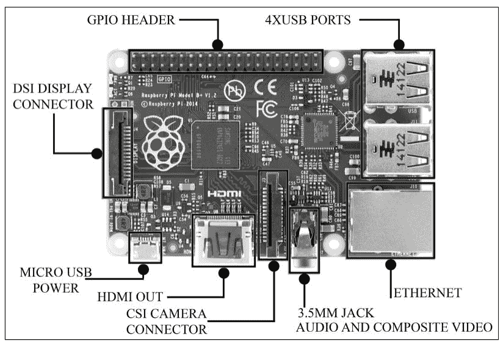

由于采用了更强大的处理器和升级的内存，Raspberry Pi 2 Model B 的性能提升了六倍。在 RasPi 1 model B 的图中顺时针方向，重要连接器的简要描述如下：

- **GPIO 引脚：** GPIO 代表通用输入输出，它已引出到板上的引脚连接器上。板载处理器（`BCM283x`，RasPi 的大脑）具有在你的程序运行时提供特定功能的能力。我们将在接下来的章节中频繁使用它们。这种设计的妙之处在于，你可以在程序中为特定的 GPIO 分配任务，当程序执行时，它会相应地变为低电平或高电平（触发关闭和开启状态）。我们可以从任何其他外设（如传感器）读取值，并在自己的程序中计算接收到的值。除了读取值，我们还可以通过将 LED 或嵌入式 LCD 显示器连接板子上显示程序结果。根据代码中的决策，我们可以通过电机驱动电路通过 GPIO 驱动电机连接器。RasPi 的这一功能与普通计算板相比差异巨大，为开发者提供了创作的自由。

> 例如，在你的某个应用程序中，如果温度低于 20 摄氏度，连接到 RasPi 的温度器会通过指定的特定 GPIO 信号并开始加热。GPIO 通常工作在逻辑高电（1，开启）和逻辑低电（0，关闭），它将按照你编程的方式工作！

- **RCA 视频输出：** 这是最广泛使用的连接器之一，新旧电视或显示器均在使用。它携带视频信号，这是 RasPi 上的输出类型。RCA 连接器或复合视频信号与 RasPi 1 model A+、model B 以及 RasPi 2 model B 上的 3.5 mm 音接口合并。

- **3.5 mm 音接口：** 如果你不使用 HDMI 连接（后文将描述），可以通过标准的 3.5 mm 接口通过扬声器或耳机播放音频。在 RasPi 1 model B+ 或 RasPi 2 model B 中，音频接口作为复合和音频的组合，具有复合视频和音频输出的所有功能。

- **USB：** 这是最常见的连接器，在现代计算机中广泛使用，因此被称为通用串行总线。你可以连接闪存驱动、键盘、Wi-Fi 终端和鼠标来玩 RasPi。你还可以将外部电源的 USB 集线器连接到 RasPi，以连接更多基于 USB 外设。

- **以太网：** 这是实现 RasPi 远程登录和提供有线互联网连接最重要的连接之一。在本章的后续章节中，我们将使用它。我们不能总是将 RasPi 连接到专用器，因此我们使用远程登录，并在电脑屏幕上查看 RasPi 的整个桌面或命令行界面 (CLI)。

- **CSI 摄像头接口：** RasPi 没有集成摄像头模块，但单独购买的摄像头模块可以通过 15cm 的柔性线通过 CSI 接口连接。较长的柔性线会导致图像质量变差。500 万像素 Raspberry Pi 摄像头模块可以录制高清视频和照片。对于初学者很容易用，但如果你想扩展知识，它为高级用户提供了许多丰富功能。此摄像头模块提供了比 USB 连接摄像头更强的性能。

- **HDMI 接口：** 高清多媒体接口 (HDMI) 是一种紧凑的音频/视频接口，用于传输未压缩的媒体数据。你可以连接现代 HDTV 通过 RasPi 观看高清 (FHD/HD) 视频。如果你插入 HDMI 接口，就不需要将扬声器连接到音频接口，如果你想在 HDMI 和 3.5 mm 接口上同时获得声音，你就必须处理并编辑 Linux 的内部文件。

- **Micro USB 电源：** 你靠食物生存，不是吗？RasPi 也是（某种程度上）。它需要电源才能运行。设备可以通过 5V 输入电压供电，电流额定值完全取决于你连接到 RasPi 的设备。你见过 RasPi 上有电源按钮吗？事实上，RasPi 模块本身没有电源开关。因此，只需插入 Micro USB 电源适配器即可启动 RasPi。

> Raspberry Pi A 和 B 型号可以使用最大电流为 1 安培，如果是这样，你需要连接到一个需求超过 1 安培的 USB 设备，那么你必须将其连接到外部电源的 USB 集线器。例如，USB 盘需要大量的电流才能运行，RasPi 无法通过 USB 端口提供。或者，B+ 在需要连接设备到外部电源 USB 集线器之前可以使用最大功率为 2 安培。如果你正在设计遥控汽车或四旋翼飞行器，可以连接电源宝和电池到 RasPi。如果你不确定 USB 设备需要多少功率，请购买外部电源的 USB 集线器。

- **SD 卡槽：** Raspberry Pi 没有板载内存，因此购买 SD 卡是获取数据存储以及操作系统的唯一途径。

- **显示接口：** 最后但不是，显示接口用于连接 7 英寸 LCD 到板子上。但通常 RCA 和 HDMI 就足够了。

## 第1章（续）

### 首次设置

在最近购买 RasPi 后，你现在需要让它准备好工作。在本节中，我们将为 RasPi 安装一个操作系统。

Raspberry 运行在开源平台 Linux 上。RasPi 最流行、稳定且广泛使用的操作系统是 Raspian。为什么我们要使用 Raspian 而不是直接使用 Linux？简单是因为 Raspberry 为硬件编写了所有设备驱动。简而言之，设备驱动是向运行的操作系统提供硬件细节的程序，并支持用户界面接收/发送命令。RasPi 的硬件与个人电脑或通用计算机不同，需要修改过的操作系统来充分利用资源。对于想要遵循默认标准的人来说。

你可以从 Raspberry 网站下载 Whezy-Raspian 安装（镜像文件）：`http://downloads.raspberry.org/raspberry_latest`。如果你想安装无 GUI 的 Linux 版本（直接 CLI），可以尝试 Arch Linux。它可以从 ArchLinuxArm 页面下载：`http://archlinuxarm.org/os/ArchLinuxARM-rpi-latest.tar.gz`。

#### 安装操作系统

我们需要一些组件才能成功启动 RasPi。注意，本节适用于第一次使用 RasPi 且没有购买预装 SD 卡的用户。如果你已经在 SD 卡上安装了操作系统，则可以跳过此节，或者只需查看步骤以帮助刚买新 RasPi 的朋友。

#### 购买你的 SD 卡

当你购买 RasPi 模块时，它可能带有或不带有 SD 卡。如果你的 RasPi 没有带 SD 卡，那么你应该购买的最小容量是 4 GB。我有一个 8 GB 的 SD 卡用于 RasPi，它运行良好且足以应对几乎所有的项目。

> 对于服务器应用，如果你需要更多空间，那么更大容量的 SD 卡将很有用。

#### 下载所需的软件

一旦你有了一张 SD 卡，就可以开始这一步了。这些步骤在我的个人博客中也有详细的解释，你可以访问：`http://rushgaj.blogspot.in/2014/03/setting-up-raspberry-pi-for-first-time.html`。

让我们看看不同操作系统的流程。

##### Windows

在 Windows 上操作时，需要记住以下几点：

- 格式化 SD 卡：使用 SD 存储协会的工具（`www.sdcard.org/downloads`）来格式化/清除 SD 卡上的旧数据。与计算机操作系统提供的通用格式化功能相比，使用 SD 格式化工具可以为你的内存卡提供最佳性能。
- 将操作系统镜像写入 SD 卡：下载好的 Raspian 操作系统将使用流行的且免费的工具 `Win 32 Disk Imager`（`sourceforge.net/projects/win32diskimager/`），从原始磁盘镜像写入到可移动设备中。按照屏幕上的步骤进行操作，你就可以轻松地在你的 SD 卡上写入 Raspian 镜像。完成此过程后，跳转到下一节。

##### Mac OS X

在 Mac OS X 上操作时，需要记住以下几点：

- 下载将操作系统镜像写入 SD 卡的软件：Mac OS X 用户有多种工具可用，如 `ApplePi-Baker`、`PiWriter` 和 `Pi Filler`。`PiWriter` 是一个基于命令行（CLI）的工具，而 `ApplePi-Baker` 和 `Pi Filler` 是基于图形界面（GUI）的工具。推荐使用 `Pi Filler`，因为它比其他工具更简单更快速。你可以从 `http://ivanx.com/raspberrypi/files/PiFiller.zip` 下载。
- 将镜像写入 SD 卡：插入 SD 卡，在工具中定位或选择下载的镜像，并在自动弹出的菜单中清除 SD 卡。选择继续（continue）按钮将镜像写入 SD 卡。

##### Linux

在 Linux 上操作时，需要记住以下几点：

- 解压下载的镜像：如果你在桌面电脑上使用基于 GUI 的 Linux 操作系统，请打开下载文件夹并右键点击“提取此处”（Extract Here）来解压操作系统。
- 下载将操作系统镜像写入 SD 卡的软件：你可以从 Ubuntu 软件中心安装 `image writer`。打开软件中心并运行 `ImageWriter`。将 SD 卡插入你的桌面电脑，并按照 GUI 指引（点击“写入设备”按钮）定位并将镜像写入你的 SD 卡。

#### 扩展根文件系统

现在，是时候第一次启动树莓派了。在向 SD 卡写入操作系统的过程之后，将 SD 卡插入树莓派上的空槽中。通过 RCA 或 HDMI 连接连接显示器（或电视），通过将电源连接到 micro USB 接口为树莓派供电。你将看到配置界面。直接选择 `expand_rootfs` 选项（通过树莓派 USB 连接的键盘），并等待后台进程完成。当你将镜像写入 SD 卡时，所有内容都在一个紧凑的包中，需要为树莓派的完整运行进行扩展。扩展根文件系统（`expand_rootfs`）会调整 SD 卡中分区的大小，允许我们利用其中的内存空间。此时，你应该重启树莓派。

> 在使用 micro USB 为树莓派供电之前，必须插入 SD 卡并连接 HDMI 线缆。树莓派会读取通过 HDMI 传的信号以检查显示器连接。在启动初期，显示器不可用，它会禁用 HDMI 接口和流传输以优化性能。

#### 登录树莓派

当树莓派重启时，你将看到屏幕上运行着许多代码。不要慌！这是树莓派上运行的正常过程。当它稳定后，它会提示你输入用户名和密码。默认情况下，用户名是 `pi`，密码是 `raspberry`。

> 注意，在你输入密码时，屏幕上不会显示任何内容；不用担心。欢迎 Linux 世界！

一旦你输入了正确的密码，你就能在屏幕、显示器或电视上看到带有 `pi@raspberry~$` 的命令行（CLI），它现在准备好接收你的命令了。遵，船长！

#### 打开桌面

作为 `pi@raspberrypi-$` 输入 `startx` 命令并按回车。现在你有一个带有树莓派标志的白色屏幕和一个类似于我们个人桌面电脑的 GUI。尝尝吧！

如此，我们看到了一份关于首次设置树莓派的简单紧凑的指南。我们将通过为树莓派提供互联网连接来增加更多功能。没有互联网连接的计算机是不完整的，树莓派也是如此。这是我们需要解决的问题，特别是我们可以直接通过互联网在树莓派上下载各种库和应用程序。

## 将树莓派连接到互联网

一旦你完成了树莓派的设置，就是时候将其连接到互联网了。基本上，连接树莓派到互联网有两种非常常见的方法：第一种（最简单的方法）是通过使用 Wi-Fi 适配器或接收器进行 Wi-Fi 连接；第二种有点复杂，但它是利用所有现有资源的最经济实用方法，不需要额外的 Wi-Fi 适配器。这需要一台笔记本/台式电脑（PC）和一根以太线。我们将看到如何遵循每种方法。

## 通过 Wi-Fi 适配器上网

你可以从任何领先的在线商店或附近的电子产品商店购买树莓派的适配器。它的价格范围不等。当你将该适配器插入树莓派时，所有内容都在一个紧凑的包中。等等


# 树莓派首次设置与联网指南

## 下载所需的软件

一旦你有了一张 SD 卡，就可以开始这一步了。这些步骤在我的个人博客中也有详细的解释，你可以访问：[http://rushgaj.blogspot.in/2014/03/setting-up-raspberry-pi-for-first-time.html](http://rushgaj.blogspot.in/2014/03/setting-up-raspberry-pi-for-first-time.html)。

让我们看看不同操作系统的流程。

### Windows

在 Windows 上操作时，需要记住以下几点：

- **格式化 SD 卡**：使用 SD 存储协会的工具（[www.sdcard.org/downloads](https://www.sdcard.org/downloads)）来格式化/清除 SD 卡上的旧数据。与计算机操作系统提供的通用格式化功能相比，使用 SD 格式化工具可以为你的内存卡提供最佳性能。
- **将操作系统镜像写入 SD 卡**：下载好的 Raspian 操作系统将使用流行的且免费的工具 `Win32 Disk Imager`（[sourceforge.net/projects/win32diskimager/](https://sourceforge.net/projects/win32diskimager/)），从原始磁盘镜像写入到可移动设备中。按照屏幕上的步骤进行操作，你就可以轻松地在你的 SD 卡上写入 Raspian 镜像。完成此过程后，跳转到下一节。

### Mac OS X

在 Mac OS X 上操作时，需要记住以下几点：

- **下载将操作系统镜像写入 SD 卡的软件**：Mac OS X 用户有多种工具可用，如 `ApplePi-Baker`、`PiWriter` 和 `Pi Filler`。`PiWriter` 是一个基于命令行（CLI）的工具，而 `ApplePi-Baker` 和 `Pi Filler` 是基于图形界面（GUI）的工具。推荐使用 `Pi Filler`，因为它比其他工具更简单更快速。你可以从 [http://ivanx.com/raspberrypi/files/PiFiller.zip](http://ivanx.com/raspberrypi/files/PiFiller.zip) 下载。
- **将镜像写入 SD 卡**：插入 SD 卡，在工具中定位或选择下载的镜像，并在自动弹出的菜单中清除 SD 卡。选择继续（Continue）按钮将镜像写入 SD 卡。

### Linux

在 Linux 上操作时，需要记住以下几点：

- **解压下载的镜像**：如果你在桌面电脑上使用基于 GUI 的 Linux 操作系统，请打开下载文件夹并右键点击“提取此处”（Extract Here）来解压操作系统。
- **下载将操作系统镜像写入 SD 卡的软件**：你可以从 Ubuntu 软件中心安装 `ImageWriter`。打开软件中心并运行 `ImageWriter`。将 SD 卡插入你的桌面电脑，并按照 GUI 指引（点击“写入设备”按钮）定位并将镜像写入你的 SD 卡。

## 扩展根文件系统

现在，是时候第一次启动树莓派了。在向 SD 卡写入操作系统的过程之后，将 SD 卡插入树莓派上的空槽中。通过 RCA 或 HDMI 连接连接显示器（或电视），通过将电源连接到 micro USB 接口为树莓派供电。你将看到配置界面。直接选择 `expand_rootfs` 选项（通过树莓派 USB 连接的键盘），并等待后台进程完成。当你将镜像写入 SD 卡时，所有内容都在一个紧凑的包中，需要为树莓派的完整运行进行扩展。扩展根文件系统（`expand_rootfs`）会调整 SD 卡中分区的大小，允许我们利用其中的内存空间。此时，你应该重启你的树莓派。

> **注意**：在使用 micro USB 为树莓派供电之前，必须插入 SD 卡并连接 HDMI 线缆。树莓派会读取通过 HDMI 传的信号以检查显示器连接。在启动初期，显示器不可用，它会禁用 HDMI 接口和流传输以优化性能。

## 登录树莓派

当树莓派重启时，你将能够看到屏幕上运行着许多代码。不要慌！这是树莓派上运行的正常过程。当它稳定后，它会提示你输入用户名和密码。默认情况下，用户名是 `pi`，密码是 `raspberry`。

> **注意**：在你输入密码时，屏幕上不会显示任何内容；不用担心。欢迎 Linux 世界！

一旦你输入了正确的密码，你就能在屏幕、显示器或电视上看到带有 `pi@raspberry~$` 的命令行（CLI），它现在准备好接收你的命令了。遵命，船长！

## 打开桌面

作为 `pi@raspberrypi-$` 输入 `startx` 命令并按回车。现在你有一个带有树莓派标志的白色屏幕和一个类似于我们个人桌面电脑的 GUI。尝尝吧！

如此，我们看到了一份关于首次设置树莓派的简单紧凑的指南。我们将通过为树莓派提供互联网连接来增加更多功能。没有互联网连接的计算机是不完整的，树莓派也是如此。这是我们需要解决的问题，特别是我们可以直接通过互联网在树莓派上下载各种库和应用程序。

## 将树莓派连接到互联网

一旦你完成了树莓派的设置，就是时候将其连接到互联网了。基本上，连接树莓派到互联网有两种非常常见的方法：第一种（最简单的方法）是通过使用 Wi-Fi 适配器或接收器进行 Wi-Fi 连接；第二种有点复杂，但它是利用所有现有资源的最经济实用方法，不需要额外的 Wi-Fi 适配器。这需要一台笔记本/台式电脑（PC）和一根以太网线。我们将看到如何遵循每种方法。

## 通过 Wi-Fi 适配器上网

你可以从任何领先的在线商店或附近的电子产品商店购买树莓派的适配器。它的价格范围不等。当你将该适配器插入树莓派时，所有内容都在一个紧凑的包中。

# 会见你的伙伴 – 树莓派

从现在起，当你从 PC 访问树莓派时，必须始终使用此 IP 地址。

如果你是 Linux 或 Mac OS 用户，请将 SD 卡插入 SD 读卡器。你会看到两个分区。打开 `boot` 分区，并按照之前说明的步骤将 IP 地址添加到 `cmdline.txt` 文件中。

保存文件，从 PC 上安全地移除 SD 卡，然后进行下一步。

# 启动树莓派

现在是时候将 SD 卡插回树莓派并启动它了。在为树莓派供电之前，先在树莓派和 PC 之间建立以太网连接。你会看到树莓派上的多个 LED 灯闪烁，表示以太网连接已建立，且正在进行数据传输。在命令提示符（**开始菜单 | 运行 | `cmd.exe`**）中输入 `169.254.0.2` 来检查 PC 与树莓派的连接状态。注意，我们使用的是与 `cmdline.txt` 文件中输入的相同 IP 地址。它应该返回如下的响应：

```
C:\Users\RUSHI>ping 169.254.0.2
Reply from 169.254.0.2 bytes=32 time<1ms TTL=64
Reply from 169.254.0.2 bytes=32 time<1ms TTL=64
Reply from 169.254.0.2 bytes=32 time<1ms TTL=64
Reply from 169.254.0.2 bytes=32 time<1ms TTL=64

ping statistics for 169.254.0.2:
Packets: Sent = 4, Lost = 0 (0% loss),
Approximate round trip times in milliseconds:
Minimum = 0ms, Maximum = 1ms, Average = 0ms
```

`ping` 命令允许我们使用定义的数据包大小向主机发送数据包并期望它们返回。输出中的 `Lost = 0` 显示从 PC 发送到树莓派的所有数据包都已返回，且连接是通的。

对于 Linux 和 Mac OS 用户，可以通过在终端中输入 `ping 169.254.0.2` 命令来验证连接。在同一个命令提示符中输入 `ipconfig` 命令以获取 PC 的以太网端口 IP 地址。随后，输入 `ifconfig`（Mac OS 和 Linux 用户也使用此命令）并记录局域网连接（以太网）的 IP 地址，此处所示为 `169.254.121.232`：

| 以太网适配器局域网连接 | |
| :--- | :--- |
| 连接 DNS 后缀 | |
| 本地链接 IPv6 地址 | fe80::ed8e:2601:5396:79e8:10 |
| 自动配置 IPv4 地址 | 169.254.121.232 |
| 子网掩码 | 255.255.0.0 |
| 默认网关 | |


# 再次修改 cmdline.txt 以添加 PC 的以太网端口 IP 地址

关闭树莓派（`sudo poweroff`），取出 SD 卡，将其插入 PC，并按照“编辑树莓派的命令行文件”部分的操作。将记录的 IP 地址（在此例下为 `169.254.121.232`）添加到 `cmdline.txt` 文件的末尾，如下代码所示：

```
dwc_otg.lpm_enable=0 console=ttyAMA0,115200 kgdboc=ttyAMA0,115200 console=tty root=/dev/mmcblk0 roottype=ext4 elevator=deadline rootwait=169.254.0.2::169.254.121.232
```

在这里，双冒号（`::`）是放在树莓派 IP 地址和你的 PC IP 地址之间最重要的部分。然后，保存 `cmdline.txt` 文件。

# 在 PC 和以太网连接之间共享 Internet 连接

在安全插回 SD 卡并插入微 USB 适配器后启动树莓派。在 Windows PC 上，你需要通过导航到 `控制面板 | 更改适配器设置` 来打开 `网络和共享中心`，右键点击获取 Internet 连接的适配器并进入其属性。

# 会见你的伙伴 – 树莓派

> **注意**：PC 上通过无线 Internet 连接可能存在的联网情况。

点击**共享选项卡**。勾选**允许其他网络用户通过此计算机的 Internet 连接来连接**选项并点击**确定**。此设置更改了 PC 以太网端口的 IP 地址；我们需要重置它。

在适配器设置的同一个窗口中，进入**局域网连接**（以太网）的属性，双击 **IPv4** 设置，并同时点击**自动获得 IP 地址**以及**自动获得 DNS 服务器地址**。

> 我们为树莓派提供的 IP 地址可能与你家网络的子网类别不同。有趣的地方在于，该子网保留在树莓派和 PC 之间。如果你的 PC 的 Wi-Fi 适配器获取的是 192.x.x.x 范围内的 IP，不要慌。这种方法仍然有效，因为 Windows 允许跨子网的 Internet 共享。这是因为我们开启了 Internet 共享和以太网的自动设置。因此，Wi-Fi 到 PC (192.x.x.x) 和 PC 到树莓派 (169.254.x.x) 的场景均成功运行。

Mac OS 用户可以通过导航到**偏好设置** | **共享**来遵循相同的步骤，通过 GUI 操作非常简单。

Linux 用户可以点击顶栏的网络菜单并导航到**编辑连接...**，然后双击有线连接，保持无线连接不变。导航到 **IPv4 设置**选项卡并选择方法：**共享给其他**。

# 在 PC 上安装并打开免费的 SSH 客户端

**Secure Shell (SSH)** 是一种用于安全数据通信的加密协议。这意味着网络计算机之间的远程命令行登录和远程命令执行。在这里我们使用它来实现 PC 与树莓派之间的命令行登录和远程命令执行。独特且免费的 SSH 客户端是 Windows 的 `PuTTY` (www.putty.org)，它是开源的，你可以免费下载。在 Windows PC 上运行 `PuTTY` 并进行如下设置：

对于 Linux 和 Mac OS X 用户，不需要安装 `PuTTY` 客户端，因为他们可以直接在终端窗口中通过 `ssh pi@169.254.0.2` 命令完成此任务。

1. 在 `PuTTY` 的 Host Name 框中提供你在 `cmdline.txt` 中输入的相同 IP 地址（根据上一节示例为 `169.254.0.2`）。
2. 随后，导航到 `Category | Connection | SSH | X11` 并启用 X11 转发选项。
3. 在左侧 Category 菜单中，点击 Session，在 Saved Sessions 字段中输入会话名称并保存，这样每次连接树莓派时无需重新保存设置。
4. 双击保存的连接，输入会话名称。
5. 双击保存的连接，输入用户名和密码以连接到树莓派。

在 RasPi 中，`LXTerminal` 是 RasPi 最终的终端工具。如果你使用的是 `PuTTY` CLI 而不是桌面版，那么 `PuTTY` CLI 终极就是终端！

如果我们介绍并解释所有的 Linux 命令，这将会是一份非常长的列表。即使是一本比这书厚一倍大小的书，也不足以完全阐述所有命令的功能。我们将看到在书中至关重要并将全程使用的命令。此列表可以作为参考，而且理解这些命令是必要的：

- `pi@raspberry:~$`：现在是时候介绍最常见的命令了。它会在你第一次登录以及之后每次登录 RasPi 时欢迎你。它显示了你的用户名和 RasPi 的主机名。在这里，你的用户名是 `pi`，主机名是 `raspberry`。
- `sudo`：这是 SuperUser DO 的缩写。此命令赋予你 Linux 超级用户（最强大的用户）的所有权限。它通常与 `nano`、`chmod` 等其他命令结合使用。通过输入 `sudo` 命令，你可以进入超级用户模式，在该模式下，你可以在任何文件夹中执行、删除和创建任何类型的文件。这真的让你在 Linux 中拥有了超能力！


> 如果使用不当，`sudo` 命令可能是危险的。它可以被用于黑入 Linux 系统，或者这种超能力可能允许你删除整个 Linux 内核；记住，下次 PC 将无法启动！

- `man`：此命令用于显示 Linux 命令和其他函数定义的说明书（manual）。输入 `man sudo`，你将获得与 `sudo` 命令相关的所有细节。

- `pwd`：这是工作目录（working directory）的缩写。它显示你当前正在工作的目录。输入 `pwd` 并按回车键。这应该显示类似 `/home/pi` 的内容。

- `ls`：这是一个用于列出文件或搜索特定目录下包含某些文件的命令。只需输入 `ls` 并按回车键，即可列出系统中包含的所有文件。`ls` 的选项有 `-a`、`-l` 等。只需输入 `man ls` 后按回车键，即可查看其不同的可用选项。

## 结识你的伙伴 – 树莓派

- `cd`：此命令代表更改目录（change directory）。只需在 `cd` 命令后给出一个路径，你就会进入该目录。例如，`cd /home/pi/python_games` 会直接带你进入 python_games 文件夹，而 `cd ..` 则会从特定目录向外移动一级。

- `apt-get`：任何基于 Debian 的 Linux 发行版的包管理器。它允许你在 RasPi 上安装和管理新包。一旦你的 RasPi 连接了网络，输入 `sudo apt-get <package-name>`。它将下载并安装该包。要移除一个包，使用 `sudo apt-get remove <package-name>`。要更新和升级操作系统，你可以分别使用 `sudo apt-get update` 和 `sudo apt-get upgrade`。

- `cp`：用于将文件从一个目录复制到另一个目录，例如，`cp /home/pi/python_games/gemi.png /home/pi/gemi.png` 将 gemi.png 文件从 `/home/pi/python_games` 复制到 `/home/pi/` 文件夹。你可以使用 `mv` 命令代替 `cp` 将文件从一个文件夹移动到另一个文件夹。

- `rm`：它用于删除指定的文件（当使用 `rmdir` 时为删除目录）。例如，`rm gemi.png`。

> 有一个重要的警告：通过这种方式删除的文件通常无法恢复。

- `cat`：它列出文件的内容；例如，`cat example.sh` 将显示 example.sh 文件的内容。

- `mkdir`：它在当前工作目录下创建新目录；例如，`mkdir packt` 会在当前工作目录下创建一个 packt 目录。只需使用 `ls` 命令通过列表检查它是否已创建。

- `startx`：此命令为 RasPi 提供了运行窗口会话的用户界面。

- `sudo shutdown -h`：这将终止 RasPi 上的所有进程，而 `sudo halt` 会停止 CPU 处于运行模式并停止操作系统。`sudo poweroff` 命令会安全地关闭 RasPi 模块。

这些是 RasPi 最常用的命令。如果你的项目需要更多命令，我们将在相关之处向你介绍它们。

让我们创建第一个 shell 文件：

请注意，这是对 shell 的非常简短的介绍，现在你将学习贯穿全书用于创建项目的有用命令。

## 安装实用库

我将这一节比作淋了巧克力酱的冰淇淋（美味！吸溜！）。如果你手里拿着一个香草冰淇淋，你可以享受这个冰淇淋，但一旦在上面淋上巧克力酱，它就会变得更美味，不是吗？在 RasPi 上安装库也是同样的场景。增加了库的 RasPi 非常惊人，它可以提供你想要的功能，无论是在 GPIO 上还是摄像头接口上。库是一组特定的函数，让你在编写程序时更加轻松。

我们将逐步安装这些实用库。要安装这些库，你只需要通过 PuTTY 在 RasPi 上连接网络，如前几节所述。

## 结识你的伙伴 – 树莓派

> 在安装任何库之前，请确认你的操作系统已获得最新更新。始终通过输入以下命令检查升级和更新：

```
sudo apt-get update
sudo apt-get update
```

在这里，我们更新 RasPi 以提供有关最新包版本和依赖项的信息。所有存储库将获得它们的信息。

有很多可用的库，但我们将在接下来的章节中根据需要再进行安装。安装这些库非常简单，这为什么不简单呢？Linux 太棒了！

# 准备好 Python 和 C 语言

我们将使用 Python，因为它是一种非常简单但强大的语言，而且由于它的缩进和标准英语关键词，它易于编写和阅读。

目前有两个主要版本可用，关于 Python 2 优于 Python 3 的争论仍在进行中。你可以在这里 <https://wiki.python.org/main/Python2Or3> 阅读相关内容。
本书将主要使用 Python 2.7x。如果你是初学者并想学习 Python，我建议你选择 Python 3；两者之间没有太大区别，但存在一些明显的差异，你也将观察到这些差异。

在使用已有的库（如 `wiringPi`）开发项目时，C 语言提供了充足的益处，它可以让你对 GPIO 引脚有完全的控制。如果你以前用 C 语言开发过项目，你可以集成 `wiringPi` 函数并获得与之前项目相同的功能。此外，你还可以同时使用 GPIO。

让我们尝试一下这两种语言；这不会让你完全掌握编程的全貌，但它会给你一个良好的开始并激发兴趣。我们将逐一学习这两种语言。

## 编写并执行 Python 程序

当你使用树莓派（RasPi）时，Python 已经是一个安装好的组件。在 Linux CLI 中，你只需要输入 `python`，Python CLI 就会等待你输入命令。只需输入 `print "this is my first program in Python"` 并按回车。漂亮！你执行了一个 Python 命令。这现在还无法让你直接编写完整的代码，那么如果你想写长代码该怎么办？有比这更好的方法，我们将在整个书中都使用那种方法。

输入 `sudo nano example.py`，你会在屏幕上看到 nano 文本编辑器。然后输入以下代码：

```
name = "Hello " + name
print name
for i in range(3):
    print "Whoa"
import this
```

现在按 `Ctrl + X`，然后按 `Y` 保存更改。你将回到 Linux CLI。现在输入 `python example.py`。Python 程序将被编译，输出将在同一个窗口中显示。你应该注意的一点是，缩进在 Python 中是非常重要的。删除 `print "whoa"` 脚本之前的缩进并执行程序；你会发现一个缩进错误。在循环中，编写代码时应特别注意插入缩进。这使得程序对其他程序员来说易读。

## 编写并执行 C 程序

你应该知道，现今最强大的语言是 C，它允许我们满足所有的编码需求。C 语言非常常见，是一种必不可少的语言。让我们过一下执行 C 程序的步骤，这与执行 Python 程序几乎相似。

在 LXTerminal 或 PuTTY 中输入 `sudo nano example2.c`。然后你可以输入任何 C 代码，或者作为初学者，你可以尝试这段代码：

```
#include<stdio.h>
int i;
int main()
{
    for(i=0;i<3;i++)
    printf("Harder you work, Luckier you get")\n
    return 0;
}
```

现在按 `Ctrl + X` 并按 `Y` 保存更改。现在轮到我们编译并执行程序了。C 程序编译器始终包含在 Linux 发行版中，可以是 `cc` 或 `gcc`。输入此命令来编译 C 程序：

```
gcc -o example2 example2.c
```

在 `-o example2` 中，`example2` 部分将是输出文件名，`example2.c` 部分是编写 C 程序后保存的文件。按回车并检查错误。通过输入 `nano example2.c` 修正并解决它（如果发生错误）。一旦成功编译，使用 `ls` 命令检查是否创建了输出文件。输出文件名将是 `example2`。你现在可以输入 `./example2` 执行编译后的代码。

这些过程对于创建传感器项目非常有帮助，一旦你练习了更多代码，理解这个过程对你来说就很容易。

## 练习 {完美

本节包含了一些练习题，应该在 shell、C 和 Python 中进行练习。这背后的原因是它可以让你在理解问题和程序逻辑方面变得更强大，这真的可以帮助你轻松地制作传感器项目。这些练习不会涵盖或给你提供整个语言或脚本的概念，但会让你足够熟悉并理解后续章节使用的代码。

我建议你通过以太网线将树莓派连接到电脑，并使用前节介绍的方法执行程序。你可以借助互联网（<www.cprogramming.com/quiz/>）来理解逻辑和语法。这里显示的题述应该在所有三种语言/脚本中尝试，这将让你有足够的思路来处理脚本和语言：

- 编写一个程序获取 1000 以下的所有阿姆斯特数（Armstrong numbers）。注意，在三位数中，阿姆斯特数等于其各个数字的立方和。例如，153 是一个阿姆斯特数，因为 153 = 1³+5³+3³。

- 将温度从摄氏转换为华氏，反之亦然。要求用户获取值并决定他们输入的是摄氏还是华氏。如果温度超过 38 摄氏度或 100 华度，则显示警告消息。

- 创建一个具有所有功能的计算器，如加减除乘。询问用户想要的功能。如果除以零则显示错误。

在本章中，你了解了树莓派上不同的接口和功能。我们成功地在树莓派上安装了操作系统并与其共享网络连接。通过这些过程，你学习了基础 Linux 命令和 shell 脚本，这些在开发应用程序时经常使用。然后我们安装了库（就像在香草冰淇淋上加巧克力酱一样）。对编译和执行 C 程序进行了简要介绍，以启动工作。

> 我相信你将解决本章末提出的问题，以获得对代码如何运行的想法。这对后续章节有很大帮助。

在下一章中，你将学习电子学的基础，以便轻松开发项目。这些基础对于接口传感器至关重要。你还将学习传感器如何与树莓派通信。我们将运行简单的代码驱动 GPIO 引脚上的 LED。

# 结识电子世界

你甚至无法离开电子过一天，对吗？电子无处不在，从你的牙刷到汽车，再到飞机和太空船。在本章中，我们将学习电子学的基本概念，这些概念在构建项目时非常有用，以便有一天我们制造自己的产品并震惊世界。你可能读过很多关于电子的书，当你真正想要创建或构建项目时，它们可能会让你感到枯燥。我认为解释电子及其应用一定有理由，因此本章提供了电子领域各种术语的基础解释及其在项目中的用途。

一旦你了解了电子，我们将介绍通信协议及其在电子组件通信方面的用途。在开始处理树莓派上的 GPIO 之前列出了提示和注意事项。然后，你将理解 GPIO 的功能并使用 shell、Python 和 C 代码闪烁 LED。

在本章中，你将学习以下主题：

- 基础电子术语和基础知识
- 电子组件如何通过 UART、SPI 和 I2C 协议相互通信
- GPIO 基础
- GPIO 端口功能以及使用 shell 脚本、Python 和 C 语言点亮 LED

首先让我们涵盖一些电子的基础知识。

## 电子学基础术语

电子世界存在大量的术语。从硬件到软件，有数百万个概念被用于创建惊人的产品和项目。你已经知道 RasPi（树莓派）是一台单板计算机，它包含了大量的电子元件，这使得我们能够非常方便地控制和通过其 GPIO 接口连接数字电子设备。通常情况下，当我们谈论电子学时，它指的是硬件，或由多个集成电路（IC）以及不同的电阻、电容、电感等许多组件组成的电路。但情况并非总是如此；当我们使用可编程 IC 构建硬件时，我们还需要考虑内部编程（软件）。例如，在微控制器或微处理器中，或者在 RasPi 的情况下，我们可以将程序（技术上是永久/写入程序）到 IC 中，这样当 IC 通电时，它就会按照程序中编写步骤运行，并按照我们的的方式运行。这就是机器人、洗衣机和其他家电的工作原理。所有电器都有不同的设计复杂度，这取决于它们的应用。有些功能可以通过软件和硬件完成。设计者必须通过实验来分析权衡；例如，解码功能可以写在软件中，也可以通过连接逻辑 IC 在硬件上实现。开发者必须分析速度、尺寸（硬件和软件方面）、复杂度以及许多参数来设计这类功能。讨论这些理论的点仅仅是为了说明电子设备可以有多复杂。我们现在不需要深入研究电子学，但对你来说，了解这些术语非常重要，因为在构建 RasPi 项目时你会频繁用到它们。

## 电压

是谁发现了电压？好了，现在这不重要，让我们先理解它。基本概念遵循水流背后的物理学原理。水有两种流动方式：一种是瀑布（例如，从山顶到地面），另一种是使用水泵的强制流动。电压背后的概念相似。电压是两点之间的电差，这意味着电压差允许电荷（电子）从高电位流向低电位。为了理解前面的例子，考虑一下闪电，它可以比作瀑布；而电池可以比作水泵。当电池连接到电路时，化学反应会将电荷流从正极泵到负极。电压通常以伏（V）为单位。AA 电池通常提供 3V。顺便提一下，电压一词是以伟大的科学家亚历山德·伏特（Alessandro Volta）命名的，他发明了伏特电池，当时被称为电池单元。

## 电流

电流是电荷（电子）的流动。每当产生电压差时，会导致电流以固定方向从正极（高电位）流向负极（低电位）（称为规定电流）。电流以安培（A）为单位。电子流从电池的负极流向正极。为了避免混淆，我们将遵循规定电流，即从电池或电源的正极流向负极。

## 电阻

牛津词典中“resist”一词的意思是“试图阻止或防止”。正如定义所说，电阻简单地防止电流的流动。当电流流过电阻时，内部会产生电压降。这种下降直接取决于流过电阻的量以及电阻值。有一个公式可以计算跨电阻（或电路中）的电压，这被称为欧姆定律（`V = I * R`）。电阻以欧姆（Ω）为单位。让我们通过这个例子看看如何计算电阻：如果电阻为 10Ω，流过电阻的电流为 1A，那么电阻两端的电压降为 10V。另一个例子：当我们在 5V 电上连接 LED 时，我们会与 LED 串联一个 330Ω 的电阻，以防止电流过大导致 LED 烧毁。电阻消耗了部分电压保护了 LED。我们在开发项目中将广泛使用电阻。

## 电容

电阻以热的形式耗散能量。相比之下，电容在其两个导电板之间储存能量。电容通常用于过滤滤波电路中提供的电压，并在放大器电路中产生清晰的声音。解释电容的概念对这里来说太沉了，所以让我进入正题：当我们有电池来储存能量时，为什么要在电路中使用电容呢？在电路中使用电容有几个好处。许多书会告诉你它充当滤波器或浪涌抑制器，它们会使用电源平滑、去耦、直流隔绝等术语。在我们的应用中，电容与传感器一起使用，它们保持一段时间电压，以便微处理器有足够的时间读取电压值。传感器的数据变化很大。只要微处理器正在读取该值，它就需要保持稳定，以避免错误计算。电容的保持时间取决于 RC 时间常，我们将在实际使用它时进行解释。

## 开路和短路

现在，有一个值得注意的点：当端子上存在电压但端子之间没有连接元件时，没有电流流动，这通常被称为开路。相比之下，当两个端子连接（无论是否连接元件）并允许电荷流动时，被称为短路、接通电路或闭路。

> 这里有一个警告：不要短路（直接连接）电源的端子，例如电池、适配器和充电器。可能会导致严重损坏，包括火灾和元件故障。如果我们连接一根没有电阻的导线，看看欧姆定律的结果：`R = 0Ω` 则 `I = V/0`，所以 `I = ∞`。在理论上，这被称为无限（可数的），在实际上，这意味着火灾或爆炸！

## 串联和并联

在电理论中，当流过元件的电流不分成路径时，它是串联。同样，如果流过每个元件的电流相同，则这些元件被称为串联。如果所有元件两的电压相同，则该连接被称为并联。在电路中，可以是串联和并联的组合。因此，电路可能不是纯串联或纯并联电路。让我们学习图中所示的电路：


## 第二章

初看，这张图看起来很复杂，有很多符号，但让我们单独观察每个元件。左图的图是元件的串联。电池提供电压（V）和电流（I）。电流的方向显示为顺时针。在串联中，流过每个元件的电流是相同的，但所有元件上的电压值是不同的。因此，`V = V1 + V2 + V3`。例如，如果电池提供 12V，每个电阻上的电压为 4V。流过每个电阻的电流为 4 mA（因为 `V = IR` 且 `R = R1 + R2 + R3 = 3K`）。

右图表示并联。在这里，每个元件获得相同的电压，但电流被分成不同的路径。从电池正极流出的电流是 I，它分为 I1 和 I2。当 I 流向下一个节点时，它再次分成两部分流过 R5 和 R6。因此，在并联电路中，`I = I1 + I2`。所有电阻上的电压保持相同。例如，如果电池提供 12V，所有电阻的电压均为 12V，但通过所有电阻的电流将是不同的。在并联示例中，可以通过应用分流公式计算流过每个电路的电流。尝试计算一下！

当存在串并联电路组合时，需要更多的计算和分析。基尔霍夫定律、节点方程和网路方程可以用于解决这类电路。这些内容在书中解释太复杂了；你可以参考任何标准的电路理论相关书籍并获得专业知识。

> 基尔霍夫电流定律：在电子电路的任何节点（接点）处，流入节点的电流之和等于流出节点的电流之和。

> 基尔霍夫电压定律：任何闭合网络周围的电位差（电压）的方向矢量和为零。

## 上拉电阻和下拉电阻

上拉电阻和下拉电阻是电子系统设计中重要的术语之一。正如本节标题所示，有两种类型的拉电阻：上拉电阻将端子拉到供电电压，而下拉电阻将端子拉到地线或公共线。将拉电阻连接到节点或端子上的意义在于，当特定端子上没有输入时，将逻辑电平恢复到默认值。包含上拉或下拉电阻的好处是它可以使电路对噪声敏感，且逻辑电平（1或0）不会因为端子上电压的微小（由噪声引起）而改变。请看所示的示例。它展示了一个带有非门的上拉示例（非门在其输出端子上提供反相输出；如果逻辑为1，则输出为逻辑0）。我们将考虑有、无上拉电阻的影响。下拉电阻的情况也是如此。

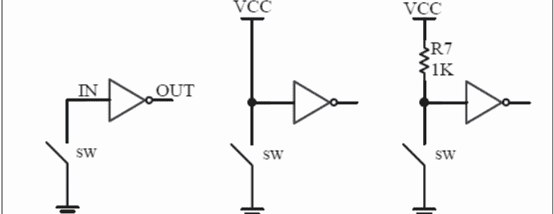

### 有无上拉电阻的连接


通常情况下，逻辑门的输入端子具有高阻抗，因此当输入端子上没有连接时，被称为“浮空”。现在，在前面的图中，最左侧的连接是不推荐的，因为开关是开启的（关闭状态），它导致输入端子浮空，任何噪声都可以改变非门的输入状态。噪声的原因可能是任何原因。甚至是开启的端子也可以当作天线，在非门的引脚上产生噪声。中间所示电路是不带电阻的上拉电路，强烈建议不要使用。这种连接可以被称为上拉，但绝不应使用。当开关关闭（开启状态）时，VCC获得了直接通地的路径，这等同于短路。大量电流将从VCC流向地，这将损坏你的电路。

最右侧的图显示了上拉的最佳方法，因为有一个电阻会产生一定的电压降。当开关开启时，非门的端子将浮空（上拉）到VCC，这是默认值。当开关关闭时，非门的输入将连接到地并处于逻辑零状态。此时流经电阻的电流是额定的。例如，如果 `VCC = 5V`，`R7 = 1K`，且 `I = V/R`，则 `I = 5mA`，处于安全区域。对于下拉电路示例，开关和非门的输入之间可以交换位置。在使用传感器和IC时，请记住，如果数据表或技术手册中使用上拉或下拉的符号，建议在任何需要的地方使用它们。在下一节中，我们将在一种通信协议中使用上拉电阻。

## 通信协议

到目前为止都是理论性的。上一节是为了让你理解电子方面的一些有用概念。微处理器的外设可以包含包括IC和数字传感器在内的众多组件。外设设备可能有大量数据，并且需要将其发送到处理器。它们是如何通信的？处理器是如何理解数据正在进入它并是由传感器发送的？IC和微处理器之间存在串行并行连接。并行连接比单线的快，但较不受欢迎，因为它们需要更多线路，例如8条、16条或更多。PCI总线可以作为并行通信的一个示例。通常在复杂或高密度电路中，处理器连接到许多外设，在这种情况下，我们没有足够的空闲引脚/线路来连接额外的单个IC。串行通信根据使用的协议最多需要四根线。尽管如此，不能说串口优于并行，但在引脚资源较低的情况下，串口是首选的。在串口通信中，数据通过帧或数据包发送。大数据被分成块，并通过帧或数据包通过线路发送。什么是协议？协议是在IC与微处理器接口时需要遵循的一set规则，不仅限于连接。协议还定义了帧结构、帧长度、电压电平、数据类型、数据速率等。有很多标准的串口协议，如`UART`、`FireWire`、`以太网`、`SPI`、`I2C`等。`RasPi 1`型号A、A+、B+以及`RasPi 2`型号在扩展口有一个`SPI`引脚、一个`I2C`引脚和一个`UART`引脚。我们将一个一个查看这些协议。

## UART

`UART`是一种在几乎每台PC或微处理器中都能常见的接口或协议。`UART`是通用异步收发器（Universal Asynchronous Receiver and Transmitter）的缩写。这也被称为`RS-232`标准。该协议是全双工的完整标准，包括特定通信实例的电气、机械和物理特性。当数据通过总线发送时，数据电平需要改变以适应`RS-232`总线电平。传输器在总线上发送变化的电压。大于3V的电压值为逻辑零，而小于-3V的电压值为逻辑一。-3V到3V之间的值被称为未定义状态。微处理器将数据发送到晶体管逻辑（TTL）电平；当我们将其发送到总线时，电压电平应增加到`RS-232`。

### TX RX

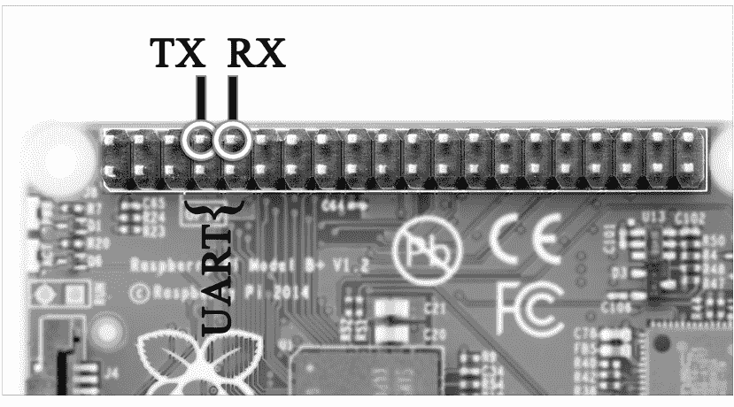

- 

## 串行外设接口

`SPI`（Serial Peripheral Interface）是一种全双工、短距离单主协议。与`UART`不同，它是一种同步通信协议。简单的连接之一是主从连接，如图所示。通常总共有四根线，即时钟（`clock`）、主入从出（`MISO`）、主出从入（`MOSI`）和片片选择（`CS`）。请看下面的图：

### CS0 (CE0) CS1(CE1)

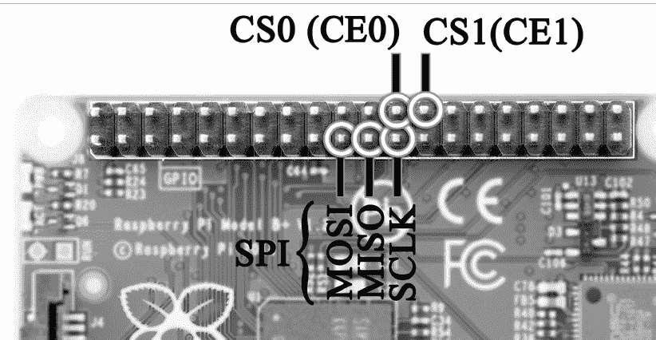

## 集成间电路 (I2C)

集成间电路 (`I2C`) 是一种通过两根线工作的协议，它是一种半双工协议（一种通信方式，其中发送者发送命令时，接收者只监听而不能传输任何内容；反之亦然），只需要两根线，即数据线 (`SDA`) 和时钟线 (`SCL`)。`I2C` 协议由飞浦专利，每当 IC 制造商想要在其芯片中包含 `I2C` 时，都需要许可。我们周围的许多 IC 和外围设备都集成了 `I2C` 通信协议。`I2C` 引线（`SDA` 和 `SCL`）始终通过电阻上拉到输入电压。`I2C` 总线支持三种速度：高速（3.4 MBps）、快速（400 KBps）和低速（小于 100 KBps）。据报道 `I2C` 通信距离可达 45 英尺，但最好保持在 10 英尺以内。

## 走进电子世界

每个 `I2C` 设备都有 7 到 10 位的地址；使用此地址，主设备可以始终连接并为特定的从设备发送数据。当你将设备与主设备建立接口时，从机制造商会提供供你使用的地址。每个从机都会接收数据，但只有该从机可以获取专门为其准备的数据。通过地址，主设备读取传感器中预定义数据寄存器中的可用数据，并在内部进行处理。`I2C` 总线配置的一般设置可以如图所示：


商店里有带有 `I2C` 接口的 16 x 2 字符 LCD 模块；你可以直接使用它们并相应地为 `RasPi` 编程。通常，LCD 需要 8/4 位并行数据位、重置位、读/写位和使能引脚。下图显示了 `I2C` 引脚，它们在所有 `RasPi` 型号上的位置都是相同的：

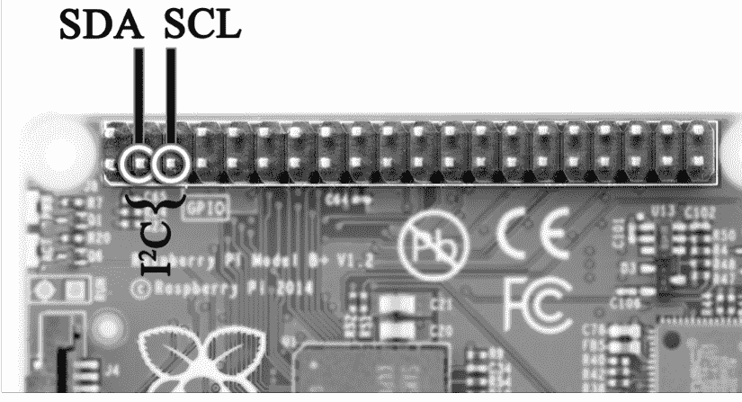

当我们谈论传感器接口时，`I2C` 协议是所有协议中最广泛使用的。Silicon Labs 的 `Si1141` 是一种接近和亮度传感器，现在用于手机以提供自动亮度和近距离检测功能。你可以购买它并轻松地与 `RasPi` 接口。Sension 的 `SHT20` 同样带有 `I2C` 协议，用于测量温度和湿度数据。步进电机可以使用基于 `I2C` 的控制器控制，这些控制器可以与 `RasPi` 接口。最神奇的是，如果你拥有所有这些传感器，就可以将它们连接到单个 `I2C` 上。在下一节中你将了解到，我们无法在 `RasPi 1` 型 B 或 B+ 以及 `RasPi 2` 型 B 上使用许多 GPIO。因此，带有 `I2C` 接口的模块适用于低引脚设备。这就是为什么你的串口通信非常有用的原因。

这些协议主要与 `RasPi` 使用。这里提供的信息并不详细，因为关于这些协议可以写很多页的内容，但在为 `RasPi` 编程时，这些信息可以帮助你构建项目。

## 有用的提示和注意事项

在讨论 `RasPi` 的实用性之前，让我们来看看在使用 `RasPi` 时的注意事项和提示。你需要阅读这些，因为你现在将要操作 `RasPi` 的 GPIO 了。本节将提供你在操作 `RasPi` 时需要记住的通用提示和警告：

- 避免触摸 `RasPi` 上的电子元件，即使是少量的汗水或身体产生的静电也可能损坏电路板。板上的元件非常小，可能会受到手部少量汗水和水的影响。请从角部接触，或者始终使用外壳来覆盖它。电子商店里有很多此类外壳。
- 将 `RasPi` 放在桌子上要小心。如果有小零件（剪断的线段）或桌子本身是金属做的，可能会导致 `RasPi` 的连接短路。
- 绝不要将电压高于 3.3V 的设备连接到 `RasPi` 的 GPIO 引脚。在第3章使用使用声波传感器测量距离中，我们将面临这种情况，你将学习如何克服它。每当你考虑将任何设备连接到 `RasPi` 时，请获取设备功率的所有详情。请避免通过将跳线导连接到 GPIO 来连接 `RasPi` 的 5V 电源线。
- 使用低功耗 LED 时，在 LED 的正极线上串联电阻（270 到 330Ω 效果良好）是一个好做法。请不要随机将电源和电线插入你的 `RasPi`。建议不要直接短路板子上的两个引脚。
- 不要尝试将需要大量功率的元件连接到你的 `RasPi`；LED 可以的，但直流电机不行。如果你想为 `RasPi` 建立接口，你需要一个电机驱动器。

## 理解 GPIO

我们将此引脚图与 `RasPi 1` 型 B+ 进行比较……（注：原文此处表述中断，直接进入表格）

| 物理编号/RasPi | Broadcom (BCM) |
| :--- | :--- |
| 引脚号 | 功能 |
| 1 | 3.3V |
| 2 | 5V |
| 3 | I2C SDA |
| 4 | DNC |
| 5 | I2C SCL |
| 6 | Ground |
| 7 | GPIO 4 |
| 8 | Ground |
| 9 | GPIO 14 |
| 10 | Ground |
| 11 | GPIO 18 |
| 12 | Ground |
| 13 | GPIO 27 |
| 14 | Ground |
| 15 | GPIO 22 |
| 16 | Ground |
| 17 | GPIO 17 |
| 18 | Ground |
| 19 | GPIO 27 |
| 20 | Ground |
| 21 | GPIO 23 |
| 22 | Ground |
| 23 | GPIO 8 |
| 24 | Ground |
| 25 | SPI CE |
| 26 | Ground |
| 27 | GPIO 0 |
| 28 | Ground |
| 29 | GPIO 7 |
| 30 | Ground |
| 31 | GPIO 8 |
| 32 | Ground |
| 33 | SPI MOSI |
| 34 | Ground |
| 35 | GPIO 10 |
| 36 | Ground |
| 37 | GPIO 13 |
| 38 | Ground |
| 39 | GPIO 19 |
| 40 | Ground |
| 41 | GPIO 21 |
| 42 | Ground |
| 43 | GPIO 2 |
| 44 | Ground |
| 45 | GPIO 24 |
| 46 | Ground |
| 47 | GPIO 26 |
| 48 | Ground |
| 49 | GPIO 1 |
| 50 | Ground |
| 51 | GPIO 6 |
| 52 | Ground |
| 53 | SPI MISO |
| 54 | Ground |
| 55 | SPI CLK |
| 56 | Ground |

## 接触电子世界

当不使用这些引脚进行 `I2C` 通时，我们可以将它们用于 GPIO，内部上拉电阻可以帮助优雅地连接开关。开关直接将此引脚短接地，你可以在为 `RasPi` 编写的代码中读取开关值。太棒了！下表了 `RasPi B` 型和 `RasPi 1 A+ B` 型 GPIO 引脚的特性：

| 物理 / RasPi 名称 | 宽通名称 (BCM) | | | | | | | |
| :--- | :--- | :--- | :--- | :--- | :--- | :--- | :--- |
| 左 | 右 | | 左 | 右 | | 左 | 右 |
| 引脚功能 | 引脚号 | 引脚 | 引脚功能 | 引脚功能 | 引脚号 | 引脚 | 引脚功能 |
| 3.3V | 1 | 2 | SV | 3.3V | 1 | 2 | SV |
| I2C SDA | 3 | 4 | SV | I2C SDA | 3 | 4 | SV |
| I2C SCL | 5 | 6 | GND | I2C SCL | 5 | 6 | GND |
| GPIO 7 | 7 | 8 | UART TXD | GPIO 4 | 7 | 8 | UART TXD |
| GPIO 9 | 9 | 10 | UART RXD | GPIO 9 | 9 | 10 | UART RXD |
| GPIO 11 | 11 | 12 | GPIO 12 | GPIO 17 | 11 | 12 | GPIO 18 |
| GPIO 13 | 13 | 14 | GND | GPIO 21 | 13 | 14 | GND |
| GPIO 15 | 15 | 16 | GPIO 16 | GPIO 22 | 15 | 16 | GPIO 23 |
| 3.3V | 17 | 18 | GPIO 18 | 3.3V | 17 | 18 | GPIO 24 |
| SPI MOSI | 19 | 20 | GND | SPI MOSI | 19 | 20 | GND |
| SPI MISO | 21 | 22 | GPIO 22 | SPI MISO | 21 | 22 | GPIO 25 |
| SPI SCLK | 23 | 24 | SPI CE0 | SPI SCLK | 23 | 24 | SPI CE1 |
| GND | 25 | 26 | SPI CE1 | GND | 25 | 26 | SPI CE1 |
| ID_SD | 27 | 28 | ID_SC | ID_SD | 27 | 28 | ID_SC |
| GPIO 29 | 29 | 30 | GND | GPIO 25 | 29 | 30 | GND |
| GPIO 31 | 31 | 32 | GPIO 32 | GPIO 6 | 31 | 32 | GPIO 12 |
| GPIO 33 | 33 | 34 | GND | GPIO 13 | 33 | 34 | GND |
| GPIO 35 | 35 | 36 | GPIO 36 | GPIO 19 | 35 | 36 | GPIO 16 |
| GPIO 37 | 37 | 38 | GPIO 38 | GPIO 26 | 37 | 38 | GPIO 20 |
| GPIO 39 | 39 | 40 | GPIO 40 | GPIO 39 | 39 | 40 | GPIO 21 |

引脚 7、11、13、15 等可以用作 GPIO 引脚。`RasPi 1 B` 型具有专用的 GPIO 引脚，可用于连接外设。相比之下，`RasPi 1 B+` 型总共有 17 个专用的 GPIO 引脚。如前所述，GPIO 工作在 3.3V 逻辑电平上，GPIO 的 0V 表示逻辑 0，GPIO 的 3.3V 表示逻辑高电。

引脚 8 和 10 用于 `UART` 通信端口。在将这些引脚连接到支持 `UART` 的外设设备时，正如上一个 `UART` 节建议的那样，还需要共享一个地。要使用 `UART`（也称为串口），需要配置位于 `RasPi` 引导分区的引导文件 (`cmdline.txt`)。你会在需要时进行操作。

引脚 19、21、23 和 26 用于连接支持 `SPI` 的外设。虽然 24 和 26 是 `SPI` 的 CS 引脚，但其余引脚是不容易理解的，因为你已经读过关于 `SPI` 通信的上一节。在特定时刻，如果你觉得不需要 `SPI` 通信，可以将它们用作 GPIO，且与 `I2C` 不同，这些引脚内部没有上拉。显然，它们为什么要上拉呢？

引脚 27 和 28 用于通过 `I2C` 连接接口 `I2C EEPROM` 接口。不要将这些引脚用于 `I2C` 以外的外设。在启动时可以查找连接到此端口的预编程 `EEPROM` 并完成 GPIO 的自动设置。无论是 `RasPi 2 B` 型还是 `RasPi 1` 型，你都了解所有的 GPIO ——真的！让我们在 GPIO 上进行一些练习吧。

## 是时候操作 GPIO 了！

先准备一些组件和线材：

- 标准 LED（一个，电压 3.3V）
- 邦线（一根红一根黑，2.54 mm 母母跳线）
- 以太网线，PC
- 电阻（330 Ω），位于 LED 正极和 `RasPi` 之间。

下图是准备制作的电路表示。黑点代表组件、线材和 `RasPi` 之间的连接。

是时候测试了。插入 SD 卡和电源适配器让 `RasPi` 开始工作。你已经安装了第 1 章中的 `wiringPi` 库，该库带有 `gpio` 函数，让你直接从终端访问 GPIO。为了测试 LED，我们需要在文件中编写代码。输入 `gpio-write 17 1` 点亮 LED，或者 `gpio-write 17 0` 关闭。这些命令可以在 `PuTTY` 或 Linux 系统中直接编写。通过 Python 或 C 自动化这些命令将在后续章节看到。

## Shell 脚本和 GPIO

我们已经知道 Shell 脚本是执行命令的一种方式。创建一个脚本来切换 LED：LED 开启一秒，然后关闭半秒，无限循环，直到按下 `Ctrl+C`。使用 `nano ledblink.sh` 打开编辑器并输入以下代码：


```bash
#!/bin/sh
echo "Hi, This is how I glow using Shell!"
echo "Press C to exit"
while ; do
  sudo gpio-write 17 1
  sleep 1
  sudo gpio-write 17 0
  sleep 0.5
done
```

`while` 用于创建无限循环。分号 `;` 是脚本中使用的符号。`do` 开始 `while` 循环。`sleep` 命令提供了秒延迟。按下 `Ctrl+X` 然后 `Y` 保存更改。在命令行中使用 `chmod +x ledblink.sh` 修改模式并允许用户执行程序。Shell 脚本不需要编译，所以只需输入 `./ledblink.sh`，恭喜！你用 RasPi 切换了 LED。

## LED 闪烁和 Python

Python 脚本有些长，但实现 GPIO 切换仍然很容易。我们将创建一个与 Shell 脚本相同的功能，但这次是循环 10 次而不是无限循环。打开文本编辑器，输入 `sudo nano ledblink.py`，然后开始编写以下代码。观察代码并享受闪烁：

```python
import RPi.GPIO as GPIO
from time import sleep
GPIO.setmode(GPIO.BCM)
GPIO.setup(17, GPIO.OUT)
print("All Set in Python! Let's Blink")
for i in range(1,10):
  GPIO.output(17, GPIO.HIGH)
  sleep(1)
  GPIO.output(17, GPIO.LOW)
  sleep(0.5)
GPIO.cleanup()
```

在命令行中输入 `python ledblink.py` 编译并执行代码。如果需要超级用户权限，使用 `sudo python ledblink.py`。导入 `RPi.GPIO` 库至关重要，因为它为 Python 脚本导入 GPIO 功能并告诉 Python 使用的 GPIO 函数用于控制 RasPi 的引脚。Python 中有一个名为 `time` 的库提供了延迟、时钟和其他时间相关的函数；因此根据需要从 `time` 库导入 `sleep()`。我们需要设置我们工作的模式。我们遵循 BCM 名称，所以我们需要告诉代码函数中提到的引脚号是 BCM 模式。下一个函数用于设置引脚的方向，即用于输入还是输出。它将引脚 11（BCM GPIO 17，参考 GPIO 表）设置为连接 LED 的输出引脚。`for` 循环设置范围从 1 到 10。与无限循环不同，它将运行 10 次后控制将退出循环。在 `for` 循环内部，代码是自解释的；它切换连接到 RasPi 部分引脚 11 的 LED。最后，`GPIO.cleanup()` 函数将在退出时重置 GPIO 状态。你可以看到如果更改缩进会有很大差异。例如，更改与 `GPIO.cleanup()` 对齐的 `sleep (0.5)` 的缩进。

## 使用 C 代码闪烁 LED

最后我们将用 C 语言编写相同的代码。RasPi 和 C 库非常容易使用，这令人印象深刻。我们已经安装了 `wiringPi` 库来访问 RasPi 的 GPIO。现在尝试一下代码。在 nano 文本编辑器中输入 `nano ledblink.c` 编辑 `ledblink.c` 文件：

```c
#include<stdio.h>
#include<wiringPi.h>
#include <time.h>
void main()
{
    wiringPiSetup();
    pinMode(17,OUTPUT);
    printf("\nI am using wiringPi, Blink Blink!\n");
    printf("\npress C to exit)\n");
    for();
}
```

```
digitalWrite(17,1);
delay(1000);
digitalWrite(17,0);
delay(500);
```

在调用 `wiringSetup()` 函数时应当包含 `wiringPi` 库。这为你的 C 代码引入了 GPIO 的所有功能。正如你在 Shell 和 Python 概念中看到的那样，几乎每个函数都是自而易懂的。

你可以通过输入 `gcc -o ledblink ledblink.c -lwiringPi` 来编译 C 代码，并通过输入 `./ledblink` 命令执行它。

按下 `Ctrl + C` 停止应用程序代码。现在你可以让你的 LED 休息一下了，它已经闪烁了很久！

## 总结

在本章中，你理解了电子基础知识，这些知识将有助于你后续进行更复杂的项目。这不仅仅关于电子学，还关于构建我们在后续章节中将涉及的项目所需的所有核心概念。在涵盖了电子概念后，我们深入研究了通信协议；了解电子设备如何协同工作非常有趣。你学到，就像人类使用共同语言交流一样，它们也使用共同协议进行相互通信。

在涵盖了 RasPi 扩展连接器的引脚分配后，我们通过 Shell、Python 和 C 语言编程 GPIO 端口实现了 LED 闪烁，这对于显示 RasPi 在运行期间做出的任何指示和决策都非常有用。同时学习电子学、通信协议以及用自己的方式让 LED 闪烁是非常令人兴奋的。你现在已经准备好了构建基于传感的项目所需的信息和技能。

在下一章中，我们将对超声波传感器进行“黑客操作”，以电子方式测量距离。你将能够坐在桌子上知道天花板的距离。我们还将构建一个辅助视障人士的项目，在有障碍物靠近时显示警告。这将非常有趣，让我们一起享受吧！

## 3 使用超声波传感器测量距离

我们人类有五种感官：触觉、嗅觉、视觉、听觉和味觉。然而，计算机和机器人可以拥有我们所需要的数量的感官。我们可以感知周围的不同事物；例如，皮肤可以感觉到温度的变化，但我们无法精确地说出感受到的实际温度值是多少。像 RasPi 这样的计算机可以用于感知和监控周围的实体。它工作得出色、精确且不知疲倦。RasPi 的计算和接口能力允许我们将传感器与其连接。

使用卷尺和里程计测量距离对于某些应用来说是不切实际或不方便的。如果你想测量海洋的深度，如何使用卷尺呢？最佳选择是使用声纳或卫星技术。然而，在我们的家里、实验室和日常生活中，经常使用超声波传感器进行各种应用。这些应用包括水水箱水位观测和自动寻路机器人。它们还作为视障人士的辅助工具、车辆停车助手等。

在本章中，你将学习一种广泛使用的距离测量仪——超声波传感器的基础。你将理解如何在 RasPi 上使用距离计算公式。此后你还将学习开发板的硬件连接，以及进行某些连接的基本要求。在使用超声波传感器运行代码和精确测量距离时，软件层面的理解是关键的。

到本章结束时，我们将准备好一个项目。该项目将帮助视障人士避开障碍物。

## 使用超声波传感器测量距离

我们将在本章中涵盖以下主题：

- 超声波传感器
- 距离计算方法
- 开发板的硬件设置
- 软件理解
- 安装和运行代码
- 在启动时调度你的代码
- 故障排除
- 面向视障和盲患者的避障系统

让我们理解本章内容，为一项事业开发项目吧！

## 神秘的超声波传感器

当你去山上探险时，你一定体验过对着高山大声大叫时的回声现象。你甚至可以在没有窗帘和家具等室内装饰的大厅（在一个新房子里）体验到这种现象。超声波传感器的工作原理类似。超声波传感器产生超声波，在等待听到回声后指向障碍物。为什么当你使用超声波传感器时听不到任何声音呢？答案很简单：该传感器工作在超声频率，该频率高于人类的可听频率范围。人类的平均可听范围是 20 Hz 到 20 kHz。超声波传感器传输声波（也称为声脉冲）频率高于 20 kHz。使用超声波主要是因为它们人耳听不见，而且是因为它们在短距离内可以提供精确的距离测量。你完全可以使用声波来实现此目的，但让一个每隔几秒就发射一次噪音的机器人并不好。详细来说，超声波传感器产生声脉冲并计算回声。这个回声由同一个传感器接收，通过计算信号转换与接收回声之间的时间间隔来决定到目标的距离。这种传感器背后的概念与雷达使用的概念几乎相同。这比超声波传感器还要精确，并且工作在极高频率范围内（VHF）。我们可以在下面的图中看到它的整体结构。这是 HC-SR04 传感器的表示，它将用于你的项目。你可以从任何领先的电子商店或附近的业爱好电子商店购买这种传感器。传感器板上有两个圆柱体，这些圆柱顶部有金属网。通常，这些圆柱是由钢或任何等材料制成的。

## 第3章

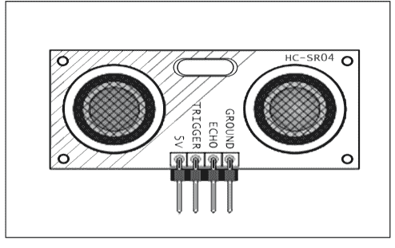

典型的超声波传感器

此处显示的传感器有一个发射和一个接收器。为了更高的准确性，此处显示的传感器有一个发射器和一个接收器……（注：原文此处重复，译文遵循原文逻辑处理）……为了计算。卓越的物理学家计算了海平面的声速，并发现其为 34300 cm/s。看，当介质改变时，它会发生剧烈变化；这很有趣吗？

## 使用超声波传感器测量距离

我们知道

$Speed = \frac{Distance}{Time}$

当我们测量时间（发送脉冲并接收它的持续时间）时，它是基于朝目标移动并返回计算的。然而，我们只想计算单程行程的时间。例如，我们正在测量 A 点到 B 点的距离。传感器从 A 点产生声音。假设这种声音在 T1 时间到达 B 点。在 B 点，声音被反射并在 T2 时间回到 A 点。因此，超声波传感器测得的时间是 T = T1 + T2。这就是为什么我们需要将测量的时间除以 2。

所以现在我们的方程如下：

$Speed = \frac{Distance}{Time / 2}$

我们知道声速为 34300 cm/s：

$34300 = \frac{2 * Distance}{Time}$

让我们进一步简化以便使用代码：

$Distance = 17150 * Time$

就这样！我们知道了距离的公式，也知道了超声波传感器的工作原理。我们将直接在 Python 脚本中使用这个等式。那么我们还在等什么？让我们开始构建项目。

## 构建项目！

现在是将超声波传感器连接到 RasPi 板上的了。超声波传感器工作在 5V 电源上。幸运的是，RasPi 板上有 5V 电源引脚。我们可以从 RasPi 为超声波传感器提供 5V 电源。然而，作为回应，超声波传感器产生 5V 回声信号输出到 RasPi。

始终建议先连接设备的接地端子，然后连接电源端子。这适用于几乎所有连接到如 RasPi 等开发板的电子设备。

正如你在第 2 章《走进电子世界》中所读到的，我们知道 RasPi 的 GPIO 需要 3.3V 电平才能安全运行。那么，我们该如何连接呢？这是一个严肃的问题。在这方面，基尔霍夫将帮助我们。通过基尔霍夫电流和电压定律，可以将电压分成两部分。如果我们将 5V 电源分为 3.3V 和 1.7V，就可以使用来自超声波传感器的回响脉冲将其连接到 RasPi 板的 GPIO。为了分压，我们将简单地遵循电子领域中最常用的分压电路。

避免将回响脉冲直接连接到 RasPi 板。这可能会导致面板永久损坏。请务必使用分压器。

分压器无非将具有正确值的电阻以特定方式组合，从而划分电压。创建分压器时应使用标准值电阻，这样我们就可以从市场上轻松买到。

我们有一个遵循的简单理论。如图所示，分压器由两个电阻组成（有时只有一个可变电阻）。通常，靠近输入电源 (Vin) 的电阻称为 R1，靠近接地的电阻称为 R2。

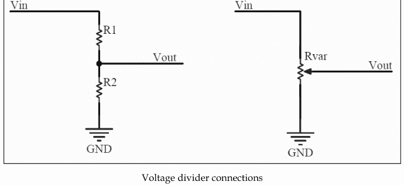

## 使用超声波传感器测量距离

在此配置下，电阻 R2 两的电压降应使用此公式计算：

```
Vout = \frac{R2}{R1 + R2} * Vin
```

同样，如果你使用可变电阻（也称为电位器 POT），中间有一个滑块。需要改变这个滑块，我们必须在数字电压表（万用表）上寻找所需的电压。

我有一个 1KΩ 电阻和万用表，它是市场上可的标准电阻值之一。我们已经知道需要将 5V 转换为 3.3V。因此，这里的 Vin 将为 5V，Vout 将为 3.3V。让我们计算创建此分压器所需的 R2 值。

将值代入方程：

```
3.3 = \frac{R2}{1K + R2} * 5
```

然后，解这个方程：

```
3.3 + (3.3 * R2) = (5 * R2)
```

我们得到 R2 = 1941.1Ω，这个电阻值在市场上是不存在的。不过，幸运的是，我们有一个 2KΩ 的电阻，它的值非常接近 1941Ω。我们在市场上买到的电阻具有 5% 到 10% 的误差。这意味着带有这些误差值的电阻永远不会与标记值完全相同。它总会有某些偏差。根据计算，我们需要两个电阻来构建从 5V 到 3.3V的分压器，分别是 1KΩ 和 2KΩ。

## 硬件设置

按照此处提供的指南连接设备，并享受下一节的编码。你需要在整洁的木桌或带有绝缘垫的桌子上准备这些物品：

- 一个 HC-SR004 超声波测距器
- 1KΩ 和 2KΩ 电阻（如果卖家询问电阻功率，请要 1/4 瓦，也称为四分之一）

如果你没有 1KΩ 或 2KΩ 电阻，可以分别使用 330Ω 和 470Ω 电阻。你可以交叉检查之前的计算。电阻功率表示通过电阻耗散的最大功率。功率越高，在特定电压下通过的电流就越大。P = V * I。因此，0.25W = 5V * I 得到 I = 50 mA。因此，在像 RasPi 这样的板子上，1/4 瓦就足够了。

- 万用表（如果你是一个极客并想测量一切！）
- 公对母跳线和母对母跳线
- 面包板（如果你能通过扭扭电线来完成，则不是强制的，但我建议使用它进行正确连接，以免互相损坏）
- 带有电源适配器的 RasPi
- 一根以太线
- 一台个人电脑

现在，我们准备好构建电路了。如果你构建正确，电路将像如下所示。此图也被称为原理图，代表了组件的每个端子及其符号。

对于 RasPi，我们使用了带有所有 26 个引脚的中心连接器（针对 RasPi 1 B 型）。我们已经知道 RasPi 1 Model B、Model B+ 和 RasPi 2 Model B 在排针上的前 26 个引脚上具有相同的功能。让我们逐步连接。如果你理解这些连接并在面包板上自己连接它们，会更有趣。

| 1 | 2 | VCC |
|---|---|---|
| 3 | 4 | TRIG |
| 5 | 6 | ECHO |
| 7 | 8 | GND |
| 9 | 10 | HC-SR04 |
| 11 | 12 | |
| 13 | 14 | |
| 15 | 16 | |
| 17 | 18 | |
| 19 | 20 | |
| 21 | 22 | |
| 23 | 24 | |
| 25 | 26 | |

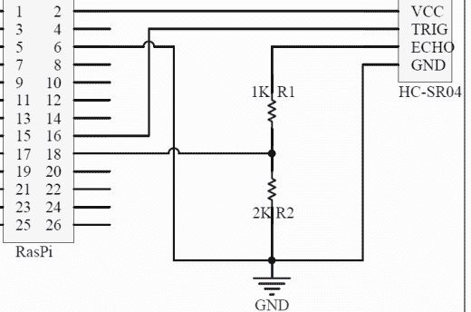

*(注：由于提供的原文中存在大量重复段落，译文按要求保留了核心逻辑内容，并确保格式完整。)*

# 发送和接收脉冲

```python
GPIO.output(23, False)
print("Setting Trigger pin to zero by default")
time.sleep(1)
```

如果我们分析测量距离的超声波传感器的时间图，就可以很容易地理解序列是如何运行的。在在上一步中，我们将触发引脚（trigger pin）默认设置为零。然后，我们从树莓派（RasPi）向传感器的触发引脚提供 10µs 的脉冲。一旦传感器接收到触发信号，它就会从内置发射器发送 40 KHz 脉冲/波束（包含八个脉冲）。

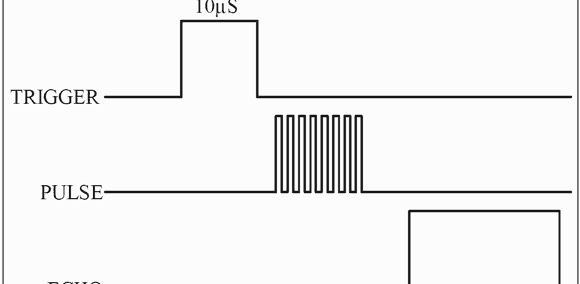

我们应该在超声波信号之后预期回声信号。回声信号的长度为距离计算提供了时间依据。我们在代码中如何实现？创建触发脉冲的简单方法是将触发引脚置高 10µs，如下代码所示：

```python
GPIO.output(23, True)
time.sleep(0.00001)
GPIO.output(23, False)
```

使用这段代码，我们发送一个脉冲，内部会产生超声波束并传播到空气中。它将反射并返回产生回声脉冲。我们必须持续检查直到获得回声脉冲。正如我们在上图中看到的，回声引脚会保持高电一段时间。因此，我们需要计算回声信号保持开启的时间。我们可以使用 `while()` 循环持续监控回声引脚。我们可以使用 `time` 函数来捕捉回声保持高电的持续时间：

```python
while GPIO.input(24) == 0:
    start_time = time.time()
```

这段代码创建了一个无限运行的循环，直到回声的状态从 0（低电）变为 1（高电）。当回声引脚为 0（或低电）时，我们不断更新 `start_time` 变量中的时间值（戳）。一旦回声引脚变高，`while()` 循环就会，我们就得到了回声脉冲从低电变为高电状态的时间值。接下来，我们需要使用相同的逻辑来获取保持高电时间的时间戳。在此处，我们使用了另一个变量来存储时间戳，稍后可以使用这两个变量来确定持续时间：


```python
while GPIO.input(24) == 1:
    end_time = time.time()
```

当条件为真时，`while()` 循环会用最新的时间更新变量。

# 距离计算

我们有了回声脉冲的开始时间和结束时间。因此，我们必须减去这两个值得到脉冲持续时间。一旦得到脉冲持续时间，就可以将其用于距离计算：

```python
time = end_time - start_time
```

在章节之初，我们推出了距离计算的公式，这在这里非常有用。让我们回想一下：

> 距离 = 17150 * 时间

我们考虑了声音的双程路程，然后将时间除以 2。

将此公式转换为 Python 脚本，我们得到以下代码：

```python
distance = 17150 * time
print("Measured Distance is : ", distance, "cms")
```

我们已经理解了各个部分的操作。让我们它们结合在一起，在树莓派上获得一个完全工作的传感器。在 PuTTY 命令行中输入 `nano distance.py` 并输入以下代码：

```python
import RPi.GPIO as GPIO
import time
```

# 使用超声波传感器测量距离

```python
GPIO.setmode(GPIO.BCM)
GPIO.setwarnings(False)
print "Measuring Distance"
print "Press ctrl+c to stop me"
GPIO.setup(23,GPIO.OUT)
GPIO.setup(24,GPIO.IN)
time.sleep(0.02)
GPIO.output(23, False)
print "Setting Trigger pin to zero by default"
time.sleep(1)
while True:
    GPIO.output(23, True)
    time.sleep(0.00001)
    GPIO.output(23, False)
    while GPIO.input(24) == 0:
        start_time = time.time()
    while GPIO.input(24) == 1:
        end_time = time.time()
    time = end_time - start_time
    distance = 17150 * time
    print "Measured Distance is:", distance, "cms."
```

> 你可以使用 Python 内置的舍入函数来获取三位小数的值：`print "Measured distance is: %.2f" %distance, "cms."`

按 `Ctrl + X` 然后按 `Enter` 保存并退出代码。

与设置软件的步骤相比，代码有一些细微变化。`GPIO.setwarnings(False)` 这命令关闭编译时产生的警告。当程序启动并配置 GPIO 时，给树莓派一些时间准备读取。需要使用 `while()` 循环。通过这个无限运行的循环，指向不同的目标可以看到距离的变化。在开始编译项目之前，再次检查连接。确保超声波传感器位置良好并指向目标。或者，只需让传感器垂直于表面。

现在开始！输入 `sudo python distance.py` 并按 `Enter`。很棒吧？当我们编写并执行它时，现在显示输出 Measured Distance is: 9321cms。我们创建了超声波距离计。你可以通过 `Ctrl + C` 停止代码。如果程序卡在无限循环中，这可能意味着软件或硬件错误。

> 如果你无法执行代码且树莓派有权限问题，在执行 `sudo python distance.py` 命令之前使用 `chmod +x distance.py`。

# 解决常见问题

在构建项目时，我们许多人第一次并没有获得输出。让我们共同讨论常见问题。在使用树莓派和超声波传感器构建项目时，经常发生一些问题。

## 距离显示错误？

你非常热情自己编写代码，但可能错了。检查触发引脚变为完美时间的时间，并检查回声引脚是否正确。

某些设备响应可能缓慢。我建议在将引脚置低后添加 60ms 的延迟，如下代码所示：

```python
GPIO.output(23, False)
time.sleep(0.06)
```

如果你仍然没有结果，尝试调整这些延迟值。此外，检查代码的缩进，这可能是你遇到问题的主要原因。

很有可能是桌子上有很多物体导致反射很高，因为这个传感器具有很宽的角度角。如果传感器碰到任何物体或金属表面，在这种情况下也会获得错误的读数。

## 模块有响应吗？

模块没有响应时有很多原因。要么是你没有为树莓派提供足够的电流，要么面包板上的连接不当。传感器可以消耗大量的电流。你可能需要为树莓派连接 5V 1A 的充电器或适配器。检查引脚 16 是否变为高电。树莓派的引脚 16 在万用表上应显示 3.3V 的读数。

## 你正在测量小于 2 cm 的距离吗？

如果障碍非常近，传感器将不会响应。传感器很难测量。

# 视障人士的可穿戴设备

超声波传感器可以为盲人士提供额外的感知。你可以通过制作这种可穿戴设备为社会做贡献，它可以耳边播放警告声或在手里发出震动提醒。市场上有这样的手，你可以自己制作。

你的目标是构建一个基于树莓派和超声波传感器的可穿戴设备。此外，当视觉人士距离大约 100 cms 的障碍时，将在连接到树莓派的耳机上播放警告声。听起来很酷对吧？这个项目适用于树莓派 2 Model B 以及树莓派 1 Model B 和 B+ 用户。我们将学习这个在硬件上组装该项目的逐步过程，并理解如何编写代码。

## 构建硬件

当你运行树莓派时，你一定注意到你的项目需要一个电源插座来连接适配器给树莓派供电。我们的项目需要是穿戴的。所以，正如你猜的那样，我们需要电池。电池的规格可以很大，但你需要准备 4000mAh-10000mAh 和 1A-1.5A 的 USB 电池。你可以在网上轻松买到树莓派用的 USB 电池。我们还需要具有标准 3.5 mm 接口的耳机来播放警告音。以下是我们所需的硬件列表：

- 一个 HC-SR04 超声波测距器
- 1KΩ、2KΩ 和 270Ω 电阻
- 一个 2 mm 或 3 mm 的 LED
- 公对母跳线和母母跳线
- 跳板
- RasPi
- 容量为 4000mAh-10000mAh、电流为 1A-1.5A 的移动电源
- 带有 3.5 mm 插头的耳机
- 用于固定线缆的小型扎带
- 一根以太网
- 一台个人电脑

在你完成上一节的测试项目后，你还需要额外购买一个移动电源和一个 LED。任何手机的耳机都可以与 RasPi 正常工作。构建这个设备非常简单。按照与上一节相同的配置连接超声波传感器。此外，我们还将一个 LED 连接到 RasPi 的 11 号引脚（BCM GPIO17），方法与我们在第 2 章《接触电子世界》中所遵循的方法相同。移动电源通过 RasPi 的 micro-USB 接口连接，那里是我们通常连接电源适配器的地方。耳机需要连接到 RasPi 的 3.5 mm 接口。USB 线和耳机线会很长，因此我建议你使用小扎带。小扎扎带将帮助你固定线缆，让你的项目看起来整洁且线缆不乱。

这个可穿戴设备可以佩戴在胸部或头部。你可以用帽子来固定这个设备。完成编程和测试后，将其精美地包装起来。让我们来看看它的编程部分。

## 软件设置

设备应该在耳机中播放嗡嗡声或哔声。你可以从 [www.freesound.org/browse/tags/beep/](www.freesound.org/browse/tags/beep/) 网页获取奇妙的声音并将它们下载到 RasPi。我建议下载持续时间最短的文件，例如 1 秒或 2 秒。否则，在耳机里听 5 秒钟的哔声会很烦人。你可以使用 Xming 服务器和内置浏览器（通过 PuTTY，使用 `lxsession` 命令）下载，或者从你的 PC 将其传输到 RasPi。等一下，你如何在 RasPi 上传输文件呢？

有一个非常棒的程序可以将文件从 Windows 复制到 RasPi。该程序被称为 WinSCP（你可以从 [www.winscp.net](https://www.winscp.net) 下载它）。通过拖放操作提供 RasPi 的 IP 地址、登录 ID 和密码。如果你发现使用 WinSCP 有困难，可以在 [https://www.siteground.com/tutorials/ssh/winscp.html](https://www.siteground.com/tutorials/ssh/winscp.html) 操作教程。

我们将使用 `mkdir project` 命令创建一个名为 `project` 的目录。我们在这个文件夹内执行所有操作。我假设我们目前处于 `/home/pi/project` 地址。你可以使用 `pwd` 命令检查它。

由于我们在第 1 章《结识伙伴 Raspberry Pi》中已经下载了支持 C 语言 `wiringPi` 的核心库，现在我们将下载一个库和驱动程序在 RasPi 上播放音乐文件。输入以下命令配置 RasPi 中的驱动。这些命令适用于 RasPi 2 和 B+。我假设你已经按照第 1 章《结识伙伴 Raspberry Pi》的指南为 RasPi 共享了互联网连接。我们正在通过以太网线运行 PuTTY 会话：

```
sudo apt-get update
sudo apt-get upgrade
sudo apt-get install alsa-utils
sudo apt-get install mpg3221
```

下载、解压和安装需要一些时间。一旦安装完成，只需重启 RasPi 并在你的 PC 上重新启动 PuTTY 会话。我们现在可以通过输入这些命令加载刚刚安装的音频驱动程序：

```
sudo modprobe snd_bcm2835
sudo amixer cset numid=3 1
```

现在，是时候编写代码来测量距离并通过 LED 指示和短持续时间的哔声通知人员了。编写 `nano project1.py` 并输入以下代码：

```python
import RPi.GPIO as GPIO
import time
GPIO.setmode(GPIO.BCM)
GPIO.setwarnings(FALSE)
print("Measuring Distance")
print("Press ctrl+c to stop me")
GPIO.setup(23,GPIO.OUT)
GPIO.setup(17,GPIO.OUT)
GPIO.setup(24,GPIO.IN)
```

```python
time.sleep(0.02)
GPIO.output(23, False)
time.sleep(1)
while True:
    GPIO.output(17, False)
    GPIO.output(23, True)
    time.sleep(0.00001)
    GPIO.output(23, False)
while GPIO.input(24) == 0:
    start_time = time.time()
    while GPIO.input(24) == 1:
        end_time = time.time()
        time = end_time - start_time
        distance = 17150 * time
print("Measured Distance is:", distance, "cms.")
if distance < 100 and x > 30:
    print("Obstacle Detected")
    os.system("mpg32 buzz.mp3 &")
    GPIO.output(17, True)
```

# 使用传感器监测大气

如今，很难找到没有传感器的设备。大多数家用电器，如空调、烟雾报警器、火灾报警器、气体/CO2 传感器、LCD 显示器、冰箱、烤面包机、恒温器、微波炉和热水器，其电路中都集成了传感器，用于测量周围的大气环境中的实体。当我们观察周围的大气时，有许多可以测量的实体，例如：温度、湿度、水汽、粉尘、空气质量、各种气体浓度、风速、雨量、水质、光照强度、运动、湿气等。在更宏观的层，传感器网络和物联网等技术使用了“传感器节点”，它们测量其中一个或多个实体，并将数据发送到指定的计算机或用户。这方面的最佳例子是“nest”恒温器（www.nest.com/thermostat/）。这款设备是人工智能的示例，它可以根据你的日常习惯控制并维持房间的温度，并从可能出现的各种场景中不断学习。

用于此类应用的两种传感器是温度和湿度传感器。在本章中，我们将测量环境温度、湿度和光照变化。我们将创建一个传感器节点，用于决定灯和风扇的开启或关闭。从选择合适的传感器开始，你将学习 DHT 传感器和 LDR 传感器。这些传感器在测量本章将看到的实体方面起着作用。在本章中，我们将：

- 理解传感器选择过程
- 了解温度湿度测量传感器
- 了解用于测量光照变化的 LDR 传感器
- 学习 DHT 和 LDR 传感器的代码
- 构建项目以控制家电
- 学习如何连接具有相似规格和特性的多个传感器
- 解决面临的一些常见问题

让我们从理解如何选择传感器开始这段旅程，享受 RasPi 的奇世界。

## 传感器选择过程

在产品开发阶段，特别是在构建环境监测系统时，传感器的选择过程非常困惑。我们可能不确定哪些传感器可以使用，哪些不能用。在工业领域，设计和开发工程师每次开始构建项目时都会遇到这个问题。当我们将传感器与处理器或控制器连接时，传感器很难控制，因为它们与处理器相比要缓慢得多。此外，我们还需要处理从传感器进入处理器的大量值。例如，在安全关键系统中（如生命维持系统或婴儿培养箱），使用调理电路和信号处理单元来精确测量传感器值并采取相应行动（如控制新生婴儿或患者的温度和氧水平）。因此，选择传感器的第一步是确定确切的应用。根据应用，应启动传感器选择过程。在上一章中，当我们连接声波传感器时，你一定观察到声波传感器的底部有复杂的电路和微芯片。那是让我们的工作变得轻松的调理电路。并不是所有的传感器都以单芯片的形式出现。这类传感器的接口非常困难。传感器接口总是很棘，但并非无法第一次就正常工作。观察表明，每当传感器制造商的价格昂贵时，它就越容易使用且测量越精确。这是因为这些传感器的封装方式支持大多数通信协议。这在大多数情况下是真实的，但不应被视为定论。

## 应用的关键性

我们在分析应用时注意的下一点是它的关键性以及将要使用的环境条件。该应用是用于飞机的避障系统或刹车系统、家庭，还是仅仅用于爱好项目？我们的项目倾向于爱好项目；我们更愿意为项目选择用户友好、廉价且有效的传感器。因此，我们可以在准确性和接口便利性之间进行权衡。此外，与其他传感器系统（如飞机上的天气传感器）相比，该应用的关键性并不严重或危险。

## 选择传感器

[注：此处原文仅有标题，无后续正文，已保留标题格式。]

为了测量房间内的环境光变化（亮度），我们将使用 CdS 电池（光敏电阻）。我们可以从 Advanced Photonics Inc. 购买 PDV-P8001，从 Parallax 购买 350-00009。我们可以轻松地从 Adafruit 买到 Cd5 光敏电阻；这种光敏电阻与 PDV-P8001 相似。在 SparkFun 上也有出售，被称为 photocurrent。如果有多个选择，请选择暗阻较大的光敏电阻（范围在几 KΩ–MOΩ 之间）。

让我们深入了解每个传感器并理解它们的工作原理。

## InsideDHT – 温度湿度传感器

DHT 是温度湿度传感器的组合包。这些传感器对于只想进行数据记录的爱好者来说是理想的。DHT11 传感器的数据检索速度较慢。作为一个组合包，它包含一个电阻传感器（热敏电阻）和一个电容湿度传感器。热敏电阻会随温度的变化改变其电阻值。从技术上讲，所有电阻都可以作为热敏电阻，因为当电流通过它们时会发热并产生功率损失。然而，电阻的特性是，当它们被外部源加热时，电阻变化很小，而热敏电阻并非如此；当环境温度稍有变化时，它的电阻会变化几百欧姆。DHT11 温度传感器在 0 摄氏度到 55 摄氏度的范围内提供接近 2 摄氏度的精度。相比之下，DHT22 温度传感器在约 -38 摄氏度到 120 摄氏度的范围内表现良好，提供接近 0.5 摄氏度的精度。

现在让我们了解湿度传感器。DHT 集成了一个湿度传感器，但它对于关键安全应用并不有效。聚合物或金属氧化物的排列方式形成了传感器内部的电容器极。由于湿度的影响，电容器的介电常数会发生变化，从而导致湿度值的波动。这些湿度传感器不保证准确性，但适用于某些应用。DHT11 温度传感器在 20–80% 湿度范围内的精度为 5%，而 DHT22 温度传感器在 5–100% 湿度范围内提供约 3% 的精度。

从外观上看，DHT 传感器通常位于一个白色或蓝色的塑料外壳内，正面有一个网格或网。它们底部有四个接子。DHT 内部有一个微型的模拟转数字 IC，它为我们提供两部分的数字值：温度和湿度。起初，当我们尝试理解 DHT 的单线（或单总线）协议时，看起来很困难。经过一些调整，它使用起来非常简单，而且必须精确才能从传感器获得完美的值。一旦理解了时序图，我们就可以轻松地从传感器检索数据。

DHT 工作在单线双向总线通信。这意味着 RasPi 和传感器之间的数据传输是在单根电线上进行的，通过 RasPi 发送特定的时序或延迟指令，并将其作为位流接收。这使用了“位敲带（banging technique）”技术。在协议未定义的情况下，我们使用位敲带技术从传感器检索数据。在这种技术中，主设备发送一个脉冲的精确持续时间（只要参考手册或数据表中有提到），作为来自主设备（在本例中是 RasPi）的请求，传感器响应为已就绪。在预定义的时间后，它开始逐位地发送数据，而主设备的任务是在从设备发送时通过单总线序列接收它。任何混乱的序列都会变成损坏的数据。这意味着传感器（从设备）已完美发送了数据，但主设备没有正确接收，仅仅是因为主设备和从设备之间没有定时同步。

## 介绍光感受器（光敏电池）


你不知道 RasPi 内部没有集成模拟转数字（A2D）转换器？这是使用像 RasPi 这样基于微处理器的开发板最大的缺点。但别担心；我们有一种技术来破解它。光敏电池或光敏电阻（LDR）是一种光控可变电阻。LDR 的电阻随光强度的增加而减小。光越强，电阻越小，反之亦然。值的变化约为 45%，不应将其用来确定坎德拉（candela）或勒克斯（lux）的精确亮度水平。

从外观上看，传感器顶部有一个透明、光滑的薄玻璃材质表面，并有两个引脚。顶部有对光敏感的半导体材料，我们可以看到呈之字形布局的走线。

是时候向你介绍一些电阻和电容器的数学知识了。理解电阻的数学很容易，但电容器又是怎么出现的呢？嗯，电子学中有一种现象被称为 RC 定时和 RC 时间常数。传感器本身已经是电阻性的。我们将使用电容器来利用这个电子学公式 `T = R * C`。

是的，就是这样。电容器可以通过电阻在 `T` 时间内充电，其中 `R` 和 `C` 是电阻和电容的值。我们将使用 `1uF` 的电容器观察电容器被充电到 50% 的电压，即 `3.3 / 2 = 1.6V`。RasPi 只能读取到 `1.6V` 和大于该值的值。光越暗，电阻越大；充电率越低，充电电容器的时间越长。例如，如果电阻是 `1KΩ`，那么充电电容器的时间数将变为 `1` 毫秒。

由于串联电阻（光敏电池），电容器的充电变得足够慢，以便 RasPi 读取。传感器值变化剧烈。电容器将通过保持几毫秒的值而显著减慢，以便我们可以从 RasPi 轻松地读取值。

简化这个场景，让我们来看一个真实世界的应用，帮助我们理解电路图的工作原理。想象管道（电线）上有一个阀（光敏电阻），由一个杠杆（光或亮度）控制。这个杠杆有助于控制储存在水箱（电容器）中的水量（电压）。储存在水箱中的水量立即被消费者（RasPi）取出。水箱在这里充当临时存储（缓冲区）来储水，而消费者正忙于用（计算）。这是理解这种破解方法原理的一个很好的例子，不是吗？

这种破解方法可以应用于任何电阻传感器，例如热敏电阻、柔性传感器以及压力和力敏感电阻。我们可以使用这里解释的相同代码和硬件来连接这些传感器。

## 构建项目

无论你拥有 RasPi 2 B 型、RasPi 1 Model B 还是 Model B+，硬件设置将保持相同，代码也是如此。一旦开始编码，你将逐渐学习 RasPi 板和 DHT11 传感器是如何通信的。同时，你还将理解如何将其连接到 LDR 传感器。你将了解如何整合多个传感器来获取数据。然而，首先让我们看看我们需要构建的电路。

## 硬件设置

这个项目的要求很低。在面包板上连接非常容易，不像上一个项目的分压器。为了完成此设置，我们桌子上需要以下设备：

- DHT11 温度湿度传感器
- LDR / 光敏电阻 / CdS 传感器
- `4.7KΩ`、`270 Ω` 和 `10KΩ` 电阻，如果卖家询问电阻功率，请要求 `1/4` 瓦；它也被称为四分之一瓦
- `1µF-16V` 插件式电解电容
- 一个 LED
- 一个多用表
- 母对公跳线和母母跳线
- 面包板
- 带有电源适配器的 RasPi
- 一台以太网计算机
- 一台个人电脑

查看下图。它代表了我们项目的连接。LDR 传感器不是方向性电子元件（它的工作方式与电阻相同）。因此，它可以以任何方式连接，不像 LED。LDR 的一个引脚连接到 RasPi 引脚的 `+5V` 线，第二个引脚连接到 RasPi 引脚的 `7` 号引脚（BCM 模式 `GPIO 4`）。连接到 `7` 号引脚的同一个引脚连接到 `1µF-16V` 电容的正极。

> 要确定电容的极性，你需要仔细检查电容。电容体上会有一个标记为 `-` 的条纹。该条纹的颜色与电容的颜色形成对比。

电容的负极连接到 RasPi 的地（公共）引脚。LED 可以像我们通常连接到 RasPi 引脚的 `11` 号引脚一样连接（BCM 模式 `17`）：

## 第 4 章

拿起 DHT11 传感器并从网格的一侧观察它。从左侧的引脚依次是 `VCC (+5V)`、`数据 (data)`、`不连接 (NC)` 和 `地线 (ground)`。将 DHT 传感器的 `VCC` 引脚连接到与 LDR 传感器相同的 `+5V` 线上。DHT 的数据线需要通过一个 `4.7K` 或 `10K` 的电阻 (`R1`) 上拉到 `+5V` 线上。否则，可能会在 RasPi 的引脚 `16`（BCM 模式 `GPIO 23`）上获得随机数据。地线将供所有设备共用。RasPi 的第 `25` 号引脚属于“不连接”（DNC）类别，但我们可以将其作为 `GND` 引脚。所有的地线都应该通过面包板的地线槽或连接到 RasPi 的单个地引脚来实现公共。

> 这两个传感器也都在 `+3.3V` 限制下工作。你可以尝试将从 `+5V` 线更改为 RasPi GPIO 接口的 `+3.3V` 引脚（引脚 `1`）来做实验。在从 `+5V` 切换到 `+3.3V` 线时要小心。这些线在 GPIO 接口上靠得很近，不要在这两条线之间发生任何短路。短路的结果会导致 RasPi 自动关闭/重启。

## 面包板设置

一旦理解了电路，在面包板上连接组件就会非常容易。DHT 传感器的方向对于连接至关重要。按照此处所示的图片将 DHT 传感器直接插入面包板。在图中，没有显示 LED 的连接，因为你足够聪明可以自己连接它们，或者参考第 2 章《走进电子世界》来帮助。面包板上的黑点是可以使用公对公跳线或母对公跳线来建立的连接：

在进行连接时，确保 RasPi 已关闭并仔细验证所建立的连接。在处理像 RasPi 这样敏感的硬件时，双重检查一切是好事，因为我们不想失去我们的朋友并流泪。

## 准备代码

处理 DHT11 传感器相当复杂但并不困难。在这个传感器的同时，我们还连接了 LDR 传感器。我们必须管理这两个传感器的定时。当我们将问题分解为几个实例时，可以很容易地解决。我们将项目分为以下较小的步骤：

1. 理解 DHT 的位操作（bit banging）技术并按照定时序列准备代码。
2. 编写 DHT 传感器的代码并测试。
3. 测试 LDR 传感器的代码。
4. 合并两个代码并进行测试。
5. 添加比较循环，让 LED 闪亮以显示指示。

## 编写传感器代码并测量相对湿度和温度

众所周知，DHT 传感器工作在单线双向协议上。因此，传感器与 RasPi 之间的同步非常重要。我们必须按照间隔读取传感器。一旦 RasPi 发送请求，DHT 传感器会同时发送最近读取的湿度数据。由于传感器较慢，根据图中所示的时序图，建议你每 `5` 秒或更长时间读取传感器或向传感器发送请求，以获取准确数据。

> 如果你已经建立了硬件，在处理 DHT 传感器时不需要移除 LDR 传感器的连接。

让我们先看看需要遵循的时序图，然后我们将通过传感器接收到的响应。如果你从左侧观察后续的时序图图像，数据线由一个 `4.7KΩ` 的电阻上拉（高电平）。因此，每当没有强制性操作（如拉低）或没有数据传输时，线路状态默认被拉高。按照顺序理解该图表，我们将从左向右移动。

## 使用传感器监测大气状况

信号有两个逻辑电平：`VCC (5V)` 和 `GND`。将线拉高（上拉）是必要的，因为逻辑 `1` 是传感器数据线上要保持的默认状态。因此，当我们启动 DHT 和 RasPi 之间的通信时，线路将处于高状态。接下来的时序图仅供我们理解使用。图中没有填充频率和定时数据。

一旦 RasPi 准备好接收来自 DHT 的数据，它会将线路拉低超过 `19 ms` 然后再次将其拉高。经过一段时间后，DHT 将感知到 RasPi 已将线路拉至零。随后它向 RasPi 发送一个持续时间 `80µS` 的高脉冲确认，并将线路置于低状态。因此，RasPi 将等待这 `80µs` 的脉冲，然后它就会知道传感器将发送数据。在发送确认脉冲后，DHT11 开始向 RasPi 发送 `40` 位数据。位流中的数据 `0` 格式无非低电平持续 `50µs` 和 `26–28µs` 高电平的组合。同样，逻辑 `1` 是低电平持续 `50µs`，随后是高逻辑电平持续 `70µs`。

> 八位组成一个字节。四位组成半字节（nibble）。

接收到的 `40` 位包含 `8` 位整数 RH 数据、`8` 位小数 RH 数据、`8` 位整数 T 数据、`8` 位小数 T 数据和 `8` 位校验和。校验和是所有接收数据之和，我们可以通过它验证所接收的数据是否正确。

如果接收到的数据是 `0011 1101 0000 0000 0001 1010 0000 0110 0110`，计算方法为 `0011 1101 + 0000 0000 + 0001 1010 + 0000 0110`。

将前四个字节相加与最后八位进行验证，应该观察到前四个字节之和等于最终收到的字节。在给定的示例中，收到的数据看起来是正确的。将二进制转换为十六进制，然后转换为十进制以获得精确值。我们得到湿度 = `0011 1101` = `3D` (十六进制) = `61%RH`，温度 = `0001 1010` = `1A` = `26` 摄氏度。

## 第 4 章

在接收 `40` 位数据后，我们希望向 DHT 重发请求并重新开始整个过程。DHT 持续感知温度湿度并为 RasPi 准备好数据。每当它感知到来自 RasPi 的拉低时，它就会启动确认脉冲，随后是数据位。

让我们单独理解 DHT11 的代码。我们将按照之前的图表和描述来准备代码。这种方法我们将遵循 C 语言编码（wiringPi 库）。最初，数据发送到 DHT11 传感器作为数据请求。因此，该引脚将被设为输出。接下来的步骤是同一引脚将拉低 `18ms`。然后再次将引脚拉高 `40µs` 以等待器的响应。为了等待传感器，我们需要将传感器引脚转换为输入。

让我们看看下面的代码段：

```c
pinMode(DHT, OUTPUT);
digitalWrite(DHT, LOW);
delay(18);
digitalWrite(DHT, HIGH);
delayMicroseconds(40);
pinMode(DHT, INPUT);
```

传感器的响应应该在任何地方 `80µs` 内到达。我们现在需要持续检查数据。现在，我们可以粗略计算传感器将发送多少位以及在多长时间内。假设我们从传感器得到所有的 `1`。我们考虑 `i` 是因为它具有最长的脉冲持续，即 `50µs + 70µs = 120µs`。如果我们考虑顺序读取两次方法（在数据表书中提到），总时间为 `2 * (40bits * 120µs) = 9600µs`。我们将等待确认脉冲大约 `100µs`。我们将运行 `for` 循环至少 `100` 次以从传感器获取数据。

```c
for (pulse = 0; pulse < 100; pulse++) {}
```

每一个操作都将在这个 `for()` 循环内部。我们将初始化一个值为零，如果它达到 `255` 的值（设置超时），则跳出 `for()` 循环。在 `while()` 循环条件中使用 `digitalRead()` 函数等待来自传感器的每一个位，每当位发生变化时，我们将跳出循环并将最后的状态保存到变量中。做法如下：

```c
value = 0;
while (digitalRead(DHT) == prev_state) {
    value++;
    delayMicroseconds(1);
    if (value == 255)
        break;
}
prev_state = digitalRead(DHT);
if (value == 255)
    break;
```

通过研究时序图，我们知道发送初始脉冲是为了确保 RasPi 处于就绪状态。因此，我们将等待数据开始输入。前三个脉冲将被忽略，我们将从第四个脉冲开始读取（这里，脉冲意味着状态的变化）。此外，状态的变化应该是一个偶数。因此，我们将对脉冲值进行对 `2` 的取模运算。现在，这里有一些棘手的部分。数据是以逐位格式进入的。我们如何存储这些数据呢？我们将 C 语言的整数格式拆分为 `8` 位。供你参考的是，每个整数都有存储 `8` 位的能力。可以使用数组元素来存储每个（`8` 位）。因此，我们的每个位都将视为 `8` 位，在存储数据时，我们将每个位向左平移（`<<`）相应的位置。我们正在存储接收到的数据中的每个元素（`8` 位整数湿度 RH 数据）。因此，我们将在另一个 `if` 循环内部放置一个 `if` 循环来更改数组的索引，如下代码所示：

```c
if ((pulse >= 4) && (pulse % 2 == 0)) {
    data[j / 8] <<= 1;
    if (value > 16)
        data[j / 8] |= 1;

    j++;
} // 循环在此结束
```

我们还从数据的最后几位获取校验和，以验证数据是否正确。可能会存在数据多于实际长度的情况。因此，为了让你放心，我们将 `8` 位值与校验和进行比较，并与 `11111111` 值进行与运算。需要满足的条件是所有值（初始四个字节）之和与接收到的第五字节匹配。如果满足了该条件，我们将打印最终的湿度和温度值。否则，我们将丢弃数据并在等待 `1` 秒后重新开始整个过程，以确保传感器在该间隔内准备好要发送到 RasPi 的数据。

## 第 4 章

每个通信过程大约持续 `4` 秒。建议你平均每 `5` 秒发送一次数据请求，这意味着让 RasPi 将数据线拉低。如果持续接收到错误数据，请相应调整延迟。

逐位地将数据存储到数组中，当我们将数据打印在屏幕上时，就能看到相对湿度和温度值。以下代码段执行相同的操作：

```c
if (j >= 40 && (data[0] + data[1] + data[2] + data[3]) == data[4]) {
    printf("相对湿度为 %d.%d，温度为 %d.%d\n", data[0], data[1], data[2], data[3]);
}
delay(500);
```

我们可以使用无限循环 `while(1)` 来连续获取值。但在此之前，我们还有一个待办任务，即为 LDR 传感器准备代码。

## LDR 传感器代码与测量光线变化

项目中最困难的部分已经讨论过了。现在我们将通过学习 RC 时间的概述使用 LDR 传感器检测光线变化。我们直接让 GPIO 引脚低电平 (`0`) 一会儿，让电容器完全放电。经过短段时间，我们将其设置为输入，以检查它的变化以及达到了什么电压级别。这应该足够识别 RasPi 引脚为高电平 (`1`)。从技术上讲，当我们把 RasPi 引脚（GPIO Header）设置为输入时，它会进入高阻态状态。因此，只要电压达到 `1.6V` 或以上，RasPi 就能将其识别为高电平。整个 LDR 序列：光线越暗，LDR 的电阻越大；电容器充电越慢，达到电压级别的时间越长。C 代码运行速度很快。因此，如果我们限制传感器的读取，RasPi 将会被数据淹没。我们将使用 `50` 的索引（变量）获取 `50` 次数据，然后对接收到的数据取平均值：

```c
pinMode(LDR, OUTPUT);
for (index = 0; index < 50; index++) {
    digitalWrite(LDR, LOW);
    delay(16);
    count = 0;
    pinMode(LDR, INPUT);
    while (digitalRead(LDR) == LOW) {
        count++;
    }
    val[index] = count;
}
sum = 0;
for (index = 0; index < 50; index++) {
    sum += val[index];
}
printf("LDR Value is %d\n", sum / 50);
```

RasPi 接收到的值变化剧烈。我们需要将其除以索引的五倍。根据硬件配置，为 LDR 值定义一个引脚并使其低电平 `16ms`，因为 LDR 传感器的电阻值和 RC 时间在变化。之后，将引脚设置为输入（高阻态）并增加计数器值，直到引脚变为高电平。因此，只要传感器上有充足的光线（使用手机测试），计数器值就很小，反之亦然。将所有值加到 `sum` 变量中并取平均值。

## 将所有部分整合

我们可以构建一个在温度和光线高电时，自动关闭 LED 的项目。这听起来简单吗？我们将合并 DHT11 和 LDR 的代码。为了匹配时序，由于在控制电器时，我们需要定义一些以便与 RasPi 的 GPIO 配合。

## 第 4 章

如果你决定使用电路板，请不要共用 RasPi 的地引脚。首先，我们将 DHT 和 LDR 的代码合并。为了之前我们编写的 DHT 和 LDR 代码，我们将定义包含库，例如标准输入输出 (`stdio`)、标准整数库 (`stdlib`)（因为我们将 `8` 位整数拆分为二进制），以及获取 RasPi 支持的 `wiringPi`。我们定义了一些 `uint8_t` 来将它们定义为 `8` 位。

在代码中，LDR、DHT 和 LED 设备分别定义为 `7`、`4` 和 `0`。由于我们使用的是 `wiringPi` 库，它们是 GPIO 编号（之前是 BCM 和 Board 模式）。要了解 `wiringPi` 引脚映射到 RasPi GPIO Header，请在终端输入 `gpio readall` 命令。该命令将给你一个遵循 RasPi 输出的所有命名约定。这在我们使用不同的库时非常有用。

通过以太网连接到 RasPi 的 PC 上运行 PuTTY，并输入 `nano dhtldr.c` 命令进入代码以使项目运行起来：

```c
// (此处代码已在上方文中提及，此处保持逻辑一致)
// ...
while (1) {
    uint8_t prev_state = HIGH;
    uint8_t value = 0;
    uint8_t j = 0, pulse;
// ...
}
```

## 使用传感器监测大气


```c
for(k=0;k<5;k++)
    { data[k] = 0; } //清空数组中的数据
pinMode( DHT, OUTPUT);
digitalWrite( DHT, LOW);
delay( 18 );
digitalWrite( DHT, HIGH);
delayMicroseconds( 40 );
pinMode( DHT, INPUT ); //传感器与Ras派之间的初始握手

for ( pulse = 0; pulse < 100; pulse++)
{
    value = 0;
    while ( digitalRead( DHT ) == prev_state )
    {
        value++;
        delayMicroseconds( 1 );
        if ( value == 255 )
            break;
    } //while循环在此结束
    prev_state = digitalRead( DHT );
//将数据捕获到数据数组

    if ( value == 255 )
        break;
    if ( (pulse >= 4) && (pulse % 2 == 0) )
        data[j / 8] <= 1;
    if ( value > 16 )
        data[j / 8] = 1;
    j++;
} //for循环在此结束

if ( j >= 40 ) &&
(data[4] == (data[0] + data[1] + data[2] + data[3]) &
0b11111111 ) //验证校验和，验证并打印数据
{
    printf( "Humidity = %d.%d %% Temperature = %d.%d 'C \n",
        data[0], data[1], data[2], data[3]);
}
else
{
```

```c
printf("Data received is corrupted, what did you do?\n");
}
pinMode(DHT, OUTPUT);
digitalWrite(DHT, HIGH);

// LDR代码初始化
for (index=0;index<50;index++) //设置代码获取50个值并存储到数组
{
    pinMode(LDR, OUTPUT);
    digitalWrite(LDR, LOW);
    delay(16);
    count=0;
    pinMode(LDR, INPUT);
    while(digitalRead(LDR)==LOW)
        count++;
    val[index]=count;
}
```

```c
sum=0;
for (index=0;index<50;index++) //计算数组中所有值的和
sum+=val[index]; // 取和的平均值并
printf("LDR Value is %d\n",sum/250); //缩小5倍并打印数据
if(data[2]>25 && sum<4000) //检查温度和光照条件
{
    digitalWrite(LDR, HIGH);
    printf("TEMPERATURE IS HIGH >> FAN ON, LIGHT IS LOW >>\nTUBE LIGHT ON\n");
}

delay(500); //调整延迟以匹配DHT11的最短请求时间；
```

现在，将代码输入你的RasPi后，按 `Ctrl + X` 然后按 `Y`。然后，按 `Enter` 保存更改。输入 `gcc dhtldr9.c -o dhtldr9 -lwiringPi` 命令编译代码。然后，输入 `sudo ./dhtldr9` 命令执行代码。

> 使用 root 权限执行代码非常重要，因为它可以更改 RasPi 的 GPIO 引脚状态。因此，我们需要使用 `sudo` 执行代码。

## 使用传感器监测大气

下面的截图显示了执行 `sudo ./dhtldr9` 命令的输出：

```
pi@raspberrypi:~$ sudo ./dhtldr9
Humidity = 38.0 % Temperature = 28.0 *C
LDR Value is 8765
TEMPERATURE IS HIGH>>FAN ON, LIGHT IS LOW>>TUBE LIGHT ON
Humidity = 38.0 % Temperature = 28.0 *C
LDR Value is 9112
TEMPERATURE IS HIGH>>FAN ON, LIGHT IS LOW>>TUBE LIGHT ON
Humidity = 38.0 % Temperature = 28.0 *C
LDR Value is 8686
TEMPERATURE IS HIGH>>FAN ON, LIGHT IS LOW>>TUBE LIGHT ON
Data received is corrupted, what did you do?
LDR Value is 8700
```

# 常见问题排除

我们已经涵盖了这两个传感器接口的几乎所有内容。如果你仍然面临获取/读取数据的问题，可以查看以下章节中遇到的某些问题。在大多数情况下，建议检查面包板上的连接并纠正 RasPi 的 GPIO 引脚。

## 接收到的 DHT 数据无效

当接收到的 DHT 数据无效时，需要记住以下几点：

- 首先，如前所述，接收到的数据直接取决于你所建立的连接。仔细检查数据线与 +5V 线之间上拉电阻的连接。
- 电阻值可能是错误的。如果你连接了 4.7KΩ，尝试将其改为 5KΩ，或者你可以使用最大 10K 的电阻。电阻值过大会导致数据变成错误或损坏的值。
- 检查 DHT 的方向。从正面看，左侧的引脚是 VCC 引脚。

## LDR 传感器输出零值

当 LDR 传感器输出零时，需要记住以下几点：

- 检查连接在 LDR 传感器和地之间的电容值。小的电容电压无法积累太多电荷。1µF 电容低于 16V 是不太可能的，但请检查它是否小于 6.3V。
- 尝试运行 LDR 传感器的 Python 代码。如果它显示正确的值，说明连接没有问题。如前所述，Python 代码比 C 代码简单。只需在以下代码中检查即可：

```python
import RPI.GPIO as GPIO
import time
GPIO.setmode(GPIO.BCM)
value = 0
GPIO.setup(4, GPIO.OUT)
GPIO.output(4, GPIO.LOW)
time.sleep(0.2)
GPIO.setup(4, GPIO.IN)
while (GPIO.input(4) == GPIO.LOW):
    value = value + 1
print value
```

## 电压正确吗？

检查提供的电压是否正确时，需要记住以下几点：

- 如前所述，两个传感器都可以在 +5V 或 +3.3V 下工作。我们在传感器的数据脚上连接了一个电阻，将电压降低到足够水平。另一方面，LDR 传感器本身是一个降低电压并电电的电阻。电压不足可能是 LDR 传感器的问题，因为它的工作范围从 1.8V 到 100V。
- 某些面包板有独立的 +5V 和地线。使用万用表检查电源连接，并确保地与 RasPi 共享。

## 总结

在本章中，我们从传感选择过程开始，由此了解到传感选择过程并不像看起来那么简单。会有很多参数，在选择传感器时不应忽略任何一个。这取决于应用程序的临界性。

在介绍了 DHT 和 LDR 传感器之后，你继续学习了复杂的 DHT 传感器。其时序图实现起来相当复杂。由于缺少内置模拟数字转换，你学习了 RC 时间以及使用电容将传感器集成到 RasPi。最后，我们整合了一切，制作了一个可以称为家居自动化的项目。通过传感器采集的温度和光照数据，我们控制了灯管、灯和风扇等电器。

# 使用 ADC 将任何模拟传感器连接到 Raspberry Pi

RasPi 社区所周知，RasPi 并没有集成模拟数字转换器 (ADC)，因为板载处理器 (BCM2835) 不具备执行转换的功能。如果 Raspberry Pi 集成了 ADC 模块，那么接口传感器将非常容易，因为 ADC 模块用于将模拟值转换为数字。早期的 ADC 是使用分散型电子元件、BJT 或运算放大器和电阻制造的。这一切都归功于集成电路开发者，他们将所有内容集成了单个芯片的形式。ADC 模块用于几乎所有的智能设备，每当有接口的需求时，ADC 模块都会以某种方式被使用——要么在微控制器内部，要么作为专用的信号处理网络处理来自 ADC 的输入信号。

# 使用 ADC 在树莓派上连接任何模拟传感器

在本章中，你将学习如何使用和接口 ADC 模块。你将从 ADC 的基础知识及其背后的简单数学开始学习。一旦你学会了获取模拟值的计算方法，我们将查看一种由 Microchip Technology 制造的名为 MCP3008 的特定 ADC IC。然后，你将获得关于 MCP3008 的核心知识，以便于准备通用硬件和传感器站，使你能够通过它连接任何传感器。同样，我们可以编写通用软件，通过树莓派扫描 ADC 转换芯片的任何通道。使用该软件，我们能够将传感器站转换为数据记录器。这些数据最终可以保存到 .csv 文件中以便事后处理。

让我们先来看 ADC。

## 模数数字转换器

在本节中，我们将介绍 ADC 模块的类型以及信号的转换过程。我们将深入探讨以下问题的答案：ADC 模块如何处理输入的数据？是否所有的 ADC 模块都需要外部信号调理电路和放大？ADC 模块如何提供数据输出？如何衡量 ADC 的质量？在处理数据时需要哪些计算？

ADC 模块是微处理器或微控制器中信号调理电路的一部分。与树莓派不同，大多数基于微控制器和微处理器的板都嵌入了 ADC 模块以及信号调理电路。大多数传感器可以直接与这些类型的处理器集成。在实际上，在复杂的系统中，这些调理网络有许多阶段来处理输入的数据。某些处理器具有专门的信号处理核心或单元来处理数据。ADC 和数字模拟转换（DAC）的话题非常广泛，以至于可以写一整本书来解释其功能和相关项目。在不深入 ADC 细节的情况下，我们将涵盖基本的术语和功能。

### 数据接收与信号调理

当数据进入处理器时，ADC 模块的首要任务是从接收到的传感器信号中过滤掉不需要的噪声。这种滤波器被称为抗混叠滤波器，用于避免采样期间观察混叠效应。为了满足奈奎斯特采样定理的要求，采样率应该是信号频率的两倍（或更高），否则在采样信号时带宽会扩展并重叠，从而产生不需要的噪声和串扰问题。为了克服这种现象，使用了抗混叠滤波器以确保在所需的频率范围内接收到信号。有时还会设计额外的滤波器（如带通滤波器）来过滤掉不需要的频率。

来自传感器的信号幅度通常很微弱且变化很大。如今，先进传感器能够提供足够强的信号，可以直接馈送微处理器。然而，情况并非总是如此。在模拟数据采集系统中，我们需要放大后的信号进入滤波器。为了实现该操作，我们需要在滤波阶段之前或之后放大级。

### 放大

有时信号可能与噪声信号相似。某些智能 ADC 模块由于信号缺乏足够的电压或电流（基本上是低功率）而丢弃输入数据。在这种情况下，我们使用电流、电压或功率放大器分别提升信号的电流或电压功率级。例如，温度传感器或运动传感器提供的信号电压非常低（mV），这个电压范围对于 ADC 模块启动转换过程来说太低。因此需要提升到所需的电压范围。在大多数电路中，运算放大器（Op-Amp）用于电压和电流放大。用于信号调理的放大器有对数放大器、仪表放大器、峰值检测器等。

### 采样与量化

采样和量化是电子通信理论中广泛使用的术语。这些理论对于电子初学者来说太复杂。根据定义，采样是指在模拟输入引脚或放大器输出端对连续输入的数据按预定义的频率获取电压水平的过程。量化是通过采样器将大量的输入值映射或缩短为一组可计数的数字（在这种情况下是数字位组合）的过程。量化总是产生量化误差，因为它对连续的输入值进行了舍入，并对其最接近的值进行了近似。

### ADC 类型

在电子设计方面，针对不同类型的 ADC 有多种设计结构。广泛使用的 ADC 包括闪存转换 ADC、逐次逼近 ADC、ΣΔ（sigma-delta）ADC 等等。闪存转换 ADC 使用时钟和比较器，并以并行模式运行。它是将模拟数据转换为数字的最快的方法。逐次逼近 ADC 也使用比较器来缩小输入电压的范围。它通过将输入电压与内部 DAC 比较来进行近似，并将结果存储在逐次逼近寄存器中。ΣΔ ADC 采样信号并过滤其频率。它以固定间隔计算这些脉冲，因此间隔计数的脉冲给出了准确的数字表示。ADC 的类型和描述无穷无尽，在本节中无法描述。现在让我们来看更重要的内容。

### ADC 分辨率

分辨率是描述或学习 ADC 时最重要的术语之一。ADC 分辨率是指在模拟输入电压范围内可以产生的数值数量。例如，一个 8 位分辨率的 ADC 可以有 256 种不同的数值组合，因为 $2^8 = 256$。在这里，电压间隔的数量可以定义为 $2^N$ 级，其中 $N$ 是 ADC 的位分辨率。当我们谈论分辨率时，总是会考虑参考电压。参考电压是通过 ADC 模拟输入端的专用输入引脚提供的另一个输入。大多数 ADC 有两种类型的输入：参考电压和模拟输入。

# 使用 ADC 接口将任何模拟传感器连接到树莓派

因此，为了将获取的数字值转换为温度值，我们使用以下公式：

温度 = (594*0.004882)/1024 = 28.9990

> 为了避免浮点数计算，请使用以下通用公式：温度 = 数字值 * 4882。这将给你一个六位到七位数的整数。在前两个数字后加上小数点，例如，594*4882=2899908。在前两个数字后加上小数点后，28.9908 即为温度值。

如果你仔细观察，你会发现最终温度恰好是温度传感器提供的输入电压的 10 倍。这是因为我们具有 10 位分辨率，这使得映射计数范围从 0 到 1023。你可以尝试自己使用 12 位 ADC 值进行实验，并检查精度和数值变化。

### 数据输出

一旦转换完成，ADC 模块就会在其输出端口提供数据。在为像树莓派（RasPi）这样的开发板选择 ADC 模块时，通常有两种选择：我们必须选择一个提供并行数字输出或通过已知标准总线（如 UART、SPI 或 I2C）提供数据的 ADC 模块；或者选择私有协议。

## 用于模拟量转换的 MCP3008

MCP3008 ADC 基于逐次逼近 ADC 架构，分辨率为 10 位。MCP3008 具有八个输入通道，用于在引脚上连接传感器。如果不需要这么多通道，我们可以选择名为 MCP3004 的四通道输入 ADC 芯片。这些芯片是连接传感器的最佳方式，因为它们支持 SPI 从机模式，可以连接到树莓派 A+、B 和 B+ 型以及树莓派 2 型的 GPIO 引脚。此 MCP3008 芯片应购买双列（DIP）封装的，以便我们在准备项目时能轻松地插入面包板上：

# 第 5 章

| 引脚 | 名称 | 引脚 | 名称 |
|---|---|---|---|
| 1 | CH0 | VDD | 16 |
| 2 | CH1 | VREF | 15 |
| 3 | CH2 | AGND | 14 |
| 4 | CH3 | CLK | 13 |
| 5 | CH4 | DOUT | 12 |
| 6 | CH5 | DIN | 11 |
| 7 | CH6 | CSN | 10 |
| 8 | CH7 | DGND | 9 |

MCP3008

### 通道

在前面的图中，展示了 MCP3008 的引脚布局。左侧的引脚 1 到 8 是 CH0 到 CH7，分别用于模拟输入通道 0 到 7。


在 MCP3008 的这八个通道中，我们可以使用对并将其作为具有伪差分输入的四输入 ADC。伪差分模式与全差分模式之间的区别在于，在伪差分模式下，通过一个低值电阻将共地隔离，以获得更好的性能。

在差分模式下工作的传感器示例是 ACS726，用于工业电流传感应用的过流检测和负载检测。为了避免硬件的复杂性，我们将使用单端操作，其中一个通道用于将传感器的输入连接到 MCP3008 的某一个通道。

### 地

在 MCP3008 中，有两个可用的地：AGND 和 DGND。硬件设计中的最佳实践是模拟地和数字地不应共用或连接在一起。应该设置一个滤波器或磁氧珠来提高数字系统的抗噪声能力。在精密设备中，必须遵循这一点，但再次强调，我们的项目不需要高精度或复杂的过滤。我们乐意将模拟地和数字地连接在一起，在这个项目中这样做完全没问题。

# 使用 ADC 接口将任何模拟传感器连接到树莓派

### SPI

MCP3008 采用四线 SPI 通信。该设备能够实现 200 kps（每秒千次采样）的转换率。在使用基于 SPI 的模块时，保持最小时钟速度是重要的。对于 MCP3008，采样和数据输出之间的时间应为 1.2 ms，以便从从树莓派的 SPI 端口有效获取数据。MCP3008 上用于 SPI 的引脚为 CSN、DIN、DOUT 和 CLOCK，它们对应树莓派 GPIO 端口上的 CS、MOSI、MISO 和 CLOCK —— 对于任何其他 SPI 设备也是如此。CSN 用于与外围从机设备启动通信。

> CSN 是低电平有效引脚。记住，你必须将信号拉低零以启动通信。当它拉高时，MCP3008 将结束转换，设备将进入低功耗待机模式。在两次 ADC 请求之间，CSN 必须拉高。

### 参考电压

正如之前在“ADC 分辨率”部分描述，你已经学习了参考电压的重要性。我们需要在该引脚上提供所需的参考电压。一个值得知道的有趣点是，有专门的芯片来提供 3.3V。如果你不想购买 GPCB，本节将教你如何在面包板上制作电路。例如，我们将使用：

数字量 = $(V_{in} / V_{ref})$

### 电源电压

为 MCP3008 提供 3.3V 是关键的。如果使用面包板，将会很容易。但焊接项目要有趣得多。

### 制作自己的工作站

在第 4 章“使用传感器监测大气”之前，我们使用面包板进行快速原型制作。在清洁且可重复使用的通用电路板（GPCB）上准备电路需要一些仪器、材料和技能。如果你没有焊接技能，可以通过旧硬件上练习一两个小时来建立技能。

# 使用 ADC 接口将任何模拟传感器连接到树莓派


# 硬件需求与电路构建

以下是开始硬件开发所需的硬件列表：

- 通用双面焊接电路板（2.54 mm 间距）
- 电烙铁（铅笔型，30 W 至 50 W）和助焊芯
- `MCP3008`（八通道）或 `MCP3004`（四通道 DIP 封装）
- 单股线（20-30 AWG）
- 剥线器
- 一组双排针（公头，2 x 13 脚，2.54 mm 间距）；一个单排针（公头，1 x 8 脚，2.54 mm 间距）；以及三个单排针（公头，1 x 5 脚，2.54 mm 间距）
- 树莓派 1 型 B（26 脚）或 B+（40 脚）的 GPIO 排线，以及树莓派 2 型 B（40 脚母对母）
- `LM35` 或 `LM36`；也称为 `TMP36` 或温度传感器（TO-92 封装）
- 公对母和母对母跳线
- 树莓派、电源适配器、以太网线和个人电脑

将这些组件放置在工作台上并开始构建电路，如下面的原理图所示：

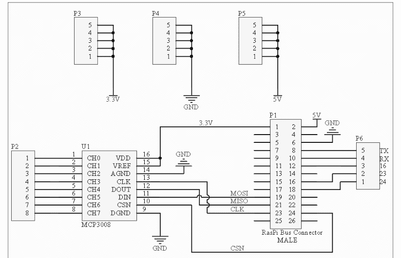

该硬件现在可以用于创建一个通用接口，以从多达八个不同传感器检索数据。此硬件设置将在树莓派板的连接之外完成。一旦电路制作完成，我们将使用排线对其进行接口连接。让我们查看原理图中的连接器。从电路最右侧数的第二个连接器标记为 `P1`，是 RasPi 1 B 型的 2 x 13 针排公针母头。

如果你使用的是 RasPi 2 B 型或 RasPi 1 B+ 型，则需要使用 2 x 20 针排公针母头来代替 `P1` 连接器。电路的其他部分保持不变。

通过 `P1` 连接器，我们连接右侧的 `P6` 连接器以获得 GPIO 和 UART 通道的功能。如果需要，我们可以用它来切换 LED 或与其他板卡或硬件通信。引脚 19、21、23 和 24 是标准的四线 SPI 接口连接，分别标记为 `MOSI`、`MISO`、`CLK` 和 `CSN`。在 `MCP3008` 上，我们为芯片的 `VREF` 和 `VDD` 提供了 +3.3V。在我们的新计算中，开发软件时我们将使用 3.3 作为 $V_{ref}$。在 PCB 上焊接电路时，应将模拟地和数字地连接在一起。原理图最左侧的 `P2` 连接器将用于连接不同传感器的模拟输出引脚。连接器 `P3`、`P4` 和 `P5` 可以根据需要为传感器连接 +3.3V、地和 +5V。

## 使用 ADC 为树莓派连接任何模拟传感器

将通用开发板握在手里，你会发现它有镀锡孔。这些镀锡孔可用于焊接元件。查看 PCB 上构建的代表性电路的顶视图，如下所示：

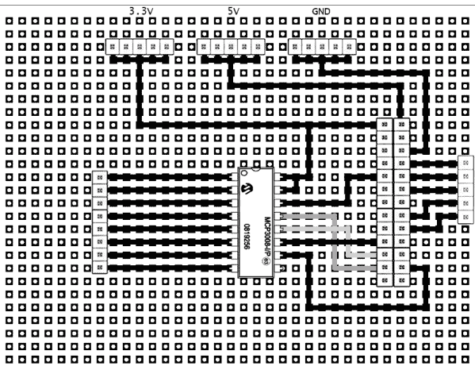

电路看起来非常直观，与原理图一致。在左侧留出一些空间，将连接器插入建议的位置。在这里，2 x 13 针排公针母头可以使用标准的 GPIO 排线连接 RasPi 的 GPIO。如果你有 B+ 型或 RasPi 2 型，你也可以使用带有 2 x 20 针排针的相同硬件。与其布线，不如通过倒锡来连接芯片和连接器。前图中的黑线是 PCB 上的焊盘。使用电烙铁沿图中所示的整个路径进行焊接。需要注意的一点是 `MISO`、`MOSI` 和 `CLOCK` 信号必须使用导线连接，因为它们是交叉的。因此，它们用灰色表示。如果没有布线，无法从 RasPi 连接器到 `MCP3008` 焊接整条线而不发生相互短路。

## 安全注意事项

电烙铁在达到最高温度时非常烫。使用时务必极其小心。你可能会把电烙铁放在导线上，甚至是你自己的手上！不使用时，请使用电烙铁架放置热铁。

在处理 `MCP3008` 芯片时，不要让电烙铁靠近 IC 的引脚。电烙铁的温度通常在 250 摄氏度到 400 摄氏度之间。长时间暴露于高温可能会损坏 IC。


准备好硬件后，我们准备好编写代码了，只需为树莓派供电，并通过以太网线通过 `PuTTY` 使用 `SSH` 与 PC 连接。此时，不需要连接我们刚刚创建的硬件模块。一旦我们按照下一节描述编写软件，我们将使用排线/总线连接器将硬件模块连接到树莓派。

# 通用软件准备

未来，将引入比你目前正在使用的更多的传感器。如果你能开发出适用于任何模拟数据采集项目的通用软件，将是极好的。准备好无错误的通用软件将减少未来的时间，你只需通过添加运行的通用软件并在需要时调用函数即可快速构建项目。

我们知道 `MCP3008` 是通过 SPI 协议接口的。要使用 SPI 协议，我们需要在树莓派上安装一些额外的包。首先，我们需要使树莓派保持最新。输入这些命令来更新并升级操作系统到最新的内核包。如果你在全新安装后没有执行任何更新，这可能需要很长时间。过程完成后，重启树莓派模块以执行正常操作：

```bash
sudo apt-get update
sudo apt-get upgrade
sudo reboot
```

在此过程之后，我们必须为树莓派板准备好 Python 开发包，这些包将带来标准 Python 库的静态库包和头文件：

```bash
sudo apt-get install python-dev
```

## 启用 SPI 功能

一旦完成安装，我们必须为树莓派板启用 SPI 功能。因为用途较少，SPI 端口默认被禁用。因此需要执行：

```bash
sudo nano /etc/modprobe.d
```

找到行 `dtparam=spi=off` 并将其更改为 `dtparam=spi=on`。保存文件（`Ctrl+O, Enter`）并退出（`Ctrl+X`）。重启树莓派：

```bash
sudo reboot
```

重启后，运行以下命令检查 SPI 是否启用：

```bash
ls /dev/spidev*
```

如果出现，我们就准备好使用 SPI 了。现在我们将编写代码与 `MCP3008` 接口。

```python
import spidev
import time

# 初始化 SPI 总线
spi = spidev.SpiDev()
spi.open(0, 0) # 总线，设备
spi.mode = 0b0
spi.max_speed_hz = 1000000

def read_adc(channel):
    # MCP3008 命令格式
    # 第一字节：0001 + 通道 (3位)
    # 第二字节：空位 (0位)
    byte = 0x01 | (channel << 4)
    resp = spi.xfer2([byte, 0x00])
    return ((resp[1] & 3) << 8) | resp[2]

while True:
    for i in range(8):
        val = read_adc(i)
        print(f"Channel {i}: {val}")
    time.sleep(1)
```

# SPI 通信详解

现在，`spi.xfer2([value1, value2, value3])` 函数通过 SPI `MOSI` 线发送 3 个字节，并以数组的形式接收回这 3 个字节。因此，我们必须通过 `MOSI` 线通过 (00000001)b 或 (1) 向 SPI 从机发送第一个字节。第二个字节应该是发送给从机选择通道的命令半字节，格式为 (1 D3 D2 D1)b 或 (8+x)，其中 x 是通道号。为了让这个半字节变成一个字节，我们将值 (8+x) 向左移动 4 位。根据之前的时序图，并不要求发送第一个字节。因此，我们将通过 (00000000)b 或 (0) 发送第三个字节。

一旦通过 `spi.xfer2()` 发送了命令，所有程序都必须等待从机的响应，这由 `spi.xfer2()` 函数本身处理。它在通过 `MOSI` 线发送命令后开始检测 `MISO` 线。`MCP3008` 从 `MISO` 线开始传输 10 位数据，数据存储在一个包含三个元素的数组中，每个元素长度为 8 位（1 个字节）。我们准备了一个函数，可以通过传递通道值来调用，并从函数的返回值获取读取到的数据。我们可以按照如下方式在 Python 中运行：

```python
def readadc(channel):
    value = spi.xfer2([1, (8+channel)<<4, 0])
    read = ((value[1]&3) << 8) + value[2]
    return read
```

最低位存储在数组的 `value[2]` 元素中，剩余两个位存储在 `value[1]` 元素中。为了将所有其他位置零，我们将执行与 0b3 或 (3)d 的 AND 运算。让我们来看一下以更好地理解接收的数据：

接收到的数据 = 00000000 01000010 01100010

数组存储数据如下：`value[0]` = 00000000, `value[1]` = 01000010, `value[2]` = 01100010。

我们对 `value[1]` 元素的最后两个位感兴趣，因为 ADC 发送了 10 位数据。我们对 3 进行 AND 运算：

```
01000010 & 00000011 = 00000010
```

第六位已经是毛刺或不需要的数据，通过此操作将其移除。我们需要将值左移 8 位，因为它最终会影响小数。

```
00000010 << 00001000 = (10000010)b = (128)d
```

将此移位值加到 `value[2]` 元素上。

127 + 98 = 225 是从 ADC 转换器接收的数据。

# 使用你的传感器站 – 制作一个温度记录器

现在你已经知道了如何通过 SPI 线从 `MCP3008` 读取 ADC 值的技巧，我们已经准备好通过 `MCP3008` 的通道 0 与传感器连接了。你现在可以使用你的传感器站并行连接最多八个传感器。为了简化实验，我们将把温度传感器连接到传感器板上。想象树莓派已连接到一个远程场所用于记录温度数据。根据你的应用需求，在一个月后或特定时间后，我们需要手动记录这些数据。为了记录这些数据，我们将利用 Python 将数据存储在文本文件中，稍后读取这些值进行分析。

## 了解 LM36 温度传感器

`LM35` 和 `LM36`（也称为 `TMP36`）提供了温度变化随电压输出的线性响应。传感器输出电压的变化与温度传感器经历的温度变化成正比。`LM35` 和 `LM36` 是摄氏温度传感器。由于其应用广泛，这些传感器可以在网上或附近的任何零售店购买。我们将使用 `LM36` 传感器构建我们的项目；如果你有 `LM35` 传感器，不要慌！这两个传感器的区别如下：使用 `LM35` 测量零下温度时，我们必须在传感器的输出引脚提供负电压，这需要特殊的电源要求。如果你只为 `LM35` 温度传感器提供正电压，它只会感应正温度范围。`LM36` 则并非如此。在提供正电压时，它能为我们提供从 -50 °C 到 +150 °C 的全范围。可以说 `LM36` 是 `LM35` 温度传感器的改进版本。让我们来看下传感器的引脚功能和封装。下图是 `LM36` 温度传感器的底视图表示：

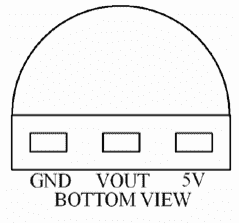

该传感器引出三个引脚。认为半圆形形状为顶部。现在最左侧的引脚是 `GND` 引脚，需要共地。中间的引脚是模拟输出输入通道。对于最右侧的引脚，我们可以提供 +2.7V 到 +20V 的电压。对于我们的应用，我们将树莓派扩展引脚 (`P3`) 的 +3.3V 输出连接到 PCB。

取三根母对跳线并与传感器站连接。从 `P3` 取 3.3V 并连接到 `LM35` 或 `TMP36` 的电源引脚。将输出引脚连接到 `P2` 的地引脚。其他传感器可以同样的方式连接。可以使用长线将温度传感器放在应用区域，以使传感器站远离应用现场。

## 编写应用程序

现在我们准备好为传感器站连接的温度传感器编写代码。我们将使用相同的函数逐个读取 `MCP3008` 的通道。如果你一次连接了多个传感器，可以在应用程序中使用相同的代码。同时，我们将使用另一个函数来记录数据文件，该函数将在解释代码时介绍。在同一文件夹中，执行 `sudo nano sensorstation.py` 并启动以下代码：

```python
import spidev
import time
import os
import csv

spi = spidev.SpiDev()
spi.open(0,0)
writer = csv.writer(open('datalog.csv','ab'))

def readadc(channel):
    value = spi.xfer2([1, (8+channel)<<4, 0])
    read = ((value[1]&3) << 8) + value[2]
    return read

while True:
    datalist = []
    for i in range(8):
        data = readadc(i)
        datalist.append(data)
        temperature = (data * 330)/float(1023)-50
        print(temperature)
    time.sleep(3)
    print(datalist)
    writer.writerow(datalist)
```

目前，我们还不知道将要接入什么种类型的传感器。一旦传感器接入，就应该创建转换公式并导入到同一代码中。要添加转换后的数据，只需使用 `datalist.append(variable)`，该值将存储在数据文件中，以逗号分隔并分单行显示。`for` 循环的每次序列都会生成一行。你可以通过在你的传感器站上连接不同的传感器来尝试不同的值和转换方法。祝玩得开心！

> 你可以像在第 3 章“使用声波传感器测量距离”中那样使用 `crontab`，将这段 Python 代码设置为启动自启。

# 总结

从模拟数字转换器的基础开始，你掌握了在使用 ADC 模块时需要遵循的流程。你理解了处理模拟数据有多么重要，以及为什么处理器需要独立的内核来处理这些输入数据。我们领略了 `MCP3008` IC 及其功能。我们制作了自己的传感器站，它可以与任何型号的树莓派无缝集成。然后，你理解了如何将 SPI 功能移植到 Python 代码中，并成功将数据转换为数字格式。现在可以在 .csv 文件上进行数据记录以便对数据进行处理。通过本章，传感器接入和记录变得比任何时候都简单。你可以连接你需要的任何数量传感器、使用不同的传感器，并在到处部署传感器站来获取数据。

在本章中，我们收集了离线数据，这些数据可以在记录后进行后处理。在下一章中，我们将数据上传到在线，以便查看远程的实时图表。此外，我们还将启用树莓派向指定的电子邮件 ID 发送带有传感器数据的电子邮件。这将是你创建自己的物联网产品的第一步。准备好迎接这个令人兴奋的项目吧！

# 将数据上传到在线 – 电子表格、手机和电子邮件

到目前为止，我们观察了树莓派计算的数据，但并没有处理这些数据。它们被生成、观察，并在做出决策后被丢弃。在上一章中，我们将一些数据记录在 .csv 文件中，这看起来像是传统的数据记录方法。当这些数据记录到互联网时，将非常有用。如果我们设置树莓派每秒从家里发送数据，并在世界任何角落查看参数的图表，那会怎样？如果在发生任何关键情况时你收到电子邮件通知，那会怎样？如果每天结束时数据分析通过电子邮件发送给你，那不是很好吗？

我知道，当我们休假甚至在办公室工作时，总是担心家里。当你离开住所时，会有大量数据需要处理，例如温度、湿度、运动、火灾报警、未经授权的侵入、能耗、设备状态等。使用神奇的树莓派，将你的家变成智能家居有无限可能。

在本章中，你将学习所有这些事情如何一次性完成。你将理解到物联网是每个技术极客在早餐桌上讨论的话题。你还将学习通信是如何进行的，以及连接到物联网的传感器节点和设备是如何工作的。你将了解为什么数据分析、云存储和云访问技术如此蓬勃。一方面，我们获得了便利，但另一方面，在部署这项技术时，有一些需要解决的安全顾虑。你将了解到这些安全问题有多严重。

## 物联网

物联网已吸引科学家、创新者、技术人员、工程师和投资者的加入，让他们开始开发并参与全球增长最快的市场之一。它可以实现这些人让世界变得更好居住的愿景。一旦在大范围内实施，它将使我们的生活变得更舒适、更安全。这场革命从重新设计和替换我们日常生活中最小、最基础的设备开始。据说，到 2020 年，除去手机和平板电脑，物联网将拥有约 300 亿台设备。从牙刷到鞋子、钱包、洗衣机、开关、汽车等，它们都将成为物联网的一部分。

一些物联网设备会学习我们的日常习惯并采纳它们，然后通过自行决策做出响应。通过为每个物理实体添加通信功能，看到每个物理实体发生变革，确实非常惊奇。物联网并没有特定的定义。从技术上讲，我们可以将物联网理解为添加互联网连接（基本上是一个唯一的互联网地址），以及感知日常物理物体或实体的能力，这些实体可以相互以及移动设备（如手机和可穿戴设备）通信。社区中的一些人认为物联网空间过载了，因为它包含了许多预期并增加了许多冗余设备，这些设备并不是真的为了给生活带来舒适，而是被强行添加的。

> 人工智能和物联网有趣的项目之一是 Jibo，一个家庭机器人。请查看 http://www.jibo.com。

# 第六章


物联网可以表示为设备、网络、数据、计算、分析和人的集成结构。我们可以将物联网想象为在家庭中广泛映射的连接，连接灯光、风扇、恒温器、热水器、开关、冰箱、空调等媒体设备。想象一种情况：在长长的假期结束后回到机场，由于家里没人，室内温度无法忍受。一旦你的手机连接到互联网，家里的空调就会知道你回到了城市。它将根据交通状况估计你的到达时间并设置制冷。此外，它还会根据你的日常习惯知道设置多少温度。反之，当你出发度假时，家里的设备知道你手机的位置，并禁用手机应用程序中所有不必要的设备。也可以通过手机应用程序手动控制。物联网技术不仅适用于家庭，还适用于酒店、医院、工厂、办公室和交通——简而言之，无处不在。真的，这将是万物联网。

# 传感器节点

众所周知，在一个地方可以感知许多参数。我们已经建立了一个传感器站，一旦安装在家里或办公室的角落，它就可以被称为传感器节点。然后它将静静地观察周围并存储所有数据。想象连接节点到互联网，以及许多这样的节点。传感器节点可以是任何尺寸，例如，从桌面投影仪的大小一直到尘粒的大小！所以，我们可以称之为智能尘埃吗？是的！研究人员已经实现了智能尘颗粒（也称为微型传感器），它们从光、温度或薄电池获取能量。广泛使用的传感器节点尺寸从指尖到手掌不等。这些传感器可以在目标区域内创建一个广泛的网络，数量从数百个到数千个不等。

## 在线数据上传 - 表格、移动设备与电子邮件

实施传感器可能会面临许多挑战。这些挑战从硬件端开始。网络中的大多数设备将使用低成本 `MCU` 在本地处理数据，并将其传输到附近的设备或互联网网关。这些低成本 `MCU` 需要足够的 `RAM` 来运行安全协议和用户应用程序。此外，此类 `MCU` 的功耗必须尽可能低，以便在单节 3V 纽扣电池上运行 4-5 年。这可以通过在周期性数据传输之间让处理器进入睡眠状态来实现。根据数据的计算，此类处理器的占空比可以接近 1%，或者达到所需的周期性速率。将处理器置于睡眠模式并恢复所需的时间不应超过设定的占空比的一小部分。`PLL` 和锁（`locks`）需要时间才能稳定，而处理器核心的稳定性完全依赖于这些时钟。这种稳定时间可能达到毫秒级，这会让硬件设计人员希望单节电池运行设备更长时间的梦想破灭。硬件开发者还有许多其他硬件问题需要解决。

由于许多硬件限制，软件端也面临许多挑战——利用适当的 `RAM` 空间、定期清理，以及在有限的 `RAM` 中编写通信协议栈编写高效算法。下一步可能是无线固件远程升级（`FUOTA`）。在现场部署后，节点可能需要立即进行固件修复，以修复接收到的数据中的缺陷。固件升级还可以通过调整中断处理和睡眠定时、优化代码大小以及 `RAM` 的高效使用来修复硬件性能。`FUOTA` 确保了部署的传感器节点能够正常工作，并对其他节点做出良好响应。这些固件升级在版本控制下维护。对于异常需要特殊处理，并且在使设备可通过无线远程升级时，考虑了所有可能的失败情况。例如，假设节点正在升级，设备中的电量水平如此关键，以导致设备关机。当电电恢复时，它应该恢复到之前的稳定固件版本，并请求最新的固件升级。下载时间、下载大小和一天的时间段是影响 `FUOTA` 成功率的其他因素。

## 通信

节点之间的通信应该通过无损介质进行。数据包丢失在数据传输失败中起着主要作用。通信是 `IoT` 基础设施最核心的部分。它是收集和发送数据以及命令的双工介质。连接建立后，必须一直进行维护和管理。

## 第 6 章

所有设备的通信都遵循某种协议，以在它们之间建立链路。协议定义了此类节点应遵循的一系列规则，以避免可能干扰通信的所有关键条件。协议还为在网络上发送命令提供了一种定义良好的格式。在过去，我们使用 `SPI` 等有线协议，而无线通信需要将一组规则应用于频率、地址、定时、帧类型以及许多其他参数上，这些参数的结构是经过设计的，以利用资源。

`IoT` 的实施将需要数百万个唯一标识地址。这将要求在这些设备上实现 `IPv6`。为设备提供地址并构建交互式网络并非唯一的挑战。真正的挑战在于以高效且安全的方式处理数据。`IoT` 领域使用的几种通信协议可以列举：

- `Wi-Fi` (2.45 GHz, 802.11 a/b/g/n)
- `Zigbee` (2.45 GHz, 802.15.4)
- `Bluetooth 4.1 LE` (2.45 GHz 蓝牙低功耗, `iBeacon`)
- `Z-Wave` (900 MHz, 1 GHz 以下射频)
- `6LoWPAN` (低功耗无线局域网上的 `IPv6`)

以及更多。在开发和改进这些协议方面正在取得快速进展，使其更具能量效率和健壮性。`RasPi` 有扩展板可用，可以通过接口这些扩展板来添加这些功能。现在许多初创公司参与了基于这些协议的产品。

## 云端

过去几年中经历的科技进步之一是云计算技术。嵌入式系统和 `IoT` 由于其成本低、体积小，可以充分利用这项技术。这些嵌入式设备的内存处于几 `KB` 级。此类系统收集的传感器数据可以被存储，但这些数据在特定时间后会导致内存溢出。存储传感器数据可能非常困难。这些设备的其他限制可能是处于低功耗运行以维持电池工作数天时处理能力较低。我们通过在传感器网络上部署云服务来消除这些限制。多个传感器上传的所有数据可以在云端进行计算和解释，而不是在本地计算，以节省电力并增加处理器的睡眠时间。在传感器网络中，可以设置一个网关，它可以作为收发器始终连接到云端。所有计算密集型算法都可以部署在云端，而不是放置一个笨重的处理器作为枢纽从云端收集和发送数据。

## 数据分析

`IoT` 预计将产生来自不同地方的海量数据，这些数据是聚合且高速的，增加了对这类数据进行更好排序、存储、转换和处理的需求。将会有一个数据矿，我们需要从这个数据池中收集更多信息。数据解聚合和从中提取含义是数据分析的一部分。通过数据分析，人们可以改进算法以提高产品的用户体验。例如，家庭自动化系统会收集大量数据。通过收集数据，它知道你何时开启电视或空调，你设置了多少温度，以及你何时回家。通过收集所有这些信息、对数据进行挖掘并应用机器学习算法，系统可以学习你的习惯，这对于节能进一步有用。连接的且具有学习能力的设备最佳例子是 `Nest` 调节器。数据分析和挖掘将是 `IoT` 开发的关键领域。在自动化系统中，不仅是功能，用户体验也非常重要。如今的数据分析是为了反驳从现有用户推得出的概率理论。

## 安全担忧

当 `IoT` 无处不在时，安全性是一个主要关注。构建 `IoT` 设备的工程师在安全方面留了一些漏洞，而这仅仅是问题的开始。这是一个嘈杂的世界！邻居们总是想知道你的日常习惯和活动。通过开启家里所有设备的通信功能，你正在间接地吸引黑客来访问、控制和分析你的设备。部署在门口的运动传感器、浴室里的热水器、恒温器、空调和水泵可能处于黑客的直接访问范围内，他借此知道当你在客厅看最喜欢的电视时，后门是开着的。他坐在你家附近或通过互联网直接访问并控制所有设备。想象一下，在全自动、支持 `IoT` 功能的手术室或你驾驶的车辆中发生黑客入侵！多种安全协议正在被开发和研究，它们对于低功耗嵌入式设备的 `RAM` 和 `ROM` 占用更小。它们足够安全保护设备免受此类攻击。需要开发算法来弥合互联网与 `IoT` 领域之间的差距。

## 硬件设置

现在有了许多关于物联网（`IoT`）的信息，我们将制作一个属于自己的小型物联网项目。与之前的章节相比，这次硬件设置将非常简单。我们在第 5 章中做的“使用 `ADC` 将任何模拟传感器连接到树莓派”中的工作将对我们非常有帮助。我们将使用传感器站来获取温度传感器的数据。列出本章所需的，我们需要以下物品：

- 一个传感器站
- 一个温度传感器 (`LM35`/`TMP36`)
- 适用于树莓派 B 型 (26 针)、A+ (40 针) 或 B+ (40 针)，或 Pi 2 B 型 (40 针) 的 `GPIO` 排线 - 母对母
- 公对母和母对母跳线
- 一台树莓派、一个电源适配器、一根网线、一台个人电脑

使用排线连接传感器站。使用电源适配器启动树莓派，并在个人电脑上使用 `PuTTY` 启动会话。交叉验证你的电脑是否与树莓派共享了互联网连接。使用以下命令检查：

```
ping -c 4 www.google.com
```

如果没有共享互联网连接，请参阅第 1 章提供的指南《结识你的伙伴——树莓派》。显然，将树莓派连接到互联网非常重要。记住物联网！让我们深入研究软件部分。软件方面有很多东西要学。

## 与互联网同步时钟

在记录数据时，如果树莓派的日期和时间与本地时区不同步，会非常困难。一旦你在没有持续电源供应的远程地点设置日志设备或传感器节点，情况会变得更加困难。你可能注意到，每当树莓派启动时，时钟显示的都是错误。通过在树莓派的命令行界面输入 `date` 命令可以检查。此外，在上一章中，你可能注意到 `.csv` 日志文件中记录的时间没有显示更新后的日期。不，树莓派在睡眠时并不会穿越时！这因为它没有专门的按钮为它的实时时钟（`RTC`）供电。为了让树莓派更便宜，设计者移除了许多普通桌面电脑或笔记本电脑具备的功能。

桌面电脑有一个内置的纽扣电池为内部 `RTC` 供电。要在树莓派上实现这一点，你可以连接一个名为 `DS1307` 的 `IC`，它通过 `I2C` 协议通信。你可以随时从 `RTC` 获取时间。你可以用 `CR2032` 纽扣电池为该 `IC` 供电。说明该硬件的接口可能需要另一个章节，而且这超出了本书的范围。由于我们在树莓派上有互联网连接，我们可以使用更简单的方法同步时钟。我们将使用网络时间协议 (`NTP`) 服务为树莓派提供日期和时间。长期以来，该协议一直用于保持两台电脑或服务器之间的时间同步。在 `Whezy Raspian` 上，`NTP` 客户端已经安装。你只需要设置启动时的守护进程（它在后台运行），从互联网服务器获取时间。设置该守护进程的后续代码：

```
sudo nano /etc/rc.conf
```

你可能会看到一个空白配置文件，可以在其中写入：

```
DAEMONS=(!hwclock ntpd ntdate)
```

在前面的命令中，`!` 标记意味着硬件时钟保持不变，但我们将在后台更新软件时钟。按 `Ctrl + X`，然后按 `Y`，最后按 `Enter` 键保存并退出配置文件。然后通过输入 `sudo reboot` 命令重启树莓派。此守护进程将在后台静默运行。

重启后，只需输入 `date` 命令检查系统时间，并与当前日期时间对齐。

> 如果你没有设置树莓派的时区，你可能会看到 `date` 命令显示错误的日期和时间。要设置时区，你可以输入以下命令之一：
> - 输入 `sudo dpkg-reconfigure tzdata` 并按照用户界面操作。
> - 或者，你也可以通过运行 `sudo raspi-config` 打开树莓派配置菜单，然后导航到国际区域设置，设置与第一步中相同的配置。配置好后重启树莓派。

## 在 Google 表格上上传数据

我们已经完成了将时间同步到本地时区。我们可以创建一个与上一章具有相同数据记录功能的应用程序，但这次很不同且很酷。我们将数据上传到 Google 表格中，可以从世界上任何角落访问这些数据。你可以坐在办公室监控家里的温度和湿度。你可以采用你在第 4 章做的《使用传感器监控大气》项目，并使用 `DHT11` 传感器观察温度湿度，或者直接使用上一章使用 `MCP3008` 构建的传感器。

在开始编写代码之前，我们需要准备此处列出的物品。使用个人电脑的浏览器执行以下步骤：

1. 登录你的 `Gmail` 账户或创建一个新账号。
2. 使用 `Gmail ID` 登录 `http://www.drive.google.com` 打开或链接 `Google Drive`。
3. 在 `Google Drive` 的用户界面中，在左侧面板上点击“New”（新建）按钮并选择“Spreadsheet”（表格）。
4. 将表格命名为 `Logging`。
5. 在第一行创建标题 Time（时间）和 Temperature（温度）。
6. 在第二行输入数据。
7. 在第三行也输入数据。
8. 关闭标签页，准备编写代码。

## 在线上传数据 - 电子表格、手机和电子邮件

```python
try:
    ret = gspread.login(email, password)
except:
    print('Oops! 请检查网络连接或登录凭据')
    sys.exit()
```


```python
# 使用两种选项之一打开电子表格
worksheet = ret.open(spreadsheet).sheet1
# 或者使用电子表格密钥
# worksheet = ret.open_by_key('Le0Qth-TY4FXPKChB5RFPhelQ6zn4NWDESh13WkXGQAK')
# 优先使用第一种
```

```python
def readadc(channel):
    value = spi.xfer([1,(8+channel))<<4,0])
    read = ([value[1&3]] << 8) + value[2]
    return read
```

```python
while True:
    # 从通道 0 TMP36 温度传感器获取数据
    val = ((val * 330)/float(1023)) -50
    values = [datetime.datetime.now(), temperature]
    worksheet.append_row(values)
    time.sleep(5)
```

在代码顶部，你可以看到导入了一些库，用于基础操作系统功能以及获取数据和导入。在导入这些库之后，打开了 SPI 端口以从 MCP3008 获取数据。在 SPI 端口旁边，我们将分配变量来存储 Gmail ID 和密码。Python 代码尝试使用电子邮件和密码登录你的 Gmail 账户。异常情况最好通过 `try-except` 函数进行处理。如果没有网络连接或无法登录 RasPi，代码不应该在某处卡住。相反，它应该显示某些错误。我们在接后的章节中讨论电子邮件通知时，你将理解 `try-except` 函数的细节。

登录成功后，它会搜索名为 Logging 的电子表格并选择 sheet1。如果你在桌面电脑的浏览器中观察该电子表格的链接，你会看到一个长随机数字 `Le0Qth-TY4FXPKChB5RFPhelQ6zn4NWDESh13WkXGQAK`。这是你电子表格的密钥。但是，你最好通过 `ret.open()` 选择工作表，因为这是访问 Google 电子表格最直接且整洁的方式。

在调用 SPI 函数时，温度值将存储在一个变量中，并传递给 `worksheet.append_row()` 函数以推送到 Google 电子表格。

## 第 6 章

通过运行代码，你将看到自动创建一个新的空行，并带有最新日期和时间的温度值。在温度（Temperature）列中添加图表，查看温度列中更新的实时数据。

### 添加图表

我取了一些冰块和一个火柴盒来模拟结果，如下截图所示：

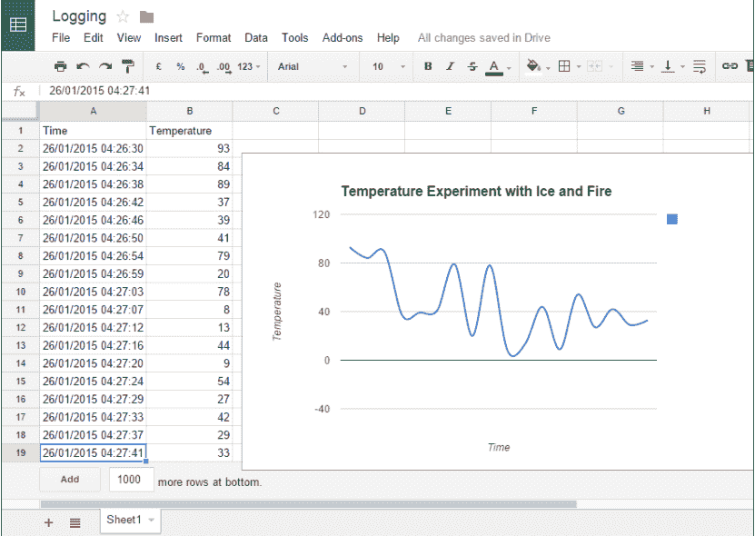

| 时间 | 温度 |
|---|---|
| 1 | 26/01/2015 04:26:30 | 93 |
| 2 | 26/01/2015 04:26:34 | 84 |
| 3 | 26/01/2015 04:26:38 | 89 |
| 4 | 26/01/2015 04:26:42 | 37 |
| 5 | 26/01/2015 04:26:46 | 39 |
| 6 | 26/01/2015 04:26:50 | 41 |
| 7 | 26/01/2015 04:26:54 | 75 |
| 8 | 26/01/2015 04:26:58 | 20 |
| 9 | 26/01/2015 04:27:02 | 80 |
| 10 | 26/01/2015 04:27:03 | 78 |
| 11 | 26/01/2015 04:27:07 | 40 |
| 12 | 26/01/2015 04:27:12 | 13 |
| 13 | 26/01/2015 04:27:16 | 44 |
| 14 | 26/01/2015 04:27:20 | 9 |
| 15 | 26/01/2015 04:27:24 | 54 |
| 16 | 26/01/2015 04:27:28 | -40 |
| 17 | 26/01/2015 04:27:32 | 42 |
| 18 | 26/01/2015 04:27:36 | 29 |
| 19 | 26/01/2015 04:27:41 | 33 |

这个实验将为你连接更多传感器提供开端。连接两个或多个传感器，现在可以使用以下函数将数据追加到第三列和第四列：

```python
values = [datetime.datetime.now(), value1, value2, value3]
worksheet.append_row(values)
```

这就全部了！你可以共享这个工作表（点击右侧电脑右上角的共享按钮）。

```python
s.quit()
```

```python
while(1):
    # create a new csv file
    filename = 'Sensor_data_' + str(datetime.datetime.now()).split(' ')[0]
    writer = csv.writer(file(filename+'.csv', 'wb'))
    prev_date = str(datetime.datetime.now()).split('.')[0].split(' ')[0]
    max_sensor_data = -9999
    min_sensor_data = 9999
    # setting the temperature threshold limit to 30 C
    temp_limit = 30

while(1):
    cur_datetime = str(datetime.datetime.now()).split('.')[0]
    cur_date = cur_datetime.split(' ')[0]
    sensor_data = readadc(0)
    min_sensor_data = min(sensor_data, min_sensor_data)
    max_sensor_data = max(sensor_data, max_sensor_data)
    # check if the threshold value is crossed
    if (sensor_data > temp_limit):
        try:
            email_data('gajjar.rushi@gmail.com',
            'raspberrypi','gajjar.rushi@gmail.com','Warning !!!',
            min_sensor_data,sensor_data)
        except:
            pass
    # check if the date is changed, if changed: send email
    if (cur_date != prev_date):
        try:
            email_data('gajjar.rushi@gmail.com',
            'raspberrypi','gajjar.rushi@gmail.com',filename,
            min_sensor_data,max_sensor_data)
        except:
            pass
        break
    # update the csv file
    writer = csv.writer(file(filename+'.csv', 'ab'))
    writer.writerow([cur_datetime,sensor_data])
    time.sleep(1)
```

## 将数据上传在线 - 电子表格、手机端和电子邮件

让我们先了解电子邮件函数。在电子邮件函数中，我们传递了当 `if` 循环满足时传入的变量（发送件者邮箱、密码、接收者邮箱、主题、最小值和最大值）。在 `content` 变量中，我们存储了包含最小值和最大值的邮件正文。

代码流从第一个 `while` 循环开始，它将无限运行。我们的外部 `while` 循环每天都会完成一次，因为我们放置了一个无限运行的内部循环，并在日期更改时退出。如果你仔细观察 `filename` 变量，你会发现它将文件名设置为 `Sensor_Data` 加上当前日期。`datetime.datetime.now()` 函数提供了精确的日期和时间。我们的项目不需要毫秒级的精度。`split()` 函数删除了原始数据中的毫秒部分。一旦获取了文件名，我们就使用 `csv writer` 写入函数将其保存为 `.csv` 文件。

Python Shell 中 `split` 函数的几个示例返回了了这些值：

```
>>> str(datetime.datetime.now())
2015-01-26 17:12:49.998000
>>> str(datetime.datetime.now()).split('.')[0]
2015-01-26 17:12:49
>>> str(datetime.datetime.now()).split('.')[0].split(' ')[0]
2015-01-26
```

为了检测日期变化，我们将使用两次 `split()` 函数从 `datetime.datetime.now()` 中提取日期字符串，并将其存储在 `prev_date` 变量中。

我们使用 `max_sensor_data = -9999` 和 `min_sensor_data = 9999` 是为了防止 `min()` 和 `max()` 函数中出现错误数据，这些函数用于从 csv 文件中找到最小和值。`temp_limit` 变量可以设置你期望的值，当达到该值时向 RasPi 发送电子邮件。

添加 `try` 结构来处理异常是好的。正如前面的章节所解释的，它的工作原理简单：

- 执行 `try` 块。如果没有发生异常，则跳过 `except` 块并完成 `try` 语句的执行。
- 如果在执行 `try` 块期间发生异常，将跳过后续部分。然后进入 `except` 块并执行执行。

代码的其余部分是不言自喻的，可以通过代码本身提供的注释来理解。在测试代码时，你可以设置相同的发送者和接收者邮箱。每天，数据都会存储在以日期命名的 `.csv` 文件中，每当你打开 RasPi，就可以直接取出整个装有 csv 文件的文件夹。

一旦编写完成后，你可以将传感器站固定在气密容器内，连同 RasPi 一起并将其固定在家中的路由器上。用以太网线直接从路由器连接到 RasPi。由于你的电脑在同一网络中，你可以 ping RasPi 的 IP 地址以检查它是否成功连接到路由器和你的网络。

## 集成一切

现在轮到你将 Google 电子表格项目与电子邮件通知项目整合了。你只需要安排发送数据到 Google 电子表格、记录本地数据和发送电子邮件事件。你甚至可以在发送每日总结时尝试附件 `.csv` 文件。

该项目的应用在于你可以通过添加功能利用这段代码实现更多操作。通过在家里不同的角落添加带有多个传感器的多个 RasPi 板子，你真的可以从家里获得更多的数据和更多的警报。

如果你在遥远的地方安装 RasPi，不要忘记像第 3 章《使用声波传感器测量距离》中描述的那样，在 crontab 中添加 Python 脚本，以便在 RasPi 重启时重新记录数据。

## 常见问题

在构建项目时，可能遇到很多问题，因为这主要是软件开发。尽管如此，此处描述的方法仍会导致错误。

在你的代码中，不要将变量名或函数名与 Python 数据类型或 Python 内置函数相同；将函数命名为 `email()` 是无效的并会在代码中产生运行时错误。当你将 Python 脚本文件名设置为一个预定义的 Python 函数时，也会发生同样的问题，例如 `email.py`。

在尝试使用 gpread 时，尝试将脚本写入 gpread 自身的安装文件夹中。或者，你可以使用 Linux 使该函数和文件作为文件的外部位置可用。例如，我们使用以下命令安装了 gpread：

```bash
git clone https://github.com/burnash/gpread.git
cd gpread
python setup.py install
```


在同一个 `gpread` 文件夹中，编写 Google 电子表格数据记录程序。Python 最常见的问题之一是代码的缩进。大多数错误在编写循环时发生。为了更好地理解电子邮件通知代码，只需查看下方截图中的代码块。忽略文本中的 `.` 符号。仔细观察行前的长连字符。这些连字符显示了编写该行所需的制表符数量。

# 总结

我们从物联网（IoT）的基础知识开始本章。各节提供的信息并没有涵盖 IoT 的全部概念。IoT 是一个巨大的领域，包含了传感器节点、传感器网络、通信、云计算、数据分析和安全。IoT 有许多方面需要开发者投入更多关注。你已经了解到 IoT 可能是互联网和数据的未来，从智能尘埃到智能城市。安全是一个主要的关注点，需要立即关注和研究，以满足嵌入式世界的需求。

本章让你学习了如何观察从与你的 RasPi 接口的传感器插入到 Google 表格中的数据。你学习了 RasPi 如何代表你记录日志到 Gmail 服务器，并在有实际需要时发送电子邮件。我们准备了一个项目，特意在一天结束时发送一封电子邮件，发送数据分析。数据的最小值和最大值可以是数据分析的一个非常小的示例。将 `gspread` 电子邮件通知代码集成进来以使代码更具实用性，是一个非常好的挑战。

在下一章中，我们将把图像传感器（摄像头）与 RasPi 接口并测试其操作性。我们将提供有关安装 `OpenCV` 库的完整说明，以帮助你开始在 RasPi 上进行图像处理。你将制作一个带有实时视频流的项目，将 RasPi 用作 CCTV 摄像头并捕捉家中的运动实例。这将是一次奇妙的体验，使用 `OpenCV` 这一强大的库来开发项目对你来说将是一个巨大的突破。

## 使用摄像头和 OpenCV 创建图像传感器

在“图像传感器”这个简单的名称背后，有海量的研究。从开发可以拍摄清晰图像的 CMOS 传感器，到使用图像处理进行图像增强，其中包含了大量的努力。制造适用于不同应用和处理算法的不同类型的摄像头并不是易事。

图像传感器用于摄像头中，它们在未封装的状态下非常难以使用，因为它们脆弱且对静电释放敏感。我们将使用摄像头（基本上是一个带有保护外壳和接口电线的镜头）来演示使用 RasPi 进行图像捕捉。在讨论中，RasPi 摄像头的性能通常评价较低，因为它在图像处理和视频处理方面的性能不佳，评论说图像处理和视频捕捉不是 RasPi 的强项。当我们运行具有大量处理需求的计算密集型算法时，RasPi 会给出延迟响应，这些评论在某种程度上是正确的。但这完全取决于摄像头接口时的硬件钩子。当你使用摄像头时，许多因素可能会影响 RasPi 的性能。这是旧款 RasPi 模型的问题，例如 `Raspberry Pi 1 model B`、`B+` 和 `A+`。但现在，有了 `Raspberry Pi 2 model B`，情况就不如此了。`RasPi 2 model B` 的性能比旧 RasPi 模型强六倍。

## 使用摄像头和 OpenCV 创建图像传感器

在本章中，我们将首先对图像处理和 `OpenCV` 进行简要介绍。然后我们将介绍摄像头接口，并查看可以与 RasPi 接口的各种摄像头。接下来，我们将在 RasPi 上进行漫长且疲惫（但非常值得）的 `OpenCV` 库安装。一旦安装了库，我们将编写一个 C 程序从摄像头捕捉图像。更进一步，我们将尝试在与家里相同的网络上进行视频实时流传输。在后续步骤中，将准备一个项目来检测特定区域的人类运动或移动，捕捉图像并立即通知你。

## 图像处理

你是否曾经尝试过将图像缩放到最大级别来查看它？它看起来就像一个铺有整齐瓷砖和彩色图案的地板。图像中的这些正方形瓷砖被称为像素。基本上，图像是一组像素，每个像素包含一个特定的颜色值，通过向人眼提供信息来形成可识别的模式。这取决于人类如何通过观察形状和颜色来感知图像。每个像素包含可以从一个字节（8 位）或几个字节生成的信息，这定义了图像的深度。图像深度无非单个像素中存在的位数。目前的显示器和图形引擎支持高达 64 位的图像深度。基本的图像类型有二值、灰度、RGB，还有许多其他类型，如 `HSV`、`HLS` 和 `YCC` 等也是已知类型。灰度图像在 8 位模式下具有从 0 到 255 的值范围，而二值图像的范围是 0 到 1。正如名称所示，二值图像在平面上只有黑色和白色两种颜色。灰度图像和二值图像的区别可以通过以下图像观察到：

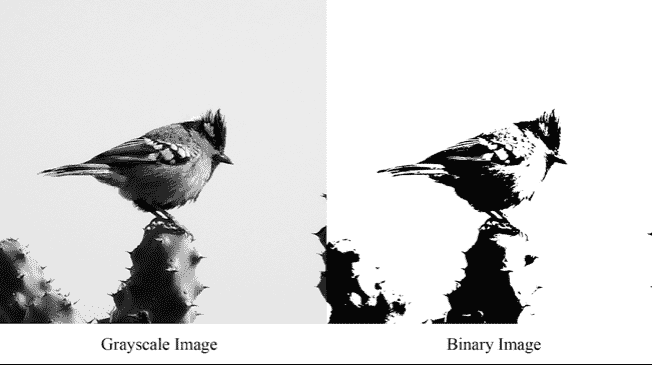

## 第 7 章

RGB 图像共有 3 个平面可以访问，因为它的 R（红色）范围从 0 到 255；G（绿色）和 B（蓝色）颜色在 8 位深度下也是如此。灰度图像具有从白到黑的色调，对于 8 位深图像，总共有 256 个离散值（0 到 255）。

执行图像处理是为了将图像增强到特定水平，以提取最大信息。

# OpenCV

`OpenCV` 是最强大且广泛使用的跨平台图像处理库之一，它可以运行在任何硬件或软件平台上。它可以安装在 RasPi 上以获得人脸检测、轮廓查找、手势识别、运动跟踪、使用摄像头进行 3D 深度感知以及许多用于机器学习的复杂算法等功能。`OpenCV` 代表开源计算机视觉。它由 Intel 开发，基本上用 C++ 语言编写，并可以与 Python、Java 或 MATLAB 完全互接口。访问 `http://opencv.org` 查看可用的开源库列表。考虑到计算效率，`OpenCV` 的设计旨在与多核架构协作。使用 C 和 C++ 编写 `OpenCV` 是全球图像处理专家的常态。`OpenCV` 也可以用 Python 语言编写，因为该库具有完整的开发支持并支持 Python 脚本中的函数。

计算机视觉是一个快速发展的领域，拥有更便宜且具备先进处理能力的硬件。`OpenCV` 为专业人士在视觉处理领域获得最佳结果提供了便利。最初，由于在开源平台上的稀缺以及缺乏专用硬件，图像处理只能在研究实验室进行。如今，学生、研究人员和专业人士可以轻松使用这一成熟且不断增长的库。在写本书时，`OpenCV` 版本为 `3.0 Beta`，下载量约为 900 万次。

# 与 RasPi 的摄像头接口

RasPi 拥有 Broadcom 多媒体处理器 `BCM2835`，该处理器集成了 `VideoCore-IV` 图形引擎。有多种方法通过 RasPi 接口连接摄像头。如第 1 章《结识你的伙伴——树莓派》所述（请参考显示 RasPi 端口描述的图），RasPi 具有一个用于连接摄像头模块的专用 CSI 端口。该端口位于以太控制器附近（B 型）或 4 极音频接口附近（B+ 型）。摄像头串口接口（CSI）端口专门用于移动设备和高级外围控制器的摄像头接口。我们有两种方案将摄像头与我们的 RasPi 接口：我们可以通过 USB 接口网络摄像头，或者选择 Raspberry Pi 组织提供的名为 Raspberry Pi 摄像头模块。

# RasPi 摄像头模块

购买用于与 RasPi 接口的专用摄像头模块时有两种选择。摄像头带有一条半长的柔性电连接连接 RasPi 的 CSI 接口。RasPi 摄像头模块有两种规格：

- **Raspberry Pi 摄像头模块**：该摄像头模块采用 500 万像素摄像头，具备以 30 FPS 帧率录制高清视频的能力。在光线较好的白天表现良好。
- **Raspberry Pi 摄像头模块黑夜（NoIR）**：`NoIR` 代表无红外。该摄像头模块没有内部红外滤波器，使摄像头具有在黑暗中观察的能力。你可以将此摄像头部署在花园房作为 CCTV，以便在晚上看守宠物。这些摄像头对于野生动物摄影师来说性能更好，因为每当检测到运动时就会触发并捕捉图像或视频。由于部署了红外 LED，此摄像头具有在夜间拍摄图像的能力。

这些摄像头在在线商店的价格为 25 美元。要启用 RasPi 摄像头模块，输入此命令并在配置窗口启用摄像头：

```bash
sudo raspi-config
```

使用键盘在配置设置中选择 `Enable Camera`（启用摄像头）选项。使用以下命令通过捕捉图像来测试摄像头：

```bash
sudo raspistill -o FirstImageThroughRasPi.jpg
```

使用 `raspistill` 命令了解 `raspistill` 命令提供的更多选项。你甚至可以使用以下命令录制视频（H264 格式）：

```bash
raspvid -o FirstVideoThroughRasPi.h264 -t 5000
```

此命令将录制 5 秒视频，并在录制完成后自动保存文件。

> RasPi 摄像头模块对人体传递的静电荷非常敏感。RasPi 摄像头模块故障在树莓派社区非常常见。在触摸摄像头之前，请佩戴防静电手环或在手上接地。RasPi 摄像头模块提供的排线非常脆弱。因此，在使用此摄像头模块时应格外小心。


## USB 摄像头

通过牺牲性能来连接台式电脑的摄像头可能更廉价。RasPi 并不支持所有的网络摄像头。你可以访问 `http://www.ideasonboard.org/uvc/#devices` 查看 Linux 支持的摄像头和相机列表。

与 Raspberry Pi 摄像头模块相比，使用 USB 摄像头在速度、成本和通用性之间存在权衡。如果你选择 USB 摄像头，将获得下降的性能，但未来你将能够将 USB 摄像头连接到任何单板嵌入式计算机。USB 摄像头绝对具有成本效益。此外，与 Raspberry Pi 摄像头模块相比，优质的 USB 线和防静电外壳提供了更长的寿命。

本章接下来的项目将使用罗技 C270 USB 摄像头进行验证。

## 使用网络摄像头进行直播

你是否想过 RasPi 是否可以用于直播？如果你选择将 RasPi 作为网络摄像头，在本地网络上通过 RasPi 流式传输视频。有多种方法可以利用 RasPi 进行直播：

- 通过将连接到 RasPi 的摄像头固定在同一网络中，你可以通过 SSH 连接并打开摄像头端口。
- 使用 HTTP 服务器启用摄像头视图。`Motion` 内置了 HTTP 服务器来启用摄像头。`Motion` 可以以 MPEG 格式录制视频并以 JPEG 格式捕捉图像。这些图像和视频可以存储在任何地方，它支持 MySQL 等数据库。输入以下命令在 RasPi 上安装 `motion`：

```bash
sudo apt-get update
sudo apt-get upgrade
sudo apt-get -y install motion
sudo apt-get -y install v4l-utils
```

# 第 7 章

在启动项目之前，需要设置配置文件，该文件被称为 IP-摄像头：

```bash
sudo nano /etc/motion/motion.conf
```

设置配置文件可能是一项机械的工作，因为文件很长且有很多参数需要设置。你可以使用 `Ctrl + W` 在文件中搜索参数。设置参数如下所示：

```conf
netcam_url http://169.254.0.252:8081
webcam_localhost off
control_localhost off
control_port 8080
framerate 2
control_html_output on
daemon on
```


> 可以使用 `ifconfig eth0` 命令找到 RasPi 的 IP 地址。在响应消息中，必须在第二行记为 `inet addr:169.254.0.252`。

在文件中做出这些更改后，按 `Ctrl + X`，然后按 `Y` 并回车保存并编辑配置文件。需要更改 `motion` 的守护文件以保持 `motion` 服务运行。输入此命令设置 `motion` 的守护进程：

```bash
sudo nano /etc/default/motion
```

编辑 `start_motion_daemon=yes`。保存并退出文件。完成所有设置后，创建一个文件夹并运行以下命令来启动运动服务：

```bash
mkdir motion-camera
cd motion-camera
sudo service motion start
```

现在，在 PC 桌面上打开网络浏览器，输入在 `motion` 配置文件（`motion.conf`）中保存的 IP 地址和端口号：

```
http://169.254.0.2:8081
```

你将能够看到来自 RasPi 相机的实时流。恭喜你！我们制作了我们的开源网络摄像头。此摄像头可以通过网络中的任何计算机访问。你所做的就是以太网线将摄像头连接到你的后院。你可以直接从客厅访问它。你甚至可以尝试从 VLC 媒体播放器进行测试。在 VLC 中，进入“媒体”，然后进入“打开网络流”。输入相同的 IP 地址，后跟端口地址。

# 迁移 OpenCV

在 RasPi 上迁移 `OpenCV` 是与安装所有其他库相比最耗时的任务。安装合适的配套库对于图像处理算法的有效运行是必要的。社区中观察到，并没有人成功地迁移了 `OpenCV`。我们将通过一个分步指南，让你在第一次尝试就获得一个可以运行的 `OpenCV`。在安装某些库时，安装顺序并不重要，但建议此处提供的流程将带给你你寻找的精确结果。

快速检查列表如下：

- 通过 Wi-Fi 适配器或 PC 与 RasPi 共享互联网连接。
- 使用 `PuTTY` 通过连接到 PC 的以太网登录 RasPi。
- RasPi 的 SD 卡上有足够的空间（多达 4 GB）。使用 `df -h` 命令检查 SD 卡的可用空间。
- 在需要时连接摄像头。USB 摄像头需要电流才能工作。如果需要，请为 RasPi 连接一个 2A 适配器。

让我们开始吧！通过以太网上的 SSH 连接登录到你的 RasPi。从现在起，除非另有说明，我们将使用 `PuTTY` 在 RasPi 上执行所有这些命令。

> 在 Raspian 上构建 `OpenCV` 可能需要多达 12 小时。在任何阶段，中断后恢复安装都可以进行，而无需重新安装之前的库。

确保你已经在 RasPi 上启用了 SSH 通信。你可以使用此命令启用它，并说明你 RasPi 的 IP 地址：

```bash
ssh -X pi@169.254.0.2
```

输入 `yes` 然后按回车，SSH 将在你的 Pi 上启用。你可以在同一个会话继续。你可以使用此命令通过以太网启用 SSH 通信：

```bash
sudo raspi-config
```

然后进入 `Advanced Options`（高级选项），找到名为 `SSH` 的选项。按回车启用该选项。在同一个菜单中，有一个选项叫做 `Camera`；这也应该被启用。按 `Esc` 退出配置菜单。

现在是更新 RasPi 以提供最新软件包、版本和依赖项的信息了。所有存储库将获取有关其最新软件包的信息进行重新同步：

```bash
sudo apt-get update
```

接下来，`upgrade` 将根据 `update` 列表中提供的列表获取软件包的新版本：

```bash
sudo apt-get upgrade
```

为了获取软件包，你可以安装 `synaptic` 软件包管理器。它允许你使用 GUI 安装包，而不是输入 `sudo apt-get` 命令。在安装 `OpenCV` 后，安装缺失的包将是非常方便的：

```bash
sudo apt-get -y install synaptic
```

注意，我们仍然将使用命令行界面来安装包，因为安装整个库更好。你可以使用 `synaptic`，但倾向于安装小型包并管理存储库。在命令行界面中管理安装会更好。

## 安装 Python 科学计算库

我们必须安装 Python 的科学和数学库来处理图像并获取额外功能。`Numpy`、`Scipy` 是用于计算多维数组、傅里叶变换、随机数和线性代数计算的数学科学库。`Nose` 是用于以更快速的方法测试 Python 代码的库。接下来，`Pandas` 是 Python 的一种高性能数据分析工具。`OpenCV` 的作用是提供交互式的功能来查看代码和命令的结果，并在 GUI 上进行交互式可视化。`Matplotlib` 用于绘制二维图表，它提供高质量的图表图像。这些可以用于研究和出版。所有的库都可以在单行中构建并一次性安装。最后，`SymPy` 提供了符号数学的功能。它的目的是在计算机代数系统中提供函数，保持 Python 代码尽可能简单且可扩展。在使用 Python 库配合 `OpenCV` 编写代码时，可以使用所有这些库。在命令行界面中输入此单行命令以执行：

```bash
sudo apt-get -y install python-numpy python-scipy python-nose python-pandas python-matplotlib ipython-notebook
```

注意，我们仍然将使用命令行界面来安装包，因为安装整个库更好。你可以使用 `synaptic`，但倾向于安装小型包并管理存储库。在命令行界面中管理安装会更好。


# 使用摄像头和 OpenCV 创建图像传感器

我们必须安装 Python 的科学和数学库来处理图像并获取额外功能。`Numpy` `Scipy` 是用于计算多维数组、傅里叶变换、随机数和线性代数计算的数学科学库。`Nose` 是用于以更快速的方法测试 Python 代码的库。接下来，`Pandas` 是 Python 的一种高性能数据分析工具。`OpenCV` 的作用是提供交互式的功能来查看代码和命令的结果，并在 GUI 上进行交互式可视化。`Matplotlib` 用于绘制二维图表，它提供高质量的图表图像。这些可以用于研究和出版。所有的库都可以在单行中构建并一次性安装。最后，`SymPy` 提供了符号数学的功能。它的目的是在计算机代数系统中提供函数，保持 Python 代码尽可能简单且可扩展。在使用 Python 库配合 OpenCV 编写代码时，可以使用所有这些库。在命令行界面中输入此单行命令以执行：

```bash
sudo apt-get -y install python-numpy python-scipy python-nose python-pandas python-matplotlib ipython-notebook
```

注意，我们仍然将使用命令行界面来安装包，因为安装整个库更好。你可以使用 `synaptic`，但倾向于安装小型包并管理存储库。在命令行界面中管理安装会更好。

# 使用摄像头和 OpenCV 创建图像传感器

编辑 `start_motion_daemon=yes`。保存并退出文件。完成所有设置后，创建一个文件夹并运行以下命令来启动运动服务：

```bash
mkdir motion-camera
cd motion-camera
sudo service motion start
```

现在，在 PC 桌面上打开网络浏览器，输入在 motion 配置文件（`motion.conf`）中保存的 IP 地址和端口号：

```
http://169.254.0.2:8081
```

你将能够看到来自 RasPi 相机的实时流。恭喜你！我们制作了我们的开源网络摄像头。此摄像头可以通过网络中的任何计算机访问。你所做的就是以太网线将摄像头连接到你的后院。你可以直接从客厅访问它。你甚至可以尝试从 `VLC` 媒体播放器进行测试。在 `VLC` 中，进入“媒体”，然后进入“打开网络流”。输入相同的 IP 地址，后跟端口地址。

# 迁移 OpenCV

在 RasPi 上迁移 OpenCV 是与安装所有其他库相比最耗时的任务。安装合适的配套库对于图像处理算法的有效运行是必要的。社区中观察到，并没有人成功地迁移了 OpenCV。我们将通过一个分步指南，让你在第一次尝试就获得一个可以运行的 OpenCV。在安装某些库时，安装顺序并不重要，但建议此处提供的流程将带给你你寻找的精确结果。

快速检查列表如下：

- 通过 Wi-Fi 适配器或 PC 与 RasPi 共享互联网连接。
- 使用 `PuTTY` 通过连接到 PC 的以太网登录 RasPi。
- RasPi SD 卡上有足够的空间（多达 4 GB）。使用 `df -h` 命令检查 SD 卡的可用空间。
- 在需要时连接摄像头。USB 摄像头需要电流才能工作。如果需要，请为 RasPi 连接一个 2A 适配器。

让我们开始吧！通过以太网上的 SSH 连接登录到你的 RasPi。从现在起，除非另有说明，我们将使用 `PuTTY` 在 RasPi 上执行所有这些命令。

> 在 Raspian 上构建 OpenCV 可能需要多达 12 小时。在任何阶段，中断后恢复安装都可以进行，而无需重新安装之前的库。

确保你已经在 RasPi 上启用了 SSH 通信。你可以使用此命令启用它，并说明你 RasPi 的 IP 地址：

```bash
ssh -X pi@169.254.0.2
```

输入 `yes` 然后按回车，SSH 将在你的 Pi 上启用。你可以在同一个会话继续。你可以使用此命令通过以太网启用 SSH 通信：

```bash
sudo raspi-config
```

然后进入 `Advanced Options`（高级选项），找到名为 `SSH` 的选项。按回车启用该选项。在同一个菜单中，有一个选项叫做 `Camera`；这也应该被启用。按 `Esc` 退出配置菜单。

现在是更新 RasPi 以提供最新软件包、版本和依赖项的信息了。所有存储库将获取有关其最新软件包的信息进行重新同步：

```bash
sudo apt-get update
```

接下来，`upgrade` 将根据 `update` 列表中提供的列表获取软件包的新版本：

```bash
sudo apt-get upgrade
```

为了获取软件包，你可以安装 `synaptic` 软件包管理器。它允许你使用 GUI 安装包，而不是输入 `sudo apt-get` 命令。在安装 OpenCV 后，安装缺失的包将是非常方便的：

```bash
sudo apt-get -y install synaptic
```

注意，我们仍然将使用命令行界面来安装包，因为安装整个库更好。你可以使用 `synaptic`，但倾向于安装小型包并管理存储库。在命令行界面中管理安装会更好。

# 使用摄像头和 OpenCV 创建图像传感器

下一步是编译整个库。正如我们所看到的，OpenCV 库包含许多组件。

> 在执行 `make` 命令之前，请打开树莓派（RasPi）的外壳，并将其放置在通风良好的地方散热。树莓派在操作过程中发热是正常现象。

使用之前的命令 `cmake`，我们生成了一个内置的 `make` 文件，它将用于我们选择的环境中。由于库中组件之间存在依赖关系，`make` 命令对于执行非常有用：

```bash
make
```

现在，如果你在进行此安装时正值晚上，去拿一些爆米花，看你最喜欢的电视节目，然后睡个好觉。第二天一早上你就能看到结果了！如之前提到的，在树莓派上的这种编译几乎需要 10 到 14 小时才能完成。在树莓派编译库时，不要打扰它。如果编译过程中停止或卡住，或者你的树莓派意外关闭，请不要担心。重新启动后，进入同一个构建文件夹，再次输入 `make` 命令。它将从卡住的地方继续。树莓派 2 型在这里表现非常出色。在树莓派 2 平台上，此编译需要 3 到 4 小时完成 `make` 过程。

一旦这项耗时任务完成，我们就可以将编译好的库安装到树莓派上。这项任务不会像上一步那么长时间：

```bash
sudo make install
```

现在是为 `/etc` 中的 `ldconfig` 设置 OpenCV 的配置文件了。`ldconfig` 会在命令行指定的目录、`/etc/ld.so.conf` 文件以及 `/lib` 和 `/usr/lib` 路径中找到共享库并创建链接。基本上，它告诉树莓派的操作系统我们已经安装了该库。因此，我们将为 OpenCV 创建一个单独的文件：

```bash
sudo nano /etc/ld.so.conf.d/opencv.conf
```

在刚刚打开的配置文件中输入以下行：

```
/usr/local/lib
```

然后使用 `Ctrl + X` 并按 `Y` 然后按 `Enter` 退出文件。

输入 `sudo ldconfig` 命令使文件中的更改生效。在交互式 shell 源（这会打开终端模拟器）中，我们将代码粘贴到文件的末尾。代码很长，请使用键盘向下滚动：

```bash
sudo nano /etc/bash.bashrc
```

在文件末尾输入这些行，保存并退出。注意 `export` 命令应该在一个新行输入：

```bash
PKG_CONFIG_PATH=$PKG_CONFIG_PATH:/usr/local/lib/pkgconfig
export PKG_CONFIG_PATH
```

编辑此文件使我们能够在任何目录下编译 OpenCV 代码。这类似于在 Linux 操作系统中为你的库设置环境变量。

让我们检查整个设置是否有效。

# 测试

安装 OpenCV 真是很累，但接下来的实验将让你充满喜悦，你将体验到树莓派终于看到你并检测到你的脸！在这一节很难解释 OpenCV。你将直接执行用 Python 编写的示例程序来检测你的面部。但在开始执行之前，我们将测试摄像头检查检查是否正常工作。如果你将摄像头连接到其中一个 USB 端口，输入此命令在 USB 列表中检查摄像头名称：

```bash
lsusb
```

此列表将列出连接到端口的所有 USB 设备。现在安装软件来打开摄像头端口并拍照：

```bash
sudo apt-get -y install guvcview
```

要捕捉图像，必须进入树莓派的桌面模式，因为 `guvcview` 是一个基于 GUI 的工具。在你的电脑上打开 `Xming` 服务器，并在 `PuTTY` 中输入以下命令，将在你的电脑上打开树莓派的实时桌面：

```bash
lxsession
```

# 使用摄像头和 OpenCV 创建图像传感器

编写 OpenCV 代码时，建议使用 `PuTTY` 在 `Xming` 中打开所有会话。`Xming` 允许你打开窗口显示 OpenCV 代码执行期间捕捉的图像。

此命令将打开树莓派桌面环境，然后从桌面打开 `LxTerminal`。现在通过输入以下命令打开已安装的 `guvcview` GUI：

```bash
guvcview
```

这个开源软件让你捕捉图像并录制视频以及声音（树莓派上没有麦克风，但 USB 摄像头带有集成麦克风）。在测试连接树莓派的摄像头后，使用以下命令进入 OpenCV 文件夹：

```bash
cd /home/pi/opencv-2.4.10/samples/python
ls
```

你将看到文件夹中列出的若干程序：

| camera.py | dft.py | houghlines.py | morphology.py |
| shift.py | distrans.py | inpaint.py | motempl.py |
| chessboard.py | dmtx.py | kalman.py | numpy_array.py |
| contours.py | drawing.py | means.py | numpy_warhol.py |
| convexhull.py | edge.py | laplace.py | peopledetect.py |
| cv20squares.py | facedetect.py | lkdemo.py | pyramid_segmentation.py |
| cvutils.py | fback.py | logpolar.py | squares.py |
| delunay.py | ellipse.py | minarea.py | watershed.py |
| demhist.py | fit.py | minid.py | idemo.py |

# 使用摄像头和 OpenCV 创建图像传感器

```c
while (1)
{
    /*Section 2----current frame started------*/
    IplImage* current = cvQueryFrame(imagecapture);
    cvSaveImage("/home/pi/current.jpg", current);
    cvNamedWindow("LIVE VIDEO TRACKING", 1);
    //仅用于调试
    cvShowImage("LIVE VIDEO TRACKING", current);
    cvWaitKey(150);
    img1 = cvLoadImage("/home/pi/current.jpg");

    /*---Section 3----reference frame started------*/
    IplImage* reference = cvQueryFrame(imagecapture);
    cvSaveImage("/home/pi/Reference.jpg", reference);
    img2 = cvLoadImage("/home/pi/Reference.jpg");
    img3 = cvLoadImage("/home/pi/Reference.jpg");
    //为了与 img1 和 img2 尺寸相同
    cvAbsDiff(img1, img2, img3);

    /*---Section 4----THRESHOLD, ERODE, DILATE------*/
    IplImage* result = cvCreateImage(cvGetSize(img3), IPL_DEPTH_8U, 1);
    //创建一个与 img3 大小相同的新图像
    cvCvtColor(img3, result, CV_BGR2GRAY); //转换为灰度图
    cvThreshold(result, result, 10, 255, CV_THRESH_BINARY); //转换为二值化图像并更新同一变量
    cvShowImage("THRESHOLDED IMAGE", result); // 用于调试
    cvErode(result, result, 0, 2); // 图像腐蚀
    cvDilate(result, result, 0, 2); // 图像膨胀
}
```

# 使用摄像头和 OpenCV 创建图像传感器

```cpp
#include <iostream>
#include <opencv.h>
#include <highgui.h>
#include <stdio.h>
#include <cctype>
#include <iterator>
#include <unistd.h>
#include <wiringPi.h>
#include "opencv2/highgui.hpp"
#include <time.h>

using namespace cv;
using namespace std;

int main() {
    /*Section 1 ----------------------*/
    wiringPiSetup(); // 切换 LED
    pinMode(0, OUTPUT); // BCM_GPIO 引脚 17
    CvMemStorage* g_storage = NULL; // 清空内存
    int i, count = 0; // 声明变量
    CvCapture* imagecapture = cvCaptureFromCAM(CV_CAP_ANY);
    
    // ... 代码片段省略 ...

    cvShowImage("Intruder", img1);

    /*----第6节----保存文件，释放内存----*/
    time_t timer;
    timer = time(NULL);
    char* date = asctime(localtime(&timer));
    char buffer[100];
    sprintf(buffer, "/home/pi/intruder_%s.jpg", date);
    //使用日期附加图像名称
    cvSaveImage(buffer, current); // 保存带有名称日期的图像
    delay(150);
    }
    else {
        digitalWrite(0, 0);
        cvDestroyWindow("Intruder"); // 关闭窗口
        delay(150);
    }
    cvReleaseImage(&img1); // 释放使用的内存
    cvReleaseImage(&img2);
    cvReleaseImage(&img3);
    cvReleaseImage(&result);
    if (cvWaitKey(100) == 27)
        break;
}
return 0;

/*----代码结束----*/
```

为了检测运动，我们将使用简单的图像减法方法。我们将在特定的间隔捕获一张参考图像，并从摄像头的即时帧中减去它。这些图像之间的差异将发送到阈值函数以观察变化。然后，此变化将输入到函数以计算观测运动的绝对值。如果区域在 25 到 150 个单位之间（既不过大也不太小；这是通过不同的值实验得出的），将采取适当的操作。这些值对于检测人体运动是最佳的。因此，如果感兴趣区域有任何运动，你也可以检测到它并捕获入侵者的图像。让我们了解代码以对整个方法论有一个整体的概念。我们将使用 `wiringPi` 库在每次检测到运动时触发 LED。

OpenCV 函数对大小写敏感；例如，`cvSaveImage()` 函数只有在单词中字符的大小写完全正确时才能起作用。


# 第 7 章：使用相机和 OpenCV 创建图像传感器


现在可以将代码保存为 `motion.cpp` 并放在主目录或你命名的文件夹中。代码中使用的名称已经足够通俗易懂了，尽管这里列出了一些函数和变量及其解释。请查看代码中使用的以下命令的描述：

### `cvImage`

每当调用 `cvLoadImage` 或 `cvQueryFrame` 函数时，会返回一个指向已分配的图像数据结构的指针。该指针将用作图像的引用。基本上，它显示了图像中第一个像素的内存位置。

```cpp
cvCreateImage(cvGetSize(img3), IPL_DEPTH_8U, 1)
```

这创建了一个图像并将从指向的地址分配数据到该图像。总共有三个字段，其中第一个是图像的大小。在第一个字段中，我们调用了一个函数来获取已声明或保存图像的大小。函数中的第二个字段定义了图像的位深，就像 `IPL_DEPTH_8U` 定义了单个像素的无符号 8 位深度。对于更高质量的图像，你可以使用 `IPL_DEPTH_64F`，它定义了双精度浮点数。在 RasPi 上工作时，考虑 8 位无符号整数，可以流畅地处理。第三个字段定义了图像的通道数。

```cpp
cvCaptureFromCAM(CV_CAP_ANY)
```

此函数打开摄像头端口并从接口摄像头模块中获取图像。输入 `CV_CAP_ANY` 允许 OpenCV 选择接口的摄像头。RasPi 将根据 `cvCreateCamera*` 选择摄像头。此函数的工作原理与 `cvCapture* image = cvCreateCameraCapture(CV_CAP_ANY)` 。如果连接了多个摄像头模块，并且你想在捕获之前选择摄像头，可以使用 `cvCreateCameraCapture(-1)` 打开一个窗口，允许你选择接口的摄像头。

```cpp
cvAbsDiff(img1, img2, img3)
```

此函数计算两个数组之间的绝对差并将其存储在目标图像中。在这里，结果将通过执行 `img3 = img1 - img2` 操作存储在 `img3` 中。有助于我们通过从参考图像减去当前图像来检测当前图像的变化。

```cpp
cvCvtColor(img3, result, CV_BGR2GRAY)
```

该函数可以转换 `img3` 图像的颜色空间并存储生成的图像。函数中的第三字段是颜色空间转换代码。此代码将 RGB（红、绿、蓝）图像转换为灰度图像。

> 注意，OpenCV 中的默认颜色格式通常被称为 RGR，但实际上是 BGR（字节已交换）。

```cpp
cvThreshold(result, result, 10, 255, CV_THRESH_BINARY)
```

大多数情况下，阈值函数用于将灰度图像转换为二值图像。如果像素值小于阈值值，则将像素替换为 0（黑色）；否则使用 1（白色）。该函数中总共有五个字段。源和目标是前两个字段。第三个是阈值，可以通过不同的实验进行调优。如果使用 `CV_THRESH_BINARY`，则使用的最大值为 255（白色），这由第四个字段定义。这里有多个可用选项，但此函数帮助我们转换为二值图像。二值图像阈值函数可以定义为 `result(x, y) = 255` 如果 `img(x, y) > 10`，否则 `result(x, y) = 0`。

```cpp
cvErode(result, result, 0, 2)
```

在许多应用程序中，执行腐蚀函数是为了去除图像中的盐噪声。由于对图像进行了阈值操作，图像像素中存在噪声，这在取图像平均值时可能会产生错误结果。在我们的应用程序中，腐蚀函数删除白色对象的边界。因此，在执行两次迭代后，小的白点将从图像中完全移除。共有四个字段，源和目标之后的第三字段定义了结构元素，在我们案例中为零。第四个元素说明了在图像上执行的腐蚀迭代次数，如下：

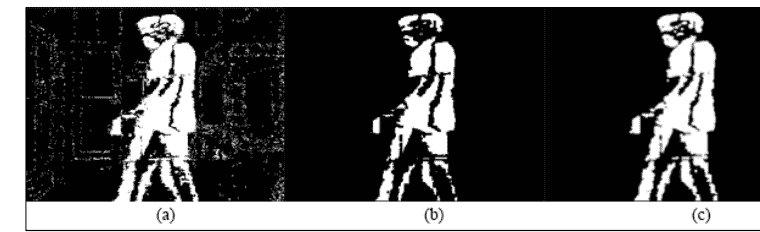

# 第 7 章

例如，假设你正在一个包含 `project0.cpp` 和 `project1.c` 代码文件的文件夹中工作。如果你执行同一文件夹下的 shell 脚本，它将开始编译所有可用 C 文件，生成可执行文件 `project0` 和 `project1`，之后可以通过 `./project0` 运行。让我们实验一下这段 shell 代码。进入你编写运动检测代码（`motion.cpp`）的文件夹，用 nano 编辑器打开 `build.sh` 文件，并输入以下代码：

```bash
#!/bin/sh
if [ $# -gt 0 ]; then
  base=`basename $1 .`
  echo "compiling $base"
  gcc -ggdb `pkg-config opencv --cflags --libs` $base.c -o $base
else
  for i in *.c; do
    echo "compiling $i"
    gcc -ggdb `pkg-config --cflags opencv` -o `basename $i .c`
    $i-lwiringPi `pkg-config --libs opencv`
  done
  for i in *.cpp; do
    echo "compiling $i"
    g++ -ggdb `pkg-config --cflags opencv` -o `basename $i .cpp`
    $i-lwiringPi `pkg-config --libs opencv`
  done
fi
```

退出 nano 编辑器保存此 shell 文件。这里编写的 shell 代码来源于 OpenCV 示例文件夹，并根据我们的需求进行了修改。`wiringPi` 库已加粗显示。if-else 循环被分类为单文件和多文件编译。此代码将逐个处理 C 和 C++ 文件并保存可执行文件。现在给该文件执行权限：

```bash
chmod +x build.sh
```

输入 `./build.sh` 执行 shell 代码。它将开始编译文件夹中所有的 .cpp 和 .c 文件。文件夹中的其他文件不受影响。输出的可执行文件将保存为 `motion`。输入 `./motion` 执行文件查看输出。记得在 Xming 服务器中打开 LxTerminal 执行此文件以便窗口。

# 使用摄像头和 OpenCV 创建图像传感器

# 为你提供的精彩项目

具备了一些 OpenCV 知识后，你可以继续阅读 OpenCV 手册，以获得更多关于函数和参数如何传递的知识。最初，使用图像指针启动 OpenCV 对你来说可能有些困难。http://www.opencv.org 提供了大量的帮助。在参考互联网帮助和官方网站提供的代码时，先检查 OpenCV 的语言（平台）。据观察发现，当 C 代码与 C++ 代码合并时，即使你苦思几个小时它也无法运行。建议在编写 OpenCV 代码时，随身携带《OpenCV 参考手册（当前版本 2.4.9.0）》。

开发一个满足以下要求的项目对你来说将是一个非常好的挑战：

- 使用接口摄像头捕捉实时画面，将图像分成相同大小的段（例如，四个垂直段），并将其与参考图像进行比较。在观察到大部分运动的其中一个段中将会有明显的差异。检测图像中的该区域并相应触发 GPIO。
- 此外，控制伺服电机或步进电机根据前方的运动来旋转摄像头。最后，你将能够开发出一个随你任何移动而移动的摄像头。
- 此的另一个应用是节能。将图像分成坐标段，通过将摄像头安装在较高位置来检测房间内人的坐席。在没有检测到运动的地方关闭灯。很有趣，不是吗？
- 你可以开发 OpenCV 代码跟踪特定颜色的物体。当该彩色物体在摄像头前移动时，代码可以在屏幕上画线。例如，当我们摄像头的面前显示并移动一个红球时，它会根据摄像头检测到的红色移动开始画线。
- 创建一个手势/模式识别计算机模块，它将你手指上佩戴的颜色作为命令。
- 构建一个跟球机器人，它可以跟随特定颜色的球，并检测球的远近效果。

> 使用电机和继电器驱动板来控制电机和电器，而不是直接从 GPIO 驱动它们。在使用基于继电器的电器控制时，请注意电击。

完成这些项目后，你可以它们展示给朋友看，成为他们中最酷的人。构建这些项目真的非常有趣，不是吗？

动手做吧！

# 总结

本章完全致力于使用最先进的 OpenCV 库进行图像处理开发。我们从图像处理及其概述开始，接着介绍了 OpenCV。到目前，你已经知道 OpenCV 库非常庞大，以至于即使像这样的四本书也不够提供对整个库的详细描述。然后你理解了树莓派模块模块上的摄像头接口，我们使用 USB 摄像头配合。接下来，你实验了使用树莓派作为网络摄像头模块（IP）进行实时流，直接从客厅跟踪你的后院。

我们开始移植 OpenCV 库，花了几乎半天的时间才能运行。然后，我们使用摄像头接口验证了库。接下来，我们开始用 C 语言构建项目，通过计算影响区域来检测人体运动。准备了一个实用的 shell 文件来配合 `wiringPi` 接口编译 OpenCV 代码。给你的任务是构建项目、准备它并发送代码以寻求建议。

本章结束，这本书已基本完成。考虑到目前的趋势，树莓派将继续增长。在社区数千人的支持下，单莓派市场领先。

随着 RasPi 2 B 型的发布，计算的新时代已经开启。OpenCV 库和图像处理现在树莓派模块 2 上有更好的性能。树莓派用户可以在此模块上享受完全免费的 Windows 10。一旦 Windows 10 可用，你可以尝试一下。感谢树莓派组织及其工程师在这些模块的开发上投入的心血！

# 使用摄像头和 OpenCV 创建图像传感器

正如你所体验过的，树莓派有无限的应用场景。你必须用它探索不同的可能性。你可以连接一个带有简单 LED 的摄像头来显示指示。你可以连接一个 7 英寸触摸 LCD 使其成为个性化的 Android 平板，或全高清 LED 电视来观看视频。凭借 Linux 的自由，从 `wiringPi` 和 Python 开始，你可以使用 Node.js、Apache、C++ REST、Qt、Mathematica（或 Wolfram 语言）、OpenCV 等许多很棒库。树莓派可以用于制作切换 LED 等项目，或更复杂的项目，如制作带有稳定性控制算法的自己的四旋翼。

我希望你能够充分利用它。保持好奇心并不断学习。

发光热吧！一切顺利！

# 购物清单

## 基础需求

- 一个树莓派（树莓派 1 B 型、树莓派 1 B+ 型、树莓派 1 A+ 型或树莓派 2 B 型（购买其中任何一个））
- 带有 SD 适配器的容量为 8 GB 或更大的微 SD 卡
- 具有 Windows、Mac OS X 或 Linux 环境的个人电脑
- 以太网线 (RJ45)
- 带有 micro-USB 连接器的 5V 1A 或 5V 2A 电源适配器
- HDMI 或 RCA 线
- 面板
- 万用表
- 剥线器

## 传感器

- HC-SR04 超声波传感器（数量：1）
- DHT11 温度湿度传感器（数量：1）
- LDR 或 CdS 光敏电池或光敏电阻（数量：1）
- TMP35、LM35 或 TMP36 温度传感器（数量：1）

## 集成芯片

- 模拟数字转换器（数量：1）：MCP3008 双封装或 MCP3004 双封装

## 组件

- 1/4 瓦插件式电阻（每种 5 个）：1KΩ、2KΩ、270Ω、330Ω、470Ω、4.7KΩ 和 10KΩ
- 插件式电解（每种 5 个）：1µF-16V
- LED（每种 5 个）：2 mm、3mm 或 5mm 红色/绿色/白色/黄色

## 其他

- 单线（长度：1 米）
- 公对公跳线（数量：15）和母对母跳线（数量：15）
- 针排器（每种 2 个）：双排公、2.54 mm 间距单排公、2.54mm 间距
- 用于 RasPi 1 B 型 (26 脚)、B+ (40 脚) 或 RasPi 2 B 型 (40 脚) 的母对母 GPIO 软线（数量：1）
- 通用电路板：双面可焊接
- 笔型电烙铁（30-50 瓦）
- 带助焊焊锡（数量：50 克）
- 摄像头（数量：1）：Logitech C270 USB 摄像头或树莓派摄像头

# 索引

## A

- ADC（模拟数字转换器）输出 93, 94
- 放大 95
- 数据输出 98
- 数据接收 95
- Flash 转换 ADC 96
- MCP3008 98
- 原理 97, 98
- 量化 96
- 分辨率 96
- 采样 96
- 增型 ADC 96
- 信号处理 95
- 类型 96

## B

- Bourne-Again Shell (Bash) 18

## C

- C 语言 24
- 摄像头接口
  - RasPi，使用 138
- 摄像头序列接口 (CSI) 138
- 电容器 31
- 用于 LED 闪烁的 C 代码 48
- 片片选择 (CS5), 107
- 命令行界面 (CLI) 6
- 常见问题 132
- 常见问题，距离计算修复 63

## D

- 数据上传到 Google 电子表格 121-126
- DHT
  - 关于 75, 76
  - 湿度传感器 75, 76
  - 温度传感器 75, 76
- 数字模模拟转换 (DAC) 94
- 膨胀函数 154
- 距离计算
  - 关于 53, 54
  - 常见问题，修复 63
  - 项目，构建 54-56
- 空接 (DNC) 79
- 双列直插 (DIP) 包 98

## E

- 电子设备
  - 关于 29, 30
  - 电容器 31
  - 电流 31
  - 开路 32
  - 并联 32, 33
  - 下拉电阻 34, 35
  - 上拉电阻 34
  - 电阻 31
  - 串联 32, 33
  - 短路 32
  - 电压 30
- 电子邮件通知
  - 获取 126-130
- 构建 77
- 编码 81
- 常见问题，故障排除 81
- DHT 传感器，编码 81-84
- 硬件，设置 78, 79
- 实现 86-89
- LDR 传感器，编码 85, 86
- 光线变化，测量 85, 86
- 相对湿度和温度，测量 81-84

## F

- 空中固件升级 (FUOTA) 116
- 每帧数 (FPS) 137

## G

- 通用公共许可证 (GPL) 18
- 通用型电路板 (GPCB) 101
- 通用输入输出。参见 GPIO
- 通用软件准备 105-108
- git-core 库 22
- Google Drive URL 121
- Google 电子表格
  - 数据，上传 121-125
  - 集成 131
  - 手机上的直播流 126

## I

- I2C 39-41
- 图像处理 136, 137
- 图像传感器 135
- 集成电路 (ICs) 30
- 集成间电路。参见 I2C
- 互联网
  - 时钟，同步 119, 120
  - RasPi，连接到 11
- IoT（物联网）
  - 关于 114, 115
  - 云计算 117
  - 通信 116, 117
  - 数据分析 118
  - 硬件设置 119
  - 安全担忧 118
  - 传感器节点 116

## J

- Jibo URL 114

## K

- 柯尔霍夫电流定律 33
- 柯尔霍夫电压定律 33

## L

- LED
  - 使用 C 代码 闪烁 48
  - 使用 Python 闪烁 47
  - 发光 45, 46
  - GPIO 46
  - Shell 脚本 46
- 硬件设置，IoT
  - 需求 119
- 高清多媒体接口 (HDMI) 连接器 6
- 家电控制系统
  - 面包板，设置 80
- 库
  - git-core 22
  - 安装 21
  - python-gpio 23
  - wiringPi 22

## Linux

- 关于 18
- 命令 19
- Shell 18
- Shell 文件，创建 21
- 终端 18
- 使用 9

### Linux 命令

- 关于 19
- apt-get 20
- cat 20
- cd 20
- cp 20
- ls 19
- man 19
- mkdir 20
- pi@raspberry-$ 19
- pwd 19
- rm 20
- startx 20
- sudo 19
- sudo shutdown -h 20

## M

- Mac OS X 使用 9
- 主从从入 (MISO) 38
- 主出从入 (MOSI) 38
- MCP3008，用于 ADC
  - 关于 98
  - 通道 99
  - 接地 99
  - 参考电压 100
  - SPI 101
  - 电源电压 101
- 运动检测器创建 149-154
- Shell，为 OpenCV 编译准备 154, 155
- Shell，为 wiringPi 编译准备 155
- 多功能互联网邮件扩展 (MIME) 127

## N

- 用于直播流的网络摄像头，使用 140-142
- 网络时间协议 (NTP) 820
- 无连接 (NC) 79
- 无红外 (NoIR) 139

## O

- 开路 32
- OpenCV 关于 138
- 端口移植 142-147
- 测试 147, 148
- URL 156
- 开源倡议 (OSI) URL 138

## 操作系统

- 桌面，打开 11
- 安装 8
- 登录 10
- 所需软件，下载 9
- 根文件系统，扩展 10
- SD 卡，购买 8

## P

- 放大器 (Op-Amp) 95
- 叠层封装 (POP) 3


# 索引

## 并联
32, 33

## 光电池电阻 / 光敏电阻
76, 77

## Pi Filler URL
9

## 下载操作系统的前提条件

## 关于
9

## 操作系统
- Linux: 9, 10
- Mac OS X: 9
- Windows: 9

## 项目开发
156, 157

# 项目，构建

## 距离，计算
61, 62

## 硬件，设置
56-59

## 软件，设置
59

## 下拉电阻 / 上拉电阻
34, 35

# PuTTY

## URL
16

# Python

## 用于 LED 闪烁
47

## 使用
24

## Python 2 URL / Python 3 URL
24

## `python-gpio`
23

## Python 程序执行
24, 25

## 编写
24, 25

# R

## 树莓派
参见 Raspberry

## 树莓派板
### 关于
1

### 特性
2

### 树莓派 B 摄像头模块
138

### `cmdline.txt`，修改
15

### 连接到互联网
11

### 以太网
15

### 通过以太网连接互联网
12

### Wi-Fi 适配器
11, 12

### 操作系统，安装
8

### 注意事项
41

### 需求，RasPi
159

### Secure Shell (SSH) 客户端
16

### Secure Shell (SSH) 客户端，打开
14, 15

### Secure Shell (SSH) 客户端，安装
16, 17

### 设置
8

### 开启
14, 15

### URL
8

### 用于摄像头接口
138

# RasPi 接口

- 3.5 mm 音输出: 6
- CSI 摄像头接口: 6
- 显示接口: 6
- 以太网: 6
- GPIO 引脚: 5
- HDMI 连接器: 6
- Micro USB 电源: 7
- RCA 视频输出: 6
- SD 卡槽: 7

# RasPi 摄像头模块

## 关于
139

## 选项
139

## 实时时钟 (RTC)
119

## 需求，RasPi
159, 160

## 组件
160

## 集成芯片
170

## 传感器
159

## 电阻
31

# S

## `SaveImage()` 函数
151

## Secure Shell (SSH) 客户端
16

## 传感器选择

### 关于
72

### 应用关键性分析
73

### 可用传感器
74

### 传感器封装，选择
73

### 传感器属性列表
73

### 传感器，购买
74

# 传感器站

## 创建
101-104

## 硬件需求
102

## 使用
109

# 串行接口
参见 SPI

## 串联
32, 33

## 短路
32

## 简单邮件协议 (SMTP)
127

# 软件设置，距离计算

## GPIO 引脚设置
59

## 初始配置
59

## 脉冲，接收
60

## 脉冲，发送
60

## SPI
23, 38

## 表面贴元件 (SMDs)
73

# T

## 温度记录器应用，写入
110-112

## 创建
109

## LM36 温度传感器
109, 110

## 插件式元件 (THHDs)
73

## 晶体晶体逻辑 (TTL)
36

# U

## UART（通用异步收发器）
36, 37

## 超声传感器
### 关于
52, 53

### 距离计算
53, 54

## 通用总线 (USB)
66

## USB 摄像头
### 关于
140

### URL
140

# V

## 电压
30

# W

## 可穿戴设备构建
64

## 硬件，构建
64, 65

## 软件，设置
65-68

## Wi-Fi 适配器用于连接互联网
11, 12

## Win 32 Disk Imager URL
9

## Windows
### 使用
9

## WinSCP
### 关于
66

### URL
66

## `wiringPi` 库
22

# X

## Xming URL
17
