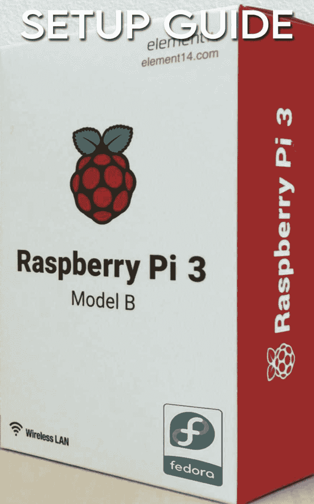

# 树莓派设置指南：如何从零开始使用树莓派和 Python 编程



## 引言

`Python`是一种基础、易于学习的语言，就像英语一样简单。树莓派是一种直观的单板电脑 PC，方便、快速且易于使用。目前，将一种极易上手的语言与一台易于使用的 PC 结合，你将获得一种可以轻松放入后口袋的便利体验。与树莓派和市面上其他的替代编程语言相比，你有许多不同的选择，取决于你的需求。但问题在于，其他任何选项例如`Arduino`都不能给你像树莓派那样的简单性加计算能力和速度。这本书将带你了解核心要点，当你读完这本书后，极大地提升这些知识将对你大有益处。

## 第一章：什么是树莓派？

树莓派是一种价格廉的、口袋大小的 PC，可以方便地连接到显示器或电视等屏幕，并配备鼠标和标准键盘。它是市场上最广为人知的单板 PC。

### 树莓派的优点

当个人或创业者打算在任何事情投入大量资金时，往往会产生一些疑问。比如“它值这个钱吗？”、“还有哪些不同的选择？”当这类问题在脑海中响起时，相应的策略是考虑它在成本和效益方面提供的不同优势。

树莓派提供了许多优点，任何准备购买的人都应该在花费之前考虑。

- 1. 对于低预算组织或项目来说非常划算。
- 2. 几乎任何人无论是否有之前的编码或编程经验都可以使用。
- 3. 默认编程语言是`Python`带有`Linux OS`，它非常简单，与其他编程语言不同。
- 4. 它的耗电比普通 PC 消耗的得多。这意味着电费开支的减少。
- 5. 它具有低碳足迹。
- 6. 它非常适合测试各种技术。
- 7. 它支持其他编程语言。这意味着即使你不是`Python`编程语言的忠实粉丝，仍然可以使用你喜欢的编程语言。
- 8. 它有许多接口，但可以轻松放入你的包里。

### 树莓派概览

树莓派有两种型号，具体来说：A 型和 B 型。这两个型号之间的区别在于微型 USB 端口。B 型带有以太网端口，这意味着它消耗的电比 A 型更多。

为了完全理解引入树莓派的原因，充分了解它的不同部分是关重要的。

### 树莓派硬件组件

树莓派微型电脑板像其他 PC 一样由`RAM`只读内存、处理器、`GPU`图形处理器、`CPU`中央处理器、以太网端口、`GPIO`引脚通用输入输出引、`XBee`引脚接口、`UART`通用异步收发器、电源连接器、`SD`卡槽、`RCA`接口、`LED`发光二极管、蓝牙、`WiFi`、`MIPI DSI`显示序列接口、`MIPI CSI`摄像头接口、`HDMI`端口以及通过`USB`端口对其他设备的扩展。

#### RAM

主板配备两种内存规格：早期型号为`250MB`和`512MB`。目前的更新型号显示支持高达`4GB`的`RAM`。

#### 处理器

该单元负责通过逻辑操作来帮助执行指令。

#### GPU

`GPU`部分负责所有与图像相关的操作。

#### GPIO 引脚

它们是通用引脚，用于将树莓派板连接到外部设备。这些引脚用于执行来自外部电路板的 I/O 指令。

#### 电源连接器

电源连接器允许树莓派板连接到外部电源。

#### XBEE 引脚/插座

用于远程通信。

#### 以太网端口

以太网端口提供与额外设备通信的方法。

#### SD 卡

它充当容量，可以类比普通 PC 的硬盘。这也是树莓派的运行环境从中启动的地方。

### 树莓派软件组件

虽然`Raspbian`是树莓派最著名的基于`Linux`的操作系统，但还有其他被广泛使用的操作系统。以下是它们的必选清单列表；；

#### Raspbian

这是树莓派的操作系统之一。该系统基于`Debian`构建。它适用于树莓派的每一个版本，而且对于初学者来说很容易调整。

#### Ubuntu MATE

`Ubuntu MATE`操作系统更加简单直观。此外，鉴于`Linux`，`Ubuntu MATE OS`具有现代感且特别出色。尽管如此，它并不适用于所有的树莓派型号。它从树莓派 2 及以上版本开始。

#### RetroPie

基于`Raspbian`，它是一个模拟器，允许你玩追溯到 70 年代的老游戏。

#### DietPi

`DietPi`运行在精简的`Debian`变体上。它的小体积使其比 Raspberry Lite 更轻。它适用于所有的树莓派型号。

#### Manjaro

这是一个非常优秀的框架。简单、酷且轻量。它还允许你只引入你所需的内容。

#### Fyde OS: 树莓派的 Chromium OS

#### OSMC

这可能是基于树莓派最好的媒体中心系统。它可以流式传输播放任何媒体设计。简单易用。

#### Windows 10 ARM

通过 WDOA 安装程序，你可以引入 Win10。

#### Android

`Android`可以在运行在包括树莓派在内的任何设备上。它为用户提供了大量应用程序和游戏的机会。

### 首次设置树莓派

为了让树莓派工作，你首先需要通过微型`SD`卡引入操作系统。`Rasp`开箱即用程序是树莓派的安装程序。

### 如何获取 Rasp？

你有两种不同的方式获取`Rasp`。一种是购买预装了`Rasp`的`SD`卡。另一种是在树莓派官方网站 `https://www.raspberrypi.org/downloads` 下载。

如何在`SD`卡上引入`Rasp`

在从`SD`卡开始引入`Rasp`之前：

- 确保`SD`卡至少为`8GB`。全树莓派安装建议`16GB`。
- `SD`卡格式化为`FAT`。
- 从`Rasp`压缩文件中提取文件。
- 然后你就可以将文件复制到已组织的`SD`卡中进行安装。
- 一旦启动，恢复`FAT`分区将自动调整大小。将弹出用于引入的操作列表。

### LINUX 与其他操作系统的区别

与其他工作框架一样，`Linux`拥有`GUI`图形客户端界面以及类似的编程环境，你可能在`Microsoft Windows`、`MacOS`等系统上用过视频和照片编辑器、文字处理器等。基本上，只要你能操作 PC 或或其他电子设备，你一定能操作`Linux`。

无论如何，`Linux`与其他工作框架之间都存在显著差异。以下是部分原因：

`Linux`是一个开源编程或工作框架。这意味着它是免费的。

用于制作产品的代码公开的，任何人都可以查看、使用和调整，这对于开发者来说特别有用。

`Linux`有许多应用程序，伴随着多样化的编程选择。这意味着`Linux`确实非常有适应性且易于自定义。

`Linux`的另一个特点是客户有机会选择他们需要使用的核心部分。这就是为什么树莓派有效运行在许多共享核心`Linux`内核的工作框架上的原因之一。

然而，`Linux`并非完全无安全漏洞，但与其他工作框架例如 windows 相比，它更安全。

它可以用于让旧的 PC 框架焕发生机。在`Linux`工作系统上，软件更新更加简单快捷。

它拥有庞大的本地社区支持，帮助你解决可能遇到的任何问题。

与其他工作框架相比，它非常稳定。在 windows 中，每当你卸载一个应用程序时，都需要重启。这在`Linux`中并不常见。

`Linux`保证其客户的安全，并且不像其他操作系统那样收集客户信息。

它在不同的网络和工作站上具有高性能，非常有用。它可以有效处理大量客户端同时工作，并流畅地处理它们。

它为网络功能提供了巨大的底层支持。这意味着，通过`Linux`，你可以在提高交付速度的同时，在 PC 上为客户搭建服务器框架。

`Linux`是一个真正灵活的工作框架，因为你可以选择要引入的内容而不牺牲性能。

`Linux`适用于几乎文档设计，并可以运行你可以想象的任何程序，无论是 windows 还是 macintosh 操作系统。与其他操作系统相比，`Linux`引入简单且快速。

它还提供了与硬件相匹配的卓越性能。即使在硬盘几乎满的情况下，所有任务也能有效执行。

`Linux`是非常节省内存的，因为它可以在同时执行许多任务的同时，几乎不会对其速度和整体性能产生影响。

它还考虑了不同的桌面环境，因此变得极其易用。

### LINUX 的用途

`Linux`有许多用途。它类似于你那里发现的许多其他操作系统。

以下是这些用途的部分：

- **服务器**

网上超过 50% 的网站运行在一个名为`Apache`的开源程序上，该程序大部分时候运行在`Linux`上。因此，如果你现在正在浏览网页，那么你遇到`Linux`的可能性很高。

#### 网络

`Linux`被广泛用于运行互联网的大部分。它们还被用于家庭、工作场所和公司的小型网络。

#### 数据库

`Linux`通常用于数据中心框架以存储大量数据。这是因为它强大、安全且健壮。

#### 桌面

由于`Linux`非常有适应性且稳定，它已经在我们的不同桌面上成功地找到了立足。

#### 高性能

`Linux`框架可以协同工作进行海量数据集测试。这就是它被用于超级计算机进行气候预测的原因之一。

#### 家庭使用

诚实地说，像你我这样的人也可以日常使用`Linux`。

### LINUX 命令行及其应用

`Linux`命令行界面是允许用户以文本形式输入命令以指示计算机系统完成预定义任务或一组任务的程序。

如果你对命令行界面感兴趣，基本上可以在你的应用程序设置中查找“提示符”。打开并运行。它通常是深色背景。


以下是一些你会发现非常有用的基础 Linux 命令必须操作列表：

- 1. `cd` 命令

此命令用于在 Linux 文档、文件夹或目录之间浏览。

  i. `cd ..` 向上移动一级

  ii. `cd` 直接回到主目录

  iii. `cd` 回到上一个目录

- 2. `PWD` 命令

此命令用于查找当前目录的路径。

- 3. `ls` 命令

用于查看目录的内容

- 4. `cat` 命令

它是 Linux 上最常用的命令之一。它用于在标准输出连续列出文件的内容。

# 第三章

## Python 基础

### IDLE

集成开发与学习环境完全用 python 编写，具有跨平台功能，即它可以运行在几乎任何操作系统上，无论是 windows 还是 MacOS。它由两个基本窗口组成：shell 窗口和管理器窗口。

#### IDLE 菜单

当你打开 IDLE 时，你在视器中看到的主文本是 IDLE 的版本，它同样位于应用程序的左上角。应用程序内的不同菜单是：

- 文件 (`File`)
- 编辑 (`Edit`)
- Shell (`Shell`)
- 调试 (`Debug`)
- 选项 (`Options`)
- 窗口 (`Windows`)
- 帮助 (`Help`)

```
File
  Name: 20230101_123000.txt
  ID: DB-1
  Date: DB-2
  Status: "Confidential"
  Path: C:\Users\Documents

Menu
  Edit: DB-3
  Save: DB-4
  Save As: DB-5
  Copy: DB-6

Window
  Close: DB-7
  Size: DB-10
```

##### 文件菜单

此菜单包含其他子菜单。以下是它们及其不同用途的列表；

###### 新文件 (`New File`)

用于创建一个另一个文档编辑窗口...

通过打开对话框打开之前的记录

###### 最近文件 (`Recent files`)

打开最近创建的文件列表

###### 打开模块... (`Open Module...`)

打开一个当前模块

###### 类浏览器 (`Class Browser`)

用于显示当前管理器文件中类 (`classes`)、属性 (`attributes`) 和方法 (`methods`)

###### 路径浏览器 (`Path browser`)

点击此项将以树形结构显示框架路径索引、模块、类、属性和方法。

###### 保存 (`Save`)

这将当前窗口的副本保存到与其关联的文件中。

###### 另存为... (`Save as...`)

这将带有另存为交换保存当前窗口的副本。

保存的文件将成为该窗口的新关联记录。

###### 另存副本为... (`Save copy as...`)

将在不更改关联记录名称的情况下保存当前窗口。

###### 打印窗口 (`Print window`)

将当前窗口打印到默认打印机。

###### 关闭 (`Close`)

这将关闭当前窗口，如果内容尚未保存。

###### 退出 (`Exit`)

这将关闭所有打开的窗口并退出 IDLE。

##### 编辑菜单

###### 撤销 (`Undo`)

修复对当前窗口进行的更改。更改的总数绝不能超过1000。

###### 重做 (`Redo`)

这将重试上次撤销的操作并更改流窗口。

###### 剪切 (`Cut`)

将选定内容到剪贴板并删除选定内容

###### 复制 (`Copy`)

将选定复制到剪贴板

###### 粘贴 (`Paste`)

将剪贴板的内容嵌入当前窗口。

###### 全选... (`Select all...`)

选择流窗口的所有内容

###### 查找... (`Find...`)

这将打开一个带有多个选项的查找对话框

###### 再次查找 (`Find again`)

如果存在标记的背景，则将重复上一次查询

###### 查找选定内容 (`Find selection`)

如果有选定内容，将查找当前选中的内容

###### 在文件中查找... (`Find in files...`)

这将打开文件搜索交换并在新窗口中显示结果

###### 替换... (`Replace...`)

这将打开一个搜索并在存在时替换当前假设

###### 转到行 (`Go to line`)

将光标移动到行首并使其可见

###### 显示补全 (`Show completions`)

打开一个可以滚动的列表，允许选择短语和属性

###### 扩展单词 (`Expand word`)

将扩展一个以匹配等窗口中单词的前缀

###### 显示调用提示 (`Show call tip`)

这将打开一个包含函数提示的小窗口

###### 包围括号 (`Surrounding parents`)

将包含周围的括号

##### 格式菜单

###### 缩进区域 (`Indent region`)

将选定的行向右移动缩进宽度

###### 取消缩进区域 (`Dedent region`)

将选定的行向左移动缩进宽度

###### 注释区域

这将在所选行的开头添加双哈标记（`#`）

###### 取消注释区域

从所选行中删除单哈标记或双哈标记

###### 制表化区域

这将把连续的空格转换为制表符（`tabs`）

###### 取制表化区域

这将所有制表符转换为相应数量的空格

###### 切换制表

打开一个交换窗口，在空格和制表符缩进之间切换。

###### 新缩进宽度

打开一个交换窗口来更改缩进宽度

###### 格式化段落

这将重新格式化注释块、多行字符串或字符串中所选行内由行分符界定的清晰段落。

###### 去除末尾空格

通过对每行应用 `str.rstrip`，删除行尾最后一个非空白字符之后的后续空格和其他空白字符，包括多行字符串内的行。除了 Shell 窗口外，在记录结束时删除多余的空行。

##### 运行菜单

###### 运行模块

检查模块。如果没有出错，则重启 shell 以清理环境，然后执行该模块。在 Shell 窗口中显示输出（yield）。注意输出需要打印或形式化。当执行完成后，Shell 会保持中间状态并显示简报。目前，你可以巧妙地检查执行的最终结果。这类似于用 python 运行报告。

- - 我在请求行处记录。

###### 运行... 修改后的

与运行模块相同，但使用更改后的设置运行模块。请求行内容类似于在请求行上传递的 `sys.argv`。该模块可以在不重启的情况下在 Shell 中运行。

###### 检查模块

检查此处编辑器窗口中打开的模块设计。如果模块未保存，Inert 将提示用户保存或自动保存（取决于“非活动设置”对话框中“常规”选项卡中的选择）。如果存在语言结构错误，将在编辑器管理器（Editorial supervisor）窗口中显示错误区域。

###### Python Shell

打开或唤醒 Python Shell 窗口。

##### Shell 菜单

###### 查看上次重启

查看 shell 窗口的上一次 Shell 重启。

###### 重启 Shell

重启 shell 以清理环境。

###### 上一个历史

循环遍历之前的命令，这些命令安排当前部分。

###### 下一个历史

循环遍历之后的命令，这些命令组织当前部分。

###### 执行时中断

停止正在运行的程序。

##### 故障排除菜单

###### 转到文件/行

查看当前光标所在的行，以及其上一行的文件名和行号。在找到的任何位置，如果文件未充分打开，则打开存档并显示该行。用此查看在异常情况下引用的源代码行以及通过“文档中查找”找到的行。此外，还可以在 Shell 窗口和结果窗口的设置菜单中打开。

###### 调试器（切换）

在指定的时刻，在 Shell 中输入的代码或从管理器处运行的代码将在调试器下运行。在编辑器主界面中，可以通过设置菜单设置断点。该组件目前已分离并经过良好测试。

###### 堆栈查看器

在树形设备中显示最后排除的堆栈回溯，允许访问本地和全局变量。

###### 自动打开堆栈查看器

在未处理的异常情况下正常切换打开堆栈查看器。

##### 选项菜单

###### 配置 IDLE

打开一个计划交易窗口并更改后续的倾向：字体样式、空格、按键绑定、文本显示主题、启动窗口和大小、额外的帮助资源以及增量。在 MacOS 上，通过应用程序菜单中选择“倾向”（Inclinations）来打开计划对话框。更多细节请查看“帮助和倾向”下的“设置倾向”。

大多数计划选项适用于所有窗口或每个未来的窗口。底部的决策适用于动态窗口。

###### 显示/隐藏代码设置

在修改窗口的顶部打开一个表格，显示代码的方形设置，该设置位于窗口的最顶端。请参见下方“修改和路由”部分中的“代码设置”。

###### 显示/隐藏行号

在修改窗口侧边打开一个区域，显示每行文本的数量。默认关闭，你可以在“倾向”中更改（参见“设置倾向”）。

###### 缩放/恢复高度

在窗口的平均尺寸和最大高度之间切换。基本尺寸默认为 40 行 80 列，除非在“非活动安排”（Arrange In Inactive）对话框的“常规”选项卡中更改过。屏幕的最大高度由当窗口在屏幕上缩放时快速放大主事件的窗口来决定。更改屏幕设置可能会破坏保存的高度。当窗口扩展时，此切换开关无效。

##### 窗口菜单

记录每个打开窗口的名称；选择一个将其传递到最近的视图（如果重要则进行去标识化）。有关此处的更多细节请访问：

https://docs.python.org/3/library/idle.html


既然我们已经了解了 IDLE 中的菜单，我们应该深入研究一下它的编程部分。

## 数字

数字在科学中至关重要，编程中也是如此。每行代码都使它们处理一个或多个数字，或者可能在硬件层面，解释是计算机非常擅长运行数字。

在这个示例中，我们将利用 Python 编程语言来运行数字。确实！像你的计算器一样运行数字。

`‘五月,’ 326, 559)`

注意：元组中的部分因素也出现在 `tuple2` 中，且结果保持不变。这是为了强化元组的不可变性。

## 列表 (LISTS)

至少两个字符串可以组合成一个列表。记录的属性可以被修改、连接或截断。它可以包含不同类型的信息或相同类型的信息，即信息可以是同质的或异质的。与元组类似，列表是可变的。

示例：
```
>>>‘四月,’ ‘五月,’ ‘六月,’ 326, ‘十二月’
```

要命名记录或列表，你只需分配与其内容标识相同的名称。

示例：
```
>>>vegetables = {'生菜,’ ‘菠菜,’ ‘白菜,’ ‘胡萝卜’
```

或者你基本上可以直接使用列表

示例：
```
>>>list1= ‘生菜,’ ‘菠菜,’ ‘白菜,’ ‘胡萝卜’
>>>>list2= ‘一月,’ ‘二月,’ ‘四月,’‘五月,’ 326, 559
>>>print(list1+list2)
```

`‘四月,’ ‘五月,’ ‘六月,’ 326, ‘十二月,’ ‘一月,’ ‘二月,’ ‘四月,’ ‘五月,’ 326, 559)`

示例：
```
>>>print(list1 or list2)
```

`‘四月,’ ‘五月,’ ‘六月,’ 326, ‘十二月,’ ‘一月,’ ‘二月,’ ‘四月,’ ‘五月,’ 326, 559) ‘四月,’ ‘五月,’ ‘六月,’ 326, ‘十二月’`

示例：
```
>>>print(list1 and list2)
```

`‘一月,’ ‘二月,’ ‘四月,’ ‘五月,’ 326, 559`

## 集合 (Sets)

它们由无序赋值的数据类型或组件组成，在相似集合中没有重复组件。与记录不同，集合有一种方法可以真实检查某个组件是否在相似集合中重复哈希。因此，它们是可变的。

示例：
```
>>>set1= ‘面包,’ ‘米饭,’ ‘鸡蛋,’ ‘鸡肉,’ ‘米饭’
>>>print (set1)
{'面包,’ ‘米饭,’ ‘鸡蛋,’ ‘鸡肉’}
```

`‘米饭’` 被复制了，但长期来看已从列表中删除。

向上述集合添加组件
```
>>>set1.add(’鱼 ’)
```

冻结集合 (Frozen sets)

这类集合不能被更改，即不可变。这对于集合来说是不寻的，因为当它们包含不可变元素时，它们通常是暂时的。

```
示例:>>>weapons= frozenset([“斧,” “刀,” “箭,” “枪,” “炸弹”])
>>>print (weapons)
{'斧,’ ‘刀刃,’ ‘箭,’ ‘武器,’ ‘炸弹’}
```

### 集合操作 (Operations for sets)

- i. Clear ( ) 函数

这将释放集合中的所有组件。示例：
```
>>> weapons={"斧", "刀", "箭", "枪", "炸弹"}
>>>weapons.clear()
```

- ii. Difference ( ) 函数

这将返回集合中组件之间的差异。模型：
```
>>>set1= ‘C,’ ‘f,’ ‘g’
>>>set2={'f,' 'g'}
>>>print (set1).contrast (set2)
{'e,' 'd,' 'c'}
```

或者，你可以实现类似的功能：
```
>>>set1-set2
{'e,' 'd,' 'c'}
```

结果与集合相同。

要查看 `set1` 或 `set2` 中的组件，你可以使用 `set1|set2`。

示例：
```
>>>set1|set2
{'c,' 'd,' 'e,' 'f,' 'g'}
```

对于 `set1` 和 `set2` 中共同的组件，你使用 `set1&set2`
示例：
```
>>>set1&set2
{'f,' 'g'}
```

对于 `set1` 和 `set2` 中的不重复元素，使用 `set1^set2`
示例：
```
>>> set1^set2
'c,' 'd,' 'e'
```

### iii. Add () 函数

此策略用于向集合中添加不可变组件。示例：
```
>>>players={"梅西","贝利,"孙兴"}
>>>players.add("罗尔多")
>>>names
“梅西,”“贝利,”“孩子,”“罗尔多”
```

### iv. Discard/Remove () 函数

你可以利用 `discard` 能力来消除集合中的任何组件。同样，你可以使用 `eliminate` ().

```
示例：>>>set1={1,2,3,4,5}
>>>set1.discard(5)
>>>print(set1)
{1,2,3,4}
```

注意 `discard` 格只能接受一个参数。多次调用 `discard` 将返回错误。

好消息是，你不需要在某处编写或保留它们。每当你需要使用它们时，它们都可以有效可用。在 python 3 中，当你开始编写时，例如输入能力“dispose of”，在完成“dispose of”之前，会弹出一个列表供选择。

所有这些能力在尝试处理信息并将其放入系统文件时都被证明是有用的。

## 布尔值 (Booleans)

结果涉及两个固定属性，可以是‘真 (Valid)’或‘假 (False)’。隐含能力 `bool ()`。

```
示例:>>>7<9
True
示例:>>>15==19
False
示例:>>>4*2 != 10
```

注意 `(!)=)` 表示不等于

管理员 True

示例:
```
>>>5<=9
True
```

## if 语句 (If Statements)

你可以利用 `if` 语句在满足确定条件时运行你的代码。如果语句有效，它将被执行。任何情况下，它们都不会输出。

```
示例:>>>if 5>9:
>>>print("9 比 5 大")
>>>print("程序结束")
```

结果给出

9 比 5 程序结束 示例:
```
>>> error=9
>>> if error>6:
print("6")
if error>10:
print
("10")
```
结果给出 6。

对于更复杂的检查，假设断言可以在内部解决。这表明内部假设断言对于外部是重要的。

```
示例:>>> file=7
>>> if file>3:
print("3")
```

## else 语句 (Else statements)

它紧跟 `if` 语句，当 `if` 语句为假时包含考虑的代码。

```
示例:>>> m=7
if m>3:
print('是')
else:
print('否')
```

结果给出3。

## 逻辑 (Logic)

结果涉及两个固定属性，可以是‘真 (Valid)’或‘假 (False)’。使用了隐含能力 `bool ()`。

```
示例:>>>7<9
True
示例:>>>15==19
False
示例:>>>4*2 != 10
```

注意 `(!)=)` 表示不等于
管理员 True
示例:
```
>>>5<=9
True
```


对于更复杂的检查，假设断言可以在内部解决。这表明内部假设断言对于外部是重要的。

示例:
```
>>> file=7
>>> if file>3:
    print("3")
```

## else 语句 (Else statements)

它紧跟 `if` 语句，当 `if` 语句为假时包含考虑的代码。

示例:
```
>>> m=7
if m>3:
    print('是')
else:
    print('否')
```
结果给出3。

## 逻辑 (Logic)

结果涉及两个固定属性，可以是‘真 (Valid)’或‘假 (False)’。使用了隐含能力`bool()`。

示例:
```
>>>7<9
True
```
示例:
```
>>>15==19
False
```
示例:
```
>>>4*2 != 10
```
注意 `!=` 表示不等于
管理员 True
示例:
```
>>>5<=9
True
```

## if 语句 (If Statements)

你可以利用 `if` 语句在满足确定条件时运行你的代码。如果语句有效，它将被执行。任何情况下，它们都不会输出。

示例:
```
>>>if 5>9:
>>>print("9 比 5 大")
>>>print("程序结束")
```
结果给出
9 比 5 程序结束
示例:
```
>>> error=9
>>> if error>6:
    print("6")
    if error>10:
        print
        ("10")
```
结果给出 6。

对于更复杂的检查，假设断言可以在内部解决。这表明内部假设断言对于外部是重要的。

示例:
```
>>> file=7
>>> if file>3:
    print("3")
```

## else 语句 (Else statements)

它紧跟 `if` 语句，当 `if` 语句为假时包含考虑的代码。

```
示例:>>> m=7
if m>3:
    print('是')
else:
    print('否')
```

结果给出3。

## 函数的通用语法

```
def function_name (boundary or contention list):
    """docstring"""
    Statement(s)
```

## 函数的组成部分

- i. 标识性关键字 `def`，表示函数头的开始。
- ii. 参数，即包含容量估算值的地方。
- iii. 冒号 `:`，表示函数头的结束。
- iv. 组成函数体的 Python 解释。
- v. 如果你选择重用代码，则有一个返回语句（`return` articulation）。

## 如何调用函数

一旦定义了函数，你就可以无疑地从另一个函数或程序中调用它。

示例：
```
>>> def welcome(name):
    """
    此函数将在边界内欢迎指定的个人
    """
    print("hello, "+name+". How are you doing today?")
>>> welcome("Leonard")
```
Good morning Leonard. 你今天过怎么样?

## 文档字符串 (Docstrings)

紧跟在函数后面的主要内容是文档字符串。它阐明了函数的作用。模型：
```
def welcome(name):
    """此函数将在边界内欢迎指定的个人
    """
    print("greetings "+name+". 你今天过怎么样?")
```

## 返回语句

语句可以包含被求值的表达式并返回其值，并且根据你正在运行的代码行，它可以至少有一个 `return` 语句。

示例：
```
>>> def meters(L_in_centimeters):
    """这将返回以厘米为单位的长度"""
    return (L_in_centimeters/100)
```
for L in (120,332,145,270,225):
    print (L,": meters", (L))

结果应该如下：

Centimeters

120: 0.12

332: 0.332

145: 0.145 270: 0.270

225: 0.225

可以用以下方式定义函数：

* 关键字参数
* 默认参数值
* 任意参数列表

## 关键字参数

可以使用关键字参数来调用函数。模型：
```
>>> def printdata(age, state):
    """将此信息打印到此函数中"""
    print("age": , age)
    print("state":, state)
>>> printdata(age="45")
```

## 默认参数值

它们通常用于调用一次函数。

模型：
```
>>> def print_information(tallness, eyes = "Brown"):
    """会将这些信息打印到函数中。”
    print(" stature:", tallness)
    print("eyes:", eyes)
>>> print_information(height=6ft)
```
Height: 6ft

Eyes: Brown

## 任意参数列表

假设该函数包含各种参数，你可以调用它。你同样可以使用关键字边界来调用函数。

代码语法通常形式为：
```
>>> def fullname([formal_args,]*var_args_tuple):
```

## 字符串理论

你应该熟悉字符串的内部构造。我们应该快速复习一下；

我敢打赌你目前为止在这些示例中已经看过了单引号、双引号甚至三引号语句。很好，这就是我们在 Python 编程语言中称的字符串。

这里有一个快速掌握的：

示例：
```
>>> print ("Python is a wonderful programming language")
```
'Python is a marvelous programming language.'

或者，你也可以打印：

示例:
```
>>> print ("Python is a great programming language")
```
Python is an amazing programming language.

### 转义引号

这可以通过使用斜线符号 `\` 轻松完成

示例：
```
>>> print ('I won’t be there today')
```
I will not be there today

### 字符串拼接

你可以毫不费力地使用扩展符号 `+` 连接字符串，并使用引用星号 `*` 重新哈扩展。

示例：
```
>>> str1="Mango"
'Mango'
>>> str2="es"
'es'
>>> str1+str2
'Mangoes'
```

在更简单的情况下，你可以这样写
示例:
```
>>> "Hydro" + "Quinone"
```
Hydroquinone

示例:
```
>>> 2*"Chloro" + "Carbons"
```
'ChloroChloroCarbons'

`2*` 意味着主部分会被重复两次。

### 创建新字符串

你可以从旧字符串创建字符串或信息。由于字符串是不可变的，你可以转换它们。尽管如此，你可以控制执行它们的方法。

示例：
```
>>> str1="sky"
'sky'
>>> str2="fall"
'fall'
>>> str1+str2
'skyfall'
```

### 字符串索引

从 0 开始的索引可以应用于字符串。反向排序也可以应用于字符串。

### 字符串切片

你本质上可以通过切割旧字符串或任何其他内容来创建新字符串。

示例：
```
>>> str1="charger"
>>> str1[2]
'a'
```
示例:
```
>>> str1="charger"
>>> str1[3]
'r'
```
示例:
```
>>> str1="Abacus"
>>> str1[1:3]
'ba'
```

在编写代码时请优先考虑此点：如果你输入了不存在的索引，Python 解释器将返回错误。

示例:
```
>>> str1="Abacus"
>>> str1[9]
```
结果将显示为：
```
Traceback (latest call last):
  File "<pyshell#36>", line 1, in <module>
    str1 [9]
IndexError: string record out of range.
```
示例:
```
>>> str2="Apparatus"
>>> str2 [2:4]
'pa'
```
示例:
```
>>> str2 [1:]
'apparatus'
```

如果你计划获取到某个预定文件之前的第一个主列表值，你可以只需这样进行你的断言。

示例:
```
>>> str2 [:5]
'Appar'
```

### 如何确定字符串的长度

确定字符串的长度并不难。这可以通过关键函数 `len()` 完成。这个视图对于控制你的索引至关重要。

示例:
```
>>> str1="Samuel"
>>> len(str1)
6
```
示例:
```
>>> myAddress="Maddison Street"
>>> len(myAddress)
14
```

## 猜字游戏 (HANGMAN)


猜字游戏是一种大约由两个玩家玩的单词猜测游戏。在这个游戏中，会用到笔和纸。当一个玩家定义一个边界时，另一个玩家尝试猜测与什么有关，直到秘密单词的每个字母都被完全猜出来，如果你输了一些错误的字母，你将失去生命。这个游戏无疑非常迷人，对吧？

```python
import random
import sys
from typing import List

## 全局变量
WORD_LIST = [
    "elevated", "yellow", "family", "screen", "bamboo",
    "area", "chair", "snake", "fish", "nylon"
]
SECRET_WORD = random.choice(WORD_LIST)
LENGTH_WORD = len(SECRET_WORD)
ALPHABET = "abcdefuvwxyz"
GUESS_WORD = []

## 工具函数
def print_word_to_guess(letters: List) -> None:
    """打印当前单词的工具函数"""
    print("Word to figure: {0}".format(".join(letters)))

def print_guesses_taken(current: int, total: int) -> None:
    """打印玩家使用的机会"""
    print("You are on {0}/{1}".format(current, total))

## 游戏函数
def starting() -> None:
    """开始游戏"""
    print("Hello Mate!\n")
    while True:
        name = input("Please enter your name\n").strip()
        if name == "":
            print("That's not permitted! No clear lines")
        else:
            break

def ask_user_to_play() -> None:
    """询问客户端玩"""
    print("Let's get started!\n")
    while True:
        gameChoice = input("Would You?\n").upper()
        if gameChoice == "YES" or gameChoice == "Y":
            break
        elif gameChoice == "NO" or gameChoice == "N":
            sys.exit("That's wrong! Have a decent one")
        else:
            print("kindly Answer Yes or No")
            continue

def prepare_secret_word() -> None:
    """准备秘密单词并告知客户端"""
    for character in SECRET_WORD: # 为每个字母隐藏地打印空格
        GUESS_WORD.append("- ")
    print("Ok, so the word you really want to guess has", LENGTH_WORD, "characters")
    print("Be mindful that You can enter just 1 letter from az\n\n")
    print_word_to_guess(GUESS_WORD)

def speculating() -> None:
    # 游戏循环逻辑占符
    pass

if __name__ == "__main__":
    starting()
    ask_user_to_play()
    prepare_secret_word()
    speculating()
```

```python
MAX_GUESS = 10
print_guesses(guess_taken, MAX_GUESS)
while guess_taken < MAX_GUESS:
    surmise = input("Pick a letter\n").lower()
    if not surmise in ALPHABET: # checking input
        print("Enter a letter from a-z ALPHABET")
    elif surmise in letter_storage: # checking assuming letter has been now used
        print("You have effectively speculated that letter!")
    else:
        letter_storage.append(guess)
        if guess in SECRET_WORD:
            print("That's correctly!")
            for i in range(0, LENGTH_WORD):
                if SECRET_WORD[i] == guess:
                    GUESS_WORD[i] = guess
            print_word_to_guess(GUESS_WORD)
            print_guesses_taken(guess_taken, MAX_GUESS)
            if '-' not in GUESS_WORD:
                print("Congratulations you won!")
                break
        else:
            print("The letter does not match any in the word. Try Again!")
    guess_taken += 1
print_guesses(guess_taken, MAX_GUESS)
if guess_taken == 10:
    print("Sorry Buddy, you lost :! The secret word was {}".format(SECRET_WORD))
```

请记住 `Python` 解释器会忽略带有井号的语句，因为它们是注释。包含它们是为了

## 字典 (DICTIONARIES)

字典仅仅是一组项或元素的集合，它们是无序的、可变的且索引索引。它们通常用花括号编写，并包含键和值。

示例：

```python
### 修改和添加字典元素
>>> my_dict = {'name': 'Pablo', 'age': 65}
### 更新值
my_dict['age'] = 66
### 输出: {'age': 66, 'name': 'Pablo'}
>>> print(my_dict)
### 添加项目
my_dict['address'] = 'Efijuiu'
### 输出: {'address': 'Efijuiu', 'age': 66, 'name': 'Pablo'}
>>> print(my_dict)
```

`Python` 字典在创建和执行正确的语法和语句方面至关重要。

以下是关于字典及其各种含义，需要记住的一些关键词；

## 映射 (Maps)

`Python 3` 字典在某些方面与 `Python 2` 不同，在于它们拥有映射（这是它们与列表的共同点），只要你拥有与每个映射对应的唯一键，你就可以获取映射的值。将映射想象成你的智能手机，只有当你拥有密码时才能访问其内容。关于它们的好处是，你可以存储它们，并在需要时以后获取它们。

>>> `mygirlfriend`={"Jane": 21, "Debby": 23, "Loveth": 19, "Keith": 25}

>>> print(`mygirlfriend`)

{'Jane': 21, 'Debby': 23, 'Loveth': 19, 'Keith': 25}

由于它们是可以修改的，如果你愿意，可以向它们添加元素。
示例：

```python

>>> myfamily={"Mother": 54, "Father": 62, "Sister": 17}

>>> print(myfamily)

{'Mother': 54, 'Father': 62, 'Sister': 17}

```

你可以直接从键:值对创建字典。
示例：

```python

>>> dict([("Mother",54), ("Father", 62), ("Sister",17)])
```


{'Mother': 54, 'Father': 62, 'Sister': 17}

### 创建空字典

你可以简单地使用两个空花括号 `{}` 创建空字典，并通过插入值来填充它们。

### 从字典中删除条目

你可以使用 `del` 函数从字典中移除键:值对。
让我们使用之前的家庭示例：

示例：

```python
>>> myfamily={ "Mother":54, "Father": 62, "Sister": 17 }
>>> del myfamily["Sister"]
>>> print(myfamily)
```

### 访问并排序字典键

要查看字典中的所有键，只需使用命令函数 `list(d.keys())`。

这将显示你字典中的所有的键。
示例：

```python
>>> list(myfamily.keys())
['Mother', 'Father', 'Sister']
```

如果你想对它们进行排序，可以简单地使用用于排序数据的关键字；`sorted(d.keys())`
```python
>>> sorted(myfamily.keys())
['Father', 'Mother', 'Sister']
```

## 查找特定键

如果你在字典中查找特定的键，可以简单地使用 `in` 关键字。

示例：

```python
>>> "Father" in myfamily
```
输出读取为
`True`

示例：

```python
>>> "Uncle" in myfamily
False
```

你可以将字典看作水库，你可以随时从中取水，因为它会在你的 Python 编码之旅中大有助益。

## 元组 (TUPLES)

到此时，你应该对元组有一定的了解了，如果你还不了解，快速复习会对你大有裨益。

元组与字符串和数字的相似之处在于它们是不可变的，但包含可变的元素或值集合。它们可以是同质的，即包含与数字或字母相同的元素，也可以是异质的，即包含不同的元素。与列表不同，它们是嵌套的。

示例：

```python
>>> tuple1=(1720, 2003, "Indianapolis", "Kentucky")
>>> print(tuple1)
(1720, 2003, 'Indianapolis', 'Kentucky')
```

由于它们是可以修改的，如果你愿意，可以向它们添加元素。

示例：

```python
>>> tuple2=(35, 27, 54, 69)
>>> print(tuple2)
(35, 27, 54, 69)
```

### 更新元组

要更新元组，你必须将其转换为列表然后再转回来。

示例：

```python
>>> tuple3=(1, 2, 3)
>>> temp = list(tuple3)
>>> temp[0] = 4
>>> tuple3 = tuple(temp)
>>> print(tuple3)
(4, 2, 3)
```

# 第五章 模块与方法

模块用于组织代码。它们被分组文件中。它们可以包含函数、类和变量。

有两种导入方式：

## 绝对导入

绝对导入使用的是模块的完整路径。

示例：

```python
import module
from module import classA
```

### 相对导入

你可以简单地在同一个包内导入模块。

示例：

```python
from .module2 import classB
from ..module3 import some
```

## 日期与时间模块

这些是两种类型，日期和时间。这些是“无知的”`naïve`和“感知的”`aware`。

感知在时区、时间调整等方面方面感知环境。而无知的不感知环境，无法独立工作。

这里是 `datetime` 导出的一些常量；`Datetime.minyear`

这就像 1。这意味着输出将包括 Python 编程语言诞生之前的过去年份。

```python
>>> datetime.time = datetime.time(hours=0, minute=0)
```

示例：
```python
>>> import datetime
>>> current_time = datetime.datetime.now()
>>> print("{:%H:%M}".format(current_time))
10:38
```

示例：
```python
>>> import datetime
>>> datetime.datetime.now()
>>> print(now.year)
2020
```

示例：
```python
>>> import datetime
>>> datetime.datetime(2020, 6, 27, 16, 10, 180317) # 这等同于 16:10
```

`Datetime.maxyear`

这就像 9999，即元素或 `datetime` 对象可以提供的未来最大年份数量。

## 面向对象 (OBJECT ORIENTATION)

Python 编程语言是基于对象的，这意味着重点被放在对象而不是函数上。当数据和对象变得很大时，面向对象的编程方法变得至关重要。

你可以简单地将面向对象编程视为在代码中表示现实世界对象的方法。这里需要记住的关键点是 Python 是一种面向对象的编程语言，一切都围绕对象构建、基于，即使它的某些方面没有直接指向对象，它也可能是对象的表示。

## Python 中的类

你可以将类比为一个粘土储备，可以从那里制作许多杯子和盘子。简单来说，类就像一个代码指南或模型，从它可以构建或制造对象。

### 如何创建一个类

你可以使用 `class` 关键字轻松地创建一个类。这里有一个类的示例：

示例：

```python
>>> class religion:
    def __init__(self, name, doctrine):
        self.name = name
        self.doctrine = doctrine

r1 = religion("christian", "pentecostal")
print(r1.name)
print(r1.doctrine)
```

请记住这个示例：每当类内部或从类创建对象时，`__init__` 函数都会被调用。

### 实例

你可以简单地将实例视为具有真实值的类的副本，即类中的一个对象成员。

尝试想象一下一个在比如你的 WhatsApp 群组中分享的 Google 表单 URL 或链接。你点击了它，然后变哒！出现了一个带有待填字段的表单。在最后，你输入的所有信息的一个副本被发送到了你的收件箱中。现在，发送给你的这个副本就是一个实例，它包含了你自己填写的信息。

`Python` 中的实例属性是特定对象的，它们具有某些被称为“属性 `Attributes`”的属性。

### 类属性

所有实例的变量都是相同的。

### 继承

这用于指一个类假设另一个类的方法和属性的情况。通常有两种形式；父类 `基类` 和子类 `派生类`。

子类是父类继承的结果，它们共享父类的所有属性。然而，它们可以选择自己想要遵循的路径，在某些情况下，该路径可能与其父类的路径不同。

你可以从几乎任何对象或变量类创建一个父类。这里有一个示例：

示例：

```python
>>> class HouseAddress:
    def __init__(self, housename, streetname):
        self.housename = housename
        self.streetname = streetname
    def printname(self):
        print(self.housename, self.streetname)
```

# 第六章 文件与网络

## 文件管理

文件管理在 Python 编程中非常重要；这是因为通过文件，你可以妥善地安排和存储代码。你可以执行简单的任务，如向文件写入、读取存储的文件或关闭文件。在我们深入之前，有几点关于文件或多个文件的情况您应该熟悉：

### 文件头 Header

这指的是关于文件内容的数据，如文件名、大小、格式等。

### 数据 Data

文件中包含的内容。

### 文件结束标志 End of file

这用于标记文件的结束。

### 文件路径 File Path

这是文件在您的系统上的位置。它进一步分为三部分：

- i. `Filename` 文件名

这是赋予文件的名称。你可以随时重命名。

- ii. `Extension` 扩展名

这用于指示文件类型。

- iii. `Folder Path` 文件夹路径

指示文件在文件夹或子文件夹中的位置。

### 读取文件

读取文件非常简单。你只需要使用 `open()` 函数打开目标文件即可。

以下是语法：

```python
open()
open(filename, mode)
filename.read()
filename.readline()
```

这将允许你按行读取文件

```python
filename.readlines()
```

这将允许你读取给定文本文件中的行。


### 关闭文件

你可以简单地使用文件对象方法 `close(fobj)` 来关闭文件。以下是语法：

```python
fobj = open("filename.txt")
for line in fobj:
    print (line.strip ())
fobj.close ()
```

或者，你可以决定使用这一个：

```python
quote = open("filename.txt").readlines ()
print (quote)
```

你也可以使用这个：`quote = open("filename.txt").read ()` `print (quote[:])`

### 写入文件

要向文件写入，可以使用 `write()` 方法。以下是语法：

```python
fh = open("filename.txt", "w")
fh.write("live and let live")
fh.close ()
```

### 创建文件

如果你想在 Python 中创建一个文件，可以从简单的打开一个文本编辑器并输入你想要输入的内容。完成后，在退出之前，不要忘记命名并保存文件以备后用。在退出应用程序之前，系统会提示你保存文件。

## 读取和写入二进制数据

在 Python 编程语言中，你可以使用 `open()` 函数和二进制读取 `"rb"` 或二进制写入 `"wb"` 模式来读取或写入二进制数据。字节（Bytes）、字节数组（byte array）和内存视图（memory view）都是二进制序列类型。

## 字节 (Bytes)

字节可以用整数、零填充字节对象或包含在缓冲区协议中的二进制数据来表示，且二进制值是不可变的。

### 字节数组 (Bytearrays)

与字节不同，变量是可变的。

```python
PICKLE MODULE OR PICKLING
```

`pickle` 模块在 Python 编程中用于将对象或等效值转换为字节或流。你可以通过以下命令简单地实现 pickle：

### Dump 方法 (Dump Method)

这用于使用命令 `dump` 对象

`>>>pickle.dump(obj,file), fix_imports = true)`

你也可以随时读取 dump 文件的内容：`>>>pickle.load(file)`

示例：

```python
import pickle
subjects = ["Mathematics", "Biology", "Chemistry", "Physics"]
fh = open("data.pkl", "wb")
pickle.dump(subjects, fh)
fh.close()
```

关于 `pickle` 的一些重要注意事项：

- 可以很好地使用
- 它不需要长代码
- Pickled 文件是不可变的

由逗号分隔的参数。下面列出了其中一些。

- Button（按钮）

此小部件用于在你的应用程序中包含按钮。以下是代码语法；

`w = Button (master, option=value)`

### Activebackground（激活背景色）

该组件用于在鼠标悬停在按钮上时固定背景颜色。

### Active foreground（激活前景）

这用于在鼠标悬停在按钮上时固定前景颜色。

### Bg（背景色）

当你想要固定默认背景色时，这个非常有用。

### Command（命令）

这用于获取函数。

### Font（字体）

这用于设置按钮标签的字体。

### Image（图像）

你可以利用此在按钮上设置图像。Width 用于设置按钮的宽度。

### Height（高度）

这用于固定按钮的高度。

示例：

```python
>>>import tkinter as tk
r = tk.Tk ()
r.title ('Countdown')
button = Button (r, text='end', width=20, command=r.destroy)
button.pack (
r.mainloop()
```

- 1. Canvas（画布）

你可以利用此来绘制图像和其他常规图形布局，如文本和小部件。以下是代码语法；

```python
>>>w = canvas (master, option = value)
其中 master 代表父窗口。
```

有很多可用选项可以用来更改小部件的外观。以下是其中一些选项的快速列表；

### Bd（边框）

这可以用于以像素为单位设置边宽

### Bg（背景色）

你可以使用此来设置传统的背景颜色

### Cursor（光标）

这可以用于在画布小部件中包含鼠标指针

### Highlight color（高亮颜色）

你可以利用此来固定高亮区域的颜色

### Width（宽度）

这主要用于设置小部件的宽度

### Height（高度）

用于测量小部件的高度

示例：

```python
>>>from Tkinter import * master = Tk
w = Canvas(master, width=42, height= 58)
w.pack()
canvas_height =20
canvas_width = 220
y = int (canvas_height / 2)
w.create_line (0, y, canvas_width, y)
mainloop()
```

除了画布之外，GUI 中还使用了其他小部件。以下是它们的列表及其各种定义；

- Check Button（复选按钮）

这用于从切换按钮中向用户显示的多个选项中选择一个。以下是代码语法；

```python
w = CheckButton(master, option=value)
```

- Entry（输入框）

你可以使用 entry 输入单行文本。如果需要多行，请直接选择相应的小部件。

代码语法编写如下；

```python
w=Entry(master, option=value)
```

- Frame（框架）

这用于将小部件以组织良好的形式组合成单一实体。

代码语法编写如下；

`w = Frame (master, option=value)`

- Label（标签）

标签就像一个框，你可以在其中放置文本或图像，并根据需要更改。代码语法编写如下；

```python
w=Label (master, option=value)
```

- Listbox（列表框）

它为用户提供一些选项供选择，无论是长列表还是短列表。代码语法编写如下；

`w = Listbox (master, option=value)`

- MenuButton（菜单按钮）

它是下拉菜单的一部分，始终保留在窗口内，每个按钮都有不同的用途。代码语法编写如下；

`w = MenuButton (master, option=value)`

- Menu（菜单）

通过此，你可以为 Tkinter 创建任何类型的菜单。

以下是代码语法；

`w = Menu (master, option=value)`

- Message（消息）

它的功能类似于标签，它有一段不可更改的多行文本。

代码语法编写如下；

`w = Message (master, option=value)`

- ScrollBar（滚动条）

这指的是可以使用列出的小部件实现的滑动调节器。代码语法编写如下；

`w = Scrollbar (master, option=value)`

- Text（文本）

这用于调整不同行文本的方式。

以下是代码语法；

`w = Text (ace, option=value)`

温度转换器

这是一个利用 Tkinter 的简单温度转换器应用程序示例。

### tempconverter.py (文件名)


```python
from Tkinter import *
def convert_to_cel():
words = fbtext.get()
ftemp = float (words)
celbox.delete(0, END)
celbox.insert(0,%.3f' % (tocel (ftemp)))
return
def convert_to_fahr():
words = cbtext.get()
ctemp = float (words)
fahrbox.delete(0, END)
fahrbox.insert(0,%.3f' % (tofahr (ctemp)))
def tocel(fahr): return (fahr-32) * 5.0/9.0
def tofahr(cel):
return cel * 9.0/5.0 + 32
application = Tk ()\app.title('Temperature converter')
fahrlabel = Label(app, message='Fahrenheit')
fahrlabel.grid(line =0, section =0, padx =5, pady =5, tacky = E)
cellabel = Label(app, message='Celsius')
cellabel.grid(line =0, section =0, padx =5, pady =5, tacky = E)
fbtext = StringVar()
fbtext.insert('32')
fahrtext = Entry(app, textvariable=fbtext)
fahrtext.grid(line =0, column =1, padx =5, pady =5)
cbtext = StringVar()
cbtext.insert('0')
celltext = Entry(app, textvariable=cbtext)
celltext.grid(line =1, column =1, padx =5, pady =5)
btn1 = Button(app, text='Convert to Celsius', command=convert_to_cel)
btn1.grid(line =2, column =0, padx =5, pady =5)
btn2 = Button(app, text='Convert to Fahrenheit', command=convert_to_fahr)
btn2.grid(line =2, column =1, padx =5, pady =5)
app.mainloop()
```

```python
self.color = (0, 0, 0)

def get_head_position(self):
    return self.positions[0]

def lose(self): 
    self.length = 1
    self.positions = [(SCREEN_WIDTH / 2), (SCREEN_HEIGHT / 2)]
    self.direction = random.choice([UP, DOWN, LEFT, RIGHT])

def point(self, pt):
    if self.length > 1 and (pt[0] * -1, pt[1] * -1) == self.direction:
        return
    else:
        self.direction = pt

def move(self):
    cur = self.positions[0]
    x, y = self.direction

    new = (((mutt[0]) + (x * (GRIDSIZE))) % SCREEN_WIDTH, (mongrel[1] + y * (GRIDSIZE))) % SCREEN_HEIGHT)

    if len(self.positions) > 2 and new in self.positions[2:]:
        self.lose()
    else:
        self.positions.insert(0, new)
        if len(self.positions) > self.length:
            self.positions.pop()

def draw(self, surf): 
    for p in self.positions:
        draw_box(surf, self.color, p)

class Rat(object):
    def __init__(self):
        self.position = (0, 0) 
        self.color = (255, 0, 0)
        self.randomize()

    def randomize(self):
        self.position = (random.randint(0, GRID_WIDTH - 1) * GRIDSIZE,
                         random.randint(0, GRID_HEIGHT - 1) * GRIDSIZE)

    def draw(self, surf): 
        draw_box(surf, self.color, self.position)

    def check_eat(self, snake, rat):
        if snake.get_head_position() == rat.position:
            snake.length += 1
            rat.randomize()

if __name__ == '__main__':
    snake = Snake()
    rat = Rat() 
    while True:
        for event in pygame.event.get(): 
            if event.type == QUIT:
                pygame.quit() 
                sys.exit()
            elif event.type == KEYDOWN: 
                if event.key == K_UP:
                    snake.point(UP)
                if event.key == K_DOWN: 
                    snake.point(DOWN) 
                elif event.key == K_LEFT:
                    snake.point(LEFT)
                elif event.key == K_RIGHT:
                    snake.point(RIGHT)

        surface.fill((255, 255, 255)) 
        snake.move()
        snake.check_eat(snake, rat) 
        snake.draw(surface)
        rat.draw(surface)

        font = pygame.font.Font(None, 36)
        text = font.render(str(snake.length), 1, (10, 10, 10))
        text_pos = text.get_rect()
        text_pos.centerx = 20
        surface.blit(text, text_pos)
        screen.blit(surface, (0, 0))
        pygame.display.flip() 
        pygame.display.update()
        fpsClock.tick(FPS + snake.length / 3)
```

这段代码有点长，但我们终于走到这里了。到目前，我们已经通过代码使用了配套的 `pygame` 核心部分。它们如下：

## 屏幕像素

这是一个出现在屏幕上的图像组件，主要由像素（屏幕上图像的最小单位）组成。

这些图像组件基本上可以通过使用 `blit()` 函数来更改。这会将像素从一个图像组件复制到另一个。

## 屏幕坐标

我想推测你可能在某些运行中学习过笛卡尔坐标系，很可能是在中学阶段。相似的理念也适用于 `pygame`。与你在 `pygame` 世界中使用它的方式主要区别在于，你的方向 `x, y` 位于屏幕的左上角，而不是中心，这也许是你在数学认知中所习惯的设定。


要在屏幕上放置一个物体，我们需要告诉 `blit()` 函数要将图像放在屏幕的哪个位置。在 pygame 中，我们经常不断地传递 `(x, y)` 坐标作为位置。这表示一侧的像素测量值，相应地表示放置图像组件的像素范围。面的左上角坐标为 `(0, 0)`。向右移动一点是 `(10, 0)`，向下移动则是 `(10, 10)`。一旦完成绘制，位置参数决定了起始点的左上角应该设置在目标位置。

# 第九章 硬件接口

你有许多方法可以将设备连接到树莓派板。可以通过 GPIO 引脚、USB 端口或树莓板上的其他端口。在这一部分，我们将专注于利用 GPIO 引脚连接外部设备。

## GPIO 引脚连接

树莓派的一个优秀特性是板载顶部边缘有一列 GPIO（通用输入输出）引脚。所有当前的树莓派板都有 40 引脚 GPIO 头部（Pi Zero 和 Pi Zero W 除外）。在 Pi one Model B+ (2014) 之前，板载包含更小的 20 引脚头。

## 树莓派资源

如果你有任何关于树莓派需要注意的事，你可以在他们的官方网站 `raspberrypi.org` 上找到。

## 其他编程语言

在前面的章节中，我们已经概括地介绍了利用 Python 为树莓派编程的最熟练方法。尽管如此，还有其他编程语言可以使用。其中之一就是 C 语言。如果你想在树莓派上尝试其他编程语言，那里有大量的资源供你使用。

## 应用与项目

有海量的应用可以通过树莓派得以实现，而且有一个庞大的软件工程师社区，他们致力于改进树莓派或任何与其相关的创新。
这些本地社区驱动力之一，是针对 7 到 17 岁青少的 CoderDojo 俱乐部，以及面向任何想要使用树莓派简单制作东西的个体的 Raspberry Jam 聚会。

## 结论

在编写程序时，拥有一台快速的电脑是非常重要的，尤其是当使用简单的编程语言时。树莓派与 Python 编程语言的结合产生了惊人的效果；你的工作变得简单并能更快速地完成。通过书中介绍的想法，所有关于如何使用树莓派以及使用 Python 编程的问题都可以得到解决。因此，你现在能够了解树莓派硬件组件是如何工作的、Python 的基础知识，以及更多关于模块类及其策略的深入信息。
