# 树莓派完全手册 (第6版)

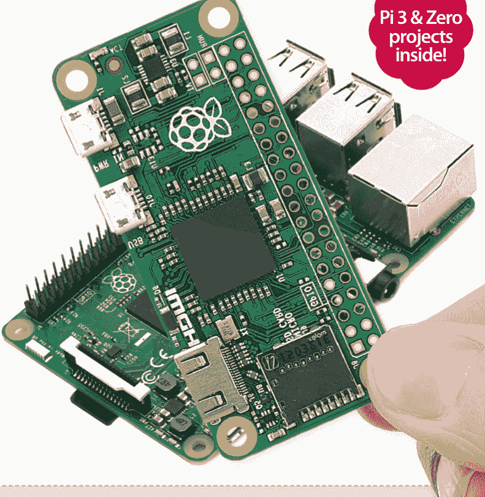

## 欢迎使用树莓派

### 全方位指南

树莓派是近年来计算机领域最令人兴奋的事件之一。作为一种教育工具，这台微型电脑重新燃了学校对裸机计算的兴趣。作为一个开源软件平台，它还激发了数百万人尝试 Linux —— 许多人是第一次尝试。最令人兴奋的是将该设备融入实际项目中的巨大潜力，正如这本新修订版《树莓派全方位指南》教程所示的那样。所以，拿起你的 Pi，开始创作吧！

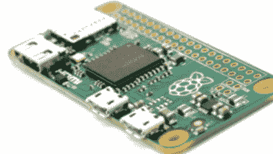


你在这杂志中可以找到的内容

### 入门教程

### 项目实


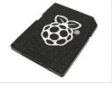

> “对于担心兼容性的人，树莓派 3 可以完美运行现有项目。”

## 使用你的 Pi 代码并创作！

# 树莓派 3

一台增强型的树莓派终于实现了你想要的一切，且价格与之前的型号相同。虽然树莓派已经取得了多年的成功，但用户总是有需求的：一个更强大的 CPU 来处理日常计算、更多的 USB 端口以及更易连接网络的无线。树莓派 3 解决了这些问题。由于使用了与 Model B+ 相同的的设计，它拥有四个 USB 端口，而原始树莓派 B 只有两个。更重要的是，它拥有更强大的处理器和更大的内存，使其比原始型号更快。树莓派 3 还内置了无线功能，使连接 Wi-Fi 和蓝牙变得轻而易举。新的 BCM2837 芯片是树莓派 3 的核心，它是旧 Pi 2 BCM2836 芯片的改进版本。四核 900 MHz 处理器已升级为 1200 MHz 的猛兽，这有助于使 Pi 3 功能更加强大。以前浏览网页或编写文档可能会遇到问题，而现在 Pi 3 可以轻松处理这些任务并留有大量的处理器功率。从本质上说，它与树莓派 B+ 是相同的板。除了上述 USB 2.0 端口、用于有线的以太网接口、高质量 3.5mm 耳机接口、用于数字视频音频的 HDMI 端口以及40 脚 GPIO 口，这个扩展的 GPIO 口对于让你的物理项目变得更加复杂酷炫非常好。对于担心兼容性的人，你所有的旧文件和项目在树莓派 3 上都能运行，你只需要像传输普通文件一样传输它们即可。

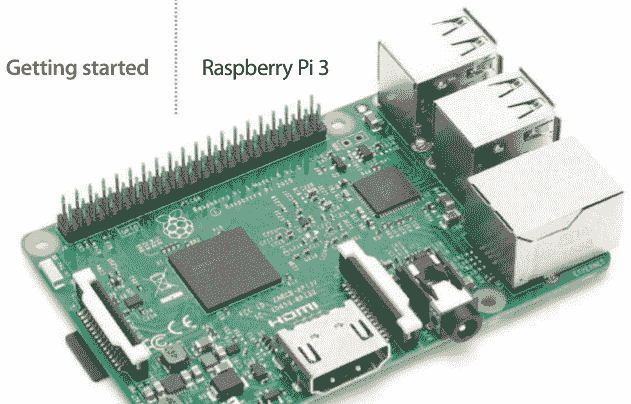

### GPIO 口

GPIO 口中的 40 个引脚提供了电源和功能槽，用于控制项目或从周围读取数据。这使得树莓派成为物联网或极客项目的完美选择。

### USB 端口

四个 USB 端口为树莓派 3 提供了更大的灵活性，允许你添加键盘、鼠标、无线适配器和额外存储，而不需要频繁切换或使用供电集线器。

### 以太网接口

Pi 3 保留了原始树莓派 B 型上的硬件网络和互联网连接。它仍然支持高达 100 Mbps，对于树莓派 B+ 来说速度足够。

### 集成无线

树莓派 3 的重大更新是引入了快速802.11n 无线局域网和蓝牙。连接互联网和其他设备从未如此简单。

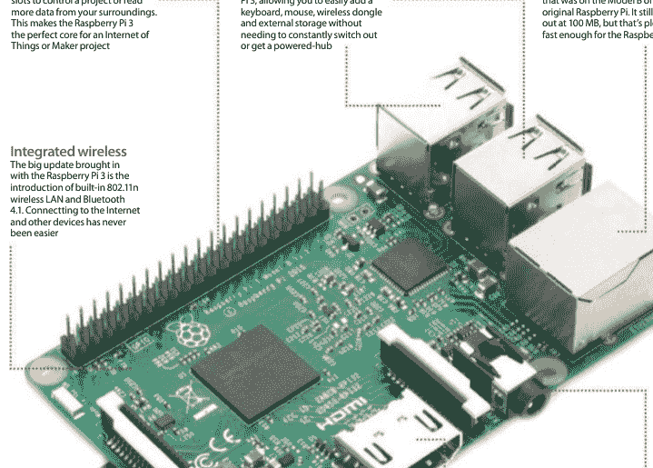

### 耳机接口

需要私下听你的树莓派吗？连接一对便携扬声器吧！3.5mm 接口在 Pi 3 上仍然，它是增加到 B+ 的高质量接口之一。

### MicroSD

主板下方是启动介质所在地—— microSD 卡。它比 SD 卡 小得多，但隐藏了整个操作系统，并让 Pi 3 变得更小。

### HDMI 端口

树莓派的特殊能力是无问题地解码 1080p 视频，这种技术仍然存在于 Pi 3 中。HDMI 端口基本相同，允许输出高清视频和音频。

> “树莓派 3 仍然无法为 USB 集线器供电，因此如果你需要扩展组件，你需要一个供电集线器”

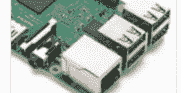

## 树莓派 Model A+

好物不分大小：来了解为什么树莓派 A+ 是移动项目的理想之选。

虽然树莓派 Model B+ 比 Model B 增加了四个 USB 接口，但 A+ 型比前代产品更小，重量仅为 23g（从 45g 减轻），且仅有一个 USB 接口。 SoC（系统级）上的内存也限制为 256MB，而 B+ 则拥有 512MB。

但不要认为这都意味着 A+ 是低劣的。它 65mm 的长度和更轻的重量决定了它的用途。缺少以太网接口并不是弱点，而是说明了树莓派的设计初衷并非用于媒体中心和打印服务器，而是用于那些考虑重量因素的项目。也许你会将其安装在由 Arduino 驱动的机器人上，其较低的功耗可以通过电池来满足。

#### MicroSD 存储

无需担心 SD 卡被折断或丢失。树莓派 A+ 配备了 microSD 卡推入式插槽。

#### 可连接且灵活

两款新款树莓派模型的 GPIO 引脚都从 26 针增加到 40 针，增加了设备的灵活性。

#### 板载上挤了 256 MB 内存！

这看起来很不可思议，但在这款多功能的小型电脑中心，集成了一个带有 256 MB 内存的系统级芯片。

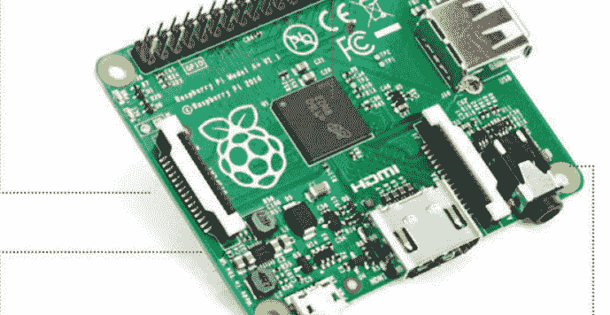

#### 它更小了！

原始树莓派 Model A 的尺寸相当于信用卡，长 86mm。而 A+ 的长度仅为 65mm！

#### 重新定位的电源接口

由于 micro USB 电源接口现在位于 HDMI 接口旁边，更容易布线和管理线缆。

#### 它更轻了！

不可置信的是，树莓派 Model A+ 仅重 23g (0.81 oz)，重量减轻了近 50%！

## 树莓派 Zero

### 入门

这台仅 4 英元的微型电脑席卷了世界，但发生了什么变化？

Pi Zero 的尺寸比信用卡还小，看起来确实令人印象深刻。然而，它的尺寸并不意味着性能的缩水。Zero 的 1Ghz 单核 CPU 和 512MB 内存让这块板的运行速度比原始树莓派快 40%。

为了实现如此小的外型和低生产成本，创造者剥离了许多我们预期的接口。在只剩下 micro 和 mini 接口且没有以太网口的情况下，各种适配器在更具挑战性的项目中将发挥至关重要的作用。通过确保每个组件都存在其价值，Pi Zero 极其多功能。它能够运行 Raspbian 等完整镜像，启动项目变得比以往任何时候都简单。

Zero 的极简主义非常适合无头头（headless）模式运行，添加一个 Wi-Fi 适配器，你就可以使用 SSH 控制它，从而充分利用那唯一的 USB 接口。

#### 新的 mini HDMI 接口

你需要一个适配器来使用此端口。或者继续使用无头模式并安装自己的 OS 镜像。

#### MicroSD 卡

这与新款 Model A+ 相同，这意味着你可以插入现有卡并在几秒内启动运行。

#### 未封装的 GPIO 引脚

由于与 Model A+/B+ 具有相同的引脚布局，你可以根据需要自行焊接引脚，使 Zero 兼容 HAT。

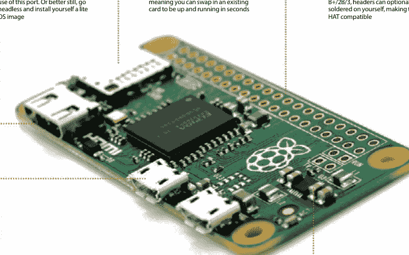

#### Micro USB 接口

接口的缺失意味着 USB 集线器和适配器比以往任何时候都重要，用于连接键盘或 Wi-Fi 适配器等设备。

#### 极简接口

没有以太网口或音频接口，也没有摄像头或显示接口。不过，仍提供未封装的复合视频和重置引脚。

#### 比信用卡还小

Zero 的尺寸为 65mm x 30mm x 5mm，其整体占用空间只有 B 型的一半。

#### 入门套件

你的树莓派比肉眼看到的更多。

这里有一些虚拟外设帮助你入门。

## 入门指南

### 设置你的树莓派

通过我们通俗易懂的指南，了解新款树莓派中各个组件的布局。

虽然看起来很复杂，但设置好树莓派以日常使用其实非常简单。就像电视或普通电脑一样，只有特定的电缆才能插入特定的插槽，主要工作是确保你在任何时候都插好了所需的设备。树莓派本身没有在电路板上做标记。不过，如果你决定购买一个外壳，大多数优质外壳都会为你完成这一点。

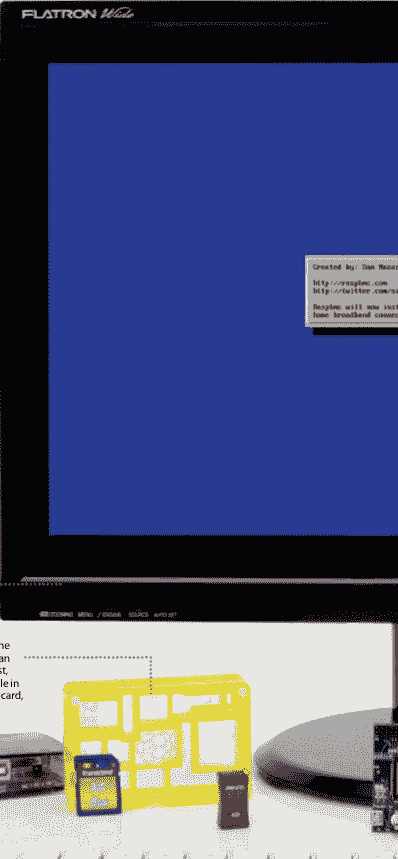

#### 电源适配器

树莓派使用 micro USB 供电，类似于现代安卓手机。它可以由笔记本电脑或电脑供电，但在大多数情况下，使用像这样的专用市电适配器是理想的。

#### 显示器

树莓派能够显示 1920x1080 分辨率（即全高清 FHD）。一些现代显示器允许你像电视一样直接插入 HDMI 线。但在某些情况下，你可能需要一个适配器。

#### USB 集线器

树莓派上的 USB 端口数量有限（如果你是 A 型，则只有一个）。为了解决这个问题，你需要一个 USB 集线器。购买一个带电源的集线器非常重要，因为树莓派本身无法提供足够的电流。

#### 外壳和配件


正确使用树莓派并不需要外壳，但它可以保护它免受灰尘，并在操作时方便移动。你需要一张至少 `4GB` 的 SD 卡。

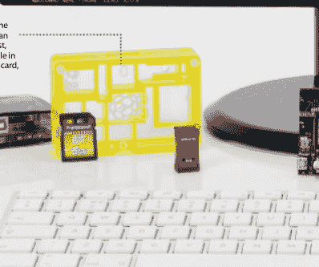

## 键盘和鼠标

和任何电脑一样，如果你想在树莓派上进行任何标准的 PC 风格操作，都需要键盘和鼠标。键盘越基础越好；鼠标也是如此，某些特殊种鼠标需要额外的软件。

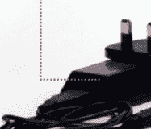

## 入门指南

### 设置你的树莓派

#### USB

所有你想通过 USB 连接的外围设备（键盘、鼠标、USB 盘等）都插在这里。不过，如果你必须使用 USB 集线器，请确保为其提供外部电源。

#### 模拟输出

对于不使用 HDMI 的设置，可以使用黄色视频输出端口。若要通过此输出声音，你需要使用旁边的小黑色端口，连接耳机或辅助电线来传输音频。

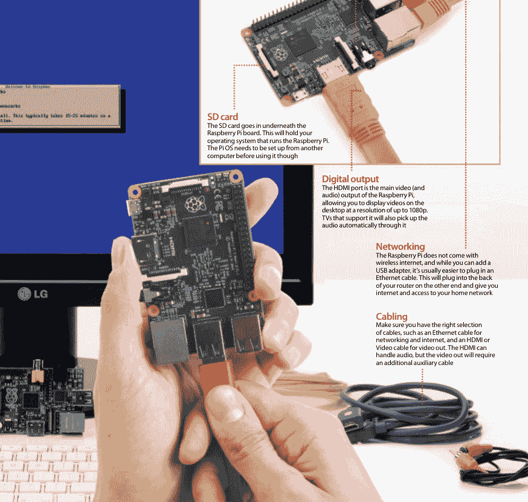

#### SD 卡

SD 卡放置在树莓派板的下方。它将存储运行树莓派的操作系统。在使用之前，需要在另一台电脑上设置好该系统。

#### 数字输出

HDMI 端口是树莓派主要的视频（及音频）输出口，允许你在桌面上以高达 `1080p` 的辨率显示视频。支持该功能的电视也会自动播放音频。

#### 网络

树莓派不带上网功能，虽然你可以添加 USB 适配器，但插入以太线要简单得多。网线将插入到另一端的路由器上，并为你提供家庭网络的访问权限。

#### 线缆

确保你选择了正确的线缆，例如用于网络和上网的以太线，以及用于视频的 HDMI 或视频线。集线器可以处理音频，但视频输出需要额外的辅助电线。

### 设置你的 Pi Zero

#### 你需要准备...

- 树莓派 Zero
- microUSB 电源
- 电烙铁和焊锡
- Pi Zero 适配器套装
- 显示器、鼠标和键盘
- 可选：USB Wi-Fi 适配器
- 可选：USB 集线器

#### 设置你的 Pi Zero

熟悉你的树莓派 Zero，无论是作为无头设备，还是配合屏幕和键盘使用。

你已经拿到了一个 Zero，但在开始编码之前，你需要熟悉它。别担心；我们将介绍树莓派 Zero、所需的线缆、如何准备 SD 卡以及如何将 GPIO 脚焊接到树莓派上。一旦树莓派运行并启动，我们将教你如何在 Raspbian 界面上进行操作。你需要一个 USB 集线器，或者仅配合键盘和鼠标（通过 VNC 或 SSH）使用 Wi-Fi 适配器或 USB 转以太网适配器。

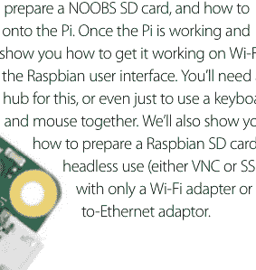


#### 树莓派 Zero 概述

树莓派 Zero 非常小，因此无法容标准尺寸的 USB 和 HDMI 接口。因此你需要适配器将 microUSB 转为标准 USB，将 mini 转为标准 HDMI。连接 microUSB 电源线和 USB 数据线时也需要非常小心。不过它们很容易区分，因为它们有标记，且 USB 数据接口位于 HDMI 和电源接口之间。


#### GPIO 脚

初看之下，焊接新的树莓派 Zero 似乎是一项可怕的任务，但并不困难！然而，焊接数量正确的 GPIO 脚（`40`个）需要几分钟时间。如果你漏掉了几个，别担心！我们使用的工具包含了电烙铁、焊架和无铅焊锡。尽管如此，请注意安全，确保在通风良好的区域焊接——不要吸入任何烟雾。烙头很烫；擦掉尖上的多余焊锡。然后开始焊接。每个脚都让烙头接触 GPIO 脚和树莓派上的金属触点，然后上少量焊锡。完成后移除烙铁。如果焊锡过多，可以加热并使用吸锡器移除。如果你不想让树莓派上的组件过热，可以熔化 GPIO 脚的塑料让其掉落。整个焊接过程中用海绵擦拭烙头以保持清洁。完成后拔掉烙铁并放在安全的地方。

#### 固定 GPIO 脚

在焊接 GPIO 脚之前，你需要将它们固定。我们建议在脚的两侧使用蓝胶。这样做的好处是焊接时可以翻转树莓派并保持固定。完成后撕掉蓝胶。

#### 焊接工具

现在的电烙铁很便宜。我们将进行大量的焊接，所以买一个可以调节温度的可能是值得的。

#### 焊接 GPIO 脚

你一直担心的部分来了，但别担心！确保电烙铁架上有海绵，因为你需要用海绵擦拭烙头以保持清洁。如果你第一次使用它，加热元件会产生很多烟。


#### GPIO

##### 视频

你需要一个 mini 转 HDMI 的适配器来使用这个音视频接口，但你也可以通过空脚使用 RCA 复合视频输出。

##### 数据

右侧的电源端口也是 micro-USB。旁的数据端口也是 micro-USB，所以你可能需要一个 micro-USB 转 USB 的适配器。

### 准备 NOOBX SD 卡

#### 启动 NOOBX 并安装 Raspbian


更多详情见 `raspberry.py/latest-setup`：`NOOBX` 需要一张格式化为 `FAT32` 的 SD 卡。你需要从 `raspberry.py/NOOBX_latest` 下载最新的 `NOOBX` 镜像，然后解压到 SD 卡中。

在 Linux 中，步骤如下：

```
sudo parted /dev/mmcblk0
(parted) mktlabel
(parted) mkpart partition FAT32 0% 100%
(parted) quit
sudo mkfs.vfat /dev/mmcblk01
cd /
mkdir pin
sudo mount /dev/mmcblk1 pin
sudo unzip ~/NOOBX_v1_0.zip
sync
cd ..
sudo umount pin
```

树莓派启动后就完美了。在 Raspbian 面上，你可以点击网络图标查看可用无线网络。点击它并输入密码。关联后；鼠标悬停在图标上可以看到连接的网络。

#### 从另一台电脑配置 Wi-Fi

如果你想将 Pi Zero 作为带 Wi-Fi 的无头设备，可以使用 Linux 方法准备 SD 卡，并配置连接到正确的 Wi-Fi 网络。你需要挂载 SD 卡并编辑 `/etc/wpa_supplicant/wpa_supplicant.conf`，这与配置生成的文件相同。


上一步的树莓派接口。将 SD 卡插入你的 Linux 电脑中，并确定该设备名称。

```
dmesg | tail -n 3
[32056.612984] mmc0: new high speed SDHC card at address 0000:
[32056.613437] mmblk0: 0:0001 SD 8GB 7.35 GiB
```

所以设备是 `/dev/mmblk0`，现在我们需要确定根分区是哪一个（如果我们使用的是 NOOBS 镜像，这在树莓派上会有所不同）。

```bash
sudo parted /dev/mmblk0
```

这将给你分区列表。最大的分区就是根分区。在这种情况下，根文件系统位于 `/dev/mmblk0p7`。要挂载 SD 卡并编辑 `wpa_supplicant.conf` 文件，请执行以下操作：

```bash
cd / 
sudo mkdir pi
sudo mount /dev/mmblk0p7 /pi
cd pi
sudo nano /etc/wpa_supplicant.conf
```

然后填写你的 Wi-Fi 详情：

```text
network={
ssid="your_wifi_network"
pswd="your_wifi_password"
key_mgmt="WPA-PSK"
}
```

然后：

```bash
cd
umount /pi
```

# 远程访问你的树莓派

你可以扫描本地网络以找到你本地网络的地址范围（常用网络有 `192.168.1.0/24` 和 `192.168.2.0/24`）。你可以通过 `ip` 命令或 `nmap` 找到它。

# 设置你的树莓派 Zero

## 入门

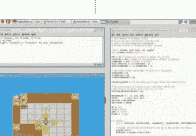

图 2：Zero 虽然很小，但非常适合编程

- `nmap -sv 192.168.157.0/24` 将扫描带有 SSH 的设备列表。打开示例输出：


```text
Nmap report for 192.168.157.29
Host is up (0.075 latency).
PORT STATE VERSION
22/tcp open OpenSSH 2.0
```

然后你可以通过 SSH 登录：

```bash
ssh pi@192.168.157.29
```

密码是 'raspberry'。如果你想禁用 GUI，你想要通过以下方式设置启动：

```bash
systemctl set-default multi-user.target
```

## 设置 VNC

VNC 全称为“虚拟网络计算”（Virtual Network Computing）。使用 VNC，你只需要电源和以太网/Wi-Fi（已连接）即可通过网络访问树莓派。它不支持音频，但对于任何其他任务（如使用 pygame），VNC 应该能提供可以接受的性能。你可以安装多个可用的免费 VNC 客户端，搜索引擎可以帮助你找到合适的一个。要在你的树莓派上启动 VNC 会话，请通过 SSH 登录然后运行 `vncserver`。首次运行时它会提示你。你可以使用 `-geometry` 选项指定屏幕分辨率：例如 `-geometry 1024x768`。然后你可以在 Linux 电脑上使用命令连接会话：`vncviewer 192.168.157.29`，将其替换为你的树莓派的 IP 地址。

```bash
sudo apt-get update
sudo apt install vncserver
```

## “使用 NOOBS 最少需要的连接是显示器和键盘”

## 入门

### 安装一个发行版

### 你需要...

### 安装发行版

树莓派下载

www.raspberrypi.org/downloads

我们来看安装预构建操作系统的某些关键方面。

由于其体积小且价格廉，许多人可能被误导，认为树莓派只能用于基础任务和学习编程。由于树莓派是一台微型电脑，带有 HDMI 和模拟视频输出，而不是传统的显示器连接，它可以执行许多笔记本电脑或桌面经常执行的任务。虽然它没有足够的处理能力或内存来运行最新的 Windows，但还有其他选择。有很多完整的操作系统是从桌面衍生出来的，并针对树莓派进行了优化。其中最流行的的是 Raspian，它是 Linux 生态系统的一部分，许多其他发行版也源自 Debian。原始 Debian 发布于 1993 年，而树莓派使用的是较老的 ARM 架构。

> 你知道吗...树莓派的官方发行版叫做 Raspian。这是我们推荐的，但也有其他选择。

速度：获取足够快的 SD 卡以让你的系统运行顺畅是个好主意。

命令行：如果你使用 Linux，你可能需要使用命令行来安装预构建系统。


格式：在拷贝 SD 卡之前，你需要确保它是空的。你需要将其格式化为 FAT32 文件系统。

自动化工具：在制作镜像到 SD 卡时，有一些可用的图形化工具。

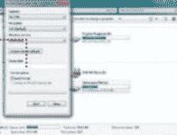


## 安装发行版

## 入门

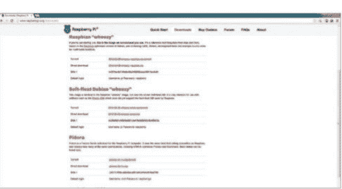

### 格式化卡

05 在 Windows 中，要格式化卡只需插入并等待其挂载。点击“我的电脑”，然后右键点击该卡图标。之后从下拉菜单中选择 FAT32。

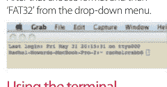

01 你的第一个问题之一可能是“我在哪里可以下载操作系统？”大部分镜像可以在树莓派主站找到：http://www.raspberrypi.com/software。这些是稳定且值得研究的系统。

### 获取操作系统

### 格式

03 在压缩包内你会找到 `.img` 或 `.iso` 文件。这些等同于 CD 或 DVD。仅仅将文件拷贝到 SD 卡是不够的，你需要一个程序来提取它。

### 使用终端

06 如果你使用 OS X 或 Linux，你必须使用终端来拷贝镜像。OS X 默认带有终端应用程序，大多数 Linux 版本也带有一个或多个。它可能被称为“控制台”或“命令行”。

### 解压缩

02 当你解压镜像后，你可能需要做的第一件事就是解压它。在 Windows 中可以通过点击提取来完成。“在 OS X 中，双击提取文件”。

### SD 卡格式

04 你需要的 SD 卡必须是空白的，首先确保没有任何内容。你需要将其格式化为使用 FAT32 文件系统。这是一个大多数 U 盘和相机都使用的系统。

### DD 命令

07 你需要使用的命令叫做 `dd`。它的输入格式为 `dd bs=4m if=[image] of=[sdcard]`。

```bash
sudo dd bs=4m if=/home/user/downloads/raspberrypi-os/arch-linux-pi-2013-02-11.img of=/dev/disk1
```

### Win32 Disk Imager

08 Windows 用户可以使用 Win32 Disk Imager。一旦下载了该工具，只需点击 .exe，以管理员身份运行并按照提示操作。安装完成后，你就可以将 SD 卡放入树莓派了，简单！

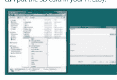

## 入门

### 命令行基础

### 你需要...

Raspbian

www.raspberrypi.org

> 你知道吗...命令行会记住你上次的命令。只需使用向上和向下方向键即可使用它们。

### 命令行基础

学习一种使用命令行和键盘控制树莓派的替代方法。

我们可能都遇到过树莓派的情况：你把 Raspian 或其他树莓派系统安装到了 SD 卡上，并且你跳过了设置脚本或者没有做充分的调研。你启动操作系统……结果发现到了命令行界面。第一步不要恐慌：这完全正常。

在 Raspian 的情况下，至少第二步只需输入：

$ x `

就是这样。Raspian 会加载桌面，你可以再次使用鼠标。在这种情况下既快速又方便，在许多其他操作系统也是如此。你所做的是使用一个命令，具体来说在这种情况下是启动 X 服务器。X 服务器处理图形界面，在某些系统中默认是关闭的。

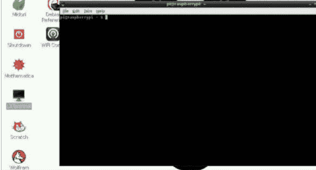

图 1：终端模拟器允许你在仍在桌面环境时访问命令行

## 命令行基础

## 入门

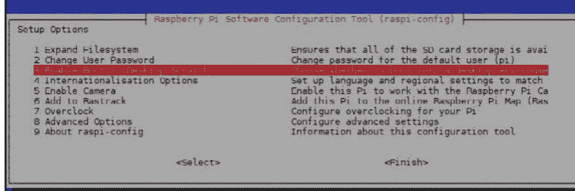

### 新世界

不过，将树莓派进入桌面并不是你通过命令行能做的唯一事情。事实上，命令行中内置了极其丰富的功能，你正在使用的大多数图形化程序也是通过运行这些命令来实现的。你不需要离开舒适的桌面环境来执行这些命令，因为树莓派操作系统会带有一个名为终端模拟器的应用程序。

这创建了一个窗口，你可以在其中以启动桌面相同的方式编写命令，并使用相同的命令（图 1）。在树莓派上，在菜单的“附件”（Accessories）中查找 LX Terminal 应用并点击它。如果你之前必须使用 start 进入桌面，那么我们现在可以在继续之前修复它。在终端中，输入：

```
$ raspi-config
```

这是初始设置（图 2）。从这里你可以启用启动时进入桌面（图 3），甚至更新固件并添加对官方树莓派摄像头模块的支持。这允许你在无需再次重启的情况下修改树莓派。

你不会经常使用这些命令，那么深入研究命令行有实际用途吗？非常有用。首先，树莓派没有官方的包管理器。这是一个允许你浏览操作系统可用软件的程序，类似于 Pi Store。

然而，Raspian 还有其他你无法通过商店获取的软件。你同样无法专门更新树莓派软件，而这一切都可以通过命令行解决。

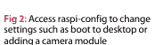


## 入门

pi@raspberry:~

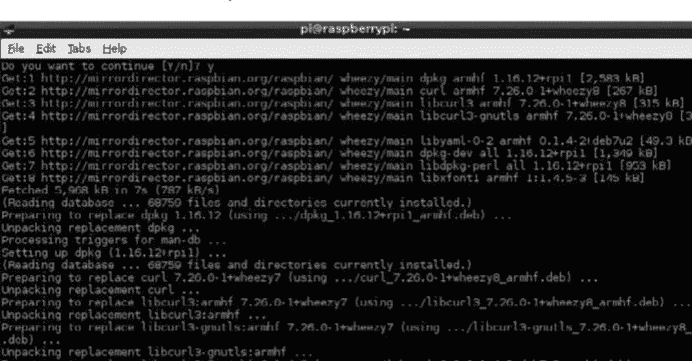

### 人的软件

你想做的第一件事是让 Raspbian 确切网上有哪些内容。这是一个简单的任务：你只需要做：

```
$ sudo apt-get update
```

这将运行一个包含树莓派所使用的软件的在线仓库（或 repos）列表。完成后，命令行将弹出并等待你的下条命令。由于你是第一次执行此操作，你可能需要更新树莓派上当前的软件。你可以使用以下命令完成：

```
$ sudo apt-get upgrade
```


它可能会要求你确认升级，在这种情况下，输入 `y` 然后按回车键。我们在这里所做的是使用命令行包管理器 `Aptitude` (`apt-get`) 首先检查仓库，然后根据（图 4）升级包。第一条命令允许它以管理员身份运行 `apt-get` 任务，并用于其他命令行操作之一。

要安装软件，你使用 `install` 而不是 `update` 或 `upgrade`，后面跟包名。例如，对于数学编程语言，你可以通过以下命令安装它：

```
$ sudo apt-get install wolfram-engine
```

> 你知道吗...
>
> 你可以使用 `Tab` 键来补全命令。只需开始输入并按 `tab` 键。如果你喜欢看到的内容！按 `Enter` 键完成！

# 命令行基础

## 入门

安装和更新只是你在命令行中可以做的几件事之一。你还可以浏览整个文件系统、移动文件、创建文件夹和删除项目。这些都是简单的操作。

当你第一次打开终端时，它会在你的主文件夹中打开。虽然你不能具体判断这一点，但你可以显示目录中有哪些文件（图 5）：

```
$ ls
```

波浪号 (`~`) 表示主文件夹，可以用于导航文件系统。要导航，我们将使用 `cd` 命令，后跟你想去的位置。可以这样做：

```
$ cd /home/pi/Downloads
```

这会将你带到 `Downloads` 目录。当我们从主文件夹开始时，实际上需要这样做：它是上下文相关的，并且知道当前所在的目录。还有一个技巧你可以使用，所以不需要记住路径的确切名称——当输入部分内容并按下 `Tab` 键时，命令行或终端会尝试补全短语。

最后，有一些你可以使用的快速命令来操作文件。单个文件可以使用 `cp` 命令复制，后跟文件名和新位置，例如：

```
$ cp file.txt ~/Documents/file.txt
```

你还可以通过以下方式重命名文件：原始文件可以使用 `rm` 命令删除：

```
$ rm file.txt
```

想创建一个新文件夹吗？使用 `cd` 移动到你需要添加的目录，然后使用 `mkdir` 以及你想要的名称：

```
$ mkdir NewFolder
```

使用命令行可以做很多事情，但这些只是基础。随着你对 Linux 的使用，你将面对需要命令行的任务，通过这个过程你将学会完成多少内容。

> 你知道吗...
>
> 你始终可以通过输入 `~` 并按回车键返回命令行的主文件夹。
>
> “当输入部分内容并按下 `Tab` 键时，命令行或终端会尝试补全短语”


图 5：有很多简单的命令行工具可以帮助你浏览和使用系统

# Raspbian 桌面

## 入门

虽然树莓派的 Raspbian 操作系统更接近 Mac，但它也非常像 Windows。初一看它可能有点陌生，但使用 Raspbian 几乎没有区别。有一个菜单栏、一个网络浏览器、一个文件管理器，只需打开菜单并点击你想启动的应用程序...

### 菜单

左上角类似 Windows 的菜单显示了程序和选项。菜单包括 Firefox 和其他应用程序、Games（预安装）、Accessories（一组实用程序）以及 Preferences（系统工具）。从 Pi Store 下载的程序出现在相应的类别中，而 Run 会启动命令行解释器，就像在 Windows 中一样。使用 Shutdown 关闭机或重启你的树莓派。

### 任务栏

横跨屏幕顶部的是任务栏，菜单位于其上。右侧是 Epiphany 浏览器、文件管理器 (`PCManFM`)、用于输入文本命令的 `LXTerminal`、Wolfram 计算软件和 Wolfram 语言应用程序。当这些应用程序停定时，你会在右上角找到它们；当前 CPU 负载、音量控制和网络状态。

### 文件管理器

没有文件管理器无法管理文件，可以通过点击任务栏快捷方式打开。桌面上的文件可以通过拖拽或只需按键盘上的 Delete 来复制、重命名和删除。你还可以创建标签窗口来浏览或打开其他文件夹。文件夹位置可以收藏以便方便访问，文件本身可以以图标或详细列表查看。


> “初一看它可能有点陌生，但使用 Raspbian 几乎和 Windows 没有区别”

## 网页浏览器

Epiphany 是默认的树莓派浏览器，尽管如果你不喜欢，也可以从 Pi Store 添加一个新的。在任何浏览器中，网页地址都输入到地址栏中，并提供了标准的导航按钮在网页间来回切换。Epiphany 支持多个标签窗口，并具有私密浏览和清除浏览数据的功能。点击工具栏末端的 Options 图标来访问这些功能。

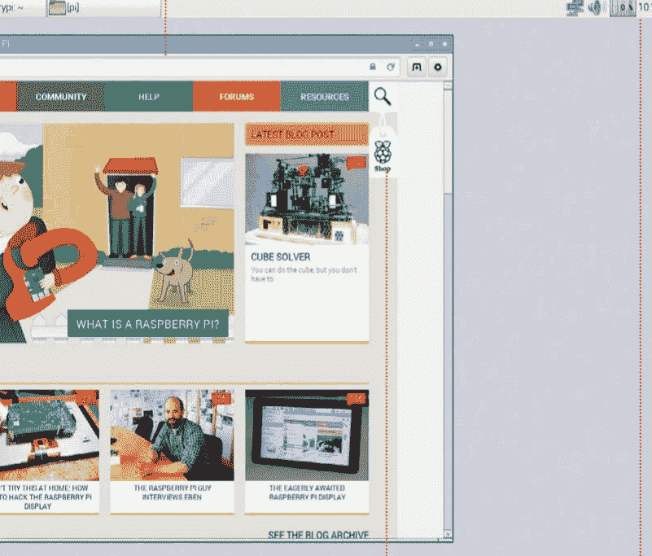

## Pi Store

你可以从菜单访问 Pi Store，或者从 `www.raspberrypi.org` 网站上的链接访问。就像 Steam、Google Play 或 App Store 一样，Pi Store 需要你注册账户（并验证身份）。你需要登录以下载免费和付费软件。从商店安装的任何游戏和应用将出现在“我的库”（My Library）标签页下，其中一些只能从这里启动。

## 状态和时间

任务栏的最右侧是 Raspian 对应的 Windows 系统，你可以在那里找到关于树莓派状态的信息。状态位于时钟中，点击时还会显示日期、时间和网络使用情况。点击此可以找到一个显示当前 CPU 负载的图表、设备音量控制，并确认你的树莓派已在线。

# 掌握配置工具

## 您需要准备的...

Raspbian:

`www.raspbian.org`

使用强大的内置配置工具让您的树莓派学会如何运行

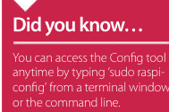

“RasPi Config”工具允许您对系统进行配置，如果是在 Linux 环境下安装树莓派，这些操作将变得复杂。它是您在安装 Raspbian 时看到的第一个程序。为什么呢？诸如设置日期或键盘区域设置等任务通常在没有对话框或额外帮助的命令行界面中完成——对于新用户来说，这简直是噩梦。

对于树莓派和树莓本身还有一些更具体的设置，例如能够为您的电视开启过度扫描（`overscan`）；更改内存到电脑/显卡的分配；或对系统进行超频以使其运行更快；启用对系统的远程 SSH 访问；停止启动到桌面环境等。Raspi Config 工具消除了这些过程的痛苦，让强大的功能变得触手可及。

### 修改密码

更改默认用户名“username”的密码，使其更具个性化或更易于您记忆。

### 扩展根分区

允许您快速方便地更改根分区，以填满 SD 卡。

### 打开 raspi-config 工具

首先双击桌面上的 `LXTerminal` 图标。这将启动命令提示符，您可以在其中运行配置工具。要执行此，您需要运行一条命令：

```
sudo raspi-config
```

当要求输入密码时，您不会看到输入的字符。当您输入密码并按回车提交后，将显示配置界面。在本节中，我们将介绍一些感兴趣的设置，尽管它们都会对树莓派的运行产生影响。菜单中的某些设置非常重要且有些是不可逆的，请务必谨慎使用！

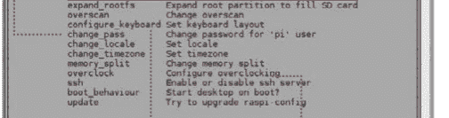

### 配置您的键盘

设置正确的键盘——有很多不同的布局。使用错误的布局会非常恼。

### 超频

允许您快速方便地对树莓派进行超频，在风险极小的情况下提供额外的速度和动力。


# 掌握根系统

## 扩展根系统

默认情况下，树莓派的根系统为 2GB——这样做是为了让镜像能够适配不同的 SD 卡。

如果您需要更大的空间，“扩展根”选项将使操作系统使用全部空间。使用后，命令将立即执行。这可能需要一些时间。重启系统以查看更改。

如果您看到任何不稳定性，请再次运行此向导并将时钟速度调低——重复直到系统稳定。

在本教程范围内，建议进行“适度/中等”超频——它似乎能为您提供额外的性能，且没有副作用。还建议在进行此更改后重启系统。按住 Shift 键可以临时禁用超频。

## 更改启动行为

开机时自动启动 X。将此选项设置为“Yes”以默认启用此行为。

您可以随时撤销此设置，返回到文本登录界面，在其中需要手动启动。

## 关闭超频

如果您使用 HDMI 显示器连接树莓派，可能会注意到以下两种现象：

- 树莓派的图像输出周围有一个黑色块——它没有正确对齐。这是超频引起的。
- 如果您看到屏幕边缘超出了范围，说明正受到超频的影响。

如果您遇到其他问题，您可能需要关闭超频，或者在电视上开启“缩放”模式或其他功能。

## 修改内存分区

更改内存分区允许树莓派为系统或处理器分配更多的内存。

您可以提供的值为 `16MB`/`64MB`/`128MB`。以下是我们的建议：

- `32MB` GPU：适用于基础静态视频和 3D 渲染。


- `64MB GPU`：适用于桌面使用，需要视频播放或 3D 效果。
- `128MB GPU`：适用于图形应用程序、多媒体游戏或 3D 渲染游戏。

对于大多数人来说，64MB 显存就足够了。

## 配置本地区域 (locale)

设置树莓派使用的本地区域设置——这通常对您的使用影响很小。它还负责任何货币设置，因此在您偏好的时间可能会产生困扰。

选择该选项后，您将通过向导进行。使用方向键检查时钟（这需要一些时间）。时区设置将带您进入一个调整界面。

## 超频您的树莓派

您可以根据不同的预设设置树莓派的时钟频率和电压。以高于规格的频率可能会导致不稳定，因此请以小的增量进行。

## 入门

最后，Wi-Fi 连接出现了一个新的 IP 地址。

如果你点击“管理网络”（`Manage Networks`）选项卡，该网络现在会列出来，并有一个已启用的单选框。要接入互联网，只需启动它即可连接。Wi-Fi 工具将一直留在面板右下角运行。如果你右键点击 Wi-Fi 图标，你将看到“断开连接”（`Disconnect`）或“重新连接”（`Reconnect`）选项，甚至可以识别并查看最近扫描的结果。

点击“状态”（`Status`）可以查看其运行情况。

### 检查连接

要检查 Pi 是否具有有效的互联网连接，双击 `LXTerminal`。输入此命令：

- `ip addr`

你应该能看到一个数字列表，最后一行以“inet”开头，后面跟的是连接的 IP 地址（图 3）。通常这个地址是类似于 `192.168.1.11` 的数字，这表明连接工作正常，因为 Pi 根据你的调制解器/路由器所使用的地址分配了 IP 地址。如果没有发生这种情况，可能是路由器端存在问题。当 Pi 连接到调制解器/路由器时，调制解器/路由器应该运行 DHCP 服务器，这样它就能获得 IP 地址。如果没有运行，其他连接到它的设备都将无法访问互联网。

使用设备的 Web 界面登录 `192.168.1.0` 或你调制器的实际 IP 地址，以检查 DHCP 服务器是否也正常工作。最后，在终端中：

- `ping google.com`

## 共享连接

如果你没有 Wi-Fi 适配器、供电 USB 集线器或足够长的电缆来同时连接互联网，还有另一种访问方式。在 Mac 上，通过 USB 或以太网线将其连接到 Pi，在“网络与无线网络”下启动“系统偏好设置”，点击“共享”。点击“互联网共享”（`Internet Sharing`），选择 Wi-Fi（或 AirPort）作为要共享的连接类型，并选择 Pi 如何连接到你的 Mac（图 4）。

在 Windows PC 上，前往 Windows 资源管理器 > 网络 > 网络和共享 > 更改适配器设置。

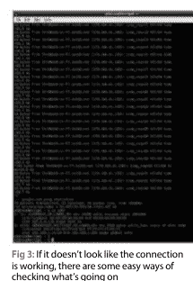

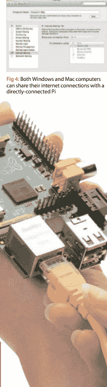

## 入门

安装和使用软件包

### 你需要什么……

## 安装和使用软件包

Apt 命令帮助页面：

http://linux.die.net/man/apt

Apt-get 帮助页面：

http://manpages.ubuntu.com/manpages/lucid/man/apt-get.html

树莓派非常棒，但通过安装在它上面的软件，它会变得更好

> 你知道吗……
>
> 如果你按下 `Tab` 键，命令行将尝试为你自动补全命令——只需按回车键即可完成。

单从本身来看，树莓派是一台近乎完美的微型电脑。它已经包含了丰富的教育软件、几个游戏、一些编程实用程序和许多系统工具。但与大多数计算机一样，这只是仅仅是冰山一角。通过安装更多程序，你可以做更多事情。

这些程序被称为“软件包”（packages），它们的丰富和多样性与最初设计它们的开发者一样广泛多变。在 Linux 中，如果需要某个程序，就会有人开发一个。他们将其推向世界并让源代码免费可用，因此被称为“开源”。一旦程序通过测试，它最终将进入该特定 Linux 发行版的许多远程服务器之一。

这些远程服务器被称为“存储库”（repositories）或“repos”，它们包含了软件包的所有元素，以便将其下载并安装到你的系统中。一旦你了解了如何操作，这个过程将非常快速简单……

```
pi@raspberrypi / $ sudo apt-get
      (_)
     (oo)
    / ----\\
   *  \\--\/\
      ~~~
.... "你今天哞叫了吗？"....
```

## 安装与升级

## 入门

## 更新和升级

你需要知道并能够安装它。使用方向键向上/向下进行导航；按 'Q' 退出。

### Apt 的彩蛋

获取软件包并将其安装到树莓派上涉及使用命令行终端（通过桌面上的 `LXTerminal` 图标）并输入几个命令。在此之前，我们确保系统是最新的。在终端中输入以下内容：

`Apt` 命令是 `aptitude` 命令的一种更短、非菜单驱动的变体。该命令在 Linux 中有很久的历史，并且具有一些特殊功能结果；也称为彩蛋。纯粹为了好玩，输入以下命令并查看结果：

```
sudo apt-get update
sudo apt-get upgrade
```

或者……

```
sudo apt-get update && sudo
apt-get upgrade
```

## 安装软件包

使用向上和向下键导航列表。如果你发现了你寻找的内容，例如 Angry Drunken Dwarves（愤怒醉酒矮人），请记住软件包的名字（在此情况下为 'angryd'），按 'Q' 退出列表。

```
apt moo
apt -v moo
apt -vv moo
apt -vvv moo
apt -vvvvv moo
sudo apt-get moo
```

要安装软件包，在终端中输入它：

```
sudo apt-get install angryd
```


### Apt apt

`Apt` 命令是 `aptitude` 命令的一种更短、非菜单驱动的变体。该命令在 Linux 中有很久的历史，并且具有一些特殊功能结果；也称为彩蛋。纯粹为了好玩，输入以下命令并查看结果：

```
sudo apt-get update
sudo apt-get upgrade
```

或者……

```
sudo apt-get update && sudo
apt-get upgrade
```

## 安装软件包

使用向上和向下键导航列表。如果你发现了你寻找的内容，例如 Angry Drunken Dwarves，记住软件包的名字（在此情况下为 'angryd'），按 'Q' 退出列表。

```
apt moo
apt -v moo
apt -vv moo
apt -vvv moo
apt -vvvvv moo
sudo apt-get moo
```

要安装软件包，在终端中输入：

```
sudo apt-get install angryd
```


### Apt apt

`Apt` 命令是 `aptitude` 命令的一种更短、非菜单驱动的变体。该命令在 Linux 中有很久的历史，并且具有一些特殊功能结果；也称为彩蛋。纯粹为了好玩，输入以下命令并查看结果：

```
sudo apt-get update
sudo apt-get upgrade
```

或者……

```
sudo apt-get update && sudo
apt-get upgrade
```

## 安装软件包

使用向上和向下键导航列表。如果你发现了你寻找的内容，例如 Angry Drunken Dwarves，记住软件包的名字（在此情况下为 'angryd'），按 'Q' 退出列表。

```
apt moo
apt -v moo
apt -vv moo
apt -vvv moo
apt -vvvvv moo
sudo apt-get moo
```

要安装软件包，在终端中输入：

```
sudo apt-get install angryd
```


### Apt apt

`Apt` 命令是 `aptitude` 命令的一种更短、非菜单驱动的变体。该命令在 Linux 中有很久的历史，并且具有一些特殊功能结果；也称为彩蛋。纯粹为了好玩，输入以下命令并查看结果：

```
sudo apt-get update
sudo apt-get upgrade
```

或者……

```
sudo apt-get update && sudo
apt-get upgrade
```

## 安装软件包

使用向上和向下键导航列表。如果你发现了你寻找的内容，例如 Angry Drunken Dwarves，记住软件包的名字（在此情况下为 'angryd'），按 'Q' 退出列表。


```
apt moo
apt -v moo
apt -vv moo
apt -vvv moo
apt -vvvvv moo
sudo apt-get moo
```

要安装软件包，在终端中输入：

```
sudo apt-get install angryd
```


### Apt apt

`Apt` 命令是 `aptitude` 命令的一种更短、非菜单驱动的变体。该命令在 Linux 中有很久的历史，并且具有一些特殊功能结果；也称为彩蛋。纯粹为了好玩，输入以下命令并查看结果：

```
sudo apt-get update
sudo apt-get upgrade
```

或者……

```
sudo apt-get update && sudo
apt-get upgrade
```

## 安装软件包

使用向上和向下键导航列表。如果你发现了你寻找的内容，例如 Angry Drunken Dwarves，记住软件包的名字（在此情况下为 'angryd'），按 'Q' 退出列表。

```
apt moo
apt -v moo
apt -vv moo
apt -vvv moo
apt -vvvvv moo
sudo apt-get moo
```

要安装软件包，在终端中输入：

```
sudo apt-get install angryd
```


### 搜索

- 名称: `apt-get`
- 版本:
- 描述：`apt-get` 命令是一个用于基于 Debian 的发行版中处理软件包的强大命令行工具。它用于安装、更新、删除和升级软件。

## 入门

使用图形界面安装

### 你需要什么……

## 使用图形界面安装

Synaptic:

www.nixuyu.org/synaptic

你更倾向于使用图形界面来安装新程序吗？如果是，请继续阅读……

> 你知道吗……
>
> `Synaptic` 可以通过命令行访问相同的存储库，正如之前的所示。

如果你是 Linux 新手，可能会对使用内置的 Apt 软件包管理工具感到畏畏和困惑。`apt-get` 命令用于通过互联网连接远程服务器（称为存储库）来安装应用程序。但它是通过命令行提示符使用的，这可能会让人感到压力，因此我们需要一种替代方案：桌面环境方法。

这就是 `Synaptic` 的用武之地。`Synaptic` 是 `apt-get` 命令行的一个友好图形界面，允许你通过已经熟悉的桌面环境管理应用程序的安装和删除。把它想象成一种在线商店，你可以在那里挑选已下载和安装的程序，而无需进入终端。

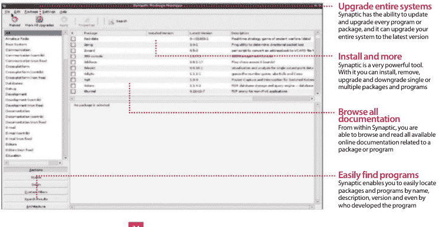

- 升级整个系统

`Synaptic` 有更新并升级每个程序或软件包。将系统升级到最新版本

- 安装及更多

`Synaptic` 是一个非常强大的工具。通过你可以安装、删除、升级单个软件包或程序

- 浏览文档

从 `Synaptic` 你可以浏览并阅读与软件包或程序相关的所有在线文档

# 使用图形化安装

## 入门

## 更新系统

遗憾的是，如果你使用的是掉入命令行终端的版本，那么你将卡在第一步。在安装 Snapages 之前，我们需要确保树莓派已完全更新，并且所有现有软件包都已升级。只需在 LXTerminal 中输入以下内容：

```bash
sudo apt-get update
```

```bash
sudo apt-get upgrade
```

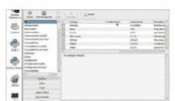

## Synaptic – 第 2 部分

## 修复 Synaptic – 选项 2

你应该能看到 `Synaptic` 窗口，在其中你可以浏览可用软件包列表并点击下载和安装。现在我们想测试使用 LXDE 菜单是否有效。点击底部的图标，然后进入 选项（Preferences）> `Synaptic` 软件包管理器。

第二，也是最好的选项是进入终端并更改程序从菜单打开的方式。只需要将行之间进行互换，使得使用 `gksudo` 命令而不是普通的 `synaptic`。然后，输入：

- `sudo nano /usr/share/applications/synaptic.desktop`


将 'Exec=synaptic-pckec' 修改为 `Exec=gksudo synaptic-pckec` ...


## 安装 Synaptic

要安装 Synaptic，你首先需要进入 LXTerminal 并运行下面的命令——不要忘记在提示时输入 Y 以接受安装：

```bash
sudo apt-get install synaptic
```

## Synaptic – 第 3 部分

从 LXDE 菜单运行 Synaptic 会导致错误。不要恐慌；它只是在请求密码。在框中输入以下密码：

- raspberry

这是 Pi 的默认密码，我们假设你还没有更改过它！

## 修复 Synaptic – 选项 1

### Synaptic 正常工作

在你输入更改后，按 Y 退出接受更改，然后按回车返回提示符。你现在可以从菜单启动 Synaptic，或者在进入终端时输入以下命令：

- `gksudo synaptic`


## Synaptic – 第 1 部分

本质上，这就是你需要做的一切。Synaptic 现在已安装并准备好使用。然而，可能会先出现一些错误，因此最好遵循这些步骤。要测试 Synaptic 是否运行正常，在终端中输入以下命令：

```bash
gksudo synaptic
```

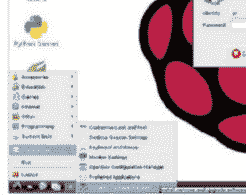


## 入门

### GPIO 端口解释

### 你需要...

### 原型设备

`RPI.GPIO`

https://pypi.org/project/pypi/RPI.GPIO

学习如何利用树莓派上 GPIO 的功能。它比你想象的要简单……

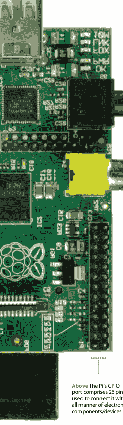

树莓派上的通用输入/输出（GPIO）引脚通常是你在这本书中找到的项目成功的关键。没有了它们，你就无法与现实世界交互，无法触发灯光、按钮或蜂鸣器，无法读取传感器。

GPIO 引脚对 Pi 来说并不特殊；它们实际上是一种标准，用于帮助控制各种集成电路的输入和输出行为。通常，你会发现任何 GPIO 引脚都没有特定的预定义功能，并且它们默认是关闭的。

# 树莓派 GPIO

树莓派上的引脚可以通过许多方式进行控制和触发。你可以直接从终端和通过 Bash 脚本使用它们，也可以使用为流行编程语言专门设计的模块来控制它们。由于 Python 是树莓派的官方语言，你会发现 Python 的 GPIO 模块为你提供了最好的输入输出控制。该库名为 `RPi.GPIO`，默认安装在所有树莓派上，但也可以以安装任何 Python 库的方式进行安装。该项目托管在 SourceForge 上，可以在 `sourceforge.org/projects/raspberry-gpio-python` 找到。你还会找到有用信息，以及如何通过简单的 Python 脚本使用和控制 GPIO 引脚的示例。如果你计划使用 GPIO 引脚，对 Python 有基本的了解是有帮助的。树莓派上有 26 个引脚，你会找到有用信息以及通过简单的 Python 脚本使用和控制 GPIO 引脚的示例。


## GPIO 端口解释

## 入门

## GPIO 端口解释

## 原型设备

## 四大扩展板

## 入门指南

### HiFiBerry DAC+: 30

作为一种高质音频设备，但你可能会发现树莓派的不足，因为它只有一个 3.5 mm 立声输出，且该输出并未针对高保真进行调优。你可能一直梦想着增强音频并将你的设置提升到下一个水平。好消息是，树莓派基金会的巧妙时钟从原始 Model B 的第二次修订开始，最初在独立的 PS 引脚上提供了 I2S 引脚，现在在 A+、B+ 和 B 型号上可以通过 40 脚 GPIO 引脚可用。

I2S 是一种专为音频设备设计的通信协议，它让许多像 HiFiBerry DAC+ 这样的扩展插件成为可能，它为 Pi 引入了高质量（192 kHz，24-bit）Burr-Brown 数字模转换器。它具有使用 Alsamixer 进行硬件控制等功能，并且作为一个兼容 HAT 的垫片（shim），它可以与最新版本的树莓派固件开箱即用，并适用于所有用于标准用途和媒体播放的热门操作系统，如 Archian Linux, OSMIC, OpenLEC, Volumio, Pi MusicBox 等。如果你认真对待音频质量并想要一种高质量、低连接的解决方案，那么你再也没有借口了——你可以用不到 100 英镑的价格构建属于自己的。

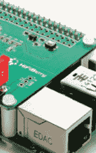

### Energie Pi-mite 50英镑

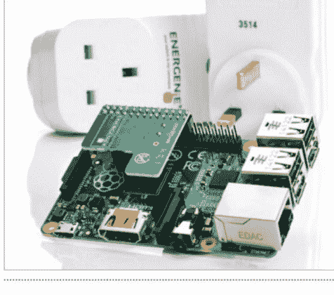

家庭自动化目前非常风靡，自动化任务（如调节加热控制以及在你之前关灯）让我们的生活变得简单得多。

我们总是喜欢从插头处关闭设备，而不是让它们处于待机状态，或者在未妥善关闭时消耗大量电力。这就是 Energie Pimite 启动套装大显身场。

它包含两个遥控插座，可以使用 RF 遥控器开启和关闭，允许你控制树莓派上的软件，从而解锁许多新可能——你可以设置灯光在你离开家里时开启，并在指定时间自动关闭，或者仅使用手机创建一个简单的 Web 应用来远程控制你的插座。

它们仅提供英国和欧盟插头类型，如果你使用不同的插头，你可能需要寻找其他的（并且可能向 Energie 请求制作更多版本）。

## “Energie Pi-mite 启动套装包含两个可以开启和关闭的遥控插座”

## 备份你的树莓派

### 你需要准备...

- 第二台电脑
- 外部存储

## 备份你的树莓派

主动备份你的树莓派，确保你再再也不会丢失文件。

虽然树莓派是一台非常可靠的设备，故障仍然可能发生，因此最好做好准备并保持你的文件安全。

好消息是，Pi 的文件都在外部的 SD 卡上。如果你的树莓派坏了，所有内容都会在 SD 卡上并可以从其他地方访问。不过，SD 卡仍然容易出现问题。备份树莓派的方法有很多。这些方法可以分为两个大类：保存

> 你知道吗...
>
> SD 卡不是永久永久的，所以请确保你已经对文件和整个操作系统进行了备份。

重要的文件，并为 SD 卡的状态创建一个精确的。前者涉及在其他地方保留文件的副本，而后者则是让你创建一个与你安装 Raspberryian 或其他 Pi 操作系统时通常写入 SD 卡的相同的镜像。

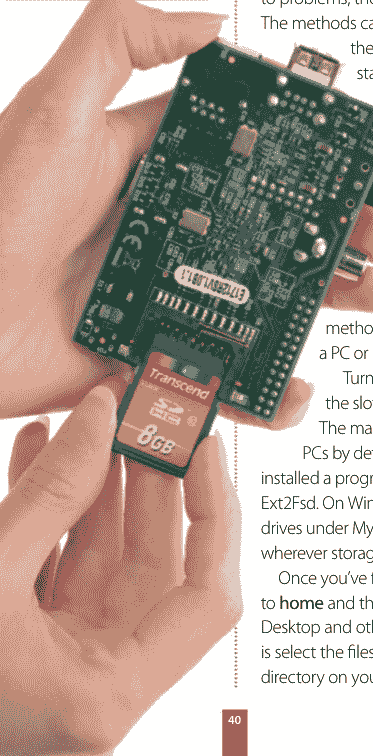

## 重要文件

为了保存重要文件，我们需要在外部源创建一个副本，例如外部硬盘或另一台 PC。这些最好的方法之一并不涉及树莓派；你只需要一台带有读卡器的 PC 或笔记本电脑即可。

关闭你的树莓派，拔掉电源并从插槽中取出 SD 卡。在你的 PC 上找到 SD 卡读器并将其插入。SD 卡的主文件系统默认可以被 Linux PC 读取到，而一旦你安装了可以读取文件系统的程序（如 Ext2fs），Windows 或 Mac 也可以读取。在 Windows 上，SD 卡将与“我的电脑”中的其他驱动器一起列出（图 1）。在 Linux 上，它将列在菜单和文件管理器显示存储的地方。

一旦你在这里找到了 SD 卡，打开它并导航到 home，然后就可以找到 Documents、Downloads、Desktop 以及其他目录。你只需要选择想要复制的文件并将它们移动到 PC 上的安全目录或连接的外部硬盘上。

## 备份你的树莓派

如果你想将文件留在另一台电脑上，那是可以，但从长期来看，它很容易遇到与 Pi 完全相同的问题。将它们保留在外部硬盘上是一个好主意，将它们放在云存储服务上更好，允许你从任何连接互联网的地方访问它们（图 2）。

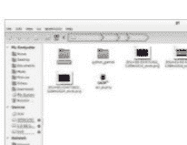

图 1：云存储让备份变得简单

## 克隆

创建克隆取决于你使用的操作系统。对于 Mac 和 Linux，可以使用：

```bash
fdisk -l
```

这列出了所有连接的设备。要拷贝 SD 卡，你可能需要：

```bash
dd if=/dev/sdX of=backup.img bs=4M
```

虽然这很有用，你也可以使用：

```bash
dd if=/dev/sdX of=backup.img bs=4M
```


图 2：你在 Linux 上使用的工具


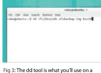

图 3：Win32 Diskager 备份整个操作系统

## Windows

要在 Windows 上创建克隆，你可以使用 Win32 Diskager（图 4）。安装后，插入 SD 卡并启动它..为镜像命名并从列表中选择 SD 卡。现在点击 Read，它将显示进度。

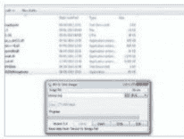

图 4：Win32 Diskager 备份整个操作系统

## 项目

# nano 入门指南

### 你需要准备...

- nano 入门指南
- nano 完整手册：www.nano-editor.org/dist/v1.2/nano.html

学习如何在命令行和终端中编辑文本并使用这些工具；

> 你知道吗...
>
> `nano` 是最适合初者的命令行编辑器之一，但有很多选项像 Kate 和 Vim。

在命令行写作

如果你想对你的 Pi 做更多事情，要实现许多项目需要学习的技能之一就是编辑系统文件。命令行文本编辑器 `nano` 绝对是这项工作的最佳工具之一。文本编辑器是非常基础的工具；在这种情况下线索就在名称中。它没有你在文字处理器中获得的格式或颜色或任何类似，但这正是重点所在。你创建或编辑的文件类型通常不需要加粗或项目符号。`nano` 去除了所有这些干扰，但仍然具有一些你在图形化文本编辑器中可以发现的实用的功能。我们将教你如何充分利用 `nano` 来快速高效地完成你的项目。

命令行编辑

编辑系统文件以满足你的需求，而无需深入文件管理器

高级功能

搜索、复制、粘贴和从另一个文件插入文本，并使用一些内置的 `nano` 功能

# nano 入门指南

## 项目


```
$ nano --version
nano Version 2.4.0
GNU nano
Copyright (C) 2004-2014 Ian Terry Project
Written by Ian Austin
```

## 打开 nano

01 打开终端，或进入命令行，直接输入 `nano`。这将打开一个空白文件。从这里，你可以创建一个简单的文本文件（如列表），或者创建一个脚本或一段代码。系统如何解释你的文件取决于你编写了什么以及如何保存它。

## 保存并退出

04 一旦你完成了文件的修改并准备继续下下一个任务，按下 `Ctrl+X` 退出。如果你想保存任何修改，需要按 `Y` 确认。如果你想在不保存更改退出，可以在决定前使用 `N` 取消，或按 `Ctrl-C`。

## 高级导航

07 你直一直在使用方向键一次向左、右或下方移动一个空格的距离。还有其他方法可以在文件中移动，使用 `Ctrl+A` 的作用相当于图形化编辑器中的 `Home` 键，将光标移动到行首。使用 `Ctrl+E` 将你移动到行尾，`Ctrl+P` 是向下页，`Ctrl+Y` 是向上页。


```
This is some text. It has long and short lines.
```


```
This is some text. It has long and short lines.
```


```
This is some text. It has long and short lines.
```

## 保存并继续

02 一旦你完成了 `nano` 操作，你可以使用 `Ctrl+O` 保存/写入。所有的快捷键都是通过 `Ctrl` 加上字母完成的。它会要求你命名。无论你给它什么名字，它都会保存在你打开 `nano` 的目录中，除非你保存路径。

## 复制和粘贴

05 这是一个终端特定的命令，但可以在 `nano` 中使用。当你使用鼠标在 `nano` 文件中移动时，你可以像在图形化文本编辑器中那样高亮文本。一旦高亮，按 `Ctrl+Shift+C` 复制任何文本。`Ctrl+Shift+V` 粘贴。


```
This is some text. It has long and short lines.
```


```
This is some text. It has long and short lines.
```


```
This is some text. It has long and short lines.
```


## 搜索文件

08 有时你会在一个大型文本文件中查找特定的行或短语。使用方向键逐行阅读显然是不的，你可以通过 `Ctrl+W` 进行搜索。搜索将从文档下方开始，一旦你找到了，可以按 `Ctrl+C` 退出。

## 打开文件

03 一旦你已经在编辑文件，你首先需要知道它们的名称和位置。要在 nano 中打开它们，输入以下内容：

- `nano /path/filename`
- 例如，要编辑 fstab，你需要执行：

- `nano /etc/fstab`

## 插入文件

06 如果你需要插入另一个文件的内容，有一种快速方法可以实现，不需要复制和粘贴。输入 `Ctrl+R` 并输入文件路径将将其插入到光标所在的位置。

## 额外帮助

09 nano 中有许多功能。要查看完整的命令列表，你可以使用 `Ctrl+G`，它会列出所有快捷键及其功能。此列表中的脱字符符号 `^` 表示使用键盘上的 `Ctrl` 键。


## 获取远程桌面访问权限

你需要...

## 获取远程桌面访问权限

TightVNC
www.tightvnc.com/release-2.7.php

学习如何访问你的树莓派，而它并不在你的面前……

你知道吗...
TightVNC Viewer 是一个访问 VNC 服务器的免费资源，就像我们将在教程中安装的那个一个。

VNC（虚拟网络计算）是一种图形化桌面访问和共享系统，允许用户远程控制和使用它。

TightVNC Viewer 是一个访问 VNC 服务器的免费资源，就像我们将在教程中安装的那个一个。

VNC（虚拟网络计算）是一种图形化桌面访问和共享系统，允许用户远程控制和使用它。

TightVNC Viewer 是一个访问 VNC 服务器的免费资源，就像我们将在教程中安装的那个一个。

VNC（虚拟网络计算）是一种图形化桌面访问和共享系统，允许用户远程控制和使用它。

TightVNC Viewer 是一个访问 VNC 服务器的免费资源，就像我们将在教程中安装的那个一个。

VNC（虚拟网络计算）是一种图形化桌面访问和共享系统，允许用户远程控制和使用它。

TightVNC Viewer 是一个访问 VNC 服务器的免费资源，就像我们将在教程中安装的那个一个。

VNC（虚拟网络计算）是一种图形化桌面访问和共享系统，允许用户远程控制和使用它。

TightVNC Viewer 是一个访问 VNC 服务器的免费资源，就像我们将在教程中安装的那个一个。

VNC（虚拟网络计算）是一种图形化桌面访问和共享系统，允许用户远程控制和使用它。

TightVNC Viewer 是一个访问 VNC 服务器的免费资源，就像我们将在教程中安装的那个一个。

VNC（虚拟网络计算）是一种图形化桌面访问和共享系统，允许用户远程控制和使用它。

TightVNC Viewer 是一个访问 VNC 服务器的免费资源，就像我们将在教程中安装的那个一个。

VNC（虚拟网络计算）是一种图形化桌面访问和共享系统，允许用户远程控制和使用它。

TightVNC Viewer 是一个访问 VNC 服务器的免费资源，就像我们将在教程中安装的那个一个。

VNC（虚拟网络计算）是一种图形化桌面访问和共享系统，允许用户远程控制和使用它。

TightVNC Viewer 是一个访问 VNC 服务器的免费资源，就像我们将在教程中安装的那个一个。

VNC（虚拟网络计算）是一种图形化桌面访问和共享系统，允许用户远程控制和使用它。

TightVNC Viewer 是一个访问 VNC 服务器的免费资源，就像我们将在教程中安装的那个一个。

VNC（虚拟网络计算）是一种图形化桌面访问和共享系统，允许用户远程控制和使用它。

TightVNC Viewer 是一个访问 VNC 服务器的免费资源，就像我们将在教程中安装的那个一个。

VNC（虚拟网络计算）是一种图形化桌面访问和共享系统，允许用户远程控制和使用它。

TightVNC Viewer 是一个访问 VNC 服务器的免费资源，就像我们将在教程中安装的那个一个。

VNC（虚拟网络计算）是一种图形化桌面访问和共享系统，允许用户远程控制和使用它。

TightVNC Viewer 是一个访问 VNC 服务器的免费资源，就像我们将在教程中安装的那个一个。

VNC（虚拟网络计算）是一种图形化桌面访问和共享系统，允许用户远程控制和使用它。

TightVNC Viewer 是一个访问 VNC 服务器的免费资源，就像我们将在教程中安装的那个一个。

VNC（虚拟网络计算）是一种图形化桌面访问和共享系统，允许用户远程控制和使用它。

TightVNC Viewer 是一个访问 VNC 服务器的免费资源，就像我们将在教程中安装的那个一个。

VNC（虚拟网络计算）是一种图形化桌面访问和共享系统，允许用户远程控制和使用它。

## 静态 IP

01 我们的第一步是确保树莓派有一个静态地址。基本上，IP 地址是识别它们的一组数字。为了设置静态 IP，只需找到这个图形化桌面访问和共享系统，允许用户远程控制和使用它。

TightVNC Viewer 是一个访问 VNC 服务器的免费资源，就像我们将在教程中安装的那个一个。

VNC（虚拟网络计算）是一种图形化桌面访问和共享系统，允许用户远程控制和使用它。

TightVNC Viewer 是一个访问 VNC 服务器的免费资源，就像我们将在教程中安装的那个一个。

VNC（虚拟网络计算）是一种图形化桌面访问和共享系统，允许用户远程控制和使用它。

## 静态 IP 第二部分

02 该文件控制网络。你需要滚动找到该行并替换它。

TightVNC Viewer 是一个访问 VNC 服务器的免费资源，就像我们将在教程中安装的那个一个。

VNC（虚拟网络计算）是一种图形化桌面访问和共享系统，允许用户远程控制和使用它。

## 静态 IP 第三部分

03 在你输入这些详情后，退出编辑器并重启树莓派。

VNC（虚拟网络计算）是一种图形化桌面访问和共享系统，允许用户远程控制和使用它。

## 安装 VNC

04 现在我们需要确保它在树莓派重启时作为服务加载，这样当树莓派经历电源循环时你就可以访问它。为了让树莓派这样做，在终端输入以下内容：

## 安装 VNC 第一部分

05 当软件包下载并安装后，按照说明（见下文）设置密码并确认。

## 安装 VNC 第二部分

06 那是 VNC 服务器已安装并运行。现在。

## 配置启动

07 我们现在回到了，要输入一些命令，允许树莓派在启动时激活 VNC 服务器。

## 配置 VNC 服务器

## 通过 SSH 访问你的文件

使用家用电脑的终端快速、安全地访问你的树莓派（Raspberry Pi）。

虽然我们在之前的页面中已经演示，登录完整的 X 环境非常有用，但它也有它的缺点。首先，这种操作并不特别快速或方便。用户体验可能会缓慢且繁琐，最糟糕的是，它的安全性并不如我们希望的那样。

如果你想从另一台计算机通过更方便、更安全的方法访问你的树莓派，你会发现所有精通的树莓派爱好者都使用 SSH。SSH 代表 Shell（外壳），是一种加密网络协议，旨在通过命令行确保安全的数据通信。虽然初学者可能会认为使用完整的图形界面来远程访问他们的树莓派更简单，但只要你学习了一点基本的命令行技术，你很快就会发现通过 SSH “切入”你的树莓派是与远程通信最方便的方式。

你会高兴地听到，SSH 已经默认配置好了——你只需要做非常少就能让它运行，特别是当你的远程计算机运行 Linux 或 OS X 时（正如我们在这里要演示的那样）。

## 在 Linux 和 OS X 上使用 SSH 非常简单

假设你的树莓派已启动并连接到网络（以太网或 Wi-Fi 适配器），你唯一的信息是树莓派的 IP 地址。要发现它，你只需要在树莓派上打开终端窗口并输入命令 `ifconfig`（图 1）。

如果你通过以太线连接，你会看到‘eth0’以及几行结果。IP 地址将是第二行‘inet addr’ 旁边的数字。如果你通过 Wi-Fi 连接，

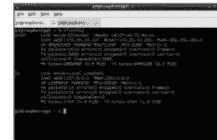

图 1：在终端中使用 `ifconfig` 命令发现你树莓派的 IP 地址

## 你需要...

- 任何树莓派发行版 (www.raspberrypi.org/downloads)
- 互联网连接
- 第二台电脑

> 你知道吗...
> SSH 是远程访问任何机器最安全的方法。它也比 VNC 更快。

## 项目

结果将显示在 'wlan0' 的第二行。IP 地址本身是由四组用句号分隔的数字组成。如果你在家庭网络中，它可能类似于 192.168.0.15。我们将在指南中使用这个数字，但请将其替换为你通过 `ifconfig` 看到的 IP 地址。

有了这些信息后，你只需要在你的远程 Linux PC 上打开一个终端窗口并输入：

```bash
ssh pi@192.168.0.15
```


这假设你的树莓派用户名是默认的（即 `pi`），并且你将 IP 地址替换成了你记录的那个。如果你添加了用户账户或更改了默认设置，你需要在 `'@'` 之前将用户名替换为你所更改的内容。当你按下回车键时，系统会提示你输入树莓派的密码——同样，如果是默认密码，你可以输入 `raspberry`，否则输入你树莓派的密码并按回车。

你会看到命令行上的用户名详情已发生变化，反映了你树莓派的信息——你现在已经连接上了。尝试浏览你的文件或使用 `nano` 打开一个文件进行编辑！


## 在 Windows 上使用 SSH

就像 Windows 世界中的大多数事情一样，你运行微软操作系统的树莓派并没有你想象的那么简单。坦率地说，有一个实用的工具可以帮助。`Putty` 允许你连接到 `SSH` 会话，而且容易设置和使用。你可以在这里下载 `Putty`：www.chiark.greenend.org/~sgatham/putty

## 再也不需要 IP 地址了

当然，如果你将树莓派带到另一个网络，你树莓派的 IP 地址将会不同。如果你只是想远程连接它，通过键盘、鼠标和显示器来设置树莓派只为了获取 IP 地址将变得极其疲惫。直接在终端中输入树莓派的名字来连接不是更好吗？这听起来好得有些不可真实，但实际上很容易做到。

你只需要一个小小的软件，它可以允许你通过名称而不是 IP 地址发现本地网络上的主机和服务器（图 2）。要在你的树莓派上设置它，打开终端并输入：

```bash
sudo apt-get install avahi-daemon
```

一旦安装完成，通过 `SSH` 访问你的树莓派只需要在终端中输入以下内容：

```bash
ssh pi@raspberrypi.local
```


此外，当你通过任何其他形式的网络访问它时（无论是 Samba、VNC 远程登录还是其他任何方式），你都可以使用树莓派的名字！


图 2：Avahi 工具允许你通过名称通过 SSH 登录树莓派，而无需发现它的 IP 地址

## 使用 Scratch 编程

## 你需要...

- Scratch
- 互联网连接

## 使用 Scratch 编程

你想深入探索动画的世界吗？你想让你的想法活起来吗？

如果你的树莓派还没有 Scratch，不要担心，安装它即可。

工作台（Studio）被分为几个面板。每个面板都有自己的作用。


01：舞台（stage）是动作发生的地方，位于工作台的右上角。舞台由图形元素（sprites）构建。我们有波浪、泡泡和其他生物。你也可以添加自己的资源，但那稍后会说。

在舞台区（Staging Area）顶部，有一个绿旗标志和一个红圈。点击绿旗让水族馆活起来。花一点时间研究动画动作和上升的泡泡。红圈停止动作。

我们可以使用绿旗上方的三个按钮来增大或缩小舞台区的尺寸。

右侧的按钮将舞台以全屏模式显示（见图 5）。


图 5：舞台全屏模式（presentation mode）——这是展示项目的最佳方式。工作台顶部的箭头按钮可以退出模式，或者按下 'esc' 键。

02：舞台下方是一组角色。舞台与其他部分略有不同，并作为舞台的背景。

工作台顶部的三个按钮提供了创建新角色的各种方法。第一个按钮打开空白画布（Paint）。第二个按钮创建一个新角色。第三个按钮将通过弹出文件对话框（popup file dialog）从预安装的图像库中选择一个图像。

我们可以通过右侧的四个按钮直接管理角色。在这里，我们点击特定的按钮并在舞台上操作。

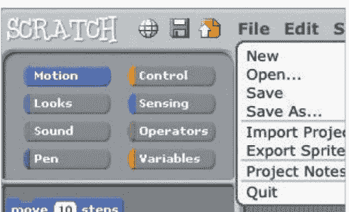

图 2：Scratch 主菜单和动作中的快捷图标。

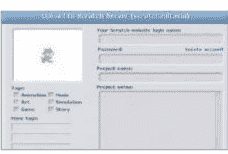

图 3：共享对话框（Share Dialog）——我们可以使用工作台菜单共享我们的项目。

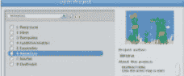

图 4：打开文件（File Open）——使用工作台的文件加载项目。

## 项目

## 使用 Scratch 编程

## Scratch 模块样式

# 使用 Scratch 模块和工具

## 熟悉 Scratch 工作区工具箱

01 “模块调面板”包含了完整的脚本模块集合。模块包含三种基本样式，即帽子帽型（hats）、堆叠型（stacks）和报告型（reporters）（见反页的图 3）。

位于工作区中心的是编辑面板（Edit Panel）。该面板的内容与当前选中的角色有关。

让我们先从“角色集合”区域选择名为“Creature（生物）”的水水母角色。

帽子帽型模块会在特定事件时启动脚本执行。最经典的模块是“绿色旗帜”点击。还有许多其他模块，包括在按下特定按键、点击鼠标以及跟随来自 GPIO 连接硬件的传感器事件后启动执行的帽子帽型模块。正如你可能察觉到的，这为 Scratch 程序员提供了许多选择。

顶部我们有角色的图像和名称，以及其起始坐标和方向的指示。左侧有两个动画控制按钮。第一个按钮会让角色返回，第二个按钮切换左向和右向状态，第三个按钮开启动画。

报告模块允许我们指定文本、数值和布尔值。它们适合嵌入特定的模块。矩形报告模块包含一个文本字符串。而圆角报告模块与数值相关，带角度角的报告模块包含真或假值。

下面是两个编辑面板标签页。脚本（Scripts）标签页是创建模块的地方。在这里我们拖放模块，并以各种组合将它们连接在一起。

堆叠模块是构建元素。它们通过顶部的边缘和底部的跳转与其他模块相互连接。许多模块包含用于报告型模块的“空隙”，这些模块将根据指定的报告值来修改其操作。

要更改角色的视觉外观，我们使用一个或多个造型（costumes）。例如，水水母有两个造型（图 1）。每个造型都有编辑、复制和删除的按钮。可以使用三个“新造型”按钮绘制、导入或捕获新造型。声音标签页允许我们向项目添加音频。

Scratch 模块编码被分为若干组。我们使用位于模块面板顶部的八个按钮模块组，例如“动作”、“控制”、“外观”等其他组。除了闲置模块选择外，这种颜色编码在阅读编辑面板中的脚本时为模块的类型提供了视觉提示。

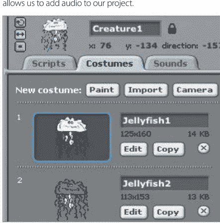

图 1：水水角色造型 – 水水母角色有两个不同的造型

## 使用 Scratch 编程

## 项目

## 录音器


图 2：录音器工具 - Scratch 工作区包含一个记录我们自己声音的工具

> ### 你知道吗...
> 除了标准的绿色旗帜模块外，还有多种选项可以启动你的脚本。

## 模块脚本详解

## Scratch 模块帮助

02 正如我们看到的，有很多模块，每个模块都有其特定的功能和能力。

从某方面来说，这非常棒。大量的模块集合意味着 Scratch 可以应用于大量的软件项目、图形图像，以及游戏、动画、音乐、图表、数学、科学、机器人和电子产品等。

让我们深入研究模块脚本在实践中是如何工作的。在这里，我们将使用一个简单的水族项目模块脚本。从“角色集合”面板中选择舞台平面。然后回到中心的“编辑”面板并选择“脚本”。

然而，广泛的模块选择对于初学者 Scratch 程序员来说可能是一个巨大的挑战。为了帮助解决这个问题，Scratch 包含了一组信息丰富的、以模块为中心的帮助页面。

只有一个以“绿色”旗帜帽子帽堆叠模块开头，用以触发效果。接着是一个无限“循环”（loop）。这个循环会一直激活，直到按下停止按钮。这个无限循环包含另外两个模块。

点击任何模块都会显示帮助页面选项。帮助页面包含特定背景的描述、图形图像，并在适当的情况下提供使用此特定模块的简短示例（图 4）。

第一个模块选择下一个背景图像。点击“背景”标签页查看所有舞台。内部模块只需执行几秒钟。将值设置为“1”意味着该脚本将在执行动作之前暂停一秒。

这是一个极佳的功能，极大地简化了决定使用哪些模块的过程。更重要的是，学习这些帮助页面是增强你的脚本技能并发现 Scratch 功能丰富的模块集合中潜力的非常有效的方法。记住这些模块被编码在无限循环中很重要。因此，背景图像将为每个指令顺序显示。


图 3：模块样式示例 - Scratch 模块有多种不同的样式


图 4：帮助窗口 - 与“询问（ask）”和“等待（wait）”模块相关的帮助窗口示例

## 项目

# 在 Scratch 中创建一个贪吃蛇克隆

## 你需要...
`Scratch` 项目存档 `www.scratch.mit.edu/explore/`

# 在 Scratch 中创建一个贪吃蛇克隆
设计你自己的蛇蛇版本来测试你的编程技能！

## 你知道吗...
贪吃蛇是一种非常受欢迎的初学者游戏，起源于街机，今天仍然流行。

在这里，我们将创建一个经典的贪吃蛇游戏版本，我们使用方向键在舞台上移动蛇。你控制蛇的头部，必须避免与蛇身或舞台边缘碰撞。蛇每吃掉一个蛋就会变长。吃掉黄蛋会得分，吃掉黑蛋会扣分。还有额外的蛋可以加分。通过本教程，你将学习创建自己的简单角色图形、发送和接收广播事件、使用列表存储数据、播放音效、生成随机数并使用感知命令检测角色何时触碰到某些东西。

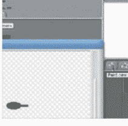

蛋角色随机出现在屏幕上，当被蛇舌头触碰时，它会离开其他角色

# 蛇角色
蛇在舞台上移动头部并在其身后绘制身体。它还能检测与身体的碰撞

# 绘制蛇角色
在“画画编辑器”中点击“新建角色：画笔”图标，为蛇头画一个小绿色椭圆，并添加一个红色矩形作为舌头。重要的是，舌头的颜色必须与头部不同。将你的角色命名为 `Snake`。

# 尾巴角色
尾巴跟随头部，擦除身体的末端，这样蛇就可以移动，需要增长时暂停

## 坏蛋角色
坏蛋也会随机出现，但在被吃掉时会减少分数。它还会变大，变得更难以避免

# 在 Scratch 中创建一个贪吃蛇克隆

## 项目

# 添加蛇的声音

# 初始化蛇变量

## 主循环

02 当蛇舌头碰到蛇身体或舞台边缘时，我们将播放 Game Over。我们需要将声音添加到蛇中。05 使用“当绿色旗帜被点击”控制命令并初始化蛇，使用变量面板。07 使用一个无限循环，内部嵌套一个“如果-否则”语句。如果发生碰撞红色舌头（蛇头一直碰到身体）或蛇触碰到边缘，使用吸管工具在 Scratch 中选择颜色。

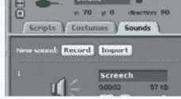


# 响应方向键

03 从面板中拖入四个按键命令，并从动作面板拖入四个转向命令。配置它们使向上箭头将方向改为0度（向上），依此类推。点击舞台上方的绿色旗帜进行测试。

# 绘制蛇身体

06 使用画笔面板命令绘制蛇身体。你还应该使用动作面板命令在游戏开始时移动蛇并向左。游戏持续直到蛇碰到自己。在接下来的步骤中，我们使用颜色查看头部是否触碰到任何东西。

# 处理游戏结束

08 当检测到碰撞时，向所有其他角色广播 Game Over 事件（你需要创建一个新事件），以便它们可以播放音效并停止所有脚本，让蛇在游戏结束时冻在位置。


# 创建蛇变量

04 点击变量面板。创建两个所有角色可见的变量：`Score`（分数）和 `Speed`（速度）。创建一个名为 `Next Direction`（下一个方向）的列表角色可见列表，它将存储头部移动的方向序列。只勾选 `Score` 变量，以便它出现在舞台上。


## 项目

- 从零开始创建一个克隆
- 处理蛇的移动
- 创建一个 Grow 变量
- 增长与移动

09 现在处理没有发生碰撞且蛇必须沿其方向移动的典型情况。画笔处于按下状态，所以我们绘制身体。`Speed` 变量决定了移动的步数。将当前方向添加到 `Next` 列表中供尾部使用。

12 创建一个 `Grow` 变量，仅用于此操作——没有其他精灵需要执行。该 `Grow` 变量用于判断蛇身体何时需要增长，以及尾部在跟随头部领先之前何时需要暂停。

15 使用 `forever` 命令保持尾部持续移动。如果 `Grow` 等于 1，它应该暂停并将 `Grow` 重置为 0 —— 这会让身体生长。使用来自 `Next Direction` 的第一个值并将其删除，这样下次就能获得新值。移动速度。


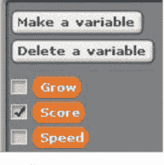
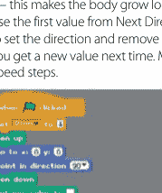


## 处理事件

- 尝试蛇
- 尝试尾部

13 尾部需要监听你根据需要创建的新事件。当它接收到 `Egg` 事件时，如果 `Grow=1`，尾部可以暂停。当它接收来自蛇的 `Game Over` 事件时，它必须冻结。

10 现在你可以运行你的精灵了。它将响应方向键进行移动。它会绘制身体，身体会变得越来越长，因为我们需要擦除它。在检测到碰撞时，它会发出尖叫并结束游戏。

16 现在你可以尝试尾部精灵。蛇不会持续增长，因为接收不到任何 `Egg Egg` 事件。但尾部将跟随蛇在舞台上移动，通过用白色画笔（与背景颜色相同）覆盖蛇身体来擦除它。


## 绘制尾部

11 点击“画一个精灵：画笔”来绘制尾部。画一个小圆代表尾部的末端。将此精灵命名为：`Tail`。尾部将跟随蛇并擦除其尾部边缘，这样蛇身体就不会无限增长。

14 当点击绿色旗标志开始游戏时，`Grow` 被设置为 1，使蛇获得较的身体。使用画笔移动到舞台中心，并配置画笔绘制与舞台背景相同颜色和大小的线条，以便它可以擦除身体。


## 在 Scratch 中创建蛇的克隆

- 绘制坏蛋
- 制作坏蛋
- 增长坏蛋

17 点击“画一个精灵：画笔”图标来绘制新精灵。在画编辑器中，画一个小椭圆。`Egg` 精灵将随机出现在舞台上，导致蛇增长并增加分数。

20 以相同的方式创建 `Bad Egg`，但使用不同的图形。在道具中，将 `Egg` 的绿色旗标志拖到 `Bad Egg` 上以复制它——在增加分数之前播放声音。

21 为 `Bad Egg` 添加另一个“当绿色旗被点击时”，以便在游戏开始时将其大小设置为默认的 100%，然后每 10 秒增加 10%。坏蛋会变得更大且难以躲避。

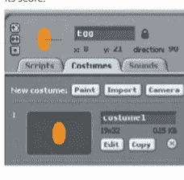

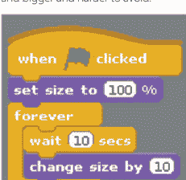

## 添加蛋的声音

18 转到 `Egg` 的声音标签并导入 `Crash`。或者你可以选择不同的声音，当蛇吃掉蛋时播放该声音。

## 创建 Bonus 精灵

22 以类似的方式创建 `Bonus` 精灵。`Bonus` 的脚本与 `Egg` 相似，你可以将其拖到 `Bonus` 精灵并工作。改变声音并随机增加分数。

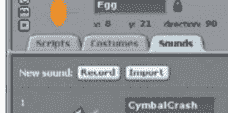


## 添加蛋的脚本

19 复制脚本使 `Egg` 在游戏开始时随机出现。当检测到被吃掉时（第 18 步选择的），广播 `Eaten` 事件然后再次出现。当接收到 `Game Over` 事件时，必须停止。

## 使用 Scratch 进行交互

Scratch 是一种非常简单的编程语言，通常用于向任何年龄的学习者教学。在这个项目中，我们将学习在 Scratch 中按下按钮时如何点亮 LED，并使用树莓派的通用输入/输出 (`GPIO`) 引脚。通过这些技术，你可以制作从键盘到动画的所有项目。你需要一些组件，在网上搜索“树莓派 GPIOset”来开始。

你需要：
- 面板
- LED
- 按钮
- 电阻
- 跳线线
- ScratchGPIO

## 获取所需的软件包

使用用户名 `pi` 和密码 `raspberry` 登录 `Raspbian` 系统。使用 `start` 命令启动 `LXDE` 桌面环境。接下来打开终端并输入：

```
```


`wget http://liamfraser.co.uk/linux/install_scratchgpio.sh`

`chmod +x install_scratchgpio.sh`

`sudo bash scratchgpio.sh`

```
这将在你的桌面上创建一个特殊版本的 Scratch ScratchGPIO。这是一个正常版本的 Scratch，带有一个 Python 脚本来处理 Scratch 和 GPIO 之间的通信。ScratchGPIO 由 simpleplex (wordpress.com) 创建。

> “在这个项目中，我们将学习在 Scratch 中按下按钮时如何使用 GPIO 引脚点亮 LED”
```

## 将面板连接到你的树莓派

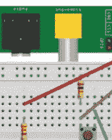

02 关闭你的树莓派电源并连接电缆。准备好面板、一个 LED、一个 330 欧姆电阻和两个 GPIO 线。你需要将第 3 引脚（靠近 SD 卡的右上引脚）连接到 330 欧电阻的一端，然后将 LED 的正极（长脚是正极）连接到另一端。电阻用于限制流向 LED 的电流。

然后将 LED 的负极放在面板的负极上。将一个 GPIO 引脚（例如从底部数起第三个引脚）连接到负极。现在给你的树莓派接电。GPIO 应该会亮。如果没有亮，可能是你接错了电路，请连接电源，调换引脚并重试。

## 进一步控制 LED

当按钮未被按下时，GPIO 4 将完成并打开，电路 GPIO 4 将接收低电平（值为 0），因为通地地的路径电阻小得多。

04 启动 LXDE 桌面环境并使用 ScratchGPIO3。转到该部分，并创建一个简单的脚本，当精灵被点击时进行广播。LED 应该会亮。然后向脚本中添加等待 1 秒，然后广播 `p1`。如果你点击精灵，LED 会亮一秒然后关闭。ScratchGPIO

我们可以看到它的运行效果。

## 开关 LED

03 此时，LED 连接到 3.3V 引脚。它开关开关的能力并不理想，所以如果你将其连接到 GPIO 17（树莓派从底部数起右侧的引脚），就可以正常工作。我们可以通过导出 GPIO、将其设置为输出引脚然后将其值设置为 1 来开启 LED。将值设置为 0 则关闭 LED：

```
echo 17 > /sys/class/gpio/export
echo out > /sys/class/gpio/direction
echo 1 > /sys/class/gpio/value
echo 0 > /sys/class/gpio/value
```

## 上拉按钮

05 关闭树莓派电源。这比我们首先创建的 LED 要复杂一点。首先我们需要将 GPIO 3.3V（右侧引脚）连接到我们面板上的电阻。然后将一个 1k欧姆电阻连接到正极路径，另一端连接到面板。然后添加一根线，一端连接到 GPIO 4。这位于 GPIO 17 的右侧。然后，连接按钮的引脚。最后通过添加一根线将按钮的另一端接地。

## 光亮吧！

06 启动树莓派并使用 ScratchGPIO3。转到该部分并添加“当 GPIO 被点击时”配合 `forever` 循环，并在元素内部从运算符部分添加 `i =` 运算符到语句中。然后去到传感器部分并将值添加到等式语句的左侧，并设置为 0 或右侧。如果传感器值为 0，则广播 `p1`，否则广播 `p1`。点击绿色旗标志。如果你按下按钮，LED 就会亮起！


# 使用摄像头模块板

## 你需要...

- 树莓派 (Raspberry Pi)
- 树莓派
  www.raspberrypi.org/downloads
- Pi 摄像头 (Pi Camera)
- Ashton 的 picam 模块：
  https://github.com/ashtons/picam

# 使用摄像头模块板

以下是如何在树莓派上设置你的新 Pi 摄像头以及如何使用它的方法..

树莓派最新的配件之一是微型 Pi 摄像头模块板——这是一块带有摄像头传感器的小型 PCB 板，通过通过排线连接到树莓派。它并不是真正的即插即用，因此你需要进行一些额外的设置。

Pi 摄像头具有多种功能，例如用于延时摄影、作为摄像头，甚至作为树莓派驱动机器人的光学传感器（就像我们在这里制作的这种）。因为它不占用任何 USB 接口且功耗极低，它比标准摄像头要通用得多。

Pi 摄像头本身并非低质量设备——配备了 5MP 传感器，它能够创建高达 1080p 质量的视频，与树莓派的 HDMI 输出相同。


> 你知道吗...
摄像头模块板使用的传感器和硬件与现代手机中的摄像头相同。


## 连接摄像头

## 树莓派准备

02 在我们尝试启用树莓派摄像头之前，我们需要通过快速软件升级确保我们的固件和软件都是最新版本。在 Raspian 中，我们通过打开终端并使用：

01 要将摄像头连接到树莓派，找到以太网端口和 HDMI 接口之间的插槽并轻轻抬起固定扣。插入摄像头板的排线，确保排线的连接处与树莓派的接口对齐。排线上的蓝色标签应面向以太网端口。

- `sudo apt-get update`
- 随后执行：
- `sudo apt-get upgrade`

# 使用摄像头模块板

## 项目 -

## Pi 配置

完成后，在终端或命令行中运行：

```
$ sudo raspi-config
```

以启动配置界面。导航到 Enable Camera（启用摄像头），然后回车并按键启用，再次再次按键确认。选择 Finish（完成）并重启。


## 拍摄照片

使用树莓派摄像头拍照，只需输入：

```
$ raspistill -o image.png
```
这将显示摄像头输入的五秒预览，然后捕捉视频的最后一帧。

```
## Picam 示例

如果你想用 Pi 摄像头做更多事情，有一个简单的 Python 封装器可以让 picam 可用。不过，你首先需要安装它，我们将使用 picam 实现。使用以下命令安装 picam：

```
$ sudo apt-get install python3-pip
```

然后执行：

```
$ pip install https://github.com/rashton/picam/zipball/master#egg=picam#egg=picam
```

尝试。你只需要输入：

- `import picam`
- `i = picam.takePhoto()`
- `i.save('/home/pi/test.jpg')`

并运行它将拍摄一张名为 test.jpg 的照片。

## 高级照片

你可以通过代码拍摄特定尺寸和质量的照片，并带有基于时间的文件命名：

- `import picam`
- `import time`
- `ii = picam.takePhotoWithDetails(640,480, 85)`
- `filename = '/tmp/picam-%s.jpg' % time.strftime('%Y%m%d-%H%M%S-%f')[:13]`
- `ii.save(filename)`

## 录制视频

要录制视频，我们将使用 raspvid，如下：

```
$ raspvid -o video.h264
```

它默认也会录制五秒视频。

## Picam 照片

我们可以使用 Python 构建一个脚本来用 picam 模块拍照。这并不像你想象的那么困难，即使你以前从未用过 picam，这也是一个

## Picam 视频及更多

Picam 允许你像下面这样通过代码拍摄带有时间命名的特定尺寸和质量的照片：

（此处原文内容中断，翻译已随原文结束）

## 项目

## 使用 GPIO 控制 LED

# 板板接线

## 设置编程环境

07 将一根导线插入 1 号引脚，另一端插入面包板。插在面包板的任何位置都没关系，但要确保周围有空槽以便添加电阻。现在准备好另一根导线。

12 现在，我们需要的不仅仅是点亮灯——我们希望能够通过代码来控制它。设置一个新的 Raspberry 安装（相关指南请见第 28 页）。你不需要 GUI——如果你愿意的话，可以通过终端完成。在开始之前，最好先检查一下：

```bash
sudo apt-get dist-upgrade
```

## 添加另一根导线

## 打开终端


08 将导线的另一端插入 6 号引脚，另一端插入面包板，根据电阻的大小确保为其留出足够的空间。接下来，准备好你的电阻。你可以使用高于或低于 270 欧姆的电阻，但完全不使用电阻可能会烧坏 LED。

假设我们想使用 GUI 而不是双击 SSH 进入 Pi，请通过 LXTerminal 打开新窗口。我们需要 root 权限来控制 LED，因此要么输入 `sudo`，要么在每个命令前加上 `sudo`。
- 输入 `su` 后接密码，或
- 在每个命令开头加上 `sudo`。

## 添加电阻

## 下载 GPIO 库

09 接下来添加电阻。将一端接到面包板上的地线，另一端在稍后后添加 LED 时连接到其旁边的 3V3 线上。注意，添加电阻没有所谓的正确或错误之分。

14 有一个非常实用的 Python 库可以让操作 GPIO 引脚变得轻而易举。在终端中，使用 `wget` 下载 tar 文件；使用 `tar` 将其解压。你将在新目录中获得所有文件。

```bash
wget https://python.org/packages/sources/RPI/RPI.GPIO-0.5.2a.tar.gz
tar xzf RPI.GPIO-0.5.2a.tar.gz
```

# 添加 LED

# 安装库

10 取出 LED，将“弯曲”的引脚端插入面包板上的 3V3 线路。将另一只引脚插入电阻旁边，位于地线的对侧。这完成了电路，我们准备好测试这个小项目了。

15 现在我们需要安装该库。这是一个 Python 安装方法的简单案例，因此我们需要 Python 的开发版本。在运行此命令之前，确保你处于库的目录。

```bash
sudo apt-get install python-dev
sudo python setup.py install
```

# 在脚本中导入库

## 接通电源

11 获取你的 micro-USB 脚本，并将电源插入墙上插座，或者插入电脑或笔记本电脑（并开启电源！）。你应该看到 LED 亮起。如果没有，请检查面包板或 Pi 上的连接，或者尝试不同的 LED。

16 创建一个新的 Python 脚本。紧接着编写主 GPIO 库，并将其放在一个 `try-except` 块中。使用 `Ctrl+X` 保存文件并选择 'yes'。

```python
cd /
cd Desktop
sudo python gpio.py
try:
    import RPi.GPIO as GPIO
except RuntimeError:
    print("Error importing GPIO lib")
```


# 使用 GPIO 控制 LED 项目

## 你知道吗...

官方 Python 文档对于初学者和专业人士来说都是很好的资源。

http://python.org/doc.

## 使用 PWM

20 下一步是告诉引脚输出，然后提供一种退出程序的方法。在这里我们再次调用 `GPIO` 类，是 `PWM` 方法，传入引脚号；第二个值是频率（单位），在这种情况下是 0.5。

```python
p = GPIO.PWM(12, 0.5)
p.start(1)
input("Press enter to stop:")
p.stop()
GPIO.cleanup()
```

## 测试脚本

17 现在确保脚本导入成功，我们需要运行 python 命令并输入我们创建的脚本名称。如果一切顺利，你不应该看到任何错误信息。如果看到了，请返回之前的步骤检查所有操作是否正常。

- `python gpio.py`

## 调整 PWM

21 给 LED 添加一个定时器使其渐变，我们首先需要导入库，然后将 12 号引脚设置为 50Hz 频率并开始。

```python
import time
import RPi.GPIO as GPIO
GPIO.setmode(GPIO.BOARD)
GPIO.setup(12, GPIO.OUT)
p = GPIO.PWM(12, 50) # channel=1 frequency=50Hz
p.start(0)
```

## 设置 GPIO 模式

18 再次使用 nano 编辑脚本。我们将 GPIO 模式设置为 `BOARD`。对于初学者来说这是最安全的，无论你使用哪个版本的 Pi 都适用。最好选择一种 GPIO 规范并坚持下去，否则以后会产生混淆。

- `sudo gpio.py`

`GPIO.setmode(GPIO.BOARD)`

## 添加渐变

22 然后我们将添加另一个 `try-except` 块来控制功率。

```python
while True:
    for dc in range(0, 100, 5):
        GPIO.changeDutyCycle(dc)
        time.sleep(0.1)
    for dc in range(100, -1, -5):
        GPIO.changeDutyCycle(dc)
        time.sleep(0.1)
except KeyboardInterrupt:
    GPIO.cleanup()
```

## 项目

## 极大提升 fstab 以获得快速性能

## 选择外部 USB 驱动器

重启后，虚拟文件系统将挂载，`/var/log` 将位于 RAM 磁盘上。其他可以放入 RAM 的目录包括：

- `tmpfs /tmp tmpfs defaults,noat,nodisid,size=100m 0`

- `tmpfs /var tmpfs defaults,noat,nodisid,size=30m 0`

- `tmpfs /log tmpfs defaults,noat,nodisid,mode=0755,size=100m 0`

- `tmpfs /run tmpfs defaults,noat,nodisid,mode=0755,size=20m 0`

- `tmpfs /spool/내가 tmpfs defaults,noat,nodisid,mode=0700,gid=12,size=0`

将每项添加到 `/etc/fstab`。

通过将根文件系统迁移到外部 USB 驱动器来提高你的树莓派速度是一个开始，但你应该使用哪种设备获得获得性能？使用 USB 驱动器可以在不出现任何重大问题的情况下增加高达 16GB 的闪存（越大，读取/写所需的电流就越大）。更大的设备是昂贵且没必要的，除非你计划使用 HDD，因为它有自己的电源，因此不会有电源问题。一如既往，你的选择应该适合你的项目。

## 将你的操作系统移动到 HDD

## 备份 SD 卡

如果你担心 SD 卡的寿命，为什么不减少对树莓派的依赖呢？与其将 SD 卡作为廉价 SSD 使用，不如改变它的角色，添加一个 HDD 或 USB 闪盘来运行操作系统，将 SD 卡留给启动引导。这可以为 SD 卡带来显著的性能提升。

```
sudo dd bs=4M if=/dev/sdb of=/backup.img
```

路径 `/dev/sdb` 代表 SD 卡。复制需要 5-10 分钟。完成后，拔掉 SD 卡并连接你的 USB 设备。

## 将 Raspian 复制到 USB

使用一个格式化为 Ext4 的空白 USB 驱动器（或外部 HDD）作为目标驱动，

```
sudo dd bs=4M if=/backup.img of=/dev/sdc
```

将备份留在你的电脑上，以防万一。当 SD 卡和 USB 存储共享相同的磁盘镜像时，是时候考虑你接下来要做什么了——创建一个更快的树莓派。

如下，将文件系统放在 USB 闪盘上对于备份以及性能提升都很有处


## 极大提升你的 Pi

## 分割树莓派分区

理想情况下，启动分区应该留在 SD 卡上，而根文件系统从外部 HDD 或 USB 驱动器运行。使用你偏好的分区管理器（大多数发行版中都有磁盘实用程序），卸载并删除 SD 卡上的根文件系统，确保你保留了启动分区。移除 SD 卡后，连接你的 USB 设备并删除启动分区，注意保持根文件系统完好。然后在 USB 设备上调整根文件系统的大小，使其保留 10MB。


Alpine 散热：

树莓派的散热器非常多，通常价格低于 10 美元

## 识别根文件系统

你要进入 SD 卡和外部 USB 存储，所以你需要告诉树莓派根文件系统在哪里。在插入了 SD 卡的桌面 Linux 电脑上，

```
sudo nano /boot/cmdline.txt
找到 root=/dev/mmcblkp2 (或类似的)
将其更改为 root=/dev/sda2，这是你的外部 USB 驱动器。
保存并退出。
```

## 让你的树莓派快速且可靠


记录 `GUID` 并到 SD 卡。重新打开 `cmdline.txt`，将 `root=/dev/mmcblkp2` 改为 `root=PARTUUID=XXXXXX`，用唯一的 `GUID` 字符串替换 `XXXXXX`。保存并退出。你的树莓派现在更快且更可靠！

## 通过超频提升性能

需要从树莓派获得更多功能？超频是可能的，但你应该注意这种活动的风险。你应该确保你的树莓派散热良好——`CPU` 散热器、以太网控制器和电源调节器可以在网上购买。

## 添加 USB 设备

只要连接上外部介质，你现在就可以带有存储设备重启树莓派，然后安装 `gdisk`：

```
sudo apt-get update
sudo apt-get install gdisk
```

然后运行 `gdisk`：

`gdisk /dev/sdb`

Enter 显示分区并选择 Recovery（仅限专家），加载 MBR 和 GPT，Tap 选择 'Write to Disk'，扩展 USB 设备并再次运行 `gdisk`。Enter 显示 `GUID`。

## 超频你的树莓派

超频可以通过 `raspi-config` 进行。更多选项可用：Most、Medium 和 High。根据你的理想速度，选择 exit 并重启树莓派

```
sudo shutdown -r now
```

现在你可以运行测试来查看它有多稳定。树莓派 OS 在没有超频的情况下启动，运行 `raspi-config` 并选择 modest。

## 无没有 GUI 的运行

尽管如此，你可能发现 GUI 仍然很慢。如果你发现自己运行了很多命令，最好的办法是进入终端。在 `raspi-config` 中，选择 `boot_behaviour` 并选择第一个（default），确保你的树莓派启动到命令行。

## 使用 NagiosPi 监控你的本地网络

你需要...

- NagiosPi imagehub.com/project/nagiospi
- Win32 Disk Imager bit.ly/LB8
- Disk Utility bit.ly/Lec9r
- Internet 连接（或更大的）SD 卡


利用 Nagios 的力量来监控网络上的服务器、交换机和应用程序。Windows 用户应使用 Win32 Disk Imager 将提取的 `NagiosPi_v2.0.zip` 文件内容写入格式化的 SD 卡。Linux 用户可以使用 Disk Utility 或命令 `dd if=/dev/sdx`。镜像写入 SD 后，安全地取出并插入树莓派启动。

你的 PC 离线了吗？你的 Linux 盒子停止了吗？如果你不在家里，甚至不在国家，如果不登录就没有真正的方法知道（除非你使用远程桌面软件）。好得多的方法是在你的网络设备掉线时接收通知，这就是我们制作 NagiosPi 的原因——一个为树莓派构建的开源网络监控工具。NagiosPi 以完整镜像的形式提供，准备好写入 SD 卡，一旦运行即可进行实际配置。让我们开始吧。

欢迎使用 NagiosPi v1.0。监控你的家庭或小企业？你可以轻松添加主机和服务。立即获取免费试用并从今天开始使用 NagiosPi 监控你的家庭网络！下面你会找到一些启动的快速链接。


额外资源：

- NagiosPi 文档
- NagiosPi 论坛
- NagiosWorld.com
- NagiosPi 博客
- NagiosPi GitHub

有关 Nagios 的更多细节，请查看我们的文档：

### 登录 NagiosPi


02 与大多数树莓派项目一样，你可能需要通过 SSH 操作；检查你的连接设备列表以找到 IP 地址并连接。你也可以使用键盘和显示器监控你的树莓派。NagiosPi 的默认用户名和密码是 `pi/raspberry`。

05 在 RaspberryConfig 部分中，你将了解到 Nagios 能做什么。在主服务器上，你会看到通用信息，如连接性和系统状态，当你浏览 Details、Services 和 Disks 时，你可以可以看到何种程度的监控。

03 在运行之前，`sudo raspi-config`。你需要选择第一个选项 Expand Filesystem（扩展文件系统），并等待一会儿，文件系统将扩展到 SD 卡的全容量。

完成后，更改 User Password 为你的 NagiosPi 添加一些安全性，然后选择 Finish 并重启。

08 每个主机必须单独设置。某些主机需要安装 NRPE（Nagios 远程插件执行器）来授权并显示完整的系统详情，但对于 ping 等基本操作是不需要的。

### 监控你的 NagiosPi 盒子


### 查看主机状态

06 接下来进入 Nagios 并选择主机。在这里你将看到配置主机的当前状态，这是网络上检测到的项目和预设实体的组合。在控制台左上区域寻找 Network Status，就在下方你将找到所有视图。

当你完成后，点击 Submit，然后生成 Nagios 配置。此后，选择 Deploy。

## 连接 Android 设备并共享热点

### 你需要准备...

- Android 设备
- USB 数据线

你的树莓派需要上网吗？尝试通过你的 Android 设备进行物理点共享以访问互联网。

树莓派的便携性是其最受推崇的特性之一。微型屏幕、无线键盘鼠标合体、移动电源等都可以让你随时随地外出，但互联网是一个无法通过配件轻松解决的障碍。你通常随身携带的是一个被称为手机的联网“魔术口袋”，只需一点技巧，你就可以连接树莓派并“借用”它的网络。在接下来的几页中，我们将介绍这些技巧，以便让你在途中也能使用树莓派接入互联网。

### 简单方法

- 01 许多手机都有 Wi-Fi 热点功能，树莓派可以轻松连接。首先，开启热点并启动树莓派。连接无线网卡，并在“首选项 (Preferences) > Wi-Fi 配置”中打开 `wpa_gui`。


#### 扫描设备

- 02 点击“扫描 (Scan)”打开扫描窗口并在其中再次扫描。它应该能识别到你的设备——连接到任何 Wi-Fi 网络，树莓派会在下次需要时记住它。

#### 设置共享

- 03 通过 USB 数据线将手机连接到树莓派——取决于树莓派的供电，它可能无法为手机充电，但允许进行共享。在共享菜单中，你现在可以激活 USB 共享。

### 连接 Android 设备

## 项目


> “你通常随身携带的是一个被称为手机的联网魔术口袋，你可以将其连接到树莓派”

#### 检查连接

你的 Android 设备会在树莓派上创建一个名为 `eth0` 的接口。你可以通过打开终端并输入以下命令来确认这正在发生以及它是否允许连接：

你可以从终端直接访问，在终端中输入以下内容即可：

- `$ ifconfig`
- `$ sudo dhclient usb0`

这将自动获取手机提供的任何可用 IP 地址：

#### 测试连接

有几种方法可以测试连接。我们通常留在终端并 `ping www.google.com`，你可以这样做，也可以点击浏览器看页面是否加载。

#### 保存设置


一旦你重启树莓派，它不会记住自动连接到手机共享。不过，我们可以在配置中添加条目，以便将来自动找到并执行此操作：

- `$ sudo nano /etc/network/interfaces`

### 接口设置

## 移动共享

保存并重启后，你的树莓派现在将自动连接到手机，无论是通过 Wi-Fi 热点还是物理连接。共享期间耗电可能比平时稍多，请务必注意电池电量。

在这里你会找到所有当前网络设置——取决于你是否添加了固定无线设置或透传，可能与我们的不同。使用与 `eth0` 行相同的语法添加：

- `if eth0 inet dhcp`

## 项目

## 使用 Samba 共享文件

### 你需要准备...

- Raspbian 系统
- www.raspberrypi.org/downloads
- 互联网连接

### 使用 Samba 共享文件

配置树莓派通过你的家庭网络共享主目录的内容。

> 你知道吗...
>
> 你可以使用 Samba 与其他 Linux、Windows 和 Mac OS X 电脑进行联网——它是完全跨平台的。


无论你计划将树莓派设为媒体中心、游戏机还是开发平台，从其他机器共享并访问树莓派内容的能力都是非常有用的。

虽然树莓派的 own 已经配置得很好，但默认情况下，它并不包含与本地网络共享主目录内容的功能。不过，正如本指南所示，完成 Samba 任务并不困难，它可以帮助你从任何其他机器访问脚本、多媒体文件或文档。

```bash
russb78@dell:~ sudo apt-get update && sudo apt-get install samba samba-common-bin
```

# 更新并安装 Samba

## 加载 smb.conf

更改和添加：

首先，你需要确保分配了正确的工作组 `workgroup`。

- 01 打开终端并输入以下命令安装树莓派仓库并安装：

`sudo apt-get update && sudo apt-get install samba samba-common`

- 操作不会花费太长时间。在开始之前确保你已连接互联网。

- 02 安装核心包后，你现在需要告诉 Samba 你希望它如何工作。你通过将设置放入 Samba 配置文件来实现。该文件名为 `smb.conf`，位于 `/etc/samba/`。

除非你的网络配置不同，否则你需要工作组。要找到工作组，按 `Ctrl+W` 并输入 `workgroup`。使用方向键在行间移动：

- `workgroup = WORKGROUP`

- 03 如果你的网络配置不同，你需要启用 WINS 支持：

- `wins support = yes`


# 初始设置

保存并重启后，你的树莓派现在将自动连接到手机（无论是通过热点还是物理连接）。共享期间耗电可能比平时稍多，请务必注意电池电量。

在处处你会找到所有当前网络设置——取决于你是否添加了固定无线设置或透传，可能与我们的不同。使用与 `eth0` 行相同的语法添加：

- `if eth0 inet dhcp`

# 项目

## 用油料绘制电路

### 你需要准备……

- 导电油料（笔装式或罐装）
- 公转母公跳线线
- 各种类型的 LED、开关和电阻器（可选）

### 用油料绘制电路

得益于导电油料的乐趣，组装电路变得以前所未有的简单，它能让你以一种全新的方式将艺术与电子产品相结合。

> 杂乱的电线和组件可能会变得非常困惑

### 清理

玩转电子产品和物理计算是一项非常有成就的任务。但对于初学者来说，杂乱的电线和组件可能会变得非常困惑；当涉及儿童时，焊接等操作可能会产生安全隐患。Bare Conductive 通过他们的导电油料，让电子产品的趣味性变得更安全、更简单、且功能更强大。你可以字面地用画笔在纸上画出线条，将其用于冷焊或导电胶水，以及更多、更多功能。你所做的几乎没有限制。将这种油料与微控制器板配合，你就能很快创建出交互艺术品、服装和项目。

## 获取你的工具

当你想到电子产品时，油料和画笔并不是脑海中首先想到的物品，所以你可能在从哪里买它们。Bare Conductive 在他们的商店（`bareconductive.com/shop`）中提供油料和精选组件，但你可能需要其他地方购买用品。我们建议尝试高街手工艺店，如 Hobbycraft（`hobbycraft.co.uk`）或当地的独立商店。


## 选择你的平台

## 连接它们

你们中的很多人可能在想，像导电油料这么酷的东西一定是很糟糕的东西！实际上，Bare Conductive 油料无毒且水溶性，因此可以用肥皂和水轻松清洗。

02 Bare 油料的棒的一点是，它干燥后的工作方式与正常布线完全一样！这意味着你可以将其与任何你喜欢的控制器一起使用，例如 Bare Conductive Touch Board、树莓派或 Adafruit 的可穿戴设备。你只需要使用一些纽扣电池和闪烁 LED 就可以组成一个独立系统。

04 无论油料在什么表面上，都有很多方法可以与之连接（例如使用电池包），因为它是有油性的，或者作用就像没有绝缘的电线。因此，你可以使用胶粘在油料上的电线、带铜夹、鳄鱼夹，甚至为可穿戴项目使用缝入的导电按扣。

## 让它防水

07 这种油料只有黑色且不防水。然而，很棒的一点是，你可以将其用于任何普通油漆的下方或旁边，并使用防水喷雾作为绝缘——只需为你的设计增添一些色彩！

## 开始绘制

## 进行修复

03 你可以将 Bare Conductive 油料涂在任何物体上——纸张、织物、墙壁、衣服、木头等。为了获得精确的形状和结果，最好的主意是制作或购买模板（纸质模板在家里最容易制作，但使用乙烯胶片效果最好）。

05 导电油料很厚，当它干燥后，意味着你可以用它冷焊物体连接在一起并修复任何断开。换句话说，你可以将组件胶接到电路板上或将电线胶在一起，它们在电气上仍然能正常工作。

## 触摸和声音

08 Bare Conductive 油料也可以用作电容表面，这意味着你可以配合适当的控制板将其用于触摸、手势或近距离控制。Bare Conductive 制造了他们自己的 Touch Board，它包含了你开始尝试触摸和声音实验所需的一切。它甚至可以作为一个 MIDI 控制器。

# 制作 Pi 2 HTPC 项目

## 安装到卡

打开终端并使用 `fdisk -l` 确定你的 SD 卡在系统中的位置。通常类似于 `/dev/sdb` 或 `/dev/mmcblk0`。使用 `cd` 到镜像所在目录并使用 `dd` 命令进行安装：

```
$ dd bs=4M if=OpenELEC-RP12-arm-5.0.5.img of=/dev/mmcblk0
```

## 首次启动

将你的树莓派连接到屏幕或电视上开始，然后开启电源。OpenELEC 会在启动 Kodi 之前调整 SD 分区大小并写入一些额外的程序。

## 配置 Kodi

通过基础向导完成界面 —— 如果连接的是无线网络，你需要在系统菜单中进入 OpenELEC，并在输入密码之前激活你的网络接收器。

> “这是树莓派的一个绝用途——它运行得足够好，你可以轻松地在本地或通过网络播放媒体”


## 添加网络共享

树莓派的放置很重要。因为它会一直开启，我们建议为它买一个外壳 —— Primoroni 的 PiBox 外壳非常适合这种使用场景，因为它们很坚固，可以安装在某些电视的背面。

你可以向树莓派连接移动硬盘或 USB 闪存盘进行存储，但在系统下进行流传输非常简单。进入“系统”下的“文件”并点击“添加源”。选择你的网络协议来浏览网络，或者手动添加。

## 红外传感器和遥控器

## 未来更新

Kodi 可以通过多种设备控制 —— USB 游戏控制器和兼容的红外传感器。我们过去使用过 FLIRC，但如果你的 Pi 放在电视旁，你需要一个带有延伸到可用位置的电线的传感器。

OpenELEC 具有出色的自更新能力，不需要每几个月重新安装一次，这意味着你不需要对其进行太多维护。现在你可以放松并比以前更轻松地享受你的媒体了。

# 无线打印

你需要的...

- 最新版本的 Raspian 镜像
- USB 打印机
- USB 无线网卡

## 使用你的树莓派无线打印

通过将树莓派作为无线打印服务器，为旧打印机注入新生命

无线打印使得打印到存储在柜子、棚子和远程房间的设备成为可能。为了实现这一功能，你不需要拥有一台全新的打印机；多亏树莓派，没有原生无线支持的老旧打印机不必扔进垃圾桶。

设置非常简单。用你的 Pi 配置好无线 USB 适配器后，将打印机连接到电脑的空闲 USB 端口。在树莓派上安装 Samba 和 CUPS（通用 Unix 打印系统），剩下的工作就是从你的台式电脑连接到无线打印机，安装相应的驱动程序并开始打印。

CUPS 为树莓派提供了一个基于浏览器的管理界面，可以从网络上的任何设备查看，从而对你的无线网络打印机进行完全控制。

> 将树莓派设置为无线打印是消除工作站烦人电缆极极方法


# 无线打印

## 检查你的打印机工作正常

## 加入 Windows 工作组

在开始之前，检查你计划使用的打印机是否仍然可用且有足够的墨。最简单的方法是查看文档（如果找不到的话）并运行测试。

完成这些添加后，在配置窗口中搜索 `workgroup` 并设置你的工作组：


```
workgroup = your_workgroup_name
supports = yes
```

取消第二个设置以便从 Windows 看到打印机。接下来，保存更改并重启 Samba：

```
sudo /etc/init.d/samba restart
```

## 检测你的打印机

## 安装 Samba 和 Cups

- 将你的 Pi 配置好 USB 端口

- 在 Pi 上安装 Samba 以启用网络文件共享

- 这将确认检测到打印机。在许多情况下，你应该看到制造商和型号。

- `sudo apt-get install samba`

接下来，安装 Cups：

```
sudo apt-get install cups
```

创建服务器后，通过将默认用户 `pi` 添加到组进行配置：

```
sudo usermod -a lp pi
```


## 设置打印机

## 添加你的打印机

在 GUI 中启动 CUPS 管理界面，输入 `127.0.0.1:631`。切换到管理，确保启用“共享打印机”框。选择“添加打印机”并进入用户名和密码。

- 显示打印机列表，选择你的进入下一个屏幕确认详情，选择合适的驱动程序。

## 访问你的打印机

同时，从 Linux、Mac 或其他 Unix 类系统访问无线打印机变得更简单了。你只需要按照通常安装网络打印机，你的设备就会就绪。

## 添加打印兼容

## 配置 Samba 进行网络打印

使用 nano 打开 `'/etc/smb.conf$`，搜索 `printers` 并找到 `guest ok`，你应该更改它：还可以使用 Apple 的 AirPrint 系统从 iPad 打印。为此你需要安装 Avahi 软件：

- `guest ok = yes`

接下来，路径如下：

- `path = /usr/share/cups`

你的无线打印机现在可以通过 iPhone 或 iPad 发现并准备打印。

# 项目

## 构建语音合成器

使用多功能 eSpeak 库为你的树莓派项目添加语音。我们已经展示了如何使用树莓派驱动各种项目，但作为一台小型电脑，它可以是家居的中心。由于这些原因，使用树莓派进行文本转语音可能正是你需要的。由于 Raspian 基于 Debian，强大的 eSpeak 库对任何人都可以轻松获取。还有一个模块允许你在 Python 中使用 eSpeak，超越命令行提示，你可以执行自动化任务。

## 你知道吗...

使用 eSpeak 你可以控制说话的方式以添加强调或让声音听起来不同。

## Pi 的第一句话


eSpeak 库非常简单用 —— 在终端中让它说点什么：

```
$ eSpeak "[message]"
```

这将使用库的默认值来处理输入的内容，清晰度不错。虽然这个简单的命令很有趣，但你还可以做更多事情...

## 说更多

### 你需要的一切

03 你可以通过不同的选项更改 eSpeak 读取文本的方式，例如性别、语速甚至发音节的方式。例如，编写如下命令：


```
$ eSpeak -venf3 -k5 -s150 "[message]"
```

将声音变为女性，强调大写字母并让阅读变慢。

01 我们将一次安装教程中计划使用的的所有内容。这包括 eSpeak 库和我们需要展示的 Python 模块。打开终端并安装：

```
$ sudo apt-get install espeak python-speak python-tk
```

## 构建语音合成器

## 使用 Python 获取命令

## 完整代码列表

在 Python 中使用 eSpeak 最基本的方法是使用 subprocess。导入它，然后使用：`subprocess.call(['espeak','Option 1'],('Option 2'],['option nj','Your message here'])`

导入必要的 eSpeak 和 GUI 模块，以及用于获取时间的模块：

```
from espeak import speak
from Tkinter import *
from datetime import datetime
```

```python
def hello_world():
    speak.synth("Hello World")
```

定义界面将使用的不同函数，包括固定消息、告知时间和自定义消息：

```python
def time_now():
    t = datetime.now().strftime("%H:%M")
    speak.synth("The time is %s"%t)
```

```python
def read_text():
    text_to_read = input_text.get()
    speak.synth(text_to_read)
```


使用 Tkinter 为你的界面创建基础窗口，并为文本输入创建变量：

```
root = Tk()
root.title("Voice box")
input_text = StringVar()
box = Frame(root, height = 200, width = 500)
box.pack_propagate(0)
box.pack(padx = 5, pady = 5)
```

## 原生语言

eSpeak 模块使用语音非常简单。尝试转换你的示例代码：

- `from eSpeak import speak`

`speak.synth("[message]")`

你可以像使用任何其他模块一样将其引入 Python，用于自动化。

文本输入附加到创建的变量中，每个按钮调用上方代码中定义的函数：


## 一个语音合成器

使用代码列表，我们正在使用 Tkinter 创建一个简单的界面，带有按钮和一个自定义方法。我们展示了如何操作 eSpeak 模块以改变其输出。这对于读取推文或自动消息很有用。祝玩开心！

# 使用你的 Pi 控制灯光

### 你需要准备的...

- 带有 RC 插座的 Pi-Mote IR 控制板 (`bit.ly/1MdpOu`)

- 台灯

- 配件

## 使用你的 Pi 控制灯光

冬夜变得越来越长了；使用 Pi 和移动设备来远程控制你的灯光。

> 你知道吗...
>
> 互联网上的每台设备都分配有一个互联网协议地址，该地址有一个数字标签，用于定位和识别可能包含数千台设备的网络中的每个设备。IP 地址从路由器 `192.168.1.1` 开始。

Energieie 的专家们创建了一些非常天才的插座，可以通过你的树莓派对其进行开启和关闭。你可以购买一个启动套件，其中包含了 RF 发射器扩展板和两个插座来帮助你入门。扩展板直接连接到 GPIO 引脚，并使用 Python 库进行控制。一旦完成所有安装和设置，你就可以使用简单的程序配合 Pi-Mote 用树莓派控制多达四个 Energieie 插座。本教程将介绍如何设置软件、插座，以及如何调整程序使其在你的移动设备上运行。

### 远程控制

使用智能手机的浏览器控制你的家庭环境。


### 光源

任何带有电源插座的光源都可以被远程控制。

## 使用你的 Pi 控制灯光

## 项目


Pi-Mote IR 控制板功能非常强大，且仅需 9.99 英镑。

## 设置

01 要开始，启动运行操作系统的树莓派并加载 LX Terminal，然后通过输入以下命令更新软件：

- `sudo apt-get update`

- `sudo apt-get upgrade`

> “使用这个简单的程序，你的 Pi 可以控制多达四个 Energenie 插座”

## 安装 Energie


## 接下来，安装 Energie 库

这些库使得 Pi-mote 板和树莓派能够与 Python 交互。在 LX Terminal 中，根据你使用的 Python 版本，输入以下代码：

取决于你使用的操作系统，你可能需要安装 Python GPIO 库。（Raspbian Jessie 预装了该库，所以你可以跳过此步）。在命令行中输入：

- `sudo apt-get install python3-pip`
- `sudo pip-3.2 install energie`

...针对 Python 3，或者：

- `sudo apt-get install python-pip`
- `sudo pip install energie`

```bash
sudo apt-get install python-rpi.gpio
```

针对较旧版本。在将来，Energie 将更新你的软件，你可能需要回来检查更新，以确保你拥有最新版本。要更新软件，输入以下代码：

完成后，重启你的 Pi。这将会安装 Python GPIO 库，这意味着你可以使用 Python 代码访问并控制引脚了。

- `sudo pip install energie`

## 项目

### 使用你的 Pi 控制灯光

#### 安装 Pi-mote


03 在安装 Pi-mote 发射器之前，使用 `sudo poweroff` 关闭你的树莓派。将模块插到你的树莓派上。板的“部分”对应 HDMI 端口的对面。启动 Pi 并在你的 Pi 所在的同一个房间或区域内插上其中一个 Energie 插座。该设备的范围相当不错；家具、墙壁和其他物体有时会阻传输信号。你可以通过插上一个台灯并按下插座上的绿色按钮来判断插座是否工作正常。这将触发插座的开启和关闭，从而使灯光交替开关。

#### 下载设置代码

##### 设置你的插座

04 在树莓派能够与插座交互并对其开启/关闭之前，需要通过编程创建从发射器发送的代码。每个插座都有其独特的代码，以便你单独控制四个插座。Energie 提供的设置程序可以在在线资源中找到（地址为 `bit.ly/21ZiWRW`）。

05 下载设置程序后，你将需要将代码添加到文件中。这就是你定义每个插座控制逻辑的地方。

#### 切换灯光

06 在树莓派能够与插座交互并对其开启/关闭之前，需要通过编程创建从发射器发送的代码。每个插座都有其独特的代码，以便你单独控制四个插座。Energie 提供的设置程序可以在在线资源中找到。

## 项目

### 使用你的 Pi 控制灯光

使用 CSS 用于在 `Mobile_Lights` 文件夹中创建并应用按钮效果，并创建一个名为 `static` 的文件夹。这里是存放 CSS 文件的地方。创建另一个样式文件并添加下面的代码，这些代码设置了网页的样式。你可以从第 20 行开始自定义按钮的颜色。将文件保存为 `'style.css'` 并放在 `static` 文件夹中。

#### 整合一切

设置的最后部分是编写 Python 脚本，将 `index.html` 和 `style.css` 文件与类似于步骤 5 中的能量开关控制代码结合起来。

打开 IDLE 并启动新窗口，添加以下代码并保存到你的项目文件夹中，命名为 `'mobile_lights.py'`。第 4 行使用 `route()` 装饰器告诉 Flask 用于创建网页的模板。第 7 行和第 11 行使用 `app.route('/')` 和 `app.route('/off')` 告诉 Flask 何时触发 URL。在第 15 行，该函数用于使用我们的应用程序运行 Web 服务器。`if __name__ == '__main__':` 确保脚本从 Python 解释器执行而不是作为导入模块模块。

```css
body {
  position: absolute;
  margin: 0;
  top: 0;
  right: 0;
  bottom: 0;
  left: 0;
  font-family: Arial, sans-serif;
  font-size: 15px;
  text-align: center;
}
```

```python
from flask import Flask, render_template
from energie import switch_on, switch_off

app = Flask(__name__)

@app.route('/')
def index():
  return render_template('index.html')

@app.route('/on/')
def on():
  switch_on()
  return render_template('index.html')

@app.route('/off/')
def off():
  switch_off()
  return render_template('index.html')

if __name__ == '__main__':
  app.run(debug=True, host='0.0.0.0')
```

```css
div {
  display: block;
  width: 100%;
  height: 50%;
}
```

```css
a {
  width: 100%;
  height: 100%;
  display: block;
}
```

```css
div {
  color: white;
}
```

```css
a {
  color: black;
}
```

```css
a:link, a:visited {
  text-decoration: none;
}
```


#### 查找你的 IP 地址

#### 使用你的 Pi 控制灯光

#### 启动 Web 服务器

15 在启动运行 Web 服务器之前，你需要检查以下内容：

- 你已经设置了一个名为 `Mobile_Lights` 的文件夹
- `Mobile_Lights` 文件夹中有一个名为 `mobile_lights.py` 的 Python 文件
- `Mobile_Lights` 文件夹内还有两个文件夹，一个存储 `index` HTML 文件，另一个 `static` 文件夹包含 `style.css`

16 你已经到了准备好启动 Web 服务器的步骤。通过输入 `cd Mobile_Lights` 移动到 `Mobile_Lights` 文件夹。现在通过输入 `sudo python mobile_lights.py` 运行 Python `mobile_lights.py` 程序。这会启动服务器，然后它准备好响应网页上点击的按钮。

如果一切正常，你将在 LX 终端中看到 `hostname_!`。这将显示你的树莓派的 IP 地址 - `192.168.X.X`。记下它，因为这是你将在移动设备的浏览器上输入的地址。

#### 开启和关闭你的灯光

17 拿起你的移动设备、智能手机或平板电脑并加载浏览器。在地址栏中输入你在步骤 5 中记录的 IP 地址。在地址末尾加上 `:5000` - 例如，`192.168.1.122:5000`。`5000` 是用于启用你的设备与树莓派之间通信的端口号。你将看到 ON 和 OFF 选项，现在只需点击 ON 或 OFF，即可通过移动设备控制插座以及接入的任何设备——电水壶、收音机、电视。玩得开心！

“你将看到 ON 和 OFF 选项来控制插座”


## 项目

### 构建你的第一个服务器

#### 你需要...

- 互联网连接
- Web 浏览器
- Raspberry Pi Imager
- SD 卡
- 电脑
- 电源线

在本书书中我们将教你如何在树莓派上以不同的方式编程，因此看来我们也在研究 Web 开发。Google 最近发布了一个基于树莓派的镜像，可以将你的 Pi 变成 Web 服务器和 Web 开发工具包。它开箱即用并通过本地网络轻松访问，是提升技能的一种简单极棒的方法。

#### 接入你的 Pi

01 前往 Google 网站下载镜像的压缩版本。在任何地方解压并安装。如果你有任何其他树莓派镜像：请将其烧录到 SD 卡中。

```
$ dd if=[path to SD card] raspi.img of=[path to card] bs=4
```

这可能需要几分钟。

03 在主系统打开浏览器并访问 `http://local`。你可能需要接受许可。设置你的密码，然后就准备好代码了。

## 项目

### 构建你的第一个服务器

#### Web 语言

##### HTML

现在是时候创建自己的应用或网站了。跳转到网页部分。将 Hello World改为：

- 这是一个 HTML 标题
- 这是一个默认文本块


```html
<h1>欢迎来到互联网...</h1>
<h2></h2>
<a href="http://www.linuxuser.co.uk">Linux 用户开发者</a>
<a href="http://www.reddit.com/r/Reddit">Reddit</a>
<a href="http://www.linuxfoundation.org/">Linux基金会</a>
<a href="http://www.fsf.org/">自由软件基金会</a>
```

一些 HTML 代码可以指向重要的网站。`h2` 标签用于显示时间。


## Java

```javascript
var d = new Date();
var hours = d.getHours();
var mins = d.getMinutes();
if (hours > 12) {
  var ampm = "PM";
} else {
  var hours = hours;
  var ampm = "AM";
}
if (hours == 12) {
  var ampm = "PM";
}
if (mins > 9) {
  var min = mins;
} else {
  var min = "0" + mins;
}
var time = "当前时间是 " + hours + ":" + min + ": " + ampm + "";
document.getElementById("h2").innerHTML = time;
```

我们使用 JS 调用当前时间，以便最终将其显示在页面上。我们在第一个 `if` 语句中让分钟显示12小时时制，并使用 `AM` 和 `PM` 来区分时间。

## 惊艳的样式

点击 `CSS` 标签页。这会改变网页的样式和外观，而无需每次都在主代码中进行修改。你可以更改背景颜色和字体：

```css
body {
  background-color: #000000;
  color: #ffffff;
}
```

## 查询你的 Java

标签页允许你编辑查询，使网站更具交互性。我们可以制作消息点击：

## 项目

# 延时摄影相机触发器

## 你需要...

- 最新版本的 Raspian 镜像

`www.raspberrypi.org/downloads`

- 面包板

- 连接器

- 杜邦线

- 单反相机

- 兼容的快门线

# 延时摄影相机触发器

通过我们的专业建议，使用你的单反相机轻松地拍摄延时视频

你可能会认为，创作出像 Vincent Laforest (`www.laforetvideos.com`) 或 John Eklund (`theheartoftimelapse.com`) 那样令人着迷的延时视频对于普通人来说可能遥不可及。但在树莓派的帮助和一些 Python 代码的辅助下，情况已不再如此。在本指南中，我们将触发单反相机以创建出像素级完美的延时摄影影像。

## 设置树莓派

01 对于本教程，我们使用的是一个树莓派构建版本。在连接了键盘、鼠标和显示器的树莓派上，打开终端并输入：

```
sudo apt-get update
```

## 安装 R.GPIO 库

02 接下来，我们想要配置你的环境。按照以下步骤操作以确保你已准备就绪。在终端中，

```
sudo apt-get install python-rpi.gpio
```

## 设置 Pi 扩展板 (Pi Cobbler)

03 对于本教程，我们使用了一个原型面包板和一个 Adafruit Pi Cobbler，以便我们轻松访问树莓派的引脚。从图中可以看出，Cobbler 稳定了面包板的中心点，并通过排线连接两者。

## 完整代码列表

```
import RPi.GPIO as GPIO
import time
```

```python
print('欢迎使用完整延时摄影工具。')
print('告诉我们你想拍摄多少张照片以及它们之间的间隔。\n')
print('如果你需要帮助做决定，可以尝试搜索 "time-lapse interval calc"。\n')
```

```python
def main():
    shots = raw_input('你想拍摄多少张照片 ')
    interval = raw_input('你想以多大的频率拍摄（秒秒） - ')

    if shots.isdigit() and interval.isdigit():
        shots = int(shots)
        interval = int(interval)

        print('你将拍摄 %d 分钟。\n')
        answer = raw_input('准备好继续了吗?(yes/no): ')
        confirm = answer.lower() in ['yes', 'y']

        if confirm:
            GPIO.setmode(GPIO.BOARD)
            GPIO.setup(1, GPIO.OUT)
            take = 1
            print
            print('开始运行 %d 张拍摄 ' % (shots)
```


# 延时摄影相机触发器

## 手动聚焦

我们不会用 Python 控制自动对焦，因此请在拍摄前设置好焦点并选择相机设置

## 2.5mm 到 3.5mm

我们使用一台廉价的佳能 EOS 单反，要用树莓派触发快门，我们只需要简单的 2.5mm 转 3.5mm 线缆

## 配置故事板

04 为了让树莓派 GPIO 控制相机，我们需要在 GPIO 引脚与 Cobbler 上的 23 号引脚（但实际上是 19 号引脚）以及连接到相机“头部”并在连接时能激活快门的引脚之间创建一个电路。连接器的底部始终是地，所以请确保你连接了 Cobbler 上的 'GND' 引脚和音频插口的中间引脚。电路完成后，我们可以专注于代码了。


## Pi Cobbler

我们使用 Pi Cobbler 作为树莓派 GPIO 引脚的扩展口，使构建过程更加简单。

## 延时摄影工具

05 我们创建了一个只有 55 行的小型 Python 工具“延时摄影工具”界面，它要求用户输入想要拍摄的张数和频率。然后它获取这些信息并使用循环通过 Pi 16 引脚激活快门。如果你想在户外使用此项目，建议使用 Android 应用 Connect to SSH 连接到我们的树莓派，不要忘记用 `sudo python time_lapse.py` 启动你的脚本。

```python
for i in range(shots):
    print '第 %d 张，共 %d 张' % (taken, shots)
    taken += 1
    GPIO.output(16, HIGH)
    time.sleep(0.5)
    GPIO.output(16, LOW)
    time.sleep(interval)
else:
    print '糟糕 - 你只能输入数字。让我们试一次':
else:
    print '感谢使用完整延时摄影工具！'
    again = raw_input('你想再做一次延时摄影吗？(yes/no): ')
    proceed = again.lower() in ['yes', 'y']
```

## 创建视频

06 将你的相机连接到另一台独立的 Linux PC 上以便于访问，这会让过程变得简单得多。我们将使用 FFmpeg。在图片所在的文件夹打开终端，输入：`ffmpeg -i image001.jpg -codec libx264 -b 2M video.avi`。如果你的机器上安装了 `libx264`，它将处理这种格式：'image001.jpg'。

```python
if proceed:
    main()
else:
    print '\n下次见！'
    quit()

if __name__ == '__main__':
    main()
```

## 项目

# 构建便携式收音机

## 你需要...

- 无线网络连接

- 2 个瞬时开关

- 4 根母对母线（连接树莓派到面包板）

- 2 个 220 欧姆电阻

- 4 根公对公线

- 连接到 3.5mm 的扬箱

将你的树莓派变成便携式 Wi-Fi 收音机

互联网上有成千上万的免费电台，通过这个项目你可以从一个小盒子里听它们。所以让我们使用树莓派构建我们的流媒体收音机，使用树莓派上的 3.5mm 音频接口

 使用两个瞬时开关控制电台的完成项目非常简单


# 设置软件

## 安装一些额外的软件包

### 设置文件为可执行并安装

01 首先，我们需要准备树莓派。使用树莓派连接到网络，打开终端并切换到 root 用户：

- `sudo su`

更新你的软件包列表，并将树莓派升级到最新软件：

- `apt-get update && apt-get upgrade -y`

02 我们需要安装 Python 软件包来访问 GPIO。在终端中以 root 身份登录，输入：

- `apt-get install python-rpi.gpio`

安装 MPlayer，它将播放音频。

- `apt-get install mplayer`

03 为了安装工具，我们需要导航到 `/Install-master/Install`。现在需要让 `Install.sh` 对所有用户都可执行，所以使用：

- `chmod 777 Install.sh`

现在文件是可执行的，让我们安装：

`sudo ./Install.sh`

* 带有*

## 项目

# 构建便携式终端收音机

## 完整代码列表

导入 RPI GPIO 库并将其设置为 BCM 编号系统

```python
#!/usr/bin/env python
import time
from time import sleep
import os
import RPi.GPIO as GPIO
# 找到了 BBC 电台流来自 http://bbcstreams.com/
GPIO.setmode(GPIO.BCM)
GPIO.setup(23, GPIO.IN)
GPIO.setup(24, GPIO.IN)
while True:
    if GPIO.input(23)==1:
        os.system('sudo killall mplayer')
        os.system('mplayer -playlist http://bbc.co.uk/radio/live/re.asx &')
    if GPIO.input(24)==1:
        os.system('sudo killall mplayer')
        os.system('mplayer -playlist http://bbc.co.uk/radio/live/r6.asx &')
    sleep(0.1)
GPIO.cleanup()
```

在这里设置了引脚 23 和 24，它们控制电台部分

这里说按下 23 按钮，运行下面的命令

我们看到脚本将打开任何 mplayer 进程并加载电台

# 设置软件

# 配置收台启动

# Raspi-config

04 从 bit.0 复制 `radio.py` 并将其放入主目录。以后你可以根据需要对其进行编辑。打开终端并切换到 root，通过以下操作编辑网络接口配置：我们不想加载桌面，我们只需要终端，该项目以后使用不需要屏幕。完全重启树莓派并观察屏幕上的输出。

- `nano /etc/network/interfaces`

# Wi-fi 配置

05 我们希望树莓派在启动期间通过 root 自动连接；编辑 `/etc/network/interfaces` 文件启用此项：

- `iface lo loopback`
- `iface eth0 dhcp`
- `allow-hotplug wlan0`
- `auto wlan0`
- `iface wlan0 dhcp`
- `wpa-ssid="ssid"`
- `wpa-psk="password"`

# 测试

# 设置可执行

将 `"ssid"` 和 `"password"` 替换为你自己的信息，但保留引号。

09 一旦树莓派加载完成，按下键盘上的一个按钮。你应该从连接到音频插口的扬声器中听到音频。这就是你的无线接口。为什么不使用 `mixer:(manages.ubuntu.com/mixer/1.html)` 和另一个混合器开关呢？或者如果你有 LCD 屏幕，访问：http://www.raspberrypi.com/2017/16x2-lcd-raspberry-pi.html) 来显示状态详情。

```bash
#!/bin/bash
modprobe amixer_bcm2663
amixer cmset0 Master 50%
phony /home/pi/radio.py
mplayer -playlist http://bbc.co.uk/radio/live/re.asx
```

- `chmod 755 nano_radio`
- `update-rc.d radio defaults`

07 按 `Ctrl+X` 保存并编辑 `/etc/init.d/`，然后运行（root）使脚本为可执行：

通过输入终端注册收台在启动时启动

## 项目

## 构建一个 iBeacon

## 你需要...

### 使用蓝牙构建 iBeacon

- USB 蓝牙低功耗设备 (bit.ly/1MTdbJC)
- Android/iOS 设备 (Android/iOS 蓝牙标应用)
- BlueZ

使用你的树莓派作为一个 DIY PiBeacon，来熟悉苹果的 iBeacon 技术。

虽然定向广告看起来似乎在意料之中，但现在已变得随处可见。虽然它目前还不依赖于视网膜识别，但苹果的 iBeacon 使用蓝牙和近距离的 iPhone 4S 或机型来触发应用程序或消息。与此同时，Google 也有自己的技术，被称为 Eddystone。树莓派用户可以通过添加一个低成本的低功耗 (BLE) USB 模块（可在 ModMyPi bit.ly/1MTdbJC 购买），将他们的设备设置为“PiBeacons”，来更详细地研究这项技术。

> 你知道吗...
>
> 蓝牙低功耗 (BLE) 设备是该项目成功的关键，但如果你选择旧的 USB 蓝牙适配器，你很可能无法获得预期的效果。为了获得最佳结果，请从 ModMyPi 在线订购（版本 4.0，bit.ly/2znpQOL）。


# 

- 显示蒙娜丽莎
- 打开网站
- 打开应用程序
- 播放闹钟
- 手机静音
- Tasker


# 准备你的树莓派

01 要将你的树莓派设置为 PiBeacon，首先从一个全新的、更新过的 Raspbian 版本开始，可以使用 NOOBs 安装。从这里开始，运行 `update` 和 `upgrade` 命令以确保你的树莓派处于最新状态。完成后，你就可以继续安装 PiBeacon 项目所需的库。

同样，下载和安装将花费一些时间。然而，一旦库安装完成，你就可以继续并设置蓝牙。

## 构建一个 iBeacon

### 为你的 Pi 设置蓝牙

### 构建 BlueZ

02 如果你足够幸运拥有一台树莓派 3，那么你的设备已经内置了蓝牙 4.1，但如果没有，你可能有一个蓝牙设备。在连接你的适配器之前，请确保它是正确的类型（参见右侧的蓝牙设备教程）。在此项目中使用标准的 USB 蓝牙适配器将浪费大量时间并产生挫败感。

03 接下来，移除 BLE 设备并构建 BlueZ。注意 `sudo` 命令需要一些时间才能完成，如果树莓派变得无响应，请不要担心。只需等待，完成后输入最后的 `sudo make`，然后再次等待。

一旦连接上，打开终端并确认设备已连接并检测到。一个合适的蓝牙低功耗设备将被列为蓝牙 4.0 设备。

完成完成后，你需要使用通常的 `sudo shutdown -h now` 关闭你的树莓派。等待电源灯熄灭，然后重新连接你的蓝牙低功耗 USB 适配器。

一旦你对设备被检测到感到满意，为 BlueZ（Linux 蓝牙）创建一个新目录，切换到新目录并构建 BlueZ：

接下来的步骤是连接电源并重启你的树莓派：

```bash
sudo mkdir bluetooth
cd bluetooth
sudo wget www.kernel.org/pub/linux/bluetooth/bluez-5.11.tar.xz
```

```bash
sudo tar xf bluez-5.11.tar.xz
cd bluez-5.11
sudo ./configure --disable-systemd
sudo make
sudo make install
```


## 构建一个 iBeacon

### 输入 UUID

PiBeacon 现在已准备就绪。你只需要指示它向所有（正确配置的）设备广播。这简单意味着使用 `hcitool` 命令来吸引 PiBeacon。注意字符串中的某些部分（"cmd" 之后的内容）旨在提供信息。例如，下面的 UUID 被拆分为对。类似于任何特定的厂商数据显示，它是从苹果发送的。这里显示的 UUID 用于你的树莓派，但请注意它是特定的应用程序——App Store 中的 Beacon Toolkit。


```bash
sudo hcitool -i hci0 cmd 0x08 0x09 0x00 0x08 0x1E 0x02 0x01 0x1A 0xFF 0x4C 0x02 0x15 0xE2 0x39 0xF4 0x73 0xB 0x4A 0x2F 0x17 0x0D 0x9A 0x61 0x00
```

## 配置广播

在 BLE 连接并重启 Pi 之后，通常会使用 `hcfig` 列出蓝牙模式。为了避免这种情况，输入以下命令。注意你输入的命令。在这里，最后一行是 `noscan`，显示蓝牙扫描。这是为了防止模块在广播时尝试扫描。在使用这些命令后，再次 `hcfig`。此时设备状态将变为“UP RUNNING”。

```bash
sudo hcfig hci0 up
sudo hcfig hci0 noscan
```

## 解决错误

你可能会遇到 PiBeacon 的错误，特别是当尝试将状态从“DOWN”切换到“UP RUNNING”时。重启树莓派在这里无效。相反，你需要重置设备。首先，输入设备名称 `hcfig`。通常是 `hci0`。接下来，使用 `hcfig reset`。这基本上让你重新开始。要检查，再次输入 `hcfig`，直到看到状态“UP RUNNING”。

```bash
sudo hcfig hci0 reset
```


## 使用 iOS 设备测试

在继续特定项目使用 PiBeacon 之前，你需要确保它正在正确广播。为了做到这一点，你需要一个 iPod（或 iPhone）来检测扫描响应——当 Beacon 进入范围时发送到智能手机的 UUID 信息。此外，你还需要一个应用程序。上面提到的 Beacon Toolkit 就足够了。我们在这个阶段只是为了测试 PiBeacon 的强度和范围。我们需要的两种属性都连接到树莓派的 USB 端口，当然了。


## 使用 Beacon Toolkit

08 安装应用程序后，打开它并点击“Listen”。当你移动手机或平板电脑时，iOS 设备将检测 PiBeacon 的位置，你可以利用这些信息了解信号强度，以及预计 PiBeacon 何时会被应用程序或服务获取。

但你会如何使用它？嗯，iBeacon 技术实际上就像某种 NFC，但不需要近距离接触。这自然会带来一些安全问题，所以要小心使用……

## Android 上的 iBeacon 扫描

09 为计划与树莓派蓝牙通信的 Android 用户提供了多种应用程序。这些包括 Locate Beacon、`iBeacon Detector` 和 Beacon Scanner。除了兼容 iBeacon 之外，它们还支持 Eddystone（Android 版 iBeacon）和 AltBeacon（开放的 iBeacon 替代方案）。页面左下角的图片是 iBeacon & Eddy Scanner（简称 Scanner），它会在简单的按钮按下后扫描附近的蓝牙。一旦找到 iBeacon，应用程序将显示实时信息，点击后将显示详细的数据集。


## 考虑的 PiBeacon 项目

10 可以开发各种用于树莓派驱动的 iBeacon 项目，包括可以协助你计划的任何智能家居构建的系统。这些项目诸如库门自动化、开关灯或简单跟踪你树莓派的位置。

请注意，当你研究此类项目时，大多数项目将适用于你正在使用的任何移动设备，而无需关注特定平台的检测细节。为了开始，我们将使用本教程的剩余部分查看几个你今天就可以构建的 PiBeacon 项目。

> 上述 iBeacon & Eddystone Scanner 是另一个实用的 Android 蓝牙检测应用

## 让你的 PiBeacon 智能化

### PiBeacon 触发应用

11 你可以利用目前对 PiBeacon 所做的工作，实现智能手机和树莓派之间的一些智能交互，但应该从哪里开始呢？与其投入 DIY 任务，花时间为你的智能手机寻找正确的应用程序是值得的——一个能让你根据 PiBeacon 的存在来启动特定的应用。

12 无论你使用的是 iOS 还是 Android，你都可以在相应的应用商店找到触发应用，它可以在你的智能手机靠近 PiBeacon 时启动应用程序。Android 用户应该查看 Google Play 上的 NFC（或其他），它适用于配备蓝牙 4.0 硬件并运行 4.3 或更高版本的设备。

同时，iOS 用户应该查看 App Store 中仅售 1.59 英元的 iBeacon。该应用支持 IFTTT、飞利浦 Hue、HomeKit 和 Lux 集成。

> 无论你使用的是 iOS 还是 Android，你都可以在相应的应用商店找到触发应用

我们上面看到的工具仅用于检测和测量，它们揭示的数据对于开发触发应用是有用的。当手机靠近 PiBeacon 时，如何启动应用程序？

## PiBeacon 不能做到的

## 选择 PiBeacon 还是 NFC

14 正如你现在所料，iBeacon 和 NFC 在使用上有一些相似之处，特别是在家居应用方面。对于你的项目，你应该使用哪一个？

13 遗憾的是，目前你并不是生活在菲普·K·迪克的小说里。这意味着目前（至少）iBeacon 技术无法没有第三方工具的情况下在手机上打开网页。

Adafruit 生产了一种 NFC 扩展模块来为树莓派添加 NFC 功能，这对于任何需要接触的项目都可能非常有用——我们从 ModMyPi 的硬件那里买了一个。

## 准备智能家居硬件

## 制作一个 iBeacon

## 为 PiBeacon 进行防水处理

虽然 PiBeacon 可以为智能家居增色，但它并不是立竿见影的神奇。虽然你可能想用它来打开车库门——也许是通过一个 MQTT 命令，而不是在它靠近时执行——但如果没有为 Raspberry Pi 连接适当的机械硬件，这种功能根本无法实现。同样，你还需要使用合适的硬件让你的 PiBeacon 能够开启和关闭连接的设备，例如灯。PowerSwitch Tail II 就是这样一种设备，并附带了跳线连接器以便将其连接到 Raspberry Pi 的 GPIO。

15 个使用 iBeacon 技术的智能家居项目可能需要进行一些防水处理。这可能意味着你需要将 Raspberry Pi 隐藏在合适的全天候外壳内，例如或者将其放置在远离风雨的地方。此外，如果没有电源，你将需要一个电池组。你可以考虑使用便携 USB 电源，或者更倾向于使用 DIY 解决方案，如 L&D 杂志第 15 问题所示。该问题说明了如何使用 5 号电池为 Raspberry Pi 供电，并涵盖了 UBEC 的引入，这是一种防止 Raspberry Pi 被电池损坏的电压调节器。

## PiBeacon，低外形设计

17 得益于 PiBeacon 项目实际上只需要电源和蓝牙 BLE 适配接器，你可以依靠任何功能较少或不那么流行的 Raspberry Pi 来完成任何 PiBeacon 项目。如果你家里闲着一台旧的 Model A 或 Model A+，这将是理想之选。如果你足够幸运，以仅 4 英镑的价格买到了 Raspberry Zero，那么它同样适用。使用 USB 转 micro-B USB 适配器，然后将其连接到 Pi Zero 的 micro-B USB 数据端口。

下方 方便的是，此项目兼容几乎所有的 Pi，包括 Pi Zero。


## 项目

## 制作一个常开 Torrent 下载盒

## 你将需要……

### 制作一个常开 Torrent 下载盒

| 物品 | 描述 | 来源 |
| :--- | :--- | :--- |
| 便携式硬盘 | Raspbian | www.raspberrypi.org/downloads |
| 带有台式机的电脑 | 带有 Deluge 的环境 | www.deluge-torrent.org |

通过 Torrent 下载开源软件有很多优点——它可以速度更快、节省带宽，并允许你与社区共享资源。分发版、软件包等可以通过 Torrent 获取，而 Raspberry Pi 是一个极佳的微型、低功耗、常开 Torrent 下载盒，可以让你更好地管理文件。

- 外部存储：将完成的文件存储在外部硬盘上，以获得更多空间或方便携带。
- 有线网络：你将传输大量数据，因此有线网络是必须的。

## 安装 Raspbian

01 Raspbian 对于我们的 Torrent 下载盒来说运行良好。将镜像安装到 SD 卡上并完成基础设置过程，确保在高级选项中启用 SSH 并禁用桌面模式。


## 远程访问

02 在你 Pi 的地址命令行中输入 `ifconfig` 来查找 IP 地址。此时你可以拔掉显示器并进行远程设置，但现在都可以通过输入以下内容来访问 Pi：


# 精巧且方便

将你的 Pi 变成一个可以隐藏在（通风良好的）小空间内的常开 Torrent 下载盒

```
$ ssh [user]@[IP address]
```
并输入你的密码进行登录。

> “树莓派 是一个极佳的微型、低功耗、常开 Torrent 下载盒，可以让你更好地管理文件”


## 制作一个常开 Torrent 下载盒

### 挂载硬盘

除非你打算格式化你的便携硬盘，否则你需要在 Pi 上安装 NTFS 支持。输入：

```
$ sudo apt-get install ntfs-3g
```

通过以下行将硬盘添加到 `/etc/fstab`（打开它：`sudo nano /etc/fstab`）：

- `/dev/hard drive mount auto noime=0`

使用 `fdisk` 找到存储设备的名称，并创建一个名为 `/home/$user/torrents` 的挂载点。重启使其生效。


### 远程连接

现在你进入了客户端，输入以下命令：

- `config --allow-remove True`

- `config --allow-remove exit`

重启守护进程的方法：在你的 PC 上打开图形化客户端。


### 下载位置

转到 `edit`（编辑），如果没有则点击 `graphical client`（图形化客户端）。将下载位置设置为硬盘；然后编辑你计划下载到 Pi 的 Torrent 路径。

### 安装 Deluge

我们将使用 Deluge 来处理 Torrent。使用以下命令安装：

```
$ sudo apt-install deluge
```

现在启动并停止 Deluge，它会创建一个我们可以编辑的配置文件：最后，在我们需要时运行以下命令：

```
$ cp ~/.config/deluge/auth ~/.config/deluge/auth
```

### 基础配置

编辑底部的文件以限制访问。使用以下命令启动：

```
$ deluge-console
```

### 远程接口

转到 `Edit>Preferences>Interface and Connection Manager`（编辑>选项>界面和连接管理器），并在 `Hostname` 中输入 IP，以设置你正在下载或上传的 Torrent。

### 开机启动

Ubuntu 的一个脚本曾用于让 Deluge 开机自启。使用 `nano` 将用户名更改为保存的那个。然后连同脚本完整安装：

```
$ sudo wget -O /etc/default/deluge http://bit.ly/13
$ sudo chmod 755 /etc/default/deluge
$ sudo update-rc5
```


## 制作一台 Pi电遥控车

### 你将需要……

- 一辆遥控车（带有双通道）
- Adafruit PWM I2C 驱动器
- 母对母跳线
- 5V 电池宝
- 预计费用：£60
- 来自 modmypi.com 的组件

使用尖端网络技术来控制遥控车……


### 你知道……

你可以使用任何遥控车来实现这个项目。参考指南获取更多详情。

网络技术正在飞速发展，云技术已经普及到每个人，硬件正处于一个完美的时期。我们正处于一个任何人都能在几周内将想法变成产品的时代。只需使用手机或平板电脑即可控制它。


# 制作一台树莓派驱动的小车

### 将舵机电缆连接到新控制器

我们按照说明书焊接了来自 myodpi.com 的 16 通道 I2C 舵机控制器板，并简单地将通道 0（转向）和通道 1（电机）引脚插在上面。我们总共有 9 个通道；底部两个是地线（ground），中间两个和顶部两个是 PWM（脉冲宽度调制）信号。现在是考虑放置额外组件以及最佳固定方法（使用自粘魔术贴）的好时机。


### 将 I2C 总线连接到树莓派

#### 对接到树莓派

我们正在使用树莓派的 I2C 来控制舵机板，这只需要四根电缆——如图所示，连接在树莓派和舵机板之间。访问 `http://bit.ly/N3cnqUJ` 查看如何在树莓派上设置 I2C 的教程。

在 Rev 1 版树莓派上，电缆看起来是一样的。虽然板子的标记不同，但物理引脚的位置相同。左下角（靠近电源接口）是 3.3V 电源，旁边是 `SDA` 引脚（数据线），右侧是 `SCL` 通道，用于控制 I2C 设备。最后——在右上端口——我们建议打印一张带有标签的 GPIO 引脚图。

从上到下，我们需要使用 `GND`、`2`、`SCL`、`3` 和 `4`、`VCC`，它们直接映射到树莓派上的舵机端口。本质上，这些电源和地线通信通道。


### 主要组件概述

#### 为它找个位置

你应该将舵机板放在中间，转向和舵机控制器放在一边，速度控制器的另一端（那端）将有更粗电线；速度控制器还有两根通往电机的粗线和一根通往汽车电池——在这种情况下是 7.2V 镍镉电池。我们现在有了两个完全独立的电源系统，一边是高电流电机，另一边是低电流电子设备。确保它们保持分离。

我们可以使用大量的自粘魔术贴、扎带来固定所有物品，并在车身上找到空间来固定电线。虽然可以将树莓派直接粘或用螺丝固定在车上，但我们建议至少使用一半的外壳来增加保护并方便取用。插入你的 SD 卡、网络线或 Wi-Fi 电源。大展你的黑客技巧吧！


## 控制你的树莓派驱动小车

### 你需要...

- 一辆已准备就绪的树莓派小车
- 网络连接
- 一个相当现代的智能手机/平板电脑
- Pi 源码
- `github.com/shaunik/picar`

使用智能手机和最新的 Web 技术控制玩具车

现在我们奇妙的树莓派驱动小车已经全部接好、充好电并准备就绪，是时候让它动起来了。我们正在使用 JavaScript 编程语言提供的最佳技术，利用你手的自然动作来无线驱动车辆。

> 你知道吗...
>
> 我们的代码每秒会向小车发送超过 20 次指令。驾驶起来会非常灵敏！

- 你手的每一个微小动作都会触发一个事件，计算小车应该做什么，然后通过 `socket` 连接发送。如果一切进展顺利，你将对车辆拥有完全控制权！

### 下载并安装软件

01 首先，你需要为新项目代码准备 I2C 连接——建立在 `/var/www/picar` 如何？在终端中输入 `sudo mkdir /var/www/picar` 创建目录并进入该目录：`cd /var/www/picar`

现在，使用 Git 下载项目，输入 `git clone http://github.com/shaunik/picar`。如果没有安装 Git，请使用 `sudo apt-get install git` 安装。这将下载用于驱动的自定义软件，但在开始之前我们还需要 Web 服务器和其他部分...

以下是你完成项目时需要访问智能手机或平板电脑


### 树莓派驱动小车项目

#### 下载并安装 Node.js

#### 配置 Node.js

接下来我们使用 Node.js 及其包管理工具 Node 包管理器 (`npm`)。输入 `sudo wget http://nodejs.org/dist/v10.21/node-v1.21-linux-arm-pi.tar.gz`。这将下载一个较新的 Node.js 版本——树莓派仓库中的版本太旧，无法运行我们即将使用的技术。通过输入解压包。为了方便在任何地方运行，我们将为 Node 创建符号链接：

```
tar -xzzf node-v10.21-linux-arm-pi.tar.gz
```

为了方便在任何地方运行，我们将为 Node 创建符号链接：

```
sudo ln -s node-v10.21/bin/node /usr/local/bin/node
sudo ln -s node-v10.21/bin/npm /usr/local/bin/npm
```

#### 让项目运行起来

以下是你完成项目时需要访问智能手机或平板电脑

```
npm install
```


## 配置默认设置

以下是你完成项目时需要访问智能手机或平板电脑


# 控制你的树莓派动力汽车项目

```javascript
gamma = event.gamma;
gamma = (Math.round(event.gamma)+adjustmentgamma)*multigamma) + centergamma;
// 停止重复发送相同的命令
send = 'N';
if (window.lastbeta != beta) { send = 'Y'; }
if (window.lastgamma != gamma) { send = 'Y'; }
window.lastbeta=beta;
window.lastgamma=gamma;
if (window.gyro == 'ready' && send=='Y') {
    // 在准备就绪之前不要发送命令...
    window.gyro = 'notready';
    socket.emit('fromclient', { beta: beta, gamma: gamma });
    window.gyro = 'ready';
}
```

```javascript
console.log('Pi Car we serve listening on port 8080 visit http://ipaddress:8080/socket.html');
lastAction = "";
function emergencyStop() {
    // 轮子居中
    pwm.PWM(0, 0, 400);
    stopMotor
    pwm.PWM(1, 0, 330);
    console.log("#EMERGENCY STOP signal lost or shutting down");
}
if (arg.beta) {
    console.log("Performing one off\nposition move to " +arg.beta);
    pwm.PWM(0, 0, arg.beta);
    // 使用直接 i2c pwm 模块
    pwm.stop();
    return process.exit();
}
if (arg.gamma) {
    console.log("Performing one off\nposition move to " +arg.gamma);
    // 使用直接 i2c pwm 模块
    pwm.stop();
    return process.exit();
}
// 启动 Web 服务器
socket.on('connection', function (data) {
    console.log("Beta: "+data.beta+" Gamma:"+data.gamma);
    exec("sa -d " +data + " /dev/ticky: points);");
    // 使用 http://electronics.com/rispip.php
    exec("python " +data.beta);
    // 使用 python android
    pwm.PWM(0, 0, data.beta);
    pwm.PWM(1, 0, data.gamma);
    // 使用直接 i2c pwm 模块
    clearInterval(lastAction);
    // 停止紧急计时器
    lastAction = setInterval(emergencyStop, 10000);
    // 设置紧急计时器
});
process.on('SIGINT', function () {
    emergencyStop();
    console.log("Gracefully shutting down\nfrom SIGINT " + (Ctrl-C)");
    pwm.stop();
    return process.exit();
});
```

```javascript
// appjs
// 需要的模块
var app = require('http');
const server = Server(app);
io = require('socket.io').listen(app);
fs = require('fs');
var static = require('node-static');
sys = require('sys');
var driver = require('adafruit-i2c-pwm-driver');
var sleep = require('sleep');
arg = require('optimist').argv;
// 设置扩展板的地址和名称
pwm = new PWM(0x40,i2c:00);
// 设置脉冲
setPulse = function (channel, pulse) {
    var pulseLength;
    pulseLength = 1000000;
    pulseLength /= 60;
    // 打印每个周期的 % pulseLength;
    pulseLength /= 4096;
    print("xd us per bit " % pulseLength);
    pulse *= 10000;
    pulseLength /= pulseLength;
    pwm.setPWM(channel, pulse);
};
// 设置脉冲频率
pwm.setPWMFreq(60);
// 在端口 8080 上创建一个 Web 服务器
var file = new(static.Server(app));
function handler(request, response) {
    console.log("serving file",request.url);
    file.serve(request, response);
};
```


# 向你的树莓派流式网络电视

## 你需要...

- Raspbian Wheeezy 系统
- HDMI 线
- 显示器

# 向你的树莓派流式网络电视

使用 Miro 将你喜爱的节目和视频播客自动流式传输到电视上。

寻找你感兴趣的内容可能花费长时间。无论你是在寻找网络电视电台、视频播客、音频播客还是在线同步节目，花时间寻找和下载它们可能缓慢，特别是当你生活忙碌时。在等待下载完成后，你可能甚至没有时间观看它们。

得亏了 Miro 媒体管理软件，我们可以自动化这一切。通过在树莓派上运行该软件，你可以轻松构建一个紧凑的系统，用于下载和播放你感兴趣的节目。我们说的是针对性的点播电视，这使得该项目成为关注特定主题特定新闻和趋势的理想选择。


# 使用 Raspbian 设置你的树莓派

01 遗憾的是，Miro 无法在 Raspbian Jessie 上运行，因此请确保你使用的是 Wheeezy 版本，可以通过树莓派官网获取。

# 使用你的树莓派设置 Raspbian

01 遗憾的是，Miro 无法在 Raspbian Jessie 上运行，因此请确保你使用的是 Wheeezy 版本，可以通过树莓派官网获取。

# Xbox Zero 街机项目

## 准备设备

01 虽然 Zero 占的空间不大，但视频游戏控制器内部通常挤满了精密的电子元件。这里的诀窍是找到一个内部空间足够能容纳 Zero 的控制器。我们将使用原始的 Xbox 控制器，绰称“大公（The Duke）”。如果你没有那种控制器，可以在大多数二手电子产品店花几块钱买到一个，我们确实也买了一个。

如果你找不到，可以使用设计成像 SNES（红白）或 Mega Drive（世嘉）等经典系统的 USB 游戏手。确保你选择的控制器有足够的按钮来玩你想玩的游戏——例如，某些经典格斗游戏真的无法在双键 NES 控制器上玩玩！

## 警告！

02 电器产品和锐利物体可能会非常危险。你可能会弄伤自己，或者更糟，弄坏你的玩具。在尝试此项目之前，请确保所有设备都已从电源上。与任何电子项目一样，在接触敏感组件之前，你应该注意完全接地——身体产生的静电可能会损坏它们。使用防静电手环或轻拍几次散热器即可解决问题。


上方你只需几种简单工具即可修改你的控制器

## 项目

## Xbox Zero 街机

## 许多小零件


在拆解电子产品时，在旁边准备几个小碗或容器。将每种螺丝放在单独的容器中，以免意外混淆。在使用 Xbox 控制器时，你会发现按钮特别有滚掉的习惯，所以也要把它们存放在安全的地方。留意好任何在组装时可能用的塑料或橡胶碎片。


- 右侧 注意在打开控制器时不要丢失任何小零件

## 组装

### 安装

03 现在你应该对将要使用的控制器有一个大致的了解了。“大公”具有双摇杆、六个按钮、一个方向键和两个扳机——而且它与大多数复古游戏系统兼容。

04 如果你使用的是不同的控制器，在拆开之前请双重检查 Pi 是否能放进内部。正如你在这里看到的，Pi 嵌套在此控制器的扳机之间——原始 Xbox 控制器是最大的之一。

### 卸螺丝

05 控制器由六个十字头螺丝固定。打开外壳时这些螺丝是松散的，因为按钮和橡胶触点——会散得到处都是！

### 打开

06 拆除外壳后，你应该能够取出固定主电路板的螺丝。还有几个提供震动电机的连接器——轻轻拨开它们以完全取出电路板。你可能会发现用钳子会更方便——拉动时一定要非常小心！

### 慢慢来

07 你可以亲眼看到 Pi 在这里适配得有多好；它可以被挤到内存卡槽下方。如果你想让它牢固固定在位置，可以使用 `BluTak`（蓝胶）作为临时解决方案。如果你使用的是较旧的控制器，值得清理一下。取下橡胶触点，并使用异丙酒精棉轻轻擦拭下方。

## Xbox Zero 街机 - 项目

### 剪切适配

08 根据控制器的型号，你可能会发现 Pi 挡住了其中一个内部塑料支柱。不过，塑料足够软，用工刀可以轻松将其切成所需尺寸。从小切口开始，每次削掉一点，直到你有足够的空间。在重新组装控制器之前，确保清理掉塑料粉。如果你有一罐压缩空气，可以用它轻松地吹掉碎屑。

### 连接

09 如果你使用的是带有普通 USB 端口的控制器，可以通过 USB 转换器将其插入 Pi。如果你使用的是原始 Xbox 控制器，情况会有点复杂。微软凭借其无限的智慧，决定原始 Xbox 应该使用 USB——但采用不兼容的接口设计。这意味着，为了将控制器连接到 Pi，我们需要进行一些剥线工作。趣！

Xbox 控制器线内部的布线使用的是标准的 USB 颜色，一旦你切掉控制器和 OTG 线上的插头，将它们连接在一起就非常简单。

| 颜色 | 描述 |
| :--- | :--- |
| 白色 | 这根线是两个差分数据信号之一。这根线是正极部分，绿色的是 |
| 红色 | 红线是处理电源的两个线之一。这是一条 5V 电源线，为电路提供电压 |
| 绿色 | 电路可以获取两个数据信号之间的差异，而不是单根线和地——这更有效的传输 |
| 黑色 | 这是与电源相关的另一根线——地线，是 5V 线的对应线 |
| 黄色 | USB mini/micro 线还会有一根对于我们特定项目不需要的额外线 |
| 左侧* | 较旧的 USB 1.0 和 2.0 线比新的 3.0 线线少——这里有一份快速指南 |


## Xbox Zero 街机 - 项目


上方你只需几种简单工具即可修改你的控制器

## 正确的控制器

### 布线

CEX 或 GAME 等二手店经常有这些。问问你的朋友是否有备用的。

- 10 剥开线并将它们连接在一起。

- 右侧 注意在打开控制器时不要丢失任何小零件

上方你可以焊接 OTG 线和控制器，但我们使用了粘胶带固定线——对于更永久的安装，可以使用电胶带。

### 绝缘

- 11 需要注意的是：你需要对 Pi 底部进行绝缘。我们使用了纸板——任何非导缘材料都可以。

从那里开始，拧回外壳。确保控制器的按钮和摇杆没有错位。记住每根线连接到哪里，你就没问题了。

## Xbox Zero 街机 - 项目

### 连接

12 Pi 需要连接三根线才能工作。控制器线需要连接到 USB OTG 端口。HDMI 线从你的电视连接到 Pi 的 mini HDMI 端口。最后，一个 2A 的 USB 电源插入 Pi 的电源座。我们使用了标准的手机充电器，但如果你想减少房间里拖拽的线，可以使用 USB 电池。


## 关于电源的说明

13 你可能在想是否可以通过 HDMI 线从电视向控制器供电。遗憾的是，HDMI 规范并不允许电力向那个方向流动。如果你的电视上有 USB 接口，你可以用它来为 Pi 供电——只需确保插座本身足够强大。Pi 至少需要 1 安培，理想是 2 安培。许多电视只会输出 500mA，这不足以运行 Pi。

## 玩吧！

14 好了！看起来很不错——你几乎准备好玩了。下一步是在这台机器上安装一些模拟软件。

## 项目

# Xbox Zero 街机

## 什么是模拟器？

模拟器是一种让你的电脑假装成另一种电脑的软件。它能让树莓派运行最初为世嘉 MD（Sega Mega Drive）、任天堂64等设计的软件。不过，模拟器并非没有问题——要完美重现游戏几乎是不可能的。请记住，旧游戏可能存在从微小的音频和图形错误到完全崩溃的漏洞。

## 安装 RetroPie 模拟器

通过模拟器运行软件并没有你想象的那么困难。

好了，你已经成功地将你的 Pi 安全地安置在控制器中并连接好了所有线缆——现在只需要一些可以玩的视频游戏了！

在教程的这一部分，你将使用 RetroPie 模拟器。在教程结束时，你将能够直接从树莓派玩许多游戏，当然，前提是你合法获得了所有的 ROM 文件。

整个过程就像将软件安装到 SD 卡上然后复制你任何想玩的游戏一样简单。如果你已经在 Pi 上安装了 Raspberry，可以与它一起安装 RetroPie —— 或者如果你愿意，也可以将整个磁盘留给该软件。

## 在 Raspbian 内部安装 RetroPie

01 如果你已经开始使用你的 Pi 并想向其中添加 RetroPie，你需要从 GitHub 安装该软件。最新指令可以在 `github.com/RetroPie/RetroPie-Setup` 找到。

在你的 Pi 上打开终端（例如，通过另一台机器 SSH 连接到它，或直接登录 Pi）。更新你的存储库并确保已安装最新版本的 Git 软件。

```
sudo apt-get update
sudo apt-get upgrade
sudo apt-get install git
```

下载最新版本的 RetroPie 设置脚本：

```
git clone --depth=1 https://github.com/RetroPie/RetroPie-Setup.git git
```

如果你对安全很敏感，在运行脚本之前检查脚本的操作是个个好主意。一旦准备就，你就可以进入正确的目录并执行脚本来安装它：

```
cd RetroPie-Setup
sudo ./retropie_setup.sh
```

## Xbox Zero 街机

## 项目


脚本运行需要几分钟时间，取决于你的互联网连接速度。它可能还会请求许可你安装所需的额外软件——你应该允许这样做。完全安装后，你需要重启你的 Pi：

如果再次开电时看到类似这样的启动屏幕，说明安装成功了！

```
sudo reboot
```

现在可以通过输入 `emulation` 来运行 RetroPie 了。我们很快就会介绍如何配置你的设置。

## 在空白 SD 卡上安装 RetroPie

02 如果你想让你的树莓派 Zero 仅用作 RetroPie 机器，那么这是适合你的选择。警告你，如果你以前使用过该卡，请确保在开始之前已备份了任何重要数据。

从 `http://blog.raspberrypi.com/retropie/retropie-downloads` 下载最新版本的软件。确保你下载了适用于你树莓派 Zero 的正确 SD 卡镜像——树莓派 2 的镜像与它不兼容。下载标准版本（不是 Berry 版）。下载的是一个 800MB 的 `.gz` 文件。解压并提取 `.img` 文件，该文件大小约为 2.6GB。

你需要将此镜像写入你的微 SD 卡。其操作方法与你将普通的树莓派镜像安装到卡上的方法相同。Linux、Mac 和 Windows 的指令略有不同。

## 项目

# Xbox Zero 街机

## 在哪里获取 ROMs

## Linux

许多旧游戏实际上已经被遗弃。原始出版商已经倒闭，但在法律上拥有这些权利。有几个网站声称拥有他们的许可进行分发——但很难判断它们是否合法。你应该寻找合法的副本或从具有法律权利分发它们的组织下载。

03 使用磁盘管理器（Disk Manager）选择镜像文件和微 SD 卡。按照屏幕指令操作，直到镜像完全写入卡中。

## Mac


04 从 `www.tweaking4all.com/hardware/raspberry/macos-apple-pi` 下载 Apple-Pi Baker。安装后，你可以选择镜像文件和微 SD 卡。按照屏幕指令操作。

## Windows

05 从 `sourceforge.net/projects/win32diskager` 下载 Win32Diskager。安装后，选择镜像文件和微 SD 卡。按照指令操作，直到镜像写入卡中。

## 配置

06 好了——你快要可以玩了。将微 SD 卡插入树莓派，连接控制器的 USB 线和 HDMI 线。最后，将 Pi 插上电源。它应该会自动启动，几秒后，你将看到配置屏幕。

RetroPie 会自动检测任何连接的 USB 游戏手柄并引导你完成按钮设置。完成后，你将看到一个显示你所做所有选择的屏幕。

如果你不再需要 Raspberry，RetroPie 可以恢复到 SD 卡


# Xbox Zero arcade

## 项目

## 设置磁盘

07 在我们玩游戏之前，我们需要确保 RetroPie 能够使用 SD 卡上的空间。这将允许你存储 ROMs。从菜单中选择 'RetroPie'。你将看到几个选项。选择 'Raspberry Pi Configuration' 进行设置。稍等一下，你会看到一个成功屏幕。按到 'Finish'，点击它。


## 添加 ROMs

08 最后一步是添加新的 ROMs。一旦你从互联网合法购买了 ROMs，你需要将它们复制到 SD 卡上。ROM 存储在每个系统的独立文件夹中。例如，你需要将世嘉系统的 ROM 放在 `~/RetroPie/roms/master/`。一旦安装了 ROMs，你就可以玩了！

## 游戏

09 启动后，你会看到一个显示可用系统的菜单。一旦安装了系统的模拟器就会出现。滚动找到你想玩的游戏——然后开始！如果你想更改任何选项，可以随时返回 RetroPie。就是这些！现在可以坐下来玩玩游戏了。如果你想了解更多关于 RetroPie 软件的信息，请访问 [http://blog.retropie.com/](http://blog.retropie.com/)。


# 特别优惠

# 喜欢这本书书吗？

# 针对新用户的独家优惠


试用三期仅需 5 英元

* 此优惠允许英国直接借扣订阅者以 5 英元获得前三期。之后订阅者每六期支付 25.15 英元。订阅者可以随时取消订阅。新订阅将从下一个可用期开始。提供优惠代码 ZG2NE 以获得此特殊订阅价格。根据要求提供直接借扣担保。此优惠于 2017 年 3 月 31 日过期。

** 这是一个美国订阅优惠。美国的订阅费基于每年 13 期 65 英元计算，按写作时的汇率相当于 102 美元，而报摊价 13 期为 16.99 美元（共 220.87 美元）。你的订阅将从下一个可用期开始。


# 唯一关于 Linux 的杂志

为您倾力

《Linux User & Developer》是唯一专门针对高级用户、开发者和 IT 专业人士的杂志

深度指南与专题介绍

由基层开发者和行业专家撰写

每期均赠送免费资源

每月重点介绍四种最热门的驱动程序——登录 FileSilo，下载并测试所有程序！


# 订阅... LinuxUser & Developer

在英国仅需 5 英镑即可试读 3 期*，或在美国每期仅需 7.85 美元\*

（比报刊亭价节省了 54%）

欲获取惊喜优惠，请访问 

`www.imaginesubs.co.uk/lud`

使用优惠代码 ZGGZINE

或拨打英国热线 0844 249 0282，海外电话 +44 (0)1795 418 661

+拨打费用每分钟 7 便士，外加您的电话公司接入费用

# 来自 LinuxUser & Developer 出品团队


# Python：完全指南

通过我们必备的 Python 指南，您可以学习使用这种多功能编程语言进行编程，发现惊艳的项目来加理解，并找到使用 Python 提升整体计算体验的方法。


# 更多精彩...


# 触手可及的内容世界

无论您热爱游戏、历史、动物、摄影、Photoshop、科幻或其之间的任何内容，Imagine Publishing 的每一本杂志和精装杂志都充满了专家建议和引人入胜的事实。


# 立即购买您的副本

印刷版见：`www.imagineshop.co.uk`

数字版见：`www.greatdigitalmags.co.uk`


# 树莓派 (Raspberry Pi)

## 完全指南

- 介绍 Pi 3 和 Pi Zero

探索树莓派家族以来最新、最令人惊叹的成员

- 从开始编程

通过易懂的教程探索 Scratch 和 Python 编程世界

- 设置您的 Pi

确保您已准备好套件和专业知识，开箱即可上手

- 用您的 Pi 掌控一切

使用树莓派上的 GPIO 引脚控制灯光、开关等

- 精通树莓派

通过遵循简单的指南，熟练使用官方树莓派操作系统

- 创建无线热点

通过将树莓派连接到您的 Android 设备接入互联网

- 了解应用程序

了解关于树莓派自带的最佳应用程序所需的一切知识

- 使用 Web 进行构建与编码

创建您的可穿戴设备、进行无线打印并将 Pi 连接到您的智能手机

- 上手 Linux

学习如何使用常用的 Linux 应用并掌握命令行基础

- 轻松实现创意项目

玩复古游戏、发送短信、制作树莓派小车等等！
