# 树莓派：完整手册：关键技术独立指南

## 欢迎来到树莓派

## 完全手册

树莓派是自史蒂夫·乔布斯发布 iPad 以来，计算机领域最令人兴奋的事情之一。作为一种教育工具，这款信用卡大小的 PC 重新点燃了学校对裸机计算的兴趣。作为一个开源软件平台，它激发了近 300 万人尝试使用 Linux，其中许多人都是首次接触。然而，最棒的是，作为开发平台，树莓派赋予了各行各业的人们编写代码和制作真正惊艳项目的能力，我们将在本书中演示其中的许多项目……

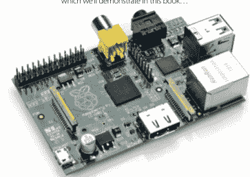

## 树莓派（型号 A）

尽管在硬件连接方面比型号 B 更有限，但它仍然是一台功能强大的一流机器

两种树莓派版本的主要区别在于 RAM、USB 2.0 端口的数量，以及型号 A 没有以太网端口（这意味着需要 USB Wi-Fi 适配器才能访问互联网）。虽然这使得型号 A 的价格更低，但也意味着用户为了完成许多项目，必须购买一个带电源的 USB 集线器。型号 A 更多面向那些创建需要直接从命令行界面进行编程和控制的电子项目的人。

两款树莓派型号都使用 Broadcom BCM2835 CPU，这是一款基于 ARM11 的处理器，运行频率为 700MHz。内置超频模式允许用户提高速度，只要核心不会过热，一旦过热就会自动降频。此外还包含支持 OpenGL ES 2.0 的 Broadcom VideoCore IV GPU，它可以

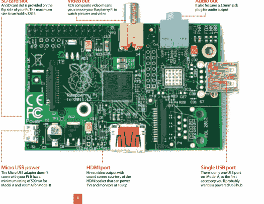

- **SD 卡插槽**
  
  你的树莓派背面提供的 SD 卡插槽。其最大支持容量为 32GB

- **视频输出**
  
  RCA 复合视频意味着你可以使用树莓派观看图片和视频

- **音频输出**
  
  它还配有一个 3.5mm 插孔。用于音频输出

- **Micro USB 电源**
  
  随树莓派附带的 Micro USB 适配器并不包含在内。型号 A 的最小额定电流为 500mA，型号 B 为 700mA

- **HDMI 端口**
  
  带有声音的高分辨率视频输出（HDMI 插座提供的组合功能），可以驱动高达 1080p 的电视和显示器

- **单个 USB 端口**
  
  型号 A 只有一个 USB 端口，因此你首先可能想要的配件是一个带电源的 USB 集线器

## 树莓派（Model B）

对于大多数用户而言，Model B 是首选版本，因为它拥有更多的 RAM 和以太网端口。

## DSI 显示屏连接器

您可以通过 DSI 显示屏连接器将 LCD 面板连接到树莓派。它提供高分辨率显示，从而实现无瑕疵的视频输出。

## GPIO 引脚排针

GPIO 引脚排针是您通往通过树莓派直接连接和控制各种设备及电子元件世界的大门。

## 控制中心

树莓派的主芯片是一个片上系统（SoC），内部集成了 700MHz 的 Broadcom CPU 和 VideoCore IV GPU。它可以执行 24 GFlops 的运算，并能以 1080p 分辨率解码和播放 H.264 视频。最初，Model A 计划使用 128MB RAM，但后来升级到了 256MB RAM，而 Model B 则从 256MB 升级到了 512MB。

树莓派的电源通过 5V micro-USB 插座供应。由于 Model A 的供电接口较少，它仅需 300mA，相比之下 Model B 需要 700mA。连接树莓派模型的标准系统是使用 HDMI 端口连接到电视机的 HDMI 插座或显示器的 DVI 端口。HDMI-HDMI 和 HDMI-DVI 线缆都能正常工作，可传输 1080p（即 1920x1080）视频。声音也通过 HDMI 连接传输，但如果使用的显示器没有扬声器，则可以使用标准的 3.5mm 音频插孔。RCA 复合视频连接专为技术水平和显示器（如老式电视）较为基础的国家设计。

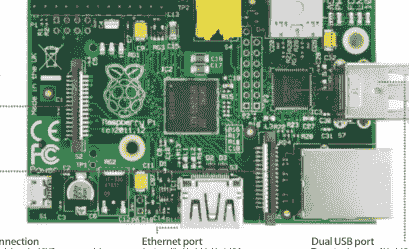

## CSI 接口

新近推出的摄像头模块插在这里，赋予树莓派拍摄照片和录制视频的能力。

## 以太网端口

同样，与 Model A 不同，Model B 配备了以太网端口，因此您无需 Wi-Fi 适配器即可连接互联网。

## 双 USB 端口

Model B 的主要优势在于它有两个 USB 端口（Model A 只有一个）。这减少了对 USB 集线器的需求。

## 快速入门

### 入门套件

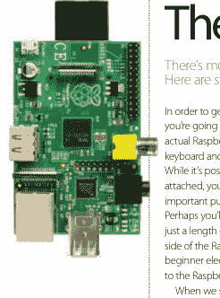

树莓派的内涵远不止表面所见。以下是一些帮助您入门的重要外设。为了从树莓派中获得最佳体验，除了树莓派主板本身，您还需要获取一些额外的配件。例如，您需要键盘和鼠标来输入命令并进行导航。虽然不进行初始设置的情况下可能用某些项目不需要键盘和鼠标，但在初始设置阶段它们是必需的。SD 卡也是重要的购置物品——它是操作系统的存储介质。也许您需要某种 Wi-Fi 适配器，或者只是一根网线。此外还有树莓派的基础电子部分，开展入门级电子和控制实验需要哪些组件呢？显然，树莓派的可能性比许多人想象的要丰富得多。

当我们提到外设时，当然指的是可以连接到树莓派并加以利用的其他硬件。它们可能只是一条得体的 HDMI 线，也可能是能增强您项目功能的最新定制设备。树莓派拥有广阔的可能性领域，从机械臂到遥控直升机……唯一的限制是可用硬件和您的想象力！

> **您知道吗……**
>
> 大多数在线零售商都提供包含所有可能需要配件的套装（甚至预装了 SD 卡）。

### 键盘和鼠标


让我们从最基础的组件开始：键盘和鼠标。一般来说，几乎任何 USB 键盘和三键滚轮鼠标都能与树莓派兼容。虽然某些项目甚至不需要键盘和鼠标，但在初始设置阶段它们是必不可少的。

## SD 卡


SD 卡是存储树莓派操作系统的存储设备，无论您决定使用哪种系统。您可以购买预装了操作系统的 SD 卡，也可以从多个渠道购买空白卡。SD 卡有多种尺寸和速度，但对于基本用途，2GB 或更大的容量即可满足需求。

### 电源线

树莓派使用标准的 micro USB 连接器作为电源输入，电压应为 5V。在大多数情况下，micro USB 转 USB 线缆就足够了，其一端可以插入笔记本电脑或 PC 的 USB 端口。安卓手机充电器也应能完美工作（5.25V 1500mA）。

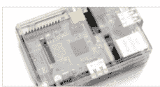

### 外壳

虽然外壳并非完全必要，但将树莓派放入外壳中显然可以保护它，并防止其精密的 GPIO 引脚弯曲。除了防止意外损坏外，外壳还可以使树莓派看起来更具吸引力或更醒目，例如用作客厅媒体中心。


### 视频输出

您会发现两个视频输出端口：一个 HDMI 端口和一个 RCA 插孔。对于大多数用户而言，HDMI 很可能成为主要的视频输出连接器。但如果您的电视或显示器没有 HDMI 接口，则可以使用 RCA 视频输出端口连接电视、显示器或 SCART 线缆。


### 带电源的 USB 集线器

在购买树莓派初期，考虑额外购买 USB 端口是值得的。连接好键盘和鼠标后，您就会明白原因了！使用带电源的 USB 集线器非常重要，它可以防止树莓派自身供电不足，并允许您连接外部硬盘等设备。

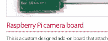

### 树莓派摄像头板

这是一款定制的附加板，通过柔性电缆连接到树莓派主板上的插座之一。它极其小巧，但功能强大，原生分辨率为五百万像素，并支持 1080p 视频。它本质上是树莓派的智能手机摄像头！


### USB Wi-Fi 适配器

使用 USB Wi-Fi 适配器可以让树莓派的摆放位置更加自由。您不再需要从路由器拉一根以太网线，它还可以用于更高级的项目，而在这些项目中，有线互联网连接并非可行选项。购买时请确保该适配器支持 Linux 系统。

## 设置您的树莓派

通过我们易于遵循的指南，了解全新树莓派中各个部分的功能和位置。

虽然设置起来看起来可能令人望而却步，但实际上配置树莓派用于日常使用非常简单。就像电视或普通计算机一样，只有特定的线缆才能插入特定的插槽，主要任务实际上只是确保在任一时刻您已插入了所需的设备。树莓派本身并没有对主板上的大部分部件进行标注。不过，大多数优质外壳都会为您完成这项工作——如果您决定购买一个的话。

- **电源适配器**


树莓派使用 micro USB 线缆供电，这与许多现代安卓手机类似。它可以通过笔记本电脑或电脑供电，但为了充分发挥其性能，合适的电源适配器（如这种）是理想的。

- **显示器**

树莓派能够输出 1920 x 1080 分辨率——即所谓的 1080p。某些现代显示器允许直接插入 HDMI 线，就像电视一样。但是，如果您的电视没有 HDMI 接口，您可能需要一个适配器。

- **USB 集线器**

树莓派上的 USB 端口数量有限（如果是 Model 3A 则只有一个）。为了解决这个问题，您需要一个 USB 集线器。重要的是要选择一个带电源的集线器，因为树莓派自身的供电能力不足。

- **外壳和配件**

正确使用树莓派并不需要外壳，但得体的外壳可以有效防止灰尘，并方便在运行期间移动设备。不过，您需要一张至少 4GB 的 SD 卡。

- **键盘和鼠标**

与任何计算机一样，如果您使用树莓派进行标准的 PC 风格操作，就需要键盘和鼠标。与键盘类似，大多数标准鼠标都适用，但某些特殊鼠标可能需要额外软件。

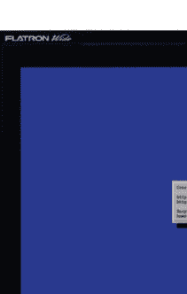


# 设置你的树莓派

## 入门指南

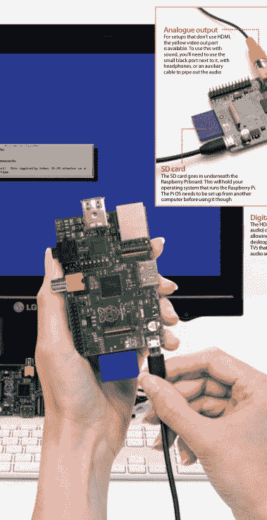

### 模拟音频输出

对于不使用 HDMI 的设置，可以使用黄色的视频输出端口。若要利用此端口输出声音，你需要使用旁边的黑色小端口，连接耳机或通过辅助线将音频输出。

### USB

你希望通过 USB 连接的所有性能扩展——USB 集线器、键盘、鼠标、USB 存储设备——都插在这里。但如果你确实需要使用 USB 集线器，请确保为其提供外部电源。

### SD 卡

SD 卡插入位于树莓派主板下方的插槽中。它将承载运行树莓派的操作系统。不过，在使用之前，需要先在另一台电脑上设置好 Pi OS。

### 数字输出

HDMI 端口是树莓派的主要视频（及音频）输出端口，允许你在显示器上以最高 1080p 的分辨率显示视频。支持该功能的电视还会自动接收音频信号。

### 网络

树莓派并不附带无线互联网功能。虽然你可以添加 USB 适配器，但通常直接插入以太网线更简单。网线另一端将插入路由器的背面，从而提供互联网接入并允许访问你的家庭网络。

### 线缆

确保你拥有正确的线缆组合，例如用于网络和互联网连接的以太网线，以及用于视频输出的 HDMI 或视频线。HDMI 可以传输音频，但仅支持视频的线缆需要额外的辅助线来传输音频。

## 入门指南

### 你需要的内容

- 树莓派下载
- www.raspberrypi.org/downloads

> **你知道吗...**
> 1 - 如果 *n* = 0，则如果 *c* = 0，那么 *d* = 0，如果 *f* = 0，则 *h* = 0。它被称为 *Mayimaw*。这是我们在 *M - N - O - R - I* 上使用的，但我们属于*其他*物种。

### 安装发行版

我们来了解一下安装预构建操作系统涉及的一些关键方面。

凭借其小巧的体积和低廉的价格，许多人可能会误以为树莓派只能用于基本任务或编程学习。虽然树莓派的主要目标之一是在较低层面提高计算机素养，而不仅仅是学习如何创建 Excel 电子表格，但树莓派还有许多其他出色的用途。

由于树莓派本质上是一台迷你 PC，配备了 HDMI 和模拟电视输出，而非传统的显示器连接，因此它可以执行许多笔记本电脑或台式机常用的常见任务。虽然它的处理能力和内存不足以运行最新版本的 Windows，但也有其他选择。

有大量功能齐全的操作系统，其中许多是从其桌面“大哥”分支出来并针对树莓派进行了专门优化的。其中最受欢迎的之一是 Raspbian，它是 Debian 的移植版本。Debian 是 Linux 生态系统的关键组成部分，许多其他流行的开源发行版都是从 Debian 源代码分支出来的。最初的 Debian 发布于 1993 年，至今已经取得了长足的进步。Raspbian 需要一些工作来提升性能至标准水平，因为树莓派使用的是较旧的 ARMv6 架构。如今，它已经成为一款出色的日常桌面系统。

- **卡速**

获取一张速度较快的 SD 卡是个好主意，以保持系统平稳运行。`Class 10` 或更高速度最佳。

- **卡格式**

在复制你的操作系统镜像之前，你需要确保 SD 卡已格式化为 `FAT 32` 文件系统。

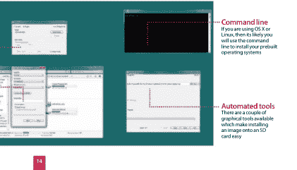

- **命令行**

如果你使用的是 OS X 或 Linux，那么你很可能会使用命令行来安装你首选的操作系统。

- **自动化工具**

有一些图形化工具可使将镜像安装到 SD 卡变得简单。

### 获取操作系统

01 你的第一个问题可能是“我可以在哪里找到一些可下载的操作系统？”

大多数常见的镜像都可以在主要的树莓派网站上找到：*http://www.raspberrypi.org/downloads*。这些是稳定且经过充分测试的系统，值得研究。

### 解压

02 当你下载好镜像后，你可能首先需要做的是解压它。在 Windows 中，可以通过右键点击并选择“提取...”来完成。在 OS X 中，只需双击即可提取文件。

### OS 格式

03 在压缩包中，你会找到一个扩展名为 `.img` 或 `.iso` 的文件。这些相当于安装 CD 或 DVD 的“快照”。仅仅将文件复制到 SD 卡是无效的；你需要使用程序来提取它。

### SD 卡格式

04 你将要启动使用的 SD 卡，请确保先检查其上是否有重要内容。你还需要将其格式化为使用 `FAT32` 文件系统。这是一种常见的文件系统，被大多数 U 盘和相机使用。

### 格式化卡

05 在 Windows 中，格式化卡片只需插入并等待其挂载。然后点击“我的电脑”，接着右键点击该卡的图标。之后选择格式化，并从下拉菜单中选择“FAT32”。

### 使用终端

06 如果你使用的是 OS X 或 Linux，那么你必须使用终端来复制镜像。在 OS X 中，终端应用默认已安装，大多数 Linux 版本也均以某种形式包含终端。它可能被称为“控制台”或“命令行”。

### DD 命令

07 你需要使用的命令称为 `dd`。这完全符合 `sudo dd bs=1m <file> <device>` 的格式。下面可以看到一个示例：

```
sudo dd bs=32m if=/Users/rachel1crab/Desktop/archlinux/armchlinux-hf-2013-02-11.img of=/dev/disk1
```

### Win32 Disk Imager

08 Windows 用户可以使用 `Win32 Disk Imager`。下载该工具后，只需右键点击 `*.exe*`，选择“以管理员身份运行”并按照提示操作。安装完成后，你可以将 SD 卡放入树莓派。简单！

## 命令行基础

### 入门指南

通过使用命令行和键盘，学习控制树莓派的另一种方式。

我们在树莓派上都可能经历过这种情况。你已经在 SD 卡上安装了 Raspbian 或其他树莓派操作系统，并匆忙完成了设置脚本，或者没有充分做好调研。你启动操作系统，结果……来到了一个命令行界面。这里的第一步是不要惊慌；这是完全正常的。它可能对你来说是一个陌生的概念，只在电影中见过那些想要击垮“系统”的街头黑客使用。

第二步，至少在 Raspbian 的情况下，只需输入：

```
$ startx
```

就这样。Raspbian 将加载桌面，你又可以开始使用鼠标了。在这种情况下，以及许多其他操作系统中，这既快捷又无痛。你所做的是使用了一个命令，具体而言是启动 X 服务器。X 服务器处理图形界面，在某些树莓派系统中默认是关闭的。

- **你需要的...**

  - Raspbian
  - www.raspberrypi.org

- **你知道吗...**

命令箭头启用你上一次的命令。只需使用上箭头和下箭头即可使用它们。

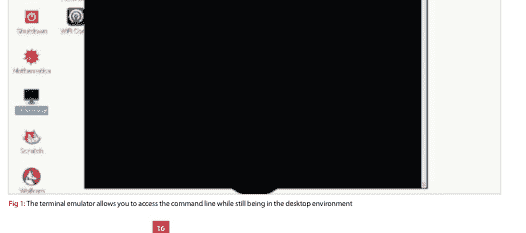

图 1：终端模拟器允许你在仍处于桌面环境的同时访问命令行

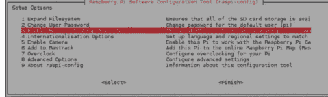

### 一个新世界

让树莓派进入桌面并不是你在命令行上能做的唯一事情。命令行内置了一整套功能；事实上，你使用的许多图形程序只是以某种方式执行这些命令。你也不必离开舒适的桌面环境来执行这些命令，因为所有树莓派操作系统都会附带一个被称为终端模拟器的应用程序。


这会创建一个窗口，你可以像启动桌面一样在其中编写命令，并使用完全相同的命令（图 1）。在 Raspbian 中，在菜单的“附件”部分查找 `LX Terminal` 应用程序并点击它。如果你必须使用 `startx` 才能进入桌面，那么我们可以在继续之前修复这个问题。在终端中输入：

```
$ rpi-config
```

这是初始设置屏幕（图 2）。从这里你可以启用开机启动桌面（图 3），甚至更新固件并为官方树莓派摄像头模块添加支持。这允许你修改 Raspbian 而无需重新安装。

不过，你不会经常使用这两个命令，那么深入研究命令行有实际用途吗？当然有。首先，Raspbian 没有官方的包管理器。这是一个允许你浏览操作系统可用软件的程序，类似于 Pi Store。
但是，有可供 Raspbian 使用的其他软件，而这些软件无法通过商店获取。你也不能专门更新树莓派的软件，而所有这些都可以使用命令行来修复。

图 2. 访问 `rpi-config` 以更改设置，如启动桌面或添加摄像头模块


图 3. 将默认选择更改为桌面，以便下次使用树莓派时启动

## 入门指南

### 命令行基础

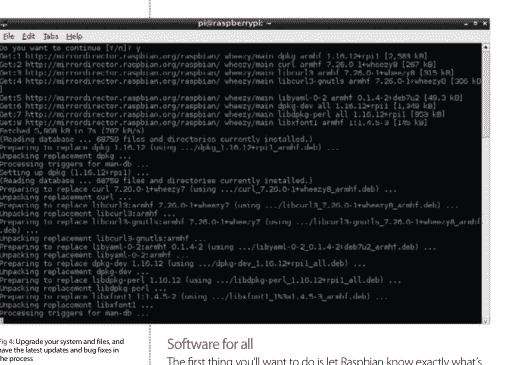


### 适用于所有情况的软件

你要做的第一件事是让 Raspbian 确切了解在线可用资源。这是一个非常简单的任务，你只需要做以下操作：

```
$ sudo apt-get update
```

这将遍历包含 Raspbian 使用软件的在线软件仓库（或简称 repos）列表。完成后，命令行提示符会再次出现，等待你的下一条命令。由于这是第一次执行此操作，你可能需要更新树莓派上当前的软件。你可以使用以下命令来执行更新：

```
$ sudo apt-get upgrade
```

系统可能会要求你确认升级，如果是这种情况，请输入 `Y` 然后按 `Enter` 键。我们两次都在使用命令行包管理器 `APT` (`apt-get`)，首先检查软件仓库，然后根据检查结果升级软件包（图 4）。第一个命令中的 `sudo` 允许其以管理员身份运行 `apt-get` 任务，并且在许多其他命令行操作中也会用到。

要安装软件，请使用 `install` 代替 `update` 或 `upgrade`，并跟随软件包的名称。例如，对于数学编程语言，你可以使用以下命令安装它：

```
$ sudo apt-get install wolfram-engine
```

#### 你知道吗...

- 你可以使用 `Tab` 键自动补全命令。只需开始输入并按下 `Tab` 键。如果你无法自动补全，请查看你按下的 `Enter` 键是否意为 `Finish`（结束）

### 移动和创建

安装和更新只是你在命令行中可以做的许多事情中的两项。你还可以浏览整个文件系统、移动文件、创建文件夹以及删除项目。所有这些操作都非常简单。

当你首次打开终端时，它会进入你的主文件夹。虽然你无法具体指出这一点，但你可以通过以下方式显示目录中具体有哪些类型的文件（图 5）：

```
$ ls
```

波浪号（`~`）用于表示主文件夹，可用于在文件系统中导航。为了导航，我们将使用 `cd` 命令，后跟你要移动到的位置。可以这样做：

```
$ cd /home/pi/Downloads
```

这将把你移动到 `Downloads` 目录。由于我们最初是在主文件夹开始的，实际上我们只需要这样做：

```
$ cd Downloads
```

它是上下文敏感的，知道要在其当前所在的目录中查找。还有一个技巧，你可以使用它而不必记住路径的确切名称 – 命令行或终端会尝试自动补全短语，如果你在只输入了一部分时按下 `Tab` 键。再次尝试 `cd` 命令，但在只写了 ‘Down' 时尝试按下 `Tab`：

最后，有一些快速命令可用于操作文件。单个文件可以使用 `cp` 命令复制，后跟文件名和新位置，如下所示：

```
$ cp file.txt ~/Documents/file.txt
```

你还可以通过以下方式重命名文件：

```
$ cp file.txt otherFile.txt
```

然后可以使用 `rm` 命令删除原始文件：

```
$ rm file.txt
```

想要创建一个新文件夹？使用 `cd` 移动到你添加文件夹的目录，然后使用 `mkdir` 后跟你想给文件夹起的名字：

```
$ mkdir NewFolder
```

你可以使用命令行做很多事情，但这些是非常基础的内容。随着你越来越多地使用 Linux，你会遇到需要命令线的任务，通过这个过程，你将学会像街头智慧的电影黑客一样工作能完成多少事情。

## 入门

#### 你知道吗...

- 你可以通过在命令行中输入 `cd` 并按 `Enter` 随时返回主文件夹


图 5. 有许多简单的命令行工具可以帮助你浏览和使用你的系统

### Raspbian 桌面

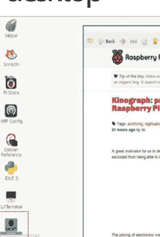

虽然树莓派的操作系统比 Windows 更接近 Mac，但桌面最像后者

乍一看可能有点陌生，但使用 Raspbian 与使用 Windows 几乎没有区别（当然除了 Windows 8）。有一个菜单栏、一个网页浏览器、一个文件管理器，以及不缺乏预安装应用程序的桌面快捷方式。正如你所料，我们只需双击它们即可开始...

### 桌面快捷方式

一些预安装的应用程序在桌面上有图标。要运行相关应用程序，只需双击图标。图标可以被移动并拖放到其他位置。单击并拖动以移动它们。有各种任务的图标 - 从用于编程的 Python 和 Scratch 等应用程序，到用于网络浏览的 Midori，用于直接使用命令对系统进行操作的 LX 终端，以及参考材料。如果你不再想在桌面上显示图标，可以移除甚至删除它们。在任何图标上右键单击以查看可用的选项。

### 菜单栏

就像 Windows 的开始菜单一样，点击角落即可调出程序和选项的菜单。主要类别包括附件、教育用途的应用程序、图形、互联网（包括一些替代浏览器）、编程、通用应用程序和实用程序的混合，以及系统工具。你会发现从 Pi Store 下载的一些程序（见 [链接](https://example.com)）和 InfoCliff 也会出现在这里。还有一组偏好选项，用于配置系统某些元素的工作方式，例如键盘和鼠标。`Run` 选项与 Windows 中的类似 - 它打开一个命令行解释器来运行命令。

### 文件管理器

没有文件管理器，电脑就不完整。点击这里将其调出。可以通过将文件拖到查看器中的光标处来复制、重命名和删除文件。你还可以在文件浏览器中创建标签/窗口或打开更多窗口。可以将文件夹位置标记为‘保存访问’，并且‘文件管理器’可以放大为图标列表查看。如果你需要做任何命令行工作，当前图形文件夹也可以在终端中打开（点击当前文件夹的‘在终端中打开’）；使用文件管理器作为 Midori 的快捷方式，在新窗口中打开，以及双桌面功能。

### 网页浏览器

Pi 提供多种浏览器 – 默认的是 Midori。有一个桌面图标来启动它。将光标悬停在窗口侧面或角上可以调整窗口大小。网页地址输入到长地址栏中，而搜索查询输入到带有 Duck Duck Go 字样的较短栏中。有标准的导航按钮用于在网页之间前后移动。Midori 支持多标签窗口，并具有私人浏览和清除浏览数据的功能。点击工具栏末尾的 Options 图标以访问这些功能。


### Pi Store

有一个到 Pi Store 的桌面快捷方式，一旦运行，这里也会出现一个图标，以及任务栏上的一个最小化窗口。你可以通过点击它来访问 Pi Store，此外，来自 Store 的消息也会出现在这里，工作方式很像 Steam、Google Play 或 App Store。你需要在 IndieCity 注册一个账户，你可以直接在 Store 界面上完成。对于未来的访问，你需要登录。从 Store 下载和安装的应用程序随后会出现在名为 My Library 的标签下。有些只能从这里运行。

### 电源和时间

当树莓派正在运行桌面时，不要只是拔掉电源插头，最好点击这里并选择‘注销桌面’。这处理任何临时文件并离开桌面，将你带回命令行。然后你可以拔掉电源。如果电源符号是时钟，点击它以显示日历，突出显示当前日期。如果你在菜单上右键单击，你可以获得选项来设置 Digital Clock 的自定义设置，或完全从面板中移除它。

## 入门指南

### 您需要准备的工具...

- Raspbian：www.raspbian.org

### 掌握 Config 工具

使用功能强大的内置 config 工具来设定您的树莓派（Raspberry Pi）的运行方式。


# RasPi Config 工具

`RasPi Config` 工具允许您配置系统在纯 Linux 环境下较难操作的部分，并且它是您安装 Raspbian 时首先看到的内容。为什么？诸如设置日期时间或键盘区域设置等任务通常在没有对话框、没有额外帮助的命令提示界面中完成——对于新用户来说，这简直是噩梦。

树莓派和 Raspbian 本身还有一些特定的配置项，例如轻松为您的电视启用过扫描（overscan）、更改分配给计算机/显卡的内存比例，甚至超频您的系统使其速度稍快；启用系统的远程 SSH 访问；以及阻止系统启动进入桌面环境等功能。`RasPi Config` 工具消除了这一过程的痛苦，让强大的功能触手可及。

## 打开 raspi-config 工具

首先，双击桌面上的 `LXTerminal` 图标。这将启动命令提示符，您可以在其中运行 config 工具。为此，您需要运行一条命令。

```
sudo raspi-config
```

当被要求输入密码时，您实际上不会看到输入的密码显示出来。输入密码并按下回车键提交后，配置屏幕将显示给您。本节将介绍几个特别值得关注的设置，尽管它们在实际使用树莓派时都有其用途。此菜单中的一些设置至关重要，有些则是不可逆的，因此请谨慎使用！

- 更改密码：将默认用户 `pi` 的密码更改为更具个性化或更易记的内容。
- 扩展根文件系统：让您能够非常快速轻松地调整根分区以完全填满 SD 卡！
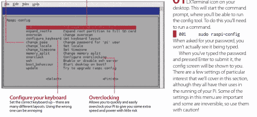
- 配置键盘：设置正确的键盘，因为存在许多不同的布局。使用错误的键盘会很麻烦！
- 超频：让您快速轻松地超频树莓派，在风险很小的情况下获得额外的速度和性能。

### 你知道吗

您可以通过在终端窗口或命令行中输入 `sudo raspi-config` 随时访问配置工具。

## 更改启动行为

默认情况下，Raspbian 发行版会启动到命令行界面，您需要先以 `pi` 用户身份登录。

如果您随后想运行窗口管理器（在本例中称为 `X`），您必须向系统发出命令以告知它您真正想要做什么。对很多人来说，这并不理想，因为命令行会让他们感到害怕。因此，有一个选项可以在启动时自动运行 `X`。将此选项设置为 `Yes` 以默认启用此行为。

您显然可以随时撤销此操作，返回到需要手动启动的基于文本的登录界面。

开始

## 扩展根文件系统

默认情况下，Raspbian 根文件系统为 2GB —— 这是为了尽可能让提供的镜像适配不同种类的 SD 卡。

如果您的卡更大，`扩展根文件系统` 选项将让操作系统使用全部空间。使用此选项后，命令会立即执行。此操作可能需要一些时间。重启系统以查看更改。

## 超频您的树莓派

您可以将树莓派的时钟速度和电压设置为几种不同的预设设置。高于规格参数的时钟速度和电压可能导致不稳定，因此请小幅度逐步调整。确保树莓派周围有良好的空气流通。

如果您注意到任何明显的不稳定性，请重新运行此向导并将时钟速度调回略低的值 - 重复此过程直到系统完全稳定。就本教程的范围而言，推荐进行轻微/中等程度的超频 - 它似乎能提供额外的性能，且没有明显的副作用。此外，建议在做出此更改后重启系统。按住 `Shift` 键可临时禁用超频。


## 开启和关闭过扫描

如果您使用现代高清电视连接树莓派，可能会注意到以下两种行为之一。

- 树莓派输出的图像周围有一圈黑边 - 它只是没有正确适配。这是由欠扫描（underscan）引起的。
- 如果您看不到屏幕边缘，说明您遇到了过扫描（overscan）问题。
- 如果您遇到的是前一种问题，您可能需要开启过扫描，或在电视上启用 `auto` 模式或类似设置。
- 如果您遇到的是后一种问题，您需要关闭过扫描，以便可以看到屏幕边缘。

## 配置您的位置

区域设置（Locale）是树莓派使用的语言和区域设置 - 虽然这通常对您看到的内容影响不大，但它也负责默认的货币设置等，如果设置错误，日后可能会变得很重要。

选择该选项后，您将进入一个向导界面。使用方向键在构建更多设置之前检查默认区域设置（这可能需要一些时间）。

时区设置将带您进入一个 `tzdata` 屏幕，您可以在那里进行调整。

## 更改内存分配

更改树莓派的内存分配比例允许您为系统或图形处理器分配更多的内存。

您提供的值必须是 `16`/`32`/`64`/`128`/`256` 之一。以下是我们的建议：

- 基本发行版使用场景（不需要视频和 2D 渲染）：`32MB` GPU 内存。
- 需要视频播放或启用 3D 效果的桌面使用：`64MB` GPU 内存。
- 进行大量多媒体操作或玩 3D 渲染游戏的图形应用程序和游戏：`128MB` GPU 内存。

对大多数人来说，将 `64MB` 分配给图形处理器就足够了。

## 更新 raspi-config

`raspi-config` 工具会不时接收更新。这通常是为了添加更多功能或修复小 bug，或者两者兼有！

在使用该工具时运行更新是个不错的主意 - 在开始更改任何系统设置之前。虽然更有可能的是更新会带来外观优化和功能增强，但其中隐藏各种 bug 并非不可能，这些 bug 可能会给您带来麻烦。

不过请记住，当您需要更新树莓派时，您需要一个活动的互联网连接，无论是通过 LAN 线缆还是无线网卡。

如果没有它们，它永远无法获得新版本。务必始终确保您使用的是最新版本。

## 入门指南

### 您需要准备的工具

- 任何树莓派发行版：`www.raspberrypi.org/downloads`
- Wi-Fi 网卡或以太网

### 你知道吗

> 如果您的树莓派将放置在互联网路由器附近，您只需插入一根以太网线即可。


*图 1. 连接 Wi-Fi 网卡后，运行实用程序并扫描可用网络。*

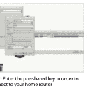

*图 2. 输入预共享密钥以连接家庭路由器。*

## 让您的树莓派联网

要访问各种实用程序、应用程序和资源，您需要联网。以下是操作方法...

### 实现联网

联网最简单的方法是购买树莓派 Model B，因为它自带 RJ45 以太网接口。Model A 不仅缺少以太网端口，而且由于只有一个 USB 端口而受到限制。这意味着您必须购买一个带电源的 USB 集线器才能联网。回到 Model B，要联网，只需将以太网线插入树莓派上的接口，并连接到互联网调制解调器/路由器背面的类似端口。打开树莓派并启动桌面，然后双击 `Midori`，您应该会看到互联网界面出现。要检查是否正常工作，请查看树莓派本身的指示灯。红色电源灯应亮起。在此上方的是绿色指示灯，在访问 SD 卡时会闪烁。电源灯下方有三个与以太网相关的指示灯。请注意，Model A 由于没有以太网接口，因此没有这些 LED。中间的灯是绿色的，当检测到全双工 LAN 连接时亮起。这意味着它可以同时发送和接收数据。下一个灯是绿色的，在实际通过发送或接收数据访问互联网时会闪烁。最后一个灯是黄色的，当检测到 100Mb LAN 连接时会亮起并保持常亮。

### Wi-Fi 选项

如果您离调制解调器/路由器太远而无法插入以太网连接，或者您只是使用 Model A，那么需要一个带电源的 USB 集线器。将其插入树莓派的 USB 端口。然后您可以将 Wi-Fi 网卡插入其中。启动树莓派并打开桌面。然后双击 `Wi-Fi Config` 图标。您应该在 Adapter 部分看到网卡名称。点击 `Scan` 以查找网络，应该会显示找到的网络列表（图 1）。双击您想要连接的网络，将会列出其详细信息。几乎所家庭网络都使用网络密钥，通常写在调制解调器本身上。点击 `PSK`（代表预共享密钥）并输入该密钥（图 2）。然后点击 `Add`。它将处理此信息，然后建立连接，随后

### 让你的树莓派联网

最终，Wi-Fi 连接将获得一个新的 IP 地址。如果你点击“管理网络”选项卡，该网络现在会被列出，并且“启用”单选按钮处于激活状态。要接入互联网，只需启动 `Midori` 浏览器即可连接。Wi-Fi 实用程序将继续运行在面板的右下角。如果你右键点击 Wi-Fi 图标，你会看到断开或重新连接的选项、事件历史记录以及最近一次扫描的结果。点击“状态”以查看其运行表现。

## 检查连接

为了检查树莓派是否具有有效的互联网连接，请双击 `LX Terminal`（终端）。输入以下命令：

```
ip addr
```


你应该会看到一串数字列表，最后一行以“inet”开头，随后是树莓派连接的 IP 地址（图 3）。通常这是像 `192.168.1.11` 这样的地址，这表明连接正在工作，因为树莓派已根据你互联网调制解调器/路由器使用的地址被分配了一个 IP 地址。如果没有显示，则路由器端可能存在问题。调制解调器/路由器应该运行一个 `DHCPD` 服务器，当它连接时，它会分配 IP 地址。如果没有运行，那么连接到它的其他设备也无法访问互联网。使用另一台设备通过 Web 界面登录 `192.168.1.0` 或你调制解调器的实际 IP 地址，以检查 `DHCPD` 服务器服务是否已启用。最后，在终端中输入：

```
ping google.com
```

## 共享连接

如果你没有 Wi-Fi 适配器、带电源的 USB 集线器或足够长的以太网线，但有一台已连接互联网的其他计算机，还有另一种获取访问权限的方式。在 Mac 上，通过 USB 或以太网线将其连接到树莓派。打开系统偏好设置；在“互联网与无线”下，点击“共享”。点击“互联网共享”，然后选择 Wi-Fi（用于 AirPort）作为要共享的连接类型，并选择树莓派如何连接到你的 Mac（图 4）。在 Windows PC 上，前往 Windows 资源管理器 > 网络 > 网络和共享中心 > 更改适配器设置。

## 入门

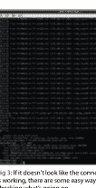

图 3：虽然看起来连接没有正常工作，但这里有一些简单的方法可以检查发生了什么


图 4：Windows 和 Mac 计算机都可以与直接连接的树莓派共享互联网连接

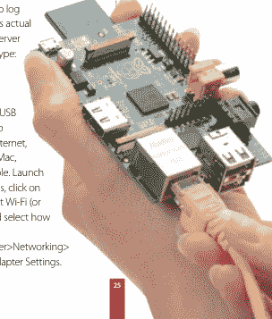

23

### 你需要的

- Raspbian

  www.raspberrypi.org/downloads

- 互联网连接


*图 1 教程是一个可工作的软件作品，配有文档供学习*

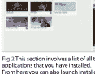

*图 2 此部分列出了你安装的所有应用程序，你可以从此处启动已安装的应用程序，或者选择删除它们*


*图 3 使用可识别的用户名和图片自定义你的个人资料，以便其他用户可以找到你*


*图 4 如果你计划上传自己的创作，请点击“上传”选项卡开始编辑你的开发者个人资料*

## 树莓派商店

### Pi 商店

Pi 商店中混合了免费和付费的游戏及应用

Pi 商店于 2012 年推出，旨在为希望让他们的软件可用于树莓派的专业和非专业开发者提供一个中心。该服务由树莓派基金会与 IndieCity 和 Veloxi 公司合作创建。

你可以使用 Web 浏览器或专用的 Pi 应用程序浏览商店并以客户身份登录。到目前为止，Pi 商店上的大多数物品都是免费或低价的，显然网站开发者希望建立一个繁荣的社区。特别地，他们强调希望看到各个年龄段的开发者。这种方法与使用树莓派鼓励对软件开发兴趣的整体策略相符。此外，Pi 商店可能是初学者扩展其树莓派的最简单方式。

除了作为浏览、安装和购买应用程序的平台外，Pi 商店还集成了功能，允许开发者创建个人资料并上传项目。客户也可以创建个人资料并参与社交方面。

### 浏览商店

你可以通过 Web [`http://store.raspberrypi.com`] 或使用专用 Pi 应用来浏览商店。要安装该应用，请输入：

```
sudo apt-get install pistor
```

然后，商店应该会显示为背景上可点击的图标。启动后，你会看到一个双栏窗口，顶部有选项卡，下方是主区域（主图）。第一个选项卡是“探索”，这是你寻找新应用程序的地方。主窗口本身也使用更多的选项卡来表示内容类别。“应用程序”和“游戏”类别包含人们对特定设备应用商店所期望的核心内容。每个这些项，像所有商店物品一样，都以五星评分和评论区形式包含客户反馈。许多产品都是现有程序的重打包版本，专门针对树莓派。开发工具是帮助开发者的资源和工具，例如现成的声音和图形包。

教程是旨在向你介绍树莓派各个方面的资源包。此功能的强大之处在于，这些包不限于纯文本文件，还可以包含其他资源。例如，一个教程展示了如何使用 `Python` 编程语言和 `SQL`（一种用于访问数据库的语言）构建数据库程序（图 1）。

### 我的图书馆

点击“我的图书馆”选项卡可以查看你已购买和安装的应用程序。从这里，你可以启动已安装的应用程序，从系统中删除它们，或重新安装它们。最后这个功能非常有用，因为它意味着你可以抹去并重新安装你的树莓派，而不会永久失去你从商店获取的内容。此部分还包括一个以图标形式显示的当前已安装应用程序的运行计数（图 2）。

如果你点击你的用户名，你可以编辑你的个人资料（图 3）。你可以更改首次注册时商店分配给你的用户名，并添加你的网站链接和照片。这样做有助于你在提供反馈时在社区中建立存在感。

### 上传内容

点击“上传”选项卡允许你创建开发者个人资料（图 4）。这会在网站上给你一个可自定义的综合主页。你可以选择配色方案和横幅图像，并且可以将其连接到你的 Facebook 和 Twitter 动态。请注意，一旦你创建了开发者页面并保存，将来无法更改名称。

从这里，你还可以添加产品。当你添加产品时，你可以指定它是公开可见还是隐藏的，以及它是已完成的还是正在进行的。你还可以指定你的项目的类别（游戏、应用程序、教程、开发工具或媒体），添加截图、盒装艺术、年龄分级、标签、描述和价格。一旦项目公开，你可以查看与页面浏览量和下载量相关的统计数据。你还可以指定你为产品偏好的许可证。例如，你可能选择允许其他人重新混合你创建的内容。

### 文件本身

我想让你亲自动手！如果你不直接操作文件本身，事情就会顺利运行，但如果出了问题，知道它们在哪里很有用。与你的个人资料和配置相关的文件不是设计为手动编辑的，但可以在你的主目录（`/home`）中找到。一个有用的故障排除文件是（你的主目录）`/home/pi/.pistor/previews/scripts.log`。此文件记录所有状态活动，并且在故障排除时是一个无价的资料来源。右键点击此文件以在文件管理器中打开它。

组成应用程序本身的文件可以存储在你的 SD 卡上的各个位置，但许多较大的、与游戏和应用程序相关的文件最终位于 `/usr/local/bin/index/`。


## 入门指南

### 安装和使用软件包

#### 你需要什么

**Apt 命令帮助页面：**

[https://alex.de.net/man/8/apt](https://alex.de.net/man/8/apt)

**Apt-get 帮助页面：**

[https://manpage.linuxnet.com/manpages/sup/](https://manpage.linuxnet.com/manpages/sup/) [lucid/man/apt-get.8.html](lucid/man/apt-get.8.html)

树莓派（Raspberry Pi）很棒，但安装软件会让它变得更强大。单就硬件本身而言，树莓派是一台近乎完美的微型计算机。它已经内置了丰富的教育软件、少量游戏、一些编程实用工具以及许多系统工具。但是，就像大多数计算机一样，这仅仅是冰山一角。通过安装更多的程序，你可以做更多的事。

这些程序被称为软件包（`packages`），其广泛程度和多样性就像最初设计它们的开发者一样。在 Linux 中，如果有某种程序的需求，就会有人开发出来。然后他们会将其发布到世界，并免费提供源代码，因此称为“开源”。一旦程序经过测试，它最终会出现在针对该特定 Linux 发行版的众多远程服务器之一上。

这些远程服务器被称为存储库（`repositories`），或简称 `repos`，它们包含软件包的所有元素，以便将其下载并安装到你的系统中。一旦你知道了操作方法，这个过程就会变得非常快速和简单……

### 你知道吗

如果你按下 `Tab` 键，命令行会尝试为你自动补全命令——只需按下 Enter 即可完成。


### 更新和升级

01 在树莓派上获取软件包需要进入命令行终端（通过桌面上的 `LXTerminal` 图标），并输入几条命令。但在这样做之前，我们需要确保系统是最新的。在终端中输入以下内容：


```
sudo apt-get update
sudo apt-get upgrade
or
sudo apt-get update && sudo apt-get upgrade
```

### 搜索软件包

`02` `apt-get` 命令（高级包管理工具，Advanced Package Tool）是在树莓派上下载和安装软件包的关键。在上一个示例中，我们更新了现有软件包和系统，升级了需要升级的软件包，并更新了当前的软件包列表。现在，让我们搜索服务器软件包列表中可用的游戏。

```
apt-cache search game | less
```


## Apt 搜索

`03` 你目前所在的列表是从可用服务器获取的标记为“游戏”的所有软件包名称。在列表中，连字符前面的部分告诉你软件包的名称，这是安装软件包时你需要知道的信息。使用上下方向键导航，按‘Q’退出。

### 安装软件包

`04` 使用上下方向键导航列表。如果你看到喜欢的东西，比如 *Angry Drunken Dwarves*，请记住软件包名称，在这种情况下是‘angrydd’，然后按‘Q’退出列表。要安装该软件包，在终端中输入以下内容：

```
sudo apt-get install angrydd
```

### 执行软件包

`05` 上一条命令的结果应该是游戏 *Angry Drunken Dwarves* 成功下载和安装。要执行新安装的软件包，你可以从 LXDE 菜单下的 Games > Angry Drunken Dwarves 运行它，或者在终端中输入以下内容：

```
angrydd
```

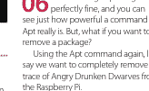

### 移除软件包

`06` 安装这些软件包完全没有问题，你可以看到 Apt 命令有多么强大。但是，如果你想要移除一个软件包呢？

再次使用 Apt 命令，假设我们要从树莓派中彻底移除 *Angry Drunken Dwarves* 的所有痕迹。

```
sudo apt-get --purge remove angrydd
```

输入‘Y’以确认移除。

## Apt 彩蛋

`07` Apt 命令是 Aptitude 命令的简短非菜单驱动变体。该命令在 Linux 中有着丰富的历史，因此具有一些非常特殊的“特性”，也被称为彩蛋。纯粹为了好玩，输入以下命令并查看结果：

```
aptitude moo
aptitude -v moo
aptitude --vv moo
aptitude -vvv moo
aptitude ~vvvv moo
aptitude ~vvvvv moo
aptitude -vvvvvv moo
sudo apt-get moo
```


### 查看 Apt 命令手册

`08` 正如你所见，简单的 Apt 命令比表面看起来的要复杂得多。有许多不同的子命令可以运行，还有许多不同的变体来运行它们。

如果你想知道 Apt 命令还能做什么，请输入以下内容：

```
man apt
```


### 使用图形化安装

#### 你需要什么...

**Synaptic：**

www.cncityng.org/synaptic/


你更喜欢使用图形界面来安装新程序吗？如果是，请继续阅读...

如果你是 Linux 新手，你可能会发现使用其内置的 Apt 包管理工具有些令人望而却步且令人困惑。`apt-get` 命令用于通过互联网安装应用程序，连接到存储程序作为软件包的远程服务器——称为存储库。但它需要通过终端命令提示符使用，这可能会让人望而生畏，因此我们需要一个替代方案：一种通过桌面环境界面获取软件包的方法。

这就是 Synaptic 的用武之地。Synaptic 是 `apt-get` 终端命令的友好图形界面，允许你通过熟悉的桌面环境管理应用程序的安装和移除。可以将其视为一种在线商店，你可以在其中挑选想要的程序，并让它们下载并安装到树莓派上，而无需进入终端。

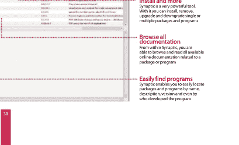

### 更新系统

`01` 不幸的是，如果你不喜欢进入命令行终端，那么你将在第一步就卡住了。在安装任何东西之前，我们需要确保树莓派已完全更新，且现有软件包已升级。只需在 LX Terminal 中输入以下内容：

```
sudo apt-get update
sudo apt-get upgrade
```


### 安装 Synaptic

`02` 要安装 Synaptic，你首先需要进入 LX Terminal 并运行以下命令——不要忘记在询问是否接受安装的提示中输入 Y：

```
sudo apt-get install synaptic
```


### 运行 Synaptic – 第一部分

`03` 本质上，这就是你需要做的全部。Synaptic 已安装并准备就绪。但是，由于其复杂性，可能需要先解决一些 bug，因此最好遵循以下步骤。要测试 Synaptic 是否正常工作，首先将以下命令输入终端。

```
gksudo synaptic
```


### 运行 Synaptic – 第二部分

`04` 你现在应该正在查看 Synaptic 程序窗口，你可以在这里滚动浏览可用程序列表，并点击每个程序进行下载和安装。现在我们需要测试它是否能从 LXDE 菜单运行。点击左下角的图标，然后转到 Preferences > Synaptic Package Manager。

### 运行 Synaptic – 第三部分

`05` 从 LXDE 菜单运行 Synaptic 会导致错误。别惊慌；它只是要求输入密码。在方框中输入以下密码：

```
raspberry
```

这是树莓派的默认密码，我们假设你没有更改过它！

### 修复 Synaptic – 选项 1

`06` 这将暂时解决问题，但要永久解决它，请执行以下操作之一。首先，右键点击菜单中的 Synaptic 图标，然后左键点击 Properties。在 Executable 文本框中，更改文本以添加 `gksudo` 命令。因此，不再显示 'synaptic-pkexec'，而是显示：

```
gksudo synaptic-pkexec
```

### 修复 Synaptic – 选项 2

`07` 第二个也是最佳选项是回到终端并更改从菜单运行程序的方式。只需将一行更改为另一行，以便再次使用 `gksudo` 命令而不是普通的 `synaptic-pkexec`。从终端输入：

```
sudo nano /usr/share/applications/synaptic.desktop
```

将 `Exec=synaptic-pkexec` 更改为 ...

```
Exec=gksudo synaptic-pkexec
```

### Synaptic 完全正常工作

`08` 输入这些更改后，通过 Ctrl+X 退出 nano，然后按几次 Enter 回到命令提示符。现在你可以从菜单启动 Synaptic，或者在终端中输入以下命令：

```
gksudo synaptic
```


## 四大附加板

使用这些附加板扩展树莓 Pi 的功能，从而挖掘其更多潜力

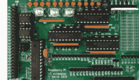

### GetBoardo £30

GetBoardo 由树莓 Pi 的原始设计师之一 Get van Loon 创建，是 GPIO 端口的扩展板，使树莓 Pi 能够与真实世界互动。它用于执行物理计算任务：驱动电机以打开车库门或百叶窗、窗帘，感应温度以便您知道何时关闭暖气，控制 LED 灯等。虽然它尚未达到 Arduino 的水平，但它与树莓 Pi 集成度更高，且是一款非常棒的教学工具。组装它需要进行少量焊接，不过如果您愿意花点心思寻找，可以找到预组装好的 Getboard，只需多花一点点钱。如果您不想自己动手组装，这也是个不错的选择——组装起来可是项大工程！


在 RasPiTV 上有一个基于 GetBoardo 的精彩项目可供尝试 [bit.ly/tebawWA]，通过 Wii 远程视频游戏控制器，您可以制造出一系列充满动感与噪音的效果，展示使用 Getboard 能实现多少功能。从挥舞旗帜到启动风扇和响铃，您可以用树莓 Pi 驱动鲁布·戈德堡机械（Rube Goldberg machine）。您只需要一个蓝牙模块来将 Wii 远程与树莓 Pi 同步，并借助 `Pybluez` Python 库开始折腾。


### Gertduino £20

作为 GetBoard 的“大哥”，Gertduino 是一款混合 Arduino 板，与树莓 Pi 的兼容性更好。Arduino 是开源的微控制器，允许您控制物理对象——与使用 GetBoard 相比，它提供了更多的控制、更高的精度和自动化能力。Gertduino 最大的特点在于它搭载了与 Arduino Uno 相同的芯片。Uno 是许多制作业余电子项目的人常用的旗舰级 Arduino 板。Gertduino 高度可配置，且所有兼容 Uno 的 Arduino 附加配件都能用于 Gertduino。

Gertduino 中还内置了一个名为 `Atmega328` 的特殊芯片，这在 Uno 中是没有的。其主要功能包括备用电池和高精度时钟，这两者允许 Gertduino 在完成编程后从树莓 Pi 上拔下单独运行。这意味着您可以设置它在每天早上指定时间打开鸡舍，而不需要树莓 Pi 始终在场。据悉，该板的发明者 Get van Loon 就使用他的 Gertduino 来管理他的鸡舍。

Gertduino 的完整手册包含一些使用板子的绝佳示例项目，可在 element14 网站上找到 [bit.ly/1afc8RD]。

### 入门指南

### PiFace £20

物理计算是树莓 Pi 的热门扩展功能，PiFace 是另一系列允许您在 Pi 上与外部世界互动的板子。PiFace 别具一格，因为它允许您使用命令行界面（CLI）来控制 PiFace 板上独立的端口。这些板子包括一个简单的 LED 显示屏和一个标准的接口板；这两种板子都提供了教案和其他教育工具，帮助人们学习编程及一般使用树莓 Pi。它完全兼容 Scratch，也可使用 Python 和 C 构建更复杂的应用程序。

虽然 PiFace 实际上不允许您控制设备，但可以检测许多类型数字设备的状态。您可以将此功能应用于某种物联网场景，发送推文或操纵联网设备。PiFace 网站提供的一些教程教您如何制作记忆游戏、倒计时器/广告日历以及可演奏的风琴。

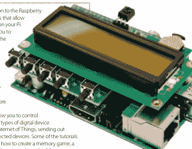

### RasWIK £50

另一种基于 Arduino 的板子，允许您执行一些物理计算任务。然而，这款板子适合那些不想在连接 `GPIO` 端口时进行繁琐布线的人。RasWIK 的神奇之处在于，它自带一个无线芯片，开箱即可紧密贴合在 `GPIO` 端口上，并附带定制版 `Raspbian` 系统，这使得使用主 Arduino 板的过程变得更快。它甚至附带了一系列用于构建电路的组件，从远程蜂鸣器、红绿灯到光感应和温度感应项目。定制 `Raspbian` SD 卡随附了如何启动这些项目的说明，如果您不喜欢焊接板子，这可以让整个过程更轻松。

这些项目中的一些及更多内容可在思科（Cisco）网站上找到 [bit.ly/1H1m5dD]，因此您可以在最终决定购买 RasWIK 之前先浏览一下。如果您拥有正确的组件，甚至可以没有 RasWIK 也使用这些项目，并且在此过程中学习如何使用 Python。这是从树莓 Pi 入门物理计算的一种轻松且省心的方式，其教程非常适合儿童和初学者开始编程与控制学习。

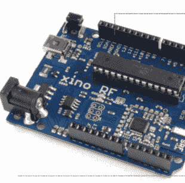

> “RasWIK 的神奇之处在于，它自带一个无线芯片，开箱即可紧密贴合在 `GPIO` 端口上”

## 用树莓 Pi 编写代码与创造

学习如何用您信用卡大小的 PC 实现更多功能

如果您一直跟随本教程，您已经牢固掌握了 Linux 的基础知识，并学会了如何高效地使用树莓 Pi。这只是您冒险旅程的开始。接下来您将找到世界上最全面的树莓 Pi 项目集合之一。无论您是想让树莓 Pi 成为媒体中心、学习编程，还是了解如何将其安装到遥控车上，我们希望接下来的页面能激发您的灵感，让您今天就用树莓 Pi 创造出令人惊叹的东西……

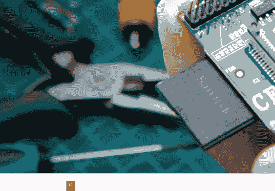

### 项目

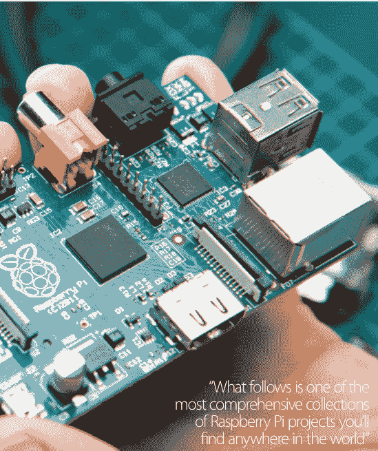

> *接下来是世界上最全面的树莓 Pi 项目集合之一*

### 将您的树莓 Pi 变身办公套件

您需要……

- `LibreOffice`
- 通过教程使用 `apt-get` 安装

如何为树莓 Pi 添加一套完整的免费办公套件，使其成为有史以来最小的家庭办公室

如果您没有处理信函撰写、电子表格和演示文稿等需求的工具，计算机能做的就有限。幸运的是，这在树莓 Pi 的能力范围内。虽然 Raspbian 自带了几个文本编辑器，但有时您需要完整办公套件提供的额外功能。这在树莓 Pi 上非常容易实现，最佳选择是开源的，因此完全免费：`LibreOffice`。

`LibreOffice` 是功能齐全的 Microsoft Office 替代品，只要您不创建包含数百张图片的巨大文档，树莓 Pi 就能很好地处理它。本教程需要一个可用的互联网连接，因此请确保您的 LAN 线缆或无线网卡已插入且功能正常，因为我们将使用内置的包管理器。不过安装确实需要一些时间。

#### 安装 LibreOffice

1. 开源软件最大的优点在于您可以随时安装（只要您有互联网连接或安装介质……总之！），完全按您的方便程度来——无需担心提供付款信息。那么，让我们直接开始吧：打开您的终端——您可以通过双击桌面上的 `LXTerminal` 来实现。使用包管理器安装 LibreOffice 办公套件。

```
sudo apt-get install libreoffice
Now type in your password. Press 'Y' and Enter when prompted to install other dependency packages. Now sit back, relax or make some tea
```

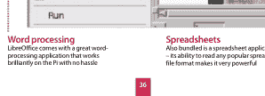

#### 演示文稿

这是一款真正令人印象深刻的设备，只需几次简单的点击即可创建演示文稿

#### 绘图

并非指您想象中的艺术绘图，而是一款极佳的应用程序，用于创建快速、美观的流程图和过程图

#### 文字处理

`LibreOffice` 附带一款出色的文字处理应用程序，在树莓 Pi 上运行得非常完美且省心

#### 电子表格

随附的还有一个电子表格应用程序——它能够读取任何流行的电子表格文件格式，使其非常强大

## 将您的树莓派变成办公套件

### 探索该套件

**02** 安装完 `LibreOffice` 后，您可以通过按下系统菜单来欣赏您的新应用程序。您会看到一个新的“Office”类别，在其下方您会看到以下应用程序：

- **LibreOffice Base** – 一个数据库管理应用程序。
- **LibreOffice Calc** – 电子表格。
- **LibreOffice Draw** – 用于制作流程图可视化。
- **LibreOffice Impress** – 用于创建演示文稿。
- **LibreOffice Writer** – 文字处理器，它与 Word 非常相似。

这些应用程序中的大多数都能打开在 Microsoft Office 对应软件中创建的大多数文档，并且功能几乎同样丰富。

正确选择您文档中的章节。要创建索引，请在文档顶部留出一些空间，然后通过使用菜单转到 *索引和表格* 来插入您的索引。选择选项，并在您满意时点击 *确定*。它将插入到光标所在的文档部分。

### 关于图像呢？

**05** 没有比精心挑选的图像更能让文档生动起来的方法了。这也可以相对轻松地实现。有几种解决方案——最简单的一种是直接从文件管理器将图像拖入文档。假设图像在您的桌面上，只需将文件拖到 `LibreOffice Writer` 上，您就会看到图标发生变化，松开鼠标后，您的图像将大致出现在您释放的位置。或者，您可以使用 *插入 > 图像 > 从文件* 选项。

### 使用注释来帮助自己

**07** 在撰写长篇文档时，您经常会想到一些真正应该稍后检查或添加到文档中的事项。当您想到这些项目时，您可以使用“注释”来为它们做笔记——当有多个人员正在处理该文档时，这甚至更有用。可以使用 `Ctrl+Alt+C` 或通过菜单选项 *插入 > 注释* 在文档当前位置添加注释。如果您想取消“注释”窗格，可以使用“查看”菜单来切换它。


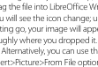

### 添加一些样式

**03** 这里我们重点关注树莓派上的一些文字处理功能，因此请继续打开 LibreOffice Writer。在撰写文档时，通常是格式方面让人们感到棘手。开始写作时，在字体下拉菜单的左侧，还有一个当前显示为“默认”的下拉菜单。选择一些文本，然后使用此下拉菜单更改当前应用的样式。如果您不喜欢默认设置，请从下拉菜单中选择“更多”，或按 `F11`。这将允许您自定义样式等内容。

### 导出为 PDF

**06** PDF 格式是交换文档的非常常见的方式——许多人都这样做，因为它是其最简形式；它是阻止文档意外更改或修改的简单方法。对 PDF 设置密码并阻止有意修改也很简单。然而，PDF 的主要优势是，您不必担心接收方是否有特定的应用程序来查看它们。大多数现代操作系统都内置了某种 PDF 查看器，因此您可以确保获得一致的体验。使用 LibreOffice，这很容易。您可以使用 *文件 > 导出* 到 PDF 的菜单选项将文档保存为 PDF。只需选择您想要的选项，点击导出并将其保存到适当的位置。

### 链接到世界

**08** 如果您在文档中使用了外部资源并希望引用它们，或者也许您不需要直接包含所有信息——拥有一个稍后返回该文档的方式可能很有用。您可以在文档末尾包含一个信息附录，链接到这些其他资源。您可以轻松使用超链接工具按钮，该按钮位于 *插入 > 超链接* 的同一菜单中。当您输入链接后，它会弹出一个对话框，让您链接到其中一个合适的地方。需要注意的是，直接文档链接使用完整的系统路径。如果这是要发送给别人的，请避免使用这些，因为它们对读者会失效。理想情况下，仅在您自己的机器上使用个人参考指南。

### 添加索引

**04** 使用格式化的一个伟大之处在于，它允许您轻松地为您的工作创建一个目录页。只要您对文档的不同级别使用一致的标题，这就是一种快速简便的方式来提供您文档内容的指南。另一个优势是，如果您将文件导出为 PDF，您将看到目录中的每个标题都直接热链接到相应的地方。

### 项目

### Nano 初学者指南

学习如何使用 Linux 最佳工具之一在命令行和终端中编辑文本

#### 您需要什么...

- **完整的 nano 手册**
  - www.nano-editor.org/dist/v2/nano.1.html

> **你知道吗...**
>
> Nano 是初学者最好的命令行编辑器之一，但有很多其他选项，如 Kate 和 Vim。

如果您有渴望在 Pi 上做得更多的冲动，为了实现许多项目，您需要学习的一项技能是编辑系统文件的能力。命令行文本编辑器 nano 绝对是从事此项工作的最佳工具之一。文本编辑器是非常基本的工具；在这种情况下，线索就在名字里。您不会得到文字处理器中那样的格式化或颜色等功能，但这正是重点。您将要创建或编辑的文件通常包含代码——代码不需要加粗或项目符号。Nano 去除了所有这些干扰，但仍然具有您在图形文本编辑器中会找到的几个更实用的功能。我们将教您如何最大限度地利用 nano，使您的项目快速高效地运行。

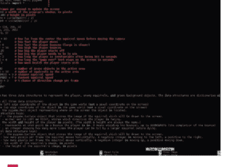

- **写作**
  - 在命令行中创建纯文本文件，甚至为程序编写一些代码。
- **编辑**
  - 根据您的需求和项目编辑系统文件，无需翻遍文件管理器。
- **高级功能**
  - 使用 nano 的一些内置功能进行搜索、复制、粘贴和从另一个文件插入文本。

#### 打开 nano


**01** 打开终端，或进入命令行，并简单地输入 `nano`。这将打开一个新的空白文件。从这里，您可以创建一个简单的文本文件，如列表，或创建系统文件、脚本或一段代码。系统如何解释您的文件取决于您写的内容以及您保存它的方式。

#### 保存并继续


**02** 完成使用 `nano` 后，您可以使用 `Ctrl+O` 保存/写出。所有此类快捷方式和功能都是使用 `Ctrl` 和一个字母键完成的。您会被要求将文件保存为什么名字。无论您给它起什么名字，除非您指定路径，否则它都将保存在您打开 `nano` 所在的目录中。

#### 打开文件


**03** 要编辑已存在的文件，您首先需要知道它们的位置和名称。要在 `nano` 中打开它们，输入以下内容：

```bash
$ nano /path/FileName
```

例如，要编辑文件，您将输入：

```bash
$ nano /etc/fstab
```

#### 保存并退出

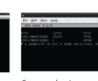

**04** 完成修改文件并需要继续下一个任务时，您可以按 `Ctrl+X` 退出 `nano`。它会询问您是否要保存任何修改，只需按 'Y' 确认即可。如果您想退出不保存更改，可以只使用 N。要在做出决定之前取消，请使用 `Ctrl+C`。

#### 复制和粘贴


**05** 这更多是一个特定于终端的命令，但它也可以很好地用于 `nano`。虽然您不能使用鼠标在 `nano` 中导航文件，但您可以像在图形文本编辑器中一样突出显示文本。一旦突出显示，按 `Ctrl+Shift+C` 将复制任何文本。`Ctrl+Shift+V` 将粘贴复制的文本。

#### 从文件插入


**06** 如果您想直接插入另一个文件的内容，有一种快速的方法，无需使用复制和粘贴。按 `Ctrl+R` 并输入文件的路径将插入到光标所在处。

#### 高级导航

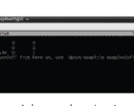

**07** 您可能一直在使用箭头键逐个空格向左、向右、向上或向下移动。不过，还有其他方法可以在文件中移动。使用 `Ctrl+A` 将起到与图形编辑器中 Home 键相同的作用，将光标移动到行首。同样，`Ctrl+E` 像 End 键一样将您移动到行尾。`Ctrl+Y` 是向下翻页，`Ctrl+V` 是向上翻页。

#### 搜索文件


**08** 有时您会在大型文本文件中寻找特定的行或短语。与其阅读每一行，您可以使用 `nano` 搜索行，使用 `Ctrl+W`。输入搜索词将开始在文档中查找，完成后您可以按 `Enter` 查找下一个实例，或按 `Ctrl+C` 退出搜索。

#### 额外帮助


**09** `nano` 中还有更多可用的功能。要获取完整的命令列表，您可以使用 `Ctrl+G`，它列出了所有快捷键及其功能。在此列表中，脱字符符号 (^) 表示使用键盘上的 Ctrl。

### 项目

# 你需要什么

- **Geany** – www.geany.org
- www.geany.org/Documentation/Manual

### 使用 Geany 入门

### 使用 Geany 入门

使用一款最佳的文本编辑器和基础集成开发环境（IDE）之一——Geany，在树莓派上更好地进行编程

当你开始在树莓派上进行真正的编码时，可能会感到有点困惑，不知道该从哪里开始。对于所有 Python 相关的内容，都附带了优秀的 IDLE 集成开发环境（IDE），孩子们也可以使用 Scratch 来制作一些基础游戏。不过，Python 并不是唯一可供编程的语言，而且 Scratch 有自己独特的编程方式，无法用于开发真正的软件。这正是出色的 Geany 派上用场的地方——它是一个文本编辑器和 IDE。作为一个非常轻量级的应用程序，Geany 非常适合树莓派。它包含的一个主要编程特性是**语法高亮**——即代码中适当的部分会以不同的颜色显示；IDLE 对 Python 做了这一点，其他一些文本编辑器也包含此功能，然而，Geany 还允许命令自动补全，并且还可以构建软件。它支持多种语言，因此无论你开始什么项目，你都能在一个熟悉且舒适的环境中进行开发。

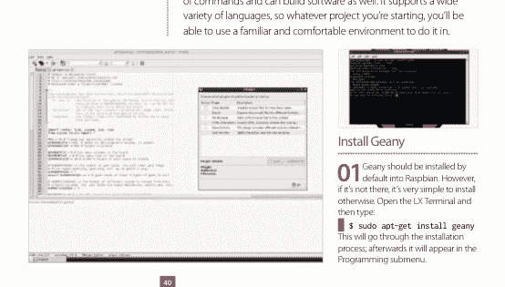

## 安装 Geany


# Geany 在 Raspbian 上的安装

Geany 在 Raspbian 上默认应该已经安装。如果没有，安装也非常简单。打开 LX 终端，然后输入：

```bash
$ sudo apt-get install geany
```

这将开始安装过程；之后，它将出现在“编程”子菜单中。

> **你知道吗**
>
> Geany 只是众多优秀的开发环境之一。搜索“Linux IDE”以获取更多想法。

## 新建文件

开始新建文件很容易，只需按下 `File` 然后选择 `New`，就像在文字处理器或文本编辑器中一样。这将创建一个空白文件，你可以立即开始在其中输入内容。将其保存为适当的文件类型，例如 `.py`，Geany 就会识别出代码是 Python，并开始进行标记。

## 标记

如果你无法将其保存为相关的文件类型，你还可以强制 Geany 使用特定的标记显示代码。转到 `Documents > Set Filetype`，然后从其中的可用选项中选择一个。它至少支持 50 种不同的语言。

## 打开文件

在 Geany 中打开现有文件很容易——只需单击 `File` 然后选择 `Open`。目前，我们将通过打开 `pi` 目录下 `python_games` 文件夹中的一个预装 Python 文件来测试 Geany 的一些功能。

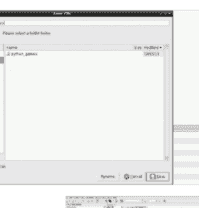

## 导航代码

IDE 的左列列出了代码重要部分的行号。对于 Python，这包括构成程序的函数和变量。你也可以单独点击它们，跳转到它们在代码中首次出现或定义的位置。


## 高级导航

当你有多个分散各处的函数和导入时，你的代码可能会开始看起来有点混乱。Geany 足够智能，能够识别这些内容，并允许你在检查代码时最小化循环、函数和导入块，如果这些部分并非必要的话。


## 自动补全

在编写程序时，你可能会注意到 Geany 会尝试猜测你试图使用的函数或变量。如果你忘记了变量的确切名称，这可能很有用，因为你可以使用箭头键在你刚才输入的内容相关的命令列表中向下移动。

## 测试代码

你可以通过点击顶部的齿轮图标来测试代码——这些允许你运行代码。任何错误都会显示在下一个窗口中，但如果一切按计划进行，它应该能毫无问题地运行。退出窗口，再次点击 `Run` 按钮以停止测试。


## 编译

完成代码后，你可以使用内置工具进行编译和构建。过程中发生的任何错误都会记录下来，允许你逐一查看，直到一切正常运行。

# 获取远程桌面访问

学习如何在树莓派不在你面前时访问其桌面。

VNC（虚拟网络计算）是一种图形桌面访问和共享系统，允许用户从自己的系统远程控制和操作另一台电脑的桌面。

它在很多方面都很方便：让你控制远程系统；帮助远处的另一位用户；允许电脑保持开机状态，但无需键盘、鼠标甚至显示器。

在我们的情况下，我们旨在允许访问树莓派桌面，而无需连接上述外围设备。这样，你可以做通常所做的一切，只需连接电源和即可，从而释放空间并节省额外费用。在实际应用中，这意味着你 potentially 可以通过 Android 平板电脑或手机访问树莓派桌面！

## 你需要什么

- `TightVNC`
- `www.tightvnc.com/en/relas2.7.php`

> **你知道吗**
>
> TightVNC/Viewer 是一个用于访问 VNC 服务器的免费资源，比如我们将在本教程中安装的那个


## 静态 IP 地址

我们的第一步是确保树莓派拥有静态 IP 地址。基本上，IP 地址是网络分配给设备的一组数字，用于区分它们。要设置静态 IP 地址，只需双击 LX 终端，输入以下内容，然后按 Enter：

```bash
sudo nano /etc/network/interfaces
```

### 静态 IP 第二部分

此文件控制树莓派的 IP 寻址。你需要向下滚动到 `iface eth0` 行，删除 DHCP 并将其替换为 `static`。现在，在下一行输入你希望树莓派拥有的 IP 地址，以及子网掩码和网关：

```bash
address 192.168.1.93
netmask 255.255.255.0
gateway 192.168.1.254
```

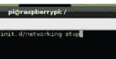

### 静态 IP 第三部分

输入这些详细信息后，按 `Ctrl+O` 退出 `nano`，或通过菜单保存并退出，然后按 `Y` 接受更改，再按几次 Enter 返回终端的命令提示符。现在你可以重启树莓派，或在终端中输入以下内容：

```bash
sudo /etc/init.d/networking restart
```

## 安装 VNC 第一部分

现在我们将安装 VNC，并确保在树莓派启动时自动启动它。在旧版本的 Raspbian 中，这曾经有点麻烦，因为配置服务经常有破坏系统的坏毛病。但现在不再了。输入以下命令，每输入一条后按 Enter。

```bash
sudo apt-get update
sudo apt-get install tightvncserver
tightvncserver
```

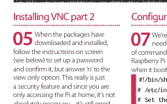

## 安装 VNC 第二部分

当包下载并安装完成后，按照屏幕上的说明设置密码并确认。但对于“仅查看”选项请回答 `n`。这真的只是一个安全功能，既然你只在家访问树莓派，它并不是绝对必要的——尽管这仍然是一个好习惯。

```text
You will require a password to access your desktops
Password:
Verify:
Would you like to enter a view-only password (y/n)? n
New 'X desktop' is raspberryi:1
```

## 配置 VNC 服务器

VNC 服务器已安装并运行起来。现在我们需确保每次树莓派重启时它都作为一个服务加载，这样即使树莓派经历断电重启，你也可以访问它。要配置树莓派以此方式工作，请在终端中输入以下内容并按 Enter。

```bash
sudo nano /etc/init.d/tightvncserver
```

## 配置启动服务

我们将回到 `nano`，并且需要输入几行命令，以便让树莓派在启动时激活 VNC 服务器。在编辑器中，输入：

```bash
#!/bin/sh
# /etc/init.d/tightvncserver
# Set the $VNCUSER variable to the name of the user to start tightvncserver under
VNCUSER='pi'
case "$1" in
start)
        su $VNCUSER -c '/usr/bin/tightvncserver :1'
        echo "Starting TightVNC server for $VNCUSER" ;;
stop)
        pkill Xtightvnc
        echo "tightvncserver stopped" ;;
*)
        echo "Usage: /etc/init.d/tightvncserver {start|stop}" ;;
esac
exit 0
```

## 重启并准备就绪

现在按 `Ctrl+X`，然后按 `Y` 保存，接着按几次 Enter 回到终端。我们现在需要做的就是添加我们刚创建的脚本的权限，使其可执行且有效。通过向终端输入以下命令来实现这一点，确保每条命令后都按 Enter，否则不会被注册。

```bash
sudo chmod 755 /etc/init.d/tightvncserver
sudo update-rc.d tightvncserver defaults
sudo reboot
```


完成这些步骤后，你需要做的最后一件事是拔掉树莓派，找一个方便连接网络电缆的地方。如果你安装了像 `TightVNC Viewer` 这样的软件，或任何其他远程访问软件（只要它使用 `Tight` 协议），你应该能够将客户端指向树莓派地址（`192.168.1.93` 或你想连接设备所在网络的静态 IP 地址），从而完全访问树莓派。


## 通过 SSH 访问您的文件

使用您家用电脑的终端快速安全地访问您的树莓派

- **您需要...**
  - 任意树莓派发行版
  - www.raspberrypi.com/downloads
  - 互联网连接
  - 第二台电脑

虽然远程登录完整的 X 环境（如我们在前几页中展示的）非常有用，但它也有其缺点。首先，这样做并不特别快捷或方便。用户体验可能会显得缓慢且笨重，但最糟糕的是，它并没有我们真正希望的那样安全。

> **你知道吗...**
> 
> `SSH` 是远程访问任何机器最安全的方法。它也比 `VNC` 更快。

如果你想以更方便且更安全的方式从另一台电脑访问你的树莓派，你会发现所有经验丰富的树莓派爱好者都会使用 `SSH`。`SSH` 代表 Secure Shell（安全外壳），是一种加密网络协议，旨在通过命令行确保数据安全通信。

尽管初学者可能会争辩说使用完整的图形界面远程访问树莓派更容易，但一旦你学会了一些基本的命令行技巧，你就会很快发现通过 `SSH`“潜入”树莓派是远程与之交互的最方便方式。

你会很高兴地听到，`SSH` 已经经过良好的出厂配置——你几乎不需要做任何事情就能让它工作，尤其是如果你的远程电脑运行的是 Linux 或 OS X，正如我们将要展示的那样。

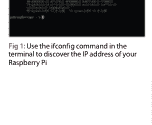

### 在 Linux 和 OS X 上使用 SSH 很简单

假设你的树莓派已开机并通过以太网或 Wi-Fi 无线网卡连接到网络，你唯一需要的信息就是你的树莓派的 IP 地址。要查找这个地址，你只需在树莓派上打开一个终端窗口并输入命令 `ifconfig`（图 1）。

如果你是通过以太网连接的，你会看到‘`eth0`’，然后是几行结果。IP 地址将是位于‘`inet addr`’一词旁边的第二行上的数字。如果你是通过 Wi-Fi 连接的，结果将位于‘what?’下的第二行。IP 地址本身是由句点分隔的四组数字。如果你在家用网络上，它可能类似于 `192.168.0.15`。我们在指南中将使用这个数字，但你应将其替换为你通过 `ifconfig` 看到的 IP 地址。

有了这些信息，你只需在远程 Linux PC 上打开一个终端窗口并输入：

```bash
ssh pi@192.168.0.15
```

这假设你的树莓派用户名仍然是默认的（即 `pi`），并且你用刚才记录的 IP 地址替换了示例中的 IP 地址。如果你已添加了用户账户或更改了默认值，你需要将‘@’前面的用户名替换为你更改后的用户名。当你按下回车键时，系统会提示你输入树莓派的密码——同样，如果是默认密码，你可以输入 `raspberry`，否则请输入你树莓派的密码并按下 `Return`。

现在你会看到命令行上的用户名详情已更改为反映你的树莓派的信息——你现在已远程连接。试着浏览你的文件或使用 `nano` 打开文件进行编辑！

### 再也不用输入 IP 地址了

当然，如果你把树莓派带到另一个网络，你的树莓派 IP 地址将会不同。如果你只是想远程连接它，仅仅为了获取 IP 地址而设置树莓派并连接键盘、鼠标和显示器就变得极其令人厌烦。如果你只需在终端中输入树莓派的名称就能连接，岂不更容易？这听起来好得令人难以置信，但实际操作起来非常简单。

你只需要一个小型软件，它可以让你通过名称而不是 IP 地址来发现本地网络上的主机和服务（图 2）。要在树莓派上安装它，你只需打开终端并输入：

```bash
sudo apt-get install avahi-daemon
```

安装完成后，你只需在终端中输入以下内容即可通过 SSH 访问你的树莓派：

```bash
ssh pi@raspberrypi.local
```

更重要的是，当你通过其他任何形式进行网络访问时，比如 Samba、通过 VNC 远程登录或任何其他用途，你都可以使用树莓派的名称！

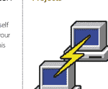

### 在 Windows 上使用 SSH

在 Windows 世界中，大多数事情都是如此，使用微软的操作系统访问你的树莓派并不像你想的那么直接。幸运的是，有一个有用的工具可以帮助：`Putty` 允许你建立安全外壳连接，而且易于设置和使用。你可以从以下地址下载 `Putty`：[www.chiark.greenend.org.uk/~sgtatham/putty/](https://www.chiark.greenend.org.uk/~sgtatham/putty/)

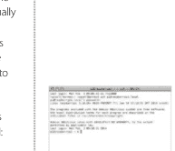

## 使用 Samba 共享你的文件

配置你的树莓派，以便通过家用网络共享主文件夹的内容

- **您需要...**
  - Raspbian
  - www.raspberrypi.org/downloads
  - 互联网连接

> **你知道吗...**
> 
> 你可以使用 `Samba` 与其他 Linux、Windows 和 Mac OS X 电脑进行网络通信——它完全支持跨平台。

无论你计划将树莓派设置为媒体中心、游戏机还是全功能的开发平台，能够从其他机器共享和访问你树莓派的内容都非常有用。

虽然树莓派配置得很好，但默认情况下它不包括与本地网络共享主文件夹内容的功能。不过，从本指南中你会看到，借助 `Samba`，实现这一点并不难，它可以帮助你从任何其他机器访问你的脚本、媒体或文档。


### 更新并安装 Samba

打开一个终端窗口并在终端中输入以下内容，以更新 Raspbian 存储库并安装 Samba：

```bash
sudo apt-get update && sudo apt-get install samba samba-common-bin
```

操作本身不应该花太长时间。只需确保在开始之前已连接到互联网。

### 加载 smb.conf

安装核心软件包后，你需要告诉 Samba 你希望它如何工作。你通过将首选设置放入 Samba 的配置文件中来实现这一点。此文件名为 `smb.conf`，位于 `/etc/samba` 文件夹中。虽然使用文件管理器很容易找到它，但从命令行打开和编辑它更简单。在终端窗口中输入以下内容以使用 `nano` 打开它：

```bash
sudo nano /etc/samba/smb.conf
```

### 初始设置

浏览一下该文件。这里有很多信息，看起来有点令人望而生畏，但只需进行少数几处修改和添加。首先，你需要确保分配了正确的工作组。除非你的网络配置不同，否则它可能名为 `WORKGROUP`。要找到工作组设置，请按 `Ctrl+W` 并输入 `workgroup`，然后按回车——这将带你到单词 'workgroup' 的第一次出现位置。使用方向键在不同行之间移动——在 `nano` 中鼠标不起作用。

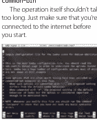

### Windows 支持

如果你的网络中有 Windows 电脑，你需要确保允许 WINS 支持。假设你正在使用默认的 `smb.conf` 配置文件，你会发现 WINS 支持的标志在工作组行下方几行处。编辑它使其看起来像这样：

```bash
wins support = yes
```

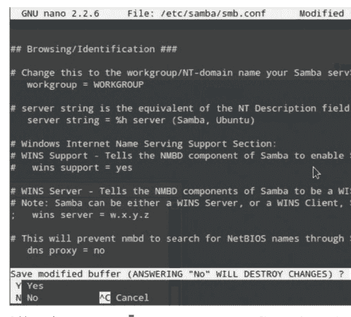

### 添加共享

**05** 接下来，你需要找到文件中名为 Share Definitions 的部分。同样，你可以使用组合键 `Ctrl+W` 打开搜索功能，然后输入 ‘share definitions’ 并按回车，直接跳转到该部分——它位于文档的最末尾附近。

转到文档的最末尾并添加以下内容。

```bash
[pi]
path=/home/pi
only guest = no
browseable = yes
writable = yes
create mask = 0777
directory mask = 0777
public = no
```

### 设置密码

**06** 你现在已经完成了对 `smb.conf` 文件的编辑。因此，按 `Ctrl-X` 保存并退出，然后按 `Y` 保存，再按回车退出。

通过此配置，一层密码安全机制已到位，因此我们现在需要设置一个 Samba 密码来配合使用。在终端窗口中，输入以下命令：

```bash
smbpasswd -a pi
```


系统将提示你输入并确认一个新密码。现在这就是你访问文件所需的用户名和密码。

## 重启 Samba

**07** 最后一步只是重启 Samba，以使你的新设置生效。

在终端中，输入以下命令：

```bash
sudo /etc/init.d/samba restart
```

下次你从另一台机器查看家用网络时，你会看到树莓派的主文件夹作为一个共享项列出。

## 备份你的树莓派

主动为你的树莓派进行备份，以确保你永远不会再次丢失文件。

### 你将需要……

- 第二台计算机
- 外部存储设备

### 你知道吗……

SD 卡并非永固，因此务必确保你已经备份了文件以及整个操作系统。

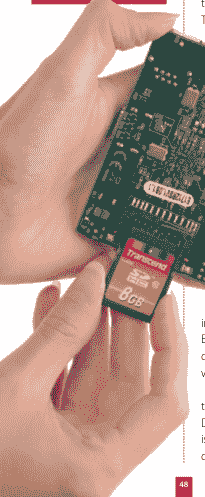

虽然树莓派是一台非常可靠的设备，但故障仍可能发生，因此最好未雨绸缪，妥善保护你的文件。

好消息是，Pi 的文件都保存在 SD 卡上。如果你的 Pi 损坏了，SD 卡上的所有内容仍然可用，并且可以从其他地方访问。不过，SD 卡仍然容易出现问题。备份 Pi 有多种方法。这些方法可以归纳为两个主要类别：保存重要文件和创建 SD 卡状态的精确副本。前者意味着在其他位置保留文件的副本，而后者则是创建与安装 Raspbian 或其他 Pi 操作系统时通常写入 SD 卡的相同类型的镜像。

### 重要文件

为了保存重要文件，我们需要在外部源上创建副本，例如外部硬盘或另一台 PC。其中一种最佳方法甚至不需要 Pi！你只需要一台带有读卡器的 PC 或笔记本电脑，一切就准备就绪。

关闭你的 Pi，拔掉电源并从插槽中取出 SD 卡。在 PC 上找到 SD 卡读卡器并将其插入。

Linux PC 默认可以读取 SD 卡的主文件系统，而 Windows 或 Mac 电脑在安装允许其读取 ext 文件系统的程序（如 `Ext2Fsd`）后也可以读取。在 Windows 上，SD 卡将列在“我的电脑”中其他驱动器下（图 1）。在 Linux 和 Mac 上，它将在菜单和文件管理器显示存储设备的位置列出。

一旦你在这里找到了 SD 卡，打开它并导航到 `home` 然后是 `pi`。这是可以找到“文档”、“下载”、“桌面”及其他目录的位置。你只需选择要复制的文件，并将它们移动到 PC 上或连接的外部硬盘上的安全目录中即可。

如果你希望将文件保留在另一台计算机上，那没问题，但长期来看，它将面临与 Pi 完全相同的问题。将它们保存在外部硬盘上是个好主意，放在云存储服务上则更好，这使你可以从任何有互联网连接的地方访问它们（图 2）。

### 克隆

创建克隆取决于你在主计算机上使用的操作系统。对于 Mac 和 Linux，你可以使用一个简单的命令行工具 `dd` 来创建 SD 卡的精确副本（图 3）。这是在终端模拟器或命令行中完成的，所以先打开它。确保 SD 卡已插入，然后输入：

```bash
$ fdisk -l
```

这会列出所有连接的存储设备。SD 卡的容量为 2GB、4GB 或 8GB，具体取决于其大小。它很可能被列为类似 `/dev/sdX` 的名称，其中 `X` 是计算机分配给 SD 卡的字母。要使用 `dd` 进行复制，请在终端中输入以下内容：

```bash
$ dd if=/dev/sdX of=backup.img bs=1M
```

你也可以为正在创建的镜像文件添加路径，将其放置在特定的文件夹中。该过程需要一些时间，并会生成一个多吉字节的文件，然后你可以通过反转上述命令将其写入 SD 卡：

```bash
$ dd if=backup.img of=/dev/sdX bs=1M
```

虽然这在备份方面很有用，但你可以使用此镜像批量制作 SD 卡，送给朋友或保留在你使用树莓派的各种场所。

### Windows

要在 Windows 上创建克隆，我们可以使用 Win32 磁盘映像工具（图 4）。从这里下载安装：bit.ly/L8JdYG。安装完成后，插入 SD 卡并启动该软件。为备份文件选择一个名称，并从设备列表中选择 SD 卡。现在按下“读取（Read）”，它将创建备份文件。同样，这可能需要一段时间；不过，这次至少会有一个进度条显示。

存储你的克隆镜像比存储重要文件要困难一些——由于镜像大小为千兆字节级别，它会填满许多云存储服务。如果你有空间，一定要保存在那里；不过，你可能需要将其放在外部硬盘上。

### 项目

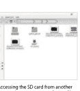


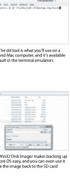

## 你将需要……

### 原型制作设备

- `RPi.GPIO`
- https://pypi.python.org/pypi/RPi.GPIO

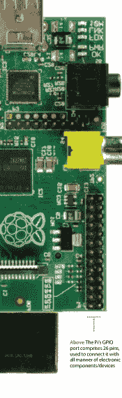

### GPIO 端口详解

了解如何利用树莓派上 GPIO 端口的强大功能。这比你想的更容易……

树莓派上的通用输入/输出（GPIO）引脚通常是你在这本书中发现的项目成功的关键。如果没有它们，你就无法与真实世界进行接口交互，无论是触发灯、按钮或蜂鸣器，还是读取传感器。

GPIO 引脚并非 Pi 独有；它们实际上是一种标准，旨在帮助控制各种集成电路的输入和输出行为。通常你会发现，任何单一的 GPIO 引脚都没有预定义的特定用途，并且默认情况下它们是关闭的。

### 树莓派 GPIO

树莓派上的 GPIO 引脚可以通过多种方式进行控制和触发。你可以直接从终端使用它们，通过 Bash 脚本，或者使用为流行编程语言专门设计的模块来控制它们。由于 Python 是树莓派的官方语言，你会发现 Python 的 GPIO 模块提供了可用的对输入和输出的最佳控制。该库名为 `RPi.GPIO`，默认安装在所有树莓派上，但也可以像安装任何有用的 Python 库一样安装。该项目托管在 SourceForge 上，可以在 `sourceforge.net/projects/raspberry-gpio-python` 找到。你还会找到有用的链接、信息以及如何从简单的 Python 脚本中使用和控制 GPIO 引脚的示例。如果你计划使用 `RPi.GPIO`，对 Python 有基本的理解会有所帮助，因此我们推荐像 www.codeacademy.com 上提供的基础入门课程，或者阅读 www.python.org/doc 上的官方 Python 文档。

树莓派上有 26 个 GPIO 引脚，你可以按意愿使用其中的绝大多数。然而，有几个引脚具有特殊用途，因此我们建议你熟悉它们的布局。例如，最顶行的一排引脚旨在为外部设备（如按钮和灯光）提供电力。由于需要接地线（通常称为“地线”）才能安全地创建电路，你也会发现 GPIO 端口中有几个地线引脚。

### 如何使用 GPIO 引脚

为了利用 GPIO 端口的强大功能，你需要几个基本组件，其中最重要的是跳线。由于端口上的引脚是“公”的，你需要根据打算连接到 Pi 的硬件购买“母对公”或“母对母”电缆。假设你要连接的设备也有公连接器，“母对母”跳线就很合适，而且你通常会使用面包板来原型化电路，在这种情况下首选“母对公”连接器。电缆和面包板可以从销售树莓派配件的任何在线商店廉价买到，通常可以在商店的“原型制作”部分找到。

### 命名约定

一旦准备好连接设备，下一个任务就是为工作找到正确的引脚。虽然确实所有 GPIO 端口都是多用途的，但有些比其他更通用！如前所述，某些引脚保留用于 `5V`、`3.3V` 和地线。其他引脚也具有特殊功能，更糟糕的是，它们还可以被称为不同的名称。例如，`GPIO 18` 也被称为引脚 `12` 和 `PCM_CLK`。这个特定引脚（位于 GPIO 端口右侧中部）能够进行硬件脉冲宽度调制（PWM），对于控制 LED 灯和电机等非常有用。

你在 Python 脚本中使用的引脚命名约定可以手动设置。你可以将其设置为 `BCM`（Broadcom 引脚名称）或物理引脚位置（`BOARD`）。

你会看到，在任何使用 GPIO 端口的示例项目中，都有一行包含括号内的 `BCM` 或 `BOARD`：

```python
GPIO.setmode(GPIO.BCM)
```

解决 GPIO 引脚命名问题最简单的方法是选择一个约定并坚持使用！

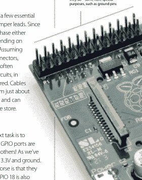

> 熟悉 GPIO 引脚的布局及其功能 – 一些引脚具有特殊用途，例如地线引脚

### 你知道吗……？

`RPi.GPIO` 库有一些非常有用的本地化功能 – 你只需在本地 PC 上执行 `pip install`：`sudo apt-get install python-rpi.gpio`

### 项目

### 使用摄像头板

以下是如何在树莓派上设置你的新 Pi 摄像头板，以及如何使用它……

#### 你需要什么……

- **树莓派**


- 系统：Raspbian: www.raspberrypi.org/downloads

# Pi 摄像头

- Adafruit 的 picam 模块：https://github.com/adafruit/picam


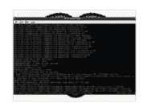

树莓派最新的配件之一是小巧的 Pi 摄像头板——一块安装了摄像头传感器的小型 PCB，通过排线连接到树莓派。它并不是即插即用的，因此你需要进行一些额外的设置。

Pi 摄像头具有多种功能，例如延时摄影、用作网络摄像头，甚至作为树莓派驱动的机器人（就像我们要制作的那个）的光学传感器。因为它不占用 USB 接口，且功耗极低，所以它比标准网络摄像头要灵活得多。

Pi 摄像头本身也不是低质量的设备——它配备 5MP 传感器，能够创建高达 1080p 质量的视频，与树莓派的 HDMI 输出相同。

> **你知道吗...**
>
> 摄像头板使用的传感器和硬件类型与大多数手机中的摄像头相同。

## Pi 准备

**02** 在我们尝试启用树莓派摄像头之前，我们需要通过快速软件升级确保我们的固件和软件都是最新的。在 Raspbian 中，我们通过打开终端并使用以下命令来实现：

```bash
$ sudo apt-get update
```

然后执行：

```bash
$ sudo apt-get upgrade
```

## 连接摄像头

**01** 要将摄像头连接到树莓派，请找到以太网口和 HDMI 口之间的插槽，并轻轻抬起卡扣。插入摄像头板的排线，确保排线的连接器与树莓派上的连接器对齐。排线上的蓝色标签应面向以太网口。

## Pi 配置

**03** 完成后，在终端或命令提示符中运行：

```bash
$ sudo raspi-config
```

启动标准配置屏幕。向下导航至*启用摄像头*，按 Enter 键，然后简单地导航到“启用”并再次按 Enter 键确认。选择**完成**，然后重新启动。


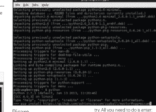

## 拍照

**04** 要使用树莓派摄像头拍照，你只需输入：

```bash
$ raspistill -o image.png
```

这将显示摄像头的输入五秒钟预览，然后捕获视频的最后帧。

## 录制视频

**05** 要录制视频，我们使用类似的命令 `raspivid`，如下所示：

```bash
$ raspivid -o video.h264
```

默认情况下，它也会录制五秒的视频。

## Picam

**06** 如果你想更多地使用 Pi 摄像头，目前有一个简单的 Python 封装库叫做 `picam`。不过，你需要先安装它，我们将使用 `pip` 来完成。使用以下命令安装 `pip`：

```bash
$ sudo apt-get install python-pip
```

然后输入：

```bash
$ pip install https://github.com/ashisters/picam/zipball/master#egg=picam
```

## Picam 照片

**07** 安装了该模块后，我们现在可以使用 Python 构建一个脚本，使用 `picam` 模块拍照。这并不像你可能想的那么难，所以即使你以前从未使用过 Python，也值得一试。你只需输入：

```python
import picam
i = picam.takePhoto()
i.save('/home/pi/test.jpg')
```

运行它将拍摄一张名为 `test.jpg` 的照片。

## 高级照片

**08** 你可以通过编辑代码使其看起来像这样，来拍摄特定大小和质量的照片，并使用基于时间的命名：

```python
import picam
import time
i = picam.takePhoto(picam.TakeDetails(640, 480, 85))
fileName = "tmp/picam-%s.jpg" % time.strftime("%Y%m%d-%H%M%S")
i.save(fileName)
```

## 保存及更多

**09** `Picam` 还允许你以与上述类似的方式录制视频，主要区别在于你将使用 `recordVideo` 命令。你可以使用代码来拍摄照片或视频，以注册延时摄影的间隔，或者在指定事件发生时触发拍摄。

> “凭借 5MP 传感器，它能够创建高达 1080p 的视频，与树莓派的 HDMI 输出相同”

# 使用 Scratch 编程

## 需求

- Scratch
- 互联网连接


Scratch 的网站 http://scratch.mit.edu 包含其他用户制作的程序和游戏。


位于 Studio 顶部的是三个快速访问图标和主菜单（图 3）。第一个地球仪样式的图标用于设置 Studio 的语言。另外两个按钮提供了快速访问项目保存和共享功能。在‘文件’菜单下，有一组典型的文件管理功能，用于打开、保存和导入 Scratch 项目。还有一个项目备注选项，我们可以在其中输入功能描述和注释。

‘编辑’菜单包含一组混合的动画、图像和音频编辑工具。而‘帮助’部分提供对基于浏览器的帮助页面的访问。相当有趣的是，‘共享’菜单允许我们将项目与全世界共享。任何 Scratch 项目都可以通过‘将此项目在线共享...’选项发布到 Scratch 社区网站


以及‘上传到 Scratch 服务器’表单（图 3）。

让我们加载‘Aquarium’（水族馆）示例项目。选择‘文件’菜单中的‘打开...’选项以显示打开项目对话框。从左侧的大按钮列表中，点击名为‘示例’的按钮。接下来，在右侧，双击选择‘动画’文件夹。然后选择‘6 水族馆’项。打开对话框窗口应与图 1 类似。

加载水族馆项目后，我们的 Scratch Studio 应与图 1 类似。我们将从舞台区域开始我们的 Studio 之旅。

使用 Pi 的图形编程语言进行编码的交互式指南

你想深入探索动画和游戏创作的世界吗？你想在不学习软件开发语言的情况下让你的创意想法成真吗？使用 Scratch，你可以做到所有这些，甚至更多。

Scratch 1.4 已经安装在官方的 ‘Wheezy’ Raspbian 操作系统镜像中。如果你的树莓派尚未安装 Scratch，别担心，只需访问 MIT 官方 Scratch 网站查找下载和安装说明即可。

要开始，我们只需打开 Scratch Studio。点击桌面上的 Scratch 猫图标，或在 LXDE 桌面菜单中找到 Scratch。

Scratch Studio 是一个完整的开发环境。它被划分为若干个独立的面板。每个面板在应用程序构建过程中都有特定的角色，以及自己特定的一套功能和工具。


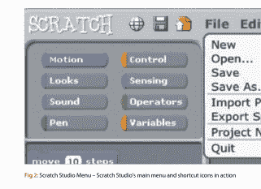

图 2：Scratch Studio 菜单 – Scratch Studio 的主菜单和快捷图标正在发挥作用

## Scratch Studio 舞台

**02** 舞台是所有动作发生的地方，位于 Scratch Studio 的右上角。

舞台由称为角色（sprites）的图形元素构成。这里我们有植物、气泡、鱼和其他生物。你也可以使用 Scratch 添加和裁剪自己的素材，但我们稍后再谈这个。

在舞台区域顶部，有一个绿色旗帜和一个红色圆圈。点击绿色旗帜让水族馆栩栩如生。现在花点时间研究水族馆动画。注意生物的运动和上升的气泡。红色圆圈图标停止动作。

我们可以使用位于绿色旗帜正上方的三个按钮设置视图模式。

左侧的两个按钮增加或减少舞台区域面板的大小。较小的舞台区域意味着 Studio 的中心区域在相对尺寸上增加。

右侧按钮是演示模式，它在全屏模式下显示舞台（见图 5）。通过左上角的弯曲箭头按钮或按‘esc’键退出演示模式。


图 3：项目共享对话框 – 我们可以使用 Studio 的共享菜单来共享我们的项目

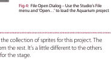


图 4：文件打开对话框 – 使用 `Studio` 的文件菜单和打开... 来加载水族馆项目

### Scratch Studio 角色

**03** 舞台区域下方是这个项目的角色集合。舞台的角色与其他角色分开。它与其他角色略有不同，并作为舞台的背景图像。

该区域顶部的三个按钮提供了创建新角色的各种方式。第一个按钮在绘制编辑器中打开一个空白画布。第二个按钮基于图像文件创建一个新角色，该文件从弹出文件选择对话框窗口中选择。第三个按钮将从预装的图像集合中随机选择一个图像。

我们可以使用主菜单右侧的四个按钮直接从舞台管理角色。这里我们点击一个特定的按钮，然后点击舞台上的一个角色。


图 5：舞台演示模式 – `Studio` 的舞台演示模式是查看项目的最佳方式

### 使用 Scratch 积木和工具

熟悉 Scratch Studio 工具箱

编辑面板位于 `Studio` 的中心。该面板与当前选中的角色（`sprite`）上下文相关。

让我们从角色收集区域中选择名为 `Creature1` 的水母角色开始。

顶部是角色的图像和名称，以及其当前舞台坐标和方向的指示。左侧有三个动画控制按钮。顶部按钮旋转角色，第二个按钮在面向左和面向右的状态之间切换，第三个按钮关闭动画。

下方有三个编辑面板标签页。`脚本`标签页是创建积木脚本的地方。我们将在这里拖放积木，并将它们以各种组合方式拼接在一起。

要改变角色的外观，我们将使用“造型（`Costumes`）”标签页。每个角色可以有一个或多个造型。例如，水母有两个造型（图1）。每个造型都有编辑、复制和删除的按钮。可以通过三个“新造型”按钮来绘制、导入或捕获新造型。声音标签页允许我们为项目添加音频。

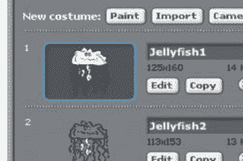

图 1：水母角色造型 - 水母角色有两个不同的造型

## Scratch 积木样式

- **01** “积木面板（Blocks Palette）”包含完整的脚本积木集合。积木有三种基本样式，即帽子（hats）、积木堆（stacks）和报表器（reporters）（见对面的图3）。

帽子样式积木会根据特定事件开始积木脚本的执行。经典的帽子积木是“绿色旗”点击事件。然而，还有其他许多帽子积木，包括在特定按键按下、鼠标点击后开始脚本执行的帽子积木，甚至是跟随某些 `GPIO` 连接硬件的传感器事件的帽子积木。正如你可能意识到的，这为 Scratch 程序员提供了许多选项。

报表器积木允许我们“捕捉”文本、数值和布尔值。它们嵌入其他积木中特定形状的“孔”中。矩形报表器包含文本字符串。圆角端报表器与数值相关，尖角端报表器包含布尔真值和假值。

积木堆是核心脚本构建元素。它们通过顶部的凹口和底部的凸起与其他积木互连。许多积木堆包含用于放置报表器样式积木的“孔”，这些积木会根据指定的报表器积木值修改其操作。

Scratch 积木集合被分为组。我们使用位于积木面板顶部的八个按钮来选择积木组，即“运动（`Motion`）”、“控制（`Control`）”、“外观（`Looks`）”等。这些组按颜色编码。除了辅助积木选择外，这种颜色编码在读编辑面板中的积木脚本时，也为积木类型提供了视觉线索。

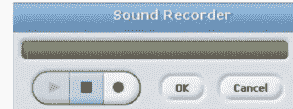

图 2：录音工具 - Scratch Studio 包含一个记录我们自定义声音的工具

## Scratch 积木帮助

- **02** 如我们所见，有许多积木，每个都有特定的功能和能力。

从某种程度上说，这是好消息。大量的积木集合意味着 Scratch 可用于广泛范围的软件项目，如游戏、动画、音乐、图形、数学、科学、机器人、电子学等等。

然而，广泛的积木选择对于初学者 Scratch 程序员来说可能是一个挑战。为帮助解决这个问题，Scratch Studio 设计人员包含了一组以积木为中心的信息丰富的帮助页面。

在任何积木上简单右键单击都会显示一个弹出帮助页面选项。帮助页面包含上下文相关的描述、图形图像，以及（在适当的情况下）使用该特定积木的脚本示例（图 4）。

这是一个极好的功能，大大简化了决定使用哪些积木的过程。更重要的是，研究这些帮助页面是增强我们现有技能并发现 Scratch 功能丰富的积木集合中潜力的非常有效的方式。


图 3：积木样式示例 - Scratch 积木有多种不同的样式

## 你知道吗……

启动你的项目有多种选择：你可以使用 `Star` 键或绿色旗积木。

## 积木脚本详解

- **03** 让我们深入了解积木脚本在实际中是如何工作的。为此，我们将使用一个简单的 `Aquarium`（水族馆）项目积木脚本。从“角色收集（Sprite Collection）”面板中选择 `Sprite` 角色。然后返回中心的“编辑面板（Edit panel）”，选择“脚本（Scripts）”标签页。

只有一个积木脚本。从顶部开始，有一个绿色旗帽子样式积木来启动活动。接下来是一个“永远（forever）”循环。循环内的积木被激活，直到按下停止按钮。这个永远循环积木包含另外两个积木。

第一个内部脚本积木选择下一个背景图像。点击“背景（Backgrounds）”标签页以查看所有舞台图像。第二个内部积木只是暂停执行几秒钟。将值设置为“1”意味着该脚本将在执行下一个积木指定的动作之前暂停一秒。

重要的是要记住这两个积木被“永远”循环积木包围。因此，舞台背景图像将依次显示，每个显示一秒。


图 4：积木帮助窗口 - 与“询问（ask）”和“等待（wait）”积木相关的帮助窗口示例

### 项目

**你需要……**

- `Raspbian`

- `Scratch`


`Scratch` 于 2003 年由麻省理工学院媒体实验室（MIT Media Lab）制作。它非常适合作为五岁儿童的第一门编程语言。

## 用 Scratch 制作绘图应用

以下是如何使用内置的画笔（`Pen`）工具添加颜色和铅笔尺寸

本教程的目的是使用 Scratch 中的画笔工具开发一个更实用的绘图应用程序，然后你可以自行扩展。它仅使用在 Pi 上安装包时自带的角色，但你可以轻松制作一些自定义角色来生成颜色变化。

你所要做的只是移动铅笔光标到颜色角色上，它就开始使用该颜色，然后只需点击并绘制。每次改变颜色时都会播放声音以让你知道。按键盘上的向上或向下箭头键会增加或减少铅笔尖的尺寸，而不是角色本身的尺寸。也会为此播放声音。

与所有 Scratch 程序一样，你只需点击绿色旗来运行脚本，点击红色圆圈来停止。


### 代码块

代码被分割成具有特定形状以相互嵌入的积木，在视觉上代表编程语法。

### 角色调用

加载到系统中的角色显示在这里，除非另有指示，否则它们将位于屏幕中央。

### 角色脚本

每个角色都有自己脚本化的程序，可以在多种条件或动作下启动。

### 自定义外观

角色可以被重绘以看起来完全不同，或者可以使用照片和相机抓拍。


### 加载角色

- **1.** 点击右上角使用“全舞台（Full Stage）”选项。然后，在角色窗口中，点击“加载角色（Load Sprites）”。选择红色太阳镜并加载。它们将显示在角色窗口中。在命令窗口中点击 `Ctrl`。将“当被点击（when clicked）”头部拖入脚本窗口。


### 定位在角落

- **02** 点击“运动（Motion）”并将“移动到 x（go to x）”拖入脚本窗口。将其锁定在“当被点击”的底部。输入值 `x=-200` 和 `y=155`。点击“外观（Looks）”并拖一个“将大小设置为（set size to）”积木并将其锁定。通过点击并输入将大小设置为 `40%`。

### 更多颜色角色

- **03** 对橙色、绿色和蓝色太阳镜角色重复此过程。为每个创建代码积木，将它们定位在 `x=200, y=155`，就像我们对红色做的那样。返回“加载角色”并加载绘图笔（Drawing Pen）。通过右键点击每个元素并选择“删除（Delete）”来删除随附的脚本。


### 设置绘图

- **04** 在“控制（Control）”下，拖入一个“当被点击”头部。从“画笔（Pen）”下获取“设置画笔大小（set pen size）”。点击变量并输入 `5`。转到“运动”并获取“移动到（go to）”积木。点击下拉箭头并选择“鼠标指针（mouse-pointer）”。从画笔组中拖出“清除（clear）”。


### 控制画笔绘制

- **05** 从“控制”组拖出一个“永远（forever）”循环，它位于代码之上，代码进入其内部。转到“运动”并拖出一个“移动到”。点击向下箭头并选择“鼠标指针”。转到“画笔”并抓取一个“画笔提起（pen up）”。将其塞在“移动到”下面。


### 绘图和颜色控制工具

- **06** 转到“控制”并抓取一个“如果（if）”。从“侦测（Sensing）”组抓取一个“鼠标按下？（mouse down？）”并将其放入“如果”运算符中。从“画笔”组获取一个“画笔落下（pen down）”。将其放在“如果”下方和内部。下一步重复四次，每种颜色和角色一次。

### 如何控制颜色变化

- **07** 从“控制”抓取一个“如果”，从“侦测”放入一个“触碰（touching）”条件内部。将触发器设置为 `Sprite1`。从“画笔”获取“将画笔颜色设置为（set pen color to）”，点击颜色方块并使用下拉菜单采样角色。从“声音（Sound）”获取“播放声音（play sound）”并选择“喵（meow）”。

### 设置画笔大小

- **08** 添加另一个“如果”并放入“按键 a 按下（key pressed a）”作为主题。选择“上箭头（up arrow）”作为触发器。获取“画笔大小改变（change pen size by）”并输入 1。使用“播放声音”选择“弹（pop）”然后添加“等待（wait）”0.25 秒。重复此组，但使用“下箭头（down arrow）”和画笔大小为 -1。

### 项目

在 Scratch 中创建贪吃蛇游戏克隆版

### 你需要什么...

- Scratch 项目存档
- `http://scratch.mit.edu/explore/?date=ever`

### 在 Scratch 中创建贪吃蛇游戏克隆版

设计你自己的贪吃蛇版本，以测试你的新编程技能！

> 你知道吗...
>
> 贪吃蛇是一款在 70 年代街机中诞生的非常流行的入门游戏，直到今天依然流行。

在这里，我们将创建一个经典贪吃蛇游戏的版本，你可以使用箭头键在 Scratch 舞台上移动蛇。你控制蛇头，必须避免与蛇身或舞台边缘发生碰撞。

每次你吃掉一个蛋，蛇身就会变长。吃掉好的黄色蛋会增加分数，吃掉坏的黑色蛋会扣除分数。还有额外的奖励精灵可以吃，以获得更多分数。

通过遵循本教程，你将学会创建自己的简单精灵图形、发送和接收广播事件、使用列表变量存储数据、播放音效、生成随机数以及使用感应命令检测精灵何时触摸到某物。


### 绘制蛇精灵

- 01 点击“新精灵：画笔”图标来绘制蛇精灵。
- 在绘图编辑器中，为蛇头绘制一个小绿色椭圆，并添加一个红色矩形作为舌头。
- 舌头颜色必须与头部不同。将你的精灵命名为“Snake”（蛇）。

### 添加蛇的声音

02 当蛇的舌头碰到蛇身或舞台边缘时，我们将播放游戏结束的声音。我们需要将此声音添加到蛇精灵中。选中蛇精灵后，点击“声音”选项卡并选择“导入”。选择“Electronic-Screetch”声音。


### 创建蛇变量

04 点击“变量”面板。创建两个变量“`Score`”（分数）和“`Speed`”（速度），使它们对所有精灵可见。创建一个名为“`Next Direction`”（下一方向）的列表，使该列表对所有精灵可见；它将存储蛇头经过的方向序列。仅勾选“`Score`”变量使其出现在舞台上。


### 初始化蛇变量

05 使用“当绿旗被点击”控制命令，并使用变量面板中的命令初始化蛇变量，如图所示。我们希望游戏开始时“`Next Direction`”列表为空，因此删除其所有条目。分数必须从零开始。速度用于设置难度。


### 绘制蛇身

06 使用画笔面板中的命令来编码绘制蛇身。你还应该使用移动面板中的命令将蛇移动到舞台中心，并在每局游戏开始时指向左侧。在蛇到达起始位置之前，画笔处于关闭状态。在下一步中，我们将使用颜色来检查蛇头是否触摸到任何不该触摸的东西。


### 添加主操作循环

07 使用“`forever`”命令，并在其中嵌套一个“如果-否则”命令：如果红色舌头正触碰蓝色身体（身体始终触碰身体）或者蛇精灵触碰边缘，则发生碰撞。使用滴管工具在 Scratch 中选择颜色。


### 处理游戏结束

08 当检测到碰撞时，向其他精灵广播“游戏结束”事件（你需要创建一个新的事件），以便它们可以做出反应。此外，播放“Screetch”音效并停止所有脚本，使蛇在游戏结束时冻结在其当前位置。


### 响应箭头键

03 从控制面板中拖动四个“当按下按键”命令，并从移动面板中拖动四个“朝方向移动”命令。按照显示的方式配置它们，使上箭头将方向更改为 0 度（向上）等。点击舞台上方的绿旗以测试此功能。


### 处理移动

09 现在处理没有碰撞且蛇必须沿当前方向移动的典型情况。画笔已放下，因此它将绘制身体。`Speed`变量决定移动的步数。将当前方向添加到“`Next Direction`”列表中，以便尾部读取。


### 尝试蛇

10 现在你可以尝试你的蛇精灵了。它将响应箭头键的按下在屏幕上移动。它将绘制其身体，这只会让它越来越长，因为我们需要尾部来擦除它。并且当检测到碰撞时，它会伸展并结束游戏。


### 绘制尾部

11 点击“新精灵：画笔”图标来绘制尾部精灵。绘制一个小绿色圆圈来表示尾部的末端。将此精灵命名为“Tail”（尾部）。尾部精灵将跟随蛇并擦除其尾部的末端，从而使蛇身不会无限生长。

### 创建一个“增长”变量

12 创建一个“`Grow`”（增长）变量，该变量仅用于此精灵 – 其他精灵不需要访问它。生长变量用于确定何时蛇身需要增长，因此尾部需要增长，以便让头部进一步前进之前跟随。


### 处理事件

13 尾部需要监听两个你需要按需创建的新事件。当它接收到来自蛋精灵之一的“蛋被吃掉”事件时，它将“`Grow`”设为 1，以便尾部可以暂停。当它接收到来自蛇的“游戏结束”事件时，它必须冻结。


### 初始化尾部

14 当点击绿旗开始游戏时，“`Grow`”被设为 1，因此蛇获得短的身体。将画笔抬起并移动到舞台中心，配置画笔以绘制与舞台背景颜色和大小相同的尾部，以便擦除身体。

### 增长和移动

15 使用“`forever`”命令保持尾部移动。如果“`Grow`”为 1，它应该暂停并将“`Grow`”重置为 0 – 这会使身体变长。使用“`Next Direction`”中的第一个值设置方向，并移除它以便下次获取新值。移动“`Speed`”步。


### 尝试尾部

16 现在你可以尝试尾部精灵了。蛇暂时不会持续生长，因为它不会接收到任何“蛋被吃掉”事件。但尾部将跟随蛇头在舞台上移动，通过用与背景颜色相同的白色画笔覆盖来擦除蛇身。


### 绘制蛋精灵

17 点击“新精灵：画笔”图标来绘制新精灵。在绘图编辑器中，绘制一个小黄色椭圆。将精灵命名为“Egg”（蛋）。蛋将随机出现在舞台上，并导致蛇身变长并增加其分数。


### 添加蛋的声音

18 转到蛋精灵的声音选项卡并导入“Recreation-Symbol Crash”声音。或者你也可以选择其他声音。此声音将在蛇吃掉蛋时播放。


### 添加蛋脚本

19 复制蛋脚本，使蛋在游戏开始时随机出现。当蛋感知到它被吃掉时，它必须隐藏，播放“Cyber”声音（或你在第 18 步中选择的声音），更新分数，广播“蛋被吃掉”事件，然后再次随机出现。当接收到“游戏结束”事件时，它必须停止。

### 制作坏蛋

20 以与蛋相同的方式创建黑色坏蛋，但使用不同的图形和“ Instruments-StringPluck”声音。将蛋的绿旗脚本拖动到坏蛋上以复制它们 – 只需更改播放的声音并减少分数而不是增加分数。


### 让坏蛋变大

21 为坏蛋添加另一个“当绿旗被点击”脚本，使其在新游戏开始时将其大小设置为默认的 100%，然后每 10 秒将其大小增加 10。坏蛋会变得越来越大，越来越难避免。


### 创建奖励精灵

22 以类似的方式创建奖励精灵。你可以为奖励选择形状和声音。其脚本与蛋的脚本相似，因此你可以将其中一个拖动到奖励精灵上并以此为基准进行工作。确保更改声音并随机增加奖励分数。


## 制作多项选择题测验

学习如何使用列表为快节奏的基于 Scratch 的测验创建问题和答案

这个 Scratch 测验的关键特性是处理文本和数字的能力。然而，Designer 更偏向于动画图形，而其薄弱环节——数组、文本显示和变量输入——恰恰是这类项目所必需的。该项目的核心是使用列表，即 Scratch 中数组的等价物。主要缺点是，虽然列表可以有多行，但只有一列。对于这个项目，我们需要列来存放问题、三个不同的答案以及用于匹配键盘输入的正确答案代码。如果包含十个问题，这将需要一个 10x5 的数组变量。在 Scratch 中，这意味着我们需要五个 10x1 的列表。让我们开始吧……

### 所需材料...

- Scratch


**组合单词**

代码的特性是 Scratch 中从列表中将字符串相加的等价功能，生成一个字符串变量

**问题和答案**

所有文本问题、答案以及作为数字的正确答案都存储在列表中，这些列表是简单的数组

> **你知道吗...**
>
> 只要注明出处，你就可以使用其他用户制作的项目作为基础，在此基础上“构建”属于自己的项目！

**勾选框显示**

一旦所有列表都已填充，你需要将它们从屏幕上移除。取消勾选此处即可实现

**答对了吗？**

这段代码仅通过检查答案列表并递增分数来检测是否输入了正确答案


### 创建列表

1. 点击“变量”并创建一个名为 `Questions` 的列表。一旦创建，列表就会出现在舞台窗口中，等待你编辑。点击加号开始添加元素。在一个包含 10 个国家的列表中，输入你所有的国家名称。如有需要，点击第 11 个元素的 x 小部件。

### 填写答案

2. 对三个新列表重复此过程，每个列表包含一个答案。在操作时并排排列它们很有用，这样你可以确保每个问题都有一个正确答案。创建一个最终的列表，包含数字 1 到 3。这标识了哪个数字列表拥有正确答案。


### 设置

3. 现在创建三个新变量，分别名为 `Capital`、`YourScore` 和 `counter`。取消勾选列表中的所有变量，使它们从舞台上消失。将 `counter` 设置为 1，将 `YourScore` 设置为 0。定位角色并警告玩家准备就绪。


### 创建循环，设置问题

4. 从“控制”中拖动一个 `Repeat`（重复）循环，并将问题数量设置为 10。添加函数 `Set Capital` 并将其置空。拖动一个名为 `Join ()`（合并）的运算符。使前半部分为文本。在后半部分添加一个变量，并将 `Counter` 放入 `Questions`。

### 显示答案

5. 从“外观”中添加一个 `Say ()`（说），并放入 `Capital`。然后使用 `Say` 命令并添加 `Join ()` 来创建三个答案。第一个条目只是答案的编号，第二部分是文本。


### 扫描答案

6. 在显示答案之间有暂停。添加 `Say` 提示按下 1、2 或 3。拖动一个 `Wait until`（等待直到）控制块。进入运算符。只有两个条件的运算符，所以使用它，然后在第二个框中再放入两个额外的条件以构成三个。


### 答案正确吗？

7. 拖动一个 `If ()`（如果）控制块。将一个 `=` 运算符放入空格中。在第一个空格添加 `Key 1 pressed` 和 `0 = [?] 运算符`。在第二个放入另一个 `[?] = [?] 运算符`。在第一部分添加来自 `变量` 的 Item `[?] of [?]`，其中 `Counter`，并在第二部分输入 `1`。


### 重复并添加分数

8. 为正确答案添加一个 `Change Your Score by 1`（将你的分数改变 1）。对其余两个答案重复此操作两次。然后将 `Counter` 变量增加 1 并清除屏幕。在循环外部添加一些暂停以显示测验结束，然后显示 `YourScore` 中的分数。干得好，你完成了你的第一个测验游戏！

## 使用 Scratch 进行交互式操作

### 所需材料...

- 面包板
- LED
- 按钮
- 电阻
- 跳线
- ScratchGPIO3

通过使用 Scratch 与树莓派上的按钮和灯光进行交互，探索物理计算

Scratch 是一种非常简单的可视化编程语言，通常用于向任何年龄的学习者教授基本编程概念。在这个项目中，我们将学习如何在 Scratch 中点亮一个 LED 当按钮被按下时，然后使用树莓派上的通用输入/输出 (GPIO) 引脚，在按下物理按钮时改变角色的颜色。利用这些技术，你可以制作各种有趣和引人入胜的项目，从音乐键盘到 Scratch 游戏和动画的控制器。你需要一些组件来完成本指南。只需在线搜索 "Raspberry Pi GPIO basic kit" 即可开始。

> 稍作调整，下面提到的 Scratch 可用于物联网项目


> “在这个项目中，我们将学习如何使用 GPIO 引脚，在 Scratch 中当按钮被按下时点亮一个 LED”

### 安装所需的软件包

1. 使用用户名 `Pi` 和密码 `raspberry` 登录 Raspbian 系统。使用命令 `startx` 启动 LXDE 桌面环境。接下来，打开终端并输入以下命令：

```bash
wget http://liamfraser.co.uk/lud/Install_scratchgpio3.sh
chmod +x install_scratchgpio3.sh
bash install_scratchgpio3.sh
```

这将在你的桌面上创建一个名为 `ScratchGPIO3` 的特殊版本 Scratch。这是一个普通版本的 Scratch，包含一个 Python 脚本，用于处理 Scratch 和 GPIO 之间的通信。`ScratchGPIO` 由 smples (simpleyc.wordpress.com) 创建。

### 连接面包板

2. 关闭 Pi 的电源，并断开电源线。准备好你的面包板、一个 LED、一个 330 欧姆电阻和两根 GPIO 电缆。我们将把 3.3V 引脚（右上角引脚，最靠近 SD 卡）连接到 330 欧姆电阻的一端，然后将 LED 的正极端（较长的引脚为正极）连接到另一端。电阻用于限制流向 LED 的电流大小。

然后将 LED 的负极端插入面包板的负极轨。将其中一个 GROUND 引脚（例如，底部一行引脚从右数第三个引脚）连接到负极轨。现在将电源连接到你的 Pi。LED 应该会亮起。如果它没有亮起，那么很可能是你接反了，所以断开电源，交换引脚位置，然后重试。

### 开关 LED


目前，LED 连接到一个持续提供 3.3V 的引脚。如果我们想要能够打开和关闭它，这并不是很有用，所以我们把它连接到 `GPIO 17`，我们可以将其打开和关闭。`GPIO 17` 是顶部一行引脚从右数第六个引脚。重新打开 Pi 的电源。我们可以通过导出 GPIO 引脚，将其设置为输出引脚，然后将其值设置为 1 来点亮 LED。将值设置为 0 可以关闭 LED。

```bash
echo 17 > /sys/class/gpio/export
echo out > /sys/class/gpio/gpio17/direction
echo 1 > /sys/class/gpio/gpio17/value
echo 0 > /sys/class/gpio/gpio17/value
```


### 从 Scratch 控制 LED

启动 LXDE 桌面环境并打开 ScratchGPIO。进入控制部分，创建一个简单脚本，当点击 Sprite1 时广播 `pin 10`。然后点击角色。LED 应该会亮起。然后在脚本中添加等待 1 秒，然后广播 `pin 1 off` 再次点击角色。LED 将亮起一秒然后熄灭。

### 连接我们的按压按钮

再次关闭 Pi 的电源。这个电路比之前创建的 LED 电路稍微复杂一点。我们需要做的第一件事是将 3.3V 连接到我们之前用于测试 LED 的右上角引脚，连接到面包板的正极轨。我们需要将一个 10kOhm 电阻连接到正极轨，另一端连接到面包板上的一个空轨道。然后，在同一轨道上，添加一根导线，其一端连接到 `GPIO 4`。这是在 `GPIO 17` 右侧两个引脚的位置。然后，再次在同一轨道上，连接按压按钮的一个引脚。最后，通过将导线连接到与 `ground` 相同的负极轨，将按压按钮的另一个引脚连接到地。

当按钮未被按下时，`GPIO 4` 将读取 3.3V。然而，当按钮被按下时，到地的电路将被闭合，`GPIO 4` 将读取 0V（并且具有 0V 的电压，因为通往地的路径电阻小得多）。我们可以通过监视引脚的值然后按下按钮使其变化来利用这一特性。

```bash
echo 4 > /sys/class/gpio/export
echo in > /sys/class/gpio/gpio4/direction
cat /sys/class/gpio/gpio4/value
```

### 让我们点亮！

启动 Pi 并打开 ScratchGPIO。进入控制部分，添加当绿色旗帜被点击，然后附加一个 forever 循环，并在其中添加一个 if else 语句。从运算符部分添加一个 if [] = [] 运算符到该语句。然后进入 sensing 部分，在等式左侧添加一个 value 传感器，并将其设置为 `pin7`。在右侧输入 0。如果传感器值为 0，则广播 `pin 1`，否则广播 `pin 1 off`。点击绿色旗帜。如果你按下按钮，LED 将会亮起。

### 项目

### 打造完整的媒体中心

**所需材料...**

- 互联网连接
- 外部硬盘
- VESA 支架
- HDMI 线缆

**打造完整的媒体中心**

通过安装一些简单的软件并进行微调，将您的树莓派变身完美的媒体中心。作为家庭影院电脑（HTPC），树莓派有多种使用方式，其中基于 XBMC 的发行版是最好的选择之一。`OpenELEC` 是一种非常适合专门用于此目的轻量级方案，但我们将介绍更具可定制性的基于 Debian 的 `Raspbmc`。

**你知道吗...**

树莓派最受欢迎的用途之一是将其转换为媒体中心。它运行快速、安静，且易于隐藏。

**完美适配树莓派**

树莓派是完美的媒体中心，且有相应软件可利用这一优势。

**多种选择**

在不同 HTPC 解决方案之间做出选择，它们各有优劣。

**使用多个共享**

以完整的 1080p 分辨率观看本地和网络视频，还可以播放音乐和查看图片。

**使用网页应用**

让基于网络的流行视频流媒体应用直接运行在您的树莓派上。


### 安装 Raspbmc

`Raspbmc` 提供可下载的的安装程序，始终为您获取最新的树莓派镜像。创建一个新目录，然后使用以下命令下载：

```bash
$ wget http://svn.stmlabs.com/svn/raspbmc/release/installers/python/install.py
```

使用以下命令使其可执行：

```bash
$ chmod +x install.py
```

然后运行它：

```bash
$ sudo python install.py
```

遵循屏幕上的说明，然后它将安装到您的树莓派上。


### 抓取您的媒体信息

选择源之后，您可以选择从哪个服务抓取信息。这为您提供正在观看的影片更多详细信息，例如剧集摘要和正式名称。确保您的电影文件名后缀带有年份，您的电视剧也需如此。


### 安卓遥控

谷歌应用商店有官方的 Android Remote 应用。一旦启用 Web 服务器，它就可以控制 XBMC。将其下载到手机并启动。进入设置，添加新主机，并输入前一步骤中的 IP 地址和端口（默认 80）。


### 设置

通过这种方式安装 `Raspbmc`，该发行版将在首次启动时下载最新镜像并更新以在您的树莓派上运行。这会比较耗时，并需要重启几次，但仅在第一次发生时。在 XBMC 中选择您的语言，即可完成设置。

### 获取一些应用

在任何内容标签页中，前往附加组件（Add-Ons）。它会显示您已经安装的应用，默认为无。选择“更多”（More）后，将显示所有可用应用的完整列表。您可以从那里一键安装它们。


### 使用 CEC

如果您的电视支持，可以通过 HDMI 使用 CEC 来控制基于 XBMC 的树莓派。CEC 默认应已启用，因此您可以使用一个遥控器控制您的设置。请参阅 XBMC 维基以了解您的电视是否支持 CEC，以及如何利用它：[bit.ly/18ykHdf](bit.ly/18ykHdf)


### 网络共享

您可以为 XBMC 添加文件源。首先前往视频，然后添加源（Add Source）。前往浏览（Browse），您可以添加本地或网络文件。对于网络共享，选择 UPnP 或 SMB 共享。查看网络上可见的内容，或者如果您知道直接路径，则选择“添加网络位置”（Add network location）。音乐和图片的操作也与此相同。

### Web 遥控器

在设置中，前往服务（Services），然后选择 WebServer（Web 服务器）。启用它，现在您就可以使用 Web 浏览器控制您的树莓派。要访问 Web 浏览器遥控器，请在浏览器中输入 IP 地址——可在主屏幕的设置标签下的系统信息中找到——后跟‘:80’。

### 传统遥控器

XBMC 支持大量通用遥控器，这些遥控器包含或支持 USB IR 接收器。其中最优秀的设备之一是 FLIRC，这是一种完全可编程的 USB IR 接收器，允许您使用任何遥控器与树莓派配合。


### 项目

**所需材料...**

- RetroPie
- bit.ly/retrohack.com/download/retro-pie-image

**你知道吗...**

模拟器在某种程度上处于法律的灰色地带。您必须拥有原始游戏才能在树莓派上模拟它们。

### 打造你自己的复古游戏机

使用 RetroPie，一个为将昔日游戏带到树莓派上的发行版，满足您的复古游戏瘾。人们创建自己的街机柜或自行组装复古游戏机的趋势正在增长，树莓派的体积和性能使其完美适用于此。按照我们的教程，将您的树莓派变成一个功能强大的模拟平台。

**控制权限**

开箱即可正确配置 USB 和 P3 控制器。

**快速且灵活**

配置 RetroPie 以获得更强的电力控制。

**兼容 Xbox**

安装驱动程序以使用 Xbox 360 控制器。

**几十年的乐趣**

将您的树莓派变为终极便携式复古游戏机。


# RetroPie 安装与配置

## 安装 RetroPie

01 从网站下载最新的 RetroPie 镜像并解压。与安装其他树莓派发行版类似，您只需要使用以下命令将镜像写入 SD 卡：

```bash
$ sudo dd bs=8M if=[path to image] of=/dev/[path to sd card]
```

## 初始设置

02 首次启动时，系统将要求您配置控制器，这可以通过键盘、标准 USB 控制器或 P53 控制器完成。RetroPie 的初始设置仅提供非常有限的控制，您需要启动一个单独的工具来进行更好的配置。

## 校准控制器

03 按下您设置好的菜单按钮，并进入 `ext`。您将进入命令行。连接 USB 控制器并输入以下内容：

```bash
$ cd RetroPie/retroarch/tools
..and then
$ . /retroarch-joyconfg >> ~/RetroPie/configs/all/retroarch.cfg
```

按照屏幕上的说明正确配置您的控制器。

## 使用 Xbox 360 手柄

04 要使用有线或 PC 兼容的 Xbox 360 控制器，您首先需要安装正确的驱动程序：

```bash
$ sudo apt-get install xboxdrv
```

然后编辑 `~/etc/local`，添加：

```bash
$xboxdrv --trigger-as-button --wid 0 -L 02 -O zone 4000 --silent &
sleep 1
```

..在 `ext 0` 之前。如果是有线控制器，将 `--wid` 更改为 `-id`。重启。

## 识别 360 控制器

05 首先前往 `tools` 并将 360 手柄添加到您的配置文件中：

```bash
$ cd ~/RetroPie/retroarch/tools
```

然后输入以下内容：

```bash
$ . /retroarch-joyconfg -o -p cfg -p 1 -j 0
```

最后使用以下命令将文件添加到 RetroArch：

```bash
$ sudo cat p.cfg >> ~/RetroPie/configs/all/retroarch.cfg
```

保存并重启。

## 添加一些游戏

06 将游戏添加到树莓派很简单。从树莓派中取出 SD 卡并将其插入电脑。将任何 ROM 或兼容的电脑文件移动到：

```bash
[path to SD card]/home/pi/RetroPie/roms/
```

相关文件夹中。


## 导航 RetroPie

07 当特定模拟器有游戏时，RetroPie 会自动登录并允许您访问它。按左或右可以在模拟器之间移动，这些模拟器随后提供选项以加载 SD 卡上的游戏。

## 双人对战

08 对于多人游戏，最好使用两个同类型的控制器。前往 `~/RetroPie/configs/all/retroarch.cfg` 的底部，复制代码 `input_player1_joypad_index = "0"` 并粘贴给玩家。将每个 `player1` 实例更改为 `player2`，第二个控制器就可以正常工作了。

## 安全重启

09 某些模拟器无法退出，意味着您每次都需要通过拔掉电源物理重启树莓派。我们可以再次前往 `retroarch.cfg` 并在末尾添加热键，以退出模拟器：

```bash
input_enable_hotkeys_btn = "4"
input_exit_emulator_btn = "4"
```

# 使用 Sonic Pi 制作音乐

## 制作音乐

使用 Sonic Pi 编程创作你自己的旋律，并制作音乐音效或机器人蜂鸣声

## 你需要准备...

- 便携式扬声器
- 或耳机
- Sonic Pi
- www.cl.cam.ac.uk/projects/raspberrypi/sonicpi/teaching.html

## 你知道吗...

Sonic Pi 默认已安装在最新版本的 Raspbian 操作系统中。如果它缺失了，请遵循第一步！

Scratch 的主要特点之一是它能够向儿童和没有计算背景的人教授编程基础。对于儿童来说，由于它允许他们通过创建可互动的电子游戏作为学习的一部分来吸引他们，因此特别有吸引力。在这种类似的情况下，Sonic Pi 使用音乐来教授人们编程。它使用一种简单的语言，利用基本的逻辑步骤，但以比 Scratch 更高级的方式进行。它可以用作 avid coders 的下一步，或者作为一种方式为物联网或机器人创作音乐。

> “通过使用 Sonic Pi 的更多功能，我们可以开始制作更复杂的旋律”


Sonic Pi 是学习基本编程原理并享受乐趣的好方法


## 获取 Sonic Pi

01 如果你安装了最新版本的 Raspbian，Sonic Pi 将默认包含在内。如果你仍然使用稍旧的版本，那么你需要通过软件仓库安装它。操作如下：

```
$ sudo apt-get install sonic-pi
```

## 开始使用 Sonic Pi

02 Sonic Pi 位于菜单中的“教育”类别中。打开它，你会看到一个看起来像 IDE 的东西。左侧窗格允许你输入项目的代码，并带有针对其自身语言风格的适当语法高亮。运行时，信息窗格详细说明了 Sonic Pi 正在播放的内容——任何错误也会在单独的窗格中列出以供参考。

## 设定节拍

04 对于任何乐曲，你都需要设定速度。我们可以从在代码开头放置 `set_tempo 200` 开始。我们可以通过使用 `play_pattern` 创建一串 midi 音符来测试它：

```
play_pattern
[40,25,45,25,50,50]
```

这将按照我们设定的速度，以漂亮的钟声音调播放这些音调。你可以创建更长或更短的信，也可以改变它们的演奏方式。

## 你的第一个音符

03 我们在 Sonic Pi 上首先要尝试的是简单地能够播放一个音符。Sonic Pi 有几个默认预设，因此我们可以从以下开始：

```
play 50
```

按播放按钮，输出窗口将向你显示正在播放的内容。Sonic Pi 输出的默认音调是漂亮的钟声，而 50 决定了声音的音高和音调。


## 推进你的旋律

05 通过使用 Sonic Pi 的更多功能，我们可以开始制作更复杂的旋律。你可以使用 `with_synth` 改变音符类型，反转模式，甚至使用 `times` 功能创建一个有限的循环，以结束并标志循环的开始和结束。在重复之前，所有内容都是按顺序播放的，很像普通代码中的 if 或 while 循环。

## 完整代码列表

```ruby
set_tempo   200
play_pattern  [40,25,45,25,50,50]
2.times do
  with_synth "beep"
    play_pattern  [40,25,45,25,50,50]
    play_pattern  [40,25,45,25,50,50].reverse
  end
play_pad "saws", 3
in_thread do
  with_synth "fm"
    6.times do
      if rand < 0.5
        play 30
      else
        play 50
      end
      sleep 2
    end
  end
2.times do
  play_synth "pretty_bell"
    play_pattern  [40,25,45,25,50,50]
    play_pattern  [40,25,45,25,50,50].reverse
  end
end
```

## 举办音乐会

06 使用 `in_thread` 功能，我们能够为 Sonic Pi 实例创建另一个线程，并有几行音乐代码同时播放，而不是按顺序播放。

我们让它创建一个随机序列的音符系列，并使用 `play_pad` 功能让它们在由鼠标位置和速度创建的额外音符旁边播放。

# 项目

## 你需要准备...

- **面包板：**
  www.pctric-pt.co.uk/half-size-breadboard
- **3mm LED 灯：**
  www.ultralife.co.uk/led-product-category/basic-leds-3-5-8-10mm.html
- **导线：**


www.pctric.co.uk/product/breadboard-wires

- **270欧姆电阻：**

  http://goo.gl/xDwfD#p991


*图 1：* 开始所需的所有物品：使用 PWM 调整 LED。导线应有公头和母头两端。


*图 2：* 将母头端放置在 Pi 上，注意引脚 1 由小 Pi 标识。蓝色线是接地。


*图 3：* 连接好一切后，插入 USB 电源线。


*图 4：* 打开电源。LED 将亮起。如果它暗淡，请使用更低额定值的电阻。

### 使用 GPIO 控制 LED

介绍如何在 Pi 上使用外部输出，例如 LED

在你启动你的 Pi，也许安装了 XBMC 并尝试了一下流媒体之后，你可能已经准备好迎接下一个挑战了。一条路线是寻找小电脑上可用的众多桌面操作系统之一的有趣用途，也许将其用作 web 服务器、NAS 或复古街机游戏机。这都很有趣，但 Pi 的一个常被忽视的功能是其硬件引脚。如果你以前从未做过电子学，那么 Pi 是一个很好的起点。或者也许你过去使用过诸如 Arduino 之类的可编程微控制器；Pi 凭借其比 Arduino 更强的 CPU 和 RAM，为有趣的项目打开了更多的可能性。

Raspberry Pi 具有单个 `PWM`（脉宽调制）输出引脚，以及一系列 `GPIO`（通用输入/输出）引脚。这些使得诸如蜂鸣器、灯和开关等电子硬件可以通过 Pi 进行控制。对于习惯于只是“使用”计算机，或仅编写仅针对机器本身起作用的软件的人来说，控制灯等实际物理物品可能是一种启示。

本教程假设没有电子或编程先验知识，并将带你走过使用 Raspberry Pi 控制 LED 所需的步骤，从设置到编写简单应用程序。


> “我们将带你走过使用 Pi 控制 LED 所需的步骤，从设置到编程”


- **面包板**

  面包板，或原型板，提供了一个易于使用且无私的环境，用于创建和更改你的开发电路。

- **面包板导线**

  这是任何新兴电气工程师的必备品，这些公对公和公对母导线使电路构建快速且容易。

- **GPIO 接头**

  这为收集输入和向电路提供输出提供了一种机制，从而实现响应式程序设计。

- **彩色 LED**

  不同颜色的 LED 是物理上看到软件哪部分正在运行的绝佳方式，并帮助你理解程序流程。

### Pi 的引脚

01 在我们深入编写代码之前，让我们看看 Pi 上引脚的布局。如果你的 Pi 在机箱中，将其取出并放在你面前，使 USB 端口在右侧。在接下来的几个步骤中，我们将看看使用 GPIO 端口时你会遇到的一些用途。

**Pi 修订版 1 或 2？**

02 取决于你何时购买 Pi，你可能拥有修订版 1 或修订版 2 型号。GPIO 布局略有不同，尽管它们具有相同的功能。这里我们有修订版 1；修订版 2 在 2012 年底变得可用。

**引脚编号**

03 如果你看一下板子的右上角，你会看到一个小的导线标签，`P1`：这是引脚 1，其上方是引脚 2。引脚 1 的右侧是引脚 3，3 的上方是 4。这种模式一直持续到末尾的引脚 26。你会在下一步中看到，某些引脚有重要用途。

**引脚用途**

04 引脚 1 是 `3V3`，或 3.3 伏。这是我们将在此指南中使用的主要引脚，为我们的 LED 供电。引脚 2 和 4 是 `5V`。引脚 6 是我们将在这里使用的另一个引脚，即接地。其他接地引脚是 9、14、20 和 25。你应该始终确保你的项目正确接地。

**GPIO 引脚**

05 板上的其他引脚是 `GPIO`（通用输入/输出）。这些用于当你的项目变得更加复杂和具有挑战性时你需要执行的其他任务。请注意，USB 电源供应在为大项目供电方面提供的空间有限。

**基本 LED 照明**

06 好的，让我们开始着手做点什么。首先，获取你的面包板、两根线、一个 220Ω 电阻和一个 LED。注意 LED 一侧略微弯曲的引脚；这对后续很重要。确保你的 Pi 已断开与主电源的连接。

## 使用 GPIO 控制 LED

### 连接电路板

07 将一根导线插入 1 号引脚，另一端插入面包板。注意，你插入面包板的位置并不重要，但请确保周围有足够的空槽，以便后续添加 LED 和电阻。现在准备好另一根导线。

### 添加另一根导线

08 将导线的母头插入 6 号引脚（接地），另一端插入面包板，并根据电阻的大小确保留有容纳电阻的空间。接下来，准备好你的电阻。你可以使用比 270 欧姆略高或略低的电阻，但如果不使用任何电阻，LED 很可能会烧毁。

### 添加电阻

09 接下来我们需要添加电阻。将电阻的一端放在面包板上接地线的旁边，另一端放在 `3V3` 导线连接点下方稍低的位置。当我们稍后添加 LED 时，它将紧挨着 LED。请注意，添加电阻没有对错之分。

### 添加 LED

10 拿起你的 LED，将弯曲的引脚（负极）放在面包板上 `3V3` 导线的旁边。将另一个引脚（正极）放在电阻与接地线相对的一侧。至此电路完成，我们准备好测试这个小任务了。

### 通电

11 现在拿起你的 Micro-USB 线，将大头插入墙壁插座，或者插入电脑或笔记本的端口（并确保电脑已开机！）。你应该能看到 LED 亮起。如果没有，请检查面包板或 Pi 上的连接，或者尝试换一个 LED。

### 设置编程环境

12 现在，我们需要做的不仅仅是打开灯——我们希望能够通过代码控制它。设置一个新的 `Raspbian` 安装（相关指南见第 278 页）。你不需要图形用户界面（`GUI`）——如果你愿意，完全可以透过终端完成。在开始之前，最好通过以下命令确保所有软件都是最新的：

```
sudo apt-get dist-upgrade
```

### 打开终端

13 假设我们要使用 `GUI`，而不是通过 SSH 连接到 Pi，请双击 `XTerm` 图标打开一个新的终端窗口。我们需要 root 权限来控制 LED，所以请输入 `su now`，或者记得在所有命令前加 `sudo` 前缀。

```
su
sudo
```

随后输入密码，或者在每个命令前添加 `sudo`

### 下载 GPIO 库

14 有一个方便的 GPIO 库，使操作 GPIO 引脚变得轻而易举。在终端窗口中，使用 `wget` 下载 tar 包文件，然后使用 `tar` 提取它。这将为新目录中的所有文件生成副本：

```
wget https://pypi.python.org/packages/source/R/RPI.GPIO/RPI.GPIO-0.5.2a.tar.gz
tar zxf RPI.GPIO-0.5.2a
cd RPI.GPIO-0.5.2a
```

### 安装库

15 现在我们需要安装该库。这只需要使用 Python 的安装方法，因此我们需要 Python 的开发版本。在运行此命令之前，请确保你位于该库的目录中：

```
sudo apt-get install python-dev
sudo python setup.py install
```

### 在脚本中导入库

16 创建一个新的 Python 脚本。接下来导入主要的 GPIO 库，并将其放入 try-except 块中。使用 `Ctrl-X` 保存文件，并选择“是”：

```
cd /
cd Desktop
sudo nano gpio.py
try:
    import RPi.GPIO as GPIO
except RuntimeError:
    print("Error importing GPIO lib")
```


> **你知道吗…**
>
> 官方 Python 文档是初学者和专业人士的优秀资源。http://python.org/doc.

### 测试脚本

**17** 现在，为了确保脚本导入成功，我们只需运行 python 命令，然后告诉它我们刚刚创建的脚本名称。如果一切顺利，你不应该看到任何错误信息。但如果你看到了，也不要担心。只需回顾之前的步骤，检查所有设置是否正确。

```
sudo python gpio.py
```

### 设置 GPIO 模式

**18** 再次在 `nano` 中重新加载脚本。然后我们将 GPIO 模式设置为 `BOARD`。这种方法对初学者来说是最安全的，并且无论你使用哪个版本的 Pi 都能正常工作。最好选定一种 GPIO 约定并坚持下去——这样可以避免后期的混淆。


```
sudo nano gpio.py
GPIO.setmode(GPIO.BOARD)
```

### 设置引脚模式

`19` 在引脚工作之前，必须将其定义为输入或输出。`GPIO` 库通过调用 `GPIO.setup` 方法简化了这一点。然后传入引脚编号，以及 `GPIO.OUT` 或 `GPIO.IN`。由于我们要使用 LED，所以它是输出。你将频繁使用这些约定，因此请尽可能多地学习它们，以便牢记在心。

```
GPIO.setup(12, GPIO.OUT)
```

### 使用 PWM

`20` 下一步是告诉引脚输出，然后设置退出程序的方法。这里我们再次调用 `GPIO` 类和 `PWM` 方法，传入引脚编号，第二个值是频率（赫兹）——在这种情况下为 0.5。

```
p = GPIO.PWM(12, 0.5)
p.start(1)
input('Press return to stop: ')
p.stop()
GPIO.cleanup()
```

### 调整 PWM

`21` 为了在 LED 上添加定时器使其淡出，我们首先需要导入 `time` 库，然后将 12 号引脚设置为 50Hz 频率以开始。

```
import time
import RPi.GPIO as GPIO
GPIO.setmode(GPIO.BOARD)
GPIO.setup(12, GPIO.OUT)
p = GPIO.PWM(12, 50) # channel=12 frequency=50Hz
p.start(0)
```

### 添加淡入淡出

`22` 然后我们添加另一个 `try/except` 块，这次检查 LED 的功率——当它达到一定水平时，我们反转过程。要运行此代码，只需保存它，然后运行 `sudo python gpio.py`。

```
while 1:
    for dc in range(0, 101, 5):
        p.ChangeutyCycle(dc)
        time.sleep(0.1)
    for dc in range(100, -1, -5):
        p.ChangeutyCycle(dc)
        time.sleep(0.1)
    except KeyboardInterrupt:
        pass

p.stop()
GPIO.cleanup()
```


> “我们将 `GPIO` 模式设置为 `BOARD`。无论你使用哪个版本的 Pi，这都能正常工作”

## 你需要什么...

- 便携式 USB 音箱
- `python-espeak` 模块
- `espeak`
- Raspbian（最新镜像）

> **你知道吗...**
> 使用 `espeak`，你可以控制单词的发音方式以增加强调，或者让声音听起来不同


### 你需要的所有东西

`01` 我们将一次性安装本教程中计划使用的所有内容。这包括 `espeak` 库和展示其功能所需的 Python 模块。打开终端并使用以下命令安装：

```bash
$ sudo apt-get install espeak python-espeak python-tk
```

### 语音合成器

使用多功能的 `espeak` Python 库为你的树莓派项目添加语音功能

我们展示了树莓派如何用于驱动各种项目，但作为一台微型计算机，它也可以成为你家中物联网的中心。出于这些原因及其他原因，使用树莓派进行文本转语音命令可能正是你在寻找的。由于 Raspbian 基于 Debian，功能强大的 `espeak` 库很容易让想要使用它的人获取。还有一个模块允许你在 Python 中使用 `espeak`，超越了标准的命令行提示，以便你可以执行自动化任务。

### Pi 的第一句话

`02` `espeak` 库的使用非常简单——要让它说点什么，在终端中输入：

```bash
$ espeak "[message]"
```

这将使用该库的默认设置朗读消息中写的内容，清晰度相当不错。虽然这个简单命令就能做到，但我们还可以做更多事情...

### 说更多

`03` 你可以通过许多不同的选项更改 `espeak` 朗读文本的方式，例如性别、阅读速度甚至音节发音方式。例如，这样编写命令...

```bash
$ espeak -venf3 -k5 -s150 "[message]"
```

...将使声音变为女性，强调大写字母，并使阅读速度变慢。


### 使用 Python 掌控命令

`04` 在 Python 中使用 eSpeak 最基本的方式是使用 `subprocess`。导入该模块后，可以使用以下命令：

```python
subprocess.call(["espeak", "option 1", "option 2", ..., "option n", "Your message here"])
```


### 母语般的体验

`05` Python 的 eSpeak 模块是一个将文本转换为语音的简单工具。请尝试这段简单的代码：

```python
from espeak import espeak
espeak.synth("message")
```

之后，你可以像使用其他模块一样，将其集成到 Python 中以实现自动化。


### 语音合成器

`06` 使用代码列表，我们使用 `Tkinter` 创建了一个简单的界面，其中包含一些预设的语音按钮和一个自定义输入方法。我们展示了如何操纵 eSpeak 模块以改变其输出。这可以用于读取推文或自动消息。祝玩得愉快！

### 完整代码列表

导入必要的 eSpeak 和 GUI 模块，以及用于查询时间的模块

```python
from espeak import espeak
from Tkinter import *
from datetime import datetime
```

定义不同的函数，其中一个是一个简单的固定消息，用于告知时间，另一个是自定义消息

```python
def hello_world():
    espeak.synth("Hello World")

def time_now():
    t = datetime.now().strftime("%X %M")
    espeak.synth("The time is %s"%t)

def read_text():
    text_to_read = input_text.get()
    espeak.synth(text_to_read)
```

使用 `Tkinter` 为界面创建基本窗口，并创建用于文本输入的变量

```python
root = Tk()
root.title("Voice box")
input_text = StringVar()
box = Frame(root, height = 200, width = 500)
box.pack_propagate(0)
box.pack(pady = 5, padx = 5)
```

文本输入附加到我们创建的变量，每个按钮调用我们在代码上方定义的特定函数

```python
Label(box, text="Enter text").pack()
entry_text = Entry(box, exportselection = 0, textvariable = input_text)
entry_text.pack()
entry_ready = Button(box, text = "Read this", command = read_text)
entry_ready.pack()

hello_button = Button(box, text = "Hello World", command = hello_world)
hello_button.pack()
time_button = Button(box, text = "What's the time?", command = time_now)
time_button.pack()

root.mainloop()
```

> “甚至还有一个模块允许你在 Python 中使用 eSpeak，这样你就可以执行自动化任务了”

### 项目

### 构建你的第一个 Web 服务器

使用 Google Coder 将你的 Raspberry Pi 变成一个微型、低耗费的 Web 服务器和 Web 主机！

在这本书中，我们教你以多种不同的方式在 Raspberry Pi 上编程，因此探讨 Web 开发似乎也很合适。


在 Raspberry Pi 上还有一种使用 Web 的新方式：互联网巨头 Google 最近专门为这种微型计算机发布了 Coder。这是一个基于 Raspberry Pi 的镜像，它将你的 Pi 变成 Web 服务器和 Web 开发工具包。它可以轻松通过局域网访问，并开箱即支持 jQuery，这是提高你 Web 开发技能的简单且极佳的方式。

### 你需要准备...

- 互联网连接
- Web 浏览器
- Google Coder (`google.com/ads/pi/pub/scode/raspberrypi/scripts/teaching.html`)


### 获取 Google Coder

01 前往 Google Coder 网站，下载该镜像的压缩版本。解压到你希望的任何位置，并像安装其他 Raspberry Pi 镜像一样使用 `sd` 命令进行安装。

```bash
sd -if=[path to]/raspi.img of=/dev/[path to SD card] bs=1M
```

### 连接 Coder

03 在主系统上打开浏览器，访问 `http://coder.local`。你可能需要手动接受许可证。它会要求你设置密码，然后你就可以进入系统并开始编码了。

### 保护你的 Coder

在这里设置密码。使用强密码是个好主意。


### 插入你的 Pi

02 对于这个教程，你只需要将一根网线连接到 Pi。插入新写入的 SD 卡，连接电源并等待片刻。如果你已经连接了显示器，你会注意到 Raspberry Pi 启动序列引导至命令行登录界面。

### Web 的语言

04 现在是时候创建你自己的应用程序或网站了。点击示例旁边的框，给你的应用程序命名，然后点击 `Create`。你将进入应用程序的 HTML 部分。将 Hello World 行更改为：

```html
<h1>This is HTML</h1>
<p>This is a new block of default text</p>
```


### 令人印象深刻的样式

05 点击 CSS 选项卡。这允许在不需每次都在主代码中进行修改的情况下更改网页的外观和样式。你可以使用以下内容更改背景颜色和字体：

```css
body {
    background-color: #000000;
    color: #ffffff;
}
```

### 查询你的 Java

06 第三个选项卡允许你编辑 jQuery，使网站更具互动性。我们可以使用以下内容在点击时创建一条消息：

```javascript
$(document).click(function() {
    alert('you clicked the website!');
});
```

### 完整代码列表

一些简单的 HTML 代码，可以引导我们访问一些重要的网站。`h2` 标签用于通过 Java 显示时间

```html
<h1>Welcome to the internet…</h1>
<h2>…</h2>
<h2><a href="http://www.linuxuser.co.uk">Linux User & Developer</a></h2>
<h2><a href="http://www.reddit.com/">Reddit</a></h2>
<h2><a href="http://www.linuxfoundation.org/">The Linux Foundation</a></h2>
<h2><a href="http://www.fsf.org/">Free Software Foundation</a></h2>
```

我们在 JS 选项卡中使用 jQuery 调用当前时间，以便最终将其显示在网页上。我们将在第一个 `if` 语句中将时间显示为 12 小时制时钟，并使用 AM 和 PM 来区分时间。通过在小于一的情况下添加 0 使分钟数更易读，然后连接所有变量并赋给 `h2` 标签

```javascript
var d = new Date();
var hours = d.getHours();
var mins = d.getMinutes();

if (hours > 12) {
    var hour = (hours - 12);
    var ampm = "PM";
} else {
    var hour = hours;
    var ampm = "AM";
}

if (hours < 12) {
    var ampm = "AM";
}

if (mins > 9) {
    var min = mins;
} else {
    var min = "0" + mins;
}

var time = "The time is " + hour + ":" + min + " " + ampm;
$("h2").html(time);
```

> “Coder 是一个基于 Raspbian 的镜像，它将你的 Raspberry Pi 变成一个 Web 服务器和 Web 开发工具包。这是一种提高你技能的简单且极佳的方式”

### 项目

### 你需要准备...

- 键盘和鼠标
- 互联网连接

### 如何游玩 Minecraft-Pi

在你的 Raspberry Pi 上游玩史上最伟大的游戏之一！

### 你知道吗...

`stuffaboutcode.com` 是一个绝佳的资源，提供使用 Minecraft-Pi 制作的趣味和技术性游戏及项目。

Mojang 的 *Minecraft*（我的世界）可能是目前全球最热门的游戏。其主角，一个名为 Steve 的简单方块角色，经历了数百万（甚至数百万）小时的 YouTube 视频，修改和复兴该游戏已经变成了一项你可以想象的小手工业。该游戏几乎可在任何你想象的格式上运行，从 PC 到游戏控制台再到手机。它在 Raspberry Pi 上也可用这一点应该不会让人惊讶。虽然乍一看，Minecraft-Pi 是 Pocket Edition（为平板电脑和智能手机设计）的简化版，但 Raspberry Pi 版本非常特别，因为它是唯一允许（甚至鼓励）你自己进行“黑（hack/修改）”的 *Minecraft* 版本。

在下一页的下一个项目中，我们将展示如何利用 Python API 创建你自己的有趣的 Minecraft-Pi 迷你游戏。然而，在本文中，我们将解释如何安装和游玩该游戏，并为轻松修改准备你的环境。


### 需求

01 Minecraft-Pi 要求你在 Pi 上运行 Raspberry Pi OS，因此如果你没有，请前往 `rasberrypi.org` 获取一个。你可以在本书的第 14-15 页找到我们的操作指南。使用当前版本的 Minecraft-Pi，你还需要加载 X Window。因此，假设你的 Raspberry Pi 默认未启动图形界面，在输入用户名和密码后，在命令提示符下只需输入 `startx` 即可。

### 如何玩 Minecraft-Pi

### 项目


### 安装

- **02** Raspbian 仓库中没有 Minecraft-Pi 的官方软件包，因此与从本书项目中安装的大多数额外程序不同，我们无法使用 `sudo apt-get install` 命令。相反，我们将首先从官方源下载游戏的压缩包，使用 `tar` 命令解压它，然后学习如何手动启动游戏。

请确保你已经在你的主目录下（通过在终端中输入 `cd ~`），并使用以下命令下载 Minecraft-Pi 软件包：

```bash
wget https://s3.amazonaws.com/assets.minecraft.net/pi/minecraft-pi-v1.1.1.tar.gz
```

下载完成后，我们需要解压它才能使用。将以下命令复制到终端窗口中：

```bash
tar --zxf minecraft-pi-v1.1.1.tar.gz
```

接下来，我们需要进入新解压的 Minecraft-Pi 目录并尝试第一次运行游戏。在终端窗口中，输入命令：

```bash
cd mcpi
```

### Minecraft-Pi

- **03** 假设你正确执行了所有命令，游戏将加载到一个窗口中。虽然，就像我们一样，你的第一反应可能是将窗口扩展为屏幕的全宽和全高，但由于这个早期版本 Minecraft-Pi 中的鼠标指针 bug，你将无法控制屏幕的一部分。如果你计划用 Python 来修改游戏，你仍需要让游戏在相对较小的窗口中运行，这样你就可以切换出游戏并进入你的 Python 脚本。


### Minecraft-Pi 控制

最后，好好看看游戏周围的环境！如果你之前不熟悉 `Minecraft`，你使用鼠标和 `WASD` 键来控制移动。数字 `1-8` 选择快捷栏中的物品，`空格键` 让你跳跃，`Shift` 键让你缓慢行走（这样你不会从边缘掉落）。`E` 键将打开你的物品栏，双击 `空格键` 还可以切换你的飞行能力。

### Minecraft-Pi 的限制

- `04` Raspberry Pi 版的游戏与为平板电脑和智能手机设计的 Pocket Edition Minecraft 非常相似。你只能以创造模式进行游戏，然而，`Minecraft` 最新版本的粉丝可能会有一些失望，发现游戏中并没有包含一些较新的添加物——猫、马、新花等。目前也不能冲刺或使用物品栏中提供的弓。

> 如果你已经熟悉 Minecraft，那么你就知道使用鼠标和 `WASD` 键来控制移动。

### 编程 Minecraft-Pi

学习编程，同时玩当今世界上最受欢迎的游戏之一...

### 你需要...

- `Raspbian`（最新发行版）
    - `www.raspberrypi.org/downloads`
- `Minecraft-Pi` tarball
    - `http://pi.minecraft.net/`
- 键盘 & 鼠标
- 互联网连接

### 你知道吗...

`Minecraft-Pi` 基于 Minecraft 红石版本的一个非常古老的 build 6。我们希望很快会有新版本！


*下方：* 与其他所有版本的 Minecraft 不同，Pi 版本鼓励你对其进行修改（hack）。

现在你掌握了 Raspberry Pi 上的 Minecraft，是时候尝试你的第一个项目了。在接下来的四页中，我们将向你展示如何使用 Python 编程 Minecraft-Pi 来制作有趣的游戏和项目。我们将实现 Martin O’Hanlon 创建的一个捉迷藏版本，该版本要求你在当前位置 50 个方块范围内找到一个隐藏的钻石块。该游戏使用简单的算法来测试你离该方块的距离，它会告诉你你是否正在变热（接近）或变冷（远离）！如果你以前从未用 Python 编写过程序，不要担心。你可以复制我们的代码并按照说明进行测试运行。一旦你掌握了，你可以尝试更改设置以创建自己的游戏版本。

### 配置 API

`01` 为了使用 Python API 控制 Minecraft-Pi，接下来你需要能够方便地从 `/mcpi` 文件夹内访问 Python API 文件夹。它包含了你需要的所有“秘密配方”，以组装你自己的小游戏和项目。最简单的方法（并在出现问题时保持原始文件夹整洁）是创建该文件夹及其内容的新副本到一个新文件夹中。为此，打开终端并输入以下内容：

```bash
cp -r ~/mcpi/api/ ~/mcpi/ ~/mcpiminecraft
```

完成后，我们可以创建一个“引导”Python 文档，将 API 连接到游戏。你可以将其用作所有项目的模板。在终端中写入以下内容以进入你的文件夹并开始。

```bash
cd ~/minecraft
nano minecraft.py
```

打开 `nano` 后，复制以下内容，然后按 `Ctrl+X` 保存并退出，按 `Y` 确认，然后按 `Enter` 返回命令提示符：

```python
from mcp import Minecraft
from mcp_pi import block
from mcp_pi.vec3 import Vec3
mc = Minecraft.create()
mc.postToChat("Minecraft API connected")
```

### 测试你的脚本

`02` 你创建的短脚本包含了在 Python 语言中开始修改 Minecraft-Pi 所需的一切。为了让它工作，你需要先运行游戏（并且正在玩它）。要在游戏中捕获鼠标控制权，你可以按 `Tab`。打开一个新的终端窗口，导航到.minecraft 文件夹并启动它。

```bash
cd ~/minecraft
python minecraft.py
```

你会看到屏幕上出现一条消息，告诉你 API 已正确连接。现在我们知道它有效了，让我们开始编码...

### 捉迷藏

`03` 正如你将在接下来两页的代码中看到的那样，我们创建了一个捉迷藏游戏，改编自 Martin O’Hanlon 的原始创作（你可以在 `www.stuff4bootstrap.com` 上找到）。当你启动脚本时，你将接受挑战，在最短时间内找到一个隐藏的钻石。我们用它来演示 API 中一些更易访问的方法。跟随指南中的几个步骤，了解它们是如何工作的，以及你如何在未来的项目中使用它们。修改 Minecraft 是严肃的乐趣！


### 创建游戏

`04` 如果你看看右侧完整代码列表的开头，你会发现我们的样板导入内容有所增加，包括 `sleep` 和 `time` 等。列出的所有 `Vec3` 之外的导入都是 Python 标准库的一部分，因此无需安装更多软件包即可直接工作。早期代码中不太清晰的部分之一可能是函数 `distanceBetweenPoints`。这可能是游戏中最重要的部分之一，它计算你在 3D 空间中离目标方块的确切距离。答案以组成部分的平方根形式返回。你不需要理解该函数的工作原理，但记住它对于未来项目会非常有帮助，因为它确实会非常有用。下一个函数使用 `random` 库放置钻石。

### 完整代码列表

```python
#!/usr/bin/env python
from mcpy.minecraft import Minecraft
from mcpy import block
from mcpy.vec3 import Vec3
from time import sleep, time
import random, math

mc = Minecraft.create() # make a connection to the game
playerPos = mc.player.getPos()

# function to quickly calc distance between points
def roundVec3 (vec3):
    return Vec3 (int (vec3.x), int (vec3.y), int (vec3.z))

# function to quickly calc distance between points
def distanceBetweenPoints (point1, point2):
    xd = point2.x - point1.x
    yd = point2.y - point1.y
    zd = point2.z - point1.z
    return math.sqrt((xd*xd) + (yd*yd) + (zd*zd))

def random_block(): # create a block in a random position
    randomBlockPos = roundVec3(playerPos)
    randomBlockPos.x = random.randrange(randomBlockPos.x - 4, randomBlockPos.x + 50)
    randomBlockPos.y = random.randrange(randomBlockPos.y - 5, randomBlockPos.y + 5)
    randomBlockPos.z = random.randrange(randomBlockPos.z - 4, randomBlockPos.z + 50)
```

### 项目


> 一旦你掌握了这项技能，不妨尝试更改设置，创造属于你自己的游戏版本。

## 解析“main”函数

`05` 接下来是 `main()` 函数。顾名思义，这里是程序的核心所在。我们将创建一个供玩家寻找的新随机方块，并在聊天窗口中发布信息，让玩家知道游戏已开始。然后，我们将利用 `time` 库帮助我们持续报告玩家距离秘密钻石方块还有多远。接着，我们检查 `seeking` 变量是否设置为 True。如果是，我们继续检查玩家的位置，并反馈报告玩家是离秘密方块更近还是更远。最后，我们将用新距离覆盖上一次记录的距离。

## 寻找钻石


### 06 我们如何判断玩家是否找到了钻石？

我们不断重复“`while true`”内部的代码块，直到玩家的位置距离钻石不到两个方块为止。如果玩家紧挨着钻石，可以合理假设他们看到了它，因此我们可以停止计时，告知他们成功并确切告知他们找到钻石所花费的时间。这是一个非常快速且简单的游戏，但它充分展示了 `API` 工具的功能。祝你制作自己的项目时玩得开心！


```python
return randomBlockPos

def main(): # the main function of Hide & Seek
    global lastPlayerPos, playerPos
    seeking = True
    lastPlayerPos = playerPos

    randomBlockPos = randomBlock()
    mc.setBlock(randomBlockPos, block.DIAMOND_BLOCK)
    mc.postToChat("A diamond has been hidden somewhere nearby!")

    lastDistanceFromBlock = distanceBetweenPoints(
        randomBlockPos, lastPlayerPos)
    timeStarted = time()

    # This is the main loop of the game
    while seeking:
        # Get players position
        playerPos = mc.player.getPos()
        # Has the player moved?
        if lastPlayerPos != playerPos:
            distanceFromBlock = distanceBetweenPoints(
                randomBlockPos, playerPos)

        if distanceFromBlock < 2:
            #Found it!
            seeking = False
        else:
            if distanceFromBlock > 4:
                mc.postToChat("Warmer " + "🔥"*3 +
                    str(int(distanceFromBlock)) + " blocks away")
            else:
                mc.postToChat("Colder " + "🔥"*1 +
                    str(int(distanceFromBlock)) + " blocks away")

        lastDistanceFromBlock = distanceFromBlock

    sleep(2)

    timeTaken = time() - timeStarted
    mc.postToChat("Well done " + str(int(timeTaken)) +
        "seconds to find the diamond!")

if __name__ == "__main__":
    main()
```

## 编写你自己的 Twitter 机器人

## 你需要什么...

- 互联网连接
- 最新版本的 Raspbian
- www.raspberrypi.org/downloads


创建你自己的 Twitter 机器人，它可以转发来自他人的智慧片段

Twitter 是与世界分享信息的有用方式，也是我们快速、便捷地表达观点的首选方法。数百万人通过电脑、移动设备甚至电视使用该微博平台。

不过，你不必一直点击那个转发按钮。只需少许 Python 代码，就可以让树莓代劳。以下是创建你自己的 Twitter 机器人的方法...

## 安装所需的软件

**01** 使用用户名 `Pi` 和密码 `raspberry` 登录 Raspbian 系统。使用命令 `sudo apt-get update` 获取最新的软件包列表。然后使用 `sudo apt-get install python-pip` 安装 Python 包安装器。

完成后，运行 `sudo pip install tweepy` 安装我们将使用的 Twitter 库。

## 在 Twitter 上注册你的“应用程序”

**02** 我们需要使用 OAuth 进行 Twitter 身份验证。在此之前，你需要前往 https://dev.twitter.com/apps 并使用你希望树莓派发推的账户登录。点击“Create a new application”按钮。我们将应用程序命名为“LUD Pi Bot”，并将网站设置为 www.linuxuser.co.uk。

### 完整代码列表


```python
#!/usr/bin/env python2

# A Twitter Bot for the Raspberry Pi that retweets any content from
import sys
import time
from datetime import datetime
from tweepy import Tweepy

class bot:
    def __init__(self, c_key, c_secret, a_token, a_secret):
        # Create a Tweepy API instance
        self.api = Tweepy(c_key, c_secret, a_token, a_secret)

        # Make sure we are authenticated correctly
        try:
            self.api.verify_credentials()
        except:
            sys.exit("Authentication Failed")

        last_ran = datetime.now()

    @staticmethod
    def timestr_to_datetime(timestr):
        # Convert a string like Sun 09 09:29:55 +0000
        # 2013 to a datetime object. Get rid of the timezone
        # and make the year the current one
        timestr = '{0} {1}'.format(timestr[:19], datetime.now().year)

        # We now have Sat Nov 09 09:29:55 2013
        return datetime.strptime(timestr, '%a %b %d %H:%M:%S %Y')

    def retweet_task(self, screen_name):
        # We get tweets from a user's screen name, but we've not seen it from a user
        print 'Checking for new tweets from {0}'.format(screen_name)

        # Get a list of the users latest tweets
        timeline = self.api.get_user_timeline(screen_name = screen_name)

        # Loop through each tweet and check if it was
        # posted since we were last called
        for tweet in timeline:
            tweet_created_at = bot.timestr_to_datetime(tweet.created_at)
            if tweet_created_at > self.last_ran:
                print "Retweeting {0}".format(tweet.id)
                self.api.retweet(id = tweet.id)

if __name__ == "__main__":
    # The consumer keys can be found on your application's
    # Details page located at https://dev.twitter.com/apps/<Your_Oauth_Settings>
    c_key =
    c_secret =

    # The access tokens can be found on your application's
    # Details page located at https://dev.twitter.com/apps (located under 'Your access token')
    a_token =
    a_token_secret =

    # Create an instance of the bot class
    twitter = bot(c_key, c_secret, a_token, a_token_secret)

    # Tweet anything new every 5 minutes
    while True:
        # Update the time after we've done a retweet task so we're
        # only retweeting new stuff
        twitter.retweet_task('lunUserMag')
        twitter.last_ran = datetime.now()
        time.sleep(5 * 60)
```

## 创建访问令牌

**03** 转到设置标签页，将访问类型从“Read only”更改为“Read and Write”。然后点击“Update this Twitter application's settings”按钮。接下来我们创建访问令牌。点击“Create my access token”按钮！如果你刷新详细信息页面，你应该会看到一个消费者密钥（`consumer key`）、消费者密钥（`consumer secret`）和访问令牌，以及访问令牌密钥。这些就是我们在 Twitter 上进行身份验证所需的一切。

## 在 Twitter 上进行身份验证

**04** 我们将创建一个机器人类，并在构造函数中与 Twitter 进行身份验证。我们将前几步获取的令牌作为参数，并使用它们创建 `Tweepy` API 的实例。我们还有一个变量 `last_ran`，它被设置为当前时间。这用于稍后检查是否有新推文。

## 转发用户的内容

**05** 我们需要做的第一件事是获取该用户最新推文的列表。然后我们遍历每条推文，获取其创建时间的字符串，并将其转换为 `datetime` 对象。接着我们检查推文的时间是否比函数上次调用时的时间更新——如果是，则转发该推文。

## 主部分

**06** 最后一部分很简单。我们使用令牌创建机器人类的实例，然后进入无限循环。在此循环中，我们检查我们监控的用户是否有新的转发（我们可以针对不同的用户运行转发任务），然后更新所有操作的上次运行时间，并休眠五分钟。

### 使用 Python 编写 Arduino 代码

在您的树莓派（Raspberry Pi）项目中享受 Arduino 微控制器带来的所有功能与优势

### 您需要的材料

- Arduino Uno
- 网络连接
- Nanspy [https://github.com/happy](https://github.com/happy)

### 您知道吗

> Arduino 在控制灯光和电机方面比树莓派更出色，但树莓派在其他方面更强大。

### 最终准备

#### 03

由于 Arduino 与树莓派之间的通信将通过 USB 串行连接器进行，我们需要获取 Python 串行库。打开终端并输入：

```bash
easy_install pyserial
```

我们还需要安装 Arduino 软件，以便树莓派知道当设备插入时如何处理它。接下来，在终端中输入：

```bash
sudo apt-get update
sudo apt-get install arduino
```

### 安装 Nanspy

#### 04

配置只剩两步了。首先，我们需要下载并安装 Nanspy 包到树莓派上。我们推荐的方式是通过 Git 克隆它。在终端中导航至您的家目录（`cd ~`）并依次执行以下命令：

```bash
easy_install nampy
sudo apt-get install git
git clone https://github.com/nampy/nampy.git
```

### 获取一个 Arduino

#### 01

在您做任何事情之前，您需要一个 Arduino。我们推荐 Uno，因为它是默认选择，在功能、便利性和价格之间取得了最好的平衡。既然您希望立即投入使用，我们建议投资一套“入门套件”，其中包括 LED、舵机和其他有趣的部件。只需谷歌搜索“Arduino Starter Kit”，您就会获得大量的结果。

### 满足依赖项

#### 02

我们假设您正在使用 Raspbian，因此打开您的终端。在终端中输入：


```bash
wget https://bitbucket.org/psya/setuprepoA2l/raw/py/ bootstrapping/e2/setup.py
```

然后输入：

```bash
python ez_setup.py user
```

完成此步骤后，您将能够使用 `easy_install` 命令来安装 `pyserial`...

您可能想知道为什么我们要在树莓派上连接一个 Arduino。虽然有很多原因，但最显著的一个可能是标准 Arduino Uno 提供的额外六个支持 PWM 的引脚和另外六个模拟引脚。虽然树莓派拥有出色的引脚和性能阵列，但它无法处理模拟信号，且开箱即用不支持实时处理。使用 Arduino，添加舵机、电位器和各种模拟传感器变得轻而易举地触发和控制。通过这个指南，您可以从树莓派控制它，甚至不需要使用 C++ 编程！

### 配置您的 Arduino Uno

#### 05

我们为什么要克隆原始的 Git 仓库？`Nampy` 依赖于 Arduino 固件的更新才能正确运行，因此您需要从 `nampy` 项目目录访问固件文件夹来进行操作。在终端中输入以下命令之前，请将您的 Arduino Uno 插入树莓派的一个空闲端口。注意：以下操作需要一些时间！

```bash
cd nampy/firmware
export BOARD=nano
make
make upload
```

### 测试 Arduino

#### 06

随着安装终于完成，我们可以测试设置以确保其正常工作。在代码段右侧进行正式的“Hello World”应用程序之前，让我们首先确保 `Nampy` 已正确安装，并且树莓派与 Arduino 之间的连接工作正常。从您的家目录（`cd ~`）在终端中输入以下内容：

```bash
nano nampy_test.py
```

在 `nano` 编辑器中，只需写入：

```python
from nampy import Arduino
```

现在按 `Ctrl+X`，然后按 `Enter` 保存您的新文件。

最后，在终端中输入：

```bash
python nampy_test.py
```

如果您没有看到错误，那么一切应该都运行良好。现在您可以玩转页面上的代码，开始熟悉 `Nampy`。

### 完整代码列表

```python
# 像所有好的基于硬件的‘Hello, World’应用程序一样，
# 我们将从
# 让 Arduino 板上的灯闪烁开始。
from nampy import Arduino
from time import sleep

Arduino.pinMode(13, Arduino.OUTPUT)
for i in range(10):
    Arduino.digitalWrite(13, Arduino.HIGH)
    sleep(2)
    Arduino.digitalWrite(13, Arduino.LOW)
    sleep(2)

# 这将使由 Arduino 引脚 13 控制的灯
# 每两秒开一次，关一次，重复十次。
light = 13
Arduino.pinMode(light, Arduino.OUTPUT)

# 您也可以同时分配多个引脚：
red_pin = 3
green_pin = 5
blue_pin = 9
for pins in (red_pin, green_pin, blue_pin):
    Arduino.pinMode(pins, Arduino.OUTPUT)

# 如果您的 RaspPi 有一个 LED 屏幕，您可能会发现
# 它在使用 Nampy 时开箱即用。只需确保您
# 为屏幕分配正确的引脚编号：

from nampy import Arduino, Lcd
screen = Lcd(7, 8, 9, 10, 11, 12), [16, 2])
screen.printString(“Hello, World!”)

# 如果您使用电位器、按钮或模拟传感器，
# 您需要将它们分配为输入
knob = 0
Arduino.pinMode(knob, Arduino.INPUT)
value = Arduino.analogRead(knob)
for i in range(50):
    print (“The value of the knob is:”, knob)
    sleep(1)

# 有时您希望延迟 Arduino 的操作。
# 这可以帮助您获得一致的、可靠的读数
def get_value():
    value = Arduino.analogRead(knob)
    Arduino.digital(13)
    return value

for i in range(100):
    print (“The value is:”, get_value())
```

### 项目

### 创建一个三色彩灯

#### 您需要的材料...

- Arduino Uno

- 面包板

- 一套原型测试线

- RGB LED（共阴）

- 3个电位器

- 3个 330 欧姆电阻器


利用 Arduino 的力量完成仅靠树莓派无法实现的项目

在上一项目中，我们向您展示了如何使用 Arduino 微控制器帮助树莓派掌握能够显著扩展项目范围的新技能。借助额外 12 个支持 PWM 和模拟输入的引脚，您可以轻松添加多个舵机、模拟传感器，甚至添加如摇杆等输入设备。

在本项目中，我们将通过创建一个三色彩灯来演示这一点，该灯使用三个电位器（旋钮）来控制 RGB LED 灯中的三种颜色。使用它，您可以制作出彩虹中的大多数颜色。

### 使用 Arduino 编程

### 完整代码列表

##### 01

假设您已遵循前两天的步骤，您的树莓派和 Arduino Uno 已准备就绪。您还需要上面列表中的组件。电阻器理想情况下应为 330 欧姆，但如有需要可以使用更高阻值的电阻器。快速访问 `www.cpc.co.uk` 应该能填补缺失组件的空白。

```python
#!/usr/bin/env python

from nappy import Arduino
from time import sleep

# 设置 LED 引脚 - 这些连接到您的 Arduino 的数字引脚
redPin = 3
greenPin = 6
bluePin = 9
# 设置电位器引脚编号 - 这些连接到您的 Arduino 的(模拟)引脚
pot_c_Pin = 0
pot_g_Pin = 1
pot_b_Pin = 2

# 将三个颜色引脚设置为输出
for pins in (redPin, greenPin, bluePin):
    Arduino.pinMode(pins, Arduino.OUTPUT)

# 将电位器引脚设置为输入
for pins in (pot_c_Pin, pot_g_Pin, pot_b_Pin):
    Arduino.pinMode(pins, Arduino.INPUT)

debug = False
```

##### 02

这个项目的电路乍一看可能有点复杂，但实际上发生的事情很少。正如您预期的那样，我们想使用支持 PWM 的引脚来控制 LED 灯（以便精细控制亮度），而电位器（pots）由模拟引脚读取。


```python
def get_pot():
    """
    获取每个电位器引脚的读数
    并将其发送到元组以便颜色混合器读取
    """
    r = Arduino.analogRead(pot_r_Pin) / 4
    Arduino.delay(1)
    g = Arduino.analogRead(pot_g_Pin) / 4
    Arduino.delay(1)
    b = Arduino.analogRead(pot_b_Pin) / 4
    Arduino.delay(1)
    return r, g, b

def colour_mixing():
    """
    调用 get_pot() 并设置
    相应的颜色引脚
    """
    r, g, b = get_pot()
    Arduino.analogWrite(redPin, r)
    Arduino.analogWrite(greenPin, g)
    Arduino.analogWrite(bluePin, b)
    Arduino.delay(1)

def close_pins():
    """
    关闭引脚以干净退出（尽管引脚以这种方式初始化很顺利，
    但这在 'for 循环' 中不起作用！）
    """
    Arduino.digitalWrite(redPin, Arduino.LOW)
    Arduino.digitalWrite(greenPin, Arduino.LOW)
    Arduino.digitalWrite(bluePin, Arduino.LOW)

def main():
    """
    使用三个电位器混合颜色。
    Ctrl+C 清理引脚并退出。
    """
    try:
        print "Adjust the pots to change the colours"
        while True:
            colour_mixing()
            sleep(.02) # 调试
            print "Red: {rd} | Green: {gd} | Blue: {bd}".format(r, g, b)
    except KeyboardInterrupt:
        close_pins()
        print "nPin closed"

if __name__ == "__main__":
    main()
```

### 连接 Arduino 和树莓派

假设您不打算立即自己接线，您可以从网站获取代码并将其放入您的家目录。将 Arduino 的 USB 线插入树莓派后，使用以下内容运行代码

```bash
$ python RGB_Mixer.py
调整对应颜色的 LED 的电位器，颜色应该会变化。如果电位器调节的是错误的颜色，只需交换导线即可。
```

### 设置引脚

正如我们在上一个项目中所展示的，使用 Nangy 命名和设置 Arduino 引脚很容易 – 在我们的代码中，我们使用了两个简单的 for 循环。下面的默认值只是将每个电位器的值指向终端 – 对于调试或更好地理解代码非常有用。

### 功能操作

实际上只有三个主要功能需要关注。`get_pot()` 读取与每个电位器关联的模拟引脚值，并返回分别代表红、绿、蓝的值的元组。这被 `colour_mixing()` 使用，以向每个关联的 PWM 引脚分配值，从而改变 LED 的颜色。

### 保持运行

`main()` 函数是其他功能开始工作的地方。在函数内部，我们要求 Python 永远混合颜色，除非我们按下 Ctrl+C – 触发键盘中断。由于我们想先清理，此操作将触发 `close_pins()`，关闭连接到 LED 的任何引脚。

### 使用加速度计

为你的下一个树莓派项目添加倾斜感应技术比你想象的更容易

在本项目中，我们将使用 ADXL345 加速度计套件来创建一个太空侵略者风格游戏的原型控制器。该套件价格仅为 £20，但需要进行约 15 分钟的基础焊接。除此之外，物理设置其实相当简单。我们将把 ADXL345 放置在我们的面包板“控制器”上，并使用四根导线通过 I2C 与树莓派的 GPIO 引脚进行通信。零售商将提供完整的设置指南。让我们从确保你的树莓派已更新到最新版本开始。打开终端窗口并输入：`sudo apt-get update && sudo apt-get upgrade`

### 你将需要……

- ADXL 加速度计

  shop.pimoroni.com

- 最新的 Raspbian 镜像

  www.raspberrypi.com/downloads

- 面包板

  shop.pimoroni.com

- 公对母原型电缆

  shop.pimoroni.com

- 30M 焊接烙铁

  shop.pimoroni.com

### 安装 i2c-tools

01 在终端中输入 `sudo apt-get install i2c-tools`，然后输入 `sudo nano /etc/modprobe.d/raspberrypi.conf`。这将用 nano 打开一个文件——找到行 `blacklist i2c-bcm2708` 并将其注释掉，使其看起来像这样：

```
#blacklist i2c-bcm2708
```

按 Ctrl-X 保存，然后按 Y 和回车键退出。最后，使用 nano 编辑 `/etc/modules` 文件，添加行 `i2c-bcm2708` 以确保每次都能加载。操作：重启以完成操作。

### 连接硬件

02 我们还需要安装 smbus Python 库。在终端中输入 `sudo apt-get install python-smbus`。然后使用公对母原型电缆将加速度计连接到树莓派。树莓派上标记了连接引脚的位置。

### 最终检查

03 将加速度计连接到树莓派后，通电，打开终端窗口并输入 `sudo idlecheck -y1`。末尾的 '1' 假定你使用的是 Rev 2 树莓派——如果你的树莓派较旧，请将其替换为 0。你应该会看到一些数字，表明 ADXL345 已被识别。最后，我们将使用 Git 获取项目——输入以下内容：

```
sudo apt-get install git
```

### 克隆和测试

04 从终端导航到你的主文件夹（使用 `cd ~`）并创建一个项目文件夹（使用 `mkdir`）。要克隆项目，输入以下内容以从我们的 GitHub.com 账户克隆完成的项目：`git clone https://github.com/russ018/ADXL345_project.git`

### 工作原理

05 要从 adxl345_project 文件夹运行项目，请输入 `python adxl345_p1.py`。Pygame 窗口将打开。拿起你的面包板“控制器”并倾斜它。飞船应该会根据你的动作在屏幕上移动。如果方向相反，你可以调整面包板的朝向——它可能只是上下颠倒了！

### 为什么有效

06 该项目的代码是用 Python 和 Pygame 编写的格斗风格游戏的优秀骨架。代码使用 `update_pos()` 函数从 ADXL345 加速度计收集数据，该函数通过 `move_data` 变量获取数据。这些数据被放入 `player_position` 数组中——其形式为 x 和 y 坐标。`move_data` 推动太空飞船的图像在屏幕上移动。

### 完整代码列表


```python
import pygame
from sdl2_1345 import ADXL345

adxl345 = ADXL345() # Initialise the accelerometer
pygame.init() # Initialise Pygame

# Create a screen of 800x600 resolution
screen = pygame.display.set_mode((800, 600))

# Name the game window
pygame.display.set_caption('ADXL345 Space Tect - Press ESC or quit')
clock = pygame.time.Clock()

# Load the images we're using from:
background_image = pygame.image.load('Space-Background-40_40').convert()
player_image = pygame.image.load('ship8.png').convert()

# We can use colour key method to remove the background from the ship
player_image.set_colorkey((0, 0, 0))

player_position = [50, 350] # Initial ship starting point
game_over = False # Decide if the game should end

def update_pos():
    '''Poll the adxl345 and update player pos based on readings''' 
    move_data = adxl345.getAxes(True) # Returns a dict of axes results
    if move_data['x'] < -0.1 or move_data['x'] > 0.1: 
        player_position[0] += move_data['x'] * 20
    if move_data['y'] < -0.1 or move_data['y'] > 0.1:
        player_position[1] += move_data['y'] * 20

def check_pos():
    # Check player pos to make it wrap-around the game window'''
    if player_position[0] > 850:
        player_position[0] = -75
    elif player_position[0] < -75:
        player_position[0] = 850
    if player_position[1] > 650:
        player_position[1] = -75
    elif player_position[1] < -75:
        player_position[1] = 650

#### MAIN PROGRAM LOOP #####
while not game_over: # Handle control events while the game is in play
    for event in pygame.event.get():
        if event.type == pygame.QUIT:
            game_over = True # Quit if close button is pressed
        if event.type == pygame.KEYDOWN:
            if event.key == pygame.K_ESCAPE:
                game_over = True
                # Quit if escape key is pressed

    update_pos() # Update the player's position
    check_pos() # Check the player's position

    # Update the background then the player's position on the screen
    screen.blit(background_image, [0, 0])
    screen.blit(player_image, [player_position[0], player_position[1]])

    pygame.display.flip() # Refresh the screen
    clock.tick(20) # Force frame-rate to desired number

pygame.quit() # Quit gracefully when 'game_over' is True
```

# 流媒体音乐

## 你将需要……

- 路由器或交换机
- 树莓派
- tiny-robot
- iOS 或 Android 设备
- Linux 计算机

远程控制播放你音乐收藏的树莓派，并将音乐流媒体传输到你的手机上

音乐播放器守护进程 `MPD` 是一个软件，既充当音乐播放器又充当音乐服务器。它可以输出音频到连接在系统中的任何声卡，并可以由 `MPD` 客户端控制。几乎任何平台都有可用的客户端，包括 iOS 和 Android。`MPD` 还可以将音频输出到流媒体，大多数客户端都可以使用。这对于拥有大型音乐库但无法将所有内容存储在设备上的人来说非常有用。


## Android 与 iOS

虽然有许多适用于此项目的应用程序，但我们推荐 Android 使用 `MPDroid`，Apple 的 iOS 设备使用 `MPoD`。

## 音乐收藏

你的音乐收藏必须存储在树莓派上的目录 `/var/lib/mpd/music` 中。一旦数据库设置完毕，你就可以从任何移动设备或计算机访问它。

## 服务器连接

一旦你的 Android 或 iOS 应用程序设置完毕，我们就可以使用树莓派的 IP 地址连接到我们的音乐服务器。

## 流媒体守护进程

我们可以配置树莓派音乐播放器守护进程监听所有接口，以便我们可以从各种设备访问音乐。

## 安装所需的软件

01 使用用户名 `pi` 和密码 `raspberry` 登录树莓派系统。首先，使用 `ip addr | grep inet` 查找树莓派的 IP 地址并记录下来供以后使用。使用命令 `sudo apt-get update` 获取最新的软件包列表。然后使用 `sudo apt-get install mpd` 安装 `MPD`。可能会出现一些错误，但你只需忽略它们即可。接下来我们需要更改一些权限……

## 添加音乐

02 默认的音乐目录是 `/var/lib/mpd/music`。我们首先将此文件夹设置为全局可读、可写和可执行，以便 `pi` 用户可以写入。使用 `sudo chmod 777 /var/lib/mpd/music` 来完成此操作。然后查找一些音乐。你想在你的 Linux 计算机上复制它并使用 `scp` 来复制它。例如：`scp -r -P 1122 /var/lib/mpd/music/* 192.168.157.28:/var/lib/mpd/music/`

## 修复权限

03 我们刚刚复制的文件所有者将是 Pi 用户，这不是我们想要的。我们将把 music 目录及其所有子目录的所有权更改为 `mpd` 用户和 `audio` 组。

```
sudo chown -R mpd:audio /var/lib/mpd/music
```

## 配置守护进程

04 我们需要编辑 `/etc/mpd.conf`。必须使用 `sudo` 来执行此操作，因此在终端中输入 `sudo nano /etc/mpd.conf`。第一项更改是让守护进程监听所有接口，这样我们就可以使用来自其他设备的 `MPD` 客户端了。通过将 `bind_to_address "localhost"` 这一行更改为 `bind_to_address "any"` 来实现这一点。

## 配置流媒体

05 目前，唯一的音频输出是 Pi 上的 3.5mm 接口。要设置流媒体，向下滚动配置文件直到找到被注释掉的 httpd 流媒体输出部分。取消该条目的注释，并将 `format` 行更改为输出立体声而不是单声道。我们的条目如下所示：


```
audio_output {
type "http"
name "My HTTP Stream"
encoder "vorbis"
port "5600"
quality "5.0"
bitrate "128"
format "44100:16:2"
}
```

保存更改并通过以下方式重启守护进程：

```
sudo /etc/init.d/mpd restart
```

> “MPD 可以将音频输出到连接到系统的任何声卡，包括 iOS 和 Android 设备”


### 播放音乐
08 按下左下角的 Tribe 默认按钮。这将带你进入音乐库的艺术家部分。要播放某位艺术家的音乐，你只需要长按该艺术家，并选择“添加、替换并播放”。如果 Pi 连接了扬声器或耳机，你应该能听到音乐从中播放出来。你可能需要调整“正在播放”界面上的音量滑块，以适应你的需求。

### 设置客户端
06 在各个不同的平台上使用客户端，仍然需要遍历 `/etc/` 设置，但步骤相当容易翻译。对于 Linux，我们推荐 Sonata；对于 Android，我们推荐 MProid；对于 iOS，我们推荐 MPDroid。我们将要在 Android 上设置 MPDroid，所以请前往应用商店下载该应用。

### 连接到服务器
07 进入 MProid 应用后，选择“MLAN 基于的连接”并选择你的接入点。然后在“Host”字段中填入你 Pi 的 IP 地址，并在“Streaming host”字段中填入相同的详细信息。其余部分应保持默认设置。完成这些设置后，前往“正在播放”界面。我们需要更新音乐库，因为它之前从未被扫描过。为此，按下“菜单”按钮，进入“设置”。然后选择带有“刷新 MPD 数据库”说明的“更新”选项。

### 进一步改进
09 本文演示了一个非常简单的 MPD 设置。其他可能的改进包括：
- 将音乐放在外部硬盘驱动上，以获得更多的存储空间；
- 根据 Pi 的 CPU 调优流媒体设置，查看用户手册中的编码器插件部分（www.mp3help.org/doc/user/）；
- 设置一个 Samba 共享，以便通过网络访问音乐文件，该共享与所有主要操作系统兼容。

### 项目

### 使用 Python 制作 Pong 游戏克隆

#### 你需要...
- 最新 Raspbian 镜像
    - www.raspberrypi.org/downloads
- Pillow
    - https://github.com/python-imaging/Pillow
- SimpleGUIK
    - https://github.com/dholm/simplegui/

### 使用 Python 制作 Pong 游戏克隆
我们使用一个名为 SimpleGUIK 的新库，为 Linux 世代更新了复古经典游戏 Pong


在“Tux for Two”中，这是一个很棒的小 Pong 克隆游戏，它使用了受人喜爱的 Linux 吉祥物 Tux 作为活动的中心。

树莓派是开始学习编程的绝佳方式。对于业余程序员来说，游戏编程是一个非常有益的区域，它能带来更具互动性的结果和更大的成就感。游戏编程还能教授创新能力和高级数学编码技巧。我们将使用 Python 中出色的 SimpleGUIK 模块，这是一种基于 Tkinter 创建图形界面的非常直接的方法。

#### Python 模块准备
1. 前往我们在“你需要”部分列出的网站，从 GitHub 页面下载源文件的压缩包。更新你的 Raspbian 软件包，然后安装以下内容：
    `sudo apt-get install python-dev python-setuptools tk8.5-dev tcl8.5-dev`
2. 打开终端，使用 `cd` 移动到解压后的 .zip 文件夹。进入该目录后，输入：
    `sudo python setup.py install`
    完成后，移动到 `simpleguiK` 文件夹并使用相同的命令安装它。
3. 启动 IDLE 2（而不是 IDLE 3），并打开一个新窗口。使用代码列表来创建我们的游戏“Tux for Two”。务必仔细跟随代码，确保你知道自己在做什么。这样，如果你愿意，就可以自行修改游戏规则。

#### SimpleGUIK 代码
4. 代码开头没有特别复杂的内容，“Tux”和包体的初始位置被设置，同时也设置了 Tux 的初始速度和方向。这些设置也在得分时和重置游戏场地时使用。每次生成时，方向和速度都会设置为随机值。
5. 代码中的关键部分是 `draw`、`line`、`draw`、`image` 和 `draw_text` 函数。这些函数专门来自 SimpleGUIK，允许你轻松地根据位置、大小和颜色在屏幕上放置这些对象。不过，你需要将它们关联到一个对象——在本例中是 `canvas`。这告诉软件我们希望在屏幕上显示这些项目供人们查看。
6. 最后一部分纯粹是为了界面。我们告诉代码在按键按下和释放时要做什么，并给它一个工作的框架。框架是一个实心的白色区域，函数处理图形、按键功能等。最后，我们调用 `frame.start()` 让它开始运行。

#### 安装模块

#### 编写你的代码

#### 设置游戏

#### SimpleGUIK 设置代码

### 使用 Python 制作 Pong 游戏克隆

项目

### 完整代码列表


```python
import simplegui as simplegui
import random

w, h = 600, 400
tux_r = 20
pad_w = 8
pad_h = 80


def tux_spawm(right):
    global tux_vel, tux_pos
    if right:
        tux_vel = [0, 0]
        tux_pos[0] = w / 2
        tux_pos[1] = h / 2
    else:
        tux_vel = [0, 0]
        tux_pos[0] = w / 2
        tux_pos[1] = h / 2


def tux_spawn(right):
    global tux_vel
    if right:
        tux_vel[0] = random.randrange(2, 4)
        tux_vel[1] = random.randrange(2, 4)
        tux_vel[1] = -random.randrange(1, 3)
    else:
        tux_vel[0] = -random.randrange(2, 4)
        tux_vel[1] = -random.randrange(1, 3)


def start():
    global paddle1_vel, paddle2_vel, score1, score2
    paddle1_vel = 0
    paddle2_vel = 0
    paddle1_pos = [20, h / 2]  # approx. paddle1 position
    paddle2_pos = [w - 20, h / 2]  # approx. paddle2 position
    score1 = 0
    score2 = 0


def draw(canvas):
    global score1, score2, paddle1_pos, paddle2_pos, tux_pos, tux_vel
    if paddle1_pos > (h - (-pad_h / 2)):
        paddle1_pos = (h - (-pad_h / 2))
    if paddle1_pos < (pad_h / 2):
        paddle1_pos = (pad_h / 2)
    else:
        paddle1_pos = paddle1_vel
        paddle2_pos = paddle2_vel
    canvas.draw_line(h / 2, 0, h / 2, h, 4, "Green")
    canvas.draw_line(pad_w / 2, paddle1_pos, pad_h, paddle1_pos + pad_h, pad_w / 2, "Green")
    canvas.draw_line(w - (pad_w / 2), paddle2_pos, w - (pad_w / 2), paddle2_pos + pad_h, pad_w / 2, "Green")
    tux_pos[0] += tux_vel[0]
    tux_pos[1] += tux_vel[1]
    if tux_pos[0] < tux_r or tux_pos[1] > pad_h:
        tux_vel[1] = -tux_vel[1] * 1.1
    if tux_pos[1] < pad_h or tux_pos[0] > pad_w:
        tux_vel[0] = -tux_vel[0] * 1.1
    if tux_pos[0] < pad_w + tux_r:
        if paddle1_pos < (pad_h / 2) or paddle2_pos > (pad_h / 2):
            tux_vel[0] = -tux_vel[0] * 1.1
            tux_vel[1] *= 1.1
            score2 += 1
            tux_spawn(True)
    elif tux_pos[0] > w - pad_w - tux_r:
        if paddle2_pos < (pad_h / 2) or paddle1_pos > (pad_h / 2):
            tux_vel[0] = -tux_vel[0] * 1.1
            tux_vel[1] *= 1.1
            score1 += 1
            tux_spawn(False)
    canvas.draw_image(tux, (265, 2 / 3, 3 / 4, 1 / 2, 3 / 4, 3 / 4), tux_pos, (45, 45))
    canvas.draw_text((str(score1)), [5 / 8, 1 / 8], 4, "Green")
    canvas.draw_text((str(score2)), [3 / 8, 1 / 8], 4, "Green")


def keydown(key):
    global paddle1_vel, paddle2_vel
    if key == simplegui.KEY_MAP['w']:
        paddle1_vel = -acc
    elif key == simplegui.KEY_MAP['a']:
        paddle1_vel = -acc
    elif key == simplegui.KEY_MAP['d']:
        paddle1_vel = acc
    elif key == simplegui.KEY_MAP['s']:
        paddle1_vel = acc
    elif key == simplegui.KEY_MAP['up']:
        paddle2_vel = -acc
    elif key == simplegui.KEY_MAP['down']:
        paddle2_vel = acc
    elif key == simplegui.KEY_MAP['u']:
        paddle2_vel = acc


def keyup(key):
    global paddle1_vel, paddle2_vel
    if key == simplegui.KEY_MAP['w']:
        paddle1_vel = acc
    elif key == simplegui.KEY_MAP['a']:
        paddle1_vel = -acc
    elif key == simplegui.KEY_MAP['d']:
        paddle1_vel = acc
    elif key == simplegui.KEY_MAP['s']:
        paddle1_vel = -acc
    elif key == simplegui.KEY_MAP['up']:
        paddle2_vel = -acc
    elif key == simplegui.KEY_MAP['down']:
        paddle2_vel = acc
    elif key == simplegui.KEY_MAP['u']:
        paddle2_vel = -acc


# frame
frame = simplegui.create_frame("Tux for Two", w, h)
frame.set_draw_handler(draw)
frame.set_keydown_handler(keydown)
frame.set_keyup_handler(keyup)
tux = simplegui.load_image("http://upload.wikimedia.org/wikimedia/commons/a/af/Tux.png")
start()
frame.start()
```

# 延时摄影相机触发器

## 创建延时摄影相机触发器

凭借我们的专家建议，使用单反相机拍摄延时视频将变得轻而易举。

你可能会觉得，像文森特·拉弗雷（[Vincent Laforet](http://www.laforetvisuals.com)）或约翰·埃尔金德（[John Elkind](http://www.theartoftime lapse.com)）那样制作令人着迷的延时视频可能超出了普通人的能力范围。不过，借助树莓派和少量的 Python 代码，这种情况已经不再存在。在本指南中，我们将触发单反相机以创建像素完美的延时摄影图像……

### 你需要准备什么……


- 最新树莓派系统镜像 [`http://www.raspberrypi.org/downloads`](http://www.raspberrypi.org/downloads)

- 面包板

- 连接器

- 跳线

- 单反相机

- 兼容的快门线

## 设置树莓派

**01** 本教程假设你正在使用较新版本的 Ras pi on，并且树莓派已配备键盘、鼠标和显示器。打开终端并输入：

```bash
sudo apt-get update
```

## 安装 RPi.GPIO 库

**02** 接下来，我们需要确保开发环境已设置好。请按照以下步骤操作，确保在终端中一切就绪，输入：

```bash
sudo apt-get install python-dev
sudo apt-get install python-rpi-gpio
```

## 设置 Pi Cobbler

**03** 在本教程中，我们使用廉价的实验面包板和 Adafruit Pi Cobbler 来轻松访问树莓派的 GPIO 引脚。正如图片所示，Cobbler 横跨面包板的中心点，并通过一条扁平电缆将两者连接起来。

## 完整代码列表

```python
import RPi.GPIO as GPIO
import time

print 'Welcome to the Complete Manual Time-lapse Tool.'
print "Just tell us how many shots you'd like to take and the interval between them."
print "Try googling 'time-lapse interval calc' if you need help deciding.\n"

def main():
    shots = raw_input('How many shots would you like to take?\n -> ')
    interval = raw_input('How frequently do you want to take them (in seconds)?\n -> ')

    if shots.isdigit() and interval.isdigit():
        shots = int(shots)
        interval = int(interval)

        print "You'll be shooting for %d minutes.%n" % (shots * interval / 60)
        answer = raw_input('Are you ready to proceed?(yes/no): ')

        if confirm:
            GPIO.setmode(GPIO.BOARD)
            GPIO.setup(16, GPIO.OUT)
            taken = 1

            print 'Starting a run of %d shots' % (shots)

            for i in range(0, shots):
                print 'Shot %d of %d!' % (taken, shots)
                taken += 1
                GPIO.output(16, GPIO.HIGH)
                time.sleep(0.5)
                GPIO.output(16, GPIO.LOW)
                time.sleep(interval)
            GPIO.cleanup()
        else:
            print "Let's try again (or press Ctrl + C to quit).\n"
            main()
    else:
        print "Oops - You can only enter numbers. Let's try again!\n"
        main()

print 'Thanks for using the Complete Manual Time-lapse Tool!'
again = raw_input('Would you like to do another time-lapse? (Yes/no):\n > ')
proceed = again.lower()[0] in ['yes', 'y']
if proceed:
    main()
else:
    print "See you next time!\n"
    quit()

if __name__ == '__main__':
    main()
```

## 手动对焦

我们希望使用 Python 应用程序控制自动对焦，因此将相机设置为手动对焦，并在拍摄前预先选择相机设置。


使用廉价的佳能 EOS 单反相机，为了用树莓派触发快门，我们需要一条简单的 2.5mm 转 3.5mm 线缆。

## Pi Cobbler

我们使用 Pi Cobbler 作为树莓派 GPIO 引脚的扩展板，使构建过程更加简便（尽管这不是必须的）。

## 配置面包板

**04** 为了让树莓派的 GPIO 控制相机，我们需要在 GPIO 的一个引脚（在本例中是 Cobbler 上的 23 号引脚——但实际物理引脚是 16 号）和连接相机线缆“头”或“尾”以激活快门的引脚之间创建一个电路。连接线缆的基部始终是地线，因此请确保将 Cobbler 上的“GND”引脚和音频插头的中间引脚接地。电路完成后，我们就可以专注于代码了。

## 延时摄影工具

**05** 我们创建了一个名为“《Linux用户》延时摄影工具”的小型 55 行 Python 实用程序，它会询问用户希望拍摄多少张照片以及拍摄频率。然后，它会将这些信息用于 For 循环，使用 GPIO 引脚 16 激活快门。如果你想在野外使用该项目，我们建议使用 Android 应用程序 ConnectBot 通过 SSH 连接到你的 RasiPi 进行输入和反馈。别忘了使用 `sudo python time_lapse_camera.py` 启动你的脚本。

## 创建视频

**06** 当你的相机充满了图像后，我们需要将它们收集并输出为视频文件。虽然在树莓派上可以做到这一点，但为了加快速度，请将它们复制到另一台 Linux PC 上易于访问的文件夹中。我们将使用 FFmpeg，在存放图像的文件夹中打开终端，输入：`ffmpeg -i image%04d.jpg -vcodec libx264 -b 800k video.avi`。这假设你的机器上已安装 `libx264`，并且 `image%04d.jpg` 假设了文件格式及其显示的数字位数（在本例中为：'picture0001.jpg'）。

## 使用相机板制作定格动画

### 你需要准备什么……

- 最新版本的 Raspbian

- [`http://www.raspberrypi.org/downloads`](http://www.raspberrypi.org/downloads)

- `picamera` Python 模块

- [`http://picamera.readthedocs.org`](http://picamera.readthedocs.org)

- RasPi 相机模块

- [`http://bit.ly/raspicam`](http://bit.ly/raspicam)

- Pygame

- [`http://www.pygame.org`](http://www.pygame.org)

觉得自己是下一个尼克·帕克（Nick Park）吗？搭建这个 DIY 定格动画工作室，看看你能创造出什么。


树莓派相机模块为你的树莓派项目打开了摄影和电影制作方面的大门。我们将在这里结合两者，创建一个功能齐全的定格动画应用程序 Pi-Motion，使制作令人印象深刻的 HD 动画变得极其简单。

我们用 Python 编写了这个项目，它依赖于两个你需要安装的库。`Picamera`（[`http://picamera.readthedocs.org`](http://picamera.readthedocs.org)）是树莓派相机模块的纯 Python 接口，是所有相机模块所有者的必备工具。另一方面，`Pygame`（[`http://www.pygame.org`](http://www.pygame.org)）确保我们的图像可以按需显示。该项目目前的形态只是一个更大规模定格动画应用程序的概念验证。它并不完美，但证明了树莓派配合相机板和一点专业知识可以带来惊人的效果！


密切关注 [http://github.com/russb78/pi-motion](http://github.com/russb78/pi-motion) 以获取该项目未来的更新……

## 设置相机模块

01 首先，你需要确保树莓派已更新到最新版本。在终端中，输入：

```bash
sudo apt-get update && sudo apt-get upgrade
```

接下来，我们需要更新树莓派的固件并确保激活相机模块。请记住，这需要一些时间。

```bash
sudo rpi-update
sudo raspi-config
```

## 完整代码列表

第一项工作是导入我们将与项目一起使用的库，并设置一些关键变量。

接下来我们初始化 Pygame，以便在我们的项目中使用它，并设置一些围绕它的关键变量。

```python
import pygame, picamera, os, sys

pics_taken = 0
current_alpha, next_alpha = 128, 255
fps = 5
```

```python
pygame.init()
res = pygame.display.list_modes() # 返回适合你显示器的最佳分辨率
width, height = res[0]
print "Reported resolution is:", width, "x", height
start_pic = pygame.image.load(os.path.join("data", "start_screen.jpg"))
start_pic_fix = pygame.transform.scale(start_pic, (width, height))
screen = pygame.display.set_mode((width, height))
pygame.display.toggle_fullscreen()
pygame.mouse.set_visible = False
```

Pi-Motion 目前在 GitHub 上可通过 [https://github.com/nsbd2/Pi-Motion](https://github.com/nsbd2/Pi-Motion) 获取


# 使用摄像头板制作定格动画

接下来，我们将使用 `picamera` 库创建我们的摄像头对象并创建第一个函数

```python
play_clock = pygame.time.Clock()
camera = picamera.PiCamera()
camera.resolution = (width, height)

def take_pic():
    global pics_taken, prev_pic
    pics_taken += 1
    camera.capture(os.path.join('pics', 'image_' + str(pics_taken) + '.jpg'), use_video_port = True)
    prev_pic = pygame.image.load(os.path.join('pics', 'image_' + str(pics_taken) + '.jpg'))

def delete_pic():
    global pics_taken, prev_pic
    if pics_taken >= 1:
        pics_taken -= 1
        prev_pic = pygame.image.load(os.path.join('pics', 'image_' + str(pics_taken) + '.jpg'))
```

我们可以使用 `animate()` 函数预览我们的动画

```python
def animate():
    camera.stop_preview()
    for pic in range(1, pics_taken):
        anim = pygame.image.load(os.path.join('pics', 'image_' + str(pic) + '.jpg'))
        screen.blit(anim, (0, 0))
        play_clock.tick(fps)
        pygame.display.flip()
        play_clock.tick(fps)
    camera.start_preview()
```

我们需要更新显示屏，以便在屏幕上显示我们拍摄的新图像

```python
def update_display():
    screen.fill((0, 0, 0))
    if pics_taken > 0:
        screen.blit(prev_pic, (0, 0))
    play_clock.tick(30)
    pygame.display.flip()
```

```python
def make_movie():
    camera.stop_preview()
    pygame.quit()
    print("\nQuitting Pi-Motion to transcode your video.")
    os.system("avconv -r " + str(fps) + " -i " + str(os.path.join('pics', 'image_%d.jpg')) + " -vcodec libx264 video.mp4")
    sys.exit()
```

这里的函数对于确保 Pi-Motion 能够输出视频并干净地关闭至关重要

```python
def change_alpha():
    global current_alpha, next_alpha
    camera.stop_preview()
    current_alpha, next_alpha = next_alpha, current_alpha
    return next_alpha

def quit_app():
    camera.close()
```


```python
pygame.quit()
print("You've taken", pics, "pictures. Don't forget to back them up!")
sys.exit(0)

def intro_screen():
    intro = True
    while intro:
        for event in pygame.event.get():
            if event.type == pygame.QUIT:
                intro = False
            if event.type == pygame.KEYDOWN:
                if event.key == pygame.K.ESCAPE:
                    quit_app()
                elif event.key == pygame.K_F1:
                    camera.start_preview()
    screen.blit(start_pic, (0, 0))
    pygame.display.update()

def main():
    intro_screen()
    while True:
        for event in pygame.event.get():
            if event.type == pygame.KEYDOWN:
                if event.key == pygame.K.ESCAPE:
                    quit_app()
                elif event.key == pygame.K_F1:
                    camera.start_preview()
                elif event.key == pygame.K_SPACE:
                    take_pic()
                elif event.key == pygame.K_BACKSPACE:
                    delete_pic()
                elif event.key == pygame.K_RETURN:
                    make_movie()
                elif event.key == pygame.K_TAB:
                    camera_preview_alpha = change_alpha()
                    camera.start_preview()
                elif event.key == pygame.K_F1:
                    camera.stop_preview()
                elif event.key == pygame.K_p:
                    if pics_taken > 1:
                        animate()
        update_display()
    intro_screen()

if __name__ == "__main__":
    main()
```

> “树莓皮搭配摄像头板和一点专业知识，可以提供惊人的效果！”

# 项目

## 安装其他依赖项

- 接下来，我们将确保安装 Pygame 和 picamera：

  - `sudo apt-get install python-setuptools`

  - `easy_install --user picamera`

  - 最后，要安装 Pygame 和视频应用，请输入：

    - `sudo apt-get install python-pygame`

    - `sudo apt-get install libav-tools & sudo apt-get install omxplayer`

## 最终设置

- 我们将使用 Git 安装 Pi-Motion，所以让我们确保已安装 Git：

  - `sudo apt-get install git`

  - 打开一个终端，导航到您的主目录（使用 `cd ~`）

  - 输入：

    - `git clone https://github.com/nuss878/pi-mation.git`

  - 如果你玩代码时弄坏了它，你可以使用以下命令将其恢复原始状态：

  - `git checkout pi-mation`

## 运行和测试 Pi-Motion

- 现在导航到 `pi-mation` 文件夹并使用以下命令运行应用程序：

  - `python pi-mation.py`

  - 控制非常简单，并在你首次进入应用程序时显示在屏幕上。你可以随时按 F1 返回控制屏幕。祝你玩得开心！

# 制作便携式互联网收音机

## 你需要什么……

- 无线互联网连接

- 2 x 瞬时开关

- 4 x 母转母引线（用于将 Pi 连接到面包板）

- 2 x 220 欧姆电阻

- 4 x 公转公引线

- 连接到 3.5mm 耳机插孔的扬声器

将你的树莓皮变成一个便携式 Wi-Fi 流媒体收音机

互联网上有成千上万个免费电台，通过这个项目，你可以从一个小盒子里收听所有电台。所以让我们使用树莓皮、扬声器和一些零散部件来构建我们的流媒体收音机……


## 让我们开始设置

1. 首先，我们需要准备我们的 Pi。使用 Raspbian，并且 Pi 已连接到互联网，打开一个终端并切换到 root 用户。

   ```
   sudo su
   ```

   然后更新你的软件包列表，并将你的 Pi 升级到最新软件：

   ```
   apt-get update && apt-get upgrade -y
   ```

## 安装额外的软件包

2. 我们需要安装 Python 软件包以访问 GPIO。在终端中，以 root 身份登录，输入以下内容

   ```
   apt-get install python-rpi-gpio
   ```

   现在安装 MPlayer，它将用于播放我们的音频。

   ```
   apt-get install mplayer
   ```

## 使文件可执行并安装

3. 要安装工具，我们需要导航到 Pi 上的 3.5mm 音频插孔。`master/Install` 我们现在需要使 `installIAUITSuite.sh` 对所有用户可执行，所以请使用：

   ```
   chmod 777 installIAUITSuite.sh
   ```

   现在文件可执行了，让我们安装：

   ```
   sudo ./ installIAUITSuite.sh
   ```

### 完整代码列表

我们导入 `RPi.GPIO` 库并将其设置为使用 BCM 编号系统

```python
#!/usr/bin/env python
import time
import sleep
import os
import RPi.GPIO as GPIO
```

在这里，我们设置引脚 23 和 24，它们控制电台选择

```python
# 1. Found loads of BBC Radio streams at from http://bbestreams.com/
GPIO.setmode(GPIO.BCM)
GPIO.setup(23, GPIO.IN)
GPIO.setup(24, GPIO.IN)
```

在这里，我们说如果按下 23 的按钮，运行下面的命令

```python
while True:
 if GPIO.input(23)==1:
 os.system('sudo killall mplayer')
 os.system('mplayer -playlist http://bb...uk/radio/listen/live/1.asx')
```

在这里，我们看到脚本终止任何打开的 Mplayer 进程，然后加载电台

```python
if GPIO.input(24)==1:
 os.system('sudo killall mplayer')
 os.system('mplayer -playlist http://bb...uk/radio/listen/live/r6.asx &')
 sleep(0.1)
GPIO.cleanup()
```

### 设置软件


### 将 `radio.py` 复制到主目录

4. 将 `radio.py` 从 `www.instructurs.co.uk/utlateral-files` 复制到你的主目录。你可以重新链接它：在 `www.instructurs.co.uk/user/later`。现在打开一个终端并切换到 root，并通过执行以下操作编辑你的网络接口配置

```
nano /etc/network/interfaces
```

### 配置收音机在启动时运行

6. 在终端中，以 root 身份，导航到 `/etc/init.d/` 并使用 `nano` 创建一个名为 `radio` 的文件

```
nano radio
```

在该文件中，输入以下内容：

```
#!/bin/bash
modprobe snd_bcm2835
amixer cset numid=3 1
python /home/pi/radio.py
```

这加载了声卡的内核模块。`Amixer` 将输出设置为 3.5mm 耳机插孔。这就是我的意思，HDMI 是 8。最后它调用 Python 脚本。

### Raspi-config

8. 在终端中，以 root 身份，使用 `raspi-config` 改变你的 Pi 的启动行为。我们不希望加载桌面，我们只需要一个终端，所以项目在未来使用中将不需要屏幕。完成后，重启 Pi，并观看启动输出如何冲刷屏幕。

### Wi-Fi 配置

5. 我们希望 Pi 在启动时自动通过 Wi-Fi 连接到你的路由器。编辑你的 `/etc/network/interfaces` 文件，使其类似于这样：

```
auto lo
iface lo inet loopback
iface eth0 inet dhcp
allow-hotplug wlan0
auto wlan0
iface wlan0 inet dhcp
wpa-conf "ssid"
wpa-psk "password"
```

用你自己的详细信息替换 `'ssid'` 和 `"password"`，但保留引号。

### 使其可执行

7. 通过按 `Ctrl-X` 保存并退出 `/etc/init.d/` 中的 `radio`，然后回答提示是。现在通过输入以下命令（作为 root）使 `radio` 可执行：`chmod 755 radio`。然后，作为 root，通过在终端中输入以下命令将 `radio` 注册为在启动时运行：`update-rc.d radio defaults`

### 第一次测试

9. 一旦 Pi 完成加载，按键盘上的一个按钮。几秒后，你应该能听到声音通过耳机插孔传出。就这样，你有一个无线互联网收音机。为什么不用映射添加静音功能呢。示例：`manpages.example mutetime mappings/syslog.man/lan/syslogd.html` 以及另一个监视器屏幕。你甚至可以添加一个 LCD 屏幕：`www.piblog.com/20/12/17/interfacing-16x2-lcd-with-raspberry-pi-html)` 来显示电台详情。

## 项目

### 你需要什么...

- 一个便携式硬盘
- `Raspbian`（`www.raspberrypi.org/downloads`）
- 带有 `Deluge` 的桌面环境 PC（`http://deluge-torrent.org`）

### 构建一个常开电力的电驴盒子

通过低功耗、迷你电驴盒子，更快地获取最新的发行版、软件包和测试构建版本。

通过电驴（Torrent）获取开源软件具有许多优势——它可以更快、减轻带宽负担，并允许你回馈社区。发行版、软件包等均可通过电驴获取，而 Raspberry Pi 是构建小型、低功耗、常开电驴盒子的绝佳选择，有助于更好地管理你的文件。

### 安装 Raspbian

**01** `Raspbian` 对于我们的电驴盒子运行完美。将镜像安装到 SD 卡上并完成基本设置过程，务必在高级选项中启用 SSH 并禁用桌面。

### 远程访问

**02** 在你的 Pi 命令行中输入 `ifconfig` 以查找 IP 地址。此时，你可以拔掉显示器并通过远程进行设置，但无论如何，你现在都可以通过输入以下命令访问 Pi：

```bash
$ ssh [user]@[IP address]
```

...并输入密码登录。


**外部存储**

将完成的文件存储在外部硬盘上，以提供更多空间或便于携带。

**有线网络**

由于你将传输大量数据，因此有线网络是必须的。

**小巧且方便**

将你的 Pi 变成一个常开的电驴盒子，你可以将其隐藏在通风良好的小空间中。


> “Raspberry Pi 是构建小型、低功耗、常开电驴盒子的绝佳选择，有助于更好地管理你的文件”

### 挂载硬盘

**03** 除非你计划重新格式化你的可移动驱动器，否则你需要在 Pi 上安装 NTFS 支持。

输入：

```bash
$ sudo apt-get install ntfs-3g
```

将硬盘添加到 `/etc/fstab`（使用 `sudo nano /etc/fstab` 打开它），添加以下行：

```
/dev/[hard drive address] [Mount point] auto noatime 0 0
```

使用 `fdisk` 查找存储设备名称，并使用 `mkdir` 创建挂载点，例如 `/home/portsmnts`。重启以使挂载生效。


### 安装 Deluge

**04** 我们将使用 Deluge 来处理我们的电驴任务。使用以下命令安装它：

```bash
$ sudo apt-get install deluge deluge-console
```

现在启动然后停止 Deluge，以便它创建一个我们可以编辑的配置文件：

```bash
$ deluged
$ sudo pkill deluged
$ deluged
```

最后，运行以下命令以备份配置文件，以防我们搞砸了。

```bash
$ cp ~/.config/deluge/auth ~/.config/deluge/auth.old
```

### 基本配置

**05** 使用以下命令编辑该文件：

```bash
$ nano ~/.config/deluge/auth
```

并添加位置：

```
[username]:[password]:10
```

...以限制访问。现在启动它：

```bash
$ deluged
$ deluge-console
```


### 远程连接

**06** 现在你进入了客户端，输入以下三个命令：

```bash
config -s allow_remote True
config allow_remote
exit
```

使用以下命令重启 Deluge 守护进程：

```bash
$ sudo pkill deluged && deluged
```

现在在你的 Linux PC 上打开图形客户端。


### 远程界面

**07** 转到“编辑 > 首选项 > 界面”，然后禁用“经典模式”并重启 Deluge。点击“连接管理器”中的“添加”，在“主机名”中输入 IP，并输入我们之前设置的用户。点击“连接”以查看你正在下载或上传的任何电驴。

### 下载位置

**08** 再次转到“编辑”然后“首选项”，如果未显示，请切换到“下载”选项卡。将下载位置设置为我们挂载硬盘的目录，如果你打算将电驴发送到 Pi，请启用“自动添加发送到任何目标的电驴”。

### 开机自启

**09** 可以使用来自 `Ubuntu.com` 的初始化脚本让 Deluge 在开机时启动。使用以下命令下载它：

```bash
$ sudo wget -O /etc/default/deluge-daemon http://bit.ly/13nKKSj
```

用 `nano` 打开 `/etc/default/deluge-daemon` 并将用户名更改为我们之前设置的用户名。保存它，然后下载完整的初始化脚本并更新：


```bash
$ sudo wget -O /etc/init.d/deluge-daemon http://bit.ly/13hKktz
$ sudo chmod 755 /etc/init.d/deluge-daemon
$ sudo update-rc.d deluge-daemon defaults
```

# 构建一个 VoIP 服务器

## 你需要什么

- 路由器或交换机
- 智能手机 & 计算机
- 带电源的 USB 集线器
- 最新的 RaspBX 镜像（www.raspberrypi-siemxk.org/download）

使用你的 Raspberry Pi 作为 IP 语音（VoIP）服务器，非常适合家庭或小企业的电话通话。


RasPBX 是一个将行业标准 IP 语音软件 Asterisk 带到 Raspberry Pi 的项目。许多平台都有 VoIP 客户端，包括将 VoIP 转换为传统电话线的硬件。每个客户端都会分配一个电话号码，并可以拨打其他客户端。你还可以举行会议电话，非常适合电话会议。作为本文的扩展，你还可以通过互联网共享该 VoIP 服务器，允许远程客户端连接。

**通话**

拨打其他 VoIP 号码，让对方的电话像普通通话一样响铃。

**连接**

我们建议使用有线网络，特别是如果你想将你的 VoIP 服务器设置为“即设即用”。

**服务**

Raspberry Pi 是这类项目的完美服务器。

### 初始设置

一旦将镜像刷入你的 SD 卡，RasPBX 即可随时使用！有一个 Web 界面用于配置，并包含 SSH 用于远程登录。由于这将是一个服务器，我们将使用用户 `root` 和密码 `raspberrly` 登录，并将 IP 地址更改为静态 IP，以便我们始终知道它在这个网络上的位置。

```bash
root@raspbx:~# ifconfig show eth0 | grep inet
    inet 172.17.173.94/24  brd 172.17.173.255  scope  global  eth0
    inet6 fe80::ba27:ebff:fef3:9016/64  scope  link
default  via 172.17.173.1  dev  eth0
root@raspbx:~# ip route grep default
default  via 172.17.173.1  dev  eth0
root@raspbx:~# cat /etc/resolv.conf
nameserver  127.0.0.1
nameserver  8.8.8.8
nameserver  8.8.4.4
```

### 分配静态 IP 地址

要设置网络配置，请执行以下操作：

`iface eth0 inet static`

`address 172.17.173.1`

`netmask 255.255.255.0`

`network 172.17.173.0`

`broadcast 172.17.173.1.255`

现在我们已经有了网络配置，我们可以分配一个静态 IP 地址：在编辑器（如 `nano`）中打开 `/etc/network/interfaces`，并将行：

`Ifaces eth0 inet dhcp`

更改为类似我们示例的配置。我们不必担心 DNS。使用以下命令加载你的网络配置：

`sudo /etc/init.d/networking restart`


### Web 界面

**03** 将你的 Raspberry Pi 的静态 IP 地址输入到 Web 浏览器中。你将进入用于配置 Asterisk 的 FreePBX Web 界面。点击“FreePBX 管理”按钮，并使用用户名 `admin` 和密码 `admin`。用户控制面板允许用户收听他们的语音邮件。


### 添加分机

**04** 每个要连接的设备都需要自己的分机。要添加分机，将鼠标悬停在“应用程序”选项卡上，然后选择“分机”。选择“通用 SIP 设备”作为设备类型并点击“提交”。用户分机是拨打以到达该设备的号码。显示名称可以是人的名字，也可以与用户分机相同。你需要填写的另一件事是密钥（secret），这是一个允许设备连接的密码短语。其中一个已生成，但你可以更改它。滚动到底部并点击“提交”。添加你喜欢的分机数量。

**05** 转到“应用程序”部分并选择“会议”。为会议选择一个号码和名称，如果你希望用户需要 PIN 码加入，还可以选择一个 PIN 码。完成后点击“提交更改”。

### 应用配置

**06** 诸如添加分机和会议之类的更改只有在按下“应用配置”按钮后才会生效，因此务必在关闭 Web 界面之前执行此操作。

### 试用

**07** 如果你使用的是 Android 系统手机，我们推荐使用 Google Play 上可找到的 CspSimple。对于 Linux 客户端，我们推荐 LyncPhone。我们将以两部 Android 手机为例。在 CspSimple 中添加账户时，向下滚动到“通用向导”部分并选择“基本”。然后按照下图所示填写信息。一旦你设置好两个设备，试试在两者之间互相拨打。


### 试用会议通话

**08** 从你设置好的设备拨打会议号码。输入 PIN 码后你需要按 `#` 键。系统将告知你只有你一个人在这个会议中，并且每当其他人加入或离开会议时，你会听到通知。

> “每个客户端都会分配一个电话号码，并可以拨打其他客户端。你还可以举行会议通话”

# 项目

## 创建一个便携式无线接入点

### 你需要准备

- Raspbian
  - www.raspberrypi.org/downloads
- Wi-Fi 适配器

### 创建便携式无线接入点

借助 Wi-Fi 适配器，你可以将你的树莓派（Raspberry Pi）变成其他设备的无线接入点。

树莓派的便携性使其非常适合作为紧急无线路由器或接入点随身携带。如果你住在没有无线服务的酒店，或者陪伴不太精通科技的朋友和家人时，它再合适不过了。以下是设置方法……

### 你知道吗

除了 XBMC，将树莓派设置为 Wi-Fi 接入点是最常见的操作项目之一。


### 安装 Raspbian

**01** 对于这个项目，我们建议使用 Raspbian 系统来驱动我们的接入点。为此，请将系统镜像安装到 SD 卡上，并完成基本设置流程，确保在安装过程中启用 SSH。如果你不打算使用桌面环境，也可以在设置期间将其关闭，不过你可能希望保留它以便用于其他项目。

### 通过 SSH 连接

**02** 在命令行中输入 `ifconfig` 以查找树莓派的 IP 地址，并记录下来。拔掉树莓派的电源，然后插入无线适配器，最后重新连接电源。在另一台联网电脑的终端中输入：

```bash
ssh [user]@[IP address]
```

### 安装 DHCP

**03** 使用以下命令安装 DHCP 服务器：

`sudo apt-get install hostapd isc-dhcp-server`

现在我们需要对其进行配置。使用以下命令编辑配置文件：

`sudo nano /etc/dhcp/dhcpd.conf`

首先，在两个 `option domain-name` 项前加上 `#`，然后删除下面七行中 `‘authoritative;’` 前面的 `fi`。


### 服务器地址

**04** 在配置文件的末尾，添加以下内容：

- `sudo nano /etc/network/interfaces`
- 保存并退出，然后输入以下命令：
  - `sudo ifconfig wlan0`

### 禁用 Wi-Fi

**05** 使用 `sudo nano /etc/default/dhcpd-server` 编辑服务器名称，将 `INTERFACES` 设置为 `wlan0` 并保存。

### 启用访问

**06** 在 `/etc/network/interfaces` 文件中 `#lo-hotplug` 这一行之后，添加以下内容：

- `iface wlan0 inet static`
- `address 192.168.42.1`
- `netmask 255.255.255.0`

保存并退出。使用 `sudo ifconfig wlan0 192.168.42.1` 设置 `wlan0` 的地址。


现在创建一个新的文件，用于开始创建无线网络：

- `sudo nano /etc/hostapd/hostapd.conf`

## 无线组网

**07** 使用以下代码创建你的无线网络：

```text
interface=wlan0
driver=rtl871xdrv
ssid=CissCiss point me
channel=1
macaddr_acl=0
auth_algs=1
ignore_broadcast_ssid=0
wpa=2
wpapassphrase=[Password]
wpa_key_mgmt=WPA-PSK
wpa_pairwise=TKIP
eap_identity=%copp
wpa_rsn_pairwise=TKIP
```

保存并退出。现在编辑 `hostapd`，使用 `sudo nano /etc/default/hostapd` 指向新文件。

## 网络寻址

**08** 运行 `sudo nano /etc/sysctl.conf`

在文件底部添加这一行：`ipv4_ip_forward=1`。

保存后，运行 `sudo sh -c "echo 1 > /proc/sys/net/ipv4/ip_forward"`

运行以下三条命令，以确保互联网流量被正确转发。

- `sudo iptables -t nat -A POSTROUTING -o eth0 -j MASQUERADE`
- `sudo iptables -A FORWARD -i eth0 -o wlan0 -m state --state RELATED,ESTABLISHED -j ACCEPT`
- `sudo iptables -A FORWARD -i wlan0 -o eth0 -j ACCEPT`

## 完成设置

**09** 为了让这些设置重启后仍然生效，输入：

`sudo sh -c 'iptables-save > /etc/iptables.ipv4nat'`

然后在 `/etc/network/interfaces` 中 `eth` 部分的末尾添加 `up iptables-restore < /etc/iptables.ipv4nat`。

最后，将其设置为守护进程：

- `sudo service hostapd start`
- `sudo service isc-dhcp-server start`
- `sudo update-rc.d hostapd enable`
- `sudo update-rc.d isc-dhcp-server enable`


### 项目

### 构建安全摄像头

#### 你需要准备……

- 路由器或交换机
- 兼容 Linux 的网络摄像头
- Raspbian [www.raspberrypi.org/downloads](http://www.raspberrypi.org/downloads)
- 带电源的 USB 集线器

## 构建安全摄像头

想坐在舒适的网络浏览器前监视某样东西吗？你只需要一个树莓派和一个网络摄像头！

本文将教你如何使用 MJPG-streamer 软件将视频直接从网络摄像头传输到你的网络浏览器中。你可以录制视频流，也可以在同一个页面上显示来自多个树莓派的多个视频流。这些视频流也可以在移动设备和平板电脑上观看。

#### 你知道吗……

> 大多数现代网络摄像头都与树莓派兼容，但购买前最好先在 [支持论坛](https://forum.raspberrypi.com) 中确认一下。

#### 检查兼容性

大多数 USB 摄像头应该可以直接在你的树莓派上使用，但先检查兼容性是值得的。


#### 额外供电

根据你的网络摄像头类型，你可能需要一个带电源的 USB 集线器才能让它正常工作。

#### 网络调查

我们需要做的第一项工作是调查树莓派所在网络的状况，以便为其分配一个静态 IP 地址。这样，我们就始终知道它在网络中的位置，从而轻松访问。

```bash
pi@raspberrypi ~ $ ip addr show dev eth0 | grep inet
        inet 172.17.173.94/24 brd 172.17.173.255 scope global eth0
pi@raspberrypi ~ $ ip route | grep default
default via 172.17.173.1 dev eth0
pi@raspberrypi ~ $ cat /etc/resolv.conf
nameserver 172.17.173.1
```

#### 分配静态 IP 地址

既然我们已经有了网络配置，就可以分配一个静态 IP 地址了。在 nano 等编辑器中打开 `/etc/network/interfaces`，并将行：

`iface eth0 inet dhcp`

更改为与专家配置类似的设置。重启以加载新配置。

```text
iface eth0 inet static
address   172.17.173.94
netmask   255.255.255.0
network   172.17.173.0
broadcast 172.17.173.255
```


#### 安装软件

**03** 使用用户名 'pi' 和密码 'raspberry' 登录树莓派系统。MJPG-streamer 软件没有针对树莓派进行打包，因此我们需要自己编译它。使用 `sudo apt-get update` 更新软件包索引。我们需要安装 Subversion，我们将用它来下载源代码。我们还需要 libpng 和 imagemagick，两者都是 MJPG-streamer 的必需项。使用以下命令安装它们：

`sudo apt-get install subversion libjpeg-dev imagemagick`

#### 编译 MJPG-streamer

**04** 如下图所示，下载并编译 MJPG-streamer：

```bash
pi@raspberrypi ~ $ svn checkout svn://svn.code-sf.net/mjpg-streamer-code /code/mjpg-streamer-code
pi@raspberrypi ~ $ cd mjpg-streamer-code/mjpg-streamer
pi@raspberrypi ~ $ make clean all
```

#### 试用

**05** 要启动 MJPG-streamer，请导出 `LD_LIBRARY_PATH=:/mjpg_streamer-* "input_uvc.so" "output_file.so -w /www/`

你必须将库路径变量导出到当前目录，以便可以使用各种输入和输出插件。在浏览器中输入树莓派的 IP 地址后跟 :8000，然后单击“Stream”选项卡。如果“Stream”选项卡不起作用，请尝试使用 JavaScript 的示例，那在大多数浏览器中（包括 Android）应该都能工作。

#### 开机启动 MJPG-streamer

**06** 编辑 `/etc/rc.local` 文件（你需要使用 sudo），加入以下行，并确保文件仍以 `exit 0` 结尾。

```bash
export STREAMER_PATH=/home/pi/mjpg-streamer-code/mjpg-streamer
export LD_LIBRARY=STREAMER_PATH
$STREAMER_PATH/mjpg_streamer -i "input_uvc.so" -o "output_file.so -w $STREAMER_PATH/www/ &"
```

重启树莓派，检查其是否能正常启动并开始视频流。

#### 扩展与改进

**09** 此示例设置非常基础，存在一些缺陷。没有身份验证或 SSL 加密，这意味着视频流是不安全的，不应在互联网上共享。MJPG-streamer 自带的 HTTP 模块相当简单，因此你可以使用反向代理（如 Pound）来获取 SSL。你可以通过单个 Pound 实例为每个树莓派提供 SSL，并在 URL 中使用类似 `/stream, stream2` 的方式来访问不同的树莓派。

> “使用 MJPG-streamer 软件将视频直接从网络摄像头传输到你的网络浏览器”

#### 录制视频流

**07** 你可以轻松地使用 VLC 下载运动 JPEG（motion JPEG）视频流并将其转换为有用的格式：

`cvlc stream://172.17.173.94:8000 0/actions?stream=1-sout #file=/m4:stream.mp4`


或者，你可以像这样使用 `wget` 直接下载视频流 URL：

`wget stream://172.17.173.94:8000/0/actions?stream`

#### 同时显示多个视频流

**08** 这里展示了如何在单个网页上放置多个视频流。这些视频流可以来自房子里各处不同的树莓派。

```html
<HTML>
<TABLE BORDER="1">
<TR>
<TD>
</TD>
<TD>
</TD>
</TR>
</TABLE>
</HTML>
```

### 项目

### 构建洋葱 Pi 并私密浏览

#### 你需要准备的材料……

- 树莓派

  - http://raspberry-ai.org/downloads

- 兼容的 Wi-Fi 适配器

  - http://adafruit.com/products/814

### 构建洋葱 Pi 并私密浏览

> 将你的树莓派改造为一个高度安全且极其便携的路由器，以保护你的安全与匿名……

本书的其他章节中，我们已经向你展示了如何将树莓派打造为终极便携式无线路由器，它功耗极低，只要有最基础的互联网连接，就能为你提供一个无线网络。但如果仅仅知道可以搜索网络还不够呢？如果你希望在进行操作时完全确保安全呢？那么，是时候使用 Tor 升级路由器以保护你在互联网上的隐私了。

正如 Adafruit 所称，这个“洋葱 Pi”结合了 Raspbian 和 Tor，仅使用树莓派即可创建并保护无线接入点。这能让你在线保持匿名——在隐私担忧遍布整个网络的时代，这是一个非常实用的功能。

即使树莓派未连接互联网，它仍应作为无线路由器正常工作。

#### 你知道吗……

由于某些政府机构的行动，如今人们对互联网安全非常感兴趣

#### 全是软件

这不是硬件破解——一张备用 SD 卡即可用于 Tor 路由器，其他 SD 卡也可用于不同功能，毫无问题

#### 安全第一

使用我们构建的不仅仅是树莓派，你可以将更多系统通过启用 Tor 的接入点进行路由，从而确保匿名

#### 支持 Wi-Fi

通过无线网络连接所有设备——无需使用线缆直接连接到树莓派

#### 需要以太网

只要几乎有任何互联网连接的地方（如亲戚家、酒店房间等）即可接入互联网


#### 安装 Raspbian

**01** Raspbian 是我们在洋葱 Pi 中将使用的树莓派发行版。下载 zip 文件，提取镜像，然后使用以下命令将其应用到 SD 卡：

```
$ dd bs=4M if=Raspbian[version].img of=/dev/[SD card location]
```

如果你愿意，也可以使用 NOOBS 来安装 Raspbian。

#### 设置 Raspbian

**02** 完成初始的 Raspbian 设置，并确保启用 SSH 服务器，同时禁用桌面自动登录——这是不必要的，只会消耗额外的电力。如果空间允许，你还可以设置填满剩余的空间。

#### 树莓派 IP

**03** 我们将通过 SSH 访问并配置你的树莓派。为此，我们需要知道它的 IP 地址——你可以通过在命令行输入 `ifconfig` 来查找。记下该地址并关闭你的树莓派。

#### SSH 连接

**04** 将 USB 无线适配器插入树莓派并重新启动。在连接到同一网络的另一台计算机上，打开终端或在命令行中输入：

```
$ ssh [user]@[IP address]
```

如果被要求，请输入你的 Raspbian 树莓派的密码。

#### 安装 DHCP

**05** 为了方便任何连接至树莓派接入点的系统，我们需要在上面安装一个 DHCP 服务器。操作方法如下：

```
$ sudo apt-get install hostapd isc-dhcp-server
```

DHCP 会自动为联网设备分配 IP 地址，意味着你不需要静态 IP。

#### 配置 DHCP

**06** 现在我们需要配置 DHCP 服务器。使用以下命令编辑配置文件：

```
$ sudo nano /etc/dhcp/dhcp.conf
```

首先，在两个 option domain-name 条目前面加上 #，然后移除 authoritative 和 server 行前面的 #，并继续向下操作。


#### 服务器地址

**07** 在配置文件末尾添加以下内容：

```
subnet 192.168.42.0 netmask 255.255.255.0 {
    range 192.168.42.10 192.168.42.55;
    option broadcast-address 192.168.42.255;
    default-lease-time 600;
    max-lease-time 7200;
    option domain-name "local";
    option domain-name-servers 8.8.8.8, 8.8.4.4;
}
```

保存并退出。


#### DHCP 服务器

**08** 编辑服务器配置文件，使其设置为与无线适配器协同工作：

```
$ sudo nano /etc/default/isc-dhcp-server
```

滚动到 `INTERFACES=` 并将其更改为：

```
INTERFACES="wlan0"
```

#### 传入 Wi-Fi

**09** 我们需要设置 Wi-Fi 适配器，使其既作为静态 IP 又能接受传入信号。首先：

```
$ sudo nano /etc/network/interfaces
```

在 `iface wlan0` 以及 `wpa-roam`、`iface default` 和任何其他面向 `wlan0` 的行前加上 #。

#### 静态 IP

**10** 现在为无线接口分配静态 IP – 在 `allow-hotplug wlan0` 行之后，输入以下内容：

```
iface wlan0 inet static
    address 192.168.42.1
    netmask 255.255.255.0
```

保存并退出，然后使用以下命令设置 `wlan0` 的地址：

```
$ sudo ifconfig wlan0 192.168.42.1
```


#### 创建 WLAN

**11** 我们需要创建一个新的文件，保存我们无线网络的所有信息。我们将为其设置密码保护，以便只有我们希望允许的人才能访问。要创建该文件，请从以下命令开始：

```
$ sudo nano /etc/hostapd/hostapd.conf
```

完成后，你可以继续下一步……

> “洋葱 Pi 结合了 Raspbian 和 Tor。这能让你在线保持匿名。在隐私担忧遍布整个网络的时代，这是一个非常实用的功能”

#### WLAN 配置

**12** 假设你已按照第 11 步打开了 `hostapd.conf`：请编写：

```
interface=wlan0
driver=rtl8192x
ssid=<access point name>
hw_mode=e
channel=1
macaddr_acl=0
auth_algs=1
ignore_broadcast_ssid=0
wpa=2
wpa_passphrase=<password>
wpa_key_mgmt=WPA-PSK
wpa_pairwise=TKIP
rsn_pairwise=CCMP
```

#### Hostapd

**13** 保存并退出后，我们需要编辑 `hostapd`，使其指向这个新文件。使用以下命令打开它：

```
$ sudo nano /etc/default/hostapd
```

然后找到 `#DAEMON_CONF=""` 这一行。移除 #，并将其更改为：

```
DAEMON_CONF="/etc/hostapd/hostapd.conf"
```

#### 网络寻址

**14** 设置 NAT 将允许多个客户端连接。为此，打开终端窗口（如果尚未打开），并输入以下内容：

```
$ sudo nano /etc/sysctl.conf
```

并在文件底部添加：

```
net.ipv4.ip_forward=1
```


保存，退出，然后运行以下命令完成设置：

```
$ sudo sh -c 'echo 1 > /proc/sys/net/ipv4/ip_forward'
```

### IP 表

**15** 运行以下三条命令以确保互联网连接正确转发。请仔细将它们复制到终端中。

```
sudo iptables -t nat -A POSTROUTING -o eth0 -j MASQUERADE
sudo iptables -A FORWARD -i eth0 -o wlan0 -m state --state RELATED,ESTABLISHED -j ACCEPT
sudo iptables -A FORWARD -i wlan0 -o eth0 -j ACCEPT
```

### 应用配置

**16** 为了确保即使树莓派重启后这些设置依然有效，请输入：

```
$ sudo sh -c 'iptables-save > /etc/iptables.ipv4.nat'
```

然后在 `/etc/network/interfaces` 末尾添加：

```
Up iptables-restore < /etc/iptables.ipv4.nat
```

### Wi-Fi 最终设置

**17** 最后，将其设置为守护进程，以便在启动时运行，使用以下命令：

```
sudo service hostapd start
sudo service isc-dhcp-server start
sudo update-rc.d hostapd enable
sudo update-rc.d isc-dhcp-server enable
```

无线接入点部分到此结束。

### 安装 Tor

**18** 重启后，我们现在需要安装 Tor。操作很简单：

```
$ sudo apt-get install tor
```

安装完成后，你需要使用以下命令编辑 Tor 配置文件：

```
$ sudo nano /etc/tor/torrc
```

按照下一步骤，将所需的所有信息添加到其中。


### Tor 配置

**19** 将此内容放在 FAQ 注释下方：

```
Log notice file /var/log/tor/notices.log
VirtualAddrNetwork 10.192.0.0/10
AutomapHostsSuffixes .onion, .exit
AutomapHostsOnResolve 1
TransPort 9040
TransListenAddress 192.168.42.1
DNSPort 53
DNSListenAddress 192.168.42.1
```

### 清除表

**20** 现在我们需要清除当前的 IP 表，以便路由可以正常通过。

```
$ sudo iptables -F
$ sudo iptables -t nat -F
```

如果你希望保持 SSH 开放以便远程连接，你需要为此创建例外，使用：

```
$ sudo iptables -t nat -A PREROUTING -i wlan0 -p tcp -dport 22 -j REDIRECT --to-port 22
```

### 重新路由

**21** 首先使用以下命令路由所有 DNS 流量：

```
$ sudo iptables -t nat -A PREROUTING -i wlan0 -p udp -dport 53 -j REDIRECT --to-port 53
```

然后使用以下命令路由任何 TCP 流量：

```
$ sudo iptables -t nat -A PREROUTING -i wlan0 -p tcp --syn -j REDIRECT --to-ports 9040
```


### 检查和保存

**22** 你可以使用以下终端命令检查表设置。如果有效，你需要保存它，请继续阅读：

```
$ sudo iptables -t nat -L
```

如果你对此感到满意，像之前一样将其保存到 NAT 文件：

```
$ sudo sh -c "iptables-save > /etc/iptables.ipv4.nat"
```

### 日志记录

**23** 我们应该创建一个日志文件。如果你使用这三个命令，这一点很重要。

```
$ sudo touch /var/log/tor/notices.log
$ sudo chown debian-tor /var/log/notices.log
$ sudo chmod 644 /var/log/tor/notices.log
```

你也可以使用以下命令检查它：

```
$ ls -l /var/log/tor
```

### 保护路由器

**24** 最后，我们可以启用 Tor 服务，以便开始安全地使用接入点：

```
$ sudo service tor start
```

你可以使用以下命令检查它是你的：

```
$ sudo service tor status
```

## 编程一个太空侵略者克隆版

### 所需材料

- **Raspi**

  www.raspberrypi.org/downloads

- **Python**

  www.python.org/doc

- **Pygame**

  www.pygame.org/docs

### 编程一个太空侵略者克隆版

*用300行Python代码编写你自己的RasPi射击游戏*

当你正在学习一门新语言的编程，或者试图掌握一个新模块时，通过一个熟悉且相对简单的实验项目来练习，对于扩展你对所使用工具的理解非常有帮助。我们的太空侵略者克隆版就是一个完美的例子，它非常适合`Python`和`Pygame`模块——这是一个规则几乎人人都会懂的简单游戏。

我们尝试使用了许多`Python`特性，因为该语言旨在让游戏的*创建*和交互式应用程序变得更加容易。我们大量使用了`Sprite`类，它通过使碰撞检测变得简单，并使更新屏幕及其众多角色变为单行命令，节省了数十行额外的代码。

享受这个*项目*的乐趣，并确保*调整*和修改它，使其成为你自己的作品！

> **你知道吗...**
>
> *太空侵略者是世界上最成功的街机游戏之一。这是一款几乎每个人都知道如何玩的游戏*


### 完整代码列表


```python
#!/usr/bin/env python2

import pygame, random

BLACK = (0, 0, 0)
BLUE = (0, 0, 255)
WHITE = (255, 255, 255)
RED = (255, 0, 0)

ALIEN_SIZE = (30, 40)
ALIEN_SPACE = 20
BARRIER_ROW = 10
BARRIER_COLUMN = 4
BULLET_SIZE = (5, 10)
MISSILE_SIZE = (3, 5)
BLOCK_SIZE = (10, 10)

RES = (600, 600)

class Player(pygame.sprite.Sprite):
    def __init__(self):
        pygame.sprite.Sprite.__init__(self)
        self.size = (40, 40)
        self.rect = self.image.get_rect()
        self.rect.x = (RES[0] / 2) - (self.size[0] / 2)
        self.rect.y = 520
        self.travel = 7
        self.speed = 300
        self.time = pygame.time.get_ticks()

    def update(self):
        self.rect.x = GameState.vector + self.travel
        if self.rect.x < 0:
            self.rect.x = 0
        travel
        if self.rect.x > RES[0] - self.size[0]:
            self.rect.x = RES[0] - self.size[0]

class Alien(pygame.sprite.Sprite):
    def __init__(Sprite):
        pygame.sprite.Sprite.__init__(self)
        self.size = (ALIEN_SIZE)
        self.rect = self.image.get_rect()
        self.has_moved = [0, 0]
        self.vector = [1, 1]
        self.travel = (ALIEN_SIZE[0] + 7), 0
        ALIEN_SPACE)
        self.speed = 700
        self.time = pygame.time.get_ticks()

    def update(self):
        if GameState.alien_time - self.time > ALIEN_SPACE):
            self.speed:
            if self.has_moved[0] < 12:
                self.has_moved = [self.vector[0] * self.travel[0]]
                self.has_moved[0] +=1
            else:
                if not self.has_moved[1]:
                    self.rect.y += self.vector[1] * self.travel[1]
                    self.vector[0] *= -1
                    self.has_moved = [0, 0]
                if self.speed <= 20
                    self.speed += 100
                    self.time = GameState.alien_time

class Ammo(pygame.sprite.Sprite):
    def __init__(self, color, (width, height):
        pygame.sprite.Sprite._init_(self)
        self.image = pygame.Surface(width, height)
        self.image.fill(color)
        self.rect = self.image.get_rect()
        self.speed = 0
        self.vector = 0

def update(self):
    self.rect.y += self.vector * self.speed
    if self.rect.y < 0 or self.rect.y > RES[1]:
        self.kill()

class Block(pygame.sprite.Sprite):
    def __init__(self, color, (width, height):
        pygame.sprite.Sprite._init_(self)
        self.image = pygame.Surface(width, height)
        self.image.fill(color)
        self.rect = self.image.get_rect()

class GameState:
    pass

class Game(object):
    def __init__(self):
        pygame.init()
        pygame.font.init()
        self.game_font = pygame.font.Font('data/Orbitron-Regular.ttf', 28)
        self.intro_font = pygame.font.Font('data/Orbitron-Regular.ttf', 72)
        self.screen = pygame.display.set_mode(RES[0], RES[1])
        self.font = pygame.time.get_ticks()
        self.refresh_rate = 20
        self.countdown = 0
        self.level_up = 50
        self.score = 0
        self.lives = 2
        self.player_group = pygame.sprite.Group()
        self.alien_group = pygame.sprite.Group()
        self.bullet_group = pygame.sprite.Group()
        self.missile_group = pygame.sprite.Group()
        self.barrier_group = pygame.sprite.Group()
```

### 设置依赖项

`01` 如果你想更深入地理解使用`Python`和`Pygame`进行游戏编程，我们强烈建议你将本教程中`Paversders`的代码复制到你自己的程序中。这是一个很好的练习，让你有机会调整游戏的元素以适应你自己，无论是不同的飞船图像、改变难度，还是改变外星波的行为方式。当然，如果你只是想玩游戏，这也很容易实现。无论如何，该游戏唯一的依赖项是`Pygame`，如果尚未安装，你可以通过在终端中输入以下命令进行安装：

```
sudo apt-get install python-pygame
```

### 安装

`02` 对于`Pyaders`，我们使用了`Git`，这是一种出色的版本控制形式，用于安全地存储游戏文件并保留代码的历史版本。你的`Pi`上应该已经安装了`Git`，如果没有，你可以通过输入以下命令来获取它：

```
sudo apt-get install git
```

除了作为代码的守护者，`Git`还允许你克隆其他项目的副本，以便你可以在其上工作，或者直接使用它。要克隆`Paversds`，请在终端中进入你的主文件夹（`cd ~`），为项目创建一个目录（`mkdir paversds`），进入该目录（`cd paversds`）并输入以下命令：

```
git pull https://github.com/russb78/paversds.git
```

### 测试Paversds


## 03
在安装了`Pyaders`并将项目克隆到你的机器上后（你也可以在本期DVD中找到`.zip`文件 – 只需将其解压并复制到你的主目录即可使用），你可以进行一次快速测试，以确保一切设置正确。你只需要在终端中的`paversders`目录下输入`python paversders.py`即可开始。你可以使用空格键开始游戏，使用同一按键射击，并简单地使用键盘上的左右箭头键左右移动你的飞船。

### 创建你自己的克隆版

## 04
一旦你达到了不错的高分（超过`2,000`分就很不错）并且熟悉了我们的简单实现，你就能从跟随代码和我们对发生情况的简短解释中获得更多收获。对于那些想要创建自己项目的人，请创建一个新的项目文件夹，并使用`IDLE`或`Leafpad`（或者也许是`Intellij/CLion`）创建并保存一个你自己的`.py`文件。

### 全局变量与元组

## 05
一旦我们导入了项目所需的模块，就会有一长串大写字母变量。大写字母表示这些变量是常量（或全局变量）。这些是重要的数字，它们从不改变——它们代表代码中经常引用的事物，如颜色、块大小和分辨率。你还会注意到颜色和大小在括号中持有多个数字——这些是元组。你可以使用方括号（使其成为列表），但在这里我们使用元组，因为它们是不可变的，这意味着你不能重新分配其中的单个项目。对于常量来说很完美，因为它们本来就不被设计为会改变。

### 类 – 第1部分

## 06
类本质上是你想要创建的对象的一个蓝图。在我们的项目中，它包含所有必需的信息，从中你可以创建多个副本（我们在项目中间通过`make_player()`方法创建一个玩家实例）。`Paversders`中的类的优点是，它们继承了Python的`Sprite`类的许多功能和快捷方式，正如类第一行花括号内的`pygame.sprite.Sprite`所示。你可以阅读文档以了解更多关于`Sprite`类的信息，请参见：

```
www.pygame.org/docs/ref/sprite.html
```


> “我们尝试使用了许多Python特性，因为该语言旨在让游戏和交互式应用程序的创建变得更加容易”

## 编程一个太空侵略者克隆版


```python
self.all_sprite_list = pygame.sprite.Group()
self.intro_screen = pygame.image.load('data/start_screen.jpg').convert()
self.background = pygame.image.load('data/Space-Background.jpg').convert()
game.display.set_caption("Invaders")
# ESC to exit
pygame.mouse.set_visible(False)
player.image = pygame.image.load('data/ship.png').convert()
Player.image.set_colorkey(BLACK)
Alien.image = pygame.image.load('data/Spaceship0.png').convert()
Alien.image.set_colorkey(WHITE)
GameState.end_game = False
GameState.start_screen = True
GameState.score = 0
GameState.shoot_bullet = False

def control(self):
    for event in pygame.event.get():
        if event.type == pygame.QUIT:
            GameState.start_screen = False
            GameState.end_game = True
        if event.type == pygame.KEYDOWN:
            if GameState.start_screen == False:
                GameState.end_game = True
                self.kill_all()
            else:
                GameState.start_screen = True
        self.keys = pygame.key.get_pressed()
        if self.keys[pygame.K_LEFT]:
            GameState.vector = -1
        elif self.keys[pygame.K_RIGHT]:
            GameState.vector = 1
        else:
            GameState.vector = 0
        if self.keys[pygame.K_SPACE]:
            if GameState.start_screen == False:
                GameState.start_screen = False
                self.lives = 2
                self.score = 0
                self.make_player()
                self.make_defenses()
                self.alien_wave()
            else:
                GameState.shoot_bullet = True

def splash_screen(self):
    while GameState.start_screen:
        self.kill_all()
        self.screen.blit(self.intro_screen, [0, 0])
        self.screen.blit(self.intro_font.render(
            'INVADERS', 1, WHITE), (285, 150))
        self.screen.blit(self.game_font.render(
            'PRESS SPACE TO PLAY', 1, WHITE), (274, 193))
        pygame.display.flip()
        game.control()

def make_player(self):
    self.player = Player()
    self.player_group.add(self.player)
    self.all_sprite_list.add(self.player)

def refresh_screen(self):
    self.all_sprite_list.draw(self.screen)
    self.refresh_scores()
    pygame.display.flip()
    self.screen.blit(self.background, [0, 0])
    self.clock.tick(self.refresh_rate)

def refresh_scores(self):
    self.screen.blit(self.game_font.render(
        'SCORE ' + str(self.score), 1, WHITE),
        (10, 0)))
    self.screen.blit(self.game_font.render(
        'LIVES ' + str(self.lives + 1), 1, RED),
        (360, 573)))

def alien_wave(self, speed):
    for column in range(BARRIER_COLUMN):
        for row in range(BARRIER_ROW):
            alien = Alien()
            alien.rect.x = 65 + (column * (ALIEN_SIZE[1] + ALIEN_SPACER))
            alien.rect.y = ALIEN_SPACER + (row * (ALIEN_SIZE[1] + ALIEN_SPACER))
            self.alien_group.add(alien)
            self.all_sprite_list.add(alien)
            alien.speed = speed

def make_bullet(self):
    if GameState.game_time > self.player.speed:
        bullet = Ammo(CLEAR, BULLET_SIZE)
        bullet.rect.y = -1
        bullet.speed = 26
        bullet.rect.x = self.player.rect.x + 28
        bullet.rect.y = self.player.rect.y
        self.bullet_group.add(bullet)
        self.all_sprite_list.add(bullet)
        self.player.speed = GameState.game_time
        GameState.shoot_bullet = False

def make_missile(self):
    if len(self.alien_group):
        shooter = random.choice(self.alien_group)
        if random.random() < 0.05:
            alien = random.choice(self.alien_group)
            missile = Ammo(RED, MISSILE_SIZE)
            missile.vector = -1
            missile.rect.x = shooter.rect.x + 15
            missile.rect.y = shooter.rect.y + 40
            missile.speed = 10
            self.missile_group.add(missile)
            self.all_sprite_list.add(missile)

def make_defences(self, columns, rows, space):
    for column in range(columns):
        for row in range(rows):
            barrier = Block(WHITE, BLOCK_SIZE)
            barrier.rect.x = 32 + (column * space) + (row * 10)
            barrier.rect.y = 450 + (column * 10) + (row * 10)
            self.barrier_group.add(barrier)
            self.all_sprite_list.add(barrier)

def make_defences(self):
    for spacing, row in enumerate(range(0, 3)):
        self.make_barrrier(3, 9, spacing)

def kill_all(self):
    for items in self.bullet_group, self.player_group, self.alien_group, self.missile_group, self.barrier_group:
        for i in items:
            i.kill()

def is_dead(self):
    if self.lives <= 0:
        self.screen.blit(self.game_font.render(
            f"Game over! Your score: {self.score}", 1, RED), (55, 153))
        return_round = 1
        self.refresh_screen()
        pygame.time.delay(3000)
        return True

def win_round(self):
    if len(self.alien_group) <= 0:
        self.rounds_won += 1
        self.screen.blit(self.game_font.render(
            f"You won round {self.rounds_won} but the battle rages on", 1, RED),
            (200, 153))
        self.refresh_screen()
        pygame.time.delay(3000)
        return True

def defences_breached(self):
    for alien in self.alien_group:
        if alien.rect.y > 530:
            self.screen.blit(self.game_font.render(
                "The aliens have breached Earth defenses!", 1, RED), (180, 153))
            self.refresh_screen()
            pygame.time.delay(3000)
            return True

def calc_collisions(self):
    pygame.sprite.groupcollide(self.missile_group, self.barrier_group, True, True)
    pygame.sprite.groupcollide(self.bullet_group, self.barrier_group, True, True)
    if pygame.sprite.groupcollide(self.bullet_group, self.alien_group, True, True):
        self.score += 10
    if pygame.sprite.groupcollide(self.player_group, self.missile_group, True, True):
        self.lives -= 1

def next_round(self):
    for actor in self.missile_group, self.barrier_group, self.bullet_group:
        for i in actor:
            i.kill()
    self.alien_wave(make_level_up)
    self.level_up += 50

def main_loop(self):
    while not GameState.end_game:
        while not GameState.start_screen:
            GameState.start_screen = pygame.time.get_ticks()
            GameState.alien_time = pygame.time.get_ticks()
            self.control()
            self.make_missile()
            for actor in [self.player_group, self.bullet_group, self.alien_group, self.missile_group]:
                for i in actor:
                    i.update()
            if GameState.shoot_bullet:
                self.make_bullet()
            self.calc_collisions()
            if self.is_dead() or self.defences_breached():
                GameState.start_screen = True
            if self.win_round():
                self.next_round()
            self.refresh_screen()
            self.splash_screen()
    pygame.quit()

if __name__ == '__main__':
    pv = Game()
    pv.main_loop()
```


### 类 – 第二部分

**07** 在*Roderick*的类中，除了为对象创建所需的属性外，你还会注意到 `class` 对象有一个 `update()` 方法，Block 类除外（方法是类内的函数）。`update()` 方法在主游戏循环的每次 `loop` 中都会被调用，它只是要求我们创建的类实例进行移动。对于来自 `Ammo` 类的子弹，我们要求它向下移动穿过屏幕。如果它从任意一端离开屏幕，我们就销毁它。


### 弹药（Ammo）

**08** 然而，类最有趣的地方在于，你可以使用一个类来创建许多不同的东西。例如，你可以有一个宠物类。从这个类中，你可以创建一只猫（会移动）和一只狗（会吠叫）——它们在很多方面不同，但它们都有毛并且有四条腿，所以可以由同一个父类创建。我们的 `Ammo` 类就是这样做的，用它来创建玩家子弹和外星导弹。它们颜色不同且发射方向相反，但本质上是一回事。

### 游戏

**09** 我们的最后一个类称为 `Game`。这是游戏本身所有主要功能所在的地方，但请记住，到目前为止这仍然只是大量的原料——直到创建了一个 `Game` 对象（在代码的最底部！）之前，什么都不会实际发生。`Game` 类是游戏主要目标所在的地方，因为我们在那里初始化 Pygame，为我们的主角和外星反派设置图像，并创建一些 `GameState` 属性，用于控制外部类的关键方面，例如改变玩家矢量（方向）。

### 主循环

**10** `Game` 类中有许多方法（类函数），每个方法都旨在控制游戏设置或游戏过程本身的特定方面。决定游戏任何一轮中发生什么的逻辑都包含在 `pyxiders.py` 脚本底部的 `main_loop()` 方法中，它是解锁你游戏所需确切变量和函数的关键。

### 主循环关键逻辑 – 第一部分

**11** 首先，游戏检查 `end_game` 属性是否为假 – 如果为真，`main_loop()` 中的整个循环被跳过，我们直接调用 `pygame.quit()`，退出游戏。只有当玩家在 `start_screen` 上穿过游戏窗口或按下 Esc 键时，这个标志才会被设置为真。假设 `end_game` 和 `start_screen` 为假，主循环可以正确开始，使用 `control()` 方法，该方法检查玩家位置是否需要改变。接下来我们尝试创建一个敌方导弹，并使用 `random` 模块限制可以创建的导弹数量。接下来，我们使用简单的 `for` 循环为屏幕上的每个 `actor` 调用 `update()` 方法。这确保在我们在 `calc_collisions()` 中检查碰撞之前，每个人都已经更新并移动。

### 主循环关键逻辑 – 第二部分

**12** 一旦计算完碰撞，我们需要看看游戏是否还应该继续。我们用 `is_dead()` 和 `defences_breached()` 来做 – 如果这些方法中任何一个返回 true，我们就知道需要返回到开始屏幕。另一方面，我们还需要检查是否杀死了所有外星人。从我们的 `round()` 内部开始，假设我们没有死亡，但外星人死了，我们就知道可以调用 `next_round()` 方法，该方法创建一批新的外星人并增加它们在屏幕上围绕的速度。最后，我们刷新屏幕，以便所有已移动、发射或击杀的内容都可以从屏幕上更新或移除。请记住，主循环每秒运行 20 次 – 因此，我们在循环末尾不要求屏幕更新并无大碍。

### 项目

## 你需要的东西……

- Raspbian

  www.raspberrypi.org/downloads

- Python

  www.python.org/doc

- Pygame

  www.pygame.org/docs

- 美术素材

  opengameart.org

> **你知道吗……？**
>
> 《太空侵略者》是世界上最常被克隆的游戏之一。它是游戏程序员非常理想的入门项目。

## 设置依赖项

01 如果你下载代码（`git.io/8Qsk-w`）并在创建自己的动画和音效时将其作为参考，你会从练习中获益更多。无论你是只想简单地预览和游玩，还是逐步通过代码来更好地理解基础游戏制作，你仍然需要满足一些基本的依赖关系。这里有两个关键要求是 Pygame 和 Git，两者在新版树莓派（Raspberry Pi）系统中都是默认安装的。这很简单！

### Pivaders 第二部分：图形与声音

## Pivaders 第二部分：图形和声音

这次我们将扩展我们的《太空侵略者》克隆版，加入身临其境的动画和声音效果。

我们在上一期教程中创建基础版《太空侵略者》克隆版（Pivaders）时玩得非常开心。Pygame 通过 `Sprite` 类实现分组、管理和碰撞检测的能力，对我们的项目产生了巨大影响，不仅体现在代码长度上，也体现在简洁性上。如果你错过了项目的第一部分，你可以在 GitHub 上通过 `git.io/c8VTBg` 找到 v1.01 版本的代码清单，而包含所有我们使用的图像、音乐和音效的 v1.02 版本代码可以在 `git.io/8Qsk-w` 找到。

为了帮助保持我们的项目代码易于管理且直观（随着项目增长，保持代码易于跟随变得越来越困难），我们在 `Game` 类中集成了几个动画方法，并选择使用精灵表（sprite sheet）。这不仅使绘制到屏幕上变得非常容易，而且有助于控制素材数量并保持较高的性能水平，这对于树莓派尤为重要。我们希望你能通过使用我们的技术，给你的项目添加动画和声音并乐在其中！

## 下载 Pivaders

02 Git 是一种出色的版本控制解决方案，帮助程序员安全地存储代码并关联文件。它不仅帮助你保留完整的变更历史，还意味着你可以从 `github.com` 等地方“克隆”整个项目来使用和处理。要克隆我们为本教程创建的项目版本，请从命令行进入你的主文件夹（`cd`）并输入：

```bash
git pull https://github.com/russb8/pivaders.git
```

这将创建一个名为 `pivaders` 的文件夹。

## 浏览项目

03 在 `pivaders` 目录中，有一个许可证、一个 readme 文件以及第二个 `pivaders` 文件夹。其中包含主要游戏文件 `pivaders.py`，用于启动应用程序。在 `data` 文件夹中，你可以找到图形和声音素材的子文件夹，以及我们在标题界面和分数中使用的字体。若要试用 Pivaders，只需进入 `pivaders` 子目录（`cd pivaders/pivaders`）并输入：

```bash
python pivaders.py
```

使用方向键控制左右移动，使用空格键射击。你可以按 Esc 键退出游戏。

## 代码清单（从第 87 行开始）


```python
class Game(object):
    def __init__(self):
        pygame.init()
        pygame.font.init()
        self.clock = pygame.time.Clock()
        self.game_font = pygame.font.Font(
            '/data/Orbiterraster.ttf', 20)
        self.info_font = pygame.font.Font(
            '/data/Orbiterraster.ttf', 72)
        self.screen = pygame.display.set_mode((RES[0], RES[1]))
        self.time = pygame.time.get_ticks() // 1000
        self.refresh_rate = 20
        self.rounds_won = 0
        self.level_up = 50
        self.score = 0
        self.lives = 2

        self.player_group = pygame.sprite.Group()
        self.alien_group = pygame.sprite.Group()
        self.bullet_group = pygame.sprite.Group()
        self.missile_group = pygame.sprite.Group()
        self.barrier_group = pygame.sprite.Group()
        self.all_sprite_list = pygame.sprite.Group()
        self.info_screen = pygame.image.load(
            '/data/graphics/start_screen.jpg').convert()
        self.background = pygame.image.load(
            '/data/graphics/Space-Background.jpg').convert()
        pygame.display.set_caption('Pivaders - ESC to exit')
        pygame.mouse.set_visible(True)
        Alien_image = pygame.image.load(
            '/data/graphics/spaceshipL.png').convert()
        Alien_image.set_colorkey(WHITE)
        self.alien_pos = 1
        self.ship_sheet = pygame.image.load(
            '/data/graphics/ship_sheet_final.png').convert_alpha()
        Player_image = self.ship_sheet.subsurface(
            self.ship_pos[2], 0, 64, 63)
        self.animate_right = False
        self.animate_left = False
        self.explosion_sheet = pygame.image.load(
            '/data/graphics/explosion_new.p1').convert_alpha()
        self.explosion_image = self.explosion_sheet.subsurface(0, 0, 79, 95)
        self.alien_explosion_sheet = pygame.image.load(
            '/data/graphics/alien_explosion.png')
        self.alien_explosion_image = self.alien_explosion_sheet.subsurface(0, 0, 31, 30)
        self.explode = False
        self.explode_pos = ()
        self.alien_explose = False
        self.alien_mixer_pos = 0
        pygame.mixer.music.load('/data/sound/10_Farsautes.ogg')
        pygame.mixer.music.play(-1)
        pygame.mixer.music.set_volume(0.7)
        self.bullet_fx = pygame.mixer.Sound(
            '/data/sound/index_tx1_pc-btctrushed-lazer-beam.ogg')
        self.explosion_fx = pygame.mixer.Sound(
            '/data/sound//implosion_b-bt-explosion.ogg')
        self.explosion_fx.set_volume(0.5)
        self.explode_alien = []
```

## 动画与声音

04 与上个月教程中的游戏相比，你会发现现在是一个动态得多得多的项目。飞船现在会在你改变方向时向转弯方向倾斜，并在静止时自行校正。当你射击外星飞船时，它会以多帧动画爆炸；如果你被击中，你的飞船上会发生较小的爆炸。音乐、激光和爆炸音效也伴随动画的发生而响起。

## 寻找用于动画的图像

05 在编写任何代码之前，明智的做法是先正确设置素材。我们选择使用一些精灵表（sheets）；这些可以在网上找到，或者通过 `GIMP` 稍加练习即可创建。它们是由大小和间距均匀的单个帧组成的马赛克，代表每个阶段。我们在 `opengameart.org` 上找到了我们的素材。

## 调整素材

06 虽然你在网上找到的许多素材可以直接使用，但你可能会希望将它们导入 `GIMP` 等图像编辑应用程序中，以便根据你的需求进行配置。我们从中央飞船精灵开始，将其居中到一个新窗口中。我们设置了帧的大小和宽度，以容纳两侧帧的副本。最终，我们在单个文档中得到了 11 帧大小和宽度完全相同的帧。像素级的精确尺寸和宽度至关重要，这样我们就可以简单地乘以倍数来找到下一帧。


## 加载精灵表

07 由于我们通过继承 `Sprite` 类来创建 `Player` 类，我们可以通过更改 `Pygame` 文档中的设置轻松地改变玩家在屏幕上的外观。首先，我们需要使用 `pygame.image.load()` 加载我们的飞船精灵表。由于我们制作的精灵表具有透明背景，我们可以在线路末尾添加 `convert_alpha()`，以便飞船帧正确渲染（没有任何背景！）。然后，我们使用 `subsurface` 将初始 `Player` 图像设置为精灵表上的中间飞船精灵。这被设置为 `self.ani_pos`，其初始值为 5。更改此值将改变绘制到屏幕上的飞船图像：`“0”` 会使其完全向左倾斜，`“11”` 则完全向右倾斜。

## 动画标志

08 在我们 `Game` 类的初始化代码中稍靠后的位置，我们还为玩家动画设置了两个标志：`self.ani_left` 和 `self.ani_right`。如你将在我们 `Game` 类的 `Control` 方法中看到，我们使用这些标志来表示何时希望发生动画，分别使用 `True` 和 `False`。这也允许我们将玩家精灵自动动画回到其自然静止状态（否则，飞船停止后仍会保持向左飞行的样子）。

## 动画方法

09 我们在玩家代码中再次使用标志。`animate_player()`。在这里，我们使用嵌套的 `if` 语句来控制动画并实际设置玩家图像。它指出，如果 `animate_right` 标志为 `True`，并且当前动画位置与我们想要的位置不同，我们就增量增加 `ani_pos` 变量并设置玩家图像。然后 `Else` 语句将飞船精灵动画回到其静止状态，然后对相反方向应用相同的逻辑。


```python
GameState.end_game = False  
GameState.start_screen = True  
GameState.vector = 8  
GameState.shoot_bullet = False

def control(self):  
    for event in pygame.event.get():  
        if event.type == pygame.QUIT:  
            GameState.start_screen = False  
            GameState.end_game = True  
        if event.type == pygame.KEYDOWN and event.key == pygame.K.ESCAPE:  
            if GameState.start_screen:  
                GameState.start_screen = False  
                GameState.end_game = True  
                self.kill_all()  
            else:  
                GameState.start_screen = True  
                
    self.keys = pygame.key.get_pressed()  
    if self.keys[pygame.K.LEFT]:  
        GameState.vector = -1  
        self.animate_left = True  
        self.animate_right = False  
    elif self.keys[pygame.K.RIGHT]:  
        GameState.vector = 1  
        self.animate_right = True  
        self.animate_left = False  
    else:  
        GameState.vector = 0  
        self.animate_right = False  
        self.animate_left = False  
        
    if self.keys[pygame.K.SPACE]:  
        if GameState.start_screen:  
            GameState.start_screen = False  
            self.score = 0  
            self.make_player()  
            self.make_defenses()  
            self.alien_wave()  
        else:  
            GameState.shoot_bullet = True  
            self.bullet_fx.play()
```

```python
def animate_player(self):  
    if self.animate_right:  
        if self.ani_pos < 10:  
            Player.image = self.ship_sheet.subsurface(  
                self.ani_pos*64, 0, 64, 64)  
            self.ani_pos += 1  
        else:  
            if self.ani_pos > 5:  
                self.ani_pos = 5  
                Player.image = self.ship_sheet.subsurface(  
                    self.ani_pos*64, 0, 64, 64)  
                    
    if self.animate_left:  
        if self.ani_pos > 0:  
            self.ani_pos -= 1
```

### Pvaders 第二部分：图形与音效

#### 项目

```python
if self.ani_pos < 5:
    Player.image = self.ship_sheet.subsurface(
        self.ani_pos[0], 0, 0)
else:
    if self.ani_pos < 5:
        Player.image = self.ship_sheet.subsurface(
            self.ani_pos, 0, 0)
        self.ani_pos += 1

def player_explosion(self):
    if self.explode:
        if self.explode < 8:
            self.explosion_image = self.explosion_sheet.
            subsurface(0, self.explode_pos*9, 73, 99)
            self.explode_pos += 1
            self.screen.blit(self.explosion_image, [self.player.
            rect.x-18, self.player.rect.y-30])
        else:
            self.explode = False
            self.explode_pos = 0

def alien_explosion(self):
    for alien_explo in self.alien_explosions:
        if self.alien_explo < 9:
            self.alien_explo_graphics = self.alien.
            explosion_sheet.subsurface(0, self.alien_explo_pos*9, 94,
            99)
            self.alien_explo_pos += 1
            self.screen.blit(self.alien_explo_graphics, [self.
            rect(self.explo_dan[0]) + 50, self.explo_dan[1] + 60])
        else:
            self.alien_explo = False
            self.alien_explo_pos = 0
            self.explo_dan_alien = []

def splash_screen(self):
    while GameState.start_screen:
        self.fill_alo()
        self.screen.blit(self.infro_screen, [0, 0])
        self.screen.blit(self.infro_text, render("FIVAGOS", "white", 65, 120))
        self.screen.blit(self.game_font_render("PRESS SPACE TO PLAY", "white", 15, 270, 30))
        pygame.display.flip()
        self.control()
        self.clock.tick(self.refresh_rate / 2)

def make_player(self):
    self.player = Player()
### 在 github.com/rss876/pvaders 找到代码的其余部分
```

### 让爆炸动画动起来

`10` `Game` 类中位于玩家动画块之后的 `player_explosion()` 和 `alien_explosion()` 方法执行的是相同但更简单的操作。由于我们只需要遍历同一组预定义的帧（这次是垂直方向），因此只需在递增改变图像的变量之前，检查 `self.explo` 和 `self.alien_explo` 标志是否为真即可。

### 添加音乐


## 11 Pygame 让向项目添加背景音乐变得轻而易举
只需获取一段您喜欢格式的音乐文件（我们通过 freesound.org 找到了我们使用的音乐），并使用 `Mixer` Pygame 类进行加载。由于 `pygame.init()` 已经初始化了它，我们可以直接加载音乐。发出 `music.play()` 请求，让音乐在应用启动时开始播放，并持续循环直到退出。我们将 1 替换为 -1 音乐循环标志，以便音乐连续播放。访问 www.pygame.org/docs/ref/mixer.html 了解更多关于 `Mixer` 类的信息。

### 使用音效
12 加载和使用音效与在 Python 中处理图像的方式类似。首先，我们通过简单的赋值来加载音效。对于激光束，初始化代码如下：

```python
self.bullet_fx = pygame.mixer.Sound('location_of_file')
```

然后，我们只需在适当的时间触发音效。以激光为例，我们要等到按下空格键射击时才播放，因此将其放在 Game 类的 `control` 方法中，但在设置 `shoot_bullet` 标志之后。您可以从 www.freesound.org 获取不同的音效。

> “精灵表使在屏幕上绘图变得容易，但它也减少了资源数量并提高了性能水平”

### 打造一辆由树莓派驱动的遥控车

## 你需要什么...
- 一辆双通道玩具遥控车（转向和驱动）
- Adafruit PWM I2C 舵机驱动器
- 母对母跳线
- 5V 电池充电宝
- *预计成本：* 60 英镑 / 100 美元
- 来自 www.modmypi.com 的组件

### 打造一辆由树莓派驱动的遥控车
利用前沿的 Web 技术，通过智能手机或平板电脑控制一辆遥控车....


> **你知道吗...**
> 你几乎可以使用任何遥控车来制作这个项目。请按照指南获取更多详细信息。

Web 技术正在以惊人的速度前进，云计算技术正在让个人拥有大规模计算能力，而硬件也迎来了一个完美的时刻：传感器、显示屏和无线技术都已演变为高效且负担得起的设备。我们确实已经处于一个阶段，几乎任何人都可以在一周内、以极低的成本将一个想法从无到有变成可用的产品。就像这个项目一样，它有趣、快速且易于构建，也是学习的好方法。我们将拿一辆旧遥控车，拆掉它的无线电接收器，用树莓派替换它，将其接入网络，启动一个尖端 Web 服务器，然后通过倾斜设备让你的智能手机或平板电脑来控制它。完成之后，你不仅会拥有一个有趣的玩具，还会了解推动世界最新、最大经济（在可预见的未来）的基础技术。欢迎来到明天！


## 树莓派控制遥控车的构建过程
为了让我们的玩具车利用最新的 Web 技术和我们的信用卡大小的计算机“活”起来，我们需要对其工作机制进行一些相当重大的改动。幸运的是，构建中最复杂的方面可以通过购买两个可负担的物品来完成，即一个舵机控制器板（用于处理转向和油门）和一个 5V 电池包（以确保树莓派平稳运行）。

### 识别并移除旧无线电接收器
01 这个项目实际上是用新的系统替代汽车的常规发射器和接收器。注意原始接收器上的三个插座：一个连接到电机控制器，一个连接到转向舵机。一些遥控车还为电子元件配备单独的电池，但那些（特别是带有带 BEC 的电子调速器）直接从调速器获得 5V 电源，从而节省了组件。如果没有带 5V BEC 的调速器，你需要在其他地方获取 5V 电源。许多商店出售 5V 电池电源——通常作为手机应急充电宝。www.modmypi.com 以 20 英镑以下出售合适的 5V 电池充电宝，你的树莓派可以运行几个小时。


**通电**
5V 电池包可让我们的树莓派运行五个小时左右

**舵机控制**
来自 www.modmypi.com 的 Adafruit PWM I2C 舵机驱动板

**树莓派驱动**
树莓派放在前部中央，以尽可能保持其安全

**选择车辆**
你可以使用几乎任何可负担的车来完成这个项目

### 将舵机线缆连接到新控制器
02 我们根据 www.modmypi.com 的说明焊接了我们的 16 通道 I2C 舵机控制器板，并简单地将第 6 通道（转向）和第 1 通道（电机）插头插入其中。总共有六根线缆：底部两根是地线；中间两根是电源线；顶部两根是 PWM（脉冲宽度调制）信号线。这是一个思考额外组件安装位置的好时机，而最佳的固定方法似乎是有背胶的魔术贴。


### 将 I2C 总线连接到树莓派

03 我们使用树莓派的 I2C 总线来控制舵机接口板，它只需要四根线缆——它们都连接在树莓派和舵机控制板之间，如图片所示。访问 http://bit.ly/N3nq41 获取有关如何在树莓派上设置 I2C 的教程。从上到下，我们需要使用 1、GND、2、SCL、3、SDA 和 4 VCC，它们直接映射到树莓派上的相应端口。本质上这是电源、地线和两个通信通道。

### 将其连接到树莓派
04 在 Rev 1 树莓派上，I2C 线缆看起来是一样的。虽然 Rev 版本板子上的标签不同，但物理引脚位置相同。左下角（最靠近树莓派电源连接器处）是 3.3V 电源；旁边是 SDA 插针，即数据通道。下一排旁边是 SCL 通道，用于控制 I2C 设备的时钟。最后——在右上角端口——是接地。我们建议打印一张带标签的 GPIO 引脚图片。

### 主要组件概览
05 你现在应该将舵机板放在中间，一侧是转向舵机和调速器，另一侧是树莓派。电机连接到调速器的另一端（那一端应该有更粗的电线）；调速器还有两根粗线连接到主车电池——在这种情况下是 7.2V 镍镉电池。现在我们有两个非常独立的电源系统，高电流电机在一侧，低电流电子元件在另一侧。让我们确保保持这种状态！

### 让一切找到归宿
06 现在我们可以组装了。使用大量的有背胶魔术贴、扎带或橡皮筋来固定所有部件，并在车身中寻找空间尽可能隐藏电线。虽然可以将树莓派直接粘贴或螺丝固定在车上，但我们建议使用至少半个外壳以提供额外的保护并方便访问。插入我们的 SD 卡、网线或 Wi-Fi 网卡以及电源。坐下来欣赏你的黑客技能吧！


### 项目

### 控制你的树莓派驱动汽车
使用智能手机和最新的 Web 技术控制一辆玩具车

### 你需要准备什么……
- 一辆树莓派汽车，准备就绪
- 互联网连接
- 一部较新的智能手机/平板电脑
- Pi 汽车源代码
- [github.com/shaunuk/picar](https://github.com/shaunuk/picar)

### 下载并安装软件
01
为了让 LCD 连接正常工作，你可以遵循第 64–65 页的步骤。接下来，我们需要为我们的新项目代码找一个“家”——`/var/www/picar` 怎么样？在终端中输入 `sudo mkdir /var/www/picar` 来创建目录，然后切换到该目录：`cd /var/www/picar`

现在，要使用 Git 下载项目，请输入 `sudo git clone https://github.com/shaunuk/picar`（如果你还没有安装 Git，请使用 `sudo apt-get install git` 进行安装）。

这将下载用于驾驶汽车的定制软件，但在我们开始“烧胎”（指高速行驶）之前，我们仍然需要 Web 服务器和其他一些组件……


> 我们的代码将通过二十毫秒的间隔向汽车发送指令。驾驶时会非常灵敏！

现在，我们的酷炫树莓派驱动汽车已经布线好并充满电了，是时候让它“活”过来了。我们使用了 JavaScript 编程语言提供的最佳 Web 技术，利用你手势的自然运动无线驾驶车辆。每一个细微的动作都会触发一个事件，该事件计算汽车应该做什么，然后通过套接字连接发送出去。

下方 完成你的项目所需的一切只是访问一部智能手机或平板电脑

### 下载并安装 Node.js
02 接下来，我们将使用 Node.js 及其包管理工具，Node 包管理器（npm）。请输入 `sudo wget http://nodejs.org/dist/v0.18.21/node-v0.18.21-linux-arm-pi.tar.gz`。这将下载一个相对较新的 Node.js 版本——Raspbian 仓库中的版本太旧了，无法与我们即将使用的新技术兼容。通过输入以下命令解压 node 包：`sudo tar -xzvf node-v0.18.21-linux-arm-pi.tar.gz`


### 配置 Node.js

03 为了便于从任何地方运行，我们将为 Node 和 npm 二进制文件创建符号链接。请输入 `sudo ln -s /var/www/node-v0.18.21-linux-arm-pi/bin/node /bin/node`，然后输入 `sudo ln -s /var/www/node-v0.18.21-linux-arm-pi/bin/npm /bin/npm`。然后，要获取额外模块，请输入 `npm install socket.io node-socket.io adafruit-i2c-pwm-driver sleep-optimist`


### 了解项目

04 现在所有东西都准备好了，你应该能看到三个文件：服务器端（`app.js`）、客户端（`socket.html`）以及用于客户端的 jQuery JavaScript 库。服务器端不仅驱动舵机，它还是一个 Web 服务器，并在请求时向浏览器发送 `socket.html` 文件和 jQuery——这是一个非常简洁且简单的设置，非常适合我们要实现的目标。

### 测试舵机

05 我们便捷的小程序（`app.js`）有一个专门用于测试的特殊模式。这里我们要使用两个关键词：`beta` 用于舵机 0（转向），`gamma` 用于舵机 1（电机控制）。请输入 `node app.js beta=300`。你应该能看到前轮转动。现在需要对数字进行实验。在我们的示例中，340 代表向左，400 代表居中，470 代表向右。通过输入 `node app.js gamma=400` 对电机做同样的操作，并记录你汽车的各种极限值。


> 我们使用了 JavaScript 编程语言所能提供的最佳 Web 技术


### 配置合理的默认值

06 既然你了解了你的汽车的能力，我们可以在 `app.js` 和 `socket.html` 中设置默认值。编辑 `app.js`，找到写着 `function emergencyStop()` 的部分。将这两个数字调整为你汽车的静止值。然后打开 `socket.html`，在此处定义你的变量。

### 试跑一番

07 我们几乎可以试试了，但你需要知道你的 Pi 汽车的 IP 地址，因此在终端中输入 `ifconfig`。然后通过输入 `node app.js` 启动应用。现在拿起你手边最近的智能手机或平板电脑，确保它与你的 Pi 处于同一网络中。打开 Web 浏览器并访问 `http://[你的 IP 地址]:8080/socket.html`。你应该会收到一条说“ready”（准备就绪）的警报信息，一旦你点击确定，手机上的陀螺仪数据就会发送到汽车，然后你就会出发！

### 完整代码列表

`socket.html`

```html
<html>
<head>
<script src="jquery-2.0.3.min.js"></script>
<script src="socket.io/socket.io.js"></script>
<meta name="viewport" content="user-scalable=no, initial-scale=1.0, maximum-scale=1.0" />
<script>
//------ 在此处定义你的变量
var socket = io.connect(window.location.hostname + ':8080');
var centerbeta = 400; //中心在哪里？
var minbeta = 340; //右极限
var maxbeta = 470; //左极限
var multbeta = 3; //乘以原始陀螺仪数值的系数
var centergamma = 330;
var adjustmentgamma = 70; //角度如何调整以达到目标
var mingamma = 250; //后退极限
var maxgamma = 400; //前进极限
var multgamma = 1; //乘以原始陀螺仪数值以得到所需加速度的系数
window.lastbeta='0';
window.lastgamma='0';
$(function() {
window.gyro = 'ready';
alert('Ready - Lets race !');
});
window.ondeviceorientation = function(event) {
var beta = Math.round((event.beta - centerbeta)*multbeta);
if (beta < minbeta) {
beta=minbeta;
}
if (beta > maxbeta) {
beta=maxbeta;
}
gamma = Math.round(event.gamma + adjustmentgamma)*multgamma;
//停止重复发送相同的指令
send = 'N';
if (window.lastbeta != beta) { send = 'Y' }
if (window.lastgamma != gamma) { send = 'Y' }
window.lastbeta=beta;
window.lastgamma=gamma;
if (window.gyro == 'ready' && send=='Y') {
//在准备就绪前不要发送另一条指令...
window.gyro = 'notready';
socket.emit('fromclient', { beta: beta, gamma: gamma });
window.gyro = 'ready';
}
};
</script>
</head>
<body>
</body>
</html>
```

`app.js`


```javascript
//declare required modules
var http = require('http'),
createServer = http.createServer,
io = require('socket.io').listen(createServer(handler)),
fs = require('fs'),
Static = require('node-static'),
sys = require('sys'),
PwmDriver = require('adafruit-i2c-pwm-driver'),
sleep = require('sleep'),
argv = require('optimist').argv;
var pwm = new PwmDriver(0x40, '/dev/i2c-0');
//set pulse width
function setServerPulse (channel, pulse) {
var pulseLength;
pulseLength = 1000000;
pulseLength /= 60;
console.log('%d us per period', pulseLength);
pulseLength /= 4096;
console.log('%d us per bit', pulseLength);
pulse = 1000;
pulse /= pulseLength;
return pwm.setPWM(channel, 0, pulse);
}
//set pulse frequency
pwm.setPWFRFC(50);

//Make a web server on port 8080
var file = new Static.Server();
function handler(request, response) {
console.log('serving', file, request.url);
file.serve(request, response);
}

if (argv.beta) {
console.log('performing one off servo position move to:', argv.beta);
pwm.setPWMC(0, 0, argv.beta); //using direct i2c pwm module
pwm.stop();
return process.exit();
}
if (argv.gamma) {
console.log('performing one off servo position move to:', argv.gamma);
pwm.setPWMC(0, 0, argv.gamma); //using direct i2c pwm module
pwm.stop();
return process.exit();
}

//Fire up a web socket server
io.sockets.on('connection', function (socket) {
socket.on('fromclient', function (data) {
console.log('RECEIVED:', data.beta);
//Gamma: /*data.echo*/
'use strict';
data = '';
//using python adafruit module
//exec('/pi car/e1/ electronics.chrona.se/rpisb.php
//using direct i2c pwm module
pwm.setPWMC(0, 0, data.beta);
//using python i2c pwm module
clearInterval(lastAction);
//stop emergency stop timer
lastAction = setInterval(emergencyStop, 1000);
//set emergency stop timer
});
});

process.on('SIGINT', function () {
emergencyStop();
console.log('\n*gracefully shutting down from SIGINT (Ctrl-C)');
pwm.stop();
return process.exit();
});

function emergencyStop() {
//center front wheels
pwm.setPWMC(0, 400);
//stop motor
pwm.setPWMC(0, 330);
console.log('####EMERGENCY STOP - signal lost or shutting down');
}
```

# 编程控制四旋翼无人机

## 项目

## 你需要的东西...

- 树莓派
  www.raspberrypi.org/downloads
- Python
  www.python.org/doc

如何挑战树莓派的极限？给它装上翅膀。安迪·贝克向我们展示了其中的奥秘……
树莓派是一款出色的项目主板。由于我们热爱挑战，我们开始寻找一些能真正极限考验我们黑客技巧和编程技能的东西。我们选择了四旋翼无人机。
本文使用在线提供的 Python 代码作为指南，介绍构建四旋翼无人机所需的一切内容，从隐喻上的“螺栓组装”入手，以便在文章结束时，你不仅理解了代码，还理解了与现实世界的交互，从而让你有信心构建自己的四旋翼无人机。你可以在安迪的博客上找到他的代码。

### 你知道吗...

> 本文作者安迪·贝克维护着一个博客，位于 blog.pistuffing.co.uk，那里是对他项目的绝佳洞察


**右图** 借助我们的专家编程指南，将你的树莓派送入天空！

## 传感器视角示意图

四旋翼无人机视角中的传感器如何转换为地球（水平/垂直）视角，以提供水平运动


### 解释器

**01** 命令解释器将一系列命令从无线电控制器或编程到代码本身中进行转换。这些命令结合了用户希望四旋翼无人机跟随的相对于地平线的方向和速度。代码将这些命令转换为一系列目标，包括垂直速度、水平速度和偏航速度——来自双摇杆的任何命令都可以分解为这组目标。

### 输入

**02** 四旋翼无人机的输入来自一系列电子传感器，这些传感器提供有关其空中运动的信息。主要的两个传感器是加速度计，用于测量四旋翼无人机三个轴上的加速度力（包括重力），以及陀螺仪，用于测量四旋翼无人机俯仰（机头/机尾上下运动）、滚转（左/右侧上下运动）和偏航（围绕四旋翼无人机自身的中心轴顺时针和逆时针旋转）的角速度。

### 轴

**03** 加速度计是相对于四旋翼无人机轴向定向的，但命令目标是相对于地球轴向的——即地平线和重力。要在四旋翼无人机轴和地球轴之间转换传感器输出，需要大量的数学运算，特别是三角学。你还需要了解四旋翼无人机相对于地球在俯仰和滚转轴上的倾斜角度。这相当复杂，但这些页面上的图表应该有助于你理解其逻辑。


*上方* 如果你只想要飞行的乐趣，可以购买即飞（RTF）套件，但那样还有什么挑战呢？我们从几乎即飞（ARTF）套件——大疆 Flame Wheel F450——开始，它包含所有硬件，但没有控制电子元件或软件。许多爱好者使用 Arduino 微控制器创建了 DIY 四旋翼无人机，因此我们知道 DIY 组装是可能的，但非常讲究，而且据我们所知，还没有人成功使用树莓派。

### 角度

**04** 加速度计和陀螺仪都可以提供这种角度信息，但两者都有缺陷。可以使用欧拉算法通过加速度计输出来计算角度。然而，加速度计的输出受到电机/螺旋桨噪声的困扰，这意味着单次读数可能极其不准确；从积极的一面看，平均读数随时间推移保持准确。
相比之下，陀螺仪输出不受噪声影响，但由于测量的是角速度，需要对其进行积分才能找到四旋翼无人机相对于地平线的绝对角度。积分中的舍入错误会导致误差随时间不断增加，最终限制了飞行的最大时长。

### 滤波器

**05** 它们都有缺陷，可以在数学上合并，使每个传感器弥补另一个的缺陷，从而得到无噪声、长期准确的读数。有很多版本的这些数学噪声/漂移滤波器。最常见的是卡尔曼滤波器；我们选择的稍微不够准确，但更易于理解，因此也易于编码：互补滤波器。
现在，有了准确的角度，就可以将加速度计传感器数据转换为相对于地球轴向的输入，并计算出四旋翼无人机向上、向下、向左、向右以及向前和向后移动的速度与设定目标的比较。


### PID 控制器


### 06
因此，我们现在有了希望四旋翼无人机执行的目标，有了它实际执行的输入，以及一些用于缩小两者差距的电机；我们现在所需要的只是一种将它们结合在一起的方式。一种直接的数学算法几乎是不可能的——需要把四旋翼无人机的精确重量、每片叶片的每转功率、重量不平衡等纳入方程。然而，这些因素在飞行期间（以及缓存中）都不稳定，叶片会受损，电池在机架中移动，草/泥/湿度会改变无人机的重量，湿度和海拔也需要考虑。希望现在很清楚，这种方法根本行不通。

相反，使用一种估算方法，并结合传感器的反馈来微调该估算。由于估算/反馈代码循环每秒旋转超过 100 次，这种方法可以非常快地对“误差”做出反应，事实上，它对正在补偿的所有因素一无所知——这一切都由反馈盲目处理，这就是 PID 算法。它获取目标，减去反馈输入，从而得出误差。然后，误差通过比例、积分和微分算法进行处理，以产生输出。

## 混合器

### 07
输出依次应用于每个电子调速器（ESC）；垂直速度输出均匀地应用于所有叶片，俯仰率输出以 50/50 拆分，从前叶片中减去并加到后叶片，产生俯仰。滚转以类似方式处理。现在，偏航也以类似方式处理，但应用于朝相同方向旋转的对角叶片。

这些针对 ESC 的输出随后转换为 PWM 信号，以向硬件 ESC 提供更新的螺旋桨/电机速度。


### 四旋翼无人机朝向
四旋翼无人机相对于行进方向、螺旋桨旋转方向以及代码中使用的轴的朝向

## 理解四旋翼无人机……
虽然本文侧重于软件，但了解套件中硬件的基本背景是提供上下文所必需的。

四旋翼无人机有四个螺旋桨（因此得名），指向天空，每个螺旋桨都连接在一个通常呈方形框架的四个角上的独立无刷直流电机上。两个电机顺时针旋转，两个逆时针旋转，以最小化飞行中四旋翼无人机的角动量。

每个电机由电子调速器（ESC）独立驱动。电机本身有三组线圈（相），ESC 将来自软件（对三相硬件）的脉宽调制（PWM）控制信号转换为高电流输出，以驱动电机，其速度由控制信号决定。

ESC 和系统上其他所有部件的电力来自锂聚合物电池（LiPo），额定容量为 250~3300mA，峰值浪涌电流为 100A。没有它就没有动力！

### 传感器
四旋翼无人机的传感器根据这些 x、y 和 z 轴报告数据

### 朝向
四旋翼无人机的整体朝向，显示相对于传感器和螺旋桨布局的前、后、左和右

## 代码与现实


在这段代码中，总共有九个 PID。在水平面中，对于 X 轴和 Y 轴，期望角度 PID 将用户定义的期望倾斜目标转换为期望角度和倾斜角度，即将期望倾斜角度转换为期望倾斜率所需的角速度。旋转速度 PID 随后将期望倾斜率转换为电机速度，而在垂直方向上，单个 PID 将期望偏航率转换为电机速度。最后，防止偏航（像旋转陀螺一样）使用两个 PID——一个用于设定期望旋转率，另一个用于保持旋转稳定。九个 PID 的输出可以与前螺旋桨和后螺旋桨进行比较。虽然一些 PID 是独立的，但其他 PID 会相互影响。例如，X 轴 PID 与 Y 轴 PID 相互作用，倾斜 PID 与航向 PID 相互作用。这意味着改变一个 PID 可能会影响其他 PID。

顶风会导致向后漂移。尾风会导致向前漂移。侧风会导致侧向漂移。这些漂移是由螺旋桨的水平推力引起的。当无人机加速时，它会向前或向后俯仰以产生所需的推力。这会产生一种水平力，使无人机朝风向移动。为了抵消这一点，飞控可以使用垂直 PID 来调整无人机的姿态并减少漂移。

> 首先考虑漂移抑制，在顶风中的四旋翼无人机会由于风力施加的作用力而向后漂移

PID 调谐最关键的部分是航向 PID。该 PID 负责保持无人机指向期望的方向。如果航向 PID 未正确调谐，无人机将会振荡或漂移。航向 PID 也受风的影响。强烈的顶风会导致无人机向后偏航，而尾风会导致其向前偏航。侧风会导致无人机侧向偏航。为了抵消这些影响，可以调整航向 PID 以补偿风的影响。


## 实验与调优
虽然代码准确反映了我们在本文中描述的所有内容，但有一组关键的步骤只能通过实时测试来发现：那就是 PID 增益。对于每个正在运行的 PID，都有一个独立的比例（Proportional）、积分（Integral）和微分（Differential）增益，这些只能通过估算/实验来确定。每架四轴飞行器的结果都会不同。幸运的是，有一种相对安全的操作方式。

首先，找到 PWM 起飞速度：通过将四轴飞行器放在地面上，缓慢增加 PWM 值，直到它开始显得轻飘飘的——对于我们的专家来说，这大约是 1590us 的脉冲宽度（或者如代码所示的 1500us + 90us）。

接下来，整理稳定 PID——假设你的四轴飞行器是正方形且重心大致居中，那么俯仰（pitch）转向的结果也适用于偏航（yaw）转向。对于俯仰转向，禁用两个对角相对的电机并将它们支撑在平面上——四轴飞行器水平地搁置在中间。将悬垂电机的 PWM 功率调至略低于起飞速度（在我们的专家的情况下为 1550us 脉冲宽度）。四轴飞行器是点头、摇晃、表现出某种控制姿态、在被轻推时自我校正，还是毫无反应？

相应地微调 P 增益。一旦 P 增益良好，就添加一点 I 增益——这将确保回到 0 以及稳定性。D 增益是可选的，但能增加稳固性和灵敏的响应。轻拍一个 D 增益稳定的四轴飞行器就像敲击桌子一样——它纹丝不动。

垂直速度 PID 可以估算。1590us 是起飞；期望的起飞速度是 0.5m/s，所以 100 的 P 增益是可以的。不需要 I 或 D 增益。有了这个，真正的起飞、悬停和降落是安全的，这是很好的，因为这些是调优方向 PID 的唯一途径。只是要谨慎——过度的增益会导致四轴飞行器撞击墙壁，或者在空中翻滚后坠入地面。最好在户外宽阔的空地/花园/公园里执行，最好在夜间降雨后地面柔软的地方！

没有捷径可走，所以要接受会有碰撞和损坏，并尽可能享受这场混战！

假设上述一切按计划进行，那么你就有一架即使在微风条件下也能起飞、悬停和降落的四轴飞行器。下一步是添加遥控器，但我们留待以后再说！

## 特别试用优惠

## 喜欢这本书吗？


## 新订户独家优惠


- 此优惠赋予英国直接借记新订户前 3 期以 £5 的价格。在这些期之后，订户将每 6 期支付 £25.15。订户可以随时取消此订阅。新订阅将从下一期可用刊物开始。要享受此特别订阅价格，必须引用优惠代码 ZG6Z1N。可应要求提供直接借记保证。
- 这是一个美国订阅优惠。美国版发行费率基于年度订阅价 13 期 $65，在撰写本文时相当于约 $102，而报摊价格为 13 期 $220.87（即每期 $16.99）。您的订阅将从下一期可用刊物开始。

104


## 唯一一本全关于 Linux 的杂志

## 为你而写
Linux User & Developer 是唯一一本专门面向高级用户、开发人员和 IT 专业人士的杂志

## 深度指南与专题
由草根开发人员和行业专家撰写

## 每期附带 4.5GB DVD
每月展示四个最热门的发行版 – 插入光盘，重启你的 PC 并测试它们

## 订户……


在英国试用 3 期仅 £5*
或在每期为 $7.85 美国****
（比报摊价节省 54%）**

要获取精彩优惠，请访问
www.imaginesubs.co.uk/lud
引用代码 ZG6ZIN

或致电英国 0844 249 0282，海外 +44 (0)1795 418 661

## 我们不保守秘密


## 小贴士与技巧
通过“小贴士与技巧”系列的专家建议和教程，了解关于 iPhone、iPad、Android、Photoshop 等的真相

## 今天购买您的副本
纸质版可在 www.imagineshop.co.uk 购买
数字版可在 www.greatdigitalmags.com 购买

适用于以下平台

- Windows
- Mac OS
- Android
- Kindle

facebook.com/ImagineBookazines | twitter.com/Books_Imagine


### Raspberry Pi

完整手册

- 介绍 Raspberry Pi
探索近年来最具创新性和最令人兴奋的个人计算机

- 设置你的 Pi
确保你拥有一切所需，开始使用你的信用卡大小的计算机

- 精通 Raspbian
跟随我们简单的逐步指南，使用官方的 Raspberry Pi 操作系统

- 理解应用程序
学习关于 Raspberry Pi 附带的最优秀应用程序的一切

- 掌握 Linux
学习如何使用常见的 Linux 应用程序并掌握命令行基础知识

- 分步学习编程
从 Scratch 和 Python 开始

- 用你的 Pi 控制一切
使用 GPIO 引脚控制灯光、开关等

- 编写你自己的游戏
在你的 Raspberry Pi 上创建一些经典游戏，如贪吃蛇、乒乓球和太空侵略者

- 通过 Web 构建与编码
制作 Twitter 机器人，将音乐流式传输到你的智能手机，并构建你自己的互联网电台

ip

IMAGING

PUBLISHING

数字版

GreatDigitalMags.com
