# 树莓派：完整手册：所有树莓派用户的独立指南

## 欢迎使用

树莓派是近年来计算机领域最令人兴奋的事物之一。作为一种教育工具，这款微型 PC 重新点燃了学校对裸机计算的兴趣。作为一个开源软件平台，它还激发了数百万人尝试 Linux——其中许多人还是第一次。最令人兴奋的在于将该设备融入实际项目的潜力，正如这本新修订版《树莓派完全手册》中的教程所示。所以，拿起你的树莓派，开始创造吧！

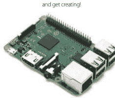

- 出版总监
- 艾伦·卡斯托 (Aaron Kasto)
- 设计主管
- 罗斯·安德鲁斯 (Ross Andrews)
- 总编辑
- 乔恩·怀特 (Jon White)
- 制作编辑
- 弗洛拉·拉德恩 (Flora Rudden)
- 高级美术编辑
- 格雷格·惠塔克 (Greg Whitaker)
- 助理设计师
- 史蒂夫·奥克斯科姆 (Steve Oxcombe)
- 摄影师
- 詹姆斯·谢帕德 (James Sheppard)

# 树莓派 3

一款超级增强版的树莓派，终于实现了你想要的功能，而价格与前几代型号完全相同

尽管树莓派多年来一直取得成功，但总有一些用户希望的功能。例如，一个稍强大的 CPU 以应对日常计算，更多的 USB 端口，也许还有无线功能以简化网络连接。

树莓派 3 解决了这些问题。由于它使用与 Model B+ 相同的板子设计，它拥有四个 USB 端口，而最初的树莓派 Model B 只有两个。更重要的是，它拥有更强大的处理器和更多的 RAM，使其比最初的树莓派快十倍。树莓派 3 还增加了内置无线功能，这使得连接 Wi-Fi 和蓝牙变得轻而易举。

新的 BCM2837 芯片是树莓派 3 的核心，它是旧树莓派 2 中 BCM2836 芯片的改进版。这款四核 900 MHz 处理器被进一步提升至 1,200 MHz，这使得树莓派 3 成为功能更强大的板子。以前你可能会在浏览互联网或编写文档时遇到问题，但现在树莓派 3 可以轻松处理这些任务，并且还有充足的处理器性能剩余。

从根本上说，它仍然是与树莓派 B+ 相同的板子。除了上述四个 USB 2.0 端口外，还有用于有线互联网的以太网端口，用于声音的高质量 3.5mm 耳机插孔，用于数字视频和音频的 HDMI 端口以及 40 针 GPIO 端口。这种扩展的 GPIO 对于让你的实体项目更加复杂和做出更酷的事情非常有帮助。

对于那些担心兼容性问题的人，你所有的旧文件和项目等都可以完美地在树莓派 3 上工作，你只需像传输普通文件那样将它们转移过去即可。

### 入门指南

**GPIO 端口**
GPIO 端口上的 40 个引脚为你提供了一系列电源和功能插槽，用于控制项目或从周围环境读取更多数据。这使得树莓派 3 成为物联网或创客项目的完美核心。

**USB 端口**
四个 USB 端口使树莓派 3 具有更大的灵活性，让你可以轻松添加键盘、鼠标、无线接收器和外部存储，而无需频繁切换设备或使用带电源集线器。

**以太网端口**
树莓派 3 保留了最初树莓派 Model B 上的有线网络和互联网连接。其最高速度仍为 100 Mb，但对于树莓派 3 来说已经足够快。

**集成无线**
树莓派 3 引入的重大升级是内置 802.11n 无线局域网和蓝牙 4.1。连接互联网和其他设备从未如此简单。

**耳机插孔**
需要听听你的树莓派运行的声音吗？把它连接到一对便携式扬声器上！3.5mm 插孔仍保留在树莓派 3 上，并且是树莓派 2 中添加的高质量插孔之一。

**MicroSD**
板子下方是启动介质所在的区域——MicroSD 卡。它比最初的 SD 卡小得多，但仍能容纳完整的操作系统，并允许树莓派 3 变得更小。

**HDMI 端口**
树莓派的特殊能力是能够实时解码 1080p 视频而几乎没有问题，树莓派 3 也保留了这一技巧。HDMI 端口基本上相同，支持高清视频和音频。

> “树莓派 3 仍然无法为 USB 集线器供电，因此如果你需要扩展设备，你需要获取一个带电源的集线器”

## 树莓派 Model A+

好的事物往往小巧精致：来看看为什么树莓派 A+ 是移动项目的理想选择。

虽然树莓派 Model B+ 凭借其四个 USB 端口比 Model B 更上一层楼，但 Model A+ 比其前身更小，重量仅为 23 克（从上代的 45 克减轻），并配备了一个 USB 端口。此外，受 SoC 限制，其内存仅为 256MB，而 B+ 则享有 512MB 的内存。但请不要以为这一切意味着 A+ 性能逊色。其 65mm 的长度和更轻的重量正是其用途的线索。同时，缺乏以太网端口并不是一种缺陷，反而恰恰说明这款树莓派是为媒体中心和打印服务器设计的，但更适用于对重量有严格要求的项目。也许你会将其安装在一个由 Arduino 驱动的机器人上，其较低的功耗要求可以通过电池来满足。

- **MicroSD 存储**
  再也不用担心 SD 卡被折断或丢失。树莓派 A+ 配备了一个用于 microSD 卡的推推式插槽。
- **可连接且灵活**
  两款新的树莓派型号都将 GPIO 接针从 26 针增加到了 40 针，从而提高了设备的灵活性。
- **板上集成了 256 MB 内存！**
  这似乎很不可思议，但在所有这些功能之上，这款多功能的小型电脑中心还搭载了一颗 700 MHz 的 700 MHz 系统级芯片（SoC）处理器和 256 MB 内存。

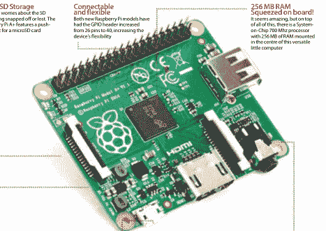

- **它更小！**
  最初的树莓派 Model B 电路板长度为 85mm。而 A+ 的长度仅为 65mm。
- **重新定位的电源插座**
  现在 Micro USB 电源插座位于 HDMI 插座旁边，这使得安排和管理线缆变得更加容易。
- **它也更轻！**
  令人难以置信的是，树莓派 Model A 的重量仅为 23 克（0.81 盎司），重量减少了近 50%。

## 树莓派 Zero

这款售价仅 4 英镑的微型计算机已席卷全球，但它有哪些变化？

体积比信用卡还小，Pi Zero 的外观 certainly 令人印象深刻。然而，尺寸缩小并不意味着性能缩水。Zero 的 1GHz 单核 CPU 和 512MB 内存使这款主板的运行速度比最初的 Pi 快 40%。

为了实现如此小的外形尺寸和低的生产成本，创建者精简了许多我们习以为常的端口。只剩下节省空间的 Micro 和 Mini 端口，且看不到以太网口，因此各种适配件将在要求较高的项目中发挥至关重要的作用。通过确保每个组件都有其存在的合理性，Pi Zero 具有极高的通用性。它能够运行 Raspbian 等完整镜像，这意味着开始一个新项目比以往任何时候都简单。

Zero 的极简主义非常适合在无头（headless）模式下运行，加上一个 Wi-Fi 适配器，你可以通过 SSH 登录并进行控制，从而充分利用其唯一的 USB 端口。

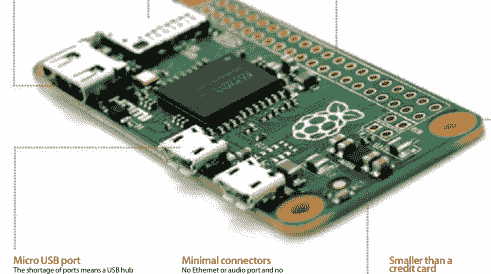

**新的迷你 HDMI 端口**
你需要一个适配器才能使用此端口。或者更好的是，采用无头模式并安装一个小型 OS 镜像。

**MicroSD 卡**
这与较新的 B 型号相同，意味着你可以插入现有的卡并在几秒钟内开始运行。

**未焊接的 GPIO 接针**
由于与 Model A+/ B+/2B/3 具有相同的引脚定义，你可以选择自行焊接接针，从而使 Zero 兼容 HAT。

**Micro USB 端口**
端口数量的短缺意味着比以往任何时候都更需要 USB 集线器和适配器来连接键盘或 Wi-Fi 适配器等设备。

**极简连接器**
没有以太网或音频端口，也没有摄像头或显示连接器！不过，未焊接的复合视频和复位接针仍然可用。

**比信用卡还小**
尺寸为 65mm x 30mm x 5mm，Zero 的整体占地面积仅为 Model B 的十分之一。

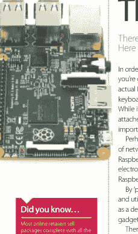

## 入门套件

*你的 Pi 比你第一眼看到的要多得多。*

这里有一些帮你起步的关键外设设备。

为了获得最佳的树莓派体验，除了实际的树莓派主板外，你还需要获取一些额外的配件。例如，你需要键盘和鼠标来输入命令和导航。虽然在不连接键盘和鼠标的情况下也能进行项目操作，但在初始设置时需要它们。SD 卡也是一个重要的购买项目——操作系统就存储在那里。

也许你需要一个 Wi-Fi 适配器，或者只需一根网线。然后是树莓派的基本电子电路方面，你需要什么来开始一些初学者的电子和控制实验？显然，树莓派的内容比许多人想象的要丰富得多。

所谓的“外设”，是指可以连接并利用树莓派的其他硬件。它们可以像一根不错的 HDMI 线那样简单，也可以是增强你项目功能的最新、最酷的特色小工具。

从机械臂到遥控直升机……树莓派拥有无限的可能性！唯一的限制是现有的硬件和你的想象力！

### 你知道吗……


大多数在线零售商都出售包含你可能需要的所有附件的套装——甚至包括预装系统的 SD 卡。


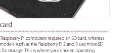

## 键盘和鼠标

让我们从最基础的组件开始：键盘和鼠标。一般来说，几乎任何 USB 键盘和三键滚轮鼠标都可以与树莓派配合使用。虽然某些项目甚至不需要键盘和鼠标，但初始设置时需要它们。

## SD 卡

早期的树莓派电脑需要 SD 卡，而后续型号如树莓派 2 和 3 则使用 micro/SD 卡进行存储。这是你选择的操作系统（如 Raspbian）的安装位置，这些卡有各种尺寸，可以预装操作系统，也可以是空白卡。

### 入门指南

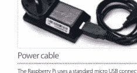

## 电源线

树莓派使用标准的 Micro USB 连接器作为电源输入，工作电压为 5V。在大多数情况下，Micro USB 到 USB 的线缆就足够了，其一端可以插入台式机的 USB 端口。安卓手机充电器也应该能完美工作（5.25V 1500mA）。

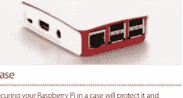

## 外壳

将树莓派固定在外壳中可以保护它，并防止脆弱的 GPIO 针脚受到意外损坏。外壳还可以使树莓派成为一个更具吸引力或更醒目的设备，例如作为媒体中心。请确保为树莓派型号选择正确的外壳。

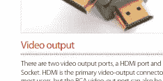

## 视频输出

有两个视频输出端口：HDMI 端口和 RCA 插座。HDMI 是大多数用户的主视频输出连接器，但 RCA 视频输出端口也可以用于连接电视、显示器或 SCART 线缆。你还可以通过 SSH 或 VNC 远程访问你的树莓派。


## 带电源的 USB 集线器

购买 Pi 时，额外增加 USB 端口值得早期考虑。一旦连接了键盘和鼠标，你就会明白原因！使用带电源的 USB 集线器很重要，以防止从 Pi 中抽取电力，并允许你连接外部硬盘驱动器等设备。

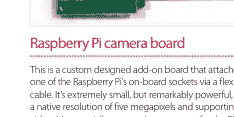

## 树莓派摄像头板

这是一个定制设计的附加板，通过柔性电缆连接到树莓派的板载插座之一。它非常小巧，但功能强大，原生分辨率为 500 万像素，支持 1080p 视频。它本质上就是 Pi 的智能手机摄像头！

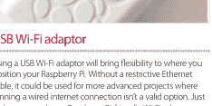

## USB Wi-Fi 适配器

使用 USB Wi-Fi 适配器将增加你放置树莓派位置的灵活性。不受限制性以太网线的束缚，它可以用于更高级的项目，在这些项目中，运行有线互联网连接不是一个有效的选项。只需确保你购买的是树莓派友好的 Wi-Fi 适配器。

## 快速入门

### 设置您的树莓派

通过我们易于跟随的指南，了解全新树莓派中各部件的位置。

虽然看起来可能令人生畏，但将树莓派配置为日常使用其实非常简单。就像电视或普通电脑一样，只有特定的线缆才能插入对应的插槽，主要任务就是确保在任意时刻都连接了你所需的设备。树莓派本身在电路板上的标识并不多。不过，大多数优质的外壳都会替你做到这一点——如果你决定购买一个的话。

- **电源适配器**

树莓派通过 microUSB 线缆供电，类似于许多现代安卓手机。它可以由笔记本电脑或电脑供电，但要充分发挥其性能，使用合适的市电适配器——如这种——是理想的选择。

- **显示器**

树莓派支持 720p 或 1080p 输出——也就是俗称的高清（HD）。一些现代显示器允许直接插入 HDMI，就像电视一样。然而，在某些情况下你可能需要一个适配器。

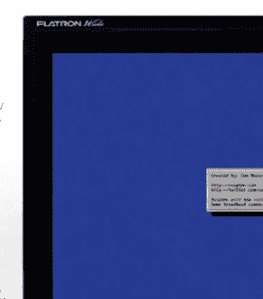

- **USB 集线器**

树莓派上的 USB 端口数量有限（如果是 A 型号则只有一个）。为了解决这个问题，你需要一个 USB 集线器。重要的是要选择一个带电源的集线器，因为树莓派自身无法提供足够的电力。

- **外壳与配件**

要正确使用树莓派，外壳并非必需，但一个得体的外壳可以很好地保护它免受灰尘侵害，并使其在运行中更易于移动。不过，你需要一张至少 4GB 的 SD 卡。


- **键盘和鼠标**

与任何电脑一样，在进行标准的 PC 风格操作时，你需要键盘和鼠标。键盘越顺手越好：鼠标也是如此，因为某些特殊鼠标需要额外软件。

**模拟输出**

对于不使用 HDMI 的设置，可以使用黄色视频输出端口。若要使用此端口输出声音，你需要使用旁边的小黑色端口，连接耳机或辅助线缆以输出音频。

**USB**

你想通过 USB 连接的所有外围设备——USB 集线器、键盘、鼠标、USB 存储设备等——都插在这里。如果必须使用 USB 集线器，请确保为其提供外部电源。

**SD 卡**

SD 卡插入树莓派电路板的下方。这里将存储运行树莓派的操作系统的镜像。不过，在使用之前，你需要在另一台电脑上设置好 Pi OS。

**数字输出**

HDMI 端口是树莓派的主要视频（及音频输出）接口，允许你在桌面上以高达 1080p 的分辨率显示视频。支持该功能的电视还会自动通过它接收音频。

**网络连接**

树莓派没有有线互联网接口，虽然你可以添加一个 USB 适配器，但通常插入以太网线更容易。它将连接到路由器背面的另一端，为你提供互联网接入和家庭网络访问权限。

**线缆**

确保你拥有合适种类的线缆，例如用于联网和互联网的以太网线，以及用于视频输出的 HDMI 或视频线。HDMI 可以传输音频，但视频输出需要额外的辅助线。

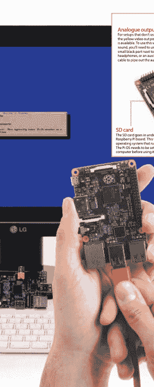


### 你需要准备的材料...

- 树莓派 Zero
- microUSB 电源
- 电烙铁和焊锡
- Pi Zero 适配器套件
- 显示器、鼠标和键盘
- **可选**
- USB Wi-Fi 或 USB 以太网适配器
- **可选**
- USB 集线器

### 设置您的 Pi Zero

掌握您的树莓派 Zero，无论是作为无头设备使用，还是配合屏幕和键盘使用。

既然你已经选了一台小巧却强大的 Zero，但在开始编程的乐趣之前，你需要更熟悉它。别担心，我们将引导你完成树莓派 Zero 的操作，包括所需的线缆、如何准备 NOOBS SD 卡，以及如何将 GPIO 引脚排焊到 Pi 上。一旦 Pi 正常工作并启动，我们将展示如何通过 Raspbian 用户界面使其在 Wi-Fi 上工作。你需要一个 USB 集线器来完成此操作，甚至仅用于同时使用键盘和鼠标。我们还将展示如何为无头使用（VNC 或 SSH）准备 Raspbian SD 卡，只需一个 Wi-Fi 适配器或 USB 转以太网适配器即可。

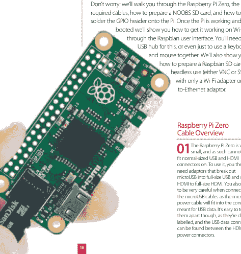

**树莓派 Zero 线缆概览**

01 树莓派 Zero 非常小，因此无法安装标准尺寸的 USB 和 HDMI 连接器。因此，要使用它，你需要适配器将 microUSB 扩展为标准 USB，将 mini-HDMI 扩展为标准 HDMI。在连接 microUSB 线缆时也要非常小心，因为 microUSB 电源线可以插入用于 USB 数据的连接器。不过区分它们很容易，因为它们都有清晰的标签，而且 USB 数据连接器位于 HDMI 和电源连接器之间。

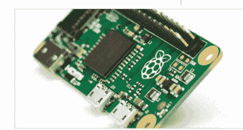

图 1：一旦你将引脚排焊好，任何 Pi Zero 看起来都和其他树莓派相似

**GPIO 引脚排**

02 焊你崭新的树莓派 Zero 一开始看起来可能很吓人，但这并不太难！然而，难点在于剪断正确数量的 GPIO 引脚（40 个），因为套件提供的引脚超过 40 个。此时也值得注意的一点是，如果你搞砸了导致缺失底部的一两个引脚，关系也不大！

**焊接工具包**

03 如今电烙铁非常便宜。如果你打算进行大量焊接，那么拥有一个可以更换烙铁头的温控电烙铁可能值得投资。然而，我们使用的包含电烙铁、支架、吸锡器和一些无铅焊锡的套件在亚马逊上仅售价 8 英镑。我们用这个套件焊接 GPIO 引脚时没有任何问题。


**固定 GPIO 引脚排**


04 在你焊接 GPIO 引脚排之前，你需要能够将其固定。我们建议在引脚两侧贴一些蓝丁胶（Blu-tack）。这样还有一个优点，你可以将 Pi 翻过来，然后用蓝丁胶将其固定在桌子上进行焊接。一旦完成，蓝丁胶应该很容易剥离。

## 焊接 GPIO 引脚排

05 这就是你可能一直担心的部分，但别担心！确保你已浸湿电烙铁支架中的海绵，因为你需要在海绵上擦拭烙铁以保持烙铁头清洁。如果这是你第一次使用该烙铁，加热元件在前几分钟可能会冒出很多烟，所以如果发生这种情况请不要担心。尽管如此，要注意安全，并确保你在通风良好的区域进行焊接——尽量不要吸入任何烟雾。烙铁变热后，在烙铁头上涂抹一些焊锡，并在海绵上擦去多余的焊锡。然后开始焊接引脚。对于每个引脚，将烙铁头触碰 GPIO 引脚排的底部和 Pi 上的金属触点，然后施加极少量的焊锡。一旦焊锡流向引脚和金属触点，你就可以移开烙铁了。如果有太多焊锡，你可以重新加热焊锡并使用吸锡器将其移除。在焊接 GPIO 引脚排时休息一会儿，原因有二：1）你不想过热 Pi 上的任何组件，2）你可能会融化 GPIO 引脚排的塑料，导致引脚脱落。在整个焊接过程中，持续在海绵上擦拭烙铁头以保持清洁。完成后，请拔掉烙铁并将其放在安全的地方冷却。

# 入门指南

## 配置你的树莓派 Zero

### GPIO

一旦你焊接了一个 2x20 公头排针，你的 GPIO 引脚就可以像往常一样工作了。在右侧，你可以看到四个未插件的引脚分别用于视频输出和一个复位开关。

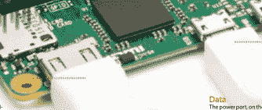

### 视频

要使用视频输出端口，你需要一个 mini-HDMI 转 HDMI 适配器，不过你也可以通过未插件的引脚使用 RCA 复合视频输出。

### 数据

右侧的电源端口通常是 micro-USB。然而，旁边的数据端口现在也是 micro-USB 了；因此你很可能需要一个 micro-USB 转 USB 适配器。

### 准备 NOOBS SD 卡

06 有关更多详细信息，请访问 [www.raspberrypi.org/help/noobs-setup](https://www.raspberrypi.org/help/noobs-setup)。NOOBS 需要一张格式化为 FAT32 的 SD 卡。然后你需要从 [https://downloads.raspberrypi.org/NOOBS_latest](https://downloads.raspberrypi.org/NOOBS_latest) 下载最新的 NOOBS 镜像，并将其解压到 SD 卡中。在 Linux 系统上，步骤如下：

```
sudo parted /dev/mmcblk0
(parted) mktable msdos
(parted) mkpart primary fat32 0% 100%
(parted) quit
sudo mkfs.vfat /dev/mmcblkp1
cd /mnt
sudo mkdir pi
sudo mount /dev/mmcblkp1 pi
cd pi
sudo unzip ~/Downloads/NOOBS_v1_5_0.zip
sync
cd ..
sudo umount pi
```

### 启动 NOOBS 并安装 Raspbian

07 按照第一步所示连接你的树莓派 Zero。安装 NOOBS 所需的最少连接是显示器和键盘。然而，鼠标以及以太网适配器或 Wi-Fi 适配器也非常有用。按回车键选择 Raspbian，然后按 1 进行安装。接着按回车键确认同意。完成后，它会显示“操作系统安装成功”。按 OK，你的树莓派将启动进入 Raspbian。或者，如果你不想使用 NOOBS，你可以用通常的方式将 Raspbian 刷入 SD 卡。Raspbian 默认会启动进入桌面环境。


### 配置 Wi-Fi

08 如果你使用的是 USB 转以太网适配器，那么树莓派应该已经连接到互联网了。如果你使用的是 Wi-Fi 适配器，你需要配置它以连接到你的无线局域网。我们使用的是 Edimax EW-7811UN，它在树莓派上开箱即用，效果完美。

进入 Raspbian 桌面后，你可以点击网络图标来查看可用的无线网络。点击其中一个网络后，它会要求你输入密码。之后，它应该已关联成功，你可以将鼠标悬停在图标上以查看你已连接的网络。

### 在另一台机器上配置 Wi-Fi

09 如果你想将树莓派 Zero 作为无头设备并配合 Wi-Fi 使用，你可以使用另一台已经配置好以连接到正确 Wi-Fi 网络的 Linux 机器来准备一张 SD 卡。你必须挂载 SD 卡并编辑 `/etc/wpa_supplicant/wpa_supplicant.conf`，这与上一步中由 Raspbian 用户界面配置的是同一个文件。将 SD 卡插入你的 Linux 机器，并找出该设备的名称

```
dmesg | tail -n 3
[326516.612994] mmc0: new high speed SDHC card at address 0001
[326516.613437] mmcblk0: mmc0:0001 SD08G 7.35 GiB
```

因此设备是 `/dev/mmcblk0` - 现在我们需要找出根分区是哪个分区号（在 Raspbian 镜像中会有所不同；这里我们使用的是 NOOBS 镜像）。

```
sudo parted /dev/mmcblk0 print
```

这将给你一个分区列表。最大的分区将是根分区。在这种情况下它是第 7 个分区，所以根文件系统位于 `/dev/mmcblk0p7`。要挂载 SD 卡并编辑 `wpa_supplicant.conf` 文件，请执行以下操作

```
cd /mnt
sudo mkdir pi
sudo mount /dev/mmcblk0p7 pi/
cd pi/
sudo nano etc/wpa_supplicant/wpa_supplicant.conf
```

然后填入你的 Wi-Fi 详细信息：

```
network={
ssid="your_wifi_network"
psk="your_wifi_password"
key_mgmt=WPA-PSK
}
```

最后

```
cd -
sudo umount pi/
```

### 远程访问你的树莓派

10 你可以使用 `nmap` 扫描你的局域网以找到树莓派。你需要知道你的局域网地址范围（常见的网络是 192.168.1.0/24 和 192.168.3.0/24）。你可以使用 `ip addr` 命令来查找它：

`nmap -p22 -sV 192.168.1.0/24` 将扫描出开放 SSH 端口的设备列表。示例输出：

```
nmap scan report for 192.168.157.29
Host is up (0.070s latency).
PORT STATE SERVICE VERSION
22/tcp open ssh (Protocol 2.0)
```

然后你可以使用以下命令通过 SSH 登录

```
ssh pi@192.168.157.29
```

密码是 'raspberry'。如果你是将树莓派作为无头设备使用，你可能想要禁用默认在启动时开启的用户界面：

```
sudo systemctl set-default multi-user.target
```

### 设置 VNC 服务器

11 VNC 代表虚拟网络计算（Virtual Network Computing）。使用 VNC，你可以通过网络访问 Raspbian 桌面（这意味着你只需要连接电源和以太网/Wi-Fi）。虽然不支持音频，但对于其他任何任务（包括使用 pygame），VNC 都应该能提供可接受的性能水平。你可以使用以下命令安装 VNC 服务器

```
sudo apt-get install tightvncserver
```

市面上有几种免费的 VNC 客户端，搜索引擎可以帮助你找到一个合适的。要在你的树莓派上启动一个 VNC 会话，先通过 SSH 登录，然后运行 `tightvncserver`。首次运行时，它会提示你输入密码。你可以使用 `-geometry` 选项指定屏幕分辨率；例如，`-geometry 1024x768`。你可以使用 `tightvncserver -kill 1` 来终止现有的 VNC 会话，其中 `1` 是会话编号。要在 Linux 机器上连接到该会话，你可以使用命令 `vncviewer 192.168.157.29`，并将 IP 地址替换为你的树莓派的 IP 地址


> “安装 NOOBS 所需的最少连接是显示器和键盘”

## 你需要什么...

树莓派下载

www.raspberrypi.org/downloads

- **你知道吗...**


树莓派的真正官方发行版名为 Raspbian。大多数版本都以此开头，但也有遗留版本。

### 卡速度

为了保持系统流畅运行，你需要一张速度等级合理的 SD 卡。`Class 10` 或以上最好。

### 卡格式

在复制你的操作系统镜像之前，你需要确保 SD 卡已格式化为 `FAT 32` 文件系统。

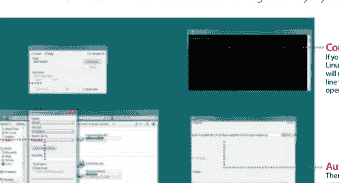

### 命令行

如果你使用的是 OS X 或 Linux，那么你很可能会使用命令行来安装你首选的操作系统。

### 自动化工具

有几种图形化工具可用，它们使将镜像安装到 SD 卡变得轻而易举。

## 安装发行版

我们来看一下安装预构建操作系统涉及的一些关键方面

凭借其小巧的体积和低廉的价格，许多人可能会误以为树莓派只能用于基本任务和学习编程。虽然树莓派的主要目标之一是提高较低层次（而不仅仅是学习如何创建 Excel 电子表格）的计算机素养，但树莓派还有许多其他出色的用途。

由于树莓派本质上是一台迷你 PC，拥有 HDMI 和模拟电视输出而非传统的显示器连接，它可以执行笔记本电脑或台式机经常处理的许多常见任务。虽然它并没有足够的处理能力和 RAM 来运行最新版本的 Windows，但也有其他选择。

有许多功能完善的操作系统，其中许多是从其桌面“大哥哥”版本分叉而来并专门为树莓派优化的。其中最受欢迎的之一是 Raspbian，它是 Debian 的移植版。Debian 是 Linux 生态系统的关键部分，许多其他流行的开源发行版都是从 Debian 源代码分叉而来的。最初的 Debian 于 1993 年发布，此后它已经走了很长一段路。Raspbian 需要大量工作才能达到标准的性能水平，因为树莓派使用的是较旧的 ARMv6 架构。现在它已经是一个很棒的全天候桌面系统了。


### 获取操作系统

**01** 你的第一个问题可能是“我可以在哪里找到一些可下载的操作系统？”

大多数常见的镜像都可以在主要的树莓派网站上找到：`www.raspberrypi.org/downloads`。这些是稳定且经过充分测试的系统，值得探究。

### 解压缩

**02** 当你下载好镜像后，你很可能需要做的第一件事就是解压它。在 Windows 中，可以通过右键点击并选择“提取”来完成。在 OS X 中，只需双击即可提取文件。

### 操作系统格式

**03** 在压缩包中，你会找到一个扩展名为 `.img` 或 `.iso` 的文件。这些相当于安装 CD 或 DVD 的“快照”。仅仅将文件复制到 SD 卡上是没有用的，你需要使用程序来提取它。

### SD 卡格式

**04** 你将用于启动的 SD 卡必须是空白的，所以请先确保上面没有重要内容。你还需要将其格式化为 `FAT32` 文件系统。这是一个常见的系统，大多数 U 盘和相机都使用它。

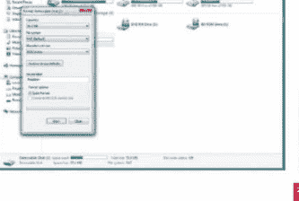

### 格式化卡片

**05** 在 Windows 中，要格式化卡片，只需插入并等待其挂载。然后点击“我的电脑”，接着右键点击卡片的图标。之后选择“格式化”，然后从下拉菜单中选择“FAT32”。


### 使用终端

**06** 如果你使用的是 OS X 或 Linux，那么你就必须使用终端来复制镜像。在 OS X 中，终端应用程序默认已安装，而大多数 Linux 版本都以某种形式包含终端。它可能被称为“控制台”或“命令行”。

### DD 命令

**07** 你需要使用的命令叫做 `dd`。输入格式为 `sudo dd bs=1m if=[img] of=[device]`。例如：

```
sudo dd bs=32m if=/Users/rachelclabb/Desktop/archlinux/archlinux-hf-2013-02-11.img of=/dev/disk1
```

### Win 32 Disk Imager

**08** Windows 用户可以使用 Win32 Disk Imager。一旦你下载了该工具，只需右键点击 `.exe` 文件，选择“以管理员身份运行”，并按照提示操作即可。安装完成后，你可以将 SD 卡插入你的树莓派。很简单！

# 命令行基础

## 学习使用命令行和键盘控制树莓派的另一种方式

我们可能都经历过在树莓派上的这种情景。你已将 Raspbian 或其他树莓派操作系统安装到 SD 卡上，并且匆匆完成了设置脚本，或者没有做足功课。启动操作系统后……你最终停留在了一个命令行界面。此时的第一步是不要恐慌：这是完全正常的。它可能对你来说只是一个陌生的概念，你通常只在电影里见过那些精通网络技术、想要破坏“系统”的黑客们使用它。

第二步，至少在 Raspbian 的情况下，只需输入：

```
$ startx
```

就这样。Raspbian 会加载桌面环境，你又可以开始使用鼠标了。在这种情况下，这既快捷又无痛，许多其他操作系统也是如此。你所做的就是用一条命令，具体来说就是在这个情况下启动 X 服务器。X 服务器负责处理图形界面，在某些树莓派系统上默认可能是关闭的。


图 1：终端模拟器允许你在仍处于桌面环境的同时访问命令行

- **你需要...**

  - Raspbian

  - `www.raspberrypi.org`

> **你知道吗...**
>
> 命令行会记住你最近使用的命令。只需使用向上和向下箭头即可调用它们。

## 一个新世界

虽然将树莓派引导至桌面环境并不是你在命令行中唯一能做的事情。命令行内置了一个庞大的功能世界；事实上，你正在使用的大多数图形化程序只是以特定方式执行这些命令而已。你也不需要离开舒适的桌面环境来执行这些命令，因为所有树莓派操作系统都会附带一个名为“终端模拟器”（Terminal emulator）的应用程序。

这会创建一个窗口，你可以像我们启动桌面环境那样在其中输入命令，并使用完全相同的命令（图 1）。在 Raspbian 上，在菜单的“附件”部分查找 `LX Terminal` 应用并点击它。如果你之前不得不使用 `startx` 来进入桌面，那么我们现在可以先修复这个问题再继续。在终端中输入：

```
$ raspi-config
```

这是初始设置屏幕（图 2）。从这里你可以启用开机自启桌面（图 3），甚至可以更新固件并为官方树莓派相机模块添加支持。这允许你修改 Raspbian 而不需要重新安装。

不过，你不会经常使用那两个命令，那么深入探索命令行有实际用处吗？当然有。首先，Raspbian 没有官方的软件包管理器。这是一个允许你浏览操作系统可用软件的程序，类似于树莓派商店。

然而，Raspbian 还有商店中无法获取的其他软件。你也不能专门更新树莓派软件，而所有这些都可以使用命令行来修复。

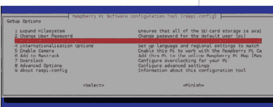


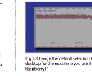

### 入门

## 适用于所有人的软件

你想做的第一件事是确切地告知 Raspbian 在线有哪些可用内容。这是一个非常简单的任务，你只需要：

```
$ sudo apt-get update
```

这将遍历包含 Raspbian 所用软件的在线软件仓库（或简称为仓库）列表。完成后，命令行提示符会再次出现，等待你的下一条命令。由于这是我们第一次执行此操作，你很可能需要更新树莓派上的当前软件。你可以使用以下命令做到这一点：

```
$ sudo apt-get upgrade
```

它可能会要求你确认升级，如果是这种情况，请输入 Y 然后按 Enter。我们两次所做的都是使用命令行包管理器 APTitude (`apt-get`)，首先检查仓库，然后据此升级软件包（图 4）。第一个命令 `sudo` 允许它以管理员身份运行 `apt-get` 任务，并常用于许多其他命令行操作。要安装软件，请使用 `install` 代替 `update` 或 `upgrade`，后面跟上软件包的名称。例如，对于数学编程语言，你可以使用以下命令安装它：

```
$ sudo apt-get install wolfram-engine
```

> **你知道吗...?**
>
> 你可以使用 Tab 键完成命令，但如果你只输入了部分字符，请按 Tab。接受你看到的内容，按 Enter 完成。

## 移动与创建

安装和更新只是你可以在命令行中做的许多事情中的两件。你还可以浏览整个文件系统、移动文件、创建文件夹和删除项目。所有这些操作都非常简单。


当你首次打开终端时，它会打开在你的主文件夹中。虽然你无法具体看出它是主文件夹，但你可以通过以下方式显示目录中确切包含哪些类型的文件（图 5）：

```
$ ls
```

波浪号 (`~`) 用于表示主文件夹，并可用于在文件系统中导航。要导航，我们将使用 `cd` 命令，后面跟上你想要移动到的位置。可以这样操作：

```
$ cd /home/pi/Downloads
```

这将把你移动到 `Downloads` 目录。由于我们一开始是在主文件夹中，实际上我们只需要这样做：

```
$ cd Downloads
```

它是上下文敏感的，知道要在其所在的目录中查找。还有一个技巧可以让你不必记住路径的确切名称——如果你只输入了一部分内容并按下了 Tab 键，命令行或终端会尝试自动补全短语。再试一次 `cd` 命令，但试着在只写了 "Down" 的时候按 Tab。

最后，还有一些你可以用来操作文件的快速命令。可以使用 `cp` 命令复制单个文件，后面跟上文件名和新位置，如下所示：

```
$ cp file.txt ~/Documents/file.txt
```

你还可以通过以下方式使用它来重命名文件：

```
$ cp file.txt otherFile.txt
```

原始文件可以使用 `rm` 命令删除：

```
$ rm file.txt
```

想创建新文件夹？使用 `cd` 移动到你需添加文件夹的目录，然后使用 `mkdir` 后面跟上你想给文件夹起的名字：

```
$ mkdir NewFolder
```

命令行可以做更多事情，但这些只是最基本的部分。随着你越来越多地使用 Linux，你会遇到需要使用命令行的任务，在这个过程中，你将学会当你像电影中的街头黑客那样工作时能完成多少事情。

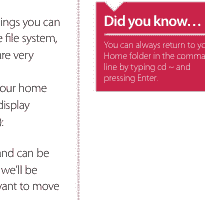

> “如果你只输入了部分内容并按下了 Tab 键，命令行或终端会尝试自动补全短语”


图 5：有许多简单的命令行工具可以帮助你浏览和使用你的系统

## Raspbian 桌面

虽然树莓派的 Raspbian 操作系统更接近 Mac 而非 Windows，但其桌面最相似的是后者

乍一看可能会觉得有点陌生，但使用 Raspbian 和使用 Windows 桌面几乎没有区别。有一个菜单栏、一个网络浏览器、一个文件管理器，并且正如你所预期的那样，你只需打开菜单并点击你想要开始使用的应用程序……


### 菜单按钮

左上角类似 Windows 的菜单按钮显示了一组程序和选项列表。主要类别包括编程（你可以在那里找到合适的工具）、互联网（浏览器和在线资源）、游戏（预装了 Mixxx 和 Pi-ge）、附件（各种实用程序）和偏好设置（系统工具）。从树莓派商店下载的程序将显示在相应的类别中，而“运行命令”启动了一个命令行解释器，就像 Windows 中那个一样。使用“关机”来关闭、注销或重启你的树莓派。

### 任务栏

横跨屏幕顶部的是任务栏，菜单位于其上。在右侧是指向 Epoch 网络浏览器、文件管理器（PCManFM）、用于即时文本命令的 LX Terminal、WolfCam RabbitMint 音频作曲软件以及 WolfCam Language 编程套件的快捷方式。在这些快捷方式旁边，你会发现任何打开的应用程序都会停靠在那里，而在右上角，你会找到时钟、当前 CPU 负载、音量状态和控制以及网络状态。

### 文件管理器

没有文件管理器，计算机将是不完整的，可以通过点击任务栏快捷方式打开文件管理器。可以通过将文件拖到桌面上的垃圾桶来复制、重命名和删除文件（或者简单地突出显示并在键盘上按 Delete）。你还可以创建文件夹（新的），或者使用工具栏打开窗口，以图标或详细列表的形式查看文件夹位置。

> “乍一看可能会觉得有点陌生，但使用 Raspbian 和使用 Windows 几乎没有区别”

## Raspbian 桌面环境

### 快速入门

### Web 浏览器

Epiphany 是树莓派默认的浏览器，虽然如果你不喜欢它，你可以从 Pi Store（应用商店）中添加一个新的。与任何浏览器一样，你只需在地址栏中输入网页地址，并使用标准的导航按钮在网页之间前后切换。Epiphany 支持多层堆叠窗口，并具备私人浏览和清除浏览数据的功能。点击工具栏末端的“选项”图标即可访问这些功能。

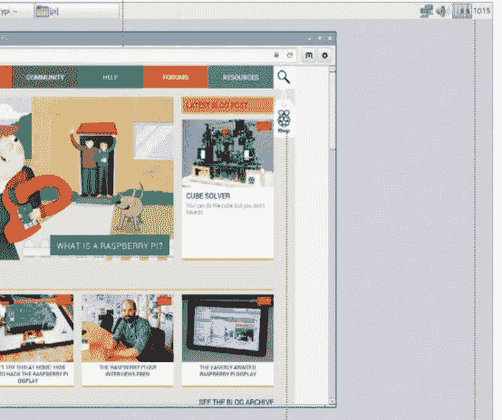

### Pi Store（应用商店）

你可以通过菜单或 `www.raspberrypi.org` 网站上的链接访问 Pi Store。类似于 Steam、Google Play 或 App Store，Pi Store 要求你注册一个账号（通过 IndieCyb），并且在开始购买免费或付费软件之前，你需要登录。从商店下载并安装的游戏和应用将显示在“我的库”标签下，其中一些只能从这里启动。

### 状态和时间

在工具栏的最右侧是树莓派版本的 Windows 系统托盘，你可以在那里找到有关树莓派状态的信息。在角落处有时钟，点击它还会显示当前日期。如果时间不正确，你可以在此处进行调整。在时钟左侧，你会看到一个显示当前 CPU 负载的图表、设备音量控制，以及确认你的树莓派已在线的状态指示。

## 掌握 Config 工具

使用强大的内置 Config 工具来告诉你的树莓派如何运行

“RasPi Config”工具允许你配置系统，而这些配置在 Linux 环境中通常会更棘手，它也是你安装 Raspbian 后首先看到的内容。为什么？诸如设置日期和时间或键盘区域设置等任务，通常是在没有任何对话框或额外帮助的情况下通过命令行界面完成的——对于新用户来说，这是一个噩梦。

针对树莓派和 Raspbian 本身还有一些特定的设置，例如可以轻松启用电视的过扫描功能；更改计算机/显卡之间的内存分配，甚至超频你的系统以使其运行得稍快一些；启用远程 SSH 访问系统；阻止系统启动到桌面环境等。RasPi Config 工具消除了这一过程的痛苦，让你能更轻松地掌握实际的控制权。

### 更改密码

更改默认用户名为 `'pi'` 的密码，使其更具个性化或更容易被你记住。

### 扩展根分区

允许你非常快速、轻松地更改根分区的大小，使其占满整个 SD 卡。

### 打开 raspi-config 工具

- 首先在桌面上双击 LXTerminal 图标。这将启动命令行提示符，你可以在此运行配置工具。为此，你需要运行一条命令。


`sudo raspi-config`

当被要求输入密码时，你实际上不会看到输入的字符。

当你输入密码并按下回车键提交后，配置屏幕将会显示。在这一部分中，我们将介绍几个特别值得关注的设置，尽管它们在你的树莓派运行中都有各自的作用。此菜单中的一些设置非常重要，且有些是不可逆的，因此请谨慎使用！

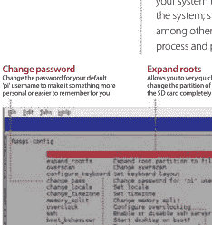

### 配置你的键盘
设置正确的键盘布局——有很多不同的布局。使用错误的布局可能会令人烦恼。

### 超频
允许你快速、轻松地超频你的树莓派，从而在风险极小的情况下获得额外的速度和性能。

Raspbian: www.raspbian.org


### 扩展根文件系统
`02` 默认情况下，Raspbian 的根文件系统为 2GB - 这样做是为了让提供的镜像尽可能适配各种不同大小的 SD 卡。

如果你的卡更大，“扩展根文件系统”选项将使操作系统使用整个空间。使用此选项后，命令将立即执行。该操作可能需要一些时间。重启你的系统以查看更改。

### 超频你的树莓派
`04` 你可以将树莓派的时钟速度和电压设置为几种不同的预设值。将时钟速度和电压设置为高于规格的值可能会导致系统不稳定，因此请小幅度递增。确保你的树莓派周围有良好的空气流通。

如果你发现任何明显的不稳定现象，请再次运行此向导并将时钟速度调回略低的值 – 重复此过程，直到你的系统完全稳定为止。在本教程的范围内，建议进行中等/中等程度的超频 – 它似乎能带来一点点额外的性能，且没有明显的副作用。此外，建议在做出此更改后重启你的系统。按住 Shift 键可以暂时禁用超压。

### 更改内存分配
`05` 更改树莓派的内存分配允许你给系统或图形处理器分配更多的内存。

你给出的数值必须是 16/32/64/128/256 之一。以下是我们的建议：
- 对于基本发行版使用，不需要视频和 2D 渲染的情况，设置 32MB 的 GPU 内存。
- 对于需要视频播放或启用 3D 效果的桌面使用，设置 64MB 的 GPU 内存。
- 对于进行大量多媒体处理或玩 3D 渲染游戏的图形应用和游戏，设置 128MB 的 GPU 内存。
- 对于大多数人来说，64MB 的图形内存分配就足够了。

### 开启和关闭过扫描
`07` 如果你使用现代高清电视连接树莓派，你会注意到两种行为之一。树莓派输出的图像四周有一圈黑边 – 它无法正确显示。这是由欠扫描（underscan）引起的。

如果你看不到屏幕边缘，说明你正在遭受过扫描（overscan）的影响。

如果你有前一个问题，你可能需要开启过扫描，或者在电视上启用“缩放”模式或类似功能。

如果你有后一个问题，你需要关闭过扫描，以便你能看到屏幕边缘。

### 更改启动行为
`06` 默认情况下，Raspbian 发行版将启动到命令行界面，你需要首先通过 “pi” 用户名登录。

如果你接着想要运行窗口管理器（在这种情况下，它被称为 “X”），你必须向系统发出命令，让它知道这是你想做的。

对很多人来说，这并不理想，因为命令行令他们感到害怕。因此，有一个选项可以在启动时自动启动 X。将此选项设置为 “是” 即可默认启用此行为。

显然，你可以随时恢复默认设置，回到基于文本的登录界面，在那里你必须手动启动 `startx`。

### 配置你的位置
`03` 区域设置（Locale）是树莓派使用的语言和区域设置 – 虽然这对你的使用通常影响不大，但它也负责默认货币设置等，如果设置错误，日后可能会成为一个烦人的问题。

选择此选项后，你将进入一个向导。使用方向键检查默认区域设置（构建更多设置需要一些时间）。时区（Timezone）会带你进入 tzdata 界面，你可以在此处进行调整。

### 更新 raspi-config
`08` `raspi-config` 工具会不定期收到更新。这通常是添加更多功能或修复小 bug，或者两者兼有。

在使用该工具时运行更新器是个不错的主意 – 在开始更改任何系统设置之前。虽然更有可能的是它被更新以看起来更好或做更多事情，但也不排除其中隐藏的一些杂项 bug 修复，否则可能会给你带来麻烦。

不过请记住，当你尝试更新你的树莓派时，你需要一个活跃的互联网连接，通过 LAN 线缆或无线适配卡。没有它们，你永远不会获得新版本。始终尽量确保你在最新版本上。

## 你需要...
- 任何树莓派发行版 [www.raspberrypi.org/downloads](http://www.raspberrypi.org/downloads)
- Wi-Fi 适配卡或以太网

> **你知道吗...**
>
> 如果你的树莓派将放置在互联网路由器附近，你只需插入一根以太网线缆即可。

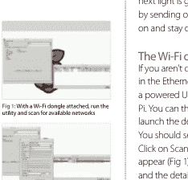

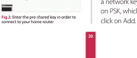

## 让你的树莓派联网
### 联网
为了访问海量的工具、应用和资源，你需要联网。以下是操作方法...

联网最简单的方法是购买一款树莓派 Model B+，因为它带有一个以太网接口。Model A 不仅缺少以太网端口，而且由于只有一个 USB 端口，这使得联网变得困难。这意味着你将不得不购买一个带电源的 USB 集线器才能联网。回到 Model B+；为了联网，只需将以太网线缆插入树莓派的接口，并将其连接到互联网调制解调器/路由器的相应端口。打开树莓派并启动桌面，然后双击 Epiphany，你应该会看到互联网出现（主图）。要检查它是否工作，请查看树莓派本身的指示灯。红色电源灯应该亮起。在此上方的是绿色灯，在访问 SD 卡时会闪烁。在电源灯下方是三个与以太网相关的指示灯。注意，Model A 没有这些 LED，因为它没有以太网接口。中间的绿灯在检测到全双工 LAN 连接时会亮起。这意味着它能够与互联网进行数据的发送和接收。下一盏绿灯在实际通过发送或接收数据访问互联网时会闪烁。最后的一盏黄灯在检测到 100Mb LAN 连接时会亮起并保持常亮。

### Wi-Fi 选项
如果你距离调制解调器/路由器太远而无法插入以太网连接，或者你只是一台 Model A，那么你需要一个带电源的 USB 集线器。这插入到树莓派的一个 USB 端口上。然后你可以将 Wi-Fi 适配卡插入其中。启动树莓派并打开桌面。然后双击 Wi-Fi Config 图标。你应该在适配器部分看到适配卡的名称。点击“扫描”以查找网络，找到的网络列表应该会显示出来（图 1）。双击你想要连接的网络，它的详细信息将列出。几乎所有家庭网络都使用网络密钥，这通常写在调制解调器本身。点击 PSK（预共享密钥），并将其输入（图 2）。然后点击“添加”。它将处理此请求，然后建立连接并

## 让树莓派连接网络

### 入门指南
……最后，Wi-Fi 连接的新 IP 地址将出现。如果你点击“管理网络”选项卡，该网络现在会被列出，并且“启用”单选按钮处于激活状态。要接入互联网，只需启动 Empathy，你就连接上了。Wi-Fi 实用程序将保持在面板右下角运行。如果右键单击 Wi-Fi 图标，你将看到断开或重新连接的选项、事件历史以及最近扫描的结果。点击“状态”以查看其性能如何。

### 检查连接
要检查树莓派是否具有有效的互联网连接，请双击 LXTerminal。输入以下命令：

```
ip addr
```

你应该会看到一串数字，最后一行以 'inet' 开头，然后是树莓派连接的 IP 地址（图 3）。通常这类似于 192.168.1.11，这表明连接正在工作，因为树莓派已被分配了一个基于你的互联网调制解调器/路由器所使用的 IP 地址。如果未显示，则路由器端可能存在问题。调制解调器/路由器应该运行一个 DHCP 服务器，当树莓派连接它时，会获得一个 IP 地址。如果没有运行，那么连接在它上的其他设备也无法访问互联网。

使用另一台设备的网页界面登录到 192.168.1.0 或你的调制解调器的实际 IP 地址，以检查 DHCP 服务器服务是否已开启。最后，在终端中输入：

```
ping google.com
```


### 共享连接

如果你没有 Wi-Fi 网卡、有源 USB 集线器或足够长的以太网电缆，但有另一台已连接互联网计算机，还有另一种获取访问权限的方法。在 Mac 上，通过 USB 或以太网电缆将其连接到树莓派。启动系统偏好设置，在“互联网与无线”下，点击共享。点击“互联网共享”，然后选择 Wi-Fi（用于 AirPort）作为要共享的连接类型，并选择树莓派如何连接到你的 Mac（图 4）。

在 Windows 电脑上，进入资源管理器 > 网络 > 网络和共享中心 > 更改适配器设置。

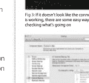

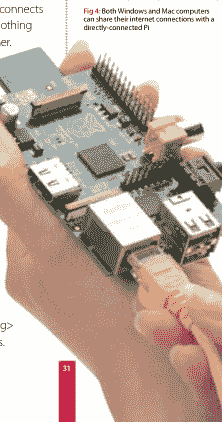

## 安装和使用软件包

你将需要……

**Apt 命令帮助页面：**
http://linux.die.net/man/8/apt

**Apt-get 帮助页面：**
http://manpages.ubuntu.com/manpages/lucid/man8/apt-get.8.html

### 简介

> 树莓派很出色，但安装软件后会更强大


单独来看，树莓派是一台近乎完美的迷你电脑。它已经包含大量教育软件、一些游戏、一些编程工具以及许多系统工具。但就像大多数电脑一样，这只是冰山一角。通过安装更多程序，你可以做更多事情。

这些程序被称为*软件包*（packages），其种类之广、多样性之高，如同最初设计它们的开发人员一样。在 Linux 中，如果有对特定程序的需求，就会有人开发一个。然后他们将代码发布到世界，并自由公开源代码，因此称为“开源”。一旦程序经过测试，最终会到达为该特定 Linux 发行版提供服务的众多远程服务器之一。

这些远程服务器称为仓库（repositories），或*repos*，包含你软件包的所有元素，以便下载到你的系统中并安装。一旦你知道如何操作，这个过程非常快且简单……

```
pi@raspberrypi / $ sudo apt-get
...
```

### 更新和升级

1. 在树莓派上获取软件包涉及进入命令行终端，通过桌面上的 LX Terminal 图标，并输入几条命令。但在我们这样做之前，我们需要确保系统是最新的。在终端中输入以下内容：

```
sudo apt-get update

sudo apt-get upgrade
```

或者：

```
sudo apt-get update && sudo apt-get upgrade
```

### 搜索软件包

2. `apt-get` 命令（高级软件包工具）是在树莓派上下载和安装软件包的关键。在上一例中，我们更新了现有软件包和系统，升级了任何需要升级的项，并更新了当前的软件包列表。现在，让我们在服务器软件包列表中搜索可用的游戏。

```
apt-cache search game | less
```

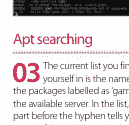

### Apt 搜索

3. 你当前所在的列表是可用服务器上所有标记为“游戏”的软件包名称。在列表中，连字符之前的部分告诉了你软件包的名称，这是你需要知道才能安装它的内容。使用方向键，上/下键进行导航；按 'q' 退出。

### 安装软件包

4. 使用上、下方向键，导航列表。如果你发现了一些喜欢的外观，比如 Angry Drunken Dwarves，记住软件包的名称，在本例中为 'angrydd'，然后按 'q' 退出列表。要安装软件包，在终端中输入以下内容：

```
sudo apt-get install angrydd
```


### 运行软件包

5. 上一条命令的结果应该是游戏 Angry Drunken Dwarves 的成功下载和安装。要执行新安装的软件包，你可以从 LXDE 菜单中的 游戏 > Angry Drunken Dwarves 运行，或者在终端中输入以下内容：

```
angrydd
```

### 删除软件包

6. 安装这些软件包完全没问题，你可以看到 Apt 命令确实非常强大。但是，如果你想删除一个软件包怎么办？再次使用 Apt 命令，假设我们要从树莓派中完全删除所有 Angry Drunken Dwarves 的痕迹。

### Apt 彩蛋

7. Apt 命令是 Aptitude 命令的一个简短且无意图的变体。这个命令在 Linux 中有悠久的历史，因此有一些相当特殊的功能，也被称为彩蛋。纯粹为了好玩，输入以下命令并查看结果：

```
aptitude moo
aptitude -v moo
aptitude -vv moo
aptitude -vvv moo
aptitude ~vvvv moo
aptitude ~vvvvv moo
sudo apt-get moo
```


### 查阅 Apt 命令手册

8. 正如你所见，眼之所见并非全部。有许多不同的子命令和运行它们的变体。如果你想查看 Apt 命令还能做什么，输入以下内容：

```
man apt
```

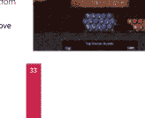

## 使用图形化安装

### 你将需要……

**Synaptic：**
www.congpu.org/synaptic/

你更喜欢使用图形界面来安装新程序吗？如果是，请继续阅读……

如果你是 Linux 新手，你可能会觉得使用其内置的 Apt 软件包管理工具有点令人望而生畏和困惑。`apt-get` 命令用于通过互联网安装应用程序，连接到容纳程序作为软件包的远程服务器——称为仓库。但它通过终端命令提示符使用，这可能令人畏惧，因此我们需要一种替代方案：一种通过桌面环境获取软件包的界面方法。

这就是 Synaptic 的用武之地。Synaptic 是 `apt-get` 终端命令的一个友好外观的图形界面，允许你通过已经熟悉的桌面环境来管理你的应用程序安装和移除。把它想象成一种在线商店，你可以在其中挑选你想要的程序，让它们下载并安装到你的树莓派上，而无需进入终端。

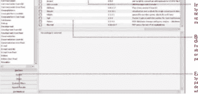

- **升级整个系统**
  Synaptic 具有更新和升级每个程序或软件包的能力，它可以将你的整个系统升级到最新版本
- **安装及更多**
  Synaptic 是一个非常强大的工具。使用它可以安装、删除、升级和降级单个或多个软件包和程序
- **浏览所有文档**
  在 Synaptic 中，你可以浏览和阅读与软件包或程序相关的所有可用在线文档
- **轻松查找程序**
  Synaptic 使你可以轻松地按名称、描述、版本甚至按开发人员来定位软件包和程序

# 使用图形化安装

## 更新系统

不幸的是，如果你不喜欢进入命令行终端，那么你将卡在第一步。在安装任何东西之前，我们需要确保树莓派已完全更新，并且现有的软件包已升级。只需在 LX 终端中输入以下内容。

```
sudo apt-get update

sudo apt-get upgrade
```

## 安装 Synaptic

要安装 Synaptic，你首先需要进入 LX 终端并运行以下命令 – 别忘了在任何要求你接受安装的提示处输入 'Y'。

```
sudo apt-get install synaptic
```

## 运行 Synaptic – 第一部分

本质上，这就是你需要做的全部。Synaptic 已安装好并随时可以使用。然而，由于其复杂性，可能还有一些 bug 需要先解决，所以最好按照以下步骤操作。要测试 Synaptic 是否正常工作，首先将以下命令输入终端。

```
gksudo synaptic
```

## 运行 Synaptic – 第二部分

你现在应该正在查看 Synaptic 程序窗口，你可以滚动浏览可用程序列表，并点击每个程序以下载和安装。现在我们需要测试它是否可以从 LXDE 菜单中运行。点击左下角的图标，然后转到“首选项 > Synaptic 包管理器”。

## 运行 Synaptic – 第三部分

从 LXDE 菜单运行 Synaptic 会导致错误。但请不要惊慌 - 它只是在请求密码。将以下密码输入框中。

```
raspberry
```

这是树莓派的默认密码，所以我们假设你没有更改过它！

## 修复 Synaptic – 选项 1

这可以暂时解决该问题，但要永久解决它，请执行以下操作之一。首先，右键点击菜单中的 Synaptic 图标，然后左点击“属性”。在“命令”文本框中，更改文本以添加 `gksudo` 命令。因此，不再是 '`synaptic-pkexec`'，它将变为：

```


`gksudo synaptic-pkexec`

## 修复 Synaptic – 选项 2

第二种，也是最佳的选项是回到终端，并改变程序从菜单中执行的方式。只需要将第 8 行更改为使用 `gksudo`，这样再次使用 `gksudo` 命令，而不是普通的 `synaptic-pkexec`。从终端输入：

```
sudo nano /usr/share/applications/synaptic.desktop
```

`Change Exec=synaptic-pkexec to Exec=gksudo synaptic-pkexec`

## Synaptic 完全正常工作

输入这些更改后，按 `Ctrl+X` 退出 `nano`，然后按 `'Y'` 接受更改，再按几次 `Enter` 返回到命令提示符。现在你可以从菜单中启动 Synaptic，或者在终端中输入以下命令。

```
gksudo synaptic
```

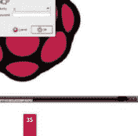

## 你需要什么……

- 原型制作设备
- `RPi.GPIO`
- [https://pypi.python.org/pypi/RPi.GPIO](https://pypi.python.org/pypi/RPi.GPIO)

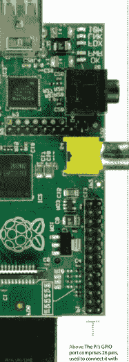

*上图：树莓派的 GPIO 端口由 36 个引脚组成，用于连接各种电子元件/设备*

# GPIO 端口解析

了解如何利用树莓派上的 GPIO 端口的力量。这比你想象的要简单……

树莓派上的通用输入/输出 (`GPIO`) 引脚通常是你将在本书中发现的项目成功的核心。没有它们，你就无法与现实世界进行交互，无论是触发灯光、按钮或蜂鸣器，还是读取传感器。

`GPIO` 引脚并不是树莓派特有的；它们实际上是一种标准，旨在帮助控制各种集成电路的输入和输出行为。通常你会发现任何一个 `GPIO` 引脚都没有预定义的特定用途，而且它们默认通常是关闭的。

## 树莓派 GPIO

树莓派上的 `GPIO` 引脚可以通过多种方式控制和触发。你可以直接从终端和通过 Bash 脚本使用它们，或者你可以使用专为流行编程语言设计的模块来控制它们。由于 Python 是树莓派的官方语言，你会发现 Python 的 `GPIO` 模块提供了可获得的输入和输出最佳控制之一。该库名为 `RPi.GPIO`，默认安装在所有树莓派上，但也可以以任何安装有用的 Python 库的方式安装。该项目托管在 SourceForge 上，可以在 [sourceforge.net/projects/raspberry-gpio-python](sourceforge.net/projects/raspberry-gpio-python) 找到。你还会发现有用的链接、信息以及如何在简单的 Python 脚本中使用和控制 `GPIO` 引脚的示例。如果你打算使用 `RPi.GPIO`，最好对 Python 有基本的理解，因此我们建议进行如 [www.codeacademy.com](www.codeacademy.com) 上找到的基础入门课程，或阅读 [www.python.org/doc](www.python.org/doc) 上的官方 Python 文档。

树莓派上有 26 个 `GPIO` 引脚，你可以按自己的意愿使用其中绝大多数。不过，有一些引脚具有特殊用途，因此我们建议你熟悉它们的布局。例如，最上面一行的引脚设计用于为按钮和灯光等外部设备提供电力。由于需要地线（通常称为“接地”）来安全地创建电路，你还会发现 `GPIO` 端口中有几个接地引脚。

## 如何使用 GPIO 引脚

要利用 `GPIO` 端口的力量，你需要一些基本组件，其中最重要的是跳线。由于端口上的引脚是“公”的，你需要根据打算连接到树莓派的硬件，购买“母对公”或“母对母”电缆。假设你要连接的设备也有公连接器，“母对母”跳线线就很合适，而且通常你在使用面包板来原型化电路，在这种情况下首选“母对公”连接器。电缆和面包板可以从几乎任何销售树莓派配件的在线商店以非常低廉的价格买到，通常可以在商店的“原型制作”部分找到。

## 命名约定

一旦你准备好连接你的设备，下一个任务是找到适合工作的正确引脚。虽然所有 `GPIO` 端口都是多用途的，但有些比其他的更“多用途”！如前所述，一些引脚保留用于 5V、3.3V 和接地。其他引脚也有特殊功能，但更糟糕的是，它们可以被称为不同的名称。例如，`GPIO 18` 也称为引脚 12 和 `PGM_CLK`。这个特定的引脚（位于 `GPIO` 端口右侧大约中间的位置）能够进行硬件脉宽调制 (`PWM`)，并用于控制 `LED` 灯和电机等。

你在 Python 脚本中使用的引脚命名约定可以手动设置。这可以设置为 `BCM`（Broadcom 引脚名称）或物理引脚位置（`BOARD`）。

你会在我们使用 `GPIO` 端口的任何项目中发现，括号中有 `BCM` 或 `BOARD` 的以下行：

```
GPIO.setmode(GPIO.BCM)
```


处理 GPIO 引脚命名问题的最简单方法是选择一种约定并坚持下去！

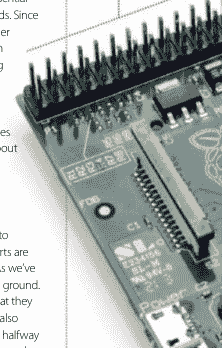

*下图：熟悉 GPIO 引脚的布局及其功能 - 有些具有特殊用途，例如接地引脚*

> **你知道吗...**
> `RPi.GPIO` 库有一些非常有用的本地化允许，例如我们可以设置 `"out"` 或 `"input"`。

# 四大附加板

使用这些附加板来扩展树莓派的功能，从而从树莓派中获得更多。

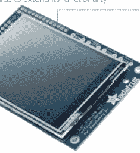

## Pi Supply Switch £15

树莓派之所以如此受欢迎，部分原因是其硬件具有极高的性价比。它在价格点上提供了强大的性能，而且由于它是由慈善机构设计的，因此他们不需要通过高利润来抬高价格（想想它作为商业产品会花多少钱）。不幸的是，与任何低成本物品一样，为了以如此实惠和小型的形态带来它，不得不做出一些妥协。

与更标准的台式或笔记本电脑相比，它明显缺乏的两样东西是电源开关和电源管理功能。让人惊讶的是，像电源开关这样简单的东西可以如此有用，直到你没有它时你才会意识到这一点！

`Pi Supply Switch` 是一个自焊套件，提供开、关和软关（文件安全关机）按钮，为你的树莓派提供基本的电源管理功能。通过提供的一些示例脚本，你可以确保在关闭时树莓派正确关机 – 无需打开任何菜单或在终端中输入任何命令 – 而且开关中的电路确保只有在树莓派关机后才移除电源。除了对你更方便外，它还可以减少因过早拔出电源电缆而导致 SD 卡损坏的可能性。

## PiTFT Mini Kit £30

这是一个 2.8 英寸电容式 TFT LCD 触摸屏，由 Adafruit 的项目专家专门为树莓派设计。它可以直接插在树莓派上方，大小与树莓派本身相当。

你想要为树莓派添加这样的屏幕有很多原因，但通常都归结于树莓派非常小且非常便携，而大多数显示器并非如此。虽然如果你在外可以透过手机通过 VNC 远程连接，但该屏幕直接连接到树莓派，并不涉及麻烦的无线联网。此外，作为一个触摸屏，你不需要携带其他输入设备，因为它也由树莓派供电。

这开启了无限可能。便携式电脑、触摸屏控制板、摄像机 – 任何在你离开主显示器时能从树莓派拥有屏幕和人类输入中受益的东西。

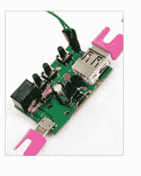

# 四大扩展板

## 入门指南

### HiFiBerry DAC+ 30英镑

作为一款高质量的音频设备，你可能会发现树莓派在这方面有所不足，因为它仅配备了一个不适合高保真音频的3.5毫米立体声输出口。你或许曾梦想过提升音质，将你的系统升级到下一个层级。好消息是，树莓派基金会的聪明才智团队提供了对 I2S 引脚的访问权限，最初是在独立的 PS 排针上，而现在在树莓派 4、树莓派 2 和 3 上，可以从主 40 针 GPIO 排针获取。I2S 是一种专为音频设备设计的通信协议，它使 HiFiBerry 和 Quadio 等公司能够创建高质量的音频扩展设备。`HiFiBerry DAC+` 是一款扩展板，可将高分辨率（192 kHz, 24位 Burr-Brown 数模转换器）带入你的树莓派。它具有使用 `Alsamixer` 的硬件音量控制等其他功能，并且由于它是 HAT 兼容板，因此在开箱即用的情况下即可与最新版本的树莓派固件以及所有流行的标准使用和媒体播放操作系统（如 Raspbian、Arch Linux、OSMC、OpenELEC、Volumio、Pi MusicBox 等）配合使用。如果你非常重视音质，并希望获得一种高质量、低成本且联网的解决方案，那么你再也没有借口了——你可以以低于100英镑的价格自行构建一个。

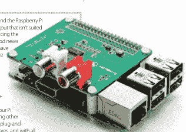

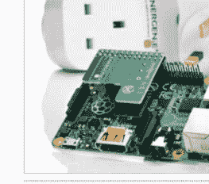

### Energenie Pi-mote 20英镑

智能家居自动化目前非常流行，自动化任务如在你睡觉前自动开启暖气控制并关闭灯光，可以让我们的生活变得轻松许多。

我们常被告诉的一件事是，最好在插头处关闭设备，而不是让它们处于待机状态，因为如果未正确关闭，它们会消耗大量电力。这正是 `Enegrenie Pi-mote` 控制启动套件发挥作用的地方。它包含两个可通过 RF 遥控器开关的遥控插插座。

这与树莓派有什么关系呢？你还会得到一块扩展板，使你可以透过软件控制树莓派上的插座，这解锁了全新的可能性——你可以设定灯具在你外出时自动在特定时间开关，以威慑窃贼。

它们仅提供英式和欧规插头类型，因此如果你使用不同的插头，可能需要寻找其他产品（并也许可以向 Enegenie 发送请求以制作更多版本）。

> “Enegrenie Pi-mote 控制启动套件包含两个可通过遥控开关的插座”

# 项目

## 备份你的树莓派

主动备份你的树莓派，确保你永远不会丢失文件。

虽然树莓派是一台非常坚固的设备，但故障可能会发生，因此最好做好准备并妥善保存你的文件。

好消息是，树莓派的所有文件都外部存储在 SD 卡上。如果你的树莓派坏了，所有内容仍会保留在 SD 卡上并可以从其他地方访问。不过，SD 卡仍然容易出现问题。备份树莓派有几种方法。

这些方法可以分为两大类：保存重要文件和创建 SD 卡状态的精确副本。前者意味着在其他地方保留文件的副本，而后者则是创建通常在安装 Raspbian 或其他树莓派操作系统时写入 SD 卡的同类型映像。

### 重要文件

为了保存重要文件，我们需要在外部源（如外部硬盘或另一台 PC）上创建副本。最好的方法之一甚至不涉及树莓派：你只需要一台带读卡器的 PC 或笔记本电脑，就可以开始了。

关闭树莓派，拔掉电源并从插槽中取出 SD 卡。找到你 PC 上的 SD 卡读卡器并插入它。SD 卡的主要文件系统默认可以被 Linux PC 读取，Windows 或 Mac 计算机在安装允许其读取 ext 文件系统的程序（如 `Ext2Fsd`）后也可以读取。在 Windows 上，SD 卡会与“我的电脑”下的其他驱动器一起列出（图 1）。在 Linux 和 Mac 上，它会在菜单和文件管理器中显示存储设备的地方列出。

找到 SD 卡后，打开它并导航到 `home` 然后 `pi`。这是可以找到 `Documents`、`Downloads`、`Desktop` 和其他目录的地方。你只需要选择要复制的文件，并将它们移动到 PC 上的安全目录或连接的外部硬盘上。

**你将需要的...**

- 第二台计算机
- 外部存储

**你知道吗...**

SD 卡不会永远持久，因此请始终确保你拥有文件的备份以及整个操作系统的备份。

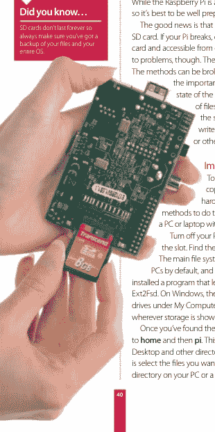

如果你希望将文件保留在另一台计算机上，那也没问题，但从长远来看，它将会面临与树莓派完全相同的问题。将它们保存在外部硬盘上是个好主意，而将它们放在云存储服务上则更好，这样你可以从任何有互联网连接的地方访问它们（图 2）。

### 克隆

创建克隆取决于你在主计算机上使用什么操作系统。对于 Mac 和 Linux，你可以使用一个简单的命令行工具 `dd` 来创建 SD 卡的精确副本（图 3）。这是在终端模拟器或命令行中完成的，所以先打开它。确保 SD 卡已插入，并输入：

```
$ fdisk -l
```

这会列出所有连接的存储设备。SD 卡可能有 2、4 或 8GB 的空间，取决于其大小。它很可能被列为类似 `/dev/sd[x]` 的名称，其中 x 是计算机分配给 SD 卡的字母。要使用 `dd` 复制它，请在终端中输入以下内容：

```
$ dd if=/dev/sd[x] of=backup_img bs=1M
```

你还可以添加正在创建的映像的路径，将其放在特定文件夹中。该过程需要一些时间，并会生成一个数吉字节的文件，然后你可以通过反转上一条命令将其写入 SD 卡：

```
$ dd if=backup_img of=/dev/sd[x] bs=1M
```


虽然这作为备份很有用，但你还可以使用该映像批量生产 SD 卡，送给朋友或保留在你可以使用树莓派的各种地方。

### Windows

要在 Windows 上创建克隆，我们可以使用 Win32 Disk Imager（图 4）。从这里下载安装它：`bit.ly/L8jYDg`。

安装完成后，插入 SD 卡并启动软件。为备份文件选择一个名称，并从设备列表中选择 SD 卡。现在按“Read”（读取），它将创建备份文件。同样，这可能需要一段时间；不过，这次你至少会看到一个进度条。

存储你的克隆映像比存储重要文件稍显困难——由于映像的大小为吉字节级别，它会占满许多云存储服务。如果你有空间，当然要把它放在那里；不过，你可能需要将其放在外部硬盘上。

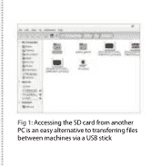

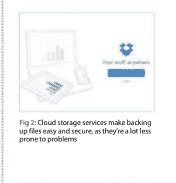

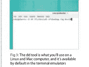

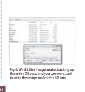

## 初学者的 nano 指南

学习如何使用 Linux 最好的工具之一在命令行和终端中编辑文本。

如果你渴望在树莓派上做得更多，那么你需要学习的一项重要技能之一是编辑系统文件的能力，以便完成许多项目。命令行文本编辑器 `nano` 绝对是完成此任务的最佳工具之一。文本编辑器是非常基础的工具：在这种情况下，答案就在名字里。没有格式设置、颜色或类似文字处理器中那样的东西，但这就是重点。你要创建或编辑的文件通常包含代码——这些代码不需要加粗或项目符号。`nano` 去除了所有这些干扰因素，但仍然保留了一些图形文本编辑器中更实用的功能。我们将教你如何充分利用 `nano`，使你的项目快速、高效地运行。

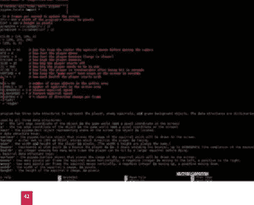

**你将需要的...**

- 完整的 `nano` 手册
- `www.nano-editor.org/dist/v2.2/nano.1.html`

> **你知道吗...**
> `Nano` 是初学者最好的命令行编辑器之一，但还有很多选择，比如 `Kate` 和 `Vim`。

**写作**

- 在命令行上创建纯文本文件，甚至为程序编写一些代码

**编辑**

- 根据你的需求和项目编辑系统文件，而无需在文件管理器中拖拽

**高级功能**

- 使用 `nano` 的一些内置功能进行搜索、复制、粘贴以及从另一个文件插入文本

## Nano 初学者指南

### 打开 nano

**01** 打开终端，或进入*命令行*，只需输入 `nano`。这将打开一个空白新文件。从这里你可以创建一个简单的文本文件，例如列表，或者创建一个系统文件、脚本或一段代码。系统如何解释你的文件取决于你写什么以及如何保存。


### 保存并继续

**02** 当你完成 `nano` 操作后，可以使用 `Ctrl+O` 进行保存/写入。像这样的所有快捷键和功能都是使用 `Ctrl` 键加上后续字母来实现的。它会询问你以什么名称保存文件。无论你给它起什么名字，除非你指定路径，否则它都会保存在你打开 `nano` 的那个目录中。

### 打开文件

**03** 要编辑已存在的文件，你首先需要知道它们的位置和名称。要在 `nano` 中打开它们，请键入以下内容：
```
$ nano /path/FileName
```
例如，要编辑 `fstab`，你需要键入：
```
$ nano /etc/fstab
```

### 保存并退出

**04** 当你完成文件修改，需要继续下一个任务时，你可以按 `Ctrl+X` 退出 `nano`。它会询问你是否想保存所做的修改，只需按 `Y` 确认即可。如果你想*不*保存更改就退出，只需使用 `N`。如果在做出决定之前想要取消，请使用 `Ctrl+C`。


### 复制和粘贴

**05** 这更多是一个特定于终端的命令，但它同样可以在 `nano` 中使用。虽然你不能使用鼠标在 `nano` 中的文件中导航，但你可以像在图形文本编辑器中一样高亮显示文本。高亮显示后，按 `Ctrl+Shift+C` 将复制任何文本。`Ctrl+Shift+V` 将粘贴。

### 从文件插入

**06** 如果你需要直接插入另一个文件的内容，有一种快速方法可以这样做，而不需要使用复制和粘贴。键入 `Ctrl+R` 并输入文件路径，就会将内容插入到光标所在的位置。

### 高级导航

**07** 你很可能一直在使用方向键一次移动一个空格，向左、右、上或下移动。不过，还有其他方法可以在文件中移动。使用 `Ctrl+左键` 与图形编辑器中的 Home 键功能相同，将光标移动到行首。同样，`Ctrl+E` 相当于 End 键，将光标移动到行尾，`Ctrl+V` 是向下翻页，`Ctrl+Y` 是向上翻页。

### 在文件中搜索

**08** 有时你会想在大型文本文件中寻找特定的行或短语。与其使用方向键并不知疲倦地阅读每一行，你可以使用 `nano` 搜索功能，按 `Ctrl+W`。输入搜索词将开始在文档中查找，一旦完成，你可以按 `Ctrl+C` 退出搜索。


### 额外帮助

**09** `nano` 中还有许多其他功能。要查看命令列表，可以使用 `Ctrl+?`，它会列出所有快捷键及其功能。此列表中的*星号*（\*）表示在键盘上使用 `Ctrl`。

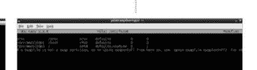

## 项目

### 你需要的东西……

**TightVNC**
`www.tightvnc.com/release-2.7.php`

1. **获得远程桌面访问权限**
   学习如何在没有直接面对你的情况下访问你的树莓派桌面……

`VNC`（虚拟网络计算）是一种图形桌面访问和共享系统，允许用户远程控制和操作另一台计算机的桌面。

它在许多方面都非常方便：让你控制远程系统；帮助其他地方的用户；允许计算机保持通电，但无需键盘、鼠标甚至显示器。

在我们的案例中，我们旨在允许访问树莓派桌面，而无需连接上述周边设备。这样，你可以做通常做的所有事情，但只需连接电源和网络，从而腾出空间并节省额外费用。在实际应用中，这意味着你甚至可以通过 Android 平板电脑或手机访问树莓派桌面！

1. **你知道吗……**
   `TightVNC` 服务器是一个免费资源，用于访问 VNC 服务器，例如我们在本教程中将要安装的那个。


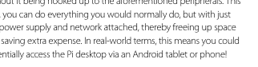

### 静态 IP 地址

**01** 我们的第一步是确保树莓派有一个静态 IP 地址。基本上，IP 地址是你网络分配给设备的一组数字，用于区分它们。要设置静态 IP 地址，只需双击 `LXTerminal`，键入以下内容，然后按 Enter。
```bash
sudo nano /etc/network/interfaces
```

### 静态 IP 第二部分

**02** 此文件控制树莓派的 IP 寻址。你需要向下滚动到 `iface eth0` 行，删除 `DHCP` 并替换为 `static`。现在，在紧接着的下一行，输入你希望树莓派拥有的 IP 地址，连同子网掩码和网关。
```text
address  255.255.255.0
gateway  192.168.1.254
```

### 静态 IP 第三部分

**03** 输入这些详细信息后，按 `Ctrl+Q` 退出 `nano`，然后按 `Y` 接受更改，再按几次 Enter 返回终端的命令提示符。现在你可以重启你的树莓派，或者在终端中键入以下内容：
```bash
sudo /etc/init.d/networking stop
sudo /etc/init.d/networking start
```

## 获得远程桌面访问权限

### 安装 VNC 第一部分

**04** 现在我们将安装 VNC，并确保每次树莓派启动时它都会自动启动。在旧版本的 Raspbian 下，这有点烦人，因为配置服务经常容易破坏系统。但现在不再如此了。输入以下命令，每个命令后按 Enter。

```bash
sudo apt-get update
```

```bash
sudo apt-get install tightvncserver
```


### 安装 VNC 第二部分

**05** 当包下载并安装完成后，按照屏幕上的指示（见下文）设置密码并确认。但对仅查看选项回答 'N'。这真的只是一个安全功能，由于你只是在家访问树莓派，所以并不是绝对必要——尽管这仍然是良好的实践。

- 访问你的桌面需要一个密码
- 密码：
- 验证：
- 你是否想输入一个仅查看密码 (y/n)? n
- 新的 'X 桌面是 raspberrypi:1'

### 配置 VNC 服务器

**06** VNC 服务器已安装并运行。现在我们需要确保每次树莓派重启时都将其作为服务加载，这样即使树莓派经历电源循环（断电重启），你也能访问它。要配置树莓派执行此操作，请在终端中键入以下内容并按 Enter。

```
sudo nano /etc/init.d/tightvncserver
```

### 配置启动服务

**07** 我们回到 nano，我们需要输入一些命令行，以便让树莓派在启动时激活 VNC 服务器。在编辑器中，键入：

```
#!/bin/sh

# /etc/init.d/tightvncserver

# 将 VNCUSER 变量设置为要在其下启动 tightvncserver 的用户名

VNCUSER='pi'

case "$1" in

start)

 su VNCUSER -c '/usr/bin/tightvncserver -l'

 echo "Starting TightVNC server for $VNCUSER"

 ;;

stop)

 killall Xtightvnc

 echo "Tightvncserver stopped"

 ;;

*)

 echo "Usage: /etc/init.d/tightvncserver {start|stop}"

 exit 1

;;

esac

exit 0
```

### 重启并准备就绪

**08** 现在按 Ctrl+X，然后按 Y 保存，接着按几次 Enter 返回终端。我们现在需要编辑刚刚创建的脚本的权限，使其可执行且处于激活状态。通过在终端中键入以下命令来完成这一点，确保每个命令后都按 Enter，否则系统不会注册它。

```
sudo chmod 755 /etc/init.d/tightvncserver
sudo rc-d tightvncserver defaults
sudo reboot
```

完成这些步骤后，最后要做的是将其放置在一个可以方便地访问网络线缆的地方。如果你安装了 TightVNC Viewer 或任何其他远程访问软件（只要它使用 tight 协议），你应该能够将客户端指向树莓派地址 `192.168.1.90.1`（或者你希望连接设备所在网络的静态 IP 地址是什么就是什么），从而完全访问树莓派。

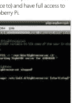

## 项目

### 使用 SSH 访问你的文件

#### 你将需要
- 任何树莓派发行版
- www.raspberrypi.org/downloads
- 互联网连接
- 第二台计算机

#### 使用 SSH 访问你的文件

使用你家用电脑的终端，可以迅速且安全地访问你的树莓派。

> **你知道吗**
>
> SSH 是远程访问任何机器最安全的方法。它比 VNC 更快。

正如我们在前一页所展示的那样，虽然远程登录完整的 X 环境非常有用，但它也有缺点。首先，这并不特别快捷或方便。用户体验也可能缓慢且笨拙，但最糟糕的是，它没有我们希望的那样安全。

如果你想要一种更便捷和安全的方式来从另一台电脑访问你的树莓派，你会发现所有经验丰富的树莓派爱好者都会使用 SSH。SSH 代表 Secure Shell（安全外壳），是一种旨在确保通过命令行进行安全数据通信的加密网络协议。

尽管初学者可能会争辩说使用完整的图形界面远程访问树莓派更容易，但一旦你学会了一些基本的命令行技巧，你就会很快发现通过 SSH “潜入”你的树莓派是远程与它交流的最便捷方式。

你会很高兴地听到，SSH 已经经过良好的出厂配置——你几乎不需要做任何事情就能让它工作，特别是如果你的远程计算机运行 Linux 或 OS X，正如我们将要演示的那样。

#### 使用 Linux 和 OS X 配置 SSH 很简单

假设你的树莓派已开启并通过以太网或 Wi-Fi 适配器连接到网络，你唯一需要的信息是你树莓派的 IP 地址。要发现这一点，你只需在树莓派上打开一个终端窗口并输入命令 `ifconfig`（图 1）。

如果你是通过以太网线缆连接的，你会看到 'eth0'，然后是几行结果。IP 地址将是 'inet addr' 字样旁边的第二行数字。如果你是通过 Wi-Fi 连接的，结果将在 'wlan0' 的第二行。IP 地址本身是由句号分隔的四组数字。如果你在你的家庭网络上，它可能类似于 `192.168.0.15`。我们将使用这个数字作为指南，但请将其替换为你通过 '`ifconfig`' 看到的 IP 地址。

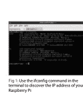

图 1 在终端中使用 `ifconfig` 命令来发现树莓派的 IP 地址

拿到这个信息后，你只需在远程 Linux 电脑上打开一个终端窗口并输入：

```
ssh pi@192.168.0.15
```

这假设你的树莓派用户名仍然是默认的（即 'pi'），并且你用刚才记下的 IP 地址替换了其中的 IP 地址。如果你添加了用户账户或更改了默认值，你需要将 '@' 前的用户名替换为你更改后的内容。当你按下 Enter 键时，系统会提示你输入树莓派的密码——同样，如果是默认密码你可以输入 'raspberry'，否则输入你的树莓派密码并按下 'Return'（回车键）。

现在你会看到命令行上的用户名详细信息已更改以反映你的树莓派的信息——你现在已远程连接。试着浏览你的文件或使用 `nano` 打开一个文件进行编辑！

#### 永远不用再输入 IP 地址

当然，如果你把你的树莓派带到另一个网络，你树莓派的 IP 地址将会不同。如果你只是想远程连接它，为了获取 IP 地址而为一台电脑设置键盘、鼠标和显示器就变得极其麻烦。如果你能直接在终端中输入树莓派的名称来连接，那不是更容易吗？听起来好得不像真的，但这实际上很容易做到。

你只需要一个小的软件，它有效地让你通过名称而不是 IP 地址来发现本地网络中的主机和服务（图 2）。要在树莓派上设置它，你只需打开终端并输入：

```
sudo apt-get install avahi-daemon
```

安装完成后，你只需在终端中输入以下内容即可通过 SSH 访问你的树莓派：

```
ssh pi@raspberrypi.local
```


此外，当你通过其他任何形式的网络访问它时，你也可以使用树莓派的名称，无论是 Samba、远程登录还是 VNC 或其他！

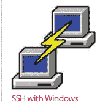

### 使用 Windows 配置 SSH

正如 Windows 世界中的大多数事情一样，使用微软操作系统访问树莓派并不像你想象的那么简单。幸运的是，有一个有用的工具可以帮助你。`PuTTY` 允许你建立安全外壳连接，并且它易于设置和使用。你可以从以下地址下载 `PuTTY`：`www.chiark.greenend.org.uk/~sgtatham/putty/`

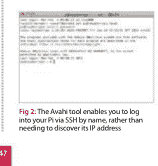

### 你将需要
- `Scratch`
- 互联网连接

> **你知道吗**
>
> `Scratch` 的网站 `www.scratch.mit.edu` 包含许多其他用户制作的程序和游戏。

### Scratch 工作室项目

#### 01 在 Studio 顶部有三个快速访问图标和主菜单（图 2）。

第一个地球样式的图标用于设置 Studio 的语言。另外两个按钮提供对项目保存和共享功能的快速访问。

在 `File`（文件）菜单下，有一组典型的文件管理功能，用于打开、保存和导入 `Scratch` 项目。还有一个 `Project Notes`（项目笔记）选项，我们可以在此输入功能描述和评论。

`Edit`（编辑）菜单包含各种动画、图像和音频编辑工具。而 `Help`（帮助）部分提供对浏览器托管的帮助页面的访问。

有趣的是，`Share`（共享）菜单允许我们与全世界分享我们的项目。任何 `Scratch` 项目都可以通过 `Share This Project Online...`（在线共享此项目...）选项和 `Upload To Scratch Server`（上传到 Scratch 服务器）表单（图 3）发布到 `Scratch` 社区网站。

#### 使用 Scratch 编程

一份关于使用树莓派图形化编程语言进行编程的交互式指南

你想深入动画和游戏创作的世界吗？你想让你的创意想法成真，而无需学习软件开发语言吗？使用 `Scratch`，你可以做到所有这些，甚至更多。

`Scratch 1.4` 已预装在官方 `Wheezy` `Raspbian` 操作系统镜像上。如果你的树莓派尚未安装 `Scratch`，不用担心，只需前往官方 MIT `Scratch` 网站查找下载和安装说明。

要开始，我们只需打开 `Scratch Studio`。点击桌面上的 `Scratch` 猫图标，或在 `LXDE` 桌面菜单中找到 `Scratch`。

`Scratch Studio` 是一个完整的开发环境。它分为多个独立的窗格。每个窗格在应用程序构建过程中都有特定的角色，以及自己特定的一组功能和工具。

让我们加载 `Aquarium`（水族馆）示例项目。从 `File`（文件）菜单中选择 `Open...`（打开...）选项，显示 `Open Project`（打开项目）对话框。从左侧的大按钮列表中，点击名为 `Examples`（示例）的那个。然后在右侧，双击选择 `Animation`（动画）文件夹。接着选择 `6 Aquarium` 项。打开对话框窗口中的内容应如图 4 所示。

加载水族馆项目后，我们的 `Scratch Studio` 应类似于图 1。我们将从暂存区开始我们的 Studio 之旅。


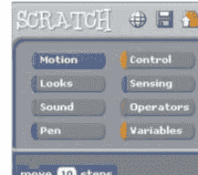

图 2：Scratch Studio 菜单 – Scratch Studio 的主菜单和快捷图标

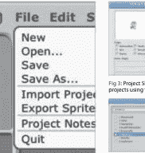


图 3：项目共享对话框 – 我们可以使用 Studio 的共享菜单来共享我们的项目


图 4：文件打开对话框 – 使用 Studio 的文件菜单和打开...来加载水族馆项目

#### Scratch 工作室舞台

**02**

舞台是所有动作发生的地方，位于 `Scratch Studio` 的右上方。

舞台由称为 sprite（角色）的图形元素构成。在这里，我们有植物、气泡、鱼和其他生物。你还可以添加和创建自己的素材，但我们稍后再讲。

在 `Staging Area`（暂存区）顶部，有一个绿色旗帜和一个红色圆圈。点击绿色旗帜让水族馆动起来。现在花一点时间研究水族馆的动画。注意生物的运动和上升的气泡。红色圆圈图标停止动作。

我们可以使用位于绿色旗帜正上方的三个按钮来设置查看模式。

左侧的两个按钮增加或减少暂存区面板的大小。较小的暂存区意味着与中央区域相比，其相对大小增加。

右侧的按钮是演示模式，它以全屏模式显示舞台（见图 5）。通过左上角的弯曲箭头按钮或按 `esc` 键退出演示模式。

#### Scratch 工作室角色

**03**

暂存区下方是此项目的角色集合。 `Stage`（舞台）角色与其他角色分开。它与其他角色略有不同，充当舞台的背景图像。

该区域顶部的三个按钮提供了创建新角色的各种方法。第一个按钮在绘图编辑器中打开一个空白画布。第二个按钮基于选定的图像文件创建一个新角色，通过弹出的文件选择对话框窗口进行选择。第三个将从预装的图像集合中选择一个随机图像。

我们可以直接从舞台使用主菜单右侧的四个按钮来管理角色。在这里，我们点击特定的按钮，然后点击舞台上的一个角色。


图 5：舞台演示模式 – Studio 的舞台演示模式是查看项目的最佳方式

## 使用 Scratch 积木和工具

### 熟悉 Scratch 工作室工具箱

位于工作室中心的是编辑面板。该面板上的控件与当前选中的角色相关。

让我们从角色集合区域选择名为 `Creature1` 的水母角色开始。

在顶部是角色的图像和名称，以及其当前舞台坐标和方向的指示。左侧有三个动画控制按钮。顶部的按钮将旋转角色，第二个按钮在朝左和朝右状态之间切换，第三个按钮则关闭动画。

下方是三个编辑面板标签页。脚本（Script）标签页是创建积木脚本的地方。我们将在这里拖放积木，并将它们以各种组合拼接在一起。

要更改角色的视觉外观，我们将使用“服装”（Costumes）标签页。每个角色可以有一个或多个服装。例如，水母有两个服装（图 1）。每个服装都有编辑、复制和删除按钮。可以使用三个“新服装”按钮绘制、导入或截取新的服装。声音标签页允许我们向项目中添加音频。


图 1：水母角色的服装 – 水母角色有两个不同的服装。

## Scratch 积木样式

01 “积木调色板”（Blocks Palette）包含了完整的编程积木集合。积木有三种基本样式，即帽子（hats）、堆栈（stacks）和报告器（reporters）（参见下一页的图 3）。

帽子样式的积木会根据特定事件启动积木脚本的执行。经典的帽子积木是“绿色旗帜”点击事件。然而，还有许多其他帽子积木，包括在特定按键按下、鼠标点击甚至来自某些 GPIO 连接硬件的传感器事件之后启动脚本执行的帽子积木。正如你可能意识到的那样，这为 Scratch 程序员提供了很多选择。

报告器积木允许我们指定文本、数值和布尔值。它们嵌入到其他积木中特定形状的“孔”中。矩形报告器将包含一个文本字符串。

而圆端报告器与数值相关，尖角端报告器则包含布尔值 true 和 false。

堆栈积木是核心脚本构建元素。它们通过顶边缘的凹槽和底边缘的凸块与其他积木相互连接。许多堆栈积木包含用于报告器样式的积木的“孔”，这些积木将根据指定的报告器积木值修改其操作。

Scratch 积木集合被分为组。我们使用位于积木调色板面板顶部的八个按钮来选择积木组，即“运动”、“控制”、“外观”等等。这些组采用颜色编码。除了添加积木选择外，这种颜色编码在编辑面板中阅读积木脚本时，还提供了积木类型的视觉提示。

## 使用 Scratch 编程


图 2：录音工具 – Scratch 工作室包含一个工具，用于录制我们自己的声音

### Scratch 积木帮助

02 如前所述，有许多积木，每个都有自己特定的功能和能力。

从某种意义上说，这是好消息。大量的积木集合意味着 Scratch 可用于广泛范围的软件项目，如游戏、动画、音乐、图形、数学、科学、机器人、电子学等。

然而，对于初学 Scratch 编程的人来说，广泛的积木选择可能是一个相当大的挑战。为了帮助解决这个问题，Scratch 工作室的设计者包含了一组信息丰富的以积木为中心的帮助页面。

在任何积木上简单右键单击将显示一个弹出帮助页面选项。帮助页面包含特定上下文的描述、图形图像以及，在适当的情况下，使用该特定积木的脚本示例（图 4）。

这是一个很棒的功能，极大地简化了解码使用哪些积木的过程。更重要的是，研究这些帮助页面是提高编码技能和发现 Scratch 功能丰富的积木集合中潜在可能性的非常有效的方式。


图 3：积木样式示例 – Scratch 积木有多种不同的样式

## 项目

### 你知道吗……？

有不止一个命令可以用来启动你的脚本；除了标准的绿色旗帜积木之外

### 积木脚本详解

03 让我们更深入地了解积木脚本在实际中是如何工作的。为此，我们将使用一个简单的鱼缸项目积木脚本。从角色集合面板中选择 `garfish` 角色。然后回到中央编辑面板并选择脚本标签页。

这里只有一个积木脚本。从顶部开始，有一个绿色旗帜“帽子样式积木”来启动活动。接下来是一个“无限循环”。这个内部循环块在被按下停止按钮之前一直保持激活状态。这个“无限循环”积木包含另外两个积木。

第一个内部脚本积木选择下一个背景图像。点击“背景”标签页以查看所有舞台图像。第二个内部积木只是暂停执行若干秒。将值设置为“1”意味着该脚本将在执行下一个积木指定的操作之前暂停一秒。

重要的是，你要记住这两个积木被封闭在无限循环积木中。因此，舞台背景图像将以每次一秒的顺序显示。


图 4：积木帮助窗口 – 一个与“询问并等待”积木相关的帮助窗口示例

## 项目

# 在 Scratch 中创建一个贪吃蛇克隆版

设计你自己的贪吃蛇版本，以测试你新的编程技能！

**你需要...** `Scratch` 项目归档
`www.scratch.mit.edu/ideas?size=over`

**你知道吗...?**
贪吃蛇（Snake）是一个非常流行的初学者游戏，起源于上世纪七十年代的街机，至今仍然很受欢迎。

在这里，我们将创建一个经典贪吃蛇游戏的版本，使用箭头键在 `Scratch` 舞台上移动蛇。你控制蛇头，并且必须避免与蛇身或舞台边缘发生碰撞。

每次吃下一个蛋，蛇身就会变长。吃掉好的黄色蛋会增加分数，而吃掉坏的黑色蛋会减少分数。还有提供额外分数的奖励角色可以吃。

通过遵循本教程，你将学习如何创建自己的简单角色图形，发送和接收广播事件，使用列表变量存储数据，播放音效，生成随机数，并使用传感命令来检测角色是否接触某物。

### 蛋角色
蛋角色随机出现在屏幕上，并在被吃掉时（被蛇头接触到）通知其他角色


### 蛇角色
蛇角色在舞台上移动头部，并在其身后绘制身体。它还检测与身体或边缘的碰撞

### 尾巴角色
尾巴角色跟随头部，擦除身体的末端以使蛇移动，并在需要生长时暂停

### 坏蛋角色
坏蛋角色也随机出现，但被吃掉时会减少分数。它的尺寸也会增长，变得更难避免


## 绘制蛇角色

- 01 点击新角色：画笔图标来绘制蛇角色。

在绘图编辑器中，为蛇头画一个小的绿色椭圆，并为舌头添加一个红色矩形。舌头与头部颜色不同非常重要。将你的角色命名为 `Snake`。

## 添加蛇声音

- 02 当蛇头接触到蛇身或舞台边缘时，我们将播放游戏结束声音。我们需要将此声音添加到蛇角色。选中蛇角色后，点击声音标签页并选择导入。选择 `Electronic-Screetch` 声音。


## 初始化蛇变量

- 05 使用“当绿色旗帜被点击”控制命令，并使用变量调色板中的命令初始化蛇变量，如图所示。我们希望每个游戏开始时都有一个空的 `Next Direction` 列表，因此删除其所有条目。分数必须从零开始。速度设置难度。


## 添加主操作循环

- 07 使用“无限循环”命令，并在内部嵌套“如果-否则”命令。如果红色舌头接触到蓝色身体（头部总是接触身体）或蛇角色接触边缘，则会发生碰撞。使用吸色工具选择 `Scratch` 中的颜色。


## 响应箭头键

- 03 从控制调色板中拖出四个“当按键被按下”命令，并从运动调色板中拖出四个“面向指定方向”命令。按如图所示进行配置，使得向上箭头将方向更改为 0 度（上），等等。点击舞台上方的绿色旗帜来测试此功能。


## 绘制蛇身

- 06 使用画笔调色板中的命令来控制蛇身的绘制。你还应该使用运动调色板中的命令在每个游戏开始时将蛇移动到舞台中心并朝左。直到蛇处于起始位置，画笔都是抬起状态。在下一步中，我们将使用颜色来检查头部是否接触了任何不应接触的东西。


## 处理游戏结束

- 08 当检测到碰撞时，向其他角色广播游戏结束事件（你需要创建一个新事件），以便它们也能做出反应。此外，播放“Screetch”音效并停止所有脚本，使蛇在游戏结束时冻结在其当前位置。

## 创建蛇变量

- 04 点击变量调色板。创建两个所有角色可见的变量：`Score`（分数）和 `Speed`（速度）。创建一个名为 `Next Direction` 的列表，该列表对所有角色可见；它将存储头部采取的方向序列。仅勾选 `Score` 变量，使其出现在舞台上。


## 项目

### 在 Scratch 中创建一个贪吃蛇克隆版

#### 处理移动

09 现在处理没有碰撞且蛇必须沿当前方向移动的常见情况。画笔已放下，因此它将绘制身体。`Speed`（速度）变量决定了移动的步数。将当前方向添加到 `Next Direction`（下一个方向）列表中，供尾部读取。


#### 试用蛇

10 现在你可以试用你的 `Snake`（蛇）精灵了。响应方向键的按压，它会在屏幕上四处移动。它会绘制自己的身体，这将变得越来越长，因为我们需要尾部来擦除它。当检测到碰撞时，它会伸展并结束游戏。


#### 绘制尾部

11 点击新精灵画笔图标来绘制 `Tail`（尾部）精灵。画一个小绿色圆圈来代表尾部的末端。将此精灵命名为 `Tail`。`Tail` 精灵将跟随 `Snake` 移动，并擦除其尾部的末端，以防止蛇身无限增长。

#### 创建 Grow 变量

12 创建一个 `Grow`（生长）变量，该变量仅适用于此精灵——其他精灵不需要访问它。`Grow` 变量用于确定蛇身何时需要生长，因此尾部需要在跟随之前移除它，以便让头部进一步超前。


#### 处理事件

13 `Tail` 需要监听两个新事件，你可以在需要时创建它们。当它从某个 `Egg`（蛋）精灵接收到 `Egg Eater`（吃蛋者）事件时，它将 `Grow` 设置为 1，以便尾部可以暂停。当它从 `Snake` 接收到 `Game Over`（游戏结束）事件时，它必须冻结。


#### 初始化尾部

14 当点击绿色旗帜开始游戏时，`Grow` 被设置为 1，以便蛇获得较短的身体。将画笔抬起并移动到舞台中心，并将画笔配置为绘制与舞台背景颜色和大小相同的轨迹，以便擦除身体。

#### 生长和移动

15 使用“永远”命令来保持尾部移动。如果 `Grow` 为 1，它应暂停并将 `Grow` 重置为 0——这会使身体变长。使用 `Next Direction` 中的第一个值来设置方向，并移除该值，以便下次获得新值。移动 `Speed` 步。


#### 试用尾部

16 现在你可以试用 `Tail` 精灵了。`Snake` 尚未持续增长，因为它不会收到任何 `Egg Eater` 事件。但尾部将跟随蛇头在舞台上移动，通过用白色画笔（与背景颜色相同）覆盖来擦除蛇身，从而擦除其路径。


### 在 Scratch 中创建一个贪吃蛇克隆版

#### 绘制 Egg 精灵

17 点击新精灵画笔图标来绘制一个新精灵。在绘画编辑器中，画一个小黄色椭圆。将该精灵命名为 `Egg`。`Egg` 将随机出现在舞台上，导致蛇身生长并增加分数。


#### 添加 Egg 声音

18 转到 `Egg` 精灵的“声音”标签页，导入 `Recession-Symbol-Crash` 声音。或者，如果你愿意，可以选择不的声音。当蛇吃掉蛋时，将播放此声音。


#### 添加 Egg 脚本

19 复制 `Egg` 脚本，以便 `Egg` 在游戏开始时随机出现。当 `Egg` 感知到自己被吃掉时，它必须隐藏，播放你在第 18 步中选择的任何时间播放的 `Cymbal`（钹）声音，更新分数，广播 `Egg Eaten`（吃蛋）事件，然后再次随机出现。当接收到 `Game Over` 事件时，它必须停止。

#### 制作坏蛋

20 以与 `Egg` 相同的方式创建黑色坏蛋（`Black Bad Egg`），但使用不同的图形和 `Instruments-StringPluck` 声音。将 `Egg` 的绿色旗帜脚本拖到坏蛋上以复制它们——只需更改播放的声音，并减少分数而不是增加它。


#### 让坏蛋变大

21 为坏蛋添加另一个“当绿色旗帜被点击”脚本，以便在新游戏开始时将其大小设置为默认的 100%，然后每 10 秒将其大小增加 10。坏蛋会变得越来越大，越来越难躲避。


#### 创建奖励精灵

22 以类似的方式创建 `Bonus`（奖励）精灵。你可以选择形状并将其绘制到 `Bonus` 上。它的脚本与 `Egg` 的类似，因此你可以将其中一个拖到 `Bonus` 精灵上并以此为基础进行修改。确保你更改声音，并以随机奖励增加分数。


### 与 Scratch 互动

使用 `Scratch` 与 Pi 上的按钮和灯光进行交互，体验物理计算

**你需要准备...**

- 面包板
- LED
- 按钮
- 电阻器
- 跳线
- `ScratchGPIO3`

`Scratch` 是一种非常简单直观的编程语言，通常用于向任何年龄的学习者教授基本编程概念。在这个项目中，我们将学习如何在 `Scratch` 中点亮按钮被按下时的 LED，然后使用我们的 Raspberry Pi 上的通用输入/输出（GPIO）引脚，在按下物理按钮时改变角色的颜色。利用这些技术，你可以制作各种有趣且互动性强的项目，从音乐键盘到用于你的 `Scratch` 游戏和动画的控制器。你需要一些组件来完成本指南。只需在线搜索 'Raspberry Pi GPIO basic kit' 即可开始。


**安装所需的软件包**

01 使用用户名 `Pi` 和密码 `raspberry` 登录 Raspberry 系统。使用命令 `startx` 启动 `LXDE` 桌面环境。接下来，打开 `LXTerminal`，然后输入以下命令：

```bash
```


```bash
wget http://liamfraser.co.uk/lud/install_scratchgpio3.sh
chmod +x install_scratchgpio3.sh
sudo bash install_scratchgpio3.sh
```

这将在你的桌面上创建一个名为 `ScratchGPIO3` 的特殊版本 Scratch。这是正常版本的 Scratch，带有一个处理 Scratch 和 GPIO 之间通信的 Python 脚本。`ScratchGPIO` 由 simples (`scimpley.wordpress.com`) 创建。

> “在本项目中，我们将学习如何使用 GPIO 引脚在 Scratch 中点亮按钮被按下时的 LED”

### 将面包板连接到你的 Pi

02 关闭 Pi 的电源并拔掉电源线。准备好你的面包板、一个 LED、一个 330 欧姆电阻和两根 GPIO 电缆。你需要将 `3.3V`（右上角引脚，最靠近 SD 卡的一端）连接到 330 欧姆电阻的一端，然后将 LED 的正极（较长的引脚是正极）连接到另一端。电阻器用于限制流向 LED 的电流。

然后将 LED 的负极放入面包板的负极轨。将其中一个 `GROUND`（接地）引脚（例如，底部一排引脚从右数第三个）连接到负极轨。现在将正极连接到你的 Pi。LED 应该会亮起。如果没有，那可能是你接反了，所以拔掉电源，交换引脚，然后再次尝试。

### 开关 LED

03 目前，LED 连接到一个持续提供 3.3V 的引脚。如果我们希望能够打开和关闭它，这并没有太大用处，所以让我们将它连接到 `GPIO 17`，我们可以将其打开和关闭。`GPIO 17` 是顶排引脚从右数第六个。重新给 Pi 供电。我们可以通过导出 GPIO 引脚，将其设置为输出引脚，然后将其值设置为 `1` 来点亮 LED。将值设置为 `0` 会关闭 LED。

```bash
echo 17 > /sys/class/gpio/export
echo out > /sys/class/gpio/gpio17/direction
echo 1 > /sys/class/gpio/gpio17/value
echo 0 > /sys/class/gpio/gpio17/value
```


### 从 Scratch 控制 LED

04 启动 `LXDE` 桌面环境并打开 `ScratchGPIO3`。转到控制部分并创建一个简单脚本，当 Scratch 引脚 10（当精灵）被点击时。然后，添加一个 GPIO 切换。LED 应该会亮起。然后添加脚本“等待 1 秒”，然后关闭 LED（`GPIO 40`），这样 LED 会亮一秒，然后 LED 关闭。

### 连接我们的按钮

05 再次关闭 Pi 的电源。这个电路比我们之前创建的 LED 电路稍微复杂一些。我们需要做的第一件事是将 `3.3V` 连接到我们用来测试 LED 的右上角引脚。面包板的正极轨。然后我们需要将一个 100kOhm 电阻器连接到正极轨和面包板上一个空轨道的另一端。然后在同一轨道上，添加一根导线，其一端连接到 `GPIO 4`。这是在 `GPIO 17` 右侧两个引脚的位置。然后，再次在同一轨道上，连接按钮的一个引脚。最后，通过添加一根连接到与接地相同的负极轨的导线，将按钮的另一个引脚连接到接地。

当按钮未被按下时，`GPIO 4` 将接收 3.3V。然而，当按钮被按下时，通往接地的电路将闭合，`GPIO 4` 将接收 0V（并且值为 0），因为通往接地的路径上电阻小得多。

我们可以通过观察 Pi 的值并按下按钮使其改变来看到这一实际效果。

```bash
echo 4 > /sys/class/gpio/export
echo in > /sys/class/gpio/gpio4/direction
watch -n 0.5 cat /sys/class/gpio/gpio4/value
```


### 让灯光亮起来！

06 启动 Pi 并打开 ScratchGPIO3。转到控制部分并添加“当绿色旗帜被点击”，然后附加一个永远循环，并在其中添加一个 if else 语句。

从运算符部分添加一个 if [] > [] 到感知部分，在等式左边添加一个值传感器，并将其设置为 4，在右边输入 0。广播引脚 10，如果传感器值为 0，否则广播引脚 10 关闭。点击绿色旗帜。如果你按下按钮，LED 将亮起。

## 项目

### 使用 GPIO 控制 LED

介绍如何在树莓派上使用外部输出设备，例如 LED。

#### 你需要准备……

- **面包板：** www.pctotools.co.uk/half-size-breadboard
- **3mm LED 灯：** www.ultraleds.co.uk/led-product catalogue/basic-leds-3-5-4-10mm.html
- **导线：** www.pccompare.com/product/breadboard-wires
- **270 欧姆电阻：** http://goo.gl/wxFwP[dg]P091


*图 1：你需要连接的所有东西——注意：连线应有公头和母头。*


*图 2：将母头接到树莓派上，在 0 号引脚上连接一个 1000 欧姆电阻。蓝色线接地。*


*图 3：一切连接完成后，将 USB 电源线插入树莓派*


*图 4：打开电源。LED 灯会亮起。如果光线微弱，请使用一个更低电阻的电阻。*

在你启动树莓派之后，可能已经安装了 XBMC 并尝试过流媒体播放，那么你可能已经准备好迎接下一个挑战了。一条可行的路径是寻找小型计算机上众多桌面操作系统中某一个的有趣用途，例如将其用作 Web 服务器、NAS 或复古街机控制台。这些都很有趣，但树莓派一个经常被忽视的特性是它的硬件引脚。如果你以前从未接触过电子学，那么树莓派是一个很好的起点。或者，也许你过去使用过像 Arduino 这样的可编程微控制器；树莓派凭借其比 Arduino 更强的 CPU 和 RAM，为有趣的项目开启了更多的可能性。

树莓派具有一路 PWM（脉冲宽度调制）输出引脚，以及一系列 GPIO（通用输入/输出）引脚。这些引脚使得蜂鸣器、灯和开关等电子硬件可以通过树莓派进行控制。对于习惯了仅仅“使用”计算机，或者只编写仅作用于本机软件的程序员来说，控制如灯这样的真实物理物品可能是一种启示。

本教程假设读者没有电子学或编程的先验知识，并将从设置到编写简单应用程序，带你一步步了解如何使用树莓派控制 LED。


> 我们将带你了解使用树莓派控制 LED 所需的步骤，从设置到编码

#### 组件概述

- **面包板**
  面包板（或原型板）提供了一个易于使用和可重新配置的环境，用于创建和修改开发电路。

- **面包板导线**
  任何电路构建工程师的必备品，这些公对公和公对母导线使得电路构建快速且简单。

- **GPIO 接插件**
  它提供了一种机制，既可以采集输入，也可以向电路提供输出，从而实现反应式程序设计。


- **彩色 LED**
  不同颜色的 LED 是一种直观地查看软件哪部分正在运行并帮助你理解程序流程的好方法。

### 树莓派的引脚

01 在我们深入编写代码之前，让我们先看看树莓派上引脚的布局。如果你的树莓派在外壳中，请将其取出，并放在你面前，使 USB 端口朝右。在接下来的几个步骤中，我们将看看在使用 GPIO 端口时会遇到的一些用途。

**树莓派版本 1 还是 2？**

02 根据你购买树莓派的时间，你拥有的可能是版本 1 或版本 2 的型号。GPIO 布局在两者之间略有不同，尽管它们的功能相同。这里我们使用的是版本 1；版本 2 在 2012 年末上市。

### 引脚编号

03 如果你看看板子左上角，你会看到一个白色的小标签，P1。这是 1 号引脚，它的上方是 2 号引脚。1 号引脚的右边是 3 号引脚，3 号引脚的上方是 4 号引脚。这个模式一直持续到最后的 26 号引脚。如你在下一步所见，一些引脚有重要的用途。

**引脚用途**

04 1 号引脚是 3V3，即 3.3 伏。这是本指南中我们将使用的主要引脚，为我们的 LED 提供电源。2 号和 4 号引脚是 5V。6 号引脚是我们在此将使用的另一个引脚，它是地线（Ground）。其他地线引脚是 9、14、20 和 25。你应始终确保你的项目正确接地。

### GPIO 引脚

05 板上的其他引脚是 GPIO（通用输入/输出）。这些引脚用于当你项目变得更复杂和更具挑战性时需要执行的其他任务。请注意，USB 电源无法为大型器件提供太多供电范围。

**基本 LED 照明**

06 好吧，让我们开始动手并制造点东西。首先，拿出你的面包板、两根导线、一个 220Ω 电阻和一个 LED。注意 LED 一侧略微弯曲的引脚，这对后面很重要。确保你的树莓派已断开主电源。

### 接线

07 将一根导线插入 1 号引脚，另一端插入面包板。注意，插入面包板的哪个位置并不重要，但确保其周围有足够的空槽，以便稍后添加 LED 和电阻。现在准备另一根导线。

### 添加另一根导线

08 将导线的母头端插入 6 号引脚（地线），另一端插入面包板，确保为电阻留出空间，具体取决于电阻的大小。接下来，准备好你的电阻。你可以使用比 220 欧姆稍高或稍低的电阻，但如果不使用电阻，很可能会烧毁 LED。

### 添加电阻

09 接下来我们需要添加电阻。将电阻的一端放在面包板上接地线旁边，另一端放在 3V3 导线连接槽下方的下一个槽位。当我们稍后添加 LED 时，它将位于 LED 旁边。注意，添加电阻没有正确或错误之分。

### 添加 LED

10 拿起你的 LED，将“弯曲”引脚的一端放在面包板上 3V3 导线旁边。将另一根引脚放在电阻引脚对面、接地线旁边的槽位。这完成了电路，我们准备好测试这个小任务了。

### 通电

11 现在拿起你的 micro-USB 线，将主电源端插入墙上的插座，或插入计算机或笔记本电脑端口（并确保已通电）。你应该能看到 LED 亮起。如果没有，请检查面包板上的连接或尝试更换一个 LED。

### 设置编程环境

12 现在，我们需要做的不仅仅是打开灯光——我们希望能够通过代码控制它。设置一个新的 Raspbian 安装环境（相关指南见第 28 页）。你不需要 GUI——如果你愿意，一切都可以通过终端完成。在开始之前，最好通过以下命令检查所有内容是否都是最新的：

```bash
sudo apt-get dist-upgrade
```

### 打开终端

13 假设我们要使用 GUI，而不是通过 SSH 登录树莓派，请双击 LXTerminal 图标打开一个新的终端窗口。我们需要 root 权限来控制 LED，所以现在要么输入 `su`，要么记得在任何命令前加上 `sudo` 前缀。

```bash
su
# 或者在前缀中添加 sudo，然后输入密码
sudo
```

### 下载 GPIO 库

14 有一个方便的 GPIO Python 库，使得操纵 GPIO 引脚变得轻而易举。在终端窗口中，使用 `wget` 下载 tarball 文件，然后使用 `tar` 解压它。这将使我们在一个新目录中获得所有文件。

```bash
wget https://pypi.python.org/packages/source/R/RPi.GPIO/RPi.GPIO-0.5.2.tar.gz
tar zxf RPi.GPIO-0.5.2.tar.gz
cd RPi.GPIO-0.5.2
```

### 安装库

15 现在我们需要安装该库。这只需使用 Python 的安装方法即可，因此我们需要 Python 的 dev 版本。在运行此命令前，请确保你位于库的目录中。

```bash
sudo apt-get install python-dev
sudo python setup.py install
```

### 在脚本中导入库

16 创建一个新的 Python 脚本。接下来导入主要的 GPIO 库，并将它放在 try-except 块中。使用 Ctrl+X 保存文件并选择 'yes'。

```python
cd /
cd Desktop
sudo nano gpio.py
try:
    import RPi.GPIO as GPIO
except RuntimeError:
```


`print('Error importing GPIO lib')`

## 使用 GPIO 控制 LED

### 你知道吗……

Python 官方文档是初学者和专业人士都非常有价值的资源：http://python.org/doc。

### 测试脚本

17 现在，为了确保脚本正常导入，我们只需要运行 `python` 命令，然后告诉它刚才创建的脚本名称。如果一切顺利，你不应该看到任何错误消息。不过，即使出现错误也不要担心。只需回过头检查之前的步骤，确保一切设置正确即可。

```bash
$ sudo python gpio.py
```

### 设置 GPIO 模式

18 再次在 `nano` 中重新加载脚本。然后我们将 GPIO 模式设置为 `BOARD`。对于初学者来说，采用这种方法是安全的，并且无论你使用的是哪个版本的树莓派都能正常工作。最好选定一种 GPIO 约定并坚持使用，因为这将避免日后的混淆。

```python
$ sudo nano gpio.py
$ GPIO.setmode(GPIO.BOARD)
```

### 设置引脚模式

19 在引脚能够工作之前，必须将其定义为输入或输出。GPIO 库通过调用 `GPIO.setup` 方法简化了这一点。你需要传入引脚编号，然后是 `GPIO.OUT` 或 `GPIO.IN`。由于我们要使用 LED，所以它是输出。你会经常用到这些约定，因此尽量好好学学，让它们入脑！

```python
$ GPIO.setup(12, GPIO.OUT)
```

### 使用 PWM

20 下一步是告诉引脚进行输出，然后设置一种退出程序的方法。这里我们再次调用 `GPIO` 类，然后是 `PWM` 方法，传入引脚编号，第二个值是以赫兹为单位的频率——在本例中为 0.5。

```python
$ p = GPIO.PWM(12, 0.5)
$ p.start(1)
$ input('Press return to stop:')
$ p.stop()
$ GPIO.cleanup()
```

### 调整 PWM

21 为了给 LED 添加定时器使其渐暗，我们首先需要导入 `time` 库，然后设置第 12 引脚起始频率为 50Hz。

```python
$ import time
$ import RPi.GPIO as GPIO
$ GPIO.setmode(GPIO.BOARD)
$ GPIO.setup(12, GPIO.OUT)
$ p = GPIO.PWM(12, 50) # channel=12 frequency=50Hz
$ p.start(0)
```

### 添加渐变

22 然后我们添加另一个 `try-except` 块，这次检查 LED 的功率等级——一旦达到特定水平，我们就反转这个过程。要运行此代码，只需将其保存为 `main`，然后运行 `sudo python gpio.py`。

```python
$ while 1:
    try:
        for dc in range(0, 101, 5):
            p.changeDutyCycle(dc)
            time.sleep(0.1)
        for dc in range(100, -1, -5):
            p.changeDutyCycle(dc)
            time.sleep(0.1)
    except KeyboardInterrupt:
        pass
p.stop()
GPIO.cleanup()
```


> “请将 GPIO 模式设置为 `BOARD`。无论你使用的是哪个版本的树莓派，这都能正常工作。”

## 项目

### 你需要的材料……

- **Raspbian**
www.raspberrypi.org/downloads

- **SD 卡**

### 给你的树莓派充电

> 通过这些性能提升的技巧和窍门，最大限度地利用你的树莓派

你的树莓派已连接电源，SD 卡上已安装 Raspbian，你正忙于设置无线打印服务器或构建一个从门垫收集邮件的机器人。但你真的在最大限度地利用这台小计算机吗？也许你还没有探索 Raspbian 的全套选项，或者你正在从 SD 卡运行整个操作系统，这会缩短 SD 卡的使用寿命。可以运用各种工具和技术来提高性能，从选择合适的硬件到对 CPU 超频。你甚至可以最大化树莓派 SD 卡的存储空间，或者几乎完全用第二设备取代它。使用这些技巧和窍门来重新配置树莓派设置，优化软件和硬件，以确保获得最佳性能。


### 使用更好的存储硬件

01 无论你使用何种操作系统，存储介质的选择都会影响树莓派的性能。低容量且纠错能力差的 SD 卡会比大容量且韧性更强的卡更慢，因此你需要为项目找到合适的平衡点并明智地购物。

### 选择最佳 SD 卡

02 市面上有各种标准的 SD 卡，较贵的那些设计用于提供更好的纠错能力。为了在树莓派上获得最佳性能，请选择具有高评级 SDHC 卡。同样的建议也适用于 MicroSD 卡，你可以使用 SD 卡适配器在树莓派上使用它，或者直接插入树莓派 B+。

### 充分利用你的 SD 卡

03 你通常需要 1-2GB 的存储空间来安装所选的树莓派发行版，因此 SD 卡上剩余的存储空间将用于更新以及你创建或保存的数据。在 Raspbian 中，你可以打开命令行并运行配置工具来获得更多空间（仅当你的 SD 卡大于 2GB 时）。

```bash
sudo raspi-config
```


### 扩展 Raspbian 分区

04 最大化分区可使用 SD 卡的全部容量，这将增加介质的使用寿命（因为有更多空间可写入，所以相同的扇区不会频繁被覆盖）。在 `raspi-config` 运行时，使用方向键在菜单中选择 `expand_roots`。然后短暂等待，直到分区调整大小完成。

### 将数据写入 RAM

05 而不是将数据读写到 SD 卡——这最终会导致卡的可靠性和性能下降——你可以配置 Raspbian 写入系统 RAM，这会稍微加快速度并提高 SD 卡的整体性能。这是通过使用 `fstab` 文件系统表实现的，该表是大多数 Linux 发行版中可用的系统配置。

### 在 Raspbian 中启用 fstab

06 这很像在 Windows 中创建 RAM 盘。在命令行中输入：

```bash
sudo nano /etc/fstab
```

添加以下行以挂载虚拟文件系统：

```bash
tmpfs /var/log tmpfs defaults,noatime,nosuid,mode=0755,size=50m 0 0
```

保存并退出 `nano` (`Ctrl+x`) 后，安全地重启树莓派：

```bash
sudo shutdown -r now
```


> “你通常需要 1-2GB 的存储空间来安装所选的树莓派发行版。”

### 选择外部 USB 驱动器

通过迁移根文件系统到外部 USB 驱动器来加速树莓派是一个好的开始，但你应该使用哪种设备以获得最佳性能？使用 USB 拇指驱动器，你可以添加高达 16GB 的闪存存储，而不会遇到任何重大问题（驱动器越大，读写所需的电流越大）。更大的驱动器既昂贵又没必要。如果你计划使用外部 HDD，由于它有自己的电源，所以不存在电源问题。一如既往，你的选择应符合你的项目需求。

### 配置 fstab 以获得快速性能

07 重启后，虚拟文件系统将被挂载，RAM 磁盘上的 `/var/log`。其他可以移动到 RAM 的目录包括：
- `tmpfs /tmp tmpfs defaults,noatime,nosuid,size=10m 0 0`
- `tmpfs /var/tmp tmpfs defaults,noatime,nosuid,size=30m 0 0`
- `tmpfs /var/log tmpfs defaults,noatime,nosuid,mode=0755,size=100m 0 0`
- `tmpfs /var/run tmpfs defaults,noatime,nosuid,mode=0755,size=2m 0 0`
- `tmpfs /var/spool/1mqueue tmpfs defaults,noatime,nosuid,mode=070,gid=12,size=30m 0 0`

在 `nano` 中将每一项添加到 `/etc/fstab`。

### 将你的操作系统移动到 HDD

08 如果你担心 SD 卡的使用寿命，何不减少树莓派对它的依赖？不要将 SD 卡当作一种廉价 SSD 使用，而是改变其角色，添加 HDD 或 USB 拇指驱动器来运行操作系统，将 SD 卡留给引导启动。这可以显著提高 SD 卡的性能。

### 备份 SD 卡

09 创建树莓派 SD 卡的副本。关机，取出卡，将其插入台式电脑。在命令行中运行：

```bash
sudo dd bs=4M if=/dev/sdb of=~/backup.img
```

路径 `/dev/sdb` 代表 SD 卡。复制需要 5-10 分钟。完成后，取出 SD 卡并连接你的 USB 设备。

### 将 Raspbian 复制到 USB

10 使用空白的 Ext4 格式 USB 拇指驱动器（或外部 HDD）作为目标驱动器，输入：

```bash
sudo dd bs=4M if=~/backup.img of=/dev/sdc
```

将备份留在电脑上，以防万一出现问题。当 SD 卡和 USB 存储设备共享相同的磁盘映像时，是时候考虑接下来要做什么了——创建一个更快的树莓派，


## 分割 Raspbian 分区

11. 理想情况下，`boot`（启动）分区应保留在 SD 卡上，而根文件系统则从外部硬盘或 USB 闪存盘运行。使用你偏好的分区管理工具（大多数发行版都自带磁盘实用工具），卸载并删除 SD 卡上的根文件系统，确保保留 `boot` 分区。移除 SD 卡后，连接你的 USB 设备并删除 `boot` 分区，注意保持根文件系统完好无损。然后调整 USB 设备上根文件系统的大小，确保保留 10MB 的空间。

## 识别根文件系统

12. 由于 SD 卡和外部 USB 存储设备都已连接，你需要告诉树莓派根文件系统的位置。在插有 SD 卡的桌面 Linux 计算机上，运行：

```
sudo nano /boot/cmdline.txt
```

找到 `root=IDE/mbcmb102`（或类似内容），将其更改为 `root=/dev/sda2`，即你的外部 USB 存储设备。保存并退出。

## 添加其他 USB 设备

13. 现在你可以连接存储设备并重启树莓派，但一旦连接更多的 USB 媒体，你将会遇到问题。通过安装 `gdisk` 来避免此问题：

```
sudo apt-get update
```

然后安装 `gdisk`：

```
sudo apt-get install gdisk
```

接着运行 `gdisk`：

```
sudo gdisk /dev/sdb
```

按 `?` 显示选项，然后选择“恢复和转换选项（仅限专家）”，接着选择“加载 MBR 并构建新的 GPT”。最后按一次 `?`，选择“将表写入磁盘”并退出。移除并重新连接 USB 设备，再次运行 `gdisk`。这次输入 `l`，然后按 `?` 显示“分区唯一 GUID”。


## 让你的树莓派既快速又可靠

14. 记下该 GUID，然后切换到 SD 卡。重新打开 `cmdline.txt`，将 `root=/dev/mmbbl02` 更改为 `root=PARTUUID=XXXXXXXX`，其中分区唯一 GUID 中的数字字符串应替换 `XXXXXX`。完成后，保存并退出。然后你可以启动你的树莓派。恭喜，你的树莓派现在运行更快且更可靠了！

## 通过超频提升性能

15. 需要你的树莓派发挥更多性能吗？超频计算机是可能的，但你应该意识到这项操作固有的风险。你还应确保树莓派的处理器得到适当散热——可以在网上购买 CPU、以太网控制器和电源调节器的散热片。

## 超频你的树莓派

16. 可以通过 `raspi-config` 进行超频。从命令行启动，向下移动到超频选项。提供四个驱动器选项：Modest（保守）、Medium（中等）、High（高）和 Turbo（涡轮）。选择理想的时钟速度后，退出 `raspi-config` 并重启树莓派以应用更改。

```
sudo shutdown -r now
```


现在你需要进行测试，以查看超频后的稳定性如何。树莓派创始人 `Eben Upton` 建议运行 `Quake 3` 作为良好的压力测试。如果树莓派无法启动，请在启动时按住 `Shift` 键（未超频状态），运行 `raspi-config` 并选择更保守的超频选项。

## 无 GUI 运行 Raspbian

17. 尽管进行了这些更改，你可能会发现图形用户界面（GUI）运行缓慢。如果你发现自己在 bash 中运行大量命令，最好的做法是禁用启动项 X。在 `raspi-config` 中，选择 `boot_behaviour` 并选择第一个（默认）选项，以确保你的树莓派启动到命令行。如果需要 GUI，请在终端中输入 `startx`。

## 项目

### 使用 NagiosPi 监控你的本地网络

**所需物品：**
- NagiosPi
  - `pinimagedb.com/project/nagiospi`
- Win32 磁盘映像工具
  - `bit.ly/1aJ8Vg`
- 磁盘实用工具
  - `bit.ly/1aCES`
- 互联网连接
- 4 GB（或更大）SD 卡


> 拥抱 Nagios 的力量，密切关注你网络中的服务器、交换机和应用程序

你的电脑掉线了吗？你的 Linux 盒子停止提供 Minecraft 或反恐精英服务了吗？如果你不在家，甚至不在国内，在不尝试登录的情况下很难得知状况——而且如果没有在场地内（除非你使用远程桌面软件），你通常无法做到这一点。

一个更好的方法是简单地接收通知，当你的网络设备离线时，这就是我们转向 NagiosPi 的原因，这是流行开源网络监控工具的树莓派版本。

NagiosPi 以完整镜像的形式提供，可直接写入 SD 卡，实际配置将在其启动并运行后进行。让我们开始吧。


#### 下载 NagiosPi

01. Windows 用户应使用 Win32 磁盘映像工具将解压后的 `NagiosPi_v2.0` zip 文件内容写入已格式化的 SD 卡。Linux 桌面用户可以使用磁盘实用工具或命令行（`bit.ly/2k565p8`）。将镜像写入 SD 卡后，安全弹出卡片，将其插入树莓派并启动。

#### 登录 NagiosPi

02. 与大多数树莓派项目一样，你可能希望通过 SSH 操作，因此请检查路由器中连接设备列表以找到 IP 地址并连接。你也可以使用连接在树莓派上的键盘和显示器。NagiosPi 的默认用户名和密码如下：`pi/raspberry`。

#### 扩展文件系统

03. 在继续之前，运行 `sudo raspi-config`。你需要选择第一个选项，扩展文件系统，并稍等片刻，让文件系统扩展到 SD 卡的全尺寸。完成后，选择更改用户密码以增加 NagiosPi 的安全性，然后选择完成并重启。

#### 在浏览器中打开

04. 树莓派重启后，NagiosPi 网页控制台在你的浏览器中打开。访问 `http://raspberrypi.local` [这里] 查看可用选项。你会看到左上角有一个链接菜单，每个链接都附带用于登录的用户名和密码。从 `RapControl` 开始。

#### 监控你的 NagiosPi 盒子

05. 在 `RapControl` 部分，你将领略 Nagios 的强大功能。在主屏幕上，你会看到一般的硬件信息，如连接性和系统状态，当你浏览 `Details`（详情）、`Services`（服务）和 `Disks`（磁盘）时，你会看到可能的监控级别。

#### 查看主机状态

06. 接下来，转到 `Nagios` 并选择 `Hosts`（主机）。在这里，你将看到配置主机的当前状态，这是本地网络上检测到的项和预设实体的组合。在控制台的左上区域查找“当前网络状态”，其下方你会发现替代视图。

#### 添加要监控的主机

07. 打开 `NConf` 以添加你要监控的服务器，使用“Hosts – Add（主机 – 添加）”按钮输入设备主机名、IP 地址和别名。完成后点击提交，然后切换到“Services – Add（服务 – 添加）”；在那里你可以分配名称并检查命令（如 `check_ping`）进行监控。

#### 创建配置文件

08. 每个检查都必须单独设置：一些需要在远程设备上安装 `NRIPE`（Nagios Remote Plugin Executor）以解释和呈现完整的系统详细信息，但对于像 `ping` 这样基本的事情则不需要。完成后，点击提交，然后生成 Nagios 配置。之后，选择部署。

#### 监控你的服务器

09. 在 NagiosPi 窗口中，选择“Services（服务）”以查看当前监控的服务器和设备。对于列出的每个设备，都会有额外的信息，你可以通过点击操作来深入了解。我们只向你展示了 NagiosPi 的基础——深入调查将证明它究竟是多么强大！

## 项目

### 连接到 Android 设备

需要树莓派上网吗？尝试使用物理连接将 Android 设备用作热点以获得互联网访问

树莓派的便携性是其最受赞誉的特性之一。迷你屏幕、迷你无线键鼠组合、便携式电池等可以让你外出，但互联网是一个你无法轻易通过配件解决的障碍。你随身携带的还有一个称为智能手机的、连接互联网的“神奇口袋盒子”，如果你掌握了一些技巧，就可以将树莓派连接到它并“偷”一些互联网。在接下来的两页中，我们将传授这些技巧，让你可以在外出时使用树莓派上网。

**所需物品...**
- Android 设备
- USB 数据线


#### 简单的方法

01. 许多智能手机都有 Wi-Fi 热点功能，你的树莓派可以轻松连接。首先，打开热点，然后启动树莓派。连接无线网卡并打开偏好设置中的 Wi-Fi 配置中的 `wpas_gui`。


#### 扫描设备

02. 点击扫描以打开扫描窗口，然后从内部再次选择扫描。它应该会检测到你的设备——就像连接任何其他 Wi-Fi 网络一样连接它，树莓派会在下次需要时记住它。

#### 设置网络共享

03. 首先通过 USB 数据线将手机连接到树莓派——取决于树莓派的电力，它可能在给你的手机充电时遇到困难，但仍然允许你进行网络共享。在网络共享菜单中，你现在可以激活 USB 网络共享。


## 将树莓派 tether（网络共享）连接到 Android 设备

你通常随身携带的还有一个连接互联网的“魔法口袋盒子”，即智能手机，你可以将树莓派连接到它。


#### 检查连接

01. 你的 Android 设备将在树莓派上创建一个名为 `eth0` 的接口。你可以打开终端并输入以下命令来检查此操作是否已执行，以及是否可以启用网络共享：

```
ifconfig
```

#### 快速连接

05. 你现在就可以从终端连接到互联网。你可以通过在终端中输入以下内容来完成此操作：

```
sudo dhclient usb0
```

这将自动获取手机分配给树莓派的任何可用 IP 地址。

#### 测试连接

06. 测试连接有几种方法。我们通常留在终端中并执行 `ping www.google.com`（你可以这样做），或者点击浏览器查看页面是否加载。


#### 保存设置

07. 当你重启树莓派后，它不会记得自动连接到手机的网络共享。不过，我们可以向其配置文件中添加一个条目，以便将来能够自动尝试此操作。在终端中使用以下命令：

```
sudo nano /etc/network/interfaces
```

#### 接口设置

08. 在这里你可以找到所有当前的网络设置——根据你的设置（例如是否添加了固定的无线设置或直通配置），你的设置可能看起来与我们的不同。使用与 `eth0` 行相同的语法，添加以下内容：

```
iface usb0 inet dhcp
```


# 为你的树莓派添加电池组

## 移动网络共享

09. 保存并重启后，你的树莓派现在应该会自动连接到你的手机，无论是通过 Wi-Fi 热点还是物理连接。在网络共享期间，手机可能会消耗比平时更多的电量，因此请留意你的电池电量。

## 项目

### 你将需要……

- PTC02615 AA 电池盒
- TH61027 3A UBEC（通用电池消除器电路）
- 3A 端子排
- 6 节 AA 可充电电池


不要让你的树莓派留在原地——通过使用普通的 AA 电池为其供电，可以将其整合到移动项目中。

树莓派的移动性通常受电源线长度的限制。然而，你可以将其用于各种移动项目，从将其发射到近地轨道，到监控和自动化你的花园，而不是将其限制在你的书桌或客厅。

当然，要做到这一点，你需要电池，但为树莓派添加电池供电比你可能想象的要简单得多。所需的是六节可充电 AA 电池（或一次性碱性电池）、一个有足够空间容纳电池的电池盒以及一个 UBEC。后者是通用电池消除器电路，一种电压调节器，将调节电源供应并防止损坏树莓派，并且可以以低于 10 英镑的价格购买。


> “你可以将你的设备用于各种移动项目，从将其发射到近地轨道”

### 下单订购

01. 如果你在线购买组件，你应该能够在五天内收到所有组件。然而，如果你线下订购（特别是 UBEC），你应该避免传统的电子商店，而是去模型爱好者商店，因为这些电路常用于 RC（遥控）设备。

### 检查你的 UBEC

02. 有两种类型的 UBEC 可供选择。如果你使用了我们在左侧资源框中推荐的商店，你将收到一个带有 micro USB 电源连接器的 UBEC，以便轻松连接到你的树莓派。但是，如果你从 eBay 购买了一个，那么你很可能会收到一个带有 3 针连接器的 UBEC。


### 移动连接器引脚

03. 为了使用带有 3 针连接器的 UBEC，你需要更改引脚的位置，使它们占据两个外侧插槽。只需使用一把小的珠宝螺丝刀撬起小的塑料卡扣，将红线从中心插槽中取出，然后将其滑动到未占用的外侧插槽中。

### 连接到电池盒

04. 将五节电池放入电池盒中，通过扭转导线、焊接或使用截短至两对的 3A 端子排（红线接红线，黑线接黑线）将其连接到 UBEC。可以使用模型刀将其裁剪至合适尺寸。

### 添加一节电池以启动

05. 当你的树莓派准备就绪且 Wi-Fi 网桥已插入时，将 UBEC 连接到 micro USB 端口，并将单独的一节电池放入电池盒中。树莓派的电源和状态指示灯应表明计算机正在启动，这让你拥有一个完全便携的计算机。

### 连接 3 针 UBEC

06. 如果你购买了带有现在修改过的 3 针连接器的 UBEC，你需要将其连接到树莓派的 GPIO 排针。将正 5V（红线）连接器连接到 Pin 2，将负 0V 连接器连接到 Pin 6。

### 测量运行时间

07. 你应该已经为树莓派设置了 SSH 使用，因此通过 Putty 连接到设备（如果尚未启动，请给它一些时间完全启动）。在终端中输入：

```
sudo uptime
```


此命令将显示系统运行时间，并保持 Wi-Fi 连接处于活动状态。

### 判断你的运行时间结果
08. 运行时间结果取决于你使用的电池和树莓派型号。一次性电池会持续稍长一点，但这是一种更昂贵的选择。同时，较新型号的功耗要求更大，但运行时间更短。如果需要更多电量，添加更多电池！

### 极致供电！
09. 并联添加更多电池应使运行时间几乎翻倍（在 250mW 的树莓派 Model A 上至少 16 小时），但你可以考虑使用现代基于锂的 AA 电池单元，它将比碱性电池持续时间长得多。

## 项目

### 你将需要……
- Bare Conductive 导电漆（笔或罐装）
- 公对母跳线
- 各种 LED、开关和电阻（可选）

# 用油漆绘制电路

借助导电漆的乐趣，组装电路从未如此简单，让你能够以全新的方式将艺术与电子学结合在一起。

玩电子学和物理计算是一项非常有意义的工作。然而，对于初学者来说，杂乱的电线和组件很快就会变得非常令人困惑，当涉及儿童时，焊接等事情可能是一个安全顾虑。**Bare Conductive** 将电子学的乐趣变得更加安全、简单和多功能，使用了他们的导电漆。你可以直接用画笔在纸上画导线，将其用于冷焊或作为导电胶，等等，还有很多很多。你可以做的事情没有太多的界限。将这种油漆与微控制器板配对，你可以在短时间内创作互动艺术、服装和项目。

### 获取你的工具
01. 油漆和画笔可能不是你想到电子产品时首先想到的物品，所以你可能会想知道从哪里获取它们。Bare Conductive 在他们的商店（`bareconductive.com/shop`）库存油漆和一系列组件，但你还需要去其他地方购买美术用品。我们建议尝试街头工艺品店，如 `lizbycraft.hobbycraft.co.uk` 或当地的独立商店。


> “杂乱的电线和组件可能会变得非常令人困惑”

### 选择你的平台
02. Bare Conductive 油漆的一大优点是，干燥后它的表现与普通接线一样！

这意味着你可以将它与你喜欢的任何微控制器一起使用，如 Bare Conductive Touch Board、树莓派或 Adafruit 的可穿戴 FLORA 平台。或者你只需要使用一些小型纽扣电池和闪烁的 LED 即可构建一个独立系统。

### 开始绘画
03. 你可以将 Bare Conductive 油漆涂在几乎任何表面上——纸张、织物、墙壁、服装、木材、塑料等等。

为了获得非常精确的形状和结果，最好的方法是创建或购买一个模板（纸质模板在家制作最简单，但使用乙烯基可获得最佳边缘效果）。

### 连接起来
04. 无论导电漆在什么表面上，连接导电漆的方法有很多（例如来自电池组），因为一旦干燥，它就像绝缘导线一样起作用。

因此，你可以使用用油漆粘合的导线、回形针、鳄鱼夹或甚至用于可穿戴项目的缝入式导电按扣。

### 进行维修
05. 导电漆较厚，干燥后变得相当坚固。这意味着你可以使用它进行冷焊并修复任何断裂。

换句话说，你可以将组件粘到电路板上或将导线粘在一起，它们仍然可以电学上工作。

### 清理
06. 你们中的很多人可能正在想，像导电漆这么酷的东西会是些讨厌的脏东西。实际上，Bare Conductive 油漆是非毒性的、水基的且可溶于水的，因此可以轻松用肥皂和水清洁。

### 使其防水
07. 这种油漆只有黑色，且不具备防水功能。

然而，很棒的是，你可以将它用在任何普通油漆、清漆和防水喷雾的下面或旁边，以作为绝缘材料——或者只是为你的设计添加一些颜色！


### 触摸和声音
08. Bare Conductive 油漆还可以用作电容性表面，这意味着当你将其与合适的控制板配对时，你可以使用它进行触摸、手势或接近控制。Bare Conductive 自己制作了名为 Touch Board 的产品，其中包含开始进行触摸和声音实验所需的一切。它甚至可以用作 MIDI 控制器、接口或乐器！


# 从树莓派发送短信

创建一个结合 Twilio 和简单 Python 代码的程序，以便你能从树莓派向手机发送短信。

你需要的材料……
- 树莓派
- Twilio 账户


文本消息，或简称短信（短消息服务），已成为日常通讯的必备功能。这项服务起步时仅花费 40 便士，如今已在全球范围内被大多数资费提供商作为无限流量服务提供。Twilio 是一家云通信公司，它允许你仅用六行代码，免费地从树莓派向手机发送短信消息。

> “创建其他通信程序，例如拨打电话、录制通话以及检索数据”


### 设置你的 Twilio 账户
- 这个项目的第一步是注册一个 Twilio 账户和 Twilio 号码。这是免费的，并允许你向已注册且经过验证的电话发送短信。注册完成后，你会收到一条发送至注册手机的短信验证码。当提示输入时，请在此 Twilio 网站上输入该代码以验证你的账户和电话。请访问 `twilio.com/try-twilio` 并立即创建你的账户。

### 注册号码
- 除非你支付升级费用，否则你的 Twilio 账户只是一个试用账户，这意味着你只能与经过验证的电话号码进行通信收发。输入你想要验证的联系人的电话号码，确保你选择了正确的国家代码。Twilio 会向你发送一个验证码，你需要将其填入网站表单并点击提交。

### 仪表板
- 在 Twilio 上注册并登录后，访问该页面，它将显示你的 `AccountSID` 和 `Auth Token`。使用 Twilio REST API 时需要用到这两项。请妥善保管这些信息以保持私密性，但务必记录下来，因为你稍后在 Python 程序中会需要它们。


### 安装软件
- 现在启动你的树莓派并将其连接到互联网。在安装 Twilio 软件之前，更新和升级你的树莓派是值得的。在 LXDE 终端中，输入 `sudo apt-get update`，然后输入 `sudo apt-get upgrade`。完成后，输入 `sudo easy_install twilio` 或 `sudo pip install twilio` 来安装软件。如果需要安装 pip，请输入 `sudo apt-get install python-pip`，`python-dev`，按回车键，然后输入 `sudo pip install -U pip`。

### Twilio 身份验证
- 现在你可以准备创建向手机发送短信消息的短信程序了。打开你的 Python 编辑器并导入 Twilio REST 库（如下方第一行所示）。接下来，添加你的 `AccountSID` 和 `Auth Token`，将 X 替换为你的信息，你可以在仪表板上找到。

```python
from twilio.rest import TwilioRestClient

account_sid = "XXXXXXXXXXXXXXXX"

auth_token = "XXXXXXXXXXXXXXXX"
```

### 创建你的消息
- 你可能希望能够更改你的短信内容，而不是每次都发送相同的消息。在你的程序中创建一个名为 `message` 的新变量。这将提示你输入想要发送到手机的短语。当程序运行时，这就是将发送的消息。

```python
message = raw_input("Please enter your message")
```

### 添加你的号码
- 为了发送消息，你需要添加下面的代码行和你的两个电话号码。第一个号码是你的手机号码，该号码已在 Twilio 注册并验证（步骤 2）。第二个号码是你的 Twilio 账户号码，可以在仪表板页面‘Call the Sandbox’数字下检索到。将 Sandbox 号码更改为你的国家/地区位置，并记得添加国际国家代码。

```python
client = TwilioRestClient(account_sid, auth_token)

message = client.messages.create(to="4479XXXXXXXXXX", from_="444XXXXXXXXX", body=message)
```


### 发送消息

- 现在发送你的消息。下面的代码不是必需的，但有助于指示你的消息已发送。添加这些行并保存你的程序。确保你的树莓派已连接到互联网且你的手机已开机，然后运行你的程序。你刚刚从树莓派发出了短信！

```python
print message.sid
print "Your message is being sent"
print "Check your phone"
```

### 其他 API 和代码

- 你还可以创建其他通信程序，例如拨打电话、录制通话以及发送包含来电显示和通话时长的数据。该 API 还完成了广泛编程语言的支持，包括 Ruby、PHP、Java 和 Node.js（`twilio.com/api`）等等。

# 打造 Pi 2 HTPC

### 你需要的材料…

- OpenELEC `openelec.tv`
- HDMI 线
- USB IR 接收器
- 红外遥控器
- 机箱
- 专用电源
- 可选的 USB 存储设备

> 最后，使用功能强大的 Raspberry Pi 2 和出色的 OpenELEC 项目，创建一个更强大、功能更完善的 HTPC。

我们知道有些人仅使用 Raspberry Pi 运行 XBMC，现在称为 Kodi。这是一个很棒的主意，也是对树莓派很棒的用途 – 它运行得足够好，让你可以轻松地在本地或通过网络播放媒体。最大的问题出现在原始 Model B 上，GUI 响应迟钝，以及缺少足够的 USB 端口来连接你所有的设备。尽管过去几年的优化有所帮助，但升级到 Raspberry Pi 2 基本上通过提供更强大的硬件解决了所有这些问题的难题。因此，如果你正在考虑升级或终于下定决心，这份便捷的指南将帮助你创建完美的 Raspberry Pi 2 HTPC。


### 选择软件

**01** 过去，Pi HTPC 只能在 RaspBMC 和 OpenELEC 之间选择。然而，RaspBMC 目前处于停滞状态，OpenELEC 是获取最新软件的最好选择。两者之间没有巨大差异，因为它们都运行 XBMC。

### 获取软件

**02** 访问 `openelec.tv` 并查找下载部分。有一个专门的 Raspberry Pi 部分，分为原始版本（ARMv6）和 Pi 2（ARMv7）。在此页面上获取 Pi 2 的镜像文件。

### 安装到存储卡

**03** 打开终端并使用 `fdisk -l` 来确定你的 SD 卡在你的系统中的位置。类似于 `/dev/sdb` 或 `/dev/mmcblk0` 的位置将很理想。使用 `cd` 导航到镜像文件，并使用以下命令通过 `dd` 安装它：

```bash
$ dd bs=1M if=OpenELEC-RPi2-arm-5.0.5.img of=/dev/mmcblk0
```

### 首次启动

**04** 将你的 Raspberry Pi 插入电视或其他屏幕（起初只为了开始使用），然后将其开机。OpenELEC 会调整 SD 卡分区大小并写入一些额外的程序，最后才会引导至 Kodi。

### 配置 Kodi

**05** 通过基本向导完成界面设置 – 如果你是通过无线连接的，你需要进入系统菜单中的 OpenELEC，激活无线接收器，然后选择你的网络并输入密码。


### 添加网络共享

**06** 你可以将便携式硬盘驱动器或 USB 驱动器连接到树莓派作为存储，但真正重要的是通过网络流媒体。进入系统下的文件管理器并添加来源。转到浏览并选择你的网络协议来浏览网络，或者手动添加。


> “这是对树莓派很棒的用途 – 它运行得足够好，让你可以轻松地在本地或通过网络播放媒体”


### 机箱与放置

**07** Raspberry Pi 的放置很重要。因为它将始终处于开启状态，我们强烈建议为它配备一个机箱 – Pimoroni 的 Pibox 机箱非常适合这种用途，因为它们坚固耐用，并且可以附着在某些电视的背面。

### 红外传感器与控制器

**08** Kodi 可以通过多种不同的设备控制 – 包括 USB 游戏控制器和兼容的红外传感器。我们过去使用过 FLIRC，但如果你把树莓派放在电视后面，你需要一根可以延伸到有用位置的线缆上的传感器。

### 未来更新

**09** OpenELEC 具有出色的自我更新能力，无需你每隔几个月就重新安装，这意味着你几乎不需要进行任何维护。现在，你可以轻松享受媒体，坐享其成。

## 项目

### 使用你的树莓派进行无线打印

通过将树莓派用作无线打印服务器，让旧打印机重焕生机。无线打印使得向储存在柜子、棚屋和远程房间里的设备打印成为可能。你不需要拥有光鲜的新打印机才能实现这一功能；得益于树莓派，那些没有原生无线支持的老打印机不必直接进垃圾桶。

设置很简单。将树莓配置好无线 USB 适配器后，你将打印机连接到电脑的一个空闲 USB 端口。在树莓派上安装好 Samba 和 CUPS（通用 Unix 打印系统）后，剩下的工作就是从桌面计算机连接到无线打印机，安装相应的驱动程序，然后开始打印。

CUPS 为树莓派提供了一个基于浏览器的管理界面，可以从网络上的任何设备访问，从而实现对无线网络打印机的完全控制。

**你需要...**
- 最新的 Raspbian 映像
- USB 打印机
- USB 无线网卡


#### 检查打印机是否正常工作
01 在开始之前，请检查你打算用于该项目的打印机是否仍能正常工作，并且有足够的墨水。最简单的做法是查阅文档（如果找不到手册，可在线查找）并运行测试打印。


#### 检测打印机
02 将树莓派正常设置好，并将打印机连接到空闲的 USB 端口后，输入：
```bash
lsusb
```
这将确认树莓派已检测到打印机。在大多数情况下，你应该能看到制造商和型号显示出来。

#### 安装 Samba 和 CUPS
03 在树莓派上安装 Samba，以启用整个网络的共享文件和打印功能：
```bash
sudo apt-get install samba
```
接下来，安装 CUPS：
```bash
sudo apt-get install cups
```
安装好打印服务器后，通过添加默认用户 `pi` 到打印机管理组开始配置：
```bash
sudo usermod -a -G lpadmin pi
```

#### 设置打印管理员
04 设置 CUPS 打印管理工具。进入图形界面（X.org）并启动浏览器，输入 `127.0.0.1:631`。切换到**管理**标签页，然后确保选中‘共享打印机’和‘允许远程管理’复选框。选择**添加打印机**，然后继续输入你的 Raspbian 用户名和密码。

#### 添加打印机
05 会显示打印机列表，请选择你的打印机以进入下一屏幕，在那里你可以确认详细信息、添加名称，并勾选‘共享此打印机’复选框。点击继续以加载打印机驱动列表，并从列表中选择合适的驱动。


#### 配置 Samba 以进行网络打印
06 如果使用 Windows 计算机向 Samba 打印，请按 `Ctrl+H` 进行配置。在 nano 中打开 `/etc/samba/smb.conf`，搜索 `[printers]` 并找到 `guest ok = yes`，你应该将其更改为如下：
```bash
guest ok = yes
```
接下来，搜索 `[print$]` 然后更改路径如下：
```bash
path = /usr/share/cups/drivers
```

#### 加入 Windows 工作组
07 进行上述添加后，在配置文件中搜索 `workgroup` 然后添加你的工作组：
```bash
workgroup = your_workgroup_name
```
确保取消注释第二个设置，以便 Windows 可以看到打印服务器。接下来，保存你的更改，然后重启 Samba：
```bash
sudo /etc/init.d/samba restart
```


#### 访问你的打印机
08 与此同时，得益于 CUPS，从 Linux、Mac OS X 或其他类 Unix 系统访问你的无线打印机要容易得多。你只需以通常方式添加网络打印机，设备就会显示出来。

#### 添加 AirPrint 兼容性
09 你也可以使用苹果 AirPrint 系统从苹果 iPad 无线打印。为此，你需要添加 Avahi Discover 软件：
```bash
sudo apt-get install avahi-discover
```
现在，你的无线打印机可以从 iPad 或 iPhone 被发现，并准备好打印。

### 使用你的树莓派控制灯光

冬夜漫长；使用树莓派和移动设备远程控制你的灯光。

**你需要...**
- 树莓派 · 模型 B+（控制板） · 带两个插座
- 套件，来自 MapF0U
- 台灯
- 配件


**你知道吗...**
互联网上的每个设备都被分配一个互联网协议地址（IP 地址）。这是一种用于定位和识别网络中每个设备的数字代码，该网络可能包含成千上万个设备。大多数家庭网络 IP 地址以数字 `192.168` 开头，你的路由器通常是 `192.168.1.1`。

Energenie 的公司创造了一些天才的插座，可以通过树莓派开启和关闭。你可以购买一个入门套件，其中包括 RF 发射器附加板和两个插座，让你开始动手。附加板直接连接到 GPIO 引脚，并使用 Python 库进行控制。一旦安装和设置好一切，你的树莓派就可以与 Pi-mote 一起使用，通过一个简单的程序控制多达四个 Energenie 插座。本教程涵盖如何设置软件、插座，以及如何调整程序以便在移动设备上运行。

**远程控制**
使用智能手机浏览器控制你的家庭环境

**光源**
任何带插座的电源都可以远程控制的


上方 树莓派 Mote 红外控制板功能强大，仅售价 £9.99

#### 设置
01 开始时，启动你的树莓派并加载 LX 终端，然后输入以下命令更新软件：
```bash
sudo apt-get update
sudo apt-get upgrade
```
根据你使用的操作系统版本，你可能需要安装 Python GPIO 库。Raspbian Jessie 预装了此库，因此你可以跳过此步骤！在命令行中输入以下内容：
```bash
sudo apt-get install python-rpi.gpio
```
完成后，重启树莓派。这将安装 Python GPIO 库，意味着你可以使用 Python 代码访问和控制引脚。

> “你的树莓派可以使用这个简单程序控制多达四个 Energie 插座”

#### 安装 Energie 库
02 接下来，安装 Energie 库。这些库使 Pi-Mote 板和树莓派能够与 Python 交互。在 LX 终端中，根据你使用的 Python 版本，输入以下内容：
```bash
sudo apt-get install python3-pip
sudo pip3.2 install energenie
```
… 用于 Python 3；或者
```bash
sudo apt-get install python-pip
sudo pip install energenie
```
…用于较旧版本。未来，Energie 会更新其软件，你可能需要运行更新检查以确保拥有最新版本。要更新软件，请输入代码：
```bash
sudo pip install energenie --update
```


#### 安装 Pi-mote
03 在安装 Pi-mote 发射器之前，使用 `sudo poweroff` 关闭树莓派。接下来，拔掉电源线并将模块安装到树莓派上。板子的第一部分安装在 HDMI 端口的对面。给树莓派上电，并在树莓派所在的卫星房间或区域插入一个 Energecie 插座。设备的范围相当好，但家具、墙壁和其他物体有时可能会阻挡传输信号。你可以通过插入诸如台灯之类的东西，然后按下位于插座上的绿色按钮来测试插座是否工作。这将触发插座开启和关闭，从而依次开启和关闭台灯。

#### 下载设置代码
04 在树莓派能够与插座交互并开启/关闭之前，它需要编程来学习从发射器发送的控制代码。每个插座都有自己独特的代码，因此你可以单独控制多达四个。Energecie 提供设置程序，可以在他们的教程资源中找到（`bit.ly/2lZRw4G` 可用）。

#### 设置你的插座
05 下载设置程序后，运行它。你应该将插座放入‘学习模式’，插座外壳正面的 LED 会缓慢闪烁来指示这一点。如果没有这样做，请按住绿色按钮几秒钟然后松开。然后 LED 将以一秒的间隔闪烁。运行程序，它会发出信号。按照屏幕提示操作，在需要时按下按钮键。

当代码被接受时，外壳上的 LED 会短暂闪烁以表示成功。如果你有多个需要设置的插座，只需使用相同的程序和方法重复操作即可。

#### 快速测试
06 在你着手创建用于控制套件的 Python 代码之前，总是建议测试插座是否正常工作。确保墙上插头已通电并且台灯已开启，你可以按 Energecie 插座正面的绿色按钮关闭台灯。当再次按下按钮时，台灯应该会重新亮起。

#### 开启套件的代码
07 Python Energecie 库使得创建开启套件的代码变得极其简单，然后你的台灯就会亮起。不知不觉间，你将使用树莓派来开启或关闭水壶或电视！

打开你的 Python 编辑器并启动一个新程序。接下来，导入树莓派 GPIO 库（下方第 1 行），然后导入 Energecie 库（第 2 和 3 行）。最后，添加开启套件的代码（第 4 行）。保存并运行你的程序。套件将开启，你可能会听到咔哒声，然后你的台灯就会亮起。

```python
import RPi.GPIO as GPIO
import energize
from energzie import switch_on
energieze.switch_on(1)
```

## 用你的树莓派控制灯光

### 开关插座

由于你没有告诉插座关闭，它会保持开启状态，这意味着灯将永远保持开启（或者直到灯泡烧坏！）。

要在五秒后关闭插座，请在程序开头导入 `time` 函数（见下方第 2 行），添加关闭插座的命令（第 5 行）。然后使用 `sleep` 命令添加一个暂停（第 7 行），最后关闭灯（第 8 行）。

现在保存并运行该程序。

```python
import RPi.GPIO as GPIO
import time
import energenie
from energenie import switch_on
from energenie import switch_off
energenie.switch_on(1)
time.sleep(5)
energenie.switch_off(1)
```

### 基于 Web 的应用

你可以扩展这个小创意，以便能够通过手机、笔记本电脑或平板电脑等移动设备来开启和关闭灯。这将使整个项目更加引人注目、流畅且有趣。

第一步是将你的树莓派设置为一台 Web 服务器，用于托管并显示带有 开/关 选项的网页。这些按钮是交互式的，可以控制插座。

打开 LX Terminal 并安装 `pip` 和 `Flask`。

```bash
sudo apt-get install pip
sudo pip install flask
```


### CSS 和 HTML

> “使用手机、笔记本电脑或平板电脑等移动设备将使整个项目更加引人注目、流畅且有趣。”

为了使网页看起来体面，你需要设置一个 HTML 文件和一个 CSS 文件。

HTML 代表超文本标记语言，用于创建网页。你的浏览器读取 HTML 文件并将其转换为网页，从而允许将图像和对象嵌入到页面中。层叠样式表，即 CSS，是描述网页外观的代码，即 HTML 内容的呈现方式。

它包含关于元素如何渲染的说明。在这里，它控制开和关选项如何呈现。

### HTML 文件

打开 `Mobile_Lights` 文件夹并创建一个名为 `templates` 的新文件夹。

这个文件夹用于保存包含网站布局结构的 HTML 文件。代码命名了网页标签，并且最重要的是，添加了开和关选项的链接。

从开始菜单打开文本编辑器，或使用 `nano` 创建一个新文件。将下面的 HTML 添加到文件中，然后将该文件保存在 `template` 文件夹中，命名为 `index.html`。记住，这是一个 HTML 文件，必须以文件扩展名 `.html` 结尾。

### 创建新文件夹

安装了 Flask 之后，重启你的树莓派。

在 `/home/pi` 文件夹中创建一个名为 `Mobile_Lights` 的新文件夹。这是你将保存控制插座和灯的 Python 程序以及 CSS 和 HTML 文件的地方。你可以在 LX Terminal 中通过输入 `mkdir Mobile_Lights` 或右键点击窗口并选择“新建文件夹”来创建该文件夹。

```html
<!doctype HTML>
<HTML>
<head>
    <title>Light Controller</title>
    <link rel="stylesheet" href="/static/style.css" />
    <meta name="viewport" content="width=device-width, user-scalable=no" />
</head>
<body>
<div class="on"><a href="/">ON</a> </div>
<div class="off"><a href="/off">OFF</a></div>
</body>
</HTML>
```

### 添加一些样式

CSS 用于创建并将“按钮”样式效果应用于网页。回到 `Mobile_Lights` 文件夹并创建一个名为 `static` 的新文件夹。这是保存 CSS 文件的地方。再创建一个新的文本文件并粘贴下面的代码，该代码定义了网页的样式。你可以从第 20 行开始自定义按钮的颜色。将文件保存为 `static` 文件夹中的 `style.css`。

```css
body {
position: absolute;
margin: 0;
top: 0;
right: 0;
bottom: 0;
left: 0;
font-family: Arial, sans-serif;
font-size: 13px;
text-align: center;
}
div {
display: block;
width: 100%;
height: 50%;
}
div a {
width: 100%;
height: 200%;
display: block;
}
div.on {
background: black;
}
div.on a {
color: white;
}
div.off a {
color: black;
}
a, a:visited {
text-decoration: none;
}
```

### 将所有内容整合在一起

设置过程的最后一部分是编写一个 Python 脚本，将 `index.html` 和 `style.css` 文件与类似于第 7 步中使用的 Energenie 插座控制代码结合起来。

打开 IDLE 并新建一个窗口，添加以下代码并将其保存到 `Mobile_Lights` 文件夹中，命名为 `mobile_lights.py`。第 4 行使用 `route()` 装饰器告诉 `Flask` 使用哪个 HTML 模板来创建网页。第 7 行和第 11 行使用 `app.route('/on/')` 和 `app.route('/off/')` 告诉 `Flask` 当 URL 被点击时触发的函数。在第 15 行使用 `run()` 函数运行我们的应用程序的本地服务器。`__name__ == '__main__'` 确保 Web 服务器仅在脚本直接从 Python 解释器执行时运行，而不用作导入的模块。

```python
from flask import Flask, render_template
from energenie import switch_on, switch_off
app = Flask(__name__)
@app.route('/')
def index():
    return render_template('index.html')
@app.route('/on/')
def on():
    switch_on()
    return render_template('index.html')
@app.route('/off/')
def off():
    switch_off()
    return render_template('index.html')
if __name__ == '__main__':
    app.run(debug=True, host='0.0.0.0')
```


### 查找你的 IP 地址

在启动 Web 服务器之前，你需要检查以下内容：
- 你已有一个名为 `Mobile_Lights` 的文件夹
- 在 `Mobile_Lights` 文件夹中有一个名为 `mobile_lights.py` 的 Python 文件
- 同样在 `Mobile_Lights` 文件夹中有两个子文件夹：一个名为 `templates`，存储 `index.html` 文件；另一个名为 `static`，包含 `style.css` 文件

如果一切都检查无误，那么在 LX Terminal 中你可以输入 `sudo hostname -I`。这将显示你树莓派的 IP 地址 – 例如，192.168.35.8。请记下它，因为这是你在移动设备的浏览器中要输入的地址。

### 启动 Web 服务器

你已到达准备启动 Web 服务器的阶段。通过输入 `cd Mobile_Lights` 移动到 `Mobile_Lights` 文件夹。现在通过输入 `sudo python mobile_lights.py` 运行 Python 程序 `mobile_lights.py`。这会启动 Web 服务器，随后它准备好响应网页上按下的按钮。

### 开启和关闭你的灯

拿起你的移动设备、智能手机或平板电脑并加载 Web 浏览器。在地址栏中输入你在第 15 步中记下的 IP 地址。在地址末尾添加 `:5000` – 例如，192.168.1.122:5000。5000 是打开的端口号，用于启用你的设备和树莓派之间的通信。你会看到 开 和 关 选项，现在你可以通过简单地按下 开 或 关 来控制插座以及你插入的任何设备 – 水壶、收音机、电视 – 全部从你的移动设备进行控制。祝你玩得开心！

> “你会看到用于控制插座的 开 和 关 选项”


上方提示：你需要正确获取文件夹名称，以便文件被正确保存

## 构建你的第一个 Web 服务器

你需要…
- 互联网连接
- Web 浏览器
- Google Coder (`google.com/coder/raspberrypi/setup/so/so/coder-raspberrypi/so/setup/so/so/so/so/1.html`)

### 简介

使用 Google Coder 将你的树莓派变成一台小巧、低功耗的 Web 服务器和 Web 主机！

在这本书中，我们教你用多种方式在树莓派上进行编程，因此我们也来看看 Web 开发似乎合情合理。

在树莓派上使用 Web 还有一种新方法：互联网巨头谷歌最近专门为这台微型计算机发布了 Coder。它是一个基于树莓派的镜像，将你的 Pi 变成 Web 服务器和 Web 开发套件。它可以通过本地网络轻松访问，并且默认支持 jQuery，是进一步提升你 Web 开发技能的简单且绝佳的方式。


下载本页面的 Coder Raspberry Pi 镜像

### 获取代码

你需要从 Google Coder 下载 Coder 镜像，这是使用树莓派上的 Web 的一种新方法。

### 树莓派特定说明

如果你想在树莓派上使用 Coder，请使用网站上的说明下载并安装镜像到你的 SD 卡。安装完成后，插入以太网线并打开你的 Pi。等待片刻，你就应该准备就绪！

### 获取 Google Coder

1. 前往 Google Coder 网站，下载镜像的压缩版本。
2. 将其解压到任何你希望的位置，并使用 `dd` 安装，就像其他树莓派镜像一样。

```bash
$ dd if=[path to]/raspi.img of=/dev/[path to SD card] bs=4M
```

### 插入你的 Pi

1. 对于本教程，你只需将网线插入 Pi 即可。插入你新写入的 SD 卡，接通电源并等待片刻。如果你已经连接了显示器，你会注意到树莓派的启动过程，然后进入命令行登录屏幕。


### 连接到 Coder

1. 在主系统上打开浏览器，前往 http://coder.local。你可能需要手动接受许可证：它会要求你设置密码，然后你就进入并准备好开始编码了。

## 万维网语言

04 现在，是时候创建你自己的应用程序或网站了。点击示例旁边的“4”号方块，为你的应用命名，然后点击“创建”。你将被引导至该应用的 HTML 部分。将 Hello World 行更改为：

`<h1>This is HTML</h1>`

`<p>` 标签用于创建新的默认文本块：`<p>`


## 令人印象深刻的样式

05 点击 CSS 标签页。这可以在无需每次都在主代码中进行更改的情况下，改变网页的外观和样式。你可以使用以下代码更改背景颜色和字体：

```css
body {
    background-color: #000000;
    color: #ffffff;
}
```

## 查询你的 JavaScript

06 第三个标签页允许你编辑 jQuery，使网站更具交互性。我们可以让它通过点击创建消息，代码如下：

```javascript
$(document).click(function() {
    alert('You clicked the website!');
});
```

## 完整代码列表

一些简单的 HTML 代码，可以引导我们访问一些重要的网站。`<h2>` 标签用于借助 JavaScript 显示时间。


我们在 JS 标签页中使用 jQuery 调用当前时间，以便最终能在网页上显示出来。


我们将以 12 小时制时钟的形式显示时间，并使用 AM 和 PM 来区分时间。如果分钟数小于 10，我们就添加一个 0 以提高可读性，然后拼接所有变量并赋值给 h2 标签。

### HTML

```html
<h1>Welcome to the internet...</h1>
<h2></h2>
<p><a href="http://www.linuxuser.co.uk">Linux User & Developer</a></p>
<p><a href="http://www.reddit.com">Reddit</a></p>
<p><a href="http://www.linuxfoundation.org">The Linux Foundation</a></p>
<p><a href="http://www.fsf.org/">Free Software Foundation</a></p>
```

### JavaScript

```javascript
var d = new Date();
var hours = d.getHours();
var mins = d.getMinutes();
if (hours > 12) {
    var hour = (hours - 12);
    var ampm = "PM";
} else {
    var hour = hours;
    var ampm = "AM";
}
if (hours == 12) {
    var ampm = "PM";
}
if (mins < 10) {
    var min = "0" + mins;
} else {
    var min = mins;
}
var time = "The time is " + hour + ":" + min + " " + ampm;
$("h2").html(time);
```


> “Coder 是一个基于 Raspbian 的镜像，可将你的树莓派变为 Web 服务器和 Web 开发工具包。这是进一步提升技能的一种简单且很棒的方式。”

## 用树莓派零构建网络化 Hi-Fi 系统

将 Pimoroni pHAT DAC 与树莓派零组合，即可创建一个网络化 Hi-Fi 系统。充分利用英国在线电台、Linux 流行的 Music Player Daemon (MPD) 音乐播放守护进程，并利用响应式 Web 服务器来控制这一切。全尺寸的树莓派有两种内置音频输出：通过 HDMI 线传输的音频和一个 3.5mm 耳机插孔（后者容易受到干扰和噪音影响）。树莓派零本身没有音频插孔，但 Pimoroni 及时赶到救援，使用与 Hi-Fi Berry 相同的芯片（PCM5102A）构建了一个高质量的 DAC（数模转换器）。

### 你需要准备...

- Github 仓库：http://github.com/alexellis/pyPlaylist
- Pimoroni pHAT DAC
- 电烙铁、助焊剂及焊锡

**你知道吗...**

我们使用 Python Flask 框架编写了 pyPlaylist，它是构建简单 RESTful 网站的理想起点。前端代码通过利用 jQuery 更新歌曲或电台信息，避免屏幕完全重新加载。Bootstrap 的引入使页面具有响应式（兼容你的 PC、手机和平板电脑）。代码以 GPL 许可证发布，何不 fork 该代码并根据你的需求进行调整呢？


## 焊接排针

01 pHAT DAC 附带一个 40 针的排针，你需要将其焊接好。我们认为，助焊剂笔、吸锡线、灯以及 60/40 比例的焊锡线对于此步骤是至关重要的。你还可以选购一个可选的 RCA 插孔，以为较旧的立体声设备提供唱头线输出。


## 安装驱动

02 DAC 依赖于 I2C，因此我们需要加载一些额外的内核模块。如果你正在运行 Raspbian，可以通过以下命令通过安全 HTTP 进行单脚本安装：

```bash
curl -sS https://get.pimoroni.com/phatdac | bash
```

虽然 HTTPS 提供了安全的下载，但好奇的人可能在运行脚本前希望审阅一下脚本内容。

## 安装 Music Player Daemon (MPD)

03 现在继续安装 MPD 包并启用其在启动时自动运行。MPD 将是项目的骨干，提供 MP3 和互联网电台的播放功能。同时也安装了 MPC（客户端）软件，用于调试和设置初始播放列表。

```bash
sudo apt-get install mpd mpc
sudo systemctl enable mpd
```

## 克隆并安装 pyPlaylist Web 服务器

04 pyPlaylist 是一个响应式（支持移动设备）的 Web 服务器，使用 Python 和 Flask Web 框架编写。配置完成后，它将提供一种通过 Web 浏览器控制我们 Hi-Fi 系统的方式。以下命令将在 Raspbian 上安装 pyPlaylist：

```bash
sudo pip install flask python-mpd2
cd ~
git clone https://github.com/alexellis/pyPlaylist
cd pyPlaylist
./raspbian_install.sh
```

> “你也可以选购一个可选的 RCA 插孔，以为较旧的立体声设备提供唱头线输出。”

## 配置自动启动

在 Raspbian 中，有争议的 system32 软件被添加进来，提供了一种高度模块化的方式来管理其他脚本等。虽然 systemd 配置文件现在被视为最佳实践，但完全理解它们可能需要一些时间。出于实际原因，我们建议使用 cron 在重启时启动脚本作为临时措施。

```bash
crontab -e
@reboot /usr/bin/python /home/pi/pyPlaylist/app.py
```

## 检查电台列表

1. 每个电台都添加到了其自己的播放列表中 - `mpc` 命令可显示可用的播放列表，如下所示：

```bash
$ mpc ls
BBC6Music
BBCRadio1
BBCRadio2
BBCRadio4
CapitalXtra
KissFM
```

如果你想删除其中一个电台，请输入以下命令：

```bash
$ mpc rm BBCMusic
```

## 选择电台

1. 我们整理了一份英国流行电台列表，可以通过 `add_stations.sh` 文件将其添加到 MPD 中。你可以编辑此文件，并从 http://radiofeeds.co.uk 找到你喜欢的电台。

```bash
cd ~/pyPlaylist
./add_stations.sh
```


## 启动 Web 服务器

07 现在我们有了电台，可以从 pyPlaylist 目录运行 Web 服务器。然后打开 Web 浏览器开始播放电台。以下命令可显示你在 Raspbian 上的 IP 地址。

```bash
$ ./raspbian_get_ip.sh
192.168.0.20
```

知道 IP 地址后，在 Web 浏览器中连接端口 5000 上的 URL，即 http://192.168.0.20:5000/

## 添加自定义音乐播放列表

08 现在在 `/var/lib/mpd/music/` 下创建一个包含你音乐文件的子目录，并确保 mpd 具有读取它的 root 权限。然后我们更新 mpd 的数据库，清空当前播放列表，并添加新目录（ambient）中的所有曲目，最后将其保存为一个新的播放列表。

```bash
mpc update
mpc clear
mpc ls ambient | mpc add
mpc save ambient
```

## 收尾工作

09 现在你的音乐播放器已经正常运行，剩下的显然就是添加一些扬声器了。几乎任何带有 RCA 或 3.5mm 输入源的设备都可以用于此目的。这部分就留给你自己决定了。要查看这里的完整代码，请访问 http://bit.ly/290maIH。尽情享用音乐吧！


> “现在我们有了电台，可以从 pyPlaylist 目录运行 Web 服务器。然后打开 Web 浏览器开始播放电台。”

## 延时摄影触发器

### 你需要准备...

借助我们的专家建议，让你用单反相机拍摄延时摄影视频变得轻而易举。

- 最新的 Raspbian 镜像：www.raspberrypi.org/downloads
- 面包板
- 连接器
- 跳线
- 单反相机
- 兼容的快门线

你可能会以为，像 Vincent Laforet (www.laforetvisuals.com) 或 John Eklund (www.theartoftimelapse.com) 那样制作令人着迷的延时摄影视频是普通人难以企及的。不过，在树莓派和少量 Python 代码的帮助下，情况已不再如此。在本指南中，我们将触发单反相机以创建像素完美的延时摄影图像...

### 设置树莓派

01 在本教程中，我们假设你使用的是最新版本的 Raspbian。在设置好树莓派（连接键盘、鼠标和显示器）后，打开终端并输入：

```bash
sudo apt-get update
```

### 安装 RPi.GPIO 库

02 接下来，我们需要确保开发环境已设置好。请按照以下步骤操作以确保一切就绪。在终端中输入：

```bash
sudo apt-get install python-dev
sudo apt-get install python-rpi-gpio
```

### 设置 Pi Cobbler

03 在本教程中，我们使用了一个廉价的实验面包板和一个 Adafruit Pi Cobbler，以便轻松访问树莓派的 GPIO 引脚。正如图片所示，Cobbler 跨越面包板的中心点，并通过一条扁平电缆将两者连接起来。

### 完整代码列表

```python
import RPi.GPIO as GPIO
import time
print 'Welcome to the Complete Manual Time-Lapse Tool.'
print "Just tell us how many shots you'd like to take and the interval between them.\n"
```


```python
print "Try googling 'time-lapse interval calc' if you need help deciding.\n"

def main():

    shots = raw_input("How many shots would you like to take?\n -> ")

    interval = raw_input("How frequently do you want to take them (in seconds)?\n -> ")

    if shots.isdigit() and interval.isdigit():

        shots = int(shots)

        interval = int(interval)

        print "You'll be shooting for %d minutes.\n" % (shots * interval / 60)

        answer = raw_input("Are you ready to proceed?(yes/ no) -> ")

        confirm = answer.lower() in ["yes", 'y']

        if confirm:

            GPIO.setmode(GPIO.BOARD)

            GPIO.setup(16, GPIO.OUT)

            taken = 1

            print

            print 'Starting a run of %d shots' % (shots)
```

# 延时摄影触发器

## 手动对焦

我们的 Python 应用程序不会控制自动对焦，因此在对拍摄前将相机切换至手动对焦模式并提前设置好相机参数。


2.5mm 转 3.5mm

由于我们使用的是廉价的佳能 EOS 单反相机，为了通过树莓派触发快门，我们需要一根简单的 2.5mm 转 3.5mm 线缆。


### Pi Cobbler

我们使用 Pi Cobbler 作为树莓派 GPIO 引脚的扩展板，使组装过程更加简单（尽管并非必须）。

### 配置面包板

为了让树莓派的 GPIO 控制相机，我们需要在 GPIO 上的某个引脚（在本例中是 Cobbler 上的 23 号引脚——但实际是物理引脚 16）与相机线缆中激活快门的“头”或“尾”端引脚之间创建一个电路。连接器线缆的底部始终接地，因此请确保将 Cobbler 上的 GND 引脚和音频插头的中间引脚接地。电路完成后，我们可以专注于代码。

### 延时摄影工具

我们创建了一个名为 Linux User Time-lapse Photography Tool 的小型 55 行 Python 实用程序，该程序询问用户希望拍摄多少张照片以及希望的拍摄频率。然后，它利用这些信息在 For 循环中通过 GPIO 引脚 16 激活快门。如果你希望在现场使用该项目，我们推荐使用 Android 应用 ConnectBot 通过 SSH 连接你的树莓派进行输入和反馈。不要忘记使用 `sudo python time_lapse_camera.py` 启动你的脚本。

```python
for i in range(0, shots):

    print

    print

    print 'Shot %d of %d!' % (taken, shots)

    taken = 1

    GPIO.output(16, GPIO.HIGH)

    time.sleep(0.5)

    GPIO.output(16, GPIO.LOW)

    time.sleep(interval)

    GPIO.cleanup()
```
```python
else:

    print "Let's try again (or press Ctrl + C to quit).\n"

    main()
```
```python
else:

    print "Oops - You can only enter numbers. Let's try again.\n"

    main()
```
```python
print

print

print 'Thanks for using the Complete Manual Time-lapse Tool\n'

again = raw_input('Would you like to do another time-lapse? (Yes/No):\n> ') 

proceed = again.lower()

if proceed:

    main()

else:

    print '\nSee you next time!\n'

    quit()

if __name__ == "__main__":

    main()
```

### 创建视频

在你的相机存储了大量图像后，我们需要将它们收集并输出为视频文件。虽然在树莓派上是可以完成的，但将它们复制到独立的 Linux PC 上易于访问的文件夹中会快得多。我们将使用 FFmpeg，在存放图像的文件夹中打开终端，输入：`ffmpeg -i image%04d -v imageX04d.avi`。这假设你的机器上已安装 `libx264`，并且 `imageX04d.jpg` 假设了文件格式及其处理的位数（在本例中为 ‘picture0001.jpg’）。

# 构建一个 iBeacon

## 使用蓝牙构建 iBeacon

使用树莓派作为 DIY PiBeacon，掌握 Apple 的 iBeacon 技术。

### 你需要什么...

- USB 蓝牙低功耗（BLE）设备，`bit.ly/1Md0kic`
- Android/iOS 设备
- Android/iOS beacon 应用，BlueZ

> **你知道吗...**
>
> 蓝牙低功耗（BLE）设备是本项目成功的关键，但如果你选择任意旧的 USB 蓝牙适配器，很可能无法达到预期的成功。为了获得最佳效果，请在线从 ModdMyPi 订购 4.0 版本 `bit.ly/2mpO48`。

虽然定向广告曾经显得充满未来感，但现在它已变得普遍。尽管它尚未依赖视网膜识别（目前），但 Apple 的 iBeacon 使用蓝牙和近距离内的 iPhone 4S 或更新机型来触发应用或消息。与此同时，谷歌也有自己的版本，称为 EddyStone。树莓派用户可以通过添加一个低价的蓝牙低功耗（BLE）USB 模块，将设备设置为 'PiBeacons' 来更深入地研究这项技术，该模块可从 ModdMyPi 的 `bit.ly/1MtdDbJC` 获得。


### 准备你的 Pi

- 1. 要将树莓派设置为 PiBeacon，请从一个全新且已更新的 Raspbian 版本开始，也许是使用 NOOBS 安装的。从这里开始，运行更新和升级命令以确保你的 Raspbian 版本完全最新。完成后，你可以继续安装 PiBeacon 项目所需的库。
- 同样，这些库的下载和安装需要一点时间。然而，一旦库安装完成，你就可以继续设置蓝牙了。


上方 我们的 iBeacon 依赖于蓝牙技术，因此你需要一个蓝牙适配器。

### 为 Pi 设置蓝牙

- 02. 如果你幸运地拥有树莓派 3，那么你的设备已经内置了蓝牙 4.1，但如果没有，你可能拥有一个蓝牙适配器。然而，在连接适配器之前，请确保它是正确的类型（见右侧蓝牙设备说明框）。在本项目中使用标准 USB 蓝牙适配器会导致大量时间和挫败感的浪费。
- 连接后，打开终端并输入 `lsusb` 以确认设备已连接并被检测。合适的蓝牙低功耗设备将被列为蓝牙 4.0 设备。
- 一旦你确认设备已被检测，为 BlueZ（Linux 蓝牙协议栈）创建一个新的目录，切换到新目录并下载 BlueZ。

```bash
sudo mkdir bluez

cd bluez

sudo wget www.kernel.org/pub/linux/bluetooth/bluez-5.11.tar.xz
```

### 构建 BlueZ

- 03. 接下来，移除 BLE 设备并构建 BlueZ，提取文件并配置系统。
- 请注意，`sudo make` 命令需要一些时间才能完成，所以不要担心树莓派看起来无响应。只需等待，完成后，输入最终的 `sudo make install`，再次等待。
- 完成后，你需要使用常规的 `sudo shutdown –h now` 命令关闭树莓派。等待电源灯熄灭，然后重新连接蓝牙低功耗 USB 适配器。随后重新连接电源并重启树莓派。

```bash
sudo unxz bluez-5.11.tar.xz
```


`sudo tar xvf bluez-5.11.tar`

`cd bluez-5.11`

`sudo ./configure --disable-systemd`

`sudo make`

`sudo make install`


### 输入一个 UUID

- 05. iBeacon 现在已准备就绪。你所需要做的只是指示它向其他（正确配置的）设备广播。这简单地意味着使用 `hcitool` 命令来引起对 PiBeacon 的注意。注意下方如何唯一标识符（`UUID`）被拆分为部分。像任何这样的标识符一样，字符串的某些部分（“`cmd`”之后的所有内容）旨在传达特定信息。例如，在 `FF` 之后，显示制造商特定数据，在本例中为 `4C 00`，这是 Apple 的 ID。这里显示的例子 `UUID` 可以用于你的 Pi，但请注意它是为特定应用设计的——具体来说是 App Store 中的 99pi Beacon Toolkit 应用。

```bash
sudo hcitool -i hc10 cmd 0x00 0xd008 1E 02 01 1A 1A FF 4C 00 02
15 E2 0A 39 F4 73 45 C4 A1 2F 17 D1 A3 07 A9 61 00 00 C8 00
```

### 配置广播

- 04. 在 BLE 连接好并重启 Pi 后，在命令行中输入 `hiconfig` 以配置蓝牙模块。它通常会被列为 "`DOWN`"。为了解决这个问题，输入以下代码。一如既往，注意你输入的命令。在这种情况下，最后一行以 `noscan` 结尾，这将禁用蓝牙扫描。这样做是为了避免模块在同时广播时尝试扫描而导致的问题。
- 输入这些命令后，再次输入 `hiconfig`。这次，设备状态将是 "`UP RUNNING`".

```bash
sudo hiconfig hc10 up
sudo hiconfig hc10 lead 3
sudo hiconfig hc10 noscan
```

### 解决错误

- 06. 偶尔你可能会遇到 PiBeacon 的错误，特别是在试图将状态从 "`DOWN`" 切换到 `UP RUNNING` 时。
- 在这里重启 Pi 不起作用。相反，你需要重置设备。首先，输入 `hiconfig` 检查设备名称。通常，这是 `hc10`
- 接下来，输入 `sudo hiconfig hc10 reset`。这基本上会清除所有内容，让你重新开始：为了检查，再次输入 `hiconfig`，你应该看到状态现在显示为：`UP RUNNING`。

```bash
sudo hiconfig hc10 reset
```


### 使用 iOS 设备测试

- 07. 在继续将 PiBeacon 用于特定项目之前，你需要确保它正在正确广播。为此，你需要一个 iPad 或 iPhone（甚至是一个 iPad Touch！）来检测扫描响应数据——当 iBeacon 进入近程范围时发送到你智能手机的信息（包括 UUID）。
- 此外，你还需要一个应用。类似上面提到的 Beacon Toolkit 应该就足够了。当然，在这个阶段，我们主要关注的是测试连接到树莓派 USB 端口的 BLE 设备的强度范围和范围。

## 构建 iBeacon 项目：使用信标工具包

安装好应用程序后，打开它并点击“监听”。当你在周围移动手机或平板电脑时，iQ3 设备将显示 iBeacon 的位置，你可以利用此信息来了解信号强度，并预期 iBeacon 会在何处被目标应用程序或服务识别。

但这该如何使用呢？其实，iBeacon 技术有点像某种 NFC，但不需要近场接触。这自然会带来一些安全顾虑，因此请谨慎使用……

## 在 Android 上扫描 iBeacon

对于计划与其树莓派 iBeacons 进行通信的 Android 用户，有多种应用程序可供选择。这些包括 Locate Beacon、Beacon Detector 和 Beacon Scanner。除了兼容 iBeacon 外，它们还支持 Eddystone（iBeacon 的 Android 替代方案）和 AltBeacon（一种开放规范的 iBeacon 替代方案）。在相对页面的左下角展示的是 iBeacon & Eddystone Scanner（又称 Beacon Scanner），只需按下简单的按钮即可扫描附近的信标。一旦找到 iBeacon，应用会显示实时信息，点击这些信息后，将显示更详细的数据集。


## 值得考虑的 PiBeacon 项目

可以开发各种基于树莓派的 iBeacon 项目，包括任何可协助你计划中的智能家居构建的系统。其中包括车库门自动化、开启诸如台灯这样的设备，或者仅仅是追踪你树莓派的位置。请注意，绝大多数项目将适用于你正在使用的任何移动设备，因此在研究此类项目时，请忽略检测的平台特定细节。为了帮助你入门，我们将使用本教程的剩余部分来介绍几个你今天就可以构建的 iBeacon 项目。

## 让你的 iBeacon 更智能

你可以通过智能手机和树莓派之间的一些智能交互，将 iBeacon 的功能进一步提升，但你应该从哪里开始？与其一头扎进 DIY 任务，不如花点时间找到适合你智能手机的正确应用程序——一个能让你根据 iBeacon 的存在来启动特定应用程序的应用程序。

我们上面提到的工具仅用于检测和测量，它们揭示的数据对于开发触发应用非常有用。但当你的手机靠近 iBeacon 时，你如何启动一个应用程序呢？

## iBeacon 不能做什么

就目前的情况而言，好也罢坏也罢，你并不是在菲利普·K·迪克的小说里。这意味着（至少在）目前，iBeacon 技术无法在没有第三方工具（如上面提到的那些）的情况下在你的手机上启动网页。

在未来可预见的将来，这种功能可能会集成到 iOS 或 Android 中，这是并非不可能的事情。在这种情况下，当你经过 iBeacon 时，手机上可能会显示一则广告，甚至可能包含在广告商店购物的折扣。


## iBeacon 触发应用

无论你使用的是 iOS 还是 Android，你都会在相应的应用商店中找到一款触发应用，它可以设置为当你的智能手机接近你的 iBeacon 时启动一个应用。Android 用户应该看看 NFC Beam，这是一款免费从 Google Play 获取的应用，旨在适用于配备蓝牙 4.0 硬件并运行 Android 4.3 或更高版本的设备。同时，iOS 用户应该看看 Beacon，这是一款在 App Store 中售价很低（£1.59）的应用。该应用支持 IFTTT、Philips Hue、HomeKit 和 Lux 灯光集成。

> “无论你使用的是 iOS 还是 Android，你都会在相应的应用商店中找到一款触发应用”

## 选择 iBeacon 还是 NFC

你也许现在已经意识到，iBeacon 和 NFC 在用途上有一些相似之处，尤其是在智能家居应用方面。

那么，对于你的项目，我们应该使用哪一个呢？

Adept 生产了一种 NFC 分线板，可以为树莓派增加 NFC 功能，这对于任何需要 NFC 标签和硬件之间接触的项目都非常有用——我们从 ModMyPi 那里获取了我们的分线板。而这正是区别所在。如果你的项目需要物理接触，那么你应该使用 NFC。否则，iBeacon 解决方案应该完全足够。

## 项目

## 为智能家硬件做准备

虽然 PiBeacon 是智能家居的一个非常有益的补充，但它并不是立竿见影的万能药。虽然你可能想用它来打开你的车库门——也许通过一个 IFTTT 命令，当你的智能手机接近时发送——如果没有连接到树莓派的正确机械硬件，这种功能根本无法实现。

同样，你需要在 PiBeacon 中使用合适的电子硬件，以帮助开启和关闭连接的设备，例如台灯。PowerSwitch Tail II 就是这样一种设备，随附跳线连接器，可用于将其连接到你的树莓派 GPIO。

> *下：方便的是，该项目几乎与每一款树莓派都兼容，包括 Pi Zero*

## 让你的 PiBeacon 具备防风雨功能

使用信标技术的智能家居项目可能需要进行一定的防风雨处理。例如，这可能意味着将树莓派安全地固定在合适的全天候外壳内部，或者将其放置在某个有遮蔽的地方，远离外界环境。

此外，如果没有标准电源可用，你需要增加一个电池组。你可以考虑标准的便携式 USB 电源，或者更喜欢使用 5V 解决方案，例如在 LUD6 第 154 期中演示的那样。该期杂志解释了如何用 AA 电池为树莓派供电，并涵盖了包含 UBEC（一种保护树莓派免受电池损坏的电压调节器）的介绍。

## 低轮廓的 PiBeacon

得益于 PiBeacon 项目实际上只需要电源和 USB 蓝牙 BLE 无线接收器这一事实，你可以依赖功能较少或较不流行的树莓派设备用于任何 PiBeacon 项目。

如果你家里有一台旧的 Model A 或 Model A+，那将是最理想的。如果你足够幸运，以 £4 的价格买到了树莓派 Zero，那也很适合。你额外需要的只是一个 USB 转 micro-B USB 适配器，然后将其连接到 Pi Zero 的 micro-B USB 数据端口。


## 构建一个始终在线的迅雷盒子

### 你需要的东西……

- 一个便携式硬盘
- **Raspbian**
  - www.raspberrypi.org/downloads
- **带有桌面环境和 Deluge 的 PC**
  - www.deluge-torrent.org

## 构建一个始终在线的迅雷盒子

使用低功耗迷你迅雷盒子，更快地获取最新的发行版、软件包和测试版本。

通过迅雷（Torrent）获取你的开源软件有很多优势——它可能更快，减轻带宽压力，并允许你向社区回馈。发行版、软件包等均可通过迅雷获取，而树莓派是一个很好的小巧、低瓦特、始终在线的迅雷盒子，可以更好地管理你的文件。


## 安装 Raspbian

Raspbian 对于我们的迅雷盒子运行得非常完美。将镜像安装到 SD 卡上，并完成基本设置过程，确保在高级选项中启用 SSH 并禁用桌面。

## 远程访问

在树莓派的命令行中输入 `ifconfig` 以查找 IP 地址。此时你可以拔掉显示器并在远程设置它，但无论如何，你现在都可以通过输入以下内容来访问树莓派：

```bash
$ ssh [user]@[IP address]
```

……并输入密码登录。


> “树莓派是一个很好的小巧、低瓦特、始终在线的迅雷盒子，可以更好地管理你的文件”

## 构建全天候在线的下载盒子

### 挂载硬盘

03 除非你打算重新格式化你的移动硬盘，否则你需要在树莓派上安装 NTFS 支持。输入以下命令：

```bash
$ sudo apt-get install ntfs-3g
```

在 `/etc/fstab` 文件中添加以下内容以将硬盘挂载（使用 `sudo nano /etc/fstab` 打开文件），添加以下行：

```text
/dev/[硬盘地址] [挂载点] auto noatime 0 0
```


使用 `fdisk` 查找存储设备的名称，并使用 `mkdir` 创建一个挂载点，例如 `/home/pi/torrents`。重启后才会生效。


### 安装 Deluge

04 我们将使用 Deluge 来处理我们的种子文件。安装命令如下：

```bash
$ sudo apt-get install deluge deluge-console
```

现在启动 Deluge 然后停止它，以便生成一个我们可以编辑的配置文件：

```bash
$ deluge
$ sudo pkill deluge
```

最后，运行以下命令以备份配置文件，以防我们操作失误：

```bash
$ cp ~/.config/deluge/auth ~/.config/deluge/auth.old
```

### 基本配置

05 编辑位于 `~/.config/deluge/auth` 的 `auth` 文件。在文件底部添加以下内容：

```text
[用户名]:[密码]:10
```

……以限制访问权限。现在启动 Deluge：

```bash
$ deluge
$ deluge-console
```


### 远程连接

06 现在你进入了客户端，输入以下两条命令：

```bash
config -s allow_remote true
exit
```

使用以下命令重启 Deluge 守护进程：

```bash
$ sudo pkill deluge & deluged
```

现在在你的 Linux 电脑上打开图形化客户端。


### 远程界面

07 转到“编辑” > “偏好设置” > “界面”，然后禁用“经典模式”并重启 Deluge。在连接管理器中点击“添加”，在“主机名”中输入 IP 地址，并输入我们之前设置的用户名。点击“连接”即可查看你正在下载或上传的任何种子。


### 下载位置

08 再次转到“编辑”然后“偏好设置”，如果当前不在该选项卡上，请切换到“下载”选项卡。将下载位置设置为我们之前挂载硬盘的目录，并启用“自动添加种子”，如果你打算将种子直接下载到树莓派，可以将其设置为任意目标位置。

### 开机自启

09 可以使用 Ubuntu 的 init 脚本让 Deluge 在开机时启动。使用以下命令下载它：

```bash
$ sudo wget -O /etc/init.d/deluge-daemon http://bit.ly/13nk0G
```

使用 nano 打开 `/etc/default/deluge-daemon` 并将用户名更改为我们之前设置的用户名。保存后，下载完整的 init 脚本并进行更新：

```bash
$ sudo wget -O /etc/init.d/deluge-daemon http://bit.ly/13nkJiIz
$ sudo chmod 755 /etc/init.d/deluge-daemon
$ sudo update-rc.d deluge-daemon defaults
```

## 将互联网电视流媒体传输到你的树莓派

使用 Miro 将你喜欢的节目和视频播客自动传输到你的电视上

### 你需要……

- Raspbian Wheezy
- HDMI 线
- 显示器

寻找你感兴趣的内容可能需要一些时间。无论你是想找网络电视台、视频播客、音频播客还是在线发行的节目，花时间寻找并下载它们可能是一个缓慢的过程，特别是如果你生活节奏很快的话。你甚至可能在等待下载完成后没有时间观看。

得益于 Miro 媒体管理软件，我们可以自动化所有这些流程，并且由于软件运行在树莓派上，你可以轻松构建一个用于下载和播放你感兴趣的节目的紧凑系统。我们说的是按需点播的目标电视，这使得该项目非常适合跟上特定主题的新闻和趋势。


### 使用 Raspbian 设置你的树莓派

01 遗憾的是，Miro 无法在 Raspbian Jessie 上运行，因此请确保你使用的是 Wheezy，可从 [raspberrypi.org/downloads/raspbian](raspberrypi.org/downloads/raspbian) 获取。确保你的树莓派通过 HDMI 连接到电视或显示器。由于 Miro 是一个桌面应用程序，你需要连接鼠标和键盘以进行配置。

### 安装 Miro

02 在将 Wheezy 写入 SD 卡并启动树莓派后，打开终端并输入：

```bash
sudo apt-get install miro
```


安装过程需要几秒钟。完成后，你可以在“菜单” > “声音和视频”中找到 `Miro`。点击它以开始使用。

上方：`Miro` 提供了不错的播放界面以及用于将视频转换为其他格式的优秀导出选项。

### 设置 Miro 开机启动

03 确保 `Miro` 应用程序设置为开机启动。打开“文件” > “偏好设置” > “常规”，勾选*当我登录时自动运行 Miro*以及“`Miro` 启动时记住我上次退出时所在的屏幕”。此外，使用 `raspi-config` 工具将你的树莓派设置为启动时进入 X 窗口系统。

### 检查内容

04 切换到“播客”选项卡，并在标记为“在视频部分显示播客视频”的复选框中打勾。在窗口的右侧，设置你希望检查新内容的频率。`Miro` 将基于此设置轮询你最喜欢的网站和源。


### 配置播放设置

05 现在转到“播放”选项卡，并勾选“在 `Miro` 中播放媒体”。这限制了对其他应用的依赖，而其他应用可能会消耗大量资源。你还应该点击“依次播放视频和音频项目”单选按钮，并在“恢复播放”部分勾选第一和第三项。

> “你添加的链接越多，媒体管理器下载的内容更新得就越频繁”

### 获取视频和播客源

06 现在 `Miro` 已经设置好，随时可以播放你想观看的视频和音频内容，是时候去找一些内容了！最好的方法就是查看你经常用于视频和音频播客（最好是前者）的网站，然后复制 XML 链接。

### 添加播客源

07 在 `Miro` 中，打开“文件” > “添加播客”，然后将播客源 URL 粘贴到出现的对话框中，完成后点击“创建播客”。

你添加的链接越多，由树莓派驱动的 `Miro` 媒体管理器下载并随时准备观看或收听的内容更新得就越频繁。


### 首次使用

08 还记得教程早些时候我们指示 `Miro` 在启动时以特定方式运行吗？现在是时候设置该行为了。该过程通过打开 `Miro` 窗口左侧窗格中的“视频”视图开始，然后播放第一个视频。每次启动系统时，`Miro` 都会跳转到此视图并立即开始播放你的内容，确保你能快速、平稳地开始工作。

### 避免使用 YouTube

09 尽管 `Miro` 在构建视频播客流媒体中心、按需展示你感兴趣的内容方面是一个很好的解决方案，但遗憾的是它对 YouTube 上的视频并不好用。由于有大量的其他媒体渠道可以覆盖，这并不会太限制你，但如果你经常观看 YouTube，这一点值得一提。这很遗憾，且不应影响你使用它的方式——你的树莓派现在可以按需下载关注的内容了！


> 上方：你可以订阅各种内容，从互联网电视频道到喜剧和新闻播客

### 检查新内容

10 在“文件” > “偏好设置” > “播客”中设置定期内容检查频率是诱人的，但请注意，过于频繁的检查会导致资源被暂时占用，如果你恰好正在观看内容而 `Miro` 检查新内容时，可能会导致中断。将轮询限制在每小时或每天检查一次。

## 项目

### 制作一个由树莓驱动的数码相框

#### 你需要准备……

- 安装 Raspbian Jessie 的树莓派 2 或 3
- Wi-Fi 适配器（如果使用树莓派 2）
- 显示屏（推荐使用官方 7 英寸触摸屏显示）
- 十字螺丝刀
- 框架和/或支架（官方触摸屏显示器在 Pimoroni 及其他专用树莓派硬件和配件供应商处有可用的框架选项）
- 脚本 `https://github.com/samuelk/Raspberry-Pi-Photo-Frame`

使用树莓派打造你自己的可全配置数码相框，配备触摸屏显示器。

显示精选爱好的数码相框曾一度流行，但现在似乎只有在订阅杂志时作为赠品才能获得。这些类似平板电脑的设备曾经常带来有趣的话题，但常常因内存小、用户界面差或两者兼而有之而逊色。


在这个项目中，我们不必担心上述任何问题。我们将设置树莓派并安装一些照片显示软件，连接触摸屏显示，将其放入合适的支架中，然后坐享其成。更棒的是，通过这种设置，我们可以从一系列在线和离线来源获取图像，让我们有一些很好的变化。

### 准备你的树莓派

01 如果你确保无线局域网已设置并启用 SSH，在这个项目中你将节省大量时间。两者都可以通过 Raspbian Jessie 桌面完成——你可以在 菜单 > 偏好设置 中找到新的树莓派配置工具，其中你可以在 接口 选项卡中启用 SSH。

### 连接显示

02 在桌面上铺一块毛巾以避免划伤，将树莓派连接到 7" 触摸屏显示背面，确保线缆正确连接。（旧版本需要你也连接和安装显示板）。用螺丝固定，然后安装到支架上。


> **你知道吗……**
> 你在使用树莓派相框上展示照片时不必感到受限。存在各种选项从流行的网络服务（如 Flickr 或 Facebook）中下载图片。为此，你需要一个专门的 Python 脚本，已经为你编写好了。前往 Samuel Clay 的 GitHub 下载它们，但在确认脚本可用之前，不要将脚本添加到 `rc.local` 中。

> "设置树莓派并安装一些照片显示软件"


### 准备你的照片

03 显然，你需要收集一批数字照片来展示在树莓派驱动的数码相框中。我们有不同的选择（参见侧边栏，第 107 页），但我们建议从存储在树莓派上的照片开始，例如通过 USB、网络驱动器或通过浏览器下载的照片。

```bash
sudo nano /etc/lightdm/lightdm.conf
```

### 设置你的树莓派相框

04 为了将树莓派配置为相框，我们首先需要防止屏幕关闭。这意味着需要编辑 `lightdm.conf` 文件。

在 `[SeatDefaults]` 下方添加这行：

```
xserver-command=/usr/bin/Xwrapper -n 0 -dpms
```

完成后，使用 `Ctrl+X` 保存并退出，然后重启：

```bash
sudo reboot
```

### 安装 feh

05 图像查看软件 `feh` 是构建简单树莓派相框的最佳选择，因此安装这个。

```bash
sudo apt-get install feh
```

安装完成后，指定 `feh` 查找图片的位置，将 `/media/STORAGE/test` 更改为你的目录路径，例如：

```bash
DISPLAY=:0.0 XAUTHORITY=/home/pi/.Xauthority /usr/bin/feh -p -Z -F -R 60 -Y -D 15.0 /media/STORAGE/test
```

> "显然，你需要收集一批照片来展示在树莓派驱动的数码相框中"

### 保存脚本

前面的脚本应该会使树莓派相框开始展示指定文件夹中的图片，每张展示 15 秒。为了强制它在启动时启动，我们需要将它添加到脚本中。

用以下命令创建：

```bash
sudo nano /home/pi/start-picture-frame.sh
```

添加以下内容：

```bash
#!/bin/bash

DISPLAY=:0.0 AUTHORITY=/home/pi/.Xauthority /usr/bin/feh -q -- -Z -X 18 -Y 15.0 /media/STORAGE/test
```

退出并保存，然后用以下命令测试：

```bash
bash /home/pi/start-picture-frame.sh
```

### 让相框在启动时运行

现在可以将脚本设置为在启动时运行。打开

```bash
sudo nano /etc/rc.local
```

... 在 `exit 0` 之前添加

```bash
sleep 10

su - pi -c '/bin/bash /home/pi/start-picture-frame.sh'
```

保存并退出。

### 重启树莓派并测试

现在你几乎完成了！要测试它，使用常用的 `sudo reboot` 命令重启树莓派，并检查设备是否直接进入相框模式。如果你遇到任何问题，检查你是否正确输入了命令，并且是否在 `lightdm.conf` 和 `rc.local` 中在正确位置。

### 停止相框

如果你在任何时候需要停止相框软件，可以用以下简单命令完成：

```bash
sudo pkill feh
```


只要你为相框准备的图片不会占用太多磁盘空间，它们应该可以无问题加载。

> **你知道吗……**
> 同样的脚本集合还包括一个名为 `pi.pi` 的文件，当与运动检测模块一起使用时，当有人移动相框时会打开显示。合适的红外运动传感器模块只需几英镑，应连接到树莓派的 GPIO。将标记为 VCC 的引脚连接到树莓派的 GPIO 2 引脚，GND 连接到 GND，Out 连接到 GPIO 4。


### 构建一个树莓派驱动的玩具车

#### 你需要准备……

- 一个双通道（转向和驱动）的玩具遥控车
- Adafruit PWM I2C 伺服驱动器
- 母对母跳线
- 5V 电池充电宝

预计成本：£60 / $100
组件来自 www.modmypi.com

利用最新的网络技术，用智能手机或平板电脑控制遥控车…… 35


> **你知道吗……**
> 这个项目几乎可以用任何遥控车完成！按照指南了解更多细节。

网络技术正以惊人的速度前进；云技术将大众计算带给了个人，而硬件已经到了一个完美的时刻，传感器、显示屏和无线技术都进化成了高效且可负担的设备。我们真正处于一个几乎任何人都可以用一周时间和极低成本将想法从无到有变成可行产品的阶段。就像这个项目，有趣、快速且易于扩展，是一个极佳的学习途径。我们将获取一个旧的遥控车，拆除其无线电接收器并用树莓派替换，将其接入网络，启动一个前沿的 web 服务器，然后用你的智能手机或平板电脑通过倾斜设备来控制它。到这里结束时，你不仅拥有一个有趣的玩具，还了解到了支撑世界新兴和最大经济体未来相当长时间的基本技术。

### 树莓派控制汽车的制作过程

为了帮助我们用最新的网络技术和我们信用卡大小的电脑让玩具车“活”起来，我们需要对其工作方式做出一些重大修改。幸运的是，最复杂的构建部分可以通过两项可负担的购买实现，即一个伺服控制器板来处理转向和油门，以及一个 5V 电池组以确保树莓派平稳运行。

### 识别并移除旧无线电

01 这个项目实际上是在替代汽车的标称发射器和接收器。注意原始接收器上的三个插座：一个通向电机控制器，一个通向转向伺服。一些遥控车也有独立的电池供电子部分使用，但这些（尤其是带 BEC 的电子速度控制器）直接从速度控制器获取 5V 电源，节省了组件。

如果你的速度控制器没有 5V BEC，你需要在其他地方获取 5V 电源。许多商店出售 5V 电池电源——通常作为手机应急充电，www.modmypi.com 售价 20 英镑以下有合适的 5V 电池充电宝，你的树莓派应该能使用几个小时。


> **电源**
> 5V 电池组使我们的树莓派运行五个小时以上

### 伺服控制

Adafruit PWM I2C 伺服驱动板，来自 www.modmypi.com

### 树莓派驱动

树莓派装在前面中央，尽量保护它

### 选择一辆车

你可以使用几乎任何可负担的汽车进行这个项目

## 搭建一辆树莓派动力汽车

**项目**

### 将舵机电缆连接到新控制器

**02** 我们按照 www.modmypi.com 的说明焊接了 16 通道直流舵机控制板，并将通道 0（转向）和通道 1（电机）的排针直接插在上面。总共有六根电缆：底部两根是接地线；中间两根是电源线；顶部两根是 PWM（脉宽调制）信号线。这是一个思考如何固定额外组件的好时机，最好的固定方法似乎是使用背胶魔术贴。


### 将 I2C 总线连接到树莓派


**03** 我们使用树莓派的 I2C 总线来控制舵机接口板，该板只需要四根电缆——它们都连接在树莓派和舵机控制板之间，如图片所示。请访问 http://bit.ly/N3nq4j 查看如何在树莓派上设置 I2C 的教程。

从上到下，我们需要使用 1_GND、2_SCL、3_SDA 和 4_VCC，它们直接对应树莓派上的相同引脚。本质上，这是电源、接地和两个通信通道。

### 将其连接到树莓派

**04** 在一块 Rev 1 树莓派上，电缆看起来是一样的。虽然 Rev 板上的标签不同，但物理引脚位置相同。左下角（最靠近 RPi 电源连接器）是 3.3V 电源；旁边是 SDA 排针，即数据通道。其右下角相邻的是控制 I2C 设备时钟的 SCL 通道。最后——在右上角的端口——是接地线。我们建议打印一张带有 GPIO 引脚标签的图片。

### 主要组件概览

**05** 此时，你应该拥有位于中间的舵机板，一侧是转向舵机和速度控制器，另一侧是树莓派。电机连接到速度控制器的另一端（该端应使用较粗的电线）；速度控制器还有两根粗电线连接至汽车主电池——在本例中为 7.2V 镍镉电池。现在我们有了两个非常独立的电源系统：一侧是高电流电机，另一侧是低电流电子设备。让我们确保这种状态保持不变！

### 为所有部件安家

**06** 我们现在可以组装了。使用大量背胶魔术贴，两条橡皮筋带保持所有部件牢固且整齐，利用车身上的空间尽可能隐藏电线。虽然可以将树莓派直接粘或螺钉固定在车上，但我们建议使用至少外壳的下半部分，以增加保护并便于访问。插入我们的 SD 卡、网线或 Wi-Fi 适配器以及电源。坐下来欣赏你的黑客技能吧！


### 你需要的东西……

- 一辆树莓派汽车，准备就绪
- 互联网连接
- 一部 reasonably modern 的智能手机/平板电脑
- 树莓派汽车源代码：github.com/shaunk/picarc

## 控制你的树莓派动力汽车

使用智能手机和最新的网络技术控制玩具车

既然我们已经将这辆精彩的树莓派动力汽车布线、充电并准备就绪，是时候让它活起来了。我们利用 JavaScript 编程语言提供的最佳网络技术，利用手部自然运动来无线驾驶车辆。

你手部的每一次微小移动都会触发一个事件，计算汽车应该做什么，然后通过套接字连接发送指令。如果一切按计划进行，你应该能完全控制你的车辆！

> **你知道吗……**
>
> 我们的代码每秒通过二十行指令向汽车发送命令。它每秒会执行 50 次请求。

### 下载并安装软件

**01** 首先，你需要确保 I2C 连接正常工作。接下来我们需要为新的项目代码找一个“家”——`/var/www/picarc` 怎么样？在终端中键入 `sudo mkdir /var/www/picarc` 以创建目录，然后切换到该目录。`cd /var/www/picarc`

现在，使用 Git 下载项目，键入 `sudo git clone http://github.com/shaunk/picarc`。如果你没有 Git，请使用 `sudo apt-get install git` 安装它。

这将下载用于驾驶汽车的定制软件，但在我们开始“烧胎”（即高速行驶）之前，我们仍然需要 web 服务器和其他一些部件……


*完成你的项目，你只需要一部智能手机或平板电脑的访问权限*

### 下载并安装 Node.js

**02** 接下来我们将使用 Node.js 及其包管理工具 Node Package Manager `npm`。键入 `sudo wget http://nodejs.org/dist/v0.10.21/node-v0.10.21-linux-arm-pi.tar.gz`。这将下载一个相当新的 Node.js 版本——树莓派仓库中的版本太旧了，无法与我们即将使用的新技术配合工作。键入以下命令解包 node 软件包：

```
sudo tar --xzvf node-v0.10.21-linux-arm-pi.tar.gz
```


# 控制你的树莓派动力汽车项目

> *你需要调整某些变量来控制你特定的遥控车设置*


## 配置 Node.js

**03** 为了方便从任何位置运行，我们将为 Node 和 npm 二进制文件创建符号链接。键入 `sudo ln -s /var/www/node-v0.10.21-linux-arm-pi/bin/node /bin/node`，然后键入 `sudo ln -s /var/www/node-v0.10.21-linux-arm-pi/bin/npm /bin/npm`。然后，为了获取额外模块，键入 `npm install socket.io node-optimist socket.io-adapter` 和 `sudo npm install -g node-optimist`。

## 了解项目

**04** 现在我们已经拥有了所有东西，你应该看到三个文件：客户端 (`app.js`)、服务器 (`socket.html`) 以及用于客户端的 jQuery JavaScript 库。服务器不仅驱动舵机，它还是一个 web 服务器，在请求时向浏览器发送 `socket.html` 文件和 jQuery——这是一个非常简洁明了的服务应用。这对于我们要实现的目标来说是合适的。

## 测试舵机

**05** 我们实用的小程序 (`app.js`) 有一个专门用于测试的特殊模式。我们使用两个键：`beta` 用于舵机 0（转向），`gamma` 用于舵机 1（电机控制）。键入 `node app.js beta=300`。你应该看到前轮转动。现在需要对数字进行实验。在我们的示例中，340 是左转，420 是直行，470 是右转。通过键入 `node app.js gamma=400` 对电机做同样的操作，并记录汽车的各种限制。

“我们正在使用 JavaScript 编程语言提供的最佳网络技术”


## 配置合理的默认值

**06** 现在你知道你的汽车能做什么了

## 试车

**07** 我们几乎准备好试车了，但你需要知道你的树莓派汽车的 IP 地址，因此在终端键入 `ifconfig`。然后键入 `node app.js` 启动应用。现在拿起你最近的智能手机或平板电脑，确保它与你的树莓派在同一网络上。打开 web 浏览器并访问 `http://<your IP address>:8080/socket.html`。你应该会收到一条“ready”的警报消息，一旦你点击确定，当你倾斜手机时，手机上的陀螺仪数据将发送到汽车。

## 完整代码列表

```html
socket.html
<html>
<head>
<script src="jquery-2.0.3.min.js" language="JavaScript"></script>
<script src="socket.io/socket.io.js"></script>
<meta name="viewport" content="user-scalable=no, initial-scale=1.0, maximum-scale=1.0" />
<script>
//------- Define your variables here
var socket = io.connect(window.location.hostname+":8080");
var centerbeta = 400; //where's the middle?
var minbeta = 340; //right limit
var maxbeta = 470; //left limit
var multbeta = 3; //factor to multiply the raw gyro figure
var centergamma = 330;
```

```javascript
var adjustmentgamma = 70; //what do we do to the angle to get to adjust
var mingamma = 250; //backwards limit
var maxgamma = 400; //forward limit
var multgamma = 1; //factor to multiply the raw gyro figure by to get the desired rate of acceleration
window.lastbeta=0;
window.lastgamma=0;
$(function(){
window.gyro = "ready";
alert("Ready - Let's race!");
});
window.ondeviceorientation = function(event) {
var beta = centerbeta+(Math.round((event.beta-1))*multbeta);
if (beta> maxbeta) {
(beta=maxbeta);}
if (beta< minbeta) {
(beta=minbeta);
}
```

```javascript
gammu = event.gamm;
gammu = (data.round(event.gammu adjustmentgammumultigamma));
centergammu);
//stop sending the same command more than once
send = 'N';
if (window.lastbeta != beta) { send = 'Y' }
if (window.lastgamma != gamma) { send = 'Y'}
window.lastbeta=beta;
window.lastgamma=gamma;
if (window.gyro == 'ready' && send=='Y') {
//don't send another command until ready...
window.gyro = 'notready';
socket_emit('fromclient', { beta: beta*4, gamma: gamma } );
window.gyro = 'ready'; }
```

```javascript
console.log('Pi Car web server listening on port 8080 visit http://ipaddress:8080/socket.html');
```

```javascript
lastAction = "";
function emergencyStop() {
//center front wheels
pwm.setPWMC(0, 4, 460);
//stop motor
pwm.setPWM(0, 0, 330);
console.log("###EMERGENCY STOP - signal lost or shutting down");
```

```javascript
if (argv.beta) {
console.log("\nPerforming one off servo move to:" +argv.beta);
position move to:"+argv.beta);
pwm.setPWM(0, 0, argv.beta);
//using direct 12c pwm module
pwm.stop();
return process.exit();
}
if (argv.gamma) {
console.log("\nPerforming one off servo move to:" +argv.gamma);
pwm.setPWM(0, 0, argv.gamma); // using direct 12c pwm module
pwm.stop();
return process.exit();
}
//fire up a web socket server
io.sockets.on('connection', function (socket) {
```

```javascript
socket.on('fromclient', function (data) {
console.log('Data:'"+data.beta* Gamma: *data.gamma "data.echo "+" + data.beta);
"+data.gamm);
//exec(`echo "sa" +data.beta" "> /dev/ ttySMA0`). pu1s);
//using python electronics.chroma.se/rpisb.php
```


`/exec("picar.py " + data.beta", puds);`

//using python adruft module

`pwm.setPWMC(0, 0, data.beta);`

//using direct 12c pwm module

`pwm.setPWMC(0, 0, data.gamma);`

//using direct 12c pwm module

//stop emergency stop timer

`lastAction = setNetimer(emergencyStop, 1000);`

//Set emergency stop timer

});

```
```javascript
process.on('SIGINT', function() {
  emergencyStop();
  console.log("\n\nSuccessfully shutting down\nfrom SIGINT - (Ctrl+C)");
  pwm.stop();
  return process.exit();
});
```

### app.js

```javascript
//declare required modules
var app = require('http').createSever(handler),
io = require('socket.io').listen(app,
fs = require('fs'),
*3, static = require('node-static')
pwm = require('sys').PwmDriver,
* sleep = require('sleep')
*2, argv = require('optimist').argv,
app.listen(8080);
(Set the address and device name of the
breakout board
pwm = new PwmDriver(0x40, '/dev/i2c-0');

//Set pulse width
setServerPulse = function(channel, pulse) {
  var pulseLength;
  pulseLength = 1000000;
  pulseLength /= 60;
  print("*4 us per period) % pulseLength);
  pulseLength /= 4096;
  print("*us per bit" % pulseLength);
  pulse * 1000;
  pulse * pulseLength;
  return pwm.setPWM(channel, 0, pulse);
};

//Set pulse frequency
pwm.setPWMC(0, 0, 8000);

//Make a web server on port 8080
var file = new (static.Server('0');
function handler(request, response) {
  console.log('serving file', request.url)
  file.serve(request, response);
});
```


# Xbox Zero 街机

让我们用旧设备、一个多余的 Xbox 手柄和一个 Pi Zero 打造一台独立式的街机游戏机！

## 你需要准备的材料...

- Raspberry Pi Zero
- 原装 Xbox 手柄
- 线钳
- 美工刀
- 异丙醇棉片
- Micro SD 卡
- BluTak（蓝丁胶）
- Micro USB OTG 数据线
- 十字螺丝刀
- 绝缘胶带
- 2A Micro USB 电源适配器
- Mini HDMI 线缆/转接头

Raspberry Pi Zero 非常小巧，甚至可以说是小得离谱。它的尺寸也足够小，可以隐藏在多种家庭物品中以增强其功能。无论你能找到什么容器来容纳它，都可以将其变成某种智能机器。

那就利用旧的游戏手柄吧。如果你和我们要像的话，你可能有很多箱子装满了你舍不得扔掉的旧电脑设备——一台自 90 年代起就没被碰过的 Atari Jaguar，一台你确信总有一天会再次接上电源的 Sega Dreamcast，还有一台自从你买了更大更好的设备后就一直闲置落灰的旧 Xbox。事实证明，留着它们真的有用处——是时候让这些旧系统重焕生机了！

我们将向你展示如何掏空一个旧视频游戏手柄的内部，用 Raspberry Pi Zero 替换其内部组件，然后加载大量复古游戏。从头到尾，这个项目应该在一个小时内就能完成——之后你就可以在你新制作的控制台上加载你合法拥有的 ROM 文件，并舒舒服服地坐在沙发上享受游戏了。


## 收集你的设备

**01** 虽然 Zero 占用空间不大，但视频游戏手柄内部通常塞满了精密的电子元件。这里的诀窍是找到一个内部空间足以容纳 Zero 的游戏手柄。我们将使用原装 Xbox 手柄，绰号“公爵”（The Duke）。如果你手头没有，大多数二手电子产品店都能以几英镑的价格买到，网上也很容易找到。

如果找不到原装的，你也可以使用较新的 USB 游戏手柄，这些手柄通常设计成模仿 SNES 或 Mega Drive 等经典系统手柄的外观。确保你选择的手柄拥有足够的按钮来运行你想玩的游戏——例如，一些经典的格斗游戏，在只有两个按钮的 NES 手柄上是绝对玩不起来的！

## 警告！

**02** 操作电气物品和尖锐物体可能存在危险。你不仅有受伤的风险，更糟糕的是可能会损坏你的玩具。请确保在尝试此项目之前，所有设备都已从电源中拔掉。

与任何电子项目一样，你在接触敏感组件之前，也应确保充分消除自身的静电——你身上的静电可能会破坏它们。防静电腕带或轻轻敲击暖气片几下应该就能解决问题。


## 构建过程

**03** 此时你应该对我们将操作的手柄类型有了大致的了解。“公爵”配有双摇杆、六个按钮、一个十字方向键（D-Pad）和两个扳机——并且它与大多数复古游戏系统兼容。

## 拧下螺丝

**05** 手柄由六颗十字螺丝固定在一起。打开外壳时要小心，因为按钮和橡胶接触点在内部是松动的——它们可能会散落得到处都是！

## 打开外壳

**06** 拆除外壳后，你应该能够拧下固定主板上的螺丝。还有几个连接器为振动电机供电——请轻轻将它们拆下，以便完全移除电路板。你可能会发现使用钳子更容易做到这一点——但拉动时一定要非常轻柔。

## 轻柔操作

**07** 你可以亲自看看 Pi 在这里适配得有多好；它可以被塞在记忆卡插槽下方。如果你想把它固定得更牢固，可以使用 Blu-tak（蓝丁胶）作为临时解决方案。此外，如果你使用的是较旧的手柄，值得给它做个清洁。取下橡胶接触点，使用异丙醇棉片轻轻擦拭其下方。

## 安装适配

**04** 如果你使用的是其他型号的手柄，请在拆开它之前仔细检查 Pi 是否可能装得进去。正如你在这里看到的，Pi 可以完美地嵌在这个手柄的两个扳机之间——原装 Xbox 手柄是尺寸较大的手柄之一。

## 裁剪适配

**08** 根据手柄型号的不同，你可能会发现 Pi 遮挡了内部的一个塑料支撑架。不过，这种塑料足够软，用美工刀很容易就能将其裁剪到合适的大小。开始时要小幅度切割，每次只削掉一点点，直到腾出足够的空间。重新组装手柄前，务必清除塑料碎屑。如果你有一罐压缩空气，可以用它轻松吹走碎屑。

## 连接线路

**09** 如果你使用的手柄带有标准 USB 接口，只需通过 USB-OTG 转换器将其插入 Pi 即可。如果你使用的是原装 Xbox 手柄，操作会稍微复杂一些。微软以其无限的“智慧”决定，原装 Xbox 应该使用 USB——但采用的是一种不兼容的插头设计。这意味着，为了将手柄连接到 Pi，我们需要剥开几根电线。真有趣！

Xbox 手柄线缆内部的接线采用的是标准的 USB 线材颜色，因此，一旦你切掉了手柄和 OTG 线两端的插头，将它们连接起来就非常简单了。


| 颜色 | 描述 |
| :--- | :--- |
| **白色** | 这根线用于差分数据信号。白色线是正极成分，而绿色线是负极成分。 |
| **红色** | 红色线用于处理电源。这根线是 5V 电源线，为电路提供电压。 |
| **绿色** | 电路可以通过两个数据信号之间的差异（而不是单根线与地线之间的差异）来工作——这是一种更有效的传输方式。 |
| **黑色** | 这是与电源相关的另一根线：接地线，它是 5V 线的对应物。 |
| **黄色** | USB mini/micro 线缆还有一根额外的线，但在我们这个特定项目中并不需要。 |

左侧！旧款 USB 1.0 和 2.0 线缆比新款 3.0 的线数更少——这里是一个快速指南

## 项目

## Xbox Zero 街机


### 右侧手柄

C23 或 GameStop 等二手商店通常有一些老旧或过时的游戏主机，以及那些已退出货架的配件，因为如今它们很少能通过这些产品获利。如果你在陈列区没找到你需要的东西，不妨问问店员库存里有什么。一些慈善商店也出售老式主机。如果都没有，当地的汽车后备箱市集或简单地询问你的游戏迷朋友，都是获取各种主机廉价手柄的极佳途径。

### 接线

- 10. 将电线剥出几厘米长，然后将它们连接在一起。你应该有红、绿、白和黑四根线。Xbox 线缆还有一根黄线，你可以忽略它。此时值得注意的一点是，你需要确保你使用的是 USB 数据传输线，而不仅仅是普通的电源充电线——前者外观如上图所示，但电源线会缺少那两根数据线。
- 电线剥好后，我们暂时使用普通胶带将 OTG 线缆与手柄进行连接——如果希望获得更持久的安装效果，你可以使用绝缘胶带或直接将电线焊接在一起。

### 绝缘

- 11. 有一点需要注意：你需要用绝缘材料将 Pi 的底部与手柄上的所有接触点隔离开。对于这种快速改装，我们使用了一些纸板包装——但实际上任何非导电材料都可以。之后，只需将外壳重新拧回去即可。请确保手柄的按钮和摇杆没有错位。记住不同颜色按钮的位置对应关系，这样就没问题了。

### 连接线路

12. 为了让 Pi 正常工作，需要连接三根线。手柄线缆需要连接到 USB OTG 端口。HDMI 线从你的电视连接到 Pi 上的 mini HDMI 端口。最后，需要一个 2A 的 Micro USB 电源适配器插入 Pi 的电源插座。我们使用了标准的手机充电器，但如果你想减少房间内拖着的线缆数量，也可以使用 USB 充电宝。


### 关于供电

13. 你或许会想知道是否可以通过 HDMI 线从电视向手柄供电。遗憾的是，HDMI 规范不允许电流沿这个方向流动。如果你的电视上有 USB 接口，你可以用它为 Pi 供电——但务必确保该接口的功率足够。Pi 至少需要 1 安培，理想情况下是 2 安培。许多电视仅输出 500mA，这对于运行 Pi 来说是不够的。

### 让我们玩起来！

14. 好的！看起来很棒——你几乎准备好开始游戏了。下一步是在这台设备上安装一些模拟器软件。

> “如果你的电视有 USB 接口，你可以用它为 Pi 供电——只需确保其功率足够大。”


> **什么是模拟器？**
>
> 模拟器是一种软件，它让你的电脑模拟另一种类型的计算机。它能允许树莓派 Zero 运行原本为世嘉 Mega Drive、任天堂 N64、老式 DOS 电脑等设备设计的软件。不过，模拟器也并非没有缺点——在软件中完美重现游戏主机几乎是不可能的。请记住，旧游戏可能存在各种 Bug，从轻微的声音和图形故障到彻底的崩溃都有可能。

## 安装 RetroPie 模拟器

通过模拟器运行复古软件并没有你想象的那么难

好了，既然你已经成功地将 Pi 安全地安置在手柄内部并接好了线路——现在你只需要一些视频游戏就可以玩了！

在本教程的这一部分，我们将使用 RetroPie 模拟器。完成本教程后，当然在你合法拥有 ROM 文件的前提下，你将能够直接从树莓派上运行多款游戏。

整个过程非常简单，只需将软件安装到你的 SD 卡上，然后复制你想玩的任何游戏即可。如果你的 Pi 上已经安装了 Raspbian，你可以在其旁边安装 RetroPie——或者，如果你愿意，也可以将整个磁盘专门用于该软件。

### 在 Raspbian 内部安装 RetroPie

- 1. 如果你已经开始使用你的 Pi 并希望在其上添加 RetroPie，你需要从 Git-Hub 安装软件。最新的说明可在 `https://github.com/RetroPie/RetroPie-Setup` 找到
- 在你的 Pi 上打开终端（例如，通过从另一台机器 SSH 登录，或直接登录到 Pi）。更新你的软件源并确保安装了最新版本的 Git 软件：
```
```


`sudo apt-get update`

`sudo apt-get upgrade`

`sudo apt-get install git`

- 下载最新版本的 RetroPie 安装脚本：

`git clone --depth=1 https://github.com/RetroPie/RetroPie-Setup.git`

- 如果你对安全比较敏感，建议在运行之前检查脚本的内容。准备好后，你可以进入正确的目录并执行脚本来安装：

`cd RetroPie-Setup`

`sudo ./retropie_setup.sh`


脚本运行需要几分钟，具体取决于你的互联网连接速度。它还可能会请求你许可安装所需的额外软件——你应该允许这样做。完全安装后，你需要重启你的 Pi。

`sudo reboot`


现在可以通过输入 `emulationstation` 来运行 RetroPie。我们稍后会介绍如何配置你的设置。

### 将 RetroPie 安装到空白 SD 卡上

- 如果你希望你的树莓派 Zero 仅作为一台 RetroPie 机器使用，这就是你的选择。警告：这将完全清除 microSD 卡，所以如果你使用的是用过的卡，请务必在开始前备份任何重要数据。

从 [http://blog.retrodeck.com/retropie/retropie-downloads](http://blog.retrodeck.com/retropie/retropie-downloads) 下载该软件的最新版本。确保下载适合你机器的正确 SD 卡镜像——树莓派 2 的镜像与树莓派 Zero 不兼容。下载 Standard 版本（而不是 BerryBoot 版本）。下载文件是一个 880MB 的 .gz 文件。解压并提取 img 文件，其大小约为 2.6GB。

现在你需要将这个镜像文件写入你的 microSD 卡。操作方式与安装普通树莓派镜像到卡上相同。Linux、Mac 和 Windows 的操作说明略有不同。


## Xbox Zero 街机

## 项目


### 在哪里获取 ROM

许多老游戏仅仅因为发布者的倒闭而被遗弃，且目前尚不清楚版权归属。有几个网站声称它们获得了原始创作者的分销授权来分发其游戏——但它们都应当明确说明，它们并没有授予购买合法副本或合法商业销售这些游戏的权利。复制和下载游戏是合法的。

### Linux

03 使用磁盘管理器选择镜像文件和 microSD 卡。按照屏幕上的说明操作，直到镜像完全写入卡中。

### Mac

04 从 [www.twakemefall.com/hardware/raspberry-pi-macosxapplepi-baker](www.twakemefall.com/hardware/raspberry-pi-macosxapplepi-baker) 下载 Apple Pi Baker。安装完成后，你可以选择镜像文件和 microSD 卡。按照屏幕上的说明操作。

### Windows

05 从 [http://sourceforge.net/projects/win32diskimager/](http://sourceforge.net/projects/win32diskimager/) 下载 Win32 DiskImager。安装完成后，选择镜像文件和 microSD 卡。按照屏幕上的说明操作，直到镜像写入卡中。

### 配置

06 好的——你几乎准备好开始玩了。将 microSD 卡插入树莓派 Zero，连接手柄 USB 线缆和 HDMI 线缆。最后，将 Pi 接入电源。它应该会自动启动，几秒钟后，你将看到一个配置屏幕。

RetroPie 应该能自动检测任何连接的 USB 游戏手柄，并引导你设置按键。完成后，你会看到一个显示所有你所做选择的屏幕。


# Xbox Zero 街机

## 项目

## 设置磁盘

在开始玩游戏之前，我们需要确保 RetroPie 能够使用 micro SD 卡上的所有空间。这将允许你存储 ROM 并保存游戏。从菜单中选择 “RetroPie”。你会看到几个配置选项。选择 “Raspberry Pi Configuration” 工具 `RASPID-CONFIG`。你可以在稍后的时间更改默认的 username 和 password；现在请使用控制器选择 “Expand Filesystem”。接下来，高亮 “Select” 按钮并点击它。经过短暂的延迟后，你会看到一个成功屏幕——按 `OK`，你将进入配置屏幕。向右按直到 “Finish” 被高亮，然后点击它。现在你应该重启你的 Raspberry Pi。


## 添加 ROM

最后一步是添加新的 ROM。一旦你从互联网合法购买并下载了 ROM，你需要将它们复制到 micro SD 卡上。ROM 为每个系统存储在单独的文件夹中。例如，你需要将你的 Sega Master System ROM 放在 `/retropie/roms/mastersystem` 中。一旦你安装了 ROM，你就准备好玩了！

## 游戏

启动后，你会看到一个包含所有可用游戏系统的菜单。一些模拟器只会显示在该系统的游戏 ROM 安装后。滚动直到你找到你想玩的游戏——然后尽情玩耍吧！

如果你想要更改任何配置选项或更新软件，你随时可以返回 RetroPie。这就是一切了！是时候坐下来玩一些游戏了。

如果你想了解有关 RetroPie 软件的更多信息，请访问 http://blog.petrockblock.com/retropie/


# 特别试读优惠

# 喜欢这本书？

# 新读者独家优惠


仅需 £5 试用 3 期*

* 此优惠使新的英国直接借记订阅者有权以 £5 的价格获得前三期。在此之后，订阅者每六期支付 £25.15。订阅者可以随时取消此订阅。新订阅将从下一期可用的期刊开始。必须引用优惠代码 `ZGZG2016` 才能收到此特殊订阅价格。直接借记保证可按要求提供。此优惠 2017 年 7 月 31 日到期。

** 这是一个美国订阅优惠。美国期刊价格基于 13 期年订阅价格 $65，相当于撰写时约 $102，而 13 期新闻亭价格为 $16.99，即 $220.87。您的订阅将从下一期可用的期刊开始。此优惠 2017 年 7 月 31 日到期。


## 唯一一本全关于 Linux 的杂志

- **为你而写**
  - Linux User & Developer 是唯一一本专门面向高级用户、开发人员和 IT 专业人士的杂志
- **深入指南与特色**
  - 由草根开发人员和行业专家撰写
- **每期免费资源**
  - 每月展示四个最热门的发行版 – 登录 FileSilo，下载并测试它们

## 订阅者...

# Linux User & Developer

在英国 £5 试用 3 期* 或在美国每期仅 $7.85**（比新闻亭价格节省 54%）

如需精彩优惠，请访问 **www.imaginesubs.co.uk/lud**

引用代码 `ZGGZINE`

或致电英国 0844 249 0282* 海外 +44 (0)1795 418 661

+通话费每分钟 7p 加上你的电话公司接入费


# Python

**完整手册**

通过我们必不可少的 Python 指南，你可以学习这门多功能编程语言的编程，发现令人惊叹的项目以提高你的理解，并找到使用 Python 增强整体计算体验的方法。


## 也可获取...


## 触手可及的内容世界

无论你热爱游戏、历史、动物、摄影、Photoshop、科幻还是介于两者之间的一切，Imagine Publishing 的每一本杂志和书刊都充满了专家建议和令人着迷的事实。


**今天就购买你的副本**

印刷版可在 www.imaginestop.co.uk 获取  
数字版可在 www.greatdigitalmags.com 获取


# Raspberry Pi

## 完整手册

- **介绍 Pi 3 & Pi Zero**
  - 了解 Raspberry Pi 家族最新和最棒的增加
- **设置你的 Pi**
  - 确保你有必要的设备和知识，开箱即用
- **精通 Raspbian**
  - 通过简单的指南，熟练使用官方的 Raspberry Pi 操作系统
- **理解应用程序**
  - 了解随 Raspberry Pi 提供的最佳应用程序所需知道的一切
- **掌握 Linux**
  - 学习如何使用常见的 Linux 应用程序并掌握命令行基础
- **开始编程**
  - 通过易于跟随的教程，探索 Scratch 和 Python 编程的世界
- **用你的 Pi 控制一切**
  - 使用你的 Raspberry Pi 上的 GPIO 引脚来控制灯、开关等
- **创建无线热点**
  - 通过将你的 Raspberry Pi 刷新到你的 Android 设备，随时随地访问互联网
- **用网络构建与编程**
  - 创建你自己的可穿戴技术，无线打印，并将 Pi 连接到你的智能手机
- **轻松的创意项目**
  - 玩复古游戏，发送短信，构建 Raspberry Pi 汽车等更多精彩内容！
