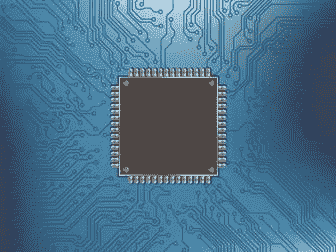
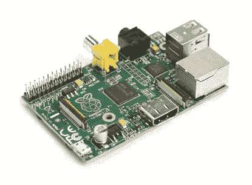

# 树莓派：终极分步树莓派用户指南（更新版）

## 献辞

本书献给我的父母，他们一直鼓励我去追求梦想。

# 第 1 章 树莓派概述

当由英国树莓派基金会（Raspberry Pi Foundation）开发的信用卡大小的单板计算机——树莓派发布时，一种用于促进学校基础计算机科学教学的多功能、轻量级计算平台理念便应生了。目前，Element 14/Premier Farnell 和 RS Components 公司授权了树莓派的销售。树莓派基金会积极致力于硬件和软件更新的创新与整合。

树莓派使用 Python 编程语言进行编程。Python 是可用的最标准编程编码之一，用于在树莓派使用的操作系统、基础设施和软件之间创建兼容性。Python 是一种非常容易学习的编程语言。通过创建脚本代码类，可以用总结的形式解释概念，使得编程结果可以即时执行命令。

致力于创建新软件应用即服务（SaaS）的在线编程社区是知识共享世界的核心部分，树莓派 Python 编程及其开源转型也是如此。树莓派平台支持与市场上基于数字计算板设备上所有主流操作系统集成，包括跨平台应用 Linux 框架。

## 特性

树莓派是一个博通 BCM2835 系统级芯片（SoC），带有 ARM1176JZF-S 700 MHz 处理器和 VideoCore IV GPU。目前的树莓派系统具有 512MB RAM，已从 256 兆内存升级。目前，树莓派基金会提供 Arch Linux ARM 和 Debian 发发版下载。

## 架构

树莓派 API 连接的视觉图利用基于 Linux 内核的操作系统。Raspbian 是一个基于 Debian 的免费操作系统，用于优化树莓派硬件。板载的 GPU 硬件通过固件镜像或二进制块（binary blob）访问；在从 SD 卡启动时加载到 GPU 中。目前固件镜像是闭源的。

板载应用程序源代码运行时库中的处理函数访问 Linux 内核内部的开源 API 驱动程序。采用 2D 和 3D 应用的视频应用 OpenMAX 和 OpenGL ES 使用 OpenVG 和 EGL。该板的新原型概念 SD 卡镜像强化了初步操作系统。该镜像可以在 QEMU 中运行，使得树莓派可以在其他平台架构上进行镜像。

## 系统软件

树莓派 Fedora Remix 软件应用程序是 Linux 发行版最新的开发成果之一。2012 年的版本是 App 交换中升级操作系统效率努力的一部分。系统软件还包括 Slackware ARM 版本 13.37。免费的 VideoCore 驱动代码在树莓派 ARM 上运行，是可用开源多媒体 SoC 软件的另一个示例。

## 操作系统

树莓派兼容多种移植或正在移植集成过程中的标准操作系统。操作系统兼容性包括专为树莓派集成 Linux 发行版开发的跨平台应用框架。

Moebius 中的多功能发行版提供轻量 ARM HF。Moebius 在树莓派上的应用是显而易见的，因为它小到可以放入 1GB SD 内存。由于内存占用极低，实际上是 Moebius 它以最小的消耗优化了树莓派操作系统。最后，IPFire 和 Raspbmc 等单一用途轻量级发行版也可集成到树莓派，无需额外编程。

## 用户应用程序

可以轻松安装在 Raspbian 上的树莓派应用涉及多媒体、音频、图形、智能手机和 LAN 服务器功能。开源媒体应用从外部源构建，为独特的用户编程创建新格式。程序员社区使用 Python 语言构建新的软件应用模块，在编码协议的字典、列表和类中添加新信息。

## 配件

一个 500 万像素的相机原型于 2013 年 4 月发布。基金会测试的模块是树莓派支持的配件功能之一。该板还与 LED、模拟信号、传感器、开关和其他硬件设备以及兼容 Arduino 的控制器建立接口。

## 硬件

树莓派两种型号（A 和 B）的原理图在框图中均提供了 PCB 连接器和集成电路（IC）。A 型不包含以太网的内部连接。可以使用 USB 适配器连接到外部以太网。B 型包含嵌入式以太网功能。

虽然树莓派 A 型没有以太网端口，但它可以通过外部或 Wi-Fi 适配器连接到网络。在这方面，A 型和 B 型的性能没有区别，因为内部以太网和外部端口连接提供相同的适配。通用 USB 键盘和鼠标均兼容树莓派。

树莓派计划支持 CEC，这将允许通过电视遥控器对其进行控制。其他近期创新还包括为了响应某些微小的更新和改进而推出的 2.0 版本板。树莓派 Model B 型现在配备了更大的内存，拥有 512MB RAM 芯片。

# 第 2 章 树莓派- Python- 什么是？有什么好处？

树莓派是由英国树莓派基金会创新的一种如信用卡大小的单板计算机。这种多用途、轻量级的平台在学校教授基础计算机科学方面非常受欢迎。树莓派基金会积极参与 Python 编程语言的新硬件开发以及系统软件更新。

使用 Python 编程语言对树莓派的 Linux 操作系统（OS）和其他软件接口进行编程是创建命令的最简单方法。Python 简单的语法允许程序员以最小的构建代码。与更广泛的脚本编程语言相比，该编程语言部署了简洁的概念陈述。

## 树莓派的 Python 编程语言能力

高级编程语言 Python 被认为是通用代码。代码结构已用于 2.0 版本的 Web 编程语言。这允许了跨浏览器的可性和数据的聚合交换。Python 标准的熟练程度现在用于基于 Web 的软件应用服务（SaaS）平台，以支持带有 Unicode 的数据共享平台。树莓派 Python 编程社区参与软件创新的开源共享。

致力于开发与树莓派兼容的新 SaaS 的在线编程社区，对于 Python 语言库和开源共享平台中代码的演进至关重要。树莓派平台为学习市场上大多数操作系统（OS）的计算机编程代码标准提供了基础。这包括一些系统跨平台应用 Linux 框架（例如 Arch Linux ARM、Android、Android 4.0、Google Chrome OS、Chromium OS 和 Firefox OS）。

Python 的多种编程范式支持树莓派兼容架构、基础设施软件中的构建。Python 允许在命令中构建小型和大型代码结构这一事实，为系统各个层级的软件接口提供了必要的功能、命令式和面向对象的编程元素。

Python 的自动内存管理和完全动态类型系统是树莓派大型代码语言库的基础。树莓派设计用于与市场上的其他标准 Linux 平台集成。Python 编程语言可以使用第三方工具部署为命令独立可执行程序，并嵌入到许多流行的软件应用程序中。

## 使用 Python 编程树莓派

Python 的多范式编程语言使树莓派程序员能够进行面向对象的编程和结构化编程。该编程语言还支持扩展的逻辑编程。树莓派的内存管理通过 Python 编程语言使用动态类型、引用计数和循环检测垃圾器功能进行。程序员会发现 Python 中的动态名称解析用于在程序执行时合并方法名和变量名。

Python 的语法和语义高度可读且易于复制。Python 语言的语法模型产生了整洁的代码。未来对脚本频率的识别是编程库的一部分。Python 中的标点符号和语法异常值得注意。语义精确源于识别，并超过了替代的 `C` 或 `Pascal` 语言。Python 使用真实语言 `and`、`or`、`not`）构建布尔运算符而不是符号。以下是树莓派 Python 编程语言执行的示例：IDLE、数字、变量、For 循环、模拟骰子、If、While、总结和特性。

Python 表达式非常像 `C` 和 `Java` 编程语言。Python 通过响应比较值来转换表达式。对象标识或比较引用也是可能的。Python 面对象的实现促进了结构分段编程，使得每个类都负责自己的行为。这种模块化的编程语言方法有助于监控程序复杂性中的函数，使其更易管理。

链式比较语法表达式创建了一系列命令。链式函数的数学公式是整数除法。整数除法模型用于截断值。将其中一个整数转换为浮点数是结果。因此，整数除法模型的结果以字母形式表示而不是数值值。

包含 Python 编程语言的在线树莓派库包含了用于构建程序的庞大代码库。这包括应用于算术任意精度小数、图形用户界面（GUI）编程、连接关系型数据库的代码以及正则表达式的代码。适用于 Python 的树莓派单元测试和软件测试模块（例如 `doctest` 和 `unittest`）。

虽然树莓派运行或嵌入 Python 不需要标准库，但有许多专门为开发者设计的包（例如文档工具、图形用户界面、图像处理、多媒体、数据库、网络和通信、科学计算、文本处理、Web 框架以及测试框架和系统管理）。寻求 Python 编程数学软件库指导的树莓派程序员将找到代数、微积分、组合数学、数值数学和数论代码。表示数据的字符串和列表可以为基于 Python 的程序添加结构。

## 使用 Python 集成树莓派硬件

有各种方法使用 GPIO 引脚连接将树莓派连接到其他电子设备。使用 Python 编程允许直接连接 GPIO 引脚和扩展补充树莓派主板命令。RaspiRobot 还需要 Python 接口通过无线 USB 键盘通过超声波测距器控制机器人底盘电机的命令。这个原型发明是一个独特的树莓派转换项目示例。Python 编程语言辅助漫游器命令。

# 第 3 章 Python 技术基础

Python 的高级编程语言是一种通用代码。简单的语法允许程序员为相同的概念创建比其他编程语言更有限的代码。Python 创新于 20 世纪 80 年，是 ABC 之后的编程语言。2.0 版本编程语言于 2000 年发布。新功能和 Unicode 的支持促进了社区知识共享在编程代码开发中的效率。

Python 构建支持架构、基础设施、基于 Web 的平台和软件的编程范式。Python 的自动内存管理和完全动态类型系统允许从大型语言库中广泛派生。

Python 不仅限于脚本语言，还可以通过第三方工具打包成独立可执行程序的一部分。大多数操作系统都提供 Python 解释器。该编程语言嵌入在市场上的许多流行软件产品中。

## Python 特性

Python 是一种多范式编程语言，支持面向对象编程和结构化编程。该语言特性还可以支持包括逻辑编程在内的扩展。动态类型、引用计数和循环检测垃圾回收器特性在内存管理方面表现卓越。动态名称解析用于在程序执行期间链接方法和变量名。

## Python 语法与语义

Python 的语法和语义简单且具有高度的可读性，便于复制。Python 语言语法模型非常整洁。语言使用的频率保留在编程语言的存储库中，以便日后识别。标点符号和语法异常都被了记录，这在与 `C` 或 `Pascal` 等其他编程语言相比时，使得语义更加精确。

## Python 表达式

与 `C` 和 `Java` 编程表达式类似，Python 的表达式转换通过比较值进行截断。也可以使用对象标识或通过引用进行比较。这些比较可以链式组合以创建一系列命令。整数除法是使用将其中一个整数转换为浮点数来截断值的模型。由于 Python 使用真实语言（`and`、`or` 或 `not`）而非符号作为逻辑运算符，整数除法模型的结果仍以字母形式表示。

## Python 库

Python 编程语言拥有庞大的标准库用于构建程序。它支持标准的互联网格式和协议 `MIME` 和 `HTTP`。此外还有用于任意精度小数算术、创建图形用户界面、连接关系型数据库以及处理正则表达式的模块。Python 库中的 `doctest` 和 `unittest` 模块执行单元测试和软件测试，为新开发提供可靠性保障。

虽然在应用程序中运行或嵌入 Python 编程语言并不强制需要标准库，但 Python 包索引（PyPI）作为第三方软件编码的官方存储库，包含了大量用于开发目的的包：科学计算、文本处理、图像处理、图形用户界面、多媒体、数据库、网络与通信、Web 框架、测试框架、文档工具、系统管理。

`Matplotlib`、`NumPy` 和 `SciPy` 等 Python 库使得该语言能够高效地应用于科学计算。例如，用于在 Python 中编写数学软件的库将包含数学元素：代数、微积分、组合数学、数值数学和数论。

## Python 软件开发

Python 编程语言目前嵌入在许多流行软件产品中。Python 脚本语言在 Abaqus 等有限元软件、3D 动画软件（如 `Cinema 4D`、`Houdini`、`Lightwave`、`Maya`、`modo`、`MotionBuilder`、`Nuke` 和 `Softimage`）以及 2D 成像程序（如 `GIMP`、`Inkscape`、`Paint Shop Pro` 和 `Scribus`）中使用深受重视。

在 `GNU GDB` 中使用 `C++` 容器等复杂结构证明 Python 是一种足以处理视觉动态的高级编程语言。它还用于 ArcGIS、视频游戏的脚本编写，并作为平台 Web 更新（Google App Engine 和 Java）的首选语言。

## 作为系统（SaaS）的 Python 软件应用

Python 用于软件即服务（SaaS）任务中的人工智能，这使其成为具有模块架构的首选脚本语言。Python 丰富的文本处理工具和语法是自然语言处理的理想选择。它对几乎任何信息安全基础设施的即插用能力，以及在目标开源编程语言开发社区中的应用，展示了 Python 在任何 SaaS 环境中使用的卓越灵活性。

Web 应用脚本接口配合标准 API 框架的开发，支持复杂应用程序的设计与维护。例如，`Pyjamas` 和 `IronPython` 是基于 `Ajax` 程序的客户端开发者。用于关系型数据库数据映射的流行工具 `SQLAlchemy` 也使用了 Python 编程语言。它还支持用于计算机间通信编程的 `twisted` 框架。

## Python 开发者社区

Python 作为标准语言进入大多数 Linux 发行版，使其被广泛应用于开源操作系统程序中（如 `FreeBSD`、`NetBSD`、`OpenBSD`、`OS X` 等）。Linux 发行版的安装程序也是用 Python 编写。通过知识共享交换活动提供开源 `CPython` 软件。`CPython` 在线社区开发模型允许编程的迭代或全新的实现共享。`CPython` 是 Python 软件基金会的程序。树莓派基金会的单板计算机项目采用了 Python 编码作为其接口。

# 第 4 章：可配合树莓派 Python 使用的其他设备

在深入讨论哪些其他形式的技术可以连接到树莓派之前，必须强调，这种迷你个人电脑的出现在信息技术行业引起了不小的波动，并引发了一波新的竞争热潮。

树莓派的优点有很多，最有利的优点是它的尺寸（与信用卡一样）。它具有与标准计算机相似的功能，且更具性价比。还可以将其作为低成本服务器运行，处理一些网络或内部流量。从短长期来看，组合若干树莓派创建一个服务器的成本比获取一台标准服务器低得多。如果网络流量较小，可以使用树莓派并节省资金。

自从我熟悉了树莓派技术，我用一些传感器和其他设备进行了一些自己的实验。通过这些实验，我整理了一份发现与此类技术工作良好的设备列表。这些物品并不贵，可以与软件轻松集成，并可以作为更大项目的基石。

可以创建的项目范围从安全系统到机器人汽车，可以以多种方式组合成奇妙的东西。如果你正准备为一位树莓派爱好者购买礼物，那么这一章将为你选择可用物品提供非常有帮助。

我们可以查看的第一件物品是 PIR 运动传感器。这是一项很棒的技术，允许用户通过被动红外传感器检测运动。这些传感器并不昂贵，带有引脚，可以直接连接到树莓派的 `GPIO` 引脚上。它是制作机器人传感器或用于安全系统的绝佳设备。

下一个可以查看的物品是 Nintendo Wii 控制器。对于游戏爱好者来说，这是一个极佳的选择。`Wiimote` 可以连接到树莓派，并在游戏方面开启一个充满可能的世界。

之后是超声波模块。这些模块可以提高树莓派设备读取的距离。你可以选择一个带有 `echo` 引脚、一个 `trigger` 引脚和两个电源引脚的超声波模块。

下一个很棒的项目是 USB 转串口模块。这种技术允许树莓派在 USB 接口上工作。此 USB 可以插入平板电脑、笔记本电脑或 PC 电脑，然后将引脚连接到树莓派设备。

很棒的地方在于，引脚的默认设置可以作为一个串口终端接口，从而从平板电脑或 PC 访问 Linux 命令。如果插入的设备有足够的功率支持，还存在为树莓派提供供电的可能性。

不容忽视的是 Wi-Fi 适配接器（USB）。同样，这些东西非常廉价，如果你讨厌线线，它们可以很好地帮助用户将树莓派连接到网络。使用 Wi-Fi 技术极易配置的选项之一是 Edimax 7811。

USB 蓝牙适配接器是另一个极佳的技术选项。你可以在网上或电脑商店购买。这种设备允许你与 Wii 控制器、电脑鼠标和键盘等多个蓝牙设备建立连接。

字符 LCD 显示器（16×2 或 20×4）是下一个可以关注的顶级选项。这些显示器可以是 20 个字符或 16 个字符，并且连接到树莓派的 `GPIO` 引脚并不困难。你在购买时只需确保这些物品是兼容的。为了能够开启或关闭屏幕并调整亮度，用户只需要额外的几个简单组件。

如果坚持使用与树莓派设备配合良好的屏幕，也可以考虑微型 LCD 屏幕。有很多此类屏幕可以容纳复合类型的视频输入。如果目标是将其连接到树莓派的视频输出，这些屏幕的工作效果很好。这些屏幕通常配备有两个视频输入，带有 12 V 供电，并且通常用作汽车的倒车显示屏。

现在我们可以看看 LED 蜂鸣器板。我们将关注的是 BerryClip 6 LED 板。它可以直接插入树莓派的 `GPIO` 针脚座，并被视为一块扩展板。通过这个设备，用户将拥有一个瞬时开关、一个蜂鸣器和 6 个彩色的 LED。可以使用任何语言来控制它们，人们只需查看各种 Python 脚本来找到一个合适的即可。

最后但同样重要的是步进电机。我尝试过的的那个带有一个控制板，控制板可以直接连接到树莓派的 `GPIO`。用户只需要输入一系列序列，电机就会旋转。

# 第 5 章：使用树莓派制作 LED 指示器

树莓派是连接指示灯以用于无数项目（如新邮件或天气通知）的理想设备。本章将重点介绍如何实现这一操作。

有些人可能会纳闷，为什么会考虑这样的东西。事实情况是，这是一个有趣的尝试项目。

正如上一章所强调的，树莓派是一个你可以对其进行许多实验并在最后一天中学到新知识的设备。虽然没人真的需要一个设备来指示是否是否会下雨，但这确实是一个非常有趣的项目。

## 完成此操作需要什么？

如果你不遵循教程操作，你将需要几样东西。在这种情况下，假设你已经熟悉树莓派的基础知识，并且并可以在树莓派上安装 Raspbian。

除了拥有一个运行良好且安装了 Raspbian 的树莓派单元外，你还需要一些其他物品。你需要：

1. `raspberry pi case (clear)`
2. `ledborg module`

需要记住的一点是，外壳的选择是可选的，取决于你想要磨砂的还是透明的。如果你目前有的外壳是不透明的，你必须对其进行调整，要么使用带有 GPIO 扩展的适配接套件，要么简单地在外壳上开一个洞，以便 LED 指示器可见。虽然适配接套件会增加材料购买的成本，但对你最终将进行的任何自定义将更有利。你将更有能力将 LED 放在某些东西下面进行照明，或者放在某些东西内部来实现同样的操作。

## 安装 LedBorg

尽管如此，如果你愿意制作一个 LED 指示器，你可以找到一些像 LedBorg 这样非常有性价比的物品进行购买。

安装模块非常简单，其设计允许它直接设置在树莓派的 GPIO 引脚上。开始之前，你需要关闭树莓派然后打开外壳。

在开始之前，至关重要的是模块的方向要正确，使 LedBorg 图标靠近 RCA 模块。简而言之，树莓派板板的边缘应该与 LedBorg 对齐，悬空部分不应超过边缘，而应仅悬在树莓派板上方。

树莓派板子打开后，现在是覆盖 USB 端口旁 LED 指示器的完美时机，特别是使用透明外壳时。这有助于避免在读取 LedBorg 指示器时误认为是网络指示灯和电源灯，因为这些灯通常非常亮。

一个简单的解决方案是用电胶带（白色）覆盖灯光。它会降低光的亮度，使其仍然可见，但不会分散 LedBorg 的注意力。

一旦 LedBorg 安装正确并完成了所有其他调整，就可以关闭外壳了。在进入下一阶段之前，重新开启树莓派并让它启动。

## 安装软件

首先，必须找到一个带有必需驱动程序的合适软件包，这些驱动程序允许你从命令行访问 LedBorg，并且带有一个 GUI 控制器。只需确保你选择的任何包与树莓派以及你拥有的 Raspbian 版本兼容即可。

如果你的树莓派有安装孔，那么有一段特定的程序你需要遵循；如果没有孔，则有另一套程序需要遵循。这些都是你已经熟悉的事情。你还需要注意 Raspbian 内核。要进行快速检查，你只需打开终端并输入 `uname -r`。

一旦你获取了所有信息，就可以进行下一步并获取软件包的链接。为了示例，我们正在使用带有 3.6.11 内核的 Revision 1 板子。

为了启动安装过程，需要打开树莓派上的终端。完成后，可以输入一系列命令来安装软件包。记住，第三条命令的 URL 必须替换为板子/内核包的 URL。

到达这一步时，你就已经安装了驱动和 GUI 包装器。当你查看 Raspian 桌面时，会有一个 GUI 包装器的图标。

你可以通过启动 GUI 包装器继续进行。要这样做，只需点击 Led Borg 图标。这时你可以检查以确保模块工作正常。你可以选择任何颜色并保存它以进行尝试。

在演示模式下，你能够遍历颜色范围，并在各种速度下查看它们。你还可以看到它们在低输出和高输出下的工作情况。

在这里你还有配置 LedBorg 的选项。你只需进入 CPU 的颜色部分，LED 将先变为绿色，然后是黄色，最后变为红色。这仅仅指示 ARM 处理器的负载。最好将速度更改为慢，因为从长远来看更有利。

# 使用 Python 语言为树莓派编程图形用户界面（GUI）

通常可以通过事件处理器函数进行最佳管理。GUI 程序是事件驱动的，这意味着事件处理器中的代码在没有触发器的情况下不会被程序直接调用。这使得 Python 用于创建 GUI 程序管理非常方便。使用 Python 触发事件处理器，以便程序的其他元素读取代码、调用其他函数或相应地更改变量。由于事件处理器不是通过代码调用而是通过触发响应调用的，因此在程序中无法通过事件处理器参数传递变量。全局变量为在 Python 中使用类来激活树莓派 GUI 事件处理提供了触发。

## Python 中的 GUI 开发

嵌入 Python 编程语言的应用程序有很多。目前市场上有许多使用 Python 解释器作为脚本语言的流行软件应用产品。Python 还允许面向对象和结构化的命令编码。在树莓派上使用 Python 编程语言进行 GUI 开发揭示了图形软件新创新可以定制的程度。对于学习如何编写脚本代码和用于 GUI 的面向对象事件处理器触发器的程序员人员来说，Python 是最佳选择。

Python 为 GUI 程序软件开发提供了有限的方法，例如 Abaqus 和 3D 动画软件（即 `Maya`、`Cinema 4D`、`Lightwave`、`modo`、`Houdini`、`MotionBuilder`、`Nuke` 和 `Softimage`）以及 2D 成像程序（即 `Inkscape`、`GIMP`、`Paint Shop Pro` 和 `Scribus`）。与在 `GNU GDB` 中 `C++` 编程语言容器使用的复杂结构不同，Python 处理几乎任何应用于视觉动态的语言都异常简单且高效。Python 用于 `ArcGIS` 脚本和视频游戏编程语言，以及新的 Web 应用平台开发（如 Go、Google App Engine 和 Java）。

## 使用 Python 编写 GUI

Python 的 `classes` 和面向对象编程是对象定义和运行代码的足够基础。数据变量是 `class` 的一部分。可以在对象内部使用的数据定义通过 `class` 创建。`Class` 是数据面向对象应用的定义函数。当数据变量在对象外部时，它们被视为字段（fields）。该领域的函数提供了操作数据的方法。数据字段定义了事件处理器，它可以访问触发所需的任何数据。图像转换到 `canvas`。图像结构被添加到 `dictionary` 中供以后使用。

Python 的 `dictionary` 允许以后访问内置类型。在树莓派上使用 Python 编写 GUI 时，使用了四种（4 种）集合：1) `string`、2) `tuple`、3) `list` 和 4) `dictionary`。编程语言通常将文本连接成集合中的序列。Python 是模块化的，这意味着集合的切分也适用于字符串语句。将 `tuple` 视为一组对象是 `list` 的功能。`Tuples` 和字符串是不可变的。然而，`Lists` 可以改变的，这通常通过序列中的排序或追加逻辑来实现。字符串、元组和列表的单个元素可以通过数字索引访问。与 `lists`，Python 中的 `dictionaries` 是高度可变的。Python 库对 `classes` 的支持可以在文档中找到。

## 使用 Tkinter 为树莓派使用 Python 编写 GUI

Tkinter 提供了树莓派 Python GUI 编程的绑定导入。Tkinter Tk GUI 工具包是 Python 在树莓派以及 Windows 和 Mac OS X 上编程代码的事实标准。`Tk` 绑定被实现为 Python 包装器（wrapper）。该包装器封装了嵌入在 Python 解释器中的完整 `Tcl` 解释器。`Tkinter` 中的调用：1) 翻译为 `Tcl` 命令，2) 馈给嵌入解释器，3) 将 `Python` 和 `Tcl` 合并为单个应用程序。`Python` 2.7 和 `Python` 3.1 都包含了 `Tk` 8.5 的功能，使得 `Tk` 组件可以进行主题设置，看起来像应用程序运行的原生桌面环境。

`class` 的扩展在 Python 编程语言中被认为是继承。`class` 到继承的转换是用 Python 代码进行树莓派 GUI 面向对象编程的基本方面。当 `Tk` 的函数与 `class` 相关时，可以对 `class` 进行扩展，以便在编程语言中添加尽可能的内容。`Classes` 还可以用于定义初始化 `__init__`，这是一个特殊的函数命令。当应用此项时，类与对象的创建相关。

在 GUI 中初始化的简单方法是，通过在类级内缩进定义语句来编程以创建新命令。如果特殊命令的第一个参数是 `self`，则类的各个部分如何识别彼此的形式就形成了。这样做是为了划分 `class` 内部的逻辑。一旦全局变量作为 `class` 中的字段被创建，就可以编写作为类一部分的事件处理器。定义创建将激活对象的 `class` 时，类对象必须相对于父类名称说明。顶层窗口没有父类。在 Tk 中创建一个以开始事件初始化处理的对象是通过调用 `__init__` 函数来形成完整的 `mainloop()`。

# 第 7 章：树莓派——如何使用 Pygame

要在树莓派上的 `Pygame` 中创建一个游戏，将需要结合 `Geany Editor` 来编写游戏代码。人们可以做的第一件事是在他们的计算机上打开 `Geany Editor`，以便创建一个新模板。在打开新模板文件后，需要输入一些代码来指示 `Geany` 使用 Python 编码语言以及基础模板代码。

`Pygame` 可能并不总是已安装，所以如果没有安装，人员可以打开终端并输入 `sudo apt-get install python-pygame`（不带引号）。输入根密码后，`Pygame` 包及其依赖项将被下载、解压并安装。

创建一个显示窗口并具有最小事件处理属性的简单应用程序，对于第一次学习如何使用 `Pygame` 的人来说是理想的。在成功学习了一些游戏编码的基础编码和编程后，将能够尝试更高级类型的游戏。

人们需要做的第一件事是指示 `Geany` 程序他们想要使用的编码语言。这可以通过在第 1 行输入 `#! /usr/bin/env python`（不带引号）来实现。第 2 行可以留空，第 3 行应该是文本 `import pygame`。`import pygame` 行将导入编码和编写游戏所需的 `PyGame` 模块。第 4 行也可以留空；同时第 5 行应该是文本 `screen = pygame.display.set_mode ((640, 400))`（不带引号）。这段代码指示 `PyGame` 模块设置显示屏幕的尺寸。

接下来的第 6 行也应该留空，第 7 行应包含文本 `while 1:`（不带引号）。最后，在第 8 行输入 `pass`。可以通过点击小的旋转齿轮图标运行此代码进行实验，以初始化代码启动。

下一步是在程序代码中添加一个事件循环，它将持续循环，直到用户使用轮询（poll），轮询会将事件更改为事件队列中的下一个事件。接下来，人员可以在程序中添加一些代码，允许终端用户通过点击显示窗口的退出按钮来关闭图形显示窗口。

要做到这一点，必须输入进一步的代码来指示标志位运行事件循环，直到使用 `poll` 方法更改了事件。在第 6 行中，应输入不带引号的代码 `running = 1`。第 7 行应留空，第 8 行应输入 `while running:` 文本。

第 9 行包含了指示 `pygame` 模块进行事件轮询的代码。应该输入的代码是不带引号的 `event = pygame.event.poll()`。第 10 行应输入 `if event.type == pygame.QUIT:`，第 11 行应输入不带引号的 `running = 0`。

代码运行后，将打开一个图形显示窗口，用户可以点击窗口上的退出按钮来关闭它。或者，个人也可以不在代码中保留运行标志位，以这样就不会有编程循环。一旦基础代码编写完成，个人就可以配置窗口模板以实现窗口之间的平滑过渡，并更改窗口本身的颜色。

在第 12 行，应输入以下文本：`screen.fill((0, 0, 0))`，在第 13 行，应输入不带引号的文本：`pygame.display.flip()`。这将设置图形显示窗口的背景颜色，并允许窗口切换之间的平滑动画。

背景值 `0, 0, 0` 代表红、蓝、绿的值。当值设置为 `0,0,0` 时，将显示黑色屏幕；然而，个人可以根据意愿从 0 到 255 的任何地方更改这些值。

一旦将颜色值设置为用户所需的，他们就可以继续编写代码来创建一个不可见的缓冲区。这个不可见缓冲区用于绘图，而不是直接画在屏幕上。绘图完成后，可以将缓冲区层设为不可见。当操作正确时，动画将平滑过渡而不是闪烁。

或者地，人们还可以进行一些编码练习来显示当前时间段的颜色。例如，个人可以编写程序来分析时间并显示与一天中时间对应的颜色。可以为一天的每个时段选择不同的颜色供图形窗口显示。

在练习这些包含事件处理和运行标志位的基础练习后，人们很快就能提升使用 `pygame` 的技能和技术。然而，在尝试进阶之前，理解如何使用 `pygame` 模块的基本功能是至关重要的。这将确保人员理解基础代码字符串、它们的作用以及如何正确地编辑他们的程序。

# 第 8 章：使用树莓派 Python 进行网络

树莓派可以通过 Model A 和 Model B 版本的计算机设备通过传统的以太网或 WiFi 联网。虽然 Model B 自带了以太网有线连接口，但 Model A 需要通过 USB 2.0 提供的外部端口支持。以太网选项不是支持千兆以太网的功能。两个版本都可以通过标准 USB 连接 WiFi 并具有上行带宽接收。此时，树莓派系统需要 USB 适配器来连接互联网。

树莓派的网络能力由 Broadcom BCM2835 单片机系统（SoC）执行，该系统带有 ARM1176JZF-S 700 MHz 处理器。目前 ARM Linux WiFi 并不完全足够。可以通过集线器（hub）添加更多端口来连接两个以上的 USB 设备。某些树莓派键盘内置了集线器。这使得该选项非常灵活。大多数处理树莓派的 IT 专家建议支持供电集线器。树莓派使用 Linux 作为服务器。可以通过静态 IP 地址远程访问互联网连接。可以通过路由器实现 IP 到树莓派计算机网络的宽带连接。

## 在 Debian Linux 中为树莓派联网的说明

对于运行 Debian Linux 的树莓派，网络连接说明取决于 Linux 支持的接口，但与市场上提供的其他发行版并行。每当路由器颁发连接时，Linux 会请求动态 IP 地址。静态连接需要一个不变的地址，`192.168.1.4`。这是在可用局域网（LAN）而非 WiFi 的情况下。

通过 `ifconfig` 命令找到 DHCP 地址，可以对上述端口地址执行以太网协议。还需要路由器命令。找到目标和网关以显示路由器 IP 地址。流量通过路由器发送到网关。路由器还会发布一个地址范围，这是每个路由器协议所独有的。LAN 设置、路由器地址和任何 DHCP 请求都为服务器提供了地址范围范围的条目。或者，也可以通过服务器地址和网关来寻求静态 IP 地址以启动连接。

获取与默认网关对应的名称服务器条目，或直接指向 ISP 名称服务器。可以通过重启进行网络接口的动态加载，以验证配置源是否正确。用于更改动态网络配置的网络命令应用 `ipconfig` 命令来激活或禁用在线接口。另一个选项是使用 `ifup` 或 `ifdown` 命令获取错误记录详情。

## 树莓派联网的六（6）个步骤

这是一个关于如何在树莓派中设置无线网络能力的教程。网络选项增加了对新的 Python 生成库的访问，用于编写基于 Web 的软件应用程序。这包括作为系统服务（SaaS）执行基础设施的软件应用程序。在操作系统、知识共享和在线编程语言方面有很多收获，网络是进步树莓派社区协作的最优连接。

通过将无线设备插入树莓派或 USB 集线器，机器就准备好接收网络连接命令了。

找到设备名称，以便在发布互联网支持请求之前映射到必要的协议。

`lsusb` 是获取树莓派平台内所有 USB 设备的语法。查看 USB 记录以代表无线设备的文件。在 USB 设备列表中找到无线适配器。此搜索的结果将索引驱动程序所需的关键设备信息（例如总线端口号、制造号、序列号等）。

在创建网络之前必须更新软件包信息。通过输入 `apt-get update` 从 Debian 更新，并在下载完成后输入 `apt-cache search RTL818`。设备 ID 可能与识别所需的不同。某些程序员建议缩短 ID。目标是通过这种方法使用 `apt-cache` 命令定位适配器。输入命令在 USB 端口列表上找到正确的适配器：`lsmod`。相同的 ID 应该会出现。

通过输入命令 `sudo nano /etc/wpa.config` 为无线适配器生成文件（配置）。保存文件并返回网络命令的提示提示符。这将引导确认添加位置的最后一步。

过程的最后一步是拔掉网线以测试无线设备的性能。通过输入 `sudo /etc/init.d/networking restart` 重启网络以完成。

树莓派与在线社区的网络连接导致了人们对开源应用兴趣的深远变化。为了支持树莓派的编程活动，`Python` 编程语言的发展体现在在线社交网络平台与社交媒体网站、以及其他致力于树莓派和 `Python` 网络活动开发的社区小组的整合创新中。

有关如何使用 `Python` 编程语言解码器对树莓派进行联网的更多信息，请参阅 `Python` 源库，了解有关 `dictionaries`、`lists`、`modules` 和 `classes` 的细节，这些内容应用于树莓派与外部设备以及基于 Web 的应用程序的脚本连接中。树莓派支持兼容跨平台应用 `Linux` 框架和操作系统的多尺度接口。

# 关于作者

Jason Scotts 从小就受鼓励对各种主题产生浓厚兴趣，在这样的鼓励下，他开始尽可能地探索自己感兴趣的话题。

他从小就对技术有着浓厚的兴趣，因此他将阅读任何新形式的技术视作自己的责任。

Jason 的目标是提供信息和教育。他并不是在强行向任何人灌信息，而是让人们在阅读文本后根据自己的情况做出决定，决定是否想要尝试这种技术。

Jason 意识到，尽管技术之轮在不断转动，许多新技术不断发布，但并没有多少个人能跟上，因此他利用自己的书籍帮助那些稍微落后的人更新知识。
