# RxJS 响应式编程：理清你的异步 JavaScript 代码


## 对 *Reactive Programming with RxJS* 的早期赞誉

软件开发中的每一次重大转变都要求我们重新思考方法。实时和异步 Web 应用程序是当今 Web 开发面临的巨大挑战。本书在解释 RxJS 如何应对这些挑战方面做得非常出色，并教会你如何从 Observable（可观察对象）的角度重新审视你的世界。

**Zef Hemel**
STX Next 工程副总裁

这本书就像响应式编程本身一样火热！凭借优秀的写作、清晰的解释和实用示例，这是学习 RxJS 的绝佳资源。

**Fred Daoud**
软件开发承包商

在为时太晚之前，请积极地通过这本书学习响应式编程。
`Rx.Observable.fromBook(book).subscribe(function(value) {...do amazing stuff...});`

**Javier Collado Cabeza**
NowSecure, Inc. 高级软件开发人员

一本内容丰富且非常易读的书。本书极其有用，并通过实际示例为学习使用 RxJS 的响应式编程提供了一份清晰的路线图。

**Ramaninder Singh Jhajj**
奥地利 Know-Center 区域服务与开发软件工程师

我们特意留白这一页，是为了使电子书和纸质书的页码保持一致。

我们尝试直接将其删除，但随后人们写信询问缺失的页面。

无论如何，若鼠 Eddy 想说声“你好”。

## 致谢

我有很多人要感谢。有人帮助塑造了这本书，有人帮助塑造了我这个人。没有他们，我无法完成这项工作。我特别想感谢以下人员：

最初创建 Reactive Extensions 库以及对其进行扩展和推广的杰出人士。如果没有你们，这本书显然不会存在：Erik Meijer, Matt Podwysocki, Bart De Smet, Wes Dyer, Jafar Husain, André Staltz，以及许多我可能遗忘的人。

The Pragmatic Bookshelf 的同事们。与你们合作是一件快事。特别感谢 Susannah Pfalzer，她在本书还仅仅是一个想法时就相信它。我也非常幸运地邀请到 Rebecca Gulick 担任我的编辑：你专业、耐心，关注我的问题，与你合作是一件令人愉快的事情。我长期以来一直是 Pragmatic 书籍的粉丝，能够亲自写一本 PragProg 的书是一项荣幸。而且，是的，两位出版商 Dave Thomas 和 Andy Hunt 确实阅读并评审了每一本书！

才华横溢的技术评审员。David Bock, Javier Collado Cabezda, Fred Daoud, Iraklis Gozalishvili, Zef Hemel, Ramaninder Singh Jhaji, Aaron Kalair, Daniel Lamb, Brian Schau, 和 Stephen Wolff，以及 Pragmatic 出版商 Dave 和 Andy：由于你们所有人，这本书变得好得无限多。你们每个人都无私地投入时间和精力评审本书，检测复杂的错误并让我免于再次犯尴尬的错误。书中剩余的任何错误都是我自己的责任。

给我的朋友们。那些无论时间多远、距离多远都一直陪伴在我身边的人；你们知道你们是谁。感谢你们的笑声、支持和爱。

我的父母 Narcis Mansilla 和 Joana Molins。你们是我的向导和榜样。你们从未停止相信我，并总是鼓励我迎接更大的挑战。在你们辛苦支付账单的时期，你们为我买了第一台电脑。那是这一切的开始，我欠你们的一切。

我的儿子 Adrià。你在我写这本书的时候出生，你改变了我生活的意义。在这么短的时间里，你已经教会了我这么多，我迫不及待想看看接下来会发生什么。

最后，是我生命中的挚爱 Jen。在你我生活中最繁忙的时期之一，我写这本书时，你拥有无限的耐心并支持着我。你是我灵感的源泉，你在方方面面使我成为了一个更好的人。你是我的星辰。

**Sergi Mansilla**

巴塞罗那，2015年12月


## 前言

响应式编程（Reactive programming）正在席卷软件世界。本书将响应式编程哲学与 JavaScript 的可能性相结合，你将学习如何将响应式技术应用于自己的项目中。我们将重点讨论如何使用响应式编程来管理和组合事件流。事实上，我们将涵盖如何仅通过声明对程序事件的转换，来构建完整的、真实的并发应用程序。

如今大多数软件处理的数据仅在随时间推移而可用：网站加载远程资源并响应复杂的用户交互，服务器分布在多个物理位置，人们拥有希望在任何时间都能正常工作的移动设备，无论是在高速 Wi-Fi 还是不稳定的蜂窝网络环境下。任何严肃的应用程序都涉及许多需要高效协调的异步变动部分，而这在今天的编程技术下是非常困难的。除此之外，我们还必须面对一直存在的问题：服务器崩溃、网络缓慢以及软件漏洞。

我们不能再以一直以来的方式编写应用程序了。这种方式在一段时间内有效，但现在是时候尝试一种新方法了。

## 新世界，旧方法

近年来，JavaScript 已成为世界上最普及的语言，现在它驱动着像沃尔玛（Walmart）和 Netflix¹ 这样企业的关键基础设施，驱动着像 Firefox OS 这样的移动操作系统，以及像 Google Docs 这样复杂且流行的应用程序。

然而，我们仍然在使用古老的命令式风格编程来处理本质上是异步的问题。这非常困难。

JavaScript 开发者将语言缺乏线程视为一项特性，我们通常使用回调（callbacks）、Promise 和事件（events）来编写异步代码。但随着我们在应用程序中引入越来越多的并发，协调异步流的代码变得臃肿不堪。目前的机制都存在严重的缺陷，阻碍了开发者的生产力，并导致应用程序变得脆弱。

以下是目前处理异步操作的机制及其问题的快速回顾。

### 回调函数（Callback Functions）

*回调*是一个函数（*A*），它作为参数传递给另一个执行异步操作的函数（*B*）。当（*B*）完成时，它会带着操作结果*回调*（*A*）。回调用于管理异步流，例如网络 I/O、数据库访问或用户输入。

```javascript
// intro/callback_example.js
function B(callback) {
  // Do operation that takes some time
  callback('Done!');
}

function A(message) {
  console.log(message);
}

// Execute `B` with `A` as a callback
B(A);
```

回调易于理解，并已成为 JavaScript 处理异步数据流的默认方式。但这种简单性是有代价的。回调具有以下缺点：

- *回调地狱（Callback hell）*。在处理高度异步的代码时，很容易出现大量嵌套的回调。一旦发生这种情况，代码将不再是线性的，且难以推理。整个应用程序最终在回调中传来传去，导致难以维护和调试。
- *回调可能会运行多次*。没有保证同一个回调只会被调用一次。多次调用可能难以检测，并可能导致应用程序出现错误和全面混乱。
- *回调改变了错误语义*。回调破坏了传统的 `try/catch` 机制，依赖于程序员检查错误并将其传递。
- *并发变得日益复杂*。组合多个异步操作的相互依赖结果变得很困难。这要求我们在临时变量中跟踪每个操作的状态，然后按正确的顺序将它们委托给最终的组合操作。

### Promises

Promises 的出现是为了将我们从回调中拯救出来。Promise 代表一个异步操作的结果。在基于 Promise 的代码中，调用异步函数会立即返回一个“promise”，它最终要么带着操作结果被*resolve*（兑现），要么带着错误被*reject*（拒绝）。与此同时，*pending*（待定）状态的 promise 可以作为最终值的占位符。

Promise 通常使程序更清晰，因为它们更接近同步代码，减少了对嵌套块的需求并降低了状态跟踪的复杂度。

不幸的是，Promise 并非万灵药。虽然它们比回调有所改进，但有一个重大缺陷：它们只能产生单个值。这使得它们在处理重复事件（如鼠标点击）或来自服务器的数据流时毫无用处，因为我们必须为每个独立事件创建一个 Promise，而不是创建一个能够处理随之而来的事件流的 Promise。

### 事件发射器（Event Emitters）

当我们发射一个事件时，订阅该事件的事件监听器将被触发。使用事件是解耦功能的一种绝佳方式，在 JavaScript 中，事件编程非常普遍，且通常被认为是一种良好的实践。

但正如你所料，事件监听器也带来了一系列自身的问题：

- *事件强制产生副作用*。事件监听函数总是忽略其返回值，这意味着监听器如果想要对世界产生任何影响，就必须产生副作用。
- *事件不是一等公民（first-class values）*。例如，一系列点击事件不能作为参数传递，也不能像它实际所代表的序列那样被操纵。我们被限制在单独处理每个事件，且只能在事件发生之后处理。
- *如果开始监听太晚，很容易错过事件*。一个著名的例子是 Node.js 中 *streams* 接口的第一个版本，它经常在监听器来不及监听之前就发射数据事件，导致数据永久丢失。

既然这些机制是我们一直用来管理并发的方式，可能很难想到更好的方法。但在本书中，我将向你展示一种：响应式编程和 RxJS 尝试用一些新的概念和机制来解决所有这些问题，让异步编程变得轻而易举——而且更有趣。

## 什么是响应式编程？

响应式编程是一种包含许多概念和技术的编程范式。在本书中，我将特别关注数据流的创建、转换和响应。鼠标点击、网络请求、字符串数组——所有这些都可以表示为流，无论其来源如何，我们都可以使用相同的接口在它们发布新值时对其做出“响应”。

响应式编程专注于传播变更，而无需我们显式指定传播如何发生。这允许我们声明代码应该做什么，而不需要为实现它的每个步骤编写代码。这使得构建软件的方法更加可靠且易于维护。

## 什么是 RxJS?

RxJS 是 Reactive Extensions（简称 Rx）的 JavaScript 实现。² Rx 最初由微软创建，是一种响应式编程模型，允许开发者轻松组合异步数据流。它提供了一个通用接口，用于组合和转换来自截然不同来源的数据，例如文件系统操作、用户交互和社交网络更新。

Rx 起源于 .NET 的实现，但如今在每种主流语言（以及一些非主流语言）中都有维护良好的开源实现。它正成为编写响应式应用程序的标准，而 Rx 的核心数据类型 Observable，已被提议作为 JavaScript 整体的一部分纳入 ECMAScript 7。

## 本书读者对象

本书面向具有一定 JavaScript 经验的开发者。你应该熟悉闭包和高阶函数，并理解 JavaScript 中的作用域规则。尽管如此，对于本书中涉及的最复杂的语言概念，我都会尽量进行解释。

***

¹ [http://venturebeat.com/2012/01/24/why-walmart-is-using-node-js/](http://venturebeat.com/2012/01/24/why-walmart-is-using-node-js/), [http://techblog.netflix.com/2014/06/scale-and-performance-of-large.html](http://techblog.netflix.com/2014/06/scale-and-performance-of-large.html)
² https://rx.codeplex.com/


## 本书内容

本书是一本关于使用 RxJS 进行响应式编程（reactive programming）的实用入门指南。其目标是通过构建小型真实应用，引导你形成响应式思维，从而学习如何将响应式编程引入日常开发中，使程序更加健壮。这不是一本关于响应式编程的理论书，也不是 RxJS API 的详尽参考手册。你可以在网上找到这类资源。

我们将主要针对浏览器进行开发，但也会看到一些 Node.js 的示例。我们会尽早深入探讨主题，并在过程中构建应用程序以保持实用性。以下是各章节安排：

除非你之前使用过 RxJS，否则请从 *第 1 章：响应式方式（第 1 页）* 开始。在本章中，我们将介绍 RxJS 的主要数据类型 —— Observable，我们在全书中将广泛使用它。

在建立了 Observable 的基础知识后，我们将进入 *第 2 章：深入序列（第 17 页）*。在那里你会发现，响应式编程的核心在于事件序列。我们将学习一些重要的序列操作符，并构建我们的第一个应用程序：一个实时地震序列可视化工具。

在 *第 3 章：构建并发程序（第 39 页）* 中，我们将研究如何编写副作用最小的并发代码。在涵盖 Observable 流水线后，我们将用大约 200 行代码构建一个酷炫的太空飞船视频游戏，且几乎没有全局状态。

在 *第 4 章：构建完整的 Web 应用程序（第 69 页）* 中，我们将深入探讨响应式应用开发，并通过在 Node.js 中创建一个显示当前地震相关推文的服务器端，来增强我们在 *深入序列* 中制作的地震应用程序。

我们将通过 *第 5 章：使用调度器操纵时间（第 89 页）* 接触 RxJS 的一些更高级概念，讨论 RxJS 提供的用于在更细粒度层面处理并发的有用概念：调度器（Schedulers）。

在掌握了调度器知识后，我们将探索它们如何帮助我们进行测试。我们将学习如何在测试中模拟时间，以准确地测试异步程序。

最后，在 *第 6 章：使用 Cycle.js 构建响应式 Web 应用（第 103 页）* 中，我们将使用 Cycle.js（一个构建在 RxJS 之上的 UI 框架）来构建一个简单的应用程序。Cycle.js 从 React.js 等现代框架中借鉴概念，创建了一个响应式框架，利用 Observable 的优势，帮助我们以简单且可靠的方式创建快速的用户界面。

## 运行代码示例

本书中的代码示例适用于浏览器或 Node.js。代码的上下文应该能明确在什么环境下运行。

### 在浏览器中运行 RxJS 代码

如果代码旨在浏览器中运行，我们将使用 `rx.all.js` 文件，你可以在 RxJS 的 GitHub 仓库中找到它。³ `rx.all.js` 包含了 RxJS 中的所有操作符，这是确保所有示例都能运行的最简单方法。只需在 HTML 文档的 `<head>` 部分加载该脚本：

```html
<html>
  <head>
    <script src="rx.all.js"></script>
  </head>
  ...
</html>
```

请记住，这是一个相对较大的文件。如果在项目中没有用到 RxJS 的所有功能，你可能需要考虑使用较小的文件，如 `rx.js` 或 `rx.lite.js`。

### 在 Node.js 中运行 RxJS 代码

在 Node.js 中运行代码示例非常简单。只需确保使用 npm 在项目中安装 RxJS 依赖：

```bash
$ npm install rx
rx@4.0.0 node_modules/rx
```

之后，你可以在 JavaScript 文件中导入 RxJS 库：

```javascript
var Rx = require('rx');

Rx.Observable.just('Hello World!').subscribe(function(value) {
  console.log(value);
});
```

然后通过调用 node 和文件名即可运行：

```bash
$ node test.js
Hello World!
```

> 3. https://github.com/Reactive-Extensions/RxJS/tree/master/dist

## RxJS 版本

所有示例均基于 RxJS 4.x。你可以在 RxJS 在线仓库中下载最新版本。⁴

## 相关资源

RxJS 的采用速度非常快，每天都有越来越多的相关资源出现。不过，有时在网上寻找资源可能会有困难。以下是我最喜欢的几个：

- [RxJS 官方源代码仓库]⁵
- [ReactiveX，一个与 Reactive Extensions 相关的资源集合]⁶
- [RxMarbles，一个可视化 Observable 的交互式工具]⁷

## 下载示例代码

本书的网站提供了指向交互式讨论论坛以及提交勘误页的链接。⁸ 你还可以在那里找到我们构建的所有项目的源代码。电子书读者可以通过每个代码片段上方的方框直接查看该片段。

> 4. https://github.com/Reactive-Extensions/RxJS/releases/latest
> 5. https://github.com/Reactive-Extensions/RxJS
> 6. http://reactivex.io
> 7. http://rxmarbles.com/
> 8. http://pragprog.com/titles/smreactjs

# 第一章：响应式方式

现实世界相当混乱：事件以随机顺序发生，应用程序崩溃，网络失效。很少有应用程序是完全同步的，编写异步代码对于保持应用程序的响应能力至关重要。大多数时候，这极其痛苦，但其实不必如此。

现代应用程序需要极快的响应速度，并且能够同时处理来自不同来源的数据而不会漏掉任何细节。当前的技术无法让我们达到这个目标，因为它们无法扩展——随着并发和应用状态的增加，代码的复杂度呈指数级增长。它们只能以增加开发者的心理负担为代价来完成工作，而这会导致代码中的 Bug 和复杂性。

本章将向你介绍响应式编程，一种更自然、更简单地思考异步代码的方式。我将向你展示事件流（我们称之为 *Observables*）是如何优雅地处理异步代码的。然后我们将创建一个 Observable，看看响应式思维和 RxJS 如何显著改进现有技术，使你成为一名更快乐、更高效的程序员。

### 什么是响应式？

让我们先来看一个简单的响应式 RxJS 程序。该程序需要通过点击按钮从不同来源检索数据，并具有以下要求：

- 必须统一来自两个不同位置且使用不同 JSON 结构的数据。
- 最终结果不应包含任何重复项。
- 为了避免请求次数过多，用户每秒钟不能点击按钮超过一次。

使用 RxJS，我们会这样写：

```javascript
var button = document.getElementById('retrieveDataBtn');
var source1 = Rx.DOM.getJSON('/resource1').pluck('name');
var source2 = Rx.DOM.getJSON('/resource2').pluck('props', 'name');

function getResults(amount) {
    return source1.merge(source2)
        .pluck('names')
        .flatMap(function(array) { return Rx.Observable.from(array); })
        .distinct()
        .take(amount);
}

var clicks = Rx.Observable.fromEvent(button, 'click');
clicks.debounce(1000)
    .flatMap(getResults(5))
    .subscribe({
        next: function(value) { console.log('Received value', value); },
        error: function(err) { console.error(err); },
        complete: function() { console.log('All values retrieved!'); }
    });
```

不必担心现在就理解这里发生了什么：我们先关注宏观视角。你首先会发现，我们用更少的代码表达了更多的内容。我们是通过使用 Observables 来实现这一点的。

一个 Observable 代表一个数据流。程序在很大程度上可以被表达为数据流。在上面的示例中，两个远程数据源都是 Observables，用户的鼠标点击同样如此。事实上，我们的程序本质上是由按钮点击事件构成的一个单一 Observable，我们对其进行转换以获得想要的结果。

响应式编程具有很强的表达力。以示例中对鼠标点击的节流（throttling）为例。想象一下如果使用回调函数或 Promise 来实现会有多复杂：我们需要每秒重置一个定时器，并记录自上次点击以来是否已经过去了一秒。为了这么一点功能而引入如此多的复杂度，而且这段代码甚至与程序的实际功能无关。在大型应用程序中，这些细小的复杂性会迅速累积，导致代码库变得混乱不堪。

在响应式方法中，我们使用 `debounce` 方法来节流点击流。这确保了每次点击之间至少间隔一秒，并丢弃中间的任何点击。我们不关心内部是如何实现的；我们只表达代码*要做什么*，而不是*如何做*。

接下来的内容会更有趣。接下来你将看到响应式编程如何帮助我们让程序变得更高效、更具表达力。


### 电子表格是响应式的

让我们先从一个响应式系统的典型例子开始：电子表格。我们都使用过它，但很少停下来思考它竟是如此地直观。假设我们在电子表格的 A1 单元格中有一个值。我们可以在电子表格的其他单元格中引用它，每当我们更改 A1 时，每个依赖于 A1 的单元格都会自动更新其自身的值。

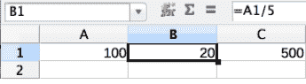

这种行为对我们来说感觉很自然。我们不需要告诉计算机去更新依赖于 A1 的单元格，也不需要告诉它如何更新；这些单元格只是对变化做出了“响应”。在电子表格中，我们只需声明我们的问题，而无需担心计算机如何计算结果。

这正是响应式编程的目标。我们声明参与者之间的关系，随着这些实体的变化或产生新值，程序随之演进。

### 将鼠标视为值流

为了理解如何将事件视为值流，让我们回顾本章开头讨论的程序。在那里，我们将鼠标点击视为由用户点击实时生成的一系列无限事件序列。这是 RxJS 的发明者 Erik Meijer 在其论文《你的鼠标是一个数据库》（Your Mouse Is a Database）¹ 中提出的一种观点。

在响应式编程中，我们将鼠标点击视为一个可以查询和操作的连续事件流。将流（streams）而非孤立的值作为思考维度，开启了一种全新的编程方式，在这种方式中，我们可以操作尚未创建的整个值序列。

请花一点时间消化这个想法。这与我们习惯的方式不同——我们习惯于将值存储在数据库或数组等某个地方，并在它们可用之前等待。如果它们尚未可用（例如网络请求），我们会等待它们，并在它们可用时才使用。

> 1. http://queue.org/detail.cfm?id=2169076

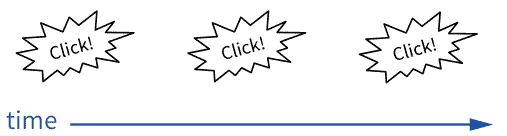


我们可以将流序列视为一个数组，其中元素的间隔是*时间*而非内存。无论是时间还是内存，我们拥有的都是元素的序列：

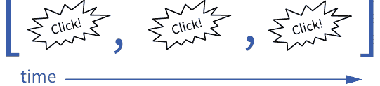


将程序视为流动的数据序列是理解 RxJS 编程的关键。这需要一些练习，但并不难。事实上，我们在任何应用程序中使用的绝大多数数据都可以表示为序列。我们将在[第 2 章，深入探索序列，第 17 页](#)中更深入地探讨序列。

### 查询序列

让我们使用 JavaScript 中传统的事件监听器来实现一个简单的鼠标流版本。为了记录鼠标点击的 x 和 y 坐标，我们可以编写如下代码：

```javascript
// ch1/thinking_sequences1.js
document.body.addEventListener('mousemove', function(e) {
  console.log(e.clientX, e.clientY);
});
```

这段代码将按顺序打印每次鼠标点击的 x 和 y 坐标。输出结果如下：

```
252 183
211 232
153 323
...
```

看起来像个序列，不是吗？当然，问题在于操作事件并不像操作数组那样简单。例如，如果我们想修改前面的代码，使其仅记录屏幕右侧的前 10 次点击（这是一个相当随机的目标，但请先将我地地跟上），我们会这样写：

```javascript
var clicks = 0;
document.addEventListener('click', function registerClicks(e) {
  if (clicks < 10) {
    if (e.clientX > window.innerWidth / 2) {
        console.log(e.clientX, e.clientY);
        clicks += 1;
    }
  } else {
    document.removeEventListener('click', registerClicks);
  }
});
```

为了满足需求，我们通过全局变量 `clicks` 引入了外部状态，用于计算到目前为止的点击次数。我们还需要检查两个不同的条件并使用嵌套的条件块。而且当我们完成时，必须进行清理并注销事件，以避免内存泄漏。

### 副作用与外部状态

如果一个动作的影响超出了它发生时的作用域，我们就称之为*副作用*（side effect）。更改函数外部的变量、向控制台打印内容或更新数据库都是副作用的例子。

例如，更改*内部*于函数的变量值是安全的。但如果该变量位于函数作用域*外部*，那么其他函数也可以更改其值。这意味着我们的函数不再拥有控制权，且不能假设外部变量包含我们期望的值。我们需要追踪它并增加检查，以确保其值符合预期。到那时，我们将添加与程序逻辑无关的代码，使其变得更复杂且更容易出错。

尽管构建任何有趣的程序都需要副作用，但我们应努力在代码中尽可能减少副作用。这在响应式程序中尤为重要，因为响应式程序中有许多随时间变化的动态部件。在本书中，我们将追求一种避免外部状态和副作用的方法。事实上，在[第 3 章，构建并发程序，第 39 页](...)中，我们将构建一个完全没有副作用的视频游戏。

我们虽然实现了简单的需求，但为了这样一个简单的目标，最终得到了相当复杂代码。这种代码难以维护，且对于初次接触的开发人员来说并不直观。更重要的是，由于需要维护状态，我们使其在未来容易产生微妙的 Bug。

在这种情况下，我们真正想要的只是查询点击的“数据库”。如果我们处理的是关系型数据库，我们会使用声明式语言 SQL：

```sql
SELECT x, y FROM clicks LIMIT 10
```

如果我们将 `click` 事件流视为一个可以查询和转换的数据源会怎样？毕竟，它与数据库没有区别，只不过是一个实时发射值的数据库。我们只需要一个能为我们抽象这个概念的数据类型。

这就是 RxJS 及其 `Observable` 数据类型的用武之地：

```javascript
Rx.Observable.fromEvent(document, 'click')
  .filter(function(c) { return c.clientX > window.innerWidth / 2; })
  .take(10)
  .subscribe(function(c) { console.log(c.clientX, c.clientY) })
```

这段代码的作用与[第 4 页的代码](page4)相同，其阅读感受如下：

> 创建一个 `click` 事件的 Observable，过滤掉发生在屏幕左侧的点击。然后，在发生时将前 10 次点击的坐标打印到控制台。

请注意，即使你不熟悉这段代码，它也非常易读。此外，无需创建外部变量来保持状态，这使得代码自包含，且更不容易引入 Bug。你也不需要清理现场，因此没有因忘记注销事件处理器而导致内存泄漏的风险。

在前面的代码中，我们通过 DOM 事件创建了一个 Observable。Observable 为我们提供了一个事件序列或流，我们可以将其作为一个整体来操作，而不是每次处理一个孤立的事件。处理序列赋予了我们巨大的能力；我们可以轻松地合并、转换或传递 Observable。我们将无法掌控的事件变成了像数组一样易用但灵活得多的切实的资料结构。

在下一节中，我们将了解使 Observable 成为如此强大工具的原理。

### 关于观察者与迭代器

为了理解 Observable 的来源，我们需要查看其基础：观察者（Observer）和迭代器（Iterator）软件设计模式。在本节中，我们将快速回顾它们，然后看看 Observable 如何以一种简单而强大的方式结合两者的概念。

### 观察者模式

对于软件开发人员来说，在听到 Observable 时很难不想到古老的*观察者模式*。在该模式中，我们有一个名为 *Producer*（生产者）的对象，它维护一个订阅它的 *Listeners*（监听者）的内部列表。监听者通过...

每当 Producer 的状态发生变化时，就会调用它们的 update 方法。（在大多数关于观察者模式的解释中，这个实体被称为 `Subject`，但为了避免与 RxJS 自身的 `Subject` 类型混淆，我们将其称为 `Producer`）。

只需几行代码，就可以轻松实现该模式的一个基础版本：

```javascript
// ch1/observer_pattern.js
function Producer() {
    this.listeners = [];
}

Producer.prototype.add = function(listener) {
    this.listeners.push(listener);
};

Producer.prototype.remove = function(listener) {
    var index = this.listeners.indexOf(listener);
    this.listeners.splice(index, 1);
};

Producer.prototype.notify = function(message) {
    this.listeners.forEach(function(listener) {
        listener.update(message);
    });
};
```

Producer 对象在实例的 `listeners` 数组中维护一个动态的 Listener 列表，每当 Producer 调用其 `notify` 方法时，所有这些 Listener 都会被更新。在接下来的代码中，我们创建了两个监听 notify（一个 Producer 实例）的对象：

```javascript
// ch1/observer_pattern.js
// 任何具有 'update' 方法的对象都可以工作。
var listener1 = {
    update: function(message) {
        console.log('Listener 1 received:', message);
    }
};

var listener2 = {
    update: function(message) {
        console.log('Listener 2 received:', message);
    }
};

var notifier = new Producer();
notifier.add(listener1);
notifier.add(listener2);
notifier.notify('Hello there!');
```

当我们运行程序时：

```
Listener 1 received: Hello there!
Listener 2 received: Hello there!
```

每当 Producer 实例 notifier 更新其内部状态时，listener1 和 listener2 都会收到通知，而无需我们手动去检查。

我们的实现虽然简单，但它阐明了观察者模式如何实现事件与对其做出反应的监听器对象之间的解耦。

### 迭代器模式 (The Iterator Pattern)

Observable 拼图的另一块来自迭代器模式。迭代器是一个对象，它为消费者提供了一种简单的遍历其内容的方式，并将具体实现对消费者隐藏。

迭代器接口很简单。它仅需要两个方法：`next()` 用于获取序列中的下一个项目，以及 `hasNext()` 用于检查序列中是否还剩下项目。

以下是我们编写的一个迭代器的示例，它操作一个数字数组，并仅产出是除数参数倍数的元素：

```javascript
// ch1/iterator.js
function iterateOnMultiples(arr, divisor) {
    this.cursor = 0;
    this.array = arr;
    this.divisor = divisor || 1;
}

iterateOnMultiples.prototype.next = function() {
    while (this.cursor < this.array.length) {
        var value = this.array[this.cursor++];
        if (value % this.divisor === 0) {
            return value;
        }
    }
};

iterateOnMultiples.prototype.hasNext = function() {
    var cur = this.cursor;
    while (cur < this.array.length) {
        if (this.array[cur++] % this.divisor === 0) {
            return true;
        }
    }
    return false;
};
```

我们可以这样使用这个迭代器：

```javascript
// ch1/iterator.js
var consumer = new IterateOnMultiples([1, 2, 3, 4, 5, 6, 7, 8, 9, 10], 3);

console.log(consumer.next(), consumer.hasNext()); // 3 true
console.log(consumer.next(), consumer.hasNext()); // 6 true
console.log(consumer.next(), consumer.hasNext()); // 9 false
```

迭代器非常适合封装任何类型数据结构的遍历逻辑。正如我们在前面的例子中看到的，当迭代器被泛化以处理不同类型的数据，或者可以在运行时配置（例如我们在示例中使用 `divisor` 参数）时，它们会变得非常强大。

### Rx 模式与 Observable

虽然观察者模式和迭代器模式各自都很强大，但两者的结合则更为出色。我们将其称为 Rx 模式，得名于 Reactive Extensions 库。本书接下来的部分将使用这种模式。

*Observable 序列*（或简称为 *Observable*）是 Rx 模式的核心。Observable 像迭代器一样按顺序发射其值，但不同之处在于，它不是由消费者请求下一个值，而是当值可用时，由 Observable 将值“推送”给消费者。它在 Rx 模式中扮演的角色与观察者模式中的 Producer 类似：发射值并将其推送到监听者。

> **拉取 (Pulling) vs. 推送 (Pushing)**
>
> 在编程中，*基于推送的行为*意味着应用程序的服务端组件向其客户端发送更新，而不是由客户端轮询服务端来获取这些更新。这就像是在说：“不要给我们打电话；我们会给你打电话。”
>
> RxJS 是基于推送的，因此事件源（Observable）会将新值推送给消费者（Observer），而无需消费者请求下一个值。

简单来说，Observable 是一个其项目随时间可用而产生的序列。Observable 的消费者——Observer，相当于观察者模式中的*监听者 (listeners)*。当 Observer 订阅一个 Observable 时，它将在序列中的值可用时收到这些值，而无需请求。

到目前为止，它看起来与传统的观察者模式没有太大区别。但实际上有两个本质的区别：

- Observable 在至少有一个 Observer 订阅它之前不会开始流式传输项目。
- 与迭代器一样，Observable 可以发出序列已完成的信号。

通过使用 Observable，我们可以声明如何对它们发射的元素序列做出反应，而不是对单个项目做出反应。我们可以高效地复制、转换和查询该序列，并且这些操作将应用于序列中的所有元素。

### 创建 Observable

有几种方法可以创建 Observable，其中 `create` 操作符是最明显的一种。`Rx.Observable` 对象中的 `create` 操作符接受一个以 Observer 为参数的回调函数。该函数定义了 Observable 将如何发射值。以下是我们创建简单 Observable 的方法：

```javascript
var observable = Rx.Observable.create(function(observer) {
    observer.onNext('Simon');
    observer.onNext('Jen');
    observer.onNext('Sergi');
    observer.onCompleted(); // 我们完成了
});
```

当我们订阅这个 Observable 时，它通过调用其监听者的 `onNext` 方法来发射三个字符串。然后它调用 `onCompleted` 来发出信号，表明序列已结束。但我们究竟如何订阅一个 Observable 呢？我们使用 Observer。

### 初识 Observer

Observer 监听 Observable。每当 Observable 中发生事件时，它会调用其所有 Observer 中相关的方法。

Observer 具有三个方法：`onNext`、`onCompleted` 和 `onError`：

- **onNext**: 相当于观察者模式中的 Update。当 Observable 发射一个新值时调用。注意这个名称反映了我们订阅的是序列，而不仅仅是离散的值。
- **onCompleted**: 发出信号，表明不再有可用数据。在 `onCompleted` 被调用后，进一步调用 `onNext` 将不再产生效果。
- **onError**: 当 Observable 中发生错误时调用。在它被调用后，进一步调用 `onNext` 将不再产生效果。

以下是我们创建基础 Observer 的方法：

```javascript
var observer = Rx.Observer.create({
    onNext: function(x) { console.log('Next: ' + x); },
    onError: function(err) { console.log('Error: ' + err); },
    onCompleted: function() { console.log('Completed'); }
});
```

`Rx.Observer` 对象中的 `create` 方法为 `onNext`、`onCompleted` 和 `onError` 情况接受函数，并返回一个 Observer 实例。这三个函数是可选的，您可以决定包含哪些。例如，如果我们订阅的是无限序列，如按钮点击（用户可以永远点击下去），那么 `onCompleted` 处理程序将永远不会被调用。如果我们确信序列不会出错（例如，通过数字数组创建 Observable），我们就不需要 `onError` 方法。

### 使用 Observable 进行 Ajax 调用

我们还没有用 Observable 做过什么真正有用的事情。那么创建一个获取远程内容的 Observable 怎么样？为此，我们将使用 `Rx.Observable.create` 封装 `XMLHttpRequest` 请求：

```javascript
function get(url) {
    return Rx.Observable.create(function(observer) {
        // 发起传统的 Ajax 请求
        var req = new XMLHttpRequest();
        req.open('GET', url);

        req.onload = function() {
            if (req.status == 200) {
                // 如果状态为 200，意味着没有问题，
                // 将结果产出给监听者并完成序列
                observer.onNext(req.response);
                observer.onCompleted();
            }
            else {
                // 否则，向监听者发出信号，表明发生了错误
                observer.onError(new Error(req.statusText));
            }
        };

        req.onerror = function() {
            observer.onError(new Error("Unknown Error"));
        };

        req.send();
    });
}

// 创建一个 Ajax Observable
var test = get('/api/contents.json');
```


在之前的代码中，`get` 函数使用 `create` 来封装 `XMLHttpRequest`。如果 HTTP GET 请求成功，我们就发出（emit）其内容并完成序列（我们的 Observable 将永远只发出一个结果）。否则，我们发出一个错误。在最后一行，我们调用该函数并传入一个特定的 URL 进行检索。这将创建 Observable，但它还不会发起任何请求。这一点很重要：在至少有一个 Observer 订阅它们之前，Observables 不会执行任何操作。所以让我们来处理这个问题：

```javascript
// 为其订阅一个 Observer
test.subscribe({
    function onNext(x) { console.log('Result: ' + x); },
    function onError(err) { console.log('Error: ' + err); },
    function onCompleted() { console.log('Completed'); }
});
```

首先要注意的是，我们没有像在第 11 页的代码中那样显式地创建一个 Observer。大多数时候我们会使用这种简写版本，即在 Observable 中调用 `subscribe` 运算符，并传入针对 Observer 三种情况的函数：`onNext`、`onCompleted` 和 `onError`。

随后 `subscribe` 会启动一切。在订阅之前，我们仅仅是声明了 Observable 和 Observer 这对组合将如何交互。只有当我们调用 `subscribe` 时，齿轮才开始转动。

### (几乎) 总是有一个运算符

在 RxJS 中，转换或查询序列的方法被称为运算符（operators）。运算符存在于静态的 `Rx.Observable` 对象和 Observable 实例中。在我们的示例中，`create` 就是这样一个运算符。

当我们需要创建一个非常特定的 Observable 时，`create` 是一个不错的选择，但 RxJS 提供了许多其他运算符，使得为常见数据源创建 Observable 变得非常简单。

让我们再次回顾之前的示例。对于像 Ajax 请求这样常见的操作，通常有一个现成的运算符可供我们使用。在这种情况下，RxJS DOM 库提供了几种从 DOM 相关源创建 Observable 的方法。既然我们正在执行 GET 请求，可以使用 `Rx.DOM.Request.get`，那么我们的代码就变成了这样：

```javascript
Rx.DOM.get('/api/contents.json').subscribe({
    function onNext(data) { console.log(data.response); },
    function onError(err) { console.error(err); }
});
```

3. https://github.com/Reactive-Extensions/RxJS-DOM

这段代码的功能与之前完全一样，但我们不需要围绕 `XMLHttpRequest` 创建包装层；它已经内置了。请注意，这次我们省略了 `onCompleted` 回调，因为我们不打算在 Observable 完成时做出反应。我们知道它只会产生一个结果，并且我们已经在 `onNext` 回调中使用了它。

在本书中，我们将大量使用这类便捷的运算符。RxJS 采取的是“内置电池（batteries included）”的模式。事实上，这也是它的主要优势之一。

### 一个统一的数据类型

在 RxJS 程序中，我们应该努力将所有数据都置于 Observables 中，而不仅仅是来自异步源的数据。这样做可以轻松地组合来自不同来源的数据，例如将一个现有的数组与回调的结果相结合，或者将 `XMLHttpRequest` 的结果与用户触发的某些事件相结合。

例如，如果我们有一个数组，其项需要与来自其他地方的数据结合使用，那么最好将这个数组转换为一个 Observable。（显然，如果该数组只是一个不需要结合的中间变量，则无需这样做。）在本书中，你将学习在哪些情况下值得将数据类型转换为 Observables。

RxJS 提供了将大多数 JavaScript 数据类型创建为 Observables 的运算符。让我们来看看最常用的几种，你将经常用到它们：数组、事件和回调。

### 从数组创建 Observables

我们可以使用多功能的 `from` 运算符将任何类数组或可迭代对象转换为 Observable。`from` 接收一个数组作为参数，并返回一个发出其每个元素的 Observable。

```javascript
Rx.Observable
  .from(['Adrià', 'Jen', 'Sergi'])
  .subscribe({
    function(x) { console.log('Next: ' + x); },
    function(err) { console.log('Error: ', err); },
    function() { console.log('Completed'); }
  });
```

`from` 与 `fromEvent` 一样，是 RxJS 代码中最方便且最常用的运算符之一。

### 从 JavaScript 事件创建 Observables

当我们把一个事件转换为 Observable 时，它就变成了一个可以被组合和传递的一等公民（first-class value）。例如，这里有一个 Observable，每当鼠标指针移动时，它就会发出坐标：

```javascript
var allMoves = Rx.Observable.fromEvent(document, 'mousemove')
allMoves.subscribe(function(e) {
  console.log(e.clientX, e.clientY);
});
```

将事件转换为 Observable 将事件从其天然的限制中解放了出来。更重要的是，我们可以基于原始的 Observables 创建新的 Observables。这些新 Observable 是独立的，可以用于不同的任务：

```javascript
var movesOnTheRight = allMoves.filter(function(e) {
  return e.clientX > window.innerWidth / 2;
});

var movesOnTheLeft = allMoves.filter(function(e) {
  return e.clientX < window.innerWidth / 2;
});
```

```javascript
movesOnTheRight.subscribe(function(e) {
  console.log('Mouse is on the right:', e.clientX);
});

movesOnTheLeft.subscribe(function(e) {
  console.log('Mouse is on the left:', e.clientX);
});
```

在前面的代码中，我们从原始的 `allMoves` 创建了两个 Observable。这些专门的 Observable 仅包含来自原序列的过滤项：`movesOnTheRight` 包含发生在屏幕右侧的鼠标事件，而 `movesOnTheLeft` 包含发生在左侧的鼠标事件。它们都不会修改原始的 Observable：`allMoves` 将继续发出所有的鼠标移动。Observables 是不可变的，应用于它们的每个运算符都会创建一个新的 Observable。

### 从回调函数创建 Observables

如果你使用第三方 JavaScript 库，很有可能需要与基于回调的代码进行交互。我们可以使用两个函数 `fromCallback` 和 `fromNodeCallback` 将回调转换为 Observables。Node.js 遵循一种约定，即总是首先使用错误参数调用回调函数，以向回调函数发出信号提示出现了问题。因此，我们使用 `fromNodeCallback` 专门从 Node.js 风格的回调中创建 Observables：

```javascript
var Rx = require('rx'); // 加载 RxJS
var fs = require('fs'); // 加载 Node.js Filesystem 模块

// 从 readdir 方法创建 Observable
var readdir = Rx.Observable.fromNodeCallback(fs.readdir);

// 发送延迟消息
var source = readdir('/Users/sergi');

var subscription = source.subscribe(
    function(res) { console.log('List of directories: ' + res); },
    function(err) { console.log('Error: ' + err); },
    function() { console.log('Done!'); });
```

在前面的代码中，我们将 Node.js 的 `fs.readdir` 方法变成了一个 Observable `readdir`。`fs.readdir` 接收一个目录路径和一个回调函数，该回调函数在目录内容检索完成后被调用。

我们使用与传递给原始 `fs.readdir` 相同的参数来调用 `readdir`，但去掉了回调函数。这会返回一个 Observable，当我们为其订阅一个 Observer 时，它将正确地使用 `onNext`、`onError` 和 `onCompleted`。

### 本章小结

在本章中，我们探讨了响应式编程方法，并了解了 RxJS 如何通过 Observables 解决回调或 Promise 等其他方法带来的问题。现在你理解了为什么 Observables 功能强大，并且知道如何创建它们。有了这个基础，我们现在可以去创建更有趣的响应式程序。下一章将向你展示如何创建和组合基于序列的程序，为 Web 开发中的一些常见场景提供一种更“Observable”的方法。

# 第二章：深入序列

我童年时记得玩过一款解谜视频游戏，在游戏中你必须使用各种技巧引导一股落下的水流穿过屏幕。你可以将水流分开，稍后再将其合并，或者使用倾斜的木板来改变方向。你必须发挥创造力才能让水流到达最终目标。

我发现那个游戏与处理 Observable 序列之间有很多相似之处。Observables 就像是我们可以转换、组合和查询的事件流。无论我们处理的是简单的 Ajax 回调，还是在 Node.js 中处理数 GB 的数据，都没有区别。我们声明流的方式是一样的。一旦我们开始以“流”的方式思考，程序的复杂度就会降低。

在本章中，我们重点讨论如何在程序中有效地使用序列。到目前为止，我们已经涵盖了如何创建 Observables 以及如何对其进行简单操作。为了释放它们的威力，我们必须知道如何将程序的输入和输出转化为承载程序流程的序列。

在实际动手之前，我们将学习一些有助于我们开始操作序列的基础运算符。接着，我们将实现一个显示（几乎）实时发生地震的真实应用程序。让我们开始吧！

## 可视化 Observables

你即将学习一些我们在 RxJS 程序中最经常使用的运算符。讨论运算符对序列的作用可能会让人觉得很抽象。为了帮助开发者以简单的方式理解运算符，我们将使用一种标准的序列视觉表示法，称为*大理石图（marble diagrams）*。它们直观地表示异步数据流，你会在每一个 RxJS 相关资源中发现它们。


让我们以 `range` 运算符为例，它会返回一个发射指定范围之内整数的 Observable：`Rx.Observable.range(1, 3)`;

其大理石图（marble diagram）如下所示：

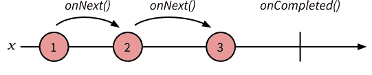

长箭头代表 Observable，x 轴代表时间。每个圆圈代表 Observable 通过内部调用 `onNext()` 发射的一个值。在生成第三个值后，range 会调用 `onCompleted`，在图中由一条垂直线表示。

让我们看一个涉及多个 Observable 的示例。`merge` 运算符接收两个不同的 Observable 并返回一个新的包含合并值的 Observable。`interval` 运算符返回一个在给定时间间隔（以毫秒为单位）产生递增数字的 Observable。

在以下代码中，我们将合并两个使用 `interval` 以不同间隔产生值的不同 Observable：

```javascript
var a = Rx.Observable.interval(200).map(function(i) {
    return 'A' + i;
});
var b = Rx.Observable.interval(100).map(function(i) {
    return 'B' + i;
});

Rx.Observable.merge(a, b).subscribe(function(x) {
    console.log(x);
});
```

`< B0, A0, B1, A1, B2, A2, B3, A3, B4...`

merge 运算符的大理石图如下所示：

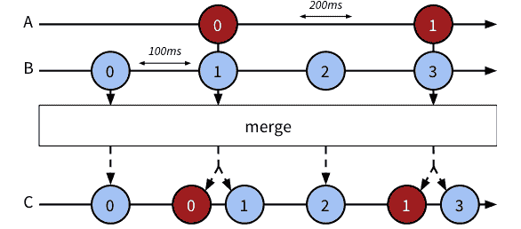

这里，沿 y 轴的虚线箭头指向应用于序列 A 和 B 中每个元素的转换最终结果。结果 Observable 由 C 表示，它包含 A 和 B 的合并元素。如果不同 Observable 的元素在同一时间被发射，则这些元素在合并序列中的顺序是随机的。

## 基础序列运算符

在 RxJS 中转换 Observable 的数十个运算符中，最常用的是那些任何具有良好集合处理能力的语言都具备的运算符：map、filter 和 reduce。在 JavaScript 中，你可以在 Array 实例中找到这些运算符。

RxJS 遵循 JavaScript 约定，因此你会发现以下运算符的语法与数组运算符几乎相同。事实上，我们将同时展示使用数组和 Observable 的实现，以表明这两个 API 有多么相似。

### Map

map 是最常用的序列转换运算符。它接收一个 Observable 和一个函数，并将该函数应用于源 Observable 中的每个值。它返回一个包含转换后值的新 Observable。

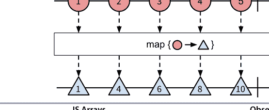

| JS 数组 | Observables |
| :--- | :--- |
| `var src = [1, 2, 3, 4, 5];` <br> `var upper = src.map(function(name) { return name * 2; });` | `var src = Rx.Observable.range(1, 5);` <br> `var upper = src.map(function(name) { return name * 2; });` |
| `upper.forEach(logValue);` | `upper.subscribe(logValue);` |

在这两种情况下，src 都不会发生改变。

这段代码以及随后的代码使用了 logValue 的定义：

```javascript
var logValue = function(val) { console.log(val) };
```

有可能我们传递给 map 的函数会进行一些异步计算来转换值。在这种情况下，map 将无法按预期工作。对于这些情况，最好使用第 22 页的 `flatMap`。

### Filter

filter 接收一个 Observable 和一个函数，并使用该函数测试 Observable 中的每个元素。它返回一个包含所有函数返回值为 true 的元素的 Observable 序列。

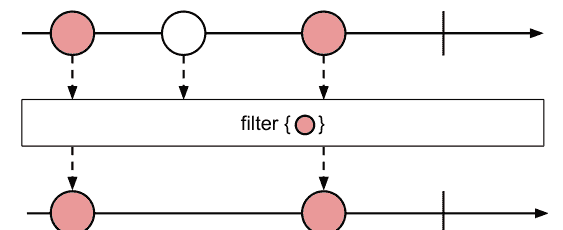

| JS 数组 | Observables |
| :--- | :--- |
| `var isEven = (function(val) { return val % 2 !== 0; });` | |
| `var src = [1, 2, 3, 4, 5];` | `var src = Rx.Observable.range(1, 5);` |
| `var even = src.filter(isEven);` | `var even = src.filter(isEven);` |
| `even.forEach(logValue);` | `even.subscribe(logValue);` |

### Reduce

reduce（也称为 _fold_）接收一个 Observable 并返回一个总是包含单个项目的新 Observable，该项目是对每个元素应用函数的结果。该函数接收当前元素和函数之前调用的结果。

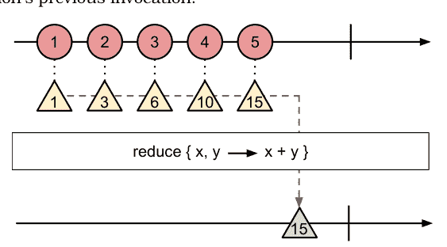

reduce 是一个强大的操纵序列的运算符。事实上，它是被称为 *聚合运算符（aggregate operators）* 的一整套方法的底层实现。

### 聚合运算符

聚合运算符处理一个序列并返回一个单一值。例如，`Rx.Observable.first` 接收一个 Observable 和一个可选的谓词函数，并返回第一个满足谓词条件的元素。

计算序列的平均值同样是一个 *聚合操作*。RxJS 提供了实例运算符 average，但为了本节的目的，我们想看看如何使用 reduce 来实现它。每个聚合运算符都可以仅使用 reduce 来实现：

```javascript
// sequences/marble.js
var avg = Rx.Observable.range(0, 5)
  .reduce(function(prev, cur) {
    return {
      sum: prev.sum + cur,
      count: prev.count + 1
    };
  }, { sum: 0, count: 0 })
  .map(function(o) {
    return o.sum / o.count;
  });

var subscription = avg.subscribe(function(x) {
  console.log('Average is: ', x);
});
```

> Average is: 2

在这段代码中，我们使用 reduce 将每个新值添加到前一个值上。因为 reduce 没有向我们提供序列中元素的总数，所以我们需要对其进行计数。我们在调用 reduce 时传入一个初始值，该值是一个包含 sum 和 count 两个字段的对象，用于存储目前为止的元素总和及其总数。每个新元素都将返回一个带有更新值的相同对象。

当序列结束时，`reduce` 将调用 `onNext` 并传递包含最终总和和最终计数的对象。此时我们使用 `map` 返回总和除以计数的计算结果。

> **Joe 问：我们可以聚合无限的 Observable 吗？**

想象一下，我们正在编写一个在用户步行时提供平均速度的程序。即使用户还没有走完，我们也需要能够使用目前已知的速度值进行计算。我们希望实时记录一个无限序列的平均值。问题在于，如果序列永远不结束，像 `reduce` 这样的聚合运算符将永远不会调用其观察者的 `onNext` 运算符。

幸运的是，RxJS 团队考虑到了这种情况，并为我们提供了 `scan` 运算符，它的作用类似于 `reduce`，但会发射每个中间结果：

```javascript
var avg = Rx.Observable.interval(1000)
  .scan(function (prev, cur) {
    return {
      sum: prev.sum + cur,
      count: prev.count + 1
    };
  }, { sum: 0, count: 0 })
  .map(function(o) {
    return o.sum / o.count;
  });

var subscription = avg.subscribe( function (x) {
  console.log(x);
});
```

通过这种方式，我们可以聚合那些需要很长时间才能完成或无限的序列。在前面的示例中，我们每秒生成一个递增整数，并将之前的 `reduce` 调用替换为 `scan`。现在我们每秒都能获得目前为止生成值的平均值。

### flatMap

如果你有一个结果是更多 Observable 的 Observable，该怎么办？大多数情况下，你会希望将这些嵌套 Observable 中的项目统一到一个单一序列中。这正是 `flatMap` 所做的事情。

`flatMap` 运算符接收一个元素同样是 Observable 的 Observable A，并返回一个包含 A 的子 Observable 展平值的新 Observable。让我们用图表来直观地表示它：

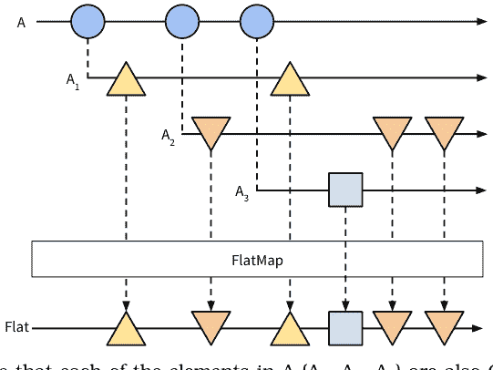

我们可以看到 A 中的每个元素 (A₁, A₂, A₃) 也是 Observable 序列。一旦我们将 `flatMap` 与一个转换函数应用于 A，我们就得到了一个包含 A 的不同子元素中所有元素的 Observable。

`flatMap` 是一个强大的运算符，但它可能比我们目前看到的运算符更难理解。把它想象成针对 Observable 的 `concatAll()`。

`concatAll` 是一个接收数组之数组并返回一个“展平”的单一数组的函数，该数组包含所有子数组的值，而不是子数组本身。我们可以使用 `reduce` 来创建这样一个函数：

```javascript
function concatAll(source) {
  return source.reduce(function(a, b) {
    return a.concat(b);
  });
}
```

我们会这样使用它：

```javascript
concatAll([[0, 1, 2], [3, 4, 5], [6, 7, 8]]);
// [0, 1, 2, 3, 4, 5, 6, 7, 8]
```

`flatMap` 做的是同样的事情，但它展平的是 Observable 而不是数组。它接收一个源 Observable 和一个返回新 Observable 的函数，并将该函数应用于源 Observable 中的每个元素，就像 `map` 所做的那样。如果过程到此为止，我们将最终得到一个发射 Observable 的 Observable。但 `flatMap` 将每个新 Observable 发射的值发射到主序列中，将所有 Observable “展平”为一个，即主序列。最终，我们获得一个单一的 Observable。


### 取消序列

在 RxJS 中，我们可以取消一个正在运行的 Observable。相比于回调函数（callbacks）和 Promise 等其他异步通信形式，这是一个优势，因为后者一旦被调用就无法直接取消（尽管某些 Promise 实现支持取消）。

我们有两种主要方式可以取消一个 Observable：*隐式*和*显式*。

### 显式取消：Disposable

Observable 本身没有用于取消的方法。相反，每当我们订阅一个 Observable 时，都会获得一个代表该特定订阅的 Disposable 对象。然后我们可以调用该对象中的 `dispose` 方法，该订阅将停止接收来自 Observable 的通知。

在接下来的示例中，我们将两个 Observer 订阅到 `counter` Observable，该 Observable 每秒发射一个递增的整数。两秒钟后，我们取消第二个订阅，可以看到它的输出停止了，但第一个订阅者的输出仍在继续：

```javascript
// sequences/disposable.js
var counter = Rx.Observable.interval(1000);

var subscription1 = counter.subscribe(function(i) {
  console.log('Subscription 1: ' + i);
});

var subscription2 = counter.subscribe(function(i) {
  console.log('Subscription 2: ' + i);
});

setTimeout(function() {
  console.log('Canceling subscription2!');
  subscription2.dispose();
}, 2000);
```

```text
Subscription 1: 0
Subscription 2: 0
Subscription 1: 1
Subscription 2: 1
Canceling subscription2!
Subscription 1: 2
Subscription 1: 3
Subscription 1: 4
...
```

### 隐式取消：通过操作符

大多数情况下，操作符会自动为你取消订阅。像 `range` 或 `take` 这样的操作符会在序列结束或满足操作符条件时取消订阅。更高级的操作符，如 `withLatestFrom` 或 `flatMapLatest`，会在内部根据需要创建和销毁订阅，因为它们处理多个运行中的 Observable。简而言之，你不必担心亲自取消大多数订阅。

### 封装外部 API 的 Observable

当你使用封装了不提供取消功能的外部 API 的 Observable 时，虽然 Observable 在被取消时仍会停止发射通知，但底层 API 不一定会被取消。例如，如果你使用一个封装了 Promise 的 Observable，Observable 在取消时会停止发射，但底层的 Promise 不会被取消。

在下面的代码中，我们尝试取消对封装了 Promise `p` 的 Observable 的订阅，同时我们以传统方式设置了 Promise 解析（resolved）时的操作。Promise 应该在五秒后解析，但我们在创建订阅后立即将其取消：

```javascript
var p = new Promise(function(resolve, reject) {
    window.setTimeout(resolve, 5000);
});

p.then(function() {
    console.log('Potential side effect!');
});

var subscription = Rx.Observable.fromPromise(p).subscribe(function(msg) {
    console.log('Observable resolved!');
});
subscription.dispose();
```

5 秒后，我们看到：

> Potential side effect!

如果我们取消对 Observable 的订阅，它实际上停止了接收通知。但 Promise 的 then 方法仍然运行，这表明取消 Observable 并不会取消底层的 Promise。

了解我们在 Observable 中使用的外部 API 的细节至关重要。你可能认为你已经取消了一个序列，但底层的 API 仍在运行并导致程序产生一些副作用。这些错误可能非常难以捕捉。

### 错误处理

我们不能在回调函数中使用传统的 try/catch 机制，因为它是同步的。它会在任何异步代码运行之前执行，因此无法捕获任何错误。

在回调函数中，这通过将错误（如果有）作为参数传递给回调函数来解决。这虽然可行，但会让代码变得非常脆弱。

让我们看看如何在 Observable 内部捕获错误。

### onError 处理程序

还记得我们在 *《与 Observer 的首次接触》，第 10 页* 中谈到的可以在 Observer 上调用的三种方法吗？我们熟悉 onNext 和 onCompleted，但尚未使用 onError；它是有效处理 Observable 序列中错误的关键。

为了查看它是如何工作的，我们将编写一个简单的函数，接收一个 JSON 字符串数组，并使用 `JSON.parse` 返回一个发射从这些字符串解析出的对象的 Observable：

```javascript
function getJSON(arr) {
    return Rx.Observable.from(arr).map(function(str) {
        var parsedJSON = JSON.parse(str);
        return parsedJSON;
    });
}
```

我们将向 `getJSON` 传递一个包含三个 JSON 字符串的数组，其中数组中的第二个字符串包含语法错误，因此 `JSON.parse` 将无法解析它。然后我们将订阅结果，并提供 onNext 和 onError 的处理程序：

```javascript
getJSON([
    '{"1": 1, "2": 2}',
    '{"success: true}', // Invalid JSON string
    '{"enabled": true}'
]).subscribe({
    next: function(json) {
        console.log('Parsed JSON: ', json);
    },
    error: function(err) {
        console.log(err.message);
    }
});
```

Parsed JSON: { 1: 1, 2: 2 }
JSON.parse: unterminated string at line 1 column 8 of the JSON data

Observable 为第一个结果发射解析后的 JSON，但在尝试解析第二个时抛出异常。`onError` 处理程序捕获该异常并将其打印出来。默认行为是，每当发生错误时，Observable 停止发射项目，并且不会调用 `onCompleted`。

### 捕获错误

到目前为止，我们已经看到了如何检测错误发生并利用该信息执行操作，但我们还无法对其做出反应并继续之前在做的事情。Observable 实例具有 `catch` 操作符，它允许我们对 Observable 中的错误做出反应并使用另一个 Observable 继续执行。

`catch` 接收一个 Observable 或一个接收错误作为参数并返回另一个 Observable 的函数。在我们的场景中，如果原始 Observable 中出现错误，我们希望 Observable 发射一个包含 `error` 属性的 JSON 对象：

```javascript
function getJSON(arr) {
    return Rx.Observable.from(arr).map(function(str) {
        var parsedJSON = JSON.parse(str);
        return parsedJSON;
    });
}
```

```javascript
var caught = getJSON(['{"1": 1, "2": 2}', '{"1: 1}']).catch(function(e) {
    return Rx.Observable.return({
        error: 'There was an error parsing JSON'
    });
});
```

```javascript
caught.subscribe(
    function(json) {
        console.log('Parsed JSON: ', json);
    },
    // 因为我们现在捕获了错误，`onError` 将不会被执行
    function(e) {
        console.log('ERROR', e.message);
    }
);
```

在上述代码中，我们创建了一个新的 Observable `caught`，它使用 `catch` 操作符来捕获原始 Observable 中的错误。如果发生错误，它将使用一个仅发射一个项目的 Observable 来继续序列，该项目包含一个描述错误的 `error` 属性。输出如下：

> Parsed JSON: Object { 1: 1, 2: 2 }
> Parsed JSON: Object { error: "There was an error parsing JSON" }

这是 `catch` 操作符的大理石图（marble diagram）：

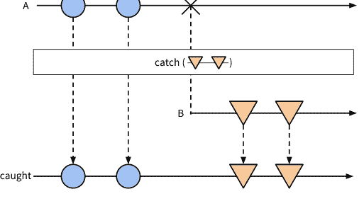

注意 X 表示序列遇到了错误。Observable 值的不同形状（在这种情况下是三角形）意味着它们来自另一个 Observable。在这里，那就是我们在发生错误时返回的 Observable。

`catch` 对于对序列中的错误做出反应非常有用，其行为非常像传统的 try/catch 块。但在某些情况下，如果能忽略 Observable 中某个项目发生的错误并让序列继续运行，会非常方便。在这些情况下，我们可以使用 `retry` 操作符。

### 重试序列

有时错误就是会发生，我们对此无能为力。例如，由于用户网络连接不稳定，请求远程数据可能会超时，或者我们查询的远程服务器可能会崩溃。在这些情况下，如果我们能够不断请求数据直到成功，那就太好了。`retry` 操作符正是如此：

```javascript
// sequences/error_handling.js

// 这将尝试检索远程 URL 最多 5 次。
Rx.DOM.get('/products').retry(5)
  .subscribe(
    function(xhr) { console.log(xhr); },
    function(err) { console.error('ERROR: ', err); }
  );
```

在上述代码中，我们创建了一个函数，该函数返回一个使用 `XMLHttpRequest` 从 URL 检索内容的 Observable。因为我们的连接可能不稳定，所以在订阅之前添加了 `retry(5)`，确保在发生错误时，它在放弃并显示错误之前最多尝试五次。


在使用 retry 时，有两点很重要。首先，如果我们不传递任何参数，它将无限次地重试，直到序列在没有错误的情况下完成。如果 Observable 持续产生错误，这将对性能产生危险。如果我们使用的是同步 Observable，其效果将等同于死循环。

其次，retry 总是会重新尝试整个 Observable 序列，即使其中某些项没有出错。这一点非常重要，因为如果你在处理项时产生了任何副作用，这些副作用将在每次重试时被重新应用。

### 制作一个实时地震可视化工具

利用本章到目前为止涵盖的概念，我们将构建一个使用 RxJS 的 Web 应用程序，用来实时显示地震发生的位置。我们将从构建一个功能完备但较为简单的响应式实现开始，并在过程中逐步对其进行改进。最终结果如下所示：

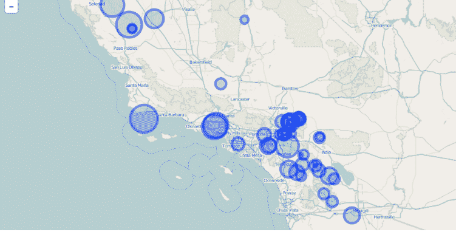

### 准备环境

我们将使用 USGS（美国地质调查局）的地震数据库¹，它以多种格式提供实时地震数据集。我们将从 JSONP 格式的每周数据集中获取数据。

> 1. http://earthquake.usgs.gov/earthquakes/feed/v1.0/

我们还将使用 Leaflet（一个 JavaScript 库）来渲染交互式地图²。让我们看看 `index.html` 的样子，并回顾其中的重点：

```html
examples_earthquake/index.html
<!DOCTYPE html>
<html lang="en-us">
<head>
    <meta charset="utf-8">

    <link rel="stylesheet"
          href="http://cdn.leafletjs.com/leaflet-0.7.3/leaflet.css" />
    <script src="http://cdn.leafletjs.com/leaflet-0.7.3/leaflet.js"></script>
    <script src="../rx.all-4.0.0.js"></script>

    <title>Earthquake map</title>
    <style type="text/css">
        html, body {
            margin: 0;
            padding: 0;
            height: 100%;
        }

        #map { height: 100%; }
    </style>
</head>

<body>
    <div id="map"></div>
    <script>
        var QUAKE_URL = 'http://earthquake.usgs.gov/earthquakes/feed/v1.0/' +
            'summary/all_day.geojson';

        function loadJSONP(url) {
            var script = document.createElement('script');
            script.src = url;

            var head = document.getElementsByTagName('head')[0];
            head.appendChild(script);
        }

        var map = L.map('').setView([33.858631, -118.279602], 7);
        L.TileLayer('http://{s}.tile.osm.org/{z}/{x}/{y}.png').addTo(map);
    </script>
    <script src="code.js"></script>
</body>
</html>
```

> 2. [http://leafletjs.com](http://leafletjs.com)

- 1. 这是 Leaflet 将用于渲染地图的占位 `div` 元素。
- 2. 这是一个我们用来加载 JSONP 内容的辅助函数。
- 3. 我们通过将坐标设置为洛杉矶中心（那里经常发生地震！）并设置合理的缩放级别来初始化 Leaflet 地图。
- 4. 我们告诉 Leaflet 为我们的地图设置默认瓦片集。瓦片集就像是地图的“主题”。
- 5. 最后，在 DOM 和地图初始化之后，我们加载自己的代码。

### 获取地震位置

现在 HTML 已经准备好了，我们可以编写应用程序的逻辑。首先，我们需要知道我们能获得什么样的数据，以及需要什么数据才能在地图上表示地震。

USGS 网站返回给我们的 JSONP 数据如下所示：

```
examples_earthquake/jsonp_example.txt
eqfeed_callback({
	"type": "FeatureCollection",
	"metadata": {
		"generated": 1408030886000,
		"url": "http://earthquake.usgs.gov/earthquakes/...",
		"title": "USGS All Earthquakes, Past Day",
		"status": 200, "api": "1.0.13", "count": 134
	},
	"features": [
		{
			"type": "Feature",
			"properties": {
				"mag": 0.82,
				"title": "M 0.8 - 3km WSW of Idyllwild-Pine Cone, California",
				"place": "3km WSW of Idyllwild-Pine Cone, California",
				"time": 1408030368460,
			},
			"geometry": {
				"type": "Point",
				"coordinates": [ -116.736667, 33.703333, 17.33 ]
			},
			"id": "ci15538377"
		},
		...
	]
})
```

`features` 数组包含一个对象，其中具有当天发生的每一次地震的数据。这可是海量的数据！一天之内发生这么多地震真是令人惊叹（且恐怖）。对于我们的程序，我们只需要每场地震的坐标、标题和震级。

我们首先想创建一个 Observable，用于检索数据集并发出单个地震事件。这是第一个版本：

```javascript
examples_earthquake_code.js
var quakes = Rx.Observable.create(function(observer) {
  window.eqfeed_callback = function(response) {
    var quakes = response.features;
    quakes.forEach(function(quake) {
      observer.onNext(quake);
    });
  };

  loadJSONP(QUAKE_URL);
});

quakes.subscribe(function(quake) {
  var coords = quake.geometry.coordinates;
  var size = quake.properties.mag * 10000;

  L.circle([coords[1], coords[0]], size).addTo(map);
});
```

等等，代码中那个显眼的全局函数 `window.eqfeed_callback` 是在做什么？事实证明，JSONP URL 通常提供一种方式（通过在 URL 中添加查询字符串）来指定处理响应的函数名称，但 USGS 网站不允许这样做，因此我们需要创建一个名为他们规定必须使用的 `eqfeed_callback` 的全局函数。

我们的 Observable 按顺序发出所有地震。现在我们拥有了一个地震生成器！我们不需要关心异步流，也不需要将所有逻辑放在同一个函数中。只要我们订阅这个 Observable，地震数据就会自动传送到我们这里。

通过将地震检索“黑盒化”在 `quakes` Observable 中，我们现在可以订阅它并处理每个地震。然后，我们将为每个地震绘制一个圆圈，其大小与震级成正比。

### 深入探讨

我们能做得更好吗？当然可以！在之前的代码中，我们仍然通过遍历数组并调用 `onNext` 来产生每个地震来管理流程，即使我们将它隔离在 Observable 内部。这哪里像响应式编程！

### Joe 问：什么是 JSONP？

JSONP——即 *JSON with padding*（带填充的 JSON）——是 Web 开发人员为了绕过从第三方域请求数据时的浏览器限制而想出的一种巧妙技巧。<sup>a</sup>

它通过使用 `script` 标签而不是通常的 `XMLHttpRequest` 来加载外部内容，从而绕过了这些限制。将 script 标签添加到 DOM 会直接加载并执行其内容，且不受安全限制的影响。

远程请求的内容随后被包装在一个函数调用中（这就是 JSONP 中的 *P*）。它看起来像这样：

```javascript
callbackFn({a: 1, b: 2, c: 3})
```

JSONP URL 通常接受一个查询字符串参数，以便调用者可以指定回调函数的名称。随后，开发人员必须在代码中定义一个与服务器响应中的回调函数同名的函数，当 script 标签被添加到文档中时，该函数将被调用，并将 JSON 数据作为第一个参数传入。

像 jQuery 这样的库通过在内部创建全局函数来处理 JSONP 调用，并在之后进行清理以避免污染全局命名空间，从而实现了这一过程的自动化。

> a. [http://en.wikipedia.org/wiki/Same-origin_policy](http://en.wikipedia.org/wiki/Same-origin_policy)

这正是使用 `flatMap` 的绝佳场景。我们将检索数据，并使用 `Rx.Observable.from` 将 features 数组转换为一个 Observable。然后，我们将该 Observable 合并回主 Observable 中：

```javascript
// examples_earthquake/code1.js
var quakes = Rx.Observable.create(function(observer) {
    window.eqfeed_callback = function(response) {
        observer.onNext(response);
        observer.onCompleted();
    };
    loadJSONP(QUAKE_URL);
}).flatMap(function transform(dataset) {
    return Rx.Observable.from(dataset.features);
});

quakes.subscribe(function(quake) {
    var coords = quake.geometry.coordinates;
    var size = quake.properties.mag * 10000;
    L.circle([coords[1], coords[0]], size).addTo(map);
});
```


我们不再手动管理流程了。不再需要通过循环或条件判断来提取单个地震对象并进行传递。以下是具体发生的过程：

- 1. 这次 `onNext` 仅触发一次，并产出整个 JSON 响应。
- 2. 由于我们只产出一次，因此在 `onNext` 之后发出完成信号。
- 3. 我们将 `flatMap` 调用链接到 create 的结果上，因此 `flatMap` 会接收来自 Observable 的每个结果（在本例中只有一个），将其作为转换函数的参数，并将该函数生成的 Observable 合并到源 Observable 中。
- 4. 在这里，我们获取包含所有地震信息的 features 数组并从中创建一个 Observable。由于使用了 `flatMap`，这将成为 quakes 变量实际包含的 Observable。
- 5. Subscribe 完全没有变化；它依然像之前一样处理地震数据流。

### 总是有一种方法

到目前为止，我们使用了包含在 `rx.all.js` 中的 RxJS 运算符，但通常值得去看看其他基于 RxJS 的库所提供的运算符。在我们的案例中，我们将 살펴보 RxJS-DOM。RxJS-DOM 是一个外部库，其中包含一个用于处理 JSONP 请求的运算符：`jsonpRequest`。这为我们节省了一些代码，并避免了使用糟糕的全局函数：

```javascript
// examples_earthquake/code1_2.js
var quakes = Rx.DOM.jsonpRequest({
    url: QUAKE_URL,
    jsonpCallback: 'eqfeed_callback'
})
.flatMap(function(result) {
    return Rx.Observable.from(result.response.features);
})
.map(function(quake) {
    return {
        lat: quake.geometry.coordinates[1],
        lng: quake.geometry.coordinates[0],
        size: quake.properties.mag * 10000
    };
});
quakes.subscribe(function(quake) {
    L.circle([quake.lat, quake.lng], quake.size).addTo(map);
});
```

- [https://github.com/Reactive-Extensions/RxJS-DOM](https://github.com/Reactive-Extensions/RxJS-DOM)

请记住，要运行这段代码，你需要在 HTML 中引入 RxJS-DOM 的 `rx.dom.js` 文件。请注意，我们添加了一个 map 运算符，将地震对象转换为仅包含可视化所需信息的简单对象：纬度、经度和地震震级。我们在 subscribe 运算符中放置的功能越少，效果就越好。

### 实现实时更新

我们这个响应式的地震应用程序目前还不能实时更新地震地图。为了实现这一点，我们将使用 `interval` 运算符（我们在本章前面看到过）和 `uber-distinct` 运算符。让我先向你展示代码，然后我们再分析具体变化：

```javascript
// examples_earthquake/code1_3.js
var quakes = Rx.Observable
  .interval(5000)
  .flatMap(function() {
    return Rx.DOM.jsonpRequest({
      url: QUAKE_URL,
      jsonpCallback: 'eqfeed_callback'
    });
  })
  .retry(3)
  .flatMap(function(result) {
    return Rx.Observable.from(result.response.features);
  })
  .distinct(function(quake) { return quake.properties.code; });

quakes.subscribe(function(quake) {
  var coords = quake.geometry.coordinates;
  var size = quake.properties.mag * 10000;

  L.circle([coords[1], coords[0]], size).addTo(map);
});
```

在上面的代码中，我们“滥用”了 `interval` 来每隔五秒定期发送新请求并处理它们。`interval` 创建一个每五秒发出一个递增数字的 Observable。我们并不处理这些数字；相反，我们使用 `flatMap` 来获取 `jsonpRequest` 的数据。同时注意，我们使用了 `retry`，以便在最初获取列表出现问题时尝试重新获取。

我们应用的最后一个运算符是 `distinct`，它只发出之前从未发出过的元素。它接收一个返回用于检查相等性的属性的函数。这样，我们永远不会重复绘制已经绘制过的地震点。

在不足 20 行代码的情况下，我们编写了一个应用程序，它可以定期轮询外部 JSONP URL，从其内容中提取具体数据，然后过滤掉已经导入的地震。之后，我们在地图上表示这些地震，其大小与震级成正比——所有这些都以一种自包含、清晰且简洁的方式编写，无需依赖外部变量。非常不错！这展示了 Observable 的表达能力有多强。

### 改进想法

这里有几个想法，可以让你运用新学到的 RxJS 技巧，让这个小应用程序变得更有趣：

- 当用户将鼠标悬停在某个地震点上时，弹出一个窗口显示该特定地震的更多信息。实现的一种方法是从 quakes Observable 创建一个新的 Observable，其中仅包含你想要显示的属性，并在悬停时动态过滤。
- 在页面顶部实现一个计数器，显示今日到目前为止的地震数量，并且每天重置。

### 运算符回顾

本章为你介绍了几个新的运算符，这里是对它们的总结，以及在应用程序中可以使用它们的一些场景。记住，你始终可以在 RxJS GitHub 站点上找到运算符的完整 API 文档。⁴

- **Rx.Observable.from**
  
  默认行为：*同步 (Synchronous)*
  
  由于你在应用程序中使用的许多数据源来自数组或可迭代对象，因此拥有一个能从中创建 Observable 的运算符是有意义的。`from` 是你会最经常使用的运算符之一。
  
  通过 `from`，我们可以从数组、类数组对象（例如 arguments 对象或 DOM NodeLists），甚至实现了可迭代协议的类型（如 String, Map 和 Set）创建 Observable。⁵

- **Rx.Observable.range**
  
  默认行为：*同步 (Synchronous)*
  
  `range` 运算符生成有限的 Observable，发出特定范围内的整数。它非常通用，可用于多种场景。例如，你可以使用 `range` 来生成类似扫雷（Minesweeper）这类游戏棋盘上的初始方格。

- **Rx.Observable.interval**
  
  默认行为：*异步 (Asynchronous)*
  
  每当你需要生成在时间上间隔的值时，你可能会从 `interval` 运算符开始作为生成器。由于 `interval` 每 $x$ 毫秒发出一个顺序整数（其中 $x$ 是我们传递的参数），我们只需将这些值转换为我们想要的任何形式即可。我们在 [第 3 章《构建并发程序》，第 39 页](link) 中的游戏在很大程度上基于这种技术。

- **Rx.Observable.distinct**
  
  默认行为：*与它过滤的 Observable 相同*
  
  `distinct` 是那些能节省大量开发工作的极其简单的运算符之一。它会过滤掉序列中任何已经发出过的值。这让我们免于一遍又一遍地编写那些容易出错的样板代码——即在某个地方使用字典存储已发出的结果，然后将传入结果与之对比。你知道我在说哪种代码。太糟糕了。有了 `distinct`，这些都消失了。

`distinct` 允许我们使用一个函数来指定比较方法。此外，我们也可以不传递参数，它将使用严格比较来对比数字或字符串等原语，并在处理复杂对象时运行深度比较。

---
⁴ https://github.com/Reactive-Extensions/RxJS/blob/master/doc/api/core/observable.md
⁵ https://developer.mozilla.org/ca/Docs/Web/JavaScript/Reference/Iteration_protocols

### 本章小结

在本章中，我们学习了如何使用大理石图（marble diagrams）来可视化表示和理解 Observable 流。我们涵盖了最常用的转换 Observable 的运算符，更重要的是，我们仅使用 Observable 序列构建了一个实际的应用程序，避免了设置任何外部状态、循环或条件分支。我们以声明式的方式表达了整个程序，而无需对完成任务的每个步骤进行编码。

在下一章中，我们将继续探索 Observable 序列，这次将关注更高级的运算符，它们允许你控制和引导程序中的流与数据，其灵活性是你之前难以想象程序化代码能实现的！


### 构建并发程序

并发是一门在正确且高效地同时执行多项任务的艺术。为了实现这一点，我们需要构建程序以充分利用时间，使任务能够以最高效的方式共同运行。应用程序中日常并发的例子包括：在执行其他活动时保持用户界面响应，以及高效地处理数百名客户的订单。

在本章中，我们将通过为浏览器制作一个射击类太空飞船游戏，来探索 RxJS 中的并发和纯函数。我们将首先介绍 Observable 管道（pipeline），这是一种将 Observable 操作符链接起来并在它们之间传递状态的技术。然后，我将向你展示如何使用该管道来构建程序，而无需依赖外部状态或副作用，方法是将所有逻辑和状态封装在 Observable 自身内部。

电子游戏是需要维护大量状态的计算机程序，但我们将利用 Observable 管道的强大功能和一些出色的 RxJS 操作符，在完全不使用任何外部状态的情况下编写我们的游戏。

### 纯度与 Observable 管道

Observable 管道是一组链式连接的操作符，其中每个操作符接收一个 Observable 作为输入并返回一个 Observable 作为输出。我们在本书中一直在使用管道：在 RxJS 编程中，它们无处不在。这是一个简单的示例：

```javascript
// spaceship_reactive/pipeline.js
Rx.Observable
  .from(1, 2, 3, 4, 5, 6, 7, 8)
  .filter(function(val) { return val % 2; })
  .map(function(val) { return val * 10; });
```

管道是自包含的。所有状态从一个操作符流向下一个操作符，无需任何外部变量。但在构建响应式程序时，我们可能会倾向于在 Observable 管道之外存储状态（我们在第 5 页的“副作用与外部状态”中讨论过外部状态）。这迫使我们要跟踪在管道外部设置的变量，而所有这些琐碎的计数很容易导致 Bug。为了避免这种情况，管道中的操作符应当始终使用纯函数。

纯函数在给定相同输入时总是返回相同的输出。当我们能够保证程序中的某个函数不会修改其他函数依赖的状态时，设计高并发程序会变得更容易。而这正是纯函数赋予我们的能力。

### 避免外部状态

在接下来的示例中，我们计算 `interval` 至今产生的偶数数量。我们通过创建由 `interval` 滴答（ticks）组成的 Observable，并在接收到的滴答为偶数时增加 `evenTicks` 来实现：

```javascript
// spaceship_reactive/state.js
var evenTicks = 0;

function updateDistance(i) {
    if (i % 2 === 0) {
        evenTicks += 1;
    }
    return evenTicks;
}

var ticksObservable = Rx.Observable
    .interval(1000)
    .map(updateDistance);

ticksObservable.subscribe(function() {
    console.log('Subscriber 1 - evenTicks: ' + evenTicks + ' so far');
});
```

程序运行四秒后，我们得到的输出如下：

> Subscriber 1 - evenTicks: 1 so far
> Subscriber 1 - evenTicks: 1 so far
> Subscriber 1 - evenTicks: 2 so far
> Subscriber 1 - evenTicks: 2 so far

现在，为了尝试，让我们为 `ticksObservable` 添加另一个订阅者：

```javascript
// spaceship_reactive/state.js
var eventTicks = 0;

function updateDistance(i) {
    if (i % 2 === 0) {
        eventTicks += 1;
    }
    return eventTicks;
}

var ticksObservable = Rx.Observable
    .interval(1000)
    .map(updateDistance)

ticksObservable.subscribe(function() {
    console.log('Subscriber 1 - eventTicks: ' + eventTicks + ' so far');
});

ticksObservable.subscribe(function() {
    console.log('Subscriber 2 - eventTicks: ' + eventTicks + ' so far');
});
```

现在的输出如下：

```text
Subscriber 1 - eventTicks: 1 so far
Subscriber 2 - eventTicks: 2 so far
Subscriber 1 - eventTicks: 2 so far
Subscriber 2 - eventTicks: 2 so far
Subscriber 1 - eventTicks: 3 so far
Subscriber 2 - eventTicks: 4 so far
Subscriber 1 - eventTicks: 4 so far
Subscriber 2 - eventTicks: 4 so far
```

等一下——订阅者 2 上的事件滴答计数完全错了！它应该始终包含与订阅者 1 相同的 `eventTicks` 计数。原因正如你可能猜测的那样，Observable 管道会为每个订阅者运行一次，从而导致 `eventTicks` 增加了两次。

共享外部状态引起的问题通常比这个例子更隐蔽。在复杂的应用程序中，允许在管道外部更改状态会导致代码变得复杂，Bug 很快就会出现。解决方案是将尽可能多的信息封装在管道内部。以下是我们重构上述代码以避免外部状态的一种方法：

```javascript
// spaceship_reactive/state.js
function updateDistance(acc, i) {
    if (i % 2 === 0) {
        acc += 1;
    }
    return acc;
}

var ticksObservable = Rx.Observable
    .interval(1000)
    .scan(updateDistance, 0);

ticksObservable.subscribe(function(eventTicks) {
    console.log('Subscriber 1 - eventTicks: ' + eventTicks + ' so far');
});

ticksObservable.subscribe(function(eventTicks) {
    console.log('Subscriber 2 - eventTicks: ' + eventTicks + ' so far');
});
```

预期输出为：

> Subscriber 1 - eventTicks: 1 so far
> Subscriber 2 - eventTicks: 1 so far
> Subscriber 1 - eventTicks: 1 so far
> Subscriber 2 - eventTicks: 1 so far
> Subscriber 1 - eventTicks: 2 so far
> Subscriber 2 - eventTicks: 2 so far
> Subscriber 1 - eventTicks: 2 so far
> Subscriber 2 - eventTicks: 2 so far

通过使用 `scan`，我们完全避免了外部状态。我们将偶数滴答的累积计数传递给 `updateDistance`，而不是依赖外部变量来保存累积值。这样我们就不会在每个新订阅者出现时增加计数。

大多数情况下，我们可以避免依赖外部状态。使用它的常见场景是缓存值或跟踪程序中变化的值。但是，正如你在《响应式飞船》（第 50 页）中将看到的，这些场景可以通过其他几种方式处理。例如，当我们需要缓存值时，RxJS 的 Subject 类（第 45 页）会有很大帮助；而当我们需要跟踪游戏的先前状态时，可以使用 `Rx.Observable.scan` 等方法。

### 管道是高效的

第一次将一堆操作符链接到管道中以转换序列时，我的直觉是这不可能高效。我知道在 JavaScript 中通过链式调用操作符来转换数组是很昂贵的。然而，在本书中，我建议你通过将序列转换为新序列来设计程序。这难道不是极低效的吗？

Observable 和数组的链式调用看起来很相似，甚至都有 `filter` 和 `map` 这样相同的方法。但有一个至关重要的区别：数组方法在每次操作后都会创建一个新数组，然后由下一个操作完整遍历。而 Observable 管道不会创建中间 Observable，而是将所有操作一次性应用于每个元素。因此，Observable 仅被遍历一次，这使得 Observable 的链式调用非常高效。请查看以下示例：

```javascript
// spaceship_reactive/array_chain.js
stringArray // 代表一个包含 1,000 个字符串的数组
.map(function(str) {
  return str.toUpperCase();
})
.filter(function(str) {
  return /^[A-Z]+$/.test(str);
})
.forEach(function(str) {
  console.log(str);
});
```

假设 `stringArray` 是一个包含 1,000 个字符串的数组，我们希望将其转换为大写，然后过滤掉包含非字母字符（或完全没有字母）的字符串。最后，我们将结果数组中的每个字符串打印到控制台。

后台发生的情况如下：

- 遍历数组，创建一个所有项目均为大写的新数组。
- 遍历大写数组，创建另一个包含 1,000 个元素的数组。
- 遍历过滤后的数组，并将每个结果记录到控制台。

在转换数组的过程中，我们遍历了三次数组并创建了两个完全庞大的新数组。这远非高效！如果你关注性能或处理大规模项目序列，不应该这样编程。

同样的 operation 使用 Observable 后的样子如下：

```javascript
// spaceship_reactive/array_chain.js
stringObservable // 代表一个发出 1,000 个字符串的 observable
.map(function(str) {
  return str.toUpperCase();
```


```javascript
  })
  .filter(function(str) {
    return /^[A-Z]+$/.test(str);
  })
  .subscribe(function(str) {
    console.log(str);
  });
```

- 1. 创建一个大写转换函数，该函数将应用于 Observable 的每个项目，并返回一个 Observable，每当 Observer 订阅它时，它将发出这些新项目。
- 2. 将之前的大写函数与过滤函数组合，并返回一个 Observable，该 Observable 仅在被订阅时，发出经过大写转换和过滤后的新项目。
- 3. 触发 Observable 发出项目，仅遍历所有项目一次，并且对每个项目仅应用一次我们定义的转换。

通过使用 Observables，我们只需遍历一次列表，并且仅在绝对必要时才应用转换。例如，假设我们在之前的示例中添加了一个 `take` 操作符：

```javascript
// spaceship_reactive/array_chain.js
stringObservable
  .map(function(str) {
    return str.toUpperCase();
  })
  .filter(function(str) {
    return /^[A-Z]+$/.test(str);
  })
  .take(5)
  .subscribe(function(str) {
    console.log(str);
  });
```

`take` 使 Observable 仅发出我们指定的前 `n` 个项目。在我们的案例中，`n` 为 5，因此在数千个字符串中，我们仅接收前五个。最酷的部分是，我们的代码永远不会遍历所有项目；它仅会对前五个项目应用转换。

这让开发者的工作变得轻松许多。你可以放心，在操作序列时，RxJS 只会执行必要的工作。这种操作方式被称为`lazy evaluation`（惰性求值），在 Haskell 和 Miranda 等函数式语言中非常常见。

### RxJS 的 Subject 类

Subject 是一种同时实现了 Observer 和 Observable 类型的类型。作为 Observer，它可以订阅 Observables；作为 Observable，它可以产生值并让 Observers 订阅它。

在某些场景下，单个 Subject 可以完成 Observer 和 Observable 组合的工作。例如，为了在数据源和 Subject 的监听者之间创建一个代理对象，我们可以使用以下代码：

```javascript
// spaceship_reactive/subjects.js
var subject = new Rx.Subject();
var source = Rx.Observable.interval(300)
  .map(function(v) { return 'Interval message #' + v; })
  .take(5);

source.subscribe(subject);

var subscription = subject.subscribe({
  next: function onNext(x) { console.log('onNext: ' + x); },
  error: function onError(e) { console.log('onError: ' + e.message); },
  complete: function onCompleted() { console.log('onCompleted'); }
});

subject.onNext('Our message #1');
subject.onNext('Our message #2');

setTimeout(function() {
  subject.onCompleted();
}, 1000);
```

输出：

> onNext: Our message #1
> onNext: Our message #2
> onNext: Interval message #0
> onNext: Interval message #1
> onNext: Interval message #2
> onCompleted

在上述示例中，我们创建了一个新的 Subject 和一个每秒发出一个整数的源 Observable。然后，我们将 Subject 订阅到该 Observable。之后，我们将一个 Observer 订阅到 Subject 本身。此时，Subject 的行为就像一个 Observable。

接下来，我们让 Subject 发出自己的值（message1 和 message2）。在最终结果中，我们先得到了 Subject 自己的消息，然后是来自源 Observable 的代理值。来自 Observable 的值出现较晚，因为它们是异步的，而我们将 Subject 自己的值设为了立即发出。请注意，即使我们告诉源 Observable 取前五个值，输出也只显示了前三个。这是因为在一秒钟后，我们调用了 Subject 的 `onCompleted` 方法。这结束了对所有订阅的通知，并在本例中覆盖了 `take` 操作符。

Subject 类为创建更专门的 Subject 提供了基础。事实上，RxJS 提供了一些有趣的实现：AsyncSubject、ReplaySubject 和 BehaviorSubject。

### AsyncSubject

AsyncSubject 仅在序列完成后才发出序列的最后一个值。该值随后会被永久缓存，任何在值发出后订阅的 Observer 都会立即收到该值。AsyncSubject 非常适合返回单个值的异步操作，例如 Ajax 请求。

让我们看一个 AsyncSubject 订阅范围（range）的简单示例：

```javascript
// spaceship_reactive/subjects.js
var delayedRange = Rx.Observable.range(0, 5).delay(1000);
var subject = new Rx.AsyncSubject();

delayedRange.subscribe(subject);

subject.subscribe({
  next: function onNext(item) { console.log('Value:', item) },
  error: function onError(err) { console.log('Error:', err) },
  complete: function onCompleted() { console.log('Completed.') }
});
```

在该示例中，`delayedRange` 在延迟一秒后发出 0 到 4 的值。然后我们创建了一个新的 AsyncSubject 并将其订阅到 `delayedRange`。输出如下：

> Value: 4
> Completed.

正如预期的那样，我们仅得到了 Observer 发出的最后一个值。现在让我们在更现实的场景中使用 AsyncSubject。我们将获取一些远程内容：

```javascript
// spaceship_reactive/subjects.js
function getProducts(url) {
  var subject;
  return Rx.Observable.create(function(observer) {
    if (!subject) {
        subject = new Rx.AsyncSubject();
        Rx.DOM.get(url).subscribe(subject);
    }
    return subject.subscribe(observer);
});
}

var products = getProducts('products');
// 将触发请求并在读取时接收响应
products.subscribe(
    function onNext(result) { console.log('Result 1:', result.response); },
    function onError(error) { console.log('ERROR', error); }
);

// 将立即收到结果，因为它已被缓存
setTimeout(function() {
    products.subscribe(
        function onNext(result) { console.log('Result 2:', result.response); },
        function onError(error) { console.log('ERROR', error); }
    );
}, 5000);
```

在这段代码中，当调用带 URL 的 `getProducts` 时，它返回一个发出 HTTP GET 请求结果的 Observer。具体分析如下：

- 1. `getProducts` 返回一个 Observable 序列。我们在这里创建它。
- 2. 如果我们还没有创建 AsyncSubject，我们就创建它，并将其订阅到 `Rx.DOM.Request.get(url)` 返回的 Observable。
- 3. 我们将 Observer 订阅到 AsyncSubject。每当一个 Observer 订阅该 Observable 时，它实际上是被订阅到了 AsyncSubject，而 AsyncSubject 在检索 URL 的 Observable 和 Observers 之间充当代理。
- 4. 我们创建检索 URL "products" 的 Observable 并将其存储在 `products` 变量中。
- 5. 这是第一次订阅，将启动 URL 检索并在检索完成后记录结果。
- 6. 这是第二次订阅，在第一次订阅五秒后运行。由于此时 URL 已经被检索，无需再次进行网络请求。它将立即收到请求结果，因为结果已经存储在 AsyncSubject `subject` 中。

有趣之处在于，我们使用了一个订阅 `Rx.DOM.Request.get` Observable 的 AsyncSubject。由于 AsyncSubject 缓存了最后的结果，任何随后对 `products` 的订阅都将立即收到结果，而不会触发另一次网络请求。每当我们预期单个结果并希望保留它时，都可以使用 AsyncSubject。

> **Joe 问：这是否意味着 AsyncSubject 的行为像一个 Promise？**

的确如此。

AsyncSubject 代表一个异步操作的结果，你可以用它来替代 Promise。内部的区别在于，Promise 永远只处理单个值，而 AsyncSubject 处理序列中的所有值，但仅发出（并缓存）最后一个值。

能够如此轻松地模拟 Promise 展示了 RxJS 模型的灵活性。（即使没有 AsyncSubject，使用 Observables 模拟 Promise 也会非常简单。）

### BehaviorSubject

当 Observer 订阅 BehaviorSubject 时，它会收到最后一次发出的值，以及随后所有的值。BehaviorSubject 要求我们提供一个初始值，这样所有 Observer 在订阅 BehaviorSubject 时都能始终收到一个值。

想象一下，我们想要检索一个远程文件并在 HTML 页面上打印其内容，但在等待内容加载时，我们想要显示一段占位文本。我们可以为此使用 BehaviorSubject：

```javascript
// spaceship_reactive/behavior_subject.js
var subject = new Rx.BehaviorSubject('Waiting for content');

subject.subscribe(
    function(result) {
        document.body.textContent = result.response || result;
    },
    function(err) {
        document.body.textContent = 'There was an error retrieving content';
    }
);

Rx.DOM.get('/remote/content').subscribe(subject);
```


在代码中，我们使用占位内容初始化一个新的 `BehaviorSubject`。然后我们订阅它，并根据结果在 `onNext` 和 `onError` 中分别更改 HTML 正文内容。

现在 HTML 正文包含我们的占位文本，并且将保持这种状态，直到 Subject 发射一个新值。最后，我们请求所需的资源，并将我们的 Subject 订阅到生成的 Observer 上。

`BehaviorSubject` 保证始终至少会发射一个值，因为我们在其构造函数中提供了一个默认值。一旦 `BehaviorSubject` 完成，它将不再发射任何值，从而释放缓存值所占用的内存。

### ReplaySubject

`ReplaySubject` 会缓存其值，并将其重新发射给任何延迟订阅它的 Observer。与 `AsyncSubject` 不同，这种行为不需要序列完成才能发生。

| Subject | ReplaySubject |
| :--- | :--- |
| `var subject = new Rx.Subject();` | `var subject = new Rx.ReplaySubject();` |
| `subject.onNext(1);` | `subject.onNext(1);` |
| `subject.subscribe(function(n) { console.log('Received value:', n); });` | `subject.subscribe(function(n) { console.log('Received value:', n); });` |
| `subject.onNext(2);` <br> `subject.onNext(3);` | `subject.onNext(2);` <br> `subject.onNext(3);` |
| `Received value: 2` <br> `Received value: 3` | `Received value: 1` <br> `Received value: 2` <br> `Received value: 3` |

`ReplaySubject` 对于确保 Observer 能从一开始就获得 Observable 发射的所有值非常有用。它使我们无需编写缓存之前值的繁琐代码，从而避免了棘手的并发相关 Bug。

当然，为了实现这种行为，`ReplaySubject` 将所有值缓存在内存中。为了防止它占用过多内存，我们可以通过缓冲区大小或时间窗口来限制其存储的数据量，或者在构造函数中传递特定参数。

`ReplaySubject` 构造函数的第一个参数接收一个数字，代表我们想要缓冲的值的数量：

```javascript
var subject = new Rx.ReplaySubject(2); // 缓冲区大小为 2

subject.onNext(1);
subject.onNext(2);
subject.onNext(3);

subject.subscribe(function(n) {
    console.log('Received value:', n);
});
```

> Received value: 2
> Received value: 3

第二个参数接收一个数字，代表我们想要缓冲值的毫秒数：

```javascript
var subject = new Rx.ReplaySubject(null, 200); // 缓冲时间为 200ms

setTimeout(function() { subject.onNext(1); }, 100);
setTimeout(function() { subject.onNext(2); }, 200);
setTimeout(function() { subject.onNext(3); }, 300);
setTimeout(function() { 
    subject.subscribe(function(n) {
        console.log('Received value:', n);
    });
}, 350);

subject.onNext(4);
```

在这个例子中，我们设置了基于时间的缓冲区，而不是基于值的数量。我们的 `ReplaySubject` 将缓存直到 200 毫秒前发射的值。我们每隔 100 毫秒发射三个值，在 350 毫秒后我们订阅一个 Observer 并再次发射一个值。在订阅瞬间，缓存的项是 2 和 3，因为 1 发生的时间太久之前（大约 250 毫秒前），因此不再被缓存。

Subject 是一个强大的工具，可以为你节省大量时间。它们为缓存和重复等常见场景提供了极佳的解决方案。由于其核心本质就是 Observable 和 Observer，你不需要学习任何新东西。

### 反应式飞船！

为了展示如何保持应用程序的纯净，我们将构建一个视频游戏，在游戏中我们的英雄将与无穷无尽的敌方飞船群战斗。我们将大量使用 Observable 管道，并在过程中指出什么时候可能会倾向于在管道外部存储状态，以及如何避免这样做。

众所周知，视频游戏会保留大量的外部状态——得分、角色的屏幕坐标、定时器等等。我们的计划是在不依赖任何保留状态的外部变量的情况下构建整个游戏。

在我们的游戏中，玩家将使用鼠标水平移动飞船，并通过点击鼠标或敲击空格键进行射击。我们的游戏将有四个主要参与者：背景中移动的星场、玩家的飞船、敌人，以及玩家和敌人发射的子弹。

它看起来像这样：

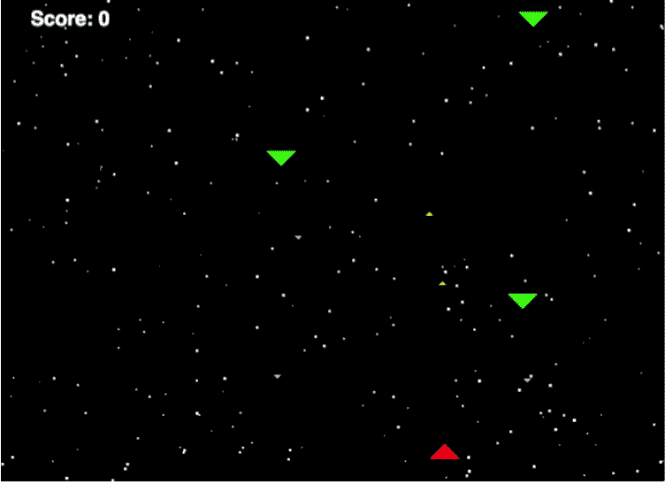

在截图中，红色三角形是我们的飞船，绿色的是敌人。更小的三角形是发射的子弹。

让我们先搭建舞台；这将是我们的 HTML 文件：

```html
spaceship_reactive/spaceship.html
<!DOCTYPE html>
<html>
  <head>
    <meta charset="utf-8">
    <title>Spaceship Reactive!</title>
    <script src="../rx.all-4.0.0.js"></script>
    <style>
      html, body {
            margin: 0;
            padding: 0;
        }
    </style>
</head>
<body>
    <script src="spaceship.js"></script>
</body>
</html>
```

这只是一个简单的 HTML 文件，用于加载我们在本章剩余部分将要处理的 JavaScript 文件。在该 JavaScript 文件中，我们首先设置一个用于渲染游戏的 canvas 元素：

```javascript
spaceship_reactive/starfield_1.js
var canvas = document.createElement('canvas');
var ctx = canvas.getContext("2d");
document.body.appendChild(canvas);
canvas.width = window.innerWidth;
canvas.height = window.innerHeight;
```

准备就绪后，我们可以开始描述游戏的组件。首先，让我们绘制星空背景。

### 创建星场

对于一个设定在太空中的游戏，首先需要的是星星。我们将创建一个向下滚动地星场，以营造在太空中穿行的感觉。为此，我们首先使用 `range` 操作符生成星星：

```javascript
spaceship_reactive/starfield_1.js
var SPEED = 40;
var STAR_NUMBER = 250;
var StarStream = Rx.Observable.range(1, STAR_NUMBER)
    .map(function() {
        return {
            x: parseInt(Math.random() * canvas.width),
            y: parseInt(Math.random() * canvas.height),
            size: Math.random() * 3 + 1
        };
    })
```

每颗星将由一个包含随机坐标和 1 到 4 之间大小的对象表示。这段代码将给我们一个生成 250 颗此类“星星”的流。

我们希望这些星星能够持续移动。一种方法是每隔几毫秒增加所有星星的 y 坐标。我们将使用 `toArray` 将 `StarStream` Observable 转换为一个数组，该数组将发射一个包含 `range` 生成的所有对象的数组。然后我们可以通过 `flatMap` 操作符接管该数组，将 Observable 转换为一个每隔几毫秒产生一个值的流。使用 `map`，我们可以增加原数组中每个项的 y 坐标：

```javascript
spaceship_reactive/starfield_1.js
var SPEED = 40;
var STAR_NUMBER = 250;
var starStream = Rx.Observable.range(1, STAR_NUMBER)
  .map(function() {
    return {
      x: parseInt(Math.random() * canvas.width),
      y: parseInt(Math.random() * canvas.height),
      size: Math.random() * 3 + 1
    };
  })
  .toArray()
  .flatMap(function(starArray) {
    return Rx.Observable.interval(SPEED).map(function() {
      starArray.forEach(function(star) {
        if (star.y >= canvas.height) {
          star.y = 0; // 将星星重置到屏幕顶部
        }
        star.y += 3; // 移动星星
      });
      return starArray;
    });
  });
```

在 `map` 内部，我们检查星星的 y 坐标是否已经超出屏幕，如果是，则将其重置为 0。通过更改每个星星对象的坐标，我们可以一直使用同一个星星数组。

现在我们需要一个简单的辅助函数，将星星数组“绘制”到我们的 canvas 上：

```javascript
spaceship_reactive/starfield_1.js
function paintStars(stars) {
  ctx.fillStyle = '#000000';
  ctx.fillRect(0, 0, canvas.width, canvas.height);
  ctx.fillStyle = '#ffffff';
  stars.forEach(function(star) {
    ctx.fillRect(star.x, star.y, star.size, star.size);
  });
}
```

`paintStars` 绘制黑色背景并在 canvas 上绘制星星。要实现移动星场，剩下的唯一工作就是订阅 Observable 并用结果数组调用 `paintStars`。以下是最终代码：

```javascript
spaceship_reactive/starfield_1.js
function paintStars(stars) {
  ctx.fillStyle = '#000000';
  ctx.fillRect(0, 0, canvas.width, canvas.height);
  ctx.fillStyle = '#ffffff';
  stars.forEach(function(star) {
    ctx.fillRect(star.x, star.y, star.size, star.size);
  });
}

var SPEED = 40;
var STAR_NUMBER = 250;
var starStream = Rx.Observable.range(1, STAR_NUMBER)
  .map(function() {
    return {
      x: parseInt(Math.random() * canvas.width),
      y: parseInt(Math.random() * canvas.height),
      size: Math.random() * 3 + 1
    };
  })
  .toArray()
  .flatMap(function(starArray) {
    return Rx.Observable.interval(SPEED).map(function() {
      starArray.forEach(function(star) {
        if (star.y >= canvas.height) {
          star.y = 0; // Reset star to top of the screen
        }
        star.y += 3; // Move star
      });
      return starArray;
    });
  })
  .subscribe(function(starArray) {
    paintStars(starArray);
  });
```

现在舞台已经搭建好了，是时候让我们的英雄登场了。

### 添加玩家的宇宙飞船

既然我们已经拥有了美丽的星空背景，接下来就可以为英雄的宇宙飞船编写程序了。虽然它是游戏中最重要的对象，但我们的飞船设计得异常简单。它是一个监听鼠标移动的观察者（Observer），发射当前的鼠标 x 坐标和一个恒定的 y 坐标（玩家仅在水平方向移动，因此我们永远不会更改 y 坐标）：

```javascript
spaceship_reactive/hero_1.js
var HERO_Y = canvas.height - 30;
var mouseMove = Rx.Observable.fromEvent(canvas, 'mousemove');
var SpaceShip = mouseMove
  .map(function(event) {
    return {
      x: event.clientX,
      y: HERO_Y
    };
  })
  .startWith({
    x: canvas.width / 2,
    y: HERO_Y
  });
```

请注意我使用了 `startWith()`。这为 Observable 设置了第一个初始值，我将其设为屏幕中央的位置。如果没有 `startWith`，我们的 Observable 将在玩家移动鼠标时才开始发射值。

让我们把英雄渲染到屏幕上。在这个游戏中，所有角色都是三角形（我的平面设计能力实在不怎么样），所以我们将定义一个辅助函数，根据给定的坐标、大小、颜色以及朝向，在画布上渲染三角形：

```javascript
// spaceship_reactive/hero_1.js
function drawTriangle(x, y, width, color, direction) {
  ctx.fillStyle = color;
  ctx.beginPath();
  ctx.moveTo(x + width, y);
  ctx.lineTo(x, direction === 'up' ? y - width : y + width);
  ctx.lineTo(x + width, y);
  ctx.lineTo(x - width, y);
  ctx.fill();
}
```

我们还将定义 `paintSpaceShip`，它将调用这个辅助函数：

```javascript
// spaceship_reactive/hero_1.js
function paintSpaceShip(x, y) {
  drawTriangle(x, y, 20, '#ff0000', 'up');
}
```

但现在我们面临一个问题。如果我们订阅 `SpaceShip` Observable 并在订阅回调中调用 `drawTriangle`，我们的飞船将仅在移动鼠标时才可见，而且仅仅是一瞬间。这是因为 `starStream` 每秒会多次更新画布，如果我们不移动鼠标，它就会把飞船擦除。而由于 `starStream` 无法直接访问飞船，我们不能在 `starStream` 的订阅中渲染飞船。我们可以将最新的飞船坐标保存到一个 `starStream` 可以访问的变量中，但那样我们就违反了“不修改外部状态”的原则。该怎么办呢？

像往常一样，RxJS 提供了一个非常方便的运算符来解决这个问题。

`Rx.Observable.combineLatest` 是一个非常实用的运算符。它接受两个或多个 Observable，每当其中任何一个发射新值时，它就会发射每个 Observable 的最新结果。既然知道 `starStream` 发射新项（星阵数组）的频率很高，我们可以移除 `starStream` 的订阅，改用 `combineLatest` 将 `starStream` 和 `SpaceShip` 两个 Observable 结合起来，并在其中任何一个发射新项时立即更新它们：

```javascript
spaceship_reactive/hero_1.js
function renderScene(actors) {
  paintStars(actors.stars);
  paintSpaceShip(actors.spaceship.x, actors.spaceship.y);
}

var Game = Rx.Observable
  .combineLatest(
    StarStream, SpaceShip,
    function(stars, spaceship) {
      return { stars: stars, spaceship: spaceship };
    }
  );

Game.subscribe(renderScene);
```

我们现在使用一个渲染函数 `renderScene` 来绘制屏幕上的所有内容，因此您可以删除之前针对 `StarStream` 的以下订阅代码：

```javascript
.subscribe(function(starArray) {
  paintStars(starArray);
});
```

这样一来，每当任何一个 Observable 发射新项时，我们都会绘制星空背景 *以及* 宇宙飞船。现在，我们拥有了一艘在太空中飞行的飞船，并且可以用鼠标随意移动它。这么少量的代码就能实现，还不赖！但我们的英雄在浩瀚的宇宙中太孤独了。给她找些伴儿怎么样？

### 生成敌人

如果没有敌人需要对付，这将会是一个非常无聊的游戏。所以，让我们创建一名无穷无尽的敌人流吧！为了不让我们的英雄压力太大，我们希望每隔 1.5 秒创建一名新敌人。让我们来看看 `Enemies` Observable 的代码并对其进行分析：

```javascript
spaceship_reactive/enemy_1.js
var ENEMY_FREQ = 1500;
var Enemies = Rx.Observable.interval(ENEMY_FREQ)
  .scan(function(enemyArray) {
    var enemy = {
      x: parseInt(Math.random() * canvas.width),
      y: -30,
    };

    enemyArray.push(enemy);
    return enemyArray;
  }, []);

var Game = Rx.Observable
  .combineLatest(
    StarStream, SpaceShip, Enemies,
    function(stars, spaceship, enemies) {
      return {
        stars: stars,
        spaceship: spaceship,
        enemies: enemies
      };
    }
  );

Game.subscribe(renderScene);
```

为了创建敌人，我们使用 `interval` 运算符每 1,500 毫秒运行一次，然后使用 `scan` 运算符来创建敌人数组。

我们在[第 22 页的“我们能聚合无限的 Observable 吗？”](page_22)中简要地介绍了 `scan` 运算符。`scan` 在 Observable 每次发射值时聚合结果，并发射每个中间结果。在 `Enemies` Observable 中，我们将一个空数组作为 `scan` 的第一个参数，并在每次迭代中向其推入一个新对象。该对象包含一个随机的 x 坐标和一个在可见屏幕之外的固定 y 坐标。这样，`Enemies` 每 1,500 毫秒就会发射一个包含当前所有敌人的数组。

渲染敌人唯一还需要的是一个辅助函数，用于在画布上绘制每个敌人。该函数还将负责更新敌人数组中每个项的坐标：

```javascript
spaceship_reactive/enemy_1.js
// 获取随机整数的辅助函数
function getRandomInt(min, max) {
  return Math.floor(Math.random() * (max - min + 1)) + min;
}

function paintEnemies(enemies) {
  enemies.forEach(function(enemy) {
    enemy.y += 5;
    enemy.x += getRandomInt(-15, 15);

    drawTriangle(enemy.x, enemy.y, 20, '#00ff00', 'down');
  });
}
```

在 `paintEnemies` 中你可以看到，我们还随机更改了 x 坐标，使敌人向两侧移动得更不可预测。现在我们需要更新 `renderScene` 函数，以包含对 `paintEnemies` 的调用。

在玩目前为止编写的游戏时，你可能会注意到一个奇怪的现象：如果你移动鼠标，敌人向你冲过来的速度会变快！这 *可能* 是游戏中的一个不错的功能，但绝对不是我们的本意。你能猜到导致这个 bug 的原因吗？

如果你猜是与 `paintEnemies` 函数有关，那么你猜对了。`combineLatest` 在任何一个 Observable 产生值时都会渲染场景。如果我们不移动鼠标，发射速度最快的永远是 `starStream`，因为它的间隔是 40 毫秒（`Enemies` Observable 每 1,500 毫秒才发射一次）。然而，当我们移动鼠标时，`SpaceShip` 的发射速度将超过 `starStream`（你的鼠标每秒会发射 *很多* 次坐标），于是 `paintEnemies` 就会执行相应的次数，从而使敌人的坐标增加得快得多。

为了避免这种情况以及未来类似的问题，我们需要规范游戏的运行速度，使得没有任何一个 Observable 的发射速度能超过我们为游戏设定的速度。

没错，正如你可能猜到的，RxJS 为此提供了一个运算符。

### 避免“饮水如注” (Avoid Drinking from the Firehose)

接收数据过快的情况是确实存在的。大多数时候我们希望速度越快越好，但根据 Observable 流出值的频率，我们可能希望丢弃一部分接收到的值。我们现在就处于这种情况。我们在屏幕上渲染内容的频率与我们拥有的最快 Observable 的速度成正比。事实证明，我们最快的 Observable 对我们来说太快了，我们需要在游戏中建立一个恒定的更新速度。

`sample` 是 Observable 实例中的一个方法，它接收一个以毫秒为单位的时间参数，并返回一个 Observable，该 Observable 在每个时间间隔内发射父 Observable 发射的最后一个值。


请注意 `sample` 如何在时间间隔到时，丢弃最后一个值之前的所有值。考虑你是否需要这种行为非常重要。在我们的案例中，我们不在意丢弃这些值，因为我们只想每 40 毫秒渲染一次每个元素的当前状态。如果所有值对你都很重要，你可能需要考虑使用 buffer 运算符：

```javascript
spaceship_reactive/enemy_2.js
Rx.Observable.combineLatest(
  StarStream, SpaceShip, Enemies,
  function(stars, spaceship, enemies) {
    return {
      stars: stars,
      spaceship: spaceship,
      enemies: enemies
    };
  }
)
.sample(SPEED)
.subscribe(renderScene);
```

通过在 `combineLatest` 之后调用 `sample`，我们可以确保 `combineLatest` 产生任何值的间隔不会快于 40 毫秒（我们的常量 SPEED 设置为 40）。

### 射击

看到成群的敌人向我们袭来有点可怕；我们能做的就是避其锋芒，希望他们没发现我们。如果我们给我们的英雄增加向邪恶的外星飞船射击的能力会怎样？

我们希望在点击鼠标或按下空格键时，飞船都能进行射击，因此我们将为每个事件创建一个 Observable，并将它们合并为一个名为 `playerShots` 的单一 Observable。注意，我们通过空格键的键码 32 对 `keydown` Observable 进行了过滤：

```javascript
spaceship_reactive/hero_shots.js
var playerFiring = Rx.Observable
  .merge(
    Rx.Observable.fromEvent(canvas, 'click'),
    Rx.Observable.fromEvent(canvas, 'keydown')
      .filter(function(evt) { return evt.keycode === 32; })
  )
```

既然我们知道了 sample，我们可以用它来给游戏增加趣味，并限制飞船的射击频率。否则，玩家可以用极快的速度射击并太轻易地摧毁所有敌人。我们将设置成玩家最多每 200 毫秒才能射击一次：

```javascript
spaceship_reactive/hero_shots.js
var playerFiring = Rx.Observable
  .merge(
    Rx.Observable.fromEvent(canvas, 'click'),
    Rx.Observable.fromEvent(canvas, 'keydown')
      .filter(function(evt) { return evt.keycode === 32; })
  )
  .sample(200)
  .timestamp();
```

我们还添加了一个 timestamp 运算符，它在 Observable 发出的每个值中设置一个 `timestamp` 属性，记录它发出的准确时间。我们稍后会用到它。

最后，为了让飞船发射子弹，我们需要知道射击瞬间飞船的 x 坐标。这样我们才能在正确的 x 坐标处渲染子弹。虽然设置一个外部变量来记录 SpaceShip Observable 发出的最后一个 x 坐标很诱人，但这会破坏我们“绝不修改外部状态”的潜规则！

相反，我们将再次使用我们的好朋友 combineLatest 来实现这一点：

```javascript
spaceship_reactive/hero_shots.js
var HeroShots = Rx.Observable
  .combineLatest(
    playerFiring,
    SpaceShip,
    function(shotEvents, spaceShip) {
      return { x: spaceShip.x };
    }
  )
  .scan(function(shotArray, shot) {
    shotArray.push({x: shot.x, y: HERO_Y});
    return shotArray;
  }, []);
```

现在我们能从 `spaceShip` 和 `playerFiring` 获取更新后的值，从而得到我们想要的 x 坐标。我们使用 `scan` 的方式与之前在 Enemy Observable 中的用法相同，为每颗子弹创建一个当前坐标数组。至此，我们应该准备好在屏幕上绘制子弹了。我们使用一个辅助函数来绘制子弹数组中的每一颗子弹：

```javascript
spaceship_reactive/hero_shots.js
var SHOOTING_SPEED = 15;
function paintHeroShots(heroShots) {
  heroShots.forEach(function(shot) {
    shot.y -= SHOOTING_SPEED;
    drawTriangle(shot.x, shot.y, 5, '#ffff00', 'up');
  });
}
```

然后，我们在主 `combineLatest` 操作中调用 `paintHeroShots`：

```javascript
Rx.Observable.combineLatest(
  StarStream, Spaceship, Enemies, HeroShots,
  function(stars, spaceship, enemies, heroShots) {
    return {
      stars: stars,
      spaceship: spaceship,
      enemies: enemies,
      heroShots: heroShots
    };
  }
)
.sample(SPEED)
.subscribe(renderScene);
```

并在 `renderScene` 内部添加对 `paintHeroShots` 的调用：

```javascript
function renderScene(actors) {
  paintStars(actors.stars);
  paintSpaceShip(actors.spaceship.x, actors.spaceship.y);
  paintEnemies(actors.enemies);
  paintHeroShots(actors.heroShots);
}
```

现在当你运行游戏时，你会注意到 *每当你移动鼠标，我们的飞船就会发射惊人数量的子弹*。作为一种效果还不赖，但这并不是我们想要的！让我们再次观察 HeroShots Observable。在其中，我们使用 `combineLatest` 以便同时拥有 `playerFiring` 和 `spaceShip` 的值。这看起来像我们之前遇到的问题。HeroShots 中的 `combineLatest` 在鼠标每次移动时都会发出值，而这被转化为了射击行为。在这种情况下，节流（Throttling）没有帮助，因为我们希望用户在想射击时随时能射击，而节流会限制射击数量并丢弃许多射击指令。

combineLatest 在任何一个 Observable 发出新值时，都会发出每个 Observable 之前发出的最后一个值。我们可以利用这一点。每当鼠标移动时，combineLatest 会发出新的 SpaceShip 位置和 playerFiring 最后发出的值（除非我们发射新子弹，否则该值保持不变）。然后，我们可以仅在发出的子弹与前一个不同时才发出一个值。distinctUntilChanged 运算符可以帮我们完成这项繁重的工作。

distinct 和 distinctUntilChanged 运算符允许我们过滤掉 Observable 已经发出的结果。distinct 过滤掉任何之前发出过的值，而 distinctUntilChanged 则过滤掉连续重复的结果（除非中间发出过不同的值）。我们只需要确保新子弹与前一个不同，因此 distinctUntilChanged 对我们来说就足够了。（它还避免了 distinct 较高的内存占用；distinct 需要在内存中保留所有之前的结果。）

我们修改 heroShots，使其基于时间戳仅发出新子弹：

```javascript
spaceship_reactive/hero_shots2.js
var HeroShots = Rx.Observable
    .combineLatest(
        playerFiring,
        SpaceShip,
        function(shotEvents, spaceShip) {
            return {
                timestamp: shotEvents.timestamp,
                x: spaceShip.x
            };
        }
    )
    .distinctUntilChanged(function(shot) { return shot.timestamp; })
    .scan(function(shotArray, shot) {
        shotArray.push({ x: shot.x, y: HERO_Y });
        return shotArray;
    }, []);
```

如果一切顺利，我们现在能够用飞船射击敌人了！

### 敌人射击

我们也应该允许敌人射击；否则这个宇宙太不公平了，而且很无聊！对于敌人射击，我们将执行以下操作：

- 每个敌人将维护一个包含其自身子弹的更新数组。
- 每个敌人将以给定的频率射击。

为此，我们将使用 interval 运算符将新子弹存储在敌人值中。我们还将引入一个新的辅助函数 isVisible，用于过滤掉坐标在可见屏幕之外的元素。以下是现在的 Enemy Observable 样子：

```javascript
spaceship_reactive/enemy_shots.js
function isVisible(obj) {
    return obj.x > -40 && obj.x < canvas.width + 40 &&
           obj.y > -40 && obj.y < canvas.height + 40;
}

var ENEMY_FREQ = 1500;
var ENEMY_SHOOTING_FREQ = 750;
var Enemies = Rx.Observable.interval(ENEMY_FREQ)
    .scan(function(enemyArray) {
        var enemy = {
            x: parseInt(Math.random() * canvas.width),
            y: -30,
            shots: []
        };

        Rx.Observable.interval(ENEMY_SHOOTING_FREQ).subscribe(function() {
            enemy.shots.push({x: enemy.x, y: enemy.y});
            enemy.shots = enemy.shots.filter(isVisible);
        });

        enemyArray.push(enemy);
        return enemyArray.filter(isVisible);
    }, []);
```

在上述代码中，我们每次创建新敌人时都会创建一个 interval。这个 interval 将不断向敌人的子弹数组中添加子弹，然后过滤掉屏幕外的子弹。我们同样可以在 return 语句中使用 isVisible 来过滤掉屏幕外的敌人。

我们需要更新 paintEnemies，使其能够渲染敌人的子弹并更新它们的 y 坐标。然后，我们使用便捷的 drawTriangle 函数来绘制子弹：

```javascript
spaceship_reactive/enemy_shots.js
function paintEnemies(enemies) {
    enemies.forEach(function(enemy) {
        enemy.y += 5;
        enemy.x += getRandomInt(-15, 15);

        drawTriangle(enemy.x, enemy.y, 20, '#00ff00', 'down');

        enemy.shots.forEach(function(shot) {
            shot.y += SHOOTING_SPEED;
            drawTriangle(shot.x, shot.y, 5, '#00ffff', 'down');
        });
    });
}
```


现在大家都开始互相射击了，但没有人被摧毁！子弹只是简单地穿过了敌人和我们的飞船而过，因为我们还没有定义当子弹与飞船碰撞时会发生什么。

### 管理碰撞

当子弹击中敌人时，我们希望子弹和敌人同时消失。让我们定义一个辅助函数来检测两个目标是否发生了碰撞：

```javascript
// spaceship_reactive/enemy_shots2.js
function collision(target1, target2) {
    return (target1.x > target2.x - 20 && target1.x < target2.x + 20) &&
           (target1.y > target2.y - 20 && target1.y < target2.y + 20);
}
```

现在让我们修改辅助函数 `paintHeroShots`，以检查每颗子弹是否击中了敌人。在发生命中时，我们将把被击中敌人的 `isDead` 属性设置为 `true`，并将子弹的坐标设置到屏幕之外。子弹最终会被过滤掉，因为它已经超出了屏幕范围。

```javascript
// spaceship_reactive/enemy_shots2.js
function paintEnemies(enemies) {
    enemies.forEach(function(enemy) {
        enemy.y += 5;
        enemy.x += getRandomInt(-15, 15);

        if (!enemy.isDead) {
            drawTriangle(enemy.x, enemy.y, 20, '#00ff00', 'down');
        }

        enemy.shots.forEach(function(shot) {
            shot.y += SHOOTING_SPEED;
            drawTriangle(shot.x, shot.y, 5, '#00ffff', 'down');
        });
    });
}

var SHOOTING_SPEED = 15;
function paintHeroShots(heroShots, enemies) {
    heroShots.forEach(function(shot, i) {
        for (var l=0; l<enemies.length; l++) {
            var enemy = enemies[l];
            if (!enemy.isDead && collision(shot, enemy)) {
                enemy.isDead = true;
                shot.x = shot.y = -100;
                break;
            }
        }
        shot.y -= SHOOTING_SPEED;
        drawTriangle(shot.x, shot.y, 5, '#ffff00', 'up');
    });
}
```

接下来，让我们清除所有 `isDead` 属性为 `true` 的敌人。唯一需要注意的是，我们需要等待该特定敌人的所有子弹消失；否则，当我们击中一个敌人时，它所有的子弹也会随之消失，这会显得很奇怪。因此，我们应该检查其子弹列表的长度，仅在它没有剩余子弹时才过滤掉该敌人对象：

```javascript
// spaceship_reactive/enemy_shots2.js
var Enemies = Rx.Observable.interval(ENEMY_FREQ)
    .scan(function(enemyArray) {
        var enemy = {
            x: parseInt(Math.random() * canvas.width),
            y: -30,
            shots: []
        };

        Rx.Observable.interval(ENEMY_SHOOTING_FREQ).subscribe(function() {
            if (!enemy.isDead) {
                enemy.shots.push({ x: enemy.x, y: enemy.y });
            }
            enemy.shots = enemy.shots.filter(isVisible);
        });

        enemyArray.push(enemy);
        return enemyArray
            .filter(isVisible)
            .filter(function(enemy) {
                return !(enemy.isDead && enemy.shots.length === 0);
            });
    }, []);
```

为了检查玩家的飞船是否被击中，我们创建一个 `gameOver` 函数：

```javascript
// spaceship_reactive/enemy_shots2.js
function gameOver(ship, enemies) {
    return enemies.some(function(enemy) {
        if (collision(ship, enemy)) {
            return true;
        }

        return enemy.shots.some(function(shot) {
            return collision(ship, shot);
        });
    });
}
```

如果敌人或敌人的子弹击中了玩家的飞船，该函数将返回 `true`。

在继续之前，让我们了解一个非常有用的操作符：`takeWhile`。当我们对一个现有的 Observable 调用 `takeWhile` 时，该 Observable 将持续发射值，直到传递给 `takeWhile` 的参数函数返回 `false`。

我们可以使用 `takeWhile` 来告诉我们的主 `combineLatest` Observable 持续接收值，直到 `gameOver` 返回 `true`：

```javascript
// spaceship_reactive/enemy_shots2.js
Rx.Observable.combineLatest(
    StarStream, SpaceShip, Enemies, HeroShots,
    function(stars, spaceship, enemies, heroShots) {
        return {
            stars: stars,
            spaceship: spaceship,
            enemies: enemies,
            heroShots: heroShots
        };
    }
)
.sample(SPEED)
.takeWhile(function(actors) {
    return gameOver(actors.spaceship, actors.enemies) === false;
})
.subscribe(renderScene);
```

当 `gameOver` 返回 `true` 时，`combineLatest` 将停止发射值，从而有效地停止游戏。

### 最后一件事：计分

如果不能向朋友炫耀我们的成绩，那还叫什么游戏？显然我们需要一种方式来记录我们的表现。我们需要一个分数。

让我们创建一个辅助函数，将分数绘制在屏幕的左上角：

```javascript
// spaceship_reactive/score.js
function paintScore(score) {
    ctx.fillStyle = '#ffffff';
    ctx.font = 'bold 26px sans-serif';
    ctx.fillText('Score: ' + score, 40, 43);
}
```

为了记录分数，我们将使用一个 `Subject`。我们可以像使用另一个 Observable 一样，轻松地将其用于基于 `combineLatest` 的主游戏循环中，并且可以在任何时候向其推送值。

```javascript
// spaceship_reactive/score.js
var ScoreSubject = new Rx.Subject();
var score = ScoreSubject.scan(function (prev, cur) {
    return prev + cur;
}, 0).concat(Rx.Observable.return(0));
```

在上述代码中，我们使用了老朋友 `scan` 操作符将每个新值累加到总结果中。由于游戏开始时没有分数，我们连接了一个返回 0 的 Observable，以便有一个起点。

现在，我们只需在击中敌人时向我们的 Subject 推送分数即可：这发生在 `paintHeroShots` 中：

```javascript
// spaceship_reactive/score.js
var SCORE_INCREASE = 10;
function paintHeroShots(heroShots, enemies) {
    heroShots.forEach(function(shot, i) {
        for (var l = 0; l < enemies.length; l++) {
            var enemy = enemies[l];
            if (!enemy.isDead && collision(shot, enemy)) {
                ScoreSubject.onNext(SCORE_INCREASE);
                enemy.isDead = true;
                shot.x = shot.y = -100;
                break;
            }
        }
        shot.y -= SHOOTING_SPEED;
        drawTriangle(shot.x, shot.y, 5, '#ffff00', 'up');
    });
}
```

当然，我们将 `paintScore` 添加到 `renderScene` 中，使分数显示在屏幕上：

```javascript
// spaceship_reactive/score.js
function renderScene(actors) {
    paintStars(actors.stars);
    paintSpaceShip(actors.spaceship.x, actors.spaceship.y);
    paintEnemies(actors.enemies);
    paintHeroShots(actors.heroShots, actors.enemies);
    paintScore(actors.score);
}
```

至此，我们的响应式飞船游戏就完成了。通过大约 200 行代码，我们成功在浏览器中编写了一个完整的游戏，并利用 Observable 流的力量，避免了修改任何外部状态。

### 改进想法

我相信你已经有一些让游戏更刺激的想法了，但让我提几个建议，在提升游戏体验的同时也能磨练你的 RxJS 技巧：

- 添加第二个（或第三个！）以不同速度移动的星场，以创建视差效果。这可以通过几种不同的方式实现。尝试复用现有代码，并尽可能声明式地实现它。
- 让敌人变得更不可预测，让他们以随机的时间间隔而不是 `ENEMY_SHOOTING_FREQ` 指定的固定间隔开火。如果你能让敌人随着玩家得分的增加而开火速度加快，将获得额外加分！
- 允许玩家在短时间内击中多个敌人以获得更多积分。

### 总结

我们仅使用 Observable 就构建了一个完整的浏览器游戏，并在过程中看到了几种处理并发以及组合和转换 Observable 的极其便捷的方法。这是 RxJS 的强大之处：总有一个方法可以帮助你解决试图应对的问题。欢迎在 RxJS 文档中进一步探索。¹

响应式编程让编写并发程序变得简单。Observable 抽象和强大的 RxJS 方法使得程序的不同部分能够自然且高效地进行交互。不依赖外部状态的编程可能需要一段时间来适应，但它带来了巨大的好处。我们可以将整个行为封装在单个 Observable 流中，使我们的程序更加稳固和可靠。

在下一章中，我们将回到地震可视化应用程序，并添加一个 Node.js 服务器部分，用于显示与地震相关的推文。我们还将改进其用户界面，使其看起来像一个真正的地震仪表盘。

> 1. [https://github.com/Reactive-Extensions/RxJS/blob/master/doc/api/core/observable.md](https://github.com/Reactive-Extensions/RxJS/blob/master/doc/api/core/observable.md)


### 第 4 章
### 构建一个完整的 Web 应用程序

在本章中，我们将构建一个典型的 Web 应用程序，在前端和后端都使用 RxJS。我们将对文档对象模型（DOM）进行转换，并在 Node.js 服务器中使用 WebSockets 进行客户端-服务器通信。

对于用户界面部分，我们将使用 RxJS-DOM 库，这是一个由 RxJS 团队开发的库，它提供了便捷的操作符来处理 DOM 和浏览器相关事宜，使我们的开发更加轻松。对于服务器部分，我们将使用两个成熟的 Node 库，并将它们的部分 API 用 Observable 包装起来，以便在应用程序中使用。

在本章之后，你将能够使用 RxJS 以声明式的方式构建用户界面，将我们目前所学的技术应用于 DOM。你也将准备好在任何 Node.js 项目中使用 RxJS，并在任何项目中应用响应式编程和 RxJS。

### 构建一个实时地震仪表盘

我们将为地震仪表盘应用程序构建服务器端和客户端部分，接续我们在 [第 29 页的“制作实时地震可视化工具”](example) 中开始的体验。我们将使用 Node.js 构建服务器，并改进我们的应用程序，使其更具交互性和信息量。

[第 70 页的截图](example) 展示了完成后仪表盘的外观：


| 地点 | 震级 | 时间 |
| :--- | :--- | :--- |
| 6km WNW of The Geysers, California | 1.06 | Wed Feb 11 2015 17:18:01 GMT+0100 (CET) |
| 8km N of Anza, California | 0.68 | Wed Feb 11 2015 17:11:34 GMT+0100 (CET) |
| 12km SE of Big Bear City, California | 1.3 | Wed Feb 11 2015 17:09:52 GMT+0100 (CET) |

我们的起点将是 [第 29 页的“制作实时地震可视化工具”](example) 中的代码，当时我们将其写成这样：

```javascript
// examples_earthquake/code1_3.js
var quakes = Rx.Observable
  .interval(5000)
  .flatMap(function() {
    return Rx.DOM.jsonpRequest({
        url: QUAKE_URL,
        jsonpCallback: 'eqfeed_callback'
    });
  })
  .retry(3)
  .flatMap(function(result) {
      return Rx.Observable.from(result.response.features);
  })
  .distinct(function(quake) { return quake.properties.code; });

quakes.subscribe(function(quake) {
    var coords = quake.geometry.coordinates;
    var size = quake.properties.mag * 10000;

    L.circle([coords[1], coords[0]], size).addTo(map);
});
```

这段代码已经存在一个潜在的 Bug：它可能会在 DOM 准备好之前执行，导致每当我们尝试在代码中使用 DOM 元素时都会抛出错误。我们希望在 `DOMContentLoaded` 事件触发后加载代码，该事件标志着浏览器已意识到页面上所有元素的时刻。

RxJS-DOM 提供了 `Rx.DOM.ready()` Observable，它在 `DOMContentLoaded` 触发时发出一次通知。因此，让我们将代码包装在一个初始化函数中，并在订阅 `Rx.DOM.ready()` 时执行它：

```javascript
// examples_earthquake_ui/code1.js
function initialize() {
    var quakes = Rx.Observable
        .interval(5000)
        .flatMap(function() {
            return Rx.DOM.jsonpRequest({
                url: QUAKE_URL,
                jsonpCallback: 'eqfeed_callback'
            });
        })
        .flatMap(function(result) {
            return Rx.Observable.from(result.response.features);
        })
        .distinct(function(quake) { return quake.properties.code; });

    quakes.subscribe(function(quake) {
        var coords = quake.geometry.coordinates;
        var size = quake.properties.mag * 10000;
        L.circle([coords[1], coords[0]], size).addTo(map);
    });
    });
}

Rx.DOM.ready().subscribe(initialize);
```

接下来，我们在 HTML 中添加一个空表格，在下一节中我们将在此填充地震数据：

```html
<table>
  <thead>
    <tr>
      <th>Location</th>
      <th>Magnitude</th>
      <th>Time</th>
    </tr>
  </thead>
  <tbody id="quakes_info">
  </tbody>
</table>
```

至此，我们准备好开始为仪表盘编写新代码了。

### 添加地震列表

新仪表盘的第一个功能是显示地震的实时列表，包括地点、震级和日期等信息。该列表的数据与地图的数据相同，均来自 USGS 网站。我们首先创建一个函数，该函数在给定 `props` 对象参数时返回一个行（row）元素：

```javascript
// examples_earthquake_ui/code2.js
function makeRow(props) {
    var row = document.createElement('tr');
    row.id = props.net + props.code;

    var date = new Date(props.time);
    var time = date.toString();
    [props.place, props.mag, time].forEach(function(text) {
        var cell = document.createElement('td');
        cell.textContent = text;
        row.appendChild(cell);
    });

    return row;
}
```

`props` 参数与我们从 USGS 网站获取的 JSON 中的 `properties` 属性相同。

为了生成行，我们将再次订阅 `quakes` Observable。这次订阅会为接收到的每个新地震在表格中创建一行。我们将代码添加到 `initialize` 函数的末尾：

```javascript
// examples_earthquake_ui/code2.js
var table = document.getElementById('quakes_info');
quakes
    .pluck('properties')
    .map(makeRow)
    .subscribe(function(row) { table.appendChild(row); });
```

`pluck` 操作符从每个地震对象中提取 `properties` 的值，因为它包含了 `makeRow` 所需的所有信息。然后，我们将每个地震对象映射到 `makeRow`，将其转换为填充好内容的 HTML `tr` 元素。最后，在订阅中，我们将每个发出的行添加到我们的表格中。

这样，每当我们收到地震数据时，都会得到一个填充良好的表格。

看起来不错，而且足够简单！不过，我们还可以进行一些改进。但在那之前，我们需要探讨 RxJS 中的一个重要概念：**热（hot）**和**冷（cold）**Observable。

### 热 Observable 和 冷 Observable

“热”Observable 无论是否有 Observer 订阅它们都会发出值。另一方面，“冷”Observable 会向每个 Observer 发出从开始直到结束的完整值序列。

订阅热 Observable 的 Observer 将从订阅的那一刻起接收发出的值。在该时刻订阅的所有其他 Observer 将接收到完全相同的值。这与 JavaScript 事件的工作方式类似。

鼠标事件和股票交易行情表是热 Observable 的例子。在这两种情况下，无论是否有订阅者，Observable 都会发出值，并且在任何订阅者监听之前可能就已经在产生值了。这里有一个例子：

```javascript
// hot_cold.js
var onMove = Rx.Observable.fromEvent(document, 'mousemove');
var subscriber1 = onMove.subscribe(function(e) {
    console.log('Subscriber1:', e.clientX, e.clientY);
});
var subscriber2 = onMove.subscribe(function(e) {
    console.log('Subscriber2:', e.clientX, e.clientY);
});

// Result:
// Subscriber1: 23 24
// Subscriber2: 23 24
// Subscriber1: 34 37
// Subscriber2: 34 37
// Subscriber1: 46 49
// Subscriber2: 46 49
// ...
```

在这个例子中，两个订阅者在 Observable 发出值时接收到相同的值。对于 JavaScript 程序员来说，这种行为感觉很自然，因为它类似于 JavaScript 事件的工作方式。

现在让我们看看冷 Observable 是如何工作的。

### 冷 Observable

冷 Observable 仅在 Observer 订阅它时才发出值。

例如，`Rx.Observable.range` 返回一个冷 Observable。每个订阅它的新 Observer 都会接收到完整的范围：

```javascript
// hot_cold.js
function printValue(value) {
    console.log(value);
}

var rangeToFive = Rx.Observable.range(1, 5);
var obs1 = rangeToFive.subscribe(printValue); // 1, 2, 3, 4, 5

var obs2 = Rx.Observable
    .delay(2000)
    .flatMap(function() {
        return rangeToFive.subscribe(printValue); // 1, 2, 3, 4, 5
    });
```

理解我们处理的是热还是冷 Observable 对于避免微妙且隐蔽的 Bug 至关重要。例如，`Rx.Observable.interval` 返回一个在固定时间间隔产生递增整数值的 Observable。假设我们想使用它将相同的值推送给多个 Observer。我们可以这样实现：

```javascript
// hot_cold.js
var source = Rx.Observable.interval(2000);
var observer1 = source.subscribe(function (x) {
    console.log('Observer 1, next value: ' + x);
});

var observer2 = source.subscribe(function (x) {
    console.log('Observer 2, next value: ' + x);
});
```

输出：

> Observer 1, next value: 0
> Observer 2, next value: 0
> Observer 1, next value: 1
> Observer 2, next value: 1
> ...

这看起来可以工作。但现在假设我们需要第二个订阅者在第一个订阅者加入三秒后才加入：

```javascript
// hot_cold.js
var source = Rx.Observable.interval(1000);
var observer1 = source.subscribe(function (x) {
    console.log('Observer 1: ' + x);
});

setTimeout(function() {
    var observer2 = source.subscribe(function (x) {
        console.log('Observer 2: ' + x);
    });
}, 3000);
```

输出：

> Observer 1: 0
> Observer 1: 1
> Observer 1: 2
> Observer 1: 3


```
Observer 2: 0
Observer 1: 4
Observer 2: 1
...
```

现在我们现在可以看到情况确实有些不对。当在三秒后订阅时，observer2 接收到了源已经推送的所有值，而不是从当前值开始并继续，因为 `Rx.Observable.interval` 是一个 *冷（cold）* Observable。如果分不清热（hot）和冷 Observable 的区别，这类场景可能会令人感到意外。

如果我们有多个 Observer 监听一个冷 Observable，它们将接收到相同数值序列的副本。所以严格来说，虽然这些 Observer 共享同一个 Observable，但它们并没有共享完全相同的数值序列。如果我们希望 Observer 共享同一个序列，我们需要一个热 Observable。

### 使用 publish 从冷转热

我们可以使用 `publish` 将一个冷 Observable 转换为热 Observable。调用 `publish` 会创建一个新的 Observable，它充当原 Observable 的代理。它通过自身订阅原 Observable，并将接收到的值推送给它的订阅者来实现这一点。

一个 *已发布（published）* 的 Observable 实际上是一个 `ConnectableObservable`，它有一个额外的名为 `connect` 的方法，我们调用该方法来开始接收值。这允许我们在它开始运行之前对其进行订阅：

```javascript
hot_cold.js
// 创建一个每秒产生一个值的 Observable
var source = Rx.Observable.interval(1000);
var publisher = source.publish();

// 即使我们进行了订阅，目前还没有值被推送。
var observer1 = publisher.subscribe(function (x) {
    console.log('Observer 1: ' + x);
});

// publisher 连接并开始发布值
publisher.connect();

setTimeout(function() {
    // 5 秒后，observer2 订阅它并开始接收
    // 当前值，而不是整个序列。
    var observer2 = publisher.subscribe(function (x) {
        console.log('Observer 2: ' + x);
    });
}, 5000);
```

### 共享冷 Observable

让我们回到地震示例。到目前为止，代码看起来很合理；我们有一个名为 quakes 的 Observable，它有两个订阅：一个在地图上绘制地震，另一个在表格中列出它们。

但我们可以让代码效率更高。通过让 quakes 拥有两个订阅者，实际上我们请求了两次数据。你可以在 quakes 的 `flatMap` 运算符内部放置一个 `console.log` 来验证这一点。

这种情况发生是因为 quakes 是一个冷 Observable，它会向每个新订阅者重新发送所有值，因此一个新的订阅意味着一个新的 JSONP 请求。这会导致我们在网络上两次请求相同的资源，从而影响应用程序的性能。

在下一个示例中，我们将使用 `share` 运算符，当 Observer 的数量从零变为一时，它会自动创建对 Observable 的订阅。这使我们无需调用 connect：

```javascript
examples_earthquake_ui/code2.js
var quakes = Rx.Observable
    .interval(5000)
    .flatMap(function() {
        return Rx.DOM.jsonpRequest({
            url: QUAKE_URL,
            jsonpCallback: 'eqfeed_callback'
        });
    })
    .flatMap(function(result) {
        return Rx.Observable.from(result.response.features);
    })
    .distinct(function(quake) { return quake.properties.code; })
    .share()
```

现在 quakes 的行为就像一个热 Observable，我们不必担心连接到它的 Observer 数量，因为它们都将接收到完全相同的数据。

### 缓冲值

之前的代码运行良好，但请注意，每次接收到关于地震的信息时，我们都会插入一个 `tr` 节点。这是低效的，因为每次插入我们都在修改 DOM 并导致页面重绘，使得浏览器在计算新布局时执行不必要的工作。这可能会导致明显的性能下降。

理想情况下，我们会将多个传入的地震对象分批处理，每隔几秒插入一个批次。手动实现这一点会很棘手，因为我们需要维护计数器和元素缓冲区，并且要记得在每个批次后重置它们。但使用 RxJS，我们可以直接使用基于缓冲的 RxJS 运算符，例如 `bufferWithTime`。

通过 `bufferWithTime`，我们可以缓冲传入的值，并在每 $x$ 时间段将其作为一个数组释放：

```javascript
examples_earthquake_ui/code3.bufferWithTime.js
var table = document.getElementById('quakes_info');
quakes
  .pluck('properties')
  .map(makeRow)
  .bufferWithTime(500)
  .filter(function(rows) { return rows.length > 0; })
  .map(function(rows) {
    var fragment = document.createDocumentFragment();
    rows.forEach(function(row) {
      fragment.appendChild(row);
    });
    return fragment;
  })
  .subscribe(function(fragment) {
    table.appendChild(fragment);
  });
```

以下是新代码中发生的事情：

- 1. 缓冲每个传入的值，并每 500 毫秒释放一批值。
- 2. 无论如何，`bufferWithTime` 每 500 毫秒执行一次，如果没有传入值，它将产生一个空数组。我们将过滤掉这些空数组。
- 3. 我们将每一行插入到一个 *文档片段（document fragment）* 中，这是一个没有父节点的文档。这意味着它不在 DOM 中，修改其内容非常快速且高效。
- 4. 最后，我们将片段添加到 DOM 中。添加片段的一个优点是它被视为单次操作，仅引起一次重绘。它还会将片段的子节点添加到与片段本身相同的元素中。

通过使用缓冲区和片段，我们成功地在保持应用程序实时性的同时（最大延迟为 0.5 秒），确保了行插入的性能。现在我们准备为仪表盘添加下一个功能：交互性！

### 添加交互

现在我们在地图和列表中都有地震数据，但两种表示形式之间还没有交互。例如，如果在列表中点击某个地震，能在地图上将其居中会很不错；或者当鼠标悬停在某一行时，能在地图上用圆圈突出显示该地震。让我们开始实现。

在 Leaflet 中，你可以在地图上绘图并将绘图放在它们自己的图层中，以便单独操作它们。让我们创建一个名为 quakeLayer 的图层组，用于存储所有地震圆圈。每个圆圈将是组内的一个图层。我们还将创建一个名为 codeLayers 的对象，用于存储地震代码与内部图层 ID 之间的对应关系，以便我们可以通过地震 ID 来引用圆圈：

```javascript
// examples_earthquake_ui/code3.js
var codeLayers = {};
var quakeLayer = L.layerGroup([]).addTo(map);
```

现在，在 initialize 内部对 quakes Observable 的订阅中，我们将每个圆圈添加到图层组中并将其 ID 存储在 codeLayers 中。如果这看起来有点复杂，是因为这是 Leaflet 允许我们引用地图中绘图的唯一方法。

```javascript
// examples_earthquake_ui/code3.js
quakes.subscribe(function(quake) {
    var coords = quake.geometry.coordinates;
    var size = quake.properties.mag * 10000;

    var circle = L.circle([coords[1], coords[0]], size).addTo(map);
    quakeLayer.addLayer(circle);
    codeLayers[quake.id] = quakeLayer.getLayerId(circle);
});
```

现在让我们创建悬停效果。我们将编写一个新函数 `isHovering`，它返回一个 Observable，该 Observable 在任何给定时刻发出一个布尔值，表示鼠标是否在某个特定的地震圆圈上：

```javascript
// examples_earthquake_ui/code3.js
var identity = Rx.helpers.identity;

function isHovering(element) {
    var over = Rx.DOM.mouseover(element).map(identity(true));
    var out = Rx.DOM.mouseout(element).map(identity(false));

    return over.merge(out);
}
```

- 1. `Rx.helpers.identity` 是恒等函数。给定参数 x，它返回 x。这样我们就不用编写返回其接收值的函数了。
- 2. `over` 是一个 Observable，当用户将鼠标悬停在元素上时发出 true。
- 3. `out` 是一个 Observable，当用户将鼠标移出元素时发出 false。
- 4. `isHovering` 合并了 `over` 和 `out`，返回一个在鼠标位于元素上时发出 true，离开时发出 false 的 Observable。

有了 `isHovering`，我们可以修改创建行的订阅，以便在每一行创建时订阅其事件：

```javascript
examples_earthquake_ui/code3.js
var table = document.getElementById('quakes_info');
quakes
  .pluck('properties')
  .map(makeRow)
  .bufferWithTime(500)
  .filter(function(rows) { return rows.length > 0; })
  .map(function(rows) {
    var fragment = document.createDocumentFragment();
    rows.forEach(function(row) {
      fragment.appendChild(row);
    });
    return fragment;
  })
  .subscribe(function(fragment) {
    var row = fragment.firstChild; // 从片段内部获取行
    var circle = quakeLayer.getLayer([codeLayers[row.id]]);

    isHovering(row).subscribe(function(hovering) {
      circle.setStyle({ color: hovering ? '#ff0000' : '#0000ff' });
    });

    Rx.DOM.click(row).subscribe(function() {
      map.panTo(circle.getLatLng());
    });

    table.appendChild(fragment);
  })
```

- 1. 我们使用从行元素获取的 ID，通过 `codeLayers` 获得相应的内部 ID，然后使用 `quakeLayer.getLayer` 获取地图上该地震的圆圈元素。


- 2. 我们调用 `isHovering` 并传入当前行，然后订阅由此产生的 Observable。如果 `hovering` 参数为 true，我们将把圆圈绘制成红色；否则，它将是蓝色。

- 3. 我们订阅由当前行中 `click` 事件创建的 Observable。当列表中的行被点击时，地图将以地图上对应的圆圈为中心。

### 提高效率

经验丰富的前端开发人员知道，在页面上创建过多事件是导致性能下降的根源。在之前的示例中，我们为每一行创建了三个事件。如果列表中有 100 场地震，为了实现简单的高亮效果，页面上就会漂浮 300 个事件！这对性能来说太糟糕了，我们可以做得更好。

由于 DOM 中的事件总是向上冒泡（从子元素向父元素），前端开发人员中有一种广为人知的技巧，为了避免单独地将鼠标事件绑定到许多元素上，而是将它们绑定到它们的父元素上。一旦父元素触发了事件，我们可以使用事件的 `target` 属性来找到作为事件目标的子元素。

因为我们需要为 `click` 和 `mouseover` 事件实现类似的功能，我们将创建一个函数 `getRowFromEvent`：

```javascript
// examples_earthquake_ui/code3.pairwise.js
function getRowFromEvent(event) {
    return Rx.Observable
        .fromEvent(table, event)
        .filter(function(event) {
            var el = event.target;
            return el.tagName === 'TD' && el.parentNode.id.length;
        })
        .pluck('target', 'parentNode')
        .distinctUntilChanged();
}
```

`getRowFromEvent` 为我们提供发生事件的表格行。详情如下：

- 1. 我们确保获取的是发生在表格单元格中的事件，并且检查该单元格的父元素是一个带有 ID 属性的行。这些行就是我们标记了地震 ID 的行。

- 2. `pluck` 操作符提取元素 `target` 属性内部的嵌套属性 `parentNode`。

这可以防止多次获取同一个元素。例如，在 `mouseover` 事件中这种情况经常发生。

在上一节中，我们在每一行上绑定了 `mouseover` 和 `mouseout` 事件，以便在鼠标进入或离开该行时更改地震圆圈的颜色。现在，我们仅在表格上使用 `mouseover` 事件，并结合便捷的 `pairwise` 操作符：

```javascript
// examples_earthquake_ui/code3.pairwise.js
getRowFromEvent('mouseover')
  .pairwise()
  .subscribe(function(rows) {
    var prevCircle = quakeLayer.getLayer(codeLayers[rows[0].id]);
    var currCircle = quakeLayer.getLayer(codeLayers[rows[1].id]);

    prevCircle.setStyle({ color: '#0000ff' });
    currCircle.setStyle({ color: '#ff0000' });
  });
```

`pairwise` 将每个发出的值与之前发出的值一起组合在一个数组中。因为我们始终获取的是不同的行，所以 `pairwise` 总是会产生鼠标刚刚离开的行和鼠标当前悬停的行。有了这个信息，很容易相应地为每个地震圆圈着色。

处理 `click` 事件则更加简单：

```javascript
// examples_earthquake_ui/code3.pairwise.js
getRowFromEvent('click')
  .subscribe(function(row) {
    var circle = quakeLayer.getLayer(codeLayers[row.id]);
    map.panTo(circle.getLatLng());
  });
```

然后我们可以回到简单的订阅地震数据来生成行：

```javascript
// examples_earthquake_ui/code3.pairwise.js
quakes
  .pluck('properties')
  .map(makeRow)
  .subscribe(function(row) { table.appendChild(row); });
```

我们的代码现在更加简洁且符合惯用法，并且不再依赖于行是否已经存在。如果没有行，`getRowFromEvent` 就不会尝试产出任何内容。

更重要的是，我们的代码现在非常高效。无论我们检索到多少地震信息，我们始终只有一个 `mouseover` 事件和一个 `click` 事件，而不是数百个事件。

### 从 Twitter 获取实时更新

我们创建地震实时仪表盘计划的第二部分是添加来自 Twitter 的关于地球上不同地震的报告和信息。为此，我们将创建一个小型 Node.js 程序，用于获取与地震相关的推文流。

### 设置 Node.js 环境

让我们配置 Node.js 应用程序。除了 RxJS 之外，我们将使用两个久经考验的第三方模块来简化工作：`ws` 和 `twit`。¹ 任何类似的模块在对代码进行极小修改后都应该能正常工作。

首先，为我们的应用程序创建一个文件夹并安装将要使用的模块。（注意，`npm` 命令的输出可能会根据软件包的当前版本而有所不同。）

```bash
$ mkdir tweet_stream
$ cd tweet_stream
~/tweet_stream$ npm install ws twit rx
rx@3.1.2 node_modules/rx

twit@1.1.19 node_modules/twit
└── oauth@0.9.9

ws@0.8.0 node_modules/ws
└── options@0.0.6
    └── ultron@1.0.2
    └── utf-8-validate@1.2.1 (bindings@1.2.1, nan@2.0.9)
    └── bufferutil@1.2.1 (bindings@1.2.1, nan@2.0.9)
```

### 客户端-服务器通信

现在我们准备好开始构建应用程序了。让我们在 `tweet_stream` 文件夹中创建一个名为 `index.js` 的新文件，以加载我们将要使用的模块：

```javascript
// examples_earthquake_ui/tweet_stream/index.js
var WebSocketServer = require('ws').Server;
var Twit = require('twit');
var Rx = require('rx');
```

要使用 Twitter API，您需要在 Twitter 网站上申请消费者密钥（consumer key）和访问令牌（access token）。一旦获得，就可以像这样使用配置对象创建新的 Twit 对象：

> ¹ https://github.com/websockets/ws 和 https://github.com/tzezel/twit

```javascript
// examples_earthquake_ui/tweet_stream/index.js
var T = new Twit({
    consumer_key: 'rXhFB5hflhThBBC7ig0kEtYyw',
    consumer_secret: 'zcrXEM1jIdQyKIFLGYFa004zHsz383i0cDHYWyWqBXTBoVARlx',
    access_token: '14343133-nlXzBtlUewgWalSmlfrr3D4oAo1V2f6xXUVEw9W',
    access_token_secret: '57Dr9wECljyy09tVjZwH3o5bNG3v4cr5Lix9s0BXjul'
});
```

现在我们可以创建一个函数 `onConnect`，它将在未来承担搜索推文并与客户端通信的所有工作。我们可以启动一个 WebSocket 服务器，在 WebSocket 连接并就绪后调用 `onConnect`：

```javascript
// examples_earthquake_ui/tweet_stream/index.js
function onConnect(ws) {
    console.log('Client connected on localhost:8080');
}
```

```javascript
var Server = new WebSocketServer({ port: 8080 });
Rx.Observable.fromEvent(Server, 'connection').subscribe(onConnect);
```

我们现在可以启动应用程序，它应该会在 8080 端口启动一个 WebSocket 连接：

```bash
~/tweet_stream$ node index.js
```

关于客户端连接的消息还没有打印，因为我们还没有将任何浏览器连接到这个服务器。现在让我们切换到仪表盘的代码并执行此操作。我们将使用 RxJS-DOM 中的 `fromWebSocket` 操作符：

```javascript
// examples_earthquake_ui/code4.js
function initialize() {
    var socket = Rx.DOM.fromWebSocket('ws://127.0.0.1:8080');
}
```

在前面的代码中，`fromWebSocket` 创建了一个 Subject，作为与 WebSocket 服务器发送和接收消息的发送者和接收者。通过调用 `socket.onNext`，我们将能够向服务器发送消息；通过订阅 `socket`，我们将收到服务器发送给我们的任何消息。

我们现在可以将接收到的地震数据作为消息发送给服务器：

```javascript
// examples_earthquake_ui/code4.js
quakes.bufferWithCount(100)
    .subscribe(function(quakes) {
        console.log(quakes);
        var quakesData = quakes.map(function(quake) {
            return {
                id: quake.properties.net + quake.properties.code,
                lat: quake.geometry.coordinates[1],
                lng: quake.geometry.coordinates[0],
                mag: quake.properties.mag
            };
        });
        socket.onNext(JSON.stringify({quakes: quakesData}));
    });
```

并且我们可以为来自服务器的消息设置一个订阅者：

```javascript
// examples_earthquake_ui/code4.js
socket.subscribe(function(message) {
  console.log(JSON.parse(message.data));
});
```

现在当我们重新加载浏览器时，客户端消息应该会出现在终端中：

```bash
~/tweet_stream$ node index.js
Client connected on localhost:8080
```

太棒了！浏览器在开始从远程 JSONP 资源接收地震数据后，应该立即向服务器发送命令。不过目前，服务器完全忽略了这些消息。是时候回到我们的推文流代码中对它们做些处理了。

首先，我们将连接到从浏览器客户端到达服务器的消息事件。每当客户端发送消息时，WebSocket 服务器就会发出一个包含消息内容的 `message` 事件。在我们的案例中，内容是一个字符串化的对象。

我们可以在 `onConnect` 函数中编写以下代码：

```javascript
// examples_earthquake_ui/tweet_stream/index.js
var onMessage = Rx.Observable.fromEvent(ws, 'message')
  .subscribe(function(quake) {
    quake = JSON.parse(quake);
    console.log(quake);
  });
```

如果我们重启服务器（在终端中使用 `Ctrl-C`）并重新加载浏览器，我们应该能看到地震详情在进入终端时被打印出来。非常完美。现在我们准备好开始寻找与我们的地震相关的推文了。

### 检索和发送推文

我们使用 Node.js 的 streaming Twitter 客户端 `twit` 来连接 Twitter 并搜索推文。从现在起，服务器中的所有代码都将在

`onConnect` 函数，因为它假设与 WebSocket 的连接已经建立。让我们初始化推文流：

```javascript
// examples_earthquake_ui/tweet_stream/index.js
var stream = T.stream('statuses/filter', {
    track: 'earthquake',
    locations: []
});
```

这告诉我们的 Twit 实例 `T` 开始流式传输 Twitter 状态，并根据关键字 `earthquake` 关键字进行过滤。当然，当然，这非常泛泛，与当前正在发生的地震并没有那么直接的相关性。但请注意那个空的 `locations` 数组。这是一个包含经纬度边界的数组，我们可以将其与 `earthquake` 一词结合使用，通过地理位置来过滤推文。这样就具体得多了！好了，让我们订阅这个流并开始将推文发送到浏览器：

```javascript
// examples_earthquake_ui/tweet_stream/index.js
Rx.Observable.fromEvent(stream, 'tweet').subscribe(function(tweetObject) {
    ws.send(JSON.stringify(tweetObject), function(err) {
        if (err) {
            console.log('There was an error sending the message');
        }
    });
});
```

如果我们重启服务器并刷新浏览器，我们应该能在浏览器中收到推文，并且开发面板的控制台中应该会打印出这些推文。

这些推文目前还没有根据地震位置进行过滤。为了实现这一点，我们需要对接收到的每条地震信息执行以下操作：

- 获取每场地震震中的经纬度坐标对，并创建一个边界框，用以限定我们认为与该地震相关的推文的地理区域。
- 累积所有边界坐标，以便发送给客户端的推文能持续与地图上的地震保持相关。
- 每当我们收到新地震的消息时，使用新坐标更新 `twit` 流。

以下是实现方法：

```javascript
// examples_earthquake_ui/tweet_stream/index.js
Rx.Observable
    .fromEvent(ws, 'message')
    .flatMap(function(quakesObj){
        quakesObj = JSON.parse(quakesObj);
        return Rx.Observable.from(quakesObj.quakes);
    })
    .scan([], function(boundsArray, quake) {
        var bounds = [
            quake.lng - 0.3, quake.lat - 0.15,
            quake.lng + 0.3, quake.lat + 0.15
        ].map(function(coordinate) {
            coordinate = coordinate.toString();
            return coordinate.match(/[-+]?\d+(\.\d+)?/)[0];
        });
        boundsArray.concat(bounds);
        return boundsArray.slice(Math.max(boundsArray.length - 50, 0));
    })
    .subscribe(function(boundsArray) {
        stream.stop();
        stream.params.locations = boundsArray.toString();
        stream.start();
    });
```

以下是上述代码中发生过程的逐步详解：

1. 我们再次遇到了老朋友 `scan`。每当我们需要累积结果并产生每个中间结果时，`scan` 都是我们的好帮手。在这种情况下，我们将持续在 `boundsArray` 数组中累积地震坐标。
2. 根据地震震中的单个经纬度坐标对，我们创建一个包含由西北坐标和东南坐标确定的区域的数组。用于近似边界的数值创建了一个大约相当于一座大城市的矩形。

之后，我们使用正则表达式将每个坐标的小数精度限制在两位，以符合 Twitter API 的要求。

3. 我们将生成的边界连接到 `boundsArray` 中，该数组包含之前所有地震的边界。然后我们取最后 25 对边界（数组中的 50 个项目），因为这是 Twitter API 的限制。
4. 最后，我们订阅该 Observable，并在 `onNext` 函数中重启当前的 twit 流，将我们新累积的坐标数组转换为字符串，以重新加载用于过滤的更新位置。

重启服务器并刷新浏览器后，我们应该能在浏览器应用程序中收到相关的推文。不过，目前我们只能在开发者控制台中看到显示的原始对象。在下一节中，我们将生成 HTML 来在仪表盘中显示这些推文。

### 在仪表盘上显示推文

既然我们已经从服务器接收到了推文，剩下的唯一工作就是将它们美观地显示在屏幕上。为此，我们将创建一个新的 HTML 元素，用于附加传入的推文：

```html
<!-- examples_earthquake_ui/index.html -->
<div id="tweet_container"></div>
```

我们还将更新 socket Observable 订阅，以处理传入的推文对象，并将它们附加到我们刚刚创建的 `tweet_container` 元素中：

```javascript
// examples_earthquake_ui/code5.js
socket
  .map(function(message) { return JSON.parse(message.data); })
  .subscribe(function(data) {
    var container = document.getElementById('tweet_container');
    container.insertBefore(makeTweetElement(data), container.firstChild);
  });
```

任何新推文都将出现在列表顶部，它们将由 `makeTweetElement` 创建。这是一个简单的函数，用于创建推文元素并用我们作为参数传递的数据填充它：

```javascript
// examples_earthquake_ui/code5.js
function makeTweetElement(tweetObj) {
  var tweetEl = document.createElement('div');
  tweetEl.className = 'tweet';

  var content = '' +
    '<div class="content">${text}</div>' +
    '<div class="time">${time}</div>';

  var time = new Date(tweetObj.created_at);
  var timeText = time.toLocaleDateString() + ' ' + time.toLocaleTimeString();

  content = content.replace('${tweetImg}', tweetObj.user.profile_image_url);
  content = content.replace('${text}', tweetObj.text);
  content = content.replace('${time}', timeText);

  tweetEl.innerHTML = content;

  return tweetEl;
}
```

至此，我们终于拥有了一个带有相关地理定位推文的侧边栏，它可以让我们更深入地了解受地震影响的区域。

### 改进想法

这个仪表盘已经可以运行，但仍有许多可以改进的地方。一些优化想法：

- 添加更多地震数据库。USGS 是一个极好的资源，但它主要提供美国境内发生的地震。如果能合并来自世界各地而不仅仅是美国的地震报告，并将它们全部在地图上呈现，将会非常有趣。为此，你可以借助 `merge` 和 `mergeAll`，并使用带有选择函数的 `distinct` 来避免重复。
- 每当用户点击一条推文时，将地图中心定位到相关的地震点。这涉及到在服务器端按地震对推文进行分组，你可能会想使用 `groupBy` 操作符将推文分组到特定的地理区域。

### 本章总结

在本章中，我们使用 RxJS 创建了一个响应式用户界面，使我们能够实时查看地球上发生的地震的各类数据。我们在浏览器客户端和 Node.js 服务器中都使用了 RxJS，展示了使用 Observable 管理应用程序不同区域是多么简单。

更重要的是，我们看到可以在客户端和服务器端以相同的方式使用 RxJS，将 Observable 序列抽象引入应用程序的各个环节。不仅如此，由于许多编程语言都支持 RxJS，我们实际上可以在其他语言中跨平台使用 RxJS 的概念和操作符。

接下来我们将探讨 *Schedulers*（调度器），这是 RxJS 中一种更高级的对象类型，它允许我们更精确地控制时间和并发，并对代码测试提供极大的帮助。

### 使用 Schedulers 操纵时间

在我刚发现 RxJS 时，就开始在项目中尝试使用它。一段时间后，我以为我已经掌握了如何高效使用它，但心中一直有一个挥之不去的疑问：我如何知道我使用的操作符是同步的还是异步的？换句话说，操作符究竟在什么时候发出通知？这似乎是正确使用 RxJS 的关键部分，但对我来说感觉有些模糊。

我想，`interval` 操作符显然是异步的，所以它内部一定使用了类似 `setTimeout` 的机制来发射项目。但如果我使用 `range` 呢？它也会异步发射吗？它会阻塞事件循环吗？`from` 又是怎样的？我到处都在使用这些操作符，但对它们的内部并发模型知之甚少。

然后我了解到了 Schedulers。

Schedulers 是一种在应用程序中精确管理并发的强大机制。它们允许你在执行过程中更改并发模型，从而让你对 Observable 如何发出通知拥有细粒度的控制。在本章中，你将学习如何使用 Schedulers 并将它们应用于常见场景。我们将重点讨论测试（Schedulers 在此尤其有用），并且你将学习如何创建自己的 Schedulers。

### 使用 Schedulers

Scheduler 是一种将动作“调度”到未来执行的机制。RxJS 中的每个操作符内部都使用一个 Scheduler，该 Scheduler 的选择旨在最可能的场景下提供最佳性能。

让我们看看如何更改操作符中的 Scheduler 以及这样做会产生什么后果。首先，让我们创建一个包含 1,000 个整数的数组：


```javascript
var arr = [];
for (var i=0; i<1000; i++) {
    arr.push(i);
}
```

然后，我们通过订阅 `arr` 创建的 Observable 来强制它发出所有通知。在代码中，我们还测量了发出所有通知所需的时间：

```javascript
var timeStart = Date.now();
Rx.Observable.from(arr).subscribe({
    function onNext() { },
    function onError() { },
    function onCompleted() {
        console.log('Total time: ' + (Date.now() - timeStart) + 'ms');
    }
});
```

`"Total time: 6ms"`

六毫秒——不错！RxJS 内部使用了 `Rx.Scheduler.currentThread`，它会在当前所有工作完成后调度任务运行。一旦启动，它会同步处理所有通知。

现在我们将 Scheduler 更改为 `Rx.Scheduler.default`。

```javascript
var timeStart = Date.now();
Rx.Observable.from(arr, null, null, Rx.Scheduler.default).subscribe({
    function onNext() { },
    function onError() { },
    function onCompleted() {
        console.log('Total time: ' + (Date.now() - timeStart) + 'ms');
    }
});
```

`"Total time: 5337ms"`

哇，我们的代码运行速度比使用 `currentThread` Scheduler 时慢了近一千倍。这是因为默认的 Scheduler 异步运行每个通知。我们可以在订阅后添加一个简单的日志语句来验证这一点。

使用 currentThread Scheduler：

```javascript
Rx.Observable.from(arr).subscribe( ... );
console.log('Hi there!');
```

`"Total time: 8ms"`
`"Hi there!"`

使用 default Scheduler：

```javascript
Rx.Observable.from(arr, null, null, Rx.Scheduler.timeout).subscribe( ... );
console.log('Hi there!');
```

`"Hi there!"`
`"Total time: 5423ms"`

由于使用 `default` Scheduler 的 Observer 异步发出项目，我们的 `console.log` 语句（同步执行）在 Observable 开始发出任何通知之前就已经执行了。而使用 `currentThread` Scheduler 时，所有通知都是同步发生的，因此只有在 Observable 发出所有通知后，`console.log` 语句才会执行。

所以，Schedulers 确实可以改变 Observable 的工作方式。在我们的这个案例中，异步处理一个已经存在的大数组导致性能严重下降。但实际上，我们可以利用 Schedulers 来提高性能。例如，在对 Observable 执行昂贵操作之前，我们可以动态切换 Scheduler：

```javascript
arr
  .groupBy(function(value) {
    return value % 2 === 0;
  })
  .map(function(value) {
    return value.observeOn(Rx.Scheduler.default);
  })
  .map(function(groupedObservable) {
    return expensiveOperation(groupedObservable);
  });
```

在上述代码中，我们将数组中的所有值分为两组：偶数和奇数。`groupBy` 返回一个 Observable，该 Observable 为每个创建的分组发出一个 Observable。最酷的部分在这里：在对每个分组 Observable 中的项目运行昂贵操作之前，我们使用 `observeOn` 将 Scheduler 切换为默认的，这样昂贵操作将异步执行，而不会阻塞事件循环。

### observeOn 和 subscribeOn

在上一节中，我们使用 `observeOn` 操作符来更改某些 Observable 的 Scheduler。`observeOn` 和 `subscribeOn` 是实例操作符，它们返回 Observable 实例的副本，但使用我们作为参数传递的 Scheduler。

`observeOn` 接收一个 Scheduler 并返回一个使用该 Scheduler 的新 Observable。它将使每一次 `onNext` 调用都在新的 Scheduler 中运行。

`subscribeOn` 强制 Observable 的订阅和取消订阅工作（而非通知）在特定的 Scheduler 上运行。与 `observeOn` 类似，它也接收一个 Scheduler 作为参数。`subscribeOn` 在某些场景下非常有用，例如我们在浏览器中运行并在 subscribe 调用中执行大量工作，但不想用它来阻塞 UI 线程。

### 基础 Rx Schedulers

让我们更深入地了解一下刚才用到的 Schedulers。RxJS 操作符最常用的是 `immediate`、`default` 和 `currentThread`。

### Immediate Scheduler

immediate Scheduler 同步地从 Observable 发出通知，因此每当在 immediate Scheduler 上调度操作时，它将立即执行并阻塞线程。`Rx.Observable.range` 是内部使用 immediate Scheduler 的操作符之一：

```javascript
console.log('Before subscription');

Rx.Observable.range(1, 5)
  .do(function(a) {
    console.log('Processing value', a);
  })
  .map(function(value) { return value * value; })
  .subscribe(function(value) { console.log('Emitted', value); });

console.log('After subscription');
```

> Before subscription
> Processing value 1
> Emitted 1
> Processing value 2
> Emitted 4
> Processing value 3
> Emitted 9
> Processing value 4
> Emitted 16
> Processing value 5
> Emitted 25
> After subscription

程序的输出顺序符合我们的预期。每个 `console.log` 语句都在当前项目的通知之前运行。

#### 何时使用

immediate Scheduler 非常适合在每次通知中执行可预测且开销不大的操作的 Observable。此外，该 Observable 最终必须调用 `onCompleted`。

### Default Scheduler

default Scheduler 异步执行操作。你可以将其视为一个大致等同于延迟为零毫秒的 `setTimeout`，且它保持序列的顺序。它使用其运行平台上最有效的异步实现（例如，Node.js 中的 `process.nextTick` 或浏览器中的 `setTimeout`）。

让我们回顾之前的 range 示例，并使其在 default Scheduler 上运行。为此，我们将使用 `observeOn` 操作符：

```javascript
console.log('Before subscription');
Rx.Observable.range(1, 5)
  .do(function(value) {
    console.log('Processing value', value);
  })
  .observeOn(Rx.Scheduler.default)
  .map(function(value) { return value * value; })
  .subscribe(function(value) { console.log('Emitted', value); });
console.log('After subscription');
```

```
Before subscription
Processing value 1
Processing value 2
Processing value 3
Processing value 4
Processing value 5
After subscription
Emitted 1
Emitted 4
Emitted 9
Emitted 16
Emitted 25
```

此次输出有显著差异。我们的同步 `console.log` 语句针对每个值立即运行，但我们让 Observable 在 default Scheduler 上运行，这会异步地产生每个值。这意味着 `do` 操作符中的日志语句在平方值之前就被处理了。

#### 何时使用

default Scheduler 永远不会阻塞事件循环，因此它是涉及时间操作（如异步请求）的理想选择。它也可以用于永远不会完成的 Observable，因为它在等待新通知（可能永远不会发生）时不会阻塞程序。

### Current Thread Scheduler

`currentThread` Scheduler 与 immediate Scheduler 一样是同步的，但如果我们使用递归操作符，它会将要执行的操作入队，而不是立即执行。递归操作符是指本身调度另一个操作符的操作符。一个很好的例子是 `repeat`。`repeat` 操作符（如果不传参数）会无限次地重复链中之前的 Observable 序列。

如果你在使用了 immediate Scheduler 的操作符（如 `return`）上调用 `repeat`，就会出问题。让我们尝试重复值 10，然后使用 `take` 仅获取重复的第一个值。理想情况下，代码应该打印一次 10 然后退出：

```javascript
// 注意：以下代码将导致你的环境冻结！
Rx.Observable.return(10).repeat().take(1)
  .subscribe(function(value) {
    console.log(value);
  });
```

`Error: Too much recursion`

这段代码会导致死循环。订阅后，`return` 调用 `onNext(10)` 然后调用 `onCompleted`，这使得 `repeat` 再次订阅 `return`。由于 `return` 在 immediate Scheduler 上运行，这个过程不断重复，导致死循环，永远无法到达 `take`。

但如果我们通过将其作为第二个参数传递，将 `return` 调度在 `currentThread` Scheduler 上，结果如下：

```javascript
var scheduler = Rx.Scheduler.currentThread;
Rx.Observable.return(10, scheduler).repeat().take(1)
  .subscribe(function(value) {
    console.log(value);
  });
```

`10`

现在，当 `repeat` 重新订阅 `return` 时，新的 `onNext` 调用将被入队，因为之前的 `onCompleted` 仍在发生。随后 `repeat` 向 `take` 返回一个可丢弃对象，`take` 调用 `onCompleted` 并通过丢弃 `repeat` 来取消重复，最终 `subscribe` 的调用返回。

经验法则，`currentThread` 应该用于迭代大型序列以及使用 `repeat` 等递归操作符的情况。

#### 何时使用

`currentThread` Scheduler 对于涉及 `repeat` 等递归操作符的操作，以及通常包含嵌套操作符的迭代非常有用。


### 为动画进行调度

对于像 canvas 或 DOM 动画这样快速的视觉更新，我们可以使用一个毫秒值极低的 `interval` 操作符，或者创建一个内部使用类似 `setTimeout` 函数来调度通知的调度器（Scheduler）。

但这两种方法都不是理想的。在两种情况下，我们都在向浏览器投递所有这些更新，而浏览器可能无法足够快地处理它们。这是因为浏览器在尝试渲染一帧时，又收到了渲染下一帧的指令，于是它会丢弃当前帧以跟上速度。结果就是动画出现卡顿。而 Web 领域中这种现象已经足够多了。

浏览器有一种原生的方式来处理动画，并提供了一个名为 `requestAnimationFrame` 的 API 来使用它。`requestAnimationFrame` 允许浏览器在最合适的时间排列动画，从而优化性能并帮助我们实现更流畅的动画。

### 正有为此设计的调度器

RxDOM 库自带了一些额外的调度器，其中之一就是 `requestAnimationFrame` 调度器。

没错，你猜对了。我们可以使用这个调度器来改进我们的飞船视频游戏。在该游戏中，我们通过创建一个速度为 40ms（大约每秒 25 帧）的 `interval` Observable，然后使用 `combineLatest` 以 `interval` 设置的速度（因为它是更新最快的 Observable）来更新整个游戏场景，从而建立了一个刷新速度。……但谁知道使用这种技术会导致浏览器丢弃多少帧！如果使用 `requestAnimationFrame`，我们会获得更好的性能。

让我们创建一个使用 `Rx.Scheduler.requestAnimationFrame` 作为其调度器的 Observable。请注意，它的工作方式与 `interval` 操作符类似：

```javascript
// ch_schedulers/starfield_ra.js
function animationLoop(scheduler) {
    return Rx.Observable.generate(
        0,
        function() { return true; }, // 永远保持生成
        function(x) { return x + 1; }, // 内部值递增
        function(x) { return x; }, // 每次通知时返回的值
        Rx.Scheduler.requestAnimationFrame); // 调度到 requestAnimationFrame
    )
}
```

现在，无论我们在哪里使用 `interval` 以 25 FPS 动画化图形，都可以直接使用我们的 `animationLoop` 函数。因此，我们之前用于绘制星星的 Observable 看起来像这样：

```javascript
// spaceship_reactive/spaceship.js
var StarStream = Rx.Observable.range(1, 250)
  .map(function() {
    return {
      x: parseInt(Math.random() * canvas.width),
      y: parseInt(Math.random() * canvas.height),
      size: Math.random() * 3 + 1
    };
  })
  .toArray()
  .flatMap(function(arr) {
    return Rx.Observable.interval(SPEED).map(function() {
      return arr.map(function(star) {
        if (star.y >= canvas.height) {
          star.y = 0;
        }
        star.y += 3;
        return star;
      });
    });
  });
```

现在变成了这样：

```javascript
// ch_schedulers/starfield_raf.js
var StarStream = Rx.Observable.range(1, 250)
  .map(function() {
    return {
      x: parseInt(Math.random() * canvas.width),
      y: parseInt(Math.random() * canvas.height),
      size: Math.random() * 3 + 1
    };
  })
  .toArray()
  .flatMap(function(arr) {
    return animationLoop.map(function() {
      return arr.map(function(star) {
        if (star.y >= canvas.height) {
          star.y = 0;
        }
        star.y += 3;
        return star;
      });
    });
  });
```

这给我们带来了流畅得多的动画。而且作为奖励，代码也变得更简洁了！

### 使用调度器进行测试

测试或许是使用调度器最令人心动的场景之一。到目前为止，在本书中我们一直在全力编写代码，而没有过多考虑后果。但在真实的软件项目中，我们会编写测试来确保代码按预期工作。

测试异步代码很困难。我们通常会遇到以下问题之一：

- 模拟异步事件既复杂又容易出错。测试的全部意义就在于避免 Bug 和错误，但如果测试本身就有错误，那就毫无帮助。
- 如果我们想准确地测试基于时间的功能，自动化测试会变得非常缓慢。例如，如果我们需要准确测试在尝试检索远程文件四秒后是否调用了错误，那么每个测试至少需要花这么多时间来运行。如果我们持续运行测试套件，这将影响我们的开发时间。

### TestScheduler

RxJS 为我们提供了 `TestScheduler`，这是一个专门为辅助测试而设计的调度器。`TestScheduler` 允许我们根据方便灵活地模拟时间，并创建确定性的测试，从而保证测试 100% 可重复。除此之外，它还允许我们将需要大量时间才能执行的操作压缩到瞬间完成，同时保持测试的准确性。

`TestScheduler` 是 `VirtualTimeScheduler` 的一种特例。`VirtualTimeSchedulers` 在“虚拟”时间而非真实时间中执行动作。被调度的动作进入一个队列，并被分配一个虚拟时间点。当调度器的时钟推进时，调度器会按顺序运行这些动作。因为是虚拟时间，所有内容都会立即运行，而无需等待指定的时间。让我们看一个例子：

```javascript
var onNext = Rx.ReactiveTest.onNext;
QUnit.test("Test value order", function(assert) {
    var scheduler = new Rx.TestScheduler();
    var subject = scheduler.createColdObservable({
        onNext(100, 'first'),
        onNext(200, 'second'),
        onNext(300, 'third'),
    });

    var result = '';
    subject.subscribe(function(value) { result = value });

    scheduler.advanceBy(100);
    assert.equal(result, 'first');

    scheduler.advanceBy(100);
    assert.equal(result, 'second');

    scheduler.advanceBy(100);
    assert.equal(result, 'third');
});
```

在上述代码中，我们测试了一个冷 Observable 的某些值是否按正确顺序到达。为此，我们使用 `TestScheduler` 中的辅助方法 `createColdObservable` 来创建一个 Observable，它会回放我们作为参数传递的 `onNext` 通知。在每个通知中，我们指定了该通知的值应该在什么时间点发出。之后，我们订阅这个 Observable，手动推进调度器中的虚拟时间，并检查它是否确实发出了预期值。如果该示例在正常时间下运行，将花费 300 毫秒，但因为我们使用 `TestScheduler` 来运行 Observable，它将立即运行，但同时遵循顺序。

### 编写一个实际的测试

要理解如何使用虚拟时间来“弯曲”时间，最好的方法就是为现实世界中一个对时间敏感的任务编写测试。让我们从我们在 *第 76 页《缓冲值》* 中制作的地震查看器中恢复一个 Observable：

```javascript
quakes
  .pluck('properties')
  .map(makeRow)
  .bufferWithTime(500)
  .filter(function(rows) { return rows.length > 0; })
  .map(function(rows) {
    var fragment = document.createDocumentFragment();
    rows.forEach(function(row) {
      fragment.appendChild(row);
    });
    return fragment;
  })
  .subscribe(function(fragment) {
    table.appendChild(fragment);
  });
```

为了使代码更具可测试性，我们将 Observable 封装在一个函数中，该函数接收一个我们在 `bufferWithTime` 操作符中使用的调度器。在需要测试的 Observable 中对调度器进行参数化始终是一个好主意。

```javascript
// ch_schedulers/testscheduler.js
function quakeBatches(scheduler) {
    return quakes.pluck('properties')
        .bufferWithTime(500, null, scheduler || null)
        .filter(function(rows) {
            return rows.length > 0;
        });
}
```

我们还通过去掉一些步骤但保留核心逻辑来简化代码。这段代码接收一个包含 `properties` 属性的 JSON 对象 Observable，将它们缓冲成每 500 毫秒释放一次的批次，并过滤掉空的批次。

我们想验证这段代码是否正常工作，但我们绝对不想在每次运行测试时都等待好几秒来确保缓冲按预期工作。这就是虚拟时间和 `TestScheduler` 能帮到我们的地方：

```javascript
// ch_schedulers/testscheduler.js
var onNext = Rx.ReactiveTest.onNext;
var onCompleted = Rx.ReactiveTest.onCompleted;
var subscribe = Rx.ReactiveTest.subscribe;

var scheduler = new Rx.TestScheduler();

var quakes = scheduler.createHotObservable(
    onNext(100, { properties: 1 }),
    onNext(300, { properties: 2 }),
    onNext(550, { properties: 3 }),
    onNext(750, { properties: 4 }),
    onNext(1000, { properties: 5 }),
    onCompleted(1100)
);

QUnit.test("Test quake buffering", function(assert) {
    var results = scheduler.startScheduler(function() {
            return quakeBatches(scheduler)
        }, {
            created: 0,
            subscribed: 0,
            disposed: 1200
        });

    var messages = results.messages;
    console.log(results.scheduler === scheduler);
});
```


```javascript
assert.equal(
    messages[0].toString(),
    onNext(501, [1, 2]).toString()
);

assert.equal(
    messages[1].toString(),
    onNext(1001, [3, 4, 5]).toString()
);

assert.equal(
    messages[2].toString(),
    onCompleted(1100).toString()
);
});
```

让我们逐步分析这段代码：

- 1. 我们首先从 `ReactiveTest` 加载一些辅助函数。这些函数在虚拟时间中注册 `onNext`、`onCompleted` 和订阅事件。
- 2. 我们创建一个新的 `TestScheduler`，它将驱动整个测试。
- 3. 我们使用 `TestScheduler` 的 `createHotObservable` 方法来创建一个虚拟的热 Observable，用于模拟在虚拟时间特定时间点发出的通知。具体来说，它在第一秒内发出五个通知，并在 1100 毫秒时完成。每次它都会发出一个具有特定属性的对象。
- 4. 我们可以使用任何测试框架来运行测试。在我们的示例中，我选择了 `JUnit`。
- 5. 我们使用 `startScheduler` 方法来创建一个使用测试调度器的 Observable。第一个参数是一个创建 Observable 的函数，使其在我们的调度器中运行。在我们的案例中，我们简单地返回 `quakeBatches` 函数，并将 `TestScheduler` 传递给它。第二个参数是一个对象，包含我们希望创建 Observable、订阅它以及销毁它的不同虚拟时间点。在我们的示例中，我们在虚拟时间 0 开始并订阅，在 1200（虚拟）毫秒时销毁该 Observable。
- 6. `startScheduler` 方法返回一个包含调度器和 `messages` 属性的对象。在 `messages` 中，我们可以找到该 Observable 在虚拟时间中发出的所有通知。
- 7. 我们的第一个断言测试在 501 毫秒后（就在第一个缓冲区时间限制之后），我们的 Observable 产生值 1 和 2。

我们的第二个断言测试在 1001 毫秒后，我们的 Observable 产生剩余的值 3、4 和 5。最后，我们的第三个断言检查序列是否恰好在 1100 毫秒时完成，正如我们在热 Observable `Observable quakes` 中指定的那样。

这段代码以一种非常可靠的方式有效地测试了我们高度异步的 Observables，而无需费尽心机地去模拟异步条件。我们只需在虚拟时间中指定希望代码做出反应的时间点，并使用测试调度器来运行整个操作。

### 总结

调度器是 RxJS 的重要组成部分。即使在很多情况下你不需要显式地使用它们，但它们是能够让你在程序中微调并发能力的进阶概念。虚拟时间的概念是 RxJS 独有的，对于测试异步代码等任务极其有用。

在下一章中，我们将使用 Cycle.js，这是一种基于*单向数据流*概念创建绝佳 Web 应用的响应式方式。通过它，我们将使用现代技术创建快速的 Web 应用程序，这些技术比传统的 Web 应用开发方式有了显著的改进。

### 第 6 章：使用 Cycle.js 构建响应式 Web 应用程序

随着单页应用的出现，人们突然期望网站能实现更多功能，甚至能与[天呐！]“原生”应用竞争。在尝试提高 Web 应用速度的过程中，开发人员意识到某些特定领域成为了瓶颈，导致 Web 应用无法像原生应用那样快速且鲁棒。

在 Facebook React¹ 的引领下，多个 Web 框架正在推出新技术，旨在保持代码简洁且声明化的同时，构建更快速的 Web 应用程序。

在本章中，我们将介绍一些已经成熟且将长期存在的新技术来开发 Web 应用，例如虚拟 DOM（Virtual DOM）。我们将使用 Cycle.js，这是一个现代、简洁且美观的框架，它内部使用 RxJS，并将响应式编程概念应用于前端编程。

### Cycle.js

Cycle.js 是一个基于 RxJS 的小型框架，用于创建响应式用户界面。它提供了现代框架（如 React）中具备的特性，例如虚拟 DOM 和单向数据流。

Cycle.js 采用响应式方式设计，其中所有的构建块都是 Observables，这给我们带来了巨大的优势。它比其他框架更容易掌握，因为需要理解和记忆的概念少得多。例如，所有与状态相关的操作都被移除了，封装在名为“驱动程序”（drivers）的函数中，且我们很少需要创建新的驱动程序。

> 1. https://facebook.github.io/react/

> **Joe 问：什么是虚拟 DOM？**
>
> 文档对象模型（DOM）定义了 HTML 文档中元素的树状结构。每个 HTML 元素都是 DOM 中的一个节点，每个节点都可以使用该节点上的方法进行操作。
>
> DOM 最初是为了表示静态文档而创建的，而不是像今天这样超动态的网站。因此，当 DOM 树中的元素被频繁更新时，它的性能并不理想。这就是为什么当我们对 DOM 进行更改时会产生性能损耗。
>
> *虚拟 DOM* 是用 JavaScript 对 DOM 的一种表示。每当我们在组件中更改状态时，我们会为该组件重新计算一个新的虚拟 DOM 树，并将其与之前的树进行比较。如果存在差异，我们仅渲染这些差异部分。这种方法极其快速，因为比较 JavaScript 对象很快，而且我们只对“真实” DOM 进行绝对必要的更改。
>
> 这种方法意味着我们可以像为每次更改生成整个应用 UI 一样编写代码。我们不需要在 DOM 中跟踪状态。在幕后，Cycle.js 会在每次更新时检查是否有任何差异，并负责高效地渲染我们的应用。

### 安装 Cycle.js

我们可以通过在 HTML 页面中使用 `<script></script>` 标签来引入 Cycle.js，但这并不是最佳使用方式，因为 Cycle.js 的设计极其模块化。每个模块都尽可能自给自足，将多个模块作为脚本引入很容易加载大量重复代码，导致不必要的下载并增加应用的启动时间。

相反，我们将使用 Node 包管理器 `npm` 和 *Browserify* 来生成最终脚本的代码。首先，我们将创建一个存放项目的文件夹，并安装项目依赖：

```bash
mkdir wikipedia-search && cd wikipedia-search
npm install browserify
npm install @cycle/core
npm install @cycle/dom
```

第一个 `npm` 命令安装 Browserify，它允许我们像编写 Node.js 应用程序一样为浏览器编写代码。² 通过 Browserify，我们可以使用 Node.js 的模块加载器，它能智能地决定包含哪些依赖项，从而使下载的代码量尽可能小。接下来，我们安装 `cycle-core` 和 `cycle-dom`，它们是 Cycle.js 的两个基础模块。

准备就绪后，我们可以创建一个名为 `index.js` 的文件来编写应用程序，并使用本地 Browserify 二进制文件将其编译为 `bundle.js`：

```bash
touch index.js
`npm bin`/browserify index.js --outfile bundle.js
```

前面的命令将遍历我们的依赖树并创建一个 `bundle.js` 文件，其中包含运行应用程序所需的一切，包括我们在代码中要求的任何依赖项。我们可以直接在 `index.html` 中引入 `bundle.js`：

```html
<!-- cycle/index.html -->
<!DOCTYPE html>
<html>
  <head>
    <meta charset="utf-8">
    <title>Wikipedia search</title>
  </head>
  <body>
    <div id="container"></div>
    <script src="bundle.js"></script>
  </body>
</html>
```

### 我们的项目：维基百科搜索

在本节中，我们将构建一个应用程序，在用户输入时搜索维基百科。

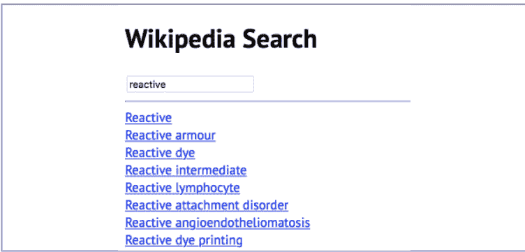

RxJS 已经让检索和处理远程数据变得简单，但正如你在第 4 章“构建完整的 Web 应用程序”（第 69 页）中所看到的，我们仍然需要费一些周折才能使 DOM 操作高效化。

Cycle.js 的目标之一就是从代码中完全消除 DOM 操作。让我们从一些基础的脚手架开始：

```javascript
// cycle/step1.js
var Cycle = require('@cycle/core');
var CycleDOM = require('@cycle/dom')
var Rx = Cycle.Rx;

function main(responses) {
  return {
    DOM: Rx.Observable.just(CycleDOM.h('span', 'Hi there!'))
  };
}

var drivers = {
  DOM: CycleDOM.makeDOMDriver('#container')
};

Cycle.run(main, drivers);
```

这段代码在屏幕上显示文本 *Hi there!*，但其中已经包含了很多内容。关键部分是 `main` 函数和 `drivers` 对象。让我们详细分析步骤：

- 1. 我们引入 Cycle Core 和 Cycle DOM 驱动程序。我将在下一节解释什么是 Cycle.js 驱动程序。
- 2. `main` 函数始终是我们应用程序的入口点。它返回一个 Observable 集合，为应用程序中的每个驱动程序提供一个。到目前为止，我们只使用了一个驱动程序：`DOM` 驱动程序。
- 3. DOM 驱动程序的 Observable 发出一个虚拟树，我们使用 Cycle DOM 库中的 `h` 方法创建它。在这种情况下，我们仅创建了一个带有文本 'Hi there!' 的 `span` 元素。DOM 驱动程序消费这个虚拟树，并根据它在页面上渲染实际的 DOM。
- 4. 我们创建了一个 DOM 驱动程序，它将根据 `main` 函数发出的项目构建 DOM 树。DOM 树将构建在我们作为参数传递的元素或选择器中。在本例中为 `#container`。
- 5. `Cycle.run` 将 `main` 函数与 `drivers` 对象连接起来，在两者之间创建循环流。

> 2. http://browserify.org/


### Cycle.js 驱动程序 (Drivers)

Cycle.js 驱动程序是我们用来产生副作用的函数。在程序的其他任何地方，我们都不应该以任何方式修改状态。驱动程序接收一个从应用程序发出数据的 Observable，并返回另一个产生副作用的 Observable。

我们不会经常创建驱动程序——只有在需要副作用时才会创建，例如修改 DOM、从其他接口（例如 Local Storage）读取和写入，或发起请求。在大多数应用程序中，我们只需要 DOM 驱动程序（用于渲染网页）和 HTTP 驱动程序（用于发起 HTTP 请求）。在本例中，我们将使用另一个驱动程序：JSONP 驱动程序。

### 用户界面

我们需要页面的实际内容，而不仅仅是一个 `span`。让我们创建一个函数来构建代表页面的虚拟树：

```javascript
// cycle/index.js
function vtreeElements(results) {
    var h = CycleDOM.h;
    return h('div', [
        h('h1', 'Wikipedia Search '),
        h('input', {className: 'search-field', attributes: {type: 'text'}}),
        h('hr'),
        h('div', results.map(function(result) {
            return h('div', {
                h('a', { href: WIKI_URL + result.title }, result.title)
            });
        }))
    ]);
}
```

这个函数看起来可能有点奇怪，但请不要惊慌。它使用的是 *Virtual Hyperscript*，一种用于创建虚拟 DOM 树的领域特定语言。Virtual Hyperscript 包含一个名为 `h` 的单一方法。`h` 声明节点的方式与 HTML 类似，但使用的是 JavaScript。我们可以通过向 `h` 传递额外的对象或数组作为参数，来为元素添加属性或附加子节点。最终，生成的虚拟树将被渲染成真实的浏览器 DOM。

vtreeElements 接收一个对象数组 `results`，并返回一个代表我们应用简单 UI 的虚拟树。它渲染一个输入字段以及由 `results` 中的对象生成的链接列表，该列表最终将包含维基百科的搜索结果。我们将使用 vtreeElements 来渲染我们的应用程序。

### 使用 JSX

我们可以使用 JSX 来编写 UI，而不是使用 `h` 函数。JSX 是由 Facebook 发明的一种类 XML 语法扩展，它使编写虚拟 DOM 结构变得更简单且更具可读性。我们的 `vtreeElements` 函数将变成这样：

```javascript
// cycle/index.js
function vtreeElementsJSX(results) {
    results = results.map(function(result) {
        var link = WIKI_URL + result.title;
        return <div><a href={(link)}>{result.title}</a></div>
    });

    return <div>
        <h1>Wikipedia Search</h1>
        <input className="search-field" type="text" />
        <hr/>
        <div>{results}</div>
    </div>
}
```

是不是看起来更美观了？JSX 对开发人员来说更熟悉，因为它类似于 HTML，但我们可以将其与 JavaScript 代码一起编写，并且具有可以将它视为 JavaScript 类型的额外优势。例如，请注意我们如何迭代 `results` 数组并直接返回一个 `<div>` 元素，在元素本身中使用 `link` 和 `result.title` 的值。（JavaScript 的值可以通过将其放在花括号内来内联。）

由于 JSX 是一种语法扩展，我们需要一个编译器将其转换为最终的 JavaScript 代码（其形式与前一节中基于 `h` 的代码非常相似）。我们将为此使用 *Babel*。Babel 是一个将现代 JavaScript 转换为可在任何地方运行的 JavaScript 的编译器 (https://babeljs.io)。它还转换一些 JavaScript 扩展，例如 JSX，这是其一个特定的用例。

如果你想使用 JSX，需要安装 Babel 并在编译项目时使用它。幸运的是，Babel 为 Browserify 提供了一个名为 *Babelify* 的适配器：

```bash
npm install babelify
```

在每个使用 JSX 的文件中，我们需要在文件顶部添加以下行：

```javascript
/** @jsx hJSX */
var hJSX = CycleDOM.hJSX;
```

这告诉 Babel 使用 Cycle.js 的 hJSX 适配器来处理 JSX，而不是使用默认的 React 适配器。

现在当我们想要编译项目时，可以使用以下命令：

```bash
browserify index.js -t babelify --outfile bundle.js
```

### 获取用户的搜索词

我们需要一个函数，该函数返回一个 Observable，用于使用用户输入的搜索词查询维基百科的 API：

```javascript
// cycle/index.js
var MAIN_URL = 'https://en.wikipedia.org';
var WIKI_URL = MAIN_URL + '/wiki/';
var API_URL = MAIN_URL + '/w/api.php?' +
'action=query&list=search&format=json&srsearch=';

function searchRequest(responses) {
  return responses.DOM.select('search-field').events('input')
    .debounce(300)
    .map(function(e) { return e.target.value })
    .filter(function(value) { return value.length > 2 })
    .map(function(search) { return API_URL + search });
}
```

首先，我们声明应用程序将用于查询维基百科的一些 URL。在 `searchRequest` 函数中，我们接收一个包含应用程序中所有驱动程序的 `responses` 对象，并使用 DOM 驱动程序中的 `get` 方法。`select(element), event(type)` 的行为与 `fromEvent` 类似：它接收一个 DOM 元素的选择器和要监听的事件类型，并返回一个发出事件的 Observable。

从那一刻起，其余的代码对你来说应该非常熟悉，因为它是通过我们常用的运算符来转换 Observable 的值：

- 1. 节流（Throttle）结果，确保最多每 300 毫秒接收一个。
- 2. 提取输入框的值。
- 3. 仅保留长度超过两个字符的文本。
- 4. 将最终值附加到维基百科的 API URL 之后。

太棒了！到目前为止，我们已经有了生成 UI 的函数和从该 UI 检索用户输入的函数。现在我们需要添加从维基百科获取信息的功能。

### 修订 our main 函数

你可能已经注意到 106 页代码中的 `main` 函数接收一个参数 `responses`，但我们还没有使用它。这些是来自 `run` 函数中驱动程序的响应。驱动程序和 `main` 函数构成了一个循环（这也是该框架名称的由来）：`main` 的输出是驱动程序的输入，而驱动程序的输出则是 `main` 的输入。请记住，输入和输出始终是 Observable。

我们使用 JSONP 来查询维基百科，就像我们在第 2 章中做的那样。我们使用 JSONP 而不是 HTTP 是为了让这个示例在本地计算机上更容易运行，因为使用 HTTP 从不同域名检索数据会导致某些浏览器出于安全原因拦截这些请求。在几乎任何其他情况下，尤其是在生产代码中，请使用 HTTP 来检索远程数据。

无论如何，使用 JSONP 不影响本章的重点。Cycle 为 JSONP 提供了一个实验性模块，我们可以使用 npm 安装它：

```bash
npm install @cycle/jsonp
```

然后在应用程序中这样使用它：

```javascript
// cycle/step2.js
var Cycle = require('@cycle/core');
var CycleDOM = require('@cycle/dom');
var CycleJSONP = require('@cycle/jsonp');
var Rx = Cycle.Rx;
var h = CycleDOM.h;

function searchRequest(responses) {
  return responses.DOM.select('.search-field').events('input')
    .debounce(300)
    .map(function(e) { return e.target.value })
    .filter(function(value) { return value.length > 2 })
    .map(function(search) { return API_URL + search });
}

function vtreeElements(results) {
  return h('div', [
    h('h1', 'Wikipedia Search '),
    h('input', {className: 'search-field', attributes: {type: 'text'}}),
    h('hr'),
    h('div', results.map(function(result) {
      return h('div', {
        h('a', { href: WIKI_URL + result.title }, result.title)
      });
    }))
  ]);
}

function main(responses) {
    return {
        DOM: Rx.Observable.just(CycleDOM.h('span', 'Hey there!')),
        JSONP: searchRequest(responses)
    };
}

var drivers = {
    DOM: CycleDOM.makeDOMDriver('#container'),
    JSONP: CycleJSONP.makeJSONPDriver()
};

Cycle.run(main, drivers);
```

我们希望将 `searchRequest` 的结果接入 JSONP 驱动程序，这样一旦用户输入搜索词，我们就可以用该词查询维基百科。

为此，我们使用 `CycleJSONP.makeJSONPDriver` 创建一个新的 JSONP 驱动程序，它将接收我们在 `main` 返回对象的 `JSONP` 属性中放置的任何内容。完成之后，当我们在输入框中输入搜索词时，应该已经在查询了，但由于我们没有将 JSONP 的输出连接到任何地方，所以我们在页面上看不到任何变化。让我们改变这一点：

```javascript
// cycle/step3.js
function main(responses) {
    var vtree$ = responses.JSONP
        .filter(function(res) {
            return res.request.indexOf(API_URL) === 0;
        })
        .mergeAll()
        .pluck('query', 'search')
        .startWith([])
        .map(vtreeElements);

    return {
        DOM: vtree$,
        JSONP: searchRequest(responses)
    };
}
```

`main` 通过其 `responses` 参数接收所有驱动程序的输出。我们可以在 `responses.JSONP` 中获取 JSON 调用的结果，这是一个包含应用程序中所有 JSONP 响应的 Observable。一旦有了它，我们就可以转换该 Observable 以获得我们想要的格式的搜索结果：

- 1. `responses.JSONP` 发出应用程序中所有的 JSONP 响应。我们首先通过过滤出请求中包含 Wikipedia API URL 的响应，以确保处理的是相关响应。

- 2. `responses.JSONP` 是一个 Observable 的 Observable（Observable of Observables）。对于每个响应都有一个 Observable。在这一行中，我们将它们全部扁平化，这样从现在起我们处理的是响应本身，而不是它们的 Observable。

响应是 JSON 对象，而我们感兴趣的信息在 `query.search` 属性中。我们使用 `pluck` 操作符来提取它。

- 3. 我们不知道是否会有结果，因此我们至少确保会得到一个空数组。

- 4. 最后，我们将 `treeElements` 函数应用于来自 Wikipedia 的每个结果。这将更新我们的 UI。

- 5. 注意变量名末尾的 `$` 符号。在本章中，我采用了 Cycle.js 代码中使用的一种命名约定，即在变量名后面添加 `$`，以表示它是一个 Observable。我发现这使得理解基于 Observable 的代码变得简单得多！

前面代码中最重要的启示是，在最后一步中，我们似乎在为接收到的每一个结果重新绘制整个 UI。但这就是虚拟 DOM 发挥威力的地方。无论我们重新渲染页面多少次，虚拟 DOM 始终确保只有差异部分被渲染，使其非常高效。如果虚拟 DOM 如果没有变化，页面上就不会渲染任何更改。

这样我们就无需担心添加或删除元素。我们每次只需渲染整个应用程序，然后让虚拟 DOM 在底层计算出实际上需要更新的内容。

### Model-View-Intent

我们用于构建 Wikipedia 实时搜索的架构方法不仅仅是另一个框架随机的 UI 编程方式。在像我们这样构建代码的结构背后有一个设计模式：*Model-View-Intent* (MVI)。

*Model-View-Intent* 是由 Cycle.js 的创建者 André Staltz 创造的一个术语，用于一种受 Model-View-Controller (MVC) 架构启发的架构。⁴ 在 MVC 中，我们将应用程序的功能分为三个组件：模型（model）、视图（view）和控制器（controller）。在 MVI 中，这三个组件是模型、视图和意图（intent）。MVI 的设计旨在完美适配响应式编程模型。

> 4. [https://en.wikipedia.org/wiki/Model-view-controller](https://en.wikipedia.org/wiki/Model-view-controller)

MVI 是响应式的，这意味着每个组件都观察其依赖项并对依赖项的变化做出反应。这与 MVC 不同，在 MVC 中，组件知道其依赖于它的组件并直接修改它们。一个组件 (C) *声明* 哪些其他组件影响它，而不是由其他组件显式地更新 (C)。

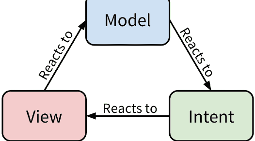

MVI 中的三个组件由 Observable 表示，每个组件的输出是另一个组件的输入。

*模型 (model)* 代表当前的应用程序状态。它接收来自*意图 (intent)* 的处理后的用户输入，并输出关于数据更改的事件，由*视图 (view)* 消费。

视图是模型的视觉表示。它接收一个包含模型状态的 Observable，并输出所有潜在的 DOM 事件和页面的虚拟树。

意图是 MVI 中的新组件。意图接收来自用户的输入，并将其转化为模型中的操作。

如果我们对代码进行稍微的重新排列和重命名，可以让应用程序中的这三种组件更加清晰：

```javascript
// cycle/index-mvi.js
function intent(JSONP) {
    return JSONP.filter(function(res$) {
        return res$.request.indexOf(API_URL) === 0;
    })
    .concatAll()
    .pluck('query', 'search');
}
```

```javascript
function model(actions) {
    return actions.startWith([]);
}

function view(state) {
    return state.map(function(linkArray) {
        return h('div', [
            h('h1', 'Wikipedia Search'),
            h('input', {className: 'search-field', attributes: {type: 'text'}}),
            h('hr'),
            h('div', linkArray.map(function(link) {
                return h('div', [
                    h('a', { href: WIKI_URL + link.title }, link.title)
                ]);
            }))
        ]);
    });
}

function userIntent(DOM) {
    return DOM.select('.search-field').events('input')
        .debounce(300)
        .map(function(e) { return e.target.value })
        .filter(function(value) { return value.length > 2 })
        .map(function(search) { return API_URL + search });
}

function main(responses) {
    return {
        DOM: view(model(intent(responses.JSONP))),
        JSONP: userIntent(responses.DOM)
    };
}

Cycle.run(main, {
    DOM: CycleDOM.makeDOMDriver('#container'),
    JSONP: CycleJSONP.makeJSONPDriver()
});
```

通过将模型、视图和意图拆分为独立的函数，我们使代码变得更加清晰。（另一个意图 `userIntent` 是 JSONP 驱动程序的输入。）大部分应用程序逻辑在 `main` 函数中传递给 DOM 驱动程序的属性中，被表达为这三个函数的组合：

```javascript
function main(responses) {
    return {
        DOM: view(model(intent(responses.JSONP))),
        JSONP: userIntent(responses.DOM)
    };
}
```

没有什么比这更具函数式编程风格的了！

### 创建可复用组件 (Widgets)

随着我们构建更复杂的应用程序，我们会希望复用其中的一些 UI 组件。为了示例方便，我们的 Wikipedia 搜索应用程序很小，但它已经有几个可以在其他应用程序中复用的组件。以搜索输入框为例，我们绝对可以将其制作成一个独立的组件 (widget)。

目标是将我们的组件封装在它自己的组件中，以便像使用任何其他 DOM 元素一样使用它。我们还应该能够通过任何我们想要的属性对该组件进行参数化。然后我们将在应用程序中这样使用它：

```javascript
var wpSearchBox = searchBox({
  props$: Rx.Observable.just({
    apiUrl: API_URL
  })
});
```

我们将使用 Cycle.js 引入的另一个概念来构建组件，称为*嵌套对话 (nested dialogues)*。嵌套对话（或简称 *dialogue*）是一个函数（像 Cycle.js 中的所有东西一样），它接收一个事件 Observable 作为输入，并输出一个 Observable——其结果是将这些输入应用于其内部逻辑。

让我们开始构建搜索框组件。我们首先创建一个接收 `responses` 参数的函数，我们将通过它传递来自主应用程序的任何属性：

```javascript
// cycle/searchbox.js
var Cycle = require('@cycle/core');
var CycleDOM = require('@cycle/dom');
var Rx = Cycle.Rx;
var h = CycleDOM.h;
var a;

function searchBox(responses) {
  var props$ = responses.props$;
  var apiUrl$ = props$.map(function (props) {
    return props['apiUrl'];
  }).first();
```

`searchBox` 接收的每个参数都是一个 Observable。在这种情况下，`props$` 是一个 Observable，它发出一个包含 Wikipedia 搜索框配置参数的单个 JavaScript 对象。

在检索属性之后，我们为组件定义虚拟树。在我们的案例中，它非常简单，只包含一个输入字段：

```javascript
// cycle/searchbox.js
var vtree$ = Rx.Observable.just({
  h('div', { className: 'search-field' }, [
    h('input', { type: 'text' })
  ])
});
```

我们希望一切都是 Observable，所以我们将虚拟树包装在 `just` Observable 中，它只返回一个发出我们传递给它的值的 Observable。

现在我们需要搜索框在用户在输入字段中输入搜索词时查询 Wikipedia API。我们复用前一节中 `userIntent` 函数的代码：

```javascript
// cycle/searchbox.js
var searchQuery$ = apiUrl$.flatMap(function (apiUrl) {
  return responses.DOM.select('.search-field').events('input')
    .debounce(300)
    .map(function (e) { return e.target.value; })
    .filter(function (value) { return value.length > 3; })
    .map(function (searchTerm) { return apiUrl + searchTerm; });
});
```

我们仍然需要将 `searchQuery` 的输出连接到 JSON 驱动程序的输入。就像我们在普通 Cycle 应用程序中做的那样：

```javascript
// cycle/searchbox.js
return {
  DOMTree: vtree$,
  JSONPQuery: searchQuery$
};
```

最后，我们不应该忘记导出 `searchBox` 组件：

```javascript
// cycle/searchbox.js
module.exports = searchBox; // 将其作为模块导出
```

现在我们准备好在应用程序中使用 `searchBox` 组件了。`main` 方法现在将如下所示：

```javascript
// cycle/index-mviz.js
var h = CycleDOM.h;
var SearchBox = require('./searchbox');

function main(responses) {
  var wpSearchBox = SearchBox({
    DOM: responses.DOM,
    props$: Rx.Observable.just({
```


```javascript
apiUrl: API_URL
  })
});
```

```javascript
var searchDOM$ = wpSearchBox.DOMTree;
var searchResults$ = responses.JSONP
  .filter(function(res) {
    return res.request.indexOf(API_URL) === 0;
  })
  .concatAll()
  .pluck('query', 'search')
  .startWith([]);

return {
  JSONP: wpSearchBox.JSONPQuery,
  DOM: Rx.Observable.combineLatest(
    searchDOM$, searchResults$, function(tree, links) {
      return h('div', [
        h('h1', 'Wikipedia Search '),
        tree,
        h('hr'),
        h('div', links.map(function(link) {
          return h('div', [
            h('a', { href: WIKI_URL + link.title }, link.title)
          ]);
        }))
      ]);
    })
};
```

```javascript
Cycle.run(main, {
  DOM: CycleDOM.makeDOMDriver('#container'),
  JSONP: CycleJSONP.makeJSONPDriver()
});
```

现在我们将处理用户输入和渲染搜索框的职责委托给 `wpSearchBox` 组件，这样我们就可以在另一个需要查询 URL API 搜索框的应用中轻松地复用它。主要变化如下：

- 1. 导入我们刚刚创建的 `searchBox` 组件。
- 2. 创建 `SearchBox` 的实例，传递 DOM 驱动程序以及我们希望为搜索组件设置的属性。
- 3. 我们的 `wpSearchBox` 最终会从其 `DOMTree` Observable 中发射项。我们在此时将其赋值，以便稍后在渲染实际 DOM 时使用。

我们将维基百科的查询 URL 发送到 JSONP 驱动程序，以便其检索结果。当结果可用时，它将在 `response.JSONP` 中发射，我们在 `searchResults` 中对其进行精炼。

为了渲染最终的 DOM 树，我们使用 `combineLatest` 将 `searchDOM` 和 `searchResults` 结合起来。其中任何一个的变化都会导致布局改变，因此每当这两个 Observable 中的任何一个发射项时，我们都会重新渲染 DOM 树。

拿到最终代码后，我们可以看到 Cycle.js 最大的优势所在。框架中没有不同的类、特殊类型，也没有所谓的“魔法”。它全部是由接收 Observable 并输出更多 Observable 的无副作用函数组成的。仅凭这一点，我们就拥有了一个简洁、清晰、响应式且使用起来很有趣的 Web 应用程序框架。而且它不惜一切代价地避免副作用，使我们的 Web 应用程序更加健壮。

### 改进想法

除了迫切需要更好的图形设计外，我们的应用程序还可以增加一些功能，使其不仅仅是一个快速重定向到维基百科结果的工具：

- 允许用户书签化特定结果。你可以在列表中的每个结果旁边添加一个小星星，这样当用户点击时，就可以将该结果保存为收藏。你可以将这个星星做成一个独立的组件。如果你能（响应式地）使用某些持久化 API（如 Local Storage 或 IndexedDB），将获得额外加分。
- 如果用户点击链接，在屏幕右侧显示结果的“预览”，包含摘要和一些元信息。如果用户想进入实际的维基百科结果页面，你可以提供一个 *Read More*（阅读更多）链接。将其实现为一个组件。

### 总结

现在你已经知道如何在不放弃响应式理念的情况下，使用现代技术开发 Web 应用程序。本章提供了一个关于如何将 Observables 和 RxJS 作为其他框架或应用程序内部引擎的思路。通过站在 Observables 和响应式生活方式的肩膀上，我们可以极大地简化 Web 应用程序，并将状态减少到最小表达，使我们的 Web 应用程序更不易脆弱且更易于维护。

感谢阅读本书。我希望它能帮助你重新思考开发 JavaScript 应用程序的方式，并挑战你一些现有的编程观念。为了更快、更健壮、更响应式的软件，干杯！

### 索引

### A
- aggregate operators (聚合操作符), 21–22
- Ajax requests (Ajax 请求), 11–12
- animation (动画), 95–97
- arrays (数组)
    - chaining operators (操作符链式调用), 42–43
    - transforming to Observables (转换为 Observables), 13
- AsyncSubject, 46–48

### B
- Babel compiler (Babel 编译器), 108
- Babelify, 108
- BehaviorSubject, 48
- Browserify, 104
- buffering input values (缓冲输入值)
    - buffer operator (buffer 操作符), 59
    - bufferWithTime operator (bufferWithTime 操作符), 76–77, 99

### C
- callbacks (回调)
    - drawbacks (缺点), xii
    - transforming to Observables (转换为 Observables), 14
- catch operator (catch 操作符), 27–28
- chaining operators (操作符链式调用), 42–45
- combineLatest operator (combineLatest 操作符), 56, 60, 62, 118
- concurrency (并发), 39–42
    - and schedulers (以及调度器), 89
- connect method (connect 方法), 75
- ConnectableObservable, 75
- create (Observable) operator (create Observable 操作符), 11
- create (Observer) operator (create Observer 操作符), 11
- createColdObservable method (createColdObservable 方法), 98
- createHotObservable method (createHotObservable 方法), 100
- currentThread scheduler (currentThread 调度器), 90, 93–94
- Cycle.js
    - name suffix (名称后缀), 112
    - drivers (驱动程序), 107
    - DOM driver (DOM 驱动程序), 106
    - h method (h 方法), 106
    - hsAdapter operator (hsAdapter 操作符), 109
    - installing (安装), 104–105
    - JSONP driver (JSONP 驱动程序), 111
    - nested observables (嵌套 observables), 115
    - reusable widgets (可复用组件), 115–118

### D
- debounce method (debounce 方法), 2
- default scheduler (默认调度器), 90, 93
- design patterns (设计模式), 6–10
- dispose method (dispose 方法), 24
- distinct operator (distinct 操作符), 35, 57, 62
- distinctUntilChanged operator (distinctUntilChanged 操作符), 62
- document fragments (文档片段), 77
- DOM (文档对象模型), 12, 118, 另见 RxJS-DOM library
    - appending document fragments (追加文档片段), 77
    - performance (性能), 80–81, 104
- DOM driver (Cycle.js) (DOM 驱动程序), 106

### E
- earthquake application (地震应用程序)
    - reactive user interface (响应式用户界面), 69–87
    - real-time visualizer (实时可视化工具), 29–36
- ECMAScript 7, xiv
- error handling (错误处理), in Observables (在 Observables 中), 26–28
- event emitters (事件发射器), xiii
- event listeners (事件监听器), 4–5
- external state (外部状态)
    - and global variables (以及全局变量), 5
    - and Observable pipelines (以及 Observable 流水线), 40–42

### F
- Facebook React framework (Facebook React 框架), 103
- filter operator (filter 操作符), 20
- first operator (first 操作符), 21
- flatMap operator (flatMap 操作符), 22–23, 33–35, 53
- flatMapLatest operator (flatMapLatest 操作符), 25
- fold operator (fold 操作符), 20
- from operator (from 操作符), 13, 36
- fromCallback operator (fromCallback 操作符), 14
- fromEvent operator (fromEvent 操作符), 13
- fromWebSocket operator (fromWebSocket 操作符), 83

### I
- immediate scheduler (immediate 调度器), 92
- interval operator (interval 操作符), 18–35, 37, 57, 62, 74, 95
- Iterator design pattern (迭代器设计模式), 8–9

### J
- JavaScript Observables, transforming to Observables (转换为 Observables), 14–15
- jQuery library (jQuery 库), 33
- JSON parse method (JSON 解析方法), 26
- JSONP, 33, 110
- JSONP driver (Cycle.js) (JSONP 驱动程序), 111
- JSX, 108–109

### L
- lazy evaluation (惰性求值), 45
- Leaflet library (Leaflet 库), 30–31, 78

### M
- map operator (map 操作符), 19, 53, 72
- marble diagrams (大理石图), 17–19
- Meijer, Eric, 3
- merge operator (merge 操作符), 18–19
- Model-View-Controller (MVC) design pattern (MVC 设计模式), 112
- Model-View-Intent (MVI) design pattern (MVI 设计模式), 112–115
- mouse events (鼠标事件)
    - clicks (点击), 81
    - mouseover (鼠标悬停), 79, 81
    - as Observable data type (作为 Observable 数据类型), 6
    - and performance (以及性能), 80–81
    - as sequence (作为序列), 3
    - throttling (节流), 2, 58–59
    - using event listeners (使用事件监听器), 4–5

### N
- nested delegates (嵌套委托), 115
- Node.js
    - configuring (配置), 82
    - running RxJS examples (运行 RxJS 示例), xvii
    - transforming callbacks to Observables (将回调转换为 Observables), 15
    - twit module (twit 模块), 82, 84–87
    - ws module (ws 模块), 82
- npm (Node 包管理器), 82, 104

### O
- Observable pipelines (Observable 流水线), 见 pipelines
- error handling (错误处理), 26–28
- explicit cancellation (显式取消), 24–25
- hot (热), 73, 75, 100
- implicit cancellation (隐式取消), present needed (在需要时呈现), 22–23
- sharing (共享), 76
- subscribing to (订阅), 12, 76, 91–92
- throttling value streams (值流节流), 28–29, 55
- transforming data into (将数据转换为), 13
- observeOn operator (observeOn 操作符), 91–92
- Observer design pattern (观察者设计模式), 6–8
    - vs. Observables (对比 Observables), 9
- Observers, creating (创建观察者), 11
- onError method (onError 方法), 10, 26–27
- onNext method (onNext 方法), 10, 22
- operators (操作符), 18–23
    - aggregate (聚合), 21–22
    - chaining (链式调用), 42–45
    - recursive (递归), 94

### P
- pairwise operator (pairwise 操作符), 81
- pipelines (流水线)
    - defined (定义), 39
    - efficiency (效率), 42–45
    - and external state (以及外部状态), 40–42
- pluck operator (pluck 操作符), 72, 80, 112
- promises (Promise)
    - defined (定义), xiii
    - simulating with AsyncSubject (用 AsyncSubject 模拟), 48
- publish method (publish 方法), 75
- pure functions (纯函数), 40
- push-based behavior (基于推送的行为), 9

### Q
- QUnit, 100

### R
- range operator (range 操作符), 18, 25, 37, 52, 73, 92–93
- Reactive framework (响应式框架), 103
- reactive programming and asynchronous operations (响应式编程与异步操作), xi
    - defined (定义), xiv
    - MVI design pattern (MVI 设计模式), 112–115
- Reactive Extensions (Rx), xiv, 9–10
    - defined (定义), xiv
    - design pattern (设计模式), 9–10
    - rx.all.js, xvi
    - rx.dom.js, xvi
- RxJS
    - defined (定义), xiv
    - GitHub repositories (GitHub 仓库), xvi–xvii
    - lazy evaluation (惰性求值), 45
    - Observable data type (Observable 数据类型), 6, 13
    - operators (操作符), 18–23
    - operators, chaining (操作符链式调用), 42–45
    - operators, recursive (递归操作符), 94
    - Subject class (Subject 类), 45–46
    - version (版本), xvi
- RxJS–DOM library (RxJS-DOM 库), 34–35, 69
    - Rx.DOM.fromWebsocket(), 83–84
    - Rx.DOM.jsonRequest(), 34
    - Rx.DOM.ready(), 70
    - Rx.DOM.requestGet(), 12, 47
- RxMarbles, xvii

### S
- same origin policy (同源策略), 33
- sample method (sample 方法), 58–60
- scan operator (scan 操作符), 22, 57, 61, 67, 86
- Schedulers (调度器), 89–91
    - currentThread, 90, 93–94
    - default, 90, 93
    - immediate, 92
    - requestAnimationFrame frame (requestAnimationFrame 帧), 95–97
    - TestScheduler, 97–101
- searchDOM operator (searchDOM 操作符), 118
- searchResults operator (searchResults 操作符), 118
- sequences (序列)
    - canceling (取消), 24–25
    - error handling (错误处理), 26–28
    - infinite (无限), 22
    - operators (操作符), 18–23


- 运算符，链式调用，42–45
- 运算符，递归，94
- 重试，28–29
- 视觉图表，17–19
- share 运算符，76
- 副作用，5
- 太空船游戏，50–67
    - 改进动画，95–97
- Staltz, André, 112
- startScheduler 方法，100
- startWith 方法，55
- 状态
    - 与全局变量，5
    - 与 Observable 流水线，40–42
- Subject 类，45–46
- 订阅
    - 避免重复订阅，76

### T
- take 运算符，25, 44
- takeWhile 运算符，66
- 测试，97–101
    - QUnit, 100
    - TestScheduler, 97–101
- timestamp 运算符，60
- toArray 运算符，52
- Twit 客户端，84–87
- Twitter API, 82, 84–87

### U
- 美国地质调查局（U.S. Geological Survey）地震数据库，29, 71
- 单向数据流，103, 113
- 可丢弃对象，24
- subscribe 运算符，12
- subscribeOn 运算符，91–92

### V
- 电子游戏，50–67
    - 改进动画，95–97
- 虚拟 DOM，104, 112
    - 与 JSX，108
- Virtual Hyperscript, 107
- VirtualTimeScheduler, 97

### W
- Wikipedia 搜索应用，105–115
    - 搜索框组件，115–118
- withLatestFrom 运算符，25

### 现代 Web 开发
快速掌握最新的 HTML、CSS 和 JavaScript 技术。

### HTML5 与 CSS3 (第2版)
HTML5 和 CSS3 不仅仅是流行词——它们是当今 Web 应用程序的基石。本书将帮助您快速掌握目前项目中即可使用的 HTML5 元素和 CSS3 特性，并提供向后兼容的解决方案，确保不会遗漏旧版浏览器的用户。新版涵盖了更多新特性，包括 CSS 动画、IndexedDB 和客户端验证。

Brian P. Hogan
(314 页) ISBN: 9781937785589. $38
https://pragprog.com/book/bhh52e

### 异步 JavaScript
随着 HTML5、前端 MVC 和 Node.js 的出现，JavaScript 无处不在——但依然混乱。本书将为您提供坚实的基础，让您在管理异步任务时，不必在错综复杂的回调地狱中失去理智。这是一本关于处理异步行为最核心技术的快速指南，包括 PubSub、事件模型和 Promises。掌握这些技巧后，您将能更好地应对大型 Web 应用的复杂度并交付响应迅速的代码。

Trevor Burnham
(104 页) ISBN: 9781937785277. $17
https://pragprog.com/book/tbajs

### 命令行万岁！
使用 tmux 和 Vim 实现令人惊叹的无鼠标高效生产力。

### tmux
鼠标正在拖慢您的速度。在编辑器和控制台之间切换上下文所花费的时间侵蚀了您的生产力。通过 tmux 掌控您的环境，这是一个您可以根据工作流量身定制的终端复用器。学习如何定制、编写脚本并利用 tmux 的独特能力，让您的手指始终停留在键盘的基准行上。

Drew P. Hogan
(88 页) ISBN: 9781934356968. $16.25
https://pragprog.com/book/bhtmux

### Practical Vim, 第二版
Vim 是一款快速且高效的文本编辑器，它能让您成为一名更高效的开发人员。它几乎适用于所有操作系统，如果您掌握了本书中的技巧，您将不再需要其他文本编辑器。通过 120 多个 Vim 技巧，您将快速学会编辑器的核心功能，并解决最棘手的编辑和写作任务。这部备受喜爱的畅销书已针对 Vim 7.4 进行了修订和更新，包含三个全新技巧和五个全面修订的技巧。

Drew Neil
(354 页) ISBN: 9781680501278. $29
https://pragprog.com/book/dnvim2

### Pragmatic Bookshelf
The Pragmatic Bookshelf 致力于提供由开发者为开发者编写的书籍。这些作品延续了著名的《程序员修炼之道》（Pragmatic Programmer）风格，并持续赢得奖项和好评。随着开发难度日益增加，Pragmatic Programmers 将推出更多书籍和产品，帮助您保持顶尖水平。

### 在线访问

**本书主页**
https://pragprog.com/book/smreactjs
包含本书的源代码、勘误表和其他资源。也欢迎向我们提供反馈！

**注册更新**
https://pragprog.com/updates
在更新发布和新书面世时收到通知。

**加入社区**
https://pragprog.com/community
阅读我们的博客，参与在线讨论，加入邮件列表，与我们的 wiki 互动，并从其他 Pragmatic Programmers 的经验中获益。

**最新动态**
https://pragprog.com/news
查看最新的实用开发进展、新书及其他产品。

### 购买图书
如果您喜欢这本电子书，或许您想拥有一本纸质版。您可以在我们的商店购买：https://pragprog.com/book/smreactjs

### 联系我们

| 联系方式 | 详情 |
|---|---|
| 在线订单: | https://pragprog.com/catalog |
| 客户服务: | support@pragprog.com |
| 国际版权: | translations@pragprog.com |
| 学术使用: | academic@pragprog.com |
| 为我们撰稿: | http://write-for-us.pragprog.com |
| 或致电: | +1 800-699-7764 |
