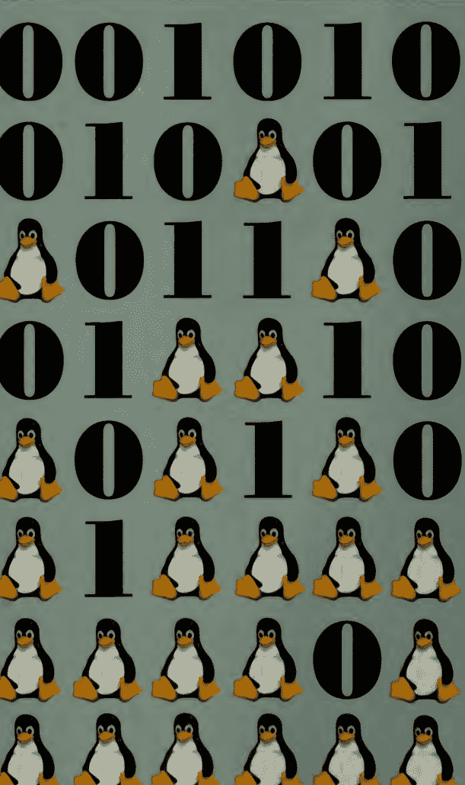
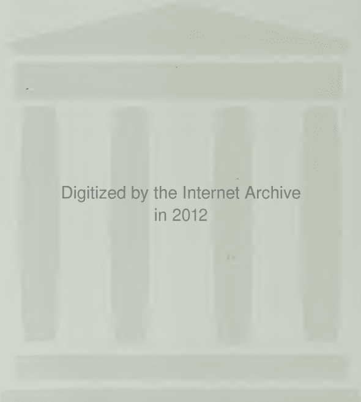
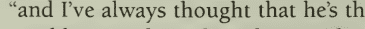

# 反叛代码：Linux 与开源革命的内幕故事

# 更多赞誉

“《反叛代码》是对Linux运动运动令人惊叹和兴奋的深度观察。格林恩·穆迪探索了这场运动的精神，并记录了它的历史，也没有忘记一些更疯狂的方面以及参与其中的程序员们的自大自大。这是一个经过彻底调查且引人入胜的故事。”

> 马蒂亚斯·埃特拉赫。
> Trolltech 高级软件工程师，HDE 项目创始人

“这本书像一幅趣味的织锦，将开源软件运动中的人物、技术和公司交织在了一起。”

> 约翰·奥斯特豪特。
> Tcl 脚本语言的创造者

“如果你读过‘开源’和‘自由软件’，并对它们是什么以及从何而来感到困惑，那么格林恩·穆迪的《反叛代码》就是为你准备的。如果你知道 rms、Linus、Eric Raymond 和 Larry Wall、Bob Young 和 Eric Allman 是谁，你也会喜欢这些历史和轶事的。”

> 彼得·H·萨路斯。
> Matrix.Net 首席知识官，《Unix 的四个世纪》作者

# 献我的家人

1 2 3 4 5 6 7 8 9 10

# 致谢

# 序言

除非另有说明，正如《给爱好者的公开信》所示，开源运动正成为比尔·盖茨最糟糕的千倍噩梦。这不仅仅是几个“偷窃”代码的爱好者，而是一个编写自己的——卓越代码并将其免费赠出的活跃社区。因为他们的行为“不会阻止优秀软件的编写”，这从根本上质疑了微软最基本的问题：微软或此类公司？

《万圣节文件》的出现以及其中包含的根本性问题，对这家公司来说再糟糕不过了。1998 年美国司法部提出的反垄断诉讼，或许是第一次对微软不可战胜的光环提出了质疑。诉讼的存在意味着人们开始考虑（即使仅是在理论上）一个不由这家雷德蒙巨头主导的世界。

得益于微软在交付其关键企业产品方面的持续延迟，这种可能性看起来更加现实。该产品以前被称为 Windows NT 5，但当

# 序言

“万圣节文档”泄露了；它们当时刚被重命名为 Windows 2000。如果 Windows NT 5 早在 1998 年发布，公司无疑会忙于采用它，而无暇考虑替代方案；结合反垄断诉讼，产生的权力真空使得考虑其他选择成为可能。

此外，当微软发现自己自己在反垄断诉讼期间深陷公关灾难泥潭，并在交付 Windows 2000 方面面临严重的技术问题时，它失去了多达约六位高层高管——这些人正是微软解决这些问题最需要的人。当比尔·盖茨斯似乎被司法部的诉讼搞得精疲力竭时，他在审判中那段惨的视频录像证词（他表现得似乎无法回忆自己的电子邮件，甚至是自己的商业决策）彻底摧毁了他作为高科技领域“不可侵犯的大祭司”的形象。

在这一微软最脆弱、且其老板至少还受人仰望的时刻，出现在计算领域的不仅是一个备选替代者，更是一个竞争对手。

除了互联网，“万圣节文档”还将开源操作系统内核 Linux（发音为“Lih-nooks”）视为开源哲学最成功的案例之一：正如备录作者之一 Vinod Vallopilli 所指出的，“Linux 已被部署在任务关键的商业环境中，并拥有极佳的公共口碑。”它还构成了一个自由软件项目的核心，该项目直接攻击了微软的核心产品线，特别是 Windows 2000。

Linux 由一名 21 岁的芬兰学生林纳斯·托瓦瓦尔斯（Linus Torvalds）创立，他免费分发 Linux，包括源代码——底层的编程指令，这构成了软件的一种蓝图。在开源社区中，人们通称他为 Linus（发音为“Lee-nose”），开源运动不仅为他赠送了一位领袖，还赠送了一个无价的偶像。尽管复杂性可能让媒体冷冷以对，但这个谦逊且上镜的年轻人证明立即走红。Linux 似乎体现了比尔·盖茨的所有特质，而不仅仅是开源运动参与者那种传统意义上的开放形象。

这些自称为黑客的这些人（不要与入侵计算机系统的恶意破解客/crackers 混淆）——传统上被描绘成格格不入的青少年，因为缺乏社交技巧感到被边缘化而转而黑客。然而，林纳斯·托瓦瓦尔斯就在这里，作为黑客王子之一，他不仅经常洗澡、留短发并穿着整洁干净的衣服，而且有一份体面的工作，已婚并是一个父亲。

对于那些将开源转化为当今计算世界中强大力量的新一代黑客来说，没有比这更好的象征了。他们是早期黑客文化的继承者，那种文化在 20 世纪 60 年代 70 年代非常盛行，当时计算机还是新事物，那个社区相信软件应该是共享的，所有人都会从中受益。这就是比尔·盖茨在《给业爱好者的开放信》中严厉指责的伦理。微软和当时的另外其他几家关键公司（特别是 AT&T）对几乎终结旧黑客精神负有很大责任，并代之以一种将共享软件定义为盗版的观点。

得益于价格低廉但强大的 PC 的出现以及网络的全球布线，新一代黑客在数量、生产力和团结程度上远超祖先。他们被一个共同目标——编写伟大的软件——以及一个共同准则联系在一起：这种软件应该对所有人免费开放。黑客反抗底层源代码应该被扣留的想法。对他们来说，这些特殊的文本是一种新文学，构成了人类共同遗产的一部分：它们应该被出版、阅读、研究甚至被添加，而不是被锁在无法进入的修道院图书馆里，供少数获得授权的信徒虔诚地处理。

结果，开源运动不仅对微软构成了挑战，也对整个软件行业构成了挑战。也许不仅于此。随着互联网越来越接近现代世界的核心，它不可避免地携带了驱动它的自由程序，并播下了导致这些程序产生的价值观。它开放、共享和合作的基本准则正开始扩散到一两个高科技产业的局限之外。现在许多人相信，互联网与开源的这种强大结合在当前的后微软时代，蓬发展的机会绝非微乎渺微。

# 最酷的一年

如果说 1998 年和 1999 年是微软历史上最糟糕的年份，那么相比之下，1991 年一定是比尔·盖茨感觉良好的时期。1990 年 5 月发布的 Windows 3.0 取得了巨大的成功；仅在第一年就发出了 400 万份拷贝，这在当时是一个巨大的数字。1991 年 5 月，微软发布了 Visual Basic，这是一种全新的编程方式，它采用视觉设计方法，而不是基于编辑文本文件的传统方法。

更好的是，Windows 3.1 也临近了。尽管只是点版本升级， 3.1 版本在几乎每一个方面都比 3.0 有了重大进展。微软声称它包含超过 1000 项增强。它酷炫的新用户界面吸引了几乎每一个看到它的人。

Windows 3.1 于 1992 年 6 月上市，巩固了微软在桌面领域的主导地位。它在软件世界创造了一个断层，因为公司从基于 DOS 的程序切换到在 Windows 下运行的程序。微软能够利用这种交叉，通过快速推出 Excel 和 Word 等程序，在电子表格和文字处理器领域夺取了领导地位。

Windows 3.1 并不是 1991 年唯一接近完成的操作系统。微软 Windows New Technology（广为人知的 Windows NT）始于 1988 年，其目标是创建一个企业级操作系统，当 MS-DOS 和 Windows 运行在公司办公室时，它可以被广泛部署在公司的后台部门。

## 反叛代码

正在发生的 Windows 项目由戴夫·库特勒（Dave Cutler）领导，他曾为计算机巨头 Digital（后更 DEC）构建了操作系统 VMS。VMS 是 Unix（另一种操作系统）的竞争对手，但它是官方产品，而 Unix 一直被视为黑客的软件。Windows NT 也毫不掩饰地旨在杀掉 Unix，但出乎意料，Unix——而不是 VMS——一为了领先的企业操作系统。

NT 的前景看起来很好。在 80 年代后期，Unix 高碎片化，每个供应商提供的版本略有不同；这意味着应用程序必须重写多次，且用户被限于某个供应商。由于 Unix 未能充分拥抱新一代图形界面，这一领域的解决方案非常粗糙。相比之下，Windows NT 的设计是将类 VMS 操作系统的力量与 Windows 3.1 的优雅和易用性相结合。

但在微软关注之外也有很多发现。1991 年，在欧洲核子研究中心（CERN）工作的英国物理学家蒂姆·伯纳斯-李（Tim Berners-Lee）公开发布了他过去两年开发的超文本系统。这个系统被称为万维网（World Wide Web），运行在互联网上，当时规模较小且主要供学术界使用。

同样在1991 年，太阳系统公司（Sun Microsystems）的一个团队正在制定一种新的编程语言 Java。它最初是为电视行业开发交互式机顶盒设计的，后来被适配到互联网上。Java 的一个重要特性是可移植性：同一个程序可以在无需修改的情况下在各种硬件上运行，这在当时是一个新鲜事。

尽管这些发展在当时所代表的威胁与其后来的影响相比微不足道，但微软可能在 1991 年追踪了它们。互联网已经足够为人所知，网处于公共领域，而太阳公司也是一个动向一直受到关注的竞争对手。但在那同一年，微软绝不可能产生过一丝怀疑的察觉，一个同样有力的挑战的关键元素正在芬兰首都赫尔辛基的一名大二计算机科学学生的卧室里成型。

作为世界上最靠北的首都之一，赫尔基基是一个季节极端的城市：冬季寒冷黑暗，每天只有几小时的光照；夏季明亮，白昼似乎永不结束。地理上，赫尔辛基靠近俄罗斯的圣得堡，它的部分地区在视觉上与-

# 最酷的一年

# 林纳斯·托瓦尔斯

在文化上，芬兰与瑞典有着最紧密的联系，在几个世纪以来，芬兰一直是瑞典的一个省。1809年，当俄罗斯入侵并把芬兰纳入其帝国时，芬兰从瑞典独立出来。芬兰直到1917年才获得完全独立。

两座大教堂构成了市中心东侧重要的地标。路德教教堂拥有优雅的新新主义主义外观，但内部形式却像是一个巨大的、几乎没有任何装饰的石块；俄罗斯东正教乌斯宾基大教堂则是典型的混合物，外部是洋葱头塔楼，内部装饰有圣像。赫尔辛基非常紧凑；低矮的建筑和宽阔的街道大多布局在两个略有夹角的网格化系统上。绿地随处可见，三面环绕着赫尔辛基的海水的视觉和嗅味从未远去。

在这样一个有序而又个性的背景中，林纳斯·本内迪特·托瓦尔斯于1969年12月28日出生。林纳斯解释了这一天在自己的文化中的意义：“它像大多数日子一样很特别——许多日子具有传统意义。12月28日是‘menlösa barns dag’，大概意思是‘无缺陷儿童日’，尽管‘menlos’是相当古老的瑞典语，比‘无缺陷’要富有诗意得多。”

林纳斯这个名字是一个不寻常的选择：“林纳斯解释道，“并非未听说过，但在芬兰也不算常见。”这个名字本身的历史可以追溯到西方文明的根源。它在荷马的《伊利亚特史》中以原始希腊语形式 Linus 出现，并与一个哀悼的故事有关。还有一位圣林纳斯（St. Linus），传统上被列为圣彼得之后的第二位教皇。另一个著名的林纳斯——尽管他因姓氏而更闻名——是美国发明家林纳斯·耶尔（Linus Yale）。

但并不是因为上述任何一个人物，林纳斯是以美国科学家林纳斯·泡林（Linus Pauling）的名字命名的，后者曾获得两次诺贝尔奖：“我想我被命名为林纳斯，有一半是因为花生漫画里的那个角色，”林纳斯补充道，并指出这让他成为了“50%的诺贝尔奖得主化学家和抱着毯子的卡通角色混合体”。

托瓦尔斯是一个稀有的姓氏：“林纳斯说，“世界上可能只有二十五个人拥有这种北欧风格的姓氏。”林纳斯解释道，“Torvald’是一个‘相当奇怪的名字’。所有格‘s’是不寻常的，这是一种将普通名字转化为农场名称——进而演变为姓氏的老旧方式。”林纳斯解释说，是他祖父“出于个人原因采用了这个姓，也就是说，他不不喜欢他的家人。”结果，他说，“据我所知，世界上所有的托瓦尔斯都是[他的]后裔。换句话说，计算机领域最著名的姓氏之一是‘完全虚构的，而且还不过两个世代’。”

托瓦尔斯家族不仅因其规模极小而闻名：他们中很大比例的人是记者。林纳斯列出了名单：“我的父亲，尼尔斯·托瓦尔斯（Nils Torvalds）：芬兰电台记者。他的哥哥，也就是我的叔叔，扬·托瓦尔斯（Jan Torvalds）：芬兰电视。我的祖父——托瓦尔斯家族的创始人，已去世——曾是一名报纸记者、作家和诗人。我的母亲：米克（安娜）托瓦尔斯（Mikke (Anna) Torvalds）：在芬兰新社工作。以前做翻译，这些现在做新闻图表。我的妹妹，莎拉·托瓦尔斯（Sara Torvalds）：也曾在芬兰新社做过翻译，但现在更多地转向书籍和电影。

托瓦尔斯家族是芬兰瑞典语社区的一部分，在500万总人口中总人数超过30万。由于他们的母语在语言上与周围的芬兰语没有任何共同点，这无疑帮助他们成为一个联系非常紧密的群体。反映这一点，瑞典语者将这个社会内部的社会称为“Ankdammen”——鸭子池。林纳斯在赫尔辛基的朋友之一、未来的黑客拉尔斯·维尔泽纽斯（Lars Wirzenius）说：“几乎所有说瑞典语的人认识很多其他说瑞典语的人，这些人又认识很多其他说瑞典语的人，结果就是每个人要么认识，要么认识某个认识了某的人。”

作为“鸭子池”的一名成员长大，林纳斯在家里和和家人朋友之间说瑞典语，直到五岁才开始学习芬兰语。与英语的接触发生在几年后，这成为他工作中至关重要的因素。

大约在他第一次遇到计算机的那时。林纳斯解释说，他的外祖是赫尔辛基大学的一位统计学家；他买了一台 `Commodore Vic-20` 微型计算机，“市场上最早的机型之一，至少在芬兰是这样。”他补充道，“它并不完全是你今天所说的数值处理器，但它确实比任何计算器都要快。处理器的速度仅为1兆赫（`MHz`），是现代PC的千分之一。”

林纳斯回忆道，他的祖父“买Vic-20是为了自己计算数学的需求，”但很快就让他的小孙子帮忙。“我想我祖父是想学，所以他让我帮他，”他解释道，“所以我开始帮他弄电脑，然后我在旁边做我自己的事情。”

林纳斯回忆道，“我用了五年的Vic-20，因为我买不起升级设备。我可能在前两年是用`Basic`语言编程的。”但林纳斯很快就从这种流行的初学者编程语言转向了更具挑战性的：汇编语言。

汇编指令对计算机更容易执行，但对程序员来说更难思考。“我好像通过阅读关于汇编语言的书，习惯了自己处理一切。”

他的下一台机器以及选择这些机器的原因，也具有后期林纳斯的典型特征。“我当时在看不同的机器——我不想要PC，因为我真的很不喜欢`Z80`[芯片]架构，而在PC中，芯片本质上是一样的，”他说。也就是说，他决定不买PC是因为他不喜欢其核心的英特尔芯片家族的设计——这是一种看待问题的非常方式。

“那时我只写汇编语言，我不想和那种[特定的处理器]有任何关系。”由于林纳斯写的是直接与芯片交互的“底层”代码，因此他对各种芯片族的优缺点更有意识。

大多数程序员使用像Basic这这样的“高级”语言编写代码，这有效地使他免受了硬件细节的影响。

正如林纳斯自己所说，他一直是一个“底层”的人。他早期对这方面感兴趣可能出于几个原因。一个是对最基础层面的编程的热爱；另一个是务实的：“我从以前就是一个性能痴迷者。当你必须为一台缓慢的1 MHz[处理器]编写游戏时，”林纳斯解释道，“你必须有点疯狂并微调周期。”——微调周期——后来意味着林纳斯要比类似的程序快得多。

最后，林纳斯为他的下一台机器选择了不寻常的`Sinclair QL`（出自英国发明家Sir Clive）。尽管Sinclair Q在很多方面都是个玩具，但它有一个非常强大的功能，得益于它的芯片选择：它可以同时运行多个程序，就像小型计算机一样。这种计算领域——多任务处理——引导他开始编写最终成为`Linux`的简单程序。但那是他在1988年秋季，进入赫尔辛基大学学习计算机科学时，那时看起来可能变成一份职业。

## 最酷的一年

……那些我们本应该解决掉的问题。如果你没有解决所有问题，也没关系，但你必须解决一定数量才能通过课程。

“在某一个星期，林斯（Linus）——出于某种原因，我不记得了——他的作业一个都没做。于是他就声称自己做完了某一个没做过的练习题——结果老师请他演示解法。[林斯]走到黑板前……面对着他声称已经解决的那个问题。林斯认为这是一个非常简单的题，画了几张图，并挥了许多手。老师花了很长时间才理解，是的，这确实是一个正确的解决方案。”

根据维尔泽纽斯（Wirzenius）的说法，这一事件在某方面是不常的：“[林斯]通常不会尝试作弊，因为他没有必要。他在高中时期就懂得很了，而且有一种数学大脑，所以他不需要花大量时间写作业就能完成。”维尔泽纽斯认为，林斯处理这种情况的方式体现了他朋友性格的特质——“那种态度，他表现出的那种傲慢——大多数人只会承认自己实际上没有解决方案，但林斯讨厌承认自己不知道答案。

维尔泽纽斯说，“他当时表现出的那种傲慢，在林斯处理林斯社区内部的挑战时依然清晰可见。” 如今，他可能会声称某种解决问题的方法是正确的，尽管他未必一定考虑过所有其他方法或方案，而互联网的其他部分要么认同他，要么试图说服他采取相反的意见。

这种方法之所以奏效，是因为林斯“足够谨慎，不会一直这样做。大多数时候，他会说，他一直在思考这个问题了，”维尔泽纽斯指出道，并总结道：“我不想跟他玩扑克。他会虚张。”同样重要的是，如果林斯在虚张之后被识破并被证明是错的，维尔泽纽斯说，他会大度地接受修正，这种特质对于管理后来聚集在他周围的一群同样有主见且高华的黑客社区是至关重要的。

在第一年的入门课程之后，他们的大学学习出现了一段长时间的中断。“所有芬兰男子都必须服兵役或民役，”维尔泽纽斯说，“民役基本上是你获得了一份普通工作，但你拿不到报酬。”1989年，当他和林斯被要求选择时，“兵役的最短时间是八个月[而]所有的民役都是十六个月。所以我觉得那又多出了八个月，所以我们就选最短的吧。实际上，”

完全可能的方法是拒绝任何一种服役，那样就是在监狱里待六个月。

和维尔泽纽斯一样，林斯也决定宁愿在监狱里度过半年。他没有选择下一个最短的选项——作为一名普通士兵服兵八个月——而是选择了一个持续11个月的选项，那是成为下士官的培训。

关于这项培训，维尔泽纽斯说：“它作为领导力训练某种程度上是有用的，但某种特定的领导力……军队需要的是一群领袖，他们能够教自己的小组做到几乎形成反射的动作，这听起来有点可怕。这是所有军队都会教的这类。”他补充道，“这不仅是一种学习如何建立反射的方法，也是一种让一群互不相欢的人保持作为一个工作整体的方法，诸此类。”很难想象比这更好的描述来形容协调开发 Linux 的全球志愿者运动的了。

维尔泽纽斯回忆道，尽管在服役结束时他们都驻扎在芬兰东部的同一地区，但他和林斯并没有经常见面；然而，当他们回到大学并恢复对计算机世界的探索时，他们弥补了错失的时间。

他们从一门课程开始的，这门课程不仅影响了他们——维尔泽纽斯说那种感觉“就像初次恋爱一样”——而且影响了整个计算史。1990年秋季，他们开始使用大学新购买的 `MicroVAX` 系统，该系统由大夫·库特勒（`Dave Cutler`）设计，而大夫当时正忙于开发 `Windows NT`。维尔泽纽斯和林斯即将发现 `Unix`。

1991年秋季，让林斯的心跳稍微加速的程序是数字公司（Digital）的 `Ultrix`，它是 `Unix` 系统的许多商业变体之一。其他的还包括太阳公司的 `Solaris`、`IBM` 的 `AIX` 以及惠尔特·普莱公司的 `HP-UX`。尽管版本混乱，它们都源自1969年由肯·汤普森（`Ken Thompson`）和丹尼斯·里奇（`Dennis Ritchie`）在 `AT&T` 贝尔实验室创建的 `Unix` 系统——那也是林斯出生的年份。

彼得·萨卢斯（`Peter Salus`）是《`Unix` 的四分之一》的作者，该书被广泛认为是该操作系统的标准历史，他解释了 `Unix` 是如何产生的：“1969年初，有一群人在麻理工学院、`AT&T` 贝尔实验室和通用电气合作开发一个项目。该项目被称为 `Multics`。1969年2月，该项目背后有数百万的资金，但他们已经落后计划好几个月，贝尔实验室的决策者决定这个项目永远不会有结果，于是他们退出了合作。

“这导致那不足六个参与过该项目的贝尔员工无事可做，”萨卢斯继续道，“但他们拥有许多从通用电气和麻理工交叉培养中获得的大量想法。”

# 叛逆代码

“丹尼斯和肯开始在黑板上画下想法，”他继续道，“1969年8月，肯·汤普森和他的妻子有了一个儿子，那时才一岁，他们所有的亲戚都在西海岸，还没见过这个孩子。肯的妻子波妮带着他们不到一岁的儿子飞到了西海岸待了八月。在那期间，”萨卢斯说，“肯只是坐下来用几周时间写了 `Unix` 操作系统，使用的是汇编语言——一种比直接输入机器码二进制数字稍微用一点的低级编程语言。该项目使用的机器是 `GE 645`，他告诉我那不错；我只能说，那真的是布鲁克斯所说的‘幻影人月’——是一个真实的、单一的人月，我认为我遇到过的最伟大的程序员。这太令人惊讶了，”萨卢斯总结道。

## 新的 GNU 物物

斯尔曼对计算机事务的自信以及他广博的知识技能，从他 1970 年进入哈佛大学时的观点中就能显而易见——他认为学习计算机是“多余”的。“我可以通过实践来学习编程，因此我决定利用课程时间去尽可能地学习我想学的其他东西，”他说，他选择了数学和物理作为学习科目。“我热爱数学，但能够编写程序并实际产出东西所带来的快乐变得太强烈了，”他说，“在物理和数学中，我只能学习知识，而用计算机完成某项事的快乐逐渐夺夺了我的兴趣。”尽管如此，斯尔曼仍于 1974 年以优等荣誉（magna cum laude）毕业于物理专业。

斯尔曼非常自豪，他编写的程序对某些人有用，而不仅仅是学习某些东西。这种帮助他人的愿望（可能部分源于他母亲坚定的信念）很快成为他生活的驱动力之一；这对他刚刚进入的软件世界将产生意想不到的影响。他在哈佛大学期间的关键事件之一发生在 1971 年，大一一结束时，他漫步到了著名的 `AI Lab`。`AI Lab` 成为世界上人工智能（`AI`）研究最大的中心之一，它赋予了计算机类人能力。处理这项任务的规模需要当时最先进的技术，`AI Lab` 吸引了世界上最顶尖的程序员。此外，“我在那里不认识任何人，不知道他们是否会像我一样做出反应。最终，我鼓起勇气去那里看看有什么。”一切进展得出乎意料地顺利。“我到处找人聊天，有人向我建议：‘嗯，也许你也想找份暑期工作。’然后他们带我来了另一位经理，他与我谈了谈，说：‘好的，我们会雇佣你。’他当时并没有怀疑，但他即将进入一种黑客天堂——一个由紧密结合的伟大程序员组成的群体，他们正在发明和探索由计算开启的新世界。”

斯蒂芬·列维（`Steven Levy`）在 1984 年的《黑客》（*Hackers*）书中生动地描绘了计算机。列维描述了经典的黑客生活：高技般的编码造诣，忽略了白天或深夜的时间等干扰；当疲劳最终战胜灵感时，睡在 `AI Lab` 的地板上；无数次的餐点、激烈的对话、对文字游戏的喜爱以及恶作剧。“乐趣”是那个可能被视为黑客黄金时代的核心：“我们写程序很有趣，我们聚在一起打闹也很有趣，”斯尔曼说。他将黑客精神定义为“顽皮的聪明”。

在斯尔曼进入 `AI Lab` 工作后，这个充满顽皮聪明的避风港持续了近十年。他的工作是为 `AI Lab` 的 `Digital PDP-10` 增加功能。该软件被称为 `ITS`，即分时系统（Time-Sharing System）——这是对早期的兼容分时系统（`CTSS`）的有意讽刺，后者被用于开发了 `Unix` 的祖先 `Multics`。“我只是在做我常做的那种‘想出一个功能并把它加上’类型的事，”斯尔曼说——结果是它是编写过的最著名、最强大的软件之一，即使今天它在编程圈之外已为人所知。这是一个名为 `Emacs` 的编辑器程序，全称是“编辑宏”（Editing Macros）。

在苹果 `Macintosh` 和微软 `Windows` 出现之前的文本非图形化世界中，编辑器是创建和处理文本的基础程序，它对当时人们工作方式的核心性，正如 `Web` 浏览器之于互联网时代一样。

`ITS` 之前的编辑器被称为 `TECO`，代表文本编辑器（Text Editor），也指代同名的语言。“人们不再通过输入 `TECO` 命令来进行编辑了，”斯尔曼解释道，“相反，人们编写大型的 `TECO` 程序集称为宏，用户调用这些宏。”向宏的转变为用户提供了更即时的屏幕反馈。“`Emacs` 的设计是为了综合用 `TECO` 编写的其他编辑器的最佳想法，并取代它们，拥有所有的优点和特性。”

第一个 `Emacs` 创建于 1975 年。最初，它不仅用于 `AI Lab` 内部；几个使用 `ITS` 的邻也在使用——而且 `Emacs` 只运行在 `ITS` 上。然而，一年后，我移植了 `TECO`，使其能在另一个分时系统上运行，”斯尔曼回忆道。“移植”是指将程序翻译为在新硬件上运行的过程；一旦 `TECO` 可以在其他地方运行，`Emacs` 也可以。

## 新的 GNU 物

这一举不仅开启了 `Emacs` 在更广泛世界的传播，后来还有其他非常重要的后果。当他发送副本时，斯尔曼建立了一个“非正式规则：任何做出改进的人都必须把他们发回”给他。这个“非正式规则一旦成型，将成为整个自由软件运动的基础，也是其成功的关键因素之一。”这种非正式要求的原因是，他不希望任何人夺取他的功劳，也不希望它以他不同意的方式被使用。他希望软件能够供所有人自由使用、修改和分发。

“我没有这方面的经验，”他说，“因为我不知道他们想要分享。其中一个想法是，他们不会被挖走。”

## 反叛者代码

但这一愿景从未实现。“`AI Lab` 的其他人说他们不信任格林布塔（`Greenblatt`）来经营业务。”结果，一家名为 `Symbolics` 的公司成立了，而没有格林布塔，但他毫不畏惧地建立了自己的公司 `Lisp Machine Incorporated (LMI)`。但斯尔曼回忆道：“`Symbolics` 有更多的钱，从实验室挖走了几个黑客，一年后，他们挖走了除了我以外的所有黑客。结果是我的社区被消灭了，”斯尔曼在回忆起时依然深受触动。他说，他心爱的实验室像是一座鬼城。“那里一片荒凉，我心痛万分。”

不仅是他的朋友和同事在离开，他也因此失去了 `ITS`。“那时，`AI Lab` 正在购买一台新计算机，”他说，“但没有黑客来移植它了，因为所有黑客都被挖走了。一切都在走向消亡。”

这一转折可能会让斯尔曼陷入绝望，但他将痛苦转化为愤怒，促使他发起了一场持续至今的十字军。他决定用他唯一的方法进行反击：通过代码。当 `Symbolics` 的开发人员（大部分是 `AI Lab` 的前黑客）为 `AI Lab` 使用的软件版本添加功能时，斯尔曼让 `LMI` 紧随 `Symbolics` 的每一个动作，从而拒绝让 `Symbolics` 从其规模更大的开发团队中获得任何优势。

“我把自己从所有邮件列表中都删除了，因为我不希望有任何事情分我的注意力。我知道我必须和一支大得多的军队竞争，我必须完成几个人的工作；我必须以我尽可能专注的方式工作，”他说。

“在某些方面，这非常舒服，因为我几乎不做其他任何事情，”他说，“当我感到困时就会睡觉。”

# GNU 的新事物

“当我醒来时就会回去写代码；当我感到困倦时就会又去睡觉。我没有任何所谓的日程安排。我每天缓慢地睡几次，每次睡几个小时，这种感觉棒极了；我觉得自己比以前任何时候都要清醒。我完成了海量的工作，而且效率极高。”尽管那是一段令人兴奋的时光，但有时也极其疲惫。在某些方面，那是非常孤独的，但我坚持下去，不让任何事情阻止我，”他说。

斯特尔曼（`Stallman`）维持这一前所未有的壮举近近两年。但到 1983 年，情况开始发生变化。“从积极的一方面，`LMI` 规模扩大，能够雇用一些程序员，”他回忆道，“所以我能看到 `LMI` 将能够独立完成这项工作。”但从负面角度看，`Symbolics` 公司设计了一种新型 `Lisp` 机器，因此在那些机器上运行 `MIT` 版本的系统 [软件] 既没有希望，也没有什么意义，”他承认道。

回想起来，这种情况为一种新的程序开发方式的一个关键因素提供了重要的证明，而通用自由软件（特别是 Linux）在未来几年中将建立在这种方式之上。斯特尔曼解释道：“我可以写代码，但我无法自己测试所有内容。用户必须自己发现 Bug。”因此，“随着 AI 实验室切换到 [Symbolics] 的新机器，我将失去为 LMI 机器生产优秀代码的能力，”因为实验室里没人能测试它。“我将无法继续下下去，”他说。

这一发展被证明是祸极得福。“我决定不想再一直这样惩罚 Symbolics 了。他们摧毁了我的社区；现在我想建立一些东西来取代它，”他说，“我决定开发一个自由的操作系统，并以此为一个像那个被抹除的社区一样的新社区奠定基础，”

他回忆道，在这一切中，另一个重要的考虑因素是，“MIT 的 Lisp 机器系统是专有软件。它由 MIT 授权给 Symbolics 和 LMI，而我对此并不满意，”因为专有软件的本质是它是不可共享的；这阻碍了斯特尔曼想要创建的种种软件社区的形成。在 MIT Lisp 机器软件上工作在某些方面似乎被证明是一条走错的路。

一旦斯特尔曼决定了这一新行动路线——创建一个自由操作系统——他很快就做出了“重大的设计决定——我们将遵循 Unix，”他说。回想起来，这可能似乎是一个显而易见的选择，但在当时这完全不是如此，因为

## 反叛者代码

斯特尔曼对该系统一无所知。“我从未用过它，”他说，“我只读过一点关于它的东西，但它看起来是一个良好、整洁的设计[包含了一些]简洁且强大的思想。”

但他做出这一选择的主要动力，在 AI 实验室黑客社区流散期间的所有经历中再次增长了。“Digital 公司停止了 PDP-10——这是 ITS 运行在其上的最后一台机器——这意味着 ITS 现在在任何现代计算机上都完全无法使用了，”斯特尔曼说，“我不希望那种事情再次发生。防止那种事情再次发生的唯一方法方法就是编写一个可移植的系统。”

斯特尔曼想要一个可以从一种硬件类型轻松转移到另一种类型的操作系统。由于大多数操作系统被构想为一种类型计算机的家务软件，可移植性是例外而非常态。“Unix 至少在我所知，是唯一在不同类型计算机上真正拥有用户的可移植系统。因此它不仅在理论上是可移植的，在实际操作中也是，”斯特尔曼说。

斯特尔曼选择 Unix 作为模型的另一个原因是，他解释道，他“决定让该系统兼容 Unix，这样那些已经为 Unix 写过程序的人就能在这个系统上运行它们。知道如何使用 Unix 的人就会知道如何使用它。”

这个项目被命名为 GNU，一个带有黑客幽默的缩写，代表“GNU's Not Unix”（GNU 不是 Unix）。

GNU 的名字也为许多程序员提供了灵感。Unix 的另一个优点是它可以被共享，”斯特尔曼解释道。为了创建一个新的、自由获取的 Unix 版本，这对于斯特尔曼来说尤为重要。

“我绝没有看过 Unix 的源代码，”斯特尔曼说，“我曾偶然看到一个文件，当我发现它是 Unix 的源代码时，我停止了查看。”原因很简单：该源代码是一个商业秘密，而我不想被指控偷窃了商业秘密，”他说。“我反对商业秘密，我认为这是一种不道德的行为，但为了项目的成功，我必须在不道德的法律内工作。”

再次，斯特尔曼为自己设定了一个需要精力投入和牺牲的任务——这也许正是魅力所在。“我不确定自己能否完成这项任务，”他回忆道，“对我来说，能否完成任务并不重要，重要的是我要开始。”

GNU 项目于 1984 年 1 月正式启动，斯特尔曼开始编写一个晦涩程序员工具 Yacc 的替代品。他选择它的原因是“因为有一个类似的程序叫 Bison——另一个典型的黑客梗——但它它不兼容 Yacc；它缺少一些功能。”斯特尔曼向作者寻求许可让 Bison 兼容 Yacc，通过这样做，他为 GNU 奠下了第一块基石。

在完成了这个次要任务的热身后，斯特尔曼转向了最重要的任务之一。Unix 系统的关键元素之一是 C 编译器。用 C 语言编写的程序是其内容遵循语言规则的文本文件。在计算机执行源代码中的指令之前，必须将它们转换为二进制文件——即处理器芯片可以理解的 0 和 1 的序列。

这就是 C 编译器的工作——源代码和二进制文件之间的某种中介，因此是每位 C 程序员不可或缺的工具。如此，对于斯特尔曼创建一个新的、自由获取的 Unix 版本来说，这尤为重要。糟糕的 C 编译器可能会严重损害 GNU 被重视的机会；同样，一个优秀的免费编译器会立即引起人们的注意。

再次，斯特尔曼尝试在现有程序的基础上进行构建，以减少需要的工作量，而某些似乎非常完美。阿姆斯特丹编译器套件（Amsterdam Compiler Kit）是一种运行在 Unix 上的强大编译器，它不仅可以编译 C，还能编译当时使用的绝大多数语言。它是由美国编写的。

阿姆斯特丹自由大学的学者安德鲁·坦能鲍姆（Andrew Tanenbaum）。斯尔曼可能被软件的另一个名称——自由大学编译器套件（Free University Compiler Kit）稍微误导，他写信坦能鲍姆，询问是否将其用于他的 GNU 项目。

根据斯尔曼的回忆，“坦能鲍姆”说：“大学是免费的，但编译器不是。你为什么不把那个免费系统的愚蠢想法给我呢？我希望有一些工具随编译器一起分发，以增加销量。给我提供一些工具，我会分你一部分利润。”这在坦能鲍姆看来似乎非常合理——甚至是慷慨——但对斯尔曼来说却是一种侮辱，因为对于斯尔曼来说，阿姆斯特丹编译器套件所代表的专有软件正是他希望通过 GNU 项目去对抗的。

坦能鲍姆并不记得自己具体说什么，但他解释了为什么他无法按照 GNU 的要求供斯尔曼使用：“我想我们可能已经和美国的一家和欧洲的一家公司签了合同，”他说，“我们的小组需要资金来支持研究生等，据我记忆，当他来的时候，我们已经承担了义务。”

尽管目标是高尚，但斯尔曼只看到了坦能鲍姆拒绝帮助他进行自由软件十字军战。他的反应与他几年前对 Symbolics 公司的反应完全相同：他决心写出自己的竞争性软件，以匹配或超越那些违规的代码。

1984 年 9 月，在尝试适配任何编译器无果后，斯尔曼回了他迄为止最成功的程序 Emacs。斯特尔曼说，这个新 Emacs（后来被称为 GNU Emacs）的代码“与用 TECO 编写的原始 Emacs 没有任何共同之处。”在另一个重回到他 AI 根源的象征性行为中，他决定用 Lisp 重写大部分 GNU Emacs，Lisp 是斯特尔曼高度推崇的“强大且优雅的语言”。

到 1985 年初，GNU Emacs 已经能够编辑文件，斯特尔曼将其公开。这是重要的一步，因为这代表了人们第一次使用并判断 GNU 软件。尽管自由的 GNU 操作系统几乎不存在，人们仍然可以使用 Emacs：斯特尔曼持续指导所意味着 Unix 兼容性意味着 GNU Emacs 可以运行在任何 Unix 上，并为他提供了巨大的潜在用户群。

斯特尔曼回忆道：“首先，人们开始要求改进写作，结果是我在 Emacs 上花费了大量时间，比我预想的要得多，而且最终结果比我最初计划的要好得多。”这种发布代码并鼓励用户反馈和修改的方法虽然并不新鲜——多年来它一直是整个 Unix 文化中内含的一部分——但它成为了未来十五年自由软件快速改进的核心。它在 Linux 开发中以极端形式被采用，是其快速增长和健壮性的关键因素之一。

发布 Emacs 的第二个结果是斯特尔曼可以在磁带上出售它，这是软磁盘之前的标准分发介质；与此同时在互联网上进行免费分发，当时很少有人能接触到这种新兴媒体。除了为那些可能难以获得副本的用户服务外，销售磁带还给斯特尔曼带来了收入，这是一个更有有益的影响。“看，”他说，“我辞去了 MIT 的工作来开始 GNU 项目。我之所以想确保 MIT 不处于一个可以干预我想要实现的让 GNU 软件免费的位置。我不想向 MIT 管理层申请此事的许可，否则他们可能会坚持以某种方式搞砸它。”

值得赞的是，AI 允许斯尔曼继续使用他的电脑，并在 Tech Square 545 号的办公室里睡了十二年。他甚至在该地址注册了投票。斯尔曼确实保留了那些快乐时光的重大时刻：他的登录 ID。直到今天，他签名仍用“`rms`”，这是他在 `ITS` 机器上的原始用户名，大多数黑客世界通过这两个缩写认识他。

尽管斯尔曼说他“生活得很节俭——为了这个项目我会那样做，但我一直生活得很节俭”，但在 `GNU` 的早期，钱是一个显而易见的问题。他回忆道：“起初我不知道是否有收入来源，我想第一年我是受 `LMI` 支付来更新 `MIT` 的一些手册。”无论如何，“重点是，”他说，“做这件事让我感到非常畏惧。”

幸运的是，每条磁带 150 美元出售 `GNU Emacs`——他解释道，“我只是觉得这是一个好价格”——很快为他提供了稳定的收入。“到月中，我每个月能拿到十订单的收益，这足够我生活了[尽管]光靠这些我无法获得任何钱。”

随着 `GNU Emacs` 搞定，可能受到其反响以及开始获得的资金的鼓励，斯尔曼将注意力转向了其他项目，包括有问题的 C 编译器。这次，他决定不再尝试适配现有的程序，而是自己写写。这证明是一个极其复杂的项目。“这是我写过的最有挑战性的程序了，”他说，“它要求我在纸上写下计划，而不仅仅是写代码。”

# 24 反叛代码

斯尔曼的编码通用方法非常不同。“我脑海中先有一个模糊的想法，”他说，“我发现工作中的某一部分我可以写，然后写好某一部分就能让我构想出剩下的部分。”这种迭代过程使他能够处理大型项目的复杂性，而不需要从一开始就有一个完整的蓝图。

到 1980 年代末，`GNU` 项目已从一个人的努力变成了一场全球运动。`GNU` 编译器套件（`GCC`）的开发是一个里程碑，为行业标准的专有编译器提供了免费的替代方案。这一成功巩了斯尔曼的信念：开源软件不仅是行的，而且是优的。

然而，最终目标仍然是创建一个完全自由的类 Unix 操作系统。这需要协调许多组件，包括内核、外壳和各种工具。内核是最难开发的部分，是 `GNU` 项目的最终挑战。

随着项目的推进，其背后的哲学也随之发展。定义今天的“反叛代码”是个人愿景的力量和自由软件运动韧性的无声见证。斯尔曼编写的大量代码不仅是技术耐力的成就，更是一个试图通过比特和字节改变世界的思想的窗口。

# 26 叛逆代码

斯托尔曼很幸运——或者说他当时是这么想的。“最后，我们找到了一个据称已经开发好并运行的微内核，”他说，“我们只需要编写用户程序来完成那些通常由‘内核’部分完成的工作……从而创建出 `GNU` 操作系统的核心，这个内核被命名为 `GNU Hurd`。

遗憾的是，他找到的那个微内核并没有他所认为的那样“可靠地运行”。而且，从这段代码中消除所有错误证明比预期的要困难得多。“事实证明，我们拥有的调试环境，”他解释道，“实际上，这个问题是一个研究项目。通常情况下，我的政策是避免研究项目并使用经过真时间检验的设计，因为研究是有风险的。你可能会尝试一个想法，然后发现它并不好用。总之，我们尝试了这种设计，并发现很难完成它。”

事实上，回头来看，开发一个单体内核可能更快、更容易，而且也许是更正确的做法”——`Hurd` 的第一个版本直到 1996 年才发布。斯托尔曼对此持哲学态度：“你看，”他说，任何单个软件项目都只是 `GNU` 项目的一部分；`GNU` 项目从根本上并不是为了开发这件软件或那件软件。`GNU` 就像任何操作系统一样，是许多程序的集合。我们编写了一些，从其他地方获得了一些；最后，我们实现了一个完整系统的这一总目标。

当斯托尔曼开始编写他的 `GNU` 操作系统组件并将其向公众发布时，他首要考虑的问题之一是确保他和其他代码编写者所创建的程序在用户之间传递时仍保持自由和开放状态；仅仅将它们放入公有领域是无法实现这一点的，因为有人可以很容易出现并将 `GNU` 程序作为专有产品出售。斯托尔曼需要做一些新颖且激进的事情，即起草一份不限制用户权利、最多至少能保护这些权利的软件许可协议。

“我与一位律师一起起草了它，”他说；在 1985 年，首先通过《`GNU Emacs` 通用公共许可证》（`GPL`），他必须确保他要延续的自由在法律上是无懈可击的。通过这种新的“左权”（copyleft）——与版权所有相反——用户可以复制程序、修改它，并出售原始或修改后的版本。然而，他们不能修改左权授予任何用户的权利；例如，基于他们所售卖程序的软件也必须免费可用。同样，他们对左权程序进行的修改也必须是左权的，并且是免费可用的。此外，如果根据 `GNU` 通用公共许可证（`GPL`）发布的软件与专有（非自由）代码结合，则产生的结合体必须根据 `GPL` 发布。换句话说，`GNU GPL` 用其自己的许可证“转换”了与其一起使用的软件，这是一种传播自由的极度清晰的方法。

在第一份 `GNU Emacs` 通用公共许可证（`GPL`）之后，后来出现了 `GCC GPL` 以及其他几个 `GNU` 程序的类似许可证。但斯托尔曼意识到，这种碎片化的方法不仅不优雅（这是黑客中的大忌），而且也非常不便，因为它阻止了某些用途。例如，“你不能从[根据 `GPL` 许可证发布的程序]中提取代码并将其放入另一个程序中，”斯托尔曼解释道，“所以我决定我们最好有一个可以用于所有这些程序的单一许可证。”这就是 `GNU` 通用公共许可证——斯托曼称之为“子程序许可证”，因为“你可以将其原封不动地丢进任何程序中，它就会生效，”就像编程子程序可以丢进其他代码中以节省时间、提升优雅性一样。

斯托尔曼制定 `GNU GPL` 的意图是保护他的 `GNU` 软件所体现的新形成的自由。但 `GNU GPL` 还有另一个后果，事实证明结果是 Linux 等后来的自由软件项目成功的关键。

修改 `GNU GPL` 程序的自由必须是可用的：如果只提供二进制文件（即左权软件的 0 和 1 序列）而不是源码，那么修改程序是不切实际的，因此违反了许可证。因此，`GPL` 的作用之一是确保程序的源代码始终可用；如果其他人要适应并（尤其是改进）该程序，这一点至关重要。此外，`GNU GPL` 还确保此类改进可以连同源代码一起免费提供，以便整个社区能够从所有用户的集体进步中获益。

它它最大限度地减少了重复性劳动。一旦一个执行特定功能的程序在左权下发布，其他人在编写类似软件时就可以将这项工作视为理所当然。不需要像商业软件那样，每编写一种特定类型的程序时都要重新发明轮子。

斯托尔曼在 `GNU GPL` 中创建了一种适用于黑客世界的宪法，确立了关于他们的社区应该如何运作的基本假设。通过这种方式，他使那个世界的进步比过去所有这些“法律”尚未成文时要高效得多。随着 `GNU GPL` 的使用变得越来越普遍，

# 28 叛逆代码

它的力量也随之增长了，因为左权程序越多，未来此类程序可以汲取的资源池就越大；这减轻了它们的创建，而 `GPL` 软件池则会进一步扩大。

这种巨大的效率是驱动 20 世纪 90 年自由软件项目取得非凡成功的主要引擎之一。仅凭这一点，以及他在整合 `GNU` 系统方面所做的工作，计算机社区对斯托尔曼的债是无法估量的。

然而，对于斯托尔曼来说，对内在效率的强调忽略了 `GNU` 项目和 `GPL` 的要点。他的核心关注是自由，`GNU` 项目是手段而非目的。

“整体目标，”斯托尔曼解释道，“通过提供他们可以使用的免费软件来赋予用户自由，并尽可能扩展他们使用计算机的边界。因为 `GNU` 的理念是让人们在使用计算机时，无需接受某些人的支配。如果软件所有者说：‘我不让你理解它是如何工作的，如果你和朋友分享，我会叫你是海盗并把你关进监狱’，我认为那是不道德的，”斯托尔曼继续说道，“我正努力结束这种生活方式，因为这是一种没有人应该参与的生活，而唯一的方法就是编写大量的软件并告诉人们：‘来，使用吧，分享吧，随你意愿修改吧。加入我们吧，开心点。’这就是 `GNU` 的意义，它是给人们提供一种自由的选择，而单个软件包如 `GNU Emacs`、`GCC` 或 `GNU Hurd` 是重要的，因为它们是完成大任务的一部分。”

斯托尔曼不仅为这一事业奉献了大量的生命精力，还付出了金钱。1990 年，他获得了一个麦阿瑟基金会的奖学金，金额约为 23 万美元，分五年季度发放。“这比我生活所需的要多，比我以前拥有的任何钱都多。与其把它花掉，我决定将大部分资金投入共同基金，以便我在余生中一直从事自由软件或其他价值的事业。”

他没有汽车：“我住在不需要汽车的城市。”他租房：“我不想拥有房子，我不想花很多钱。如果你花了很多钱，你就是挣钱的奴隶。钱会摆弄你，控制你的生活。”斯托尔曼从未结婚，也没有孩子。“那需要很多钱。”

# 新 GNU 之物 29

我唯一可能赚钱的方式，就是做我本该做的事——编写非自由软件。他认为，“如果我一直在开发专有软件，我将花费一生去建造围墙来囚禁人们。”

斯尔曼（Stallman）有着极其严肃的严谨态度，同时也拥有活泼的幽默感，这种幽默感体现在他游戏中不断涌出的想法、双关语和黑客式的文字游戏中。他的个人网站上有一张照片，他打扮成荒诞的、穿着长袍的“`GNU` 圣修斯（Saint GNUcius）”——他乐于在世界旅行时重现这个形象，他带着他的音乐 CD 和一台破旧的东芝便携式电脑，在任何可能出现的场合传播他的信息。

然而，许多人对斯尔曼有不同的印象：他不像一个爱玩玩笑的假装圣人，而是一个不留情的旧约圣先知——某种类极客式的摩西，无论部落成员是否意愿，都带领他们走向自由的应许之地。他那垂落在肩头的长发、浓密的胡须和深邃的目光无疑增强了这种效果。

这种印象在很大程度上源于斯尔曼不断拒绝妥协，这甚至得罪了他的许多支持者。“我们之所以拥有一个完全自由的操作系统，而不是 90% 自由的操作系统，唯一的原因在于，”他说，“如果你不把自由作为一个原则，你就永远没有理由不打破例外。总会有某些时候，因为某个原因或另一个原因，打破例外会有某种实际的便利。”

他承认自己有时会为一遍又一遍地强调这一信息感到疲惫，但认为自己必须坚持下去，必要时甚至要超出他大多数观众的忍受极限。“我从不乐观，”他说，“我从不乐观容。我取得了很多成就，但这并不是全部。工作还没有完成。”

什么时候才能完成呢？“嗯，可能永远不会，”他承认道，“从什么意义上说，未来的自由能得到保障？人们必须不断努力创造一个自由的社会。”

这正是自指性的项目“GNU 不是 Unix（GNU's Not Unix）”以及“著留版权（copyleft）”等理念真正的意义所在。自由软件之所以重要，并不是软件是特殊的、值得特殊的自由；事实上，他承认还有更重要的自由问题——大家听过的那些自由问题比这重要得多：言论自由、新闻自由、集会自由。

自由软件之所以重要，是因为所有的自由都关重要，而软件恰好是斯尔曼能贡献最多的领域。“我……”

斯尔曼也应该被看作不仅仅是人类以来最伟大的黑客——尽管他几乎肯定是这样。他的榜本供大多数人效法，但也提供了一个诚信的标尺，可以借此对他的同行程序员们（无论伟大还是平庸）的行为进行衡量。

# 一场微小的反叛

当林斯（LINUS）在 1991 年秋季遇到 UNIX 时，理查德·斯尔曼在七年前就开始的、伟大的 GNU 项目已几乎完成。仍然缺失的唯一关键元素——内核，正以 GNU Hurd 的形式开发中——这是斯尔曼操作系统的核心。对于斯尔曼来说，这种延迟是遗憾的，但并不严重；更重要的是，他的自由类 Unix 系统的大部分元素现在已经可用了，而且那块缺失的拼图正走在路上。对于林斯来说，这只是一份冷冰冰的安慰，因为他想立即运行自己的 Unix 副本，而不是在几年后 GNU Hurd 完成时。他和拉斯·维尔泽尼乌斯（Lars Wirzenius）对 Unix 的了解越多，就越喜欢它。

维尔泽尼乌斯回忆起他和林斯在探索这个新世界时分享的兴奋心情：“我们花了很多晚上谈论学期课程的练习题，并对各类事情进行了奇妙的竞争，比如用最优雅的方式或在某些情况下用最短的方式来实现某个练习”——这是典型的程序员游戏。

但由于必须排队等待 Unix（赫尔辛基大学运行 Unix 的唯一计算机同时仅支持 16 个用户），他们的挫败感日益增长，这使他们开始采取绝望的手段。“我们讨论过的内容之一[是]我们可能实际上需要自己写 Unix，因为商业版本的真的很昂贵，”维尔泽尼乌斯说，但补充道，“那是个玩笑，尤其是从我的角度来说；我不是像林斯那样优秀的程序员。这不是你转身就能决定的事情——‘这周我要写一个操作系统’。”事实证明这比他们任何人的想象都要充分得多。

幸运的是，林斯在秋季的学习不仅激发了对 Unix 的渴望，还为他提供了获取它的方法。他回忆说“其中一本教材是《操作系统：设计与实现》。”这本书附带了自己的说明性软件，这在当时并不寻常。它被称为 Minix，旨在通过检查源代码来教学生操作系统是如何工作的。林斯发现 Minix 本质上是一个运行在 PC 上的类 Unix 系统。他当时并不知道这不仅将为他构建自己的基于 PC 的 Unix 内核 Linux 提供脚手架，还将预示许多技术，甚至很大程度上系统的发展历史。

Minix 是由安德鲁·塔能鲍姆（Andrew Tanenbaum）编写的，在 1984 年斯尔曼编写 GCC 期间，塔能鲍姆曾拒绝了理查德·斯尔曼的订单。尽管开头极不顺利，但塔能鲍姆后来向他建议，Minix 可以为那套已基本完整的 GNU 系统提供缺失的内核。“他找过几次，”塔能鲍姆说，“但他有各种条件；必须是这样，必须是那样。我说‘嘿，慢点，慢点’。”

Minix 的作者是塔能鲍姆，他在斯尔曼在 1984 年编写 GCC 时拒绝了其订单。尽管开头极不顺利，塔能鲍姆后来向他建议，Minix 可以为那套已基本完整的 GNU 系统提供缺失的内核。“他找过几次，”塔能鲍姆说，“但他有各种条件；必须是这样，必须是那样。我说‘嘿，慢点，慢点’。” 斯尔曼本人表示，由于时间太久远，他并不记得这些细节，但他承认这些讨论本可以发生。

如果当时塔能鲍姆接受了斯尔曼的提议，计算机的历史将会大不相同。但事实并非如此。

斯尔曼本人表示，由于时间太久远，他并不记得这些细节，但他承认这些讨论本可以发生。

如果当时塔能鲍姆接受了斯尔曼的提议，计算机的历史将会大不相同。林斯后来强调，“如果当时内核已经准备好了”——例如，通过 Minix 的形式——当他在寻找自己的 Unix 副本时。但事实并没有。但由于塔能鲍姆没有扼杀 Linux 的萌芽，Minix 在帮助 Linux 萌芽并开花起到了基础性的作用。

在麻省理工学院攻读本科以及在加州大学伯克利分校攻读研究生后，塔能鲍姆于 1971 年加入阿姆斯特丹大学计算机科学系；他于 1980 年到达那里。1979 年，在 Unix 创建十年后，AT&T 发布了版本 7。版本 7 在几个方面都值得注意；例如，它是第一个移植到英特尔 886 处理器的 Unix，那是第一台 IBM PC 使用处理器的增强版本。鲜为人知的是，在微软 1981 年发布 MSDOS 之前，它已经推出了 PC 版本。但由于 Unix 的存在（它从未是一件流行的的产品），基于 Linux 的系统的挑战至少可以用辛辣形容。

塔能鲍姆受到了版本 6 另一个重大变化的影响。“许可证明确规定[]源代码不向学生开放，”塔能鲍姆回忆道，“绝对不行。没有。零。”版本 7 标志着 Unix 在专有软件黑盒中的符号终结——这是一个长期以来一直是黑客终极系统的悲剧终点。

当塔能鲍姆在 1984 年编写 Minix 时（当时斯尔曼开始进行 GNU），他决定让它与 Unix 兼容，还认为正如他所说的，“既然顺便做了，让我们把它设计得好一点。”这与斯尔曼的方法形成了有趣的对比，斯尔曼的重点在于他所写内容的免费可用，而不是他的编写方式。在塔能鲍姆的语境下，“设计得好”意味着使用微内核——尽管正如塔能鲍姆很快脱口而出的那样，“在没有人听说微内核之前，我就决定制造一个微内核。”事实上，他说，“我认为 Minix 可能是第一个。”

结果是基础内核非常简单，但这并不意味着完成 Minix 是很容易的：“为了让它运行花费了数千小时；这可不是什么易事，”塔能鲍姆解释道。他在晚上家里编写 Minix。

编写一个新操作系统是困难的，这也是斯尔曼寻找现有微内核系统使用的原因之一。塔能鲍姆回忆说，“在你不真正熟悉的不稳定硬件上调试任何内核都是可怕的。我几乎几次放弃过这个项目。我遇到过找不到的 Bug。”这种困难在很大是因为我正在使用的硬件具有未记录的功能和取决于温度的奇怪 Bug。这

## 34 叛逆代码（REBEL CODE）

某些芯片。如果不是他的一位学生随口解释了这个问题，塔能鲍（Tanenbaum）本会彻底放弃整个努力。

最终，在 1986 年，经过两年的努力工作，他拥有了一个可以供他人使用的系统。“我在网上发了一条信息，说我正在做这个，然后我找了一些人帮我。”当塔能鲍为该软件创建一个新的 Usenet 新闻组时，情况发生了变化，该软件随着他撰写的一本用于向学生解释其系统的书一起发布。“书和软件是同时出的，在 '87 年，”塔能鲍回忆道，“从那时起，新闻组开始了并陷入了疯狂增长——一个月内就有大约 4 万人。它的热情程度至少和现在的 Linux 有样高，”他注写道。

正如塔能鲍所说，这原本是一个“为了能够教授学生操作系统是如何工作的，并并通过一个简单直观的例子进行说明”的个人项目，但它触及了计算机领域中某种更大且此前未被察觉的东西。

黑客社区如此迅速地接受 Minix 还有另一个原因。“尽管我说了上万次‘这是一个教育性系统’，但许多人将其看作他们[编程]祈祷的答案。”

塔能鲍说，从刚开始，“在新闻组里，我每天收到两百条消息，每天还有两百封关于调整的邮件，说‘我想要这个，我需要那个’。”

塔能鲍拒绝屈从他们的要求。“我担心系统代码会变得越来越臃肿、越来越大，”他说，“它无法在我为学生准备的这种极简硬件上运行，而且解释起来太难了。我不希望在[随附书籍的]末尾出现一份一万页的代码列表。”

不过，塔能鲍确实做了一些更改。“基本标准是[如果]如果人们对此此有巨大的呼声要求，而且[它]做起来相对简单，且不会太大破坏系统的结构，那就去做了，”他解释道，“如果需求不明确，或者它真的很臃肿，并且从根本上改变了系统，那就不要做。”

结果，Minix 的更新速度比许多用户预期的要慢。“有一大堆新版本，”塔能鲍说，“并没有那种意义上的每六个月必须发布一次的日历；而是会有某些新东西，在某个时间点我说‘天哪，新东西已经足够发布一个新版本了。它是稳定的，而且经过了网路上很多人的测试；它是一个可以运行的版本。’然后在那个时候，就值得把新版本放在软盘里了……Minix 还被移植到了原始 PC 中 8088 之外的其他芯片上，包括英特尔 80386 处理器。

80386 芯片的出现以及使用它的系统价格逐渐下降，证明了林纳斯（Linus）来说的一项关键进展。`386` 比之前的任何一个芯片都要好得多，”他后来回忆道。此外，林纳斯说，“从塔能鲍的书中我了解到可以在 PC 上运行 `Unix`。所以那时我终于下定决心买了一台 PC，”他之前一直不愿这么做。

由于芬兰大学系统的资助方式，林纳斯走运了。维泽纽斯（Wirzenius）说：“芬兰政府给学生提供资金，还支持学生从银行获得的学生贷款。这些钱本应该用于食物和住房，也要用于学习所需的开销。林纳斯成功获得了一笔学生贷款，由于他住在母亲那里，他可以用这笔钱买电脑——所以他不需要在生活上花那么多钱。”这笔债务最终在 1992 年 11 月还清了。

林纳斯补充了最近获得的资金。“我有圣诞钱，”他说，“我记得新年后的第一个非节假日，我去买了一台 PC。”那是 1996 年，他仍然记得那台机器的规格：“`386`，`3MB RAM`，没有协处理器；`40MB` 硬盘。”按照今天的标准，这小得令人难以置信，除了硬盘，这些规格在当时是非常体面的——特别是对于运行 `Minix` 来说。

在与《Linux News》的首次采访中，维泽纽斯汇总了 Linux 社区的动态（这份采访从 1992 年秋季持续了六个月），林纳斯解释了接下来发生了什么：“当我 1991 年 1 月 5 日拿到我的机器时，在等待 `Minix` 磁盘期间，我被迫运行了几个月的 `DOS`。”他以一种独特的方式度过时间：“一月到二月大约有 70%-30% 的时间花在玩《波斯王子》和熟悉机器上。”回想起来，在编写 `Linux` 之前，Linux 的主要活动是玩《波斯王子》，这似乎非常不寻常，即使它曾被名为“十年最佳游戏”。无论原因如何，林纳斯并没有完全沉浸在苏丹政令的画面中丧失自我，因为他当时正在抵御来自邪恶大维宰贾法尔（Jaffar）的爪牙。根据他自己的计算，维泽纽斯说在此期间林纳斯花了大约三分的时间“熟悉机器”，此时林纳斯开始使用 `MS-DOS` 的编程工具。在某个时刻，他有了一个编写汇编语言的汇编器，就像他在他爷爷的 `Vic-20` 上做的一样。汇编语言的优点包括程序运行更快和对硬件的直接控制。无疑，通过这种方式探索 `386` 芯片的能力是非凡的。

但随后他通过增加内容缓解了这种粗鲁无礼

（这句话请持保留意见的态度对待，它确实让我困惑了一段时间 :-)）

尽管第一部分可能只是一个玩笑，但那种夸张的自负的语调是其特征；在公共场合，林纳斯（Linus）经常用自嘲和诚恳的谦逊来化解某些显而易见的傲慢表现。

这种困惑行为的解释并不难找到。像许多华横溢的天才一样，林纳斯年轻时缺乏自信；例如，他在大学期间说：“我当时真的很害羞，我不想在课上发言，也不想说任何话。”也许作为一个 `Minix` 的新手，在第二次向 `comp.os.minix` 组组发帖时，林纳斯也通过他粗鲁的回应进行了类似的过度补偿。无论原因如何，看到这里展示出的行为很有趣，这种行为在各种且往往更微妙的形式会在其他公共论坛中重复，尽管随着时间的推移这种频率在降低；随着林纳斯变得愈发显成功，他也变得更加自信。

他在 `Minix` 新闻组的第三个帖子是另一个在 4 月 1 日爆发后一周写的、对另一位 `Minix` 用户查询的回应，语气则更加温和：“他谦逊地开头道‘我自己对386-Minix 来说还算很新，但我尝试过移植一些东西，并有一些意见’。”

大学学业的要求可能导致了林纳斯下一次向新闻组发帖之间度过了近三个月。正如维尔泽纽乌斯（Wirzenius）回忆的那样，尽管他对他主持的编程项目兴趣日益浓厚，但“林纳斯确实在大学里花了足够的时间来通过课程。”这并不是因为他的老师本可以做些什么：“大学本身不会因为你通过通过而惩罚你，”维尔泽纽乌斯回忆道，“这意味着如果你想毕业，就以后必须重修那些课程。”

林纳斯需要通过考试，是因为他为了买电脑而申请了助学贷款。正如维尔泽纽乌斯指出的，“如果你一年没有获得足够的[学术]学分，明年就得不到政府的支持。如果你在两年左右没有获得足够的学分，你就必须开始还贷，如果你没有工作，那是一笔很大的钱。”

幸运的是，林纳斯有足够的过人天赋来通过所需的考试，并且还有时间进行严肃的黑客活动。在四月，在他开始探索 `Minix` 的同时，他那个简单的任务切换程序（一个进程写入“`A`”，另一个进程写入“`B`”）转变成一个终端模拟器，这让他能够从卧室里通过连接到调制解器的电脑，在大学系统上阅读 `Usenet` 新闻组。

正如林纳斯在 1992 年 10 月的采访中提到的，“`Linux` 在终端模拟器阶段停滞了相当长；我玩了玩 `Minix`，并用我的程序从大学机器上读取新闻。”但后来，他决定进一步扩展它。他说：“我想下载东西。”这意味着他要将他修改过的任务切换软件与磁盘驱动器连接接口：林纳斯回忆道。从理论上讲，这种操作是直接的，但正如当丹鲍姆（Tanenbaum）编写 `Minix` 时一样，“文档不全的问题开始显现出来，”林纳斯后来说道。

林纳斯在 1992 年的一个 `Usenet` 帖子中提到：“PC 现在可能是世界上最常用的架构，但并不意味着文档就变得更好。”是 `Minix` 黑客布鲁斯·埃文斯（Bruce Evans）在这个关键时刻帮助了他，他解释了林纳斯正在使用的硬件的某些未记录的功能。林纳斯说：“他真的是与我交流很多的人之一。”

当他理好磁盘驱动器后，林纳斯需要一种在现在可访问的磁盘上读写文件的方法。这需要所谓的文件系统，即关于数据如何在磁盘上组织的的一set规则。林纳斯坐下来写了一个，基于他已经使用了几个月的 `Minix` 文件系统。他解释道，这是“为了能够写入文件并读取以进行上传”。

他在《Linux 新闻》采访中提到：“我开始时尝试创建一个文件系统，出于简单的实用考虑，使用了 `Minix` [文件系统]；因为我已经有一个可以用来测试东西的文件布局 1。” 这里的“文件布局”指的是他电脑上预存在的 `Minix` 安装：他可以通过代码对该文件系统进行读写来测试他的新文件系统。林纳斯可能出于“简单的实用考虑”使用了 `Minix` 文件系统，但能够从丹鲍姆书中的 `Minix` 源代码中学习显然采用这种方法的另一个好处。

正如林纳斯在 1992 年的帖子中所忆的，“最糟糕的部分是开始，”所以他向系统中添加的基础功能越简单，就越容易

林纳斯一直将 `Minix` 作为他开发后来成为 `Linux` 的工作的某种脚手架。但这种方法也有缺点。林纳斯回忆道：“我基本上必须重启机器才能用我那花哨的新闻器看新闻，这非常不方便，”因为这需要时间，并且意味着林纳斯失去了 `Minix` 的其他功能。他继续说道：“我决定，嘿，我可以尝试在我写的那个‘花哨的新闻器’内部让 `Minix` 的所有其他功能都可用。”林纳斯说这种演变是非常缓慢的。“在某个时刻，我只是注意到，嘿，这已经非常接近实用了，而不是[需要]`Minix` 了。”

这不仅仅是“潜在有用”：“本质上，当你有了任务切换时，你就有了文件系统，你有了驱动程序——那就是 `Unix`。”这种方法——`Linux` 诞生了。

`Posix` 是一个定义了程序如何在 `Unix` 上运行的标准。当一个操作系统遵循 `Posix` 标准时，它可以运行任何 `Posix` 兼容应用程序。林纳斯解释道，`Posix` 是为了解决当时高度碎片化的 `Unix` 市场问题而提出的。

林纳斯说这种演变是非常缓慢的。“在某个时刻，我只是注意到，嘿，这已经非常接近实用了，而不是[需要]`Minix` 了。”

这不仅仅是“潜在有用”：“本质上，当你有了任务切换时，你就有了文件系统，你有了驱动程序——那就是 `Unix`。”

# 42 反叛代码

在 1995 年的一份 FAQ 条目中提到。但在大多数时候，他对它有另一个名字。“我选了一个非常糟糕的名字：`Freak–freak freak + x`。很病态，我知道，”`Linux` 承认道，“幸运的是，那个 Ari Lemmke 并不喜欢它，所以他用了这个工作名称。从那以后他就再也没有更改过它。” `Linux` 现在已经被正式命名出生了。

起初，在大学服务器的这个 Linux 子目录下，Linus 无无；Linus 短内不愿意将他庞大且脆弱的内核公开发。在 1992 年与 Wirzenius 的采访中，他说：“我并没有真正准备好发布，所以那个目录在一个月里只包含一个 README（‘这个目录用于自由分发的 Minix 克隆或类似的东西）’，”他说道。在这个阶段，Linus 仍然把 Linux 看作是 Minix 的克隆，并不宏大。

尽管不愿发布 Linux，但他准备好提到它的存在。1991 年 8 月 25 日（星期日），他在 `comp.os.minix` 新闻组中写了主题为“你最想在 minix 中看到什么？”的文章：

各位正在使用 minix 的大家好——

我正在为 386(46) 克隆机开发一个（免费）操作系统（只是爱好，不会像 gnu 那样专业）。这从 4 月就开始酝酿，现在开始准备就绪。我想听听大家对 minix 的喜欢或不喜欢的反馈，因为我的 OS 在某些方面类似于它（由于实际原因，文件系统的物理布局相同等其他方面）。

> 我会在几个月内产出一些实用的东西，我想知道大多数人想要哪些功能。欢迎任何建议，但我不会承诺会实现它们 :-

Linus (`torvalds@kruuna.helsinki.fi`)

对这一帖子的回复是即时的。另一位芬兰同胞在不到四小时后写道：“告诉我们更多信息！”并问道：“移植时会有什么困难？”一位来自奥地利利的 Minix 用户说：“我对这个 OS 非常感兴趣。我已经想过写自己的了，但决定我没有时间从头开始写一切。不过我想我可以找时间帮助抚养一个婴儿 OS :-)”这预示着 Linux 即将掀起的巨大黑客人才浪潮。

在关于移植的问题上，Linus 是悲观的：“简单来说，我说移植是不可能的。它大部分是 C 语言写的，但大多数人不会把我写的代码称为 C。它使用了我能找到的 386 每一个可能的特性，因为它也是一个教我学习 386 的项目，”

# 一场小反叛

最后，Linus 详细说明了他项目的当前状态：“为了把事情说清楚——是的，我可以在上面运行 `gcc`，还有 `bash` 以及大部分 gnu 工具，但它还没有经过充分调试。它甚至还不支持软磁盘。几个月后可能不会准备好发布。到时候，它可能比 minix 多不了多少，而且在某些方面甚至更少。不过它是免费的。”

在他 1992 年的历史中，Linus 回忆道，从他第一次提到他的“爱好”开始，他就收到了几封要求担任 Linux Beta 测试员的邮件。”几周后，即 1991 年 9 月，他整合了第一个正式的 Linux，将其命名为 0.01 版本。尽管如此，Linus 对这段持续编码战的成果并不满意。“它并不漂亮；我并不对它太自豪，”他说，并决定不在 `comp.os.minix` 中宣布它。

相反，他回忆道，“我列出了一份通过电子邮件提到我 [8 月 25 日] 帖子的所有名单。”一旦他将 Linux 0.01 上传到 Ari Lemke 创建的 `/pub/os/linux` 目录，“我就给他们发了一封邮件说‘嘿，现在你们可以去看看这个了’。我不认为那个列表超过了十到十五个人。

他说发布这个第一个不满意的版本的唯一原因是，“我觉得既然我有了这个空间，我就必须向它上传东西。”他上传了源代码。

无论是否出于某种姿态，源码都附带了令人惊讶的完整发布说明——大约 1,800 字。这些说明强调了“这个版本主要是为了阅读”——也就是说，是黑客喜欢的，是建立在代码可读性的传统之上的，这种传统很大程度上随着 C 语言的创建而开始，正如 Dennis Ritchie 在 1979 年的 Unix 历史中所提到的那样。而且代码也非常易读。除了使用了大量的缩进来勾勒底层结构外，它还有完整的注释，这是许多人会省略的。一些注释非常活泼，它们传达了 Linus 当内核在他指尖开始成型时感受到的日益增长的兴奋：

是的，是的，它很丑，但我找不到如何正确地这样做，而这似乎行得通。大部分都是试错的结果。呃。希望它是没有 Bug 的因为这一个我不想调试，我只是喜欢这种没有手册的感觉。

## 反叛代码

好吧，那确实一点也不好玩 :-。程序员就是这么做的。对于那些内存大于 8 Mb 的人来说——倒霉了。我没有那么多内存，我明白你为什么应该改变它。源代码在这里。（说真的——这不应该太困难。）在随附的说明中，Linus 警告道：“尽管我会尽一切帮助让它在你的机器上运行（给我发邮件），但它并没有得到真正的支持。更改非常频繁，第一个‘生产’版本可能与此之前的预 Alpha 版本有巨大差异。”Linus 还指出了点东西，这对于当时的任何黑客来说都是显而易见的，但随着 Linux 广为人知，这变得模糊了。“遗憾的是，”他写道，“一个‘内核’——Linux 一直以来都是的——本身到不了哪里。要获得一个运行的系统，你需要一个 shell、编译器、一个库等。”他随后指出，用于 Linux 的大多数工具都是 GNU 软件，这是这两个系统共生的早期迹象。然而，奇怪的是 Linux 没有为它自己的内核采用 Stallman 的通用公共许可证。相反，他写道这个内核是 1991 Linux Torvalds，或者它的所有部分都可以重新分发，只要你做到以下：

- 完整源代码必须可用（且免费），如果不随发行版一起提供，至少要请求它。
- 版权声明必须保持完整。（事实上，如果你分发它的部分内容，你可能需要添加版权声明，因为文件中没有。）小部分节选可以复制而不必担心版权。
- 你不能为了费用分发它。

最后一个条款意味着人们不能对这些在磁盘上的（压缩后仅 72K）收费，这是更 分发。

在 1992 年与 Linux News 的采访中，Linus 解释了他为什么选择这种许可证。共享软件，即软件免费发行但如果你决定使用必须付费，对他来说从未是一个选项：“我通常不喜欢共享软件。我因为没有使用它感到愧疚，但另一方面，知道它在那里很令人恼。这不合逻辑，但这就是我的感受。我曾想（现在仍然）Minix 如果是免费提供的会更好。”

0.01 的剩余说明大部分是技术性的，但包含两个有趣的陈述。“实现 linux 的指导方是：让它运行起来。”“让它运行起来”将成为 Linux 开发的基本原则之一，并与其更谨慎、更慢的方法区分开来。

Linus 还提到“这还不是‘操作系统的母亲’，”并且任何人等待第一个真正的版本（1.0），而且即使那时你可能想从 minix 切换。”很少有人料到 Linux 1.0 还需要两年半，但到那时很少有人会犹豫切换。Linus 在 0.01 的发布说明中用一个 Richard Stallman 标志性的告别结束：“快乐黑客。”Linux 自己的快乐黑客的结果体现在 Linux 0.02 中。这次 Linus 没有犹豫地告诉世界了。1991 年 10 月 5 日（星期六），他向 `comp.os.minix` 发送了一个帖子，开头道正如我一个月前提到的，我正在为 AT-386 计算机开发一个免费的 minix 仿品。它终于达到了可以使用的阶段（尽管可能取决于你的需求），我愿意发布源代码供更广泛的分发。

同一份帖子的后一段落让我们了解 Linus 在其他更成熟的 Linux 内核、GNU Hurd 和 Minix 的背景下如何看待 Linux：

我能（好吧，几乎）听到自己在问“为什么？’Hurd 会在一年（或两年，或者下个月，谁知道）出来，而我已经有了 minix。这是一个黑客为黑客的程序。我享受制作它，可能可能喜欢查看它甚至修改它以满足自己的需求。它仍然足够小，可以被理解、使用和修改，我期待你的评论。

# 46 反叛者代码

Linus 开始意识到，在已经完成但基本上处于停滞的 Minix 程序与前景广阔但仍不完整的 GNU 之间，为他的“黑客为黑客编写的程序”留了一个空间。Linux 现在可能很粗糙，但它能够运行——至少可以——这意味着它是是可以改进的，而 Hurd 仍然是一个令人向往的承诺。同样重要的是，Linus 与 Tanenbaum 不同，他正在征求改进建议，并欢迎他人在这个方向上的努力。

Linus 说道，“第二个版本更接近我真正想要的。我不知道有多少人得到了它——大概有十个人……”

结果，他告诉 Linux News，“面对我意料之外的成功，我将下一个版本命名为 0.10。” Linus 回忆道，“事情实际上开始运行得非常完美了。”版本 0.11 于 12 月初发布。Linus 在 1991 年 12 月 19 日在 `comp.os.minix` 的帖子中写道：“它没有 386-minix 那么全面，但在某些方面更好。”这个帖子包含了他对 Linux 现状及其未来发展的一些有趣的评论：“我认为它比 minix 更好，尽管我带点偏见。它永远不会成为 Hurd 那种专业的操作系统（在未来的某个世纪左右；），但它是一个学习工具（甚至更如此）”，而 Linus 本身是一个更好的学习工具（在我看来），而且开发它过去和现在都是很有趣的。

计划还提到，现在还有两个站点在分发 Linux 软件，一个在德国，另一个在理查德·斯尔曼的家乡波士顿的麻省理工学院（MIT）。这里由 Ted Ts'o（发音为 "cho"）运行，他的名字出现在同一个信息页的底部（使用他的邮箱名 `tyso`），他是一个正在为即将发布的 Linux 0.12 开发新功能的人员。

# 一场小小的反叛

尽管几乎不可见，但这是一项极其重要的进展；这意味着黑客们已经开始为 Linux 项目贡献力量了。12 月 19 日发布在 comp.os.minix 的那份帖子也提到了正在编写 SCSI 驱动程序的“人员”，以便让 Linux 访问另一种类型的硬盘系统。“人员”意味着 Linus，这又是其他人也参与其中的另一个迹象。

这一点在第二天 Drew Eckhardt 发布的消息消息中得到了证实，他是编写 SCSI 驱动程序的人，并且已经为版本 0.11 做过贡献。他的帖子是对一个关于 Linux 的般查询的回应，其中部分提到：

有人能告诉我关于 [Linux] 的信息吗？最好跟进一下这篇文章，因为我想有很多潜在的感兴趣的人正在阅读它。

引人注目的是，回答的是 Eckhardt 而不是 Linux 本身，而且回答非常详尽，这表明至少有另外一个人已经具备足够的知识来承担这一职责，而且他在谈论 Linux 时使用了代词“我们”。曾经只是一个黑客的“爱好”正在变成一个社区。此外，即使在这样一个如此早的阶段，Linus 也准备好听取该社区的需求了。Linux 的第一批用户想要一种被称为“虚拟内存（VM）”的功能，即将硬盘空间当作普通内存（RAM）使用的能力；这是 Unix 的标准功能，在内存芯片昂贵的年代，这是一个巨大的帮助。Linus 对这个功能并不感兴趣，可能因为他的内存刚好足够，而且他自己的硬盘很小。但尽管如此，在圣诞节期间他还是坐下来写了向 Linux 内核添加虚拟内存的代码，并将其作为版本 0.11+VM 发布。Werzenius 回忆道，Linus “只是决定，现在是圣诞节，太无聊了，我有家人，我需要写代码。”

在 Linus 1992 年写的 Linux 早期历史中，他回忆道 0.11+VM 仅供少数想要测试它的人使用；我很惊讶它的运行效果竟然如此，并且谦虚地没有提到他只用了几天就写了这些代码。从下一个版本开始，虚拟内存变成了内核的标准部分。一个原本微小的私人请求演变成了一个公共利益。

Linux 0.12 的 RAM 版本于 1992 年 1 月 5 日出现，似乎既合适又令人惊讶，正是在……的一年之后。

# 叛逆者的代码

Tanenbaum 在 comp.os.minix 上发布了那封后来成为 Usenet 历史上最著名的邮件之一。

这封邮件的标题具有挑衅性：“Linux 已经过时”，开头写道：

“我在美国待了几个周，所以一直没有对 LINUX 发表过评论（即使我在场，可能也不会说什么），但不过值不值，我现在有几点意见。

正如你们大多数人所知道的，MINIX 是一个爱好，是我在写书感到无聊时做的事情，而且那时 CNN 上没有直播重大的战争、革命或参议院听证会。我的真实工作是操作系统领域的一名教授和研究员。

由于我的职业，我认为我大概了解操作系统在未来十年左右的发展方向。有两个方面脱颖而出。”

Tanenbaum 重点关注两个领域：微内核与单体内核之争，以及可移植性。他的文笔通常非常精炼且论证严密，透露出其学术底蕴。

在内核设计问题上，Tanenbaum 说：

“虽然我可以在这里详细阐述这两种设计的相对优缺点，但足可以说，在真正设计操作系统的人群中，这场辩论基本上已经结束了。微内核赢了。”

随后，他对 Tanenbaum 的创造进行了一次相当尖利的攻击：

“LINUX 是一个单体风格的系统。这是向 20 世纪 70 年代的巨大倒退。这就像把一个运行良好的 C 程序用 BASIC 重写一遍。”

这对任何黑客来说都是一次十足的侮辱，Tanenbaum 一定知道这一点。至于可移植性，Tanenbaum 从一个幽默的芯片设计开始，并总结道：

“我认为为任何特定架构设计操作系统都是极大的错误，因为那种架构不会存在多久。MINIX 设计得具有良好的可移植性，并已经从 Intel 系列移植到 680x0（Atari, Amiga, Macintosh）、SPARC 和 NS32016。而 LINUX 紧密绑定在 80x86 上。这不是长久之计。”

与他的预想相反，Intel 系列芯片目前表现非常强劲，以至于大多数其他芯片的重要性已经萎减；但除此之外，Tanenbaum 的观点是正确的，当时的 Linux 确实“紧密绑定”Intel 架构，但这仅仅是因为它是从理解该系列芯片的实验中产生的。正如随后的事件所示，Linux 绝非注定是一个仅限 Intel 的系统。

## 小反叛

Linus 无法忽视 Tanenbaum 的评论。在过去的九个月里，Linus 将生命的大部分投入了 Linux，而迅速增长的 Linux 用户和编码者社区无疑令他感到自豪的理由。现在，来了一个满头灰尘的学术分子跳出来把这一切全毁于一旦。

Wirzenius 指出：“Linux 自尊心极强；如果有人说出伤害他自尊心的话，他就会反击。”在这种情况下，Linus 只花了十一个小时就进行了反击，他的字里间充满了愤怒。你几乎能看到他在比喻中卷起袖子准备准备大战：

“好了，面对这样的话题，我恐怕得回信了。向那些已经听了足够 Linux 废话的 minix 用户道歉。我本想能‘无视诱饵’的……是时候开始认真对喷了：”

他首先对 Minix 的质量 {了全盘否定：“linux 在几乎所有领域都完胜 minix，”并补充了一句相当低劣的攻击，“更不用说 PC minix 的大部分优秀代码似乎都是 Bruce Evans 写的。”

正是由于 Tanenbaum 的评论，让 Minix 变成了一个爱好，并为最初编写 Linux 的动机提供了一些有趣的视角：

“看看是谁在从 minix 中赚钱，而是谁在免费提供 linux。然后来谈论爱好吧。让 minix 免费，我对它最大的不满之一就会消失。”

Linus 回到抨击 Minix。提到 Tanenbaum 关于他真实工作是教授和研究员的评论，Linus 回道：

“这真是 minix 某些脑残设计的一个绝佳借口。我只能希望（并假设） Amoeba 不像 minix 那么烂。”

（操作系统 Amoeba 是 Tanenbaum 的主要研究项目，因此也是他的“真实工作”。）

除了毒舌之外，令人惊讶的是，九个月前才开始使用 Minix 的人，竟然毫无顾忌地对其创造者称其“脑残”。而且，这位创造者不仅是操作系统领域备受尊敬的教授，还是以下著作书的作者：

《操作系统：设计与实现》，根据 Linus 自己的承认，他曾深入学习过这本书。

就在在愚节节信件发布之前的九个月后，Linus 几乎立即收回了他的攻击：“PS。抱歉我有时听起来太刻薄了：如果你一无所有，minix 是够用的。如果你手边有 5 到10 台闲置的 386，Amoeba 也许不错，但我确然没有。我通常不会发火，但涉及到 Linux 时我很敏感 :)”

第二天，也许是经过一夜思考，他甚至变得更加虚伪了：

“我曾写道：好了，面对这样的话题，我恐怕得回信了。向那些已经听了足够 Linux 废话的 minix 用户道歉。我本想能‘无视诱饵’的……是时候开始认真对喷了：”

他首先对 Minix 的质量进行了全盘否定：“linux 在几乎所有领域都完胜 minix，”并补充了一句相当低劣的攻击，“更不用说 PC minix 的大部分优秀代码似乎都是 Bruce Evans 写的。”

在这些话中，很难不察觉到他对那遥远而令人醉目的青春日的怀旧。在那段日子里，他单枪孤战，从无开始，一点一点地构建了以他的名字命名的程序；他播下了种子，这颗种子最终成长为数千万人使用的完整操作系统的内核，并开启了一场影响仍在不断扩散的运动。

## 因素 X

几乎在他和塔能鲍姆（Tanenbaum）就 Linux 和 Minix 的相对优劣发生争论后，林纳斯（Linus）立即将他的操作系统内核版本号从 0.12 提升到了 0.95，并于 1992 年 3 月 7 日发布。事实上，这次提升可能出于一种诚实但最终看来过于乐观的信念，即 Linux 的第一个“真正”版本可能已经很了（实际上这还有两年的时间）；它可能也反映了一种心理需求，即向世界、甚至向他自己强调这段代码已经接近完成。

许多 Minix 用户仍然持有怀疑态度。例如，当 1991 年 1 月，爱尔兰某大学的计算主管 Tim Murphy 在 comp.minix 组中询问“是否真的有独立人士在运行 Linux，并能对其相对于 386-Minix 的优劣给出意见”时，他接着说道：“在我看来，表面上，不太可能真的有人能在短时间内从零开始写出一个可靠的操作系统。”Murphy 现在解释道：“我认为 Minix 写得非常漂亮。事实上，在我看来，它写得比如今的 Linux 好得多。”

这种观点并不只有 Murphy 一个人这么想。那时的另一位 Minix 用户、来自某大型计算机公司的系统程序员 Derek Lieber 表示，他发现 Minix 的代码“编写清晰，并组织成全面的子系统”。他补充道，“当然，Minix 是刻意那样写的，因为它是被设计成教学工具。至于（早期 Linux 的）代码质量，我想我当时它是平庸的。”但无论平庸与否，他说，“我惊讶于它竟然能运行。我本预想我会安装好它，眼看它崩溃，然后放弃。但那个该死的家伙实际上运行起来了。我不认为我推得太过了了，我不记得我曾让它崩溃过。即使在早期也是如此。”

不仅如此，Linux 还具有极高的可用性：Meer 回忆道：“我当时在一台只有 5 MB 内存和 40 MB 硬盘的简陋 386 笔记本电脑上运行。但我可以将所有的[内核]、它的源代码以及 GNU 工具的源代码全部塞进去，剩下的 10 MB 还可以放我的东西；简直是程序员的天堂。”

意乎不用，这个“程序员的天堂”很快吸引了日益壮大的爱好者和能干的代码编写者。其中一些人，包括 Ts’o 和 Drew Eckhardt，已经在 1991 年就开始为 Linux 添加内容了。例如，Ts’o “甚至对 0.10 版本做了一些重大改动”，正如 Linux 在与塔能鲍姆一次关于‘Linux 已经过时’的激烈争论交流中所描述的那样。同样，Eckhardt 记得他曾“下载”了 0.10 版本，并发现它无法正常工作。他说：“所以我弄出了[可行]的方法，”并向 Linux 发送了一个补丁，或者说是对导致问题的 Linux 源代码部分进行了修正。Eckhardt 回忆道，随后 Linux “发布了包含了我的修改的 0.11 和 0.12 版本”。

在 0.95 版本发布后，更多的人开始使用 Linux，有些人开始向内核代码发送自己的贡献。为这些贡献者建立了一个邮件列表，以便他们跟进最新进展并交换想法。这些早期的内核黑客之一是 Rich Sladkey。“我第一个安装的内核是 0.95b”——这是 1992 年春季发布的 0.95 版本的微更新——他回忆道，“在此之前，我已经跟踪 Linux 几个月了，基本上是在等待。”

# Factor X 59

在我的系统上。相反，我只是说：“好的，没错，这显然是正确的”，于是它就进入了[内核]；下一次就变得容易得多了，因为那时并没有多少人这么做，所以我结识了那些提交更改的人。再次，这些人的数量是逐渐增加的，因此在任何时候，我都没有觉得我正在失去控制权。

这种明智的态度侧面说明了 Linus 是如何成熟了他早期那些带有些青少年色彩的、针对 Minix 新闻组的爆发情绪；能够如此大度地接受含蓄批评，表明到 1992 年，进步的不只是 Linus 本人。

Sladkey 的经历也是 Linux 及其用户受益的一个良好例子，源于对建议的开放态度以及采取行动的意愿。正如他解释过的：“最初，我只是在发现问题的地方修复漏洞。我会发现一个问题，研究该问题、预期行为、修复问题、测试我的修复，”然后将漏洞描述连同生成的补丁发送到内核代码中。

尽管发现和修复漏洞是一项非常有用的活动

这种利他主义的结晶是他对网络文件系统（NFS）的工作。尽管 Sladkey 将 NFS 描述为“一个过时且脑残的协议——协议只是一组规则——而且主要用于与旧的 Unix 系统连接”，但对于一个类 Unix 操作系统来说，这是一项重要的网络能力。

“当我最初在内核邮件列表上公布我的 NFS 客户端时，引起了巨大的兴趣，”Sladkey 回忆道，“很多人愿意尝试早期的 alpha 代码，因为他们太渴望这个功能了。”

正如 Tanenbaum 指出的，能够利用许多用户“是一套在 Minix 世界中开发并调试好的整套模型”。Linus 本人很早就意识到了这一点，这从他在 1991 年 12 月 29 日在 Minix 新闻组发布的帖子就可以看出。在帖子中，他在评价 Minix 和 Linux 的优缺点时指出，“minix 仍然有更多的用户”，这意味着 Minix 拥有“比 Linux 更好的支持”。

## 叛逆代码 (REBEL CODE)

Linus 指出他的内核“没有经过成千上万人的测试，所以可能还有相当漏洞。”

同样，十八个月后，当 Linus 引入另一个版本的内核时，他提出了一个现在被称为“标准请求”的要求：

“请试用一下，进行一次彻底的测试，并将意见/错误报告发送到适当的地方。这些更改比我预想的要大一些，所以尝试测试的人越多，我们就能越快地尝试修复任何可能的问题。”

随着 Linux 的增长和地位的提高，使用它并发现漏洞的人也之增加。Linux 变得越好，调试它的人就越多；它改进得越快：这是一个良性循环，持续以惊人的速度驱动着 Linux 的开发。Linux 对这种所谓的“Minix 方法”的利用比 Minix 自身的运用利用得更好，因为 Tanenbaum 允许他的操作系统缓慢地、以某种特定的方式进行成长。Linux 乐意接受对其内核的改进，甚至将其作为更深远更改的基础，正如 Sladkey 在 NFS 上的经验所那样。

“NFS 客户端补丁很快稳定下来，成为 Linux 内核中一个有用但算不上太快速的补充，”Sladkey 说，“我太害羞了没有直接把补丁提交给 Linux，但其他人请求将我的补丁纳入主内核中。”Linus 一直对来自用户的请求持开放态度；他后来说：“我并不真的喜欢‘为了黑客、由黑客编写’的心态，”尽管最初他们是这样称呼 Linus 的，也许是为了赢得 Minix 社区的支持。“我一直希望 Linux 是面向用户的。”

Sladkey 指出，当 Linus 请求 NFS 代码时，“由于许多人都在成功使用它，他完全可以盲目地将其集成[到内核中”，但他友善地评估了我的补丁，并在将其整合到他的源码中之前建议对某些事情进行不同的处理。我对内核的其他部分做了一些初步更改，这些更改恰好让我需要的功能运行，”Sladkey 说，“而且我有意地最小化了这些更改的规模和范围。在 Linux 看来，有更好的、更具侵入性的方式来支持新功能——这是正确的方法——并且比简单的避免更改——最简单的方法更受青睐。”

# Factor X 61

因此在我的案例中，Linus 改进内核的方式在短期内为自己和我增加了工作，但从长远来看，它让内核更加清晰、整洁且更易于维护。这种通过选择高道路和做正确的事而非走阻力最小路径的榜样教训，当时给我留下了非常深刻的印象，并成为我编程哲学中不可或缺的一部分。

Linus 在这种情况下选择的做法非常有意义且具有代表性。在收到为内核添加主要新功能的代码时，他没有用最简单的方法将其硬接；相反，他利用从新内核中学到的知识来扩展和加强内核，以应对可能的未来发展。尽管这意味着更多工作，但不仅提供了一个坚实的工作基础，还有助于确保（不像许多商业软件随着新功能的加入而变得越来越像面条代码一样错综复杂），Linux 的结构会随着此类功能的增加而不断改进。

Linus 在处理 Sladkey 的 GNU Emacs GNU/Linux 移植版时采用了相同的方法。

Stallman 决定创建一个在任何方式上都不基于 AT&T 源码的类 Unix 系统；相反，他将 Unix 的特性作为模板并独立地实现了它们。由于他取得了巨大的成功，GNU 软件套提供了一个 Unix 兼容性的基准测试，Linux 可以借此进行衡量，而无需运行昂贵的商业 Unix 软件。

这种为了适应而内核的方法获得了丰厚的回报，成为 GNU/Linux 软件库中一个具有战略意义的添加项：X 系统。

Drew Eckhardt 是一位从早期就开始关注 Linux 的人，他将 X 历史上的里程碑评为三个

# 62 叛逆代码 (REBEL CODE)

另外两个是虚拟内存（VM）能力，Linux 在 1991 年 12 月加入了这些能力，以及网络。

最初，Linux 是通过像 GNU Bash 这样的 shell 控制的这种 shell 类似于 MS-DOS；用户输入命令导致内核做出某些响应。Apple Macintosh 或 Microsoft Windows 的世界（当时为 3.1 版本）完全不同。在这里，控制是通过从屏幕上各种重叠窗口的下拉菜单中选择来实现的。

多年来 Unix 拥有类似的图形化基础；这被称为 X，因为它是窗口系统的继任者，它是商业 Unix 的标准组件。为了让运行系统能够获得这一重要功能

# Factor X 63

Linux 内核，Linus 曾再次准备好接受更改。与 Linux 的其他移植不同，X 很快成为一个大型独立自由软件项目的一部分，该项目在起源和后续发展上与 Linux 有许多有趣的相似之处。

X Window 标准由 X 联盟（X Consortium）管理，该机构的成立目的是为了即使 Unix 世界出现分化，窗口系统至少能保持统一。为了确保没有制造商能从这项工作中获得不公平的优势，X Window 标准根据 MIT X 许可免费提供，该许可本质上允许你对代码进行任何操作。

对于联盟之外的人来说，这是一个好消息，因为这意味着他们可以获取 `X` 代码并将其移植到其他形式。例如，在 1990 年底，Thomas Roell 创建了 `X386`，它是为运行在 Roell `80386` 芯片上的 `Unix` 设计的，而这正是 `Linux` 在他的 PC 中使用的芯片。“大家都说英特尔-Unix PC 就要完蛋了，”Roell 回忆道，“但我想要图形。”Roell 慷慨地将更新版本的代码 `X386 1.2` 贡献给 `X` 联盟，以便包含在其下一次 `X Window` 发布 `X11R5` 中，该版本于 1991 年 10 月发布。

`X386 1.2` 的一个用户是 David Wexblatt。他记得“`X11R5` 服务器本身基本上 Bug 极了，相比 `X11R4` 的东西是一次巨大的倒退。”更不幸的是，Wexblatt 解释说，Roell “将 [`X386` 服务器] 内容商业化了，因此他们不会从他那里获得任何免费的改进来修复这些问题。”结果，Wexblatt 和其他一群开始为 `X386` 服务器汇集自己的补丁。

Wexblatt 记得，其中两个人 Glenn Lai 和 Jim Tsillas 分自独立地处理性能问题，这是 `X386` 代码需要通过补丁修复的主要领域之一。“来自澳大利亚的 David Dawes，”Wexblatt 继续说道，“已经开始处理 `R5` 服务器中的另外一些 Bug，而且他以前在分发补丁了。”与此同时，Wexblatt 正在研究他的解决方案。

“我们当时都在外面做着这些事情，并通过网络新闻组（Net news）分发碎片信息，”他说，指的是当时常用于交流的 `Usenet` 新闻组。“在我这样做几周后，我产生了一个绝妙的主意，你知道的，这真的太蠢了，有四个人在做这项工作，其中一些工作背道而驰，我们在重复劳动——我们为什么不大家聚在一起制作一个包呢？”

# 叛逆代码

Wexblatt 回忆道，他们最早在 1992 年 4 月开始做这件事。一两个月后，他们开始分发合并后的补丁。“我们把分发的东西简单称为 `X386 1.2e`，”这是当前 `X386 1.2` 的增强版本。之后，Wexblatt 和他的黑客伙伴们重新命名了他们的软件：

如今大多数人并不理解这个双关语 [Wexblatt 指出]，但这个东西源自已经商业化的 `X386`，由于我们得到的是免费软件，所以我们的是 `XFree86`。那时我们真的没有什么宏大计划，但基本上一旦我们过了第一个修复 Bug 的阶段，我们就开始收到关于其他方面的请求。比如，噢，我们需要这个显卡的驱动程序，噢，外面那里有这样一个操作系统，我们需要支持它。在当时，即 1992 年 6 月或 7 月，我们第一次看到 `Linux` 的人来找我们谈。`Linux` 社区似乎有一种哲学，即：既然我们是从零开始定义这些，倒不如将其定义为现有的某种标准。

以这种方式更改内核以遵循标准使得 `XFree86` 组支持 `GNU/Linux` 变得容易得多，这也是 `Linux` 在修改早期内核以确保与 `GNU` 软件更好的兼容性时方法的延续。

`XFree86` 与 `GNU/Linux` 运动之间的关系变成了积极的共生关系：`XFree86` 为 `GNU/Linux` 使后者更具吸引力并带了更多用户；而基于 `GNU/Linux` 的系统的扩展为 `XFree86` 提供了完美的免费平台。Dirk Hohandel 记得曾与 `Linux` 讨论过这些：“我们谈到了两者之间的协同效应。没有 `Linux`，`XFree86` 不会有有今天的位置。反之亦然。”

`XFree86` 的出现和繁荣恰逢 `Linux` 的诞生和成长，这并非巧合。两者都出现于基于英特尔 `386` 芯片的 PC 价格下降时期。在 1992 年 12 月对 `com.os.minix` 中的一个帖子进行回复时，作者曾说：“我从没用过 `386`。除非你把枪顶在我的头上，否则我永远不会用，”`Linux` 写道：

“你错过了一些东西。在获得 PC 之前，我编写过一台 `68k` 机器 [他的 Sinclair QL，使用了摩托罗拉的 `68008` 芯片]，是的，我对英特尔架构有点担心。事实证明没问题，更重要的是：它是周围最便宜的东西。”

`Minix` 在早期的 `8086` 芯片上成功创建了一个 `Unix` 克隆版本，但它缺乏虚拟内存等关键功能（Linus 在 1991 年圣诞节前几天编写了这个功能），或者任何 `X Window` 的移植版。尽管存在 `386-Minix`，但 Tanbaum 不愿意让它被开发。

## Factor X 65

### 因子 X 67

在每个人的硬件上运行，而 Linus [接受了补丁]。我提交了补丁并在几小时内就发布了一个版本。

`Linux` 的成功很大程度上可以直接归功于 Linus 的性格以及管理项目的方式。关键因素包括他对提交补丁的人的鼓励，他接受这些补丁的意愿，以及他对如 `XFree86` 这类项目的灵活态度。Wexblatt 指出，这真的是正确的哲学。“在当时，这些免费操作系统在市场上基本上是无关紧要的，”因此他们需要所能结到的所有朋友。

在保持开放性的同时，Linus 还采用了一种新的更新发布风格，这成为了 `Linux` 的标志，并促进了它的快速改进。与 `386BSD` “低频率”的发布相比，Linus 开始加速修订周期，直到他每月产生几个版本，有时每周甚至产生多于一个。这种逐渐加速的趋势从 Riley Williams 编写的详尽且细致的《`Linux` 内核版本历史》中显而易见。该历史记录了在构成给定内核版本的许多组件中，发现的最新文件的时间和日期，这是了解它何时在公共网站上发布的良好指南，因为 `Linux` 可能在他完成最后一个子组件的更新后立即上传了新版本。

《`Linux` 内核版本历史》还指示了该版本所有文件的压缩大小。例如，根据那里找到的数据，内核 `0.01` 版本中的最新时间戳是 1991 年 9 月 17 日星期二下午 17:30；压缩大小为 63K 字节（相比之下，Windows 2000 的代码运行规模达到数千万字节）。`Linux` 所谓的“成功”的内核版本 `0.12` 出现在 1992 年 1 月，其大小几乎翻倍到了 108K。

尽管版本号有了巨大跨越，但 `Linux 0.95` 并没有比 116K 大多少，但在时间戳上存在明显差距：最后一个文件来自 1992 年 3 月 8 日。原因并不难猜测：在此期间发生了“`Linux` 已经过时”的激烈论战，这段间歇可能代表了 `Linux` 一方的短暂停顿，当时他正在评估形势并为向 `Linux 1.0` 的演进做准备。

节奏逐渐加快。在 `0.95` 版本之后，有一些细小的更新，没有尝试标出划分的大小。`0.95` 之后是 `0.95a`，然后是 `0.95a.1`。在 `0.95c` 和 `0.96a` 之间是 `0.95c+` 和 `pre096`。`0.96a` 版本的最后时间戳为 1992 年 5 月 25 日，其特点是第一个包含了对 `X` 的内核支持的版本，这是一个巨大的飞跃，与其压缩内核大小从 131K 增加到 174K 相呼应。

## 叛逆代码

在 4 月 27 日于 `comp.os.minix` 的一个帖子中，Linus 提到 `X` “已经可以运行，但对‘大众’来说可用。”一个月后，它发布了。

此后，Linus 开始了他的夏季假期；他现在处于完全的黑客模式，就像他在十二个月前的 `Linux` 初始代码编写期间一样。有五个带有某种形式 `0.96` 编号的版本发布在 5 月底到 6 月底之间。版本 `0.96b` 出现在 6 月底，两天后是 `0.96b.1`，接着在又过了两天后是 `0.96b.2`。7 月和 8 月也有发布，9 月更是出现了不少于五个；这些在版本 `0.98` 中达到顶峰，该版本的压缩大小为 320K，是近一年发布的 `0.01` 版本的四倍。

这些数据让我们大致了解当时投入 `Linux` 开发的编码工作量、进展速度，最重要的是更新的猛烈节奏。以这种方式每隔几天发布一次新的公共版本，在软件行业中是前无未例的。其他自由软件项目虽然也能忽视商业限制，但采用了更悠闲的升级速度。

这种编码狂热无疑部分源于 Linus 的决心，他要让 `Linux` 不仅与 `Minix`，而且与商业 `Unix` 内核平起；它可能受到了许多发送建议和代码的同事黑客的影响。无论原因何，它在实际效果上加速了开发。

不断更新的内核发布意味着黑客们可以在最新的代码上工作，而不是与已经解决的问题作斗争；这有助于避免重复劳动。提供最新的内核也有助于“编码者特许经营”的效果，他们觉得自己是核心开发团队的一部分，可以访问几乎每天一次的“快照”。正如 Slackkey 开发 NFS 存储一样，越是投入的黑客，就越可能以重要的方式做出贡献。

如果没有互联网，这种快速火的开发和分发将是不可能的。`Linux` 的崛起和成功在每一个阶段都与互联网紧相连。Linus 所在的芬兰是移动手机巨头诺基亚所在地，也是网络连接的先驱，这可能是 `Linux` 成功的关键因素。

甚至在 `Linux` 存在之前，Linus 回忆道，“电子邮件与[像]Bruce Evans[这样]的人交流非常实用，他可能是 `386-Minix` 的作者，这可能是 Linus 在探索 Intel `386` 芯片微妙之处的首次蹒跚脚步的理想指南。”Evans 位于-

## 因子 X 67

在每个人的硬件上运行，而 Linus [接受了补丁]。我提交了补丁并在几小时内就发布了一个版本。

# Linux 的成功与发布节奏

Linux 的成功很大程度上可以直接归功于 Linus 的性格以及管理项目的方式。关键因素包括他对提交补丁的人的鼓励，他接受这些补丁的意愿，以及他对如 `XFree86` 这类项目的灵活态度。`Wexblatt` 指出，这真的是正确的哲学。“在当时，这些免费操作系统在市场上基本上是无关紧要的，”因此他们需要所能结到的所有朋友。

在保持开放性的同时，Linus 还采用了一种新的更新发布风格，这成为了 Linux 的标志，并促进了它的快速改进。与 `386BSD` “低频率”的发布相比，Linus 开始加速修订周期，直到他每月产生几个版本，有时每周甚至产生多于一个。这种逐渐加速的趋势从 `Riley Williams` 编写的详尽且细致的《`Linux 内核版本历史`》中显而易见。该历史记录了在构成给定内核版本的许多组件中，发现的最新文件的时间和日期，这是了解它何时在公共网站上发布的良好指南，因为 Linux 可能在他完成最后一个子组件的更新后立即上传了新版本。

《`Linux 内核版本历史`》还指示了该版本所有文件的压缩大小。例如，根据那里找到的数据，内核 `0.01` 版本中的最新时间戳是 1991 年 9 月 17 日星期二下午 17:30；压缩大小为 63K 字节（相比之下，`Windows 2000` 的代码运行规模达到数千万字节）。Linux 所谓的“成功”的内核版本 `0.12` 出现在 1992 年 1 月，其大小几乎翻倍到了 108K。

尽管版本号有了巨大跨越，但 Linux `0.95` 并没有比 116K 大多少，但在时间戳上存在明显差距：最后一个文件来自 1992 年 3 月 8 日。原因并不难猜测：在此期间发生了“Linux 已经过时”的激烈论战，这段间歇可能代表了 Linux 一方的短暂停顿，当时他正在评估形势并为向 Linux 1.0 的演进做准备。

节奏逐渐加快。在 `0.95` 版本之后，有一些细小的更新，没有尝试标出划分的大小。`0.95` 之后是 `0.95a`，然后是 `0.95a.1`。在 `0.95c` 和 `0.96a` 之间是 `0.95c+` 和 `pre096`。`0.96a` 版本的最后时间戳为 1992 年 5 月 25 日，其特点是第一个包含了对 X 的内核支持的版本，这是一个巨大的飞跃，与其压缩内核大小从 131K 增加到 174K 相呼应。

## 叛逆代码

在 4 月 27 日于 `comp.os.minix` 的一个帖子中，Linus 提到 X “已经可以运行，但对‘大众’来说可用。”一个月后，它发布了。

此后，Linus 开始了他的夏季假期；他现在处于完全的黑客模式，就像他在十二个月前的 Linux 初始代码编写期间一样。有五个带有某种形式 `0.96` 编号的版本发布在 5 月底到 6 月底之间。版本 `0.96b` 出现在 6 月底，两天后是 `0.96b.1`，接着在又过了两天后是 `0.96b.2`。7 月和 8 月也有发布，9 月更是出现了不少于五个；这些在版本 `0.98` 中达到顶峰，该版本的压缩大小为 320K，是近一年发布的 `0.01` 版本的四倍。

这些数据让我们大致了解当时投入 Linux 开发的编码工作量、进展速度，最重要的是更新的猛烈节奏。以这种方式每隔几天发布一次新的公共版本，在软件行业中是前无未例的。其他自由软件项目虽然也能忽视商业限制，但采用了更悠闲的升级速度。

这种编码狂热无疑部分源于 Linus 的决心，他要让 Linux 不仅与 `Minix`，而且与商业 `Unix` 内核平起平；它可能受到了许多发送建议和代码的同事黑客的影响。无论原因何，它在实际效果上加速了开发。

不断更新的内核发布意味着黑客们可以在最新的代码上工作，而不是与已经解决的问题作斗争；这有助于避免重复劳动。提供最新的内核也有助于“编码者特许经营”的效果，他们觉得自己是核心开发团队的一部分，可以访问几乎每天一次的“快照”。正如 `Slackkey` 开发 `NFS` 存储一样，越是投入的黑客，就越可能以重要的方式做出贡献。

如果没有互联网，这种快速火的开发和分发将是不可能的。Linux 的崛起和成功在每一个阶段都与互联网紧相连。Linus 所在的芬兰是移动手机巨头 `诺基亚` 所在地，也是网络连接的先驱，这可能是 Linux 成功的关键因素。

甚至在 Linux 存在之前，Linus 回忆道，“电子邮件与[像]`Bruce Evans`[这样]的人交流非常实用，他可能是 `386-Minix` 的作者，这可能是 Linus 在探索 `Intel 386` 芯片微妙之处的首次蹒跚脚步的理想指南。”

## 因子 X 67

在每个人的硬件上运行，而 Linus [接受了补丁]。我提交了补丁并在几小时内就发布了一个版本。

## Patching Up

IT MIGHT SEEM STRANGE THAT `Linux`, a system that was born and grew up across the Internet, lacked the ability to connect to it for the first eighteen months of its life. The explanation is that `Linux` was born on the cusp of the current Internet era, just as it moved out of academe into the mainstream; this is reflected by a comment Andrew Tanenbaum made during the “Linux is obsolete” episode. On 3 February 1992 he wrote, “A point which I don't think everyone appreciates is that making something available by `FTP` is not necessarily the way to provide the widest distribution. The Internet is still a highly elite group. Most computer users are NOT on it.” Linus, by contrast, “the best design decision I ever made was making it available by `FTP`” for downloading a Helsinki-based server connected to the Internet. In effect, `Linux` came out at the right time to ride the growing wave of interest in the Internet. The early computers running `GNU/Linux` had not needed to connect to the network is explained Olaf Kirch, author of `Linux Network Administrator’s Guide`, and one of the key features in the Linux networking world. “The point is that everyone was on the internet” already, he says, “otherwise they wouldn't have been able to participate in Linux development. I think most people were at universities and therefore had decent connectivity.”

This comment throws an interesting light on where and how `GNU/Linux` was used in those early days. In Kirch’s view, most people

# 72 叛逆代码

他们当时在拥有良好互联网连接的大学工作。相比之下，他们的 `GNU/Linux` 机器可能在家里，那里没有互联网连接，因此他们并不缺少内核中缺失的 `TCP/IP` 功能，这些功能本充当了操作系统与网络之间的某种软件桥梁。

这种情况从轶闻中得到了证实。例如，早期的黑客 Alan Cox 成员们曾通过“带着一堆软盘走进[大学]”来通过互联网连接下载更新版本的 `Linux`。然后“你带了 40 张软盘回家，把它们插入到 PC 中”，通常会发现“其中大约三张是不能用的”，这意味着必须返回并重新下载这些文件。直接下载本会方便得多。

在 1992 年 9 月 21 日于 `comp.os.minix` 新闻组的一条帖子中，针对对 `Linux` 的查询，`Linux` 概述了其现状。当时正在添加三个重要功能，但在写作时仅以补丁形式提供；这些是 `SoundBl` 卡的驱动程序，它让 `Linux` 下的多媒体处理成为可能；一种读取 `CD-ROM` 的方法，这对于日益增长的 `Linux` 软件安装至关重要；以及 `TCP/IP` 支持，`Linux` 表示这将在“下一次发布中，可能就在下周”。

在 1992 年 12 月 12 日于 `comp.os.minix` 新闻组的另一条帖子中，回复另一个关于 Minix 是否“比 `Linux` 好得多”的问题，`Linux` 写道：“简单的回答是坚定的：不”，然后继续给出了一些理由；但在最后，他不得不承认“另一方面，`38bsd` 拥有更成熟的网络设置，并且具有作为‘正统货’的优势，因为它源自在伯克利编写的原始 `TCP/IP` 网络代码”。因此，`38bsd` 仍然对 `GNU/Linux` 构成了竞争威胁，部分原因由于其卓越的 `TCP/IP` 能力。

关于这些功能如何被纳入 `Linux` 的细节包含在《`Linux Networking-Howto`》中，这是广泛流通的半官方 `Linux` 文本之一；它是由世界志愿者通过类似的协作努力创建的免费但高质量的文字材料库的一部分。这些材料统称为 `Linux Documentation Project`。

# 补丁

在《`Networking-HowTo`》中，原始作者 Terry Dawson 和 Alessandro Rubini 写道：“最初领导内核代码开发的志愿者是 Ross Biro。Ross 产生了一套简单、不完整但大部分可用的程序实现……这足以让许多人对软件进行测试和实验，一些人甚至成功地通过带有网络连接的局域网将这种配置下的机器连接到实时互联网”。

Olaf Kirch 评论道，“`Linux` 黑客决定‘自己编写网络功能’而不是适应 `BSD Unix` 中免费提供的代码，是因为 `AT&T` 对 `BSD` 的诉讼。“那场诉讼的结果完全不确定性，”Kirch 呼道，“当时 `Linux` 邮件列表上的普遍共识是，避免此类事件的唯一方法就是远离我们编写的任何代码。”

Kirch 对为什么在此时添加网络功能也有一些有趣的观点：“据我所知，这背后的驱动力是人们想要运行 `X`，”而不是因为他们正试图直接连接到互联网。无疑，网络工作的开始时间与 `X` 移植的时间差不多；而且令人惊讶的是，也许 `X` 窗口系统和网络之间有着密切联系。

在某方面，`X` 比 `Apple Macintosh` 或 `Microsoft Windows` 系统更强大。`X` 窗口的内容不仅限于在显示它的机器上运行的程序；`X` 被设计为一种网络窗口系统，允许通过网络连接的其它机器上的程序输出被显示和操作。

`X` 窗口方法要求操作系统具备某种网络功能。因此，Orest Zborowski 在将 `X` 移植到 `GNU/Linux` 时的任务之一就是编写一些简单的网络代码。`Linux` 接受了这些新增，除了允许 `X` 运行外，这些代码的引入带来了其他主要益处。正如《`Networking-Howto`》所示，Zborowski 的工作是“向前的一大步因为它因为它许多许多网络应用程序在不需要重大修改的情况下移植到 `Linux`”。

由于对这些可能性的窥见，`Linux` 用户开始推动改进网络代码。正如 Kirch 回忆的，“Ross 最初的工作相当不错，它大体能跑通。当然，其中很大一部分很粗糙——有些东西根本不起用。”

《`Networking-Howto`》说，Zborowski 的工作是“向前的一大步，因为它允许许多现有网络应用程序在不需要重大修改的情况下移植到 `Linux`”。

《Networking-Howto》说，Zborowski 的工作是“向前的一大步，因为它允许许多现有网络应用程序在不需要重大修改的情况下移植到 Linux”。

由于对这些可能性的窥见，Linux 用户开始推动改进网络代码。正如 Kirch 回忆的，“Ross 最初的工作相当不错，它大体能跑通。当然，其中很大一部分很粗糙——有些东西根本不起用。”

# 叛逆代码

Cox 在威尔士的两所大学学习计算机计算，首先是在北部的阿伯斯塔思斯，然后是在南岸的斯文西。Cox 表示，他学到的大部分重要东西并不是因为他的计算机专业学习。“我没有读过大部分官方课程书籍；它们太无聊了，”他说，“其中大部分内容并不是由那些真正坐下来编写生产级操作系统的人编写的，而这恰恰是我感兴趣的领域。”

在进行正式学习之余，Cox 学习了 Unix 和 TCP/IP；他还在学生宿舍里的一台 Amiga 微型计算机上玩黑客编程。“我只有一个小房间，”他说，“那里有一叠叠厚厚的书，你可以站在[上面]才能够到电脑或床。”他曾考虑过为 Amiga 写一个全新的操作系统，但表示自己当时还没有足够的勇气迈出那一步：“我觉得写文件系统对单个人来说太难了。”

Alan Cox 回忆起 1991 年底的那个时刻。“`Linux` `0.11` 发布了，”他说，“不久后，`alt.os.linux` 组最初成立了，Minix 新闻组基本上死寂了，因为每一个试图在 Minix 上做事情的人都在抢购 Linux，”这清楚地表明了 Linux 引发了巨大的需求。

最初，Cox 受 `386BSD` 的吸引远大于 GNU/Linux。“我并没有特别考虑 Linux，因为 BSD 版本看起来要完整得多。就在 Linux 宣布 `0.11` 之前，`386BSD` 的最初公告发布了。”在这些操作系统活动的刺激下，他决定买一台带有 `386` 处理器的 PC：“下一步是，我打算在上面运行什么呢？”最后，他选择了 GNU/Linux；他当时对这两个竞争对手的评估证实，不利于 `386BSD` 的关键因素是：它需要 `387` 数学协处理器，并且无法与 DOS 或 Windows 共享硬盘。

尽管 Cox 在此之前离开了斯文西大学一段时间，但他仍然与那里的朋友保持联系，并帮助他们维护大学计算机系使用的机器。他们决定尝试 Ross Biro 最近发布的网络代码。“我们把[那台电脑]接入了校园[网络]，”他说，“我们把它插上并启动了那段奇妙的新型 TCP/IP 代码——结果它崩溃了。”

“所以我们开始在它上安装新版本，而且每次机器都会崩溃，或者崩溃频率越来越低，”Cox 回忆道，尽管代码经过了更新。原因是重大的：“事实证明，我们是少数几个在非常繁忙的多协议网络上拥有 Linux 机器的人之一。”这意味着，他们正在一种新颖且极端的情况下测试代码。

“繁忙网络的问题在于，你会获得海量的数据，也会遇到有趣的计时，”Cox 解释道，“调试网络设置的一个大问题是，许多与计时相关的错误只会在繁忙的网络上出现。所以人们认为那些代码是稳定的，但它每隔几天就会崩溃一次。而我们面临的情况是同一个错误每几分钟就会崩溃一次。”

Cox 认为看似不幸的运气（他们繁忙的网络导致网络代码迅速崩溃）是 Linux 的幸运，因为“我们为它提供了一个极好的测试场。”结果是，“我开始看到修复。”Ross Biro 停止了网络代码的工作，Fred van Kempen 接管了工作。

Cox 并不掩盖对 Fred van Kempen 计划的怀疑：“Fred 表示他要重写一切，宏大奇妙的愿景，正如弗雷德·布鲁克斯（《人月神话》的作者）所说的，你不应该这样做。与此同时，在他进行这些工作时，我开始发布补丁，这些基本上是一系列修复的集合。”

正如《网络设置指南》文档所说，他这样做取得了相当成功，他的第一个版本 Linux 网络代码被称为“`Net-2D(ebugged)`”。该代码在许多典型配置中运行可靠，用户群非常满意。Alan 显然有自己的想法和技能为项目做出贡献，并对许多关于 Net-2 代码方向的讨论。这些讨论变得激烈，直到正如《网络设置指南》所说，“他们在 Linux 社区内部发展出两个不同的流派，一种持有‘先做出来，再完善’的哲学，另一种则是‘先完善，后做好’。”

这并非关于晦涩技术问题的细微意见分歧；这是一场基础性的意识形态斗争，不仅涉及网络，还涉及整个 Linux 开发过程。辩论的核心在于 Linux 应该如何前进；应该采用什么机制为内核添加重大的新功能；以及最关键的，如何管理不断壮大的开发团队。

## 叛逆代码续

Andrew Tanenbaum 在“Linux 已经过时”的交流中，已经含蓄地提出了大部分这些问题。1992 年 2 月 3 日，他写道：

一个有趣的问题是，Linus 是否愿意让 LINUX 脱离他的控制。人们是否可以修改它（毁掉它吗？）并出售它？

随后，他提出了一个假设性问题，展现了惊人的洞察力，因为这个问题是在 Linus 的网络问题以及与 Fred van Kempen 的冲突爆发几个月之前提出的：

假设 Fred van Kempen ... 想要接管，创建“Fred 的 LINUX”和“Linus 的 LINUX”，两者都有用但又不同。这样可以吗？当大量人想要以 Linus 不想要的方式来演进 LINUX 时，测试就来了。

Tanenbaum 在几天后扩展了他的想法：

问题在于协调。像 GNU、MINIX 这样的项目，只有在一个人负责的情况下才能维持运转。在 70 年代结构化编程引入时，Harlan 指出团队应该像手术室一样组织——一个主刀医生和他的助手，而不是像团队那样（散乱）。是的，协调是一个大问题，我不认为 Linux 短内会离开我“主刀医生”的位置，因为大多数人都能理解这些问题。但版权是一个问题：如果人们觉得我做得不好，他们可以这样做。

正如 Linux 在同一个 `comp.minix` 帖子中解释的那样，他选择了 GNU 通用许可证（GPL），因为版权唯一禁止的（我认为这是合理的）是：其他人开始从中获利但不提供源代码……这可能不是一个逻辑问题，如果有人只是通过出售我的作品来赚钱，我会觉得非常糟糕，因为我发布它是为了让人们可以进行个人实验。

GPL 允许其他人获取 Linux 源代码并进行修改，前提是他们必须公开修改：这意味着如果有人制作了“超级 Linux”，只要提供源代码，即使是 Linux 也无法阻止他们。这种方法的优点是，Linux 随后可以从这种“超级 Linux”中提取他认可的更改，并将其整合回“自己的” Linux。缺点是，GNU GPL 从一开始就产生差异。

对于 Fred van Kempen 和 Alan Cox 代码之间日益增长的网络分裂，Linux 的回答将与他在 2 月回复 Tanenbaum 帖子时给出的答案相同。尽管他不能禁止以某种方式进行开发，但他可以使用他的权威（这种权威正如他正确所言，建立在比任何人都更了解它的基础上以及他在管理内核开发方面的证明能力之上）来批准代码的一个分支，从而使其成为

“事实上的正式发布。”如果 Linux 用户社区有足够的人认同这一决定，并通过他们使用这些“事实上的正式发布”的行为表现出来，那么他所选择的代码库将会蓬勃发展，而竞争对手将因缺乏支持而陷入停滞。

《Networking-Howto》文档解释了这种情况在内核网络案例中是如何应用的。“Linux 最终进行了仲裁，并对 Alan 的开发工作提供了支持，并将 Alan 的代码包含在标准内核源码发行中。这让 Fred 处境非常艰难的。任何持续的开发都将缺乏活跃使用和测试代码的大型用户群，这意味着进展将是缓慢且困难的。Fred 继续工作了一段时间后，最终退出了，Alan 成为了 Linux 网络内核开发工作的新领导者。”

Kirsch 说：“我不知道 Linux 是否曾经对他发表过公开声明，表示更偏于 Alan 而不是 Fred。发生的情况是，在某个时刻，Linux 停止接受 Fred 的补丁，转而接受 Alan 的补丁。当 Alan 接手网络代码的维护时，Alan Cox 强调说‘这完全是意外的。我只是想让网络代码运行起来’。”这无疑是事实，但从 Linux 的立场来看，此举代表了一种意图状态。

Linux 后来说：“我从未完全关心设计。什么好用、人们想用就是好的。除非人们想用它，否则谁会在意设计？”通过选择 Alan Cox（一个非常务实的同道）而非 Van Kemp 这种被 Kirch 所谓的‘宏大愿景’，他正在向所有 Linux 开发者发送了一个信号，关于他青睐的代码类型，以及他今后将采用的普遍哲学：正如 Linux Networking-Howto 所述，即‘先让它运行起来，再让它变得更好’。

毕竟，这就是 Linux 在编写 Linux 时采用的方法。他发布的第一个版本 `0.02` 几乎不可用，但它确实能运行。更重要的是，它是一个起点，其他人可以在此基础上对其进行改进，而 Linux 证明了他几乎接受了这种方式。

Alan Cox 随后在网络代码上的工作遵循了同样的路径。Fred 回忆道，“与他的前任完全不同，Alan 没有一次性丢弃所有东西。尽管他总是说他的最终目标是消除 FVK 的分层，因为那让事情变得复杂且缓慢，而且在功能上并没有增加多少。”Alan Cox 回忆道，“在很多情况下，我做的第一件事就是清理它……在基础 TCP/IP 标准方面，我实际上修复的很少。”

# 补丁修复 (Patching Up)

81

“协议部分大部分是正确的，底层东西有些不稳定或有漏洞。”

修复“有些不稳定或有漏洞”的代码是 Cox 的专长之一。“清理糟糕的代码是我似乎擅长的事情，”他说，他很快成为了 Linux 顶尖的 Bug 修复专家。他坦言：“我经常在睡梦中想出 Bug 的解决方法。”

除了调试和编写新代码外，Cox 还开始担任通常被称为“Linus 的信赖副手”这一重要额外角色。这些人是负责内核某些区域的高级黑客。他们的工作是过滤来自其他黑客的补丁，检查它们，然后提交给 Linus。Alan Cox 回忆道，“很早时候，人们就开始向我发送网络代码了。”如果他们有什么不确定的，就会会说：“‘我觉得这是一个小修复，我不确定，你觉得呢？’”

Linus 从未计划过增加这一至关重要的开发基础设施；它是为了应对局面而产生的。正如他在 1996 年所说：

我从未做过任何意识的决策，说我希望未来是这样工作的。所有的变化都是对不同情况的自动反应。起初，人们直接给我发补丁，结果是我开始信任某些人，因为我会给他们发邮件交流；我知道他们在技术上是可靠的，并且做了正确的事（一个黑客的核心概念）。其他人开始向这些我信任的这些人发送补丁，因为这减轻了我部分工作量，因为我信任的人会检查这些补丁。

它运行得很好。在某些情况下，我会告诉直接给我发邮件的人：“‘你能把它发给另一个人检查一下吗？’”，例如我没有硬件。另外一个人负责……，然后，它就自动流向了正确的方向。所以可能有十到二十个人负责内核的某些部分，如网络、SCSI 驱动程序子系统等等。还有许多人负责一个特定的驱动程序。通常是该驱动的原始作者，但在某些情况下，他们可能换了新机器，别人接手了该驱动。这类员工通常直接申请，因为我无法测试，我只能信任最初编写它的人。”

Linus 说，内核这种渐进式的分配之所以“运行得很好”，原因之一是因为“整个 [Linux] 系统的设置方式（这也是某种自动形成的），使得如果你改变一个驱动，它是非常局部的，绝不会影响任何其他地方。”换句话说，内核设计是高度模块化的，部分之间有清晰的接口。Linus 指出，“当全世界的人都在这样做时，必须是这样。没有大家聚在一起讨论的每周脑风暴会议。”

这种模型在 Cox 接手网络代码工作之前就已经演变了。不过通常情况下，那里竞争性开发分支之间的冲突被避免了。另一位信赖副手 Ted Ts'o 的案例是典型的。

和 Cox 一样，Ts'o 出于 1968 年，但 Ts'o 是在离世界很远的加利福尼亚出生的。他的父亲是一位医生，母亲也经营着诊所。正是通过他父亲的研究，Ts'o 接触到了计算机：“‘我很小就开始玩我父亲的 PDP-8 和 PDP-15’，”Ts'o 回忆道。在当时他并不是使用 Basic 这种高级语言编写这些机器，而是使用原始汇编。”当 Ts'o 在 1986 年进入麻省理工大学时，他学习了计算机科学，并在 1986 年毕业。

## 叛逆代码 (REBEL CODE)

82

此后，1991 年秋季，他发现了 GNU/Linux。这将是版本 0.02，于 1991 年 12 月发布。Ts'o 增加了控制程序的方法。“我之所以这样做的部分原因是，”Ts'o 说，“仅仅是因为这需要这样做，而且这会让它有用得多。“我认为如果有足够的人致力于 Linux，就能取得成果。”其他人已经将这一理论付诸实践：“很多人向程序提交更改，无论是否被接受，结果都是一个更好的产品。”

除了继续提交补丁外，Ts'o 在早期通过在美国建立第一个携带 Linux 内核相关软件的站点，为 Linux 运动做出了重要贡献。Ts'o 解释了此举的背景：“我注意到那时获取 Linux 的地方只有芬兰的 funet.fi——那是 Ari Lemke 建立的主站——而且通常非常慢。再次，这是这种‘我想如果我建立一个 FTP 站点，应该能帮助人们使用 Linux’。”该网站变成了著名的 TSX-11 仓库。Ts'o 解释说，“tsx-11 恰好就在我桌上的工作站上。”为 GNU/Linux 创建站点为其在大大西洋彼岸的可用性提供了巨大推动；再次，这一重要步骤是由某人出于对整个社区有好处而采取的。

逐渐地 (Gradually)

事情开始产生雪球效应。“这一切都发生在公共邮件列表上，所以人们看到当某人寻求帮助时，我会是那个发送带有 Bug 修复和补丁回复的人，”他说，“所以通常发生的结果是，其他人开始把事情推给我，并向我发送补丁，因为他们知道我正活跃在那个领域。”

在这一演变过程的最后阶段，Ts'o 解释道，就是“在某个点之后，人们会将补丁发送给 Linux，然后他会将补丁发给我并问：‘你觉得它怎么样？’”。结果，Ts'o 接管了内核的某些部分，并将修订后的补丁提交给 Linux 供其考虑。

## 84 叛逆代码

Linux 文件系统 ext2 这一主要领域的责任由另一位最资深的 Linux 黑客斯蒂芬·特维迪（Stephen Tweedie）共同分担。Tweedie 于 1969 年出生于苏格兰的爱丁堡。他的父母都在计算机行业工作，Tweedie 说：“我永远不记得自己曾待在电脑面前。”

在他十四岁时，他就已经为他的 Sinclair ZX-81 微型计算机编写操作系统扩展程序了，阿兰·考克斯（Alan Cox）小时候也用过那台机器。Tweedie 在剑桥大学学习计算机科学；毕业后，他回到爱丁堡在苏格兰首府的大学进行研究，并在 1992 年初发现了 GNU/Linux。“我并没有专门为了黑客这个单一目的而进入它，”他说，“但我从很早开始就在做了。”

“有些人人通常被公认为不是某个领域的拥有者，而是特定领域的专家。社区利用这一点，通过这些人来完成该领域的工作。”换句话说，“这非常、非常是一种优胜制，”他说，这代表了社区的一种自然选择。

Linux 愿意听从他的下属，并将内核大部分部分的责任移交，这产生了另一个重要影响。正如阿兰·考克斯、托瓦（Tords）和斯蒂芬·特维迪过去十年中的持续贡献所表明的，他们多年来一直深深致力于 Linux 运动，尽管他们中的任何一个都可以在 Linux 许可允许范围内轻松地建立并领导自己的竞争对手小组。

这种对单一开发分支的狂热忠诚，与其他自由类 Unix 项目形成了鲜明对比。例如，在 386BSD 失去动力后，NetBSD 启动了。正如创始人克里斯·德梅特里乌（Chris Demetriou）在 1993 年 4 月发布 NetBSD 0.8 时解释的那样，NetBSD “高度基于 386BSD 0.1”，并应用了各种补丁并添加了新程序。同样，正如其发起者之一乔丹·哈伯德（Jordan Hubbard）在其软件历史中所写的那样，FreeBSD “诞生于 1993 年初，部分源于非官方 386BSD 补丁包的产物。”386BSD 的另一个分支是由 Theo·德·拉德特（Theo de Raadt）领导的 OpenBSD 项目，该项目特别强调安全性。

三个高度相似项目的存在导致了代码精力的分散，使得每个项目的用户群都比如果只有一个 386BSD 后裔时要小。自由 BSD 衍生版本这个分裂世界中的弱点，凸显了统一 Linux 开发的相应优势。

当 Linux 被组织成由林纳斯的下属处理的碎片化区域时，这种演变对 Linux 增长和发展的重要副作用影响是逐渐感受到的。然而，林纳斯支持阿兰·考克斯的决定产生了更直接的后果。考克斯的立场意味着林纳斯可以更快地推送修订后的内核，以调试那些被证明非常有问题的 TCP/IP 代码。奥拉夫·柯克（Olaf Kirk）说：“我认为阿兰在使网络层稳定方面的工作是 Linux 推迟发布 1.0 的原因之一。他希望在称其为 1.0 之前有一个可以工作的 TCP/IP [模块]。”

Linux 内核版本历史的细节反映了这种变化。当 TCP/IP 以罗斯·比罗（Ross Biro）对内核的初始补丁形式出现时，日期是 1992 年 9 月 29 日。版本 0.99——至少在数字上非常接近人们渴望久的 Linux 1.0——于 1992 年 12 月 13 日发布。1993 年的内核发布很慢——至少对 Linux 来说是这样；1 月一个，二、三月、四月各两个，5 月一个，6 月没有。在 7 月和 8 月，Linux 设法挤出了一个发布——那年的暑假似乎并不高产。看起来初创的 Linux 小组内部的斗争正在消耗这项运动的进展。

然后突然，在 1993 年 9 月底，发生了换挡。版本 0.99.13 于 9 月 20 日发布，随后在短短一个月内又发布了十个版本，并在 10 月 25 日达到了 0.99.13。代码的压缩尺寸在增长：从 0.98 的 320K 到 0.99 的 420K，再到 0.99.13 的近 800K。

Linux 和他的代码编写者现在进入了加速状态。1993 年 12 月有十个发布版本；1994 年 1 月不少于十四个发布版本，平均每两天发布一个。1994 年 2 月出现了十一个个新版本。最后，在 1994 年 3 月 13 日（星期日）22:38 的最终时间戳下，一兆字节的压缩代码作为 Linux 1.0 正式交付世界。

距离 Linux 收到他的 Minix 副本之起，整整过去了三年。这是第一个正式完成的 Linux 版本，一个可以开始与其他 Unix 内核进行严肃比较的版本，至少已经完成了。在此过程中，GNU/Linux 用户群从一个黑客增长到全球的数十万人。

它经历了一段极具破坏性的内部动荡时期，得益于其日益明确开发方法以及一组能够辅助林纳斯努力的天赋资深代码编写者，它变得更加强大，为未来的增长做好了更好的准备。社区新的韧性将使其处于良好的位置，不仅能够抵御，而且现在完全能够从另一个重大转变中受益。

# Boot Then Root

## 引导与根

### 88 叛逆代码

曼彻斯特计算中心（MCC），是英国曼彻斯特大学的一部分。在简单镜像林纳斯的早期引导和根之后，世界上的几个站点开始“镜像”。其中之一就是曼彻斯特计算中心。

使用 0.12 内核的第一个 临时版本出现在 1992 年 2 月。随后的 Readme 文件对运行 Linux 提供了迷人的见解。

Readme 解释道，“MCC Linux 临时版本旨在让非 Unix 用户能够在 PC 上安装 Linux 系统。安装的系统应该是自给自足的，但这表明人们对发行版的需求。”

Readme 继续写道，“我们的版本被称为‘临时’，是因为它们并不是最终的或官方的。它们是小型的、和谐的并经过中度测试的。”这一点非常重要：不仅需要调试 Linux 内核；当额外的组件被添加到发行版时，检查它们是否能协同工作（即它们是否“和谐”）至关重要。这种大规模调试变成了制作发行版的人的关键任务之一。

正如 MCC Readme 所述，“在第一个 MCC 临时版本出现后，其他人也发布了类似版本：戴夫·斯尔顿（Dave Sutton）的 TAMU [德克萨斯农州立大学] 版本，以及马丁·朱纽斯（Martin Junius）的版本随后被彼得·麦克劳迪（Peter MacDonald）巨大且全面的 SLS 版本以及 H. J. Lu 的小型基础系统取代。”

彼得·麦克劳迪是最早向 Linux 提交补丁的 Linux 黑客之一，但他因制作 Softland Linux System (SLS) 版本闻名。正如 MCC Readme 所说，这些版本是“巨大的”且“富有创意的”。也就是说，它们试图提供基础内核和基础工具，以及许多开始出现的 GNU/Linux 端口；这包括 X Window 和 TCP/IP 等重大新元素。

这种方法的缺点是，随着 Linux 内核变得越来越复杂，应用程序的选择日益丰富，保持所有更新并使其和谐工作的任务变得越来越困难。这意味着尽管 SLS 发行版在某些方面值得赞赏，但它的-

提供完整解决方案的压力，最终未能满足 Linux 世界新来能够轻松安装的稳定方案的迫切需求。

对 SLS 越来越不耐烦的人之一 Ian Murdoch，他当时在普渡渡大学学习会计。后来他为 1994 年 5 月出版的当时新出的《Linux 日志》（Linux Journal）第一期写了一篇文章，在文中他说 SLS 可能是“可用的 Bug 最多且维护最糟糕的 Linux 发行版；不幸的是，它也可能是最受欢迎的。”

那是当时年轻人的典型话。“我后悔我当时那么刻薄，”他现在说，“因为那哥们只是想做些善事。”尽管如此，“SLS 确实有很多问题，而且我真的不是唯一有这种感觉的人。事实上，我写的内容是当时的一种社区观点。”

Murdock 意识到 SLS 的问题“源于那个执行项目的人试图一个人完成所有工作。于是我看到这一点并想，如果说 Linux 教了我们什么的话，那就是那种模型是次优的，”他回忆道，“我们真正应该尝试采取 Linux 开创的这种模式，无论是有意还是无意，并试图从围绕它构建系统来获益。”

对于 1993 年底 Murdock 第一次产生这个念头来说，这是一个重要的见解。这表明在那个早期，至少有些人已经意识到 Linux 不仅仅是一个软件，而是一种开发方法论。Murdock 提到的“模型”涉及一个通过互联网连接的分布式团队，通过提供较小的元素来构成整个整体——在这种情况下是一个发行版——并让用户能够调试系统。

Murdock 决定将他的新发行版命名为 Debian。“其实名字其实挺简单的，”他说，“我妻子叫 Deb，我的名字叫 Ian。所以它是这两个名字的。”他继续说道，“我第一次在公共论坛提到 [Debian] 是 1993 年 8 月。因为我当时开始对它做一些工作了，我发布了一条信息说：‘嘿，我打算做这个项目，有人想帮帮我吗？’我当时不知道会收到什么样的回应。”

他很快发现了答案。“我得到了压倒性的回响，”Murdock 解释道。他认为这有两个主要原因。“Linux 提供了很多内容，我们围绕它构建的工具也提供了很多内容，但呈现方式（分发方式）是缺失的，”他说，“此外，构建一个人们可以参与的系统的想法被证明是一个非常受欢迎的想法，”他说，就像 Linus 开放他的项目时，任何人都可以帮助构建内核的想法一样受欢迎。

Linux 和 Debian 之间的相似性更为深。Linux 的出现部分源于对 Minix 的挫败感，而 Debian 则源于对 SLS 的不满。这两个项目都曾将互联网作为协作的媒介，并且都强调开放性，而 Minix 和 SLS 则更多地受控且封闭。此外，Debian 项目还采纳了 Linux 将各个领域分配给其“副将（lieutenants）”的想法。正如 Murdock 解释道，“Debian 将基于‘包’的概念，所有这些想参与工作的人都可以对所有这些不同的包负责。”他指出，“其他人承担子任务这非常像 Linux 的工作方式。”

为了让这种方法发挥作用，他说，“我们会定义标准和规则，允许任何来源的包都能很好地适配系统。所以当你获取所有这些包并安装它们时，你会得到一个整个系统，看起来就像是由一个联系紧密的团队手工打造的。而事实上，它完全不是那样组合的。”

甚至 Debian 的决策过程也是模仿 Linux 的。“本质上发生的情况是，我们会面临一个决策点，”Murdock 解释道，“我会询问那些致力于 Debian 的人们：你们认为我们应该怎么做？’这会引发一些对话、讨论，可能还有一些分歧。然后我会做出决定，”他说，“很多时候，我的决定反映了群体的意愿，有些时候则没有。这这也是 Linux 的运作方式。”

除了那些想要帮助 Debian 项目的人给出的巨大回响外，1993 年秋季，Murdock 收到了一封来自 Richard Stallman 关于该主题的电子邮件。“他说：‘我们正在了解更多关于 Linux 的知识，我们一直在考虑自己分发，’”Murdock 解释道，因为当时他们的 GNU 内核花费的时间比预期的要长。“他们看到 Linux 出现，并几乎使用了他们他们正在组装的其余大部分系统。”也就是说，这个新的发行版将 Linux 内核与 GNU 项目的许多元素结合，形成了一个完整的操作系统。“他基本上说：‘我有兴趣，’Murdock 回忆道。

Stallman 的方法对 Debian 证明至关重要。“他的早期兴趣至关重要，不仅给了我做的信心，还赋予了一种合法性。”Murdock 说，“我真的认为，在那些早期，这比其他任何事情都导致了人们的关注并参与。”但 Debian 对 GNU 项目和 Stallman 来说也很重要：Murdock 认为，“他基本上通过参与 Debian 才了解 Linux。”

这产生了两个结果。首先，Linux 内核成为完成十年前开始的 GNU 项目的候选者，该项目当时因未完成 Hurd 内核而停滞。在某种意义上，Debian 项目导致了 Stallman 关于免费提供的类 Unix 操作系统的梦想的正式完成。另一个结果是，Stallman 的自由软件基金（Free Software Foundation）在早期赞助了 Debian 的开发。Murdock 解释了原因：“我们当时……”因为当时。“他们看到 Linux 出现，并几乎使用了他们他们正在组装的其余大部分系统。”（注：此处原文 "THEIR GNU kernel was taking longer than expected" 之后似乎接有重复描述，翻译已保持逻辑连贯）。（注：此处翻译涵盖了原文逻辑，但原文在此处 "the rest of the system they'd putting together" 对应的是组装过程）。

“他基本上说：‘我有兴趣，’”Murdock 回忆道。

Stallman 的方法对 Debian 证明至关重要。“他的早期兴趣至关重要，不仅给了我做的信心，还赋予了一种合法性。”Murdock 说，“我真的认为，在那些早期，这比其他任何事情都导致了人们的关注并参与。”但 Debian 对 GNU 项目和 Stallman 来说也很重要：Murdock 认为，“他基本上通过参与 Debian 才了解 Linux。”

产生了两个结果。首先，Linux 内核成为完成十年前开始的 GNU 项目的候选者，该项目当时因未完成 Hurd 内核而停滞。在某种意义上，Debian 项目导致了 Stallman 关于免费提供的类 Unix 操作系统的梦想的正式完成。另一个结果是，Stallman 的自由软件基金在早期赞助了 Debian 的开发。Murdock 解释了原因：“我们当时……” （注：由于提供的英文原文在后期存在重复或逻辑断层，翻译严格遵循原文内容进行）。

# Boot Then Root 89

提供完整解决方案的压力，最终未能满足 Linux 世界新来者能够轻松安装的稳定方案的迫切需求。

对 SLS 越来越不耐烦的人之一 Ian Murdoch，他当时在普渡大学学习会计。后来他为 1994 年 5 月出版的当时新出的《Linux 日志》第一期写了一篇文章，在文中他说 SLS 可能是“可用的 Bug 最多且维护最糟糕的 Linux 发行版；不幸的是，它也可能是最受欢迎的。”

那是当时年轻人的典型话语。“我后悔我当时那么刻薄，”他现在说，“因为那哥们只是想做些善事。”尽管如此，“SLS 确实有很多问题，而且我真的不是唯一有这种感觉的人。事实上，我写的内容是当时的一种社区观点。”

Murdock 意识到 SLS 的问题“源于那个执行项目的人试图一个人完成所有工作。于是我看到这一点并想，如果说 Linux 教了我们什么的话，那就是那种模型是次优的，”他回忆道，“我们真正应该尝试采取 Linux 开创的这种模式，无论是有意还是无意，并试图从围绕它构建系统来获益。”

对于 1993 年底 Murdock 第一次产生这个念头来说，这是一个重要的见解。这表明在那个早期，至少有些人已经意识到 Linux 不仅仅是一个软件，而是一种开发方法论。Murdock 提到的“模型”涉及一个通过互联网连接的分布式团队，通过提供较小的元素来构成整个整体——在这种情况下是一个发行版——并让用户能够调试系统。

Murdock 决定将他的新发行版命名为 Debian。“其实名字其实挺简单的，”他说，“我妻子叫 Deb，我的名字叫 Ian。所以它是这两个名字的结合。”他继续说道，“我第一次在公共论坛提到 [Debian] 是 1993 年 8 月。因为我当时开始对它做一些工作了，我发布了一条信息说：‘嘿，我打算做这个项目，有人想帮帮我吗？’我当时不知道会收到什么样的回应。”

他很快发现了答案。“我得到了压倒性的回响，”Murdock 解释道。他认为这有两个主要原因。“Linux 提供了很多内容，我们围绕它构建的工具也提供了很多内容，但呈现方式（分发方式）是缺失的，”他说，“此外，构建一个人们可以参与的系统的想法被证明是一个非常受欢迎的想法，”他说，就像 Linus 开放他的项目时，任何人都可以帮助构建内核的想法一样受欢迎。

Linux 和 Debian 之间的相似性更为深。Linux 的出现部分源于对 Minix 的挫败感，而 Debian 则源于对 SLS 的不满。这两个项目都曾将互联网作为协作的媒介，并且都强调开放性，而 Minix 和 SLS 则更多地受控且封闭。此外，Debian 项目还采纳了 Linux 将各个领域分配给其“副将（lieutenants）”的想法。正如 Murdock 解释道，“Debian 将基于‘包’的概念，所有这些想参与工作的人都可以对所有这些不同的包负责。”他指出，“其他人承担子任务这非常像 Linux 的工作方式。”

为了让这种方法发挥作用，他说，“我们会定义标准和规则，允许任何来源的包都能很好地适配系统。所以当你获取所有这些包并安装它们时，你会得到一个整个系统，看起来就像一个联系紧密的团队手工打造的。而事实上，它完全不是那样组合的。”

甚至 Debian 的决策过程也是模仿 Linux 的。“本质上发生的情况是，我们会面临一个决策点，”Murdock 解释道，“我会询问那些致力于 Debian 的人们：‘你们认为我们应该怎么做？’这会引发一些对话、讨论，可能还有一些分歧。然后我会做出决定，”他说，“很多时候，我的决定反映了群体的意愿，有些时候则没有。这这也是 Linux 的运作方式。”

除了那些想要帮助 Debian 项目的人给出的巨大回响外，1993 年秋季，Murdock 收到了一封来自 Richard Stallman 关于该主题的电子邮件。“他说：‘我们正在了解更多关于 Linux 的知识，我们一直在考虑自己分发，’”因为当时他们的 GNU 内核花费的时间比预期的要长，”Murdock 解释道。“他们看到 Linux 出现，并几乎使用了他们'd 正在组装的其余大部分系统。”也就是说，这个新的发行版将 Linux 内核与 GNU 项目的许多元素结合，形成了一个完整的操作系统。“他基本上说：‘我有兴趣，’”Murdock 回忆道。

Stallman 的方法对 Debian 证明至关重要。“他的早期兴趣非常关键，不仅给了我做的信心，还赋予了一种合法性。”Murdock 说，“我真的认为，在那些早期，这比其他任何事情都导致了人们的关注并参与。”但 Debian 对 GNU 项目和 Stallman 来说也很重要：Murdock 认为，“他基本上通过参与 Debian 才了解 Linux。”

产生了两个结果。首先，Linux 内核成为完成十年前开始的 GNU 项目的候选者，该项目当时因未完成 Hurd 内核而停滞。在某种意义上，Debian 项目导致了 Stallman 关于免费提供的类 Unix 操作系统的梦想的正式完成。另一个结果是，Stallman 的自由软件基金在早期赞助了 Debian 的开发。Murdock 解释了原因：“我们当时……”

# 启动即内核 93

debian 项目负责人

林纳斯倾向于对这类争纷保持疏远。他在1996年说：“我不会参与其中，”但补充道，“从我个人而言，我不认为 GNU/Linux 这个名字好听；它应该是朗朗上口的。”并指出，“我们使用的不仅仅是 GNU 程序——例如，X Windows 软件来自 XFreebase86 组——所以我我个人更倾向于直接称它为 Linux，然后把功劳归于相应的，这显然也包括 GNU 项目。大多数 Linux [软件] 文档遵循 GNU 共享性许可（copyleft），我试着明确一点，它不仅仅是内核，而且很大一部分都是 GNU 的东西。”尽管如此，GNU 软件确实代表了大多数发行版的大部分份额，而且有一个强有力的论点认为，GNU/Linux 即使作为一个名字听起来并不“响亮”，但它是一个更公平的描述。

与 Debian 团队一样，伊恩·默多奇对斯托尔曼试图影响开发进程或重命名 Linux 并没有恶意。“没有他，我们还没有现在对自由软件的理念，没有他那在过去十五年里从未动摇的妥协立场，”默多奇说，“我认为这非常重要。”他意识到“有些人人不同意我的观点——斯托尔曼为了让观点两极分化。

默多奇对斯托尔曼如此积极的评价并不意外；最初创建 Debian 发行版的主要动机之一就是为了与他认为的 GNU/Linux 不负责任的商业化形成对比：“我看到 Linux 某一天会变成一种商业产品，”他说，“我担心它可能变成商业产品的方式。

# 启动即内核 93

## debian 项目负责人

林纳斯（Linus）倾向于对这类争纷保持疏远。他在1996年说：“我不会参与其中，”但补充道，“从我个人而言，我不认为 GNU/Linux 这个名字好听；它应该是朗朗上口的。”并指出，“我们使用的不仅仅是 GNU 程序——例如，X Windows 软件来自 XFreebase86 组——所以我个人更倾向于直接称它为 Linux，然后把功劳归于相应的，这显然也包括 GNU 项目。大多数 Linux [软件] 文档遵循 GNU 共享性许可（copyleft），我试着明确一点，它不仅仅是内核，而且很大一部分都是 GNU 的东西。”尽管如此，GNU 软件确实代表了大多数发行版的大部分份额，而且有一个强有力的论点认为，GNU/Linux 即使作为一个名字听起来并不“响亮”，它是一个更公平的描述。

与 Debian 团队一样，伊恩·默多奇（Ian Murdock）对斯托尔曼（Stallman）试图影响开发进程或重命名 Linux 并没有恶意。“没有他，我们还没有现在对自由软件的理念，没有他那在过去十五年里从未动摇的妥协立场，”默多奇说，“我认为这非常重要。”他意识到“有些人人不同意我的观点——斯托尔曼为了让观点两极分化。

默多奇对斯托尔曼如此积极的评价并不意外；最初创建 Debian 发行版的主要动机之一是为了与他认为的 GNU/Linux 不负责任的商业化形成对比：“我看到 Linux 某一天会变成一种商业产品，”他说，“我担心它可能变成商业产品的方式。

“SLS 的问题之一是开始变得有一点商业化了，”他继续说道，“你会在杂志上看到关于 Linux 的广告，他们推销的一些功能纯粹是虚假的。”他强调道，“并不是做 SLS 的那个人，而是那些出现并兜售软盘的人。”这是一项重要的进展；它代表了 GNU/Linux 运动之外的人已经在这个快速增长的市场中看到了商机。正是从这些微不足道且并不完全值得赞誉的开始，才有了当今巨大的 GNU/Linux 和开源软件产业的诞生。

尽管默多奇对基于 SLS 的新发行版表示担忧，但 Slackware——作为 SLS 的继任者、最广泛使用的发行版——真正帮助创造了商业化的 Linux 世界。默多奇

## 反叛代码

回忆道，“Slackware 和 Debian 的起源基本上是相同的，因为我们都对 SLS 感到不满。我们都是在不知道对方的情况下开始的，一旦我们发现了彼此，我们就开始考虑也许我们应该合并力量。那并没有产生什么真正的结果，部分是因为我们的目标不同。我想走分布式开发路线，而 [Slackware 背后的那个人]对此并不感兴趣；他认为那将是一场迫在眉睫的灾难，试图让成百上千的人朝着同一个方向是一项相当困难的任务”——显然他也认同塔能鲍姆（Tanenbaum）的观点，认为这就像试图赶猫一样。

当 Debian 演变为最纯粹的发行版（其构建方式与 Linux 内核相同）时，Slackware 首先接过了彼得·麦克纳德（Peter MacDonald）停止支持的 SLS 作为领先发行版。随后在 1994 年 6 月份的《Linux Journal》中（这是这本新杂志进行的第二次采访，第一次是采访林纳斯），Slackware 的创始人帕特里克·沃尔沃丁（Patrick Volkerding）表示：“如果能通过 [Slackware] 赚钱固然很好，而不是通过销售实际软件包。”这表明 Slackware 很大程度上是早期非商业 GNU/Linux 发行版的一部分，这些发行版主要为了服务社区。官方的 Slackware 并非由沃尔沃丁构建的，而是由 Walnut Creek 构建的，他们制作了许多包含免费软件的热门 CD-ROM。

20世纪90年代初廉价 CD-ROM 技术的到来对 GNU/Linux 发行版的商业化可能了至关重要的作用，正如 Linux 诞生之初使用 80386 的廉价 PC 一样。如果这种新介质没有以合适的价格出现，就不会有大量销售低成本 CD-ROM 发行版的公司。将 CD-ROM 引入为一种可行介质的功劳，必须归于微软。早在 1987 年，它就以这种形式发布了微软书架（Microsoft Bookshelf），该公司将其描述为第一个将 CD-ROM 技术优势带入个人电脑的通用应用程序。

CD-ROM 作为 GNU/Linux 发行介质的可用之所以重要，不仅是因为它们廉价（通常只有几十美元）且方便。随着越来越多的程序被移植到 GNU/Linux 并作为社区事务放在这些 CD 中，它们为初生的 GNU/Linux 社区提供了巨大的推动。它们不仅提供了许多急需的工具和应用程序，还允许软件的分布式开发在 Linux 内核（内核已经完善的地方）之外发生。随后，GNU/Linux 的吸引力开始启动一个应用市场，这反过来又让该操作系统更具吸引力。

从软盘转移到 CD 的功劳必须归于另一公司，这家公司像 Slackware 一样，曾是 Linux 世界中人口谈谈，但从那时起消失在视线：Yggdasil Computing（尤格德拉希尔计算），以北欧神话中的世界树命名。一个风吹草动的事实是 Yggdrasil 的创始人亚当·里希特（Adam Richter）在 1993 年 2 月 18 日发布了一份关于其 CD-ROM 第一个测试版发布的正式新闻稿，距离至关重要的版本 0 发布仅过去了一年。

## 启动即根源

他认为这是更好的解决方案，因此他简单地切换到以此作为他 Linux Pro 的基础。

红帽（Red Hat）由马克·尤文（Marc Ewing）于 1993 年创立。“我创立红帽是为了产出一种我认为我们需要的开发工具，”他在 1996 年说。“当时 Linux 刚刚开始变得可用，我把它用[它]作为我的开发平台。然而，我很快发现，我花在管理 Linux 机器上的时间比开发软件的时间还要多，我得出结论：当时世界真的需要一个出色的 Linux 发行版。”尤文解释道，这是一个不寻常的案例，“在大学里，我经常戴我祖父的长棍球帽，那是红白相间的条纹的。我最喜欢的帽子，但在我最后一年在费城某个地方把它弄丢了。我给公司命名就是为了纪念它。当然，红与白帽软件（Red and White Hat Software）听起来并不怎么响亮，所以我稍微发挥了想象力。

尤文对当前发行版在安装、配置和包管理方面的缺失有着明确的想法，”他解释道，“在红帽之前，真的没有所谓的升级到新 Linux 发行版的方法；你必须重新安装。这是一个巨大的缺陷。对你的机器进行增量升级也很困难。你要么获取源码并进行配置和重新编译——只有真正的黑客才会想这么做——要么碰运气使用预编译的二进制文件。包管理正是解决了这些问题。”

这些话中有趣的地方在于，尤文的目标是为低级用户提供解决方案。从一开始开始，他就专注于技术能力较弱这一新市场。Linux 正在变得如此流行，以许多没有经验的人都在使用它，而且他们通常没有接受过那些深奥的管理技能训练——在我们看来，他们也并不需要这些。

这是一项重要的进展，展示了商业如何开始将 GNU/Linux 推向那些林纳斯（Linus）和他的内核黑客们可以直接解决的领域。这不是一个编程问题，而是包装问题，而像红帽这样的新公司正适合解决这个问题。

与某些机会机行巧的公司不同，红帽完全相信创建和分发软件的新方法。“我们编写的所有软件都是 GPL 的，”尤文在 1996 年说。这意味着每当公司向其 GNU/Linux 系统添加新功能时，它都会向竞争对手免费提供。这在商业领域是新颖的，也是自由软件运动对整个世界产生更广泛影响的早期迹象。

## 98 叛逆代码

“我们与全球自由软件开发者的关系至关重要，”尤文说，他意识到他的公司依赖他们来实现所销售产品的持续进步。“我们通过向自由软件基金会（Free Software Foundation）、Linux 文档项目（Linux Documentation Project）、XFree86 项目等其他组织贡献硬件和资金来帮助开发者。我们完全致力于自由软件社区。”

除了展示其对开发者社区的承诺外，红帽还必须赢得用户的信任，特别是商业领域的用户，这个领域刚刚开始探索将 GNU/Linux 作为一种选项；缺乏开发者的直接支持是企业最关心的问题之一。

GNU/Linux 开发模式的一个优势是，几乎每个软件作者都可以通过电子邮件直接联系，或者间接通过 Usenet 新闻组联系。关于人们发布关于软件漏洞（bug）的查询，并在几小时内收到来自原作者的修复方案的故事层比胜完。但对于公司来说，这种新颖且随机的方法是不够的；他们需要一个可以信任的依靠对象。由于这种需求，红帽和其他 GNU/Linux 开始为他们的产品提供免费和付费支持。“我们为 Red Linux 提供免费安装支持，并为那些需要长期安全保障的用户提供支持，”尤文在 1996 年说。

显然这是一个微道的问题，但为 GNU/Linux 系统提供支持被证明是一个关键进展。一方面，它为那些考虑在业务背景下使用免费软件的公司提供了安全保障；另一方面，同样重要的是，它为那些尽管销售也是免费可用软件的公司提供了至关重要的新收入来源。

# 启动后获取根（Boot Then Root）

其他连接我们所有互联网网站的人刚刚发现我正在 Linux 上运行我们的公司。他说：“我的信息系统总监说，我们不会在任何免费软件上运行我们的公司。”于是他说：“你能帮帮我吗？”我说：“好啊，这没问题。”我们安排了一个会议，我走出去说：“Linux 是免费的，但我们是真正的供应商。如果你们遇到问题，我们会站出来承担责任。我们会为你们修复问题，并提供比预期更多的附加价值。这非常典型，我们现在在美国已经进行过几十次这样的演示了。”

这提供了一个有趣的证据，表明 GNU/Linux 已经在商业领域被广泛使用，但很少有公司承认在使用它。马克·波尔森（Mark Bolzen）证实了这一点。大约在同一时间，即1996年，他说：“财富5000强中的几乎每一家公司都购买了我们的产品并各种方式使用它。在大多数情况下，管理层还不知道并否认这一点。”“甚至微软也广泛使用我们的 Linux，并购买了数百份拷贝。”

随着这种直接基于 GNU/Linux 软件的、蓬勃但隐蔽的商业活动的开展，辅助行业也开始出现。例如，涌现出许多公司提供为运行 GNU/Linux 优化的预构建系统。最早的公司之一是 VA Research，这家公司后来成为了 GNU/Linux 世界的主要参与者之一。

它的创始人是拉里·奥古斯汀（Larry Augustin），1992年出生于俄亥俄州代顿。他说：“我当时是斯坦福大学电气工程专业的研究生。我们当时的大部分工作都在 Sun 工作站上完成。我想，天哪，如果我家里有一台 Unix 工作站，我的效率会高很多，毕业也会更快。那时我买不起 Sun SparcStation——当时的价格大约是7000美元——但我看到了这种东西。”他决定建立自己的系统，并在上面运行 GNU/Linux。“我能用大约2000美元的价格组装出一台机器，它的速度比那台7000美元的 Sun 快一倍半到两倍。”

“别人看到我组装的机器，说：‘哇，你能为我装一个那吗？’”奥古斯汀回忆道。“于是人们开始付钱为他们装这些系统。”奥古斯汀说，起初他通过一家名为 Fintronic 的现有公司提供系统。尽管这项业务很快繁荣起来——大约一年后，我有三个人全职组装系统，”奥古斯汀说——他的生活几乎走向了另一个道路。

在大学期间，他结识了两个同学，戴夫·菲洛（Dave Filo）和杨立（Jerry Yang）。奥古斯汀说：“戴夫和杰瑞开始做一个互联网网站目录，他们在斯坦福的房间里运行。”此时，奥古斯汀也迷上了互联网。“我在1993年11月建立了一个网页，这在当时是非常新颖的。事实上，英特尔刚刚开始建立网站。英特尔的主页上列出了五家公司，声称通过互联网提供[使用英特尔处理器]系统。我们是其中之一。”

尽管如此，结果是他们决定离开并利用他们构建的这个互联网目录大做做一场，”奥古斯汀解释道。“我看了说：‘天哪，这只是营销。’我其实是想制造计算机，对吧？于是我去继续维护基于 Linux 的系统。”他所描述为“只是营销”的东西很快变成了最著名的互联网公司 Yahoo，价值数百亿美元。

但奥古斯汀并不后悔，不仅是因为他自己的公司也会很好。VA Research 于1995年2月从 Fintronic 拆分出来。“VA”代表 Vera 和 Augustin：“詹姆斯·Vera最初在我们在斯坦福时创立了这家公司，”奥古斯汀解释道。VA Research 在1999年的 IPO 创造了历史上最大的开盘涨幅，尽管在1995年7月版《Linux Journal》杂志上关于所谓“VA research”的模糊黑白广告，很少有人会相信这一点。那上面的顶级系统是一台 90 MHz 的英特尔奔腾处理器，配备16MB 内存和1GB 硬盘，售价3,755美元，包括一台17英寸显示器。

奥古斯汀说，“我们是《Linux Journal》第一期的广告商之一，”该期封面是1994年5月的。这本致力于 GNU/Linux 世界的首份纸质出版物的幕后人物是菲尔·休斯（Phil Hughes）。他回忆道：“1993年，我开始和几个朋友讨论创办一本自由软件杂志的想法。我们很快发现我们负担不起创办这样的东西，为了保持中立，我们不需要任何广告。我最初只是开玩笑地建议我们创办一本专门关于 Linux 的杂志。”

在经历了各种问题后，在加拿大出生的企业家鲍杨（Bob Young）的帮助下，《Linux Journal》终于出版。当时，杨正在出版一份当地简报《纽约 Unix》（New York Unix），并经营着 ACC 书店，销售许多 GNU/Linux 发行版和书籍。后来，他的公司与红帽（Red Hat）合并，将其宝贵的销售营销经验与 Ewing 的技术专长相结合。

休斯说：
我们四个人开始：鲍担任出版商，我担任编辑，还有一个排版人员和一个兼职广告销售代表。我们有两个办公室：出版和排版在鲍家里的一间空房间里，编辑和广告销售在我的地下室。前两期我们共打印了20,000份。当第二期出来时，我们意识到需要改变方法。我们需要变得更专业，随着事实上的增长，我们需要……

## 104 反叛代码（REBEL CODE）

在受邀加入 Linux 后，奥古斯汀说，“我随后变成了营销力量。”随着 Linux 变得越来越活跃，它成为了营销力量。奥古斯汀解释了他当时的目标：“我认为作为一个在商业上开发和帮助它的实体，最好的方式是让供应商参与，”这是对 Linux International 初始方法的重大转变，也反映了 GNU/Linux 世界内部权力的转移。奥古斯汀的原因很简单：“供应商是那些有理由花钱推广 Linux 的人，”他说。奥古斯汀宣布，让供应商参与而非竞争的方法是在大型展会上提高 GNU/Linux 的知名度，让公司想要与之建立联系。

他将计划应用于下一个大型展会 UniForum，该活动于1995年3月在德克萨斯州拉斯举行。奥古斯汀说：“我决定启动 Linux International 的方法是创建展馆，即大型展会内部的区域，”在那里我们有许多小型 Linux [项目]，可以获得比我们单独活动能获得的更多的关注。”

奥古斯汀还在展会上组织了关于 GNU/Linux 的“同行交流会”（Birds of a Feather sessions）——即非正式会话。“我们的同行交流会最终吸引了人群，这引起了活动组织者 Softbank Comdex 的注意。”这正是奥古斯汀想要的，因为“结果，”他回忆道，“他们为1995年秋季的 Comdex 投入，建立了一个由六个展位组成的展馆，其中包括 Linux International 的展位。

提高 GNU/Linux 意识方面的工作在1995年达到了顶峰，当时奥古斯汀自己的发行版 Linux Pro 获得了 Comdex 提名，考虑到当时 GNU/Linux 在更广泛的计算领域几乎不为人知，而 Comdex 是计算日历中领先的展会。正如奥古斯汀所说：“当奖出现时，[所有 Linux 供应商]我们突然有了一个画面：嘿，哇，哇，如果我们聚在一起，我们就能获得比单独行动更多的关注，”这是他最初的目标。

奥古斯汀称这是 Linux International 的转折点；也许对于年轻的供应商社区来说也是如此，因为他们意识到在实现目标的共同斗争中，他们本质上都站在同一阵线上，为了让 GNU/Linux 是商业领域一个可以接受的替代方案，而且比那些分裂的商业实体更加团结。

Linux International 演变为一个基于供应商的组织，并投入资金推广 GNU/Linux，这不仅反映了自由软件世界中出现了一股新力量，也反映了它与黑客及用户之间的共生关系。在这方面，它映照了 Linus 本人在 Linux 社区中的立场——正如他在 1992 年向 Tanenbaum 解释的那样，他的领导力建立在服务于这一群体并赢得他们尊重的基础上。

但这一切产生的有趣的连锁反应是，当商业界进入 GNU/Linux 领域并开始对其产生剧烈影响时，这种最初作为纯粹黑客运动、诞生于一种编写和分发自由软件的新方式，反过来也开始改变这些企业运营的根基。商业化程度的增加意味着 GNU/Linux 的世界将一去不复，但商业界亦是如此。

# Linus 2.0

如果 LINUX 正在改变，LINUS 也在改变。

诚然，他如既往地对他所谓的“用户空间”保持疏远：任何不与内核直接相关的的内容，从用户端应用程序到发行版都是。“我真的完全没有跟进，几乎没有，”他在1996年说道，“我太以内核为中心了，在技术上我甚至不在乎任何打包”——这是我们这些年轻黑客通常对发行版带有的轻蔑态度。关于他的内核日益增长的商业化，他感兴趣的要点是它可能带来的技术益处。

“我不关心市场本身，”Linus 说，“但我发现看到 Linux 在不同的地方被使用非常有趣。因为我认为这才是 Linux 应该被使用的方式。并不意味着[它]必须在那些地方被使用，而是 Linux 应该能够在那些地方运行。我认为进入更多、不同的市场可以让你看到一个系统的弱点，我预计能得到与这些问题相关的反馈。”尽管他始终坚定不移地致力于利用每一个改进代码的机会，但他也逐渐开始发起了自己的自己的营销活动。随着人们对 GNU/Linux——以及 Linus 本人的好奇心日益增长，他开始在各种展会和会议上演讲。

公开演讲对他来说并不容易：“第一次做的时候我真的不得不强迫自己。我很紧张，我很害羞，我真的很讨厌这个想法，但我知道我必须这样做，因为我开始收到很多……”

“后来我开始觉得那样做很糟糕，所以我决定下次会议我一定要去。于是，我在荷兰向五百人做了我的第一场演讲。”这需要他付出巨大的努力。“我从未在任何地方做过演讲，”他解释道，“那是用外语——英语。我感觉很糟糕，前一晚上我没睡着，人们注意到我非常紧张。但这是一种休克疗法，在某种意义上，这确实变得容易了很多。”

他演讲的早期地点之一是1994年春季在纽奥尔良举行的 DECUS（数字设备用户协会）会议。他受到了 Digital 设备公司 Unix 软件组高级营销经理 Jon "maddog" Hall 的邀请——在 DECUS 中（注：此处原文可能有误，应为参加）。在此之前，Hall 从未听说过 GNU/Linux，但在同事 Kurt Reisler 的说服下发现了它。正如 Hall 在1995年10月刊的《Linux Journal》上发表的一篇文章中所写：“我起初对这一发现表示怀疑，因为 Kurt 费苦地试图在那台 PC 上安装 Linux，但在 Linus 一些得力的帮助下，他成功让它运行了。我第一次看到操作系统运行，在不到十分钟的时间，我就说服了自己‘这对我来说足够了’。”

这种信念的结果是，Hall 说服了 Digital 公司借给 Linus 一台基于 Alpha 微处理器芯片的强大个人电脑。这个想法是让 Linux 将 Linus 迁移到这种架构上，而这种架构与普通 PC 中的 Intel 芯片完全不同。

Unix 成了卓越的可移植操作系统，而 Richard Stallman 选择了它作为其 GNU 项目的模板。相比之下，Linux 是从对 Intel 8386 处理器的系列探索中诞生的；早期版本的 Linux 包含了为该芯片编写的汇编代码。因如此，Linus 在1991年8月25日的 Linux 项目首次公告中曾强调，“它是不可移植的。”

后来，Linus 解释道：“Linux 当初之所以不可移植，并不是因为我构思不好，而是因为我认为可移植性不是问题。从某种意义上说，我不认为有人对此感兴趣，而且因为 PC 平台在性价比上非常优秀，因此将 Linux 移植到[其他地方]似乎并没有意义。特别是当许多其他架构已经拥有了完美的操作系统时。直到最近几年情况才真正发生了变化，因为 Linux 变得如此优秀，以至于即使有替代方案，它变得具有意义。”

尽管 Linus 坚持认为，但在其他硬件上运行 Linux 的吸引力对全球的黑客来说是无法抵抗的。结果，许多移植项目被启动了；Linux 最终出现在各种架构上，从 Amiga 和 Atari（都基于摩托罗拉 6800 系列处理器）到 PowerPC 平台（Apple 和 IBM 使用），以及采用 MIPS R4000 的工业级工作站。

“我注意到一些 Sparc 系统在吃灰，”他继续说道，“我在 Intel 机器上玩了很久 Linux，所以我想知道需要什么样的工作才能让它在那个 Sun 盒子上运行。我以前写过程序；这能有多难，对吧？”这是一个典型的年轻黑客的想法，部分源于自大，部分源于天真；这驱动了大量的自由代码编写。

“在开始 CAIP 工作大约三个月后，就开始忙于移植 Linux 到 Sun Sparc，”我想三周后，我让一个非常简单的微内核运行了；它只是说了句‘Hello’。为了实现一个如此简单的东西所付出的心力，让我意识到自己陷入了怎样的局面，”Miller 回忆道。

这是一项重大意义，主要是为了看看我是否能做到。我手边有一些旧 Sparcs 机器；Linux 无法在 Sparcs 上运行。“嘿，让我们试试吧，谁知道会发生什么，也许我还能学到一些东西。”

Miller 的不仅仅是“学到东西”。他开启了一个重大项目，导致了 GNU/Linux 移植到可能是领先的高端商业硬件平台；这显然与 Linux 首次出现的 Intel 80386 处理器完全不是一个量级，后者被许多人认为仅仅是一个玩具。1995 年 11 月，发布了第一个运行在 Sparc 上的完整可用 GNU/Linux 版本，这是一项重大的里程碑，标志着重心向企业环境的重要转变。

移植的另一个关键进展是由 Linus 完成的。在 Miller 的工作以及其他平台日益活跃的推动下，Linus 决定将 GNU/Linux 首次移植到一种新的芯片架构（Miller 的 Sparc 移植后来才成为 Linux 内核的一部分）。还有一个更私人的原因，

他解释说，Linux 处于一个阶段，我觉得“好了，我已经做完了。有几个阶段我想是否还有什么本质上有趣的东西留着。所以当 [Digital] 提供了一台 Alpha 时，我想：‘嘿，这可能就是了。’”又一次，Linus 对下一次黑客挑战的寻找成为他决策的关键动力之一。

将 Alpha 作为首个移植目标有一些令人信服的理由。“Alpha 有几个优点，”他说，“主要是 64 位的，而且架构与 Intel 芯片极其迥然不同。因此，从某种意义上说，这个提议是完美的移植对象，因为它太不同了，以至于如果我既有 Intel 版本又有 Alpha 版本，那么，好吧，我证明了它可以被移植到几乎任何地方。”这与他最初产出的“不可移植”代码是完全不同的情况。

他选择 Alpha 芯片（其以 64 位数据块处理数据，而不是 Intel 80386 使用的 32 位）被证明是 Linus 的另一个明智之举。特别是，当几年后企业计算世界开始转向 64 位芯片时，这将使他的内核相对于微软的 Windows NT 获得巨大的领先优势。

Linus 将特定挑战的解决方案转化为更大长期收益的非凡天赋，在这里和其他地方都得到了体现。他并没有以最简单的方式移植代码，而是借此机会审查了自己的原始工作，并重写和重新组织了一切。

# Linus 2.0

“发生的是我真的必须清理大量的代码，”他解释道，“特别是在内存管理方面，因为它是针对特定架构的，我必须采取完全不同的方法。我从未想要两个独立的版本；我想要一个可以在 Intel、Alpha 以及任何其他设备上运行的 Linux。因此，我必须抽象掉所有的硬件依赖，为硬件特定的内容创建一个特殊的子目录。这导致了内核中许多组织上的变化。

这些变化是剧烈的。“当我在可用代码上进行移植性修复时，大约三周时间里，我在 Alpha 或 Intel 上都没有可以运行的内核，”Linus 解释道，“因为我正在重构一切，而且我是一次一部分地进行，最初的问题是，在一切变得完美之前，它是无法工作的。所以你实际上必须在测试之前让一切都正确。

我花了一年的时间主要进行移植[从 1994 年到 1995 年]。虽然我的主要工作花在邮件上，跟进 Linux，但当时我主要为 Alpha 编写代码。”内核开发的主线按照现在已变得稳定的节奏进行。在此期间发生了一些更新。例如，在 Linux 1.0 发布后不到一个月，即 1994 年 3 月，Linus 发布了他所谓的 1.1 版本。但这不仅仅是一个简单的版本升级；它代表了 Linux 开发方法论的一个重要补充。

该方法论的一个关键元素是新内核版本的频繁发布周期——有时每隔几天。这驱动了开发以极快的速度进行，但对于不断增加的黑客用户来说，这是一个问题。新内核有时修复漏洞，有时添加重大新功能——这些功能通常只是测试代码。这让用户陷入了困境：他们应该尝试跟上每一个新版本，还是坚持一个旧的、可能更稳定的，但错过重要的新功能？商业 GNU/Linux 领域的兴起加剧了这种紧张。因为在每次内核发布时都不可能修订整个发行版，GNU/Linux 公司被迫创建开发过程的快照。避免地，不同的供应商创建了不同的快照，导致市场日益碎片化。

Linus 的解决方案是完美的：通过创建两个内核开发分支来同时服务黑客和用户。那些偶数版本号——例如 1.0、1.2——是稳定发布版。对它们的更新会修复严重的漏洞，但不添加新功能。奇数版本号——1.1、1.3——是实验性版本，通常带有新颖元素，供黑客社区尝试和调试。

在某个时间点，开发版本的代码将被冻结：不再添加新功能，随后的工作将局限于调试这些代码。一旦调试完成，它将成为稳定版本的下一个发布。例如，1.1 变成了稳定版本的下一个发布。

# 114 叛逆代码

...-lms 并将其影响力纵向扩展，到小型计算机、大型机，甚至是超级计算机级的性能水平。

第二个特征将解决 Linux 内核最大的局限性之一：即随着芯片数量的增加，它的性能并不会相应“扩展”。然而，提供多处理器支持（无论多么原始）对未来来说都是至关重要的发展，这等同于宣告：从此 GNU/Linux 不再仅仅被视为一个 PC 系统，而是一个完整的 Unix 克隆系统。而且，这可能足以媲美价值数千美元的商业系统，因此在隐含意义上，它可以与其企业领域最强大的对手——微软的 Windows NT 抗衡。

这一关键步骤是由已成为最全能内核黑客、且 Linux 运动中事实上的头号人物兰·考克斯（Alan Cox）完成的。在理完 TCP/IP 代码后，他寻找了新的挑战。添加多处理器——严格的对称多处理器（SMP）能力的复杂任务，是他尝试新事物的绝佳机会。

设备是由 Caldera提供的，作为其为 Linux 增加更多功能努力的一部分。Cox 回忆道：“他们寄给我主板、两个 CPU 和 8 MB 的内存。事实上，他们给了我更多的内存，因为我明确要求只需要 8 MB——只有当机器真的被高负荷运转时，你才能发现很多 bug。”此外，他说，“在奇怪的外设方面，我过去总是把我能扔进去的所有东西都加载进去。”

再次，这种可以被称为“Linux 方法”的做法显而易见：与其尝试在最理想的环境（快速 CPU、大量内存、没有奇怪外设）中开发软件，你不如使用一台性能不足的机器来制造奇异的 bug。这就是 Cox 最初参与 Linux TCP/IP 的初原因，在那里，他的网络设置对代码提出的极端要求允许他发现并修复了没有人怀疑过的 bug。

与此同时，Linux 还有一个一个更紧迫的任务要完成：他的硕士论文。

在经历了早期作为普通学生的时光后，Linux 成了大学的助教。1996 年，他解释了他在大学的职业是如何进展的。“我开始担任助教，通过这种方式进行了一些非常有限的教学——没有自己的课程——这在很早就开始了。对于任何优秀学生来说这都很正常，因为他们总是需要有人来批改试卷，处理那些进行每周练习的小组。”几年前，Linux 就是在这些小组之一中，通过高效的方式“混”出了一个解决方案。

# Linus 2.0

“我所做的‘真实’教学是在 93 年和 94 年，”他解释道，“当时我负责瑞典语授的《计算机导论》课程。这并不是什么火箭科学，班级也很小，但嘿，如果我需要，我可以把它写进简历里。最后两年 [1995 年和 1996 年]，高层避免了让我做那么多工作，让我能够专注于研究——对我来说就是研究 Linux。”

Linus 选择就 Linux 的可移植性写硕士论文——这是与 Digital Alpha PC 经验的结晶。“这主要是关于问题，问题是什么，解决方案是什么。将 Linux 移植到 Alpha 上，Alpha 确实是一个例子，”Linus 在 1996 年解释道，当时他还在写这篇文档——他承认并不喜欢这项任务。

Linus 的论文是用英文写的。“我不会说这很正常，但也并不罕见。对我来说，这让一切变得容易得多，因为我认识所有的英语术语，”他说。他的英语是一流的，只有非常轻微的、瑞典语母语者特有的语调。英语对于他论文的两个导师来说也很方便，因为他们必须阅读并批准论文。正如 Linus 在 1996 年指出的那样：“我的母语是瑞典语，对他们来说，找会瑞典语的人评论语言实际上比他们评论英语要困难得多。”

Linus 在另一种情况下也使用英语。“当我编程时会用英语思考，”他说。当他的编码方式类似于理查德·斯托曼（Richard Stallman）的方法时，Linus 解释道：“我从不用纸。如果我有棘手的问题，必须思考具体的细节，我偶尔会画一些小图之类的。但通常情况下，发生的情况是我直接在机器上操作；如果是重大问题，在开始编码之前，我会记录跟踪几周的所有问题，然后想出正确的方法——这完全不需要书面工作。”

“当我忙某件事时，我不在乎周围发生了什么。我会在公交上想，在试图睡着的床上想。我并不会思路，我只是拿纸笔写下来，然后回睡觉，希望早上早上它们是通顺的。但这很罕见，”他承认道。Linux 不仅从不先写下东西，”他说，“我从不打印代码片段来找东西，我不使用任何其他电子工具为我建立索引。我脑中始终留着一个内核的索引。”

论文可能是他最不快的经历，但他至少知道需要什么。而不那么明确的是随后提出的那个老牌问题的答案：在他在完成大学学业后，他打算做什么？

# 116 叛逆代码

生活中发生的重大变化使情况变得复杂。他离开了赫尔辛基的家（他之前一直在那里和母亲住在一起），搬到了市西的一间单室公寓。

实际上有 Linux 发行版公司提供工作，但我不想为他们工作，因为我不想因为在他们那里就对任何特定的分发版给出隐含的认可。所以我想保持中立。但 Transmeta 也提供了一些有趣、新颖的东西，”Linus 说。“我决定离开的确切原因是我我在大学待了七年。那部分时间我是在那里工作和学习。看起来是尝试另一领域——商业世界的好时机，而不仅仅是学术界。”

一如既常，在幽默之中隐藏着一些严肃的观点。第一点是 Linus 清楚地知道他的决定将产生的影响。过去五年演变出来的开发过程使他处于如此核心的位置，以至于他微小的决定也会影响整个运动；这使得他的公司选择至关重要，正如他最后的话语所示。

在一生中，Linus 一直在寻找下一个挑战。青少年时期，他感到必须更换他的 Vic-20 微型计算机，因为他已经太了解它了。后来他承担了 Alpha 移植，是因为他想：“嘿，这可能就是，”，”他开始意识到还有“本质上有趣的东西”没发现。

一种高速开发方法论已经演进，其利用用户的方式是前所未有的：它通过互联网连接了全球数千名用户，向高级 Linux 代码人员（“副将们”）提供错误报告和许多修复方案，由他们将这些提交给 Linux。相反，他从这些修复中选择最合适的一个产生内核的下一个实验性发布——同时他维护着一个面向用户、移动较慢的稳定版本——这独特的双线开发方法。

结果，Linux 社区的扩张速度比内核本身还要快。1991 年底，林纳（Linus）估计有几十个用户；到1992 年初，已有数百人。此后，由于 Linux 不寻的分发系统和许可条款，确定人数变得越来越困难。人们可以从在线网站免费下载软件，任何人都可以随心所欲地复制包含 GNU/Linux 操作系统的光盘。这使得销售额等传统衡量标准几乎毫无意义。

但 20 世纪 90 年代涌而出的新 GNU-Linux 公司如果想对业务进行预测，至少需要对用户群有一个估算。这导致他们开始调查 Linux 市场有多大。例如，Calder 的布莱恩·斯帕克斯（Bryan Sparks）在 1996 年表示：“我们和第三方都做了一些初步研究，数量超过百万——有些人说此时已经达到了 200 万，而我更倾向于说我们认为用户数超过百万。”红帽（Red Hat）的马克·尤温（Marc Ewing）则更加乐观：“我们估计全球有 300 万到 500 万名 Linux 用户，”他当时说道。无论准确数字是多少，在林纳启动内核五年后，此时有数百万 GNU-Linux 用户，这是极不寻常的。这充分证明了 GNU-Linux 开发过程的成效：正如尤温在 1996 年所说，代码的“质量”往往无与伦比。

Calder 的布莱恩·斯帕克斯对 Linux 为何能如此成功地产出高质量的软件毫无怀疑。“Linux 是担任 Linux 社区‘仁慈独裁者’的完美人选，”他说，“如果他性格更具攻击性或者性格不同，我不认为 Linux 会变得这么受欢迎。”尤温完全赞同这一观点：“Linux 非常出色，绝对是任这项工作的完美人选。”

而现在这位“完美人选”即将离开了。即使林纳似乎也不确定他的变动实际上会发生什么。“我绝对想要延续性，”他在 1996 年说，“显然会有变化，我甚至不知道变化是什么。我想比起变动，这更多是为了家里增添成员，但当然也涉及变动。”

一个新女儿，一份新工作，一个新国家：自由软件社区每个人都在问的问题是：第一个芬兰阶段的结束，是否也标志着 Linux 黄金黄金时代的终结？

## 8

# 从伯克利学习

1969 年是重要的一年，因为那时见证了 Unix 的诞生——以及林纳的出生。那时，人类在创建最终成为互联网的网络方面迈出了第一步。

该网络最初被称为 ARPANet（阿帕网），由美国国防部所属的高级研究计划署（DARPA）资助。在某些方面，ARPANet 接近互联网；例如，它采用了所谓的“分组交换”技术，即数据被切分成小包并在网络中单独路由，然后在到达后重新组装。分组交换与普通电话链路中使用的“电路交换”形成对比，后者在连接期间源地和目的地之间存在单一电路。

从 ARPANet 到互联网的关键步骤是转向开放架构网络。正如其创建者编写并发布在互联网学会网站上的《互联网史》中所解释的那样：“在这种方法中，任何个人网络技术的选择并不由特定的网络架构决定，而是由提供者自由选择，并使其与其他网络相互互通。”

因此，从一开始，开放性就处于互联网的核心，其后的发展与通过自由软件实现的核心规范紧密相连。这个故事中的关键人物之一是埃里克·艾尔曼（Eric Allman），他帮助塑造了今日互联网的面貌；他是自由软件运动的奠父之一，该运动的力量在很大程度上得益于全球网络的可用性。

艾尔曼于 1955 年出生在加利福尼亚州，十二岁时开始使用电脑。他说那“仅仅是这些课后活动之一”。他很快就感到无聊了，几年后，他已经转向了更具挑战性的领域。“我对操作系统产生了兴趣，”他说，“所以我实际上在黑客操作系统。”

在加利福尼亚大学伯克利分校学习计算机科学将证明是他职业生涯的关键一步，但几乎没有发生。“讽刺的是，我不认为自己足够聪明去读伯克利，”艾尔曼说，“我从没有申请过。”但幸运的是，“我有位老师坚持让我申请，”他解释道，“并且确实被录取了。”艾尔曼后来成为某种 Unix 的代名词——通常被引用为今天自由软件的字体之一——但当艾尔曼到达时，Unix 还没有出现。“当我到达那里时，那里有一台巨大的 CDC 6400——那是当时的超级计算机，由控制数据公司制造。你只需提交卡片并获取行打印机输出。你从未触碰过那台机器，”他回忆道。

当 Unix 出现时，令艾尔曼印象深刻的是它的文档：“当时 Unix 文档的一大亮点是，他们说：‘我们不仅记录功能，还会记录漏洞。’”艾尔曼指出这“绝对是一个新奇”，并对这种新的开放性说：“我认为实际上，分享和暴露的概念（这对于后来演变成开源概念的概念至关重要）是源于那些日子。在过去，你无法接触某些东西，必须猜测程序在做什么，突然进入一个你可以看到一切的环境，这种感觉是太奇妙了——我忍不住用这种心理学词汇来称之为‘赋能’。”

在这个新的“赋能”环境中，艾尔曼写了他的第一个重要程序 Delivermail。当时，他是伯克利 Ingress 数据库的系统管理员。艾尔曼回忆道：“发生的情况是，Ingress 接入了 ARPANet 链路。部门里的每个人都想访问那台机器，无论他们与 Ingress 项目是否有任何关系。”

将大学邮件发送到正确的地点不再是一件简单的事了，而 Delivermail 采用的系统无法应对连接到伯克利的各种网络。Allman 决定，他需要重写 Delivermail，以便机器可以在不触动软件本身的情况下进行配置，并在程序中构建智能性，使其能够根据电子邮件地址解析出邮件应该发送到何处。

他将这一成果命名为 Sendmail。它的成功部分归功于它所提供的新灵活性。“如果你有一个新网络，你可以比其他软件更快地将其集成到 Sendmail 中，”Allman 解释道，“这在大家普及互联网之前很久以前了，因此新网络会像夜里的蘑菇一样不断出现。”

另一个因素也是机缘巧合。“DARPA（美国高级研究计划局）决定以 BSD [Unix] 作为他们首选的研究操作系统进行标准化，”Allman 说。而 BSD 附带了 Sendmail。在某种程度上，它至少有一部分在正确的时间出现在了正确的地方。”此时，互联网已经诞生，但其运行规模与早期的 ARPANet 完全不同。

“当时非常兴奋，”Allman 回忆道，“很明显，互联网上将会有更多的人。`ARPANet` 只能容纳 256 个主机，而互联网[人们] 意识到这太小了；于是他们使用了 32 位字段[作为地址]，因此有了 40 亿个可能的主机。许多人突然意识到他们将获得接入访问。因此它迅速爆发了。现在，这仍然处于研究领域，但这意味着它将进入更多的计算机科学系、更多的研究实验室等。而这些人是互联网和 `Sendmail` 的狂热用户。”

事实上，`Sendmail` 为当时的异构网络创建了一种虚拟的互联网。通过这种方式，它可能在说服人们同质化全球网络的优点方面至少起到了作用，这种网络将允许许多不同的服务（而不只是电子邮件）自由流通。今天的情况是：互联网已成为采用相同标准的小型网络集合，而 `Sendmail` 则允许不同的网络集合共同工作，但仅限于电子邮件。

统一今日互联网的底层是 `TCP/IP`（传输控制协议/网络协议），这是建立通信如何发生的的基本规则。在 `Sendmail` 中，实现这些协议的软件（通常被称为“栈”，`stack`）主要源于伯克利的工作。这里的关键人物是 `Bill Joy`。正如 Allman 所说，“任何关于伯克利的故事如果没有讨论 Bill 都是完整的。他是一个极其才华横溢且高效的人，但关于 Bill 可能更重要的是是，他启发了周围的人去做好优秀的工作。他像海绵一样吸收信息，而很多信息就来自用户，”这是非常典型的伯克利风格。

`Joy` 的 `TCP/IP` 实现也包含在 `Berkeley Unix` 发行版中。它以及 `Sendmail` 等组件发布时采用的慷慨伯克利许可（`Berkeley license`）本质上允许只要承认加州大学董事会的身份，就可以对该软件进行任何使用，这意味着许多商业 `TCP/IP` 栈都源于这项工作。因为在当时 `Linux` 栈编写时，`AT&T` 对伯克利的诉讼正在进行中，社区决定通过从头编写 `TCP/IP` 代码来规避法律问题。

`TCP/IP` 协议族的一部分描述了单个数据包如何使用互联网地址（形式如 `yahoo.com`）从源地路由到目的地；但人们怀疑，如果要求用户输入地址，互联网是否还会作为大众媒体兴起。这些易记的名字归功于域名系统（`DNS`），它在两者之间进行转换。该系统由 `Paul Mockapetris` 发明，他解释道：“系统规范首次于 1983 年发布，首批实现是 `TOPS-20` [一台数字大型机] `Jeeves`、斯坦福的一个版本以及来自伯克利的一个版本。”`Mockapetris` 的 `Jeeves`（这个名字灵感来自 P. G. Wodehouse 的管家）“非常稳固，尽管功能并不算丰富，”他说，“它最初运行了所有顶级目录，并让人们依赖 `DNS`，”正如他们现在所做的那样。因为它与 `TOPS-20` 绑定，当硬件被淘汰时，`Jeeves` 也随之消失。伯克利的软件被称为互联网名称域，或 `BIND`。和 `Sendmail` 一样，它很快成为了事实上的标准，部分原因是因为被包含在 `BSD Unix` 发行版中，并根据伯克利许可发布。“`Mockapetris` 说，“这两个版本中，斯坦福的版本更优，但伯克利的人拥有分发权。”和 `Sendmail` 一样，`BIND` 是免费的 Unix 软件，通过全球用户的建议和错误报告发展起来。在存在的大部分时间里，它通过一个人的无私努力进行维护。正如今天很少有人知道电子邮件之所以如此高效是得益于 `Sendmail` 和 `BIND` 等免费程序一样，人们经常忘记万维网从一开始就是免费提供的。事实上，正如万维网的创造者 `Tim Berners-Lee` 在他的书籍《编织网》（`Weaving the Web`）中所述的那样，他从最初使用 `Richard Stallman` 的 `GPL` 的想法转变为在 1993 年将所有 Web 置于公共领域，以确保最广泛的部署。

最早采用 `Berners-Lee` 新技术的人之一是国家超级计算机中心（`NCSA`），它是伊利诺伊大学厄巴纳-香槟市分校的一部分，`Rob Carr` 在那里编写了一个名为 `HTTP` 的 Web 服务器。`HTTP` 代表超文本传输协议（`HyperText Transfer Protocol`）：`HTTP` 是跨网络传输 Web 页的协议或规则集，而“守护进程”（`daemon`）是给这类软件的名称。`NCSA` 的 `HTTP` 很快主导了市场，因为它是免费的，但后来由于大学决定向用户收取许可费，这家公司被称为 `Netscape`。`Netscape` 的 `HTTP` 曾花费了数千美元。

# 从伯克利学习

“不，谢谢你，那是一个没有回应。”他认为解释其实很简单：“他们之所以没有回应，部分是因为他们已经失去了 Mc-Cool 等一大人流向了网景（`Netscape`）。他们可能被大量写信寻求帮助、提供建议以及各种之类信息的人给淹没了。他们可能不知道如何回答。”

面对这种缺乏回应的情况，`WWW-Talk` 邮件列表的人们想出了一个简单的解决方案。贝尔伦多（`Behlendorf`）回忆道：“有人提议：‘我们为什么不合力一下呢？’——来填补 `NCSA` 团队留下的空白——然后我自愿提供资源来实现这一点。”这些资源相当原始。“那只是一个非常简单的盒子，”贝尔伦多指出，“它大概有 16 MB 内存，4486 处理器，没什么可称的。但它对于运行一两个邮件列表和一个 Web 网站已经绰绰有余了，当时我在 HotWire 网络上的一台私有机器上还有一个 `FTP` 站点，所以我是独立于任何公司的。” 除了他的机器，贝尔伦多还为这个项目带来了其他东西：

他提供的名字是我已经在另一个项目中使用过的。“我在一家叫 `EIT`（企业集成技术公司）的公司有一些朋友，”贝尔伦多解释道，“我曾讨论过，如果有人要写一个商业化的 Web 服务器，它应该包含哪些功能。于是，我写了一个关于许多不同功能的页面，并直接给它起了一个名字——`Apache`。因为我觉得这个名字很有趣，不像那个 Web，或是那个 Spider（蜘蛛）、Arachnid（蜘蛛虫），或者说[当时]正在使用的任何一类比喻词。它是一个很抽象的东西，与任何特定事物都没有联系，但它传达出一种强大服务器的感觉。”

商业版 Web 服务器 `Apache` 并没有任何结果，于是贝尔伦多决定重新利用这个“有趣的名字”。他回忆道：“当我终于和其他几个人聚在一起，开始为 `HTTPd` 编写补丁，并说：‘我们要不要发布自己的发行版？’我自愿提供了‘`Apache`’这个名字，而且似乎进展得非常顺利。这大概就是这个名字的起源，但当我提议时，人们说这是一个非常有趣的双关语，因为新的 `Apache` 服务器确实是一个‘补丁服务器（a patch server）’，它是基于 `NCSA` 代码的补丁创建的。”

`Apache` 邮件列表很快流行起来。“我想在第一天可能大约 30 到 40 个订阅者，”贝尔伦多记忆道，“随后我认为在接下来的三四个月里，人数增加到了大约 150 人。它非常受欢迎。”一切都是由志愿者完成的。“这过程相当杂乱无章且非常缓慢，并不是某人在一开始就宣布：‘我们要这样做。’它真的是每个人都在各一份力并促其实现，”他回忆道，“人们开始在列表中发布那些补丁，有人站出来说：‘我自愿将它们整合到一个标准的集合中，以便我们进行发布。’人们会在不同的时间点自愿加入。我们会发布一个版本。我注册了 `Apache.org` 并开始将它指向这台机器。”

由于 `Apache` 小组完全由分布在世界各地的志愿者组成，大多数人都有全职工作的 Web 网站，因此决定采用一种不寻常的模型来运行列表和软件开发。贝尔伦多描述了他们是如何得出这一结论的。“我们通过选择九十个我们认为贡献最多的人来启动，”他解释道，并说：“‘让我们把这些人建立为核心小组，我们可以随时扩大这个核心小组。’这个核心小组随后根据一套相当复杂的投票规则运行。在核心小组之外是提交错误报告和补丁的人，这在 `Linux` 或自由软件项目中更为常见。”

*(注：由于原文末尾存在大量重复内容，译文已根据逻辑进行了去重处理，确保内容通顺且不重复)*

将代码的责任广泛地分担给你信任的人们，“我们将做到比任何一个人都能做到的更多。”这灵感源于互联网的现状和进展。“我觉得它与 `IETF`（互联网工程任务组）的过程有很多相似之处，”贝尔伦多说；“`IETF` 是互联网工程任务组，其成员小组发布了被称为 `RFC`（请求意见）的文档。这些文档概述了技术标准。虽然没有机构来强制执行它们，但通过成员小组的‘共识（rough consensus）’，最重要的 `RFC` 通常会被互联网社区采纳。”贝尔伦多说，由于 `Apache` 小组完全基于分布在世界各地的志愿者，大多数人都有全职工作运行 Web 网站，因此决定采用一种不寻常的模型来运行列表和软件开发。贝尔伦多描述了他们如何到达这一结论的。

# 130 反叛者代码

可以说，`Apache` 在确保 Web 统一标准得以保留方面发挥了关键作用。而反过来，这促进了电子商务的繁荣。尽管这听起来有些矛盾，但这个 IPO 波动、估值离谱的互联网世界很大程度上归功这款自由软件。

`Apache` 还有另一个至关重要的影响。贝伦道（Behlendorf）解释道，从 `Apache` 的第一个版本开始，“它就被用于像 `HotWired` 这样的网站，并被麻理工学院使用——我想 `Yahoo!` 已经用了三四年了。所以它很快就变成了人们认为的一线产品，与微软 Internet 信息服务器或 Netscape 的 Web 服务器处于同一水平。”结果，他说，“我们证明的最重要的一点，而且可能比其他项目证明得更成功，是：你可以在任务关键型场景中使用开源。”

像 `Sendmail` 和 `BIND` 这样的自由软件在类似的任务关键场景中已经使用了更久，但它们不幸地默默无闻，因为它们运行得很好。随着 `Apache` 取得了可见且可衡量的成功——体现在每月 `Netcraft` 报告中详细列出了有多少 Web 服务器在使用哪个程序——人们越来越意识到，公司使用的都是自由软件，而且这些软件运行着几十年来计算领域最重要的新开发：世界维网。

因此，`Apache` 为 `GNU/Linux` 后期及持续的成功，以及 20 世纪 90 年代后期开源程序和方法的剧烈采纳铺平了关键道路。在某方面，在关于 `GNU/Linux` 等开源软件是否能击败微软的争论中，`Apache` 已经做到了。

然而，即使是这一成就也被 `Perl` 所超越了，`Perl` 是一种免费提供的编程语言，被广泛用于系统管理任务，并为复杂的电子商务网站提供支持。`Apache` 可能大幅胜过微软和 Netscape，但 `Perl` 在商业领域完全没有真正的对手。它的创造者现在通常被称为“`Perl` 之神”，即拉里·沃尔（`Larry Wall`），他是自由软件社区中最知名、最具影响力的人物之一，与理查德·斯尔曼（`Richard Stallman`）和林纳斯（`Linus`）并列。

沃尔于 1954 年出生于加利福尼亚州。他的父亲是一位牧师，沃尔的宗教教育深刻影响了他的生活和工作。与许多其他顶尖黑客不同，计算机在早期从未占据他的生活的重心。“我第一次真正看到的计算机是我们在高中毕业毕业那年得到的一台可编程计算器，”沃尔说，“所以在那之前我没有怎么接触过计算机。但只要它一出现，我就非常感兴趣。”他在大学期间才第一次使用“真正的计算机”。

沃尔在西雅图太平洋大学学习，他对课程的选择既不寻常又具特色。“我刚开始主修化学和音乐，”他说，“我从五级级开始弹小提琴，弹得相当不错，而且一直对任何科学事物都感兴趣，所以这似乎是件自然的事情。我的问题是我对太多的东西感兴趣”——这种特质在他后来进入 `Perl` 这个极其丰富且强大的世界时结出了果实，`Perl` 的格言之一宣称：“做某事有不止一种方法。”

但起初，这种倾向让生活变得困难。“音乐和化学的问题在于，它们似乎都要求你只做那件事，”他解释道，“所以那不适合我。”沃尔尝试了不同的策略。“一段时间内，我称自己是预科专业的，那只是为了选修各种科学课程的借口，”他承认道。沃尔在入学八年后才毕业，尽管他有三年时间是在大学计算机中心担任首席程序员。

他以另一组奇特的学科组合毕业了：自然语言和人工语言。在某种程度上，沃尔完全是出于实用考虑。“看起来我将有足够的语言学和计算机课程来获得学位，”他说，“如果把它们结合起来的话。”至于自然语言，他说，“它更多是关于学习语言如何运作，意义在于从任意语言中获取一个数据集并寻找模式。发现模式证明了沃尔编程生涯中一个反复出现的主题。”

语言学方面有一个实际意义，尽管这很不寻常。“获得学位中语言学部分的原因之一是我和我妻子曾想过成为传教士，”沃尔说，“加入一个名为威克莱夫圣经翻译者（`Wycliffe Bible Translators`）的团体。”这个想法是去世界上某些相对未开发的地区，学习并将圣经翻译在那里。再次，这让沃尔结合了他的多种兴趣。“我们认为这会既有趣又有用——这绝对是我生活的主题，”沃尔承认道。“遗憾的是，”他解释道，“我在研究生期间患了食物过敏，所以那部分工作泡汤了。”他在1980–1981 年是伯克利的研究生，从未加入过那里活跃的黑客团体。

沃尔在 SDC 的工作是机密的，但除此之外，他还抽时间为自己做一些编程。“我们有一个 `Usenet` 馈送，是随附带的，但真的非常需要。我想我可以比那好一点。”沃尔创建了 `news`——为了纪念他未经许可制作的原始阅读器程序。“我想我是在 '83 年开发的，并在 '84 年发布的，”他说，“而我发现的是，人们很喜欢它。”

当他把自己的自由软件发布到通用计算社区时，他还发现了其他东西。“人们会发现漏洞，我会修复它们并进行增强，”他说，“我会发散这些补丁，但人们并不应用它们。或者更糟的是，他们乱无章地应用，不遵循任何顺序，这导致了维护上的噩梦。由于这种新型媒介的出现，我们实际上正在处理这些问题。”这种问题在 1982 年之前不久就已经出现了。

结果，他说，“我写了一个可以确保补丁以正确方式应用的小程序。”这种微小但重大的飞跃改变了计算文化。虽然 `Apache` 能够大幅胜过微软和 Netscape，但 `Perl` 这种小程序的飞跃在今天仍在持续发展。

# 从伯克利学习

“在网络方面，我们无法预测某个东西会在线还是离线，”沃尔指出，“所以我们需要一种在东西在线时自动推送内容的方法。这就是我做的，”他说，“而且效果非常好。但那时我们所有的信息都在许多小文件中，”他说道。沃尔需要一种简单的方法来将跨网络的小文件合并起来。

# 134 叛逆代码

凭借已经广泛使用的 `rn` 和 `Patch`，他对于如何处理这件事已经有了非常好的主意。

“从一开始开始，我就明白我很可能要发布它，”他说，“而且人们可能想用它。当我说这话时，人们会很惊讶，因为大多数人会告诉你，他们并没有预料到自己的工具会发生变化，但你必须理解，我已经写过别人使用过的语言了。我发布过像 `rn` 和 `Patch` 这样的程序，所以我直怀疑我喜欢的任何东西，别人可能也喜欢。”

在设计新语言时，他从现有的语言中汲了他最喜欢的特性。“我了解各种语言中我喜欢的点以及我不喜欢的点——大部分是我我不喜欢的，”他说。“有些语言令我困扰的地方在于，它们会抓住某一点并将其推向极端化。”然而，另一个灵感来源同样重要，“我也想从自然语言中借用想法，”他解释道。这是一种相当激进的做法，源于他个人的兴趣和训练。“以前以前讨论过，”他说，“但据我所知，从未被真正实现过。[商业编程语言] `Cobol` 被称为自文档的，因为它是英语，但那仅仅意味着你使用伪英语短语并插入一些单词。所以它实际上在非常浅的层面上像英语。我想要一种在更深层面上起作用的东西，”他说。

最重要的是，他想为他的新计算语言添加一个核心特性。“我想要表现力，”他说。“我并不想要一种规定了你应该如何解决问题的语言。因为许多语言都认为它们应该是极简主义的——这部分程度上是因为大多数从事计算机科学的人具有数学背景。”Wall 指出，在处理自然语言时，人们“想要使用富有表现力的词汇；他们不想用基础英语说话。”他认为，在编程语言上也应该做到这一点。

“我人生的主主题其实是尝试帮助人们，”他解释道。“以我认为对人们最有用的方式来开放一种语言，是很自然的事情。”开放语言意味着他应该“尝试让其他人轻松地做他们想做的事，而不是他们认为应该做的事，”他说。

Wall 设计其新语言的方法与通用的开源软件之间存在着有趣的相似之处。后者赋予了用户按自己方式做事的自由——在需要时修改源代码——而 Wall 的创造让他们能够以更符合他们思维和工作方式的方式使用这种语言。后来被称为 `Perl` 的语言提供了与开源相同的自由，但这次这种自由是显式构建在语言结构中的，而不是作为源代码可用性的隐式结果。

Wall 对名称的选择，以及他寻找名称的方式极具个人特色。“这是另一个迹象，表明我已经认为它会被广泛使用，[因为]我想要一个具有正面内涵的名字，”他说。这追溯到他的语言训练：“自然语言中的一个词会在许多不同的方向上模糊；它可以以许多不同的方式使用。它有许多不同的含义微差别，即使你在积极的语境下使用它，你也忍不住对具有面面内涵的东西产生负面想法，”他指出。

他解释了这如何导致了‘`Perl`’这个名字。“我做的是，”他说，“我查阅了在线字典，看了每一个三个和四个字母的单词，看看是否有任何一个适合作为语言的名称——`Perl` 并不是字典里的词。我想了其他几件事，最终决定用‘`Perl`’，因为我觉得它有正面内涵。”他事后地为自己的选择找到了理由，即构思了 Explan Practical Extraction And Report（实用提取与报告）这个名字。“你可以看出来里面还有一个‘a’，是因为有‘and’，”他指出。

这个解释性的名字非常恰当。在整个编程职业生涯中，Wall 一直致力于制作实用的东西，以便尽可能被很多人使用。提取也是一个贯穿始终的主题：他的新闻阅读器部分是从乱无章的 `Usenet` 帖子中提取信息，而 `Patch` 是围绕只提取需要应用到源代码的更改这一理念构建的。最重要的是，作为一种卓越的加工工具，`Perl` 是 Wall 迷于操控和分析构成自然和人工语言的词和字符流的另一种体现。

就目前而言，‘`Perl`’这个名字必须经过修改，就像 Tanbaum 对 `Minix` 的原始名称‘`Monix`’ 一样经过微调。“我听说过有另一种叫‘`Perl`’的语言，一种模糊的图形语言，”Wall 说，“，“所以我决定改变它的拼写，我可能还会缩短它，因为我是个懒的打字员。我想要一个具有正面内涵的名字，[但]我也想要一个短的名字，因为我想人们会一直输入它。”“`Pearl`”变成了“`Perl`”。

1986年，Wall 开始致力于后来变成 `Perl` 的工作，并在大约六个月的工作后完成了第一个版本。官方的 `Perl 1.0` 于1987年10月发布。他说他经常进行长时间的 # 136 叛逆代码 编程，而且很少记录任何东西：“我唯一用纸做的是记录要做做的笔记——并不广泛：一个简短的‘修复这个’‘实现’，”他解释道。

Wall 回忆在发布 `Perl` 之后，“它很快就流行了，”他说，“当然一直有早期采用者，”他指出，“我明确做了一些事情来帮助它更快地流行，”这进一步说明了 Wall 在希望让他的免费程序被广泛使用时那种非凡的自觉。例如，他为其他编程语言的用户提供了翻译程序，这些程序可以将他们的代码自动转换为 `Perl`。Wall 说，这是“因为我认为人们需要一条从他们现有的东西迁移的路径，这会让他们更容易开始使用它，并了解对应的 `Perl` 看起来会什么样。”

这是一件非凡的事，特别是对于一种可能对任何人都不产生兴趣的非商业语言来说；这要求 Wall 在最初创建 `Perl` 之外付出更多工作。它顺流地源于他帮助用户的愿望。“我为了简化他人的生活而在使我的生活复杂化，”他说，然后用一种带有自嘲的、自我毁灭式的傲慢补充道：“我谈论帮助人们，但另一面是，是的，我想统治世界。也许我是个狂人，或者之类的，我想在这个世界上留下我的印记。”

除了这段陈述揭示了 Wall 复杂的性格之外，看到 Linus 多年后在创建他的内核时表现出的行为也引人入胜。他也经常谈论将统治世界作为目标；像 Wall 一样，他指的是刺破自大。Wall 显然很清楚这种相似性，并对他的世界统治主张某种优先权：“我先于他，”他说，指的是那个年轻的新秀。

## 从伯克利中学习

“我不希望人们能对 `Perl` 有那样的评价，所以基本上我们占领了 `shell` 编程新闻组，每当有人说‘我该如何实现这个或那个？’时，我们就会非常礼貌地说：‘嗯，在 `shell` 中你可以这样这样做，但在 `Perl` 里更简单，你只需要这样做就可以了。’”他说道。看到沃尔（Wall）从事一种传教工作很有意思，他生活在像 `shell` 语言这种奇特语言的使用者中，并用他自己的语言福音通过解决他们的问题来转化他们。

沃尔最终为 `Perl` 创建了一个新闻组；这有助于培养一种社区感，并提供了一个反馈论坛。除了 bug 报告和修复外，还有一种反馈尤为重要。“我有一条信息是反复发送的，”沃尔说，“‘有人会给我发些感谢之之类的，然后我会回复：谢谢，我就是靠这种鼓励运行的。’”

这种鼓励足以让沃尔在随后的许多年里继续编写 `Perl`。“我负责了直到前四个版本的维护工作，”他回忆道，“我意识到它实际上变得大到我无法处理了。保持语言增长的压力越来越大，我意识到这是因为没有扩展机制。而这实际上阻碍了它的增长。”

沃尔做出了一个重大决定。“1993 年开始的事情基本上是我抛弃了原型，”他说，“并重新设计了整个系统。我意识到从某种意义上说，这是我第一次也是最后一次。因此，我基本上列了一份我想要符合的热门语清单，并在脑中针对这些特性进行了设计。”

“`Perl 4` 的最后一个版本于 1993 年夏天出来，”他回忆道，“当时我已经在开发 `Perl 5` 了，而 `Perl 5` 实际上在 94 年 10 月 18 日发布。其中原因之一是我意识到我需要学会授权，所以即使在我们开发、通过 `Perl 5` 的 alpha 版本期间，我也会把源代码交给不同的人，”他解释道。因此，当林纳斯（Linus）创建他自己的授权系统时，沃尔正在解决同一个问题——这是所有成功的自由软件项目最终都会面临的问题。但正如预期的那样，`Perl` 开发了它自己的原始架构。

最初，一切都是非正式的。“任何人都可以说‘我想做某某工作’，”沃尔回忆道，“如果是这样，‘接力棒交给你了’，他们就会发布一个版本，然后我接回来。这变成了我们所谓的‘南瓜持有者系统’（`pumpkin-holder system`）。本质上南瓜就是接力棒。这个词是 `Perl` 的副手之一 Chip Salzenberg 发明的，”沃尔说。

## 138 反叛代码（页眉/页脚）

“它演变成的是，我们基本上有一个被称为南瓜持有者的首席整合员，”他解释道。这种整合涉及获取已批准的补丁并将其加入主源代码。“我们有一个进行大部分讨论的邮件列表，叫做 `Perl 5 potters`，然后就是我。我保留对南瓜持有者所做工作的权力。”这让沃尔拥有了最终控制权，但将 `Perl` 的日常运行交给了南瓜持有者。

部分归于这些变化，`Perl` 正在蓬勃发展，特别是在 Web 服务器领域。“那是令我措不及的一个，”沃尔承认道，“我说我以为 `Perl` 会火起来，但我想的主要是作为一种系统管理语言和文本处理语言。我没有预料到 Web，但 [`Perl`] 是它的天选。我所预料的是的是人们想要一种具备两种特性的语言：它可以很好地编辑文本，并且擅长把各种东西粘在一起。如果你想想 Web 服务器要做什么，它需要文本处理（处理 Web 页面），并且必须从某处获取数据，所以一种能做文本处理并连接任何其他东西的语言正是医生所需要的。我希望 `Perl` 是一门谦逊的语言，意味着它可以通过合作来竞争。”

得益于它的谦逊和实用性，`Perl` 现在可能是电子商务领域应用最广泛的“胶水”语言，从 `Yahoo` 和 `Amazon.com`（我们曾大量使用 `Perl`）这样的巨头一直下的所有平台。至于估计有多少 `Perl` 用户，沃尔认为“一百万是一个正确的数量级，”并补充道，“我通常说是一百万，正负一百万。”

沃尔的成就远不止于编写了一种伟大的语言。`Perl` 是实现第一波交互式 Web 网站以及电子商务本身的关键推动因素之一。它建立了另一个领域——编程语言领域——在这个领域，基于网络的开放开发过程产生了比传统软件公司内部创建其黑盒产品时更好的结果。

`Perl` 的成功具有重要意义，它并非偶然，像 Sendmail 甚至 Linux 那样。尽管 `Perl` 是源于沃尔自己的需求，但从一开始，他就将其设计为不仅具有通用性，而且广受欢迎。这种不寻常的策略之所以有效，是因为沃尔对自己正在尝试做什么非常清楚。

## 从伯克利中学习（续）

实现这一目标的程序是——这种意识无疑源于他的天赋，并通过过他的双重语言训练得到加强。

这种意识在沃尔在年度 `Perl` 大会上定期举行的“`State of the Onion`”演讲中惯常使用的辞藻技巧中表现得最有趣；这些演讲自 1997 年以来一直由由 `O'Reilly & Associates` 主办，该公司还出版了许多关于 `Perl` 的书（包括沃尔写的一本）。在这些演讲中，沃尔以最离题但最具启发性的方式，讨论了 `Perl` 核心思想及其周边话题。分析和理论方面使他与其他软件领袖略有不同，后者往往倾向于在方法上更具直觉且更务实。

部分由于他在演讲中采用的这种高度个人化的知识方法，沃尔对自由软件运动做出了另一项贡献。他提供了一个顶级程序员的例子：他口才伶辩、幽默，并且对他工作的广泛影响深表关注。沃尔说话声音轻、像长辈一样，他在会议和媒体面前的冷静表现有助于反击那些黑客是不稳定、反社会个人、缺乏道德感且没有幽默感的刻板印象。如果说理查德·斯尔曼（Richard Stallman）是当今自由软件运动之父，拉里·沃尔（Larry Wall）可以被视为他最喜欢的叔叔。

# 代码的艺术

在拉里·沃尔思考如何让 Perl 成功之前的很久以前，理查德·斯尔曼已经分析了 MIT AI 实验室的黑客社区之所以运作得如此良好。随后，他开始重建那个社区，有意识地采取步骤以最大限度地增加其生存机会。随着 GNU/Linux 以及 Perl、Apache 等其他自由软件项目不仅在成熟度上提高，而且可见度也提高，其他人也开始注意到一个更大的趋势，少数人试图去理解它。

分析 GNU/Linux 现象最早的正式尝试之一是由拉里·麦沃（Larry McVoy）写的。他于1962年出生于马萨诸塞州的康德，因此比像 Linus、Alan Cox 和 Ted 这样的其他顶级 Linux 黑客要老一些。麦沃深陷于主流 Unix 传统，他先在 Santa Cruz Operation（SCO）工作——该公司从 Mellon 引入了 Unix——随后在 Sun 的软件和硬件部门工作过。这些工作经验赋予了他在软件行业运作方面的深层实务知识，这是 GNU/Linux 运动中的其他人可以比拟的。

在 Sun 工作期间，麦沃汇总了一份他称为《源软件操作系统提议》（Sourceware Operating System Proposal）的文件，写于1993 年9 月和 10 月。在书中，他建议 Sun 放出其 SunOS 4 版本的 Unix 源代码，以便创建一个统一的 Unix 平台，可以

## 应对微软势力

他可能会应对微软迅速崛起的势力。作为一种替代方案，McVoy 建议 Unix 行业采用 GNU/Linux 作为这一共同平台——这在 1993 年是一个极其大胆的举动，当时 Linux 刚刚诞生了两年。

McVoy 关心的无异于 Unix 的未来。他说，在 20 世纪 90 年代，“Unix 行业对他们正在做的事情兴奋不已，他们认为自己会赢，然后吧啦啦。但真正的答案是，如果你向后看几年，作为一名工程师，你会清楚地看到，他们正在自杀。”至于原因，他的论文中会详细阐述。

写这篇论文还有一个特定的动力：Sun 公司决定改变其随随硬件提供的 Unix 版本。在此之前，它的操作系统名为 SunOS，很大程度上借鉴了加利福尼亚大学伯克利分校的黑客们汇编而成的 BSD 版本 Unix；SunOS 是 AT&T 商业产品（当时称为 UnixWare）的强力竞争对手。

即使在 Sun 内部

结果是，McVoy 回忆道，“我发火了，我发火了，我还是发火了——我非常心心。”他认为，随着从 SunOS 转向后来的 Solaris，公司不仅失去了一个优秀的产品，还失去了一个独特的环境。“对于一个系统工程师、一个操作系统 [OS] 人员来说，你会愿意尽一切努力想要进入那个组织，”他说。“行业中最顶尖的人才都在那里。如果你想和最优秀的人一起工作，学习尽可能能学到的知识，你就去 Sun，这不庸置疑。”

但向 Solaris 的转型不仅没有抛弃那个独特组织所有成员的劳动成果，还摧毁了它的精神。事实上，McVoy 即将被逐出曾经存在于 Sun 的 Unix 天堂，就像 Stallman 被逐出 MIT 的黑客伊甸一样。像 Stallman 一样，McVoy 决定反击：：“那篇 [Sourceware] 论文在某种意义上是一种试图让 McNealy 改变决定的委婉方式。”

McVoy 在开始他的 Sourceware 白皮书时，对当时 Unix 世界漏洞百出的状态提供了一份富有见地且致命的报告。它阐明了微软如何通过其当时全新的 Windows NT 取得如此成功，并解释了 GNU/Linux 后来如何受到许多 Unix 用户的热烈欢迎。

“Unix 需要我们的帮助，因为 Unix 正在死去。Unix 已经完全没有竞争力了，”他在论文开头写道，并列举了困扰 Unix 世界的种种痛苦。他估计，Unix 供应商总计在他们所谓的“开发”上花费了 10 亿美元。他指出，“这些支出中很大一部分在供应商之间是冗余的。”也就是说，每个 Unix 供应商都针对同一个问题想了自己的解决方案，导致了巨大的精力重复。相比之下，他指出，“微软花费的比这少得多，却生产了更好的产品。他们的产品在易用性、安装和管理方面都更好。”

McVoy 认为，Unix 程序员和他们的管理层对这种浪费负有同样的责任。“这太荒谬了，”他说，“你看那 10 亿美元，真正的答案是……有这样一个工程人才池，而这些人会鼓励他们的经理去做这种[重复]。因为他们真的不想离开操作系统业务，他们喜欢做这片堆栈的国王，做内核极客。他们喜欢这种局面：每个 OS 供应商都在做自己的版本的 Unix，而内核[工程师] 可以在不同公司之间跳槽，继续做大人物。”

结果是令人震惊的碎片化。正如 McVoy 写的，“每个主要供应商都提供自己的 Unix 版本，导致至少有十个主要的 Unix 系统在竞争约 3% 的计算机市场。这种直接竞争的缺乏导致了终端用户的高成本：‘许可费每席从 20 到 100 美元不等，供应商对他们昂贵的“增值服务”加价，导致客户席位成本达到 600-3000 美元。微软销售 Windows/NT 的价格约为 150 美元。’”

Sourceware 论文指出，客户付出高昂成本的回报寥寥其微。“Unix 变得停滞了。不再是创新技术开发和部署的首选平台。”McVoy 随后指出了一个原因：“Unix 的早期开发很大是由研究人员完成的，因为 Unix 具有易访问性。”也就是说，当 Unix 是开放的，它是创新的；而现在它是封闭且垂死挣沉的。

McVoy 在论文中提到，“Unix 问题没有得到解决。供应商认为‘标准’是答案。程序员认为‘免费’软件是答案。客户认为 NT 是答案。遗憾的是，正如 McVoy 所解释的那样，当供应商推行‘标准’时，他们实际上指的是别的东西。这简直太可怜了，”他说。“这些 Unix 供应商每一个都想说‘让我们统一吧——’，然后下一句话是，‘好，你们放弃你们的，我们用我的。’这感觉就像是，天哪，我们真的没有取得任何进展。’因为 McVoy 试图避免诉诸 NT 这种‘客户’解决方案，即程序员的解决方案：免费软件，或者他称之为‘sourceware’。”

McVoy 写道：“比传统的 Unix 开发者更多的人已经投入精力到专有的 Unix 实现中，并将他们的精力集中在 sourceware 上。”在“他们的劳动成果”中，他点出了 GNU 软件（GCC 和 GNU Emacs）、X Window 系统以及 GNU/Linux，他将其描述为具有“许多在操作系统中发现的功能”，并指出它“功能丰富但缺乏商业产品的质量和稳定性”，这对 1993 年的 Linux 状态来说是一个公平的评价。

McVoy 指出，“计算机操作系统几乎每一个优秀功能，包括 DOS、Windows 和 Windows/NT 中的大部分功能，都源于某个黑客的构思。通常，这些工作并不是由公司委托的。”他评论道，“商业界将黑客斥为‘疯子’是一场灾难，”并极具远见地建议，“找到一种方法让商业世界和黑客世界共存并互利要好得多。如果企业想要最好的技术，那么企业应该向 sourceware 迈进。”

McVoy 为解决 Unix 碎片化、成本和停滞问题的 Sourceware 提案，要求供应商社区围绕一个源代码免费提供的单一 Unix 版本集结。理想情况下，这将是他喜爱的 SunOS，但如果不可能，GNU/Linux 仍然是一个“政治上的胜利”，即使正如他所说，在“成熟度方面会有所得失”。

我从没真真正发表过它

“很干劲，”他回忆道，“在这些人眼里，我被视为 Unix 的救世主。’许多高管在私下里是支持的。但最终，他们没有一个提供过帮助。“当然，什么都没有发生，”McVoy 说，“这让大家非常失望。”

回望过去，McVoy 现在明白了发生了什么。“我在 Sun 扮演的角色是那个开口就说皇帝没穿衣服的傻瓜，”他解释道。“我是一个足够理想主义且热情的去做这件事的人，这又一次地摧毁了我的职业。我的意思是，伙计，说我愚蠢吧，简直写在我的额头上了。”

从回过来看，McVoy 的 Sourceware 提案具有预言性。它暴露了 Unix 供应商社区内部的弱点，这些弱点导致了其日益边缘化，以及 Windows NT 作为企业操作系统的相应兴起。更重要的是，该提案将 GNU/Linux 和 Sourceware——自由软件——视为一种重要的新力量，也是在原本暗淡的前景中的唯一亮点。

开源世界首席理论家的角色最终传给了一个后来成为那里关键人物的人。和 McVoy 一样，里克·雷蒙德（Eric Raymond）拥有敏锐分析和华丽文字的天赋，但在大多数方面，两者截然不同。McVoy 作为自由软件拥护者的活动是偶然且次要的，而 Raymond 对这一角色的承担是有意识的；根据他之前的轨迹，这几乎是不可避免的。

Raymond 出于 McVoy 相同的马萨诸塞州波士顿，但比他更早，于 1957 年。他是五个孩子中的长。他的父亲是第一批计算机程序员之一，始于 20 世纪 50 年代，是大型机供应商 Sperry-Univac 之一的高管。Raymond 说，“我喜欢把自己描述为第二代黑客。”

父亲的工作让 Raymond 幼年生活在海外，在委内瑞拉、意大利和英国。13岁时，家人回到美国，到了宾夕法尼亚州，Raymond 仍住在那里。

除了遗忘语言的痕迹，这段旅行似乎并没有影响他。“那只是我环境的一部分，我并没有对此任何判断，”他说。但其他事情留下了深刻的印记。“我有极其轻微的痉挛性肺炎，”他解释道，“基本上是左腿的运动控制受损。它是完全静态的：不会变好，也不会变坏。改变的是

由于你提供的文本包含大量的 OCR（光学字符识别）错误、重复内容以及乱码片段，作为高级文档工程师，我已剔除这些冗余信息，根据原文的逻辑结构为你重建并翻译了这份清晰、准确的中文版本。

# 代码的艺术

“随着时间的推移，你对它的适应程度如何。”雷蒙德（Raymond）后来将自己描述为一个“焦虑、愤怒、挫败的孩子”。他解释道：“别人让我很不好过。如果你身体协调能力受损，某些事情做起来非常困难。我把这些压力都转化到了心理资源上。”

他描述了转向计算机领域的过程。“我在大学期间对计算机感兴趣，主要是作为业余，然后我在我的原始领域数学上精疲力竭了。‘好吧，计算机就在那里。’雷蒙德完全是自学的：他指出，“‘那时候还没有书。’实际上，那是获得第一个计算机科学学位后没几年。我们今天拥有的的大部分学习工具都不存在。那时候的程序员基本上和我做的是一样的事；他们从其他领域转向并自学。”

另一位同样自学且最初也是数学家的理查德·斯尔曼（Richard Stallman）表示，他不仅在斯尔曼启动 GNU 项目七年前就认识他，而且在斯尔曼获得标志性名字和胡须之前就认识他了。正如雷蒙德解释过的：“我偶尔站在他身边，告诉人们，是的，我在理查德长头发和产生‘耶稣情结’之前就认识他了。值得赞的是，当我这么说时，理查德笑了。”

通过斯尔曼，雷蒙德了解了麻省理工学院（MIT）文化，他将其描述为“组织的 PDP-10、汇编语言和 LISP？”他当时已经熟悉 Unix 和 C 文化，这意味着“我很早就看到了黑客（hacker culture）文化的两个侧面，”他说道。

即使在 20 世纪 80 年代初，雷蒙德也是广泛编码活动的特权观察者。他喜欢强调，其中很大一部分是脱节的，或者至少只是偶尔联系；当时并没有像我们今天所知的这种统一的黑客文化。“那个时代与现在的开源文化非常不同，”他说，“因为当时不存在像今天这样分享软件的技术基础设施。在那个阶段，传阅软件的唯一方法是磁带，所以只是零星的。那些确实存在的文化规模非常小，而且彼此非常孤立。”

存在一种历史解释学派，认为今天的自由软件是重回到一个前专有时代的黄金时代。“那个时代从未存在过，”雷蒙德坚持道，“我曾在场，我很清楚。从 77 年到 90 年代初，自由软件文化，或者说我们今天所理解的开源文化，仅仅存在于这样一种意义上：即有一群人在做着与我们今天所做的并不相似的事情。”

“但它没有自我意识，”他指出，“它没有文化认同；没有人在想过‘为了特定的原因，让我们做这些事’。那只是一群人在解决问题和解决解痒，而他们恰好彼此认识并互相传递信息。理查德的贡献之一是让文化变得自我意识。而雷蒙德的核心贡献之一就是加强这种自我意识，并帮助动员由此产生的社区。”

他从编写新版的《术语文件》（Jargon File）开始这项工作，这是一部重要的黑客传说汇集，被编成一本术语和用法的词典。它最初于 1975 年汇编完成，但在 80 年代一度有些沉寂，部分原因无疑是因为 MIT 黑客社区的瓦解，那里是《术语文件》条目的主要来源之一。

“我在 1990 年偶然发现了它的副本，”并且我意识到，哇，(a) 这有点过时了，文化中有很多新东西应该出现在这里，而且 (b) 我有足够的资历来处理这件事。在此之前，我只是想过这份文档是可以修改的……我花了一个周末添加了一些条目，我发现，哇，这非常有趣；它值得被重新去除尘并维护。当我询问当时实际上负责它的人时，[他说]：‘好吧，你知道，人们对词典的第二版有需求，你你不来做吗？’”

第二版于 1991 年出版，名为《新黑客词典》（The New Hacker's Dictionary）。雷蒙德承担这项重大项目的动机具有深远意义。

“我意识到像这样的书可以做很多有价值的事。我当时的一个主要动机是，像理查德一样（但独立于他），我认为加强为词典做出贡献的人们的自我意识（或者说文化意识）是有价值的。”

“我的动机与理查德有些不同。他当时已经在进行废除专有软件的道德运动了；而且已经持续了五年。我当时担心黑客文化的公众形象正在发生糟糕的事情——当时这种文化还处于胚胎阶段，我担心这可能会创造导致互联网和其他新媒体受到严重限制的政治条件。我希望主流文化中的成千上万的人能对我的部落产生共情并随之一起笑，这样当政治变得恶劣时，我们有一些盟友。”

另一个目标是，我认为即使在那时，互联网的增长也比我 70 年代中期刚接触到它时要快得多，我担心互联网的增长超过了我们对新人的文化化能力。我想让新人的文化化变得更容易。

至少有一个人通过这种方式部分地被“文化化”了林纳斯（Linus）。“当我们 1996 年第一次见面时，”雷蒙德回忆道，“他想要我的自动签名。”

最后，《新黑客词典》正如雷蒙德所说，“是一种向我的根源致敬的方式。”可以在不改变硬盘任何分区的情况下运行 Linux 演示——换句话说，就是不需要删除或安装任何东西。

## 代码艺术

### 149

“我已经很确信[Linux]是我个人的立足之地，”雷蒙德（Raymond）说道，“也是在这个变化的世界中，黑客文化的立足之地。参加这次会议无疑加强了我的感觉，世界上有许多充满活力的人正开始投入这项工作。这次会议对雷蒙德产生了进一步且意料之外的影响，他第一次与林纳斯（Linus）面对面会了。”

“在那次会议上——当我第一次去那里时，我清晰地意识到，这种文化中的领导角色正在从 RMS 和 MIT AI 实验室的人群转移到 Linux 人，”他说，“而且新一代黑客已经接管了大局。”雷蒙德回忆道，这是一个微妙的变化，体现在我们谈论的话题上，以及他们注视的对象上。这在原本应是会议亮点和斯尔曼（Stallman）GNU 项目巅峰光时刻的环节中也能察觉到。

“整整一天的教程之一是 Hurd 设计的首次公开亮相，这是自由软件基金对自由内核的尝试。”雷蒙德回忆道。在斯尔曼启动 GNU 项目后的几年里，Hurd 内核已经达到了一种神秘地位，使得它的到来更加备受期待，而其最终的揭晓又更令人失望。

雷蒙德描述了那个时刻。“我记得基斯·比蒂克（Keith Bistic）——再次强调，这也是意义，因为他是 BSD 的核心人物之一——问我对那场演示有什么看。我记得我说：‘它是优雅的、优美的、精细的，但它会被它的性能开销所杀死。’而基斯阴沉地点头表示赞同。”雷蒙德说，他阴沉是因为“像我们所有人一样”，“他想成功。而基斯和那里的其他人看着它，心里在想：‘它很美，但它永远飞不起来，太复杂了。’这种觉醒的时刻虽然微妙且转瞬即逝，但它代表了一个黑客时代的终结。

也是下一个时代的开始。“整个部落还没有足够的意识意识到 Linux 内核将是那个未来，”雷蒙德说，“但我想我们已经知道了。”雷蒙德从这次经历中发生了改变。他认为“那次会议是推我最后一把的事情之一”，让他写下了关于 Linux 及其开发方法论的理论，这后来成了《大教堂与大集市》。

在这样做之前，雷蒙德决定做一些非同寻常的事：先测试那个理论。“我有一种科学家的心理态度，”他说，“如果你是一个科学家，当你形成一个理论时，你会通过实验来测试它；这就是你要做的。”他的测试需要一个自由软件，让他可以尝试应用类 Linux 的开发方法。雷蒙德想弄，仅仅应用这种方法本身是否足以在该软件周围建立一个社区，并使其进行持续的改进。

“我非常有意识地在寻找合适的东西，”他说。一个名为 Popclient 的软件出现了。雷蒙德于 1996 年 6 月启动该项目；10 月，他发布了将其重命名为 Fetchmail 的第一个测试版本；正如其名所示，Fetchmail 的主要工作是从邮件服务器获取邮件，不像奥曼（Allman）更著名的 Sendmail，后者是发送邮件的。通过使用 Fetchmail 的经验，雷蒙德能够测试并精炼他关于如何可能‘用群群蜂作做出高质量软件’的观点。结果就是《大教堂与大集市》，他在 1996 年撰写，并在 1997 年初完成。这篇文章在网上免费提供的同时，也由 O'Reilly & Associates 以书的形式出版，与雷蒙德的其他文章一同出版。

《大教堂与大集市》从一个对软件世界的挑战开始：“Linux 是具有颠覆性的。”雷蒙德继续解释他论文中的基本比喻：“我相信最重要的软件（操作系统和像 Emacs 这样的大工具）需要像大教堂一样被建造……”

结果，”雷蒙德写道，“林纳斯·托瓦尔斯（Linus Torvalds）的开发风格——早期且频繁地发布、尽可能委托一切、对放荡之门开放——令我感到意外……Linux 社区似乎像一个由不同议程和方法组成的嘈杂大集市……其中一个连贯且稳定的系统似乎只有通过接连的奇迹才能出现。”

# 代码的艺术

文章的其余部分是针对开源过程的一系列格言以及评论。这种形式反映了`雷蒙德`的文学品味；格言——一种简短、有力的说法——为他作为作家的才华提供了完美展示。他在自由软件领域拥有如此影响力的原因之一，是他能够将复杂的想法概括为简洁有力的口号。作为自由软件自封的领军人物，`雷蒙德`正在继续`Mark Bolzen`的开拓工作，担任`GNU/Linux`事实营销总监——除了同行的尊重外，他没有其他报酬。

`雷蒙德`的第一条格言：“每一项优秀的软件工作都始于满足开发者的个人奇痒。”‘挠痒’是一种描述开始自由软件项目的幽默方式，即使它确实忽略了顶尖黑客在像`林纳斯`开始编写代码时所使用的复杂原因，正如 Linux 的诞生所证明的那样。

他的第二条格言，“优秀的程序员知道写什么。伟大的程序员知道重写什么（并复用）”，这与通常归功于`Pablo Picasso`的一句话相似：“优秀的艺术家借鉴，伟大的艺术家窃取。”`雷蒙德`说这种“平行关系是故意的。当然，关键点在于，传统的黑箱软件并不允许这样的重写和复用。”

## 代码艺术

### 151
### ISO 反叛者代码

### 152
结果，`雷蒙德`写道，“`林纳斯·托瓦尔斯`的开发风格——早期且频繁地发布、尽可能委托一切、对放荡之门开放——令我感到意外。……Linux 社区似乎像一个由不同议程和方法组成的嘈杂大集市……其中一个连贯且稳定的系统似乎只有通过接连的奇迹才能出现。”

### 167
敲击

因此，`雷蒙德`写道，“频繁发布以获得更多修正，结果即使偶尔出现差错，损失也很小。”换句话说，`林纳斯定律`暗示了其他的格言。

`雷蒙德`为这一定律的形成提供了一些重要的光线。`林纳斯`，他说，“在完成之前就看到了草稿，并做了两件重要的事情。之一是他说我是的，第二件事是以关键方式修改了`林纳斯定律`。原始版本是‘有足够的眼睛，所有漏洞都会被修复’；他将其修改为‘有足够的眼睛，所有漏洞都会被特征化’，这是一个有些不同的说法。坦率地说，特征化是最困难的部分。一旦漏洞被特征化，修复通常很容易。”

`雷蒙德`还对《大教堂与大集市》在多大程度上重述了`林纳斯`已知的内容给出有趣的看法。“我当时的印象是，他拥有这些结论作为潜在知识，但我正在使这些知识变得显性。所以我想当他阅读我的草稿时，他实际上发现了他已经知道的东西。”

这篇文章对许多黑客产生了类似的影响。例如，在1997年初对费城 Linux 用户小组进行首次公开朗读时，`雷蒙德`说向一群黑客朗读这篇文章就像把火星投入了火堆。那是他在97年整年的经历，即人们接触这篇文章后，他们对所处文化世界的观点就会立即改变。

他创建《新黑客字典》的目标之一是让他的部落对他们所做的事情有更大的意识。“一次又一次，我都有看着人们接触论文的经历，”他说，“突然他们对多年来所做工作的理解水平就会飞跃。他们的能量水平也会随之飞跃。”

## 153

这种影响导致了许多自由软件社区的传统成员认为，`雷蒙德`（`Raymond`）更多是在推销自己，而不是他的族群。在某种程度上，在面对这种罕见的“怪兽”——外向型黑客时，这种怀疑是自然的。那些擅长这一角色的人在面对媒体时必须逼迫自己，而要求他们既要成功又要隐退，这在术语上是自相矛盾的。

`雷蒙德`在这个角色上之所以表现出色，不仅是因为他拥有创造出极具分量的金句短语的能力，还因为他广泛且不寻常的兴趣让他成为了记者最喜欢的类型：一个“形象丰富的人物”。

`雷蒙德`拥有跆拳道的黑带，并将自己描述为“快乐的枪支迷徒”；他曾说服像`林纳斯`（`Linus`）和`斯尔曼`（`Stallman`）这样背景迥异的人参加他的射击聚会。一个迷恋枪的黑客已经足够令人惊讶了，但`雷蒙德`通过称自己为“新异教徒”（neo-pagan）更是画龙点睛。

“我是威卡教（Wiccan religion）中的三级女巫——最高等级，”他说道。“威卡教是一种轻松的、以自然为中心的多神教，强调直接经验而轻视教条，”他解释道。“我的信仰并不怎么像任何你可能所说的传统宗教信仰，”他说，而且无论如何，他补充道，“我现在不再怎么练习了。”

`雷蒙德`认为，他从禅宗和新异教中中学到的技巧和态度很大程度上是他之所以有效的原因。这些观点也与他生活中核心的其它信念是一致的：自由软件、反对枪支管制——或者用`雷蒙德`倾向的话说是“武装且自给自力的公民”——自由意志主义，他将其解释为“一种原始的个人主义、小政府、自由贸易、依赖市场而非强制的意识”。具体地说，他描述自己属于一个被称为“市场无政府主义者”的群体，“他们想要彻底废除政府。”

想要推断这种对集权权力的彻底厌恶（无论是在软件、宗教还是政治领域）根源于何并不难。“我小时候讨厌那种无力感，”`雷蒙德`说，“而且即使我没有瘫痪，我也不喜欢当孩子，因为我一直处于依赖状态。有些人可以很容易地忍受；但我不能。我想在某种意义上我把这种感觉泛化了；我希望每个人都能感到被赋能。”

他赋能人的最新项目被称为《Unix 编程艺术》（`The Art of Unix Programming`）。“这是一本关于如何像一位 Unix 大师（guru）一样思考的书，”他说。“你可以将其看作贯穿我一直以来的一个主题的延续，即对无意识知识进行自觉的阐明。”

对于有天赋的人来说，构思并从事巨大的项目是有先例的，而且获得认可的希望并不很渺茫。在其他领域，这些人被称为艺术家，而艺术史很大程度上就是关于那些出于内在创作需求而创造出杰作的故事，这种需求远超他们为了生产而付出的代价。

顶级黑客与著名艺术家的故事之间存在着惊人的相似之处。例如，贵族赞助人的慷慨资助让路德维希·范·贝多芬（`Ludwig van Beethoven`）致力于创作具有如此原创性的作品，以至于他的作品往往令同时无法理解，同时也能够推行他所信仰的当时处于激进的自由理想。同样，理查德·斯尔曼（`Richard Stallman`）也得益于麦克瑟基金会学金等赞助，得以致力于他的编码和活动宣传工作。

约翰·沃尔夫冈·冯·歌德（`Johann Wolfgang von Goethe`）是德国魏玛宫廷的部长，他对待职责的严肃程度正如他创作《浮士德》（`Faust`）这样的杰作——这是一部宏大的诗歌拼贴，耗费了他五十年的时间。在这些主要责任之外，歌德成功地兼顾了家庭生活（不像贝多芬），在从事着全职工作的同时没有屈服（不像斯尔曼），并不断推进他那通过持续主张而成长的毕心血。

作为一名敏锐的分析师，`雷蒙德`深知这一点。在《思智圈家园》（`Homesteading the Noosphere`）中，他说：“在进行这种‘声誉游戏’分析时，我并不是要贬低或忽略设计漂亮软件并使其运行的纯艺术满足感。我们都经历过这种满足感，并倾向于淡化它，将其归入‘声誉模型’。”

艺术满足感是更好的解释这一观点，至少对于自由软件运动的关键发起人物而言，这种观点的支持来自某人，`雷蒙德`在为他的下一本书取名《Unix 编程艺术》时曾向其表达过敬意之情。“这是对`Donald Knuth`的《计算机程序设计》（`The Art of Computer Programming`）的意识引用，”他说。

尽管在计算机圈外并不闻名，克纳斯出生 1938 年。1962 年，他开始编写一本书，最初打算关于编译器的设计——即将源代码转换为二进制文件的程序。该项目蓬勃发展，成为了一部多卷著作。第一卷于 1968 年出版，第二卷于 1969 年，第三卷于 1973 年。尽管这三本书已经包含了 2000 多页，克纳斯还计划再写几卷。这部巨著并不是关于如何用某种特定语言编程，而是关于所有此类程序的理论基础。克纳斯是公认的算法专家，即执行排序、搜索等基本操作的方法。他在 1974 年获得计算机协会颁发的 `A.M. 图灵奖` 时的演讲中说明了这项工作的影响。克纳斯的演讲后来发表在名为《文学化编程》`Literate Programming` 的书中。“当我谈到计算机编程作为艺术时，”他说，“我主要将其视为一种艺术形式，从美学的角度来看。我作为教育工作者和作者，其首要目标是帮助人们理解它。”`TeX` 的名字源于希腊语 τέχνη，意为“艺术”，也是“技术”和“技巧”的词根。除了其独特的格式，`TeX` 还有一种特殊的发音：就像德国作家布莱希特名字中的“ch”一样。克纳斯在 1978 年 3 月开始编写代码，正如其他软件项目一样，`TeX` 的用户越多，发现的 Bug 就越多。在雷蒙德形成关于用户和 Bug 的观点之前，克纳斯就已经发现‘新用户会发现新的 Bug’。

这个日益庞大的社区让克纳斯在项目上花费的时间比预想的要多。“这些用户的存在并不是全方位的祝福，”克纳斯说，“这是一种刺激，也是一种恐惧。”一方面，他回忆道，“这是一种令人鼓舞的鼓励，因为我看到这可以是非常有用的。”他庆幸这个最初作为私人项目的东西被证明是如此通用的——就像 `Linux` 一样。如今，克纳斯估计有大约 100 万 `TeX` 用户，并且“物理和数学领域的所有出版物中有 95%”使用了它。

《计算机程序设计》。他本打算在一年内完成 [`TeX`]。然而，他面对的是要花费数十年时间来打造“世界上最优秀的排版系统”的前景。在这些冲突的需求之间做一个折中，他问自己：“我最少能做什么，既能让我回去写《计算机程序设计》，又不至于完全不负责任呢？”

他决定：“与其修补我已有的东西，不如去做我最初想做的事。我将竭尽全力，然后完成它。它将足够涵盖人们所需的 98% 的内容，然后我就把它冻结起来。”

在写了 `TeX78` 之后，克纳斯重新开始了一个他称为 `TEX82` 的新版本。除了在编写程序本身方面学到的经验基础上，克纳斯还更有效地利用了后来被称为“`Linux` 方法”的东西。正如他在《`TeX` 的错误》中所写道：“从一开始就有几百个用户……但现在出现了一个新维度：有几十个人也在阅读代码，并对如何改进它提供有见解的评论。”他正在采用一种经典的开源策略；克纳斯甚至有自己的副将。“我定期与代表不同观点的志愿者助手开会，”他写道，“所以我有一个黄金机会，将这一想法磨炼到全新的完美境界，”正如林纳斯对他核心顾问所做的那样。

克纳斯对美和完美的追求比林纳斯或其他开源领袖更加专一。例如，他不仅记录了 `TeX` 中发现的所有错误日志，还写了上述提到的文章，详细阐述了整个史诗般的故事。为了进一步鼓励调试过程，克纳斯采取了前所未有的举措，为任何在他书籍或软件中发现错误的人提供金钱奖励。

克纳斯与专有软件供应商之间的态度差异值得关注；后者不仅在用户发现产品存在 Bug 时才支付报酬，还会为客户报告这些错误的“特权”收费，因为通常唯一的办法是签署昂贵的支持合同。幸运的是，克纳斯，他的支票很少被兑现，因为支票持有者认为，这些支票的价值在于它们是由他颁发的，胜过其票面价值。

部分是因为这种对完美的奉献——而且因为该程序现在实际上已经冻结——`TeX` 可能是编写过的第一个也是唯一完全调试过的复杂软件。

目前，克纳斯正忙于编写《计算机程序设计》的剩余卷册。他以 128 页的小册形式发布这些内容，正如

# 代码的艺术

受查尔斯·狄更斯的启发，小说曾以类似的方式进行连载。连载形式化的主要优势是，克纳斯可以在创作过程中获得读者的反馈；这样调试过程会移动得更快。

如果克纳斯无法接触到其他计算机科学家的工作以及他们所形成的学术传统，他的杰作将是不可能的。他们的成果触手可及，意味着他从许多来源汲取灵感。“你把两个不同期刊中的两个想法结合在一起，”他说，“也许作者们从未互相认识。我是第一个真正知道这两个人正在研究同一个主题的人，这种情况发生非常频繁。”将它们与重要且原创的结果结合在一起，但比他拥有所有预备工作要快得多、高效得多。从这个意义上说，《计算机程序设计》是开放和共享精神的最伟大丰碑之一，而这种精神的核心不在开源软件，而在于科学传统。

由于意识到面前任务的艰巨，克纳斯从 1990 年起就再没有使用过电子邮件。这种为了在创作过程中尽量减少干扰而将自己与外世界隔绝的极端决定并非没有先。在 20 世纪初，马尔塞尔·普鲁斯特同样从事一项主导他生活的工作：他宏大的自传体小说《追寻失去时光》`A la recherche du temps perdu`。为了帮助专注，普鲁斯特必须隔绝外界的声音。在他那铺满软木的巴黎家中，很难找到比这克纳斯断开网络行为更贴切的物理对应物了。

普鲁斯特与克纳斯之间的联系更深一层。《计算机程序设计》的第一页写道：“这一系列书籍全部献给安装在理工学院的 650 型计算机，以纪念许多愉快的夜晚”——克纳斯承认，这是有意识地引用了查尔斯·斯科特-蒙克里夫对普鲁斯特杰作的标准译本标题：《往事回忆》`Remembrance of Things Past`。

对于一个职业始于使用当时全新的 `IBM 650` 计算机系统的人来说，现在发现自己是今天计算机先锋——开源的荣誉成员，似乎是恰当的。考虑到他在个人记录中对开放和免费分发软件的实践，他成为源代码可用性的坚定支持者并不意外。“我对这一点更有同感；我认为这对于进步是必不可少的，”他说。

## 160 GNU 反叛者代码

克纳斯使用 `GNU/Linux` 进行自己的计算，他运行的主要程序之一是 `Emacs`：“那是我最喜欢的开源软件，”他说。克纳斯甚至给斯尔曼发送过关于 `Emacs` 的建议。“他还没有采纳，”他写道，但承认“我没有通过电子邮件发送”，因为他从不使用它，而这种遗漏可能产生了影响。尽管如此，斯尔曼对他来说仍然是某种个人英雄。“他站在这场运动的正确的一侧，”克纳斯说。

克纳斯不仅是一位卓越的学者、关键书籍和论文的多产作者，而且只能被描述为最早的黑客之一，他还是一位热衷的音乐家：他甚至考虑过在大学学习音乐而不是物理。最近，他在家里专门设计的房间里安装了一台精美的双管巴洛克管风。

克纳斯与许多自由软件程序员共同分享对音乐的热爱：拉里·沃尔接受过音乐训练，理查德·斯尔曼无论去哪里都带着音乐和乐器，德和史蒂芬·维迪参加唱团，戴夫·米勒曾演奏过吉他、鼓和钢琴，而里克·雷蒙德曾在两个专辑中担任笛手。维多利亚时代艺术历史学家沃尔特·帕特在他 1877 年的文章《乔乔画派》中写道，“一切艺术都追求音乐的状态”或许这也适用于代码艺术。

但无论编码与艺术创作之间有多么紧密的联系，如果将黑客视为一种象牙塔活动、仅对少数专家感兴趣，那是错误的。克纳斯本人在文章《计算机程序即艺术》中写道：“理想的情况是，我们认为美的事物被他人认为是有用的。”“我尤其喜欢编写在某种意义上能产生最大益处的程序，”这清晰地回响了斯尔曼的评论，即他对早期编写对人们有用的程序所感自豪。

正如最好的源代码总是意味着一个可用的二进制文件的存在——正如克纳斯和其他人所说，那是最美的——意味着它尽可能地为用户提供服务。一次又一次，顶尖黑客都会提到他们的工作所创造的社区感，这种社区是由从代码生成的二进制文件的用户所定义的。

这种创造和服务社区的感，也许比任何审美感都重要，是伟大黑客的共同动力。社区是斯尔曼创建 `GNU` 项目的目标，而不仅仅是结果。`Sendmail` 的创建者埃里克·奥曼说，自由软件是“关于社会的”，并补充道，“我我想这听起来相当出”。

同样，`Apache` 组织的核心成员布莱恩·贝伦多夫这样解释道：“`Apache` 的主要优势在于将其作为社区的一部分，而不仅仅是利用它所代表的 0 和 1。”

也许对开源领域社区核心性最清晰的阐述者莫过于拉里·沃尔。他曾谈到想通过 `Perl` 服务人们，并意识到这“需要语言周围的文化”，正如他所说——而文化是由用户社区产生的。他说，这始于反馈循环，“但我也意识到不仅有一阶反馈循环，还有人与人之间的互动。而且，其他人彼此之间交换 `Perl` 脚本，可能比我与他们交换的更有价值。因为二阶效应是多对多的，而与中心点的关系是一点对多的。”

事实上，在某种意义上，沃尔特编写了 Perl 并将其免费分发给在相互互动中成长的社区成员——得益于网络效应，规模还要大。“很大，我想我已经实现了这个愿望，”沃尔特说，“人们确实在为了帮助他人而帮助他人。”

对于作为虔诚基督徒的沃尔特来说，这种希望无异于“神学”的。沃尔特在他创造 Perl、泛指艺术创作以及原始的创世之间作了明确的类比。“那种救世主色彩的隐喻确实存在，”他承认道，并带着他标志性的模糊性补充道，“我同时试图严肃地对待它们，又不严肃地对待。”

克努斯（Knuth）也是一位深信宗教的人，这并非偶然，泰德·曹（Ted Ts’o）等其他顶级黑客也是如此；即使像理查·斯托曼（Richard Stallman）和林纳斯（Linus）这样不信宗教的人，其性格中也有强烈的伦理因素。这种无处不在的特性意味着，与最多承诺物质奖励的商业软件供应商不同，自由软件项目可以在人性层面提供更有价值的东西，尽管它可能更无形。挖掘人身上的优秀品质，会从各个方面激发这种品质，尤其是在代码质量方面。

1996 年之后，即使是技术领域最愤世、最世俗的观察者也开始注意到这一点。自由软件，这个互联网最深秘的秘密，即将进入主流。

# 硅谷底层故事

在林纳斯离开芬兰整整三年后，世界才发现林纳斯在硅谷的 Transmeta 公司到底在做什么。这一切最终在 2000 年 1 月 19 日被揭晓，那是近期计算机发展史上最受期待、报道最密集的发布会之一。

Transmeta 的创始人兼首席执行官戴夫·齐策尔（Dave Ditzel）宣布了为移动计算机设计的 Crusoe 系列处理器芯片。齐策尔声称，在他们的设计中，Transmeta “重新思考了微处理器”，而且这种说法并非毫无根据。他观察到，目前的芯片（如英特尔奔腾家族）设计和调试过于复杂，价格太昂贵，且发热过高，无法在用户日益渴望的轻量级移动设备上使用，因此齐策尔提供了一种旨在避开这些问题的芯片设计。

利用技术的最新进展，Transmeta 开发了一系列快速、低功耗的处理器，它们以 128 位块处理数据——相比之下，英特尔奔腾只有 32 位。但问题是：此类芯片无法运行那些为英特尔处理器家族编写的成千上万 PC 程序，这些处理器从 80386（它的出现最终让林纳斯接受了英特尔系列）一直通称为 x86 处理器的奔腾系列。

Transmeta 的解决方案简单但具有创新性：使用软件来提供 x86 兼容性。也就是说，当一个普通的 PC 程序在 Transmeta 芯片上运行时，特殊的软件会将为 x86 芯片家族编写的程序转换为为 128 位 Crusoe 芯片设计的版本。Transmeta 宣称，芯片的速度非常快，翻译过程不会实质性地降低性能。

那么，这就是 Transmeta 的大秘密：它正挑战着 PC 业务中最强大的硬件公司——英特尔，而此时 GNU/Linux 正挑战着顶尖 PC 软件供应商微软。结果，Linux 这一想象中是最具侵略性的个人之一，发现自己处于了对 20 世纪末计算机行业核心堡垒——Wintel（Windows-英特尔）双垄头的两次正面进攻的中心。

Transmeta 并不直接根据其芯片营销电脑；而是将芯片和软件卖给所谓的 OEM（原始设备制造商）。尽管如此，为了证明其主张，Transmeta 在发布会上确实展示了一些使用其芯片的移动电脑。其中一台是基于 TM5400 芯片并运行微软 Windows 系统的轻量级笔记本电脑。在另一款 Crusoe 家族成员 TM3120 上，还有一个较小的移动互联网设备。它运行着被称为“移动 Linux”（Mobile Linux）的系统。

根据齐策尔的说法，TM3120 完全兼容所有 x86 PC 应用和操作系统，尽管我们发现客户最大的兴趣是运行某个 Linux 操作系统版本的移动互联网设备。这一解释证实了 Linux 在 1996 年具有话语权。他坚持认为他在 Transmeta 的工作与 Linux 无直接关系，Transmeta 在任何方面都不是一家 Linux 公司。Mobile Linux 的出现代表了该公司策略中较近期的元素，它源于移动用户社区中对 GNU/Linux 日益增长的存在和需求。

在主演示之后，Linux 参加了媒体的问答环节。这位来自芬兰的脸色苍男子指出，Transmeta 平台“也是一个非常酷的调试工具”，他说，因为“当你控制了这一切时，可以做很多有趣的事”。也就是说，因为林纳斯参与编写了 Transmeta 新的 Morphing 软件，他能够进入处理器内部进行黑客操作；这对于软件设计人员来说是一个强大且空空前的机制。

事实上，林纳斯随后提出了一个重要观点。“Cruseo 是唯一可以通过互联网进行升级的 CPU，”他说，“我非常喜欢这种架构，但它耗时太久了。”

## 反叛代码

即使是齐策尔也淡化了这一点，仅举了一个有趣的轶事。这关于一个日本的 Transmeta 客户，他们需要修复处理器本身的漏洞（芯片在某些方面只是转化为硅片的软件，并且需要调试）。“通常情况下，”齐策尔解释道，“获取新的 CPU [处理器芯片] 需要数周的制造、测试和运输。”芯片的设计必须进行修改，然后生产新的硅片、测试并空运到日本。

“Transmeta 做的是通过互联网向他们发送新的 CPU。事实上，我们只是通过电子邮件将其发给他们，”齐策尔解释道。这之所以是因为硅片中的漏洞可以通过修改 Morphing Software 来绕过。

这就是 Transmeta 真正的创新。这家公司成功地将英特尔封闭的、黑盒芯片变成了可黑客操作的技术。它在生产可以更改的芯片方面迈出了一步——只需发布 Morphing Software 的源代码，任何人都可以根据特定需求重新编写 Linux 内核。

林纳斯对新工作的热忱也部分导致了内核开发速度的放缓。在 1996 年，在他加入 Transmeta 之前，内核已经发布了一百多个版本。

# 硅谷深度观察 165

发布了，仅在四月一个月就不少于十六个。在1997年初，当Linus带着妻子Dove和女儿搬到硅谷时，这里的数量不到六十——当然，这仍然是一个令人惊讶的数字，只不过其中没有 Linus 本人。

结果，1997年对于 GNU/Linux 来说似乎是一个相对平静的年份。但在表面之下，发生着很多变化，特别是在人们的认知方面。这些变化的一个重要催化剂是埃里克·雷蒙德（Eric Raymond）的文章《大教堂与集市》的出现，他在1997年1月完成了这篇文章。“我最早向其请教论文的人之一是 Erik Troan，”雷蒙德解释道，“他是红帽的一位关键开发者，也是我的好朋友。”

“他说：‘哇，你这里有一些有趣的东西，你应该在下次会议上展示它。我恰好知道 Linux 大会正在寻找好的素材。所以我把它发给了他们，’”雷蒙德解释道，“他们说：‘哇，是的，我们希望你来巴伐利亚发表这篇论文。’”

Linux 大会是 Linux 日历中最受推崇的年度会议之一，当雷蒙德在1997年5月见面时，它已经是第四届了。会议在德国维尔茨堡举行，其他演讲者还包括 Dave Miller、Ted Ts'o 和 Stephen Tweedie 等黑客，以及出版商 Tim·奥莱利（Tim O'Reilly）。

“当我听到埃里克的演讲时，”奥莱利解释道，“我说，这太棒了。正如此，当我邀请他担任我们即将举行的 Perl 会议的主旨演讲者时，我决定需要做的事情之一就是提高这些程序（如 Perl）的可见度，”他说道。“我内心有一部分一直因为计算机行业忽视了这些极其重要的人和程序而感到恼火。”奥莱利早已通过他出版的 Perl 相关书籍数量的激增，察觉到了自由软件的兴起。“在那个时刻，埃里克的思考清晰地塑造了我的思想，”奥莱利说，“我们交流了很多，因此在组织会议时我使用了他的一些想法。真的，在很多方面，第一次 Perl 会议的主题都是围绕着埃里克的一些想法展开的。”

会议于1997年8月20日在加利福尼亚州圣何塞举行。拉里·沃尔（Larry Wall）发表了他第一次独特的基调演讲，撰写了极具冲击力和描述性的标题“Perl 文化”，而雷蒙德读了《大教堂与集市》。雷蒙德指出，这一次观众的反应与之前在德国相比有了细微的。“在中间的几个月里，”他解释道，“这篇文章在文化中传播得非常快，以至于在 Perl 会会上已经产生了一种庆祝的氛围，而这在巴伐利亚还没有，”

## 166 反叛代码

尽管如此，正如他回忆的那样，是被“狂热地”收到的。

奥莱利在那场会议上还注意到了一些东西。“在第一次 Perl 会议上有六七百人参加，这大概是其中许多人第一次见到彼此，”尽管“其中有很多人已经在网上合作了多年。这是一次非常非常、非常有力量的经历，”他回忆道。

奥莱利决定组织另一次会议。“[1997年]秋末末，我开始组织一次春季的会议，那实际上是一场峰会，我们称之为‘免费软件峰会（Freeware Summit）’。当时我想，老天，让我看看我能不能把这些各种知名项目的负责人……聚在一起……这些负责人包括了 Linus、拉里·沃尔、Brian Behlendorf、Eric Allman、Paul Pixie 和埃里克·雷蒙德。会议最初计划是为位于美国西岸的黑客举办的，后来被扩大到更具包容性。虽然这并不是阵容中唯一的缺席——例如，没有自由 BSD 变体的代表——但缺席名单中最显眼的名字是理查德·斯塔尔曼（Richard Stallman）。

“RMS 没有被邀请，”雷蒙德解释道，“我辩称他应该被邀请，并引发了争论。然后，奥莱利和其他共同组织者认为，他会破坏我们达成共识并向前迈的努力。”这种排除被证明具有象征意义。免费软件峰会不仅让其他人见面并交流经验，还标志着该世界内部的一次关键转变，并明确了一种至今仍未解决的紧张关系。

这一切都围绕“自由软件（free software）”中的“自由（free）”一词。对于斯塔尔曼来说，自由是他所做一切的核心，因此没有选择其他任何可能。即使是他的崇拜者对这个词也感到困难，而不是对理念。例如，布鲁斯·佩伦（Bruce Perens）将 GNU GPL 称为“我们世纪的革命性文件之一”。但他承认，“free’这个词对商业界有些人生畏，因为他们认为如果是免费的就无法赚钱。英语的问题在于，大多数时候我们说 free 是没有成本，而理查德·斯塔尔曼将‘free’应用于‘free software’意味着‘拥有自由”。所以他说的是权利而非价格；这并没有真正传达出来。”在免费软件峰会几个月前，雷蒙德开始寻找一个比现有的“free software”不模糊的新名称。这次寻找的触发因素是网景（Netscape）在1998年1月宣布发布其 Communicator 浏览器套件的源代码（见第11章）。此之后，

# 硅谷深度观察 167

雷蒙德看到自由软件社区有一个独特的机会来利用它所激发的媒体关注。

在访问位于加利福尼亚州山景的网景总部后，雷蒙德于1998年2月3日在同样位于山景的 GNU/Linux 公司 VA Research 召开了会议。“我提议，我们需要一个对主流较不威胁的新标签，”他回忆道，“我们进行了头脑风暴，想出了‘开源（open source）’。”

参与者包括雷蒙德、VA Research 的首席执行官拉里·奥斯汀（Larry Augustin）、通过电话参会的约翰·霍尔（John "maddog" Hall）、Silicon Group 的萨姆·奥克曼（Sam Ockman），以及 Foresight Institute 的主席克里斯汀·彼特森（Christine Peterson）。雷蒙德解释道：“Foresight Institute是一群关注纳米技术……试图正确使用它的思想者。”他说，“是彼特森提出了‘开源（open source）’这个术语。”

奥莱利于1998年4月7日在帕洛奥托组织的免费软件峰会，其主要项目之一是寻找一个所有在场领导者都乐于支持的“自由软件（free software）”的替代方案。建议包括新定义的“开源（open source）”，以及“免费软件（freeware）”、“源软件（sourceware）”和“自由软件”。经过讨论并进行了投票，“开源”获胜了。

除了名称之外，雷蒙德还提出了一个“开源定义（Open Source Definition）”的想法。他希望有一种除 GNU GPL 以外的许可，但仍促进自由软件背后的核心理念的内容。Debian 组在年前也面临过同样的问题。正如当时担任 Debian 领导者的佩伦（Perens）解释道，“我们希望 Debian 能够是 100% 的自由软件，当时我们通过理查德·斯塔尔曼和自由软件基金会的哲学知道什么是自由软件。但我们想要接受比 GNU 更多的许可，而且我们已经建立了一套全自由软件的系统，但我们还没有正式定义什么是自由软件。

“我坐下来写了整个 Debian 社会契约（Social Contract）的第一稿，”佩伦说，“我在1997年6月提交了这份初稿。我们在私人邮件列表上讨论了整个月，然后我们将其投票成为项目政策。”社会契约的重要部分是 Debian 自由软件指南（Debian Free Software Guidelines），佩伦补充道，这些指南基本上概述了“为了从他们那里获得所有优秀的程序，我们将回给那个[自由软件]社区什么。”

## 168 叛逆代码

佩伦斯（Perens）解释了《开源定义》是如何产生的。“埃里克·雷蒙德（Eric Raymond）给我打了电话，”他说，“在构思出‘开源’一词的会议第二天他就打过来了。雷蒙德解释了这个新名称背后的想法，并说他正在寻找与之配套的定义。当埃里克给我打电话时，我说：‘好的，这听起来是个好主意，让我们给“开源”注册商标，并将其绑定在[Debian 自由软件指南](the Debian Free Software Guidelines)上；我们将其称为《开源定义》。’”几乎不需要做修改：“我没有对文档做任何实质性的更改，”佩伦斯说，“我只是把它从 Debian 改成了，使其具有通用性。”

《开源定义》规定了软件分发要被称为“开源”，必须满足的九项标准。第一项——自由分发软件的能力、源代码可用可用以及通过修改创建派生作品的权利——确保了作为新软件方法论核心的基本特征。其他标准则是辅助性要求；例如，它们确保许可协议不歧视个人或团体（如商业机构），并堵住了可能被利用的漏洞。

在免费软件峰会（Freeware Summit）之前发布的一份新闻稿中，所采用的软件项目被称为“免费软件”（freeware）；峰会之后，另一份新闻稿提到将它们称为“开源”（‘opensource’）。这种转变的原因具有重大意义：“虽然这类软件过去经常被称为‘免费软件’或‘自由软件’，但开发者们同意，软件的商业化开发是图景的一部分，而且‘开源’或‘我们的’（oursource）术语能更好地描述他们支持的发展方法。”

也就是说，这次会议代表了一种意识的尝试，试图让迄为止带有某种碎片化和边缘化的活动变得让软件公司能够理解并接受。这是一次重要的重新定位。与会免费软件峰会的领导者们已同意进一步推动其软件的采用；他们需要采用一种更对商业友好的方法——包括一个易于记忆和理解的名字。换句话说，一个品牌。

理查德·斯尔曼（Richard Stallman）一直对这种转变感到警觉。“开源运动是埃里克·雷蒙德试图引导自由软件运动的尝试，使其不再关注‘不使用的自由’，而不是使用‘开源’这个术语。雷蒙德希望使用‘开源’这一术语能说服现有公司将好程序作为自由软件发布。当你这样做时，这是很有用的，但我们社区最需要的是充满重视自身自由且不会轻易放弃自由的用户。”

斯尔曼当时几乎无能为力地阻止其他人进行这种等同于重品牌的活动。峰会的营销方面在规划之初就是核心考量因素之一。“当我们考虑这个问题时，”奥莱利（O’Reilly）回忆道，“我们说，天哪，这这也是一个极佳的公关机会——我们是一家学会了如何从公关角度切入的。。因此，峰会的议程之一就是聚会并发现我们的共同点。第二个议程实际上是想对这一运动发表某种陈声明，说明所有这些不同的程序都有共同点。”

峰会结束时，举行了一场新闻发布会。没有什么能比这群由顶尖黑客组成的阵列更能象征这种新方法了，他们向世界媒体展示的这种姿态，绝非传统的公司所比。奥莱利回忆道，“基本信息是，‘你们[媒体界的人]在谈论‘你们要击败微软吗？’——我说，‘看看这些[开源]家伙。他们每一个人都拥有主导地位的市场份额，虽然没有钱，但拥有思想的力量和这种新模型。我们列了清单说，看，这里有 Apache，这里有 Sendmail，所有这些程序都是市场领导者。那么，告诉我这不是一个获胜的模型。’”

自由软件峰会（The Freeway Summit）是自由软件历史上的一个关键时刻。埃里克·雷蒙德指出，“它有趣的一个点在于[它曾是]社区的第一次刻意行动。”除了斯尔曼之外，所有参与者不仅同意集体运营，还勾勒了发展这一新社区的策略。

这次峰会和这些决策产生了重要的长期影响，但即使在短期内，它们也提高了媒体的意识。这种意识在三个月后于硅谷举行的另一个会议上进一步加强，那次会议也产生了直接且重大的后果。

这次会议被称为“Linux 的未来”，于 1998 年 7 月 14 日由硅谷 Linux 用户组（SVLG）在圣克拉拉会议中心组织，并得到了 Taos 公司（一家提供 Unix 和 Windows 领域人员服务的公司）和 VA Research 的支持。正如后来用户组网站上的报告所解释的，它以小组讨论的形式呈现，就“Linux 需要做的事情以及 Linux 需要突破的障碍进行了一些坦诚的交谈”。小组成员中包括林纳斯（Linus），由于他现在是圣克拉拉的居民，显然可以轻松出席。

现场还有 VA Research 的拉里·奥古斯汀（Larry Augustin）。“这是一次不可思议的事件，”他回忆道，“房间里大约有800 人，”奥古斯汀说，“挤满了约1000 人。对我来说，那确实是一个独特的时刻，我们成功说服了很多人这是真实的。那个活动是许多事情发生的催化剂。除了大量的黑客，还有大量的媒体出席。《旧金山纪报》在下周发表了一篇关于 SVLG 会议的报道，以及对林纳斯的采访。1998 年 8 月还至少出现了三篇专题：在两本计算机杂志《Computerworld》和《Sun World》上，以及在像《福布斯》这样的商业杂志上。这篇名为《黑客之爱》的文章是该运动最重要的报道，甚至将林纳斯印在了封面上。它不仅涉及林纳斯，还涉及 Apache、Sendmail 和埃里克·雷蒙德。1998 年 10 月，《时代》杂志通过一篇名为《强大的芬》（The Mighty Finn）的专题增加了这种高关注度的报道。与六个月相比，这种程度的媒体报道代表了巨大的转变；但事实证明，林纳斯新获得的名声付出了巨大的代价。当林纳斯搬到硅谷时，人们担心他难以维持 Linux 社区所预期的火热开发速度。毕竟，他搬到了一个新的国家，而且最近当了父亲。无疑，许多人担心他无法像以前那样投入大量时间。事实上的开发速度有所放缓，但没有证据表明林纳斯面临了困难。林纳斯不仅是一个更出色的程序员和领导者，还是维持一种极具挑战且多方面生活的大师。但现在，对他已经紧绷的精力和时间提出了额外的要求。他投入更多时间进行全面访谈或回答记者的问题，而他们正努力理解这种奇异而陌生的现象。如果这些还不够，1998 年春天，第二个孩子丹尼埃拉（Daniela）出生了。

## 硅谷低谷

面对这种日益增长的压力，如果林纳斯能像以前那样顺利，那将是奇迹。1998 年 9 月，Linux 社区面临着比 1993 年网络大战更严重的危机；事实上，这种危机威胁要分裂并可能摧毁这种合作精神。

大规模的分叉（`forking`）通常被视为一种自杀式的战争，是黑客社区最糟糕的事情，应当尽力避免。分叉与自由软件运动支持者与新的开源支持者之间的意识形态差异不同；实际上，双方在同一个项目上工作是可能的。事实上，一个项目可能涉及多种意识形态。他们之间的分歧可能会变得越来越无法弥和。

### 172 反叛之代码

没有接受我们的任何建议；他说他希望我们完全按照提供的版本使用他们所有的更改，并拒绝以任何方式进行调整以符合我们的要求。如果他们的目标是帮助，他们应该先与我们讨论如何进行。

让 Linux 险些陷入分叉（`fork`）边缘的事件与 Emacs 的情况表现出有趣的相似之处。1998年秋季的事件是由 Linus 无法跟上发送给他的补丁流引起的；就像 XEmacs 分裂一样，两个主要派系之间产生了“文化和技术”上的差异。

事情是以一种可以想象的最单纯的方式开始。1998年9月28日，内核黑客迈克尔·哈诺伊斯（Michael Harnois）在 Linux 内核邮件列表发布了一个简单的技术问题，那是顶尖黑客核心的辩论场所。哈诺伊斯问道：

> 我是唯一一个发现“`2.1.123 fbcon.c`”无法编译的人吗？

也就是说，他想知道为什么一段简单的代码在 2.1 开发内核的 123 版本中不起作用。按照惯例，很快有人对问题给出了解释，并附上可以解决问题的补丁。

但另一个黑客吉尔特·阿特霍文（Geert Utterhoeven）介入创建了这些补丁。这些东西在“`vger`”树中是功能性的。

“`Vger`”进入了 Linux 神话，指的是位于罗格泽斯大学（Rutgers University）的一台计算机，它运行着 Linux 内核邮件列表等程序。它是由戴夫·米勒（Dave Miller）在那里学习和工作时建立的。米勒解释了这是如何发生的，他回忆道：“当我出现时存在的[邮件]列表是在芬兰运行的，”我们开始进入一种无人维护的状态。人们开始抱怨，邮件列表每隔一天才运行一次，当遇到问题时，无法获得有关订阅的回复。

于是我问我的[罗格泽斯大学的]同事们：“我可以在这台不怎么用的旧机器上运行几个邮件列表吗？”回答类似于：“测试一个，如果没有问题，你就可以添加其他的。”我想它们在接下来的两周内都搬到了罗格泽斯，”米勒继续道，“那台机器在罗格泽斯的名字一直是 vger。Vger 听起来像个有趣的名字，不是吗？记得《星际迷航》吗，那艘名为‘Voyager’的飞船飞过屏幕，它的某些字母被刮掉了？剩下的字母拼成了 VGER。嘿，我不是一个星际迷，我也没有给这台机器命名，但我想这是一个有趣的 Linux 历史趣闻。”

`Vger` 还用于运行一个名为并发版本控制系统（`CVS`）的程序。这是一种用于管理软件开发的特殊软件，本质上，它允许人们跟踪项目的当前状态，例如应用了哪些补丁。它被广泛使用，对于对于像 Linux 这样复杂且快速发展的项目来说，是一个福音。阿特霍文的消息说“事情在 `vger` 树中是功能性的”，仅仅意味着补丁已经应用到 `vger` 机器上的 `CVS` 系统代码中。但有一个问题：Linus 没有在 `vger` 上使用 `CVS`。

结果，在回复之前关于浪费时间创建新补丁的条信息时，Linus 写道：

> 他没有在浪费时间。我*很久*以前就停止与 `vger` 同步了。任何仍然认为 `vger` 与标准内核有*任何*关系的人都完全被误导了。

Linus 不再懒于查看 `vger` 上的 Linux 内核快照与他正在工作的版本是否匹配。运行 `vger` 站点的人之一科特·道根（Cort Dougan）写道：

> 我们对此痛苦地意识到了。但我们确实在与你同步，所以 `vger` 树包含了与你的更改一致的记录。

Linus 回复道：

> 注意，说“它在 `vger` 里，所以你在浪费时间”仍然是完全且彻底的愚蠢。它在 `vger` 里的这一事实完全没有任何关系，尤其是 `vger` 里有*很多*东西可能会进入 `2.2` 版本。

也就是说，补丁已经进入了 `vger` `CVS` 系统，但 Linus 并不采纳这些补丁；因此，尽管道根和其他人的努力，内核快照仍然与他的版本不同。这意味着那里保留的内核包含了不会在即将来的 Linux `2.2` 版本正式发布中使用的元素。

在 Linus 发表了关于不与 `vger` 同步的评论后，库尔特·加洛夫（Kurt Garloff）提出了分叉的阴影：

> 你认为将 Linux 社区分为两个部分是一个好主意吗：Linus 派和 VGER 派？自由软件的问题之一是让一个版本被接受为标准版本，让人们修复这一个而不是他们高度定制的版本。不要这样做！

这一次，Linus 详尽地回答了这个问题，开头写道：

> 不。我试过告诉 `vger` 的那些人们了。问题是，有些人认为一旦进入了 `vger`，他们就大枕高枕了，不再需要担心。那种人我不在乎，我不想听关于他们的话，我拒绝与他们讨论。

几小时后，马丁·马雷斯（Martin Mares）提出了补丁被忽略的问题：

> 一些时候，你承诺过你会[跟进]。问题是，有些人认为一旦他们进入了 `vger`，他们就大枕高枕了，不再需要担心。那种人我不在乎，我不想听关于他们的话，我拒绝与他们讨论。（等等，我在重复）。

## 谷底低语

坦率地说，这个特定的讨论（以及之前的其他讨论）让我感到非常烦躁，并且**增加**了压力。相反，我建议，如果你对我处理补丁的方式有任何意见，请考虑一下我最终不得不花五分钟来处理这些。

走吧，各位。或者至少别打扰我。我不感兴趣，我正在休假，我不想再听这些事了。简而言之，滚滚出我的收件箱。

从这些交流中，没有人会误判内核邮件列表关键黑客之间关系的糟糕状态。在 Linus 发布最后一条帖子几小时后，埃里克·雷蒙德（Eric Raymond）对这种情况发表了评论。

人们，这些是潜在倦怠的早期预警信号。请留意并引以为戒。Linus 的体力一直非常惊人，但它不是无限的。我们所有人（是的，也包括 Linus 在内）都需要合作来*减轻中间关键人物的压力，而不是增加压力*。

他指出了 Linus 开发过程的一个核心事实：

在 *Linus* 说出反对意见之前，他就是神。此完完。攻击他没有帮助，而且你必须在开发这种绝不能失败的软件之前拥有关键人物，你根本没有资格去*考虑这样做*，这是不公平的。

但雷蒙德对所发生之事的广泛影响分析也直言不讳：

补丁丢失了。补丁被丢弃了。补丁被忽略了。这本身就是糟糕且浪费的，但它有一个更糟糕的副作用——它破坏了让整个流程运作的反馈循环……对于良好的工作是否能被采纳的不确定性带来的影响显然更糟。任何开始相信自己正在把良好的工作投入老鼠洞的人都已*完蛋了*。如果这种情况发生得太频繁，我们就彻底完蛋了。

换句话说，Linus 经常丢弃补丁不仅是不方便，而且破坏了驱动开源开发模式的根本机制。

雷蒙德用其典型的、生动且恰当的辞给出了警告作为结尾：

他总结道：

“我已经担心这个问题好几个月了。（记得吗？我是我们的人类学家。观察社会机器如何运作以及故障模式在哪里是我的*工作*之一。）在它还处于理论阶段时，我不打算说说什么，但我把上述内容视为霓虹灯般的警告，表明它妈的不再仅仅是理论了。”

雷蒙德并不是唯一对这些发展感到不安的人。“我们中确实有一些人，包括我在内，已经为此担心了一段时间，并正在努力寻求解决方案，”拉里·麦沃伊（Larry McVoy）评论道——他是原始 Sourceware 文档的作者，现在是最尽投入的 Linux 黑客之一——这是在 Linus 宣布他“休假”的第二天。

和雷蒙德一样，麦沃伊在描述这种情况时有一种令人难忘的方式：“问题在于 Linus 无法扩展（does not scale），”他在给 `Linux-kernel` 列表的帖子中写道。这巧妙地引用了对 Linux 的常见指控之一：它无法扩展到能够处理企业级任务。麦沃伊接着写道：“我们不能指望每天日益复杂和庞大的内核，其变化率持续持续增加并让 Linus 一直跟上。但我们也不希望 Linus 失去对内核的控制和最终决定权，他已经证明了他在方面很擅长。”

除了分析之外，麦沃伊认为自己有了一个解决方案，或者至少有一个方案的蓝图。他的想法是创建一个新软件，以解决内核开发日益增长的问题。

他解释了为什么在 1998 年秋季他愿意付出这样的努力来解决这个问题。“如果你回看我对 Unix 供应商如何分裂的看法，”他说正如他在 Sourceware 提案中解释的那样，“以及这对源码库本身和产品本身普遍是坏事，我的观点是，对一个项目能做的最坏的事情就是分裂源码流。没有比这更糟的。两个领导者行不通。”

## 谷底低语 179

麦沃伊为几乎在 Linux 身上发生的事情提供了更多背景信息。“Linus 有一套过载机制，”他说，“他的过载机制就是你发给他邮件、补丁之类的，而他直接把它丢在地上。他在不进行任何确认的情况下将其删除——既没有负面确认，也没有正面确认，它就从他的收件箱里被删除了：我现在没时间处理这些。

“结果就是，人们会对 [Linus] 感到沮丧，因为他们的补丁被丢弃了”——甚至威胁要分叉（`fork`）。然而，这次情况要糟糕得多。阿兰·考克斯（Alan Cox）和戴夫·米勒（Dave Miller）这两个最资深的副官由于他们日益增长的挫败感，正在认真考虑这种激进的行动。必须采取行动。

“这开始对我来说变得明显了，”麦沃伊说，“解决扩展问题的一种方法是建立工具，从本质上让开发过程变成一种星形[结构]，Linus 位于中心，周围是一圈副官，而这些副官又被一圈侧翼（flankies）包围，也许侧翼又被另外一圈侧翼包围，但信息流通过这个星形进行，并设有过滤器。这样一来，Linus 收到的东西大部分时间不需要处理苦差，因为已经有人对它进行了过滤。

这粗略是几年来一直在发生的情况；但麦沃伊强调，“那是非正式的，而且全是副官在做工作。Linus 感到沮丧并精疲力竭。对他来说是一段非常艰难的时期，这完全合情理。”

“我开始意识到，解决扩展问题的一种方法是建立工具，从本质上让开发过程变成一种星形[结构]，Linus 位于中心，周围是一圈副官，而这些副官又被一圈侧翼包围，也许侧翼又被另外一圈侧翼包围，但信息流通过这个星形进行，并设有过滤器。这样一来，Linus 收到的东西大部分时间不需要处理苦差，因为已经有人对它进行了过滤。这粗略是几年来一直在发生的情况；但麦沃伊强调，“那是非正式的，而且全是副官在做工作。Linus 感到沮丧并精疲力竭。对他来说是一段非常艰难的时期，这完全合情理，对吧？大家都把他视为超级英雄，大家都希望他去做的事并关注他们的补丁，没有人真正意识到等等，这个家伙也是人，是有极限的。所以到目前为止还没有极限。

“我想我们在晚餐前讨论了几个小时的技术问题，”麦沃伊说，“晚餐后又讨论了几个小时。”米勒回忆道：“最初，讨论是程序性的，关于我们开发者所做的增加 Linus 工作负担的事情，以及我们如何缓解这些问题。

“然后我开始描述我认为 BitKeeper 应该如何工作，”麦沃伊继续说道，“这花了好几次回合，我想是花了几个小时。我描述了架构，并描述了信息如何通过它流动，以及这将如何解决问题。”米勒认为足够了：“戴夫在推动任何对流程有帮助的事情，”麦沃伊说，“BitKeeper 拥有许多我们需要的类型，”米勒解释道，“我想说的是，拉里确实听取了我们关于使用 BitKeeper 管理 Linux 源码的。”

## 180 反叛代码

米勒补充道：“最初，讨论是程序性的，关于我们开发者所做的增加 Linus 工作负担的事情，以及我们如何缓解这些问题。

“然后我开始描述我认为 BitKeeper 应该如何工作，”麦沃伊继续说道，“这花了好几次回合，我想是花了几个小时。我描述了架构，并描述了信息如何通过它流动，以及这将如何解决问题。”米勒认为足够了：“戴夫在推动任何对流程有帮助的事情，”麦沃伊说，“BitKeeper 拥有许多我们需要的类型，”米勒解释道，“我想说的是，拉里确实听取了我们关于使用 BitKeeper 管理 Linux 源码的。”

至于 Linus 是否会将该系统用于内核的日常工作，麦沃伊说：“我的印象是 Linus 会使用它——他已经说明了他会做什么。”但有一个重要的条件：“如果它是最好的，他就会使用，”麦沃伊指出，“在他心目中，最好的没有比

# 谷底低语 181

其他人怎样；最好的就是最好的，已经达到了可能达到的极致。问题是，他的标准在哪里？他的标准非常高。我离那个标准还有多远？嗯，我想我还没达到，但我已经非常接近了。

在1998年9月，BitKeeper 1.0 还在遥远的未来。与此同时，其他其他措施被出台以缓解 Linus 的某些压力。艾兰·考克斯（Alan Cox）说：“一旦我们找到了让提交顺畅流动的正确方法，一切都运行得很良好。”在1999年期间，Linus 开始逐渐减少与媒体打交道的时间，直到那年秋天他有了更多时间。埃里克·雷蒙德（Eric Raymond）说：“我承担‘宣传部长’角色的原因之一，是为了让 Linus 本人能少做一些这类工作。”

在这种背景下，“Linus 不可扩展”这一事件引人注目之处在于，Linux 之外没有人都注意到。尽管发生了一场等同于重大董事会权力斗争事件——这可能被视为暴露了 Linux 现象中潜在的致命弱点——但主流媒体完全错过了这一热点新闻。

媒体可能忽略了这个故事，因为它是通过 Linux 内核邮件列表上演的。尽管该列表是公开访问的，但它并不是那种新发现开源的记者们会密切监控的论坛类型，尽管在某些意义上，它代表了 Linux 这一有机体“大脑”内部的对话。结果，Linux 内核邮件列表的功能很像瑞典社区的“Ankdamanden”或“鸭池”（Duck Pond），那里每个人认识彼此，但整个群体倾向于自成一派。

国家和通用技术媒体错过这场引人入胜戏剧的另一个重要原因是，1998年见见了商业计算机世界巨头对 GNU/Linux 和开源的采纳加速。记者们忙于试图跟上并理解这所代表的巨大文化转变，根本没有精力去担心几个丢失的补丁。

# 解放蜥蜴

当网景公司（NETSCAPE）在1998年1月22日宣布将其下一代 Web 浏览器软件的源代码免费提供时，这不仅标志着商业软件历史上的一个分水岭，也代表了计算领域两大大流的最终且象征性的汇合：互联网与开源。

如前所述，主要的互联网服务在服务端几乎完全由自由软件运行：用于域名系统的 BIND，用于电子邮件的 Sendmail，以及 Web 的 Apache 和 Perl。世界维网的兴起引发了开放与封闭软件在日益重要的客户端领域的战斗——随着 Web 迅速被企业和终端用户采纳，浏览器软件运行在很快就等同于百万台桌面上。

这场无声的斗争始于1991年10月，大约是 Linus 发布 Linux 0.02 版本的时候。在该月的月底，蒂姆·伯纳斯-李（Tim Berners-Lee）建立了一个名为 WWW-Talk 的邮件列表，供所有对新发布的世界维网感兴趣的人加入（他刚刚向公众发布）。第二天，伯纳斯-李告诉列表成员，有一位名叫丹·康诺利（Dan Connolly）的人正在开发一个 X11 浏览器；即利用 X 窗口系统（也称为 X11）访问 Web 的软件。

# 解放蜥蜴

伯纳斯-李写了一个行浏览器，能够根据其包含的任何超文本链接显示文本行。这种方法在早期是可以接受的，因为当时的 Web 页面上没有图形。他的程序运行在 NeXT 计算机上——那是史夫·乔布斯（Steve Jobs）被苹果公司踢出后创建的机器——该机器拥有很小的用户群，并使用独特的软件。因此，伯纳斯-李渴望开发一个运行在 X11 系统上的版本；该系统在整个 Unix 社区被广泛使用，这样的浏览器将大大扩展 Web 的用户群体。

但康诺利的 X11 浏览器存在一个问题：由于 Convex 公司的存在，代码并非免费可得。伯纳斯-李试图说服 Convex 发布其浏览器的源代码，正如网景六年后所做的那样。

1991年11月8日

显然，正如一个月后在邮件列表中报告的那样，这被证明是“在政治上是不可能的”：

丹·康诺利（Convex Inc）已经组合了一个用于 X 的 W3 浏览器，但无法发布代码。芬兰的一组学生也打算做这个项目——我不知道该工作的进展。任何做出优秀的 X11 浏览器的人都会受欢迎的。

那个“学生小组”不仅在芬兰，他们还在阿里·莱姆克（Ari Lemke）的指导下工作，此人是诱导 Linus 将其内核命名为“Linux”而不是“Freax”的人。至少还有另外两个 X11 项目——ViolaWWW 和 MidasWWW——与名为 Erwise 的芬兰软件并列。但是另一个证明了，正如伯纳斯-李所说的那样，“非常受欢迎”的：Mosaic。

Mosaic 编写于国家超级计算机应用中心（NCSA），是印第安纳大学厄巴纳-香槟槟分校（UIUC）的一部分。Mosaic 项目由一个名叫马克·安德里森（Marc Andreesen）的年轻人领导，他不仅后来成为了网景的创始人之一，而且在定义我们所熟知的 Web 方面发挥了关键作用。

## 184 叛逆代码

安德里森在 WWW-Talk 列表上的首次登场相当低调。1992年11月16日，他问道：

有人在 Emacs 中写过构建 HTML 文件的代码吗？我正在尝试写一些；如果你感兴趣请告诉我。

这条信息在精神上与……非常相似。尽管当时没有人能猜到，但那种碎片化的种子已经包含在安德里森于1993年1月14日发布的一个帖子中，当时安德里森写给 WWW-Talk 列表：

对在开发各个阶段测试基于 Motif 的新浏览器感兴趣的人，请联系我……最初是超文本，但很快就会具有多媒体能力。

Motif 提供了一套专有的库，为 Unix 创建了图形界面。安德里森的最后一条评论是关重要的。当时 Web 社区最棘手的问题之一是如何在 HTML 中添加图像。伯纳斯-李主张对所用技术的可能影响进行仔细探索。从他 1 月 14 日的帖子中可以看出，安德里森和 NCSA 团队已经发出了有意意图的通知——即使有必要也可以独自行动。

1993年1月23日发布的 Mosaic 0.5 版本仅限文本，但并没过多久，安德里森就指出了 NCSA 将在浏览器中显示图形的方法。2月25日，他写道：

> 我想提议一个新的可选的 HTML 标签：IMG。

尽管这正是今天处理图像的方式，但在当时它是有争议的，因为它增加了一个新的 HTML 标签，而伯纳斯-李当时正在正式定义 HTML 的过程中。他最不希望在试图敲定旧标准时跳出新标签。这还引发了其他人提出自己解决方案的阴影，以及 Web 标准的碎片化。

但正如安德里森指出的那样：

我建议 IMG 的目的是，情况已经达到了这种程度：某些浏览器将以某种方式具备这一功能，即使它不是标准的，因为这是逻辑上的下一步，而且从一开始就保持一致性将是好的。

换句话说，考虑到有人正要实施自己的方法，安德里森想尽早推出自己的解决方案并抢占他人的工作。“从一开始就保持一致将是好的。

# 186 叛逆代码

“从一开始就具有一致性”是一个非常精妙的说法，意思是“我们希望每个人都采用我们的标准。”

3 月 12 日，Andreessen 在宣布新浏览器即将到来时，更强力地维护了他团队的诉求：

“再次回到倾斜图像线程——我正接近发布 Mosaic v0.10，正如之前提到的，它将支持支持倾斜的 GIF 和 XBM 图像/位图。”

适用于 X Window 的 Mosaic 1.0 版本随后于 1993 年 4 月 21 日发布，并迅速确立了其在该平台领先浏览器的地位。该同年晚些时候又增加了适用于 Microsoft Windows 和 Apple Mosaic 的版本；它变得越发流行，Burns-Lee 就越难以拒绝 HTML 中新的 `IMG` 标签。

意义在于，按照通常的学术传统，X Window 版本的 Mosaic 完整源代码可供“个人学习使用、学术机构使用或内部业务使用”；然而，对于个人电脑平台，它仅供“学术机构和美国政府机构用于国际范围的使用”。

Mosaic 代码的商业用途后来由一家名为 Spyglass 的公司代表 NSCA 处理，该公司同样位于伊利诺伊州，由伊利诺伊大学的校友创立。该大学与 Spyglass 之间的协议于 1994 年 5 月 19 日签署，这无疑是由于此前成立的一家相当大胆胆地使用“Mosaic Communications”名称的新公司所引发。

Mosaic Communications 为了向商业界销售 Web 技术而成立，总部位于加利福尼亚州的山景市，由1994 年 4 月由工作站公司 Silicon Graphics (SGI) 的创始人 Jim Clark 和 Marc Andreessen 创立。该公司不仅借用了开创性 NSCA 浏览器的名称，还雇佣了大部分开发该浏览器及相应 Web 服务器的程序员。

1994 年 10 月 13 日，Marc Andreessen 发表了历史性的公告，Mosaic Communications 产品的第一个公共 Beta 版本已可用：“Mosaic Communications 公司正在为匿名 FTP 发布 Mosaic Netscape 0.9 Beta 版。Mosaic Netscape 是一个从零开始构建的 Internet 浏览器，具有针对 14.4 调制调器优化的性能、原生 JPEG 支持等功能。”

从一开始就提供了 X Window、Microsoft Windows 和 Apple Macintosh 的版本，这表明个人电脑平台在原始 Mosaic X11 浏览器方面已达到同步水平。同样，性能优化（针对 14,400 波特调制调器）是一个信号，表明 Mosaic Netscape 的目标是大学以外的用户，因为大学里的人其 Internet 连接通常比这快得多，且不会使用调制调器。

这一公告最具革命性的方面可能今天甚至都不显而易见。一家公司不仅免费提供程序——下载 Netscape 0.9 版本无需费用，且该程序“个人个人使用免费”——而且将整个 Beta 测试过程抛给普通公众，这对于一个发布上市的产品来说是前无先例的。

该公告反映了 Netscape 源自大学和自由软件世界，在那个世界，这种公开调试是标准做法，并且在很大程度上预示了 Mosaic Communications 是第一类后来被称为“Net 公司”的新物种。除了前所未有的 Beta 测试计划规模外，允许任何人免费下载 Netscape 副本的决定还有另一个关键影响：它引入了通过赠送软件来获取市场份额，然后通过产生的安装量以其他方式产生利润的想法。换句话说，Mosaic Netscape 的发布标志着新的 Internet 经济的首次出现，这种经济此后主导了软件世界及其他。

当时，这一切并不显而易见。但伊利诺伊大学有一点是很明显的，它正在失去其浏览器的名称以及在浏览器领域的主导地位。随着大多数程序员的离开，大学几乎无能能阻止 Netscape 成功崛起的浪潮，但它能够也确实对“Mosaic Communications”提出了异议。结果，该公司于 1994 年 11 月 14 日更名为 Netscape Communications：正如新闻稿所示，“为了进一步确立其在行业内的独特身份，并考虑到伊利诺伊大学提出的担忧。”

几个月后，Netscape Communications 发布了其旗舰 Navigator 浏览器 1.0 版本，并将商业用途单许可价格定为 39 美元。它还从其 Netsite Web 服务器系列发布了两个 Web 服务器。Netsite Communications Server 售价 1,495 美元，而通过 Netscape 新技术提供安全交易的 Netscape Commerce Server 售价 5,000 美元。

部分由于公司精明地将其安全交易技术的细节放在 Internet 上以便他人采纳——并将其确立为事实标准——Netscape 骄豪地称其新产品为“开放软件”，其意思是它遵循开放标准而非专有标准，而不是指开源。

Netscape 席卷了浏览器市场，是因为微软最初错过了 Internet 革命。直到 1995 年，当它正准备推出其命运不幸的专有软件微软网络 (MSN) 时，它仍然认为 Internet 太难用，且仅对学术界感兴趣。

Windows 95 的早期 Beta 版本完全没有任何浏览器元素。Internet Explorer 1 算什么呢？尽管微软后来廉耻地声称它是“集成”到 Windows 95 中的，但它只是美国第一个版本最后时刻的添加物。

# 188 叛逆代码

# 187

# 解放蜥蜴

部分由于公司精明地将其安全交易技术的细节放在 Internet 上以便他人采纳——并将其确立为事实标准——Netscape 自豪地称其新产品为“开放软件”，其意思是它遵循开放标准而非专有标准，而不是指开源。

Netscape 席卷了浏览器市场，是因为微软最初错过了 Internet 革命。直到 1995 年，当它正准备推出其命运不幸的专有软件微软网络 (MSN) 时，它仍然认为 Internet 太难用，且仅对学术界感兴趣。

Windows 95 的早期 Beta 版本完全没有任何浏览器元素。Internet Explorer 1 算什么呢？尽管微软后来廉耻地声称它是“集成”到 Windows 95 中的，但它只是美国第一个版本最后时刻的添加物。

# 188 叛逆代码

# 187

# 解放蜥蜴

部分由于公司精明地将其安全交易技术的细节放在 Internet 上以便他人采纳——并将其确立为事实标准——Netscape 自豪地称其新产品为“开放软件”，其意思是它遵循开放标准而非专有标准，而不是指开源。

Netscape 席卷了浏览器市场，是因为微软最初错过了 Internet 革命。直到 1995 年，当它正准备推出其命运不幸的专有软件微软网络 (MSN) 时，它仍然认为 Internet 太难用，且仅对学术界感兴趣。

Windows 95 的早期 Beta 版本完全没有任何浏览器元素。Internet Explorer 1 算什么呢？尽管微软后来廉耻地声称它是“集成”到 Windows 95 中的，但它只是美国第一个版本最后时刻的添加物。

# 204

# 解放蜥蜴

部分由于公司精明地将其安全交易技术的细节放在 Internet 上以便他人采纳——并将其确立为事实标准——Netscape 自豪地称其新产品为“开放软件”，其意思是它遵循开放标准而非专有标准，而不是指开源。

Netscape 席卷了浏览器市场，是因为微软最初错过了 Internet 革命。直到 1995 年，当它正准备推出其命运不幸的专有软件微软网络 (MSN) 时，它仍然认为 Internet 太难用，且仅对学术界感兴趣。

Windows 95 的早期 Beta 版本完全没有任何浏览器元素。Internet Explorer 1 算什么呢？尽管微软后来廉耻地声称它是“集成”到 Windows 95 中的，但它只是美国第一个版本最后时刻的添加物。

# 190

# 叛逆代码

发布了一份新闻稿，宣布计划在 1998 年前创建一个“100% 纯 Java”版本的 Navigator——一个完全用 Java 编写的浏览器版本。该版本后来被称为“Jagator”，但它从未问世。抛弃所有这些工作的想法并不受欢迎。“但六个月后，我们确实那样做了，”哈恩（Hahn）写道，这给了我撰写《异端文档》（Heresy Document）系列第二篇以及随后的几篇文档的动力。

其中最重要的几篇，也无疑对 Netscape 和外部世界产生最剧烈影响的内容，解决了 Netscape 浏览器市场份额下降的问题，并提议只免费提供 Netscape 的旗舰产品 Communicator（原始 Navigator 浏览器的扩展版本）以匹配微软的零价格策略，同时发布源代码。

“我不知道是否有一个‘灵光一现或某个事件’触发了这一想法，”哈恩说，“相反，我们每周醒来都眼睁睁看着浏览器市场份额被侵蚀，所以这显然是几乎每位员工的核心问题。”

相反，这个想法在哈恩的脑海中逐渐演变。“我对 Linux 发生的一切已经受够了，开始对那些事情感兴趣，”他回忆道。“埃里克·雷蒙德（Eric Raymond）父亲写的《大教堂与集市》（*The Cathedral and the Bazaar*）显然很有影响，”他指出，但这只是哈恩考虑的另一个因素。

与他的 Java 版《异端文档》一样，这些想法最初遭遭了许多阻力。

“那篇关于浏览器战争的[异端文档]说，任何认为……我们付得起输掉浏览器战争的都是错误的。这显然是对一些非常重要人物的指责，”哈恩指出——例如马克·安德森森（Marc Andreessen）。哈恩解释道，在 1997 年，马克非常直率地表示浏览器并不重要，Netscape 对对打浏览器战争不感兴趣。”哈恩说，在六个月的时间里，“存在一种……错误且短暂的信念，认为我们可以对浏览器中立，而真正重要的是我们的服务器。在其中某段时间里，我负责运行[服务器]部门，我心里清楚，如果没有桌面端的浏览器，服务器在客户心中就没有太好的位置。与推销服务器相比，这非常难推销。真正具有战略优势的是‘浏览器+服务器’的联动。”

哈恩花费了巨大的勇气才重新确认浏览器对 Netscape 战略的关键重要性，因为他自己与安德森森的关系完全不是敌对性的。“马克和我的关系非常好，非常好，”哈恩强调道，“在整个期间，充满了相互的尊重和支持。”

“我告诉过马克，”哈恩说，“在任何情况下，我都不会担任 CTO（首席技术官，哈恩在 1997 年 10 月 10 日指出的这一职位，取代了安德森森，而后者承担了模糊的执行执行副总裁一职）——或者在发布这些文档时让它们被解读为损害了他的判断。如果存在争议，我认为公司在管理层内部拥有任何分歧都是更重要的。所以，当我和他意见不合时（正如我们在 Linux、开源以及其他几个问题上曾有过分歧那样），这些文档必须经过仔细控制，因为它们指向了相当大的意见分歧。”

在这种情况下，很少高管会坚持对局势进行这种坦诚的分析。幸运的是，Netscape 的哈恩发现自己处于一个独特的地位。“我没什么可以的，”他说，“在收购 Colabra 之后，我完全拥有了他的股票。我一直觉得自己在那里像个局外人，在通过收购加入之前，我没有任何组织议程或晋升计划。我当时处于一个非常棒的位置，可以表现得漫不经心。”

正如此，由于哈恩决定通过强调浏览器的关键重要性来反驳他的董事会成员是不可避免且在个人上是困难的，那么需要采取的行动同样困难：发布 Netscape 浏览器的源代码。

“如果你逻辑上推演，”哈恩说，“我认为这是一个不可辩驳的结论。”这个结论可能是“不可辩驳”的，但对公司来说仍然是一个巨大的跨越。幸运的是，哈恩并非独自在推动这个激进的解决方案。“如果我要总结一下，我会说这并不是由某个人、某份文档或某一次会议决定的。当时，我认为我们是拉紧绳索的三的三股力量。”

“杰米·扎文辛斯基（Jamie Zawinski）以及所有在战壕工作了一段时间、并显然出于各种原因对此感兴趣的人，”哈恩继续道。还有一位“名叫弗兰克·海克尔（Frank Hecker）的绅士，他拥有在总部影响之外的巨大优势：他在一线，与真正的客户和销售人员在一起，我认为他在公司呆了很久，并且非常有信誉。”

在杰米·扎文辛斯基作为第 20 号员工加入 Netscape 之前，他早已参与自由软件。“我想可以说，从我做软件开始就开始做自由软件了，”他解释道。扎文辛斯基是 1993 年做出分叉 Emacs 代码这一痛苦决策的领导者之一。

扎文辛斯基于 1994 年 6 月加入 Netscape。他说，“那就像是 1993 年做出分叉 Emacs 代码这一痛苦决策的领导者之一。”（注：原文此处存在大量OCR重复，已根据翻译逻辑去重处理）

## 194 叛逆代码

他们拥有所谓的“秘密配方”——因此当提到发布源代码的话时，他们产生了负面反应。

“如果发布源代码的业务收益大于将其保持私有的益处，那么公司就应该认真考虑是否、何时以及如何发布源代码。”尽管这种观点在逻辑上可行，但在那个时代仍然是非常激进的。

文档还详细列出了从开源软件中盈利的各种方式。这种对发布专有软件的商业优势而非技术优势的强调，无疑是 Hahn 在向 Netscape 董事会陈述他的观点时，该观点能够成为他强有力辅助手段的原因。

Hahn、Hecker 和 Zawinski 的共同努力在 1997 年秋季 Barksdale 家的一场会议上达到了顶点。出席人员包括执行委员会和 Netscape 的法务顾问 Roberta Katz。这在某种是一场马拉松式的会议，开源绝不是议程上的唯一事项。

尽管在那个时刻没有做出任何正式决定，但这仍然是一个关键时刻。Hahn 说：“我认为在 Jamie 及其小组的工作与那次会议之间发生的事情，我们已经处于某种过饱和状态。会议上有些人并没有真正内化开源的真正含义，因此从真正理解（或根本不知道那个整个模型）到在一次会议上说‘好，让我们这样做吧’，是不切实际的。但我认为这为一切做好了准备，使得在随后的几周里，我们基本上沿着那条道路前进了。”

Hahn 将 Barksdale 对这个对他所运营的公司来说可能是一个关攸死的决定的处理方式称为“在产品策略或业务策略中”。他将其交给执行管理团队去仔细考虑，并让一个胜出的观点显现出来。然后他会全力支持并真正帮助公司执行它。我不知道他是否对这些任何话题持有过非常强烈的观点。如果有，他也会表达出来。

一旦做出决定，Barksdale 并不是唯一支持这一决定的人。Hahn 解释道：“要跨越那个拨动开关的关口非常困难，但一旦拨动，就没有任何阻力了。公司发起了一场为了将其开源的‘圣战’，Marc、Jim、Mike Homer 以及其他人所有人——那些早期可能对这并不兴奋的人——他们都给予了支持和鼓励。”

尽管这场“圣战”对于一家在微软不断取得成功面前日益低落的公司产生了巨大的积极益处，但 Hahn 没有允许自己太被周围的兴奋情绪所影响。他太清楚公司实际上在做什么。为了向他人解释他的立场，他会讲一个故事：

“两个人在野露营，他们光着脚，遇到了一只熊。其中一个人停下来穿上运动鞋。另一个人看着他说：你在干什么？你不可能跑得过熊的。第一个人说：我不需要跑过熊，我只需要跑过你就行。”

Hahn 解释道：“我认为这就是我对开源策略和 Netscape 的看法。我不确定是否每个人都收到了信息，即开源是某种奇妙、宏的新思想，但它变得不再有争议，因为它比我们之前（在浏览器端）所做的事情要好。”他指出，Netscape “在服务器端从未达到过那里”，那里的产品保持着相对封闭的状态。

Hahn 说：“我们可能没有真正做到它，但互联网鼓励我们继续下去，那是一种非常、非常强大的力量。来自社区的积极响应实现了 Hahn 的一个辅助目标之一，即建议 Netscape 将 communicator 开源。”他解释道，“《异端文档》（Heresy Document）中将其开源的动机之一，是观察到 Netscape 在历史上当被视为对抗‘邪恶帝国’的弱者时，在市场上表现得成功得多。”

“我们显然已经超出了弱者的地位；我们曾变得傲慢、无礼，并且对互联网的技术骨柱完全迟钝，而正是这些技术最初认为浏览器很酷。这一举措在某种程度上是为了将公司定位为谦逊并需要人们帮助，并希望成为一个团队成员，这样我们就可以与微软进行正义的战斗。这效果非常好。在我们宣布的那天，市场涌入了大量的执行支持。”

公告于 1998 年 1 月 22 日发布。它开头写道：“Netscape Communications Corporation 今日宣布计划将其下一代广受欢迎的 Netscape communicator 客户端软件的源代码在互联网上提供免费许可。公司计划从第一个 Netscape Communicator 5.0 开发者版本开始发布源代码，预计在 1998 年第一季度底。这一激进的举措将使 Netscape 能够通过将互联网上成千上万程序员的最佳增强整合到 Netscape 软件的未来版本中，从而利用他们的创造力。”

该公告引入了一个迄为止被计算机行业极大怀疑的想法——即位于 GNU/Linux 和其他主要开源项目核心的分布式、全球开发过程——就好像它是世界上显而易见且自然的事情一样。对于像 Netscape 这样一家知名公司来说，以这种方式给予批准是非寻常的。

对于所有公司来说，Netscape 这一步是完全恰当的。Netscape 已经通过它的第一个产品 Netscape 0.9 改变过规则。通过有效地提供免费下载，它已经利用了网络世界来加速调试过程，并在首批尝试中进一步传播了名声。

# 198

## 叛逆代码

“这很有道理，”贝克继续说道，“所以我们回去说：好吧，对于我们要发布的内容，我们接受 Netscape 公共许可（Netscape Public License），但我们将创建一个 Mozilla 公共许可（Mozilla Public License），它与之前完全相同，只不过没有特殊权利。如果你想为我们的项目贡献代码——我们希望你这样做——这里有一份不会赋予 Netscape 任何特殊权利的许可。对于大多数人来说，这似乎解决了问题。”

Netscape 提出了 MPL，它与 GPL 相似，因为正如贝克解释道，“最终，我们决定应该拥有一种能够促进社区发展的许可。”这不仅阐明了 Netscape 对其试图驾驭的这一过程在多大程度上的理解，更再次强调了社区对开源的核心作用，以及斯托尔曼（Stallman）早期对这一元素的坚持是具有多么深邃的洞察力。

尽管有了这些许可，Netscape 仍然无法保留它从第三方处授权的所有代码。除非所有者乐意作为开源发布，否则这些代码必须从 Mozilla 中移除，这留留下了一些严重的空白。正如 Netscape 关于 Mozilla 源代码的常见问题解答（FAQ）所解释：“此次发布不包含 Communicator 5.0 版本中 Messenger、Collabra 或 Calendar 元素的源代码。它也不包含那些不愿按照 Netscape 公共许可条款分发源代码的第三方代码（例如 Java）。此外，源代码不包括根据美国法律禁止出口的元素（如加密源代码）。”

这些是被切除的主要元素。Messenger 提供了所有的电子邮件功能，而 Collabra 用于阅读新闻组。结果，1998 年 3 月 31 日 Mozilla 代码的首次发布时，核心功能被挖去，留下了巨大的空洞。

## 释放蜥蜴

这并没有抑制第二天在“themozilla dot party”派对上的士气，该派对的口号是“释放蜥蜴（free the lizard）”。派对是由 辛基（Zawinski）构思并组织的，他自发行动并承担了许多费用；入免费。活动在山工厂（San Factory）举行，那是旧金山最大的俱乐部之一。当晚的 DJ 之一是布恩·贝伦多夫（Brian Behlendorf），他是 Rave 场景的重要人物，也是 Apache 组的关键人物。另一个开源偶像埃里克·雷蒙德（Eric Raymond）也在此处，甚至在 Kofy Brown 乐队于活动中的第二场演出中加入了长笛演奏。

与不到一周后（即 1998 年 4 月 7 日）举行的免费软件峰会（Freeware Summit）一样，themozilla dot party 也是多元开源部落的高度汇聚。但如果说免费软件峰会是族首领的会议，那么 themozilla dot party 也拥抱了普通成员。正如辛基在他的 Mozilla dot party FAQ 中所说：“开源，开放派对。”正如免费软件峰会一样，这场派对为这一日益被视为运动的活动赢取了有用的媒体报道。

1998 年 4 月 16 日，Netscape 发布了一份新闻稿，其中 Netscape 研究员、mozilla.org 管理员汤姆·帕金（Tom Paquin）被引用说：“自从 Netscape 在两周前通过 mozilla.org 发布了 Communicator 5.0 的源代码以来，我们收到了来自世界开发者的压倒性的积极和欢迎的回响。”新闻稿给出了一些数据：“截至为止，仅 mozilla.org 就有超过 10 万次源代码下载，估计周围还有约一百个镜像站点。此外，在 3 月 31 日源代码发布 24 小时后，一位开发者在 mozilla.org 上提交了首次更改。”

新闻稿还记录了一项软件捐赠，该软件对于处理可扩展标记语言（XML）至关重要，XML 是 Web HTML 的一种通用版本，也是 Web 诞生以来出现最重要的互联网技术。主 XML 工作组的技术负责人詹姆斯·克拉克（James Clark）已将他的 Expat 程序提供给 Mozilla 项目——这极大地增强了它的高级能力，并在某种意义上是一次公关胜利。

另一项捐赠是在源代码发布后不久提供的。一个在澳大利亚和英国、名为 Cryptzilla 的小组放回了 Netscape 因美国出口法而被迫移除的加密元素。这似乎是对开源社区一直以来所言之事的一种种证明，即 Web 上密集的代码人员曾多次为遵守标准提出过诉求，但这次情况有所不同。通过开放 Mozilla 的开发，Netscape 也开放了决策过程。“这本该是运作的方式，”海克（Hecker）解释道，“如果你邀请其他人参与你的开发过程，你就必须预料他们可能会有自己的意见，而这些意见在所有情况下可能与你的意见一致。”在 Mozilla 的情况下，海克说，“许多参与的人认为发布产品是不正确的做法。”相反，他继续说道，他们认为“发布一个基于完全符合标准的新代码的产品是一个更好的目标。”

一个对编写新代码的决定感到并不意外的人是埃里克·哈恩（Eric Hahn）。“我是一个程序员，”他说，“当我注意到我放在整个源代码（针对 Communicator）]中的那些‘异端文档（Heresy Documents）’时，我的决策过程的一部分……我编译了它，玩了它，我不是给别人写代码生活的，但我能读懂。我看了它。”

### 释放蜥蜴（续）

（注：由于原文文本存在大量 OCR 错误和重复，此处译文已根据提供的文本进行了去重和逻辑对齐。）

One person who was not surprised by the decision to write new code was Eric Hahn. “I’m a programmer,” he says. “Part of my decision process when I noticed the Heresy Documents I put on my entire source [for Communicator] and compiled it, played with it, I do not write code for a living anyone, but I can read it. And I looked at it.

In the case of Mozilla, Hecker said,“a lot of people involved in it were of the opinion that it was not the right to ship a product.” Instead, it continues, they thought that “it was a better goal to ship a product that was based on new code that could be fully standards-compliant.”

# 解放蜥蜴 203

关键的软件开发、没有持续的日复一日的交付压力，以及 Linux 大版本发布之间往往很长的间隔，都说明了这一点：从 2.0 版本到 2.2 版本花费了两个半多的时间。

从现实的标准来看，Mozilla 并没有失败。它只是未能为 Zawinski 提供一个让他成为优秀语法师的关键元素之一：那种在与时间赛跑中编码而产生的紧迫感。在某种意义上，也许他希望自己为期多日的编程突破能像他组织的 Mozilla 点派对一样狂野且令人兴奋。在回首过去时，Zawinski 承认了这一点：“我习惯了快速完成：Netscape 总是做得很快。但 Mozilla org 没有。我精疲力竭了。我觉得自己很没用，”他说。

Zawinski 的《伟大的网络》揭示了开源过程中核心的一种悖论，这种过程被正视认为是一项能在其参与者中产生巨大兴奋感的活动。然而，这种兴奋似乎与充斥在闭源软件世界中、由于竞争竞争压力带来的“不计代价也要赶截止日期”的疯狂质量完全不同。事实上，或许开源提供了一种更持久的创造性兴奋，尽管程度较低。

Netscape 的兴起和最终失败在某种程度上是商业编码模式失败的纪念碑——并指向了采用该模式的其他公司的根本性弱点。正如 Hahn 所说，“在‘互联网时间’里”，Netscape 永远没有时间回到过去重新做某事，或者妥善地去做。同样，是商业考量而非工程考量，导致了他们以极具选择性的方式（如果有的话）来遵循标准。因此， Mozilla 作为开放的 Mosaic 浏览器和封闭的 Netscape 浏览器的精神继承者，并日益受到其发源地 Mozilla 社区的引导，成为第一个完全支持关键标准的浏览器，这是非常恰当的。其如下：

Zawinski 在辞职信中这样写道：“我最大的恐惧，也是我坚持这么久的原因，是人们会把 mozilla.org 的失败视为整个开源的象征。让我向保证，无论 Mozilla 项目面临什么问题，都并非因为开源行不通。开源是有效的，但它绝对不是万灵妙药。如果说这里有什么教训的话，那就是你不能拿一个正在等死的项目，撒上‘开源’的魔法仙粉，就指望一切奇迹般地解决。软件是困难的。问题并不简单。”

他关于开源并非“魔法仙粉”的洞见已被证明是正确的，但他对 Mozilla 失败可能产生的连锁反应的恐惧被证明是多余。

那种说服 Netscape 三类员工——工程部门的 Zawinski、销售部的 Hecker 和管理层的 Hahn——朝着变成 Mozilla 的目标努力的无不可摧的逻辑，在 1998 年已经席卷了其他顶级计算机公司。他们支持的声明将使开源的兴起不仅变得显而易见，而且似乎不可阻挡。

1998 年 1 月，NETSCAPE 宣布将将其旗舰产品 Communicator 开源，这这一举措本身还不足以让自由软件程序在商业领域获得信誉。其一，这一行动是如此大胆，以至于在许多观察者看来它像是一种绝望的表现。从这种观点来看，Mozilla 并没有验证开源方法法，而是揭示了它是那些别无选择的尝试公司的最后机会。

Netscape 的戏剧性实验可能让商业界意识到了开源，但需要一家更老牌、更保守的计算机公司的支持才能将其转化为一个可靠信誉的选项。这种支持得到了实现，而且是以最明确的方式，由最蓝正的蓝筹公司提供的：IBM 于 1998 年 6 月 22 日宣布，它将把 Apache Web 服务器与 IBM WebSphere Application（其 WebSphere 产品家族的关键组件）一起发布，并为该自由软件提供“商业、企业级支持”。

时任 Netscape 技术总监 Eric Hahn 对这一大胆举措感到沮丧；他说，这对他在 Netscape 的来说是“非常黑暗的一天”。几个月前，在他被恰其妙地称为“异端文档”（Heresy Documents）的系列文档的终章中，提出了一个几乎令人震惊的提议：“我们应该逐步淘汰 Netscape 企业[Web] 服务器并切换到 Apache 核心，并将我们认为的任何秘密配方中的东西，都构建在 Apache 之上。”

# 206 反叛者代码

“当 IBM 宣布他们要这样做时，”他继续说道，“这让我意识到 IBM 是一家庞大的、历史上行动缓慢的公司，但他们比 Netscape 更得彻。”这凸显了他自己的失败，即未能帮助重塑 Netscape，直到让公司能像 IBM 那样“理解”这一点，尽管有 Mozilla 实验的存在。

IBM 的决定可能是自由软件所梦以求的最重要助力。转瞬之间，它将一个开源程序提升到了商业软件的高度，并使其在企业中获得了一个关键的官方立足点。它帮助 Netscape 早早的行动从一家独行侠公司的独角戏，转变为对未来趋势的远见追随——因此为任何想要支持 GNU/Linux 或开源软件的软件公司提供了含蓄的合理性。

这个故事中的关键人物之一是 James Barry。Barry 并不是 IBM 老员工；在加入之前，他将自己之前的公司——初创公司 ResNova 卖给了微软。

# 立足点

市场集中在三款服务器上——来自微软、Netscape 和 Apache。微不足道的市场份额意味着很难且昂贵地找到受过 IBM 系统培训的员工；这反过来意味着 IBM 的更广泛的产品（即 WebSphere 产品线）很难与更流行的解决方案竞争。

## 208 反叛代码 (REBEL CODE)

“我相信，在朋友们的大帮助下，是我找到了如何推动这台 IBM 官僚机器的方法。IBM 就像一头大象，”他说，“要让它移动一英寸非常、非常困难，但如果你把大象指向正确的方向并让它动起来，就很难停下它。所以我们在 IBM 内部开玩笑说，确定要做正确的事只占努力的不到 10%；90% 的精力都在于思考如何利用这种官僚体制。”

山（Shan）解释了他的方法。“首先……我四处询问人们在之前让 Apache 采用 IBM 的尝试中[他们做]了什么，以及是如何失败的。”显然，在巴里（Barry）成功推销之前，还有其他人尝试过。“事实证明，这与时机有关；也与你需要达成共识的部门有关。你需要市场、法律和开发部门全部达成一致；如果没有任何一个部门，你们都无法进展，”因为 IBM 采用的是严谨的共识驱动方法。

在那年的 2 月，在研究了情况后，他说：“我确定了，如果我们方法得当，我们就有机会将其推行。”保密性至关重要。“想象一下……你有一支六七十名开发者组成的团队在实验室开发一款产品，”山说，“而你正在研究放弃该产品并拥抱开源的方法。如果消息传出去，会有大量辞职。你可以想象要说服开发者这样做是正确的事有多困难。”不仅如此，“你想要开发者产生认同；你希望他们拥抱开源并将其视为积极的事情，并且[你希望他们]……为开源运动做出贡献，”山解释道——否则整个行动将是徒劳的。

山记得，如果你必须说服开发者，就必须说服他们的领导。我找了其中两个领导，并请他们加入我一起分析 Apache。

“我要求他们进行对比分析，”山回忆道。“当他们深入研究时，他们对这种架构的优雅感到惊讶。当然，他们需要一点时间才能进入状态，开始保持开放的心态并从更宏观的角度来看问题。但他们做到了。通过此，我能够说服自己从技术层面上这是可行的，同时我们也在推进市场和法律部门。”

市场和法律部门主要由巴里负责；他和山之前合作过。“我在各种会议上见过他，”山说，“我一直认为他是那种很有见、不介意发表直言并对自己的信念坚守立场的人。而且他也非常尊重我的开发者们。”

# 立足点 (A Foothold) 209

他和巴里在 Apache 项目上花费了大量时间，走遍 IBM 的各个部门，试图让这一想法获得认可。重点在于，正如巴里向他在 IBM 推销的每个人不厌解释的那样：“我们不能心不在焉地进去。我们进去说，我们要采用 Apache，但我们会保留自己的 Web 服务器。所以我们说的是，它将出现在所有系统上。”

“IBM 的副总裁（VP）人数可能比许多其他公司的员工人数还要多，所以这是一项销售工作，”巴里提到。他非常适合这项任务。“我在不同的公司担任过一段时间的高层，所以我知道如何与副总裁级交流，”他说。这种交流比副总裁级高得多——例如史蒂夫·米尔斯（Steve Mills），他是软件组的总经理。米尔斯向约翰·M·汤普森（John M. Thompson）汇报，后者是高级副总裁。级别可能更高——IBM 董事长兼首席执行官格内纳（Gerner）。巴里认为汤普森将此汇报给了鲁·格内纳。关键人物是米尔斯：“一旦史蒂夫·米尔斯和他的团队对我们需要进行 Apache 迁移这一事实达成一致，”巴里说，“这基本上给了我一把有力的重锤。”此时，1998 年中期，巴里和山被授权联系 Apache 团队。

他们联系了比伦森多夫（Bielenhendorf）。他离开了 HotWired 公司，在那里的官方头衔是“Unix 专家（Unix sherpa）”，目前在 Organic 全职，那是他帮助创立的一家 Web 设计公司。此前，他在那里利用业余时间免费工作，但在 1995 年 1 月担任了首席技术官一职，Organic 能够支付他的薪水。

在比伦森多夫会巴里和山之前，必须先处理一项初步工作。“我们给 Organic 的布莱恩打了电话，”巴里回忆道，“说：‘你需要签署一份保密协议（NDA）。我们想和你谈谈。’他当时并不知道我们在做什么。于是他签署了保密协议，我和山飞过去见了他。”山回忆道：“会议是在 3 月 20 日晚上 6 点，在 Organic 公司附近街上的一家小意大利餐厅举行的，”而 Organic 总部位于旧金山。

山和巴里在餐厅投下了这枚震撼炸弹。巴里回忆道对比伦森多夫说：“我们想采用 Apache 作为我们的官方 Web 服务器。”他那样看着我们，就像在说：“哈？”然后问：“这是什么意思？”[我说：嗯，我们想参与这个过程，我们将放弃专有的 Web 服务器并将其应用于所有平台，我们非常想看到如何与你合作。]

比伦森多夫回忆道：“我的第一反应是惊讶，在某种程度上，是的，他们终于明白了，对吧。但我并不认为这是意外。我们一直认为公司会开始……”

在几个月前 Netscape 发布之后，那个“小奇迹”吸引了大量媒体的关注。巴里回忆道：“我们有近一千篇文章，如果还有任何反对者，他们在看到这一排好报道后也闭了嘴。”由于哈恩（Hahn）将 Mozilla 的行动视为将 Netscape 定位为一家需要互联网社区支持的“谦逊”公司，因此 IBM 对开源的支持突然让他们成为了“好人”——一家“懂行”的公司。这一课最初是带着不可信观察的，然后……

## 立足点

1998 年 Netscape 和 IBM 引发轰动的业界动作，也见证了几乎所有主要的后端应用程序被移植到 GNU/Linux。

运行 GNU/Linux 上的顶级企业软件软件包的首次亮相，比 IBM 宣布 Apache 提早了几个月。全球最大的软件公司之一——Computer Associates (CA) 在 1998 年 4 月的 CA World 大展上展示了其 Ingress 数据库的测试版本。

Ingress II 领军进入 GNU/Linux 是非常合适的。Ingress II 基于伯克利大学开展的原始 Ingress 项目——也就是 Sendmail 发明者 Eric Allman 参与过的那个项目。早在 1992 年，就有第一版 Ingress 的移植版本。1992 年 11 月 24 日，Linux News 报道：“Zeyd M. Ben-Halim 宣布他将其关系型数据库管理器 Ingress 移植到 GNU/Linux 的新版本”，这在 Linux 首次发布仅一年后。原始的 Ingress 项目此后已变为开源 PostgreSQL，目前仍在开发中。

Computer Associates 直到 1998 年 10 月才发布了公测测试版，而最终的支持商业版本直到 2000 年 2 月才面世，到那时，测试版已有超过 3500 次下载，另有 4000 份通过光盘进行分发。

与此同时，其他数据库供应商宣布了对 GNU/Linux 的支持，这是一次尴尬的转弯。Inworld 一篇日期为 1998 年 7 月 6 日、题为《Linux 尚未达到临界点，数据库供应商表示》的新闻，引用了领先数据库公司 Oracle 一位代表的话：“目前，我们没有看到客户有支持该方面的巨大需求。”报道补充道，IBM、Sybase 和 Informix “没有打算在 Linux 上发布其数据库版本”。

然而，两周后，即 1998 年 7 月 21 日，Oracle 宣布将将其 Oracle8 数据库移植到 GNU/Linux。在 Oracle 变脸的一天后，Informix 更进一步，发布了其 Informix-SE 数据库的 GNU/Linux 版本，并与 Oracle 一起宣布是“响应用户需求”。IBM 和 Sybase 的行动与其 7 月的声明更为一致。IBM 在 1998 年 12 月发布了 DB2 数据库的测试版，而 Sybase 对 GNU/Linux 仍然最为怀疑，直到 1999 年 2 月才宣布移植其 SQL Any。

毫无疑问，Oracle 的宣布代表了关键性举措，也是让 GNU/Linux 在商业领域开始受到重视的转折点。Oracle 的政策转变也让某些人松了一口气。

负责监督 Oracle8 GNU/Linux 版本发布的人是 Allen Miner。他指出：“我最初的正式头衔是微软联盟副总裁。所以我以前分发名片时说：‘这是我的头衔，但我真正的工作是研究如何击败微软。’”

当显然与开源社区接触对于 Oracle 和对我来说，比设弄如何让 Larry（Oracle 首席官 Ellison）和 Bill [Gates] 进行一次愉快的对话要有趣时，他的头衔变成了更具外交色彩的“战略联盟副总裁”。

Oracle 在 1998 年 7 月的公告之前很久考虑过 GNU/Linux 移植了。Miner 说：“在那之前的大约一年半到两年，我经常在内部邮件列表上看到各种人，最引人注目的是 Magnus Lannroth，主张我们应该看一看这个东西。”Lannroth 对自己的角色很谦逊。“我是 Linux 的早期用户/支持者，我主张 Oracle 应该早在 1995 年就发布 Linux 移植版，”他说，“但我认为把我命名为内部传教士是个错误。”

部分归功于这种倡导，Miner 说，“我们曾有一个连接到 Linux 和 FreeBSD 移植版的‘秘密项目（skunksworks）’，而且 Oracle 实际上在发布一年前就已经运行在该平台上了。”因此，从技术上讲，发布 GNU/Linux 版本并没有问题。当 Magnus 等人说“客户正表现出兴趣，我们认为这里很有潜力”时，Miner 说：“我们之所以没有立即支持它，是因为我们缺乏持续的维护团队，并且需要构建在平台上支持 Oracle 所需的技术能力等一切。一旦我们在某个平台上发布了移植版，我们基本上就承诺永久支持它。”

这些连锁反应意味着，Oracle 即将推出的移植版，实际上等同于一家比大多数人都了解它的公司对 GNU/Linux 在商业世界可行性的给出的鼎力支持。鉴于这中所含的承诺规模，Oracle 最初对采取这种步骤持谨慎态度也并不奇怪。Miner 回忆道：“1998 年初发生的几件大事直接改变了那种环境。”

“首先，是像社区提出‘开源’这个标签这么简单的事情，”他说，“以及进入社区的所有营销手段，这些手段教导人们如何将其定位为传统操作系统的极佳替代方案，以及将其作为一种创建软件的新方式，而不是那种更激进的免费软件运动。开源社区与 Netscape 之间的接触并促使 Netscape 启动 Mozilla 项目是一项巨大的突破，”他补充道，“IBM [决定] 许可 Apache 并与 Apache 组合作将其整合到他们的 WebSphere 中也是如此。”

## 立足点

过去一年中的 Linux。在经过广泛的内部测试以及与我们的合作伙伴和客户的讨论后，我们确信 Linux 符合我们的标准。

微软可能通过其 Windows 上的 Office 套件驱动着全球的前台办公，但在这些桌面外壳背后，SAP 提供了维持公司运行的功能。SAP R/3 移植到 GNU/Linux 的公告，在某种意义上是对比开源日益增长的支持的顶峰，这种支持在 Netscape 采取重大举措前的一年多就已经开始了。1999 年 8 月 24 日向客户交付了第一批 R/3。

SAP 对开源的信念通过在其网站上发布的一份关于 SAP on Linux 的 FAQ 文档中的一些直率陈述变得显而易见。在回答“什么是 Linux 或开源？”时，它指出：“开源是一种开发方法，有很大机会彻底改变整个软件行业。” 至于“为什么 SAP 要这么做？”，答案是明确的：“我们期望开源成为未来的软件模型，并期望 Linux 在低端和高端安装中都能取得成功。” 很少有人指责这家公司言行不一，它提出并回答了那个不可避免的问题：“如果它那么好，为什么 SAP 不从一开始就采取开放思维，将选定的 R/3 内内核组件作为开源？”

尽管这不是红帽（Red Hat）第一次被破例给予优待，但考虑到 SAP 在公司中的核心作用，这无疑是最重大的事件之一。正如 SAP 宣布将移植 R/3 的公告代表了整个 GNU/Linux 运动的巅峰，标志着它终于且不可否认地进入了企业市场，那么 SAP 对红帽的选择几乎等同于对其作为企业用途首选发行版的正式背书。

这一发展的根源可以追溯到 1998 年底。在向通用 GNU/Linux 提供支持的软件供应商中，英特尔（Intel）发布了一项无声公告，宣布它将投资红帽。这家公司可能没有引起太大动静，但媒体无疑如此。他们完全有理由，他们将此视为对微软的重大打击，而英特尔是 Wintel 垄断中与微软共同统治计算世界多年之久的“伙伴”。

微软在这段关系中一直处于优势地位，在需要震慑芯片制造商时，巧妙地与英特尔的竞争对手建立联盟。英特尔几乎无能做出报复——直到 GNU/Linux 的出现；它在红帽的股份是行业权力格局发生变化的第一个迹象，也许微软不再能阻碍一切了。

英特尔对红帽的投资，以及随后对 VA Research、TurboLinux 和 SuSE 等其他 GNU/Linux 公司的投资，可能只是与微软进行更大棋局游戏中的移动棋子，但它具有重要的连锁效应，验证了红帽，正如今年早些时候 Netscape 和 IBM 对开源所做的那样，以及数据库公司对 GNU/Linux 的验证。人们确信，英特尔之后其他人也会跟进，即使仅仅是为了向一个在英特尔将其从无名发迹之前对大多数人来说或多未知的局外者下注。

Netscape 是较早参与其中的公司之一，它与英特尔同时投资了红帽。从后来发生的事情来看，这似乎是一个明智之举，但 Netscape 却错失了一个更大的机会。早在 1998 年春天，在公司非常成功宣布将其下一代 Communicator 浏览器套件开源之后，埃里克·哈恩（Eric Hahn）提议进一步遵循这一举措的逻辑。他说他当时编写的那份 Uber 文档“大部分关于 Linux 和开源的，它让了一群人认为。

他回忆道，其中‘一点’是，我们应该立即停止所有关于 Windows NT 的工作，因为在我们的 NT 产品中没有哪种场景能胜过微软。它说我们应该将这些精力集中在 Linux 上。” 最后——以计算机历史上更有有趣的‘如果……会怎样’的一种形式——它说：“我们应该买下这家位于北卡罗来纳州、名为红帽的小公司。”

相反，Netscape 与英特尔以及两家风险投资公司 Glock 和 Benchmark Partners 一起，只购买了红帽的少部分股份。事实证明这是一次成功的投资：不到一年后，在红帽 IPO 的那天，“这家位于北卡罗来纳州的小公司”价值了 30 亿美元。然而，对于 Netscape 来说，这只是冷酷的安慰，因为它在 1998 年 11 月就被 AOL 收购了。尽管如此，首次开源 IPO 的巨大成功证实了所有对红帽的注都是明智的，以及其作为领先 GNU/Linux 公司的地位。

# 联盟与 IPO

1998 年 GNU/Linux 公告的一个引人注目的特征是它们全部来自软件公司；然而，这些公司本身并不足以让 GNU/Linux 完全被企业接受。硬件供应商的支持是不可或缺的，这不仅是因为这意味着公司可以购买已安装好免费操作系统的机器，而是因为此类系统可以获得完全支持。缺乏知名公司的正式支持，可能是 GNU/Linux 平台广泛采用的最后一道严重障碍。

## 突破这一障碍的公司

HP（惠普）GNU/Linux 行动的幕后人物是韦恩·卡卡莫（Wayne Caccamo），他当时的战略规划经理。他解释了 HP 的行动是如何产生的。他说那是 1998 年夏天，“我参与进来并不是因为我被分配去研究 Linux，而是因为我通常被看作是一个洞察远见的人。”他描述当时的 GNU/Linux 是“我们雷达屏幕上不断跳出的困扰问题列表中的一个，而且似乎是一个机会。”

这样的机会对他的公司至关重要。卡卡莫回忆道，“当时错过了一些重大的技术革命，比如互联网的第一波浪。如果我们重新赢得 HP 作为一家创新、远见公司的形象，我们必须证明自己处于趋势的前沿，而不是被动地应对。” 这意味着不仅要在开源等事情上冒险，而且要在其他人之前采取行动。

卡卡莫首先从审查 HP 的情况开始。“我对公司内部发生的各种 Linux 相关或直接涉及 Linux 的活动进行了调查。对我来说很清楚，我们实际上有很多活动正在进行。所以我建议成立开源运营部（OSSO），”他说。它的工作将是呈现许多内部活动，并将其整合成一个我们可以向客户群展示的连贯故事。

开源运营部（OSSO）于 1999 年 3 月 1 日正式启动，那时 HP 已经开始“呈现”它的一些 GNU/Linux 活动。除了 1 月宣布与红帽建立联盟外，HP 还移植了 Jetanium 周边管理软件。3 月 17 日，它发布了一个版本，“对其 Kayak 工作站的 Linux 操作系统进行了优化。”比这些更重大的是 1999 年 4 月 20 日的公告，HP 将“为客户提供 24 小时全球范围 Linux 和 HP 应用支持。HP 的新支持包括对多供应商 Intel 平台提供最多两小时的响应时间承诺，并对紧急电话提供即时响应。”这些平台后来由红帽、Caldera、Pacific HiTech 和 SuSE 列出，这可能是首次正式承认它们作为运行在 HP 以及“其他供应商”（康柏、戴尔和 IBM）服务器上的四大 GNU/Linux 发行版的地位。

# 222 反叛者代码 (REBEL CODE)

信任诉讼。“我想，微软所处的处境可能意味着他们当时没有立场去打那封电话，”Caccamo 建议道。“他们过去做过这种事，说‘HP，如果你不介绍这款产品，我们将不胜感激’——这简直不可胆量——他们竟然有胆这样做，太不可思议了。他们确实这么做了。”

Caccamo 认为 HP 的举措“非常重要”，但它是更广泛的“雪球效应”的一部分。他说，在 1998 年和 1999 年初的大型发布之前，“Linux 在企业内部是非常草根的，”支持力量主要来自工程师。“而 IBM、HP、SAP 以及其他所有公司通过在企业层面传递信息，将这种草根运动与更多自上而下的管理意图联系起来。”“当这两者开始接触时，火花就燃起来。”

1999 年，随着几乎所有主要的硬件供应商宣布宣布其支持，火花开始四溅。几乎所有人最初都选择与红帽（Red Hat）合作，而不是与其他发行版或通用的 GNU/Linux 合作。

例如，在 HP 宣布与红帽的首次联盟后不久，Dell 也涉足了 GNU/Linux 领域。4 月 4 日，红帽记录其已“将 Dell 的选定服务器和工作站配置指定为与红帽 Linux 认证且兼容。”硬件兼容性一直是 GNU/Linux 面临的某个棘手问题，主要是因为许多外围供应商拒绝发布其硬件细节以便编写软件驱动程序。该新闻稿还包含了来自 Dell 的有趣信息，即“我们多以来一直根据客户的规格预装了红帽 Linux，”，尽管他们并未对此此广为人知。

几周后，IBM 也加入了硬件俱乐部。一份新闻稿宣布，“将建立一个开发实验室，以为 IBM 服务器和客户端系统上的红帽软件提供最卓越的性能、可靠性和安全性。”不久后，IBM 宣布了对 GNU/Linux 更广泛的支持。一份日期为 3 月 2 日的新闻稿大扬：“IBM 发布了史以来规模最大的 Linux 产品线，”并且它将“与四家 Linux 商业发行商合作”——即 Caldera、Pacific HiTech、红帽和 SUSE 这四家公司（一个月后 HP 将提供更全面的支持）——为共同营销、开发、培训和支持倡议铺路，帮助客户部署 Linux。”

## 联盟与 IPO（首次募股）

IBM 还宣布了向 Linux 的一些重大移植。这些包括 Web-Sphere 产品（James Barry 在负责 Apache 发布时推荐创建的那个系列产品）、Lotus Domino（顶级的消息和协作服务器），以及一个可以运行在 IBM 一部分 RS/6000 机器上的 GNU/Linux 移植。

在同一天，Compaq 也加入了行动；它宣布提供某些预装了 GNU/Linux 的 ProLiant 服务器。尽管它没有指明具体使用的是哪种发行版，但它的偏好在一周后变得显而易见，因为此后 Compaq、IBM、Novell 和 Oracle 投资了红帽，这极大地增强了 1998 年 9 月 Intel 和 Netscape 第一轮投资带来的提振。1999 年 3 月 30 日，SAP 也对红帽进行了股权投资。

HP、IBM、Dell 和 Compaq 成了 1999 年对 GNU/Linux 出高知名度支持声明的硬件供应商主要群体，并与红帽建立了战略合作伙伴关系。另外两家公司后来加入了行列；它们是 SGI（它在 8 月 2 日宣布同意在其基于 Intel 的产品上提供红帽）以及 Gateway（它在 9 月 7 日加入了红帽的授权经销商计划）。

这些顶级硬件公司——Intel、IBM、HP、Dell、Compaq——之所以选择与红帽合作并经常投资而不是投资 Caldera，在 Allen Miner 的回忆中可以找到答案：“在营销方面，他们他们主动接触潜在合作伙伴，并确保他们参与到将 Linux 和其他开源推向市场的各个方面。毫无疑问，红帽在构建 Linux 行业最为活跃，”他回忆道。

红帽首席执行官 Bob Young 是一位加拿人（尽管他是美国永久居民），他比任何人都更负责这一策略的制定。他对业务伙伴采取的积极方法源于与客户之间同样直接的关系，这种关系甚至在 1994 年底他与红帽创始人 Marc Ewing 联手之前就显而易见了。

1990 年，Young 在一家计算机租赁公司工作。“我们当时的目标是进入 Unix 工作站的租赁和租赁业务，”他解释道。但那时，Young 面临着一些强大的对手。“我面对的是一些数十亿美元的竞争对手，”他说，“所以我亲近技术用户，即波士顿、纽约市和华盛顿特区的 Unix 用户小组，想法是让系统管理员和程序员在采购部门意识到需求之前就意识到他们需要设备。这样我就能获得有关他们设备需求的内部消息。”

接近用户产生了一个意想不到的副作用。“我在这些用户小组中花费了大量时间，”Young 解释道。“我通过出版一份小小的东海岸 Unix 通报来帮助他们，试图吸引更多成员，因为当然，让这些用户小组取得尽可能成功是我的利益所在。所以我会问他们，我应该在那份纽约 Unix 通报中写些什么是他们在大型国家级杂志上读不到的文章，我需要一个利基市场。”

尽管他后来表现出这种热情，但 Young 最初对此持怀疑态度。Young 最终意识到，“产生这种热情的唯一独特益处是更好、更快或更便宜，尽管许多人会认为这三者兼备。客户第一次获得的唯一益处是对他们被要求投资的技术的控制权。”

# 反叛代码 (REBEL CODE)

“你知道，我本应该能把 10% 的客户转化掉，给我发三百份拷贝。”电话那头陷入了一片死寂。结果发现他只是在考虑每月生产三百份。

“在这次对话之后，我们意识到我们非常契合，”杨（Young）提到。他需要人来推销产品，而我需要一个可以品牌化的产品。因此，在大六十天后，我们正式合并了这两家公司。我的小公司 ACC Corp 从 Marc 那里买下了红帽（Red Hat）的所有权利，换取了一批股票，并于 1995 年 5 月更名为 Red Hat Software。杨获得了他一直想要的品牌。

结合了杨的商业敏锐度和 Ewing 的技术，新的红帽开始在黑客精英中赢得了一批追随者。它开始赢得奖项；例如 1996 年的《信息世界》（Infoword）年度产品奖。杨说，没有人比他和他的同事更感到惊讶了。

“我们和 Windows NT 4.0 并肩了，”杨回忆道，“等等，我们现在北卡罗来纳州的烟草田里只有 23 个人，而微软拥有三年的领先优势，拥有数千名世界上最聪明的操作系统工程师，拥有十亿美元的预算，结果却在这个奖项上和我们打平？这画面看起来哪里不正常？”当然，秘密在于围绕成千上万名黑客建立的分布式系统，他们努力让红帽 GNU/Linux 发行版的组件变得如此优秀。

杨和红帽的其他人可能对这个奖项感到惊讶，但他们也非常高兴，因为他们希望这能将他们推向下一个水平：企业认可和销售。当我们赢得 '97 年的[信息世界奖]时，杨解释道，“我们实际上意识到我们遇到了问题。”

因为我们连续两年获得了该奖项——而且第二年是在直接竞争微软的情况下赢得的——行业已经意识到我们正在构建更好的技术，但所有人仍然选择了微软。

当时的问题是，我们那时只有 35 个人，呆在北卡罗来纳州的烟草田里。说实话，如果你要决定使用何种基础设施为你的公司构建 Oracle 应用堆栈，当你面对世界上最营利、最成功的科技公司提供他们声称的更优替代方案时，你绝不会把这个决定交给北卡罗来纳州的 35 个人。

## 联盟与 IPO

无论我们变得多大，无论我们变成两倍大还是十倍大，我们都无法克服那个问题。因此我们意识到我们必须建立伙伴关系；我们无法变得足够大，所以我们可以与开始关注我们的行业建立合作[多亏于 Netscape Mozilla 项目、IBM 的 Apache 宣告以及其他]。客户不再认为这是来自你那家小红帽帽的红帽 Linux。他们会认为这是来自戴尔的红帽，运行 Oracle 数据库，由 IBM 全球支持团队提供。突然，客户就会说：“好的，好的，这对我来说很合理。”

这直接导致了我们与英特尔（Intel）和网景（Netscape）的对话。1998 年整年，我们办公室的白板上列出了按规模和影响力排序的全球顶尖科技公司名单。在 1998 年 9 月的第一轮目标中，我们在硬件端瞄准了英特尔，因为他们是拥有影响力的人；所有硬件都是基于英特尔构建的。在软件端，情况要困难得多，因为软件公司还处于较早阶段。我们最终选择了网景，仅仅是因为他们在那时拥有最大的影响力。而且他们开放了 Netscape [浏览器] 技术的源代码，并显然对我们的方向做出了承诺。

杨回忆道，英特尔的联系为红帽带来的不仅是金钱，甚至是信誉。

回到 1998 年 3 月，英特尔是那些真正强调某个特定概念的人。他们的观点是：技术平台的成功与销售操作系统的人关系并不大，而很大程度上取决于构建一个操作系统所需要的生态系统的的成功。

换句话说，微软也许是 Windows 市场中最营利的供应商，但当你启动所有存在的支持组织、所有来自 Oracle 或 Corel、Computer Associates、Symantec 等人的应用供应商时，他们只占该行业总收入的一小部分。然后当你把所有的硬件供应商也加入这个生态系统时，你会意识到，为什么基于 Windows 的电脑几乎可以完成任何事情，是因为外面有某个供应商可以帮助你完成它。

而英特尔强化了这一点，但我们也意识到——部分原因是因为第二次获得《信息世界》年度产品奖——我们必须构建这个生态系统。这就是我们这些现在花费大量时间的地方，与最大的科技供应商待在一起[正如 Miner 赞赏地指出的那样]，因为所有较小的科技供应商倾向于跟随 Oracle、Computer Associates 和 IBM 的脚步。

杨仍然把大部分时间与供应商和公司待在一起，传扬这个生态系统以及开源的益处。在很多方面，对于一个能对他心爱的话题进行无休止且趣味性演讲的人来说，这是一份完美的工作。他对公司的推广出奇地详细。

### 反叛代码

鲍勃·杨（Bob Young）认为，为了创造“全方位产品”而对专有软件做出妥协，是卡尔德拉（Caldera）致命的错误，这也是红帽（Red Hat）坚持开源并最终成为市场领导者的原因。“布莱恩·斯帕克斯（Bryan Sparks）和拉蒙·洛夫（Ramon Love）是我的朋友；他们都是人中杰出，”杨强调道，“但作为商人和企业家，他们在诺望尔（Novell）度过了多年。结果是，杨认为，他们仍然带有某种传统软件公司的思维。

“卡尔德拉自己陷入了一个利基市场，”他说，“因为他们一直在说：‘好的，我们理解开源如何构建更好的技术。我们可以利用所有这些工程师构建出更好的操作系统，但我们赚钱的唯一方法就是在这些东西周围围上我们专有的、附加值的组件’——例如 Visix 桌面。洛夫认同这一分析，但也否认红帽在企业级市场份额上领先——这可是卡尔德拉的主要关注点。如果你看业务市场份额，我认为数据会完全反转过来。”

无论事实如何，洛夫在一点上无疑是正确的：“我们才刚刚开始在大规模范围内进行 Linux 的真正的开发和部署。所以在业务方面，我们正处于增长曲线的顶端。真正的企业大多还处于‘好吧，我该如何使用它，我该如何部署它？’这一点，”他说，“他们需要一个解决方案。他们需要应用程序，需要支持，需要所有让它变得更行的组件。”

很多人对这一策略感到满意。2000年1月10日，卡尔德拉宣布，与其他投资者一起，太阳公司（Sun）和诺望尔（Novell）正在向公司注资。3月，卡尔德拉完成了首次公开募股（IPO）。尽管股价没有像红帽那样惊人的涨幅——开价14美元，收盘价29美元，这此使卡尔德拉的估值达到10亿美元——但市场情况相当不同。红帽的股票也较其1999年12月的峰值跌了许多。

洛夫在卡尔德拉的持股应该是他目前为止与公司合作的坎坷历程的某种慰藉。事实证明，卡尔德拉那种不长在所有人面前发现关键趋势却永远无法将其利用的坏习惯可以追溯到很久以前——追溯到诺望尔最初的 Corsair 项目。

洛夫补充了关于他和布莱恩·斯帕克斯在1994年对 GNU/Linux 所做的细节。“那是 Mosaic Communications 的时代；Netscape 还没有现在的名字，”洛夫指出，“我们创建了一个虚拟世界的图形化浏览器界面。使用颜色映射（color maps），我们实际上可以指向点击并导航网络。你可以从一个部门跳转到另一个部门。”

（注：由于原文后半部分存在大量逻辑混乱、重复及断句，此处译文已根据语境进行了语义通顺处理，并保留了所有技术术语和格式。）

# 234 叛逆代码

相比这些，更重要的是通过这样做我们能够增强的关系。”尽管如此，这笔资金将用于资助 Miller 在欧洲雄心勃勃的扩张计划。红帽和 Caldera 已经在那里存在了一段时间，但该地区主导地位的发行版来自德国的 SuSE（发音类似于美国作曲家“Sausa”）。

SuSE 的德语原是 Software- und System-Entwicklung，意为“软件与系统开发”。与 Pacific HiTech 一样，这家公司在其创始人仍在 uptime 工作期间创立的。其中一人是 Roland Dyroff，他是 SuSE 的首席执行官。“建立这家公司的计划是专注于 Unix 咨询和软件开发，”他说，“但在这项计划真正执行之前，Linux 出现了，重心便转向了 Linux。”

该公司成立于 1992 年。它向客户提供的第一份产品是 1993 年 3 月的，由 Peter McDonald 开创性的 SLS 发行版组成。随后，SuSE 使用 Slack 作为本地版本的基础。如果说日本因为缺乏 GNU/Linux 活动而对 Pacific HiTech 具有吸引力，那么 GNU 恰恰是因为相反的原因而成为销售 GNU/Linux 发行版的好地方。那时和现在一样，SuSE 在 GNU/Linux 的意识和部署方面拥有一些最先进的用户。1996 年，SuSE 决定推出自己的发行版。“原因是时间差，”Dyroff 解释道，“Slackware 发布了，我们必须应用自己的补丁以使其适合德国用户。”从那时起，SuSE 又添加了许多原创元素。

当 SuSE 确立了其作为欧洲领先发行版的地位后，它决定在 1997 年决定在加利福尼亚州的奥克兰开设办事处。Dyroff 将此举描述为一个“荒谬的决定”。正如他所解释的，原因是当时公司非常小。“我们 1996 年的收入为 300 万欧元（约 300 万美元），我们没有足够的资金流动性来投资美国。而且我们没有经验。我们就这么做了。”当进入美国市场时，SuSE 采用零售作为策略来推广其品牌，当时名为 TurboLinux。“我们专注于销售 SuSE 盒装产品，”Dyroff 说。但现在它正向专业服务领域扩展，这是 SuSE 早在 1999 年初在德国就开始的业务延伸。

尽管 Dyroff 说，服务是“到目前为止我们业务增长最快的部门”，但 SuSE 的主要传统优势一直是零售销售。“我们百分之百的客户都是私有客户，因为我们在公司里销售的对象几乎[全都是技术人员]，”Dyroff 说。“潜在客户领域现在已经扩展到了技术人员购买或推荐 Linux 的地方之外。但这是一个非常新的过程，”他强调道，而且所有销售额的某一部分“尚未相关”，这呼应了 Love 的评论，即 GNU/Linux 行业业务仍处于早期阶段，现在宣布胜者还太太早了。

SuSE 就像它的名字一样，是一个谜团。尽管拥有坚实的技术背景，Dyroff 散发出一种不受抑制的热情，并经常发出孩子般的咯咯笑。也许正是这一点，加上诸如进入美国市场这种“荒谬的决定”等行动，使得 SuSE 在 GNU/Linux 发行版组合中成了一个类似小丑的角色。尽管如此，作为该领域规模最大且利润最丰厚的者之一，SuSE 应该被重视。1999 年 11 月，Intel 和 Apex Partners 投资了价值 1200 万欧元（约 1200 万美元）的资金，进一步增强了其实力。

四大领先发行版并不是在 1998 年和 1999 年期间从主流计算机巨头和金融市场的强大支持中受益的唯一老牌成员。另一家是 GNU/Linux 硬件公司 VA Research，它在 1999 年 4 月更名为 VA Linux。

与红帽一样，VA Linux 通过 1999 年 11 月 12 日宣布的一项投资从相对默默无名中而出，这次来自 Sequoia Capital，该公司曾帮助 Yahoo 等公司推向新的高度。随后，他们在 1999 年 2 月 19 日通过投资对 VA Linux 给予了支持。VA Linux 的 IPO 于 1999 年 12 月 9 日举行。股票以 30 美元开盘，以 239.25 美元收盘，涨幅近 700%——这是首次公开募首日涨幅的新纪录。

秉承他们反文化的文化的源头，并认识到开源社区对他们成功的关键作用，红帽、Caldera 和 VA Linux 在开盘价时安排了所谓的“直接持股计划”。遗憾的是，故障和实际问题阻碍了他们奖励操作系统真实创造者的值得赞的尝试。

许多人担心，由于这些 IPO 涌入黑客社区的巨额资金会腐败到今为止的开源世界。埃里克·雷蒙德（Eric Raymond）本人作为在该公司董事会的服务获得了不少于 150,000 股 VA Linux 股票（他称之为“VA 的官方公司科学”），但他并非其中之一。

在他最具特色的文章之一《被财富所惊扰》（Surprised by wealth）中——这是一篇现在广为人知的个人历史与敏锐行业分析相结合的文章——他描述了自己发现 VA Linux 在股市惊艳登场的。这始于一个经典的雷蒙德式语句：“几个小时前，我得知我现在（至少在理论上）富得离谱。”在交代了一些细节后，他不经心地解释道：“我的价值大约几百万美元”

# 236 叛逆代码

“这归结于我相对简单的信念：自由市场真的是运行的正确方式”

## 业务开放

对于那些业务围绕 GNU/Linux 发行版的公司所面临的挑战——如何从同样免费提供的软件中赚钱——绝不是一个新问题了，即使直到 1999 年，红帽和 VA Linux 这样高调的企业才让这种模式引起了困惑公众的注意。

首批从免费软件中赚钱的人之一是理查德·斯尔曼（Richard Stallman），他在 1985 年以 150 美元出售了围绕 GNU Emacs 的磁带。他还提供了基于 Emacs 以及此后他的 GCC 编译器（该编译器将 C 语言转换为处理器芯片运行的二进制文件）的咨询服务。在 Linux 诞生很久之前，一家名为 Cygnus Solutions 的公司就开创了许多后来被周围增长的 GNU/Linux 发行版所采用的技术，并证明了基于自由软件建立业务不仅是可能的，而且是非常高利润的。

正如在自由软件历史上经常发生的那样，GCC 启动了这一切。当 Cygnus 的创始人之一迈克尔·蒂曼曼（Michael Tiemann）在 1987 年遇到 GCC 时，他印象如此深刻，以至于去阅读斯尔曼关于自由软件的宣言，以更多地了解 GNU 项目。蒂曼曼不仅看到了斯尔曼逻辑的力量，还从中洞察到了一个潜在的商业计划。

# 238 叛逆代码

经济

他当时说：“没问题，”蒂曼回忆道，“只要你遵守 GNU 公共许可证。”毕竟，如果蒂曼的创业成功了，将证明斯托尔曼的理想与商业活动并不冲突，而且围绕自由软件建立业务是可行的。

斯尔曼喜欢说“Cygnus 的本意是Cygnus, Your GNU Support’（赛鹅斯，你的 GNU 支持）”——让它又成为了递归缩写。蒂曼评论道：“这就像是在说 Emacs 代表‘八兆字节内存并不断交换’（Eight Megabytes And Constantly Swapping）。”（这句相当刻薄的评价指的是早期，当时 Emacs 需要的内存超过了大多数机器所拥有的内存。因此必须采取诸如将程序部分交换到硬盘等技巧——这种方法极大地减慢了速度。）

“事实情况是，”蒂曼继续道，“我们找不到任何没有被注册过的名字。当我向几位网络朋友感叹这一事实时，其中一人在字典里查找包含‘GNU’的单词。‘Cygnus’ 似乎是最不雅俗的一个。但人们很快就对‘Cygnus’可能实际代表什么赋予了定义。我很乐意让理查德赢得其中一个定义。

“我完全坚信 [Cygnus] 会成功，”蒂曼说。但他意识到自己面临着一个问题。“我在想，你知道的，理查德在软件方面可能是我过的最聪明的家伙之一，”他说。尽管他才华横溢，即使是斯托尔曼也发现很难让公司接受他关于自由软件的理念。结果，蒂曼解释道，“我总觉得如果我只是荒野中的另一个声音，我将无法获得比我所得到的更多的关键临界规模。”

“所以我明确地想要招募一些联合创始人，”他说，“以试图创造出一种能够催化业务的临临界规模。我与许多人谈过这个想法，唯一认真对待我的是另外两个联合创始人，”约翰·吉尔默（John Gilmore）和戴卫·亨克尔-沃尔拉斯（David Henkel-Wallace）。”

## 业务开放 239

“约翰·吉尔默的电子邮件地址是 gnu，”蒂曼解释道，“有些人声称这是 GNU 项目的绰号。”此外，“约翰是太阳公司（Sun）的第5号员工，著名的程序员和民权自由战士，而且因为拥有太阳公司的股票而财力独立。”另一位合伙人戴卫·亨克尔-沃尔拉斯是蒂曼在进行编译器研究时遇到的人，他说，“他看起来也相当聪明。”。“我们三个人汇集了资源。实际上，我处于劣势的一方，我当时只有 2000 美元的可流动资金可以进行投资。我告诉约翰和 Gumby（戴卫·亨克尔-沃尔拉斯的绰号）——我不会向他们要钱，于是我们每人出了 2000 美元，成立了公司。”这是 1989 年 11 月的事。

新的 Cygnus Solutions 围绕斯托尔曼的 GNU 软件提供服务。“基本上，我会去卖合同，然后约翰和 Gumby 会想办法如何交付，”蒂曼解释道。“起初这运作得很好。然而，随着我授权的任务增加，情况变得越来越复杂。我们需要一个可扩展的模型。挑战在于，我们想成为软件的支持服务，（但）我们当时还没有[自己的]产品。事实上，“大约过了三年时间，我们才有了可靠的支持方案，”蒂曼补充道，“也许我们在 1992 年做的每一笔支持交易可能都在亏钱。”

当他们寻找产品时，其中一人提出了一个回想起来很有趣的想法。“约翰·吉尔默提议我们为 386 写一个自由内核，”蒂曼回忆道。这是 1990 年，在林纳斯（Linus）坐下来恰好这样做之前的一年前。“我一直认为自己是一个不受见的人，”蒂曼解释道，“但将像 Unix 这样的东西在英特尔 386 上运行一直侵扰我的脑海。我不觉得那是一个真正的处理器。我觉得购买 PC 的用户不是真正的用户。”这一表述引起了那些在 Linux 引入时，质疑将一个真正的操作系统移植到这种基础处理器上是否有意义的人的回鸣。

这并不是 GNU/Linux 敲门的最后一次机会。“第一个光盘版 Linux Yggdasil 的提供者亚当·里希特（Adam Richter）来找我寻求一些业务建议，”蒂曼回忆道。“我向他倾诉了心声，告诉他哪些错误应该犯，哪些没犯。”遗憾的是，“他绝对对加入 Cygnus 合作不感兴趣。”

# 240 叛逆代码

在后以后，Cygnus 曾险之地错失了机会。“1993 年，Sourceware 文档的作者拉里·麦沃伊（Larry McVoy）来找我，”蒂曼解释道，“他说：北卡罗来纳州有一公司正在做 Linux，根据他们的人数来说，他们真的赚了很多钱。你应该去看看。’我试图说服我当时的合伙人尝试收购红帽（Red Hat），但他们对此一无所获。在 1990-91 年，我拒绝了约翰·吉尔默，而在 1995 年，他拒绝了我。所以，我们错过了一个很长的机会窗口。”

问题很难说说是缺乏远见。毕竟，在 1992 年，蒂曼在开源小组（Open Source Group）会议上演讲，并预测红帽将成为主导力量。但等他们尝试行动时，已经太晚了。窗口已经关闭，市场的现实已经吞噬了那个机会。Cygnus 险之地错失了机会，而这一次，再也无法回天。

关于如何或是否要在基于自由软件的商业产品中添加专有元素，仍然是该领域公司的一个标准之一。

# 业务开放 241

与鲍勃·杨（Bob Young）不同，杨认为他所销售产品的开源本质是交付给客户价值的核心，而蒂曼在包含专有元素方面更加务实。但蒂曼已经意识到，红帽建立的品牌关键特征之一是他所所谓的“始终开放承诺”（always open promise）——公司所做的一切将始终是开源的。“事实证明，品牌胜过一切。”结果，他说，“为了开源而教条式地开源对我来说没有太大说服力。但作为有效品牌策略的一部分，教条式地开源非常有分量。”

## 242 叛逆代码 (REBEL CODE)

在早期，Sendmail 程序仅由 Allman 一个人支持——用他的话说，那是“深夜和周末”。他说：

“我热爱开源过程，但 Sendmail 正在成为它自身成功的受害者。我们正处于一个互联网标准在电子邮件领域开始发生剧烈扩张的时期。我发现我无法提供那些资源，而 Sendmail 将无法应对这些需求。

“当我最初开始工作后来的 Sendmail 第 8 版本时，我为进行测试的人建立了一个大部分开放的邮件列表，”[在 1993 年初。] “显然，[那个列表上]有那么几个人表现得非常出色。他们不仅提出很好的问题并指出 Bug 等，还贡献了修复方案。于是，我建立了另一个列表，旨在作为支持列表。该列表仅限邀请，但我会发布地址，这样外部的人如果他们有问题，就可以发送到该列表，而不仅仅由我来来回答。从那个列表开始的人中很多人一直都在那里。他们是一群非常硬核的群体。”

他说，第二个列表是在 1996 年左右创建的。

> “随着 Sendmail 的演变，”Allman 解释道，“很多支持转移到了那些其他人身上，我能够继续开发。其中一些人，特别是一两个个人，越来越多地帮助开发。但开始变得明显，这种做法是不可持续的。互联网正在爆炸，每年增长 100%，或者增长得比我能跟上的快得多。” 结果，他开始寻找其他的解决方案。

> “我的第一次尝试是试图创建一个能让我获得小额资金的东西，”Allman 继续说道，“我曾有一个幻想，即如果 Sun、Digital、IBM、SGI 以及其他几家公司各出资 50,000 美元，就像也许一个满配引擎成本的一半到三分那样，我就能做我想做的事。他们会得到好东西，我也得到好东西，我们都会开心。我无法让这个项目浮起来。”这是在 1996 年底。

到 1997 年初，Allman 已成为一名顾问维持生——他说，“主要是针对 Sendmail 的。”我的幻想是收取惊人数字的费用，这能让我半半时间工作，而另一半时间我可以研究 Sendmail。”请注意，Allman 的“幻想”并不是通过收取“惊人数字的费用”来致富，而是为了养活以便研究 Sendmail——然后把结果送人。“在这个过程中，”他说，“我遇到了老朋友 Greg Olson。”

## 业务启开启 (Open for Business)

“他当时在做市场策略、业务开发之类的咨询，”Allan 继续说道。Olson 问他在忙什么，“我说：‘嗯，我正试图为 Sendmail 寻找一种可持续的模型。’他说：‘听我的，你是我老朋友了。我是专业做这一行的，但我帮你看看。’ 于是他离开了，做了一些市场研究，与客户交谈，然后回来说：‘你知道吗，你这里拥有火药级的业务基础。’

原因很简单。“极佳的市场，不可置信的市场渗透率。我们通常说互联网上 75% 的邮件服务器都是 Sendmail 或 Sendmail 变体，”Allan 解释道，“这个市场不仅已经非常巨大了，而且增长得惊人。电子邮件是互联网的杀手级应用，而且一直如此。” Sendmail Inc. 将基于为现有和新用户提供全面的、企业级支持，以及提供带有新功能的软件商业版本。最终，Allan 和 Olson 成功从 Bill Joy 和 Sun 联合创始人 Andy Bechtheim 等人那里筹集了 125 万美元。“我们用那部分钱做了公关，当我们在 1998 年 3 月推出公司时，我们上了《纽约时报》的头条。” 如此，Sendmail Inc. 点燃了几个月前 Netscape 开源公告引发的奇心，并帮助自由软件留在公众视野中，直到 IBM 在 1998 年 6 月因采用 Apache 而引发商业支持公告的浪潮。

Allan 和 Olson 在寻求投资时并没有忽视黑客的反应。“我们非常担心这一点，”Allan 说，“我们花费了大量时间思考我们该如何确保我们没有在进行某种‘技术剽窃’——即将 Sendmail 私有化。”

“Greg 和我都非常坚地认为社区的贡献是 Sendmail 成功的重要部分，”Allan 强调道，“而且如果我们失去了它，我们就失去了我们成功的方式和原因的大大部分。我们始终坚定地致力于开源模型。” 他补充道，“并不是说所有内容都是开源的——我们是一家混合公司——但这个理念是核心材料，那些你需要推动创新、推动标准、本质上推动互联网进步的东西是开源的。”

这一表述被 Allan 认为是对“对我们的投资者让他们赚钱的道德承诺”的平衡。“因此，我们不能把一切都送出去。如果我们说下一个版本的 Sendmail 将仅收

我们现在无疑会赚到更多钱，”

费用（fee），”Allman 说。“但如果一年内，”

## 244 叛逆代码 (REBEL CODE)

“仅收费用，”Allman 说，“但如果一年内，那是一个非常糟糕的决定。所以从一个纯资本主义模型来看，我们最好让它开源，假设我们相信这是一个长期规划。这是一个重要的点：那些试图将自由软件私有化的（在某些许可证下是可能的）公司正在切断他们寻求获取的力量。为了让他们的产品繁荣，他们需要一个蓬勃发展的社区。” Allman 和 Olson 意识到，公司的健康与社区的活力密不可分。

Allman 认为，如果不是创建一家开源公司来支持和培养它，Sendmail 将无法增长，这种观点被一位软件先驱 John Ousterhout（发音为 oh-ster-how）认同。正如 Allman 和许多其他人一样，Ousterhout 与加州大学伯克利分校有联系，他在那里是计算机科学教授。Ousterhout 最为人知的是他的语言 Tcl（发音为 tickle），它最初是用于集成电路设计工具的“工具命令语言”，以及 Tcl，一个产生图形界面的工具包。

Ousterhout 最初是为自己和学生编写这些的，始于 1988 年。Tcl 在‘89 年底’ 渗透到了外部世界，”他说，“当时我分发了一些副本，并开始收到人们的反馈。是在 1990 年和 1991 年，情况变得真正好了起来。”正如 Stallman 和 Wall 一样，这种反馈对于激励他进一步开发软件至关重要。“对我来说，构建软件最大的兴奋是知道有很多人在使用它，”他说。Ousterhout 指出，这驱动了开源过程的一个关键优势。

“这与‘委员会制’相反，”他解释道，“你获得了这个巨大想法池的所有益处，但它并不是一个民主系统。通常会有一个充当神或沙皇的人，对进入包的所有内容拥有最终决定权。一个巨大的益处是，你可以获得某种程度的架构简单性和统一性，而如果你有委员会设计或数百万拥有修改系统核心全部权限的人，你是无法获得的。”

Ousterhout 承认他未能跟进一个来自用户的想法。“我们开始听说关于一个疯狂的物理学家对一个被称为世界维网（World Web）的东西奇特想法，”他回忆道，“有人做了一个名为 TkWWW 的包，这是一种显示由那个瑞士人发明的 Web 内容的图形化方式。”这是 1992 年，几乎在‘那个瑞士人’——Tim Berners-Lee 公开发布 Web 一年后，并且

## 业务运营

远在伊利诺伊大学 NCSA 的 Mosaic 浏览器项目开始之前。为了让这种雪上加霜，Ousterhout 遗憾地说道：“我实际上从未真正启动过 [TkWWW]。我当时觉得这个‘世界网’的东西听起来很不谱。这是那种你回想起来会拍自腿的事情。”

“当时我在伯克利已经待了十左右了，”他继续说道，“我一直想在职业生涯中花大量时间在工业界，而不只是学术界。” 最后的推动力是意识到 Tcl 变得越来越流行，它需要比开源社区能提供的更多支持。Ousterhout 呼应 Eric Altman 的观点表示：“我认为有一类事情你可以在纯开源项目中做得很好，但也有另一类事情倾向于不会出现在这类项目中。如果一家公司要将其用于关键任务型应用，你需要的各种额外服务和增值功能——开发工具、更高级的设施——这些往往不会在纯开源项目中得到开发。”

因此，他决定离开伯克利在 Sun 公司开发 Tcl，他于 1994 年初夏加入了该公司。这一举动引起了批评，特别是理查德·斯坦尔曼（Richard Stallman），他发布了一份名为《为什么你不应该使用 Tcl》的典型战斗号召。Ousterhout 解释了原因。“当我去 Sun 时，那是在承认我认为围绕开源软件建立商业模式是可以接受的，”他说，“这确实触怒了斯坦尔曼，所以他试图让人们抵制 Tcl，以此作为对这种行为的抗议。” 激怒斯坦尔曼的是，这种商业模式将涉及专有软件。

“人们认为认为 Sun 会以某种方式将 Tcl 私有化，”Ousterhout 说。“而与 Sun 的真实交易是，我们计划继续开发开源的 Tcl 并免费分发，这是我与 Sun 合同中的规定。但我们也会构建一些东西。我们对了一些围绕其构建的商业产品原型，如果一切顺利，Sun 在销售这些产品的同时仍将免费提供 Tcl 的源代码。”

“我们实际上已经走到了在 Sun 创建一个新的业务部门的地步，”Ousterhout 回忆道，“它将被称为 SunScript。但在努力了几个月后，我们在高级管理层中视为‘天使人’的埃里克·施密特（Eric Schmidt）去担任诺华药（Novartis）的 CEO 了。在他离开后不久，很明显，我们在 Sun 的高层管理人员中并没有获得长期取得成功所需的支持和热情。”

意识到 Sun 不太可能投入 Tcl（至少因为正是在那这段时期，该公司开始大力推广其自己的 Java 编程语言），Ousterhout 要求取消该项目。“但作为取消的一部分，”他说，“我们同意将所有我们认为将商业化的软件都拿出来，并在互联网上全部免费发布”——为了 Tcl 社区，慷慨地牺牲了自己的个人利益。

Ousterhout 面临着一个关键的决定：是继续离开，还是建立自己的公司来支持它。“1997 年初夏，我们取消了 SunScript，”他回忆道，“接着在夏天和秋天，我试探了水风，看看我是否能筹到足够的资金来办一家公司。情况看起来不错，所以在 1998 年 1 月，我从 Sun 剥离出来创立了 Scripts。”Ousterhout 自己很幸运，作为创建 SunScript 准备工作的一部分，“我们在 Sun 进行了一系列市场研究，试图弄清楚应该构建什么样的产品以及哪里有需求，”他说。所以我们有一些证据表明，至少社区对开发工具是有兴趣的。

Scriptics 的第一个产品 TclPro 提供了一个扩展环境，就像 GNUPro 一样。Ousterhout 回忆道，在大多数情况下，Tcl 都接受了这些新的专有元素与开源 Tcl 并存。那个社区已经很大了：Ousterhout 估计，当 Scriptics 启动时有五十万 Tcl 用户，而现在超过了一百万。

“我们在 1998 年开发了开发工具，”他解释道，“但我们在思考哪些可能是有趣的领域，人们在那里需要集成应用，我们可以把 Tcl 应用于其中。它很快在 B2B [企业对电子商务] 领域得到了转化。”结果产品 Connect 是一项雄心勃勃的企业级软件，它允许公司使用 XML（可扩展标记语言）作为跨平台格式，在互联网等网络上连接各自的计算机系统，并使用 Tcl 提供集成服务。

随后全球 B2B 交换的激增证明了 Ousterhout 在这一领域押注的明智。为了反映公司的新重心，Scriptics 在 2000 年 5 月更名为 Ajuba Solutions，Connect 变为了 Ajuba2。Ousterhout 说，这也许并不意外，“我们现在提供很多服务。过去几年我学到的一个通用教训是，如果你做的是纯粹基于开源内容的业务，最大的机会就在服务领域。”

另一个完全认同观点的人是 Dave Sifry，Linuxux 的联合创始人兼首席技术官，这家公司成立仅为 GNU/Linux 商业市场提供服务。它的诞生处于一种相当奇特的情况下。Sifry 和联合创始人 Arthur Tyne、Dave Le 一直向另一位风险投资人推销一个早期的业务计划。“我们在 1998 年 9 月有一个真理时刻，”Sifry 回忆道，“我们刚刚好不容易又搞到了一笔资金。”他继续道，“但我们似乎没头绪。我们坐在停车场里感到沮丧。我们在想，我们到底最擅长什么？我们在经验和知识上比别人领先十二到十八个月的领域在哪里？我们都在思考这个问题，”Sifry 说，然后我们中有人说‘好吧，Linux 还没有 800 电话’——没有人可以打电话寻求支持。”这实际上是 Linuxcare 想法的种子。他们新想法的正确性从他们现在轻松拉到的投资者得到了证明，其中包括克莱纳·珀金斯（Kleiner Perkins，曾是 Netscape 的主要支持者）、迈克尔·戴尔（Michael Dell）以及 SAP 的 CEO 哈索·普拉特纳（Hasso Plattner）。

## 248 反叛者代码

“那，嘿，这是为世界做正确意义的事的一部分，”他说，“我们之所以这样做有许多非常重要的战略原因。”

“第一，它激励了我们去吸引世界上最顶尖的开发者。当你实际上告诉人们，‘嘿，我希望你在工作期间参与开源软件的开发’时，这是非常独特的。而且一旦你获得了一些[最顶尖的编码人员]，你最终会获得更多人才。因为每个人都想和最优秀的人共事。第二，市上的优秀开源软件越多，使用开源软件的人就越多。你猜怎么着，这意味着需要像 Linuxcare 这样的公司服务的人也会越来越多。第三，当你鼓励人们在公司工作期间参与开源项目时，你最终获得了一批现在为你的公司工作的开源工程师领袖和团队。最后，也绝不是最重要的一点，”Sify 指出，“这是极佳的公关。”

这种分析无疑意味着，对于任何开源公司来说，其关键资产可能比传统公司更取决于它所雇佣的人才。因为“产品”是开源且免费获取的，企业必须基于一种不同的稀缺性：编写和维护该软件的人的技能。这解释了为什么红帽和 VA Linux 会向顶尖黑客提供如此灵活的合同，其中许多人是在美国之外的家里准备的。

正如 Linuxcare 看到可以将服务端从销售 GNU/Linux 发行版的公司所提供的产品端分离一样，另一个创新性企业旨在通过在那些日益增加值的编程技能上创建一个市场，来更进一楼。

最初的想法源于惠尔士惠普（HP），是那里的开源协调员 Wayne Caccamo 意识到这一点。“当我在 HP 收集我的人脉网络时，”他说，“我遇到了一个非常通 Linux 的专家。他正在做一个恰好涉及 Linux 开发的项目，但他对引入[外部外包]承包商的过程感到非常沮丧。HP 的流程像任何一家大公司一样，非常繁琐。”

“他想出了这样一个概念，即我们可以创建一个中间机构，”Caccamo 回忆道。这个想法是让中间机构处理寻找和聘用开源承包商的细节。在这一想法发起者的建议下，Caccamo 决定与 O'Reilly & Associates 合作。他注意到“他们在聚集 Linux 社区的人才方面发挥了积极作用，”他说，“他们还雇用了开源世界中被视为和熟知的‘开放业务’名人，而且这些人在各个方面都备受尊重。”在这些名人中，没有人比 Brian Behlendorf 更受尊重了，他最近刚刚加入了 O'Reilly。

# 巨魔与精灵 253

## SourceXchange 与早期商业模式探索

Behlendorf 说，`O'Reilly` 的这份工作机会出现时，“我正在四处寻找些事做做。我和 `Tim O'Reilly` 坐在一起，开始讨论在开源领域可以做些什么。我觉得花点时间看看是否还有另一种开源可以促进的商业模式，而不仅仅是售卖。他说：‘好啊，你为什么不在 `O'Reilly` 在这里孵化这些想法呢？’”Behlendorf 回忆道，“于是，我加入了那里，我的意图是提出一系列想法并测试它们的商业可行性。”这是在 1999 年初，当时 `Caccamo` 正在考虑将 `O'Reilly` 作为他正在寻找的中间机构。

结果就是 `SourceXchange`，一个公司可以在上面发布编程工作提案并向开源编码人员征求报价的网站。它旨在成为一系列基于开源探索新商业模式的首个项目，并由此创建了 `Col.Net`。参与者名单是一份开源行业领先领军者的点名册。员工 `Frank Hecker` 在说服 Netscape 修复其浏览器开放方面发挥了主要作用，`James Barry` 则帮助 IBM 转向 Apache。除了 Behlendorf 外，`Tim O'Reilly` 和 `Marc Andreessen` 是董事会成员，2000 年 6 月完成的一轮 3500 万美元融资的投资者包括 `Deh`、`HP`、`英特`、`Novell`、`Oracle`、`Sun` 和 `TurboLinux`。

“`SourceXchange` 模型是为规模重大的项目设计的，”Behlendorf 解释道，“它们不是那种‘需要有人修复这个漏洞，这里有 100 美元，或者啤酒钱’，其他几个网站就是建立在这个基础之上的。但它真正关注的是 5000 美元到 25,000 美元的项目，那些涉及两周到四个月工作量的项目。”

惊讶的是，考虑到 Behlendorf 本人的经历，所有产生的代码都以开源形式发布，但采用哪种特定的开源许可证是“谈判的一部分，”他说。

Behlendorf 指出，不仅是公司可以从 `SourceXchange` 中获益。“每个开源开源项目都有一个未完成事项列表，”他说，“有些事情没有人真正想处理，因为它们很复杂，因为它们需要专业知识，或者出于某些或其他原因，它们不是人们在空闲时间会攻克的类型。`SourceXchange` 是解决这一问题的方法。这就是为什么它不是为了小漏洞修复设计的；它是为了更大的问题设计的，即那些阻碍大项目进入下一个水平的问题。”

## SourceForge 的崛起

`VA Linux` 在 1998 年启动了 `ColdStorage`，同时他们还在研究另一个名为 `OpenProjects` 的想法。Projects 背后的想法是为黑客提供一个互联网网站空间，他们可以在那里协调开源软件的开发。因为这意味着要为每个项目设置 Web 页面、FTP 区域和邮件列表，我们发现自己花费了大量时间在系统管理上，”Augustin 说。

“所以我们看了这些东西，说：‘让我们把 `ColdStorage` 和 `OpenProjects` 的想法结合起来。’结果命名为 `SourceForge`，于 2000 年 1 月 4 日作为开源开发者的免费服务推出。几个月后，`SourceForge` 已经拥有 5000 个项目，其中包括超过 1TB（百万兆字节）的自由软件。”

尽管 `SourceForge` 部分源于 `VA Linux`，但它的出现对开源社区是一个巨大的推动。它提供了一个代码历史库——例如让人们跟踪程序的发展——以及一个扩展现有项目的高质量免费基础设施。也许更重要的是，它让启动项目变得更容易。结果，它可能为开源迄为止影响较小的领域创造提供必要的催化剂：用户应用程序领域。

## GIMP 与 Gtk 的发展

鉴于 Linux 源于 UNIX，并作为终极黑客系统的崛起，最初提供的应用程序主要是软件开发人员使用的（编辑器、编译器等）或解决单一任务的小工具这并不意外。然而，复杂应用的几乎缺失令人困扰，因为这不可避免地引发了：开源开发方法是否适用于一个名为 `GIMP` 的自由程序（它最初意为通用图像处理程序，后来变为 GNU 图像处理程序），这被视为巨大的慰藉。

它由伯克利的两名学生 `Spencer Kimball` 和 `Peter Mattis` 创建的，尽管这次大学没有参与。`Kimball` 和 `Mattis` 代表了一波比先驱更年轻的自由软件编码员——`Mattis` 于 1975 年出生于硅谷。`Mattis` 解释了在 1995 年初，这个项目是如何产生的。

“当时我正在大二的第二个学期，”他说，“学习计算机科学。我们正在考虑做些项目。我当时刚刚开始接触用万维网做事情，我想制作 Web 页面。我在高中时就是 Mac 的狂热粉丝，我在我的 Mac 上安装了 Photoshop。”Adobe 的 Photoshop 程序是图像处理的事实标准，并被 Web 设计师广泛用于为他们的网站创建图形元素。它在该类目中的地位就像 Excel 在电子表格领域的地位一样。“我当时上过大学，”`Mattis` 持续说道，“我转到了 Unix，但在那时我无法在 Unix 下做出酷炫的图形。于是我想，我只想能实现 Photoshop 能够做的功能。在当时看来这并不复杂。这非常雄心勃勃，但我们当时的想法相当天真。”

撇开年轻黑客经典的经典的口号“这不可能有那么困难”不谈，有趣的是，`Mattis` 是从 Apple Macintosh 转向 Unix 的，因此对应用程序的可用性和用户界面有一套期望，而当时的 GNU/Linux 无法满足这些期望。从某种意义上，`Mattis` 代表了新一代黑客，他们认为坚如磐石的稳定基础操作系统功能是理所当然的，而他们的要求更高。

尽管他和其他人会将 GNU/Linux 推向远超命令行或 X Window 起源的领域，但 `Mattis` 开始在他的项目中使用运行在这些环境中的程序，而这些程序影响了他。“我们那时经常读新闻组讨论，”他回忆道，“在当时我并不能把 Linux 看作是自由软件，尽管它确实是。我主要对拥有一个免费编译器——Stallman 的 `GCC`——感到兴奋——就像是，哇，我们只想做些事情，并对那个社区做些回馈。”再次，高质量自由软件的存在激励了其他人去创造并回馈更多此类软件。

考虑到 `GIMP` 极高的普及程度以及它后来在开源桌面应用历史中扮演的重要角色，得知一次事件曾差点导致 `GIMP` 项目被取消，确实令人清醒。`Mattis` 解释道：在其中一个贴子中，人们在问 Unix 上是否有类似 Photoshop 的程序。“结果这个人跳出来回应：‘我有一个程序，打算在一两个月后发布。’他列出了一功能列表，我看了看，感觉就像，天呐，我们在程序里做的的一切它都有，而且更多。”

“有一刻我们想，啊，也许我们应该直接放弃，”`Mattis` 回忆道，“然后我们回来想：‘不，这是一次学习经历，让我们把自己的完成并发布出去吧。’我们确实做到了，而且再也没有听过那个人的消息了。”正如 `Mattis` 评论道，“不过有点奇怪，有人可能在 `GIMP` 发布之前就把它扼杀了，而他本人并没意识到。”

除了预先宣布但从未实现的竞争项目问题外，开源应用程序还面临着更大的困难。编写服务器端程序比编写桌面程序更容易的一个原是，前者不需要花哨的图形前端，而这正是 Unix 的弱点所在。

尽管 X Window 提供了基本的窗口化技术，但它并没有为程序员提供通常所谓的“小部件（widgets）”——即图形程序的基本构建模块。这些包括屏幕上的按钮、选择框，以及构成类 Mac 或类 Windows 桌面的熟悉组件。为了这些内容，有必要转向工具包之一，工具包包含了一组可以用于构建图形应用程序的小部件。

Unix 的主要图形工具包是 `Motif`。但正如 `Mattis` 所说，“我们发现 `Motif` 令人痛苦。我们并不固地掌握它内部是如何运作的。”他指出了他们困难的其中之一：“在 `Motif` 中没有如何做某事的良好示例。如果我想做一些新颖有趣的东西，真的很难弄清楚该如何实现。”这种困难的另一个原因是 `Motif` 既不是开源软件也不是零成本软件。结果，它通常与专有程序一起使用，而这些程序无法获取源码，使得学习如何编程变得更加困难。

尽管如此，`Kimball` 和 `Mattis` 与 `Motif` 斗争并产生了 `GIMP` 的 0.54 版本，该版本于 1996 年 2 月发布：“它有点风格，能做一些基础操作，”`Mattis` 说，“它一点也不先进。”在这一点，他回忆道，Spencer 正去玩图像处理的工作了。与此同时，`Mattis` 在想：“你知道吗，这些 `Motif` 的东西真的很令人沮丧。让我看看，我该如何设计一个更好的工具包？我开始尝试，比如，我该如何做按钮？”——这是最基础的小部件之一。然后它就这样演变成了类似于：我们拥有了真实工具包所需的所有东西。”这就是 Linux 的诞生，在 Linux 的道路上也有同样的感悟，即“玩玩”的结果几乎是一个类 Unix 内核。

`Mattis` 将他的工具包命名为 `Gtk`：GIMP 工具包。当他展示给 `Kimball` 看时，“他觉得：‘好吧，我们转而使用 `Gtk` 吧。’这样做带来了一些优势。“无法使用 `Motif` 中的某些东西，”`Mattis` 说，“不是因为 `Motif` 不允许，而是因为他不知道在 `Motif` 中怎么做。但如果他想在 `Gtk` 中做某事，我立刻就知道该怎么做。或者我可以为他加上。”并不完全如此。“我们发现了一些不完备之处，”`Mattis` 说，“由于 `Gtk` 最初的编程方式，某些事情变得很困难。”`Mattis` 重写了他的整个工具包，并将其命名为 `Gtk+`。

Mattis 大约切换到了 `Gtk`，然后是 `Gtk+`，这是另一个日益重要的益处。“当我们转换到 `Gtk` 时，”Mattis 回忆道，“突然涌入了大量的人提供帮助。它不是自由软件基金意义上的免费，而是‘啤酒’意义上的免费，因为你可以向维护者索要代码，但它不是自由软件基金意义上的自由的。”

# 254 叛逆代码

自由软件的世界可能带来了意想不到的优势，但也揭示了意外的问题。`LyX` 使用 `Motif` 库编写（`GIMP` 的第一个版本也是如此），正如 Etrrich 所言，“这并不是自由软件。”“当我切换到 `Xforms` 库时，它也不是自由软件————我的意思是它是完全免费的，你可以下载，可以向维护者索要源码，但它不是自由软件基金意义上的自由的。’”

# 巨魔与矮人 257

版本 3.1。“`Windows 3.1` 的图形界面相当落后，”他回忆道，他并不认为 `GNU/Linux` 平台在任何重要方面存在缺失。

然而，两个新的商业程序改变了 Etrich 的观点。第一个是 IBM 的 `OS/2 Warp` 操作系统，他解释说，由于当地市场营销的作用，它在德国的普及远高于其他地区。这种新 GUI（图形用户界面）的出现，配备了拖放功能，这让非技术用户处理文件和程序变得简单得多，开始在人们心中引发对 `GNU/Linux` 桌面产生了一些疑虑。随后 `Windows 95` 的到来以及它在终端用户中的巨大成功，加剧了这种日益增长的不安。

直到一个非黑客使用他的 `LyX` 文档处理器的经历，让 Etrich 才从对 `GNU/Linux` 优越性的自满中清醒过来：“我曾说服我的女朋友，她想用 [`LyX`] 来写她的杰作。我尽力精简 Linux，并提供一个更好用的用户界面。我添加了菜单，在这里加入了一点拖放功能，并尝试设置一些东西，我一直声称是可以做到的东西，只要你想做。”

“我确实做到了，当时她正在电脑上操作，从图标启动文字处理器，但她发现了一些糟糕的事情：这行不通，它不一致，而且我该怎么做这个？我当时在想，噢，人们真的在在使用这些新的图形用户界面了。我仔细观察，发现那简直糟透了。在 `GNU/Linux` 下运行的图形程序使用了半六个工具包，每个工具包都有自己独特的外观和处理方法，这对于非技术用户来说简直是一场噩梦。”

Etrich 开始探索各种可能性，试图找到一种重现 `Warp`/`Windows 95` 这种简单方法的方法，他现在看到了后者的优点。“我浏览了软件镜像站——主要的下载库——来寻找替代方案，”他说。在搜索过程中，他遇到了一个名为 `Qt` 的新工具包。“我下载了那个东西，玩了玩，感觉是：哇，这写起来真的很容易。”而且，尽管它是一个商业程序，但它对在所有支持 X Windows 系统（如 `GNU/Linux`）上开发软件的人来说是免费的。

`Qt` 来自一家位于奥斯陆的小型挪威公司 `Trolltech`。它由 Erik Eng 和 Haavard Nord 在 1994 年创立，最初名为 `Quasar Technologies`。“`Qt`”是 `Quasar Toolkit` 的缩写，公司内部的人读作“cute”。`Troll-tech` 这个名字的出现是因为公司创始人认为它“听起来更像挪威味，”Nord 解释道，“很多挪威公司都叫 Troll，就是这个 Troll。”他补充说，“巨魔是巨大的生物，它们住在森林里或山里。它们有些可能是邪恶坏的，有些也可以是。”

这些巨魔确实在努力做善事。在提供 `Qt` 工具包商业许可的同时，他们还为自由软件程序员提供了一个免费版本。“我们从第一天起就是这么做的，”Nord 指出。这样做的原因兼顾了务实主义和理想主义。“当 `Qt` 在 1996 年出现时，推广它的‘方案之一’是获得风险资金，”他说，“并开始花钱做广告，通过杂志等向专业客户展示这个工具包。第二个方案是免费提供一个版本，让人们开始使用它并了解它的优点。”`Trolltech` 选择了后一条路线，部分原因是因为他们还有另一个动力。“Eirik 和我从一开始就在用 Linux、GCC 和 Emacs，”Nord 解释道，“我们非常感激使用自由软件。这也是我们为社区做贡献的一种方式。”

Etrich 越看 `Qt`，就越喜欢它，也越相信它可能为他提供一直在寻找的桌面解决方案。于是于 1996 年 10 月，他发布了一个关于他的 `KDE` [K 桌面环境] 想法的公告：一个用于 `GNU/Linux` 的完整桌面，使用 `Qt` 提供基础组件。

Etrich 对 `KDE` 项目的公告是开源运动中真正具有历史意义的文件之一。尽管几乎令人难以置信，他说“我只是刚开始写它，也许花了两个小时左右，”但他那 3000 字对当前 Unix 下可用图形界面的所有问题提供了有力的分析，同时也像是一份关于如何创建新事物来改善现状的极其详细的路线图。最有说明性的方面之一是，第二部分的标题简单地是“给支持者的 GUI”——这暗示了一种对于此前未被重视的内核来说具有革命性的新重点。

Etrich 的这份 `KDE` 公告文件的敏锐性在结尾几个段落中比其他哪里都表现得更清楚。在那里，他列出了此类提议引发的一些无用回复，并以“感谢你们不要把这些作为此帖的跟进：:) 我知道我是一个梦想家……”如果他幻想自己的话可以挡住立即开始涌入的负面评论，那他确实是在做梦。Etrich 说，“我们被指责太像 Windows 了，仅仅是，是的，噢不，你想摧毁我的 Linux，”因为从旧的基于文本的命令行移动到 Etrich 认为“许多老黑客”眼中“这种愚蠢的‘GUI’ 东西”。

但除了死板的传统者之外，还有另一群更有口才的群体对 `KDE` 项目有意见。Etrich 已经预判了他们的话：“为什么用 `Qt`？我更偏好 shell。`Qt`！去看看吧！”他面对的元素是 `GNU` 社区，或者说是它的分支。虽然 `Qt` 确实可以免费使用，而且它的源代码也是的（至少后来是——最初 `Qt` 仅以二进制形式提供），但它并不是理查德·斯曼和自由软件基金会理解的那种自由软件。新 团队并没有忽视这股反对声。“大家都在寻找 `Qt` 的替代方案，”Etrich 解释道，“我们进行了长时间的讨论：我们要用 `Qt` 吗吗？结果是[我们决定]如果我们想实现目标，它是最好的技术解决方案。”

Etrich 越看 `Qt`，就越喜欢它，也越相信它可能为他提供他一直在寻找的桌面解决方案。

当时只有两种软件，但对于斯托曼（Stallman）及其追随者这样的纯主义者来说，这两种就是自由软件和专源软件。技术问题对于自由的核心概念来说是次要的甚至是无关的。

`Qt` 缺乏所需的完全自由让纯主义者感到无法接受。`GNU GPL` 赋予的许多基本权利——修改源代码和重新发布这些修改的权利——在自由的 `Qt` 中是不存在的。这意味着，无论 `Qt` 有其他哪些优点，使用 `Qt` 构建的桌面将建立在非自由的基础之上；因此，自由软件基金会的支持者认为，`Qt` 应该被废弃。纯主义者认为，巨大的危险在于 `KDE` 可能会取得成功，导致自由的 `GNU/Linux` 操作系统主要被用于运行非自由的 `Qt` for `KDE` 应用程序，这对他们来说是一个极其糟糕的前景。

根据 `GNU GPL` 的条款，一个大型自由软件黑客团队可以获取 `Qt` 的源代码，并以比 `Trolltech` 更快的速度进行开发——而且是以该公司可能不喜欢的方式。尽管 `Trolltech` 有权合并这些更改，但这种替代开发流仍然会分裂 `Qt` 世界——即对其进行分支（fork）。“分支可能是我们最担心的，”Nord 说。结果，`Trolltech` 拒绝考虑 `GNU GPL`，自由软件社区决定，唯一可行的方法是启动一个全新的、且明确是自由的桌面项目，以确保 `KDE` 不会成为默认标准。

领导该项目的人是这位年轻的墨西哥人，米格尔·德·伊卡扎·阿姆里塔（Miguel de Icaza Amourrita），出生于 1972 年，原名 Etrich。当他在出生地墨西哥市的墨西哥国立自治大学学习数学时，第一次从一个朋友那里听说了 `GNU` 项目。获得实践经验一直等到他在大学担任系统管理员期间，这与他的学业并行。“当我在大学得到我的 Sun 机器时，”他说，“我做的第一件事就是安装了那里那些自由软件。然后我读了 RMS（理查·斯托曼）的宣言，我被创建一个完全自由的完整系统的整个想法吸引了。”

De Icaza 对 `GNU` 项目的贡献是一个文件管理器，一个用于查看和操作目录内容的程序。“我想要有一个好的文件管理器，因为我来自 DOS 世界，那里有一个类似的工具，而且非常好用。” DOS 世界的那个‘好的文件管理器’是 `Norton Commander`，它为 De Icaza 的程序提供了一个名字：午夜司令（`Midnight Commander`）。

他的下一个项目涉及他用于系统管理职责的 Sun 机器。Dave Miller 已经开始将 `GNU/Linux` 移植到该平台，De Icaza 提议提供帮助。Miller 对当时的 De Icaza 有一些有趣的评论。“我认为在早期，他的编程/工程能力更贴近他那充满肾上腺素飙升的性格，”Miller 指出。De Icaza 那种在自由软件社区中闻名的非凡精力，当他承担更多自由软件项目时将对他大有裨益。

除了这种非凡的动力外，De Icaza 还因其对 GNU 事业的奉献而闻名。例如，他贡献的项目之一是“Linux RAID [廉价磁盘冗余阵列] 代码，这是一种让你在 Linux 中更快速、更可靠地访问硬盘的工具。”De Icaza 决定研究这个并不是出于某种个人需求：“我没有硬件，”他指出，“所以我通过模拟真实的物理设备来实现这些功能。”也就是说，他创建了一个 RAID 系统的软件模型，纯粹为了写一个驱动程序供他人使用。

RAID 之后，De Icaza 转向另一个 GNU/Linux 移植平台——一台 SGI 机器。这一次，他是在 Dave Miller 的工作基础上构建的，Miller 在为 Larry McCoy 工作期间，在 SGI 的暑假兼职期间开始了移植工作。正是在 1996 年底，Etrnich 加入了 KDE 项目。起初，De Icaza 很高兴有人在为 GNU/Linux 开发桌面。“在刚开始时，我不明白正在发生什么，”他回忆道，“所以我说：‘噢，是的，这些特效很棒，它是自由的，它在 GPL 下。’——KDE 是在 GPL 下发布的，尽管 Qt 库不是。”

“所以我和红帽公司（Red Hat）的 Erik Tran 聊了，”，”De Icaza 继续道，“我说：‘嘿，Erik，你应该发布这个，它太棒了。’然后我和理查德[斯托曼] 聊了，说：‘理查德，这些进展很棒，我们必须支持这个项目。’他说：‘嗯，没问题，问题如下，’他们都说了同样的话：结果不是自由的。我说：‘噢，等一下等一下，让我再看一遍。’于是我去读了许可证，确实，问题在于 [Qt] 软件是专有的。”

## 叛逆代码 (REBEL CODE)

在试图说服 Trolltech 对 Qt 库使用 GNU GPL 失败后，人们开始考虑替代方案。“我们尝试了许多方法，”Icaza 说。但实际上只有两种真正的选择：一种是开发出一个没有许可问题的 Qt 自由克隆版本。尽管后来开发了一个名为 Harmony 的此类项目，但 De Icaza 对这种方法表示怀疑，因为在其他地方已经尝试过但没有成功。另一种方案是创建一种基于组件的方法。

## 巨魔大战小精灵 (Trolls Versus Gnomes)

随后 KDE 诞生，并做出了创建一个竞争项目的决定。他们决定采用原始组件。正如 Etrich 意识到 KDE 需要成为一个由许多独立程序组成的元项目，De Icaza 和他的 GNOME 支持者看到了组件化为自由软件带来的许多优势。“这很有帮助，”Icaza 解释道，“因为如果某个组件有 Bug，你不需要理解问题所在的整个应用程序。”也就是说，它将 Linux 内核采用的模块化方法应用于更高层次的应用程序。

GNOME 的组件模型经历过几个名字。“最终这个组件模型并不叫 GNOME，”De Icaza 说，“它最初叫 Baboon（狒），然后我们把它改成了 Bonobo（倭猩猩）。我的女朋友研究灵长类行为，”他解释道，“所以我接触了很多猴子。”除了起新名字外，原始的 Baboon 系统在变为现在的 Bonobo 经过了实质性的修订和改进。

当 GNOME 项目于 1997 年 8 月宣布时，“有很多良好的反响，我们开始投入该项目。“他贡献了大量的软件、修复程序和补丁，”De Icaza 指出，“他致力于 GNOME 是因为我们的许可协议与另一个相比要干净得多。许多参与 GNOME 的人实际上非常关注许可问题。”

其中一家关注许可问题并拥有完全自由桌面的公司是红帽（Red Hat）。作为结果，“在 GNOME 项目创建大约四个月后，”Icaza 说，“他们实际上投入了人手开发 GNOME。”这提供了最初的推动，他说，“许多其他人在业余时间不会做的事，[红帽]都做了。”De Icaza 补充道，“由于竞争对手 Calder 和 SuSE 在新款且极具吸引力的 KDE 上发布他们的发行版，而红帽在等待 GNOME 赶上，他们甚至失去了市场份额。”

尽管付出了这些广泛的努力，Icaza 说，“即使是最狂热的支持者也希望 GNOME 不需要完成。起初我们希望项目的存在会让 [Trolltech] 改变主意，但他们并没有。所以我们一直工作、工作，直到我们自己有了真正可以使用的东西。”

### 264 反叛者代码

Trolltech 也许并不愿意配合 GNOME 支持者的要求，但他们确实在努力改善局面。Etrich 解释道，Haavard Nord 曾在 1997 年 2 月的 Linux 大会上发表过演讲，即使在那个阶段他也提出了一个提议。“在 Haavard 演讲结束时他说：‘我们想对许可问题做些什么；我们想建立一个法律实体，某种基金会，以确保始终有一个免费版本。’他说这话时，并没有真的受到迫迫或类似的压力，”Etrich 说道，“大家都说：‘是的，这很好，我们以后可以这样做’，但并没有人真的跳出来说：‘是的，我们必须这样做，现在做这一点非常重要。’”

尽管表面上缺乏兴趣，但 Trolltech 后来还是去成立了 KDE 免费 Qt 基金会。“我们知道 KDE 的那些人处境有些艰难，”Nord 说，“他们面临着来自其他人的压力。”他解释道，原因在于一种不合理的恐惧，即“好吧，[Qt 是]开源软件，但如果那些 Troll 们在几年后更改许可证，我们就会被困在这个 KDE 软件上，我们无法继续开发它，而 Trolltech 现在想要通过授权获利。”1998 年 4 月成立的 KDE 免费 Qt 基金会确保即使公司被出售或停止营业，Qt 库的免费版本也始终可用。

这一进展消除了许多人的恐惧，但并没有解决让自由软件纯派阵营关注的许可核心问题。正如 Nord 所解释的：“现在许多人抱怨他们无法向 Qt 发送补丁或对其进行修改。”为了尝试解决这一局面，Trolltech 决定更进一步。但这是一个痛苦的过程。“有些人[Trolltech 的一些人]威胁说，如果我们做出 Qt 的开源版本他们就辞职，”Nord 解释道，“因为他们担心这会威胁我们的收入。”

最终，Trolltech 决定为 Qt 库制定一份新许可证，即 Q 公共许可证 (QPL)。Nord 认为，“由于对所有关于 Qt 许可的争论感到担忧，”Caldera 使用 KDE 作为其分发版的一部分，但 Trolltech 与 Bruce Perens 和 Eric Raymond 取得了联系，并请他们查看一下。“这让我们应不应交，”Nord 说，“他们帮助了我们很多。”生成的 QPL 于 1998 年 11 月发布，似乎终于解决了所有最严苛的自由软件倡导者对 Qt 的剩余问题。“许多反对 Trolltech 和 Qt 的人认为我们已经走得足够远了，”Nord 说。2000 年 9 月 4 日，Trolltech 进一步推进，增加了 GNU GPL 作为一种替代方案。

当 QPL 在 1998 年 11 月首次出现时，GNOME 已经存在了一多年，并且在第一个正式版本方面取得了实质性进展，该版本最终于 1999 年 3 月发布。因此，GNOME 停止开发或与 KDE 合并的前景不大。这两个项目之间一个有趣的区别是，办公套件并不是原始 KDE 项目的一部分，“主要是因为我以前从没用过大半的软件包，”Etrich 解释道，“我知道什么是文字处理器，但我从没用过 Microsoft Office。”这些办公应用程序很快被其他程序添加了。对于 De Icaza 来说，办公应用程序是愿景的核心。GNOME 项目的目标是运行一个不使用任何专有程序的完全免费系统。办公套件显然是这项努力的一部分。如果你希望能够使用一个完全免费的操作系统，你就需要提供[终端用户]日常工作所需的工具。

尽管他的最终愿景更加完整，但纯派在为终端用户创建桌面方面进展很迟缓。考虑到有像 Emacs 这样出色的工具，华丽的 GUI 文字处理器似乎是多此一的。务实派 Etrich 则认为，相反，将 GNU/Linux 推向新领域是至关重要的，并为非技术用户提供享受这一强大系统益处的方法。务实派的 KDE 项目承担了一个看似疯狂且野心勃勃的计划，创建一个完全的 GNU/Linux 前端，使其能够与新颖且引人注目的 Windows 95 平起平坐。

正是务实派决定使用当时技术上最好的工具包——Qt（尽管它并非完全免费），这在纯派的推动下，促使他们建立起自己的桌面项目，以便在功能和对终端用户的适用性上与 KDE 匹敌。

正是由于务实派和纯派阵营之间有时充满紧张的动态关系，自由软件世界取得了其最重要的进展之一。如果没有务实派，事情可能还要花很多时间——而且 Windows 会变得更加根深蒂固。如果没有纯派拒绝妥协，Qt 可能永远不会转向开源的 QPL，而 KDE 桌面将受到危险的损害。

在封于 1998 年 7 月 10 日的邮件中，Linus 对许可、KDE 和 GNOME 问题发表了看法，并清楚地表明了他在问题上的立场。

就个人而言，我现在更喜欢 KDE 而不是 GNOME，因为它的界面漂亮而且运行得更好。不过，我个人两个都没用。我知道发生了很多愚蠢的许可证口战，我并不喜欢那样。

### 266 反叛者代码

我对许可证的观点是：“谁写代码谁就有权选择他的许可证，其他人无权抱怨。”任何抱怨版权许可证的人都是牢骚者。

这，当然，是经典的务实派立场。

反对 `KDE` 的人可以编写自己的代码，但他们没有道德权利抱怨别人编写代码。我鄙恶那些声称如此，我不会被卷入这种争论。

尽管 `Linus` 那时似乎倾向于 `KDE`，但这可能反映了它比 `GNOME` 更领先。此后，他与这一讨论保持距离，并推广了多种方案的价值。例如，在 1998 年 9 月，他说：“这有点像政治：你不需要单一党派的方法来实现稳定，事实上，拥有多个争夺权力的政党比单一统治更稳定。我认为 `KDE` 与 `GNOME` 的问题最终会让系统变得更好，即使这意味着一段时间的内部斗争。”

如今，`KDE` 和 `GNOME` 都在增长。不出所料的是，`Helix Code` 和 `GNOME` 项目紧密交织在一起。“公司雇佣的许多人——其中包括大多数 `GNOME` 黑客——都是现有 `GNOME` 软件包的维护者，”de Icaza 解释道，“并继续对这些软件包进行维护、更新和开发。显然，我们所做的所有开发都是 `GPL` 的，并与 `GNOME` 项目集成。”

`Helix Code` 并非唯一一个与自由软件项目建立共生关系的公司。名为 `Eazel` 的新公司于 1999 年 8 月成立，也致力于 `GNOME` 元素——他们实际上正在重做桌面和文件管理器，”de Icaza 说——并将其免费提供。“他们与我们一起工作，因为我们都依赖组件技术。”

# Trolls Versus Gnomes 267

这给了我改进 `KDE` 并因此改进 `KDE` 可能，”他说，“我可以选择花时间在 `KDE` 或 `Qt` 上进行黑客活动，所以我拥有自由。”对于 `Trolltech` 来说这也是完美的解决方案，他们现在雇佣了一个才华横溢的代码员——公司录取他是因为他是一位卓越的开发者——以及一位非常适合作为 `KDE` 纽带的人。

## 268 叛逆代码

德卡萨（De Icaza）认为这项合作工作将带来重大进展。“这不仅仅是提供一个桌面了；我们实际上已经超越了这一点，”他说道。

借用最著名的苹果计算机这一名称尤为独特，因为 `Eazel` 的三位创始人曾是原始 `Macintosh` 团队的核心成员。`Eazel` 总裁兼首席执行官迈克尔·博伊（Michael Boich）为 `Macintosh` 创建了苹果的软件传教小组；软件工程总裁巴德·特比（Bud Tribe）负责原始的软件团队；而在 `Eazel` 的职位仅为“软件魔法师”的安迪·赫茨菲尔德（Andy Hertzfeld），则设计并实现了原始 `Macintosh` 系统软件的大部分，包括用户界面工具箱（`User Interface Toolbox`）。

没有什么比这更能象征 `GNU/Linux` 在短短几年内从其命令行的、以黑客为导向的起源走出了多远，以及它在多大程度上承担了作为微软挑战者的角色——即使对于普通用户也是（这曾是苹果备受推崇的角色）。这些前 `Macintosh` 大师们创建 `Eazel` 并致力于开源软件的决定。但 `GNU/Linux` 与微软在桌面上的战斗似乎还有一段路要走，如果真的到来的话，某些人对此仍深怀疑。

在服务器端，战斗已经持续了一段时间。敌对正式爆发可以追溯到微软在 1999 年 4 月的攻击，当时最初是一场小规模的秘密行动结果发生了严重的错误，并升级为了一场全面的媒体大战。

# 谎言、该谎言和基准测试

随着 1998 年和 1999 年的事件让 `GNU/Linux` 受到更多关注，而且日益增加重量级应用使其作为企业级解决方案变得越来越有用，一个自然的问题应运而生：对于任务来说，哪种更好——`GNU/Linux` 还是 `Windows NT`？1999 年初，爆发了一系列基准测试，计算机杂志试图为他们的读者确立这两个操作系统在原始性能方面的对比。

这些对比中的第一个出现于 1 月 25 日，`Ziff-Davis` 旗下的一本出版物《智能分销商》（`Sm@rt Reseller`），该杂志面向电脑市场的分销商部门。`GNU/Linux` 对这些读者来说可能具有巨大的吸引，因为他们的生计取决于为客户创建并销售完整的解决方案。如果他们可以使用免费的操作系统代替 `Windows NT`，且不牺牲性能，他们的利润可能会大幅增加。

这篇文章由史蒂文·J·沃恩-尼科尔斯（Steven J. Vaughan-Nichols）和埃里克·卡（Eric Carr）撰写，观点非常明确。它的标题“深入 Linux：是时候切换了”以及开头段落同样直截了当：“忘记 Linux 的炒作。忘记微软公司的市场份额。根据我们的实地分析，底线是，商业发行版能比 `Windows NT Server` 多得多，而消耗的资源少得多。”后来，作者们甚至写得更加断言：“根据 `ZDLabs` 的结果，每个商业版 Linux 版本都吃掉了 NT 的午饭。”

测试使用了 `Ziff-Davis` 创建的两个基准工具：`WebBench` 和 `NetBench`。前者衡量了带有 `Apache Web` 服务器的 `GNU/Linux` 性能，并与运行微软 Internet 信息服务器（`IIS`）的 `Windows` 进行比较，后者是随 `NT` 免费捆带的。

`NetBench` 测试了两个系统向 `Windows PC` 发送文件的效果。作为 `Windows` 客户端的中央文件服务器是 `Windows NT` 的主要角色之一；对于本质上是 `Unix` 系统的 `GNU/Linux` 来说，这种活动是活跃的。这一切之所以可能，得益于另一款免费软件。

这个程序被称为 `Samba`，代表了开源世界中隐藏得得最好的秘密之一。它能够几乎完全地模拟作为文件服务器的 `Windows NT` 机器，这使得它意外地引入了数千家公司，这些公司的管理层从未注意到，简单的原因在于 `Samba` 和 `GNU/Linux` 的组合运行得如此完美无缺。`Samba` 可能是 `GNU/Linux` 系统被那些原本致力于使用专有软件的公司首先使用的原因。因此，它与 `Apache Web` 服务器一样在建立开源软件的企业信誉方面了至关重要的作用。

`Samba` 的原始作者是安德鲁·特里吉尔（Andrew Tridgill），他于 1994 年作为群星之星加入 Linux 世界。他于 1967 年出生于澳大利亚，曾是堪培拉 Linux 的主机——也是著名的企鹅事件的间接起因。`Samba` 的创建是为了满足个人需求，在有这么多免费软件的情况下，而且几乎完全是偶然发生的。

“这一切始于 1991 年 12 月；当时我是堪培拉澳大利亚国立大学的一名博士生，基本上我是在寻找拖延时间的方法。有一个机会测试一种叫做 `Windex` 的东西，”特里吉尔回忆道。`Windex` 是适用于微软 `Windows`（当时为 3.0 版本）的 X 服务器，允许 PC 显示运行在 `Unix` 服务器上的程序。这之所以可能，归功于 `X Window` 系统固有的网络化本质：他说，程序的输出可以通过网络访问，并显示在由 X 服务器程序（如 `Windex`）创建的窗口中。

但特里吉尔面临一个问题。“我当时正在使用 `PC-NFS` 连接到 `Sun` 系统来共享我的文件，”他解释道。也就是说，他正在使用另一种方法在他的 `Windows PC` 上与部门主服务器之间交换文件；这很尴尬，因为网络连接的一个关键要素——PC 的 `TCP/IP` 协议栈——在两种方法中是不同的。要使用 `Windex`，他必须加载它自己的栈。它必须使用 `Pathworks` 的，因为它是由 `Digital` 编写，而 `Pathworks` 是 `Digital` 在 `Windows` 上的 `TCP/IP` 实现。

“所以我安装了 `Pathworks`（在 PC 上）”他说，“我再也访问我的 `PC-NFS` 服务器了，”因为栈不同。此时，一个经典的黑客想法出现在了他的脑海中：“我想，好吧，它不可能全是那样。”

# 谎言。该死的谎言，以及基准测试 273

我非常喜欢 `GCC` 以及其他 `GNU` 项目正在发生的一切，因此我想成为其中的一份。

Tridell 在一本关于 `Samba` 的简短历史书中解释了为什么最终选择“`Samba`”这个名称而不是“server”；随后，当我发现该协议被称为 `SMB` 时，它被重命名为“`msserver`”。接着，在 1994 年，我收到了来自 Syntax 方面的一封邮件，他们是“`TotalNet advanced server`”（一种商业性 `SMB` 服务器）的制造商。他们告诉我，他们拥有 `SMBserver` 名称的商标，我必须更改该名称。于是，Tridell 寻找了包含 S、M、B 字母的单词，并认为 `Samba` 是最佳选择（另一个选择是“`salmonberry`”）。

`Samba` 是按照经典的开源风格发展起来的。他说：“人们基本上开始发送补丁，我开始疯狂地改进这个项目。” 稍后没多久，我第一次读了 `SMB` 协议的规范，并发现规范中有很多漏洞。

规范中的漏洞使得 `SMB` 成为开放标准与专有标准之间一种有趣的混合体。“微软非常持有这样态度：如果按照现有的规范与 `Windows NT` 的实现存在差异，那么就是 `NT` 是正确的，而规范是错误的。” 这对 Tridell 和 `Samba` 团队产生了直接影响。“在 `SMB` 世界里，”他说，“如今该协议的意义在于与微软的互操作性。因此，我们都直接针对微软的实现进行测试。在合理的情况下，我们尝试保持与漏洞完全兼容（bug-for-bug compatible），而他们的漏洞简直是荒谬；在某些情况下，这并不符合逻辑，即他们的某些漏洞是不应该去模拟的。但在大多数情况下，我们会模拟这些漏洞，以便与微软的实现完全互操作。”

在此背景下，Tridell 对微软提出了一个重要的观点。“他们认为自己是该协议的唯一实现，尽管他们知道自己不是。但他们控制着服务器，可以直接把代码塞进客户端和服务器中，它就能运行，而不会在之前充分考虑如何进行适当的设计。” 这种分析发出了一种警告，即如果微软以后在 Web 上获得主导地位，可能会发生什么——他们能够利用并滥用其在客户端和服务器端的权力来编写糟糕的代码。这再次强调了像 Apache 和 Mozilla 等致力于开放标准的独立项目的重要性。

微软对 SMB 协议的态度意味着，随着它扩展基础标准，Samba 必须紧随其后。Samba 持续的影子——

# 274 叛逆代码

当基准测试在 1999 年出现时，这些观点无疑变得更加极化了，因为它们让 Samba 和 GNU/Linux 呈现出日益有利的光景。在 1 月 25 日的《Smart Reseller》上进行首次对比后（该对比指出运行 Samba 的 GNU/Linux 作为文件服务器“完胜 NT”），在 2 月 1 日，PC Week Labs 审查了新的 Linux 2.2 内核。

最初的《Smart Reseller》使用的是的是 Linux 内核 2.0 版本，当时它已经发布了两年。或许 PC Week 的文章以这样开头并不意外：“小心了，微软：新的 Linux 2.2.0 内核为操作系统增加了企业至关重要的 SMP（对称多处理器）能力，提供了其经过证明的可靠性、灵活性和不可抗拒的价格，让厌倦了 Windows 2000 痛苦和缺陷的用户有充分的理由认真研究该平台。”

结论似乎是一致的，而且这种失败是令人震惊的：免费提供的 GNU/Linux 和 Samba 组合从每个角度都击败了作为文件服务器的专有 Windows NT。但并非完全一致。奇迹的是，正当一切似乎都失去希望时，一个充满争议的基准测试出现了，为微软提供了他们迫切需要的弹药。

4 月 13 日，一家名为 Mindcraft 的公司发布了题为“Mindcraft 研究显示 Windows RT 优于 Linux”的新闻稿。摘要写道：“Microsoft NT Server 作为文件 服务器比 Linux 快 2.5 倍，作为 Web 服务器快 3.7 倍。” 再次地，Ziff-Davis 的 NetBench 和 WebBench 被用于基准测试，运行在一台配备 Intel Xeon 处理器和 1GB 内存的 PC 上（这与 2 月 1 日的 PC Week 测试机器几乎完全相同）。

Mindcraft 由 Bruce Weiner 在 1985 年创立的。“在过去的四五年里，我们目前的业务一直集中在性能测试上，”Weiner 说。这表现为两种形式。“一种是为供应商进行性能测试，以验证他们的产品在预期的工作条件下符合其预期的性能，”他说，“而且这些工作通常是不发表的。另一方是性能营销；它几乎总是为了发表。”

新闻稿发布后，Dave Whiting 在 Linux Today 网站上发了一篇文章，指出了基准报告中一个新闻稿未提到的、极度相关的事实。在“Mindcraft 认证”标题下，Whiting 注意到有这样一句话：“Mindcraft 在 1999 年 3 月 10 日至 3 月 13 日之间进行了本报告所述的性能测试。微软公司赞助了此处报告的测试。”

对于这一重大遗漏，Weiner 解释道：“最初合同中有一个条款，禁止我们详细讨论测试。其他细节都得到了批准。”Weiner 清楚地知道，如果从一开始就承认会更好。“是我建议这么做的，”他说，并这样解释了微软的立场转变：“他们是一家大公司，我想在过程中的某些地方传达有误或被误解了。当这一点明确后，他们说：‘好吧，你们去告诉他们吧。’我猜也许某个职位足够高的人听到了动静，不管如何。”

那阵动静很大。“我预料到了几件事：‘他们会说他们不知道说什么——这种事’，”Weiner 说。“但发生的风波是难以置信的；这就像是杀了一个婴儿一样。我们没有杀它，是我们引发了它。但开源社区认为这是一种致命的侮辱，微软对此感到大为吃惊。”

这种剧烈的反应对 Mindcraft 产生了一定的压力，因为“在测试之前通常会有很多准备工作，”Weiner 解释道，Mindcraft 同意使用 NetBench 和 WebBench。“‘运行这些是可以的,’”Weiner 解释道，“因为没有人可以说你作弊了测试。”

尽管如此，开源社区的人很快就开始建议，很大程度上是因为关于测试的更多细节开始显现。恰恰是 Reseller 的 Vaughan Nichols 先指出这两个系统是如何准备的。

正如 4 月 15 日的文章解释的那样，在优化系统时，Minecraft 直接从微软获得帮助。然而，涉及到 GNU/Linux 时，它无法获得类似的帮助，无论是来自用于测试的 Red Hat，还是来自整个开源社区。

开源社区的进一步调查挖掘出了 Mindcraft 尝试获取 GNU/Linux 信息的细节，这些信息是在 Usenet 新闻组中寻求的。Weiner 解释了发生了什么。“我们在测试开始初就这么做了，”他说，“我想我们自己尝试过。我们没有得到真正的回复，然后有另一个群体做了。而且当时几乎没有任何回复。”

说获得了“有意义”的信息是不公平的，因为在 1999 年 3 月 11 日当天就发布了一份回复，包含了详细的评论和建议。但这些建议包括更改系统设置并使用不同的操作系统，因此无法被采纳。如果 Minecraft 想要获得基准测试的严肃帮助，这种明显的路线应该是解释它们为什么想要这些信息。在这种情况下，开源支持者会尽力优化系统。

# 谎言、该死的谎言与基准测试 277

所谓的“第二次”指的是 Weiner 决定重新运行基准测试，这次他向 Linux 和 Samba 世界的顶尖人士寻求了帮助。尽管 Weiner 声称他们“毫无疑问”地获取了所需的输入，但开源社区尽管尽了其所能为的力，却仍对整体安排感到非常不悦，并认为自己无法提供必要的投入。

问题的核心在于 Mindcraft 持续拒绝在第二次运行期间允许任何来自开源社区的人在场。由于无法接触测试平台，开源社区认为这是一个巨大的劣势。作为 Mindcraft 基准测试风剧中的主要参与者之一，Allison 已经很清楚这种被拒绝的真实原因。

Allison 于 1962 年出生于英国谢菲尔德（Sheffield），在 Samba 世界中，他仅仅次于 Andrew Tridell 的二号人物。“我倾向于做那些让发布进入生产环境的工作，所以我我是那个疑心重的人，”他说道。在这方面，他扮演的角色类似于 Linux 世界中的 Alan Cox。Allison 的职业生涯非常丰富，曾先后任于 Sun、Cygnus、SGI 以及最近的 VA Linux 的软件工程师。他的开源资历无懈可击。20 世纪 80 年代后期，他为 GCC 写了一个补丁并发送给了 Richard Stallman，后者立即回复道：“不。”这太棒了，”Allison 说，“那就像收到了来自上帝的拒绝信一样。”

Allison 甚至创建了属于自己的 SMB 成员，但他指出：“从未有人见过那段代码。”一旦他接触到 Samba，可能也因为他位于硅谷，而 Tridell 位于澳大利亚，Allison 成了 Weiner 寻求帮助的专家之一。“Weiner 经常给我打电话，我向他提供 Samba 调优建议，”Allison 回忆道，“硅谷是个小地方，人们议论很多。我知道他在微软（西雅图）[坐等待命]。这真的很有趣，因为我基本上是想让他承认这一点，但他就是不肯。”

5 月 4 日，在《Linux Today》的一篇题为《正视事实：*Linux Today* 既有对的地方，也有错的地方》的文章中，Weiner 对 4 月 27 日的一篇文章进行了反驳。在那篇文章中，Dave Whittaker 和 Dwight Johnston 问：“Mindcraft II 会变得更好吗？”在文中，Weiner 在其他方面承认了 Mindcraft 的基准测试是在微软进行的。Weiner 写道：“许多人试图暗示 Mindcraft 的测试有问题，因为它们是在微软的实验室里做的。你们应该知道，Mindcraft 验证了客户端的设置正如我们在报告中记录的那样，而且是 Mindcraft 而不是微软，按照我们报告中的记录加载了服务器软件并进行了调优。从本质上，我们接管了正在使用的实验室，并验证了其设置是公平的。”

# 278 叛逆代码

没有理由质疑这一点；但当测试环境被隐藏时，对最终结果的怀疑和不信任是在意料之中的。此外，在一个重要的方面，在微软实验室运行测试由于微软技术人员的存在，为 NT 提供了优势。正如 Weiner 所说：“他们随时为我们提供服务。我们预先与他们讨论了他们产品的调优，他们推荐了一套特定的调优方案。”

Weiner 强调道：“我们获得的信息与那些公开的信息是相同的。但他承认，至少在微软实验室期间，我们确实享到了便利。”无论如何，这些技术人员“随时”在场，与拒绝允许开源社区成员参加任何一项测试的做法形成了鲜明对比。“我想最好的说法是，由于通知时间太短，无法很好地完成这件事，”他说，再次强调了时间压力是进行基准测试时起决定作用的因素之一。

Weiner 意识到这个问题的严重性。“这很遗憾，”他说，“我知道那些帮助我们的人因为这个而感到很仓促。即使他们的人中只有一个人能来，对他们所有人来说也足够了。我对自己说，做这件事最好的办法是先不要发布这些[第二次]结果。”因为测试在很大程度上是在相同的条件下进行的，会面临同样的指控。Weiner 意识到还需要一些东西。他引用自己的话说：“让我们做一次开放基准测试。”然后我说服了微软这样做。”

此时在微软负责 Mindcraft 基准测试的人是 Jim Ewel，他是公司最有经验营销专家之一。他于 1989 年加入微软，在担任 1999 年 1 月营销总经理之前，从事过他描述为“各种工作杂大烩”的工作，负责即将上市的 Windows 2000（Windows NT 5 的最终名称）。他与 Windows 2000 发布总经理 Mike Nash 并肩工作。Ewel 解释说，Mindcraft 基准测试最初是 Mike Nash 小组的一的一个项目。Ewel 说，微软团队发起了 Mindcraft 基准测试是因为“我们听到了很多关于 Linux 的公关宣传，以及关于性能之类的许多说法。我们认为现实与认知有所不同。所以我们想公布一些事实。”

# 谎言、该死的谎言与基准测试 279

Weiner 说，一旦提议进行基准测试，黑客们的态度变了。“‘好吧，伙计们，让我们拆穿你的底牌，’”他回忆道。“突然之间，Linux 社区就开始退缩了，”他补充道。从某方面来说这并不意外；毕竟，当第一批结果发布时，并没有提到它们是微软付钱的，也没有提到是在微软实验室进行的。这种调优对于 GNU/Linux 系统并不是最优的，而且第二次测试中，开源社区的代表也被拒绝接触设备。

然而，在另一个方面，Weiner 对某些报复可能是正确的。在最初的震惊和愤怒平息后，顶尖黑客对发生的情况进行了深入分析。这花费时间的原因之一是 Ziff-Davis 基准测试的性质。

Andrew Tridgeld 解释道，“NetBench 的问题在于它是一个严密的基准测试，从意义上说任何人都可以下载它，但你需要一个几十万美元的实验室才能严肃地运行它。你不能在家里运行它获得任何意义的结果。开源社区实际上只有一个地方可以进行这种测试，”他继续说道，那就是 Jeremy [Allison] 所在的 SGI。所以他可以这样做，这是一个巨大的瓶颈，意味着像 Alan [Cox]、Linux 和 David Miller 这样的人实际上无法进行这些测试。”在这方面，NetBench 和 WebBench 将社区带入了一个新领域，基于个人电脑上运行软件的许多用户的开源技术已不再足够。

但黑客们并非没有奇策。利用 SGI 的设施，Allison 为一个 PC 客户端运行了 NetBench，并记录了网络上流动的所有数据细节。Tridgeld 回放了这些数据以模拟数百个客户端同时运行，仅使用了两台连接的 GNU/Linux 机器。通过这种方法，无需昂贵的实验室即可运行 NetBench——并开始调查 Minecraft 基准测试中发生了什么。

Tridgeld 还完成了另一项重要工作。“当你进行基准测试时，你要的工作之一是试图确定服务器上的哪个子系统是瓶颈，”他说，“所以我创建了三个基准测试，”每个测试 GNU/Linux-Samba 组合的不同部分。当使用这三个基准测试运行 NetBench 模拟时，问题显露出来了。

# 280 反叛者代码

Tridjell 很高兴地发现问题并不在于 Samba；即使没有它，测试运行得也很很慢。事实证明这是一个“内核问题，”他解释道，“基本上，我们无法扩展到四路 SMP。”这是老式“Linux 扩展不具备可扩展性问题”的一种变体，在这种情况下，它深层于内核之中，并在 Minecraft 测试的极端情况下显现出来。一旦他知道了问题所在，Tridjell 就想出了解决办法。“这是一个非常丑陋的补丁，”他说道，带着顶尖编码员对这种粗糙草率方案特有的蔑视，“那让我们耗费了大约两倍的时间。” 显然，这并不是有效的，它不是一个可以真正放入生产内核的补丁。

从这个意义上说，Weiner 可能是正确的，因为开源社区正在放弃重赛的想法：他们知道问题出在哪里，而且在这个阶段，正如 Tridjell 所评论的，“这几乎不涉及任何政治因素”，“这是 Minecraft 在试图挽面子。”“挽面子”对 Weiner 来说很重要；基准测试引发的“大风暴”给他的公司蒙上了阴影。无论前两次基准测试有多少种缺陷，Minecraft 都需要证明自己没有作弊。如果在这方面仍然留有疑虑，Minecraft 将没有未来的客户。

Weiner 最初发出了他的开源基准测试邀请，并在 5 月 18 日进行了修订，以解决提出的某些担忧。测试的第一阶段声称目标是“重现 Minecraft 第二次测试的结果”。正如 Weiner 所说，“我们想做那次的原因是，我们希望证明 Minecraft 是正确的，我们没有操纵任何东西。”

第二阶段是“Linux 专家使用 Minecraft 第二次测试时可用的任何工具。这将显示 Minecraft 在当时本可以取得多成绩。”最后阶段的目标是“使用今天的软件获得最佳性能”。Weiner 说，在那个时间点，允许这第三阶段“对微软来说是件非常勇敢的事”，这不无道理。通过允许 GNU/Linux 平台调优到极限，微软获益极少而损失巨大。

# 谎言、该死的谎言和基准测试

Ewel 解释说“这是一个共同决定。我与 Mike Nash 和 Jim Allchin——微软最资的高管之一——讨论了这件事，我知道这在冒险，我们很清楚。”但我们知道自己有一个优秀的产品，而且我们非常有信心 [那些 Linux 黑客们] 无法通过特殊的基准测试来击败我们。”这是因为他和其他同事们与我们最好的技术人员坐在一起，”他说道，以权衡参加这种开放基准测试的风险和回报。最后一点很有趣，它表明微软一直在详细地研究 GNU/Linux 和 Samba，以至于他们知道处理 Minecraft 基准测试中暴露出的问题需要多少工作。尽管如此，应该感谢 Ewel 和他的团队，他们有于承担这种经过计算的风险的勇气。

并不是说微软没有以其他方式充分利用这一局势。5 月 12 日，它在其网站上发布了一份名为《Windows NT 服务器与 Linux 性能及能力的更新》的文档。在这份典型的研究充分的微软文档中，列出了之前的 Minecraft 测试以及其他独立测试；例如，最近在 5 月 10 日的《PC 周刊》和 5 月 11 日的《PC 杂志》上发表的测试，所有这些测试都倾向于证实 Mindcraft 的结果。

除了允许开源社区代表出席外，该开放基准测试还试图解决其他担忧。例如，事实证明 Samba 与运行 Windows NT 的电脑配合得更好，而不是在在前两次 Minecraft 测试中使用的 Windows 95 和 98。“我当时个人完全不知道这一点，”Weiner 说。但开放基准测试将同时使用 Windows 95/98 和 Windows NT 客户端进行运行。此外，测试将先使用一个处理器，然后使用四个处理器，并配备相应的内存，因为 GNU/Linux 设计时是为了在线性系统上运行得更好。

Weiner 的最终共识是允许在独立实验室运行这些开放基准测试。Weiner 解释道，“PC 周刊》和 Zed Labs 说‘你们为什么不在这里做呢’，这显然是一个故事。我们说：‘太好了，我们乐意这样做。’基准测试源于 Z-Davis，在选择最终决斗的地点时，这一选择体现了某种公正。各方同意在此基础上参与，基准测试测试于 6 月 14 日开始。“我们希望它能早得多发生，”Weiner 说，“但 [Zed Labs 的负责人] 因为他们的日程安排无法做到。

这一活动避免了在经历了三个月的剧变后的平淡收场。每个人都知道，Windows NT 击败了运行 Apache 和 Samba 的 GNU/Linux。Henry Baltazar 和 Pankaj Chowdhury 在《PC 周刊》上报道道：

# 282 反叛者代码

经过整整五天的测试，由 Minecraft、微软和红帽软件公司最优秀、最聪明的人进行审计，尽管 Linux 侧进行了重大的调优改进，Windows NT 4.0 在每个性能类别上仍然击败了使用 Apache Web 服务器和 Samba 的 Linux，尽管获胜的幅度比 Minecraft 测试中的要小。但远更有趣的是，在 Linux 社区指责不公的所有领域中，他们的假设都是错误的。”Weiner 说，他感到“结果完全证明了他的观点，对于微软来说，Ewel 评论道，‘我们对最终公布的结果非常满意。’”

Minecraft 基准测试代表了 GNU/Linux 社区一个困难时期——也是一个重要的时期。在此之前，其成员几乎完全沉浸在与计算机世界其他部分的绝佳孤立中。像叛逆的青少年一样，他们对于在权威面前按照自己的方式感到非常快乐，认为自己的方法“显然”更好。

Minecraft 基准测试改变了一切。它们表明，尽管 Linux 内核具有所有优点，仍然不具备扩展性。这些基准测试粉碎了黑客社区认为自己是各方面最好的自满态度。如此，它代表了某种洗礼——痛苦但必要的——通往成熟的计算世界。特别是，它为这种不时的不公平提供了一个混乱的介绍。

Minecraft 测试尽管与微软的关系以这种不满意的方式暴露，清楚地表明 GNU/Linux 在这种企业级系统上的表现不如 Windows NT。开源倡导者可能会指出，测试系统和基准测试的选择是为了展示他们软件最糟糕的状态；公司确实使用此类系统，而这些基准测试尽管有缺陷，但在 IT 框架方面也起了作用。Linus 本人早在在写关于“谎言、该死的谎言和基准测试”时就意识到，如果 GNU/Linux 要被认真对待，它必须改进。特别是，它为这种不时的不公平提供了一个混乱的介绍。

# 284 反叛者代码

无论微软的公开声明如何，此时其内部对 GNU/Linux 的态度已经发生了变化。Ewel 解释道：“我们当时有一些技术人员在关注 Linux，但我们并没有任何所谓的业务和产品规划团队在研究它。” 大约在 Minecraft 基准测试出现期间，这一缺失得到了弥补。

在微软内部被称为“Linux 竞争”团队最终向 Ewel 汇报，而且规模非常小。Ewel 解释道：“在 Linux 上，我们实际上只有一个全职专员。” 相比之下，整个竞争团队在营销端有五个人，他们负责监控 Sun、Novell 以及 Linux。与此同时，“在技术方面，”Ewel 表示，有“一个全职人员，以及四到五个可能要花上 10% 到 20% 时间”在关注 Linux 上的人员。

微软可能意识到了 Minecraft 基准测试因为为 GNU/Linux 赢得了正面的宣传而导致结果惨淡，因此在 10 月重发了攻势，在其网站上发布了所谓的“Linux 迷话”。随着近期对 Linux 作为操作系统的关注，”他开始说道，“重要的是从炒作中抽身，回归现实。”

第一部分涉及性能，以 Minecraft 基准测试（由《PC Week》执行）开头，然后添加了其他支持性报告和文章。第二部分涉及现实，并指出“Linux 缺乏商业级的日志文件系统”。它指出，如果没有这样的系统，“在发生系统故障（如断电）时，可能会导致数据丢失或损坏。” 长期以来，这一直是 GNU/Linux 缺失的一个重要组件。然而，在《Linux 迷话》文档出现后，有几个日志文件项目已经启动。其中两个来自商业供应商：IBM 和 SGI 已经向开源社区提供了它们各自的软件。另一个由 Stephen Tweedie 领导，他是最资深的内核处理人员之一。

微软关于“目前尚没有经过商用证明的集群技术可以为 Linux 提供高可用性”的评论在当时也同样真实。高可用性集群允许组内仅有一台机器故障而不会导致整体服务中断。当时存在的许多非商业集群项目现在已经相当成熟，其中一些（如 TurboLinux 的项目）已经出售并获得了长期的充分支持。广受欢迎的网络搜索引擎 Google 依赖于一个由不少于 4000 台机器组成的 GNU/Linux 集群，这足以证明“这些技术的‘商用证明性’”。

# 谎言、该谎言和基准测试

微软试图拆穿的第三个迷话是“Linux 是免费的”。它指出“操作系统的成本仅占总拥有成本（TCO）的一小部分。通常情况下，Windows NT 证明其拥有成本低于 UNIX。” 但它的陈述“在 TCO 方面，没有理由相信 Linux 与其他版本的 UNIX 有差异”方便地忘记了 UNIX 的高成本在很大程度上是由该行业的碎片化引起的，这反过来导致了更高的软件和培训成本。

一点涉及到安全性。微软断言“Linux 安全模型很脆弱”。但许多人认为微软的安全模型从根本上是有缺陷的。其中 Bruce Schneider 是经典书籍《应用密码学》的作者，被广泛视为计算机安全的独立权威。在他免费每月时报 Crypto-Gram 的 1999 年 9 月号上，Schneider 研究了闭源软件和开源软件的相对安全性。他写道：“作为一名密码学和计算机安全专家，我从未理解过目前对开源运动的热衷。在密码学界，我们认为开源对于良好的安全性是必要的，”他评论道，“将 Linux 的安全性与 Microsoft Windows 比较并并没有什么指导意义。微软在安全方面做得糟糕，以至于这并不是一个公平的比较。”

微软在《Linux 迷话》文档中的最后一点指出“Linux 作为桌面操作系统没有意义。用户最终将得到一个应用程序更少、使用和管理更复杂且更不直观的系统。” 关于 GNU/Linux 不那么直观的评论已被 KDE 和 GNOME 项目的巨大进展所超越，这些项目提供了 Microsoft Windows 的大部分优势。然而，GNU/Linux 对 PC 硬件技术——如即插即用（允许设备自动配置）、PCMCIA（笔记本电脑常用的信用卡卡外设）和 USB（另一种添加硬件的简单方法）的支持曾被誉为“优于 Windows”，而这确实使系统变得更难以使用和管理。

关于软件可用性的注释也包含许多事实。在 Windows 95/98 和 NT 下运行着数以万计的应用程序；GNU/Linux 根本无法与之比拟。但情况正在发生迅速变化，正如 Freshmeat 等网站上不断增加的公告流量所示。此外，如果一个名为 Wine 的长期开源项目取得成功，局面几乎会瞬间发生变化。

Wine 始于 1993 年 6 月，旨在允许 GNU/Linux 系统直接运行未经修改的 Windows 应用程序。根据项目的现任领导人 Alexandre Julliard 的说法，“这个名字有两个含义，”正如典型的黑客风格，这两个含义是矛盾的。“原始含义是 Windows Emulator，而另一个含义是一个递归缩写，Wine is Not Emulator，”他解释道，“目标是运行几乎所有的程序。我不认为我们可以实现那个目标，但我想我们可以运行像 Office 这样的程序。”如果成功，Wine 项目将是 GNU/Linux 用户的福音；它让他们能够访问大量的 Windows 程序，而无需安装 Windows 本身。另一个副作用是 Wine 也允许 Windows 软件的公司向 GNU/Linux 用户销售，而无需直接移植程序。

注意，在涉及应用的 Linux 迷话中，从服务器端（其他所有点的焦点）转向了桌面端。1998 年和 1999 年，GNU/Linux 在获得重要的服务器应用支持方面取得了巨大进展，正如第 12 章所示。这反映在 GNU/Linux 作为服务器平台的相应响应中。例如，根据市场分析公司 IDC 的数据，1999 年全球购买的所有操作系统中，GNU/Linux 许可占 24.4%；而 1998 年为 15.8%。

《Linux 迷话》的几个主要标题紧密反映了 Windows NT 项目最初的目标，可能是因为这些目标仍然是首要任务。在 NT 架构师 Dave Cutler 编写的项目官方历史《Inside Windows NT》序言中包含了《Linux 迷话》未涉及的四个领域：可移植性、Posix 兼容性、扩展性和国际化。它们的遗漏是可以理解的；在它们中的某一点——国际化上，GNU/Linux 显然领先。

哪里 GNU/Linux 移植萎缩，287

关于 VA Linux 领导 GNU/Linux 移植到 IA-64 的协议于 1999 年 3 月 2 日宣布。新闻稿中提到的加入该工作的其他公司包括惠普（它曾参与设计了 IA-64 芯片）、SGI、IBM、Compaq 和 Dell，以及 Caldera、Debian、Red Hat 和 SuSE。由于这项倡议以及整个计算机行业的广泛支持，GNU/Linux 很快在向新 Intel 处理器的移植竞赛中处于领先。例如，在 2000 年初，

迈克尔·蒂曼曼（Michael Tiemann）在红帽公司（Red Hat）收购 Cygnus 后成为了其首席技术官（CTO），他在一次针对新平台的开发者会议上举办了关于 Cygnus 已移植到 IA-64 上的 GNU 开发工具的课程。他回忆道：“会议上完全看不见微软的身影。我问，他们是否真的成功演示了 Windows 2000 在 IA-64 上的启动？结果人们告诉我，他们在会议第一天上台演示后，就直接关掉了程序，他们的机器就此回到了冷存储状态。”

“然而，有一个第三方解决方案展位，NEC、SGI、IBM、Compaq 等所有人都在那里演示 IA-64。那些机器在整个会议期间运行了一天，而且一直运行正常。”

微软并不谈论 GNU/Linux 的领先地位。相反，它更倾向于将开源正如吉姆·尤韦尔（Jim Ewel）所说的那，描述为‘某种是在追屁股’。这其中有一定的道理，因为正如奥古斯汀（Augustin）指出的，GNU/Linux 开发者被拒绝及时获得专有硬件规格。

现在，英特尔不仅向 Linux 社区提供了力脑（Itanium）芯片的细节，甚至将其曾经严密守护的关于 IA-64 架构的贸易秘密公开，令人惊叹地转化为了开源理念。蒂曼曼说：“IA-64 是我们第一次获得了一个平跑的起点，而不是落后六个月或一年。”而奥古斯汀指出：“这是我们第一次在 Linux 成为默认操作系统时看到新处理器的重大发布。对我来说，这就是一个巨大的里程碑，它让 Linux 从第二名竞争者变成了第一竞争者。”

GNU/Linux 不仅在由英特尔力脑芯片定义的新市场中重塑计算格局。与此并行的的是，随着向 64 位企业系统的迁移，行业的几乎每个部门都因为 GNU/Linux 和开源而在进行自我变革。而这一点在任何地方都不比 IBM 在 2000 年初做出的非凡公告更具戏剧性或显而易见了。

# 明日的温室

在 1998 年 6 月开创性地采用 `APACHE` 作为其 Web 服务器后，IBM 对 GNU/Linux 和开源的拥抱既稳健又壮观。1998 年 12 月，在发布 `Jikes` Java 编译器前不久，IBM 还为 GNU/Linux 提供了 `DB2` 数据库的测试版本。1999 年初，它捐赠了 `Jakarta`（它为 Apache Web 服务器项目推进了先进功能）以及关键的 XML 技术。同年晚些时候，它逐渐在其部分 PC 和 ThinkPad 笔记本电脑上增加了 GNU/Linux 的支持。然而，这一切都无法为该公司在 2000 年初投下的那枚磅炸弹做好准备。

1 月 10 日，IBM 宣布其“打算让其所有的服务器平台都对 Linux 友好，包括 `S/390`、`AS/400`、`RS/6000` 和 `Netivity` 服务器，而且工作已经进行得非常顺利。”发布继续提到：“IBM 已发布了代码修改版本，使 Linux 能够在 `S/390` 服务器上运行。这些修改可以从 IBM 开发者网站免费下载。IBM 不为这些代码提供服务支持或维护。然而，IBM 目前正在进行一项联合客户研究，以评估客户对在 `S/390` 服务器上运行 Linux 的兴趣和支持需求。”IBM 的官方支持于 2000 年 5 月 17 日到来，届时还宣布 `SuSE` 和 `TurboLinux` 将提供 `S/390` 的 GNU/Linux 产品。

# 反叛代码

很难找到比 Linux 兴起更好的象征了——Linux 在不到九年前，它才诞生于一名 21 岁黑客在赫尔辛基的卧室，而现在它已经出现在了最强大、最受推崇的企业级大型主机 IBM `S/390` 上。IBM 的此举并非仅仅具有象征意义，尽管‘Linux 友好’这个短语听起来是如此。IBM 的行动并非纯粹象征性的，正如奥古斯汀提到的，GNU/Linux 开发者曾被拒绝及时获得专有硬件规格。

现在，英特尔不仅向 Linux 社区提供了力脑芯片的细节，甚至将其曾经严密守护的 `IA-64` 架构秘密公开，令人惊叹地转化为了开源理念。蒂曼曼说：“`IA-64` 是我们第一次获得了一个平跑的起点，而不是落后六个月或一年。”而奥固斯汀指出：“这是我们第一次在 Linux 成为默认操作系统时看到新处理器的重大发布。对我来说，这就是一个巨大的里程碑，它让 Linux 从第二名竞争者变成了第一竞争者。”

# 292 反叛者代码

凭借所有的硬件，它立即将其所有系统统一为一个家族，并为客户提供了完美的伸扩展性。

当 IBM 履行其承诺，使其所有服务器平台都“对 Linux友好”时，同一段在台式 PC 上创建、在 `RS/6000` 系统上测试、随后在 `AS/400` 微型计算机上运行的软件，可以随着公司的增长，在不更改任何代码的情况下迁移到 `S/390` 上。“我们一直被困在一种范式中，即认为你在某个平台上开发应用，你就被困在那了，”`Wladawsky-Berger` 说，“而且从一个平台迁移到另一个平台是一项需要投入大量人力的定制化工作。突然之间，这可能开始成为过去的事情。”

他再次强调，尽管这种方法很激进，但并非空无先例。

在 `TCP/IP` 出现之前，连接不同系统的想法被认为是一项巨大的工程。你确实需要雇佣专门的程序员，因为你通常拥有使用不同网络语言的各种系统，他们必须非常小心地手工构建一种让系统协同工作的方法。一旦 `TCP/IP` 成为任何想要加入互联网的系统的事实标准，突然之间，每个系统都支持 `TCP/IP`，如何连接到网络不再是一个问题；你只需连接即可。

现在 Linux 发生的是一种文化转变，这种转变认为如果你能就应用标准达成共识，那么你就可以根据最佳效果来开发你的部署平台。将应用开发与底层部署平台分离的整个理念一直是业界的圣杯，因为这突然让应用开发者不再需要担心所有的底层管道工作。我认为，通过 Linux，我们现在拥有了实现这一点的最好机会。它被任何一家公司所有，而且它是开源的，这是使我们能够做到这一点的重要因素。如果答案是：“好吧，IBM 发明了一种新的操作系统，让我们全世界的人都采用它”，你可以想象这在竞争对手面前会发展得有多远。

IBM 的计划对开源运动的推动作用与它最初对 Apache 的支持一样大。它们还将产生巨大的影响，即使对于那些可能并不认同“大蓝”（IBM）对 GNU/Linux 突然热情的公司也是如此。例如，IBM 策略的一个小但重要的元素在其 Unix 变体 `AIX` 中添加 GNU/Linux 兼容接口；这将允许用户在运行 `AIX` 的 IBM 强大硬件系统上使用为 GNU/Linux 编写程序。GNU/Linux 平台将对软件供应商更有吸引力，他们可能会迁移更多的程序，使 GNU/Linux 对用户更有吸引力。相反，GNU/Linux 的地位将在 Unix 世界中加强，并削弱其他私有 Unix 变体的地位——包括最终的 `AIX`。

`SGI` 作为这种新方法最早的支持者之一已经意识这一点。它迈向开源世界的第一步是 `Samba` 而非 GNU/Linux；`Samba` 的二号人物 `Jeremy Allison` 在很大程度上促成了这一点的。他回忆道：“基本上 SGI 说：‘好吧，如果你来我们这里工作，我们将 Samba 成为我们的官方产品（用于文件保存）’，这是一个不能错过的机会，”——对他自己和对 Samba 都是如此。`SGI` 在 1998 年 12 月 8 日宣布支持，宣称自己是第一个支持 `Samba` 软件的商业供应商。

SGI 对 Samba 的采用是自由软件世界的胜利，并提供了其他人可能效法的希望。但 Allison 到达公司时感到很惊讶。“这很有趣，”他说，“因为我被预期为一家私有公司中的一个开源孤岛。而且 Linux 已经在 SGI 内部运行了。每个人都在用它，每个人都知道它。”

Allison 解释了为什么 SGI 偏好 GNU/Linux 而非自己的 Unix 变体 Irix 实际上是不可避免的。“他们看到的问题是 Irix 无法获取应用。也就是说，Irix 在 Unix 市场上的份额太小，无法支撑将软件迁移到那里所需的精力和费用。如果你必须支付 ISV [独立软件供应商] 的费用让他们迁移到你的平台，那么它就不是一个可行的市场。”通过采用日益流行的 GNU/Linux 操作系统，SGI 能够接入大型且不断增长的应用库，而无需为特殊类型进行付费。

SGI 于 1999 年 5 月 17 日宣布了其官方“Linux 秀”。尽管它成为了 GNU/Linux 最热衷的支持者之一，但在 2000 年 1 月 IBM 加入俱乐部之前，它的支持绝非孤立。例如，惠尔-普（（-Packard）于 1999 年 3 月 1 日宣布，“将在 HP-UX 上提供兼容 Linux 的 API”。这意味着它将提供一个兼容层，以便其 HP-UX 系统的用户可以运行 GNU/Linux 应用。

同样，1999 年 6 月 8 日，一份新闻稿记录道康贝计算机公司（Compaq Computer Corporation）和红帽软件今日宣布了一项联合开发和营销协议，“这将增强 Compaq Tru64 UNIX 与红帽 Linux 操作系统之间的互操作性和兼容性。”这一进展在 1999 年 8 月 17 日因“新版本的 SuSE Linux 6.1 AXP”得到加强——这是 SuSE 运行在 Alpha AXP 芯片上的 GNU/Linux 版本——在 Compaq Tru64 UNIX 与 SuSE Linux 操作系统之间具有增强的互操作性和兼容性功能。

甚至 Sun 也不得不对日益增长的 GNU/Linux 现象做出逐步反应。GNU/Linux 的地位反将在 Unix 世界中加强，并削弱其他私有 Unix 变体的地位——包括最终的 AIX。

## 296 反叛者代码

新闻稿的标题很有趣性：“Linux 和开源运动正将焦点转回 Unix 系统的创新，远离单一供应商的锁定。”在过去的十年中，供应商们试图实现锁定的尝试使 Unix 碎片化到了这种程度，以至于在面对微软 Windows NT 的猛攻时毫无还手之力。

旧势力派最后的耻辱发生在 2000 年 8 月 2 日，当时 SCO 宣布将其三个部门中的两个（包括原始的 Unix）卖给了 Caldera。黑客们战胜了权贵。

然而，尽管专有 Unix 供应商首先停止行动，随后承认并与开源版本合作，最终结果是显而易见的：GNU/Linux 最终成为了 Unix 的事实标准。许多人会说，它现在已经是了。此外，IBM 致力于让 GNU/Linux 成为公司内部通用编程标准的雄勃举措，意味着它也将被用于高端计算，特别是超级计算机；这将阻碍 Windows 2000 在此类领域的崛起，因为 GNU/Linux 正在从底层对其发起严峻挑战——这种双路夹击对微软将变得日益危险。

在 Unix 计算机市场发生这些重大变化的背景下，个人电脑公司 Apple 似乎还相对安全。毕竟，GNU/Linux 平台在终端用户软件领域尚不成熟，而且从历史和情感上来说，它与 Intel 家族紧密结合。相比之下，Apple 本质上是构建在 PowerPC 芯片架构上的桌面电脑。PowerPC 有 GNU/Linux 的移植版本；其中一个名为 MkLinux 的版本甚至受到了 Apple 的鼓励。但即便如此，威胁 Apple 的并不是一个（尽管是微不足道的）直接竞争对手，而是整个 GNU/Linux 现象。

Apple 与 GNU/Linux 的关系一直存在问题，因为最初的 Apple Macintosh 被刻意设计为一台封闭式机器，不像开放的 IBM PC。它被设计成一种不需要关心内部工作原理的电器。对于该机器所针对的市场来说，这是一种逻辑上的方法；但无疑，这与黑客精神格格不入。

Apple Macintosh 的第一个移植版本几乎是出于完全的固执。主要编码员之一是 Alan Cox，他将这项工作描述为具有“完全毫无意义且充满挑战的最高美德”。在后后描述这段经历时，他感谢许多对这项史诗事业提供帮助的人，但最后对“Steve Jobs”表示了“不感谢——因为他拒绝提供任何 [Macintosh] 文”。

鉴于这一起点，以及随后对将 GNU/Linux 移植到 Macintosh 硬件努力的冷淡，Apple 在 1999 年 3 月 16 日宣布发布其所谓的 Darwin（其 Mac OS X Server 操作系统的基础）开源，这是一个一步。Darwin 提取了 Berkeley Unix 的元素以及 Andrew Tanenbaum（Minix 的创建者）所青睐的微内核技术，它是 GNU/Linux 的近亲。

尽管 Apple 的举措及其随后将其他代码开源，可能像最初 3 月新闻稿所希望的那样，“帮助 Apple 及其客户从庞大程序员社区的创新能量和热情中受益”，但它未能解决该公司的一个更根本的问题。

这一点早已在 Don Yackman 于 1998 年写的一篇题为《适度的建议》的富有预见性的文章中被读到。他指出：“在任何给定时间内，正在进行的‘严肃’开发量是有限的。在这些开发中，针对非 Windows 操作系统的开发极少。Apple 正在与 Linux 竞争以获得第三方支持。随着 Linux 超越 Mac OS，它可能会吸收非 Windows 开发池。如果对 Mac OS 的第三方支持萎缩，Apple 的未来将面临严重危险，”无论该公司是否在其操作系统上使用自己的源码开发技术。新应用程序越少意味着用户越少。SGI 明白了这一点，这就是为什么他们将重点从 Irix 转向了 GNU/Linux。正如 Yackman 正确指出的，如果 GNU/Linux 成为可行的桌面系统，同样的情况可能会发生在 Apple 身上。

可行性的基础已随着 KDE 和 GNOME 环境的创建而奠定。最早利用这一点的软件供应商之一是加拿大的 Corel，它使用创新的方法将其著名的 Windows 程序移植到 GNU/Linux。Corel 的创始人 Michael Cowpland 将 GNU/Linux 描述为“打破桌面束缚的杠杆”。2000 年 10 月，Corel 宣布与 Gateway 达成协议，为其服务器系列提供 GNU/Linux。这种观点清楚地表明，GNU/Linux 的前景光光明。

灵活性是 GNU/Linux 的最大优势之一；它可以应用于最多样化的情况下这从它采用的设备范围已经显而易见。例如，TiVo 使用 GNU/Linux 作为其数字电视录像机。Kerango Radio 和 PenguinRadio 是两个允许用户调谐全球范围内音频流的互联网设备，都基于 GNU/Linux。

这些系统的共同特征是，用户不需要像通常常对 PC 那样对它们进行配置或升级；无论是服务器设备、互联网广播机还是扩展通信设备，只需开启并使用。所谓的嵌入式市场包容了所有传统意义上不是计算机但使用计算机芯片的设备。尽管不那么明显，这个领域比计算机市场大得多，许多人认为 GNU/Linux 在此处的机会相应更大。

一家认同这一观点的公司是 Lineo。Cygnus 于 1999 年从 Caldera 分离出来，在 Linux 出现之前就在嵌入式市场非常活跃。在将其编程工具适配各种嵌入式芯片后，下一个逻辑步骤是为该领域创建一个操作系统。但并没有像预期的那样使用 GNU/Linux，Cygnus 提出了

## 300 叛逆代码

它拥有自己的解决方案，称为 eCos，并于 1998 年 9 月开源发布。尽管 eCos 并非基于 Linux，但 Cygnus 在嵌入式领域的下一个项目 EL/IX 却是基于 Linux 的，不过又有所不同。1999 年 9 月，该公司提出的不仅仅是另一个嵌入式 GNU/Linux（此时市场上已经有很多此类产品了），而是一种让竞争产品之间保持兼容性的方法。新闻稿将 EL/IX 称为“抢先防止嵌入式 Linux 碎片化的重大举措”。

这在原则上听起来没问题，但一些人，如 Lineo 的 Sparks，对此表示怀疑。“我们认为这是胡闹，”他说，“那里根本没有什么技术；这只是营销头位。”尽管 Sparks 对 EL/IX 嗤之以鼻，但他有充分理由在嵌入式领域支持 Cygnus/红帽。至少，他说，“在那些他们能够做到的事情上，我们把他们视为竞争对手。”

嵌入式领域内部发生碎片化的危险可能比服务器或桌面领域要小。根据其本质，嵌入式设备满足特定需求并通常运行自定义软件。因此，许多现有平台之间详细的兼容性并不像服务器领域那样重要。

嵌入式领域这种固有的“巴尔干化”特性还有另一个有趣的后果。Linux 内核之所以能够繁荣和成长，是因为有许多黑客能够尝试代码、发现漏洞并提出建议。由于嵌入式系统是专门化的，不太会有很多黑客去摆玩这些代码；这意味着经典的开源开发方法论在嵌入式领域，或者任何其他少数人查看代码的专业化利基市场中，几乎没有用武。

尽管哲学上存在差异，Bryan Sparks 和 Cygnus 联合创始人、现红帽首席技术官 Michael Tiemann 在一点上达成共共：该领域的巨大潜力。Tiemann 说：“我认为游戏的关键将是互联网应用程序。PC 形式将重蹈通用电机的命运。”Sparks 补充道：“我们认为下一波浪是嵌入式，而我们认为嵌入式领域的下一波浪是 Linux。”

一些大人物也赞同这一观点。2000 年 5 月，Lineo 从三菱电机、摩托罗拉和三星那里收了 3700 万美元；9 月，摩托罗拉又投资了 2250 万美元，同时三星和 Lineo 在韩国成立了嵌入式系统联合开发公司。2000 年早些，另一家嵌入式系统公司 Lynx Real-Time Systems 获得了英特尔、摩托罗拉和 TurboLinux 的投资。Lynx 在2000 年 2 月推出了其嵌入式 Linux 产品 `BlueCat`，并在 5 月更名为 `LinuxWorks`，“正如新闻稿所言，以反映其将 Linux 优势带入嵌入式市场的新焦点”。

摩托罗拉对嵌入式领域 `GNU/Linux` 的坚定承诺，不仅体现在它参与了这些投资，还体现在 2000 年 3 月的公告——它将为电信行业推出自己的发行版，称为 `High Availability Linux`。正如新闻稿解释的那样，它是为“需要 99.999% 可用性的运营商级网络、无线和互联网应用程序”设计的。

这种“5 9”年意味着每年停机时间不足五分钟。也许对开源操作系统卓越可靠性的终极证明是，销售额在 1999 年超过 300 亿美元的摩托罗拉，选择了 `GNU/Linux` 来提供这种极级别的可用性；这与 IBM 在 2000 年 1 月的公告一起，成为一家拥有完美背景的科技公司做出的最重要的支持声明之一。

嵌入式领域可能为 `GNU/Linux` 提供了比服务器和客户端市场更大的机会。然而，许多人认为开源哲学的影响将传播得更广——甚至超出计算领域。例如，其开发方法论的一个明显应用是针对内容而非代码。根据 `GNU` 通用公共许可协议（`GPL`），`GNU` 自由文档许可证（`FDL`）旨在像 `GPL` 促进软件那样促进文档的共享。但当 `GPL` 作为其领域的领先许可协议已处于稳固地位时，`GNU FDL` 面临着更激烈的竞争；例如来自 Open Content 项目的开放出版许可证，以及来自 Open Book Project 的 IDG 开放内容许可证。

尽管内容许可尚不发达，但协作正在蓬勃发展。例如，`Open Directory` 正在利用志愿者而非付费研究人员，创建一个雅虎 式的互联网内容分类。这种方法对开源开发的益处在于它具有可扩展性。2000 年底，`Open Directory` 有超过 30,000 名贡献者，在 300,000 个类别中选择并组织了 200 万个网站，形成了一个免费获取的数据库。`Open Directory` 最初名为 `GnuFoo`，后更名为 `NewHoo`，在 1998 年 11 月被 Netscape 收购并用于其门户网站。从那以后，`Open Directory` 数据库已被其他几个高知名网站采用，包括 Lycos、`Google` 和 HotBot，在某些情况下取代了专有内容。

开源方法论也已成功应用于所谓的“开放新闻”领域；`Slashdot.org` 网站是这方面的典范，该网站由 Rob “CmdrTaco” Malda 于 1997 年 9 月创建，其口号是“按需提供新闻。关注重要的事情。”“重要的事情”本质上是自由软件，以及一系列相关主题。该网站最重要的特点是，它提供的与其说是为了需求的新闻，不如说是为了需求的新闻：大多数媒体都是以读者和故事的形式发送的。

这些新程序使版权侵权执法尝试失效的方式尤为引人注目。`Gnutella` 和 `Fenet` 都在当前的互联网之上叠加了一层虚拟网络；这切断了文件与其物理位置之间的所有链接。内容仅仅是“存在于”网络；对于用户而言，“何处”是无关要的。被称为开源的分布式开发方法诞生于互联网并在很大程度上驱动着其发展，现在也引领了其以一种更纯粹、更强大的形式进行重塑，这似乎是恰当的。

# 超越市场

“一系列蓝图式的可能性”的传奇取决于 `GNU/Linux` 和开源的持续进步。但也有许多怀疑者和竞争对手认为，有许多理由会让自由软件革命遭遇跌倒，并最终走向失败。

根据这些否定者的说法，碎片化是笼罩在开源世界的最大幽灵。他们解释说，特别是 `GNU/Linux` 的商业发行版，就像 Unix 的变体一样——看看它们身上发生了什么。此外，分叉（`fork`）的能力是 `GNU GPL` 内置的关键特征之一；事实上，悲观者可以很有理据地指出，分支与其说是一种风险，倒不如说是一项权利。

批评者可能会指出第 10 章讨论的 Emacs 传奇，它证明了自由软件世界不仅发生过严重的分叉，而且这些裂痕尚未愈合。然而，他们忽略了这种分叉发生在应用领域，是源于某些用户对替代方案的愿望。虽然 `Emacs`/`XEmacs` 的确减少了每个分支所分配的开发者关注量，但这种损害并没有传播；没有其他程序关键性地依赖于单一版本的 Emacs。在这里的分叉促进了用户的选择，而没有削弱分支任何一个分支的力量。

`GNU/Linux` 的分叉将是另一回事，因为这种分叉会对整个 `GNU/Linux` 平台造成不可弥越的伤害，因为用户和应用程序开发者必须选择支持哪一个分支。`GNU/Linux` 分支之间的不兼容会导致每个分支的用户基数总体减少，迁移到该分支的动力减小，并导致每个人的系统都变得更弱弱、更贫。。因此，在操作系统层面进行分叉面临着巨大的压力。用户如果选择支持一个次要分支，将面临失去许多未来 `GNU/Linux` 应用优势的风险；这本身就会抑制那些叛变版本的产生。

仍然可以设想，这种分叉可能会通过解决某些重要但迄今未满足的需求而繁荣；然而，在这种情况下，主 `GNU/Linux` 流可能会接纳分支所添加的部分或全部创新，并将其折回开发主线以满足该需求。除了保证分叉的权利外，`GNU GPL` 还提供了一种内置的愈合机制。

或许由于意识到分叉论点具有致命的弱点，其他人则相反地认为，自由软件面临的风险不是碎片化，而是集中。例如，许多人将红帽（`Red Hat`）这一领先开源公司描述为“新的微软”，它有一天可能准备好在利润的祭坛上牺牲用户的利益。

不可否认，商业的到来改变了开源开发过程的动态。特别是，它带来了自己的一优先事项，这些事项可能与黑客的优先级发生冲突。然而，自由软件历史上的一个先例表明了在这种情况下会发生什么——以及由谁来裁决。

第 14 章介绍的 `Cygnus Solutions`，其业务是围绕创建 `GCC` 的新端口的，然后将其作为开源软件交给社区。正如 `Cygnus` 联合创始人 Michael Tiemann 所解释的那样：“基本上，我们的业务取决于我们能够将新的微处理器供应商引入 `GNUPro` 产品平台的能力。”但在 1997 年，问题出现了。Tiemann 说：“我们越来越多的编译器端口和增强功能在补丁审查过程中积压了。”这意味着，`Cygnus` 的工作没有以足够快的速度折回官方 `GCC` 发行版中。结果，他说，“FSF 的流程成了我们业务的限制因素。”

Tiemann 在此背景下提出了一个重要的观点：“技术社区有时比企业更有耐心和包容度。‘如果一个项目陷入停滞，’他说，‘一个新加入的黑客可能会决定去研究另一个项目。但如果你每年有 1000 万美元的收入需要处理，而且正试图维持 50% 以上的增长率，那么补丁过程中的停滞就是不可接受的’”

这一点至关重要。如果 `Cygnus` 仅仅为了满足自己的商业需求而创建了 `EGCS`，它将成为主 `GCC` 用户社区的一个分支。这本身将是完全有效且合法的，但它意味着 `Cygnus` 将失去为其提供大部分力量的开源开发方法的所有益处。通过创建一个具有大规模用户支持的分支，它给主分支（最终由 Stallman 控制）施加了压力以达成妥协（这就是为什么 `Cygnus` 尝试“以一种可以调和的方式来做”，正如 Tiemann 所说）。

Tiemann 解释了决定分叉后发生的情况：“当 `EGCS` 存活时，”他说，“Stallman 关注的是 `GCC` 的一致性，而我们关注的是开发速度。” 最终，他们达成了共协，`EGCS` 被并回了 `GCC`。”

## 超越市场

### 309

Duval 希望在保留他已经熟悉的 `Red Hat` 发行版的同时使用 `KDE`。对于一个黑客来说，解决方案是显而易见的：他必须创建一个将 `Red Hat` 和 `KDE` 结合的自定义发行版。

根据其基于的 `Red Hat` 版本命名，Duval 将他的发行版命名为 `Linux-Mandrake 5.1`。1998年7月，Duval 将其放在了某个 `FTP` 服务器上供他人下载——就像 Linus 对其原始 Linux 代码所做的那样。由于 Linus 从其早期内核收到的反馈中激励，Duval 也受到了对他自制发行版反响的鼓舞。他说，这是“不可思议”的。“我立刻收到了数百封来自喜欢项目和产品的用户的邮件。我还收到了第一批补丁和建议。”他甚至对来自美国的两封邮件和来自澳大利亚的一封邮件感到大为震惊。“最不可思议的，”他说，“是三家公司宣布他们已开始销售 `Mandrake` 的 `GPL` 版本的光盘了。”

这让他看到了一个他未考虑过的可能性。当他创建 Linux-Mandrake 时，他从未想过要卖掉它。他说：“我刚大学毕业，我没有钱，正在寻找 Unix 系统管理员或程序员的工作。”但现在，“由于需求，我开始售卖一些 Mandrake 光盘了。”Duval 与另外两个法国人 Jacques Le Marois 和 Frederic Bastok 合作，并于 1998 年 12 月共同创立了 MandrakeSoft，总部设在巴黎。

尽管起步规模很小——“我们从私人资金加上通过销售 Mandrake 动力工具获得的自动融资开始”——但 Mandrake 增长非常迅速。在第一年结束时，它已经有了五十名员工；很快就增加到一百名。Mandrake 的首次成功尝试之一是与美国出版社 Macmillan 签署协议提供零售分发，并于 1999 年 6 月推出。Duval 说：“Macmillan 遍布美国和几个欧洲国家的许多零售店。Macmillan 一直寻找 Red Hat 的替代方案；他们认为 Mandrake 是他们的最佳选择。”根据一份 1999 年 10 月 27 日的一份新闻稿，Macmillan 的基于 Mandrake 的产品“占了 1999 年 8 月美国零售销售的所有 Linux 软件总量的 52%，而距离 Linux-Mandrake 组合完成才不到一年。”

Macmillan 并没有让这家年轻公司及其新发行版停步。同样在 1999 年 8 月，Linux-Mandrake 6 赢得了两个 LinuxWorld 编辑者选择奖，分别是“年度产品”和“发行/服务器”奖”（并在发行/客户端类别中获得亚军）。同月，AXA 投资基金——“全球领先的保险和资产管理公司之一”，其管理资产接近 6550 亿美元——收购了 MandrakeSoft 的股权。但这并不是

# 310

## 反叛代码

投资的终点：一年内获得的风险投资总额为 1500 万美元。

与其历史更悠久的对手一样，MandrakeSoft 也开始招聘顶尖黑客，甚至购买项目以便将其作为开源软件发布。结果，MandrakeSoft 逐渐成为商业领域开源模型所有优势的典范。GNU GPL 让一个几乎不花分钱的计算机学生能够创建一个新的发行版，并与资金充足的 Red Hat 竞争，并在许多情况下获胜。这意味着其他人也可以以 Mandrake 的产品为起点，创建更多新的发行版。“这种情况发生过几次，”Duval 说。他对此表示欢迎：“这对我们是好事，因为它让我们更有名、传播得更广，”正如 Mandrake 推广 Red Hat 发行版一样。

这些反直觉的动态对任何单一者的统治起到了抑制作用。它们还确保了用户需求能迅速满足。如果现有的发行版（目前超过一百种）中没有能很好地服务市场，那么对于只有最基本资源的人来说，创建一个这样的发行版并可能崛起成为下一个 MandrakeSoft，甚至是 Red Hat。

MandrakeSoft 选择从 Red Hat 的克隆版开始，并仍然保持与 Red Hat 的兼容性。Duval 解释道，这意味着，“当软件公司发布针对 Red Hat 系统的应用程序……它将安装在 Mandrake 上。”然而，Linux-Mandrake 的这一特性揭示了 GNU/Linux 世界一个持续存在的问题：跨发行版的不兼容性。

这些与软件的选择和打包有关，而与程序本身的分叉无关。例如，关于内核版本的决定、将应用多少补丁，以及安装时将库放在何处，都可能决定一个应用程序包在特定发行版上能否运行。许多软件供应商创建了四个或更多略有不同的产品版本，以应对发行版之间的细微差异。

意识到这种方法的低效，以及这种差异不断增长的危险，原始《开源定义》的作者、Debian 项目的第二位领袖 Bruce Perens 在 1998 年创建了 Linux 标准基础（LSB）。LSB 的主要目标是“让应用程序从一个发行版移动到另一个发行版而无需重新编译，”Perens 说。遗憾的是，他补充道，“这比我希望的要长。”

# 326

# 超越市场

# 311

建立标准的主要压力可能来自受其影响最大的公司。由于将 GNU/Linux 作为统一其硬件解决方案的战略平台，它从发行版之间的差异中损失的比其他公司得多。因此，IBM 的 GNU/Linux 负责人 Irving Wladawsky-Berger 在谈到 LSB 时表示这并不意外。“这很重要，我认为 IETF [互联网工程任务组，负责制定技术标准] 对互联网来说也是如此。我认为 LSB 将帮助我们定义 Linux 标准，而包括 IBM 和图形在内的许多公司的支持对此非常有帮助。”

IBM 的这种支持将使 LSB 成为现实。正如 Wladawsky-Berger 所说，“我们鼓励大家与 LSB 紧密合作。”想象一下，由于某种原因不支持 LSB 标准的 GNU/Linux 发行版，IBM 会提供什么样的“鼓励”。例如，从 IBM 的批准发行版列表中删除，可能会“鼓励”任何人（即使是最大的开源公司）来遵守规矩。

即使 LSB 等项目取得了成功，开源世界没有变得过分碎片化或整合，开源在充分发挥潜力之前仍然面临着许多其他挑战。一种威胁是商业软件公司可能会使用专利——至少在美国，专利是为一些微不足的想法授予的——这是 1998 年由微软工程师 Vinod Perens 概述的，旨在防止黑客在自由软件中使用某些编程技术。另一个更具隐蔽性的威胁则在《万圣节文档》中概述。

在名为“缓解 OSS [开源软件]攻击”的章节中，他建议一种方法是“使协议去商品化”。正如他解释的，开源项目之所以能够蓬勃发展，是因为基础协议（一组规则）的存在，决定了 Web 和电子邮件等如何工作。“去商品化”意味着移除开源证明能高效实施的标准。正如他所：“通过扩展这些协议并开发新协议，我们可以阻止 OSS 项目进入市场。这种方法的冷酷主义程度令人震惊；其碎片化的标准并非为了客户利益，而是为了给开源设置障碍。”

去商品化不仅仅是理论。微软首次实施这一实践点的目标是一个名为 Ker 的开放安全协议

# 312 反叛者代码

Kerberos 的名字源自地狱之门的三头守护犬——这是拉丁语词汇 Cerberus 的希腊语形式。Kerberos 诞生于麻省理工学院 1983 年启动的雅典娜计划，该计划也催生了 X Window 系统。它已由 IETF 发布为互联网标准，任何人都可以免费使用。

微软在 2000 年 2 月 17 日发布的 Windows 2000 中首次提供了 Kerberos。作为一个“拥抱、扩展并消灭”的经典案例，微软为 Kerberos 增加了自己的扩展功能；这阻止了其他实现方案能够与之完全兼容。尽管它是在其他协议的基础上构建的，但微软最初拒绝公布其扩展插件的细节。

微软在 2000 年 4 月底在其网站上发布了一份描述这些扩展方案的文档。然而，它加入了一个极具小明的转折：尽管可以自由下载规范，但只有在接受许可协议后才能查看。该许可禁止他人在新代码中（例如在 Samba 中）实现该扩展。事实上，Samba 的 Jeremy Allison 指出，“如果这东西在 SMB 早期就能供微软使用，Samba 将从一开始就会夭折。”

Kerberos 的这段故事本身就是一个令人沮丧的故事，讲述了微软如何有自信到可以公然对一个协议进行“去商品化”，并利用其在桌面端的影响力强加专有扩展，而当时它正处于美国因之前的垄断行为的反垄断诉讼的审判中。但当黑客在 5 月初无视许可要求，将微软扩展的完整细节发布在 Slashdot.org 网站时，故事发生了更有趣的转折。

2000 年 5 月 11 日，微软通过向 Slashdot 发送电子邮件做出回应，称该网站上的内容为“对微软版权作品的未经授权的复制”。这意味着，微软援引了版权法，特别是当时较新的美国《数字千年版权法案》，该法案赋予了版权所有者追究版权侵权行为的广泛权力。Slashdot 则通过撤回读者的帖子，声明其“对参与审查深表犹豫”。因此，Kerberos 故事清晰地揭示了商业秘密、自由软件、版权与自由之间日益错综复杂的关系，正如自由软件基金会总顾问 Eben Moglen 所预测的那样。

Moglen 能够从经验直接谈论另一个自由软件面临法律挑战的领域。有人建议，作为整个自由软件运动事实宪法的 GNU GPL 可能在法庭上站不住脚。如果发生这种情况，将会对开源世界产生巨大的寒蝉效应，因为开源世界的很大运营依赖于 GNU GPL 的规范。

到目前为止，执行并没有证明是一个问题。Moglen 说：“每年大约十次，有人会做一些违反 GPL 的事。大多数情况下，他们是无意为之的，没有想清楚这些要求是什么。我会联系他们并说：‘看，你们违反了 GPL。你们需要做这些。你们能帮我们吗？’答案总是肯定的，”他说道。

“事实是，”Moglen 承认，“目前没有一家大型美国软件公司参与过关于 GPL 可执行性的公开争议。”尽管有些人可能会得出结论“这意味着……GPL 有某些地方是不可执行的，但我会反过来来看这个命题，”Moglen 说，“根本没有出现过这类争议，因为没人认为自己能赢这些官司。”

但他补充道，“我认为，为了消除这些主题上的一些 `FUD` [恐惧、不确定性和怀疑]，我们可能有必要按照传统方式选择司法执行路线。这让我们在以其他方式演示的同时，能够一劳永逸地证明 `GNU GPL` 及其自由软件基石的有效性。”

但“仅限在范围内，”他补充道，并指出“这些企业之所以呈现现在这样，是因为它们的制造成本为零。他们的每一个模型都依赖于这样一个观点：这是一门非常廉价的生意，因为你的产品完全是由人制造的。”Moglen 的观察或许触及了开源领域最严重的问题：基于它的商业模式长期来看还能持续吗？

Larry McVoy 是一个对此表示怀疑的人。“我相信开源社区将面临的下一个问题将是如何让收入流出现并留存下来，”他说。作为 `sourceware` 提案的作者，该提案预见了当今操作系统格局的许多特征，他的话具有特殊的分量。

“开源的问题在于，”他解释道，“所有符合《开源定义》的事物都集中在用户的权利上，这损害了供应商的任何权利。”McVoy 认为，基于开源软件的公司永远无法像 Netscape、`Sun` 和微软那样的成为行业巨头。McVoy 还认为，此类公司之所以失败，是因为对开源开发模式存在根本性的误解。“做容易的事很容易，”他说，“你可以进行一次周末的黑客攻击，甚至是为期一个月的黑客攻击，做一些重大的事情并获得社区的大量赞誉。”但他指出，在容易的工作之后是枯燥的苦差。

McVoy 甚至不允许无偿黑客在寻找由付费人士编写代码的漏洞时发挥作用。“如果大学生坐在他们的宿舍里，对你花费了多年心血编写的成果，只花一周、一个周末、一天或一小时来研究，他们根本无法理解这些东西是如何结合在一起的。有些公司在赌，因为开源模型，他们的部分开发成本将会消失，”McVoy 说，“我认为他们正在赌一个注定失败的模式。”

McVoy 对开源的一系列论述仍在继续。他不仅认为此类公司注定失败，而且在失败的过程中，他们将把现有软件行业也拖下水。随着 `GNU/Linux` 和其他开源程序的采用增加，它不可避免地会挤走其他供应商的解决方案——特别是 `Unix` 领域。然而，McVoy 认为，这些供应商为我们现在所谓的开源付了钱。

“之前的（软件）生态系统有一个内置的垫，”他解释道，“它收取的费用比你得到的东西价值要得多。多出的钱是付给坐在 `Sun` 实验室、`HP` 实验室以及这些地方的工程师的。世界的开源并不是[感谢]志愿者而发生的，”他说……

## 316 反叛之代码

开源方法论能否承担更多且日益雄心勃勃的项目？

`GNU/Linux`、`Apache`、`Sendmail`、`Perl` 等不断证明了，这种开发模式允许通过增长和变化——尽管有时会有所波折——来接纳规模更大的代码库。但只有当足够的黑客投入大量的时间、精力和热情时，项目才能得以扩展，有更多的项目能够承担起任务。自由软件的成功取决于新鲜编程人才的持续供应。问题比表面看起来还要糟糕，因为开源需要这种对新黑客的持续供应，仅仅是为了维持项目的运转。

尽管高知名编码人员——理查德·斯尔曼（Richard Stallman）、拉里·沃尔（Larry Wall）和 `Linux`——似乎是黑客世界的长期常客，但对于自由软件世界的绝大多数人来说，事实并非如此。例如，在独立工作几年或更后，`GIMP` 的创建者彼特·马蒂亚斯（Peter Matthias）和斯宾塞·金鲍尔（Spencer Kimball）决定是时候该离开了，尽管该软件尚未完全完成，而且已经安排好了一些继任者。

米格尔·德·伊卡萨（Miguel de Icaza）和马蒂亚斯·埃特里希（Matthias Etrich）对编码人员的频繁流动更为清楚。为了应对这种情况，他们将自己雄心勃勃的图形界面项目构建了一系列较小的子项目。德伊卡萨解释道：“你看到的是人们贡献一段时间，然后他们就有其他了，比如学校、婚姻、工作变动或家庭，他们必须停止参与项目。”埃特里希说得更具体：“自由软件编程的一代人非常短；对于那些更投入的人来说，在半年到可能两之间之间。”

因此，自由软件世界的核心关注点在于是否有足够的新黑客，以及他们将从哪里来。这个问题的规模是开源软件方法特有的；商业软件公司总能提供额外的财务激励，以留住那些考虑学习的程序员。如果开源世界增长并进入主流很好，或许会有足够的额外专业程序员开始贡献。即使他们没有这样做，自由软件也拥有独特的优势，使其能够从新的来源中找到那些程序员：那些计算仍处于早期阶段的地区。

在缺乏良好的本地支持基础设施的情况下，可靠性变成了关键考虑因素，`GNU/Linux` 加上软件可能是唯一可行的方案，特别是当财务资源有限时。例如，总部位于纽约的可持续发展网络计划（SDNP）作为联合国开发计划的一部分，一直常规使用基于 `GNU/Linux` 的方法为约 45 个国家提供最早的互联网连接之一。自由软件自 1994 年以来一直用于此目的，这表明了它早期的稳定性和持续的实用性。

在许多国家，计算机市场规模较小，意味着西方专有软件根本没有本地化版本。例如，在埃塞俄亚，唐纳德·克努斯（Donald Knuth）解释道，“市场未被认为对微软类产品足够重要。‘但志愿者可以获取自由排版程序 `TeX` 的开源代码，然后自己进行适配’” 结果，他在埃塞俄亚的用户“可以拥有良好的阿姆哈拉语字体[阿姆哈拉语是主要的国家语言，有自己的字母表]，而这些字体是由某人[在他的车库里]制作的。”

对于世界上某些地区，其他因素可能更倾向于开源专有软件。在中国——这是一个博力 `Linux` 的克里夫（Cliff）比大多数大多数人都更熟悉的领域——他说，“心态是他们不想被锁在某些”来自美国的东西上。结果，“他们把一家销售来自美国的、类似的专有软件的公司[视为]相当大的威胁。`Linux` 比微软 `Windows` 更符合他们的政治和经济需求。” 事实上，一直有传言说，中国政府甚至可能禁止使用微软的 `Windows 2000`，并采用 `GNU/Linux` 作为“官方”的中国操作系统。“你确实会在会议上听到很多对中国微软的不满，”米勒（Miller）评论道，“但没有人会公开说出来。”然而，“他说，“周围对 `Linux` 有很多兴奋劲，”无论是否是官方的，`GNU/Linux` 都在稳步走向成为中国事实标准的道路上。“我确定它会这样，”米勒说。

潜在地，数百万中国用户对开源的影响可能是巨大的。至少在短期，印度的承诺可能更加戏剧。印度的优势不仅在于广泛使用英语——网络上黑客协作的通用语言——还在于一个庞大且受过良好教育、能够很方便接触计算机的中产阶级。简而言之，印度代表了未来自由软件编码者的完美招募地。

印度已经是编程世界的一股重要力量；这通过他们在解决由 2000 年问题引发的软件问题引起了许多西方人的注意。而且，`IBM` 选择作为其拥抱开源运动的一部分在印度建立一个 `GNU/Linux` 中心，这无疑是巧合。`IBM` 的瓦拉达夫斯基-贝尔格（Wladawsky-Berger）说：“`Linux` 的吸引力不仅在于美国有一个热点，而且在欧洲、印度和中国甚至有更大的热点。你可以想象，那里有非常多、非常多出色的印度工程师。”

如果一个名为 `Simputer`（源自 `SIMPLE computER`）的印度源码项目成功，可能会有更多这样的工程师。根据 2000 年 5 月 26 日的新闻稿，`Simputer` 是一种“面向普通人的移动计算设备……完全基于自由软件”，主要是 `GNU/Linux`、`Perl` 和 `Tk`。它被设计为“一个本地用户社区的共享计算设备”，并为了“为印度农村地区提供信息技术的益处”。该单元的低价格——约 200 美元——如果要向这些用户广泛部署是至关重要的，而如果没有开源软件，这个价格是不可能实现的。

其他国家也成为自由软件世界的主要贡献者——例如墨西哥，得益于那里正在进行的一项大型距离学习项目。关于该项目的细节首次出现在 1998 年 10 月，当时阿图罗·埃斯宾萨·阿尔达马（Arturo Espinosa Aldama）加入了 `Gnome` 的邮件列表——他对他项目有密切的个人联系。米格尔·德·伊卡萨解释道，“我是我在墨西哥的室友，” 2000 年 8 月，埃斯宾萨加入了伊卡萨的 `Helix Code` 公司。

埃斯宾萨在 1998 年写道：

> 我担任“`Scholar Net`”的项目负责人，该计划旨在将计算机和网络带到墨西哥的每一所小学和初中。我们预计在未来五年内，每年安装 2 万到 3.5 万个实验室，总计达到 14 万个中心。

当时，这条信息在某些领域引起了狂热的断言，称14 万所墨西哥学校将使用 `GNU/Linux`。

但埃斯宾萨强调道：“我们的 `Linux` 解决方案只是一个选项。它不是通过法令安装的。发生的情况是，国家的每个州都自己决定什么是它的逻辑解决方案。”到目前，他说，32 个墨西哥州中有 6 个表现出对采用这种 `GNU/Linux` 方法的兴趣。“从现实角度来看，我认为一年后我们会有接近 5 个州，”他说，“所以大约有 1,500 所学校安装了。”

尽管少于一些人吹嘘的 14 万所，但这个数字是有意义的，并代表了 `GNU/Linux` 在学校使用的一个重要测试场。此外，如果参与的儿童中即使只有一小部分变成了自由软件黑客，这对 `GNU/Linux` 也可能产生重大影响。正如伊卡萨所说，这和类似项目意味着“会有更多不依赖专有技术的人，他们知道如何使用自由软件替代方案，并知道如何开发自由软件替代方案。”但在某种意义上，这种将基于 `GNU/Linux` 的系统引入学校的计划在培养驱动自由软件开发的新编码方面是低效的；它将责任推给了个人——即孩子或青少年——让他们去了解底层软件、学习编程并开始黑客。除了此类计划，还需要一种能够自然引导人们贡献开源项目的正式编程教学方法。这就是“人人编程”`CP4E` 项目的目标之一，该项目是开源世界另一位关键人物的脑力。

吉多·罗姆 `Guido Rossum` 于 1956 年出生在荷兰。在阿姆斯特丹居住期间，他参与了 `Amoeba` 项目的一个分支，该项目是安德鲁·坦纳姆 `Andrew Tanenbaum` 的主要研究兴趣，他是 `Minix` 的创始人，也是自由大学的教授。“我记得坦纳姆问我‘你是研究员还是开发者？’”罗姆说，“我仍然不知道答案。我两者兼有。”

## 320 叛逆代码

这是一种非常有用的语言，但我对设计有不同的哲学观点。

由于哲学理念的不同——这在一定源于从一种早期的教育性编程语言 `ABC` 中借用的想法，他称那为“令他怀念”的语言——范·罗苏姆 `van Rossum` 说，“我逐渐意识到，`Python` 实际上是一门非常适合教初者的语言。”

当时，范·罗苏姆为他的雇主——位于弗吉尼亚州波斯顿的国家研究倡议联盟 `CNRI` 工作的项目即将结束，他正在寻找新的方向。“我坚信我想全职投入到 `Python` 的工作中，而‘教育’恰好作为一个可能可行的想法之一浮现在脑海。”

这个项目让开源变得民主化。目前，黑客们要么启动自己的重大项目，要么加入别人的项目；通过范·罗苏姆的方法，会有更多的人能够编写简单的脚本来满足自己的需求。一旦他们体会到其中的乐趣，他们很可能会投身更大的事物。

范·罗苏姆认为，他的方法可能对开源产生重大影响。“有时我觉得自己疯了，”他说，“但有时我觉得，假设许多人将拥有基础编程技能以便让他们计算机完成他们想做的事，这并不不合理。将会有一个开源社区，人们在那里分享他们为计算机创建的小东西和大东西，这与现有开源社区的区别仅在于，这里有数百万可能并没那么老练、但对此很感兴趣的用户。”

整个 `CP4E` 项目与开源紧密相连。它不仅将创造一个庞大的潜在编码群体，还将产生对开源软件的需求。“如果大多数软件都是专有的，那么 `CP4E` 的许多理想将无法完全实现，”范·罗苏姆说，“因为理想之一是，人们不想从零开始创建新软件，因为那是一个枯燥的过程，但人们想要获取现有的软件并进行修改。”

假设新的编程人才储备正在不断演进——在中国的、印度、墨西哥的学校，以及通过像 `CP4E` 这样广泛的教育项目——开源运动仍然存在一个可能的失败点：那就是在顶端。即使有才华横溢的黑客不断供应，如果没有正确的领导力以及一个允许权力平稳过渡给继任者的流程，能量将会消散，全球的自由软件项目将萎缩为无关紧要的编程消遣。

## 跨越市场

大多数主要的开源项目已经解决了这个问题。`Apache` 的核心小组允许在旧成员退出时加入新成员。拉里·沃尔 `Larry Wall` 已经从 `Perl` 的日常运营中退出，以便让其他人轮流承担负担。像 `Sendmail` 和 `Tcl` 这样的项目拥有带有付费工程师团队的公司，这些团队可以在保持开放性的同时推动标准的进步。但对于这两个关键的自由软件项目：`Linux` 和 `GNU`，成功的问题仍然没有定论。

由于 `Linux` 具有很高的知名度，并且有越来越多的公司将其未来押注在其持续开发上，关于 `Linux` 之后会发生什么的问题比另一个更受讨论。开源世界内部的意见不一。例如，拉里·麦科伊 `Larry McCoy` 认为“`Linux` 是由 `Linux` 支撑在一起的，而他是一个独特的人。我总是这么说的：一个伟大的程序员、伟大的软件架构师、好人——这三者选其二：你不可能在一个人身上同时拥有这三者”，除非是在 `Linux` 上。

斯蒂芬·特维迪 `Stephen Tweedie` 则更为乐观。“还有许多其他人参与其中，”他说，“他们有能力承担增加的工作负载，我真的看不出会有长期问题。”另一位资深黑客泰德·曹 `Ted Ts'o` 表示同意：“有许多人可以胜任工作。必须有人被指定为继任者，或者我们可能决定使用不同的模型——例如可能是 `Apache` 或 `Perl` 开发社区——目前尚不清楚我们会做什么。”曹强调道，“很多工作必须在开发者社区有足够成熟的人的情况下完成。”

幸运的是，`Linux` 社区似乎既有应对可能出现的情况的实力和深度，也有所需的成熟度。例如，亚历克斯·考克斯 `Alex Cox` 和戴夫·米勒 `Dave Miller` 是必要时接手此工作的首选候选人。亚历克斯·考克斯已经在运行代码的稳定分支，让 `Linux` 专注于开发版本。尽管亚历克斯·考克斯是一个显而易见的选择，但他认为“有几个人可以负责”。他补充道：“我告诉林纳斯 `Linus`，关于这件事的指令已经记录在任何地方了。我从未见过具体内容，希望永远永远需要。”

戴夫·米勒也一直在处理存储在 `vger` 机器上的替代内核源码树：正如特维迪指出的，“那是一个巨大的、目前正在独立于 `Linux` 进行开发。”尽管如此，即使是米勒这样才华横溢且野心勃勃的人，也意识到现在还没有接手的时机。“我觉得我个人还没有 100% 成熟到足以这样做，”他说，“如果我必须这样做，我会做的。也许一两年后，我能掌控如此庞大的项目，并做出明智且周全的决定。我希望我永远不需要。”他意味深长地补充道，“林纳斯非常擅长这项任务。”

这两个立场——林纳斯是独特的，以及他是可以被替代的——根结底并不是不可调和的。林纳斯最大的成就不是他的软件：总有一天，`Linux` 将被取代。正如艾伦·考克斯 `Alan Cox` 所说，“最终会有一个时刻，某人试图做一些从根本上破坏了 `Linux` 的事情。所以你最终会得到一个替代 `Linux` 的东西，它是使用 `Linux` 作为一套实用的工具包构建的，让你能够运行。”

这个项目让开源变得民主化。目前，黑客们要么启动自己的重大项目，要么加入别人的项目；通过范·罗苏姆的方法，会有更多的人能够编写简单的脚本来满足自己的需求。一旦他们体会到其中的乐趣，他们很可能会投身更大的事物。

范·罗苏姆认为，他的方法可能对开源产生重大影响。“有时我觉得自己疯了，”他说，“但有时我觉得，假设许多人将拥有基础编程技能以便让他们计算机完成他们想做的事，这并不不合理。将会有一个开源社区，人们在那里分享他们为计算机创建的小大小东西，这与现有开源社区的区别仅在于，这里有数百万可能并没那么老练、但对此很感兴趣的用户。”

整个 CP4E 项目与开源紧密相连。它不仅将创造一个庞大的潜在编码群体，还将产生对开源软件的需求。“如果大多数软件都是专有的，那么 CP4E 的许多理想将无法完全实现，”范·罗苏姆说，“因为理想之一是，人们不想从零开始创建新软件，因为那是一个枯燥的过程，但人们想要获取现有的软件并进行修改。”

假设新的编程人才储备正在不断演进——在中国的、印度、墨西哥的学校，以及通过像 CP4E 这样广泛的教育项目——开源运动仍然存在一个可能的失败点：那就是在顶端。即使有才华横溢的黑客不断供应，如果没有正确的领导力以及一个允许权力平稳过渡给继任者的流程，能量将会消散，全球的自由软件项目将萎缩为无关紧要的编程消遣。

## 跨越市场

大多数主要的开源项目已经解决了这个问题。Apache 的核心小组允许在旧成员退出时加入新成员。拉里·沃尔尔（Larry Wall）已经从 Perl 的日常运营中退出，以便让其他人轮流承担负担。像 Sendmail 和 Tcl 这样的项目拥有带有付费工程师团队的公司，这些团队可以在保持开放性的同时推动标准的进步。但对于这两个关键的自由软件项目：Linux 和 GNU，成功的问题仍然没有定论。

由于 Linux 具有很高的知名度，并且有越来越多的公司将其未来押注在其持续开发上，关于 Linux 之后会发生什么的问题比另一个更受讨论。开源世界内部的意见不一。拉里·麦科（Larry McCoy）认为“Linux 是由 Linux 支撑在一起的，而他是一个独特的人。我总是这么说的：一个伟大的程序员、伟大的[软件]架构师、好人——这三者选其二：你不可能在一个人身上同时拥有这三者”，除非是在 Linux 上。

斯蒂芬·特维迪（Stephen Tweedie）则更为乐观。“还有许多其他人参与其中，”他说，“他们有能力承担增加的工作负载，我真的看不出会有长期问题。”另一位资深黑客泰德·曹（Ted Ts'o）表示同意：“有许多人可以胜任工作。必须有人被指定为继任者，或者我们可能决定使用不同的模型——例如可能是 Apache 或 Perl 开发社区——目前尚不清楚我们会做什么。”曹强调道，“很多工作必须在开发者社区有足够成熟的人的情况下完成。”

幸运的是，Linux 社区似乎既有应对可能出现的情况的实力深度，也有所需的成熟度。例如，亚历克斯·考克斯（Alex Cox）和戴夫·米勒（Dave Miller）是必要时接手此工作的首选候选人。亚历克斯·考克斯已经在运行代码的稳定分支，让 Linux 专注于开发版本。尽管亚历克斯·考克斯是一个显而易见的选择，但他认为“有几个人可以负责”。他补充道：“我告诉林纳斯（Linus），关于这件事的指令已经记录在任何地方了。我从未见过具体内容，希望永远不需要。”

戴夫·米勒也一直在处理存储在 vger 机器上的替代内核源码树：正如特维迪指出的，“那是一个巨大的、目前正在独立于 Linux 进行开发的部分。”尽管如此，即使是米勒这样才华横溢且野心勃勃的人（在 1998 年“Linux 不可扩展”事件中几乎采取了分叉 Linux 代码的重大步骤），也意识到现在还没有接手的时机。“我觉得我个人还没有100% 成熟到足以这样做，”他说，“如果我必须这样做，我会做的。也许一两年后，我能掌控如此庞大的项目，并做出明智且周全的决定。我希望我永远不需要。”他意味深长地补充道，“林纳斯非常擅长这项任务。”

这两个立场——林纳斯是独特的，以及他是可以被替代的——终极并不是不可调和的。林纳斯最大的成就不是他的软件：总有一天，Linux 将被取代。正如艾伦·考克斯所说，“最终会有一个时刻，某人试图做一些从根本上破坏了 Linux 的事情。所以你最终会得到一个替代 Linux 的东西，它是使用 Linux 作为一套实用的工具包构建的，让你能够运行。”

林纳斯最大的成就不是他的软件：总有一天，Linux 将被取代。正如艾伦·考克斯所说，“最终会有一个时刻，某人试图做一些从根本上破坏了 Linux 的事情。所以你最终会得到一个替代 Linux 的东西，它是使用 Linux 作为一套实用的工具包构建的，让你能够运行。”

（注：此处原文存在大量重复，翻译已按逻辑去重）

林纳斯最大的成就不是他的软件：总有一天，Linux 将被取代……（此处省略重复内容）

他绝望地表示：“我会继续工作，因为我不知道谁能取代我。”然而，一个拥有稀缺素质的合格继任者可能已经出现在米格尔·德·伊卡扎（Miguel de Icaza）身上。他对比这些理念的看法令人印象深刻。“随着多年过去，你在这个框架下工作，”他说，“你会开始重新评估你与朋友和家人的关系。关于自由软件、分享和关心他人的理念开始渗透到生活的其他方面。”德·伊卡扎明确了范·罗苏姆对自由软件和创建社区的预期。

尽管德·伊卡扎希望在必要时“一个责任比我少的人能从范·罗苏姆那里接手”，但他表示“如果理查德要求，只要我在就会做。”结果，他为整个自由软件运动提供了连续性和未来，无论发生什么。

德·伊卡扎接受这种艰巨任务的意愿——这项已经让范·罗苏姆在生活中放弃了许多——这也是自由软件和开源继续发展进步的原因。在某个地方，无论波斯顿、赫尔辛基、墨西哥城、北京还是德里，某人（可能年轻，且未来可能性增加，是女性）将在需要时承担类似的负担，无论个人代价如何。

## 索引

- ACC 书店, 102, 103, 224–226
- ActiveX, 262
- Adabas D 数据库, 100
- Ajuba Solutions, 246
- Allison, Jeremy, 277, 293
- Allman, Eric, 120–123, 241–245
- Alpha 处理器, 110–111, 294
- America.com, 138
- America Online (AOL), 201–202, 298
- Amsterdam 编译套 (ACK), 183–186, 211–222
- Andreessen, Marc, 249
- Apache (计算机程序), 127–130, 182
    - 以及 IBM, 205, 219–290
    - 对比 Microsoft Internet Information Server, 270, 282
- Apple 电脑, 183, 268
    - 以及图像处理, 252–253
    - 以及 GNU/Linux, 296–297
- 应用密码学, 285
- Applix (计算机程序), 98
- Arpanet, 120–123
- 人工智能 (AI) 实验室, 15–16, 17–19
- 《计算机程序艺术》(Art of Computer Programming), 155
- 《Unix 编程艺术》(Art of Unix Programming), 153, 155–159
- AT&T, 66, 73, 124
- Augustin, Larry, 101–102, 167, 170, 250–251, 277–288
- Baker, Mitchell, 196–197
- Baltazar, Henry, 281–282
- Barksdale, Jim, 189, 194
- Barry, James, 206–211, 249
- Bash (Bourne Again Shell) 程序, 24–25
- Bastok, Frederic, 309
- Bechtolsheim, Andy, 243
- Behlendorf, Brian, 125–130, 161, 199, 209–210, 249
- Ben-Ham, Zeyd M., 213
- Berkeley 互联网域名系统 (BIND), 125, 182
- Berkeley 软件设计公司 (BSDI), 295
- Berkeley 系统发行版 (BSD), 65–67, 73, 84–8225–122
    - 以及 GNU/Linux, 295
    - 以及 TCP/IP, 72
- Berners-Lee, Tim, 6, 125, 182–183, 185, 200, 244–245
- Biro, Ross, 73–74
- Bolich, Michael, 268
- Bolzern, Mark, 96–97, 101, 103–105
- 启动和根磁盘, 87
- Bostic, Keith, 149
- Brooks, Fred, 14, 77, 148, 151
- 浏览器, 129–130
    - 以及 Netscape, 187
    - 开源, 182–183

- 浏览器大战, 187–191
- ugs, 58–60, 83, 249
- 以及 Mozilla 公共许可证 (MPL), 197–198
- 以及 Netscape 公共许可证 (NPL), 197–198
- 以及开放课程, 196
- 以及源代码定义 (Source Definition), 167–168
- 以及 Sendmail, Inc., 243–244
- 以及 GNU Emacs 公共许可证, 26–29, 49, 79
- 以及加州大学伯克利分校, 124
- Caccamo, Wayne, 220–222, 248–249
- Caldera (公司), 99–100
    - 以及企业客户, 228–230
    - 以及专有软件, 229–230
- Network 桌面 (CND), 99
- OpenLinux, 99–100
    - 对 GNU/Linux 的支持, 113, 114
- Carr, Eric, 269
- Case, Steve, 201–202
- 《大教堂与集市》(The Cathedral and the Bazaar), 148, 150, 165, 190
    - 以及 X 许可证, 63
    - 自由与专有软件混合, 259–260
- Cox, Alan, 72–75, 77–82, 85, 103, 179, 263, 308, 321
    - 以及 Apple 电脑, 296–297
    - 以及 Linux 的多处理器支持, 114
- C (计算机程序), 21–22
    - 以及 Amsterdam 编译套 (ACK), 21–22
    - 以及 GNU C 编译器 (GCC), 24, 37, 27–240
- CD-ROM, 94–95
- Charles, Philippe, 211–212
- 中国, 317
- Chowdry Pankaj, 281–282
- Clark, Jim, 186, 199
- 集群, 233
- Cobalt Networks, 298
- 代码整形, 75, 171, 305–306
- 代码变态软件, 164
- ColdStorage (网站), 250–251
- Collara (公司), 189, 198
- Crusoe 处理器, 268
- Cryptolla, 199–200
- Currie, Peter, 189
- Cutler, Dave, 6
- Cygnus Sources, 237–241, 299–300, 306
- Commodore Vic, 8–9
- Communicator (计算机程序)
- Compaq Computer Corporation, 223, 293–294
- Computer Associates, 213
- Computerworld, 170
- 并发版本系统 (CVS), 173
- 内容样本系统 (CSS), 303
- Control Data Corporation, 121
- Convex (公司), 183
- Conolly, Dan, 182–183
- 版权
    - 以及自由软件, 302–303
    - 以及 Linux, 44, 49, 112
- Daemon, 125, 233
- es, David, 63
- Debian (计算机程序), 89–94, 167–168
- Delivermail (计算机程序), 121–123
- Dell, 222, 249
- Demriott, Chris, 84
- Raadt, Theo, 84
- Digital (计算机), 6, 13, 107
- 文档对象模型 (DOM), 200
- 域名系统 (DNS), 124–125
- Duck Pond, the, 8, 10, 181
- Duval, Gael, 308
- DVDs, 303
- Dyroff, Roland, 234–235
- Eazel (公司), 266
- Eckhardt, Drew, 47, 56, 61–62, 66, 307
- Ellison, Larry, 215
- Emacs (Macros), 16–17, 22–23, 171–172, 184, 237, 305
- E-mail, 121–124, 150
- Eng, Eirik, 257–258
- Ericsson (公司), 298–299
- Espinosa, Arturo, 255–260, 316
- Ettrich, Matthias
- 欧洲核能研究中心, 6
- Evans, Bruce, 37, 39–68
- Ewel, Jim, 112
- 可扩展标记语言 (XML), 199, 246
- 图像处理, 252–255
- 从...盈利, 237–251, 315
- Netscape Communications, 166–187
- Sendmail, 123, 182
- Summit, 171, 199
- Meeting, 215, 287
- Gardner, Ray, 147
- Garloff, Kurt, 174–175
- Gates, Bill, 5, 178
- Gateway 电脑, 223, 298
- Gecko, 200
- 通用图像处理程序 (GIMP), 252
- Ghostscript, 233
- GNU 图像处理程序, 252–255
- Linux 开发, 69
- 芬兰, 6–78
- Fintronic, 101–102
- Flagship (计算机程序), 96
- Freax, 42
- FreeBSD, 84, 214–215, 295
- 可自由发行软件, 148
- Freeten, 303–304
- 自由软件基金会 (FSF), 24, 91, 92, 148–199, 302–313
- 自由软件, 97–98, 145
    - 以及 DVDs, 303–304
    - 以及 Netscape, 187
    - 以及开源定义, 167–168
    - 以及专有软件, 259–260
    - 以及 Slashdot.org, 302
- Trolltech (公司), 258
- 查找代码, 316
- 系统, 65–67
    - 对比 Windows, 269–270
- Linux Torvalds 后, 321–332
    - 以及 Alex Cox, 75–77, 80–82, 85
    - 以及 Caldera (公司), 99–100
    - 以及 CD-ROM, 94–95
    - 以及代码分支, 75, 305–306
    - 以及嵌入式系统, 299–301
    - 以及 惠普公司 (HP), 220–223
    - 以及 IBM, 222–223, 289–290
    - 以及图像处理, 253–254
    - 以及网络, 74–85, 80
    - 以及 Oracle, 213–216
    - 以及专有软件, 229–230
    - 以及 红帽 (公司), 97–98, 217–219, 220–228
    - 以及 Samba, 270–275
    - 以及 Ted Ts', 82–84
    - 以及互联网, 68–70, 71–72
    - 以及虚拟内存 (VM), 47
- Apache, 127–130
    - Eric Allman 以及 121–122, 160–161
    - 的，到不同的应用,
- GNU/Linux 系统, 65–67
    - 对比 Windows, 269–270
- Linux Torvalds 后, 321–332
    - 以及 Alex Cox, 75–77, 80–82, 85
    - 以及 Caldera (公司), 99–100
    - 以及 CD-ROM, 94–95
    - 以及代码分支, 75, 305–306
    - 以及嵌入式系统, 299–301
    - 以及 惠普公司 (HP), 220–223
    - 以及 IBM, 222–223, 289–290
    - 以及图像处理, 253–254
    - 以及网络, 74–85, 80
    - 以及 Oracle, 213–216
    - 以及专有软件, 229–230
    - 以及 红帽 (公司), 97–98, 217–219, 220–228
    - 以及 Samba, 270–275
    - 以及 Ted Ts', 82–84
    - 以及互联网, 68–70, 71–72
    - 以及虚拟内存 (VM), 47
- Apache, 127–130

- Eric Allman 以及, 121–122, 160–161
- 的, 到不同的应用,
- GNU/Linux 系统, 65–67
  - 对比 Windows, 269–270
- Linux Torvalds 后, 321–332
  - 以及 Alex Cox, 75–77, 80–82, 85
  - 以及 Caldera (公司), 99–100
  - 以及 CD-ROM, 94–95
  - 以及代码分支, 75, 305–306
  - 以及嵌入式系统, 299–301
  - 以及 惠普公司 (HP), 220–223
  - 以及 IBM, 222–223, 289–290
  - 以及图像处理, 253–254
  - 以及网络, 74–85, 80
  - 以及 Oracle, 213–216
  - 以及专有软件, 229–230
  - 以及 红帽 (公司), 97–98, 217–219, 220–228
  - 以及 Samba, 270–275
  - 以及 Ted Ts', 82–84
  - 以及互联网, 68–70, 71–72
  - 以及虚拟内存 (VM), 47
- Linux 内核版本历史, 326
  - 版本 0.01, 42
  - 版本 0.02, 45
  - 版本 0.10, 46
  - 版本 0.11, 47
  - 版本 0.95, 55
  - 版本 1.0, 85
  - 版本 1.2, 112
  - 版本 2.2, 274
- 和 DVD 项目 (LiVID), 303

## 328

# 索引

- Hurd, 45–46, 149
- 与 Linux 的集成, 57–58
- Gnutella, 303–304
- Google, 284, 301
- Gophers, 126
- 图形用户界面, 254, 258, 262
- Greenblatt, Richard, 17–18
- Gtk+ 工具包, 254–255, 262
- 超文本传输协议守护进程 (HTTPd), 125
- IA–64 处理器, 287–288
- IBM, 20–219
  - 以及 Linux, 222–223, 289–290, 311
- OS/2 Warp 操作系统, 257
- S/390 主机, 289–290
- 图像处理, 252–255
- 黑客客, 15–16, 17, 315–316
  - 以及代码形成, 171–172
  - 以及 DVD, 303
  - 以及 Helix Code (公司), 267–268
  - 以及首次公开募股 (IPOs), 235–236
  - 以及 Linux 源代码, 58
  - 以及 Minecraft (公司), 279
  - 以及私有软件, 229–240
  - 以及源代码, 250–251
  - 以及 SourceXchange, 249
  - 以及 VA Linux, 250–251
- 印度, 317–318
- Informix, 213
- Infoundler, 213, 226
- 首次公开募股 (IPOs), 228
  - 以及 Caldera (公司), 230
  - 黑客与, 235–236
  - 以及 Pacific HiTech, 233
  - 以及 Red Hat, 228
  - 以及 SuSE, 234–235
  - 以及 VA Linux, 235
- 对 Linux 的贡献, 56–58, 74, 80–81
- 雇佣, 248–250
- 管理, 320–321
- 《黑客》(the book), 16
- Hahn, Eric, 189–191, 194–195, 201, 205
- Hal, Jon, 116, 167
- Harnois, Michael, 172
- Hecker, Frank, 192–194, 200–201, 249
- Helix Code (公司), 267–268
- 赫尔辛基 (芬兰), 6–7
- Henkel-Wallace, David, 239
- Hertzfeld, Andy, 268
- 惠尔公司 (HP), 220–223, 248, 249
- Holekold, Dir, 262
- Homer, 189, 194
- 精神圈开拓 (Homesteading the Noosphere), 371
- HotBot (网站), 301
- HotWired 杂志, 126–127, 130
- Hubbard, Jordan, 84
- Hurd (计算机程序), 45–46, 149
- 超文本标记语言 (HTML), 126
  - 以及 Emacs, 184–185
  - 几乎开发, 147–148
  - 标签, 185
- 超文本传输协议 (HTTP), 128
- 另见 风险投资
- Intel
  - 80386, 35–36, 162–163
  - 以及 Linux 的开发, 42–44, 50, 64
  - 以及 红帽公司 (公司), 227–228
  - 安腾芯片 (IA–64), 287–288
- 互联网
  - 以及 Sendmail, Inc., 242
  - 以及 源代码, 250
  - 以及 TurboLinux, 213
- 互联网工程任务组 (IETF), 128, 311
- IE 浏览器, 188, 189
- 互联网, 602
  - 以及 域名系统 (DNS), 124–125
  - 以及 自由软件, 182
  - 以及 超文本传输协议 (HTTP), 125
  - 以及 互联网工程任务组 (IETF), 128
  - 以及 意见请求 (RFCs), 128
  - 以及 Linux 的开发, 71–72
  - 以及 Linux 的成功, 68–120
- Jakarta (计算机程序), 289
- 日本, 231–233

# 索引

- 术语, 146
- Java (计算机程序), 6, 189–190, 193, 211–212
- Jeeves (计算机程序), 124
- Jikes (计算机程序), 211–212, 289
- Jobs, Steve, 183, 297
- Johnson, Michael, 103
- Jolitz, Bill, 65, 66
- Jolynn, Lynne, 65
- 开源新闻, 301–302
- Joy, Bill, 124, 243
- Julliard, Alexandre, 286
- Junius, Martin, 88
- Lisp (列表处理) 机器公司 (LMI), 17–19
- 文学编程 (Literate Programming), 156
- Lonrroth, Magnus, 214
- Love, Ransom, 229–231, 264
- Lu, H.J., 88
- Lycos 网站, 301
- LyX (计算机程序), 255–257
- Katz, Roberta, 194
- K 桌面环境 (KDE), 258–262, 308–309
  - 以及 KDE 自由基金会, 264
- Kerbango 广播, 298
- Kerberos, 311–312
- 内核, 41, 44
  - 设计, 50
  - Linux, 111–112
  - 单体内核 vs 微内核, 52
- Kimball, Spencer, 252–255
- Kirch, Olaf, 71, 103
- Kleiner Perkins, 247
- Knuth, Dave, 155–161, 255
- MacDonald, Peter, 88, 234
- Macmillan 出版, 309
- 电子邮件列表, 127–128
  - Linux 内核, 172
  - WWW-Talk, 126–127
- Malda, Robba, 302
- 曼彻中心 (MCC), 88
- MandrakeSoft (公司), 309–310
- Mares, Martin, 174, 175
- 麻省理工学院 (MIT), 145
  - 以及 X 许可证, 66
  - 另见 Stallman, Richard
- Mattis, 252–255
- McCool, Robert, 125
- McNealy, Scott, 141
- McVoy, Larry, 140–144, 178–181, 240, 261, 298, 313–315
- Lai, Glenn, 63
- Le, Dave, 247
- Marois, Jacques, 309
- Lemmke, AI, 41, 42, 69, 183
- Levy, Steven, 16, 17
- Lieber, Derek, 55–56
- LiUX, 92, 99
- Line (公司), 299

# 索引

- 另见 VA Linux
- Linuxcare (公司), 246–248, 270
- Linux 日志, 89, 94, 102
- Linux 版本, 67
- Linux 管理员指南, 71, 103
- Linux News, 35
- Linux Today, 277
- 媒体关注, 170
- 墨西哥, 318–319
- 微软, 5–64
- 以及 Mindcraft (公司), 275–284
- 以及 红帽公司 (公司), 218–219
- 以及 SMB 协议, 273–274
- 以及 Transmeta, 162–163
- 与 Red, 226–228
- 关于 Linux, 284–286
- Linux, 221–222
- 安全, 285
- 成功, 194–195
- 宽域网联盟, 200
- Linux 的使用, 101
- 模拟器, 286
- 国家超级计算应用中心 (NCSA), 125, 126–127, 183–184, 245
- 另见 Mosaic (计算机程序)
- 自然语言, 134–135
- Miller, Cliff, 231–233
- Miller, Dave, 108–110, 172, 179–190, 261, 298, 321–322
- Mindcraft (公司), 275–284
- NetBench, 270, 279
- NetBSD, 84
- Miner, Alten, 214, 215–223
- Minix (计算机程序), 32–34, 36–40
- Linux 版本 0.02, 45–46
- 以及 Intel 8086 芯片, 64–65
- 与 Linux 的竞争, 49–50, 53–56
- Netscape Communications, 125, 127, 130, 219, 202–204
- 以及 Mindcraft (公司), 276
- 以及 Perl, 136–137
- 架构, 113
- 多处理器, 113
- Multisoft, 96
- Murphy, Ian, 89, 92
- 下一代 Linux (NG), 200
- No, 77
- Nord, Haerick, 256, 257
- Unix 操作系统设计与实现, 50
- Oracle, 213, 216, 223
- O'Reilly, 103, 248, 249
- O'Reilly & Associates, 103
- Pacific HiTech (公司), 231–233
- Palm, 51
- 补丁 (计算机程序), 35–36
- 补丁, 173–181
- 路径, 271
- Pauling, Linus, 35
- PC 杂志, 281
- PC 周, 281
- 企鹅标志, 27
- 企鹅, 99, 229–231, 232
- Perens, 215
- Python (计算机程序), 135–139, 182, 319–320
- Peterson, Christine, 167
- Plattner, Hans, 216–217
- Posix 标准, 40
- 《波斯之王》(电子游戏), 35–36
- 编程作为艺术, 156
- 雇佣, 248–250
- Eric Raymond, 关于, 144–155, 179, 235–236, 264
- 哲学, 151–152
- Linux 的增长, 221–222
- Unix, 153–154
- Python (计算机程序), 319–320
- Qt (计算机程序), 257–260, 264
- Unix 四个世纪, A, 13
- Quasar Technologies, 257–258
- Raymond, Eric, 144–155, 179, 235–236, 264
- Safford, Dave, 88
- Salus, Peter, 13, 148
- Salzenberg, Chip, 137
- Samba (计算机程序), 270–275, 293
- 旧金山, 170
- Santa Cruz 运营 (SCO), 140, 295, 296
- SAP (公司), 216–218, 223
- Schneider, Bruce, 285
- SCO (公司), 295–296
- 屏幕手机, 298
- 圣经 (公司), 246
- 计算机安全, 285
- Sendmail (计算机程序), 123, 182
- 以及 私有软件, 241–244
- 早期开发, 242
- 营销, 243
- Sequoia Capital, 235
- Server Message Block (SMB), 271
- SGl, 109, 222, 261, 277, 279, 280, 284, 287, 288, 293, 315
- Shan, Yen-Ping, 207–211
- Shareware, 44–56
- Shearer, Dan, 272
- Shields, Dan, 211–212
- Sifry, Dave, 246–248
- Silicon Graphics, Inc., 186, 223, 293
- 硅谷 Linux 用户, 167, 169–170
- Simputer, 318
- Sinclair Q 微型, 9–110
- Sinclair, Sir Clive
- Slackware, 93–94, 234
- Sladkey, Rich, 56–60, 65
- Slasdot, 001–302, 312
- Sm@rt Reseller, 269, 274
- Softbank Comdex, 104
- Softlanding Linux System (SLS), 88–89
- Software AG (公司), 100
- 软件, 专有的和企业对企业 (B2B) 电子商务, 246
- 以及自由软件, 259–260
- GNU 网络对象模型环境 (GNOME), 267
- 以及红帽 (公司), 228–230
- 以及 Sendmail, Inc., 241–244
- 以及 GNU 项目, 238–239
- 以及黑客, 229–240, 243
- 在日本, 222–233
- 在西方之外, 317
- Solaris, 141, 294, 295
- Sunblaster, 72
- 源代码, 58, 87, 88
- 以及 Mozilla 的分发, 202–204
- 以及 Freshmeat (网站), 251
- 以及 Mosaic, 187–188, 194–198,
- 以及 Netscape, 205–206
- 以及 开源解决方案运营 (OSSO), 221
- 以及红帽 (公司), 225–228
- 以及 5AP, 216–218
- 以及 SourceForge (网站), 251
- 以及 VA Linux, 250–251
- 另见开源源代码
- SourceForge (网站), 251
- SourceExchange, 249
- Sparks, 99–100, 119, 230–231, 299, 300
- Spyglass (公司), 186
- Stallman, Richard, 14–30, 145, 323
- 以及 代码分叉, 171–172
- 以及 Cygnus, 307
- 以及 开源定义, 168–169
- 以及自由软件的盈利能力, 237–238
- 以及 人工智能 (AI)实验室, 15–17
- 以及 C 编译器, 23–24
- 以及 Debian 程序, 90–92
- 以及 免费软件峰会, 166
- 以及 GNU Emacs 通用许可许可证, 26
- 以及 GNU 项目, 20–30
- 以及 Trolltech (公司), 261
- 以及 Tcl, 245
- 以及 Unix, 19–20
- 编码方法, 23–24
- 另见 马萨诸理工学院 (MIT)
- Sun Microsystems, 16, 140–141, 239, 249–295
- 以及 Tcl (计算机程序), 245–246
- 使用 GNU/Linux 的, 108
- SunOS (操作系统), 41
- SunScript (公司), 245–256
- Sun World, 170
- SuSE (公司), 234–235, 289
- 可持续发展网络 (SDNP), 317
- symbolics, 18–19
- 对称多处理器 (SMP), 114
- 系统开发公司 (SDC), 132–133
- Tanenbaum, David, 22–32
- 以及 Linux Torvalds, 50–53
- 关于 Linux 的控制, 78–79
- 在互联网上, 71

# 索引

- `l` (计算机程序), 244–246
- `TCP/IP`, 72, 124, 270–271
- 以及 部署平台, 292
- `Path` 程序
- `TECO` (文本编辑器和校正器), 16
- 德克萨斯州大学, 88
- `TeX` (计算机程序), 157, 255
- `Thompson`, 13–14, 52
- `386B5D`, 65–67, 72, 76, 84, 85
- `Tiemann, Michael`, 237–241, 300–307
- `Time`, 170
- `TiVo`, 298
- `Torvalds, Linus Benedict`
- 以及 `Andrew Tanenbaum`, 50–53
- 早期 PC, 35–39
- 以及 图像处理, 253–254
- 以及 `Novell`, 99
- 以及 `Posix` 标准, 40–41
- 以及 `Commodore`, `Vic–24`
- 微型, 8–9
- 以及 `Sinclair Q` 微型, 9–10
- 以及 `Samba` (计算机程序), 293
- 以及 `X` 许可证, 63
- 在加州大学伯克利分校, 121
- 军旅生涯, 11–12
- 职业生涯, 10–11, 114–115
- 关于 `Minix`, 5
- 早期几年, 7–9
- 开发, 13–14
- 与 `Transmeta` 合作, 117–118, 163
- 碎片化问题, 142–144, 224
- 新事通讯, 224
- 编程, 153–154
- 版本 7, 32–33
- 首次工作 `Linux`, 40–42
- 参与活动, 106–107
- `Linux` 领导力, 221–322
- 关注, 70–171
- 移美国, 116–118
- 新闻组, 36–39
- `GNU` 网络模型环境 (`GNOME`), 265–266
- 桌面环境 (`KDE`), 265–266
- 冷存储 (网站), 250–251
- 项目 (网站), 250–251
- `Slash.org`, 202
- `SourceForge` (网站), 251
- 黑客雇佣, 24
- 在互联网上, 71
- `Linux` 计划, 46–47
- 教学经验, 114–115
- `Torvalds, Patricia Miranda`, 116
- `Tribble, Bud`, 268
- `Tridell`, 113, 270–284
- `Trojan, Erik`, 165, 261
- `troll` (公司), 257–267, 298, 308
- `Tillas, Jim`, 63
- `To, Ted`, 46, 57, 62–84, 175–176, 321
- `TurboLinux`, 233, 249, 289
- `Tweedie, Stephen`, 84, 321
- `Tyde, Arthur`, 247
- `Vallop, Vinod`, 311
- `van Kempen, Fred`, 74–77, 80
- `van Rossum, Guido`, 319–320
- `VA Research`, 101, 162, 170, 235
- `Vaughn-Nichols, Steven J.`, 269, 276
- 风险投资, 247, 310
- `Verma, James`, 102
- `Vger`, 172–173
- 虚拟内存 (`VM`), 47
- `Visix` (计算机程序), 229
- `Visual Basic`, 5
- `Vixie, Paul`, 125
- `Volkerding, Patrick`, 94
- `UltraSpec`, 294
- `Ultrix` (操作系统), 13
- `UniForum`, 104
- `Unix` (操作系统), 6, 107, 254
- 以及 电子邮件, 124–125
- `Wall, Larry`, 130–139, 161, 165, 319–320
- `Wal Creek` (软件公司), 94, 295
- 编织 `Web`, 125
- `WebBench`, 270
- `WebSphere` 应用服务器, 205
- `Weiner, Bruce`, 275–284
- `Welsh, Matt`, 57, 103
- `Wexelblatt, David`, 63
- `Whitinger, Dave`, 275
- `Widgets`, 254, 258
- `Williams, Riley`, 67
- `Windex` (计算机程序), 270–271
- `Windows` (计算机程序), 5–6, 217
- `GNU/Linux` 的优势, 58, 269–270
- 以及 `Wine` (计算机程序), 286
- 浏览器, 188
- 与红帽的竞争, 218–219, 226–228
- 模拟器, 286
- `Mathias Ettrich`, 256–257
- 网络, 273
- `NT`, 142–143, 273–275, 286–287
- 可移植性, 206
- `Web` 服务器, 另见微软
- `Wine` (计算机程序), 286
- `Wired` 杂志, 126
- `Wirzenius, Lars`, 10–12, 31–32, 69, 87, 92
- `Wladawsky-Berger, Irving`, 290
- 世界维网, 6, 125, 127
- 以及 图像处理, 254
- 以及 `Yahoo`, 297
- `Yang, Jerry`, 102
- `Yggdrasil Computing`, 95, 148, 239
- `Young, Bob`, 102, 103
- `Zborowski, Orest`, 62, 73
- `Ziff-Davis`, 269, 270
