# Red Hat Ansible 自动化平台：通过自动化和基础设施即代码实现组织现代化

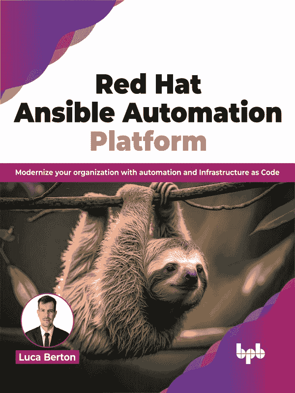


**献给**

我的儿子 Filippo——我生命的骄傲

# 关于作者


Luca Berton 是一位 Ansible 自动化专家，曾在摩根大通银行（JPMorgan Chase & Co.）工作。此前曾在 Red Hat Ansible 工程师团队工作过三年。他是《Ansible By Example(s)》实践读物系列中畅销书籍《Ansible for VMware by Examples》和《Ansible for Kubernetes by Examples》的作者。Luca 还是 Ansible Pilot 项目的创建者。

拥有超过 15 年的系统管理员经验，他在基础设施加固和自动化方面拥有深厚的专业知识。他是开源社区的热衷支持者，并在各种公共活动中分享自己的知识。Luca 天生是一个极客，他倾向于 Linux，特别是 Fedora。

# 免责声明

我在书中表达的任何观点或个人意见均代表我本人，不代表 Red Hat 公司或摩根大通银行。

Ansible®、Red Hat® Ansible® Automation Platform、Red Hat®、JBoss®、OpenShift®、Fedora®、Hibernate®、CloudForms®、RHCA®、RHCE®、RHCSA®、Ceph®、Gluster®、Red Hat® 标志以及阴影圆内的“A”标志是 Red Hat, Inc. 或其在美国和其他国家的商标或注册商标。[`www.redhat.com/en/about/brand/standards/trademarks`](https://www.redhat.com/en/about/brand/standards/trademarks)

“JPMorgan”、“JPMorgan Chase”、“Chase”、摩根大通银行标志和八角形符号是 JPMorgan Chase Bank, N.A. 的商标。JPMorgan Chase Bank, N.A. 是 JPMorgan Chase & Co. 的全资子公司。[`www.jpmorgan.com/`](https://www.jpmorgan.com/)

Linux 是 Linus Torvalds 的注册商标。

Certified Kubernetes®、Certified Kubernetes Administrator®、Certified Kubernetes Application Developer®、Certified Kubernetes Security Specialist®、CloudEvents®、CloudNativeCon®、CNCF®、containerd®、etcd®、KubeCon®、Kubernetes®、LSB®、Open Container Initiative®、Prometheus®、The Linux Foundation®、Xen Project®、Cloud Native Computing Foundation 标志、Kubernetes and Cloud Native Associate and Design（彩色）、OpenTelemetry and Design（黑白）、Fluentd and Design of a Carrier Pigeon（彩色——横向）都是 The Linux Foundation 在美国和或其他国家的注册商标。CRI-O™、LF™、LinuxCon™、Linux Foundation™、OpenGitOps™、OpenTelemetry™、Open Container Format™、Open Virtualization Alliance™、Virtual Kubelet™、World of Open Source™ 是 The Linux Foundation 在美国或其他国家等待注册或正在使用的商标。The Linux Foundation 标志。美国注册号 5166331（The Linux Foundation 几何设计（黑白）），The Linux Foundation 标志。美国注册号 5166330（The Linux Foundation 几何设计（彩色）），Certified Kubernetes logo。美国注册号 5734733，Community Data License Agreement logo。美国注册号 5852265，fluentd logo。美国注册号 4734498，Kubernetes logo。美国注册号 4816320，Kubernetes and Cloud Native Associate and Design（彩色）美国注册号 6949718，SupplyChainSecurity and Design（黑白）美国注册号 6949717 是以下标志在美国和/或其他国家的注册商标。[`www.linuxfoundation.org/trademark-usage/`](https://www.linuxfoundation.org/trademark-usage/)

UNIX® 是 The Open Group 的注册商标。

Python、PyCon、PyLadies 以及 Python 标志（有多种变体）是 Python Software Foundation 的注册商标。[`www.python.org/psf/trademarks/`](https://www.python.org/psf/trademarks/)

Azure、Microsoft®、Microsoft® 365、Microsoft Teams、PowerPoint®、Outlook®、OneDrive®、SharePoint®、Microsoft ® Store、Windows® 和 Windows® 10、Windows、Vista、XP、NT 是微软公司在美国和其他国家的注册商标或商标。[`www.microsoft.com/en-us/legal/intellectualproperty/trademarks`](https://www.microsoft.com/en-us/legal/intellectualproperty/trademarks)

Apple、Mac、Mac OS、Pages 和 TrueType 都是 Apple Computer, Inc. 在美国和其他国家的注册商标或商标。[`www.apple.com/legal/intellectualproperty`](https://www.apple.com/legal/intellectualproperty)

IBM 是 International Business Machines 的注册商标。[`www.ibm.com/legal/us/copytrade`](https://www.ibm.com/legal/us/copytrade)

Celeron、Celeron Inside、Centrino、Centrino logo、Core Inside、Intel Inside、Intel Inside logo、Itanium、Itanium Inside、Pentium、Pentium Inside、VTune、Xeon 和 Xeon Inside 是 Intel Corporation 或其子公司在美国和其他国家的商标或注册商标。[`www.intel.com/content/www/us/en/legal/trademarks.html`](https://www.intel.com/content/www/us/en/legal/trademarks.html)

Amazon Web Services、AWS、Powered by AWS 标志以及书中使用的任何其他 AWS 标志均为 Amazon.com, Inc. 或其关联公司的商标。本书未以任何方式获得 Amazon 的认可或与其关联。[`aws.amazon.com/trademark-guidelines/`](https://aws.amazon.com/trademark-guidelines/)

Google、Chrome™ 浏览器、Chromium™ 开源项目、Cloud TPU 集成电路、GCP™ 基础设施平台、GKE™ 软件服务、Gmail™ 电子邮件服务、Google App Engine™ 平台、Google Cloud Platform™ 服务、Google Cloud Storage™ 服务、Google Cloud™ 企业服务、Google Compute Engine™ 服务、Google Container Engine 容器管理系统、Google Dashboard™ 界面、Google Photos™ 照片存储和组织平台、Google™ 搜索或搜索引擎、Go™ 编程语言、Kubeflow™ 开源机器学习平台、Optimized Chip™ 处理器、SPDY™ 协议、YouTube™ 视频社区均为 Google LLC 的商标，本书未以任何方式获得 Google 的认可或关联。[`about.google/brand-resource-center/`](https://about.google/brand-resource-center/)

HashiCorp®、Vagrant、Packer、Terraform 是 HashiCorp, Inc. 的商标。

所有其他商标均为其所有者的财产。

# 致谢

我要感谢我的儿子、家人和朋友，他们让生活充满意义，他们的支持和鼓励使这项工作成为可能。还要感谢多年来与我合作并为我的书提供想法的人。感谢你们所分享的知识。

# 前言

## 欢迎来到 Ansible Automation Platform 的世界

随着技术的不断演进，对高效且可扩展的自动化解决方案的需求变得日益紧迫。本书是您掌握 Ansible Automation Platform 的全面指南，提供了一种实操方法，帮助您应对现代数据中心管理的复杂性。

在瞬息变化的现代科技领域，变化速度永不停歇，对效率、可扩展性和可靠性的需求不断增长，自动化的角色变得至关重要。当组织应对多样化 IT 环境管理的复杂性时，Ansible Automation Platform 作为一个强大的盟友出现，提供了通用且健壮的解决方案来简化操作、增强部署流程并自动化关键任务。本书是一份详尽且深入的指南，精心编写，旨在助力初学者和资深专业人士在掌握 Ansible Automation Platform 复杂之处的旅途中。本书为寻求充分利用 Ansible Automation Platform 潜力的初学者和经验丰富的人士提供了实用且全面的资源。我们邀请您深入探索、发现并提升您的自动化能力。我们的意图不仅是提供路线图，更是为了激发好奇心和赋能感。Ansible Automation Platform 凭借其强大的功能，召唤读者不仅要消费知识，更要积极参与到其自动化策略的演进中。我们邀请您带着好奇心和对掌握 Ansible Automation Platform 的承诺，开启这段旅程，我们将共同应对不断变化的 IT 自动化格局。

感谢您加入这段令人兴奋的冒险！

### 第 1 章：Ansible Automation Platform 入门（`#ch01.xhtml`）

从坚实的基础开始我们的旅程，理解相关技术、排版用法以及 Ansible 在现代数据中心管理中扮演的关键作用。本章向我们介绍了 Ansible Automation Platform，涵盖了其架构、语言以及 Playbook 和内容的创建，为后续的关键学习奠定基础。

### 第 2 章：Ansible Automation Platform 架构（`#ch02.xhtml`）

深入探索 Ansible Automation Platform 的核心。探索其架构并理解 `Ansible Controller`、`Automation Hub` 和 `Execution Environment`。了解这些组件在常见用例场景中如何交互，为构建健壮的自动化基础设施建立基础。

### 第 3 章：平台安装场景（`#ch03.xhtml`）

开启安装之旅，探索各种场景和部署选项。从单机设置到高可用集群，本章将引导我们了解先决条件、要求和安装场景，对 Ansible Automation Platform 的部署提供全面的理解。

### 第 4 章：初步（`#ch04.xhtml`）

轻松操作 `Ansible Controller Dashboard`。学习基础的系统管理员任务，包括 `Ansible Controller` 设置、`CLI` 使用、作业管理以及配置仪表板的最佳实践。本章使我们能够从系统管理员的角度高效地管理我们的自动化平台。

### 第 5 章：设置与身份验证（`#ch05.xhtml`）

使用基于角色的访问控制（`RBAC`）有效率组织权限。本章涵盖了使用用户和团队创建及管理访问。探索外部身份验证源并将 `Ansible Tower` 与 `LDAP`、`Azure Active Directory` 和 `SAML` 验证集成以增强安全性。

### 第 6 章：IT（`#ch06.xhtml`）

控制系统指标和日志架构。学习如何将 Ansible 指标连接到 `Grafana`，使用 `Splunk` 等工具聚合日志，并实施备份和恢复策略。获取维护我们 Ansible Automation Platform 健康和性能的宝贵见解。

### 第 7 章：应用部署（`#ch07.xhtml`）

解锁使用容器部署云原生应用的自动化力量。深入研究 Ansible Playbook 开发、应用部署自动化以及容器中的应用程序分发，简化我们的部署工作流。

### 第 8 章：混合云与 Kubernetes（`#ch08.xhtml`）

探索 Ansible Automation Platform 如何简化混合云环境。学习在不同的云提供商之间构建、配置和管理应用程序，利用 `Kubernetes` 进行容器编排，并无缝扩展容器化应用。

### 第 9 章：自动化 IT 流程（`#ch09.xhtml`）

发现自动化 IT 流程以提高效率和安全性。本章涵盖了网络和 IT 流程的管理、安装、升级和日常任务的自动化，以及使用自动化脚本响应安全威胁。

### 第 10 章：总结（`#ch10.xhtml`）

在结束这段旅程之际，回顾基础知识、安装场景、角色管理、集成、身份验证和用例。反思关键管理实践，并感谢您加入我们对 Ansible Automation Platform 的探索。

无论您是资深自动化专业人士还是初起学者，本书都为您提供了一份掌握 Ansible Automation Platform 并利用其功能改变您处理 IT 自动化方式的路线图。让我们一起开启这段兴奋的旅程吧！

## 开发环境

本书提供的代码与任何文本编辑器或集成开发环境（`IDE`）兼容。`IDE` 是一种提供软件开发全面功能的软件工具，如代码编辑、调试、编译和项目管理。

复制本书代码示例的基础环境：

- 一个文本编辑器：图形界面（`VS Code`、`Atom`、`Geany` 等）或终端（`VIM`、`Emacs`、`Nano`、`Pico` 等）。
- 安装了 `ansible` 或 `ansible-core` 包的工作站。

我们推荐使用 `Visual Studio Code` 作为首选 IDE，可以在 [`code.visualstudio.com`](https://code.visualstudio.com) 免费下载。

## 书中使用的规范

在书中，我们会遇到许多示例和终端命令。Ansible 语言主要使用 `YAML` 和 `INI` 格式作为语法。除非文中另有说明，否则假设文件格式为 `YAML`。代码遵循最新的 `YAML` 规范。`YAML` 以简单易读和与编程语言的广泛兼容性闻名，允许对复杂数据结构进行简洁表示。它广泛用于配置文件和数据交换，类似于 `JSON`，但具有 Python 风格的缩进以及更紧凑的列表和字典格式。

`INI` 格式经常用于清单和 Ansible 配置文件。它是一种简单的配置文件格式，利用键值对和分区以人类可读的方式存储设置和偏好。

许多终端命令是标准的 Linux 命令，以内联显示（例如 `ansible [command]`）或在代码块中显示（带或不带行号）。例如：

```bash
$ echo Hello World
```

提供的终端命令遵循 POSIX 规范，并兼容 Unix 类系统，包括 Linux、macOS 和 BSD。每个命令在以 `$` 符号开头时假设由标准用户账户执行，在以 `#` 符号开头时假设由 root 用户执行。

每个 Ansible 资源（Playbook、角色、插件和集合）均遵循最新的 Ansible 最佳实践，并使用最新版本的 Ansible Linter 进行了验证。

然而，值得注意的是，特定的代码片段刻意偏离了最佳实践，以准确重现特定的行为或用例。这确保了对 Ansible 的全面理解，涵盖了理想技术和现实场景。

# 代码包与彩色图片

请点击链接下载书籍的 `Code Bundle`（代码包）和 `Coloured Images`（彩色图片）：

[`rebrand.ly/70ltl91`](https://rebrand.ly/71)

书籍的代码包也托管在 GitHub 上：[`github.com/bpbpublications/Red-Hat-Ansible-Automation-Platform`](https://github.com/bpbpublications/Red-Hat-Ansible-Automation-Platform)。如果代码有更新，将在现有的 GitHub 仓库中进行更新。

我们从丰富的书籍和视频目录中提供了许多代码包，可以在 [`github.com/bpbpublications`](https://github.com/bpbpublications) 获取。快去看看吧！

## 勘误


我们对 BPB Publications 的工作感到非常自豪，并遵循最佳实践以确保内容的准确性，为订阅者提供愉悦的阅读体验。读者是我们的镜子，我们利用他们的反馈来反思并改进出版过程中可能出现的人为错误。为了让我们保持质量并帮助我们联系任何因不可预见的错误而遇到困难的读者，请通过以下邮箱与我们联系：

`errata@bpbonline.com`

BPB Publications 大家非常感谢您的支持、建议和反馈。

## 加入我们书籍的 Discord 空间

加入书籍的 Discord 工作空间，获取最新更新、优惠、全球技术动态、新书发布以及与作者的互动：

[`discord.bpbonline.com`](https://discord.bpbonline.com)


# 第 1 章：开启 Ansible 自动化平台

## 介绍

本章向我们介绍了 Ansible 自动化技术和工具。我们将针对 Ansible 自动化平台的企业级用户，探讨自动化的演进。

## 结构

在本章中，我们将讨论以下主题：

- 简要介绍和参考
- Ansible 自动化平台概览
- 什么是 Ansible
- Ansible 架构
- Ansible 语言
- 创建 Ansible Playbooks 和内容

## 目标

学习本章后，你应该能够理解 Ansible 是什么、它的架构以及如何编写 Ansible 代码。这些是我们将在后续章节中学习的 Ansible 自动化平台的基础。

## 简要介绍和参考

欢迎阅读这本关于 Ansible 自动化平台的书籍。我们将探索市场上最有趣的自动化平台。Ansible 是全球范围内许多组织采用的自动化技术。

全球分析师看到，每个行业和领域对自动化技术的采用率都在增长。基础设施和运营（I&O）负责人正在重新思考如何利用和管理基础设施。Gartner 预测，到 2025 年将有 70% 的组织实施基础设施自动化^(1)。IDC 在《2021–2025 年欧洲 DevOps 软件工具预测》中提到了一场由自动化驱动的数字革命^(2)。所有主要的信息技术分析师都认同，自动化将在未来的 IT 基础设施中发挥核心作用。

* *

^(1) [`www.gartner.com/en/newsroom/press-releases/2022-10-03-gartner-survey-finds-85-percent-of-infrastructure-and-operations-leaders-without-full-automation-expect-to-increase-automation-within-three-years`](https://www.gartner.com/en/newsroom/press-releases/2022-10-03-gartner-survey-finds-85-percent-of-infrastructure-and-operations-leaders-without-full-automation-expect-to-increase-automation-within-three-years)

^(2) [`www.idc.com/getdoc.jsp?containerId=EUR148592321`](https://www.idc.com/getdoc.jsp?containerId=EUR148592321)

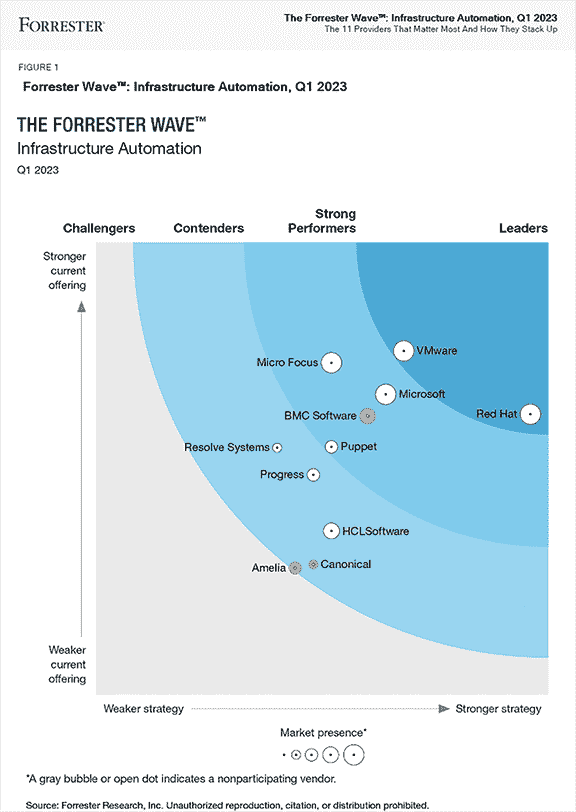

图 1.1：Forrester Wave™ 基础设施自动化报告。

红帽（Red Hat）专注于 Ansible 自动化平台并在 2023 年第一季度 Forrester Wave™ 基础设施自动化报告中被评为领导者，如图图 1.1 所示。竞争范围在前 11 家供应商之间：Amelia、BMC Software、Canonical、HCL Software、Micro Focus、Microsoft、Progress、Puppet、Red Hat、Resolve Systems 和 VMware。根据从原生能力的全面性到集成和生态系统等 30 个不同标准对每家供应商进行评估。

## Ansible 自动化平台概览

Ansible 自动化平台是一个全面的 IT 自动化平台，旨在简化并加速混合及多云环境中的复杂 IT 任务。它将 Ansible 自动化的力量与企业级特性（如基于角色的访问控制、工作流自动化和分析）相结合，帮助组织实现 IT 自动化。请参考下图：

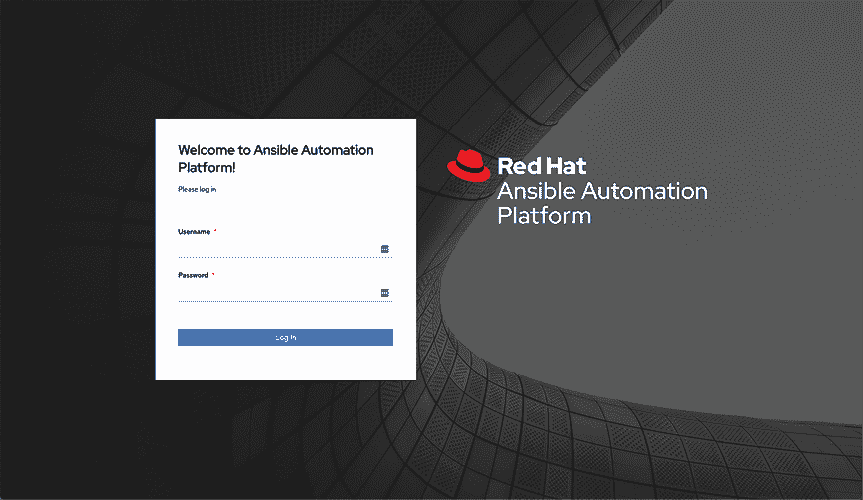

图 1.2：Ansible 自动化平台的登录界面

该平台由多个组件组成，包括执行 `Ansible Playbooks` 的自动化引擎 `Ansible Core`、提供管理 `Ansible Playbooks`、角色和清单的集中式界面 `Automation Controller`，以及用于查找、重用和共享 Ansible 资源的 `automation hub`。

通过 Ansible 自动化平台，组织可以实现 IT 基础设施和应用的交付自动化，执行安全和合规策略，并与团队共享自动化内容。它支持广泛的 IT 运营用例，包括配置管理、应用部署、网络和安全自动化。

IT 负责人每天使用 `Ansible Platform` 来实施基础设施即代码（IaC）、配置即代码（CaC）、策略即代码、代码流水线、编排（K8s）、DevSecOps、自愈基础设施以及事件驱动自动化。

Ansible 自动化平台的首个版本发布于 2020 年，此前名为 `Ansible Tower`。`Ansible Tower` 允许每个 IT 部门安全地存储清单、凭据、项目和剧本，并通过 RESTful API 和 Web 用户界面管理基于角色的访问控制（RBAC）。`Ansible Tower` 基于开源项目 `AWX`，通过与许多企业级技术的深度集成得到了增强。

自 2.0 版本以来，`automation controller` 经过重新设计，实现了新的容器设计。

平台还扩展了额外的组件，相互集成以提供卓越的自动化体验。

Ansible 自动化平台的主要组件包括：

- `automation controller`：Ansible 自动化平台的控制平面。
- `automation hub`：查找、使用和扩展 Ansible 资源。
- `automation execution environments`：采用容器封装，用于执行 `Ansible playbooks` 和角色的迁移环境。
- `automation mesh`：以云原生方式实现大规模自动化。
- `Ansible content collections`：提供即用的认证模块。
- `Ansible content tools`：创建自定义自动化执行环境的工具。
- `Red Hat insights for Ansible Automation Platform`：获取我们自动化节省的统计数据和指标。

IT 专业人员和组织可以充分利用 Red Hat Ansible 订阅以及所有相关资源。它还包含了 Red Hat 屡获殊荣的客户门户全部功能，分为标准工作日（上午 8 点至下午 5 点）或高级 24x7 服务。可以通过 60 天试用自支持订阅来尝试 Red Hat Ansible Automation Platform，该订阅包含 `Red Hat Enterprise Linux`、用于 `Red Hat Ansible Automation Platform` 的 `Red Hat Insights`、`Red Hat Smart Management` 以及托管在 `Red Hat Hybrid Cloud Console` 上的 `Red Hat Ansible Automation Platform` 服务。独立开发者可以使用 Red Hat 开发者订阅计划（SKU `RH00798`）。这是一个每年续订的单一订阅，允许他们在最多 16 台 `Red Hat Enterprise Linux` 系统上安装（物理或虚拟），无论系统大小如何。这 16 个节点可以用于演示、原型设计、QA、小规模生产使用和云访问。

## 什么是 Ansible

Ansible 是一个用于自动化和管理 IT 基础设施的开源软件平台，包括部署应用程序和配置系统。它允许我们编写剧本（playbooks），即使用 YAML（一种人类可读的语言）编写的一组任务，描述了如何在一个或多个远程服务器上执行任务。Ansible 的首次发布于 2012 年 2 月 20 日。Michael DeHaan 创建了 Ansible 工具并开始推广最初的社区。请参考下图：


图 1.3：Ansible Logo

Ansible 使用客户端-服务器架构，拥有中央控制服务器（Ansible 控制机）和受管节点（我们想要在其上自动化任务的服务器）。控制机通过 `SSH`（一种安全网络协议）连接到受管节点并在上面运行剧本。

Ansible 的主要优势之一是它使用了简单、易学的语法，并且不需要任何特殊的编程技能。这使其成为需要自动化任务但可能没有多少编程经验的 IT 专业人员非常有吸引力的选择。

Ansible 可用于自动化广泛的任务，包括应用程序部署、系统配置、云基础设施供应以及安全和合规性管理。它常用于 DevOps（一种强调开发和运维团队之间协作的软件开发方法），来自动化应用程序的构建、测试和部署。

Ansible Automation Platform 在 Ansible Automation Controller 之下包含一个完整的 Ansible 安装。

Ansible 开源项目和社区受到 Red Hat（IBM 旗下）的支持。Red Hat 积极与其他致力于开源软件和自动化的组织及个人合作。社区不断增长和进化，每天都有新的贡献者用户加入。

## Ansible 架构

Ansible 架构包含两类机器：控制器和目标节点。Ansible Controller 安装了 Ansible 并对目标节点执行自动化。Ansible Automation Controller 包含一个完整的 Ansible 安装。

目标节点不需要安装任何 Ansible 代理或特殊工具。Ansible 是所谓的无代理的（agentless）。连接参数取决于目标操作系统。Ansible 使用以下协议连接到目标机器：

- 用于 Unix 类操作系统的 `OpenSSH`：Linux、macOS 等。
- 用于 Windows 操作系统的 `WinRM`。

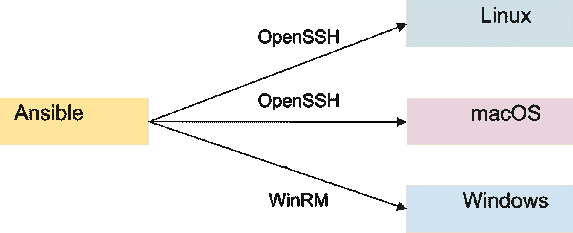

图 1.4：Ansible 架构

## Linux 和 macOS 目标

Ansible 使用 `OpenSSH` 协议连接到托管主机中的任何 POSIX、Unix 类操作系统。这个长列表包括任何 Linux 发行版、Unix、macOS、BSD 等。`OpenSSH` 是安全 Shell（`SSH`）协议的免费开源实现。它是一种在计算机之间提供安全通信的网络协议，允许我们远程登录到另一台计算机，执行命令并在网络上安全地传输文件。

`SSH` 协议使用加密来保护客户端（我们的计算机）和服务器（远程计算机）之间的连接。它使用公钥密码法对客户端和服务器进行身份验证，并建立一个可以在其上传输的安全通道。

`OpenSSH` 广泛用于访问远程服务器和系统，它是大多数 Linux 和基于 Unix 的系统上的默认 `SSH` 实现。它也可以作为第三方软件在其他操作系统上（如 Windows 和 macOS）可用。

`OpenSSH` 提供了用于管理 SSH 连接的各种工具和实用程序，例如用于建立 `SSH` 连接的 `ssh`、用于在计算机间安全传输文件的 `SCP`，以及通过 `SSH` 连接传输文件的 `SFTP`。它还包含一个用于在计算机间传输文件的安全拷贝（`SCP`）工具和一个用于通过 `SSH` 连接传输文件的安全文件传输协议（`SFTP`）。

## Windows 目标

Ansible 使用 Windows 远程管理（`WinRM`）连接到 Windows 托管主机。这项微软技术允许我们在 Windows 机器上远程执行命令。这是基于 `WS-Management` 协议的，它是用于远程管理设备和系统的标准协议。在本书编写，Ansible 支持最常用的 Windows 客户端和服务器：Windows Server 2008、Windows Server 2008 R2、Windows Server 2012、Windows Server 2012 R2、Windows Server 2016、Windows Server 2019、Windows Server 2022、Windows 7、Windows 8.1、Windows 10 和 Windows 11。

`WinRM` 允许我们远程运行脚本、执行系统管理任务并远程管理 Windows 服务器。它可以远程管理单台机器、一组机器或网络。

要使用 `WinRM`，我们需要在远程机器上启用它，然后使用 Windows PowerShell 或 Ansible 等第三方工具连接到远程机器并使用 `Enable-Remoting` PowerShell 命令进行执行。

总的来说，`WinRM` 是远程管理和自动化 Windows 机器的有用工具。它允许我们从单一位置管理多台机器，从而节省时间和精力。对于可能需要管理数百或上千台服务器的大型组织特别有用。

Ansible 现在将连接能力扩展到了存储和网络设备、容器技术、虚拟化（VMware）、编排技术（Kubernetes）以及云供应商。

提示：我们可以通过将 `ansible_connection` 变量设置为 `local` 来在本地机器上运行 Ansible 剧本。

## Ansible 语言

Ansible 是一个开源基础设施自动化工具。它使我们能够自动化和标准的方式管理大量系统。主要用例是基础设施自动化和配置管理，但也可以用于配置操作系统、部署应用程序以及在远程服务器上执行其他任务。

Ansible 架构由几个关键组件组成：

- 控制机：运行 Ansible 命令和剧本的机器。它可以是任何安装了 Ansible 的机器、服务器或本地桌面或笔记本电脑。
- 清单（Inventory）：Ansible 的目标主机列表。它可以是静态文件，也可以运行时生成的动态清单。
- 模块（Modules）：模块是 Ansible 的执行块。它们是执行特定任务的小程序，例如安装包或启动服务。
- Playbooks（剧本）：Playbooks 以 YAML 格式编写，包含一系列任务。它们可用于自动化复杂流程，是 Ansible 自动化系统的核心组件。
- Plugins（插件）：插件是扩展 Ansible 核心功能的程序。它们可用于修改 Ansible 模块的行为或添加新功能。

简而言之，Ansible 连接到我们清单中的系统并运行剧本中指定的任务。它是使用简单、易于人类的语法以 YAML 格式进行编码的。

让我们逐一拆解 Ansible 的组件。Ansible 控制器（Ansible Controller）可以是任何安装了 Ansible 的计算机。对于任何现代操作系统来说，安装 Ansible 都非常简单。我们可以使用命令检查安装是否成功以及当前运行的版本：

```bash
ansible --version
```

`ansible` 命令在清单上执行一个模块。这种行为被称为 Ansible 即时模式（Ad-hoc）。

Ansible 平台包含许多命令行工具和实用程序（例如 `ansible`、`ansible-playbook`、`ansible-galaxy`、`ansible-inventory` 等）。每个 Ansible 安装还包含了 Ansible 集合 `ansible.builtin`，所有主模块都位于其中。

清单（Inventory）是目标主机的列表。更多情况下，它是存储在默认位置 `/etc/ansible/host` 的文本文件。大多数 Ansible 工具通过指定 `-i` 参数支持覆盖清单。支持的 Ansible 清单格式有 INI、JSON 和 YAML。我们还可以拥有多个文件并在运行时将它们合并。在某些用例中（例如虚拟机、容器编排器或云计算提供商），可以使用返回 JSON 清单格式的外部脚本动态生成清单。动态清单功能在快速变化的环境中非常有用，在这些环境中，运行服务的枚举关键且变化迅速。

在初始配置之后，我们只需要一个清单和一个剧本（playbook）。剧本是一个 YAML 文件，包含了实现共同目标的任务序列。最小的剧本包含一些章节，我们可以在其中指定目标主机（主机）和一系列任务。还有额外的章节用于指定额外的步骤或本地变量。每个任务都由 Ansible 模块执行。

Ansible 模块是执行目标主机 Ansible 动作的关键组件。Ansible 模块非常多，可以轻松地执行任何操作，而无需重复造轮子。

此外，我们可以通过创建一些插件来扩展原生功能或连接到新的服务或 API，从而扩展核心功能。

我们可以通过创建一些角色（roles）或集合（collections）在组织内部实现代码复用。代码可以由我们、同事、供应商或第三方创建。

根据我们想要实现的集成类型，有不同类型的插件。

我们可以将代码和插件分发到 IT 部门或互联网。Ansible Galaxy 网站上有大量的角色和集合可选。

### 创建 Ansible 剧本和资源

我们可以在喜欢的文本编辑器中创建 Ansible 资源。Ansible 不需要使用特定的 IDE。然而，VS Code 是目前自动化专业人士的喜选选择。

最小的开发环境包含以下内容：

- 一个文本编辑器：终端（VIM、Emacs、Nano、Pico 等）或 GUI（VS Code、Atom、Geany 等）。
- 一个安装了 `ansible` 或 `ansible-core` 软件包的工作站。


让我们深入研究第一个在屏幕上显示“Hi!”消息的 Ansible 剧本：

```yaml
---
- name: Message example
  hosts: all
  tasks:
    - name: Display a message
      ansible.builtin.debug:
        msg: "Hi!"
...
```

让我们逐行浏览 Ansible 剧本：

- 文件开始（`---`）
- 执行名称（`Message example`）
- 执行目标主机（清单中的`all`）
- 任务开始
- 第一个任务命名为`Display a message`
- 模块`ansible.builtin.debug`（用于在屏幕上显示消息）
- 模块`debug`的参数`msg`（我们想要显示的消息）
- 文件结束（`...`）

我们可以使用以下`ansible-playbook`命令执行 Hello World Ansible 剧本：

```bash
ansible-playbook -i inventory.ini hi.yml
```

其中：

- `ansible-playbook`是包含在每个 Ansible 安装中的命令行工具。
- `-i`参数指定使用哪个清单文件。在这种情况下，`inventory.ini`文件位于当前目录。
- `hi.yml`参数是 Ansible 剧本文件的名称。

最简单的 Ansible 清单是针对`localhost`的，这在开发阶段非常方便，但在生产阶段很少使用。

INI 格式的本地清单：

```ini
localhost ansible_connection="local"
```

该命令产生以下输出：

```text
PLAY [Message example] **********************************************************************

TASK [Gathering Facts] *************************************************************************

ok: [localhost]

TASK [Display a message] ***************************************************************************

ok: [localhost] => {
    "msg": "Hi!"
}

PLAY RECAP *************************************************************************************

localhost: ok=2 changed=0 unreachable=0 failed=0 skipped=0 rescued=0 ignored=0
```

`PLAY [Message example] **********************************************************************`

`TASK [Gathering Facts] *************************************************************************`

`ok: [localhost]`

`TASK [Display a message] ***************************************************************************`

`ok: [localhost] => {`

`"msg": "Hi!"`

`}`

`PLAY RECAP *************************************************************************************`

`localhost: ok=2 changed=0 unreachable=0 failed=0 skipped=0 rescued=0 ignored=0`

（此处省略重复的输出内容，翻译逻辑保持一致）

## 练习题

1. 以下哪项不是现代数据中心的特征？
   1. 可扩展性
   2. 以上均不是
   3. 灵活性
   4. 高可用性

2. `Ansible`使用什么协议与 Linux 目标主机通信？
   1. 用于 Windows 系统的 WinRM
   2. 对于当前主机，我们可以使用`ansible_connection=local`
   3. 以上均不是
   4. 用于 Unix 类操作系统（如 Linux、macOS 等）的 OpenSSH

3. 是否可以使用 Windows 作为`Ansible`控制器？
   1. 是
   2. 否

4. `ping`模块的预期输出是什么？
   1. `ping: ping`
   2. `no route to host`
   3. `ping: 1`
   4. `ping: pong`

### 答案

1. b
2. d
3. b
4. d

### 问题

1. 什么是`Ansible`资产清单（inventory）？
2. 如何编写`Ansible`剧本（Playbook）？
3. 解释什么是`Ansible` Galaxy。
4. `Ansible Automation Platform`包含哪些组件？

### 关键术语

- **控制机（Control machine）**：这是我们运行`Ansible`命令和剧本的机器。它可以是任何安装了`Ansible`的机器，例如我们的本地桌面或笔记本电脑。
- **资产清单（Inventory）**：`inventory`是`Ansible`将管理的系统列表。它可以是一个静态文件或运行时动态清单。
- **模块（Modules）**：`Modules`是`Ansible`的构建块。它们是执行特定任务的小程序，例如安装软件包或启动服务。
- **剧本（Playbooks）**：`Playbooks`使用 YAML 编写，包含一系列要执行的任务。它们用于自动化复杂流程，是`Ansible`自动化能力的核心组件。
- **插件（Plugins）**：`Plugins`是扩展`Ansible`核心功能的程序。它们可以修改`Ansible`模块的行为或添加新功能。

## 加入我们书籍的 Discord 空间

加入书籍的 Discord 工作空间以获取最新更新、优惠、全球科技动态、新发布以及作者互动会议：

[`discord.bpbonline.com`](https://discord.bpbonline.com)


# 第 2 章 Ansible Automation Platform 架构

## 引言

本章向我们介绍`Ansible`自动化架构。我们将探索平台架构的关键组件以及`Ansible Automation Platform`的主要设计。

## 结构

在本章中，我们将讨论以下主题：

- `Ansible Automation Platform`架构
- `Ansible`控制器
- `Ansible`自动化枢纽（automation hub）
- `Ansible`执行环境（execution environment）
- 关键学习点

## 目标

学习本单元后，我们应该能够理解`Ansible`自动化设计和`Ansible Automation Platform`的关键组件。这些主题对于理解后续的安装场景至关重要。

## Ansible Automation Platform 架构

`Ansible Automation Platform`架构旨在为管理和自动化 IT 基础设施提供全面的解决方案。该产品的官方标志是红帽公司的商标，如图 2.1 所示：


图 2.1：Ansible Automation Platform 标志

它由几个组件共同工作，以实现任务的高效自动化和编排。

`Ansible Automation Platform`的架构由以下组件组成，如图 2.2 所示：

- 自动化控制器（Automation controller，原名为`Ansible Tower`）
- 自动化枢纽（Automation hub）
- 自动化网格（Automation mesh）
- 执行环境（Execution environment）

请参考下图：

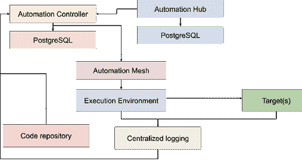

图 2.2：Ansible Automation Platform 架构

自动化控制器是`Ansible Automation Platform`的关键元素。它以前是`Ansible Tower`，采用了全新的容器化设计。我们在执行连接到目标节点的`Ansible`执行环境中可以清楚地看到这种设计模式。

请参阅第 3 章平台安装，了解安装场景和系统要求。

`Ansible Automation Platform`还包含了对我们组织有利的额外云组件。请参考下图：

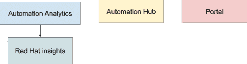

图 2.3：红帽在线服务

当我们订阅`Ansible Automation Platform`时，可以使用以下三项红帽在线服务：

- 自动化分析（Automation analytics，与 Red Hat Insight 连接）
- 自动化枢纽（Automation hub）
- 红帽门户（Red Hat portal）

自动化分析从`Ansible Tower`/`automation controller`收集数据并提供洞察和报告功能。它有助于跟踪和分析自动化作业运行、资产清单更改以及与其他相关的指标。自动化分析使组织能够洞察其自动化活动，识别趋势并做出数据驱动的决策以提高效率并排排除故障。

自动化分析的关键功能和优势包括：

- **洞察与可见性**：自动化分析提供了一个集中的仪表板，以可视化的形式展示自动化活动、作业状态和性能指标。它使用户能够获得其自动化环境的洞察，并跟踪自动化工作流的效率和效果。
- **报告与趋势分析**：自动化分析根据收集的数据生成报告和可视化内容。它帮助组织识别自动化流程中的趋势、模式和瓶颈。这些洞察可优化自动化工作流、改进资源分配并做出数据驱动的决策。
- **故障排除与问题解决**：通过自动化分析，用户可以分析历史数据以排除故障、识别根本原因并采取预防措施防止未来发生类似问题。它提供了作业运行、资产更改和其他自动化事件的历史视图，便于调查和解决问题。
- **定制与集成**：自动化分析允许用户根据特定需求创建自定义报告和可视化。它还提供了与其他分析和监控工具集成的能力，使组织可以将 Ansible 自动化数据整合到现有的监控和分析工作流中。

## 自动化控制器

在当今快速发展的数字环境中，组织不断寻找简化和扩展自动化流程的方法。红帽 Ansible Automation Platform 的自动化控制器为整个组织范围内定义、运行、扩展和委托自动化提供了全面的解决方案。自动化控制器是 AAP 的杰作，因为它执行了彻底改变我们自动化工作流的代码。

以下是自动化控制器的关键功能和优势：

- **增强控制与效率**：自动化控制器作为 Ansible Automation Platform 的控制平面，取代了 Ansible Tower。凭借其直观的用户界面（UI）、基于角色的访问控制（RBAC）和高级工作流，自动化控制器使团队能够更高效、灵活地扩展其自动化计划。它有助于标准化自动化部署、委托和审计，减少蔓延并确保流程一致性。
- **集中式管理**：通过自动化控制器，自动化管理变得更加精高效。它提供了一个中心化的用户界面和 RESTful API，用于管理清单、启动和调度工作流、跟踪更改以及集成报告。这种中心化的方法简化了管理工作，增强了可见性，并实现了跨团队的协作。

### 自动化拓扑可视化

自动化控制器引入了自动化拓扑查看器，这是一个强大的功能，可以以视觉方式表示复杂的自动化拓扑。它以图形化的方式展示跨多个站的节点，包括跳跃、执行、混合和控制节点。这种可视化让管理员能够理解并优化他们的自动化工作流，从而提高整体效率和可靠性。

### 增强的架构与性能

自动化控制器采用去中心化的模块化应用程序架构。它将控制平面和执行平面分离，允许更大的可扩展性和灵活性。平台利用执行环境，为高效运行自动化任务提供隔离和资源分配。通过改进性能、增强的作业输出过滤器以及更严格的内容安全策略，自动化控制器确保了无缝且安全的自动化体验。

### 升级的用户体验

自动化控制器的 WebUI 已重构为`PatternFly 4.0`设计模式，提供了现代且直观的用户体验。UI 的重新设计提高了可用性，使用户更易于导航和与平台交互。此外，区分编辑和读取视图增强了安全性和控制，允许管理员定义细粒度的访问权限。

### 可靠的基础设施与集成

自动化控制器利用最新版本的`PostgreSQL`数据库，为存储执行数据提供了稳健且可扩展的数据库基础。它从`RHEL`模块安装，确保了兼容性和安装的便利性。此外，分区访问增强了性能，允许多个用户并发访问平台而不会影响效率。

自动化控制器产品是组织寻求精简和扩展其自动化流程的极佳工具。通过提供中心化的控制平面、直观的 UI、高级工作流和增强的可扩展性，它使企业能够放心地进行自动化，减少差异并提高效率。凭借自动化拓扑可视化和改进架构等功能，自动化控制器使组织能够将其自动化计划推向新的高度。拥抱自动化控制器的力量，释放企业自动化之旅的全部潜力。Ansible 控制器基于 Red Hat 积极维护的开源项目`AWX`。Ansible 控制器与`AWX`的区别在于，前者包含了许多开源项目不具备的集成和企业技术。

### 仪表板

仪表板可以通过任何现代浏览器访问，并展示有关我们环境中自动化脚本执行的统计数据。初始窗口显示登录身份验证，如图 1.2 所示。连接使用`HTTPS`协议和自签名证书对初始连接进行加密，我们可以根据组织使用的证书颁发机构进行自定义。许多组织使用商业证书来建立信任连接，以避免中间人攻击。请参阅第 5 章集成身份验证，了解如何与流行的企业身份验证（如`Active Directory`和`LDAP`）集成基于角色的访问控制（RBAC）。

我们可以通过用户界面轻松验证 Ansible 自动化平台的当前版本，如图 2.4 所示，图中显示版本为`4.3.6`。这种趣味的可视化使用了 Ansible 工具早期的`cowsay`命令行工具。

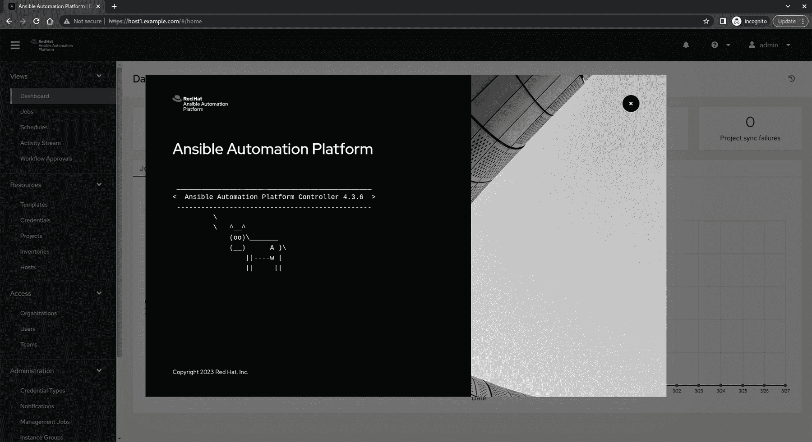

图 2.4：Ansible 控制器的当前版本

Ansible 控制器的仪表板类似于图 2.5 所示：

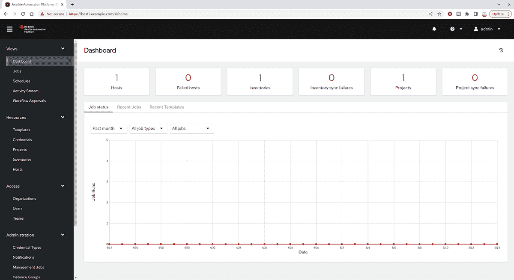

图 2.5：Ansible 自动化控制器的仪表板

## 项目

在 Ansible 控制器中，项目是指 Ansible Playbooks、角色（roles）和其他相关文件的逻辑组，用于自动化任务和管理基础设施。项目提供了一种结构化的方式来组织和管理我们的 Ansible 代码和资源。

Ansible Playbooks 和 playbook 目录可以在项目内部管理，方法是将它们手动放置在服务器上的项目基路径下，或者利用自动化控制器支持的源码管理（SCM）系统，例如`Git`、`Subversion`或`Red Hat Insights`。

在手动管理 playbooks 时，我们创建一个或多个目录在项目基路径下存储 playbooks。然后，我们可以创建或复制 playbook 文件到 playbook 目录中。重要的是确保 playbook 目录和文件的所有者与运行自动化控制器服务的`UNIX`用户和组相同，并且 playbook 目录和文件的权限是适当的。

如果使用版本控制，我们可以通过提供 SCM URL、分支/标签/提交详细信息以及必要的凭据，将我们的 playbooks 配置为特定的 SCM 类型，例如`Git`或`Subversion`。项目倾向于实现 GitOps 目录结构标准来存储内容。每个项目的实际目录结构可能略有不同，但这是 Ansible 最佳实践常用的：

```text
.
├── group_vars
│   ├── all.yml
│   └── servers.yml
├── host_vars
│   └── server1.example.com.yml
├── inventory
├── site.yml
├── roles
│   └── role1
│       ├── tasks
│       ├── handlers
│       ├── templates
│       ├── files
│       ├── vars
│       └── defaults
└── collections
└── requirements.yml
```

目录结构包含`group_vars`和`host_vars`目录，用于指定针对不同组或主机的 Ansible 变量。在这种情况下，有两个组：`all`和`servers`。还有一个单主机`server1.example.com`。


`inventory` 文件是 `INI` 格式的 Ansible 清单，包含主机和组。主 playbook 命名为 `site.yml`，它通常是第一个执行的 Ansible Playbook，包含了所有重要任务。

在 `roles` 目录下，我们可以为项目存储自定义角色。在示例中，有一个 `role1`。

可以指定 `collections` 目录并带有 `requirements.yml` 文件，用于通过自动化枢纽获取所需的 Ansible 集合。

这种目录结构有助于维护组织良好的代码库，并代表了全球大多数组织采用的标准，因为它符合 Ansible 的最佳实践。

存储在源码管理（SCM）系统中的 GitOps 目录结构使我们能够对 playbooks 进行版本控制，并在源码库发生更改时轻松更新它们。

项目有多种状态指示其当前状态。以下状态适用于任何项目：

- **Pending（待处理）**：源码更新已创建但尚未队列或启动。
- **Waiting（等待中）**：源码更新在队列中等待执行。
- **Running（运行中）**：源码更新正在进行。
- **Successful（成功）**：项目上次源码更新成功。
- **Failed（失败）**：项目上一次源码更新失败。
- **Error（错误）**：上一次源码更新作业完全未运行（已弃用）。
- **已取消（Canceled）**：项目的上次源码控制更新已取消。
- **从未更新（Never updated）**：项目已配置源码控制，但从未更新过。
- **正常（OK）**：项目未配置源码控制且位置正确（已弃用）。
- **缺失（Missing）**：项目需要位于项目基础路径（适用于手动或源码控制管理的项目）。

要更新现有基于 SCM 的项目，我们可以选择项目并启动刷新，以从配置的源码控制存储库获取最新详情。

下面的图 2.6 显示了自动化控制面板仪表板中的项目示例。

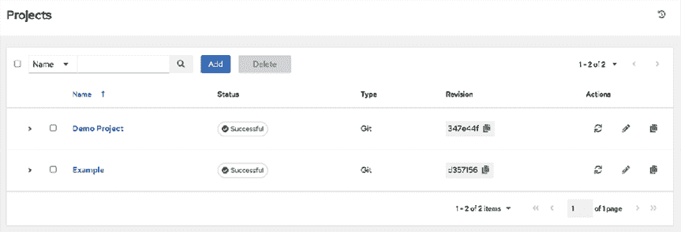

图 2.6：自动化控制面板中的项目

当使用 Red Hat Insights 作为源时，我们可以应用所谓的修复 Ansible Playbook，在我们的集群中执行更新或纠正操作。

## 作业

我们在自动化控制面板中每个在项目中执行 Ansible Playbook 的自动化脚本都作为“作业模板”（Job Template）进行管理。请参考下图：

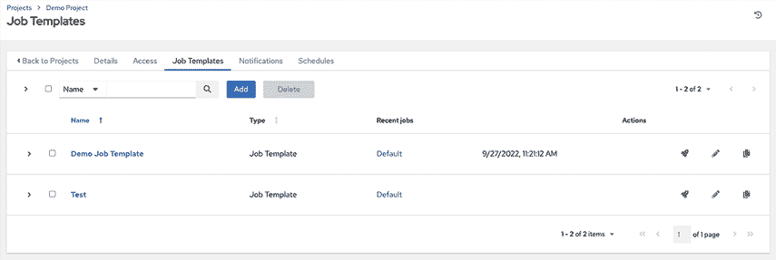

图 2.7：自动化控制面板中的作业模板列表

作业模板指定了要执行的 Ansible Playbook、所有参数、连接到目标主机所需的凭据或额外资源，以及清单（`inventory`）。我们甚至可以决定使用“启动时提示”（Prompt on launch）功能向用户请求某些参数。该窗口有许多参数，但必填字段只有项目、playbook 和清单，如图 2.8 所示：

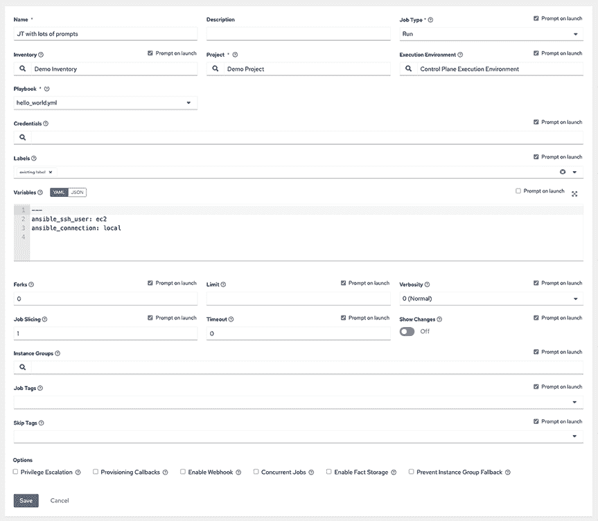

图 2.8：自动化控制面板中的作业模板创建

高级用户可以利用对所有其他选项的微调。例如，我们可以为每个作业指定特定的 Ansible 执行环境，或者根据组织的要求构建自定义环境。

我们甚至可以按照特定的周期调度作业的程序化执行，如图 2.9 所示：

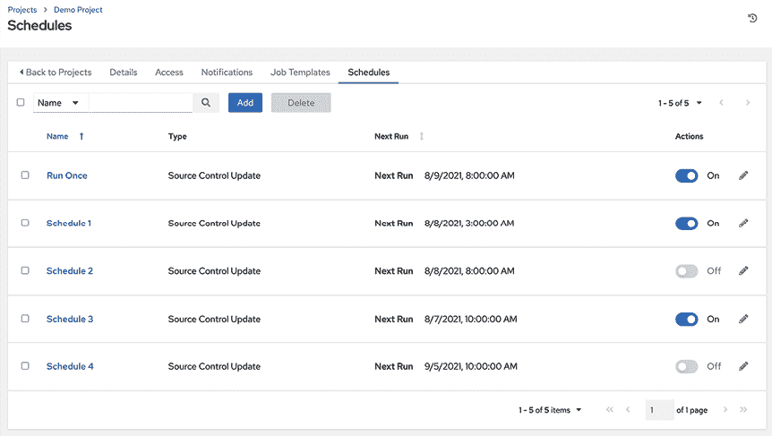

图 2.9：自动化控制面板中的调度作业模板

在每次执行后，我们可以通过传统的电子邮件或与 Slack 或其他即时消息系统的更高级集成触发通知执行。

一种特殊的作业类型是回调作业（callback job），用于实例的初始配置。远程主机可以与特殊的端点交互，触发作业的执行。

我们可以将多个作业组合在工作流（workflow）中，因此执行可以串联或仅在发生特定返回码时执行。例如，我们可以在成功执行后、失败时或总是触发特定作业。另一个优势是后继作业对前序作业定义的变量具有完全可见。请参考下图：

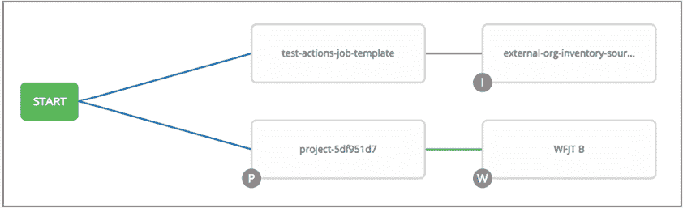

图 2.10：工作流管理

高级用户通常每晚运行事实收集作业并缓存结果，以便使用这些数据提升白天作业的性能。

## API

Ansible 控制器暴露了一个 RESTful API，提供与仪表板相同的信息。大型组织使用它对自动化控制面板的每个组件进行自动化、执行和程序化交互。`awx-cli` 命令行工具和 `ansible.controller` Ansible collection 直接与 API 交互以创建资源或触发作业。

我们还可以通过向自动化控制器地址添加端点 `/api/v2/` 使用现代浏览器进行交互，如图 2.11 所示。API 接口接受所有的 HTTP 方法 `GET`、`POST`、`PUT`、`DELETE` 和 `HEAD`。优先使用与自动化控制面板仪表板相同证书的 HTTPS 连接。API 的某些区域需要身份验证。我们可以使用 Bearer 认证（也称为令牌认证）或通过我们喜爱的浏览器进行交互验证。

请参考下图：

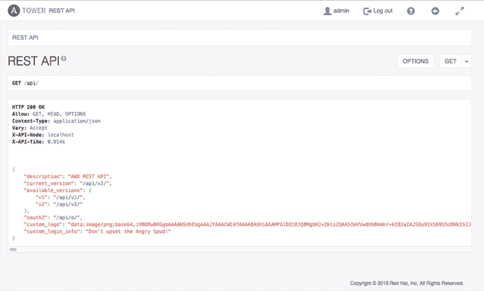

图 2.11：自动化控制器 API

## Automation hub

代码复用是每个自动化之旅的核心主题。与其手动维护大量代码、仓库和项目，可以使用 Ansible 的标准角色（role）和集合（collection）在整个组织范围内发布内容。这两种格式也适用于集成由 Red Hat、合作伙伴和第三方创建的代码。

### 角色与集合

Ansible 角色和集合是 Ansible 中的两个核心概念，有助于组织和共享可重用的自动化内容。

Ansible 角色是将自动化内容组织并封装成可重用单元的方法。角色是一个目录结构，包含执行特定自动化任务所需的 Ansible 任务、变量、模板、文件和其他资源。角色提供了一种模块化和结构化的自动化代码组织方法，使代码更容易被重用、共享和维护。Ansible 角色包括：

- **可重用（Reusable）**：角色封装了与特定自动化场景相关的一组特定任务和配置。它们可以在不同的 playbook 和项目之间重用，促进代码的模块化并减少重复。
- **结构与组织（Structure and organization）**：角色提供了预定义的目录结构，有助于将自动化内容组织成逻辑组件。它分离了任务、变量、模板和其他资源，使自动化代码更具可维护性且更易于理解。
- **封装（Encapsulation）**：角色封装了执行特定自动化任务所需的所有必要任务、变量和配置。这种封装使得共享和分发自动化内容变得更容易，因为角色可以作为自包含单元进行打包和共享。
- **角色依赖（Role dependencies）**：角色可以对其他角色有依赖，允许角色的组合和重用。允许通过组合和重用现有角色来创建复杂的自动化场景。
- **参数化（Parameterization）**：角色支持通过变量进行参数化，允许用户在 playbook 执行期间为特定变量提供值来自定义角色的行为。

Ansible 集合（collections）是 Ansible 期引入的功能，提供了打包和分发 Ansible 内容的方法，包括角色、模块、插件和其他自动化产物和资源。集合提供了一种跨团队和组织管理和共享 Ansible 内容的集中标准化方法。

Ansible 集合的主要特性和优势包括：

- **内容发布（Content distribution）**：集合允许将可重用的 Ansible 内容作为单个包发布。它们提供了共享和消费角色、模块、插件和其他自动化资源的方便方法。
- **命名空间与版本控制（Namespace and versioning）**：集合引入了命名空间和版本方案以确保内容的完整性和兼容性。它们使用户能够轻松识别和管理不同版本的集合，对所使用的自动化内容提供更多控制。
- **可扩展性（Extensibility）**：集合提供了通过包含自定义模块、插件和其他扩展来扩展 Ansible 核心功能的机制。这允许用户增强 Ansible 的能力并使其符合其特定需求。
- **协作（Collaboration）**：集合促进了 Ansible 用户和贡献者之间的协作。它们允许多个贡献者协作开发一个集合，共享他们的工作，并为标准的自动化内容做出贡献。
- **集中化管理**：Ansible 集合（collections）可以通过 `Ansible Galaxy` 等集中源进行管理和分发。这使得发现、安装和更新集合变得更容易，简化了组织内部自动化内容的管理。

Ansible 角色（roles）为组织 `playbook` 中的自动化内容提供了模块化和可重用的方法，而 Ansible 集合（collections）提供了一种集中且标准的方式来打包、分发和共享 Ansible 内容，包括角色、模块和插件。角色和集合都贡献了 Ansible 自动化的扩展性、可维护性和协作性。

# Ansible Galaxy 和 automation hub

`Ansible Galaxy` 和 `Ansible automation hub` 都是提供共享和发现 Ansible 内容仓库的平台，但它们有不同的用途并针对不同的用户需求。以下是对 `Ansible Galaxy` 和 `Ansible automation hub` 的解释，并突出了它们的主要区别：

`Ansible Galaxy` 是一个社区驱动的平台，允许用户共享和查找 Ansible 角色、`playbooks` 其他内容。它是一个开源平台，社区成员可以在上面贡献他们的 Ansible 内容供他人使用。`Ansible Galaxy` 并不是 `Ansible Automation Platform` 的一部分。`Ansible Galaxy` 提供了大量的社区贡献内容，使其成为快速查找和复用 Ansible 自动化解决方案的价值资源。

### Ansible Galaxy 的主要功能包括

- **社区贡献的内容**：用户可以访问大量由社区开发的 Ansible 角色、`playbooks` 和 `collections`（集合）。
- **评分和评论**：`Ansible Galaxy` 中的内容可以由用户进行评分和评论，从而对共享内容的质量和可用性提供见解。
- **易于集成**：`Ansible Galaxy` 内容可以轻松地集成到 `Ansible Playbooks` 和项目中，使用户利用现有的自动化解决方案。

另一方面，`Ansible automation hub` 是作为 `Red Hat Ansible Automation Platform` 订阅的一部分提供的平台。它提供了一个精选的 `Ansible Content Collections` 集合，这些集合经过 Red Hat 及其合作伙伴的认证、验证和支持。`Automation hub` 专注于提供具有增强安全性、可靠性和支持的企业级内容。

### Ansible automation hub 的主要功能包括

- **认证和验证的内容**：`Ansible automation hub` 提供了一系列经过严格测试、验证和认证过程的 `Ansible Content Collections`。这确保了内容符合高质量标准，并且在企业环境中是可以可靠的。
- **Red Hat 支持**：`Ansible automation hub` 中的可用内容有 Red Hat 的支持和专业知识保障，为用户提供可靠的技术协助和指导。
- **私有自动化中心**：`Automation hub` 还提供私有自动化中心功能，允许组织在其内部基础设施内安全地存储和管理其用户生成的内容，确保对其自动化资产的控制和治理。

`Ansible Galaxy` 是一个具有广泛社区贡献内容的平台，是社区驱动的平台，而 `Ansible automation hub` 是由 Red Hat 提供的订阅制平台，提供认证、验证和支持的内容。`Ansible Galaxy` 适用于快速查找和复用社区开发的内容，而 `Ansible automation hub` 专注于提供具有增强支持和安全性的企业级内容。

`Ansible automation hub` 充当受信赖的中央仓库，用户可以在这里发现并下载 `Ansible Content Collections`。本文探讨了 `Ansible automation hub` 的功能和优势，包括 `Red Hat Ansible Certified Content` 的可用性以及用于增强控制和安全性的私有自动化中心。

作为 `Red Hat Ansible Automation Platform` 订阅的一部分，`Ansible automation hub` 提供了全面的 `Ansible Content Collections`。这些集合经过了精心挑选，包含了 `Red Hat Certified Content` 以及来自 60 多个领先行业合作伙伴的贡献。通过利用这些集合，组织可以加速其自动化项目，确保效率和可靠性。

在 `Ansible automation hub` 内部，用户可以访问大量的 `Red Hat Ansible Certified Content Collections` 库。这些集合由 `Arista`、`Aruba`、`CheckPoint`、`Cisco`、`CyberArk`、`Dynatrace`、`IBM`、`SAP` 和 `ServiceNow` 等知名合作伙伴开发。每个集合都经过了严格的测试和验证以确保企业级质量，为用户提供完全支持的角色和模块。

`Ansible automation hub` 还具有由 Red Hat 及其合作伙伴创建并维护的 `Ansible validated content`。这些内容提供了可靠的、专家指导的平台管理方法，保证了一致性和性能的提升。用户可以直接部署 `Ansible validated content`，也可以对其进行定制以适应其特定的企业环境需求。

对于寻求对自动化内容拥有更大控制权的组织，`Ansible automation hub` 提供了私有自动化中心功能。这种本地化能力允许用户在其自己的基础设施内存储和管理用户生成的内容，确保数据隐私和治理。通过利用私有自动化中心，组织可以安全地与其团队共享内部开发的内容以及 `Red Hat Ansible Certified Content` 和 `Ansible validated content`。请参考下图：

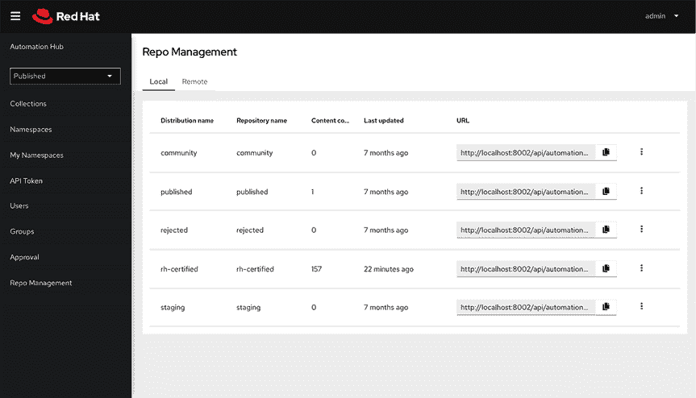

图 2.12：automation hub 界面

私有自动化中心不仅限于内容管理，还扩展了对执行环境的支持。此功能允许用户构建并共享具有定义、一致且可移植环境的容器镜像。通过确保标准化的执行环境，组织可以在自动化工作流中实现更好的重现性和可靠性。

`Ansible automation hub` 是 `Ansible Content Collections` 的可靠来源，为用户提供各种认证和验证内容，以加速其自动化项目。无论是利用 `Red Hat Ansible Certified Content`、`Ansible validated content` 还是私有自动化中心，组织都可以简化其自动化工作，确保内容的一致性、安全性和对内容的增强控制。通过 `Ansible automation hub`，自动化新项目变得比以往任何时候都更快、更可靠且更容易获取。

私有自动化中心指的是部署在组织内部基础设施中的 `automation hub` 节点实例，提供相同的功能，但限于组织特定的内容并仅供其成员访问。私有自动化中心还可以作为 `Ansible execution environments` 的本地注册表。

# Ansible execution environment

Ansible 严重依赖 `Python` 编程语言和数据类型。`Python` 长期以来一直是自动化任务的热门选择，允许用户编写脚本和程序来自动化过程。传统上使用 `Python` 虚拟环境来管理依赖并为运行自动化任务创建隔离环境。然而，`Ansible execution environments` 的引入改变了我们构建和部署自动化工作流的方式。本文中我们将探索 `Ansible` 中的执行环境，并理解它们如何简化构建和使用自定义 `Python` 环境的过程。

## 构建执行环境

在使用 Ansible 时，通常需要依赖许多默认环境中不存在的依赖项和集合（collections）。在多个节点上管理这些依赖项可能具有挑战性，因为它们需要在每台机器上进行安装和同步。以前，Ansible 任务运行在虚拟环境中，这需要手动设置和维护。

通过执行环境（execution environments），Ansible 引入了一种基于容器的方法来构建自定义环境。执行环境不再依赖虚拟环境，而是包含系统级依赖和集合内容的容器镜像。这意味着每个执行环境仅包含运行特定任务所需的内容，减少了开销并确保了不同节点之间的一致性。通过这种方式，执行环境的创建者可以在开发阶段整合所需的代码，并在部署到生产环境之前在 UAT 中完成所有测试。

我们的组织通常需要自定义执行环境来集成自定义权限，例如 Ansible 集合或插件。要构建执行环境，我们需要使用 `ansible-builder` 工具。首先，确保系统已安装了 `podman` 或 `docker` 以及 `ansible-builder` 软件包。一旦准备工作就绪，我们就可以继续构建执行环境。


构建执行环境涉及创建一个定义文件（通常为`.yml`文件），该文件指定了要包含在环境中的内容。这包括集合、系统级软件包和自定义依赖项。如果我们已经从虚拟环境迁移，可以提取所需数据并在定义文件中使用它们。开发者也可以通过提供适当的元数据为其内容声明需求。

有了定义文件，我们就可以使用`ansible-builder`命令行工具来构建执行环境。`ansible-builder`命令以定义文件作为输入，并为环境生成构建上下文。然后它使用构建上下文构建镜像。生成的镜像可以直接使用，也可以在稍后重新构建。

## 使用执行环境

我们可以使用标准或自定义执行环境来运行任务。要在任务中使用执行环境，我们需要确保它已使用`ansible-builder`创建。我们可以通过自动化控制器的用户界面在作业模板中指定执行环境。请参考下图：


图 13：创建新的执行环境

Ansible 自动化平台积极维护着三个执行环境：

- `ee-supported`：一个全面的执行环境，包含了 Red Hat 客户最常用的集合。
- `ee-minimal`：一个占用空间较小的执行环境，仅包含最少的内容。
- `ee-2.9`：用于旧版工作负载和网络设备的 Ansible 2.9 版本。

取决于执行环境是全局可用还是绑定到特定组织，我们需要相应的管理员权限在任务中使用它。绑定到组织的执行环境要求管理员在这些环境中运行任务。在带有执行环境运行任务或作业模板之前，请确保关联的凭据包含所需信息，例如用户名、主机名和密码。

如要向自动化控制器添加执行环境，请导航到用户界面中的“执行环境”部分。点击“添加”按钮并输入所需的信息，如名称、镜像名称、拉取选项、描述、组织分配和注册表凭据。添加后，可以在我们的作业模板中选择该执行环境。

通过将执行环境与作业模板关联，我们可以轻松指定每个特定任务使用哪种环境。这允许我们为不同的任务自定义运行时环境，并确保自动化工作流的一致性。

## 执行环境挂载选项

有时我们可能需要添加额外的证书或进一步自定义执行环境。Ansible 提供了将外部路径挂载到执行环境中的选项，允许我们以`HostPath`的形式继承 OpenShift 或 Kubernetes 容器中的证书。

## Ansible 自动化网格

自动化网格（Automation mesh）是 Red Hat Ansible 自动化平台的一项本质功能，能够在跨网络分配工作。它依赖开源项目`receptor`（参考：<https://receptor.readthedocs.io/en/latest/>）。它利用现有网络建立节点之间的点对点连接，创建一个覆盖网络，从而简化自动化任务的部署和管理。本章提供了自动化网格的概述，并就规划和设计自动化网格拓扑提供了指导。

自动化网格作为覆盖网络，有助于在大规模地理分散的工作节点集合之间高效分配工作。它引入了动态集群能力，能够以最小的停机时间完成创建、注册、分组、取消分组和注销。自动化网格分离了控制平面和执行平面，允许 playbook 执行能力从控制平面容量进行独立扩展。我们可以使用集成在自动化控制器用户界面中的自动化拓扑可视化工具查看当前拓扑，如图 2.14 所示：

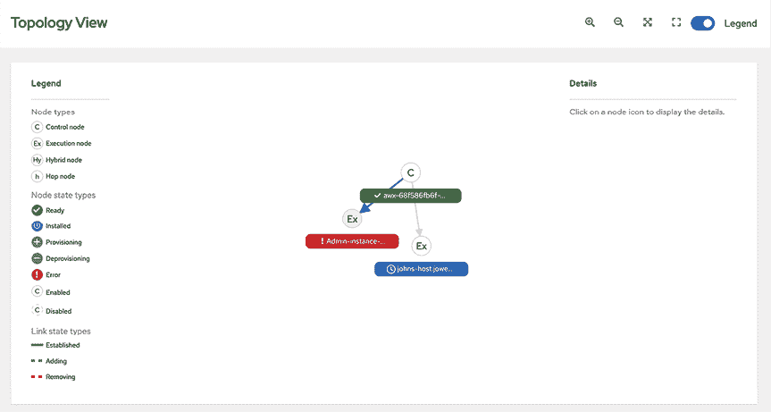

图 2.14：自动化控制器中的拓扑视图

它提供了弹性的部署选择，支持双向和多跳网格通信，并符合联邦信息处理标准（FIPS）以确保安全连接。表 2.1 总结了自动化网格使用的网络端口。

| 端口 | 协议 | 服务 | Ansible 变量 | 用途 |
| :--- | :--- | :--- | :--- | :--- |
| 22 | TCP | SSH | `ansible_port` | 安装 |
| 27199 | TCP | Receptor | `receptor_listener_port` | receptor 连接的监听端口。 |
| 443* | TCP | Podman | N/A | 访问执行环境的容器注册表。 |

表 2.1：自动化网格使用的网络端口

同等节点定义了自动化网格内的节点间连接。我们可以在`[automationcontroller]`和`[execution_nodes]`组内建立同等关系，也可以通过使用`[automationcontroller:vars]`或`[execution_nodes:vars]`组来建立。

### 自动化网格节点类型

在我们的清单文件中为主机定义节点类型，对于配置自动化网格至关重要。我们可以在 Ansible 清单中为单个节点或整个节点组设置`node_type`变量。

- **混合节点（Hybrid node）**：此示例演示了控制平面中单个混合节点的清单：

```ini
[automationcontroller]
control-plane-1.example.com
```

- **控制节点（Control node）**：此示例阐述了控制平面中的单个控制节点：

```ini
[automationcontroller]
control-plane-1.example.com node_type=control
```

- **执行节点（Execution node）**：接下来的段落定义了执行平面中的单个执行节点：

```ini
[execution_nodes]
execution-plane1.example.com
```

- **跳板节点（Hop node）**：此示例展示了执行平面中的一个跳板节点和一个执行节点。注意为每个单独的节点设置了`node_type`变量：

```ini
[execution_nodes]
execution-plane-1.example.com node_type=hop
execution-plane-2.example.com
```

为了在组级别设置节点类型，我们可以为执行节点和跳板节点创建单独组：

```ini
[execution_nodes]
execution-plane-1.example.com
execution-plane-2.example.com

[execution_group]
execution-plane-2.example.com

[execution_group:vars]
node_type=execution

[hop_group]
execution-plane-1.example.com

[hop_group:vars]
node_type=hop
```

在节点之间建立同等连接对于自动化网格内部的通信至关重要。我们可以使用`peers=`主机变量创建节点间连接：

```ini
[automationcontroller]
control-plane-1.example.com

[automationcontroller:vars]
execution_nodes.example.com

[execution_nodes]
execution-plane1.example.com
execution-plane-2.example.com
```

定义了自动化网格内的节点间连接。我们可以在`[automationcontroller]`和`[execution_nodes]`组内建立同等关系，也可以通过使用`[automationcontroller:vars]`或`[execution_nodes:vars]`组来建立。

人们通常喜欢将数据库节点存储在固态硬盘（SSD）中以提供更好的性能，并将非数据库节点存储在机械/传统硬盘（HDD）中以实现成本效益。

### 前提条件和要求


在每个安装场景下，Ansible Automation Platform 对 IT 基础设施所需的资源量取决于安装场景。在编写本书此时，对于每个安装节点，我们都需要分配以下资源。这些资源（通常）通过虚拟机实例提供或（极少数）通过本地机器提供。请参考下图：

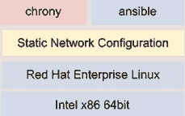

图 3.1：AAP 前提条件图

以下是所有节点的节点：

- 64 位处理器架构
- Red Hat Enterprise Linux 操作系统
- 配置了静态 IP 地址或具有无限租期和 DNS 记录的 DHCP 预留的网络
- 配置了 NTP 客户端 `chrony` 服务
- 安装了最新版本的 `ansible-core`

Ansible Automation Platform 仅支持 x86 兼容架构（Intel 或 AMD 处理器的代号为 `x86_64/amd64`）。尽管如此，自 2023 年 6 月发布 Ansible Automation Platform 版本以来，已支持广泛的处理器架构。最重要的是 Ansible Automation Platform 对 ARM 架构（代号为 `aarch64/pp64le`）的支持，提供了无缝集成、可扩展性和性能。该版本还引入了对 IBM Power 和 IBM Z（代号为 `s390x`）服务器硬件上 Linux 技术预览支持。

以下是自动化控制器节点和执行节点的最低要求：

- 自动化控制器节点和执行节点需要 16 GB RAM
- 自动化控制器节点和执行节点需要 4 个 CPU
- 数据库节点 20+ GB 存储
- 非数据库节点 40+ GB 存储

以下是私有自动化枢纽（Private Automation Hub）的最低要求：

- 8 GB RAM
- 2 个 CPU
- 数据库节点 20+ GB 存储
- 非数据库节点 40+ GB 存储

这些是我们节点的最低要求，我们需要根据系统使用的自动化脚本数量、网络连接、CPU 和内存进行调整。根据经验，更多资源通常会为平台带来更高的性能。然而，大多数虚拟化技术不支持轻松缩减分配的资源，特别是存储空间。我的建议是在开发和测试环境中执行一些测试，以便在生产环境中部署系统之前获得真实的统计数据。

请注意，每个安装的 Ansible fork 值默认为 5。请参阅第 4 章设置仪表板，以获取更多关于 Ansible 性能调优的信息。

正如我们注意到的，建议的数据库节点大小为 20+ GB，这取决于我们需要存储的信息量。具体大小取决于许多因素，例如我们需要交互的 Ansible 资源数量、每天的执行次数以及日志保留数据。非数据库节点的建议空间为 40+ GB，因为它们需要运行 Ansible 执行环境容器镜像，这些镜像会影响文件系统的大小。对于自动化控制器、自动化枢纽以及 PostgreSQL 节点，存储卷的速率至少要达到 1500 IOPS 的最低基准。请注意，自动化控制器和自动化枢纽使用数据库中不同的表。Red Hat Ansible Automation Platform 的最新版本包含了最新版本的 PostgreSQL。在编写本书此时，可用 PostgreSQL 13。该版本的 PostgreSQL 利用了表分区技术来优化数据存储和信息检索。从安全角度来看，所有用户密码在存储到数据库之前都会使用 `SCRAM-SHA-256` 哈希算法进行哈希。

Ansible Automation Platform 使用 Red Hat Enterprise Linux（`RHEL`）作为操作系统，需要有效的订阅权限。`subscription manager` 会自动管理并为 `YUM/DNF` 包管理器启用所需的软件仓库。我们可以使用以下命令通过 `subscription-manager` 命令将任何实例注册并管理到 Red Hat Network（`RHN`）：

```bash
subscription-manager register --username Username --password 'Password'
```

用户名和密码是 Red Hat 客户门户凭据的占位符。成功注册后屏幕会返回类似的输出消息：

```text
The system has been registered with id: a1b2c3d4-a1b2-a1b2-a1b2-acdf1234567
```

我们可以在注册过程中将实例附加到权限池，或使用 Red Hat 账户的默认设置。大型组织使用 Red Hat Satellite（基于 Foreman 项目）来注册并一致地维护操作系统 Red Hat Enterprise Linux，并应用安全补丁。Ansible Automation Platform 曾仅运行在 Intel 兼容的 x86 64 位处理器上。然而，自 2.4 版本发布以来已支持 ARM 和 IBM Power 架构。该产品专门支持 Red Hat Enterprise Linux 操作系统。这是为了提供来自 Red Hat 的获奖最佳支持，因为他们能够追踪我们系统中所有的软件栈。通常，每次 Ansible 故障排除会议都从与 Ansible 支持团队的工程师共享 `sos-report` 包开始。网络配置需要静态 IP 地址或具有无限租期的 DHCP 预留。每个名称都需要在我们组织的 DNS 服务器中注册为 DNS 记录或使用完全限定域名（`FQDN`）。优选 DNS 主机名，而不是直接在清单文件中指定 IP 地址。请注意，`localhost` 不是实例接受的主机名。它需要通过 NTP 协议进行时间同步。我们可以通过配置 `chrony` 服务连接到组织的 NTP 服务器或最近的网络池来轻松执行时间同步。AAP 还要求所有节点上安装最新版本的 `ansible-core` 包。Ansible 安装工具将检查安装状态并执行安装。

## 安装程序

在我们成功分配资源并安装软件前提条件后，我们准备好执行 Ansible Platform 安装程序。

正如我们在上一节中所学到的，许多组件必须协调工作以顺利运行。Ansible Automation Platform 提供了一个安装工具来简化用户入驻并设置必要的组件。该工具正式称为 Red Hat Ansible Automation Platform 安装程序。该工具包含在 Ansible Automation Platform 的每个版本中，协助 IT 专业人员进行系统的安装。如果我们需要查看安装状态，它还会产生一些安装日志。请参考下图：

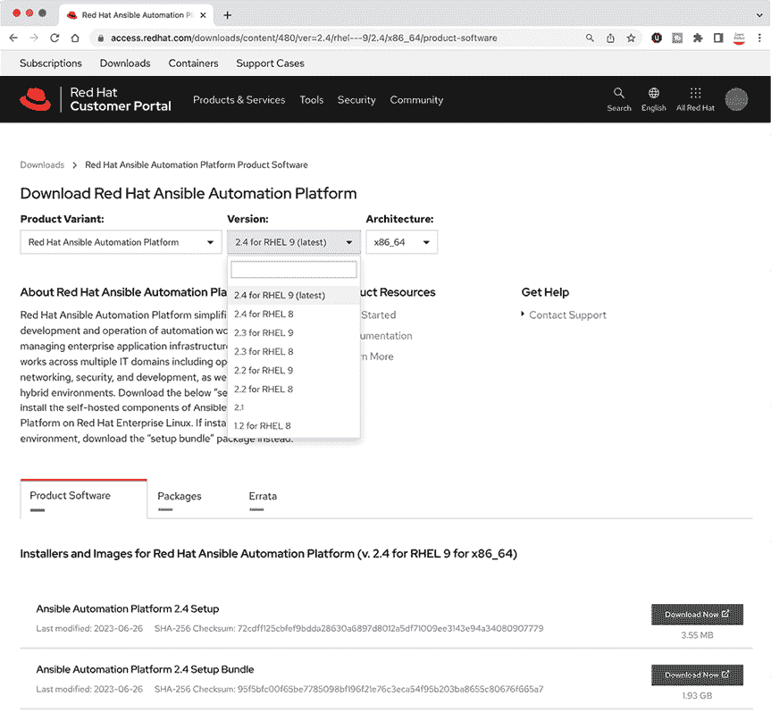

图 3.2：从 Red Hat 客户门户下载 AAP

可以通过 Red Hat 客户门户以两种格式下载安装工具：在线版和绑定版，如图 3.1 所示。作为参考，对于 RHEL9 的 AAP 2.4，在线安装包约为 3.55 MB，绑定包约为 1.93 GB。对于 RHEL9 的 AAP 2.3，在线安装包约为 7.53 MB，而绑定包约为 1.35 GB。

请注意仅使用提供的安装工具升级 Ansible Automation Platform 组件。

安装工具期望清单文件按照以下用例进行配置，并执行成功的平台安装。

在线安装允许我们系统中的 Ansible Automation Platform 存储库下载最新版本的软件包，并根据清单文件中指定的参数配置我们的系统。

而捆绑包安装（bundled installation）包含了成功离线安装系统所需的所有文件。它为我们的 Red Hat Enterprise Linux 版本提供了所有必要的软件和依赖项。许多用户倾向于使用捆绑安装程序安装系统，即使他们并不处于物理隔离（air-gapped）场景中。物理隔离环境通常用于受高度监管的行业，如金融机构、运输公司等，这些环境节点与互联网完全隔离。

每次安装 Ansible Automation Platform 都需要以下步骤：

1. 访问我们的 Red Hat 客户门户。
2. 下载 Ansible Automation Platform 在线安装程序或捆绑包。为常用的算法提供了验证哈希值（目前为 `SHA-256` 校验和）。
3. 解压 tar 包存档。安装程序以压缩方式存储，以节省磁盘空间和下载时间。在终端上执行以下命令来解压存档：

   ```bash
   tar zxvf ansible-automation-platform-setup-*.tar.xz
   ```

4. 进入解压后的文件夹。使用在线安装或捆绑安装方法时，文件夹名称略有不同。

   - 捆绑安装程序：`ansible-automation-platform-setup-bundle-<aap-version>`
   - 在线安装程序：`ansible-automation-platform-setup-<aap-version>`

   现在我们已经知道了安装目录，可以使用 `cd` 命令轻松访问它。我们可以使用以下命令访问捆绑安装程序的目录：

   ```bash
   cd ansible-automation-platform-setup-bundle-<aap-version>
   ```

5. 根据我们的安装场景自定义清单文件。
6. 当我们在终端上执行以下命令时，安装开始：

   ```bash
   ./setup.sh
   ```

请注意，此步骤需要管理员用户，因为我们要在系统中安装 AAP 软件包，创建特定用户（`awx` 和 `receptor`）并应用系统配置参数。

**注意：** 当使用“localhost”实例名称时，安装程序会在屏幕上显示以下错误信息并失败：

`The system hostname cannot be localhost, receptor requires it to be set to something other than localhost`

**注意：** 当分配给当前实例的内存不超过最低标准时，安装程序会在屏幕上显示以下错误信息并失败：

`This machine does not have sufficient RAM to run Ansible Automation Platform.`

我们可以通过自定义文件的值来覆盖最小内存限制，例如以便在可用内存的 Apple Silicon 处理器硬件上运行：

`collections/ansible_collections/ansible/automation_platform_installer/roles/preflight/defaults/main.yml`

Red Hat 高度不建议这种做法，因为会导致不受支持的安装场景，但我们可能只在开发环境中考虑它。图 3.3 展示了在终端窗口中使用 `VIM` 编辑器进行编辑：

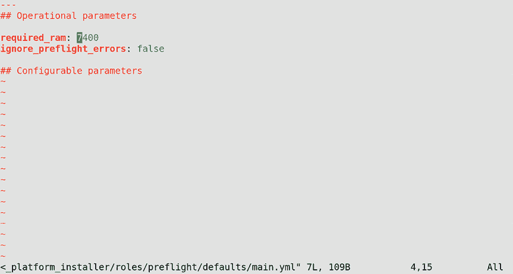

图 3.3：AAP 预检自定义

7. 连接到 Web 界面应用许可清单（license manifest）。

该文件验证我们的 Red Hat Ansible Automation 订阅并启用 Ansible Automation Platform 的完整功能。我们可以从 Red Hat 客户门户中与 Ansible Automation Platform 权限计划相关的订阅分配页面获取 Ansible Automation Platform 的清单文件。请注意，提供 30 天试用许可。

在 AAP 安装程序执行结束时，预期已成功安装 Ansible Automation Platform。

## 安装场景

以下安装场景通过为 Ansible Automation Platform 安装程序提供清单文件，简化了我们的安装。在大多数情况下，我们只需要自定义主机名称、数据库密码和管理员用户（用户名：`admin`），即可继续安装 AAP。

单个自动化控制器（automation controller）支持以下三种安装场景：

- 带有内置 PostgreSQL 数据库的独立节点
- 使用外部安装程序管理的 PostgreSQL 数据库的单节点
- 使用外部 PostgreSQL 数据库的单节点

私有自动化中心（private automation hub）支持以下三种安装场景：

- 带有内置 PostgreSQL 数据库的独立节点
- 使用外部安装程序管理的 PostgreSQL 数据库的单节点
- 使用外部 PostgreSQL 数据库的单节点

Ansible Automation Platform 2.4 引入了事件驱动 Ansible 控制器（`EDA`），它可以类似于自动化控制器或私有自动化中心进行安装。本书将教授带有内置 PostgreSQL 数据库的独立 EDA 控制器的安装场景。

整个 Ansible Automation Platform 支持以下三种安装场景：

- 所有节点均使用外部安装程序管理的数据库
- 所有节点均使用外部 PostgreSQL 数据库
- 在 Red Hat OpenShift Container Platform（基于 Kubernetes）上安装

在接下来的章节中，我们将探索每个用例，并解释每个场景的常见使用情况。请注意，清单文件中未使用的行已脱敏。

## 设置自动化控制器

自动化控制器是 Ansible Automation Platform（以前称为 Ansible Tower）的控制平面。它提供了用户界面、基于角色的访问控制、工作流和 CI/CD 能力，用于管理跨组织的自动化生命周期。自动化控制器有助于标准化自动化部署、审计和管理，同时减少碎片化和差异。它具有一个中心化的 Web 用户界面和 RESTful API，用于清单管理、工作流调度、更改跟踪和报告。最新版本包含一个自动化拓扑查看器，用于可视化复杂的自动化设置。它可以部署在物理或虚拟环境中，而不需要 Red Hat OpenShift。Red Hat Ansible Automation Platform 为流程自动化、促进协作和加速增长提供了全面的解决方案。

我们可以通过运行 Ansible Automation Platform 安装程序来轻松设置自动化控制器。由于下载的包中自带默认清单文件，因此这是一项简单的任务。

### 带有内置数据库的独立自动化控制器

单个自动化控制器可以带有内置 PostgreSQL 数据库部署。这种场景简化了部署，增强了数据安全性，提高了开发环境中的部署速度，精简了维护、配置和管理，并确保了组织内自动化工作流和数据的良好可用性。它适用于自动化执行有限的开发环境和小组织。请参考下图：

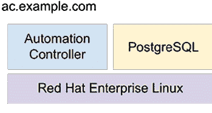

图 3.4：带有内置数据库的独立自动化控制器

以下 Ansible 清单文件用于在 `ac.example.com` 上带有内置 PostgreSQL 数据库安装单个 Ansible 自动化控制器。

```ini
[automationcontroller]
ac.example.com

[all:vars]
admin_password='<password>'
pg_host=''
pg_port='5432'
pg_database='awx'
pg_username='awx'
pg_password='<password>'
pg_sslmode='prefer'
```

```bash
registry_url='registry.redhat.io'
registry_username='<registry username>'
registry_password='<registry password>'
```

让我们来拆解清单文件的内容：

1. `[automationcontroller]`：这是一个用于标识自动化控制器（automation controller）节点的组名。在此情况下，指定的唯一节点是 `ac.example.com`，它是自动化控制器的主机名。
2. `[all:vars]`：此部分包含应用于清单中所有主机的变量。它是 Ansible 清单中的一个组变量。
3. `admin_password='<password>'`：此变量为具有管理权限的 Ansible Automation Platform 管理员用户设置密码。
4. `pg_host=''`：此变量指定 PostgreSQL 数据库服务器的主机名或 IP 地址。在本示例中，它是空的，表示数据库运行在与自动化控制器相同的节点上。
5. `pg_port='5432'`：此变量设置 PostgreSQL 数据库服务器的端口号。
6. `pg_database='awx'`：此变量指定 Ansible Automation Platform 使用的 PostgreSQL 数据库名称。
7. `pg_username='awx'`：此变量设置连接到 PostgreSQL 数据库的用户名。
8. `pg_password='<password>'`：此变量指定 PostgreSQL 数据库用户的密码。
9. `pg_sslmode='prefer'`：此变量决定 PostgreSQL 数据库连接的 SSL 模式。在这种情况下，它设置为 `prefer`，意味着优先使用 SSL 但不是强制。
10. `registry_url='registry.redhat.io'`：此变量设置用于下载 Ansible Automation Platform 组件的容器仓库的 URL。如果组织没有私有容器仓库，人们保留默认的 `registry.redhat.io`。
11. `registry_username='<registry username>'`：此变量指定用于容器仓库认证的用户名。请输入与我们的 Red Hat 客户门户配置凭据相同的用户名。


12. `registry_password='<registry password>'`：此变量设置用于容器仓库认证的密码。请输入与我们的 Red Hat 客户门户配置凭据相同的密码。

## 使用安装程序管理数据库的单自动化控制器

将数据库与自动化控制器节点分离，使我们能够单独为前端机器或数据库机器分配资源。通常会为数据库机器分配高级存储类，并为前端机器分配高性价比的存储类。请参考下图：

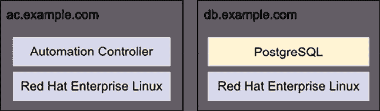

图 3.5：使用安装程序管理数据库的单自动化控制器

以下示例代表一个清单文件，用于安装部署在独立节点上的带有外部 PostgreSQL 数据库的单自动化控制器。数据库将由安装程序部署在独立的节点 `db.example.com` 上。

```ini
[automationcontroller]
ac.example.com

[database]
db.example.com

[all:vars]
admin_password='<password>'
pg_host='db.example.com'
pg_port='5432'
pg_database='awx'
pg_username='awx'
pg_password='<password>'
pg_sslmode='prefer'
registry_url='registry.redhat.io'
registry_username='<registry username>'
registry_password='<registry password>'
```

让我们逐步查看清单文件的内容：

1. `[automationcontroller]`：该组名用于标识自动化控制器节点。在此情况下，指定的唯一节点是 `ac.example.com`，它代表自动化控制器的主机名或 IP 地址。

2. `[database]`：该组名用于标识数据库节点。在本示例中，节点指定为 `db.example.com`，代表独立数据库节点的主机名或 IP 地址。

3. `[all:vars]`：此部分包含应用于清单中所有主机的变量。

4. `pg_host='db.example.com'`：此变量指定 PostgreSQL 数据库服务器的主机名或 IP 地址。在这种情况下，它指向专为数据库指定的独立节点。

   其余变量与之前带有内部数据库的自动化控制器安装场景具有相同的含义和值。

   通过在该份清单文件中填充适当的值并运行安装过程，我们可以使用 Red Hat Ansible Automation Platform 设置一个带有位于独立节点外部数据库的单自动化控制器节点。

## 配置外部数据库

当负载密集或我们希望精调数据库性能时，我们可以由自己管理数据库节点。如果需要，我们可以将 PostgreSQL 数据库配置为不受 Automation Platform 安装程序控制的独立节点。这在管理多个数据库服务器时也有用。典型的用例是多个数据库服务器协同工作，以便在主服务器故障时另一台服务器能够快速接管（高可用性），或允许几台计算机提供相同的数据（负载均衡）。

理想情况下，数据库服务器可以无缝协作。通常实现的部署方式包括：主备复制、共享磁盘切换、文件系统（块设备）复制、使用点点恢复（PITR）的热备备、基于语句的复制中间件、异步或同步多主复制。对于更密集的负载，请考虑使用外部维护的数据库（在下一节中探讨）。请参考下图：

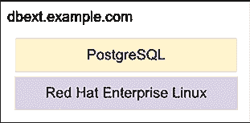

图 3.6：外部数据库图

我们必须安装标准的 Red Hat Enterprise Linux 实例，带有 PostgreSQL 数据库和 `ansible` 核心包。在编写本书时，AAP 2.4 支持的最新 PostgreSQL 版本为 13。为了访问自动化控制器和自动化中心访问的数据库，必须启用 PostgreSQL 软件集（SCL）。

提示：管理员可以选择利用 `awx-manage dbshell` 命令，这将自动启用 PostgreSQL SCL。

1. 在 Red Hat Enterprise Linux 上安装 PostgreSQL 服务器：

   我们可以使用 DNF 包管理器在机器上安装 Red Hat PostgreSQL 数据库：

   ```bash
   # dnf install postgresql-server
   # dnf module install postgresql:13/server
   ```

2. 初始化数据库集群：

   ```bash
   # postgresql-setup --initdb
   ```

   Red Hat 建议将数据库数据存储在默认的 `/var/lib/pgsql/data` 目录。我们可以为 `/var` 设置单独分区以实现分区隔离设计。

3. 启动 PostgreSQL 服务：

   ```bash
   # systemctl start postgresql.service
   ```

4. 启用 PostgreSQL 服务自启动：

   ```bash
   # systemctl enable postgresql.service
   ```

5. 为我们的安装创建一个用户：

   以下命令用于切换到 `postgres` 用户，访问 PostgreSQL 命令行界面（`psql`），然后创建一个名为 `aap_mydbuser` 的用户，密码为 `mypasswd`，并授予创建权限。

   ```bash
   # su - postgres
   $ psql
   postgres=# CREATE USER aap_mydbuser WITH PASSWORD 'mypasswd' CREATEROLE CREATEDB;
   ```

   可以使用元命令 `\q` 退出 `psql` 交互终端：

   ```sql
   postgres=# \q
   ```

6. 使用 `aap_mydbuser` 登录：

   ```bash
   # psql -U aap_mydbuser -h 127.0.0.1 -d postgres
   ```

   提供的命令用于使用指定的参数访问 PostgreSQL 命令行界面（`psql`）：

   - `-U aap_mydbuser` 指定连接数据库的用户名为 `aap_mydbuser`。
   - `-h 127.0.0.1` 指定主机为 `127.0.0.1`（本地主机）以连接到数据库服务器。
   - `-d postgres` 指定要连接的数据库名称为 `postgres`。

默认情况下，AAP 安装器会根据典型工作负载的推荐默认值设置数据库服务器。然而，我们可以针对 PostgreSQL 数据库服务器节点修改这些设置，考虑到 `ansible_memtotal_mb` 代表数据库服务器实例的总内存大小。`ansible_memtotal_mb` 参数用于计算 PostgreSQL 配置文件的值，但我们可以将其作为设置的参考。以下参数设置在存储于 `/var/lib/pgsql/data/` 目录下的 `postgresql.conf` PostgreSQL 配置文件中。这些是关键参数：

```text
max_connections == 1024
shared_buffers == ansible_memtotal_mb*0.3
work_mem == ansible_memtotal_mb*0.03
maintenance_work_mem == ansible_memtotal_mb*0.04
```

给出的表达式是与 PostgreSQL 数据库相关的配置设置，通常与 Ansible 自动化平台配合使用：

- `max_connections == 1024`：这设置了可以连接到数据库的最大并发连接数。在此情况下，值被设置为 `1024`，这意味着数据库可以处理多达 `1024` 个并发连接。
- `shared_buffers == ansible_memtotal_mb*0.3`：共享缓冲区是 PostgreSQL 中的一种重要资源，用于在内存中存储频繁访问的数据以提高性能。此表达式将共享缓冲区的大小设置为总可用内存（`ansible_memtotal_mb`）的比例。在此情况下，它被设置为可用内存的 30%（`0.3`）。
- `work_mem == ansible_memtotal_mb*0.03`：`work_mem` 用于 PostgreSQL 中的排序和哈希操作。此表达式设置了每个会话为此类操作分配的内存量。值被设置为可用内存（`ansible_memtotal_mb`）的 3%（`0.03`）。
- `maintenance_work_mem == ansible_memtotal_mb*0.04`：`maintenance_work_mem` 用于清理（vacuum）和索引重建等维护操作。此表达式设置了每个会话为这些维护任务分配的内存量。值被设置为可用内存（`ansible_memtotal_mb`）的 4%（`0.04`）。

通过根据可用内存（`ansible_memtotal_mb`）设置这些配置参数，可以优化 Ansible 自动化平台的数据库性能和资源分配。

### 带有外部数据库的单一自动化控制器

带有外部（客户提供的）数据库设置单一自动化控制器具有以下几个优势：

- **可扩展性**：通过将自动化控制器和数据库分离到不同的节点，我们可以分配工作负载并独立扩展每个组件。这允许实现更好的性能和容量管理，特别是在大型且复杂的环境中。
- **灵活性**：使用外部数据库使我们能够自由选择符合组织需求和偏好的数据库系统。我们可以利用现有的数据库基础设施，利用所选数据库的特定功能或优化，并对其配置和维护拥有更多控制权。
- **数据管理**：通过外部数据库，我们可以更有效地集中和管理与自动化相关的数据。数据库用作存储自动化剧本（playbooks）、清单信息、作业历史和其他元数据的存储库。它为组织和访问这些数据提供了可靠且可扩展的解决方案，便于自动化资产的高效搜索、版本控制和跟踪。
- **关注点分离**：将自动化控制器和数据库保持分离确保了职责的清晰划分。自动化控制器专注于管理和执行自动化工作流，而外部数据库专门用于数据存储和检索。这种分离增强了模块化，简化了故障排除，并允许对每个组件进行更细粒度的控制。
- **高可用性**：通过将数据库放在单独节点，我们可以实施数据库复制、集群或故障转移机制等高可用措施。这有助于确保数据完整性和可用性，最大限度地减少停机或数据丢失的风险。

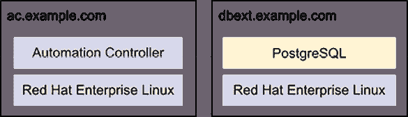

图 3.7：带有外部数据库的单一自动化控制器

外部数据库选项有：

- 客户部署的使用 Red Hat 提供的 PostgreSQL 软件包的高可用或灾备备配置。
- 客户内部团队提供的 PostgreSQL 数据库。
- 云托管的 PostgreSQL 数据库。
- 第三方 PostgreSQL 服务（例如 Crunchy Postgres）。

为了获得最佳性能，建议延迟低于 5ms。

带有外部数据库的单一自动化控制器提供了灵活性、可扩展性和高效的数据管理。这使得组织能够根据其需求和基础设施要求优化其 Ansible 自动化平台的部署。以下清单文件部署了一个自动化控制器 `ac.example.com`，它连接到数据库 `db.example.com`。

```ini
[automationcontroller]
ac.example.com

[database]

[all:vars]
admin_password='<password>'
pg_host='dbext.example.com'
pg_port='5432'
pg_database='awx'
pg_username='awx'
pg_password='<password>'
pg_sslmode='prefer'
registry_url='registry.redhat'
registry_username='<registry username>'
registry_password='<registry password>'
```

给定的配置文件表示用于安装带有单一自动化控制器和独立节点外部数据库的平台的清单文件。让我们检查其内容：

- `[automationcontroller]`：此组名用于标识自动化控制器节点。在此情况下，指定的唯一节点是 `ac.example.com`。
- `[database]`：此组名用于指示数据库的存在，但未提供节点。该组下缺失节点表示数据库已存在并由其他地方管理，而不是由平台。
- `[all:vars]`：此部分包含适用于清单中所有主机的变量。
- `admin_password='<password>'`：此变量设置平台管理员的密码。
- `pg_host='dbext.example.com'`：此变量指定外部托管 PostgreSQL 服务器的主机名或 IP 地址。它指示平台应该连接到现有数据库。

其余变量与其他控制器场景的含义和值相同。

通过在清单文件中填充适当的值并运行安装过程，我们可以设置带有独立节点外部 PostgreSQL 数据库的 Ansible 自动化控制器实例。

### 其他选项

我们还可以在清单文件中添加额外的可选行（以 `#` 字符开头），为 SSL 相关设置提供额外的选项，例如自定义 CA 证书安装、Web 服务器 SSL 证书和 PostgreSQL SSL 设置。这些是清单文件中相关的键：

```ini
# SSL 相关变量

## 如果设置，这将自定义 CA 证书到系统信任存储。
### custom_ca_cert=/path/to/ca.crt

### 安装在 nginx 中用于 Web UI 和 API 的证书和密钥
### web_server_ssl_cert=/path/to/tower.cert
### web_server_ssl_key=/path/to/tower.key

### PostgreSQL 服务器端 SSL 设置（当我们安装它时）。
### postgres_use_ssl=False
### postgres_ssl_cert=/path/to/pgsql.crt
### postgres_ssl_key=/path/to/pgsql.key
```

## 设置私有自动化中心

自动化中心是一个云端服务，提供来自广泛合作伙伴（Arista、Aruba、Checkpoint、Cisco、CyberArk、Dynatrace、IBM、SAP、ServiceNow 等）的 Red Hat Ansible 认证内容集。这些内容包含了经过企业级认证且生产就绪的 Ansible 资源，如集合、角色和模块。

希望与其团队共同开发 Ansible 验证内容并希望缓存最常用内容的组织，应该采用一个或多个私有自动化中心实例。

私有自动化中心是 Red Hat Ansible Automation Platform 的组件，用作 Ansible 集合的本地存储库。这些是在我们组织中部署自动化中心的主要优势：

- **Ansible 私有自动化中心部署**：按照官方文档安装并配置私有自动化中心。修改清单文件变量以适应我们的环境，包括中心 URL、数据库设置和 API 令牌（token）。
- **配置并同步仓库**：访问私有自动化中心的 URL 并导航到“仓库管理（Repository Management）”选项。通过提供必要的信息（如仓库 URL、YAML 要求文件、Ansible Galaxy 用户名和密码）来配置社区仓库和 `rh-certified` 仓库。同步仓库以获取集合。
- **将私有自动化中心作为内容源连接**：使用 API 令牌对目标机器进行身份验证。我们可以在 WebUI 中通过“集合”选项和“API 令牌管理”生成新令牌。从“仓库管理”选项复制 CLI 配置参数，并粘贴到目标机器上的 `/etc/ansible/ansible.cfg` 文件或控制器的 WebUI 中。
- **从私有自动化中心拉取并安装集合**：使用 `ansible-galaxy` 命令从私有自动化中心安装集合。过程类似于从 Ansible Galaxy 安装集合。安装完成后，我们可以使用 `ansible-doc` 命令检查已安装集合中的可用模块，或使用 `ansible-navigator` 命令。

以下安装场景提供了有关如何设置和利用私有自动化中心在本地环境中管理 Ansible 集合的详细说明。

### 带有内部数据库的独立式自动化中心

设置带有内部 PostgreSQL 数据库的单一私有自动化中心，使我们能够部署一个自包含且独立的环境来管理自动化内容。有了内部数据库，私有自动化中心可以存储和组织与自动化资源相关的所有必要信息和元数据，例如剧本、角色和模块。这允许在自动化中心内对自动化资产进行高效搜索、版本控制和跟踪。

此外，带有内部数据库的独立设置提供了对数据更高的控制和安全性，因为它消除了对外部依赖和潜在连接问题的需要。它为组织在基础设施内部管理和共享其自动化内容提供了可靠且自给自足的解决方案。请参考下图：

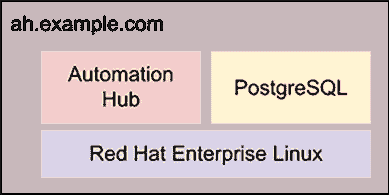

图 3.8：带有内部数据库的独立式自动化中心

以下清单文件部署了一个带有内部 PostgreSQL 数据库（安装程序管理）的单一私有自动化中心实例 `ah.example.com`。


```ini
[automationcontroller]

[automationhub]

ah.example.com

[all:vars]

registry_url='registry.redhat.io'

registry_username='<registry username>'

registry_password='<registry password>'

automationhub_admin_password=<PASSWORD>

automationhub_pg_host=''

automationhub_pg_port='5432'

automationhub_pg_database='automationhub'

automationhub_pg_username='automationhub'

automationhub_pg_password=<PASSWORD>

automationhub_pg_sslmode='prefer'
```

让我们拆解清单文件的内容：

- `[automationcontroller]`：此组名为空，表示在此次部署中未指定自动化控制器节点。

- `[automationhub]`：此组名用于识别自动化中心节点。`ah.example.com` 被指定为私有自动化中心的主机名。`ansible_connection=local` 表示到自动化中心的连接将在执行清单文件的机器上本地建立。

- `[all:vars]`：此部分包含适用于清单中所有主机的变量。

- **容器镜像仓库变量**：

  - `registry_url`、`registry_username` 和 `registry_password` 指定了访问容器镜像仓库的凭据。

- **这些参数专门用于私有自动化中心的配置**：

  - `automationhub_admin_password` 设置自动化中心管理员用户的密码。

  - `automationhub_pg_host` 留空，表示内部数据库将托管在与自动化中心相同的机器上。

  - `automationhub_pg_port` 指定 PostgreSQL 数据库的端口号（默认 5432 TCP）。

  - `automationhub_pg_database` 将内部数据库名称设为 `'automationhub'`。

  - `automationhub_pg_username` 和 `automationhub_pg_password` 指定了访问内部数据库的凭据。

  - `automationhub_pg_sslmode` 定义了数据库连接的 SSL 模式（示例中设置为 `'prefer'`）。

- **SSL 相关参数**：

  - 清单文件中的其余行提供了 SSL 相关设置的可选配置选项。

  - `automationhub_disable_https` 决定自动化中心部署是否启用 TLS。

  - `automationhub_ssl_validate_certs` 控制是否验证默认安装生成的自签名证书。

  - 与自定义 CA 证书、`automationhub_ssl_cert` 和 `automationhub_ssl_key` 相关的行允许为自动化中心节点提供 SSL 证书。

通过在该清单文件中填充适当的值，我们可以部署一个带有内部 PostgreSQL 数据库的单一实例。如果启用，部署将使用指定的配置，包括提供的密码、注册凭据和 SSL 设置。

### 安装程序管理数据库的单一自动化中心

带有安装程序管理数据库的单一私有自动化中心提供了与单一自动化控制器相同的优势。它集中了 Ansible 资源的存储，简化了部署和数据库维护，促进了集成与协作，并简化了维护和升级。它为组织提供了高效可靠的自动化操作，帮助其简化流程并实现自动化目标。它是开发环境和小型组织的完美解决方案。请参考下图：

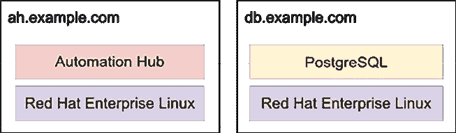

图 3.9：安装程序管理数据库的单一自动化中心

提供的清单文件用于部署带有外部 PostgreSQL 数据库 `db.example.com` 的单一私有自动化中心实例 `ah.example.com`。

```ini
[automationcontroller]

[automationhub]

ah.example.com

[database]

db.example.com

[all:vars]

registry_url='registry.redhat.io'

registry_username='<registry username>'

registry_password='<registry password>'

automationhub_admin_password=<PASSWORD>

automationhub_pg_host='db.example.com'

automationhub_pg_port='5432'

automationhub_pg_database='automationhub'

automationhub_pg_username='automationhub'

automationhub_pg_password=<PASSWORD>

automationhub_pg_sslmode='prefer'
```

之前的场景在清单文件内容上的唯一区别在于：

- `[database]`：

  - 此组名用于指定由安装程序维护的外部数据库节点。

  - `db.example.com` 被提供作为外部数据库的主机名。

- `[all:vars]`：

  - 此部分包含应用于清单中所有主机的变量。

- Automation Hub 配置：

  - `automationhub_admin_password` 设置 Automation Hub 管理员用户的密码。

  - `automationhub_pg_host` 指定外部数据库的主机名。

  - `automationhub_pg_port` 设置外部数据库的端口号（默认为 5432 TCP）。

  - `automationhub_pg_database` 将外部数据库名称命名为 `'automationhub'`。

  - `automationhub_pg_username` 和 `automationhub_pg_password` 指定访问外部数据库的凭据。

  - `automationhub_pg_sslmode` 定义数据库连接的 SSL 模式（在本例中设置为 `'prefer'`）。

使用此清单文件并提供必要的值，我们可以部署一个带有外部（由安装程序管理）数据库的 Automation Hub 实例。如果已启用，部署将利用指定的配置，包括提供的密码、注册凭据、外部数据库信息和 SSL 设置。

### 带有外部数据库的单 Automation Hub

带有外部数据库的单 Automation Hub 涉及使用外部数据库系统来存储和管理自动化相关的数据。Automation Hub 作为管理自动化任务的中央控制点。这种设置提供了集中控制、数据分离与管理、可扩展性、数据持久化和完整性、集成能力以及数据库主机尺寸灵活性等优势。它增强了自动化流程的效率和可靠性，并使组织能够有效地管理和扩展其自动化操作。请参考下图：

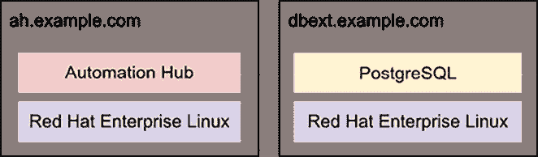

图 3.10：带有安装程序数据库的单自动化控制器

此示例在数据库组下没有主机。这向安装程序表明，数据库是由客户管理的外部 PostgreSQL 数据库。以下清单文件配置了带有外部数据库 `dbext.example.com` 的私有 Automation Hub `ah.example.com`。

```ini
[automationcontroller]

[automationhub]

ah.example.com

[database]

[all:vars]

registry_url='registry.redhat.io'
registry_username='<registry username>'
registry_password='<registry password>'
automationhub_admin_password=<PASSWORD>
automationhub_pg_host='dbext.example.com'
automationhub_pg_port='5432'
automationhub_pg_database='automationhub'
automationhub_pg_username='automationhub'
automationhub_pg_password=<PASSWORD>
automationhub_pg_sslmode='prefer'
```

提供的清单文件示例用于部署一个带有不由平台安装程序管理的外部 PostgreSQL 数据库的单私有 Automation Hub 实例。之前的场景在清单文件内容上的唯一区别在于：

- `[database]`：

  - 此组名为空，表示数据库组下未指定主机。

  - 这意味着外部数据库存在且在其他地方进行管理。

- `[all:vars]`：

  - 此部分包含应用于清单中所有主机的变量。

- 通过参数对私有 Automation Hub 进行配置：

  - `automationhub_admin_password` 设置 Automation Hub 管理员用户的密码。

  - `automationhub_pg_host` 指定外部数据库的主机名。

  - `automationhub_pg_port` 设置外部数据库的端口号（默认为 5432 TCP）。

  - `automationhub_pg_database` 将外部数据库名称命名为 `'automationhub'`。

  - `automationhub_pg_username` 和 `automationhub_pg_password` 指定访问外部数据库的凭据。

  - `automationhub_pg_sslmode` 定义数据库连接的 SSL 模式（在本例中设置为 `'prefer'`）。

通过使用此清单文件并提供必要的值，我们可以部署一个带有外部 PostgreSQL 数据库的私有 Automation Hub 实例。平台安装程序不管理数据库。

## 设置事件驱动 Ansible 控制器

Event-Driven Ansible 是 Red Hat Ansible Automation Platform 的一项功能，能够通过事件驱动自动化来简化 IT 运维、减少手动任务并促进创新。通过处理事件并对变化的情况做出智能响应，Event-Driven Ansible 自动处理了 IT 环境中的一系列任务，包括工单增强、修复和用户管理。它为手动和自动自动化提供了一个统一的平台，使团队能够专注于关键工作并为业务交付价值。凭借灵活性和适应性，Event-Driven Ansible 可应用于多个 IT 领域，在确保一致性的同时减少人为错误。它通过 `Ansible Rulebooks` 将事件源与相应的操作连接，允许精确执行并利用现有的 playbook 和模板。通过全面的功能和内容集，Event-Driven Ansible 加速了事件驱动自动化倡议，并增强了 IT 响应和效率。

为了说明 Event-Driven Ansible 的强大，考虑一种场景：观测工具检测到一个无响应的网络路由器。此事件触发了 Event-Driven Ansible，它找到相应的 `Ansible Rulebook` 并将事件与所需的操作匹配。该操作可能涉及重新应用配置、重置路由器或创建服务工单。Event-Driven Ansible 然后执行 rulebook 中的指令，重置路由器并恢复正常功能——即使在非工作时间也无需人工干预。

Event-Driven Ansible 依赖 `Ansible Rulebook` 界面来运行 Ansible Rulebooks。它监控事件并将 playbook 的执行委托给 Ansible Automation Platform 的现有工具。另一方面，Event-Driven Ansible 控制器提供了管理、扩展和观测性功能，可在各种环境（包括云、本地和混合设置）中有效利用 Event-Driven Ansible。

Event-Driven Ansible 控制器自 Ansible Automation Platform 2.4 起发布，支持 ARM 和 IBM Power 处理器架构。它需要成功安装 Ansible 自动化控制器才能连接。在编写本书时，每个 Ansible Automation Platform 只能使用一个事件驱动控制器，但团队正在努力实现多个。它基于 `Drools` 开源决策技术。目前它已测试过并发运行 7000 个 rulebook，但由于是新产品，实际限制更高。

注意：当指定任何自动化控制器时，安装程序会在屏幕上显示以下错误信息。

自动化 EDA 需要一个自动化控制器主机。在设置自动化 EDA 时，`[automationcontroller]` 组中必须存在主机，或者必须设置 `automation_controller_main_url`。

以下清单文件部署了一个 Event-Driven Ansible 控制器 `eda.example.com`，它连接到带有内部数据库 `ac.example.com` 的自动化控制器。

```ini
[automationcontroller]
ac.example.com

[automationcontroller:vars]
peers=execution_nodes

[execution_nodes]

[automationhub]

[automationedacontroller]
eda.example.com

[database]

[sso]

[all:vars]
admin_password='redhat'
pg_host=''
pg_port=5432
pg_database='awx'
pg_username='awx'
pg_password='redhat'
automationedacontroller_admin_password='redhat'
```

```ini
automationedacontroller_pg_host='ac.example.com'
automationedacontroller_pg_port=5432
automationedacontroller_pg_database='automationedacontroller'
automationedacontroller_pg_username='automationedacontroller'
automationedacontroller_pg_password='redhat'
```

提供的行是事件驱动 Ansible 控制器（Event-Driven Ansible controller）和自动化控制器（automation controller）的一组配置参数。请参考自动化控制器章节。对于初始参数，让我们仅关注事件驱动 Ansible 控制器的参数：

- `automationedacontroller_admin_password='redhat'`：此参数设置了事件驱动 Ansible 控制器的管理员密码。在这种情况下，密码被设置为 `'redhat'`，但可以根据组织的安全需求进行自定义。

- `automationedacontroller_pg_host='ac.example.com'`：此参数指定了事件驱动 Ansible 控制器存储其数据的 PostgreSQL 数据库主机。在示例中，主机被设置为 `'ac.example.com'`，与 Ansible 控制器相同。我们必须指定 PostgreSQL 数据库服务器的主机名、IP 地址或外部数据库。

注意：当 `automationedacontroller_pg_host` 参数为空时，安装程序会在屏幕上显示错误信息并失败：

```text
automationedacontroller_pg_host is currently empty, ensure automationedacontroller_pg_host is defined and pointing to a database.
```

- `automationedacontroller_pg_port=5432`：此参数设置 PostgreSQL 数据库的端口号。默认情况下，PostgreSQL 使用端口 5432 进行通信。如果我们的 PostgreSQL 数据库在不同的端口上，我们可以相应修改此值。

- `automationedacontroller_pg_database='automationedacontroller'`：此参数指定了事件驱动 Ansible 控制器存储数据的 PostgreSQL 数据库名称。在示例中，数据库名称设置为 `'automationedacontroller'`。如有需要可以选择不同的名称。

- `automationedacontroller_pg_username='automationedacontroller'`：此参数设置连接 PostgreSQL 数据库的用户名。在这里，用户名设置为 `'automationedacontroller'`。我们可能需要根据 PostgreSQL 配置对其进行修改。

- `automationedacontroller_pg_password='redhat'`：此参数设置 `automationedacontroller_pg_username` 参数指定的 PostgreSQL 数据库用户的密码。在这种情况下，密码设置为 `'redhat'`，但我们应该将其替换为强且安全的密码。


这些配置参数对于将事件驱动 Ansible 控制器连接到 PostgreSQL 数据库并管理其管理设置和访问至关重要。确保提供的值与我们的特定环境和安全需求一致是非常重要的。

安装成功后，可以使用任何浏览器访问`eda.example.com`服务器的 Web 用户界面。我们可以使用管理员用户和选定的密码（`'redhat'`）连接到 Web UI。成功安装并登录后的仪表板结果如图 3.11 所示。

图 3.11：Ansible 事件驱动控制面板

## 安装 Ansible Automation Platform

完整安装 Ansible Automation Platform 涉及部署自动化控制器、自动化中心（automation hub）实例以及如后续安装场景所示的其他执行实例。我们还可以使用 Ansible 网格（Ans mesh）技术通过指定执行节点来微调自动化环境。

## 使用安装程序数据库的 Ansible Automation Platform

使用安装程序数据库的 Ansible Automation Platform 具有多个优势，包括简化安装和部署、集中自动化与编排、广泛的自动化能力、高效的数据库管理、增强协作与治理、集成与扩展性，以及可扩展性和性能。该平台简化了自动化工作流，改进了基础设施管理，并提高了组织的运营效率。请参考下图：

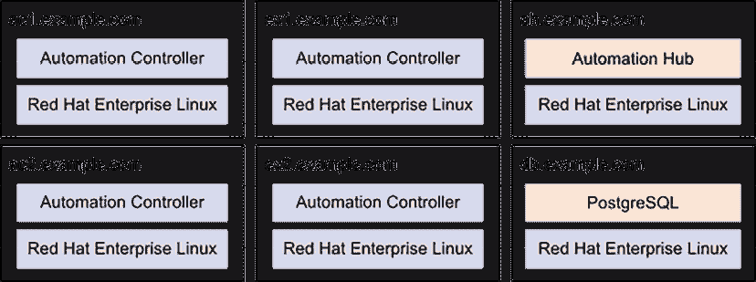

图 3.12：使用安装程序数据库的 Ansible Automation Platform

示例代表了安装具有多个自动化控制器节点、执行节点和一个自动化中心的 Ansible Automation Platform 的清单文件，它们都连接到外部（安装程序管理）数据库，如图 3.12 所示。

```ini
[automationcontroller]
ac1.example.com node_type=control
ac2.example.com node_type=control

[execution_nodes]
ex1.example.com node_type=execution
ex2.example.com node_type=execution

[automationhub]
ah.example.com

[database]
db.example.com

[all:vars]
admin_password='redhat'
pg_host='db.example.com'
pg_port='5432'
pg_database='awx'
pg_username='awx'
pg_password='redhat'
pg_sslmode='prefer' # set to 'verify-full' for client-side enforced SSL
registry_url='registry.redhat.io'
registry_username='<registry username>'
registry_password='<registry password>'
receptor_listener_port=27199
automationhub_admin_password='redhat'
automationhub_pg_host='db.example.com'
automationhub_pg_port='5432'
automationhub_pg_database='awx'
automationhub_pg_username='awx'
automationhub_pg_password='redhat'
automationhub_pg_sslmode='prefer'
```

该示例代表了用于部署带有内部数据库的自动化中心实例的清单文件。让我们分解清单文件的内容：

- `[automationcontroller]`：此组为空，表示在此部署中未指定控制器节点。

- `[automationhub]`：此组用于识别自动化中心。`ah.example.com` 被指定为自动化中心的主机名。`ansible_connection=local` 表示将在执行清单文件的机器本地连接到自动化中心。

- `[all:vars]`：此部分包含适用于所有主机的变量。

- 容器注册表变量：`registry_url`、`registry_username` 和 `registry_password` 指定了访问容器注册表的凭据。

- 自动化中心配置：`automationhub_admin_password` 设置自动化中心管理员用户的密码。`automationhub_pg_host` 为空，表示内部数据库将与自动化中心位于同一台机器上。`automationhub_pg_port` 指定内部数据库的端口号（默认为 5432）。`automationhub_pg_database` 设置内部数据库名称为 `'awx'`。`automationhub_pg_username` 和 `automationhub_pg_password` 指定访问内部数据库的凭据。`automationhub_pg_sslmode` 定义了数据库连接的 SSL 模式（在本示例中设置为 `'prefer'`）。

- SSL 相关变量：

  - 清单文件中的其余行被注释，提供了 SSL 相关设置的可选配置选项。
  - 这些选项包括安装自定义 CA 证书、为自动化中心节点提供证书和密钥，以及配置自动化中心的 SSL 设置。

带有外部托管数据库的 Ansible Automation Platform 指的是一种安装或配置设置，其中平台的数据存储并管理在外部数据库系统中。该平台没有使用内部 PostgreSQL 数据库，而是配置为使用独立的、专用的外部 PostgreSQL 数据库来存储数据。这种配置允许扩展性、提高性能并更易于地管理 Ansible Automation Platform 的数据，因为数据存储在可靠且健壮的数据库系统中。此场景适用于拥有可以使用全托管 PostgreSQL 数据库或集群的大型组织。请参考下图：

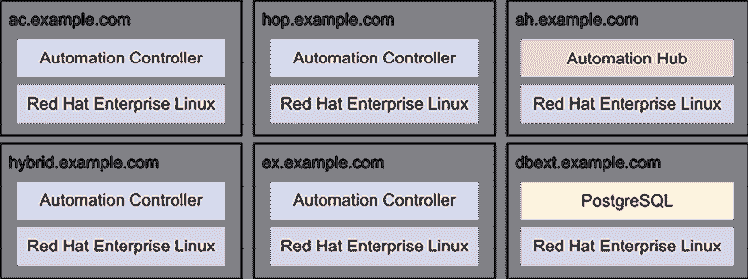

图 3.13：带有外部数据库的 Ansible Automation Platform

以下清单文件设置了带有外部（客户提供的）数据库的 Ansible Automation Platform。它指定了各个不同平台组件的配置，包括自动化控制器、执行节点和自动化中心。

```
[automationcontroller]
hybrid.example.com node_type=hybrid
ac.example.com node_type=control

[execution_nodes]
hop.example.com node_type=hop
ex.example.com node_type=execution

[automationhub]
ah.example.com

[database]

[all:vars]
admin_password='redhat'
pg_host='dbext.example.com'
pg_port='5432'
pg_database='awx'
pg_username='awx'
pg_password='redhat'
pg_sslmode='prefer'
registry_url='registry.redhat.io'
registry_username='<registry username>'
registry_password='<registry password>'
receptor_listener_port=27199
automationhub_admin_password='redhat'
automationhub_pg_host='dbext.example.com'
automationhub_pg_port='5432'
automationhub_pg_database='automationhub'
automationhub_pg_username='automationhub'
automationhub_pg_password='redhat'
automationhub_pg_sslmode='prefer'
```

给出的示例代表了一个用于安装 Ansible Automation Platform 的清单文件，包含四种不同的节点类型（控制、混合、跳和执行）、一个私有自动化中心实例以及外部客户提供的 PostgreSQL 数据库。让我们查看清单文件的内容：

- `[automationcontroller]`：

  - 该组名用于标识自动化控制器节点。
  - 指定了两个节点：`hybrid1.example.com` 和 `ac.example.com`。
  - `hybrid.example.com` 被分配了 `node_type=hybrid`，表示它可以运行所有功能。
  - `ac.example.com` 被分配了 `node_type=control`，表示它只能运行项目和清单更新，而不运行常规作业。

- `[execution_nodes]`：

  - 该组名用于标识执行节点。
  - 指定了两个节点：`hop.example.com` 和 `ex.example.com`。
  - `hop.example.com` 被分配了 `node_type=hop`，表示它可以将作业转发到执行节点。
  - `ex.example.com` 被分配了 `node_type=execution`，表示它可以运行作业。

- `[automationhub]`：

  - 该组名用于标识自动化中心节点。
  - `ah.example.com` 指定为自动化中心主机。

- `[database]`：

  - 该组名表示缺少特定的数据库节点。
  - 安装程序假设数据库存在并由外部管理，而不是由平台安装程序管理。

- `[all:vars]`：

  - 此部分包含适用于清单中所有主机的变量。

- `admin_password='<password>'`：

  - 该变量设置 Ansible Automation Platform 管理员用户的密码。

- PostgreSQL 数据库变量：

  - `pg_host`、`pg_port`、`pg_database`、`pg_username`、`pg_password` 和 `pg_sslmode` 指定了外部数据库的连接详情。

- 容器注册库变量：

  - `registry_url`、`registry_username` 和 `registry_password` 指定了访问容器注册库的凭据。

- Receptor 配置：

  - `receptor_listener_port` 设置了 receptor 监听端口。

- 自动化中心配置：

  - `automationhub_admin_password` 设置了私有自动化中心管理员用户的密码。
  - PostgreSQL 数据库参数（`automationhub_pg_host`、`automationhub_pg_port`、`automationhub_pg_database`、`automationhub_pg_username`、`automationhub_pg_password` 和 `automationhub_pg_sslmode`）指定了私有自动化中心外部数据库的连接详情。

## 负载均衡器

配置负载均衡器允许我们将工作负载分发到多个实例中。其优势在于我们可以主动处理的工作负载量（双主活动场景）以及容错能力。第二个属性在企业环境中至关重要，可以确保我们的 Ansible Automation Platform 的业务连续性。另一个常见用途是 SSL 终止器。通过这种方式，我们可以通过负载均衡器处理加密流量并在节点中更快地处理工作负载。通过设置以下参数，我们为 Red Hat Ansible Automation Platform 配置代理支持。代理服务器作为客户端和服务器之间的中间节点，简化并控制了请求的复杂性。自动化控制器和私有自动化中心前面的典型代理服务器有 Amazon Application Load Balancer (ALB)、Amazon Network Load Balancer (NLB)、HAProxy、Squid 和 Nginx。请参考下图：

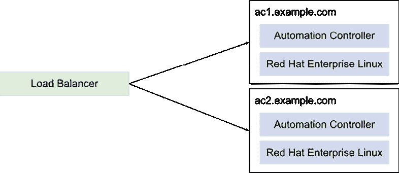

图 3.14：负载均衡器下的 Ansible Automation Platform

我们需要执行以下步骤：

1. **启用代理支持**

   要启用代理支持，我们需要在自动化控制器的设置页面设置 `REMOTE_HOST_HEADERS`。`REMOTE_HOST_HEADERS` 变量通过遍历头列表确定启用的主机 IP。默认设置为 `["REMOTE_ADDR", "REMOTE_HOST"]`。

2. **可用代理**

   当自动化控制器实例配置为 `REMOTE_HOST_HEADERS = ['HTTP_X_FORWARDED_FOR', 'REMOTE_ADDR', 'REMOTE_HOST']` 时，它假设 X-Forwarded-For 的值来自代理或负载均衡器。然而可能会受到伪造 IP 地址的攻击。为了这一点，我们可以使用 `PROXY_IP_ALLOWED_LIST` 配置已知代理列表。来自不在负载均衡器的请求将被拒绝。

3. **配置已知代理**

   为了配置网络中的可用代理列表，我们需要将它们的 IP 地址添加到自动化控制器设置页面的 `PROXY_IP_ALLOWED_LIST` 字段中。IP 地址应按照提供的格式输入，例如 `example.proxy.com:8080`。确保列表中的代理能够正确清理头输入，并将 X-Forwarded-For 值设置为客户端的真实来源。

4. **配置反向代理**

   为了支持反向代理配置，我们可以在自动化控制器设置中向 `REMOTE_HOST_HEADERS` 添加 `HTTP_X_FORWARDED_FOR`。X-Forwarded-For (XFF) 头用于识别通过 HTTP 代理或负载均衡器连接到 Web 服务器的源 IP 地址。

5. **启用粘性会**

   默认情况下，应用负载均衡器 (ALB) 根据负载算法独立路由每个请求。然而，为了在负载均衡器后运行多个私有自动化中心实例时避免身份验证错误，我们需要启用粘性会（也称为会话亲性）。这涉及设置与负载均衡器配置的 Cookie 匹配的自定义应用程序 Cookie。自定义 Cookie 可以包含任何所需的 Cookie 属性。

Ansible Automation Platform 的自动化控制节点通过 WebSocket 相互连接，以便在系统中分发消息（WebSocket 发出的消息）。这种设置允许任何浏览器作为 WebSocket 客户端，订阅运行在任何自动化控制节点上的任何作业。WebSocket 客户端不会被定向到特定节点；任何自动化控制节点都可以处理任何 WebSocket 请求。所有自动化控制节点都必须获知面向所有客户端的 WebSocket 消息。

WebSocket 配置在所有自动化控制节点的`/etc/tower/conf.d/websocket_config.py`文件中进行。更改后，必须重启服务以使配置生效。

自动化控制器通过数据库中的实例记录自动发现其他自动化控制节点。

为了让自动化控制器能够自动发现其他节点，我们可以配置 WebSocket 连接。这涉及编辑端口和协议的 WebSocket 信息，并为 WebSocket 连接指定 SSL 证书验证（True 或 False）。

示例配置：

```
BROADCAST_WEBSOCKET_PROTOCOL = 'http'
BROADCAST_WEBSOCKET_PORT = 80
BROADCAST_WEBSOCKET_VERIFY_CERT = False
```

这些设置将协议定义为 HTTP，端口定义为 80，并禁用了 WebSocket 连接的证书验证。

## OpenShift

另一种选项是在 Red Hat OpenShift Container Platform（基于 Kubernetes）上安装 Ansible Automation Platform。

Ansible Automation Platform operator 是一个工具，有助于在我们的 OpenShift 环境中无缝部署 Ansible Automation Platform 实例。它利用了云原生技术，并提供了简单的、按式的部署过程。通过 Ansible Automation Platform operator，我们可以轻松地部署和管理自动化控制器和私有自动化中心实例，并定义和启动自动化控制器作业。


通过利用 Kubernetes 原生 operator 部署 Ansible Automation Platform 实例，可以简化 Red Hat OpenShift Container Platform（OCP）的生命周期维护。这些优势包括为 Red Hat Ansible Automation Platform 提供简化升级和全面的生命周期支持。最新的 Ansible Automation Platform operator 可以在最新版本的 OpenShift Container Platform 上安装 Ansible Automation Platform。

成功安装 Ansible Automation Platform operator 后，[表 3.1] 中的 Kubernetes operators 和 pods 将运行在集群中：

| Operator 管理控制器 | 自动化控制器 | 自动化中心 |
| --- | --- | --- |
| `automation-controller-operator-controller-manager`、`automation-hub-operator-controller-manager`、`resource-operator-controller-manager` | `controller`、`controller-postgres` | `hub-api`、`hub-content`、`hub-postgres`、`hub-redis`、`hub-worker` |

表 3.1：Ansible Automation Platform operator 包含的 Operators

Ansible Automation Platform operator 是管理自动化控制器、自动化中心实例以及依赖资源生命周期的优秀工具，如[图 3.15]所示的用户界面所示：

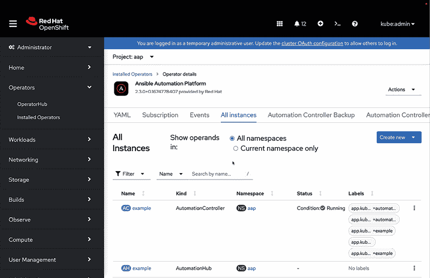

图 3.15：通过 operator 管理 AAP

## Operator 安装

使用原生的 OperatorHub 在 Red Hat OCP 集群中安装 Ansible Automation Platform operator 非常简单。

首先，我们必须通过 Web 控制台使用具有管理员权限的用户（例如 `kubeadmin`）登录 OpenShift 集群。或者，也可以通过命令行安装。

要安装 Ansible Automation Platform operator，我们可以访问 OperatorHub 中的 Red Hat operators 目录。OperatorHub 是集成到 OpenShift 集群中的市场，我们可以在那里找到安装所需的资源，如[图 3.16]所示：

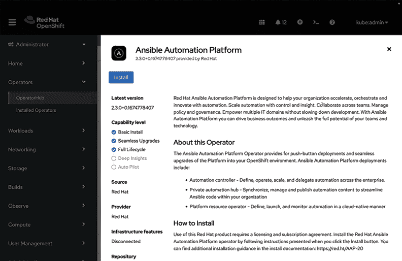

图 3.16：安装 Ansible Automation Platform operator

Ansible Automation Platform operator 实现了 Ansible Automation Platform 实例的精简管理和部署，提高了我们在 OpenShift 环境中自动化工作流的效率和有效性。

Ansible Automation Platform operator 的安装选项如[图 3.14]所示。我们需要选择更新通道、安装模式和更新许可。对于更新通道，我们有以下选择：

- `stable-2.x`：安装命名空间范围内的 operator，将自动化中心和自动化控制器实例限制在安装 operator 的命名空间中。这适用于大多数场景，需要的资源较少且不需要管理员权限。
- `stable-2.x-cluster-scoped`：跨集群中的多个命名空间部署自动化控制器和私有自动化中心，需要所有命名空间具有管理员权限。

此外，如[图 3.17]所示，还需要选择安装模式、安装命名空间和批准策略：

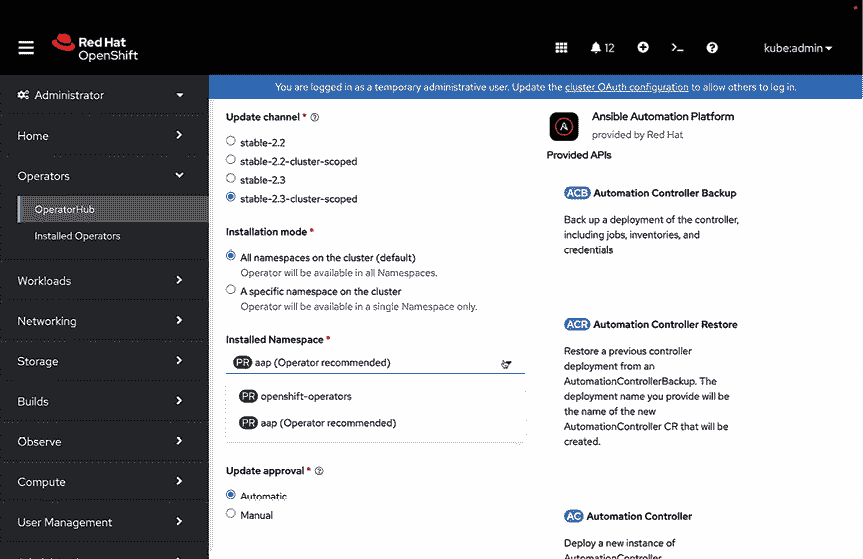

图 3.17：Ansible Automation Platform operator 安装选项

准备就绪后，我们可以点击 `Install` 按钮。几分钟后，Ansible Automation Platform operator 将安装到 OpenShift 集群中。屏幕上会显示“已安装 operator - 就绪可用”的消息。

我们可以随时通过 `Installed Operators` 下拉菜单检查 OpenShift 集群中已安装的 operators。该 operator 提供了一种简单的方法来安装和维护深度集成到 OpenShift 中的自动化控制器和自动化中心软件生命周期，为 PostgreSQL 数据库和共享密钥分配必要的资源。每个实例还有备份和恢复的特定选项。

每当我们启动模板时，都会分配所有相关的容器：PostgreSQL 数据库、Redis、控制平面、执行环境、Web 容器等。[表 3.1]中的 operators 运行在集群中。

## 自动化控制器

Ansible Automation Platform operator 提供了一种在 Red Hat OpenShift Container Platform（OCP）上安装和配置自动化控制器实例的简单方法。我们可以通过指定自定义资源安装自动化控制器，并使用外部 PostgreSQL 数据库部署 Ansible Automation Platform。

它提供了前提条件（CPU 核心、内存、存储限制和请求），支持使用表单视图或 YAML 视图创建自动化控制器实例，配置镜像拉取策略、设置资源需求并定义副本数和其他选项。

需要注意的是，在 `extra_settings` 中进行的配置将优先于在用户界面中进行的配置。此外，在相同的 Kubernetes/OCP 命名空间中部署新的自动化控制器实例之前，建议手动删除旧的持久卷声明（`PVC`）。

创建自动化控制器的用户界面如[图 3.18]所示：

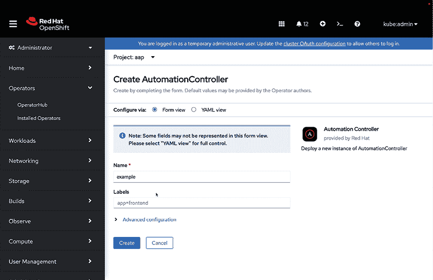

图 3.18：通过 AAP operator 安装自动化控制器

用户可以使用高级配置自定义配置，包括 LDAP 设置、PostgreSQL 容器资源、Web 容器资源、使用的密钥、EE 控制平面容器资源、创建时预加载实例数据、Ingress 网络配置等。

## 自动化中心

Ansible Automation Platform operator 提供了在 Red Hat OpenShift Container Platform Web 控制台上安装和配置自动化枢（automation hub）的功能。它涵盖了安装自动化枢 operator、指定自定义资源以及使用外部 PostgreSQL 数据库部署 Ansible Automation Platform。

自动化枢的配置可以在部署后通过 `pulp_settings` 或用户界面完成，其中 `pulp_settings` 具有更高优先级。建议在相同命名空间中部署新的私有自动化枢实例之前，手动删除旧的持久化卷声明（Persistent Volume Claims）。

它还提供了安装前提，并讨论了用于自动化枢操作的存储选项，例如 ReadWriteMany 文件存储、Azure Blob 存储和兼容 Amazon S3 的存储。可以通过设置额外的参数来配置自动化枢，如[图 3.19]所示。

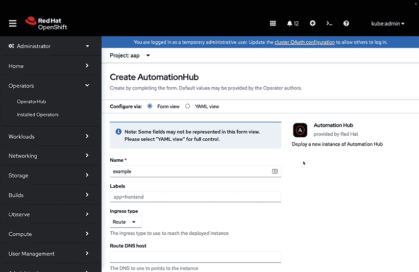

图 3.19：通过 AAP operator 安装自动化枢

## 容器化

2023 年 9 月 28 日，Red Hat 自豪地宣布了其 Ansible Automation Platform 容器化版本的技术预览。这一创新解决方案标志着简化和增强 Ansible 服务管理的一大重要里程碑。

Ansible Automation Platform 的演进导致了各种服务和组件的引入。虽然这扩展了平台的功能，但也引入了与维护、安装和支持相关的复杂性。这些挑战成为开发容器化 Ansible Automation Platform 的动力。

容器化代表了实现更精简、高效平台管理体验的第一步，符合 Red Hat 的愿景和长期战略。其底层利用了集成在 Red Hat Enterprise Linux 中的 Podman 技术。

Ansible Automation Platform 的容器化版本不仅仅是适配现有服务。Red Hat 设置了几个雄心勃勃的目标，以提供一个从多个方面造福用户的整体解决方案：

- **精简安装**：安装过程被简化，使得不同技术水平的用户都能更容易上手。
- **分层安装方法**：该方法提供了更大的灵活性和定制性，确保用户可以根据特定需求定制平台。
- **开箱即用**：容器化解决方案采用无根（rootless）Podman 容器，立即增强了安全性。
- **新功能**：此技术预览引入了多项新功能，例如在安装期间应用 Ansible Automation Platform 许可证，以及将自动化控制器配置作为代码预种子。
- **更轻的足迹**：容器化平台适用于广泛的市场和解决方案，确保更轻的占用以满足多样化用户的需求。

设置过程设计得非常直观，即使对于经验有限的用户也是如此。它涉及几个核心任务：

1. **下载并解压安装包**：用户可以通过 Red Hat Network（RHN）门户访问安装包。该包提供在线版（需要访问互联网）和离线包形式，以满足不同的安装场景。
2. **编辑提供的清单文件**：安装目录包含一个预先配置了关键信息的清单文件。用户可以编辑此文件，根据需要修改配置并填入所需的变量。以下清单文件将在 `aap.example.com` 主机上安装完整的容器化 Ansible Automation Platform（数据库、自动化控制器、Ansible 自动化枢和事件驱动 Ansible 控制器）。

```ini
[automationcontroller]
aap.example.com ansible_connection=local

[automationhub]
aap.example.com ansible_connection=local

[automationeda]
aap.example.com ansible_connection=local

[database]
aap.example.com ansible_connection=local

[all:vars]
postgresql_admin_username=postgres
postgresql_admin_password=redhat
registry_username=RHN_USERNAME
registry_password=RHN_PASSWORD
controller_admin_password=redhat
controller_pg_host=aap.example.com
controller_pg_password=redhat hub_admin_password=redhat
hub_pg_host=aap.example.com
hub_pg_password=redhat
eda_admin_password=redhat
eda_pg_host=aap.example.com
eda_pg_password=redhat
controller_main_url=https://aap.example.com
```

此外，我们可以通过取消注释并相应设置以下变量，在安装后启用应用清单许可证和配置即代码目录的这两个选项：

```ini
#controller_postinstall=true
#controller_license_file=<您的 manifest .zip 文件的完整路径>
#controller_postinstall_dir=<您的 config-as-code 目录的完整路径>
```

3. **设置环境变量**：用户需要使用 `ANSIBLE_COLLECTIONS_PATH` 环境变量指定安装程序集合的位置。

```bash
export ANSIBLE_COLLECTIONS_PATH=/full-path-to-installer/collections
```

4. **运行安装程序**：安装过程涉及使用 `ansible-playbook` 命令运行安装程序集合剧本。此步骤可以使用各种选项进行自定义，包括增加详细性或提升权限。

```bash
ansible-playbook -i inventory ansible.containerized_installer.install
```

由于目标系统中将安装许多组件，安装过程将需要一段时间。一旦安装完成，用户就可以通过 Web 浏览器访问 Ansible Automation Platform 服务。这些服务部署在实例的特定端口上。以下是技术预览版本使用的端口（未来可能会发生变化）：

- 端口 443 上的自动化控制器
- 端口 444 上的 Ansible 自动化枢
- 端口 445 上的事件驱动 Ansible 控制

请参考下图：

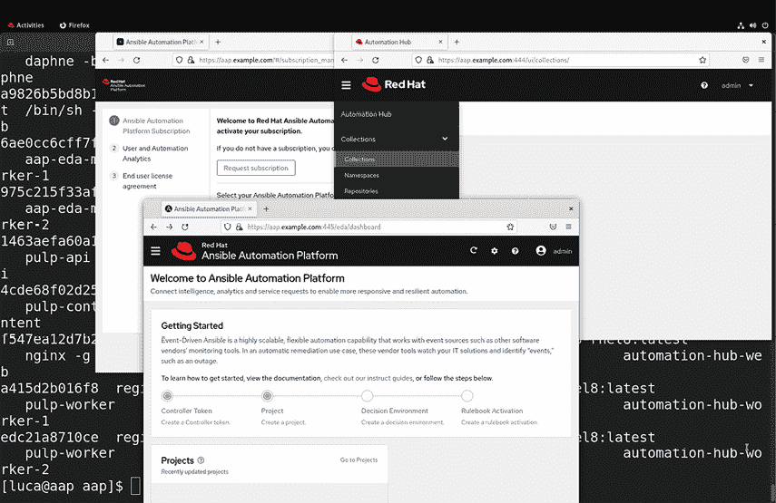

图 3.20：容器化 AAP

以下是容器化 Automation Platform 中运行的容器完整列表：

```text
$ pod ps
CONTAINER ID IMAGE CREATED STATUS PORTS NAMES
45079e0f8b65 registry.redhat.io/redis-6:latest 3 days ago Up a second redis
0e686ba49a7 registry.redhat.io/postgresql-13:latest 37 minutes ago Up 35 minutes postgresql
631bd7c95a48 registry.redhat.io/ansible-automation-platform-24/ee-supported-rhel8:latest /usr/bin/receptor... 35 minutes ago Up 6 minutes receptor
7507d7732073 registry.redhat.io/ansible-automation-platform-24/controller-rhel8:latest /usr/bin/launch_a... 19 minutes ago Up 6 minutes automation-controller-rsyslog
6190a2861e06 registry.redhat.io/ansible-automation-platform-24/controller-rhel8:latest /usr/bin/launch_a... 8 minutes ago Up 6 minutes automation-controller-task
120a89253743 registry.redhat.io/ansible-automation-platform-24/controller-rhel8:latest /usr/bin/launch_a... 8 minutes ago Up 6 minutes automation-controller-web
06d289e13a85 registry.redhat.io/ansible-automation-platform-24/eda-controller-rhel8:latest gunicorn --bind 1... 6 minutes ago Up 3 minutes automation-eda-api
69734ae71fe8 registry.redhat.io/ansible-automation-platform-24/eda-controller-rhel8:latest daphne -b 127.0.0... 5 minutes ago Up 3 minutes automation-eda-daphne
a9826b5bd8b1 registry.redhat.io/ansible-automation-platform-24/eda-controller-ui-rhel8:latest /bin/sh -c nginx ... 5 minutes ago Up 3 minutes automation-eda-web
6ae0cc6cff7f registry.redhat.io/ansible-automation-platform-24/eda-controller-rhel8:latest aap-eda-manage rq... 4 minutes ago Up 3 minutes automation-eda-worker-1
```


```text
975c215f33af registry.redhat.io/ansible-automation-platform-24/eda-controller-rhel8:latest aap-eda-manage rq... 4 minutes ago Up 3 minutes automation-eda-worker-2

1463aefa60a1 registry.redhat.io/ansible-automation-platform-24/hub-rhel8:latest pulp-api 3 minutes ago Up About a minute automation-hub-api

4cde68f02d25 registry.redhat.io/ansible-automation-platform-24/hub-rhel8:latest pulp-content 2 minutes ago Up About a minute automation-hub-content

f547ea12d7b2 registry.redhat.io/ansible-automation-platform-24/hub-web-rhel8:latest nginx -g daemon o... 2 minutes ago Up About a minute automation-hub-web

a415d2b016f8 registry.redhat.io/ansible-automation-platform-24/hub-rhel8:latest pulp-worker 2 minutes ago Up About a minute automation-hub-worker-1

edc21a8710ce registry.redhat.io/ansible-automation-platform-24/hub-rhel8:latest pulp-worker 2 minutes ago Up About a minute automation-hub-worker-2
```

容器化 Ansible Automation Platform（Ans 自动化平台）的引入代表了 IT 管理领域的重大进步。Red Hat 对简化和增强平台管理体验的承诺在这一技术预览中显而易见。客户现在拥有多种安全且灵活的部署场景。可以从 Red Hat 门户的“下载”部分下载软件，并提供了详尽的文档以供详细的安装指南。随着未来的发展，Red Hat 将继续创新，并承诺在未来将推出更多令人兴奋的功能和增强。

## 核心要点

本章全面介绍了 Ansible Automation Platform 的安装场景。它涵盖了安装的先决条件和要求，比较了在线安装和包（bundle）安装程序的选项，并探索了各种安装场景。本章引导读者设置自动化控制器（automation controller）、私有自动化中心（private automation hub）、事件驱动 Ansible 控制器（Event-Driven Ansible controller）以及 Ansible Automation Platform。它还讨论了针对 Ansible Automation Platform 的负载均衡器的设置，并提供了在 OpenShift 上部署该平台的信息。总体而言，本章为不同场景下 Ansible Automation Platform 的安装过程提供了宝贵的见解。

## 记忆要点

- Ansible Automation Platform 包含了 Red Hat Ansible Automation Platform 安装工具，以简化用户入驻和组件设置。
- 根据组织的需求，提供在线格式或包格式的安装。
- 根据工作负载、高可用性和系统恢复能力，有许多安装场景。

## 单选题

1. 下列哪项不是 Ansible Automation Platform 节点的正确先决条件或要求？
   1. x86 兼容 64 位处理器 Intel 或 AMD
   2. Red Hat Enterprise Linux 操作系统
   3. 控制器节点使用 1 个 CPU
   4. 配置 NTP 客户端 chrony 服务

2. Red Hat Ansible Automation Platform 安装程序支持哪两种两种模式？
   1. 在线和离线
   2. 在线和包（Online and bundle）
   3. 单机和集群
   4. 单机和在线

3. 下列哪项不支持的自动化控制器场景？
   1. 使用安装程序管理外部数据库的单一自动化控制器
   2. 使用内部数据库的单机自动化控制器
   3. 使用安装程序管理数据库的单一自动化控制器
   4. 使用外部数据库的单一自动化控制器

4. 如何在 Red Hat OpenShift Container Platform 中部署 Ansible Automation Platform？
   1. Ansible 空间
   2. AAP YAML 清单
   3. 手动部署自动化控制器和自动化中心
   4. Ansible Automation Platform operator

## 答案

1. c
2. b
3. a
4. d

## 复习题

1. 自动化控制器节点、执行节点和自动化中心节点的先决条件和要求是什么？
2. 如何使用 Red Hat Ansible Automation Platform 安装程序在物理隔离场景下部署 Red Hat Automation Platform？
3. 支持哪些自动化控制器场景？
4. 支持哪些自动化中心场景？
5. 如何在 Red Hat OpenShift Container Platform 中部署 Ansible Automation Platform？
6. 使用哪些工具可以为 Ansible Automation Platform 设置负载均衡器？

## 术语

- **在线与包（Online versus bundle）**：Ansible Automation Platform 提供两种安装选项：在线安装简化了用户入驻和组件设置；而包安装程序则协助 IT 专业人员进行初始系统安装，并提供安装日志文件供审阅。
- **物理隔离（Air-gapped）**：指与外部网络物理隔离的安全环境或系统，防止隔离系统与外部世界之间的直接通信或数据传输。
- **内部数据库（Internal database）**：内部数据库是构建在软件应用程序或系统中的数据存储系统，用于在应用程序或系统内部存储和管理数据。
- **外部数据库（External database）**：外部数据库是独立的数据存储系统，应用程序或系统通过访问它在外部存储和管理数据。
- **单机实例（Standalone instance）**：单机实例指的是软件或服务的单一、独立且自包含的部署，它可以独立运行，而不作为大型系统或集群的一部分。
- **Red Hat OpenShift Container Platform**：这是一个综合性的企业级 Kubernetes 平台，用于部署、管理和扩展应用程序。
- **WebSockets**：这些通信协议允许客户端和服务器通过单个长连接进行实时的双向数据交换。

## 加入我们书籍的 Discord

加入书籍的 Discord 工作空间，获取最新更新、优惠、全球科技动态、新发布以及与作者的互动：

`https://discord.bpbonline.com`


# 第 4 章 第一步

## 引言

在本章成功安装 Ansible Automation Platform 后，我们将进入自动化控制器、自动化中心和事件驱动 Ansible 控制器的初步阶段。我们将探索每个部分的核心组件，与软件仪表板交互，并学习高效、成功执行 Ansible 自动化代码（playbook、rulebook 和集合）的重要选项。

## 结构

在本章中，我们将讨论以下主题：

- 订阅激活
- 自动化控制器仪表板
- Ansible 控制 API
- 自动化控制器 CLI
- 执行环境
- 作业（Jobs）
- 日志管理
- 动态清单
- 自动化中心仪表板
- 事件驱动 Ansible
- 最佳实践

## 目标

通过本章，我们能够在自动化控制器中成功执行代码，并利用 Ansible Automation Platform 主要组件。

## Ansible 订阅

Red Hat Ansible Automation Platform 订阅支持对于有效使用该平台是必要的。组织可以获得全面的企业生命周期支持，使其能够有效地管理和扩展其自动化计划。订阅分为两种类型：标准版（上午 8 点至下午 5 点 SLA 技术支持）或高级版（24x7 SLA 技术支持）。新客户还提供 60 天的试用期。我们的自动化控制器需要一个订阅清单文件，我们可以手动上传或使用 Ansible 代码进行上传。或者，如果我们的集群节点通过 `Subscription Manager` 注册到 Red Hat Satellite，我们也可以使用 Satellite 凭据。我们可以通过 Red Hat 客户门户中与我们的 Ansible Automation Platform 权限计划相关的订阅分配页面获取 Ansible Automation Platform 的清单文件。

在首次连接到 Ansible 自动化控制器时，我们可以通过输入 Red Hat 客户门户或 Satellite 凭据来手动检索订阅。屏幕对话框如下方的图 4.1 所示：


图 4.1：许可凭据

假设我们下载了用于 Red Hat 客户门户的订阅清单文件。在这种情况下，我们可以通过 Red Hat Ansible Automation Platform 界面或 Ansible Playbook 上传它。屏幕对话框如下方的图 4.2 所示：

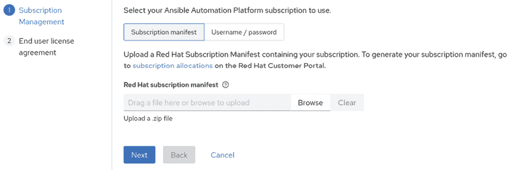

图 4.2：许可清单

通过遵循激活程序，我们可以使用凭据或清单文件成功激活 Red Hat Ansible Automation Platform。这确保了使用 Ansible Automation Platform 的正确授权，并允许我们访问其功能和特性。

### 使用 Ansible 激活

我们可以通过使用 `ansible.controller` 集合中的 Ansible 许可模块自动提供清单文件来激活 Ansible 控制器。更多信息请参阅官方 Red Hat Hybrid Cloud Console 文档，如图 4.3 所示：

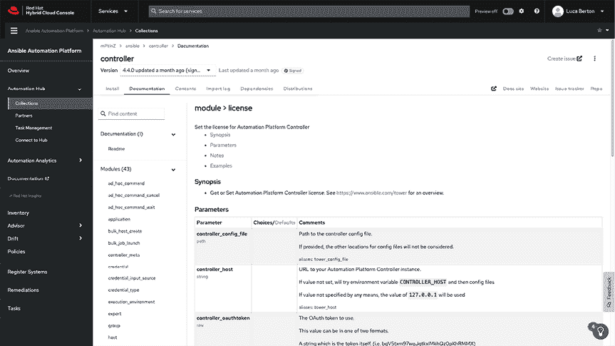

图 4.3：`ansible.controller` 集合文档

以下 `aap_activate.yml` Ansible Playbook 使用 `manifest` 变量指定的清单文件来设置许可：

```yaml
---
- name: Activate License
  hosts: all
  vars:
    manifest: "/tmp/my_manifest.zip"
  tasks:
    - name: Set the license using manifest file
      ansible.controller.license:
        manifest: "{{ manifest }}"
        controller_host: ac.example.com
        controller_username: admin
        controller_password: redhat
```

这些是 Ansible Playbook 的关键区域：

- `vars`：部分定义了 Playbook 内部使用的变量。在这种情况下，它将 `manifest` 变量设置为 `/tmp/my_manifest.zip`。我们可以根据清单文件的位置修改路径，或使用额外变量覆盖参数。
- `ansible.controller.license`：它是 `ansible.controller` 集合提供的模块，专门用于管理 Ansible Automation Platform 中的许可。
- `manifest`：此参数指定订阅清单文件的路径。在这种情况下，它使用之前定义的 `manifest` 变量的值。
- `controller_host`：此参数指定 Ansible Automation Platform 控制器的主机名或 IP 地址。修改此值以匹配我们的自动化控制器主机。
- `controller_username` 和 `controller_password`：这些参数用于提供访问 Ansible Automation Platform 所需的凭据。根据我们环境的管理员用户名和密码修改这些值，或使用 `controller_oauthtoken` 参数提供 OAuth 令牌。

我们可以使用每个 Ansible 安装包含的 `ansible-playbook` 命令来执行 Ansible Playbook：

```bash
ansible-playbook aap_activate.yml
```

通过运行此 Playbook，Ansible 将使用提供的清单文件和指定的凭据验证 Ansible 自动化控制器并激活许可。

## 自动化控制器

自动化控制器仪表板为我们的 IT 排需求提供了一个易于使用的图形界面。以下是仪表板上关键元素的详细说明：

- **导航菜单**：位于左侧，导航菜单允许我们轻松访问不同的视图、导航资源、授予权限并在用户界面中管理自动化控制器功能，如下方的图 4.4 所示：

  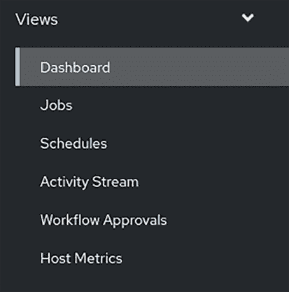

  图 4.4：自动化控制器导航菜单

- **菜单图标**：点击左侧导航栏顶部的菜单图标可以隐藏或显示导航栏，为屏幕提供更多空间，如下方的图 4.5 所示：

  

  图 4.5：自动化控制器菜单图标

- **主仪表板视图**：仪表板视图汇总了我们当前的作业状态。我们可以按时间段或作业类型过滤作业状态。最近作业（Recent Jobs）和最近模板（Recent Templates）选项提供了最近执行的作业和使用的模板的摘要，可以使用各种属性对其进行排序，如下方的图 4.6 所示：

  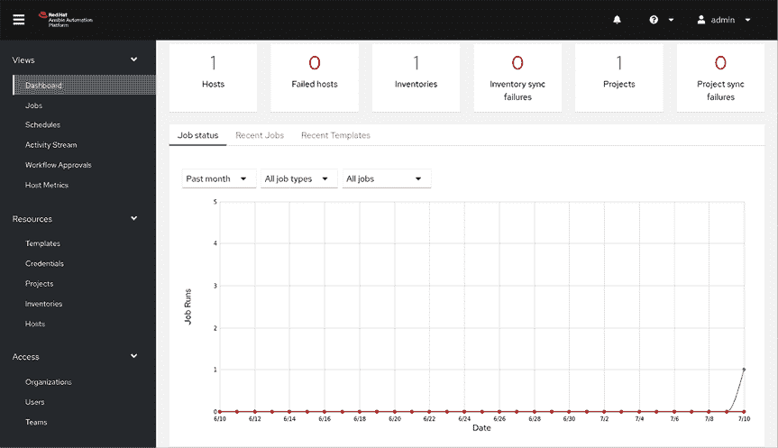

  图 4.6：自动化控制器主仪表板视图

- **设置**：设置选项位于导航栏末尾，如图 4.7 设置与身份验证中的自动化控制器设置。请参考下图：

  

  图 4.7：自动化控制器设置

- **关于图标**：无论我们正在执行哪个窗口或操作，关于图标（显示为 `About`）都位于每个页面顶部，位于用户图标旁边。点击它可以提供有关使用的自动化控制器和 Ansible 版本的信息，如下方的图 4.8 所示：

  

  图 4.8：自动化控制器关于图标

- **用户图标**：用户图标（显示为人物）位于每个页面右上角，位于关于图标旁边。点击它可以提供有关自动化控制器当前用户的信息和注销选项，如下方的图 4.9 所示：

  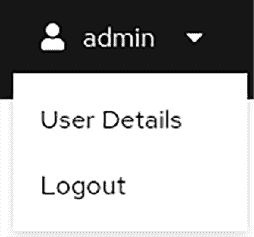

  图 4.9：自动化控制器用户图标

注意：新的自动化控制器用户界面（UI）用于技术预览，可能会在未来的发布中发生变化。

- 要启用新 UI，进入设置菜单，选择杂项系统，并将启用新用户界面预览”选项切换到“开启”。保存后，注销并重新登录以通过预览横幅访问新 UI。我们可以点击顶部横幅上的链接返回之前的 UI。更多信息请参阅第 5 章设置与身份验证中的自动化控制器设置。

通过熟悉自动化控制器仪表板及其各种功能，我们可以高效地导航界面并利用其能力来管理我们的 IT 编排任务。

## 组织

自动化控制器对象层次结构中的“组织”（Organization）是用户、团队、项目和清单的逻辑集合。它是层次结构中的最高级对象，如图 4.10 所示。在用户界面中可以在 `Resources | Organizations` 下找到 `Job Template`（作业模板）。请参考下图：

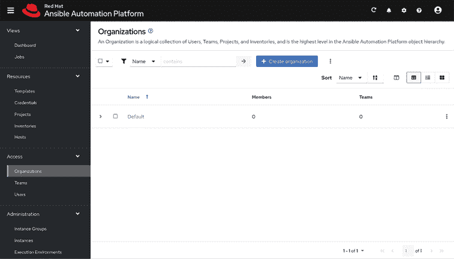

图 4.10：组织层级列表

我们可以通过在左侧导航栏中选择 `Organizations` 来在自动化控制器中查看和管理“组织”。拥有自支持层级许可和 `Basic` 订阅许可的用户不应删除默认组织，因为这对 Ansible 控制器的功能至关重要。企业版或高级许可证持有者可以使用图 4.11 中显示的向导编辑并添加新组织。检查组织设置并确保其配置恰当，使我们能够有效地管理自动化控制器中的用户、团队、项目和清单。请参考下图：

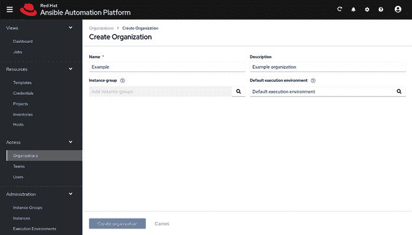

图 4.11：新组织

## 清单

自动化控制器中的清单是系统管理的主机列表。`Organizations` 被分配给清单，而针对清单运行 playbook 的权限在用户或团队层级进行控制。我们可以使用 `Credentials`（凭据）定义 `username`、`password` 或 `SSH key` 来登录清单中的每个主机或主机组。要访问自动化控制器中的清单，点击左侧导航栏中的 `Inventories` 查看现有清单。


注意：自动化控制器提供了开箱即用的演示清单。我们可以根据需要对其删除或编辑。

列出的清单显示在类似于图 4.12 的视图中。我们可以在用户界面的 `Resources | Inventories` 下找到 `Job Template`。请参考下图：

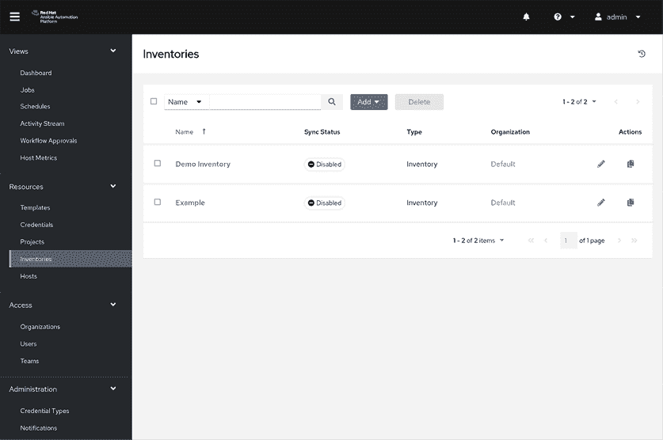

图 4.12：清单列表

要创建额外的清单，点击 `Add` 按钮，从下拉菜单中选择 `Add Inventory`，指定 `Name`（名称）和 `Organization`（组织），并使用 `Save` 按钮保存新清单，如图 4.13 所示。

注意：与组织类似，清单也有关联的用户和团队。我们可以通过 `Access` 选项卡查看它们。

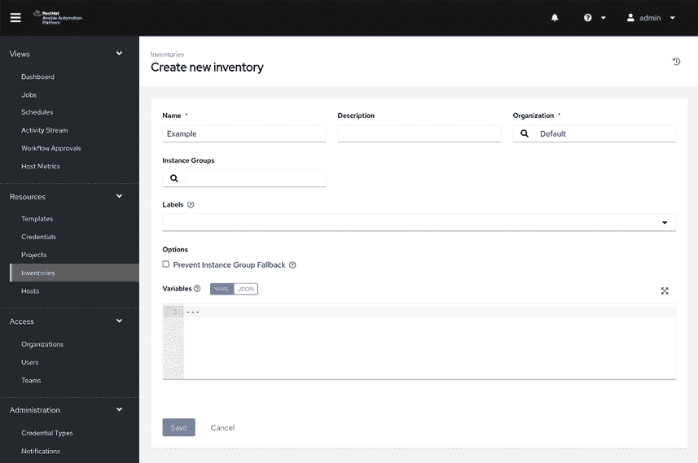

图 4.13：清单列表

1. 具有 `System Administrator`（系统管理员）角色的默认管理员用户会自动分配给 `Demo Inventory`（演示清单）。

2. 组和主机：清单分为组和主机。组可以代表特定的环境、服务器类型或组织结构。属于 `Demo Inventory` 的组和主机分别显示在 `Groups` 和 `Hosts` 选项卡中。

3. 在 `Groups` 屏幕中点击 `Add` 按钮以添加新组。

4. 在 `Hosts` 选项卡中，点击 `Add` 按钮将主机添加到组中。

5. 假设我们之前创建的组织有一组支持特定应用程序的 Web 服务器主机。要将这些主机添加到清单中，请创建一个组并添加这些 Web 服务器主机。

6. 点击 `Cancel`（如果不进行任何更改）或使用自动化控制器浏览器顶部的面包屑导航链接返回 `Inventories` 列表视图。点击 `Save` 不会退出 `Details` 对话框。

通过这些步骤，我们可以创建新清单，管理组和主机，并将用户和团队与清单关联。这允许对自动化控制器中的主机进行有效的组织和控制。

## 动态清单

Ansible 动态清单是 Ansible 自动化控制器中的一项功能，允许我们为项目动态生成生成清单信息。它提供了一种从外部源（如云提供商、虚拟化平台、数据库或自定义脚本）动态管理和检索主机信息的方法。通过动态清单，我们可以定义脚本或插件来实时收集有关我们基础设施的信息，并将其作为清单呈现给 Ansible。这消除了手动维护静态清单文件的需要，特别是在大型或快速变化的环境中。

在 Ansible 自动化控制器中，动态清单通过创建 `inventory sources`（清单源）来配置。`inventory source` 指定了生成动态清单的外部源。它可以是像 `AWS` 或 `Azure` 这样的云提供商，像 `VMware` 或 `OpenStack` 这样的虚拟化平台，或任何提供 API 或脚本来检索主机信息的其他自定义源。它依赖于额外的 Ansible 清单插件。

在 Ansible 自动化控制器中配置 `inventory source` 时，我们需要指定必要的参数以连接到外部源并检索清单数据。这包括身份验证凭据、`API endpoints`（API 端点）、`filters`（过滤器）和其他相关信息。一旦建立了清单源，自动化控制器就会定期轮询该源以更新清单信息。它检索主机数据，如 `IP addresses`、`hostnames`、`groups`、`variables` 和其他属性，并供 Ansible 执行 playbook，如图 4.14 所示：

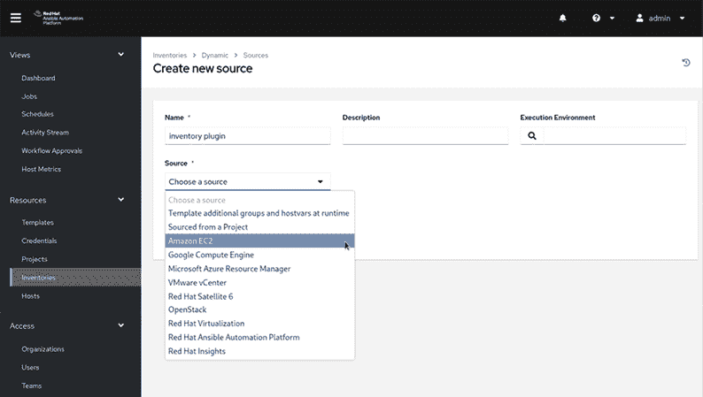

图 4.14：动态清单

Ansible 自动化控制器中的动态清单具有多个优势：自动实时更新清单、可扩展性和活性、与外部平台的集成、分组和变量分配。通过利用 Ansible 自动化控制器中的动态清单，我们可以实现清单管理的自动化、简化 playbook 执行并确保我们的 Ansible Playbook 始终在最新的基础设施上执行。

## 凭据

`Credentials`（凭据）用于验证针对清单运行 Ansible playbook 的用户。它们可以是 `passwords`、`SSH keys` 或其他身份验证方法。常用的凭据类型是 `Machine`，它指定了连接到目标主机的凭据。

我们可以使用图 4.15 所示的视图查看所有可用凭据。在 `Resources | Credentials` 下找到 `Job Template`。请参考下图：

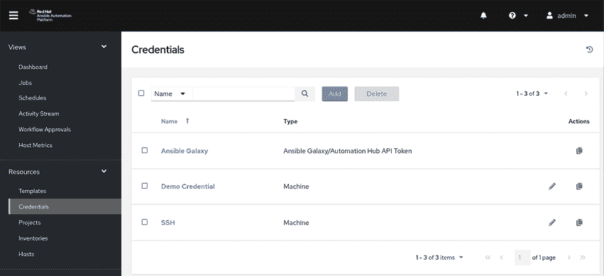

图 4.15：凭据列表

要创建新凭据，导航到左侧导航栏中的 `Credentials` 部分，访问现有凭据列表，并按照 `Add New Credential` 部分的说明添加新凭据。对于后续编辑，在 `Details` 选项卡中点击 `Edit`，或在凭据列表中对应名称旁使用 `Edit` 按钮（铅笔图标），进行所需的更改并根据需要保存更新。

注意：在设置附加凭据时，确保分配的用户具有相应的权限，例如 root 权限或对主机的 SSH 连接。

通过这些步骤，我们成功在自动化控制器中创建并管理了凭据。这些凭据对于在清单执行 Ansible playbook 时验证控制器用户至关重要。

图 4.16 显示了新 `Machine` 凭据类型的创建：

.png)

图 4.16：新凭据（部分 1）

由于页面较长，图 4.17 显示了剩余部分以及 `Save` 按钮。

.png)

图 4.17：新凭据（部分 2）

# Ansible Vault

Ansible Vault 是 Ansible 平台提供的一项功能，用于为 Ansible Playbooks 和角色中使用的敏感数据提供加密和安全保护。它允许我们对 playbooks 中的变量、文件和其他内容进行加密，确保密码、API 密钥和其他密钥等敏感信息得到安全地存储和传输。

通过 Ansible Vault，我们可以在 playbooks 中创建加密文件或单个变量。加密数据以加密格式存储，只有具有适当解密密钥或密码的授权用户才能对其进行解密。这确保了即使未经授权的人访问了我们的 playbooks 或文件，他们在没有解密密钥的情况下也无法访问敏感信息。

要使用 Ansible Vault，我们可以使用 `ansible-vault create` 命令创建一个加密文件。这会提示我们输入一个用于加密文件的密码。然后，我们可以使用 `ansible-vault edit` 命令编辑文件，该命令会临时解密文件以便编辑，并在保存更改时将其重新加密。

在手动运行 playbooks 时，我们可以使用 `ansible-playbook` 命令的 `--ask-vault-pass` 选项指定解密密码，或者将密码存储在文件中并使用 `--vault-password-file` 选项指定。

Ansible Vault 还与外部凭据管理系统集成，允许我们从外部源安全地检索凭据。Ansible 平台提供了管理和共享加密内容的额外功能。我们可以使用基于角色的访问控制（RBAC）管理对加密文件和变量的访问，控制谁可以查看和修改敏感信息。

利用平台的协作功能，我们还可以与其他团队成员安全地共享加密内容。总而言，Ansible 平台中的 Ansible Vault 为我们自动化工作流中的敏感数据管理提供了稳健且安全的解决方案。这确保了我们的密钥受不受授权访问的同时，仍然允许授权用户和进程轻松访问。

# 项目（Project）

自动化控制器中的项目代表 Ansible Playbooks 的逻辑集合。它允许我们有效地组织和管理我们的 playbooks。我们可以通过图 4.18 所示视图列出所有可用项目。我们可以在用户界面的 `Resources | Projects` 下找到作业模板（Job Template）。请参考下图：

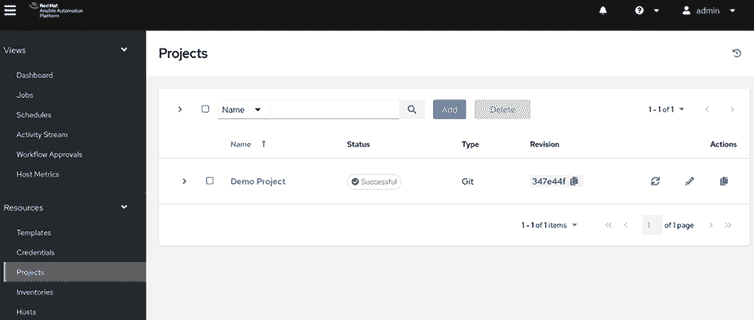

图 4.18：项目列表

以下是我们的设置项目的方法：

1. 我们可以通过两种方式管理 playbooks 和 playbook 目录：

   - 手动将它们放置在控制器服务器的项目基础路径（Project Base Path）下。
   - 将我们的 playbooks 放在控制器支持的源码管理（SCM）系统，例如 `Git`、`Subversion` 或 `Mercurial`。

   注意：建议尽可能使用版本控制来管理我们的 playbooks。这种最佳实践符合基础设施即代码的理念，并支持生产环境的 DevOps 原则。

2. 要查看现有项目，点击左侧导航栏上的 `Projects`。

3. 将显示 `Projects`，我们将发现自动化控制器提供了一个演示项目（Demo Project）供我们初始工作。

4. 点击 `Demo Project` 查看其详细信息，如图 4.19 所示：

   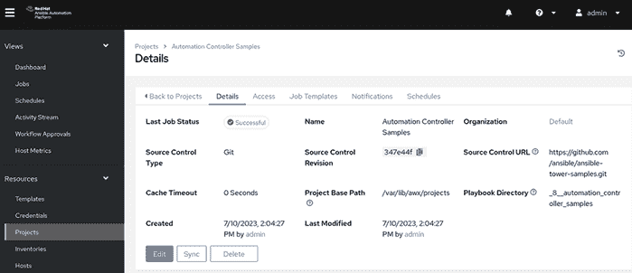

   图 4.19：项目详情

   注意：如果我们以后需要编辑默认项目，可以从 `Details` 选项卡点击 `Edit`，或者在 `Projects` 列表视图中点击项目旁边的 `Edit` 按钮（铅笔图标表示）。进行所需的更改并保存。

5. 如果我们获取项目的最新更改，可以手动启动 SCM 同步。执行此操作，导航到基于 SCM 的演示项目的 `Details` 选项卡并点击 `Sync`。或者，在 `Projects` 列表视图中，点击项目名称旁 `Sync` 按钮（同步图标表示）。

   注意：在添加设置为使用源码控制的新项目后，将启动自动同步过程以从配置的源码控制中获取项目详情。图 4.20 显示了创建新项目的视图。

   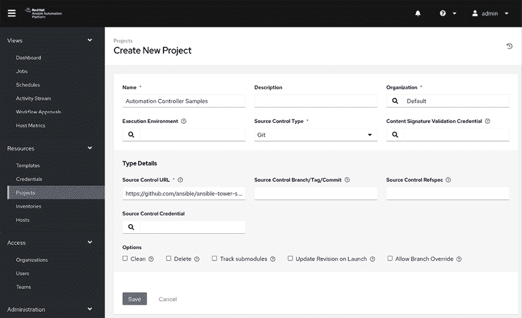

   图 4.20：新项目

通过这些步骤，我们可以在自动化控制器中设置和管理项目，允许我们高效地组织和利用 Ansible Playbooks。

# Playbook

用于 Ansible 平台的 Ansible Playbook 是一个以 YAML 格式编写的文件，包含供 Ansible 执行的一系列任务和指令。Playbooks 是 Ansible 的核心，用于定义系统的预期状态并自动化配置管理、应用程序部署和其他 IT 任务。

每个 Ansible 自动化脚本都是由包含一个或多个剧（plays）的 Ansible Playbooks 组成的 YAML 文档。可以使用自动化控制器中的作业模板，使用 `ansible-playbook` 命令执行与我们手动执行的相同的代码。

在 Ansible 平台的语境下，playbook 可以与自动化控制器中的项目关联，项目是 Playbooks 的逻辑容器。Playbooks 可以存储在 Ansible 平台的项目目录中，也可以存储在 `Git`、`Subversion` 或 `Mercurial` 等源码管理系统中。在项目目录中，我们可以存储额外的 Ansible 文件，例如用于角色和集合的 `requirements.yml` 以及自定义 Ansible 资源。

Playbooks 由一组剧（plays）列表组成，每个剧都由一组在特定主机或主机组上执行的任务组成。任务可以包括执行命令、运行脚本、管理文件、安装软件包等。Playbooks 还可以定义变量、条件和循环以自定义其行为。

在自动化控制器中执行 playbook 时，我们可以指定 playbook 应该在运行的主机或主机组。我们还可以向 playbook 传递额外变量，以根据特定需求自定义其执行。

Ansible 平台提供了一个易于管理和执行 playbook 的用户友好界面。我们可以创建并配置作业模板，将 playbook 与特定设置（如清单、凭据和通知）关联。这些作业模板随后可以用于启动 playbook 并跟踪其执行状态。

通过在 Ansible 平台中使用 Ansible Playbooks，组织可以自动化并简化其 IT 操作，确保跨环境的一致性，并提高管理基础设施、应用程序和服务的效率。

如果任务应该由另一个用户或特权用户（通常是 Linux 系统中的 root）执行，则可能需要权限提升。在传统的 playbook 中，此操作通过 `become` 可选语句完成，可以将其设置为 `true` 或 `yes` 以使用 Ansible become 插件启用权限提升。Ansible become 插件在 Unix 类系统上以提升的权限执行命令，已集成在 Ansible 平台中。让我们解释每一个：

- `sudo`（superuser do 的缩写）允许用户以超级用户或其他身份运行命令。它为权限提升提供了细粒度的控制，允许授权用户在提供自己的密码后以特权执行特定命令。

## 权限提升命令

- `su`（switch user 的缩写）用于切换到另一个用户账户或变为超级用户。默认情况下，当我们不指定用户名运行 `su` 时，它会切换到超级用户账户（root）。我们可以提供用户名作为参数来切换到不同的用户或使用相应的凭据。

- `pfexec` 是用于 Solaris 和 OpenSolaris 操作系统的命令。它提供了类似于 `sudo` 的权限提升功能，允许用户在通过密码验证后以高权限执行特定命令。

- `doas`（do as 的缩写）是用于某些基于 BSD 的系统（如 OpenBSD 和 NetBSD）的命令。在提供密码后，它允许授权用户以高权限执行命令。`doas` 的配置通常定义在 `/etc/doas.conf` 文件中。

- `pbrun` 是用于 PowerBroker 软件套件（也称为 BeyondTrust PowerBroker）的命令。它允许用户通过密码或其他身份验证机制（如 Active Directory 或 LDAP）以高权限运行命令。

- `dzdo` 是用于 Quest Privilege Manager for Sudo 软件的命令。它类似于 `sudo`，允许用户根据配置以高权限运行命令。用户通过密码或 Privilege Manager 支持的其他身份验证方法进行验证。

- `ksu` 是用于某些 Unix 系统（如 AIX 和 HP-UX）的命令。它允许用户在提供密码后获得具有另一个用户（通常是超级用户）权限的 shell。

这些命令提供了不同的权限提升和访问控制方法，允许用户在保持系统访问安全性和控制力的同时，执行管理任务或以高权限执行命令。系统上可用的特定命令可能取决于操作系统及其配置。

## 作业模板（Job Template）

Ansible 自动化控制器中的作业模板将项目（Project）中的 Ansible Playbook 与执行它所需的设置结合在一起。要管理现有的作业模板，请导航到左侧导航栏中的 `Templates` 区域。图 4.21 列出了可用的作业模板。我们可以在用户界面的 `Resources | Templates` 下找到作业模板。请参考下图：

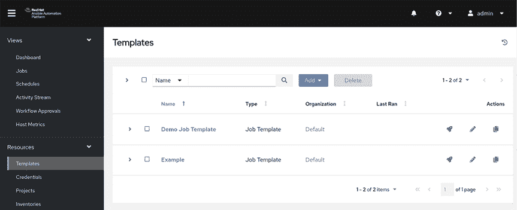

图 4.21：作业模板列表

在作业模板主页，为了方便起见，我们会找到一个预配置的 `Demo` 作业模板。

要查看 `Demo` 作业模板的详情，点击其名称，如图 4.22。

图 4.22：作业模板详情

在作业模板详情页，我们可以检查模板的设置和配置。然而，如果我们以后需要修改模板，可以点击 `Details` 选项卡中的 `Edit` 按钮。或者，在 `Templates` 列表视图中，点击模板名称旁边的 `Edit` 按钮进行必要的更改。

在进行任何修改后，我们可以点击 `Save`，然后点击 `Cancel`（如果没有进行任何更改），或使用自动化控制器浏览器顶部的面包屑导航链接返回 `Templates` 列表视图。需要注意的是，点击 `Save` 并不会退出 `Details` 对话框。

我们可以使用 `Add Template` 视图创建新的作业模板，如图 4.23 所示：

.png)

图 4.23：新作业模板（部分 1）

由于页面较长，图 4.24 显示了剩余部分以及 `Save` 按钮。

.png)

图 4.24：新作业模板（部分 2）

当执行作业模板时，我们可以在用户界面的 `Jobs` 区域跟踪进度和结果，如图 4.25 所示：


图 4.25：作业

## 工作流模板（Workflow Template）

我们可以在工作流模板中组合多个作业模板的执行。控制器中的工作流允许我们配置一系列作业模板或工作流模板，这些模板可以通过类图结构（称为 `nodes`）连接起来，如图 4.26 所示。

这些节点可以代表单个作业、项目同步或清单同步。工作流提供了一种将作业作为单个单元进行跟踪和管理的方法，例如在发布过程中。工作流可以由共享或不共享清单、playbook 或权限的作业模板组成。它们同时具有管理和执行权限，类似于作业模板。

当启动工作流时，图结构的副本会被保存为工作流作业（Workflow Job）。在工作流执行期间，将根据每个节点中链接的模板生成作业。如果节点链接到带有提示驱动字段（例如 `job_type`、`job_tags`、`skip_tags`、`limit`）的作业模板，这些字段将由节点继承，不会在工作流启动期间再次提示。

然而，具有可提示凭据或没有默认值清单的作业模板无法包含在工作流中。总之，工作流提供了一种协调地执行一系列作业的方法。请参考下图：


图 4.26：工作流模板

## 通知（Notification）

Ansible 控制器中的通知模板是用于通过不同通道（如电子邮件、Slack 或 Webhook）发送通知的预定义配置。每个模板根据类型有特定要求。通知是通知模板的实例，在特定事件（如作业失败）时触发。它使用关联通知模板定义的配置。

通知系统的流程涉及通过用户界面创建通知模板。然后将模板分配给相关对象（如作业模板、组织或项目），指定发送通知的触发级别。

通知模板可以在不同级别分配并继承父对象的模板。例如，作业模板从关联的项目和组织继承模板。项目更新从项目继承模板。清单更新使用关联组织的通知模板。用户和团队还具有灵活定义可以附加到特定作业的通知的能力。


总之，通知层级允许灵活配置和继承通知模板，以确保根据自动化控制器内的特定事件发送相应的通知。我们可以在用户界面的 `Administration | Notifications` 区域创建新的通知模板，如图 4.27 所示：


图 4.27：通知

## 项目签名（Project signature）

自 Ansible Automation Platform 2.3 于 2022 年 11 月发布以来，Ansible 控制器已支持 `ansible-sign` 命令行工具支持项目签名。我们可以使用该工具对 SCM 仓库（通常是 `GIT`）中的项目进行签名。签名文件列表在 `MANIFEST.in` 文件中指定，可以在其中指定包含或排除哪些文件，这在许多开源项目中很常见。

通过命令行签名项目的完整命令为：

```
ansible-sign project gpg-sign PROJECT_ROOT
```

同样地，我们可以使用以下命令手动验证我们的项目：

```bash
ansible-sign project gpg-verify PROJECT_ROOT
```

已签名的项目包含一个额外的 `.ansible-sign` 目录，其中有两个文件。第一个是 `sha256sum.txt`，它包含每个文件的 SHA256 哈希值。这已经是我们内容的行业标准。第二个是 `sha256sum.txt.sig`，它包含了前一个文件的 GPG 签名。

通过内容签名和验证，当签名验证有效时，我们即告成功：两个文件都存在、校验和有效且签名有效。

当某些内容不正确时，我们可能会遇到其他场景之一：

- 当文件被篡改或无效时，校验和无效。
- 当签名被篡改或无效时，签名无效。
- 当签名错误、过期或无法访问时，签名不匹配。

为了能够使用项目签名功能，我们只需要在自动化控制台（automation controller）中为项目添加 GPG 签名凭据即可。

## API

自动化控制台表示状态转移（RESTful API）是自动化控制台提供的一系列端点和方法，允许用户通过编程与平台内的各种任务交互并实现自动化。它允许用户使用 HTTP 请求向自动化控制台检索或发送数据，从而管理和控制资源，例如作业模板、清单、脚本（playbooks）和通知。RESTful API 为 Ansible 自动化平台与其他系统集成、构建自定义自动化工作流以及自动化管理任务提供了方法。

Web 用户界面和命令行界面（CLI）实际上围绕 API 构建的。API 接口作为后端基础设施，使用 Python Django 框架实现了模型-视图-控制器（MVC）软件设计模式。自动化控制台中的可浏览 API 允许用户通过浏览器访问并探索 REST API 的可用资源和端点。

API 的第 2 版本在自动化控制台 3.2 中引入（供参考，Ansible 自动化平台集成了 `ansible controller 4.4.0`），可以通过点击相应的链接访问。API 的第 1 版本端点 `/api/v1/` 已从自动化控制台 3.6 版本起停止使用。

通过浏览 API 链接，用户可以发现并探索相关资源，并访问有关每个 API 端点的可用访问方法和返回数据的文档。用户还可以通过在相应的文本字段中提供 JSON 数据来执行 `PUT` 和 `POST` 操作。此外，API 还提供了通过 API 浏览器修改设置的信息，而不是通过静态设置文件。

我们可以通过访问自动化控制台的 `/api/v2/` 端点来访问仪表板的所有可用资源，如图 4.28 所示。

图 4.28：自动化控制台 API

## CLI

自动化控制台 CLI 指由 Ansible 自动化控制台提供的命令行界面。它允许用户使用命令行命令与自动化控制台交互并执行各种操作和任务。

通过自动化控制台 CLI，用户可以执行命令来管理清单、运行脚本、配置设置、创建作业模板、管理凭据并在自动化控制台环境中执行其他管理任务。CLI 为自动化任务、与其他系统和工具集成以及执行批量操作提供了一种方便高效的方法。它允许用户利用命令行的优势与自动化控制台交互并以编程方式执行操作。

使用 CLI，用户可以对常规任务进行脚本化和自动化，调度作业并执行复杂操作，从而实现更高效流畅的管理。总体而言，自动化控制台 CLI 是从命令行管理和控制 Ansible 自动化控制台的强大工具。它为管理基础设施和编排 IT 流程提供了灵活性自动化能力。

自动化控制台 CLI 称为 `awx-manage`（以前称为 `tous-manage`），是一个访问 Ansible 自动化控制台详细内部信息的命令行实用工具。建议以 `awx` 或 `root` 用户运行 `awx-manage` 命令。

CLI 提供了管理 Ansible 控制器的各种功能，包括清单导入、旧数据清理、集群管理、令牌和会话管理以及分析收集。

对于清单导入，`awx-manage inventory_import` 命令允许通过将自动化控制台清单对象与基于文本的清单文件、动态清单脚本或清单源目录同步，直接将清单导入自动化控制台。它支持指定源路径和清单标识符以及覆盖现有清单数据等选项。

`awx-manage cleanup_jobs` 和 `awx-manage cleanup_activitystream` 命令用于从系统中清理旧数据，永久删除超过指定天数的作业详情、作业输出和活动流数据。

对于集群管理，`awx-manage` 工具提供了 `provision_instance` 和 `deprovision_instance` 等命令，这些命令在文档的集群章节进行了解释。

令牌和会话管理命令（如 `create_oauth2_token`、`revoke_oauth2_tokens`、`cleartokens`、`expire_sessions` 和 `clearsessions`）允许管理员管理 OAuth2 令牌和用户会话。

此外，`awx-manage gather_analytics` 命令允许在预定义窗口之外按需收集分析数据。需要注意的是，并不建议通过脚本运行 `awx-manage` 命令。请按照 Ansible 支持的说明运行 `awx-manage` 命令。

总体而言，自动化控制台 CLI 提供了一系列通过命令行管理和管理自动化控制台的命令，如图 4.29 所示。

图 4.29：自动化控制台 CLI

## 执行环境

Ansible 执行环境取代了传统的 Python 虚拟环境和 Ansible Tower 技术。执行环境是容器镜像，允许包含系统级依赖和集合内容。每个执行环境都经过定制，仅包含运行作业所需的组件，从而使执行过程更加高效。

为了构建执行环境，Ansible 提供了 `ansible-builder` 工具。该工具根据 YAML 定义文件（`.yml`）创建执行环境，该文件指定了所需的内容，如 Ansible、Ansible Runner、Ansible Collections、Python 要求和系统软件包。可以使用 `ansible-builder build` 命令构建执行环境，该命令输入定义文件并生成构建执行环境镜像所需的构建上下文。

一旦创建了执行环境，就可以在作业中使用。在自动化控制器用户界面中，如图 4.30 所示，管理员可以为作业模板指定执行环境。


图 4.30：Ansible 执行环境

执行环境可以绑定到组织或全局可用，在作业中使用它们需要相应级别的管理员权限。可以通过用户界面的“执行环境”部分将执行环境添加到自动化控制器。

管理员可以为执行环境提供详细信息，如名称、镜像名称、拉取选项、描述、组织分配和注册表凭据。添加后，可以在作业模板中选择执行环境，从而为不同的作业使用特定的执行环境。

执行环境的附加选项包括挂载选项和挂载路径。这些选项允许进行自定义和配置，例如挂载系统信任存储库或向隔离的作业暴露特定路径。可以在用户界面的“作业设置”页面中通过类似 Postman 风格的卷挂载语法来配置挂载选项和路径。

自动化执行环境可以通过容器注册表（如 `registry.redhat.io`）检索或发布在私有自动化中心。总的来说，Ansible 执行环境提供了一种容器化的作业运行方式，允许更好地管理依赖、简化执行过程，并增加针对不同作业需求自定义执行环境的灵活性。

每个自动化控制器安装程序都提供以下三个 Ansible 执行环境：

- **默认执行环境**：包含最新版本的 Ansible Core 发布以及 Ansible Runner，加上所有 Red Hat 支持的集合和依赖项。
- **最小化执行环境**：包含最新版本的 Ansible Core 以及 Ansible Runner，但不包含任何集合或其他额外内容。
- **控制平面执行环境**：用于从源代码管理（SCM）（如 GitLab 或 GitHub）运行项目同步任务。

这些是 Ansible Automation Platform 2.4 中包含的自动化执行环境的关键组件：Red Hat Enterprise Linux 通用基础镜像（UBI）基础镜像、Ansible Core、Python、Ansible 集合以及 Python 或二进制依赖项。我们可以使用 `ansible-builder` 工具创建自定义执行环境。

## 自动化中心仪表板

私有自动化中心仪表板是与私有自动化中心交互的用户界面，它提供了一个中心化仓库，用于发现、下载、发布和管理 Ansible 内容集合。所有这些内容都由自动化中心云服务下载并供内部用户使用。自动化控制器实际上可以从自动化中心云服务或私有自动化中心云下载内容。通常配置为仅通过私有自动化 Automation Hub 下载内容。

它提供了若干功能以帮助更高效地自动化项目：

- Ansible 内容集合的信任来源，包括来自 Red Hat 的 Ansible 认证内容以及 60 多家行业领先合作伙伴的内容；
- 私有自动化中心，存储并控制自定义生成内容的访问；
- 存储和管理容器镜像；
- 管理 Red Hat Ansible 认证内容、Ansible 验证内容以及自动化执行环境。

私有自动化中心仪表板为管理 Ansible 内容集合提供了一个全面的解决方案，促进了组织内部的协作与治理，并提供了以控制方式存储和共享容器镜像及内容的能力。

在编写此书时，自动化中心已有来自 70 个合作伙伴的 146 个集合，如图 4.31 所示：


图 4.31：私有自动化中心仪表板

私有自动化中心拥有 RESTful API 可供连接，方式与自动化控制器 API 相同。然而，它不可浏览，因此我们需要访问正确的端点。

## Ansible 验证内容

企业世界依赖 Ansible 自动化中心提供准备就绪的 Ansible 资源和内容。Ansible 自动化中心管理来自 Red Hat 产品团队、独立软件供应商（ISV）合作伙伴以及社区和私有贡献者的资源。

Ansible 自动化中心的合作伙伴列表日益增长。目前它包括：Amazon、Arista、Aruba Networks、Check Point、Cisco、Citrix、CyberArk、Dell EMC、Dynatrace、F5 Networks、Fortinet、HPE、IBM、Juniper Networks、Kubernetes、Microsoft、NetApp、Nvidia、1Password、SAP、ServiceNow、Splunk、TrendMicro 以及 VMware。

自 2022 年 11 月的 Automation Platform 2.3 版本起，请利用验证内容功能。自动化中心的内容可以通过 GPG 密钥进行认证和签名。GNU Pretty Privacy（即流行的程序 `GPG`）用于通过存储文件的数字签名来验证内容。

## 自定义执行环境

自动化中心可以将容器作为容器注册表。此功能对于 Ansible 执行环境非常有用。首先，我们需要生成我们的执行环境并分配一个标签。要将容器镜像推送到我们的私有自动化中心，请遵循以下步骤：

1. 使用我们的私有自动化中心完全限定域名（FQDN）或 IP 地址以及凭据登录 Podman。运行以下命令：

   ```
   podman login -u=<username> -p=<password> <automation_hub_url>
   ```

2. 将我们的容器镜像推送到自动化中心的容器注册表。使用以下命令：

   ```
   podman push <automation_hub_url>/<container_image_name>
   ```

注意：向自动化中心容器注册表推送已签名镜像需要使用 `--remove-signatures` 标记。推送操作在上传期间会重新压缩镜像层，这可能导致镜像层摘要变化并产生错误信息。

我们可以在私有自动化中心找到所有容器镜像，如图 4.32 所示：

1. 登录我们的自动化中心。
2. 导航到容器注册表部分。
3. 在容器仓库列表中找到容器。


图 4.32：自动化中心执行环境

通过这些步骤，我们可以成功地将容器镜像推送到私有自动化中心，并确保其在容器注册表中可用。

## 事件驱动 Ansible

我们可以使用事件驱动 Ansible 控制器仪表板执行事件驱动 Ansible 代码。


图 4.33：Ansible 事件驱动控制器的仪表板

## 项目

Event-Driven Ansible 控制仪表板中的项目是规则集（rulebooks）的组织化集合，便于高效管理自动化任务。规则集必须位于项目的 `rulebooks` 目录中。

要创建一个新项目，请确保满足前提条件，例如以内容消费者的身份登录、设置必要的凭据，并拥有一个包含规则集和剧本的仓库。按照以下步骤操作：

1. 登录。
2. 从导航面板中选择 `Projects`。
3. 选择创建新项目。
4. 输入项目详情，如名称、可选描述、作为唯一可用 SCM 类型的 `Git`、指向仓库的 `SCM URL` 以及该 `SCM URL` 的可选凭据。

创建项目后，可以在 `Projects` 屏幕上进行管理，允许用户根据需要进行编辑或删除。

注意：项目创建后无法编辑 `SCM URL`。

## 决策环境

决策环境作为执行 Ansible 规则集的容器镜像，为自动化任务提供了一个标准化的平台，并实现了对依赖关系的无缝管理。用户可以创建自定义环境，同时默认的 Ansible 规则集决策环境依然可用。

要将决策环境导入到 Event-Driven Ansible 控制仪表板，必须满足前提条件，例如以内容消费者的身份登录并设置必要的凭据。按照以下步骤操作：

1. 导航到仪表板。
2. 选择 `Decision Environments`。
3. 选择创建新环境。
4. 输入详情，如环境名称、可选描述、镜像位置（包括注册表、名称和版本标签）以及可选凭据。

创建环境后，可以在 `Decision Environments` 屏幕上进行管理，允许用户根据需要进行编辑或删除。这些步骤有助于决策环境的集成和利用，以有效执行自动化任务。

## 自动化控制器令牌身份验证

为了验证并访问 Ansible Automation Controller，设置授予执行自动化任务所需权限的令牌至关重要。要做到这一点，请确保满足前提条件，例如以内容消费者的身份登录 Event-Driven Ansible 控制仪表板。

按照以下步骤操作：

1. 登录。
2. 选择用户配置。
3. 导航到 `User details`。
4. 选择 `Create Controller token`。
5. 输入详情，如令牌名称、可选描述以及在自动化控制器生成的具有 `write-scope` 权限的令牌。

创建令牌后，可以在 `Controller Tokens` 标签页中对其管理或删除。这些步骤建立了安全的身份验证机制，为在 Event-Driven Ansible 控制仪表板中有效启动和管理自动化任务奠定了基础。

## 规则集激活

规则集激活涉及在 Event-Driven Ansible 控制仪表板中启动已配置的规则集。此过程的前提条件包括以内容消费者的身份登录 Event-Driven Ansible 控制仪表板、设置项目、配置运行 Ansible 规则集的决策环境，以及为访问 Ansible Automation Platform 控制器创建身份验证令牌。

要设置规则集激活，用户需要导航到仪表板，选择 `Rulebook Activation` 并选择创建新激活。指定详情，如激活名称、可选描述、项目选择、关联规则集、决策环境和重启策略，并提供自动激活和变量配置的选项。

一旦输入，激活将创建并可以在 `Rulebook Activations` 屏幕上进行管理，允许用户根据需要编辑或删除激活。

## 最佳实践

有很多 Ansible 最佳实践可以帮助我们编写成功的代码，并避免自动化旅程中常见的陷阱。使用 `ansible-lint` 命令行工具强制 Ansible 最佳实践，包括在 Ansible 剧本（Playbooks）和角色上运行该工具以识别并解决潜在问题。

以下是分步骤指南：

1. **安装 `ansible-lint`**：从在系统上安装 `ansible-lint` 开始。我们可以使用像 `pip` 这样的包管理器，或者将其作为 Python 包安装。例如，使用 `pip`：

   ```bash
   pip install ansible-lint
   ```

2. **运行 `ansible-lint`**：对我们的 Ansible 剧本或角色执行 `ansible-lint` 以分析其违反最佳实践的情况。将剧本或角色目录的路径作为参数：

   ```bash
   ansible-lint playbook.yml
   ansible-lint roles/
   ansible-lint collections/
   ```


### 3. 分析输出

`ansible-lint` 将处理我们的代码并根据定义的规则生成问题、警告或建议列表。每个违规项都将附有一个消息，解释该问题并提供修复指导。

仔细检查输出并解决识别出的问题。某些违规可能是简单的编码风格建议，而另一些可能是应该解决的关键最佳实践违规。

### 4. 自定义规则

`ansible-lint` 提供了一组默认规则，但我们可以对其进行自定义以匹配我们的特定需求。在我们的项目目录中创建配置文件`.ansible-lint`，或使用`--exclude`或`--include`选项分别忽略或包含特定规则。

根据我们的要求定制规则，以关注与我们的项目相关的特定最佳实践和编码标准。

### 5. 与 CI/CD 集成

为了一致执行 Ansible 最佳实践，将`ansible-lint`集成到我们的 CI/CD 流线中。配置我们的流水线在 Ansible 代码发生更改时自动运行`ansible-lint`。这确保了违规被尽发现，防止不合规代码被部署。

通过将`ansible-lint`纳入我们的开发工作流，我们可以在整个 Ansible 项目中执行最佳实践并维护代码质量。定期运行`ansible-lint`有助于发现潜在问题、提高可读性并确保遵循推荐标准，最终带来更健壮、更易维护的 Ansible 剧本和角色。同样，我们使用`molecule`工具执行 Ansible 角色测试：`dependency`、`cleanup`、`destroy`、`syntax`、`create`、`prepare`、`converge`、`idempotence`、`side_effect`和`verification`。

## 代码即配置

高级用户可以考虑使用 Ansible 将自动化控制器配置视为代码（`CaC`）。将配置视为代码的主要用处是更容易复制、跟踪错误和管理部署。自动化控制器与`CaC`的集成通过`ansible.controller`和`infra.controller_configuration` Ansible 集合实现，这些集合提供了连接、管理和配置自动化控制器的模块和角色。

我们需要定义一个 Git 仓库来存储配置，使用逻辑目录结构组织配置并利用`Ansible Vault`加密敏感数据。创建一致且定义的目录结构是重要的，利用 Git 分支功能处理多个环境并在代表特定环境的分支之间提升配置。

配置实施涉及修改 Git 仓库中的配置文件、通过 Git 钩触发事件、处理更改，并根据自动化控制器中的作业模板执行任务。例如，以下 Ansible 剧本在自动化控制器中创建一个项目和作业模板：

```yaml
---
- name: Set Up a Project and Job Template
  hosts: all
  tasks:
    - name: Create a Project
      ansible.controller.project:
        name: Automation Controller Samples
        state: present
        scm_type: git
        scm_url: https://github.com/ansible/ansible-to-samples.git

    - name: Create a Job Template
```

```yaml
ansible.controller.job_template:
  name: my-job-1
  project: Job Template Test Project
  inventory: Demo Inventory
  playbook: hello_world.yml
  job_type: run
  state: present
```

## 其他服务

Ansible Automation Platform 订阅包含了 Red Hat 提供的其他作为云服务的有趣服务。

## Web 控制台

Web 控制台仪表板（代号为 gateway）自 Ansible Automation Platform 2.5 发布以来已引入。它提供了统一的视图并可以访问所有平台资源，包括自动化控制器（Automation Controller）、自动化枢（Automation Hub）和事件驱动 Ansible 控制器（Event-Driven Ansible controller）。

它消除了为每个组件记忆和管理独立登录凭据的需求，使用户在 Ansible Automation Platform 的不同区域之间切换更加方便。

Web 控制台基于为云原生应用程序设计的 Envoy 开源边缘和及代理。该框架解决了过渡到分布式架构时出现的网络和可观测性挑战，作为单个服务和应用程序的高性能 C++ 分布式代理，以及大型微服务服务网格设置的通用数据平面。

它支持 HTTP/2 和 gRPC、负载均衡和动态配置管理等高级功能，并通过深度流量洞察和分布式追踪增强了可观测性。它简化了微服务管理，使得在服务网络中进行调试、优化性能和添加功能变得更容易。Envoy 也是 Kubernetes 集群中 Istio 服务的基础。

Web 控制台增强了在使用 Ansible Automation Platform 时的用户体验，简化了管理并提高了效率。

## 自动化分析

Red Hat Ansible Automation Platform 报告功能（Red Hat Insights 的一部分）在线组件被称为自动化分析。此平台云服务为用户提供了跨 Ansible 团队自动化工作的可视概述。每个报告旨在帮助用户监控自动化环境的各个方面。

最常用的报告是：许可证数量、漏洞和合规性、基础设施数据、执行和任务报告。Ansible Automation Platform 内的报告功能为用户提供了自动化环境的全面视图。它涵盖了广泛的信息，包括许可证数量、漏洞数据、基础设施细节、执行统计和特定任务报告。

这些洞察使用户能够做出数据驱动的决策，优化自动化工作流，并确保 Ansible 部署的顺利运行。

## 核心学习

通过使用仪表板、CLI 和 API 接口，我们学习了如何在自动化控制器、自动化枢和事件驱动 Ansible 控制器内部迈出我们的初始步骤。

## 记忆点

- 自动化控制器通过项目（Projects）、作业（Jobs）、凭据（Credentials）、清单（Inventory）和工作流（Workflow）管理我们的内容并执行。
- 自动化控制器、自动化枢和事件控制器提供了 Web 用户界面、RESTful API 和 CLI 接口。
- 自动化枢存储 Ansible 内容、角色、playbooks、集合和 Ansible 执行环境。
- 我们可以使用 Red Hat 门户凭据、清单文件或使用 Ansible 自动化来激活我们的 Ansible Automation Platform 订阅。

## 多选题

1. 我们如何激活 Ansible Automation Platform 订阅？
   1. Red Hat 门户凭据
   2. 清单文件
   3. 使用`ansible.controller`集合进行自动化处理
   4. 以上所有选项

2. 自动化控制器的哪个工具允许我们一个接一个地执行 playbook？
   1. 作业（Jobs）
   2. 工作流（Workflow）
   3. 项目（Project）
   4. 凭据（Credentials）

3. 我们如何在 Ansible Automation Platform 中与自动化控制器交互？
   1. Web 界面
   2. API
   3. CLI
   4. 以上所有选项

4. 我们如何为组织创建 Ansible 可复用内容？
   1. 自动化控制器
   2. 自动化枢
   3. 私有自动化枢
   4. Ansible 事件驱动控制器

## 答案

1. d
2. b
3. d
4. c

## 问题

1. 我们如何从命令行终端连接到自动化控制器？
2. Ansible Automation Platform 中包含哪三个 Ansible 执行环境？
3. 我们如何检查我们的代码是否符合 Ansible 最佳实践？

## 核心术语

- 工作流模板（Workflow Template）：Ansible 自动化控制器中的工作流模板是一种配置，它定义了按预定义顺序作为单个单元执行的一系列作业模板或任务。
- `ansible-lint` 是一个用于 Ansible Playbooks 和角色的静态分析工具，有助于帮助强制执行最佳实践和编码标准。
- `ansible-sign` 是一个命令行工具，用于对 Ansible 制品（如 playbooks 或角色）进行数字签名，以确保真实性和完整性。
- Ansible 规则集（rulebook）是一个定义事件驱动 Ansible 自动化结构和指南的框架，由包含源、规则和条件的规则集组成。

## 加入我们书籍的 Discord 空间

加入书籍的 Discord 工作区以获取最新更新、优惠、全球科技动态、新发布以及与作者的交流：

`https://discord.bpbonline.com`


# 第 5 章：设置与身份验证

## 引言

我们将学习如何自定义 Ansible Automation Platform 中的设置，以个性化基于角色的访问控制、身份验证集成和集中认证的响应，从而管理用户权限和安全。

## 结构

在本章中，我们将讨论：

- 自动化控制器设置
- 用户、团队和 RBAC
- 身份验证集成
- Ansible Automation Platform 集中认证

## 目标

在本章中，我们将熟悉设置中最常用的选项，以便更好地执行我们的 Ansible 作业，以及常见的身份验证集成。

## 自动化控制器设置

通过自定义 Ansible 控制器设置，我们可以微调任何 Ansible 控制器的行为。我们可以通过 Web 用户界面中的设置选项访问自动化控制器设置，如下图 5.1 所示。

用户界面的设置部分被组织为出现在屏幕上的五个部分：身份验证（Authentication）、作业（Jobs）、系统（System）、用户界面（User Interface）和订阅（Subscription）。

某些设置参数可以是我们可以查看和修改的字面值（例如`fork`值），而某些是开关（例如新用户界面）。

例如，常见的作业性能微调是增加 Ansible`fork`值，如下一节所示。请参考下图：


图 5.1：自动化控制器的 Web 设置

同样，我们可以通过 RESTful API 访问自动化控制器的`/api/v2/settings/`端点来访问所有可用设置参数，如图 5.2 所示。请注意，此端点需要使用控制器凭据进行身份验证。请参考下图：


图 5.2：自动化控制器的 API 设置

## 新用户界面

Ansible Automation Platform 2.4 中技术预览（Technology Preview）的更新的用户界面是全新图形化用户界面（GUI）的预览，旨在增强 Ansible Automation Platform 内功能的管理和可扩展性。

最终目标是为各个平台组件提供统一的用户体验，包括自动化控制器（Automation Controller）、私有自动化中心（Private Automation Hub）和事件驱动 Ansible 控制器（Event-Driven Ansible controller）。在初始版本中，更新的 GUI 适用于自动化控制器，未来计划将其扩展到其他组件。

更新的用户界面提供了多项新功能，例如支持深色模式，可以根据我们的操作系统偏好进行自定义。Web 版用户界面（Web User Interface）响应更快、可定制且用户友好。但注意的是，更新后的界面仍处于技术预览阶段，旨在收集客户反馈并进一步改进。之前 webUI 的某些功能可能仍未完全匹配，但它们将随着时间的推移而不断增强。

我们可以通过启用`Settings | Miscellaneous System`中的`Enable Preview of New User Interface`按钮在 Ansible Automation Platform 2.4 中启用新用户界面。请参考下图：


图 5.3：启用或禁用新用户界面功能

保存并加载后，Ansible 控制器的用户界面所示 图 5.4：


图 5.4：Ansible 自动化控制器新 UI

新用户界面的优势之一是支持深色主题，如图 5.5](#ch05.xhtml_fig5-5）所示：


图 5.5：Ansible 自动化控制器新 UI 深色主题

## 作业设置（Job Settings）

在 Ansible 中，`fork`指的是工具用于同时管理主机的并行进程或连接数。默认情况下，Ansible 设置为每个作业执行使用`5`个 forks，这决定了它可以并发操作的目标主机数量。

对于我们的执行任务，特别是在大型主机清单中，此数字可能不是最优的。可以根据可用资源和任务复杂度调整此值以优化性能。

要修改`fork`值，我们可以编辑当前项目中的`ansible.cfg`文件（`[defaults]`部分中的`forks`），或自定义相关的作业模板。

例如，将`fork`的值设置为`10`将允许 Ansible 在管理目标主机时使用`10`个并行进程，从而在大型 Ansible 主机列表中获得更好的性能。

通过调整`fork`值，我们可以控制 Ansible 主机管理操作的并行级别，确保资源的高效利用，并尽可能减少任务执行期间对 CPU 和内存等系统资源的影响。这种灵活性使用户能够根据特定需求和基础设施定制 Ansible 的性能。

请记住执行某些测试以检查我们 playbook 的 CPU 和内存资源利用率。请参考下图：


图 5.6：自定义 Ansible fork 设置

`fork`参数的最大值可以在`Settings | Jobs`设置区域中设置。默认情况下，平台最大值为`200`，如图 5.7](#ch05.xhtml_fig5-7）所示。该设置名为`Maximum number of forks per job`（每个作业的最大 fork 数量）。


图 5.7：最大 forks 设置

## 日志级别（Logging level）

有时，我们需要在调试复杂的作业执行或网络中与其他组件的集成时调查自动化控制器的行为。提高平台的日志级别是有益的。

我们可以在`Automation Controller Dashboard | Settings | System | Logging settings`将日志级别从默认的`INFO`增加到`DEBUG`。输出显示在`var/log/tower/tower.log`的日志文件中，或通过任何日志聚合服务显示。请参考下图：


图 5.8：日志级别

## 用户、团队与 RBAC（Users, Teams, and RBAC）

自动化控制器是一个强大的平台，方便组织中的每个成员高效管理自动化任务和工作流。具有相应权限的用户可以无缝执行自动化任务，从而实现更高效、有效的自动化流程。

自动化控制器的核心是三个组成部分：用户（Users）、角色（Roles）和团队（Teams），它们在编排和保护自动化过程方面都起着至关重要的作用。

用户是与自动化控制器交互的组织个人成员。他们拥有特定的权限和凭据，允许他们执行自动化工作流、访问资源并管理系统的各个方面。用户对于自动化流程的成功实施和顺利运行至关重要。

相反，角色定义了 Ansible 和自动化控制器中与特定主机组、组或主机模式相关的行为和能力。它们包含了变量值、任务和处理程序（handlers），提供了一种模块化且可分发的方法，用于在 playbook 与用户之间共享重用行为。

此外，角色在 RBAC（基于角色的访问控制）中起着关键作用，向用户和团队授予访问权和权限，从而确保环境的安全受控。

团队作为组织（Organization）内部的子划分，提供了管理用户、项目、凭据和权限的结构化方法。组织可以通过利用团队实现基于角色的访问控制（RBAC）方案，实现跨项目和资源的职责和访问的无缝委托。

通过结合团队、用户和角色，自动化控制器实现了效率、安全协作的最大化。团队为管理用户和访问建立了结构化框架，而角色促进了一致性和可用性。

## 创建和管理用户凭据（Creating and managing users credentials）

自动化控制器是一个强大的工具，能够高效管理和执行工作流。作为管理员，控制谁可以访问系统以及他们可以执行的操作至关重要。这就是管理用户及其相关权限和凭据的关键。在指南中，我们将探索自动化控制器用户管理的各个方面。

要开始管理用户，在自动化控制器的左侧导航栏中点击`Users`访问用户页面，如图 5.9](#ch05.xhtml_fig5-9）所示。此页面显示了系统中所有用户的列表。

我们可以点击相应的表头按用户名（Username）、名（First Name）或姓（Last Name）进行搜索和排序。请参考下图：


图 5.9：显示可用用户

在用户概述屏幕上，我们可以快速查看用户附近的权限和用户类型信息。这提供了每个用户访问级别和角色的摘要。

要创建新用户，请按照图 5.10](#ch05.xhtml_fig5-10）所示的步骤操作：

1. 点击`Add`按钮，打开创建用户对话框。
2. 输入有关新用户的详细信息。标记有星号（`*`）的字段为必填项。
3. 从三个可用选项中选择适当的用户类型：
   - 普通用户（Normal User）：对其其授予角色和权限的资源具有读写权限。
   - `System Auditor`（系统审计员）：继承环境中所有对象的只读权限。
   - `System Administrator (Superuser)`（系统管理员/超级用户）：拥有全系统管理权限，可以在整个平台上进行读取和写入。请谨慎分配此角色，因为它拥有对自动化控制器的完全控制权。

注意：修改用户密码时，请注销并重新登录以使更改生效。

4. 完成后点击`Save`。用户创建后，将打开该用户的`User`对话框。请参考下图：


图 5.10：创建新用户

我们可以在`User`对话框中查看并修改用户的组织、团队、角色和其他成员详细信息。对于现有用户，详情界面还会显示该用户的最后登录活动。

要删除用户，我们必须拥有用户权限。按照以下步骤删除用户账户：

1. 从左侧导航栏展开`Access`菜单，并点击`Users`显示当前用户列表。
2. 选择我们想要删除的用户复选框，并点击`Delete`。
3. 在确认警告消息中点击`Delete`确认操作。

我们可以通过点击特定的用户名来查看用户详情，如图 5.11 所示：


图 5.11：用户详情

`Users - Organizations`部分显示用户所属的组织列表。此列表可以通过`Organization Name`或`Description`进行搜索，但无法在此显示面板中修改组织成员关系。

在`Users - Teams`部分中，我们可以查看用户所属的团队列表。与组织类似，此列表可以通过`Team Name`或`Description`进行搜索，但无法在此显示面板中修改团队成员关系。

`Users - Roles`部分显示了通过基于角色的访问控制分配给用户的权限集。这些角色决定了用户读取、修改和管理自动化控制器中的项目、资源清单、作业模板和其他元素的能力。

请注意，拥有`Job Template Administrator`（作业模板管理员）等角色的用户可能无法访问与模板关联的其他资源（清单、项目、凭据或实例组）。系统管理员可以根据需要向单个用户授予特定资源的权限。

要向特定用户添加权限，请按照以下步骤操作：

1. 点击`Add`按钮，打开`Add Permissions Wizard`。
2. 选择用户将具有访问权限的对象并点击`Next`。
3. 选择要分配团队角色的资源并点击`Next`。
4. 勾选角色旁边的复选框将该角色分配给所选资源。不同的资源可能有不同的选项。
5. 完成后点击`Save`，`Add Permissions Wizard`将关闭并显示带有分配角色的用户更新配置。

`Users - Tokens`标签页仅适用于我们的用户（我们自己）。在这里，我们可以管理与用户配置文件相关的令牌。令牌用于自动化控制器内的身份验证和授权。我们可以创建特定的应用程序令牌或个人访问令牌（PAT）。

为我们的用户创建令牌，如图 5.12 所示：

1. 从`Users`列表视图点击我们的用户，以配置`OAuth 2 tokens`。
2. 从用户配置文件中点击`Tokens`标签页。
3. 如果没有令牌，点击`Add`按钮打开`Create Token`窗口。
4. 输入必要的详细信息，例如应用程序（如果适用）、描述和范围。
5. 点击`Save`创建令牌。

创建令牌后，它将与其相关信息一起显示，包括过期日期。请参考下图：


图 5.12：用户令牌

管理用户及其访问权限对于维护安全且有序的自动化控制器环境至关重要。通过遵循指南概述的步骤，管理员可以有效地管理用户、角色和凭据，确保运行顺利并符合安全最佳实践。

### 使用团队高效管理用户

在自动化控制器中，`Teams`是组织的子划分，关联有`Users`、`Projects`、`Credentials`和`Permissions`，提供了实现基于角色的访问控制方案和跨组织委托责任的手段。每个`Team`都可以分配权限，允许在管理`Credentials`访问所有权时具有扩展性。要创建新的`Team`，点击`Add`按钮，输入所需的详情（如`Name`、`Description`和`Organization`）并点击`Save`，如图 5.13 所示：


图 5.13：创建一个新团队

`Team`的`Access`标签页显示`Team`成员的`Users`列表，可以通过点击`Access`标签页中的`Add`按钮、按照提示操作并在完成后点击`Save`将现有用户添加到`Team`中。我们可以列出组织中的所有可用团队，如图 5.14 所示：


图 5.14：列出组织中的团队

`Team Roles`部分列出了`Team`当前可用的权限，必须通过`Inventory`、`Project`、作业模板或`Organization`内进行显式设置。可以通过`Add Permissions Wizard`添加团队权限，其中我们选择用户将具有访问的对象、分配团队角色的资源，并勾选角色旁边的复选框将其分配给所选资源，如图 5.15 所示：


图 5.15：添加团队权限

移除资源的权限可以通过点击`disassociate (x)`按钮，随后弹出确认对话。这允许对访问和角色进行高效管理，根据可用资源和执行的任务性质进行优化。

### 基于角色的访问控制

基于角色的访问控制功能集成在自动化控制器中，增强了安全管理。RBAC 是自动化控制器的一项关键功能，允许管理员对服务器清单、组织等授权访问。RBAC 确保正确的用户拥有适当的权限来执行特定操作，这有助于增强安全性、简化管理并维护良好的系统状态。在本文中我们将探讨 RBAC 的概念以及它们在自动化控制器环境中的工作方式。自动化控制器 RBAC 系统中有三个核心概念：角色、资源用户。

让我们详细查看这些概念：

#### 角色

角色定义了用户或团队在控制器内执行的操作集合。角色与授予用户或团队的一组能力相关。所有能力都源于角色的成员关系。用户通过其分配的角色或通过角色继承获得能力。

#### 资源

资源代表了自动化控制器中的各种组件，例如工作流、项目、清单、凭据、作业模板等。每个资源都可以与特定的角色关联，授予用户或团队的权限基于这些关联关系。

#### 用户

用户是指与自动化控制器交互的个人或团队。可以为用户分配一个或多个角色，用以决定他们对不同资源和功能的访问权限。

自动化控制器中 RBAC（基于角色的访问控制）的关键特性之一是角色层次结构。角色结构允许角色包含其他角色的所有功能，从而创建层级关系。这意味着任何授予子角色的功能都会隐式地授予其父角色，依此类推。

例如，我们有系统管理员、组织管理员和项目管理员等角色。如果一个用户被分配了项目管理员角色，他们将继承组织管理员和系统管理员角色的所有功能。

这种层次结构简化了权限管理，因为管理员可以定义具有不同访问级别的角色，然后轻松地将这些角色分配给用户或团队。它还确保用户拥有必要的访问权限以高效地执行任务，同时通过不授予过度权限来维护安全性。

让我们探索 RBAC 是如何应用于自动化控制器的不同方面的：

- **编辑用户**：自动化控制器管理员可以为用户分配系统管理员或系统审计员等角色。系统管理员对控制器环境中的所有对象具有完全控制权，而系统审计员可以只读模式查看系统的所有方面。
- **编辑组织**：在编辑组织时，管理员可以用户指定各种角色，包括组织管理员、组织审计员和组织成员。组织管理员对组织的所有方面具有完全控制权，而组织审计员可以只读模式查看组织的所有方面。组织成员默认情况下无法访问组织的任何方面，需要特定角色才能获得访问权限。
- **编辑组织内的项目**：管理员可以为组织项目向用户或团队分配角色。项目管理员和项目成员等角色定义了用户对项目的控制和访问级别。
- **在组织内创建清单和凭据**：清单和凭据的访问通过角色处理。管理员可以在组织内创建清单和凭据，并向特定用户或团队授予使用功能。
- **编辑作业模板**：系统管理员、组织管理员和项目管理员等角色可以为各自的项目创建和修改作业模板。具有作业模板执行权限的用户可以在特定主机上运行它们。
- **用户视图**：用户可以看到并执行他们被授予执行权限的作业模板。他们还可以根据分配的角色创建自己的凭据对象，查看并成为组织和项目的成员，以及更多功能。

自动化控制器的支持人员通常根据其职责、访问需求和常见的团队角色为用户分配不同的角色，称为“画像”（personas），如图 5.16 所示。常见的画像如下：

1. **团队负责人/技术负责人的所有者 (Owner)**：对组织内其他用户的访问拥有控制权，可以添加/删除用户并向项目、清单和作业模板授予特定访问权限。
2. **安全工程师/项目经理的审计员 (Auditor)**：可以只读模式查看组织的所有方面，适用于维护合规性和管理数据。
3. **所有其他用户的成员团队 (Member Team)**：默认情况下无法访问组织的任何方面，需要特定角色才能获得访问权限。
4. **高级用户/首席开发者的成员团队所有者 (Member Team Owner)**：对组织的特定组件（项目、清单、作业模板）拥有管理员权限。
5. **开发者/工程师的执行执行团队 (Member Team Execute)**：可以执行作业模板并对特定组件具有读取权限。
6. **开发者/工程师的使用成员团队 (Member Team Use)**：可以在工作中使用凭据、清单、项目和作业模板。
7. **开发者/工程师的更新成员团队 (Team Member Update)**：可以更新项目并运行 SCM 更新。

请参考下图：


图 5.16：自动化控制器 RBAC 权限

自动化控制器中的基于角色的访问控制允许组织以精简的方式管理访问、权限安全。通过为用户和团队分配适当的角色，管理员可以确保正确的人员拥有必要的访问来执行任务，而不损害整个系统的安全性。角色层次结构简化了权限管理，允许功能的有效委派。在自动化控制器环境中采用`RBAC`是迈向保障自动化基础设施安全的积极步骤，同时增强了协作和生产力。

## Automation hub

Automation hub 通过仪表板对单个用户和组的配置与自动化控制器类似。用户访问通过组进行管理，权限分配给组，然后将用户添加到这些组中以继承分配的权限。默认管理员用户在`Admin`组中，具有所有权限。我们可以创建和管理组、为组分配权限、创建新用户和超级用户，并将用户添加到组。此外，也可以从 automation hub 中删除用户。为内容策划者创建一个组是很重要的，列出了私有 automation hub 中不同对象的可用权限。例如，可以启用私有 automation hub 的只读访问，允许用户无需登录查看集合和命名空间。这是通过编辑清单文件并特定特定来实现。提供了验证步骤以确保安装后只读访问按预期工作。我们可以在图 5.17 中看到所有集成的角色：


图 5.17：Automation Hub 角色

## Authentication integrations

当组织中的用户数量增加时，我们可以使用外部身份验证来管理大量用户。Ansible Automation Platform 的外部身份验证是指配置外部身份验证机制，允许用户使用一组凭据登录并访问平台。这种方法提高了安全性，简化了用户管理，并为 Ansible Automation Platform 多个组件的用户提供了无缝体验，特别是对于大型组织而言。这种方法允许组织使用外部身份验证服务来集中管理用户访问控制和认证。以下章节涵盖了各个方面，例如将 Ansible Automation Platform 与`LDAP`或`Active Directory`等外部身份验证系统集成、设置身份插件以及为用户和组配置角色和权限。支持的身份设置完整列表包括`Azure AD`、`GitHub`、`Google OAuth2`、`LDAP`、`RADIUS`、`SAML`、`TACACS+`和`Generic OIDC`。`SAML`、`RADIUS`和`TACACS+`被归为企业身份并创建企业类型的用户。相比之下，`Microsoft Azure`、`Google`或`GitHub`被称为社交身份，并使用`OAuth`标准实现。只有从远程身份后端成功登录后才能创建企业用户。但是，如果控制器中已存在同名的非企业用户，将无法创建/认证该企业用户。对于企业用户，他们的控制器密码必须始终保持为空，且不能由任何用户设置，特别是当启用了企业后端时。另一方面，如果禁用了企业后端，可以通过设置密码字段将企业用户转换为普通控制器用户。需要注意的是，此过程是不可逆的，这意味着转换后的控制器用户将失去其企业用户身份，不再被视为企业用户。

轻量级目录访问协议（`LDAP`）是一种流行的身份验证机制，用于在 Unix 域内集中用户访问控制并管理组织的用户信息。此功能允许用户使用其`LDAP`凭据登录，自动为他们创建账户并根据`LDAP`属性授予特定组织的权限。Red Hat Ansible Automation Platform 提供了与`LDAP`集成进行用户认证的能力，使组织更容易管理对自动化控制器或私有自动化中心实例的访问。对于自动化控制器，我们可以在 Web 用户界面中进行配置，而对于自动化中心，我们需要需要在文件中配置特定变量。

`LDAP`通常是底层技术，通过提供数据来在用户数据领域实现`Kerberos/SSO/SPNEGO`身份验证。

## 自动化控制器 LDAP 集成

我们可以轻松地将自动化控制器与`LDAP`外部身份验证集成。以下是关于配置 Ansible 自动化控制器 LDAP 集成时涉及的参数的更多信息。最有趣的部分是，我们实际上可以使用多五个并发的`LDAP`服务器来检索用户信息，如图 5.18 所示：


图 5.18：自动化控制器 LDAP 设置

要成功配置 LDAP 集成，管理员需要理解该过程中涉及的各种参数。在本文，我们将深入探讨 Ansible 自动化控制器 LDAP 配置所需的关键参数。

1. **LDAP Server URI**：`LDAP Server URI`参数指定控制器将连接的`LDAP`服务器地址。对于`LDAP`连接，应以`ldap://<hostname>:<port>`（通常端口为 389）的格式提供；对于安全的`LDAPS`连接，应以`ldaps://<hostname>:<port>`（通常端口为 636）提供。可以通过空格或逗号分隔指定多个`LDAP`服务器。
2. **LDAP Bind DN and Bind Password**：`LDAP Bind DN`参数是 Ansible 自动化控制器用于绑定（连接）到`LDAP`服务器的用户特殊名称。它应该是一个具有整个`LDAP`结构读取权限的用户账户。例如，`CN=john,CN=users,DC=example,DC=com`。`LDAP Bind Password`参数是`LDAP Bind DN`中指定用户的密码。此参数必须使用强且安全的密码。
3. **LDAP Group Type**：`LDAP Group Type`参数指定用于管理自动化控制器用户访问的`LDAP`组类型。它支持各种组类型，如`PosixGroupType`、`GroupOfNamesType`、`GroupOfUniqueNamesType`、`ActiveDirectoryGroupType`等。组类型的选择取决于`LDAP`服务器的配置。
4. **LDAP Start TLS**：当`LDAP`连接不使用`SSL`时，`LDAP Start TLS`参数启用`TLS`。默认禁用。启用`TLS`可确保自动化控制器与`LDAP`服务器之间的安全通信。
5. **LDAP User Search and Group Search**：`LDAP User Search`参数定义了身份验证期间搜索用户的位置。它包含三个元素：搜索用户的基 DN、搜索范围（`SCOPE_BASE`、`SCOPE_ONELEVEL`或`SCOPE_SUBTREE`）以及存储用户名的键名。`LDAP Group Search`参数指定了搜索组的位置以及如何搜索。它还包括搜索组的基 DN、搜索范围以及`LDAP`中组对象的对象类。
6. **LDAP User Attribute Map**：`LDAP User Attribute Map`参数将`LDAP`用户属性映射到 Ansible 自动化控制器的对应字段。例如，将`LDAP`属性如`givenName`、`sn`（姓）和`mail`（电子邮件）映射到控制器的名、姓和电子邮件字段。


### 7. LDAP Group Type Parameters

`LDAP Group Type Parameters` 参数允许为选定的组类型指定参数。它是一个字典，控制器将其转换为关键字参数并传递给所选的 `LDAP Group Type` 类。常见参数包括 `name_attr` 和 `member_attr`。

### 8. LDAP User Flags by Group

`LDAP User Flags by Group` 参数允许根据 `LDAP` 组 membership 设置用户配置标记。例如，它可以用于在属于特定 `LDAP` 组时将设置为超级用户或审计员。

### 9. LDAP Organization and Team Mapping

`LDAP Organization and Team Mapping` 参数根据 `LDAP` 属性控制用户在组织和团队中的分布。这些参数定义了哪些用户被添加到组织和团队作为管理员或普通用户。

我们可以通过在自动化控制器面板 | 设置 | 系统 | 日志设置中将日志聚合器级别阈值设置为 `DEBUG` 来调试配置。输出将如日志级别设置部分所示显示在日志文件 `/var/log/tower/tower.log` 中。

Ansible 自动化控制器的 LDAP 集成了一种集中用户身份验证和访问控制的方法。通过理解并配置上述关键参数，管理员可以无缝地将组织的 LDAP 服务器连接到 Ansible 自动化控制器，从而简化用户管理并增强自动化平台的安全性。

# Windows Active Directory

Windows Active Directory 是一项常见的集成，特别是在 Windows 域环境中。可以将身份验证集成为一种特殊的 LDAP 设置。Ansible 自动化控制器提供了与 Windows Active Directory (AD) 的无缝集成，使组织能够集中用户验证和访问控制。通过利用 Windows AD，Ansible 自动化控制器可以根据现有的 AD 用户和组信息高效地管理用户对资源的访问。本文将引导我们如何在自动化控制器中设置 Windows AD 集成，如图 5.19。

图 5.19：自动化控制器与 Windows Active Directory

在继续配置之前，收集所需的 Windows AD 信息至关重要。以下是在 Ansible 自动化控制器需要配置的 Windows AD 设置：

- `LDAP Server`：对于 Windows AD 集成，将 LDAP 服务器指定为 `"LDAP"`，或者在有多个 LDAP 配置时从 `LDAP 1-5` 中进行选择。
- `LDAP Server URI`：输入 Windows AD 服务器的 URI，包括服务器的主机名或 IP 地址以及默认 LDAP 端口 `389`。
- `LDAP Bind DN`：提供 Ansible 用于对 Windows AD 进行身份验证的用户区分名称 (DN)。该用户账户应具有 AD 目录的读取权限。
- `LDAP Bind Password`：输入 LDAP Bind DN 用户账户密码。
- `LDAP Group Type`：与 Linux 系统进行 Windows AD 集成时使用 `PosixGroupType`。替代方案是 `ActiveDirectoryGroupType` 或 `NestedActiveDirectoryGroupType`。
- `LDAP User Search`：定义查找 AD 用户的搜索查询。它包括基础 DN 和根据 `sAMAccountName`（用户名）查找用户的搜索过滤器。

    ```
    [
    "OU=AD Users,DC=wer_ad_domain,DC=example,DC=com",
    "SCOPE_SUBTREE",
    "(sAMAccountName=%(user)s)"
    ]
    ```

- `LDAP Group Search`：指定查找 AD 组的搜索查询。与用户搜索类似，它包含基础 DN 和组搜索过滤器。

    ```
    [
    "OU=AD Users,DC=wer_ad_domain,DC=example,DC=com",
    "SCOPE_SUBTREE",
    "(objectClass=group)"
    ]
    ```

- `LDAP User Attribute Map`：将 LDAP 属性映射到 Ansible 自动化控制器中相应的用户属性。此映射允许系统正确填充用户信息。

    ```
    {
    "first_name": "givenName",
    "last_name": "sn",
    "email": "mail"
    }
    ```

- `LDAP Group Type Parameters`：指定与 LDAP 组类型相关的参数，例如用于组通用名称 (`cn`) 的属性名称。

    ```
    {
    "name_attr": "cn"
    }
    ```

## Automation hub LDAP 集成

为我们的私有自动化 hub 启用 LDAP 身份验证，我们需要在 Ansible Automation Platform 安装程序的清单文件中设置六个特定变量，如图 5.20。

图 5.20：Automation hub LDAP 设置

这些变量为 Ansible 自动化安装程序连接到我们的 LDAP 服务器并验证用户提供了必要信息。这些必须定义的六个变量：

1. `automationhub_authentication_backend`：将此变量设置为 `ldap` 以为私有自动化 hub 启用 LDAP 身份验证。
2. `automationhub_ldap_server_uri`：此变量应包含我们 LDAP 服务器的 URI。如果使用非安全连接 (LDAP)，则将其设置为 `ldap://ldap.example.com:389`。对于安全连接 (LDAPS)，使用 `ldaps://ldap.example.com:636`。
3. `automationhub_ldap_bind_dn`：自动化 hub 用于绑定到 LDAP 服务器的 LDAP 用户区分名称 (DN)。例如 `cn=admin,dc=example,dc=com`。
4. `automationhub_ldap_bind_password`：`automationhub_ldap_bind_dn` 变量中指定的 LDAP 用户的密码。确保使用强且安全的密码。
5. `automationhub_ldap_user_search_base_dn`：自动化 hub 搜索用户条目的基础区分名称。例如 `ou=people,dc=example,dc=com`。
6. `automationhub_ldap_group_search_base_dn`：Ansible Automation Platform 搜索组条目的基础区分名称。例如 `ou=people,dc=example,dc=com`。

注意：如果缺少或错误配置任何一个变量，Ansible 自动化安装程序将无法成功完成安装过程。

除了上述六个必要变量外，还可以设置额外的 LDAP 参数来进一步自定义 LDAP 集成。这些附加参数允许我们配置超级用户访问、用户组、镜像和 LDAP 属性映射等功能。要设置这些额外参数，请按照以下步骤操作：

1. 创建 `ldapextras.yml` YAML 文件，其中 `ldap_extra_settings` 字典包含额外的 LDAP 设置。
2. 我们可以根据需求在 YAML 文件中定义额外的 LDAP 参数。以下是一些示例：

   - 映射 LDAP 用户属性：使用 `AUTH_LDAP_USER_ATTR_MAP` 参数将 LDAP 用户属性映射到自动化 hub 中的特定字段。这些是最常见的映射：

     ```
     ldap_extra_settings:
     AUTH_LDAP_USER_ATTR_MAP: '{"first_name": "givenName", "last_name": "sn", "email": "mail"}'
     ```

   - 设置超级用户：使用 `AUTH_LDAP_USER_FLAGS_BY_GROUP` 参数向特定组的成员授予超级用户权限：

     ```
     ldap_extra_settings:
     AUTH_LDAP_USER_FLAGS_BY_GROUP: {"is_superuser": "cn=admins,ou=groups,dc=example,dc=com"}
     ```

   - 镜像 LDAP 组：使用 `AUTH_LDAP_MIRROR_GROUPS` 参数镜像用户所属的所有组：

     ```
     ldap_extra_settings:
     AUTH_LDAP_MIRROR_GROUPS: True
     ```

   - 根据组成员身份授予或拒绝访问：使用 `AUTH_LDAP_REQUIRE_GROUP` 或 `AUTH_LDAP_DENY_GROUP` 参数根据组成员身份授予或拒绝访问：

     ```
     ldap_extra_settings:
     AUTH_LDAP_REQUIRE_GROUP: 'cn=users,ou=groups,dc=example,dc=com'
     ```

   - 启用 LDAP 调试日志：使用 `GALAXY_LDAP_LOGGING` 参数启用 LDAP 调试日志：

     ```
     ldap_extra_settings:
     GALAXY_LDAP_LOGGING: True
     ```

   - 配置 LDAP 缓存：使用 `AUTH_LDAP_CACHE_TIMEOUT` 参数设置 LDAP 缓存超时（秒）：

     ```
     ldap_extra_settings:
     AUTH_LDAP_CACHE_TIMEOUT: 3600
     ```

   - 在私有自动化 hub 安装期间，运行 `-e @ldapextras.yml` 选项以应用额外参数：

     ```
     setup.sh -e @ldapextras.yml
     ```

注意：如果我们需要启用 LDAP 日志，可以手动在私有自动化 hub 的 `/etc/pulp/settings.py` 文件中添加 `GALAXY_LDAP_LOGGING: True`。进行更改后，重启 `pulpcore-api.service` 和 `nginx.service` 以使更改生效。

## 集成 Azure Active Directory

我们可以将自动化控制器与 Microsoft Azure Active Directory (AD) 集成，它是 Microsoft 平台的一部分。为 Microsoft Azure Active Directory 设置企业身份验证，请按照[图 5.21](#ch05.xhtml_fig5-21）所示的步骤操作：

### Azure AD 身份验证

1. 在 Azure 中注册组织拥有的应用程序以获取 `OAuth2` 密钥和 `secret`。每个密钥和密钥必须对于应用程序是唯一的，且不能在不同的身份验证后端之间共享。通过`在 Microsoft 标识平台上注册应用程序`注册应用程序。将 wer 网页 URL 作为 `Settings Authentication` 屏幕上显示的 `Callback URL`（回调 URL）。
2. 点击自动化控制器（automation controller）左侧导航栏中的 `Settings`。
3. 在 `Settings` 窗口的左侧，从身份验证选项列表中选择 `Azure AD settings`。
4. `Azure AD OAuth2 Callback URL` 字段将预先填充且不可编辑。在 Azure 中注册应用程序后，我们将获得 `Application ID` 和 `Object ID`。
5. 点击 `Edit` 并将 `Azure Application ID` 复制到 `Azure AD OAuth2 Key` 字段。
6. 遵循 Azure AD 文档，将 wer 应用连接到 `Microsoft Azure Active Directory`，并将密钥（仅显示一次）提供给客户端进行身份验证。
7. 将为 wer Azure AD 应用创建的实际密钥复制并粘贴到 `Settings - Authentication` 屏幕中的 `Azure AD OAuth2 Secret` 字段。
8. 遵循 `Organization and Team Mapping` 指南完成映射字段。
9. 点击 `Save` 保存设置。
10. 要验证身份验证配置，请注销自动化控制器，此时登录屏幕将显示 `Microsoft Azure` 徽，允许我们使用 `Azure AD` 凭据登录。


图 5.21：自动化控制器和 Azure AD

有关在 Azure AD 中注册应用程序基础的更多信息，请参阅 Microsoft Azure 网站上的 `Azure AD Identity Platform (v2)` 概述。

## 集成 SAML 身份验证

安全断言语言（`SAML`）是一种基于 XML 的开放标准数据格式，用于在身份提供者和服务提供者之间交换账户身份验证和授权数据。

在 Ansible 自动化控制器中配置 `SAML` 设置。`SAML` 促进了身份提供者（`IdP`）和服务提供者（`automation controller`）之间的身份验证和授权数据交换。管理员需要指定各种与 `SAML` 相关的参数和映射来设置 `SAML` 身份验证。这些包括 `SAML Assertion Consumer Service (ACS)` URL、`SAML service provider metadata URL`、`SAML service provider Entity ID`、服务器证书和私钥。此外，可以将 `SAML` 属性映射到用户标记，并可以定义 `SAML` 组织和团队属性映射。实现透明的 `SAML` 登录也是可能的，允许通过 `SSO` 身份验证按钮直接访问登录页面。由于可以为所有可能的提供者编写一份全面的指南，因为涉及许多设置，这些设置为管理员提供了在 Ansible 自动化控制器中配置 `SAML` 设置并与他们的 `SAML` 身份提供者集成的必要步骤。设置界面如图 5.22 所示：


图 5.22：自动化控制器和 SAML

## Ansible Automation Platform 中央身份验证

`Ansible Automation Platform Central Authentication` 是一种多功能的第三方身份提供者解决方案，为整个 `Ansible Automation Platform` 提供精简的单点登录体验。这一强大功能使平台管理员能够利用中央身份验证执行基本任务，例如测试连接和身份验证、新用户入职以及通过组分配高效管理用户权限。除了支持基于 `OpenID connect` 和 `LDAP` 的身份验证外，中央身份验证系统还提供了良好支持的 `REST API`，实现了无缝集成和易于客户使用的初始化。通过中央身份验证，组织可以增强安全性、简化用户管理并优化 `Ansible Automation Platform` 内的整体用户体验。

我们可以通过在 `Ansible Automation Platform` 安装程序的清单文件中填充以下参数来配置 `Ansible Automation Platform Central Authentication`：

- `sso_keystore_password` 字段定义 `Automation Platform Central Authentication` 的密钥库密码。
- 在清单文件的 `[SSO]` 部分下指定主机名，以安装中央身份验证的实例。
- `sso_console_admin_password` 指定中央身份验证实例用户界面的密码。

## 将私有自动化中心与自动化控制器连接

`Red Hat Ansible Automation Platform` 的私有自动化中心与 `automation controller` 之间的集成为我们的组织带来了无缝且高效的自动化体验。此连接允许我们从 `Private Automation Hub` 访问 `Collections` 和 `Execution Environments`，实现自动化资源的有效管理和部署。在本指南中，我们将详细介绍将私有自动化中心连接到自动化控制器的过程。我们需要以下组件：

1. 私有自动化中心：确保我们有一个正在运行的私有自动化中心实例。
2. 自动化控制器：确保我们已安装了 `Red Hat Ansible Automation Platform` 并具有工作良好的 `automation controller`。
3. 自动化中心 API 令牌：从我们的私有自动化中心获取 `API token`。该令牌将用于身份验证。

按照以下步骤将我们的私有自动化中心连接到自动化控制器：

1. 如图 5.23 所示，从私有自动化中心收集 `API Token`：
   - 登录我们的私有自动化中心。
     - 通过 `Collections | API token management` 导航到 API 令牌管理。


* 加载我们的 `API token` 并点击 `Copy` 到剪贴板以保存。
* 将 `API token` 粘贴到安全文件中并存储在安全位置。

请参考下图：


图 5.23：自动化中心 API 令牌

## 2. 在自动化控制器中创建凭据

为了验证自动化控制器与私有自动化中心之间的身份验证，我们需要创建特定的凭据，如图 5.24 所示：

* 私有自动化中心 — 发布凭据：
  * `Credential Type`: `Ansible Galaxy/automation hub API token`
  * `Galaxy Server URL`: `https://ah.example.com/api/galaxy/content/published/`
  * `API Token`: 粘贴从私有自动化中心获取的 `API token`。
* 私有自动化中心 — RH 认证凭据：
  * `Credential Type`: `Ansible Galaxy/automation hub API token`
  * `Galaxy Server URL`: `https://ah.example.com/api/galaxy/content/rh-certified/`
  * `API Token`: 粘贴从私有自动化中心获取的 `API token`。
* 私有自动化中心 — 容器注册凭据：
  * `Credential Type`: `Container registry`
  * `Galaxy Server URL`: `https://ah.example.com/`
  * `Username`: 我们的私有自动化中心登录用户名。
  * `Password or Token`: 我们的私有自动化中心登录密码或令牌。


图 5.24：自动化控制器新建凭据

## 3. （可选）禁用私有自动化中心的 SSL 验证

在 `Automation Controller | Settings | Jobs` 中禁用私有自动化中心的 SSL 验证，如图 5.25 所示：


图 5.25：自动化控制器禁用 Galaxy SSL 验证

## 4. 将凭据关联到相应的组织

将创建的凭据关联到自动化控制器中相应的组织，如图 5.26 所示：


图 5.26：自动化控制器将 Galaxy 凭据关联到组织

最终结果是组织关联了新的凭据，如图 5.27 所示：


图 5.27：带有 Galaxy 凭据的自动化组织

## 5. 身份验证与资源访问

我们的自动化控制器现在已成功连接到私有自动化中心。它可以使用提供的凭据进行身份验证，并从私有自动化中心访问集合（Collections）和执行环境（Execution Environments）。

将私有自动化中心与自动化控制器集成，通过实现资源的无缝访问和自动化资产的高效管理，增强了我们组织的自动化能力。遵循本指南中概述的步骤，我们可以在私有自动化中心和自动化控制器之间建立安全有效的连接，使我们的团队通过自动化实现更多目标。

### 核心知识点

我们学习了自动化控制器和自动化中心的主要设置和配置。我们将系统与最常见的身份验证集成进行了整合，以便更好地管理组织中的用户。

### 要点回顾

* 我们可以在自动化控制器中自定义作业执行设置。
* 我们可以在自动化控制器中自定义日志级别设置。
* 我们可以在我们的组织中定义用户、用户组和团队以分配权限。
* 我们可以将 Ansible Automation Platform 与身份验证服务集成，以管理用户凭据。
* Ansible Automation Platform 提供了许多开箱即用的身份验证集成，但需要进行自定义和测试。

## 单选题

1. 如何在自动化控制器中启用新用户界面？
   1. `Settings | Jobs`
   2. `Settings | Authentication`
   3. 通过终端 `awx-manage`
   4. `Settings | Miscellaneous System`
2. 如何在自动化控制器中分配 RBAC？
   1. `Users`
   2. `Teams`
   3. `RBAC`
   4. `Groups`
3. 如何将自动化控制器与 Microsoft Active Directory 集成？
   1. `LDAP settings`
   2. `Azure AD settings`
   3. `SAML settings`
   4. 以上所有选项
4. 如何调试自动化控制器的身份验证集成？
   1. 将日志级别调至 `DEBUG`
   2. 通过登录 Dashboard
   3. 使用 `awx-manage` 命令
   4. 使用 Ansible Automation Platform Central Authentication

## 答案

1. d
2. b
3. a
4. a

## 问题

1. 如何在自动化控制器中自定义作业执行设置？
2. 如何在自动化控制器中自定义日志级别？
3. 什么是 RBAC 模型，为什么重要？
4. 如何在自动化控制器中集成企业身份验证？
5. 如何在自动化控制器中集成社交身份验证？

## 核心术语

* 基于角色的访问控制（RBAC）是一种安全模型，根据用户在组织或系统中所分配的角色授予其权限和访问权。
* 轻量级目录访问协议（LDAP）是一种用于访问和管理目录信息的网络协议，通常用于网络环境中的集中身份验证和用户管理。
* Active Directory（目录）是微软的一种目录服务，提供网络资源（包括用户账户、计算机和组策略）的身份验证、授权和集中管理。
* Ansible Automation Platform Central Authentication 允许用户使用单一集中身份验证机制跨不同服务进行身份验证。

#### 加入我们的书籍 Discord 空间

加入书籍的 Discord 工作区，获取最新更新、优惠、全球技术动态、新发布以及与作者交流：

[`discord.bpbonline.com`](https://discord.bpbonline.com)


# 第 6 章 IT 运维

## 引言

在本章中，我们将探索 Ansible Automation Platform 的 IT 运维（IT Ops）部分：如何启动、停止、重启、管理日志、与指标 API 端点交互以集成 Grafana 和 Splunk，以及如何备份和恢复数据。

## 结构

在本章中，我们将讨论以下主题：

* 启动、停止和重启
* 日志文件
* 指标端点概述
* 将 Ansible 指标端点连接到 Grafana
* 日志工具概述
* 将 Ansible 控制器日志连接到 Splunk
* 备份与恢复
* 安全

## 目标

在本章结束时，我们将管理服务的系统管理和 IT 运维，使用 Grafana 和 Prometheus 监控状态，并执行备份恢复。

## 启动、停止和重启

从 IT 运维的角度来看，启动、停止和重启服务是基本任务，因为它们对于维护 IT 基础设施的整体健康、稳定效率至关重要。特别是当我们对操作系统应用安全更新时，需要重启 Ansible Automation Platform 以执行更新。

## 自动化控制器

为了确保运行顺，了解如何启动、停止和重启控制器服务至关重要。软件包含一个方便的管理员脚本 `automation-controller-service`，我们可以用它来管理控制器服务。`automation-controller-service` 脚本位于 `/usr/bin/`，为在单个控制器节点上处理服务提供了便捷的方法。通过此脚本，管理员可以启动、停止或重启所有服务，包括消息队列组件和非集群安装中的集成数据库。

服务：

1. `automation-controller.service`：自动化控制器通用服务
2. `postgresql.service`：PostgreSQL 数据库服务器
3. `redis.service`：Redis 持久键值数据库
4. `nginx.service`：nginx HTTP 反反代理服务器
5. `supervisord.service`：进程监控和控制守护
6. `receptor.service`：用于自动化网的 Ansible receptor 服务


图 6.1：`automation-controller-service` 脚本

### 重启控制器

要重启单个节点上的所有控制器服务，只需执行以下命令：

```bash
automation-controller-service restart
```

注意：在集群安装中，`automation-controller-service` 不包含在重启的服务范围内。对于集群环境，请使用 `systemctl restart automation-controller`，并确保重启每个集群节点以使更改生效。

### 特定于发行版的服务管理

除了使用 `automation-controller-service` 脚本外，某些发行版包可能提供类似的服务管理脚本（通常作为 init 脚本）。用户可以利用发行版特定的服务管理系统来控制服务。

### 在容器中运行控制器

对于在容器化环境中运行控制器的用户，避免使用 `automation-controller-service` 脚本至关重要。相反，请使用容器特定的环境设置来重启 pod。

有效管理自动化控制器服务的启动、停止和重启，对于维持稳定且高效的自动化环境至关重要。通过使用 `automation-controller-service` 脚本或特定发行版的服务管理工具，管理员可以确保控制器的顺利运行，从而实现无缝的自动化工作流和任务。

## 自动化中心（Automation hub）

与任何复杂软件一样，它依赖一组服务来正确运行。理解如何管理这些服务对于维护私有自动化中心的稳定性和可靠性至关重要。在本文，我们将探索在 Red Hat Enterprise Linux 上私有自动化中心中启动、停止和重启服务的过程。以下是私有自动化中心使用的服务列表：

* `pulpcore-api`：负责处理内容请求和管理的 API 服务。
* `pulpcore-content`：管理内容的同步和分发。
* `pulpcore-resource-manager`：处理资源管理和任务调度。
* `pulpcore-worker@1` 和 `pulpcore-worker@2`：执行后台任务和处理内容的工作器服务。
* `rh-redis-5-redis` / `redis`：用作缓存层和处理后台任务的 Redis 服务。
* `rh-postgresql-10` / `postgresql`：PostgreSQL 数据库服务（仅限独立安装）。
* `nginx`：负责网页并处理 HTTP 请求的 Web 服务器。


图 6.2：自动化中心服务状态

## 管理自动化中心的服务

### 停止服务

停止服务是管理自动化中心的关键方面，特别是在维护、更新或解决问题期间。要在 Red Hat Enterprise Linux 上停止服务，请在终端执行以下命令（通常由 root 用户执行）：

```bash
systemctl stop pulp* nginx.service redis.service
systemctl stop pulpcore-worker@1.service; systemctl stop pulpcore-worker@2.service
```

解释：

* 第一条命令停止所有以“pulp”开头的服务（例如，`pulpcore-api`、`pulpcore-content`）。
* 第二条命令停止单个 pulpcore 工作器服务（例如，`pulpcore-worker@1`、`pulpcore-worker@2`）。

在任何必要的维护或更新后，必须启动服务以恢复正常运行。要在 Red Hat Enterprise Linux 上启动服务，请在终端执行以下命令（通常由 root 用户执行）：

```bash
systemctl start pulp* nginx.service redis.service
systemctl start pulpcore-worker@1.service; systemctl start pulpcore-worker@2.service
```

解释：

* 第一条命令启动所有以“pulp”开头的服务（例如，`pulpcore-api`、`pulpcore-content`）以及 `nginx` 和 `redis` 服务。
* 第二条命令启动单个 pulpcore 工作器服务（例如，`pulpcore-worker@1`、`pulpcore-worker@2`）。

有效管理自动化中心的服务对于确保平台的顺利运行至关重要。无论我们需要为了维护停止服务，还是在更新后启动服务，遵循提供的命令都将帮助我们维护 Red Hat Enterprise Linux 上私有自动化中心安装的稳定可靠性。适当的服务管理可以确保我们的组织能够充分利用自动化中心的潜力，在 IT 环境中实现无缝的自动化内容共享和分发。

## 日志文件

在任何 IT 环境中，访问且组织良好的日志文件对于监控和排除系统性能及问题至关重要。对于 Ansible Automation Platform 管理员来说，日志文件在理解平台行为和诊断潜在问题方面起着关键作用。在本文，我们将探索 Ansible Automation Platform 日志文件的集中位置，以及它们为管理和维护自动化平台提供的有用信息。

## 自动化控制器（Automation controller）

Ansible 控制器在整合日志文件方面取得了巨大进展，使管理员更容易访问和分析日志数据，如图 6.3 所示：


图 6.3：自动化控制器日志文件

日志文件可以在两个集中位置找到：

* `/var/log/tower/`

  在此目录下，我们可以找到与自动化控制器不同方面相关的各种日志文件。让我们查看一些基本日志及其功能：

  * `callback_receiver.log`：捕获回调接收日志，负责在执行 Ansible 作业期间处理回调事件。
  * `dispatcher.log`：包含控制器调度器工作器服务的日志消息，该服务在作业调度中起着至关的作用。
  * `job_lifecycle.log`：提供作业运行的细节，包括可能影响它们的任何阻塞条件。
  * `management_playbooks.log`：捕获与管理剧本运行、隔离作业运行和元数据拷贝相关的日志。
  * `rsyslog.err`：记录与外部日志服务验证期间可能发生的 rsyslog 错误。
  * `task_system.log`：包含控制器执行的后台任务日志，例如添加集群实例和收集分析信息。
  * `tower.log`：捕获作业执行期间发生的运行时错误和其他日志消息。
  * `tower_rbac_migrations.log`：与基于角色的访问控制（RBAC）数据库迁移或升级相关的。
  * `tower_system_migrations.log`：控制器系统跟踪迁移日志。
  * `wsbroadcast.log`：控制器节点上的 websocket 连接日志。

* `/var/log/supervisor/`

  此目录由 `supervisord` 进程管理日志文件。以下日志文件对于理解 Tower 服务的行为至关重要：

  * `awx-callback-receiver.log`：与回调接收器相关的日志，处理 Ansible 作业运行期间事件。
  * `awx-daphne.log`：捕获自动化控制器 Web 界面的 Websocket 通信。
  * `awx-dispatcher.log`：记录调度到控制器实例的任务日志。
  * `awx-rsyslog.log`：与 rsyslog 服务相关的日志。
  * `awx-uwsgi.log`：与 Tower 使用的应用服务器 uWSGI 的日志。
  * `awx-wsbroadcast.log`：控制器使用的 websocket 服务。
  * `failure-event-handler.stderr.log`：捕获 `supervisord` 子进程 `/usr/bin/failure-event-handler` 的标准错误。


- `supervisord.log`：与 `supervisord` 进程本身的日志。

除了这两个集中位置外，Tower 还会为 Ansible Automation Platform 使用的服务生成路径：

- `/var/log/nginx/`：Tower 使用的 Nginx Web 服务器日志。
- `/var/lib/pgsql/data/pg_log/`：存储与 PostgreSQL 数据库服务相关的日志，如果 Tower 使用了集成安装。
- `/var/log/redis/`：Tower 使用的 Redis 缓存层日志。

作业执行（Job executions）存储在数据库中，而不是本地系统中。所有作业日志都可以从自动化控制器 API 获取。对于每个 `Job`，我们需要访问标识出的端点。标识符是作业执行次数。可以通过 `/api/v2/jobs/<id#>/` 端点访问特定端点，其中 `<id#>` 为作业标识符。执行输出存储在端点的 `stdout` 子节点中，`/api/v2/jobs/<id#>/stdout/` 是完整的端点。

## 自动化中心

自动化中心的目录结构如图 6.4 所示：


图 6.4：自动化中心日志文件

私有自动化存在存在知的日志泛滥（log flooding）问题，我们可以通过将相关消息重定向到 `/var/log/pulp/` 目录来解决。然而，在该环境中，名为 `pulpcore` 的底层组件日志配置会出现问题。

默认情况下，`pulpcore` 将日志发送到 `/var/log/messages` 文件。此标准日志位置由各种系统组件和服务共享，包括关键的 OS 服务和如 `PCP pmie` 等性能监控工具。`pulpcore` 生成的日志正在泛滥 `/var/log/messages` 文件，导致其变得杂乱，并难以识别实际的 OS 问题或性能告警。这种日志泛滥可能会掩盖关键的 OS 相关问题或性能指标，导致故障排除和整体系统健康监控变得困难。

为了解决此日志泛滥问题并防止 `pulpcore` 日志污染 `/var/log/messages` 文件，采取了以下步骤：

### 配置 `rsyslog`

在 `/etc/rsyslog.d/` 目录下创建一个名为 `pulp.conf` 的自定义 `rsyslog` 配置文件。该文件指定了处理与 `pulpcore` 相关的不同程序日志的规则。

`pulp.conf` 文件的内容如下：

```text
if $programname == 'pulpcore-api' then {

    *.* /var/log/pulp/pulpcore-api.log

    *.* stop

} else if $programname startswith 'pulpcore-worker' then {

    *.* /var/log/pulp/pulpcore-worker.log

    *.* stop

} else if $programname == 'gunicorn' then {

    *.* /var/log/pulp/pulp.log

    *.* stop

} else if $programname == 'pulpcore-content' then {

    *.* /var/log/pulp/pulpcore-content.log

    *.* stop

}
```

此配置文件中的 `rsyslog` 规则将特定 `pulpcore` 组件的日志路由到 `/var/log/pulp/` 目录下的独立日志文件。

### 创建日志目录

为了适应自定义日志文件，使用 root 用户执行以下命令在 `/var/log/` 下创建一个名为 `pulp` 的目录：

```bash
mkdir /var/log/pulp/
```

该目录将存储 `rsyslog` 配置文件中定义的不同 `pulpcore` 组件的各个日志文件。

### 重启 `rsyslog` 服务

要应用新的 `rsyslog` 配置，使用以下命令重启 `rsyslog` 服务：

```bash
systemctl restart rsyslog
```

通过实施这些步骤，日志泛滥问题得到了解决，系统管理员现在可以高效地监控 OS 的健康状况，识别特定的 OS 问题，并有效地管理 Ansible 私有自动化中心，而不会受到泛滥 `/var/log/messages` 文件的过多日志的干扰。

# 合并日志文件

在集中位置合并日志文件的过程是简化 Ansible Automation Platform 管理员日志管理的一大进步。访问这些详尽的日志文件使管理员能够更有效地监控、分析和故障排除问题。通过定期检查日志数据，IT 运维团队可以确保其自动化平台的稳定、可靠性和最佳性能，最终提高其 IT 流程的效率。在 IT 运维的世界中，监控和分析系统日志的能力对于维护稳定可靠的基础设施至关重要。自动化控制器提供了强大的日志记录和聚合功能，允许 IT 管理员获取有关平台使用情况的宝贵见解，跟踪技术趋势并监控异常。本文深入探讨了 Ansible Automation Platform 日志记录和聚合的世界，探索了收集的数据类型、涉及的日志记录器以及与外部日志聚合服务的集成。Ansible Automation Platform 的日志功能允许管理员将详细日志发送到各种外部日志聚合服务，提供系统活动的集中式视图。这些聚合数据是分析基础设施事件、跨服务关联数据以及监控平台整体状况的强大资源。

日志数据以 JSON 格式通过 HTTP 连接发送，仅需极少的特定服务微调。这种方法确保了与各种日志聚合系统的兼容性，使其在不同环境中具有通用性。

当我们安装 Ansible Automation Platform 时，它引入了更新版本的 `rsyslog`，该版本替换了与 Red Hat Enterprise Linux 自带的版本。新的 `rsyslog` 包不包含特定模块，例如 `rsyslog-udpspoof` 和 `rsyslog-libdbi`。对于自动化控制器之外之前可能使用 Red Hat Enterprise Linux 提供的 `rsyslog` 包进行的任何日志记录，建议使用 Ansible Automation Platform 包含的 `rsyslog` 包版本。

若要在 Ansible Automation Platform 中配置日志聚合，管理员可以通过仪表板中的设置或通过 `/api/v2/settings/logging/` API 端点访问设置。API 端点允许用户指定日志处理的各种参数，包括：

- `LOG_AGGREGATOR_MAX_DISK_USAGE_GB`：设置在日志聚合器故障期间存储的数据量（以 GB 为单位）。此设置确保日志被保留而不丢失。
- `LOG_AGGREGATOR_MAX_DISK_USAGE_PATH`：指定在日志聚合器故障后重试日志的位置。这确保了日志被保存。

Ansible Automation Platform 采用特殊的日志记录器，提供结构化或半结构化数据，增强了从日志处理中获得的见解。让我们探索这些日志记录器：

- `job_events`：捕获来自 Ansible 回调模块的数据，提供有关 Ansible 作业运行的价值信息。
- `activity_stream`：记录自动化控制器应用程序内对象的变化，提供用户操作的审计跟踪。
- `system_tracking`：提供在作业模板运行并勾选“启用事实缓存”时由 Ansible setup 模块收集的要素（fact）数据。
- `awx`：包含通用服务器日志，包括通常写入文件的日志。它涵盖了标准元数据，但仅包含日志语句的消息。

这些日志记录器主要使用 INFO 日志级别，`awx` 日志记录器可以使用任何指定的级别。我们可以按照第 5 章设置与身份验证、自动化控制器设置、日志级别中的描述来配置日志级别。

## 日志聚合服务

Ansible Automation Platform 与多种日志聚合服务无缝集成，包括 Splunk、Loggly、Sumologic 和 Elastic Stack（原 ELK Stack）。系统管理员和 IT 运维人员可以配置平台将日志发送到所需的聚合服务，从而对日志数据进行于分析和监控。

日志工具在现代 IT 中起着至关重要的作用，通过捕获和分析由软件应用程序、系统和网络生成的各种类型的数据。这些工具帮助组织对其环境进行监控、故障排除和优化，确保功能的顺利运行和安全性。以下是一些流行的日志工具及其关键特征概述：

- **Splunk**：Splunk 是一个领先的日志管理和分析平台，能够从各种来源收集、索引并关联数据。它提供实时监控、搜索和可视化功能，对于检测和调查安全事件、运行问题和性能瓶颈具有极高价值。
- **ELK Stack (Elasticsearch, Logstash, Kibana)**：ELK 是一种开源日志管理解决方案。Elasticsearch 负责存储和索引数据，Logstash 负责收集和处理日志，而 Kibana 提供可视化和仪表板。它们共同提供了强大的日志分析和实时洞察。
- **Datadog**：Datadog 是一个基于云的监控和分析平台，具备日志管理功能。它提供实时日志处理、可视化以及与其他监控数据的关联，实现了全面的基础设施和应用程序监控。
- **Sumo Logic**：Sumo Logic 是一个云原生日志管理和分析平台，提供对应用程序和基础设施性能的实时洞察。它提供了由机器学习驱动的分析、监控和安全功能。
- **Loggly**：Loggly 是一个基于云的日志管理和分析平台，专注于简单性和易用性。它提供实时监控、动态仪表板和强大的搜索功能。
- **SolarWinds Log Analyzer**：SolarWinds 提供了一种用于日志收集、分析和可视化的日志管理解决方案。它帮助识别模式、排除故障排除并维护合规性。
- **New Relic Logs**：New Relic 作为其可观测性平台的一部分提供了日志管理和分析解决方案。它提供实时日志监控、可视化以及与其他监控数据的集成。

这些日志工具使组织能够收集洞察、检测异常、排除故障并增强整个 IT 基础设施的安全性。日志工具的选择取决于规模、复杂性、预算和特定的用例等因素。

## Splunk

Splunk 软件是领先的数据分析和可视化平台，被加特纳评誉为一种强大、简单且直观的安全信息和事件管理 (SIEM) 工具：


图 6.5：Splunk Logo

Splunk 使企业能够实时从多种来源收集、索引和分析数据，将原始信息转换为可操作的洞察。其核心在于，Splunk 是一个强大且多功能的日志管理和分析工具。它赋予组织深入理解其数据、发现趋势、检测异常并获得价值价值运营智能的能力。Splunk 的功能超越了传统的日志分析；它可以处理结构化和非结构化数据，为组织的数字格局提供全视图。

要将 Splunk 日志聚合器与自动化控制器集成，管理员必须在自动化控制器的日志设置 (Loggins Setting) 区域提供 Splunk HTTP 事件收集器 (HEC) 主机的完整 URL，如图 6.6 所示：


图 6.6：Splunk UI 集成

我们可以通过自动化控制器 API 接口使用 `/api/v2/settings/logging/` 端点来配置相同的设置，如图 6.7 所示：


图 6.7：Splunk API 集成

这些是自动化控制器与 Splunk 集成的设置参数：

- `LOG_AGGREGATOR_HOST`：提供 Splunk HTTP Event Collector 主机的完整 URL。它应遵循格式：`https://splunk.example.com:8088/services/collector/event`。
- `LOG_AGGREGATOR_TYPE`：将聚合器类型设置为 `splunk`。
- `LOG_AGGREGATOR_USERNAME` 和 `LOG_AGGREGATOR_PASSWORD`：如果需要，输入身份验证的用户名和密码。或者，我们可以使用通过 Splunk 界面获得的 OAuth2 令牌。
- `LOG_AGGREGATOR_LOGGERS`：定义我们想要发送数据的日志记录。常见选项包括 `awx`、`activity_stream`、`job_events` 和 `system_tracking`。
- `LOG_AGGREGATOR_ENABLED`：将此设置为 true 以启用 Splunk 日志聚合器。

成功的集成将显示现在 Splunk 仪表板中显示自动化控制器的事件，如图 6.8 所示：


图 6.8：Splunk 界面中的 Ansible 事件

同样，每个聚合器服务都需要特定的配置设置来建立连接并处理日志数据。

日志记录和聚合是 IT 运行不可或缺的工具，允许管理员获取有关自动化控制器使用情况、性能和行为的洞察。通过利用集中日志记录和外部日志聚合服务，管理员可以高效地监控其基础设施，识别潜在问题并确保自动化平台的最佳运行。

凭借 Ansible Automation Platform 强大的日志功能以及与各种日志聚合服务的无缝集成，IT 团队可以主动管理其环境，维护高水平的可靠性并做出明智决策以推动业务成功。

## ELK Stack

ELK Stack 是一种强大且广泛使用的开源解决方案，可作为 Splunk 的替代方案，用于从不同来源收集、处理、存储和分析海量的日志和事件数据：请参考下图：


图 6.9：ELK Stack logo

ELK 代表 Elasticsearch、Logstash 和 Kibana —— 这是该栈的三个主要组件。每个组件在日志管理和分析过程中都扮演着特定的角色：

- **数据收集和转换**：Logstash 是一种数据收集和处理管道工具。它用于从不同源摄取、转换并丰富数据，然后将其发送到 Elasticsearch 进行索引。Logstash 支持广泛的数据输入，包括日志、指标、事件等。它还提供了各种过滤器插件，在索引之前对输入数据进行解析、处理和增强。
- **数据索引**：Elasticsearch 是一个分布式 RESTful 搜索和分析引擎，是 ELK Stack 的核心。它设计用于快速高效地处理和索引大量数据。Elasticsearch 提供实时搜索功能，允许用户从各种来源搜索、探索和检索数据。它还支持全文搜索、地理查询和复杂的聚合。
- **数据可视化和分析**：Kibana 是一个基于 Web 的可视化和仪表板平台，允许用户探索、可视化并交互存储在 Elasticsearch 中的数据。它提供了一个用户界面，用于创建动态自定义仪表板、图表和图形。通过 Kibana，用户可以从数据中获得洞察，监控趋势并检测异常。

将 Elastic Stack 与自动化控制器集成可以为系统性能、健康和用户行为提供深刻的洞察。在这里，我们将深入探讨配置 Logstash（Elastic Stack 中的关键组件）的过程，以处理自动化控制器生成的 JSON 日志数据。

JSON 数据格式广泛用于结构化日志消息，Logstash 提供了处理 JSON 数据的无缝集成。为了确保自动化控制器与 Elastic Stack 之间的平稳集成，请按照以下步骤配置 Logstash：

1. **访问 Logstash 配置文件 (`logstash.conf`)**：找到 Logstash 配置文件，通常命名为 `logstash.conf`，它定义了数据处理流水线。
2. **添加 JSON 过滤器插件**：在配置文件中如下所示引入 `json` 过滤器插件：

```json
filter {
  json {
    source => "message"
  }
}
```

此配置指示 Logstash 从 `"message"` 字段中提取 JSON 格式的数据。

或者，我们可以设置一个新的 Logstash HTTP 端点来直接以 JSON 格式输入数据：

```json
input {
  http {
    host => "0.0.0.0"
    port => "8085"
    codec => "json"
  }
}
```

3. **配置自动化控制器将数据发送到 Logstash**，如图 6.10 所示，方式与我们配置 Splunk 的相同：


图 6.10：Logstash UI 集成

集成配置成功后，事件将成功发送到 Logstash，我们可以使用 Kibana 仪表板进行可视化，如图 6.11 所示：


图 6.11：Kibana Dashboard

**关于兼容性的说明**：重要的是，Elastic Stack 已经发生了变化，包括在 Elastic 版本 `5.0.0` 及之后引入的不向后兼容更改。提供的配置示例旨在确保与 Logstash 和 Elastic Stack 版本的兼容。根据我们使用的版本，可能需要进行调整。


将 Elastic Stack 与自动化控制器集成可以将日志管理和分析能力提升到新的高度。通过有效配置 Logstash 处理 JSON 日志数据，我们为通过 Elasticsearch 和 Kibana 增强数据处理和可视化铺平了道路。当我们开启这段无缝集成的旅程时，请记住 Elastic Stack 提供了一个多功能解决方案，不仅可以管理日志数据，还可以从中得出可操作的洞察。在不断演变的 IT 运营格局中，Elastic Stack 是追求日志数据精通的可靠伙伴。ELK 栈使组织能够有效管理和分析其日志和事件数据，提高运营效率，更快地解决问题并做出更好的决策。

### 指标

监控 IT 基础设施的健康和性能对于确保其顺利运行和及时识别潜在问题至关重要。自动化控制器集成了一个指标 API 端点，提供控制器性能的实时数据。通过与 `Prometheus`（一个开源监控和告警工具包）集成，系统管理员可以利用这些数据创建全面的监控解决方案。指标端点位于 `/api/v2/metrics/`，呈现与 Ansible 自动化控制器相关的即时指标。数据可以被系统监控软件消费，可选的内容类型为 `"text/plain"` 和 `"application/json"`。这些指标提供了宝贵的洞察，包括活动用户会话数以及每个控制器节点上正在运行的作业数。

### Prometheus

`Prometheus` 软件是一个开源监控和告警工具包，旨在实时捕和分析时间序列数据。由云原生计算基金会（CNCF）开发的 `Prometheus` 广泛用于现代 IT 环境，用于监控应用程序和系统的性能与健康。由于其灵活性和扩展性，它在云原生和容器化架构中特别受欢迎：


图 6.12：Prometheus logo

`Prometheus` 的主要特性和概念包括：

- **数据收集**：`Prometheus` 从应用程序、服务和基础设施组件等各种源收集指标数据。它使用基于拉取的模型，通过定期查询名为 `"exporters"` 的目标端点来收集数据。这些导出器暴露指标端点，`Prometheus` 通过采集这些端点获取数据。
- **时间序列数据**：`Prometheus` 将收集的数据组织为时间序列，每个数据点都与时间戳关联。时间序列数据提供了有关指标随时间变化的洞察，能够实现性能分析、趋势识别和故障排除。
- **数据存储**：指标数据存储在专为效率和速度设计的本地时间序列数据库中。这允许 `Prometheus` 在处理大量数据的同时确保快速的查询响应时间。
- **查询语言**：Prometheus Query Language（`PromQL`）用于查询和聚合指标数据。`PromQL` 支持用于数据操作、转换和过滤的各种操作符和函数。它允许用户创建自定义查询和表达式，从收集的数据中提取特定洞察。
- **告警和告警管理器**：`Prometheus` 包含内置的告警机制，允许根据定义的阈值和条件创建告警规则。当触发告警规则时，`Prometheus`可以将告警发送到外部告警管理器，然后由将其将其路由到电子邮件、聊天平台或事件管理系统等各种通道。
- **可视化和仪表板**：虽然 `Prometheus` 本体提供基本的制图功能，但它通常与 `Grafana` 等可视化工具结合使用。`Grafana` 可以连接到 `Prometheus`，为监控数据创建丰富的交互式仪表板和可视化。
- **服务发现**：`Prometheus` 支持服务发现机制，可以自动检测并监控随着添加或移除而变化的服务实例。这在动态和容器化环境中特别有用。
- **扩展性与联邦**：`Prometheus` 可以采用联邦架构部署，多个 `Prometheus` 实例从环境的不同部分收集并存储数据。这允许组织在扩展监控基础设施的同时保持统一的视图。
- **集成与生态系统**：`Prometheus` 拥有丰富的生态系统，包含大量的导出器、库和集成。它可以与 `Kubernetes`、`Docker` 和云提供商集成，从各种源收集和监控数据。
- **社区与支持**：作为开源软件，`Prometheus` 受益于活跃的贡献者、用户和开发者社区。这种社区驱动的方法确保了持续的改进、文档和支持。

`Prometheus` 提供了观测性和监控能力，使 IT 团队能够在动态复杂的环境中主动发现并解决问题、优化性能并维护应用程序和系统的健康。

`Prometheus` 是基于时间序列监控解决方案领先的选择。要设置 `Prometheus`，管理员需要在虚拟机或容器上安装它。该过程涉及以下步骤：

1. **安装 Prometheus**：首先在合适的主机系统上安装 `Prometheus`。详细说明可以在 Prometheus 文档中找到。我们可以通过 `prometheus.prometheus` Ansible 集合安装 `Prometheus`。
2. **配置 Prometheus**：Prometheus 配置文件通常命名为 `prometheus.yml`，需要特定的设置来从 Ansible 自动化控制器抓取指标。要访问指标端点，需要控制器用户账户的有效用户名/密码对。另一种方法是使用 OAuth2 令牌，我们可以在用户界面中找到，或通过 API 端点 `/api/v2/users/<id#>/personal_tokens/` 生成。下面的示例假设使用了 OAuth2。

```yaml
scrape_configs:
  - job_name: 'controller'
    tls_config:
      insecure_skip_verify: True
    metrics_path: /api/v2/metrics
    scrape_interval: 5s
    scheme: https
    bearer_token: <token_value>
    static_configs:
      - targets:
        - <controller_host>
```

3. **重启 Prometheus 服务**：修改 Prometheus 配置后，需要重启服务以应用更改。

在 Prometheus 运行后，管理员可以通过 `https://prometheus.example.com:9090/graph` 访问其用户界面。该界面允许执行查询以可视化的方式探索收集到的指标。例如，可以使用查询语句 `awx_sessions_total{type="user"}` 查询当前活动控制器用户会话的数量。

控制器 API 中的指标端点提供了多种查询数据的方法，使管理员能够根据特定需求定制监控解决方案。

Prometheus 与 Grafana 或 Metricsbeat 结合，可以创建出的可视化视图和仪表板，以便高效的数据分析。管理员可以构建基础设施健康状况、作业性能和用户活动的全面视图。此外，他们还可以设置告报，及时通知关键事件。

将 Ansible 自动化控制器与 Prometheus 集成，为 IT 运营提供了强大的监控解决方案。控制器 API 中的指标端点提供了可供 Prometheus 抓取并存储在时间序列数据库中的实时数据。这些数据可以进行分析、可视化并用于设置告报，促进主动的系统管理和快速解决问题。有了这些监控工具，管理员可以确保其 Ansible 驱动的基础设施稳定高效。

## Grafana

自动化控制器、Prometheus 和 Grafana 之间的集成为管理和优化 IT 运营创建了一个强大且全面的监控和可视化生态系统：


图 6.13：Grafana logo

这三个工具共同为我们基础设施和自动化流程的性能、健康和效率提供了宝贵的见解。Grafana 是一个开源分析和可视化平台，允许我们创建自定义的交互式仪表板，如图 6.14。

图 6.14：Grafana 仪表板

Grafana 支持包括 Prometheus 在内的多种数据源，并提供广泛的可视化选项和报警功能。

以下是自动化控制器、Prometheus 和 Grafana 集成的优势：

- **全面监控**：集成提供了自动化任务和基础设施的全局视图，允许我们识别环境中的问题和趋势。
- **实时洞察**：Prometheus 收集实时指标，使我们能够在发生时监控自动化作业和基础设施组件的性能。
- **定制化可视化**：灵活的 Grafana 仪表板允许我们创建针对特定监控需求的可视化方案，提高数据解读能力。
- **报警与通知**：我们可以在 Prometheus 和 Grafana 中都设置主动告警，确保我们及时收到关键问题或异常的通知。
- **数据驱动决策**：通过将与相关的指标与基础设施指标相结合，我们获得了可操作的见解，驱动明智决策和优化。
- **历史分析**：Prometheus 中的时间序列数据库允许我们分析历史数据，帮助我们识别模式和长期趋势。

总结，集成自动化控制器、Prometheus 和 Grafana 为监控、分析和可视化自动化任务、基础设施性能和资源利用提供了一个强大的解决方案。这种协同作用增强了我们高效管理 IT 运营并主动应对挑战的能力。

## 备份与恢复

在 IT 管理的动态领域，拥有一个稳健的备份和恢复策略就像在运维钢丝下方拥有安全网。Ansible Automation Platform 作为高效系统管理不可或缺的一部分，提供了集成的备份和恢复机制，以确保我们的数字格局保持安全、弹性并准备应对不可预见的挑战。

在不断演变的 IT 基础设施格局中，利用有效的备份和恢复策略保护系统的能力至关重要。自动化控制器意识到了这种必要性，并将全面的备份和恢复系统无缝集成到其平台设置剧书中。无论是为了缓解意外事件，还是为了确保平滑迁移到新环境，此功能充当了我们的数字保险单。在开始备份与恢复之旅之前，我们必须熟悉几个关键点。首先，在恢复时，请确保我们返回到与备份时相同的版本。这确保了整个过程中的兼容性和稳定性。此外，建议使用发布的最新次版本进行备份和恢复，以提高程序的效率和可靠性。需要注意的是，备份和恢复操作与我们当前平台版本支持的 PostgreSQL 版本绑定。请务必检查《系统要求》文档获取兼容性详情。

Ansible Automation Platform 安装程序通过 `setup.sh` 命令包含了备份和恢复能力。它是备份恢复过程的核心。这个多功能脚本处于中心位置，接受一系列用于编排备份恢复动作的参数。以下是两个关键参数：

- `-b`：启动平台备份，确保关键数据被保留以备未来恢复。
- `-r`：触发平台恢复，从之前存储的备份中恢复系统。

作为这艘船的船长，root 用户掌握着舵。通过适当参数执行 `setup.sh` 引导我们的系统穿越备份恢复的波浪。

```bash
./setup.sh -b
./setup.sh -r
```

备份恢复过程所需的时间取决于存储在 Ansible Automation Platform 中的数据量。默认情况下，备份文件位于与 `setup.sh` 脚本相同的目录，如图 6.15 所示：

`581M automation-platform-backup-2023-08-03-14:39:23.tar.gz`

该工具还会创建一个名为 `automation-platform-backup-latest` 的软链接，指向当前目录下最新的备份文件。

然而，灵活性触手可及。通过 `EXTRA_VARS`，我们可以定制备份目标以符合我们的偏好。

```bash
./setup.sh -e 'backup_dest=/path/to/backup_dir/' -b
```

此外，恢复路径也可以类似地进行刻画。在恢复时，我们可以指定恢复备份文件的非默认路径。

```bash
./setup.sh -e 'restore_backup_file=/path/to/nondefault/backup.tar.gz' -r
```

另一种，当我们没有指定备份文件的文件名时，设置程序会在目录中查找 `automation-platform-backup-latest.tar.gz` 文件。

```bash
ln -s automation-platform-backup-2023-08-14_39.tar.gz automation-platform-backup-latest.tar.gz
./setup.sh -r
```

当我们在执行备份恢复恢复时，自动化流程会处理相关的配置文件。最佳实践是在执行恢复之前创建一个软链接：

- `restore.yml`：恢复

在执行备份和恢复的过程中，自动化脚本包括：

- `backup.yml`：备份
- `restore.yml`：恢复

在执行备份和恢复的过程中，自动化流程由 Ansible 剧本来完成。图 16 如图 16 所示：


图 16：自动化平台恢复

在自动化平台恢复的过程中，Ansible 提供了必要的工具。

在执行备份和恢复的过程中，自动化流程需要以下考虑：

- 磁盘空间：确保我们的备份
- 系统：确保我们的恢复

在执行备份和恢复的过程中，自动化流程是我们的可靠的同友。

在执行备份和恢复的过程中，自动化流程需要以下考虑：

- 磁盘空间：确保我们的备份
- 系统：确保我们的恢复

在执行备份和恢复的过程中，自动化流程是我们的可靠的同友。

在执行备份和恢复的过程中，自动化流程需要以下考虑：

- 磁盘空间：确保我们的备份
- 系统：确保我们的恢复

在执行备份和恢复的过程中，自动化流程是我们的可靠的同友。

在执行备份和恢复的过程中，自动化流程需要以下考虑：

- 磁盘空间：确保我们的备份
- 系统：确保我们的恢复

在执行备份和恢复的过程中，自动化流程是我们的可靠的同友。

在执行备份和恢复的过程中，自动化流程需要以下考虑：

- 磁盘空间：确保我们的备份
- 系统：确保我们的恢复

在执行备份和恢复的过程中，自动化流程是我们的可靠的同友。

在执行备份和恢复的过程中，自动化流程需要以下考虑：

- 磁盘空间：确保我们的备份
- 系统：确保我们的恢复

在执行备份和恢复的过程中，自动化流程是我们的可靠的同友。

在执行备份和恢复的过程中，自动化流程需要以下考虑：

- 磁盘空间：确保我们的备份
- 系统：确保我们的恢复

在执行备份和恢复的过程中，自动化流程是我们的可靠的同友。

在执行备份和恢复的过程中，自动化流程需要以下考虑：

- 磁盘空间：确保我们的备份
- 系统：确保我们的恢复

在执行备份和恢复的过程中，自动化流程是我们的可靠的同友。

在执行备份和恢复的过程中，自动化流程需要以下考虑：

- 磁盘空间：确保我们的备份
- 系统：确保我们的恢复

`setup.sh` 会在执行备份和恢复之前完成所有的准备工作。

在执行备份和恢复的过程中，自动化流程需要以下考虑：

- 磁盘空间：确保我们的备份
- 系统：确保我们的恢复

在执行备份和恢复的过程中，自动化流程是我们的可靠的同友。

在执行备份和恢复的过程中，自动化流程需要以下考虑：

- 磁盘空间：确保我们的备份
- 系统：确保我们的恢复

在执行备份和恢复的过程中，自动化流程是我们的可靠的同友。

`setup.sh` 会在执行备份和恢复之前完成所有的准备工作。

## 安全

在不断演变的网络安全环境中，威胁无处不在，自动化的作用至关重要。Ansible 作为一种强大且多功能的工具处于中心地位。我们将深入两个关键方面：防火墙策略管理和入侵检测与防御系统（IPS）。

### 防火墙策略管理

防火墙是数字守护者，保护我们的组织免受网络威胁。作为安全人员，管理防火墙策略不仅是一项任务，更是一项战略要求。

### 要点

在本章中，我们学习了如何管理、监控和支持 Ansible Automation Platform 服务，从首次启动到分析日志和系统状态，并成功执行备份和恢复。

### 记忆点

- 我们可以使用 `automation-controller-service` 脚本控制控制器的状态，并处理控制器服务。
- 我们可以使用 `Splunk`、`Loggly`、`Sumologic` 和 `Elastic Stack`（原 `ELK Stack`）等工具聚合日志文件。
- 我们可以通过 `Prometheus` 和 `Grafana Dashboard` 实时监控自动化控制器的性能。
- 我们可以使用 `Installer` 程序备份并恢复我们的 Ansible Automation Platform。

### 单选题

1. 我们如何如何启动、停止和重启自动化控制器？
   1. `automation-controller-service` 脚本
   2. `service` 命令
   3. `Ansible Automation Platform` 安装程序
   4. 不可能

2. 哪个目录包含自动化控制器的日志文件？
   1. `/var/log/aap/`
   2. `/var/log/controller/`
   3. `/var/log/tower/`
   4. `/var/log/automation/`

3. 最常用的日志聚合服务是哪些？
   1. `rsyslog`
   2. `Splunk` 和 `ELK Stack`
   3. `Datadog` 和 `Sumo Logic`
   4. 以上均不是

4. 自动化控制器的指标 API 端点是什么？
   1. `/api/v2/ping`
   2. `/api/v2/data`
   3. `/api/v2/controller`
   4. `/api/v2/metrics`

### 答案

1. a
2. c
3. b
4. d

### 题

1. 我们如何启动、停止和重启自动化控制器和自动化枢纽的服务？
2. 自动化控制器和自动化枢的日志文件路径是什么？
3. 聚合日志文件的选项有哪些？
4. 我们如何实时监控自动化控制器的性能？


## 5. 我们如何备份和恢复我们的 Ansible Automation Platform？

## 6. 安全常见的用例有哪些？

## 关键术语

- `Rsyslog` 是一种开源软件程序，用于在 Linux 或基于 Unix 的系统中转发、过滤和处理日志消息。
- `Pulp` 是一个用于管理软件包仓库和其他内容的平台，能够在不同系统之间高效地分发和管理内容。
- `Security Information and Event Management`（`SIEM`）是一种全面的网络安全解决方案，它集中并分析来自各种来源的安全数据，以实时检测并响应潜在威胁。
- `Splunk` 是一个强大的数据平台，允许组织收集、分析和可视化来自各种来源的机器生成数据，以获取洞察和运营智能。
- `ELK Stack` 现在被称为 `Elastic Stack`，是一个开源软件套件，由 `Elasticsearch`、`Logstash` 和 `Kibana` 组成，用于收集、存储和可视化大量数据。
- `Prometheus` 是一个开源监控和告警工具包，而 `Grafana` 是一个可视化平台；两者经常一起用于监控和分析系统指标和性能数据。
- `Network Intrusion Detection and Prevention Systems`（`IDPS`）是网络安全解决方案，旨在实时监控、检测并响应网络内未经授权或恶意活动。

## 加入我们书籍的 Discord 空间

加入书籍 Discord 工作空间以获取最新更新、优惠、全球科技动态、新发布以及与作者的互动：

[`discord.bpbonline.com`](https://discord.bpbonline.com)


# 第 7 章 应用部署

## 引言

`Ansible Automation Platform` 在组织中编排 playbook（剧本）和 rulebook（规则集）。在本章中，我们将深入研究 Ansible 资源，发现更好地组织内容并简化自动化之旅的技巧。

## 结构

在本章中，我们将讨论以下主题：

- 创建 Ansible Playbooks 和内容
- `Ansible Lightspeed`
- 自动化应用部署
- 事件驱动自动化
- 分发容器化应用

## 目标

学习如何编写有效的 Ansible Playbook 和 Rulebook 来解决组织中的问题。

## 创建 Ansible Playbooks 和内容

我们将开启一段理解编写 Ansible Playbook 和生成内容艺术的之旅，解锁精确且扩展地编排任务的潜力。Ansible Playbooks 是构建 Ansible 自动化能力的基础。这些 YAML 格式的文件是以人类可读且易于维护的方式表达自动化任务的媒介。Ansible Playbook 使用遵循 Ansible 语言的 YAML 格式编码。Ans Playbook 通常包含以下组件：

- **主机和清单（Hosts and inventory）**：定义执行任务的目标系统或主机。Ansible 的清单系统允许我们根据各种属性对主机进行分组。
- **变量和事实（Variables and facts）**：设置可以在 playbook 中使用的变量。此外，Ansible 会收集目标主机的事实，这些事实可以在 playbook 执行期间利用。
- **任务（Tasks）**：指定要执行的单个任务。任务的范围从安装软件包和管理文件到运行脚本和重启服务不等。
- **处理器（Handlers）**：仅在满足特定条件时定义任务。处理器通常用于管理服务或根据任务的更改来执行操作。
- **角色和模块（Roles and modules）**：利用 Ansible 丰富的模块库——这些是执行特定操作的小代码单元。角色提供了一种将任务、处理器和变量组织成可重用组件的方法。

`Ansible Automation Platform` 的每个节点都包含最新版本的 Ansible 和必要的运行工具，因此我们不需要担心生产和测试环境中的安装问题。对于开发环境，我们仍然需要手动安装必要的软件。我们可以使用任何文本编辑器开发 Ansible Playbook，甚至是文本界面（`VIM`、`Emacs`、`Pico`、`Nano` 等）或图形界面（`Geany`、`Sublime Text` 等）。现在大多数 Ansible 开发者倾向于使用 Visual Studio Code。

## Visual Studio Code

在 Visual Studio Code（`VSCode`）中开发 Ansible 资源可以极大提高我们的效率并简化自动化流程。VSCode 提供了丰富的功能、扩展和工具，使得编写、测试和调试 Ansible playbook 和配置更加高效。以下是在 VS Code 中开发 Ansible 代码的步骤：

1. **安装 Visual Studio Code**：第一步是从官方网站下载并安装 Visual Studio Code：[`code.visualstudio.com/`](https://code.visualstudio.com/)，如图 7.1 所示。软件包适用于主流操作系统。

   

   图 7.1：Visual Studio Code

2. **安装 Ansible 扩展**：Visual Studio Code 的扩展性来自于其大量的扩展集合。为了开发 Ansible 代码，我们需要安装 Ansible 扩展。我们需要启动 `VSCode` 并点击左侧边栏上的方形图标或按 `Ctrl + Shift + X` 进入扩展视图。搜索 `Ansible` 并安装由 Red Hat 提供的官方 Ansible 扩展，如图 7.2 所示：

   

   图 7.2：VSCode Ansible 扩展

在编辑 Ansible 资源时，VSCode 状态栏会显示关于当前文件和当前加载配置的信息。当 Ansible 扩展成功启用后，我们可以看到当前版本和 Python 版本的详情。图 7.3 显示在启用 Ansible Lightspeed 功能的情况下，Ansible 版本为 `2.15.2`，Python 版本为 `3.11.4`：


图 7.3：VSCode 状态栏

Visual Studio Code（VS Code）加速 Ansible 资源的开发进程。首先，我们需要打开一个现有的 Ansible 项目或创建一个，并在专用目录中组织 playbook、角色和配置。通常，一个项目包含项目目录下 YAML 格式的 Ansible Playbooks，并利用 VS Code 内置的 YAML 支持进行语法高亮和自动补全。IntelliSense 技术提供了上下文感知建议、YAML 文件的自动格式化以保持一致性，以及通过 linting/验证来捕捉语法错误并增强 playbook 结构。直接在 VS Code 集成终端中执行 Ansible Playbook 的详细说明，还包括了设置断点和检查变量等调试功能。此外还有用于版本控制和协作的 Git 集成，支持根据工作流偏好集成额外的扩展。VS Code Ansible 扩展提供了额外的集成，并通过 Ansible 文档保持最新功能和最佳实践。通过遵循这些步骤并利用 VS Code 的功能和扩展，我们可以简化 Ansible 开发流程，编写更高效、可靠的代码，并加速我们的自动化项目。

## Ansible Playbook

Ansible Playbook 是我们自动化旅程中的关键组件。为了能够成功开发 Ansible 代码，我们需要遵循以下步骤：

1. **安装**：确保我们的开发系统上已安装了 Ansible。使用我们操作系统的包管理器，或使用 Python 包管理器（`pip`）安装最新版本的 `Ansible` 或 `Ansible Core` 软件包，以及任何额外的集合（collections）。额外的开发工具对于扩展 linter 语法检查（`ansible-lint`）、Ansible 角色测试（`molecule`）、集合创建器（`ansible-creator`）和变更日志管理（`antsibull-changelog`）非常有。
2. **Playbook 结构**：为我们的 playbook 创建新目录。在该目录内创建一个 YAML 文件（例如 `playbook.yml`）作为第一个 Ansible Playbook。
3. **定义主机**：通过在 `hosts` 部分指定目标主机或主机组来开始 Playbook，该部分引用我们的 Ansible 清单（inventory）。
4. **任务（Tasks）**：向我们的 playbook 中添加任务。每个任务包含每个模块的完全限定集合名称（FQCN）（例如 `ansible.builtin.apt`、`ansible.builtin.yum`、`ansible.builtin.copy`）以及相关参数。例如，要安装软件包，使用 `ansible.builtin.yum` 模块并定义包名。由于 Ansible `2.10` 强烈建议使用 FQCN 以避免存储在不同集合中的同名模块之间发生冲突。
5. **执行 playbook**：使用 `ansible-playbook` 命令运行 playbook，后接文件名。观察 Ansible 在指定主机上执行每个任务。

我们的第一个 Ansible playbook 通常针对 Linux 和 Unix 目标从 `ansible.builtin.ping` 模块开始，针对 Windows 目标使用 `ansible.windows.win_ping`，针对网络目标使用 `ansible.netcommon.net_ping`。该模块测试与目标主机的连接性。下面的 `ping.yml` Ansible Playbook 测试了 Ansible 控制器与目标节点之间的连接：

```yaml
---
- name: Test connection
  hosts: all
  tasks:
    - name: Test target
      ansible.builtin.ping:
```

我们可以在 Visual Studio Code 编辑器中输入 `ping.yml` Ansible Playbook，如图 7.4 所示：


图 7.4：VSCode 中的 ping.yml

使用 `ansible-playbook` 命令手动执行代码：

```bash
ansible-playbook ping.yml
```

我们还可以使用 `ansible-playbook` 命令的 `-i` 参数指定清单文件：

```bash
ansible-playbook -i inventory ping.yml
```

支持的清单文件格式有 INI、YAML 和 JSON。最简单的格式是 INI。例如，以下文件用于连接到服务器 `server01.example.com`：

```ini
server01.example.com
[all:vars]
ansible_connection=ssh
ansible_user=ansible
ansible_password=password
ansible_host=192.168.0.99
```

带有：

- `ansible_connection`，连接协议——在此处为 `"ssh"`。
- `ansible_user`，初始认证的用户名——在此处为 `"ansible"`。
- `ansible_password`，认证密码——在此处为 `"password"`。
- `ansible_host`，（可选）主机的 IP 地址——在此处为 `"192.168.0.99"`。

详细执行的输出在屏幕上显示了 `"ping": "pong"` 消息：

```text
PLAY [Test connection] *********************************************************************
TASK [Gathering Facts] **********************************************************************
ok: [server01.example.com]
TASK [Test target] **********************************************************************
ok: [server01.example.com] => {"changed": false, "ping": "pong"}
PLAY RECAP ***********************************************************************
server01.example.com : ok=2 changed=0 unreachable=0
```

## 图 7.5：Ansible 目录结构

让我们来剖析该结构的构造：

- **清单文件（Inventory Files）**：（蓝色）生产环境和测试环境的文件是清单文件，它们列出了在各自环境中部署的目标服务器。这些文件为 Ansible 将交互的系统提供了清晰的清单。
- **组变量（Group Variables）**：`group_vars` 目录包含 YAML 文件（`group1.yml`、`group2.yml` 等），用于为特定的服务器组分配变量。这允许我们为一组服务器定义公共属性和设置。
- **主机变量（Host Variables）**：`host_vars` 目录包含 YAML 文件（`hostname1.yml`、`hostname2.yml` 等），用于为单个系统分配变量。这对于配置每个服务器特有的属性非常有用。
- **库、模块工具类和过滤器插件（Library, Module Utils, and Filter Plugins）**：这些目录（`library`、`module_utils`、`filter_plugins`）提供了添加自定义模块、实用脚本和过滤器插件的位置，以扩展 Ansible 的功能。
- **剧本（Playbooks）**：`site.yml` 和 `webservers.yml` 文件是用 YAML 格式编写的剧本。`site.yml` 作为主剧本，而 `webservers.yml` 是针对 Web 服务器的特定剧本。
- **角色（Roles）**：`roles` 目录是一个核心组件，封装了自包含的角色，用于组织和模块化我们的任务。

对于具有多种组变量和主机变量的大型环境，另一种目录布局可以提供更大的灵活性，如图 7.6 所示：


## 图 7.6：替代的 Ansible 目录结构

这种方法将清单文件、`group_vars` 和 `host_vars` 分组到不同的目录中。这种布局的优点包括：

- **细粒度环境管理**：`inventories` 目录包含不同环境（如生产环境和测试环境）的子目录。每个环境包含自己的清单文件、`group_vars` 和 `host_vars`，确保了变量的清晰分离。
- **定制化与可扩展性**：这种方法有助于根据每个环境的独特需求进行更高程度的定制。特定环境的变量保持隔离状态，促进了模块化。
- **降低复杂度**：将变量分离到不同的目录中，通过提供与每个环境相关变量的清晰概述，简化了维护工作。
- **增强协作**：当多个团队协作完成一个项目时，这种布局可以最大限度地减少冲突，并简化变量定义的版本控制。

选择最合适的目录布局取决于我们 Ansible 项目的大小、复杂性和需求。标准结构提供了一种易于管理的内贯方法，是小型项目的理想选择。另一方面，替代性布局在大型环境中表现得优异，确保了变量管理的细粒度且有组织的方法。

无论我们选择哪条路径，设计良好的目录布局都是成功的 Ansible 自动化之旅的基石。它促进了秩序、模块化和效率，使我们专注于核心目标——精确且轻松地实现 IT 自动化。在我们开启 Ansible 冒险之旅时，请记住，优化的目录布局是我们的指南针，引导我们穿越自动化的复杂性，并为流畅、可扩展且成功的部署铺平道路。

## Ansible 模块

Ansible 模块是在目标主机上执行特定任务的独立脚本或代码段。它们通过封装管理资源、服务、配置等的功能，充当了 Ansible 自动化的构建块。模块用多种编程语言编写（包括 Python），并遵循特定的接口与 Ansible 通信。每个模块通常对应一个操作，例如管理包、创建文件、重启服务等。Ansible 模块提供了一种一致且声明式的方式来描述系统的预期状态。当我们运行 Ansible Playbook 时，我们本质上是在指示 Ansible 将一组模块应用到目标主机上，以实现预期的配置或状态。


例如，`ansible.builtin.yum` 模块可以用于管理基于 Red Hat 的系统上的包，`file` 模块可以用于创建或管理文件和目录。随着 Ansible 的演进及其生态系统的增长，模块、插件和其他内容的数量也随增加。引入 Ansible 集合（Ansible collections）是为了更有效地组织和打包这些内容。

集合是一种分发格式，它将相关内容打包在一起，包括模块、插件、剧本等，所有内容都位于一个共同的命名空间下。Ansible 集合使得共享和分发 Ansible 内容变得更容易，并为管理可复用的自动化代码提供了结构化的方法。集合可以从各种源安装，例如 Ansible Galaxy（Ansible 内容公共仓库）或私有源。

通过使用集合，我们可以更好地组织自动化代码，与他人共享，并保持其更新。例如，社区可以创建一个用于管理特定网络设备的集合，将为该目的定制的模块、插件和剧本整合在一起。

Ansible 模块是 Ansible 在目标主机上执行的任务的单个构建块，而集合是一种高级别的打包机制，用于组织和分发模块、剧本和其他 Ansible 内容，使得在 Ansible 生态系统中更容易管理和共享自动化代码。

对于 Linux，`ansible.builtin.command`、`ansible.builtin.shell`、`ansible.builtin.apt` 和 `ansible.builtin.yum` 等模块能够执行命令并进行包管理。此外，`ansible.builtin.file`、`ansible.builtin.user` 和 `ansible.builtin.systemd` 等模块有助于文件和用户账户管理，以及处理 `systemd` 服务。

在 Windows 上，相应的模块如 `ansible.windows.win_command` 和 `ansible.windows.win_shell` 执行命令，而 `ansible.windows.win_copy` 处理文件复制。服务的管理通过 `ansible.windows.win_service` 实现，更新由 `ansible.builtin.win_updates` 管理。

其他模块适用于软件库管理、模板渲染和归包提取等任务，示例包括 `ansible.builtin.apt_repository`、`ansible.builtin.template` 和 `ansible.builtin.unarchive`。请参考所有模块索引^(1) 网页获取完整的模块列表。

---

^(1) [`docs.ansible.com/ansible/latest/collections/index_module.html`](https://docs.ansible.com/ansible/latest/collections/index_module.html)

> 注意：特定模块的可用性取决于所使用的 Linux 发行版或 Windows 版本。

## 最常用的 Ansible 模块

- **Command 模块**（`ansible.builtin.command`）：在目标主机上执行任意 shell 命令并返回命令输出。
- **Shell 模块**（`ansible.builtin.shell`）：与 Command 模块类似，但提供了额外功能，如环境变量处理、shell 命令参数以及类似于完整终端的完整功能管道符和重定向。
- **Raw 模块**（`ansible.builtin.raw`）：在目标主机上运行原始 shell 命令，无需在远程机器安装 Python。
- **Copy 模块**（`ansible.builtin.copy`）：从控制机将文件复制到目标主机，并可以设置权限和所有权等文件属性。
- **Fetch 模块**（`ansible.builtin.fetch`）：Copy 模块的反向操作。它从目标主机获取文件并将其复制到控制机。
- **File 模块**（`ansible.builtin.file`）：管理目标主机上的文件和目录，允许我们创建、删除和修改文件及目录。
- **Template 模块**（`ansible.builtin.template`）：使用 Jinja2 模板生成配置文件并将其复制到目标主机。
- **Package 模块**（`ansible.builtin.package`）：管理目标主机上的软件包。它可以使用适当的包管理器安装、更新或删除软件包。
- **Lineinfile 模块**（`ansible.builtin.lineinfile`）：管理目标主机上文本文件中的行。我们可以添加、修改或删除这些行。
- **Service 模块**（`ansible.builtin.service`）：管理目标主机上的系统服务。我们可以启动、停止、重启、启用或禁用服务。
- **User 模块**（`ansible.builtin.user`）：管理目标主机上的用户账户。我们可以创建、修改或删除用户账户，并设置密码和 shell 等属性。
- **Group 模块**（`ansible.builtin.group`）：管理目标主机上的组。我们可以创建、修改或删除组，并管理它们的属性。
- **Mount 模块**（`ansible.builtin.mount`）：管理目标主机上的挂载和文件系统。我们可以挂载、卸载并管理挂载选项。
- **Debug 模块**（`ansible.builtin.debug`）：打印变量和表达式用于调试。
- **Wait_for 模块**（`ansible.builtin.wait_for`）：等待目标主机满足特定条件，例如端口打开或文件出现。
- **Yum 模块**（`ansible.builtin.yum`）：使用 `yum` 包管理器管理基于 Red Hat 的系统上的软件包。
- **Apt 模块**（`ansible.builtin.apt`）：使用 `apt` 包管理器管理基于 Debian 的系统上的软件包。
- **Systemd 模块**（`ansible.builtin.systemd`）：管理目标主机上的 `systemd` 服务和单元。
- **Firewalld 模块**（`ansible.builtin.firewalld`）：管理目标主机上的 `firewalld` 规则，允许我们添加、修改或删除防火墙规则。
- **Copy 模块**（`ansible.builtin.copy`）：将文件从控制机复制到目标主机并设置权限和所有权等属性。
- **Docker container 模块**（`community.docker.docker_container`）：管理目标主机上的 Docker 容器。
- **Docker images 模块**（`community.docker.docker_image`）：管理目标主机上的 Docker 镜像。
- **Slurp 模块**（`ansible.builtin.slurp`）：读取目标主机上的文件并以 Base64 编码字符串的形式返回内容。
- **Async_status 模块**（`ansible.builtin.async_status`）：检查异步任务的状态并获取结果。
- **Setup 模块**（`ansible.builtin.setup`）：收集目标主机的属性（facts），包括操作系统、硬件和网络的详细信息。
- **Assert 模块**（`ansible.builtin.assert`）：定义 playbook 执行必须满足的条件。
- **Synchronize 模块**（`ansible.builtin.synchronize`）：使用 `rsync` 从控制机向目标主机同步文件和目录。
- **Uri 模块**（`ansible.builtin.uri`）：执行 HTTP 请求并可用于与目标主机上的 REST API 交互。
- **Include_vars 模块**（`ansible.builtin.include_vars`）：从外部文件加载变量并包含在 playbook 中。
- **Subversion 模块**（`ansible.builtin.subversion`）：管理目标主机上的 `subversion` 仓库。
- **Script 模块**（`ansible.builtin.script`）：在目标主机上执行脚本，将其从控制机复制过去。
- **Pip 模块**（`ansible.builtin.pip`）：在目标主机上使用 `pip` 包管理器管理 Python 包。
- **Git 模块**（`ansible.builtin.git`）：管理 Git 仓库并在目标主机上执行 Git 操作。

大多数指定的 Ansible 资源都是 `ansible.builtin` 集合的一部分，该集合作为 Ansible Core 平台的一部分存在于所有 Ansible 安装中。Ansible Core 是 Ansible 平台的最简部分，包含了主要组件、工具和内部 Ansible 集合。

## 创建 Ansible Playbooks 和内容

创建 Ansible Playbooks 和内容使系统管理员和 DevOps 专业人员能够自动化各种任务，从服务器置备和配置管理到应用程序部署和维护。通过利用基于 YAML 的 playbook 的灵活性、利用模块并使用角色组织任务，我们可以实现高效、一致且可扩展的自动化，以适应我们 IT 环境不断变化的需求。

为了简化 playbook 的创建并确保可重用性，Ansible 提供了三个强大的功能：

- **模板（Templates）**：Ansible 允许我们使用模板动态生成配置文件。通过引入变量、条件和循环，模板使我们能够为每个目标主机生成定制化的内容。
- **角色（Roles）**：角色提供了一种组织 playbook 的结构化方法，使其更具模块化且易于维护。为特定任务（例如 Web 服务器设置、数据库配置）创建角色并在不同的 playbook 中复用它们。
- **集合（Collection）**：Ansible 集合是一个经过策划的可共享的包，包含了 playbook、角色、模块和插件，增强了 Ansible 的功能和扩展性。

## 角色结构

图 7.7 显示了 Ansible Role（角色）的目录结构：

- `tasks`：包含定义要执行的操作的 `main.yml` 或更多任务文件。
- `handlers`：包含 `main.yml`，用于由事件触发的处理器任务。
- `templates`：存储用于 `template` 资源使用的模板文件（带有 `.j2` 扩展名）。
- `files`：包含要使用 `copy` 资源复制到目标服务器的文件。
- `vars`：存放角色特定变量的 `main.yml`。
- `defaults`：存储默认优先级变量的 `main.yml`。
- `meta`：包含定义角色依赖的 `main.yml`。
- `library` 和 `module_utils`：用于自定义模块和工具的可选目录。
- `lookup_plugins`：用于自定义查找插件的可选目录。

## 执行顺序

无论是自动化常规维护还是编排复杂的工作流，Ansible Playbooks 都是我们拥抱运维未来的工具集。开始探索 Ansible 的自动化能力，释放改变管理和维护系统方式的潜力。

在将角色集成到 Ansible Playbook 时，理解执行顺序至关重要。存在特殊的语句可以在 Ansible 角色执行之前或之后执行代码，为自动化过程提供灵活性和控制。完整的拆解如下：

- `pre_tasks`：此部分包含在角色执行之前执行的任务。
- `roles`：此部分指定了要执行的名为 `role1` 的角色。
- `tasks`：此部分包含在角色之后执行的任务。
- `post_tasks`：此部分包含在角色执行和 tasks 部分执行之后的任务。
- `handlers`：此部分定义了由使用 `notify` 关键字的任务触发的处理器。

每个 Ansible Playbook 的执行顺序为 `pre_tasks`、`roles`、`tasks`、`post_tasks` 和 `handlers`。

# Ansible Collections

Ansible collections 是经过策划和封装的 Ansible 内容集，包括 playbooks、角色（roles）、模块（modules）、插件和文档。Collections 通过提供结构化的方式来组织和分发针对各种用例的内容，增强了 Ansible 的功能。

以下是最常用的 Ansible collections 的解释：

- `ansible.builtin`：这是随 Ansible 一带的默认集合。它包含了核心模块和插件，为管理系统、配置和应用程序提供核心功能。
- `community.general`：以前在 Ansible Galaxy 上名为“ansible”，该集合提供了由 Ansible 社区贡献的大量额外模块。它涵盖了云管理、网络等等多种用例。
- `community.docker`：该集合简化了 Docker 容器和服务的管理，允许用户创建、管理和配置 Docker 容器及相关资源。
- `community.kubernetes`：该集合专注于 Kubernetes，提供了与 Kubernetes 集群交互、管理资源以及执行与部署、服务等相关操作的模块。
- `ansible.aws` 和 `community.aws`：专为 Amazon Web Services (AWS) 设计，这些集合提供了自动化任务的模块，如置备 EC2 实例、管理 S3 桶、处理安全组等。
- `community.vmware`：针对 VMware 环境，该集合包含了通过 Ansible 自动化管理虚拟机、数据中心、集群和各种 VMware 资源的模块。
- `ansible.windows` 和 `community.windows`：专为 Windows 环境定制，这些集合提供了在 Windows 系统上执行自动化任务的模块，涵盖了用户管理、服务控制、文件操作等任务。
- `cisco.ios`：用于运行 IOS 的 Cisco 网络设备，该集合包含了用于配置、管理和监控网络设备的模块，便于网络基础设施的自动化。
- `netmiko.netmiko`：Netmiko 是一个用于管理网络设备的流行库。该集合封装了 Netmiko，允许 Ansible 用户跨各种设备实现网络配置和管理任务自动化。
- `redhat.cloudforms`：该集合将 Ansible 与 Red Hat CloudForms 集成，能够对混合云环境（包括私有云和公有云）进行管理和自动化。
- `awx.awx`：该集合围绕 Ansible AWX 构建，AWX 是一个开源平台，提供管理 Ansible playbooks、清单（inventories）和作业执行的 Web 界面。这与 `ansible.controller` 类似。
- `ibm.ibm_zos_core`：针对 IBM Z 系统，该集合提供了管理大型机上资源的模块，包括作业提交、数据集管理和系统配置。
- `google.cloud`：专为 Google Cloud Platform (GCP) 定制，该集合提供了与 GCP 资源交互的模块，包括 VM 实例、存储桶和网络配置。
- `azure.azcollection`：Microsoft Azure 用户可以此集合自动化 Azure 内部的任务，如置备资源、管理虚拟机和处理 Azure 服务。

这些 collections 展示了 Ansible 在管理各种环境和技术方面的多功能性。

我们可以使用 `ansible-galaxy` 命令行工具手动安装额外的 Ansible collection。例如，安装 `containers.podman` 集合，我们需要执行以下完整命令：

```bash
ansible-galaxy collection install containers.podman
```

我们可以使用以下命令验证安装是否成功：

```bash
ansible-galaxy collection list containers.podman
```

### Collection Version

| Collection | Version |
| --- | --- |
| containers.podman | 1.10.2 |

通过利用 collections，用户可以利用预构建的模块和内容来简化自动化任务并简化基础设施管理。

# Ansible Utils

Ansible Utils 是一系列实用工具插件和模块，用于简化 Ansible Playbooks 和角色中的各种任务和操作。这些实用工具帮助用户处理数据、在不同数据格式之间转换、处理清单数据以及执行其他常见的自动化相关任务。

这些是我们提到的 Ansible Utils 集合中的关键组件和示例：

1. **Filter plugins**：过滤器插件允许我们在 playbook 执行期间修改或过滤数据。虽然在示例中没有显式提到，但过滤器插件可以在 Ansible 的多个地方用于处理和过滤数据。
2. **Modules**：Ansible 模块是可重用的、独立的脚本，可以自动执行被管理节点上的特定任务。Ansible Utils 可能包含用于执行特定实用工具任务的额外模块。
3. **Lookup plugins**：查找插件用于从外部源检索数据并使其在 Ansible 中可用。它们可以从各种位置获取数据并集成到我们的 playbook 中。
4. **Test plugins**：测试插件用于评估某些条件或属性。它们可以用于在继续执行 playbook 中的任务之前验证数据或检查是否满足特定条件。

现在，让我们来看我们提供的具体示例：


- `ansible.utils.from_xml`：该实用工具可以将 XML 数据转换为 Python 字典，使得在 Ansible Playbooks 中处理 XML 数据变得更加容易。例如，我们可以从文件或变量解析 XML 数据并将其转换为字典以供进一步处理。
- `ansible.utils.to_paths`：该实用工具可以将复杂的对象扁平化为路径和值的键值对字典。它有助于处理嵌套数据结构并将其转换为更易于访问的格式。
- `ansible.utils.cli_parse`：该实用工具用于使用各种解析器解析命令行输出或文本。当我们需要从 playbook 中的命令或文本文件输出中提取特定信息时，它非常有帮助。
- `ansible.utils.private`：该实用工具可以测试 IP 地址是否在 RFC 1918 定义的私有 IP 地址范围内。它可以帮助我们判断 IP 地址是内部还是外部。

这些实用工具是 Ansible Utils 集合的一部分，用于简化 Ansible 中常见的自动化任务和数据处理操作。我们可以将它们包含在 playbook 中，以优化我们的自动化工作流。

# Ansible Lightspeed

Ansible Lightspeed 是红帽利用 IBM Watson 代码助手技术创建的生成式 AI。它于 2022 年 10 月在 Ansible Fest 上作为 Project Watson 引入，并在 2023 年 5 月在 Red Hat Summit 2023 上发布。最著名的 ChatGPT 和 Google Bard 是更通用的生成式 AI；而 Ansible Lightspeed 专为 Ansible 代码设计和训练。开发团队的意图是利用 Ansible Galaxy 上发布的大量社区代码，提供最准确的代码预测。一个计划中的功能请求是填充来自私有 Automation Hub 的内容。

一个典型的开发流程始于输入我们想要实现的任务名称，Ansible Lightspeed 会根据 IBM Watson AI 模型创建代码预测。Ansible Lightspeed 最显著的特性包括大幅提高生产力，实现更快速、更高效的 Ansible 代码开发。Ansible Lightspeed 提供了显著的性能提升，实现了更快速、更高效的自动化任务，并增强了处理大规模自动化环境的扩展性和资源利用率。Ansible Lightspeed 是一个很有前景的 Ansible 代码助手，旨在提供更快的性能、更强的扩展性和改进的自动化能力，以简化各种环境中的 IT 自动化任务。

Ansible Lightspeed 的目标用户是在 Visual Studio Code 集成开发环境（IDE）中创建 Ansible 代码的开发者。一旦在 IDE 中安装 Ansible Extension，我们需要启用 Lightspeed 设置即可准备好创建代码助手。该工具与 `ansible-lint` 等传统代码验证工具配合工作，以遵循 Ansible 最佳实践。我们在创建新任务时会与生成式 AI 交互，当我们按下 Enter 键后，它会根据我们的请求建议代码。可以使用键盘上的 `Tab` 键确认建议，或使用 `Esc` 键跳过。

让我输入之前相同的请求，并获取图 7.8 所示的结果，在“us-east-1”区域创建一个部署了 Ubuntu Jammy 22.04 AMI 镜像的 AWS EC2 服务器：


图 7.8：Ansible Lightspeed

Ansible Lightspeed 创建了代码建议。代码符合最新的最佳实践，但可能需要手动重做。Ansible Lightspeed 显示了透明度和问责制，在“Ansible Lightspeed training matches”区域显示 AI 模型使用的 Ansible 资源。这为代码的原始创建者提供了荣誉和归属，我们也可以理解决策过程。

目前，Ansible Lightspeed 以技术预览（Technical Preview）软件发布阶段免费提供。技术预览旨在向用户展示 Ansible Lightspeed 即将的功能和改进。技术预览面向想要探索 Ansible Lightspeed 新功能和能力，并在全版本发布前提供反馈以改进平台的用户。需要链接我们的 GitHub 账号以访问软件。我们还可以通过 Matrix 聊天提供反馈，影响 Ansible Lightspeed 项目的未来。

安装 Ansible Lightspeed 只需下载 Ansible Extensions 并在 VSCode 的设置部分启用 Ansible Lightspeed。Ansible Lightspeed 的未来充满光明。团队希望改进该工具使其更加高效。

## 自动化应用程序部署

Ansible 开启了一个新时代，允许我们对部署过程进行脚本化、编码和自动化。从手动到自动的转变加速了发布周期，并大幅降低了配置错误的风险。自动化部署的核心是 Ansible Playbooks，它们编排程序并定义每个部署步骤。这些 playbook 封装了任务、配置和依赖关系，确保每次部署都遵循标准化且可审计的流程。

Ansible roles 为组织和重用部署任务提供了结构化方法。通过 roles，我们可以对部署进行模块化，创建可以跨项目轻松共享、重用和扩展的标准化构建块。这不仅增强了一致性，还简化了维护。Ansible 与 DevOps 流水线无缝集成，弥合了开发与运维之间的鸿沟。通过将 Ansible playbooks 嵌入到我们的 CI/CD 流水线中，我们确保每次代码更改都会触发自动化部署，培养了持续集成和部署的文化。

在 Ansible 的世界里，部署变成了代码中定义的制品。这种“配置即代码”（CaC）的方法提供了追溯性、版本控制和可重复性。它允许我们管理基础设施以及应用程序配置，确保我们的部署不仅高效而且是一致的。

当我们踏上使用 Ansible 自动化应用程序部署的旅程时，请记住我们正在塑造一个高效、敏捷和卓越的未来。Ansible 赋予我们释放应用程序全部潜能的能力，确保每次部署都是一场精心编排的精准与成功的交响乐。

## 通过 API 启动作业

Ansible Controller API 为我们带来了无限的自动化可能，允许我们无缝地启动作业和任务。在本指南中，我们将介绍使用强大的 `curl` 工具启动作业的过程。无论我们是资深 Ansible 用户还是初学者，这些示例将帮助我们利用 Ansible Controller API 的潜力来实现高效的任务执行。

通过 Ansible Controller API 启动作业是一个简单的过程，`curl` 工具提供了与 API 交互的方便方式。让我们深入一些简单易懂的示例，帮助我们开启作业执行之旅。假设我们的作业模板 ID 标识为“1”，控制器标识为主机“ac.example.com”，我们使用有效的登录凭据（admin:redhat）。我们可以通过向 Ansible Controller API 发送请求来根据指定的 Job Template ID 启动作业。预期响应为 JSON 格式，包含有关作业的各种细节。我们可以从此 JSON 对象中提取 `id` 字段，该字段对应新创建作业的 ID。

Ansible Controller API 允许我们向作业模板传递额外变量，增强了自定义作业执行的灵活性。以下是我们如何使用 `curl` 实现此点的示例：

```bash
curl -f -k -H 'Content-Type: application/json' -XPOST \
-d '{"extra_vars": "{\"foo\": \"bar\"}"}' \
--user admin:redhat http://ac.example.com/api/v2/job_templates/launch/
```

在此命令中，`-d` 标志用于将额外变量作为请求数据的一部分。确保 `extra_vars` 参数结构为包含有效 JSON 的字符串。这种能力允许我们在启动作业时通过传递特定变量动态修改作业行为。

我们可以访问自动化控制器文档来进一步了解并探索 Ansible Controller API 的功能。通过浏览器访问 `http://ac.example.com/api/` 登录我们的控制器实例。此交互式文档提供了可用对象和端点的见解，允许我们导航并尝试 API 的功能。

在使用 `extra_vars` 参数时，需要注意参数值应该是包含有效 JSON 的字符串，而不仅仅是 JSON 字典。要小心转义引号和格式化参数值，以确保 API 正确解析。

使用 Ansible Controller API 和 `curl` 工具启动作业开启了自动化的无限可能。无论我们是启动任务、管理配置还是编排复杂的工作流，API 的灵活性和 `curl` 的简单性为我们提供了实现自动化目标的工具。通过利用这些技术，我们可以增强 Ansible 驱动的操作的效率、可扩展性和定制性，解锁自动化能力的新水平。

## 事件驱动自动化

在 IT 运维的动态格局中，以 Ansible 集成为代表的事件驱动自动化作为一种变革性力量脱颖而出。Ansible 作为一个强大的自动化工具，与事件驱动工作流无缝衔接，开启了运营效率的新时代。

这种范式转变的工作原理是：不是通过计划，而是通过实时事件（如系统更改、报警、用户交互或数据更新）来触发操作。Ansible 模块作为高效的执行者响应事件，而事件处理程序则充当警觉的响应者，准备启动特定操作。这种方法将敏捷性和响应能力置于核心，允许对动态场景做出瞬时反应。

事件驱动的 Ansible 应用于多个领域，从基础设施扩展到安全响应和持续部署，它能够根据资源激增等事件动态调整基础设施，并对安全报警或配置漂移事件做出快速响应。事件驱动 Ansible 的优势包括：

- **敏捷性**：允许对基础设施和应用程序进行快速调整；
- **效率**：对事件实现自动化响应并减少人工干预；
- **一致性**：确保跨不同场景的标准化操作；
- **可扩展性**：允许根据需求激增无缝扩展资源，无需延迟。

自动化由实时触发器驱动，这是一场由事件节奏谱写的交响乐。以 Ansible 为指挥，我们可以创建出适应、进化和响应的和谐自动化——而这一切都由事件的节奏进行编排。

`Ansible Rulebook` 是事件驱动 Ansible 中使用的 YAML 文档。其语法与 Ansible 自动化脚本——`Ansible Playbook` 相似。它基本上是一组在事件发生时执行自动化的程序。我们的 Ansible Rulebook 有五个构建块：

- `source`：事件产生的地方；
- `event`：来自源的更改；
- `rule`：对每个事件进行评估；
- `conditional`：触发操作的事件表达式；
- `action`：执行的内容（playbook、模块、任务）。

在 rulebook 中，我们可以定义最流行的事件源、钩子、`Alertmanagers`、URL 和需要监听的文件。在编写本书时，提供了九种源插件：

- `alertmanager`：从 `Alertmanager` 接收 webhook 事件；
- `azure_service_bus`：接收 Azure Service Bus 事件；
- `kafka`：接收 Apache Kafka topic 消息；
- `url_check`：轮询 URL 并根据状态发送事件；
- `watchdog`：在文件状态更改时发送事件；
- `webhook`：从 webhook 接收事件；
- `file`：从 YAML 文件加载 facts 并在任何文件更改时重新加载；
- `tick`：生成具有递增索引的事件；
- `range`：生成具有递增范围的事件。

我们可以根据编写的规则为每个源定义并执行某些操作。每个规则都定义了触发操作的条件。每个规则都有一些条件（conditionals）。条件从逻辑上评估某些事件状态并定义何时触发操作。例如，它可以是来自 `alertmanager` 的事件，或者获取了特定的 HTTP 状态码、新创建的文件，或只是收到来自 `webhook` 的消息。

当满足条件时，可以触发一个或多个操作。最常见的操作是 `run_playbook`。每个事件源决定了 rulebook 中的事件类型。一个非常有趣的源是作为消息总线或 webhook 的 Apache Kafka。以下 `eda.yml` Ansible Rulebook 在端口 `8000` 上暴露了一个监听消息的 webhook。

```yaml
- name: Listen for webhook events
  hosts: all
  sources:
    - ansible.eda.webhook:
        host: 0.0.0.0
        port: 8000
  rules:
    - name: Webhook
      condition: event.payload.message != ""
      action:
        debug:
```

每当我们收到一条非空消息（`condition`）时，它就会触发 Ansible 模块 `debug` 的执行，该模块只需在屏幕上显示消息（类似于 hello world）。Ansible Event Driven Tool 将监听地址 `0.0.0.0`，这是系统中所有网络接口的特殊占位符。

正如我们所见，我们使用了 YAML 清单语法，因此请非常小心缩进。这是实现源、事件、规则和操作的最简单方法。在现实世界中，例如我们可以结合 Git 仓库、GitHub 或 GitLab 流水线，在发生推送操作时将 JSON 消息作为事件交付。

在 rules 部分，我们可以指定任意数量的条件，并在处理之前对消息应用过滤器。例如，我们可以根据键排除某些消息，或应用如 `dashes_to_underscore` 之类的转换。最简单的操作是使用 Ansible `debug` 模块在屏幕上显示消息。但我们可以做得更多。结合强大的 Ansible Playbook，操作是无限制的。只需将 `debug` 行替换为 `run_playbook` 并指定 playbook 名称即可。

## 配置漂移

在具有即时遗留部署的棕地环境中使用 Ansible 配置系统，在管理配置漂移方面面临着显著挑战。使用事件驱动的 Ansible 来检测和纠正配置漂移是高效的。这种由于系统间不一致而导致的漂移，在尝试使用 Ansible 标准化配置时增加了不确定性和复杂性。

可以通过多种技术来审计配置漂移，例如：

- 使用 `--check` 和 `--diff` 选项运行 playbook；
- 使用带有 `changed_when` 或 `failed_when` 的 `assert` 任务；
- 采用 `stat` 任务比较文件；
- 利用 `template` 或 `copy` 任务的 `backup` 参数；
- 利用 `ansible.utils.fact_diff` 模块。

通常，Ansible playbook 会提取配置文件，将其与参考主机进行对比，生成差异报告，并为在角色和 playbook 开发期间解决配置漂移提供见解。

在现代 IT 领域，容器内应用程序的分发已成为效率和扩展性的基石。Ansible 的多功能性脱颖而出，它能够轻松桥接运维与开发之间的鸿沟，使团队能够无缝协作。容器化彻底改变了应用程序打包、分发和执行的方式。容器将应用程序及其依赖封装在可迁移且一致的环境中。

DevOps 团队能够创建可复的部署、轻松扩展应用程序，并实现跨环境的操作的一致性。我们可以通过 Ansible 的 `playbooks`、`collections` 和 `roles` 将复杂的部署过程代码化，将其转换为可重复且可审计的任务。

在容器分发应用程序方面，Ansible `Playbooks` 可以引导容器内应用程序的部署。其丰富的模块库使我们能够与 `Kubernetes` 或 `Docker` 等容器编排器交互，确保了精确的执行和管理。像 `Docker Hub`、`Amazon ECR` 和私有自动化中心（private automation hub）等容器仓库存储了用于分发的容器镜像。

Ansible 与这些仓库无缝集成，使我们能够轻松地拉取、`tag` 和 `push` 容器镜像。Ansible 的强大不仅限于部署，我们还可以通过 Ansible 配置容器、管理其状态，并确保其符合所需的配置。这种整体方法确保了我们的容器化应用程序得到部署、维护并优化以达到最佳性能。

随着应用程序的演进和需求的变化，Ansible 能够跟上步伐，允许我们轻松地更新、扩展和修改容器化应用程序。这种灵活性意味着对市场需求的更快响应、资源利用率的以及创新能力的增强。

有多种不同的容器引擎。我们可以使用针对 Docker 的 `community.docker` 集合以及针对 Podman 的 `containers.podman` 来与 `Docker` 交互。`community.docker.docker_image` 模块可以使用 `Dockerfile` 构建镜像。它还可以加载和保存镜像到归档文件中，并与镜像仓库交互。

以下 `docker.yml` Ansible `Playbook` 部署了一个 Docker 容器 `python:bullseye`，连接到它并安装了 `apache2` 包。


```yaml
- name: Deploy Docker image
  hosts: localhost
  ansible_connection: local
  tasks:
    - name: Start container
      community.docker.docker_container:
        name: apache
        image: python:bullseye
        command: sleep infinity

- name: Connect to Docker container
  hosts: apache
  connection: docker
  tasks:
    - name: Test connection
      ansible.builtin.ping:
    - name: Install apache
      ansible.builtin.apt:
        name: apache2
        update_cache: true
```

## 核心学习

Ansible `Playbook` 和 `Ansible Rulebook` 使我们能够使用人类可读的格式部署应用程序。我们能够自动化大多数的 Linux 和 Windows 工作流。在下一章中，我们将利用 `Kubernetes` 技术实现混合云环境。

### 需记忆的点

- Ansible `Playbooks` 使用 YAML 格式编写，通过 `modules`、`plugins` 和 `roles` 实现自动化。
- Ansible `collections` 扩展了 `ansible.builtin` 集合中可用的模块。
- 事件驱动 Ansible 使用 `rulebook` 来执行对事件做出响应的自动化任务。
- Ansible `Lightspeed` 使用生成式 AI 来加速并推动我们的开发。
- 容器是分发应用程序的极佳方法，可以利用 Ansible、流水线（pipeline）和 CI/CD。

## 多选题

1. 用于创建 Ansible 资源最常用的图形化 IDE 是？
   1. VIM
   2. Emacs
   3. Geany
   4. Visual Studio Code

2. 哪个 Ansible 模块用于测试与 Linux 目标机的连接？
   1. `ansible.builtin.debug`
   2. `ansible.builtin.command`
   3. `ansible.builtin.ping`
   4. `ansible.builtin.shell`

3. 我们如何分发 Ansible `Playbooks`、roles、模块、插件和文档？
   1. Ansible `Playbook`
   2. Ansible `Collection`
   3. Ansible `Role`
   4. Ansible `Rulebook`

4. 哪个 Ansible collection 与 Docker 技术交互？
   1. `community.doker`
   2. `containers.podman`
   3. `ansible.docker`
   4. `linux.container`

## 答案

1. d
2. c
3. b
4. a

### 思考题

1. Linux 最常用的 Ansible 模块有哪些？
2. Windows 最常用的 Ansible 模块有哪些？
3. 最著名的 Ansible 目录布局有哪些？
4. 我们可以使用什么软件来验证我们的 Ansible Playbook 最佳实践？
5. 如何为事件驱动 Ansible 创建脚本？
6. 与容器交互最常用的 Ansible collection 是什么？

## 核心术语

- **VS Code**：Visual Studio Code 是一款多功能且免费的源代码编辑器，以其扩展性和强大的功能而闻名，适用于各种编程语言和开发任务。
- **IntelliSense**：IntelliSense 是代码编辑器的一种功能，提供上下文感知建议、自动补全和信息，以增强编码体验和准确性。
- **GitOps**：一种软件开发方法，使用 Git 作为单一事实来源，用于管理和自动化应用程序及基础设施的部署与运行。
- **Ansible Lightspeed**：由红帽利用 IBM Watson 代码助手技术开发的生成式 AI，专为 Ansible 代码设计，用以提高生产力，为代码创建提供建议并遵循最佳实践，目前以技术预览版的形式提供，供用户探索并提供反馈以进一步改进。
- **Ansible Playbook**：一种声明式配置文件，定义了要在远程主机上执行的一系列任务，实现了基础设施的自动化和编排。
- **Ansible Rulebook**：Ansible Rulebook 是事件驱动 Ansible 中的 YAML 文档，概述了在特定事件发生时执行自动化的过程，涉及源、事件、规则、条件和操作（如运行 playbook 或模块），基于来自源、URL、文件或其他插件的触发。
- **CaC**：配置即代码是指使用代码和自动化工具定义管理系统配置，以确保基础设施和设置的一致性、版本控制和重复性。
- **IaC**：基础设施即代码是通过代码和自动化工具管理 IT 基础设施的方法，以确保的一致性和高效管理。

# 第 8 章 混合云与 Kubernetes

## 引言

结合 Ansible Automation Platform 的混合云和 Kubernetes 是指使用 Ansible 的自动化能力，在本地和云环境中管理和编排复杂的基础设施和应用程序，同时利用 Kubernetes 进行容器编排。这使得能够在混合云架构下，结合强大的 Ansible 自动化框架和用于容器负载的 Kubernetes 进行无缝部署、扩展和管理。

## 结构

在本章中，我们将讨论以下主题：

- 云基础设施
- 混合云
- Kubernetes
- 扩展容器化应用程序

## 目标

在本章结束时，我们将利用 Red Hat Ansible Automation Platform 以及所有现代技术和 Kubernetes 来配置、配置、部署和管理混合云基础设施。

## 云基础设施

使用 Red Hat Ansible Automation Platform 进行自动化基础设施配置对于提高我们组织的生产力非常有益。Red Hat Ansible Automation Platform 是一种促进管理和维护 IT 基础设施涉及的各种任务自动化的工具。它使用一种通用且强大的语言，以人类可读的方式定义自动化任务。

现代 IT 环境复杂且多样化，由各种操作系统、数据库、应用程序和云解决方案组成。手动管理这种复杂性会导致错误并消耗大量时间。为了应对这一挑战，文中建议需要一种简化且整体的方法来管理这些混合组件。


图 8.1：软件部署

如图 8.1 所示，对于在不同环境（包括本地数据中心、私有云、公有云以及网络边缘位置）中有效部署、管理和扩展工作负载，关键基础设施的自动化变得至关重要。Red Hat Ansible Automation Platform 是自动化基础设施任务的解决方案。它提供了一种自动化 IT 系统配置、部署和持续管理的方法。

通过这种方式，Ansible 可以确保基础设施不同部分之间的配置一致性，简化操作任务并最大限度地减少停机时间。此外，该平台的能力还扩展到复杂工作流编排以及协助日常基础设施管理。让我们分解一下关键点：

- **自动化基础设施配置**：自动化基础设施配置会自动创建和设置运行应用程序所需的计算资源和服务。它是应用程序运行生命周期中的第一步，涉及在无需人工干预的情况下部署服务器、网络、存储和其他组件。

- **跨平台配置**：Ansible Automation Platform 支持在各种类型的基础设施平台上进行配置：
  - **裸机 (Bare metal)**：指没有虚拟化的物理服务器。Ansible 可以使用数据中心管理工具实现裸机上的自动化配置。
  - **虚拟化 (Virtualized)**：Ansible 可以管理虚拟化、虚拟存储和虚拟网络，使跨平台管理更高效。
  - **网络 (Networks)**：Ansible 可以配置和管理物理网络设备，确保合规性并减少手动操作流程。
  - **存储 (Storage)**：Ansible 可以配置和管理存储，无论是软件定义、云端还是硬件存储设备。
  - **公有云 (Public cloud)**：Ansible 包含了针对主流公有云平台的模块，允许直接对计算、存储和网络服务进行配置。
  - **私有云和 OpenStack (Private cloud and OpenStack)**：Ansible 可用于部署、配置和管理私有云和 OpenStack 私有云环境，包括基础设施配置和添加服务。

- **集中自动化控制器 (Centralized automation controller)**：Ansible Automation Platform 提供了一个自动化控制器，帮助集中和控制 IT 自动化。它提供了可视化仪表板、基于角色的访问控制、作业调度、通知和清单管理。平台的 `REST API` 和 `CLI` 使其易于集成到现有的工具和流程中。

- **过渡到配置管理及以后 (Transition to configuration management and beyond)**：使用 Ansible Automation Platform 进行自动化配置只是开始。一旦基础设施配置完成，Ansible 就可以使用相同的自动化语言无缝过渡到配置管理、编排和应用程序部署。这意味着在 IT 操作的整个生命周期可以使用相同的工具和语言。

使用 Ansible Automation Platform 进行自动化基础设施配置简化了从裸机服务器到公有和私有云等各种 IT 环境的设置和管理，同时为配置之外的进一步自动化任务提供了基础。

好消息是，自动化控制器已经包含了与该领域最常见的云提供商和技术的集成。具体来说，Ansible 自动化控制器包含了动态清单，其更新通过动态生成的 `YAML` 文件和清单插件进行管理和配置。清单插件负责解析和处理这些 `YAML` 文件，以收集不同环境中各种资源的信息。此功能适用于以下清单源：

- Amazon Web Services EC2
- Google Compute Engine
- Microsoft Azure Resource Manager
- VMware vCenter
- Red Hat Satellite
- Red Hat Insights
- OpenStack
- Red Hat Virtualization
- Red Hat Ansible Automation Platform

底层的清单源配置随着版本发生了变化（`3.8`、`3.7` 等）。为了确保不同版本之间的兼容性，自动化控制器对这些每个源使用了模板。这些模板旨在引导清单插件的输出到旧格式，以保持与旧版本的兼容性。

关于如何迁移到新样式清单插件输出的指南，我们可以参考提供的指南中的“支持的清单插件模板”部分。随着控制器版本 `4.4.0` / Ansible Automation Platform `2.4` 的发布，引入了一个新功能，用户可以直接通过控制器为某些清单源配置新样式的清单插件。此配置是通过使用 `source_vars` 参数完成的。

指南还强调了包含 `plugin: foo.bar.baz` 作为顶层键的 `source_vars` 将在运行时根据选择的 `InventorySource` 动态替换为适当的全限定清单插件名称。例如，如果为 `InventorySource` 选择了 `ec2` 源，插件将在运行时被设置为 `amazon.aws.aws_ec2`。

总之，Ansible 自动化控制器处理清单更新，并引入了直接通过控制器配置清单插件的新功能。

## Amazon Web Services

Ansible 是自动化 Amazon Web Services (AWS) 云服务和资源的极佳工具：

_logo.png)

图 8.2：Amazon Web Services (AWS) 标志

在本节中，我们将探索 AWS 的关键 Ansible 模块、幂等性的性、配置考虑因素以及在 AWS 上运行 Ansible。它还提到了使用 AWS info 模块来收集现有资源的信息。

### Ansible AWS 集合

Ansible 模块可用于管理各种 AWS 资源，使任务自动化变得更容易。Ansible 中针对 AWS 有两个主要的集合：

- `amazon.aws` 集合：这包含 Ansible 云团队直接支持的模块。该集合已包含在 Ansible 执行环境中。
- `community.aws` 集合：该集合包含更广泛 Ansible 社区支持的额外模块。

### Ansible 资源

表 8.1 列出了一些用于管理 AWS 资源的重要 Ansible 模块，以及它们管理的资源。示例包括管理安全组、SSH 密钥、虚拟网络、实例（虚拟机）、负载均衡器等：

| 模块 | 描述 |
| :--- | :--- |
| `amazon.aws.ec2_group` | 安全组 |
| `amazon.aws.ec2_key` | SSH 密钥 |
| `amazon.aws.ec2_vpc_net` | 虚拟网络 |
| `amazon.aws.ec2_instance` | EC2 实例（虚拟机） |
| `amazon.aws.elb_classic_lb` | 网络负载均衡器 |
| `amazon.aws.elb_application_lb` | 应用负载均衡器 |
| `community.aws.elb_target_group` | 负载均衡器目标组 |

表 8.1：用于 AWS 的关键 Ansible 模块

### AWS 与 Ansible 的幂等性

在自动化云部署时，幂等性至关重要。它确保了运行 `Ansible` 会维护现有基础设施而不会创建重复资源。每个模块都有其发现现有资源以进行管理的方法。正确配置模块以防止不必要的资源重复是非常重要的。

### 配置 AWS 模块

用于 AWS 的 Ansible 模块具有独特的安装和配置要求。它们使用 `boto3` Python 库作为 Amazon SDK，这是 AWS API 的官方 Python 库。`amazon.aws` 和 `community.aws` 集合都提供了一个 `requirements.txt` 文件，用于使用 Python 包管理器 (`pip`) 安装必要的 Python 包。

### AWS 凭据与配置

AWS 模块的凭据不应以明文形式存储在自动化中，因为这会导致安全风险。AWS 凭据可以通过环境变量或 AWS 命令行使用的 `.aws config` 目录进行管理。AWS 区域设置也可以从这些配置中继承，或者作为模块参数指定。

### 使用 AWS 运行 Ansible

在处理云部署模块时，目标机器的概念变得不那么重要，因为模块是与 API 交互的。通常，云部署模块会在 `localhost` 上通过本地连接器运行，这意味着它们直接运行在控制机上。这种方法确保了只有控制机需要必要的 Python 安装和配置。

### AWS 依赖与信息模块

云资源通常依赖于其他资源。Ansible 帮助自动化创建依赖资源。信息模块（Info modules）可以查询现有资源而不执行任何操作。这些模块对于收集有关就绪资源的信息非常有帮助。

### 实例与 AWS 信息模块

在 AWS 中创建虚拟机实例需要多个依赖项，如 SSH 密钥、网络、安全组等。可以使用 `ec2_instance_info` 等信息模块来收集现有实例的数据。

### 清理与删除

在清理云资源时，信息模块特别别有用。它们有助于识别并收集有关连接资源的数据，这些资源在删除父资源之前可能需要被删除。

## 信息模块

几个用于 AWS 的 Ansible 信息模块提供了有关不同类型资源的信息，如表 8.2 所示，例如机器镜像、安全组、实例、网络、自动伸缩组等。

| 模块 | 描述 |
| :--- | :--- |
| `amazon.aws.ec2_ami_info` | Amazon 机器镜像 (AMIs) |
| `amazon.aws.ec2_group_info` | 安全组 |
| `amazon.aws.ec2_instance_info` | 实例（虚拟机） |
| `amazon.aws.ec2_vpc_net_info` | 网络和子网 |
| `amazon.aws.autoscaling_group_info` | 自动伸缩组 (Auto Scaling Groups) |
| `amazon.aws.iam_user_info` | AWS 身份与访问管理 (IAM) |

表 8.2：AWS Ansible 关键信息模块

通过 Ansible 模块将 Ansible 与 AWS 集成，可以实现为工作负载幂地部署和配置 AWS 基础设施环境。此外，我们可以使用信息模块收集有关现有资源的信息。强调自动化对于高效、一致地管理 AWS 资源的重要性是非常重要的。

## 动态清单

我们可以在自动化控制器中配置动态清单，为 Amazon Web Services (AWS) 弹性计算云 (EC2) 实例创建清单源。我们可以通过“清单”（Inventories）部分中的仪表板创建 AWS 清单，然后添加新的清单源，如图 8.3 所示：


图 8.3：清单源


在下拉菜单中使用 Amazon EC2 选项为 Amazon Web Services 选择适当清单源，如 图 8.4 所示：


图 8.4：AWS 源

这是在自动化控制器中设置用于管理 AWS EC2 资源的清单源的逐步程序。

* **选择源**：要基于 AWS EC2 配置清单源，我们需要在“创建源”（Create Source）窗口的“源”字段中选择 Amazon EC2，如 图 8.3 所示。
* **输入详情**：选择 Amazon EC2 作为源后，“创建源”窗口会展开，显示出需要填写的额外字段，如 图 8.4 所示。以下是需要输入的细节：
  * **凭据 (Credential)**：我们可以选择现有的 AWS 凭据。此凭据用于身份验证和访问我们的 AWS 资源。如果自动化控制器运行在已分配 IAM 角色的 EC2 实例上，我们可以省略此凭据。相反，将利用与实例元数据相关的安全凭据。IAM 增强了安全性并简化了 AWS 凭据的管理。
  * **其他选项**：我们可以指定额外的选项，如详细程度（verbosity）、主机过滤、启用的变量/值以及更新选项。这些选项提供了对清单源配置和维护方式的控制。
  * **源变量 (Source variables)**：“源变量”字段允许我们覆盖由 `aws_ec2` 清单插件使用的变量。该插件收集有关我们 AWS EC2 实例的信息并创建清单。我们可以使用 JSON 或 YAML 语法输入这些变量，并有一个切换按钮可以在这两种格式之间切换。我们可以参考 `aws_ec2` 清单插件的文档来全面理解这些变量。

注意：如果我们使用 `include_filters`，AWS 插件将始终返回所有主机。要正确利用此功能，`or` 逻辑中的第一个条件必须基于 `filters`，然后我们可以在 `include_filters` 列表上构建额外的 `or` 条件。这有助于我们更有效地使用过滤从我们的 AWS EC2 清单中管理和检索特定主机。


图 8.5：AWS 源详情

我们成功地在自动化控制器中配置了 AWS EC2 源，使用了正确的凭据或 IAM 角色，使用了源变量并启用了过滤，从而优化了我们的清单管理。

# Microsoft Azure 上的 Ansible Automation Platform

通过在 Microsoft Azure 上集成 `Ansible Automation Platform`，组织可以获得一个全托管应用程序，将自动化带入其 Azure 云环境的核心。红帽广泛的支持网络为这提供了后盾，确保企业拥有工具来无缝地实施和维护企业级自动化。红帽在 Microsoft Azure 上的 Ansible Automation Platform 的显著特性之一是它与 Azure 原生服务的深度集成。这包括与 `Azure Active Directory`、`Azure Virtual Machines`、`Azure Database Services`、`Azure Container Registry`、`Azure Key Vault` 等提供的无缝兼容性。这种集成确保了云环境不会限制我们的自动化策略，并扩展到各种 Azure 服务。

Azure 上的 Ansible Automation Platform 提供了在各种景观中自动化任何应用程序的自由和灵活性。该平台可以扩展以满足我们特定的自动化需求，无论是本地数据中心、区域布局、全球企业网络还是边缘节点。这种可扩展性允许我们轻松地跨混合云环境实现任务自动化。红帽通过管理、服务和支持 Azure 上的 `Ansible Automation Platform` 来处理复杂的细节。这意味着我们的 IT 团队可以专注于设计和实施自动化策略，而无需担心管理底层基础设施。结果是一个高效、精简且专为增长设计的环境。

## 关键特性与优势

Ansible 引入了动态清单功能，允许我们直接从 Azure 资源获取清单。对现有的 Azure 部署进行标记使我们能够通过 Ansible 高效地管理这些资源。集成计费提供了我们支出的统一视角。如果我们的组织与微软有支出协议，与 `Ansible Automation Platform` 服务相关的成本将计入该总额。这种精简的计费方法确保了透明高效的财务管理。

Azure 上的 Ansible Automation Platform 将云计算的敏捷性与托管应用程序的便利性结合。部署平台仅需几分钟，通过与 Azure 服务集成，我们可以快速开始自动化我们的 Azure 资源。对于那些想要进一步探索这些功能的人，提供了自学实验室和技术专家演示来指导我们的旅程。

## 云原生集成

Azure 的微服务（如 `Azure Functions` 和 `Kubernetes on Azure`）可以通过 Ansible 无缝利用。这赋予了我们以精确和快速的速度自动化部署和管理云原生应用程序的能力。这使得云原生应用的部署成为可能。

红帽 `Ansible Automation Platform` 与 Microsoft Azure 之间的合作，以前所未有的方式将自动化世界带入云端。托管应用程序、与 Azure 服务的集成、无缝扩展以及全面的支持使得该服务成为寻求通过自动化优化运营组织的极具吸引力的选择。无论我们是在北美、澳大利亚、新加坡、印度、韩国、新西兰还是 EMEA 地区，Microsoft Azure 上的 `Ansible Automation Platform` 的优势触手可及，全球范围内即将上线。自信地拥抱自动化未来，开启效率与增长的旅程。

Ansible 用于 Azure 的丰富模块矩阵跨了各种配置和配置任务。该矩阵涵盖了虚拟机、扩展集、网络服务和容器服务。它提供了关于 Azure 生态系统中 Ansible 能力的全面指南，详细说明了可用模块及其与特定 Ansible 版本的兼容性。

# Ansible 资源

Ansible 中的 `azure.azcollection` 集合包含一组专门设计用于与各种 Azure 服务和资源交互的模块。这些模块简化了通过 Ansible 自动化配置、配置和管理 Azure 资源的过程。以下是 `azure.azcollection` 集合中的一些顶级模块：

* `azure_rm_resourcegroup`：此模块允许创建、更新和删除 Azure 资源组。资源组是用于管理和组织相关 Azure 资源的逻辑容器。
* `azure_rm_virtualmachine`：此模块用于管理 Azure 中的虚拟机 (VM)。它允许执行创建、更新、启动、停止和删除 VM 实例等任务。
* `azure_rm_virtualnetwork`：通过此模块，我们可以自动化管理 Azure 中的虚拟网络。虚拟网络允许 Azure 资源与本地网络之间进行安全的通信。
* `azure_rm_storageaccount`：此模块便于管理 Azure 存储账户，该账户用于存储各种类型的数据，包括 blob、文件、队列和表。
* `azure_rm_securitygroup`：安全组对于控制指向 Azure 资源的入站和出站网络流量至关重要。此模块有助于自动化安全组的配置。
* `azure_rm_keyvault`：Azure Key Vault 是密钥、机密和证书的安全管理系统。此模块允许我们管理密钥库资源，包括创建和管理密钥和秘密。
* `azure_rm_dnsrecordset`：使用此模块自动化管理 Azure DNS 记录集。它允许在 Azure DNS 区域内创建、更新和删除 DNS 记录。
* `azure_rm_sqlserver`：此模块处理 Azure SQL Server 实例的自动化，允许我们创建、更新和管理这些数据库服务器资源。
* `azure_rm_webapp`：使用此模块自动化部署和管理 Azure Web Apps。它支持创建、更新和删除 Web 应用程序的任务。
* `azure_rm_lb`：负载均衡器将传入的网络流量分配到多个资源，以获得更好的可用性和响应速度。此模块便于管理 Azure 负载均衡器。
* `azure_rm_networkinterface`：此模块处理 Azure 中的网络接口，为虚拟机提供网络连接性。它支持创建、更新和删除网络接口的任务。
* `azure_rm_cosmosdbaccount`：Azure Cosmos DB 是一个全球分布的多模型数据库服务。此模块帮助管理 Cosmos DB 账户，包括创建、更新和删除。
* `azure.azcollection.azure_rm_aduser` 模块允许修改 Azure Active Directory 用户（已更命名为 Microsoft Entra ID），而 `azure.azcollection.azure_rm_adgroup` 模块允许管理 Active Directory 组。

这些模块只是 `azure.azcollection` 集合提供的子集。它们展示了 Ansible 在配置和管理各种 Azure 资源（从虚拟机、网络到数据库和安全组）方面的多功能性和能力。利用这些模块可以极大地增强我们在 Azure 环境中的自动化工作流。

## 信息模块

与 Amazon Web Services 类似，Microsoft Azure 也有用于搜索资源的信息模块，如图 8.3 所示。

| 模块 | 描述 |
| --- | --- |
| `azure.azcollection.azure_rm_resourcegroup_info` | Azure 资源组：名称、位置和标记 |
| `azure.azcollection.azure_rm_virtualmachine_info` | Azure 虚拟机：名称、位置、大小和配置 |
| `azure.azcollection.azure_rm_virtualnetwork_info` | Azure 虚拟网络：虚拟网络名称、地址、子网和关联资源 |
| `azure.azcollection.azure_rm_storageaccount_info` | Azure 存储：名称、类型和资源组关联 |
| `azure.azcollection.azure_rm_securitygroup_info` | 网络安全组 (NSG)：名称、规则和关联。 |
| `azure.azcollection.azure_rm_keyvault_info` | Azure Key Vault 实例 |
| `azure.azcollection.azure_rm_dnsrecordset_info` | Azure DNS 记录：名称、类型和关联的 IP 地址 |
| `azure.azcollection.azure_rm_sqlserver_info` | Azure SQL Server 实例：服务器名称、版本和防火墙规则。 |
| `azure.azcollection.azure_rm_webapp_info` | Azure Web Apps：名称、资源组关联和配置 |
| `azure.azcollection.azure_rm_lb_info` | Azure 负载均衡器：名称、前端 IP 配置和后端池 |
| `azure.azcollection.azure_rm_networkinterface_info` | Azure 网络接口 (NIC) 名称、IP 配置和关联资源 |
| `azure.azcollection.azure_rm_cosmosdbaccount_info` | Azure Cosmos DB：名称、数据库类型和一致性策略 |

表 8.3: 用于 Microsoft Azure 的 Ansible 关键信息模块

## 动态清单

我们可以按照配置 AWS 的相同方式来填充 Azure 动态清单。在创建新的清单后，我们可以从新源窗口中选择 Microsoft Azure Resource Manager，如图 8.6 所示：


图 8.7: Azure 源

在选择 Amazon EC2 作为源后，“创建源”窗口会展开，显示需要填充的额外字段，如图 8.7 所示。这些字段与 Amazon Web Services 的相同。请参考下图：


图 8.8: Azure 源详情

## Google Cloud Platform

`Google.Cloud` Ansible 集合由一组旨在与各种 Google Cloud Platform (GCP) 服务和资源交互的模块组成。这些模块使用户通过 Ansible 实现与 GCP 资源配置、配置和管理的自动化：

_logo.png)

图 8.9: Google Cloud Platform (GCP) 标志

### Ansible 资源

`Google.Cloud` Ansible 集合还包含一组信息模块，旨在收集有关 Google Cloud Platform (GCP) 内各种资源的信息。这些模块允许用户在不更改实际资源的情况下检索元数据、状态和配置详细信息。这些信息模块为实例、网络、存储等 GCP 组件提供了价值的见解，使管理员能够通过 Ansible 自动化做出明智决策，并高效地管理其 Google Cloud 基础设施。

以下是 `google.cloud` 集合中的一些顶级模块：

* `gcp_compute_instance`：此模块允许我们管理 Google Compute Engine 实例，包括创建、更新、启动、停止和删除虚拟机实例等任务。
* `gcp_compute_disk`：使用此模块自动化管理 Google Compute Engine 磁盘。它支持创建、调整大小和删除持久性磁盘等操作。
* `gcp_compute_network`：通过此模块，我们可以管理 Google Compute Engine 网络。它方便了创建和删除网络、子网和防火墙规则等任务。
* `gcp_compute_address`：使用此模块自动化 Google Compute Engine IP 地址的分配和管理。它同时支持区域性和全球性 IP 地址。
* `gcp_storage_bucket`：此模块能够管理 Google Cloud Storage 存储桶。它允许我们创建、更新和删除存储桶以存储和管理数据。
* `gcp_pubsub_topic`：Google Cloud Pub/Sub 是用于事件驱动系统的消息服务。此模块允许我们管理 Pub/Sub 主题，即发布消息的通道。
* `gcp_sql_instance`：使用此模块自动化 Google Cloud SQL 数据库实例的配置和管理。它支持创建、更新和删除数据库实例等任务。
* `gcp_bigquery_table`：Google BigQuery 是一项全托管数据仓库服务。此模块能够管理 BigQuery 表，包括架构更改和删除。
* `gcp_iam_member`：身份和访问管理 (IAM) 对于控制 GCP 资源的访问至关重要。此模块允许我们管理项目内的 IAM 成员和角色。
* `gcp_dataproc_cluster`：Google Cloud Dataproc 是一种托管 Spark 和 Hadoop 服务。此模块自动化创建、管理和删除 Dataproc 集群。
* `gcp_logging_metric`：Google Cloud Logging 提供了应用和系统行为的见解。此模块管理日志指标，帮助监控资源使用和性能。
* `gcp_container_cluster`：通过此模块，我们可以自动化管理 Google Kubernetes Engine (GKE) 集群。它支持创建、更新和删除 GKE 集群。

这些模块证明了 `Google.Cloud` Ansible 集合在与各种 GCP 服务和资源交互方面的能力。从管理虚拟机和数据库到配置网络设置和访问控制，Ansible 为自动化 GCP 工作流提供了一套强大的工具集。利用这些模块可以显著增强我们在 Google Cloud Platform 上部署、管理和扩展应用程序及基础设施的能力。

## Google Cloud Ops Agent

在大量虚拟机 (VM) 集群中自动化软件代理的部署和配置对于高效管理和观测性至关重要。我们可以使用 Ansible 简化部署和配置 Google Cloud Ops Agent 的过程。Ops Agent 是从 Google Compute Engine 实例收集遥测数据的主要代理。收集的指标包括 CPU、内存、存储、IIS、网络接口、GPU、MSSQL、分页文件、交换、进程以及代理自身指标。通过自动化这些任务，IT 团队可以确保一致可靠地收集遥测数据。

### 1. 部署 Ops Agent 角色

Playbook 指定了负责部署 Ops Agent 的 `googlecloudplatform.google_cloud_ops_agents` 角色。它设置了代理类型、版本和主配置文件（`gpc_ops_agent.yaml`）等变量。此部分确保了应用正确的代理版本和配置。

### 2. 安装 Nginx

Ansible 自动化了在目标主机上安装 Nginx Web 服务器。`ansible.builtin.package` 模块安装 `Nginx` 软件包，确保其存在以便进行后续配置。

### 3. 自定义 Nginx 配置

在这一步中，Ansible 利用 `ansible.builtin.template` 模块为遥测目的定制化 Nginx 配置。一个自定义的配置文件 `status.conf` 被复制到目标主机上的对应位置 `/etc/nginx/conf.d/`。

### 4. 启动 Nginx 和 Ops Agent


随后，Playbook 在目标虚拟机上启动了 Nginx 和 Google Cloud Ops Agent。它使用 `ansible.builtin.service` 模块启动这些服务并将它们设置为自动自启动。

### 处理重启

Ansible 采用处理器（handlers）来重启 Nginx 和 Ops Agent，以确保更改生效。处理器仅在需要时执行，从而优化了效率。

GCP 资源监控的结果如图 8.8：


图 8.10：Google Cloud Ops Agent

使用 Ansible 自动化部署和配置 Google Cloud Ops Agent 简化了虚拟机上遥测数据收集的管理。通过遵循提供的 Playbook，IT 团队可以在整个基础设施中实现一致的结果，减少手动工作，并确保可靠的监控和故障排除能力。这种方法增强了运营效率，并支持 Google Cloud 生系统中虚拟化环境的无缝管理。

## 动态清单

我们可以像配置 AWS 和 Azure 一样填充 Google Cloud 动态清单。在创建新清单后，我们可以从新源窗口选择 Microsoft Azure 资源管理器，如图 8.9 所示：


图 8.11：GCP 源

选择 Google Compute Engine 作为源后，“创建源”窗口会展开，显示出需要填充的额外字段，如图 8.10 所示。这些字段与 Amazon Web Services 或 Azure 的相同：


图 8.12：GCP 源详情

## 混合云

可以使用本地和云计算资源来实现混合云，以匹配我们云原生应用的需求。例如，我们可以决定利用全球分布式云基础设施的低延迟，以及本地环境中分层网络的安全性。Nutanix 和 `AgnosticD` 是非常有用的平台工具，用于构建本地与云结合的环境，允许私有云和公有云之间的无缝集成，实现工作负载的可迁移性，并确保跨云环境的兼容性。

## Nutanix

Nutanix 是一家专门为企业数据中心和云环境提供超融合基础设施（HCI）解决方案的公司：


图 8.13：Nutanix 标志

Nutanix 技术背后的核心思想是通过将计算、存储和网络组件整合到单一的集成解决方案中，简化并优化数据中心基础设施。这种方法旨在增强数据中心运营的可扩展性、易于管理性以及整体效率。

与 Nutanix 相关的关键特性和概念包括：

1. **超融合基础设施 (HCI)**：Nutanix 的主要产品是其 HCI 平台。HCI 将计算、存储和网络资源整合到单一设备或软件定义解决方案。这种整合消除了对独立基础设施组件孤岛的需求，使数据中心的管理和扩展变得更加容易。
2. **虚拟化**：Nutanix 支持多种虚拟化技术，包括 `VMware vSphere`、`Microsoft Hyper-V` 以及其内置名为 `AHV`（Acropolis Hypervisor）的虚拟机程序。这允许企业在 Nutanix 平台上运行虚拟化工作负载。
3. **可扩展性**：Nutanix 解决方案设计易于扩展。组织可以从小节点集群开始，并随着需求的增长而进行扩展。新节点可以无缝添加到集群中，而不会中断正在进行的操作。
4. **软件定义存储**：Nutanix 的存储架构基于跨集群中所有节点的分布式文件系统。这提供了统一的存储池并消除了对外部存储阵列的需求。存储系统的分布式特性有助于高可用性和数据冗余。
5. **管理与自动化**：Nutanix 提供了一个中心化的管理界面（通常称为 `Prism`），允许管理员监控和管理整个 HCI 基础设施。`Prism` 提供了性能监控、容量规划和配置管理的功能。它还支持自动化和编排任务。
6. **数据保护与灾难恢复**：Nutanix 提供了快照、复制和备份解决方案等数据保护功能。这些工具有助于保护数据并为灾难恢复策略提供选项。
7. **多云与混合云**：Nutanix 为跨各种云环境（包括私有云、公有云和混合云）工作提供了解决方案。这允许组织在不同的云平台上无缝部署和管理应用程序。
8. **企业级应用**：Nutanix 以支持运行企业级应用闻名，包括数据库、虚拟桌面基础设施 (VDI) 和各种业务应用。其目标是为工作负载提供一致的性能和可靠性。

总而言，Nutanix 是一种超融合基础设施解决方案，能够简化 IT 基础设施管理、降低复杂性并提高数据中心运营的灵活性。该公司在数据中心架构现代化方面的方法在企业 IT 领域受到了关注。

### AgnosticD

AgnosticD（也称为 `Ansible Agnostic Deployer` 或 `AAD`）是一种全自动部署器，用于构建和部署各种类型的环境，从基础基础设施设置到完全配置的环境。它能够在公有云提供商和 OpenShift 集群上部署。虽然它不是专门的 OpenShift 部署器，但经常用于部署 OpenShift 及其工作负载。它通过自动化能力实现了高效且可靠的部署。请参考下图：


图 8.14：AgnosticD 部署阶段

以下是关于 AgnosticD 要点的概述：

1. **部署灵活性**：AgnosticD 非常灵活，可以部署各种类型的环境，而不仅仅是 OpenShift 相关环境。它可以处理从简单的节点部署到复杂的层级应用设置。
2. **支持的环境**：它支持在 `AWS`、`Azure`、`OpenStack` 等公有云提供者以及 OpenShift 集群上进行部署。
3. **部署阶段**：AgnosticD 遵循两个阶段的部署过程。在第一阶段，它部署基础设施组件；在第二阶段，它在基础设施之上配置并部署应用程序。

### Ansible 角色

对于 OpenShift 工作负载，AgnosticD 使用 `Ansible roles` 与现有的 OpenShift 集群进行交互。这些角色设计用于部署和配置应用程序环境的不同方面。

### 配置

AgnosticD 使用配置文件来定义所需的部署状态。这些配置文件包含了部署剧本（playbooks）、支持文件以及任何必要的云提供商工具。这些配置可以针对特定用例进行设计，并轻松抽象以便跨不同的云环境进行部署。

### 可复制性

AgnosticD 通过在不同云和集群之间实现环境的一致部署，强调可复制性。

### 社区贡献

AgnosticD 为贡献者提供了大量的文档和指南。这包括关于创建 OpenShift 工作负载、创建配置以及扩展 AgnosticD 能力的指南。

### 用例

AgnosticD 适用于各种用例，包括在各种云平台上部署简单的节点设置、多层级应用、OpenShift 集群以及其他应用程序负载。

### 自动化

AgnosticD 利用 `Ansible` 的自动化能力，允许用户以代码的形式定义部署步骤和配置。

### 开源

AgnosticD 是开源且由社区驱动的，这意味着它受益于用户和开发者社区的贡献和改进。

总体而言，AgnosticD 是一种旨在使用 `Ansible` 简化和自动化部署化环境的工具。对于那些希望在各种云提供商和 OpenShift 集群上进行部署，同时保持高度自动化和可复制性的人来说，它是特别有用的。

## Kubernetes

Kubernetes 是一个开源容器编排平台，可实现容器化应用程序的部署、扩展和管理。Kubernetes 架构由用于管理的控制平面组件和用于运行容器的工作节点组成；控制平面包括 `API server`、`etcd`、控制器管理器和调度器，而工作节点则托管容器、`kubelet` 和容器运行时，共同实现了容器化应用程序的部署、扩展和管理：


图 8.15：Kubernetes 标志

使用 `Ansible` 管理和自动化 Kubernetes 集群涉及利用 `Ansible` 自动化能力来简化 Kubernetes 资源的部署、配置和管理。以下是实现方法：

1. **预检**：确保我们可以访问想要管理的 Kubernetes 集群。
2. **清单配置**：使用动态清单脚本或手动指定主机详细信息，在 `Ansible` 清单中定义我们的 Kubernetes 集群节点。
3. **创建剧本**：编写 `Ansible` 剧本来定义我们 Kubernetes 资源的预期状态。使用 `Ansible` Kubernetes 模块集与 Kubernetes API 交互，以创建、修改或删除 pod、service、deployment 和 namespace 等资源。
4. **身份验证**：配置访问 Kubernetes 集群的身份验证方法。这可能涉及使用 `kubeconfig` 命令行工具、文件或令牌。
5. **密钥管理**：利用 `Ansible Vault` 或密钥管理工具安全地存储 API 令牌或凭据等敏感信息。
6. **变量与模板**：在剧本中使用变量和模板，使它们具有可重用性并能适应不同的环境。
7. **执行剧本**：运行我们的 `Ansible` 剧本以对我们的 Kubernetes 集群应用更改。`Ansible` 将确保当前状态与剧本中定义的预期状态一致。
8. **自动化**：设置计划任务或根据事件触发剧本，以自动化扩展、更新或备份等常规任务。
9. **错误处理与等幂性**：设计我们的剧本具有等幂，确保它们可以安全地多次运行而不会产生意外副作用。在剧本中实现错误处理和恢复机制以处理潜在问题。
10. **测试与验证**：在更改生产集群之前，在受控环境中测试我们的 `Ansible` 资源。使用 `Ansible` 的干运行（dry-run）模式预览更改而不进行实际修改。
11. **监控与日志**：集成监控和日志工具以跟踪我们 Kubernetes 集群的状态和性能。
12. **版本控制**：将我们的剧本存储在 `Git` 等版本控制系统中，以跟踪更改并与团队成员协作。
13. **文档**：为剧本维护清晰简洁的文档，包括对其目的和用途的解释。

通过遵循这些步骤，我们可以使用 `Ansible` 有效地管理和自动化 Kubernetes 集群，确保一致性和效率，并减少集群管理任务中的人工干预。模块 `kubernetes.core.k8s_info`。

Kubernetes 凭借其无与伦比的编排能力，与 DevOps 可扩展性和韧性的目标保持一致。`Ansible` 作为一种卓越的自动化工具，通过维护集群的预期状态增强了 Kubernetes 的效率。这种强大的协同作用使组织能够自信地采用 DevOps 实践，并在管理容器化应用程序方面实现卓越运营。

## 扩展容器化应用程序

为容器或主机提供扩展性故障转移是采用 Kubernetes 的关键原因。随着应用程序变得日益复杂且用户需求增加，对可扩展、韧性且高效管理的部署的需求变得至关重要。DevOps 团队确保应用程序能够处理各种负载并从故障中无缝恢复。本文探讨 Kubernetes 和 `Ansible` 如何通过提供容器编排和简化管理来应对这些挑战，允许应用程序在动态环境中蓬勃发展。在容器的世界中，实现扩展性和韧性需要管理分布在不同物理或虚拟机上的多个容器，并在它们之间进行负载均衡。虽然 `Docker` 或 `Podman` 可以实现这一点，但手动实施可能会迅速变得复杂且难以应对。

Kubernetes 成为解决容器编排挑战的强大解决方案。Kubernetes 设计用于在多个工作节点上分发、监控和更新容器，创建一个高效管理容器化应用程序的统一集群。这种级别的编排确保应用程序可以根据需要扩展或缩小，即使在硬件或软件故障面前也是如此。

Kubernetes 基于声明式模型运行，用户指定预期的容器状态、数量和相互连接。`Ansible` 的优势与这种方法无缝衔接。它确保为 Kubernetes 集群指定的配置得到准确维护。

Ansible 通过 `k8s_cp` 等模块扩展了其对 Kubernetes 的支持，方便了容器之间的文件复制，并可以通过 `k8s_log` 获取容器日志。获取集群信息和节点驱空（node draining）等管理任务也有相应的 Ansible 模块。此外，Ansible 与 Kubernetes 包管理器 `Helm` 的集成允许通过 `Helm` charts 管理容器化应用。

虽然目前已存在诸如 `Kustomize` 和 `Helm` 等多种工具用于 Kubernetes 资源管理，但 Ansible 提供了一种胶性的方法，特别是对于那些已经投入使用 Ansible 进行自动化的团队而言。通过利用 Ansible 的能力，DevOps 团队可以简化 Kubernetes 部署，并保持跨整个基础设施的一致性和可靠性。在追求可扩展且具韧性的应用部署时，部署、管理和配置云原生应用的能力对于实现世界级的可扩展性以及开启未来的业务至关重要。

## 关键知识点

云计算是扩展我们环境和向目标受众交付云原生应用的强大资源。利用 Amazon Web Services (AWS)、Microsoft Azure 和 Google Cloud Platform (GCP) 来创建一个自动化环境，从而在我们组织内部实现混合云策略。

## 要点

- 我们可以使用 `amazon.aws` 和 `community.aws` Ansible 集合自动化 Amazon Web Services 上的任何负载。
- Microsoft Azure 上的负载可以使用 `azure.azcollection` 集合进行自动化。
- `Google.Cloud` Ansible 集合实现了 Google Cloud Platform (GCP) 资源的自动化管理。
- 每个云提供者的集合都提供了信息模块（info modules），用于创建资源的动态报告。
- 我们可以使用 `Nutanix` 和 `AgnosticD` 的服务及工具来实现混合云策略。

## 单选题

1. Amazon Web Services 的 Ansible 集合是什么？
   1. `amazon.aws`
   2. `community.aws`
   3. `amazon.aws` 和 `community.aws`
   4. `amazon.amazon`

2. 我们可以使用什么类型的 Ansible 模块来创建动态报告？
   1. `Info modules`（信息模块）
   2. `Lookup plugin`（查找插件）
   3. `Filters`（过滤器）
   4. `Dynamic inventory`（动态清单）

3. 在不同云提供商之间编排容器的最佳技术是？
   1. `Docker`
   2. `Kubernetes`
   3. `Podman`
   4. `Red Hat Enterprise Linux`

4. 监控 Google Cloud Platform 使用使用的最佳方法是？
   1. `CloudWatch`
   2. `Azure Monitor`
   3. `Prometheus`
   4. `Cloud Ops Agent`

## 答案

1. c
2. a
3. b
4. d

## 问答

1. 主要的公有云提供商有哪些？
2. 管理云资源最常用的 Ansible 集合有哪些？
3. 我们如何使用 Ansible 为云提供者创建动态文档？
4. 我们如何动态地检索云提供商中分配的资源？
5. 在组织中实施混合云策略的最佳工具是什么？

## 核心术语

- `NIC`：网络接口卡，一种使计算机连接到网络并与其他设备通信的硬件组件。
- `IAM`：身份与访问管理，一种用于管理和控制用户对系统或组织内资源和服务的访问的框架。
- `AWS`：Amazon Web Services 是一个全面的云计算平台，为计算、存储、数据库、网络、分析、机器学习等提供广泛的服务。
- `Azure`：微软的一个云计算平台，通过遍布全球的数据中心提供各种服务，用于构建、部署和管理应用程序及服务。
- `GCP`：Google Cloud Platform 是 Google 提供的一套云计算服务，为构建、部署和管理应用提供基础设施、存储、分析、机器学习等服务。
- `Dynamic inventory`：动态清单（或动态主机列表），通过使用 Ansible 插件自动收集并更新有关我们基础设施的信息（例如主机及其属性），以实现动态和自动化的配置管理。

**加入我们的书籍 Discord 社区**

加入本书的 Discord 工作区以获取最新更新、优惠、全球科技动态、新书发布以及与作者的交流会议：

`https://discord.bpbonline.com`


# 第 9 章 自动化 IT 流程

## 介绍

使用 Ansible 自动化 IT 流程是一种变革性的方法，它使组织能够简化、标准化并加速各种任务，从服务器供应到网络设备配置以及复杂工作流编排。在本指南中，我们将探索如何利用 Ansible 这一开源自动化工具简化 IT 运营、提高效率并确保整个 IT 基础设施的一致性。

## 结构

在本章中，我们将讨论以下主题：

- IT 流程
- Ansible 网络
- 集群管理（Fleets）
- 监控并响应威胁
- 开发 Ansible 资源
- XLAB Steampunk Spotter
- Ansible-Lockdown
- Ansible 最佳实践

## 目标

本章提供了如何使用 Ansible 有效自动化 IT 流程的全面概述。它涵盖了基本概念、最佳实践和实际示例，使组织能够在 IT 运营中获得更高的效率、扩展性和可靠性。

## IT 流程


每一个成功的组织都依赖于组织良好的 IT 部门。所有利益者对 IT 流程的清晰理解能够清晰地跟踪进行中的优先级，并更快地响应和解决事件，从而带来更可靠的 IT 基础设施和更高的 IT 团队效率。使用 Ansible 自动化最频繁的操作可以让我们更高效地管理组织内的资产和资源。网络通常被低估，但它与我们的计算节点同样重要，因为每当我们从数据湖检索信息并通过云原生应用进行处理时，网络都会深度参与其中。

## Ansible 网络自动化

Ansible Network Automation 是一种强大且多功能的自动化框架，旨在简化网络设备和服务的管理与编排。在 Ansible Network 体系下，可以管理交换机、路由器、企业级防火墙、负载均衡器、控制器以及 IP 地址管理（IPv4 和 IPv6）。它提供了一种高效的方法来配置、置备和监控广泛的网络组件，包括但不限于以下品牌和技术：`OpenvSwitch`、`Pureport Fabric`、`Cisco IOS`、`Dell OS9`、`Dell OS10`、`SONiC`、`F5 BIG-IP`、`Cisco NX-OS`、`Cisco IOS-XR`、`VyOS`、`Nvidia`、`Cumulus Linux`、`Juniper Junos`、`Arista EOS`、`SDN Controllers`、`Cisco ACI`、`A10 ACOS`、`Infoblox NIOS`、`Cisco DNA Center`、`Cisco NAE` 和 `Cisco MSO` 等。

在当今互联互通的世界里，成功管理网络运营至关重要。高效的网络运营带来了多项高级优势，有助于组织 IT 基础设施的整体稳定性和效率。以下是三个关键优势：

## 1. 配置管理

- **备份与恢复**：网络配置至关重要，且容易出现错误或意外更改。成功的网络运营利用自动化定期备份配置，以确保出现问题或故障时能够快速恢复。
- **范围化配置管理**：有效的配置管理涉及在整个范围内一致且安全地应用更改。范围化配置管理确保配置更改具有针对性且定义明确，从而最大限度地减少意外后果的风险。

## 2. 基础设施感知（NetOps）

- **动态文档**：跟踪网络变化和配置具有挑战性。网络自动化工具提供的基础设施感知功能创建了反映网络实时状态的动态文档，帮助管理员获取基础设施的最新视图。
- **合规性与可追溯性**：对于许多受监管的行业，遵守行业法规和内部政策至关重要。自动化通过确保配置符合既定标准来促进合规。此外，它还提供了可追溯性，允许组织审计并跟踪配置更改以实现问责。

## 3. 网络验证

- **运行状态验证**：成功的网络运营不仅限于初始配置。它们持续验证网络的运行状态，以确保其满足性能、安全和可靠性目标。它们实现了 VLAN、ACL 和 SNMP 服务配置与管理的自动化。自动化工具可以运行定期检查，以确认网络保持在预期且稳定的状态，并引入了存储我们基础设施即代码（`IaC`）的真理之源概念。
- **配置更改时的回滚**：如果配置更改导致意外问题或对网络性能产生负面影响，网络验证机制会自动回滚到已良好配置，最大限度地减少停机时间和潜在干扰。

这些高级优势凸显了网络自动化在确保网络运营高效、韧性并符合组织目标方面的关键作用。通过自动化配置管理、增强基础设施感知以及实施网络验证流程，组织可以主动管理网络、降低风险，并提供一致可靠的网络服务以支持其业务需求。通过 Ansible Network Automation，组织可以实现许多关键目标。

## Ansible 网络元集合（Ansible Network Meta Collection）

Ansible Network 元集合是一系列专门为网络自动化任务设计的 Ansible 角色（roles）、模块和插件集合。在此语境下，`ansible.network` 指用于在 Ansible 生态系统中组织和分类网络相关自动化内容的命名空间或前缀。

以下是该陈述的含义：

- **Ansible Network Meta Collection**：这是一组专注于网络自动化的 Ansible 内容集合。它包含了各种角色、模块和插件，专门为配置、管理和自动化网络设备及基础设施而定制。
- **ansible.network**：是一个用于分类和组织 Ansible 网络元集合中网络相关自动化内容的命名空间或前缀。它帮助用户轻松识别并访问集合中提供的特定网络自动化模块和角色。

例如，如果我们想使用 Ansible 配置网络交换机或路由器，通常会使用来自 `ansible.network` 命名空间的模块和角色。这些模块和角色专门设计用于与网络设备交互，并执行设备置备、配置更改和收集网络信息等任务。

## 本地执行与远程执行

网络自动化与服务器自动化不同，因为模块代码在 Ansible 控制节点上本地执行，以便连接网络设备或网络 API 节点，从而导致 `Local Execution`（本地执行）。而在传统的 Ansible 服务器自动化中，Ansible 模块被复制到目标节点执行，并在执行结束时删除。这种行为通常被称为 `Remote Execution`（远程执行）。

Ansible 控制节点与最终网络设备之间的连接通过在 Ansible Inventory 中设置的 `ansible_connection` 变量所指定的网络连接插件完成。最常见的连接插件包括：

- `netconf`：通过 Netconf 使用 XML，用于连接 `Juniper Junos`。
- `network_cli`：通过 OpenSSH 使用命令行，用于 `Cisco IOS-XE`、`Arista EOS`。
- `httpapi`：通过厂商 API 服务进行连接，用于 `Arista eAPI`、`Cisco NX-API`。
- `ssh`：许多厂商嵌入了 OpenSSH 版本，用于对其设备进行安全的远程管理。

每个厂商都有特定的 Ansible 集合与网络设备交互，如表 9.1 所示。

| Vendor | Ansible Collection |
| :--- | :--- |
| Arista EOS | `arista.eos` |
| Cisco IOS/IOS-XE | `cisco.ios` |
| Cisco NX-OS | `cisco.nxos` |
| Cisco IOS-XR | `cisco.iosxr` |
| F5 BIG-IP | `f5networks.f5_bigip_bigip` |
| Juniper Junos | `junipsnetworks.junos` |
| VyOS | `vyos.vyos` |
| Cisco Meraki | `cisco.meraki` |
| Arista Validated Designs (AVD) | `arista.avd` |

Ansible 与网络设备之间的交互正在进行，根据厂商可用资源设置清单（Inventory）和剧本（Playbook）。以下 `cisco_inventory.ini` Ansible 清单使用 `network_cli` Ansible 连接器连接到 Cisco NXOS 路由器。

```ini
[cisco]
rtr1 ansible_host=1.2.3.4 private_ip=10.0.0.250

[cisco:vars]
ansible_user=devops
ansible_network_os=ios
ansible_connection=network_cli
```

一旦使用 Ansible 清单（Inventory）成功连接，我们就可以执行 `cisco_vlan.yml` Ansible Playbook，以创建并验证标签为 `WEB` 的 VLAN ID 10 是否存在我们的 IT 基础设施。我们可以通过在代码或作业模板调查（Job Template Survey）中设置 `vlan_id` 和 `vlan_name` 变量轻松自定义 VLAN ID 和名称。

```yaml
- name: Cisco Configure VLAN
  hosts: cisco
  gather_facts: false
  vars:
    vlan_id: 10
    vlan_name: WEB
  tasks:
    - name: Ensure VLANs is present
      cisco.nxos.vlans:
        config:
          - vlan_id: "{{ vlan_id }}"
            name: "{{ vlan_name }}"
```

我们可以通过 `cisco_inventory.ini` 执行 `cisco_vlan.yml` Ansible Playbook，并在 Ansible 控制仪表板上创建一个引用 Ansible 清单的作业模板。

## ansible-navigator

内容创建者可以使用以下 `ansible-navigator` 命令在本地测试 Playbook 的执行情况：

```bash
ansible-navigator run cisco_vlan.yml --mode stdout
```

`ansible-navigator` 命令通过基于文本的用户界面（TUI）或命令行界面（CLI）简化了处理 Ansible 集合（collections）、清单和执行环境的开发。当未指定 `--mode` 或 `-m` 参数时，TUI 界面为默认设置。

注意：我们可以与传统的 `ansible-playbook` 命令相同的方式启用调试执行。可以通过添加从 `-v` 到最详细的 `-vvvv` 的 `v` 参数来指定并增加详细程度。

同样地，下面的 `cisco_snmp.yml` Ansible Playbook 设置或验证了 Cisco 设备中的某些特定配置：

```yaml
- name: Cisco Configuration
  hosts: cisco
  gather_facts: false
  vars:
    snmp_config:
      - snmp-server community ansible-public RO
      - snmp-server community ansible-private RW
  tasks:
    - name: Cisco Configuration present
      cisco.ios.config:
        lines: "{{ snmp_config }}"
```

## network.base

`network.base` 集合是 Ansible 生态系统中不可或缺的一部分，专门为网络自动化任务定制。它为网络工程师和管理员自动化和管理跨厂商的网络设备提供了坚实的基础。该集合充当网络设备与 Ansible 之间的桥梁，简化了网络配置自动化过程。让我们深入研究 `network.base` 集合成为网络自动化领域游戏改变者的关键功能和能力：

- **资源管理器（Resource Manager）**：`network.base` 集合的核心是资源管理器，这是一个管理网络资源的平台无关入口。它提供了一种结构化且高效的设备配置管理方法，更容易在不同的网络设备上维护和更新配置。资源管理器是网络自动化领域所有其他 Ansible 验证内容的关键组件。
- **构建现有有网络清单（Build Brownfield Inventory）**：`network.base` 集合中的 `persist` 操作允许用户获取有关网络资源的因变量（facts），并将其存储为清单 `host_vars`。这种动态清单作为网络配置的单一事实来源，确保工程师拥有关于网络状态的准确且最新的信息。在当今的动态网络环境中，拥有可靠的清单数据源是无价的。
- **支持的资源查询（Supported Resource Query）**：网络管理员经常需要处理来自不同供应商的各种网络设备。`network.base` 集合中的 `list` 操作简化了识别特定网络操作系统支持哪些资源模块的过程。此能力简化了自动化工作流，确保为每个设备使用正确的模块。
- **显示结构化配置（Display Structured Configuration）**：集合中的 `gather` 操作允许用户收集并显示指定网络资源的因变量。此功能对于网络故障排除、审计和文档编制至关重要。它提供了网络配置的结构化视图，使其更容易分析和理解。
- **部署更改（Deploy Changes）**：`deploy` 操作是为网络设备配置更改的强大工具。它允许用户高效地将 `host_vars` 因变量更改应用到设备。网络管理员可以使用此操作确保配置更改在整个网络中一致，减少错误风险并确保符合网络策略。

为了说明 `network.base` 集合的实际用途，让我们考虑以下几个场景：

### 构建 Ansible 清单

使用 `persist` 操作，我们可以收集特定资源的配置因变量并创建一个动态清单。该清单作为其他自动化任务的可靠信息源。

假设我们从以下 Cisco IOS 配置开始：

```text
R1#show ip interface br | ex una

Interface IP-Address OK? Method Status Protocol
GigabitEthernet0/0 10.254.254.220 YES DHCP up up
GigabitEthernet0/1 1.0.1.1 YES manual administratively down down
```

完整的 Ansible Playbook `ios_persist.yml` 如下：

```yaml
- name: Building Ansible Network Inventory
  hosts: ios
  gather_facts: false
  tasks:
    - name: Network Resource Manager
      ansible.builtin.include_role:
        name: resource_manager
        vars:
          action: persist
          resources:
            - 'interfaces'
            - 'l3_interfaces'
```

我们可以通过 `ansible-navigator` 执行我们的 playbook：

```bash
ansible-navigator run ios_persist.yml
```

执行后会在文件系统中产生以下目录和文件：

```text
├── inventory
├── host_vars
│   └── 10.254.254.220
       ├── interfaces.yaml
       └── l3_interfaces.yaml
```

`inventory/host_vars/10.254.254.220/l3_interfaces.yaml` 的内容与初始 Cisco 配置匹配：

```yaml
- ipv4:
    - dhcp:
        enable: true
      name: GigabitEthernet0/0
- ipv4:
    - address: 1.0.1.1/29
      name: GigabitEthernet0/1
```

### 查询支持的模块

`list` 操作简化了识别操作系统支持哪些资源模块的过程。这些信息在设计自动化工作流时至关重要。

```yaml
- name: Listing Ansible Inventory
  hosts: ios
  gather_facts: false
  tasks:
    - name: Network Resource Manager
      ansible.builtin.include_role:
        name: resource_manager
        vars:
          action: list
```

通过命令行或 Ansible 作业模板执行我们的 Playbook：

```bash
ansible-navigator run ios_list.yml
```

产生以下输出：

```text
ok: [10.254.254.220] => {
  "msg": {
    "ansible_connection": "ansible.netcommon.network_cli",
    "ansible_network_os": "cisco.ios.ios",
    "changed": false,
    "failed": false,
    "modules": [
      "acl_interfaces",
      "acls",
      "bgp_address_family",
      "bgp_global",
      "hostname",
      "interfaces",
      "l2_interfaces",
      "l3_interfaces"
    ]
  }
}
```

### 部署配置更改

现在我们已经有了 Ansible 清单，可以如下所示使用 `deploy` 操作：

```yaml
- name: Deploy Ansible Network
  hosts: ios
  gather_facts: false
  tasks:
    - name: Deploy Network Resource Manager
      ansible.builtin.include_role:
        name: resource_manager
        vars:
          action: deploy
          resources:
            - 'interfaces'
            - 'l2_interfaces'
            - 'l3_interfaces'
            - 'ospfv2'
            - 'ospfv3'
            - 'ospf_interfaces'
```

我们可以通过命令行中的 `ansible-navigator` 执行我们的 playbook，或者通过 Ansible Controller 作模板（Job Template）执行：


```bash
ansible-navigator run ios_deploy.yml
```

我们可以直接通过 Cisco IOS 终端在网络设备上确认我们的 Ansible 现量清单（Brownfield Inventory）的应用：

```text
R1#show ip interface br | ex una

Interface IP-Address OK? Method Status Protocol
GigabitEthernet0/0 10.254.254.220 YES DHCP up up
GigabitEthernet0/1 1.0.1.1 YES manual administratively down down
```

## `network.interfaces`

`network.interfaces` Ansible 集合包含系列 Ansible 角色（roles）和模块，旨在管理网络设备上的网络接口。它是 Ansible 验证内容生态系统（validated content ecosystem）的一部分，为网络自动化领域的执行操作任务提供了最佳实践和指导。该集合对于想要自动化与各种网络设备接口相关任务的网络工程师和管理员特别有用。

以下是 `network.interfaces` Ansible 集合的一些关键特性和功能：

- **构建现量清单（`persist` 操作）：** `persist` 操作允许用户收集网络接口的数据并将其存储为主机变量（YAML 格式）。这种动态清单可以作为网络操作的单一事实来源。
- **显示结构化配置（`gather` 操作）：** `gather` 操作允许用户以结构化格式检索并显示有关网络接口的事实（facts），使数据更易处理和分析。
- **部署更改（`deploy` 操作）：** `deploy` 操作允许用户根据存储在主机变量中的事实，对网络接口配置应用更改。它可以将配置更改推送到网络设备。
- **检测网络配置漂移（`detect` 操作）：** `detect` 操作帮助用户识别网络接口的配置漂移。它将当前配置与存储的事实进行比较，并报告任何差异。
- **修复网络配置漂移（`remediate` 操作）：** `remediate` 操作用于纠正网络接口的配置漂移。它用存储的事实覆盖运行配置，使其与预期状态保持一致。
- **健康检查（`health_check` 操作）：** `health_check` 操作允许用户对网络接口进行健康检查。它提供了有关接口管理状态和运行状态的信息，并提供各种检查，例如确保所有接口均运行或确保有最小数量的接口处于管理开启状态。

该集合设计为与平台无关，这意味着它可以用于不同的网络平台，对于管理各种设备上的网络接口非常灵活。

以下是关于我们如何使用其中一些操作的要概述：

- **`persist` 操作（持久化）：** 该操作收集网络接口的数据并将其存储为主机变量。这些数据可以存储在本地，或发布到远程仓库，以供部署、修复或漂移检测任务进一步使用。
- **`deploy` 操作（部署）：** 我们可以使用 `deploy` 操作通过更新主机变量事实来对网络接口应用更改。此操作有助于维护接口的预期状态。
- **`gather` 操作（收集）：** `gather` 操作底用于检索和显示有关网络接口的结构化信息。它提供了可用于分析和报告的详细事实。
- **`detect` 操作（检测）：** `detect` 操作用于识别网络接口的配置漂移。它检查存储的事实与当前设备配置之间的差异。
- **`remediate` 操作（修复）：** `remediate` 操作被用于纠正配置漂移。它用存储的事实覆盖运行配置以确保一致性。
- **`health_check` 操作（健康检查）：** `health_check` 操作让我们能够对网络接口进行健康检查。我们可以使用各种检查来验证接口状态，结果可以非常详细，以提供有关接口健康的深度洞察。

总体而言，`network.interfaces` Ansible 集合简化了网络接口的管理，使得在各种网络设备上自动化任务、维护配置一致性以及监控接口健康变得更加容易。

## `network.ospf`

`network.ospf` Ansible 集合是一系列预构建的 Ansible 角色和模块，旨在帮助自动化网络基础设施中最短路径优先（OSPF）路由协议的管理。OSPF 是一种广泛使用的动态路由协议，有助于路由器和网络设备进行通信并确定网络内数据流量的最佳路径。该集合提供了一种结构化且自动的方法，用于跨各种网络设备配置、监控和维护 OSPF 配置。

以下是 `network.ospf` Ansible 集合的关键组件和功能概述：

- **资源管理器（Resource Manager）：** `network.ospf` 集合包含一个名为 Resource Manager 的平台无关角色。该角色作为管理跨不同网络操作系统（OS）的 OSPF 配置的入口。它为 OSPF 管理提供了多种操作，包括：
  - **构建现量清单：** `persist` 操作以结构化格式（JSON）收集 OSPF 配置信息，例如 OSPFv2、OSPFv3 和 OSPF 接口。这些数据可以存储为本地的 YAML 格式 `host_vars` 文件或远程仓库中，以作为网络操作的单一事实来源。
  - **支持的资源查询：** `list` 操作检索特定网络操作系统支持的所有资源模块列表。
  - **显示结构化配置：** `gather` 操作收集并显示指定网络资源的事实，使数据更易操作和处理。
  - **部署更改：** `deploy` 操作从清单中读取事实，并将更改部署到网络设备的运行配置中。
  - **OSPF 健康检查：** `health_check` 操作对 OSPF 邻接关系执行健康检查，提供有关 OSPF 邻接状态的详细信息。
  - **检测漂移并修复：** `detect` 操作识别提供的配置与运行配置之间的配置差异，而 `remediate` 操作允许我们根据事实对网络设备应用更改。

- **用例：** 该集合提供了管理 OSPF 的各种用例，包括构建 Ansible 清单、部署配置更改、显示结构化配置、检测配置漂移、修复漂移以及运行 OSPF 健康检查。

以下是这些操作使用方法的简要概述：

- **`persist` 操作：** 通过收集 OSPF 配置信息并将其存储为 YAML 格式的 `host_vars` 文件来构建 Ansible 清单。
- **`deploy` 操作：** 通过从清单中读取事实将更改部署到网络设备。
- **`gather` 操作：** 显示指定网络资源的结构化 OSPF 配置事实。
- **`detect` 操作：** 识别提供的配置与运行配置之间的差异。
- **`remediate` 操作：** 根据收集的事实对网络设备应用配置更改。
- **`health_check` 操作：** 对 OSPF 邻接关系运行健康检查，包括检查所有邻居是否开启或关闭、最小数量邻居开启以及 OSPF 状态摘要。

总而言之，`network.ospf` Ansible 集合为网络工程师提供了一个强大的工具集，用于高效管理 OSPF 路由协议、自动化常见任务，并确保网络性能的可靠性和优化。该集合简化了在多种网络设备上配置和监控 OSPF 的过程，使网络管理变得更加高效和一致。

## `network.bgp`

`network.bgp` Ansible 集合是一系列 Ansible 角色和模块，专门为管理网络设备中的边界网关协议（BGP）资源而设计。BGP 是互联网和企业网络中至关重要的路由协议，`network.bgp` 集合为 BGP 管理任务提供了自动化能力。以下是其功能及其使用方法的概述：

- **构建存量资产清单（`persist` 动作）：** 此操作允许用户从网络设备收集 BGP 全局和地址族配置事实，并将其以 YAML 格式存储为清单变量 `host_vars`。此动态清单充当其他 BGP 管理操作的单一真理来源。它可以帮助快速获取 BGP 资源的更新清单。可以使用 `persist` 动作执行此操作，它对于创建初始清单非常有用。
- **显示结构化配置（`gather` 动作）：** `gather` 动作允许用户从网络设备检索并显示 BGP 全局和地址族事实。此操作有助于网络管理员理解 BGP 资源的当前配置。可以使用 `gather` 动作执行。
- **部署更改（`deploy` 动作）：** `deploy` 动作允许通过将存储在动态清单中的 `host_vars` 事实应用到网络设备，从而部署对 BGP 配置进行的更改。例如，我们可以使用此操作修改 BGP 参数，并将这些更改应用到设备。这对于确保跨设备 BGP 配置的一致性特别有用。
- **BGP 健康检查（`health_check` 动作）：** 此操作提供了检查 BGP 邻接健康和状态的功能。它包含了多种健康检查选项：
  - `all_neighbors_up`：只有当所有 BGP 邻居都处于正常运行时，此检查才会返回“成功”。
  - `all_neighbors_down`：只有当所有 BGP 邻居都处于中断状态时，此检查才会返回“成功”。
  - `min_neighbors_up`：只有当由 `min_count` 指定的最小数量 BGP 邻居处于正常运行时，此检查才会返回“成功”。
  - `bgp_status_summary`：此检查提供 BGP 状态摘要。
- **检测配置漂移（`detect` 动作）：** `detect` 动作从提供的/默认清单读取事实，并检测网络设备上是否存在任何配置更改。它有助于识别 BGP 配置的目标状态与实际状态之间的差异。
- **修复配置漂移（`remediate` 动作）：** `remediate` 动作从提供的/默认清单读取事实，并应用修复措施以使设备配置与目标状态一致。它使用清单中的事实覆盖运行配置，以纠正任何检测到的配置漂移。

要使用 `network.bgp` 集合，我们通常会创建 Ansible playbooks，其中包含我们所需 BGP 管理操作的相关角色和任务，设置相应的变量，并使用 `ansible-navigator` 或其他 Ansible 执行方法执行 playbooks。

该集合简化了 BGP 管理任务的自动化，使得维护 BGP 配置、监控 BGP 邻接以及确保我们网络基础设施中 BGP 路由的整体健康变得更容易。

## `LibSSH`

`Libssh` 和 `Paramiko` 是用于网络自动化中安全外壳（SSH）连接的两个不同库，它们都有自己的优势和用例。了解 `libssh` 在网络自动化中相比 `Paramiko` 的优势，需要考虑每个库擅长的特定需求和场景。以下是 `libssh` 在网络自动化背景下相比 `Paramiko` 的一些关键优势：

- **符合 FIPS 140-2 以增强安全合规性：** `libssh` 在设计时考虑了 FIPS 140-2 就绪性。这意味着它符合需要 FIPS 合规的环境中要求的严格安全标准。对于在这些受监管行业运营的组织（例如政府、金融、医疗保健），由于 `libssh` 能够确保安全性和合规性，它成为了首选。
- **性能与效率：**
  - **更好的性能：** `libssh` 以其相比 `Paramiko` 的性能改进闻名。在处理大量网络设备或频繁的 SSH 连接时，`libssh` 可以提供更快的连接和更低的延迟，从而提高网络自动化任务的效率。
  - **更低的资源消耗：** 与 `Paramiko` 相比，`libssh` 通常消耗更少的系统资源，使其更适用于资源受限的环境或高效利用资源至关重要的场景。
- **`Libssh` 集成实现无缝集成：** `libssh` 通过 `ansible-pylibssh` 库紧密集成到 Ansible 网络自动化生态系统中。这种集成简化了在 Ansible playbooks 和角色中使用 `libssh` 作为 SSH 连接选项的采用。
- **合规与安全标准：**
  - **支持安全标准：** `libssh` 的 FIPS 就绪性与安全标准和法规对齐，使其成为需要遵守特定安全协议和认证的组织的合适选择。
  - **安全审计与合规性：** `libssh` 对 FIPS 标准的遵循允许组织更好地审计并确保对安全策略的合规性，减少网络自动化过程中的潜在安全漏洞。
- **面向未来：长期可行性：** 随着安全标准的演进和合规要求的变得日益严格，`libssh` 对安全就绪性的关注使其成为网络自动化中更具未来的选择。组织可以确信，他们的自动化基础设施将保持安全和合规。

重要的是，尽管 `libssh` 提供了这些优势，但在 `libssh` 和 `Paramiko` 之间做出选择应基于我们网络自动化环境的具体需求和限制。如果 FIPS 合规性、性能优化或资源效率是我们组织的关键因素，那么 `libssh` 可能是更好的选择。

## 管理集群

在 IT 基础设施中高效管理大量机器或实例对于各行业企业来说是一个艰巨的任务。这些集群可能由服务器、路由器、交换机以及许多维持我们业务运行的设备组成。为了简化这项复杂的任务并确保无缝性能，我们可以使用 Ansible 作为我们最好的盟友。Ansible 可以彻底改变集群的管理，使我们的业务运行更加高效、更具成本效益且更可靠。

在深入探讨 Ansible 在集群管理中的作用之前，让我们了解管理大量机器时面临的挑战：

- **配置一致性：** 确保所有机器都正确配置了最新的软件更新和安全补丁是非常耗费时间的，而且容易产生人为错误。
- **可扩展性：** 随着集群规模的扩大，手动管理配置和更新变得越来越难以应对。
- **多样化环境：** 大规模集群通常包含多种操作系统的混合，使得统一管理变得更加复杂。
- **持续监控：** 跟踪每台机器的性能和健康状况对于主动维护至关重要。

Ansible 通过提供一种精简、一致且可扩展的方法，在集群管理方面表现出色。Ansible 应对管理大规模机器集群的挑战：

- **基础设施即代码（IaC）：** Ansible 利用了基础设施即代码的概念，允许我们在人类可读的 YAML 文件中定义机器配置。这种方法确保了我们的配置在整个集群中是一致的，并且可以进行版本控制。
- **可扩展性：** Ansible 设计用于从容地处理大规模集群。通过创建可重用的剧本（Playbooks）和角色（Roles），我们可以向所有机器一致地部署配置、更新和应用程序，无论其数量有多少。
- **跨平台兼容性：** Ansible 对各种操作系统提供内置支持，使其成为管理多样化环境的多功能选择。我们可以编写与平台无关剧本来适应不同的机器类型和配置。
- **持续监控与修复：** Ansible 允许我们为集群设置自动化监控和告警。如果任何机器偏离了预期状态，Ansible 可以自动触发修复操作以将其恢复到正确的配置。

我们可以通过在组织中应用以下步骤来实现 Ansible 集群管理：

- **清单管理：** 首先在 Ansible 中定义我们的机器清单。我们可以根据机器的角色和特征将机器分类为组，从而更容易地选择性地应用配置和更新。
- **剧本创建：** 编写 Ansible 剧本来定义我们想要自动化的任务，例如软件安装、配置更新和安全补丁。这些剧本是可重用的，并适用于特定的机器组。
- **任务执行：** 使用 Ansible 在整个集群中执行我们的剧本。Ansible 的无代理架构确保了我们无需在机器上安装额外软件即可管理机器。
- **持续集成与持续交付（CI/CD）：** 将 Ansible 集成到我们的 CI/CD 流水水中，作为软件发布过程的一部分，实现配置和更新的自动化部署。
- **监控与报告：** 实施与 Ansible 集成的监控工具，以跟踪集群的健康状况和性能。Ansible 可以通过运行修复剧本来自动响应问题。

管理大规模机器集群是一个复杂且具有挑战性的任务，但 Ansible 通过提供一种灵活、可扩展且自动化的解决方案简化了它。通过采用 Ansible 进行集群管理，我们可以在整个机器集群中实现一致性、可靠性和效率。通过正确的设置和实践，Ansible 可以彻底改变我们管理机器的方式，使我们的组织能够在数字时代蓬勃发展并充分利用 Ansible。

## 滚动更新

在瞬息万变的信息技术世界中，保持软件和系统的最新状态至关重要。传统的手动安装、部署、升级和管理方法可能耗费时长、容易出错且效率低下。Ansible 可以简化这些过程并实现滚动更新。我们将探索如何通过自动化和加速安装、部署、升级和日常系统管理任务来让生活变得轻松。

在深入研究 Ansible 在滚动更新中的作用之前，让我们了解为什么它们至关重要：

- **最小化停机时间：** 滚动更新允许我们在系统运行的同时更新软件或配置，减少停机时间并确保服务的持续可用性。
- **提高可靠性：** 自动化减少了更新过程中的人为失误，从而产生更可靠、更一致的部署。
- **可扩展性：** Ansible 的自动化能力使其轻松地在大量系统中同时应用滚动更新，确保了统一性和效率。
- **简化维护：** 软件补丁、配置管理和监控等常规任务可以自动化，为 IT 团队留出宝贵的时间专注于更具战略性的活动。

Ansible 通过提供基础设施即代码的声明式方法简化了滚动更新。以下是 Ansible 如何帮助我们：

- **剧本与角色：** Ansible 使用剧本和角色来定义并执行任务。我们可以创建描述系统预期状态的剧本，包括我们想要应用的软件版本、配置和设置。
- **幂等性：** Ansible 确保执行的幂等的，这意味着多次运行剧本的结果与运行一次相同。这有助于维护系统的一致性。
- **清单管理：** Ansible 允许我们管理系统清单，确保我们可以针对特定的主机或主机组进行更新和维护。
- **动态更新：** Ansible 可以通过查询清单来动态确定哪些主机需要更新，使得根据系统标准自动执行滚动更新变得简单。
- **基于角色的更新：** 为特定任务（如数据库更新、Web 服务器部署或安全补丁）创建角色。这些角色可以在不同的剧本和场景中重用。

使用以下步骤指南在我们的组织中创建一个行动计划指南，使用 Ansible 实施滚动更新：

1. **定义预期状态：** 创建描述系统预期状态的剧本，包括我们想要强制执行的软件版本、配置和设置。
2. **清单配置：** 设置清单文件，列出我们想要用 Ansible 管理的所有主机。逻辑上对主机进行分组，以简化剧本的目标定位。
3. **开发角色：** 为特定任务或服务创建角色。角色是可重用的，并可以在剧本之间共享，使更新和维护更高效。


4. 执行剧本：运行我们的 Ansible 剧本以应用滚动更新。Ansible 将检查每个主机的当前状态并根据需要应用更改，确保更新的幂等且高效。

5. 监控与报告：实施监控和报告工具以跟踪滚动更新的进度和成功情况。Ansible 可以与各种监控解决方案集成，提供实时洞察。

6. 持续改进：定期审查和更新我们的剧本和角色，以适应不断的需求、新软件版本或安全更新。

滚动更新对于保持我们的 IT 集群最新、可靠和安全，同时最小化停机时间和错误至关重要。Ansible 的自动化能力结合其基础设施即代码的声明式方法，使其成为高效实施滚动更新的理想工具。通过将 Ansible 集成到我们的部署和管理工作流中，我们可以简化安装、部署、升级和日常系统管理，最终节省时间并确保我们的 IT 基础设施保持敏捷和弹性。

## Red Hat

使用 `yum` 模块，我们可以在兼容 Red Hat 的操作系统上执行成功的完整系统升级（RedHat Enterprise Linux、CentOS、CentOS Stream、Fedora、ClearOS、Oracle Linux、Amazon Linux、Rocky Linux 等）。

```yaml
- name: Rolling update YUM
  hosts: all
  become: true
  tasks:
    - name: Updated YUM system
      ansible.builtin.yum:
        name: "*"
        state: latest
        update_cache: true
```

让我们逐步拆解此剧本：

1. `---`：这是每个 YAML 文档开头的 YAML 文档分隔符。

# 滚动更新剧本（Playbooks）

## Red Hat 滚动更新剧本

1. `name: Rolling update Red Hat`：这是剧本第一个 play 的描述。它是一个人类可读的名称，帮助我们理解此 play 的目的。

2. `hosts: all`：此行指定了此 play 的目标主机。在这种情况下，play 将在 Ansible 清单中的所有主机上执行（`all` 意味着所有主机）。

3. `become: true`：这表示 Ansible 应该使用特权提升在目标主机上以高权限执行任务（通常使用 `sudo` 命令）。任务可以以超级用户或其他特权账户的身份执行。

4. `tasks`：这是在该 play 内要执行的任务列表的开始。每个任务都定义为列表中的一个字典。

5. `name: Updated Red Hat system`：这是 play 中第一个任务的描述。它是该任务的人类可读名称。

6. `ansible.builtin.yum`：这是此任务中使用的 Ansible 模块。`ansible.builtin.yum` 模块用于与基于 Red Hat 的 Linux 系统上的 YUM 软件包管理器交互。它允许我们管理软件包仓库并执行与包相关的任务。自 Red Hat Enterprise Linux 8 起，我们可以使用 `ansible.builtin.dnf` 模块。最新版本可以利用最新的 `ansible.builtin.dnf5` 模块提供的 DNF5 性能。

7. `name: "*"`：指定了要更新的软件包名称。在这种情况下，使用通配符 `*` 更新目标系统上所有已安装的软件包。

8. `state: latest`：指定了软件包的预期状态。在这里设置为“latest”，意味着 Ansible 将确保所有指定的软件包（在这种情况下为所有带有通配符 `*` 的软件包）都更新到最新的可用版本。

9. `update_cache: true`：此选项指示 Ansible 在执行任何软件包管理任务之前更新软件包缓存。这确保 Ansible 使用有关可用软件包的最新信息。

此 Ansible 剧本旨在对基于 Red Hat 的 Linux 系统执行滚动更新。它使用 YUM 软件包管理器将所有安装的软件包更新到最新的可用版本，同时确保在执行更新之前更新软件包缓存。`become: true` 指令表示在必要时将使用特权提升来高权限执行这些任务。

## Debian 滚动更新剧本

我们可以使用简单的 Ansible 剧本自动对基于 Debian 的 Linux 系统（Debian、Ubuntu、Linux Mint、MX Linux、Deepin、AntiX、PureOS、Kali Linux、Parrot OS、Devuan、Knoppix、AV Linux 等等）执行滚动更新。

```yaml
- name: Rolling update APT
  hosts: all
  become: true
  tasks:
    - name: Updated APT system
      ansible.builtin.apt:
        name: "*"
        state: latest
        update_cache: true
```

让我们逐步分解此剧本：

1. `---`：这是每个 YAML 文档开头的 YAML 文档分隔符。

2. `name: Rolling update Debian`：这是剧本第一个 play 的描述。它是一个人类可读的名称，帮助你理解此 play 的目的，即对 Debian 系统执行滚动更新。

3. `hosts: all`：此行指定了此 play 的目标主机。在这种情况下，play 将在 Ansible 清单中的所有主机上执行（`all` 意味着所有主机）。

4. `become: true`：这表示 Ansible 应该使用特权提升在目标主机上以高权限执行任务（通常使用 `sudo` 命令）。它允许任务以超级用户或其他特权账户的身份执行。

5. `tasks`：这是在该 play 内要执行的任务列表的开始。每个任务都定义为列表中的一个字典。

6. `name: Updated Debian system`：这是 play 中第一个任务的描述。它是该任务的人类可读名称，表示它负责更新 Debian 系统。

7. `ansible.builtin.apt`：这是此任务中使用的 Ansible 模块。`ansible.builtin.apt` 模块用于与基于 Debian 的 Linux 系统上的 APT 软件包管理器交互。它允许你管理软件包仓库并执行与包相关的任务。

8. `name: "*"`：指定了要更新的软件包名称。在这种情况下，使用通配符 `*` 更新目标系统上所有已安装的软件包。

9. `state: latest`：指定了软件包的预期状态。在这里设置为“latest”，意味着 Ansible 将确保所有指定的软件包（在这种情况下为所有带有通配符 `*` 的软件包）都更新到最新的可用版本。

10. `update_cache: true`：此选项指示 Ansible 在执行任何软件包管理任务之前更新软件包缓存。这确保 Ansible 使用有关可用软件包的最新信息。

此 Ansible 剧本旨在对基于 Debian 的 Linux 系统执行滚动更新。它使用 APT 软件包管理器将所有安装的软件包更新到最新的可用版本，同时确保在执行更新之前更新软件包缓存。`become: true` 指令表示在必要时将使用特权提升来高权限执行这些任务。

## 应用安全补丁

在当今的数字格局中，网络安全至关重要。组织必须采取积极措施，保护其系统和数据不受不断演变的威胁的影响。网络安全的一个关键方面是确保系统更新到最新的安全补丁。然而，在大型基础设施中手动应用这些补丁是一个耗时且容易出错的过程。Ansible 在这种情况下非常有用。Ansible 可以简化应用安全补丁的流程，帮助组织增强安全态势。

安全补丁是旨在修复漏洞并解决操作系统、应用程序和库中潜在安全风险的软件更新。定期应用这些补丁对于以下原因关关：

- **防止漏洞利用**：未修补的系统容易受到攻击，因为攻击者经常针对已知漏洞。
- **合规性**：许多监管框架和行业标准都要求组织通过安全补丁保持系统更新。
- **加强防御**：补丁有助于组织主动加强安全防御，减少数据泄露和停机风险。
- **维护声誉**：及时的补丁展示了对安全的承诺，可以提升组织的声誉。

Ansible 通过自动化从评估到部署的整个周期，简化了应用安全补丁的过程。以下是 Ansible 如何提供帮助：

- **清单管理**：Ansible 允许我们维护所有系统的清单，以便我们组织并针对特定的主机进行包管理。
- **剧本（Playbooks）**：Ansible 使用人类可读的 YAML 格式编写剧本来定义任务和系统的预期状态。我们可以创建指定应用哪些安全补丁以及如何应用的剧本。
- **基于角色的补丁**：Ansible 允许我们对系统分类并根据角色应用补丁，确保将正确的补丁应用于正确的系统。
- **干运行**：在实际应用补丁之前，Ansible 允许我们执行干运行，在不进行任何更改的情况下模拟补丁过程。这有助于我们在影响生产系统之前识别潜在问题。
- **幂等性执行**：Ansible 确保补丁操作是幂等的，这意味着多次运行剧本的结果与运行一次相同。这防止了意外更改并维持了系统一致性。
- **报告**：Ansible 提供了详细的报告和日志，允许我们跟踪补丁任务的进度并验证补丁是否已成功应用。
- **调度**：我们可以调度补丁任务在维护窗口期间进行，以减少对生产系统的影响并确保服务的连续性。

这是一份关于使用 Ansible 应用安全补丁的清单：

- **清单设置（Inventory Setup）**：创建一个清单文件，列出所有我们想要用 Ansible 管理的系统。根据它们的角色或功能将它们分组。
- **创建 Playbook（Playbook Creation）**：开发 Ansible Playbook，以定义应用安全补丁所需的任务。指定要应用哪些补丁、如何应用以及任何所需的系统重启。
- **角色定义（Role Definition）**：根据系统的功能（例如 Web 服务器、数据库、应用服务器）将系统组织成角色。创建用于补丁的特定角色 Playbook。
- **干运行（Dry Run）**：在向生产系统应用补丁之前，进行干运行以识别并解决任何潜在问题。
- **执行（Execution）**：运行我们的 Ansible Playbook 来应用安全补丁。监控进度并检查日志是否有任何错误或警告。
- **验证（Validation）**：补丁后，验证补丁是否已成功应用以及系统运行符合预期。
- **调度（Scheduling）**：在维护窗口期间调度补丁任务，以最小化减少对服务的干扰。

应用安全补丁是维护强大网络安全态的关键部分。Ansible 的自动化能力简化了补丁管理过程，使其在我们的基础设施中变得高效、可靠且一致。通过将 Ansible 集成到我们的安全补丁工作流中，我们可以主动保护系统免受漏洞影响，降低网络攻击风险，并体现对网络安全最佳实践的承诺。

## Red Hat

我们可以在兼容 Red Hat 的系统中使用 `ansible.builtin.yum` 模块并指定额外参数 `security: true` 来应用安全更新。此参数告诉 Ansible 在检查包更新时考虑安全更新。它确保了只应用与安全相关的更新。

## Windows

以下 Playbook 在执行时，会对清单中指定的所有 Windows 主机应用关键和安全更新，并在必要时处理重启。它还将更新过程记录到 `C:\ansible.txt` 以供参考。需要注意的是，此 Playbook 假设 Ansible 已正确配置以管理 Windows 主机，并且已为与 Windows 主机的通信提供了必要的 Windows 远程管理（WinRM）设置。

此 Ansible Playbook 旨在自动化 Windows 主机上安装关键和安全更新的过程。它专门针对 Ansible 清单定义的所有主机（由 `hosts: all` 行指定）。

```yaml
---
- name: Windows Security
  hosts: all
  tasks:
    - name: Install all critical and security updates
      ansible.windows.win_updates:
        category_names:
          - CriticalUpdates
          - SecurityUpdates
        state: installed
        reboot: true
        log_path: C:\ansible.txt
```

以下是该 Playbook 的说明：

- **Playbook 头部（Playbook Header）**：`---` 开头的三个连字符是 YAML 标记，表示 YAML 文档的开始。
- **Play 节点（Play Name）**：
  - `name: Windows Security`

    这是 Playbook 的名称，即 Windows 滚动更新。Playbook 名称主要用于人类可读性和文档记录。
- **`hosts: all`**：

  此行指定了此 Playbook 的目标主机。在这种情况下，它指向 Ansible 清单中定义的所有主机（`all`）。你可以根据需要修改此以针对特定的主机组或单个主机。
- **`tasks:`**：

  此部分定义了 Ansible 应在目标主机上执行的任务列表。
- **任务：安装所有关键和安全更新（Task: Install all critical and security updates）**：
  - `name: Install all critical and security updates`

    此任务有一个名称，用于识别和文档记录。

    `ansible.windows.win_updates:`

    这是 Ansible 提供的管理 Windows 更新的模块。我们为 `win_updates` 模块提供以下参数：

    - `category_names`：指定要安装的更新类别。在这种情况下，它针对 `CriticalUpdates` 和 `SecurityUpdates` 类别中的更新。这确保了只安装关键安全更新。
    - `state`：设置更新的预期状态。在这里设置为 `installed`，表示 Ansible 应该确保在目标 Windows 主机上安装了指定的更新。
    - `reboot`：此参数设置为 `true`，这意味着如果安装更新后需要重启，Ansible 将在 Windows 主机上启动重启。这对于完成某些更新的安装通常是必要的。
    - `log_path`：指定 Ansible 应该记录更新信息的路径。在这种情况下，它设置为 `C:\ansible.txt`，因此日志将写入目标 Windows 主机上的该文件。

## 监控并响应威胁

在当今互联的数字格局中，网络安全威胁是各种规模的企业和组织面临的持续担忧。快速检测并迅速响应这些威胁对于保护敏感数据和维护操作完整性至关重要。Ansible 提供了一种触发自动化脚本来监控和响应威胁的有效方法。我们将探索 Ansible 如何通过帮助我们实时检测和缓解威胁来增强我们的网络安全策略。网络威胁有多种形式，从恶意软件、勒索软件到漏洞和未经的访问。这些威胁可能会利用我们基础设施、应用程序和配置中的缺陷，对我们的组织造成重大损害。手动威胁检测和响应过程通常太慢且容易出错，使我们容易受到攻击。Ansible 提供了一个健强大的自动化威胁检测和响应框架，使组织能够加强其网络安全态。以下是使用 Ansible 的主要优势：

- **实时威胁监控（Real-time Threat Monitoring）**：Ansible 可以与各种监控工具集成，例如入侵检测系统（IDS）和安全信息和事件管理（SIEM）解决方案。这些集成允许 Ansible 持续监控系统日志、网络流量和其他数据源，寻找潜在威胁的迹象。
- **自定义 Playbook（Custom Playbooks）**：Ansible 的强大之处在于能够创建自定义 Playbook，为各种威胁定义特定的响应操作。Playbook 以人类可读的 YAML 格式编写，易于根据需要理解和修改。
- **自动化响应（Automated Response）**：当 Ansible 检测到安全威胁时，它可以触发预定义的 Playbook 立即响应。这可能包括隔离受影响的系统、阻止恶意 IP 地址或启动事件响应程序。
- **可扩展性（Scalability）**：Ansible 的扩展性非常适用于大型复杂的环境。无论规模如何，我们都可以在所有系统和设备上一致地应用相同的自动化威胁响应工作流。
- **修复（Remediation）**：Ansible 还可以自动化修复威胁检测期间识别出的漏洞或错误配置的过程。它可以应用安全补丁、更新配置并确保系统符合安全策略。

为了有效使用 Ansible 进行自动化威胁响应，请考虑以下步骤：

1. **识别威胁向量（Identify Threat Vectors）**：从识别我们环境中的潜在威胁向量开始。了解我们想要监控的威胁类型以及相应的响应操作。
2. **集成监控工具**：建立监控和告警工具的集成，将威胁数据馈入 Ansible。确保我们的数据源配置正确并持续更新。
3. **开发 Playbooks**：创建 Ansible playbooks，概述应对不同类型威胁应采取的步骤。这些 playbooks 应该经过彻底测试并定期更新，以适应不断变化的威胁。
4. **自动化**：配置 Ansible，在检测到威胁时自动执行相应的 playbook。确保 playbook 的执行过程经过监控并记录，以备审计之用。
5. **持续改进**：定期审查并优化我们的自动化威胁响应工作流，以提高其有效性。关注新出现的威胁并据此调整我们的 playbooks。


网络安全威胁是机构持续关注的问题，及时的检测和响应至关重要。Ansible 通过自动化威胁检测和响应过程提供了一种强大的解决方案。通过将 Ansible 集到我们的网络安全策略中，我们可以增强组织防御威胁的能力，缩短响应时间，并减少潜在的损害。随着威胁格局的不断演变，利用 Ansible 的自动化能力可以为保护数字资产提供显著优势。

## 开发 Ansible 资源

私有的 Automation Hub 提供了一个平台，向世界展示和共享这些自定义创建。在本节中，我们将构建一个名为 `test.test` 的自定义 Ansible Collection，并将其发布在 Ansible Automation Hub 上。

## 代码包含

在自动化脚本中包含来自其他文件的代码可以提高 Ansible Playbooks 的重用性和可维护性。Ansible 为此目的提供了两种方法：静态导入（`import`）和动态包含（`include`）。这些机制允许我们将单项任务、处理器（`handlers`）或整个 playbook 文件整合到脚本中，从而实现更好的模块化和组织。

### 静态导入

静态导入涉及使用如 `import_playbook`、`import_tasks` 等导入语句。这些导入语句在 playbook 解析期间被处理。使用静态导入时，父任务选项将由导入内的所有子任务继承。这意味着父任务的选项将应用于每个子任务。

请考虑以下代码示例，以理解在结合循环语句时，`import` 和 `include` 的区别：

```yaml
- import_tasks: example.yml

with_items: [1, 2]
```

在这种情况下，`example.yml` 文件仅被导入一次。然而，导入的任务会针对序列 `[1, 2]` 中的每个元素（1 和 2）循环执行。

### 动态包含

相反，动态包含涉及使用如 `include_tasks`、`include_role` 等语句，这些语句在 playbook 执行过程中遇到它们时会被处理。与静态导入不同，父任务选项不会复制到动态包含中的子任务。父任务选项仅在动态任务求值时生效，而不会传播到子任务。

同样地，以下代码：

```yaml
- include_tasks: example.yml

with_items: [1, 2]
```

在这个示例中，`example.yml` 文件被包含了两次。每当被包含时，`item` 迭代变量都会根据序列 `[1, 2]` 分别设置为 1 和 2。

总结来说，静态导入和动态包含是将外部代码集成到我们 Ansible playbooks 中的两种方式。静态导入在 playbook 解析期间处理语句并继承父任务选项，而动态包含在 playbook 执行期间处理语句且不将父任务选项传播到子任务。在两者之间选择取决于具体的用例以及我们想要实现的行为。

## 插件与模块

关于扩展 Ansible，有两种路径占据中心：插件（`plugins`）和模块（`modules`）。这些构建组件是用 Python 编写的，每个在塑造 Ansible 能力方面起着至关重要的作用。插件在 Ansible 控制器上运行，而模块在 Ansible 目标机器上执行。

Ansible 插件就像是幕后的隐藏魔术师，编排核心功能。这些 Python 代码段在 Ansible 控制机上运行，增强了其能力。它们有多种口味，每种都为 Ansible 的强大贡献了独特的维度。

Ansible 的插件格局是多样化的，用于优化特定目的自动化工作流。以下是有助于 Ansible 完整工具包的一些主要插件类型：

- **Action Plugins (动作插件)**：协助处理如复制和模板等模块的控制端任务，增强模块功能。
- **Become Plugins (权限提升插件)**：提升执行任务的权限，授予管理员权限。
- **Callback Plugins (回调插件)**：构化 Ansible 输出的格式，塑造呈现的信息。
- **Connection Plugins (连接插件)**：建立与目标机器的连接，这是自动化链中的关键环节。
- **Filter Plugins (过滤器插件)**：转换和处理数据，为自动化过程提供动态优势。
- **Inventory Plugins (清单插件)**：为清单数据提供，无论是静态的还是动态演变的。
- **Test Plugins (测试插件)**：创建逻辑表达式以评估 playbooks 中的真或假条件。

特别是动作插件，它们是卓越的增强代理。当指定了某个模块时，Ansible 首先检查是否有同名的动作插件。如果找到，则在执行模块之前调用该动作插件，在控制端执行任务。它就像是幕后的编舞者，为主表演准备舞台。

虽然 Ansible 自带了许多插件，但也可以定制自己的插件以满足独特需求。这些插件可以在 playbooks、roles 和 collections 中找到它们的家。说到 collections，它是这些自定义创建的理想栖息地，能够实现流化的管理和共享。

Ansible 的插件发现机制涉及特定的目录。在 playbook 和 role 目录中，名为 `type_plugin` 的子目录存储插件。此外，collection 目录中的 `plugins/type` 目录作为插件仓库。为了确保无缝发布、管理和重用，建议采用 collections 作为存储库。

在自动化领域，Ansible 的扩展性通过插件和模块体现。这些组件使我们能够精调自动化工作流，将复杂任务转化为优雅的解决方案。当我们深入 Ansible 定制世界时，请记住插件和模块是我们的盟友，使我们能够精准地指挥复杂的交响乐。

## 自定义测试插件

在 Ansible 世界中，插件是魔法背后的工匠，贡献他们的专业知识以编排无缝自动化。虽然它们类似于普通的 Python 代码，但需要特定的结构以便 Ansible 解码并发挥作用。让我们以 `test` 插件示例为指南，深入研究 Ansible 插件的复杂结构。

在探索中，我们将解析一个 `test` 插件——一种多功能工具，它可以评估条件并根据输入返回真或假。具体而言，我们将创建一个检查 `aws_instances` 字典的插件，以确定实例是否符合 `large` 标准。

```python
from ansible import errors

from collections.abc import MutableMapping

def is_large(item):
    '''判断实例类型为 large, 2xlarge 等'''
    if not isinstance(item, MutableMapping):
        raise errors.AnsibleFilterError("The 'is_large' test expects a dictionary")
    if not 'value' in item:
        raise errors.AnsibleFilterError("Unexpected dictionary")

    value = item.get('value', {})
```

```python
if not 'instance_type' in value:
    raise errors.AnsibleFilterError("No 'instance_type' was found")
    return 'large' in value.get('instance_type', '')

class TestModule(object):
    ''' Custom Ansible tests '''
    def tests(self):
        return {
            'is_large': is_large,
        }
```

测试插件遵循定义良好的蓝图。它们应该包含一个 `TestModule` 类，该类包含一个 `tests` 方法，该方法返回一个包含可用测试的字典。这种结构确保了 Ansible 可以无缝地解释并执行插件。

在我们开始编写插件时，请记住这些重要的考虑因素：

- **异常处理**：插件应该通过抛出特定的 Ansible 异常来优雅地处理错误。这确保了自动化过程的顺畅和易理解。
- **Python 抽象基类**：Ansible 利用了 Python 抽象基类中的特定类型。这包括用于字典的 `MutableMapping` 和用于列表的 `MutableSequence`。遵循这些类型可以确保兼容性和一致性。
- **基于键的插件发现**：Ansible 的插件发现取决于以字符串表示的键（`keys`）。确保我们的插件符合此命名规范，可以确保它被有效地发现和执行。

“为什么要写这样的插件呢？”我们可能会这样想。毕竟，相同的功能可以直接在 YAML 中使用条件语句实现。答案在于 YAML 的可读性与插件维护之间的平衡。

虽然“test”插件示例看起来很简单，但它为我们的 YAML playbooks 提供了增强的可读性。这是维护更整洁、更易理解的自动化脚本的一小步。随着插件轻松集成到 Ansible 集合（`collections`）中，创建和维护插件的开销变得显著减小。

从本质上，Ansible 的插件架构提供了一种强大的权衡。通过投入精力创建这些组件，我们简化了复杂的 YAML playbooks，并提升了自动化的整体质量。随着 Ansible 集合为精简插件管理铺平了道路，利用这种扩展性功能的门槛从未如此之低。

## 自定义过滤器插件（Custom Filter Plugin）

Ansible 隐式地理解这一点，并向我们介绍了一种用于塑造和增强数据的多功能工具：过滤器插件（`filter plugin`）。让我们进入过滤器插件的世界，了解它们的用途、结构以及使用它们创建优雅自动化解决方案的艺术。过滤器插件顾如其名，是数据转换的大师。它们扮演着主雕塑师的角色，将原始数据塑造成符合我们自动化目标的精炼结构。这些插件不仅局限于 Ansible YAML，它们还将魔力扩展到 Jinja 2 模板。

当我们沉浸在过滤器插件的世界时，请考虑这些指导原则以有效利用它们的力量：

- **专注转换**：在编写过滤器插件时，倾向于对单个元素进行转换。虽然我们可以使用 Python 的 `map()` 函数对列表或字典中的多个项应用过滤器，但请记住，单一转换通常会产生更整洁、更易理解的代码。
- **输出类型的一性**：创建过滤器插件的黄金法是确保输出与输入的数据类型保持一致。除非过滤器的目的是有意更改数据类型（例如 Python 的 `join()` 过滤器），否则应坚持这一原则以保持清晰度。
- **组合过滤器**：编写能够优雅地将多个过滤器组合的复合过滤器可能是一种明智的方法。这种技术简化了 YAML 脚本，使其更易于管理和理解。
- **超越 YAML 的旅程**：虽然过滤器插件是 Ansible YAML 中的瑰宝，但请记住它们的影响延伸到了 Jinja 2 模板。考虑它们在两个领域的用处，以创建跨平台的解决方案。

过滤器插件遵循清晰的结构，由一个 `FilterModule` 类锚，该类包含一个 `filters` 方法。该方法返回一个包含可用过滤器的字典。这种架构确保了与 Ansible 内部机制的无缝集成。

让我们通过示例揭示过滤器插件的力量。假设有一个过滤器插件，可以从给定的 AWS 实例类型中提取 AWS 实例类。这个看似简单的插件具有巨大的潜力，可以简化自动化脚本并增强对数据的理解。

```python
def instance_class(instance_type):
    '''Extract the instance class (e.g. t2, t3) from the full instance type'''
    return instance_type.split('.',1)[0]

class FilterModule(object):
    ''' Custom Ansible tests '''
    def filters(self):
        return {
            'instance_class': instance_class,
        }
```

当我们在这一领域穿行时，请记住我们的 Ansible 控制机上必须安装 Ansible，此探索的示例文件方便地存在于我们的当前目录中。

## 使用回调插件（Using Callback Plugin）

在自动化的宏大调度中，Ansible 的输出是信息的交响乐。但如果我们能微调该输出，创建一个符合我们需求的自定义和谐模式呢？这就是 Ansible 的回调插件（`callback plugins`）——输出编排的指挥家。让我们深入研究回调插件的世界，探索它们的结构、特殊变量以及它们在塑造 Ansible 输出方面带来的魔力。某些特定的回调插件是聚合回调（`aggregate callback`），它们会在配置的 stdout 回调旁边添加额外的控制台输出。

我们提供的后续片段是 Ansible 配置文件（`ansible.cfg`）的一部分，其中某些设置在 `[defaults]` 部分下进行了配置。Ansible 配置文件用于定制化设置。

```ini
[defaults]
callback_whitelist=ansible.posix.timer,ansible.posix.profile_tasks,ansible.posix.profile_roles
callbacks_enabled=ansible.posix.timer,ansible.posix.profile_tasks,ansible.posix.profile_roles
```

Ansible 的行为包含各种影响 Ansible 如何执行任务和计划（plays）的设置。让我们拆解片段中的设置：

1. `callback_whitelist`：此设置用于指定允许在 playbook 运行期间执行的 Ansible 回调插件白名单。回调插件是 Ansible 中的脚本或模块，允许我们在运行 playbook 时自定义和扩展 Ansible 的输出及行为。在我们的片段中，`callback_whitelist` 设置包含以下回调插件：`ansible.posix.timer`、`ansible.posix.profile_tasks` 和 `ansible.posix.profile_roles`。通过列出这些插件，我们允许在 playbook 运行期间使用它们，这意味着它们可以提供额外功能或收集 playbook 执行的特定信息。

2. `callbacks_enabled`：此设置与 `callback_whitelist` 类似，但它指定了 playbook 运行期间启用的 Ansible 回调插件列表。启用回调插件意味着它将积极参与 playbook 执行，并执行诸如分析、计时或其他自定义操作。在我们的片段中，`callbacks_enabled` 设置配置了与 `callback_whitelist` 相同的回调插件，包括 `ansible.posix.timer`、`ansible.posix.profile_tasks` 和 `ansible.posix.profile_roles`。

而言之，我们提供的配置是在 `ansible.cfg` 文件的 `[defaults]` 部分启用并白名单特定的 Ansible 回调插件（`callback plugins`）。这些插件例如 `ansible.posix.timer`、`ansible.posix.profile_tasks` 和 `ansible.posix.profile_roles` 被允许参与 playbook 的运行，并为执行过程提供额外的功能或洞察。回调插件的使用对于 Ansible playbook 运行期间的性能分析、耗时统计和基于角色的分析等任务非常有价值。结果如图 9.1 所示，显示了更详细的执行时间输出。


图 9.1：使用 Ansible 回调的执行

作为对比，图 9.2 显示了与图 9.1 相同但未启用回调插件的执行情况。


图 9.2：未使用 Ansible 回调的执行

增强输出可读性的常用 Ansible 回调插件有：`community.general.unixy`、`community.general.dense`、`ansible.builtin.tree`。

## 自定义回调插件

回调插件就像裁缝的笔触，当 Ansible 的输出占据中心位置时，它增添了个人色彩。这些插件拥有增强或完全替换默认输出的力量，让我们能够以引起共鸣的方式呈现自动化结果。

虽然回调插件看起来与其兄弟插件相似，但它们具有独特的结构。这些插件定义在 `CallbackModule` 类中，优雅地继承了 `CallbackBase` 类的属性。该类中的回调方法可以重写，以控制 Ansible 运行各个阶段的输出。

回调插件通过特殊的类变量与 Ansible 协调工作，允许轻松的注册和使用。下表 9.2 总结了特殊的类变量。

| 变量 | 用途 |
| :--- | :--- |
| `CALLBACK_VERSION` | 通知 Ansible 所使用的回调 API 版本（通常设置为 2.0） |
| `CALLBACK_TYPE` | 规定插件的角色——如果是 `stdout`，则替换默认输出 |
| `CALLBACK_NAME` | 分配一个名称以识别并指定插件的使用 |
| `CALLBACK_NEEDS_ENABLED` | 如果插件仅在显式选择时使用，则设置为 `True` |

表 9.2：特殊类变量

回调插件的选择可以根据我们的偏好进行定制。我们可以在 `ansible.cfg` 配置文件中定义一个额外的回调插件列表，或者利用环境变量如 `ANSIBLE_CALLBACK_PLUGINS` 和 `ANSIBLE_STDOUT_CALLBACK`。然而，只能选择一个 `stdout` 类型的插件。


通过 JSON 摘要回调插件示例来体验回调插件的魔力。在这种情况下，插件构建了一个 JSON 输出来总结 Ansible 结果，替换了默认输出。在我们的控制机上安装了 Ansible 并且有示例文件可用，我们可以亲眼看到 JSON 摘要优雅地取代了普通的 Ansible 输出。

```python
from ansible.plugins.callback import CallbackBase
import json

class CallbackModule(CallbackBase):
    CALLBACK_VERSION = 2.0
    CALLBACK_TYPE = 'stdout'
    CALLBACK_NAME = 'json_stats'
    CALLBACK_NEEDS_ENABLED = True

    def v2_playbook_on_stats(self, stats):
        output = {}
        for h in stats.processed.keys():
            t = stats.summarize(h)
            output[h] = {
                'successful': t['ok'],
                'failed': t['failures'],
                'skipped': t['skipped'],
            }
            self._display.display(json.dumps(output, indent=2))
```

回调插件拥有变换自动化输出画布的力量，让我们能够策划出一场与目标产生共鸣的输出交响乐。通过构建自定义回调，我们不仅是在塑造信息——我们是在创造一种提升效率和理解理解的个性化自动化体验。

## 自定义查找插件

以下代码是一个 Python 脚本，设计用于 Ansible 的自定义查找（lookup）插件。让我们来拆解代码中每个部分的功能：

1. **Python Header 和文档**

   ```python
   from __future__ import (absolute_import, division, print_function)
   __metaclass__ = type
   ```

   这些是脚本开头的常见代码，表示这是 Python 代码。

2. **文档**

   ```python
   """
   name: test
   author: Luca
   description: This lookup returns the token from the specified API.
   """
   ```

   文档提供了关于插件的元数据。

3. **导入 Ansible 和外部库**

   ```python
   from ansible.errors import AnsibleError
   from ansible.plugins.lookup import LookupBase
   from ansible.utils.display import Display
   import requests
   ```

   脚本导入了几个模块。

4. **初始化**

   ```python
   display = Display()
   ```

   这一行创建了一个 `Display` 实例，用于显示消息。

5. **自定义查找模块**

   ```python
   class LookupModule(LookupBase):
   ```

   这一行定义了一个名为 `LookupModule` 的自定义模块，它继承自 `LookupBase`。

6. **自定义方法（`run`）**

   ```python
       _URL_ = "https://reqres.in/api/login"

       def run(self, terms=None, **kwargs):
           payload = {
               "email": "eve.holt@reqres.in",
               "password": "citys"
           }
           try:
               res = requests.post(self._URL_, data=payload)
               res.raise_for_status()
               ret = res.json()['token']
           except requests.exceptions.HTTPError as e:
               raise AnsibleError('There was an error getting a token. The lookup API returned %s', res.status_code)
           except Exception as e:
               raise AnsibleError('Unhandled exception is lookup plugin. %s', e)

           return [ret]
   ```

   `run` 方法是查找插件中的定义方法。它在插件被调用时执行。在 `run` 方法内部，脚本执行了以下操作：

   - 将 `_URL_` 属性设置为特定的 URL。
   - 准备包含邮箱和密码数据的负载字典。
   - 向指定的 URL 发送 HTTP POST 请求。
   - 如果请求成功（HTTP 状态码 200），从 JSON 响应中提取令牌并存储在 `ret` 变量中。
   - 如果发生 HTTP 错误，抛出一个带有特定错误信息的 `AnsibleError`。
   - 如果发生任何其他异常，也会抛出一个带有错误信息的 `AnsibleError`。

7. **返回值**

   ```python
           return [ret]
   ```

   最后，`run` 方法返回一个包含提取令牌的列表。

这个自定义查找插件可以在 Ansible playbook 中从指定的 URL 获取 API 令牌。它可以优雅地处理 HTTP 错误和异常，并返回令牌供 Ansible 任务或角色使用。该插件的名称为“test”，其用法与其他 Ansible 查找插件相同。

Ansible 会自动启用所有可用的查找插件。要激活自定义查找插件，我们可以将其放置在以下位置之一：

- **与 Playbook 邻级目录**

  我们可以将自定义查找插件包含在与 playbook 文件同名的 `lookup_plugins` 目录中。

- **在 Collection 内部**

  我们可以将自定义查找插件放置在该集合的 `plugins/lookup` 目录中。

- **在独立 Role 内部**

  自定义查找插件也可以包含在独立的 Ansible role 中。将插件放在角色内相应的 `lookup_plugins` 目录中。

- **已配置的目录源**

  如果我们在 `ansible.cfg` 配置文件中配置了自定义目录源，可以将查找插件放置在这些目录之一。设置键为 `[defaults]` 部分下的 `lookup_plugins` 或环境变量 `ANSIBLE_LOOKUP_PLUGINS`。

通过遵循这些方法，我们可以在 Ansible 中激活并使用自定义查找插件，以根据我们特定的自动化需求扩展其功能。下附图 9.3 显示了通过作业模板在 Ansible 控制器上执行自定义查找插件的输出。如所预期，由于 API 请求，我们在屏幕上获得了 `QpwL5tke4Pnpja7X4` 令牌。


图 9.3：自定义查找插件执行

## 自定义模块（Custom Module）

### Ansible 模块简介

在自动化领域，Ansible 模块是大师级匠，它们披着 Python 代码长袍来编排目标机器上的更改。这些模块是转变自动化格局的关键，是 Ansible 影响其对象的唯一通道。让我们深入探索 Ansible 模块的世界，揭示它们的本质、编写技巧，并一览创建自定义模块的创建。

将 Ansible 模块想象成现场的工匠，直接在目标机器上执行任务。这些由 Python 驱动的实体封装了实现更改所需的命令和逻辑——无论是安装软件、管理配置还是编排复杂任务。没有模块，Ansible 的力量将保持休眠。

在我们开始创建 Ansible 模块的旅程中，考虑这些指导原则来塑造经得起时间考验的模块：

- **依赖精细化**：由于模块在目标机器上运行，它们必须携带其 Python 依赖。选择广泛使用的依赖，但避开自定义或沉重的依赖。在这种情况下，动作插件（Action plugins）可以是合适的替代方案。
- **支持检查模式**：“检查模式”是一项价值所在，允许我们在不实施更改的情况下模拟更改。模块应该通过检查现有状态并准确报告更改来支持检查模式。
- **等幂性卓越**：模块的标志是它们维护等幂性的能力。这意味着仅在需要时才进行更改，并确保结果字典中的“changed”字段是准确的。
- **优雅的异常处理**：模块与其引发异常风暴，不如应该优雅地处理失败。利用 `AnsibleModule` 类中的 `fail_json()` 函数来传达失败。

### 创建自定义模块

将模块集成到集合（Collection）中是一项简单的工作——只需将其放置在 `plugins/modules` 目录中。让我们开启旅程，了解创建自定义模块的细微之处，揭示其结构，利用 `AnsibleModule` 类，并掌握处理参数和结果的艺术。

自定义模块类似于独立脚本，通常用 Python 编写。它的目标围绕输入参数、生成 JSON 格式的输出并通过返回码信号完成完成。这种优雅的简单性支撑了自定义模块的本质。

自定义模块在目标机器上拥有 `AnsibleModule` 类的支持。这个类是一个强大的盟友，自动化了参数读取、JSON 输出生成和返回码建立的复杂性。通过利用此类，自定义模块从从外部文件读取参数中解放出来，从而显著提升了性能。

自定义模块的一个关键方面是它们的参数规范，它规定了预期的参数、类型以及任何默认值。此传递给 `AnsibleModule` 实例的规范使 Ansible 能够轻松地解析和验证参数，减少错误并增强用户体验。

Ansible 与模块之间的对话在结果字典中终结。模块编排这个字典，确保它携带至关重要的信息。“changed”字段是更改的哨兵，指示是否发生了更改。“msg”字段提供了用户友好的错误消息来有效通信错误，促进了自动化与用户之间连贯的交互。

当我们见证自定义模块的创建时，请记住本质在于通过开放 API 集成我们的应用程序组件，创造出一场自动化的和谐交响乐。在一个编排统治的世界里，Ansible 模块是指挥家，引导自动化乐团进行和谐的表演。通过采用这些 Python 驱动的使者，我们解锁了精确精精地在目标机器上实施更改的潜力。这是一段塑造转换的旅程，一次一个模块。

## 自定义集合（Custom Collection）

将所有的过滤器封装在自定义 Ansible 集合中可以简化插件管理，增强协作并确保高效维护，培养一个凝聚且高效的自动化生态系统。

### 1. 创建自定义集合

通过使用 `ansible-galaxy` 命令行工具创建 `test.test` 集合开始我们的旅程：

```bash
ansible-galaxy collection init test.test
```

我们将收到一条确认，确认 `test.test` 集合已成功创建：

- Collection test.test was created successfully

该命令在当前目录中生成以下目录树：

```
.
└── test
└── test
    ├── docs
    ├── galaxy.yml
    ├── meta
    │   └── runtime.yml
    ├── plugins
    │   └── README.md
    ├── README.md
    └── roles
```

6 个目录，4 个文件。

### 2. 定制集合内容

进入集合目录并修改位于 `test/test/meta/runtime.yml` 的 `runtime.yml` 文件。我们可以通过添加额外的模块、插件、角色等进行定制。

在这里，设置所有必要的参数。在所有参数中，`requires_ansible` 参数指定了所需的 Ansible 版本：

```yaml
---
requires_ansible: '>=2.9.20'
```

### 3. 构建 Ansible 制品

以下命令创建 `test-test-1.0.0.tar.gz` 存档，我们可以发布在 Automation Hub 上。使用以下命令生成 `test-test-1.0.0.tar.gz` 存档：

```bash
ansible-galaxy collection build
```

执行后，生成的存档准备好发布到 Automation Hub：

`Created collection for test.test at /home/user/collection/test/test/test-test-1.0.0.tar.gz`

## Automation Hub

在 Automation Hub 上创建并发布自定义 Ansible 集合意味着我们对创新和协作的投入。这是一个对自动化格局产生持久影响的同时，加入充满创造力社区的机会。以下步骤指南将将在私有 Automation Hub 中发布我们的自定义 Ansible `test.test` 集合。请在现实世界中替换为命名空间和集合的有意义名称。

### 1. 创建命名空间

访问 Automation Hub 界面并导航到 `Collections > Namespace > Create`。输入 `test` 作为命名空间名称。通过 `Collections > Namespace > Create` 菜单创建 `test` 命名空间，并在名称弹出窗口中输入 `test`，如图 9.4 所示：


图 9.4：Automation Hub 创建命名空间

### 2. 创建集合

在新创建的命名空间中，选择 `Upload collection` 按钮。通过上传之前使用 `ansible-galaxy` 命令创建的 `test-test-1.0.0.tar.gz` 文件继续操作。在命名空间内部，选择 `Upload collection` 按钮用生成的填充填充 `test.test` 集合，如图 9.5 所示：


图 9.5：Automation Hub 新集合

上传由 `ansible-galaxy` 命令生成的 `test-test-1.0.0.tar.gz` 文件，如图 9.6 所示：


图 9.6：Automation Hub 上传集合

自动程序将检查我们产品的正确性，如图 9.7 所示：


图 9.7：Automation Hub 集合检查

`test.test` 集合处于 `staging` 暂存区，如图 9.8 所示：


图 9.8：Automation Hub 暂存

### 3. 审批流程

此时，我们的 `test.test` 集合位于 `staging` 区域。Automation Hub 管理员拥有批准或拒绝它的权限。管理员可以导航到 `Collections > Approval` 来做出决策。Automation Hub 管理员可以使用 `Collections > Approval` 菜单批准或拒绝暂存区中的 `test.test` 集合，如图 9.9 所示：


图 9.9：Automation Hub 审批

### 4. 发布与共享

获得批准后，我们的 `test.test` 集合现在可以在 `published` 仓库中使用。从现在起，我们的集合可以通过私有的 Automation Hub 在组织内进行消费，如图 9.10 所示：


图 9.10：Automation Hub 发布

一旦通过审批，`test.test` 集合即可在 `published` 私有 Automation Hub 仓库中使用。现在，我们可以在 Automation Controller 中使用 `test.test` 集合。

## XLAB Steampunk Spotter

在企业级自动化领域，管理 Ansible playbooks 并确保它们遵循最佳实践、保持安全并与最新的 Ansible 版本兼容。在企业级自动化领域，管理 Ansible playbooks 并确保它们遵循最佳实践、保持安全并与最新的 Ansible 版本兼容。在企业级自动化领域，管理 Ansible playbooks 并确保它们遵循最佳实践、保持安全并与最新的 Ansible 版本兼容。（等待，原文包含重复短语，保持核心内容）。

## XLAB Steampunk Spotter

在企业级自动化领域，管理 Ansible playbooks 并确保它们遵循最佳实践、保持安全并与最新的 Ansible 版本兼容。在企业级自动化领域，管理 Ansible playbooks 并确保它们遵循最佳实践、保持安全并与最新的 Ansible 版本兼容。在企业级自动化领域，管理 Ansible playbooks 并确保它们遵循最佳实践、保持安全并与最新的 Ansible 版本兼容。

## 降低风险并加速


在企业级自动化领域，管理 Ansible playbooks 并确保它们遵循最佳实践、保持安全并与最新的 Ansible 版本兼容。在企业级自动化领域，管理 Ansible playbooks 并确保它们遵循最佳实践、保持安全并与最新的 Ansible 版本兼容。在企业级自动化领域，管理 Ansible playbooks 并确保它们遵循最佳实践、保持安全并与最新的 Ansible 版本兼容。

## Playbook 安全执行

在企业级自动化领域，管理 Ansible playbooks 并确保它们遵循最佳实践、保持安全并与最新的 Ansible 版本兼容。在企业级自动化领域，管理 Ansible playbooks 并确保它们遵循最佳实践、保持安全并与最新的 Ansible 版本兼容。

## 洞察与报告

Spotter 配备了直观的报告功能，允许我们分析和扫描数据、发现趋势、监控进度并创建自定义报告。通过这些洞察，我们可以专注于交付结果并做出数据驱动的决策。


图 9.12：Spotter 仪表板

该产品具有无缝集成和跨平台兼容性，利用了 Python 和流水线集成的优势。XLAB Steampunk Spotter 功能丰富，能够满足多种用户的需求：

- 使用 `steampunk-spotter` CLI 工具从命令行扫描 playbooks。
- 使用 Spotter 应用检查公共 Git 仓库的质量。
- 将 Spotter 与 `GitHub Actions`、`GitLab` 以及其他 CI 工具集成，以对 CI/CD 工作流中的内容进行扫描。
- 直接在 Visual Studio Code 中分析我们的 playbooks 并获取相关建议。
- Spotter 完全兼容 Windows 操作系统，允许与其他 Windows 应用程序无缝集成，从而简化我们的工作流。

将 XLAB Steampunk Spotter 集成到 `GitLab CI/CD` 非常简单，因为它只需要在现有的 GitLab 仓库中添加一个文件，即可实现对每个 Ansible 内容的自动扫描。一旦创建了 GitLab 仓库，我们需要设置一个包含测试 playbook 的 YAML 文件，在 CI/CD 中配置 Spotter 的 API 身份验证，并创建一个 `.gitlab-ci.yml` 文件来启动 Spotter 扫描。从现在起，每次代码提交都将使用 `GitLab CI/CD` 中的 Spotter 进行验证，包括生成扫描结果的报告。集成过程非常简单，能够通过 CI/CD 流水线对每个 Ansible 内容进行无缝验证。

## 自定义策略（Custom Policies）

Spotter 的自定义策略允许我们构建符合内部或特定行业监管标准的自动化解决方案。通过指定允许的模块、建立命名规范以及对暴露的端口和虚拟机大小等各种元素实施限制，我们获得了对自动化行为的控制。无论我们是努力满足互联网安全中心（CIS）、健康保险流通性与责任法（HIPAA）还是通用数据保护条例（GDPR）标准，自定义策略都提供了根据我们的目标塑造自动化的灵活性。

Spotter 中的自定义策略遵循 Open Policy Agent（OPA）[`www.openpolicyagent.org/`](https://www.openpolicyagent.org/) 引擎的标准，并利用基于规则的语言 `Rego`。`Rego` 规则分析 Spotter 从 Ansible 任务或 playbooks 中提取的数据，确保符合定义的条件并交付预期的结果。用户可以方便地将所有符合 OPA 的策略存储在一个位置，甚至包含遵循相同指南的保持基础设施即代码安全（KICS）策略。

此外，Spotter 简化了 KICS 策略的使用，提供了丰富的预写 Ansible 策略访问，这些策略可以与我们的自定义策略一起轻松地导入。要应用我们的自定义策略，我们可以方便地通过命令行界面（CLI）将它们上传到 Spotter。这些自定义策略检查的结果将与原生检查结果并列显示，在一个处提供全面的 playbook 扫描结果。

此外，我们还可以选择性地对组织或单个项目内的 playbooks 应用自定义策略，这使我们能够满足每个项目的特定需求，从而提高效率。例如，考虑一个定义了 Amazon Web Services（AWS）资源配置的 playbook。在导入任何策略之前，初步扫描可能会产生一些提示。一旦了自定义的 `Rego` 策略，Spotter 会再次扫描 playbook，快速识别问题并引导我们解决它们。

在解决了由自定义策略识别出的错误后，该 playbook 转化为一个成功且合规的自动化解决方案。它根据我们的需求进行了定制，符合预期的标准，确保了功能性和安全性。

Spotter 中的自定义策略允许我们构建完美符合我们特定业务目标和监管要求的自动化方案。通过整合符合 OPA 的策略、KICS 策略和自定义策略，我们可以确信我们的自动化不仅高效而且安全合规。Spotter 简化了这一过程，使所有规模的组织都能受益。如果我们正在寻求为我们的 Ansible Playbooks 实现企业标准和安全合规，Spotter 将在此提供帮助。

## 它是谁的？

XLAB Steampunk Spotter 旨在满足 IT 自动化和基础设施管理领域专业人士的多样需求：

- **开发（Development）**：Playbook 开发者可以验证模板、检查 Ansible 核心和 Collection 版本的兼容性，并理解 Ansible 升级的影响。
- **质量保证（Quality Assurance）**：QA 经理可以理解运行 playbooks 时会发生什么，无错误地执行 QA 自动化，并理解测试的良好实践和假设场景。
- **运维（Operations）**：运维经理可以识别潜在的漏洞，接收质量报告和改进建议，并实现自动化的可靠执行。
- **安全（Security）**：IT 安全专家可以使用 Spotter 防止配置错误和安全泄露，确保企业合规标准，并实现自动化的安全执行。

在快速演变的 IT 领域中，XLAB Steampunk Spotter 为寻求简化 Ansible 自动化流程、增强安全性并确保合规性的组织提供了生命线。XLAB Steampunk Spotter 团队积极参与社区活动，为 Ansible Lockdown 等热门仓库的质量保证做出了贡献。

## Ansible-Lockdown

这是一个由 MindPoint Group 赞助的开源项目。在不断演变的网络安全格局中，确保系统的加固至关重要。符合行业标准和基准是为组织的 IT 基础设施建立安全基础的基础步骤。Ansible Lockdown 用于实现针对 CIS（互联网安全中心）或安全技术实施指南（STIG）的认可的安全基准合规。它被 Mitre 认可并推荐，是满足 PCI、HIPAA、NIST、CMMC、FedRAMP 以及其他监管合规要求的必备工具。

- **标准化与一致性**：在多个系统上手动实施 CIS 基准是一项复杂且耗时的工作。Ansible 凭借其声明式语言，允许组织一致地应用安全控制，最大限度地减少人为错误并确保符合 CIS 基准指南。这种标准化的方法构成了稳健安全态的基石。
- **时间与资源效率**：在每个系统上手动实施 CIS 基准是耗费人力的。Ansible 自动化显著减少了应用安全配置所需的时间精力。通过单个 `playbook`，组织可以同时对多个系统自动化加固过程，节省宝贵的时间并释放资源用于其他关键任务。
- **高度可配置性**：基线中包含的所有建议控制并非都能在所有系统中实现。利用 `ansible-playbooks` 和高度可配置的 `ansible-lockdown`，结合 `ansible` 变量优先级，可以调整角色以运行于许多类型或组的服务器，允许在适用时为不同的系统部署不同的配置。
- **可扩展性与管理性**：Ansible 的可扩展性使其成为在大型分布式环境中应用 CIS 基准的理想工具。无论是管理少数系统还是数百台服务器，Ansible 都允许对安全配置进行高效且集中的管理。基准的更新和更改可以无缝实施到整个基础设施中，确保持续合规。
- **一致的可审计性与合规性**：符合 CIS 基准通常需要定期的审计和评估。Ansible 提供了内置功能来跟踪和记录自动化过程中的更改，确保清晰的审计追踪。组织可以生成证明符合 CIS 基准的报告，简化合规和审计流程。
- **对安全威胁的快速响应**：使用 Ansible 自动化 CIS 基准配置使组织能够迅速响应新兴的安全威胁。Ansible playbooks 可以实时更新并重新执行，以实施新的安全控制或修复在 CIS 基准中识别的漏洞。这种灵活性确保了系统保持保护状态并与最新的安全实践保持一致。
- **持续监控与强制**：Ansible 允许对 CIS 基准配置进行持续监控和强制。可以调度 playbook 定期运行或由事件触发，确保系统保持加固状态。如果检测到任何偏离基准的情况，Ansible 可以自动修复问题，将系统恢复到安全状态。

使用 `Ansible-Lockdown` 自动化 CIS 基准的实施简化了流程，节省了时间和力和资源，确保了一致性和合规性，并增强了组织应对安全威胁的能力。通过利用 Ansible 的自动化能力，组织可以加强其安全态，提高运营效率，并持续遵循行业公认的安全标准。

## 实现步骤

为了有效地使用 Ansible 实现针对 RHEL 9 的 CIS 基准加固自动化，组织可以遵循以下步骤：

### 步骤 1：熟悉 CIS 基准

首先获取 RHEL 9 的最新 CIS 基准，并彻底审查加固我们 RHEL 9 系统的指南和建议。

### 步骤 2：安装并配置 Ansible

确保控制机上安装了 Ansible，该控制机将在目标 RHEL 9 系统上执行加固任务。

### 步骤 3：下载 Ansible-Lockdown 资源

`Ansible-Lockdown` 项目创建了一系列角色（roles），对应加固 RHEL 9 所需的任务，并符合 CIS 基准建议。

```bash
ansible-galaxy install git+https://github.com/ansible-lockdown/RHEL9-CIS.git
```

预期的输出如下：

```text
Starting galaxy role install process
- extracting RHEL9-CIS to /Users/devops/.ansible/roles/RHEL9-CIS
- RHEL9-CIS was installed successfully
```

### 步骤 4：创建 Ansible Playbook

通过在适当位置定义 `RHEL9-CIS` 角色来增强 playbook 的灵活性和重用性。Ansible 角色通常会提供一个示例 playbook，可以作为起点。

```yaml
---- name: Run RHEL9-CIS role
  hosts: all
  become: true
  roles:
    - role: “RHEL9-CIS"
```

### 步骤 5：创建我们的 Ansible 清单（Inventory）

在 Ansible 清中定义目标主机列表以及如何连接它们。这包括指定主机名、连接方法和用户凭据。在我的情况下，连接到网络中的 `rhel.example.com` 主机：

```text
rhel.example.com
```

### 步骤 6：执行 Ansible Playbook

使用 `ansible-playbook` 命令在开发机上或通过 Automation Controller 作业模板执行 playbook。playbook 应该自动化符合 CIS 基准建议的任务，例如限制 root 访问、配置网络参数、启用审计和安全系统服务。

执行输出根据 CIS 报告文档总结了发现的结果：

```text
[...]
TASK [RHEL9-CIS : If Warnings found Output count and control IDs affected] *******************
ok: [rhel.example.com] => {
  "msg": "You have 16 Warning(s) that require investigating that are related to the following benchmark ID(s) [1.1.2.1] [1.1.3.1] [1.1.4.1] [1.1.5.1] [1.1.6.1] [1.1.7.1] [1.1.8.1] [1.2.3] [1.6.1.6] [2.4] [4.3] [6.1.10] [6.1.11] [6.1.13] [6.1.14] [6.1.15]"
}

PLAY RECAP ***********************************************************************************
rhel.example.com : ok=343 changed=4 unreachable unreachable0 failed=0 skipped=173
```

### 步骤 7：测试与验证

在部署到生产环境之前，在测试环境中充分测试 playbook。利用 Ansible 的空运行（dry-run）模式在不对系统进行实际修改的情况下预览更改。开发验证流程以确保所需的加固配置已成功应用到我们的 RHEL 9 系统。

### 步骤 8：调度与监控

定期调度我们的 Ansible playbook 执行，以强制执行持续加固和对 CIS 基准的合规。实施监控机制以警告任何偏离预期安全配置的情况。Ansible 提供了多种报告和日志选项来方便此监控过程。

使用 Ansible 和 CIS 基准自动化操作加固过程允许组织高效地建立稳健的安全态。通过遵循本示例概述的方法，我们可以利用 Ansible 自动化能力，在整个 RHEL 9 系统中一致地实施安全配置。跟上最新的 CIS 基准建议对于应对新兴的安全威胁至关重要。使用 `ansible-lockdown` 项目提供的这些 playbook 减少了更新和维护角色内容的大开销。

## Ansible 最佳实践

Ansible 最佳实践（GPA）是 Red Hat 自动化实践社区发起的一项全球性倡议。来自不同 Red Hat 组织的许多自动化专家都投入了其中工作，而所有这些丰富的经验都可以供任何人使用。Eric Lavarde 和 Moritz Schönwetter 是主要贡献者，他们在 2023 年柏林 Ansible 社区日期间向我分享了标准化 Ansible 最佳实践的重要性。他们意识到，虽然个人顾问、工程师和支持人员有他们自己有效的方法，但有必要建立一种统一的方法。这种方法确保了所有参与 Ansible 相关活动的人员遵循一套共同的指南和实践。

这项名为“Ansible 最佳实践（GPA）”的倡议始于采用 GitOps 原则，将最佳实践视为代码。通过共同努力，开发了一个包含 Ansible 最佳实践的存储库。这些建议超出了 `Ansible Linter` 的范围，涵盖了代码组织、角色结构、清单（inventory）管理等等方面。

这项最佳实践倡议超越了 `Ansible Linter`。虽然 `Ansible Linter` 主要专注于检查代码的格式和字段使用，但该项目将其范围扩展到涵盖更广泛的 Ansible playbook 开发方面。它包含了与代码组织和 playbook 结构相关的考量，而这些领域 `Ansible Linter` 可能无法提供直接指导。

关于项目的未来，Eric 和 Moritz 表达了他们编写一本全面的 Ansible 社区书籍的愿景。这本书将成为全球 Ansible 实践者的价值资源。虽然愿景宏大，但它与 Ansible 协作和社区驱动的精神完美契合。该项目欢迎 Ansible 社区的贡献，并鼓励用户参与。在网站上阅读更多：[https://redhat-cop.github.io/automation-good-practices/]。

## 核心学习

我们可以使用 Ansible 自动化来组织、简化和扩展 IT 流程。`ansible.network` 元集合是专门为网络基础设施和设备创建的。管理大型集群意味着要采用滚动更新策略，并快速一致地应用安全补丁以监控和响应威胁。当组织内部对自动化的需求增加时，我们可能需要创建一些自定义 Ansible 资源，例如 `plugins` 和 `modules`，并通过 `Automation Hub` 将作为集合（collection）分发。

## 注意事项

- 在管理网络设备时，使用某些 `ansible.network` 集合中的 `persist`、`list`、`deploy`、`gather`、`detect` 和 `remediate` 操作。
- 管理大型集群和组织需要组织某些 IT 流程以尽可能自动化，以便快速响应安全威胁，并通过滚动升级快速应用任何软件更新。
- 使用 `TestModule`、`FilterModule`、`CallbackModule`、`LookupModule` 和 `AnsibleModule` 来创建自定义的 Ansible 资源。

## 多选题

1. 我们自动化网络需要使用哪个 Ansible 命名空间？
   1. `network.base`
   2. `ansible.network`
   3. `network.ospf`
   4. `network.bgp`

2. Ansible 网络自动化中最常用的 SSH 库是？
   1. `libSSH`
   2. `Paramiko`
   3. `OpenSSH`
   4. 不

3. 哪个 Ansible 在 Red Hat Enterprise Linux 上应用滚动更新？
   1. `ansible.builtin.yum`
   2. `ansible.builtin.apt`
   3. `ansible.builtin.file`
   4. `ansible.builtin.debug`


## 4. 我们如何在 Automation Hub 中创建新的集合？

1. 使用“Upload collection”按钮
2. 创建命名空间
3. 通过 Approval 部分进行授权
4. 不可能

## 答案

1. b
2. a
3. d
4. a

## 思考

1. Ansible 网络中最常用的四个通用连接插件是什么？
2. 保护我们组织免受安全威胁的策略是什么？
3. 应用滚动更新的关键 Ansible 模块有哪些？
4. Ansible 模块和插件（plugin）之间的区别是什么？
5. 自定义 Ansible 回插件的特殊类变量有哪些？
6. 我们如何在组织内部分发自定义 Ansible 资源？

## 术语

- **NetOps**：`NetOps` 是网络运营（Network Operations）的缩写，是一系列实践和方法，旨在高效管理和优化网络基础设施，以确保其可靠性、性能安全。

- **Brownfield Inventory（现网清单）**：`Brownfield Inventory` 是现有网络配置和资源的动态清单，作为网络基础设施自动化和管理目的单一事实来源。

- **IaC**：基础设施即代码（`IaC`）是使用代码和自动化工具管理和配置 IT 基础设施的实践，以实现一致性、效率和扩展性。

- **Local Execution（本地执行）**：`Local Execution` 指直接在本地计算机或设备上运行命令或脚本的过程，通常不需要网络连接或远程访问。

- **Remote Execution（远程执行）**：`Remote Execution` 指在远程计算机或设备上运行命令或脚本的过程，通常通过网络连接或远程访问工具实现，允许对远程资源进行管理和自动化。

- **TUI**：文本用户界面（`TUI`）是一种利用文本字符和菜单与软件应用程序交互并控制它们的计算机界面，通常位于终端或控制环境中。

- **CLI**：命令行界面（`CLI`）是一种文本用户界面，允许用户通过输入文本命令与计算机或软件交互，通常在终端或控制环境中执行各种任务。

## 加入我们书籍的 Discord 空间

加入书籍的 Discord 工作空间获取最新更新、优惠、全球技术动态、新发布以及与作者的互动：

[`discord.bpbonline.com`](https://discord.bpbonline.com)


# 第 10 章总结

## 引言

Red Hat Ansible 自动化平台在企业级自动化中至关重要。它鼓励组织内部不同团队（如开发、运维、IT 和安全）之间的协作，使这些团队能够共同完成任务。

## 结构

在本章中，我们将讨论以下主题：

- Ansible 自动化平台回顾
- 用例
- 管理
- Ansible SDK
- Ansible 验证内容
- 未来

## 目标

在本章中，我们将利用并总结之前章节的成果，并理解 Ansible 自动化平台对我们组织带来的整体影响。

此外，Ansible 引入了条件判断、处理器（handlers）和循环等关键结构来控制自动化流。使用 `Jinja2` 和 `template` 模块进行建模可以创建动态配置文件。`Roles`（角色）和 `Collections`（集合）是 Ansible 中的两个基本概念，提供了一种结构化的方式来组织和重用 Ansible 资源。`Roles` 只包含 playbook 和任务，而 `Collections` 可以包含任何 Ansible 资源，特别是显著扩展 Ansible 能力的模块和插件。

Ansible 的最新版本利用容器来确保从 Ansible 创建者到最终消费者的都能获得相同的体验。在容器中执行我们的 playbook 和 Ansible 资源被称为 `Ansible Execution Environment`（Ansible 执行环境）。我们可以使用 Ansible 资源、`Collections` 和 Python 依赖项构建自定义的 `Execution Environment`，以实现完全定制的体验。通常，自定义执行环境被用于企业环境，其中涉及自定义证书授权，以在我们的组织内部验证内容。

`Automation Hub` 作为 `Ansible Automation Platform` 的一部分，在所有利益相关者都可以使用的通用界面中进一步增强了角色、集合和执行环境的管理。

Ansible 提供了 `Automation Controller`（自动化控制器）来实现自动化的操作化，它便于作业执行、清单管理和凭据处理。这允许使用 `job templates` 创建自动化作业，并可以通过 `surveys`（调查）进行定制以实现 IT 自服务。基于角色的访问控制（RBAC）确保了安全性并限制了对特定组织和团队的访问。

最后，Ansible 通过其 `workflow visualizer` 实现自动化工作流可视化，允许用户理解复杂自动化过程中的收敛和发散点。Ansible 是一个全面的自动化解决方案，使组织能够高效安全地简化其 IT 运营。复杂的网络拓扑通过带有跳节点的 `Ansible Mesh` 技术处理。我们可以使用 Web 用户界面、`RESTful API` 端点或命令行工具与 `Automation Controller` 交互。

Ansible 是一个强大的自动化平台，它简化了 IT 管理并能够高效执行各种任务。`Ansible Automation Platform` 包含了自动化至关重要的核心概念和功能。人们可以安装该平台开始，为卓越的自动化奠基础。

Ansible 的核心是 `playbooks`，由在受托管主机上执行的任务组成。这些 playbook 由 `inventories`（清单，列出受托管主机）和便于 playbook 管理的变量驱动。Ansible 提供了精确的任务控制机制，包括用于事件触发响应和错误管理的 `handlers`（处理器）。

此外，Ansible 简化了受托管主机上的文件部署，允许进行无缝的文件管理。随着自动化任务变得越来越复杂，Ansible 为用户提供了高效编写复杂 plays 和 playbook 的能力。该平台通过 `roles` 进一步提高了效率，允许 Ansible 代码的重用并加速了 playbook 的开发。

Ansible 中的 `Dynamic inventories`（动态清单）提供了有关基础设施的实时信息，使其更容易管理和自动化。此功能确保了基础设施中的更改能够反映在管理过程中。

最新的生成式人工智能功能内置在 `Ansible Lightspeed` 产品中。典型的开发流程涉及使用这些工具：带有 Ansible 扩展的 `Visual Studio Code`、语言服务器、`ansible-lint`、`molecule`、`ansible-navigator` 以及可能的其他开发利器。

通过 Ansible 内置的调试能力、详细执行和回溯输出，以及一些额外工具，故障排除变得更加简单。

最后，Ansible 的实力扩展到 Windows、Linux 和云端自动化管理任务的自动化和编排，使其成为简化常见系统管理过程的价值工具。有了这些能力，Ansible 成为自动化和 IT 管理中不可或缺的资产。

## 安装场景

根据我们组织所需的韧性、可靠性和工作负载能力，`Ansible Automation Platform` 有许多安装场景。`Automation Controller`、私有 `Automation Hub` 以及完整的 `Ansible Automation Platform` 存在多种安装场景。各种场景包括独立安装、内部和外部 `PostgreSQL` 数据库，以及基于 `Kubernetes` 的部署。各种选项包括：

- `Automation Controller` 和 `Automation Hub` 的单机安装对于实验室、开发环境或最小配置来说简单且有用。

- 带有内部 `PostgreSQL` 数据库的 `Automation Controller` 或 `Automation Hub` 是最简单的场景。

- 带有外部 `PostgreSQL` 数据库的 `Automation Controller` 和 `Automation Hub` 高可用安装最为复杂，支持主主活动节点。

## 角色管理

`Ansible Automation Platform` 有许多可自定义设置，以增强对用户权限、安全和验证方法的管理。这些只是允许对工作流进行微调的功能代表：

- `Automation Controller Settings`（自动化控制器设置）：包含许多优化 Ansible 作业执行和定制的选项。

- 用户、团队和 RBAC：在编排和保护自动化过程中对 `Users`、`Roles` 和 `Teams` 应用角色管理，强调基于角色的访问控制（`RBAC`）。

- 基于角色的访问控制（RBAC）：我们可以在 RBAC 中应用 `Roles`、`Resources` 和 `Users`，突出角色层次结构及其在 `Automation Controller` 各方面的应用。

- 身份验证集成：大型组织受益于将外部认证机制（例如 `LDAP`、`Active Directory`、`SAML`）集成到 `Ansible Automation Platform` 中，以增强安全性和用户管理。

- `Ansible Automation Platform Central Authentication`（平台平台中央认证）：引入了通用的第三方身份提供者解决方案，简化平台内的单点登录和用户管理。

有效的服务账户管理需要跨团队协作。自动化工具通过提供管理账户的统一平台将团队结合。在采用这些工具时，文化契合至关重要，因为它要求人们适应新的工作方式并贡献他们的专业知识。

安全是服务账户管理的重中之重。Ansible 提供了在 `Ansible vault` 中安全存储凭据的能力。这确保了在实现自动化的同时保护了敏感信息。

`Ansible Automation Platform` 强调了配置设置以优化自动化过程和高效管理用户访问的重要性。它还强调了 `RBAC` 和外部认证集成在维护安全协作方面的优势。需要记住的关键点包括：自定义作业执行和日志级别设置、定义用于权限的用户、组和团队，以及集成身份验证服务以管理用户凭据。

## 集成

Ansible Automation Platform 可以与我们组织的所有现代 IT 基础设施集成。在现代 IT 生态系统中，组织使用着大量的服务。管理对这些每个服务的访问可能花费大量的时间和精力。可以使用 Ansible 连接到各种服务，抽象访问控制的复杂性。这确保了团队可以访问服务，而无需担心权限的复杂细节。

集成是指将 Ansible Automation Platform 无缝整合到组织现有的基础设施和工作流中的过程。这种集成涉及将 Ansible Automation Platform 与各种系统、服务和工具连接，以增强自动化、简化操作并提高效率。Ansible Automation Platform 集成的关键方面包括：

- **配置管理**：将 Ansible 与 `Puppet`、`Chef` 或 `Terraform` 等配置管理工具集成，以自动化和管理基础设施供应和配置。我们可以通过 `GitOps` 并使用正确的 `Ansible collections` 来实现。

- **Windows 集成**：增强与基于 Windows 的系统的兼容性。

- **云服务**：与 `Amazon Web Services`、`Microsoft Azure` 或 `Google Cloud Platform` 等云平台集成，实现云资源的自动化供应和服务。每个提供商都可以在 `Automation Hub` 中维护一个 `Ansible-certified collection`。

- **通过自动化配置虚拟机**：可以定制 `Ansible playbooks` 来创建具有预定义配置的虚拟机，确保一致性并减少人工干预。

- **容器编排**：与 `Kubernetes` 等容器编排平台集成，实现容器化应用的自动化部署和管理。

- **CI/CD 流水线**：将 Ansible 集成到持续集成/持续部署（CI/CD）流水中，实现应用程序部署、测试和发布过程自动化。

- **监控与日志**：将 Ansible 与 `Grafana`、`Nagios`、`Prometheus` 或 `ELK Stack` 等监控和日志工具集成，实现自动化监控和告警。

- **安全与合规**：将 Ansible 与安全合规工具集成，实现安全策略执行和合规检查。

- **身份验证与授权**：与身份管理（IDM）、身份验证和授权系统（例如 `LDAP`、`Active Directory`、`SAML`）集成，管理用户访问和权限。

- **API 集成**：利用 Ansible 的 `RESTful API` 与其他应用程序和服务集成，实现各种任务的自动化。

- **资产管理**：将 Ansible 与资产管理系统集成，动态发现并管理主机及资源。`动态资产`（Dynamic inventory）允许我们报告快速变化的企业级机器群。

- **自定义模块和插件**：开发自定义的 `Ansible modules` 和插件以扩展功能并适应特定的集成需求。

- **使用 ServiceNow 进行治理控制**：在受监管的市场中，对变更进行治理和控制至关重要。将 Ansible 与 `ServiceNow` 集成允许组织创建变更记录并在指定的窗口内验证变更。这种集成有助于维护合规性和安全性。

- **信任与特权访问**：信任在服务账户管理中至关重要。组织可以通过控制权限并确保高权限（如 PDU 访问）在操作中保持高水平的信任。自动化工具通过仅在需要时授予访问来实现。

总体而言，Ansible Automation Platform 的集成使组织能够在其 IT 基础设施中实现更大的自动化、编排和控制。它实现了重复性任务的自动化，提高了操作效率，并促进了 IT 操作的一性和可靠性。

### AWX 社区

在每个组织中，选择正确的服务账户管理解决方案都是至关重要的，特别是在受监管的行业。`AWX` 为小型企业和希望在其 IT 操作中充分利用自动化全部潜力的爱好者（hobbits）提供了一个强大的解决方案。它提供了友好的界面、强大的功能 set 和活跃的开源社区。

`AWX` 提供了一条提高效率、改进安全性和增强敏捷性的路径。然而，它没有红帽获奖级的支持以及商业插件的集成。对于寻求简化 IT 流程的小型企业，它可能是一个替代方案。

`AWX` 是我们在迈向卓越自动化之旅中，或快速构建一个兼容 `Ansible` 和 `Automation Controller` 的实验室的宝贵工具。受红帽支持的 `AWX` 缺少来自 `Automation Controller` 的一些集成身份验证和插件。

如果我们的组织正在寻找一个完整的解决方案，最好评估 Ansible Automation Platform，因为它从第一天起即可使用，支持多云环境，高效分摊成本，并鼓励社区参与平台改进。

### 用例

Ansible Automation Platform 在 IT 自动化及其在业务转型中扮演的角色方面具有重要意义。以下六个常见的自动化用例是 Ansible Automation Platform 背景下最突出且最常用的：

- **基础设施自动化**：Ansible 可以实现服务器、虚拟机和云资源的供应、配置和管理。该用例有助于组织高效地扩展其基础设施，减少手动任务，并确保配置的一致性。

- **网络自动化**：Ansible 可以实现网络设备的配置和管理，使部署和管理网络基础设施变得更容易。它有助于确保网络可靠性、安全性和合规性。

- **安全自动化**：使用 Ansible 进行安全自动化涉及安全任务，如漏洞扫描、补丁管理和事件响应。这有助于通过缩短检测和响应安全威胁的时间来增强组织的安全态。

- **DevOps 自动化**：Ansible 广泛用于 DevOps 实践，实现软件部署、应用程序供应和持续集成/持续部署（CI/CD）流水线的自动化。它加速了软件交付并改进了开发与运维团队之间的协作。

- **混合和多云自动化**：Ansible 为跨混合和多云环境管理资源提供了一致的自动化框架。它允许组织跨各种云平台和本地基础设施实现自动化。

- **边缘自动化**：边缘自动化涉及管理和自动化边缘计算设备及基础设施。Ansible 可以帮助高效地配置和维护边缘设备，确保可靠的边缘计算运行。

这些日常用例展示了 Ansible Automation Platform 在从 IT 基础设施到安全和 DevOps 等各个领域的多功能性和适用性。通过在这些领域实施自动化，组织可以节省时间、降低成本、提高服务质量并增加员工满意度。提供的客户成功案例也展示了组织受益于 Ansible 自动化的真实示例。

### 管理

从 IT 系统管理的角度来看，Ansible Automation Platform 的维护工作量较低，因为红帽提供最新的软件包并维护安全补丁。日常工作通常涉及：

## 服务管理与监控

1. **服务的启动、停止和重启**：在 Ansible 平台（Ansible Automation Platform）内启动、停止和重启服务的本质任务可以通过命令行工具完成。这些操作对于维护 IT 基础设施的整体健康和稳定性至关重要。

2. **日志文件**：IT 运维中的日志文件，特别是 Ansible 平台内的日志，对于保证服务的可观测性至关重要。整合日志文件为监控和排除系统性能及问题提供了价值信息。

3. **指标端点**：API 端点在监控以及与 `Grafana` 和 `Splunk` 等工具集成方面起着基础作用。

4. **将 Ansible 指标端点连接到 Grafana**：详细介绍了将 Ansible 指标端点连接到 `Grafana` 以对系统指标进行可视化和分析的过程。


## 5. 日志工具

可以使用现代 IT 运维中最流行的日志工具，包括 `Splunk`、`ELK Stack`、`Datadog`、`Sumo Logic`、`Loggly`、`SolarWinds Log Analyzer` 和 `New Relic Logs` 等。

## 6. 将 Ansible Controller 日志连接到 Splunk

Ansible Controller 日志深度集成，用于集中化的日志管理和分析。

## 7. 备份与恢复

Ansible 平台中集成的备份和恢复机制对于在每个 IT 管理中创建稳健的备份恢复策略至关重要，并为执行这些操作提供了最佳实践，特别是在灾难恢复中。

在本书中，我们学习了有效管理与 Ansible 平台相关的 IT 运维的知识和技能。日常维护中的每个系统管理任务都很重要，例如启动、停止和监控服务，管理日志文件以及实施备份恢复策略。此外，与指标、`Grafana`、`Splunk` 以及各种日志工具的集成能力增强了系统监控和分析，特别是在企业环境中。

## Ansible SDK

`Ansible SDK` 作为 Ansible 的编程接口，允许用户直接从其 Python 项目分发和监控 Ansible 任务、角色（roles）和剧本（playbooks）。无论你是寻求将 Ansible 集成到应用程序中的开发者，还是寻求精确自动化任务的系统管理员，`Ansible SDK` 都能满足你的需求。`Ansible SDK` 的核心特性包括：

- **访问与控制**：`Ansible SDK` 提供了访问 Ansible 操作的能力，并实现了对自动化任务的细粒度控制。这意味着你可以根据需要编程触发并管理 Ansible 任务。
- **参数封化（Parameter marshalling）**：你可以将 Ansible 操作的参数封装为各种格式，以便在与 Ansible 之间传递数据。这种灵活性确保了与不同数据结构的兼容性。
- **原生 Python 数据**：`Ansible SDK` 允许你在与 Ansible 交互时使用原生 Python 数据结构。这简化了数据处理以及与 Python 项目的集成。

`Ansible SDK` 运行在你的 Python 中，接收项目、凭据和清单（inventories）等输入。这些输入定义了自动化任务的范围。随后，`Ansible SDK` 通过异步调用针对你定义的项目负载执行这些任务。

有两种主要的执行模式：

- **本地执行**：在此模式下，`Ansible SDK` 利用 `Ansible Runner` 在本地运行自动化任务。`Ansible Runner` 负责拉取执行环境、运行作业并向 `Ansible SDK` 报告。
- **远程执行**：在此处，`Ansible SDK` 与自动化网格控制器（Automation mesh controller）节点通信，以远程执行自动化任务。控制器节点负责跨分布式网格的作业执行。

同样，我们可能会看到行业中出现任何兼容 Ansible 自动化平台的设备。

### 使用 Ansible SDK 运行自动化作业

`Ansible SDK` 提供了直接从项目运行自动化作业的工具。你可以使用 `AnsibleJobDef`（定义作业）和 `JobExecutor`（运行这些作业）来执行 Ansible 内容。以下是一个使用 `Ansible SDK` 运行自动化作业的简单示例：

```python
from ansible_sdk import AnsibleJobDef
from ansible_sdk.executors import AnsibleSubprocessJobExecutor

# 声明要使用的作业执行器。
executor = AnsibleSubprocessJobExecutor()

# 配置作业定义。
jobdef = AnsibleJobDef('datadir', 'pb.yml')

# 使用执行器运行作业。
job_status = await executor.submit_job(jobdef)
```

### 运行自动化网格作业

自动化网格（Automation mesh）是一个由 `Receptor` 节点组成的扩展集群，用于执行 Ansible 剧本。`Ansible SDK` 允许你直接在自动化网格的节点上调用作业。这使得轻松实现分布式自动化任务成为可能。

要使用 `Ansible SDK` 运行自动化网格作业，你需要设置一个本地运行的 `Receptor` 节点集群，然后使用 `Ansible SDK` 连接并跨此网格执行任务。

`Ansible SDK` 是 Ansible 生态系统中宝贵的补充，提供了超越传统命令行界面的编程控制和自动化能力。无论你是想简化自动化工作流，还是想将 Ansible 无缝集成到你的 Python 项目中，`Ansible SDK` 都能提供实现你自动化目标所需的工具。随着 IT 环境变得越来越复杂，像 `Ansible SDK` 这样的工具对于高效管理和自动化至关重要。

使用 `Ansible SDK` 的解决方案可以使用 Ansible 内部图标，允许开发者将其嵌入应用程序中。这允许我们能够在本地启动剧本，或激活 Ansible 网格以扩展执行范围。

## Ansible 验证内容

在 AnsibleFest 2022 上宣布的 Ansible 验证内容（Ansible validated content）是自动化爱好爱好者的游戏规则改变者。Ansible 验证内容是 Ansible 内容集合（Ansible Content Collections）的关键组件，于 2019 年引入，用于打包、分发和利用 Ansible 内容，如剧本、角色、模块、插件、测试和文档。它以基于 YAML 的集合形式发布，补充了 Red Hat Ansible 认证内容集合。最初，Ansible 验证内容作为 Ansible 自动化平台 2.3 私有自动化中心中的预加载选项可用，强调了供应链安全。未来，它可以在 `console.redhat.com` 的 Ansible 自动化中心访问，并随着时间的推移通过 Red Hat 和合作伙伴的开发产生更多内容。这一计划旨在增强自动化，并欢迎客户和用户的反馈与建议以塑造其未来，为 Ansible 社区提供了新的机会。


## 未来

Ansible 自动化平台是任何希望通过 Ansible 自动化推动业务的组织的活力框架。Ansible 自动化平台的未来将是一个动态且稳健的生态系统，其特点是引入了关键功能。随着对集合（Collections）的强调，Ansible 用户将能够创建、管理和扩展自动化解决方案，并辅以认证内容确保确保质量和可靠性。签名内容与网络安全工具（如 `Sonarcloud`、`Raven` 和 `Fortify`）的集成，结合渗透测试能力，将强化安全性。安全的供应链管理正在通过 `Backstage.io`、`sigstore`、针对 OpenShift 的 `Devspace` 以及 `Prodsec DigiCert` 集成等工具得到解决。此外，Ansible 专注于增强身份访问管理并建立 Red Hat 信任供应链。

# 认证内容的重要性

认证内容（Certified Content）的重要性不言而喻。认证内容确保了用户通过 `Automation Hub` 分发的自动化资源具有质量、可靠性和兼容性。它经过了严格的测试和验证，以确保符合最高行业标准。这种方法通过提供精选的自动化资产，这些资产可以立即在各种环境中部署，从而为用户提供了后顾之忧。

此外，该平台强调了`验证内容（Validated Content）`的集成，这些内容经过全面的验证过程，以确保其正确性和有效性。这些内容经过彻底检查，以验证其功能符合预期并遵循最佳实践。通过引入`验证内容`，`Ansible` 继续履行其提供可信且可靠的自动化解决方案的承诺。

为了进一步增强自动化资源的安全信任赖，`Ansible` 引入了`签名内容（Signed content）`的概念。`签名内容`通过数字签名来确认其真实性和来源，向用户保证内容未被篡改。这增加了一层额外的安全性，确保正在使用的自动化资产来自受信源，从而增强了 `Ansible Automation Platform` 的整体可靠性。`认证`、`验证`和`签名`内容共同代表了 `Ansible` 为其用户提供安全可靠的自动化生态系统的努力。

## 未来愿景与发展

开发者可以期待利用开发者容器化体验、实施`策略即代码（Policy as Code）`，并确保在所有阶段执行策略，包括支持 `Exadata` 以在自动化过程之前、期间和之后进行细粒度的自动化控制。这一愿景强调了 `Ansible` 为现代世界交付全方位自动化平台的承诺。

在目前 `Ansible Automation Platform` 的现状下，注意到大规模部署选项的加入至关重要，这些选项实现了与主要云提供商的无缝集成，确保了平台的通用性和适应性。此外，在`基于角色的访问控制（RBAC）`中集成`Direct LDAP`支持加强了安全和治理措施，便于管理用户权限。

## 近期与中长期路线图

短期内，`Ansible` 致力于引入全新且直观的 Web 用户界面，使自动化更易于访问且用户友好。这将通过集成高级自动化分析得到补充，分析为自动化工作流的性能和效率提供宝贵的见解。此外，引入使用和订阅可见性提供了对平台消耗和计费的透明度和控制，简化了其在企业环境中的使用。

展望长期，`Ansible` 愿景是实现`统一用户体验（UX）`，它无缝融合不同的平台组件，确保一致且高效的用户旅程。容器化的 `Ansible Automation Platform (AAP)` 将增强其可迁移性和可扩展性，以符合现代容器编排技术和最佳实践。这一长期视角强调了 `Ansible` 对持续创新的承诺，并提供一个不断进化以满足不断变化的自动化格局需求的自动化平台。

## 结论

我们仍在确定未来将为我们的自动化之旅带来什么。无论我们是否乐意，未来都会发生。我们作为人类，将会进化。显然，工具也在进化。执行创新项目的能力远比这重要得多。提升自己的技能并跟踪产品和市场的变化至关重要。我们生活在一个非常独特的时代，因为关于世界的所有信息都触手可及。想想看在我们的生命周期中有多少工具进入和退出：卡片索引目录、拨号电话、公用电话、通讯录等。

目前，生成式人工智能技术在市场上正在兴起，这些技术将帮助并辅助我们人类的生活。

我们的自动化之旅始终在演进。我们正在任何组织中以不同的方式更好地编排工作流。记住，自动化是一程程，我们组织中的所有利益相关者都应该迎接并利用成功。在许多自动化案例中有许多共同点，我们可以相互学习。

如今，IT 专业人员必须弥合运营与业务之间的鸿沟。

成为自动化专家的之旅是灵活的，有许多通成功的路径。研究我们并积极参与社区以为成功做好准备是一个关键组成部分。当涉及到攀登职场阶梯或创业时，人脉关系至关重要。对事物如何运作的永渴需求非常有用，并且并不依赖于学术学历。通过实践经验理解事物运作原理的智力好奇将带来自动化成功。最好的方法是保持简单！

掌握基础知识是组织改进自动化之旅的关键。与所有利益相关者分享自动化目标和简单措施。组织与其迷失在最新的技术进步中，不如通过关注简单任务来节省时间并减轻人类负担。例如补补软件漏洞、限制用户账户、实施软件部署的`CI/CD 流水线`以及防止安全泄露。优先考虑这些基础知识可以留出时间关注更有趣的挑战。

- `AWX` 是一个由 Red Hat 赞助的开源自动化平台，通过用户友 Web 界面、基于角色的访问控制和作业调度功能来简化并增强 IT 自动化。
- `ServiceNow` 集成涉及将 ServiceNow（一个流行的 IT 服务管理平台）与其他系统和应用程序连接，以简化流程、自动化任务并提高 IT 服务和运营管理的效率。
- `Ansible SDK` 是一个基于 Python 的接口，允许用户通过程序化方式触发、控制和管理 Ansible 任务、角色和剧本（playbooks），使将 Ansible 自动化集成到他们的 Python 项目中变得更加容易。

## 多选题

1. 哪一个不是支持的安装场景？
   1. 单机版
   2. 带有内部数据库的机器
   3. 带有外部数据库的机器
   4. 所有组件在同一台机器上

2. 哪一个不是 Automation Controller 中管理角色的功能？
   1. 单个用户
   2. 用户
   3. 团队
   4. RBAC

3. 我们如何创建灾备恢复环境？
   1. 启动、停止和重启功能
   2. `Ansible SDK`
   3. 备份与恢复功能
   4. 以上选项均不是

4. 哪一个不是典型的 Ansible 使用用例？
   1. 基础设施自动化
   2. 网络自动化
   3. 软件开发
   4. 安全自动化

## 答案

1. d
2. a
3. c
4. c

## 问题

1. 我们如何在高度监管的环境中与 ServiceNow 集成 Ansible？
2. Ansible Automation Platform 的企业认证选项有哪些？
3. 最常见的 Ansible 管理操作有哪些？
4. 我们如何使用 `Ansible SDK`？

## 核心术语

- 软件开发工具包（`SDK`）是工具、库和文档的集合，用于简化和加速针对特定平台、框架或技术的软件应用程序开发。
- `AWX` 是一个由 Red Hat 支持的社区驱动开源项目，提供用户友好的界面和强大的自动化能力，以简化和增强 IT 流程和工作流。
- Ansible Automation Platform 中的验证内容（Validated Content）指的是经过严格测试和评估的自动化资源，以确保其正确性并符合最佳实践。
- Ansible Automation Platform 中的认证内容（Certified Content）指的是经过 Ansible 广泛测试、验证并背书的自动化资源，符合最高质量和可靠性标准，确保其适用于各种用例。
- Ansible Automation Platform 中的签名内容（Signed Content）指的是经过数字签名的自动化资源，以确认其真实性和完整性，为用户提供额外的安全保障和信任。

加入我们书籍的 Discord 空间。

加入书籍的 Discord Workspace 获取最新更新、优惠、全球科技动态、新发布以及与作者的交流：

[`discord.bpbonline.com`](https://discord.bpbonline.com)


# 索引

## A

- 访问控制列表（`ACLs`）187
- 无代理 6
- AgnosticD
  - 关于 239, 240
  - 关键点 239, 240
- Amazon Web Services（`AWS`）
  - 关于 220, 298
  - Ansible AWS 集合 220
  - Ansible 资源 221, 222
  - 动态清单 223-225
  - 信息模块 222
- Ansible
  - 关于 5
  - 优势 5
  - 最佳实践 121
  - 配置即代码（`CaC`）122
- Ansible 架构
  - 关于 6
  - Linux 6, 7
  - macOS 6, 7
- Ansible 架构，组件
  - 控制机 8
  - 清单 8
  - 模块 8
  - 剧本 8
  - 插件 8
- Ansible Automation Platform（`AAP`）
  - 关于 2, 318
  - 管理 313, 314
  - `AWX` 社区 312
  - 组件 4
  - 未来 317, 318
  - 集成 311, 312
  - 概述 3, 4
  - 复习 308, 309
  - 角色管理 310
  - 场景，安装 309
  - 设置 67
  - 用例 313
  - 使用外部数据库 70, 73
  - 使用安装程序管理的数据库 68, 70
- Ansible 平台架构
  - 关于 16, 17
  - 组件 16
- Ansible 平台中心
  - 关于 154
  - 参数 154
- Ansible 集合 220
- Ansible
  - 关于 27, 28
  - 关键功能 [27, 28]
  - 环境 31, 32
  - 使用 32, 33
  - 使用 131, 132
- Ansible Galaxy
  - 关于 239, 240
  - 关键点 [239, 240]
- Ansible
  - 关于 7, 9
  - 关键功能 [7, 9]
- Ansible 速度 308, 309
- 自动化
  - 关于 299, 300
  - 实施 300, 311
- Ansible 剧本
  - 模块 200, 203
- 网络
  - 关于 248, 252
- `ansible-navigator`
  - 关于 248, 252
  - 优势 249
- 网络
  - 关于 262, 263
  - 集合 253, 254
  - 集合 260, 261
  - OSPF 集合 257, 259
- Ansible 剧本
  - 关于 194, 197
  - 模块 200, 203
  - 代码用 203, 204
  - 集合 205, 206
  - 组件 192
  - 创建 9, 11, 192
  - GitOps 197, 199
  - 关键区域 92
  - 工具 206, 207
  - Visual Studio Code（`VSCode`）192, 194

## 创建

- 创建 9-11
- 自定义回调插件 281-283
- 自定义集合 288, 289
- 自定义过滤器插件 278, 279
- 自定义查找插件 283-286
- 自定义模块 287, 288
- 自定义测试插件 276, 277
- 开发 274
- 动态清单 236
- Google Cloud Ops Agent 232-235
- 模块 275
- 插件 275, 276

# Ansible 角色

- 关于 27


- 关键特性 27

## Ansible SDK

- 关于 314-316
- 关键特性 314, 315

## Ansible 订阅

- 关于 90, 91
- 激活 91, 92

## Ansible Tower

- 4

# Ansible 验证通过内容

- 316

## 应用部署

- 自动化 209
- 任务，通过 API 启动 209, 210
- 应用程序负载均衡器 (ALB) 73
- 断言消费者服务 (ACS) 153
- 身份验证集成 144

## 自动化分析

- 关于 17, 123
- 关键特性 17, 18

## 自动化控制器

- 关于 18, 19, 93, 95
- 附加选项 57
- API 112
- 命令行界面 (CLI) 113, 114
- 凭证 100-102
- 仪表板 19, 20
- 动态清单 99, 100
- 外部数据库，配置 52-55
- 清单 97, 98
- 任务 23-25
- 任务模板 106-109
- 关键特性 18, 19
- 通知 110, 111
- 组织 95, 96
- Playbook 104-106
- 项目 102-104
- 项目 21-23
- 项目签名 111, 112
- RESTful API 26
- 设置 128
- 设置 49
- 单机控制器，带有外部数据库 55
- 单机控制器，由安装程序管理的数据库 51, 52
- 独立控制器，带有内部数据库 49, 50
- 用于私有自动化 154-158
- LDAP 集成 144-147
- 工作流模板 110

## 自动化控制器和执行节点

- 节点 43

## 自动化控制器，元素

- 自动化控制器元素，仪表板视图 93
- 图标 94
- 菜单图标 93
- 导航菜单 93
- 设置 94
- 用户图标 95

## 自动化中心

- 关于 26-31, 79, 143
- Ansible 集合 27
- Ansible Galaxy 28, 29
- Ansible 角色 27
- 关键特性 29
- LDAP 集成 149-151

## 自动化中心仪表板

- 关于 116, 117
- Ansible 验证通过内容 117
- 自定义执行环境 118

## 自动化网

- 关于 33, 34
- 控制平面和执行平面 34, 35
- 节点类型 35, 36

## Azure Active Directory (AD)

- 集成 151, 152

# B

## 备份与恢复

- 关于 183-186
- 参数 183
- 考虑 186
- 边界网路由协议 (BGP) 260
- bubblewrap 技术 115

# C

# 网络安全中心 (CIS) 297, 299

# 云基础基础设施

- 关于 218-220
- Amazon Web Services (AWS) 220
- Ansible 资源 231, 232
- Google Cloud Platform (GCP) 230
- Microsoft Azure 225
- 云原生 227
- 云原生计算会 (CNCF) 178
- 代码复用 203, 204
- 集合 205, 206
- 命令行界面 (CLI) 112, 113, 297
- 配置即代码 (IaC) 4, 112
- 容器化 80-84
- 容器化应用 213
- 扩展 242, 243

# D

- Datadog 171
- 动态清单 223-225

# E

- Elastic Compute 云 (EC2) 223
- Elasticsearch 171
- ELK Stack 171, 175-178
- 数据收集 175
- 数据索引 175
- 数据可视化与分析 175, 176

# 事件驱动型 Ansible (EDA)

- 关于 48, 119
- 自动化控制器令牌 120
- 控制器设置 64-67
- 决策环境 120
- 项目 119
- 规则 book 激活 120

## 事件驱动自动化

- 关于 210-212
- 漂移配置 212, 213

## 执行环境

- 关于 115, 116
- 控制平面执行环境 116
- 默认执行环境 116
- 最小执行环境 116

## 外部数据库

- 配置 52-55
- 选项 56
- 在单机控制器中使用 55-57

# F

- 联邦信息处理标准 (FIPS) 34

# 舰队管理

- 关于 263
- 挑战 263
- 实现 264
- 滚动更新 264-266
- 应用安全补丁 269, 270

# fork 131

# 完全限定域名名 (FQDN) 44

# G

# 通用数据保护条例 (GDPR) 297

# GitOps 197-199

# Ansible 最佳实践 (GPA) 303

# Google Cloud Ops Agent 232-235

# Google Cloud Platform (GCP) 230

# Google Kubernetes Engine (GKE) 232

## Grafana

- 关于 181, 182
- 优势 182, 183

## 图形用户界面 (GUI) 129

# H

# 健康保险流通性与责任法 (HIPAA) 297

# HTTP 事件收集器 (HEC) 172

## 混合云

- 关于 237
- AgnosticD 239, 240
- Nutanix 238, 239
- 超融合基础设施 (HCI) 238

# I

# 身份管理 (IDM) 311

# 身份提供者 (IdP) 153

# 独立软件供应商 (ISV) 117

# 信息模块 222

# 基础设施与运维 (I&O) 2

# 代码即代码 (IaC) 4, 249

## 安装场景

- 关于 48
- Ansible 自动化平台，设置 67
- 自动化控制器，设置 49
- 事件驱动 Ansible 控制器，设置 64-67
- 用于 Ansible 自动化平台 48
- 用于私有自动化枢纽 48
- 用于单个自动化控制器 48
- 概述 42
- 前提条件 42-44
- 私有自动化枢纽，设置 58
- 条件 42-44

## 集成开发环境 (IDE) 208

## 入侵检测与防御系统 (IDPS) 186-188

## 入侵检测系统 (IDS) 273

## IT 运维 (IT Ops) 161

## IT 流程 248

# K

# 保持基础设施代码安全 (KICS) 297

# Kibana 171

## Kubernetes

- 关于 240, 242
- 资源 241

# L

# LDAP 集成

## 用于自动化控制器 144-147

## 用于自动化枢纽 149-151

# LibSSH 263

- 关于 262
- 优势 262

## 轻量级目录协议 (LDAP) 144

## 负载均衡器

- 关于 73, 74
- WebSocket 74, 75

## 本地执行 315

## 日文件

- 关于 165, 166
- 聚合服务 171
- 自动化控制器 166, 168
- 自动化枢纽 168, 169
- 汇总 169, 171
- ELK Stack 175, 178
- Splunk 172, 175
- Loggly 171

## 日级别 132

## Logstash 171

# M

## 指标

- 关于 178
- Grafana 181, 183
- Prometheus 178, 181

## Microsoft Azure

- 关于 225, 227
- Ansible 资源 227, 228
- 动态清单 229, 230
- 信息模块 228, 229

## 模型视图控制器 (MVC) 112

# N

## network.base

- 关于 253, 254
- Ansible 清单 254, 255
- 配置更改，部署 256, 257
- 支持的资源，查询 255, 256

## network.bgp

- 关于 260, 261
- 能力 260, 261

## network.interfaces

- 关于 257, 259
- 关键特性 258

## 网络接口 (NIC) 229

## 网络负载均衡器 (NLB) 73

## network.ospf

- 关于 259, 260
- 关键组件 259, 260

## 节点

- 前提条件 42

## Nutanix

- 关于 238, 239
- 关键特性 238

# O

# Open Policy Agent (OPA) 297

## OpenShift

- 关于 75, 76
- 自动化控制器 78, 79
- 自动化枢纽 79, 80
- Operator 安装 76-78

## OpenShift 容器平台 (OCP) 75

# P

## 插件类型

- 动作插件 275
- become 插件 275
- 回调插件 275
- 连接插件 275
- 过滤器插件 275

## 点恢复 (PITR) 52

## 功率分配单元 (PDU) 312

## 私有自动化枢纽

- 连接，通过自动化控制器 154-158
- 前提条件 43
- 设置 58
- 单个自动化枢纽，使用安装程序 61-64
- 独立自动化枢纽，使用内部数据库 58-60

## Prometheus

- 关于 178, 181
- 关键特性 179, 180

# R

# Red Hat 自动化平台安装程序 45

# Red Hat Enterprise Linux (RHEL) 44, 299

## Red Hat 在线服务

- 自动化分析 17

## Relic Logs 172

## 修复 23

## 远程执行 315

## 表现层状态传输 (RESTful API) 112

## 重启服务

- 关于 162
- 自动化控制器 162, 163
- 自动化枢纽 164, 165

## 基于角色的访问控制 (RBAC)

- 关于 310
- 关于 4, 18, 134, 139-142
- 清单和凭据，创建 141
- 任务模板编辑 141
- 组织编辑 141
- 项目编辑 141
- 用户编辑 140
- 用户视图 141
- 角色层级 140
- 角色 133

## 滚动更新

- 关于 264-266
- Debian 267-269

# S

- Red Hat 266, 267
- SAML 身份验证集成 153

## 安全

- 安全拷贝 (SCP) 7
- 安全文件传输协议 (SFTP) 7
- 安全外壳 (SSH) 6, 262
- 安全技术实施指南 (STIG) 299

### 安全性

- 关于 186
- 防火墙策略管理 186, 187
- 入侵检测与防御系统 (IDPS) 187, 188
- 安全断言标记语言 (SAML) 153
- 安全信息和事件管理 (SIEM) 172, 273

### 安全补丁

- 应用 269, 270
- Red Hat 271
- Windows 271, 272

## 单节点自动化控制器

- 使用外部数据库 55-57
- 使用安装程序管理的数据库 51, 52

## 单节点自动化中枢

- 使用外部数据库 62-64
- 使用安装程序管理的数据库 61, 62

## 社会身份验证 144

## 软件集合 (SCL) 53

## 软件网络 (SDN) 248

## SolarWinds 日志分析 172

## 源码管理 (SCM) 21, 22, 116

## Splunk 171-175

## 独立自动化控制器

- 使用内部数据库 49, 50

## 独立自动化中枢

- 使用内部数据库 58-60

## 启动服务

- 关于 162
- 自动化控制器 162, 163
- 自动化中枢 165

### 停止服务

- 关于 162
- 自动化控制器 162, 163
- 自动化中枢 164, 165

## Sumo Logic 171

# T

## Teams

- 关于 134
- 用于用户用户 137-139

## 威胁

- 监控 272-274

# U

## 通基础镜像 (UBI) 116

## 用户体验 (UX) 318

## 用户界面 (UI) 18, 129, 130

## 用户

- 关于 133
- 使用 Teams 管理 137-139

## 用户凭证

- 创建 134-137
- 管理 134-137

## 工具 206, 207

# V

## 虚拟机 (VMs) 232

## Visual Studio Code (VSCode) 192-194

# W

## Web 控制台 123

## WebSocket 74, 75

## Windows Active Directory 147, 148

## Windows 远程管理 (WinRM) 7

## Windows 目标 7

# X

## XLAB Steampunk Spotter

- 关于 293
- 自动化 294, 295
- 自定义策略 297, 298
- 基础设施管理领域 298
- 洞察与报告 296, 297
- 剧本安全执行 295, 296
- 风险降低 294, 295
