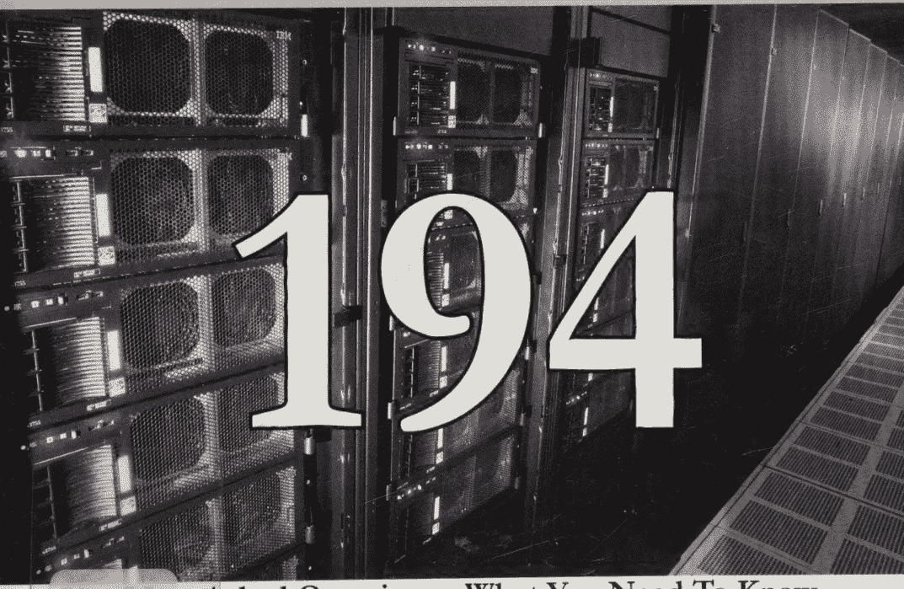
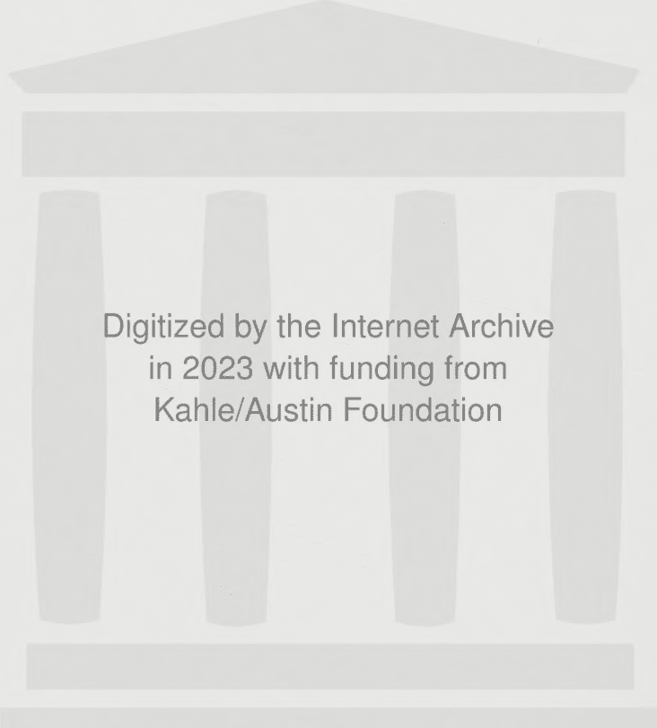

# Red Hat Enterprise Linux 194 成功秘籍：关于 Red Hat Enterprise Linux 的 194 个常见问题 - 你需要知道的一切

常见问题解答 - 你需要知道

## Ruth Dennis

https://archive.org/details/redhatenterprise0000ruth

# 关于红帽企业版 Linux 的常见问题

## 你需要知道

- Fedora 版本列表 - Fedora 19 147
- Linux 发行版 - 安装 148
- 虚拟机管理器 - 包含虚拟机管理器的发行版 149

## 逻辑卷管理器 (Linux)

`LVM` 是 Linux 核心的一种理性的容量管理逻辑容量管理员，用于组织扁平圆盘驱动器及类似的质存储实现。Heinz Maelshagen 于 1998 年编写了第一段代码，并采用了作为 HP-UX 容量管理员的其主要规划建议。

Arch Linux、CrunchBang、CentOS、Debian、Fedora（操作系统）、Gentoo Linux、Mandriva、MontaVista Linux、OpenSUSE（操作系统）、Pardus、Red Hat Enterprise Linux、Slackware、SUSE Linux Enterprise Desktop (SLED)、SUSE Linux Enterprise Server (SLES)、Linux Mint 以及 Ubuntu（操作系统）等发行版的安装程序均具备 LVM 感知，并可以在合理的容量上设置带有根文件系统文件系统的可启动配置。

## ClearOS

ClearOS（曾命名为 ClarkConnect'）是一种基于 CentOS 和 Red Hat Enterprise Linux 的 Linux 发行版，旨在为中小型企业提供网关（电信）网络访问和网络服务器，并配有基于 WebConfig 的管理用户界面。它的开发目标是作为 Windows Small Business Server 的替代方案。ClearOS 取代了 ClarkConnect。该代码由 ClearFoundation 汇总，辅助设施可以通过 ClearCenter 购买。ClearOS 5.1 取消了以前对通信、DMZ 和多 WAN 用目的限制。

自 ClearOS 6.1 发布以来，该发行版是一个功能齐全操作系统，旨在作为 Red Hat Enterprise Linux 的原始包用于服务器和工作站。

## Fedora (操作系统) - 历史

Fedora 项目产生于 2003 年底，当时 Red Hat Linux 结束了。Red Hat Enterprise Linux 成为 Red Hat 唯一官方正式维护的 Linux 发行版，而 Fedora 则是一个小组发行版。Red Hat Enterprise Linux 将 Fedora 的适配版本作为其交付物。

Fedora 的名称来源于 Fedora Linux，这是一种为 Red Hat Linux 发行版提供额外代码的免费程序，并作为 Red Hat 'Shadowman' 环境中典型的 Fedora 应用。Warren Togami 于 2002 年启动了 Fedora Linux 作为一个初级程序，旨在为经过良好测试的第三方代码包提供单一存储库，这些非 Red Hat 代码应该更容易被发现、创建和使用。Fedora Linux 和 Red Hat Linux 的关键在于 Fedora 的仓库创建应当与全球免费社区协作。Fedora Linux 最终被 Fedora 项目接纳，并支持这种协作模式。Fedora 是 Red Hat 的一个品牌，尽管这曾被无关 Fedora 仓库管理代码的制作者讨论过，该问题目前已解决。

Fedora 项目由一个拥有监督权限的委员会管理，其大部分成员由 Fedora 组指定。

## 物理地址扩展 - Linux

Linux 核心包含从 2.3.23 版本开始的完整 PAE 模式辅助，Linux Torvalds 在 1.3.15 中提到了 PAE 的 4MB 页辅助，在 32 位设备上激活了高达 64GB 的内存访问。启用 PAE 的 Linux 核心需要 CPU 也支持 PAE。Linux 核心将 PAE 作为一种构造选择，主要发行版提供 PAE 核心，而普通 Linux 发行版已开始采用 PAE 核心作为发行特定的默认设置。普通 Linux 发行版已停止发布非 PAE 核心，从而使 PAE 设备成为强制性——例如6.0 版本的 Red Hat Enterprise Linux / CentOS，12.10 版本的 Ubuntu（操作系统）Ubuntu（以及衍生 Linux Mint）。Fedora（操作系统）插入了 PAE 和非 PAE 核心以支持高达 19GB，Debian 则。

如果核心在没有 PAE 辅助的情况下构建，NX 位特性将无法工作。http://books.google.com/books?id=6zvRFEIQ24C 专业 Linux 内核架构，图 3.16 `paging_init` 的代码流，执行禁用保护（Execute Disable Protection）同样由 CPU 维护，如果核心带有 PAE 支持进行构建；遗憾的是，否则该特性不可。

## RedSleeve

`RedSleeve` 是一种基于 Linux 内核的免费操作系统 Linux 发行版。它作为 Red Hat Enterprise Linux (RHEL) 发行版移植到 ARM 设计。RedSleeve 旨在提供免费的组织数据处理程序，并保持与其上游（软件开发）上游源 Red Hat 的一致性。http://www.redsleeve.org/about/

RedSleeve 是基于 Red Hat 产生的免费开源代码。

RedSleeve 与 Red Hat Enterprise Linux 的衍生品（如 CentOS 和 Scientific Linux）不同之处在于它也是一个不受上游发行版维护的纯净程序 (ARM)。

## LAMP (软件套装) - Linux

Linux 是一种类 Unix 且符合 POSIX 的计算机操作系统，在免费开源代码创建和分发的类型下构建。发行版的主要形式是 Linux 发行版，通常通过其包管理结构在容器外提供完美的 LAMP 套件。在常见的 Linux 发行版中，55% 的网络服务器份额由 Debian 和 Ubuntu（操作系统）占据，Red Hat Enterprise Linux RHEL、Fedora（操作系统）和 CentOS 合计占 37.3%。

许多选项用于自定义和安全 Linux 配置，例如使用安全增强 Linux|SELinux，或者使用 chroot 环境。

## RPM 包管理器 - 本地操作

软件包可能来自特定发行版（例如 Red Hat Enterprise Linux）内部，或者为不同的小组（例如 Fedora 的 RPM Fusion）构建。软件包之间的循环依赖（所谓的“依赖地狱”）可能是问题；在这种情况下，单一安装控制需要保持相关的软件包。

## VMware ESXi - Linux 依赖

ESX 使用 Linux 内核来实现额外的代码：通常由 VMware, Inc. 。随着 vmkernel 保持为内核，ESX 的 Linux 部分在不同代码版本上发生了巨大变化。VMware FAQ http://www.vmware.com/products/esx/faqs.html VMware FAQ 指出：ESX 服务器还包含一个基于 Linux 2.4 核心的辅助控制台，用于启动 ESX 服务器虚拟化层。Linux 核心在其他代码之前运行。

在 ESX 版本 1 和 2 中，没有 vmkernel 操作在配置的启动过程中运行。在 Linux 核心完成后，S90vmware 文本栈了 vmkernel。ESX 版本 3 将 vmkernel 置于 Linux 之前，因此比之前的 ESX 版本更早。

文件系统稳定性的前防御。

### RPM 软件包管理器 - 前端

若干 RPM 前端简化了获取和定位 RPM 的程序，并有助于确定它们的依赖关系。这些包括：

- `yum` 应用于 Fedora、CentOS 5、Red Hat Enterprise Linux 5 及更高版本、Scientific Linux、Yellow Dog Linux 和 Oracle Linux。
- `up2date` 应用于 Red Hat Enterprise Linux、CentOS (CentOS 3 和 CentOS 4) 以及 Oracle Linux。
- `Zypper` 应用于 MeeGo、OPENSUSE 和 SUSE Linux Enterprise。
- `urpi` 应用于 Mandriva Linux、Rosa Linux 和 Mageia。

- `apt-rpm`，Debian 高级软件包工具 (`APT`) 的移植，应用于 Ark Linux、PLinuxOS 和 ALT Linux。
- Smart Package Manager，应用于 Unity Linux，并可在包含 Fedora 的许多发行版中访问。
- `rpmquery`，一种在（例如）Red Hat Linux 中可使用的命令行服务。

## Sun Secure Global Desktop - 特性

* 从 4.5 版本开始，SGD 提供了 SGD Gateway。这允许客户在不同的材料网络中访问基础组织。SGD Gateway 负责分流流量。
* SGD 集成 GNOME 启动菜单和 Windows 客户端开始菜单中；客户在自动记录客户时可以连接到 SGD 服务器。可以生成桌面图标通过 SGD 启动应用程序，而无需资源管理器感知到 SGD 的存在。
* 显著改进了带宽使用和屏幕渲染，与之前的版本相比速度显著提高。屏幕渲染机制从开始已经过修订，更加节省带宽且高效，并提高了桌面应用程序的渲染执行效率。Sun Outlines 的显示渲染速度快了 30%，带宽效率提升了 80%。
* LDAP 和 Active Directory 维护为登录源，可以配置多个 LDAP/AD。
* Windows 辅助
* 支持客户端驱动器映射和本地打印机映射
* 支持顺序端口转发
* Oracle Secure Global Desktop 软件运行在 Solaris 10 (SPARC 和 x86)、Solaris 9 和 8 (仅限 SPARC)、Red Hat Enterprise Linux 5 (x86 32位) 以及 Oracle Linux。

2007 年 11 月发布的 4.4 版本引入了基于 Web 的管理控制，取代了在 3.0 版本中首次引入的基于 Java 的 Object Manager 和 Array Manager 实现。

2013 年 4 月 30 日，Oracle 发布了 5.0 版本，其应用 HTML5 提供应用程序的远程访问，特别是针对 iPad 等便携设备。

## 基于内核的虚拟机 - 实现

- 基于 Illumos 构建的发行版
- Openindiana
- Red Hat Enterprise Linux (RHEL) 5.4 及以上
- SmartOS
- SUSE Linux Enterprise Server (SLES) 11 SP1 及以上
- Ubuntu 10.04 LTS 及以上
- Gentoo Linux

# Linux 发行版 - 流行发行版

著名的 Linux 发行版包括：

Arch Linux，一种面向高级 Linux 用户的滚动发布发行版，由一个高速社区维护，最初基于在 TAR.gz 和 TAR.xz 格式中的二进制包。

Manjaro Linux，Arch Linux 的派生版本，包含图形化安装程序和各种易用性特性，适合非资深 Linux 用户。保留了 Arch 仓库的滚动发布包，通过提供较小的延迟安全更新更新以获得更难获取的扩展稳定性。

Debian，一种由志愿者开发者小组维护的非商业性发行版，严格遵守自由代码原则。

Caian，是一种开源社会技术程序，在委内瑞拉编译和开发，基于 Debian。

Knoppix，首个 Live CD 发行版，无需安装到硬盘即可完全在可移动介质上运行，基于 Debian。

Linux Mint Debian Edition (LMDE) 直接基于 Debian 的稳定发行版构建。

Ubuntu，一种基于 Debian 的广受欢迎桌面和服务器发行版，由英国 Canonical Ltd 公司维护。

BackTrack，基于 Ubuntu 操作系统创建。用于数字取证和入侵测试。

Trisquel，完全自由的代码配置，不包含任何专有代码，并使用 Linux-libre 内核。

Kubuntu，Ubuntu 的 KDE 版本。

Linux Mint，一种基于 Ubuntu 并与其兼容的发行版。支持多种桌面环境，其他包括 GNOME Shell 分支、Cinnamon 和 GNOME 2 分支 MATE。

Xubuntu 是 Ubuntu 的 Xfe 版本。

Lubuntu 是 Ubuntu 的 LXDE 版本，被称为一种轻量级发行版。

Fedora，一个基于美国 Red Hat 公司的发行版。

Red Hat Enterprise Linux，是 Fedora 的派生版本，由 Red Hat 维护并提供商业支持。

CentOS，源自 Red Hat 相同的起源发行版，由一个完全自愿的设计师小组维护，具有 100% Red Hat 兼容适配以及一个并不总是 100% 上游兼容的改进版本。

Oracle Linux，是 Red Hat Enterprise Linux 的派生版本，由 Oracle 提供商业支持。

Mandriva，一种在某些欧洲国家和巴西受欢迎的 Red Hat 派生版本，如今由同名的法国公司维护。

Mageia，Mandriva Linux 在 2010 年产生的分支，不久前声誉迅速上升。

PCLux，Mandriva 的派生版本，已发展成为一个社区创建的桌面发行版。

Gentoo，一种面向高级用户的发行版，以其类似于 FreeBSD Ports 的转换而闻名，通过高度自动的设备配置旨在从源码编译应用程序。

Chromium OS，由 Google 开发的开源操作系统，首次以 Gentoo 为基础运行应用程序。

Chrome OS，Google 对 Chromium 的商业化版本。

openSUSE 是一个主要由德国 SUSE 公司支持的发行版。

SUSE Linux Enterprise，作为 OpenSUSE 的形式，由 SUSE 维护并提供商业支持。

Pisi Linux 是一种 Linux 发行版，基于第一个 Pardus 操作系统及其 PISI 束配置。用于社区指定的配置安排管理员。

Slackware，最早的 Linux 发行版之一，建立 1993 年，随后由 Patrick J. Volkerding 维护。

Univention Corporate Server，一种具有合并管理配置的企业级 Linux 发行版，由德国 Univention 公司维护维护。

DistroWatch 尝试包含任何流行的 Linux 发行版，无论其目前是否活跃；它通过其个人网站的页面视角良好维护发行版的排名，作为一种比较声誉。而额外的声誉操作如 Linux Counter 则使用统计信息。

## 虚拟机管理器 - 文档

文档存在于虚拟机管理器内部及其官方网站上。

Red Hat Enterprise Linux 虚拟化支持如《三级管理》、《入门指南》等页面。

Ubuntu 8.04 虚拟化支持《Ubuntu 服务器指南》。

## Linux on Power - PowerShell Solution Editions

在 2012 年 4 月，IBM 推出了 2 种专门针对 Linux 的配置，专注于大数据系统分析解决方案、业务应用程序以及开源组织设施（如 Web 服务、电子邮件和社交媒体协作）。

> [[http://www-03.ibm.com/systems/power/linux/powerlinux/7r1/index.html PowerLinux 7R1] 和 [http://www-03.ibm.com/systems/power/linux/powerlinux/7r2/index.html PowerLinux 7R2] 配置是单插和双插的高性能机架式服务器，配备一个 16 个 POWER7 微处理器核心，频率为 3.55GHz（仅限 7R1），7R2 的 3.55GHz 和 3.3GHz 选择支持最大 128GB（7R1）或最大 256GB（7R2），可配置 8GB、16GB 和 32GB 的直插内存模块 (DIMMs)。两种配置均运行标准的 Linux 操作系统：Red Hat Enterprise Linux SUSE Enterprise Server，并集成了 [http://www-03.ibm.com/systems/power/linux/powerlinux/powervm/index.html PowerVM for PowerLinux] 虚拟机程序，每个虚拟中心支持最多 10 个虚拟机，每台服务器支持最多 160 个虚拟机。]

POWER7 微处理器中心，支持高达 256 GB 的内存，可以选择 Red Hat Enterprise Linux 或 SUSE Linux Enterprise Server 操作系统以及用于 PowerLinux 的集成 PowerVM。

除了这些具体的发行版本外，Linux 能够运行在任何 Power 系列的设备上。

## Red Hat Linux

“Red Hat Linux”由 Red Hat 公司构建，在 2004 年停止运营之前，它是一个广受欢迎的 Linux 操作系统。

Red Hat Linux 的早期交付物名为“Red Hat Commercial Linux”；Red Hat 于 1994 年 11 月 3 日首次发布了代码。它是第一个采用 `RPM` 软件包管理器作为其封装环境的 Linux 发行版，并在其他时间也成为了某些不同发行版的基石，例如 Mandriva Linux 和 Yellow Dog Linux。

2003 年，Red Hat 结束了旧的 Red Hat 系列，转而采用面向企业环境的 Red Hat Enterprise Linux (`RHEL`)。Fedora（操作系统）由社区支持的 Fedora 项目开发并由 Red Hat 支持，是最适合家庭使用的免费版本。Red Hat 9 是最后一个发布版本，尽管其正式生命周期结束于 2004 年 4 月 30 日，但通过在 2007 年初关闭的 Fedora Legacy 程序，其升级一直发布到 2006 年。

## HP Integrity Virtual Machines - 历史

Christophe de Dinechin 启动了一个秘密项目将 Itanium 虚拟化，得到了 Jean-Marc Chevot 以及一个由优秀的 HP 架构师组成的虚拟小组的支持。Integrity Virtual Machines 的示例由 Christophe de Dinechin、Todd Kjos 和 Jonathan Ross (Integrity Virtual Machines) 在 2000 年至 2003 年间开发 `http://rouge.colorado.edu/about/Epic7/ItaniumVirtualMachines.pdf` `http://www.icegelato.edu/about/apr07_presentations.php?pres75` Presentations-Gelato ICE | San Jose | April 2007 :: About :: Gelato ICE)。随后，它由一个更强大的 OpenVMS、Tru64 Unix 和 HP-UX 核心架构师小组转化为一个成熟的产品。

- 版本 1.0 和 1.2，于 2005 年发布，在虚拟设备中运行 HP-UX。
- 版本 2.0，于 2006 年 11 月发布，也支持 Windows Server 2003、CD 刻录机|CD 和 DVD 刻录机、带驱动器和 VLAN。
- 版本 3.0，于 2007 年 6 月发布，支持 Linux Red Hat Enterprise Linux [`http://www.redhat.com/isv_catal/AppProfile.html?application_id=4633` Redhat.com | 应用配置文件]
- 版本 3.5，于 2007 年后期发布，支持 SUSE Linux Enterprise Server、`http://developer.novell.com/ys92318.html` HPVM 3.5] HP-UX 11i v3 用户、为 Windows 和 Linux 用户提供整洁的设施，并为 HP-UX 用户加速虚拟 I/O。[`http://bizsupport.2.austin.hp.com/bc/docs/Support-Manual/code0261869/code0261869.pdf` 此 Integrity VM 版本的新功能和增强激活了 I/O 执行和更多的实现功能]。
- 版本 4.0，于 2008 年 9 月发布，运行在 HP-UX 11.31（称为 11i v3），支持 8 个虚拟 CPU、CPU 分配（除了早期版本中的 CPU 权限外）、旨在加速虚拟 I/O (`AVIO`)，并包含了测试版版本 4.0 实用功能，如在线模式和针对 OpenVM 迁移的用户。
- 版本 4.1，于 2009 年 4 月发布，支持在线 VM 迁移，允许客户在不影响连续性的情况下将活动虚拟机从一个 VM 主机迁移到另一个。它还提供了服务信息更改 SSH 第三方选项、为 Windows 和 Linux 用户加速网络虚拟 I/O (`AVIO`)，并支持后端和 VxVM 存储。
- 版本 4.2，于 2010 年 3 月发布，支持 VM 迁移过程中的编码，针对新开发的 Itanium 硬件和 VM 客户端操作系统进行了优化，持有允许 Serviceguard 软件包和 Serviceguard 节点的 VM 代码许可，并支持自动内存重分配。
- 版本 4.2.5，于 2010 年 9 月发布，支持 VM 迁移过程中的编码，针对新开发的 Itanium 硬件和 VM 客户端操作系统进行了优化，持有允许 Serviceguard 软件包和 Serviceguard 节点的 VM 代码许可，并支持自动内存重分配。
- 版本 4.3，于 2011 年 3 月发布，支持 VM 迁移过程中的编码，针对新开发的 Itanium 硬件和 VM 客户端操作系统进行了优化，持有允许 Serviceguard 软件包和 Serviceguard 节点的 VM 代码许可，并支持自动内存重分配。
- 版本 4.3，支持 VM 迁移过程中的编码，针对新开发的 Itanium 硬件和 VM 客户端操作系统进行了优化，持有允许 Serviceguard 软件包和 Serviceguard 节点的 VM 代码许可，并支持自动内存重分配。

Linux 最初是作为一种基于 Intel x86 架构的个人计算机免费操作系统开发的。与任何其他操作系统相比，它随后被移植到更广泛的设备程序中。它是服务器（计算）服务器以及各种大型计算集群（类似于强大的中央计算机和超级计算机）的内核操作系统；相比之下，全球 95% 的 `TOP500` 快速超级主主机运行着不同版本的 Linux 变体，总共连接了 44 台超级计算机。Linux 还运行在嵌入式设备上，这些设备的操作系统通常被集成在微代码中并是高度定制的（针对特定系统），例如移动手机、笔记本电脑、网络路由器、驱动电视和视频游戏机的构造机制；被广泛使用的 Android（操作系统）配置也是构建在 Linux 内核之上。

Linux 的创建是免费和开源代码协作最重要的实例之一：在 `GNU` 公共许可许可证（`GPL`）下，任何人都可以出于商业或非商业目的应用、修改和分发基础源代码。通常，Linux 是一个软件包管理系统，在桌面和服务器用户熟悉的 Linux 发行版中打包。一些著名的 Linux 发行版包含 Debian（操作系统）及其衍生版本，如 Ubuntu（操作系统）和 Linux Mint；Fedora（操作系统）及其衍生版本，如面向盈利的 Red Hat Linux 及其开源对等品 CentOS；Mandriva Linux/Mageia；OpenSUSE（及其面向盈利的 SUSE Linux Enterprise Server）以及 Arch Linux。Linux 发行版包含 Linux 内核、系统实用程序、计算机科学库以及通常实现发行版设计用途的大量程序代码。

面向桌面用户的 Linux 发行版通常包含 `X11` 或 `Wayland`（显示服务器协议）作为窗口配置，以及如 `KDE` 软件集合等其他桌面生态系统。某些发行版可能包含资源消耗少的桌面，如 `LXDE` 或 `Xfce`，用于配置较弱的计算机。设计用于像服务器一样运行的发行版可能会完全忽略标准环境中图形环境，而是包含不同的代码来设置和处理 `LAMP`（软件栈）或 `LEMP`（软件栈）解决方案堆栈。由于 Linux 是完全免费分发的，任何人都可以为任何设计用途制作发行版。

# 支付卡行业数据安全标准 - 使用 Linux 的 PCI 合规文章

- 红皮书：关于 Red Hat Enterprise Linux 的 `PCI DSS` 特性（第 1 部分）
- 红皮书：关于 Red Hat Enterprise Linux 的 `PCI DSS` 特性（第 2 部分）
- `PCI DSS` 与 Red Hat Enterprise Linux（第 3 部分）
- `PCI DSS` 与 Red Hat Enterprise Linux（第 4 部分）
- `PCI DSS` 与 Red Hat Enterprise Linux（第 5 部分）
- `PCI DSS` 与 Red Hat Enterprise Linux（第 6 部分）
- `PCI DSS` 与 Red Hat Enterprise Linux（第 7 部分）
- `PCI DSS` 与 Red Hat Enterprise Linux（第 8 部分）
- `PCI DSS` 与 Red Hat Enterprise Linux（最后部分第 9）

# Amazon EC2 - Amazon Linux AMI

Amazon 拥有基于 Fedora（操作系统）和 Red Hat Enterprise Linux 的个人 Linux 发行版，作为低成本、熟悉的 Amazon 机器镜像（`Amazon Linux AMI`）。版本 2013.03 包括：

- Linux 内核变体 3.4.34
- Java 运行时环境 (`IcedTea6 1.11.4`)
- GNU 编译器集合 `GCC.x86_64 4.4.6-3.45.amzn1`

# Ubuntu Linux - 变

由 Canonical 和 Ubuntu 组生成并维护的官方 Ubuntu 版本获得 Canonical、其关联公司以及社区的全面支持，包括：

- `Ubuntu Desktop`（正式指定为 `Ubuntu Desktop Edition`，简称为 `Ubuntu`），部署在采用 Unity 桌面用户界面的桌面电脑和笔记本电脑上。

- `Ubuntu Desktop Remix`，一个面向商业用户的发行版本，在标准组织代码的基础上包含了 Adobe Flash、Canonical Landscape、OpenJDK6 和 VMware View，同时消除了社交网络和文件应用程序，以及开发/系统管理工具。商业桌面 Remix 的目标不是模仿企业级发行版（如 Red Hat Enterprise Linux），而是根据 Mark Shuttworth 的博客创建它，以便企业用户更容易地根据其需求访问 Ubuntu Desktop。

- `Ubuntu Server`，设计用于像服务器一样运行的发行版可能会完全忽略标准环境中图形环境，而是包含不同的代码来设置和处理 LAMP（软件栈）或 LEMP（软件栈）解决方案堆栈。由于 Linux 是完全免费分发的，任何人都可以为任何设计用途制作发行版。

- `Ubuntu TV`，设计用于像服务器一样运行的发行版可能会完全忽略标准环境中图形环境，而是包含不同的代码来设置和处理 LAMP（软件栈）或 LEMP（软件栈）解决方案堆栈。由于 Linux 是完全免费分发的，任何人都可以为任何设计用途制作发行版。

支持 `CentOS`、`红帽企业级 Linux (RHEL)` 和 `CloudLinux`。`Cpanel 11.30` 是支持 FreeBSD 的最后一个主要变体。

基于应用程序的支持包含了 `Apache HTTP Server`|Apache、`PHP`、`MySQL`、`PostgreSQL`、`Perl` 和 `BIND (DNS)`。邮件基础支持包含邮局协议|`POP3`、互联网消息访问协议|`IMAP`、简单邮件传输协议|`SMTP` 设施。通过端口（`port`）`2083` 使用 `HTTPS` 进入 `Cpanel`。

一旦建立，`Cpanel` 无法被轻易删除。必须对服务器进行格式化并重新安装操作系统。同样，它应该安装在一个没有任何先前配置的全新操作系统上。

## HP Superdome

`HP Superdome` 是由惠尔-惠普（Hewlett-Packard）设计和制造的专用服务器（computing）|服务器计算机。最新变体文章 [`http://203441.www2.hp.com/integrity/w1/en/high-end/integrity-high-end-servers-superdome2.html`] `Superdome` 于 2010 年推出。`Superdome 2` 可扩展 2 到 32 个处理器插槽|`sockets`（多达 128 个处理器核心|`cores`）以及 4 KB 的留存。2000 年发布时，`Superdome` 使用 `PA-RISC CPU`。自 2002 年以来，还有另一种基于 `Itanium 2 CPU` 的引擎变体，并名为 `HP Integrity Superdome`。经典的 `PA-RISC Superdome` 后来被称为 `HP 9000 Superdome`。`Superdome` 的前身是 `HP V-Class`（其基于 `Convex Computer`|Convex 获得的技术）。

一新的整洁的 `HP Integrity Superdome 2` 使用英特 `Itanium 93xx` 系列微处理器，以 `Tukila`（处理器）|`Tukila` 闻名，并结合 `BladeSystem`| `HP BladeSystem C7000` 进行了全面修订。自 2012 年起，也可以 `Itanium 95xx` 微处理器。

`Superdome` 通常运行 `HP-UX` 操作系统，`Itanium 2` 变体兼容许多不同的设置，例如 `Microsoft Windows Server 2008 R2`、`SUSE Linux 发行版`| `SUSE Linux Enterprise Server`、红帽 Linux、认证 – Integrity Superdome [`http://hardware.redhat.com/show.cgi?id=16685`] `Debian Squeeze` 以及 `OpenVMS V8.2-1`。

## Enlight cloud - 客户操作系统

`ENlight` 支持 `Windows Server` 以及如 `CentOS` 在内的 Linux 发行版。然而，垂直自动挂载仅支持 `Windows Server 2008`（标准版和数据中心版）以及包含 `CentOS`、`红帽企业级 Linux`、`SUSE Linux` 和 `Oracle Linux` 的 Linux 发行版。其他操作系统仅支持挂载选项，例如 `Ubuntu`（操作系统）|`Ubuntu`、`Fedora`（操作系统）|`Fedora`、`Windows Server 2003` 和 `Windows 7`。[`http://www.hostreview.com/news/120626-edss-now-supports-s11-and-oracle-linux-on-enlight-HostRe-Article`] 检索于 2012 年 6 月 26 日

## 红帽企业级 Linux 衍生版 - 特

红帽企业级 Linux 产品通常包含联合套件，位于 RHEL 的不同版本中。版本数字通常与 RHEL 中标识的数字相同；因此，免费版本保留了与付费版本的二进制代码兼容性|，为 RHEL 设计的代码在免费版本上的运行情况通常同样顺畅。对发行版仅需较少的修改。然而，RHEL 应用了红帽所有的 `Update2` 技术来提供升级服务。为了方便起见，某些使用 `Yellow Updater Modifier`| `yum` 代替 `update2` 的免费选项会生成更简单的升级分发镜像。红帽企业级 Linux 5 及更高版本使用 `yum` 作为其提供升级的内置配置，`update2` 仅是其前身。

## Solaris 容器 - 标记区域

虽然配置上的所有区域共享一个公共位置，但增加了一个名为标记区域（简称 `BrandZ`）的额外特性。这允许单个区域以比全局区域标记更多的方式提供支持。现有标签（2009 年 10 月）可分为两类：

- 不执行配置调用翻译的标签：

    - `native` 是 Solaris 10 的默认设置

    - `ipkg` 是 OpenSolaris、OpenIndiana 和 OmniOS 的默认设置

    - `joyvent` 是 SmartOS 的默认设置

    - `cluster` 应用于 Solaris Cluster 区域

    - `labeled` 应用于 Solaris Trusted Extensions 环境中的区域

- 执行配置调用翻译的标签：

    - `solaris8` 在 Solaris 10 配置上提供 Solaris 8 生态系统，包含 Solaris 8 配置调用翻译为 Solaris 10 配置调用的解释（仅适用于 SPARC 系统）

    - `solaris9` 在 Solaris 10 配置上提供 Solaris 9 生态系统，包含将 Solaris 9 配置调用翻译为 Solaris 10 配置调用的解释（仅适用于 SPARC 系统）

    - `lx` 在 Solaris 10 配置上提供红帽企业级 Linux 3 生态系统，包含将 RHEL 3 配置调用翻译为 Solaris 10 配置调用的解释（仅适用于 x86 系统）

    - `s10brand` 在 OpenSolaris 或 Oracle Solaris 11 配置上提供 Solaris 10 生态系统，包含将 Solaris 10 配置调用翻译为 OpenSolaris/Oracle Solaris 11 的解释

`Anaconda` 使用 `yum` 作为其提供升级的内置配置，`update2` 仅是其前身。

`Anaconda (安装程序)`

`Anaconda` 在 Solaris 10 配置上提供 Solaris 9 生态系统，包含 Solaris 9 配置调用翻译为 Solaris 10 配置调用的解释（仅适用于 SPARC 系统）[`http://fedaproject.org/wiki/Anaconda`]

## Microsoft UI Automation - 相关技术和互操作性

- `lx` 在 Solaris 10 配置上提供红帽企业级 Linux 3 生态系统，包含将 RHEL 3 配置调用翻译为 Solaris 10 配置调用的解释（仅适用于 x86 系统）

- `s10brand` 在 OpenSolaris 或 Oracle Solaris 11 配置上提供 Solaris 10 生态系统，包含将 Solaris 10 配置调用翻译为 OpenSolaris/Oracle Solaris 11 的解释

`Sun Java 套件`

# Sun Java Suite 是 Sun Microsystems 的一组工业级代码。维护的程序是：红帽企业级 Linux、Solaris（操作系统）|Solaris 和 Windows Server。自 Oracle 在 2010 年收购以来，已更名为“Oracle Unified Communications”。

## 基于内核的虚拟机 - 实现

- Illumos 发起的发行版
- OpenIndiana
- Red Hat Enterprise Linux (RHEL) 5.4 及以上版本
- SmartOS
- SUSE Linux Enterprise Server (SLES) 11 SP1 及以上版本
- Ubuntu（操作系统）Ubuntu 10.04 LTS 及以上版本
- Gentoo Linux
- Unvention 企业系统

## LTFS - IBM LTFS 支持的操作系统

- Red Hat Enterprise Linux (RHEL) 5.4, 5.5 带有 LTFS-LE 2.0.0 for Linux（最新发布日期：2011年6月）
- SUSE Linux Enterprise Server (SLES) 11 SP1 带有 LTFS-LE 2.0.0 for Linux（最新发布日期：2011年6月）

## CentOS - 设计

红帽企业 Linux (Red Hat Enterprise Linux RHEL) 仅通过付费订阅服务进行访问，该服务提供代码升级访问和不同程度的技术支持。文章大部分由在严格代码许可下分发的代码包组成，这些包的原始代码由红帽公司通用生产。
CentOS 设计者使用红帽的原始代码产生与 RHEL 相似的最终产品。由于红帽不允许其重新分发，红帽的商标和徽标已被更改。
CentOS 可按需免费获取。技术支持主要由所有邮件列表、小组和讨论空间提供。该程序与红帽相关，但旨在变得更加通用、开放和包容。虽然红帽聘佣了大部分 CentOS 首席设计者，但 CentOS 程序本身依赖于用户和组织的支持。

## 国际商业机器公司 (IBM) - 选当前项目

DeveloperWorks 是由 IBM 为代码设计人员和 IT 专家运行的网站。它包含教程和课程，以及代码下载和代码示例、对话论坛、播客、博客、维基以及针对技术和技术专家的各种设计。主题涵盖开放、行业标准应用的工具和方法，如 Java（编程语言）Java、Linux、面向服务的架构 (SOA) 和网络设施、创建。Ajax（编程）Ajax、PHP 和 XML 以及 IBM 文章（IBM WebSphere）WebSphere、Rational Software Rational、Lotus Software  Lotus Lotus Software、Tivoli Software Tivoli 以及信息管理。2007 年，DeveloperWorks 进入了名人堂。
alphaWorks 是 IBM 用于未来代码应用的工具和方法。这些工具和方法的应用包括：
- 灵活互联网评估报告架构 – 一种用于互联网研究、展示和包含的极实用设计。
- IBM 历史工具 | IBM 流可视化应用程序 – 一个用于可视化多个协作作者的活动、开发文件和接收者操作的实现。
- IBM Linux on POWER 性能模拟器 – 为 Linux on Power 用户提供一组用于 IBM POWER 处理器 | POWER CPU 的执行类型。
- 数据库文件存档与恢复管理 – 一种利用数据库中条目来存档和恢复硬盘文件的程序。
- 自动计算策略管理 – 一种基于策略的行政组织，简化 IT 和业务操作的自动化。
- FairUE – 一种邮件过滤器，通过验证通信 ID 而不是过滤内容。非结构化信息管理架构 (UIMA) SDK – 一个 Java SDK，有助于处理模糊信息的应用的实现、结构化和分发。
- 可访问浏览器 – 专为帮助视觉障碍人士而开发的 Web 浏览器，以源码形式分发。通用 A-Browser，该技术必须消除对鼠标的需求，依赖语音控制、按钮和预定义的键盘快捷键 | 快捷键。
几乎所有的视频游戏机 | 游戏控制台的视频游戏机历史（第七代）最新传播了 IBM 开发的集成电路 | 微处理器。Xbox 360 拥有一个 PowerPC 多核 | 三核 CPU，该 CPU 由 IBM 在不到 24 个月内开发和制造。索尼的 PlayStation 3 采用由 IBM、东芝和索尼共同开发的 Cell（微处理器）| Cell BE 微处理器。IBM 还提供了帮助天堂 Wii 配置核心的微处理器，其于 2012 年发布。特约作家，mybroadband。2011年6月8日。检索于2011年6月17日。基于 Power 架构的微处理器在节能硅封装中包含了 IBM 的最新技术。Isaac Leung，《电子新闻》。2011年6月8日。任天堂视频游戏机历史（第七代）| 第七代主机Wii 归功于代名为 Broadway（微处理器）Broadway 的 IBM 芯片。旧的任天堂 GameCube 使用 IBM 开发的 Gekko（微处理器）Gekko CPU。
2002年5月，IBM 和 Butterfly.net 宣布了蝴蝶网格 (Butterfly Grid)，这是一种面向音视频播放行业的盈利计算网格。2006年3月，IBM 宣布与 Hoplon Infainment、Online Game Services Incorporated (OGSI) 和 RenderRocket 达成协议，进行按需内容管理和后端服务器处理资源。
IBM 宣布将启动其名为 Open Client Offering 的新代码，该代码将在 Linux、Microsoft Windows 和 Apple 的 Mac OS X 上运行。该公司表示其新程序允许企业为员工提供在 Windows 上使用相同代码的选择。这意味着 Open Client Offering 将消除使用 Linux 或 Apple 替代 Windows 时的运行损失。由于操作系统不再依赖于基于 Windows 的代码，企业不再需要为微软的操作系统付费。一种替代方案是
- Red Hat Enterprise Linux Advanced Platform (原 AS)
- Red Hat Enterprise Linux (原 ES) (限制为 2 个 CPU)
- 带有工作站和多操作系统选项的 Red Hat Enterprise Linux Desktop
- 带有工作站选择选择的 Red Hat Enterprise Linux Desktop (原 WS)
- 带有多操作系统选项的 Red Hat Enterprise Linux Desktop
- Red Hat Enterprise Linux Desktop (原 Desktop)
Red Hat 还宣布了其面向未来市场的 Red Hat 全球桌面版本。
RHEL 4、3 及之前的版本有 4 种变体：
- 用于任务关键型/企业级计算机系统的 Red Hat Enterprise Linux AS。
- 用于受维护的网络服务器的 Red Hat Enterprise Linux ES。
- 用于高性能计算的科技先驱型组织桌面电脑的 Red Hat Enterprise Linux WS。
- 用于各种业务的多种单用户桌面发行版的 Red Hat Desktop。

## Hyper-V - 支持的客户机

下表记录了早于 Windows Server 2012 适配的受维护访客操作系统。其他客户操作系统如 Ubuntu Linux 6.0/6.6/10/7.1 或 Fedora 8 均不受支持；尽管如此，它们已被宣布运行。

| 客户 OS | 虚拟处理器 | 版本(s) |
| :--- | :--- | :--- |
| Windows 7 | 1, 2, 3 或 4 | 同时支持 x86-32 和 x86-64，包含家庭版以外的所有版本（家庭版包括 Home Premium, Home Basic, Starter） |
| Windows Server 2008 R2 | 1, 2, 3 或 4 | x64, Web, Standard, Enterprise, Datacenter |
| Windows Server 2008 | 1, 2, 3 或 4 | 同时支持 x86 和 x64, Web, HPC, Standard, Enterprise, Datacenter，均不带 Hyper-V |
| Linux (仅包含带有 SP3 的 SUSE Linux Enterprise Server 10 变体 11，Red Hat Enterprise Linux 适配 5.2-6.1 以及 CentOS 5.2-6.2) | 1, 2 或 4 | 同时支持 x86 和 x64 |
| Unix (FreeBSD 变体 9) | 1, 2 或 4 | x64 |
| Windows Server 2003 | 1 或 2 | 同时支持 x86 和 x64, Standard, Enterprise, Datacenter，需要 SP2 |

| Windows Server 2003 R2 | 1 或 2 | Web, Standard, Enterprise, Datacenter，均支持 x86 和 x64，但不支持其 64 位的 Web 版本 |
| Windows 2000 Server | 1 | Server, Advanced Server，需要 SP4 |
| Windows Vista | 1 或 2 | 同时支持 x86 和 x64，包含家庭版以外的所有版本 |
| Windows XP | 2 或更多 | x86, 仅限专业版，需要 SP3 (SP2 仅辅助 1 个虚拟 CPU) |
| Windows XP x64 | 2 或更多 | x64, 仅限专业版，需要 SP2 |
| Windows Small Business Server 2011 | 1, 2 或 4 | Essentials, Standard (Essentials 仅支持 2 个虚拟 CPU) |
| Windows Home Server 2011 | 1, 2 或 4 | Standard |
| Windows Storage Server 2008 R2 | 1, 2 或 4 | Essentials |
| 其他 (任何不受支持的操作系统) | 1 | 不适用 |

第三方业务的桌面虚拟化 (VDI) 文章（如 Quest Software Workplace、Citrix Desktop Scientia AppDis Fusion 和 Eronic PowerTerm WebConnect 提供在为终端用户分配 PC 桌面计数时，在信息中心服务并本质上运行桌面设备的能力）。

具有增强型 I/O (Enlightened I/O) 和虚拟机感知核心的客户机操作系统，如 `Windows Server 2008` 及随后的服务器版本、`Windows Vista SP1`。

(软件)Click'N'Run (CNR)。通过支付年度订阅费用，消费者可以通过 CNR 代码实现免费和付费应用程序的一键安装。Doc Sear 假设 CNR 的易用性可能会让桌面级 Linux 成为一种切行的现实。

2003 年，Handango 建立了首个针对智能手机的设备端商店，用于检测、定位和购买代码。应用程序的下载和购买直接在设备上完成，不需要与计算机同步。每个程序都可以查看其描述、评分和截图。

2005 年，诺基亚 770 平板电脑为其程序库配备了图形化前端，以便轻松安装程序（其 Maemo 系统基于 Debian 构建）。

广名的 Linux 发行版 Ubuntu（操作系统）Ubuntu（同样基于 Debian 构建）在 9.10 版本中引入了名为 Ubuntu Software Center 的图形化软件包管理器，以替代 Synaptic。在 2010 年 10 月发布的 Ubuntu 10.10，软件中心扩展了原本仅包含其存储库代码的功能，增加了获取特定应用程序的能力（最初，这仅限于 Fluendo 认证的 DVD 解码器）。

## Fastra II - 应用与反响

该操作系统是 CentOS，一个移动 Linux 发行版以及红帽企业 Linux 的副本。Fastra II 经历了积极的业界反响。Techie.com 将其誉为世界上几乎最强大的桌面级超级主机。他们还描述了该设备在如此小的空间内拥有如此强大的性能。ITech News Net 将其命名为最强大的桌面超级计算机。

Fastra II 依赖 Nvidia 的可扩展链路接口（Scalable Link Interface），因此受到其以及供应商支持的开源驱动的 GPU 数量限制。Fastra II 的主板是在工作站上开发的。它主要应用于医院的医疗成像领域。

- Direct_Rendering_Infrastructure#GPGPU
- Debian-Med

## Scientific Linux

“Scientific Linux” (SL) 是由费米实验室的费米国家加速器实验室和欧洲核子研究组织 (CERN) 创建的 Linux 发行版。它是一个基于红帽 Linux 的免费开源操作系统，目标是尽可能接近营利性组织的发行版。[关于 Scientific Linux 的问题](http://www.scientificlinux.org/documentation/faq/general1)，www.scientificlinux.org

本文获取自红帽公司提供的免费开源代码，但并非由红帽创建、保留或维护。具体而言，本文是针对红帽企业 Linux 适配版的原始代码，符合红帽企业 Linux 的 EULA 和 GNU 通用公共许可证的规范和状态。

## Red Hat（消歧）

“Red Hat”（红帽）是一家代码公司。

“Red hat”或“Red Hat”也可能指：

- Red Hat（美国陆军行动），冷战期间在太平洋地区转移美国化学武器的行动；红帽行动（Operation Red Hat）；Red Hats，其贡献者；红帽区域，约翰斯顿环礁；
- 红帽派（Red Hat bloc），一个藏传佛教教派
- Galero，根据传统，罗马教会红主教使用的红帽
- freewill department#Training 使用的自由意愿部门实习生
- Red Hat Cell Block，路易斯安州监狱的一个牢房
- 红帽 Linux（帽 Linux），一种计算机操作系统
- Fedora（操作系统），有时被称为红帽的 Linux 发行版。
- Red Enterprise Linux，一种计算机操作系统
- 红帽协会（Red Hat Society），传统上针对 50 岁以上女性的社区性组织
- 在爱德华·德·博诺的著作《六顶思考帽》中描绘影响思考的宽帽

## 安全增强型 Linux - 实现

SELinux 作为红帽企业 Linux (RHEL) 版本 4 及后续交付物的一部分已可用。这种存在性在 CentOS 和 Scientific Linux 的类似版本中得到了很好的体现。RHEL4 的维护计划是以易用性为目标的，因此不像可能的那样具有限制性。RHEL 未来的版本旨在目标计划中具有进一步的目标，这通常意味着更严格的规则和规定。

在社区维护的 GNU/Linux 发行版中。Fedora（操作系统） Fedora 是早期采用者之一，从 Fedora Core 2 起就内置了该功能。其他发行版也包含了该功能，例如 Debian 的稳定发布版 [SELinux in Debian](http://wiki.debian.org/SELinux) 以及 Ubuntu（操作系统）Ubuntu 的 8.04 Hardy Heron。[如何在 Ubuntu 上安装 SELinux](http://ubuntu-tutorials.com/2008/03/18/how-to-install-selinux-on-ubuntu-804-hardy-heron/) 针对 Ubuntu 的 11.1 版本提供了 SELinux，SUSE 发行版拥有 SELinux 基础。[SELinux in SUSE](http://news.opensource.org/2008/08/20/opensource-add-selinux-basic-enablement-in-111/) SUSE Linux Enterprise 11 将 SELinux 视为一项技术能力

在 UNIX（更确说是 POSIX）数据处理生态系统中标准提供强制和可选访问（MAC 和 DAC）风格的早期工作，可以归功于国家安全局的可信 UNIX (TRUSIX) 工作组，该小组于 1987 年至 1991 年间运作，并发布了彩虹系列（彩虹书 #020A 并创建了官方类型和相关的评估证明 #020A）。

## PowerPC - 操作系统

- AmigaOS 4
- Apple Mac OS
- Haiku（操作系统）
- IBM i
- Inferno（操作系统）
- Solaris（操作系统）
- Plan 9
- POSIX: Unix
- IBM AIX
- 伯克利软件发行版 (BSD)
- FreeBSD
- NetBSD
- OpenBSD
- Linux
- ArchLinuxPPC
- CRUX
- Debian
- Fedora（操作系统）
- Gentoo Linux
- MintPPC
- MLLinux
- Red Hat Enterprise Linux
- Slackintosh
- SUSE Linux Enterprise Server
- Ubuntu（操作系统）
- Yellow Dog Linux
- Windows NT 3.51 和 4.0
- ReactOS 正在迁移到 Power ISA
- 用于 PlayStation 3 的 CellOS

# 红帽 (Red Hat)

'Red Hat Network'（缩写为 'RHN'）是一种由红帽控制的结构化管理设施，它为成员提供 Red Hat Linux 和 Red Hat Enterprise Linux 内部包含的包的升级、补丁和计算机错误修复。其他可访问属性还包括自定义主题内容的分发，以及对客户设置的供应、安排、通知和跟踪。

这些操作系统的用户可以通过 Yellow Dog Updater Modified|`yum`程序来下载并安装作为 RHN 形式的升级。RHN 的升级部分类似于不同类型的自动化配置维护实现，例如用于 Windows 操作系统的 Microsoft Update。配置需要订阅才能访问升级。在 [Fedora (操作系统)](Fedora (操作系统)) 中，升级是由红帽免费的 Yellow Dog Updater Modified|`yum`和高级软件包工具（Advanced Packaging Tool）仓库提供的。

2008年6月18日，红帽首席执行官 Jim Whitehurst 宣布，RHN Satellite 的代码的设计将在继 Fedora/RHEL 类型之后开源。——Chris Kanarakacus, IDG News Service, 06.18.08。2008年6月20日从 LinuxWorld.com 获取。随后，程序 Spacewalk (软件)|`Spacewalk`启动了。

## 桌面版 Linux

'Linux'（是一种类 Unix 且符合 POSIX 标准的计算机操作系统，是在免费和开源代码创建与传播模式下构建的）。Linux 的决定部分是 Linux 核心，这是一个由 Linus Torvalds 于 1991年10月5日首次发布的内核（Kernel(计算)|操作系统核心）。

Linux 最初被开发为一种针对 Intel x86 架构个人级计算机的免费操作系统。随后，与任何操作系统相比，它都被移植|到了更广泛的计算机设备程序中。它是服务器（计算）服务器以及不同强大算力（计算）|大型设置（如强大的计算机和超级计算机）上的直 式操作系统：相比之下，世界上 95% 的 TOP|500|最快的主机计算机运行着几种版本的 Linux 变体，其中总共有 44 台是最快的。Linux 同样运行在嵌入式系统中（操作系统通常固化在微代码中并针对系统高度定制的设备），如移动手机、笔记本电脑、网络路由器（计算）路由器、建筑机械动力、电视和视频游戏机；例如，Android（操作系统）Android 配置就是构建在 Linux 核心之上的。

Linux 的创建是免费和开源代码协作最重要的例子之一：基础原始代码可以在 GNU 通用公共许可证（GNU General Public License）的许可下由任何人商业或非商业地应用、修改和分发。通常，Linux 在桌面和服务器型号的 Linux 发行版环境中作为软件包管理。一些著名的普通 Linux 发行版包含 Debian（操作系统)|Debian（操作系统）（及其产品如 Ubuntu（操作系统)|Ubuntu（操作系统）和 Linux Mint）、Fedora（操作系统)|Fedora（操作系统）（及其产品如营利性的红帽 Linux 和其开源的 CentOS）、Mandriva Linux|Mandriva|Mageia、OpenSUSE（以及其营利性的 SUSE Linux Enterprise Server）以及 Arch Linux。Linux 发行版包含 Linux 核心、辅助系统软件|工具和库（计算机科学）|库，通常包含大量的程序代码以实现发行版的设计目标。

面向桌面启用的桌面版 Linux 发行版通常包含作为窗口配置的 X11 或 Wayland（显示服务器协议)|Wayland，以及后续的桌面生态系统如 GNOME 或 KDE 软件编译。某些发行版可能包含较少资源消耗的桌面如 LXDE Xfce。

红 Hat 随后资助了旨在修复错误和稳定性的额外开发。随后引入了另一个项目“GFS2”：

它是基于 GFS 演变而来的，并与其分布式块管理器（与 GFS 共享）一起包含在 Linux 2.6.19 中。Red Hat Enterprise Linux 5.2 包含了 GFS2 作为评估目的的核心组件。随着 5.3 版本的升级，GFS2 成为了核心发行包的一部分。

现在，GFS 已成为 [Fedora (操作系统)](https://wiki.example.org/Fedora)、Red Hat Enterprise Linux 5.3 及更高版本以及相关的 CentOS Linux 发行版的一部分。用户可以在 Red Hat Enterprise Linux 之上运行完全维护的 GFS。自 Red Hat Enterprise Linux 5.3 版本起，[Red Hat Enterprise Linux](https://wiki.example.org/Red_Hat_Enterprise_Linux) Red Hat Advanced Platform 已包含了无需额外费用的 GFS 支持。

以下列表列出了几个版本号和引入的主要特性：

- v1.0 (1996) 仅限 Silicon Graphics|SGI IRIX
- v3.0 Linux 端口
- v4 日志文件系统|journaling
- v5 冗余锁管理器
- v6.1 (2005) 分布式块管理器|Distributed Lock Manager
- Red Hat Enterprise Linux|Red Hat Enterprise Linux 5.3 提供了领先的完全维护的 GFS2

## Red Hat Enterprise Linux - 关系

最初，Red Hat 提供旨在对 Red Hat Linux 进行适配的服务（Red Hat Linux Enterprise Edition 6.2E 基本上是 Red Hat Linux 6.2/7 的变体，但支持程度不同）。

从 2002 年的 RHEL 2.1 AS 开始，Red Hat 推出了其第一个版本的 RHEL。它基于 Red Hat Linux 构建，但采用了更传统的发布序列。随后的版本包含了工具和方法的应用，正如 Red Hat 支持的 [Red Hat (操作系统)](https://wiki.example.org/Fedora) 社区发行计划。Red Hat Enterprise Linux 的发布计划并不落后于 Fedora（大约每 6 个月发布一次），但更加传统（多出 2 年）。

Fedora 为未来的 RHEL 版本提供上游支持。RHEL 幼苗版本从 Fedora 仓库分支出来，并在经过大量的稳定性和质量保证尝试后发布。例如，RHEL 6 是 2009 年底从 Fedora 分出的（大约在 Fedora 12 发布时），并与 Fedora 14一起发布。当 RHEL 6 发布时，Fedora 13 和 14 的许多特性已经之前移植到了它上面。Fedora 项目记录了旧版 Red Hat Enterprise 版本的谱系：

- Red Hat Linux 6.2/7 → Red Hat Enterprise Edition 6.2E
- Red Hat Linux 7.2 → Red Hat Enterprise Linux 2.1
- Red Hat Linux 10 beta 1 → Red Hat Enterprise Linux 3
- Fedora Core 3 → Red Hat Enterprise Linux 4
- Fedora Core 6 → Red Hat Enterprise Linux 5
- Fedora 12, 13 → Red Hat Enterprise Linux 6
- Fedora 19 → Red Hat Enterprise Linux 7

（关于 Fedora Core 1 和 Red Hat Enterprise Linux 3 的说明：Red Hat 发布了 Red Hat Linux 10 beta 1，并以该代码库为基础进行了两次分支，以获得 Fedora Core 1 和 Red Hat Enterprise Linux 3 beta 交付。在第一个 RHEL 3 版本发布之前，两者之间存在一些交叉融合。因此，FC1 和 RHEL3 都是 RHEL10beta1 的产物。）

此外，Fedora 程序包含了 [Fedora (操作系统)](https://wiki.example.org/Fedora) 发行版|Extra Packages for Enterprise Linux (`EPEL`)，这是一组社区为 RHEL 提供的软件包，范围超过了 Red Hat 在其维护发行版中选择包含的软件包。

“Fedora 和 Red Hat Enterprise Linux 都是开源的。Fedora 是一个免费发行版和社区计划，也是 Red Hat Enterprise Linux 的上游。Fedora 是一个共同目标配置，为 Red Hat 及其其他捐赠小组提供了通过快速扩展的应用进行快速变革的机会。”

### IBM Sequoia

`IBM Sequoia`

# IBM Sequoia

IBM Sequoia 是由 IBM 为核安全管理局 (ASC) 创建的计算级 Blue Gene/Q 特别计算机。它在 2011 年提供给了劳伦斯利弗实验室 (LLNL)，并在 2012 年投入使用。

2012 年 6 月 14 日，TOP500 委员会宣布 Sequoia 取替 K 成为世界最快计算机，其 LINPACK 性能达到 16.32 petaFLOPS，比 K 计算机的 10.51 petaFLOPS 快 55%，浮点运算比 K 的 705.024 多了 123%。Sequoia 也非常节能，其功耗为 7.9 MW，比 K 计算机的 12.6 MW 少 37%。

截至 2013 年 6 月 17 日，Sequoia 在 TOP500 排名中位列第三，仅次于天二和 Titan。

纪录性的应用已经在 Sequoia 上运行，它是第一个突破 10 petaFLOPS 的计算机。Sequoia 达到了 16.32 petaFLOPS，这比 K 计算机的 10.51 petaFLOPS 提升了 55%。Sequoia 也非常节能，其功耗为 7.9 MW，是高效的。

## Red Hat 历史 - 并购收购

1993 年，Red Hat 创立了 Red Hat Linux。1994 年，Red Hat 变为 Red Hat Software。1995 年，Red Hat 收购了 Red Linux。1999 年，Red Hat 收购了 Cygnus Solutions。2000 年，Red Hat 收购了 Iplanet。2001 年，Red Hat 收购了 Planning Technologies, Inc.。2004 年，Red Hat 收购了 C2Net。2005 年，Red Hat 加入了 NASDAQ。2006 年，Red Hat 收购了 JBoss。2007 年，Red Hat 收购了 MetaMatrix。2008 年，Red Hat 收购了 Amentra。

`samp-500-index/` 红帽被纳入标普500指数。红帽新闻稿。此举被宣布为 Linux 的重大里程碑 [`http://linux.slashdot.org/story/09/07/18/1327248/Red-Hat-Is-Now-Part-of-the-SampP-500` 红帽现已标普500的一员]。Slashdot。

2009 年 12 月 15 日，红帽宣布必须支付 880 万美元，以解决与 2004 年 7 月财务结果重分类相关的集体诉讼。该诉讼一直在北卡罗莱纳州的美国地区法院待审理。红帽延长了建议的协议，并在截至 11 月 30 日结束的季度记录了 880 万美元的一次性费用。

2011 年 1 月 10 日，红帽宣布其将分两个阶段扩大其办公规模，在罗来利的工作场所增加 540 名员工，并投入超过 109 亿美元。北卡罗莱纳州将提供高达 1500 万美元的激励措施。第二阶段包括代码视觉成像、技术云产品及服务等工具和方法的应用增长。

2011 年 8 月 25 日，红帽宣布其将向北卡罗莱纳州立大学百年校区（N.C. State Centennial Campus）返回 600 名员工，地点位于 Two Progress Plaza 市。2013 年 6 月 24 日，在更名后的红帽总部举行了剪彩仪式。

2012 年，红帽成为最大的十亿级开源公司，在其整个财政年度收入达到 11.3 亿美元。

## 红帽企业 Linux - RHEL 7

- 红帽企业 Linux 7 (Maipo) 必须基于 Fedora 版本列表 Fedora 19 和上游 Linux 内核 3.10 构建，第一个测试版已于 . 发布。参见此：

## 红帽合并与收购列表

红帽公司（Red Hat, Inc.）是一家美国跨国性公司，向全球组织提供开源代码文章。红帽成立于 1993 年，业务总部位于北卡罗莱纳州罗来利，并在国际设有分支机构。

红帽已与其操作系统红帽企业 Linux（Red Hat Enterprise Linux）以及收购开源组织中间件（分布式应用）|中间件供应商 JBoss（公司）|JBoss 密切相关。红帽提供操作系统程序、中间件、应用程序、管理文章以及援助、指导说明和咨询设施。

红帽生产、维护并提供大量的免费代码程序，并获得了一些专有软件包，并在单一营利性实体的控制下通过销售订阅分发了它们的源代码（主要为 GNU GPL）。红帽是 Linux（内核）最大的捐赠者。

## CentOS - CentOS 发布

CentOS 版本数字具有 2 位，一个主版本和一个次版本，它们与用于构建 CentOS 变体的红帽企业 Linux 的主版本和升级集对应。例如，CentOS 6.5 是作为 RHEL 6 升级 5 的原始包组合而成的。

自 2006 年中期开始，从版本 4.4（正式称为红帽企业 4.0 升级 4）起，红帽采用了与 CentOS 无法无异的版本收集方式（例如，RHEL 4.5）。

- IA-32|x86 缺少物理地址扩展（PAE）（截至 CentOS 6）

- x86-64（AMD 的 AMD64 和 Intel 的 EM64T，64 位）

以下设计不再由 CentOS 维护（从版本 6 开始）：

- IA-32|x86 缺少物理地址扩展（PAE）（截至 CentOS 6）

- IA-64（Intel Itanium 设计，64 位）（测试版差异于 CentOS 3）

- PowerPC/32（Apple Inc|Apple Macintosh 和运行 G3 或是 G4 PowerPC 处理器的 PowerMac）（测试版差异于 CentOS 3）

- IBM 大型机|大型机（eServer zSeries 和 S/390）（不是 CentOS 5）

- DEC Alpha|Alpha（仅限 CentOS 4）

- SPARC（测试版差异于 CentOS 3）

CentOS Live CD 版本可在 `ref.centos.org` 访问。可以使用 Unnetboot 手动生成 CentOS 的 Live USB。

CentOS 镜像也可以在亚马逊弹性计算云|Amazon EC2 云上获取，形式为预构建和之前发布的 Amazon 机器|AMI 镜像。

## GNU/Linux

'Linux'（或）是一种基于免费和开源代码创建与传播类型的构建的类 Unix 且符合 POSIX 标准的计算机操作系统。Linux 的关键是 Linux 内核，是由林斯·托瓦兹（Lin Torvalds）于 1991 年 10 月 5 日发布的操作系统内核。

Linux 最初被开发为针对 Intel x86 个人电脑的免费操作系统。随后，它被移植到比任何其他操作系统更多的计算机程序中。它是服务器|强大设备（如强大的大型机和超级计算机）上的引导操作系统，此外 TOP500|500 强大的大型机也运行着几个版本的 Linux。

Linux 是一种基于免费和开源代码创建与传播类型的构建的类 Unix 且符合 POSIX 标准的计算机操作系统。Linux 的关键是 Linux 内核，是由林斯·托瓦兹（Lin Torvalds）于 1991 年 10 月 5 日首次发布的操作系统内核。

Linux 最初被开发为针对 Intel x86 个人电脑的免费操作系统。随后，它被移植到比任何其他操作系统更多的计算机程序中。它是服务器|强大设备（如强大的大型机和超级计算机）上的引导操作系统，此外 TOP500|500 强大的大型机也运行着几个版本的 Linux。

（注：删除了提示词中的重复段落以提供流畅的文档流。）

旨在为了在未来的某个时间点最终取代现有的操作系统，[`http://www.checkpoint.com/products/gaia/index.html` Gaia 项目]

2012年3月17日，Check Point 宣布 Gaia 操作系统作为 R75.40 版本的一部分被共同获取。

## 基于红帽企业 Linux (Red Hat Enterprise Linux) 的商业产品 - 示例

- Asianux

  - Asianux 1.0 基于红帽企业 Linux 3.0 构建。

  - Asianux 2.0 基于红帽企业 Linux 4.0 构建。

- Autodesk 媒体与娱乐

  - Autodesk Smoke（软件)|Smoke，IFF（软件)|Flame 以及 Autodesk 媒体与娱乐！|Lustre|所有 Lustre 运行在预配置了自定义 RHEL 5 发行版的 HP z800 设备上。增加了一个名为离散内核单元（Discrete Kernel Unit）的额外代码包，每个 DKU 都添加了额外的独占驱动程序和。

- Avaya

  - Avaya 的通信管理器 VoIP-PBX 代码基于红帽企业 Linux 5 构建。

- Amazon.com

  - Amazon 镜像#Amazon Linux AMI|Amazon_Linux_AMI

- F5 Networks BIG-IP

## BIG-IP 产品线
BIG-IP 产品线运行基于红帽企业 Linux 5.4 构建的操作系统。[`http://support.f5.com/kb/en-us/solutions/public/3000/600/sol3645.html`]

## Check Point SecurePlatform
- Check Point SecurePlatform NG 基于红帽 Linux 7.2 构建 [`http://www.checkpoint.com/techsupport/documentation/FW-1_VPN-1_performance.html#`][`linux`]
- Check Point SecurePlatform NGS 基于红帽企业 Linux 3.0 构建。
- Check Point SecurePlatform 2.6 的核心基于红帽企业 Linux 5 构建，探索器基于 RHEL 3 [`http://www.opsec.com/solutions/part-downloads/HP-Agents-Installation.pdf`]
- Check Point SecurePlatform R70 基于红帽企业 Linux 5.2 构建。
- Check Point Gaia 已建立。Check Point SecurePlatform VSX R67 基于红帽企业 Linux 5.2 构建。[`http://downloads.checkpoint.com/dc/download.htm?ID=10168`]

## Cisco
- Cisco 全局站点选择器
- Cisco 统一通信管理器
- Cisco Secure ACS (RADIUS 和 TACACS+ 服务器)

## Crossbeam Systems
- COS - 针对 C 系列设备的操作系统。
- XOS - 针对 X 系列设备的操作系统。
- Egenera cBlade - 红帽企业 Linux 2.1
- Egenera BladeFrame OS 3.2 运行内核 2.49–e.39
- Egenera BladeFrame OS 4.0 运行内核 2.49–e.43

## Oracle Linux
[`http://www.thalescomputers.com Thales Computers`] 正在通过其板卡文章实现红帽企业 Linux 4 和 5，即不大的以及 HPC 密钥开机计算机。

## 趋势科技 Interscan 消息安全虚拟设备
趋势科技 Interscan 消息安全虚拟设备 7.0 发现 CentOS 5.0（红帽企业 Linux 5.0 的重新编译版本）[`http://www.trendingmicro.com/ftp/documentation/readme/MSVA_readme_for_GM.TXT`]

## VMware ESX Server
VMware ESX Server 是 VMware 的企业级虚拟化程序。它包含两个部分：VMkernel（一个独有的 hypervisor）以及辅助不同管理交互的 Service Console（服务控制）。Service Console 与控制操作系统（COS）一样熟悉。Service Console 存在于红帽产品中：
- ESX Server 2.x Service Console 基于红帽 Linux 7.2 构建。
- ESX Server 3.0 Service Console 基于红帽企业 Linux 3.0 Update 6。[`http://www.vmware.com/pdf/esx3_best_practices.pdf`]
- ESX Server 3.5 Service Console 基于红帽企业 Linux 3.0 Update 8。[`http://www.vmware.com/support/vi3/doc/whatsnew_esx35_vc25.html`]
- ESX 4.0 Service Console 与红帽企业 Linux 5.2 兼容。[`http://communities.vmware.com/docs/DOC-10411`]

## Sun Blade（太阳刀片）
“Sun Blade”是 Sun Microsystems 从 2006 年起训练的一系列品牌服务器系统。2006 年 6 月，Sun 宣布了基于 AMD Opteron 的 Sun Blade 8000 服务器配置。Sun Blade 8000 机箱最多可包含 10 个 Sun Blade X420 或 X440 组件。次启动了 Sun Blade 6000 配置。这允许了 UltraSPARC 和 x64 (x86-64) 设计刀片。Sun Blade T6300 和 T6200 组件运行 Solaris 并采用 UltraSPARC T1 和 UltraSPARC T2 CPU，而 Sun Blade X220 和 X250 组件采用 AMD Opteron 或 Intel Xeon CPU。X 系列刀片支持 Solaris、Oracle Linux、红帽企业 Linux、SUSE Linux Enterprise Server、Microsoft Windows。

## 自由和开源桌面历史 (1984-)
X 产生于 1984 年，到 20 世纪 90 年代中期已成为桌面操作系统的标准配置。然而，以现代标准来看，X 稍微简单了一点。然而，X（按现代标准来看）有点简单。符合现代标准来看，X 稍微简单了一点（以现代标准来看，X 稍微简单了一点）。然而，X（按现代标准来看）有点简单（以现代标准来看，X 稍微简单了一点）。然而，X（按现代标准来看）有点简单（以现代标准来看，X 稍微简单了一点）。然而，X（按现代标准来看）有点简单（以现代标准来看，X 稍微简单了一点）。然而，X（按现代标准来看）有点简单（以现代标准来看，X 稍微简单了一点）。由于 X 了一系列 X 桌面环境。

由于 Red Hat Enterprise Linux（红帽企业级 Linux）完全建立在自由软件和开源代码的基础上，红帽通过其 FTP 站点向任何需要的人提供可获取的完美源代码。因此，某些小组获取了这些代码并组装了 Red Hat Enterprise Linux 的个人定制版本，其特点是仅删除了所有提及红帽商标的文字，并将升级设置重指向非红帽服务器。处理这些操作的小组包括 CentOS（2011 年 11 月第 8 大受欢迎的 Linux 发行版）、Oracle Linux、Scientific Linux、White Box Enterprise Linux、StartCom Enterprise Linux、Pie Box Enterprise Linux、X/OS、Linux 以及用于高性能数据处理的 Group Bull|Bull|XBAS。它们都提供了一种免费的方法或手段来提交升级，无需向分发者支付设施费用。

Red Hat Enterprise Linux 的重新构建是免费的，但不包含由红帽设施提供的任何营利性支持，也不包含任何代码支持或授权证书。此外，这些重新构建的版本无法访问红帽网络（Red Hat Network）等设施。

异常的是，红帽曾采取措施混淆其对 Linux 6.0 内核的修改，仅在原始 Tarball 中提供其修改的覆盖文件，并仅以原始格式发布完整文章。这一特殊提议是为了影响 Oracle 的竞争性重新构建和支持设施，额外的层有助于分发。这种做法仍然遵守 GNU GPL，因为原始代码被描述为对其进行修改的世界领先形式，而该发行版也遵循了这一使命。红帽首席技术官（CTO）Brian Stevens 随后表示，某些数据（此类信息）本应仅向付费客户提供创建红帽文章，以与日益增多的基于 RHEL 提供服务的企业更具竞争力。CentOS 的设计者从一开始对这一转变并不持异议，因为他们没有对红帽提供的内核部分进行任何修改。

## HP Integrity - 概述
HP 在服务器上支持 Windows Server、HP-UX 11i、OpenUMS、NonStop、Red Hat Enterprise Linux 和 SUSE Linux Enterprise 操作系统。

早期的 Integrity 服务器基于 2 个紧密相关的芯片组。`zx1` 芯片组支持最多 4 个 CPU 和最多 8 条 PCI-X 总线。它由 3 个不同的专用集成电路组成：一个内存和 I/O 控制器、一个可扩展内存单元和一个 I/O 单元。

PA-8800 和 PA-8900 微处理器采用与 Itanium 2 CPU 相同的总线，允许 HP 将此芯片组用于 HP 9000 服务器和 C8000 工作站。

内存和 I/O 控制器可以直接连接到最多 12 个 DDR SDRAM 端口。如果需要更多端口，可以串联 2 个可扩展内存单元，允许最多 48 个内存端口。该芯片组支持高达 4 GB 的 DIMM 容量，理论上允许一个系统支持高达 192 GB 的内存，尽管支持的最大配置为 128 GB。`sx1000` 芯片组支持最多 64 个 CPU 和最多 192 条 PCI-X 总线。相应的替换芯片组分别是 `zx2` 和 `sx2000`。

## 操作系统对 IPv6 支持的比较

# 操作系统中 IPv6 支持比较

这是操作系统在对 IPv6 协议支持方面的对比。

| 操作系统版本 | 声称支持 IPv6 | 默认安装 | DHCP6 | ND | RDSS |
| :--- | :--- | :--- | :--- | :--- | :--- |
| AIX 4.3 | 是 | 是 | 否 | | |
| Android 4.2 (Jelly Bean) | 部分支持 | 是 | 否 | 缺乏 IPv6 和 ND-RDSS 支持，预计使用旧版本的 dhcpcd。由于偶尔丢失其单播地址而遭受影响。 | | | |
| Cisco IOS 15.2 | 是 | 是 | 是 | 否 | |
| Fedora 13 | 是 | 是 | 是 | 否 | |
| FreeBSD 9.0 | 是 | 是 | 是 | 插件 | 是 |
| HP-UX 11i | 是 | 是 | 是 | 否 | |
| IBM i 7.1 | 是 | 是 | 否 | | |
| iOS 4.1 | 是 | 是 | 是 | 自版本 4 起支持状态化 DHCP6，如果某些手机的固件不具备 IPv6 能力。 | | | |
| JUNOS 12.2 | 是 | 是 | 是 | 否 | |
| Juniper IPv6 4.3.1. | | | | | |
| Mac OS X 10.7 (Lion) | 是 | 是 | 是 | 是 | |
| MeeGo 1.2 | 是 | 是 | 否 | | |
| OpenBSD 5.2 | 是 | 是 | 插件 | 是 | RDSS 仅为长期版本维护。 |
| OpenVMS 8.3 | 是 | 是 | 否 | | |
| Red Hat Enterprise Linux 6 | 是 | 是 | 否 | | |
| Solaris 10 | 是 | 是 | 否 | | |
| SUSE Linux Enterprise Server 11 | 是 | 是 | 是 | 是 | |
| Symbian 7.0 | 是 | 是 | 否 | | |
| Ubuntu 11.04 to 13.10 | 是 | 是 | 否 | | 完整的 NetworkManager 使用 IPv6 'Automatic'定位，否则需要'rdnss' 包。 |
| webOS 2.1.0 | 否 | 否 | 否 | | |
| Windows NT 5.1 (XP) | 是 | 否 | 插件 | 否 | Windows XP 用户可能使用开源源，实际上 win32 提供了开源 RNNSS | |
| Windows 6.X (Vista),(8) | 是 | 是 | 插件 | rdnss | |
| Windows Phone 6.5 (Mobile) | 是 | 否 | 如果 OEM 且未设置的固件不具备 IPv6 能力。7.5 否 | 私有实验室研究。 |
| z/OS V1R4.0 | 是 | 是 | 否 | | |
| z/VM V5.0 | 是 | 是 | 否 | | |
| z/VSE V4.2 | 插件 | 否 | 通过第三方 TCP/IP, Barnard Software Inc. | |

## Exec Shield - 历史

Exec Shield 由红帽的不同人员开发；第一个版本于 2003 年由红帽发布。它是 Fedora Core 6 和 Red Hat Enterprise Linux 3 (Update 3) 以及 4 的一部分。其他人员包括 Jakubílí, Ulrich Drepper, Richard Henderson 和 Arjan de Ven。

## 开源与闭源的比较

从 Linux 世界可以看出，处理竞争并不成功。有无数 GNU/Linux 发行版，但其中很大一部分是几个变体的简单修改。例如，Fedora Linux、Mandriva Linux 和 PCLinuxOS 都是原始文章红帽的副产品。事实上，Red Hat Enterprise 是 Fedora Linux 的正常差异。这是销售文章的一种示例，允许第三方更改代码，然后生成基于变体的第三方文章。目前记录的所有文章均由代码设施创建。基于 Linux 内核的操作系统相比 Microsoft Windows 支持更广泛的 CPU 架构。尽管没有一个完全匹配 x86 架构，但它们拥有大量的用户；Windows 尚未适用于这些替代设计，尽管过去有过移植。

几乎所有对 FOSS 的反对都围绕这样一个事实：通过少数传统技术（如副本交易和发明专利许可）来赚钱对于 FOSS 来说困难得多，有时甚至可行。此外，许多人认为 FOSS 的开始对营利代码业务造成了损害……文件显示 Microsoft 可能经常公开开源代码，它考虑了一个未公开的重要对手——引用 Microsoft Halloween 泄密文件 I 和 II 部分 Microsoft Halloween 文件条目（特定：http://en.wikipedia.org/w/index.php?title=Microsoft_Halloween_documents_leakoldid=28019567 约 2009 年 3 月 31 日（引用）。检索 2009 年–4 月 27 日）。http://www.catb.org/~es/hallow-halloween/6?title=Halloween Document 提供了可靠的证据，证明 Microsoft 有自己的理由反对 GNU/Linux 以及其他自由和开源代码。Bill Gates 在他的 http://www.startupgallery.org/gallery/views?id=76_4=5 中（针对他个人 1976 年写给爱好者的开放信息的常见回复中，无疑，遗憾的是，我接触过的某些与微型计算机相关的爱好者企业不愿让爱好者拥有，其中一些人必须窃取它，一旦……）。大多数代码创建企业出售许可代码副本作为其主要收入来源，利用商业机密和版权、发明专利和商标法（统称为知识产权法）的混合。销售和许可营利代码的费用是销售代码的企业的主要收入来源。

开源代码拥有大量的替代支持流，这些流与生成和维护代码的实际外联系更紧密。总之，创建代码副本的成本几乎为零，因此按使用付费是毫无根据的。过去，开源代码创建几乎完全由志愿者驱动，这对于不是太大的程序也是如此，许多替代支持流已被识别并投入到 FOSS：

- 提供程序并寻求安装和支持（被许多 Linux 发行版使用）。
- 商品化互补：创建一个更便宜的免费版本，这样你更有可能获得关联文章。
- 成本规避 / 支出分摊：捐赠。

## 众筹

如今，自由开源软件（FOSS）越来越多地由盈利导向的企业开发。2004年，计算机程序员安德鲁·莫顿（Andrew Morton）指出，Linux内核38,000个新补丁中，有37,000个是由直接获得报酬以创建Linux内核的设计师生成的。自启动以来，许多程序（如X Window System和Apache）其盈利导向的创建作为进步的主要动力。这种趋势随着时间的推移而加速。

然而，也有一些人认为开源软件的商业化是一种糟糕设计的贸易模式，因为盈利导向的开源企业向这些群体提供的程序往往更差。一方面，盈利导向的开源企业要回应难以坚持计划的志愿者设计师；另一方面，它们要回应期待投机回报的股东。开源软件的创建并非按计划进行，因此可能对盈利导向的开源企业按时发布代码产生不利影响。[http://www.packettrap.com/white_paper_open_source.pdf 在商业解决方案中整合开源技术]

## IRIX - 退役

SGI在2006年9月6日的一份新闻稿中宣布结束基于MIPS/IRIX的产品线。量产于2006年12月29日结束，并于2007年3月进行最终交付（特殊计划除外）。针对这些产品的支持预计不会于2013年12月结束。所有目前的SGI设备都已迁移至Red Hat Enterprise Linux或SUSE Linux Enterprise Server。

## 红帽企业级Linux - 生命周期日期

Red Hat Enterprise Linux版本5和6共用一个可能长达13年的多阶段生命周期，而版本3和4共享的生存序列为10年。在生命周期的前5年以及生存周期的50%内（生产阶段1），红帽提供完整的支持并升级代码和设备驱动程序。在随后的阶段，支持和升级将逐渐减少，仅为最后3年支付支持费的客户（扩展生命周期）提供严重问题和安全相关的错误修复。

注意：其常规生命周期之外的变体通常不受支持，然而，对于RHEL3和RHEL4，当发布进入扩展生命周期时，可以通过补充订阅从红帽处获得部分软件包的支持。

## 红帽企业级Linux - RHEL 6

Red Hat Enterprise Linux 6基于Fedora 12分支而来，并像 Fedora 13和14一样拥有许多后向特性。

- Red Hat Enterprise Linux 6 (Santiago), 使用 Linux (内核核心 2.6.32-131)
- 6.1，也称为 Update 1, (内核 2.6.32-71)
- 6.2，也称为 Update 2, (内核 2.6.32-220)

- `6.3`，也称为 Update 3, (内核 `2.6.32-279`)
- `6.4`，也称为 Update 4, (内核 `2.6.32-358`)
- `6.5`，也称为 Update 5, (内核 `2.6.32-431`)

## 红帽 - 历史

1993年，鲍·杨（Bob Young）整合了ACC公司，这是一家交易Linux和Unix代码插件的索引公司。1994年，马克·尤文（Marc Ewing）创建了他的个人Linux发行版，命名为Red Hat Linux（尤文在访问卡内基梅隆大学时，戴着他祖父送给他的红色康奈尔大学曲长棍球帽）。尤文在10月发布了代码，它像万圣节折扣一样广为人知。1995年，杨购买了尤文的事，两人合并为红帽软件（Red Hat Software），杨担任首席执行官（CEO）。

红帽于1999年8月11日上市，创下华尔街历史上首日表现第八的纪录。马修·舒利克（Matthew Szulik）在同年12月聘请鲍·杨为CEO。在IPO（首次公募）之前，红帽曾获得几位支持者，如创始人鲍·杨的阿姨乔伊斯·杨（Joyce Young）。当红帽上市时，她变现了足够的商品以收回初始投资，并让剩余的商品继续流通，以“好玩”。她的回报是如此显著，以到2000年1月她已成为一名百万富翁，并于2000年6月向汉尔顿社区基金会捐赠了4000万加元。

1999年11月15日，红帽收购了Cygnus Solutions。Cygnus提供免费的盈利支持，并安置了GNU Debugger和GNU Binutils等GNU代码项目的维护者。Cygnus的创始人之一迈克尔·蒂曼曼（Michael Tiemann）成为了红帽的首席技术官，并在2008年成为开源事务的副负责人。随后，红帽收购了Wire-Speed、C2Net和Hell's Kitchen Systems。

2000年2月，《InfoWorld》授予红帽Linux 6.1连续第四个“年度操作系统产品”奖。红帽于2001年收购了Planning Technologies, Inc，2004年收购了AOL的iPlanet列表和证书服务器代码。

2002年2月，红帽将其总部从北卡罗来纳州达勒姆迁至北卡罗来纳州罗利市北卡罗来纳州大学百年校园。在随后的一个月，红帽推出了Red Hat Linux Advanced Server，随后更名为Red Hat Enterprise Server。

2003年，Red Hat Enterprise Linux被《PC杂志》评为“年度最佳操作系统”。2004年，红帽被《计算机世界》评为“年度最佳开源公司”。2005年，红帽被《计算机世界》评为“年度最佳开源公司”。2006年，红帽被《计算机世界》评为“年度最佳开源公司”。2007年，红帽被《计算机世界》评为“年度最佳开源公司”。2008年，红帽被《计算机世界》评为“年度最佳开源公司”。2009年，红帽被《计算机世界》评为“年度最佳开源公司”。2010年，红帽被《计算机世界》评为“年度最佳开源公司”。2011年，红帽被《计算机世界》评为“年度最佳开源公司”。2012年，红帽被《计算机世界》评为“年度最佳开源公司”。

2014年，IBM以340亿美元现金收购了红帽。如今，红帽企业级Linux（RHEL）是企业市场最广泛使用的Linux发行版。

由 Red Hat 开发。它是 Red Hat Network (RHN) Satellite 软件服务器的上游变体，该软件于 2008 年开源。Spacewalk 包含了网络界面和后端，以及 RHN 代理服务器和 Satellite 相关的客户代码，并根据自由开源软件 (FOSS) 许可协议供消费者和设计者使用。Spacewalk 与 Satellite 之间的关系类似于 Fedora 项目与 Red Hat Enterprise Linux（红帽企业级 Linux）之间的关系。Fedora 仅组织 RHEL 和 Solaris（操作系统）的设置，而 Spacewalk 则组织 Fedora（操作系统）(Fedora)、CentOS、SUSE Linux 发行版（SUSE）和 Debian 集合。

它是根据 GNU 通用公共许可证第 2 版认证的免费代码。此前需要以利润为导的 Oracle 数据库作为后端，而1.7 版本（2012 年 3 月发布）添加了针对 PostgreSQL 的支持。Satellite 5.3 是第一个建立在上游 Spacewalk 代码之上的变体。

2011 年 3 月，Novell SUSE Manager 1.2 基于 Spacewalk 1.2 构建，并辅助运行 SUSE Linux Enterprise Server (SUSE Linux Enterprise) 和 Red Hat Enterprise Linux。

## 红帽企业级 Linux 衍生版

“红帽企业级 Linux 衍生版”是基于 Red Hat Enterprise Linux 原始代码的 Linux 发行版。

## 红帽的收购列表 - Fedora 项目

红帽支持 Fedora 项目，这是一个社区支持的开源计划，旨在推进自由开源代码和软件事务的快速发展。Fedora 的目标是通过开放行动和通用汇集实现快速起源。

Fedora 项目委员会由红帽领导层的董事和受派人员组成，负责该计划的管理以及其所推进的 Linux 发行版 Fedora（操作系统）(Fedora)。红帽员工与代码参与者一起编写代码，Fedora 项目内部的许多更改转化为红帽企业级 Linux 的精良交付物。

## 红帽认证计划

“红帽认证计划”为红帽文章以及常见的 Linux 相关技能（如红帽企业级 Linux 上的配置管理）提供专业级（IT）非业余证书。

所有证书均在通过测试后颁发。该计划与普通计划的区别在于其测试是基于性能的，这意味着学生应该在实时配置上完成任务，而不是回答许多选择题。

该计划于 1999 年 1 月启动。截至 2010 年，仍有近 75,000 名红帽认证专家跨越 162 个国家。GoCertify 认为是最重要的 Linux 认证计划之一。

## Call Manager - 2007 Cisco 统一通信管理器 6.0

Cisco 将该文章更名为 Unified Communications Manager。第6 版本旨在整合 Linux 设备（SIP 辅助和许可要求）的 Linux 程序与 Windows 版本的属性，并基于红帽企业级 Linux 构建。Unified Communications Manager 的发行版本不支持 Windows 程序。

此变体增加了终端之间的对讲机功能（仅限站到站），并整合了移动管理器（单号访问多个目标、IP 电话、手机等）。

此变体使用了与 5.X 中看到的不同的许可类型。首先，CUCM 6.0 需要功能许可（用于通信管理器等），并带有一个单个节点和 50 个终端（约 10 台手机）的“启动”许可，且通常在实验目的的 VMWare 上自动设置；此外，它需要功能许可来激活 CallManager 功能。

注意：从 Communications Manager 5.X 升级到 Communications Manager 6.X 需要购买精良许可；在未获得此许可的情况下进行更新将导致配置不可用。

同样发布的 Cisco Unified Communications Manager 商业版 (CUCMBE，也称为 Cucumber) 将 Cisco Unified Communications Manager 6.0 和 Cisco Unity Connection 2.0（语音信箱）放在相同的服务器上（带有双块 250GB 硬盘和 6GB 内存的 MCS 7828）。

6.1 版本于 2008 年 1 月发布，包含了错误修复。

## Linux 采用者列表 - 政府

随着原生政府在如世界贸易组织和国际知识产权联盟等机构中生效，一些机构已转向 Linux 和其他自由软件，作为微软、苹果计算机 (Apple) 等营利性公司专利代码和昂贵专用硬件的廉价、合法替代方案。

Linux 的传播为那些一旦发达世界提供政治协议的国家带来了一些影响（因为存在低成本选择），为印度和巴基斯坦等国家提供了一种另一种创作方式，这些国家拥有许多具有计算机应用程序经验的国民，但无法以第一世界的价格为技术规范付费。

- 印度喀拉拉邦政府在其 2001 年的州 IT 政策中宣布以自由/开源代码为目标，该政策是在印度首次自由代码小组讨论 Freedom First!（于 2001 年 7 月在喀拉拉邦首府特里凡德姆举行）后制定的，理查·斯托曼建立了印度自由软件基金会。从那时起，喀拉拉邦的 IT 政策受到 FOSS 的显著影响，一些主要行动如 IT@School 项目（可能是全球最大的单一用途 Linux 分发版），以及指导了 2009 年国际自由与开源软件中心 (ICFOSS) 的建立。
- 2001 年 7 月，白宫命令将其服务器转向基于红帽 Linux 的操作系统并使用 Apache HTTP 服务器。安装于 2009 年 2 月完成。2009 年 10 月，白宫服务器采用了 Drupal，一种开源事务管理配置方案。

- 巴西在 2003 年选择了基于 `Debian` 的 Linux 发行版 `LiMu`；[http://zdnet.co.uk/0.39020330,3902195240,0htm 选择了 Linux 发行版 - ZNet UK] 尽管 80% 的工作站对齐了 `OpenOffice`，100% 应用了 `Firefox/Thunderbird` 后（2008 年 11 月），其 Linux 正常状态的 20.0%（2010 年 6 月）已获得。该尝试随后重构，专注于终端并去中心化。

- 古巴作为古巴信息科学大学启动了名为 `Nova (操作系统)` 的个人 Linux 发行版，旨在非军事和政府计算机上替代微软 `Windows`，该计划目前由古巴政府维护。2011 年初，信息科学大学宣布与 8000 台 PC 相比，他们应该进一步迁移到这种和操作系统。[http://www.cubadate.cu/especiales/2010/01/13/cuba-frente-bloque-windows-nova/ 面对 Windows 封锁，NOVA 正在进行（西班牙语）] [http://www.caribeannetnews.com/news-14211-5-5--.html 古巴开始使用 Linux 变体以对抗美国] - 作者: Esteban Israel，Caribbean Net News（2009 年 2 月，周四）

- 瑞士的索尔图恩州在 2001 年决定将其计算机迁移到 `Linux`，而到了 2010 年，瑞士政府发生了转折，决定为桌面客户采用用 `Windows 7`。

- 受法国国家警察部队的影响，国家宪兵队在 2007 年开始将其 90,000 台 `Windows XP` 桌面电脑迁移到 `Ubuntu（操作系统）`，优于其他系统的原因是为了避免迁移到 `Windows Vista` 的指令支出，并确保 `OpenOffice` 部署的成功。这一运动本应在 2015 年完成。该影响在 2004 年和 2008 年通过代码节省了 5000 万欧元。

- 法国农业部使用 `Mandriva Linux`。

- 马其顿尼亚共和国教育部与科学部在 180,000 台（操作系统）学校桌面电脑上进一步领先，并激励马其顿尼亚共和国的每位学者使用 `Ubuntu` 工作站。

- 中华人民共和国在龙芯 CPU 类型上唯一使用 `Linux` 作为操作系统，目的是技术自立自强。

- 美国国家核安全管理局运行着 `TOP500` 排名中世界第十快的超级主机计算机——`IBM` 路由器，它使用 `Red Hat Enterprise` 和 `Fedora（操作系统）` 作为其操作系统。

- 西班牙安达卢西亚大自治政府在 2004 年开发了其自己的 Linux 发行版，命名为 `Guadalinez`。

- 南非社会保障局 (`SASSA`) 在 50 个公共场所部署了多工作站 `Linux` 桌面，以解决预算和基础组织限制。

- 2003 年，土耳其政府决定制作其自己的 Linux 发行版 `Pardus（操作系统）`，由 `UKAE`（英国国家电子与密码学研究院）开发。第一个版本 `Pardus 1.0` 于 2005 年 12 月正式发布。

- 2010 年，菲律宾推出了一套由 `Ubuntu（操作系统）` 驱动的国家投票配置方案。

- 2010 年 7 月，马来西亚已将其 724 个政府部门中的 703 个迁移到基于 `Linux` 的操作系统的免费和开源代码。政府秘书引用道（由于 2010 年其更高质量承诺的共同接收、开发的可靠性、进一步的灵活性且无成本，弗拉米尔·普京在 2012 年第二季度签署了一项设计，将俄罗斯联邦政府转向包含 `Linux` 的免费代码）[http://open.cnews.ru/news/top/index.shtml?2012/12/27/421556 普京命令当局迁移到 Linux（俄语）] [http://open-dotdot.dot.blogspot.com/2012/10/putin-russian-move-to-gnulinux.html 普京命令俄罗斯转向 GNU/Linux，Glyn Moody ]

- 美国佛罗里达州拉尔戈市政府使用 `Linux`，并因其成效获得全球认可，声称其在全市应用中提供了比传统选项更全面的功能。

- 冰岛于 2012 年 3 月宣布，希望在公共机构中迁移到开源代码。学校此前已从 `Windows` 迁移到 `Ubuntu Linux`。

- 2012 年，美国海军与雷神公司（`Raytheon`）签署了一份 27,883,883 美元的协议，在其垂直起降 (`VTOL`) 群中部署 `Linux` 地面命令代码。

- 2004 年，美国政府接受了基于 `Debian` 的发行版，以解决预算问题。

- 荷兰政府调查与研究网络 (`IRN`) 仅使用 `Linux` 操作系统。

## Sun Microsystems

孙微系统展示了 `Linux` 组织，以及 `Linux` 操作系统。

（由于 2010 年其更高质量承诺的共同接收、开发的可靠性、进一步的灵活性且无成本，弗拉米尔·普京在 2012 年第二季度签署了一项设计，将俄罗斯联邦政府转向包含 `Linux` 的免费代码）

## 卷管理器

`LVM` 是用于 `Linux` 的逻辑卷管理器，自 1998 年以来就由 `Heinz` 编写。

## Linux 发行版 - 安装

有多种方法可以安装 `Linux` 发行版。最常见的方法是从启动光盘或 DVD 开始，其中包含安装程序和可安装代码。此类光盘可以通过下载的 `ISO` 镜像刻录，也可以以低廉的价格购买，或者免费，作为某个可能包含手册和额外利润代码的套装的一部分。

## MariaDB - 主要用户

- `LAMP（软件包）`

- `Arch Linux` [http://www.archlinux.org/news/mariadb-replaces-mysql-in-repositories/ Arch Linux 新闻 - 2013年3月 MariaDB 替换 MySQL]

- `Chakra Linux`

- `Fedora（来自 Fedora 19）` [http://www.zdnet.com/oracle-who-fedora-and-opensource-replace-mysql-with-mariadb-700010640/ 谁是谁？Fedora 和开源必须用 MariaDB 替换 MySQL，2013-02-01]

- `Gentoo`

- `Google`

- `Mozilla` [http://blog.mozilla.org/it/2013/01/17/mysql-5-1-vs-mysql-5-5-floats-doubles-and-scientific-notation/ MySQL 5.1 与 MySQL 5.5：浮点数、双精度和科学计数，2013-17-1]

- OpenSUSE（来自 OPENSUSE 12.3）[http://www.mariadb.com/5148/opensuse-dumps-mysql-makes-mariadb-default-database OpenSUSE 导出 MySQL MariaDB 数据库，2013-02-01]

- Red Hat Enterprise Linux（来自 RHEL 7）

- Slackware

- Wikimedia基金会

- SaltOS

- WOT: 信任网络

- WPN-XM

……总结。早期的 Linux 发行版仍然在使用软磁盘存储；然而，这种做法已被所有主流发行版抛弃。如今，几乎所有的发行版都提供 CD 和 DVD 存储，主光盘包含动态包，后续光盘包含较少的必需包。它们通常还允许通过网络进行安装，无论使用的是一组软磁盘还是仅有一张信息容量不大的 CD。

另一种安装方法是在一台强大的计算机上安装并作为服务器使用，并使用较弱的硬件设备（可能缺少硬盘，或者拥有更少且速度更慢的 CPU）作为网络上的轻量级客户端。客户端可以从服务器网络启动，显示结果并访问服务器上运行的所有应用程序。客户端可以扩展网络，设置在驱动器上的网络用户操作，如果需要，可以将网络接口控制器、磁盘空间和 CPU 功率卸载到计算机主机的上。使用轻量级客户端节省的开销可以积累在服务器的大数据处理能力或存储能力上。

在 Live CD 布局下，计算机从 CD 启动整个操作系统，而不是将其放置在计算机的硬盘上。某些发行版带有 Live CD 安装器，计算机从磁盘启动操作系统，然后将其安装到计算机的硬盘上，实现从 CD 运行操作系统到硬盘上运行操作系统的平滑过渡。服务器和预装 Linux 的计算机包括惠尔-Packard、戴尔和 System76。在嵌入式设备上，Linux 通常保留在设备的微代码中，也可能不在。Anaconda 是受欢迎的安装程序之一，被 Red Hat Enterprise Linux、Fedora 以及其他发行版用于简化安装过程。

## 逻辑卷管理器 (Linux) - 特性

LVM 可以：

- 通过消耗物理卷（PV）或释放现有物理卷来调整网络卷组的大小。

- 通过向逻辑卷连接扩展区（extents）或截断扩展区来调整逻辑卷（LV）的大小。

- 创建组的只读快照（LVM1）。

- 创建组的读写快照（LVM2）。

- 创建 RAID 组（自新的 LVM，如 Red Hat Enterprise Linux v6）：RAID1、RAID5、RAID6 等。

- 对多个 PV 组进行条带化，类似于 RAID 0。

- 对多个 PV 组进行镜像，类似于 RAID 1。

- 分配精简配置的池卷组。

- 在 PV 之间移动组。

- 拆分内部卷组（作为扩展组）。这在将整个组迁移到非在线存储器时可能是可行的。LVM 还必须在共享存储阵列中工作（其中驱动器 PV 分在多台计算机之间），但需要额外的代码在节点之间同步状态。

## 红帽企业 Linux 衍生版 - 历史

Red Hat Linux 是最早且最受欢迎的发行版之一。这主要是因为当付费维护版本可用时，免费版本也易于获取。付费版和免费版之间的区别在于支持，这导致了大量人员使用免费版。红帽推出了一种解决方案，将其 Red Hat Linux 一分为二：为准备就绪的用户提供 Red Hat Enterprise Linux，以及按需免费提供但每约 13 个月更新一次的 Fedora（操作系统）。Fedora 有它自己的版本序列，并由红帽的工作团队提供安全保障。然而，其快速且非保守的序列目标可能不符合少数客户的需求。Fedora 是红帽的一个小型测试场，允许他们在进入 Red Hat Enterprise Linux 之前尝试其新颖属性。自 Fedora 之后，红帽不再为其生成其面向商业文章的可用二进制版本。

## Fedora 项目 - 历史

Fedora 项目在红帽决定将 Red Hat Linux 拆分为 Red Hat Enterprise Linux (RHEL) 和一个基于社区的操作系统后成立。Red Hat Professional Workstation 在此时生成，旨在填充以前专业的 RHL，但最终未能实现。这一选择对于非企业级 RHL 客户很快被抛弃，转而选择 Fedora。Fedora 社区继续繁荣，Fedora 发行版作为一种 FOSS（自由开源软件）发行版，专注于创新以及与上游 Linux 组的密切合作。

## StarTeam

| | |

| --- | --- |

| 原创作者 | Starbase, Borland |

| 开发人员 | Micro Focus International |

| 初始发布 | 1995 年；18 年前 |

| 稳定版本 | 13.0 / 2012 年 9 月；1 年前 |

| 操作系统 | Microsoft Windows 7, Windows XP SP3, Windows Vista SP1, Red Hat Enterprise Linux (WS5) 5.1 |

| 可用 | 多语言 |

| 类型 | SCM（软件配置管理） |

| 许可证名称 | 并发终端用户许可选项 |

| 网站 | Borland StarTeam |

StarTeam 是一种应用于代码创建的配置工具，特别是当程序在不同位置包含多个组时。StarTeam 是一个 SCM 和 SDLC（软件开发生命周期）程序，由 Starbase 公司开发，于 2003 年 1 月被 Borland 收购后由 Micro Focus 收购。该程序是客户端服务器架构，由关系型数据库支持，在整个开发过程中维护程序生成的代码以及程序状态、分配任务、交叉引用和故障跟踪。Microsoft SQL Server 和 Oracle 数据库是维护的数据库服务器。

## 千字节 - 注意事项

- 千字节 – 韦氏字典中的定义及更多。Merriam-webster.com (2010-08-13)。检索于 2011-01-07。

- 千字节 | 在 Dictionary.com 上定义千字节。Dictionary.reference.com (1995-09-29)。检索于 2011-01-07。

- 牛津词典中 K 的描述。Asford.com。检索于 2011-01-07。

- 二进制倍数的的前缀 — NIST 常数、单位、不确定性。

- SanDisk USB 驱动器“注意：1 MB != 100 万字节；1 GB != 10 亿字节。”

- “Mac OS 如何概述驱动器容量”。Apple Inc. 2009-08-27。检索于 2009-10-16。

- Sharma, Robert; Mohammed J.; Norton, Peter C.; Norton; John, Nathan; Steidler-Dennison, Tony (2005). Professional Red Hat Linux3. John Wiley and Sons. 第 134 页“磁盘制造商向你销售驱动器时指出 K 是 1000 字节，MB 是千个这样的字节，G 是千个这样的字节，在你购买磁盘时为 G 分配了 1,000,000 字节。计算机的其他部分（包括 Linux 代码人员）认为 K 为 1024 字节 (2^10 字节)，MB 为 1,048,576 字节 (©)，G 为 1,073,741,824 字节 (2)，这意味着你购买的比你认为的要少一点。”

- Frankfurt, Robert (1974 年 10 月)，‘新型微型计算机系列的所有半导体选择’ (PDF)。惠尔-Packard期刊 (Hewlett-Packard Journal) 26 (2): 15–20。检索 2007-06-18。“196K-字节保留大小”

Arch, CentOS, Debian, Fedora, Gentoo, Red Hat Enterprise Linux 和 Ubuntu。

超越设施的技术始于 Rackspace 在 2008 年 10 月 22 日收购 Slicehost，此前的服务器保持了类似于“切片”（slices）的形式。与独享服务器相比，这些“价格低得多且通常更易使用”，尽管仍然需要保留操作系统和解析文件，而这在“云站点”文章中是不需要的。这是这两项服务之间的主要区别之一：服务器包含完全的原始访问权限，因此允许进一步定制；而云站点服务的灵活性较低，但需求也更少。

2010 年 12 月 14 日，Rackspace 在“云服务器”文章中开始提供运行设施层，该层为操作系统和常用应用程序（如 Web 和不同的过程设施）提供了额外帮助。尽管如此，这些额外帮助意味着成本的增加。

云工具是汇编运行在 Rackspace 云上的应用程序和基础组织代码。记录的应用程序包括 Zend（一个 PHP 栈）、Cloudkick（一个云执行挑战平台）、CopperEgg（一个实时云服务器和程序跟踪工具）、Xeround（一个 MySQL 云数据库）以及 MongoLab（著名的 NoSQL 数据库 MongoDB 的云版本）。

## API

云服务器 API 于 2009 年 7 月 14 日在知识共享署名许可 3.0 下发布，允许客户创建、安排和控制虚拟机。通过提供基础管理命令“实现了灵活的场景”，使得服务器可以根据不同的需求进行实例化和销毁（云计算的关键属性之一）。RightScale 是已宣布对此 API 提供支持的第三方供应商。

## Hyper-V - Windows Server 2012

Windows Server 2012 中的 Hyper-V 帮助类似于宿客操作系统（如 overhead），作为 Windows Server 2012 本身的扩展，此外，所需的 Red Hat Enterprise Linux 版本为 6.0 到 6.3。所需的 Red Hat Enterprise Linux 版本为 6.0 到 6.3。

## Fedora 12 - Fedora 19

Fedora 19 代号为“薛定谔的猫”，于 2013 年 7 月 2 日发布。

Red Hat Enterprise Linux (RHEL) 7。

Fedora 19 的部分属性包括：

- Anaconda
- CRIU
- GNOME
- KDE
- MATE
- MariaDB
- GNU Compiler Collection (GCC)
- RPM Package Manager
- firewalld
- systemd

## Cloud Tools - Windows Server

云工具是汇编运行在 Rackspace 云上的应用程序和基础组织代码。

- Windows XP
- Windows 2000
- Windows 2003
- Windows 2008
- Windows Server 2008
- Windows Server 2012。

## 独立磁盘冗余阵 - RAID

由于存在硬件辅助 RAID，这种样式也被称为 RAID。如果维护的是 RAID5，设备可能会发生故障。

Distrowatch 有一个每月一次的贡献计划，这是在 DistroWatch 和两个网络市场之间的一种集体方法，用于销售带有 Linux、BSD 和不同开源代码的廉价 CD 和 DVD。自 2004 年 3 月捐赠计划启动以来，DistroWatch 已经投入了总计 24,478 美元用于交付开源源码程序。

## TclX

`TclX` 是扩展 TCL 的缩写，是 TCL 程序设计语言中领先的、无限制访问的 TCL 扩展之一之一，它提供了整洁的操作系统用户界面命令、扩展的文件功能、时间与日期处理、扫描和条件命令以及许多其他功能。虽然 Tcl 的许多属性已经集成到 Tcl 中，但 TclX 仍在持续升级，为 TCL 提供了大量的 Unix/Linux 配置调用和库（计算）库过程、扩展的目录用途等，并保持领先。

`TclX` 被设计为 Mac OS X 的一部分。它同样适用于 Red Hat Enterprise Linux|RPM，红帽企业版（Red Hat Enterprise Linux）的 RPM 包管理器|RPM、Fedora (操作系统)|Fedora、OpenSE 以及 Mandriva Linux|Mandriva 的 Linux 版本，以及 FreeBSD Ports|FreeBSD，等其他版本。

`TclX` 由 Karl Leenhauer 和 Mark Diekhans 开发。

## Salome（软件）- 特性

- 支持 CAD 绘图和计算代码（CAD-计算机辅助工程|CAE 链接）的互操作性。
- 使了在各种数值计算设置上集成整洁组件更加。
- 将重点放在计算代码的多物理耦合上。
- 提供了一个通用的浏览器界面，用户友好且高效，有助于减少支持研究的布局和细节。
- 将指令时间缩短到基于此程序建立的代码解析的实际时间。
- 所有功能均可通过程序化的 Python（编程语言）|Python 代码获取。

可以下载某些 Linux 程序（Debian、Mandriva Linux|Mandriva、Fedora (操作系统)|Fedora、Red Hat Enterprise Linux 和 Scientific Linux）。从 6.5.0 版本开始，Microsoft Windows|Windows 版本也正式维护（仅限 32 位版本）。

源码对于任何想要创建并开发面向不同平台的软件开发人员都是开放的：

- 通过安装向导
- 通过公共 git 仓库（V5_main 和 V6_main 分支) [`http://git.salome-platform.org/gitweb` Salome 公 git 仓库]

通用二进制文件以可提取的 tg 记录文件形式为 32 和 64 位 Linux 分发提供。这些二进制文件可以直接运行，不需要重新编译源码（只需安装 Python 编程语言|Python 和标准 X11 图形存档）。

## Oracle 数据库 - 定价

Oracle 公司为所有 Oracle 产品提供许可。它将期限许可的目录价格基于永久许可成本的固定比例。潜在购买者可以根据其标记服务器设备中的 CPU 数量或按席位许可|潜在席位数量（命名用户）来获取许可。

- 企业版 (DB EE)：在 Oracle 数据库版本中每台机器处理器花费最高的数据库，每个 CPU 价格为 47,500 美元。企业版的每个 CPU 表达式根据材料中心和 CPU 处理器多层（通用 CPUs ≠ 0.5*cores）描述。一个使用 Intel Xeon X566 CPU 的 8 处理器、32 核心系统可能需要 16 个 CPU 许可。
- 标准版 (DB SE)：价格更便宜：它最多可以运行 4 个 CPU，但属于企业版的属性较少——它需要精确并行化，Oracle 数据库许可信息 [`http://download.oracle.com/docs/cd/B28359_01/license.111b28287/options.html#BABDJGI` 数据库 ] 等；但对于运行中型应用程序仍然非常合适。它们在最新的 Oracle 11 g2 正常发行版不支持 Oracle RAC。
- 标准 ONE (DB SE1 或 DB SEO)：销售非常便宜，但限制在 2 个 CPU 内。标准版 ONE 按席位销售，最少为 5 个用户。Oracle 公司通常在许可基础上额外收取 22% 的支持和改进费用（访问 My Oracle Support—Oracle 公司网站），客户需要每年续费。
- Oracle 表达式版 (DB XE) (Oracle XE)：Oracle 数据库产品族（开发阶段）的扩展版本（2005 年发布的 BetaBeta 变体，2006 年 2 月发布的发行版本），提供了 Oracle RDBMS 的免费版本，但限制为 11 GB 的用户数据和数据库适用的 1 GB 存储数据 (SGA+PGA)。[`http://download.oracle.com/docs/cd/E17781_01/install.html 112/e18802/toc.html#BABIECJA` 许可限制] XE 不能使用超过 1 个 CPU 并且需要内部虚拟机]JVM。XE 仅运行在 32 位 Windows 和 64 位 Linux 上，而不运行在 AIX、Solaris、HP-UX 以及其他可用版本的操作系统。支持通过免费的 [`http://forums.oracle.com/forums/forum?forumID=251start=0` Oracle 论坛]

由于计算机 Oracle 经常具有多核 CPU（结果中心，总计许可），代码成本可能会增加数十万美元。总拥有成本通常超过，因为大型 Oracle 配置通常要求熟练且经过培训的数据库管理员进行更新。由于计算机 Oracle 经常具有多核 CPU（结果中心，总计许可），代码成本可能会增加数十万美元。总拥有成本通常超过，因为大型 Oracle 配置通常要求熟练且经过培训的数据库管理员进行更新。由于计算机 Oracle 经常具有多核 CPU（结果中心，总计许可），代码成本可能会增加数十万美元。总拥有成本通常超过，因为大型 Oracle 配置通常要求熟练且经过培训的数据库管理员进行更新。

由于计算机 Oracle 经常具有多核 CPU（结果中心，总计许可），代码成本可能会增加数十万美元。总拥有成本通常超过，因为大型 Oracle 配置通常要求熟练且经过培训的数据库管理员进行更新。

由于计算机 Oracle 经常具有多核 CPU（结果中心，总计许可），代码成本可能会增加数十万美元。总拥有成本通常超过，因为大型 Oracle 配置通常要求熟练且经过培训的数据库管理员进行更新。

由于计算机 Oracle 经常具有多核 CPU（结果中心，总计许可），代码成本可能会增加数十万美元。总拥有成本通常超过，因为大型 Oracle 配置通常要求熟练且经过培训的数据库管理员进行更新。

由于计算机 Oracle 经常具有多核 CPU（结果中心，总计许可），代码成本可能会增加数十万美元。总拥有成本通常超过，因为大型 Oracle 配置通常要求熟练且经过培训的数据库管理员进行更新。

由于计算机 Oracle 经常具有多核 CPU（结果中心，总计许可），代码成本可能会增加数十万美元。总拥有成本通常超过，因为大型 Oracle 配置通常要求熟练且经过培训的数据库管理员进行更新。

正如广告所示，还有 iPlanet Calendar Server 和 Sun ONE Calendar Server。代码中心已迁移到所有这些名称，仅针对打包改进和错误修复进行更改。

自 2003 年以来，Calendar Server 一直作为 Sun Java 企业系统的一部分存在，这是一个由基础组织代码程序和实现的集合。它作为 Sun Java Communications Suite 的一部分可用，这是一个较小的电子通信和协作设施集合，其中包含了 Sun System Messaging Server、Sun Java Instant Messaging Server 和 Sun Java Communications Express。支持 Calendar 服务器的服务器代码包含了 Sun Java Directory Server、Sun Java Access Manager 和 Sun Java Web Server。辅助代码包含在具有有限使用许可的 Communications Suite 丰富库（abundance）中。

Calendar Express 是 Calendar Server 的第一个基于 Web 的用户界面。这个 HTML 客户端允许日历持有者创建会议、邀请他人参加会议并订阅不同的时间表。Calendar Express-web-client 自 Sun Java Calendar Server 6.3 版本开始作为辅助发布。该客户端功能已被 Sun Java Communications Express 替代。

Calendar Server 6.3 版本维护在多个操作系统上，包括 Sun 的 Solaris 操作系统|Solaris 和红帽企业 Linux（Red Hat Enterprise Linux）。HP-UX 和 Microsoft Windows 则在 6.3 版本之后陆续发布。

## Linux 发行版对比 - 费用

大部分 Linux 发行版都是免费获取的。

以下发行版在某些版本中，有些需要付费，而另一些则不需要：ClearOS、Mandriva Linux、MEPIS、红旗 Linux（Red Flag Linux）和 Zental。

以下发行版需要付费：Novell Open Enterprise Server

以下发行版至少有一个付费版本：Caixa Mágica（现已免费可用）、Elive（现已免费可用）、Xandros（已停产）、Linspire（已停产）

## System76 - 历史

System76 由 Carl Richel 和 Erik Fetzer 创立。2003 年，Fetzer 注册了 system76.com 以销售 Linux 电脑。这个想法直到2年后才被实施。2005 年年中，Richel 和 Fetzer 几乎所有的核心和需求导向问题是关于他们选择使用哪种 Linux 发行版。他们将 Linux 带给大量需求的任务是为他们的客户选择最好的发行版。红帽企业 Linux（Red Hat Enterprise Linux）、OpenSUSE、Yoper 以及其他发行版都被考虑过并发布。Ubuntu 最初被发布，但 Richel 和 Fetzer 在仔细观察后迅速改变了想法。Richel 也非常喜欢 Canonical 的商业模式：完全由营利性行为提供免费赞助。他们的第一批销售电脑预装了 Ubuntu 5.10 Breezy Badger。

## Linux on System z - 支持

与所有 Linux 版本一样，Linux on System Z 受 GPL 免费代码许可的约束。整个 Linux on System Z 源代码可以在无数免费且相同的群组中获取，且架构支持目前是主要 Linux 代码尝试的一部分。IBM 分配了一些编码人员到该小组，但 IBM 绝不是唯一的参与者。

IBM 目前支持 2 种 Linux 发行版：红帽企业 Linux（Red Hat Enterprise Linux)|Red Hat 和 SUSE Linux Enterprise|SUSE。其他值得关注的 Linux on System Z 发行版还有 Debian、Gentoo Linux|Gentoo 和 Fedora（操作系统)|Fedora。

通常在 Linux 上可以获取的任何免费开源代码包在 Linux on System Z 上都可以获取，包含 Apache HTTP Server、Samba 代码、JBoss、PostgreSQL、MySQL、Python（编程语言)|Python 程序设计线。并发版本系统（CVS）、GNU 编译器集（GCC）以及 Perl，还有许多其他。

红帽和 SUSE 为其运行 Linux on System Z 的发行版提供主流支持。IBM Global Services 还提供 AI 协议，包含 24x7 服务。某些标准 Linux 代码应用程序可以以预编译的形式轻松获取，使用常用的有源组织代码包，如 Web-Sphere、IBM DB2|DB2 以及 Oracle 数据库|Oracle databases 和应用程序、SAP R/3、SAP ERP 以及 IBM 的 Java（编程语言)|Java 开发者工具包 (JDK)，仅举例。

## 红帽合并与收购列表 - MRG

Red Hat MRG 是一个用于集成高性能数据处理（HPC）的基础组织程序计算集群。MRG 缩写代表消息实时网格（Messaging Real-time Grid）。

红帽企业 MRG（消息、实时和网格）替代红帽企业 Linux（Red Hat Enterprise Linux|RHEL）内核，以提供针对实时数据处理的额外支持，以及用于调度问题和将工作负载安排到原生远程虚拟设备的中间件、网络计算|grid 以及云计算|cloud 架构。

红帽目前与 Condor 高吞吐量计算系统小组合作，并提供代码支持。

目标

该程序试图将 HPC 的所有开销方面集成到一个 IT 基础组织中，以获得更强的性能、可靠性和互操作性。它声称简化并自动化一系列 IT 任务，包括分布式基础组织和应用程序的部署、运行和跟踪。

## Linux 采用 - 2007

- Dell 宣布它将出某些预装 Ubuntu Linux 的机型，原因是被设立为 Linux 专用 OEM
- 联想宣布它将出某些预装 SUSE Linux Enterprise Desktop 的机型
- HP 宣布它将在澳大利亚开始销售预装红帽企业 Linux 的电脑
- ASUS 开始推出基于 Linux 的 ASUS Eee PC

设计师们往往难以坚持执行计划，而另一方面，他们必须向那些期待其投机行为获得回报的股东们交代。通常，开源软件（FOSS）的创建并不遵循计划，因此这可能对那些按时发布代码的面向利润的开源公司产生不利影响。

## Amazon Machine Image - Amazon Linux AMI

Amazon 拥有一个基于红帽企业 Linux（Red Hat Enterprise Linux）以及后期 Linux Xen 内核的个人 Linux 发行版。Amazon 开发了 Amazon Linux AMI 作为一种低成本的贡献方案。该方案自 2011 年 9 月起投入生产，并于 2010 年完成开发。

最新的发布版本是 2013.09 版本，它使用了 3.46.62 版本的 Linux 内核，并包含了各种改进。

## 长期支持 - 具有长期支持的开源软件

| 软件类型 | 首次 LTS 发布日期 | 周期 | 备注 |
| :--- | :--- | :--- | :--- |
| Scientific Linux 发行版 | 2004年4月10日 | 约 3 年 | 所有 Scientific Linux 交付都有 LTS。Scientific Linux 是红帽企业 Linux 的变体。它是两个自然科学实验室（Fermilab 和 CERN）的联合计划。 |

| Ubuntu 发行版 | 2006年6月1日 (v6.06 LTS) | 2、3 或 5 年 | Ubuntu 非 LTS 版本的发布周期为 6 个月。Canonical 负责在发布 Ubuntu Server 之后，为他们的 Linux 发行版添加 LTS 交付。一个洁的 LTS 版本每 2 年发布一次。在之前的交付中，长期支持（LTS）版本在 Ubuntu（桌面版）上支持 3 年，在 Ubuntu 上支持 5 年。从 Ubuntu 12.04 LTS 开始，版本必须获得 5 年支持。 |

| Linux Mint 发行版 | 2008年6月8日 | 每年 | 每年有 2 个短期 Linux Mint 版本。 |

| Joomla! CMS | 2008年1月 (v1.5) | 2 年3 个月 | 具有短期支持的 Joomla! 维护 7 个月。由于 Joomla! 是一个网络程序，长期支持和扩展支持都面向网络浏览器。 |

| Linux 内核 | 2008年10月11日 (v2.6.27) | 2–3 年 | 在 Linux 内核 v2.6.27 黄金发布两天后，Adrian Bunk 主愿以 LTS 风格继续提供，尽管时间不确定。Bunk 是 Linux内核 v2.6.16（上一个“稳定”黄金主版发布）的维护者。2011 年，Linux 基金的一个工作小组启动了长期支持计划，该计划规定了 LTS 时间。 |

| Zend Publish CMF 和 CMS | 2013年5月 (v5.1 LTS) | 3+2 年 | Publish 5 是由 Symfony2 控制的用于网络和过去的的内容管理框架。 |

| TYPO3 CMF | 2011年1月 (v4 LTS) | 至少 3 年 | TYPO3 是由 TYPO3 协会管理的网络程序。 |

| Eclipse IDE | 异 | | 在 Eclipse 基金会，一个工作小组描述了针对 Eclipse 代码的长期支持目标和条件。Ubuntu 原生发行版 Debian 的支持时间为一年，每 2 个月发布一个点版本。 |

## Yellowdog Updater, Modified - 历史

作为其前身 Yellowdog Updater (`YUP`) 的完整修订版，`yum` 最初是为在杜克大学物理系运行的升级和运行的红帽 Linux 安装程序而开发的。它最初由杜克大学的 Seth Vidal 和 Michael Stener 开发。随后由 Yellow Dog Linux 的 Dan Burcaw、Bryan Stillwell、Stephen Eddie 和 Troygeenders 维护。文档由 Robert G. Brown 于 2003 年在杜克大学发布。从以来，它被红帽企业 Linux、Fedora 采用。

2008年6月，红帽（Red Hat）宣布，在 Fedora（Linux发行版）Fedora 9 上使用 `IcedTea` 6 构建的 `OpenJDK` 封装二进制已通过技术兼容性内核（`TCK`）测试，并可能是一个完全兼容的 Java 6 运行时。

2009年7月，用于 Ubuntu（操作系统）Ubuntu 9.04 的 `IcedTea` 6二进制构建通过了 Java SE 6 技术兼容性内核（`TCK`）的全部一致性测试。`http://lists.ubuntu.com/archives/ubuntu-development-announcement/2009-July/000587.html`

自2008年8月起，`OpenJDK` 7 可以在 `Mac OS X` 和不同的 `BSD` 软件发行版版本上运行。

# Linux 发行版 - 流行发行版

Linux 发行版包括：

- `Arch Linux`，一种面向高级 Linux 用户的滚动更新发行版，由一个志愿者小组维护，最初基于 TAR.gz 和 TAR.xz 格式的二进制包。
- `Manjaro Linux`，`Arch Linux` 的派生版本，包含图形化安装程序和针对非专业 Linux 用户的各种易用特性。`Arch` 仓库的滚动更新包旨在在不提供过多安全升级支持的情况下，获得更具挑战性的扩展稳定性。
- `Debian`，一种由志愿者创建者维护的非商业发行版，严格遵守自由代码原则。
- `Knoppix`，第一种 Live CD 发行版，无需安装到硬盘即可完全在可移动介质上运行，基于 `Debian`。
- `Linux Mint Debian Edition` (`LMDE`) 直接创建在 `Debian` 发行版之上。
- `Ubuntu`（操作系统）一种基于 `Debian` 的深受欢迎桌面和服务器发行版，由英国 Canonical Ltd. 公司维护。
- `Xuntu`，`Ubuntu` 的 KDE 版本。
- `Xubuntu`，`Ubuntu` 的 LXDE 版本，被宣传为一种轻量级 Linux 发行版。
- `Linux Mint`，一种基于 `Ubuntu` 并与 `Ubuntu` 兼容的发行版。支持多种桌面环境，其他包括 GNOME Shell 分支（软件开发）、Cinnamon（用户界面）、Cinnamon 以及 GNOME 2 分支 MATE（桌面环境）。
- `Kali Linux`，一种用于数字取证和渗透测试的发行版；取代了 BackTrack。
- `SteamOS`，由 Valve 公司开发的发行版，最初是为视频游戏设计的。
- `Fedora`（操作系统）`Fedora` 是一个由美国红帽公司支持的小组。
- `Red Hat Enterprise Linux`（红帽企业 Linux），是 `Fedora` 的派生版本，由红帽维护并进行商业运营。
- `CentOS`，源自相同且受红帽支持的发行版，由一个的志愿者设计师小组服务，提供 100% 红帽兼容的适配，以及一个并非在所有情况下都 100% 上游兼容的改进版本。
- `Oracle Linux`，是红帽企业 Linux 的派生版本，由甲骨文公司（Oracle）维护并进行商业运营。
- `Mandriva`，在某些欧洲国家和巴西很受欢迎的红帽衍生，现由同名的法国公司维护。
- `Magea`，2010年生成的 Mandriva 分支，不久前其声誉迅速上升。
- `PLinuxOS`，`Mandriva` 的派生版本，成熟为一种社区生成的桌面发行版集合。
- `Gentoo Linux`，一种面向高级用户的发行版，以其类似于 FreeBSD Ports 的操作而闻名，通过高度自动的设备配置旨在从源码编译应用程序。
- `Chromium OS`，由 Google 开发的开源操作系统，首次运行网络应用，以 Gentoo 为基础。
- `Chrome OS`，Google Chromium 的商业化版本。
- `OpenSUSE`，一个主要由德国 SUSE 公司支持的小组发行版。
- `SUSE Linux Enterprise`，基于 `OpenSUSE`，由 SUSE 维护并进行商业运营。
- `Slackware`，最早的 Linux 发行版之一，成立于1993年，随后由 Patrick J. Volkding 维护。

`DistroWatch` 尝试包含任何流行的 Linux 发行版，至少是活跃的；同时也根据其个人网站页面的视角以及声誉对发行版进行排名。不同的声誉排名（如 `Linux Counter`）则使用统计信息。

# Silicon Graphics - 复兴

2005年中，`SGI` 聘请了 Alix Partners 就其恢复盈利能力提供建议，并经历了巨额债务清理。`SGI` 宣布将其原定的年度股东大会推迟到 2006 年 3 月。它建议进行业务裁员以应对从纽约证券交易所退市。

2006年1月，`SGI` 聘请 Dennis McKenna 担任新的首席执行官和拥有高管监督权的委员会主席。McKenna 确保了 Robert Bishop 继续担任该监督委员会主席。

2006年5月8日，`SGI` 宣布其总部及美国分支已申请第 11 章破产保护，作为减少 2.5 亿美元欠款计划的一部分。Patrick Fitzgerald。`http://online.wsj.com/article/SB11470836797164497` 华尔街日报，2006。两天后，美国破产法院接受了其首次的申请，并接受了其债券持有人小组提供的 7000 万资金支持。海外分支未受影响。

2006年9月6日，`SGI` 宣布停止 `MIPS/IRIX` 操作系统的开发。生产应于 12 月 29 日结束，最终指令应在 2007 年 3 月前完成。针对这些产品的支持应于2013 年 12 月结束。

SGI 在 2006 年 10 月 17 日申请破产保护。其当时的产品 `SGID.pc` 被放弃，新股以 `SGIC` 为代码在纳斯达克交易所上市。这些新股分发给了公司的债权人，而 `SGID` 的普通股东仅剩下无价值的股份。年底，该公司将总部迁往加州山景市（`Mountain View`）。

对于 `VMware Inc.` 而言，并不意味着 Linux。

`ESX` 用户空间生态系统（类似于“服务控制台”（`Service Console`，或称为 '`COS`'，或 '`vmnix`'）是基于 `Red Hat Linux` 的变体版本（`ESX 2.x` 使用 `Red Hat 7.2`，`ESX 3.x` 使用 `Red Hat Enterprise Linux 3`）。通常，此服务控制台提供管理交互（`CLI`、网页 `MUI`、远程控制台）。

作为一个区分 `ESX` 与其他 `VMware` 虚拟化产品的特殊特性：`ESX` 辅助了 `VMware` 专有的文件系统配置 `VMFS`。`VMFS` 允许多个持有者并发访问相同的 `SAN LUN`，同时通过文件级安全简单防御来确保文件系统的稳定性。

## 红帽企业级 Linux

“`Red Hat Enterprise Linux`”(`RHEL`) 是一种由 `Red Hat` 开发并面向企业|商业贸易的 Linux 发行版。`Red Hat Enterprise Linux` 适用于 `x86`、`x86-64`、`Itanium`、`PowerPC` 和 `IBM System Z` 的服务器版本，以及 `x86` 和 `x86-64` 的桌面版本。`Red Hat` 的所有官方支持和文档以及红帽认证计划中心都围绕 `Red Hat Enterprise Linux` 程序展开。`Red Hat Enterprise Linux` 经常缩写为 `RHEL`，尽管这不是正式名称。

带有该名称的 `Red Hat Enterprise Linux` 最早版本最初出现在市场上的 `Red Hat Linux Advanced Server` 上。2003 年，红帽将 `Red Hat Linux Advanced Server` 改名为 `Red Hat Enterprise Linux AS`，并增加了另外两个版本：`Red Hat Enterprise Linux ES` 和 `Red Hat Enterprise Linux WS`。

虽然红帽使用严格的品牌指令来限制其官方维护的 `Red Hat Enterprise Linux` 软件的免费分发，但即使在没有强制要求的情况下，红帽也会保留地提供原始代码。因此，一些分发版重新生成了经过品牌的社区支持的 `Red Hat Enterprise Linux` 重构版本，这些版本在法律上可以公开，但没有红帽的官方支持。`CentOS`、`Scientific Linux` 和 `Oracle Linux` 旨在与 `Red Hat Enterprise Linux` 保持 100% 的一致性（但在它们的 `Red Hat` 兼容内核之外，`Oracle` 还提供并推广了其非 100% 兼容的 `Oracle_Linux#RHEL_compatibility | Unbreakable Enterprise Kernel`）。此外还有 `Red_Hat_Enterprise_Linux` 的衍生品 | 以及一些不同的著名副产品。

## 红帽目录服务器

“`389 Directory Server`”（以前称为“`Fedora Directory Server`”）是红帽作为红帽社区支持的 `Fedora` 项目组成部分而开发的 `LDAP`（轻量级目录访问协议）服务器。`389` 这个名称源于 `LDAP` 的标准端口。红帽通过 `Red Hat Enterprise Linux`(`RHEL`) 之上的额外订阅提供了一个名为“`Red Hat Directory Server`”的 `389` 版本。`Red Hat Directory Server` 与 `389` 的不同之处在于后者带有红帽标记，包含经过认证的稳定结构、用户便利性和技术支持。红帽必须定期将红帽版本与稳定的上游 `389` 分支进行重基基/rebase，并根据需要回port特定的、跨时代的属性和严重错误修复。`389` 项目的目标是快速获取特定的属性，而红帽文章偶尔冲突的目标是建立稳定性和可靠性。`389` 源代码通常在 `GPL2`# 版本 2)(`GPLv2`) 许可下可用。某些部分具有插件异常，而其他部分使用 `LGPLv2` 或 `Apache` 许可|`AAPL`。

`389 Directory Server` 在 `Fedora`（操作系统)|`Fedora` 之上构建，但支持许多包含 `Red Hat Enterprise Linux 3` 及以后的操作系统、`Debian`、`Solaris`（操作系统)|`Solaris 8` 及以后以及 `HP-UX 11i`。

## 红帽企业虚拟化

“`Red Hat Enterprise Virtualization`”(`RHEV`) 是一种由红帽创建的组织平台虚拟化|虚拟化文章，`http://www.redhat.com/virtualization/rhev-server/` 红帽企业虚拟化 `Red Hat Enterprise Virtualization for Servers`，redhat.com 基于内核的虚拟机|`KVM` 虚拟机管理程序。`Red Hat Enterprise Virtualization` 利用 `SPICE`（协议)| `SPICE` 过程和 `VDSM`（虚拟服务器管理器）以及一个基于红帽企业级 `Linux`(`RHEL`) 的集中管理服务器。它可以利用作为 `Active Directory` 功能类似的 `FreeIPA Active Directory` 模拟器的资源管理器和集群数据，[`RHEV 安装指南|如何管理域`](http://access.redhat.com/knowledge/docs/en-US/Red_Hat_Enterprise_Virtualization/3.0/html-single/Installation_Guide/index.html#References_RHEV_3_Manage_Domains)，但它不支持像 `OpenLDAP` 这样的基于标准的 `LDAP` 服务器。`http://access.redhat.com/knowledge/docs/en-US/Red_Hat_Enterprise_Virtualiza-tion/3.0/html-single/Installation_Guide/index.html#chap-Installation_Guide-Directo-ry_Services` 服务安装指南

`Red Hat Enterprise Virtualization` 工具和方法的一些应用出现在红帽收购 `Qumranet` 之后。`http://www.redhat.com/about/news/prarchive/2008/kumranet.html` 红帽通过收购 `Qumranet, Inc.` 推进虚拟化领先地位。其他部分包括 `oVirt`。`http://docs.redhat.com/docs/en-US/Red_Hat_Enterprise_Linux/5/html/Hypervisor_Deployment_Guide/chap-Deployment_Guide-Understanding_the_Red_Hat_Enterprise_Virtualization_Hypervisor.html` `RHEL 5` 服务器部署指南，第 2

## Fedora（操作系统）- 发行版

`Fedora` 项目以几种不同的方式分发 `Fedora`：

- `Fedora DVD/CD` 集 - 一套用于安装的 `DVD` 集；
- `Live` 镜像 - 一个可以应用于 `USB` 闪存盘的 `Live` 镜像；
- `Minimal CD` - 应用于 `HTTP`、`FTP` 或 `NFS` 的精简 `CD`。

`Fedora` 项目还发布了一些名为 `Fedora` 的差异化变体。

`Extra Packages for Enterprise Linux` (`EPEL`) 是一个基于社区的尝试，旨在为基于 `Fedora` 的 `Linux` 提供高质量的软件包。

## Fedora（发行版）- 历史

`Fedora` 项目成立于 2003 年末，当时 `Red Hat Linux` 已经结束。`Red Hat Enterprise Linux` 将是红帽唯一维护的 `Linux` 发行版，而 `Fedora` 将是一个社区发行版。红帽将其交付物分叉为 `Fedora`。

带有该名称的第一个版本最初是 `Red Hat Linux Advanced Server`。2003 年，红帽将 `Red Hat Linux Advanced Server` 改名为 `Red Hat Enterprise Linux AS`，并增加了另外两个版本：`Red Hat Enterprise Linux ES` 和 `Red Hat Enterprise Linux WS`。

`Fedora` 的名称源于 2002 年的 `Fedora Linux`，作为一个志愿者项目，旨在为测试的软件包提供单一的仓库。`Fedora` 的名称也源于 `Red Hat Linux` 的 `Fedora Linux`，以及典型的 `Shadowman` 标志。

Fedora 是红帽的品牌。红帽的 Fedora 程序是由康奈尔大学和弗吉尼亚大学图书馆（独立的 Fedora Commons 数字存储库的创建者）讨论的。该主题已设定，并达成了一项共存协议，规定 Cornell-UVA 程序在与开源数字存储设置相关时可以使用该名称，而红帽在与开源操作系统相关时可以使用该名称。

## Greenplum - 技术

Greenplum 数据库基于开源数据库 `PostgreSQL` 构建。它主要目标是一个数据存储器，并使用无共享架构 `shared-nothing`，大规模并行处理 (MPP) 设计。在这种设计中，数据被分区到许多分段服务器，每个分区控制并命令总数据的明确部分；没有磁盘级的分区或在分区间进行数据。

Greenplum 的并行请求优化器使用一套基于成本的规则集来评估可能的实现设计。

Greenplum 的并行请求优化器将每个请求转换为一个具体的执行计划。

在请求实现过程中在节点之间进行移动。

千兆以太网和10千兆以太网技术应用于节点之间的传输。

在设计中每个节点的实现过程中，许多关系事务通过流水线（`Pipeline|pipelining`）进行处理：即在前一项任务完成之前启动另一项任务的能力，以提高效率。例如，当正在进行表审核时，选定的行可以在连接过程中进行流水线化处理。

在内部，Greenplum 配置使用记录交付和分段级复制，并提供了一种由大部分自动设备执行的程序，即当系统检测到故障或失败时，会自动将控制权转移到副本系统。在存储层，RAID 方法可以隐藏循环磁盘故障。在配置层，Greenplum 将分区段和主信息复制到不同的节点，以确保引擎的故障不会影响整个数据库的可用性。

2009年，这些技术被宣布用于并行数据流的提取、更改和填充事务。

该技术通过可编程外部用户界面和传统的命令行加载用户界面向用户展示。

除了传统的结构化查询语言（`SQL`）外，2008年宣布了在并行数据流机制内部支持 MapReduce 请求，用于对存储在 Greenplum 数据库内部外部的数据集进行系统性的计算分析或统计。

对于每一张表（或表的分区），数据库管理员可以选择适合表录入方式的存储、实现和压缩环境。Greenplum DB 透明地提取任何一个分区的详细信息，允许多种基本模型：传统的行存储表、针对读多写扫描和大量插入堆优化的表，以及列存储数据库系统（`DBMS|column-oriented`）。

数据库管理员还可以在同一张表内配置不同组件的存储类型和压缩环境。

Greenplum HD 是 Apache Hadoop 的维护版本。它包含了 Hadoop 的分布式文件系统（HDFS）、Apache Hive（`Hive`）、Pig（编程工具 `programming tool|Pig`）、HBase 和 Apache ZooKeeper（`ZooKeeper`）。

Greenplum Chorus 是一个用于数据治理组的公共网络网关。

Greenplum 数据计算设备（DCA）是一种用于集成结构化数据、歧义数据以及交易情报等协作应用程序的硬件计算机设备。

与 SAS 代码结合的普通 DCA 版本于 2011年4月发布。

Greenplum 控制中心代码通过双向仪表板收集 Greenplum 实例的执行测量和运行配置健康状况。监控的信息也被保留以供过去报告。

Greenplum Analytics Lab 是一个数据治理讨论平台，于 2013年更名为 Pivotal Data Labs。

Greenplum Database 维护在 SUSE Linux Enterprise Server 10.2 (64位)、Red Hat Enterprise Linux 5.x (64位)、CentOS Linux 5.x (64位) 以及 Sun Solaris 10U+ (64位) 上。Greenplum Database 维护在包括 HP、Dell、Sun 和 IBM 在内的服务器设备上。Greenplum Database 还维护在 Mac OSX 10.5、Red Hat Enterprise Linux 5.2 (32位) 和 CentOS Linux 5.2 (32位) 上，用于非生产环境（开发和评估）。

Greenplum 的客户涵盖金融机构、电子电信、互联网、贸易、过户和制药行业等垂直市场。

客户包括 Silver Spring Networks、Zions Bancorporation、Reliance Communications、NYSE Euronext、Orbitz、Havas Digital、中国移动和 Tagged。

Greenplum 提供其数据库的发行版和组件组合。

Greenplum DB 在索引方面有一个限制：唯一索引和主键索引不能同时应用于同一张表。

合作伙伴包括 Impetus Technologies、Cisco、Brocade Communications Systems、SAS（软件）、Factual、MicroStrategy 和 Informatica。

竞争对手包括 IBM、Exadata（`Oracle Exadata`）、Teradata、Aster Data Systems、Neteza、SAP AG（`SAP`）和 Vertex。

## OpenShift

OpenShift 是 Red Hat 的一种类似于设施的云计算程序。一个私有云版本命名为 OpenShift Enterprise。

运行该程序的代码以 OpenShift Origin 的名称开源，并在 GitHub 上访问。开发者可以使用 Git 在程序上安装不同语言的网络应用程序。

OpenShift 很好地辅助网络应用程序的二进制程序，从而使其可以在 Red Hat Enterprise Linux 上运行。这允许使用随机语言和架构。OpenShift 致力于维护程序的基础设施，并根据需要部署程序。

# Oracle Communications Messaging Server - 开发历史

Oracle Communications Messaging Server 拥有悠久的历史，概述了以下技术：

- Sun Internet Mail Server (SIMS)
- Netscape Messaging Server (NMS)。Netscape Messaging Server 的前身 Netscape Mail Server 主要是基于另一篇名为 Software.com Post.Office 的文章中认可的代码。该认可的代码在随后的版本中阶段。
- Innosoft 的 PMDF

除了 Messaging Server 的三个母版本外，代码还有许多可变品牌更改：

- iPlanet Messaging Server
- Sun ONE Messaging Server
- Sun Java System Messaging Server
- Oracle Communications Messaging Exchange Server
- Oracle Communications Messaging Server

代码中心已移动到所有这些小品牌版本，仅带有独特的改进和故障修复。

Messaging Server 在 2003年至2003年间是 Sun Java Enterprise System 这种丰富的互联网/内网服务器代码的一部分。（等待，检查文本：2003年至2003年）到2003年。Oracle Communications Messaging Server，Oracle Communications Messaging Server

等待，我应该重新检查。

（注：由于原文包含大量重复和 OCR 错误文本，上述译文已根据核心逻辑进行清理和翻译。）

用于通信 Michael DeHaan 的可靠描述。

该程序由 Michael DeHaan 生成，他是供应型服务器程序 Cobbler（软件|Cobbler）的作者，也是用于远程管理的 Fedora 统一网络控制器（Unified Network Controller）的共同作者。它包含了 Red Hat 公司所拥有的 Fedora（操作系统）Fedora Linux 发行版中的一个组件，并且通过企业级 Linux 额外软件包（EPEL）以及其他操作系统同样适用于 Red Hat Linux、CentOS 和 Scientific Linux。Ansible 由 AnsibleWorks 提供资金支持和技术支持。

## 红帽认证工程师 (Red Hat Certified Engineer)

“红帽认证计划”旨在为红帽产品以及常见的 Linux 相关技能（如 Red Hat Enterprise Linux 上的配置管理）提供专业认证（一种计算机技术 IT 非业余的凭证/证书）。

所有证书均在通过测试后颁发。该计划的特点在于其测试是基于性能的，这意味着学者应该在实时配置上完成任务，而不是回答大量的选择题。

该计划始于 1999 年 1 月。截至 2010 年，仍有近 75,000 名红帽认证专家遍越 162 个国家。GoCertify 认为它是最重要的 Linux 认证计划之一。

## 红帽 Linux - Fedora

Red Hat Linux 最初仅在红帽公司内部开发，其唯一的响应是用户通过对错误的框架和对包含的代码包进行捐赠——而不是对发行版本身的捐赠。这种情况在 2003 年底发生了改变，当时 Red Hat Linux 与虚拟社区|基于社区的 Fedora 项目合并。这种跨广泛的设计旨在让 Fedora 几乎吸取所有的代码库，以生成跨广泛的企业级发行版。Fedora 取代了第一个 Red Hat Linux 下载负载版本和交易版本。其类型类似于 Netscape Communicator 与 Mozilla、StarOffice 与 OpenOffice.org 之间的关系，但在这种情况下，随后的营性文章也是完全免费的代码。

## EDirectory - 支持的平台

- Windows 2000
- Windows Server 2003
- Windows Server 2008
- Windows Server 2012
- SUSE Linux Enterprise Server
- Red Hat Enterprise Linux
- Novell NetWare
- Solaris (操作系统)|Sun Solaris
- IBM AIX (操作系统)|IBM AIX
- HP-UX

## 红帽认证计划 (Red Hat Certification Program)

红帽认证计划为红帽产品以及常见的 Linux 技能（如 Red Hat Enterprise Linux 上的配置管理）提供 IT 非业余凭证。

所有证书均在通过测试后颁发。该计划的特点在于其测试是基于性能的，这意味着学者应该在实时配置上完成任务，而不是回答大量的选择题。

该计划始于 1999 年 1 月。截至 2010 年，仍有近 75,000 名红帽认证专家遍越 162 个国家。GoCertify 认为这是“最重要的 Linux 认证计划”。

## 科学 Linux (Scientific Linux) - 设计理念

Scientific Linux 的主要目标是为全球不同的实验室和大学提供一个常用的 Linux 发行版，从而减少重复尝试。主要目标是与 Red Hat Enterprise Linux 保持兼容，仅进行微小的包含和修改，并允许对特定站点进行简单的规格化修改，而不干预 Linux 核心。`http://www.scientificlinux.org/` 欢迎来到 Scientific Linux (SL)，www.scientificlinux.org

该发行版命名为 Scientific Linux 是它最初是由科学实验室生产和应用的。它并不包含大量的科学代码。然而，它提供了高质量的一致性来设置此类代码。

## 免费 Unix 和 Unix 类操作系统

1983 年，Richard Stallman 宣布了 GNU 程序，这是一个产生免费 Unix 类系统的雄心勃勃的尝试：“免费”意味着每个人体验到的副本都应该是可以免费使用、研究、修改和重新分发的。GNU 项目自己的核心创建程序 GNU Hurd 在 1991 年尚未创建出可运行的核心，而在同年， Torvalds 根据 GNU 通用公共许可证（GPL）将 Linux 核心作为免费发布。除了它们在操作系统中的应用外，许多 GNU 软件包——如 GNU 编译器集合（以及 GNU 工具链）以及 GNU 核心服务——已转而在不同的 Unix 环境中起着关键作用。

Linux 发行版包含 Linux 核心和大量的兼容代码，已在消费者和工业界广广受欢迎。流行的发行版包括 Red Hat Enterprise Linux、Fedora、SUSE Linux Enterprise、OpenSUSE、Debian GNU/Linux、Ubuntu、Linux Mint、Mandriva Linux、Slackware Linux、MEPIS 和 Gento。

9992 年还发布了 BSD Unix 的免费变体 386BSD，并引导了 NetBSD 和 BSD 程序。随着 1994 年 UNIX Systems Laboratories 追诉加利福尼亚大学伯克利分校软件 Design Inc. 的诉讼（USL V. BSDi）结果，明确了伯克利有权免费发布 BSD Unix，如果他们想的话。从那时起，BSD 在不同的指导下得到了开发，包括 Open-BSD 和 DragonFly BSD。

Linux 和 BSD 目前正在迅速占据传统上由专用 Unix 操作系统占据的市场，并在用户桌面、便携式和嵌入式元件等跨广泛市场中扩张。由于 Unix 设计的模块化，分离部分和片段是比较常见的；因此，几乎每个完整的 Unix 和 Unix 类操作系统都至少包含一些 BSD 代码，一些结构在它们的发行版中也包含 GNU 服务。

OpenSolaris 是免费代码允许的操作系统列表中一个较新的扩展，由 FSF 和 OSI 明确许可此类。它包含了许多产品，合并了受 CDDL 许可的核心和配置实现，以及所有的 GNU 用户。

zBX 同样辅助用于 zEnterprise 的 IBM WebSphere DataPower 集成设备 XI50 (DataPower XI50z)。

zBX 支持多达 112 个品牌组件。zBX 与服务器之间存在一条必要的、安全的 10 Gb比特以太网链路，传输未公开的信息网络。此外，还有一个用于管理的 1 Gb比特以太网链路。

## Sun Java System Messaging Server - 开发历史

Oracle Communications Messaging Server 拥有悠久的历史，概述了如下时期的技术：

- Sun Internet Mail Server (SIMS)
- Netscape Messaging Server (NMS)

Netscape Messaging Server 的前身 Netscape Mail Server 大多基于在另一篇名为 Software.com Post.Office 的文章中被认可的代码。该受认可的代码在随后的版本中分阶段实施。

- 截至 Innosoft 的 PMDF

除了 Messaging Server 的前身外，该代码还经历了多次品牌命名更改：

- iPlanet Messaging Server
- Sun ONE Messaging Server
- Sun Java System Messaging Exchange Server
- Oracle Communications Messaging Exchange Server
- Oracle Communications Messaging Server

随着这些仅包含特性改进和故障修复的小幅调整，代码中心已移动到各地。

Messaging Server 在 2003 年至 2006 年间是 Sun Java 企业系统大量互联网/内网服务器代码库的一部分。2006 年，Messaging Server 被封装成 Sun Java Communications Suite 的较小资产部分，其中包含了 Sun Java Calendar Server、Sun Instant Messaging Server 和 Sun Java Communications Express。该套件目前被称为 Oracle Unified Communications Suite。

旨在 Messaging Server 的支持服务器代码包含 Sun Java Directory Server、Sun Java Access Manager 和 Sun Java Web Server。这些辅助代码包含在具有有限许可的 Communications Suite 库中。Messaging Server 还包含一个名为 Convergence 的网络程序，它提供 Web 邮箱以及对不同 Communications Suite 功能（如日历软件和即时通信）的 Web 。Oracle Communications，`http://www.oracle.com/us/industries/com-communications/communications-messaging-server-ds-520401.pdf` 数据表：Oracle Communications Messaging Server（版权所有 2011）。检索于 2012 年 6 月 16 日。

Messaging Server 维护在包括 Solaris 和 Red Hat Enterprise Linux 在内的多个操作系统上。5.2、6.1 和 6.2 版本仍然适用于 HP-UX 和 Microsoft Windows。

## Hyper-V - 架构

# Hyper-V 分区与虚拟化架构

`Hyper-V` 按照分区（`partition`）的规范执行虚拟设备的隔离。分区是隔离的逻辑组件，由虚拟机管理器（`hypervisor`）维护，每个操作系统都连接到其中。一个虚拟机管理器必须至少有一个父分区，运行着一个维护的虚拟 `Windows Server` (2008, 2008 R2, 或 2012)。虚拟化堆栈在父分区中运行，并对硬件实现具有直接访问权限。父分区还产生服务于虚拟操作系统的子组件。分区利用 `hypercall API` 生成组件，`hypercall API` 是 `Hyper-V` 显示的程序设计用户界面。

子分区无法访问物理 CPU，也不涵盖其实际中断。相反，它具有 CPU 的虚拟视图并在客户虚拟地址中运行，根据虚拟机管理器的安排，该地址最终可能是整个虚拟地址空间。根据虚拟机（`VM`）的的布局，`Hyper-V` 可能会为每个分区仅显示 CPU 的子集。虚拟机管理器处理 CPU 中断，并利用合成中断控制器 (`SynIC`) 将其重定向到各个分区。`Hyper-V` 可以通过利用 CPU 提供的第二层地址解释（在 Intel 上称为 `EPT`，在 AMD 上称为 `RVI` (之前的 `NPT`)）来加速客户虚拟地址空间的地址解释。

子组件无法直接访问硬件资源，而是通过虚拟实现具有资源的虚拟视图。对虚拟实现的任何调用都通过 `VMBus` 重定向到父分区中的实现，由这些实现运行这些调用。`VMBus` 是一种允许分分区间信息交换的逻辑传输方法。如果父分区中的实现也是硬件，则它必须进一步重定向直到扩展到父分区，因为它必须访问物理实现。父组件运行虚拟化服务提供程序 (`VSP`)，它连接到 `VMBus` 并操作实现。

虚拟实现还可以利用 `Windows` 虚拟化特性，即开明型 I/O (`Enlightened I/O`)，用于大型系统内的存储、网络和图形自包含系统等。开明型 I/O 是高级层信息交换程序（如 `SCSI`）的特定虚拟化感知执行实现，以便直接利用 `VMBus`，从而允许跳过任何仿真层级别。这使得信息交换更加高效，但需要客户操作系统支持开明型 I/O。`Windows Server 2008 R2`、`Windows Server 2008`、`Windows 7`、`Windows Vista`、`Red Hat Enterprise` 和 `SUSE Linux` 是目前唯一支持开明型 I/O 的操作系统，允许在 `Hyper-V` 下作为客户操作系统运行时，比使用较慢设备的其它操作系统运行得更快。

## NX 位 - Exec Shield

`Red Hat` 内核创始人 `Ingo Molnar` 发布了一个名为 `Exec Shield` 的 `Linux` 内核模块，以便在 32 位 `x86` CPU 上粗使用 `NX` 功能。

`Exec Shield` 模块于 2003 年 5 月 2 日发布到 `Linux` 内核邮件列表。它被拒绝合并到内核中，因为它根据国家文章的复合位对内核部分代码进行了一些侵入性修改。

## Kerberos（协议）- UNIX 和类 UNIX 操作系统

许多 `UNIX` 和类 `UNIX` 操作系统，包括 `FreeBSD`、`Apple` 的 `Mac OS X`、`Red Hat Enterprise Linux`、`Sun microsystems|Oracle` 的 `Solaris` (操作系统)|`Solaris`、`IBM` 的 `AIX` 和 `Z/OS`、`HP` 的 `OpenVMS` 等，都包含针对用户的 `Kerberos` 实现。嵌入式 `Kerberos` 验证也适用于 `TeamF1, Inc.` 等公司。

`ba`，以及索尼。`IBM` 也展示了微处理器，它像任天堂整洁的 `Wii U` 配置的心脏一样，于 2012 年发布。这种基于 `PowerPC-Power` 架构的微处理器在节能硅片封装中包含了 `IBM` 的最新技术。任天堂的第七代主机 `Wii` 使用了代号为“`Broadway`”的 `IBM` 微处理器。老旧任天堂 `GameCube` 使用了同样由 `IBM` 开发的 `Geko` CPU。2002年，`IBM` 和 `Butterfly.net, Inc.` 宣布了蝴蝶网，这是一种面向网络视听播放剧院的营利性网络。2006年3月，`IBM` 联合 `Hoplon Infotainment`、`Online Game Services Incorporated (OGSI)` 以及 `RenderRocket` 宣布提供按需内容管理和品牌服务器数据处理资产。

`IBM` 宣布它必须启动其名为“`open Client Offering`”的精简代码，该代码将在 `Linux`、`Microsoft Windows` 和 `Apple` 的 `Mac OS X` 上运行。该公司表示，其先进文章允许组织为员工提供在 `Windows` 及其选项上使用相同代码的选择。这意味着“`open Client Offering`”将减少他们使用 `Linux`、`Apple` 或 `Windows` 时的运行成本。企业有必要为微软的操作系统许可付费，因为操作系统已不再依赖于 `Windows`。微软功能文件设置的另一种替代方案是 `Open Document Format` 代码，`IBM` 协助了其创建。它被应用于某些任务，如：表达式处理、演示，以及与 `Lotus Notes` 的协作、即时电子通信和 Web 实现，以及 `Internet Explorer` 的竞争对手——`Mozilla Firefox` 网络浏览器。`IBM` 计划在其 5% 的桌面 PC 上建立 `Open Client`。`Linux` 贡献已在 `Ubuntu` 和 `Red Hat Enterprise Linux` 程序上以“`IBM Client for Smart Work`”文章的形式发布。

`UC2`（统一通信与协作）客户端平台是 `IBM` 和思科基于 `Eclipse` 和 `OGSI` 的联合计划。它必须为无数 `Eclipse` 程序设计提供一个统一的程序以实现简单的工作生态系统。基于 `UC2` 程序的代码必须为企业提供便捷的信息交换结果，例如 `Lotus` 公司的 `Sametime`。未来，`Sametime` 用户将支持点击拨打和语音留言等额外功能。

红皮书（`Redbooks`）在关于 `IBM` 文章最佳应用程序的网络出版物上公开。它们报告了文章属性、区域体验以及优点和缺点，而不进行家庭宣传。可用的配置有 `Redbooks`、`Redpapers` 和 `Redpieces`。

`Extreme Blue` 是一种公司方法，利用资深 `IBM` 架构师、天才实习生和行业管理员来创建高价值的技术。该计划旨在研究未来的行业需求以及可能解决问题的工具和方法的应用。这些程序主要包括高影响力代码和设备程序的快速原型设计。

2006年，`IBM` 启动了 `Secure Blue`，一种可以组装在微处理器中的加密。一年后，`IBM` 发布了绿色项目，这是一项每年投入 10 亿美元的转型，旨在提高其组织的能源效率。2008年11月，`IBM` 首席执行官 `Sam Palmisano` 在外交关系协会的演讲中定义了一个构建“更智能星球”的精简日程。2011年3月1日，`IBM` 宣布了助力更智能星球的更智能计算模型。2011年8月18日，作为其感知数据处理尝试，`IBM` 创建了模拟神经细胞和突触的芯片。这些微处理器不使用冯·诺依曼设计，消耗更少的内存和电力。

`IBM`在全球范围内拥有 `SmartCamp`计划。该计划寻找 `IBM` 可能与其合作以解决社会问题的初创企业。`IBM` 在全球举办了17 场 `SmartCamp` 活动。自 2011 年7 月起，`IBM` 与微电子长期容器 `Pennies` 合作，为 `IBM` 商业客户创建了一种代码解决方案，提供了一种通过刷记卡在店内获得现金的简单方法。客户只需每次支付几分钱（p19-p9），任何连接都将进入英国援助。

## CentOS - CentOS 版本

`CentOS` 版本号包含 2 位数字，一个主版本号和一个小版本号，它们与用于构建该 `CentOS` 版本的红帽企业 `Linux`（`Red Hat Enterprise Linux`）主版本号和升级集对应。例如，`CentOS 4.7` 是根据 `RHEL 4` 升级 7 的原始部分构建的。

自 2006 年中期以来，从 4.4 版本（正式类似于 `Red Hat Enterprise Linux 4.0` 升级）开始，红帽已经采纳了与 `CentOS` 极度相似的版本命名方式，例如 `RHEL 4.5`。

- `3.1` `i386`, `x86-64`, `IA-64`, `s390`, `s390x` `3.1` `2.4.21-15` 2004年3月19日 2003年10月23日 14
- `3.3` `i386`, `x86-64`, `IA-64`, `s390`, `s390x` `3.3` `2.4.21-20` 2003年9月17日 2004年4月4日 14
- `3.4` `i386`, `x86-64`, `IA-64`, `s390`, `s390x` `3.4` `2.4.21-27` 2005年1月23日 2004年12月14日 42
- `3.5` `i386` `3.5` `2.4.21-32` 2005年6月10日 2005年5月18日 23
- `3.6` `i86` `3.6` `2.4.21-37` 2005年11月1日 2005年9月28日 34
- `3.7` `i86,x86-IA,s390,s390x` `3.7` `2.4.21-40` 2006年4月10日 2006年3月17日 23
- `3.8` `i86,x86-GA` `3.8` `2.4.21-47` 2005年8月25日 2006年7月26日 36

# 版本列表

- 3.9 `i86,x86-GA` 3.9 2.4.21-50 2007年7月26日 2007年6月15日 41
- 4.0 `i86,x86-GA,various` 4.0 2.6.9-5 2005年3月9日 2005年2月14日 23
- 4.1 `i86,x86-GA,CA,s390` 4.1 2.6.9-11 2005年6月12日 2005年8月1 4
- 4.2 `i386,x86-GA,IA,s390x,alpha` 4.2 2.6.9-22 2005年10月13日 2005年10月5日 8
- 4.3 `i386,x86-GA,IA,s390,s390x` 4.3 2.6.9-34 2006年3月21日 2006年3月12日 9
- 4.4 `i386,x86-GA` 4.4 2.6.9-42 2006年8月30日 2006年8月10日 20
- 4.5 `i386,x86-GA,IA` 4.5 5.2.6-55 2007年5月17日 2007年5月1日 16
- 4.6 `i386,x86-GA,IA,Alpha,s390x,PowerPC(beta), SPARC (beta)` 4.6 2.6.9-67 2006年12月16日 2007年11月17日 30
- 4.7 `i386,x86-GA` 4.7 2.6.9-78 2008年9月13日 2008年7月24日 51
- 4.8 `i386,x86-GA` 4.8 2.6.9-89 2009年8月21日 2009年5月18日 95
- 4.9 `i386,x86-GA` 4.9 2.6.9-100 2011年3月21日 2011年2月14日 14
- 5.0 `i386,x86-GA` 5.0 2.6.18-52 2007年4月12日 2007年3月14日 28
- 5.1 `i386,x86-GA` 5.1 2.6.18-53 2007年12月2日 2007年11月7日 25
- 5.2 `i386,x86-GA` 5.2 2.6.18-92 2001年6月24日 2008年5月21日 34
- 5.3 `i386,x86-GA` 5.3 2.6.18-128 2009年3月31日 2009年1月20日 69
- 5.4 `i386,x86-GA` 5.4 2.6.18-164 2009年10月21日 2009年9月2日 49
- 5.5 `i386,x86-GA` 5.5 2.6.18-194 2010年5月19日 2010年3月10日 44
- 5.6 `i386,x86-GA` 5.6 2.6.18-238 2011年4月8日 2011年1月11日 85
- 5.7 `i386,x86-GA` 5.7 2.6.18-274 2011年9月13日 2011年7月21日 54
- 5.8 `i386,x86-GA` 5.8 2.6.18-308 2012年3月7日 2012年2月21日 15
- 5.9 `i386,x86-GA` 5.9 2.6.18-348 2013年1月17日 2013年7月7日 10
- 5.10 `i386,x86-GA` 5.10 2.6.31-371 2013年10月19日 2013年9月30日 19
- 6.0 `i386,x86-GA` 6.0 2.6.32-71 2011年7月11日 2010年11月10日 242
- 6.1 `i386,x86-GA` 6.1 2.6.32-131 2011年12月9日 2011年5月19日 204
- 6.2 `i386,x86-GA` 6.2 2.6.32-220 2011年6月20日 60
- 6.3 `i386,x86-GA` 6.3 2.6.32-279 2012年7月9日 2012年6月21日 18
- 6.4 `i386,x86-GA` 6.4 2.6.32-358 2013年3月9日 2013年2月21日 15

## 目录服务 - LDAP 实现

在基于 `LDAP`/`X500` 的实现中：

- `Active Directory:` 微软用于 Windows 的现代目录，源自 `X500` 目录，为 `Exchange Server` 产生，首次随 `Windows 2000 Server` 发布，并由一系列版本的目录设施维护。
- `Novell edirectory:` 这是 `Novell` 的目录实现。它帮助许多设计，包括 `Microsoft Windows`、`NetWare`、`Linux` 和某些 `Unix` 变体，长期以来一直应用于用户管理、配置管理和代码管理。`EDirect` 开发为更广泛的身份管理的主要部分。它以前被称为 `Novell Directory Services`。
- `Red Hat Directory Server:` 红帽实现了一种目录设施，它是从 `AOL` 的网络安全解决方案组件获得的 `http://www.information.com/story/showArticle.html?articleID=4880390`，作为运行在红帽企业 `Linux` 之上的营利文章名为 `Red Hat Directory Server`，并且小组维护着 `389 Directory Server`。
- `eatives ViewDS Directory Server:` `ViewDS` `http://www.viewds.com` 身份和访问管理服务 - 授权服务 - 数据集成。`ViewDS`。

目录访问协议|`LDAP` 利用了 `OpenLDAP` 的修改版构造，旨在实现简单身份认证与安全层|`SASL` 以及 `Kerberos(协议)`|`Kerberos` 身份认证。它利用插件化设计，来与不同的 `LDAPv3` 目录工作，包含 `Active Directory` 和 `eDirectory` 等专属结果。

- `Apache Directory Server:` `Apache` 软件基金会提供名为 `Apache Directory Server`|`ApacheDS` 的目录设施。
- `Oracle Internet Directory:` `OID` 是 `Oracle` 公司的目录设施，它与 `LDAP 3` 变体兼容。
- `CA Directory:` `CA` 拥有预缓存机制，该机制可能包含应用于 `LDAP` 查找的所有功能，并存储恢复在查找结果中的所有功能。
- `Alcatel-Lucent Directory Server:` `CTIA 2009-4G` 服务创建奖获得者，增加了执行力、提升了可获取性并确认了效率。
- `Sun System Directory Server:` `Sun Microsystems` 提供名为 `OpenDS` 的目录设施；一种自 `Java` 诞生以来有效的目录设施，由 `Sun Microsystems` 赞助。
- `IBM Tivoli Directory Server:` 它是 `OpenLDAP` 旧版本的修改版构造。
- `DirX Directory` Server 属于 `Atos`（原西门子软件）。
- `Windows NT Directory Services (NTDS)`，后更名为 `Active Directory`，取代了原来的 `NT` 域配置。
- `critical Path, Inc.|Critical Path Directory Server`
- `OpenLDAP` 源自密歇根大学首次提到的 `LDAP` 效率（类似于 `Netscape/Red Hat/Fedora/Sun JSDS` 服务器），但经过了显著开发。它还提供了各种计算机设计，包括 `Unix` 和 `Unix` 衍生产品、`Linux`、`Windows`、`z/OS` 以及各种嵌入/实时设置。
- `Isode Limited:` 高性能、高可获取性的 `LDAP` 和 `X 500` 服务器。
- `Lotus Directory`
- `Nexor Directory`

有很多开源实现可以生成目录设施，包含 `OpenLDAP` 和 `Kerberos (协议)`|`Kerberos` 过程，以及作为具有 `Kerberos (协议)` 和 `LDAP` 后端的 `Windows` 域控制器的 `Samba` 代码。利用 `GOsa` 或 `Samba sent` 软件|`SWAT` 完成管理。

## Red Hat 集群套 - 历史

该套件可用范围：

- `Red Hat Enterprise Linux 2.1`
- `Red Hat Enterprise Linux 3.x, 4.x, 5.x` - 使用维护的全局文件系统 `v1.x` 作为文件系统
- `Red Hat Enterprise Linux 5.3` 及之后 - 使用全局文件系统 2
- `Red Hat Enterprise Linux 6.0` 及以后

填充代码是开源 `Piranha` 填充代码的分支。

## VMware vSphere - 历史

在 `VMware Infrastructure 3.5` 创作期间，`vSphere` 被设计为一套应用于 `VMware ESX/ESX/ESXi 4` 云计算的增强工具集。

`http://vsphere-land-com/news/vsphere-release-date.html` 文章

该云计算功能工具集作为衍生产品拆分为 `VMware Infrastructure 4`（针对小型 VI 4），以便与当时发布的 `VMware Infrastructure 3.5` (`VI 3.5`) 有明显区别（后者于 2009 年 3 月 30 日发布）。

`VMware` 最终于 2009 年 4 月 21 日宣布 `vSphere 4` 代替 `VI 4`，并于 2009 年 5 月 21 日发布。

`VMware` 于 2009 年 11 月 19 日发布了 `vSphere 4` 更新 1，增加了对 `Windows 7` 和 `Windows Server 2008 R2` 的支持。

`VMware vSphere 4.1` 于 2010 年 8 月开始交付。此升级包含 `vCenter` 配置管理器以及 `vCenter` 应用发现管理器，以及允许 `vMotion` 将服务器服务一次从一个虚拟机引擎进一步移动到另一台服务器的能力。

`VMware` 于 2011 年 2 月 10 日发布了 `vSphere 4.1` 更新 1，增加了对 `Red Hat Enterprise Linux|RHEL 6`、`RHEL 5.6`、针对 `VMware` 的 `SUSE Enterprise Server|ISLES SP1`、`Ubuntu (操作系统)|Ubuntu 10.10` 以及 `Solaris (操作系统)|Solaris 10 Update 9` 的支持。

2011 年 7 月 12 日，`VMware` 发布了 `VMware vSphere` 第 5 版本。

2012 年 8 月 27 日，`VMware` 发布了 `vSphere 5.1`。这扩展了 `vSphere`，包含 `VMware vSphere` 存储设备、`vSphere` 数据保护、`vSphere` 复制和 `vShield Endpoint`。2013 年 9 月 22 日，发布了 `vSphere 5.5`。

## Red Hat Enterprise Linux - RHEL 4

- `Red Hat Enterprise Linux 4` (`Nahant`), 使用 `Linux` 内核 `2.6.9-5`
- `4.1`, 也名为 `Update 1`，（内核 `2.6.9-11`）
- `4.2`, 也名为 `Update 2`，（内核 `2.6.9-22`）
- `4.3`, 也名为 `Update 3`，（内核 `2.6.9-34`）
- `4.4`, 也名为 `Update 4`，（内核 `2.6.9-42`）
- `4.5`, 也名为 `Update 5`，（内核 `2.6.9-55`）
- `4.6`, 也名为 `Update 6`，（内核 `2.6.9-67`）
- `4.7`, 也名为 `Update 7`，（内核 `2.6.9-78`）
- `4.8`, 也名为 `Update 8`，（内核 `2.6.9-89`）
- `4.9`, 也名为 `Update 9`，（内核 `2.6.9-100`）

## Microsoft Server

`Microsoft Server` 是开源 `Piranha` 填充代码的分支。(*注：此处原文内容重复，已按要求翻译但保持逻辑上为 Piranha 分支描述*)

`Microsoft Server` 是开源 `Piranha` 填充代码的分支。(*注：此处原文内容重复，已按要求翻译*)

（此处重复部分保持一致翻译）

## Red Hat Enterprise Linux - RHEL 5

- `Red Hat Enterprise Linux 5` (`Lep1`), 使用 `Linux` 内核 `2.6.18-5`
- `5.1`, 也名为 `Update 1`，（内核 `2.6.18-11`）
- `5.2`, 也名为 `Update 2`，（内核 `2.6.18-22`）
- `5.3`, 也名为 `Update 3`，（内核 `2.6.18-34`）
- `5.4`, 也名为 `Update 4`，（内核 `2.6.18-42`）
- `5.5`, 也名为 `Update 5`，（内核 `2.6.18-55`）
- `5.6`, 也名为 `Update 6`，（内核 `2.6.18-67`）
- `5.7`, 也名为 `Update 7`，（内核 `2.6.18-78`）
- `5.8`, 也名为 `Update 8`，（内核 `2.6.18-89`）
- `5.9`, 也名为 `Update 9`，（内核 `2.6.18-100`）

## Microsoft Server

`Microsoft Server` 是开源 `Piranha` 填充代码的分支。(*注：此处原文内容重复，已按要求翻译*)

像 `Cisco PIX` 和 `Juniper` 防火墙之类的产品，防火墙代码是其专用操作系统的一部分。

尽管按照传统，仅以代码形式交易，但 `VPN-1` 同样以设备形式交易，类似于 `Check Point` 的 `UTM-1`（从2006年开始）和 `Power-1` 设备。这些设备运行 `SecurePlatform` 操作系统。

从 `R70` 版本开始，`VPN-1` 支持以下操作系统：

-- `Windows 2003` 和 `2008`；
- 红帽企业级 `Linux` (`RHEL`)；
- `Check Point SecurePlatform`（一种基于红帽企业级 `Linux` 的 `Check Point Linux` 分发版，通常称为 `SPLAT`）；
- `Nokia IPSO`；
- `Check Point Gaia`（一种 `Check Point Linux` 分发版，将 `IPSO` 和 `SecurePlatform` 合并为单一操作系统）；
- `Crossbeam XOS` 和 `COS`

之前的 `Check Point` 防火墙版本还包含 `Solaris`、`HP-UX` 和 `IBM AIX` 在其他操作系统。详情请参见下文部分的表格。

在 `IPSO` 上运行 `Nokia` 程序的 `VPN-1` 通常被称为 `Nokia` 防火墙，就好像它是一个不同的产品，但实际上，它运行的是与不同程序类似的 `VPN-1` 代码。

在 2009 年完成 `Nokia` 安全设备业务后，`CheckPoint` 启动了名为 `Gaia` 的计划，旨在将两个不同的操作系统——`SecurePlatform` 和 `IPSO` 合并为一个。这个全新的操作系统旨在在未来的某个时间点取代现有的任何操作系统。2012年4月17日，`Check Point` 宣布 `Gaia` 操作系统作为 `R75.40` 版本的一部分发布。

## Yellow Dog Linux - 特性

`Yellow Dog Linux` 基于红帽企业级 `Linux`/`CentOS`，并依赖于 `RPM` 包管理器。其代码包含了许多应用程序，如 `Ekiga`（一种基于 `IP` 的语音和视频会议应用）、`GIMP`（一个位图编辑器）、`Gash`（一个免费 `Flash` 播放器）、`gThumb`（图片查看器）、`Mozilla Firefox` Web 浏览器、`Mozilla Thunderbird` 电子邮件和信息客户端、`OpenOffice.org` 办公套件、`Pidgin`（一个即时电子通信和互联网中聊天|`IRC` 客户端）、`Rhythmbox` 音乐播放器，以及 `Noatun`（媒体播放器）和 `Totem`（媒体播放器）。

从 `YDL 5.0` `Phoenix` 版本开始，`Enlightenment`（窗口管理器）一直是 `Yellow Dog Linux` 的默认桌面生态系统，尽管 `GNOME` 和 `KDE` 也包含在内。

与其他 `Linux` 分发版一样，`Yellow Dog Linux` 支持为 `GNU` 编译器集合|`GCC`（使用针对 `C`（编程语言）|`IC`, `C++`, `Java`（编程语言）|`Java` 和 `Fortran` 的辅助编译）、`GNU C Library`、`GNU` 调试器|`GDB`、`GLib`、`GTK+` 工具包、`Python`（编程语言）|`Python`、`Qt`（工具包）、`Ruby`（编程语言）|`Ruby` 和 `Tcl`。标准的文本编辑管理器如 `Vim`（文本编辑器）|`Vim` 和 `Emacs` 配有集成开发环境|`IDE`，如 `Eclipse`（软件）|`Eclipse` 和 `KDE`，以及图形调试器如 `KDBg`。标准的文档读取实现如 `TeX` 和 `LaTeX` 也包含在内。

`Yellow Dog Linux` 包含运行 Web 服务器（如 `Apache HTTP Server|apache/httpd`、`Perl` 和 `PHP`）、数据库服务器（如 `MySQL` 和 `PostgreSQL`）以及网络服务器（网络文件系统协议）|`NFS` 和 `Webmin` 的代码。还包含运行组织服务器或计算服务器阵列的代码，尽管 `Terra Soft Solutions` 的两个产品——`Yellow Dog Enterprise Linux`（用于组织服务器）和 `Y-HPC`（用于计算服务器/集群）专门针对这些应用。

尽管许多额外的 Linux 分发版支持 Power 架构，Yellow Dog Linux 以在 Apple–Intel 转换之前专注于帮助 Apple Macintosh 程序而闻名。在这一转换之前，Terra Soft Solutions 拥有一个独特之处，它是唯一获得 Apple Inc 授权销售预装 Linux 的 Apple 电脑（或者说，相对于 Mac OS X|Mac OSX）的公司。Yellow Dog Linux 还包含了对 Airport（Apple 的电气电子学会|IEEE 802.11b-1999|802.11b-1999 无线网络标准）的全支持，以及对 Airport Extreme 的有限支持，以及针对蓝牙和手机接入互联网的支持。

在 Apple 在 Macintosh 系列电脑中完全转向 Intel CPU 之后，Yellow Dog Linux 已转向版本 5，面向广泛的 Sony PlayStation 3 和 IBM pSeries 程序，并保留了其对基于 PowerPC 的 Apple 设备的良好支持。

## 以安全安全的操作系统 - 红帽企业级 Linux

红帽企业级 Linux 提供与 Fedora 类似的安全优势，并额外支持将安全补丁回传到已发布的软件包版本（特别是内核），因此系统管理员无需进行重大（且高风险）的更新来获取安全修复。

## 其他操作系统 - Yellow Dog Linux

Yellow Dog Linux 5.0 是最早运行在 Sony PlayStation 3 程序上的 Linux 分发版之一。它专门为 HDTV 消费者开发，SDTV 必须使用命令 `installtext` 和 `ydi480i` 进行设置和运行。

Yellow Dog Linux 运行在红帽企业级 Linux/CentOS 上，并依赖 RPM 包管理器。数字音频已确认工作正常，但 Nvidia 显卡在 Framebuffer 之外不受支持。此外，某些硬件也不支持。

## Sun Microsystems - 操作系统

Solaris (操作系统)

Sun 以其工作站而闻名。

1992 年，Sun 也销售 Interactive Unix，这是它在购买 Interactive Systems 后获得的操作系统。这是 PC 上受欢迎的 Unix 变体。20 世纪90 年代中期，Sun 对 Interactive Unix 的关注消失，转而支持 SPARC 或 x86 系统上的 Solaris。

2004 年，在作为微软几乎所有公开对手之一的地位后，Sun 与微软达成集体协议，解决了两家公司之间的不同法律纠纷，并获得了 19.5 亿美元的协议赔偿。

在收购 Sun 后，Oracle 公司继续开发 Solaris 操作系统，并于 2011 年 11 月发布了 Oracle Solaris 11。

## 可扩展固件接口 - 固件问题

UEFI 微代码在实现中重要性的日益增加，也导致了一些关于其各自执行的技术问题。

在 2012 年底 Windows 8 发布后，确认某些带有安全启动（safe boot）的联想电脑型号微代码被硬编码为仅允许指定为 Windows Boot Manager 或红帽企业级 Linux 的执行文件运行，无论其他位置如何。其他问题出现在某些带有安全启动的东芝笔记本电脑中，这些型号丢失了正常运行所需的凭据。

2013 年 1 月，公布了一个关于三星笔记本电脑上 UEFI 执行的故障，导致这些电脑在以 UEFI 方式运行 Linux 发行版后变砖（损坏）。虽然对于为三星笔记本电脑访问配置属性而开发的核心组件的争议仍然存在（这还促使核心维护者在 UEFI 设置上禁用该组件作为一种保护措施），Matthew Garret 指出该故障实际上是由于保留大量 UEFI 因素引起的，并且该故障可能在 Windows 下或异常状态下也会发生。据此推，他认为引起故障的核心组件将内核调度转储写入了微代码，从而导致了故障。

## 红帽企业级 Linux - RHEL 3

- 红帽企业级 Linux 3 (Taroon), .. 使用 Linux 2.4.21-9
- Update 1, (内核 2.4.21-9)
- Update 2, (内核 2.4.21-15)
- Update 3, (内核 2.4.21-20)
- Update 4, (内核 2.4.21-27)
- Update 5, (内核 2.4.21-32)
- Update 6, (内核 2.4.21-37)
- Update 7, (内核 2.4.21-40)
- Update 8, (内核 2.4.21-47)
- Update 9, (内核 2.4.21-50)

## Fedora (操作系统) - 衍生版

基于 Fedora 的 Linux 发行版列表

著名的 Fedora 衍生 Linux 发行版：

来源：DistroWatch 获取的 Fedora 相关 Linux 发行版目录。

来源：Fedora WIKI 获取的发行版目录。

Berry Linux – 一种中等规模的 Fedora 衍生版，提供日语和英语支持。

BLAG Linux and GNU – 一个纯净的 1-CD 版 Fedora。

Hanthana Linux – 源自斯里兰卡。

Korora – 一种完美且易于使用的通用数据处理配置，能够“开箱即用”。

Linus – 由台湾公司 Linux Technologies 生产，面向亚洲市场。

MythDora – 基于 MythTV 媒体中心功能而创立。

Ojuba Linux – 一种阿拉伯语 Linux 发行版。

红帽企业级 Linux – 由红帽公司提供的企业级 Linux，目前作为 Fedora 的基准。

Russian Fedora Remix – Fedora 的变体，专为俄罗斯修改。包含专有驱动程序和代码。

未活跃（12 个月未发布）：
- Fuduntu – 针对上网电脑进行了优化，由 Jupiter Fewt 创建。
- Mobin – 一种主要用于移动数字终端 (MID)、笔记本电脑和嵌入式系统的发行版。
- Aurora SPARC Linux – 针对 SPARC 程序。
- Linux XP – 一种以盈利为目的的 Linux 发行版，旨在取代 Windows XP 作为家用操作系统。

## SystemTap - 历史

SystemTap 于 2005 年作为技术在红帽企业级 Linux 4 Update 2 发布。http://www.redhat.com/docs/manuals/enterprise/RHEL-4-Manual/release-notes/as-x86/RELEASE-NOTES-U2-x86-en.html

在开发 4 年后，SystemTap 1.0 于 2009 年发布。http://sourceware.org/ml/systemtap/2009-q3/msg05831.html

自更新 2 以后，SystemTap 在所有包含红帽 RHEL / CentOS 5 的 Linux 发行版中完全维护（http://www.redhat.com/docs/en-US/Red_Hat_Enterprise_Linux/5.2/html/Release_Notes/x86/ar01s03.html）、SLES 10（http://support.novell.com/techcenter/psdb/f186527fefb-7f2060aeb96907f319a09.html）、Fedora、Debian 和 Ubuntu 中。

CPython VM 和 JVM 中的跟踪点（Tracepoints）已被添加到 SystemTap 1.2 中。

http://fedoraproject.org/wiki/Features/systemtapStaticProbes

## 389 Directory Server

'389 Directory Server'以前称为 'Fedora Directory Server'）是由红帽开发的 LDAP（轻量级目录访问协议）服务器，红帽社区支持的 Fedora 项目的一部分。389 标识源自 LDAP 的端口号。红帽在红帽企业级 Linux RHEL 之上通过额外订阅提供了一个名为 'Red Hat Directory Server' 的 389 变体。Red Hat Directory Server 与之前的 389 区别在于它带有红帽标记，并支持了稳定的结构、用户便利性和技术支持。红帽必须对带有红帽标记的之前的 389 进行重新基准，并支持了稳定的结构、用户便利性和技术支持。389 的目标是获取 de-and-span属性。389 的目标是获取 de-and-span属性。389 的目标是获取 de-and-span属性。389 的目标是获取 de-and-span属性。389 的目标是获取 de-and-span属性。389 的目标是获取 de-and-span属性。Red Hat Directory Server 与之前的 389 区别在于它带有红帽标记，并支持了稳定的结构、用户便利性和技术支持。红帽必须对带有红帽标记的之前的 389 进行重新基准，并支持了稳定的结构、用户便利性和技术支持。389 的目标是获取 de-and-span属性。389 的目标是获取 de-and-span属性。389 的目标是获取 de-and-span de-and-span属性。389 的目标是获取 de-and-span属性。389 的目标是获取 de-and-span属性。

# 红帽企业级 Linux - 商业产品

若干旨在取代 Windows XP 作为家用桌面操作系统的红帽企业级 Linux。

# ICL VME - 命名

当 Range 于 1974 年 10 月首次启动时，其操作系统被称为 VME。

- IME – 输入法纠正器，允许用户使用罗马字母键盘以所维护的语言之一输入文字材料。（支持 Windows XP, Windows Vista 和 Windows 7。）
- Google Japanese Input – 日语输入法纠正器。（支持 Windows XP2+, Windows Vista SP1+, 7 以及 Mac OS X Leopard.）（Google Japan Picasa – 图像业务和纠正程序，提供图片库选择和简单的操作。还包含人脸识别系统/面部识别和地理标记功能。（支持 Mac OS X, Windows 2000, Windows XP, Windows Vista 和 Windows 7.）
- Picasa Web Albums Uploader – 用于将图片上传到 Picasa Web Albums 服务的程序。它包含一个 iPhoto 插件和一个独立程序（支持 Mac OS X.）
- Google Pinyin – 输入法纠正器，用于将在西式键盘上输入的中文拼音类型转换为中文类型。（支持 Windows 2000, Windows XP 和 Windows Vista.）（Google China）
- Google Quick Search Box [快速搜索框 – 见容器，基于 Quick(软件)] Quicksilver, 允许轻松地查看在网络钩上运行的应用程序。（支持 Mac OS X.）
- Google WiFi/Wireless access/Wireless access – Google WiFi 用户的 VPN 客户端，其设备未添加 Wi-Fi 保护访问/WPA 编码 802.1x 程序。（支持 Windows 2000 和 Windows XP）
- Google Toolbar – 新浏览器工具栏，具有 Google 搜索容器等属性。弹出窗口拦截器以及网站所有者创建按钮的功能。（支持 Internet Explorer.）
- Visagami – 图片查找程序屏幕保护程序，显示来自 Images、Picasa 和 Flickr 的文件。（支持 Mac OS X Leopard.）
- Android Studio – Android 的开发实现环境（支持 Windows 和 Mac）
- [Google Web Designer](http://www.google.com/webdesigner/) – 一所见即所得的纠正器，用于创建可在多个设备上运行的富内容的 HTML5 页面和广告

# Scientific Linux - 特性

Scientific Linux 是 Red Hat Enterprise Linux（红帽企业版 Linux）的副本，删除了受保护的部分，例如红帽商标，因此使其成为免费获取的 [http://www.archive.org/web/2013120870002/http://h-online.com/news/item/Scientific-Linux-5-6-Live-released-1276856.html Scientific Linux 5.6 Live Released]，H-Online.com, 2011年7月11日。新版本通常在每次红帽发布 2 个月后创建。除了与 2 张 DVD 相同的完整发行版外，Scientific Linux 以 LiveCD 和 LiveDVD 版的形式出现。

它带有完整的代码范围。它内置了无线网络/无线和蓝牙，并带有多媒体解码器、Samba (软件)/Samba 分区、Compiz、[http://www.dedoimedo.com/computers/scientific-linux.html Scientific Linux - 我被纪律迷住了！],dedoimedo.com, 2010年2月3日，以及服务器和客户端、存储客户端、网络和配置管理实现。

它还包含一组旨在创建自定义适配的工具，因此允许企业和个人制作自己的变体。

# Oracle Linux - RHEL 兼容性

Oracle 公司发布带有 2 个内核的 Oracle Linux：

- Red Hat Compatible Kernel - 与 Red Hat Enterprise Linux (RHEL) 中提供的内核无二致。
- Unbreakable Enterprise Kernel - 基于后来的 Linux 2.6 系列内核，带有 Oracle 针对 Web 事务处理]OLTP、Infiniband 和固态硬盘]SSD 平板圆盘访问的自有改进，非统一内存访问][NUMA-优化、可靠数据报文套字 (RDS)、异步 I/Oasync I/O、OCFS2 和网络功能。
- [http://www.oracle.com/us/technologies/linux/unbreakable-enterprise-kernel-ds73416.pdf Oracle Linux with Oracle's Unbreakable Enterprise Kernel]

[http://www.oracle.com/us/technologies/linux/index.html Oracle Linux]

Oracle 声称 Unbreakable Enterprise Kernel 与 RHEL ，且 Oracle Middleware件和第三方 RHEL 认证应用程序可以在 Unbreakable Enterprise Kernel 上建立并保持不变。然而，对于需要与红帽严格一致的用户，或者对于运行依赖特定内核适配的用户，Red Hat Compatible Kernel 提供了与 Red Hat Enterprise Linux 100% 的一致性。

# Java (软件平台) - 免费软件

MicroSystems|Sun 宣布在 2006 年 Java 应当成为免费/开源代码，并且在 2006 年 10 月 25 日，在 Oracle World 大会上，Jonathan I. Schwartz 表示公司将把核心部分 #Platform|Java Platform 以免费和开源代码的形式发布 30 天。[[http://www.formtek.com/blog/?p=116]

Oracle World:Unbreakable Linux / 5015.2 not on the horizon

Sun 在 2006 年 11 月 13 日以 GNU 通用许可证发布了 Java HotSpot 虚拟机和编译器作为免费代码，并承诺 JDK 的其余（包含 JRE）将在 2007 年 3 月前置于 GPL（除了 Sun 无权分发的有限部分）。

[talks/2006-01-itstc], p. 4 同年，Alexey Shchepin 在第12 届国际 Erlang/OTP 用户会议上荣获“年度用户”奖。

其他引用 jabbered 的出版物还有：

# 参考文献

- 《Programming Erlang: Software aimed at a Concurrent World》(Pragmatic Books, 2008) Joe Armstrong (Pragmatic Bookshelf, 2007, ISBN 978-1-934356-00-5)

- 《Erlang Programming: A Concurrent Approach to Software Development》(O'Reilly Media, 2009) Francesco Cesarini, Simon J. Thompson (O'Reilly Media, 2009, ISBN 978-0-596-51818-9) - [`http://www.erlangprogramming.org/` Erlang 编程：一种并发软件开发方法]

- 《Open Administration: 一份实用的学位，用于在网络上部署安全的即时消息设施》(Packt Publishing, 2008) `http://www.amazon.com/dp/184715261` Mayank Sharma 的《Open Administration: 一份实用的学位，用于在网络上部署安全的即时消息设施》

- 《Fedora 11 and Red Hat Enterprise Linux Bible》(Wiley, 2009) [`http://www.amazon.com/dp/047085043` Christopher Negus 的《Fedora 11 and Red Hat Enterprise Linux 经》]

## jabbered 已应用于全球活动和期刊发布的文档的研究功能中

- 用于生物信息学云计算的 XMPP，帮助异步网络服务的检测和处理

- Kestrel：一种基于 XMPP 的多任务数据处理应用模型

- 即时消息过载：Library3 救急

- 迈向增强 Web 协作系统的适应性和易用性

- 在 Web 协作系统中利用视觉化定制和同步感知

- 为 FIPA 消息传输系统添加新的通信服务

## 美国专利局和商标局颁发了 4 项包含 jabered 的发明专利申请

### US 2007/0271367-A1: 基于位置的社交 Web 交互系统和即时消息系统
[`http://www.google.com/patents/about?id=USGAAAAEBAJ` Google Patents 中的专利 US 2007/0271367-A1]

申请号：11/796/304

申请日：2007年4月27日

公开号：US 2007/0271367-A1

公开日：2007年11月22日

发明人：Zohar Yardeni, John Londono

[`http://www.freepatentsonline.com/y2007.html` Free Patents Online 中的专利 US 2007/0271367 A1]

### US 2008/0062969 A1: 即时消息呼叫连接系统设备和数据库
[`http://www.google.com/patents/about?id=rcuoAAAAEBAJ` Google Patents 中的专利 US 2008/0062969 A1]

申请号：11/853,640

申请日：2007年9月11日

公开号：2008/0062969 A1

公开日：2008年3月13日

发明人：Donald Picard, Robert DeBenedictus, Jose Capo, Ray Jimenez 专利人：Common Voices

### US 2008/0062970 A1: 即时消息呼叫连接系统方法和接口
[`http://www.google.com/patents/about?id=rsuoAAAAEBAJ` Google Patents 中的专利 US 2008/0062970 A1]

申请号：11/853,640

申请日：2007年9月11日

公开号：US 2008/0062970 A1

公开日：2008年3月13日

发明人：Donald Picard, Robert DeBenedictus, Jose Capo, Ray Jimenez 专利人：Common Voices

[`http://www.freepatentsonline.com/year/2008/0062970.html` Free Patents Online 中的专利 US 2008/0062970 A1]

### US 2008/0235189 A1: 一种基于个人交互和存在的信息的搜索系统及方法
[`http://www.freepatentsonline.com/year/0235189` Free Patents Online 中的专利 US 2008/0235189 A1]

申请号：11/855,881

申请日：2007年9月14日

公开号：US 2008/0235189 A1

公开日：2008年9月25日

发明人：Drew Rayman, Brad Alperlin, Timothy Driscoll, Stuart Goldstein, David Levin, Benjamin Simon

# OpenJDK - 社区改进

2007年11月5日，红帽公司宣布与 Sun 公司达成协议，签署了 Sun 的广泛捐赠协议（涵盖红帽完全参与由 Sun 主导的完全免费和开源代码计划）以及 Sun 的 OpenJDK 社区套件（TCK）协议（允许公司在符合 Java SE 6 规范的情况下访问测试集）。[`http://www.businesswire.com/portal/site/google/index.jsp?newsView=newsId=2007110508&lang=en` 捐赠协议和 TCK 意味着完全免费的开源开发工具包]

同样在2007年11月，建立了 Porters 组将 OpenJDK 移植到不同的操作系统。BSD 移植由 Kurt Miller 和 Greg Lewis 领导；Mac OS 移植由 Landon Fuller 领导，他通过 Porters 组连接 OpenJDK。2008年1月，另一个优秀的 Porters 组是 Haiku（操作系统），由 Bryan Varner 领导。

2007年12月，Sun 将 OpenJDK 的修订版本作为 SunWare（软件）通过 Mercurial 向开源小组分发。OpenJDK 有几种接收代码的方法：任何建议捐赠都应签署 Sun/Oracle 协议（SCA/OCA）。理想情况下，外部覆盖很缓慢且仅由 Sun 架构师制作，直到2008年9月该过程得到了改进，并将 OpenJDK 7 移植到 OpenJDK。

# Linux 采用者列表 - 企业与非营利机构

Linux 广泛应用于服务器，长期以来也应用于少数业务环境的桌面，包含红帽 Linux、SUSE 企业桌面和 Ubuntu（操作系统）。

- Burlington Court 自1999年起一直使用。

- 以 Blackberry 闻名的 Ernie Ball 自2000年起使用 Linux 作为操作系统；[`http://news.cnet.com/2008-1082_506589.html?tag=Microsoft | Newsmakers | CNET News`]

- Novell 正在从 Windows 迁移到 Linux。截至2006年4月，其50%的员工在使用 Linux。预计11月将增加到80%。[`http://linux.slashdot.org/linux/06/04/11/123346.html` Slashdot | Novell 仍在运行 Windows]

- 澳大利亚门户网站 Wotif 将 Windows 服务器迁移到 Linux 以支持其业务开发。[`http://www.zdnet.com.au/insight/software/soa/Migration_Windows_To_Linux_and_vice_vers/39023769,39284795-4.0` 迁移新闻：Windows 到 Linux 及反之：洞察 -软件 - ZDNet Australia]

- 加州统一银行在2007年1月宣布将其 IT 组织基于红帽企业 Linux。

- 欧洲汽车制造商 Peugeot 宣布在2007年安装20,000 台 Novell Linux 桌面、SUSE Linux 企业桌面以及2,500 台 SUSE Linux 服务器。[`http://www.ewe.com/article2/0.1759.208950.00.asp?c=EWRSS0311TX1K0000594` 法国大型桌面合同]

- 代码公司 Bridgemark 在2007年9月宣布已将大量 Windows 服务器迁移到较少的 Linux 和 BSD 服务器。它声称节省了大量资金；[`http://www.linux.com/feature/119020` Bridgemark 使用 Linux 节省资金]

- 美国廉价航空公司 Virgin America 使用 Linux 驱动其机上娱乐系统。

- 美国邮购零售商 Amazon.com 在几乎任何业务领域都使用 Linux。[http://newszdnet.com/software/0.100000121,39143662.00 Amazon 特定 Linux 使用]（Stephen Shankland, CNET.com. 发表：2004年1月23日）

- Google 更新了一个名为 Gonduntu 的 Ubuntu 版本。The Register 报道：[http://www.theregister.co.uk/2006/06/31/google_goes_desktop_linux; Google 在 Linux 上工作] Slashdot 报道：[http://slashdot.org/article.pid=56/11/22/141521 Google 操作系统场景] Slashdot 报道：[http://slashdot.org/article.pid=56/06/31/1519224 Google 开发桌面 Linux] Mark Shuttleworth [Shuttleworth 的博客：[http://www.markshuttleworth.com/archives/20 传言完全不实]]

- IBM 为 Linux 提供大量工作，并在各地的桌面和服务器上使用它。该公司还发起了一场电视营销活动：IBM 助力 Linux 100%。

- Wikipedia 计划在2008 年底将其服务器运行在 Ubuntu（操作系统）上，此前曾使用了红帽和 Fedora（操作系统）的合并。

- 梦工之动画自2001年起采用 Linux，并使用超过1,000 台 Linux 桌面和超过3,000 台 Linux 服务器。

- 芝加哥商品交易所采用全 Linux 数据处理基础架构，并将其应用于价值超过 1,000,000,000,000|万亿美元的货币交易。

- Chi-X Europe 泛欧资产交易所运行其 MarketPrism

137

在 Linux 上处理程序代码。

* 伦敦证券交易所利用由 Linux 创立的 MillenniumIT Millennium 代码用于其交易程序，并预测截至 2011-12 月，迁移到 Linux 而非 Windows 将为其为其节省至少 1,000 万英镑（1,470 万美元）的巨额储备。

* 纽约证券交易所利用 Linux 运行其交易应用程序。

* 美国微电子音乐调音师 Kim Cas 在 2009 年从 Apple Mac 迁移到 Ubuntu，用于他的编曲工作坊、执行和管理。

* 在所有者 Geoff Beasley 管理下的 Laughing Body Records 在 2004 年受 Windows 间谍故障的影响，将声学转录从 Windows 转移到 Linux。

* 加拿大航空局（Nav Canada）在 2011 年推出的整洁互联网飞行规划系统采用 Python（编程语言）编写，并运行在 Red Hat Linux 上。

* 伊莱克斯（Electrolux）Frigitaire i-kitchen 是一款智能设备冰箱，利用 Linux 操作系统，运行在嵌入的 400MHz Freescale I.MX25 CPU 上，配备 128 MB RAM 和 480x400 触摸屏。

* DukeJets LLC（美国）和 Duke Jets Ltd.（加拿大）航空包机业务于 2012 年从 Windows 迁移到 Ubuntu Linux，将他们的交易管理更改为他们协助规划的基于 Web 的 AirManager 代码包。

* 巴西银行（Banco do Brasil de Brazil）这家最大的银行已将所有桌面电脑迁移到 Linux，除了少数业务电脑和需要处理少数特定硬件的电脑。他们从 2002 年开始将服务器迁移到 Linux。分支服务器和 ATM 均运行 Linux。可选方案是 OpenSense 11.2。

* 荷兰皇家航空（KLM）在其基于 OSS 的 KLM WebFarm 变体上使用 Linux。

* 在线杂货店 Ocado 在其信息中心利用 Linux。

## 红帽 - Fedora 项目

### Fedora 项目

红帽公司公司支持 Fedora 项目，这是一个由社区支持的开源程序，旨在提高自由和开源代码及主题的质量。Fedora 的目标是利用开源行动和通用汇集进行快速创新。

Fedora 项目委员会由红帽的集团主管和受派人员组成，指导该程序并引导该程序以及 Fedora（其开发的 Linux 发行版）的管理。红帽员工与小组参与者一起编写代码，Fedora 项目内部的许多更改转化为红帽企业级 Linux（Red Hat Enterprise Linux）的优质交付物。

## Steam（软件）- 个人电脑

Steam 最初于 2003 年仅微软 Windows 操作系统发行，但随后扩展到了不同的程序。2010 年 3 月 8 日，Valve 声称 Steam 正在为 OS X 开发。这一声明标志着 Steam β 客户群的转变，开始使用跨平台 WebKit 浏览器渲染机制来取代 Internet Explorer 的 Trident（布局机制）。在这一声明之前，它通过发送给 Mac 群组和网络网站的一些图片预告了与苹果公司合作的 Valve 游戏发布；苹果公司在旧版 Macintosh 广告的恶搞中强调了这一点。在其中案例中，Valve 制作了一段对 1984 年（广告）1984 年 Apple Macintosh 利润广告的完整视听致敬，以宣布《Half-Life 2》及其章节可在该平台可用，并配带了此前用于预告 Mac Steam 客户的视听图片。

原本设计于 2010 年 4 月发布的 OS X 版 Steam 于 2010 年 5 月 12 日推出，取得了巨大成功。除了 Steam 客户版外，一些功能也对设计师开放，以利用基于 Steamworks 的跨平台 Source 引擎和程序以及网络能力。通过 SteamPlay，OS X 客户允许此前在 Windows 版本中提供过兼容性通知的用户以优惠价格下载 Mac 版本，允许他们在另一个平台上继续玩游戏；然而，第三方名称可能需要用户获取跨平台实用性。Steam 云是跨平台兼容的。多人游戏也可能是跨兼容的，允许 Windows 和 Mac 参与者互相一起游戏。

Valve 在 2012 年 7 月宣布，他们保留了 Linux 版 Steam 客户，并正在修改 Source 引擎使其在 Ubuntu（操作系统）发行版上原生运行。这是在几个月的推测后的，首先是 Poronic 网站已确认了 Linux 在 Steam 新构版本和不同 Valve 代码上运行的证据。Newell 宣布，在 Linux 上获得 Steam 和游戏是 Valve 的一项关键计划；考虑到微软 Windows 8，Newell 将其称为操作系统 PC 领域内所有人的灾难，而 Linux 应该保持程序的灵活性。Valve 正在向任何想要将其游戏迁移到 Linux 的开发者提供支持，根据 Newell 的说法，让任何参与者尽可能简单——将游戏发布到 Steam 并使其在 Linux 上运行。

开发 Linux 客户版的小组在声明之前已运行了一年，以证实这种移植是可能的。截至正式声明时，已经开发出近乎完美的 Linux Steam 客户版并在 Ubuntu 上成功运行。Linux 的初始 β 测试始于 2012 年 10 月，并在 11 月初举行了外部 β 测试。Linux 的开放 β 测试一直持续到 2012 年 12 月底，该客户版于 2013 年 2 月中旬正式发布。Valve 的 Linux 团队不仅必须专注于改进 Steam 客户版，以确保他们的首选源文件《Left 4 2》在 Windows 和 OS 上都能以良好的速率和连接运行。从此，他们还致力于移植更多启动并扩展到不同的 Linux 发行版。Valve 称他们已成功移植了《Left 4 2》，截至 2012 年 8 月初。

## LTFS - IBM LTFS 支持的操作系统

- 红帽企业级 Linux (RHEL) 5.4, 5.5 支持 LTFS-SDE（发布：2011 年 6 月 16 日）

- SUSE Linux 企业服务器 (SLES) 11 SP 支持 LTFS-SDE（最新发布：2011 年 6 月 16 日）

- Mac OS X 10.5.6 (猎豹), 10.6.7 (雪豹) 支持 LTFS-SDE（最新发布：2011 年 6 月 16 日）

- Windows 7 支持 LTFS-SDE（最新发布：2011 年 9 月 2 日）

- Windows Server 2008 R2 支持 LTFS-SDE（最新发布：2011 年 9 月 2 日）

# CentOS 历史

2009年7月，官方宣布 CentOS 的创始者 Lance Davis 已于2008年去世。Davis 停止了对该程序的捐赠，但维持了 CentOS 区域和 PayPal 账户的控制权。2009年8月，据称 CentOS 组与 Davis 家族进行了接触，并获取了 CentOS 信息和 CentOS.org `http://www.zdnet.com/blog/perlow/centos-getting-their-st-together-is-a-priority/10790/Perlow, Jason. (2009年8月2日). CentOS: Getting Their S#It Together is a Top Priority, JDNet`

2010年7月，CentOS 超过了 Debian，成为最受欢迎的网络服务器 Linux 发行版，接近30% 的所有 Linux 网络服务器在使用它，尽管 Debian 在2012年1月重新夺回了首。

2014年1月，红帽（Red Hat）宣布其应当支持 CentOS 程序，以展示一个符合开源设计者需求的程序，这些设计者希望在基于 RHEL 的操作系统中使用各种工具和方法。受这些调整的影响，CentOS 商标的所有权移给了红帽，红帽目前拥有几乎所有的 CentOS 核心开发者；尽管他们作为红帽开源与标准小组的一部分工作，该小组独立于 RHEL 小组。此外还成立了一个全新的 CentOS 管理委员会。

## MariaDB - 知名用户

- LAMP 栈
- Arch Linux
- Chakra Linux
- Fedora（从 Fedora 19 开始）
- 谷歌
- Mozilla
- openSUSE（从 openSUSE 12.3 开始）
- 红帽企业 Linux（从 RHEL 7 开始）
- Slackware
- Wikimedia 基金会
- SaltOS
- Web Of Trust

## 红帽 OpenShift

`OpenShift` 是红帽推出的一种类云计算程序，类似于一种设施平台。针对未指定云的版本称为 `OpenShift Enterprise`。

运行该平台的代码是开源软件，以 `OpenShift Origin` 的命名开源，可以在 GitHub 上访问。开发者可以使用 Git（软件）在程序上以不同的语言安装网络应用程序。

OpenShift 还可以辅助网络应用程序的二进制程序，因此它们可以在红帽企业 Linux 上运行。这允许了各种语言和框架的使用。OpenShift 致力于保持平台的基础性并根据需要对程序进行。

## 虚拟机管理器 - 包含虚拟机管理器的发行版

虚拟机管理器出现在以下系统的 virt-manager 软件包中：

- Arch Linux
- Debian（自 lenny 开始）
- Fedora（操作系统） Fedora（从 6 版本开始）
- Frugal
- Gentoo Linux Gentoo
- Mandriva Linux（从 2007.1 版本开始）
- Opensense（从 10.3 版本开始）
- PC-BSD
- 红帽企业 Linux（从 5 版本开始）
- Ubuntu（操作系统） Ubuntu（8.04 及以上版本）
- Oracle Linux
- Scientific Linux

## CentOS

`CentOS`（社区企业级操作系统）是一种 Linux 发行版，旨在提供一种免费的企业级数据处理程序，其与其上源红帽企业 Linux（RHEL）具有 100% 的二进制一致性。

截至 5.10 和 6.5 版本，CentOS 正式支持带有物理地址扩展 `PAE` 的 `x86` 架构和 `x86-64` 架构，预计 beta 版本将针对 `PowerPC` 架构可用。

最早的 CentOS 建立在 RHEL 2.1AS 版本之上，总计为 CentOS 2 版本。

## 红帽

红帽公司（Red Hat, Inc.）是一家美国外国软件公司，致力于为组织团体提供开源代码产品。红帽成立于1993年，业务总部位于北卡罗来纳州的罗利市，并设有国际办事处。

红帽已与其操作系统红帽企业 Linux 建立了紧密的关系，并收购了开源组织销售商 JBoss。红帽提供操作系统、中间件、应用程序、管理以及咨询服务。

红帽生产、维护并提供许多免费代码程序，并获得了在 GNU GPL 许可证下管理的某些代码包和订阅。截至2013年6月，红帽是 Linux 最大的商业供应商。

## 红帽集群套件 - 细节

- 支持多达128 个节点（红帽企业 Linux 3、4 和5 支持 16 个节点）
- NFS（Unix）CIFS/GFS（多操作系统）文件配置程序，系统在检测到故障或错误时自动将控制转移到副本系统
- 一种系统在检测到故障或错误时自动将控制转移到副本系统的服务
- 完整的存储子系统
- 数据完整性检查
- SCSI 和后端交付方法

## OpenShift

`OpenShift` 是红帽推出的一种类云计算程序，类似于一种设施平台。针对未指定云的版本称为 `OpenShift Enterprise`。

运行该平台的代码是开源软件，以 `OpenShift Origin` 的命名开源，可以在 GitHub 上访问。开发者可以使用 Git（软件）在程序上以不同的语言安装网络应用程序。

OpenShift 还可以辅助网络应用程序的二进制程序，因此它们可以在红帽企业 Linux 上运行。这允许了各种语言和框架的使用。OpenShift 致力于保持平台的基础并根据需要对程序进行。

## White Box Linux

`White Box Linux` 是一种红帽企业 Linux 的替代免费发行版。

## RPM 包管理器 - RPM.org

RPM.org 社区的最早变更是在2007年7月；4.8 版本于2010年1月发布，4.9 版本于2011年3月发布，4.10 版本于2012年5月发布。

该版本被以下发行版使用，如 Fedora、红帽企业 Linux、SUSE OpenSUSE 和 CentOS，以及之前的 Mandriva（仅限 2009-2010 年）。

## Fermi Linux - Fermi Linux LTS

`Fermi Linux LTS` 在精神上是重新编译的红帽企业 Linux（Red Hat Enterprise Linux）。

费米实验室（Fermilab）的工作人员以红帽企业 Linux 的 srpm 格式获取原始代码，并随后将其编译为 RPM 格式的二进制文件，唯一的限制是原始代码的许可。他们将这些二进制文件封装在一个 Linux 发行版中，该发行版尽可能接近红帽企业 Linux。其目标是确保如果一个程序在红帽企业 Linux 上运行并获得支持，那么它也必须在类似的 Fermi Linux 版本上运行。

## Scientific Linux - 历史

费米实验室此前拥有一个类似于 Fermi Linux LTS 3.0.1 的 Linux 发行版，这是一个基于红帽企业 Linux 的长期支持版本。欧洲核子研究组织（CERN）正在开发基于 RHEL 的下一个 CERN Linux 版本。CERN 联系费米实验室希望进行合作发布。Connie Sieh 是早期模型和开放发布的主要创建者和驱动者。Scientific Linux 的第一个正式版本是 3.0.1 版本，于 2004 年 5 月 10 日发布。

Scientific Linux 目前由一个实验室和大学组成的联盟维护。费米实验室和 CERN 是它的主要支持者 `http://www.linux.com/learn/tutorials/557256:scientific-linux-the-great-distro-with-the-wrong-name Scientific Linux, 伟大的发行版`, www.linux.com, 2012年3月23日

## Fedora 版本列表 - Fedora 19

该操作系统的当前版本是 Fedora 19，代号为“薛谔的猫”，于 2013 年 7 月 2 日发布。红帽企业 Linux RHEL 7 必须基于 Fedora 19。

Fedora 19 的一些特性包括：

- 对简洁的 Anaconda（安装程序）的改进
- 一个整洁的开源布局应用程序
- 支持通过 CRIU 进行程序检查点
- 默认桌面改进到 GNOME 3.8
- 更新到 KDE 4.10 和 MATE（桌面环境）|MATE 1.6 MariaDB 代替 MySQL
- GNU 编译器集|GCC 已升级到 4 版本
- RPM 包管理器已升级到 4.11 版本
- 包含简洁的开发者助手工具
- 对 firewalld systemd 的许多上游
- 改进的云辅助，与 Amazon EC2 的一致性更高

## Linux 发行版 - 安装

# Linux 安装方法

有许多方法安装 Linux 发行版。最常见的 Linux 安装方法是从 `CD-ROM` 或 `DVD` 启动，其中包含安装程序和可安装代码。如果这种光盘可以刻录为下载的 `ISO` 镜像，只需低成本购买，像一张带有封面的平整圆形光盘，通过请求免费获取，或者作为可能包含手册和额外盈利代码的容器套装的一部分获取。新用户倾向于通过光盘分区|分区硬盘来保留他们原本建立的操作系统。Linux 发行版就可以安装在自己的独立分区上，而不会影响已保存的信息。

早期的 Linux 发行版仍使用软盘，这种做法已被所有主流发行版抛弃。现在几乎所有的发行版都需要 `CD` 和 `DVD`，主要包位于第一张光盘上，次要包位于后续光盘上。它们通常还允许通过网络启动进行安装，无论使用一组软盘还是仅包含少量信息的 `CD`。

另一种安装方法是配置一台强大的计算机作为服务器（计算），并使用较少的硬件设备（可能缺少硬盘、存储较少且 CPU 较慢）作为网络上的轻量客户端。客户端可以通过网络购买服务器，并在应用程序运行的所有地方将结果数据发送到服务器。客户端可以是普通的 `PC`，带有网络驱动器扩展的网络操作系统，或网络用户界面控制器；如果需要，磁盘空间和 CPU 算力将卸载到客户端引擎。使用轻量客户端节省的成本可以投入到服务器强大的数据处理能力或存储中。

在 `Live CD` 布局中，计算机从 `CD` 启动整个操作系统，而无需首先安装在计算机的硬盘上。某些发行版带有 `Live CD` 安装程序，其中计算机从磁盘启动操作系统，然后将其安装到计算机的硬盘上，实现从 `CD` 运行操作系统到硬盘运行操作系统的平滑过渡。

惠普（Hewlett-Packard）、戴尔（Dell）和 System76 提供预装 Linux 的服务器和个人电脑。

在嵌入式设备上，Linux 通常存储在设备的微代码中，用户可能可以也无法访问。

`Anaconda` 是最受欢迎的安装程序之一，被红帽企业 Linux、Fedora（操作系统）和不同的发行版采用以简化安装过程。

## 虚拟机管理器 - 包含虚拟机管理器的发行版

虚拟机管理器出现在 `virt-manager` 软件包中：

- Arch Linux
- Debian（自 lenny 起）
- Fedora（自 6 版本起）
- Frugalware
- Gentoo
- Mandriva Linux（自 2007.1 版本起）
- Opensuse（自 10.3 版本起）
- PC-BSD
- 红帽企业 Linux（自 5 版本起）
- Ubuntu（8.04 版本）
- Oracle Linux
- Scientific Linux

## 克利夫兰公共图书馆

红帽开发并针对企业 Linux 的 Redux 版本包含 PC 和 IBM System Z 的服务器版本，以及 x86 和 x64 的桌面版本。红帽企业 Linux 通常缩写为 `RHEL`，尽管这不是正式名称。

有 194 个答案，比你想象的多；详尽的答案和广泛的信息细节，带有印刷品从未提供的过的见解。快速获取所需信息！本全面的指南提供了关键知识的深入视图和详细见解。本指南介绍了你想要了解关于红帽企业 Linux 的一切。

可以在 `www.linuxtesting.com` 获取 `CPSIA` 信息

美国打印。
