# Red Hat Enterprise Linux 4 初学者指南

## 关于作者

**Terry Collings** 是位于宾夕法尼亚州阿伦登的穆伦伯格学院（Muhlenberg College）的教学技术员，负责在教育环境中研究和实施新兴技术。他还是校园 Red Hat Linux 服务器的系统管理员。

Terry 还是利海碳社区学院（Lehigh Carbon Community College）的兼任教师，在那里教授 A+ 和 Network+ 认证课程。他之前教授过 Unix、Linux、TCP/IP 和 Novell Network 课程。

Terry 是《Linux Bible》和《Red Hat Linux Networking and System Administration》（第一版和第二版）的合著者，也是《Linux Weekend Crash Course》的贡献作者。他曾担任《KDE Bible》、《The Samba Book》、《Unix Weekend Crash Course》、《Red Hat Linux 9 For Dummies》、《Solaris 9 For Dummies》、《Linux Timesaving Techniques》以及《Fedora Linux 2 For Dummies》的技术编辑。

## 献辞

本书献给我亲爱的妻子和女儿。

## 致谢

我们对这本书感到自豪，请通过我们的在线表单向我们提供反馈。帮助这本书进入市场的人包括：我的编辑 Terry Collings 以及在 Wiley 工作的同事们。我要感谢 Nancy 保持我的清醒，感谢我的项目编辑 Chris Morris 以及所有人的支持。

## 索引 .......................................................................369

- 配置 Up2date Agent ................................................... 256

## 引言

欢迎阅读《菜鸟教程：红帽企业版 Linux 4》。红帽企业版 Linux（RH Enterprise Linux 4）是面向商务用户的最新操作系统。在书中，我将向你介绍四个版本的红帽（RH）企业版 Linux。

企业版 Linux 的两个版本——AS 和 ES 版本，旨在作为服务器使用的系统。另外两个版本——WS 和 Desktop（桌面版），旨在用于独立个人电脑。

本书旨在面向管理运行 AS 或 ES 版本的红帽企业版 Linux 系统的网络管理员。对于系统管理员，本书将向你展示如何维护或为你的系统添加功能。这本书还将帮助那些需要快速获取企业版 Linux（RHEL）系统管理和网络任务知识的管理员。书中涵盖了妥善配置、维护和升级红帽企业版 Linux 系统所需的所有任务。

如果你正在使用企业版 Linux 的 WS 或 Desktop 版本，不要担心——我没有忘记你。许多对系统管理员有用的信息对你来说也有用。某些章节是专门为你准备的，涵盖了你成功使用企业版 Linux WS 或 Desktop 版本需要需要的知识。

## 关于本书

几位我非常重视意见的人告诉我，我的写作风格非常口语化且随和。事实上，这也是我的策划编辑用来说服我写这本书的卖点之一。希望你在整本书中都能保持这种风格，并在获取有关企业版 Linux 的宝贵信息时享受阅读过程。

本书主要面向新手或经验较少的红帽 Linux 管理员和用户。这些内容以简洁、易于遵循的风格呈现，对于经验更丰富的读者来说，也可以作为快速参考。某些章节是专门为你准备的，涵盖了你成功使用企业版 Linux WS 或 Desktop 版本需要需要的知识。

- 某些章节是专门为你准备的，涵盖了你成功使用企业版 Linux WS 或 Desktop 版本需要需要的的知识。

### 关于本书是

- 某些章节是专门为你准备的，涵盖了你成功使用企业版 Linux WS 或 Desktop 版本需要需要的知识。

### 菜鸟教程：红帽企业版 Linux 4

- 某些章节是专门为你准备的，涵盖了你成功使用企业版 Linux WS 或 Desktop 版本需要需要的的知识。

### 菜鸟教程：红帽企业版 Linux 4

- 某些章节是专门为你准备的，涵盖了你成功使用企业版 Linux WS 或 Desktop 版本需要需要的的知识。

### 菜鸟教程：红帽企业版 Linux 4

- 某些章节是专门为你准备的，涵盖了你成功使用企业版 Linux WS 或 Desktop 版本需要需要的的知识。

### 菜鸟教程：红帽企业版 Linux 4

- 某些章节是专门为你准备的，涵盖了你成功使用企业版 Linux WS 或 Desktop 版本需要需要的的知识。

### 菜鸟教程：红帽企业版 Linux 4

- 某些章节是专门为你准备的，涵盖了你成功使用企业版 Linux WS 或 Desktop 版本需要需要的的知识。

### 菜鸟教程：红帽企业版 Linux 4

- 某些章节是专门为你准备的，涵盖了你成功使用企业版 Linux WS 或 Desktop 版本需要需要的的知识。

### 菜鸟教程：红帽企业版 Linux 4

- 某些章节是专门为你准备的，涵盖了你成功使用企业版 Linux WS 或 Desktop 版本需要需要的的知识。

### 菜鸟教程：红帽企业版 Linux 4

- 某些章节是专门为你准备的，涵盖了你成功使用企业版 Linux WS 或 Desktop 版本需要需要的的知识。

### 菜鸟教程：红帽企业版 Linux 4

- 某些章节是专门为你准备的，涵盖了你成功使用企业版 Linux WS 或 Desktop 版本需要需要的的知识。

### 菜鸟教程：红帽企业版 Linux 4

- 某些章节是专门为你准备的，涵盖了你成功使用企业版 Linux WS 或 Desktop 版本需要需要的的知识。

### 菜鸟教程：红帽企业版 Linux 4

- 某些章节是专门为你准备的，涵盖了你成功使用企业版 Linux WS 或 Desktop 版本需要需要的的知识。

### 菜鸟教程：红帽企业版 Linux 4

- 某些章节是专门为你准备的，涵盖了你成功使用企业版 Linux WS 或 Desktop 版本需要需要的的知识。

### 关于本书是

- 某些章节是专门为你准备的，涵盖了你成功使用企业版 Linux WS 或 Desktop 版本需要需要的的知识。

### 本书的组织结构

- 某些章节是专门为你准备的，涵盖了你成功使用企业版 Linux WS 或 Desktop 版本需要需要的的知识。

### 熟悉 Linux

- 某些章节是专门为你准备的，涵盖了你成功使用企业版 Linux WS 或 Desktop 版本需要需要的的知识。

### 配置你的本地网络

- 某些章节是专门为你准备的，涵盖了你成功使用企业版 Linux WS 或 Desktop 版本需要需要的的知识。

### 保护你的系统

- 某些章节是专门为你准备的，涵盖了你成功使用企业版 Linux WS 或 Desktop 版本需要需要的的知识。

### 配置你的互联网服务

- 某些章节是专门为你准备的，涵盖了你成功使用企业版 Linux WS 或 Desktop 版本需要需要的的知识。

### 维护你的 Linux 系统

- 某些章节是专门为你准备的，涵盖了你成功使用企业版 Linux WS 或 Desktop 版本需要需要的的知识。

### 十点部分

- 某些章节是专门为你准备的，涵盖了你成功使用企业版 Linux WS 或 Desktop 版本需要需要的的知识。

在每个章节中，我使用图标来突出特别重要或实用的信息。你可以在书中找到以下图标：

- 提示（Tip）图标标记了实用的信息，这些信息让你的 Red Hat Enterprise Linux 系统运行起来比你想象的要简单得多。
- 我有时会使用这个图标来指出你本不应该所在的地方——请不要忽视这些温和的提醒。
- 当看到这个图标时请务必小心——它警告你一些你不应该做的事情。炸弹图标是为了强调，忽视这些智慧之晶的后果可能是严重的。
- 此图标表示技术细节，既具有启发性又有趣，但对于理解和使用 Red Hat Enterprise Linux 并非至关重要。如果你愿意，可以跳过这些内容（但请以后回来阅读它们）。

我不会使用太多这类路标，但它们非常实用。当我想输入某些内容时，无论是在提示符处还是在字段中，**它会以粗体显示**。命令路径看起来像这样：Choose File::New。最后，屏幕上的内容`看起来像这样`。告诉过你这很简单。

Rich Tennant 的第 5 波

> *"当我们创立公司时，并不打算将其命名为‘Red Hat’。但最终我们决定它听起来比‘Beard of Bees Linux’要好。”*


# Enterprise Linux 历史与版本差异

这一部分将为你介绍 Enterprise Linux 的历史以及四个版本之间的差异。你可以根据你安装的版本探索使用 Enterprise Linux 可以做什么。第 2 章解释了 GNOME 桌面以及如何登录和注销系统。在第 3 章中，你将发现 Enterprise Linux 包含许多程序以及你可以用它们做什么。在部分的最后一章中，你将探索 Linux 文件系统并阅读有关命令 shell 的内容。

Enterprise Linux 有四个版本：其中两个版本为工作站和桌面使用设计，另外两个版本为服务器应用程序设计。不要过度纠结于试图区分这些版本的差异，因为 Enterprise Linux 的四个版本实际上非常相似。在本章中，我将检查 Red Hat Enterprise Linux 的不同版本以及你可以用它们做什么。在进入版本描述之前，请先看看 Enterprise Linux 的历史。

Red Hat Enterprise Linux 是许多可用的 Linux 发行版之一。七家公司制作自己的商业 Linux 发行版，但在本书中，我讨论的是 Red Hat 的 Enterprise Linux 发行版。Linux 发行版是 Linux 操作系统的完整版本，包含 Linux 内核以及用于执行某些工作的应用程序和程序。Linux 内核是 Linux 操作系统的核心，控制操作系统如何与组成你 PC 的硬件进行交互。（Linux 最初由 Lin Torvalds 在 1991 年作为芬兰的一名大学学生时开发。）

我不想用大量关于 Enterprise Linux 的历史信息让你感到无聊，但为了更好地理解 Linux 内核和版本号，一些背景信息是有帮助的。确切日期并不重要，所以我将为你快速概述 Red Hat Linux 的历史和 Enterprise Linux 的引入。

第一个公开的 Red Hat 内核版本出现在 1994 年夏天，基于内核版本 1.09。（内核由一个数字标识，指代内核的特定版本。）自 Red Hat 发行版第一个版本发布以来，已经有了多次发布，每个版本都在之前的版本基础上进行了改进。直到 2002 年 5 月，Red Hat 未对其发行版适用于家庭使用还是商业（业务）使用做出区分。Red Hat 发布了 Red Hat 发行版的 7.3 版本。与发布同时，引入了 Red Hat Advanced Server 2.1，它被更名为 Enterprise Linux。

Enterprise 2.1 基于 Red Hat 7.3 版本，但旨在商业/业务使用。Red Hat 商业版和家庭版之间的主要区别在于为用户提供的支持服务。如果通过盒装购买家庭版，用户在短时间内可以获得有限次的技术支持电话，用户需要自力更生。商业版提供了更长的技术支持期限，并提供了可以额外付费购买的其他技术支持。此外，Red Hat 每每六个月发布一个新版本的操作系统——对于大多数用户来说变化太频繁了。随着 Enterprise Linux 2.1 的发布，Red Hat 减慢了系统更改的速度，以为用户提供更稳定的平台（需要更少的更新），并将商业精力放在 Enterprise 版本上。

从现在起，Red Hat 继续通过版本 8 最后到版本 9 开发家庭用户，版本 9 是最后一个供家庭用户购买的 Red Hat 发行版。2003 年夏天，Red Hat 决定将它的开放开发流程与 Fedora 项目合并——而 Fedora 项目当时是这样的。

2003 年 10 月，Red Hat 引入了 Enterprise 3，像它的前身 Enterprise 2.1 一样，专门面向业务用户设计。Enterprise 3 最初有三个版本——AS、ES 和 WS——每种都为特定类型的服务设计。2004 年夏天，Red Hat 又增加了一个专门为桌面设计的 3 版本。这带我们进入了现在——Enterprise 4——这也是本书的关注重点。

Enterprise Linux 的所有版本在功能上都有某些相似之处。这些功能中最重要的特征是：

可能 Enterprise Linux 最重要的特性之一是 Red Hat 提供的支持水平。对 Linux 最经常听到的批评之一缺乏可用支持。通过 Enterprise 3 以及本书涵盖的 Enterprise 版本 4，Red Hat 认真解决了这个问题。

在接下来的章节中，我将检查 Enterprise Linux 4 的不同版本。（详情请参见附录 A。）然后在本章剩余部分介绍 Enterprise Linux 能为你做什么。

## Red Hat Enterprise AS

Red Hat Enterprise AS 是 Red Hat 提供的顶级服务器操作系统。Enterprise AS 为大型部门或公司数据中心设计。AS 版本提供了与 ES 版本相同的功能，但最适用于具有两个以上 CPU 和超过 8GB 内存的服务器。除了支持同一系统的多个 CPU 之外，还支持许多不同类型的 CPU，例如 IBM iSeries 和 zSeries。

AS 和 ES（下一节）最大的区别是 AS 版本提供的支持水平。用户可以购买高级支持选项，该提供 24/7 的支持并保证一小时内响应。

## Red Hat Enterprise ES

Red Hat Enterprise ES 旨在为入门级或中级服务器环境提供支持，最多支持两个 CPU 和 8GB 系统内存。ES 版本与 AS 版本（见前节）非常相似，但旨在用于较小的运营，且不提供相同的

作为 AS 版本。ES 版本包含了以下应用：

## Red Hat Enterprise WS

Red Hat Enterprise WS 提供的功能与桌面版几乎相同。WS 版本具有相同的 Web 浏览器、办公套件和电子邮件客户端（分别为 Firefox、OpenOffice.org 1.1 和 Evolution）。WS 版本与桌面版（见下节）的主要区别在于支持的 CPU 数量。WS 版本支持多达两个 CPU，而桌面版仅支持一个。

## Red Hat Enterprise Desktop

根据 Red Hat 的说法，Enterprise 4 Desktop 是“一种高质量、全功能的客户端系统，适用于广泛的桌面部署，且安全性和可管理性是其关键的要素。”对于普通用户来说，这意味着什么？

此版本侧重于桌面，包含了一些在顶层使用的应用程序。Red Hat Desktop 包含一个类似于 MS Outlook 的邮件客户端，名为 Evolution。此外还包括 Firefox 网页浏览器；一个完整的套件 OpenOffice.org 1.1；以及一个即时消息应用程序 GAIM。

> 提示
>
> 要了解有关 Enterprise Linux 中提供的某些应用，请参阅第 3 章。

系统安装时默认也会默认安装第三方生产力应用。这是对 Red Hat Linux 早期版本的改进。Adobe Acrobat Reader、Macromedia Flash 插件、RealPlayer 和 Java 只是 Red Hat Desktop 中开箱即用的应用程序中的几个。

作为企业系列程序的一部分，Red Hat Desktop 与其他企业版本共享了许多功能和工具。熟悉 Enterprise 4 任一版本的用户或管理员将能够使用不同的版本。Red Hat Desktop 支持带有一个 CPU 和多达 4GB 系统内存的系统。

# 让 Enterprise Linux 运行起来

无论你是计划使用 Enterprise Linux 的 AS 或 ES 服务器版本，还是使用 WS 或桌面版本，生产力软件的选择以及你用它们能做的事情都几乎是无限的。你可以使用 Enterprise Linux 管理你所有的系统硬件、进行系统管理、创建数据共享网络、浏览互联网、提供网页服务等。请看你可以使用 Enterprise Linux 执行的一些任务。

Enterprise Linux 的所有版本都包含了基于 x86 的 X Window 系统（详见第 5 章），该系统为图形用户界面（GUI）提供了基础。然而，你并不局限于一种 GUI，因为 Enterprise Linux 提供了两个著名的 GUI：KDE 和 GNOME。

- KDE：桌面环境是一个可选的 GUI，可以在安装时进行选择。
- GNOME：这是安装操作系统时自动安装的默认 GUI。

如果你安装了两个 GUI，任一桌面上的工具都可以让不同桌面之间的切换变得非常简单。你不需要花费额外费用来购买典型的生产力应用，如文字处理或电子表格程序。Enterprise Linux 的所有版本都带有一套完整的办公生产力套件——OpenOffice.org 以及许多其他可用于编辑、构建网站等的图形化应用程序。

无论使用哪种桌面，你都可以使用内置的图形化工具来配置和维护你的系统。你还可以配置系统中的硬件并移除设备。

此外，你还可以配置打印机与本地网络协作。Enterprise Linux 包含了对不同制造商许多类型打印机的支持。你可以将打印机直接连接到系统，也可以连接许多类型的网络连接打印机。（在第 6 章中阅读更多关于配置打印机系统的信息）。


# Enterprise Linux 概述

Enterprise Linux 为你提供了本地网络所需的一切，使你的系统能够共享数据。例如，你可以配置 AS 和 ES 版本提供本地网络服务，如网络文件系统（`NFS`），在服务器与 WS 及桌面客户端之间共享文件。（在第 8 章中阅读所有关于 `NFS` 的内容。）或者，你可以配置网络信息系统（`NIS`），让你的用户能够登录网络并使用所有网络资源。

你还可以与运行其他操作系统的计算机（如 MS Windows、Novell NetWare 或 Mac OS X）共享数据。（更多信息请参阅第 9 章。）Enterprise Linux 为你提供了所需的所有工具，用于配置系统与其他这些操作系统通信并交换信息。

## 系统维护与更新

保持系统正常运行并安装最新的补丁是一项令人生畏的任务。不要担心，因为 Enterprise Linux 为你提供了执行这些任务所需的所有工具。Enterprise Linux 的所有版本都包含了 `Red Hat Network`（红帽网络）订阅，以及 `up2date` 应用程序，该程序不断扫描你的系统配置和已安装包，寻找可以更新的包。

所有版本都提供了可用工具，你可以用来创建和删除系统用户和组。你使用这些相同的工具来更改用户和组的属性和权限。

有多个应用程序可用于创建文件归包以备份数据。你可以压缩数据以最大化利用存储空间，并加快备份和恢复过程。

在 Enterprise Linux 中安装应用软件是一个相对简单的过程，因为大多数应用程序都以 Red 包管理器（`RPM`）格式提供。你可以使用图形化的 `RPM` 工具安装应用程序，也可以从命令提示符使用 `rpm` 命令。在许多情况下，你可以选择使用图形工具，也可以使用命令行输入命令。

如今任何使用电脑的人都深知不安全系统所引起的问题。Enterprise Linux 包含了许多保护系统免受恶意攻击所需的工具。

你可以通过在图形防火墙工具中进行一些选择来为系统配置防火墙。如果你想更详细地配置防火墙，可以使用命令行防火墙工具创建更复杂的防火规则。你可以保护系统免受内部攻击（源自组织内部的攻击）以及外部攻击。

还有一些可用的应用程序供你主动检测入侵。你可以配置你的系统如何响应入侵，以及采取哪些行动以确保你的系统不会易受攻击。

在第 11 章获取更多关于入侵防御和检测的信息。

## 互联网服务

你使用 Enterprise Linux 跨互联网为不同网络的用户提供信息。Enterprise Linux 的 ES 和 AS 版本包含了互联网服务器：

你可以远程登录到你网络上的另一台甚至是互联网上的另一台计算机。使用 `telnet` 程序或另一个更安全的程序 `ssh`，在远程登录后，你可以像坐在电脑面前一样控制那台计算机。

在 Enterprise Linux 中，所有的互联网服务器都基于传输控制协议/网协议（`TCP/IP`），这是互联网的基础协议。任何使用 `TCP/IP` 的网络应用程序都受到 Enterprise Linux 的原生支持。（在第 12 章中阅读 `TCP/IP` 网络。）

## Red Hat 与 Fedora 的演进

2003年秋季，红帽公司（Red Hat）宣布将不再支持其零售盒装版的 Red Hat Linux Linux。版本 9 将是我多年年来看到的许多版本中的最后一个。红帽并没有继续这一系列版本的更新，而是宣布将为 Fedora 项目提供开发支持，红帽将其描述为测试前沿技术的地方。这意味着所有红帽软件（即 `Fedora Core`）的开发工作都在这里进行。`Fedora Core` 的版本大约每六个月发布一次，对于基于生产的系统来说这个频率太高，但它允许测试某些会在之后企业版本中出现的数据。与此同时，`Fedora` 项目投入了几乎所有的精力来推广其 Enterprise Linux 产品，以及来自红帽提供的功能和优势。多年来，企业不使用 Linux 的一个主要原因之一是缺乏用户支持。随着 Enterprise Linux 的推广，红帽有效地消除了“缺乏支持”这一导致公司不使用 Linux 的理由。

Enterprise Linux 的另一个关键特性是新版本更长的开发和发布周期。红帽表示，计划每 12-18 个月发布新版本的 Enterprise Linux，而不是像 Red Hat Linux 那样每 6 个月发布一次。

很多人对红帽的此举感到困惑，许多用户强烈感觉到 Red Hat Linux 将过时。事实并非如此。所谓的 Red Hat Linux 现在简单被称为 Fedora 项目。在我看来，除了名称更改以及无法购买零售盒装版之外，在操作系统的功能和特性方面并没有发生真正的变化。

然而，`Fedora Core` 和 Enterprise Linux 之间最显著的区别可能是价格。购买带有标准支持的 Enterprise Linux AS 版本大约花费 1,500 美元，而高级支持包花费大约 2,500 美元。而 `Fedora Core` 是免费的。

这对于 Enterprise Linux 或 Fedora 的用户来说意味着什么呢？你可以使用 `Fedora Core` 提供与 Enterprise Linux 相同的服务和功能吗？答案是肯定的。用户可以在 Fedora 中完成他们在 Enterprise Linux 中能做的任何操作。这对于 Enterprise Linux 的用户来说也是好事。任何熟悉 `Fedora Core` 的用户都可以轻松地迁移到 Enterprise Linux，因为它们在功能和特性上几乎完全相同。

Enterprise Linux 优于 `Fedora Core` 的主要优势是支持选项的数量。

# 本章内容

- 检查图形登录界面
- 登录并使用 `GNOME` 桌面
- 使用 `Nautilus` 文件管理器
- 添加书签
- 注销
- 了解 `KDE`

`GNOME`（GNU 网络对象模型环境）桌面是一个图形用户界面（GUI），在安装过程中作为默认用户界面安装。另一个流行的桌面 `KDE`（K Desktop Environment）也可以在系统安装期间作为选项之一进行安装。这些用户界面中的每一个都与 MS Windows 或 Mac OS X 相似，但存在一些显著差异。一个很大的区别是用户可以在登录系统时选择要使用哪种桌面。在本章中，我将带你浏览这两个图形用户界面，发现它们提供的一些功能，并向你展示如何按照你的喜好进行配置。

## 登录图形界面

在探索任何 `GNOME` 或 `KDE` 桌面之前，你必须先登录。你通过图 2-1 所示的图形登录窗口进行登录。快速查看登录窗口中可以选择的选项。

图 2-1：图形登录窗口等待你登录。

窗口底部有四个选项，点击它们进行额外的选择：

窗口正中央是登录字段。你在这里输入用户名和密码进行登录。这里是简单的操作方法：

在这一节中，我将引导你登录 `GNOME` 桌面并进行一些探索以帮助你熟悉。正如前一节提到的，`GNOME` 桌面是默认的，无需从登录窗口中做出任何选择。在输入用户名和密码后，你会看到 `GNOME`，如图 2-2 所示。

图 2-2：登录后的 `GNOME` 桌面。

`GNOME` 桌面的外观与其他著名的桌面环境（如 Windows 或 Mac OS X）相似。如果你可以使用其中任何一个桌面，你可以在短时间内掌握 `GNOME`。桌面左上角的三个图标是指向你的主目录的链接、存放文件的系统回收站，以及打开 `Nautilus` 的计算机图标。`Nautilus` 文件管理器允许你访问文件以便进行管理任务。除了常规的文件管理任务外，`Nautilus` 还能进行桌面管理。你将在本章详细查看 `Nautilus`。查看这些图标：

桌面顶部和底部有一个灰色的水平条。桌面的这个区域被称为*面板*（panel），类似于 Windows 中的任务栏。在最左侧

顶部面板左侧是应用程序图标，由红帽图标标识。应用程序图标右侧是“操作（Actions）”菜单，包含一些你可以执行的操作，例如锁定桌面或注销。操作菜单右侧是代表在系统安装期间安装的程序图标。你可以通过点击面板上的这些图标来启动任何一个程序。只需将鼠标悬停在任何图标上，就会弹出一个窗口，显示该图标所代表的程序描述。

底部面板左侧是“关闭窗口”图标，如果可见，它将隐藏桌面上所有打开的窗口。如果窗口已经隐藏，点击它将显示这些窗口。底部面板上工作空间切换和关闭窗口图标之间的开放区域用于显示你在桌面上运行的任何程序。你可以通过点击底部面板上的程序名称在单个桌面上运行的程序之间切换。此区域还显示你可以添加到面板的图标以及小组件（applets）。小组件是提供某些有用信息或娱乐的应用程序。

顶部和底部面板上的图标是应用程序——小组件的链接。放置在面板上的组件让你只需点击即可快速方便启动选择的应用程序。如果你熟悉 MS Windows，`GNOME` 中的小组件就像快捷方式。除了面板上已有的组件，你还可以添加任何一个。你还可以将已经在那里的组件移动到面板，或删除它们以腾出更多空间。

要向面板添加小组件，请执行以下操作：

2. 从右键菜单中选择“添加到面板（Add to Panel）”。

3. 选择你想要添加的应用程序。

4. 点击“添加（Add）”将其添加到面板。

将小组件移动到面板上的另一个位置

1. 右键点击你想移动的小组件。

2. 点击右键菜单中的“移动（Move）”。

3. 将小组件拖到所需的位置。

4. 点击将小组件释放到它的新位置。

修改小组件（或面板）的属性

1. 右键点击小组件（或面板的空白区域）。


进入`/path/to/xxx`目录，找到`xxx.json`。

在表达式`cvar = avar + bvar`中，加法运算符（`+`）将`avar`与`bvar`相加，得到它们的和`cvar`

在`List.of(arg0, arg1, arg2)`中，`List`接口的工厂方法`of()`接受一系列的元素，返回包含它们的只读列表。

之后我们这样调用`cmd`命令：`cmd arg0 arg1 arg2`。

```
if (condVar > someVal) {console.log("xxx")}
```


| 在 Nautilus 中管理文件和文件夹 | 更改图标 | 右键点击属性，点击自定义图标并选择。 |
| 在 Nautilus 中管理文件和文件夹 | 更改项目大小 | 使用工具栏上的放大或缩小按钮。 |

表 2-1 管理文件和文件夹

| 在 Nautilus 中管理文件和文件夹 | 操作 | 方法 |
| :--- | :--- | :--- |
| 在 Nautilus 中管理文件和文件夹 | 选择所有项目 | 在树形视图中全选。 |
| 在 Nautilus 中管理文件和文件夹 | 选择连续项目 | 在树形视图中按住 Shift。 |
| 在 Nautilus 中管理文件和文件夹 | 搜索项目 | 在树形视图中按 Ctrl。 |
| 在 Nautilus 中管理文件和文件夹 | 选择多个项目 | 在树形视图中按 Ctrl+Shift。 |

## 自定义 Nautilus 文件管理器

Nautilus 的一个非常棒的特点是可以进行配置以符合你的需求。你可以更改许多设置；在本节中，我将介绍这些设置以及如何更改。

### 编辑文件管理器设置

要打开文件管理器设置对话框，在 Nautilus 窗口的菜单栏中选择“编辑（Edit） > 设置（Preferences）”。出现如图 2-7 所示的对话框。

对话包含五个页面：

- **视图 (Views)**：此标签页提供了 Nautilus 默认视图设置选项，例如图标视图、排序和显示隐藏文件。
- **行为 (Behavior)**：此标签页涉及 Nautilus 如何处理可执行文件和垃圾箱。你也可以在此选择单击和双击的操作。
- **显示 (Display)**：此标签页让你决定在图标旁显示哪些信息，如大小、创建日期、修改日期和日期格式。
- **列表列 (List Columns)**：此标签页的设置让你在选择列表视图时选择显示的信息及其顺序。
- **预览 (Preview)**：此标签页的设置决定了文件在文件夹中的显示方式。例如，你可以在这里决定是否显示图形文件的缩略图。

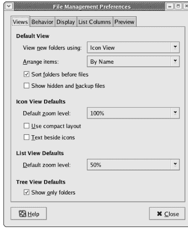

> 图 2-7：设置。

### 更改文件管理器背景和图标标记（Emblems）

Nautilus 的另一个很棒的功能是在文件管理器窗口中显示颜色和图案。你还可以为图标分配标记（Emblems）。标记是用于让你的图标更具意义的小型图形。例如，我喜欢将主目录的背景颜色更改为浅蓝色。这样，当我看到蓝色背景时，就能立刻知道自己正处于主目录中。你可以通过以下方法轻松更改颜色、图案或添加标记：

1. 从 Nautilus 菜单中选择编辑（Edit）-> 背景和标记（Backgrounds and Emblems），打开“背景和标记”对话框，如图 2-8所示所示
2. 点击对话框左侧的图案（Patterns）、颜色（Colors）或标记（Emblems）按钮。
3. 从对话框右侧拖动图案、颜色或标记到你想放置它的位置。

你可以将颜色或图案拖动到文件管理器窗口右侧的大面板中，以更改颜色或图案。你可以将标记拖动到图标上，将其附在图标上。

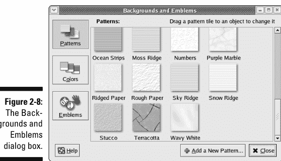

### 显示和隐藏视图

你可以决定在文件管理器中查看什么以及不想查看什么。通过从视图菜单（View）或菜单栏选择相应的项目，你可以显示或隐藏侧边栏、状态栏、工具栏和位置栏。这些项目都是切换项。如果项目被勾选，则可以显示；如果没有勾选，则不可用。点击该项目可以切换其开启或关闭。

### 配置 GNOME

你也可以像配置 Nautilus 文件管理器一样轻松地自定义你的整个桌面。GNOME 中有相当多的偏好可以修改。我无法在本章中解释所有的设置，但我可以向你展示如何更改其中之一。你可以尝试其他的设置并根据喜好进行更改。看看设置屏幕保护程序。要设置屏幕保护程序的偏好，请执行以下操作：

1. 选择应用程序（Applications） -> 偏好（Preferences） -> 屏幕保护程序（Screensaver）。
打开“屏幕保护程序偏好”对话框，如图 2-9所示。

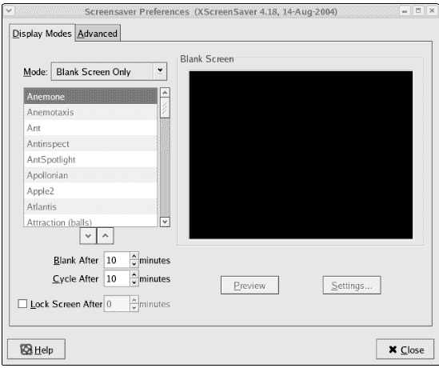

图 2-9：在此配置屏幕保护程序。

2. 从列表中选择屏幕保护程序的模式。
3. 通过勾选选项前的复选框，选择你想要作为屏幕保护程序的图像。
4. 选择你想使用的时长。

还要务必查看“高级”（Advanced）选项卡，看看你是否想要更改其中的任何项目。高级选项卡上的项目包括图像处理设置、显示电源管理设置、色彩映射设置和诊断设置。

5. 在做出选择时，点击预览（Preview）按钮测试你的屏幕保护程序。

不要忘记查看你所选择的屏幕保护程序的设置。（点击设置按钮查看它们。）你可以通过更改设置创建一些有趣的效果。例如，更改屏幕保护程序的速度或显示的颜色数量。

6. 完成后点击关闭（Close）按钮。

你的新屏幕保护程序已启用。

### 注销

在 GNOME 中工作完成后，离开电脑前应该注销。注销始终是一个好习惯，可以防止他人使用你的系统。你可以按照以下步骤注销 GNOME：

1. 选择操作（Actions） -> 注销（Log Out）。
2. 在注销对话框中，你可以通过选择选项前的单选按钮来注销、重启系统或关闭系统。
3. 做出选择后，点击 OK 执行选择。

### 查看 KDE

企业级 Linux 的默认桌面是 GNOME，但如果你想尝试一下，可以使用另一个桌面 KDE。如果你想使用它，需要确保它已安装在你的系统上，因为企业级 Linux 的默认安装并没有安装 KDE。

在这一节中，我将简要介绍 KDE，让你了解它，并或许吸引你尝试一下。我将简要解释 KDE 桌面，向你展示应用程序菜单（你可以在那里找到一些尝试的应用程序），并介绍 Konqueror 文件管理器。之后，你可以根据喜好自行探索。

你可以从图形登录界面检查 KDE 是否已安装。点击会话（Session）（参考图 2-1）并在选项中选择 KDE。如果 KDE 没有选项，说明它没有安装——但你可以使用软件包管理工具轻松地安装它。

为会话选择 KDE 后，输入你的用户名和密码登录。你将看到 KDE 桌面，如图 2-10所示。

KDE 桌面的外观与 GNOME、MS Windows 或 Mac OS X 等其他著名的桌面环境相似。如果你会使用这些桌面，将在短时间内轻松掌握 KDE。KDE 桌面看起来非常整洁，顶部有一个图标，底部有一个面板。注意 KDE 桌面的布局。

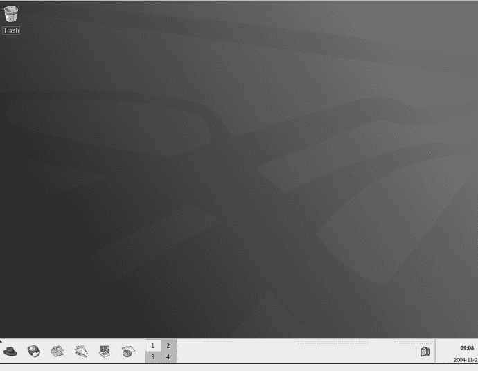

图 2-10：登录后的 KDE 桌面。

桌面底部有一个灰色的条。桌面的这个区域是面板，类似于 Windows 的任务栏。面板最左侧是应用程序图标，由红帽图标标识。应用程序右侧是安装期间安装的程序图标。你可以通过点击面板启动这些任何程序。将鼠标悬停在任何图标上，就会出现该程序描述的上下文菜单。

应用程序右侧是一个正方形区域——工作空间切换——它分为四个部分。当你第一次登录 KDE 时，工作空间切换的最左部分应该是白色，表示你正处于工作一。你可以在 KDE 中切换工作空间，从而获得可以使用不同的桌面。你可以通过点击想要的工作空间切换来切换。在不同的桌面上打开不同的程序，并尝试点击四个正方形查看切换效果。

面板最右侧是当前日期和时间的显示。工作空间切换和日期时间之间的区域用于显示你在桌面运行的所有程序。

### 管理小部件

面板上的图标是应用程序——小部件的链接。放置在面板上的小部件让你只需单击即可快速选择应用程序。如果你熟悉 MS Windows，KDE 中的小部件就像 Windows 中的快捷方式。除了面板上已有的小部件，你还可以添加自己的。你也可以移动已的小部件或删除它们以腾出更多空间。

要向面板添加小部件，请执行以下操作：

1. 右键点击面板上的空闲区域。
2. 从上下文菜单中选择添加到面板（Add to Panel）。
3. 选择你想添加的应用程序。
4. 点击添加（Add）将其添加到面板。

将小程序移动到面板上的另一个位置

1. 右键点击你想要移动的小程序。
2. 从右键菜单中点击“移动 (Move)”。
3. 将小程序拖动到所需的位置。
4. 点击释放小程序到其新位置。

从面板中移除小程序

1. 右键点击你想要移除的小程序。
2. 从右键菜单中选择“从面板移除 (Remove from Panel)”。

修改小程序（或面板）的属性

1. 右键点击小程序（或面板的空白区域）。


2. 从右键菜单中选择“属性 (Properties)”。

3. 在“属性”对话框中更改参数。


右键点击面板或其上的任何小程序都会弹出右键菜单，该菜单让你访问“帮助”以及一些用于面板配置的实用工具。根据你所选的小程序类型，右键菜单会有所不同。

## 在应用程序菜单中选择应用程序

应用程序菜单以红帽图标表示，它让你访问顶部面板的大部分区域。点击“应用程序”按钮（显示红帽图标）可以打开应用程序菜单（如图 2-11 所示），其中列出了你可以选择的许多应用程序类别。

注意，许多类别包含一个向右的箭头。将光标悬停在带有右箭头的类别上，会打开额外的菜单，你可以从中选择该类别中的更多应用程序。可选的应用程序可能超过 100 个，远比我在书中能描述的要多。不过，我在这里对主要的应用程序类别进行了简要描述，以便你对它们的功能有一个了解。请从菜单底部开始，逐向上查看。

38 第一部分：熟悉企业 Linux

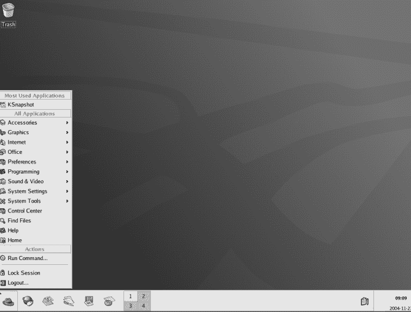

图 2-11：KDE 桌面上的应用程序菜单。

你的应用程序菜单可能与本节描述的不完全相同，取决于你安装的 Enterprise Linux 版本。

- **注销 (Logout)：** 选择“注销”会打开一个对话框，提供注销或取消的选项。选择你所需的单选按钮，然后点击确定。
- **锁定会话 (Lock Session)：** 此菜单项会启动系统屏幕保护程序并锁定桌面。移动鼠标或按任意键将打开一个对话框，让你输入密码来解锁桌面。
- **运行命令 (Run Command)：** 此菜单项会打开一个对话框，你可以在其中输入想要运行的程序名称。
- **主目录 (Home)：** 此菜单项指向用户主目录的链接。
- **帮助 (Help)：** 此菜单项会打开帮助浏览器。你可以通过选择此项来获取 KDE 的帮助。
- **控制中心 (Control Center)：** 控制中心用于对 KDE 桌面进行配置更改。
- **系统工具 (System Tools)：** 此菜单选项让你访问许多 Enterprise Linux 系统管理工具。用于配置网络和打印机的工具位于此处。
- **系统设置 (System Settings)：** 此菜单项还包含 Enterprise Linux 系统管理工具和 KDE 配置工具。这里的某些工具可以用于配置你的 Web 服务器和其他其他服务器。
- **声音与视频 (Sound & Video)：** 选择此项可以访问与音频和视频相关的程序和实用程序。例如，如果你想调整系统音量，请使用此处的工具。
- **编程 (Programming)：** 此菜单项让你访问一些可以用于调试目的的程序。
- **偏好设置 (Preferences)：** 此菜单打开系统偏好窗口。大部分 GNOME 设置都可以通过此菜单选项进行修改。从此菜单选择等同于双击桌面上的“计算机”图标。
- **办公 (Office)：** 此菜单选项让你访问 OpenOffice.org 办公套件。OpenOffice 办公件包含文字处理、电子表格、演示文稿等更多功能。你也可以通过点击面板左侧的图标来启动 OpenOffice 应用程序。
- **互联网 (Internet)：** 在此地你可以找到与互联网相关的应用程序。例如，浏览器和 FTP 程序均位于此处。
- **图形 (Graphics)：** 此菜单选项包含图形化程序。在此处，你可以找到图像查看和编辑应用程序。
- **附件 (Accessories)：** 在这里你可以找到不属于其他类别的应用程序，例如计算器以及一些文本编辑器。

## 使用 Konqueror 文件管理器

Konqueror 文件管理器是 KDE 的图形化外壳。你不仅可以使用 Konqueror 管理系统中的文件和目录，还可以将其作为 Web 浏览器访问互联网。

要启动 Konqueror 文件管理器，从应用程序菜单中选择“首页”来打开 Konqueror 文件管理器，如图 2-12 所示。

以下是对 Konqueror 文件管理器窗口项目的简要说明：

- **菜单栏 (Menu bar)：** 窗口顶部是菜单栏，与其他程序的菜单栏类似。通过菜单栏，你可以访问执行各种操作的工具。
- **工具栏 (Toolbar)：** 菜单栏下方是工具栏。工具栏包含你用于执行按钮指示操作的按钮，如后退、前进或刷新。工具栏还有放大和缩小按钮（放大镜图标），通过它们更改项目的大小。最后，工具栏包含你的视图方式设置。
- **位置栏 (Location bar)：** 位置栏包含一个文本字段，你可以在其中输入文件、文件夹或 URL。
- **窗口窗格 (Window panes)：** 位置栏下方，Konqueror 窗口分为两个窗格。左侧较小的窗格显示目录树。如果你选择根目录，可以看到整个文件系统。右侧较大的窗格显示所选文件夹的内容。
- **状态栏 (Status bar)：** Konqueror 窗口底部是状态栏，显示你正在查看的文件和文件夹的状态信息。

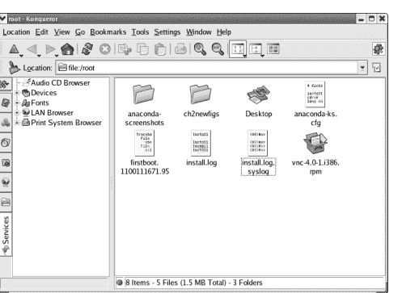

图 2-12：Konqueror 管理。

## 注销

在 KDE 中完成工作后，离开电脑 前应该注销。注销是一个好习惯，可以防止他人使用你的系统。你可以按照以下步骤注销 KDE：

1. 选择应用程序：注销。
2. 在注销对话框中，你可以选择注销或取消返回桌面。
3. 做出选择后，点击确定执行。

## 第3章：让你的系统运转

### 本章内容

- 浏览网页
- 收发电子邮件
- 办公工作
- 娱乐
- 处理图像

在安装 Enterprise Linux 时会默认安装许多应用程序。一旦安装完成，你就可以使用 Firefox Web 浏览器、Evolution 电子邮件程序、OpenOffice.org（完整的办公软件套件）等许多程序开始生产性工作。你还可以使用 Enterprise Linux 自带的音频、视频和图形应用程序进行一些非生产性工作。在本章中，我将教你如何使用这些应用程序。

### 入门

登录桌面后，你可以从底部的面板选择许多常用的应用程序。如图 3-1 所示，面板左侧是通往 Firefox Web 浏览器、Evolution 电子邮件客户端、OpenOffice.org Writer、OpenOffice.org Impress 和 OpenOffice.org Calc 的链接。

图 3-1：

面板图标链接到常用程序。


42 第一部分：熟悉企业级 Linux

Enterprise Linux 的 AS 和 ES 版本在默认安装时不会安装 OpenOffice、Evolution 邮件客户端和 Firefox 浏览器。如果你正在使用这些版本之一，如果在系统安装期间没有手动安装这些应用程序，你可能需要手动安装它们。

OpenOffice.org Writer 是一个类似于 MS Word 的文字处理程序。OpenOffice.org Impress 是一个类似于 MS PowerPoint 的演示程序，而 Calc 是类似于 MS Excel 的电子表格程序。


将鼠标悬停在图标上，会出现一个带有图标信息的小型帮助窗口。

### 浏览网页

从 Firefox 浏览器开始，这是一个开源、功能全且符合 Web标准的浏览器，其性能与你可能过的其他 Web 浏览器相似。如果你使用过基于图形的 Web 浏览器，使用 Firefox 将非常容易。启动 Firefox 的是：

- 1. 从面板中点击 Firefox 浏览器图标。

该图标看起来像一个带有鼠标的地球——是一个电脑鼠标，而不是捕奶酪的捕鼠——它的尾部绕在上面。

- 2. 或者，你可以选择“应用程序：互联网：Firefox Web 浏览器”。

无论你采用哪种方法，Firefox 程序都会打开到 Linux 默认页面的主窗口，如图 3-2 所示。

从图 3-2 可以看出，Firefox 的外观与许多 Web 浏览器相似，其功能也相似。快速浏览一下主浏览器窗口，熟悉它是什么以及你如何使用它。

浏览器窗口顶部是菜单栏，包含以下选项：

- **文件 (File)**：此菜单中的项目允许你打开新的浏览器窗口、电子邮件页面或指向他人的页面链接、在 Composer（Web 创建工具）中打开页面、打印当前页面并退出浏览器。
- **编辑 (Edit)**：此菜单中的项目允许你复制和粘贴文本、选择项目、查找项目并编辑偏好。
- **视图 (View)**：此菜单中的项目包括与页面显示方式以及你想在页面上看到的内容相关的选择。
- **定位 (Go)**：此菜单中的项目允许你前进、后退或跳转到访问过的其他页面。

# 第 3 章：让你的系统工作起来


# 第一部分：熟悉企业级 Linux

- **书签 (Bookmarks)**：这些菜单项允许你添加和管理书签（收藏页面），以便你快速跳转到它们。
- **工具 (Tools)**：从此菜单中，你可以设置许多处理 cookie、图像、密码、表单和弹出窗口的浏览偏好。
- **帮助 (Help)**：从此菜单中，你可以从各种在线选项中选择。

菜单栏下方是导航工具栏，包含以下选项：
- **后退 (Back)**：点击此按钮将带带回到之前查看的页面。
- **前进 (Forward)**：点击此按钮将你前进。
- **停止 (Stop)**：点击此按钮将重新加载当前页面。
- **主页 (Home)**：此链接将你带到浏览器偏好中列出的主页。
- **位置字段 (Location field)**：在此字段中，你可以输入想要访问的地址或统一资源定位符 (URL)。
- **搜索 (Search)**：点击搜索列出的站点之一。
- **Firefox 图标**：点击此按钮进入 Firefox 网站。

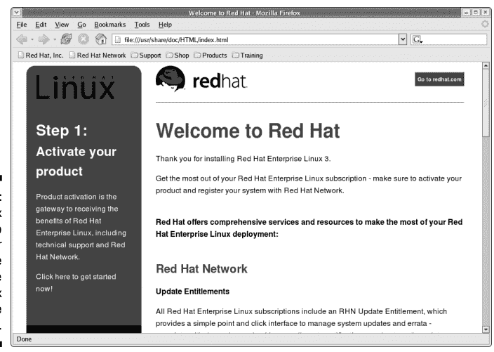

导航栏下方是个人工具栏，包含以下选项：
- **Red Hat, Inc.**：此链接将你带到 Red Hat 网站。
- **Red Hat Network**：此链接将你带到 Red Hat Network 网站。
- **支持 (Support)**：点击此图标将打开一个菜单，带你进入 Red Hat 网站的页面：
  * Red Hat Linux 文档
  * Red Hat 支持
  * Red Hat 专业服务
  * Red Hat 搜索
- **商店 (Shop)**：此链接打开一个带有选择的菜单，带你进入 Red Hat 商店。
- **产品 (Products)**：此链接打开一个菜单，带你进入带有 Red Hat Enterprise Linux 和 Red Hat 软件信息的 Red Hat 网站页面。
- **培训 (Training)**：此链接进入 Red Hat 全球学习服务。

个人工具栏下方的区域是主显示区域。网页显示在主显示区域中。

## 更改浏览器偏好

你可以根据喜好自定义浏览器的许多区域。你可以配置的区域区域都可以通过从菜单栏选择“编辑 > 偏好”来进入。如图 3-3 所示，会出现“偏好”对话框。

当此对话框打开时，它会打开“通用”偏好页面。对话框的左侧有五个图标，可以打开额外的对话框。“通用”对话框已经显示，你可以点击其他图标来打开那些对话框。从此对话框中，你能够更改以下项目的偏好：
- **通用 (General)**：这包括你可以更改以影响浏览器外观的项目，包括字体、颜色、主题、语言/内容包以及浏览器主页。
- **隐私 (Privacy)**：这些偏好用于告诉 Firefox 如何 cookie、弹出窗口、密码、表单和安全证书。
- **Web 特性 (Web Features)**：此选项的偏好与在网站上使用 Java 和 JavaScript、加载图像以及阻塞弹出窗口有关。

# 第 3 章：让你的系统工作起来

- **下载 (Downloads)**：这些偏好用于控制保存文件的下载位置。
- **高级 (Advanced)**：这些偏好用于控制辅助功能和安全性。

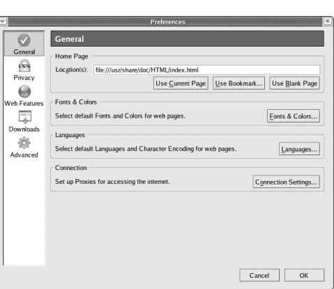

图 3-3：更改浏览器偏好。

## 发送和接收电子邮件

Enterprise Linux 有多个用于发送和接收邮件的电子邮件客户端。Evolution 邮件客户端功能全且易配置。在使用 Evolution 发送接收邮件之前，你必须先进行配置。
1. 从桌面点击 Evolution 图标（信封图标）或通过“应用程序>互联网>Evolution”启动 Evolution。

出现如图 3-4 所示的 Evolution 助手窗口。
2. 点击“前进”进入图 3-5 所示的身份页面。

## 46 第一部分：熟悉企业级 Linux

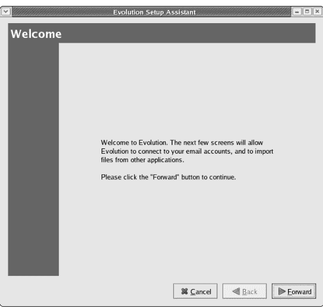

图 3-4：Evolution 助手窗口。

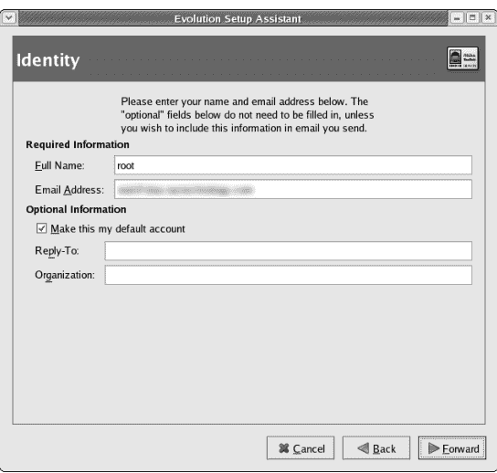

图 3-5：配置你的电子邮件身份。

# 第 3 章：让你的系统工作起来

3. 在必需字段中输入你的姓名和电子邮件地址，然后点击“前进”继续。
4. 在打开的接收邮件对话框中，识别你将连接的邮件服务器类型，如图 所示。点击“服务器类型”字段右侧的箭头，选择适用于你位置的邮件服务器类型。

根据你的选择，页面上会出现其他你需要输入附加信息的字段。如果你使用的是 WS 或 Desktop 版 Enterprise Linux，不确定选什么，请咨询你的系统管理员。
5. 点击“前进”继续进入发送邮件对话框，在其中选择发送电子邮件的邮件服务器类型。
6. 点击“服务器类型”旁边的箭头，选择 SMTP 或 Sendmail。

如果你运行的是 WS 或 Desktop 版 Enterprise Linux，不确定选什么，请咨询你的系统管理员。
7. 点击“前进”继续进入账户管理对话框，在其中为你正在创建的帐户输入名称。
8. 输入名称后，点击“前进”进入时区对话框并选择你的时区。

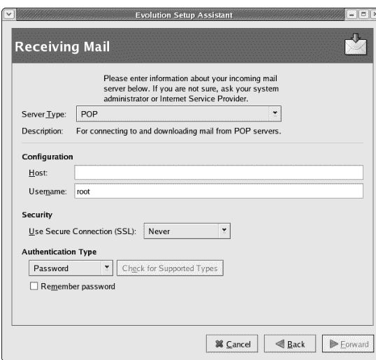

图 3-6：在此处指定你的入站邮件服务器。

# 48 第一部分：熟悉企业级 Linux

9. 点击“前进”并点击“应用”。

您的账户已创建，新创建的账户将出现在 Evolution 设置对话框的右侧。

## 接收电子邮件

要使用 Evolution 接收电子邮件，请执行以下操作：
1. 点击桌面面板上的 Evolution 图标启动 Evolution 程序。
2. 点击导航栏上的“发送/接收”按钮。

程序将从您配置的服务器中获取消息（参见前一节）。
如果您有任何新消息，窗口左侧“收件箱”后面会显示一个数字，表示消息的数量。
3. 点击“收件箱”图标打开收件箱。
4. 可以点击消息在 Evolution 窗口底部的窗格中查看，也可以双击消息在新窗口中打开它。
5. 如需回复消息，点击导航栏上的“回复”。
6. 如果您在新窗口中打开消息，请选择“文件：关闭”菜单栏，或点击右上角的“X”关闭窗口。

## 发送电子邮件

要使用 Evolution 发送电子邮件，请执行以下操作：
1. 点击桌面面板上的 Evolution 图标启动 Evolution 程序。
2. 点击导航栏上的“新建”打开消息对话框，如图 3-7 所示。
3. 在“收件人”字段中，输入接收邮件的电子邮件地址。输入主题和邮件正文。
4. 如需给邮件添加附件，点击导航栏上的“附件”并选择该文件。
5. 完成消息撰写后，点击“发送”。


使用 Evolution 可以做的功能远不止于发送和接收电子邮件。您应该对 Evolution 进行一些实验，以了解关于它的调度和时间管理功能。您可以开始探索

# 第 3 章：让系统工作起来

通过点击 Evolution 窗口左侧的“日历”按钮开始探索调度功能。日历会打开，在大尺寸日历中显示今天的日期和按小时列表，以及一个显示整个月的较小日历。您可以双击大日历显示中的某个时间点，打开对话框以为该时间安排事件。如果您点击小日历上的日期，大日历上的日期将更改为显示您选择的日期。

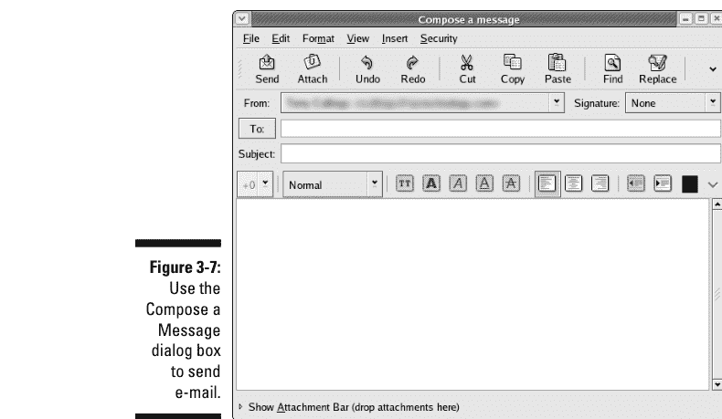

**图 3-7：** 使用“编写消息”对话框发送电子邮件。

## 办公工作

企业级 Linux 包含了完整的办公套件 OpenOffice.org。OpenOffice.org 包含文字处理程序、演示程序、电子表格程序、绘图程序、数学公式编辑器和 HTML 页面创建工具。在大多数情况下，OpenOffice.org 与 MS Office 等其他办公应用程序创建的文档兼容。我成功使用 OpenOffice.org 创建文档，反之亦然。OpenOffice.org 的伟大之处在于它的价格——即免费。考虑到它可以与 MS Office 创建的文档、演示文和电子表格兼容，它具有极高的价值。在本节中，我将解释使用 OpenOffice.org 创建文档、使用 OpenOffice.org Impress 创建演示文以及使用 OpenOffice.org Calc 创建电子表格的基本步骤。

要详细了解 OpenOffice.org，请参阅 Gurdy Leete、Ellen Finkelstein 和 Mary Leete 编写《OpenOffice.org For Dummies》（Wiley 出版）。

* 注意*

# 第一部分：熟悉企业级 Linux

## 使用 OpenOffice.org Writer 写作


正如我在上一段文字中提到的，OpenOffice.org Writer 是一一个文字处理程序。如果您以前用过文字处理程序，您应该能够轻松地使用 OpenOffice.org Writer。要启动程序，点击桌面面板上的 OpenOffice.org Writer 图标（它看起来像一支笔两张纸）或选择“应用程序：OpenOffice.org Writer”。第一次打开程序时，系统会提示您注册程序，然后会向您展示一个空白文档，如图 3-8 所示。

我无法详细说明如何使用 OpenOffice.org Writer：那本身就可以写成一本书。但是，我将向您展示如何打开文档并以其他格式保存它们。因此，与其使用 MS Office，不如改用 OpenOffice.org，并与使用 MS Office 文档的他人共享您的工作。

## 打开文档

要在 OpenOffice.org Writer 中打开文档，请执行以下操作：

1. 选择窗口顶部菜单栏上的“文件：打开”。
出现一个标准的“打开”窗口（参见图 3-9）。

图 3-8：OpenOffice.org Writer 窗口。

# 第 3 章：让系统工作起来

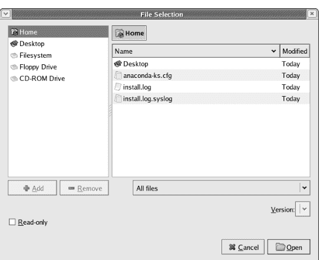
**图 3-9：** 在 OpenOffice.org 中打开文件。

如您从图 3-9 所示，OpenOffice.org 将该文件识别为 Word 文件。

2. 选择您的文件并点击“打开”。
3. 打开文档后，您可以进行任何更改。
如果您想查看 OpenOffice.org 可以处理的所有文件类型，请点击“文件”旁边的箭头。


## 保存文档

在 OpenOffice.org Writer 中保存文档是一个非常简单的过程，您可能已经知道怎么做了。我提到这一点是为了告诉您如何以其他程序理解的格式保存文档。默认情况下，OpenOffice.org 使用 `.odt` 文件扩展名，但如果您想在另一个程序中使用文档，则需要使用不同的扩展名保存。按照以下步骤保存您的文件：

1. 选择菜单栏上的“文件：保存”（如果想更改名称，则选择“文件：另存为”）。
# 52 第一部分：熟悉企业级 Linux
如果您保存之前打开的文件，程序将以打开时的格式保存。例如，如果您正在保存一个 Word 文件，程序将其保存为 Word 文件（`.doc`）。

2. 在出现的“另存为”对话框中，可以通过点击“文件类型”旁边的下拉箭头来更改文件类型并选择您需要的类型。
图 3-10 展示了如何选择不同的文件类型。
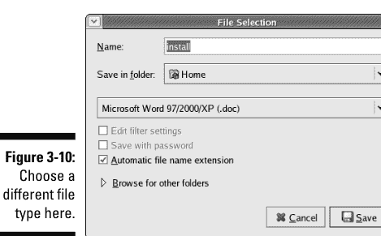
图 3-10：在此选择不同的文件类型。
当您使用不同的文件类型保存文件时，程序会警告您使用不同的文件类型可能会影响您的格式。程序会提示您使用默认的 OpenOffice.org 文件类型。您可以安全地回答“否”，并以您所需的类型保存文件。

3. 确保为文件输入名称以及文件类型。然后点击“保存”保存文件。

## 使用 OpenOffice.org Calc 计算

OpenOffice.org 套件的另一个成员是 Calc 程序。Calc 是一个功能齐全电子表格程序，类似于 MS Excel。事实上，您在 Excel 中可以做的任何事情，可能可以在 Calc 中完成。要启动程序，点击桌面面板上的 OpenOffice.org Calc 图标（它看起来像电子表格上方的饼图）或选择“应用程序：Calc：OpenOffice.org Calc”。您将看到一个空白文档，如图 3-31 所示。

## 第 3 章：让系统运转起来

# 53


图 3-11：OpenOffice.org Calc 的程序窗口。
在 Calc 中打开和保存电子表格与使用 OpenOffice.org Writer 打开和保存文档完全相同。学习 OpenOffice.org Calc 有多么简单的用方法是打开程序并进行实验。我强烈建议你这样做。

## 使用 OpenOffice.org Impress 给人留下深刻印象

Impress 是 OpenOffice.org 办公套件包含的演示文稿软件。通过 Impress，你可以制作出如今似乎每个人使用的那些华丽的演示文。如果你用过 MS PowerPoint 制作演示文稿，应该尝试一下 Impress。
要启动程序，请从桌面面板点击 OpenOffice.org Impress 图标（它看起来像柱状图上方的幻灯片），或选择“应用程序 > OpenOffice.org > Impress”。当你打开 Impress 时，会弹出一个演示向导来帮助你创建演示文。你可以选择创建一个空白演示文稿或从模板创建一个，也可以打开现有的演示文稿。图 3-12 显示我用 MS PowerPoint 创建然后用 OpenOffice.org Impress 打开的演示文稿。

# 54 第一部分：熟悉 Enterprise Linux

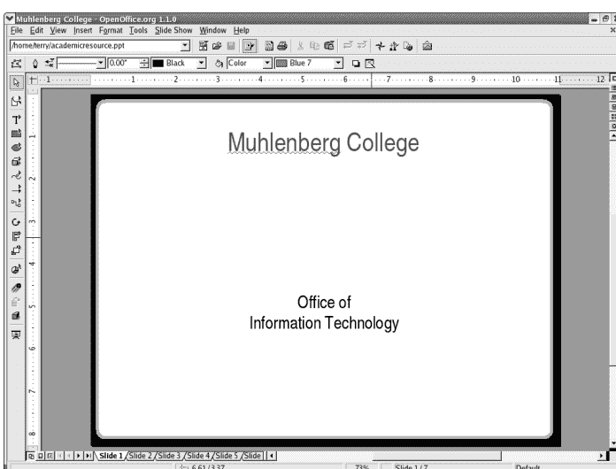
图 3-12：使用 OpenOffice Impress 打开在 PowerPoint 中创建的演示文稿。
你不仅可以打开用 MS PowerPoint 创建的演示文稿，还可以将用 Impress 创建的演示文稿保存为 MS PowerPoint 演示文稿。这意味着你可以在任何 PC 上使用你的演示文稿，并与几乎所有人共享你的文件。

## 配置 OpenOffice.org

你可以根据喜好自定义 OpenOffice.org 办公套件的许多区域。我无法在书中涵盖这些似乎无止尽的选项，但我可以告诉你去哪里开始配置。从那里，你可以在你的系统上探索和实验，以获得你所需的设置。要开始自定义，请执行以下操作：
- 1. 从任何已打开的 OpenOffice.org 程序顶部的菜单栏选择“工具； 选项”。
出现“选项”对话框（见图 3-13）。
- 2. 在左侧，点击你想要自定义的区域。
打开与该区域相关的页面（在“选项”对话框的右侧）。
- 3. 输入所需的信息或选择所需的选项。
例如，我可以点击此处并填写请求的信息来填写我的用户数据。或者，我可以点击“打印”并指定打印选项。
- 4. 完成配置后，点击“确定”应用你的更改。
点击“选项”对话框上的“帮助”按钮可以获取你正在查看的特定面的帮助。
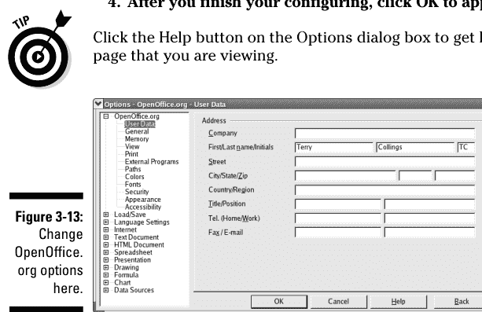

## 让自己娱乐

如果你一直读到这里，你已经做了很多工作，可能准备好休息了。（不能让 Jack 变成一个无聊的孩子，对吧？）只有你能用 Enterprise Linux 进行高效工作，但你也可以玩。系统中安装了音频和视频应用程序，你可以在工作休息时使用它们。在本节中，我向你展示其中的一些。

## 配置你的声卡

在使用任何音频和视频应用程序之前，你首先想要检查可能是你的声卡。你必须确保它正在工作，否则你听不到程序产生的任何声音。在大多数情况下，如果你的系统安装了声卡，它在安装 Enterprise Linux 本身会被检测并正确配置。然而，始终存在声卡未被检测到的可能，或者可能你刚来安装。要检查声卡并进行配置，请使用声卡检测工具：
- 1. 选择“应用程序：系统设置：声卡检测”。
该工具运行并显示声卡信息，如图 3-14 所示。
- 2. 点击“播放测试声音”来听示例声音。
- 哒！如果检测到声卡并且声音播放，说明你的声卡已配置好并准备就绪了。
- 没哒！如果没有检测到声卡，你会收到一条说明此情况的消息。如果你收到此消息，你的声卡将自动完成配置。请阅读第 21 章关于故障排除的内容以获得更多配置声卡的帮助。
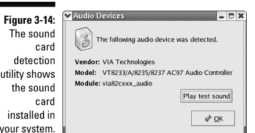

## 播放音频文件

Enterprise Linux WS 和桌面版包含一个音频播放器 —— Rhythmbox —— 你可以用处理许多类型的音频文件。通过选择“应用程序：音频和视频：音频播放器”打开播放器。图 3-15 所示的 Rhythmbox 播放器出现。
从菜单栏选择“音乐”，进入一个允许你从硬盘或其他位置（包括互联网）选择文件的菜单。你可以你的播放器偏好，如图 3-15 所示的 Rhythmbox 播放器。

# 56 第一部分：熟悉 Enterprise Linux

# 74

## 第 3 章：让系统运转起来

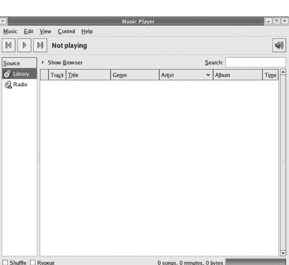
图 3-15：Rhythmbox 播放器。

## 处理图像


进入`/path/to/xxx`目录，找到`xxx.json`。

在表达式`cvar = avar + bvar`中，加法运算符（`+`）将`avar`与`bvar`相加，得到它们的和`cvar`

在`List.of(arg0, arg1, arg2)`中，`List`接口的工厂方法`of()`接受一系列的元素，返回包含它们的只读列表。

之后我们这样调用`cmd`命令：`cmd arg0 arg1 arg2`。

```
if (condVar > someVal) {console.log("xxx")}
```

# 第一部分：熟悉 Enterprise Linux

Enterprise Linux 有许多你可以用来查看和处理图像的应用程序。在本节中，我谈谈我最喜欢的之一，`GIMP`（用于修改图像）。我可以对 `GIMP` 进行详细解释，但我可以向你介绍它，并可能让你产生学习兴趣。

`GIMP` —— GNU 图像处理程序的缩写 是一个非常强大的图像编辑程序，类似于 `Photoshop`。当我还是 Windows 用户时经常使用 `Photoshop`，在切换到 Linux 时发现 `GIMP` 时非常高兴。你可以通过选择“应用程序：图形：`GIMP`”启动 `GIMP`。当你第一次选择该应用程序时，它会安装在你的系统上；然后程序打开，如图 3-17 所示。

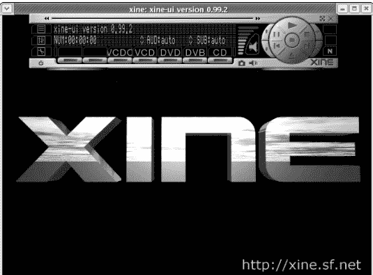

图 3-17：`GIMP` 工具栏是程序启动后的初始界面。

## 第4章：探索文件系统和命令行 shell

### 本章内容

- 检查文件系统结构
- 操作 shell
- 常用 shell 命令
- 编写 shell 脚本

任何用过电脑的人，无论使用的是什么操作系统，都知道存储在计算机上的信息是通过文件和目录组织成层级结构的，这通常被称为*文件系统*。Red Hat Enterprise Linux在这方面也不例外：它的文件系统也是类似的方式组织的。然而，在将企业 Linux 文件系统与 Windows 中最常用的文件系统比较时，你需要注意一些显著差异。在本章中，我将解释 Enterprise Linux 文件系统的组织结构以及它与 Windows 的区别。我向你展示如何使用命令行 shell 来遍历文件系统并执行许多文件系统任务，例如创建和删除文件与目录，以及更改文件权限和所有者。

### 检查 Enterprise Linux 文件系统结构

如果你用过 Windows（我们大多数人都是如此），在查看 Enterprise Linux 文件系统结构时，你会发现最大的区别是文件系统列表中没有显示驱动器号。例如，你找不到作为硬盘的 C 盘、作为软驱的 A 盘或作为光驱的 D 盘。Enterprise Linux 中的所有设备（包括磁盘驱动器）都只是文件系统的一部分。图 4-1 显示了一个典型的 Enterprise Linux 文件系统。

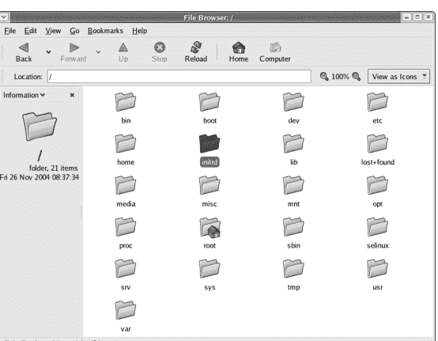

图 4-1：Enterprise Linux 文件层级结构。

Enterprise Linux 文件系统基于文件系统层次结构标准（FHS）中概述的标准。所有 Unix 和基于 Unix 的系统（如 Enterprise Linux）都遵循这一标准。FHS 为文件在目录结构中的放置提供了特定要求。放置基于文件中所包含的类型类型。文件信息的两个基本类别是：

- *可共享与不可共享*
  - 可共享文件是可以被其他主机访问的文件。
  - 不可共享文件只能由本地系统访问。
- *可变或静态*
  - 可变文件包含可以在任何时间自动更改的信息，而无需任何人更改文件。日志文件就是变量文件的一个例子。
  - 静态文件包含除非用户更改，否则不会发生变化的信息。程序文档和二进制文件是静态文件的示例。

虽然你不需要了解 FHS 的完整细节就可以操作 Enterprise Linux 文件系统，但如果你想 way更多关于 FHS 标准的信息（包括完整标准），请访问 `www.pathname.com/fhs`。

理解 Enterprise Linux 文件系统的组织或布局是系统使用和管理中最重要的方面之一。你可以通过查看图 4-1 左侧的树形结构看到这一点；Enterprise Linux 文件系统包含一个单一顶层目录，由单个 `/`（正斜杠字符）标识，并被称为根目录或系统根。查看文件浏览器的位置，你会看到单个正斜杠，它显示你正处于系统的根目录中。根系统包含许多其他目录，这些目录中的每一个目录都具有 FHS 指定的特定功能。根据 FHS，`/ `目录必须包含或拥有以下目录的链接。

图 4-1 中显示的所有目录并不都列在列表中。这些目录在初始时不是空的。

与某些操作系统不同，Enterprise Linux 是区分大小写的。我认为对所有文件名始终使用小写字母是一个非常好的主意。通过这样做，我永远不需要记住我用的是大写还是小写：只需知道名称始终是小写的即可。

- `bin`：此目录包含供系统管理员或其他用户使用的命令文件。注意：`/bin` 目录不能包含子目录。
- `boot`：`/boot` 目录包含系统内核，它是 Enterprise Linux 操作系统的核心。该目录还包含与启动系统相关的文件。
- `dev`：此目录包含有关系统设备（硬件或软件）信息的文件。
- `etc`：`/etc` 目录及其子目录包含大多数的系统配置文件。如果你在系统上安装了 Windows 系统，X11 目录位于此处。与网络相关的配置文件位于 `sysconfig` 子目录中。
- `home`：此目录包含系统上用户的目录。`/home` 的子目录会为系统中拥有账户的每个用户自动创建并命名。例如，我的家目录被标识为 `/home/terry`。
- `lib`：`/lib` 目录及其子目录包含共享系统文件和内核模块。
- `media`：这是临时文件系统（如软盘或 CD 驱动器）的挂载点。

在 Enterprise Linux 使用任何文件系统之前，必须先对其进行挂载。挂载文件系统要求它是 `/` 文件系统上的一个可以被引用的位置。主管理员使用 `/mnt` 目录为此此目的。挂载驱动器和其他文件系统将在稍后的“挂载和卸载驱动器”章节中进行解释。

- `opt`：此目录经常用于存放安装在系统上的应用程序。
- `proc`：`/proc` 目录是一个虚拟文件系统，充当……的接口。
- `root`：此目录是 `root` 用户。
- `sbin`：此目录包含基本的系统二进制文件。
- `tmp`：`/tmp` 目录存放临时文件。
- `usr`：此目录包含用户特定的程序和数据。
- `var`：`/var` 目录包含变量文件。


### 操作 shell

我们大多数长期使用 PC 的人都能记得有一个没有 GUI 的时代，为了与 PC 通信，你需要在文本屏幕上输入命令。这通常被称为 shell。在本节中，我将向你介绍……。也许你会奇怪当我提到在 shell 中工作时我在说什么。例如，有时 GUI 可能会出现问题导致……

#### 打开终端窗口

从 GNOME 还是 KDE，你都可以通过 `Applications->System Tools->Terminal` 来打开终端窗口。会出现一个与图 4-2 显示类似的窗口。

终端窗口也称为控制台（`console`）。

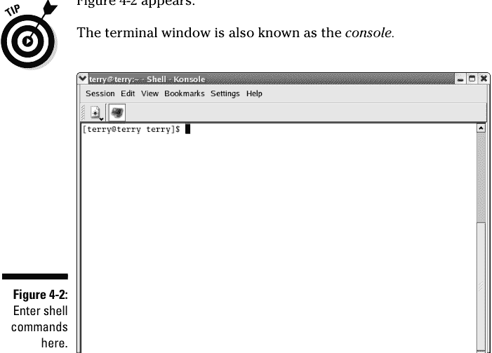

图 4-2：在此输入 shell 命令。

如果 GUI 锁死不对鼠标点击做出响应，你仍然可以通过进入虚拟控制台进入控制台。在 Enterprise Linux 中你可以获得六个虚拟控制台，按下 `Ctrl+Alt+F1` 进入第一个控制台，`Ctrl+Alt+F2` 进入第二个，`Ctrl+Alt+F3` 进入第三个，以此此类推。要返回 GUI，按下 `Ctrl+Alt+F7`。

Enterprise Linux 的默认 shell 称为 `bash`，它是 Bourne Again shell 的缩写。`bash` shell 给你命令提示符并等待你输入命令。你可以输入任何有效的 shell 命令以及任何输入的可执行程序。

在图 4-2 中，你可以看到 shell 提示符为 `[berry@terry]$`。这个提示符提供了一些非常有价值的信息。显示的第一个名称是登录的用户，`@name` 是用户登录的系统名称，最后一个名称是用户当前所在的目录。提示符末的美元符号 (`$`) 显示用户是以普通用户登录的。井号 (`#`) 表示用户是以 `root` 用户身份登录的。

## Shell 命令语法

所有命令都具有相同的基本语法，如下：

```
command option(s) argument(s)
```

请务必关注此语法，因为命令行执行失败最常见的原因是输入命令时出错。语法格式为：命令，后面跟着一个空格，然后是一个或多个选项（options），另一个空格，最后是一个或多个参数（arguments）。Shell 使用空格来将命令和选项分开。注意：由于你可以拥有包含空格的选项，请务必将任何包含空格的选项放在引号内。


并不是所有命令都有选项，取决于你正在使用的命令，你可能不需要输入。例如，如果你只是想列出当前目录下的文件，可以输入 `ls` 而不带任何选项。


你可以随时通过输入命令 `man` 加上你想要帮助的命令来获取帮助。

## 组合 Shell 命令


你可以通过用分号 `;` 分隔命令，一次向 Shell 传递多个命令。例如，如果你想进入 `/etc` 目录并获取该目录的文件列表，可以输入 `cd /etc;ls`。

你还可以使用另一个字符将一个命令的输出传递到后续命令的输入中。你通过使用竖线 `|` 实现这一点，它也被称为管道符号。例如，假设你想统计某个目录下文件的数量。你可以使用以下命令：

```
ls /etc | wc -l
```

此命令列出 `/etc` 目录的内容，然后将 `ls` 命令的输出“管道”到 `wc` 命令，后者会将输出显示为 `/etc` 目录中的行数 `(-l)`。

### 重定向输入和输出

每当你在 Shell 中输入命令时，命令的输出都会显示在你的显示器上。这种输出通常被称为 `stdout`。你在 Shell 提示符处输入的信息被称为 `stdin`。通过使用特殊字符，你可以告诉 Shell 从除 `stdin` 以外位置（通常是文件）获取输入。你也可以告诉 Shell 将输出重定向到 `stdout` 以外的位置（通常是文件）。

用于告诉 Shell 从文件而非键盘读取 `stdin` 的字符是 `<`。例如，假设你想对你的组文件内容进行排序。你可以使用以下命令：

```
sort /etc/group
```

在这种情况下，`sort` 命令将 `/etc/group` 文件作为 `stdin` 读取，因为它被小于号 `<` 重定向执行了该操作。命令的输出显示在系统显示器上，即 `stdout`。

如果你愿意，可以使用另一种重定向将输出从 `stdout` 重定向到一个文件——这次使用 `>` 符号。通过输入示例中的命令，你可以将 `sort` 命令的输出重定向到文件 `sortedgroup`。

```
sort /etc/group > sortedgroup
```

### 使用命令补全

通过命令补全，你可以节省大量的输入时间。只需输入你想要使用的命令的前几个字母，然后按两次 `Tab` 键。`bash` 会显示所有以你输入的字母开头的命令列表。例如，如果你想使用 `grep` 命令，只需输入 `grep` 并按两次 `Tab` 键。在我的系统中，它将显示如下输出：

```
[terry@terry] $ gr
gefer gepjar goff grops
grep grip grotty
(输出已移动)
```

你还可以使用命令补全方法来完成你可能在命令后输入的文件名。例如，如果你在主目录下有一个文件 `upstart.txt`，你想用 `cat` 命令查看它，可以输入 `cat /home/terry/ups` 并按 `Tab` 键。`bash` 将填充文件名的剩余部分，为你节省了输入并减少了拼写错误的概率。


如果你输入的字符不足以唯一标识命令或文件名，请再次按 `Tab` 键。`bash` 将显示所有以你输入的字母开头的命令或文件名。

### 使用通配符搜索文件

如果你用过 MS-DOS 或 MS Windows 中的命令行窗口，你知道在搜索文件系统时可以使用通配符。在企业级 Linux 中，你也可以使用两个通配符，外加一个。你可以使用以下符号：

- `*` 字符可以表示任意数量的字符。例如，搜索 `tennis*` 会找到所有以 `tennis` 开头并包含任意数量字符的单词。
- `?` 用于表示一个字符。例如，搜索 `tennis*?` 会找到所有以 `tennis` 开头且在 `s` 之后多包含一个字符的单词。
- `[...]` 可以找到括号内的任何字符。例如，搜索 `[Aa]*` 会找到所有以 `A` 或 `a` 开头并包含任何其他字符的文件。

### 使用历史记录重复命令

`bash` 有一个有趣的功能，可以存储你可能使用过的多达 1,000 条命令。使用 `history` 命令可以查看你使用过的命令。要使用列表中的某个命令，输入感叹号加上命令的编号。例如，要使用第 15 条命令，输入 `!!15`。

重复某个命令最简单的方法是使用方向键，这会反向移动你使用过的命令。使用方向键可以正向移动命令历史。

### 常用 Shell 命令

我根据命令的功能将最常用的命令分组，并在此章节中解释如何使用它们。你可以找到用于文件和目录、获取帮助、管理进程以及许多其他类型的命令。


要获取 `bash` 内置命令的列表，在终端提示符处输入 `man`。

### 获取命令

这些命令用于获取有关命令的更多信息。要使用这些命令，输入命令名（如所示），加上你想要帮助的命令名称。

- `info`：此命令显示命令的帮助信息。例如，要查找 `ls` 的帮助，请使用 `info ls`。
- `man`：此命令显示命令的帮助。例如，要查找 `ls` 的帮助，请使用 `man ls`。
- `whatis`：此命令用于获取有关命令的基本信息。此命令不提供关于如何使用命令的详细帮助。例如，输入 `whatis ls` 会显示 `ls (1) - 列出目录内容`。

### 切换目录

要切换到当前目录的子目录，你不需要指定完整（或绝对）路径。相反，你只需要输入子目录（或相对）路径即可。例如，要切换到 `/usr/local` 下的 `bin` 子目录，你只需要输入 `cd bin`。要返回上一级目录或返回父目录，只需输入 `..`。


从任何位置返回你的主目录，只需输入 `cd` 然后按回车键。

### 确定工作目录

当你使用命令行提示符时，提示符会显示你所在的目录。然而，它只显示目录本身，而不是整个路径。所以，如果提示符显示目录为 `bin`，你无法从提示符中判断它是 `/bin` 目录还是 `/usr/local/bin` 目录。幸运的是，使用 `pwd` 命令可以告诉你你所在的位置。要获取路径列表，请使用以下命令：

```
pwd
```

它返回以下输出：

```
/usr/local/bin
```

### 列出目录内容

你已经在本章之前的某些示例中了解了这个命令。但为了以防你还不知道，你可以使用 `ls` 命令来获取目录内容的列表。例如，要列出 `/bin` 目录的列表，你输入 `ls /bin`。你将在图 4-3 中看到列表。


注意，`shell` 使用颜色来区分显示的类型和目录类型。使用的颜色及其通常代表的含义是：

- 蓝色：目录
- 绿色/红色：可执行文件
- 青色：指向其他文件或目录的链接
- 黑色：普通文件

默认情况下，企业级 Linux 设置为彩色显示不同类型的文件，以便于区分。然而，这一设置可能在系统上被更改过。如果你看不到颜色，仍然可以使用 `ls` 命令配合 `-F` 选项来确定文件类型。要查看列表中文件和目录之间的区别，输入以下内容：

```
ls -F
```

# 第 4 章：探索文件系统和命令行 shell

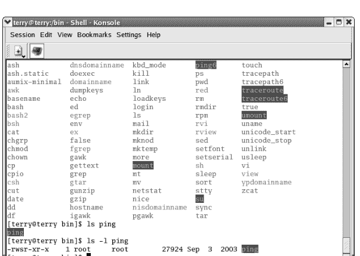

图 4-3：使用 `ls` 命令显示目录内容。

现在当你查看目录列表时，你会看到名称后面追加了以下符号：

- `/`：斜杠表示该名称是一个目录。
- `\`：星号表示该文件是一个可执行文件。
- `@`：`@` 符号表示该文件指向另一个文件或目录的链接。

### 列出文件权限

`ls -l` 命令用于显示文件权限。当我通过在命令行提示符输入 `ls -l` 命令时，我看到了图 4-4 所示的列表。

目录列表中的每一行都提供了关于行尾名称所显示的文件或目录的权限和所有权信息。让我们从最左侧向右更详细地查看第一行，如图 4-5 所示。

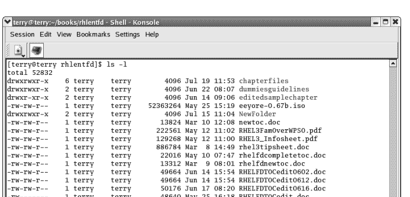

图 4-4：使用 `ls` 命令显示文件和目录权限。

| 其他人 | 所有者 | 大小 | 文件名 |
| :--- | :--- | :--- | :--- |
| 用户 | terry | 4096 6月14 09:06 | editsamplechapter |
| | terry | 52363264 5月25 15:19 | eoyore-0.67.iso |

图 4-5：文件类型和权限。

第一列显示文件类型或文件权限。文件或目录类型的第一个字母可以是五种之一，其含义如下：

- `b`：文件是块设备——例如磁盘。
- `c`：文件是字符设备，具有终端终端。
- `d`：文件是目录。
- `l`：文件是指向另一个文件的链接。
- `-`：文件是普通文件。


# 第 4 章：探索文件系统和命令行 shell


图 4-3：使用 `ls` 命令显示目录内容。

现在当你查看目录列表时，你会看到名称后面追加了以下符号：

- `/`：斜杠表示该名称是一个目录。
- `\`：星号表示该文件是一个可执行文件。
- `@`：`@` 符号表示该文件指向另一个文件或目录的链接。

## 列出文件权限

`ls -l` 命令用于显示文件权限。当我通过在命令行提示符输入 `ls -l` 命令时，我看到了图 4-4 所示的列表。

目录列表中的每一行都提供了关于行尾名称所显示的文件或目录的权限和所有权信息。让我们从最左侧向右更详细地查看第一行，如图 4-5 所示。

## 72 第一部分：熟悉企业级 Linux


图 4-4：使用 `ls` 命令显示文件和目录权限。

| 其他人 | 所有者 | 大小 | 文件名 |
| :--- | :--- | :--- | :--- |
| 用户 | terry | 4096 6月14 09:06 | editsamplechapter |
| | terry | 52363264 5月25 15:19 | eoyore-0.67.iso |

图 4-5：文件类型和权限。

第一列显示文件类型或文件权限。文件或目录类型的第一个字母可以是五种之一，其含义如下：

- `b`：文件是块设备——例如磁盘。
- `c`：文件是字符设备，具有终端终端。
- `d`：文件是目录。
- `l`：文件是指向另一个文件的链接。
- `（连字符）`：文件是普通文件。

紧随第一个字符之后的是一系列九个字符，在列表中显示为 `rwxrwxrwx`。每三个字母 `rwx` 一组代表授予特定用户的权限：

- 读权限
- 写权限
- 如果文件是程序，拥有 `x` 权限意味着用户可以运行该程序。
- 如果文件是目录，拥有 `x` 权限意味着用户可以打开并读取目录的内容。
- 执行权限

在企业级 Linux 文件系统中，每个文件或目录都有三种用户，权限对应于这三组的位置：用户、组员或其他其他人。

- 用户 `User`：前面的 `rwx` 显示授予文件或目录所有者的权限。在这种情况下，所有者可以读取、写入和执行文件。因为图 4-5 中的第一个列表显示目录，`x` 意味着所有者可以打开并查看目录的内容。
- 组员 `Group`：中间的 `rwx` 显示授予组组成员读取、写入和执行权限。
- 其他人 `Others`：结尾的 `rwx` 显示其他用户的读取、写入和执行权限。这些用户通常被称为“世界” `world`。

## 74 第一部分：熟悉企业级 Linux

要切换到当前目录的子目录，你不需要指定完整 `或绝对` 路径。相反，你只需要输入子目录 `或相对` 路径即可。例如，要切换到 `/usr/local` 下的 `bin` 子目录，你只需要输入 `cd bin`。要返回上一级目录或返回父目录，只需输入 `..` `字母 c、d、空格，然后两个点`。

从任何位置返回你的主目录，只需输入 `cd` 然后按回车键。

### 确定工作目录

当你使用命令行提示符时，提示符会显示你所在的目录。然而，它只显示目录本身，而不是整个路径。所以，如果提示符显示目录为 `bin`，你无法从提示符中判断它是 `/bin` 目录还是 `/usr/local/bin` 目录。幸运的是，使用 `pwd` `打印工作目录` 命令可以告诉你你所在的位置。要获取路径列表，请使用以下命令：

```
pwd
```

它返回以下输出：

```
/usr/local/bin
```

### 列出目录内容

你已经在本章之前的某些示例中了解了这个命令。但为了以防你还不知道，你可以使用 `ls` 命令来获取目录内容的列表。例如，要列出 `/bin` 目录的列表，你输入 `ls /bin`。你将在图 4-3 中看到列表。

注意，shell 使用颜色来区分显示的类型和目录类型。使用的颜色及其通常代表的含义是：

- 蓝色：目录
- 绿色/红色：可执行文件
- 青色：指向其他文件或目录的链接
- 黑色：普通文件

默认情况下，企业级 Linux 设置为彩色显示不同类型的文件，以便于区分。然而，这一设置可能在系统上被更改过。如果你看不到颜色，仍然可以使用 `ls` 命令配合 `-F` 选项 `是的，是一个大写的 F` 来确定文件类型。要查看列表中文件和目录之间的区别，输入以下内容：

```
ls -F
```

## 第一部分：熟悉企业级 Linux

```bash
mv /home/terry/testfile /tmp
```

你可以使用 `mv` 命令重命名文件，无论是在同一级目录下，还是当你将文件移动到另一个目录时。例如，若要在同一目录下将文件 `testfile` 重命名为 `newtestfile`，请输入以下命令：

```bash
mv /home/terry/testfile newtestfile
```

### 查找文件

有时你可能想在文件系统中查找某个文件，但不记得它在哪里。幸运的是，shell 提供了一个你可以使用的命令来帮助你找到它。这个命令很容易记忆，是 `find`。例如，如果你想找到文件 `testfile` 但不记得它在哪里，请输入此命令：

```bash
find -name testfile -print
```

`find` 命令的基本语法为

```bash
find path options filename options
```

上述命令开始从系统根目录开始搜索名为 `testfile` 的文件，并将搜索结果显示在系统显示器上。

> `find` 命令非常强大且对查找文件非常有用。它也是一个复杂的命令，允许你为查找各种类型的文件指定大量的选项。请务必使用 `man find` 命令查看该命令的完整选项列表。

### 删除文件

要从系统中删除文件，你可以使用 `rm` 命令。例如，如果你想删除文件 `testfile`，请输入以下命令：

```bash
rm testfile
```

使用 `rm` 命令时要小心，因为你可能会意外删除文件。被删除的文件无法恢复。

### 查看文件内容

你有几种方法查看任何文本文件的内容。这里有两种方法。第一种是使用 `more` 命令，如下：

```bash
more testfile
```

## 第四章：探索文件系统和命令 shell

使用 `more` 命令一次显示一屏文件内容。要进入下一页，请按空格键。遗憾的是，`more` 命令只会让你向一个方向移动；在过一屏幕后，你就无法返回了。不过，你可以使用 `less` 命令同时让你向下和向上移动屏幕：

```bash
less testfile
```

你会看到显示的第一页文本。要移动到下一页，按 `Page Down` `下页` 键。要返回上一页，按 `Page Up` `上页` 键。

### 修改文件组和所有者

有时你需要更改拥有文件的用户或组。有时，你想要运行的程序要求该程序以特定的用户或组运行。例如，你可能正在运行一个 Web 服务器，它要求文件所有者必须是 `apache` 用户。在这个示例中，查看我主目录下的文件 `testfile`。该文件的列表 `使用 ls -l` 显示如下：

```bash
ls -l testfile
rw-rw-r-- terry 0 Jul 21 10:20 testfile
```

要将此文件的所有者更改为 `apache`，你如下使用 `chown` 命令：

```bash
chown apache testfile
```

现在该文件的列表显示所有者为 `apache` 用户。

```
rw-rw-r-- 1 apache terry 0 Jul 21 10:20 testfile
```

要更改文件的组所有权，输入以下命令：

```bash
chgrp apache testfile
```

现在该文件的列表显示用户组为 `apache` 组：


```
-rw-rw-r-- 1 apache apache 0 Jul 21 10:20 testfile
```

你可以通过在一个命令中输入用点隔开的所有者和组，同时更改文件的所有者和组。例如，要将 `testfile` 的所有者和组更改为 `apache`，输入命令：

```bash
chown apache.apache testfile
```

# 第一部分：熟悉企业级 Linux

## 获取超级用户 (root) 权限

通常，当你想要使用系统进行典型工作时，你应该以普通用户的身份登录。有时你可能需要更多权限来妥善地管理你的系统，因此你需要成为 root，即超级用户。幸运的是，你可以使用 `su` 命令获取超级用户权限以完成你的管理任务。完成后，你可以放弃超级用户权限并返回普通用户。使用以下命令可以成为 root 用户：

```bash
su
```

请务必在命令后加上一个横杠（`-`），这样你将拥有 root 用户的路径而不是普通用户的路径。输入命令后，系统会提示你输入 root 密码。当你以 root 身份工作完成后，输入 `exit` 返回你的普通用户。

## 修改你的系统路径

你的 `path` 是 shell 在查找文件时搜索的目录列表。你不需要指定系统路径中任何文件的位置，它们将始终被搜索。有时你可能想向搜索路径中添加额外的目录。你可以通过 `export` 命令来实现这一点。在添加到你的路径之前，你可能想先查看当前列出的目录。你可以使用 `echo` 命令，通过输入以下命令让系统显示你的路径：

```bash
echo $PATH
```

该命令的输出如下：

```
/usr/kerberos/bin:/usr/local/bin:/usr/bin:/usr/X11R/bin
```

该命令的输出是以下内容：

```
/usr/kerberos/bin:/usr/local/bin:/usr/bin:/usr/X11R/bin
```
现在你知道你的路径了。通常，你想向搜索路径添加额外的目录。例如，如果我想将我的目录添加到搜索路径，输入以下命令（注意引号）：

```bash
export PATH
```

## 第四章：探索文件系统和命令 shell

### 挂载和卸载驱动器

在使用任何存储设备之前，必须先将其挂载到文件系统。要连接驱动器，你首先使用 `mount` 命令。`mount` 命令的基本语法为

```bash
mount device options
```

上述命令开始从系统根目录开始搜索名为 `testfile` 的文件，并将搜索结果显示在系统显示器上。

> `find` 命令非常强大且对查找文件非常有用。它也是一个复杂的命令，允许你为查找各种类型的文件指定大量的选项。请务必使用 `man find` 命令查看该命令的完整选项列表。

## 查看和停止进程

系统上运行的每个程序（包括 shell 和你发布的任何命令）都会创建一个进程。你可以使用 `ps` 命令获取系统中所有运行进程的列表。例如，在我的系统上执行 `ps` 得到输出：

```
PID TTY STAT TIME COMMAND
1 ? S 0:04 init
5 ? SW 0:01 eventd
3 ? SW 0:00 kampd
4 ? SWN 0:00 ksoftird/0
6 ? SW 0:00 bdflush
23580 ? 1:38 /usr/lib/openoffice/program/soffice.bin process/writer
23766 R 0:00 ps ax
```

有时进程的行为并不良好，可能会停止或运行不如预期。你可以利用 `ps` 命令的输出找到异常的进程并停止它。注意上述列表中的 `PID` 列：这一列是进程的进程 ID。例如，查看倒数第二个 PID 数字，23580。顺着 23580 开始的行看到命令列，你可以看到这是 OpenOffice 启动的进程。如果 OpenOffice 没有响应，可以使用如下 `kill` 命令强制其停止运行：

```bash
kill -9 23580
```

命令中的 `-9` 被称为信号。在某些情况下，运行的程序可以捕获信号而不采取行动。通过使用 `-9`，你正在强制程序结束，因为 -9 信号无法被运行程序捕获。

### 检查磁盘空间

你可以使用两个命令来查看文件系统使用了多少空间。首先，使用 `df` 命令可以显示所有挂载设备上的已用和可用空间。在我的系统上，此命令显示如下输出。在示例中，我使用 `-h` 选项强制输出以兆字节和 GB 为单位空间，而不是标准的 1 千字节块输出。

```bash
df -h
```

| Filesystem | Size | Used | Avail% | Mounted on |
| :--- | :--- | :--- | :--- | :--- |
| /dev/hdb5 | 27G | 5.1G | 21G | 20% | /boot |
| /dev/hdb1 | 198M | 6.3M | 182M | 4% | /home |
| /dev/hdb2 | 9.7G | 4.0G | 5.3G | 43% | /home |
| none | 125M | 0 | 125M | 0% | /dev/shm |
| /dev/hda2 | 5.9G | 3.4G | 2.2G | 61% | /mnt/drive2 |

其次，要查找某个目录及其子目录占多少磁盘空间，可以使用 `du` 命令。在下面的列表中，再次使用 `-h` 参数将输出格式化为兆字节和千字节，而不是 1 千字节块。

```bash
du -h /home/website
```
80K website/html/cgi-bin/fileman
8.0K website/html/cgi-bin/log_files
8.0K website/html/cgi-bin/my_db
44K website/html/cgi-bin/my_html
28K website/html/cgi-bin/system_db
60K website/html/cgi-bin/system_db_html
344K website/html/cgi-bin
512K website/html/colonial
24K website/html/.xvpics
904K website/html/
8.0K website/.xvpics
1.1M website

### 创建别名

很多时候，你会频繁使用相同的命令。例如，每当你想要查找文件或目录的权限信息时，都会使用 `ls -l` 命令。通过 `alias` 命令，你可以创建已经包含你想要使用的选项的新命令，从而节省时间。`alias` 命令的基本语法是

```bash
alias command='the command you want to run'
```

例如，为 `ls -l` 命令创建一个别名，以便我只需要输入 `ls`，请输入以下命令：

```bash
alias ls='ls -l'
```

每当你运行 `ls` 命令时，都会收到 `ls -l` 的输出。

如果你想知道已经定义的别名，只需不带任何选项地输入 `alias` 命令即可。

### 编写 Shell 脚本

Shell 脚本基本上是包含在单个文件中的命令序列。如果你熟悉 MS-DOS 和批处理文件（batch files），你已经熟悉 Shell 脚本的概念。取决于你想做什么，Shell 脚本可以非常复杂，也可以非常简单。在本节中，我将向你介绍一个简单的 Shell 脚本，让你对你可以做什么有个大概的了解。

上班时，我有时希望能够在我的 Enterprise Linux PC 上使用 Novell 网络上的文件。为了实现这一点，我需要运行几个命令来配置我的 PC 连接到 Novell 网络。而不是每次启动系统时都输入这些命令，我创建了一个在系统启动时运行的简单 Shell 脚本。我创建的脚本名为 `novell`，列表如下：

```bash
#!/bin/bash
sbin/modprobe ipx
sbin/modprobe ncpfs
sleep 2
sbin/ipx_configure --auto-interface=on --auto-primary=on
```


仔细查看一下这个脚本及其作用。脚本的第一行专门告诉 shell 它正在使用 `bash` 作为 shell。接下来的两行运行位于 `/sbin` 目录下的 `modprobe` 命令。以 `sleep 2` 开头的行在脚本运行期间添加了两秒的暂停。最后一行运行 `ipx_configure` 程序来为 IPX 网络协议设置参数。

该脚本的目的是加载连接到 IPX 网络所需的模块并配置 IPX 连接。虽然这是一个简短且相当简单的脚本，但它并不是你每次启动系统时都必须手动输入的内容。

为了创建它，我打开了一个简单的文本编辑器，并将每个命令作为文本文件中的单独行输入。完成命令输入后，我将文件保存到我的家目录。其中一个必须的步骤是使用 `chmod a+x novell` 来更改文件权限。创建一个简单的 Shell 脚本就这些这些了。

当然，Shell 脚本可以比这复杂得多，并执行你想要的任何操作。学习编写 Shell 脚本会让你很有趣。在你通过脚本自定义系统时，你也可以变得更加高效和专注。

# 第二部分：配置你的 Enterprise Linux 局域网

Rich Tennant 著《第五波浪》

> 尽管包含在硬件兼容列表中，Martin 想到要在 20 世纪 50 年代的工作站上安装红帽企业 Linux 仍然感到不而栗。

## 在这一部分中 ...

这一部分完全关于你的局域网（LAN）以及让网络服务为你工作。该部分从第 5 章开始，其中介绍了控制你桌面 GUI 的 X Window 系统。你想打印某些东西吗？请查看第 6 章有关配置不同类型打印机的详细信息。需要共享一些文件吗？查看第 8、9 章。关于什么是 TCP/IP？在本章中，你可以了解到配置你的系统所需的知识。

# 第 5 章

## 配置和管理 X Window 系统

### 本章内容

- 介绍 X Server
- 使用 X Server 工具配置 X Server
- 使用 X Server 工具微调 X Server
- 重启 X Server
- 禁用 X Server

> 红帽企业 Linux 的核心是内核，但对于许多用户来说，界面是 X Window 系统提供的图形环境。

## 介绍 X Server

Enterprise Linux 起于一种强大的操作系统，处理成千上万客户端的请求。在世界上，窗口环境已经存在了几十年，早于许多操作系统。X Window 系统现在是类 Unix 系统的主流图形界面。为了创建这种 GUI，X 使用客户端-服务器架构。启动服务器进程后，客户端进程通过网络或本地回环接口连接到它。服务器处理与硬件的通信。

在 Enterprise Linux 系统中，XFree86 服务器扮演着角色。作为一个大型开源软件项目，全球有数百名开发者，XFree86 对各种硬件、架构和操作系统提供了广泛支持。大多数红帽桌面用户并没有意识到运行在其上的 XFree86 服务器。他们更关心所处的桌面环境。红帽安装程序在安装过程中配置 XFree86 服务器方面做得非常出色，确保 X 在启动时处于最佳状态。

### 使用 X 配置工具配置 X Server

你基本上有两种方法在你的 Enterprise 系统上配置 X Server。一种是使用 X 配置工具，这是一个图形工具，让你能够更改一些最重要的设置，例如显示、显示器和视频卡设置。X 配置工具是 X 配置文件 `Xorg.conf` 的图形前端，该文件位于 `/etc/X11` 目录。你使用图形工具所做的任何更改都会写入 `/etc/X11/xorg.conf` 文件。二，你可以使用文本编辑应用程序直接编辑 X 配置文件。

### 更改显示分辨率

X 配置工具让你轻松更改显示分辨率。要更改显示分辨率，请执行以下操作：

1. 选择应用程序（Applications）：系统设置（System Settings）：显示（Display），打开显示设置对话框，如图 5-1 所示。

## 第 5 章：配置与管理 X Window 系统

> 记住，如果你没有以 root 用户登录，系统将提示你输入 root 密码。

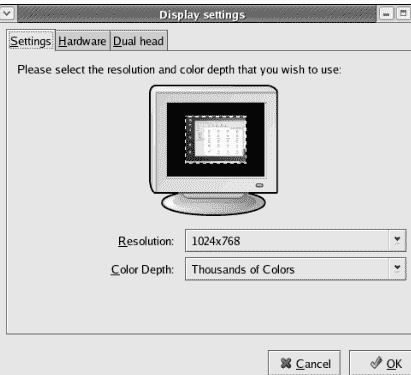

图 5-1：更改您的屏幕分辨率。

2. 从“分辨率”（Resolution）下拉列表中选择您所需的分辨率。
3. 点击“确定”以接受您的选择并关闭对话框。

每当你对 X Server 配置进行更改时，必须重启 X Server。当使用 X 配置工具时，你会看到一个重启 X Server 的窗口提醒。

## 更改显示颜色深度

系统显示颜色深度设置决定了显示器上显示的颜色数量。颜色深度越高，显示器上显示的颜色就越多。要更改系统颜色深度，请执行以下操作：

1. 选择应用程序（Applications）：系统设置（System Settings）：显示（Display）以打开显示设置对话框。（参考图 5-1。）
2. 如果没有以 root 用户登录，系统将提示你输入 root 密码。
3. 从“颜色深度”（Color Depth）下拉列表中选择您所需的颜色深度。
4. 点击“确定”以接受您的选择并关闭对话框。

## 第二部分：配置您的企业级 Linux 本域网

## 更改显示器类型设置

企业级安装程序通常可以检测连接到您系统的显示器类型，并相应地设置配置。有时，安装程序可能无法正确配置您的显示器，这需要您更改显示器设置。如果您获得了一个参数与之前显示器不同的新显示器，您也需要更改显示器设置。在满足以下情况时，请更改您的显示器设置：

1. 选择应用程序（Applications）：系统设置（System Settings）：显示（Display）以打开显示设置对话框（参考图 5-1）。

如果你没有以 root 用户登录，系统将提示你输入 root 密码。

2. 点击“硬件”（Hardware）选项卡（见图 5-2）。

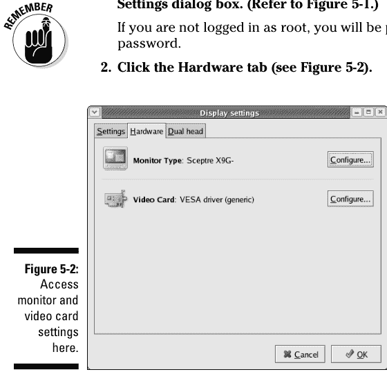

图 5-2：在此处访问显示器和显卡设置。

3. 点击顶部的“配置”（Configure）按钮（显示器类型列表的右侧）以打开“显示器”（Monitor）对话框，如图 5-3 所示。

4. 在列表中找到显示器的制造商，然后点击制造商名称左侧的箭头查看型号列表。

5. 点击与您的显示器匹配的型号数字。
6. 双击“确定”以接受您的选择并退出显示设置对话框。

提示
如果你无法在显示器列表中找到您的显示器制造商或型号数字，请从显示器列表顶部选择一个通用显示器。

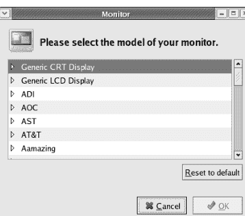

图 5-3：
选择您的显示器类型。

## 更改您的显卡类型

企业级安装程序通常可以检测连接到您系统的显卡类型，并相应地设置配置。然而，如果安装程序未能正确检测到您的显卡，您可能需要更改显卡类型。如果您安装了不同的显卡，也需要更改显卡类型。要更改显卡类型，请执行以下操作：

1. 选择应用程序（Applications）：系统设置（System Settings）：显示（Display）以打开显示设置对话框（参考图 5-1）。如果你没有以 root 用户登录，系统将提示你输入 root 密码。
2. 点击“硬件”（Hardware）选项卡（参考图 5-2）。
3. 点击底部的“配置”（Configure）按钮（显卡类型列表的右侧）显示“显卡”（Video Card）对话框，如图 5-4 所示。
4. 在列表中找到显卡的制造商并点击相应的型号。

 (注：原文此处无对应 5-4 图片路径，但根据上下文保留逻辑) (此处原文提到了图 5-4)

## 配置双显示器

在企业级 Linux 中，如果您希望使用两个显示卡和显示器，可以配置双显示器。要配置第二个显示器，请执行以下操作：

1. 选择应用程序（Applications）：系统设置（System Settings）：显示（Display）以打开显示设置对话框（参考图 5-1）。
2. 如果没有以 root 用户登录，系统将提示你输入 root 密码。
3. 点击“硬件”（Hardware）选项卡（见图 5-5）。
4. 点击“配置”（Configure）按钮（显示器类型列表的右侧），从显示设置对话框中选择您的显示器类型。
5. 为显卡输入相关信息，包括分辨率和颜色深度。
6. 如果您希望每个显示器使用独立的桌面还是跨越显示器的单个桌面，请选择。
7. 双击“确定”退出配置。


图 5-5：使用“硬件”选项卡配置双显示器。

## 从配置文件手动配置 X Server

XFree86 配置文件存储在 `/etc/X11/`。当安装红帽企业级 Linux 时，会为 XFree86 创建 `xorg.conf` 文件。虽然通常不需要手动编辑这些文件，但你应该了解其中包含的部分和参数。每个部分以 `Section-name` 行开头，以 `EndSection` 行结束。在每个部分内部有几行包含选项名称和至少一个选项值。以下是 XFree86 常用部分：

### Device

`Device` 部分指定系统使用的显卡信息。你的配置文件中必须有一个 `Device` 部分。在有多个显卡的情况下，可能有多个 `Device` 部分。以下选项是必需或广泛使用的：

- Bus ID：指定显卡的总线位置。对于具有多个显卡的系统，此选项是必要的。然而，必须设置以便 Device 部分使用。
- Driver：告诉 XFree86 加载哪个驱动以使用显卡。
- Identifier：为此显卡提供唯一名称。该名称被设置为显卡的确切名称。
- Screen：当显卡有多个头部（或接口）时使用的可选设置。如果您连接了多个显示器，必须为每个显示器设置不同的 `Screen` 值。此选项接受的值从 0 开始，每个头部器增加 1。
- VideoRam：显卡可用内存，单位为 KB。此设置通常不是必要的，因为 XFree86 服务器会探测显卡以自动检测显存大小。然而，由于某些显卡 XFree86 无法正确自动检测，此选项允许您指定显存大小。

### Direct Rendering Infrastructure

直接渲染基础（DRI）是一种接口，主要允许 3D 软件应用程序利用现代支持视频硬件的 3D 硬件加速能力。此外，在使用针对 2D 操作增强的驱动程序时，DRI 可以提高 2D 硬件加速性能。除非在 Module 部分启用 DRI，否则此部分将被忽略。

由于不同的显卡使用 DRI 的方式不同，在更改任何 DRI 值之前，请阅读 `/usr/X11/lib/X11/doc/README_DRI` 文件以获取有关特定显卡的详细信息。

### Files

此部分设置对 XFree86 服务器至关重要的路径，例如字体路径。常见选项包括：

- Fontpath：设置 XFree86 服务器查找字体的位置。可以在此处放置多个字体文件的目录路径，并用逗号分隔。默认情况下，红帽 Linux 使用 xfs 作为字体服务器并将 FontPath 指向 unix:/7100。这告诉 XFree86

# 第 5 章：配置与管理窗口系统

使用 Unix 域套接字进行进程间通信 (IPC) 以获取字体信息的服务器。

- Modulepath：允许设置多个目录，用于存储由 XFree86 服务器载入的模块。
- RGBpath：告诉 XFree86 服务器系统上 RGB（红/绿/蓝）颜色数据库所在的位置。该数据库文件定义了 XFree86 中所有有效的颜色名称，并将它们与特定的 RGB 值相关联。

## InputDevice

在本节中，你可以配置输入设备（如鼠标或键盘），通过 XFree86 服务器向系统传递信息。大多数系统至少有两个 InputDevice 部分：键盘和鼠标。每个部分包含以下两行：

- Driver：告诉 XFree86 要加载到设备上的驱动程序名称。
- Identifier：设置设备名称，通常是设备名称后跟一个数字，从第一个设备开始从 0 计数。例如，第一个键盘 InputDevice 的 Identifier 为 `Keyboard0`。

大多数 InputDevice 部分包含为设备分配特定选项的行。这些行中的每一行都以 `Option` 开头，后面跟着带引号的输入名称，然后是分配给该选项的值。鼠标通常接收如 `Protocol`、`PS/2` 和 `Device` 等选项，后者指定了此部分使用的鼠标。InputDevice 部分有详细的注释，允许你通过取消某些行的注释为你的特定设备配置额外选项。

## Module

此部分告诉 XFree86 服务器从 `/usr/X11R6/lib/modules/` 载入哪些模块。模块为 XFree86 服务器提供了额外功能。

编辑这些值时要小心。模块的更改可能会导致服务器无法启动。如有必要，你可以进入救援模式（rescue mode）进入 shell，在其中你可以编辑 `xorg.conf` 来修复问题。

## Monitor

Monitor 部分显示系统所使用的显示器类型。虽然至少需要一个 Monitor 部分，但可能有多个 Monitor 部分——机器使用的每台显示器各对应一个。第二部分：配置你的 Enterprise Linux

在手动编辑 Monitor 部分中的值时要小心。此部分中不适当的值可能会损坏你的显示器。请查阅显示器附的文档以获取安全的参数。以下选项通常在安装期间或使用配置文件配置：

- HorizSync：告诉 XFree86 与显示器兼容的水平同步频率范围（单位为 kHz）。这些值作为 XFree86 服务器的指南，用于判断是否在该显示器上使用特定的 `Modeline` 值。
- Identifier：为此显示器提供唯一名称，通常从 0 开始。第一台显示器是 `Monitor0`，依此类推。
- Modeline：用于指定显示器使用的视频模式，带有水平同步和垂直刷新分辨率。Modeline 条目之前通常有一个解释该模式的注释。如果你的配置文件没有包含注释，你可以在终端提示符下输入 `xorg.conf`，通过扫描这些值（也称为模式描述）来确定该模式试图实现的功能。
- Name：一个可选参数，用于显示显示器的名称。
- VendorName：一个可选参数，用于显示显示器的制造商。
- VertRefresh：显示器支持的垂直刷新频率范围（单位为 kHz）。这些值作为 XFree86 服务器的指南，以便知道是否在该显示器上使用特定的 `Modeline` 值。

## Screen

Screen 部分将可以成对使用的特定 Device（设备）和 Monitor（显示器）绑定，并包含某些设置。你必须在配置文件中至少有一个 Screen 部分。以下是常见的选项：

- DefaultDepth：赋予该部分默认的颜色深度（单位为位）。默认值为 8，指定 16 可提供数千种颜色，使用 32 可显示数百万种颜色。
- Device：指定在此 Screen 部分中使用的 Device 部分名称。
- Identifier：标识 Screen 部分，以便 Layout 部分引用它。
- Monitor：指定在此 Screen 部分中使用的 Monitor 部分名称。

你可能在 Screen 部分内有一个子部分，在使用此特定的显示器和显卡时告诉 XFree86 服务器应尝试的颜色深度（Depth）和分辨率（Mode）。更多信息请参阅 XConfig 页面。若要检查你的 XFree86 服务器的当前配置，请输入 `xset -g` 命令。这将为你提供有关键盘、指针、屏幕保护程序和字体路径的信息。

## 重启你的 X Server

有时，你可能正在运行一个停止响应点击或键盘命令的程序。或者，GUI 停止响应，你的系统似乎冻住了。在这种情况下，你可以停止并重启 X Server 来重置桌面。你可以通过以下步骤重启 X Server：

1. 按 `Ctrl+Alt+Backspace`。
2. X Server 重启后，登录进入桌面。

## 禁用 X Server

如果你使用的是 Enterprise Linux 的服务器版本，并将使用命令行进行服务器配置，你可能希望禁用 X Server 自动启动以节省系统资源。虽然我不建议没有经验的用户执行此操作，但从命令行配置的经验用户可以比通过 GUI 工具进行相同配置的用户运行更快、更高效。如果你想禁用 X Server，请按照以下步骤操作：

1. 使用文本编辑程序打开 `/etc/initab` 文件。
2. 在文件中找到类似于下面的一行：
```


id:5:initdefault


```
3. 将数字 5 改为 3。
4. 保存文件更改。
5. 重启你的系统。
```

当你的系统重启时，你看到的将不是图形登录界面，而是命令行登录。如果你禁用了 X Server 的自动启动，可以在命令行提示符处输入 `startx` 来手动启动它。

# 第 6 章：配置与管理打印机

**本章内容**

- 使用打印机配置工具设置打印机
- 修改打印机配置

你是否曾经将打印任务发送到打印机，但它并没有打印？或者任务确实打印了，但输出并不符合你的预期？很多时候，这些问题是由打印机配置不当或使用了错误的打印驱动程序引起的。如果你在想，“嘿，这正发生在我身上”，那么读到这一章你就走运了。

在本章中，我将告诉你成功配置和管理系统打印机所需的所有知识。Red Hat Enterprise Linux 包含了打印机配置工具来帮助你配置打印系统。打印机配置工具是一个易用的图形化工具，可以帮助你设置选择的任何类型的打印机。如果你没有使用图形用户界面 (GUI)，配置打印机也没有问题，因为你可以在终端窗口的命令行中配置打印机。

## 第二部分：配置您的企业 Linux 局域网

### 启动打印机配置工具

打印配置（Printing Configuration）工具是一个图形化实用，您可以通过应用程序菜单选择它来启动。要启动打印机配置工具，请按照以下步骤操作：

- 1. 选择“应用程序-系统设置”，然后选择“打印”。

如果您没有以 root 用户登录，系统会在您继续之前提示输入 root 密码。

- 2. 如必要，输入 root 密码。

打印机配置工具打开，如图 6-1 所示。

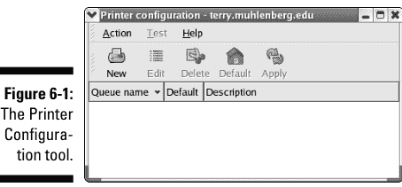

- 3. 点击打印机配置主窗口中的“新建”（New）按钮。

出现如图 6-2 所示的窗口。

注意，此窗口告诉您在点击最后一个窗口上的“应用”（Apply）之前，您的更改将不会保存。

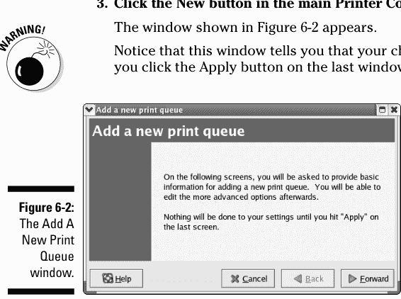

### 第六章：配置和管理打印机

- 4. 点击“前进”（Forward）按钮。

出现如图 6-3 所示的“队列名称”屏幕。

- 5. 在“名称”字段中输入打印机的唯一名称。

为您的打印机选择一个描述性名称并遵循以下参数：

- 打印机名称必须以字母开头，且不能包含空格。
- 打印机名称其余部分可以使用任何有效字符。有效字符为小写和大写字母 a 到 z、数字 0 到 9、–（连字符）和 _（下划线）。

如果您需要，可以在“短描述”字段中为打印机输入描述。

- 6. 完成打印机名称输入后，点击“前进”。

出现“队列类型”窗口（如图 6-4 所示），打印机配置工具将尝试检测您的打印机。

以下章节详细介绍了配置打印队列和选择打印机驱动程序的各种各种可用方案。

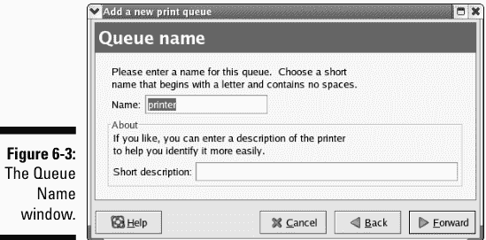

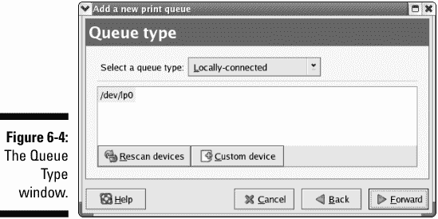

## 第二部分：配置您的企业 Linux 局域网

### 配置打印队列

您可以配置六种类型的打印队列。打印队列是一个目录，用于存放与队列配合工作的打印机的打印作业。打印队列与您想要配置的打印机类型相关。在队列窗口顶部（见上述列表的第 6 步）有一个下拉列表，包含您可以配置的六种类型的打印队列。队列类型默认设置为“本地连接”（Locally-Connected）。如果打印机已本地连接（即打印机或 PC 上的 USB 端口连接且已被识别），它将显示在列表中。

列表显示了您可以安装的六种类型的队列；要选择一种，请从下拉列表中选择所需的类型。

- **本地连接 (Locally-Connected)**：通过并行端口或 USB 端口连接到计算机的打印机。如果列表中列出您的打印机，请点击“自定义设备”按钮，输入打印机名称，然后点击“确定”将其添加到打印机列表中。连接到并行端口的打印机通常称为 `/dev/lp0`。连接到 USB 端口的打印机通常称为 `/dev/usb10p`。

- **网络 CUPS (IPP)**：可以通过 TCP/IP 网络访问的打印机。CUPS（Unix 打印系统）基于互联网打印协议（IPP），该协议的创建是为了尝试为互联网打印制定某些标准。如果您选择此类类型的队列，您需要输入服务器名称和服务器的路径。图 6-5 显示了网络 CUPS 对话框。

- **网络 UNIX (LPD)**：连接到不同 Unix 系统的打印机，可以通过 TCP/IP 网络访问（例如，连接到您网络上另一台 Red Hat Linux 系统的打印机）。如果您选择此类队列，您需要输入服务器名称和服务器路径，如图 6-6 所示。

> 图 6-5：网络 CUPS (IPP) 屏幕是您输入服务器名称和路径的地方。

**队列类型** 添加新打印队列
选择队列类型：[Networked CUPS (IPP)]
服务器：[main.tacttechnology.com]
路径：[/printers/queue1]
帮助 取消 返回 前进

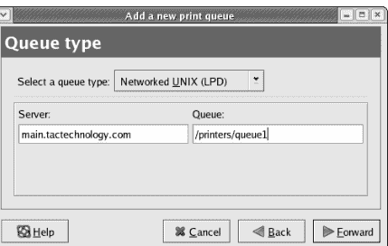

图 6-6：
为网络 Unix (LPD) 打印机输入服务器和队列。

- 服务器：远程打印机队列所在远程机器的主名或 IP 地址。
- 队列：远程打印机队列通常为 1lp。默认未勾选“严格 RFC1179 兼容性”（Strict RFC1179 Compliance）选项。如果您在打印非 Linux lpd 队列时遇到问题，请选择此选项以禁用 LPR。

## 第二部分：配置您的企业 Linux 局域网

打印机名称应与本地 Red Hat Linux 系统上用户账户使用的用户名和密码不同。如果它们相同，唯一可能的安全风险就是未经授权使用打印机。

### 选择打印机驱动程序

配置打印机的下一步是选择打印机驱动程序。打印驱动程序将您想要打印的数据转换为打印机可以理解的格式。

- 1. 在选择了打印机队列类型并输入信息后，点击“向前”（Forward）进入“打印机型号”窗口，如图 6-11 所示。

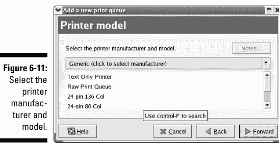

- 2. 从列表中选择驱动程序。
    a. 点击制造商旁边的箭头。
    b. 从展开列表中找到您的打印机，然后点击打印机名称旁边的箭头。
    c. 出现打印机驱动程序列表。打印机按制造商列出。
    d. 选择其中一个。

有时您可能需要尝试列表中的几个驱动程序，以找到一个可以正常工作的。

> 要了解更多关于打印驱动程序的信息，请访问 www.linuxprinting.org/printer_list.cgi。在添加打印机后，可以通过启动打印机配置工具、从列表中选择打印机、点击“编辑”（Edit）、点击“打印机驱动程序”选项卡、选择不同的打印机驱动程序并应用更改。

# 第 6 章：配置和管理打印机

3. 点击“向前”（Forward）进入打印机信息确认页，您可以在此处检查打印机配置选择。

- 如果设置正确，点击“应用”（Apply）添加打印队列。
- 如果必要，点击“后退”（Back）修改打印机配置。

- 4. 点击主窗口中的“应用”（Apply）按钮，将更改保存到打印机配置文件并重启打印机守护进程 (`lp`)。
如有必要，点击“后退”（Back）修改打印机配置。

### 编辑打印机配置

添加打印机后，可以通过从打印机列表的打印机配置工具选择打印机并点击“编辑”（Edit）按钮来编辑设置。如图 6-12 所示的标签窗口包含您所选择编辑的打印机的当前值。进行任何更改并点击“确定”（OK）。然后在主打印机配置工具中点击“应用”（Apply）以保存更改并重启打印机守护进程。

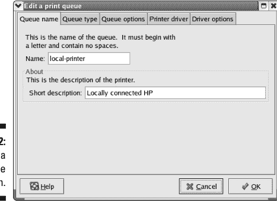

图 6-12：编辑打印队列屏幕。

标签及其包含的内容如下：

- 队列名称（Queue Name）：要重命名打印机，请更改“队列名称”选项卡上的“名称”（Name）值。点击“确定”返回主窗口。打印机列表中的打印机名称将更改。点击“应用”保存更改并重启打印机守护进程。

- 队列类型（Queue Type）：“队列类型”选项卡显示您在添加打印机时选择的队列类型及其设置。您可以更改打印机的队列类型或仅更改设置。修改后，点击“确定”返回主窗口。点击“应用”保存更改并重启打印机守护进程。根据您选择的队列类型，将看到不同的选项。请参考描述特定打印机的章节；那里列出了您的打印机特有的选项。

- 队列选项（Queue Options）：从“队列选项”选项卡中，您可以选择打印任务前后的页面。您还可以设置页面的打印区域。要修改过滤器，突出显示该选项并点击“编辑”进行修改，或点击“删除”将其移除。点击“确定”接受您的更改并返回主窗口。点击“应用”保存更改并重启打印机守护进程。

- 打印机驱动程序（Printer Driver）：打印机驱动程序显示当前使用的是哪种打印机驱动程序。这与您添加打印机时使用的列表相同。如果您更改了打印机驱动程序，点击“确定”接受更改并返回主窗口。点击“应用”重启打印机守护进程。

- 驱动程序选项（Driver Options）：“驱动程序选项”选项卡显示高级打印机选项。每个打印机驱动程序的选项。常用选项包括：
    - 发送分页（Send Form-Feed, FF）：如果打印任务的最后一页没有从打印机排出（例如，最后页进纸灯闪烁）。选择此选项不会强制将最后一页排出打印机，而是通过选择发送传输结束（Send End-of-Transmission, EOT）。某些打印机需要同时发送分页 (FF) 和发送传输结束 (EOT) 才能排出最后一页。
    - 发送传输结束（Send End-of-Transmission, EOT）：如果发送分页无效。请参考上一个关于发送分页 (FF) 选项的项目符号。
    - 假设未知数据为（Assume Unknown Data Is）：如果您的打印机驱动程序无法识别发送给它的某些数据会导致打印问题。如果选择此选项，打印机驱动程序将假设它无法识别的任何数据并尝试原样打印。如果您选择此选项和“转换为 PostScript”选项，打印机驱动程序将假设未知数据是文本并转换为 PostScript。
    - 选择预渲染 PostScript（Select PreRender PostScript）：如果您尝试打印 ASCII 字符集之外的字符（如外语言字符）但这些字符无法正确打印。如果您的打印机不支持您尝试打印的字体，请选择此选项。如果您的打印机无法处理 PostScript 3 ，也应该选择此选项。此选项将其转换为 PostScript 1级。
    - 将文本转换为 PostScript（Convert Text to PostScript）：默认选中。如果您的打印机可以打印纯文本，在打印纯文本文档时取消勾选此项，以缩短打印时间。
    - 页面大小（Page Size）：允许您为打印机选择纸张尺寸，例如 US Letter、US Locale、A3 和 A4。
    - 有效过滤器区域（Effective Filter Locale）：默认值为 C。如果您正在打印日语字符，选择 ja_IP。否则，接受默认值 C。
    - 媒介源（Media Source）：默认值为打印机默认。更改此选项以使用来自不同纸盒的纸。

如果您修改了驱动程序选项，点击“确定”返回主窗口。然后点击“应用”保存更改并重启打印机守护进程。

### 删除打印机

要删除现有的打印机，选择该打印机并点击工具栏上的“删除”（Delete）按钮。打印机将从打印列表中移除。点击“应用”保存更改并重启打印机守护进程。

### 设置默认打印机

要设置默认打印机，从打印机列表中选择打印机并点击工具栏上的“默认”（Default）按钮。默认打印机图标将出现在打印机列表第一列默认打印机旁边。

# 第 7 章

# 配置网络

在本章

- 发现企业 Linux 配置工具
- 添加以太网网络接口卡
- 添加无线网络接口卡
- 添加调制解调器
- 编辑您的网络配置

您对企业 Linux 系统可能想做的第一件事就是连接到某种网络。谁能想象今天的世界上会有没有连接到互联网或局域网（LAN）的电脑呢？为了能够连接到局域网或互联网，每台电脑都需要安装并正确配置网络接口卡（NIC）。

## 企业 Linux 网络配置工具

Red Hat Enterprise Linux 提供了一个图形化网络配置工具，可以使用它可以配置系统中安装的网络接口设备。通过此工具，您可以配置加密 IP 封装 (CIPE)、以太网、集成业务数字主网络 (ISDN)、调制解调器、令牌环、无线和 xDSL（x 指不同的 DSL 变体）设备。在本章中，我介绍了常见的设备类型：以太网、调制解调器和无线。

可以通过 GNOME 桌面的应用程序菜单访问网络配置工具。要启动网络配置工具，选择应用程序->系统设置->网络。网络配置窗口如图 7-1 所示。

# 110 第二部分：配置您的企业 Linux 局域网

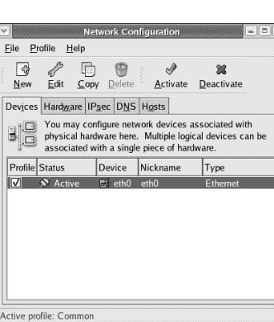

### 图 7-1：红帽企业 Linux 网络配置工具窗口。

主网络配置工具窗口（如图 7-1 所示）五个标签页，并默认打开“设备 (Devices)”选项卡。继续阅读以详细了解这五个标签页。

- **设备 (Devices)**：此选项卡显示安装在您的 PC 上并配置的网络设备。网络设备与 PC 中的实际物理硬件相关联。

如果您在 Red Hat Enterprise Linux 系统上安装了支持的网卡 (NIC)，你的网卡应该已经列在网络配置工具中了。点击“硬件 (Hardware)”选项卡查看有关设备的信息。

- **硬件 (Hardware)**：此选项卡显示安装在您的 PC 中的实际物理硬件。

- **IPSec**：在此标签页中您可以配置用于安全通信的 IPSec 隧道。

- **DNS**：此标签页显示用于 DNS 查找的主机名、域名和名称服务器。您可以在此处配置这些信息。

- **主机 (Hosts)**：此标签页显示 PC 主机名到静态 IP 地址的映射。

# 添加以太网设备

通过网络配置工具，您可以轻松地添加和配置以太网设备。要添加以太网设备，请执行以下操作：

1. **点击网络配置工具窗口工具栏上的“新建 (New)”按钮**。（参考图 7-1。）

出现“选择设备类型 (Select Device Type)”窗口，如图 7-2 所示。

# 第 7 章：配置网络

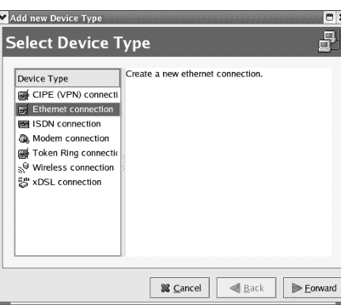

图 7-2：在此处选择您的网络设备。

2. 从设备类型列表中列表中选择“以太网连接 (Ethernet Connection)”，然后点击“下一步 (Forward)”进入“选择以太网设备”列表。

3. 如果未列出 NIC，在“选择以太网设备”列表中选择它，然后点击“下一步”进入“配置网络设置 (Configure Network Settings)”窗口（参见接后的图 7-4）。

4. 如果未列出 NIC，选择“其他以太网卡 (Other Ethernet Card)”，然后点击“下一步”打开“选择以太网适配器 (Select Ethernet Adapter)”窗口，如图 7-3 所示。

5. 从适配器下拉列表中选择您的网卡。

6. 从设备（Device）下拉列表中选择设备名称。

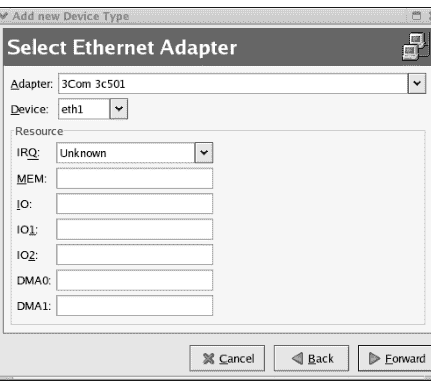

图 7-3：选择以太网适配器窗口。

# 第二部分：配置您的企业 Linux 局域网

您应该为第一个设备选择 `eth0`，第二个选择 `eth1`，第三个选择 `eth2`，依此类推。如果需要，您也可以输入适配器将使用的系统资源。通常这是没有必要的，因为操作系统会自动为设备分配资源。但在您需要手动控制所使用的硬件的资源分配时，您可以这样做。

7. 点击“下一步”继续进入“配置网络设置”窗口，如图 7-4 所示。

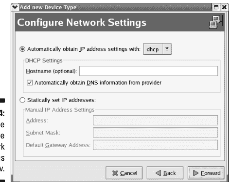

> 图 7-4：配置网络设置窗口。

8. 选择您是想使用 DHCP 自动获取 IP 地址，还是想输入静态 IP 地址。

通过选择相应的单选按钮做出您的选择。如果您选择静态设置地址，则必须输入 IP 地址、子网掩码和默认网关地址。如果需要，还可以为您的 PC 输入主机名。

您将看到所选信息的列表。

9. 点击“下一步”。

10. （可选）如果您想进行更改，点击“上一步 (Back)”返回所需的窗口并进行更改。如果您对您的选择满意，点击“应用 (Apply)”来创建设备。

点击“应用”后，设备将被创建并显示在设备列表中。尽管设备已配置并添加到设备列表中，但它是处于非状态的，正如您从设备列表所所示。默认情况下，设备将在启动时启动，但您可以通过突出显示它然后点击窗口顶部菜单栏上的“激活 (Activate)”按钮来立即激活它。

11. 从菜单选择“文件 (File)::保存 (Save)”以保存您的更改。

## 添加无线网卡

通过网络配置工具，您可以轻松地添加和配置无线网卡。要添加无线网卡，请执行以下操作：

- 点击网络配置工具主窗口工具栏上的“新建 (New)”按钮。（参考图 7-1。）
- 出现“选择设备类型”窗口（参考图 7-2）。
- 从设备类型列表中选择“无线连接 (Wireless Connection)”，然后点击“下一步”进入“选择无线设备”列表。

如果您的 NIC 显示在“选择无线设备”列表中，选择它并点击“下一步”进入“配置无线连接 (Configure Wireless Connection)”对话框，如图 7-5 所示。如果未列出您的 NIC，请直接跳转到第 6 步。

图 7-5：配置无线连接对话框。

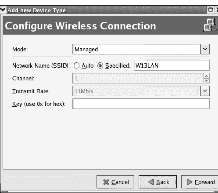

- **模式 (Mode)**：自动 (Auto) 或 临时模式 (Ad-hoc)。
- **SSID**：自动 (Auto) 或 特定 (specific)。
- **通道 (Channel)**：自动 (Auto) 或 特定 (specific)。
- **传输速率 (Transmit Rate)**：自动 (Auto) 或 特定 (specific)。
- **密钥 (Key)**：自动 (Auto) 或 WEP。

# 116 第二部分：配置您的企业 Linux 局域网

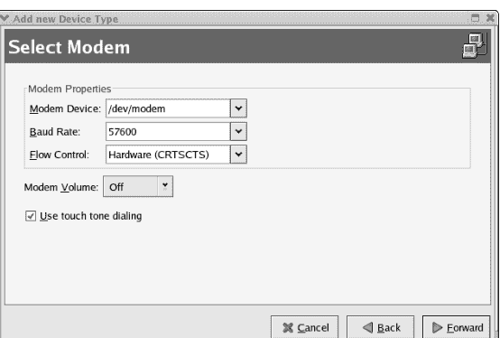

图 7-6：选择对话框。

4. 当您对设置满意时，点击“向前”（Forward）进入“选择提供者”（Select Provider）窗口，如图 7-7 所示。

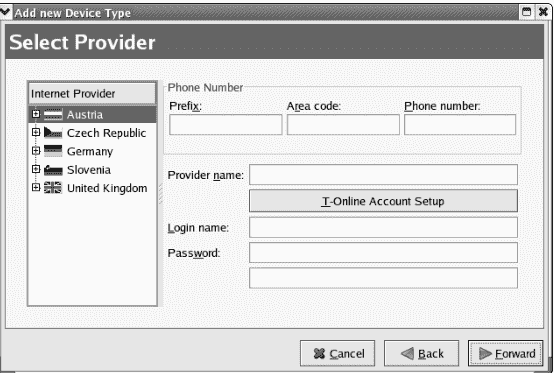

图 7-7：提供者对话框。

- 5. 在此处您需要输入 ISP 名称和连接时拨打的号码。输入 ISP 提供的用户名和密码。
- 6. 点击“向前”进入“IP 设置”（IP Settings）窗口，如图 7-8 所示。您可以接受此处的默认设置以自动获取 IP 地址信息。

# 第 7 章：配置网络

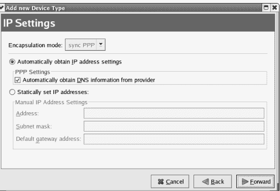

图 7-8：IP 设置对话框。

# 7. 点击“向前”继续。

您将看到选中信息的列表。如果您想进行更改，点击“向后”（Back）返回所需的窗口进行修改。如果您对选择满意，点击“应用”（Apply）来创建设备。

设备已创建并显示在设备列表中。尽管设备已配置并添加到设备列表中，但从设备列表可以看出，它是未激活状态。默认情况下，设备在启动时启动，但您可以通过突出显示该设备，然后点击窗口菜单栏上的“激活”（Activate）按钮来立即激活它。

# 8. 从菜单选择“文件：保存”以保存您的更改。

# 编辑您的网络配置

在添加和配置网络连接设备（无论是有线 NIC、无线 NIC 还是调制解调器）之后，您通常不需要更改配置。不过，如果您更换了不同的 NIC，则可能需要修改配置。

# 移除 NIC

通过网络配置工具，您可以轻松地进行必要的更改。按照以下步骤启动网络配置工具：

- 1. 选择“应用程序：系统设置：网络”。

# 第二部分：配置您的企业 Linux 局域网

如果您未以 root 用户登录，系统将提示您输入 root 密码。

- 2. 点击“硬件”（Hardware）选项卡。
- 3. 突出显示您想要移除的设备，然后点击“删除”（Delete）。
- 4. 完成后，选择“文件：保存”以保存您的更改。

# 修改 NIC 配置

通过网络配置工具，您可以轻松地进行必要的更改。按照以下步骤启动网络配置工具：

- 1. 选择“应用程序：系统设置：网络”。

如果您未以 root 用户登录，系统将提示您输入 root 密码。

- 2. 突出显示您想要修改的设备，然后点击“编辑”（Edit 工具工具）。

将出现所选设备的以太网设备对话框，如图 7-9 所示。

- 3. 此对话框提供的三个选项卡用于以下用途：

- 通用（General）：在此处您可以为设备输入别名，并选择系统启动时是否激活该设备。您还可以选择允许其他用户启用和禁用设备。您可以选择使用 DHCP 自动获取 IP 信息，或手动为设备输入 IP 信息。

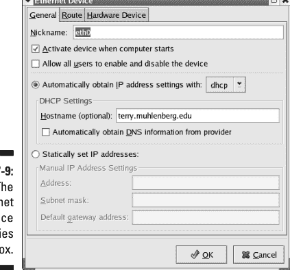

图 7-9：以太网设备属性对话框。

# 第 7 章：配置网络

# 119

在大多数情况下，您可以接受默认设置并让系统使用 DHCP 获取 IP 信息。如果您需要静态 IP 地址，通常可以从系统管理员处 IP 信息。如果您是系统管理员，您应该知道使用什么 IP 信息。

- 路由（Route）：在此处您可以输入到其他网络的静态路由。您需要输入网络 IP 号和网关 IP 号。如果您使用 DHCP，通常不需要在此处输入任何信息。
- 硬件设备（Hardware Device）：此选项卡包含与以太网设备相关的硬件信息。如果需要，可以在此处分配设备别名。


设备别名是与物理硬件关联的虚拟设备，它们可以在系统运行时激活以具有不同的 IP 地址。它们通常表示为设备名称加一个冒号和一个数字（例如，`eth0:i`）。如果您希望一个系统拥有多个 IP 地址，但系统只有一个网卡，那么它们非常有用。

如果您已配置了设备（例如 `eth0`），

- 点击网络管理工具中的按钮为该设备创建别名。
- 选择网络设备并配置网络设置。
别名将以设备名称的形式出现在设备列表中，设备名称后跟一个冒号和别名名称。

- 在进行完所需的所需的更改后，点击“确定”（OK）返回网络配置对话框。
- 选择“文件：保存”将您的配置更改保存到文件中。

## 管理 DNS 设置

网络配置工具的 DNS 选项卡是您配置系统主机名、域名、名称服务器和搜索域的地方。名称服务器用于查找网络上的其他主机。要输入或更改这些设置，请执行以下操作：

- 选择“应用程序：系统设置：网络”。

如果您未以 root 用户登录，系统将提示您输入 root 密码。

- 从网络配置对话框中点击“DNS”选项卡。
- 在 DNS 选项卡上，为您的系统输入适当的信息。
- 完成后，选择“文件：保存”以保存您的更改。

# 120 第二部分：配置您的企业 Linux 局域网

“名称服务器”部分并不配置系统作为名称服务器。如果 DNS 服务器名称是从 DHCP 获取（或从调制解调器连接的 ISP 获取），请勿添加主、备或三级 DNS 服务器。

## 管理 hosts

在网络配置工具的选项卡上，您可以从 `/etc/hosts` 文件中添加、编辑或删除主机。此文件包含 IP 地址。当您的系统尝试将主机名解析为 IP 地址时，会引用该文件。

- 1. 选择“应用程序：系统设置：网络”。
如果您未以 root 用户登录，将提示您输入 root 密码。
- 2. 从配置对话框中点击“Hosts”选项卡。
- 3. 从工具栏上点击“新建”（New）添加主机条目。
- 4. 输入主机及其 IP 地址。
- 5. 点击“确定”添加条目。
- 6. 选择“文件：保存”保存更改。

不要删除 localhost 条目，否则网络将无法工作。

# 使用配置（Profiles）

可以为每个物理设备创建多个逻辑设备。例如，如果您的系统中有一个网卡（`eth0`），您可以创建具有不同别名和配置选项的逻辑设备，它们都关联 `eth0`。这些逻辑设备与设备别名不同。别名也关联相同的硬件，但可以同时激活。

配置用于为不同的网络创建多个配置集。配置集可以包含逻辑设备以及主机和 DNS 设置。配置好后，可以使用网络管理工具在它们之间切换。

默认情况下有一个名为 Common 的配置。创建新配置的操作如下：

- 1. 选择“应用程序：系统设置：网络”。
- 2. 从菜单中选择“配置：新建”。
- 3. 为配置输入唯一名称。
- 4. 创建新配置后，如果所有设备均未列出，请点击“添加”按钮添加它们。
如果物理设备已存在设备，请使用“复制”按钮复制现有设备。

设备列表中有一列配置的复选框。对于每个配置，您可以勾选（标记）或取消勾选（清除）设备。该配置仅包含勾选设备。

配置无法在启动时激活。只有 Common 配置中设置为启动时激活的设备才会在启动时激活。系统启动后，执行以下命令启用配置（将 profilename 替换为配置名称）：

```


`redhat-config-network-cmd --profile profilename`

# 第 8 章 网络文件系统

## 本章介绍

- 解释网络文件系统 (`NFS`)
- 配置和管理 `NFS` 服务器
- 配置 `NFS` 客户端

正如你从章节标题看到的，`NFS` 是 `Network File System`（网络文件系统）的缩写。现在你知道这个缩写的含义了，但 `NFS` 到底是什么？

`NFS` 是由 `Sun Microsystems` 开发的一种协议，它允许计算机跨网络访问共享目录，就像这些目录位于计算机的本地文件系统中一样。`NFS` 广泛用于运行 `Unix` 及其 `Unix` 变体（如 `Enterprise Linux`）的系统，但也可以用于运行不同操作系统（如 `Windows` 或 `Mac OS`）的计算机。

在本章中，我将向你展示如何配置 `NFS` 服务器将某些目录共享给网络上的其他计算机。你还可以学习如何配置 `NFS` 客户端，以访问你从 `NFS` 服务器共享的目录。

## 配置和管理 NFS 服务器

为了让 `NFS` 服务器能够与网络上的计算机共享文件和目录，你必须告诉它要共享哪些目录和文件。表示从 `NFS` 服务器共享文件和目录的术语是“导出”（exporting）。被导出的目录或多个目录被称为“共享”（shares）。`Red Hat Enterprise Linux` 有一个图形化工具—— `NFS` 服务器配置工具，你可以用它来配置服务器并选择你想导出的目录。如果你安装并运行了 `X Server`，就可以使用该图形化工具。如果你没有安装 `X Server`，请参见“命令行配置”部分。

### 向导出项添加共享内容

要启动 `NFS` 服务器配置工具并选择要导出的目录，请执行以下操作：

1. 选择 `应用程序::系统设置::服务器设置::NFS`。如果你没有以 `root` 用户登录，系统将提示你输入 `root` 密码。出现如图 8-1 所示的 `NFS` 服务器配置对话框。
2. 从菜单中选择“文件::添加共享”，或点击工具栏上的“添加”。出现如图 8-2 所示的“添加 `NFS` 共享”对话框。在此对话框的三个选项卡中，默认显示“基本”（Basic）选项卡。
3. 在“目录”（Directory）字段中，输入你想导出的目录。或者，你可以点击“浏览”（Browse）按钮通过浏览文件系统来定位目录。

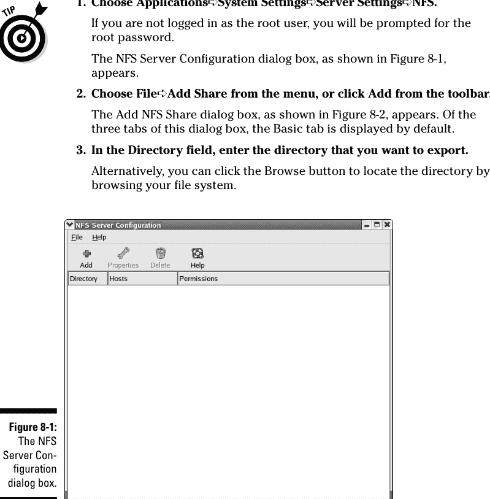

图 8-2：添加 `NFS` 共享对话框。

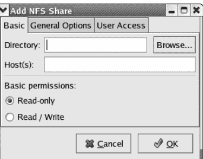

4. 在“主机(s)”字段中，输入你想要导出目录的主机或多个主机。
   主机名可以使用以下格式输入：
   - 针对单台计算机：完全域名、主机名或 `IP` 地址。
   - 针对计算机组：你可以使用通配符列出同一域名内的计算机组。例如，`*.muhlenberg.edu` 会与该域名下的任何主机名共享选定的目录。
   - 通过 `IP` 网络地址：你也可以使用 `IP` 网络地址和子网码列出主机：例如 `192.168.0.2/24` 或 `192.168.0.2/255.255.255.0`。在第一个示例中，子网码表示为子网码的位数。在第二个示例中，指定了实际的子网码。这两种格式都是接受的。
5. 选择你想允许的访问类型（权限），只读或读写。
6. 点击“常规选项”（General Options）选项卡（见图 8-3）并进行相应选择。

图 8-3：常规选项选项卡。

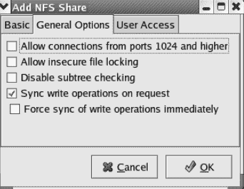

从此选项卡可以配置五个选项。这些选项是：

- 允许来自端口 1024 及以上版本的连接：在小于 1024 的端口上启动的服务必须以 `root` 身份启动。选择此选项允许 `root` 以外的用户启动 `NFS` 服务。
- 不安全文件锁定：不需要锁定。
- 禁用子树检查：如果文件系统的子目录被导出，但整个文件系统都被导出，则服务器会检查请求的文件是否在子目录中。这种检查就是子树检查。如果导出了整个文件系统，禁用子树检查可以提高传输率。
- 请求时同步写入操作：默认启用，此选项不允许服务器在磁盘更改之前对请求做出响应。
- 立即强制同步操作：不要延迟写入。
7. 点击“用户”（User）选项卡（见图 8-4）并进行相应选择。


这些选项可用：
- 将远程用户视为 `root`：如果选择此选项，客户端将拥有 `root` 权限。
- 将所有客户端视为访客：如果选择此选项，所有客户端都将被视为访客。
- 将用户映射为压缩用户（Squashed User）：如果选择此选项，用户将被映射为压缩用户。
- 将用户组映射为压缩组（Squashed Group）：如果选择此选项，组将被映射为压缩组。

### 编辑和删除共享

使用图形化工具，你可以轻松更改属性或删除共享。要修改属性，请执行以下操作：

- 高亮要编辑的共享并点击工具栏上的“属性”。出现图 8-5 所示的“编辑共享”对话框。
- 进行你需要的更改并点击“确定”。
- 要删除共享，高亮它并点击工具栏上的“删除”。


### 命令行配置

你不需要使用图形化工具来配置 `NFS` 服务器。也许你没有安装 `X Server`，或者你只是想用命令行，因为通常更快。在这种情况下，配置 `NFS` 服务器唯一的文件是 `/etc/exports`。要通过命令行导出目录，请执行以下操作：

1. 从命令行提示符使用任何文本编辑器打开 `/etc/exports`。我通常使用 `vi` 编辑器进行更改。虽然熟悉 `vi` 需要一些时间，但在熟悉后使用起来非常快速方便。优点是几乎每个 `Unix` 和 `Linux` 系统都安装了 `vi`。如果你不习惯使用 `vi`，可以尝试使用 `edit`，它是 `GNOME` 文本编辑器。要打开 `edit`，选择 `应用程序::配件::文本编辑器`。
2. 使用以下语法输入关于要导出目录及其目标的信息：`/导出目录 主机名(选项)`。你必须指定的选项是 `sync` 或 `async`，它告诉服务器是否在请求写入磁盘之前响应。推荐选项是 `sync`。例如，如果我想向 `terry.muhlenberg.edu` 导出 `/musicfiles` 目录并具有读写权限，我输入 `/musicfiles terry.muhlenberg.edu(rw,sync)`。
3. 保存对 `/etc/exports` 文件的更改。
4. 执行以下命令重启 `NFS` 服务器：`/sbin/service nfs`

打开 `/etc/exports` 文件后，你可以使用文本编辑器更改导入的共享甚至删除共享。每当你手动更改 `/etc/exports` 文件时，都需要重新加载文件让 `NFS` 服务器感知更改。重启 `NFS` 服务会重新加载 `/etc/exports` 文件。


## 配置 NFS 客户端

在访问由 `NFS` 服务器导出的目录共享之前，你需要对 `NFS` 客户端进行一些配置。客户端配置非常简单易用。你只需要将导出的目录挂载（访问）到你的文件系统中即可。有几种方法可以挂载导出的目录，我将在这里向你展示。

### 挂载 NFS 目录

你可以始终使用 `mount` 命令将导出的目录挂载到你的文件系统中。挂载导出共享的基本语法如下：

```
mount NFS_Server_Name:/exported_directory /mount_point
```

例如，假设我的 `NFS` 服务器名为 `terry.muhlenberg.edu`，我导出的目录是 `/musicfiles`，我想将导出的目录挂载到我文件系统的 `/mnt/temp` 下。我使用以下命令：

```
mount terry.muhlenberg.edu:/musicfiles /mnt/temp
```


执行 `mount` 命令后，NFS 服务器导出的 `/musicfiles` 目录就可以在我文件系统中通过我指定的挂载点访问了——在这种情况下，就是 `/mnt/temp`。现在我可以在本地访问这些文件了，但我不想在每次启动系统时都手动挂载导出的目录。我希望系统在启动时自动挂载该目录。我将在下一节介绍如何操作。

文件系统中用于导出目录的挂载点必须已经存在。确保在执行 `mount` 命令之前已创建该目录。

## 系统启动时自动挂载 NFS 目录

通过将我的 NFS 服务器的挂载信息放入系统启动文件之一，你可以让每次系统启动时自动可用导出的目录。你需要修改的文件是 `/etc/fstab` 文件。图 8-6 显示了 `/etc/fstab` 文件的示例。

| 设备 | 挂载点 | 类型 | 选项 | Dump | Pass |
| :--- | :--- | :--- | :--- | :--- | :--- |
| LABEL=/root | | ext3 | defaults | 1 | 1 |
| LABEL=/ | /boot | ext3 | defaults | 1 | 0 |
| none | /dev/pts | devpts | mode=624 | 0 | 0 |
| LABEL=/home | | ext3 | defaults | 1 | 2 |
| none | /proc | | Defaults | 0 | 0 |
| none | tmpfs | swap | | 0 | 0 |
| /dev/hdb0 | swap | iso9660 | noauto,nomer,kdfs | 0 | 0 |
| /dev/sda | /mnt/floppy | auto | noauto,nomer,kdfs | 0 | 0 |
| /dev/sda1 | /mnt/drive2 | ext3 | defaults | 0 | 0 |
| /dev/sda2 | /mnt/thash | auto | noauto,nomer,user | 0 | 0 |
| /dev/sda3 | /mnt/zip | auto | noauto,nomer,user | 0 | 0 |

图 8-6: `/etc/fstab` 文件。

该文件包含了我的系统所已知并将将为我自动挂载的文件系统信息。我只需要添加一行关于导出目录的说明，告诉我去哪里寻找该目录以及将其挂载到系统的哪个位置：

`NFS_server_name:/export_directory /mount_point filetype options`

例如，假设我的 NFS 服务器是 `terry.muhlenberg`，我导出的目录是 `/musicfiles`，我想将导出的目录挂载到我文件系统的 `/mnt/temp` 下。我使用任何文本编辑器在 `/etc/fstab` 文件的最后一行添加以下内容：

```
terry.muhlenberg.edu:/musicfiles /mnt/temp rsize=8192,size=8192
```

上例中显示的选项表示了读写大小（单位为字节）。默认大小为 1024 字节，但将大小增加到 8192 可以极大地提高系统性能。在挂载 NFS 共享时可以指定的许多选项中，这两个是最常见的。你可以通过阅读 `nfs` 手册页来查看可用选项的完整列表，可以在终端提示符处输入以下命令访问该页：

```
man nfs
```

## 使用 Samba 连接到 Windows PC

**在本章中**
- 安装 Samba
- 配置 Samba
- 创建 Samba 用户
- 启动 Samba 服务器
- 连接到 Samba 服务器
- 连接到 Samba 客户端

通过 Samba 程序，你可以模拟 Windows 文件共享协议，并将 Red Hat 网络连接到 Windows 网络以共享文件和打印机。在本章中，我将展示如何安装和配置 Samba，将 Red Hat Linux 网络连接到 Microsoft 网络。

在本章中，我将 Red Hat Enterprise Linux 称为 Samba 服务器，将 Windows PC 称为 Samba 客户端。

### 安装 Samba

在使用 Samba 连接到 Windows 计算机之前，必须先在 Linux PC 上安装它。当前版本的 Red Hat Enterprise Linux 都包含 Samba，但它可能在系统安装期间没有安装。即使已经安装，你也应该检查最新版本，以确认最新发布是否修复了任何问题，并在必要时安装。要查看系统是否安装了 Samba，请在终端窗口输入以下内容：

```
rpm -q samba
```

### 全局

`smb.conf` 文件的第一部分是全局部分（global section）。全局部分包含适用于整个服务器的设置，以及适用于其他共享的默认设置。全局部分包含如下格式的选项和值列表：

```
option = value
```

在您可使用的数百个选项和值中，这里显示了最常用的。要查看选项选项列表，请参考 `smb.conf` 页面。一些最重要的选项包括：

- `workgroup = Tardis`: 这是在 Windows 计算机网络属性框的标识选项卡中显示的工作组名称。
- `smpasswd = /etc/samba/smpasswd`: 这显示 Samba 密码文件的路径。请确保在您的 `smb.conf` 文件中包含此选项/值。
- `encrypted = yes`: 从 Windows NT 服务程序包 3 及更高版本开始，密码是加密的。如果您连接到任何运行这些版本 Windows 的系统，您应该选择加密密码。
- `netbios name = RHEL`: 这是 Windows 计算机对 Samba 服务器所识别的名称。
- `server string = Samba Server`: 这在 Windows PC 的网络浏览器中以注释的形式显示。
- `security = user`: 这是应用于访问服务器的安全性级别。其他可能的选项有：
  - `share`: 使用 `share` 可以更容易创建不需要身份验证的匿名共享，当 Windows 计算机的 NET-BIOS 名称与 Linux 计算机上的其他名称不同时，非常有用。
  - `server`: 如果密码文件位于网络上的另一服务器上，则使用此项。
  - `domain`: 如果客户端使用 `smbpasswd` 添加 Windows NT 域，并且登录请求由 Windows NT 主域或备份域控制器处理，则使用此项。
- `log file = /var/log/samba/log`: 这是日志文件的位置。
- `max log size = 50`: 这是文件可以增长到的最大 own（千字节）。
- `socket options = TCP_NODELAY SO_RCVBUF=B192 SO_SNDBUF=B192`: 这允许对服务器进行调整以获得更好的性能。`TCP_NODELAY` 是默认值，`BUF` 值设置发送和接收缓冲区。
- `dns proxy = No`: 这表示 NETBIOS 将不会被视为 DNS 名称，且没有 DNS 查询。

### 用户目录 (Homes)

`smb.conf` 文件的下一个部分用于启用服务器允许用户访问其主目录。有关 `homes` 部分如何工作的更完整描述，请参考 `smb.conf` 手册页。

- `comment = Home Directories` 这是一个注释行。
- `browseable =` 意味着目录将出现在 Windows 文件浏览器中。
- `writeable =` 意味着用户可以向其目录写入。
- `create mode = 0664` 设置目录中创建的文件的默认权限。
- `directory mode = 0775` 设置所创建的目录的默认权限。
- `max connections = 1` 是允许的连接连接数。

### 打印机 (Printers)

此部分设置打印选项。

- `path = /var/spool/samba` 允许客户端将打印作业发送到指定的目录。
- `printable =` 允许客户端将打印作业发送到指定的目录。此项必须设置，否则打印将无法工作。
- `browseable =` 意味着打印机出现在浏览列表中。

在尝试为 Windows 客户端设置打印机之前，请确保您已为您的 Linux 网络正确配置了打印机。您可能需要在 `smb.conf` 文件中输入您想要使用的打印机的打印池池路径位置。

## 第 9 章：使用 Samba 连接到 Windows PC

示例中显示的 `smb.conf` 文件允许已经拥有 Red Hat Enterprise Linux 系统账户的用户访问其主目录并使用打印机。在修改配置文件以符合您的特定需求并保存 `/etc/samba/smb.conf` 文件后，您应该检查文件的语法。要做到这一点，可以使用 `testparm`，如下所示：

```
[root@terry terry]# testparm
Load smb config files from /etc/samba/smb.conf
Processing section "printers"
```


Processing section "homes"

Loaded services OK.

如果您看到 `Loaded services OK` 行，说明您的文件不包含任何语法错误，`smb.conf` 文件现在已准备使用了。如果您收到任何错误消息，请返回文件并仔细检查配置的语法。

## 创建 Samba 用户

接下来，您需要创建一个 Samba 用户密码文件。您可以通过运行以下命令将所有系统转换为 Samba 用户：

```
cat /etc/passwd | mksmbpasswd.sh > /etc/samba/smbpasswd
```

此实用程序创建用户账户——而不是他们的密码。按照下面的示例，使用 `smbpasswd` 命令并以用户名为用户创建密码：

```
[root@terry terry]# smbpasswd terry

New SMB password:

Retype new SMB password:

Password changed for user terry.

Password changed for user terry.

[root@terry]#
```

## Samba 服务器

下一步是启动 Samba 服务器。启动 Samba 的命令是：

```
[root@terry terry]# service smb start
```

## 连接到 Samba 服务器

此时，您的系统中应该已经运行了一个正常的 Samba 服务器。它被配置为允许所有在您的 Red Hat Enterprise Linux 系统上有账户的用户从 Windows PC 访问其主目录。登录用户将能够使用打印机。

您的系统中应该已经运行了一个正常的 Samba 服务器。它被配置为允许所有在您的 Red Hat Enterprise Linux 系统上有账户的用户从 Windows PC 访问其主目录。在 Windows PC 上连接 Samba 服务器不需要配置。要连接 Samba 服务器，执行以下操作：

- 1. 在 电脑上通过点击其图标打开“网络”窗口。
- 2. 在“网络”窗口中，您现在应该看到 Red Hat Enterprise Linux 计算机，图 9-1 显示了 Windows PC 上的 Samba 服务器。
- 3. 双击 rhl10 图标（或您为 Samba 服务器命名的名称）以查看可用共享。

如果您从 rhl10 PC 双击目录，将提示输入用户名和密码。这就是全部内容。现在您可以在 Linux 和 Windows 计算机之间共享文件。

## 连接到 Samba 客户端

您可以将 Red Hat Enterprise Linux 系统连接到任何运行 `smb` 协议的计算机，无论是 Windows PC 还是其他 Linux 系统。从命令行可以使用两种方法进行连接。第一种使用名为 `smbclient` 的实用程序，命令语法为 `smbclient //名称/目录`，如列表 9-2 所示。将示例中的计算机名称替换为您的计算机名称。

### 列表 9-2：登录 Samba 客户端

```
[root@terry#] smbclient //terrycollisions/c

added interface=192.168.9.93 bcast=192.168.9.255 nmask=255.255.255.0

Got a positive name query response from 192.168.9.102 (192.168.9.102)

Password:

Domain[Tardis] OS[Windows 5.0] Server[Windows 2000 LAN Manager]

smb\\
```

列表 9-2 显示我从 Red Hat 系统登录我的 Windows PC。登录时提示输入密码，然后给出有关 Windows 系统的信息。您可以在命令提示符处输入 `help` 获取可能的命令列表。`smb` 提示符处的命令与命令行 `ftp` 命令非常相似。要退出连接，输入 `exit`。

另一种让 Samba 客户端上的文件在您的 Red Hat Linux 系统可访问的方法是将客户端文件系统挂载到您的文件系统中。您可以使用 `smount` 命令来实现此。该命令的语法为：

```
smount //计算机名称/目录 /系统挂载点
```

该命令及其输出的示例如下：

```
[root@terry#] smbount //terrycollisions/c /mnt/windows

Password:

[root@terry#] cd /mnt/windows
```

# 第 9 章：使用 Samba 连接 Windows PC

```bash
[root@terry windows]# ls

arcldr.exe      MSDOS.SYS      quicktime

arcset.exe      Muhlet Setup   QuickTimeInstaller.zip

AUTOEXEC.BAT    My Download Files Recycled

boot.ini         My Music       rhss

camatia         NALCache      W2K.CD

CONFIG.SYS      netbus        Windows Update System Files

Documents and Settings Novell        WINNT

Drivers         NTDETECT.COM  WSREMOTITE.ID

fgc             ntldr          WT61CE.UWL

hbperfil.sys   p2.pdf        WT6102.UWL

IO.SYS         pagefile.sys WT610B.UWL

config.aat     Program Files WT61US.UWL

Local Mount    PUTTY.RND
```

在这个示例中，我正在连接到之前示例中连接同一个 Windows PC。但是，通过使用 `smbount` 命令，我将 Windows 文件系统挂载到我的 Red Hat Linux 系统上。在输入 Windows PC 的密码并返回提示符后，我切换到刚刚挂载的目录并运行 `ls` 命令，以获取挂载的 Windows PC 共享目录的列表。现在我可以通过常规的文件系统工具轻松地在两个系统之间移动文件。可以将这些信息放入我的 `/etc/fstab` 文件，这样在需要时系统启动就会挂载这些目录。

要卸载客户端文件系统，输入 `smbount` 命令和要卸载的目录路径，如下：

```bash
# smbount /mnt/windows
```


按下回车键后，文件系统将被卸载。

## 第三部分
保护你的企业 Linux 系统

Rich Tennant 编写的第五波

## 在此部分中 ...

这一部分只有两个章节，但它们涵盖的主题——安全——非常大，真的很大。在第 10 章中，你将探索一些可以用于本地和互联网安全的基础概念。你还将看到如何设置基础的防火墙。第 11 章将向你介绍入侵检测，并向你展示一些你可以用来测试性漏洞和检测入侵者的工具。

## 第 10 章

### 安全基础

**本章内容**

- 理解基础安全
- 安全策略
- 实现主机安全
- 实现网络安全
- 构建防火墙

在本章中，你将发现适用于局域网（LAN）的基础安全概念，以及适用于外部网络（如互联网）的安全概念。出于本章的目的，我将 LAN 安全称为*主机安全*，因为保护你的 LAN 的目标始于网络中单个主机的安全性。我将网络安全称为*保护你的网络免受外部威胁*，因为其目标是保护你的整个网络免受任何外部威胁。

## 开发安全策略

在你的系统上实施任何安全措施（无论是主机安全还是网络安全）之前，你需要制定一个安全策略。*安全策略*是一套书面规则，描述了你的组织将如何实施安全程序。安全策略应该包含对以下项目的良好定义，以及实施良好安全实践时应遵循的程序：

- 物理安全
- 文档安全
- 网络安全
- 不遵守安全策略的后果
- 责任

144 第三部分：保护你的企业 Linux 系统

这些项目的每一个都同等重要，某一项在列表中的位置并不表示其比其他项目具有更高的重要性。接下来的章节将对这些每个项目进行更详细的介绍。

## 物理安全

物理安全可以是指你可以用来防止系统被未经授权访问的若干种方法。当提到单个主机时，物理安全通常意味着选择一个不容易被猜到的强密码。

当提到你的网络服务器时，物理安全是确保服务器被锁在安全的地方。如果你的服务器可以从物理上访问，恶意用户不需要登录你的服务器就可以造成伤害。如果用户可以物理上访问你的服务器，他可以对它们造成各种破坏——从关掉电源到将其捡起带走。保持服务器锁定并限制对锁定位置的访问可以防止未经授权的用户对你的服务器造成任何伤害。物理安全的其他方面还包括

- 身份标识：要求所有员工佩戴工作身份标识，可以轻松识别出不属于组织内部的人员。
- 门锁：数据中心或服务器房的所有门都应该锁好，并仅限那些需要的人员访问。
- 监控摄像头：摄像头应该覆盖建筑的所有出入口，并应进行持续监控。

## 文档安全

文档安全是指公司或组织通过对许多文档进行控制来防止重要信息丢失。为组织保持良好安全的最简单且有效的方法之一是实施整洁桌面政策。这并不是指不在办公桌前吃东西或擦干净桌面表面（尽管这两者可能都是好主意）。相反，整洁桌面政策意味着员工离开工作区域时，所有重要文档（如原理图、工程图、公司政策声明、机密邮件和其他类似物品）都要锁起来。有人可以很容易从空办公室的桌子上拿起物品。

# 第 10 章：安全基础

在本章中，帮助文档的另一种方法是使用加密。**加密**防止任何人读取。

## 网络安全

网络安全下可以列出许多项目。网络安全的首要目标是让你的网络免受外部威胁的影响。其他项目如下：

- 网络访问：你应该禁用未使用的端口。
- 网络布线：你应该确定哪些是必要的。
- 调制解调器：你的风险评估应该包含这些设备。

## 不遵守安全策略的后果

你的安全策略应该包含一个关于不遵守策略后果的章节。你必须明确说明你的组织将采取的行动。通常，违规行为分为严重和轻微。通常，犯严重违规的用户可能会被终止合同。

146 第三部分：保护你的企业 Linux 系统

轻微违规通常是用户违反安全策略引起的，这通常会导致用户在一段时间内被撤销权限。例如，员工可能在互联网上花费了太多时间而不是工作。在这种情况下，互联网使用可能会被暂停。

## 责任

你需要确定谁负责安全策略。谁来实施策略、确保其得到维护，并报告任何违反策略的行为？你还需要确定谁负责修复因违规或未预期/计划事件可能产生的问题。

## 执行安全审计

在开发安全策略之前，你需要确定需要保护的特定区域。你可以通过对你的主机以及外部网络连接进行安全审计来实现这一点。你检查的这些项目都可以归类为风险评估。

- 威胁：你需要从什么保护你的主机和网络？典型的威胁可能来自外部源和内部用户，例如拒绝服务攻击（DoS）和 IP 伪造。
- DoS 攻击：你的服务器被大量的请求阻塞，导致授权用户无法使用服务。
- IP 伪造攻击：有人使用你的系统 IP 地址对其他系统发起攻击。
- 系统漏洞：你需要根据识别出的威胁确定你的系统容易受到攻击的区域。
- 攻击影响：你必须检查攻击对你可能产生的任何影响。
- 漏洞减少：如果你的系统受到攻击或发生意外情况，确定你可以做什么来减轻攻击的影响并防止再次发生。

在完成安全审计后，你就可以根据安全审计风险评估阶段获得的信息来创建安全策略了。安全策略中还需要涵盖的其他领域涉及授权使用你系统的人员，以及对你的系统进行身份验证或登录的用户。

你决定向用户提供的服务将极大影响你的安全策略。例如，如果你计划向用户提供互联网服务——如 FTP、电子邮件、互联网和 Web 访问——你必须考虑用户的访问权限级别。你可能还需要考虑对电子邮件和下载的文件进行病毒扫描。

你还必须考虑保护公司数据以及敏感数据，免受未经授权用户的访问或破坏。你可能需要考虑保护数据安全的法律要求，以及未经授权发布数据可能导致的法律后果。

制定安全策略的最后一步实际上是实施它。你负责系统安全的人员将执行该策略，并进行定期检查，以确保策略正在有效运行并得到遵守。

## 实现主机安全

在对系统安全有了基本了解（如本章第一部分所述）之后，请查看加固主机的具体示例，以降低它们对威胁的脆弱性。在本节中，我将介绍一些系统管理安全功能，例如使用良好的用户名和强密码，以及为文件和目录分配适当的访问权限以排除未经授权的用户。

## 系统管理员安全功能

作为系统管理员，你对保护网络上的主机安全有很大的控制权。你可以执行许多管理员功能来降低系统的脆弱性。系统管理员最重要的功能之一创建用户账户。事实上，你保护系统的主要方法是为用户账户分配良好的用户名和强密码。然而，通过分配良好的用户名和强密码来创建用户账户并不是你可以应用于系统的唯一安全功能。以下列表显示了管理员在用户账户上执行的常见任务：

- 创建账户
- 分配密码
- 分配权限
- 设置并发登录
- 设置账户属性
- 设置密码和账户过期时间

这些将在后续章节中讨论。

## 创建账户

作为系统管理员，你的职责之一是创建用户账户。账户通常包含用户的名或姓氏——或两者的兼之——但它们可以是管理员想要的任何内容。你应该尝试让用户名易于用户记忆。

在许多情况下，你可能会为具有额外级别权限的用户创建特殊账户。特殊用户账户的一个良好例子是 `root` 账户。大家都知道 `root` 用户是系统上最大的用户，任何想要破解你系统的人已经有了这个最强大用户的用户名。因此，从安全角度来看，一个主意是使用一个不描述用户功能的名称。与其给系统管理员命名为 *sysadmin*，不如使用不同的名称。你仍然可以给该用户系统管理员权限，但用户管理员不会轻易交出。

分配用户（包括分配密码及其属性）将在第 17 章中介绍。

## 分配密码

为你创建的账户分配密码是系统管理员的另一项工作。在为用户分配密码时，你应该始终记住以下规则：

- 使用强密码。密码应该是字母、数字和特殊字符的组合。良好的教育是你的用户使用强密码的关键。
- 让密码易于用户记忆。如果密码对用户来说太难记忆，他们就会将其更改为容易破解的内容。
- 让密码难以被他人猜测。密码应该难以被猜测。不要使用生日、真实姓名、车牌号或社会安全号。
- 永远不要写下密码。确保你或你的用户将密码写在纸上。
- 密码应该有最小长度。你的密码至少要有 8 个字符长。
- 密码应该有最大长度。你的密码不要超过 15 个字符，否则你的用户将难以记忆。
- 不要使用字典中常见的单词。任何在字典中找到的单词（无论什么语言）都是密码的糟糕选择。有专门设计的程序通过搜索字典来匹配密码。
- 不要在不同系统上使用相同的密码。永远不要在多个系统上使用同一个密码，因为如果有人破解了你的密码，他们可能获得对另一个系统的访问权限。
- 教育你的用户。你的用户很可能能够更改密码，所以你需要确保他们在正确的密码选择方面接受了适当的教育。

## 密码管理

作为系统管理员，你可以设置影响用户密码和账户使用的属性。你可以设置以下属性：

- 密码过期：你可以通过在用户管理器（User Manager）中设置密码过期日期来强制用户更改密码。请参阅第 17 章了解用户管理器工具。
- 密码锁定：你可以通过在用户管理器中锁定密码来防止用户登录，从而从根本上禁用了账户。如果用户处于长期休假状态，或者你为外部承包商设置了临时或维护账户，你可以使用此功能锁定账户并防止访问。
- 账户过期：你可以在用户管理器中为整个账户设置过期日期。

## 分配文件和目录权限

所有用户都需要对他们工作时使用的文件和目录拥有权限和权利。确保你分配的权限没有超过他们需要的。你应该定期检查分配给文件和目录的权限，以确保它们没有被访问超出需要的内容。

1. 找到你想更改权限的文件，右键点击该文件，并从上下文菜单中选择“属性”。
2. 点击“权限”选项卡打开所选文件的对话框。
3. 通过勾选你想应用于用户或其他人的权限的复选框，为文件设置适当的权限。
4. 设置文件权限后，点击“确定”保存你的选择。

如果你正在为可执行文件设置权限，还可以通过分别选择 Set UID 或 Set GID 复选框选择以所有者的用户 ID (`UID`) 或组 ID (`GID`) 程序。

启用 Set UID 的可执行文件对系统可能是危险的。如果设置了此权限，程序将以文件所有者的权限运行。如果所有者是 `root`，程序具有与 `root` 用户相同的权限；因此程序可以创建新文件、读取所有系统文件并删除任何文件。如果程序存在安全漏洞，有人利用漏洞获取 `root` 权限。

你可以通过在命令行提示符输入以下命令找到系统中所有设置了 UID 的文件：
```


```
find -type f -perm 4000
```

你可能会看到的这一长文件列表感到惊讶。不要惊慌，因为这些程序确实需要设置 UID 运行。你应该检查列表，寻找位于用户主目录且设置了权限的文件。设置了 UID 的文件通常不在用户主目录中，发现此类迹意味着系统可能已被入侵。

你可以安全地忽略 Sticky（粘滞）选项，因为 Linux 内核会在设置该选项时忽略它。

# 第三部分：保护您的企业级 Linux 系统

## 保持系统更新

另一个可能导致系统出现安全问题的领域是未能保持系统更新。许多用户会花费大量时间安装和配置系统，直到它完全符合自己的要求，但随后他们就从不下载并安装重要的系统更新，而这些更新可能是专门为修复安全问题而设计的。幸好的是，Linux 用户可以访问红帽网络（Red Hat Network），并可以使用提供的工具来保持系统更新。

第 16 章介绍了红帽网络以及如何保持您的系统更新。

## 实现网络安全

无论您的系统是属于外部无法访问的局域网（LAN），还是面向全球开放，许多安全原则都是相同的。设置强密码以及适当的文件和目录权限对于主机安全而言，对于网络安全而言同样至关重要。在本节中，我将介绍保护通常被称为互联网服务的安全性。我还会查看一些可以禁用的系统服务，以防止访问并降低您的系统受到入侵攻击的脆弱性。

## 定义互联网服务

许多被描述为互联网服务的通常是指运行在系统上并提供请求服务的程序。例如，当您发送电子邮件时，您实际上是在请求电子邮件服务器响应您的发送邮件请求。或者，当您访问某个网站时，您是在请求 Web 服务器对您的请求做出响应。

提供这些服务的程序可能位于您的网络上，也位于某个远程位置。这些系统的共同点是它们都使用了所有的 TCP/IP 协议。简而言之，您可以说互联网服务是指任何可以通过基于 TCP/IP 网络通过安全或不安全连接访问的服务。常见的安全互联网服务包括：

- SSH: Secure Shell（安全壳）是 Telnet 的替代品，它通过公/私钥交换协议加密包括密码在内的所有流量。`ssh` 提供跨 TCP/IP 网络对远程计算机的终端访问。
- SCP: Secure Copy（安全拷贝）是 `ssh` 包的一部分，用于跨 TCP/IP 网络将文件从一个系统安全复制到另一个系统。
- SFTP: Secure File Transfer Protocol（安全文件传输协议）类似于普通的 FTP，但所有文件传输都是通过 TCP/IP 网络上的 `ssh` 完成的。
- Telnet: Telnet 提供跨 TCP/IP 网络的远程访问。Telnet 是一种非安全服务，以明文形式传输所有信息。
- FTP: File Transfer Protocol（文件传输协议）广泛用于在互联网上传输软件包。对于大多数用途，这是完全可以的，但对于敏感数据，应使用 SCP 或 SFTP。
- HTTP: HyperText Transfer Protocol（超文本传输协议）是用于从 Web 服务器向 Web 客户端传输信息的协议。
- SMTP: Simple Mail Transfer Protocol（简单邮件传输协议）是邮件服务器跨 TCP/IP 网络发送信息的协议。

常用的使用的非安全互联网服务：

## 禁用独立服务器

为了让服务器提供请求的服务，它需要运行相应的程序并监听正确的 TCP/IP 端口以建立连接。某些程序在系统启动时启动并持续运行，而其他服务器程序根据需要启动。

持续运行的服务器是独立服务（standalone services）。由于这些服务器不断监听许多 TCP/IP 端口，它们为他人发现并利用漏洞提供了机会。通过禁用您不需要运行的服务，可以降低您的系统受到攻击的脆弱性。在这里，我将介绍独立服务。您可以使用企业级 Linux 中的实用程序来禁用不需要运行的服务。

1. 要查看当前系统中正在运行的服务列表，选择“应用程序（Applications）::系统设置（System Settings）::服务器设置（Server Settings）::服务（Services）”。

如果您没有以 root 身份登录，将被提示输入 root 密码。

将出现如图 10-4 所示的“服务配置”对话框。


图 10-4：服务配置对话框。

左侧列是您的系统上的所有服务的列表。服务名称前带有复选标记的服务在系统启动时会启动。

右列有两个区域：

- 描述（Description）：顶部区域是显示在服务名称中的服务描述，点击名称，服务的描述将出现在右列的顶部。
- 状态（Status）：右列底部是状态区域。点击服务名称并查看此处即可查看所选服务的状态。

在服务列表上方，您会注意到当前处于运行级别（runlevel） 5。运行级别 3 和 5 是最重要的，因为它们都是功能完备的 Linux 系统的指标。运行级别 3 是非图形化系统，而运行级别 5 是图形化系统。

2. 对运行级别 3 和 5 进行任何更改。

- 如果您没有运行 X 服务并登录到终端提示符，则您处于运行级别 3。
- 如果您正在运行 X 服务并使用图形化登录，则您处于运行级别 5。


# 第 10 章：安全基础

## 停止服务

停止服务并防止其启动，请执行以下操作：

1. 选择“应用程序（Applications）::系统设置（System Settings）::服务器设置（Server Settings）::服务（Services）”（参考图 10-4）。通过检查服务名称中的复选标记来确定您想要停止的服务。

2. 清消您想要停止的服务上的勾选。

3. 点击“确定（OK）”停止服务。

4. 点击“保存（Save）”保存您的更改。


## 禁用 xinetd 服务

`xinetd` 服务有时被称为超级服务器（superserver）；`xinetd` 在启动时运行并监听连接。您可以通过查看 `/etc/xinetd` 的内容查看 `xinetd` 控制的服务。

### 列表 10-1：etc/xinetd 的内容

```bash
root@root:~ ls /etc/xinetd
chargen  cups  daytime  echo  gss  login  mftp  lpd  time  tftp
```

您可以通过查看配置文件检查服务是否启用。例如，要查看是否启用了 TFTP，可以使用 `cat` 命令查看内容。

### 列表 10-2：etc/xinetd.d/tftp 文件内容

```bash
root@root:~ cat /etc/xinetd.d/tftp
# default: off
# description: The tftp server serves files using the
# protocol: The tftp protocol is often used to boot diskless
# workstations, download configuration files to network-aware printers,
# ...
service tftp {
    disable = no
    socket_type = dgram
    protocol = udp
    wait =
    user = root
    server = /usr/sbin/tftpd -p c -U 002 -u nobody -s
        /tftpboot
    server_args = /tftpboot
    per_source = 11
    cps = 100 2
    flags = = IPv4
}
```


此列表中最重要的行显示 `disable = no`，这表示 `tftp` 是启用的。要禁用 `tftp`，只需将 `no` 改为 `yes`。

相反，如果服务被禁用了，只需将 `yes` 改为 `no` 以启用该服务。您可以使用此过程启用或禁用由 `xinetd` 控制的任何服务。

如果您更改了 `xinetd` 配置文件，必须通过执行 `service xinetd` 命令重启 `xinetd` 使更改生效。

## 构建防火墙

防火墙通常用于隔离内部网络和外部网络。这可能意味着您希望保护您的内部网络免受互联网的侵害。防火墙可以是用于保护您网络的专用硬件，也可以是除了防火墙功能外提供其他功能的服务器。多种类型的防火墙可以保护您的内部网络免受外部攻击，它们的工作方式是

# 158 第三部分：保护您的企业 Linux 系统

### 通过安全级别选择防火墙

2. 通过从“安全级别”（Security Level）下拉列表中选择“启用防火墙”（Enable Firewall）或“禁用防火墙”（Disable Firewall）来选择所需的安全级别。

如果您位于受保护的局域网（LAN）内部，可以安全地选择禁用防火墙。

3. 在“信任服务”（Trusted Services）区域，选择允许作为信任服务的入流量类型；根据正在运行的服务选择流量类型。

通常情况下，对信任服务建立外部网络连接不是一个好主意，因为您不知道谁会尝试连接，也不知道这些人是否值得信任。

4. 勾选您的以太网连接的复选框，将其设置为受信任设备。

请注意，将此设备设置为受信任将允许所有流量通过。如果您直接连接到外部网络，则不应这样做。

5. 完成选择后，点击“确定”以保存配置。

您的选择将会被写入 `iptables` 文件，防火墙将立即启动。

如果您没有运行任何服务，您应该禁用防火墙，但不要将任何设备设置为受信任。如果您安装了防火墙仅允许对系统出站请求响应的入站请求。

要让防火墙在系统启动时生效，您必须使用“服务配置”（Services Configuration）工具或从命令行提示符使用 `chkconfig` 命令来更改服务配置。更改服务配置最快的方法是执行以下命令：

```
/sbin/chkconfig -level 345 iptables on
```

## 使用 iptables 命令配置简单防火墙

如果您需要比图形化“安全级别配置”工具更复杂、更健壮的防火墙，可以使用命令行中的 `iptables` 命令。`iptables` 命令比图形化工具更难使用，但您完全可以创建一个复杂得多的防火墙。

# 第 10 章：安全基础

`iptables` 工具使用一系列合称为“链”（chain）的规则。`iptables` 程序从链中的第一个规则开始，按顺序执行每条规则，适时应用规则。系统会检查三个独立的链：

- `INPUT` 链：入数据包首先受到此链中规则。除非数据包符合指定 `DROP`（丢弃）或 `REJECT`（拒绝）的规则，否则将发送到下一个链；在这种情况下，它们将被丢弃或拒绝。
- `FORWARD` 链：该链包含适用于您的系统需要转发到另一个系统的数据包的规则。
- `OUTPUT` 链：该链告诉您的系统如何处理从系统发出的数据包。

要查看使用图形化工具配置的当前 `iptables` 状态，可以使用 `/sbin/iptables -L` 命令。该命令的输出如列表 10-3 所示。

### 列表 10-3：iptables -L 命令的输出

| Chain (policy ACCEPT) | | target | prot | opt | source | destination |
| :--- | :--- | :--- | :--- | :--- | :--- | :--- |
| RH-Firewall-1-INPUT | all | anywhere | anywhere | | | |
| Chain FORWARD (policy ACCEPT) | | target | prot | opt | source | destination |
| RH-Firewall-1-INPUT | all | anywhere | anywhere | | | |
| Chain OUTPUT (policy ACCEPT) | | target | prot | opt | source | destination |
| Chain-Firewall-1-INPUT (2 references) | | target | prot | opt | source | destination |
| ACCEPT | all | anywhere | anywhere | | | |
| ACCEPT | all | anywhere | icmp | any | | |
| ACCEPT | ipv6-crypt | anywhere | anywhere | | | |
| ACCEPT | ipv6-auth | anywhere | state | | | |
| ACCEPT | all | anywhere | RELATED,ESTABLISHED | | | |
| REJECT | all | anywhere | reject-icmp | host-prohibited | | |

使用 `iptables` 命令，您可以向现有链添加规则或创建新链。这里有一个添加规则以接受来自本地网络所有流量的示例。以下是对命令语法的解释：

```
iptables -A INPUT -s 192.168.2.0/24 -j ACCEPT
```

在前面的命令中，`-A INPUT` 告诉后续信息指向现有的 `INPUT` 链。`-s 192.168.2.0/24` 意味着源自 `192.168.2.0/24`，而 `-j ACCEPT` true命令立即接受所有流量。

大多数 `iptables` 命令的基本语法与下行相似。注意：此行在此拆分显示是因为空间限制，但应在单行中输入。

```
iptables [-t <table-name>] <command> <chain-name> <parameter> <option> <parameter> <option>
```

根据规则的复杂性，您的命令可能包含比此处更多或更少的选项和参数。要获取 `iptables` 命令所有可用选项和参数的列表，请使用命令 `iptables -h`。

# 160 第三部分：保护您的企业 Linux 系统

# 第 11 章：入侵检测

在本章中，我们将讨论入侵检测，它包括确定是否有人进入您的系统。在本节中，我将检查两种入侵检测：主动检测和被动检测。

## 发现入侵检测的类型

未经授权的用户进入您的系统绝对是您想要避免的。但在您采取措施阻止不受欢迎的访客之前，您首先需要知道是否有人进入了您的系统。这就是入侵检测的意义：找出是否有人在您的系统中。

## 主动检测

大多数人在离开之前都会检查门是否已锁好，以防止他人进入。以类似的方式，您可以使用专门为此目的设计的软件来主动检查系统的“锁”。

其中一种常用于检查系统开放端口或其他漏洞的程序是 `nmap`。通过 `nmap`（这是一种网络探索工具和安全扫描器），您可以扫描您的系统以确定哪些系统处于运行状态以及它们提供哪些服务。可以使用从扫描中获得的信息来确定您的系统的安全性，并在需要时确定采取哪些措施来使其更安全。我将在接下来的章节“使用软件检测工具测试您的安全性”中更详细地介绍 `nmap`。

## 被动检测

正如名称所示，在被动检测中，不会采取直接行动来测试系统的开放端口或其他漏洞。这种入侵检测方法使用系统日志文件来跟踪所有系统的连接。系统管理员会持续审查日志文件，寻找指示系统已被入侵的细节。

## 使用软件检测工具测试您的系统安全性

有很多工具可以用来检查您的系统安全性。在本节中，我将介绍其中两个工具——`nmap`，你用它主动检查我们的端口是否存在漏洞；以及 `Tripwire`，你用它被动地记录所有系统活动，供你查看和比较。

### 使用 nmap 扫描您的网络

`nmap` 是一个用于扫描您的网络以寻找在线主机以及这些主机上开放的端口的工具。你可以通过执行以下命令来检查系统上是否安装了 `nmap`：

```
rpm -q nmap
```

如果已安装 `nmap`，你将看到以下输出，它显示了 `nmap` 的最新版本：

```
nmap-3.75.1
```

如果你没有安装 `nmap`，可以在安装光盘 `deat` 中找到 `rpm`（红帽包管理器）文件。使用包管理器（Package Manager）工具进行安装。有关使用包管理器工具的更多信息，请参阅第 18 章。

你还可以为 `nmap` 安装一个图形化前端，以启用一个易于使用的界面。如果你选择不安装图形化前端，则必须在终端命令行中输入所有的 `nmap` 命令。你可以使用包管理器工具来安装图形化前端。

安装 `nmap` 后，收集一些关于你系统的信息。在终端命令行中使用以下命令启动 `nmap` 前端：

```
nmapfe
```


> 提示：执行命令后，`nmap` 前端会打开，如图 11-1 所示。你应该以 `root` 用户身份运行 `nmap`，这样可以使用所有的扫描选项。如果你以非 `root` 用户运行 `nmap`，某些扫描选项将不可用。

图 11-1：`nmap` 前端是一个易于使用的图形化界面。

命令：`nmap -sS -sO -O -PT 127.0.0.1`

> 警告！你不应对不属于你的系统进行无目的端口扫描。许多管理员认为端口扫描是一种实际攻击，他们不会对你的扫描做出反应。

## 使用 nmap 扫描您的系统端口

`nmap` 最常用的用途是扫描开放端口。开放端口就像进入你系统的一扇开门，拥有开放端口并不一定是坏事。例如，如果你正在运行 Web 服务器，你会希望端口 80 是开启的，因为这是 HTTP 使用的默认端口。你只需要确保只开启了所需的端口，而没有更多。一些常用的端口号及其对应的服务如下：

- 端口 21：FTP 使用
- 端口 22：SSH 使用
- 端口 25：SMTP 使用
- 端口 53：DNS 使用
- 端口 80：HTTP 使用
- 端口 110：POP3 使用

要获取端口及其用途列表，请访问

`www.iana.org/assignments/port-numbers`


要扫描您的系统，请遵循以下步骤：

- 1. 在目标(Target(s))字段中（参考图 11-1），输入你想扫描的系统的 IP 地址或主机和域名。
  **提示：** 接受默认值或输入 `localhost`。

- 2. 点击扫描类型(Scan Type)字段中的箭头，选择以下选项之一：

  - *连接扫描 (Connect Scan)：* 这是 TCP 扫描的基本形式。使用操作系统提供的系统调用来与机器上的每个常用端口建立连接。如果端口正在监听，`connect()` 将成功；否则，该端口不可达。

  - *SYN 扫描 (SYN Scan)：* 在此扫描中，你发送一个 SYN 包——就像建立一个真实连接一样——并等待响应。SYN/ACK 响应意味着端口正在监听，RST 响应意味着端口没有监听。如果收到 SYN/ACK，则发送 RST 来断开（关闭）连接。大多数网站不会记录这种类型的扫描。这是 root 用户的默认扫描方式。
  每当一个系统（称之为 A）尝试使用 TCP 协议连接另一个系统（称之为 B）时，它会发送一个数据包——SYN（同步）包，请求连接。系统 B 用 SYN/ACK 包进行响应，连接建立。当系统 A 发送 RST（重置）包时，它告诉 B 关闭连接。

  - *ACK 隐蔽扫描 (ACK Stealth Scan)：* 此扫描向指定的端口发送 ACK 包。如果返回了 RST，则该端口被列为未列出，意味着没有防火墙过滤流量。如果没有返回任何内容，或者返回了 ICMP（互联网消息协议）不可达消息，则该端口用于传输有关 TCP/IP 网络上发生事件的消息。这种扫描可以用于确定被扫描系统中实施的防火墙规则。

  - *FINACK 扫描 (FINACK Scan)：* 此扫描向指定系统发送 FIN（完成）。关闭的端口需要用 RST 回复你的探测包，而开放的端口必须忽略这些包。这些扫描的设计旨在让目标系统更难以被检测。

  - *FIN 隐蔽扫描 (FIN Stealth Scan)：* 此扫描向指定系统发送 FIN。关闭的端口需要用 RST 回复你的探测包，而开放的端口必须忽略这些包。这些扫描的设计旨在让目标系统更难以被检测。

  - *NULL 隐蔽扫描 (NULL Stealth Scan)：* 此扫描类型关闭标志位且不发送任何包。关闭的端口需要用 RST 回复你的探测包，而开放的端口必须忽略这些包。这些扫描的设计旨在让目标系统更难以被检测。

  - *Xmas 隐蔽扫描 (Xmas Scan)：* 此扫描发送 FIN、URG（紧急指针位设置）和 PUSH（推送）标志位。关闭的端口需要用 RST 回复你的探测包，而开放的端口必须忽略这些包。这些扫描旨在让目标系统更难以被检测。

  - *TCP 窗口扫描 (TCP Window Scan)：* 此扫描像 ACK 扫描一样发现被过滤和未过滤的端口。Windows 和 ACK 扫描的区别在于 Windows 扫描可以检测开放端口。

  - *UDP 端口扫描 (UDP Port Scan)：* 此扫描用于确定是否存在开放的 UDP（用户数据报）端口。

  - *IP 协议扫描 (IP Protocol Scan)：* 此扫描用于确定系统支持哪些 IP 协议。

  - *Ping 扫描 (Ping Sweep)：* 选择此扫描向目标主机发送 ICMP ping 请求但不会进行任何类型的扫描。

  - *主机列表 (Host List)：* 此扫描用于获取 IP 地址列表。不对任何系统进行扫描。

  - *FTP 攻击 (FTP Bounce Attack)：* 此扫描类型寻找 FTP 协议中的错误，允许用户从 FTP 服务器发送数据到任何地方。

  - *空闲扫描 (Idle Scan)：* 此扫描类型允许你扫描目标但使用另一个系统的 IP 地址作为扫描源。

- 3. 对于此示例，选择 SYN 扫描。这种扫描不会与被扫描系统建立完整连接，且大多数系统无法检测到它。

- 4. 对于扫描端口，接受默认值。这将扫描最常用的端口。

- 5. 点击目标(Target(s))字段旁扫描按钮。扫描开始。几秒钟后，结果就会出现。图 11-2 显示了在我的系统上运行扫描的结果。

## 关闭未使用服务的端口

在 11-2 中，你可以看到运行的服务之一是 ftp。如果你正在运行 FTP 服务器，这没有问题；但如果你没有运行，你会希望关闭端口 21 以防止他人尝试通过该端口访问你的系统。同样，如果你正在运行 Web 服务器，你并不需要开启端口 80。反之，如果你没有运行 Web 服务器，那么就不需要开启端口 80。

## 168 第三部分：保护您的企业 Linux 系统

打开端口的方法取决于服务的控制方式。在企业级 Linux 中，某些服务作为独立服务器运行，而另一些服务由 xinetd 服务器控制。你可以通过运行 `chconfig` 命令来查看哪些服务是独立运行的，哪些是由 xinetd 控制的。使用该命令可以列出所有服务，包括由 xinetd 控制的服务和独立运行的服务。在终端命令行执行 `chconfig -list` 命令，即可获得与列表 11-1 所示的输出：

### 列表 11-1: chconfig -list 命令输出

| service | 0off | 1off | 2off | 3off | 4off | 5off | 6off |
|---|---|---|---|---|---|---|---|
| ntpd | 0off | 1off | 2off | 3off | 4off | 5off | 6off |
| syslog | 0off | 1off | 2on | 3on | 4on | 5on | 6off |
| vmare | 0off | 1off | 2off | 3off | 4off | 5off | 6off |
| wine | 0off | 1off | 2on | 3on | 4on | 5on | 6off |
| isdn | 0off | 1off | 2off | 3off | 4off | 5off | 6off |
| netfs | 0off | 1off | 2on | 3on | 4on | 5on | 6off |
| network | 0off | 1off | 2on | 3on | 4on | 5on | 6off |
| random | 0off | 1off | 2on | 3on | 4on | 5on | 6off |
| rawdevices | 0off | 1off | 2off | 3off | 4on | 5on | 6off |
| saslauthd | 0off | 1off | 2off | 3off | 4on | 5on | 6off |
| xinetd | 0off | 1off | 2off | 3off | 4on | 5on | 6off |
| portmap | 0off | 1off | 2on | 3on | 4on | 5on | 6off |
| apd | 0off | 1off | 2on | 3on | 4on | 5on | 6off |
| atd | 0off | 1off | 2off | 3off | 4off | 5off | 6off |
| spm | 0off | 1off | 2off | 3off | 4off | 5off | 6off |
| autofs | 0off | 1off | 2off | 3off | 4off | 5off | 6off |
| irda | 0off | 1off | 2off | 3off | 4off | 5off | 6off |
| isdn | 0off | 1off | 2on | 3on | 4on | 5on | 6off |
| smartd | 0off | 1off | 2on | 3on | 4on | 5on | 6off |
| kudzu | 0off | 1off | 2on | 3on | 4on | 5on | 6off |
| nscd | 0off | 1off | 2on | 3on | 4on | 5on | 6off |
| sshd | 0off | 1off | 2off | 3off | 4off | 5off | 6off |
| snmpd | 0off | 1off | 2off | 3off | 4off | 5off | 6off |
| snmptrap | 0off | 1off | 2off | 3off | 4off | 5off | 6off |
| sendmail | 0off | 1off | 2on | 3on | 4on | 5on | 6off |
| iptables | 0off | 1off | 2on | 3on | 4on | 5on | 6off |
| nfs | 0off | 1off | 2off | 3off | 4off | 5off | 6off |
| nfslock | 0off | 1off | 2off | 3off | 4on | 5on | 6off |
| rhnsd | 0off | 1off | 2off | 3off | 4off | 5off | 6off |
| pcmia | 0off | 1off | 2off | 3off | 4off | 5off | 6off |
| crond | 0off | 1off | 2on | 3on | 4on | 5on | 6off |
| anacron | 0off | 1off | 2on | 3on | 4on | 5on | 6off |
| xfs | 0off | 1off | 2off | 3off | 4on | 5on | 6off |
| ypbind | 0off | 1off | 2off | 3off | 4off | 5off | 6off |
| named | 0off | 1off | 2off | 3off | 4off | 5off | 6off |
| lisa | 0off | 1off | 2off | 3off | 4off | 5off | 6off |
| firstboot | 0off | 1off | 2off | 3off | 4off | 5off | 6off |
| httpd | 0off | 1off | 2off | 3off | 4on | 5on | 6off |
| apache2000 | 0off | 1off | 2off | 3off | 4off | 5off | 6off |
| bind-5820 | 0off | 1off | 2off | 3off | 4off | 5off | 6off |
| winbind | 0off | 1off | 2off | 3off | 4off | 5off | 6off |
| squid | 0off | 1off | 2off | 3off | 4off | 5off | 6off |
| tux | 0off | 1off | 2off | 3off | 4off | 5off | 6off |
| webmin | 0off | 1off | 2on | 3off | 4on | 5off | 6off |
| microcode_ctl | 0off | 1off | 2on | 3off | 4on | 5off | 6off |
| irqbalance | 0off | 1off | 2off | 3off | 4off | 5off | 6off |
| elastic06 | 0off | 1off | 2on | 3off | 4on | 5off | 6off |
| messagebus | 0off | 1off | 2on | 3off | 4on | 5off | 6off |
| cups | 0off | 1off | 2off | 3off | 4on | 5off | 6off |
| vsftpd | 0off | 1off | 2off | 3off | 4off | 5off | 6off |
| mysql | 0off | 1off | 2off | 3off | 4on | 5off | 6off |
| lircd | 0off | 1off | 2off | 3off | 4off | 5off | 6off |
| nagios | 0off | 1off | 2off | 3off | 4off | 5off | 6off |
| yum | 0off | 1off | 2off | 3off | 4off | 5off | 6off |
| snortd | 0off | 1off | 2off | 3off | 4off | 5off | 6off |


## xinetd based services:

charger-udp: off

rsync: on

charger: off

daytime-udp: off

daytime: off

echo-udp: off

echo: off

services: on

servers: off

time-udp: off

time: off

swat: on

rh: on

cups-lpd: off

sgi-fam: on

ktalk: off

rexec: on

vsftpd: off

输出分为两个部分。顶部列出的服务是独立服务，而在 `xinetd-based services` 标题下的服务由 xinetd 控制。（更多关于 xinetd 的信息，请参见第 10 章。）

要关闭独立服务——例如 httpd Web 服务器——执行以下命令：

```
/sbin/service httpd stop
```

要防止服务在服务器重启时启动，请输入以下命令：

```
/sbin/chkconfig -level 345 httpd off
```

要关闭由 xinetd 控制的服务，你需要更改 `/etc/xinetd.d` 目录下的服务配置文件。例如，假设你想禁用 FTP 服务以关闭其端口。使用文本编辑器打开 `vsftpd` 配置文件，将 `disable = no` 更改为 `disable = yes`。然后执行以下命令重启 xinetd。

```
/sbin/service xinetd restart
```

## 第 11 章：入侵检测与防御

运行 Tripwire 时，可以选择许多选项。Tripwire 通常被称为文件完整性软件。Tripwire 通过检测文件的变化来工作。

### 使用 Tripwire

Tripwire 会生成系统已受入侵的报告。在生成密钥并对文件签名后，你会看到关于文件正在写入的消息。图 11-4 显示了安装过程的开始。务必注意关于密码（passphrases）的建议。

1. 打开终端并输入 `su` 成为 root 用户。
2. 切换 `/etc/tripwire` 目录。
3. 在命令行输入 `./twinstall.sh` 并执行。

### 安装 Tripwire

Tripwire 包含在 Red Hat 的之前的版本中，但不再包含在发行版中。然而，你可以在 fedora.com/tripwire-2.3.1 找到 Tripwire。安装 Tripwire rpm 会在系统上放置多个文件和目录。

- `/usr/sbin`：该目录包含 Tripwire 的可执行文件。
- `/etc/tripwire`：该目录包含安装脚本、配置和策略文件以及本地和站点密钥。
- `/var/lib/tripwire`：该目录包含 Tripwire 数据库文件，通常命名为 `host.name.twd`。
- `/var/lib/tripwire/report`：该目录包含 Tripwire 生成的报告。默认情况下，Tripwire 每天运行一次。Tripwire 的文档安装在 `/usr/share/doc/tripwire-2.3.1`。务必阅读说明和 readme 文件以获取有关 Tripwire 的重要信息。

### 配置 Tripwire

安装 Tripwire rpm 后，必须运行 Tripwire 安装脚本，该脚本会要求密码并生成加密密钥以保护 Tripwire 的配置和策略文件。要运行安装脚本，执行以下操作：

5. 为 Tripwire 设置初始数据库。在命令行提示符输入 `tripwire-mi` 命令。
6. 提示时输入本地密码。

创建数据库的命令将运行几分钟。在命令运行时，你可能会看到关于缺失文件的错误消息，如图 11-5 所示。现在你可以安全地忽略这些消息；但在将来当你运行 Tripwire 报告时，你需要注意这些。

# 第 11 章：入侵检测与防御

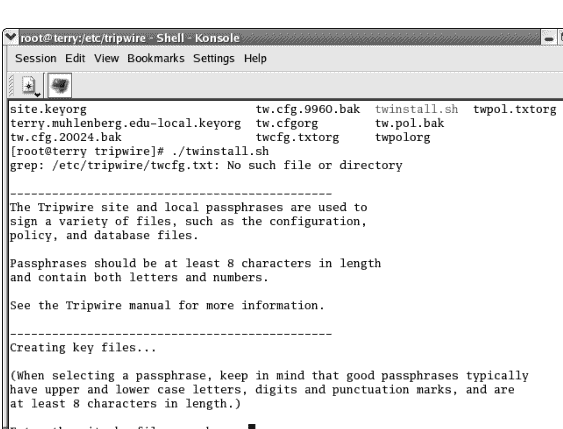

图 11-4：运行 `twinstall` 脚本在你的系统上设置 Tripwire。

创建数据库后，你将看到相应的提示信息，如图 11-5 所示。

7. 运行第一次 Tripwire 完整性检查，以将你新创建的数据库与系统进行比较。在终端上中使用命令 `tripwire -m c` 来触发完整性检查。

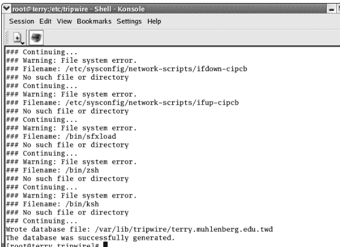

图 11-5：创建初始 Tripwire 数据库。

运行完整性检查可能需要一些时间，因为 Tripwire 需要将系统文件与其数据库中列出的文件进行比较。完整性检查完成后，报告将写入屏幕，并保存到 `/var/lib/tripwire/report` 目录中。典型的 Tripwire 报告如列表 11-2 所示。

# 列表 11-2：运行 Tripwire 文件完整性检查的结果

```
Tripwire(R) 2.3.0 Integrity Check Report

Report generated:      root

Report created on:    Tue 02 Nov 2004 10:50:08 AM EST

Database last updated on: Never

===============================================================

Report Summary:

Host name:               terry.muhlenberg.edu

Host IP address:         127.0.0.1

Host ID:                 None

Policy file used:        /etc/tripwire/tw.pol

Configuration file used: /etc/tripwire/tw.cfg

Database file used:      /var/lib/tripwire/terry.muhlenberg.edu.twd

Command line used:       tripwire - -

===============================================================

```

```
Rule Summary:

===============================================================

```

| 规则名称 | 严重性级别 | 新增 | 删除 | 修改 |
|---|---|---|---|---|
| 不变目录 | 66 | 0 | 0 | 0 |
| 临时目录 | 33 | 0 | 0 | 0 |
| Tripwire 数据文件 | 100 | 1 | 0 | 0 |
| 关键设备 | 100 | 0 | 0 | 0 |
| 用户二进制文件 | 66 | 0 | 0 | 0 |
| Tripwire 二进制文件 | 100 | 0 | 0 | 0 |
| 关键配置文件 | 100 | 0 | 0 | 0 |
| 库 | 66 | 0 | 0 | 0 |
| 操作系统实用程序 | 100 | 0 | 0 | 0 |
| 关键系统启动文件 | 100 | 0 | 0 | 0 |
| 文件系统与磁盘管理程序 | 100 | 0 | 0 | 0 |
| 内核管理程序 | 100 | 0 | 0 | 0 |
| 网络程序 | 100 | 0 | 0 | 0 |

章节：Unix 文件系统

| 规则名称 | 严重性级别 | 新增 | 删除 | 修改 |
|---|---|---|---|---|
| 系统管理程序 | 100 | 0 | 0 | 0 |
| 硬件与设备控制程序 | 100 | 0 | 0 | 0 |
| 系统信息程序 | 100 | 0 | 0 | 0 |
| 应用信息程序 | 100 | 0 | 0 | 0 |
| Shell 相关程序 | 100 | 0 | 0 | 0 |
| 关键实用程序符号链接 | 100 | 0 | 0 | 0 |
| Shell 二进制文件 | 100 | 0 | 0 | 0 |
| 系统启动变更 | 100 | 0 | 0 | 0 |
| OS 执行文件与库 | 100 | 0 | 0 | 0 |
| 安全控制 | 100 | 0 | 0 | 0 |
| 登录脚本 | 100 | 0 | 0 | 0 |
| Root 配置文件 | 100 | 2 | 2 | 0 |

扫描对象总数：52230
发现违规总数：7

对象摘要：

```
# Section: Unix File System
```

```
Rule Name: Tripwire Data Files (/var/lib/tripwire)

Severity Level: 100
```

```
Added:


`/var/lib/tripwire/terry.muhlenberg.edu.twd`

Rule Name: Root config files (`/root`)

Severity Level: 100

Added:

`/root/.xauth8kyPy`

`/root/mbox`

Removed:

`/root/.xauthG49Xj`

`/root/.xauthv7qdP3`

Modified:

`/root`

`/root/.viminfo`

# 列表 11-2：（续）

=======================================================================

错误报告 (Error Report):

========================================================

Section: Unix File System

1. 文件系统错误。

Filename: `/usr/sbin/fixtab`

No such file or directory

2. 文件系统错误。

Filename: `/bin/sload`

# 第四部分

# 配置您的企业级 Linux 互联网服务

## Rich Tennant 的第五波浪

“……所以，如果你给某人留了话，你就把它写在纸上，用磁铁把它贴在他们的冰箱上。这只是持续到我们把‘电子邮件系统修好’为止。”

# 在这一部分中……

这一部分完全关于与他人分享。你还记得小时候父母教你学会分享吗？嗯，这一部分与那种分享无关：它完全关于服务的共享。第 12 章解释了 DNS 以及如何设置你的 DNS 服务器。在第 13 章，你将成为一名邮差。虽然不是，但你会读到关于配置电子邮件服务器的内容。如果你想访问 Web 并能够上传下载文件，第 14 章和第 15 章为你准备的。在第 14 章，你将发现设置 FTP 服务器是多么简单；在第 15 章，你将配置你自己的 Web 服务器。

# 第 12 章

## 配置和管理 DNS 服务器

### 本章简介

- 将 Web 名称转换为 IP 地址
- 发现 DNS 服务器的类型
- 检查 DNS 服务器配置文件
- 配置缓存 DNS 服务器
- 配置从主 DNS 服务器
- 配置主主 DNS 服务器
- 检查你的配置

在本章中，你将发现域名系统（DNS），它用于名称地址解析。DNS 由一个名为 `bind` 的程序控制，该程序用于在 TCP/IP 网络上查找主机。我还会将谈论不同类型的 DNS 服务器以及如何为你的自己的网络配置它们。在配置服务器之后，你可以阅读关于诊断工具的内容，这些工具可以检查 DNS 服务器的配置和性能。

## 将 Web 名称转换为 IP 地址

将 Web 名称转换为 IP 地址正式被称为名称地址解析。简单来说，名称地址解析就是将人类友好的名称转换为计算机友好的数字。网络上的每个接口都有一个 IP 地址，以点分四位组的形式表示：例如 `192.168.2.1`。这些数字组对于网络中的计算机来说没有问题，但对于人类来说，记住数字组并不那么容易。因此，你需要能够输入名称并让这些名称转换为数字。每当你向浏览器输入网站的地址时，DNS 就会开始工作。你输入易于记忆的名称，如 `www.redhat.com`，这些名称会被解析为计算机易于理解的数字。实现高效的人机交互是名称地址解析的功能。

例如，让我们看看域名及其组织结构，以域名 `muhlenberg.edu` 为例。该域名的第一部分 `muhlenberg` 是公司、机构或组织的名称。接下来的部分，在点（dot）之后（在现代用语中）是顶级域名。除了顶级域名之外，你还会发现其他几个。表 12-1 显示了美国的其他顶级域名。

### 表 12-1 美国顶级域名

| 顶级域名 | 含义 | 示例 |
| --- | --- | --- |
| com | 通常为商业机构 | www.tactstechnology.com |
| edu | 教育机构 | www.muhlenberg.edu |
| gov | 美国政府机构 | www.whitehouse.gov |
| mil | 美国军的一个分支 | www.army.mil |
| net | 网络所属的组织 | www.tellurium.net |
| org | 非营利组织 | www.lvcg.org |
| int | 国际组织 | www.wipo.int |
| us | 美国域名，每个列表均为较低层级 | www.state.pa.us |

其他国家的顶级域名包括两个字母的后缀，例如法国的 `fr` 或瑞士的 `su`。并不是所有的顶级域名都与美国的顶级域名相同，但法国的一家公司地址可能是 `http://www.frenchcompany.com.fr`。

大型域名可以进一步拆分为子域名。例如，宾夕法尼亚州（the state of Pennsylvania）的官方网站是 `www.state.pa.us`。宾夕法尼亚州政府包括许多机构，例如道路水利信息服务（RWIS）。要找到 RWIS，域名包含子域名 `www.rwis.state.pa.us`。RWIS 中的单台计算机也有一个主机名：例如 `leigh.rwis.state.pa.us`，你可以通过 DNS 查找来找到它的 IP 地址。当你输入主机名时，你的系统使用其资源将名称解析为 IP 地址。

## DNS 服务器的类型

顶级服务器，即提供表 12-1 所示域名信息的服务器，通常被称为*根域名服务器*（root nameserver）。当你尝试查找一个网站（例如，`www.mulhenberg.edu`）时，你的系统会向 `.edu` 的根服务器发送查询以获取信息。根服务器会将搜索引导到较低级的域名服务器，直到找到信息为止。

- 主服务器（Master server）：包含所有信息并提供这些信息。
- 从服务器（Slave server）：旨在备份，以防主服务器宕机。
- 缓存服务器（Caching server）：通过记住访问过的域名来加速搜索。

## 检查 DNS 服务器配置文件

在开始配置服务器之前，你需要仔细查看一下你需要的文件。设置主服务器需要五个文件。无论是配置为主服务器、从服务器还是仅缓存服务器，都需要三个文件，而主服务器还会额外使用两个文件。

这三个必需的文件是：

- `named.conf`：位于 `/etc` 目录，该文件包含全局属性和配置文件的来源。
- `named.ca`：位于 `/var/named`，该文件包含根服务器的名称和地址。
- `named.local`：位于 `/var/named`，该文件提供解析本地回环地址的信息。

主域名服务器所需的另外两个文件是：

- `zone`：该文件包含本地局域内工作站的名称和地址，并将名称映射到 IP 地址。
- `reverse zone`（反向区域）：该文件提供将 IP 地址映射到名称的信息。

### 第 12 章：配置与管理 DNS 服务器

```bind
zone "localdomain" IN {
  type master;
  file "localdomain.zone";
  allow-update (none);
}

zone "localhost" IN {
  type master;
  file "localhost.zone";
  allow-update (none);
}

zone "0.0.127.in-addr.arpa" IN {
  type master;
  file "named.local";
  allow-update (none);
}

include "/etc/rndc.key";
```

### named.conf 文件

详细查看此文件，从以 `//` 开头的行开始。这些是注释行，其后的任何内容都会被忽略。命令以语句的形式传递给文件。示例文件中显示了其中几个语句，你实际上可以使用七种配置语句。以下列表简要解释了它们的功能：

- `options`：列出全局配置和默认值。
- `include`：从另一个文件中获取信息并将其包含进来。
- `acl`：指定用于访问控制列表的 IP 地址。
- `logging`：指定日志的位置和内容。
- `server`：指定远程服务器的属性。
- `zone`：指定用于认证的安全密钥。

语句的信息包含在花括号内，并以分号结束：(关于 `server` 的信息)。

### Options

`options` 语句通常是 `named.conf` 的第一个部分，包含有关 `named` 使用的文件位置的信息。你只能使用一个 `options` 语句，但该语句可以有多个值。在列表 12-1 所示的示例文件中，`options` 语句显示了 `named` 使用的额外配置路径。通过指定其他文件所在的目录，没有必要列出文件的完整路径，对于 `named.conf` 剩余部分显示的任何文件，只需提供文件名。`options` 语句使用以下语法：

```bind
options (
  value "property";
)
```


`options` 语句可以使用的值列表非常长。这些值在表 12-2 中按字母顺序列出。

| 表 12-2 | Options 值及其含义 |
| --- | --- |
| 值 | 含义 | 用法 |
| allow-query | 仅接受来自地址列表中主机的查询（默认接受任何主机的查询）。 | `allow-query ("address-list")` |
| allow-transfer | 仅接受地址列表中主机的区域传输（默认允许向所有主机传输）。 | `allow-transfer ("address list")` |
| auth-nxdomain | 服务器作为权威名称服务器做出响应（默认是 yes）。 | `auth-nxdomain "yes or no";` (二选一) |
| check-names | 检查主机名是否符合 RFC 规范。 | `check-names "master or slave or response warn or fail ignore";` (从每组中选择一个) |
| cleaning-interval | 指定服务器移除过期资源记录之前的时间段（默认为 60 分钟）。 | `cleaning-interval "number";` (指定分钟数) |
| coresize | 指定核心转储文件的最大 own。 | `coresize "size";` (以字节指定大小) |
| datasize | 限制内存使用。 | `datasize "size";` (以字节指定大小) |
| deallocate-on-exit | 检测内存泄漏（默认是 no）。 | `deallocate-on-exit "yes or no";` (二选一) |
| directory | 服务器配置文件所在目录的路径 | `directory "path to directory";` (指定路径) |
| dump-file | 如果 named 接收到 SIGINT 信号，它将数据库转储此处指定的文件（默认是 named_dump.db）。 | |
| fake-iquery | 如果设置为 yes，服务器向反向查询发送伪造回复而不是其他 | `fake-iquery "yes or no";` (二选一) |
| fetch-glue | 如果设置为 yes，服务器将获取响应的粘合记录（默认是 yes）。 | `fetch-glue "yes or no";` (二选一) |
| files | 限制并发打开的文件数（默认无限制） | `files "number";` (指定数量) |
| forward | 如果设置为 first，则首先查询 forwarders 选项列出的服务器，然后服务器尝试寻找答案。如果设置为 only，则仅查询 forwarders 列表中的服务器。 | `forward "first or only";` (二选一) |
| forwarders | 显示转发查询的服务器 IP 地址（默认是 none）。 | `forwarders "IP addresses of servers";` (指定 IP 地址) |
| host-statistics | 如果设置为 yes，服务器将保留主机的统计信息（默认是 no）。 | `host-statistics "yes or no";` (二选一) |
| interface-interval | 指定在网络中搜索新或删除接口的间隔（默认为 60 分钟）。 | `interface-interval "time";` (指定分钟时间) |
| listen-on | 指定服务器监听查询的端口和接口（默认端口 53）。 | `listen-on "port (address list)\ (指定端口号和地址列表)` |

## 表 12-2 (续)

| 值 | 含义 | 用法 |
|---|---|---|
| max-transfer-in | 指定服务器等待入站传输完成的时间（默认为 120 分钟）。 | `max-transfer-in "time";` (指定分钟) |
| statistics-file | 当设置 deallocate-on-exit 时，指定写入统计信息的文件（默认是 named_stats）。 | |
| multiple-cnames | 当设置为 yes 时，启用 CNAME 使用（默认是 no）。 | `multiple-cnames "yes or no";` (二选一) |
| named-xfer | 指定区域传输程序的路径。 | `named-xfer "path to file";` (指定路径) |
| notify | 当区域更新时，此选项设置为 yes 会发送 NOTIFYset（默认是 yes）。 | `notify "yes or no";` (二选一) |
| pid-file | 存储进程 ID 的文件名。 | `pid-file "path to file";` (指定路径) |
| query-source | 用于查询其他服务器的端口和 IP 地址。 | `query-source "address list";` |
| recursion | 服务器递归查询答案（默认是 yes）。 | `recursion "yes or no";` (二选一) |
| stacksize | 服务器可以使用的栈内存。 | `stacksize "number";` (指定数量) |
| statistics-interval | 日志统计信息的时间间隔（默认为 60 分钟）。 | `statistics-interval "time";` (指定分钟) |
| topology | 设置对远程服务器的偏好。 | `topology ("address list";` |
| transfer-format | 设置为 one-answer 时，每条消息发送一个资源记录。设置为 many，在每条消息中传输尽可能多的记录。（默认是 one）。 | `transfer-format "one-answer many";` (二选一) |
| transfers-in | 最大并发区域传输（默认 10）。 | `transfers-in "number";` (指定数量) |
| transfers-out | 最大并发出站传输。 | `transfers-out "number";` (指定数量) |
| transfers-per-ns | 限制来自单个服务器的入站传输（默认为两个）。 | `transfers-per-ns "number";` (指定数量) |

# 190 第四部分：配置您的企业级 Linux Internet 服务

`logging` 语句的语法与 `option` 语句的语法相似。以下命令将信息发送到文件（斜体项目表示您需要输入的信息）：

```
logging {

  channel channel_name (

    (file) path to file

    versions specify number or unlimited

  size specify size in bytes if you want to send the information to the

  syslog, the syntax is

}
```

```
logging {

  channel channel_name (

    syslog (从以下选项中发送位置)

    (kern,user,mail,daemon,auth,syslog,lpr,news,wuuc,cron,

    authpriv,ftp,local0 through local7)

  )

}
```

要丢弃信息，请选择 `null` 作为目标。

```
logging {

  channel channel_name (

    null;

  );
```


接下来，你可以为写入文件或 syslog 的信息设置严重级别。此部分紧接在之前的文件或 syslog 部分之后。你还在此处指示是否要包含时间、类别和严重性。如果你正在丢弃信息，则不需要设置这些。

- `severity` 从 `critical`,`error`,`warning`,`notice`,`info`,`debug`,`level`,`dynamic` 中选择
- `print time` 选择 `yes` 或 `no`
- `print-severity` 选择 `yes` 或 `no`
- `print-category` 选择 `yes` 或 `no`

`category`（类别）是你指定要记录的信息类型的地方。它位于 `severity` 和 `print` 参数之后，并采用以下语法：

| category category name |
| channel name; channel name; |

你可以从 20 多个类别中选择。这些类别按字母顺序显示在表 12-3 中。

| 表 12-3 日志类别 |
| Category | CNAME 引用的信息类型 |
| :--- | :--- |
| cname | 关于 CNAME 引用的信息 |
| config | 关于配置文件的信息 |
| db | 关于数据库的信息 |

# 第12章：配置和管理 DNS 服务器

| Category | 记录的信息类型 |
| :--- | :--- |
| default | 如果未选择任何内容时的默认值 |
| eventlib | 关于事件系统调试的信息 |
| insist | 关于内部一致性检查失败的详情 |
| lame-servers | 关于无效服务器（lame servers）的信息 |
| load | 关于区域加载的信息 |
| maintenance | 关于维护的信息 |
| ncache | 关于负缓存的信息 |
| notify | 关于跟踪 NOTIFY 协议的信息 |
| os | 关于操作系统的信息 |
| packet | 所有发送和接收的数据包的转储 |
| panic | 关于导致服务器故障的信息 |
| parser | 关于处理配置命令的信息 |
| queries | 关于所有收到的 DNS 查询的信息 |
| response-checks | 关于响应检查结果的信息 |
| security | 关于服务器安全状态的信息 |
| statistics | 关于服务器统计的信息 |
| update | 关于动态更新的信息 |
| xfer-in | 关于入站区域传输的信息 |
| xfer-out | 关于出站区域传输的信息 |

使用 `logging` 语句中的类别，你可以获取关于服务器的大信息。如果你的 DNS 出现问题，这些信息将非常有用。你可以对认为可能导致问题的区域启用日志，然后读取相应的日志以查找可能指示配置错误的消息。

## Server（服务器）

在 `server` 语句中，你可以设置远程服务器的属性。你可以指定是否从本地服务器向远程服务器发送查询，并可以设置用于传输信息的方法。此语句的语法与其他语句相同。有效值如下：

- `bogus`: 指定 `yes` 或 `no`（`no` 为默认值，表示查询发送到远程服务器）。`yes` 表示不查询远程服务器。
- `transfer`: 指定你允许的传输次数。
- `transfer-format`: 指定你是想要一个答案还是多个答案。
- `keys`: 指定密钥 ID（当前已实现）。

## Zones（区域）

示例 12-1 所示的 `/etc/named.conf` 中剩余列表项是 `zone` 语句。这些 `zone` 语句指向作为区域文件的文件。当然，`zone` 语句还有其他选项。每个 `zone` 语句都以 `zone` 单词开头，随后是域名和数据类。这四个类为 `in`, `hs`, `hesl` 和 `chaos`。如果没有指定类型，默认默认为 `in`（用于 Internet）。

接下来是 `type` 选项，它指定服务器是主（`master`）、从/存根（`slave`/`stub`）还是提示文件（`hints file`）。`stub` 服务器仅加载 NS 记录，即整个域名。提示文件用于初始化根缓存并包含根服务器列表。

接下来是指定区域的区域文件名称。它是指向包含区域数据文件的指针。你将在本章稍后的部分详细查看区域文件。

以下列表显示了 `zone` 语句的其他选项并解释了它们的功能：

- `allow-query`: 仅接受来自地址列表中主机的查询（默认接受来自任何主机的查询）。
- `allow-transfer`: 仅接受地址列表中主机的传输（默认允许向所有主机传输）。
- `allow-update`: 允许地址列表中的主机更新数据库。
- `also-notify`: 当区域更新时，向地址列表中的服务器发送 `notify` 消息。
- `check-names`: 检查主机名是否符合 RFC 标准。
- `max-transfer-time-in`: 指定从服务器等待区域传输的时间。
- `notify`: 当区域文件更新时，如果此选项设置为 `yes`，则会发送 DNS NOTIFY。

## 第12章：配置与管理 DNS 服务器

### 反向区域文件

上一个示例展示了一个使用域名的示例区域文件。这种方法被称为正向地址解析，因为它使用名称来查找 IP 地址，是反向解析最常见的用法。

你也可以通过 IP 地址查找名称，这被称为反向地址解析。你只需要输入 IP 地址，服务器就会返回域名。反向地址解析需要使用反向区域文件。列表 12-3 显示了一个反向区域文件样的示例。

#### 列表 12-3：一个典型的反向查找区域文件

| | | | |
|---|---|---|---|
| | | SOA | localhost. root.localhost. (
| | | 199702700 : Serial |
| | | 28800 : Refresh |
| | | 14400 : Retry |
| | | 360000 : Expire |
| | | 86400 ) : Minimum |
| | IN NS | localhost. |
| 1 | IN PTR | localhost. |

### 配置缓存 DNS 服务器

前面的章节显示了需要配置哪些文件以及需要在文件中放置哪些信息，这为你设置域名服务器做好了准备。在本节中，你将设置一个缓存服务器。如前所述，在所有类型的服务器配置中你都会使用三个文件。在仅缓存服务器中，这三个文件构成了整个配置。幸运的是，Red Hat Enterprise Linux 上 BIND 的默认安装创建了缓存服务器所需的配置文件，但查看这些文件以确保它们是正确的始终是一个好主意。

通过验证 `/etc/named.conf` 中的区域信息进行检查。当你安装 BIND 软件包时，会创建 `/etc/named.conf` 文件，其中包含了你 `localhost` 的区域信息，但你需要检查它以确保无误。你正在寻找两个区域：一个由指针指示并引用名为 `named.local` 的文件，另一个显示为 `127.0.0.in-addr.arpa`。接下来，你需要检查 `/var/named/named.local` 的配置。该文件包含 `localhost` 的域信息，通常在安装 BIND 时创建。你通常不需要对 `/var/named/named.local` 任何任何更改。该域名是一个反向域名，用于将环回地址 `127.0.0.1` 映射到名称。

### 配置你的企业 Linux 服务

你需要检查 `/etc/hosts` 以确保它包含以下内容：

```
dns
```

你需要检查 `/etc/resolv.conf` 文件，确保你的 `localhost` 的 IP 地址 (`127.0.0.1`) 被列为名称服务器。完成所有之前的步骤后，是时候启动 `named` 守护进程并检查你的工作了。在提示符处输入 `service start`，等待提示符返回，然后输入 `status`。你会看到类似的输出：

```
number of zones: 8

debug level: 0

xfers running: 0

xfers deferred: 0

query logging: off

server is up
```

你已成功配置并启动了缓存名称服务器。

### 配置从主服务器

接下来，你为你的域名设置一个从服务器。该过程与此类似，并不比本章之前描述的步骤复杂。你已经准备好了三个文件，只需要稍微修改 `/etc/named.conf` 文件即可完成服务器配置。对于正向查找，你需要添加两个区域：一个用于你服务器的正向查找，另一个用于反向查找。在本示例中，主服务器名为 `technology.com`，从服务器为 `127.0.0.1`。请确保使用你的域名和 IP 地址代替示例所示的内容。

```
zone "technology.com" {
  notify no;
  type slave;
  file "technology.com";
  masters ( 127.0.0.1 );
}
```

对于反向查找，你添加此部分：


```
zone "1.0.0.127.in-addr.arpa" {

  notify no;

  type slave;

  file "reverse";

}
```

从服务器的配置现在已完成，你可以继续继续配置主服务器了。

## 配置主主服务器

主服务器上的 `/etc/named.conf` 文件也需要修改。假设你已经将此服务器设置为了仅缓存服务器，你只需要在 `/etc/named.conf` 中添加以下行（此示例使用了本章早些时候定义的名称；请确保使用你的名称和 IP 地址）：

```
zone "technology.com" {

  notify no;

  type master;

  file "technology.com";

}
```

对于反向查找，你添加此部分：

```
zone "1.0.0.127.in-addr.arpa" {

  notify no;

  type master;

  file "reverse";

}
```

注意，你在主服务器上使用的文件名称与从服务器上的相同。这是因为这些文件在区域传输中由从服务器下载，并由主服务器存储在从服务器上。你没有在从服务器上创建文件，而是在主服务器上创建的。

如果你已经按照这里的说明完成了所有操作，你的名称服务器应该就能正常工作。由于你对 `/etc/named.conf` 进行了一些更改，所以你可以检查你做了什么并需要重启 `named` 守护进程。

每当你修改 `/etc/named.conf` 时，必须重启 `named` 守护进程。要重启 `named`，你需要输入命令：

```
service restart
```

## 检查你的配置

完成主服务器配置后，你可以检查配置以确保其正常工作。你可以使用多个工具进行检查。正如此处所示，`host` 命令可以获取 IP 地址。请替换你的域名以确保无误。

```
host localhost
```

`host` 命令可以查找域名。你可以使用 `-t` 查找其他记录类型。例如，如果你想查找域名的 MX 信息，请使用：

```
host -t mx technology.com
```

`host` 命令可以获取 IP 地址，如这里的输出所示：

```
host technology.com
```

## dig 程序

`dig` 可用于获取调试信息。基本语法如下：

```
dig [options]
```

### 列表 12-4：使用 dig 查找域名

要使用 `dig` 查找域名，请输入以下命令：

```
dig @127.0.0.1 technology.com
```

你会看到类似下面的输出：

```
; <<>> SERVER:127.0.0.1#53 for technology.com (IN)

;; time: Mon, 22 May 2023 10:00:00 UTC

; Flags time: 12;

;;:  ;;;;;;;;;;;;:: 0

;

; QUERY SECTION:

; technology.com. IN A

;

;; ANSWER SECTION:

.	3600	IN	A	127.0.0.1

;

;; OPTION SECTION:

;

;; Query time: 10 msec

; SERVER: 127.0.0.1#53(no answer)
```

### 使用 dig 查找反向 DNS

要使用 `dig` 进行反向查找，请输入以下命令：

```
dig @127.0.0.1 127.0.0.1.in-addr.arpa
```

你会看到类似下方的输出：

```
; <<>> SERVER:127.0.0.1#53 for 127.0.0.1.in-addr.arpa (IN)

;; time: Mon, 22 May 2023 10:00:00 UTC

;; Flags time: 12;

;;:: 0

;;;;;;;;;;;;:: 0

;

;; QUERY SECTION:

; 1.0.0.127.in-addr.arpa. IN PTR

;

;; ANSWER SECTION:

; localhost.	3600	IN	PTR	localhost.

;

;; OPTION SECTION:

;

;; Query time: 5 msec

; SERVER: 127.0.0.1#53(no answer)
```

### 使用 dig 查找特定记录类型

要使用 `dig` 查找特定类型的记录，可以使用 `-type` 参数：

```
dig @127.0.0.1 technology.com -type MX
```

你会看到类似下面的输出：

```
; <<>> SERVER:127.0.0.1#53 for technology.com (IN)

;; time: Mon, 22 May 2023 10:00:00 UTC

;; Flags time: 12;

;;:: 0

;;;;;;;;;;;;;:: 0

;

;; QUERY SECTION:

; technology.com. IN MX

;

;; ANSWER SECTION:

; technology.com.	3600	IN	MX	10 mail.technology.com.

;

;; OPTION SECTION:

;

;; Query time: 8 msec

; SERVER: 127.0.0.1#53(no answer)
```

## 第12章：配置与管理 DNS 服务器 201

```
:: ADDITIONAL SECTION:

hal.muhlberg.edu. 86400 IN A 192.104.181.5

stimpy.nwp.muhlberg.edu. 86400 IN A 192.104.181.207

:: Query time: 6 msec

:: SERVER: 192.104.181.5953(192.104.181.5)

:: WHEN: Thu Sep 9 14:39:46 2004

:: MSG SIZE rcvd: 170
```


这两项列表都提供了关于完全相同服务器的信息。在列表 12-4 中，我使用域名进行搜索，并收到了与域名关联的 IP 地址。在列表 12-5 中，我使用 IP 地址进行搜索，并获得了服务器的主机名和域名。

# 第13章 配置与管理电子邮件服务器

## 本章内容
- 电子邮件的工作原理
- 配置您的邮件服务器
- 维护电子邮件安全

通过计算机，你可以向世界上任何地方的其他计算机用户发送和接收消息。电子邮件（简称 e-mail）是一个非常强大且实用的工具。在本章中，我将展示电子邮件的工作原理，以及如何配置您的系统来为您处理电子邮件。

## 电子邮件的工作原理

一条电子邮件就像通过普通邮件寄出的信件一样，始于发送者并结束于接收者。在这两人之间有许多邮递工作人员确保信件被妥善处理。尽管发送者和接收者可能永远不会见到这些工作人员，但他们的功能对于邮件传输至关重要。电子邮件的工作方式相似，虽然发送者和接收者之间没有很多人，但程序履行相同的功能。这些程序使用网络协议来确保消息从发送者到达接收者。在本章中，我将向你展示如何配置运行 TCP/IP 协议的电子邮件。

在配置电子邮件客户端或服务器之前，你需要了解电子邮件的工作原理以及使用或提供给用户的程序。几个关键组件对于电子邮件的正常工作非常重要。作为系统管理员，你的责任是配置以下项目，这些项目将在章的后部分进行详细说明：

- 邮件用户代理 `MUA`：供用户读取和撰写电子邮件
- 邮件传输代理 `MTA`：用于跨网络投递电子邮件消息
- 本地交付代理 `LDA`：将消息投递到用户的邮箱文件文件
- 用于存储电子邮件消息和传输 `MTA` 的 TCP/IP 协议

要查看所有各种组件如何工作以完成其任务，请继续阅读以发现如何跟踪电子邮件从发送到投递的整个过程。在了解组件如何工作的之后，你将通过配置这些组件，为你的服务器和客户端构建一个功能完整的电子邮件系统。

### 邮件用户代理 `MUA`

为了能够发送邮件，你（或你的用户）需要一个邮件用户代理 `MUA` 程序。`MUA` 也称为邮件客户端，允许用户撰写和读取邮件消息。有两种类型的 `MUA` 可供选择：

- 图形界面 `GUI`：例如 `Evolution`
- 命令行界面：例如，`mail`

无论你的 `MUA` 是图形界面还是命令行界面，在消息编写完成后，`MUA` 都会将其发送给邮件传输代理 `MTA`。`MTA` 是跨网络发送消息的程序，它在用户没有任何干预的情况下完成工作。事实上，大多数用户并不知道 `MTA` 的存在：他们只是使用自己的邮件客户端。下一节将解释如何配置发送和接收电子邮件。

### Ximian Evolution 电子邮件客户端

`Ximian Evolution` 电子邮件客户端是一个功能全备的电子邮件程序及更多。通过 `Evolution`，你可以轻松地管理所有的日常任务。然而，在使用 `Evolution` 发送和接收邮件之前，你必须先配置你的电子邮件账户设置。

#### 配置 Evolution 电子邮件客户端

在发送或接收电子邮件之前，你必须按照所示配置你的电子邮件客户端：

1. 点击桌面面板上的 `Evolution` 图标（信封和邮章图标）或通过“应用程序：Internet：Evolution Email”启动 `Evolution`。

如图 13-1 所示的 Ximian Evolution 设置向导窗口。

2. 如图 13-2 所示，选择“下一步”进入“身份 (Identity)” 页面。然后从 `Evolution` 窗口顶部的菜单栏中选择“工具：设置”。

3. 在必需字段中输入你的姓名和电子邮件地址，然后点击“下一步”继续。

4. 在打开的接收 `Evolution` 对话框中（如图 13-3 所示），识别你将连接的邮件服务器类型。

5. 点击“服务器类型 (Server Type)”字段右侧的向下箭头，并根据你的所在地选择合适的邮件服务器类型。

根据你的选择，页面上会出现其他需要你输入额外信息的字段。如果你不是系统管理员且不确定选择什么，请咨询你的系统。

6. 点击“下一步”进入“发送 (Send)” 对话框，在其中选择邮件服务器类型。点击“服务器类型”字段旁边的箭头并选择 `SMTP`。

图 13-1：Evolution 设置向导
图 13-2：输入电子邮件信息
图 13-3：指定邮件服务器

7. 点击“下一步”进入“账户管理”框。
8. 点击“应用”。

你的账户已创建，新创建的账户出现在窗口右侧。

#### 接收电子邮件

通过 `Evolution` 接收电子邮件，请执行以下操作：

1. 点击桌面面板上的 `Evolution` 图标（看起来像信封和邮章）启动 `Evolution`。
2. 点击导航栏上的“发送/接收”图标。

如果你有任何新消息，左侧收件箱图标会出现一个数字，表示你有多少消息。

3. 点击收件箱图标打开收件箱。
4. 点击消息在下方窗格中查看，或双击消息在新窗口中打开。

如果你在新窗口中打开了消息，请从菜单栏选择“文件：关闭”或点击右上角的“X”。

#### 发送电子邮件

通过 `Evolution` 发送电子邮件，请执行以下操作：

1. 点击桌面面板上的 `Evolution` 图标启动 `Evolution`。
2. 点击导航栏上的“新建”打开“撰写 (Compose)”对话框，如图 13-4 所示。
3. 在“收件人 (To)”字段中输入接收者的电子邮件地址。然后输入主题（同一字段中）和消息正文（下方文本字段中）。

图 13-4：撰写新消息

4. 要给电子邮件附加文件，点击导航栏上的“附件”图标，然后浏览并选择文件。
5. 完成撰写消息后，点击“发送”。

通过 `Evolution` 可以做的远不止是发送和接收电子邮件。尝试使用 `Evolution` 以发现更多关于其通讯录以及调度和时间管理的功能。

## 邮件传输代理 `MTA`

在 `MTA` 接收来自 `MUA`（邮件用户代理）的消息后，它就可以开始工作了。你的 Red Hat 企业系统安装的 `MTA` 是 `Sendmail`。`MTA` 读取电子邮件消息中“收件人”（To）部分的信息，并确定接收端服务器的 IP 地址。`MTA` 尝试通过通信端口（通常是 25 端口）与接收端服务器建立连接。如果发送机上的 `MTA` 能够建立连接，它将使用简单邮件传输协议（`SMTP`）将消息发送到接收端服务器上的 `MTA`。

接收服务器上的 `MTA` 会为消息添加头部信息。头部包含用于跟踪消息并确保其送达的信息。接下来，接收端 `MTA` 将消息传递给另一个程序，通知接收者新邮件已到达。

### 本地投递代理 `LDA`

在 `LDA` 从 `MTA` 接收消息后，它会将消息放在由用户名标识的收件人邮箱文件中。在你的 Red Hat 系统中，这是一个名为 `procmail` 的程序。用户邮箱文件的位置为 `/usr/spool/mail/<用户名>`。

该过程的最后一步发生在消息的预期接收者读取消息时。用户通过其 PC 上的 `MTA` 执行此操作。

一个可选的程序是邮件通知器，它会定期检查你的邮箱是否有新邮件。如果你安装了该程序，它会通知你有新邮件。

Red Hat Enterprise Linux 内置了一个邮件通知器，它每分钟查看一次你的邮箱文件。如果有新邮件到达，外壳在显示下一个提示符之前会先显示一条消息。它不会中断你正在运行的程序。你可以调整邮件通知器检查的频率以及要监控哪些邮箱文件。

如果你使用 GUI，`Evolution` 邮件通知器作为应用程序的一部分可用，它可以通过播放声音让你知道新邮件已到达。你可以通过选择主菜单中的“工具（Tools）< 设置（Settings）”在 `Evolution` 中开启新邮件的音频通知。然后选择“邮件偏好”（Mail Preferences），并选择“新邮件到达时蜂响”（Beep When New Mail Arrives）或“新邮件到达时播放声音文件”（Play Sound File When New Mail Arrives）。输入要播放的文件名并点击确定。如图 13-5。

图 13-5：在此处启用新电子邮件的声音通知。

#### 介绍 SMTP

在之前描述 `MTA` 的章节中，你可以读到消息是通过 `SMTP` 在 `MTA` 之间发送的。本节将解释 `SMTP` 以及另外两种交付邮件的协议：邮局机协议 `POP3` 和互联网消息访问协议 `IMAP4`。`SMTP` 是用于在网络计算机之间传输电子邮件消息的 TCP/IP 协议。消息可以直接从发送方传输到接收方，也可以通过网络计算机上的其他 `MTA` 传输。这些其他计算机在将消息转发到另一个 `MTA`（如果该 `MTA` 是本地的）或转发到发送至网络上 `MTA` 的网关之前，会短时间存储消息。

`SMTP` 协议只能传输 ASCII 文本。它无法处理字体、图形或附件。如果你想处理这些内容，需要使用 `MIME`（多用途互联网邮件扩展）。`MIME` 允许你在 `SMTP` 基础上添加字体、图形等其它功能。

#### 邮局机协议 `POP3`

`POP3` 是 3 版本的邮局机协议。它运行在连接到网络的服务器上发送并接收邮件。没有 `POP3`，当接收者离线时无法发送邮件。通过 `POP3`，当你想要读取邮件时，可以使用服务器上的 `MTA`。在所有情况下，你需要理解 `POP3` 来处理你的邮件。

#### 互联网消息访问协议 `IMAP4`

互联网消息访问协议版本 4 `IMAP4` 提供了复杂的客户端/服务器功能。`IMAP4` 比 `POP3` 更多功能。区别在于 `POP3` 需要你从服务器下载邮件，而 `IMAP4` 允许邮件持久地存储在远程服务器上。

## 使用 Sendmail

Red Hat Enterprise Linux 有多种邮件传输代理，包括 `Qmail`、`Postfix` 和 `Sendmail`。最广泛使用的是 `Sendmail`，它是 Red Hat 的默认 `MTA`。

### 检查 Sendmail 是否安装

在开始配置 `Sendmail` 之前，确保它已安装。你有多种方法可以检查。以下示例使用了 `rpm`：

```bash
rpm -q sendmail
```


`root@main: rpm -q sendmail`

接下来，检查 Sendmail 是否运行。以下输出显示了 Sendmail 已安装以及其版本：

```bash
root@main: ps -au | grep sendmail
```

如果 Sendmail 没有运行，你可以通过以下命令启动它：

```bash
root@main: service sendmail
```

### 配置 Sendmail

许多系统管理员认为 Sendmail 很难配置。幸运的是，Red Hat 提供了适用于大多数站点的默认配置。在所有情况下，你都需要 `/usr/lib/sendmail` 中的预定义配置文件。基本流程是根据你的需求修改预定义配置文件，使用 `m` 宏处理器（见下节）重新生成 `/etc/sendmail.cf`，测试你的配置。这种方法允许你进行增量更改，最大限度地减少出现重大问题的风险。

列表 13-1：示例中继配置

|############################|
|#### |
| SENDMAIL 配置文件 |
|#### |
|############################|

# # 智能中继主机（可能为空）
更改此行以定义邮件中继机的名称（负责发送/接收互联网邮件的网关计算机）。注意无空格！

`DSmailrelay.tacttechnology.com`

### m 宏处理器

`宏` 是长字符串的符号名称，就像键盘是输入长系列按键的快捷方式一样。Sendmail 的规则来自 Sendmail 宏文件的条目。宏文件中的规则生成了默认的 Sendmail 配置 `sendmail.cf`。`m4` 是一个宏处理器，它读取宏文件并生成配置文件。如果你想在复杂的配置中使用你自定义的规则，可以保持宏文件和宏处理器不变。

## 第四部分：配置您的企业 Linux 互联网服务

`/etc/` 下的一个宏示例是用于命名操作系统的 `OTYPE` 宏。记住，Sendmail 运行在许多不同的操作系统上，而不仅仅是 Unix 和 Linux。在 Linux 系统上，如果你查看 Sendmail 的宏文件，你会看到下面这一行，它告诉 Sendmail 运行的是哪种操作系统：

在企业 Linux 上，`OTYPE` 宏是预定义的，因此你不需要担心它。

如果你真的想获取有关宏文件及其工作原理的完整技术信息，请阅读 `/usr/lib/sendmail-cf/README` 文件。


# 管理邮件队列

有时电子邮件无法立即发送，原因有很多种。也许是你的网络断了。也许是接收者的连接不可用。无论原因如何，用户都可以继续使用他们的 MUA 编写邮件。当他们发送邮件时，Sendmail 将消息放入邮件队列，并让 Sendmail 守护进程定期尝试发送该消息。你可以通过检查启动 Sendmail 的初始化脚本来确定这些间隔。

以下节选自文件 `/etc/rc.d/rc2.S80sendmail`。第一行将重试间隔定义为一小时（`1h`）。你可以用 `h`（小时）、`m`（分钟）或 `s`（秒）来指定间隔。这个 Red Hat 版本使用了变量 `QUEUE` 并将其设置为 `1h`。某些分发版将间隔硬编码在 Sendmail 命令中（`sendmail -q1h`）。列表 13-2 的最后两行显示了 Sendmail 的启动命令。最后一行行的 `-qQUEUE` 将重试时间设置为一小时。它倒数第二行的 `-bd` 选项将 Sendmail 导出为守护进程。

```
Listing 13-2: /etc/rc.d/rc2.S80sendmail 节
QUEUE=1h

fi

# 检查网络是否正常。
$ [ ($NETWORKING) = "no" ] && exit 0

[ -f /usr/sbin/sendmail ] || exit 0

RETVAL=0

start() (
```

# 第 13 章：配置和管理电子邮件服务器

```
# 守护进程。
echo -n "Starting sendmail: *"
/usr/bin/newaliases > /dev/null 2>&1

for i in virtuasable access domaintable mailertable; do
  if [ -f /etc/mail/$i ]; then
    makemap hash /etc/mail/$i < /etc/mail/$i
  fi
done

/usr/sbin/sendmail $[ [[ "$DAEMON" = yes ]] && echo -bd ] \ \
$[ -n "$QUEUE" ] && echo -q$QUEUE ]
```

# 配置 POP3

设置 POP3 涉及步骤包括：

1. 安装包含 POP3 守护进程的包。
2. 编辑文件 `/etc/xinetd.d/pop3` 使 POP3 服务可用。要编辑此文件，请使用你喜欢的文本编辑器更改该行：
   ```
   disable = yes
   disable = no
   ```
3. 在命令行提示符处输入以下命令重启 xinetd 守护进程，使步骤 2 中的更改生效：
   ```
   Service xinetd restart
   ```
4. 检查 POP3 守护进程是否接受连接。你可以 `telnet` 到你自己的计算机的 `110` 端口（所示），以查看 POP3 是否接受连接：

```
terry@main# telnet localhost 110
Trying 127.0.0.1...
telnet:Connected to localhost.
Esc character is '*'
* OK POP3 localhost v76.64 server ready
```

你的企业 Linux 操作系统安装程序可能已经为你设置了 POP3。在启动 POP3 之前，你应该使用你喜欢的包管理器查询 POP3 是否已经安装。

Red 将 IMAP4 和 POP3 软件捆在一起。当你查询 RPM 数据库获取 POP3 时，你需要在 IMAP 名称下查找它：

```
root@main# rpm -q imap
```


# 第四部分：配置您的企业 Linux 互联网服务

# 配置 IMAP4

要配置 IMAP4，你遵循与 POP3 相同的步骤步骤：

1. 安装包含 IMAP4 守护进程的包。
2. 编辑文件 `/etc/xinetd.d/imapconf` 使 IMAP4 服务可用。对于此文件，使用你喜欢的文本编辑器更改该行：
   ```
   disable = yes
   ```
3. 在命令行提示符处输入以下命令重启 xinetd 守护进程，使步骤 2 中的更改生效：
   ```
   Service xinetd restart
   ```
4. 检查 IMAP 守护进程是否接受连接。你可以 `telnet` 到你自己的计算机的 `143` 端口（所示），以查看 IMAP4 是否接受连接：

```
try@main# telnet localhost 143
trying 127.0.0.1...
telnet:Connected to localhost.
esc character is '.'.
OK localhost IMAP4rev1 v1.26 server ready
```

你的企业 Linux 操作系统安装程序可能已经为你设置了 POP3。在启动 POP3 之前，你应该使用你喜欢的包管理器查询 POP3 是否已经安装。

Red 将 IMAP4 和 POP3 软件捆在一起。当你查询 RPM 数据库获取 POP3 时，你需要在 IMAP 名称下查找它：

```
root@main# rpm -q imap
```

要配置 IMAP4，你遵循与 POP3 相同的步骤：

1. 安装包含 IMAP4 守护进程的包。
2. 编辑文件 `/etc/xinetd.d/imapconf` 使 IMAP4 服务可用。对于此文件，使用你喜欢的文本编辑器更改该行：
   ```
   disable = yes
   ```
3. 在命令行提示符处输入以下命令重启 xinetd 守护进程，使步骤 2 中的更改生效：
   ```
   Service xinetd restart
   ```
4. 检查 IMAP 守护进程是否接受连接。你可以 `telnet` 到你自己的计算机的 `143` 端口（所示），以查看 IMAP4 是否接受连接：
```
try@main# telnet localhost 143
trying 127.0.0.1...
telnet:Connected to localhost.
esc character is '.'.
OK localhost IMAP4rev1 v1.26 server ready
```


你的企业 Linux 操作系统安装程序可能已经为你设置了 POP3。在启动 POP3 之前，你应该使用你喜欢的包管理器查询 POP3 是否已经安装。

Red 将 IMAP4 和 POP3 软件捆在一起。当你查询 RPM 数据库获取 POP3 时，你需要在 IMAP 名称下查找它：

```
root@main# rpm -q imap
```

# 第四部分：配置您的企业 Linux 互联网服务

## 配置 IMAP

要配置 IMAP4，你遵循与 POP3 相同的步骤：

1. 安装包含 IMAP4 守护进程的包。
2. 编辑文件 `/etc/xinetd.d/imapconf` 使 IMAP4 服务可用。对于此文件，使用你喜欢的文本编辑器更改该行：

```
disable = yes
```

3. 在命令行提示符处输入以下命令重启 xinetd 守护进程，使步骤 2 中的更改生效：

```
Service xinetd restart
```

4. 检查 IMAP 守护进程是否接受连接。你可以 telnet 到你自己的计算机的 143 端口（所示），以查看 IMAP4 是否接受连接：

```
try@main# telnet localhost 143
trying 127.0.0.1...
telnet:Connected to localhost.
esc character is '.'.
OK localhost IMAP4rev1 v1.26 server ready
```

## 设置别名

要在别文件中创建条目，使用你喜欢的编辑器。每个条目由用户名、冒号、空格和实际地址组成。例如：

```
user: user@example.com
```

保存文件后，运行 `newaliases` 来更新二进制文件。Sendmail 查看 `/etc/aliases.db`。要运行 `newaliases`，在命令行提示符处输入：

```
root@main# newaliases
```

输出应该类似于：

```
newaliases: /etc/aliases.db created
```

如果你想删除别名，只需从文件中删除该行并再次运行 `newaliases`。如果你想更改别名，更改文件中的该行并再次运行 `newaliases`。

## 分发列表

别名文件还可以用于创建分发列表。分发列表是一组接收相同邮件的地址。例如：

```
team: user1@example.com, user2@example.com, user3@example.com
```

当邮件被发送到 `team@` 时，Sendmail 将其递送到列表中的所有地址。

### 第 13 章：配置和管理电子邮件服务器

垃圾邮件（Spamming）是轰炸的一种变。垃圾邮件发送者向许多用户（数百上万）发送垃圾邮件。你可以很容易无意中成为垃圾邮件发送者：例如，如果你选择了邮件的“回复所有”功能并向全球邮件列表发送回复，你就是一个垃圾邮件发送者。

欺骗（Spoofing）是指有人从假地址向你发送电子邮件。如果你认为欺骗对你来说不是大问题，请考虑以下场景：你收到一封系统管理员的邮件，告诉你要出于安全考虑使用特定的密码。当然，许多人会遵守，因为系统管理员最清楚。想象一下，如果伪装者从系统管理员的邮件地址向计算机上的所有用户发送这封邮件会有什么后果。突然之间，伪装者知道了每个人的密码，并可以访问私人和可能敏感的数据。

之所以能够欺骗，是因为 SMTP 不具备身份验证功能。没有身份验证功能，SMTP 无法确定邮件确实来自其声称的地址。如果你的服务器启用了对 SMTP 端口的连接，任何稍微了解 SMTP 工作原理的人都可以连接它并从伪造的地址发送你的电子邮件。除了连接到站点的 SMTP 端口外，用户还可以通过修改浏览器界面来伪造电子邮件。

如果有人入侵了你的邮件系统，你应该向计算机应急响应小组（CERT）报告此次入侵。你可以在 `www.cert.org` 找到 CERT。

#### 一些 SMTP 注意事项

专用邮件服务器。首先，将易受基于 SMTP 攻击的计算机数量减少到最低。根据你组织的规模，只保留一个或几个集中邮件服务器。

只允许来自你防火墙外部的 SMTP 连接到这几个邮件服务器。这保护了你网络上的其他计算机。如果你的站点遭受了垃圾邮件攻击，你只需要清理邮件服务器，而网络中的其他计算机是安全的。

如果你使用包过滤，你只需要配置你的邮件服务器。包过滤根据源和目的地址对数据包进行分析。分析决定是接受数据包并让其通过你的网络，还是将其作为不安全包拒绝。防火墙通常使用包过滤技术，Enterprise Linux 提供了 `iptables` 工具来配置你的包过滤防火墙。

### 第 14 章

#### 配置和管理 FTP 服务器

**本章内容**

- 安装 FTP 服务器
- 配置 FTP 服务器
- 启动和测试 FTP 服务器
- 登录 FTP 服务器

文件传输协议（FTP）是一种 Internet 协议，不仅可以跨 Internet 传输文件，还可以用于本地网络。如果你从网站上下载过文件，你很可能使用了 FTP 来下载该文件。FTP 在你的系统中很容易安装和配置。在本章中，我将向你展示如何安装和配置 FTP 服务器，以及如何使用 `ftp` 客户端访问 FTP 服务器。

##### 安装 FTP 服务器

Red Enterprise Linux ES 和 AS 包含了 `vsftpd` FTP 服务器。`vsftpd` 被称为“非常安全的 FTP 守护进程”，从设计上说，`vsftpd` 是快速、稳定且安全的 FTP 服务器，能够同时处理大量连接。如果你好奇，守护进程（daemon，发音为 *dee-mon*）是一个监听请求并提供其预期服务的进程。取决于你安装系统时选择的选项，`vsftpd` 服务器可能没有安装。你要做的第一件事是检查安装情况，如下：

- 1. **通过选择 Applications > System Tools > Terminal 打开终端窗口。**
- 2. **在命令提示符处输入 `rpm -q vsftpd`。**

如果已安装了 `vsftpd` 服务器，你会在运行此命令的结果中看到 `vsftpd-<version number>`。如果未安装服务器，你会看到一条信息，说明 `vsftpd` 未安装。

如果你的 `vsftpd` 服务器软件已经安装，请跳到“配置 FTP 服务器”部分。如果服务器未安装，请继续执行第 3 。

- 3. 选择 Applications: System Settings: Add/Remove Applications。

如果你没有以 root 身份登录，将提示你输入 root 密码。会出现“Add or Remove Packages”对话框，如图 14-1 所示。

- 4. 向滚动软件包列表直到在列表中找到 FTP 服务器。勾选名称前面的复选框，然后点击 Update 按钮。

系统会提示你将 Enterprise Linux 安装光盘之一插入光驱驱动器。安装完成后，会弹出“Update Completed”对话框。

- 5. 点击“Update Completed”对话框上的 OK，然后点击 Quit 回到“Add or Remove Packages”对话框。

图 14-1：Add or Remove Packages 对话框。

| Add or Remove Packages | |
|---|---|
| 这些包允许你配置 IMAP 或 Postfix 邮件服务器。 | |
| ☑ Windows File Server [2/2] 详情 | |
| 此包组允许你在 Linux 和 MS Windows/Windows 系统之间共享文件。 | |
| ☑ DNS Name Server [1/1] 详情 | |
| 此包组允许你在系统上运行 DNS 名称服务器 (BIND)。 | |
| ☑ FTP Server [1/1] 详情 | |
| 这些工具允许你在系统上运行 FTP 服务器。 | |
| ☑ SQL: Database Server [2/5] 详情 | |
| 此包组允许你在系统上运行 SQL 服务器。 | |
| ☑ News Server [1/1] 详情 | |
| 允许允许你将系统配置为新闻服务器。总安装大小：2,965 Megabytes |

##### 配置 FTP 服务器

安装 `vsftpd` 服务器后，你就可以准备好配置服务器了。由于没有用于配置 FTP 服务器的图形界面，你需要手动编辑配置文件。安装过程将服务器启动文件和配置文件放在系统的多个位置，如下：

- `/usr/sbin/vsftpd`：FTP 守护进程，即运行 FTP 服务的程序。
- `/etc/rc/init.d/vsftpd`：启动服务器的初始化脚本。
- `/etc/vsftpd/vsftpd.conf`：`vsftpd` 的主配置文件。
- `/etc/vsftpd/ftusers`：不允许使用 FTP 服务的用户列表。


- `/etc/vsftpd/user_list`：根据 `/etc/vsftpd/vsftpd.conf` 中的配置，允许或不允许访问 FTP 服务器的用户列表。如果在 `/etc/vsftpd/vsftpd.conf` 中设置了 `userlist_deny=YES`，则列表中的用户将被拒绝访问。如果 `userlist_deny=NO`，则列表中的用户允许访问 FTP 服务器。

- `/var/ftp`：FTP 目录创建在 `/var` 下，存放公共访问的文件。如果你允许匿名用户，还会创建一个另一个目录 — `/var/ftp/pub` 使用。你应该将公开文件放在此目录中。

上述列表的前两个文件不需要配置，因为第一个文件是 FTP 程序，第二个文件是启动该程序的脚本。后三个文件的配置将在后续章节中讨论。

## 配置 `/etc/vsftpd/vsftpd.conf`

`vsftp` 服务器的主配置文件是 `/etc/vsftpd/vsftpd.conf`。在大多数情况下，你通常可以接受默认设置并直接启动 FTP 服务器。然而，我建议你熟悉配置文件，以便在需要更改设置时使用。列表 14-1 显示了文件的示例，列表之后是对该文件的解释。列表中的第一行是在命令提示符处输入的命令，其余部分是该命令的输出。

## 224 第四部分 配置企业级 Linux 网络服务

### 列表 14-1: `/etc/vsftpd/vsftpd.conf` 文件

```
[root]# cat /etc/vsftpd/vsftpd.conf
# 示例配置文件 /etc/vsftpd.conf
# 默认的编译设置非常严格。此示例文件
# 稍微放宽了限制，使得 ftp 守护进程更易用。
# 请查看 vsftpd.conf 以获取所有编译的默认值。
#
# 仔细阅读：此示例文件不是 vsftpd 选项的完整列表。
# 请阅读 vsftpd.conf.5 手页以全面了解 vsftpd 的
# 功能。
#
# 允许匿名 FTP 吗？（注意 - 如果注释掉此行，默认将允许）
anonymous_enable=YES
#
# 注释以允许本地用户登录。
local_enable=YES
#
# 注释以启用任何形式的 FTP 写入命令。
write_enable=YES
#
# 本地用户的默认掩码为 077。你可能希望将其更改为 022，
# 如果你的用户期望是这样（022 被其他 ftppd 使用）
local_umask=022
#
# 注释以允许匿名 FTP 上传文件。这仅在
# 以上全局写入被激活时才生效。此外，你
# 显然需要创建一个 ftp 用户具有写入权限的目录。
anon_upload_enable=YES
#
# 注释如果你希望匿名 FTP 能够创建
# 新目录。
anon_mkdir_write_enable=YES
#
# 激活目录消息 - 当远程用户进入某个
# 目录时收到的消息。
dirmessage_enable=YES
#
# 启用上传/下载日志记录。
xferlog_enable=YES
#
# 确保 PORT 传输连接来自端口 20 (ftp-data)。
connect_from_port_20=YES
#
# 如果你需要，可以安排上传的匿名文件归
# 不同用户所有。注意不建议对上传的文件使用 "root"！
own_uploads=YES
own_username=whoever
#
# 如果你愿意，可以覆盖日志文件的存储位置。默认值
# 在下方。
xferlog_file=/var/log/vsftpd.log
```

# 第 14 章：配置和管理 FTP 服务器

```
# 如果你需要，可以让你的日志文件使用标准的 ftpd xerlog 格式
xerlog_std_format=YES
#
# 你可以更改空闲会话超时的默认值。
#idle_session_timeout=600
#
# 你可以更改数据连接超时的默认值。
#data_connection_timeout=120
#
# 建议在你的系统上定义一个唯一的用户，该
# ftp 服务器可以将其作为一个完全隔离且无特权的用户。
#nopriv_user=ftpscure
#
# 启用此项后，服务器将识别异步 ABOR 请求。出于安全
# 考虑不建议（该代码并不复杂）。然而，不启用它
# 可能会困扰旧的 FTP 客户端。
#async_anor_enable=YES
#
# 默认情况下，服务器会假装允许 ASCII 模式，但实际上会忽略
# 该请求。开启下面的选项可以让服务器实际上对 ASCII 模式下
# 对的行进行 ASCII 转换。
# 注意，开启 ascii_download_enable 会允许远程对方
# 通过 ASCII 模式下发布 "SIZE /big/file" 命令来消耗
# 你的 I/O 资源。
# 这些 ASCII 选项被分为上传和下载，因为你可能希望
# 启用 ASCII 上传（以防止上传的脚本等损坏），
# 而没有 SIZE 和 ASCII 下载带来的 DoS 风险。ASCII 转换
# 应该在客户端始终开启。
#ascii_upload_enable=YES
#ascii_download_enable=YES
#
# 你可以完全配置登录横幅：
ftpd_banner=Welcome to the TAC Technology FTP service.
#
# 你可以指定默认的某些被禁止的电子邮件地址。显然
# 对于对抗 DOS 攻击很有用。
#deny_email_enable=YES
# (默认值如下)
banned_email_file=etc/vsftpd,banned_emails
#
# 你可以指定一个用户列表将其 chroot() 到其家
# 目录。如果 chroot_local_user 为 YES，则此列表将变为
# 不进行 chroot 的用户列表。
root_list_enable=YES
# (默认值如下)
root_list_file=/etc/vsftpd,chroot_list
#
# 你可以激活内置 ls 的 "R" 选项。这默认是禁用的，
# 防止远程用户在大型站点引起过度的 I/O。某些损坏的
# FTP 客户端如 "ncftp" 和 "mirror" 假设存在
# "-R" 选项，因此启用它有充分的理由。
```

### 列表 14-1：（续）

```
#ls_recurse_enable=YES
pam_service_name=vsftpd
userlist_enable=YES
# 为独立模式启用
listen=YES
tcp_wrappers=YES
```

正如从列表 14-1 所示，文件的基本格式是注释行，由井号 (`#`) 表示。

## 226 第四部分 配置你的企业级 Linux 网络服务

正如从列表 14-1 所示，文件的基本格式是注释行，由井号 (`#`) 表示。

- `anonymous_enable=YES`：允许匿名 FTP。

- `local_enable=YES`：控制本地用户登录服务器。

- `write_enable=YES`：启用任何形式的 FTP 写入命令。

- `local_umask=022`：设置本地用户的默认掩码。

- `anon_upload_enable=YES`：允许匿名用户上传文件。

- `anon_mkdir_write_enable=YES`：允许匿名用户创建目录。

- `dirmessage_enable=YES`：激活目录消息。

- `xferlog_enable=YES`：启用上传/下载的日志记录。

- `connect_from_port_20=YES`：确保来自端口 20。

- `own_uploads=YES`：确保上传的文件归特定用户所有。

- `own_username=whoever`：指定上传文件的用户名。

- `xferlog_file=/var/log/vsftpd.log`：定义日志文件的路径。

- `xerlog_std_format=YES`：使用标准的 ftpd xerlog 格式。

- `ftpd_banner=Welcome to the TAC Technology FTP service.`：设置登录横幅。

- `banned_email_file=etc/vsftpd,banned_emails`：指定被禁的电子邮件列表。

- `root_list_enable=YES`：启用限制 chroot 的用户列表。

- `root_list_file=/etc/vsftpd,chroot_list`：定义 chroot 列表文件。

- `pam_service_name=vsftpd`：设置 PAM 服务名称。

- `userlist_enable=YES`：启用用于访问控制的用户列表。

- `listen=YES`：允许服务器在独立模式下监听。

- `tcp_wrappers=YES`：启用用于访问控制的 tcp wrappers。

### 配置 `/etc/vsftpd.ftusers` 文件


进入`/etc/vsftpd.ftusers`列不允许登录 FTP 服务器的用户。这些用户通常是服务器上具有较高权限的用户；允许这些用户登录会对你的系统带来安全漏洞。你可以通过任何文本编辑器编辑此文件来向列表中添加名称。

列表 14-2: `/etc/vsftpd.ftusers` 文件

```
[root@main ~]# cat /etc/vsftpd.ftusers
# 不允许通过 ftp 登录的用户
bin
daemon
adm
lp
sync
shutdown
halt
mail
news
uucp
operator
games
nobody
```

# 第四部分：配置您的企业级 Linux 网络服务

## 配置 `/etc/vsftpd.user_list` 文件

根据您在`/etc/vsftpd/vsftpd.conf`文件设置的指令，`/etc/vsftpd.user_list`文件中的列表可用于阻止或允许列表中列出的用户访问。列表 14-3 显示了文件内容。请注意文件开头注释行中的指令。列表中的第一行是在命令行提示符处输入的命令，列表的其余部分是该命令的输出。

列表 14-3：`/etc/vsftpd.user_list` 文件

```
[root@root]# cat /etc/vsftpd.user_list
# vsftpdlist
# 如果 userlist_deny=NO，则只允许文件中的用户访问
# 如果 userlist_deny=YES (默认)，则永远不允许文件中的用户访问，
# 甚至不会提示输入密码。
# 注意，默认的 vsftpd pam 配置也会检查 /etc/vsftpd.ftpusers
root
bin
daemon
adm
l
sync
halt
mail
news
uuccp
operator
games
nbody
```

## 启动 FTP 服务器

在按照您的喜好配置 FTP 服务器后，您需要启动它。通过输入以下命令启动服务器：

```
[root@root]# service vsftpd start
Starting vsftpd for vsftpd:	[ OK ]
```

此命令启动当前会话的 FTP 服务器，但没有设置服务器在系统启动时自动启动。要确保 FTP 服务器在系统启动时启动，请输入以下命令：

```
chkconfig -level 35 vsftpd on
```

此命令告诉系统在处于运行级别（runlevel）3 或 5 时，始终启动`vsftpd`服务器。

# 第 14 章：配置和管理 FTP 服务器

## 测试 FTP 服务器

始终测试您的工作，以确保您正确配置了服务器。您可以通过尝试登录在本地测试服务器。列表 14-4 显示了整个登录过程。列表中的第一行是在命令行提示符处输入的命令，列表的其余部分是该命令的输出。

列表 14-4：登录过程

```
[root@main ~] ftp localhost
Connected to localhost.localdomain.
220 Welcome to the TAC Technology server!
220 Anonymous logins are allowed by using
220 ftp or anonymous as the username and
220 a valid email address as the password.
220 Please be advised that all activity on this site is logged.
220 We hope you enjoy your visit with us!
530 Please login with USER and PASS.
530 Please login with USER and PASS.
KERBEROS_V4 rejected as an authentication type
Name(localhost): terry
Please specify the password.
Password:
Login successful.
Remote system type is UNIX.
Using binary mode to transfer files.
ftp>
```

如果您能成功在本地登录服务器，说明您的配置是正确的。为了完成测试，您应该以普通用户身份远程登录——如果您配置了匿名登录，则以匿名用户身份登录。

## 登录 FTP 服务器

可以使用图形化客户端或命令行客户端登录 FTP 服务器。在本节中，我将向您展示如何使用图形化客户端和命令行客户端。

### 使用 gFTP 访问 FTP

企业 Linux 包含一个图形化 FTP 程序 —— `gFTP`，可以从 GNOME 或 KDE 桌面访问。可以通过选择“应用程序 > 更多 > gFTP 窗口”来启动 `gFTP`，如图 14-2 所示。通过 `gFTP` 登录 FTP 服务器，请按照以下步骤操作：

1. 在 Host（主机）字段中，填写您想要连接的的主机名或 IP 地址。
2. 在 Port（端口）字段中，输入远程服务器的端口号。端口 21 是 `ftp` 通常使用的端口。
3. 在 User（用户）字段中，输入用户的用户名。
4. 在 Pass（密码）字段中，输入用户的相应密码。如果您连接的是之前连接过的主机，可以点击 Host、User 和 Pass 字段旁边的箭头，并从相应的下拉列表中选择。（img/64d26e5c3406fc66f2dd833f0d7cc3af_247_0.png） 14-2：`gFTP` 程序是一个图形化客户端：(img/64d26e5c3406fc66f2dd833f0d7cc3af_247_1.png)
5. 点击 Host 字段左侧的 Host 按钮。（按钮上有两台电脑。）`gFTP` 连接到远程服务器并登录您输入的用户。
6. 登录后，您将看到一个类似于图 14-3 所示的窗口。窗口左侧是本地系统的目录列表。窗口右侧是远程系统的目录列表。两个目录列表之间的箭头可用于在系统之间传输文件。
   - 要从本地系统传输文件到远程系统，请从本地目录列表中选择您想要传输的文件并点击向右的箭头。
   - 要从远程系统传输文件到本地系统，从远程目录列表中选择您想要传输的文件，然后点击向左的箭头。

### 使用命令行客户端访问 FTP 服务器

您可以使用命令行客户端登录 FTP 服务器。在本节中，我将向您展示如何使用命令行客户端。

# 第 15 章

## 提供网页服务

本章内容

- 安装和启动 Web 服务器
- 配置和管理你的 Web 服务器

每当你访问 Internet 上的网站时，你都会看到该网站提供的内容。而你没有看到的是让查看网站成为可能的幕后活动。这些幕后活动都由一个 Web 服务器控制，而 Apache Web 服务器是目前美国使用最广泛的 Web 服务器。正如你通过阅读本章所看到的，它的设置和维护相对容易。如果你正在安装 Enterprise Linux 的 AS 或 ES 版本，你可以在本章中找到关于 Apache 服务器所需的全部知识。如果你运行的是 Enterprise Linux 的 WS 或桌面版本，你将不会运行 Web 服务器——因此你可以跳过本章。

设置和运行 Web 服务器可能是一项非常复杂的任务；事实上，有许多书籍专门讨论这个主题。然而，本章将使你能够设置一个基础的 Web 服务器。你可以参考 `www.apache.org` 上的 Apache 网站获取更详细的文档。

## 安装和启动 Web 服务器

Apache Web 服务器软件通常在系统安装期间自动安装，因此你不必手动安装它。不过，我建议在尝试启动它之前检查它是否存在。你可以通过输入以下命令来检查 Web 服务器：

```
rpm -q httpd
```

如果已安装 Apache 软件，系统会响应已安装软件的名称和版本号。如果没有安装 Web 服务器，你的查询将导致系统响应服务器未安装。

你可以按照以下步骤安装 Web 服务器：

1. 选择“应用程序”：“系统设置”::“添加/删除应用程序”。

如果你没有以 `root` 用户身份登录，系统会提示你输入 `root` 密码。

会弹出“软件包管理”对话框，如图 15-1 所示。

图 15-1：使用软件包管理对话框向你的系统添加包。

2. 滚动到“部分”部分并勾选“Web 服务器”复选框。


务必点击 Web 服务器的“详细信息”链接查看你是否需要安装任何额外的 Web 服务器工具。如果你计划在 Web 服务器上使用数据库，你希望安装用于 Web 服务器数据库的工具。

- 3. 点击“更新”按钮，在摘要对话框出现时点击“继续”，在提示时输入相应的 Enterprise Linux 安装磁盘，然后点击“确定”。

- 4. 当“更新”对话框出现时，点击“确定”，然后点击“退出”关闭“软件包管理”对话框。

安装 Web 服务器软件后，你可以启动 Web 服务器以检查它是否正常工作。一旦你确定 Web 服务器正在运行，你就可以对 Web 服务器进行任何配置更改。你还需要将你的网站文件放在系统中的适当目录中，以便于

| 服务配置 | 文件 | 查看 | 操作 | 运行级别 | 帮助 |
| :--- | :--- | :--- | :--- | :--- | :--- |
|  | 停止 | 重启 | 保存 | 还原 |  |
| 当前在运行级别: S | 正在编辑运行级别: S | | | | |
| | 描述: | | | | |
| | * Apache: 一个全球性服务器。它用于提供 HTML、文件和 CGI | | | | |
| | daytime | | | | |
| | daytime-up | | | | |
| | echo | | | | |
| | fsboot | | | | |
| | httpd | | | | |
| 状态 | | | | | | |
| httpd 已停止 | | | | | | |
| | root | | | | | |
| | inbalance | | | | | |

- 1. 点击面板上的 Web 浏览器图标打开你的 Web 浏览器。

- 2. 在浏览器地址栏中输入 URL `http://localhost`。

你会看到一个“测试页面”屏幕，如图 15-3 所示，这表示你的 Web 服务器已正确安装并正常工作。

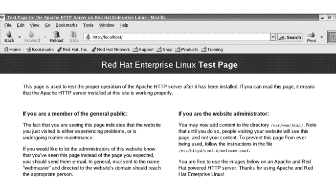

此页面用于测试 Apache HTTP 服务器安装后的正常运行情况。如果显示此页面，说明安装在此处的 Apache 服务器运行正常。

如果你是普通公众的一员：

你看到此页面说明你刚刚遇到了一个错误，或者网站正在进行维护。

如果你是网站管理员：

你现在可以向 `/var/www/html/` 目录添加内容。请注意，在你在此之前，访问你的网站将显示此页面而不是你的内容。为了防止此页面再次被看到，请修改 `/var/www/html/index.html` 文件。

如果你需要...（此处原文未完整，翻译随之结束）

## 配置和管理你的 Web 服务器

为同一组织中的不同部门在同一网络上设置独立的网站。你可以在 Web 服务器上拥有任意数量的虚拟主机。你可以在图 15-6 中看到“虚拟主机”（Virtual Hosts）标签。

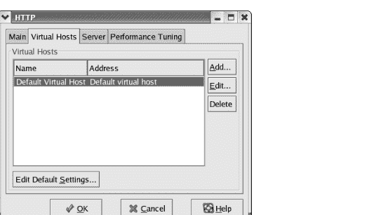

图 15-6：在此处输入关于你 Web 服务器上的主机的信息。

在此标签上，你可以为默认虚拟服务器配置全局参数，并添加其他虚拟服务器。你可以通过点击标签底部的“编辑默认设置”（Edit Default Settings）按钮开始设置全局默认值。虚拟主机属性（Virtual Hosts Properties）对话框如图 15-7 所示。

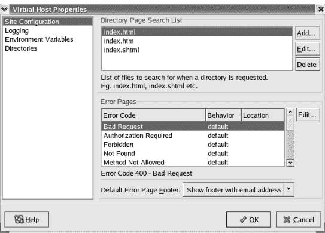

图 15-7：设置默认虚拟主机属性。

虚拟主机属性对话框会打开“站点配置”（Site Configuration）页面；还有三个额外的页面（日志 Logging、环境变量 Environment Variables 和目录 Directories）可用。这四个页面可以在对话框左侧的列看到。

## 站点配置

在虚拟主机属性对话框的站点配置页面上，你可以设置以下内容：

- 目录页面搜索列表（Directory Page Search List）：此列表包含按照列表顺序在文档根目录中查找的文件名。

- 错误页面（Error Pages）：此部分显示出错时显示的错误代码和消息。你可以通过选择代码并点击部分右侧的编辑（Edit）按钮来更改默认行为。会弹出一个对话框，你可以在其中将服务器行为更改为文件或 URL，后者会将服务器重定向到指定位置。如果选择文件，你需要指定文件的本地位置。如果选择 URL，你需要输入重定向的 URL。

- 默认错误页页脚（Default Error Page Footer）：在此，你可以选择是否显示带有你的电子邮件地址的错误页页脚、不带电子邮件地址或不显示页脚。

## 日志

虚拟主机属性对话框的日志页面如图 15-8 所示，你可以在此处指定备用日志文件和文件位置。


此页面上的项目包括：

- 传输日志（Transfer Log）：任何访问服务器的尝试默认记录在 `/var/log/httpd/access_log`。如果你想更改名称或位置，请输入相对于服务器根目录的相应信息。如果你想使用不相对于服务器根目录的目录，请以反斜杠开头路径。

- 使用自定义日志设施（Use custom logging facilities）：如果你使用自己的日志系统而不是系统日志，请在“自定义日志字符串”（Custom Log String）字段中输入你日志系统的相应信息。你输入的信息取决于你正在使用的日志系统——由于我无法得知，所以我无法告诉你应该输入什么。

- 错误日志（Error Log）：服务器遇到的任何错误默认记录在 `/var/log/httpd/error_log`。如果你想更改名称或位置，请输入相对于服务器根目录的相应信息。如果你想使用不相对于服务器根目录的目录，请以反斜杠开头路径。

- 日志级别（Log Level）：这里的选项允许你设置希望从日志中接收的错误信息量。选择下拉列表中的第一个选项提供的信息最少。列表向下移动的每个选项提供更多信息；选择最后一个选项提供的信息最多。错误消息包含有关服务器访问以及客户端与服务器之间数据传输的信息。

- 反向 DNS 查询（Reverse DNS Lookup）：这告诉服务器是否应该执行反向 DNS 查询或双反向查询。“无反向查询”（No Reverse Lookup）：对于大多数站点是可以的。关于反向 DNS 查询的更多信息，请阅读第 12 章。

## 环境变量

虚拟主机属性对话框的环境变量页面如图 15-9 所示，你可以在此处指定传递或不给 CGI（通用网关接口）脚本的变量。常用的 CGI 变量包括 `server_protocol`, `server_name`, `request_method`, `path_info`, `script_name`。

你可以选择：

- 为 CGI 脚本设置（Set for CGI Scripts）：在此，你可以输入为 CGI 脚本设置的变量。点击此部分的添加（Add）按钮，将环境变量输入到相应字段中，同时在相应字段中输入变量的值；然后点击确定。要编辑或删除项目，选择它并点击相应的按钮。

- 传递给 CGI（Pass to CGI）：在此，你可以输入服务器启动时传递给 CGI 脚本的环境变量。点击此部分的添加（Add）按钮，将环境变量名输入字段中，然后点击确定。要编辑或删除项目，选择它并点击相应的按钮。

- 为 CGI 脚本取消（Unset for CGI Scripts）：在此，你可以输入不希望传递给 CGI 脚本的环境变量值。点击此部分的添加（Add）按钮，将环境变量名输入字段中，然后点击确定。要编辑或删除项目，选择它并点击相应的按钮。

| 站点配置 | 为 CGI 脚本设置 | |
| :--- | :--- | :--- |
| 日志 | 环境变量 | |
| 环境变量 | | |
| 目录 | | |


## 目录

虚拟主机属性对话框的页面如图 15-10 所示，你可以在此处设置目录的选项。

| 通用选项 (General Options) | 默认目录选项 (Default Directory Options) | |
| :--- | :--- | :--- |
| 站点配置 | ExecCGI,FollowSymLinks,Includes |
| SSL | Index,MultiViews,SymlinksOwnerMatch |
| 环境变量 | Directory | |
| 目录 | | |


在此页面上，你可以设置：

- 默认目录选项（Default Directory Options）：在此列出了默认目录选项。要更改选项，点击右上角的编辑（Edit）按钮打开默认目录选项对话框，可以在其中选择或取消选项。选项有

- ExecCGI：选择此选项允许执行 CGI 脚本。


- `FollowSymLinks`：选择此选项允许跟随符号链接。符号链接是另一个文件的指针。对于熟悉 Windows 的用户可以将符号链接理解为快捷方式。
- `Includes`：此选项允许服务器使用服务器端包含。
- `IncludesEXEC`：此选项允许服务器端包含并禁用 CGI 脚本包含命令。
- `Indexes`：如果你没有目录索引文件（如 `index.html`），服务器请求将显示目录文件列表。
- `MultiViews`：此选项启用多视图，默认未启用。启用后，如果请求的页面未找到，Web 服务器将尝试寻找与请求类似的页面。例如，如果用户请求 `whatever.html` 但未找到，Web 服务器将查找*
- `SymlinksOwnerMatch`：此选项允许在目录名称与符号链接相同时跟随符号链接。
- `Directory`：在此区域列出了你指定的目录。要添加目录，点击添加（Add）按钮和目录选项对话框，如图 15-11 所示。

你还可以指定：
- `拒绝列表（Deny List）`：你可以通过在“拒绝主机来自”（Deny Hosts From）字段中输入此信息，选择拒绝所有用户或根据域名、IP 地址、子网或 CIDR 进行拒绝。CIDR 让路由器对主机分组以减少核心路由器传输的信息。多个 IP 地址在网络外的路由器处显示为单个地址。
- `顺序（Order）`：此选项指定是允许所有用户还是按什么顺序处理允许/拒绝列表。

## 第四部分：配置您的企业级 Linux 互联网服务

- `白列表`：您可以选择允许所有主机，或通过在“允许的主机”（Allow Hosts From）字段中输入信息，基于域名、IP 地址、子网或 CIDR 列表来允许主机。


图 15-1：使用目录选项对话框设置目录选项。

要向系统添加虚拟主机，请点击虚拟（Virtual）对话框中的中的添加按钮（如图 15-6 所示），以打开“虚拟主机属性”对话框（如图 15-12 所示）。


图 15-12：使用虚拟主机对话框配置新的虚拟主机。

此对话框的四个页面与图 15-7 所示的默认虚拟主机属性对话框相同。请参考图 15-7 之后关于站点配置、日志、环境变量和目录的描述。此处解释了默认虚拟主机属性对话框未显示的两个页面（通用选项和 SSL）。

### 通用选项 (General Options)

在此页面上，您为要添加的虚拟主机输入选项。您可以设置以下选项：
- `虚拟主机名称`：输入您想要为虚拟主机命名的名称。
- `文档根目录`：输入包含根索引文件的目录。
- `Web 管理员邮箱`：输入将显示在页脚错误页面中的电子邮件地址。
- `主机信息`：在此部分，您可以通过点击向下箭头并从列表中选择，来指定默认虚拟主机、基于 IP 的虚拟主机或基于名称的虚拟主机。根据您的选择，将出现相应的复选框供您输入额外的配置信息。
- `默认虚拟主机`：如果请求的 IP 未被其他虚拟主机配置定义，则使用此设置。请确保不要配置多个默认虚拟主机。否则，服务器将不知道使用哪个主机，您将收到错误。如果不配置默认虚拟主机，将使用主 Web 服务器设置。
- `基于 IP 的虚拟主机`：选择此选项需要您为虚拟 Web 服务器输入一个 IP 地址。可以使用空格分隔来输入多个 IP 地址。您还可以通过冒号将端口与 IP 地址分离来指定端口：例如 `192.168.2.1:80`。您还需要输入服务器主机名。
- `基于名称的虚拟主机`：选择此选项需要您为虚拟 Web 服务器输入服务器主机名。您可以使用空格分隔来输入多个 IP 地址。通过冒号将端口与 IP 地址分离来指定端口：例如 `192.168.2.1:80`。您还需要为服务器输入 IP 地址。您可以在选择“基于名称的虚拟主机”选项后出现的配置选项中，点击添加按钮所需的别名（Alias）字段来为服务器输入别名。


### SSL

使用安全套层 (SSL) 允许您为 Web 用户提供一个安全环境，用于发送和接收个人或机密信息。如果您不提供此类信息，可能不需要启用 SSL。

如果您计划在服务器上使用 SSL，则希望通过虚拟属性选项对话框的 SSL 页面来启用它，如图 15-13 所示。

图 15-13：在此设置虚拟主机的 SSL 选项。


要启用 SSL，请勾选启用 SSL 支持（Enable SSL Support）选项前的复选框。选择该选项后，SSL 配置文本框将供您输入 SSL 配置信息。

您需要获取有效的数字证书才能使用您的服务器。服务器提供的配置信息仅供测试之用，无效且不应使用。

无法对基于名称的虚拟主机使用 SSL。如果您想使用 SSL，则需要使用基于 IP 的虚拟主机。您可以从“通用选项”页面调整这些设置；见前一节。

### 服务器选项卡 (Server tab)

HTTP 配置对话框的第三个选项卡（参考图 15-4）是“服务器”选项卡，这是您输入 Web 服务器配置信息的地方。见图 15-14。

图 15-14：使用服务器选项卡配置基本设置。


在大多数情况下，您不需要更改这些设置；接受默认设置即可。后续信息：
- `锁文件`：显示锁文件的路径。
- `PID 文件`：显示 PID 文件的路径。
- `核心转储目录`：显示转储文件的路径。
- `用户`：指定运行服务器的用户。
- `组`：指定运行服务器的组。

### 性能选项卡 (Performance tab)

在大多数情况下，您不需要更改这些设置；接受默认设置即可。后续信息：
- `服务器数量`：决定服务器接受多少个并发连接。
- `超时时间`：是服务器在关闭连接之前等待的时间。

## 第五部分：维护您的企业 Linux 系统

你也可以通过 Web 浏览器访问 `http://rhn.redhat.com/network`，在红帽网站创建登录并填写在线注册单来注册红帽网络（Red Hat Network）。

你必须以 root 身份登录才能进行注册，并且必须连接到互联网才能登录红帽官方网站。如果你没有连接互联网，将收到一条错误消息，点击 OK 后程序将继续。

按照以下步骤开始注册过程：
- 1. `在 GNOME 桌面面上，选择“应用程序”→“系统工具”→“Red Hat Network”。`

你会看到 Red Hat Network 配置界面，如果需要，可以在此处设置代理服务器和身份验证信息。点击 OK 继续，并点击 是 安装 PPG 密钥。随后会出现 Red Hat 更新代理界面，它提供了 Red Hat 网络的描述并列出了其益处。如果你选择不使用 Red Hat 网络，可以点击“取消”结束进程。
- 2. `点击“下一步”继续到“更新登录”对话框，如图 16-1 所示。`

你可以使用此对话框创建新账户，或者如果你已经创建了账户，则使用现有账户。


**图 16-1:** 更新登录页面对话框。

## 第 16 章：使用红帽网络维护您的系统

- 3. 如果你已经有一个账户，勾选“我有已有的红帽登录名”单选按钮，并在相应的框中输入用户名和密码。

如果你没有红帽网络登录名，你需要创建一个。勾选“我没有...”单选按钮并点击“下一步”。将打开一个新页面，你可以在其中输入信息。所有带有星号 (*) 的字段均为必填字段。

用户名至少需要五个字符，且不能包含任何空格、制表符、换行符或保留字符如 `'`、`&`、`+` 或 `%`。你在此处还需要输入电子邮件地址。
- 4. 输入相应信息后，点击“下一步”继续到“更新激活”对话框，如图 16-2 所示。

在此页面上，如果你有订阅号，可以输入并设置系统名称。默认情况下，你的系统硬件信息和已安装包会被发送红帽网络，但你可以通过取消勾选相应的复选框选择不发送。

图 16-2: 更新产品信息对话框。


- 5. 点击“下一步”继续。

你的系统配置将被发送红帽网络。注册过程完成后，你将收到一条确认消息，说明你已成功在红帽网络上注册了系统配置。现在你准备好配置更新代理了。

### 配置 Up2date 代理

在使用红帽 up2date 代理之前，你对其对其进行配置。要启动并配置更新代理配置工具，请执行以下操作：

打开终端窗口，并在命令行中输入 `up2date-config`。现在会打开如图 16-3 所示的 Red Hat Network 配置对话框。

图 16-3: Red Hat Network 配置对话框。


此对话框有三个标签页：通用、检索/安装和包异常：

- *通用 (General)*: “通用”标签是对话框打开时默认显示的标签。系统已经为你选择了一个要使用的服务器，通常不需要更改它。如果你需要使用代理服务器连接网络，可以先勾选“启用 HTTP 代理”复选框，然后在复选框旁的字段中输入你的服务器名称。如果你需要使用身份验证，可以通过勾选“使用身份验证”复选框并填写“用户名”和“密码”字段来启用。


**图 16-4:** 检索/安装标签。

### 包检索选项是：

- **检索后不安装软件包**。默认情况下，软件包在检索后会自动安装。如果你启用此选项，软件包将检索到指定的目录但不会被安装。
- **当本地配置文件已修改时不升级软件包**。如果你手动修改了系统上软件包的配置文件，这些软件包默认情况下不会显示。如果你禁用此选项，软件包将显示。
- **连同二进制包一起检索源 RPM**。默认情况下，源红帽包管理器 (RPM) 不会随软件包的二进制版本一起下载。通过启用此选项，你将检索 RPM 的源码。

包验证选项有一个选择：

- **使用 GPG 验证完整性**。默认情况下，出于安全考虑，系统会对软件包进行验证，以确保它们包含红帽 GPG 签名。如果你禁用此选项，将不对软件包进行验证。

GPG 代表 PGP（良好的私人加密），它由 Phil Zimmermann 在 1991 年开发用于提供加密。GPG 在此处用于验证下载软件包的完整性。


## 258 第五部分：维护您的 Linux 系统

包安装选项是：

- **安装后保留磁盘上的软件包**。默认情况下，软件包在安装后会被删除。启用此选项会将软件包留在指定的目录。
- **启用回滚**。选择此选项允许将系统恢复到更新前的状态。
- **软件包存储目录**。在此处指定软件包的位置。

包异常：通过此标签（见图 16-5），你可以根据名称或文件名排除软件包。

- 按名称排除：在“要排除的名称”部分的“新增”字段输入软件包名称，然后点击“添加”按钮。
- 按文件名排除：在“要排除的文件名”部分输入文件名，然后点击“添加”按钮。

对标签进行任何更改后，点击 OK。你的配置更改已保存，现在可以使用更新代理了。


## 第 16 章：使用红帽网络维护您的系统

### 使用红帽 Linux 更新代理

更新代理对你来说是一个价值工具，因为它可以帮助你的系统运行已软件包的最新版本。在系统运行期间，顶部面板右侧会放置一个警示图标，当系统需要更新时提供视觉通知。图 16-6 显示了警示图标的位置。


警示图标通过颜色区分，表示不同的更新状态。图标及其含义为：

- 蓝色勾：系统是最新的。
- 绿色双箭头：正在检查更新。
- 红色叹号：系统需要更新。
- 灰色问号：发生了错误。

你可以将鼠标悬停在警示图标上查看显示附加信息的弹出窗口。要启动更新代理以更新系统，请执行以下操作：

- 1. 右键点击警示图标并在上下文菜单中选择“启动 Update2”。
* 如果没有以 root 身份登录，将提示输入 root 密码。
* 第一次运行实用程序时，会弹出配置对话框显示服务条款并提供配置代理服务器。
- 2. **系统将提示安装红帽 GPG 密钥，该密钥用于验证下载软件包的红帽安全签名。点击 是安装密钥。**

你会看到红帽更新代理欢迎界面。

## 260 第五部分：维护你的企业 Linux 系统

你可以随时在警报图标的上下文菜单（右键点击图标）中选择“配置 (Configuration)”来运行配置实用程序。

- 3. 点击“向前 (Forward)”进入“通道 (Channels)”对话框，如图 16-7 所示。
- 4. 选择相应的通道并点击“向前”继续。

图 16-7：

通道对话框。

该程序将连接到红帽网络（Red Hat Network）以搜索软件包更新。如果你在本章稍些时候配置 `up2date` 时选择了跳过软件包，你将看到“跳过的软件包 (Skipped Packages)”对话框，如图 16-8 所示。点击“向前”继续。

如果你没有选择跳过软件包，你会看到“软件包列表 (Package List)”对话框，如图 16-9 所示，其中显示了可用软件包。如果你的系统已经更新，将不会列出任何软件包。

- 5. 你可以通过勾选软件包名称前的复选框单独选择软件包，也可以通过勾选“选择所有软件包 (Select All Packages)”复选框来选择所有软件包。完成软件包选择后，点击“向前”。

`up2date` 程序获取软件包，并在获取完成后提示你继续。

- 6. 点击“向前”安装软件包。

在安装软件包期间，你会看到一个进度对话框。当你所有选择安装的软件包都安装完成后，你会看到一个指示软件包安装完成的对话框。

## 第 16 章：使用红帽网络维护你的系统

16-9：跳过的软件包对话框。

根据你的偏好，你选择了不自动更新软件包。如果你想覆盖设置并将上述软件包之一包含在检索的软件包列表中，

16-9：软件包列表对话框。

- 7. 点击“完成 (Finish)”完成更新过程。

点击警报图标打开列出所有可用软件包的对话框。你也可以在此处启动 `up2date`。

## 262 第五部分：维护你的企业 Linux 系统

### 使用 浏览器访问红帽网络

你可以使用任何 浏览器访问红帽网络。事实上，如果你有多个本地机器，可以通过浏览器界面同时管理它们。你只需要访问红帽网站 `http://rhn.redhat.com`，并使用你分配给账户的用户名和密码登录（我在本章后面将向你演示如何创建它们）。

登录后，你会看到系统的 RHN 标记页面，如图 16-10 所示。

图 16-10 显示的 RHN 标签页可能与你的页面看起来不完全相同。这里显示的信息取决于你可能选择的偏好。查看此页面的重要区域。

页面顶部有七个标签，可以带你进入其他页面，在在那里你可以获取有关系统的更多信息并进行配置更改。这七个标签是

**图 16-10：**

红帽网络主页。

## 第 16 章：使用红帽网络维护你的系统 263

- RHN：登录红帽网络后，此标签默认打开。页面中心是你的系统（或多个系统，取决于你配置了多少个）的摘要。页面左侧是关于账户信息和可以更改设置的链接。
- Systems（系统）：“系统 (Systems)”标签页打开一个提供你的系统概览的页面，如图 16-11 所示。

你可以点击正文中显示的系统链接以获取有关该系统的特定信息。页面左侧是提供关于你系统附加信息的页面链接。

- Errata（错误报告）：点击“错误报告 (Errata)”标签页打开一个页面，如图 16-12 所示，列出了所有适用于你系统的错误报告。与其他标签一样，页面左侧还有额外的链接提供更多信息。
- Channels（通道）：如图 16-13 所示的“通道 (Channels)”标签页显示了你订阅的软通道（soft-channels）。你可以从你订阅的通道中下载软件。与其他标记的页面一样，页面左侧还有额外的链接用于获取更多信息或服务。

图 16-11：系统标签页显示常规系统信息。

## 264 第五部分：维护你的企业 Linux 系统

图 16-12：错误报告标签页显示错误报告。

- Schedule（计划）：“计划 (Schedule)”标签页如图 16-14 所示，向你提供有关待处理操作的信息。
- Users（用户）：“用户 (Users)”标签页如图 16-15 所示，显示了可以访问红帽网络的用户。
- Help（帮助）：如果你已经有疑问，如图 16-16 所示的“帮助 (Help)”标签页提供了有用信息。

## 使用红帽网络维护你的系统

图 16-13：通道标签页显示订阅。

图 16-14：计划标签页显示待处理操作。

图 16-15：用户标签页显示用户。

图 16-16：帮助标签页带你进入有用信息。

## 第 17 章：用户和组管理

## 本章内容

- 用户和组的操作
- 使用配额限制磁盘空间

作为系统管理员，你的首要任务之一是创建和管理用户账户。你应该始终为任何将使用系统的人创建账户。使用用户名和密码是你的第一道防线。

## 用户和组

企业 Linux 为你提供了一个图形化实用程序“用户管理器 (User Manager)”，你可以用它创建和修改用户账户。通过选择“应用程序；系统设置；用户与组”来打开用户管理器。用户管理器对话框如图 17-1 所示。

简单查看用户管理器对话框的内容。对话框顶部是菜单栏，包含三个子菜单：

- File（文件）：菜单提供的选项与工具栏上的相同。


- Preferences（偏好）：选择偏好提供了一个选项：即过滤用户。此选项是一个开关。当你第一次运行用户管理器时，应用了过滤器，你只会看到系统安装期间创建的用户。再次切换该选项，你会看到所有账户列表，其中许多并非实际账户，而是系统运行所需的。过滤器的目的是隐藏系统账户并向你显示真实的账户。你无法对过滤器进行任何更改，只能选择使用或禁用。

## 268 第五部分：维护你的企业 Linux 系统

图 17-1：使用用户管理器创建和修改用户。

- Help（帮助）：点击将打开浏览器窗口并显示用户管理器程序的帮助。
- Add User（添加用户）：点击此图标添加新用户。（参见后面的章节，“添加新用户”）。
- Add Group（添加组）：点击此图标添加新组。（参见后面的章节，“添加组”）。
- Properties（属性）：选择用户或组，然后点击此图标查看或修改用户或组属性。
- Delete（删除）：选择用户或组，然后点击此图标删除该用户或组。
- Help（帮助）：点击此图标打开用户管理器的帮助。
- Refresh（刷新）：点击此图标刷新显示。

工具栏包含以下图标：

在工具栏下方，对话框右侧是“搜索过滤器 (Search Filter)”文本区域。在这里你可以输入用户或组名称的前几个字母，然后按回车键或点击“应用过滤器 (Apply Filter)”按钮来搜索并仅显示你搜索的名称。

# 第 17 章：管理用户和组

搜索字段下方是系统中用户和组的标签页式显示。启动应用程序时，默认打开“用户”标签页。你可以点击“组”标签页切换到组的视图。要返回到用户视图，请点击“用户”标签页。

## 添加新用户

使用 Red Hat Manager 时，向系统添加新用户非常简单。要创建一个新用户账户，请执行以下操作：

- 1. 选择“应用程序 -> 系统设置 -> 用户和组”来启动用户管理器。
- 2. 如果你没有以 `root` 用户身份登录，系统会提示你输入 `root` 密码。
- 3. 点击工具栏上的“添加用户”图标打开“新用户”对话框，如图 17-2 所示。


图 17-2：向系统添加新用户。


- 3. 输入用户将使用的用户名、用户的全名以及用户的登录密码。
- 4. 你可以接受登录 shell、创建主目录和创建私有组的默认设置。要将该用户添加到其他组，请修改用户的属性。（参见接下来的节，“修改用户属性”）。点击“确定”以创建用户。
- 5. 如需创建更多用户，请重复步骤 2–4。完成用户创建后，从菜单栏选择“文件 -> 退出”。

当你在系统上创建新用户时，系统默认会在 `/home/username` 为该用户创建一个主目录，除非你决定不创建该目录或将其放在其他地方。系统也会为该用户创建一个私有组（即属于该用户的组），除非你在创建用户账户时决定不创建该组。本章稍后部分将介绍“添加新组”。最后，系统上的所有用户都有由系统分配的用户 ID (`UID`)。Enterprise Linux 保留了小于 500 的 `UID` 用于系统目的，因此你创建的所有用户的 `UID` 都从 500 开始并更大。有关用户权限分配的更多信息，请参见“修改用户属性”节。


## 添加新组

使用 Red Hat User Manager 时，向系统添加新组非常简单。要创建一个新组账户，请遵循此处的步骤。

创建组后，你可以为该组分配权限——或者将现有用户添加到组并将其作为该组的成员——这是同时为许多用户分配权限的一种快速简单的方法。例如，假设你的公司有一个绘图部门，其用户需要访问相同的文件和目录。你可以创建一个名为 Drafting（绘图）的组，并向该组分配文件和目录的权限。然后让绘图部门的新旧用户成为 Drafting 组的成员，他们就拥有了的所有权限。

- 1. 选择“应用程序 -> 系统设置: 用户和组”来启动用户管理器。

如果你没有以 `root` 用户身份登录，系统会提示你输入 `root` 密码。
- 2. 点击工具栏上的“添加组”打开“创建新组”对话框，如图 17-3 所示。

图 17-3：在此创建新组。

| 创建新组 |
| :--- | :--- |
| 组名: |  |
| 手动指定 GID GID 500 |  |
| 取消 | 确定 |

- 3. 在“组名”字段中输入组名。如果你想手动分配组 ID 数字 (`GID`)，请选择选项前的复选框，并点击向上或向下箭头选择你需要的数字。

默认情况下，系统上的所有组都有系统分配的组 ID 数字 (`GID`)。Enterprise Linux 保留了小于 500 的 `GID` 用于系统目的，因此你创建的所有组都从 500 开始并更大。


- 4. 点击“确定”创建组。
- 5. 如需创建额外的组，请重复步骤 2–4。完成组创建后，从菜单栏选择“文件:退出”。

## 修改用户属性

创建用户后，你可能想更改其账户的属性。例如，你可能想强制他们在某些指定间隔更改密码，让其账户在指定时间过期，或者让他们成为一个或多个组的成员。你可以按照此过程更改用户属性：

- 1. 选择“应用程序:系统设置:用户和组”来启动用户管理器。

如果你没有以 `root` 用户身份登录，系统会提示你输入 `root` 密码。
- 2. 从“用户名”列表中点击用户用户名”（参见图 17-1），然后点击工具栏上的“属性”打开“用户属性”对话框，如图 17-4 所示。

图 17-4：在此修改用户账户属性。


用户属性对话框包含四个标签页：
- 用户数据：在这里你可以更改用户名、主目录和登录 shell。
- 账户信息：在此你可以设置过期。
- 密码信息：在此你可以启用密码更改。
- 组：在此你可以查看他们所属的组。
- 3. 在完成所有标签页的操作后，点击“确定”。
- 4. 从菜单栏选择退出。

## 修改组属性

在创建用户后，你可能想更改其组的属性。你可以按照此过程更改组属性：

- 1. 选择“应用程序:系统设置:用户和组”启动用户管理器。

如果你没有以 `root` 用户身份登录，系统会提示你输入 `root` 密码。
- 2. 从列表中点击组名，然后点击工具栏上的“属性”打开“组属性”对话框。
- 3. 点击“用户”标签页。在这里查看该组的用户。
- 4. 点击“确定”应用更改并关闭对话框。
- 5. 从菜单栏选择退出。

## 删除用户

要从系统中删除用户，请执行以下操作：

- 1. 选择“应用程序:系统设置:用户和组”启动用户管理器。

如果你没有以 `root` 用户身份登录，系统会提示你输入 `root` 密码。
- 2. 从列表中点击用户名，然后点击工具栏上的“删除”。

系统将询问你是否确定删除该用户的主目录。
- 3. 如果你确定要删除账户，点击“是”。
- 4. 从菜单栏选择退出。

警告！在删除用户的主目录之前，请确保那里的文件和目录不再需要。

## 使用配额限制磁盘使用

作为系统管理员，你可能会遇到的问题之一是磁盘空间不足。很多情况下，这个问题是由未妥善管理主目录的用户引起的。你的用户可能保存了很多文件但不定期删除未使用的文件。

通过对他们的主目录实施磁盘配额，你可以强制用户更有效地使用存储空间。Linux 中没有用于管理磁盘配额的图形工具，但从命令行设置它们非常简单。

你只需要执行几个步骤就可以在系统上开始使用磁盘配额：
1. 卸载并挂载文件系统。
2. 运行 `edquota` 设置用户配额。

## 配置磁盘配额

当 Enterprise Linux 执行启动程序时，系统会读取 `/etc/fstab` 以获取文件系统的挂载信息。当你想在系统上使用配额时，需要在要挂载的文件系统的选项区域放入 `usrquota` 和 `grpquota` 选项。

磁盘配额可以基于用户、组或两者。如果你只使用基于用户的配额，则只需要添加 `usrquota` 选项。如果你只使用基于组的配额，则只需要添加 `grpquota` 选项。在本节中，我只讨论基于用户的配额，但相同的规则适用于基于组的配额。

你必须是 `root` 用户才能更改 `/etc/fstab` 文件。要修改你的 `/etc/fstab` 文件，请执行以下操作：
- 1. 使用 `vi` 或你选择的任一文本编辑器打开 `/etc/fstab` 文件。

图 17-7 显示了我系统中的 `/etc/fstab` 文件。


图 17-7：`/etc/fstab` 文件是用于启用磁盘配额的地方。
- 2. 在你想要启用配额的文件系统的选项部分输入 `usrqota` 选项。


在图 17-7 中，你可以在文件的第四行使用 `usrqota` 选项。你的文件会与我的不同，但尝试寻找类似的行来放置该选项。

### 3. 保存并关闭文件。

### 4. 运行 `quotacheck` 命令来设置系统所需的配额。在终端提示符下，输入

```
quotacheck /mounted file system
```

其中 `/mounted file system` 是你的文件系统。

`quotacheck` 命令还会获取有关挂载文件系统的使用信息。

### 5. 卸载并重新挂载文件系统。

- a. 在命令提示符下输入以下：

```
umount /mounted file system
```

其中 `/mounted file system` 是你的文件系统。

- b. 然后输入

```
mount /file system
```

其中 `/file system` 是你的文件系统。

### 6. 使用此命令为用户设置配额：

```
edquota user name
```

其中 `name` 是你想要设置配额的用户名。

图 17-8 显示了运行 `edquota` 命令的结果。


`edquota` 命令会启动一个文本编辑器，允许你更改配额限制。当你运行命令时，会显示你指定的用户的统计数据。在图 17-8 中，你可以看到用户 `terry` 在文件系统 `/dev/hdb2` 上有 `3724732` 个块或 `35638` 个 `inode`。`inode` 的数量对应使用的文件数量。`soft` 和 `hard` 值目前均为 `0`（零），表示尚未设置任何配额。（在“获取磁盘配额统计数据”章节中阅读更多关于 `inode` 的信息。）

- `Soft`：软限制是用户可以永久使用的块或 `inode` 的最大数量。

- `Hard`：硬限制是用户可以临时使用的块或 `inode` 的最大数量。

软限制始终低于硬限制，因此用户在必要时可以临时超过软限制。用户可以临时超过软限制的时间长度由系统的宽限期（`grace period`）决定。默认宽限期为 7 天，但可以使用 `edquota` 程序进行更改。（具体方法见以下步骤。）


`edquota` 程序会打开 `vi` 文本编辑器来编辑配额文件。如果你不熟悉 `vi`，可以在命令提示符下输入 `man vi` 来获取帮助。现在你可以完成配置过程：

- 1. 在适当的位置输入磁盘配额的软值和硬值。

你输入的是 1K 块值。例如，如果你想设置 4.9GB 的软限制，请输入 `4900000` 作为块值。

- 2. 编辑文件后，务必保存并退出。

### 3. 要更改宽限期，请在命令提示符下输入 `edquota -t`。

在 `vi` 编辑器打开后，你可以根据意愿更改时间段。


你应该每周运行一次 `quotacheck` 命令，以确保你的配额文件是最新的。如果系统由于任何原因崩溃，你需要在系统重启后立即运行 `quotacheck`。

## 获取磁盘配额统计数据

要获取有关系统中已启磁盘配额的信息，你可以使用 `repquota` 命令。输入如下命令：

```
repquota /file system
```

其中 `/file system` 是你的挂载文件系统。

对于示例命令

```
[root@terry root]# repquota /home
```

你应该得到类似下面的结果：

*** 设备 `/dev/hdb2` 用户配额报告

块宽限期: 10days；inode 宽限期: 10days

| User | used soft hard grace | used soft hard grace |
| :--- | :--- | :--- | :--- | :--- | :--- | :--- |
| root | 532656 | 0 | 0 | 2783 | 0 | 0 |
| apache | 84 | 0 | 0 | 16 | 0 | 0 |
| terry | 3724732 | 0 | 0 | 35638 | 0 | 0 |

# 第 18 章：安装和升级软件包

GNOME 桌面组可以同时包含标准包和额外包成员。安装该组时，标准包始终是可用的。

选择要安装的额外软件包：

- 标准软件包

- 额外软件包

  - `gnome-user-docs` - GNOME 用户文档。

  - `control-center` - GNOME 控制中心。

  - `gconf-editor` - GConf 的管理员编辑器。

  - `switch-desktop` - 用于桌面切换的 GNOME 界面。

  - `nautilus-media` - 带有视图和缩略图的 Nautilus 多包。

  - `webrowser` - Helix 浏览器。

  - `gnome-media` - GNOME 程序。

  - `mtr-link` - mtr 的 GTK+ 接口。

  - `gnome-audio` - GNOME 事件音效。

  - `gnome-bluetooth` - GNOME 蓝牙子系统。

  - `gnome-viewer` - 图像查看器。


图 18-2：GNOME 桌面安装的应用程序详情。

软件包信息

全名：无

大小：无

### 3. 点击软件包的“详细信息”链接，然后选择其他相关的软件包进行安装。

### 4. 点击“关闭”关闭“软件包详情”对话框。

### 5. 点击“更新”。

系统会显示一个包含你所选软件包信息的对话框。

### 6. 点击“继续”开始安装软件包。如果提示将其中一个安装 CD 插入光驱驱动器，请插入所需的光盘并点击“确定”继续。

在完成你选的软件包后，你会看到一个如图 18-3 所示的对话框，表示更新已完成。

图 18-3：你成功更新了软件包。


### 7. 点击“确定”关闭“更新完成”对话框。

### 8. 点击“退出”关闭软件包管理器。

## 移除系统软件包

在红帽软件包管理器中，你也可以轻松地移除系统应用程序。要移除系统应用程序，请执行以下操作：

### 1. 选择“应用程序：系统设置；添加/删除应用程序”。

### 2. 在软件包列表中找到你想要移除的软件包，点击软件包名称前的复选框以取消勾选。

### 3. 点击软件包的“详细信息”链接，然后选择其他要移除的应用程序。

### 4. 点击“关闭”关闭“软件包详情”对话框。

### 5. 点击“更新”。

系统会显示一个包含你所选移除的软件包信息的对话框。

### 6. 点击“继续”开始移除软件包。

在你选的软件包被移除后，你会看到一个表示更新已完成的对话框。

### 7. 点击“确定”关闭“更新完成”对话框。

### 8. 点击“退出”关闭软件包管理器。

## 从二进制 rpm 文件管理应用程序

虽然你可以使用企业级 Linux 自带的软件包管理器来添加或移除系统软件包和应用程序，但你无法用它安装第三方软件包。如果你想安装其他应用程序，有两种选择：

- 寻找要安装的二进制文件。

- 获取压缩 `zip` 文件，为你的系统提取并编译该软件包，然后进行安装。

这两种方法都相对简单。

## 安装二进制 rpm 文件

你可以从许多来源获取数千个可以安装在系统上的应用程序。如果你能找到为你的系统编译的二进制包，安装过程将比自己编译应用程序更快、更简单。二进制文件以 `.rpm` 结尾，代表红帽软件包管理器（Red Hat Package Manager）。在本节中，我将向你展示如何通过网络搜索应用程序以及如何安装该应用程序。


确保你下载的文件没有以 `.src.rpm` 结尾，因为这是源 `.rpm`，无法通过本节中的步骤直接安装。

我最喜欢的查看女儿照片的应用程序之一是 `gqview`。此软件包没有作为企业级 Linux 的部分安装，必须单独安装。首先，你需要找到它。我在网上搜索了 `gqview`。搜索结果显示了我需要下载的 `rpm` 文件，然后我就可以使用 `gqview` 查看我用数字相机拍摄的所有女儿照片了。我按照以下程序安装了文件：

### 1. 找到你想下载的文件并将其保存到系统中的某个目录中。

确保你下载的是适用于你系统的正确文件，且它以 `.rpm` 扩展结尾。

### 2. 切换到包含下载文件的目录。

### 3. 在终端提示符处输入此命令：


```
rpm -Uvh <name of rpm>
```

`<name of rpm>` 是你下载的文件。

确保你已以 `root` 身份登录。

在安装 `rpm` 文件期间，你会看到一个进度对话框。

当命令提示符返回时，`rpm` 文件已安装完成。


确保你下载的文件没有以 `.src.rpm` 结尾，因为这是源 `.rpm`，无法通过本节中的步骤直接安装。

我最喜欢的查看女儿照片的应用程序之一是 gqview。此软件包没有作为企业级 Linux 的部分安装，必须单独安装。首先，你需要找到它。我在网上搜索了 gqview。搜索结果显示了我需要下载的 rpm 文件，然后我就可以使用 gqview 查看我用数字相机拍摄的所有女儿照片了。我按照以下程序安装了文件：

1. 找到你想下载的文件并将其保存到系统中的某个目录中。

确保你下载的是适用于你系统的正确文件，且它以 `.rpm` 扩展结尾。

2. 切换到包含下载文件的目录。

3. 在终端提示符处输入此命令：

```
rpm -Uvh <name of rpm>
```

`<name of rpm>` 是你下载的文件。

确保你已以 root 身份登录。

在安装 rpm 文件期间，你会看到一个进度对话框。

当命令提示符返回时，rpm 文件已安装完成。

*(注：由于原文后续部分存在大量重复段落，此处已根据指令“不要重复输出原文”的原则进行了去重处理，仅保留核心逻辑翻译。)*

## 第五部分：维护您的企业 Linux 系统

`tar` 命令有许多选项；本示例使用的选项具有以下含义：

- `x`: 告诉 `tar` 命令从归档提取文件
- `z`: 告诉 `tar` 命令文件已经过 gzip 压缩，因此需要解压缩
- `v`: 告诉 `tar` 命令显示详细模式，或在屏幕上显示它正在执行的操作
- `f`: 告诉 `tar` 使用你指定的归档文件

运行 `tar` 命令后，压缩归档将被解压缩，归档将被提取到一个与程序同名但不带 `.tar.gz` 后缀的目录中。

3. 切换到包含提取文件的目录并打开名为 `INSTALL` 的文件。

`INSTALL` 文件包含安装说明。在解压压缩归档文件时创建的每个目录中都会找到一个文件。

4. 提取文件后运行 `configure` 命令。

```bash
./configure
```

运行 `configure` 命令可能需要一段时间，这取决于您系统的速度。在运行期间，它会在屏幕上显示消息，让你看到它正在做什么。命令完成后，系统将返回命令行提示符。

5. 在命令行提示符处输入 `make` 来编译软件包。

6. 当 `make` 运行时，输入 `make install` 来安装软件包。

7. 输入 `make clean` 从源目录中删除程序二进制文件和对象文件。

尽管本章包含了提取、配置、编译和安装压缩归档的基本步骤，但有时步骤会有所不同。您应该始终在包含提取文件的目录中寻找 `INSTALL` 文件和 `README` 文件。请务必遵循这些文件中的指令进行安装。

## 第 19 章：备份和恢复您的文件

### 本章内容

- 规划您的备份策略
- 选择备份介质
- 确定您的备份方法
- 使用备份工具

对文件系统进行备份对于避免在发生灾难性硬件或软件故障时丢失重要信息非常重要。高效的备份和恢复过程可以减少停机时间并避免重新创建丢失的工作。Red Hat Linux 提供了多个用于文件系统策略和恢复的包。在本章中，我将向您展示如何为系统创建备份策略，选择备份介质并使用 Enterprise Linux 提供的工具进行备份。

## 规划您的备份策略

在备份重要文件之前，您需要确定需要备份的内容。您对备份内容的选择在很大程度上取决于系统包含的数据以及您如何使用系统。然而，有一些基本准则可以帮助您确定需要备份的内容。

### 不要：备份临时文件和缓存文件

通常，临时和缓存文件不需要备份。例如，`/tmp` 目录的内容在系统重启时通常会被删除。因此，不备份这些文件是可以接受的。您可能会发现检查系统上安装的任何包是否产生了大量可以忽略的临时数据是值得的。

### 也许：备份 OS 文件

根据情况，备份操作系统文件可能是建议的，也可能不建议。如果机器是 Red Hat Enterprise Linux 的标准安装，没有进行任何自定义或安装额外的软件包，则可以通过重新安装 Enterprise Linux 来恢复系统文件。代价是，重新安装和重新配置系统可能比从备份恢复文件系统花费更多的时间和精力。然而，考虑到可以节省的备份介质数量，这种权衡是值得的。

在将单个 Red Hat Enterprise Linux 安装程序原封地复制到多台机器的特殊情况下，仅备份其中一台机器的系统文件可能是合适的。如果所有机器的系统文件是相同的，那么一个备份就可以恢复所有机器。无论何种，备份每台机器的 `/etc` 目录可能是明智的。大多数机器具有某些不同的配置信息，例如网络和主机名设置。

### 要：备份数据库文件和用户文件

有一件事绝对需要备份，而且确实需要通过特殊方法进行备份：数据库文件。直接对数据库文件执行 `tar` 无法防止数据库崩溃带来的风险，因为数据库文件在打开并被写入时都处于不同的状态。Oracle、Informatix、Sybase 和其他数据库程序允许管理员将数据库表设置为备份模式。在备份模式下，数据进入内存缓存而不是文件，只有在刷新缓存时才会更新事务日志。此过程会减慢速度，但能确保数据库在崩溃中幸存。

文件系统中需要备份的文件之外的另一部分是用户文件。所有用户文件都存储在 `/home` 目录的子目录下。因此，一次性备份所有用户文件是有意义的。

即使备份了整个文件系统（包括系统文件和用户文件），您仍然应该单独备份。根据情况，系统文件和用户文件的相对优先级不同。用户文件很重要，因为它们是不可替代的，而许多系统文件通常可以通过重新安装 Red Hat Enterprise Linux 来替换。另一方面，恢复系统文件对于机器运行和提供服务是必要的，而机器在不恢复用户文件的情况下也可以完全运行。在设计备份策略时，必须考虑这些优先级。

特别考虑那些不容易归入系统和用户类别的资源。例如，存储在 SQL（结构化查询语言）数据库中的信息在技术上属于 root 或特殊系统用户，但也包含了用户不可替代的内容。这类数据可能是备份中最重要的。您可能会发现调查已安装包中哪些使用了这类数据是有益的。数据库之外的其他示例还有 Web 服务器和邮件归档器。

## 选择您的备份介质

市场上有多种备份介质。选择何种备份介质取决于多种因素和具体需求。您应该考虑备份的频率、备份的冗余程度以及可以投入备份介质的资金。表 19-1 提供了备份介质的比较。

表 19-1 备份介质比较 | 容量 | 可靠性 | 成本 | 速度 |

| :--- | :--- | :--- | :--- | :--- |

| 磁带 | 高 | 高 | 廉 | 慢 |

| 可写光 | 中 | 中 | 廉 | 快 |

| 硬盘 | 高 | 高 | 贵 | 快 |

| 软盘 | 低 | 低 | 廉 | 慢 |

| DVD | 高 | 高 | 廉 | 慢 |

| Zip 磁盘 | 中 | 低 | 中 | 慢 |

| 闪存 | 中 | 高 | 贵 | 快 |

| 移动硬盘 (FireWire) | 高 | 高 | 贵 | 快 |

| 移动硬盘 (USB) | 高 | 高 | 贵 | 中 |

## 确定您的备份方法

为了在备份和恢复文件系统时节省时间和金，请制定备份方法。备份方法是无限的。如何执行备份取决于系统和计算基础设施的需求。备份调度和类型取决于使用的备份介质、数据的重要性以及您可以承受的停机时间。在决定备份方法后，您必须配置工具使用该方法。全量备份和增量备份可以在 `tar` 等原始工具之上实现。更高级工具如 `dump` 和 `amanda` 内置了对备份级别调度的支持。amanda 甚至有一种复杂的配置语言，允许您指定备份类型、备份周期以及应排除在备份之外的文件（如私人或临时文件）。

另一个需要考虑的因素是系统的关键性。如果系统必须一直运行且停机是关键情况，则为了减少影响，全量备份是必要的。备份关键机器的一种策略是在镜像磁盘上创建一个单独卷用于备份，并在将其写入磁带之前作为中间区域。可以在磁盘上创建压缩的 `tar` 文件，然后比普通的 `tar` 文件更快地写入磁带。此外，由于磁盘上有备份，只有当磁盘存档失败时才使用磁带存档。这种策略类似于 amanda 自动备份工具用于考虑故障设备或介质的方法。如果磁带驱动器故障，可以将磁盘备份写入磁带。

最简单的备份方法是创建全量备份，将整个文件系统复制到备份介质。这种方法可能适用于：数据量不大的系统；或者数据非常重要且变化迅速，因此需要不同时间点快照的系统。

然而，频繁的全量备份有几个缺点：

- 耗时：如果有大量数据需要备份或备份介质很慢，全量备份需要很长时间。
- 停机时间：为了获得清晰的系统快照，您可能需要暂停修改文件的进程执行。如果备份耗时间过长，停机可能是无法接受的。

## 第 19 章：备份与恢复您的文件

- 部分恢复的烦恼：从备份中恢复整个文件系统时，全备份没有缺点。然而，从备份中恢复部分文件系统时就存在缺点。如果使用磁带等顺序介质，则必须按顺序查找以找到需要恢复的文件。在最坏的情况下，这个过程可能导致部分恢复所需的时间与恢复整个文件系统一样长。


空间日志：与增量备份相比，全备份在存档时占用的空间大得多。如果你重用相同的备份介质，这种情况并并不是太大的缺点——你可以用新备份覆盖旧备份。然而，建议保留多代备份，因为有时文件系统问题（如文件损坏或删除）不会被立即检测到或报告。如果文件系统每天在备份磁带上备份一次，而一个被意外删除的文件在两天内未被发现，那么它将无法恢复。另一方面，如果文件系统每周备份一次，那么两次备份之间的任何文件都无法恢复。

保留全备份也有这样一个缺点：如果每天进行一次全备份，存储备份所需的存档介质数量将迅速变得难以负担。

执行全备份的替代方案是增量备份，它只存档自上次备份以来发生变化或添加的文件。增量备份解决了全备份的所有缺点：

- 备份速度：增量备份非常快。事实上，你执行得越频繁，速度就越快，因为需要备份的内容更少。
- 部分恢复：因为备份较小，从给定的备份中搜索特定文件的速度更快，如果你需要从某个特定的已知增量备份中恢复，这会使部分恢复更快。由于每次备份的内容较少，使用的介质也较少；因此，需要购买的备份介质更少，或者可以在相同的介质上保留更长的历史。在后的情况下，备份对于一段时间后发现的丢失或损坏文件具有更鲁健性。

然而，使用增量备份确实有缺点。增量备份在检索单个文件时更快，但在恢复整个文件系统时较慢。为了解释这个问题，请假设你有一个为期一周的备份周期。在周的第一天，你进行全备份。在周剩余的时间里，你进行增量备份。如果文件系统在周最后一天（在进行新的全备份之前）被意外删除，你必须从上次全备份开始，然后加载整周的磁带才能完全恢复文件系统。如果你每天都进行全备份，你只需要加载全备份，即可完成文件系统的恢复。

## 第五部分：维护您的企业级 Linux 系统

## 企业级 Linux 备份工具

Red Hat Enterprise Linux 提供了许多用于文件系统转储的工具。有与备份介质交互的工具，例如用于磁带驱动器的 `ftape`、用于写入 CD 驱动器的 `crecord` 以及用于到硬盘进行备份的 `mirrordir`。命令行工具 `tar` 和 `dump` 允许对文件系统备份进行低级控制，并可以通过脚本易于自动化。仅需 shell 脚本和通过 `cron` 任务进行定期调度，你就可以为许多情况开发出健壮的备份解决方案。图形化工具也可以创建一个更友用户界面来执行手动备份。最后，还有高级备份工具可以配置为全自动地备份多台机器。

## 命令行工具

Red Hat Enterprise Linux 提供了许多执行备份和从备份恢复的命令行工具。与备份介质直接交互的工具是 `ftape`、`crecord` 和 `mirrordir`。创建存档的标准工具用于磁带存档的 `dump` 和 `tar`，用于 CD 存档的 `mkisofs`。每个命令都提供不同的接口和许多选项。

## 使用 ftape 管理磁带驱动器

系统默认安装了 `ftape` 软件包。它是一组用于访问和管理磁带驱动器的命令行工具。如果你使用磁带驱动器存储备份，这些实用程序将非常有用。

如果你有 IDE 驱动器，`ftape` 软件包中的 `mt` 命令用于扫描、倒带和编辑磁带。如果你有 SCSI 磁带驱动器，则由 `st` 命令执行这些功能。

你必须能够访问磁带驱动器。作为 root 用户，你可以将新磁带插入驱动器并使用以下命令来测试新的磁带：

```
mt -f /dev/rft0 rewind
```

上述命令会倒带磁带。你也可以用命令格式化磁带：

```
ftformat -f /dev/rft0
```

然而，许多磁带是预先格式化的，因此通常不需要格式化新磁带。

## 使用 cdrecord 软件包制作 CD 备份

为了在 Red Hat Linux 下在 CD 上制作备份，你需要安装 `cdrecord` 软件包。它包含几个命令，如 `cdrecord`、`devump`、`isodump`、`isoinfo`、`isovry` 和 `Reaccd`。这些命令是创建和管理可写 CD 的实用程序。

`cdrecord` 软件包要求你有 SCSI CD 驱动器。如果你有 IDE CD 驱动器，必须将其配置为使用 SCSI 仿真以便使用 `cdrecord` 软件包。关于写入 CD 的良好信息源是 CD-Writing How-to：

```
www.tldp.org/HOWTO/CD-Writing-HOWTO.html
```

在 CD 上制作备份的缺点是你必须先创建一个 CD 镜像。（注：此处原文后续部分存在大量重复段落，已根据逻辑去重处理。）

## 第 19 章：备份和恢复您的文件

如果包含 `/home` 的分区崩溃，为了恢复丢失的文件，只需反转 `mirrordir` 命令的参数即可。以下命令用 `/mnt` 的内容覆盖到 `/home` 中：

```
mirrordir /mnt /home
```

请注意，`/home` 中存在但 `/mnt` 中不存在的任何文件都会被删除。因此，`mirrordir` 不适用于恢复单个文件，而是适用于整个目录、分区或驱动器被损坏或擦除的情况。

如果 `/home` 恰好位于与系统其余部分独立的单独分区上，你不需要使用 `mirrordir` 恢复目录。挂载在 `/mnt` 上的分区（示例中的 `/dev/hdb1`）是 `/home` 目录的精确复制——因此，在这种情况下，它是该分区的精确复制。因此，你只需修改 `/etc/fstab` 文件，将挂载在 `/home` 下的分区更改为它的镜像分区即可。

## 使用 dump 备份

`dump` 软件包包含几个用于文件系统备份和恢复的命令。`dump` 命令用于对整个分区或单个目录进行备份。`restore` 命令用于恢复整个分区、单个目录或单个文件。

`dump` 命令的第一个参数是选项列表。其后是各个选项所需的所有参数，顺序与指定选项的顺序相同。最后一个参数是要待备份的文件系统。表 19-2 列出了可用的 `dump` 选项。

| 表 19-2 | Dump 选项 | 类型 |
| --- | --- | --- |
| B | 每个卷的记录数 | 数字 |
| b | 每个 dump 记录的千字节数 | 数字 |
| h | 使用 nodump 标志的 dump 级别 | 数字 |
| f | 写入的文件或设备名称 | 文件名 |
| d | 磁带密度 | 数字 |
| n | 告诉 dump 在完成后时发送消息 | 无 |
| s | dump 磁带长度 | 以英尺为单位的数字 |
| u | 在 `/etc/dumpdates` 中记录此次备份的日期 | 无 |
| 表 19-2（续） | | |
| 选项 | 含义 | 类型 |
| T | 仅添加早于给定时间的文件 | 时间 (ctime) |
| W | 列出需要备份的文件系统 | 无 |
| w | 列出需要备份的单个文件 | 无 |
| 0–9 | 指定 0–9 的 dump 级别 | 无 |

以下命令指定将设备 `/dev/hda3` 上的 dump 文件系统备份到磁磁带设备 `/dev/rft0` 上。它指定备份应使用备份级别 0（全量备份），并将备份时间写入 `/etc/dumpdates` 文件。

```
dump 0 /dev/rft0 /dev/hda3
```

### 恢复 dump 的文件

`restore` 命令用于从用 `dump` 创建的备份中检索文件。你可以使用 `restore` 恢复整个文件系统，也可以使用它交互式地选择要恢复的文件。

`restore` 命令的语法与 `dump` 命令相同，尽管它具有不同的选项。表 19-3 列出了这些选项。

| 表 19-3 Restore 选项 | | |
| 选项 | 含义 | 类型 |
| r | 恢复整个 dump 存档 | 无 |
| C | 将文件系统上的文件与 dump 存档中的文件进行比较 | 无 |
| R | 从多卷序列中的特定磁带开始恢复 | 无 |
| x | 仅提取指定的文件 | 文件列表 |
| t | 列出 dump 存档的内容 | 文件列表 |
| I | 在交互模式下恢复文件 | 无 |
| b | dump 的块大小（千字节） | 数字 |
| D | 要进行比较的文件系统名称 | 文件系统 |
| f | 要从中恢复的 dump 存档名称 | 文件名 |
| 选项 | 含义 | 类型 |
|---|---|---|
| h | 重新创建目录但不恢复其内容 | 无 |
| m | 通过 inode 编号而非名称提取文件 | 无 |
| N | 打印文件名而非提取它们 | 无 |
| s | 指定使用 R 选项时开始的磁带号 | 数字 |
| T | 指定写入临时文件的位置 | 目录 |
| v | 详细模式 | 无 |
| y | 遇到坏块时不提示 | 无 |

### 恢复文件系统

为了恢复受损或擦除的文件系统，你必须重新创建丢失的目录或分区。例如，如果你想重建独立存在于 `/dev/hdb1` 分区上的 `/home` 目录，可以使用以下命令：

```
mkfs /dev/hdb1
```

并使用此命令挂载该分区：

```
mount /dev/hdb1 /home
```


请注意，第一个命令（`mkfs /dev/hdb1`）会擦除`/dev/hdb1`分区上的所有数据。这种恢复方法适用于恢复之前用`dump`备份的所有文件。如果自上次备份以来任何文件被修改或删除，则这些更改将丢失。恢复单个文件请见“使用 restore 恢复单个文件”章节。此外，如果不小心在不是要恢复的分区上运行了`mkfs`，则所有更改都会丢失。

## 使用 tar 创建存档

`tar`程序最初设计用于制作磁带备份的实用程序，适用于种类型的存档。在创建存档时，指定以`./`开头是重要的，这创建一个相对路径，在恢复文件时是必要的。Red Hat Enterprise Linux 拥有`tar`的 GNU 版本。它包含了对旧版本`tar`的扩展。多卷存档是一个自动化过程，当空间耗尽时提示插入新介质。`tar`命令需要一个命令，后跟任意数量的选项。表 19-5 列出了命令选项。

| 命令 | 解释 |
| --- | --- |
| A | 将内容添加到指定的 tar 存档 |
| c | 创建一个新的 tar 存档并将文件添加到其中 |
| d | 查找 tar 存档内容与文件系统内容之间的差异 |
| r | 将文件添加到指定的 tar 存档 |
| t | 列出指定的 tar 存档的内容 |
| u | 将文件添加到指定的 tar 存档，前提是它们新于存档中的文件 |
| x | 从指定的 tar 存档中提取文件 |

| 命令 | 含义 |
| --- | --- |
| add | 将文件或目录添加到列表 |
| cd | 当前查看的目录 |
| delete | 从文件列表中删除文件或目录 |
| extract | 提取所有标记的文件和目录 |
| help | 列出可用命令 |
| ls | 列出当前目录的内容 |
| pwd | 存档内的路径 |
| quit | 退出程序。不执行其他操作 |
| setmodes | 设置权限以与文件中的权限匹配 |
| verbose | 切换详细模式开启或关闭 |

除了指定命令外，你必须指定设备或文件作为 tar 存档的存档。查看创建 tar 存档的示例。假设你想创建一个包含主目录中所有`.doc`文件的 tar 存档。首先，确保你在主目录中。然后，要创建一个包含文件的存档，可以使用以下命令：

```
tar -cf docfiles.tar *.doc
```

# 300 第五部分：维护您的企业 Linux 系统

运行命令后，将创建一个名为`docfiles.tar`的文件，其中包含你主目录下所有以`.doc`结尾的文件。如果你想对一个目录中的所有文件和子目录创建归档，可以使用上述相同的命令——不是列出文件，而是列出：

```bash
tar -cf home.tar /home/terry/
```

此命令创建一个名为`home.tar`的归档，其中包含我的家目录的内容，包括所有的文件和子目录。

## 高级工具

本节讨论了许多高级备份工具，包括`amanda`、`amdump`测试工具和`pax`。

## 使用 amanda 备份多个系统

`AMANDA`（高级马里兰自动网络归档器）软件包是一组用于通过网络备份多台机器的工具。通过`AMANDA`，你可以将你的 Het Enterprise Linux 配置为网络中其他机器（包括 Windows 系统）的备份服务器。Red Hat Linux 包含了`AMANDA`。若要使用`AMANDA`，你需要安装以下包：

- `amanda`
- `amanda-client`
- `amanda-server`
- `gnuplot`

你只需要在将作为备份服务器的机器上安装`amanda-server`和`gnuplot`包。但是，对于任何你想使用`amanda`进行备份的机器，必须安装`amanda-client`。你需要在客户端和服务器机器上都安装基础`amanda`包。`amanda`包包含多个命令，如表 19-6 所示。

| 命令 | amanda 命令 |
| :--- | :--- |
| `amdump` | 通常由`cron`作期执行，该工具在`amanda`服务器上运行。它向各种`amanda`客户端请求备份。 |

| 命令 | 用途 |
| :--- | :--- |
| `amflush` | 如果`amdump`在将备份写入磁带时遇到问题，备份将留在磁盘的临时存储空间中，直到问题解决。修复后，运行此命令将临时存储空间中的数据写入磁带。 |
| `amcleanup` | 如果`amanda`服务器在运行`amdump`期间崩溃，应运行此实用程序以清理中断的`amdump`。 |
| `amrecover` | 提供了一种选择使用哪些磁带来恢复文件的方法。 |
| `amrestore` | 用于从`amanda`备份中恢复单个文件、目录或整个分区。 |
| `amlabel` | 用于在磁带上写入`amanda`标签。在用`amdump`写入之前，必须使用此命令对磁带标记。 |
| `amcheck` | 应在`amdump`之前运行，以验证正确的磁带在驱动器中。 |
| `amadmin` | 执行各种管理任务。 |
| `amptape` | 用于低级磁带控制，如加载和弹出磁盘。 |
| `amverify` | 检查`amanda`磁带是否有错误。 |
| `amrtape` | 从`amanda`磁带数据库中删除特定标签的磁带。 |
| `amstatus` | 报告运行中的`amdump`程序当前状态。 |

## 安装 amanda

在安装必要的 Red Hat 包管理器（RPM）文件后，还需要一些额外的安装才能让`amanda`运行。你必须为要运行的每个备份计划在`/etc/amanda`和`/usr/admn/amanda`目录下创建子目录。例如，如果你计划运行备份计划测试，必须执行以下命令：

```bash
mkdir -p /etc/amanda/test
mkdir -p /usr/admn/amanda/amanda/normal
```

你还需要为`amanda`创建存放其正在备份的文件的临时空间。例如，如果你想在根分区上以目录形式创建此空间，可以使用以下命令创建`amanda`目录：

```bash
mkdir /amanda
```

### 配置 amanda

要配置`amanda`，你必须创建一个`amanda.conf`文件并将其放在创建的`/etc/amanda`子目录下。在本例中，它名为`/etc/amanda/amanda.conf`。`amanda.conf`文件有许多选项，如表 19-7 所示，但大多数选项都有默认值。

| 表 19-7 amanda.conf 选项 |
| 选项 | 示例 | 含义 |
| :--- | :--- | :--- |
| org name | org Tristan | 指定`amanda`生成的报告使用的名称。 |
| mailto accounts | mailto root example | 指定`amanda`应该负责备份过程的账户名。 |
| dumpuser account | dumpuser amanda | 指定`amanda` dump 进程运行的用户账户。 |
| inparallel number | inparallel 5 | 指定可以同时运行的`amdump`进程数。 |
| netusage num unit | netusage 1000 Kbps | 表示`amanda`在执行备份时允许消耗的带宽。设置应确保即使分配的带宽被消耗，仍有与`amanda`备份进程同时运行的其他任务留足够的带宽。 |
| dumpcycle num unit | dumpcycle 1 week | 指定备份周期的长度。 |

| 选项 | 示例 | 含义 |
| :--- | :--- | :--- |
| runscycle num | runscycle 7 | 指定备份周期的长度。备份优先级的可能值为高、中、低。默认为中等。 |
| runscycle num | runscycle 7 | 指定备份周期内的天数。在每个备份周期的开始执行完整备份。 |
| runscycle num | runscycle 7 | 指定备份周期的长度。备份优先级的可能值为高、中、低。默认为中等。 |
| runscycle num | runscycle 7 | 指定备份周期内的天数。在每个备份周期的开始执行完整备份。 |
| runscycle num | runscycle 7 | 指定备份周期的长度。备份优先级的可能值为高、中、低。默认为中等。 |
| runscycle num | runscycle 7 | 指定备份周期内的天数。在每个备份周期的开始执行完整备份。 |
| runscycle num | runscycle 7 | 指定备份周期的长度。备份优先级的可能值为高、中、低。默认为中等。 |
| runscycle num | runscycle 7 | 指定备份周期内的天数。在每个备份周期的开始执行完整备份。 |


| runscycle num | runscycle 7 | 指定备份周期的长度。备份优先级的可能值为高、中、低。默认为中等。 |

| runscycle num | runscycle 7 | 指定备份周期内的天数。在每个备份周期的开始执行完整备份。 |

| runscycle num | runscycle 7 | 指定备份周期的长度。备份优先级的可能值为高、中、低。默认为中等。 |

| runscycle num | runscycle 7 | 指定备份周期内的天数。在每个备份周期的开始执行完整备份。 |

| runscycle num | runscycle 7 | 指定备份周期的长度。备份优先级的可能值为高、中、低。默认为中等。 |

| runscycle num | runscycle 7 | 指定备份周期内的天数。在每个备份周期的开始执行完整备份。 |

| runscycle num | runscycle 7 | 指定备份周期的长度。备份优先级的可能值为高、中、低。默认为中等。 |

| runscycle num | runscycle 7 | 指定备份周期内的天数。在每个备份周期的开始执行完整备份。 |

# 306 第五部分：维护您的企业 Linux 系统

| 表 19-8（续） |

| 选项 | 解释 |

| --- | --- |

| program | 指定应使用哪个程序进行备份转储。可能的值有 `DUMP` 和 `GNUTAR`。默认值为 `DUMP`。如果您想使用排除（exclude）选项，则必须将其更改为 `GNUTAR`。 |

| record | 指定是否应将转储日期写入 `/etc/dumpdates` 文件。默认值为 yes。 |

| skip-full | 指定当 amanda 计划执行全量备份时，它应该避免执行该操作。如果您想使用 amanda 进行增量备份，或使用其他方法进行全量备份，则此选项非常有用。 |

| skip-incr | 指定当 amanda 计划执行增量备份时，它应该避免执行该操作。如果您想使用 amanda 进行全量备份，但使用其他方法进行增量备份，或者您完全不想进行增量备份，则此选项非常有用。 |

| starttime | 指定应该延迟的转储开始时间。 |

| strategy | 指定此类转储应使用的转储策略。各种可用的转储策略列在表 19-10 中。默认策略为 Standard（标准）。 |

| 表 19-9 amanda 压缩类型 |

| 类型 | 解释 |

| --- | --- |

| none | 指定 amanda 备份不使用任何压缩。 |

| client best | 指定客户端使用产生最高压缩率的压缩算法。 |

| client fast | 指定客户端使用最快的压缩算法。 |

| server best | 指定服务器使用产生最高压缩率的压缩算法。 |

| server fast | 指定服务器使用最快的压缩算法。 |

# 第19 章：备份和恢复您的文件 307

| 表 19-10 amanda 转储策略 |

| 策略 | 解释 |

| --- | --- |

| Standard | 指定 amanda 应使用标准转储策略，包括全量和增量备份。 |

| Nofull | 指定 amanda 始终使用级 1 增量备份，且从不执行全量备份。当一组机器具有相同的相同的安装和设置，且差异较小且变化缓慢时，这种方法非常有用。amanda 通过仅备份随时间发生的变化来节省空间。 |

| Noinc | 指定绝不进行增量备份，且 amanda 始终执行全量备份。如果让机器的恢复尽可能快捷和方便很重要，则这种方法非常有用。然而，这将使备份慢得多，并且需要更多的备份存储空间。 |

| Skip | 此选项指定转储类型既不通过全量也不通过增量进行备份。如果该转储类型出现在 disklist 文件中，则会忽略该类型。 |

您需要根据您的系统调整 `amanda.conf` 文件。最重要的是，您需要正确指定磁带机的路径、磁带机类型以及 amanda 可用作临时空间的目录路径。

您还必须创建一个 disklist 文件，以指定要备份哪些分区。在示例设置中，该文件将存储为 `/etc/amanda/test/disklist`。

disklist 文件的格式是一系列项目，每行一个，格式如下：

```
Hostname device dumptype
```

disklist 文件具有表 19-11 所示的参数。

| 表 19-11 disklist 参数 |

| 参数 | 解释 |

| --- | --- |

| Hostname | 指定要备份的 amanda 客户端的主名。为了让 amanda 客户端能够来自 amanda 服务器的连接，amanda 服务器的主名必须位于该客户端的 `.amandahosts` 文件中。 |

| Device | 指定要备份的目录名称。 |

| Dumptype | 指定 `amanda.conf` 文件中 dumptype 定义的名称，它定义了与此类转储相关的属性。 |

# 308 第五部分：维护您的企业 Linux 系统

## amanda 客户端配置

为了让 amanda 备份服务器连接到客户端并请求备份，您必须在每台客户端的 `/root` 目录下创建一个 `.amandahosts` 文件。该文件由允许连接到客户端以请求备份的服务器机器的名称组成。

您通过 `chmod` 将此文件的权限设置为 600 是明智之举。这确保了只有您可以修改该文件，其他用户无法向文件中添加主机，从而绕过权限系统并获得整个系统的访问。

## 使用 amanda 执行备份

要执行备份，您运行 `amdump` 并带上想要运行的备份名称。配置信息和要备份的分区列表是从您为该类型创建的特定子目录 `/etc/amanda` 中的配置文件中读取的。

## amdump 测试

`amdump` 命令随后将遍历 `amdump` 指定的分区列表，并按重要顺序将它们分别备份到关联 `amanda.conf` 文件中指定的磁带机。具体来说，disklist 文件中的分区是这样排列的，以便在出现问题时，最重要的文件可能已经过备份。`amdump` 操作的结果（包括任何错误）将写入 `/usr/adm/amanda/test` 目录。

## 使用 pax

`pax`（便归档工具）用于读取和写入复制目录结构。`pax` 工具也有助于不同归档格式之间的转换。这种能力在环境中特别重要。

| 表 19-12 pax 选项 |

| 选项 | 含义 |

| --- | --- |

| -a | 从归档读取文件。 |

| -b | 指定块的大小。 |

| -c | 匹配指定模式以外的文件。 |

| -d | 匹配文件名。 |

| -e | 将文件追加到归档。 |

| -f | 指定归档的文件名。 |

| -I | 指定归档的文件列表。 |

| -k | 不覆盖现有文件。 |

| -l | 使用硬链接文件。 |

| -n | 匹配第一个文件。 |

| -o | 指定额外的选项。 |

| -p | 指定与文件的访问时间。 |

| -s | 使用正则表达式匹配文件名。 |

| -t | 指定读取或写入具有给定修改时间的文件。 |

| -u | 即使归档中的文件较旧，也覆盖文件。 |

| -v | 指定 `pax` 产生详细输出。 |

| -x | 指定归档格式。可能的值有 `cpio`, `bcpio`, `svatio`, `svarc`, `tar` 和 `ustar`。 |

# 第19 章：备份和恢复您的文件

| 表 19-12（续） |

| 选项 | 含义 |

| --- | --- |

| -D | 如果提供的文件较旧，则不覆盖。 |

| -E | 指定在发生错误时 `pax` 尝试重试写入归档的次数。 |

| -G | 指定写入或读取给定组的文件。给定的组字符串假设为组名，除非它以 `#` 字符开头，此时假设为组 ID 数字。 |

| -H | 指定仅跟随命令符号链接。 |

| -L | 指定跟随所有符号链接。 |

| -P | 指定不跟随符号链接。 |

| -T | 指定读取或写入具有给定时间的文件。 |

| -U | 指定写入或读取由给定用户拥有的文件。给用户字符串假设为用户名，除非它以 `/` 字符开头，此时假设为用户 ID 数字。 |

| -X | 如果目录位于父目录不同的分区或设备上，则不进入该目录。 |

## 第六部分

十项技巧

## 《第五波浪》作者 Rich Tennant

> “测试的这部分可以告诉我们，你个人是否适合网络管理员这份工作。”

> 在这一部分……每一本《傻傻 way》（For Dummies）书中都有“十项技巧”部分。在这里，你会找到两个充满了实用技巧和常见问题解决方案的章节。在第20章中，你将发现了一些可以进行的配置更改，以优化许多系统服务。而最后一章第21章包含了新用户经常遇到的十个常见问题及其解决方案。

## 第20 章

## 优化系统的十个技巧

在本章中

- 优化 X Window 系统

- 优化 NFS

- 优化 Samba

- 优化 DNS

- 优化 Sendmail

- 优化 FTP

- 优化你的 Web 服务器

- 构建自定义内核


# 第 20 章：优化系统的十个技巧

- 关闭未使用的服务
- 使用 Webmin 进行系统配置

在本章中，我将为你提供优化系统的技巧。这里的大多数技巧都能帮助你通过配置服务器以获得最佳性能，为你的用户提供更好的服务。我还为你提供了一些技术，让你的桌面或工作站版 Enterprise Linux 运行得更加流畅。

## 优化 X Window 系统

你对 X Window 系统做不了什么优化，因为它已经调优得相当不错。当然，你可以采取一些步骤来提高运行在 Red Hat Linux 系统上的 XFree86 系统的性能。

- 增强硬件。对你的 X Window 系统能做的最大改进就是增强运行 XFree86 的硬件。事实不如此：更快的 CPU、支持硬件加速的更快的 GPU（图形处理器）、更多的内存以及更多的显存，比任何其他都能更有效地加快 XFree86 的速度。当然，硬件升级并非总是选项，但它们是你所拥有的最佳选择。
- 使用轻量级窗口管理器。`GNOME` 和 `KDE` 等桌面环境提供的“视觉点缀”功能在整体系统性能方面付出了昂贵的代价。如果你像我一样，主要将 XFree86 用作运行 XTerms、网络浏览器和其他图形应用程序的平台，你可能甚至不会想念应用程序与窗口管理器之间的集成。
- 考虑减少运行 XFree86 的色彩深度。显然，如果你需要数百万颜色（例如用于重度图像处理或观看视频），使用 16 位色彩会导致图像质量下降。然而，Red Enterprise Linux 系统上发生大量的计算工作是文本处理、编程和电子邮件。24 位和 32 位色彩是计算密集型的；16 位色彩的要求则较低。
- 尝试使用自定义背景。纯色背景比全彩色壁纸图像要密集得多。终端模拟器中的透明背景很酷，但也会给窗口系统带来开销，以保持背景的正确渲染和更新。形状窗口和边框在审美上很漂亮，但在资源方面有些昂贵。
- 运行本地字体服务器。运行本地字体服务器让你需要的字体在本地可用，因此它们不需要跨网络传输。同样，通过移除你不使用的字体（即不要在 `/etc/X11/Xorg.conf` 中加载它们），你可以释放内存并加快服务器的字体处理。
- 尝试寻找基于 XFree86 的轻量级应用程序。例如，我不再使用 Mozilla，我发现 Firefox（Mozilla 浏览器）在网络浏览器中提供了我需要的一切。
- 确保 X 服务器是最新版本。XFree86 项目正致力于确保驱动与系统其余部分分离，这允许你下载并安装更新的显卡驱动程序，而无需刷新 XFree86 的安装。驱动程序有时会在每个版本之间发生显著改进，因此请保持对显卡驱动的关注。
- 卸载你不需要的模块。例如，标准的 XFree86 安装加载了 RECORD 和 XTR 扩展。编辑 `/etc/X11/Xorg.conf` 并注释掉以下几行：

```
Load "record"
Load "xtrap"
```

诚然，这只是两个内存和影响可以忽略不计的模块，但每一点积累都有帮助。
- 以较低值运行 XFree86。通过提高 XFree86 相对于进程的优先级，你将获得一个响应更高的系统。实现此点方法是使用命令 `nice -n -10 X` 启动 XFree86。你需要 root 权限来使用此命令。如果你从 XDM、GDM 或 KDM 运行 XFree86，请修改 xservers 文件（`/etc/X11/xservers`）。XDM 是 X 显示管理器，GDM 是 GNOME 管理器，KDM 是 KDE 显示管理器。所有这些服务都为用户提供图形化登录。

找到类似于下面的一行：

```
:0 local /usr/X11R/bin/X
```

将其更改为如下所示，然后退出并重启 X。

```
:0 local /usr/X11R/bin/X
```

## 优化 NFS

你可以采取一些技巧来优化 NFS。网络文件系统（NFS）是一种允许计算机通过网络访问文件，就像这些文件在其本地驱动器上一样。然而，如果系统配置不当，NFS 的性能可能会成为瓶颈。

- 增强硬件。对你的 X Window 系统能做的最大改进就是增强运行 XFree86 的硬件。事实不如此：更快的 CPU、支持硬件加速的更快的 GPU（图形处理器）、更多的内存以及更多的显存，比任何其他都能更有效地加快 XFree86 的速度。当然，硬件升级并非总是选项，但它们是你所拥有的最佳选择。
- 使用轻量级窗口管理器。`GNOME` 和 `KDE` 等桌面环境提供的“视觉点缀”功能在整体系统性能方面付出了昂贵的代价。如果你像我一样，主要将 XFree86 用作运行 XTerms、网络浏览器和其他图形应用程序的平台，你可能甚至不会想念应用程序与窗口管理器之间的集成。
- 考虑减少运行 XFree86 的色彩深度。显然，如果你需要数百万颜色（例如用于重度图像处理或观看视频），使用 16 位色彩会导致图像质量下降。然而，Red Enterprise Linux 系统上发生大量的计算工作是文本处理、编程和电子邮件。24 位和 32 位色彩是计算密集型的；16 位色彩的要求则较低。
- 尝试使用自定义背景。纯色背景比全彩色壁纸图像要密集得多。终端模拟器中的透明背景很酷，但也会给窗口系统带来开销，以保持背景的正确渲染和更新。形状窗口和边框在审美上很漂亮，但在资源方面有些昂贵。
- 运行本地字体服务器。运行本地字体服务器让你需要的字体在本地可用，因此它们不需要跨网络传输。同样，通过移除你不使用的字体（即不要在 `/etc/X11/Xorg.conf` 中加载它们），你可以释放内存并加快服务器的字体处理。
- 尝试寻找基于 XFree86 的轻量级应用程序。例如，我不再使用 Mozilla，我发现 Firefox（Mozilla 浏览器）在网络浏览器中提供了我需要的一切。
- 确保 X 服务器是最新版本。XFree86 项目正致力于确保驱动与系统其余部分分离，这允许你下载并安装更新的显卡驱动程序，而无需刷新 XFree86 的安装。驱动程序有时会在每个版本之间发生显著改进，因此请保持对显卡驱动的关注。
- 卸载你不需要的模块。例如，标准的 XFree86 安装加载了 RECORD 和 XTR 扩展。编辑 `/etc/X11/Xorg.conf` 并注释掉以下几行：

```
Load "record"
Load "xtrap"
```

诚然，这只是两个内存和影响可以忽略不计的模块，但每一点积累都有帮助。
- 以较低值运行 XFree86。通过提高 XFree86 相对于进程的优先级，你将获得一个响应更高的系统。实现此点方法是使用命令 `nice -n -10 X` 启动 XFree86。你需要 root 权限来使用此命令。如果你从 XDM、GDM 或 KDM 运行 XFree86，请修改 xservers 文件（`/etc/X11/xservers`）。XDM 是 X 显示管理器，GDM 是 GNOME 管理器，KDM 是 KDE 显示管理器。所有这些服务都为用户提供图形化登录。

## 优化 Samba

- `socket options`：这些是操作系统网络层的控制，允许对连接进行调优。有关完整的选项列表，请参考 `samba.conf` 页面。从本地网络获取更好性能的一个良好方法是使用 `socket options = IPTOS_NODELAY TCP_NODELAY`。
- 以下选项可以在 `/etc/samba/smb.conf` 中设置，以增加客户端和服务器之间的文件传输性能。你可以尝试它们，以确定在实施后性能是否有所提高：
  - `dns proxy`：除非你的 Samba 服务器作为 Windows 命名服务 (`WINS`) 服务器，否则此选项应设置为 `no`。将此选项设置为 `no` 可以防止服务器进行不必要的查询，同时提高系统性能。
  - `debug level`：此选项应设置为 2 或更小。将调试级别设置为高于 2 会导致服务器在每次操作后刷新日志文件，这确实是一个非常耗时的过程。
  - `Level2 oplocks`：此选项允许在客户端侧对下载的文件进行缓存。将此选项设置为 `true` 可以提高系统性能。

## 优化 DNS

你可以通过修改 `/etc/named.conf` 文件中 `options` 部分的设置来提高主域名服务器的性能。你可以做的第一个更改是仅允许主服务器和从服务器之间进行区域传输。默认情况下，BIND 允许主、从服务器之间进行区域传输，由于区域传输只需要在主从服务器之间进行，你可以指定从服务器的 IP 地址，以便使其仅针对你的服务器进行操作。在 `/etc/named.conf` 的 `options` 部分中输入以下行：

```
allow-transfer ( 输入从服务器的 IP 地址 );
```

下一种更改是配置你的主服务器仅响应来自指定主机的查询，这些主机是你防火墙内部的其他计算机。在 `/etc/named.conf` 中输入以下行：

```
allow-query ( 输入你的内部网络号; localhost );
```

如果你设置了仅缓存名称服务器，可以配置它们响应来自特定主机的递归请求。同样，指定的主机是你防火墙内部的其他计算机。在你的仅缓存名称服务器的 `/etc/named.conf` 中输入以下行：


```
Allow-recursion ( 输入你的内部网络号; localhost );
```

你对域名系统 (DNS) 设置可以微调的最后一件事是更改你的 DNS 日志文件的性能。你可以做两处更改：第一，禁用针对失效服务器（lame servers）的日志。失效服务器看起来是名称服务器，但实际上并不是。通过排除这些服务器，你减少了系统资源的使用。在 `/etc/named.conf` 中添加以下行：

```
Logging (
  category name-servers ( null );
```

# 第六部分：十项技巧

接下来，配置你的日志自动轮转——即自动删除——以防止日志文件填满你的系统。

当你安装 BIND 时，会创建一个 `/etc/logrotate.d/named` 文件。该文件的列表显示在此：

```
/var/log/named.log (
missingok
create 0644 named named
postrostate
/sbin/service named reload 2> /dev/null > /dev/null || true
endscript
```

删除此行：

```
create 0644 named named
```

并将行

```
/sbin/service named reload 2> /dev/null > /dev/null || true
```

更改为以下内容：

```
/bin/kill -HUP `cat /var/run/named.pid 2> /dev/null` 2> /dev/null || true
```

保存你的更改并重启 `named` 服务器。

# 优化 Sendmail

在这一节中，我为你提供了一些你可以使用的技巧，以保持你的 Sendmail 服务器高效运行。Sendmail 尝试发送到位于 `/var/spool/mqueue` 队列的所有消息。如果可能，队列中的消息将发送到它们的目的地。有时由于各种原因，消息无法递送。这些无法递送的消息堆积在邮件队列中，最终会导致你的系统性能下降。定期检查邮件队列是否有无法递送的邮件，并强制 Sendmail 清空队列。

要查看邮件队列的内容，你可以使用 `mailq` 命令，如列表 20-1 所示：

# 列表 20-1：使用 mailq 命令的示例输出

```
[root@main root]# /usr/bin/mailq
/var/spool/mqueue (51 requests)
                                     Sender/Recipient
  --Q-ID------Size----Q-Time-----------------
1AABCJIX10531*   193 Nov 01 11:19 murphy
(Deferred: Connection timed out with mail2.saveinternet.net)
                               gason.huang@allglobalnews.com
1AB8MDS00851     4086 Nov 01 13:02 MILLER-DAEMON
(Deferred: 451 4.3.0 Cannot connect to database)
                               <Nelsongbotg@virtualink.net>
1AB6E9628354     1822 Nov 01 11:14 nor1634@muhlenberg.edu
(Deferred: Connection refused by beach.net)
                               arontandy@thebeach.net
1AB30k714961     3295 Wed Nov 10 22:26 MILLER-DAEMON
(host map: lookup (americaftp.com): deferred)
                               <americaftp.com>
```

输出显示了消息 ID、文件大小、发送时间、发送者、收件者以及消息状态。你可以在此列表中看到消息状态为 *deferred*（延迟），这意味着消息处于*延迟推迟*状态。Sendmail 会继续发送无法递送的消息，直到达到超时设置。默认值是五天；请通过实验找到适用于你系统的正确值。

# 优化 FTP

`vsftpd` 服务器被设计为一种轻量级服务器，不会给系统带来过大压力。没有太多方法可以使其运行更快或减轻系统负担，但这里有 `vsftpd` 文档建议的一些技巧：

- 同时连接：你应该限制允许到服务器的并发连接数。在 `/etc/vsftpd/vsftpd.conf` 中检查此设置。

- 目录大小：你应该将任何目录中的文件数量限制在数百以内。如有，创建额外的目录以分散文件数量。

- 禁用 NIS 和查询：你可以更改 `/etc/nss.conf` 文件以禁用 `passwd`、`shadow` 和 `groups` 的查询。这可以防止运行时库被加载到内存空间。

# 优化你的 Web 服务器

Apache 使用最重要的系统资源是内存。为系统添加更多内存可以提高 Apache 以及其他服务的性能。你也可以使用专用的 Web 服务器，无需与其他服务共享系统资源。

你可以通过微调来更改你的 Web 服务器的性能。我列出了一些。所有涉及修改 `/etc/httpd/conf/httpd.conf` 指令的调整：

- Timeout：此指令控制服务器在关闭连接之前等待的时间。值越大，服务器在超时之前对客户端可能不可用。默认值为 300 秒；请通过实验找到适用于你系统的正确值。

- MaxRequestsPerChild：此指令控制子进程在启动新子进程之前处理的请求数。默认值为 100。

- HostnameLookups：将此指令设置为 `Off` 以不进行主机查找，你的 Web 服务器会变得更快。

- IP 地址：你可以在允许的指令中使用 IP 地址而不是主机名。这避免了需要通过域名解析来确定你的 IP 地址。

# 第 20 章：优化系统的十个技巧

## 构建自定义内核

任何计算机操作系统的核心都是内核。内核包含了控制计算机上硬件和软件设备的基本指令。在在许多操作系统中，内核是相对静态的，用户无法控制内核的运行方式。Linux 的一大特性是能够自定义内核，以匹配计算机上的特定设备。

构建内核并不特别困难，但它是一个相当复杂的过程。我无法在这里详述所有的细节；那很容易就单独成一章的内容了。我可以为你提供一些基本信息，并指引你寻找更多信息的方向。

企业级 Linux（Enterprise Linux）中内核的基本类型有两种：单体内核和模块化内核。

- 单体内核：你系统所需的所有驱动程序都构建在内核中。

- 模块化内核：设备驱动程序被编译为模块并在需要时加载到内核中。企业级 Linux 分发的默认内核是完全模块化的内核。

在许多情况下，你不需要构建自定义内核：发行版提供的原版内核在大多数情况下都能良好工作。有时，你可能需要构建自定义内核来支持你系统上的设备。

你可以使用几种工具来构建你的自定义内核：包括命令行工具以及基于图形的工具。在这里，我向你介绍图形化工具 `xconfig`。

1. 在开始构建你的自定义内核之前，你需要进入安装系统时创建的 Linux 目录。使用 `cd` 命令切换到 `/usr/src/linux-<kernel number>`。

在本节中`<kernel number>` 指的是内核版本号。你可以通过输入以下命令查看你的内核版本：

```
[root@main linux-2.4]# uname -r
```

这里是我的输出：

```
2.4.21-EL
```

2. 在命令提示符输入 `xconfig` 以启动基于图形的内核配置工具。

你会看到一个类似于图 20-1 的屏幕。


| Linux 配置 | Fusion MPT 设备支持 | 音频 |

| --- | --- | --- |

| 可加载模块支持 | IEEE 1394 (火火线) 支持 (实验性) | USB 支持 |

| 处理器类型和特性 | IZO 设备支持 | 额外设备驱动程序支持 |

| 常规设置 | 网络设备支持 | 蓝牙支持 |

| 内存技术设备 (MTD) | 业余无线电支持 | 分析支持 |

| 并行端口支持 | IRDA (红外) 支持 | 内核黑客 |

| 即插用配置 | ISDN 子系统 | 加密选项 |

| 块设备 | 旧版 CD-ROM 驱动程序 (非 SCSI, IDE) | 库程序 |

| 多设备支持 (RAID 和 VM) | 输入核心支持 | 保存并退出 |

| 网络选项 | 字符设备 | 不保存并退出 |

| 电话支持 | 多媒体设备 | 从文件加载配置 |

| ATA/IDE/SATA 支持 | 文件系统 | 将配置保存到文件 |

| SCSI 支持 | 控制台驱动程序 | |


图 20：使用 `xconfig` 工具构建自定义内核

3. 点击主对话框中的按钮，并根据你的需求输入配置选择。当你完成配置选择后，将你的配置保存到文件**中。

4. 编译并安装你的新内核。

a. 输入以下命令编译新内核：

```
make dep
make bimage
make modules
```

b. 将新创建的内核编译到位置，以便在系统启动时加载。

新创建的内核位于 `/usr/linux-<kernel number>/arch/i386/boot/`，并被称为 `vmlinuz-<kernel number>`。

你需要将此文件复制到 `/boot` 目录。

查找 Linux 内核信息的良好去处是 http://kernel.org。一本包含构建自定义内核完整指令的好书是 Terry Collings 和 Kurt Wahl 编写的《Red Hat Linux Networking and System Administration, 2nd Edition》(Wiley 出)。


## 关闭未使用的服务

红帽企业级系统运行许多服务，这些服务在日常操作中很少（如果用的话）被使用。你可以停止这些服务的运行，这可以加快系统速度，还能让你的系统更加安全。

### 列表 20-2（续）

| | 0:off | 1:off | 2:off | 3:off | 4:off | 5:off | 6:off |
|---|---|---|---|---|---|---|---|
| tux | | | | | | | |
| webmin | 0:off | 1:off | 2:on | 3:off | 4:off | 5:on | 6:off |
| microcode_ctl | 0:off | 1:off | 2:on | 3:on | 4:off | 5:on | 6:off |
| irqbalance | 0:off | 1:off | 2:off | 3:off | 4:off | 5:off | 6:off |
| elq6 | 0:off | 1:off | 2:on | 3:on | 4:on | 5:off | 6:off |
| messagebus | 0:off | 1:off | 2:off | 3:off | 4:off | 5:off | 6:off |
| cups | 0:off | 1:off | 2:on | 3:on | 4:on | 5:off | 6:off |
| rsh | 0:off | 1:off | 2:off | 3:off | 4:off | 5:off | 6:off |
| vsftpd | 0:off | 1:off | 2:off | 3:off | 4:off | 5:off | 6:off |
| mysqld | 0:off | 1:off | 2:off | 3:off | 4:off | 5:off | 6:off |
| rd | 0:off | 1:off | 2:off | 3:off | 4:off | 5:off | 6:off |
| nagios | 0:off | 1:off | 2:off | 3:off | 4:off | 5:off | 6:off |
| innd | 0:off | 1:off | 2:off | 3:off | 4:off | 5:off | 6:off |
| yum | 0:off | 1:off | 2:off | 3:off | 4:off | 5:off | 6:off |
| snort | 0:off | 1:off | 2:off | 3:off | 4:off | 5:off | 6:off |
| kbd | 0:off | 1:off | 2:off | 3:off | 4:off | 5:off | 6:off |
| rsync | 0:off | 1:off | 2:off | 3:off | 4:off | 5:off | 6:off |
| sgl | 0:off | 1:off | 2:off | 3:off | 4:off | 5:off | 6:off |
| ktalk | 0:off | 1:off | 2:off | 3:off | 4:off | 5:off | 6:off |
| charge | 0:off | 1:off | 2:off | 3:off | 4:off | 5:off | 6:off |
| swat | 0:off | 1:off | 2:off | 3:off | 4:off | 5:off | 6:off |
| fdm | 0:off | 1:off | 2:off | 3:off | 4:off | 5:off | 6:off |
| rdh | 0:off | 1:off | 2:off | 3:off | 4:off | 5:off | 6:off |
| lpd | 0:off | 1:off | 2:off | 3:off | 4:off | 5:off | 6:off |
| sfd | 0:off | 1:off | 2:off | 3:off | 4:off | 5:off | 6:off |
| time | 0:off | 1:off | 2:off | 3:off | 4:off | 5:off | 6:off |
| fdm | 0:off | 1:off | 2:off | 3:off | 4:off | 5:off | 6:off |
| sfd | 0:off | 1:off | 2:off | 3:off | 4:off | 5:off | 6:off |
| uic | 0:off | 1:off | 2:off | 3:off | 4:off | 5:off | 6:off |
| kbd | 0:off | 1:off | 2:off | 3:off | 4:off | 5:off | 6:off |
| rdh | 0:off | 1:off | 2:off | 3:off | 4:off | 5:off | 6:off |
| lpd | 0:off | 1:off | 2:off | 3:off | 4:off | 5:off | 6:off |
| gpm | 0:off | 1:off | 2:off | 3:off | 4:off | 5:off | 6:off |
| messagebus | 0:off | 1:off | 2:off | 3:off | 4:off | 5:off | 6:off |
| webmin | 0:off | 1:off | 2:on | 3:off | 4:off | 5:on | 6:off |
| microcode_ctl | 0:off | 1:off | 2:on | 3:on | 4:off | 5:on | 6:off |
| irqbalance | 0:off | 1:off | 2:off | 3:off | 4:off | 5:off | 6:off |
| elq6 | 0:off | 1:off | 2:on | 3:on | 4:on | 5:off | 6:off |
| cups | 0:off | 1:off | 2:on | 3:off | 4:off | 5:on | 6:off |
| rsh | 0:off | 1:off | 2:off | 3:off | 4:off | 5:off | 6:off |
| vsftpd | 0:off | 1:off | 2:off | 3:off | 4:off | 5:off | 6:off |
| mysqld | 0:off | 1:off | 2:off | 3:off | 4:off | 5:off | 6:off |
| rdh | 0:off | 1:off | 2:off | 3:off | 4:off | 5:off | 6:off |
| nagios | 0:off | 1:off | 2:off | 3:off | 4:off | 5:off | 6:off |
| innd | 0:off | 1:off | 2:off | 3:off | 4:off | 5:off | 6:off |
| yum | 0:off | 1:off | 2:off | 3:off | 4:off | 5:off | 6:off |
| snort | 0:off | 1:off | 2:off | 3:off | 4:off | 5:off | 6:off |
| rsync | 0:off | 1:off | 2:off | 3:off | 4:off | 5:off | 6:off |
| sgl | 0:off | 1:off | 2:off | 3:off | 4:off | 5:off | 6:off |
| ktalk | 0:off | 1:off | 2:off | 3:off | 4:off | 5:off | 6:off |


| `charge` | 0:off | 1:off | 2:off | 3:off | 4:off | 5:off | 6:off |
| `swat` | 0:off | 1:off | 2:off | 3:off | 4:off | 5:off | 6:off |
| `fdm` | 0:off | 1:off | 2:off | 3:off | 4:off | 5:off | 6:off |
| `sfd` | 0:off | 1:off | 2:off | 3:off | 4:off | 5:off | 6:off |
| `uic` | 0:off | 1:off | 2:off | 3:off | 4:off | 5:off | 6:off |
| `time` | 0:off | 1:off | 2:off | 3:off | 4:off | 5:off | 6:off |
| `lpd` | 0:off | 1:off | 2:off | 3:off | 4:off | 5:off | 6:off |
| `gpm` | 0:off | 1:off | 2:off | 3:off | 4:off | 5:off | 6:off |
| `messagebus` | 0:off | 1:off | 2:off | 3:off | 4:off | 5:off | 6:off |
| `webmin` | 0:off | 1:off | 2:on | 3:off | 4:off | 5:on | 6:off |
| `microcode_ctl` | 0:off | 1:off | 2:on | 3:on | 4:off | 5:on | 6:off |
| `irqbalance` | 0:off | 1:off | 2:off | 3:off | 4:off | 5:off | 6:off |
| `elq6` | 0:off | 1:off | 2:on | 3:on | 4:on | 5:off | 6:off |
| `cups` | 0:off | 1:off | 2:on | 3:off | 4:off | 5:on | 6:off |
| `rsh` | 0:off | 1:off | 2:off | 3:off | 4:off | 5:off | 6:off |
| `vsftpd` | 0:off | 1:off | 2:off | 3:off | 4:off | 5:off | 6:off |
| `mysqld` | 0:off | 1:off | 2:off | 3:off | 4:off | 5:off | 6:off |
| `rdh` | 0:off | 1:off | 2:off | 3:off | 4:off | 5:off | 6:off |
| `nagios` | 0:off | 1:off | 2:off | 3:off | 4:off | 5:off | 6:off |
| `innd` | 0:off | 1:off | 2:off | 3:off | 4:off | 5:off | 6:off |
| `yum` | 0:off | 1:off | 2:off | 3:off | 4:off | 5:off | 6:off |
| `snort` | 0:off | 1:off | 2:off | 3:off | 4:off | 5:off | 6:off |
| `rsync` | 0:off | 1:off | 2:off | 3:off | 4:off | 5:off | 6:off |
| `sgl` | 0:off | 1:off | 2:off | 3:off | 4:off | 5:off | 6:off |
| `ktalk` | 0:off | 1:off | 2:off | 3:off | 4:off | 5:off | 6:off |
| `charge` | 0:off | 1:off | 2:off | 3:off | 4:off | 5:off | 6:off |
| `swat` | 0:off | 1:off | 2:off | 3:off | 4:off | 5:off | 6:off |
| `fdm` | 0:off | 1:off | 2:off | 3:off | 4:off | 5:off | 6:off |
| `sfd` | 0:off | 1:off | 2:off | 3:off | 4:off | 5:off | 6:off |
| `uic` | 0:off | 1:off | 2:off | 3:off | 4:off | 5:off | 6:off |
| `time` | 0:off | 1:off | 2:off | 3:off | 4:off | 5:off | 6:off |
| `lpd` | 0:off | 1:off | 2:off | 3:off | 4:off | 5:off | 6:off |
| `gpm` | 0:off | 1:off | 2:off | 3:off | 4:off | 5:off | 6:off |
| `messagebus` | 0:off | 1:off | 2:off | 3:off | 4:off | 5:off | 6:off |
| `webmin` | 0:off | 1:off | 2:on | 3:off | 4:off | 5:on | 6:off |
| `microcode_ctl` | 0:off | 1:off | 2:on | 3:on | 4:off | 5:on | 6:off |
| `irqbalance` | 0:off | 1:off | 2:off | 3:off | 4:off | 5:off | 6:off |
| `elq6` | 0:off | 1:off | 2:on | 3:on | 4:on | 5:off | 6:off |
| `cups` | 0:off | 1:off | 2:on | 3:off | 4:off | 5:on | 6:off |
| `rsh` | 0:off | 1:off | 2:off | 3:off | 4:off | 5:off | 6:off |
| `vsftpd` | 0:off | 1:off | 2:off | 3:off | 4:off | 5:off | 6:off |
| `mysqld` | 0:off | 1:off | 2:off | 3:off | 4:off | 5:off | 6:off |
| `rdh` | 0:off | 1:off | 2:off | 3:off | 4:off | 5:off | 6:off |
| `nagios` | 0:off | 1:off | 2:off | 3:off | 4:off | 5:off | 6:off |
| `innd` | 0:off | 1:off | 2:off | 3:off | 4:off | 5:off | 6:off |
| `yum` | 0:off | 1:off | 2:off | 3:off | 4:off | 5:off | 6:off |
| `snort` | 0:off | 1:off | 2:off | 3:off | 4:off | 5:off | 6:off |
| `rsync` | 0:off | 1:off | 2:off | 3:off | 4:off | 5:off | 6:off |
| `sgl` | 0:off | 1:off | 2:off | 3:off | 4:off | 5:off | 6:off |
| `ktalk` | 0:off | 1:off | 2:off | 3:off | 4:off | 5:off | 6:off |
| `charge` | 0:off | 1:off | 2:off | 3:off | 4:off | 5:off | 6:off |
| `swat` | 0:off | 1:off | 2:off | 3:off | 4:off | 5:off | 6:off |
| `fdm` | 0:off | 1:off | 2:off | 3:off | 4:off | 5:off | 6:off |
| `sfd` | 0:off | 1:off | 2:off | 3:off | 4:off | 5:off | 6:off |
| `uic` | 0:off | 1:off | 2:off | 3:off | 4:off | 5:off | 6:off |
| `time` | 0:off | 1:off | 2:off | 3:off | 4:off | 5:off | 6:off |
| `lpd` | 0:off | 1:off | 2:off | 3:off | 4:off | 5:off | 6:off |
| `gpm` | 0:off | 1:off | 2:off | 3:off | 4:off | 5:off | 6:off |
| `messagebus` | 0:off | 1:off | 2:off | 3:off | 4:off | 5:off | 6:off |

## 使用 Webmin 管理你的系统


长期以来，管理 Linux 系统的唯一方法是编辑文本配置文件并学习许多晦涩的命令行命令。红帽企业级 Linux 从早期已经取得了了巨大的进步

## 326 第六部分：十之部分

以及 Enterprise Linux 包含了多少用于系统配置的图形化工具，我想向你介绍我最喜欢的图形化系统配置工具之一。

这个工具 Webmin 长期以来一直让 Linux 系统管理员的工作变得更加简单。通过 Webmin，你可以使用 Web 浏览器访问 Webmin 程序来配置整个 Enterprise Linux 系统。我无法在这里详细介绍 Webmin 的细节，但我可以告诉你从哪里获取它以及如何安装它。我会教你如何登录，然后让你自行探索 Webmin。

在安装 Webmin 之前，你首先需要下载它。你可以在以下地址找到 Webmin：

```
http://prdnloads.sourceforge.net/webadmin/webmin-1.160-1.noarch.rpm
```

下载文件后，使用 `rpm` 命令安装该文件，如下所示：

你会看到类似的内容：

```
warning:webmin-1.160-1.noarch.rpm: V3 signature: NOKEY, key ID 1ff63c51
Preparing...
########################################## [100%]
Operating system is Redhat Linux 3.0AS
1:webmin ########################################### [100%]
Webmin install complete. You can now log in to
http://main.tactetechnology.com:10000/root with your root password.
```

程序安装完成后，你可以按照所示说明在你的系统中浏览 Webmin 程序。请务必使用与你的系统相关的信息，而不是此输出中显示的内容。

要登录 Webmin，请打开你选择的 Web 浏览器并输入你的系统域名和端口 10000。例如，为了我的我的系统中打开 Webmin，我在浏览器地址栏中输入 `http://main.tactetechnology.com:10000`。现在看到 Webmin 的登录界面。

你需要输入 `root` 作为用户名并输入系统 root 密码来登录 Webmin。如果你成功登录，将看到一个与图 20 相似的屏幕。

从 Webmin 主页，你可以点击页面顶部的图标来打开相关的详细对话框，从该框你可以对所选项目进行配置更改。我强烈建议你在进行任何更改之前，探索整个 Webmin 页面，以熟悉各种对话框及其用途。

## 第 20 章：优化系统的十个技巧

main.tact.technology 上的 Webmin 1.160 (RedHat Linux 3.0AS) Mozilla


图 20-2：我的 Enterprise Linux 系统的 Webmin 主页。

main.tact.technology 上的版本 1.160 (RedHat Linux 3.0AS)

## 第 21 章

## 十个故障排除与解决技巧

**本章内容**

- 无法登录

- 丢失或忘记 root 密码

- 安装未检测到 CD-ROM 驱动器

- 声音无法工作

- 无法卸载驱动器

- 系统启动过程中挂起

- 无法访问网络主机

- 制作应急磁盘

- Shell 命令无效

- 更多信息来源

在本章中，我为你提供了针对新用户在使用系统时典型遇到的故障排除和解决问题的技巧。无论你的系统运行如何，你最终都会遇到给你带来困扰或让系统无法使用的问题。我尝试在这里涵盖其中一些问题，并告诉该如何纠正它们。

## 无法登录

许多用户遇到的一个非常常见的问题是无法登录。这个问题可能由多种原因引起，但常见的原因是用户忘记了密码。另一个用户可能无法登录的原因是她在尝试使用的系统上没有账户。无论哪种情况，你都可以以 root 用户身份登录并重置用户密码，或者为没有账户的用户创建一个账户。

## 330 第六部分：十之部分

## 重置用户密码

要重置用户密码，你必须将其更改为不同的密码。按照以下步骤操作：

1. 以 root 用户身份登录，打开终端窗口，并输入以下命令：

```
passwd <user name>
```

2. 为用户输入新密码并按回车。

3. 再次输入相同的密码并按回车。

4. 注销 root 登录，并尝试以该用户身份登录，以确保登录现在可以正常。

## 创建用户账户

用户无法登录的另一个原因是用户没有账户。通过为用户创建一个账户可以轻松解决这个问题。要创建用户账户，请执行以下操作：

1. 打开终端窗口并以 root 用户身份登录。

2. 在命令提示符处输入 `useradd username` 然后按回车。确保为用户输入了正确的用户名。

3. 输入命令 `passwd username` 然后按回车。

4. 在提示时输入用户的密码然后按回车。

5. 注销 root 登录，并尝试以该用户身份登录，以确保登录现在可以正常。

## 丢失或忘记密码

如果用户忘记了密码，你始终可以以 root 身份登录。但如果你忘记了密码怎么办？幸运的是，步骤如下：

1. 重启系统。

2. 当你看到 GRUB 菜单时，突出要启动的内核并按 e。

3. 将光标置于行尾，插入一个空格然后输入：

```
root=/bin/bash
```

4. 按回车启动。这将打开一个单用户 shell。

5. 使用 `passwd` 命令更改用户密码。

6. 重启系统。

## 348 第 21 章：十个故障排除与解决技巧

## 安装期间未检测 CD-ROM 驱动器

Enterprise Linux 安装程序在检测你的系统硬件并尝试对其进行正确配置方面做得很好。大多数情况下，你的声卡会被检测到并加载正确的模块以便能够工作。然而，有时安装程序可能无法检测到你的声卡。或者你的声卡被检测到但未配置。

## 安装后声音无法工作

Enterprise Linux 安装程序在检测你的系统硬件并尝试对其进行正确配置方面做得很好。大多数情况下，你的声卡会被检测到并加载正确的模块以便能够工作。

## 第 21 章：十个故障排除与解决技巧 333

```
alias sound-slot-0 snd-cs4232
options sound dmabuf=1
alias synth0 opl3
options opl3 io=0x388
options cs4232 isapnp=1
```


获取 Linux 中配置声卡的良好信息来源是 www.alsa-project.org 的高级 Linux 声音架构网站。

当我在一个旧系统上安装 Enterprise Linux 时，它在安装过程中没有检测到我的声卡。登录后，再次运行声卡检测仍然没有检测到我的声卡。我必须手动编辑 `/etc/modprobe.conf` 文件来配置我的声卡，如列表-21 所示。声卡配置信息以 `alias sound-slot-0 snd-cs4232` 行开始。随其后的行是 cs4232 声卡的选项。

要在你的系统中进行配置，你需要了解系统中安装的声卡类型以及声卡的配置选项。获取你的显卡以及在 Enterprise Linux 下配置特定信息的最佳地方是 ALSA 网站。你可以在那里找到几乎每种声卡的信息，以及配置该卡的特定指令。只要你付出一点努力并在 ALSA 网站上进行阅读，你就能让声卡正常工作。

## 无法卸载驱动器

每当你使用软盘或 CD-ROM 时，你必须先挂载磁盘才能对其进行读写。完成后，你就不再需要挂载驱动器。事实上，如果你想从驱动器中取出 CD，必须卸载磁盘，否则 CD-ROM 驱动器不会让你弹出磁盘。看这个示例：你完成了对 CD-ROM 驱动器的使用，并尝试使用 `umount` 命令卸载驱动器：

```
[root@terry cdrom]# umount /mnt/cdrom
```

系统返回一条消息显示驱动器正忙：

```
umount: /mnt/cdrom: device is busy
```

虽然这是一个很容易解决的问题，但对新用户来说是一个非常挫败的来源。你可以从示例提示符看到当前工作目录是 cdrom。如果你使用 `pw` 命令：

```
[root@terry cdrom]# pw
```

你会发现你正处于尝试卸载的目录中：

```
/mnt/cdrom
```

你只需要切换到另一个目录，然后运行 `umount` 命令。现在你可以成功地卸载驱动器了。

我还注意到一个与当前工作目录相关的类似问题。有时在尝试卸载驱动器时，即使我不在尝试卸载的目录中，也会收到“忙”（Busy）错误消息。无论我尝试什么，都无法让 `umount` 命令运行。


经过一天思考，我决定尝试注销桌面然后重新登录。我想也许是 GNOME 或 KDE 桌面存在某些故障，导致驱动器无法卸载。果然，当我重新登录时，这种方法有效了，驱动器不再挂挂状态。如果你在尝试卸载驱动器时遇到类似的情况，请尝试这种方法。

## 系统启动期间挂起

有时在启动许多网络服务时，你的系统在启动过程中可能会挂起。如果你的系统在启动 Sendmail、Sendmail 守护进程 `httpd`、Apache Web 服务器或 Samba 守护进程 `smb` 时挂起，这可能表明你的系统无法将主机解析为 IP 地址。


系统挂起是因为内核在等待名称解析超时。名称解析超时后，启动过程将继续。

如果你的网络有一个工作的域名服务器 `DNS`，请尝试以下方法修复此问题：

- 1. 以 root 身份登录并检查 `/etc/resolv.conf` 文件的内容。你的文件应该类似于这里显示的文件。

```
[root@berry root]# cat /etc/resolv.conf
: generated by /sbin/dhclient-script
search mhlenberg.edu
nameserver 192.104.181.5
```

- 2. 如果你的 `/etc/resolv.conf` 文件中的 search 和 nameserver 行没有正确的值，请根据需要进行修正并保存文件。

如果你的网络上没有 DNS 服务器，或者你的系统本身就是 DNS 服务器，你可以尝试以下方法来修复系统挂起。

- 1. 以 root 身份登录并检查 `/etc/hosts` 文件的内容。你的文件应该类似于这里显示的文件：

```
cat /etc/hosts
127.0.0.1       localhost.localdomain localhost
192.168.9.1     terry
```

- 2. 你需要确保你的系统地址和主机名列在文件中。根据需要进行更改并保存文件。

## 第 21 章：十个故障排除与解决技巧 335

## 无法访问网络

如果你无法连接网络，检查 `/etc/resolv.conf` 文件。该文件包含 DNS 服务器的 IP 地址。你的文件应该类似于这里所示：

```
[root@root]# cat /etc/resolv.conf
: generated by /sbin/dhclient-script
search mhlenberg.edu
nameserver 192.104.181.5
```

如果你使用静态 IP 地址如果没有网关，你的系统不知道如何处理外部请求。你可以使用 `route` 命令检查网关。在下面你可以看到默认网关：

```
[root@root]# route
Destination     Gateway         Genmask Flags Use Iface
192.168.9.0     *               255.255.255.0   U      0 eth0
127.0.0.1        *               255.0.0.0       U      0 lo
192.168.9.1      0.0.0.0               UG      0 eth0
```

如果你是从之前的版本升级的，网络配置文件以 `.rpmsave` 扩展名保存。这让你认为网络配置文件没有保存，但实际上它们已经保存了。如果你遇到网络问题，可能需要从保存的文件复制配置到新文件中。

## 应急启动磁盘

有时你的系统可能会问题导致无法正常启动。也许你进行了一些配置更改并关闭了系统。当你尝试启动时，系统无法启动，是因为你更改了启动加载器配置文件。这就是使用应急磁盘的时候。在本节中，我将展示如何制作一个。

制作启动磁盘非常简单。按照以下步骤操作：

- 1. 从终端命令行通过输入命令查找内核版本，这会得到如下输出。（你的输出可能不同。）

```
[root@main root]# uname -r
2.6.9-5.EL
```

- 2. 提示时输入 `mkbootdisk 2.6.9-5.EL` 并按回车。

- 3. 提示时将软盘插入磁盘驱动器并按回车。

当提示符返回时，启动磁盘已创建。

## Shell 命令无效

这是以普通用户身份登录并执行切换用户命令成为 root 用户的新用户经常遇到的常见问题。问题在于进入 `su` 命令并成为 root 后，命令返回了“未找到命令”的消息。

尽管 `su` 命令允许普通用户成为拥有所有 root 权限的 root 用户，它并没有提供一个真正的登录 shell。在这种情况下，用户拥有 root 的权限，但没有 root 的目录搜索路径。例如，当我使用 `su`

## 第 21 章：十个故障排除与解决技巧 337

在我的系统上切换到 root 用户并运行命令（例如，`chkconfig`），我收到以下提示：

```
[terry@terry]$ su
Password:
[root@terry]# chkconfig --list
bash: chkconfig: command not found
[root@terry]#
```

要解决这个问题，你可以做两件事：

- 输入该命令的完整路径。

使用 使用如处所示带有（连字符）选项的命令：

```
[terry@terry]$ su
Password:
[root@terry]# chkconfig --list
tptpd 0:off 1:off 2:off 3:off 4:off 5:off 6:off
syslog 0:off 1:off 2:on 3:on 4:on 5:on 6:off
<输出已剪切>
```

另一个 shell 不正常工作的实例与搜索路径有关。熟悉 DOS 的用户知道，`LOOK` 会会在当前目录和搜索路径中搜索可执行文件。而 Linux 不会搜索当前目录，只搜索搜索路径。因此，与用户所在目录相同的可执行文件将无法被找到。

你需要通过 `./(可执行文件名)` 来显式地告诉 shell 在当前目录中查找。点和正斜线告诉 shell 在当前目录下查找。

## 附加信息来源

如果你使用的是企业级 Linux（Enterprise Linux），不用担心获取更多信息。你可以找到许多关于 Linux 各方面的信息源。一个很好的起点是互联网，你可以在那里搜索你感兴趣的话题。

这里是一些你可以从这里开始探索的链接。

- [Linux 文档项目](www.tldp.org/tldp-redirect.php?url=.)。这是查找许多 Linux 主题 HOWTO 的地方。

- [Linux Journal](www.linuxjournal.com)。Linux Journal 可以在在线阅读，它是第一本完全致力于 Linux 的杂志。

- **Usenet**。有许多关于 Linux 的 Usenet 新闻组。在你喜欢的搜索引擎上搜索这些组即可。

- **Linux Online**，www.linux.org。这是获取 Linux 新闻和信息的绝佳来源。

- [Linux 内核存档](http://kernel.org)。可以从该网站获取有关 Linux 内核的信息。

- **Red Hat**，www.redhat.com。当然，我必须提到 Red Hat 网站，它是获取针对你发行版的特定信息的好地方。

- **邮件列表 (Mailing lists)**。互联网上有成百上千邮件列表。这些列表通常关注特定主题，是寻找非常有帮助的人的极来源。

- **Linux 用户组**。许多 Linux 用户组遍布全国。你所在的地区（或离你不远的地方）可能有一个你可以加入的，或者至少参加几次会议。在这里，你可以找到与你有共同兴趣的人（至少是在 Linux 方面），而且他们非常愿意帮助新用户。

## 第七部分

## 附录

**第五波浪**

作者：Rich Tennant

©RICHTENNANT


> > 我猜你可以说这是我们网络的枢纽。

## 在这一部分 ...

附录包含了一些你应该知道但似乎不太适合放在书中正部分的有用信息。附录 A 包含了使用安装光盘进行基本系统安装的说明和插图。在附录 B 中，你会找到救援光盘的描述以及如何使用它的说明。如果系统启动遇到问题，可以使用救援光盘。

## 附录 A

## 安装红帽企业级 Linux

在本章中

- 探索你的 PC 组件

- 检查支持的硬件

- 开始安装

- 对硬硬盘进行分区

- 配置红帽企业级 Linux 安装

- 选择要安装的软件包

本章解释了在单机系统中安装红帽企业级 Linux 所需的步骤。无论你安装哪个版本的企业级 Linux，安装过程都是相同的。你首先列出你 PC 的硬件清单。当你开始安装时，稍后会用到这份硬件清单。

## 探索你的 PC 组件


在安装红帽企业级 Linux 之前，你应该列一份你计算机中的硬件组件清单。Linux 通过设备程序支持不同类型的硬件，与其他操作系统类似。每个外围设备都需要驱动程序；根据你硬件的年代，可能没有可用的驱动程序。如果你的硬件是两年内的——你需要的驱动程序可能存在并包含在发行版中。如果你需要发行版未包含的驱动程序，搜索互联网通常能为你提供解决方案。


每当我需要驱动程序时，通常会在 Google 上搜索。例如，如果我需要一个 NVIDIA 显卡的驱动程序，我会搜索 `NVIDIA Linux driver`，或者我可以为我的声卡驱动程序搜索 `Crystal Audio Linux driver`。

即使显卡不支持，你也可以安装并运行红帽企业级 Linux。红帽企业级 Linux 支持以下设备：

## 第七部分：附录

- 处理器
- 总线类型
- 显卡
- 显示器
- 硬盘
- 软驱器
- CD-ROM

## 硬件

请阅读后续章节

## 处理器

处理单元 `CPU` 是执行所有功能的集成电路。Linux 运行在 `886` 或更新的处理器上，也可以由 AMD 或 Cyrix 制造。Linux 也支持多处理器 `SMP`。

## 总线类型

总线提供了处理器与其外围设备之间的电气连接。存在多种类型的总线。最近的是

## 附录 A：安装红帽企业级 Linux

组件互连 `PCI` 总线，位于主板上。另一种是工业标准架构 `ISA` 总线，IBM 在 1984 年引入 PC-AT。其他总线包括扩展标准架构 `EISA`、`VESA` 本总线 `VL-bus` 和微通道架构 `MCA`。Linux 连接了这些总线。


## 内存

如果你购买新的 PC，可能配备 128MB 或更多内存。如果你负担得起，内存越大，系统运行越高效。Linux 可以硬盘的一部分作为虚拟内存。这种基于磁盘的内存称为交换空间 `swap space`，比内存慢得多。

## 显卡和显示器

如果你不计划使用窗口系统，任何显卡都可以。红帽企业级 Linux 在文本模式支持所有显卡。如果你计划使用 `X Window` 系统，请确保你的显卡被 `XFree6` 支持，以便充分利用其图形界面。你对显示器的选择取决于你对 `X Window` 系统的使用。对于文本显示（通常用于服务器），任何显示器都可以。然而，如果你正在设置工作站或或者在系统上使用 `X Window` 系统，请选择一个支持你使用的分辨率的显示器。分辨率以水平和垂直方向像素元素（像素）的数量表示（例如 1024 x 768）。


# 第 VII 部分：附录

## 硬盘

只要您 PC 的基本输入输出系统 `BIOS` 支持该硬盘且无需额外的驱动程序，Red Hat Enterprise Linux 就支持该 `BIOS` 支持的任何硬盘。为了能够从超过 1024 个磁道的大硬盘 `LHD` 启动 Red Hat Enterprise Linux，Linux 加载器 `LILO`、Linux 内核和 `LILO` 配置文件必须位于硬盘的前 1024 个磁道内。这是因为 Linux 加载器使用 `BIOS` 加载内核，而 `BIOS` 无法访问前 1024 个磁道以外区域。


对于通过小型计算机接口 `SCSI` 控制器卡连接到 PC 的硬盘，Red Hat Enterprise Linux 必须有一个驱动程序，使 `SCSI` 控制器能够访问并使用硬盘。

至于硬盘的大小（存储容量），大多数新系统似乎都有 8–10GB 的容量。您应该购买您负担得起的容量最大的硬盘。

## 软盘驱动器

软盘驱动程序使用 PC 的 `BIOS` 来访问软盘驱动器，因此任何软盘驱动器都兼容 Red Hat Enterprise Linux。如果您的 PC 有光驱，可以从光驱启动 Red Hat Enterprise Linux 安装程序并从其启动。如果没有，您必须在安装期间从软盘驱动器启动 Red Hat Enterprise Linux，您需要一个高密度 3.5 英寸（1.44MB 容量）软盘驱动器。如果您可以在 `MS-DOS` 环境下启动 PC（而不是 `Windows 95/98/NT/Me/2000/XP` 下的 `MS-DOS` 窗口），您也可以从软盘启动，并在 DOS 命令提示符下访问光驱。

## 键盘和鼠标

Red Hat Enterprise Linux 支持任何适用于您 PC 的键盘。然而，鼠标需要在 Red Hat Enterprise Linux 中显式支持。您需要鼠标来配置和运行 `XFree86`（Linux 的 X 系统）。Red Hat Enterprise Linux 支持大多数流行的鼠标，包括常见的 PS/2 样式鼠标。Red Hat Enterprise Linux 还支持触控板设备，例如 ALPS GlidePoint，只要它们与支持的鼠标之一兼容即可。

## 附录 A：安装 Red Hat Enterprise Linux

### SCSI 控制器

小型计算机系统接口是将多种外围设备连接到计算机的标准方法。`SCSI` 用于许多类型的计算机，从高端 Unix 工作站到 PC。通常情况下，您通过 `SCSI` 控制器连接硬盘和光驱驱动器。要在您的 PC 上使用 `SCSI` 设备，您需要一个插入 PC 总线任一插槽的 `SCSI` 控制器卡。

单个 `SCSI` 控制器支持地址 0–7 的设备，这些地址通常分配给控制器本身。这意味着您可以向 PC 连接多达七个 `SCSI` 设备。（使用 `SCSI 2`，您可以连接多达 14 个设备。）如果您想在 Linux 下访问和使用 `SCSI` 设备，您必须确保 Red Hat Enterprise Linux 支持您的 `SCSI` 控制器卡。

## 光驱驱动器

光驱驱动器之所以流行是因为每张 CD 可以存储高达 650MB 的数据，与软盘相比，这是一个相当大的存储量。CD 可靠且制造成本低廉。供应商使用 CD 以合理的成本分发大量信息。

## 声卡

如果您正在配置服务器，您可能对播放声音不感兴趣。然而，通过 Red Hat Enterprise Linux，您可以在声卡上播放声音以享受多媒体程序和游戏。如果您有声卡，您还可以播放音频 CD。今天市场上几乎所有的声卡都得到了支持。

## 网卡

如果您将您的 Red Hat Enterprise PC 连接到局域网 `LAN`，通常是以太网网络，则需要网卡 `NIC`。如果您正在配置服务器，您肯定想配置网卡。Red Hat Enterprise Linux 支持多种以太网卡。还支持 `ARCNet` 和 IBM 的令牌环网络。检查 Red Hat 网站上的硬件列表，查看您的网卡是否受支持。目前使用的几乎所有网卡都支持。

# 第 VII 部分：附录

对于任何连接到网络的 Red Hat Enterprise Linux PC，您需要以下信息：

- PC 的主机名
- 网络域名
- PC 的 IP 协议 `IP` 地址（或如果 IP 地址由 `DHCP` 服务器提供，则提供服务器地址）
- 网关地址
- 名称服务器的 IP 地址

## 检查支持的硬件

要检查 Red Hat Enterprise Linux 是否支持您 PC 中的硬件，请按照以下步骤操作：

1. 列出 PC 中所有安装硬件的品牌、型号和其他技术细节。大部分此类信息位于硬件随附的说明书中。如果您没有说明书且 PC 上已经有了操作系统，您可能可以从操作系统获取这些信息。
2. 访问 Red Hat 网站 `www.redhat.com/hardware`，将您的硬件列表与最新版本的 Red Hat Enterprise Linux 支持的硬件列表进行对比。如果前面列出的组件受支持，您就可以准备安装 Red Hat。

## 启动 Red Hat Enterprise Linux 安装

Enterprise Linux 仅通过从 Red Hat 购买；不提供免费下载。要启动 Red Hat Enterprise Linux 安装，将 Red Hat Enterprise Linux CD 放入 PC 的驱动器并重启 PC。PC 从光驱加载 Red Hat Enterprise Linux 并开始运行 Red Hat 安装程序。Red Hat 安装程序控制操作系统的安装。

# 附录 A：安装 Red Hat Enterprise Linux

启动启动过程几刻后，会出现一个初始屏幕。屏幕显示欢迎消息，并以启动提示符结束。欢迎消息告诉您可以通过 `F1` 到 `F5` 键获取信息。

如果您想阅读帮助屏幕，请按相应的功能键。如果您在分钟内没有按任何键，启动过程将继续将内核加载到 PC 内存中。一旦内核加载，它将启动 X 系统，为安装提供图形化界面。


在开始之前，您应该准备好本章前面解释的所有配置信息。在快速（200 MHz 或更高）的 Pentium PC 上从光驱安装 Red Hat Enterprise Linux 大约需要 30–40 分钟。

在安装期间，Red Hat 安装程序尝试确定 PC 中的硬件以及根据所需的安装步骤。例如，如果安装程序检测到网卡，程序将显示网络配置屏幕。如果没有检测到网卡，则不会显示网络配置屏幕。根据特定的硬件，您在安装期间看到的屏幕可能与本节所示不同。

在进行磁盘设置和安装之前，您将经过以下步骤：

1. 当安装程序启动 X 系统并在图形化安装屏幕上显示语言列表时，使用鼠标选择您所需的语言，然后点击“下一步”进入后续。

在图形化安装中，每个屏幕左侧都有帮助。您可以阅读帮助消息以了解更多关于在特定屏幕上应该选择的内容。

2. 进行您的键盘选择：

A. 当安装程序显示键盘类型列表时，选择与您的 PC 键盘匹配的键盘模型。

如果您没有看到您的键盘模型，请选择其中一个通用模型：通用 101 键 PC 或通用 104 键 PC。（带有 Windows 键的较新键盘匹配此模型。）

# 348 第七部分：附录

b. 选择取决于你语言字符集的键盘布局（例如，美国的英语）。

c. 如果你选择的语言具有必须通过顺序按下多个键来组合的特殊字符，请选择“启用死组合键”（Enable Dead Keys）选项。


对于英语，你可以安全地选择“禁用死组合键”（Disable Dead Keys）选项。

d. 点击“下一步”进入下一个屏幕，你将在那里配置鼠标。

### 3. 从安装程序界面为你的系统配置鼠标。

各种鼠标类型按制造商字母顺序组织的树形结构列出。你需要知道你的鼠标类型，以及它是连接到 PC 的串口还是 PS/2 端口。

- a. 如果列表中出现了你的鼠标类型，请选择它。

- b. 如果列表中没有出现你的鼠标类型，请选择一个通用鼠标类型。


大多数 PC 都有 PS/2 或 USB 鼠标。

- c. 对于双键鼠标，你应该选择“模拟三键”（Emulate 3 Buttons）选项。

因为 X 假设你使用的是双键鼠标，因此你应该选择此选项。在典型的双键鼠标上，你可以通过同时按下两个按钮来模拟中键点击。在 Microsoft IntelliMouse 上，滚轮充当中键。

如果你选择了带有串口接口的鼠标，系统会要求你指定连接鼠标的串口。

- 对于 COM1，将 `/dev/ttyS0` 指定为设备。

- 对于 COM2，设备名称为 `/dev/tty1`。

- 4. 在安装程序显示提供某些有用信息的欢迎消息（包括建议访问 `www.redhat.com` 上的在线手册）后，点击“下一步”。

安装程序将显示一个屏幕，询问你是想安装新系统，还是在发现旧的 Red Hat 安装时对其进行升级。

安装的下一个主要阶段是为硬硬盘进行分区，以供 Red Hat Enterprise Linux 使用。

# 附录 A：安装 Red Hat Enterprise Linux 349

## 为 Red Hat Enterprise Linux 分区硬硬盘

在安装 Red Hat Enterprise Linux 之前，需要你对硬硬盘进行分区和准备。对于新 PC，你通常不需要执行此步骤，因为供应商通常会负责准备硬硬盘并在硬盘上安装 Windows 以及所有其他应用程序。然而，由于你是从零开始安装 Red Hat Enterprise Linux，因此你必须亲自执行这一关键步骤。正如你在后续章节中看到的，这只需要遵循指令即可。

Red Hat Enterprise Linux 安装程序为你的硬硬盘分区提供了两种选择，如图 A-1 所示。

你可以选择让安装程序自动对磁盘分区，或者选择使用 Disk Druid 手动分区磁盘。对于本次安装，你将按照以下步骤自动设置磁盘分区。

- 确保选中“自动分区”（Automatically Partition）单选按钮，然后点击“下一步”。


# 350 第七部分：附录

出现“自动分区”（Automatic Partition）对话框，如图 A-2 所示。从此对话框中，你可以选择硬硬盘的哪些区域被分区。

自动分区对话框上的默认选择是删除系统上的所有分区。除非驱动器上有你想要保留的数据，否则你应该接受默认设置。

- 2. 在做出选择后，点击“下一步”继续。

如果你接受删除所有分区的默认选择，你将看到一条警告消息。

- 3. 点击“是”继续。

你现在看到“磁盘设置”（Disk Setup）对话框，如图 A-3 所示。

- 4. 因为你正在使用自动分区，可以通过点击“下一步”继续来接受这些选择。

这完成了安装的磁盘准备阶段。安装程序在询问更多配置信息（包括你想要安装的包）之后，会对分区执行实际的格式化。


# 附录 A：安装 Red Hat Enterprise Linux 351


# 配置 Red Hat Enterprise Linux 安装

在你准备好分区后，安装程序将移动到一些配置步骤。典型的配置步骤包括：

- 配置引导加载程序

- 配置网络

- 配置防火墙

- 设置时区

- 设置 root 密码

- 选择要安装的包

后续章节将引导你完成这些每一个配置步骤。

# 352 第七部分：附录

## 配置引导加载程序

Red Hat Enterprise 安装程序显示“引导加载程序配置”（Boot Loader Configuration），如图 A-4 所示，询问你想将引导加载程序安装在哪里。引导加载程序是位于磁盘上的程序，用于从硬硬盘启动 Red Hat Enterprise Linux。Red Hat Enterprise Linux 使用 GRUB，全称为全局统一引导器（Grand Unified Bootloader）。GRUB 默认安装在第一块磁盘的主引导记录（MBR）中。然而，如果你愿意，可以选择不同的位置安装 GRUB。


如果你选择不安装 GRUB，则无法创建引导盘。在引导加载程序配置界面的中心，你可以选择想要从中启动的分区。表格列出了 Linux 分区以及任何包含另一个系统的分区。表格中的每一项都是引导加载程序可以启动的操作系统。


> 图 A-4：指定安装引导加载程序的位置以及是否创建引导盘。

默认情况下，GRUB 引导加载程序安装在系统上。如果你需要，选择“更改”。你还可以选择（如果有多个）哪个操作系统作为你的首选启动分区。

你可以添加、编辑和删除引导加载程序项。

# 附录 A：安装 Red Hat Enterprise Linux 353

本节中的所有指令供你在更改任何默认设置时参考。你只需接受此屏幕上的默认选择，然后点击“下一步”进入下一个配置步骤。

## 配置网络

如果 Linux 内核检测到网卡，Red Hat 安装程序将显示“网络配置”（Network Configuration）屏幕，如图 A-5 所示，这允许你为企业系统配置 LAN 参数。

此步骤不是用于配置拨号网络。如果你的 Linux 系统通过以太网卡连接到 TCP/IP LAN，你需要执行此步骤。

网络配置屏幕显示系统中安装并被 Linux 内核检测到的每个网卡。如果你的系统只有一个以太网卡，你将在列表中只看到一个标识为 `eth0` 的卡。


> 图 A-5：本地局域网配置区域。

![网络配置设置窗口图像]

系统上的任何网络设备都会被安装程序自动检测并显示在“网络设备”列表中。

- 要配置网络，首先选择设备，然后在“编辑界面”（Edit Interface）屏幕上点击“编辑”，你可以选择让 DHCP 配置 IP 和子网掩码信息，也可以手动输入。你还可以选择让设备在启动时激活。

- 如果你没有 DHCP 客户端访问权限或不确定是否

# 354 第七部分：附录

卡的默认设置为通过使用动态主机配置协议（DHCP）来获取 IP 信息。只有当您的局域网（LAN）上运行 DHCP 服务器时，才应该选择 DHCP。如果您选择了 DHCP，您的网络配置将自动设置，您可以跳过本部分的其余内容。您应该勾选“启动激活”（Activate on Boot）框，以便在每次启动系统时都配置网络。

如果您不想使用 DHCP 而想设置静态 IP 地址和其他网络信息，则必须为 TCP/IP 配置输入某些参数。您可以按照以下步骤操作：


- 1. 点击网络设备（Network Devices）旁边的编辑按钮，打开网络接口的属性窗口。
- 2. 取消勾选使用 DHCP 配置（Configure Using DHCP）选项。
- 3. 为以太网输入 IP 地址和子网掩码。
- 4. 勾选启动激活，以便在系统启动时启动以太网。
- 5. 点击确定返回网络配置对话框。

如果您输入了静态 IP 地址，则需要在网络配置对话框中输入以下信息：


- Linux 系统的主机名

对于私有局域网，您可以分配主机名，而不必担心与互联网上的任何其他系统冲突。

- 网关的 IP 地址（您通过该系统访问任何外部网络的系统）
- 主 DNS 服务器 IP 地址
- 次级 DNS 服务器 IP 地址
- 三级 DNS 服务器 IP 地址


如果您有私有局域网（未直接连接到互联网的网），可以使用私有使用范围内的 IP 地址。私有局域网常用的 IP 地址范围是 192.168.1.1 到 192.168.1.254。

输入所需的参数后，点击“下一步”进入下一个配置步骤。

# 配置防火墙

在安装过程的这一部分，您可以为系统安全选择防火墙设置。在执行本节配置步骤时，请参考图 A-6。

## 附录 A：安装 Red Hat Enterprise Linux 355

## 防火墙配置

防火墙位于您的计算机和网络之间，决定网络上的其他用户可以访问您计算机上的哪些资源。配置适当的防火墙可以极大提高系统的开箱安全性。

为您的系统选择合适的安全级别，并且不要

防火墙可以帮助防止外部未经授权访问您的计算机。您想启用防火墙吗？

- 无防火墙
- 启用防火墙

有了防火墙，您可能希望允许他人访问计算机上的特定服务。允许访问哪些服务？

- 远程登录 (SSH)
- Web 服务器 (HTTP, HTTPS)
- 文件传输 (FTP)
- 邮件服务器 (SMTP)

无防火墙 — 无防火墙不对您的安全检查提供完全访问。安全检查是禁用某些服务。只有在您的情况下才选择

图 A-6：在此处设置防火墙参数

增强型 Linux (SELinux) 提供了比传统系统更细粒度的控制。它可以被设置为仅学习所需内容的状态，或完全激活状态：

启用 SELinux ？


您在此对话框中做出的第一个选择是想启用防火墙还是不使用防火墙。默认情况下，安装程序会为您启用防火墙。如果您选择启用防火墙，则只接受响应出站请求的连接。您还可以选择允许通过防火墙的的服务。您可以允许的服务有：

- 远程登录 (SSH)：如果您允许通过 `ssh` 协议远程访问您的服务器，则应启用此选项。
- Web 服务器 (HTTP, HTTPS)：如果您计划运行 Web 服务器，则应选择此选项。使用浏览器查看 Web 网站不需要选择此选项。
- 文件传输 (FTP)：如果您计划运行 FTP 服务器，则应启用此选项。从 FTP 站点检索文件不需要选择此选项。
- 邮件服务器 (SMTP)：如果您将运行一个电子邮局服务器，则应启用此选项。从 ISP（互联网服务提供商）获取邮件不需要启用此选项。

## 356 第七部分：附录

如果您选择“无防火墙”选项，所有连接都将获得允许，且对您的系统不进行任何安全检查。只有在对网络安全有绝对信心的情况下，才选择“无防火墙”。

选择启用防火墙始终是最安全的，特别是当您直接连接互联网时。

防火墙配置对话框上的最后一个配置步骤涉及 SELinux。SELinux 由美国国家安全局（NSA）开发，旨在根据安全策略指定的访问控制提供增强安全性。您可以为 SELinux 选择三种状态之一：

- **禁用 (Disable)**：如果您选择此选项，则系统上未启用 SELinux，且不执行安全策略。
- **警告 (Warn)**：选择此选项将实施安全策略，但并不执行该策略。仅记录有关可能违反策略的警告。
- **激活 (Active)**：此状态应用 SELinux 的完全执行。只有当您确定策略会影响您的系统时，才选择此选项。

可以通过访问 `nsa.gov/selinux` 了解更多关于 SELinux 的信息。

做出选择后，点击“下一步”继续。

# 配置附加语言

接下来您可以选择安装在系统上的附加语言。只需勾选想要安装的语言前面的框框，然后点击“下一步”继续。

# 设置时区

为您的系统选择时区。安装程序将显示时区界面，您可以根据地理位置或相对于协调世界 (UTC) 的偏移来选择时区。

## 附录 A：安装 Red Hat Enterprise Linux 357

您从国家和地区列表中选择您的所在地。例如，如果您在美国东部，请选择 USA/Eastern。

# 设置 root 密码

完成时区选择后，安装程序显示帐户配置界面，在其中设置 root 密码。

root 用户是 Linux 中的超级用户。由于该用户可以在系统中执行任何操作，您应该分配一个自己能记住但他人难以猜到的密码。通常，密码长度至少为八位，包含字母和数字，并（为了保险）加入一些特殊字符，如 `+` 或 `*`。在第一行输入密码，然后在下一行重新输入。出于安全考虑，密码的每个字符都会显示为星号 (`*`)。两次输入必须匹配，安装程序才会接受密码。安装程序在接受 root 密码后会显示消息。

# 选择安装的软件包组

在完成关键配置步骤后，安装程序将显示界面，您可以在从中选择默认的 Red Hat Enterprise Linux 软件包，或选择您想要安装的附加组。选择好软件包组后，您可以休息一下，让 Red Hat 安装程序格式化分区并将所有选文件复制到这些分区中。

图 7 显示了软件包组选择界面，列出了您可以选择的组列表。图标、描述性标签和用于启用或禁用的复选框可以标识每个软件包组。

## 358 第七部分：附录

## 软件包组选择

选择您想要安装的软件包（应用程序）组。选择一个软件包组，点击其旁边的复框。

一旦选择了软件包组，点击“详细信息” (`Details`) 查看默认安装了哪些软件包，并从组中添加或删除可选软件包。


| 桌面环境 |
| :--- |
| X Window System [0/41] |
| 安装此组的软件包以使用图形 (X) 界面。 |
| GNOME 桌面环境 [41/44] |
| GNOME 是一个强大的图形用户界面，包含面板、桌面、系统图标和图形文件管理器。 |
| KDE (K 桌面环境) [0/14] |
| KDE 是一个强大的图形用户界面，包含面板、桌面、系统图标和图形文件管理器。 |
| 应用程序 |
| 编辑器 [0/5] |
| 有时被称为文本编辑器，这些是允许您创建和编辑文件的程序。它们包括 Em 和 Vi。 |
| 工程与科学 [0/7] |
| 此组包含用于执行数学和科学计算的软件包，以及单元 |
| 总安装大小：1,558M |

> 在实际的 Red Hat Linux 安装中，您只需安装您确切需要的组。每个软件包组都需要特定的软件包才能运行。Red Hat 安装程序会自动检查软件包依赖关系，并向您显示需要但您尚未选择的软件包列表。在这种情况下，您应该安装所需的软件包。您应该只安装您认为在启动系统后立即需要的软件包。安装过多的软件包可能会使系统暴露在安全风险之中。您可以随时添加软件包。

由于每个软件包组都是许多不同的 Red Hat 软件包的集合，安装程序还提供了选择单个软件包的选项。如果您选择“单个软件包”（Individual Packages）项（出现在图 A-7 列表下方）然后点击“下一步”，安装程序将您带到其他屏幕，您可以在那里选择单个软件包。如果您是第一次安装 Red Hat Enterprise Linux，您真的不需要到这种详细程度来安装特定的软件包。只需从图 A-7 所示的屏幕上选择您认为需要的组件即可。选择完您想要的组件后，点击“下一步”继续完成安装。

## 附录 A：安装 Red Hat Enterprise Linux 359

# 完成安装

在完成关键配置步骤并选择要安装的组件后，安装程序将向您显示“即将安装”（About to Install）对话框，如图 A-8 所示。

此对话框告诉您，点击“下一步”后将开始安装。此时您仍有机会中止安装，因为还没有内容被写入系统中的驱动器。如果您确定所有的配置选择并想继续安装，请点击“下一步”。

取决于您选择安装的软件包以及系统的速度，安装可能需要 20 分钟或更长时间。您可以在安装期间休息，但请务必偶尔检查进度，因为您需要在提示时更换光盘。


图 A-8：“即将安装”对话框给了您最后一次改变主意的机会。

# 附录 B

# CD-ROM 上有什么？


书中附带的 CD 是一张救援急光，如果您的系统无法正常启动，就可以使用它。这张 CD 是由 Kent Robotti 创建的，我想感谢他完成了如此出色的工作。干得好，Kent！

使用救援 CD 非常简单。只需遵循这些简单指令即可：

- 1. 确保您能够从 CD 驱动器启动，将救援 CD 插入 PC 的 CD 驱动器并启动系统。

经过稍短延迟后，将出现如图 B-1 所示的 `R.I.P.` 菜单。菜单上有几个选择，但为了节省时间尽快进入系统，这些步骤使用了最快的方法。稍后当有时间时，可以尝试 CD 上的其他选项以发现它们的功能。

| GMU GRUB 版本 0.95 (638K 下限内存 / 96192K 上限内存) |
| :--- |
| B.I.P. |
| 启动 Linux 救援系统 |
| 启动 Linux 救援系统 (跳过提示) |
| 启动小型 initrd Linux 系统 |
| 启动 momste86v3.20 内存测试器 |
| 启动 momste86v3.v1a 内存测试器 |
| !!! 如需帮助按 'c' 然后输入 'help'，输入 !!! |
| !!! 输入 `cat /doc/grab.hint` 查看使用示例 !!! |


使用 `↑` 和 `↓` 键选择高亮项。按回车启动所选的操作系统，按 `'e'` 在启动前编辑命令，或按 `'c'` 进入命令行。

- 2. 使用光标键高亮第二个选择并按回车。

- 3. 当系统登录提示出现时，输入 `root` 并按回车。

# 第七部分：附录

## 379 GNU 通用公共许可证

版本 2，1991年6月

Copyright (C) 1989-1991 Free Software Foundation, Inc.

59 Temple Place - Suite 330

Boston, MA 02111

### 复制、分发和修改的条款

0. 本许可证适用于任何程序或其他作品，其包含版权所有者在其中发布的声明，说明该程序可以根据本通用公共许可证的条款进行分发。“程序”是指任何此类程序，而“基于程序的工作”是指该程序或版权法保护下的任何派生作品：即复制了程序或其部分的作品，无论是逐字复制的还是经过修改和/或翻译成另一种语言的。（在此处，“修改”一词明确包含包括但不限于“翻译”）。每位被许可者均被称为“你”。

复制、分发和修改之外的活动不受本许可证的涵盖；它们在本许可的范围之外。运行程序的行为不受限制，程序的输出仅在当其内容构成基于程序的工作时（无论是否为通过运行程序产生）才受本许可涵盖。这是否真实取决于程序的功能。

1. 你可以以接收到的副本、在任何媒介上复制并分发程序源代码的副本，前提是你必须在每份副本上有意识且适当地发布适当的通知和保证免责声明；保留所有引用本许可以及不提供任何保证的通知；向程序的任何其他接收者提供本许可证的副本连同程序一起。

你可以对传输副本的物理行为收取费用，并根据你的选择收取费用以提供保证保护。

2. 你可以对程序或其任何部分的你的副本进行修改，形成基于程序的工作，并根据上述第 1 条的条款复制和分发此类修改或作品，前提是你符合以下所有条件：

- a) 你必须对修改后的文件进行修改，带有显著的通知，说明你更改了这些文件以及任何更改的日期。

- b) 你所分发或发布的任何在整体或部分包含或源自程序或其任何部分的作品，必须根据本许可证的条款，作为一个整体免费向所有第三方许可，不收取任何费用。

- c) 如果修改后的程序在运行时通常执行交互式命令，则它在以最普通的方式进行此类使用运行时，必须打印或显示适当的版权声明以及不提供保证的通知（或者，说明你提供保证），并说明用户可以在这些条件下重新分发程序，同时告知用户如何查看本许可证的副本（例外：如果该程序是交互式的，但通常不打印此类公告，则你基于程序的工作不需要打印公告）。

这些要求适用于修改后的作品整体。如果作品中可识别的部分并非源自程序，并且本身可以被视为独立的单独作品，那么当你将这些部分作为独立作品分发时，本许可证及其条款不适用于这些部分。但当你将相同的部分作为基于程序的工作的整体的一部分分发时，整体的分发必须遵守本许可证的条款，本许可证对其他被许可者的许可延伸到整个整体以及其中的每一个部分，无论由谁编写。

因此，本节的意图并不是主张对你完全编写的作品拥有权利；相反，目的是行使控制基于程序的派生或集体聚合分发的权利。

此外，在存储卷或分发媒介上将非基于程序的作品（或与基于程序的作品）进行简单聚合，并不会将该作品纳入本许可证的范围。

3. 你可以根据上述第 1 条和第 2 条的条款，以目标代码或可执行格式复制并分发程序（或根据第 2 条基于其的工作），你还允许以下任之一：

- a) 带有完整的机器可读源代码，其必须在通常用于软件交换的媒介上根据上述第 1 条和第 2 条的条款分发；或，

- b) 附带有效期至少三年的书面报价，承诺向任何方收取不超过你物理执行源码分发成本的费用提供相应源码的完整机器可读源代码，该源代码必须在通常用于软件交换的媒介上根据上述第 1 条和第 2 条的条款分发；或，

- c) 附带你收到的作为分发源代码报价的。。（这种替代方案仅适用于非商业分发，且仅在你根据 b 小节以目标代码或可执行格式接收程序并带有此类报价时才有效）。

作品的源代码是指对其进行修改的首选形式。对于可执行源代码，是指其包含的所有模块的源代码，加上任何额外的接口定义文件，以及用于编译和安装该可执行文件的脚本。然而，作为一个特殊例外，源代码不需要包含任何与运行该可执行文件的系统主要组件（编译器、内核等）一起（以源代码或二进制形式）分发的内容，除非该组件本身随可执行文件一起提供。

如果通过提供访问指定位置的允许分发可执行代码或目标代码，则从同一地点提供源代码的等效访问被视为源代码的分发，即使第三方并不被强制随目标代码一起复制源代码。

4. 你在本许可证明确提供的范围外，不得复制、修改、分许可或分发程序。任何尝试复制、修改、分许可或分发程序的尝试都是无效的，并将自动终止你在本许可证下的权利。然而，根据本许可证接收程序副本或权利的人员，只要这些权利继续保持完全符合规定，其许可就不会终止。

5. 你不要求接受本许可证，因为你没有签署它。然而，没有任何规定允许你修改或分发程序或其派生作品。如果你不接受本许可证，你不能复制或分发程序。

6. 如果你同意复制并分发程序，你不能对从你那里接收程序和派生作品的人实施进一步限制。

7. 如果你合并或修改程序并分发，你必须说明你更改了文件并说明更改日期。

8. 如果分发或程序因专利或版权接口在某些国家受到限制，根据本许可证发布程序的原始版权所有者可以增加排除这些国家的地理分发限制，以便允许在未被排除的国家之间进行分发。在这种情况下，本许可证包含了文中的限制。

9. 自由基金会随时修订和/发布新版本的通用公共许可证这些新版本在精神上与现有条款相同，但在解决新问题或关注方面可能不同。

每个版本都有不同的版本号。如果程序指定了适用于它的许可证版本以及“任何后续版本”，你可以选择遵循该版本或自由基金会发布的任何后续版本的条款和条件。如果程序未指定本许可证的版本号，你可以选择自由基金会发布的任何版本。

10. 如果你希望将程序的部分整合到分发条件不同的自由程序中，请写信作者请求许可。对于自由基金会拥有版权的软件，请联系自由基金会；我们有时会对该决定做出例外。我们的决定将受两个目标的指导：维护我们自由软件的所有衍生品的自由状态，以及促进软件的普遍共享和重用。

### 免责声明

- 11. 由于本程序是免费许可的，在适用法律允许范围内，本程序不提供任何形式的保证，除非另有书面说明。版权所有者和/或其他相关方按“原样”提供程序，不提供任何形式的明示或暗示保证，包括但不限于对销销性和针对特定用途的适用性的暗示保证。有关本程序的质量和性能的全部风险均由您承担。如果本程序被证明有缺陷，您将承担所有必要的服务、维修或更正的费用。

- 12. 除非适用法律规定或书面同意，否则任何版权所有者或其他相关方在上述许可的范围内修改和/或分发程序，均不对因使用或无法使用本程序而引起的任何一般、特殊、偶然或间接损害向您承担赔偿责任（包括但不限于数据丢失、数据变得不准确、您或第三方遭受的损失，或程序无法与其他任何程序共同运行），即使此类所有者或其他方已被告知可能发生此类损害。

### 条款与条件结束

## 索引

### • 符号与数字 •

- `*`（星号）跟在文件名后，71

通配符，67

- `@`（at 符号）跟在文件名后，71

- `[ ]`（括号），通配符，68

- `:`（冒号），在设备别名中，119

- `$`（美元符号），结束 shell 提示符，65

- `=`（等号），输出重定向，67

- `>`（大于号），（连字符）输入类型，73

- `<`（小于号），（减号），移除权限，74

- `.`（点），两个点，移动到上一级目录，70

- `+`（加号），添加权限，74

- `#`（井号）在配置文件中，226

结束提示符，65

- `?`（问号）在警报图标中，259

通配符，68

- `/`（斜杠）跟在目录名后，71

根目录，63

- `|`（竖线），管道符号，66

3-D 硬件加速，92

- ACK 隐形签名，165


- `acl` 语句，`named.conf` 文件，189

- 动作菜单，GNOME 桌面，21， 24–25

- 激活入侵检测，162

- `add` 命令，在 `restore` 中，298

- 添加用户图标，Red Hat 用户管理器，268–27

- 添加用户图标，Red Hat 用户管理器，268–269

- 管理工具。另见访问特定工具的访问，23–39

Webmin 工具，325–329

- Advanced Linux Sound Architecture 网站，333

- Advanced Maryland Automatic Network Disk Archiver。参见 AMANDA

- Advanced 标签，GNOME 屏幕保护程序，偏好，34

- 警报图标，Red Hat Network，259

- `alias` 命令，81

- `alias`，用于命令的别名，81

用于设备的别名，119

用于电子邮件，216–217

- `alias` 文件，216–217

- `all` (a) 权限，74

- ALPS GlidePoint 触控板，344

- `amadind` 命令，在 AMANDA 中，301

- AMANDA (Advanced Maryland Network Disk Archiver) 命令在，300–301

配置，302–308

定义，300–301

安装，301–302

在...中的包，300

使用其执行备份，308

- `amanda` 包，300

- `amanda-client` 包，300

- `amanda.conf` 文件，302–308

- `amanda-server` 包，300

- `amamcheck` 命令，在 AMANDA 中，301

- `amamcleanup` 命令，在 AMANDA 中，301

# • A •

- a (all) 权限，74

- 访问控制列表

防火墙安装，157

指定，189

- 杂项项目，应用程序菜单，24，39

- 账户信息标签，用户属性，272

- 账户

电子邮件，配置，45–48

用户，创建，148, 268, 270, 330

用户，删除，273–274

- AMD 处理器，342

- `amdump` 命令，在 AMANDA 中，300

- `amflush` 命令，在 AMANDA 中，301

- `amlabel` 命令，在 AMANDA 中，301

- `amrecover` 命令，在 AMANDA 中，301

- `amrestore` 命令，在 AMANDA 中，301

- `amrtape` 命令，在 AMANDA 中，301

- `amstatus` 命令，在 AMANDA 中，301

- `amtape` 命令，在 AMANDA 中，301

- `amverify` 命令，在 AMANDA 中，301

nonous FTP，226, 233

- Apache Web 服务器：参见 web server

- applets（小程序）

在 GNOME 桌面上，21–32

- ：参见可执行文件；

从 RMP 格式安装，14

在 GNOME 桌面上，22–24, 41

在 KDE 桌面上，37–39

Linux 下未安装

启动，24

第三方，安装，282–284

第三方，删除，285

- 应用程序菜单

GNOME 桌面上，21–24

- 存档（备份）

- AMANDA 工具，300–308

`cdrecord` 包，293–294

`dump` 包，295–298

`ftape` 包，292

介质用于，289

`mirrordir` 包，294–395

`pax` 工具，308

`tar` 命令，299–300

要备份哪些文件，287–289

- 箭头，绿色的，在警报图标处，259

Red Hat Linux 的 AS 版本

默认安装，42

定义，11

本书涵盖的主题，关于，1

- ais (*) 跟在名字后，71

通配符，67

- AT 总线，343

符号 (@) ，跟在名字后，71

音频文件，播放，56–57

自动分区，349–351

- b 文件类型，72

- 返回按钮，Firefox 浏览器，43

- 背景

用于 Nautilus 管理器，22–33

备份模式，用于数据库文件，288

- AMANDA 工具，300–308

`cdrecord` 包，293–294

`dump` 包，295–298

`ftape` 包，292

介质用于，289

`mirrordir` 包，294–395

`pax` 工具，308

`tar` 命令，299–300

要备份哪些文件，287–289

- 徽章，标识，144

- bash shell (Bourne shell)，65。参见

- Basic 标签。添加 NFS 共享，124

Behavior 行为工具，Nautilus 文件管理器

偏好，31

- `bin` 目录，63

- 二进制 rmp 文件，安装，283–284

- 蓝色对勾，警报图标，259

- 垃圾邮件轰炸，218

- 书签

在 Firefox 浏览器中，43

在 Nautilus 文件管理器中，28–29

- 书签菜单

Firefox 浏览器，43

nautilus 文件管理器中，28–29

- `boot` 目录，63

- `boot` 磁盘

创建，336

随本书包含，361–362

启动加载程序，配置，352–353

`boot:` 提示符，347

Bourne again shell (bash shell)，65。参见

- [ ]（括号），通配符，68

- `browseable` 选项，Samba 配置文件，135

- Bus ID 选项，X 配置文件，92

总线类型，要求，342–343

- `bye` 命令，FTP，233

- c 文件类型，72

- 缓存文件，备份，287

- 缓存服务器

配置文件的，列表，183–184

配置，185–193

配置，302–308

定义，300–301

安装

`named.conf` 文件的，300–301

`local.conf` 文件的，195

`main.conf` 文件的，196

`switch` 文件的，196

- Calc (OpenOffice.org)，52–53

照相机，144

大小写敏感性，63

`cat` 命令，136

- CD

用于备份，289–294

包含本书的，361–362

- `cd` 命令

在 FTP 中，233

在 shell 中，69–70

- CD 驱动器，GNOME 桌面，20

- root 包，293–294

如果程序被证明有缺陷，您将承担所有必要的服务、维修或更正的费用。

- CPU (中央处理器)优化，313–314

- CPU (中央处理器) 需求，342

-- AMD 处理器，342

- CERT (Computer Response Team)，219

- 脚本，244

- check mark，蓝色的，警报图标处，259

- 链，用于 iptables，159

- `chgrp` 命令，77

- `chkconfig` 命令，158–170, 228–229, 323–324

- `chown` 命令，77

- `close` 命令，在 FTP 中，233

- Close 图标，GNOME 桌面，20

- 组合，276

- command（命令）

在 FTP 中，233

- command（命令）

在 `restore` 中，298

- command（命令）

在 shell 中，69–70

- command（命令）

完成，76

- colon (冒号)，在设备别名中，119

- color（颜色）

在 GNOME 桌面上，20

- colors（颜色）

在 shell 中，65

- colors（颜色）显示，3114

- colors（颜色）蓝色的，警报图标处，259

- colors（颜色）在...，317

- colors（颜色）在...，66

- combination（组合）

配置，183–184

- configuration（配置文件）

配置，302–308

- configuration（配置文件）

的列表，183–184

- configuration（配置文件）

的，183–184

- configuration（配置文件）

的，185–193

- configuration（配置文件）

的，195

- configuration（配置文件）

的，66

- configure（配置）

配置，302–308

- configure（配置）

配置，185–193

- configure（配置）

在...，311–314

- `amdump` 命令，在 AMANDA 中，300

- `amflush` 命令，在 AMANDA 中，301

- `amlabel` 命令，在 AMANDA 中，301

- `amrecover` 命令，在 AMANDA 中，301

- `amrestore` 命令，在 AMANDA 中，301

- `amrtape` 命令，在 AMANDA 中，301


# • A •

- `a (all)` 权限，74

- 访问控制列表

  防火墙安装，157

  指定，189

- 杂项项目，应用程序菜单，24，39

- 账户信息标签，用户属性，272

- 账户

  电子邮件，配置，45–48

  用户，创建，148, 268, 270, 330

  用户，删除，273–274

- AMD 处理器，342

- `amdump` 命令，在 AMANDA 中，300

- `amflush` 命令，在 AMANDA 中，301

- `amlabel` 命令，在 AMANDA 中，301

- `amrecover` 命令，在 AMANDA 中，301

- `amrestore` 命令，在 AMANDA 中，301

- `amrtape` 命令，在 AMANDA 中，301

- `amstatus` 命令，在 AMANDA 中，301

- `amtape` 命令，在 AMANDA 中，301

- `amverify` 命令，在 AMANDA 中，301

- `nonous` FTP，226, 233

- Apache Web 服务器：参见 web server

- applets（小程序）

  在 GNOME 桌面上，21–32

- 应用程序：参见可执行文件；

  从 RMP 格式安装，14

  在 GNOME 桌面上，22–24, 41

  在 KDE 桌面上，37–39

  Linux 下未安装

  启动，24

  第三方，安装，282–284

  第三方，删除，285

- 应用程序菜单

  GNOME 桌面上，21–24

- 存档（备份）

  - AMANDA 工具，300–308

  `cdrecord` 包，293–294

  `dump` 包，295–298

  `ftape` 包，292

  介质用于，289

  `mirrordir` 包，294–395

  `pax` 工具，308

  `tar` 命令，299–300

  要备份哪些文件，287–289

- 箭头，绿色的，在警报图标处，259

- Red Hat Linux 的 AS 版本

  默认安装，42

  定义，11

  本书涵盖的主题，关于，1

- `ais (*)` 跟在名字后，71

  通配符，67

- AT 总线，343

- 符号 (@) ，跟在名字后，71

- 音频文件，播放，56–57

- 自动分区，349–351

- `b` 文件类型，72

- 返回按钮，Firefox 浏览器，43

- 背景

  用于 Nautilus 管理器，22–33

- 备份模式，用于数据库文件，288

  - AMANDA 工具，300–308

  `cdrecord` 包，293–294

  `dump` 包，295–298

  `ftape` 包，292

  介质用于，289

  `mirrordir` 包，294–395

  `pax` 工具，308

  `tar` 命令，299–300

  要备份哪些文件，287–289

- 徽章，标识，144

- `bash shell` (Bourne shell)，65。参见

- Basic 标签。添加 NFS 共享，124

- Behavior 行为工具，Nautilus 文件管理器

  偏好，31

- `bin` 目录，63

- 二进制 rmp 文件，安装，283–284

- 蓝色对勾，警报图标，259

- 垃圾邮件轰炸，218

- 书签

  在 Firefox 浏览器中，43

  在 Nautilus 文件管理器中，28–29

- 书签菜单

  Firefox 浏览器，43

  nautilus 文件管理器中，28–29

- `boot` 目录，63

- `boot` 磁盘

  创建，336

  随本书包含，361–362

  启动加载程序，配置，352–353

  `boot:` 提示符，347

- Bourne again shell (`bash shell`)，65。参见

- `[ ]`（括号），通配符，68

- `browseable` 选项，Samba 配置文件，135

- `Bus ID` 选项，X 配置文件，92

  总线类型，要求，342–343

- `bye` 命令，FTP，233

- `c` 文件类型，72

- 缓存文件，备份，287

- 缓存服务器

  配置文件的，列表，183–184

  配置，185–193

  配置，195

  配置，66

- `Calc (OpenOffice.org)`，52–53

- 照相机，144

- 大小写敏感性，63

- `cat` 命令，136

- CD

  用于备份，289–294

  包含本书的，361–362

- `cd` 命令

  在 FTP 中，233

  在 shell 中，69–70

- CD 驱动器，GNOME 桌面，20

- `root` 包，293–294

# 索引 373

- Red Hat Enterprise Linux 定义的桌面版本, 12

- 本书涵盖的主题, 对于 1 个开发者查询, 63

- 设备别名, 119

- 设备选项, X 配置文件, 94

- 设备节段, X 配置文件, 91–92

- `dev.` 另请参见与 Red Enterprise Linux 特定设备兼容性, 342, 366

- 与 XFree86 的兼容性, 342–343

- 配置, 91–92 目录用于配置, 63

- 以太网, 添加到网络, 110–113

- 挂载和卸载, 79

- 优化, 313–314

- 要求, 341

- 设备选项卡, 网络配置工具, 110

- DHCP (动态主机配置协议), 354

- `dig` 程序, 199–201

- 快速渲染基础设施 (DRI), 92

- 目录. 另请参见文件；从 NFS 服务器访问的目录, 129–130


## • E •

- 更改, 69–70
- 颜色, 70, 创建, 69
- 确定工作目录, 70 在文件列表中, 63––70–71
- 列出内容的, 70
- 权限, 149–151
- 从 NFS 服务器共享, 123–128 在系统路径中, 78
- 目录模式选项, Samba 配置文件, 135
- 磁盘驱动分区, 349
- 磁盘配额, 274–277–278
- 磁盘空间, 检查, 80–81
- 显示. 另请参见显示器捕捉, 24
- 颜色深度, 更改, 87
- 分辨率, 更改, 86–87
- 显示子章节, X 配置文件, 95
- 显示标签页, Nautilus 文件管理偏好, 31
- Linux 发行版, 9
- `dns` 命令, 293
- DMZ (非军事化区)防火墙, 157
- DNS (域名系统) 配置文件, 列表, 183–185
- 配置缓存服务器, 195–196
- 配置主主服务器, 197–199
- 配置备主（从用）服务器, 196–197
- 定义, 181–182
- `named.conf` 文件, 185–218
- 优化, 317–318
- 测试配置, 199–201
- 类型, 183 区域文件, 193–215
- `dns` 代理选项, Samba 配置文件, 135, 317
- DNS 标签页, 网络配置工具, 110, 119–120
- doc. 另请参见用 OpenOffice.Org Writer 打开的文件, 50–51
- 最近, 查看, 24
- 使用 OpenOffice.Org Writer 保存, 51–52
- 安全性, 144–145
- 美元符号 ($), 结束 shell 提示符, 65
- 域名查找 IP 地址, 199 查找 200–201
- 域名系统 (DNS) 服务器配置文件, 列表, 183–185
- 定义, 181–182
- 优化, 317–318
- 类型, 183
- 顶级域名, 列表, 182
- 下载偏好, Firefox 浏览器, 45
- DRI (渲染基础设施), 92
- DRI 节段, X 配置文件, 92
- 驱动程序选项, X 配置文件, 92–93
- 驱动程序选项卡, 编辑打印队列, 106–107
- 驱动程序, 查找, 341–342
- 驱动器. *另请参见* CD-ROM 驱动器; 硬盘
- 挂载和卸载, 79
- 无法卸载, 333–334
- 双头标签页, 显示设置, 90
- 双显示器, 90–91
- `dump` 命令, 290, 295–296
- `dump` 包, 295–298
- DVD, 用于备份, 289
- 动态主机配置协议 (DHCP), 354

- 窃听, 电子邮件, 218
- `echo` 命令, 378
- 编辑菜单, Firefox 浏览器, 42, 44
- `equota` 命令, 276–277
- EISA (扩展行业标准架构), 333
- 电子邮件. *另请参见* Evolution 邮件客户端
- 账户, 配置, 45–48
- 轰炸, 218
- 组件, 203–204
- 窃听的, 218
- IMAP (互联网邮件访问协议), 213–216
- LDA (本地目录服务), 204, 209–210
- 邮件别名, 216–217
- 邮件用于, 209
- MTA (邮件传输代理), 204, 209, 211–217
- MUA (邮件用户代理), 204–208
- POP3 (邮局协议), 210–210, 215
- 接收, 48, 207
- 安全性, 217–219
- 发送, 48, 208
- Sendmail, 211–217
- SMTP (简单邮件传输协议), 153, 210, 295
- 垃圾邮件, 219
- 伪装, 219
- 文件和文件夹的图标, 30
- 图标, 30, 32–33
- 紧急启动盘, 336
- 本书附, 361–362
- 加密选项, Samba 配置文件, 134
- 加密. *另请参见*文档安全性, 145
- 电子邮件, 218
- 企业级 Red Hat Linux (RHEL)
- 用于 CGI 脚本的环境变量, 243–244
- 等号 (*), 分配权限, 74
- 错误标签页, Red Hat 网络, 263
- 默认未安装的应用程序, 42
- 定义, 11–12
- 目录, 63, 288
- 以太网卡, 优化以及 316
- 以太网设备, 添加到网络, 110–113
- Evolution 邮件客户端
- 访问, 41, 45
- 配置, 204–207
- 配置电子邮件账户, 45–48
- 接收电子邮件, 48, 207
- 发送电子邮件, 48–207
- 感叹号 (!), 在警报图标中, 259
- 目录列表中列出的可执行文件, 70–71
- Nautilus 文件管理器处理的偏好, 31
- 从 bash shell 运行, 65
- 从 Nautilus 文件管理器运行, 24, 27, 31
- 设置权限, 82, 151
- 导出命令, 78
- 导出文件, 128
- 扩展行业标准架构 (EISA) 总线
- 提取命令, 298

## • F •

- FBI (联邦调查局), 218
- Fedora 项目, 10
- FHS (文件系统层次结构标准), 62
- FHS 网站, 62
- 磁盘阵列, 315
- 文件完整性软件, 171. 另请参见 Tripwire 程序
- 文件浏览器, 应用程序菜单, 23
- Firefox 浏览器, 42
- Red Hat 用户管理器, 27
- 文件共享功能, 130–130
- 与 NFS, 与 Samba, 132
- 可共享和不可共享文件, 62
- 区分大小写, 定义, 61
- 目录, 63
- 目录, 63
- 挂载, 63
- 默认设置, 67–68
- 文件. 另请参见从 NFS 服务器访问的目录, 129–130
- 音频, 播放, 56–57
- 书签, 28–29
- 缓存文件, 备份的, 27
- 颜色, 70
- 复制, 75–76
- 删除, 30
- 显示偏好, 31
- 显示内容, 70
- 显示在 Konquer 文件管理器, 40
- 显示在 Nautilus 文件管理器, 29–47
- 用 OpenOffice.Org Writer 打开的文件, 50–51
- 最近, 查看, 24
- 使用 OpenOffice.Org Writer 保存, 51–52
- 安全性, 144–145
- 图标, 30, 32–33
- 可执行文件, 在目录列表中, 70–71
- Nautilus 文件管理器处理的偏好, 31
- 从 bash shell 运行, 65
- 从 Nautilus 文件管理器运行, 24, 27, 31
- 设置权限, 82, 151
- 链接到, 29
- 管理, 29–30
- 从 Nautilus 文件管理器打开, 27–38
- 所有者更改, 77
- 权限分配, 149–151
- 权限更改, 70–75
- 权限更改, 71–74
- 查找, 24, 76
- 符号, 遵循, 71
- 传输, 带有 FTP, 233
- 类型, 72–73
- 变量, 62
- X 配置文件, 91–95
- 压缩文件, 安装包的, 285–286
- X 节段, 92–93
- FIN 图标, GNOME 桌面, 20
- FIN 隐藏扫描, 166
- `FIN` 命令, 76
- Finkelstein, OpenOffice.org 入门), 49
- Firefox 图标, Firefox 浏览器, 43
- 访问, 41, 45
- 自定义, 44
- 菜单栏, 42–43
- 导航, 43
- 个人, 43
- Firefox 网站, 44
- 防火墙
- 安装期间配置, 354
- 配置防火墙, 355
- 定义, 16
- 安装, 221–222
- 登录, 229–233
- 优化, 320
- 安全性, 153
- 启动, 228–229
- 测试, 229
- 带有 FTP 传输文件, 231, 233
- FTP 站点
- 从 Nautilus 文件管理器访问, 28
- 书签, 28–29
- 全量备份, 290–291
- g (组) 权限, 73, 74
- 通用选项, 添加 NFS 共享, 125–126
- 通用标签页
- 以太网设备, 118–119
- 更新代理工具, 256
- `generic-linux.mc` 文件, 213–214
- `get` 命令, FTP, 233
- GIMP (GNU 图像处理程序), 58–59
- 全局服务器, Samba 配置文件, 134–135
- GNOME 桌面. 另请参见 Nautilus管理器


# 索引 377

- 桌面上的插件, 21–22
- 配置, 33–34
- 定义, 13, 17
- 描述, 19–21
- 桌面上的图标, 20–21
- 锁定, 24
- 登录, 19
- 注销, 24, 34
- 优化和, 314
- 顶部和底部面板, 20–21

# 索引 377

Gnu 图像处理程序 (GIMP), 58–59

GNU 网络对象环境。

参见 GNOME 桌面

gnuplot 软件包, 300

Go 菜单

- Firefox 浏览器, 42
- Nautilus 文件管理器, 27
- GPU (图形处理单元), 优化, 313–314
- 统一引导加载程序 (GRUB), 图形化程序, 24, 39
- 使用 GIMP 打开和处理图形, 58–59
- 从 Nautilus 文件管理器打开, 24, 39
- 图形项目，应用程序，处理单元 (GPU), 优化, 313–314
- 灰色问号, 警告图标, 259
- 大于符号 (>), 输出重定向, 67
- 绿色双箭头, 警告图标, 259
- 组 (g) 权限, 73–74
- 添加组, 268–270–271
- 显示, 269
- 用户私有组, 270
- 更改属性, 272–273
- 组标签页
- 硬件设备标签页, 以太网设备, 119
- 硬件标签页
- 显示设置, 88–89
- 网络配置工具, 110
- help 命令
- 在 FTP 中, 233
- 在恢复中, 298
- 命令帮助, 68–69
- 帮助图标, Red Hot 用户管理器, 268
- 帮助项, 应用程序菜单, 23, 38
- 帮助菜单
- Firefox 浏览器, 43
- Red Hot 用户管理器, 268
- 帮助标签页, Red Hot Network, 264
- history 命令, 68
- Red Hot Enterprise Linux 历史, 9–10
- 主页按钮, Firefox 浏览器, 43
- 主目录
- 从应用程序菜单访问, 38
- 从 GNOME 访问, 20
- 从 Nautilus 文件管理器访问, 27
- 从 Samba 访问, 135
- 备份, 288
- 定义, 63
- 磁盘配额, 用于 274–277
- 用于新用户, 270
- 主目录, GNOME 桌面, 20
- 主页图标, Nautilus 文件管理器, 27
- 主页项, 应用程序菜单, 38
- homes 部分, Samba 配置文件, 135
- Horizync 选项, X 配置文件, 94
- 列表扫描, 166
- 主机程序, 199
- hosts.conf, 116
- hosts
- 配置, 120
- hosts 的安全, 166
- 无法访问, 335–336
- hosts 文件, 120
- Hosts 标签页, 网络配置工具, 110, 120
- hosts.allow 文件, 335
- hosts.deny 文件, 335
- HP JetDirect 打印队列, 103–104
- Red Hot 用户管理器, 269
- 用户属性, 272
- grquota 选项, 274
- GRUB (统一引导加载程序), 352
- GUI (桌面), 切换. 18。
参见 GNOME 桌面；KDE (桌面环境)

## H.

- 硬盘
- 用于备份, 289, 294–295
- 安装分区, 349–351
- 要求, 344
- 磁盘配额的硬限制, 276
- 硬件。参见设备
- optim (优化), 313–314
- 要求, 341–346

# 378 Red Hat Enterprise Linux 4 入门指南

HTTP 配置

- 通用信息, 配置, 240
- 性能调优, 配置, 249–250
- SSL, 配置, 247–248
- 启动, 239–240
- 虚拟主机, 配置, 248–249
- Web 服务器, 配置, 248–249
- HTTP (超文本传输协议)
- 配置防火墙, 355
- 安全性, 153

参见 Red Hat

网络 (RHN)

- AMANDA (高级 Maryland自动磁盘归档器), 301–302
- 应用程序,来自 RPM 格式, 14
- 二进制 rpm 文件, 283–284
- CD-ROM 驱动器未挂载, 332
- 未检测到 CD-ROM 驱动器, 331
- 压缩 zip 文件, 285–286
- FTP 服务器, 221–222
- KDE (K桌面环境), 35
- nmap 工具, 163
- 为此分区硬盘, 349–351
- Red Hat Enterprise Linux, 346–348, 359

| | |
| :--- | :--- |
| httpd (Apache Web) 服务器 | 16 |
| httpd 目录和 | 238–239 |
| httpd.conf 文件 | 320 |
| HTTPS, 配置防火墙 | 355 |
| hubs, 优化和 | 316 |

超文本传输协议 (HTTP), 153

- phen () 类型, 73

# 1.

- 图标。参见表格
- 徽章, 30–33
- 在 GNOME 桌面上, 20–21, 40
- 在 KDE 桌面上, 36
- 身份标识, 144
- 标识符选项, 配置文件, 92–95
- 身份页面, Evolution 元素客户端, 45–46
- Idle Scale (空闲比例), 166
- 图像
- 使用 GIMP 打开和处理, 58–59
- 从 Nautilus 文件管理器打开, 28
- IMAP4 (互联网邮件访问协议), 211, 216
- imap.conf 文件, 216
- Impress (OpenOffice.org), 53–54
- include 语句, named.conf, 189
- 增量备份, 290–291
- 工业标准架构 (ISA), 343
- info 命令, 69
- 输入设备, 配置, 93
- 命令的输入重定向, 66–67
- 输入Device, X 配置文件, 93
- INSTALL 文件, 286
- 不可用, 322–333
- 第三方应用程序, 282–284
- tripwire (非常安全 FTP 守护进程), 221–222
- Web 服务器, 235–336
- 内部攻击, 15
- 互联网项, 应用程序菜单, 24, 39
- 互联网邮件协议 (IMAP4), 211
- 互联网打印协议 (IPP) 队列, 100
- 互联网服务
- 访问, 24, 39
- 功能, 16
- 安全性, 152–153
- 支持的服务器, 106
- 互联网超级服务器 (xinetd), 155–156,
- 入侵检测, 关闭未使用端口, 167–171
- 定义, 161
- nmap 工具, 163
- 使用 nmap 扫描, 164–167
- 类型, 161–162
- IP 地址
- 以太网设备, 配置, 112
- 查找, 200
- Web 名称到, 181–182
- IP 协议扫描, 166
- ipop 文件, 215
- iptables 命令, 158–160
- IP 标签页, 网络配置工具, 110
- ISA (工业标准架构) 总线, 343
- less 命令, 77
- 小于 (<), 输入重定向, 67
- locks 选项, Samba 配置文件, 317
- lib 目录, 64
- LILO (Linux 加载器), 344
- 链接到文件和文件夹, 229
- Linux bash 命令, 65
- 语法, 66–68
- 默认 shell, 64
- 提示, 65
- 终端窗口, 64–65
- Linux 发行版, 9
- 打印队列, 103–374

## K

- KDE (桌面环境) 插件, 36–37
- 配置, 38
- 定义, 13
- 描述, 35–36
- 锁定, 38
- Konquer 文件管理器, 39–40
- 登录, 35
- 注销, 38, 40
- 优化, 314
- 内核, Linux
- 自定义, 321–322
- 定义, 9
- 键盘, 配置, 93
- 要求, 344
- kill 命令, 80
- Linux 文件系统。以及 NFS (网络文件系统)
- 敏感性, 63
- 列表中的目录, 63–64
- FHS (文件系统层次结构), 62–64
- 挂载, 63
- 使用通配符查找, 67–68
- Linux 内核
- 自定义, 321–322
- 定义, 9
- 位置, 63
- Linux 网站, Linux 加载器 (LILO), 344


# Red Hat Enterprise Linux 4 傻学者指南

## 索引

- Linux Online 网站, 338
- Linux 用户, 338
- 管理偏好, 31
- 列, Nautilus 文件系统
- 局域网 (LAN)。参见网络
- Local Delivery Agent (LDA), 24, 209–210
- 本地连接打印队列, 100
- 栏
- Konquer 文件管理器, 40
- Nautilus 管理器, 26
- 字段, Firefox 浏览器, 43
- 锁屏项, 应用程序菜单, 24
- 锁, 144
- log 文件选项, Samba 配置文件, 134
- 文件类型, 73
- 糟糕的服务器, 317
- 局域网 (LAN)。参见网络
- 语言选项, 登录窗口, 18
- 语言, 配置, 18, 356
- `cd` 命令, FTP, 233
- LDA (Local Delivery Agent), 24, 209–210
- Lute, Judy (OpenOffice 入门指南), 49
- Leete, Mary (OpenOffice 入门指南), 49
- Log 项, 动作菜单, 24, 34
- Web 服务器日志, 242–243
- 登录
- FTP (文件传输协议) 服务器, 226, 229–233
- GNOME 桌面, 19
- KDE (桌面环境), 35
- Red Hat Enterprise Linux, 17–n
- 已启用, 329–331
- 日志, 选项, 用于 189–191
- 注销
- GNOME, 24, 34
- 日志语句, `named.conf` 文件, 189–191
- 维护。参见备份；优化；更新
- `man` 命令, 66, 68–69
- 主服务器
  - 配置文件, 用于 183–184
  - 定义, 183
  - `named.conf` 文件用于 185–193
  - 主要, 配置, 197–199
  - 启动, 198–199
  - 次要, 配置, 196–197
  - 区域文件, 用于 193–195
- 登录窗口, 17–19
- 登录的项. 应用程序菜单, 38, 40
- `logostrate` 文件, 238
- LPD 打印队列, 100
- LPR 打印协议, 101
- `s` 命令
  - 在 FTP 中, 233
  - 在恢复中, 298
  - 在 shell 中, 70–74
- 最大连接, Samba 配置文件, 135
- 最大尺寸选项, Samba 配置文件, 134
- MCA (微通道架构) 总线, 343
- 删除命令, FTP, 233
- 媒体目录, 63
- 备份媒体, 289
- 内存
  - 增加, 313–314
  - 要求, 343
- 菜单栏
  - Firefox 浏览器, 42–43
  - Nautilus 文件管理器, 39
- `mget` 命令, FTP, 233
- 微通道架构 (MCA) 总线, 343

## M

- `m4` 宏处理器, 213–214
- 宏, 213
- 用于 Sendmail 的宏文件, 213–214
- 磁带, 用于备份, 289, 292
- 参见。电子邮件
- 邮件别名, 216–217
- 邮件层, 209–210
- 邮件队列
  - 管理, 214–215
  - 移除消息, 318–319
- 邮件传输代理 (MTA)
  - 定义, 204, 209
  - Sendmail, 211–217
  - SMTP 用于, 210
- 邮件用户代理 (MUA)
  - 定义, 204
  - Evolution 客户端邮件, 204–208
  - 类型, 204
- 邮件列表, 338
- `mailq` 命令, 318–319
- MIME (多用途互联网邮件扩展), 210
- 减号(`-`), 移除权限, 74
- `mirrorid` 软件包, 294–295
- `mkbdisk` 命令, 336
- `mkdir` 命令
  - 在 FTP 中, 233
  - 在 shell 中, 69
- `mkfs` 命令, 297
- `mkisos` 命令, 293–294
- `nt` 目录, 63
- Mode 选项, X 配置文件, 95
- Modine 选项, X 配置文件, 94
- Modelname 选项, X 配置文件, 94

# 381

- Module 节, X 配置文件, 93
- Modulepath 选项, X 配置文件, 93
- monitor. *另参见 display*
  - 配置, 93–95
  - 双显示，配置, 90–91
  - 需求, 343
  - 类型设置, 88–89
- Monitor 选项, X 配置文件, 95
- Monitor 节, X 配置文件, 93–94
- 单体式内核, 321
- `more` 命令, 76–77
- `mount` 命令, 79, 129, 276
- 鼠标
  - 配置, 93
  - 需求, 343
  - 在安装期间选择, 348
- 电影，播放, 57–58
- MP3 文件, 56
- Player 播放器, 58
- Player 网站, 58
- `put` 命令. FTP, 233
- `mnt` 命令, 292
- MTA (邮件传输代理)
  - 定义, 204, 209
  - Sendmail, 211–217
  - SMTP 的用途, 210
- MUA (邮件用户代理)
  - 定义, 204
  - Evolution 邮件客户端, 204–208
  - 类型, 204
  - 多用途互联网邮件扩展 (MIME), 210
- 多卷归档，与 `tar` 命令一起, 299
- `m` 命令, 76
  - 日志语句, 189–191
  - 选项语句, 185–189
  - 主主服务器, 197–198
  - 备主服务器, 196–197
  - server 语句, 191–192
  - zone 语句, 192–193
- `named.custom` 文件, 317–318
- `named.local` 文件, 195
- nameserver, 根, 183
- nameservers, 119–120. *另参见* DNS (域名系统) 服务器
- autilus 文件管理器
  - 访问, 23
  - 背景, 32–33
  - 书签, 28–29
  - 自定义, 30–33
  - 描述, 25–26
  - 显示偏好, 31–32
  - 文件，管理, 29–30
  - 文件，打开, 27–28
  - 文件夹，显示, 29–30
  - FTP 站点，访问, 28
  - 启动, 25
  - 视图，显示与隐藏, 33
- NCP 打印队列, 102
- nethis 名称选项, Samba 配置文件, 134
- network. *另参见* (网络系统); 红帽网络 (RHN); Samba
  - 在安装期间配置, 353–354
  - DNS 设置，配置, 119–120
  - 以太网设备，添加, 110–113
  - 特性, 13–14
  - hosts，配置, 110, 120
  - hosts，扫描主机名, 166
  - hosts，无法访问, 335–336
  - 安装所需信息, 346
  - 调制解调器连接，添加, 115–117
  - NIC，更改配置, 118–119
  - NIC，移除, 117–118
  - NIC，需求, 345–346
  - NIC, 有线，添加到网络, 110–113
  - NIC, 无线，添加到网络, 113–115
  - 配置配置文件，配置, 120–121
- 名称解析, 181–182. *另参见* DNS (域名系统) 服务器
- `named.conf` 文件
  - acl 语句, 189
  - 缓存服务器, 195
  - 定义, 184–185
  - include 语句, 189

# • N •

network (续)
  - 安全性, 145, 152–156
  - 启动网络服务时系统挂起, 334–335
  - 无线 NIC, 113–115

- 网络配置工具
  - 访问, 109
  - 描述, 110
  - DNS 设置，配置, 119–120
  - 以太网设备，配置, 110–113
  - hosts，配置, 120
  - 调制解调器连接，添加, 115–117
  - NIC，配置, 118–119
  - NIC，移除, 117–118
  - 配置配置文件，配置, 120–121
  - 无线 NIC，添加, 113–115

- 网络文件系统 (NFS)
  - 客户端，配置, 123–128
  - 定义, 123
  - 导出（共享）目录, 123–128
  - 挂载（访问）共享目录, 129–130


## 索引 385

- 优化, 315–316
- 服务器，配置, 123–128
- 服务器，重启, 128
- 网络图标, GNOME 桌面, 20
- 网络信息系统 (NIS), 14
- 网络接口卡 (NIC)
  - 更改, 118–119
  - 从网络中移除, 117–118
  - 需求, 345–346
  - 有线，添加到网络, 110–113
  - 无线，添加到网络, 113–115
- 导出（共享）目录, 123–128
- 挂载（访问）共享目录, 129–130
- 优化, 315–316
- 服务器，配置, 123–128
- 服务器，重启, 128
- `nfs` 重启命令, 128
- NFS 配置工具
  - 添加共享以导出, 124–127
  - 删除共享, 127

## 索引 385

红帽 Linux (RHEL)。 *另参阅特定版本*
- 配置, 351–358
- 特性, 13–16
- 历史, 9–10
- 停滞, 346–359
- 磁盘分区, 349–351
- 重启, 18
- 发布周期, 10–11
- 关机, 11, 44
- 包含的第三方应用程序, 12
- 更新, 11, 279–282
- 版本, 1–12

红帽全球学习服务 (Red Hat Global Learning Services), 44

红帽图标
- GNOME 桌面, 21–22
- KDE 桌面, 36
- 红帽公司 (Red Hat, Inc.), Firefox 浏览器, 44
- 红帽网络与系统管理 (Collings, Wall), 322
- 红帽网络链接, Firefox 浏览器, 44

红帽网络 (RHN)
- 从 Web 浏览器访问, 262–266
- 警报, 259
- 配置更新代理, 256–258
- 注册, 253–255
- 使用更新代理搜索更新, 259–261
- 红帽网站, 44

红帽软件包管理器 (RPM)。 *另参阅文件*
- 定义, 14
- 描述, 279–280
- 安装系统包, 280–282
- 移除包, 282

红帽商店网站 (Red Hat Store Web site), 44

红帽用户管理器 (Red Hat User Manager)
- 描述, 267–269
- 组属性，更改, 272–273
- 组, 270–271
- 用户属性，更改, 271–272
- 用户，移除, 273–274
- 红帽网站, 44, 262, 338

`redhat-config-network-cmd` 命令, 121

独立磁盘阵列 (RAID), 优化, 315

刷新图标, 红帽用户管理器, 268

发布周期, 10–11

重新加载按钮, Firefox 浏览器, 43

远程登录, 16

远程服务器, 属性, 191–192

`reproduce2` 命令, 277–288

救援 CD
- 创建, 336
- 包含在本书中, 361–362

缩放句柄, Nautilus 文件管理器, 26

更改显示分辨率, 86–87

定义的, 343

`resolv.conf` 文件, 196, 337–338. *另参阅网站*

`restore` 命令, 296–298

检索/安装标签页, 更新代理 (Update Agent)
配置工具, 256–258

零区域线, 195

RGBath 选项, 配置文件, 93

红帽企业级 Linux (Red Hat Enterprise Linux)。 *另参阅 Red Hat Enterprise Linux (Red Hat RHN)*
- 从 Web 浏览器访问, 262–266
- 警报, 259
- 配置更新代理, 256–258
- 注册, 253–255
- 使用更新代理搜索更新, 259–261

Rhythmbox 音频播放器, 56–57

Firefox 网站, 56

菜单项上的右向箭头, 22

`rm` 命令, 76

根目录 (`/`), 63

根目录, 64

根域名服务器, 183

root 用户
- 密码，重置, 330–331
- 密码，设置, 357
- 权限, 78

`route` 命令, 335

Route 标签页, 以太网设备, 119

`rpm` 命令, 14, 131–285

`rpm` 文件 (RPM 格式)
- 二进制安装, 283–284
- 定义的, 14, 283

## 386 红帽企业级 Linux 4 傻瓜指南

RPM (红帽软件包管理器)
- 定义, 14
- 描述, 279–280
- 安装系统包, 280–282
- 移除系统包, 282
- `.rpm` 文件, 335–336

运行应用程序项, 操作菜单, 24

运行命令项, 操作菜单, 38

定义的, 183
- 针对...的 `named_conf` 文件, 185–193, 196–197
- 安全复制 (SCP), 152
- 安全文件传输协议 (SFTP), 153
- 安全多用途邮件邮件扩展 (MIME), 218

安全外壳 (SSH)
- 配置防火墙, 355
- 安全性与, 152
- 安全性. 另参阅入侵检测
- 文档, 144
- 电子邮件, 217–219
- 特性, 14
- 文件和目录权限, 149–151
- 防火墙, 156–160
- FTP, 153
- 主机, 144–152
- HTTP, 153
- 互联网服务, 152–153
- 调制调器, 145
- 网络, 145–152
- 密码, 144–149
- 物理安全, 144
- 打印机, 103–104

SELinux (安全增强型 Linux), 356
- 窗口, 144–153
- SMTP, 153, 219
- SSH, 152
- 系统更新, 152
- 更新, 152

安全摄像头, 144

安全级别配置工具, 157–158

安全选项, Samba 配置文件, 134

安全策略
- 后果, 146–154
- 定义的, 143–145
- 网络安全, 145
- 物理安全, 144
- 责任, 144

Sendmail
- 配置, 212–213
- 配置 IMAP, 216
- 配置 POP3, 215
- 定义的, 211
- 宏文件, 213–214

Samba
- 客户端，连接, 138–139
- 客户端，定义的, 131
- 安装, 132–312
- 优化, 316–317
- 服务器配置, 132–136
- 服务器，连接, 137
- 服务器，定义的, 131
- 服务器，启动, 136–137
- 系统 334–335
- 用户，创建, 136

ANE (立即访问)
- 标准, 59
- `sbin` 目录, 64

Schedule 标签页, 红帽网络, 264
- 调度功能, Evolution-mail
- 客户端, 48–49
- SCP (安全复制), 152
- 屏幕，显示器
- X 配置文件选项, 92
- X 配置文件部分, 94–95
- 屏幕保护程序, 33–34
- 启动, 24, 38
- 选项对话框, 33–34
- 截图, 24

SCSI 控制器, 345

SCSI 磁盘
- 优化, 315
- 要求, 344

Search 标, Firefox 浏览器, 43

Filter 字段, 红帽用户管理器

Search Files 项, 操作菜单, 24, 27

从主服务器 (secondary master)
- 配置文件, 183–184
- 配置, 196–197

## 索引 387

邮件别名, 216–217

邮件队列，管理, 214–215
- 优化, 318–319
- 启动, 211–212

`sendmail` 命令, 212

`sendmail.cf` 文件, 212–213

sent 按钮, Evolution-mail
- 客户端, 48

共享文件
- 特性, 13–14
- 与 NFS, 123
- 可共享和不可共享文件, 62

shell
- `bash` shell, 65
- 命令语法, 66–68
- 默认 shell, 64
- 定义的, 64

服务器消息块 (SMB) 邮件队列, 101–102

服务器 语句, `named.conf` 文件, 191–192
- 服务器选项, Samba 配置文件, 134

Server 标签页, HTTP 配置工具, 248–249

终端窗口, 64–65

快捷方式 (applets)
- GNOME 桌面, 21–22
- KDE 桌面, 36

服务器. 另参 DNS 服务器; FTP 服务器; X
字体服务器, 92–93, 314

服务器, 119–120

NFS (网络文件系统) 服务器, 128–128

Samba 用户, 131–138
- 安全性, 144, 153–154


# 索引

## 388 红帽企业级 Linux 傻瓜指南

- 独立, 153–154
- 停止, 155, 322–325
- `xinetd`, 155–156, 325
- `service` 命令, 136–337
- Shut Down 选项, 登录窗口, 18
- 简单邮件传输协议 (`SMTP`), 153
- 斜杠 (`/`)
  - 跟随目录, 71
  - 根目录, 63
- `save` (从主服务器) 服务器
  - 配置文件, 183–184
  - 196–197
  - 定义的, 183
  - 互联网, 24, 19, 32–153
  - 列出, 323–324
  - 独立, 153–154
  - 停止, 155, 322–325
- `xinetd`, 155–156, 325
- Session 选项, 登录窗口, 18
- `setmodes` 命令, 恢复, 298
- 共享文件, 62
- `named.conf` 文件, 185–193, 196–197
- `smb` 密码文件, Samba 配置文件, 134
- `SMB` (服务器消息块) 邮件队列, 101–102
- `smbclient` 实用, 138
- `smb.conf` 文件, 132–136, 316–317
- `smbmount` 命令, 138–139
- `smbpasswd` 命令, 136
- `smbmount` 命令, 139
- 共享 (在 Samba)
  - 选择, 124–128
  - 定义的, 123
  - 移除, 127
  - 编辑, 127
  - 挂载 (访问), 129–130
- 共享 (在 Samba 配置文件), 132
- S/MIME (多用途邮件邮件扩展), 218
- `SMTP` (简单邮件传输协议)
  - 配置防火墙, 355
  - 定义的, 153, 210
  - 安全性, 153, 219
  - 伪造, 219
- `SOA` (区域起始标记), 193–194

`socket options` 选项, Samba 配置文件, 135, 316

磁盘配额软限制, 276

软件检测工具. 另参阅 `noop` 工具;

Tripwire 程序

声音
- 安装后无法正常工作, 332–333

声卡
- 配置, 55–56
- 分段, 349
- 播放音频文件, 56–57

音频与视频项, 菜单, 23, 39

垃圾邮件, 219

邮件伪造, 219

电子表格程序, 52–53

`SQL` (结构化查询语言)
- 数据库备份, 289

`.rpm` 文件, 283

`ssh` 程序, 16

`SSH` (安全外壳)
- 配置防火墙, 355
- 安全性与, 152
- Web 上的 SSL, 247–248
- 独立服务器, 153–154

`SOA` (区域起始标记), 193–194

静态文件, 96

状态栏
- Konqueror 文件管理器, 40
- Nautilus 文件管理器, 26

`stdin` (标准输入), 66–67

`stdout` (标准输出), 66–67

停止安装, Firefox 浏览器, 43

结构化查询语言 (`SQL`)
- 数据库备份, 289

`sum` 命令, 78, 336–337

订阅服务. 另参 `红帽网络 (RHN)`

`superuser` (root 用户)
- 密码, 设置, 330–331
- 密码, 设置, 357
- 权限, 78
- 支持, 11, 44. 另参阅 故障排除

Support 图标, Firefox 浏览器, 44

交换空间, 343

开关, 优化, 316

符号链接, 245

`SYN` 漏洞扫描, 165

`sysadmin` 用户名, 148

`sysconfig` 目录, 63

系统管理工具
- 访问, 23–39
- Webmin 工具, 325–327

系统启动时挂起, 334–335

系统内核
- 自定义编译, 321–322
- 定义的, 92
- 位置, 63
- 系统路径, 更改, 78

系统性能. 另参阅 `优化`

系统偏好, 24, 23, 39

系统工具项, 菜单, 23, 38

系统的 标签页, 红帽网络, 263

`tac.rev` 文件, 198

`tactech.com` 文件, 198

Take Screenshot 项, 操作菜单, 24

磁带, 用于备份, 289, 292

`tar` 命令, 285–286, 299–300

`tarball`, 285

`*.tar.gz` 文件, 285

`TCP` 窗口扫描, 166

`TCP/IP` (传输控制协议/网协议)
- 定义的, 16
- 使用邮件的, 204
- 使用互联网服务, 152–153

Telnet, 16, 153

临时文件, 不备份, 287

终端窗口, 64–65

# 索引 389

- 企业 Linux 包含的第三方应用程序, 12
  - 安装, 282–284
  - 移除, 285
- 3-D 硬件加速, 92
- 时区，设置, 356–357
- `tmp` 目录, 64
- 工具栏
  - Firefox Web 浏览器, 43–44
  - Conqueror 文件管理器, 39
  - Nautilus 文件管理器, 26
  - 工具菜单, Firefox Web 浏览器, 43
  - 顶级域名，列表, 82
- Torvalds, Linux (Linux 开发者), 9
- 触摸板，要求, 344
- 传输控制协议/网协议 (`TCP/IP`)
  - 定义, 16
  - 使用电子邮件, 204
  - 互联网服务, 152–153
- 垃圾箱
  - 在其中显示项目, 30
  - 清空, 30
  - 将文件或文件夹移动到此处, 30
  - 或其中的项目, 30
  - GNOME 桌面垃圾箱, 20
  - Nautilus 文件管理器中的树视图, 26–27
- `tripwire` 命令, 173, 177
- Tripwire 程序
  - 配置, 172–176
  - 定义, 162
  - 文档, 172
  - 安装, 171–172
  - 运行完整性检查, 173–176
  - 策略文件，编辑, 176–177
  - 报告，查看, 177–178
  - 故障排除。参见优化
- CD-ROM 驱动器在安装后未挂载, 332
- 安装期间未检测到 CD-ROM 驱动器, 331
- 驱动器无法卸载, 333–334
- 应急启动盘，创建, 336
- 本书附的应急启动盘, 362
- 登录，无法登录, 329–331
- 网络主机，无法访问, 335–336
- 密码，重置, 330–331
- 资源, 337–338
- `shell` 命令不起作用, 336–337
- 安装后声音不起工作, 332–333
- 启动网络服务时系统挂起, 334–335
- `twadmin` 命令, 177
- 两个点 (`..`)，移动到上一级目录, 70
- `tprint` 命令, 178
- `u` (权限), 73–74
- `UDP` 端口扫描, 166
- `UID` (ID), 270
- `mount` 命令, 79, 335–334
- UNIX (LPD) 打印队列, 100
- 不可共享文件, 62
- `up2date agent`
  - 配置, 256–258
  - 定义, 14
  - 查找更新, 259–261
  - Up2date Agent 配置工具, 256–258
- 更新。参见 红帽网络 (RHIN):
- 红帽包管理器 (`RPM`)
  - 功能, 114
  - 用于安全, 152
- USB 驱动器，用于备份, 289
- 关于 Usenet 组，添加 NFS 共享, 126
- 用户数据标签页，用户属性, 272
- 用户 (ID), 270
- 用户管理器
  - 描述, 267–269
  - 组属性，更改, 272–273
  - 组，添加, 270–271
  - 用户属性，更改, 271–272
  - 用户，添加, 269–272
  - 用户，移除, 273–274
- 用户 (权限), 73–74
- `useradd` 命令, 330
- 用户
  - 添加, 148, 268–270, 330
  - 备份文件, 288–289
  - 目录, 63
  - 磁盘配额, 274–277
  - 显示, 269
  - 主目录, 63, 270
  - 密码，重置, 330
  - 私有组, 270
  - 属性，更改, 271–272
  - 移除, 273–274
- Samba, 136
  - 用于 Samba 的 UID, 270
- Linux 用户组, 338
- 用户标签页
- 红帽网络
- 红帽用户管理器, 269
- `userregistry`, 64
- `usrquota` 选项, 274–275
- `vsftpd` (非常安全 FTP 守护进程) 服务器
  - 配置, 222–228
  - 定义, 16
  - 安装, 221–222
  - 登录, 229–233


# 索引

- 优化, 320

- 启动, 235–239

- 测试, 229

- 使用其传输文件, 231, 233

- `vsftpd.conf` 文件, 223–227

- `vsftpd.ftusers` 文件, 223, 227

- `vsftpd.user_list` 文件, 223, 228

- 用户 (写) 权限, 73

- Wall, Kurt (红帽网络与系统管理), 322

- Web 浏览器，同样免费

  - Firefox 访问, 24

- `var` 目录, 64

- 变量文件, 62

- 恢复中的 verbose 命令, 298

- 竖线 (`|`), 符号, 66

- X 配置文件中的变量选项, 94

- VESA 本总线, 343

- 显卡

  - 配置, 91–92

  - 要求, 343

  - 类型，更改, 89–90

- 视频芯片组, 343

- 视频文件，播放, 57–58

- 视频，工具, 23

- `VideoStream`, X 配置文件, 92

- Firefox 浏览器视图菜单, 42

- Nautilus 文件管理器偏好设置视图标签页, 136

- 虚拟主机标签页，HTTP 配置工具, 240–248

- VL-bus (VESA 本总线), 343

- `vsftpd` 文件, 223

- 从此处访问红帽网络, 262–266

- 作为 Webquer 文件管理器, 39

- Web 服务器 (Apache)

  - 配置，通用信息, 239–240

  - 配置，性能调优, 249–250

  - 配置，服务器, 248–249

  - 配置，虚拟主机, 240–248

  - CGI 脚本使用的目录, 243–244

  - 用于其文件和目录, 238–239

  - 日志, 242–243

  - 优化, 320

  - 配置后重启, 250

  - 启动, 236–237

  - 启动时系统挂起, 334–335

  - 测试, 237–238

- 网站

  - 高级 Linux 架构, 333

  - Apache 服务器, 235

  - 教程, 293

- CERT (计算机应急响应小组), 219

- FHS (文件系统层次结构标准), 62

- Linux 文档项目网站, 357

- Linux Journal 网站, 337

- Linux 内核官方网站, 338

- Linux Online 网站, 338

- MPlayer, 58

- 端口，列表, 164–165

- 红帽, 44, 262, 338

- 红帽网络, 44, 254

- 红帽商店, 44

- 红帽支持的硬件, 346

- SELinux (增强型 Linux), 356

- S/MIME, 218

- Tripwire 程序, 171

- 关于 Linux 的 Usenet 组, 338

- Linux 用户组, 337

- Xine, 57

- Webmin 工具, 325–327

- `what` 命令, 69

- 命令中的通配符, 67–68

- 窗口管理器，参见 GNOME 桌面

  - Conqueror 文件管理器, 40

  - Nautilus 文件管理器, 26

- Windows 网络，连接至。参见 Samba

- Windows (SMB) 打印队列, 101–102

- 工作空间, 权限

  - 所有 (a) 权限, 74

  - 其他 (o) 权限, 73

  - 写 (w) 权限, 73

- 可写选项, Samba 配置文件, 135

- Writer (OpenOffice.org), 50–52

- 企业 Linux WS 版本, 12

- 本书涵盖顶部, 1

- X client, 85–86

- X 配置文件

  - Device 段, 91–92

  - DRI 段, 92–93

  - InputDevice 段，位置, 93

  - Module 段, 93–94

  - Monitor 段, 94–95

  - 屏幕结构, 91

- X 配置工具

  - 显示深度, 247

  - 分辨率更改, 86–87

  - 双显示器配置, 90–91

  - 监器类型设置, 88–89

  - 显卡类型，更改, 89–90

- `x` (执行) 权限, 73

- X Server

  - 从配置文件手动配置, 91–95

  - 使用 X 配置工具配置，定义, 85–86

  - 禁用, 96

  - 手动启动, 96

- X Window，参见 X Server 提供的桌面, 123

  - 优化, 313–315

- X client, 85–86

- Free86 与设备的兼容性, 342–343

- Free86 优化与, 313–315

- 配置工具, 321–322

- X client, 85–86

- `xfs` 字体服务器, 92

- Ximian Evolution 电子邮件客户端。参见 Evolution 电子邮件客户端

- Xine 电影播放器, 57–58

- Xine Web 网站, 57

- `xinetd` 服务器，禁用, 155–156, 325

- Xmas Tree 隐藏扫描, 166

- Z

  - zip 磁盘，用于备份, 289

  - 压缩的 zip 文件，从其安装包, 285–286

- 区域文件, 183, 193–195

- 区域语句，`named.conf` 文件, 192–193

- 你的 RHN 站点，红帽网络, 262–263
