# Red Hat Enterprise Linux 6：桌面与管理指南

送给 Mark

## 前言

本书为桌面用户和管理员审视了红帽企业 Linux 6。虽然涵盖了管理工具，但重点在于用户执行任务时需要了解的知识。此处的重点是用户在使用红帽企业 Linux 6 时面临的问题，涵盖了应用程序、GNOME 和 KDE 桌面、Shell 命令以及管理和网络工具等主题。书中对桌面进行了详细检查，包括配置选项。包含的应用有办公套件、电子书阅读器和视频应用程序、邮件客户端、Web 和 FTP 浏览器，以及 VoIP、微博和即时消息应用。还涵盖了管理主题，包括用户管理、软件管理、存储库、系统启动、系统监控、网络连接、共享资源认证、SELinux、防火墙、Shell 配置、备份和打印机。

本书分为四部分：桌面、应用程序、管理和 Shell。

第一部分涵盖桌面。首先讨论了大多数用户执行的基本桌面使用和配置任务。然后详细检查了 GNOME 和 KDE 桌面，涵盖了如 Comp Fusion 和 KWin 效果、Nautilus 和 Dolphin 文件管理器、GNOME 应用和 KDE plasmoids、面板配置以及 KDE plasma 界面等主题。

第二部分介绍了红帽企业 Linux 可用的桌面应用程序，包括办公和 Web 应用程序、邮件客户端、图形工具、数据库、编辑器、电子书阅读器、视频应用程序和解码器、音乐播放器、Web 浏览器、FTP 客户端、即时消息、VoIP（Skype）应用程序、微博和音频（PulseAudio）配置。

第三部分重点关注管理任务，如用户用户、监控系统、管理软件、保护系统、配置网络连接和打印机、设置共享资源（Samba 和 NFS）以及执行备份。检查了红帽企业 Linux 管理桌面工具。对于软件管理，详细讨论了 PackageKit 和 YUM 以及红帽网络存储库和第三方 RPM 存储库。涵盖了加密、授权和 SELinux 配置等安全问题。还检查了系统启动过程，包括运行级别、服务和 Upstart。

第四部分讨论了命令行 Shell 界面和 Shell 配置，包括系统和用户 Shell 配置变量和文件。

- 12. 网络连接与防火墙 ............................ 349
- 显示配置.....................................................................64
- 分辨率偏：RandR.......................................................65
- GDM 自动登录...........................................................................65
- 视频驱动程序.....................................................................66
- 多媒体支持：MP3、DVD 视频和 DivX......................................66
- 终端窗口...............................................................................66
- 命令行界面..................................................................69
- 从命令行界面访问 Linux.........................................................69
- 从命令行关机 Linux.........................................................70
- 帮助资源...............................................................................71
- GNOME 和 KDE 帮助.......................................................................71
- 上文敏感帮助................................................................................................71
- 应用文档......................................................................................72
- 手册页 (Man Pages)................................................................................72
- 信息页 (Info Pages).................................................................................72
- 在 Linux 上运行 Windows 软件：Wine...............................................................73

### 3. GNOME................................................................................................75

- GNOME 界面.........................................................................................77
- GNOME 组件...........................................................................................78
- GNOME 帮助.....................................................................79
- GNOME 桌面.........................................................................................79
- 将文件拖放到桌面...............................................................79
- 桌面上的应用程序..............................................................................80
- GNOME 桌面菜单.......................................................................................81
- 窗口管理器...............................................................................................81
- GNOME 卷管理...............................................................................82
- 桌面效果 - Compiz......................................................................83
- 切换器.........................................................................................84
- 桌面壁...............................................................................85
- 桌面立方...............................................................................85
- GNOME 好...........................................................................................85
- 外观...............................................................................88
- 桌面主题..............................................................................88


- 字体...............................................................................................89

- 调整桌面字体大小.....................................................90

- 配置字体...........................................................................................90

- 启动应用程序偏好...............................................................91

- GNOME 面板...............................................................................91

- 面板属性..............................................................................................92

- 显示面板...........................................................................92

- 移动和隐藏展开的面板...............................................................92

- 未展开面板......................................................................................93

- 面板背景.....................................................................................93

- 面板对象...............................................................................93

- 移动、删除和锁定对象.....................................................94

- 添加对象...............................................................................94

- 面板应用程序启动器...............................................................94

- 文件夹和文件启动器..................................................................95

- 网页、邮件、辅助功能和终端窗口的首选应用程序................104

# 第二部分：应用程序

# 6. 图形与多媒体........................................................... 183

- Google Earth......................................................................................... 227

- Dracut 选项（初始 RAM 文件系统）。................................................... 250

- 更新 RHEL-6：软件更新 (`PackageKit`)............................................................ 296

  - `groupmod........................................................................................................... 340`

- 远程打印机 ...................................................................................................................................... 408

# 17. 备份........................................................................... 457

# Shell

# 目录

桌面列表................................................................................................ 221

图表................................................................................................ 225

索引................................................................................................................ 235

# 第 1 章：简介

| --- | --- |

部署指南为您的 Red Hat Enterprise Linux 系统管理方面提供了详细信息，范围从包管理到系统监控。在首次执行管理任务之前，请务必检查部署指南。它将包含最新的信息。

Red Hat Enterprise Linux 存储管理指南涵盖了使用 LVM、硬盘分区、NFS 和磁盘配额对存储系统的详细配置。

由 Matt Welsh 领导的名为 Linux 文档项目 (`LDP`) 的特殊项目开发了一套完整的 Linux 手册。该文档可以在 `LDP` 主站 `http://www.ldp.org` 获取。文档包括用户指南、介绍和管理指南，提供多种格式可用。您还可以在 HOW-TO 文档中找到简短的解释。您已安装软件的 Linux 文档可以在您的 `/usr/share/doc` 文件夹中找到。

- 默认工作空间数量为 2。使用某些 3D 桌面效果（如立方体），您必须将其增加到 4。

- 使用 `system-config-selinux` 可以在桌面上配置 SELinux。

Red Hat Linux 使用 `Anaconda` 安装程序；它的设计旨在易于使用且有用，同时保持高效简洁，尽可能安装尽可能和服务应用程序。Red Hat Enterprise Linux 安装指南可以在线获取：

# 第一章：简介

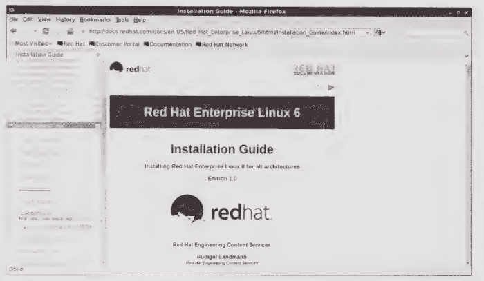

要访问红帽支持的完整软件范围，您需要在红帽网络（`RHN`）进行注册。之后，您可以配置访问名为“通道”（channels）的多个 `RHN` 存储库。

对于桌面应用程序，请启用红帽企业可选（Red Hat Enterprise Optional）软件通道。该存储库包含许多流行的桌面应用程序，如 OpenOffice.org 办公套件和 Thunderbird 电子邮件客户端。点击“系统”（System）页面，选择您的系统，然后点击“软件通道”（Software Channels）选项卡。在“通道注册”（Channel Enrollment）下，您将看到 `RHEL Server Options` 项。勾选它以启用对 `PackageKit` 的访问。

您可能还想启用红帽补充（Red Hat Supplementary）存储库，它包含 Java 软件以及 Adobe Reader 和 Flash 播放器。

## 第三方存储库：RPMforge 和 EPEL

`RHEL6` 有两个主要的第三方存储库：`RPMforge` 和 Extra Packages Enterprise Linux (`EPEL`) 存储库。`RPMforge` (`http://rpmrepo.org/RPMforge`) 提供了大多数第三方多媒体应用程序和解码器，如 `vlc` 媒体播放和 DVD 视频解码器。`EPEL` (`http://fedoraproject.org/wiki/EPEL`) 提供了流行的 Fedora 支持软件包，如 `BackupPC` 和 `Dia`。同时使用这两个存储库处理重叠软件时可能会出现不兼容情况，因为某些库和应用程序是重复的。建议使用其中一个，或者在使用另一个时禁用另一个。

### 获取 CD 和 DVD

要获取红帽 Linux 安装 CD 或 DVD，您可以购买订阅或申请为期 30 天的评估订阅，请访问以下网站。首先，您需要注册红帽网络并通过电子邮件验证您的订阅。注册后，您就可以下载红帽企业级 Linux DVD/CD，并使用 30 天评估订阅进行安装。

`https://www.redhat.com/rhel/details/eval/`


# 开源软件

Linux 根据自由软件基金会指定的 GNU 通用公共许可证（GNU General Public License）免费分发，任何想要使用它的人都可以获得。GNU（其缩写代表“GNU's Unix”）是由自由软件基金会发起并管理的项目，旨在为用户、程序员和开发者提供免费软件。Linux 受版权保护，并非公有领域软件。然而，GNU 公共许可证的效果与软件处于公有领域的效果大无相同。GNU 通用公共许可证旨在确保 Linux 保持免费，同时保持标准性。Linux 在技术上是操作系统内核——核心操作部分，且仅存在一个官方 Linux。

大多数 Linux 软件都是以开源形式开发的。这意味着任何应用程序的源代码都随程序一起免费分发。互联网上的程序员可以对软件包的开发做出贡献，修改并纠正源代码。Linux 是一个开源操作系统。它的源代码包含在所有的发行版中，并在互联网上免费提供。许多软件开发工作也是开源项目，例如带有大多数应用程序的 KDE 和 GNOME 桌面。由 Oracle 支持的 OpenOffice 办公套件是一个基于 Oracle Office 办公套件的开源项目。您可以在 http://www.opensource.org 找到更多关于开源运动的信息。

开源受公共许可证保护。这些许可证防止了商业公司通过添加自己的修改、对这些更改拥有版权并将软件作为自己的产品进行销售来控制开源软件。最流行的许可证是自由软件基金会提供的 GNU 通用公共许可证。这是 Linux 分发时遵循的许可证。GNU 通用公共许可证保留了版权，免费许可软件，但要求软件及其任何修改都必须免费提供。还创建了其他公共许可证以支持不同类型开源项目的需求。例如，GNU 许可的软件库。Qt 公共许可证 (QPL) 允许开源开发者使用对 KDE 桌面至关重要的 Qt。您可以在 http://www.opensource.org 找到完整列表。

Linux 目前受自由软件基金会提供的 GNU 公共许可证保护，通常被称为 GNU 软件（参见 http://www.gnu.org）。在 GNU 公共许可证的条款下，原作者保留版权，尽管任何人都可以修改并重新分发软件，前提是必须包含源代码、公开源代码并免费提供。此外，对于销售软件或免费赠送该软件没有任何限制。

# 桌面使用与配置

- 访问您的 Linux 系统
- 笔记本电脑的重要功能
- 桌面
- GNOME
- GNOME 配置
- 网络连接
- 桌面操作
- 显示配置
- 多媒体支持：MP3、DVD 视频和 DivX
- 终端窗口
- 命令行接口
- 帮助资源
- 在 Linux 上运行 Windows 软件：Wine

# 第一部分：桌面

使用 Linux 已经变得更加直观，拥有易于使用的界面，包括图形登录和 GNOME、 KDE 等桌面。即使是标准的 Linux 命令行界面也通过可编辑命令和基于光标的工具变得更加用户友好。要开始使用红帽企业级 Linux，您必须知道如何访问您的系统，一旦进入系统，就知道如何执行命令和运行应用程序。这可以通过默认的图形登录或命令行来实现。对于图形登录，会出现一个简单的屏幕，带有用于选择登录选项的菜单以及用于选择用户和输入密码的对话框。Linux 以提供易于访问的帮助文档而闻名。在登录后，可以快速获取关于任何命令的信息。

## 访问您的 Linux 系统

如果您安装了引导加载程序 `GRUB`，当您开启或重启计算机时，引导加载程序首先决定加载并运行哪个操作系统。在几秒钟内，`GRUB` 将显示一条消息，操作系统即将启动。这通常是红帽。

相反，如果您按下键盘上的任意键，引导加载程序将显示一个列出已安装操作系统的菜单。如果列出了 Windows 系统，您可以选择启动它。

支持命令行提示符和图形登录对话框。红帽 Linux 默认使用图形登录，向您显示一个对话框，让您选择登录的用户并输入密码。如果您选择不使用图形登录，将看到一个简单的命令行提示符输入用户名。

### 显示管理器：GDM

图形登录会显示一个窗口，其中有一个用户列表框。当您点击一个用户名时，一个框会替换列表，显示选定的用户名和一个输入密码的文本框。点击“登录”按钮或按回键，您将以选定的用户登录并启动桌面。

图形登录由 GNOME 显示管理器 (`GDM`) 处理。`GDM` 管理登录对话框，同时验证用户名称和密码并启动桌面。

从 `GDM`，您可以使用 `Ctrl-Alt-F2` 切换到命令行接口，然后切换回 `GDM`（从桌面您可以使用相同的键切换到命令行）。`F2` 到 `F6` 提供不同的命令行终端，例如通过 `Ctrl-Alt-F3` 进入第三个命令行。

当 `GDM` 启动时，它会显示用户列表（见图 2-1）。屏幕右下角的关机图标弹出菜单显示挂起、重启和关机项。日期显示在关机图标旁边。在日期旁边，可以点击辅助功能图标显示对话框，您可以从中选择辅助功能工具和特性，如屏幕键盘、增强对比度和屏幕放大镜。

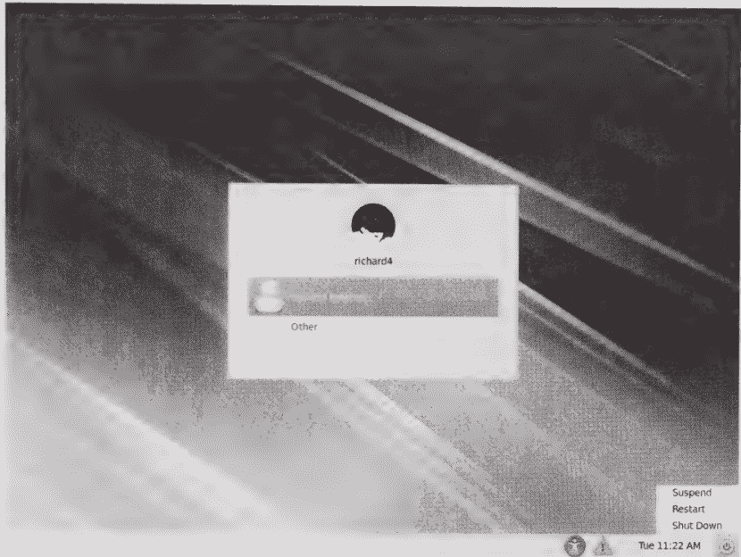

### 图 2-1：登录界面

要关机，点击登录，对于三台 RHEL6 系统，在关机图标菜单中选择“关机”（Shut Down）项。要重启，选择“重启”（Restart）项。你也可以直接从 GNOME 桌面关闭系统。在 GNOME 桌面上，点击系统菜单上的“关机”（Shut Down）项以打开关机对话框（系统 | 关机），然后点击“关机”按钮（见图 2-10）。如果你从用户桌面注销，将返回到 `GDM` 登录界面（系统 | 注销）。

要登录，请从用户列表中点击一个用户名。如果列表中没有列出该名称，点击“其他”（Other）项以打开一个可以在其中输入名称的对话框。随后系统会提示你输入用户密码（见图 2-2）。一个新对话框将取代用户列表，显示所选名称和一个可以输入用户密码的密码 文本框。然后点击“登录”（Log In）按钮或按回车键。默认情况下，GNOME 桌面将启动。

当你点击用户名登录时，底部面板会出现三个菜单：语言（Language）、键盘（Keyboard）和会话（Sessions）（见图 2-2）。你可以使用这些菜单选择其他语言、键盘和桌面界面进行使用。

从“会话”（Sessions）菜单中，你可以选择想要启动的桌面界面。菜单显示所有已安装的可能桌面界面。在这里你可以选择 KDE 来启动 KDE 桌面，而不是 GNOME。除非你已经安装了 KDE，否则不会显示 KDE 选项。

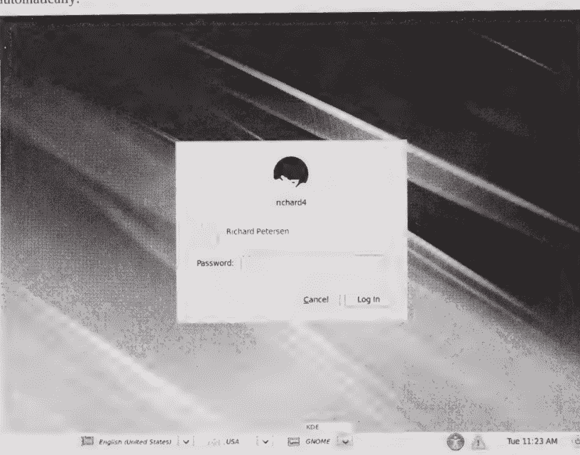

图 2-2：登录界面会话菜单

语言（Languages）菜单显示你当前使用的语言。点击“其他”（Other）项以打开列出你可以使用的其他语言的对话框。选择一个并点击“确定”按钮以更改界面使用的语言。

键盘（Keyboard）菜单显示当前键盘以及之前选择过的任何键盘。点击菜单中的“其他”（Other）项以打开列出可能键盘的对话框。选择一个并点击“确定”更改键盘。所选键盘也将列在“键盘”菜单中。

如果在启动服务或功能时出现任何问题，底部面板时间左侧会出现一个带有感叹号的三角形警告图标（见图 2-2）。点击此图标将打开一个列出启动消息的窗口，你可以通过滚动查看哪些服务在启动期间失败或出现问题。

提示：要使用键盘从登录界面重启系统，你必须先进入命令行界面。按下 `Ctrl-Alt-F2` 进入命令行界面，然后按下 `Ctrl-Alt-Del` 重启系统。

### GRUB 启动菜单和启动问题

当你启动时，程序开始前会显示几秒 `GRUB` 屏幕。如果你想启动不同的操作系统或为启动添加选项，你需要显示 `GRUB` 启动菜单（见图 2-3）。按下键盘上的任意键执行此操作。将显示 `GRUB` 菜单，列出 Linux 和指定的其他操作系统（如 Windows）。你的 Linux 系统默认会被选中。如果不是，使用方向键移动到 Linux 条目（如果它尚未被高亮），然后按回车键。

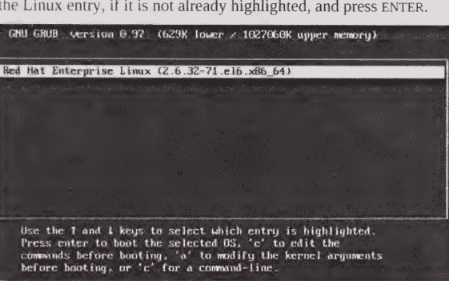

**图 2-3：** `GRUB` 菜单

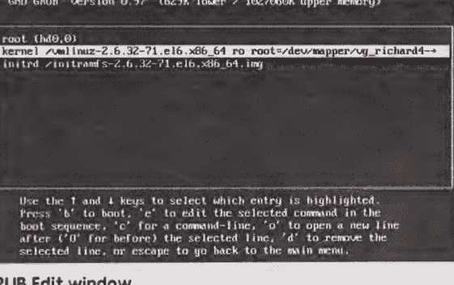

**图 2-4：** `GRUB` 编辑窗口

对于图形化安装，某些显示器可能难以运行名为红帽图形启动工具 `grub`。如果你遇到这个问题，可以编辑你的 Linux `GRUB` 条目，并删除 Grub 启动行末尾的 `quit` 终端。按下 `e` 键编辑 Grub Linux 条目（见图 2-4）。

然后将光标移动到 `kernel`（内核）行并再次按下 `e` 键。这将允许你编辑内核行。你将位于行末尾（见图 2-5）。使用退格键逐个删除 `rhub quiet` 项，然后按回车键确认你的编辑。你将返回到如图 2-4 所示的 `GRUB` 编辑窗口。按下 `b` 键启动编辑后的 `GRUB` 条目。


### 支持类 GRUB 的行编辑..对于第一个单词，按下 `TAB`
列出可能的命令补全，在其他地方 `TAB` 无法列出设备/文件名可能的
补全。随时按下 `ESC` 均取消。随时按下 `ENTER` 接受你的更改。
`@ctarycehg-subé6 KEYBOARD-TYPE-pc KEYBOARD-us crashher-auto rhub quiet|`

### 图 2-5：编辑 GRUB 行

你的系统最初将使用文本显示所有启动内容，然后切换到图形登录。

如果你在显示图形界面时遇到困难（X 服务器失败），你可以改为选择启动命令行界面（第 18 章）。从命令行界面，你可以进行任何必要的配置更改。要从 GRUB 启动到命令行界面，你需要编辑 Linux GRUB 条目的内核行，并在行末尾添加数字 `3`（见图 2-6）。`3` 表示运行级别（runlevel）。

```
### 支持类 GRUB 的行编辑..对于第一个单词，按下 TAB
列出可能的命令补全，在其他地方 TAB 无法列出设备/文件名可能的
补全。随时按下 ESC 均取消。随时按下 ENTER 接受你的更改。
@ctarycehg-subé6 KEYBOARD-TYPE-pc KEYBOARD-us crashher-auto rhub quiet|
```

### 图 2-6：命令行界面

## 重要功能

对于笔记本电脑，启动时会有两个两个功能：电源管理和网络支持。它们是自动配置的。对于电源管理，红帽发行版 6 使用电源管理器（第 9 章），电源图标将显示你的剩余电量。对于网络，RHEL6 使用网络管理器将检测可用网络。点击顶部面板上的网络图标将显示所有网络，以及自己的。

# 第 2 章：桌面使用和配置

### 桌面

两个桌面，GNOME 和 KDE 桌面 (KDE)，可以安装在 RHEL6 上。它们有自己的样式和外观。请记住 GNOME 和 KDE 界面看起来相似，但具有不同的配置工具。这些将在第 3 和 4 章中讨论。

GNOME 桌面是默认桌面，基础界面在本章讨论。

K 桌面环境 (KDE) 在屏幕底部显示面板，其操作方式与 GNOME 文件管理器非常相似。主菜单中有系统设置，通过该窗口你可以配置 KDE 环境的各个方面，例如桌面效果、工作空间外观、显示器和打印机等设备以及网络。

### GNOME

GNOME 桌面提供了易用的面板和菜单，以及灵活的桌面。你可以更改其外观，更改主题、添加面板、使用不同的视图，以及添加自己的小组件。

GNOME 还包含一个替代窗口管理器 Compiz，它可以提供 3D 桌面效果。要使用 Compiz，选择系统 | 桌面效果，然后点击“启用效果”。你可以选择窗口波动和工作空间立方体。

红帽企业 6 的默认 GNOME 主题是 Slider，带有 Slider 图标。其他主题可以通过主题管理器获取（外观对话框的主题选项卡）。

### GNOME 面板和菜单

RHEL6 桌面如图 2-7 所示，最初在屏幕顶部和底部显示两个面板，以及主文件夹和系统的文件管理器图标。顶部面板用于菜单、应用程序图标和信息任务（如时钟）。有三个菜单：

- 应用程序 有 Office 和 Internet 等项，这些子菜单将列出安装在系统上的应用程序。使用此菜单启动你的应用程序。
- 位置 此菜单让你轻松访问常用位置，如你的主文件夹、任何设备的桌面文件夹以及通过计算机访问设备和本地系统的文件系统。网络窗口让你访问其他系统上的共享文件系统和设备。菜单还包含搜索文件、访问最近使用的文档以及登录远程服务器（如 NFS 和 FTP 服务器）的项。该菜单分为四个部分：第一部分列出你的用户
文件夹；第二个显示你的计算机存储设备，如可访问的文件、DVD/CD-ROM 和 USB 驱动器；第三个显示访问其他系统共享文件夹的条目（网络）以及连接远程服务器的条目；最后一个显示文件访问工具，如最近文档或搜索文件和文件夹。

系统包含“首选项”（Preferences）和“管理”（Administration）菜单。“首选项”用于配置 GNOME 设置，例如桌面的外观和鼠标的行为。“管理”菜单包含所有 RHEL6 系统配置工具，用于执行管理任务，如添加用户、设置打印机、配置网络连接以及管理诸如 Web 服务器之类的服务。“文档”（Documentation）菜单包含发布说明。“管理”菜单还包含访问 GNOME 帮助系统（帮助）、GNOME 系统监视器中关于计算机的信息（关于此电脑）、锁定屏幕（锁定屏幕）、注销系统（注销）和关闭系统（关闭）的条目。

菜单旁边是应用程序图标，包括 Firefox Web 浏览器（小狐鼠和地球）、首选的邮件实用程序（默认为 Evolution）和 Gnote 备记本。点击其中一个即可启动应用程序。你也可以使用“应用程序”菜单启动其他程序。在面板右侧，你会看到日期/时间、用户切换器（用户名）、网络和通知区域的图标。当需要更新或出现安全问题时，通知区域将显示日期和安全图标。

底部面板用于交互式任务，如选择工作空间和固定应用程序（见图 2-7）。虚拟桌面的工作空间切换器以正方形的形式出现在面板右下方。点击正方形将移动到该工作空间。工作空间切换器右侧是垃圾桶图标，点击它可以查看垃圾桶中的项目。切换工作空间的键盘快捷键是 `Ctrl-Alt-arrow`，其中 `arrow`可以是左、右、上、下方向键（如果你有多行工作空间，则使用向上向下方向键）。右键点击工作空间切换器并选择“首选项”，可以打开设置窗口，你可以在其中增加工作空间的数量（增加工作空间和行的数量）。桌面支持使用组合键和鼠标点击的完全拖放功能（见表 3-1）。你可以将文件夹、图标和应用程序拖到桌面或其他管理器窗口中的其他文件夹中。移动操作是默认的拖拽操作（你也可以在拖拽时按住 `SHIFT` 键）。要复制文件，按按 `CTRL` 键，然后在释放鼠标按钮之前点击并拖动。要创建链接（快捷方式），在拖动你想让链接出现的地方（如桌面）时同时按住 `CTRL` 和 `SHIF` 键。

提示：你可以使用“显示桌面”小组件来最小化所有打开的窗口。你必须先将“显示桌面”小组件添加到面板。

# 第 2 章：桌面的使用与配置

| 图标 位置 菜单 菜单 | Firefox Web 浏览器 NetworkManager 用户切换器 |

| :--- | :--- | :--- | :--- | :--- | :--- |

| 应用程序 系统 主文件夹 桌面 文档 音乐 图片 视频 下载 计算机 205 GB 文件系统 网络 连接到服务器... 搜索文件 最近文档 周二 2月2 3:12 PM Richard Petersen |

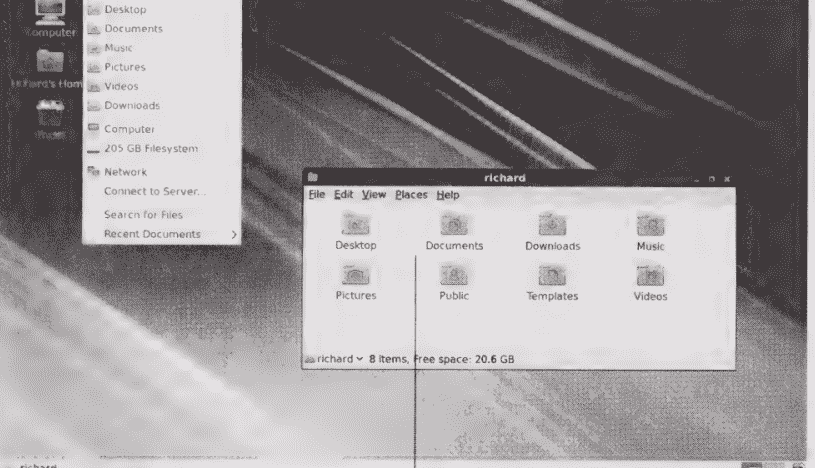

richard

文件 编辑 视图 位置 帮助

| 桌面 下载 音乐 | 图片 公共 模板 |

richard 8 个项目. 空闲空间: 20.6 GB

richard

文件管理器 工作空间切换器 垃圾桶

窗口列表

图 2-7：RHEL 6 GNOME 桌面

### GNOME 文件管理器

你可以通过“位置”菜单中的条目或通过双击桌面上的图标来访问你的主文件夹。将打开一个文件管理器窗口，显示你的主文件夹。你的主文件夹将为常用文件创建默认文件夹。这些文件夹包括图片、文档、音乐、视频和下载。

你的办公应用程序默认将文件自动保存到“文档”文件夹。图像和照片应用程序会将图像文件放在“图片”文件夹中。“桌面”文件夹将包含所有保存到桌面的文件。当你下载文件时，它会被放在“下载”文件夹。

在 Gnome 2.28 中，Nautilus 支持两种显示模式：浏览器模式和空间模式。默认情况下，Nautilus 窗口以空间视图显示。这提供了一个没有工具栏或侧边栏的简化显示（见图 2-8）。它的大部分功能已移动到菜单和弹出窗口，留出更多空间显示文件和文件夹。然而，你可以在浏览器视图中打开 Nautilus 窗口，它将显示传统的菜单栏和位置工具栏。

# 46 第 1 部分：桌面

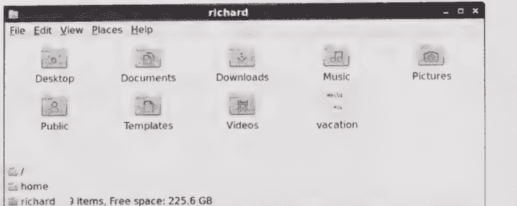

### 图 2-8：空间模式下的文件管理器

你可以通过右键点击文件夹并选择“浏览文件夹”以浏览器模式打开文件夹（见图 2-9）。在浏览器模式下，浏览器窗口显示多个组件，包括浏览器工具栏、位置栏和传统文件管理器中常见的侧边面板。当你打开一个新文件夹时，将使用同一个窗口显示它，你可以使用向后和向前的箭头移动到之前打开的文件夹。位置栏显示了你当前文件夹及其父文件夹的按钮。你可以点击父文件夹进行移动。点击向后箭头以显示完整路径中的所有父文件夹，回到系统顶层（根）文件夹（“位置”面板侧的“文件系统”）。

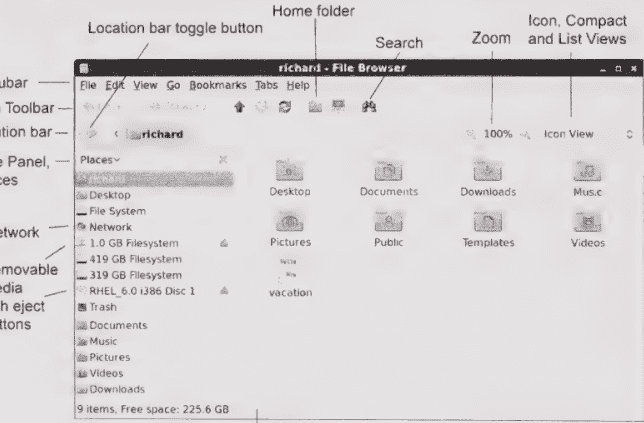

### 图 2-9：浏览器模式下的文件管理器

通过将 Nautilus 文件首选项中的“行为”设置为“始终在浏览器窗口中打开”，可以将 Nautilus 默认设置为浏览器模式。

# 第 2 章：桌面的使用与配置


GNOME 文件管理器还支持标签页。你可以在文件管理器窗口中打开多个文件夹。要打开新标签页，请从“文件”菜单中选择“新标签页”或按 `Ctrl-T`。你可以右键点击标签页以显示将标签页移动到右侧或左侧以及关闭标签页的菜单。要关闭标签页，点击标签页右侧的 `x` 按钮。你也可以使用 `Ctrl-Tab` 和 `Ctrl-PageDown` 键在标签页之间移动。使用 `Shift-Ctrl-PageUp` 和 `Shift-Ctrl-PageDown` 键重新排列标签页。

### 注销和关闭 GNOME

如果你想退出桌面并返回 GDM 登录界面，或者切换到不同的用户，可以从“系统”菜单中选择“注销”条目，显示带有“切换用户”、“取消”和“注销”按钮的对话框（见图 2-10）。点击“注销”退出账户，退出 GNOME 并返回登录界面，你可以再次以不同的用户登录。“切换用户”将让你保持登录状态并登录另一个用户。你的活动程序将在后台继续运行。

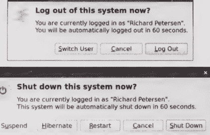

图2-10：GNOME 注销和关闭对话框，GNOME 桌面

如果你想关闭系统，从“系统”菜单中选择“关闭”（系统 | 关闭）。GNOME 显示一个带有“挂起”、“休眠”、“重启”、“取消”和“关闭”按钮的对话框（见图 2-11）。“关闭”是默认选项，并在几秒后自动执行。对话框将开始倒计时剩余时间。选择“重启”将关闭并重启系统。（你也可以打开终端窗口，以 root 用户登录 (`su`)，然后输入 `halt` 或 `reboot` 命令；`halt` 将关闭你的系统。）

### 用户切换

用户切换允许你切换到另一个用户，而无需注销或结束当前会话。用户切换作为 GNOME 桌面配置的一部分自动安装（见图 2-11）。用户切换位于顶部面板用户名的右侧。点击用户名将显示包含“账户信息”、“锁定屏幕”、“注销”和“切换用户”条目的菜单。“账户信息”条目打开用户的“关于我”首选项对话框。“锁定屏幕”将锁定你的屏幕并显示锁定屏幕提示。“注销”显示注销对话框，带有注销和切换用户按钮。

# 第1 部分：桌面


### 图 2-11：用户切换器面板应用程序菜单

用户切换器菜单中的“切换用户”（Switch User）选项以及注销对话框中的“切换用户”按钮将允许从当前用户切换出，并运行 GDM 以显示你可以登录的用户列表。对于已经登录的用户，其名称旁边旁会显示一个复选标记（见图 2-12）。点击名称将弹出密码提示并显示登录菜单（见图 2-13）。你可以作为该用户登录。已登录用户的会话将继续保持用户切换时时打开的窗口和运行的程序。你可以在已登录的用户之间来回切换，所有用户都会保留其会话。当你从某个用户切换出时，该用户运行的程序将在后台继续运行。


### 图 2-12：用户切换器登录对话框

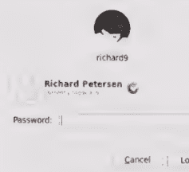

### 图 2-13：用户切换器登录

# 第2章：桌面的使用与配置 49

## GNOME 应用程序

GNOME 应用程序是运行在你的面板上的小程序。要向面板添加应用程序，请右键点击面板上的空白处，并从弹出菜单中选择“添加到面板”（Add to Panel）选项。这会打开“添加到面板”对话框，其中列出了所有可用应用程序（见图 2-14）。一些实用的应用程序包括字典查询、系统监视器、CPU 频率调整监控器、运行应用程序和搜索文件。对于许多应用程序，你需要进行一些配置。右键点击应用程序并从弹出菜单中选择“偏好”（Preferences）。这将打开该应用程序的偏好窗口，你可以在其中更改设置。

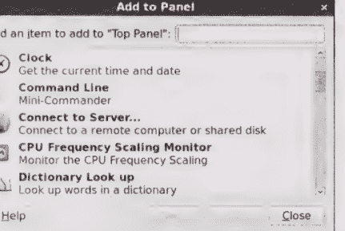

图 2-14：用于添加应用程序的 GNOME 添加面板窗口

图 2-15 显示了一些更常用的应用程序。它们使用分隔线（分隔符应用程序）被组织成类别。在 Gnote 备忘本按钮之后的前三个是通过右键点击“应用程序”菜单中的应用程序条目并选择“添加到面板”添加到面板的应用程序。这些是 Gedit 编辑器、gThumb 图像查看器和 GNOME 电影播放器。随其后的是从“添加到面板”窗口添加的应用程序。首先是关机、注销和运行应用程序的按钮。接下来是搜索文件、CPU 频率监控器和系统监视器。然后是跟随你鼠标移动的眼睛图标。在添加的应用程序之后，显示的是标准的 GNOME 应用程序，从通知区域开始，依次是声音应用程序、网络管理器、电源管理器（在本例中显示了电池电量）、天气-日期-时间（国际时钟）和用户切换器（用户名）。


图 2-15：在顶部面板添加的 GNOME 应用程序

### GNOME 配置

你可以使用系统菜单中偏好菜单列出的应用程序来配置 GNOME 界面的不同部分。选择一个会打开一个以应用程序名称命名的对话框，例如鼠标偏好。“外观”对话框提供了对主题、背景和字的配置（System | Preferences | Appearance）。你使用“背景”选项卡选择背景颜色或图像，使用“字体”选项卡选择桌面字体并设置大小，并使用“主题”选项卡选择主题。

要配置屏幕保护程序，在 System | Preferences | Screensaver 中选择屏幕保护程序对话框，它允许你启用/禁用锁定屏幕和空闲时间。

对于声音配置，偏好对话框允许你对设备、应用程序和声音效果进行详细配置（见第 6 章）。

对于键盘，你可以设置重复频率、布局并允许数字键盘作为指针使用。

你可以为左手或右手机配置鼠标按钮，调整鼠标移动速度并配置触控板（对于笔记本电脑）。

注意：新字体由 PackageKit 自动安装。当你打开一个包含未安装字体的文档时，PackageKit 会自动调用，对话框将提示你安装字体。

### 配置个人信息

要设置个人信息（包括用于登录界面的图标），你可以使用“关于”。在 RHEL 桌面上，在 System | Preferences 菜单中选择“关于”（About Me）条目，或者在顶部面板右侧的用户切换器应用程序中选择账户信息。“关于”对话框允许你设置用于桌面应用程序的登录信息的个人信息，以及更改密码（见图 2-16）。每个用户都可以设置他们的个人信息，包括他们想要代表自己的图标或图像。

（注：此处原文文本存在逻辑混乱和重复，已根据逻辑进行整合翻译）

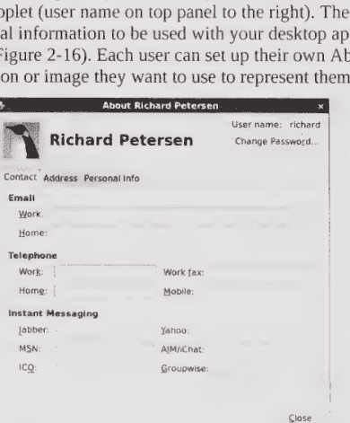

图 2-16：关于：System | Preferences | About Me

点击左上角的图标会打开浏览器窗口，你可以在其中选择个人图像。默认选择了“图片”文件夹，显示了若干图像。选中的图像显示在右侧。对于个人照片，你可以选择图片文件夹。这是你主文件夹上的图片文件夹。你应该在那里放置照片或图像，它将显示在显示用户的登录屏幕上。

如果你想更改密码，可以点击“关于”对话框右上角的“更改密码”按钮。三个选项卡：联系、地址和个人信息允许你添加和更改详细信息。在“联系”选项卡上，你可以输入电子邮件、电话号码和即时消息地址。在“地址”选项卡上，你可以输入；在“个人信息”选项卡上，你可以列出 Web 地址。完成更改后点击“关闭”。

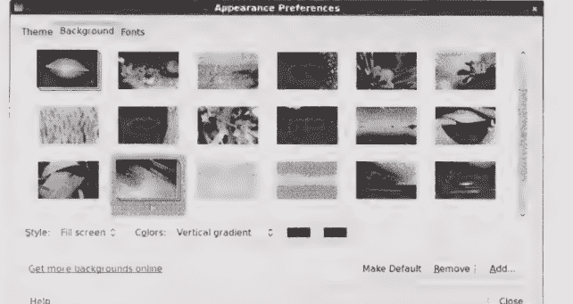

图 2-17：偏好设置中的桌面背景

### 桌面

你使用偏好对话框中的“背景”选项卡来选择或自定义你的桌面背景（见图 2-17）。你可以通过两种方式访问此对话框：在桌面背景的任何地方右键点击并从桌面菜单中选择“更改桌面”，或者选择 System | Preferences | Appearance 然后选择“背景”选项卡。在这里列出了已安装的背景。要添加自己的图像，可以将图像文件拖放到“背景”选项卡，或点击“添加”按钮来定位并选择图像。要删除图像，选择它并点击“删除”按钮。

从“样式”下拉菜单中，你可以选择显示选项，如缩放、居中、等比、平铺或全屏。居中或等比图像将保持图像比例。全屏可能会扭真图像。未填充的空间（例如居中或等比图像）将用桌面颜色填充。从“颜色”下拉菜单中，你可以将桌面颜色设置为纯色、水平渐变或垂直渐变。

初始只列出 Red Hat 背景。安装 `gnome-backgrounds` 包添加 GNOME 背景集。要从 http://art.gnome.org/backgrounds 下载更多背景，点击“获取更多背景”链接。点击按钮显示图像，右键点击图像并选择“设置为桌面背景”。

### GNOME 国际时钟：时间、日期和天气

国际时钟应用程序位于面板右侧。它显示你所在地区的当前时间和日期，可以修改为显示当地天气以及世界任何地方的时间和日期。日历显示当前日期，但你可以使用月份和年份箭头移动不同的月份和年份。

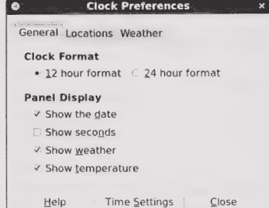


图 2-18：在国际时钟上选择位置

要添加位置，右键点击面板上的时间并从弹出菜单中选择“偏好”。时钟偏好窗口显示三个选项卡：常规、位置和天气（见图 2-18）。要添加新位置，选择“位置”选项卡并点击“添加”按钮。这会打开一个窗口，你可以在其中输入位置名称、时区和坐标。要指定位置，只需在“位置名称”框中输入其名称。当你开始输入时，会自动出现一个带有可能完成内容的下拉菜单。随着你的输入，可能的位置列表会减少，从而缩小选择范围。当下拉菜单显示你所需的位置时，选择它。该位置的时区、纬度和经度将为你添加。

在“天气”选项卡上，你可以指定使用的温度和风力单位。

在“常规”选项卡上，你可以设置时钟格式（12或24小时制）以及面板显示选项以显示日期、秒、天气和温度（见图 2-18）。“时间设置”按钮会打开一个对话框，用户可以在其中手动设置日期和时间。使用日历上方的月份和年份箭头更改月份和年份。要设置整个系统的时间，可以点击“设置系统”按钮。

## 第 2 章：桌面使用与配置

要查看您选择的位置，请点击顶部面板上显示的时间（参见 2-19）。这将打开一个日历，其中“位置”区域底部带有一个可展开的箭头。点击此箭头可显示您所有的位置、时间和天气。您的主位置旁边会出现一个房屋图标。世界地图将您的位置显示为红点，蓝色的房屋图标显示您的当前位置。


图 2-19：国际时钟，全显示

当您点击位置条目时，相应的 dock 栏将闪烁几秒钟。每个位置还会显示一个较小的天气图标，指示大致天气情况，如太阳或云朵。要查看天气详情，将鼠标悬停在天气图标上，弹出的对话框将显示当前天气、温度、风速以及日出和日落时间。每个位置的时钟图标根据该位置当天的时间显示深色、灰色或亮色。

提示：随着大显示器和高分辨率变得普遍，用户发现一个实用的功能是可以增大桌面字体大小。要增大字体大小，请从“系统 | 偏好设置 | 外观”访问“字体”选项卡。

您可以通过点击想要设置为主位置的位置右侧的“设置”按钮来轻松更改您的主位置。房屋图标将移动到世界地图上的对应位置。这在您旅行时很有帮助。主位置以外的其他位置都有“设置”按钮，该按钮是隐藏的，直到您将鼠标悬停在时间显示的右侧。

要进行任何更改，请点击“位置”标签旁“编辑”按钮。这将打开“时钟偏好”窗口，您可以在其中配置显示或添加和删除位置。

# 第 1 部分：桌面

提示：快捷键对话框（系统 | 偏好设置 | 快捷键）允许您为常用任务（如启动网络浏览器）选择快捷键。某些键已分配。

### GNOME 屏幕保护程序

在 GNOME 屏幕保护程序偏好对话框中，您可以控制计算机何时被认为空闲，以及如果保存什么屏幕保护程序（参见图 2-20）。您还可以控制在空闲时是否锁定屏幕。从“系统 | 偏好设置 | 屏幕保护程序”访问屏幕保护程序偏好对话框。可以通过取消勾选“计算机空闲时激活屏幕保护程序”来关闭屏幕保护程序。

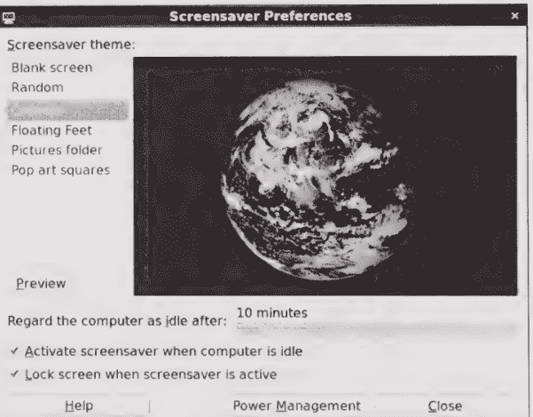

图 2-20：GNOME 屏幕保护程序

### 网络连接

网络连接将由 Network Manager 为您设置，它会自动检测有线和无线连接。Network Manager 提供连接状态信息，并允许根据需要轻松从一个配置连接切换到另一个。对于初始配置，它会尽可能检测有关新连接的信息。它作为 GNOME 面板应用程序运行，监控您的连接。

Network Manager 是用户特定的。有线连接会自动启动。对于无线连接，当用户登录时，Network Manager 会选择该用户偏好的连接。用户可以从检测到的无线网络菜单中选择要使用的无线连接。

## 第 2 章：桌面使用与配置

Network Manager 在顶部面板右侧显示一个网络应用图标。Network Manager 应用图标会根据连接类型和连接状态而变化。以太网（有线）连接将显示交错的条形图（参见图 2-21）。如果没有激活的连接（无线或有线），将显示一个带有重叠显示器红色标记的图标。当 Network Manager 建立有线或无线连接时，它会显示圆形节点图。如果您有有线连接且该连接处于激活状态，将使用有线连接图像（重叠显示器）。


### Network Manager 有线连接

对于连接到有线网络（如以太网连接）的计算机，Network Manager 会自动检测并建立连接。大多数网络使用 DHCP 自动提供 IP 地址和网络服务器等网络信息。对于此类连接，Network Manager 在每次启动系统时自动连接到您的网络。网络连接将标记为类似 `eth0` 的名称，`eth0` 是系统上实际的以太网网络设备名称。当连接时，会短暂显示“连接已建立”的消息，所示。


Network Manager 面板图标将显示两个重叠的显示器，所示。

当您左键点击 Network Manager 图标时，弹出菜单显示仅具有有线网络设备（无无线）或禁用无线连接的连接，将仅显示“有线网络”连接和“VPN 连接”子菜单，所示为 System `eth0`（参见图 2-22）。

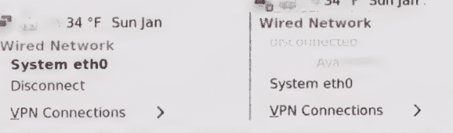

#### 图 2-22：网络连接菜单：连接和断开

要断开有线连接，可以选择此菜单上的“断开”条目。菜单将显示您已断开。有线连接将作为连接选项显示，面板图标显示红色标记。

# 第 1 部分：桌面

（注：后续重复内容已根据要求过滤）

#### Network Manager 连接：连接和断开

（此处为结构翻译示例）

要断开有线连接，可以选择此菜单上的“断开”条目。菜单将显示您已断开。有线连接将作为连接选项显示，面板图标显示红色标记。要进行任何更改，请点击“位置”标签旁“编辑”按钮。这将打开“时钟偏好”窗口，您可以在其中配置显示或添加和删除位置。

# 58 第 1 部分：桌面

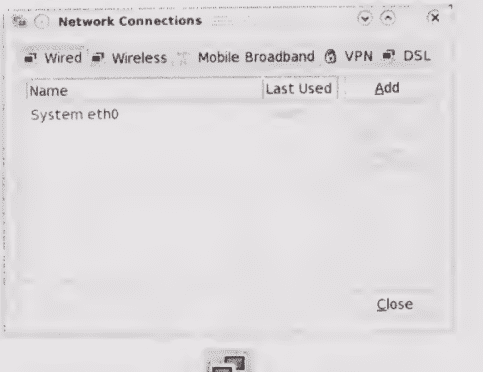

图 2-25：KDE 网络管理器（Network Manager）图标和对话框

无线连接也可以隐藏。这些是不广播 SSID 的无线连接，使得它们无法通过自动扫描检测到。要连接到隐藏的无线网络，需要在网络管理器菜单上选择“连接到隐藏的无线网络”（见图 2-26）。“连接”下拉菜单将选择该新条目。如果您之前设置过任何隐藏连接，它们也会列在“连接”下拉菜单中。对于新连接，输入无线网络名称并选择安全方法。在这两种情况下，系统都会提示您输入网络密钥密码。

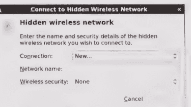

图 2-26：连接到隐藏的无线网络

## 网络管理器选项

右键点击网络管理器面板图标，可以显示相应的条目以编辑连接（编辑连接）、关闭连接（启用网络和启用无线）、禁用所有网络访问（启用网络）或查看您的连接信息（连接信息）（见图 2-27）。同时具有有线和无线连接的计算机将将有“启用网络”和“启用无线”的条目。取消勾选“启用”将仅断开无线连接，保持有线连接激活状态。“启用无线”复选框将取消勾选，并显示消息告知您的无线连接已断开。取消勾选“启用网络”将禁用您的有线连接以及任何无线连接。这样做可以离线工作，无需任何网络访问。仅带有有线网络设备（无无线）的计算机将仅显示“启用网络”条目。

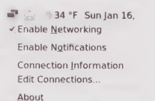

图 2-27：网络管理器选项

### 桌面操作

在设置桌面时，您可能希望利用某些桌面操作。这些包括为高分辨率显示器增大字体、刻录 CD/DVD 光盘、在桌面上搜索文件、使用 USB 驱动器等可移动介质以及访问远程主机。

### 搜索文件

RHEL6 桌面提供了两个主要的搜索工具，“搜索文件”和 GNOME 文件管理器搜索。

### 搜索文件

“搜索文件”工具执行文件搜索（见图 2-28）。它是 Linux `grep`、`find` 和 `locate` 工具的 GNOME 前端。从“位置”中选择“搜索文件”，并输入您想要搜索的模式（位置 | 搜索文件）。文件匹配字符（通配符）将有所帮助，例如使用星号 `*` 进行名称完成，或使用括号 `[]` 指定可能的字符或数字范围。

| 找到 1 个结果 - 搜索文件 |

| :--- |

| 名称内容: vaca |

| 在文件夹中查找: richard |

| 选择更多选项 |

| 包含文本：was 删除 |

| 可用选项：修改日期早于 添加 |

| 搜索结果：找到 1 个文件 |

| 名称 文件夹 大小 修改日期 |

| vacation reason 38 bytes 纯文本文档: EST 2011年6月16日 周日 06:00:16 AM |

| 帮助 关闭 查找 |

图 2-28：搜索文件


# 第 2 章：桌面使用与配置

在“名称内容”文本框中输入要搜索的模式，然后从“在文件夹中查找”下拉菜单中选择要搜索的文件夹或文件系统。默认选择用户主目录。然后，您可以选择指定高级选项，例如使用“包含文本”框搜索文本文件的内容（grep），或指定额外的文件特征，如日期、大小或所有者类型（find）。您可以使用正则表达式来搜索文件名。

## GNOME 文件管理器搜索

GNOME 文件管理器为显示的文件夹中的文件提供了快速搜索功能。在显示文件和文件夹图标或列表的文件管理器主面板中，只需输入您想要搜索的模式即可。窗口右下角的文本框会显示您的模式，您可以在其中添加内容。第一个匹配的文件或文件夹将被选中并高亮显示。选择会随着您编辑模式而变化。

GNOME 文件管理器搜索工具允许您输入搜索模式进行搜索，您可以通过指定位置和文件类型来精炼搜索。搜索工具仅在“浏览视图”中可用。点击工具栏上的搜索按钮（双远镜图标）将 URL 框用作搜索框，或者转到“搜索文件”。输入要搜索的模式并按回车。结果将显示（见图 2-29）。文件夹窗口中会出现位置和文件类型的下拉菜单，并带有 `+` 按钮用于添加更多位置或删除文件类型参数。搜索从打开的文件夹开始，但您可以指定另一个文件夹进行搜索（位置菜单）。要同时搜索多个文件夹，请点击 `+` 按钮为每个文件夹添加“位置”菜单并指定该文件夹。您可以对多个文件类型执行相同操作，仅搜索特定类型。

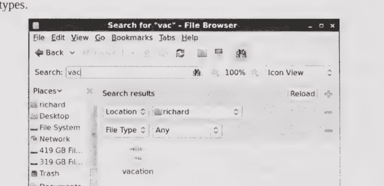

图 2-29：GNOME 文件管理器搜索

## 使用可移动设备和介质

CD 和 DVD 光盘、USB 存储盘、数字相机和软盘等可移动介质以图标的形式显示在桌面上。当您将介质放入设备时，这些图标就会出现。要打开光盘，双击其图标。

红帽支持数字相机、读卡器、USB 驱动器和软盘等可移动设备。这些图标显示在您的桌面上。要打开光盘，双击其图标并在文件管理器中显示它。要弹出光盘，右键点击其图标从弹出菜单中选择。

## 使用 GNOME (Brasero) 刻录 DVD/CD

GNOME 使用 Brasero 光盘刻录程序执行刻录操作。Brasero 集成在 GNOME 中，让您可以使用 GNOME Nautilus 文件管理器刻录光盘数据，并通过 GNOME 桌面菜单访问 DVD/CD 光盘操作，如复制、删除和检查（右键点击 DVD/CD 光盘桌面图标）。

### 文件管理器 CD / DVD 创建器界面

使用 GNOME 文件管理器将文件数据刻到 DVD 或 CD 非常简单，只需将文件拖到空白的 CD 或 DVD 并点击“写入光盘”（Write To Disc）按钮。当插入空白 DVD/CD 时，会打开一个标记为“CD/DVD 创建器”的窗口。要刻录文件，只需将其拖入窗口。准备好刻录 DVD/CD 后，点击“写入光盘”按钮。将打开 Brasero 光盘设置对话框，执行实际的写入操作。此外，点击“属性”（Properties）按钮可以打开带有刻录选项的对话框，例如速度。

### 从桌面刻录 ISO 镜像

GNOME 桌面也支持使用 Brasero 刻录 ISO 镜像。双击 ISO 镜像或右键点击文件并选择“使用 Brasero 打开”（Select with Brasero）（图 2-31）。这将打开“镜像刻录设置”对话框，提示您先向 CD/DVD 刻录机插入空白 CD 或 DVD。

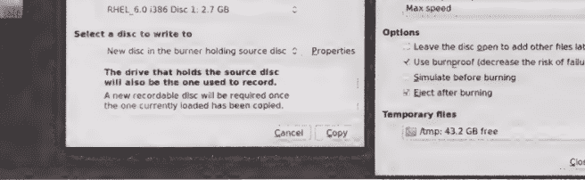

图 2-31：在 GNOME 面上复制 CD/DVD 光盘 (Brasero)

### GNOME 桌面 CD / DVD 操作

复制、删除和检查直接使用集成在 GNOME 中的 Brasero CD/DVD 刻录机。插入光盘后，右键点击其 CD/DVD 桌面图标显示包含“复制”和“检查光盘”项的菜单。选择“复制”将启动 Brasero 复制对话框（图 2-31）。

您可以选择将 ISO 镜像写入另一个光盘。对于 ISO 镜像文件，“属性”对话框允许您选择保存文件的文件夹。对于复制到另一个光盘，“属性”对话框允许您选择刻录速度以及选项，如使用防刻录或先进行模拟。“检查光盘”将检查光盘的完整性，并在可用时使用光盘的 md5 文件进行检查。CD/DVD RW 光盘的菜单还会显示“空白”项，这将擦除光盘。

### Brasero 光盘刻录程序应用程序界面

对于更复杂的 DVD/CD 刻录，您可以使用 Brasero DVD/CD 刻录程序界面（见图 2-32），路径为应用程序 | 音频与视频 | Brasero 光盘刻录程序。Brasero 支持拖放操作创建音频 CD。它还可以处理 CD/DVD 读写光盘、擦除光盘，并支持多会话刻录以及向 DVD/CD 光盘添加数据。最初，Brasero 会显示一个您要创建的项目类型的对话框。您可以创建数据或音频项目、创建 DVD/视频光盘、复制 DVD/CD 或刻录 DVD/CD 镜像文件。

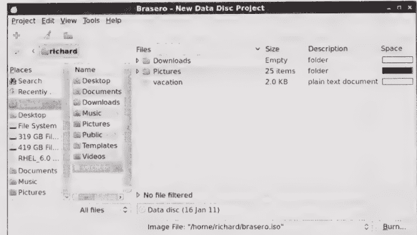

图 2-32：使用 Brasero 刻录 DVD/CD

对于项目，工具栏显示一个“添加”按钮，您可以使用它选择文件和文件夹作为光盘。您也可以将文件和文件夹拖放到数据列表（右侧面板）。您可以选择显示侧边栏（视图菜单），这将让您选择文件和文件夹。

## 显示配置

您的桌面显示器界面由 X Window 系统实现。RHEL6 使用的版本是 X.org（X.org 为各种显卡和显示器提供了自己的驱动程序）。您可以在 http://www.x.org 找到更多关于 X.org 的信息。

X.org 会自动检测硬件 `/etc/X11/xorg.conf` 文件不再用于开源驱动（nv 和 ati）。专有驱动在很大程度上仍使用它，尽管会忽略鼠标和键盘项。显示器信息是自动确定的。如果您想更改屏幕分辨率，可以使用系统 | 偏好 | 显示中的显示对话框。如果您有一个未被正确识别的旧显示器，可能需要通过编辑 `/etc/X11/xorg.conf` 文件来指定显示器信息。

如果显示配置因某些原因失败，可以使用 `CTRL-BACKSPACE` 重启 X 服务器。重启 X 服务器的 `CTRL-ALT-BACKSPACE` 键默认禁用，请使用键盘布局选项对话框中的“杀死服务器的按键序列”来启用它（系统 | 偏好 | 键盘，布局选项卡）。

### 分辨率偏好：RandR

RHEL6 上的 Linux X 驱动支持用户级的分辨率和方向更改。任何用户都可以指定自己的分辨率或方向，而不影响其他用户的设置。显示偏好对话框提供了一个简单的界面，用于旋转、分辨率以及选择添加显示器，允许对连接的多个显示器进行克隆或扩展显示。通过选择系统 | 偏好 | 显示 打开显示偏好对话框（见图 2-33）。从下拉菜单中，您可以设置分辨率、刷新率和旋转。选择分辨率后，点击“应用”。新分辨率将通过一个对话框显示，对话框带有带有按钮，询问您是保留新分辨率还是返回到上一个分辨率。您可以使用“检测显示器”按钮来检测连接到您系统的任何其他显示器。“在面板中显示显示”复选框将在顶部面板中的每个显示器显示一个按钮，让您轻松在它们之间切换。

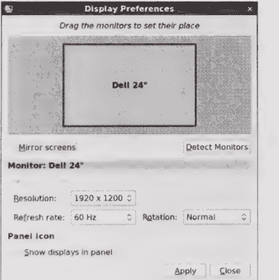

图 2-33：显示器偏好

### GDM 自动登录

您可以使用多种 GDM 选项来手动配置自动登录。编辑 `/etc/gdm/custom.conf` 文件创建 `[daemon]` 段：

```
[daemon]
TimedLoginEnable=true
TimedLogin=myuser
TimedLoginDelay=10
```

首先启用 `TimedLogin` 功能。然后指定要自动登录的用户。`TimedLoginDelay` 通常为 10 秒；如果注销，将始终登录该用户。

只有 root 用户可以编辑此文件。使用 `su` 登录 root 用户，然后使用 `nano` 等编辑器编辑 `gdm/custom.conf`。GDM 将显示此用户。

### 视频驱动

由于 Nvidia 和 ATI 驱动的开源，RHEL6 上的 Xorg 和 Nouveau 开源版本变得有效，特别是对于 2D 显示。当您安装系统时，已检测并配置了正确的驱动程序。对于普通使用，您可能不需要供应商支持。

- `xorg-x11-nouveau`
- `xorg-x11-ati`
- `xorg-x11-nv`

## 多媒体支持：MP3、DVD视频和 DivX

由于许可和限制，RHEL6 发行版不包含 MP3、DVD视频或 DivX 媒体支持。安装 RHEL 后，无法播放 MP3 文件、DVD 光盘或 DivX 文件。RPMForge (http://rpmrepo.org/RPMForge) 为这些格式提供了必要的库和软件列表。软件包都是 RPM 包，在下载并安装 RPMForge 存储库配置包后可以使用 YUM 安装。

可以使用 RPMForge 存储库中的开源 DivX Xvid (`xvidcore`) 获取 DivX 支持。它可以播放 DivX 文件。


这些限制也适用于 Fedora Linux，您可以检查 http://fedoraproject.org/wiki/ForbiddenItems 获取禁用项目列表。

# 第2章：桌面使用与配置

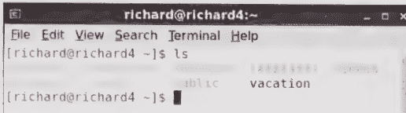

图 2-34：终端窗口

终端窗口会记住你之前输入的命令。使用方向键和方向键可以在命令行上循环显示这些命令。按回车键（`ENTER`）可以重新执行当前显示的命令。你甚至可以在运行之前对命令进行编辑，允许你执行之前某个命令的修改版本。如果你需要使用不同的参数重新执行一个复杂命令，或者你输错了复杂命令并想在不重新输入整个命令的情况下进行纠正，这会非常有帮助。终端窗口将显示你该会话之前的所有交互和命令。使用滚动条查看你之前运行过的任何命令及其显示结果。

你可以根据需要打开许多终端窗口，每个窗口都在它自己的 shell 中运行。你不需要为每个新 shell 打开单独窗口，可以使用标签页面板（tab panels）在同一个窗口中打开多个标签页。从“文件”（File）菜单中选择“打开标签页”（Open Tab）可以打开新窗口（`Shift-Ctrl-t`）。每个标签页运行一个独立的 shell，允许你在每个其中输入命令（见图 2-35）。你可以使用“标签页”（Tabs）菜单在标签页之间移动，或者点击其标签来选择它。只有在打开了多个标签页时才会显示标签菜单。对于单个窗口，不显示标签菜单。

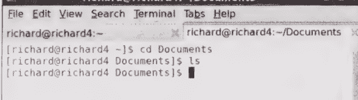

图 2-35：带有标签页的终端窗口

终端窗口还支持 GNOME 桌面的剪切/复制和粘贴操作。你可以从网页或在编辑时复制一行，并将其粘贴到终端窗口中（你可以使用终端窗口“编辑”（Edit）菜单上的“粘贴”（Paste）选项，或按 `Shift-Ctrl-v`）。命令将会出现，然后你可以按回车键执行该命令。这对于说明性网页上显示的命令行操作非常有用。你不需要自己输入复杂的命令，只需直接从网页选择并复制，然后粘贴到终端窗口即可。你也可以在执行之前对命令进行任何编辑。

你可以使用配置文件（profiles）自定义终端窗口。系统已经设置了一个默认配置。你可以创建带有自定义偏好的新配置。要自定义你的终端，从“编辑”（Edit）菜单中选择“配置文件偏好”（Profile Preferences）打开一个窗口，设置你的配置选项标签页：通用（General）、标题与命令（Title and Command）、颜色（Colors）、背景（Background）、滚动（Scrolling）和兼容性（Compatibility）。窗口标题栏列出了你当前的配置。如果你没有设置并选择另一个配置，这将是默认配置（见图 2-36）。在“通用”标签页上，你可以按行数选择终端窗口的默认大小。“滚动”标签页指定了终端历史将保留的命令行数。这些是你可以回溯并选择重新执行的行。你可以将其设置为无限制以保留所有命令。你还可以将滚动条放置在右侧或左侧。

你的终端窗口将被设置为黑色背景配白色文本。要更改此设置，请编辑配置文件并在“颜色”（Colors）标签页上更改背景和文本颜色。取消勾选“使用系统主题颜色”（Use colors from system theme）选项。这将启用“内置方案”（Built-in schemes）菜单，你可以从中选择“白底黑字”（Black on white）显示。其他颜色组合还列有“黄底黑字”（Black on light yellow）和“黑底绿字”（Green on black）。“自定义”（Custom）选项允许你选择自己的文本和背景颜色。终端窗口上的颜色将根据你的选择而改变，让你看到效果。

如果你想要透明或图像背景，请使用“背景”（Background）标签。初始背景将设置为实色（在“颜色”标签上选择的颜色）。要使用图像，选择“背景图像”（Background image）项然后选择一个图像文件。对于透明背景，选择“透明背景”（Transparent background）项然后设置阴影量（无为完全透明，最大不透明）。

要创建新配置，从“文件”（File）菜单中选择“新建配置”（New Profile）。这将打开一个列出当前配置的配置文件窗口。点击“新建”（New）按钮打开新建配置窗口，你可以在其中输入配置名称并选择基础配置。初始将选择默认配置。要编辑配置，从“编辑”（Edit）菜单中选择“配置文件”（Profiles）打开配置列表列表窗口，并点击“编辑”（Edit）按钮打开该配置的编辑窗口。

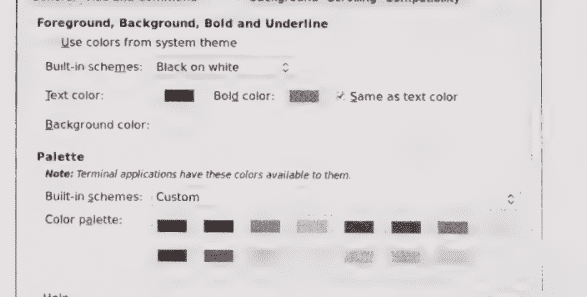

图 2-36：终端窗口配置

## 命令行界面

使用命令行界面时，你会得到一个简单的提示符，并在其中输入命令。即使有桌面，你有时也需要在命令行上执行命令。“终端”（Terminal）实用程序打开一个终端窗口，提供命令行界面。可以通过“应用程序（Applications） | 系统工具（System Tools） | 终端（Terminal)”访问。如果你频繁使用终端，可能希望将菜单项拖到桌面，为终端窗口创建一个图标。

Linux 大量使用选项（options）和参数（arguments）。注意在命令行上按正确的顺序放置你的参数和选项。Linux 命令的格式是命令名，后跟选项，然后是参数，如下：

```
$ command-name options arguments
```

选项是一个以一个或两个连字符开头的单字母代码，用于修改命令执行的操作类型。选项和参数可以是可选的也可以是强制的，取决于命令。例如，`ls` 命令显示文件夹中的文件列表，而 `-s` 选项以块为单位添加每个文件的大小。你在命令行上输入命令及其选项的方式为：

```
$ ls -s
```

你也可以在执行它之前对命令进行任何编辑。

### shutdown -h now

提示：关机涉及一系列重要操作，例如卸载文件系统和关闭任何服务器。你不应该简单地关掉电源，尽管它通常可以恢复。

你也可以在登录提示符处按住 `CTRL` 和 `ALT` 键并按下 `DEL` 键 (`CTRL-ALT-DEL`) 来强制系统重启。你的系统将通过标准关机程序并重启计算机。

### 帮助资源

你的系统中已经安装了大量的支持文档，也可以从在线源访问。表 1-2 列出了你的红帽企业级 Linux 系统上可以访问的帮助工具和资源。

| 资源 | 描述 |
| --- | --- |
| KDE 帮助中心 | KDE 工具，用于 KDE 桌面和应用程序文档、Man 页面和 info 文档的桌面界面。系统帮助 |
| GNOME 帮助浏览器 | GNOME 帮助，用于访问 GNOME 桌面和应用程序文档、Man 页面和 info 文档的桌面界面 |
| `/usr/share/doc` | 应用文档的位置 |
| `man` 命令 | Linux Man 页面，Linux 命令的详细信息，包括语法和选项 |
| `info` 应用 | GNU info 页面，关于 GNU 应用的文档 |

### 表 2-2：帮助资源

### GNOME 和 KDE 帮助中心

GNOME 和 KDE 桌面都采用使用类似浏览器的界面显示帮助文件的帮助系统。要启动 GNOME 浏览器，选择系统菜单（系统 | 帮助）中的条目。然后你可以从桌面用户指南、GNOME 辅助功能指南和 GNOME 系统管理指南中选择（见图 2-37）。侧边是不同类别的手册，如互联网、声音与视频和系统。还为 Totem 电影播放器和 PackageKit 等应用程序提供了手册。你还可以显示 Linux Man 页面（手册页）和 GNU info 页面。GNOME 帮助浏览器和 KDE 帮助中心还整合了浏览器功能，包括你查看的文档的书签和历史列表。

## 上下文相关帮助

GNOME 和 KDE 以及其他应用程序还提供了上下文相关帮助。每个 KDE 和 GNOME 应用程序都具有通过其各自的帮助浏览器显示的详细手册。此外，许多系统管理工具对每个任务都提供了详细的解释。

# 第 1 部分：桌面

## 应用文档

在你的系统中，`/usr/share/doc` 文件夹包含由应用程序安装的文档文件。在每个文件夹中，你通常可以找到该应用的 HOW-TO、README 和 INSTALL 文档。

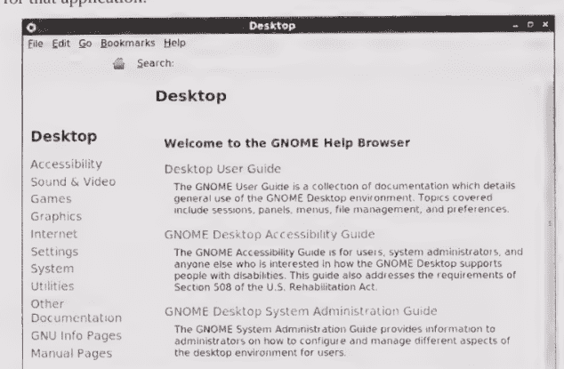

图 2-37：GNOME 帮助浏览器

## Man 页面

你也可以访问 Man 页面，这是从命令行界面可用的 Linux 命令手册。Man 页面在 GNOME 帮助中心以“手册页”的形式存在并按类别组织。你也可以从终端窗口使用 `man` 命令访问 Man 页面。在想要获取信息的命令前输入 `man`。以下示例请求了有关 `ls` 命令的信息：

```
$ man 1 ls
```


按下空格键可以跳转到下一页。按下 `B` 键可以返回上一页。完成后，按下 `Q` 键退出实用程序并返回命令行。你通过按下 `/` 或问号 (`?`) 来激活搜索。`/` 向前搜索，而 `?` 向后搜索。当你按下 `/` 时，屏幕底部会出现一行，然后你就可以输入要搜索的单词。按回车键激活搜索。你可以通过按下 `N` 键重复相同的搜索。不需要重新输入提示符。

### Info 页面

GNU 应用（如 `gcc` 编译器和 `Emacs` 编辑器）的在线文档也以 info 页面的形式存在，可以通过 GNOME 和 KDE 帮助浏览器访问。你也可以通过输入命令 `info` 访问这些文档。这将打开列出不同 GNU 应用的特殊屏幕。

`info` 界面有自己的命令。你可以通过输入 `info info` 了解更多信息。输入 `type` 会在屏幕底部打开一行，你可以在其中输入字母的前几个字母。按下回车键打开应用程序的 info 文件。

提示：你也可以使用 GNOME 或 KDE Web 浏览器显示 Man 页面。

### 在 Linux 上运行 Windows 软件

`Wine` 是一个 Windows 兼容层，允许你在 Linux 上原生运行许多 Windows 应用程序。不需要的 Windows 操作系统。Windows 应用程序将像 Linux 一样运行，访问整个 Linux 文件系统并使用连接到 Linux 的设备。严重依赖驱动程序的应用程序（如大型游戏）可能无法运行。其他不依赖特殊驱动程序的程序运行得非常良好，包括 Kindle 和 Adobe 电子书阅读器、`Photoshop`、`Microsoft Office` 和 `Newsbinreader`。对于某些应用程序，你可能需要使用最新版本的 `Wine`。

`Wine` 由 `RPMforge` 和 `EPEL` 仓库提供。它不是红帽支持的应用程序。确保配置对 `RPMforge` 或 `EPEL` 仓库的访问（见第 10 章），然后使用 `PackageKit` 安装 `Wine` 包。高级 Windows 应用程序（如 `KindleFor` 电子书阅读器）需要最新版本的 `Wine`，当前为 1.3。你可以从 `RPMforge` 测试仓库安装 `Wine` 1.3。确保在 `PackageKit` 上启用 `RPMforge` 测试仓库（系统 | 源）。`EPEL` 仓库中没有 `Wine` 1.3。不要混合使用 `EPEL` 和 `RPMforge` 包（在安装 `Wine` 时禁用 `EPEL` 并仅启用 `RPMforge`，见第 10 章）。

# 3. GNOME

## GNOME 界面

- GNOME 桌面
- 桌面特效 - `Compiz`
- GNOME 偏好
- GNOME 面板
- GNOME 文件管理器
- GNOME 配置

# 第一部分：桌面

网络对象模型环境（Network Object Model Environment），也称为 GNOME，是一个功能强大且易于使用的环境。它由面板、桌面以及一组用于构建程序接口的桌面工具组成。GNOME 的设计旨在为应用程序开发提供一个灵活的平台。目前，GNOME 受到多个发行版的支持，并且是 RHEL6 的主要界面。GNOME 是免费的，并根据 GNU 通用许可证（GPL）发布。

GNOME 桌面的核心组件包括一个启动程序和桌面功能的面板。桌面中通常常见的其他组件（如文件管理器、Web 浏览器和窗口管理器）由 GNOME 提供，开发者可以使用它们来创建 GNOME 应用程序。使用按钮、菜单、窗口并遵循 GNOME 标准的程序被称为 GNOME 兼容程序。GNOME 桌面的官方文件管理器是 `Nautilus`。GNOME 桌面本身没有自己的窗口管理器；KDE 有。相反，它可以使用任何符合 GNOME 标准的窗口管理器。`Metacity` 和 `Compiz` 窗口管理器是被内置的。

你可以在其官方网站 http://www.gnome.org 了解 GNOME。该网站提供了在线文档，如《GNOME 用户指南》和常见问题（FAQs）。http://gnomefiles.org 提供了当前 GNOME 应用程序和项目的详细软件列表。有关详细文档，请查看 http://library.gnome.org 上的 GNOME 文档站点。文档由用户、管理员和开发者生成。《桌面用户系统管理指南》提供了关于桌面使用的完整教程。对于管理员，《GNOME 系统管理指南》详细说明了管理员如何管理用户桌面。如果你想开发 GNOME 程序，请查阅 GNOME 文档站点上的“开发者（Developers）”部分，以及 http://developer.gnome.org，该站点提供了教程、编程指南和开发工具。在那里，你可以链接到广泛的支持工具，如教程和集成开发环境（IDEs）。表 3-1 列出了一系列实用的 GNOME 网站列表。

| 网站 | 描述 |
|---|---|
| http://www.gnome.org | GNOME 官方网站 |
| http://library.gnome.org | 面用户、管理员和开发者的 GNOME 文档站点 |
| http://art.gnome.org | 桌面工具和背景艺术 |
| http://gnomefiles.org | GNOME 软件应用程序、小应用和工具 |
| http://live.gnome.org/GNOMEOffice | GNOME 办公应用程序 |
| http://developer.gnome.org | GNOME 开发者站点，开发者文档请参阅 http://library.gnome.org |

### 表 3-1：GNOME 资源

`GTK+` 是用于 GNOME 应用程序的小部件集。`GTK+` 小部件集在较宽许可证的通用公共许可证（LGPL）下是完全免费的。LGPL 允许开发者在专有软件和自由软件中使用该小部件集（GPL 则将其限制为仅自由软件）。拖放功能支持与支持这些协议的其他小部件集进行拖放操作，例如用于 KDE 的 `Qt`。

## 第三章：GNOME

请查看 http://www.gnome.org 获取有关 GNOME 特性和增强的详细描述，带有屏幕截图和参考。GNOME 按照定期计划发布新版本。自 2.0 版本发布以来，多个版本增加了许多新功能。红帽 Linux 6 使用 GNOME 2.28，包含了许多来自 GNOME 2.26 和 GNOME 2.24 的功能。GNOME 2.28、GNOME 2.26 和 GNOME 2.24 的关键变化描述如下：

```
http://library.gnome.org/misc/release-notes/2.28/
http://library.gnome.org/misc/release-notes/2.26/
http://library.gnome.org/misc/release-notes/2.24/
```

## GNOME 界面

GNOME 界面由两个面板和一个桌面组成，如图 3-1 所示。面板显示为跨越屏幕顶部和底的长条。它们载有菜单、程序启动器和图标（应用程序是设计在面板内运行的小程序）。你可以水平或垂直方向显示面板，并在你想要全屏时让它们隐藏。图 3-1：带有偏好菜单的 GNOME

# 第一部分：桌面

顶部菜单包含三个访问系统的关键菜单：应用程序（Applications）、位置（Places）和系统（System）。应用程序菜单列出了你可以在桌面上运行的应用程序项目。其他任务（如打开文件夹或访问网络文件夹）位于“位置”菜单中。系统菜单包含用于配置界面的“偏好”子菜单，以及用于访问 RHEL6 工具的“管理”子菜单。底部面板提供了交互功能，如虚拟桌面（工作空间）、固定应用程序和垃圾箱。屏幕的其余部分是桌面，你可以在那里放置文件夹、文件和应用程序。你可以使用拖放操作将文件从一个窗口移动到另一个窗口或桌面。按住 `CTRL` 键拖放会复制文件。按住 `SHIFT` 键（`Ctrl+Shift`）进行拖放会在该文件夹或文件的桌面上创建一个快捷方式。你可以从“位置”菜单访问你的主目录（主文件夹）。选择它会打开主文件夹的文件管理器窗口。你可以使用不同的主题显示桌面，这些主题会更改桌面对象、按钮和滚动条的外观。GNOME 的功能不受任何影响。你可以从各种主题中进行选择。

[GNOME 界面](http://www.gnome.org) 各种主题位于 art.gnome.org。

## GNOME 组件

GNOME 界面由两个面板和一个桌面组成，如图 3-1 所示。面板显示为跨越屏幕顶部和底的长条。它们载有菜单、程序启动器和图标（应用程序是设计在面板内运行的小程序）。你可以水平或垂直方向显示面板，并在你想要全屏时让它们隐藏。图 3-1：带有偏好菜单的 GNOME

### 桌面


# 3. GNOME

## GNOME 界面

- GNOME 桌面
- 桌面特效 - Compiz
- GNOME 偏好
- GNOME 面板
- GNOME 文件管理器
- GNOME 配置

# 第一部分：桌面

网络对象模型环境（Network Object Model Environment），也称为 GNOME，是一个功能强大且易于使用的环境。它由面板、桌面以及一组用于构建程序接口的桌面工具组成。GNOME 的设计旨在为应用程序开发提供一个灵活的平台。目前，GNOME 受到多个发行版的支持，并且是 RHEL6 的主要界面。GNOME 是免费的，并根据 GNU 通用许可证（GPL）发布。

GNOME 桌面的核心组件包括一个启动程序和桌面功能的面板。桌面中通常常见的其他组件（如文件管理器、Web 浏览器和窗口管理器）由 GNOME 提供，开发者可以使用它们来创建 GNOME 应用程序。使用按钮、菜单、窗口并遵循 GNOME 标准的程序被称为 GNOME 兼容程序。GNOME 桌面的官方文件管理器是 Nautilus。GNOME 桌面本身没有自己的窗口管理器；KDE 有。相反，它可以使用任何符合 GNOME 标准的窗口管理器。Metacity 和 Compiz 窗口管理器是被内置的。

你可以在其官方网站 `http://www.gnome.org` 了解 GNOME。该网站提供了在线文档，如《GNOME 用户指南》和常见问题（FAQs）。`http://gnomefiles.org` 提供了当前 GNOME 应用程序和项目的详细软件列表。有关详细文档，请查看 `http://library.gnome.org` 上的 GNOME 文档站点。文档由用户、管理员和开发者生成。《桌面用户系统管理指南》提供了关于桌面使用的完整教程。对于管理员，《GNOME 系统管理指南》详细说明了管理员如何管理用户桌面。如果你想开发 GNOME 程序，请查阅 GNOME 文档站点上的“开发者（Developers）”部分，以及 `http://developer.gnome.org`，该站点提供了教程、编程指南和开发工具。在在那里，你可以链接到广泛的支持工具，如教程和集成开发环境（IDEs）。表 3-1 列出了一系列实用的 GNOME 网站列表。

| 网站 | 描述 |
|---|---|
| `http://www.gnome.org` | GNOME 官方网站 |
| `http://library.gnome.org` | 用户用户、管理员和开发者的 GNOME 文档站点 |
| `http://art.gnome.org` | 桌面工具和背景艺术 |
| `http://gnomefiles.org` | GNOME 软件应用程序、小应用和工具 |
| `http://live.gnome.org/GNOMEOffice` | GNOME 办公应用程序 |
| `http://developer.gnome.org` | GNOME 开发者站点，开发者文档请参阅 `http://library.gnome.org` |

### 表 3-1：GNOME 资源

`GTK+` 是用于 GNOME 应用程序的小部件集。`GTK+` 小部件集在较宽许可证的通用公共许可证（LGPL）下是完全免费的。LGPL 允许开发者在专有软件和自由软件中使用该小部件集（GPL 则将其限制为仅自由软件）。拖放功能支持与支持这些协议的其他小部件集进行拖放操作，例如用于 KDE 的 Qt。

## 第三章：GNOME

请查看 `http://www.gnome.org` 获取有关 GNOME 特性和增强的详细描述，带有屏幕截图和参考。GNOME 按照定期计划发布新版本。自 2.0 版本发布以来，多个版本增加了许多新功能。红帽 Linux 6 使用 GNOME 2.28，包含了许多来自 GNOME 2.26 和 GNOME 2.24 的功能。GNOME 2.28、GNOME 2.26 和 GNOME 2.24 的关键变化描述如下：

```
http://library.gnome.org/misc/release-notes/2.28/
http://library.gnome.org/misc/release-notes/2.26/
http://library.gnome.org/misc/release-notes/2.24/
```

## GNOME 界面

GNOME 界面由两个面板和一个桌面组成，如图 3-1 所示。面板显示为跨越屏幕顶部和底的长条。它们载有菜单、程序启动器和图标（应用程序是设计在面板内运行的小程序）。你可以水平或垂直方向显示面板，并在你想要全屏时让它们隐藏。图 3-1：带有偏好菜单的 GNOME

# 第一部分：桌面

顶部菜单包含三个访问系统的关键菜单：应用程序、位置和系统。应用程序菜单列出了你可以在桌面上运行的应用程序项目。其他任务（如打开文件夹或访问网络文件夹）位于“位置”菜单中。系统菜单包含用于配置界面的“偏好”子菜单，以及用于访问 RHEL6 工具的“管理”子菜单。底部面板提供了交互功能，如虚拟桌面（工作空间）、固定应用程序和垃圾箱。屏幕的其余部分是桌面，你可以在那里放置文件夹、文件和应用程序。你可以使用拖放操作将文件从一个窗口移动到另一个窗口或桌面。按住 `CTRL` 键拖放会复制文件。按住 `SHIFT` 键（`Ctrl+Shift`）进行拖放会在该文件夹或文件的桌面上创建一个快捷方式。你可以从“位置”菜单访问你的主目录（主文件夹）。选择它会打开主文件夹的文件管理器窗口。你可以使用不同的主题显示桌面，这些主题会更改桌面对象、按钮和滚动条的外观。GNOME 的功能不受任何影响。你可以从各种主题中进行选择。

## GNOME 组件

GNOME 界面由两个面板和一个桌面组成，如图 3-1 所示。面板显示为跨越屏幕顶部和底的长条。它们载有菜单、程序启动器和图标（应用程序是设计在面板内运行的小程序）。你可以水平或垂直方向显示面板，并在你想要全屏时让它们隐藏。图 3-1：带有偏好菜单的 GNOME

# 第一部分：桌面

将文件从其当前文件夹移动到 GNOME 桌面文件夹，该文件夹位于你的主目录中并包含了桌面上的所有项目。对于 GNOME 来说，桌面文件夹就是 `DESKTOP`。在将文件夹拖到桌面的情况下，整个文件夹及其子文件夹都将移动到 GNOME 桌面文件夹。当你移动图标时，你的鼠标符号会从箭头变为以图标为中心的手形，并带有一个指向右侧的小箭头。


要从桌面移除图标，你可以将其拖入垃圾桶，或者对其点击鼠标右键并选择“移动到垃圾桶”。

你还可以通过按住 `CTRL` 键并将文件从文件管理器窗口拖到桌面来复制文件。你的鼠标符号会从箭头变为以图标为中心的手形。你会看到图标上鼠标手右侧的小箭头变为 `+` 符号，表示你正在创建副本，而不是移动原文件。

你还可以为任何文件在桌面上创建链接。如果你想在指定文件夹中保留一个版本并能从桌面访问它，这种方法非常有用。你也可以对可能不想出现在菜单或面板上的自定义程序使用链接。创建链接有两种方法：一种在按住 `Ctrl` 和 `Shift` 键的同时，将文件拖到你想创建链接的地方。你会看到复制图标上鼠标手右侧的小箭头，表示你正在创建链接，而不是移动原文件。图标上会出现一个右角带有弯曲箭头的副本，表示它是一个链接。你可以点击此链接启动程序、打开文件或打开文件夹，取决于你所链接的文件类型。

移动、复制或创建链接的替代方法是点击并拖动文件移出窗口，在移动文件后松开鼠标按钮并按下 `ALT` 键。这将显示一个弹出菜单，带有“移动到此处”、“复制到此处”和“在此处创建链接”等选项供选择。如果你正在移动图像文件，还有一个“设置为背景”选项，可以让你将图像文件设置为新的桌面背景。

GNOME 的拖放文件操作运行在由 GNOME 工作区切换器（GNOME Workspace Switcher）提供的虚拟桌面上。底面板上的 GNOME 工作区切换器为面板中的每个虚拟桌面创建图标，并为运行在其上面的应用程序提供任务按钮。

## 桌面应用程序

在某些情况下，你可能希望在桌面创建另一种方法来访问文件，而不将其从原始文件夹中移动。你可以通过使用 GNOME 应用程序启动器或为原始程序创建链接来实现。应用程序图标是用于在菜单和面板显示并访问应用程序的 GNOME 组件。要将应用程序图标放置在桌面上作为菜单条目，你只需将应用程序条目从菜单拖到桌面，或者对菜单条目点击鼠标右键并选择“将此启动器添加到桌面”。例如，要在你的桌面上放置一个 Firefox 浏览器的图标，只需将“应用程序 | Firefox 网页浏览器”中的 Firefox 图标拖到桌面空间的任何位置即可。

对于不在菜单中的应用程序，你可以为其创建一个应用程序启动器按钮或为其创建一个直接链接。要创建应用程序启动器，右键点击桌面背景显示桌面菜单，然后选择“创建启动器”项。要创建一个简单的链接，在按住 `Ctrl-Shift` 键的同时点击并拖动程序图标到桌面。

### GNOME 桌面菜单

你可以在空桌面的任何位置点击右键显示 GNOME 桌面菜单，该菜单包含常用任务条目，例如创建应用程序启动器、创建新文件夹或整理图标列表。请记住，“新建条目”会在你的桌面上创建一个新文件夹，具体是在你的 GNOME 桌面文件夹（`DESKTOP`）中，而不是你的主目录。此菜单的条目如表 3-2 所示。

| 菜单项 |  |
|---|---|
| 创建文件夹 | 在你的桌面上的桌面文件夹内创建一个新文件夹。 |
| 创建启动器 | 为应用程序创建一个新的桌面图标。 |
| 创建文档 | 使用已安装的模板创建文件 |
| 按名称组织桌面 | 按名称排列你的桌面图标。 |
| 对齐 | 对齐你的桌面图标。 |
| 剪切、复制、粘贴 | 剪切、复制或粘贴文件，允许在文件夹之间移动或复制文件。 |
| 更改桌面背景 | 打开外观偏好设置中的背景对话框，让你为桌面选择新背景。 |

### 表格 3-2：GNOME 桌面菜单

### 窗口管理器

GNOME 与任何窗口管理器配合工作。然而，桌面功能（如拖放能力和 GNOME 工作区切换器）仅在符合 GNOME 标准的窗口管理器上有效。当前版本的 GNOME 使用 Metacity 窗口管理器。它完全符合 GNOME 标准，旨在与 GNOME 桌面集成而不会产生任何功能重复。如果你启用桌面效果，则将使用 Compiz 窗口管理器。

Metacity 采用与其他窗口管理器相同的窗口操作。你可以通过点击并拖动窗口的任何边或角来调整窗口大小。你可以通过在标题栏上进行点击并拖动操作来移动窗口。你可以 `ALT` 点击并拖动窗口的任何位置（如果在“系统 | 偏好设置 | Windows”对话框的“移动键”部分已启用）。GNOME 窗口的右上角显示最小化、最大化和关闭按钮。点击最小化按钮不再在桌面上显示窗口。底面板（窗口列表应用）上仍保留一个该按钮，你点击它可以恢复窗口。面板上的窗口按钮类似于显示切换开关。

### GNOME 卷管理

DVD/CD-ROM、读卡器、USB 磁盘、数字相机和可移动媒体的管理由 GNOME 直接处理。你不仅可以访问可移动媒体，还可以访问远程和本地文件系统，包括共享文件夹。GNOME 使用 udev 访问可移动媒体，并使用 Samba 提供 Windows 网络支持。要访问并删除系统上的 Windows 分区，请确保安装了 `fuse-ntfs-3`、`gnome-vfs2-ntfs` 和 `ntfsprogs` 包（EP 仓库）。这些允许你从 GNOME 浏览 NTFS 文件系统。

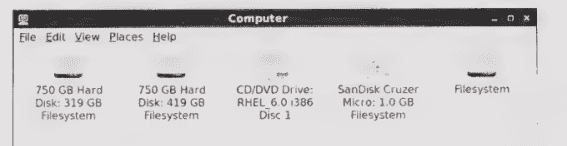

图 3-2：GNOME 计算机窗口

你可以使用桌面 | 位置 中的“计算机”图标访问所有文件系统和可移动媒体。这将打开一个顶层窗口，显示所有可移动媒体（已挂载的 CD-ROM、USB 磁盘等）、内部硬盘分区以及你的 Linux 文件系统（见图 3-2）。双击任何图标即可打开显示其内容的文件管理器窗口。“文件系统”图标将打开一个显示根目录级别的窗口，即文件系统的顶级文件夹。除非你以 root 用户登录，否则系统文件夹的访问将受到限制。

要访问远程 Windows 或 Linux 系统上的网络资源，你需要选择“位置”菜单中的“网络”条目。这将打开一个网络窗口，显示所有连接的网络资源，如主机、打印机和文件夹（见图 3-3）。要将网络图标添加到桌面，请将其拖放到“位置”菜单中的“桌面”。所有共享文件夹都提供拖放操作，允许你在另一主机主机上的共享文件夹与你系统上的文件夹之间复制文件和文件夹。

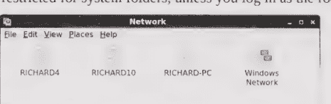

图 3-3：GNOME 网络窗口

# 第 3 章：GNOME

通过 SELinux 实现。在 SELinux 管理对话框（系统 | 管理 | SELinux 管理）中，在布尔值选项卡上检查 Samba 条目。

可移动媒体也会以图标的形式自动出现在桌面上。当将 DVD/CD-ROM 插入 DVD/CD-ROM 驱动器时，它会自动挂载并显示带有标签的图标。读卡器、数字相机和 USB 驱动器也提供类似的访问方式。在移除 USB 驱动器之前，请确保已卸载，以便数据已写入。

你可以通过双击或右键点击“打开”选项来访问 DVD/CD-ROM 驱动器光光。文件管理器窗口将打开并显示 DVD/CD-ROM 光盘的内容。要弹出 DVD/CD-ROM，可以右键点击其图标并在弹出菜单中选择“弹出”。USB 盘也适用于相同的步骤，只需使用 USB 盘图标即可。在选择弹出菜单中的“弹出”并卸载之前，请不要移除已挂载的 USB 盘。

GNOME 将为任何可移动媒体显示图标并对其执行默认操作。例如，音频 CD 将在 CD 播放器中自动播放。DVD 电影可以在 DVD 播放器中启动。设置处理可移动媒体的偏好，可以使用文件管理对话框，可通过系统 | 偏好 | 文件管理访问。可以更改某些设置。

### 桌面效果 - Compiz

对于 3D 桌面效果，你可以使用 Compiz 提供的合成窗口管理器支持。窗口使用窗口装饰器显示，允许窗口以摇动、弯曲和不寻的方式移动。还可以使用桌面墙（Desktop Wall）或桌面立方体（Desktop Cube）等 3D 工具访问桌面。合成窗口依赖显卡的 OpenGL 3D 加速支持。请确保你的显卡受支持。Compiz 是 Compiz 和 Beryl 合成窗口管理器的合并体。更多信息请参阅 http://wiki.compiz.org。

Compiz 集成在你的 RHEL6 GNOME 桌面中。要启用 Compiz 效果，你可以使用桌面效果，系统 | 偏好 | 桌面效果（见图 3-4）。


### 图 3-4：GNOME 桌面偏好

在此对话框上，点击 Compiz 按钮。列出了两个选项：窗口摇动（Wobble windows）和立方体（Cube）。它们启用了两个基本效果：移动窗口时窗口摇动以及立方体桌面切换器（在立方体上显示桌面，你可以从中选择桌面）。

要为你的显卡启用 3D 支持，请确保使用 PackageKit 安装 MESA 实验性驱动程序并重启。

## 第 1 部分：桌面

`mesa-dri-drivers-experimental`

Compiz 配置了对桌面立方体和视口切换器的支持。常用效果支持多个快捷键（见表 3-3）。

| 快捷键 | 描述 |
| --- | --- |
| `ALT-TAB` | 切换器：应用程序、Shift 和 环形 |


| `CTRL-TAB`-方向键 (左、右、上、下) | 视口切换器，移动到不同的工作区 |

| `CTRL-ALT-`(鼠标左键点击并拖动) | 桌面墙或桌面立方体 |

### 表 3-3：Compiz 快捷键

#### 切换器

Compiz 提供了应用程序切换器，用于快速浏览已打开的窗口并选择你想要的窗口。应用程序切换器将显示一个中心对话框，显示你打开的窗口的图像。如果你打开了许多窗口，应用程序切换器可以非常快速地定位并选择窗口（见图 3-5）。按下 `Alt` 键显示应用程序切换器。你当前激活的窗口将居中显示并高亮。连续按下 `Alt-Tab` 将带你在窗口图像序列中移动，使下一个窗口成为并被选中的窗口。按下 `Shift-Alt-Tab` 键将带你回到上一个窗口。

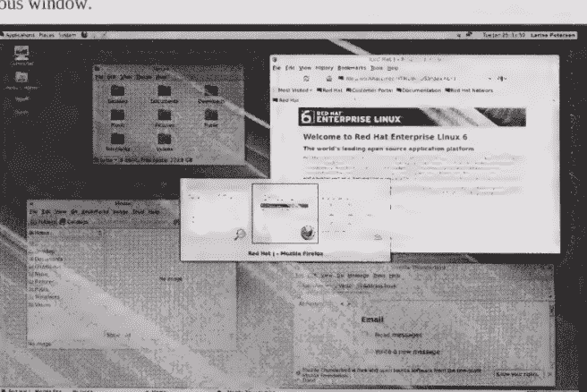

#### 图 3-5：应用程序切换器 (`Alt-Tab`)

要列出所有工作区中的窗口，请按 `Ctrl-Alt-Tab`。如果你在多个工作区中打开了大量窗口，这将成为快速浏览它们的方法，直到停止并选择你想要的窗口上。

### 桌面墙

如果你没有在桌面偏好对话框中启用桌面立方体，Compiz 将使用桌面墙在工作区之间进行快速切换。你可以使用 `Ctrl-Alt`-方向键（左或右）从一个工作区快速移动到另一个。桌面墙与桌面立方体不兼容。如果你选择使用桌面立方体，桌面墙将被禁用。当你从一个工作区移动到另一个工作区时，桌面墙会显示一个包含每个桌面简单箭头图像框的小对话框（见图 3-6）。

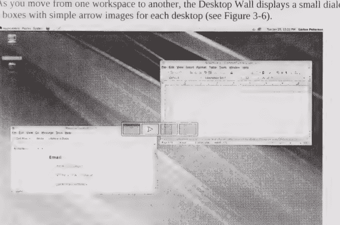

图 3-6：带有视口切换器的桌面墙 (`Ctrl-Alt`-方向键，方向可以是左、右、上或下)

### 桌面立方体

桌面立方体在立方体上显示你的桌面工作区。使用时，立方体会显示在整个屏幕上，替换桌面显示。桌面立方体具有旋转立方体功能，允许你旋转立方体。要旋转桌面立方体，请按 `Ctrl-Alt` 并用鼠标点击并拖动。只要你按住鼠标，立方体就会显示。移动鼠标在立方体上移动到不同的工作区（见图 3-7）。你需要设置两个以上的工作区作为列。

### GNOME 偏好

RHEL6 提供了多个对话框来配置 GNOME 桌面，列在系统 | 偏好菜单中。GNOME 偏好设置见表 3-4。某些设置将在章节中详细讨论。每个偏好窗口上的帮助按钮将提供详细说明和示例。这里讨论了一些重要的工具。

一些相关的配置任务已合并到外观工具。这些包括主题、背景和字体（系统 | 偏好 | 外观）。

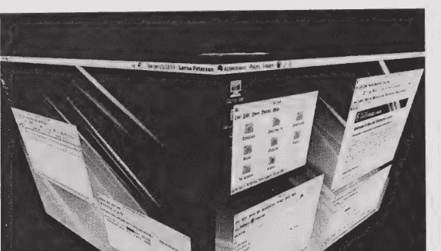

### 图 3-7：立方体 (`Ctrl-Alt` 配合鼠标左点击并拖动)

# 第 3 章：GNOME

| 首选项 | 描述 |

| --- | --- |

| 关于我 | 个人信息，如图片、地址和密码。 |

| 外观 | 桌面外观配置：主题、字体、背景和视觉效果。 |

| 辅助技术 | 启用如无障碍登录和键盘屏幕等功能。 |

| 蓝牙 | 蓝牙通知图标显示选项。 |

| 文件管理 | 文件管理器选项，包括处理应用程序、标题和默认视图（也可以通过文件管理器窗口的“编辑 | 首选项”进行访问）。此首选项默认不列在菜单中，请使用“主菜单”添加。 |

| 键盘输入法 | iBus 首选项。为键盘（语言）指定自定义输入法。 |

| 键盘 | 配置您的键盘：选择选项、型号和打字间隙，以及如慢速键、回弹键和粘滞键等无障碍功能。 |

| 键盘快捷键 | 为特殊任务（如多媒体操作）配置按键。 |

| 主菜单 | 为应用程序、首选项和系统菜单添加或删除类别和菜单项。 |

| 鼠标 | 鼠标和触摸板配置：选择手部方向、速度和无障碍设置。 |

| 网络连接 | 有线、无线、宽带、VPN 和 DSL 连接的网络管理器配置。 |

| 网络代理 | 如果需要指定代理配置：手动或自动。 |

| 显示器 | 更改屏幕分辨率、刷新率和屏幕方向。 |

| 个人文件共享 | 设置蓝牙共享选项。 |

| 首选应用程序 | 设置默认网络浏览器、邮件应用程序、音乐播放器和终端窗口。 |

| 远程桌面 | 允许远程用户查看或控制您的桌面。可以使用密码控制访问。 |

| 屏幕保护 | 选择并管理保护程序，包括激活时间。 |

| 声音 | 配置音效、输出音量、音频设备选项、输入量量声音应用程序设置。 |

| 启动应用程序 | 使用启动程序和保存选项管理会话。 |

| 窗口 | 启用窗口功能，如标题栏角色、移动键、窗口选择。 |

**表 3-4：GNOME 首选项**

当您切换到不同的输入法时，桌面右下角会出现一个图标，显示当前生效的方法（语言）。当您在编辑器或邮件正文中输入文本时，键盘将输入所选语言的字符。您可以通过桌面图标菜单或面板小组件菜单关闭输入法，从而切换回默认语言。

要使用“声音”首选项对话框（声音）配置您的音频设备，请参阅第 6 章。GNOME 使用声音为不同的效果和警报指定一组声音。

## 外观

要更改主题或背景图像，或配置字体，请使用外观对话框（系统 | 首选项 | 外观）。外观对话框显示了三个选项卡：主题、背景和字体（见图 3-11）。背景选项卡在第 2 章中讨论过。主题和字体选项卡将在后续章节中介绍。

### 桌面主题

您可以使用外观首选项中的“主题”选项卡来选择或自定义主题（系统 | 首选项 | 外观）。主题控制您的桌面外观。主题选项卡将列出已安装主题的图标（见图 3-8）。图标将显示每个主题的关键方面，如窗口、文件夹和按钮图像，以便为您您预览该主题。

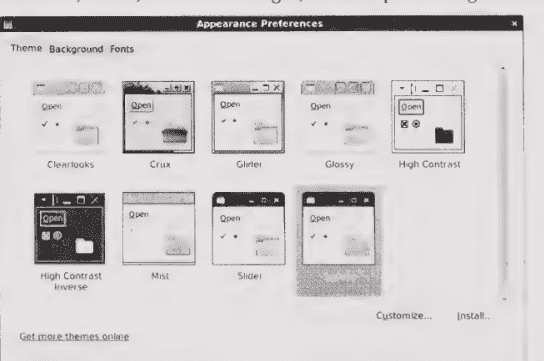

图 3-8：外观首选项工具上的主题选择

系统默认选择系统。如果您已从 http://art.gnome.org 下载了额外的主题，可以移动图标以选择不同的主题。您可以点击“安装”按钮来查找并安装它们。一旦安装，额外的主题也将显示在“主题”选项卡中。如果您从 RHEL6 仓库下载并安装了主题或图标集，它将自动为您安装。

主题的真正威力在于它能够让用户自定义任何给定主题。主题由五个组件组成：控件、颜色、窗口边界、图标和指针。控件涵盖窗口和对话框控件（如按钮和滑动条）的外观。窗口边界允许您选择标题栏、边框、窗口按钮集。图标允许您选择不同的图标。指针提供不同的set供使用。颜色允许选择窗口、输入框、选择项和工具提示的背景和文本颜色。您甚至可以下载并安装单独的组件（如图标集），然后在自定义主题中使用它们。

点击“自定义”按钮将打开一个带有不同主题组件的主题窗口。当前主题使用的组件默认被选中。颜色选项卡允许您设置窗口、输入框和所选项目的背景和文本颜色。在控件、窗口栏和图标选项卡中，您将看到不同主题的列表。然后您可以从这些主题中混合组合，创建自己的自定义主题，例如使用一个主题的窗口边界和另一个主题的其他组件。选中组件后，您的桌面会自动更改并向您显示效果。如果您添加了组件（例如新的图标集），它也会显示出来。

一旦您创建了自定义主题，“自定义主题”就会出现在主题选项卡的列表中。要保存它，请点击“另存为”按钮。这将打开一个对话框，您可以在其中输入名称、任何注释，并指定是否也保留主题背景。保存的主题将出现在主题列表中。

提示：如果您从 http://art.gnome.org 下载，可以直接将网页上下载的图标拖到“主题”选项卡，或者先下载后将主题包直接拖到“主题”选项卡进行安装。

用户安装的主题和图标存放在用户主目录下的 `.themes` 和 `.icons` 文件夹中。如果您希望这些主题对所有用户都可用，可以将它们从 `.themes` 和 `.icons` 文件夹移动到 `/usr/share/icons` 和 `/usr/share/themes` 文件夹。请确保以 root 用户身份登录。然后您需要将移动的主题和图标的所有者改为 root 用户。

```
own -R root:root  /usr/share/themes/newtheme
```

### 字体

RHEL6 使用 `fontconfig` 方法管理字体（http://www.freedesktop.org/wiki/fontconfig）。您可以轻松更改字体大小、添加新字体以及抗锯齿等功能。GNOME 和 KDE 都提供了用于选择、调整大小和添加字体的工具。

新字体现在由 PackageKit 自动安装。当您打开包含您未安装的字体的文档时，PackageKit 将自动调用以安装相应的字体包。对话框将提示您搜索字体包。

Liberation 字体为流行的微软字体（如 Arial、Times New Roman 和 Courier New）提供了开源替代方案。使用 PackageKit 安装字体包。

如果您的系统同时安装了 GNOME 和 KDE，可以使用 KDE 安装系统字体（系统设置 | 外观 | 字体）。为了快速访问系统字体，您应该为 `/usr/share/fonts` 创建字体缓存。若要在 GNOME 上手动安装字体，您必须登录 root 用户并将字体手动复制到 `/usr/share/fonts`。

### 调整桌面字体


# 第 3 章：GNOME

随着大显示器及其高分辨率变得越来越常见，用户发现非常有用的功能之一是可以增大字体大小。在大显示器上，低于原生分辨率的缩放效果不好。显示器在原生分辨率下效果最好。然而，对于像 `1900x1200` 这样的大原生分辨率，字体变得很小难以阅读。您可以通过增大字体大小来解决这个问题。默认大小为 `10`；将其增加到 `12` 可以让窗口和菜单等桌面功能变得更易读。

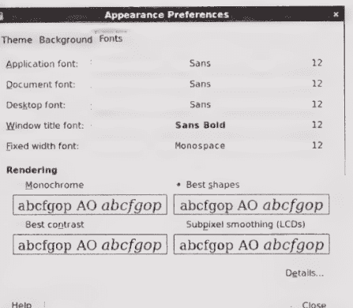

图 3-9：外观首选项中的字体设置

要增大字体大小，请通过选择外观工具上的“字体”选项卡来打开字体首选项对话框（系统 | 首选项 | 外观）。字体选项卡如图 3-9 所示。您甚至可以更改字体本身以及选择粗体或斜体。您可以通过点击“详细信息”按钮来进一步精炼字体，打开一个可以在其中设置点距、微调和平等功能的窗口。要更详细地查看字体，点击“转到字体文件夹”并点击该字体。

## 配置字体

为了更好地精炼字体显示，可以使用渲染对话框。点击外观工具上的“字体”选项卡（系统 | 首选项 | 外观）。渲染部分列出了基本的字体渲染功能，如单色、最佳对比、最佳形状和子像素平滑。选择最适合的一种。对于 LCD 屏幕选择子像素平滑。要进行详细配置，请点击“详细信息”按钮，可以在其中设置平滑、微调（抗锯齿）和子像素颜色顺序。子像素颜色顺序取决于硬件。

在 GNOME 中，点击字体选项卡中的字体条目将打开选择字体对话框，列出所有可用字体。在 KDE 中，点击系统设置选项卡上的任何按钮都会打开一个列出所有可用字体的窗口（系统设置 | 外观 | 字体）。您也可以使用 `fc-list` 命令生成列表。该列表将

它们是无序的，因此你应该将它们传递给 `sort` 命令。你可以使用 `fc-list` 配合任何字体名称或名称模式来搜索字体，并带有按语言、族或样式搜索的选项。

```
fc-list | sort
```

## 启动应用程序偏好

你可以配置桌面以恢复之前打开的窗口和应用程序，并指定启动程序。当你注销时，你可能希望已打开的窗口和正在运行的应用程序在重新登录时自动启动。事实上，你正在保存当前的会话，以便其能够恢复。例如，如果你正在处理一个电子表格，可以保存工作，但不要关闭文件直接注销。当你重新登录时，你的电子表格将从你离开的地方打开。

默认情况下未开启会话恢复。使用启动应用程序的“选项”选项卡（系统 | 偏好 | 启动应用程序）来开启它（见图 3-10）。你可以设置“注销时自动记住运行的应用程序”选项。你还可以通过点击“记住当前运行的应用程序”按钮来保存会话。

在“启动程序”选项卡上，你可以选择想要自动启动的程序，并取消选择你不需要的程序。已选中的有 PackageKit 更新小工具和 SELlinux 故障排除器。在“启动程序”选项卡上，你可以选择想要启动的程序，并取消选择不需要的。要添加未列出的应用程序，点击“添加”按钮并输入应用程序名称和程序（使用“浏览”选择程序，通常在 `/usr/bin` 中）。

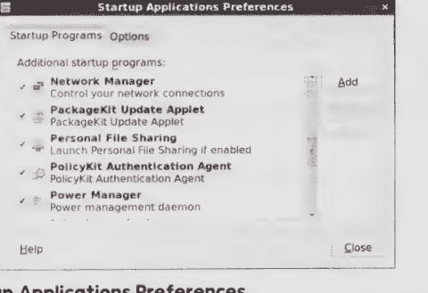

图 3-10：启动应用程序偏好

### GNOME 面板

通过 GNOME 面板，你可以访问菜单、运行小工具并启动应用程序（见图 3-11）。你可以将 GNOME 面板看作一种可以在桌面上使用的工具。你可以在桌面上显示多个 GNOME 面板，每个面板上都可以放置你放置的小工具和菜单。

RHEL6 默认的 GNOME 桌面使用两个面板：顶部的面板用于菜单、应用程序和操作，底部的面板用于最小化窗口和工作区切换器。你可以根据需要自定义面板，放置你选择的应用程序和菜单。你可以添加新面板、向面板添加应用程序并添加各种功能。


图 3–1–1：RHEL 桌面顶部的 GNOME 面板

面板配置任务（如添加应用程序、选择应用、设置菜单和创建新面板）均通过弹出菜单处理。只需点击面板上的任何位置，即可显示一个包含“属性”、“添加到面板”、“删除此面板”和“新面板”条目的菜单，以及“帮助”和“关于”条目。“新面板”可以让你创建其他面板；“添加到面板”可以让你向面板中添加项目项，例如应用程序启动器、用于“工作区切换器”等任务的应用程序，以及如主应用程序菜单之类的菜单。“属性”条目将显示一个对话框，用于配置该面板的功能，例如面板的位置和隐藏功能。

要添加新面板，右键点击并选择弹出菜单中的“新面板”条目。系统会创建一个新的扩展面板并显示在屏幕侧边。然后你可以使用面板的属性对话框来重新定位面板并设置不同的对话框和背景功能，如后续章节所述。你可以在屏幕的侧边、顶部或底部显示多个面板。

### 面板属性

要配置单个面板，你需要使用“面板属性”对话框，你可以通过右键点击面板并选择弹出菜单中的“属性”条目来打开它。对于单个面板，你可以设置通用配置功能。

### 显示面板

在面板属性对话框的常规选项中，你可以决定如何显示面板。它提供了方向、大小以及是否自动隐藏的选项。“方向”条目让你选择面板位于屏幕的哪侧。你可以选择是否自动记住运行的应用程序。

### 移动和隐藏面板

在面板属性的常规选项中，你可以决定如何显示面板。你可以设置面板的面板位于屏幕的哪侧。你也可以选择是否自动记住运行的应用程序。“新面板”可以让你创建其他面板。“添加到面板”可以让你向面板中添加项目，例如应用程序启动器、用于“工作区切换器”等任务的应用程序，以及如主应用程序菜单之类的菜单。“属性”条目将显示一个对话框，用于配置该面板的功能，例如面板的位置和隐藏功能。

要添加新面板，右键点击并选择弹出菜单中的“新面板”条目。系统会创建一个新的扩展面板并显示在屏幕侧边。然后你可以使用面板的属性对话框来重新定位面板并设置不同的对话框和背景功能，如后续章节所述。你可以在屏幕的侧边、顶部或底部显示多个面板。

### 扩展的面板

要配置单个面板，你需要使用“面板属性”对话框，你可以通过右键点击面板并选择弹出菜单中的“属性”条目来打开它。对于单个面板，你可以设置通用配置功能。

### 背景

在面板属性对话框的常规选项中，你可以决定如何显示面板。它提供了方向、大小以及是否自动隐藏的选项。“方向”条目让你选择面板位于屏幕的哪侧。你也可以选择是否自动记住运行的应用程序。

### 面板对象

面板可以包含多种类型的对象，其中包括菜单、启动器、小工具和抽屉。

- 菜单：应用程序菜单是菜单的示例。
- 启动器：启动器用于启动应用程序。浏览器是启动器的示例。
- 小工具：小工具是设计在面板内的小程序。工作区切换器是小工具的示例。
- 抽屉：抽屉是可以打开或关闭的面板扩展。你可以将抽屉看作面板的可收缩部分。

### 特殊对象

这些用于其他对象不支持的特殊任务。例如，注销和关机按钮就是特殊对象。

### 移动、删除和锁定对象

要移动面板中的任何对象，右键点击它并选择“移动”。你可以将其移动到面板的不同位置或另一个面板。要从面板中删除对象，右键点击它显示弹出菜单，然后选择“从面板移除”条目。要防止对象被移动或删除，请选择锁定功能（右键点击对象并选择“锁定”）。以后要允许其移动，你必须先解锁对象（右键点击它并选择“解锁”）。

### 添加对象

要向面板添加对象，请从“添加到面板”对话框（见图 3-12）中选择对象，该对话框通过右键点击面板并选择“添加”条目显示。

### 面板应用程序启动器

应用程序菜单中的所有项都是应用程序启动器。对于任何项目，你都可以点击并拖动菜单项到面板。应用程序启动器会被添加到面板。例如，如果你使用 Gedit 并将其添加到面板，只需通过应用程序菜单，点击并拖动应用程序 | 辅助菜单中的“gedit 文本编辑器”菜单项到面板。Gedit 图标将出现在你的面板中。与其执行点击拖动操作，你可以右键点击菜单项并选择“将此启动器添加到面板”选项。

如果你已应用程序启动器添加到桌面（右键点击菜单项并选择“将此启动器添加到桌面”项），你可以直接将应用程序启动器拖到面板，将其添加到面板。

应用程序启动器也可以从“添加到面板”对话框添加。双击“应用程序启动器”条目将显示所有应用程序菜单项的列表，以及

已选文件。左下角是一个弹出窗口，显示你当前工作文件夹的父文件夹。你可以选择任何项目来打开该文件夹的窗口。

在“浏览器”模式下，Nautilus 窗口显示工具栏，包括一个包含文件管理器命令的菜单栏、一个带有导航按钮的主工具栏，以及顶部的定位器（Locator），它可以在位置框或按钮视图之间切换（见图 3-15），以及一个用于文件和文件夹的侧边栏。窗口的其余部分分为两个窗格。左侧是侧边栏，用于显示当前工作文件夹的信息。右侧是主窗格，显示当前工作文件夹中的文件和子文件夹列表。窗口底部的状态栏显示所选文件或文件夹的信息。你可以通过在菜单中选择这些元素来开启或关闭其中任何一个。


当你打开一个新文件夹时，将使用同一个窗口来显示它，你可以使用“前进”和“向后”箭头在之前打开的文件夹之间移动。位置栏显示了你的文件夹及其父文件夹的按钮。你可以点击文件夹直接跳转到那里。你可以右键点击显示的任何文件夹，以显示出一个弹出菜单，其中包含“在新标签页中浏览”、“在新窗口中浏览”和“在文件夹窗口中打开（空间视图）”选项。这让你轻松将列表中显示的任何文件夹作为新窗口或标签页打开。你也可以选择“属性”打开该文件夹的属性对话框。

位置栏也可以显示 URL 文本框而不是按钮，你可以在其中输入系统或远程系统上的文件夹路径。点击位置栏左侧的切换按钮可以在文本框和文件夹列表之间切换。你也可以按 `Ctrl-L` 或从“前往（GO）”菜单选择“位置（GO | Location）”。当你访问另一个文件夹时，将恢复到文件夹按钮的位置栏。

- 主目录文件夹 (Home folder)
- 位置栏切换按钮
- 搜索 (Search)
- 图标视图、紧凑视图和列表视图

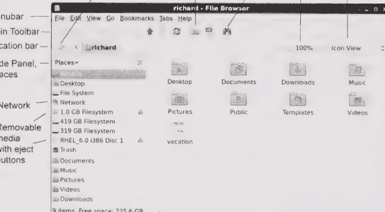

状态栏

图 3-15：带有工具栏和侧边栏的 Nautilus 文件管理器（浏览器视图）

# 第 3 章：GNOME

你可以通过将 Nautilus 管理器偏好中的“行为”设置为“始终在浏览器窗口中打开”（编辑 | 偏好，行为选项卡），来设置 Nautilus 默认在浏览器模式下打开。

在位置栏（框或按钮）旁边是一个用于放大和缩小文件视图的元素。点击 `+` 按钮放大，点击 `–` 按钮缩小。旁边是用于为文件选择不同视图的下拉菜单，例如图标、列表或紧凑视图。

## Nautilus 侧边栏：树状、历史记录和备注

Nautilus 侧边栏提供了几种视图，你可以从下拉菜单中选择这些视图以显示关于文件夹的附加信息：地点（Places）、信息（Information）、树状（Tree）、备注（Notes）和徽章（Emblems）。“地点”视图显示了你通常访问的文件位置，从你的主目录开始。选择“文件系统（File System）”位置将你置于文件系统的顶部，让你移动到其任何可访问的部分。“信息”视图显示当前文件夹或所选文件的详细信息。例如，如果你双击一个图像文件，侧边栏将显示该图片的详细数据，而主窗格将显示完整图像。“历史记录”视图显示你之前访问过的文件夹，对于在文件夹或文件之间来回移动非常有用。

“树状”视图显示系统上文件夹和文件的基于树的分层结构视图，并突出显示你选中的项。你可以用它移动到其他文件夹和文件。树状结构映射了系统上的所有文件夹，从根文件夹开始。你可以点击名称左侧的 `+` 或减号符号来展开或收起任何文件夹。点击文件夹名称选择文件夹。然后将显示文件夹的内容。

“备注”视图在侧边栏内的一个可编辑文本窗口中显示关于当前文件夹的备注。这是你在文件夹的偏好对话框“备注”选项卡中可以访问的相同备注。当你添加了备注后，当你移动到文件夹的父文件夹时，你会看到文件夹图标上增加了一个备注徽章。

### 标签页

GNOME 文件管理器支持标签页，你你可以在同一个文件管理器窗口中打开多个文件夹。要打开新标签页，请从“文件”菜单选择“新标签页”或按 `Ctrl-t`。你可以使用“标签页”菜单中的项目在标签页之间移动，或重新排列标签页。你还可以使用 `Ctrl-PageUp` 和 `Ctrl-PageDown` 键在标签页之间移动。使用 `Shift-Ctrl-PageUp` 和 `Shift-Ctrl-PageDown` 键来重新排列标签页。要关闭标签页，点击标签页右侧的关闭 `x` 按钮（见图 3-16）。

### 显示文件和文件夹

你可以以图标、紧凑列表或详细列表查看文件夹的内容。你使用 Nautilus 栏右侧的下拉菜单来选择视图。“列表”视图提供了名称、权限、大小、日期、所有者和组。主窗格顶部每个字段都显示了按钮。你可以使用这些按钮按该字段对列表进行排序。例如，要按日期排序文件，点击“日期”按钮；按大小排序，点击“大小”。

要对“图标”视图中的项目进行排序，请在“视图”菜单中选择“排列项目”项目，并按布局选项选择（视图 | 排列项目 | 按布局）。某些类型的文件图标将显示其内容的视图；例如，图像文件的图标将显示图像的小型版本。文本文件将在图标中显示其文本的前几个字。


图 3-15：带有工具栏的 Nautilus 文件管理器（浏览器视图）

你可以以图标、紧凑列表或详细列表查看文件夹的内容。你使用 Nautilus 栏右侧的下拉菜单来选择视图。“列表”视图提供了名称，权限，大小、日期、所有者和组。主窗格顶部每个字段都显示了按钮。你可以使用这些按钮按该字段对列表进行排序。例如，要按日期排序文件，点击“日期”按钮；按大小排序，点击“大小”。

要对“图标”视图中的项目进行排序，请在“视图”菜单中选择“排列项目”项目，并按布局选项选择（视图 | 排列项目 | 按布局）。某些类型的文件图标将显示其内容的视图；例如，图像文件的图标将显示图像的小型版本。文本文件将在图标中显示其文本的前几个字。


图 3-15：带有标签页的 Nautilus 文件管理器

Nautilus 文件管理器以浏览器模式运行，类似于网络浏览器，使用同一个窗口显示打开的文件夹。它维护了查看过的文件夹列表，你可以使用主工具栏在这些列表之间来回移动。左箭头按钮移动到上一个显示的文件夹，右箭头按钮移动到下一个显示的文件夹。向上箭头按钮带你回到父文件夹，主按钮带你回到主目录。主文件夹打开你的主目录。计算机列出你的存储设备（USB、CD/DVD 光盘和连接的硬盘），而文件系统图标打开你的根（顶部）文件夹。搜索按钮（放大镜）使用文件管理器搜索工具查找文件或文件夹。

要打开子文件夹，你可以双击它，或者单击图标并从“文件”菜单选择“打开”（File | Open）。如果你想以浏览器模式打开 Nautilus 窗口，右键点击文件夹图标并选择“在新窗口中打开”。要在空间模式打开文件夹，选择“在文件夹窗口中打开”。在新标签页中打开文件夹，选择“在新标签页中浏览”。

提示：要更改文件管理器使用的背景，你需要从“编辑”菜单选择“背景和徽章”（Edit | Backgrounds and Emblems），将背景添加到文件管理器窗口。从颜色或图案选项卡中选择背景。

Nautilus 弹出菜单

| 菜单项目 | 说明 |
| --- | --- |
| 创建文件夹 | 创建新文件夹。 |
| 创建文档 | 使用模板创建新文档。 |
| 在终端中打开 | 打开当前文件夹的终端窗口。 |
| 排列项目 | 显示按名称、大小、类型排列文件的子菜单。 |
| 按名称清理 | 按名称排列文件 |
| 粘贴 | 粘贴复制或剪切的文件，让你在文件夹之间移动或创建副本。 |
| 放大 | 提供图标的放大视图，使其更大。 |
| 缩小 | 提供图标的远端视图，使其更小。 |
| 正常大小 | 将视图恢复为标准大小。 |
| 属性 | 打开文件夹的属性对话框 |

表 3-5：文件管理器弹出菜单

注意：如果你将文件移动到另一个系统（分区），它将被复制而不是移动。

# 第一部分：桌面

## 管理文件

作为一个符合 GNOME 规范的文件管理器，Nautilus 支持通过桌面上的拖放操作来实现文件的复制和移动。要移动文件或文件夹，可以像在 Windows 或 Mac 界面上操作那样，将其从一个文件夹拖放到另一个文件夹。在 Gnome 中，移动操作是默认的拖放操作。要将文件复制到新位置，请在拖放时按住 `Ctrl` 键。

## 使用文件的弹出菜单

你也可以通过点击弹出菜单（见表 3-6）中选择的图标，对文件执行删除、重命名和创建链接的操作。例如，要删除某项，右键点击文件并在弹出菜单中选择“移动到垃圾箱”（Move To Trash）。它将其放入垃圾箱文件夹，你可以在那里删除它。要创建链接，右键点击文件并从弹出菜单中选择“创建链接”（Make Link）。这将创建一个以“链接”（Link）字样开头的新链接文件。

| 项目 | 说明 |
|---|---|
| 打开 (Open) | 使用关联应用程序打开文件。文件夹在文件管理器中打开。列出关联应用程序。 |
| 在新标签页中浏览 (Browse In New Tab) | 在同一窗口的新标签页中打开文件夹（仅限文件夹）。 |
| 在新窗口中浏览 (Browse In New Window) | 在浏览器模式下在独立窗口中打开文件夹（仅限文件夹）。 |
| 在文件夹窗口中打开 (Open In Folder Window) | 在特殊模式下在独立窗口中打开文件夹（仅限文件夹）。 |
| 使用...打开 (Open With) | 选择打开此文件的应用程序。列出可能选项的“使用...打开”对话框。 |
| 剪切、复制 (Cut, Copy) | 剪切或复制选中文件的项目。 |
| 创建链接 (Make Link) | 在同一文件夹中创建该文件的链接。 |
| 重命名 (F2) | 重命名文件。 |


| 复制到 (Copy To) | 将文件复制到主目录、桌面或文件管理器窗口另一个窗格中显示的文件夹。 |
| 移动到 (Move To) | 将文件移动到主目录、桌面或文件管理器窗口另一个窗格中显示的文件夹。 |
| 移动到垃圾箱 (Move To Trash) | 将文件移动到垃圾箱文件夹，你可以在那里删除它。 |
| 发送 (Send To) | 邮件发送文件 |
| 压缩 (Compress) | 使用 Roller 进行归档。 |
| 属性 (Properties) | 显示属性对话框。 |

表 3-6：Nautilus 文件和文件夹弹出菜单

### 重命名文件

要重命名文件，你可以右键点击图标并在弹出菜单中选择“重命名”（Rename），或者点击其图标并按 `F2` 功能键。图标名称将以黑色背景高亮，并封装在一个小文本框中。你可以覆盖它，也可以通过点击名称文本框中的位置来编辑当前名称，并使用退格键删除字符。你也可以通过在属性对话框（“基本”选项卡）中输入新名称来重命名文件。

### 分组文件

你可以通过点击第一个项目然后按住 `SHIFT` 键点击最后一个项目，或者通过点击并鼠标拖过想要选择的项目来选择一组文件和文件夹。要选择不连续的项目，请在点击各个项目时按住 `CTRL` 键。如果你想选择文件夹中的所有项目，请选择编辑菜单中的“全选”（Select All）条目 [编辑 | 全选]。你可以一次复制、移动或删除多个文件。要选择名称中具有特定模式的项目，选择编辑 | 选择匹配项的项目（Edit | Select Items Matching），打开对话框，你可以在其中输入模式 (`Ctrl-s`)。使用 `*` 字符来匹配部分模式，例如使用 `*let*` 来匹配所有包含包含“let”模式的文件名。模式 `my*` 将匹配以“my”模式开头的文件名，而 `*.png` 将匹配 PNG 图像文件（点表示文件扩展名）。

### 打开应用程序和文件：使用...打开

你可以通过双击应用程序本身或用于应用程序的数据文件，在文件管理器中启动任何应用程序。如果你想用特定的应用程序打开文件，可以右键点击文件并选择“使用...打开”（Open With）条目之一。系统会为默认应用程序和可能的应用程序显示一个或多个“使用...打开”条目，例如文本文件会显示“使用文本编辑器编辑器打开”。如果你需要的应用程序没有列出，可以选择“使用其他应用程序”（Open with Other Application）来打开列出所有可用应用程序的“使用...打开”对话框。应用程序也支持拖放操作。你可以将数据文件拖到其关联的应用程序图标上（例如，在桌面上）；应用程序随后将使用该数据启动。

要更改或设置某种类型文件的默认应用程序，请打开文件的属性对话框并选择“使用...打开”（Open With）选项卡。在这里，你可以选择用于该类型文件的默认应用程序。系统将列出所有可能的应用程序，并选中默认项。点击你想要更改默认项的那个。一旦你选择了默认项，它将出现在该文件的“使用...打开”列表中。如果“使用...打开”选项卡上有一个你不希望显示在“使用...打开”菜单项中的应用程序，请选择它并点击“删除”（Remove）按钮。

如果应用程序未列在“使用...打开”选项卡上，点击“添加”（Add）按钮以显示列出可用应用程序的“添加应用程序”（Add Application）对话框。常用的应用程序已经列出。如果应用程序未列出，你可以展开“使用自定义命令”（Use a custom command）箭头，以显示用于输入命令路径名称的文本框。如果你已经知道应用程序的完整路径，也可以点击“浏览”（Browse）按钮显示显示可选应用程序的“选择应用程序”（Select An Application）对话框。最初列出的是 `/usr/bin` 文件夹中的应用程序，因此你可以浏览到其他文件夹。

例如，要将文件与某个应用程序关联，请打开文件的属性对话框并选择“使用...打开”（Open With）选项卡。在这里，你可以选择用于该类型文件的默认应用程序。系统将列出所有可能的应用程序，并选中默认项。点击你想要更改默认项的那个。一旦你选择了默认项，它将出现在该文件的“使用...打开”列表中。如果“使用...打开”选项卡上有一个你不希望显示在“使用...打开”菜单项中的应用程序，请选择它并点击“删除”（Remove）按钮。

### 应用程序启动器

某些文件（如脚本）是为了执行而设计的。要创建启动器，可以使用“应用程序启动器”（Application Launcher）条目。从桌面访问时，新的启动器将被放置在桌面。

在“创建启动器”对话框上，输入应用程序名称、调用它的命令及其类型。启动类型可以是“应用程序”、“终端应用程序”或“位置”。对于脚本，你会使用终端。要为启动器选择不同的图标，点击图标图像。这将打开“浏览图标”（Browse Icon）对话框，你可以从中选择图标。选择“位置”类型，例如网页或文本文件。在“位置”文本框中输入文件的路径名，或点击“浏览”来定位。为此启动器输入一个名称。当你点击此启动器时，文件将使用其默认应用程序打开。

### 网页、邮件、辅助功能和终端窗口的首选应用程序

某些类型的文件已经关联了默认应用程序。例如，双击网页将在 Firefox 浏览器中打开文件。如果你倾向于设置不同的默认应用程序，可以使用“首选应用程序”（Preferred Applications）对话框（见图 3-17）。此对话框将允许你为网页、邮件读取器、多媒体文件、辅助工具和终端窗口设置应用程序。它还将更改顶部面板上的邮件和浏览器按钮的应用程序。

你可以从偏好菜单访问首选应用程序对话框（系统 | 偏好 | 首选应用程序）。首选应用程序对话框有互联网、多媒体、系统和辅助功能选项卡。可用应用程序列在下拉菜单中。在“互联网”选项卡上，你可以设置网络浏览器和邮件读取器的默认应用程序。在图 3-20 中，默认邮件读取器是 Evolution。更改将影响顶部面板上的浏览器和邮件默认按钮。将邮件读取器更改为 Thunderbird 将把顶部面板上的 Evolution 图标替换为 Thunderbird 图标。在“多媒体”选项卡上，你可以选择默认运行的多媒体应用程序。“辅助功能”选项卡上有选择放大镜的选项。在“系统”选项卡上，你可以选择使用哪个终端应用程序作为终端窗口，并指定选项。

## 第3章：GNOME 105

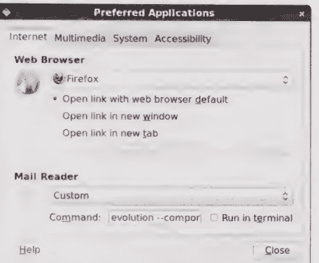

图 3-17：默认应用程序窗口

### 媒体默认应用程序

Nautilus 直接在“文件管理偏好”窗口中处理媒体操作的偏好。你可以从任何 Nautilus 窗口的“编辑 | 偏好”菜单，或者从“系统 | 偏好 | 文件管理”访问它。文件管理偏好中的“媒体”选项卡列出了音频 CD、DVD 视频、播放器、照片和软件的条目。你可以从下拉菜单中选择用于不同媒体的应用程序（见图3-18）。这些菜单还包括“询问做什么”、“什么都不做”和“打开文件夹”选项。“打开文件夹”将打开一个显示光盘上文件的窗口。标记为“其他媒体”的区域允许你为蓝光光盘等较不常用的媒体设置关联。初始情况下，所有媒体的选项都将设置为“询问做什么”。每个下拉菜单都列出了可能的选项，例如音频 CD 磁盘使用 rhythmbox 音乐播放器，DVD 视频使用视频播放器 (Totem)。照片可以使用 gThumb 查看器打开。

当你插入可移动媒体（如音频 CD 磁盘）时，除非更改该设置，否则应用程序会自动启动。如果你想对特定类型的媒体关闭此功能，可以从应用程序下拉菜单选择“什么都不做”。如果你希望提示选项，请使用“询问做什么”条目。然后，当你插入磁盘时，会显示一个带有可能操作下拉菜单的对话框。默认应用程序已选中。从此菜单，你可以选择另一个应用程序，或选择“什么都不做”或“打开文件夹”选项。

你可以通过勾选媒体选项卡底部的“不在媒体上始终询问或启动程序”框框来关闭所有媒体的自动启动。你还可以启用“插入时浏览媒体”选项以打开显示其文件的文件夹。

## 106 第一部分：桌面

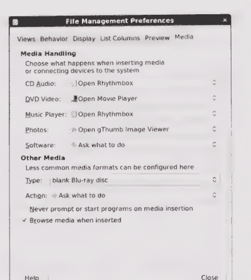

图 3-18：文件管理偏好

### 文件和文件夹属性

在文件的“属性”对话框中，你可以查看文件的详细信息并设置选项和权限（见图3-19）。文件的属性对话框有五个选项卡：基本、徽章、权限、打开方式和备注。“类型”是 MIME 类型，表示与其关联的应用程序类型。图标显示在顶部，顶部的框显示文件的名称。你可以在“名称”文本框中编辑文件名，更改该名称。如果你想更改用于文件或文件夹的图标，请点击图标（名称旁）以打开“选择自定义图标”对话框，以浏览你想要的图标。`/usr/share/pixmaps`（点击“位置”窗格中的 `pixmaps` 条目）存放当前的默认图像，你可以选择自己的图像（点击右侧窗格中的 `pixmaps` 条目）。双击即可更改图像。

“徽章”选项卡允许你设置此文件显示的徽章，并列出所有徽章。勾选复选框向图标添加徽章。你有多个徽章可选。徽章将从图标的右上角开始，提供对文件内容或重要性的指示。你还可以使用徽章将你的文件和文件夹组织成组，然后对它们进行排序。


文件的“权限”选项卡显示了为该文件设置的所有者、组和其他其它的读、写和执行权限。只要文件属于你，你就可以更改任何权限。你可以使用下拉菜单为所有者、组和其它配置访问。你可以将所有者权限设置为“只读”或“读/写”。对于组和其它，你也可以设置“无”选项以拒绝访问。点击组名将显示一个列出不同组的菜单，允许你选择其中一个来更改文件的组。

### 第3章：GNOME

作为应用程序（例如 shell 脚本），勾选“允许作为程序执行文件”条目。这将产生设置执行权限。

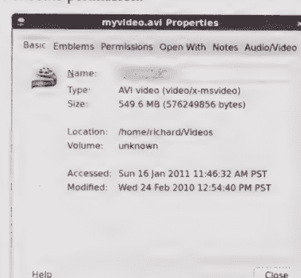

图 3-19：Nautilus 文件属性选项卡

文件的“打开方式”选项卡列出了所有与此类文件关联的应用程序。你可以选择你想要作为默认的那个。这对于媒体文件特别有用，因为你可能倾向于为媒体使用特定的播放器，或为图片使用特定的图像查看器。

某些类型的文件会有额外的选项卡，提供有关文件的信息。例如，音频文件将有一个“音频”选项卡，列出音频文件类型以及任何其他信息，如歌曲标题或使用的压缩方法。图像文件将有一个“图像”选项卡，列出分辨率和图像类型。视频文件将包含一个“视频”选项卡，显示视频类型以及压缩和分辨率详情。

“备注”选项卡显示你添加到文件的任何备注。它是一个可编辑文本窗口，因此你可以直接更改或添加备注。

文件夹的“权限”选项卡的操作与文件相同，但它包含两个访问条目：文件夹访问和文件访问。“文件夹访问”条目通过“无”、“仅列出文件”、“访问文件”和“创建并删除文件”选项控制对文件夹的访问。这些对应于文件夹的读、写和执行权限。“文件访问”条目通过“无”、“仅列出文件”、“访问文件”和“创建并删除文件”选项控制对文件夹的访问（此处原文可能有误，应为文件访问）。这些对应于文件夹的读、写和执行权限。

# 第3章：GNOME

| GNOME 系统文件夹 | 内容 |
|---|---|
| `/usr/bin` | GNOME 程序 |
| `/usr/lib` | GNOME 库 |
| `/usr/include/libgnome-2.0` | 用于编译和开发 GNOME 的头文件 |
| `/usr/include/libgnomeui` | 用于编译和开发 GNOME 界面组件的头文件 |
| `/usr/share/gnome` | GNOME 应用程序使用的文件 |
| `/usr/share/doc/gnome*` | 各种 GNOME 包（包括库）的文档 |
| `/etc/gconf` | GConf 配置文件 |

### 用户 GNOME 文件夹

|  | 内容 |
|---|---|
| `.gnome`, `.gnome2` | 存储用户 GNOME 桌面和 GNOME 应用程序的配置文件 |
| `DESKTOP` | 放置在桌面上的文件、文件夹和链接所在的文件夹 |
| `.gnome2_private` | 用户私有 GNOME 文件夹 |
| `gtkrc` | GTK+ 配置文件 |
| `gconf` | GConf 配置数据库 |
| `.gconf` | GConf 守护进程管理文件 |
| `.gstream` | GNOME GStreamer 多媒体配置文件 |
| `.nautilus` | Nautilus 文件管理器的配置文件 |

### 表 3-7：GNOME 文件夹和文件

RHEL6 将二进制文件安装在系统的 `/usr/bin` 文件夹中。GNOME 库位于 `/usr/lib` 文件夹。GNOME 还有自己的包含文件夹，其中包含编译和开发 GNOME 应用程序的头文件 `/usr/include/libgnome-2.0/libgnome` 和 `/usr/include/libgnomeui`（见表 3-7）。位于 `/usr/share/gnome` 的文件夹包含用于配置 GNOME 环境的文件。

GNOME 在您的家目录中设置了几个配置文件和文件夹。`.gnome2` 和 `.gconf` 文件夹存储不同桌面组件的配置文件，例如用于文件管理的 nautilus 和用于面板的 panel。`DESKTOP` 文件夹存储了您放置在桌面上的所有项目。

### GConf 配置编辑器

GConf 配置编辑器提供底层配置支持。GConf 对应 Windows 系统使用的注册表（Registry）。它由一系列用于为 GNOME 桌面实现配置数据库的库组成。这种标准化配置允许 GNOME 应用程序之间进行一致交互。这不是配置 GNOME 桌面的首选方法。如果可能，您应该始终使用偏好设置框或应用程序自带的配置界面。GConf 数据库以 XML 文件的形式实用户的 `.gconf` 文件中。数据库交互和访问由 GConf 守护进程 `gconf` 执行。

您可以使用 GConf 编辑器配置不同的 GNOME 应用程序和桌面功能。要启动 GConf 编辑器，请从“应用程序 | 系统工具”菜单中选择“配置编辑器”（该菜单项默认关闭，可以通过“系统 | 偏好设置 | 主菜单”将其设为显示）。请确保已安装 `gconf-editor` 包。

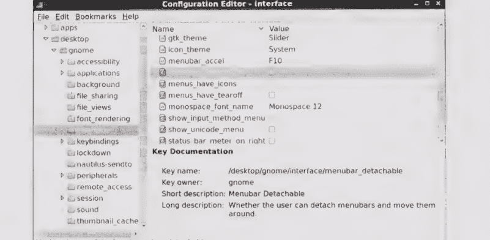

### 图 3-20：GConf 编辑器

配置元素是按应用程序和程序组织的键（keys）。您可以编辑这些键并更改其值。图 3-20 显示了 GNOME 元数据显示功能的 GConf 编辑器设置。

GConf 编辑器有三个窗格：

- 树形窗格用于导航键，每个应用程序都有可展开的树，位于左侧。应用程序条目展开为子条目，将键分组为应用程序的不同部分或功能。
- 右上角的修改窗格将显示所选条目的键。“名称”（Name）字段将包含一个指示其类型的图标，“值”（Value）字段是显示当前值的可编辑字段。您可以直接更改此值。
- 文档（Documentation）：右下角的文档字段显示有关所选键的信息，显示键名、其所属的应用程序以及简短和详细的描述。
- 结果（Results）：结果窗格显示在底部，仅当您对键进行搜索时才会出现。

键具有特定类型，例如数值或字符串，您将能够根据类型进行更改。每个键条目都有一个指定其类型的图标，例如布尔值使用复选框，数值值使用数字，字符串值使用字母。某些键具有带有限制设置的弹出菜单，由一个带有几行线的图标表示。要更改键的值，请点击其值字段。然后您就可以编辑该值。要显示弹出菜单，请右键点击值字段。

许多键分布在多个应用程序和组中。要找到其中，您可以使用搜索功能。从“编辑”菜单中选择“查找”（Find）并输入模式。结果显示在“结果”窗格中，您可以使用它滚动查看匹配的键，并选择所需的键。

更改可以由用户或管理员进行。管理员可以为键设置默认值或强制值。强制值将防止用户进行更改。对于用户更改，您可以通过从“文件”菜单中选择“新设置窗口”（New Settings Window）来打开设置窗口。这将打开一个相同的 GConf 编辑器窗口。

您还可以创建强制和默认设置。通过选择“新默认窗口”（New Defaults Window）和“新强制窗口”（New Mandatory Window）来进行默认和强制更改。

# 4. K 桌面环境

## KDE 4

- 使用 KDE 进行 KDE 配置和管理
- Plasma、面板和 plasmoids（小部件）
- KDE 帮助中心
- KDE 4 桌面
- 面板
- KWin 桌面特效
- KDE 文件管理器：Dolphin
- Web 和 FTP 访问：Konqueror
- KDE 配置：系统设置

K 桌面环境 (KDE) 是一套网络透明桌面，包含了标准的桌面功能（如窗口管理器和文件管理器），以及涵盖大多数 Linux 任务的扩展应用程序。许多为 KDE 编写的应用程序在软件通道中可用。此类应用程序的名称通常包含字母 K，例如 KMail。KDE 提供了各种附件，包括计算器、控制台窗口和记事本。KDE 还提供了用于配置桌面的对话框。

| 网站 | 说明 |
|---|---|
| kde.org | KDE 网站 |
| kde-apps.org | KDE 软件库 |
| techbase.org | KDE Techbase 站点 |
| qt.nokia.com | Qt 库站点 |
| kde-look.org | KDE 桌面主题 |
| lists.kde.org | KDE 邮件列表 |

### 表 4-1：KDE 网站

## KDE 4

KDE 4 版本是对 KDE 桌面的重大重构。请访问 KDE 网站获取有关 KDE 4 的详细信息，包括视觉指南。www.kde.org/announcements/4.0/

有关 KDE 4.3（当前 RHEL6 版本）中添加的功能，请查阅：www.kde.org/announcements/4.3/


KDE 的每一个方面都通过 KDE 4 进行了重新设计。它拥有新的文件管理器、桌面、主题、面板和配置界面。KDE 窗口管理器支持高级合成特效。多媒体设备接口由 `Phonon` 管理，电源、网络和蓝牙设备则由 `Solid` 管理。`Phonon` 多媒体框架为媒体播放提供了软件后端。通过 `Phonon`，你可以将媒体文件定向到特定设备。`Solid` 硬件集成框架支持固定和可移动设备，以及蓝牙连接。`Solid` 还可以连接到你硬件的电源管理功能。

应用程序包括 `Okular` 文档查看器，它支持多种文档格式，如缩放、页面缩略图、搜索和书签，并允许为文档添加注释。`Gwenview` 是 KDE 图像查看器，为你的图片提供浏览、显示和幻灯片功能。终端窗口支持支持的标签页、针对大输出的分屏视图、背景透明以及命令搜索对话框。大输出可以进行滚动。

## KDE 的配置与管理访问

KDE 访问系统管理工具时与 GNOME 使用不同的菜单和访问点。此外，访问 KDE 桌面配置任务也有不同的方法，还有无法通过 GNOME 使用的 KDE 系统管理工具。

你可以从“应用程序 | 管理”选项访问 RHEL6 系统管理工具。在这里，你将找到 `system-config` RHEL6 管理工具，如用户和组、打印打印和 SELinux。

- 系统设置（System Settings）：可以从 `Kickoff` 菜单访问，包含三个项目：最喜 | 应用程序 | 系统设置，以及 计算机 | 系统设置。这是一个全面的 KDE 配置工具，列出了所有用于管理你的桌面、文件管理器和系统的 KDE 配置工具，以及可以替代 RHEL6 工具的 KDE 管理工具。
- 管理（Administration）：从“应用程序 | 管理”访问，这是一系列红帽管理工具的集合，对应于你在 GNOME“系统 | 管理”菜单中的工具。在这里，你会找到一些 GNOME 对话框，如用户和组、打印、身份验证以及日期和时间。
- 设置（Settings）：从“应用程序 | 设置”访问，这是一个较小的桌面配置功能集合，用于诸如设置默认打印机、加密和密钥偏好以及 PDA 设备设置等任务。此菜单中包含菜单更新工具，允许你将非 KDE 应用程序添加到 KDE 菜单中。
- 系统（System）：从“应用程序 | 系统”访问，在这里你将找到系统工具，如 KDE 系统监器、终端和 KRandRTray。其中某些应用程序对应于 GNOME“应用程序 | 系统工具”中的工具，如磁盘实用程序和 SELINUX 故障排除器。

注意：为了安装来自 KDE 桌面的软件包，你必须安装 `kit-qt` 包，这是 `PackageKit` 的 QT 支持库。该包位于 RHEL 运营存储库（Operational repository）。

## Plasma：桌面、面板和 plasmoids（小部件）

KDE4 桌面的主要组件是 `Plasma` 桌面外壳。`Plasma` 包含容器（containments）和 plasmoids（小部件）。plasmoids 是在容器内运行的小部件。在 KDE4 中，有两种类型的 Plasma 容器：面板和桌面。桌面和面板现在是底层 Plasma 操作的功能。它们不是独立的程序。这两者都可以拥有 plasmoids（小部件）。对于每种类型你都可以看到多个。你可以有多个桌面容器，每个容器都安装了自己自己的面板。你也可以在桌面上放置多个面板，使用不同的 plasmoids 集合。

每个容器都有其自己的配置工具箱。桌面在右上角有一个工具箱，面板在右侧有一个工具箱。面板具有用于调整面板尺寸和位置的配置工具。许多任务支持键盘快捷键（见表 4-2）。桌面菜单有一个“快捷键设置项，它可以打开“配置快捷键”对话框，你可以在其中配置按键。

| 键 | 说明 |
| :--- | :--- |
| ALT-F1 | `Kickoff` 菜单 |
| ALT-F2 | `Krunner`，命令执行，输入可以是任何相关操作的搜索字符串，包括书签和联系人，而不只是应用程序。 |
| 上/下箭头 | 在菜单项之间移动，包括 `Kickoff` 和各种菜单 |
| 左/右箭头 | 移动到子菜单，包括 `Kickoff` 和快速访问子菜单 |
| 回车 (ENTER) | 选择菜单项，包括 `Kickoff` 或快速访问 |
| 上页，下页 | 快速向上或向滚动滚动 |
| ALT-F4 | 关闭当前窗口 |
| ALT-F3 | 当前窗口的窗口菜单 |
| CTRL-ALT-F6 | 命令行界面 |
| CTRL-ALT-F8 | 从命令行界面返回桌面 |

### 表 4-2: KDE 桌面键盘快捷键

RHEL KDE6 4 还支持缩放用户界面 (ZUI)，并支持多个 plasma 桌面容器（活动）。工具箱菜单显示“缩小”项，以访问 ZUI 界面：添加、删除和选择桌面容器。


## KDE 帮助中心

KDE 帮助中心提供了一个类似浏览器的界面，用于访问和显示 KDE 帮助和 Linux Man 文件（见图 4-1）。你可以通过在 `Kickoff` 中选择其项目来启动帮助中心。帮助中心显示侧边栏，让你选择手册、教程和信息文件。帮助中心还提供了一个用于搜索模式的搜索工具。

## KDE 4 桌面

KDE 的目标之一是为用户提供一个集成桌面，其中所有应用程序都使用桌面界面（见图 4-2）。为了实现目标，KDE 了自己的窗口管理器 (`KWM`)、文件管理器 (`Dolphin`) 和面板 (`Plasma`)。你可以在 KDE 中运行任何符合 X 标准的应用程序（如 `Firefox`），以及 GNOME 应用程序。反之，你可以在 GNOME 中运行任何 KDE 应用程序，包括 `Dolphin` 文件管理器。

### 图 4-3：KDE 桌面菜单

要配置桌面，您可以使用系统设置（应用程序 | 系统设置）中的“外观”工具。这些工具包括外观、桌面、通知和窗口行为。“外观”包含大部分配置任务，包括字体、样式和图标。“样式”和“图标”面板允许您在不更改整个主题的情况下更改小部件。可用的样式包括 `Oxygen`、`Plastik`（KDE 3.5）和 `Clearlooks`（GNOME）。“桌面”是您控制桌面和屏幕保护程序的地方。“窗口行为”控制诸如快捷键、标题栏阴影和窗口移动等显示功能。

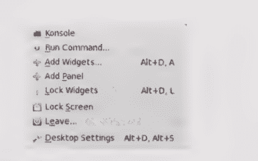

## Plasma 工作区配置：活动、主题和壁纸

Plasma 桌面层级容器（也称为工作区）具有独立的工作区配置设置，您可以在其中设置主题、背景图像（壁纸）以及使用的活动类型（桌面或文件夹）。您可以通过两种方式访问工作区设置窗口：右键点击桌面背景显示桌面菜单并选择“桌面设置”，或者将鼠标移动到桌面工具箱显示桌面工具箱菜单并选择“桌面”。这会打开“桌面设置 - Plasma 工作区”窗口（见图 4-4）。

### 图 4-4：活动、主题和壁纸：外观设置

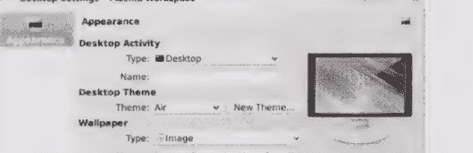

“桌面活动”部分允许您为桌面工作区选择活动类型。默认类型是“桌面”。将其更改为“文件夹”将在您的桌面上显示文件夹的内容。默认是您主目录下的“桌面”子文件夹。“桌面”子文件夹链接到您的主目录和垃圾箱，实际上在桌面上显示主目录和垃圾箱的图标。

## 第一部分：桌面

“桌面主题”部分允许您更改您的主题。此功能取代了以前 KDE 版本中使用的主题管理器。主题会更改整个桌面的外观和感受，影响桌面元素（如滚动条、按钮和图标）的外观。`Oxygen` 主题是默认主题。您可以点击“新主题”按钮打开位于 http://kde-look.org/ 上的可用主题列表（见图 4-5）。您可以按照最新、下载次数最多和评分最高进行排序。选择您想要的那个并点击“安装”。新主题将列在“主题”下拉菜单中。请记住，您可以通过“系统设置 | 外观”更改主题、窗口和图标样式，而无需更改主题。

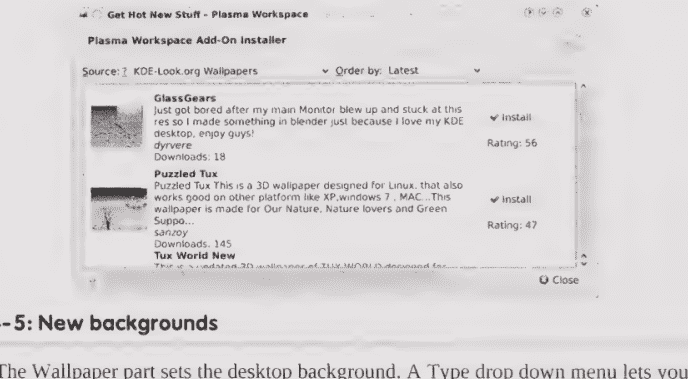

### 图 4-5：新背景

“壁纸”部分设置桌面背景。“类型”下拉菜单允许您将背景更改为图像（默认）、颜色或幻灯片。对于幻灯片，您需要选择存放幻灯片图像的文件夹。默认设置是图像。您可以从“图片”下拉菜单中选择其他壁纸图像。起初，您只有红帽图像可供选择。您可以通过选择系统上的自己的图像（磁盘图标），或通过点击“新壁纸”按钮从 http://kde-look.org/ 下载背景图像来安装新图像。将打开一个窗口列出可用的背景。选择您喜欢的图像并点击“安装”按钮。新背景将列在“图片”中，您可以在那里选择。点击“应用”按钮使更改生效。

您还可以使用“系统设置 | 高级选项卡 | 高级用户设置 | 桌面主题详情”进行自定义。在这里，您可以选择主题以及下载和安装新主题。您还可以对特定的主题项使用不同的主题，如对话框背景、配色和工具提示。

退出 KDE


要退出 KDE，首先点击 KDE Kickoff 菜单（见图 4-6）。在这里，您可以找到锁定、注销、切换用户、关机和重启的选项。您也可以在桌面任何地方右键点击并从弹出列表中选择“退出”。如果您在退出时打开任何 KDE 应用程序或窗口，它们在您重新启动时会自动恢复。如果您只想锁定桌面，可以选择“退出”菜单上的“锁定”，您的屏幕保护程序就会出现。要访问锁定的桌面，点击屏幕会弹出一个框提示您输入登录密码。输入密码后，您的桌面就会重新出现。在使用 GDM 而不是 KDM 时，“切换用户”项只是锁定屏幕。

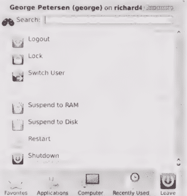

图 4-6：Kickoff 菜单离开和退出对话框

### KDE Kickoff 菜单

KDE 应用程序启动器（见图 4-7）通过菜单窗口底部图标访问的菜单组织项目。有收藏、“应用程序”、“计算机”、“最近使用”和“退出”菜单。您可以通过右键点击并选择“添加到收藏”或“从收藏移除”来向收藏菜单添加或删除应用程序。

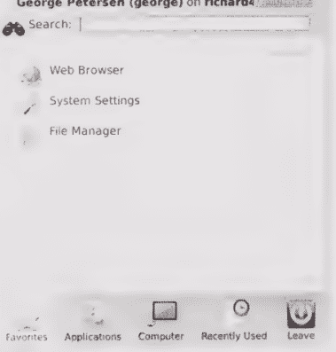

图 4-7：Kickoff 菜单收藏

# 第一部分：桌面

“应用程序”菜单显示应用程序分类。“计算机”菜单显示固定和可移动存储器。“最近使用”菜单同时显示文档和应用程序。Kickoff 还提供了一个搜索框，您可以在其中搜索特定的应用程序。


图 4-8：Kickoff 菜单计算机

要配置 KDE，您可以使用“收藏”、“应用程序”或“计算机”引用的系统设置。使用“退出”菜单注销或关机（见图 4-6）。


图 4-9：Kickoff 菜单应用程序

## 第 4 章：KDE

“会话”部分包含注销、锁定切换用户。“系统”部分提供系统级操作，包括关机、重启和挂起（到内存或磁盘）。“计算机”菜单有“应用程序”和“位置”部分（见图 4-8）。“应用程序”部分包含系统设置。“位置”部分类似于 GNOME 的位置菜单，包含主目录、网络文件夹、根目录和垃圾箱。

“应用程序”菜单包含许多与 GNOME 相同的项目（见图 4-9）。您可以找到互联网、图形和办公室等类别。这些菜单列出了可以使用的 GNOME 和 KDE 应用程序。“互联网”菜单包含替代 KDE 应用程序，如 KMail。某些项将调用 KDE 工具的版本，例如“系统工具”菜单中的“终端”项，它将调用 KDE 终端窗口“控制台”。没有“首选项”菜单。

Kickoff 菜单可以通过打开桌面或面板的“添加小部件”对话框并选择“应用程序启动器”（启动应用程序）项来添加到任何面板或桌面。在桌面上，应用程序启动器显示为简单的图标，点击后会打开 Kickoff 菜单。在 RHEL6 上，应用程序启动器是红帽标志。如果您想使用类似于 GNOME 的传统菜单界面，请选择描述为“基于菜单的应用程序”的项目。

为了快速访问应用程序、书签、联系人和其他桌面项目，可以使用 Krunner。Krunner 作为搜索工具。要查找应用程序，输入搜索模式，将显示应用程序的图标。点击图标启动应用程序。对于已知名称、部分名称或仅基本主题的应用程序，Krunner 是访问应用程序的非常快的方法。要启动 Krunner，右键点击桌面显示桌面菜单并选择“运行命令”，或者只需按 `Alt-F2`。输入您想要搜索的应用程序模式并按回车。模式“image”显示 Gwenview 和 GThumb 图像查看器（见图 4-10）。


图 4-10：Krunner 应用程序搜索

## 可移动式设备：新设备通知器

新设备通知器插件位于面板左侧，紧邻启动菜单（Kickoff menu）的红色帽子图标。当你插入如 CD/DVD-ROM 光盘或 USB 驱动器等可移动式设备时，新设备通知器会短暂显示一个窗口，显示你所有的可移动设备，包括新插入的设备。随时点击新设备通知器即可显示此对话框。图 4-11 显示了面板上的新设备通知器及其插件图标。

要打开设备，你需要使用新设备通知器（可移动式设备**不会**作为图标显示在桌面上）。点击面板上的新设备通知器图标打开其对话框。然后点击你想要打开的设备，例如 DVD/CD 光盘或 USB 驱动器。将打开一个文件管理器窗口显示你的设备内容。当你点击新设备通知器条目以打开其文件管理器窗口时。

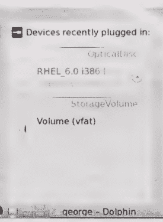

图 4-11：面板上带有插件的新设备通知器

你也可以使用新设备通知器弹出可移动式设备。当你选择设备条目时，会出现一个弹出按钮。点击 DVD/CD-ROM 光盘的条目将将其物理上弹出，而对于 USB 驱动器，驱动器将被卸载并准备好移除。然后你可以安全地移除 USB 驱动器（见图 4-11）。

### 桌面插件（applets）

KDE 4 桌面采用了 Plasma 桌面，它对插件的处理方式不同。Plasma 将其插件称为“模式”（plasmodes）。它的设计目标是以与窗口和图标相同的级别来处理模式。就像桌面窗口一样，它也可以显示模式。模式（或称插件）在桌面操作中承担了更多责任，运行核心操作，并在某种程度上取代了文件管理器窗口的需求。为此，仪表板工具可以隐藏所有其他桌面项目，只显示模式。当你首次登录时，你的桌面将显示一个插件，即桌面文件夹视图。你可以使用鼠标和快捷键来访问插件（见表 4-3）。

| 键位 | 说明 |
| :--- | :--- |
| `CTRL-A` | 打开“添加部件”窗口向桌面添加插件 |
| `CTRL-L` | 锁定部件以防止移除、添加新部件或更改设置 |
| `CTRL-N` | 下一个插件 |
| `CTRL-P` | 上一个插件 |
| `CTRL-S` | 打开选中的插件配置设置 |
| `CTRL-R` | 移除选中的插件 |

表 4-3：KDE Plasma 快捷键

### 管理插件

图 4-12 显示了桌面文件夹、数字时钟、计算器和文件夹视图插件。桌面文件夹插件只是一个设置为“桌面文件夹”的文件夹视图插件。当你添加“文件夹视图”插件时，它将默认指向你的主目录。

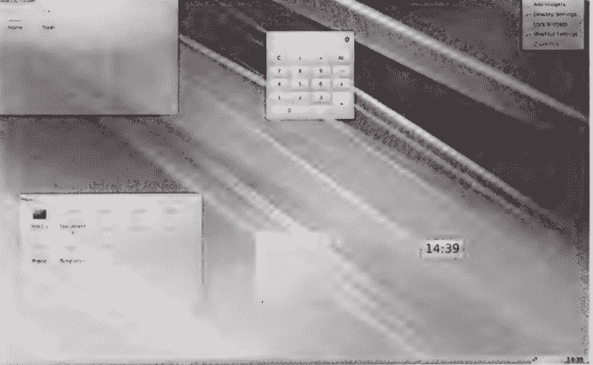

图 4-12：桌面窗口、文件夹窗口、计算器、数字时钟和记本文插件。

当你将鼠标悬停在插件上时，会显示其侧边栏，其中包含调整大小、刷新、设置和关闭插件的按钮（见图 4-13）。点击并拖放缩放按钮来更改插件大小。

# 126 部分 1：桌面


图 4-13：带有任务侧边栏的模拟钟插件

点击设置按钮（扳手图标）会打开该插件的设置对话框（见图 4-14）。设置对话框显示一个带有不同配置类别的侧边栏。点击其中一项会在右窗格中显示相应的配置设置。

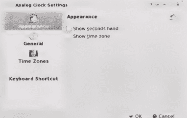

图 4-14：模拟钟插件配置

要向桌面添加部件（插件），在桌面的任何地方点击右键，并从弹出菜单中选择“添加部件”，或者将鼠标移动到右上角的桌面工具箱图标上，从显示的菜单中选择“添加部件”（见图 4-15）。

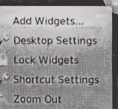

图 4-15：桌面工具箱中的“添加部件”和“缩小”项。

这将打开“添加部件”对话框，其中列出了你可以添加的部件（见图 4-16）。窗口顶部的下拉菜单让你查看不同的部件类别，如日期和时间、在线服务和图形（见图 4-16）。你还可以看到最近使用的部件以及收藏部件。

要添加部件，首先通过点击它来选择，这将一次高亮几个条目（如果需要选择多个，请按住 `Ctrl` 键点击）。使用 `Shift-点击` 选择连续范围，并使用 `Ctrl-a` 选择所有。选中后，点击对话框底部的“添加部件”按钮来添加选中的部件。你也可以通过双击它立即添加单个部件。

你还可以通过点击它的星形图标将部件标记为收藏之一（见图 4-17）。星号将变为黄色。当你选择“我的收藏部件”时，只有被收藏的部件会显示。当你鼠标悬停在插件上时，未收藏的插件会显示加号，收藏的插件会显示星号。要使用“添加部件”对话框移除插件，点击其条目中的星号（见图 4-17）。插件将立即移除。如果你有多个插件实例，例如多个文件夹插件，已收藏的插件会显示星号

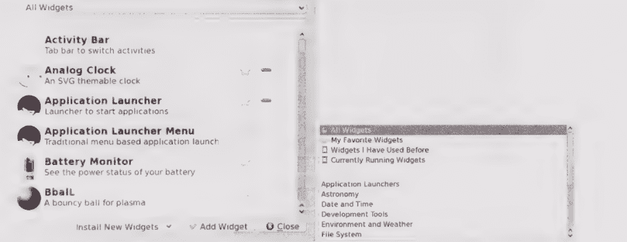

### 图 4-16：添加部件：插件

要获取有关某个插件的更多信息，将鼠标移动到其条目的右侧以显示带有“i”字母的信息按钮（见图 4-17）。点击信息按钮会显示带有“关于”和“作者”标签的对话框。“关于”标签通常会包含一个链接


### 图 4-17：插件添加、移除和信息按钮

## 仪表板

仪表板的设计旨在显示插件。它隐藏了所有窗口和图标，只显示模式。要启动仪表板，点击面板上的仪表板插件。在 RHEL6 上，你需要在面板上安装仪表板插件。在“添加部件”对话框中，选择“仪表板”条目并点击“添加部件”。仪表板图标如图 4-18 所示。

点击仪表板图标启动仪表板。当仪表板运行时，屏幕顶部会显示 Plasma Dashboard 标签（见图 4-18）。按 Esc 键返回桌面。如果你在桌面上添加了仪表板图标，可以点击该图标在仪表板和桌面之间切换。你还可以打开仪表板插件的配置设置对话框来设置快捷键，然后使用该快捷键在仪表板和桌面之间切换。


图 4-18：仪表板及其板插件

## 活动与 ZUI

KDE 还支持多个活动（Activities）。活动是不同的插件桌面容器，每个容器都有一组插件。活动与虚拟桌面不同。虚拟桌面影响窗口，在每个桌面上显示不同的窗口集。活动使用当前的虚拟桌面，但有自己的一组插件也会显示。你可以使用不同的活动，在同一个虚拟桌面使用不同的插件。从技术上说，每个活动都是一个 Plasma 桌面容器，拥有自己的插件集合。

活动是一种为特定任务设置一组插件的方法。你可以设置一个用于办公的活动，另一个用于新闻，另一个用于媒体。每个活动都可以有自己的一套合适的插件，例如办公活动可以使用时钟、计算器、字典和文档文件夹。媒体活动可能包含一个用于音频的播放插件、幻灯片用于

照片以及显示最新新闻的滚动条。你可以为家里创建一个活动，为办公室创建一个，为工作创建一个，或者为娱乐创建一个，每个活动都有其自己的一套桌面组件（plasmoids）。

多个活动通过缩放用户界面（ZUI）进行管理。可以通过桌面工具箱上的“缩小输出”（Zoom Out）选项进入此界面。缩小视图以显示你的活动。


### 添加小部件...

图 4-19：带有已添加活动和活动工具栏的缩放

在缩小层级上，每个活动的底部会出现一个工具栏。工具栏上有添加小部件（Add Widgets）、放大（放大镜图标）和桌面设置对话框（扳手图标）按钮，通过你可以设置活动名称和桌面背景。

右上角的菜单中有一个“缩小输出”（Zoom Out）选项，你可以用它缩回到桌面层级。在顶层，任何活动的放大镜图标都可以用于缩放到第一层级。

任何额外的活动在其工具栏上也会有一个删除图标（红色 X）。当前选择用于桌面的活动将没有该图标。你可以通过点击删除图标来移除你设置的任何额外活动。

提示：缩放后的显示将显示你原始桌面上的任何打开的窗口，就像一个桌面一样。为了完全看到缩放后的活动（不被打开的窗口阻塞），你应该在缩放之前关闭或最小化你的窗口。

# 第 4 章：KDE 129

## 第 1 部分：桌面

要添加新活动，点击左上角菜单中的“添加活动”（Add Activity）选项。这将创建一个新活动，它将作为一个桌面显示出来。

要使用某个活动，在第一层级，点击其工具栏上的放大图标（放大镜）进行放大。你的桌面将恢复到原始显示，但现在显示的是该活动的桌面组件。


### 图 4-20：带有多个操作的完全缩放

要从一个活动切换到另一个活动，首先在桌面工具箱上选择“缩小输出”（Zoom Out）进入缩小模式。找到你想要的活动（显示为带有不同桌面组件的桌面）。然后点击该活动的放大图标（放大镜）。随后，带有自己的一套桌面组件的新活动将显示在你的桌面上。

你可以通过点击活动的“添加小部件”（Add Widget）按钮向任何活动添加桌面组件。添加小部件对话框将打开，你可以选择一个小部件进行添加。

在显示多个活动的“缩小输出”模式下，你可以管理任何活动上的桌面组件。你可以将桌面组件移动到活动内的不同位置，或移动到另一个活动，移除桌面组件，甚至可以对其进行配置。当你的鼠标悬停在桌面组件上时，它的侧边栏将显示，包含移动、调整大小、移除和配置桌面组件的选项。要移动桌面组件，点击并拖动它的任何地方。

# 第 4 章：KDE 131


图 4-21：在桌面设置对话框中为活动命名

当你创建一个活动时，它是没有命名的。在“缩小输出”模式下，点击桌面设置按钮（扳手图标）。在“桌面活动”部分，在“名称”（Name）文本框中输入你想要使用的名称（见图 4-21）。要为你当前桌面上使用的活动命名，右键点击桌面以显示“桌面设置”（Desktop Settings）选项以打开桌面设置对话框。

为了方便在活动之间移动，你可以添加“活动栏”（Activity bar）小部件，可以将其添加到面板或桌面。在面板上，活动栏显示每个每个的按钮。点击即可移动到不同的活动。在桌面上，活动栏显示一个带有箭头按钮的对话框，用于从一个活动移动到另一个活动（见图 4-22）。


# 图 4-22：活动栏小部件

活动可以是桌面视图，也可以是文件夹视图。在桌面设置的活动部分的下拉菜单中设置类型。“文件夹视图”活动的功能类似于文件管理器，在活动屏幕上显示特定的文件夹。要配置文件夹视图活动，右键点击活动桌面以显示桌面菜单，并选择“文件夹视图”以显示文件夹视图的桌面设置对话框。会为位置（Location）、显示（Display）和过滤器（Filter）添加图标（见图 4-23）。在“位置”选项卡中，你可以显示桌面文件夹、类似主目录文件夹的地方或你指定的文件夹。在“显示”选项卡中，你可以设置显示功能，如布局、排序和尺寸。“过滤器”选项卡允许你显示特定类型或命名模式的文件。

# 132 第1 部分：桌面


图 4-23：活动文件夹设置对话框

### KDE 窗口

KDE 窗口具有你在其他窗口管理器和桌面中找到的功能。你可以通过点击并拖动它的任何角或侧边来调整窗口大小。在侧边上进行点击并拖动操作在该维度上扩展窗口，而在角处则同时扩展高度和宽度。窗口顶部有标题栏。

# 134 第1部分：桌面


图 4-24：虚拟桌面配置

要更改分页器在面板上显示桌面的方式，请右键点击并选择“分页器设置”（Pager Settings）。在这里，你可以配置分页器显示桌面的数字或名称。你还可以决定使用的行数。仅选择一行将像如图所示所示并排显示桌面。

> 提示：使用 CTRL-TAB 键移动到下一个桌面，使用 CTRL-SHIFT-TAB 回到上一个桌面。使用 CTRL 键配合功能键切换到特定桌面：例如，CTRL-F1 切换到第一个桌面，CTRL-F3 切换到第三个桌面。

### KDE 面板

KDE 面板位于屏幕底部，提供了对大多数 KDE 功能的访问（见图 4-25）。面板是一个特殊配置的 Plasma 容器，桌面也是如此。面板包含菜单、文件夹窗口、特定程序和虚拟桌面的图标。这些是 plasmoids（插件），它们在面板上配置使用，并有尺寸限制以适应面板。面板左侧是 Kickoff 菜单的按钮。


图 4-25：KDE 面板

要向面板添加应用程序，请右键点击 Kickoff 菜单中的该项打开弹出菜单，并选择“添加到面板”（Add to Panel）。

要向面板添加小部件，首先右键点击面板上的任何位置或现有面板小部件以显示小部件的弹出菜单。然后点击“面板选项”（Panel Options）显示面板选项菜单，在其中选择“添加小部件”（Add Widgets）打开添加小部件对话框，该框列出了

## 第 4 章：KDE 135

你可以添加的小部件（见图 4-26）。该对话框的工作方式与桌面的添加小部件对话框相同。对话框顶部的下拉菜单让你查看不同的小部件类别，如日期和时间、在线服务和图形。你还可以查看最近使用的小部件并设置收藏小部件。


# 图 4-26：KDE 面板添加小部件

Plasma 面板支持多种窗口和任务操作，包括任务栏、系统托盘和分页器。系统托盘包含桌面操作的小部件，如声音设置、网络管理器、通知和任务以及剪贴板（见图 4-27）。系统托盘旁边是其他常用小部件，如电池监控器和数字时钟。更常用的小部件位于面板右侧，如分页器、设备通知和 kickoff 菜单。图 4-27 显示了从左到右系统托盘（网络管理器、剪贴板、声音设置和通知）。

### 图 4-27：KDE 系统托盘

## KDE 面板配置


要配置面板（更改其位置、尺寸和显示功能），你需要使用面板的工具箱，它位于面板右侧。点击它可以打开一个额外的面板配置面板，其中带有添加小部件、移动面板、更改其尺寸和位置的按钮，以及一个用于设置可见性和对齐功能的“更多设置”（More Settings）菜单。图 4-28 显示了配置面板出现在你桌面上时的样子。图 4-29 提供了更详细的描述，包括“更多设置”菜单项。


### 图 4-28：KDE 面板配置

# 第 1 部分：桌面

## 更多设置菜单

| 对齐 | 面板对齐 |
| --- | --- |
| | 左侧 |
| |居中 |
| | 右侧 |
| 可见性 | 始终可见 |
| 自动隐藏 | 窗口可以覆盖 |
| 隐藏 | 关闭配置 |
| --- | --- |
| | 添加面板 |
| | 最大化面板 |

## 调整高度尺寸

移动到桌面的不同侧 打开添加小部件对话框

### 可见性和面板对齐

| 屏幕边缘 | 高度 | 添加小部件... | 添加间距 | 锁定小部件 | 更多设置 |
| --- | --- | --- | --- | --- | --- |


面板位置滑块

最小面板滑块

最大面板尺寸滑块

## 图 4-29：KDE 面板配置详情和显示功能

在配置面板激活时，你还可以在面板上移动 plasmoids。点击面板会覆盖一个移动图标，让你能将 plasmoid 图标移动到面板上的不同位置。

配置面板的下半部分用于面板位置设置。左侧用于将面板放置在屏幕边缘的滑块。右侧是两个用于面板最小（底部）和最大（顶部）尺寸的滑块。

面板顶部有用于更改面板位置和尺寸的按钮。“屏幕边缘”（Screen Edge）按钮允许你将面板移动到屏幕的另一侧（左、上、下）。只需点击并拖动即可。“高度”（height）按钮让你更改面板尺寸，变大或变小。

“添加小部件”（Add Widgets）按钮打开添加小部件对话框，让你添加新的小部件。

“更多设置”（More Settings）菜单允许设置可见性和对齐。“自动隐藏”（Auto-hide）设置允许窗口覆盖。“高度”按钮让你更改面板尺寸，变大或变小。“添加小部件”按钮打开添加小部件对话框，让你添加新的小部件。“屏幕边缘”按钮允许你将面板移动到屏幕的另一侧（左、上、下）。只需点击并拖动即可。

## KWin 桌面特效

KWin 桌面特效可以在系统设置中的“桌面”选项卡中启用（见图 4-30）。


### 图 4-30：桌面特效选择和配置

| 键 | 操作 |
| --- | --- |
| `ALT-TAB` | 覆盖切换或框切换 |
| `CTRL-F8` | 桌面网格 |
| `CTRL-F9` | 显示当前桌面窗口 |
| `CTRL-F10` | 显示所有桌面窗口 |
| `CTRL-F11` | 桌面立方体 |

表 4-4：KWin 桌面特效快捷键


图 4-35: 桌面网格 - `Ctrl-F8`

桌面立方（Desktop Cube）将显示包含所有虚拟桌面的立方体，让你能够围绕立方体在不同的桌面之间移动（见图 4-36）。停在你想要选择的一侧即可。按下 `Ctrl-F11` 启动桌面立方。然后你可以使用方向键或点击并拖动鼠标绕立方体移动。完成后，按下 `ESC` 键返回桌面。当你使用桌面分页器（Desktop Pager）切换到不同的桌面时，桌面立方动画可以使用立方体动画。


图 11-3-6: 桌面立方 - `Ctrl-F11`，鼠标拖拽或左/右方向键

## KDE 文件管理器：Dolphin

Dolphin 是 KDE 的专用文件管理器（Konqueror 用作网络浏览器）。当前文件夹的路径显示在文件窗口顶部，你可以用它跳转到不同的文件夹及其子文件夹（见图 4-37）。通过分屏视图，你可以在同一个窗口中打开多个文件夹，以便在它们之间复制和移动项目。侧边栏将显示不同的面板。“位置”（Places）面板将显示常用文件夹（如主目录、网络和垃圾箱）以及可移动设备设备的图标。要将文件夹添加到“位置”面板，只需将其拖入即可。要配置 Dolphin，请点击设置菜单中的 Dolphin。

文件夹中列出的文件和文件夹有多种查看方式，例如图标、详细列表和列模式（查看 | 视图模式菜单）。列模式将并排显示你打开的文件夹和子文件夹。你可以轻松地在它们之间移动，选择任一列中的文件。窗口底部的滑块允许你放大或缩小所显示的图标和条目的的尺寸。它适用于所有模式，包括详细模式（文件/文件夹名称列表）。

许多文件管理器操作都有相应的键盘快捷键。请见表 4-5。

| 键位 | 说明 |
| --- | --- |
| `ALT-左方向键`, `ALT-右方向键` | 在历史记录中后退和前进 |
| `ALT-上方向键` | 升一级文件夹 |
| `ENTER` | 打开文件/文件夹 |
| `ESC` | 为当前文件打开弹出菜单 |
| 左/右/上/下方向键 | 在图标间移动 |
| 空格键 | 选择/取消选择文件 |
| `PAGE UP`, `PAGE DOWN` | 快速滚动 |
| `CTRL-C` | 将选中文件复制到剪贴板 |
| `CTRL-V` | 将剪贴板的文件粘贴到当前文件夹 |
| `CTRL-S` | 按模式选择文件 |
| `CTRL-L` | 打开新位置 |
| `CTRL-F` | 查找文件 |
| `CTRL-W` | 关闭窗口 |

表 4-5: KDE 文件管理器键盘快捷键


图 4-37: KDE 文件管理器 (`dolphin`)

你可以通过点击文件或选择文件后选择“文件”菜单中的“打开”项来打开文件。如果你想选择某个文件或文件夹，需要在点击时按住 `CTRL` 键。单击即可打开文件。如果文件是程序，该程序将启动。如果它是数据文件（如文本文件），则将使用关联应用程序运行该数据文件。例如，如果你单击一个文本文件，Kate 编辑器将启动显示该文件。如果 Dolphin 不包含打开所需的应用程序，它会打开一个对话框提示你输入应用程序名称。你可以点击此框上的“浏览”按钮，使用文件夹树来定位你需要的应用程序。


图 4-38: KDE 文件管理器面板

你可以从“查看 | 面板”菜单中选择并显示额外的面板（见图 4-38）。“信息”面板显示有关所选文件或文件夹的详细信息，“文件夹”面板显示文件系统的文件夹树。面板可以从文件管理器窗口中分离（见图 4-39）。只需点击面板右上角关闭按钮旁的分离按钮即可。Dolphin 文件管理器还具有集成桌面搜索和元数据提取功能。


图 4-39: 带有分离面板的 KDE 文件管理器

提示：配置文件（隐藏文件）通常不显示。要让管理器显示这些文件，请从“查看”菜单中选择“隐藏文件”（`Ctrl-.`）。Dolphin 还支持分屏视图，让你在同一个窗口中查看不同的文件夹（窗口菜单）。你可以进行垂直或水平分屏。

Dolphin 还支持分屏视图，你可以在同一个窗口中打开两个不同的文件夹。点击工具栏上的“分屏”按钮。你可以将文件夹和文件从一个文件夹拖到另一个文件夹（见图 4-40）。


图 4-40: 带有分屏视图的 KDE 文件管理器

## 复制、移动、删除、重命名和链接操作

要对文件或文件夹执行操作，你必须先选择它。要选择文件或文件夹，请点击文件的图标或列表项。要选择多个文件，在点击你想要的文件时继续按住 `CTRL` 键。你也可以使用键盘方向键在不同的文件图标之间移动，然后使用 `ENTER` 键选择你想要的文件。

要复制文件，你可以使用鼠标通过标准的拖放方法来找到它。要复制文件，请使用文件管理器。打开另一个文件管理器窗口，并导航到你想要复制文件的位置。然后点击并拖动文件图标到该窗口。会弹出一个菜单，提供“移动”、“复制”或“链接”选项。选择“复制”。要将文件移动到另一个文件夹，请遵循相同的步骤，但从弹出菜单中选择“移动”。复制或移动文件夹时，使用与文件相同的步骤。该文件夹中的所有文件和子文件夹都将被复制或移动。

要重命名文件，`Ctrl` 点击图标并按 `F2`，或右键点击图标并从弹出菜单中选择“重命名”。图标下方的名称将变成一个框选的可编辑文本，你可以对其进行更改。


你可以通过选择并删除文件或将其放入“垃圾桶”文件夹来删除文件。要删除文件，选择它（`Ctrl` 点击），然后从“文件”菜单中选择“删除”项（也可以使用 `SHIFT-DEL` 键）。要将文件放入垃圾桶，`Ctrl` 点击选择它，然后将其拖到桌面的垃圾桶上，或从“编辑”中选择“移动到垃圾桶”（`DEL` 键）。你也可以右键点击文件图标并从弹出菜单中选择“移动到垃圾桶”。你稍后打开垃圾桶文件夹并删除文件。要删除垃圾桶中的所有文件，右键点击 `Dolphin` 文件管理器侧边栏中的垃圾桶图标，并从弹出菜单中选择“清空垃圾桶”。要恢复垃圾桶中的文件，打开垃圾桶窗口并将它们拖出垃圾桶文件夹。

每个文件或文件夹都带有属性，包括权限、文件名和它所属的文件夹。要显示特定文件的“属性”窗口，右键点击该文件的图标并选择“属性”项。在“常规”面板上，你可以看到显示的文件名。要更改文件名，将旧名称替换为新名称。权限在“权限”面板上设置。在这里，你可以设置用户、组或其他对该文件的读取、写入和执行权限。“组”项允许你更改文件的所属组。“预览”会显示文本文件的前几行、文档文件的第一页或图像文件的图像。

## Web 和 FTP 访问：Konqueror

`Konqueror` 是一个功能齐全的 Web 浏览器和文件管理器（见图 4-41）。可以使用导航工具栏显示之前的 Web 页面。主页按钮将始终返回你的主页。访问 Web 页面时，文件会在任何 Web 浏览器中显示。通过工具栏，你可以在该会话之前显示的页面列表中来回移动。


### 图 4-11：Konqueror

`Konqueror` 同时也作为一个 FTP 客户端运行。当你访问 FTP 站点时，你可以像拥有这些文件夹一样导航远程文件夹。下载文件的操作与在本地系统上复制文件相同。只需在文件管理器中选择文件的图标或项，将其拖动到显示你想下载到的本地文件夹的窗口中。然后从出现的弹出菜单中选择“复制”。

> 提示：KDE 为 `Konqueror` 提供了 `Kget` 工具，它可以管理 FTP 下载，允许你选择、排队、暂停和调度下载，同时显示当前下载的状态信息。

要配置 `Konqueror`，从 `Konqueror` 设置菜单中选择 `Konqueror`。你可以通过指定属性、Web 页面显示、字体、Cookie、管理和加密方法来执行配置任务。“历史”类别允许你指定历史项目的数量及其过期日期。在“插件”类别中，你可以看到当前浏览器插件的列表并扫描新插件。

`Konqueror` 支持分屏视图以及导航侧边栏。你可以从“窗口”菜单中选择垂直或水平分屏视图。你还可以通过选择“设置 | 工具栏 | 额外工具栏”（见图 4-2）将分屏视图图标添加到工具栏。通过分屏视图，你可以在同一个 `Konqueror` 窗口中同时显示两个不同的网站。

导航面板显示书签、文件夹链接和系统工具。要显示导航面板，从“设置”菜单选择“显示导航面板”。该面板将出现在窗口的左侧。导航面板显示书签、历史、主文件夹、根文件夹和网络文件夹。实际上，`Konqueror` 可以用作 `Dolphin` 的替代文件管理器。


### 图 4-2：带有分屏视图的 Konqueror

`Konqueror` 支持分屏视图以及导航侧边栏。你可以从“窗口”菜单中选择垂直或水平分屏视图。你还可以通过选择“设置 | 工具栏 | 额外工具栏”（见图 4-2）将分屏视图图标添加到工具栏。通过分屏视图，你可以在同一个 `Konqueror` 窗口中同时显示两个不同的网站。

导航面板显示书签、文件夹链接和系统工具。要显示导航面板，从“设置”菜单选择“显示导航面板”。该面板将出现在窗口的左侧。导航面板显示书签、历史、主文件夹、根文件夹和网络文件夹。实际上，`Konqueror` 可以用作 `Dolphin` 的替代文件管理器。

`Konqueror` 支持分屏视图以及导航侧边栏。你可以从“窗口”菜单中选择垂直或水平分屏视图。你还可以通过选择“设置 | 工具栏 | 额外工具栏”（见图 4-2）将分屏视图图标添加到工具栏。通过分屏视图，你可以在同一个 `Konqueror` 窗口中同时显示两个不同的网站。

导航面板显示书签、文件夹链接和系统工具。要显示导航面板，从“设置”菜单选择“显示导航面板”。该面板将出现在窗口的左侧。导航面板显示书签、历史、主文件夹、根文件夹和网络文件夹。实际上，`Konqueror` 可以用作 `Dolphin` 的替代文件管理器。

`Konqueror` 支持分屏视图以及导航侧边栏。你可以从“窗口”菜单中选择垂直或水平分屏视图。你还可以通过选择“设置 | 工具栏 | 额外工具栏”（见图 4-2）将分屏视图图标添加到工具栏。通过分屏视图，你可以在同一个 `Konqueror` 窗口中同时显示两个不同的网站。

导航面板显示书签、文件夹链接和系统工具。要显示导航面板，从“设置”菜单选择“显示导航面板”。该面板将出现在窗口的左侧。导航面板显示书签、历史、主文件夹、根文件夹和网络文件夹。实际上，`Konqueror` 可以用作 `Dolphin` 的替代文件管理器。

## KDE 配置：系统设置

通过 KDE 配置面板，你可以配置你的桌面和系统，更改它的显示方式和支持的功能。这些配置可以通过系统设置窗口访问（见图 4-44）。


### 图 4-4：KDE 系统设置

## 第 1 部分：桌面

“高级”选项卡包含高级用户设置工具（参见图 4-46）。“文件关联”允许你将文件类型与应用程序（MIME 类型）关联。“会话管理器”允许你配置会话。“桌面细节”提供了一个选择和自定义桌面主题的界面。

“系统”部分包含登录管理器和 Samba 的条目。登录管理器仅适用于 KDE 登录管理器 (`KDM`)，不适用于 GDM。你必须先选择使用 `KDM` 而不是 GDM。

### 字体

若要配置字体，在“系统设置”对话框中，选择“外观”并点击“字体”以显示字体选项卡。在这里，你可以为你的桌面选择字体和大小。如需进行更详细的配置，在“使用抗锯齿”下拉菜单中选择“启用”，然后点击“配置”按钮打开一个窗口来选择微（hinting）和子像素选项。

你可以通过“系统设置”->“常规”->“计算机管理”中的“字体安装程序”来安装字体。字体安装程序列出了字体，你可以选择它们进行删除。要添加字体，点击字体包旁的“添加”按钮。你也可以将字体拖放到字体列表中。顶部的下拉菜单允许你选择显示所有字体、系统字体或个人字体。“设置”菜单允许你选择更大的字体预览并更改示例文本。你还可以选择字体管理模式，你可以设置字体组、扫描重复项以及禁用字体。

你也可以通过在 KDE 文件管理器的地址栏输入 `fonts:/` 直接访问个人和系统字体文件夹。对于用户字体，打开“个人字体”窗口。Zip 压缩的字体应先由归存档打开，然后从归存档拖到字体查看器。在字体查看器中右键点击字体，移动到垃圾桶或删除。

用户字体将安装在 `/usr/.fonts` 文件夹中。为了让字体对所有用户可用，必须安装在 `/usr/share/fonts` 文件夹中，使其成为系统字体。在 KDE 上，你通过“系统”文件夹而不是“个人”文件夹执行此操作。你可以从任何用户登录执行此操作：将任何字体包拖到 `fonts:/System` 窗口。

## KDE 文件夹和文件

当你的系统安装了 KDE 时，系统级应用程序、配置和支持文件可能会安装在与所有 GUI 和用户应用程序相同的系统文件夹中（参见表 4-6）。在 RHEL6 上，KDE 安装在标准系统文件夹中，但有一些变化，例如用于程序文件的 `/usr/bin`，存放 KDE 库的 `/usr/lib/kde4`，以及包含应用程序开发中使用的 KDE 头文件的 `/usr/include/kde`。

`.kde` 文件夹包含维护你的 KDE 桌面的文件和文件夹。与 GNOME 一样，“桌面（Desktop）”文件夹包含图标显示在桌面上的 KDE 文件。配置文件位于 `.kde/share/config` 文件夹中。在这里，你可以找到针对不同 KDE 组件的通用配置文件：用于窗口管理器的 `kwincrc` 配置命令，用于邮件的 `kmailrc`，以及带有其他全局定义的 `kdelobobs` 快捷键。你可以将配置指令直接放置在这些文件的任何一个文件中。`.kde/share/apps` 文件夹包含用于配置 KDE 应用程序的文件和文件夹，包括 `okular`、`kmail` 甚至 `konquer`。

# 第 4 章：KDE 151

| 系统 KDE 文件夹 | 描述 |
| :--- | :--- |
| `/usr/bin` | KDE 程序 |
| `/usr/lib/kde4` | KDE 库 |
| `/usr/include/kde` | 用于编译和开发 KDE 应用程序的头文件 |
| `/usr/share/config` | KDE 桌面和应用程序配置文件 |
| `/usr/share/mime/` | 构建主菜单的桌面文件 |
| `/usr/share/apps` | KDE 应用程序使用的文件 |
| `/usr/share/icons` | KDE 桌面和应用程序使用的图标 |


| `/usr/share/doc` | KDE 帮助系统 |
| 用户 KDE 文件夹 | 描述 |
| :--- | :--- |
| `.kde/AutoStart` | KDE 自动启动的应用程序 |
| `.kde/share/config` | 用户指定功能的用户 KDE 桌面和应用程序配置文件 |
| `.kde/share/apps` | KDE 应用程序使用的文件夹和文件 |
| `Desktop` | 显示在 KDE 桌面上的图标和文件夹的桌面文件 |
| `.kde/share/config/plasma-appletsrc` | Plasma applet 配置 |

# 表 4-6：KDE 安装文件夹

位于 `share` 文件夹中的文件夹包含位于 `/usr/` 文件，用于配置你 KDE 环境的系统默认（系统 `share` 文件夹位于 `/usr/share`）。`share/apps` 文件夹包含由 KDE 应用程序设置的文件和文件夹；`share/config` 包含特定 KDE 应用程序的配置文件。这些是系统默认值，可以通过用户在自己的 `.kde/share/config` 文件夹中的配置进行覆盖。`share/icons` 文件夹存放你 KDE 桌面和 KDE 应用程序使用的默认图标。

# 第 2 部分：应用程序

办公、邮件、数据库和编辑器

图形和多媒体

互联网应用程序

# 5. 办公、邮件、数据库和编辑器

- OpenOffice
- 文档查看器（PostScript, PDF 和 DVI）
- 邮件（email）客户端
- Usenet 新闻和新闻阅读器
- 电子书阅读器：Adobe, Kindle 和 Mobipocket
- PDA 访问
- 编辑器
- 数据库管理系统

# 第 2 部分：应用程序

RHEL6 提供了多种可用应用程序（参见表 5-1）。`OpenOffice` 是 RHEL6 的主要办公套件，提供了文字处理器、演示文稿、绘图工具和电子表格（RHEL6 通道）。你也可以购买如 `Oracle` 等商业办公套件。

RHEL6 支持广泛的电子邮件和新闻客户端。邮件客户端允许你与系统上的其他用户或通过网络发送接收消息。新闻客户端让你阅读发布在新闻组中的文章和消息，这些对所有用户开放。

RHEL6 可以运行多种 Windows 版电子书阅读器。Windows 版 Kindle PC、Mobipocket 和 Adobe Digital Editions 在 `Wine`（Linux 的 Windows 兼容层）下运行，但直接在 RHEL6 桌面上工作。

Linux 提供了多种文本编辑器，包括从简单的文本编辑器到具有拼写检查、缓冲区或复杂模式匹配等复杂功能的编辑器。它们都生成字符文件并可编辑任何 Linux 文本文件。

Linux 还提供了多种数据库管理系统，包括强大的、商业级的数据库管理系统，如 `Oracle`、`IBM` 的 `DB2` 和 `base`。大多数适用于 Linux 的数据库管理系统旨在支持大型关系型数据库。RHEL6 的发行版包含了 `MySQL` 和 `PostgreSQL` 源数据库，可以支持较小的数据库。各种数据库管理系统列在本章表 5-8 中。

| 应用程序 | 描述 |
| :--- | :--- |
| `Calc` | OpenOffice 电子表格 |
| `Draw` | OpenOffice 绘画程序 |
| `Writer` | OpenOffice 文字处理器 |
| `Math` | OpenOffice 数学公式编辑器 |
| `Impress` | OpenOffice 演示文稿管理器 |
| `Base` | 用于访问和管理不同数据库的 OpenOffice 数据库前端 |
| `Scribe` | 桌面出版（EPEL 和 RPMforge 仓库） |
| `Dia` | GNOME 绘表应用程序（EPEL 仓库） |
| `GnuCash` | GNOME 个人财务管理（EPEL 仓库） |

# 表 5-1：办公应用程序

## 应用程序：OpenOffice

`OpenOffice` (`OO`) 是一个作为开源项目开发并免费分发的全集成办公应用程序套件。它是 RHEL6 的主要办公套件，通过“办公”菜单（应用程序 | 办公）访问。它包含了文字处理、电子表格、演示文稿和

# 第5章：Office、邮件、数据库和编辑器 157

绘图应用程序（见表 5-1）。适用于 Linux、Windows 和 Mac 的 OpenOffice 版本。你可以从 `http://www.openoffice.org` 的 OpenOffice.org 网站获取在线手册、常见问题解答以及当前版本。OpenOffice 使用由结构化信息标准促进开放组织（OASIS）开发的开放文档格式（ODF）标准格式。OASIS 文档以以下扩展名保存：文字处理的 `odt`、电子表格的 `ods`、演示文稿的 `odp`、公式的 `odf`、图形的 `odf` 以及数据库的 `odf`。可以从 RHEL6 可选仓库获取 OpenOffice 应用程序套件。

`OpenOffice` 是一个集成应用程序套件。你可以直接打开文字处理、电子表格或演示程序。你可以从“文件”（File）菜单中选择“新建”，并根据需要选择不同的应用程序。你可以使用各种 OpenOffice 软件包安装 OpenOffice，每个包都以 `openoffice.org` 开头，例如 `openoffice.org-writer`、`openoffice-draw` 和 `openoffice-impress`。Open Writer 文字处理器支持标准的文字处理功能，如剪切、粘贴、拼写检查和文本格式设置，以及段落样式（见图 5-1）。右键菜单让你轻松地格式化文本。向导（信件、网页、页面、传真和议程）让你快速生成不同类型的文档，然后将其拖放到文字处理器中。OpenOffice Writer 可以在文档中嵌入对象（例如使用 Draw 创建文档），并与早期版本的 Microsoft Word 具有良好的兼容性。它能够读取并将 Word 2003 及早版本的文档转换为 OpenOffice Writer 文档，保留大部分功能、内容、表格和索引。Writer 文档也可以保存为 Word 文档。


# 图 5-1：OpenOffice.org Writer 文字处理器

OpenOffice 提供了许多数据库文件的访问。支持的文件类型包括 `ODBC 3.0`（开放数据库连接）、`JDBC`（Java）、`ADO`、`MySQL`、`dBase`、`CSV`、`PostgreSQL` 和 `MDB`（Microsoft Access）数据库文件。你可以创建自己的简单数据库。查看 OpenOffice.org 项目基础/数据库访问页面（`http://dba.openoffice.org`）获取有关驱动程序和支持数据库的详细信息。

`OpenOffice Calc` 是一个专业级的电子表格（应用程序 | Office | OpenOffice.org 电子表格）。通过 OpenMath（应用程序 | Office | OpenOffice.org 公式），你可以创建可以嵌入文本文档的公式。通过演示管理器（`Impress`），你可以为演示文稿创建图像，例如圆形、矩形以及箭头等连接元素，以及基于向量的插图。`Draw` 是一个复杂的绘图工具，包含了 3D 建模工具（应用程序 | 图形 | OpenOffice.Drawing）。你可以创建简单或复杂的图像，包括沿曲线对齐的动画文本。OpenOffice 还包含一个打印机设置工具，可以在其中选择打印机、字体、纸和页面格式。

注意：`Oracle OpenOffice` 是一个完全集成且兼容 Microsoft Office 的办公应用程序套件，最初由 Sun Microsystems 以 StarOffice 的命名开发和支持，现在由 Oracle 开发和支持：`http://www.oracle.com/us/products/applications/open-office/index.html`。Oracle 将 OpenOffice 作为商业产品提供。


图 5-2：Scribus 桌面出版

适用于 GNOME 的还有 `Scribus`（RPMforge 和 EPEL 仓库），它是一个桌面出版工具（见图 5-2），`www.scribus.net`。

一些 GNOME 应用程序可用于 RHEL6，包括 `GnuCash`、`Evince` 和 `Evolution`。你可以通过 GNOME Office 网站（`http://live.gnome.org/GnomeOffice`）了解更多关于单个应用程序的信息。所有程序都支持嵌入组件，确保在整个 GNOME 界面中具有拖放能力。

`Dia` 是一个用于创建设计的绘图程序，例如数据库、电路对象、流程图和网络图（EPEL 仓库）。你可以创建带有不同类型端点（如箭头或菱形）的线条和弧。数据可以以 `XML` 格式保存，使其传输到其他应用程序。


GnuCash (`http://www.gnucash.org`) 是一个用于管理账户、股票和支出的个人财务应用程序。

注意：还有 `office.org` 网站（`RHEL6` 可选软件通道），它是 OpenOffice.org 套件的巴西版本。

# 第 5 章：办公室、邮件、数据库和编辑器

## 文档查看器（PostScript、PDF 和 DVI）

虽然它们位于应用程序菜单的“图形”子菜单下（`应用程序 | 图形`），但 PostScript、PDF、DVI 和电子书查看器通常与 Office 一起使用（见表 5-2）。`Evince` 和 `Okular` 可以显示 PostScript (`.ps`) 和 PDF (`.pdf`) 文件。`Evince` 是 GNOME 的默认查看器。每当你双击 GNOME 桌面上的 PDF 时，它会自动启动。它的菜单项是 `应用程序 | 图形 | 文档查看器`，默认不显示（安装 `alacrate`，可以通过“系统 | 偏好 | 主菜单”访问，然后编辑主菜单以添加条目）。`Okular` 是 KDE 的默认文档查看器，其条目为 `应用程序 | 图形 | Okular`。

| 查看器 | 说明 |
| :--- | :--- |
| Evince | GNOME 的默认查看器。 |
| Okular | KDE 的默认文档查看器。 |

### 表 5-2：PostScript、PDF 和 DVI

| 查看器 |  |
| :--- | :--- |
| Evince | 显示 PostScript (`.ps`) 和 PDF (`.pdf`) 文件。 |
| Okular | 显示 PostScript (`.ps`) 和 PDF (`.pdf`) 文件。 |

通过 Evolution，你还可以创建搜索文件夹来组织你的消息。搜索文件夹并不是实际的文件夹，它只是根据搜索标准收集消息的链接。使用搜索文件夹，你可以快速显示关于某个主题或来自特定用户的消息。在编辑（`edit`）模式下，它会在消息到达时对其进行自动搜索。要设置搜索文件夹，在“编辑”（`Edit`）菜单中选择“搜索文件夹”（`Edit | Search Folders`）并点击添加“添加规则”窗口。在这里，你可以为搜索和搜索文件夹添加筛选标准。你也可以右键点击符合你想要搜索的标准的消息头，并选择“从消息创建规则”（`Create Rule from Message`），然后选择其中一种搜索规则。


图 5-3：Evolution 邮件客户端

要配置 Evolution，请从“编辑”（`Edit`）菜单中选择“偏好”（`Edit | Preferences`）。在 Evolution 偏好窗口中，侧边栏显示了邮件账户、联系人、邮件偏好、撰写偏好、日历和任务证书的图标。主账户条目显示了当前账户列表。“添加”（`Add`）按钮允许你添加账户，“编辑”（`Edit`）按钮允许你更改当前账户。在编辑账户时，“账户编辑器”显示了身份（Identity）、接收邮件（你的入站邮件服务器）、发送邮件（出站邮件服务器）和安全（加密和数字签名）等标签页。“邮件偏好”（Mail Preferences）让你配置 Evolution 如何显示和管理消息。“自动联系人”（Automatic Contact）标签页允许你指定自动回复到 Evolution 联系人列表的邮件地址。“撰写偏好”（Composer Preferences）允许你设置撰写功能，如签名、格式和拼写检查。“日历和任务”（Calendar and Tasks）允许你配置你的日历，指定区域类型、工作日、显示选项和发布。

有许多插件可以扩展 Evolution 的功能。它们都已安装并自动启用，包括处理垃圾邮件的 `SpamAssassin` 插件。要管理你的插件，请在“编辑”（`Edit`）菜单中选择“插件”（`Edit | Plugin`）打开“插件管理器”，插件列在左侧滚动窗口中，右侧为所选插件提供配置标签页。

Evolution 还支持过滤器。你可以使用过滤器将某些消息自动定向到文件夹，而不是让入站消息留在收件箱文件夹中。要创建过滤器，可以在“编辑”（`Edit`）菜单中选择“消息过滤器”（`Edit | Message Filters`）并点击“添加”（`Add`）来添加规则。你也可以右键点击符合你标准的邮件头（如主题或发件人），选择“从消息创建规则”（`Create Rule from Message`），并为条目、发件人或收件人选择一个过滤器。在“添加规则”窗口中，你可以添加其他标准并指定要执行的操作，将消息移动到特定文件夹。你还可以添加其他操作，如评分、更改颜色、复制消息或删除它。

用户的电子邮件地址、地址和配置信息保存在用户主目录下的 `evolution` 文件夹中。备份这些信息只需复制该文件夹即可。不同的信箱保存在 `mail` 子文件夹中。如果你正在迁移到新系统，可以从旧系统拷贝文件夹。要备份任何指定账户的邮件，只需复制该账户的邮箱文件夹。你还可以备份备份、日历、备忘录和任务文件夹。

Evolution 还支持联系人操作，如日历、联系人列表和备忘录。在左侧面板中，联系人部分显示了这些功能的按钮：邮件、联系人、日历、任务和备忘录。要查看和管理你的联系人，点击左侧边栏上的“联系人”按钮。右面板显示按小时划分的日历页面，左侧面板可以轻松移动到特定日期（见图 5-4）。你可以设置多个日历，可以在右面板顶部访问。系统已为你设置好了一个个人日历。要添加新日历，从“新建”（`New`）菜单中选择“日历”（`Calendar`），添加 Evolution 对话框，你可以在其中选择类型和名称。

| 日历视图 | | 操作 | 搜索 | | |
| :--- | :--- | :--- | :--- | :--- | :--- |
| 新建 | 发送/接收 | 转到 | 天 | 周 | 月份 | 列表 |
| 日历 | 周六 22 2011 | 显示 任意类别 | 搜索: | | |
| 在此电脑 | 周六 22 一月 | 摘要 | 点击添加任务 | |
| 联系人 | 生日和周年纪念... | 9 am | | |
| | 10 pm | | | |
| 一月 2011 | 11 am | 备忘录 | | |
| | 12 pm | 摘要 | 点击添加备忘录 | | |
| 2 3 4 5 6 7 8 9 | pm | | | |
| 10 11 12 13 14 15 16 | pm | | | |
| 17 18 19 20 21 22 23 | pm | | | |
| 24 25 26 27 28 29 30 | pm | | | |
| 31 | pm | | | |
| 邮件 | | | | |
| 联系人 | 日历 | | | |
| 任务 | 备忘录 | | | |

## 5-5：Thunderbird 邮件客户端

`Thunderbird` 是由 Mozilla 项目（`http://www.mozilla.org`）提供的全功能邮件客户端。它的设计易于使用、高度可定制且非常安全。它具有高级垃圾邮件过滤功能，以及加密、数字签名等安全功能。为了防止病毒，邮件附件可以进行检查。`Thunderbird` 支持互联网消息协议（`IMAP`）和邮局协议（`POP`）。它还作为一个新闻阅读器，并内置了 `RSS` 阅读器。`Thunderbird` 支持轻量级目录协议（`LDAP`）用于地址簿。`Thunderbird` 是一个可扩展的应用程序，允许从扩展网站下载插件，如搜索和联系人侧边栏。`GPG` 加密可以通过插件支持。安装的版本是 `Thunderbird 3`，它增加了与 Gmail 等流行在线服务的更好集成、保存的搜索以及自定义标签。你可以从 `应用程序 | 互联网 | Thunderbird` 访问 `Thunderbird`。`Thunderbird` 界面使用标准的三面板格式，侧边栏用于列出邮件账户及其邮箱。顶面板是邮件列表，底面板显示所选消息的文本。可以使用工具栏、菜单或快捷键运行命令。你还可以使用不同的主题更改外观。`Thunderbird` 还支持 HTML 邮件，在邮件中显示 URL 等组件。


用户的电子邮件地址、地址和配置信息保存在用户主目录下的 `evolution` 文件夹中。备份这些信息只需复制该文件夹即可。不同的信箱保存在 `mail` 子文件夹中。如果你正在迁移到新系统，可以从旧系统拷贝文件夹。要备份任何指定账户的邮件，只需复制该账户的邮箱文件夹。你还可以备份备份、日历、备忘录和任务文件夹。

Evolution 还支持联系人操作，如日历、联系人列表和备忘录。在左侧面板中，联系人部分显示了这些功能的按钮：邮件、联系人、日历、任务和备忘录。要查看和管理你的联系人，点击左侧边栏上的“联系人”按钮。右面板显示按小时划分的日历页面，左侧面板可以轻松移动到特定日期（见图 5-4）。你可以设置多个日历，可以在右面板顶部访问。系统已为你设置好了一个个人日历。要添加新日历，从“新建”（`New`）菜单中选择“日历”（`Calendar`），添加 Evolution 对话框，你可以在其中选择类型和名称。


# 第5章：办公、邮件、数据库和编辑器

Thunderbird 界面使用标准的三面板格式，侧边栏用于列出邮件账户及其邮箱。顶面板是邮件列表，底面板显示所选消息的文本。可以使用工具栏、菜单或快捷键运行命令。你还可以使用不同的主题更改外观。Thunderbird 还支持 HTML 邮件，在邮件中显示 URL 等组件。

用户的电子邮件地址、地址和配置信息保存在用户主目录下的 `evolution` 文件夹中。备份这些信息只需复制该文件夹即可。不同的信箱保存在 `mail` 子文件夹中。如果你正在迁移到新系统，可以从旧系统拷贝文件夹。要备份任何指定账户的邮件，只需复制该账户的邮箱文件夹。你还可以备份备份、日历、备忘录和任务文件夹。

Evolution 还支持联系人操作，如日历、联系人列表和备忘录。在左侧面板中，联系人部分显示了这些功能的按钮：邮件、联系人、日历、任务和备忘录。要查看和管理你的联系人，点击左侧边栏上的“联系人”按钮。右面板显示按小时划分的日历页面，左侧面板可以轻松移动到特定日期（见图 5-4）。你可以设置多个日历，可以在右面板顶部访问。系统已为你设置好了一个个人日历。要添加新日历，从“新建”`New`菜单中选择“日历”`Calendar`，添加 Evolution 对话框，你可以在其中选择类型和名称。

要从通讯录条目创建邮件列表，请点击“新建列表”`New List`按钮，指定列表名称并输入电子邮件地址。

一旦设置好通讯录，就可以在创建消息时使用这些地址。在“编写”`Write`窗口中，当你开始在文本框中输入电子邮件地址时，地址将自动补全为通讯录中相应的地址。或者，你也可以打开通讯录，并将地址拖放到消息窗口的地址地址框中。

用户的电子邮件地址和配置信息存储在用户主目录下的 `.thunder` 文件夹中的文件中。备份这些信息只需复制该文件夹即可。不同信箱的消息存储在配置文件夹 `profile folder` 中的 `Mail` 子文件夹中（通常是带有 `.default` 后缀的默认配置）。如果你正在迁移到新系统，可以从旧系统拷贝文件夹。要备份任何邮件账户，可以拷贝 `Mail` 子文件夹以获取内容。虽然通讯录、`ebook.map` 和 `history.map` 可以互相复制，但非默认通讯录需要导出为 LDIF 格式，然后导入到新的 Thunderbird 程序中。建议定期将你的通讯录导出为 LDAP 数据交换格式 `LDIF` 作为备份。

与 Firefox 一样，Thunderbird 也支持配置 `profiles`。要显示 Thunderbird 配置对话框，打开终端窗口并输入命令 `thunderbird -ProfileManager`。

## KDE 邮件客户端：KMail

KDE 邮件客户端 `KMail` 提供了一个功能全桌面界面，用于编写、发送和接收电子邮件。`KMail` 是 KDE 个人信息管理套件 `KDEPIM` 的一部分，该套件还包括通讯录 `KAddressBook`、组织器和调度器 `KOrganizer` 以及记笔记器 `KNotes`。所有这些组件也作为 `Kont` 直接集成到桌面中。你可以直接启动 `KMail`，也可以作为联系人 `邮件` 的一部分启动。`KMail` 与 Contact、`KOrganizer` 和 `KAddressBook` 一起可以通过 KDE 桌面办公和互联网菜单访问。在 GNOME 上，你可以通过“应用程序 | 互联网 | KMail”访问。你可以在“应用程序 | 办公”的联系人菜单中访问 Contact。`KMail` 作为 KDE 桌面的一部分安装，你也可以单独安装。

`KMail` 窗口显示三个窗格，分别用于文件夹、头部和消息（见图 5-7）。左下窗格显示你的文件夹：接收邮件的收件箱 `inbox`、已编写但未发送的邮件件箱 `outbox` 以及之前发送过的已发送箱 `sent-mail`。你可以创建自己的邮件文件夹，并将某些文件夹指定为收藏夹，让它们列在收藏夹窗格中（右键点击文件夹窗格并选择“添加收藏夹”来选择一个文件夹）。

右上窗格显示当前选中邮件文件夹的邮件头部。要显示其头部，消息显示在头部列表下方的大窗格中。你还可以发送和接收附件，包括二进制文件。收到的图片和电影将使用相应的 KDE 工具显示。如果你右键点击消息，会弹出菜单，显示你可能想要对其执行的操作选项。你可以将其移动或复制到另一个文件夹，或者简单地删除。你还可以编写回复或转发消息。


图 5-7：KMail

要快速设置新的电子邮件账户，可以使用账户向导 `工具 | 账户向导`。一系列对话框将提示你输入账户类型、账户名称和地址、登录名和密码，以及入站和出站服务器。需更详细的配置，请选择设置菜单中的“配置 KMail”选项 `设置 | 配置 KMail`。配置对话框上有多个标签页，你可以通过点击左列中的图标来显示它们。要设置账户，点击“账户”标签页，然后选择“接收”标签页。为了安全访问，`KMail` 支持安全套接层 `SSL`，前提是安装了 `OpenSSL`。用户对消息进行加密和解码。它还支持 `IMAP`、`POP` 和 `SMTP` 协议。

# 第2部分：应用程序

## Emacs

`Emacs` 客户端集成在 Emacs 环境中，Emacs 编辑器是其中的主要应用程序。然而，它们是功能完全的邮件客户端。GNU 版本的 Emacs 包含了邮件客户端以及其他组件，如新闻阅读器和编辑器。GNU Emacs 分发在 RHEL 发行版上。更多信息请查看 `www.gnu.org/software/emacs` 网站。当你启动 GNU Emacs 时，缓冲区 `buffers` 显示在屏幕顶部。如果你在 Windows 系统中运行 Emacs，你拥有完整的桌面功能，并可以使用鼠标选择菜单。要访问 Emacs 邮件客户端，请从“工具”菜单的条目中选择。要编写并发送消息，请选择“工具”菜单中的“发送邮件”。这会打开一个带有“收件人”和“主题”头部提示的屏幕。然后你在它们下方输入消息，可以使用任何 Emacs 编辑功能。GNU Emacs 是工作环境，你可以在其中执行各种任务，每个任务都有自己的缓冲区。当你读取邮件时，会打开一个缓冲区来存放头部列表；当读取消息时，另一个缓冲区将持有内容。当你编写消息时，另一个缓冲区将持有你写的文本。你为邮件、新闻或编辑笔记或文件打开的缓冲区列在“缓冲区”菜单中。你可以使用此菜单在它们之间切换。

注意：`XEmacs` 是带有图形界面和互联网应用程序的完整编辑器，包括 Web 浏览器、邮件工具和新闻阅读器 `EPEL`。

## 命令行客户端

某些邮件客户端使用简单的命令行界面。它们可以在不需要任何如窗口系统、桌面或光标支持的情况下运行。它们简单易用但包含大量功能。这种类型中常用的邮件客户端有 `Mail` 和 `Mutt`。`Mail` 是为 Unix 系统开发的邮件客户端。它是 Unix 和 Linux 系统的默认邮件客户端。`Mutt` 是一个基于光标的客户端，可以从命令行运行。

## Mutt


Mutt 具有易于使用的光标界面，功能丰富。你可以从网站找到更多关于 Mutt 的信息

# Mail

现在被称为 Mail 的工具最初为 BSD 创建，简称为 mail。后来的 Unix 版本采用了 BSD mail 工具并将其重命名为 mailx。现在它简称为 Mail。Mail 是大多数 Unix 和 Linux 系统的默认邮件客户端。

要发送消息，在命令行上输入 `mail` 并加上接收者的地址。按回车，提示输入主题。输入消息主题并再次按回车。此时处于输入模式。你输入的任何内容都被视为消息内容。按回车会添加新行。当你完成消息时，单独的一一行按 `CTRL-D` 结束消息。将被提示输入要发送抄送的用户（`Cc`）。如果你不想发送抄送，只需按回车。在按下 `CTRL-D` 后你将看到显示 `EOT`（传输结束）。

你可以通过在 `mail` 命令后列出这些地址参数同时发送给多个用户。在下一个示例中，用户向 `chris` 和 `aleina` 发送同一条消息。

`$ chris aleina`

要接收邮件，你首先输入 `mail` 命令并按回车。这会启动一个带有提示和邮件命令的 Mail shell。将显示消息头部列表。头部信息分为多个字段，以消息状态和消息编号开头。消息状态由单个大写字母表示，`U` 表示新邮件，`U` 表示未读。状态字段之后是消息编号，方便引用你的消息。

## 第 2 部分：应用程序

```
$ mail
Mail version 8.2 01/15/2001. Type ? help.
/var/spool/mail/larisa*: 3 messages 1 new 2unread
1 chris@turtle.mytrek. Jun 7 14:17 22/554 "trip"
>U2 aleina@turtle.mytrek. Jun 7 14:17 22/525 "party"
U3 dylan@turtle.mytrek. Jun 7 14:17 22/528 "newsletter"
&
```

下一个字段是发送者地址、接收消息的日期以及行数和字符数。最后一个字段是发送者为消息提供的主题。在头部信息之后，Mail Shell 会显示其提示符——取和符号 `&`。在 Mail 提示符处，你可以输入操作消息的命令。以下是 Mail 头部和提示符的示例：

Mail 通过消息列表或当前消息标记 (`>`) 来引用消息。大于号 (`>`) 置于视为当前消息的消息之前。当 Mail 命令未包含任何消息时，默认引用当前消息。你也可以使用由多个消息编号组成的消息列表来引用消息。

你使用 `R` 和 `r` 命令回复已收到的消息。`R` 命令会为消息生成头部，然后让你进入输入模式以输入消息。`q` 命令会将你已读的内容引用并存放在 `/var/mail` 文件夹中以用户命名的文件中。你可以使用 `s` 命令将消息保存到文件中。Mail 有自己的初始化文件 `.mailrc`，每当调用 Mail 时（无论是发送还是接收消息），它都会执行该文件。在其中，你可以定义 Mail 选项并创建 Mail 别名。

## 在远程服务器上访问 Mail

大多数邮件客户端都具备访问远程服务器上邮件账户的功能。如 Evolution、KMail 和 Thunderbird 等邮件客户端允许你为你的账户设置邮箱以及邮件服务器，以检查并下载收到的邮件。你必须指定邮件服务器使用的协议。这通常是邮局传输协议 (`POP`) 或 IMAP 协议 (`IMAP`)。使用邮件服务器，你可以通过用户名和密码访问你的账户。

对于像 `matt` 这样不提供邮件服务器访问的邮件客户端，你可以使用 `Fetchmail` 将这些账户的邮件直接获取到你的 Linux 系统中。来自你 Linux 系统其他用户或远程邮件账户的所有邮件将出现在你的本地收件箱中。`Fetchmail` 会检查远程邮件服务器并下载到本地收件箱，在那里它显示为新收邮件。在命令行中输入 `fetchmail`，并带有邮件服务器地址和任何所需的选项。协议通过 `-p` 选项指定，邮件服务器类型通常为 `POP3`。如果你的用户名与 Linux 登录名不同，则使用 `-u` 选项和电子邮件。一旦执行 `fetchmail` 命令，系统会提示你输入密码。`POP3` 邮件服务器的 `fetchmail` 命令语法如下：

```
fetchmail -p POP3 -u username mail-server
```

## 第 5 章：办公、邮件、数据库和编辑器

你将看到消息告知你是否有正在下载的邮件，以及有多少条。然后，你可以使用邮件客户端从收件箱中读取消息。你可以以守护模式运行 `Fetchmail` 来自动检查邮件。你必须包含一个指定检查邮件间隔（秒）的选项。

```
fetchmail -d 1200
```

你你可以在家目录下的 `.fetchmailrc` 文件中指定服务器类型、用户名和密码等选项。你还可以包含可能拥有的其他邮件服务器和账户条目。`.fetchmailrc` 文件中特定账户的条目由多个字段及其值组成：`poll`、`protocol`、`username` 和 `password`。`poll` 指邮件服务器名称。你也可以指定密码，而不是每次 `Fetchmail` 访问邮件时都输入。

## 邮件列表

邮件列表上的用户会自动接收到列表的消息和文章。邮件列表的作用类似于邮件别名，向列表上的所有用户广播消息。邮件列表旨在为专门的人群提供服务。Linux 可许多邮件列表以及其他对象。根据惯例，要订阅列表，你需要向邮件列表地址发送请求，并在用户名后添加 `-request` 术语。例如，要订阅 `gnome@gnome.org`，你需要向 `gnome-list-request@gnome.org` 发送请求。

你可以使用 `Mailman` 管理你的邮件列表。`Mailman` 是 GNU 邮件列表管理器，包含在 RHEL6 中（http://www.list.org）。你可以在 http://www.gnu.org/software/ 找到更多关于 Mailman 的信息。

## MIME: `/etc/mime.types`

`MIME`（多用途互联网邮件扩展的术语）用于允许邮件客户端发送和接收多媒体文件，并使用适用于不同语言的各种字符集。多媒体文件可以是图像、音频剪甚至视频。支持 `MIME` 的邮件客户端通过将二进制文件作为附件发送到消息来实现。支持 `MIME` 的邮件客户端维护一个名为 `mailmap` 的文件，该文件将不同类型的 MIME 消息映射到你系统中可以查看或显示它们的应用程序上。例如，图像文件将映射到一个可以显示它的应用程序。音频文件将映射到一个可以播放声音的应用程序。大多数邮件客户端内置了 MIME 功能，并使用它们自己版本的 `mailmap` 文件。其他一些使用名为 `metam` 的支持 MIME 的程序。`MIME` 仅用于邮件客户端。`KDE` 和文件管理器使用 `MIME` 将文件映射到文件。

## 第 5 章：办公、邮件、数据库和编辑器 171

大多数新闻阅读器都可以在使用 `NNTP` 的远程服务器上读取 Usenet 新闻。桌面新闻阅读器（如 `KNode` 和 `Pan`）允许你在自身的配置设置中指定远程新闻服务器的 Internet 地址。

| 新闻阅读器 | 说明 |
| :--- | :--- |
| Pan | GNOME 桌面新闻阅读器 (RPMforge 仓库) |
| KNode | KDE 新阅读器 |
| Thunderbird | 具有新闻阅读功能的邮件客户端 (基于 X) |
| Emacs | Emacs 编辑器、邮件客户端和新闻阅读器 (基于光标) |
| Newsbin | 新阅读器 (Windows 版本可在 Wine 下运行) |

表 5-4：Linux 新闻阅读器

### 电子书阅读器：Adobe, Kindle 和 Mobipocket

在 RHEL6 上，对于电子书阅读器可以使用 `KindleForPC`、`Mobipocket` 和 `Adobe Digital Editions` 的 Windows 版本（见表 5-5）。Windows 版电子书阅读器可以通过 `Wine` 运行，你需要先安装 `Wine`。它们还支持数字版权管理 (`DRM`)。对于 Kindle 电子书阅读器，你必须从 RPMforge 测试仓库安装 `Wine 1.3`，而不是 `Wine 1.2`。

| 阅读器 | 说明 |
| :--- | :--- |
| Adobe Digital Editions | 带有 DRM 的 Adobe 电子书阅读器，Windows 版本通过 http://www.adobe.com/products/digitalizeditions 在 Linux 上运行 |
| Mobipocket | 带有 DRM 的 Mobipocket Reader，Windows 版本通过 Wine 在 RHEL6 上运行 http://www.mobipocket.com |
| Kindle | KindleForPC，Windows 版本通过 Wine 在 RHEL6 上运行 http://www.amazon.com/KindleForPC |


你可以在 Wine 下运行 Adobe Digital Editions 电子书阅读器（见图 5-6）。确保你已安装 Wine。在浏览器访问 Adobe Digital Editions 网站，点击下方的安装链接进行下载（`http://www.adobe.com/products/digitalizeditions/` 安装）。该页面标题为“Can't install Adobe Digital Editions for Windows”，在“Manually install Digital Editions”（手动安装 Digital Editions）部分，第一项将有一个下载 Windows 版本的链接，即 Adobe Digital Editions 1.7.2 for Windows。点击链接下载名为 `setup.exe` 的文件。它将下载到 Download 文件夹。右键点击 `setup.exe` 文件并点击“属性”。在“权限”选项卡上，勾选“执行”复选框，“允许作为程序运行”。然后，双击 `setup.exe` 图标进行安装（或右键并选择“用 Windows 程序加载器打开”）。Adobe Digital Editions 安装程序将启动。完成后，桌面上将出现 Adobe Digital Editions。你现在可以通过点击其桌面图标运行 Adobe Digital Editions（也可以通过 Applications | Wine Programs | Adobe | Adobe Digital Editions | Adobe Digital Editions）。如果你需要，之后可以删除桌面上的 `setup.exe` 文件。

# 第 2 部分：应用程序


## 图 5-8：Wine 下的 Adobe Digital Editions

Windows 版 Mobipocket Reader 也可以通过 Wine 在 RHEL6 上运行（见图 5-9）。从 Mobipocket 软件下载页面，你可以下载 Windows PC 版（`http://www.mobipocket.com`）。这将下载 `mobireadersetup.msi` 文件。右键点击图标并选择“用 Windows 程序加载器打开”以运行安装。在提示时确保选择为“所有人”（Everyone）。桌面上会出现一个 Mobipocket Reader 桌面图标。双击图标打开 Mobipocket Reader（也可以通过 Applications | Wine | Programs | Mobipocket.com | Mobipocket Reader）。


## 图 5-9：Wine 下的 Mobipocket Reader

当前的“Kindle For PC”阅读器现在运行在 Wine 1.3 当前版本上（RPMForge 测试版）。你可以从 Amazon 的 Kindle 网站 `http://www.amazon.com/KindleForPC` 下载 `KindleForPC-Installer.exe` 文件。双击 `KindleForPC-Installer.exe` 使用 Windows 程序加载器运行它。Kindle for PC 阅读器将安装，对话框将打开提示你的 Amazon 账户和密码（见图 5-10）。你的 Kindle 阅读器将注册并同步你的书籍。桌面上会出现 Kindle 图标，双击打开 Kindle 阅读器（见图 5-11）。


## 图 5-10：Kindle for PC 电子书阅读器


## 图 5-11：Kindle 电子书阅读器

## 访问

对于许多 PDA，你可以使用工具访问你的手持设备，并在与系统之间传输信息。你可以使用 GNOME 应用程序从桌面访问你的 PDA。默认使用 Serial，gnome 标签让你启用多种操作，包括邮件、备忘录和安装文件。点击帮助按钮获取手册。K 在 KDE 桌面上运行并安装为 `kded` 包。在 KDE 桌面上可以通过 Applications | Utilities 访问。检查 `http://www.kde.org` 获取详细文档和有用链接。工具名称通常以“kde”开头；例如，一个非常有用的工具是 `xfer`，用于备份到你的 PDA。

## 编辑器

桌面（GNOME 和 KDE）支持具有完整鼠标支持、滚动条和菜单的强大编辑器。这些包括基础文本编辑器 `Gedit` 和 `Kate`，以及文字处理器。RHEL 还包括编辑器 `Nano`、`Vim` 和 `Emacs`。`Nano` 是基于光标的编辑器，具有易用的界面（从终端运行）。`Vim` 是 Unix 系统使用的编辑器增强版本。表 5-6 列出了 Linux 的几种桌面编辑器。

| 应用程序 | 说明 |
| :--- | :--- |
| Desktop | KDE Text |
| Gedit | 文本编辑器 |
| GNU Emacs | 支持窗口系统的 Emacs 编辑器 |
| gvim | 支持窗口系统的 Vim 版本 (X11 包) |
| OpenOffice.org Writer | 可以编辑文本文件的文字处理器 |
| Command line interface | |
| vim | Vim 版本 |
| emacs | Emacs 命令行编辑器 |
| nano | 基于屏幕的命令行编辑器 |

表 5-6：桌面编辑器

`Vim` 和 `Emacs` 拥有多年优化的强大编辑功能。特别是 `Emacs`，可以扩展为用于编程应用程序的全开发环境。后版本的 `Emacs` 和 `Vim`（如 GNU Emacs 和 `gvim`）提供了鼠标、菜单和窗口操作支持。文本编辑器通常用于系统管理任务，以更改或添加 `/etc` 文件夹中的 Linux 配置文件，或位于用户主目录的初始化或应用程序配置文件（点文件）。你可以使用任何文本编辑器来处理任何编程语言或 shell 脚本的源代码。

### GNOME 文本编辑器：Gedit

`Gedit` 是 GNOME 桌面的基础文本编辑器。它提供完整的鼠标支持，实现了标准的桌面操作，如剪粘贴以及拖拽选择并移动/复制文本。它支持标准的文本编辑操作，如查找和替换。可以通过 Applications | Accessories | Edit 访问编辑器。你可以使用 `Gedit` 创建和修改你的文本文件，包括配置文件。`Gedit` 还提供了更高级的功能，如打印预览和可配置的撤销/重做层级，并且可以从文件中读取数据。它具有一个插件菜单可以提供额外功能，并包括用于拼写检查、邮件和基于文本的网页显示的插件。

### KDE 编辑器：Kate (KWrite)

`Kate` 编辑器提供完整的鼠标支持，实现了标准的桌面操作，如剪粘贴移动文本，以及点击选择并移动/复制文本。可以通过 KDE 桌面上的 Applications | Utilities 菜单访问编辑器，也可以通过 GNOME 上的 Applications | Accessories | Kate 访问。`Kate` 是一款高级编辑器，具有拼写检查、字体选择和高亮等功能。大多数命令显示在 `Kate` 窗口顶部。侧边栏显示了文件选择器和文件列表面板。通过文件选择器，你可以遍历文件系统选择要访问的文件。`Kate` 还支持文档的多视图，让你在自己的窗口中垂直或水平显示片段。你还可以同时打开多个文档，并在文件列表之间切换。`Kate` 被设计为一种程序编辑器，用于编辑软件编程/开发相关的源代码。`Kate` 可以格式化不同语言（如 C、Perl、Java 和 XML）的语法。

### nano

RHEL6 提供了一些简单的键盘编辑器，可以在命令行界面运行，如 `nano` 和 `joe`。`nano` 编辑器是一个简单的基于屏幕的编辑器，允许你视觉化编辑文件，使用方向键和页码键在文件中移动（安装 `nano` 包）。你使用控制键执行操作。`Ctrl-x` 将退出并提示保存文件，`Ctrl-o` 将保存。你通过 `nano` 命令启动 `nano`。

```
nano myreport
```

要编辑系统级配置文件，你需要管理员权限，因此首先需要登录为 root 用户，`su`。图 5-12 显示了正在使用 `nano` 编辑器编辑 GRUB 配置文件 `/boot/grub/grub.conf`。


```
richard@richard:~/home/richard
Edit View Search Journal Help
GNU grub 2.0.0
ls /boot/grub/grub.conf
grub.conf generated by anaconda
# Note that you do not have to rerun grub after making changes to this file
# NOTICE: You have a /boot partition. This means that
all kernel and initrd paths are relative to /boot/, eg
root (hd0,0)
kernel/linux-version root=/dev/mapper/vg richard4-lv root
initrd/generic-initrd.img
#boot/grub.cfg
default=0
timeout=5
hidden
title Red Hat Enterprise Linux (2.6.32.71.14.el6.1686)
root (hd0,0)
kernel/mlin-2.6.32.71.14.el6.1686 root=/dev/mapper/vg richard4
initrd/initramfs-2.6.32.71.14.el6.1686
title Red Hat Enterprise Linux (2.6.32.71.14.el6.1686)
root (hd0,0)
Get Help Writeout Read 21 lines
Exit Search Prev Page Cut Text Cur Pos
Justify Where Is Next Page Uncut Text To Spell
```

图 5-12：使用 nano 进行编辑

# 第 5 章：办公、邮件、数据库和编辑器

## Emacs 编辑器

Emacs 可以被描述为一个包含编辑器、邮件发送器、阅读器和 Lisp 解释器的工作环境。该编辑器专门为程序开发定制，允许你对源代码进行格式化。目前 Unix 和 Linux 系统上有多个版本的 Emacs。RHEL6 包含的版本是 GNU Emacs，你可以从 EPEL 仓库获取 Emacs。GNU Emacs 支持 X 窗口系统，能够提供菜单、滚动条和基于鼠标的编辑操作等桌面功能。你可以在 http://www.emacs.org 了解更多关于 Emacs 的信息，并在其网站 http://www.emacs.org 访问 Emacs。

Emacs 编辑器的工作方式类似于标准的文字处理器。你的按键代表输入字符。命令通过特殊键实现，例如控制键 (`CTRL`) 和替换键 (`ALT`)。它没有特殊的输入模式，就像当你输入文本时，如果需要执行编辑命令（例如移动光标或保存文本），这种结构使得 Emacs 编辑器易于使用。你可以通过 `emacs` 命令调用 Emacs 编辑器。你可以输入想要编辑的文件名，如果文件不存在，则会创建。在下一个示例中，用户准备用 Emacs 编辑文件 `mydata`：

```
emacs mydata
```

GNU Emacs 编辑器支持基本的桌面编辑操作，如通过鼠标点击拖拽选择文本、剪切/复制/粘贴以及用于浏览文本的滚动条。状态行（Mode line）和回区（Echo areas）显示在窗口底部，你可以在那里输入键盘命令。

## Vi 编辑器：Vim 和 Vim

大多数 Linux 发行版自带的 Vim 编辑器是 Vi 编辑器的增强版本。它包含了 Vi 编辑器的所有命令和功能（Vi 代表 Visual），是 Linux 中最广泛使用的编辑器之一。目前有两个版本的 Vim 可用：`vim-minimal` 默认安装并提供 Vi 编辑功能；`vim-enhanced` 提供更高级的功能，如 Perl 和 Python 解释器，如果你使用 Vi 创建 Perl 或 Python 脚本，这将非常有用。

基于键盘的编辑器（如 Vim 和 Emacs）使用键盘执行两种操作：指定编辑命令和接收字符输入。对于编辑命令，某些键执行删除，某些执行更改，另一些执行光标移动。用于字符输入的按键则代表可以输入到编辑文件的字符。通常，这两种不同的功能分配在键盘上不同的键上。字母键用于字符输入，而功能键和控制键用于指定编辑命令，如删除文本或移动光标。此类编辑器依赖于包含功能键和控制键的扩展键盘。

然而，Unix 中的编辑器设计为假设使用仅包含字母数字、某些控制字符以及 ESC 和 ENTER 键的最小键盘。Vi 没有将命令和输入划分到不同的键上，而是有三种独立的运行模式：命令模式、输入模式和行编辑模式。在命令模式下，键盘上所有的键都变成编辑命令；在输入模式下，键盘上所有的键变成输入字符。某些编辑命令（如 `a` 或 `1`）会进入输入模式。通过输入 `i`，你离开命令模式并进入输入模式。现在每个键都代表一个要输入到文本中的字符。按下 ESC 自动返回命令模式，按键再次变为编辑器命令。当你编辑文本时，会不断在命令模式和输入模式之间切换。在 Vim 中，你可以使用 `Ctrl-]` 命令快速跳转到命令模式并输入命令，然后自动返回输入模式。表 5-7 列出了一组基本的 Vim 命令来……

尽管你可以用 Vi 创建、保存、关闭和退出文件，但每个操作的命令并不相似。保存和退出文件涉及使用特殊的行编辑命令，而关闭文件是一个 Vi 编辑命令。文件的创建通常在调用 Vi 或 vim 的同一命令行中指定，或者在命令行上指定文件名。如果按名文件不存在，系统会创建它。（注：原文此处存在大量重复段，已按要求处理）

## 应用程序

尽管你可以用 Vi 创建、保存、关闭和退出文件，但每个操作的命令并不相似。保存和退出文件涉及使用特殊的行编辑命令，而关闭文件是一个 Vi 编辑命令。文件的创建通常在调用 Vi 或 vim 的同一命令行中指定，或者在命令行上指定文件名。如果按名文件不存在，系统会创建它。（注：原文此处存在大量重复段，已按要求处理）

## 第 2 部分：应用程序

尽管你可以用 Vi 创建、保存、关闭和退出文件，但每个操作的命令并不相似。保存和退出文件涉及使用特殊的行编辑命令，而关闭文件是一个 Vi 编辑命令。文件的创建通常在调用 Vi 或 vim 的同一命令行中指定，或者在命令行上指定文件名。如果按名文件不存在，系统会创建它。session，你通过输入两个 Z 退出 Vi。按住 SHIFT 键并按下两次。该序列首先保存文件并退出 编辑器，返回 shell。状态行显示命令。

| 命令 | 描述 |
|---|---|
| 光标 | |
| h | 向左移动一个字符 |
| l | 向右移动一个字符 |
| k | 向上移动一行 |
| j | 向移动一行 |
| CTRL-F | 向前移动一个屏幕；显示下一个屏幕 |
| CTRL-B | 向后移动一个屏幕；显示上一个屏幕 |
| 输入 | (所有输入命令都会让用户进入输入；用户通过 ESC 离开输入。）a | 在光标后输入 |
| i | 在光标前输入 |
| o | 在光标所在的行下方输入；在当前光标行下方插入一个空行 |
| 文本选择 (Vim) | 可视模式；移动光标按字符扩展文本。一旦选中，按键执行操作：c 更改、d 删除、y 复制；：行编辑命令、J 合并、U 大写、U 小写 |
| V | 可视模式；移动光标按行扩展文本 |
| 删除 | |
| x | 删除光标处的字符 |
| dd | 删除光标所在的行 |
| 更改 | (除了替换命令 r 外，所有更改命令在删除文本后让用户进入输入。）cw | 删除光标单词并进入输入模式 |
| r | 替换光标处的字符。按下 r 后，用户输入替换字符。更改在不进入输入的情况下完成；用户留在 Vi 命令模式 |
| R | 首先进入输入模式，然后逐字符覆盖。在屏幕上显示为覆盖模式，但实际上处于输入模式 |

- p 在光标所在的字符或行之后插入被删除或复制的文本。
- P 在光标所在的字符或行之前插入被删除或复制的文本。
- dp 删除一个单词，然后移动到你用光标指示的位置（在光标所在处按 p 即可插入该单词）。
- Yp 复制光标所在的行。

搜索 两个搜索命令会在屏幕底部打开一行，并允许用户输入要搜索的模式；输入模式后按回 键。

- `/pattern` 在文中正向搜索模式 `pattern`。
- `?pattern` 在文中反向搜索模式 `pattern`。
- n 重复上一次搜索，无论无论是正向还是反向。

| 行编辑命令 | 效果 |
| :--- | :--- |
| w | 保存文件。 |
| q | 退出编辑器；q! 不保存并退出。 |

# 表 5-7：编辑器命令

你可以使用 `:q` 来退出编辑会话。与 `ZZ` 命令不同，`:q` 命令在退出之前不会执行任何操作。在这方面，它有一个主要的限制。如果自上一次操作以来你对文件进行了任何修改，`:q` 命令将失败，你也将无法离开编辑器。然而，你可以在 `:q` 命令后加一个 `!` 来覆盖此限制。命令 `:q` 将退出 Vi 编辑器，且不会保存该会话中自上次保存以来的任何修改（组合 `:wq` 等同于 `ZZ`）。


作为在命令行界面中使用 Vim 的替代方案，你可以使用 `gvim`，它提供了基于 X Window 的菜单，用于基础的文件编辑和窗口操作。Gvim 的软件包是 `vim-11`，它包含了 Gvim 的几个级别，如 `evim`、`gview` 和 `gex`（Ex编辑器行）。要使用 Vim，在终端输入 `gvim` 命令。标准的 Vi 界面是主页，但顶部显示多个菜单，以及一个带有搜索和文件保存常用命令按钮的工具栏。所有的 Vim 操作都如之前描述所示。不过，你可以使用菜单选择项目。你可以打开和关闭文件，或者使用拆分窗口或不同的窗口打开多个文件。在编辑模式下，你可以通过点击并拖拽操作用鼠标选择文本，或使用“编辑”菜单来复制或删除然后粘贴选中的文本。文本输入和替换通过对话框支持。对于查找下一个和上一个实例，工具栏上也有按钮可以将视图拆分为不同的窗口，以显示同一文件的部分或不同的文件。使用 `:split` 命令打开一个下方窗口，使用 `:hide` 显示当前窗口。使用 `Ctrl-w` 配合上下方向键在它们之间移动。在 Gvim 上，你使用“窗口”菜单中的项目来管理窗口。配置偏好可以放在用户的 `.vimrc` 文件中。

## 数据库管理系统

数据库软件通常可以分为三类：SQL 和桌面数据库。基于 SQL 的数据库是企业级关系数据库，其文件由中央数据库服务器程序管理。使用数据库的应用程序并不直接访问文件，而是向数据库服务器发送请求，然后执行实际访问。SQL 是用于这些企业数据库的查询语言。RHEL6 包含了 MySQL 和 PostgreSQL 数据库。两者都是可供免费使用的开源项目。表 5-8 列出了目前适用于 Linux 的数据库管理系统。

SQL 数据库是关系型数据库管理系统 (`RDBMS`)，为大量的数据库管理任务设计。许多主要的 SQL 数据库现在都有 Linux 版本，包括 Oracle、Informix、Sybase 和 IBM。这些是商业和专业的数据库管理系统。Linux 已证明自己能够支持复杂且高要求的数据库管理任务。此外，Linux 还提供了具有许多相似功能的免费 SQL 数据库。

| 系统 | 描述 |
| :--- | :--- |
| OpenOffice.org | OpenOffice.org 数据库: www.openoffice.org (RHEL 可仓库) |
| PostgreSQL | PostgreSQL 数据库: www.postgresql.org |
| MySQL | MySQL 数据库: www.mysql.com |
| Oracle | Oracle 数据库: www.oracle.com |
| Sybase | Sybase 数据库: www.sybase.com |
| DB2 | IBM 数据库: http://ibm.com/software/data/db2 |
| informix | Informix 数据库: http://ibm.com/software/data/informix |

表 5-8：适用于 Linux 的数据库管理系统

### OpenOffice.org Base

OpenOffice.org 提供了一个基础数据库应用 OpenOffice.org Base，它可以访问许多数据库文件。你可以设置和操作单个数据库，也可以访问和管理来自其他数据库应用程序的文件。当你启动 OpenOffice.org Base 时，系统会提示创建一个新数据库或连接到现有数据库。支持的文件类型包括 ODBC 3.0（开放数据库连接）、JDBC（Java）、ADO、MySQL、dBase、CSV、PostgreSQL 和 MDB（Microsoft Access）数据库（安装 `unixodbc` 和 `java-libmysql` 软件包）。你也可以创建自己的简单数据库。查看 OpenOffice.org Base 页面和项目页面 (`dba.openoffice.org`) 获取有关驱动程序和支持数据库的详细信息。

### PostgreSQL

PostgreSQL 基于 POSTGRES 数据库管理系统，该系统使用 SQL 作为其查询语言。POSTGRESQL 是加州大学伯克分校开发的下一代原型。PostgreSQL 的 Linux 版本包含在发行发行中，包括 Red Hat、Fedora、Debian 和 Ubuntu。你可以从 PostgreSQL 网站 `http://www.postgresql.org` 找到更多信息。PostgreSQL 是一个在 GPL 许可证下开发的开源项目。

## 第 2 部分：应用程序

数据库文件将被放置在此。服务器工具和守护进程位于 `basedir` 文件夹、`/usr` 中，MySQL 运行的用户名为 `mysql`，在 `user` 选项中指定。

客户端组将使用选项发送给客户端，例如访问 MySQL 数据库时使用的端口和套接字。

```
[client]
port=3306
socket=/var/lib/mysqld/mysqld.sock
```

要查看客户端和服务器当前设置的选项，你可以直接带有 `--help` 选项运行 `mysql`。

```
/usr/libexec/mysqld --help
```

### 用户配置：`.cnf`

访问数据库服务器的用户在其家目录下拥有自己的配置文件：`.cnf`。在这里，用户可以指定连接选项，例如访问数据库时使用的密码和连接超时时间。

```
[client]
password=mypassword
```

```
[mysql]
no-auto-rehash
set-variable = connect_timeout=2
```

```
[mysql-hotcopy]
interactive-timeout
```

### MySQL 工具

MySQL 提供了多种工具（如表 5-9 所示），包括服务器、客户端和管理工具。可以使用 `mysqldump` 命令处理备份。`mysqlshow` 命令将显示数据库，就像 SQL 命令 `SELECT *.*` 一样，`mysqlimport` 可以导入文本文件，就像 `LOAD INFILE` 一样。

| 命令 | 说明 |
| --- | --- |
| mysqld | MySQL 服务器 |
| mysql | MySQL 客户端 |
| mysqladmin | 创建和管理数据库 |
| mysqldump | 数据库备份 |
| mysqlimport | 导入文本文件 |
| mysqlshow | 显示数据库 |

表 5-9：MySQL 命令

# 6. 图形与多媒体

- 图形应用程序
- 多媒体
- 音乐应用程序
- 视频应用程序
- 声音偏好

## 第 2 部分：应用程序

RHEL6 包含了广泛的图形和多媒体应用程序，包括像 GwenView 简单图像查看器、像 GIMP 复杂的图像处理程序、像 Rhythmbox 的音乐和 CD 播放器以及像 Totem 的视频播放器。RHEL6 可用的图形应用程序如表 6-1 所示。此外，还支持从视频、DVD 到音频和音乐的多媒体任务（表 6-5 和 6-6）。这些应用程序以 RHEL6 软件包的形式集成在 RHN 软件通道以及 RPMforge 和 EPEL 仓库中。

由于许可和其他限制，RHEL6 发行版未包含对许多流行多媒体操作的支持，特别是 MP3、DVD 和 DivX。要播放 MP3、DVD 或 DivX 文件，你将需要下载并安装支持包。RPMforge 仓库中提供了适用于许多流行媒体应用和库（如 MPlayer 和 XVid）的 RHEL6 兼容软件包（参见 `http://rpm.org/RPMforge`）。

| 应用程序 | 说明 |
|---|---|
| Cheese | 用于拍摄照片和录制视频的 GNOME 摄像头应用程序 |
| Eye of GNOME | GNOME 图像查看器 |
| GIMP | GNU 图像处理程序 (www.gimp.org) |
| Inkscape | GNOME 矢量图形应用程序 (www.inkscape.org) |
| gpaint | GNOME 绘图程序 |
| OpenOffice Draw | OpenOffice 制图程序 |
| Dia | 图表和流程图编辑器 (EPEL 仓库) |
| KDE | Gwenview 图像浏览器和查看器 (KDE 默认) |
| KSnapshot | 屏幕截屏工具 |
| ColourPaint | 绘图程序 |
| X Window System | Xfig 绘制程序 |
| ImageMagick | 图像格式转换和编辑工具 (RHEL 可选仓库) |

表 6-1：Linux 图形工具

### 图形应用程序

GNOME 和 KDE 桌面支持数量惊人的图形应用程序，包括图像查看器、屏幕截屏工具和图像编辑器，这些程序可以在“应用程序 | 图形”菜单中找到。

#### Cheese


# 第 6 章：图形与多媒体 189

## Cheese
Cheese 是一个摄像头拍摄照片和视频录制工具。你可以从你的摄像头上拍摄照片并应用简单效果。你可以从“应用程序 | 声音与视频 | Cheese 摄像头休息亭”打开它。点击“照片”按钮管理照片，点击“视频”按钮录制视频。照片和视频的图标将出现在底部面板，允许你选择要应用效果或删除的内容。效果面板将显示可以为当前图像开启或关闭的效果 (http://www.gnome.org/projects/cheese)。

## GNOME 图形应用程序
GNOME 具有多个图形应用程序。`gThumb` 应用程序是一个图像查看器和浏览器，你可以使用缩略图浏览图像、显示它们并将它们组织成目录以便于参考。Eye of GNOME 是通过“应用程序 | 图形 | 图像查看器”访问的 GNOME 图像查看器（见图 6-1）。


**图 6-1:** GNOME 图像查看器：Eye of GNOME

`GIMP` 是 GNU 图像处理程序，一个类似于 Adobe Photoshop 的复杂图像应用程序（见图 6-2）。你可以使用 GIMP 执行如照片修饰、图像合成和图像创作等任务。它支持层、通道、混合和渐变等功能。GIMP 有效利用了 GTK+ 组件集。你可以从其网站 http://www.gimp.org 了解更多关于 GIMP 的信息并下载最新版本。GIMP 根据 GNU 公许可证免费分发。

Inkscape 是一个基于 KDE 的用于 SVG（可缩放矢量）图像的矢量图形应用程序（见图 6-3）。它具有类似于 Adobe Illustrator 等专业级矢量图形的能力。SVG 格式允许生成用于 Web 的图像以及复杂的艺术。尽管其原生格式是 SVG，它也可以导出为便携网络图形 (PNG)格式。它具有层和对象创建的功能，包括星星和螺旋。

## KDE 图形应用程序
KDE 桌面拥有与 GNOME 桌面类似的各种图形应用程序。大多数不需要完整安装 KDE。`KSnaphot` 程序是 KDE 的简单截屏工具。`Gwenview` 是一个易于使用的图像浏览器和查看器，支持幻灯片和多种格式（见图 6-4）。它是 KDE 的默认查看器。`ColourPaint` 是一个带有画刷、形状和颜色效果的基础绘图程序；它支持多种图像格式。


**图 6-2:** GIMP


**图 6-3:** Inkscape


**图 6-4:** KDE

## X Window System
X Window System 是一个绘制程序。

### 多媒体
多媒体应用程序以 RHEL6 软件包的形式集成在 RHN 软件通道以及 RPMforge 和 EPEL 仓库中。支持从视频、DVD 到音频和音乐的多媒体任务（表 6-5 和 6-6）。

## 使用 PackageKit 的解码器支持
PackageKit 设计用于与 GStreamer 协作以检测并安装解码器。每当你使用 GStreamer 应用程序（如 Totem）运行媒体时，如果缺少解码器，PackageKit 将提示你安装它们（见图 6-5）。

## 第 2 部分：应用程序

### 安装以下插件
需要以下插件：

- MPEG-1 Layer 3 (MP3) 解码器
- XVID MPEG-4 解码器

| 包名 |get |
|---|---|
| a52dec | HDTV 音频 (ATSC A/52, AC3) |
| faad2 | MPEG2/4 AAC 音频解码，高质 |
| ffmpeg | 播放、录制、转换、流音频和视频。包括数字流服务器、转换工具和媒体播放器 |
| gstreamer-ffmpeg | 用于 GStreamer 的 ffmpeg 插件 |
| gstreamer-plugins-bad | 用于 GStreamer 的不太可靠解码器和工具，可能存在许可问题 |
| gstreamer-plugins-ugly | 用于 GStreamer 的可靠视频和音频解码器，但可能存在许可问题 |
| lame | MP3 播放能力，非官方 MP3 解码器 |
| libbdca | DTS 相干音频 (Coherent Acoustics) 播放能力 |
| libdvbpsi | MPEG 流（DVB 和 PSI）解码和编码能力，VideoLAN 项目 |
| libdnav | DVD 视频菜单导航 |
| libfame | 快速汇编 MPEG 视频编码 |
| libmad | MPEG1 和 MPEG2 音频解码 |
| libmpeg3 | MPEG 视频音频解码（MPEG1/2 音频和视频，AC3, CFO 和 VOB） |
| libquicktime | Quicktime 播放 |
| libopendaap | iTunes 支持 |
| twolame | MPEG 音层 2，MP2 编码 |
| x264 | H264/AVC 解码和编码（高清媒体） |
| xvidcodec | OpenDiv 解码器（DivX 和 Xvid 播放） |
| vlc | 带 DVD 和高清视频播放能力的视频播放器，VideoLAN 项目 |
| libdvdcss | 用于商业 DVD 的 DVD-Video 解码器。 |

表 6-2：RPMforge 中的多媒体第三方解码器

### GStreamer
许多基于 Gnome 的应用程序使用 GStreamer。GStreamer 是一个基于图和过滤器的流媒体框架。通过插件结构，GStreamer 应用程序可以适应各种媒体类型（http://gstreamer.freedesktop.org）。RHEL6 包含了几个 GStreamer 应用程序：

## 第 2 部分：应用程序
- `totem` 视频播放器使用 GStreamer 播放 DVD、VCD 和 MPEG 媒体。
- Rhythmbox 提供集成的音乐管理；它类似于 Apple iTunes 音乐播放器。
- Sound Juicer 是一个音频 CD 刻录（`sound-juicer` 包）。
- GStreamer Gnome Media 包的一部分提供了一个 CD 播放器和一个声音录音机。

## GStreamer 多媒体系统选择器
GStreamer 可以配置为使用不同的输入和输出音频视频驱动程序，你可以使用 GStreamer 属性工具进行这些选择（安装 `gnome-media-apps` 包）。你可以从“系统 | 偏好 | 多媒体系统选择器”访问它（默认不显示在菜单中，需要在“系统 | 偏好 | 主菜单”中显示）。你也可以在终端中输入 `gstreamer-properties`。属性窗口显示两个标签页面板，一个用于音频，另一个用于视频。输出驱动和服务器标记为 Default Output（默认输出），输入驱动标记为 Default Input（默认输入）。每个列表都列出了可用的音频或视频驱动程序或服务器。对于输出，驱动程序的 Autodetect（自动检测）选项将使用默认值。你可以将其更改为特定设备，例如使用 ALSA 或 OSS 代替 PulseAudio。

## GStreamer 插件：好的、坏的和丑的
许多多媒体应用如 Tot 使用 GStreamer 进行多媒体支持。要使用如 DVD Video 和 MP3 等功能，你必须安装额外的 GStreamer 插件。你可以在 http://gstreamer.freedesktop.org 获取有关 GStreamer 及其支持包的信息。

GStreamer 建立了四个支持包，分别称为 base（基础）、good（良好）、bad（坏）和 ugly（丑陋）。base 包是一组有用且可靠的插件。good 包是一组经过支持和测试的、符合所有许可要求的插件。bad 包是一组不支持的插件，其性能无法保证且可能会崩溃，但仍符合许可要求。ugly 包包含工作运行良好但可能不符合许可要求的插件（例如 DVD 支持）。你可以从 RPMforge 仓库中获取这些内容。

- 可靠的常用插件
- 可靠的额外且实用的插件
- 可靠但未获得完全许可的插件（DVD/MP3 支持，RPMforge 仓库）
- 可能不可靠的插件（可能崩溃，RPMforge 仓库）

另一个可能需要的 GStreamer 插件包括 `ffmpeg`、`gstreamer-ffmpeg`（RPMforge 仓库），它提供了多种解码器，包括 egg 和 264。

PackageKit 会自动检测你运行 GStreamer 应用程序所需的代码。对于 MP3 或 AAC 等商业解码器，PackageKit 将选择合适的 RPMforge 包（已启用 RPM）。此功能由 `PackageKit-gstreamer-plugin` 提供。


要下载并安装 GStreamer 插件包，请在 `PackageKit` 中搜索 `gstreamer`。如果你启用了 RPM 仓库，你还会看到 `ugly` 和 `bad` 包的条目。或者，你可以使用 `YUM` 命令一次性安装所有插件。确保包含星号 `*` 以标记所有插件包。你的架构（`i586`、`i686` 或 `x86_64`）将被自动检测。

```yum install gstreamer-plugins*
```

### GStreamer MP3 支持

为了将 iPod 等其他 MP3 设备上的 MP3 歌曲文件作为歌曲播放并配合 Rhythmbox 等 GNOME 应用程序，你需要为 GStreamer 安装 MP3 支持。由于许可问题，RHEL6 发行版未包含 MP3 支持。安装 `gstreamer-plugins-ugly` 包，它包含了大多数发行版未包含的多媒体解码器和应用程序。确保你的系统已配置了 `RPMforge` 仓库。该包将出现在 `PackageKit` 中，你可以用它进行安装。

## 音乐应用程序

GNOME 目前有许多音乐应用程序，包括音频编辑器、MP3 播放器和音频播放器（见表 6-3）。你可以使用 Rhythmbox 播放来自不同源的音乐，并使用 GNOME Sound Recorder 录制音源。KDE 也有几个应用程序，媒体播放器 Juk（见图 6-8）、混合器（KMix）和 CD 播放器（Kscd）。

| 应用程序 | 说明 |
|---|---|
| Rhythmbox | 音乐管理，默认 CD 播放器 |
| Sound Juicer | CD 音频读取器 |
| Kscd | 音乐 CD 播放器 |
| Juk | 用于管理音乐集的音乐播放器 |
| GNOME CD Player | CD 播放器 |
| GNOME Sound Recorder | 录音机 |

表 6-3：音乐播放器、编辑器和刻录机

GNOME 包含了音频应用程序，如 GNOME CD Player、Sound Juicer（音频提取器）。你可以使用 Juk（媒体播放器）播放 DVD 播放 CD 音乐（见图 7）。当你尝试播放 MP3 音乐或电台时，会出现插件。


图 6-7：Rhythmbox 多媒体播放器

Brasero、K3b 和 dvauthor 都用于创建 DVD。你可以使用 dvbackup 和 lxvdrip 创建 DVD 备份。它们都使用 `mkisofs`、`drecord` 和 `cdda2wav`。DVD-Video 和 CD 音乐播放可能需要额外的解码器，向导会提示你安装。

## 视频应用程序

多个项目为 Linux 提供电视、视频、DivX、DVD 和 DTV 支持。大多数应用程序来自 RHN 频道和 `RPMforge` 仓库（http://rpmrepo.org/RPMforge）。确保你的系统已配置了 `RPMforge` `YUM` 仓库，然后使用 `PackageKit` 安装应用程序。除了 GStreamer 应用程序外，还有你可能喜欢的几种第三方多媒体应用 v 和 mplayer。

### 视频和 DVD 播放器

这里列出了几种流行的视频和 DVD 播放器。

- `Totem` 是使用 GStreamer 的 GNOME 电影播放器（见图 6-9）。为了扩展 Totem 功能，你需要如前安装 GStreamer 插件。解码向导会提示安装任何所需的媒体解码器和插件（`totem` 包）。

- `Dragon Player` 是 KDE4 多媒体播放器，随 KDE4 桌面安装，但可以在 GNOME 桌面运行（见图 6-10）。

- `Kaffeine` 是支持视频、DVB 和 ATSC 的 KDE 多媒体播放器（`kaaffeine` 包，`RPMforge` 仓库）。


图 6-10：GNOME 多媒体播放器

VideoLAN 项目 (www.videolan.org) 为大多数媒体格式提供网络流支持，包括 MPEG-4 和 MPEG-2。它包含一个多媒体播放器 VLC，它可以在任何系统上运行（`vlc` 包，`RPMforge` 仓库）。VLC 还支持高定义硬件解码（见图 6-12）。

Xine 是适用于 Linux/Unix 系统的多功能视频引擎，可以播放视频、DVD 和音频盘（`RPMforge` 仓库）。许多应用程序如 Totem 和 Caffeine 使用 Xine 播放 DVD 视频。更多信息请访问 http://xinehq.de。对于 Xine 用户界面，请安装 `gxine` 包（`RPMforge` 仓库）。

MPlayer 是一个流行的多媒体/DVD 播放器（`mplayer` 包，`RPMforge` 仓库）。它是 RealPlayer 和 Windows Media Player (http://www.mplayeryh.hu) 的跨平台开源替代方案。MPlayer 使用大量的支持库和应用程序，如 `lame`、`lzo` 和 `aalib`，这些在 `RPMforge` 仓库也可以找到。如果您显示视频，务必检查不同设备的偏好并选择您想要的设备。


图 6-9: Totem 电影播放器


图 6-10: KDE Dragon Player


图 6-11: KDE Caffeine 视频播放器


图 6-12: VLC 视频播放器 (VideoLAN)

# 第 6 章：图形与多媒体

## Totem 插件

Totem 电影播放器使用插件来增加如网络视频流等功能。选择菜单项 编辑 | 插件 (Edit | Plugins) 来打开“配置插件”窗口（见图 6-13）。选择您想要的插件。为了获得支持，请安装 totem 插件包，例如 `totem-youtube`、`totem-upnp`、以及 `totem-jamendo`。`tot-upnp` 包提供了 Coherence DLNA/UPnP 客户端，能够访问即插即用 (UPnP) 媒体服务器。YouTube 支持由 `totem-youtube` 包提供。


图 6-13: Totem 电影播放器插件

### 电视播放器

以下电视播放器通过 RHN 软件通道和 `RPMforge` 仓库提供：

- Totem 电影播放器可以使用 `gnome-dvb` 访问 DVB 站台。从电影菜单中选择“观看电视”(Watch TV)。数字电视助手会配置对您的 DVB 卡的访问。尚不支持 ATC 卡。

- 电视播放器 `tvtime` 与许多视频采集卡配合，依赖于为 Conexant 芯片等卡上的 TV 调谐器芯片开发的驱动程序（`RPMforge` 仓库）。它只能显示电视图像。它没有录制或文件播放功能。更多信息请查看 http://tvtime.sourceforge.net。

- Kine 是 Linux 系统上流行的 KDE 视频录制和播放应用程序。它也可以通过数字广播播放 ATS（`RPMforge` 仓库）。

## DVB 和 HDTV 支持

对于 DVB 和 HDTV 接收，您可以使用大多数 DVB 卡以及许多 HDTV 卡，例如 pcHDTV 视频卡 (www.pdhdtv.com)。例如，最新的 pc HDTV 卡使用 Linux 内核包含的 `cx88-db` 驱动。DVB 内核驱动程序会自动加载。您可以使用 `ismod` 命令查看您的 DVB 模块已加载。

提示：VLC 可以使用您的显卡原生高定义解码器（硬件解码而非软件解码）运行 HD 媒体 (x264)，工具 | 偏好 | 解码器 | 使用 GPU 加速 (Tools | Preferences | Codecs | Use GPU acceleration)。

对于 DVB 广播，许多支持 DVB 的播放器和工具（如 VLC、`Kaffeine` 和 Totem）以及 `vdr` 可以在 t、s 和 c 格式调谐并录制 DVB 广播。某些应用程序（如 Totem 和 Kaffeine）可以直接扫描 DVB 通道。

Kaffeine KDE 媒体播放器可以同时扫描 DVB 和 ATSC 通道。您需要在系统中安装 DVB 或 ATSC 调谐器。从菜单中选择“配置电视”(Configure Television)，并在设备选项卡上将源选择为 ATSC。然后从“电视”菜单中选择“通道”(Channels) 打开通道对话框（见图 6-14）。点击“开始扫描”按钮开始扫描。检测到的通道将列在“扫描结果”滚动框中。选择您想要的通道并点击“添加”(Added) 将其放入“通道”滚动框中。


| 通道 (Channels) | 通道扫描 (Channel Scan) | 扫描结果 (Scan Results) | 名称 (Name) | 供应商 (Provider) | SNR |
|---|---|---|---|---|---|
| 编辑 (Edit) | 新建 (New) | 清除 (Clear) | | | |
| 数字 (Number) | Atc. | 开始扫描 (Start Scan) | 011-N | 032-KTSF | |
| | | 扫描数据更新于 2021-09-01 | | | |


图 6-14: 通道扫描

# 第6章：图形与多媒体

你可以使用开源版本的 DivX 作为 Xvid 来播放 DivX 视频（`libxvidcore` 包，RPM 仓库）。大多数 DivX 文件可以使用 Xvid 运行。Xvid 是一个完全开源的项目，但它与 DivX 文件兼容。你也可以从 http://xvid.org 下载 Xvid 代码。

要将 DVD-Video 文件转换为 MPEG-4/DivX 格式，你可以使用 `transcode` 或 `ffmpeg` 库。许多 DVD 刻录机可以将这些 DVD 视频文件转换为 Xvid/Xvid。

## 音频偏好

当系统启动时，`ALSA` 会自动检测你的声卡，`ALSA` 在系统启动时由 `udev` 调用。移动设备（如 USB 设备）也会被检测。声音设备和接口工具列表请表 6-5。

除了硬件驱动程序外，音频系统还使用音频接口将编码音频流从应用程序定向到硬件驱动程序和设备。`RHEL6` 使用 `PulseAudio` 服务器作为其音频接口。`PulseAudio` 的目标是将所有音频接口合并并整合为一个简单、灵活且强大的服务器。`ALSA` 硬件驱动程序仍然在使用，但应用程序接口由 `PulseAudio` 处理。`PulseAudio` 被安装为 `RHEL6` `GNOME` 和 `KDE` 的默认 `set`。`PulseAudio` 提供了与 `Gstreamer` 和 `VLC` 等应用程序接口的包。

| 音频工具 | 说明 |
| --- | --- |
| KMix | KDE 音连接配置和音量工具 |
| alsamixer | ALSA 音连接配置和音量工具 |
| amixer | 用于音频连接配置的 ALSA 命令 |
| Sound Preferences | GNOME 音频偏好，用于选择和配置你的音频接口（系统 | 偏好 | 音频） |
| PulseAudio | PulseAudio 音频接口，RHEL6 的默认音频接口。www.pulseaudio.org |

### 表 6-5：声音设备和接口工具

`PulseAudio` 是跨平台的音频服务器，允许你单独修改不同音频流的音量。请访问 http://www.pulseaudio.org 查看文档和帮助。`PulseAudio` 对所有音频流提供完全控制，允许你组合音频设备并将流通过网络进行定向。`PulseAudio` 不限于单一系统。它具有网络功能，允许你将声音从一台 PC 定向到另一台 PC。

作为替代方案，你可以使用命令行 ALSA 控制工具 `alsamixer`。这将显示所有连接并允许你使用键盘命令选择（方向键）、静音（m）或设置音量电级（Page Up 和 Page Down）。按 ESC 键退出。`alsamixer` 命令允许你从命令行为不同的音频连接执行相同任务。要实际从命令行进行播放和录制，你可以使用 `play` 和 `rec` 命令。

# 第2部分：应用程序

## 音量控制

不同应用程序的音量控制以扬声器图标显示在应用程序对话框。你可以点击它使用滑动条更改应用程序的输出音量。面板上的音频小组件也允许设置音量。

要对特定设备（如麦克风）进行音量控制，你需要使用 Sound Preferences，你可以从系统 | 偏好 | 音频或从面板小组件（右键点击）访问它。

### 音频：PulseAudio

你使用 `GNOME` 选择对话框为音效、输入、输出以及应用程序配置音频偏好并设置音量。在 `GNOME` 上选择系统 | 偏好 | 音频 打开 Sound Preferences 对话框，该框有五个选项卡：音效、硬件、输入、输出和应用程序（见图 6-16）。`KDE` 也使用 `PulseAudio`，提供了相应的音频偏好。


图 6-16：音频偏好

音频控制集成在 Sound Preferences 对话框中。对话框顶部选项卡上方的滑动条允许你设置输出音量。

Sound Effects 选项卡允许你选择已安装的声音主题。可以通过 Sound Label 旁边的下拉菜单选择声音主题。滑动条允许你设置音频警告的音量，或通过勾选 Mute 复选框将其关闭。你还可以从“Choose an alert sound”列表中选择其他音频警告，例如 Drip 或 Sonic。要启用窗口和按钮，请勾选 Sound Effects 选项卡底部的框。

Hardware 选项卡允许你选择使用的音频设备并配置设备可能支持的输入和输出接口。“Choose a device to configure”部分列出了你的音频设备。一旦选择，在“Settings for the selected devices”部分，Profile 下拉菜单列出了该设备支持的不同输入和输出接口。笔记本电脑仅支持简单的内部音频设备（见图 6-17），用于模拟立体声输入、输出和双工接口。具有更强大的音频设备的计算机有多得多的选项。要测试扬声器，点击 Test Speakers 按钮打开 Speakers Testing 对话框，其中包含每个扬声器的测试按钮。


图 6-17：音频偏好：Hardware 选项卡和 Profile 菜单

在 Input 选项卡上，你设置输入音量。说话或录制时，会显示输入电平（见图 6-18）。Connector 下拉菜单允许你选择特定的麦克风或 Line-In 连接来设置音量。如果你有多个输入设备，它们将列在“Choose a device to configure”部分。大多数笔记本电脑只有简单的内部音频设备（见图 6-17），用于模拟立体声输入、输出和双工接口。


图 6-17：音频偏好：Hardware 选项卡和 Profile 菜单

## 7. 终端应用：Web、FTP、Java、IM 和 VoIP

- Web 浏览器
- Linux 版 Java
- BitTorrent 客户端 (`transmission`)
- FTP 客户端
- 社交网络：IM、VoIP 和微博客

### 第 2 部分：应用程序

`RHEL6` 提供了用于访问互联网的 Web 和 FTP 客户端。其中几个在您启动系统时已自动安装并即可就绪。`RHEL6` 还包含了完整的 Java 支持，让您能够运行和构建 Java Applet。本章将介绍 Linux 上可用的一些较流行的 Web、Java 和 FTP 客户端。

Web 浏览器和 FTP 客户端通常用于执行安全事务，例如登录远程站点、订购物品或传输文件。此类操作目前由安全套接层（SSL）提供的加密方法保护。如果您使用浏览器进行安全交易，则应启用它。大多数浏览器（如 Mozilla 和 Elinks）都包含 SSL 支持。对于 FTP 操作，您可以使用 SSH 版本的 ftp、`sftp` 或 Kerberos 5 版本。`RHEL6` 将 SSL 作为标准安装的一部分包含在内。

### Web 浏览器

大多数浏览器的设计用于访问几种不同类型的信息。Web 浏览器可以访问远程网站上的 Web 页面或您系统上的页面。某些浏览器还可以访问远程新闻服务器或 FTP 站点。站点的信息类型由关键字指定：Web 网站使用 http，新闻服务器使用 nmtp，FTP 站点使用 ftp，您系统上的文件使用 file。

`RHEL6` 的流行浏览器包括 Firefox (Mozilla)、Konqueror (KDE)、Chrome (Google) 和 Lynx（参见表 7-1）。Firefox 是大多数 Linux 发行版（包括 `RHEL6`）使用的默认 Web 浏览器。Chrome 是 Web 浏览器。Lynx 和 Elinks 是基于命令行的浏览器，没有图形功能，但在其他所有方面，它们都是功能完整的浏览器。

| Web Site | 描述 |
| :--- | :--- |
| Firefox | Mozilla 项目 Firefox Web 浏览器，RHEL6 桌面默认 http://www.mozilla.org |
| Konqueror | KDE 桌面 Web 浏览器 http://www.konqueror.org |


| Chrome | Google Chrome 浏览器 http://www.google.com/chrome |
| lynx | 基于文本的命令行 Web 浏览器 http://lynx.isc.org |
| elinks | 基于文本的命令行 Web 浏览器 http://elinks.or.cz |

表 7-1: Web 浏览器

## 启用 Flash 插件

Adobe Flash 插件由 RHEL 补充仓库提供。请确保在您的 RHN 账户启用此软件通道。然后您可以使用 `PackageKit` 下载并安装 Flash 插件。选择 Red Hat Enterprise Linux 补充（Supplementary）类别，然后选择多媒体（Multimedia）子标题，并选择 `flash-plugin` 包。

## Firefox：Mozilla 框架

Mozilla 项目是一个基于原始 Netscape 浏览器代码的开源项目，为 Web 应用（主要是 Web 浏览器和电子邮件客户端）提供开发框架。最初，Mozilla 项目的目标是提供名为 Mozilla 的终端用户浏览器。其目的已变为提供一个任何人都可以用来创建 Web 应用的开发框架，尽管该项目也提供自己的框架。表 7-2 列出了

| Web Site | 描述 |
| :--- | :--- |
| www.mozilla.org | Mozilla 项目 |
| www.mozdev.org | Mozilla 插件和扩展 |
| www.oreillynet.com/mozilla | Mozilla 文档和新闻 |
| www.mozillazine.org | Mozilla 新闻和文章 |
| www.mozillews.org | Mozilla 新闻和文章 |

表 7-2: Mozilla 资源

目前该框架用于 Mozilla 产品，如 Firefox Web 浏览器和 Thunderbird 邮件插件。此外，该框架易扩展，支持以插件和扩展形式存在的众多附加组件。Mozilla 项目网站为 www.mozilla.1998，用于插件和扩展开发的网站为 www.mozdev.org。Netscape 在 Netscape 公共许可 (NPL) 下免费提供其源代码。Mozilla 基于类似于 Linux、KDE 和 GNOME 的开源模型开发。Mozilla 产品根据 NPL 许可发布修改的代码，并根据 MPL 许可（Mozilla 公共许可）发布新增内容。

## Firefox Web 浏览器

RHEL 使用 Firefox 作为其主要浏览器（见图 7-1）。Firefox 是一个具有快速访问特性的高效浏览器。Firefox 是一个可以在任何桌面（包括 GNOME 和 KDE）上操作的 X Window 系统。Firefox 默认安装，在主菜单的“Internet”中有一个条目，并在桌面上有一个图标。打开时，Firefox 在屏幕顶部显示一个用于输入 Web 地址的区域，以及一个包含一系列用于网页浏览和页面操作按钮的导航栏。菜单栏上的菜单提供了工具、视图、历史和书签等功能。底部的状态栏显示当前页的状态。

地址栏右侧是一个框，您可以使用不同的搜索引擎搜索 Web、选定站点或特定项目。弹出菜单允许您选择搜索引擎。目前包括 Google、Yahoo 和 Amazon。Firefox 还具有按钮链接和标记标签页。您可以将 Web 地址从地址栏拖动到按钮链接栏，以创建一个快速访问该站点的按钮。这用于经常访问的站点。

为了方便浏览，Firefox 具有用于显示网页的标签页面板。要打开空标签页面板，按 `CTRL-T` 或从“文件”菜单中选择“新标签页”。要在该面板中显示页面，请将其地址从地址框或书签列表拖到面板中。您可以同时拥有多个标签页面板来显示网页。

# 第二部分：应用程序

“连接”（Connection）功能的设置，你可以在此处设置网络连接，例如直接连接到互联网或代理设置。在这里，你还可以设置离线存储大小。加密（Encryption）选项卡则用于管理证书、设置验证方法、查看和撤销。

如果你处于通过防火墙连接到的网络中，应该使用“连接设置”对话框输入网络防火墙网关计算机的地址。可以通过“高级（Advanced）”选项卡下的“网络（Network）”选项卡打开连接设置对话框，并点击设置按钮，“配置 Firefox 如何连接互联网”。存在多种类型的防火墙。限制性强的防火墙使用程序代理，它们接收用户的互联网请求，然后代表用户执行这些请求。没有直接连接到互联网。


# 图 7-2：Firefox 偏好

首选项（Preferences）选项卡上的“管理附加项”（Manage Add-ons）按钮会打开附加项窗口，该窗口包含获取附加项（Get Add-ons）、扩展（Extensions）、主题（Themes）、语言（Languages）和插件（Plugins）等选项卡（见图 7-3）。点击其中之一可以打开简要描述并显示“添加到 Firefox”按钮，点击该按钮可以打开下载安装对话框。从“附加项”选项卡中，你可以点击“浏览所有附加项”链接访问“Firefox 附加项”网站。“扩展”选项卡列出了扩展，并配有偏好、禁用和卸载等按钮。在“插件”选项卡上，你可以禁用或启用如 DivX、iTunes、Quicktime 和 Skype 等嵌入应用程序。

Firefox 还支持配置（Profiles）。你可以设置不同的 Firefox 配置，每个配置都有自己的偏好和书签。这对于可能连接到不同网络或用于不同用途的电脑笔记本笔记本非常有用。你可以通过启动配置管理器来选择和创建配置。在终端窗口中使用 `-P` 输入 `firefox` 命令。

```
firefox -P
```


### 图 7-3：Firefox 附加项管理

系统已设置了一个默认配置。你可以创建一个新配置，运行配置向导以提示配置名称和要使用的文件夹。选择一个要使用的配置并点击“启动 Firefox”。下次启动 Firefox 时将使用你上一次使用的配置。你可以选择在启动时提示使用哪种配置，否则运行 `firefox -P` 命令来更改配置。

### Chrome

Google 的 Chrome Web 浏览器提供了早期且安全的 Web 访问方式，并与 Google 深度集成（见图 7-4）。你可以从 http://www.google.com/chrome 下载它。下载页面会显示你正在使用 Linux，并提供适用于 Fedora 和 Ubuntu 的选项。为你的系统选择适用于你架构的 Fedora RPM Chrome 包（32 位或 64 位）。然后你可以通过在下载对话框中选择“软件包安装器”（Package Installer）直接安装，它将使用 `PackageKit` 安装软件。安装过程还会下载并配置 chrome 存储库访问文件 `google-chrome.repo`，允许你使用 `PackageKit` 删除、更新和重新安装 Chrome (`google-package chrome`）。

你可以通过“应用程序 | 互联网 | Google Chrome”访问 Chrome。“开始使用 Google”（Get started with Google）选项卡提供了指向“Google Chrome 帮助中心”的链接，该中心提供详细的文档和支持。标签页具有优先级。Chrome 窗口顶部是已打开的 Web 页面标签页，末尾有一个 `+` 按钮用于打开新标签页。Chrome 具有一个简单的工具栏，带有导航按钮和书签按钮（星形图标）。要关闭标签页，点击地址栏上的 `x`；页面按钮显示 Web 页面操作（如搜索、打印和缩放）的下拉菜单。工具按钮（扳手图标）显示浏览器操作菜单项，如新标签页、全屏、历史记录、书签管理器、下载和扩展。要配置 Chrome，请从此菜单中选择“偏好”以打开 Chrome 偏好对话框。在这里，你可以设置主页、默认搜索服务（基础设置选项卡）、主题、密码和自动填充选项（个人信息选项卡），以及隐私和代理设置（底层设置选项卡）。


图 7-4：Chrome Web 浏览器 (Google)

## 第 7 章：网络应用 215

三个软件包：GNU Java 运行时 (`libgcj`)、Eclipse Java 编译器 (`ecj`) 以及一组包装器和链接 (`java`)。`java` 和 `libgcj` 包是默认安装的。

| 应用 | 描述 |
| --- | --- |
| Java 2 软件开发包 (SDK), JDK | 开源 Java 开发环境，包含编译器、解释器、调试器等。http://openjdk.java.net。Java 2 平台的一部分。作为 Red Hat Enterprise Linux 6 发行版的一部分包含 `java-1.6.0-openjdk-dev` 中。 |


| Java 运行时环境, OpenJRE | 开源 Java 运行时环境，包括 Java 虚拟机。作为 Red Hat Enterprise Linux 6 发行版的一部分包含 `java-1.6.0-openjdk-dev` 中。 |

| Java 兼容层 | 不含 Java 的开放环境，由 GNU Java 运行时 (`libgcj`)、Eclipse Java 编译器 (`ecj`) 以及支持的包装器和链接 (`java-gc-compat`) 组成。随 RHEL6 包含。 |

| GNU Java 编译器 | GNU 公共许可 Java 编译器 (`GJC`)，用于编译 Java 程序，`http://gcc.gnu.org/`。随 RHEL6 和 `libgcj` 包含。 |

| Jakarta 项目 | 用于开源 Java 应用的 Apache 软件基金会，`http://jakarta.apache.org` |

| Classpath | GNU 许可证 Java 开库，`www.gnu.org/software/classpath` |

## 表 7-3：Java 包与 Java Web 应用

`Jakarta` 项目 (`http://jakarta.apache.org`) 是 Apache 软件基金会的一部分，提供开源 Java 工具和应用程序，包括库、服务器应用和引擎。`Jakarta` 与其他软件包一起包含在 `RHEL6` 中。

## BitTorrent (transmission)

`GNOME` 和 `KDE` 提供了非常有效的 BitTorrent 客户端。通过 BitTorrent，你可以在共享分布式操作中快速下载大文件，其中多个用户参与下载文件的不同部分，并将这些部分发送给其他下载的用户，这些用户被称为节点（peers）。与其让每个人尝试访问几个中央服务器，所有参与 BitTorrent 操作的节点都成为所下载文件的源。某些节点作为种子者（seeders），即那些已经下载了文件但继续向需要它的人发送分部分的用户。

`Red Hat Enterprise Linux` 不安装 BitTorrent 客户端。你必须手动安装一个。首先从 `EPEL` 或 `RPMforge` 存储库安装支持的库，`torrent` 包提供了两个命令行 BitTorrent 应用：`ctorrent` 和 `rtorrent`。

`RHEL6` 没有桌面版 BitTorrent 应用，尽管你可以安装 Fedora 12 版本的 `GNOME` BitTorrent `Transmission`。Fedora 12 使用兼容 `x86_64` 和 `RHEL 6` 的 `GNOME` 版本。以下链接可以访问 32 位版本的 Fedora 12 包（使用 `i386` 代替 `i64` 位）。

`http://download.redhat.com/pub/fedora/linux/releases/12/Fedora/i386/os/Pkgs/`

然后你可以下载并安装 `transmission` 包。

# 第二部分：应用程序

`transmission-1.76-1.fc12.i686.rpm`

你可以通过 `Transmission` 应用 | `Internet` | `Transmission BitTorrent` 客户端 访问 `transmission`。对于 `KDE`，你可以使用 `KTorrent BitTorrent` 客户端。要执行 BitTorrent 下载，你需要下载文件对应的 BitTorrent 客户端。例如，Fedora ISO 镜像的 BitTorrent 客户端是 `Fedora-i686-DVD.torrent`（见图 7-7）。


图 7-7：Transmission BitTorrent 客户端

`Transmission` 可以同时处理多个 `torrent`。工具栏有启动、暂停和删除下载的按钮。`Add`（添加）按钮可加载 BitTorrent 文件 (`.torrent`) 并设置下载。你也可以将 `torrent` 文件拖入 `Transmission` 窗口。当你打开一个 `torrent` 文件时，会打开 `Torrent Options`（选项）窗口，可以在其中指定目标文件夹和优先级。默认选中自动启动下载的选项。

你可以设置 `Transmission` 来管理多个 BitTorrent 操作，其中只有少数可能是激活状态，其他以及已完成但继续作为种子者运行的操作。从第一个下拉菜单中，你可以选择所有（`All`）、激活（`Active`）、下载中（`Downloading`）、种子中（`Seeding`）、暂停（`Paused`）、完成（`Finished`）和队列中（`Queued`）的 `torrent`。你还可以选择正在验证的和错误的 `torrent`。从第二个菜单中，你可以选择跟踪器（`Trackers`）、公共或私有 `torrent`（隐私），并按优先级（高、中、低）进行选择。

要移除 `torrent`，右键点击它并选择 `Remove`（移除）。选择 `Delete Files and Remove`（删除文件并移除）以移除你目前为止下载的内容。

要查看有关 `torrent` 的更多信息，选择它并点击 `Properties`（属性）按钮（见图 7-8）。这将打开一个属性窗口，带有 `Information`（信息）、`Peers`（节点）、`Tracker`（跟踪器）、`Files`（文件）和 `Options`（选项）标签。在 `Information` 标签中，`Activity` 部分显示进度、时间和错误等统计，`Details` 部分显示下载文件夹的来源、内容和位置。`Peers` 显示所有参与下载的节点。`Tracker` 显示跟踪器的位置，即管理 `torrent` 操作的服务器。`Files` 显示文件下载进度（一个 `torrent` 可以下载多个文件）。`Options` 标签允许设置带宽和连接参数，限制下载或上传以及节点数量。


图 7-8：Transmission BitTorrent 客户端

### BitTorrent 客户端

BitTorrent 客户端是用于使用 BitTorrent 协议下载文件的程序。在该协议中，文件被分成许多小块，并从多个节点同时下载。这允许加快下载并减轻中央服务器的负载。

针对不同的操作系统，有许多 BitTorrent 客户端可用。最流行的包括：

- `transmission`：一个适用于多个平台的轻量级快速的 BitTorrent 客户端。
- `qBittorrent`：一个开源 BitTorrent 客户端。
- `uTorrent`：适用于 Windows 的流行 BitTorrent 客户端。
- `BitTorrent`：适用于 Windows、Linux 和 macOS 的原始 BitTorrent 客户端。

要使用 BitTorrent 客户端，你需要一个 `.torrent` 文件，它包含了要下载的文件的信息。这些文件可以在各种网站上找到或通过磁力链接共享。一旦有了 `.torrent` 文件，用你的 BitTorrent 客户端打开它，它将开始下载文件。

# 第 7 章：互联网应用程序 219


# 图 7-9：使用“连接服务器”和文件管理器访问 GNOME FTP

远程 FTP 站点的根文件夹将显示在文件管理器。使用文件管理器浏览远程 FTP 站点的目录树，直到找到你想要的文件。然后，打开另一个窗口，显示你想要将远程文件复制到的本地文件夹。在显示 FTP 文件的窗口中，选择你想要下载的文件。然后点击并拖动这些文件到本地文件夹的窗口中。在文件下载时，会弹出一个对话框显示进度。

文件管理器的“位置”（Places）侧边栏将列出已访问的 FTP 站点项目。FTP 名称右侧会显示一个弹出按钮。要断开站点连接，点击此按钮。FTP 条目将随着 FTP 站点的图标和列表一起消失。

# KDE 文件管理器：Conqueror 和 Dolphin

在 `KDE` 桌面，桌面文件管理器（`Conqueror` 和 `Dolphin`）内置了 FTP 功能。FTP 操作已无缝集成到标准的桌面操作中。从 FTP 站点下载文件就像将文件从一个文件夹拖动到另一个文件夹一样简单，其中一个文件夹位于远程站点。在 `KDE` 上，你可以使用文件管理器窗口访问远程 FTP 站点。远程文件夹中的文件列出方式与你的本地文件完全相同。要从 FTP 站点下载文件，你只需打开一个窗口来访问该站点，在窗口的位置地址框中输入 FTP 站点的地址。使用 `ftp://` 协议进行 FTP 访问。连接后，打开文件夹，然后打开另一个窗口显示你想要将远程文件复制到的本地文件夹。在显示 FTP 文件的窗口中，选择你想要下载的文件。点击并拖动文件到本地文件夹窗口。会弹出菜单，提供“复制”、“链接”或“移动”选项。选择“复制”。选中的文件将被下载。随后会打开另一个窗口，显示下载进度并依次显示每个文件名，并有一个进度条指示到目前下载的百分比。

### Filezilla


FileZilla 是一款开源 FTP 客户端，最初在 Windows 系统的 EPEL 中实现（http://www.filezilla.org）。你可以从仓库获取它。使用 `PackageKit` 安装它。安装完成后，你可以通过“应用程序 | 互联网 | FileZilla FTP 客户端”访问它。界面显示了左右两个面板，分别对应本地文件夹和远程文件夹。你可以浏览目录树，显示所选文件夹的文件。要下载文件，右键点击远程站点面板（右侧）中的文件并选择“下载”。

要配置远程站点连接，请使用“站点管理器”（文件 | 站点管理器）。在站点管理器中，点击“新站点”按钮创建新的站点连接。配置选项卡变为可用：通用（`General`）、高级（`Advanced`）、传输设置（`Transfer settings`）和字符集（`CHARSET`）。在“通用”选项卡上，你可以指定主机、用户、密码和端口。服务器类型菜单允许指定特定的 FTP 协议，例如用于 SSH 加密传输的 `SFTP` 或用于 TLS/SSL 加密的 `FTPS`。

# gFTP

`gFTP` 程序是一个更简单的 GNOME FTP 客户端，旨在让你进行标准的 FTP 传输。你可以从 RPMForge 仓库获取它。`gFTP` 的包名为 `gftp`。你可以通过“应用程序 | 互联网 | gFTP”访问它。

`gFTP` 窗口由几个面板组成。左上面板列出你本地文件夹中的文件，右上面板列出你的远程文件夹。子文件夹在名称前有文件夹图标。父文件夹通过双点项（`.`）引用，每个列表顶部都有一个向上的箭头。双击文件夹进入。所有文件夹的路径都显示在每个面板方的框内。最右侧的下拉菜单允许你指定使用的 FTP 协议：用于标准传输的 `FTP`、用于 SSH 加密连接的 `SSH2` 以及用于文件服务协议的 `FSP`。

使用两个按钮用于传输文件。左箭头 `<-` 从远程文件夹下载文件，右箭头 `->` 从本地文件夹上传文件。当文件下载时，其名称将出现在左侧面板（你的本地文件夹）中。窗口顶部的菜单可用于管理传输。连接管理器允许你输入特定站点的登录信息。你可以指定执行匿名登录还是提供用户名和密码。点击“连接”到该站点。站点下拉菜单允许你选择你所需的站点。中断的下载可以稍后重新启动。

## wget

`wget` 工具允许你访问 Web 和 FTP 站点的特定文件夹和文件。文件可以递归下载，让你创建一个整个网站。`wget` 命令的选项是你想要的文件或文件夹的 URL。实用的选项包括 `-q`（静默）、`-r`（递归下载文件夹）、`-b`（下载）和 `-c`（继续下载中断的文件）。它的缺点之一是 URL 引用可能非常复杂。你必须已经知道 URL。你无法像使用 FTP 客户端那样交互式定位项目。以下命令将在后台下载 Fedora 安装 DVD。

```
wget -b ftp://download.redhat.com/pub/fedora/linux/releases/14/fedora/x86_64/iso/fedora-14-x86_64-DVD.iso
```

通过 GNOME W 工具（`wget`），你可以使用桌面界面运行 `wget` 下载。

## curl

`curl` 互联网客户端的工作方式与 `wget` 类似，但灵活性高得多。通过 `curl`，你可以在命令行中指定多个地址。你还可以使用大括号来指定匹配地址，例如具有相同域名的不同 Web 站点。你可以使用中括号指定范围，这对于下载具有相同根名的存档文件非常有用。`curl` 可以使用任何协议下载，如果没有提供，它将尝试猜测使用的协议。查看 `curl` 手册获取更多信息。

## ftp

`ftp` 客户端使用命令行界面，并拥有一系列丰富的命令用于管理传输。它是 Unix 和 Linux 系统上的原始 FTP 客户端。详情请参阅 `ftp` 手页。或者，你可以使用 `sftp` 进行安全访问。`sftp` 客户端与 `ftp` 命令相同，但提供了 SSH（安全外）加密。此外，如果你安装了 Kerberos 客户端（`krb5-app-package`），将设置 Kerberos 版本的 `ftp`，提供来自 Kerberos 服务器的安全认证。它与 `ftp` 客户端同名（Kerberos `ftp`），命令也相同。

通过在 shell 提示符下输入 `ftp` 命令启动 `ftp` 客户端。如果你想连接到特定站点，可以在命令行中的 `ftp` 关键字之后包含该站点名称。否则，你需要在打开 `ftp` 后连接到远程系统。系统会提示远程系统名称（`to`）。当你输入远程名称时，`ftp` 会连接到系统并提示登录名称。输入登录名称后，会提示输入密码。在下一个示例中，用户连接到远程系统 `garnet` 并登录 `robert` 账户。

```
$ ftp
ftp> open
(to) garnet
Connected to garnet.berkeley.edu.
220 garnet.berkeley.edu FTP server ready.
Name (garnet.berkeley.edu:root): robert
password required
Password:
user robert logged in
ftp>
```

登录后，你可以执行 Linux 命令在远程系统或你的本地系统上执行。任何不带感叹号的 Linux 命令都会在远程系统上执行。该规则有一个例外：虽然你可以使用 `cd` 命令在远程系统中更改文件夹，但要更改本地文件夹，你需要使用特殊的 `ftp` 命令。

名为 `lcd` (`local cd`) 命令。在下一个示例中，第一条命令列出远程系统中的文件，第二个命令列出本地系统中的文件：

```
ftp> ls
ftp> ls
```

`ftp` 程序提供了一组基本的命令，用于管理远程站点上的文件和文件夹，前提是你有权限进行操作。你可以使用 `mkdir` 创建远程文件夹，使用 `rdir` 删除文件夹。你使用 `delete` 命令擦除远程文件。通过 `rename` 命令，你可以更改文件名。你使用 `close` 命令关闭与系统的连接。如果你需要，随后可以重新打开另一个连接。使用 `quit` 或 `bye` 命令结束会话。

```
ftp> close
ftp> bye
Good-bye
$
```

要与远程系统传输文件，请使用 `get` 和 `put` 命令。`get` 命令从远程系统接收文件到本地系统，而 `put` 命令将文件从本地系统发送到远程系统。从某种意义上说，你的本地系统从远程获取文件并放置到远程。在下一个示例中，使用 `put` 命令将本地系统的 `weather` 文件发送到远程系统：

```
ftp> put weather
PORT command successful.
ASCII data connection
ASCII Transfer complete.
ftp>
```

## lftp

`lftp` 程序是一个增强型 FTP 客户端，具有高级功能，例如下载镜像站点以及同时在后台运行多个 FTP 操作的能力。

它使用与 `ftp` 客户端类似的命令。你使用 `get` 和 `mget` 命令下载文件，并用 `-o` 选项指定它们的本地位置。使用 `lcd` 和 `cd` 更改本地和远程文件夹。

当你连接到站点时，可以使用 `queue` 命令对命令进行队列，设置要执行的 FTP 操作列表。通过此功能，你可以对某个站点的下载操作进行队列。如果需要，可以对队列重新排序或删除。你还可以连接到多个站点并为每个站点设置一个队列。`mirror` 命令让你维护远程站点的本地版本。你可以下载整个站点或更新更新文件，还可以删除镜像中不再存在的文件。

你可以通过 `.lftpconf` 文件中的选项定制 `lftp`。系统级设置放置在 `/etc/lftpconf` 中。在这里，你可以设置如提示符和你的匿名密码等功能。

`lftp` 文件夹支持命令历史、日志、书签和启动命令文件。`lftp` 程序还支持 `.netrc` 文件，用于检查登录信息。

## 社交网络：IM、VoIP 和微博客

红帽企业 Linux 允许对微博客、IM（即时消息）和 VoIP（网络电话）提供集成社交网络支持。即时消息（IM）客户端允许同一 IM 系统上的用户通过互联网随时随地通信。通过 IP 语音应用程序，你可以在互联网连接上通话，就像用电话一样。你可以使用 `Pidgin` (`IM`) 和 KDE 的 `uBlog` 来访问 Twitter 微博客。

### Pidgin (IM)

`Pidgin` 是 RHEL6 上使用的旧版 IM 应用程序，可从 RHEL 可选库获取。`Pidgin` 是一个多协议客户端，适用于大多数 IM 协议，包括 AIM、MSN、Jabber、Google Talk、ICQ、IRC、Yahoo、MySpaceIM 等。要访问 twitter，请安装 `libpurple for twitter`、`pidgin-prwpttr`。


可以通过“应用程序 | Pidgin Internet Messenger”访问 Pidgin。Pidgin 将打开一个好友列表窗口，带有好友、账户、工具和帮助菜单（见图 7-10）。使用“好友”菜单发送消息或加入聊天。“账户”菜单允许你配置和添加账户。“工具”菜单提供配置功能，如首选项、pidgin 选择、隐私选项和声音。


图 7-10：Pidgin 好友列表

第一次启动 Pidgin 时，会显示“添加账户”窗口，带有基本、高级和代理选项卡用于设置账户。稍后你可以通过在账户窗口中选择该账户（账户 | 管理）并点击“修改”按钮来编辑该账户。

要创建一个新账户，从“账户”菜单中选择“账户”（账户 | 管理）。这将打开账户对话框，其中列出你当前的账户。点击“添加”按钮打开带有基本、高级和代理选项卡的账户对话框。在“基本”面板上，你从弹出菜单中选择协议，该菜单显示 AIM、Bonjour、MySpaceIM、Yahoo! 和 IRC 等项目，然后输入相应的账户信息。你也可以选择一个好友图标来使用该账户。在“高级”选项卡上，你指定服务器和网络连接设置。许多协议已经输入了服务器。基本和高级选项卡的配置条将根据协议而变化。在“代理”选项卡上，如果你的网络使用代理，你可以输入代理服务器主机和连接信息。

## 第 2 部分：应用程序

要编辑现有账户，点击账户菜单中的对应条目并选择“编辑账户”，以打开具有相同基本、高级和代理选项卡的“修改账户”对话框。进行更改并保存。你也可以选择“账户 | 管理账户”打开账户对话框，你可以在其中选择要修改的账户。

要配置你的设置，从“工具”菜单中选择“首选项”（工具 | 首选项）打开首选项对话框，在其中你可以为日志、声音、主题和界面显示设置选项。你可以在 `http://pidgin.org` 了解更多关于 Pidgin 的信息。Pidgin 是一个 GNOME 前端，使用 `libpurple` 库进行实际的 IM 聊天（以前称为 `libgaim`）。`libpurple` 库被许多不同的 IM 应用程序（如 `Finch`）使用。

### Kopete (IM)

对于 KDE，你可以使用 Kopete，即 KDE 即时消息客户端。Kopete 具有简单的界面，带有用于选择你可用状态的“状态”，如可用、空闲和忙碌。你还可以添加新状态，并为其命名和输入消息。支持所有主要服务，包括 XMPP、Google Talk、AIM、ICQ 和 MSN Messenger。可以从“帮助”菜单访问 Kopete 手册查看详细说明。

### Ekika (VoIP)

Ekika 是 GNOME 的应用程序，提供 IP 电话和视频会议支持（见图 7-11），`http://www.ekiga.org`。Ekika 同时支持 H.323 和 SIP（会话建立协议）协议它与微软的 NetMeeting 兼容。H.323 是一种综合协议，包含了数字广播协议（如数字视频广播 DVB 和用于视频流的 H.261），以及用于管理的 H.450 系列等支持协议。你也可以通过“应用程序 | Internet | Ekika 软件”访问 Ekika。Ekika 具有状态图标，用圆表示在线、空闲和勿扰。


图 7-11：Ekika VoIP

使用 Ekika 需要一个 SIP 地址。你可以从 `http://www.ekiga.org` 获取免费地址。你首先需要订阅该服务。当你第一次启动 Ekika 时。

## 第 7 章：互联网应用程序 225

Ekika 配置向导提示你配置连接（SIP 地址、需要的账户、连接类型、音频视频设备）。在这里你可以提供连接信息、声音驱动程序和视频设备。使用联系簿连接 Ekika 用户。白页让你搜索同样使用 Ekika 的人。

### Skype (VoIP)

Skype 是流行的 VoIP 应用程序之一。Skype 适用于红帽企业 Linux。

#### 安装 Skype

如果你使用的是 32 位系统，可以从 Skype 网站下载。Get Skype 页面将显示“Get Skype for Linux”按钮。

```
http://www.skype.com/en-us/get-skype/
```

当你点击下载按钮时，会出现 Linux 列表，选择 Fedora 10。这是专为 32 位设计的 i86 版本。

要安装软件包，当你从 Skype 网站使用浏览器下载软件包时，选择安装选项。将提示你输入 root 用户密码。该软件包不受信任的，因此会要求确认安装。

或者，你可以安装 Skype 仓库配置，如第 10 章所述。仓库配置对于 64 位系统更为理想。如果你已经配置了 Skype 仓库，可以使用 PackageKit 下载。如果你使用的是 64 位 RHEL6 系统，在 PackageKit 的筛选菜单上取消勾选“仅限原生包”，这样 32 位 Skype 软件包就会列出来。

对于 RHEL x86_64 (位)，你还需要安装 32 位 (i686) 声音和视频支持库。因此，最好使用第 10 章讨论的仓库配置。

#### 使用 Skype

安装后，可以通过“应用程序 | Internet | Skype”访问 Skype。当你第一次启动 Skype 时，会要求你接受用户协议。界面与 Windows 版本相似（见图 7-12）。一旦启动 Skype，Skype 图标将出现在面板上。你可以在整个会话中使用它访问 Skype。点击打开 Skype，右键点击以显示一个

# 第 2 部分：应用程序

可以通过此菜单更改状态、注销、访问选项、列出联系人组并启动会议。面板图标会根据你的状态发生变化。


图 7-12：Skype VoIP 和面板图标

## KDE 微博客

在 KDE 上，你可以使用 uBlog 进行微博客（参见图 7-13）。首次打开 uBlog 时，会显示一个“配置”（Configure）按钮，点击该按钮可以打开“微博客设置”对话框。默认选择 identi.ca 微博客站点作为 KDE 服务。你可以通过选择“twitter”服务而不是使用“服务 URL”下拉菜单来配置对 Twitter 的访问。配置完成后，uBlog 面板将显示服务的示例和一个用于输入消息的文本框。


图 7-13：KDE 微博客

## Google Earth

Google Earth 提供 Linux 版本，但 RHEL6 不支持。请从 Google Earth 下载网站下载 Fedora  Google Earth。

`http://www.google.com/earth/download/ge/agree.html`

第一次启动 Google Earth 时，会出现一个对话框要求你选择 DirectX。点击“否”（NO）。随后 Google Earth 将启动。在“工具 | 选项”对话框中，对于“图形模式”，勾选“使用安全模式”框并点击“应用”。下次启动时，你可以点击 DirectX 模式。然后就可以正常启动。

你可以通过“应用程序 | 互联网 | Google Earth”访问 Google Earth（参见图 7-14）。


图 7-14：Google Earth

# 第 3 部分：管理

- 访问与配置
- 系统工具与监控
- 软件管理
- 用户管理
- 网络连接
- 共享资源
- 打印
- 安全工具
- 系统启动与服务
- 备份

## 8. 系统管理访问与配置

- 红帽企业 Linux 管理工具
- 管理员访问：root 用户
- 使用 PolicyKit 进行受控管理访问
- 使用 sudo 进行受控管理访问
- 文件夹
- 配置文件夹和文件
- 系统时间与日期
- 任务调度：cron
- 统一引导加载程序 (GRUB)

## 第 3 部分：管理

你可能需要以不同的方式配置操作系统。你可能需要添加新用户、打印机和扫描仪等设备，甚至添加文件系统。此类操作属于系统管理的范畴。执行此类操作的人被称为系统管理员或超级用户（superuser）。从这个意义上说，与 Linux 的交互有两种：普通用户的交互以及执行系统管理任务的超级用户的交互。本章节涵盖了更改运行级别、管理用户和设置系统等操作。你通常很少执行大部分这些任务，例如添加新打印机或挂载文件系统。其他任务（如添加或删除用户）则是定期执行的。基础系统管理涵盖超级用户访问系统、选择启动运行级别、系统配置文件和性能监控等主题。

## 红帽企业 Linux 管理工具


在红帽企业 Linux 上，大多数管理任务可以由红帽开发并支持的一系列专门的管理工具来处理，例如用户管理和显示配置工具。其中许多工具是基于桌面的，可以在任何 X Windows 系统环境（如 GNOME 或 KDE）中运行。表 8-1 提供了常用管理工具列表。

| 管理工具 | 系统 | 描述 |
| :--- | :--- | :--- |
| `authconfig` | 认证 | 设置认证设置 |
| `system-config-boot` | 引导加载程序 | 设置操作系统默认值 |
| `system-config-date` | 日期与时间 | 修改系统时间/日期 |
| `system-config-firewall` | 防火墙 | 配置你的网络防火墙 |
| `system-config-keyboard` | 键盘 | 选择基础键盘类型 |
| `system-config-language` | 语言 | 选择使用的语言 |
| `system-config-lvm` | 逻辑卷管理 | 配置 LVM 系统卷 |
| `system-config-printer` | 打印 | 打印机配置工具 |
| `system-config-services` | 服务 | 管理启动和停止服务器等服务。 |
| `system-config-users` | 用户和组 | 用户和组配置工具 |
| `system-config-selinux` | SELinux 管理 | SELinux 配置 |
| `gpk-application` | PackageKit | 软件管理 |
| `nm-connection-editor` | 网络连接 | 网络配置工具（偏好菜单） |

表 8 - 1：红帽企业 Linux 配置工具

系统管理工具列在 GNOME 桌面的“系统 | 管理”菜单中。在这里，你将找到设置日期、管理用户、配置打印机和更新软件的工具。“用户和组”允许你创建和编辑用户。“打印”允许你

# 第 8 章：系统管理访问与配置

安装并重新配置打印机。所有工具都提供了直观且易于使用的桌面界面。在“系统 | 管理”菜单中，工具通过简单的描述性术语识别，而实际名称通常以 `system-config` 为开头。例如，打印机配置工具显示为“打印”（Printing），但其实际名称是 `system-config-printer`。你可以在终端中输入其名称来单独调用任何工具。如果你以 root 用户身份登录，可以直接访问桌面。如果你作为普通用户登录，将提示输入 root 密码。对于需要权限访问，程序名实际上是 `confighelper`，它会首先调用 PAM 规则。每个 `system-config` 工具在 `/etc/pam.d/` 下都有自己的配置文件，包含 PAM 模块。

## 管理员访问：root 用户

执行系统操作，你需要提供 root 密码以成为超级用户。因为超级用户经常更改任何内容，所以只有负责管理系统的人这样做。使用正确的密码，你可以以管理员身份登录系统并以不同的方式配置系统。你也可以从任何账户访问管理工具，临时授予该操作超级用户权限。作为超级用户，你可以执行启动关闭系统的任务，以及切换到不同的运行模式（例如单用户模式）。你还可以添加或删除用户、添加或删除文件系统、备份和恢复文件，甚至指定系统的名称和地址。


图 8-1：管理访问对话框

## 普通用户账户的管理访问

通常要访问管理工具，你只需登录普通账户，然后在“系统 | 管理”菜单中选择你需要的工具。随后会显示一个对话框提示你输入 root 密码。一旦输入，管理工具将启动，允许其功能拥有完全的 root 用户权限。例如，要创建用户，你可以登录任何普通账户，然后在“系统 | 管理”菜单中选择“用户和组”（Users & Groups）。会弹出一个对话框提示输入 root 用户密码（参见图 8-1）。“用户和组”对话框启动，你可以在系统中创建新用户，还可以执行“用户和组”工具支持的其他任务。更新也需要相同种权限。登录任何普通账户时，你将收到新更新通知。当你尝试软件更新时，你将

## 第 3 部分：管理

会弹出相同的对话框请求 root 用户密码。对于你启动的每个不同的管理工具，你都必须单独输入 root 用户密码。

## 直接登录 root 用户账户：su

在某些情况下，你可能希望直接登录 root 用户账户。这提供了对系统的完全控制权，但被认为是有风险的。不过如果你正在同时执行多项管理任务，或者需要直接修改配置文件，root 用户访问可能是最佳选择。root 用户是一个预留用于系统管理操作的特殊账户，对你的 Linux 操作系统的所有组件具有无限制的访问权限。你可以从终端窗口或命令行提示符以 root 用户身份登录。通过命令行访问，你将只能使用命令行命令。如果你从命令行界面登录，可以运行相应的管理命令，如使用 `rpm` 安装软件包或 `adduser` 添加新用户。从桌面，你可以使用终端窗口运行命令行管理工具。root 用户的命令行界面使用一种特殊的提示符，即井号，`#`。在示例中，用户以 root 用户身份登录系统并收到了 `#` 提示符。

```
login:
password:
#
```

当以普通用户身份登录时，可以使用终端窗口和 `su` 命令以 root 用户身份登录。如果你只需要快速以 root 用户身份运行某个命令，这将非常有帮助。你可以配合 root 用户名使用 `su` 命令，或者单独使用 `su` 命令（将假设认为 root 用户）。系统会提示你输入 root 用户密码。

```
su root
password:
```

在接下来的示例中，用户以 root 用户身份登录并使用 `service` 命令运行 nmb 脚本，这需要 root 用户权限。

```
su
password:
service nmb start
```

要退出 `su` 登录操作，在你完成该账户的操作后，只需输入 `exit` 即可。

如果你在终端窗口中使用 `su` 命令以 root 用户登录，你无法在该终端窗口中作为 root 用户运行 root 桌面应用程序。

注意：`su` 命令实际上可以登录任何用户，只要你拥有该用户的密码。

### root 密码

由于超级用户拥有更改系统中几乎任何内容的权限，因此 root 用户密码通常是经过严格保护的秘密，频繁更改，并且只提供给那些工作是管理系统的人。有了正确的密码，你可以以系统管理员身份登录系统并以不同的方式配置系统。你还可以添加或删除用户、添加或删除整个文件、备份和恢复文件，甚至指定系统的名称和地址。

要更改 root 用户密码，在你以 root 用户身份登录（使用 `su` 命令）后，可以在终端窗口中使用 `passwd` 命令。系统将检查你的密码，以确认你选择的选择是否容易被破解。

## 使用 PolicyKit 进行受控管理访问：polkit-1

PolicyKit 由 Freedesktop.org 项目设计，允许普通用户和应用程序访问受管理的控制应用程序和设备。目前它支持多项管理操作，包括 NetworkManager Udisks、PackageKit、防火墙、服务、Samba 以及 GNOME 钟和系统监视器。虽然可以通过组权限来实现，但 PolicyKit 旨在提供一个简单且集中的接口，用于授予对管理控制设备和工具的访问。PolicyKit 用于授予由 Udisks 管理的共享设备的访问权限。这包括你系统上的大多数设备，包括移动设备。表 8-2 列出了由 PolicyKit 控制的应用程序和设备及其对应的配置文件。

| Network Manager | 网络检测 (`freedesktop.config.network-manager-settings.system.policy`) |
| --- | --- |
| Device-Kit | 关机和重启 (`freedesktop.devicekit.power.policy`) |
| PackageKit | 软件管理 (`freedesktop.packagekit.policy`) |
| Udisks | 挂载和卸载固定及移动设备 (`freedesktop.udisks.policy`) |
| System Monitor | 进程管理 (`gnome.system-monitor.policy`) |
| world-clock-applet | 允许设置时间和日期 (`gnome.clock.applet.mechanism.policy`) |
| `system-config-firewall` | 防火墙 (`fedaproject.config.firewall.policy`) |
| `system-config-services` | 服务配置 (`fedaproject.config.services.policy`) |
| `system-config-printer` | CUPS 打印机配置 (`opensense.cupspskhelper.mechanism.policy`) |

### 表 8-2：PolicyKit 控制的应用程序


PolicyKit 可以允许更精细的访问。它不是“全有全无”的方法（即用户必须获得整个系统的 `root` 级控制权才能访问特定的管理工具），PolicyKit 允许访问特定的管理应用程序。所有其他访问都可以被拒绝。如果没有 PolicyKit，这种访问只能以有限的方式为某些设备配置（例如挂载和卸载 CD/DVD 光盘），但无法为应用程序配置。PAM 和 `sudo` 也提供了类似的精细化控制，允许访问特定的管理应用程序，但仍然需要管理密码访问，并且虽然限制在该应用程序，但仍然授予了 `root` 级权限。你可以在 `http://hal.freedesktop.org/docs/polkit/` 了解 PolicyKit 的信息。

PolicyKit 的配置和支持已经为你设置好。新版本的 PolicyKit (`polkit-1`) 现在用于 PolicyKit 操作。这些操作的配置文件保留在“第 3 部分：管理”中。目前还没有用于配置这些设置的桌面工具。桌面工具 `/usr/share/polkit-1.polkit-gnome` 仅在应用程序或设备需要身份验证时提供 GNOME 对话框。

### 更改 PolicyKit 选项

通过 PolicyKit，受管理的设备和应用程序被配置为与普通用户通信，允许他们请求某些操作。如果用户被允许执行该操作，则请求将获得授权。

如果你想更改某些操作（如挂载硬盘）的授权，就会遇到困难。目前，你可以通过手动编辑 `/usr/share/polkit-1` 文件夹中的配置文件来更改设置，但这是危险的。要进行更改，首先需要知道要更改的操作以及要设置的权限。`polkit` 的主页列出了可能的授权。默认授权是针对人的 `allow-any` 以及针对已登录控制的 `allow-inactive`。这些授权可以设置为特定的值，如下所示：

- `auth_admin`：仅限管理员用户，始终需要授权

- `auth_admin_keep`：仅限管理员用户，短期内授权有效

- `auth_self`：用户授权

- `auth_self_keep`：用户授权，短期内授权有效

- `yes`：始终访问

- `no`：从不访问

在修改文件时，你需要知道要修改的 PolicyKit 操作。该操作列在你尝试使用应用程序时，PolicyKit 提示输入密码的对话框中（展开“详情”箭头）。文件名将是操作的前几个部分加上后缀。例如，挂载硬盘的操作：

`org.freedesktop.udisks.filesystem-mount-system-internal`

其文件为：

`org.freedesktop.udisks.policy`

该文件位于 `/usr/share/polkit-1/actions` 文件夹中。完整路径为：

`/usr/share/polkit-1/actions/org.freedesktop.udisks.policy`

默认情况下，PolicyKit 配置为在用户挂载硬盘分区之前需要使用 `root` 密码授权。如果你希望允许用户在无需授权的情况下挂载分区，则必须修改 `/usr/share/polkit-1` 文件夹中的 `org.freedesktop.udisks.policy` 文件，将 `filesystem-mount-system-internal` 操作的 `allow-active` 默认从 `auth_admin_keep` 更改为 `yes`。`auth_admin_keep` 选项需要授权。

输入以下命令编辑 `/usr/share/polkit-1/actions` 文件夹中的 `org.freedesktop.udisks.policy` 文件。首先以 `root` 用户登录，`su`。

```bash
nano /usr/share/polkit-1/actions/org.freedesktop.udisks.policy
```

如果你已经启用了 `sudo` 命令，可以使用 `sudo edit` 以 `su` 身份和 `nano` 进行编辑。

```bash
sudo edit /usr/polkit-1/actions/org.freedesktop.udisks.policy
```

找到标记为如下的 `action id`：

```xml
<action id="org.freedesktop.udisks.filesystem-mount-system-internal">
<description>Mount a system-internal device</description>
```

这通常是第二个 `action id`。在该 `action` 部分的末尾，你将发现以下条目。它位于默认子部分 `<defaults>` 之中：

```xml
<allow_active>auth_admin_keep</allow_active>
```

将 `auth_admin_keep` 替换为 `yes`。

```xml
<allow_active>yes</allow_active>
```

保存文件。用户挂载内部分区时将不再需要输入密码。

# 使用 sudo 进行受控管理访问

通过 `sudo` 命令，你可以允许普通用户对任何指定任务拥有有限的 `root` 级管理权限。这允许其他用户执行超级用户操作，而无需完全的 `root` 控制权。你可以在 `http://www.sudo.ws` 找到更多关于 `sudo` 的信息。默认情况下，普通用户未配置 `sudo` 访问权限，除非指定了 `root` 用户。对于普通用户访问，你必须指定用户用户拥有 `sudo` 权限。这需要编辑 `/etc/sudoers` 文件。一旦你拥有 `sudo` 权限，你就可以作为 `root` 用户使用 GNOME 工具，从而为你提供具有 GNOME 编辑和文件浏览能力的直接 `root` 权限。

### sudo 配置

访问控制由 `/etc/sudoers` 文件实现。该文件列出了用户及其可以运行的命令，以及访问所需的密码。如果设置了 `NOPASSWD` 选项，则用户将不需要密码。`ALL` 根据命令的不同，可以指代你网络上的所有主机、所有 `root` 级命令或所有用户。要进行更改或添加条目，你必须使用特殊的 `sudo` 编辑命令 `visudo` 编辑该文件。与标准编辑器不同，`visudo` 会锁定 `/etc/sudoers` 文件并检查你输入条目的语法。除非语法正确，否则不允许保存。如果你正在使用 Vi 进行更改（请参见第 5 章）。如果你想使用不同的编辑器，可以将其分配给 `EDITOR` 壳变量。先使用 `sudo` 命令以 `root` 用户身份登录，然后执行：

```bash
visudo
```

一个 `sudo` 条目具有以下语法。`host` 是你网络上的一个主机。你可以使用 `ALL` 术语指定所有主机。`command` 可以是命令列表，部分或全部命令可以通过选项（例如是否需要密码）进行限定。要指定所有命令，你也可以使用 `ALL` 术语。

# 第三部分：管理

`user host=command`

以下内容赋予了用户 `george` 对所有主机上所有命令的完全 `root` 级权限：

`george ALL = ALL`

使用 VI 命令编辑该文件。你可以移动到 `root` 用户条目，然后按 `o` 命令打开新行。输入新的用户条目并按 `ESC` 键。完成编辑后按 `Shift-ZZ`。

此外，你还可以允许用户在指定的主机上以另一个用户的身份运行。这些备用用户放在命令前的括号内。例如，如果你想允许以 `mydns` 用户身份访问 `beach` 主机，请使用以下命令：

`george beach = (mydns) ALL`

默认情况下，`sudo` 会拒绝所有用户（包括 `root`）的访问。出于此原因，默认的 `/etc/sudoers` 文件设置了 `root` 用户所有命令的权限。`ALL=(ALL) ALL` 条目允许 `root` 以所有用户身份访问所有主机的所有命令。

`root ALL=(ALL) ALL`

要指定组名，请在组名前加一个 `%` 符号，例如 `%mygroup`。这样，你可以为一组用户提供相同的权限。`/etc/sudoers` 文件包含了 `%wheel` 组的示例。

要赋予 `robot` 在所有主机上执行 `date` 命令的权限，你会使用：

`robot ALL=/usr/bin/system-config-date`

如果用户想查看自己可以运行哪些命令，该用户可以使用带有 `-l` 选项的 `sudo` 命令。

`sudo -l`

# 使用 sudo

一旦配置好用户，用户可以使用 `sudo` 运行管理命令。用户在命令前加上 `sudo` 命令。随后用户将获得一个具有时间敏感性的票据以允许访问。

`sudo date`


当你需要以 `root` 权限执行本是普通的任务时，`sudo` 命令变得变得非常有用。这允许你避免登录为 `root` 用户，但仍然对系统拥有广泛的 `root` 用户权限。一种常见的方法是使用 `Gedit` 图形文本编辑器编辑系统配置文件。虽然没有特定的管理工具来执行此操作，但通过 `sudo` 命令，你可以从普通账户编辑任何系统配置文件。接下来的示例将允许你编辑用于文件系统挂载的 `/etc/fstab` 文件。打开终端窗口并输入命令。系统将提示你输入用户密码，然后 `Gedit` 将作为一个功能性的 GUI 编辑器启动。

```
sudo edit /etc/fstab
```

# 第8章：系统管理访问与配置

你甚至可以作为 `sudo` 操作运行文件管理器，从而允许文件管理器从任何普通账户获得完全的管理权限。文件管理器将以 `root` 用户身份打开：

```
sudo nautilus
```

使用 `sudo` 而非 `su` 的优势在于，`sudo` 允许你作为 `root` 用户使用某些桌面应用程序（如 `Gedit`），而 `su` 仅允许命令行操作。

## 配置文件夹和文件

| 文件夹 | 描述 |
| :--- | :--- |
| `/bin` | 基本程序 |
| `/sbin` | 特殊系统程序 |
| `/lib` | 共享库 |
| `/etc` | 配置文件 |
| `/home` | 用户目录 |
| `/mnt` | 挂载点 |
| `/dev` | 设备文件 |
| `/usr` | 用户程序 |
| `/tmp` | 临时文件 |
| `/var` | 日志 |
| `/var/log` |  |

表 8-3：系统文件夹

| 文件 | 描述 |
| :--- | :--- |
| `/etc/bashrc` | 默认 shell 配置 |
| `/etc/group` | 包含组列表 |
| `/etc/fstab` | 启动时自动挂载文件系统 |
| `/boot/grub/grub.conf` | GRUB 引导程序的配置文件 |
| `/etc/init` | 设置运行级别 |
| `/etc/profile` | 用户的默认 shell 配置 |
| `/etc/modprobe.d` | 包含系统模块配置文件的文件夹 |
| `/etc/motd` | 系统每日公告 |
| `/etc/mtab` | 当前挂载的文件系统 |
| `/etc/passwd` | 包含用户密码和登录配置 |
| `/etc/services` | 系统上运行的服务及其使用的端口 |
| `/etc/shadow` | 包含用户加密密码 |
| `/etc/shells` | 系统上用户可使用的 shells |
| `/etc/sudoers` | 控制管理访问的 sudo 配置 |
| `/etc/xinetd.conf` | Xinetd 服务 |
| `/etc/cron` | cron 脚本 |
| `/etc/cups` | CUPS 打印配置文件 |
| `/etc/init.d` | 服务脚本 |
| `/etc/openldap` | Open LDAP 服务器配置 |
| `/etc/rc.d` | 不同运行级别的启动脚本 |
| `/etc/skel` | 存放复制到新用户目录的初始化文件的文件夹 |
| `/etc/sysconfig` | Red Hat Enterprise Linux 设备和服务环境 |
| `/etc/X11` | 窗口系统配置文件 |
| `/etc/xinetd.d` | 由 Xinetd 管理的服务脚本 |
| `/etc/udev` | 生成设备的规则 |
| `/etc/hal` | 生成可移动设备的规则 |

表 8-4：配置文件和文件夹

名称带有“bin”的文件夹用于存放程序。`/bin` 文件夹存放基本用户程序，例如登录 shell（`BASH`、`TCSH` 和 `ZSH`）和文件命令（`cp`、`mv`、`rm`、`ln`、`in` 等）。`/sbin` 文件夹存放特殊的系统程序，用于文件管理 (`fsck`, `fdisk`, `mkfs`) 以及关机和启动 (`init`) 等系统操作。`/usr/bin` 文件夹包含设计为用户任务的程序。`/usr/sbin` 文件夹包含与用户相关的系统操作，例如添加新用户的操作。`/lib` 文件夹包含系统所使用的所有库，包括主 Linux 库 `libc` 以及作为模块的子目录（该子目录包含所有当前的内核模块）。

当你配置配置系统的不同元素（如用户、应用程序、服务器或网络连接）时，你会使用某些特定系统文件夹中的配置文件。配置文件被放置在 `/etc` 文件夹中，特定的设备和服务配置位于 `/etc/sysconfig` 文件夹中。

### 配置文件：/etc

`/etc` 文件夹存放了系统、网络、服务器和应用程序配置。在这里，你可以找到文件系统的 `fstab` 文件、包含系统主机 IP 地址的 `hosts` 文件，以及用于 GRUB 加载器支持的启动系统的 `boot.conf`（指向 `/boot/grub/grub.conf` 的链接）。此文件夹包括一些子目录，例如用于 Apache Web 服务器配置文件的 `/etc/httpd`、用于窗口系统和窗口管理器配置文件的 `/etc/X11`，以及用于在 `/dev` 中生成设备规则的 `/etc/udev/`。你可以通过直接编辑其配置文件来配置许多应用程序和服务，但最好使用相应的管理工具。表 8-4 列出了在 `/etc` 文件夹中常见的若干个配置文件。

### /etc/sysconfig

在 Red Hat Enterprise Linux 系统上，配置和启动信息也保存在 `/etc/sysconfig` 文件夹中。在这里，你会找到包含系统变量定义的文件，这些变量用于配置键盘和鼠标等设备，以及网络连接设置、服务脚本选项（涵盖了 Web 服务器或 IPTables 防火墙等服务）。这些项目是在你安装配置设备或安装服务软件时为你定义的。

请参阅《部署指南》获取有关 sysconfig 文件的详情，第三部分：系统配置 | 第 18 章 sysconfig 文件夹。

```
http://docs.redhat.com/docs/en-
US/Red_Hat_Enterprise_Linux/6/html/Deployment_Guide/ch-The_sysconfig_Folder.html
```

这里显示键盘文件 `/etc/sysconfig/keyboard` 的示例。

```
KEYBOARDTYPE="pc"
KEYTABLE="us"
```

这些文件中的若干几个是由 Red Hat Enterprise Linux 管理工具（如 `system-config-keyboard` 和 `system-config-users`）生成的。表 8-5 列出了若干个常用工具以及它们控制的 sysconfig 文件。

某些文件为服务脚本、iptables、samba、httpd (Apache) 和 SpamAssassin 提供全局或系统配置支持。其他文件则为 `system-config-users` 等相应的工具提供配置设置。

## 第 3 部分：管理

其中包含了几个文件夹，例如 `network-scripts`，它列出了若干个网络连接启动脚本，例如启动 PPP 连接的 `ifup-ppp`。

| 工具 | 配置文件 | 描述 |
| --- | --- | --- |
| `authconfig` | `/etc/sysconfig/authconfig`<br>`/etc/sysconfig/network` | 认证选项，例如启用 NIS、影子密码、Kerberos 和 LDAP。 |
| `system-config-keyboard NetworkManager` | `/etc/sysconfig/keyboard`<br>`/etc/sysconfig/network`<br>`/etc/sysconfig/networking` | 选择键盘类型。设置你的网络设置。 |
| `system-config-date` | `/etc/sysconfig/clock` | 设置时间和和日期。 |
| `system-config-users` | `/etc/sysconfig/config-users` | `system-config-users` 的设置。 |
| `system-config-httpd` | `/etc/sysconfig/httpd` | Apache Web 服务器的设置。 |
| `system-config-firewall` | `/etc/sysconfig/iptables`<br>`/etc/sysconfig/system-config-firewall` | 防火墙规则，`system-config-firewall` 的 IPTables 设置。 |

表 8-5：带有 Red Hat Linux 系统管理工具的 sysfiles


某些管理工具使用多一个 `sysconfig` 文件；例如，`NetworkManager` 将主机名和网关等网络配置信息放在 `/etc/sysconfig/network` 文件中。特定的以太网设备配置（包括你的 IP 地址和子网掩码）存放在 `/etc/sysconfig/network-scripts` 文件夹中相应的以太网设备配置文件中。例如，用于 `eth0` 以太网设备的 IP 地址和子网掩码可以在 `/etc/sysconfig/network-scripts/if-eth0` 中找到。本地主机设置位于 `/etc/sysconfig/network-scripts/if-lo` 中。

> 提示：某些管理工具会进一步为所选的服务配置配置文件。`authconfig` 工具配置 `/etc/sysconfig/authconfig`，以及用于 Kerberos 认证的 `/etc/krb.conf`、用于 NIS 支持的 `/etc/lyp.conf` 以及用于 LDAP 认证的 `/etc/openldap/ldap.conf`。

### 系统时间和日期

你可以使用 shell 命令或桌面工具 `system-config-date` 来设置系统时间和日期。你可能在安装系统时已经设置过时间和日期。你可能不需要再次这样做。不过，如果你输入的时间错误或移动到了不同的时区，可以使用此工具更改你的时间。

### 使用 system-config-date 工具

设置系统时间和日期的优选方法是使用 Red Hat 日期属性工具 (`system-config-date`)。选择 System | Administration | Date and Time。你可能在安装系统时已经设置过时间和日期。你可能不需要再次这样做。不过，如果你输入的时间错误或移动到了不同的时区，可以使用此工具更改你的时间。

### cron 服务

`cron` 守护进程的名字为 `cron`。通常情况下，它会在系统启动时自动启动。你可以使用 `system-services` 或 `chkconfig` 设置此功能。以下示例显示了每次启动系统时自动启动 `cron` 服务。

```bash
chkconfig cron on
```

你也可以手动启动和停止 `cron` 服务，你可能在维护或升级期间需要此操作。从桌面环境，你可以使用 `system-services` 来启动和停止 `cron` 服务（系统管理 | 服务）。从命令行（或终端窗口），你可以使用 `service` 命令并配合 `stop` 选项关闭服务，或者使用 `start` 选项重新运行它：

```bash
service cron stop
```

### crontab 条目

一个 `crontab` 文件条目有六个字段：前五个字段用于指定执行动作的时间，而最后一个字段是动作本身。第一个字段指定分钟（0–59），第二个字段指定小时（0–23），第三个字段指定日期（1–31），第四个字段指定月份（1–12，或 *Jan* 和 *Sep* 等月份前缀），第五个字段指定星期（0–6，或 *Wed* 和 *Fri* 等前缀），其中 0 代表星期日。在每个字段中，你可以指定一个范围、一组值，或使用星号表示所有值。例如，在星期字段中使用 `1-5` 表示周一到周五。字段 `8, 12, 17` 代表上午 8 点、中午 12 点和下午 5 点。月份字段中的 `*` 代表每个月。`crontab` 文件的格式如下：

```
minute hour day-month day(s) week task
```

以下示例在每个工作日的凌晨 2:00 备份 `projects` 文件夹：

```bash
0 2 * * 1-5 tar cf /home/backup /home/projects
```

使用月份和星期几的前缀可以再次列出相同的条目：

```bash
0 2 * * Mon-Fri tar cf /home/backup /home/projects
```

要指定特定的月份、日期、星期或小时，你可以单独列出它们并用逗号隔开。例如，要在周日、周三和周五执行之前的任务，你可以在星期字段中使用 `0, 3, 5`，或它们的前缀等效项 *Sun, Wed, Fri.*。

```bash
0 2 * * 0,3,5 tar cf /home/backup /home/projects
```

`cron` 还支持注释。注释是任何以 `#` 符号开头的行。

### Chris 项目的每周备份

```bash
0 2 * * Mon-Fri tar cf /home/backup /home/projects
```

### cron 的环境变量

在 `crontab` 配置文件中，`cron` 服务允许定义用于任务的环境变量。红帽企业 Linux 定义了 `SHELL`、`PATH`、`HOME` 和 `MAILTO` 变量。`SHELL` 指定执行任务时使用的 shell，在本例中为 `bash` shell。`PATH` 列出了可以找到程序和脚本的文件夹。此示例列出了标准文件夹 `/usr/bin` 和 `/bin`，以及为系统应用程序预留的文件夹 `/usr/bin` 和 `/sbin`。`MAILTO` 指定任务结果的邮件邮箱。默认情况下，这些邮件将发送给调度任务的用户，但你可以让结果发送给特定用户，例如管理员的电子邮件或网络中另一个系统上的账户。`HOME` 是任务的家目录，在本例中是顶层文件夹。

```bash
SHELL=/bin/bash
PATH=/bin:/usr/bin:/usr/bin
MAILTO=root
HOME=
```

### crond.d 文件夹

在频繁使用的系统中，`etc/crontab` 文件很容易变得拥挤。可能存在某些条目需要不同变量的情况。例如，你需要在不同的 shell 下运行某些任务。为了帮助组织 `crontab` 任务，你可以将 `crontab` 条目放在 `cron.d` 文件夹中。`cron.d` 文件夹中的文件包含与 `/etc/crontab` 格式相同的 `crontab` 条目。它们可以使用任何名称。它们被视为添加的 `crontab` 文件，`cron` 会检查它们以查找运行的任务。红帽企业 Linux 在包含 `crontab` 条目的 `cron.d` 中使用 `sysstat`，用于运行收集统计数据的工具。

### crontab 命令

你使用 `crontab` 命令将条目安装到 `crontab` 文件中。要执行操作，创建一个文件并输入你的 `crontab` 条目。以你喜欢的任何名称保存此文件，例如 `mycron`。然后，要安装这些内容，输入 `crontab` 加上文件名。`crontab` 命令获取文本文件的内容并在 `/var/spool/cron` 文件夹中创建一个 `crontab` 文件，加上发布命令的用户名。在接下来，`root` 用户安装 `mycron` 的内容，`root` 会创建一个名为 `/var/spool/cron` 的文件。如果名为 `Justin` 的用户安装了 `crontab` 文件，该操作将创建一个名为 `/var/spool/cron/justin` 的文件。你可以通过 `/etc/allow` 文件控制普通用户对 `crontab` 的使用。相反，`/etc/cron.deny` 文件列出了被拒绝使用 `cron` 工具的用户，防止他们调度任务。如果这两个文件都不存在，则拒绝所有用户的访问。如果用户不在文件中，则被拒绝访问。

```bash
# crontab
```

### 编辑 crontab

永远不要尝试直接编辑 `crontab`。相反，使用 `crontab` 命令配合 `-e` 选项。这会在默认编辑器中打开 `crontab` 文件。当你保存并退出编辑器时，`crontab` 命令会检查错误并更新 `crontab` 文件。查看你的 `crontab` 条目，使用 `crontab` 命令 `-l`。删除所有 `crontab` 条目，使用 `crontab` 命令 `-r`。

### 组织调度任务

你可以将任务分为两大类：需要定期间隔运行的常见任务，以及需要在特定时间运行的特殊任务。常见任务由 `/etc/cronab` 文件处理，正如下一节所示。特殊任务可以放在 `cron` 文件夹中。在这些文件夹中，每个任务都经过调度。`Cron` 提供了每天、每周、每月和每年任务的文件夹。

### 运行 cron 脚本

每个文件夹都包含在同一时间运行的脚本。每个组的调度由 `/etc/cronab` 文件中的条目决定。脚本的实际执行由 `/usr/bin/run-parts` 脚本执行，它运行给定文件夹中的所有脚本和程序。给定文件夹中所有任务的调度由 `/etc/cronab` 文件中的条目处理。红帽 Linux 指定的时间，你可以根据需要进行更改。此处显示默认的红帽 Linux `cronab` 文件，以及 `cron` 文件夹运行脚本的时间。在这里可以看到大多数脚本在凌晨 4 点运行，每天（4:02）、周日（4:22）或每月初（4:42）。每小时的在整点后一分钟运行。

| Cron 文件和文件夹 | 描述 |

|---|---|

| `/etc/cronab` | 系统 `cronab` 文件，仅限 `root` 用户 |

| `/etc/cron.d` | 包含多个 `cronab` 文件的文件夹，仅限 `root` 用户 |

| `/etc/cron.hourly` | 每小时执行任务的文件夹 |


| `/etc/cron.daily` | 每天执行任务的文件夹 |
| `/etc/cron.weekly` | 每周执行任务的文件夹 |
| `/etc/cron.monthly` | 每月执行任务的文件夹 |
| `/etc/cron.yearly` | 每年执行任务的文件夹 |
| `/etc/cron.hourly` | 每小时执行任务的文件夹 |
| `/etc/cron.allow` | 允许提交 cron 任务的用户 |
| `/etc/cron.deny` | 禁止访问 cron 的用户 |

**表 8-6: Cron 文件脚本**

# 第3 部分：管理

```bash
SHELL=/bin/bash
PATH=/bin:/bin:/usr/sbin:/usr/bin
MAILTO=
HOME=/
### cron-parts
01 * * * root run-parts /etc/cron.hourly
02 4 * * root run-parts /etc/cron.daily
22 4 * * 0 run-parts /etc/cron.weekly
42 4 1 * * root run-parts /etc/cron.monthly
```

提示：`cron` 文件夹内的脚本按字母顺序执行。如果你需要某个特定的脚本在其他脚本之前运行，你可能需要更改它的名称。一种方法是在名称前加上数字。例如，在 `/cron.weekly` 文件夹中，`anacron` 脚本被命名为 `0anachron`，这样它就会在任何其他脚本之前运行。

请记住，这些仅仅是包含可执行文件的文件夹。实际的调度是由 `/etc/crontab` 文件中的条目的。例如，如果将 `cron.weekly` crontab 条目中的字段从 `0` 改为 `*`，将分钟字段改为 `1`（变为 `22 4 1 * *` 而不是 `22 4 * * 0`），则任务将每天运行，而不是每周运行。

### Cron 文件夹名称

这些文件夹使用的名称仅仅是约定。它们对 `cron` 守护进程没有特殊意义。事实上，你可以创建自己的文件夹，将脚本放入其中，并调度 `run-parts` 在指定时间运行这些脚本。在下一个示例中，放置在 `/etc/cron.mydocs` 中的脚本将在每周三的下午 12 点运行。

- `12 * * 3 root run-parts /etc/cron.mydocs`

### Anacron

对于一个在 `cron` 可能运行的时间通常处于关机状态的系统，你可能需要用 `anacron` 来补充 `cron`。当需要执行调度任务时，`anacron` 会激活。例如，如果系统在调度了 `cron` 任务的周末处于关机状态，这些任务将不会执行；然而，`anacron` 会检查系统启动时需要执行哪些任务，然后运行它们。它是为每天或或每周运行的任务设计的。

对于 `Anacron` 任务，你将 `crontab` 条目放在 `/etc/anacrontab` 文件中。对于每个调度任务，你需要指定它执行时的间隔天数（7 为每周，30 为每月）、当天运行的时间（以分钟为单位）、任务描述以及要执行的命令。对于备份，使用的命令将是 `tar` 操作。你可以使用 `system-config-services` 来运行 `anacron` 服务，或让它在启动机时自动启动。

### KDE 任务调度器 (Kcron)

在 KDE 上，你可以使用 KDE 任务调度器 (`Kcron`) 来设置用户级和系统级的调度任务（安装 `kdedaemon` 包）。你可以访问 KDE 系统设置中的任务调度器窗口，路径为：高级设置 | 任务调度器（“系统”部分）。任务调度器将列出你所有的调度任务（见图 8-4）。点击“新建”按钮打开“新建任务”窗口，你可以在此处输入要运行的命令，添加注释，然后通过简单的排列按钮指定月、天、小时和分钟的时间。在任务调度器窗口中，你可以选择一个任务并使用按钮对其进行修改、删除任务、运行或打印其副本。对于使用相同命令或参数的任务，你可以创建一个变量，然后在命令中使用该变量。变量列在“环境变量”部分。要在调度任务中使用变量，在输入命令时在变量名称前加上 `$` 字符。在“命令”框中输入 `$` 符号将显示一个你可以使用的 `PATH` 和 `SEARCH` 等预定义系统变量的下拉列表。


图 8-4：KDE 任务调度器

### 通用引导加载程序 (GRUB)

通用引导加载程序 (`GRUB`) 是红帽企业 Linux 的多引导加载程序。通过 `GRUB`，你可以在系统启动时显示的菜单界面上选择运行的操作系统。使用方向键移动到条目并按回车键启动。按 `e` 进入编辑模式，允许你更改内核参数。`c` 命令将你置于命令行界面。你的 BIOS 支持非常大的硬盘，`GRUB` 可以从其中任何一个硬盘启动。Linux 和 Unix 操作系统被称为多引导操作系统，并在启动时接收传递的参数。检查 `GRUB` 管理器以获取 `GRUB` 选项。

`GRUB` 配置存储在 `/boot/grub/grub.conf` 文件中（你也可以通过 `/etc/grub.conf` 访问）。你只需要创建条目，`GRUB` 就会在你重启时自动读取它们。你可以设置几个选项，例如超时时间和使用的背景图像。检查 `GRUB` info 文档以获取详细描述，`info grub`。

你可以通过为系统创建一个带有 `title` 术的条目来指定系统。然后你必须指定操作系统内核或程序的位置，即在该块硬盘上的哪个硬盘和分区。这些信息列在 `root` 选项后的括号中。从 0 开始而不是 1，且硬盘用 `hd` 前缀表示，无论它们是 IDE、SATA 还是 SCSI 硬盘。或者是该硬盘上的第三个分区（`sda3`）。对于 Linux 系统，你还必须使用 `kernel` 选项来指示要运行的内核程序，使用完整路径以及内核可能需要的选项。RAM 磁盘由 `initrd` 选项指示。

```
title Red Hat Enterprise Linux Server
root (hd0,0)
kernel vmlinuz root=/dev/sda config
initrd initrd.img
```

*(注：由于原文最后一段代码块似乎存在大量乱码或重复错误，此处根据前文逻辑进行了推断并补全了标准的 GRUB 配置格式)*

# 252 第 3 部分：管理

### 示例 grub.conf

示例 `grub.conf` 文件包含了适用于 Linux 和 Windows 的条目。请注意，内核参数列在内核选项的内核选项中。根目录安装在逻辑卷 `/dev/mapper/vg_richard4-lv_root` 上。

### 由 anaconda 生成的 grub.conf

### 注意，对此文件进行更改后，并不需要重新运行 grub

# 注意：你有一个 /boot 分区。这意味着

# 所有内核和 initrd 路径都是相对于 /boot/ 的相对路径，例如：

### root (hd0,1)

### kernel /vmlinuz-linux root=/dev/mapper/vg_richard4-lv_root

### initrd /initrd-[generic-version].version.img

```
#boot=/dev/sda
default=0
timeout=5
splashimage=(hd0,0)/grub/splash.xpm
hiddenmenu
```

Red Hat Enterprise Linux Server (2.6.32-71.14.1.el16.i686)

root (hd0,0)

kernel /vmlinuz-2.6.32-71.14.1.el16.i686 root=/dev/mapper/vg_richard4 

lv_root rd_VM=vg_richard4/lv_root rd_VM=vg_richard4/lv_swap rd_NO_LUKS

rd_NO_MD rd_NO_DM LANG=en_US.UTF-8 SYSOFONT=latarcyerb-sun16 KEYBOARDTYPE=pc

KEYTABLE=us crash-kernel=auto quit

initrd/initramfs-2.6.32-71.14.1.el16.i686.img

title windows 7

rootnotify (hd0,0)

chainloader +1

### Puppet

`Puppet` 允许你自动配置远程系统，即使它们可能运行带有不同配置文件的 Linux 发行版。你不需要手动配置网络上的每个系统，而是可以使用 `Puppet` 自动配置它们。`Puppet` 将管理任务抽象为资源抽象层 (`RAL`) 中的资源。然后，你可以使用 `Puppet` 配置语言为特定资源指定基本值或操作。管理类型包括服务、用户、组等。例如，你可以使用 `puppet` 对使用 `APT` 或 `PackageKit` 等不同包管理器的系统上的服务（服务器）执行更新。


Puppet 配置可能会变得非常复杂。一旦设置好，它将完全管理你所有网络系统的配置更改。有关详细的文档和指南，请参考以下内容。这些信息并非专门针对 RHEL6。

`http://docs.puppetlabs.com/`

Puppet 配置位于 `/etc/puppet` 文件夹。Puppet 对资源的操作在位于 `/etc/puppet/manifests` 文件夹的清单文件（manifest）中指定。你可以将 Puppet 的工作想象成数据库，它为资源的字段指定值。Puppet 文档中引用的一个简单示例是你想要为密码文件设置的权限。

```
file '/etc/passwd':
  owner => root,
  group => root,
  mode => 644,
```

定义资源（在本例中为 `file`），然后是资源标题，对于文件来说，标题通常是完整名称（`/etc/passwd`）。对于服务，它可以是服务器守护进程的，如 `vsftpd`。然后为文件、所有者、组和模式指定属性。

你还可以使用类（classes）和定义（definition）将资源收集到聚合中。类定义在 `/etc/puppet/manifest/classes` 文件夹中。例如

在 RHEL6 上，客户端使用 `puppet`（`puppet` 包），服务器使用 `puppetmaster` 守护进程（`puppet-server` 包）。

在客户端上，请确保使用 `system-config-services`（系统 | 管理 | 服务）或 `chconfig` 启用 `puppet` 服务。使用 `service` 命令手动启动和停止。对于服务器，启用 `puppetmaster`。

在防火墙上为 Puppet 端口 `8140` 添加访问。你可以使用 `system-config-firewall`（系统 | 管理 | 防火墙），并在“其他端口”选项卡上点击“添加”按钮添加端口并输入端口 `8140`。服务器使用端口 `8141` 到 `8144`。

在 SELinux 上，确保启用 puppet 客户端访问（系统 | 管理 | SELinux 管理，布尔值选项卡，puppet 条目）。

`puppet` 运行时配置在 `/etc/sysconfig/puppet` 文件中。你在这里指定 puppet 服务器主机、使用的端口和日志文件。默认条目被注释掉了。

客户端必须知道 puppet 服务器所在的主机。对于小型网络，你可以通过设置 `/etc/sysconfig/puppet` 文件中的 `PUPPET_SERVER` 变量来手动完成。

```
PUPPET_SERVER=myserver
```

如果你的网络运行着 DNS 服务器，你可以为 puppet 服务器设置 CNAME puppet 条目。客户端随后可以使用 CNAME 定位 puppet 服务器。

```
puppet IN CNAME turtle.mytrek.com
```

你还可以在每个客户端的 `/etc/host` 文件中为 puppet 服务器添加主机条目。`/etc/sysconfig/puppetmaster` 文件中的 `puppetmaster` 配置允许你设置端口条目和日志服务。默认条目被注释。移除注释字符 `#` 即可启用。

当你首次设置客户端-服务器 puppet 连接时，客户端和服务器必须签署客户端的 SSL 证书。首先在客户端上运行 `puppet`。

# 第 8 章：系统管理访问与配置

## 第 9 章：系统工具与监控 257


图 9-1：GNOME 日志查看

`rsyslog` 中的条目由两个字段组成：选择器（selector）和动作（action）（`rsyslog` 使用旧的 `syslog` 以保持兼容性）。选择器是要记录日志的服务类型，例如邮件或新闻，动作是消息存放的位置。动作通常是一个日志文件，但也可以是远程主机或指向另一个程序的管道。服务的类型被称为设施（facility）。`rsyslog` 守护进程使用了几个特定术语来指定某些类型的服务（见表 9-1）。设施可以通过优先级（priority）进一步限定，优先级指定了生成的消息类型。`rsyslog` 使用了几个指定的特定术语来表示不同的优先级。选择器由设施和优先级组成，中间用句点隔开。例如，为了保存邮件系统生成的错误消息，你使用一个由 `mail` 设施和 `err` 优先级组成的选择器，如下所示：

`mail.err`

将这些消息保存到 `/var/log/mailillog` 文件，你需要指定该文件为动作，得到如下条目：

```
mail.err */var/log/mailillog
```

`rsyslog` 守护进程还支持使用 `*` 作为匹配字符，用于匹配扇区中的所有设施或所有优先级：`cron`。`.*` 会匹配所有 `cron` 消息，无论优先级如何。`*.err` 会匹配所有设施的错误消息，而 `.*` 会匹配所有消息。以下示例将所有邮件消息保存到 `/var/log/mailillog` 文件，并将所有关键消息保存到 `/var/log/mycritical` 文件：

```
mail.* *.crit /var/log/mycritical
```

258 第 3 部分：管理说明

| 设施 (Facilities) |or |

| --- | --- |

| auth-priv | 安全/授权消息（私有） |

| cron | 时钟守护进程（cron 和 at）消息 |

| daemon | 其他系统守护进程消息 |

| kern | 内核消息 |

| lpr | 线路打印机子系统消息 |

| mail | 邮件子系统消息 |

| news | Usenet 新闻子系统消息 |

| syslog | syslog 内部消息 |

| user | 通用用户级消息 |

| uucp | UUCP 子系统消息 |

| local0 到 local7 | 留作本地使用 |

| 优先级 (priorities) | 说明 |

| debug | 7, 调试消息，优先级最低 |

| info | 6, 信息性消息 |

| notice | 5, 通知，正常但重要的状态 |

| warning | 4, 警告 |

| err | 3, 错误消息 |

| crit | 2, 关键状态 |

| alert | 1, 警报，必须立即采取行动 |

| emerg | 0, 紧急消息，系统无法使用 |

| 操纵符 (Operators) | 说明 |

| * | 匹配扇区中的所有设施或优先级 |

| = | 限制为指定的优先级 |

| ! | 排除指定的优先级及更高优先级 |

| / | 用于保存消息的文件 |

| @ | 用于发送消息的主机 |

| | | 用于发送消息的 FIFO 管道 |

表 9-1：rsyslog 设施、优先级和操纵符

### 优先级

当你为设施指定优先级时，所有优先级更高的消息也会被包含在内。`err` 优先级包含了 `crit`、`alert` 和 `emerg` 优先级。如果你只想选择特定优先级的消息，可以使用 `=` 运算符对优先级进行限定。例如，`mail=.err` 将仅选择错误消息，而不包含 `crit`、`alert` 或 `emerg` 消息。你也可以用 `!` 运算符限制优先级。`crit` 将排除指定优先级及更高优先级的消息。例如，`mail.crit` 将排除该消息以及更高优先级的 `alert` 和 `emerg` 消息。要专门排除整个设施的消息，你需使用 `none` 优先级；例如，`mail.none` 排除所有消息。这通常用于在同一个条目中定义多个扇区时。

你可以通过逗号分隔，在给定的扇区中列出多个优先级或设施。你还可以通过分号分隔，在同一个条目中设置多个扇区。第一个示例向 `/var/log/messages` 文件保存 `info` 优先级的消息，排除了所有邮件和认证消息（authpriv）。第二个示例向 `uucp` 和 `/var/log/spool` 保存所有 `crit` 及更高优先级的消息：

```
* info.mail.none;news.none;authpriv.none /var/log/messages
uucp,news.crit /var/log/spool
```

### 动作与用户

在动作字段中，你可以指定文件、远程系统、用户或管道。文件的动作条目必须以 `/` 开头并指定其全路径，例如 `/var/log/messages`。要将消息发送到远程主机，你通过 `@` 符号指定主机名。以下示例将所有内核消息保存到 `rabbit.trek.com`：

```
* @rabbit.trek.com
```

要将消息发送给用户，列出他们的登录名。以下示例将关键新闻消息发送到用户 `chris` 和 `aleina` 的控制台：

```
news.=crit aleina
```

你还将消息输出到命名文件（FIFO）。动作的管道条目以 `|` 开头。以下示例将内核消息管道到 `adm/debug`：

```
* |adm/debug
```

### rsyslog.conf 示例


`rsyslog.conf` 文件用于 RHEL 系统。默认配置如下：

- 输出所有消息到控制台：`* |console`
- 输出 `info` 以外的消息到控制台：`* !info |console`
- 输出 `notice` 以外的消息到控制台：`* !notice |console`
- 输出 `warning` 以外的消息到控制台：`* !warning |console`
- 输出 `err` 以外的消息到控制台：`* !err |console`
- 输出 `crit` 以外的消息到控制台：`* !crit |console`
- 输出 `alert` 以外的消息到控制台：`* !alert |console`
- 输出 `emerg` 以外的消息到控制台：`* !emerg |console`
- 调试消息：`*.debug`
- 将邮件消息保存到 `/var/log/messages`：`mail.* /var/log/messages`
- 将认证消息保存到 `/var/log/messages`：`auth.* /var/log/messages`

## Linux 审计系统：auditd

Linux 审计系统提供系统调用审计。审计由名为 `auditd` 的服务器执行，日志保存在 `/var/log/` 中。主日志文件为 `/var/log/auditd.log`。

`audit` 软件包包含 `auditd` 服务器和三个命令：`austrace`、`ausearch` 和 `auditctl`。你可以使用 `ausearch` 通过各种 ID、进程、用户、组或事件查询审计日志，也可以通过文件名甚至时间或日期。请查阅 `ausearch` 手页。`austrace` 是一个特殊工具，允许跟踪特定进程，记录其系统调用和操作。你可以使用 `auditctl` 工具控制 `auditd` 服务器的行为。通过 `auditctl`，你可以开启审计、检查状态并为特定事件添加审计规则。审计规则组织在预定义的列表中，系统调用有一组特定的动作。目前有三个列表：`task`、`entry` 和 `exit`，以及三个动作：`never`、`always` 和 `possible`。添加规则时，列表和动作配对并用逗号分隔，例如：

`exit always`

使用 `-a` 选项添加规则。你可以指定特定的系统调用，并使用 `-F` 选项指定字段。可以使用许多可能的字段，如 `loginuid`（用户登录 ID）、`pid`（进程 ID）和 `exit`（系统调用退出值）。对于字段你需要指定一个值，例如 `loginuid=510` 对应登录 ID 为 510 的用户。以下规则文档所示，检查特定用户打开的文件：

```
auditctl -a exit,always -S open -F loginuid=510
```

将你自动加载的规则放在 `/etc/audit/auditd.rules` 的 `sample.rules` 文件中。`/usr/share/doc/audit` 文件夹列出了规则示例。你也可以创建一个特定的审计规则文件，并使用 `auditctl` 的 `-R` 选项从文件中读取规则。

你可以使用 Audit Viewer (`audit-viewer`) 来查看消息。通过“系统 (System) | 审计日志 (Audit Logs)”访问它。Audit viewer 列出了事件的日期和事件描述，并使用了多个 Audit 字段，例如用于用户的 `uid`、用于安全上下文的 `sub`、用于进程 ID 的 `pid`、用于应用程序的 `exe`、用于操作的 `run` 以及事件成功的 `res`（见图 9-2）。你可以通过过滤字段来创建此列表。点击“过滤器 (Filter)”按钮可以在“过滤器”选项卡中打开列表属性，在其中你可以指定字段及其值。你可以拥有多个列表，每个列表在自己的标签页中对应不同的字段值集。选择“窗口 (Window) | 新列表 (New List)”打开一个新的列表标签页。


图 9-2：Audit Viewer 列表

在列表属性窗口中，你可以配置列表的显示和字段。“列 (columns)”选项卡允许将字段放置在自己的列中（“其他字段 (Other Fields)”项列出了所有字段）。“日期过滤器 (Date Filter)”选项卡设置显示事件的数据范围。在“过滤器 (Filter)”选项卡上，你定义列表的过滤器。从左侧下拉菜单选择字段，从中间弹出菜单选择等于 (`=`) 或不等于 (`!=`)，然后在右侧文本框中设置特定值。点击“添加 (Add)”按钮添加过滤器字段。在图 9-3 中，`uid` 字段被设置为值范围。你可以添加任意数量的字段。这些字段将出现在列表的“过滤器”选项卡中。


图 9-3：Audit Viewer 列表属性

### 第 9 章：系统工具与监控 261

要生成报告，选择“窗口 (Window) | 新报告 (New Report)”打开报告属性对话框，在其中你可以指定字段分组、过滤器或日期过滤器。报告将作为 Audit Viewer 窗口中新标签页的形式出现。

你可以使用搜索表达式创建复杂的搜索，你可以在列表和报告属性窗口的“表达式 (Expression)”选项卡上指定这些表达式。有关创建这些表达式的详细信息，请查看 `search-expressions` 的 man 页面。

## 磁盘使用分析器

磁盘使用分析器让你看到所有挂载磁盘分区上的已用和可用空间（见图 9-4）。应用程序 (Applications) | 系统工具 (System Tools) | 磁盘使用分析器 (Disk Usage Analyzer)。它还会扫描 LVM 和 RAID 阵列。使用情况通过简单的图形显示，让你看到有多少可用空间。你可以扫描主目录（Scan Home）、整个文件系统（Scan Filesystem 图标）、特定文件夹（Scan Folder，文件夹图标）或远程文件夹（Scan Remote Folder，多计算机图标）。当你扫描文件夹或文件系统时，文件夹的使用情况将会在分析并显示在左侧面板中，右侧面板则显示磁盘使用情况的表示图。每个文件系统首先显示其使用情况图表，以及其大小、顶层文件夹和文件。然后显示文件夹及其大小和内容（文件和文件夹）。

在右侧面板上，图表可以是环形图 (Ring Chart) 或树状图 (Treemap)。从“显示为 (View as)”下拉菜单中选择一个。对于环形图，文件夹从中心顶层开始显示，并向子文件夹移动。将鼠标悬停在图的某个部分上会显示其文件夹名称和磁盘使用情况，以及所有的子文件夹。树状图显示框表示，磁盘使用率越高，框越大，子文件夹包含在框内。


图 9-4：磁盘使用分析器，应用程序 | 系统工具 | 磁盘使用分析器

### 第 9 章：系统工具与监控 263

## 磁盘实用工具与 Udisks

磁盘实用工具 (Palimpsest) 是一个支持 Udisks 的存储媒体用户配置界面，例如硬盘、USB 驱动器和 DVD/CD 光盘（`gnome-disk-utility` 包）。支持的任务包括磁盘标记、挂载、磁盘检查和加密。通过“应用程序 (Applications) | 系统工具 (System Tools) | 磁盘实用工具 (Disk Utility)”可以磁盘实用工具。用户可以使用磁盘实用工具格式化 USB 驱动器等可移动媒体。磁盘实用工具还集成在 Nautilus 中，可以直接格式化媒体。

注意：你可以使用 GParted (GNOME 分区编辑器) 创建和删除硬盘分区，并简单显示它们的信息。GParted 可从 EPEL 仓库获取。安装后，可以通过“应用程序 (Applications) | 系统工具 (System Tools) | GParted 分区编辑器”访问。

磁盘实用工具窗口显示一个包含存储媒体的侧边栏（见图 9-5）。存储媒体组织成树形结构，主机适配器位于顶层，并列出了它们的存储设备。点击某项将在右侧面板显示该媒体的信息。


图 9-5：磁盘实用工具 (Palimpsest)

警告：磁盘实用工具将利用你的固定硬盘和...

### 266 第3 部分：管理描述

| 性能工具 | 描述 |
| --- | --- |
| `vmstat` | 系统组件性能 |
| `top` | CPU 密集型进程列表 |
| `free` | 空闲 RAM 内存列表 |
| `sar` | 系统活动信息 |
| `iostat` | 磁盘使用 |
| `GNOME System Monitor` | 进程和使用监控系统监控器（系统管理监控器） |
| `KDE System Monitor` | 用于进程和使用监控的 KDE 系统监控器 |
| `Frysk` | 系统进程监控工具 |


| Gnome Power Manager | 管理系统的电源效率功能 |

| cpuspeed | 实现 CPU 降频 (AMD Cool and Quiet)|

**表 9-2：性能工具**

资源（Resources）选项卡显示 CPU、内存、交换内存以及网络使用的图表。文件（Files）选项卡列出文件挂载位置、类型、已磁盘空间以及剩余空间。你可以按任何类别对列表进行排序。描述、文件夹和类型按字母顺序排序。总计、空闲、可用和使用的空间可以按升序或降序数字排序。


**图 9-8：GNOME 系统监控器**

进程（Processes）选项卡列出你的进程，允许你对进程进行排序或搜索。你可以使用字段按钮按名称、进程 ID、用户和内存进行排序。视图（View）菜单允许选择所有进程、仅你的进程或活动进程。你可以通过选择任何进程并点击结束进程（End Process）按钮来轻松启动它。右键点击项目可以显示对进程可以执行的操作，如停止、杀死或更改其优先级。打开文件（Open Files）选项会打开一个窗口，列出进程正在使用的所有文件。从视图菜单选择的内存映射（Memory Maps）显示显示关于虚拟内存、inodes 和标志的信息。

## 管理进程

如果你必须强制退出某个进程或应用程序，可以使用 Gnome 系统监控器的选项卡来查找、选择并停止该进程。你应该注意你想要停止的进程。结束关键进程可能会导致系统瘫痪。应用程序进程将以应用程序名称命名，你可以使用这些名称强制应用程序退出。手动结束进程通常用于你无法正常停止的开放式操作。在图 9-9 中，已选择了 Firefox 应用程序。点击右下角的结束按钮将强制 Firefox 浏览器结束（你也可以右键点击该条目并在弹出菜单中选择结束）。


**图 9-9：GNOME 系统监控器，进程选项卡**

你可以在终端窗口中使用 `kill` 命令来结束进程。`kill` 命令以进程 ID 作为参数。请确保获取了正确的 ID。输入错误的进程 ID 也会导致系统瘫痪。使用 `ps` 命令显示进程 ID。带有 `-C` 选项的 `ps` 命令搜索特定的应用程序名称。`-o pid=` 只显示进程 ID，而不是进程 ID、时间、应用程序名称和尝试（try）。一旦获取了进程，就可以使用进程 ID 作为参数使用 `kill` 命令来结束进程。

```
$ ps -C firefox -o pid=
5555
$ kill 5555
```

## 第 3 部分：管理

确保数字正确的方法是使用 `ps` 命令将进程号直接作为 `kill` 命令的参数。停止进程的方法是先执行 `ps` 命令获取进程 ID（使用反引号），然后在 `kill` 命令中使用该进程 ID 来结束进程。`-o pid=` 只显示进程 ID。

```
kill -C firefox -o pid=
```

若要按名称搜索进程，可以使用带有 `-aux` 选项的 `ps` 命令列出所有进程，并将输出通过到带有指定模式的 `grep` 命令中。以下命令列出所有 X 系统进程：

- `ps -aux | grep 'X'`

## KDE 系统监控器

KDE 系统监控器可以在 KDE 桌面上通过“系统 | 系统监控器”访问，在 GNOME 桌面上通过“应用程序 | 系统工具 | 系统监控器”访问。此工具允许你监控自己的系统以及远程系统的性能。KDE 系统监控器可以为各种参数提供简单值或详细表格。系统负载（System Load）选项卡提供有关 CPU 和内存使用的图形化信息，进程（Process）选项卡使用树形格式列出当前进程以显示依赖。你可以使用工作表（worksheets）设计自己的监控选项卡，显示你想显示的不同类型的值以及你想使用的显示形式（如条形或数字仪表）。传感器浏览器（Sensor Browser）面板是一个可扩展的传感器树，用于显示系统负载或内存已用内存等信息。你连接的每个主机都有一个条目，包括你本地的 localhost。要设计自己的监控器，请创建一个工作表并将传感器拖入其中。

## vmstat, free, iostat, ostat, and Xload

`vmstat` 命令输出详细列表，指示不同系统组件（CPU、内存、I/O 和交换操作）的性能。报告以行的形式发布，并带有不同参数的字段。如果你提供时间作为参数，它会在指定的间隔内重复（通常为几秒钟）。`top` 命令提供了你系统中 CPU 密集型进程列表，显示哪些进程消耗了你大部分资源。该列表是实时的。（注：原文中此部分存在大量重复的段落，此处已根据要求翻译核心含义并保持逻辑一致）。

*(注：由于提供的英文文本中存在大量重复的描述段落，作为高级文档工程师，译文已提取核心信息并确保了非冗余信息的准确性。)*

# 第 3 部分：管理

当电池电量低、正在充电或放电时显示图标，或者仅在存在电池时显示。默认仅在电池充电或放电时显示图标。

注意：GNOME Power Manager 不仅检查笔记本电池的电量，还会检查其他无线电池设备的电量，例如无线鼠标或键盘的电池。

在笔记本电脑上，“电源管理设置”对话框还有一个“使用电池”（On Battery Power）选项卡，你可以在其中为电池和显示设置额外选项，例如在电量低时关机或在系统空闲时调暗显示（参见图 9-11）。“交流电源”（On AC Power）选项卡也有一个“操作”选项，用于设置笔记本电脑关闭、挂起、休眠和关机时执行的操作。“交流电源”和“使用电池”选项卡还提供了若干用于节电的硬件选项。你还可以降低显示亮度、选择在空闲时调暗显示，并在可能时停止硬盘旋转。


# 图 9-11：电源管理设置：电池

要查看笔记本电脑或桌面电脑的电源运行情况，可以使用“电源统计”对话框。可以通过“应用程序 | 系统工具 | 电源统计”或打开终端并输入 `gnome-power-statistics` 来访问。你必须先通过“系统 | 选项 | 主菜单”启用“电源统计”菜单项（如果尚未安装，请安装 `alac`）。“电源统计”窗口显示一个列出不同电源设备的侧边栏。右侧将显示所选设备的电源信息的选项卡。

笔记本电池设备将显示三个选项卡：详细、历史和统计。“历史”选项卡将显示你最近的使用情况，并带有图表选项，显示剩余（剩余时间）、充满时间（充电）、电量和速率。“统计”选项卡可以显示充电和放电图。

# powertop, tuned, 和 BLTK

为了进行精细的电源管理，你可以使用 `powertop` 和 `tuned` 工具。`powertop` 工具在终端窗口中以 root 用户运行。它将检测并显示有关运行应用程序和连接设备使用 CPU 的信息。列表中列出了如何更好地配置电源使用的建议。添加 `-d` 选项显示包括建议在内的 `powertop` 结果列表。

* We

su

`powertop -d`

对于硬盘和网络设备的自动调优，可以使用 `tuned`（`tuned` 和 `tuned utils` 包）。`tuned` 守护进程监控你的系统并动态调整系统设置。你可以使用 `diskdevstat` 和 `netdevstat` 工具监控你的硬盘和网络设备。

对于笔记本电脑，你可以使用电池寿命工具包（BLTK）来测试和分析电池性能。指定不同类型的工作负载，例如 `-O` 用于办公套件使用，`-P` 用于多媒体使用。根据你指定的选项，测试期间将打开并运行不同的应用程序，例如 OpenOffice Writer 或 Totem 多媒体播放器。

```
bltk -0
```

你还可以使用 `-a` 选项在桌面系统上运行测试。

```
bltk -a -0
```

# CPU 调节与监控

为了让 CPU 在空闲时自动调整到较低速度，RHEL6 安装了 `cpussed` 守护进程，它可以根据需要按性能或按需运行你的 CPU。在桌面上，你可以在面板上添加“频率调节监控”组件，它将显示 CPU 使用率（参见图 9-12）。左键点击应用图标显示菜单，你可以在其中选择特定速度。根据 CPU 的能力，你还可以选择“性能”、“节电”或“按需”。右键点击图标并选择“首选项”，显示“CPU 监控器首选项”对话框，你可以在其中选择要监控的 CPU（多核 CPU 有多个）、图标的外观，以及显示频率对应的百分比。


图 9-12：CPU 频率调节监控

# 自动错误报告工具 (ABRT)

自动错误报告工具 (ABRT) 检测应用程序崩溃并允许你生成错误报告，将其记录或发送给 Red Hat 支持。当发生崩溃时，ABRT 图标会出现在顶部面板的通知组件上。你可以点击此打开 ABRT 对话框，其中列出了你检测到的错误（参见图 9-13）。列表下方显示所选错误条目的描述。你也可以通过“应用程序 | 系统工具 | 自动错误报告工具”访问 ABRT。


查看部署指南获取有关 ABRT 的详情，第四部分。系统监控 | 第 21 章 ABRT

http://docs.redhat.com/docs/en-US/Red_Hat_Enterprise_Linux/6/html/Deployment_Guide/ch-abrt.html


图 9-13：自动错误报告工具 (ABRT)


以下是与你的崩溃相关的回溯（backtrace）。回溯为开发者提供了有关崩溃如何发生的细节，帮助他们追踪问题源。

请检查下方的回溯，并在需要时进行修改，以确保你的错误报告不包含[敏感信息]。

# 第3 部分：管理

`firstaidkit -f passwd resetRoot`

此外还有 FirstAidKit GNOME 界面，你可以通过 `firstaidkit-gui` 包进行安装。某些插件需要 root 用户权限。打开终端窗口并以 root 用户身份（`su` 命令）输入以下命令。

`firstaidkit -g gtk`

FirstAidKit GTK 界面将打开，并显示四个选项卡：简单（Simple）、高级（Advanced）、专家（Expert）和结果（Results）（见图 9-15）。简单界面允许你使用支持的插件运行诊断。你可以选择修复问题或查看显示的详细等等。


图 9-15：FirstAidKit GTK 界面


## 图 9-1：FirstAidKit GTK 界面专家选项卡

专家选项卡有一个下拉菜单，列出了不同的流程。目前支持的流程列如下：`diagnose`、`fix`、`force` 和 `resetRoot`。你只能选择其中一个。专家选项卡允许你为特定插件选择多个选项。它还列出了若干选项：交互式、冗尽输出、实验性功能和依赖机制。依赖机制默认开启，并会检查插件之间的依赖关系。

专家选项卡允许你按插件指定流程，结果选项卡显示诊断和修复操作的结果（见图 9-16 和 9-17）。

# 第 9 章：系统工具与监控


图 9-17：FirstAidKit GTK 界面结果选项卡

## 病毒防护

对于病毒防护，你可以 Linux 版本的 ClamAV，它提供更新的病毒防护。更多信息请参阅 `www.clam.org`。你可以从 RPMforge 或 EPEL 仓库安装 ClamAV。EPEL 和 RPMforge 的 ClamAV 包集合是不兼容的。请选择其中之一。不要混合使用。EPEL 版本提供了更精细的工具集，但缺少 ClamTK 桌面界面。RPMforge 版本包含 ClamTK，包结构更紧凑。

### RPMforge ClamAV 和 ClamTK

RPMforge 版本的 ClamAV 将 ClamAV 软件合并到了 `clamav` 和 `clam-db` 包中。你也可以使用 `clamav-milter` 进行邮件集成。命令行工具较少，但你仍然可以使用 `clamscan` 扫描文件。`/etc/freshclam.conf` 文件已为你配置好。

使用 RPMforge 版本的 ClamAV，你可以安装 ClamTK 包。你可以从“应用程序 | 附件 | 病毒扫描”访问 ClamTK。通过 ClamTK，你可以扫描特定的文件和文件夹，以及你的主目录（见图 9-17）。搜索可以是递归的，包括子文件夹。你还可以选择检查点配置文件。被感染的文件会被隔离。

从“扫描（Scan）”菜单，你可以扫描文件或主目录。“隔离（Quarantine）”菜单允许你打开隔离对话框，其中列出受感染的文件，你可以删除它们。从“高级（Advanced）”菜单，你可以打开调度程序、偏好和 AV 设置向导（见图 9-18）。“计划（Schedule）”允许你设置自动扫描和病毒定义更新。“偏好（Preferences）”对话框设置选项和启动偏好（更新检查）。AV 向导供你配置或使用系统设置。

要手动更新病毒定义，你需要以管理员权限运行 `clamtk`。打开终端窗口并以 root 用户登录（在终端窗口中执行 `su`，先执行）。然后输入 `clamtk` 命令。

```
su
clamtk
```


图 19-18：用于 ClamAV 病毒防护的 clamtk 工具。

然后你可以进入“帮助（Help）”菜单并选择“检查更新”来更新定义。这将打开一个列出签名更新的防病毒窗口。点击左下角的“检查更新”来执行更新。

### EPEL ClamAV

EPEL 版本的 ClamAV 将软件组织成几个包，包括你可能需要的包。选择 `clamav`、`clamav-filesystem`、`clamav-lib`、`clamav-update` 和 `clamav-data` 包。你也可以安装 `clamav-milter` 和 `clamav-scanner`，它们可以与你的邮件程序配合检测病毒。如果你安装了 EPEL 版本的 ClamAV，可以使用命令行工具执行病毒操作，例如使用 `clamscan` 扫描文件和文件夹，使用 `clamconf` 配置 ClamAV（查看每个项目的 Man 手页）。要自动更新，安装 `clamav-update` 包。然而，与 RPMforge 不同，你必须执行进一步的配置。要允许更新，首先必须编辑 `/etc/freshclam.conf` 删除示例条目。打开终端窗口并以 root 用户登录，然后使用 `nano` 或 `vi` 编辑文件。

```
nano /etc/freshclam.conf
```

找到顶部的 Example 条目并将其注释或删除（在 # 和 Example 文本前插入空格以进行注释）。

# 示例

## 硬件传感器

磁盘实用（Disk Utility）提供了硬盘的信息、温度，包括风扇速度和电压。传感器（sensors）允许你选择温度、风扇和电压。将显示完整的配置窗口，侧边栏的内置菜单将展开到选定的显示器。查看 `gkrellm` Man 以获取所有配置选项的详细说明。`www.gkrellm.net` `gkrellm` Man 文档、程序支持和主题资源。

对于硬盘温度，你可以安装旧的 `hddtemp` 服务（从 EPEL 仓库可用）。请记住，你可以使用实用程序的 SMART 对话框轻松检查硬盘温度，这**不需要** `hddtemp`。在安装 `hddtemp` 期间，系统将提示你配置 `hddtemp` 服务自动启动。你需要通过“系统 | 管理 | 服务”启用 `hddtemp` 守护进程。

如果没有检测到硬盘，你可以配置 `/etc/sysconfig/hddtemp` 来检测特定的硬盘。添加硬盘的设备名称，使用 `[abcd]` 匹配最后一行，例如 `/dev/sd[abcd]` 用于 sda、sdb、sdc 和 ssd 硬盘。在接下来的示例中，设备名称 `/dev/sd[abcd]` 被插入到 `127.0.0.1`（引用你系统的本地 IP 地址）之后的 `HDDTEMP_OPTIONS` 条目中。

```
HDDTEMP_OPTIONS=-1 127.0.0.1 /dev/sd[abcd]
```

要编辑 `hddtemp` 文件，你必须打开终端并以 root 用户登录。使用 `nano` 或 `vi` 等编辑器。

## 第 3 部分：管理

## 监控网络：ping, netstat, tcpdump, EtherApe, Wireshark 和 Nagios

Linux 上有多种应用程序供你监控网络活动。像 EtherApe 和 Wireshark 这样的图形化应用程序提供了详细的显示和日志，让你能够分析和检测网络使用模式。其他工具如 `ping`、`netstat` 和 `traceroute` 则提供了特定的服务（见表 9-3）。

可以通过“应用程序 | 互联网”菜单访问 EtherApe (RPMforge) 和 Wireshark 工具。`ping`、`traceroute` 和 `netstat` 等工具可以通过“系统工具”菜单中的 Gnome 网络工具（Gnome Network Tools）应用程序访问，也可以在命令行（终端窗口）中运行。EtherApe 为你的协议活动提供了一个简单的图形对话框。“首选项”对话框允许你设置某些功能，如要检查的协议和流量报告类型。

| 网络信息工具 | 说明 |
| :--- | :--- |
| `ping` | 检测系统是否连接到网络。 |
| `finger` | 获取网络上用户的信息。 |
| `who` | 检查当前哪些用户在线。 |
| `whois` | 获取域名信息。 |
| `host` | 获取关于远程主机的网络地址信息。 |
| `traceroute` | 跟踪消息经过的计算机网络和主机序列。 |


| `wireshark` | 用于检查网络流量的协议分析器。 |
| `EtherApe` | 分析协议活动（RPMforge 仓库） |
| `netstat` | 实时网络状态监控 |
| `tcpdump` | 捕并保存网络包 |
| `Nagios` | Nagios 网络监控、`nagios` 软件包、`/etc/nagios` 配置文件夹、浏览器中的 `/localhost/nagios` |

### 表 9-3：网络工具

网络信息：`ping`、`finger`、`traceroute` 和 `host` 命令用于查找有关网络上系统和用户的信息。`ping` 命令用于检查远程系统是否正在运行。你使用 `finger` 获取网络上其他用户的信息，查看他们是否已登录或是否收到了邮件；`host` 显示网络上系统的地址信息，提供系统的 IP 和域名地址；而 `traceroute` 可用于跟踪消息在传输到你这里经过的计算机网络和主机序列。表 9-12 列出了各种网络信息工具。

# 第 9 章：系统工具与监控

## `ping`

`ping` 命令检测系统是否正在运行。`ping` 以你想要检查的系统内存作为参数。如果你请求的系统已离机，`ping` 会发出超时消息，指示无法建立连接。下一个示例检查 `www.redhot.com` 是否已启动并连接到网络：

```
$ ping www.redhot.com
PING www.redhot.com (209.132.177.50) 56(84) bytes of data.
64 bytes from www.redhot.com (209.132.177.50): icmp_seq=1 ttl=118 time=36.7ms
64 bytes from www.redhot.com (209.132.177.50): icmp_seq=2 ttl=118 time=36.9ms
--- www.ping statistics ---
```

发送了 4 个包，接收了 3 个，丢包 25%，时间 3000ms

`rtt` min/avg/mdev = 36.752/37.046/0.348ms

你可以使用 IP 地址而不是域名来运行 `ping`。使用 IP 地址，`ping` 可以尝试直接检测远程系统，而无需通过域名服务器转换为 IP 地址。这对于你的网络域名服务器可能临时宕机，且你想检查网络上的某个特定远程主机是否连接的情况很有帮助。

```
ping 209.132.177.50
```

注意：如果 `ping` 访问被网络防火墙拒绝，`ping` 操作也可能失败。

## `who`

你可以使用 `who` 命令查看当前系统上有哪些用户在线。`who` 和 `w` 命令列出所有当前连接的用户，以及他们登录的方式、持续多长时间以及何时登录的。`w` 命令提供了更详细的信息，它有几个选项可以指定详细程度。`who` 命令设计用于在本地系统或网络上运行；`finger` 可以在大型网络（包括互联网）上运行，但出于安全考虑，大多数系统都禁用了它。

## `host`

通过 `host` 命令，你可以找到连接到你网络的远程系统的地址信息。这些信息通常包括系统的 IP 地址、域名地址、域名别名和邮件服务器。这些信息是从你的网络域名服务器获取的。对于互联网，这包括所有你可以连接到互联网的系统。

`host` 命令是确定远程站点 IP 地址或 URL 的有效方法。如果你只有站点的 IP 地址，可以使用 `host` 查找其域名。对于网络管理，IP 地址可以帮助你在自己的 `/etc/host` 文件中创建你自己的域名条目。这样，你就不需要依赖远程域名服务器（DNS）来定位站点。

```
$ host gnomefiles.org
gomefiles.org has address 74.86.31.159
gomefiles.org mail is handled by 10 mx.endencrypt.net.
```

```
$ host 74.86.31.159
159.31.86.74.in-addr.arpa domain name gnomefiles.org.
```

## `traceroute`

互联网连接通过各种路由建立，从一个系统到另一个系统的路径，其中某些可能比其他的快。对于慢连接，你可以使用 `traceroute` 检查你连接的主机路由，监控其经过的网关数量。`traceroute` 命令以主机名或 IP 地址作为参数。可用的选项包括指定服务类型（`-t`）或源主机（`-s`）。`traceroute` 命令将返回经过的主机列表，以及探测每个网关的时间。大于五秒的时间将用星号 (`*`) 显示。

```
traceroute rabbit.mytrek.com
```

你可以使用 `mtr` 或 `xtr` 工具执行 `ping` 和 `traces`（在系统工具中）。

## `Wireshark`

`Wireshark` 是一种网络协议分析器，允许你捕获跨网络传输的封包。你可以检查并检查这些协议数据包……（注：原文后续部分存在大量重复的 OCR 错误，已过滤并仅翻译核心内容）。

# 第 3 部分 第 28 节：管理

你可以使用 `and`、`or`、`not` 将表达式组合成单个复杂的布尔表达式。这允许你创建一个更精细的过滤器。例如，要仅获取来自主机 `192.168.0.2` 的 ICMP 包，你可以使用

```
src host 192.168.0.3 and icmp
tcpump
```

像 `Wireshark` 一样，`tcpdump` 会捕获网络包，并将其保存到文件中，以便你对其进行检查。`tcpdump` 完全通过命令行运行。你必须打开一个终端来运行它。通过使用各种选项，你可以精炼捕获内容，指定你想要的数据包类型。`tcpdump` 使用一组选项来指定你想要的内容，包括限制捕获的大小、决定将其保存到哪个文件，以及选择你想要应用的任何过滤器。查看 `tcpdump` 手册页以获取完整列表。

- `-i` 允许你指定要监听的接口。
- 使用 `-c` 选项，你可以限制捕获的数据包数量。
- 默认会将数据包输出到标准输出。要将它们保存到文件，你可以使用 `-w` 选项。
- 你稍后可以使用 `-r` 选项读取数据包文件，并对其应用过滤器表达式。

`tcpdump` 命令的参数是一个过滤器表达式，你可以用它来精炼你的捕获。`Wireshark` 使用与 `tcpdump` 相同的过滤器表达式（参见 `Wireshark` 关于过滤器的讨论）。

## `netstat`

`netstat` 程序提供有关你的网络连接状态的实时信息，以及网络统计数据和路由表。`netstat` 命令有多个选项可以使用，用于获取有关你网络的各种信息。

```
$ netstat
Active Internet connections
Proto Recv Send Local Address Foreign Address (State) User
tcp 0 0 turtle.mytrain.com:80 pango1.mytrain.com:ftp ESTABLISHED dylan
Active UNIX domain sockets
```

| RefCnt | Flags | Type | State | Path |
| :--- | :--- | :--- | :--- | :--- |
| `unix` | 1 [ ACC ] | SOCK_STREAM | LISTENING | `/dev/printer` |
| `unix` | 2 [ ] | SOCK_STREAM | CONNECTED | `/dev/log` |
| `unix` | 1 [ ACC ] | SOCK_STREAM | LISTENING | `/dev/nwapi` |
| `unix` | 2 [ ] | SOCK_STREAM | CONNECTED | `/dev/log` |
| `unix` | 2 [ ] | SOCK_STREAM | CONNECTED |  |
| `unix` | 1 [ ACC ] | SOCK_STREAM | LISTENING | `/dev/log` |

不带选项的 `netstat` 命令列出系统上的网络连接。首先列出活跃的 TCP 连接，然后是活跃的域套接字（domain sockets）。域套接字包含了用于你的系统与其他系统之间通信的进程。你可以使用带 `-r` 选项的 `netstat` 显示路由表，使用带 `-i` 选项的 `netstat` 显示不同的网络接口。

## 系统工具与监控 283 页

## `Nagios`

EPEL 和 RPMforge 仓库提供了适用于 Nagios 的 RHEL 兼容包，它是一款企业级网络监控软件。请仅使用 EPEL 或 RPMforge 之一。不要混合使用包。你可以通过 `nagios` 和 `nagios-plugins` 包安装 Nagios。EPEL 版本提供了更多插件，例如用于集群、ID 和 RAID 的插件。`nagios-plugins-all` 包将安装所有插件包。你也可以单独安装插件，例如用于 DHCP、DNS 或 HTTP 的插件。Nagios 的配置文件位于 `/etc/nagios`。主配置文件是 `nagios.cfg`，这是一个可编辑的文本文件，对每个指令都带有详细的注释。


你必须为 Web 界面创建一个 nagios 管理用户和密码。打开终端窗口并输入以下内容。系统会提示输入两次新密码。首先以 root 用户登录，使用 `su` 命令。

```
htpasswd -c /etc/nagios/htpasswd.users nagiosadmin
```

务必启用并运行 nagios 守护进程（系统 | 管理 | 服务）。此外，配置 SELinux 以允许 Nagios 通信。打开 SELinux 管理对话框（系统 | 管理 | SELinux 管理），并在布尔值选项卡上勾选 nagios 条目的复选框。

然后打开浏览器并使用以下 URL 访问你的 nagios 界面（确保 Apache Web 服务器 (`http`) 已启用并运行，系统 | 管理 | 服务）。`http://localhost/nagios`

系统会提示你输入用户和密码。使用用户 `nagiosadmin` 和你在运行 `htpasswd` 命令时被提示输入的密码。`nagiosadmin`

Nagios Web 界面如图 9-19 所示。


图 9-19：Nagios 网络监控 Web 界面

## 第 3 部分 第 284 节：管理

使用左面板上的链接，你可以显示不同的监控信息，例如网络上主机的服务状态（图 20）。可以使用 `lynx` Web 浏览器从命令行运行 nagios。


图 9-20：Nagios 网络监控服务状态

Nagios 还提供了一个远程插件服务器，允许 Nagios 插件在远程主机上运行。Nagios Remote Plugin Executor 服务器随 `nrpe` 和 `nagios-plugins-nrpe` 包一起安装。NRPE 配置文件位于 `/etc/nagios/nrpe.cfg`。

```
service nrpe start
```

### OpenIPMI

OpenIPMI 是智能平台管理接口（IPMI）的开源版本，提供了本地和远程系统的硬件监控。请访问以下网站获取更多信息：`http://www.intel.com/design/servers/ipmi` 以及 `http://openipmi.sourceforge.net/` 安装 OpenIPMI、`ipmitil` 和 `ipmitool` 包。OpenIPMI-gui 提供了一个桌面界面（应用程序 | 系统工具 | OpenIPMI）。

在系统配置（系统 | 管理）中启用 IPMI 驱动。`ipmitool` 项目提供了一个管理 IPMI 的易用工具。可以使用该工具检查状态、检查传感器读数以及设置面板警报。查看以下内容以获取更多详细信息：

在系统服务（系统 | 管理）中启用 `ipmitool` 服务以允许远程关机。使用 `chkconfig`。

## 第 9 章：系统工具与监控 285 页

### 蓝牙

Linux 为串行连接和支持 BlueZ 协议设备提供了蓝牙。蓝牙是一种用于本地连接设备（如键盘、鼠标、打印机，甚至是 PDA 和支持蓝牙的手机）的无线连接方法。你可以将其视为专属于你外围设备的小型网络，消除了电线的需求。蓝牙设备可以通过串行端口直接连接，也可以通过 USB 端口插入 PCI 插槽。BlueZ 是官方蓝牙协议并集成在 Linux 内核中。BlueZ 最初由 Qualcomm 开发，现在是一个开源项目，地址为 `http://www.bluez.org/`。它包含在 RHEL 的 `bluez-libs` 包中。访问 BlueZ 网站获取完整的硬件列表，包括适配器、PCMCIA 卡和串行连接器。配置和管理由 `gnome-bluetooth` 处理（`blue-gnome` 已弃用）。

GNOME 和 KDE 都提供了蓝牙配置和管理工具。GNOME Nautilus 提供了 GNOME 蓝牙子系统，其特点是设备管理器、让 GNOME 文件浏览器访问蓝牙设备的插件以及一个文件服务器。你可以通过以下地址了解更多关于 GNOME 蓝牙的信息：

```
http://live.gnome.org/GnomeBluetooth
https://fedoraproject.org/wiki/Documentation/Bluetooth
```


GNOME 应用将是面板上的蓝色蓝牙符号。左点击它可以列出你检测到的蓝牙设备（见图 9-21）。检测到的设备将有连接和断开连接的子菜单。对于支持文件共享的设备，你可以发送和浏览文件。


图 9-21：GNOME 蓝牙菜单和应用图标

当蓝牙设备首次连接时，会显示一条消息，并提示输入蓝牙密钥（见图 9-22）。点击它将打开蓝牙密钥对话框。

# 286 第3部分：管理


## 图 9-22：GNOME 蓝牙设备检测通知和密钥对话框

GNOME 蓝牙偏好设置提供了一个检测和配置你的蓝牙设备的接口，可以通过“系统 | 偏好设置 | 蓝牙”以及蓝牙托小程序的菜单访问。这将打开蓝牙偏好设置窗口，其中列出了关于你的适配器以及连接到它的设备的配置信息（见图 9-23）。该窗口将列出一个“可检测性”复选框、适配器的友好名称以及该适配器的“已知设备”列表。已配置的设备将列在“已知设备”框中。点击某条目将激活“启用”和“删除”按钮。


## 图 9-23：GNOME 蓝牙偏好设置

要手动检测和配置设备，你可以点击“设置新设备”按钮。这将启动蓝牙设备向导来配置新设备（见图 9-24）。检测到的设备将显示在“设备”框中。从“设备类型”下拉菜单中，你可以选择要搜索的设备类型。选项包括：输入设备、音频设备（耳机）、电话、调制调器、网络、摄像头、打印机和调制调器。你也可以直接选择“所有类型”。点击“PIN 选项”按钮将打开“PIN 选项”对话框，你可以在其中指定 PIN，选择自动或从几个常用的 PIN 中选择一个固定 PIN，或输入你自己的（见图 9-25）。在蓝牙向导窗口中，点击“搜索”按钮来检测你的设备。对于“自动 PIN 选择”，“设备设置”窗口将显示你需要输入的检测密钥。

# 第 9 章：系统工具与监控 287


图 9-24：GNOME 蓝牙设备向导


图 9-225：GNOME 蓝牙密钥选项

蓝牙音频设备可以像任何其他音频设备一样由 PulseAudio 管理。它们将列在“系统 | 偏好设置 | 声音”窗口的“输入”和“输出”标签页上（见图 9-26）。


图 9-2-26：PulseAudio上的蓝牙音频设备

对于支持文件共享的蓝牙设备，你可以在“个人文件共享”偏好设置（系统 | 偏好设置 | 个人文件共享）中启用蓝牙文件共享。你可以通过蓝牙连接同时发送和接收文件（见图 9-27）。GNOME 虚拟文件系统 (`GVFS`) 现在支持蓝牙设备。这意味着你的系统可以使用 `Nautilus` 文件管理器查看蓝牙设备上的文件和文件夹。


图 9-27：GNOME 蓝牙个人文件共享偏好设置

# 10. 安装与更新软件

- 红帽网络：`RHN`
- 更新 `RHEL6`：软件更新 (`PackageKit`)
- 安装软件包
- `PackageKit`, 添加/删除软件
- 使用 `PackageKit` 使用 `RPMforge` 仓库
- 使用 `yum` 命令安装包
- `Yum` 配置
- 管理 `Yum` 缓存
- 使用 `rpm` 手动安装包
- 从 Red Hat `SRPMS` 安装源代码应用程序
- 从归档安装源代码应用程序

# 第 3 部分：管理

软件是具有具有管理权限的用户执行的管理功能。红帽 Linux 软件的主要分发手段是名为红帽网络（`RHN`）的在线红帽企业 Linux 软件仓库。该仓库包含了大量符合红帽企业 Linux 标准的软件。软件包由 Yellowdog Updater Modified (`YUM`) 软件管理系统管理。你可以使用 `PackageKit` 应用程序（系统 | 管理 | 添加/删除软件），在不使用 `YUM` 的情况下在桌面上安装和更新软件包。随着 `YUM` 集成到你的红帽 Linux 系统中，你现在可以将软件视为当前集合的易于安装的扩展。其他可用的第三方红帽仓库还有 `RPMforge` 和 Extra Packages Enterprise Linux (`EPEL`)。`RPMforge` 提供了许多在红帽上受许可限制无法提供的多媒体包，而 `EPEL` 提供了 `RHN` 中未包含的流行 Fedora 软件包。

检查《软件包管理部署指南，第1部分 管理》

http://docs.redhat.com/docs/en/Red_Hat_Enterprise_Linux/6/html/Deployment_Guide/pt-pkg-management.html


## 红帽网络：RHN

对于红帽 Linux，你可以通过注册成为红帽网络的一部分来自动更新你的系统。使用红帽注册客户端进行注册并配置访问红帽网络的访问是一个非常简单的程序。注册仅限于购买了红帽发行版的用户，尽管提供 30 天的免费试用期。一旦在红帽网络注册，你就可以使用 `Yum` 几乎自动地下载并安装更新。`yum-rhn-plugin` 允许 `Yum` 通过红帽网络访问并更新软件，直接访问红帽企业 Linux 软件仓库。红帽网络是一项订阅服务，你可以随时购买。30 天免费账户。

RHN 配置位于 `/etc/sysconfig/rhn` 文件夹。

在启用 RHN 后，你可以使用 `yum` 命令、`PackageKit` 桌面程序（应用程序 | 添加/删除软件）以及软件更新来管理软件。RHN 的 `PackageKit` 配置文件位于 `/etc/yum/plugins/rhplugin.conf`。你可以在此处设置 `Yum` 选项，例如启用插件或检查包。你还可以设置特定的软件通道。

### RHN 注册

如果你在安装设置过程中没有注册 RHN，当你第一次使用软件更新时，RHN 对话框将启动并要求你注册（见图 10-1）。你也可以从“系统 | 管理 | RHN注册”手动访问。在第一个对话框中，会被询问是从红帽网络还是本地服务器接收更新（见图 10-2）。许多公司或组织可能设置了自己的服务器来持有红帽网络 Satellite 或代理。红帽网络是红帽自身的红帽企业 Linux 仓库。点击“继续”。


图 10-1：RHN 注册


图 10-2：RHN 位置

然后输入你的 RHN 账户登录名和密码（见图 10-3）。这些是你最初在红帽网站申请并注册 RHN 时获得的。

随后你会被提示创建一个系统配置文件，让你输入系统名称（主机名）并提供硬件和软件包信息。然后将创建一个你的硬件规格和要更新软件包的系统配置文件。你的系统会自动检测硬件配置。随后启动软件更新程序，列出系统中更新的所有 RPM 包。这些将是 RHN 网络将更新的包。你有权取消你不想更新的包。

### RHN 管理

你可以通过登录 `http://rhn.redhat.com` 账户来管理你的红帽网络订阅访问。使用用户名和密码登录 RHN 网络，然后点击顶部的“你的 RHN”选项卡显示你的网络概览屏幕。你的系统将按 IP 地址或主机名列出。


图 10-5：您的 RHN 页面

点击“系统”`System`选项卡以显示您的状态以及已添加到 RHN 的系统的屏幕（见图 10-6）。


图 10-6：RHN 系统选项卡

点击系统 IP 地址或主机名将显示有关系统的信息（见图 10-7）。


图 10-7：RHN 注册主机信息

“通道”`Channels`选项卡显示了您可以访问的红帽企业 Linux `Red Hat Enterprise Linux`软件仓库。RHN 软件仓库被称为通道。

“配置”`Configuration`选项卡允许您对网络上的客户端进行集中维护某些配置文件（见图 10-8）。


图 10-8：RHN 配置选项卡

“用户”`Users`选项卡列出了有权访问您的账户的用户。点击“新建”`New user`按钮添加用户。您可以编辑用户信息，如密码和电子邮件地址。RHN 允许多个用户管理同一个系统或与账户相关的各种系统。用户可以拥有不同的角色，允许多个管理员用户执行不同的任务。普通用户可以访问软件通道。


图 10-9：用于管理多个 RHEL 主机的 RHN 系统管理器

选择用户后，您可以在“用户”页面中点击其用户名查看其信息和功能。系统组和系统页面是您可以管理的不同系统。“详情”`Details`页面列出了用户将拥有的基本信息和管理角色。这些角色列在页面底部：组织、配置、系统组和激活密钥。激活密钥管理员管理激活密钥，配置管理您使用的 RHN 站点，系统组可以管理主机组，而组织对系统有完全控制权，包括管理用户。您设置首次访问该站点的用户是管理员管理器`Administrator Manager`。

“系统管理器”`System Manager`选项卡允许您对大量的红帽企业 Linux 系统进行配置（见图 10-9）。您可以为一组主机创建一个系统组，并一次性为所有主机设置升级。您还可以选择想要更新的内容，并调度升级时间。您可以将主机分成不同的组，供不同的用户轮流访问。某些用户可以访问一组主机，而其他用户可以访问另一组。

要为额外的红帽仓库（如 RHEL Server 可选仓库和 RHEL Server 补充仓库）设置系统，请点击“系统”选项卡上的系统条目以显示系统信息页面（见图 10-7）。然后点击“软件”`Software`选项卡以显示通道权限列表（见图 10-10）。勾选您想要作为该系统仓库添加的项。


图 10-10：RHN 软件通道（仓库）

## 更新红帽企业 Linux：RHN 网站

每个主机都可以按照下一节所述使用软件更新程序直接进行更新；也可以从 RHN 网站直接更新。在“系统设置管理器”`System Set Manager`面板上，点击“安装”`Install`。选择要更新的系统或组，然后选择通道（您可以访问的软件仓库）。将显示更新的包列表，如果有不想更新的包，您可以取消勾选。然后您可以选择一个时间。点击“更新”`Update`完成。

## 更新 RHEL 6：软件更新 `PackageKit`

特定的软件包正在不断准备新更新。这些更新以更新的形式发布，您可以从软件仓库下载并安装到您的系统中。这包括应用程序、服务器甚至内核的新版本。更新您的系统变成了一个非常简单的程序。对于 RHEL6，您可以使用 `YUM` `Yellowdog Updater`通过访问软件仓库来更新系统。`YUM` 使用包头文件来确定哪些包需要更新。要更新您的包，请使用“软件更新 `PackageKit`，系统 | 软件更新”。软件更新是 `YUM` 的图形用户界面，它可以从桌面执行所有更新。在命令行界面上，您可以使用 `yum` 命令执行更新。详情请查看《部署指南》第 2.1 节“使用软件更新软件包”。

如果检测到更新，软件更新会在顶部显示更新通知（见图 10-11）。更新图标取决于更新是否包含安全、漏洞修复或标准更新。这三种都可能包含在一个更新中，但安全优先，其次是漏洞修复，然后是标准更新。如果更新包含任何安全修复，将显示红色图标。如果没有安全更新但有漏洞修复，则使用带有漏洞标记的橙色星号。对于软件更新，显示橙色星号。将鼠标悬停在图标上会显示更新数量。


图 10-11：软件更新 `PackageKit` 更新图标

点击更新通知将启动更新查看器，显示您的更新（见图 10-12）。更新图标取决于更新是否包含安全、漏洞修复或标准更新。这三种都可能包含在一个更新中，但安全优先，其次是漏洞修复，然后是标准更新。如果更新包含任何安全修复，将显示红色图标。如果没有安全更新但有漏洞修复，则使用带有漏洞标记的橙色星号。对于软件更新，显示橙色星号。将鼠标悬停在图标上会显示更新数量。


图 10-12：已选择软件包的软件更新

点击更新通知将启动更新查看器，显示您的更新（见图 10-12）。更新数量显示在右右下。点击“安装更新”按钮开始更新。如果需要所有依赖包，将打开一个窗口列出这些包。点击“继续”按钮将包添加到下载列表。在更新期间，软件更新窗口底部会显示状态消息，显示不同的更新阶段，从依赖检查开始，然后是下载，接着是测试，最后是安装和清理（见图 10-14）。您可以在依赖和下载期间点击“退出”按钮取消更新。


图 10-14：更新进度消息

提示：安装后，如果软件更新运行失败，您可能需要首先使用 `yum` 命令。在终端窗口（应用程序 | 系统工具）中输入 `yum update` 命令。在提示处输入 y。此初始更新应该修复软件更新的问题，使其能够正常运行。

只有漏洞修复的包显示橙色图标，安全修复的包显示带有叹号的红色星号，标准更新显示橙色星号，增强更新显示绿色星号。需要重启的更新在其条目旁边将显示额外的关机图标（见图 10-13）。


图 10-13：软件更新 `PackageKit` 更新图标：漏洞修复、安全修复、标准更新、增强更新和重启

## 第 10 章：安装与更新软件

### 手动更新

您可以手动执行更新，而不是等待通知图标。从“系统 | 管理”菜单选择“软件更新”。这会打开“软件更新”对话框，其中有一个通知显示有多少个可用更新（见图 10-3）。首先会进行更新检查。然后将显示更新内容，并在窗口下面板显示所选更新的描述。您可以取消勾选不需要更新的项。要执行包更新，只需点击“安装更新”按钮即可。

如果没有更新，将显示一条消息通知您没有可用更新，然后“软件更新”对话框将关闭。

### 更新偏好

您可以配置检查更新的时间以及是否自动执行更新。使用“更新偏好”对话框设置您的更新选项。选择“系统；偏好；软件更新”打开“系统偏好”窗口，您可以在其中设置检查更新的间隔并启用自动更新（见图 10-15）。

最初，每天会检查更新但不采取任何操作。用户必须手动应用更新。在“检查更新”弹出菜单中，您可以选择每小时、每天、每周或从不。每天是默认选项，也是通常使用的选项。“从不”选项将要求用户手动检查更新。

“自动安装”弹出菜单有“所有更新”、“仅安全更新”或“无”等选项。如果您希望系统自动为您执行所有软件和安全更新，请选择“所有更新”。您应该对要更新的应用程序进行选择，可以选择“仅安全更新”。


图 10-15：软件更新偏好

### 使用 yum 命令更新

或者，您也可以使用 `yum` 命令配合 `update` 选项进行更新。以下命令将更新已安装的 `thunderbird` 包。

```
```


`yum update thunderbird`

您可以使用 `check-update` 选项查看哪些包需要更新。

```
yum check-update
```

要对所有已安装的包进行完整更新，只需使用 `update` 选项。这与使用“软件更新”实现的效果相同。

在某些情况下，当您首次从 CD/DVD 安装新系统时，可能会存在兼容性问题或 bug，导致您无法使用“软件更新”获取 RHEL6 仓库中的最新系统修复。在这种情况下，您可以打开终端窗口并直接使用 `yum` 命令进行更新。

```
yum update
```

如果显示器故障且由于初始发布版本中的 bug 导致您无法访问桌面，也会发生这种情况，这些 bug 可能可以通过更新修复。此时，您可以进入命令行界面（运行级别 3），并在登录后输入 `yum update` 命令。

如果存在依赖关系损坏，也可能需要手动更新。如果在要更新的一组包中，有一个或多个包的依赖关系损坏，那么 PackageKit 将不会更新整组包。PackageKit 并不总是通知您导致问题的包。否则，您可以在“软件更新”的包列表中取消勾选这些包。要排除此类依赖关系，您可以打开终端窗口并运行带有 `--skip-broken` 选项的 `update`。

```
yum update --skip-broken
```

要排除特定的包或一组包，可以带有 `--exclude` 选项运行 `yum update`。若要选择多个具有相同前缀的包，可以在包名后添加 `*` 通配符运算符。您可以添加任意数量的 `exclude` 选项。以下更新将排除所有 Perlk 包。

```
yum update --exclude=perl\*
```

## Presto：使用 DeltaRPM 包进行高效更新

Presto 是 YUM 的增强，它通过只下载包中已修改的部分而不是整个包来更新包，显著减少了下载量。YUM 的 Presto 插件（默认安装的 `yum-presto` 包）使用 Delta RPM 包而不是完整替换包来更新包。DeltaRPM 包要小得多，仅包含更改的数据，这些数据用于在您的系统中生成更新后的包版本，然后用于更新您的系统。只需要下载更新包的已更改数据。您还可以使用 `presto` 工具创建 DeltaRPM 仓库（`presto-utils` 包）。

## 安装软件包

在 RHEL6 上，您可以使用 PackageKit 软件管理器（系统 | 管理 | 添加/删除软件）或 `yum` 命令从您的系统中安装或删除软件。或者，您也可以使用 `rpm` 命令作为单个包安装软件，或者通过下载并编译源代码来安装。

RPM 软件包就像是软件应用程序自身的安装程序。Linux 应用程序由多个文件组成，这些文件必须安装在不同的文件夹中。程序本身最可能放在名为 `/usr/bin` 的文件夹中，在线手册放在另一个文件夹中，而库文件放在另一个文件夹中。安装可能需要修改系统上的某些配置文件。RPM 软件包会为您执行所有这些任务。此外，如果您以后决定不需要某个特定应用程序，可以卸载包以从系统中删除所有文件和配置信息。

尽管安装光盘上的软件包非常多，但它们仅代表了 RHEL 6 可用软件包的一部分。大部分包位于 RHN 软件仓库，该仓库的包可以通过 PackageKit 应用程序（系统 | 管理 | 添加/删除软件）进行自动下载。许多额外的多媒体应用程序和支持库可以在第三方的 RPMforge 仓库（http://rpmrepo.org/RPMforge）中找到，并在配置后直接通过 YUM 和 PackageKit 直接下载。Fedora 项目 Enterprise Linux (EPEL) 仓库（http://fedoraproject.org/wiki/EPEL）还支持额外的兼容包。表 1-1 列出了若干个 RHEL 6 仓库。RHN、EPEL 和 RPMforge 都是支持的，这意味着简单的 YUM 配置允许您使用 `yum` 命令和 PackageKit 软件管理器从这些站点下载并安装。RHN 仓库的配置是通过“RHN 注册”对话框（系统 | 管理 | RHN 注册）完成的。EPEL 和 RPMforge 提供了供您手动下载和安装的 YUM 配置文件。

下载 RHEL 6 软件或任何已配置仓库的软件，只需使用“添加/删除软件”（PackageKit）即可。如果任何仓库或包存在配置或依赖问题，YUM 默认会启动安装过程。

或者，您可以在终端窗口中使用 `yum` 命令配合 `install` 选项和包名。YUM 将检测软件及其依赖项，并提示您下载和安装它。例如，以下命令将安装 Thunderbird：

```
yum install thunderbird
```

## Yum 插件

YUM 提供了许多插件，可以使用它们添加更新和安装功能，例如用于访问 RHN 仓库的 `rhnplugin`、`downloadonly`（仅下载）、`fastmirror`（选择快速镜像）以及 `security`（限制为安全更新）插件。`yum` 插件名以 `yum-plugin` 为前缀。插件具有位于 `/etc/yum.d`。在这些配置文件中，您可以设置 `enabled` 选项来启用或禁用插件。默认是禁用的。

```
enabled=1
```

所有插件都可以通过 `/etc/yum.conf` 文件中的 `plugins` 选项来启用或禁用。默认设置为 1，启用所有插件。建议您保持插件开启。

您可以在使用 `yum` 命令时 `--disableplugin=` 选项在特定的 YUM 操作中禁用插件。请参阅《部署指南》有关 Yum 插件文件的详细信息，第一部分。包管理 | 第 1.4 节 Yum 插件。

# 第 3 部分：管理

http://docs.redhat.com/docs/en-US/Red_Hat_Enterprise_Linux/6/html/Deployment_Guide/sec-Yum_Plugins.html

在第一部分的“插件描述”章节中提供了插件列表。包管理 | 第 1.4.3 节 插件描述。

http://docs.redhat.com/docs/en-US/Red_Hat_Enterprise_Linux/6/html/Deployment_Guide/sec-Plugin_Descriptions.html

# 使用浏览器安装单个软件包

你可以直接使用浏览器从网站下载并安装单个软件包。你仅在 YUM 支持的存储库无法提供软件包时才使用此方法。这适用于某些软件包，例如你可以在访问这些包之前需要安装的 RPMforge 和 EPEL yum 软件包。除了少数情况，否则不建议以这种方式下载软件应用程序，因为你还必须手动安装任何依赖包，并且必须检查系统兼容性。

你的 RHEL6 浏览器将允许你通过一次简单的操作完成下载和安装。会弹出一个对话框，提示你使用包安装程序打开（见图 10-16）。软件包将被下载，并询问你是否想安装该文件（见图 10-17）。后续对话框将显示安装过程。使用 PackageKit `gpk-install-file` 来安装软件包。

在 GNOME 桌面上，已经下载的软件包可以通过简单的右键点击并选择安装来安装，使用 PackageKit 执行安装 (`gpk-install-file`)。使用浏览器时，系统会提示你安装该软件包。


图 10-16：网页浏览器包安装


图 10-17：使用 PackageKit 安装单个软件包文件

# PackageKit，添加/删除软件

PackageKit 是 YUM 的软件管理前端。PackageKit 包管理器基于互联网，从在线存储库安装，并使用 YUM 进行下载和安装。它被设计为跨发行版的包管理器，可以用于任何支持 YUM 的 Linux 发行版。更多信息请访问 http://www.packagekit.org。

有关 PackageKit 的详情，请查看《部署指南》，第一部分：第 2.2 节 使用添加/删除软件。

```
http://docs.redhat.com/docs/US/Red_Hat_Enterprise_Linux/6/html/Deployment_Guide/sec-Using_Add_Software.html
```

PackageKit 为不同的软件任务提供了多种应用程序，包括安装、删除、更新、存储库管理、日志以及单个 RPM 安装（见表 10-1）。主要的 PackageKit 是 `gpk-application`，可以通过“系统 | 管理 | 添加/删除软件”访问。`gpk-update-viewer`（应用程序 | 软件更新）允许你检查并选择更新。`gpk-log` 显示了你之前的安装、删除和更新操作列表，包括主要更新和 PackageKit 上的单个包安装（通过“应用程序 | 系统工具 | 软件日志查看器”）。PackageKit `gpk-install-file` 用于安装你单独下载的 RPM 软件包。


| 应用程序 | 描述 |
| :--- | :--- |
| `gpk-application` | 添加/删除软件 |
| `gpk-update-viewer` | 更新系统，软件更新 |
| `gpk-prefs` | 配置更新偏好，偏好。软件更新。 |
| `gpk-repo` | 管理软件存储库 |
| `gpk-log` | 更新历史，管理 | 系统工具 |
| `gpk-install-file` | 安装本地软件包 |
| `gkpupdate-icon` | 显示更新图标 |

表 10-1：PackageKit 应用程序

要使用 PackageKit，从“系统 | 管理”菜单中选择“添加/删除软件”。PackageKit 将启动并收集所有软件包的信息。打开一个“添加/删除软件”窗口，带有用于搜索的类别列表（见图 10-18）。在安装软件包之前，建议先刷新你的软件列表。从 PackageKit 系统菜单选择“刷新包列表”。


图 10-18：添加/删除软件，PackageKit

# PackageKit 浏览

你可以通过侧边面板上的类别来查找软件包。右侧面板列出了类别中的所有软件包。未安装的软件包具有空复选框，已安装的软件包带有彩色复选框标记。类别允许你浏览不同任务或功能的软件，例如多媒体应用程序或为 GNOME 设计的应用程序。图 10-8 显示了 GNOME 桌面的软件包。

# PackageKit 软件安装

要安装软件包，首先点击其复选框（见图 10-19）。框被勾选，软件包图标上会出现加号，如下所示。

> 使用 SVG 的绘图程序
> 
> `inkscape-0.47-6_e16 (686)`

你可以点击多个软件包来选择它们进行安装。当你准备好点击“应用”按钮时（右下角），底的状态栏将显示正在执行的任务，从下载到安装，最后完成。进度条将显示安装任务的进度。顶部面板中的 PackageKit 通知在软件包下载时也会显示下载图像。一旦安装，软件包图标颜色将从灰色变为彩色，并在复选框中显示勾标记（见图 10-18）。

图 10-19：软件包信息

如果要安装的软件需要不同的或额外的软件包，系统会提示你确认安装（见图 10-20）。点击“安装”。

每次点击“应用”安装软件包时，系统都会提示输入 root 密码以授权安装（见图 10-21）。


图 10-20：额外的软件包


图 10-21：安装认证

安装完成后，如果软件包包含可以运行的应用程序，将弹出一个窗口列出应用程序并询问你现在是否运行（见图 10-22）。要立即运行应用程序，请选择该应用程序并点击“运行”。


图 10-22：运行新应用程序

如果你选择删除已安装的软件包，点击其复选框。复选框将变空，软件包图标上将显示垃圾桶图像，如下所示。然后点击“应用”卸载。删除后，软件包图标变为灰色（见图 10-19）。


# PackageKit 选中操作和信息

要查看特定软件包的信息，选择它以打开底部带有“描述”和“项目主页”标签的面板（见图 10-23）。菜单栏上将出现带有“筛选”和“帮助”菜单的选择菜单（见图 10-24）。点击“选择”按钮显示包含多个操作和信息选项的菜单。“项目主页”项将打开软件包首页窗口，你可以在那里找到关于它的更多详细信息。“运行程序”项允许你运行已安装的应用程序。


图 10-23：软件包信息

# 第 10 章：软件的安装与更新

你还可以安装或删除选定的软件包。点击软件包，然后从“选择”菜单中“安装”或“删除”。对于未安装的软件包，从“选择”菜单选择“安装”将在选定软件包的复选框上放置标记。要实际执行，只需点击“应用”按钮。已安装的软件包只允许删除，未安装的软件包只允许安装。对于已安装的软件包，“删除”将取消勾选复选框。点击“应用”将删除软件包。在点击“应用”之前，你可以根据需要更改选择，勾选或取消勾选软件包复选框。


图 10-24：软件包选择

选择菜单中的“获取文件列表”、“依赖”和“需要”项将打开一个单独窗口，列出这些文件和软件包。“获取文件列表”项将打开一个窗口，列出所有已安装或曾安装过的软件包（见图 10-25）。这对于跟踪程序名称和配置位置非常有帮助。“依赖”和“被需要”项将打开窗口，显示软件包的依赖项，以及依赖它的项以及反过来又依赖它的项。


图 10-25：软件包选择，“获取文件列表*”

# PackageKit 搜索

与其通过类别查找软件包，你可以使用包名进行搜索。在类别侧边栏顶部的搜索框中输入搜索模式，然后按回车键或点击“查找”按钮。如果你输入完整的包名（如 `wine`），该软件包将被选中并显示（见图 10-26）。

# 第 3 部分：管理


图 10-26：使用精确匹配搜索软件包

## PackageKit 过滤

与其显示你所有的软件包（包括已安装和未安装的），你还可以对软件包列表进行过滤。在“过滤器”`Filters`菜单中提供了多种可用过滤器（见图 10-27）。你可以根据已安装`Installed`、开发`Development`、图形化`Graphical`和免费`Free`软件包进行过滤。“已安装”选项允许你仅显示已安装的软件包或仅显示可用的（未安装）软件包。“图形化”用于在设备上运行的软件包，而文本”是指在命令行界面上运行的软件包。“免费”选项允许你只打开开源软件包（仅自由软件），而不是任何许可或受限制的专有软件包。受限制软件包（如图形驱动程序）可以免费提供，但不是开源的，从这个意义上来说不是自由的。如果你正在寻找非免费软件，可以选择“仅非自由软件”`Only Non-Free Software`选项。


图 10-27：软件包过滤器

## YUM 仓库

`YUM` 是主要的软件包管理工具。当你安装软件包时，`YUM` 会被调用并自动从相应的仓库选择并下载该软件包。安装系统后，当你想要安装额外的软件包时，PackageKit 将使用 `YUM` 从仓库进行安装。这将包括你可能配置的所有 `YUM` 在线仓库，例如 `RPMForge` 和 `EPEL` 等站点，而不仅仅是 RHEL 仓库 `RHN`。如果你有 RHEL6 ISO DVD，也可以从它那里安装。


你可以使用“仓库查看器”`Repository Viewer`启用或配置你的 `YUM` 仓库。在“添加/删除软件”`Add/Remove Software`窗口中，从“系统”`System`菜单中选择“软件源”`Software Sources`，打开列出所有已配置仓库的仓库查看器（见图 10-28）。

仓库查看器列出了所有配置的仓库。某些仓库在 `/etc/yum.repos.d` 下有 `YUM` 配置文件，保存了 URL、GPG 密钥和描述等信息。启用的仓库将被检查。你可以通过取消勾选来禁用仓库。RHEL 仓库名称（RHEL Server）包含发布版本和平台，例如用于 64 位版本的 `x86_64`。

“添加/删除软件”列出了来自所有仓库的可用软件包。如果你只想查看来自一个仓库的软件包，可以禁用其他仓库。例如，如果你想查看 `RPMforge` 仓库中有什么，你将禁用其他仓库，包括 RHEL Server。然后，就只会显示来自 `RPMforge` 仓库的软件包。你可以重新激活其他仓库。

仓库还拥有用于开发、调试和源码文件的专用仓库。在这里，你可以找到正在开发中可能很有应用程序，并且具有最新的修订版本。某些应用程序可能运行良好，也可能不会。源码`Source`、测试`Test`和调试`Debug`仓库通常是禁用的（除 `RPMforge Testing` 仓库外）。测试仓库是正在开发中的未来功能的开发仓库。源码仓库持有源码包。要显示源码、测试和调试仓库，请勾选“软件源”菜单底部的“显示调试和开发软件源”复选框。

注意：要使用 PackageKit 移除软件包，找到其条目并取消勾选复选框，然后点击“应用”`Apply`按钮。

## 第三方仓库：RPMforge 和 EPEL


Red Hat Enterprise Linux 6 有两个主要的第三方仓库可用：`RPMforge` 和 Extra Packages Enterprise Linux (`EPEL`)。`RPMforge` 提供了大多数第三方多媒体应用和解码器，如 v 媒体播放器和 DVD 视频解码器。`EPEL` 提供了受欢迎的受 Fedora 支持的软件包，如 `BackupPC` 和 `Dia`。

## 第三方仓库不兼容性

这些仓库中的大多数软件包并不重叠，尽管存在例外，但可能会导致不兼容。你应该从一个仓库安装某些库，然后从另一个仓库安装使用这些库的应用程序，错误可能会发生也可能不发生。`Yum` 可能在确定从哪个仓库安装或删除软件包时也会遇到困难。建议可能的情况下使用其中一个。检查可用软件并决定使用哪一个。几乎所有的多媒体和图形软件包都加载在 RPM 仓库中，而不是 `EPEL` 中。`EPEL` 具有几个受 Fedora 支持的软件包，如 `BackupPC`、`Gnucash` 和 `Dia`。三个重叠区域是 NTFS 文件支持、Windows 仿真和 ClamAV 病毒防护。请记住，`Yum` 1.3 仅适用于 `RPMforge`，这是 Kindle 电子书阅读器需要的。为了避免任何安装和删除冲突，你可以使用仓库查看器在对另一个仓库操作时手动禁用一个仓库。`Yum` 有一个 `yum-priority` 插件（RHN 可选通道），你可以让某个仓库优先于其他仓库。但它并不总是有效。在 repo 文件中使用 `priority` 选项，设置值从低到高，优先级越高越高。在 `RPMforge` 仓库中将优先级设置为 1，在 `EPEL` 仓库中将优先级设置为 2，将赋予 `RPMforge` 优先级。

另一个选项是让两个仓库都禁用，然后在你想执行操作时使用带有 `--enable-repo` 选项的 `yum` 命令临时启用仓库。当然，你必须知道软件包。`--enable-repo` 选项将仓库名称作为参数，例如：`yum install --enable-repo=rpmforge`

## 使用 PackageKit 使用 RPMforge 仓库

`RPMforge` 提供运行在 Red Hat Enterprise Linux 上的 Linux 软件第三方仓库。这些软件包与 Red Hat Enterprise Linux 6 存在许可冲突，并且被 Red Hat 广泛支持。无法保证不会产生问题。要访问 `RPMforge` 仓库，首先需要下载并安装 YUM 配置文件（见图 10-29）。`https://repo.org/`。 i686（32 位）或 x86_64（64 位）选择正确的架构。

`wget https://packages.f.fje.org/config/el/6/6/-release-0.5.1.1.115.i686.rpm`

运行以下命令：

```
wget http://packages.fedoraproje.org/config/el/6/rpmforge-release-0.5.1-1.el15.i686.rpm
rpm -U http://packages.fedoraproje.org/config/el/6/rpmforge-release-0.5.1-1.el15.i686.rpm
```

一旦安装，你可以通过 `PackageKit` 和 `yum` 选择所有 RPM 软件包。你可以像使用 Red Hat Linux 软件包一样下载并安装它们。`RPMForge` 软件包名称通过扩展（test 用于 `RPMForge` 测试仓库）与其他区分。当你在 `PackageKit` 上选择 RPM 软件包时，其描述中的 Source 条目将列出“RHEL 6-server-RPMForge.net”（见图 10-30）。


完成！

### 图 10-29：RPMForge 仓库配置页面

`RPMForge` 提供了三个仓库：（主仓库）、extras 和测试（见图 10-28）。测试仓库持有仍在检查中的软件包，尽管它们可能会你，例如 `yum` 的最新版本。你应该启用 `dag` 和 `extras` 仓库启用。你可以打开软件源以检查 RPM 仓库是否已启用（见图 10-28），`PackageKit` 上的系统 | 软件源。

### 第 3 部分：管理


### 图 10-30：从 RPMforge 仓库访问的软件包

在启用 `RPMForge` 仓库后，你可以使用 `PackageKit` 搜索、选择和安装其上的任何软件包。`RPMForge` 和 RHEL 仓库的软件包将交织在 `PackageKit` 软件包列表中（见图 10-30）。当你首次安装仓库配置时，请务必更新你的 `PackageKit` 软件包列表，这样新的仓库软件包就会被列出来。从 `PackageKit` 系统菜单中，选择“刷新软件包列表”（System | Refresh Package Lists）。

你可以从 `http://apt.sw.be` 或 `http://packages.sw.be` 下载并安装单个 RPM 软件包，但如果你需要依赖项，不建议使用 `YUM`。软件包网站按软件包组织软件，而 apt 网站则按发行版组织。

`http://apt.sw.redhat/e16/en/1386/rpmforge/RPMS/packages.sw.be`

## 使用 PackageKit 使用 EPEL 仓库

Extra Packages Enterprise Linux (`EPEL`) 项目提供了一个支持 Fedora Linux 软件的第三方仓库，这些软件可以在 Red Hat Enterprise Linux 上运行。这些软件包是 Fedora Linux 上支持的流行应用程序，但未包含在 Red Hat Enterprise Linux 中。Red Hat 并不直接支持这些软件包，尽管 Red Hat 支持 Fedora 发行版的开发。更多信息请访问 EPEL 网站：`http://fedoraproject.org/wiki/EPEL`。

要访问 `EPEL` 仓库，你必须先下载并安装 YUM 配置文件及其 GPG 身份验证密钥（见图 10-31）。可以从以下地址下载 YUM 仓库配置包（`epel-release-6-5`），该包包含了 EPEL 公钥：

`http://download.redhat.com/pub/epel/6/1386/repoview/epel-release.html`

请查看“如何使用”页面以获取更多配置信息：`http://fedoraproject.org/wiki/EPEL/FAQ#howto`

请确保选择适用于 Red Hat Enterprise Linux 6 的版本以及正确的架构 x86_64。你可以从 Firefox 下载并用软件安装程序打开它直接安装。此时会出现一个警告提示密钥未安装，点击“再次安装”。密钥包含在包中。

你也可以使用以下命令下载 EPEL 仓库包 `epel-release-6-5`。该命令很长，与其在终端的命令行中手动输入（`http://fedaproject.org/wiki/EPEL/FAQ#howto`），你你可以从终端窗口复制并粘贴整个命令。在网页上点击并拖动选择它，按 `Ctrl-c` 将其复制到剪贴板。打开终端窗口（应用程序 | 系统工具）并按 `Ctrl-Shift-v` 将命令粘贴到命令行。指定正确的架构，64 位请使用 `x86_64` 而不是 `i686`。然后输入软件包和数字（6 和 5），并按回车键运行命令。

```
sudo -c rpm -vh http://download.fedora.redhat.com/pub/epel/6/1386/epel-release-6.noarch.rpm
```

安装完成后，你将通过 `PackageKit` 和 `yum` 访问所有 `EPEL` 软件包。你可以像对待 Red Hat Enterprise Linux 软件包一样下载并安装它们。`EPEL` 软件包不通过任何扩展名与其他软件包区分。当你在 `PackageKit` 上选择 `EPEL` 软件包时，其描述中的“源”项将列出“Extra Packages for Enterprise Linux 6”（见图 10-32）。


### 图 10-31：EPEL 仓库

`EPEL` 提供两个仓库：`epel`（主仓库）和 `epel testing`（测试仓库）。测试仓库持有仍在检查的软件包，尽管它们可能可以使用。你可以打开“软件源”来检查 `EPEL` 仓库是否已启用（见图 10-32），位于 `PackageKit` 的“系统 | 软件源”。


### 图 10-32：从 EPEL 仓库访问的软件包


在启用 EPEL 仓库后，你可以使用 PackageKit 搜索、选择和安装其仓库中的任何软件包。EPEL 和 RHEL 仓库的软件包将交织在 PackageKit 软件包列表中（见图 10-30）。当你首次安装仓库配置时，请务必更新你的 PackageKit 软件包列表，这样新的仓库软件包就会被列出来。从 PackageKit 系统中，选择“系统 | 刷新软件包列表”（System | Refresh Package Lists）。

你可以从 http://download.fedora.redhat.com/pub/epel/6/ 下载单个 RPM 软件包，但如果你有依赖项，建议使用 YUM。

# 使用 yum 命令安装软件包

你也可以在终端窗口或命令行界面中使用 `yum` 命令访问仓库并下载新软件。在命令行中使用 `yum` 命令，或带有 `install` 选项的 `yum` 命令。系统将检测到软件包以及任何依赖软件，并询问你确认安装。下载将自动进行。你可以在线检查下载情况，还可以查看 `repodata` 文件夹，以在网页上显示可用软件包。

## 第 1 部分：软件包管理

你也可以在终端窗口或命令行界面中使用 `yum` 命令来访问仓库并下载新软件。在命令行中使用 `yum` 命令，或带有 `install` 选项的 `yum` 命令。系统将检测到软件包以及任何依赖软件，并询问你确认安装。下载将自动进行。你可以在线检查下载情况，还可以查看 `repodata` 文件夹，以在网页上显示可用软件包。

使用以下命令安装软件包：

```
yum install
```

查看已安装的软件包：

```bash
yum list installed
```

列出可用的软件包：

```bash
yum list available
```

搜索特定的软件包：

```bash
yum search *
```

## Yum 配置

YUM 配置文件位于 `/etc/yum.conf`。它包含了不同仓库的段，以 `[main]` 或 `[epel]` 等标签为开头。YUM 选项配置在 `/etc/yum.conf`：

```
[main]
basedir=/var/cache/yum
gpgkey=/etc/pki/rpm-gpg/RPM-redhat-key
logfile=/var/log/yum.log
gpgcheck=1
hotplugin=1
hotfix=1
cachedir=0
debuglevel=0
install/yum.conf
```

# 仓库文件

仓库文件位于 `/etc/yum.repos.d/` 目录下。每个文件都以 `.repo` 结尾。每个文件使用方括号标识仓库 ID，例如 `[rpmforge]` 或 `[epel]`。仓库特定的选项随其后。这些通常包括用于 GPG 签名的 `gpgkey`（指定签名位置）以及 `mirrorlist`（引用镜像列表）。仓库特定的名称选项提供了仓库名称。仓库站点地址（URL）随后设置为 `baseurl` 选项。你可以列出多个地址，每个地址一行。`mirrorlist` 选项允许列出镜像列表，而不是在 `baseurl` 中单独列出。地址项通常使用 `$basearch` 等特殊变量。`arch` 变量指定你使用的架构，例如 i386。`gpgcheck` 选项指定你应该执行 GPG 身份验证以确保下载完整。`enabled` 选项将启用仓库，允许 Yum 使用它。你可以将位设置为 0 或 1 来关闭或访问仓库。`keepcache` 选项允许你检查下载的软件包（设置为 0 或 1）。`timeout` 选项允许软件包安装错误，`retry` 选项指定尝试访问软件包的次数。`exactarch` 和 `obsolete` 允许 Yum 执行更新程序，通过 `yum` 命令调用。`timeout` 允许软件包列表错误（例如已安装的软件），允许安装其他软件包。`obsolete` 选项用于发行级更新，而 `exactarch` 将仅更新特定架构的软件包，例如 i386 或 i686。`plugins` 选项（1 或 0）启用或禁用如 `presto` 和 `search` 等插件。RHEL6 设置为 1。它检查 GPG 签名；`gpgcheck` 是设置在此处仓库文件的仓库选项。`installonly_limit` 适用于某些软件包（内核软件包），它们应该被安装但不被删除。RHEL6 将此项设置为 2。实际上，安装的额外内核数量将受到限制。`metadata_expire` 选项设置了从仓库更新软件包元数据的时间，用于检测更新。RHEL6 的默认值为 90 分钟（90m）。`yum.conf` 文件中包含 `metadata_expire` 条目，但被注释掉了。

# 第 10 章：安装与更新软件

在你的系统中。如果你已经使用过 YUM，那么你已经下载了它。Red Hat Enterprise Linux GPG 密钥允许你访问 Red Hat Enterprise Linux 软件包。第三方仓库如 EPEL 和 RPMforge 也会提供 GPG 密钥。所有仓库的密钥都安装在 `/etc/pki/rpmforge` 文件夹中。

要查看所有仓库及其选项和已设置值的完整列表，请使用 `yum-config-manager` 命令。它还会列出已安装的 YUM 插件。

`yum-config-manager`

## Red Hat Enterprise Linux 仓库，RHN

Red Hat Enterprise Linux 仓库已经通过 RHN YUM 插件 `rhnplugin` 为 Yum 配置了内容。在 `/etc/yum.repos.d` 文件夹中没有用于 RHN 的 repo 文件。要下载任何 Red Hat Enterprise Linux 软件包，请使用 PackageKit（应用程序 | 添加/删除软件），或在命令行中输入带有 `install` 选项的 `yum` 命令。系统将检测到该包以及任何依赖软件，你将能够确认安装。

## Red Hat Enterprise Linux 安装 DVD 仓库

如果你使用安装 DVD 安装了 RHEL6，则会设置一个 `package-media-repo` 文件来将安装 DVD 软件包作为 InstallMedia 仓库访问。该 repo 文件列出了几个仓库选项。名称为 Red Hat Enterprise Linux 6.0，`metadata_expire` 选项设置为 -1 以关闭该仓库的更新。`mediaid` 选项分配了一个位于安装 DVD discinfo 文件中的 id 编号。`cost` 选项设置了访问仓库的相对成本，如果未指定，默认设置为 1000。对于 DVD，它设置为 500。`gpgcheck` 选项在在使用前处于关闭状态。

```
[InstallMedia]
name=Red Hat Enterprise Linux 6.0
mediaid=1285191262.134687
metadata_expire=-1
gpgcheck=
cost=500
```

## RPMforge 仓库

对 RPMforge 仓库的访问通过 `/etc/yum.repos.d/rpmforge.repo` 文件进行配置，该文件配置了 RPMforge 仓库以及 RPMforge extras 和 RPMforge testing 仓库。仓库配置使用相同的选项。名称为 RHEL - RPMforge.net，其中 `releaserver` `base1` 指定了仓库包的位置，并使用 `basearch` 用于指定名称中的架构部分。`mirrorlist` 选项指定了仓库镜像的位置。使用的 `gpgkey` `RPM-GPG-KEY-rpmforge-dag` 安装在 `/etc/pki/rpm-gpg` 文件夹中。RPMforge 使用的镜像 Web 地址列在 `/etc/yum.repos.d` 文件夹中的文件中，并以 `mirrors` 术语开头，例如 `mirrors-rpmforge` 和 `mirrors-rpmforge-testing`。

318 第 3 部分：管理


```bash
### Name: RPMforge RPM Repository for RHEL 6 - dag
### URL: http://rpmforge.net/
[rpmforge]
name = RHEL $releasever - RPMforge.net - dag
baseurl = http://apt.sw.be/redhat/el6/en/$basearch/rpmforge
mirlist = http://apt.sw.be/redhat/el6/mirrors-rpmforge
#mirrorlist = file:///etc/yum.repos.d/rpmforge
enabled = 1
protect = 0
gpgkey = file:///etc/pki/rpm-gpg/RPM-GPG-KEY-rpmforge-dag
gpgcheck = 1

[rpmforge-extras]
name = RHEL $releasever - RPMforge.net - extras
baseurl = http://apt.sw.be/redhat/el6/en/$basearch
mirlist = http://apt.sw.be/redhat/el6/mirrors-rpmforge-extras
#mirrorlist = file:///etc/yum.repos.d/rpmforge-extras
enabled = 1
protect = 0
gpgkey = file:///etc/pki/rpm-gpg/RPM-GPG-KEY-rpmforge-dag
gpgcheck = 1

[rpmforge-testing]
name = RHEL $releasever - RPMforge.net - dag
baseurl = http://apt.sw.be/redhat/el6/en/$basearch/rpmforge
mirlist = http://apt.sw.be/redhat/el6/mirrors-rpmforge
#mirrorlist = file:///etc/yum.repos.d/rpmforge
enabled = 1
protect = 0
gpgkey = file:///etc/pki/rpm-gpg/RPM-GPG-KEY-rpmforge-dag
gpgcheck = 1
```

## EPEL 仓库

对 EPEL 仓库的访问通过 `/etc/yum.repos.d/epel.repo` 文件进行配置，该文件配置了 EPEL 仓库以及 EL 调试源仓库。仓库配置使用相同的选项。名称为 Extra Packages for Linux，其中 `basearch` 用于指定名称中的架构部分。`mirrorlist` 选项指定了仓库镜像的位置。使用的 `gpgkey` 安装在 `/etc/pki/rpm-gpg` 中。

```
[epel]
name=Extra Packages for Linux 6
baseurl=http://download.fedaproject.org/pub/epel/6/$basearch
mirlist=https://mirrors.fedaproject.org/metalink?repo=epel-6&arch=$basearch
enabled=1
gpgcheck=1
gpgkey=file:///etc/pki/rpm-gpg/RPM-GPG-KEY-EL-6
```

一个独立的 repo 文件持有 EPEL 测试仓库的配置，`testing.repo`。

第 10 章：安装与更新软件 319

```ini
[epel-testing]
name=Extra Packages for Linux 6 - Testing
baseurl=http://download.fedaproject.org/pub/epel/testing/6/$basearch
mirrorlist=https://mirrors.fedaproject.org/metalink?repo=epel-6&arch=$basearch
enabled=0
gpgcheck=1
gpgkey=file:///etc/pki/rpm-gpg/RPM-GPG-KEY-EL-6
```

## Google 仓库

如果你安装了 Google Chrome 浏览器，Google 会安装一个 `google-chrome.repo` 文件，允许你通过 `YUM` 和 `PackageKit` 安装和更新浏览器。此处显示的 `google-chrome.repo` 文件列出了几个仓库选项。

## 创建本地仓库

如果你正在安装不属于任何 Yum 仓库的软件包，并且你无法访问桌面或者你需要从命令行工作，可以使用 `rpm` 命令。你也可以使用 `rpm` 命令绕过 Yum，强制安装特定包（Yum 的 `localinstall` 选项可以实现相同的目的）。

## 管理缓存

Yum 还会维护一个包含所有下载包信息的头部列表。如果禁用了缓存，则包会被删除。你的缓存可能会迅速增大，因此你可能想要清理它。

321 第 3 部分：管理

如果你想让 Yum 仅访问缓存中的包，请使用 `-C` 选项。以下列出了缓存中的包。

`yum -C`

## 使用 rpm 手动安装软件包

如果你正在安装不属于任何 Yum 支持仓库的软件包，且依赖包很少或没有，你可以可以直接使用 `rpm` 命令。请查看部署指南中有关 RPM 的详情，第一部分包管理 | 第 3 章：RPM。

## 第 10 章：安装与更新软件

你可以使用 `rpm` 命令安装或卸载软件包。`rpm` 命令使用一组选项来确定要执行的操作。`-U` 选项安装指定的软件包，配合 `-e` 选项，`rpm` 会卸载该包。在 `i` 之前加上 `-q`（即 `-qi`）会查询系统查看软件包是否已安装，并显示有关软件包的信息（`-qi` 查询未安装的软件包）。不带任何选项的 `rpm` 命令将提供 `rpm` 选项的完整列表。

软件包名称非常长，包含了版本和日期信息。所有包都以 `.rpm` 结尾。在下一个示例中，用户使用 `rpm` 命令安装 `lftp` 包。请注意输入的是完整文件名。要列出全名，可以使用 `ls` 命令配合前几个字符和星号。

在大多数情况下，你使用 `-U` 选项进行更新以安装软件包。即使软件包尚未安装，`-U` 仍然会安装它。

```
$ rpm -Uvh lftp-4.0.4-1.el16.x86_64.rpm
```

当 RPM 执行安装时，它首先会检查任何依赖包。这些是你正在安装的应用程序运行所需的其他软件包。如果必须先安装其他依赖包，RPM 将取消安装并列出这些软件包。你可以安装这些包然后重复安装。要确定软件包是否已安装，请使用 `rpm` 的 `-qi` 选项。`-q` 代表查询（query）。要获取软件包已安装的所有文件以及安装的头文件列表，请使用 `-qi` 选项。要查询软件包文件，添加 `-p` 选项。`-qi` 选项显示有关软件包的信息，而 `-qi` 会列出包中的所有文件。接面的示例列出了 `lftp` 包中的所有文件：

```
$ rpm -qi lftp-4.0.4-1.el16.x86_64.rpm
```

要从系统中删除软件包，首先使用 `rpm -qi` 确保它已实际安装，然后使用 `-e` 选项卸载它。与 `-qi` 选项一样，你不需要使用安装文件的完整名称。你只需要应用程序的名称。在下一个示例中，用户从系统中删除了 `lftp`：

```
$ rpm -e lftp
```

## 软件包安全检查

如果你下载了一个软件包，你可能想要检查其完整性和身份验证，确保软件包没有被篡改，并且来自有效来源。Yum 已配置为对从你的 Red Enterprise Linux 存储库下载的所有软件自动执行此检查。`/etc/yum.repos` 文件夹中的每个存储库配置文件，其 `gpgcheck` 选项都设置为 `1`。如果你想为特定的存储库关闭此功能，可以将其 `gpgcheck` 选项设置为 `0`。

要验证软件包的身份，你需要检查其数字签名。软件包使用加密数字密钥签名，软件包的作者可以使用公钥对这些密钥进行解密。该公钥必须下载并安装到你系统使用的加密工具中。你的 Red Enterprise Linux 与大多数 Linux 发行版一样，包含了 GNU Privacy Guard (`GPG`) 加密工具。要使用公钥验证 RPM 包，必须先将其安装到 RPM 密钥数据库中。对于 Red Enterprise Linux 发行版的所有 RPM 软件包，你可以使用 Red Enterprise Linux 公钥，该密钥位于 `/etc/pki/rpm-gpg/RPM-GPG-KEY-redhat-release` 文件中。你还可以在你所有配置的 Red Hat 兼容存储库中找到 RPM GPG 密钥。

或者，你可以按照所示手动导入密钥：

```
rpm --import /etc/pki/rpm-gpg/RPM-GPG-KEY-redhat-release
```


如果你从其他网站下载了 RPM 软件包，你也可以下载并安装其公钥，通过它来验证软件包。一旦安装了公钥，你就可以使用 `rpm` 命令配合 `--checksig` 选项检查软件包的验证。

```
$ rpm --checksig lftp-4.0.4-1.el6.x86_64.rpm
```

你可以使用 `rpm` 命令配合 `--checksig` 和 `--nosignature` 选项手动检查软件包的完整性。一个名为 `MD5` 摘要的值可以衡量软件包的内容。如果该值不正确，说明软件包已被篡改。某些软件包仅提供摘要值，仅允许进行完整性检查。在下一个示例中，用户检查 `freevcy` 包是否被篡改。`--nosignature` 选项表示不进行身份验证，只进行完整性检查。

```
$ rpm --checksig --nosignature lftp-4.0.4-1.el6.x86_64.rpm
```

## 从 Red Hat SRPMS 安装源码应用程序

Red Hat 软件包也以源码格式提供。这些程序存储在 SRPMS 包中，你需要将它们提取到特殊的 RPM 构建文件夹中。生成的源码随后可以在你的系统上进行配置、编译和安装。

### rpmbuild 工具

为了管理源文件，你需要 `rpm-build` 包中支持的 `rpmbuild` 工具，以及 `rpmdevtools` 包中额外的 `rpm` 开发工具。此外，确保已安装 `yum-utils` 软件包。

- `rpm-build`
- `rpmdevtools`
- `yum-utils`

你可以使用 Web 浏览器或 FTP 客户端直接从 Red Hat FTP 站点下载源码 SRPMS。然后切换到 `pub/redhat/linux/enterprise/6server/en/SRPMS/` 文件夹。源码包扩展名为 `.src`，位于 SRPMS 文件夹中。该项是 Red Hat 文件夹的完整 Web 地址：

```
http://ftp.redhat.com/pub/redhat/linux/enterprise/6server/en/SRPMS/
```

```
freeaidkit-0.2.10-4.el6.src.rpm
```

```
su -c 'yum builddep freeaidkit-0.2.10-4.el6.src.rpm'
```

```
su -c 'yum install rpmdevtools'
```

### 第 3 部分：管理 SPECS 文件夹

使用 `cd ~/rpmbuild/SPECS` 命令并带有 `-bb` 参数。添加 `--target` 参数来指定特定的硬件平台，32 位的 `i686` 或 64 位的 `x86_64`。生成的 RPM 包或多个包将放置在 RPM `ms` 文件夹中。

```bash
rpmbuild -bb --target=x86_64 firstaidkit.spec
```

为了确保为系统硬件生成正确的版本，您可以在反引号中使用 `uname -m` 命令作为 `--target` 参数的值。`-m` 选项生成机器名称如 `x86_64` 或 `i686`。

```bash
rpmbuild -bb --target=$(uname -m) firstaidkit.spec
```

在 RPM 文件夹下，可能会在目标名称子文件夹（如 `x86_64` 和 `i686`）中生成多个 RPM 包，以及一个用于非特定架构包的 `noarch` 子文件夹。

要在您的系统上安装包，请右键点击包图标并选择“用软件包安装程序打开”。

## 从归档安装源代码应用程序

许多程序以源代码形式提供给 Linux 使用。这些程序存储在压缩归档中，您需要对其进行解压并提取。生成的源代码可以在您的系统上进行配置、编译和安装。该过程已经大大简化，其涉及的操作并不比安装一个 RPM 包更复杂。以下示例显示了提取、编译和安装软件的常用方法，例如 Linux 游戏 `freeciv` 程序。请务必检查随源码附带的 `README` 和 `INSTALL` 文件，以确认创建和安装该软件的正确方法。

确保您已在系统上安装了所有开发包。开发包包含关键组件，如编译器、GNOME 和 KDE 的头文件和库，以及预处理器。没有这些组件，您无法编译源代码软件。

首先，您找到软件并将其下载到系统中。然后使用桌面上的“归档管理器”或在终端窗口中使用 `tar` 命令解压并提取文件。

### 提取归档：归档管理器 (File Roller)

提取压缩归档最简单的方法是使用归档管理器（应用程序 | 附件 | 归档管理器）。双击压缩归档，或右键点击并选择“用‘归档管理器’打开”。这将显示归档的顶层内容，您可以根据需要进行浏览，阅读如 `README` 和 `INSTALL` 等文本文件。您还可以看到实际上将安装哪些文件。使用按钮进行导航并双击文件夹打开。此时尚未提取任何内容。要提取归档，点击“提取”。您可以选择要提取的文件夹，默认是当前文件夹下的子文件夹。

### 第 10 章：安装和更新软件

归档管理器允许您直接读取归档中的文件。只需在归档管理器窗口列表中选择并双击文本文件。归档管理器将实时提取文件并将其显示在窗口中。此时，文件并未被实际提取到任何地方。

您可以使用归档管理器创建自己的归档，通过“新建”按钮创建归档并为其选择文件夹。或者，在命令行中，您可以使用 `tar` 命令提取归档。要使用 `tar` 命令，首先打开一个终端窗口（右键点击桌面并选择“终端”）。在提示符处，输入带有 `xvjf` 选项 `tar` 命令（`j` 代表 `bz2`，`z` 代表 `gz`），如下所示：

```bash
tar -xvjf freeciv-2.1.tar.bz2
```

### 配置、编译和安装

提取归档将创建一个与软件同名的文件夹。一旦提取完成，您就必须进行配置、编译和安装。这通常需要在终端窗口中完成。使用 `cd` 命令进入该文件夹。执行 `./configure` 命令。这将为您的系统生成配置。

```bash
./configure
```

使用 `make` 命令编译软件：

```bash
make
```

然后使用 `make install` 安装软件：

```bash
make install
```

大多数 GNOME 和 KDE 将通过此方式放置软件包。

## 11. 管理用户

- `system-config`
- 用户配置
- 环境
- 添加和删除用户
- 用户配置文件
- 磁盘配额

### 第 3 部分：管理

作为管理员，您可以添加或删除用户，以及添加和删除组，并访问用户文件。有关用户和组的详细信息请：`http://docs.redhat.com/en/Red_Hat_Enterprise/html/Deployment/Users_and_Groups`

### 用户管理器：system-config

目前在 Red Hat 上添加新用户最简单且有效的方法是使用 `system-config`，也称为用户管理器。您可以从 GNOME 桌面系统 | 管理 | 用户访问它。`system-config` 显示用户和组的选项卡（见图 11-1）。该栏列出了所有可以执行的任务，包括创建新用户或组、删除现有用户或组。

要创建一个新用户，点击“添加用户”。这将打开一个包含用户名、密码和登录 shell 的窗口，以及为该用户创建主文件夹和新组的选项（见图 11-2）。

创建用户后，您可以编辑其属性以添加或更改功能。选择用户项并点击“属性”，显示包含用户数据、帐户信息、密码和组的窗口（见图 11-3）。

在组选项卡上，您可以选择用户所属的组，添加或删除组成关系（见图 11-4）。帐户信息选项卡允许您设置用户有效期，以及锁定密码。在密码选项卡上，您可以强制用户隔一段时间更改密码。

或者，您可以在终端窗口或命令行中使用 `useradd` 命令添加用户账户，并使用 `userdel` 命令删除它们。以下示例为系统添加了用户 `dylan`：

```bash
$ useradd dylan
```

### 用户管理器：组

要添加组，点击用户管理器窗口上的“添加组”按钮，打开一个小窗口，您可以在其中输入组名。新组将列在组选项卡上的组列表中（见图 11-5）。

### 第 11 章：管理用户和组 331

你也可以通过在“用户”（Users）选项卡中选择用户并打开“属性”（Properties）窗口为用户添加组。然后选择“组”（Groups）选项卡（见图 11-3）。选择你想加入的组。


图 11-6：组属性：组用户面板

### 用户配置文件

任何管理用户的程序（如 `system-config-users`）都会某些默认配置文件和文件夹来设置新账户。系统使用一组路径来定位这些默认文件，或指示创建用户文件夹的位置。例如，`/etc/skel` 保存了新用户的初始化文件。新用户的家目录会在 `/home` 文件夹中创建。表 11-1 列出了这些路径列表。

| 文件夹和文件 | 描述 |
|---|---|
| `/home` | 用户所有家目录的位置。 |


| `/etc/skel` | 存放登录 shell 的默认初始化文件，如 `.bash_profile`、`.bashrc` 和 `.bash_logout`。包含许多用户设置文件夹和文件，如 KDE 的 `.kde` 和 GNOME 的 Desktop。 |
| `/etc/shells` | 存放登录 shell，如 `BASH` 或 `TCSH`。 |
| `/etc/passwd` | 存放用户的密码。 |
| `/etc/group` | 存放用户所属的组。 |
| `/etc/shadow` | 加密密码文件。 |
| `/etc/gshadow` | 组的加密密码文件。 |
| `/etc/login.defs` | 用户的默认登录定义。 |

表 11-1：用户配置文件路径

## 密码

用户通过提供正确的登录名和密码访问账户。系统在密码文件中维护密码，并包含用户名和 ID 等登录信息。像 `passwd` 命令这样的工具允许用户通过修改这些文件来更改密码；`/etc/passwd` 是传统存放用户密码的文件，尽管是以加密形式存储。然而，所有用户都允许读取 `/etc/passwd` 文件，这本允许用户访问加密后的密码。为了 get 安全，密码条目保存在 `/etc/shadow` 文件中，该文件仅限 root 用户访问。

提示：每个文件都由一个用户拥有，该用户可以控制对该文件的访问。系统文件由 root 用户拥有并仅供 root 访问。FTP 等服务是此规则的例外。虽然 root 可以访问，但服务文件由其特殊用户拥有。例如，FTP 文件由 ftp 用户拥有。这为用户提供了在不具备 root 权限的情况下访问服务文件的权限。

## `/etc/passwd`

当为你添加一个用户时，`/etc/passwd` 文件中就会有一个该用户的条目。每个条目占据一行，其中包含多个由冒号隔开的字段。这些字段如下：

- 用户名（Username）：用户的登录名
- 密码（Password）：用户账户的加密密码
- 用户 ID（User ID）：分配给系统的唯一数字
- 组 ID（Group ID）：用于标识用户所属组的数字
- 释释（Comment）：使用的任何信息，例如用户的全名
- 家目录（Home folder）：用户的家目录
- 登录 shell（Login shell）：用户登录时运行的 shell；这是默认 shell，通常为 `/bin/bash`

取决于你是否使用 shadow 密码（影子密码）机制，密码字段（第二个字段）将是 `x` 或用户密码的加密形式。红帽企业 Linux（Red Hat Enterprise Linux）默认实现 shadow 密码，因此这些条目的密码应显示为 `x`。以下是一个 `/etc/passwd` 条目的示例。对于这些条目，你必须使用 `passwd` 命令来创建密码。注意，此系统的用户 ID 从 500 开始并递加 1。在红帽企业版中，组不是通用用户（Generic User），而是由该用户唯一组成的组。例如，用户 dylan 属于一个名为 Dylan 的组，而不是通用组。

```
dylan:x:500:590:dylan:/home/dylan:/bin/bash
chris:x:501:501:chris:/home/chris:/bin/bash
```

注意：如果你关闭了 shadow 密码支持，你的 `/etc/passwd` 文件中的条目将显示加密密码。由于任何用户都可以读取 `/etc/passwd` 文件，入侵者可以访问并可能破解加密密码。

虽然在技术上直接编辑 `/etc/passwd` 文件中的条目是可能的，但并不建议这样做。特别是，删除条目不会移除与用户相关的任何其他信息、权限和关联内容，这引发了可能的安全漏洞，入侵者可以接管被删除用户的 ID 或磁盘空间。

## `/etc/shadow` 和 `/etc/passwd`

`/etc/passwd` 文件是一个简单的文本文件，容易受到安全漏洞。如果任何人访问了 `/etc/passwd` 文件，他们可能通过暴力破解解密或破解加密密码。shadow 套件应用程序实现了更高层次的安全性。这包括 `useradd`、`groupadd` 及其相应的更新和删除程序版本。大多数其他用户配置工具（包括 `system-configs`）都支持 shadow 措施。使用 shadow 后，密码不再保存在 `/etc/passwd` 文件中，而是保存在独立的文件 `/etc/shadow` 中。

# 第 11 章：用户与组的管理 335

它们拥有自己的 `.bash_profile` 或 `.bashrc` 文件，它们可以根据自己的需要重新定义变量或添加新命令。

## `/etc/login.defs`

`adduser` 和 `group` 等用户和组创建工具使用的系统级值存储在 `/etc/login.defs` 文件中。在这里，你可以找到可能的用户 ID 和组 ID 范围。`UID_MIN` 存储用户 ID 的最小值，`UID_MAX` 存储最大值。各种密码选项控制密码策略，例如 `PASS_MIN_LEN`，它定义了密码允许的最小字符数。如 `CREATE_HOME` 等选项可以设置，以告诉 `useradd` 等用户工具默认为新账户创建家目录。这些条目的示例显示在此处：

```
MAIL_DIR /var/spool/mail
PASS_MIN_LEN 5
CREATE_HOME yes
```

## `/etc/login.access`

你可以通过 `/etc/login.access` 文件控制远程用户对你系统的访问权限，该文件由一系列条目组成，列出了用户、他们被允许访问的地方以及他们可以访问系统的地方。该文件中的记录由三个冒号分隔的字段组成：一个加号（`+`）或减号（`-`）符号用户是否被允许访问、允许访问的用户名，以及他们尝试登录的远程系统（主机）或终端（tty 设备）。以下内容允许用户 `chris` 从名为 `rabbit.mytrek.com` 的远程系统访问系统：

```
+chris:rabbit.mytrek.com
```

你可以列出多个用户或位置，或者使用 `ALL` 选项代替任何用户或位置，以允许所有用户和位置访问。`ALL` 选项可以使用 `EXCEPT` 选项限定，以允许除指定用户以外的所有用户访问。第一个条目允许任何有效用户使用控制台登录系统，但 `larisa` 和 `aleina` 用户例外：

```
+ALL EXCEPT larisa aleina:console
```

其他控制文件用于控制特定服务的守护进程，例如用于支持 xinetd 的服务器配合 `tcpd` 守护进程的 `hosts.deny` 和 `hosts.allow` 文件。

## 控制用户密码

一旦你创建了账户，就可以控制用户对该账户的访问。`system-config-users` 和密码工具都允许你锁定和解锁用户账户。你使用 `passwd` 命令配合 `-l` 选项来锁定账户（使其密码失效），并使用 `-u` 选项来解锁。

你还可以通过为密码设置过期日期，强制用户在给定的间隔内更改密码。`system-config-users` 和 `chage` 命令都允许你为用户的密码指定过期限制。可以要求用户每月、每周或在特定日期更改密码。一旦密码过期，用户将会被提示输入新密码。你可以提前发出警告，告诉用户在密码过期前还剩多少时间。

# 336 第 3 部分：管理

对于你想要关闭的账户，你可以让密码永久过期。你可以关闭闲置时间过长的账户。在下一个示例中，`chris` 账户的密码有效期将仅为七天。`-M` 选项配合天数设置了密码的最有效时间。

```
chage -M 7 chris
```

要为账户设置特定的过期日期，请使用 `-E` 选项并指定日期 `mm/dd/yyyy`。

```
chage -E 07/30/2011 chris
```

要查找给定账户的当前过期设置，请使用 `-l` 选项。

```
chage -l chris
```

你还可以将选项组合成一条命令，

```
chage -M 7 -E 07/30/2011 chris
```

`chage` 选项的列表见表 11-2。

| 选项 | 描述 |
| :--- | :--- |
| `-m` | 用户在更改密码前必须经过的最少日数 |
| `-M` | 用户不更改密码可以经过的最大天数 |
| `-d` | 上次更改密码的日期 |
| `-E` | 密码的特定过期日期，格式为 yyyy-mm-dd 或常用格式如 mm/dd/yyyy |
| `-I` | 允许的账户非活动期（天），超过后密码将过期 |
| `-W` | 警告期，在过期前多少天向用户发送警告消息 |
| `-l` | 显示当前的密码过期控制设置 |

表 11-2：`chage` 命令的选项

# 使用 `useradd`, `usermod` 和 `userdel` 添加和删除用户


Linux 还提供了 `useradd`、`usermod` 和 `userdel` 命令来管理用户账户。所有这些命令都通过命令行上的选项接收信息。如果未指定选项，它们将使用预定的默认值。这些是命令行操作。要在桌面上使用它们，你首先需要打开终端窗口（在桌面上右键点击并选择“在终端中打开”），然后在提示符处输入命令。

# useradd

通过 `useradd` 命令，你在命令行上作为选项输入值（例如用户名）来创建用户账户。它将使用所有新账户的默认功能为该名称创建一个新的登录和文件夹。

## 第 11 章：用户与组的管理

`useradd chris`

| 选项 | 描述 |
| :--- | :--- |
| `-d` | 设置新用户的家目录。 |
| `-D` | 显示所有设置的默认值。也可用于显示默认设置。 |
| `-m` | 用户在更改密码前必须经过的最少日数 |
| `-M` | 用户不更改密码可以经过的最大天数 |
| `-d` | 上次更改密码的日期 |
| `-E` | 密码的特定过期日期，格式为 yyyy-mm-dd 或常用格式如 mm/dd/yyyy |
| `-I` | 允许的账户非活动期（天），超过后密码将过期 |
| `-W` | 警告期，在过期前多少天向用户发送警告消息 |
| `-l` | 显示当前的密码过期控制设置 |
| `-e mm/dd/yyyy` | 设置账户的过期日期。 |
| `-f` | 设置账户保持有效的天数。 |
| `-g` | 设置组。 |
| `-m` | 创建家目录，如果不存在。 |
| `-k` | 设置家目录的骨架。 |
| `-p` | 创建家目录并复制这些文件。 |
| `-s` | 骨目录的骨架的密码。 |
| `-u` | 设置用户 ID。 |

## 第 11 章：管理用户和组

这是一个 `/etc/group` 文件中的条目示例。该组名为 `engines`，密码由 shadow 安全机制管理，组 ID 为 100，该组的用户有 `chris`、`robert`、`valerie` 和 `aleina`：

```
engines:x:100:chris, robert, valerie, aleina
```

与 `/etc/passwd` 文件的情况一样，最好使用 `groupmod`、`groupadd` 或 `system-config-users` 等组管理工具来更改组条目。所有用户都对 `/etc/group` 文件具有读取权限。通过 shadow 安全机制，如密码等安全组数据保存在 `/etc/shadow` 文件中，只有 root 用户具有访问权限。

### 用户私有组

可以为新用户分配一个仅供该用户设置的特殊组，并以用户名命名。新用户 `dylan` 被分配了一个也称为 `dylan` 的默认组。该 `dylan` 组也会出现在组列表中。分配用户组的方法称为用户私有组 `UPG` 方案。`UPG` 目前用于 Red Hat 和 Red Hat Enterprise Linux 系统。互补组是用户可能想要加入的额外组。传统上，所有用户都被分配到一个名为 `users` 的组，这会使所有成员受到 `users` 组的权限控制。使用 `UPG`，每个用户都有自己的组，以及自己的权限。

### 组文件夹

作为用户，你可以为组创建一个主文件夹。要做到这一点，只需在 `/home` 文件夹中为该组创建一个文件夹，将其组更改为该组，并允许该组的任何成员访问。以下示例创建了一个名为 `engines` 的文件夹，并将其组改为 `engines`：

```
mkdir /home/engines
chgrp engines /home/engines
```

然后，应使用 `chmod` 命令设置组级别的读、写、执行权限：

```
chmod g+rw /home/engines
```

现在 `engines` 组的任何成员都可以访问 `/home/engines` 文件夹以及放在其中的任何共享文件。该文件夹就变成了该组的共享文件夹。事实上，你可以使用相同的步骤在文件系统的任何位置创建其他共享文件夹。

共享文件夹内的文件权限也应设置为允许组内的其他用户访问。当用户将文件放置在共享文件夹中时，用户需要设置该文件的权限，以允许组的其他成员访问它。读取权限将允许他人显示、修改和运行它（用于脚本和程序）。以下示例首先将 `mymodel` 文件的组改为 `engines`。然后将 `mymodel` 文件复制到 `/home/engines` 文件夹，并为 `engines` 组设置组读写权限：

```
$ chgrp engines mymodel
$ cp mymodel /home/engines
$ chmod g+rw /home/engines/mymodel
```

### 使用 groupadd, groupmod 和 groupdel 管理组

你还可以使用 `groupadd`、`groupmod` 和 `groupdel` 命令来管理组。这些命令行操作让你能够从终端窗口快速管理组。

#### groupadd 和 groupdel

使用 `groupadd` 命令，你可以创建新组。当你向系统添加一个组时，系统会将组名置于 `/etc/group` 文件中并赋予它一个组 ID 数字。如果启用了 shadow 安全机制，将对 `/etc/shadow` 文件进行更改。`groupadd` 命令仅创建组类别。你需要单独将用户添加到组中。在以下示例中，`groupadd` 命令创建了 `engines` 组：

```
groupadd engines
```

可以使用 `groupdel` 命令删除组。在下一个示例中，删除了 `engines` 组：

```
groupdel engines
```

#### groupmod

你可以使用 `groupmod` 命令更改组名或其 ID。输入 `groupmod -g` 后跟新的 ID 数字和组名。要更改组名，使用 `-n` 选项并跟新组名，然后是当前名称。在下一个示例中，`engines` 组的名称被改为 `trains`：

```
groupmod -n trains engines
```

### 用户桌面配置文件 (sabayon)

你可以使用 `sabayon` 为系统上的选定用户创建 GNOME 桌面配置。安装 `sabayon` 软件包。`sabayon` 需要的系统需要安装 `sabayon-apply` 包。`Sabayon` 会显示一个显示 GNOME 桌面的窗口，你可以对其进行更改，向桌面和面板添加应用程序图标、更改桌面背景和主题、创建菜单，以及向面板添加应用程序图标和桌面小组件。可以对桌面和面板设置限制以防止用户进行更改。特定的小组件可以从用户的“添加到面板”中移除，以防止其被使用。更多信息请参阅 http://live.gnome.org/Sabayon/。`Sabayon` 使用 GNOME 配置工具 `Gconf` 来设置桌面偏好。任何桌面偏好都可以在 `sabayon` 配置文件中进行配置。尽管仍处于开发阶段，但 `sabayon` 为控制系统中用户的基本桌面配置提供了一个有效工具。

要启动 `sabayon`，请选择 System | Administration 菜单中的 User Profile Editor（用户配置文件编辑器）项。这会启动用户配置文件编辑器，显示配置列表（见图 11-7）。使用 Add 按钮创建配置，使用 Remove 按钮删除配置。使用 Edit profile 更改配置。Details 按钮将列出配置配置详情。


图 11-7：Profiles 窗口：User Profile Editor (sabayon)

Users 按钮打开一个列出系统上用户的窗口（见图 11-8）。勾选配置文件以应用。你还可以将配置文件应用于所有用户，创建一个默认配置文件。


图 11-8：Users 窗口：User Profile Editor (sabayon)

当你点击 Profiles 窗口上的 Add 按钮时，会打开一个对话框，让你输入配置文件名称。如果你定义了其他配置文件，可以从“Base on”菜单中选择一个并将该配置作为起点。


图 11-9：Users 窗口：User Profile Editor (sabayon)

当你点击 `Add` 按钮时，配置文件将出现在 `Profile` 窗口中，如图 11-7 所示。要设置桌面图标和面板对象的配置文件，首先在 `Profiles` 列表中选择配置文件，然后点击 `Edit` 按钮。编辑配置文件窗口将打开你正在编辑的配置文件（见图 11-10）。显示使用基本配置或基于某个配置的初始桌面。


图 11-10：初始桌面

然后你可以更改任何桌面偏好，在窗口中显示的桌面可以像你的普通桌面一样进行配置。你可以从 `System | Preferences` 菜单选择大多数偏好并在桌面配置文件中更改（GNOME 不控制的偏好无法更改）。你可以更改背景、字体和屏幕保护。你可以右键点击任何菜单项并选择将其添加到桌面或面板。在面板上，你可以右键点击并选择 `Add to panel` 打开列出所有小组件的添加窗口。在图 11-11 中，终端图标已添加到桌面。在面板上，退出、CPU 监器和搜索文件小组件已通过添加面板面板窗口添加到面板。


图 11-11：桌面配置文件

`Edit` 菜单允许你进一步完善你的配置文件。`Changes` 项打开 `Changes` 窗口，列出你所进行的所有修改。每个更改左侧的复选框可忽略该修改。如果你的基于另一个包含你未包含的修改的文件，可能会发生这种情况。

`Lockdown` 项打开一个带有 `General`、`Panel` 和 `Epiphany` 标签的 `Lockdown` 设置窗口。`Panel` 标签锁定面板，防止用户修改以及防止注销。它还会从用户的列表中移除面板（禁用的小组件）。`General` 面板可以禁用打印、打印配置、命令行访问和文件保存功能。`Epiphany` 标签仅控制网络浏览器。

当你编辑桌面配置文件时，点击 `Profile` 菜单并选择 `Save`，再次点击菜单并选择 `Quit`。

当分配了配置文件的用户登录时，他们的桌面将根据该配置设置。

# 磁盘配额

你可以使用磁盘配额来控制特定用户使用的空间。在你的 Linux 系统上，未使用的磁盘空间被视为公共资源，每个用户都可以根据需要访问。当用户创建更多文件时，他们从可用磁盘空间池获取所需的空间。从这个意义上说，所有用户共享一个空空间资源。然而，如果一个用户用完了所有剩余空间，其他人将无法创建文件或运行程序。为了解决这个问题，你可以为特定用户创建磁盘配额，限制他们可以使用的可用空间量。

查看《存储管理指南》关于磁盘配额的详情，第 15 章：磁盘配额。

`http://docs.redhat.com/docs/en/Red_Enterprise_Linux/6/html/Storage_Administration_Guide/ch-disk-quotas.html`

# 配额工具

配额检查可以在挂载的硬盘分区的文件系统中实现。配额通过执行 `/etc/rc.sysinit` 脚本启用，该脚本在系统启动时运行。每个分区在挂载时需要带有配额选项，`usquota` 或 `grquota`。`usquota` 启用用户配额控制，`grquota` 用于组。这些通常位于 `/etc/fstab` 中特定分区的挂载条目中。例如，挂接到 `/home` 文件夹的 `/dev/sda4` 硬盘分区的用户和组配额需要如下挂载条目：

```
/dev/sda4 /home ext2 defaults, usquota, grquota 1 1
```

你还需要为每个启用配额的分区创建 `quota.user` 和 `quota.group` 文件。这些是存储每个用户和组配额信息的配额数据库。你可以通过运行 `quotacheck` 命令并带有 `-a` 选项或启用配额的文件系统设备名称来创建这些文件。以下示例在 `sda1` 硬盘分区上创建配额数据库：

```
quotacheck -a /dev/sda1
```

# 第 3 部分：管理

## edquota

你可以使用 `edquota` 命令来设置磁盘配额。通过该命令，你可以访问特定用户和组的配额记录，这些记录维护在磁盘配额数据库中。你还可以设置默认配额，这些默认配额将应用于文件系统中任何未设置配额的用户或组。`edquota` 会用你的默认编辑器打开该记录，你可以使用该编辑器进行任何更改。要打开特定用户的记录，请使用 `-u` 选项并将用户名作为 `edquota` 的参数（见表 11-4）。以下示例打开了用户 `larisa` 的配额记录：

```bash
edquota -u larisa
```

配额的限制可以是**硬限制**（hard limit）或**软限制**（soft limit）。硬限制将限制用户超过其配额的能力，而软限制会发出警告。对于软限制，你可以指定一个宽限期（grace period），在期限内，用户有机会将其磁盘空间减少到限制额以下。如果宽限期结束后磁盘空间仍超过限制额，该用户可能会被拒绝访问其账户。例如，软限制通常为 75 兆，而硬限制可以为 100 兆。超过软限制的用户可能会获得 48 小时的宽限期。

| edquota 选项 | 说明 |
|---|---|
| `-u` | 编辑用户配额。这是默认选项。 |
| `-g` | 编辑组配额。 |
| `-p` | 复制指定用户的配额。这是用于初始化用户组配额的常用机制。 |
| `-t` | 编辑每个文件系统的软时间限制 |

### 表 11-4：edquota 选项

配额记录以硬磁盘设备名称以及正在使用的内存块（blocks）和索引节点（inodes）开始。限制（Limits）部分包含软限制和硬限制的参数。如果这些条目为 0，则没有设置任何限制。你可以同时设置硬限制和软限制，并将硬限制作为强制性限制。Linux 中的块（Blocks）大约是 1000 字节。节点（inodes）被文件用于存储组成文件的内存块的信息。要设置软限制的时间限制，请使用带有 `-t` 选项的 `edquota` 命令。以下示例显示了 `larisa` 的配额记录：

```text
quotas for user larisa:
/dev/sda3: blocks in use: 9000, limits (soft = 40000, hard = 60000)
inodes in use: 321, limits (soft = 0, hard = 0)
```

## quotacheck, quotaon, 和 quotaoff

配额记录维护在对应分区的配额数据库中。每个启配额的分区都有自己的配额数据库。你可以使用 `quotacheck` 命令检查配额数据库的有效性。你可以使用 `quotaon` 和 `quotaoff` 命令来开启和关闭配额。当你启动系统时，系统会运行 `quotacheck` 来检查配额数据库，并运行 `quotaon` 来开启配额。

## repquota 和 quota

作为系统管理员，你可以使用 `repquota` 命令为指定的文件系统生成磁盘使用情况摘要，检查哪些用户正在接近或超过了配额限制。`repquota` 的参数是需要检查的文件系统；`-a` 选项会检查所有文件系统。

```bash
repquota -a
```

`repquota` 接收的文件系统作为参数，生成磁盘使用情况摘要，检查哪些用户正在接近或超过配额限制。

| repquota 选项 | 说明 |
|---|---|
| `-g` | 显示组配额。 |
| `-u` | 显示用户配额。 |
| `-v` | 显示详细信息。 |
| `-q` | 显示配额摘要。 |

### 表 11-5：edquota 选项

## 轻量级目录访问协议 (LDAP)

轻量级目录访问协议（LDAP）是 Red Hat Enterprise Linux 的一种实现，用于企业级操作。LDAP 软件包正在快速开发中。

信息。红帽企业 Linux 使用红帽服务器 8.2 版本。你可以使用红帽文档来学习如何安装和操作你的 RHDS。

```
http://www.redhat.com/folder_server
http://docs.redhat.com/docs/en-US/Red_Hat_Folder_Server/8.2/html/Installation_Guide/index.html
```

RHDS 由三个组件组成：文件夹服务器（Folder server）、文件夹服务器控制台（Folder Server Console）以及带有其自身管理控制台的管理服务器（Administration server）。

- 文件夹服务器：主要的 LDAP 服务器。包含命令行管理工具。


- 文件夹服务器控制台：基于浏览器的界面，允许你管理 LDAP 用户和组，以及管理服务器、制作备份和设置安全。
- 文件夹管理服务器：管理文件夹服务器，连接到文件夹服务器控制台。它与文件夹服务器控制台通信并在文件夹服务器实例上执行操作。每个文件夹服务器实例必须有自己的文件夹管理服务器。

RHDS 有自己的名为 `dirsrv` 的服务脚本：

```
service dirsrv start
```

## 12. 网络连接与防火墙

网络信息：动态与静态

使用 Network Manager 进行网络配置

命令行网络配置

命令行 PPP 访问：`wvdial`

使用无线工具手动配置无线

防火墙

## 第 3 部分：管理

在红帽 Linux 中，网络配置现在主要由 Network Manager 管理（系统 | 偏好 | 网络连接）。网络配置取决于你是通过以太网卡连接到局域网（LAN），还是使用 DSL 调制解调器、无线连接或拨号连接。对于从命令行进行无线和拨号连接配置，可以使用 `dialwd` 和 `config`。你可以通过 `system-config-firewall`（系统 | 防火墙）设置防火墙来控制对网络的访问。表 12-1 列出了不同的网络相关配置工具。

| 网络配置应用 | 说明 |
| --- | --- |
| NetworkManager | 配置无线和有线网络连接。你也可以手动编辑它们。 |
| system-config-services | 启动和停止服务器，包括网络服务器（Samba 的 `smb` 和 `nmb`、Web 的 `httpd`、DNS 的 `bind` 以及 NFS 的 `nfs`）。 |
| system-config-firewall | 设置网络防火墙。 |
| wvdial | PPP 调制调器连接，在命令行输入。 |
| config | 无线连接，在命令行输入。 |

### 表 12-1：RHEL 网络配置工具

网络配置可以在 `/etc/networking` 文件夹中找到。`devices` 子文件夹持有你设备的 `ifcfg` 文件，而 `profiles` 文件夹持有你可能设置的配置。在这里，你会找到网络连接配置的主机和名称服务器信息，包括默认配置。

请查看《部署指南》有关网络配置的详细信息，第二部分 网络相关配置 | 第 4 章：网络接口。

```
http://docs.redhat.com/docs/en-US/Red_Hat_Enterprise_Linux/6/html/Deployment_Guide/ch-Network-Interfaces.html
```

并查看第二部分 网络相关配置 | 第 5 章：网络配置。

```
http://docs.redhat.com/docs/en-US/Red_Hat_Enterprise_Linux/6/html/Deployment_Guide/ch-Network_Configuration.html
```

### 网络信息：动态与静态

如果你处于网络中，可能需要获取某些信息来配置你的接口。大多数网络支持使用旧的动态主机配置协议（DHCP）或新的 IPv6 及其自动地址配置进行动态配置。在这种情况下，你可能只需要网络配置工具中的 DHCP 选项。

如果你的网络不支持 DHCP 或 IPv6 自动地址，你必须提供有关连接的详细信息。此类连接被称为静态连接，而 DHCP 和 IPv6 连接是动态的。在静态连接中，你需要手动输入连接信息，如 IP 地址和 DNS 服务器；而在动态连接中，这些信息由你的系统通过 DHCP 服务器自动生成，或在连接到网络时由 IPv6 生成。对于 DHCP，每个主机上的 DHCP 客户端将从提供服务的 DHCP 服务器获取信息。IPv6 直接根据设备和路由器信息（如设备 MAC 地址）生成地址。

此外，如果你使用 DSL 动态、ISDN 或调制解调器连接，无论你的系统是动态的还是静态的，你都必须提供供应商、登录和密码信息。你可能需要提供特殊信息，如 DSL 或调制解调器压缩方法、拨号号码或待选择的无线通道。

你可以从网络管理员或 ISP（互联网服务提供商）处获取大部分静态网络信息。你需要以下信息：

`网络接口的设备名称`：对于 LAN 和无线连接，这通常是一个名为 `eth0` 或 `eth1` 的以太网卡。对于调制解调器、DSL 或 ISDN 连接，这是一个名为 `ppp0` 的 PPP 设备（ISDN 为 `ppp0`）。支持虚拟专用网络（VPN）连接。

`主机名`：你的计算机在互联网上将通过此名称识别。不要使用 `localhost`；它是留给系统特殊用途用的。主机名应该是一个简单的单词，可以包含数字，但不能包含点和反斜杠等标点符号。主机名包含主机名及其域名。

`域名`：这是你网络的名称。

`分配给你网络的网际协议 (IP) 地址`：这是你网络的名称（此处原文可能有误）。

## 第 12 章：网络连接与防火墙

使用红帽 Linux，网络配置现在主要由 Network Manager 管理（系统 | 偏好 | 网络连接）。网络配置取决于你是通过以太网卡连接到局域网（LAN），还是使用 DSL 调制解调器、无线连接或拨号连接。对于从命令行进行无线和拨号连接配置，可以使用 `dialwd` 和 `config`。你可以通过 `system-config-firewall`（系统 | 防火墙）设置防火墙来控制对网络的访问。表 12-1 列出了不同的网络相关配置工具。

| 网络配置应用 | 说明 |
| --- | --- |
| NetworkManager | 配置无线和有线网络连接。你也可以手动编辑它们。 |
| system-config-services | 启动和停止服务器，包括网络服务器（Samba 的 `smb` 和 `nmb`、Web 的 `httpd`、DNS 的 `bind` 以及 NFS 的 `nfs`）。 |
| system-config-firewall | 设置网络防火墙。 |
| wvdial | PPP 调制调器连接，在命令行输入。 |
| config | 无线连接，在命令行输入。 |

网络配置可以在 `/etc/networking` 文件夹中找到。`devices` 子文件夹持有你设备的 `ifcfg` 文件，而 `profiles` 文件夹持有你可能设置的配置。在这里，你会找到网络连接配置的主机和名称服务器信息，包括默认配置。

请查看《部署指南》有关网络配置的详细信息，第二部分 网络相关配置 | 第 4 章：网络接口。

```
http://docs.redhat.com/docs/en-US/Red_Hat_Enterprise_Linux/6/html/Deployment_Guide/ch-Network-Interfaces.html
```

并查看第二部分 网络相关配置 | 第 5 章：网络配置。

```
http://docs.redhat.com/docs/en-US/Red_Hat_Enterprise_Linux/6/html/Deployment_Guide/ch-Network_Configuration.html
```

### 网络信息：动态与静态

如果你处于网络中，可能需要获取某些信息来配置你的接口。大多数网络支持使用旧的动态主机配置协议（DHCP）或新的 IPv6 协议及其自动地址配置进行动态配置。在这种情况下，你可能只需要网络配置工具中的 DHCP 选项。


如果你的网络不支持 DHCP 或 IPv6 自动地址，你必须提供有关连接的详细信息。此类连接被称为静态连接，而 DHCP 和 IPv6 连接是动态的。在静态连接中，你需要手动输入连接信息，如 IP 地址和 DNS 服务器；而在动态连接中，这些信息由你的系统通过 DHCP 服务器自动生成，或在连接到网络时由 IPv6 生成。对于 DHCP，每个主机上的 DHCP 客户端将从提供服务的 DHCP 服务器获取信息。IPv6 直接根据设备和路由器信息（如设备 MAC 地址）生成地址。

此外，如果你使用 DSL 动态、ISDN 或调制调器连接，无论你的系统是动态的还是静态的，你都必须提供供应商、登录和密码信息。你可能需要提供特殊信息，如 DSL 或调制调器压缩方法、拨号号码或待选择的无线通道。

你可以从网络管理员或你的 ISP（互联网服务提供商）处获取大部分静态网络信息。你需要以下信息：

**网络接口的设备名称**：对于 LAN 和无线连接，这通常是一个名为 `eth0` 或 `eth1` 的以太网卡。对于调制调器、DSL 或 ISDN 连接，这是一个名为 `ppp0` 的 PPP 设备（ISDN 为 `ppp0`）。支持虚拟专用网络（VPN）连接。

**主机名**：你的计算机在互联网上将通过此名称识别。不要使用 `localhost`；它是留给系统特殊用途用的。主机名应该是一个简单的单词，可以包含数字，但不能包含点和反斜杠等标点符号。主机名包含主机名及其域名。

**域名**：这是你网络的名称。

**分配给你网络的网际协议 (IP) 地址**：这是你网络的名称。

（注：OCR 文本在第 351-352 页存在重复和重叠。我将提供合并后的版本。）

信息。红帽企业 Linux 使用红帽服务器 8.2 版本。你可以使用红帽文档来学习如何安装和操作你的 RHDS。

```
http://www.redhat.com/folder_server
http://docs.redhat.com/docs/en-US/Red_Hat_Folder_Server/8.2/html/Installation_Guide/index.html
```

RHDS 由三个组件组成：文件夹服务器、文件夹服务器控制台以及带有其自身管理控制台的管理服务器。

- 文件夹服务器：主要的 LDAP 服务器。包含命令行管理工具。
- 文件夹服务器控制台：基于浏览器的界面，允许你管理 LDAP 用户和组，以及管理服务器、制作备份和设置安全。
- 文件夹管理服务器：管理文件夹服务器，连接到文件夹服务器控制台。它与文件夹服务器控制台通信并在文件夹服务器实例上执行操作。每个文件夹服务器实例必须有自己的文件夹管理服务器。

RHDS 有自己的名为 `dirsrv` 的服务脚本：

```
service dirsrv start
```

## 12. 网络连接与防火墙

网络信息：动态与静态

使用 Network Manager 进行网络配置

命令行网络配置

命令行 PPP 访问：`wvdial`

使用无线工具手动配置无线

防火墙

## 第 3 部分：管理

在红帽 Linux 中，网络配置现在主要由 Network Manager 管理（系统 | 偏好 | 网络连接）。网络配置取决于你是通过以太网卡连接到局域网（LAN），还是使用 DSL 调制调调器、无线连接或拨号连接。对于从命令行进行无线和拨号连接配置，可以使用 `dialwd` 和 `config`。你可以通过 `system-config-firewall`（系统 | 防火墙）设置防火墙来控制对网络的访问。表 12-1 列出了不同的网络相关配置工具。

| 网络配置应用 | 说明 |
| --- | --- |
| NetworkManager | 配置无线和有线网络连接。你也可以手动编辑它们。 |
| system-config-services | 启动和停止服务器，包括网络服务器（Samba 的 smb 和 nmb、Web 的 httpd、DNS 的 bind 以及 NFS 的 nfs）。 |
| system-config-firewall | 设置网络防火墙。 |
| wvdial | PPP 调制调器连接，在命令行输入。 |
| config | 无线连接，在命令行输入。 |

网络配置可以在 `/etc/networking` 文件夹中找到。`devices` 子文件夹持有你设备的 `ifcfg` 文件，而 `profiles` 文件夹持有你可能设置的配置。在这里，你会找到网络连接配置的主机和名称服务器信息，包括默认配置。

请查看《部署指南》有关网络配置的详细信息，第二部分 网络相关配置 | 第 4 章：网络接口。

```
http://docs.redhat.com/docs/en-US/Red_Hat_Enterprise_Linux/6/html/Deployment_Guide/ch-Network-Interfaces.html
```

并查看第二部分 网络相关配置 | 第 5 章：网络配置。

```
http://docs.redhat.com/docs/en-US/Red_Hat_Enterprise_Linux/6/html/Deployment_Guide/ch-Network_Configuration.html
```

## 第 12 章：网络连接与防火墙

VPN 条目将打开网络管理器的 VPN 选项卡，您可以在其中添加、编辑或删除 VPN 连接。断开 VPN 条目将禁用当前的活动 VPN 连接。

右键点击可以编辑您的连接、关闭连接（启用网络）或查看有关连接的信息。选择“编辑连接”可以使用网络管理器自带的手动网络配置功能，其中包含有线连接和无线 3G 连接（见图 12-2）。您也可以选择系统 | 偏好 | 网络连接菜单项。

由于有多个用于互联网连接的无线访问点，系统可以有多个不同的连接供选择，而不是像 DSL 或线缆连接那样的单线连接。笔记本电脑在不同地点访问不同的无线连接，无需每次遇到新连接时都手动配置，网络管理器工具可以自动配置并选择要使用的连接。


# 图 12-1：NetworkManager 网络连接菜单和应用程序图标

- 启用网络
- 启用无线
- 启用通知
- 连接信息
- 编辑连接...
- 关于

# 图 12-2：NetworkManager GNOME 选项

默认情况下，如果可用，将优先使用以太网连接。支持以太网连接的直接通常认为比无线连接更快。对于无线连接，您需要选择您想要的一个。

网络管理器设计为后台运行，为您的连接提供状态信息并在需要时从一个配置的连接切换到另一个。对于初始配置，它会尽可能检测有关新连接的信息。它作为 GNOME 面板插件运行，监控您的连接，并可以适用于任何 Linux 发行版。

如果没有可用以太网连接，网络管理器将扫描无线连接，检查扩展服务集标识符 (ESSID)。如果 SSID 识别出之前使用过的连接，则会自动选择它。如果发现多个，则选择使用次数最多的。如果有新的连接可用，网络管理器将等待用户选择一个。只有在用户登录时才会选择连接。如果随后连接了以太网，网络管理器将从无线连接切换到以太网。

Network Manager 以名为 NetworkManager 的守护进程运行。它通过 NetworkManager 服务脚本进行管理，您可以使用服务工具（系统 | 管理 | 服务）或在终端中使用 `service` 命令启动和停止它。

```
su
service NetworkManager start
```

要让它自动启动，可以使用服务工具系统 | 管理 | 服务，或使用 `chconfig`。

```
chkconfig NetworkManager on
```

网络接口卡（NIC 卡）硬件由 `udev` 检测。网络管理器提供的信息通过 D-Bus 提供给其他应用程序。

# 所有网络连接的网络 Manager 手动配置

如果您需要编辑任何网络连接（有线或无线），请右键点击 Network Manager 图标并选择“编辑连接”（见图 12-2）。这将打开如图 12-3 所示的网络管理器网络连接窗口。已建立的连接将列出，并带有添加、编辑和删除按钮用于添加、编辑和删除网络连接。您的当前网络连接应该已经列出，是由 `udev` 自动检测的。图 12-3 中列出了名为 `eth0` 的有线以太网连接，这是第一个以太网连接。


图 12-3：网络配置

在网络连接窗口上有五个选项卡：有线、无线、移动宽带、VPN 和 DSL。

- 有线：有线连接用于标准的 IPv4 和 IPv6 以太网连接，支持 DHCP 和手动以太网设置。
- 无线：无线选项卡是您输入无线配置数据的地方，如您的 ESSID、密码和加密方法。
- 移动宽带：移动宽带选项卡是无线 3G 配置，并可以选择您正在使用的服务。
- VPN：VPN 选项卡允许您配置虚拟专用网络。
- DSL：DSL 选项卡允许您设置直接 DSL 连接。


每个选项卡都会列出其有线网络连接。点击 `ADD` 或 `EDIT` 按钮来配置该类型的新网络连接，或编辑现有连接。

## 有线配置

要编辑有线连接，请在有线选项卡上选择连接并点击 `EDIT` 按钮。这将打开如图 12-4 所示的编辑对话框。`ADD` 按钮用于添加新连接并打开一个类似的无设置窗口。有四个选项卡：有线、802.1x 安全、IPv4 设置和 IPv6 设置。有线选项卡允许设置 MAC 硬件地址和 MTU。MTU 通常设置为自动。图 12-4 显示了使用 DHCP 的有线以太网连接的默认配置。对话框顶部的“自动连接”选项将在系统启动时设置连接。勾选左下角的“所有用户可用”复选框使其成为系统范围。


### 图 12-4：DHCP 有线配置

IPv4 设置选项卡允许您选择有线连接的类型（方法）。选项有：

- 自动 (DHCP): DHCP
- 自动 (仅 DHCP): DHCP
- 手动: Manual
- 链路本地: Link-local
- 共享给其他计算机

IPv6 选项有：

- 禁用：不使用 IPv6
- 自动：使用 IPv6 确定网络地址
- 自动，仅限地址：使用 IPv6 确定网络地址
- 手动：输入您的 IP、网络和网关地址
- 仅链路本地：Link-local


### 图 12-5：手动 IPv4 有线配置

图 12-5 显示了有线连接的手动配置。点击 `Add` 按钮输入 IP 地址、网络掩码和网关地址。然后输入 DNS 服务器地址和您的搜索域。路由按钮将打开一个对话框，您可以在其中手动输入任何网络路由。


### 图 12-6：手动 IPv6 有线配置

图 12-6 显示了 IPv6 连接的手动配置，带有地址和前缀项。


### 图 12-7：802.1 安全配置

802.1 选项卡允许您配置 802.1 安全，如果您的网络支持（（见图 12-7）。

## 无线配置

对于无线连接，您在网络连接窗口的无线选项卡上点击 `ADD` 或 `EDIT`。打开编辑无线连接对话框，带有无线信息、安全以及 IPv4 和 IPv6 设置选项卡（见图 12-8）。在无线选项卡上，您指定您的 SSID 以及您的 MAC 和 MAC 地址。

在安全选项卡上，您输入无线连接安全方法（见图 12-9）。支持常用的方法 WEP，以及 WPA 个人。WPA 个人只需要密码。更安全的连接如动态 WEP 和

### 358 第3部分：管理

同样支持企业级 WPA。这些需要更多的配置信息，如身份验证方法、证书和密钥（见图 12-9）。


图 12-8：无线配置


图 12-9：无线安全

在“IPv4 设置”上，你输入无线连接的网络地址设置。此标签卡与有线连接上的 IPv4 设置相同（见图 12-5 和 12-6）。你拥有相同的选项：DHCP、带 DNS 地址的 DHCP、手动、仅本地链路（Link-local only）和共享（Shared）。

## DSL 配置

要添加或编辑 DSL 连接，请点击网络窗口 DSL 标签页上的“添加”或“编辑”按钮。将打开 DSL 对话框，显示 DSL 配置以及有线、PPP 和 IPv4 网络连接的标签页。在 DSL 标签页上，你输入你的 DSL 名称、服务提供商和密码（见图 15-10）。有线连接需要 MAC 地址和 MTU 字节数。PPP 标签页与移动宽带使用的相同，而 IPv4 则与有线、无线和移动宽带连接的 IPv4 设置标签页相同（见图 12-10）。

### 第12章：网络连接与防火墙 359

连接名称：DSL 连接 1

自动连接

DSL：有线 PPP 设置 IPv4 设置

用户名：

服务：

密码：

显示密码

图 12-10：DSL 手动手动配置

## 移动宽带：3G 支持

移动宽带 3G 连接列在“移动宽带”标签页中。对于新的宽带连接，点击“添加”按钮。将启动 3G 向导程序，帮助你为特定的 3G 服务设置相应的配置（见图 12-11）。


图 12-11：3G 向导


图 12-12：3G 国家

### 360 第3部分：管理

如果你的设备已连接，你可以从下拉菜单中选择它。在下一个屏幕上，你选择你的国家（见图 12-12）。

3G 向导随后将显示服务提供商窗口，列出 3G 服务提供商（见图 12-13）。你选择计费计划。在最后一个屏幕上，确认你的选择。


图 12-13：3G 提供商列表

一旦选择了服务，你可以通过点击“移动宽带”标签页中的条目并点击“编辑”按钮来进一步编辑配置。编辑对话框将打开，包含移动宽带、PPP、IPv4 设置的标签页。在“移动宽带”标签页上，你可以输入你的号码、用户名和密码。高级选项将包括 APN、网络和 PIN（见图 12-14）。APN 应该已经输入。


图 12-14：3G 配置

### 第12章：网络连接与防火墙


### 图 12-15：PPP 配置

## PPP 配置

对于宽带连接或 DSL 连接，你都可以指定 PPP 信息。PPP 标签页对于两者都是相同的（见图 12-15）。分为身份验证、压缩和回显（Echo）选项部分。检查你特定的 PPP 连接支持哪些功能。对于身份验证，检查“配置方法”按钮以打开列出可能的身份验证方法的对话框。勾选你的连接支持的项。

## VPN 配置

在网络管理器面板应用程序菜单中，VPN 项子菜单将列出已配置的 VPN 连接以便于访问。“配置 VPN”项将打开网络连接窗口的 VPN 标签页，你可以在那里添加、编辑或删除 VPN 连接。“断开 VPN”项将结束当前活动的 VPN 连接。

若需网络管理器支持，请确保为你想要使用的 VPN 服务安装了相应的 Network Manager 插件。RHEL 提供 OpenIsec VPN。安装 `opensvpn` 和 `NetworkManager-opensvpn` 包。从 EPEL 存储库可以获得其他几个流行的 VPN 插件和服务：OpenVPN、兼容 Cisco 的 IPsec 以及兼容 Microsoft 的 PPTP（点到隧道传输协议）。Network Manager OpenVPN 插件包是 `NetworkManager-openvpn` 包（RRForge 和 RHN 仅提供 openvpnvpn 包，不提供 Network Manager 插件）。你还应该从 EPEL 存储库安装 OpenVPN（`openvpn` 包），而不是从 RRForge 或 RHN 安装。对于在 Linux 系统上使用的 PPTP 连接，你可以安装 `pptp` 和 `NetworkManager-pptp` 包（RHN 提供的 PPTP 客户端没有 Network Manager 支持）。对于兼容 Cisco 的 IPsec，你可以从 EPEL 安装 `vpnpc` 和 `NetworkManager-vpnpc` 包。

对于你打算使用的 VPN 工具，安装时请确保启用防火墙和 SELinux 访问。在防火墙的“信任服务”标签页上，勾选 OpenVPN 的 IPsec 框，如果你正在使用 OpenVPN，则勾选 OpenVPN 项。在 SELinux 管理布尔值标签页上，勾选 Opensman 的 ipsec 条目和 OpenVPN 的 openvpn 条目。

### 362 第3部分：管理

要添加 VPN 连接，点击网络连接窗口 VPN 标签页中的“添加”按钮。你会被提示选择 VPN 连接类型。你可以从下拉菜单中选择，例如 IPsec 或 OpenVPN。


图 12-16：VPN 连接类型

“编辑 VPN”对话框将打开，带有 VPN 和 IPv4 设置。在 VPN 标签页上，你输入连接名称和密码（见图 12-17）。


图 12-17：VPN 配置 (IPsec)


对于 OpenVPN (EPEL)，在 VPN 标签页上输入网关地址以及任何所需的 VPN 信息。选项取决于 VPN 类型。对话框将带有常规、安全和 TLS 标签页。

# 第12章：网络连接与防火墙

## 第12章：网络连接与防火墙 363

在 Linux 上使用的 PPTP 连接在 VPN 标签页上只需要网关地址。高级选项允许指定加密方法。兼容 Cisco 的 VPN 需要组、域和用户名。

### 网络路由器

你也可以将网络设置为路由器。“创建网络”项在网络管理器中打开一个对话框。你的新网络将列出。当你选择它时，将显示网络名称。


图 12-18：创建网络


图 12-19：隐藏连接

## 365 使用 system-config-network 进行命令行配置

对于命令行网络配置，RHEL 提供了旧的 `system-config-network` 用于系统的网络配置。这是通过 `system-config-tui` 包安装的旧网络配置工具。以 root 用户登录，`su`。你可以在 shell 提示符处通过输入命令访问 `system-config-network`

你将被提示进行设备或 DNS 配置（见图 12-20）。设备配置允许你编辑现有设备或配置新设备。你还可以使用该工具配置 DNS 服务器。


图 12-20：`system-config-network`

`wvdial` 首先从 `/etc/wvdial.conf` 文件加载其配置。在这里，你可以放置调制调器和账户信息，包括调制调器速度和串口设备，以及 ISP 电话号码、用户名和密码。`wvdial.conf` 文件被分为多个节（sections），以括号括起来节标签开始。一个节包含不同参数的变量，并为这些变量分配值，例如 `username=chris`。默认节包含其他节继承的值，因此你不需要重复它们。表 12-2 列出了 `wvdial` 变量。

你可以使用 `wvdialconf` 实用工具来自动为你创建一个 `wvdial.conf` 文件；`wvdialconf` 会检测你的调制调器并为基本功能设置默认值。然后你可以编辑 `wvdial.conf` 文件，并使用你的 ISP 拨号信息修改 Phone（电话）、Username（用户名）和 Password（密码）条目。在前面的分号（;）之前取消该条目的注释。任何以分号开头的行都会被视为注释。

```bash
$ wvdialconf
```

| 变量 | 描述 |
|---|---|
| Inherits | 显式继承自指定的节。默认继承自 [Dailer] 节。 |
| Modem | `wvdial` 应作为调制调器使用的设备。默认是 `/dev/modem`。 |
| Baud | `wvdial` 与调制调器通信的速度。默认是 57,600 波。 |
| Init1...Init9 | 指定调制调器使用的初始化字符串；`wvdial` 最多可以使用 9 个。Init1 的默认值是 "ATZ"。 |
| Phone | 你用于 `wvdial` 拨号的电话号码。 |
| Area Code | 指定区号（如果有）。 |
| Dial Prefix | 指定任何需要的拨号前缀——例如，用 70 禁用呼叫等待，或用 9 选择外线。 |
| Dial Command | 指定拨号操作。默认是 "ATDT"。 |
| Login | 指定你在 ISP 处使用的用户名。 |
| Login Prompt | 如果你的 ISP 有不常见的登录提示，你可以在这里指定。 |
| Password | 指定你在 ISP 处使用的密码。 |
| Auto Re | 如果启用，当你被对方随机断开连接时，`wvdial` 会尝试自动重新连接。此选项默认开启。 |

## 表 12-2: wvdial 变量

你也可以创建一个具名称的拨号器。如果你有不同的 ISP 需要登录，这非常有帮助。

要启动 `wvdial`，输入命令 `wvdial`，该命令会从 `/etc/wvdial.conf` 文件中读取连接配置信息；`wvdial` 会拨号 ISP 并启动 PPP 连接，在需要时提供你的用户名和密码。

```bash
$ wvdial
```

## 366 第 3 部分：管理

你可以在 `/etc/wvdial.conf` 文件中为任意数量的连接设置配置。要选择其中一个，将其标签作为 `wvdial` 命令的参数输入，如下：

```bash
$ wvdial Modem
```

### 使用无线工具进行手动无线配置

NetworkManager 会为 GNOME 和 KDE 桌面自动检测并配置你的无线连接。你可以使用 Network Manager 上的工具和 `ifconfig` 手动配置你的连接；之前的章节中讨论了使用 NetworkManager 进行无线配置。

无线配置使用相同的一组无线扩展（Wireless Extensions）。Tools 软件包是一组安装在 Linux 系统上的无线设备网络配置和报告工具（wireless-tools）。它们目前作为 Linux 无线扩展和无线工具项目的一部分受到支持和开发。Wireless Tools 包含了此处出的配置和报告工具：

| 工具 | 描述 |
|---|---|
| `iwconfig` | 设置大多数无线设备的基本无线配置选项。 |
| `iwlist` | 显示设备的当前状态。 |
| `iwspy` | 设置无线网络中的 IP 地址列表并检查其连接质量。 |
| `iwpriv` | 访问特定设备的配置选项。 |

#### iwconfig

`iwconfig` 命令的工作方式类似于 `ifconfig`，用于配置网络连接。你可以直接在命令行上运行 `iwconfig` 并指定某些参数。新增的参数允许你设置无线特定功能，如网络名称 (`nwid`)、网卡使用的频率或通道 (`freq` 或 `channel`) 以及传输比特率 (`rate`)。请参 `iwconfig` 手页以获取接受参数的完整列表。一些常用参数列在表 12-3 中。

无线局域网设备像以太网卡一样有一个以太网名称。例如，要为安装为第一个以太网设备的无线设备设置通道，你将使用以下命令并将通道设置为 2：

```bash
iwconfig eth0 channel 2
```

你也可以使用 `iwconfig` 显示无线设备的统计信息，就像 `ifconfig` 一样。输入不带参数的 `iwconfig` 命令或带有设备名称。将列出名称、频率、灵敏度和比特率等信息。检查 `/proc/net/wireless` 以获取统计数据。

与其直接使用 `iwconfig` 设置参数，你可以在无线设备的配置文件中指定它们。无线设备配置文件将位于 `/etc/sysconfig/network-scripts` 文件夹，并取决于设备名称赋予类似 `ifcfg-eth1` 的名称。


## 第 12 章：网络连接与防火墙

此文件已包含许多 `iwconfig` 设置。任何进一步设置都可以通过将 `iwconfig` 值分配给 `IWCONFIG` 参数来实现，如下：

| 选项 | 描述 |
|---|---|
| SSID | 一个网络 |
| freq | 频率 |
| channel | 通道 |
| nwid | 网络名称 |
| mode | 模式 |
| ap | 接入点 |
| power | 功率管理 |
| rate | 比率 |
| key | 加密 |
| frag | 分段 |
| bit | 比特 |
| sens | 灵敏度 |
| auto | 自动选项 |
| Master | 主 |
| Repeater | 中继器 |
| Secondary | 次 |

**表 12-3：常用参数**

#### iwconfig

`iwconfig` 命令的工作方式类似于 `ifconfig`，用于配置网络连接。你可以直接在命令行上运行 `iwconfig` 并指定某些参数。新增的参数允许你设置无线特定功能，如网络名称 (`nwid`)、网卡使用的频率或通道 (`freq` 或 `channel`) 以及传输比特率 (`rate`)。请参 `iwconfig` 手页以获取接受参数的完整列表。一些常用参数列在表 12-3 中。

#### iwpriv

以下示例设置开启：

```bash
iwconfig on
```

#### iwconfig

`iwconfig` 命令的工作方式类似于 `ifconfig`，用于配置网络连接。你可以直接在命令行上运行 `iwconfig` 并指定某些参数。新增的参数允许你设置无线特定功能，如网络名称 (`nwid`)、网卡使用的频率或通道 (`freq` 或 `channel`) 以及传输比特率 (`rate`)。请参 `iwconfig` 手页以获取接受参数的完整列表。一些常用参数列在表 12-3 中。

#### iwspy


以下示例设置开启：

```bash
iwspy on
```

## iwlist

要获取有关无线设备的详细信息（例如所有频率和通道），你可以使用 `iwlist`。使用设备名称配合特定参数可以获取有关频率、功率和速率的信息。

`iwlist eth0`

## 防火墙

大多数连接到互联网的系统面临外部用户未经授权访问的尝试。防火墙可以防止未经授权的尝试。当前的 Linux 内核使用 Netfilter (`Iptables`) 包支持防火墙。要实现防火墙，你需要提供一系列规则。如果该系统是私有网络的网关，该系统的防火墙功能可以有效保护网络免受外部攻击。

| 网站 | 安全应用程序 |
|---|---|
| www.netfilter.org | Netfilter 项目、`Iptables` 和 NAT |
| www.netfilter.org/ipchains | IP Chains 防火墙 |
| www.openssh.org | SSH 加密 |
| www.squid-cache.org | Squid 代理服务器 |
| http://web.mit.edu/Kerberos | Kerberos 网络身份认证 |

### 表 12-4：网络安全应用程序

## system-config-firewall

从桌面环境，你可以使用 `system-config-firewall` 设置防火墙（见图 12-21），系统 | 管理 | 防火墙。顶部按钮栏具有防火墙向导、应用（以影响任何更改）、重载（恢复保存的防火墙）以及禁用和启用按钮，你可以使用它们来启用或禁用防火墙。如果防火墙已激活，则可以使用禁用按钮，反之亦然。

# 第 12 章：网络连接与防火墙 369


# 图 12-21：显示信任服务的 system-config-firewall

系统将采用默认配置。要创建自己的基础配置，请点击向导（Wizard）按钮运行向导。


# 图 12-22：防火墙其他端口配置

你也可以直接对不同的防火墙组件进行更改。防火墙配置将显示多个标签，从侧边栏的条目中选择。这些标签包括信任服务（Trusted Services）、其他端口（Other Ports）、信任接口（Trusted Interfaces）、地址转换（Masquerading）和自定义规则（Custom Rules）。

你最可能更改的配置是“信任服务”。Linux 系统通常用于为网络运行服务器。如果你正在创建一个强大的防火墙，但希望运行如 Web 服务器、允许用户通过 Internet 进行 FTP 传输、允许 Samba 共享访问（Windows 文件系统）或允许如 SSH 等远程加密连接等服务，你必须在“信任服务”标签页中指定它们。多播 DNS (`mDNS`) 条目允许你通过浏览 GNOME 或 KDE 桌面访问你的 Samba 和 NFS 共享。

# 第 3 部分：管理


**图 12-23：防火墙信任接口**

“其他端口”标签允许你指定可能需要为某些服务开放的端口，例如 BitTorrent（见图 12-22）。点击按钮打开对话框，你可以在其中选择端口号以及连接的协议（`tcp` 或 `udp`），或输入特定的端口号或范围。

“信任接口”标签允许你选择如何信任如网卡、调制解调器或无线连接网络连接（见图 12-23）。这通常适用于连接到本地网络或直接连接到本地路由器或服务器（如打印机服务器）的接口。连接到像 Internet 这样更广泛网络的接口不应被信任。


**图 12-24：防火墙地址转换**

# 第 12 章：网络连接与防火墙

如果你的系统被用作本地网络的 Internet 网关，你可以实施地址转换（`masquerading`）来隐藏本地主机免受 Internet 的外部访问（见图 12-24）。然而，这还需要 IP 转发，当你选择地址转换系统时，该功能会自动启用。本地主机仍然能够访问 Internet，但它们将伪装成连接到 Internet 的接口。地址转换仅适用于 IPv4 网络，不适用于 IPv6 网络。

“端口转发”标签允许你设置端口转发，将传输从一个端口引导到另一个端口，或到另一个系统上的不同端口。

ICMP 过滤器标签允许你阻止 ICMP 消息。默认情况下允许所有 ICMP 消息。为了使系统更安全，可以阻止 ICMP 消息。某些类型的 ICMP 消息通常会被阻止，因为它们可能被用于渗透或过载系统，例如 ping 和 pong ICMP 消息（见图 12-25）。


图 12-25：ICMP 过滤器

“自定义规则”标签允许你使用一个包含自定义防火墙规则的 IP-tables 文件（见图 12-26）。你不需要在 IP-tables 文件中拥有一组规则，可以使用 `system-config-firewall` 自动配置标准防火墙规则，然后仅为系统设置自定义规则。这些规则会被添加到 `system-config-firewall` 实现的标准规则集中。当你加载文件时，必须确定 IPTables 文件包含的是 IPv4 还是 IPv6 协议规则（地址类型）。你还需要选择防火墙规则用于何处。有三个选择：`filter`（Netfilter 规则）、`mangle`（用于重写地址的 mangle 表）和 `nat` 表（网络地址转换）。使用文件（File）按钮打开浏览器以找到要加载的 IPTables 文件。


图 12-2-6：防火墙自定义规则

# 13. 共享资源：Samba 和 NFS

Samba：Windows 网络访问

Samba `smb.conf` 配置文件

NFS

你可以使用 Samba 在 Windows 网络上设置共享网络文件夹和设备，使用网络文件系统 (`NFS`) 在 Linux 网络上设置此类内容。可以使用 `system-config-services`（系统 | 管理 | 服务）来开启、关闭和重启 `samba` 和 `NFS` 服务。

## Samba：Windows 网络访问

大多数本地家庭网络可能包含一些运行在 Microsoft Windows 上的系统和一些 Linux 系统。你可能需要让 Windows 电脑访问 Linux 系统，反之亦然。为了允许 Windows 访问 Linux 系统，允许 Windows 访问 Linux 系统，允许 Windows 访问 Linux 系统，允许 Windows 访问 Linux 系统，Samba：Windows 访问

Samba 有两种身份验证方法：共享（`shares`）和用户（`users`）。用户验证要求在 Windows 和 Linux 中都有相应的账户。它们可以具有相同的名称。虽然 Windows 用户可以映射到 Linux 账户，只有经过身份验证的用户才能访问共享文件夹或设备。共享方法允许任何用户访问共享文件夹或设备。推荐使用用户方法。Samba 在启动系统会自动启动。你应该进行任何配置更改，可以使用 `system-config-services`（系统 | 管理 | 服务）手动重启 Samba。Samba 使用两个守护进程，`smbd` 和 `nmbd`。Samba 守护进程运行 Samba，`nmb` 守护进程运行 NetBIOS 服务器，为 Windows 网络客户端提供基于 IP 的 NetBIOS 服务。在左侧列表中找到 `smbd` 条目。点击重启启动 Samba 服务器。如果你的系统未被检测到，可能还需要检查 `nmb` 服务器是否正在运行


图 13-1：在 Windows 上允许 Samba：system-config-services

大多数本地家庭网络可能包含一些运行在 Microsoft Windows 上的系统和一些 Linux 系统。你可能需要让 Windows 电脑访问 Linux 系统，反之亦然。为了允许 Windows 访问 Linux 系统，允许 Windows 访问 Linux 系统，允许 Windows 访问 Linux 系统，允许 Windows 访问 Linux 系统，Samba：Windows 访问


Samba 有两种身份验证方法：共享和用户。用户验证要求在 Windows 和 Linux 中都有相应的账户。它们可以具有相同的名称。虽然 Windows 用户可以映射到 Linux 账户，只有经过身份验证的用户才能访问共享文件夹或设备。共享方法允许任何用户访问共享文件夹或设备。推荐使用用户方法。Samba 在启动系统会自动启动。你应该进行任何配置更改，可以使用 `system-config-services`（系统 | 管理 | 服务）手动重启 Samba。Samba 使用两个守护进程，`smbd` 和 `nmbd`。Samba 守护进程运行 Samba，nmb 守护进程运行 NetBIOS 服务器，为 Windows 网络客户端提供基于 IP 的 NetBIOS 服务。在左侧列表中找到 `smbd` 条目。点击重启启动 Samba 服务器。如果你的系统未被检测到，可能还需要检查 `nmb` 服务器是否正在运行。“其他端口”标签允许你指定可能需要为某些服务开放的端口，例如 BitTorrent（见图 12-22）。点击按钮打开对话框，你可以在其中选择端口号以及连接的协议（`tcp` 或 `udp`），或输入特定的端口号或范围。

“信任接口”标签允许你选择如何信任如网卡、调制解调器或无线连接网络连接（见图 12-23）。这通常适用于连接到本地网络或直接连接到本地路由器或服务器（如打印机服务器）。连接到像 Internet 这样更广泛网络的接口不应被信任。

如果你的系统被用作本地网络的 Internet 网关，你可以实施地址转换（`masquerading`）来隐藏本地主机免受 Internet 的外部访问（见图 12-24）。然而，这还需要 IP 转发，当你选择地址转换系统时，该功能会自动启用。本地主机仍然能够访问 Internet，但它们将伪装成连接到 Internet 的接口。地址转换仅适用于 `IPv4` 网络，不适用于 `IPv6` 网络。“端口转发”标签允许你设置端口转发，将传输从一个端口引导到另一个端口，或到另一个系统上的不同端口。

ICMP 过滤器标签允许你阻止 ICMP 消息。默认情况下允许所有 ICMP 消息。为了使系统更安全，可以阻止 ICMP 消息。某些类型的 ICMP 消息通常会被阻止，因为它们可能被用于渗透或过载系统，例如 ping 和 pong ICMP 消息（见图 12-25）。

“自定义规则”标签允许你使用一个包含自定义防火墙规则的 IP-tables 文件（见图 12-26）。你不需要在 IP-tables 文件中拥有一组规则，可以使用 `system-config-firewall` 自动配置标准防火墙规则，然后仅为系统设置自定义规则。这些规则会被添加到 `system-config-firewall` 实现的标准规则集中。当你加载文件时，必须确定 IPTables 文件包含的是 `IPv4` 还是 `IPv6` 协议规则（地址类型）。你还需要选择防火墙规则用于何处。有三个选择：`filter`（Netfilter 规则）、`mangle`（用于重写地址的 mangle 表）和 `nat` 表（网络地址转换）。使用文件（File）按钮打开浏览器以找到要加载的 IPTables 文件。

“其他端口”标签允许你指定可能需要为某些服务开放的端口，例如 BitTorrent（见图 12-22）。点击按钮打开对话框，你可以在其中选择端口号以及连接的协议（`tcp` 或 `udp`），或输入特定的端口号或范围。

“信任接口”标签允许你选择如何信任如网卡、调制解调器或无线连接网络连接（见图 12-23）。这通常适用于连接到本地网络或直接连接到本地路由器或服务器（如打印机服务器）。连接到像 Internet 这样更广泛网络的接口不应被信任。

如果你的系统被用作本地网络的 Internet 网关，你可以实施地址转换（`masquerading`）来隐藏本地主机免受 Internet 的外部访问（见图 12-24）。然而，这还需要 IP 转发，当你选择地址转换系统时，该功能会自动启用。本地主机仍然能够访问 Internet，但它们将伪装成连接到 Internet 的接口。地址转换仅适用于 `IPv4` 网络，不适用于 `IPv6` 网络。“端口转发”标签允许你设置设置端口转发，将传输从一个端口引导到另一个端口，或到另一个系统上的不同端口。

ICMP 过滤器标签允许你阻止 ICMP 消息。默认情况下允许所有 ICMP 消息。为了使系统更安全，可以阻止 ICMP 消息。某些类型的 ICMP 消息通常会被阻止，因为它们可能被用于渗透或过载系统，例如 ping 和 pong ICMP 消息（见图 12-25）。

“自定义规则”标签允许你使用一个包含自定义防火墙规则的 IP-tables 文件（见图 12-26）。你不需要在 IP-tables 文件中拥有一组规则，可以使用 `system-config-firewall` 自动配置标准防火墙规则，然后仅为系统设置自定义规则。这些规则会被添加到 `system-config-firewall` 实现的标准规则集中。当你加载文件时，必须确定 IPTables 文件包含的是 `IPv4` 还是 `IPv6` 协议规则（地址类型）。你还需要选择防火墙规则用于何处。有三个选择：`filter`（Netfilter 规则）、`mangle`（用于重写地址的 mangle 表）和 `nat` 表（网络地址转换）。使用文件（File）按钮打开浏览器以找到要加载的 IPTables 文件。

关于如何使用 SELinux 配置 Samba，请查看“受限制的服务”（Managing Confined Services）章节。

```
http://docs.redhat.com/docs/en-US/Red_Hat_Enterprise_Linux/6/html/Managing_Confined_Services/chap-Managing_Confined_Services
```

Samba 有两种身份验证方法：共享和用户。用户验证要求在 Windows 和 Linux 中都有相应的账户。它们可以具有相同的名称，虽然 Windows 用户可以映射到 Linux 账户。只有经过身份验证的用户才能访问共享文件夹或设备。共享方法允许任何用户访问共享文件夹或设备。推荐使用用户方法。

Samba 在启动系统会自动启动。你应该进行任何配置更改，可以使用 `system-config-services`（系统 | 管理 | 服务）手动重启 Samba。Samba 使用两个守护进程，`smbd` 和 `nmbd`。Samba 守护进程运行 Samba，nmb 守护进程运行 NetBIOS 服务器，为 Windows 网络客户端提供基于 IP 的 NetBIOS 服务。在左侧列表中找到 `smbd` 条目。点击重启启动 Samba 服务器。如果你的系统未被检测到，可能还需要检查 `nmb` 服务器是否正在运行。

| 过滤器 | 激活 | 移动 | 说明 | 名称 |
|---|---|---|---|---|
| 用于启动 | | | | |
| Samba 服务 | | | 允许 rhythmmanager 通过 TCP 连接网络 | `rhythmmanager_can_netconnect` |
| 用户映射 | | `smbd` | 允许 unix 以只读导出其主目录 | `smbd_export_all` |
| 网络端口 | | `smbd` | 允许 unix 创建新的主目录 (通过 pam) | `smbd_create_home` |
| 家庭媒体 | | `samba` | 允许 samba 为用户、组创建新的主目录 | `samba_analyze_home_dir` |
| Samba | | `samba` | 允许 samba 共享用户主目录 | `samba_export_home` |
| Samba | | `samba` | 允许 samba 共享用户主目录读写 | `samba_export_all_rw` |
| Samba | | `samba` | 允许 samba 导出 itfs 卷 | `samba_store_hotfs` |
| Samba | | `samba` | 允许 samba 导入 NFS 卷 | `samba_share_ifs` |

# 第 3 部分：管理


图 13-3：用于 samba 的 system-config-services，系统 | 管理 | 服务

## 使用 netdomjoin 加入 Windows Domain

你可以使用 `netdomjoin-gui` 为你的 Samba 服务器设置基本的工作组和主机设置（`samba-domainjoin-gui` 软件包，可选存储库）。你也可以用它来指定并加入网络上的 Windows 域，同时检测任何当前的域控制器。打开终端窗口，以 root 用户登录（`system` 命令），并运行以下命令打开 Samba - 加域对话框（见图 13-4）。

`netdomjoin-gui`


图 13-4：`netdomjoin-gui` 对话框


主对话框显示计算机名称、工作组和描述的当前设置。你可以更改描述。要加入域或更改计算机名称或工作组，点击 `Change` 按钮打开计算机名称更改对话框（见图 13-5）。在“Member Of”部分，你可以选择以域或工作组的身份访问，这取决于你的 Windows 网络支持什么。大多数简单的家庭和本地网络将使用工作组，而带有域控制器的较大工作场所网络将使用域。当你输入域名时，高级选项部分变为激活，允许你扫描可加入的域。


图 13-5：netdomjoin-gui 计算机更改对话框

## Samba 用户级安全

Samba 主要提供用户级安全，要求远程系统上的用户使用 Samba 注册密码登录。Samba 仍然提供共享和服务器访问，但这些方法已被弃用且不建议使用。用户级安全要求使用 Windows 加密密码。Windows 使用它自己的加密方法。为了让 Samba 处理此类密码，它必须维护自己的 Windows 兼容密码数据库。它不能使用 Linux 密码数据库。Windows 在登录过程中还会使用额外信息，例如用户登录的位置。

用户级安全要求，每个想从 Windows 系统登录 Samba 共享的用户都必须在 Samba 服务器上有一个相应的用户账户。此外，该账户必须有一个独立的 Samba 密码用于登录 Samba 共享。实际上，他们变成了 Samba 用户。

Samba 服务器上的账户名称不必与 Windows 系统上的名称相同。这种从 Windows 用户到 Samba (Linux) 用户的映射列在 `/etc/smbusers` 文件中。以下示例将 Windows 用户 `richardpetersen` 映射到 Samba (Linux) 用户 `richard`。

当 Windows 用户尝试访问 Samba 共享时，系统将提示其登录。随后 Windows 用户将输入 `richardpetersen` 作为用户名以及为 `richard` 设置的 Samba 密码。

用户级安全由密码后端数据库管理。默认情况下使用 `tdbsam` 后端数据库。这是一个 tdb 数据库文件（易用数据库），用于存储带有 Windows 扩展信息的 Samba 密码。`tdbsam` 数据库是为小型网络设计的。对于使用 LDAP 管理用户的系统，你可以使用启用 LDAP 的后端 `ldbsam`，它是为较大的网络设计的。以前使用的 `smbpasswd` 文件仍然可用，但仅为了向后兼容性。`smb.conf` 文件中用于用户访问的默认配置项所示：

```
security = user
passdb = tdbsam
```

`username map` 选项指定用于关联 Windows 和 Linux 用户的文件。Windows 用户可以使用 Windows 用户名作为关联用户登录。`username map` 通常是 `/etc/samba/smbususers`。

```
username map = /etc/samba/smbususers
```

确保在 `smb.conf` 文件中启用了 PAM：

```
obey pam restrictions = yes
```

如果你在使用启用的 Samba 数据库 `ldbsam`，你将使用特殊的 LDAP 工具来管理用户。这些工具在 `smbdldap-tools` 软件包中提供（EPEL 或 RPMForge 存储库）。它们以术语 `smbdldap` 前缀。有添加、修改、删除用户和组的工具，如 `smbdldap-useradd`、`smbdldap-userdelete` 和 `smbdldap-groupmod`。你使用 `smbdldap-passwd` 命令通过 LDAP 管理 Samba 密码。`smbdldap-userid` 获取有关用户的信息。你使用 `/etc/smbdldap-tools/smbdldap.conf` 文件配置你的 LDAP Samba 工具。

## smbpasswd

在用户级安全下，Windows 客户端访问 Samba 服务器资源仅限于该客户端上的用户。访问 Samba 服务器所需的用户名和 Samba 密码必须在 Samba 数据库中注册。管理用户可以使用 `smbpasswd` 命令或 `pddb` 工具。`smbpasswd` 适用于旧的 `smbpasswd` 文件和 `tdbsam` 等后端数据库。`pddb` 仅适用于后端数据库。

你可以在终端中使用 `smbpasswd` 命令添加或稍后更改密码。使用 `-a` 选项添加用户，使用 `-x` 选项删除用户。要启用或禁用用户，可以使用 `-e` 和 `-d` 选项。

```
smbpasswd -a alice
Old SMB password:
New Password:
Repeat New Password:
```

如果你想不使用密码，可以使用 `-n` 选项配合 `smbpasswd` 使用。注意：如果你在使用旧的 `smpasswd` 文件，请确保 Samba 配置正确。将 `encrypt passwords` 选项设置为 `yes`。以下示例显示了你如何使用 `smbpasswd` 密码。

```
smbpasswd richard
```

## pdbedit

`pdbedit` 是一个用于添加和删除用户、更改密码以及设置功能的命令行工具。你还可以从后端数据库导入或导出项。它操作于 `tdbsam` 等数据库文件，而不是旧的 `smpasswd` 文件。

添加用户时使用 `-a` 选项，删除用户使用 `-x` 选项。

```
pdbedit -a alice
```

`pdbedit` 命令允许你显示更多用户信息。要从后端数据库显示信息可以使用 `-L` 选项。添加 `-v` 选项获取详细信息。针对特定用户使用用户名。

```
pdbedit -lv richard
```

对于域策略（如密码长度或重试次数），使用 `-P` 选项。

```
pdbedit -P
```

你使用 `-i` 和 `-e` 选项导入和导出项。以下是从旧 `smpasswd` 文件到新 `tdbsam` 数据库的导入。

```
pdbedit -i smpasswd -e tdbsam
```

如果你的系统是 LDAP Samba 数据库，则使用 `smbdldap` 工具管理用户和组。

## Samba smb.conf 文件

Samba 配置位于 `/etc/samba` 下的 `smb.conf` 文件中。旧的 Samba 配置工具如 `SWAT` 会替你维护此文件。目前没有支持 RHEL6 的桌面工具用于配置 Samba。你可以手动编辑 `/etc/samba/smb.conf` 文件，创建你自己的 Samba 配置。如果你的 Samba 配置证明是完美的，你可能也会这样做。直接编辑可以为你的共享提供更精细的控制。

## 第 3 部分：管理

打印服务允许客户端访问打印服务，例如由 Samba 服务器管理的打印机。

`/etc/samba/smb.conf` 文件包含了各种共享资源的配置，以及适用于所有资源的全局选项。Samba 软件包会在你的 `/etc/samba` 文件夹中安装一个 `smb.conf` 文件。该文件包含了适用于你所发行版的默认设置。你可以编辑该文件以根据自己的需求自定义配置。许多条目使用分号或 `#` 符号进行了注释，你可以删除开头的注释符号来使其生效。要查看 Samba 配置参数的完整列表，请检查 `smb.conf` 的帮助页（Man page）。

要编辑配置文件，你必须在终端窗口中使用 `su` 命令以 root 用户身份登录。然后你可以使用 `nano` 编辑器编辑 `smb.conf` 文件。

```
su
nano /etc/samba/smb.conf
```

或者，如果你启用了 `sudo` 命令，可以使用 `sudo` 命令配合 `edit` 来代替 `sudo` 和 `nano`。`edit` 提供了一个功能完备桌面编辑器。

```
sudo edit /etc/samba/smb.conf
```

在 `smb.conf` 文件中，全局选项在前，随后是每个共享资源的配置。`smb.conf` 文件的基本组织组件被称为“定义”（definition）。每个资源都有一个自己的定义，包含其服务名称和属性定义。全局选项被放置在标记为 `global` 的独立定义中。例如，每个文件共享的定义都包含了文件夹信息以及允许文件空间用户使用的访问权限。每个定义都以共享资源的名称标记。特殊的定义（称为 `printers` 和 `homes`）为 Samba 服务器上可访问的用户、文件夹和打印机提供了默认定义。在这些特殊定义之后，会为特定服务输入定义，即对特定文件夹或打印机的访问。

一个定义从定义标签开始，该标签由括括号括起的共享资源名称组成。除了特殊定义外，定义标签可以是任何你喜欢的名称。在定义标签之后，在不同的行中，输入该服务的不同参数。这些参数定义了要授予服务用户的访问权限。例如，对于一个文件夹，你可能希望它是可浏览的但只读的。参数的输入格式为 `参数名 = 值`。你可以通过在行开头放置分号来输入注释。


下面是一个定义配置简单示例。定义标签被括在括号中，后面跟着两个参数条目。`path` 参数指定允许访问的文件夹。`writeable` 参数指定用户是否对该文件夹具有写权限。

```
[folder]
path = /home/chris
writeable = true
```

打印服务具有相同的格式，但需要某些其他参数。`path` 参数指定打印程序文件夹（spooler folder）的位置。`read only` 和 `printable` 参数设置为 `true`，表示该服务是只读且可打印的。`guest` 选项表示任何人都可以访问。

```
[myprinter]
path = /var/spool/samba
read only = yes
printable = yes
guest ok = yes
```

参数条目通常是同义词，即不同的条目可能具有相同的含义。例如，`read only = no`、`writeable = yes` 和 `write ok = yes` 都意味着相同的内容，即为用户提供写权限。

提示：`writeable` 选项是 `read only` 选项的反向别名。`writeable = yes` 条目等于 `read only = no` 条目。

## 基本配置

在 `smb.conf` 文件中为 Samba 配置需要设置的所有只有 `workgroup` 和 `netbios` 条目，以及你想要访问的任何共享文件夹。`workgroup` 是你的 Windows 工作组名称，`netbios` 是运行 Linux 和 Samba 服务器的的主机名。这些条目位于 `smb.conf` 文件顶部的 `Globals` 定义下的 `Related Options` 标题下。默认值已经列出。删除前面的分号字符并将值更改为适用于你网络的值。在这里，`workgroup` 和 `netbios` 名称被设置为 `workgroup` 和 `rich4`。

```
workgroup = workgroup
netbios = rich4
```

在 `Shares` 部分中，你可以配置 Samba 共享文件夹。详情请参阅“共享定义”（Share Definitions）。

一旦你进行了更改，请在终端窗口中使用 `service` 命令对 `smb` 和 `nmb` 脚本重启 Samba 服务器（使用 `su` 命令以 root 用户身份登录），或使用 `system-config-services`（System | Administration | Services）。

```
su
service smb restart
service nmb restart
```

## 变量替换

对于分配给参数的字符串值，你可以结合替换运算符。这为指定可能取决于上下文的值提供了更大的灵活性，例如 `\%username`。例如，假设一个服务需要为每个登录的用户使用单独的文件夹。此类文件夹路径可以使用 `%` 变量指定，该变量会替换为当前用户名。字符串 `path = /tmp/%u` 对于 `justin` 用户将变为 `path = /tmp/justin`，对于 `dylan` 用户将变为 `path = /tmp/dylan`。表 13-1 列出了几个较常见的替换变量。

| 变量 | 描述 |
| --- | --- |
| %S | 当前服务的名称 |
| %P | 当前服务的根文件夹 |
| %u | 当前服务的用户名 |
| %H | 用户的主目录 |
| %h | 运行 Samba 的互联网主机 |
| %m | 客户端机器的 NetBIOS 名称 |
| %L | 服务器的本地名称 |
| %M | 客户端机器的 NetBIOS 名称 |
| %I | 客户端的 IP 地址 |

## 全局定义

全局定义（Global definition）决定了工作组名称以及文件夹设置。全局定义从 `[global]` 开始。这里讨论了几个更重要的条目。全局定义从 `[global]` 开始。

## 网络选项

网络选项组织成不同的部分。网络选项从 `[global]` 开始。`workgroup` 是 Samba 服务器的名称。在 Windows 客户端，这通常是 `WORKGROUP`。在本示例中，工作组名称为 `mygroup`。

## 独立服务器选项

```
# ---- Standalone Server Options -----
#
 security = Samba 运行的模式。可以设置为 user，
#（已弃用），或 server（已弃用）。
#
# passdb backend = 用于存储用户信息的后端。新的
# 安装程序应使用 tdbsam 或 ldaps。tdbsam 不需要
# 额外的配置。为了向后兼容，"smpassword" 
# 工具可用。

security = user
passdb backend = tdbsam
```

Samba 资源通常通过共享级（share）或用户级（user）安全设置进行访问。在用户级上，每个用户都可以访问资源，而无需登录服务器。在用户级上，每个用户必须使用密码登录。Windows 客户端在登录过程中使用加密密码。如前所述，密码默认是加密的，并由密码数据库管理。在接下来的条目中，`security` 设置为 `user`，且密码数据库文件使用 `tdbsam`。

```
security = user
passdb backend = tdbsam
```

如果你想使用共享级安全设置，请将 `share` 指定为安全选项。然而该选项已弃用。用户级安全通过以下标准进行配置：

## 域成员选项

如果你的网络通过域服务器集中处理认证，那么你的 Samba 服务器需要成为域成员。域成员身份通常由活动目录服务器（Active Directory Server）或特定的 PDC 服务器处理。需要配置 `smb.conf` 文件以支持域成员身份。安全选项设置为 `domain` 或 `ads`。如果你选择 `domain`，则 `workgroup` 选项设置为域名称。

```
security = domain
workgroup = mydomain
```

在 `smb.conf` 文件的 Domain Members Options（域成员选项）部分，你可以设置 `realm` 密码服务器选项。如果 `security` 设置为 `ads`，你可以设置 `realm` 选项（活动目录域）。如果你将 `security` 设置为 `domain`，则使用 `password server` 选项来指定你的网络使用的 Windows PDC 服务器。使用星号（`*`）代替 PDC 名称，Samba 将将自动检测 PDC 服务器。

```
; realm = MY_REALM
; password server = <NT-Server-Name>
```

## 域名解析

名称服务解析通常由 WINS 服务器（Windows NetBIOS 名称服务，`nmbd`）提供，该服务由 `nmb` init 脚本启动。如果你的本地网络有 WINS 服务器，你可以改为指定它。这里显示了注释掉的默认条目。将 `w.x.y.z` 替换为你网络的 WINS 服务器名称。

- `wins server = w.x.y.z`

你的 Samba `nmbd` 服务器对 WINS 的支持被注释掉以避免冲突，使你的 Samba 名称解析服务器变为纯客户端。这里显示了开启 WINS 支持的注释条目。

- `wins support = yes`

```
--- Name Resolution ---------------------
# 此部分详细说明了对 Windows Internet 名称 Service (WINS)的支持。

# 注意：Samba 既可以是 WINS 服务器也可以是 WINS 客户端，但不能两者兼得。
##
# wins server = 告诉 Samba 的 NMBD 组件作为 WINS 客户端。
##
# dns proxy = 当设置为 yes 时，Samba 尝试通过 DNS
# nslookups 解析 NetBIOS。
```

- `wins support = yes`

- `wins server = w.x.y.z`

- `dns proxy = yes`

如果你的网络也有它想要用于名称解析的 DNS 服务器，你可以改为启用它。默认情况下，它是如所示注释掉的。移除注释符号以允许你网络的 DNS 服务器进行 Windows 名称解析。此外，WINS 服务器支持必须关闭。

- `dns proxy = yes`

此外，还可以指示名称解析检查 `lmhosts` 和 `/etc/hosts` 文件。这里显示了注释掉的默认条目。

- `wins resolve order = lmhosts host wins`

## 打印选项


```
--- Printing Options ---------------------
#
#
# 此部分中的选项允许你配置非默认的打印
# 系统。
#
# load printers = 当你将其设置为 yes 时，打印机列表会自动加载，
# 而不是单独设置它们。
#
# cups options = 允许你向 CUPS 库传递选项。例如，将此
# 选项设置为 raw，允许你在 Windows 客户端上使用驱动。
```

```
#
# printcap name = 用于指定替代 printcap 文件。
#
  load printers = yes
  cups options = raw

  printcap name = /etc/printcap
# 在 SystemV 上自动获取打印机列表
  printcap name = ipstat
  printing = cups
```

`load printers = yes`

要启用打印，请指定 `load printer` 配置。

其他选项（如 `printing`）允许你指定不同的打印服务器（`CUPS` 是默认值）。

`printing = cups`

## 共享定义

共享定义定义了 Samba 服务器提供的共享资源，例如共享文件夹和打印机。

### homes

`homes` 定义指定了远程用户通过 SMB 协议访问用户主目录文件夹的默认控制设置。将 `browseable` 设置为 `no` 可以防止客户端在文件浏览器中列出文件。`writable` 条目指定了用户是否对主目录文件夹中的文件具有读写控制权限。`create mask` 和 `folder mask` 为新文件和文件夹设置了默认权限。`valid users` 条目使用 `%S` 宏来映射到当前服务。

```
[homes]
Comment = Home Folders
browseable = no
writable = yes
valid users = %S
valid users = MYDOMAIN\%S
create mask = 775
folder mask = 775
```

### printers

`printers` 定义指定了访问打印机的默认控制设置。将 `browseable` 设置为 `no` 会向客户端隐藏打印机。`path` 条目指定了打印溢池文件夹的位置。要启用打印，`printable` 条目必须设置为 `yes`。标准实现如下：

```
[printers]
comment = All Printers
path = /var/spool/samba
browseable = no
guest ok = yes
writable = no
printable = yes
```

### 共享文件夹

特定资源（如文件夹）的定义通常放在 `homes` 和 `printers` 共享之后。对于共享文件夹定义，为系统输入标签。然后，在单独的行中，输入其路径以及你想设置的不同权限。在 `path` 选项中，指定文件夹的完整路径。`comment` 选项持有显示的标签。你可以将文件夹设置为 `writable`、`public` 或 `readonly`。对于未设置的选项，将使用 Global、Homes 和 Printers 段中输入的默认值。更多示例请检查原始 `smb.conf` 文件中的内容。以下示例是 `myprojects` 共享。这里 `/myprojects` 文件夹被定义为任何具有 `guest` 访问权限用户的共享资源。

```
[myprojects]
comment = Great Project Ideas
path = /myprojects
read only = no
guest ok = yes
```

要允许完全公共访问，将 `guest ok` 设置为 `yes`，且不设置 `valid users`（使用此代替 `public` 选项）。

```
[newdocs]
comment = New Documents
path = /home/newdocs
guest ok = yes
read only = no
```

要限制某些用户访问，你可以使用 `valid users` 选项列出一组有效用户。将 `guest ok` 选项设置为 `no` 将关闭其他人的访问。`invalid users` 选项拒绝某些用户的访问。

```
[newmusic]
comment = New Music
path = /home/specialprojects
valid users = robert george larisa aleina
invalid users = richard mark
guest ok = no
read only = no
```

要为某些用户提供读写权限，可以使用 `read list` 和 `write list` 选项。`read list` 选项允许只读文件，`write list` 选项允许读写访问。在接下来的示例中，`robert` 和 `george` 只有只读权限，而 `larisa` 和 `aleina` 拥有读写权限。可以通过在组名前加 `@` 符号来指定组，`@mygroup`。请记住，这些文件在 Linux 系统上仍然开启写入权限（`chmod`）。

### 388 第3部分：管理

```
[mynewpics]
comment = New Music
path = /home/specialprojects writable = yes
valid users = robert george larisa aleina
read list = robert george
write list = larisa aleina
```

## 共享打印机

对特定打印机的访问在 `smb.conf` 文件的打印机定义中定义。对于打印机，你需要包含 `Printer` 和 `Printable` 条目，并指定所使用的打印服务器类型。通过 `Printer` 条目，你可以为打印机命名，通过将 `Printable` 条目设置为 `yes` 来允许其打印。你可以通过 `valid users` 条目并将 `Public` 条目设置为 `no` 来控制特定用户的访问。对于公共访问，将 `public` 条目设置为 `yes`。CUPS 服务器设置为打印选项 `cubes`。

以下示例设置了一个访客可以访问的打印机。这允许网络上的任何用户使用该打印机。用户需要访问打印机的池化文件夹，该文件夹位于 `/var/sp/samba`。请记住，任何打印机必须首先安装在你的系统中。以下打印机已安装为 `myhp`。打印选项可以从 `General printers shares` 继承。

```
[myhp]
path = /var/spool/samba
read only = no
guest ok = yes
printable = yes
printer = myhp
oplocks = no
share modes = no
printing = cups
```

与共享一样，你可以将打印机的使用限制给某些用户，拒绝公共访问。以下示例设置了一个仅供 `larisa` 和 `aleina` 用户访问的打印机（如果你需要，可以添加其他用户）。用户需要能够访问打印机的池化文件夹。

```
[larisalaser]
path = /var/spool/samba
read only = no
valid users = larisa aleina
guest ok = no
printable = yes
printing = cups
printer = larisalaser
oplocks = no
share modes = no
```

## SWAT

`SWAT` 是一种旧的基于网络的 Samba 配置工具，它使用 Web 界面让你能够配置 `smb.conf` 文件。请确保你已经从 RHEL6 可选仓库安装了 `samba-swat` 软件包。`SWAT` 是配置 Samba 服务器的一种简单方法，提供了全范围配置选项。它不提供管理 samba 的支持

## 第13章：共享资源：Samba 和 NFS

`SWAT` 提供了一个易于使用的 Web 界面，带有按钮和用于输入数值的文本框。顶部的简单按钮栏允许你选择想要配置的章节。要查看 `SWAT` 更改 `smb.conf` 文件的内容，请点击 `View`（查看）。`SWAT` 更有用的功能之一是它的上下文敏感帮助帮助。对于 `SWAT` 显示的每个参数和选项，你都可以点击链接来显示该选项的详细说明和用法示例。

### 激活 SWAT

`SWAT` 是一个 `xinetd` 服务，使用端口 `901`，该端口在 `/etc/services` 文件中指定并所示：

```
swat 901/tcp # Samba Web 管理工具
```

作为一个 `xinetd` 服务，`SWAT` 在 `/etc/xinetd.d` 文件夹中有一个自己的 `xinetd` 文件，即 `/etc/xinetd.d/swat`。`SWAT` 默认关闭，`disable` 选项被设置为 `yes`。要使用 `SWAT`，你需要如下所示将 `disable` 选项改为 `no`：


``` 
# default: off
# description: SWAT 是 Samba Web 管理工具。使用 swat \
# 来配置你的 samba 服务器。要使用 SWAT，\n
# 使用你喜爱的 Web 浏览器连接到端口 901。
service swat
{
    port = 901
    socket_type = stream
    wait = no
    only_from = 127.0.0.1
    user = root
    server = /usr/sbin/swat
    log_on_failure += USERID
    disable = no
}
```

你可以通过使用 `chkconfig` 或 `System | Administration | Services` 来开启 SWAT 服务，或者手动编辑 `/etc/xinetd.d/swat` 文件并将 `disable` 选项更改为 `no`。`chkconfig` 会为你编辑 `/etc/xinetd.d/swat` 文件并完成此项更改（关于 `chkconfig` 的更多信息请参阅第 16 章）。以下示例显示了你如何使用 `chkconfig` 命令启用 SWAT：

```
chkconfig swat
```

使用 `chkconfig`，你将不必手动重启 `xinetd` 服务器。然而，如果你手动编辑了文件，也必须重启服务器使更改生效。你可以简单地使用 `xinetd` 脚本来实现，如下：

```
service xinetd restart
```

在使用 SWAT 之前，请备份你的 `smb.conf` 文件。SWAT 会覆盖原始文件，用它自己的更短、更简洁的版本替换它。原始安装的 `smb.conf` 文件列出了大量的选项及其详细说明。这是一个良好的学习工具，具有创建各种类型打印机和文件夹章节的优秀示例。

# 390 第3部分：管理

只需创建一个备份副本即可：

```
su
cp /etc/samba/smb.conf /etc/samba/smb.back1
```

## 访问 SWAT

你可以通过打开浏览器并输入 IP 地址 127.0.0.1 以及端口 901 来启动 SWAT。

```
http://127.0.0.1:901
```

你可以使用 `localhost` 代替 `127.0.0.1`。

```
//localhost:901
```

你可以通过在 Web 浏览器中输入运行它的 Samba 服务器的地址及其端口（901），从远程位置启动 SWAT。

系统首先要求你输入用户名和密码。输入 `root` 作为用户以及 `root` 用户密码。

## SWAT 配置页面

SWAT 页面带有一个按钮栏，带有 `HOME`、`GLOBAL`、`SHARES`、`PRINTERS`、`STATUS`、`VIEW` 和 `PASSWORD` 的链接按钮（见表 13-2）。你可以使用 `STATUS` 列出你的 SMB 网络连接（见图 13-6）。

| 描述 |
| :--- |
| HOME | 首页 |
| GLOBAL | 全局 |
| SHARES | 共享 |
| PRINTERS | 打印机 |
| STATUS | 状态 |
| VIEW | 查看 |
| PASSWORD | 密码 |

表 13-2：SWAT 配置页面


# 第 13 章：共享资源：Samba 和 NFS


## SWAT 配置页面

SWAT 页面显示时带有按钮栏，带有带有 `HOME`、`GLOBAL`、`SHARES`、`PRINTERS`、`STATUS`、`VIEW` 和 `PASSWORD` 的链接按钮（见表 13-2）。你可以使用 `STATUS` 列出你的 SMB 网络连接（见图 13-6）。

表 13-2：SWAT 配置页面

| 描述 |
| :--- |
| `HOME` | 首页 |
| `GLOBAL` | 全局 |
| `SHARES` | 共享 |
| `PRINTERS` | 打印机 |
| `STATUS` | 状态 |
| `VIEW` | 查看 |
| `PASSWORD` | 密码 |

## 服务器状态

自动刷新

刷新间隔: 30

### 活跃连接

| PID | 客户端 IP 地址 | 日期 | 杀死 |
|---|---|---|---|

### 活跃共享

| 用户 | 组 PID | 客户端 | 日期 | 杀死 |
|---|---|---|---|---|

### 打开的文件

| PID | UID | 共享 | 读写 | Oplock | 文件 | 日期 |
|---|---|---|---|---|---|---|

在列 1 中显示列 1 中的 PID

图 13-8：Samba SWAT 服务器状态

## 从 Windows 配置 Samba 访问

要为 Windows 客户端设置连接，你需要指定 Windows 工作组名称并配置密码。工作组名称是 Windows 2000、NT 和 XP 中“我的网络位置”中显示的名称（早期 Windows 版本中“网络邻居”中的“整个网络”窗口）。在 Vista 和 Windows 7 上，它简单称为“网络”。要在 Windows 上设置工作组名称，打开控制面板中的“系统”，在“计算机名”面板上，点击“更改以重命名或更改域项”。这将打开一个带有工作组设置的对话框，你可以在其中输入工作组名称。默认可能是 WORKGROUP 或 MSHOME。你可以设置工作组名称，但你的所有计算机都必须配置为使用该名称。

在你的 RHEL6 服务器上，你需要在 `smb.conf` 文件的 `global` 部分的 `workgroup=` 条目中指定工作组名称。工作组名称应为大写且不包含空格。Windows 系统使用的默认名称是简单的 WORKGROUP。`smb.conf workgroup` 条目所示：

```
workgroup = WORKGROUP
```

## NFS

NFS 允许你将远程计算机上的文件系统挂载，就像它在你自己的系统中本地一样。你可以直接访问该远程文件系统上的任何文件。它的优点是允许网络上的不同系统直接访问相同文件，而无需每个系统都保留自己的副本。远程文件系统中只存在一个副本，每台计算机都可以访问。你可以在 `nfs.sourceforge.org` 网站上找到更多关于 NFS 的信息。

# 394 第三部分：管理


查看《存储管理指南》第 10 章“网络文件系统 (NFS)”的详细信息。

`http://docs.redhat.com/docs/en-/Red_Hat_Enterprise_linux/6/html/Storage_Administration_Guide/ch-nfs.html`

关于如何使用 SELinux 访问 NFS 的信息，请检查管理受限服务的文档第 6 章“网络文件系统”。

`http://docs.redhat.com/docs/en-/Red_Hat_Enterprise_linux/6/html/Managing_Confined_Services/chap-Managing_Confined_Services_File_System.html`

NFS 版本 4 是 NFS 协议的新版本，具有增强的功能，如更高的安全性、可靠性和速度。它是 RHEL6 的默认 NFS 服务器。NFS 客户端（`nfs-utils` 包）同时支持 NFSv3 和 NFSv4。当你挂载 NFSv4 文件系统时，你仍然使用 `nfs` 文件类型。更多细节请参见 `man` 页面。

# NFS 守护进程

通过 NFS，持有文件系统的远程计算机将其提供给网络上的其他计算机。它通过导出文件系统来实现，这涉及在名为 `/etc/exports` 的 NFS 配置文件中创建条目，并运行多个守护进程以支持其他系统。这些系统包括 `rpc.mountd`、`rpc.nfsd` 和 `rpc.gssd`。可以通过 `/etc/hosts.allow` 和 `/etc/hosts.deny` 控制对你的 NFS 服务器的访问。NFS 守护进程列如下：

- `rpc.nfsd` 接收来自远程系统的 NFS 请求，并将其转换为本地系统的请求。
- `rpc.mountd` 执行请求请求的挂载和卸载操作。
- `rpc.quotad` 提供用户磁盘配额管理。
- `rpc.statd` 在远程主机重启时提供锁定服务。
- `rpc.idmapd` 将用户 ID 和组 ID 映射到名称。
- `rpc.gssd` 客户端支持用于 NFSv4 中 gss-api 安全的 `rpcsec_gss` 协议。
- `rpc.vgssd` 服务器支持用于 NFSv4 中 gss-api 安全的 `rpcsec_gss` 协议。

你可以使用 `/etc/init.d/nfs` 服务启动和关闭 NFS 守护进程，你可以使用 `service` 命令调用它。

```
service nfs start
```

# 第 13 章：共享资源：Samba 和 NFS 395

要让 NFS 自动启动，你可以使用 `chconfig` 或 `system-config` 服务工具指定其运行的运行级别。以下示例将使 NFS 在运行级别 3 和 5 下自动启动。NFS 服务应该配置为在运行级别 3 和 5 下自动启动。你可以使用 `system-config-services` 进行检查（系统 | 管理 | 服务），选择 `nfs` 条目。

```
chconfig -level 35 nfs on
```

`nfs` 服务脚本将启动 `nfsd`、`mount`、`idmapd`、`vgcssd` 和 `rquotad` 守护进程。要启用 NFS 锁定，请使用 `nfslock` 脚本。这将启动 `stat` 和 `lockd` 守护进程。NFS 锁定为被中断的操作提供了更好的恢复。

# NFS 配置：/etc/exports

`/etc/exports` 中的条目指定了要导出的文件系统以及可以访问它的主机。后面跟着一组包含选项的括号。`etc/exports` 中的条目格式所示：

```
folder-pathname host(options)
```

在指定主机时你有极大的灵活性。域内的主机可以使用主机名，而对于外部，你需要使用完全限定域名。你也可以使用主机的 IP 地址。对于单个主机，你可以引用特定域内的所有主机，允许整个网络访问。实现此点的简单方法是在主机部分使用 `*`，然后是域名，例如 `*mytrek.com` 表示 `mytrek.com` 网络中的所有主机。你可以使用 IP 网络地址。你也可以使用 CIDR 格式，其中指定网络掩码来指示 IP 地址范围。NIS 网组以 `@` 符号开头。

# 397 第三部分：管理

此处显示了 `/etc/exports` 文件的条目示例。为所有主机提供了挂载在 `/pub` 文件夹上的只读访问，这是一个公共访问的常用名称。然而，用户被视为匿名用户（`all-squash`）。为 `lizard.mytrek.com` 计算机提供了挂载在 `/home/mypics` 文件夹上的文件读写访问。下一个条目允许 `rabbit.mytrek.com` 访问 NFS 服务器的 CD-ROM，仅使用读取权限。

`/etc/exports`

```
/pub               *(ro,insecure,all-squash, sync)
/home/mypics   lizard.mytrek.com(rw, sync)
/media/cdrom   rabbit.mytrek.com(ro, sync)
/home/richlp   *(secure, sync)
```

本章介绍了打印机配置工具 `system-config-printer`，它是 RHEL6 系统上 CUPS 打印服务器的前端。

## 自动检测打印机

可移动的本地打印机由 `udev` 管理，它会自动检测并配置可移动设备。一旦连接了 USB 打印机，就会出现如图 14-1 所示的消息。


图 14-1：打印机检测通知和打印机面板图标

如果打印机可用驱动程序，系统将自动为您选择。如果您想使用不同的驱动程序，或者打印机检测不正确，可以点击配置链接选择驱动程序。这将弹出一个选择驱动窗口，您可以在其中选择打印机配置信息（见图 14-15）。

## 打印机 URI（通用资源标识符）

打印机可以是本地或远程的。两者都通过通用资源标识符（URI）引用。URL 支持与远程打印机通信的网络协议，以及用于引用本地打印机的设备连接。

远程打印机通过与其通信的协议进行引用，例如用于 Unix 网络打印机的 Internet 打印协议 `ipp`，用于 Windows 网络打印机的 Samba 协议 `smb`，以及用于旧版 LPrng Unix 服务器的 `lpd`。它们的 URI 类似于 Web URL，指示了打印机所连接的网络的地址。

```
ipp://myserver.com/printers/queue1
smb://guest@lymhp
```

对于外接的本地打印机，URI 将使用设备连接和设备名称。`usb:` 前缀用于 USB 打印机，`parallel:` 用于连接到并行端口的打印机，`serial:` 用于连接到串口的打印机，而 `scsi:` 用于连接到 SCSI 的打印机。对于本地连接的 USB 打印机，URI 如下。

```
usb://Canon/S330
```

## system-config-printer

要更改配置或添加远程打印机，可以使用打印机配置工具 `system-config-printer`。此实用程序允许您为打印机选择合适的驱动程序，并设置纸张大小和打印分辨率等选项。您可以配置直接连接到本地计算机的打印机，也可以配置网络上远程系统上的打印机。您可以通过选择“系统 | 管理”菜单中的“打印”项来启动 `system-config-printer`。打印机配置窗口将显示已安装打印机的图标（见图 14-2）。


图 14-2：`system-config-printer` 工具

随着您添加打印机，打印机配置窗口中将显示它们的图标（见图 14-3）。


图 14-3：`system-config-printer` 工具：多个打印机

您可以将打印机分组。使用“组”菜单中的“新建组”项来创建新组（也可以使用 Ctrl-g 或从“组”菜单选择“新建组”）。左侧侧边栏将显示您的组条目，所有都以“所有打印机”作为第一个组。当您创建一个新组时，组侧边栏上会显示标记为“新建组”的条目。您可以立即更改组名，或通过右键点击名称并从弹出菜单中选择“重命名”来更改。要向组中添加打印机，右键点击其图标，并在弹出菜单中选择“添加”以显示可选择的组。您还可以通过鼠标选择几台打印机（点击并拖动、Ctrl-点击或 Shift-点击）来一次性添加多台打印机，然后从组中选择“从选择项新建组”。图 14-4 显示了带有名为 `locals` 的新增组的侧边栏。


图 14-4：`system-config-printer` 工具：打印机组

## 第 3 部分：管理


要查看打印机设置（如打印机和作业选项、访问控制和策略），双击打印机图标或右键点击并选择“属性”。对于喷墨打印机，将打开“打印机属性”，包含五个页面：设置、策略、访问控制、打印机选项、作业选项以及墨水/硒水平（见图 14-5）。


图 14-5：打印机属性窗口

打印机配置窗口的“打印”菜单允许您重命名打印机、启用或禁用它并将其设置为共享打印机。选择打印机图标然后点击“打印”菜单，或右键点击打印机图标（见图 14-6）。“删除”条目将移除打印机配置。使用“设置为默认”条目可以将打印机设置为系统范围或个人的默认打印机。如果打印机已经是默认值，则没有“设置为默认”条目。“属性”条目将打开该打印机的属性窗口。


图 14-6：打印机配置窗口打印菜单

“查看打印队列”条目将打开列出该打印机作业的文档状态窗口。您可以更改打印机的位置以停止或删除作业（见图 14-7）。从“查看”菜单中，您可以选择显示已打印作业和打印机状态。如果作业失败，您将收到通知。点击“诊断”按钮启动打印故障排除器以查找原因。

图 14-7：打印机队列

要配置服务器设置，从“服务器”菜单中选择“设置”。这将打开一个显示 `CUPS` 打印服务器设置的新窗口（见图 14-8）。

图 14-8：服务器设置

点击“高级”按钮打开高级服务器设置，其中包含保留作业历史和访问打印队列的选项（见图 14-9）。

图 14-9：高级服务器设置

要选择特定的 `CUPS` 服务器，从“服务器”菜单中选择“连接”。这将打开“连接到 `CUPS` 服务器”窗口，列出供选择的 `CUPS` 服务器（见图 14-10）。


图 14-10：选择 `CUPS` 服务器


图 14-11：设置默认对话框


图 14-12：系统打印

## 打印机类

“新建”菜单中的“类”项允许您创建打印机类。您可以从“服务器”菜单或“新建”按钮访问“新建”菜单。此功能允许您选择一组打印机进行打印，而不是一个。这样，如果一台打印机繁忙或故障，可以自动选择另一台打印机执行作业。已安装的打印机可以分配到不同的类。当您点击“新建”菜单中的“类”项时，会打开“新建类”窗口。在此处输入类名称、注释和位置（默认输入主机名）。下一个屏幕右侧列出可用打印机（其他打印机），打印机将分配到左侧（此类中的打印机）。使用箭头按钮向类中添加或移除打印机。完成后点击“应用”。该类将出现在主 `system-config-printer` 窗口的“本地类”标题下。所选类的标签与打印机相同，但“成员”标签取代了“打印”标签。

## 访问打印机配置

添加、编辑或删除打印机需要 root 权限。您必须输入 root 用户密码（安装时设置）来编辑打印机配置、添加新打印机或删除旧打印机。例如，当您尝试访问服务器设置时，将提示输入 root 用户密码（见图 14-13）。


图 14-13：服务器设置授权

当您编辑任何打印机配置设置时，将提示进行授权（见图 14-14）。


图 14-14：打印机配置授权

# 第 3 部分：管理

## 编辑打印机配置

要编辑已安装的打印机，双击打印机配置窗口中的该图标，右键点击并选择“属性”(`Properties`)。这将打开该打印机的“打印机属性”窗口。侧边栏列出了配置面板。点击其中一个即可显示该面板。包含设置、策略、访问控制、打印机选项、作业控制以及墨水/粉水平等配置项（见图 14-5）。


### 图 14-15：打印机选项面板

完成更改后，您可以点击“应用”(`Apply`)来保存更改并重启打印守护进程。您可以通过点击“设置”(`Settings`)选项卡上的“测试页”(`Test Page`)按钮，使用 `PostScript`、`A4` 或 `ASCII` 测试页来测试打印机。


### 图 14-16：作业选项面板

在“设置”选项卡上，您可以更改驱动程序和打印机名称等配置设置，启用或禁用打印机，或指定是否共享它（见图 15-5）。如果需要更改选定的驱动程序，请点击“制造和型号”(`Make and Model`)旁边的“更改”(`Change`)按钮。这将打开在“手动添加新打印机”节中描述的打印机型号和驱动程序窗口。您可以指定要使用的型号和驱动程序，甚至加载自己的驱动程序。

“策略”(`Policies`)选项卡允许指定起始和结束横幅，以及错误策略（决定是重试还是中止打印作业，或在发生错误时停止打印机）。“访问控制”(`Access Control`)选项卡允许您拒绝某些用户的访问。

“打印机选项”(`Printers Options`)选项卡用于设置特定的打印功能，如纸张尺寸和类型、打印质量以及使用的输入槽（见图 14-15）。

在“作业选项”(`Job Options`)选项卡上，您可以选择默认打印功能（见图 14-16）。您可以设置此类功能，如份数(`copies`)；信纸、光纸或 `A4` 尺寸纸张(`media`)；文档类型，例如文本、`PDF`、`PostScript` 或图像(`document format`)；以及单面或双面打印(`sides`)。

## 手动添加新打印机

打印机通常会自动检测，但在处理旧式打印机和网络打印机时，您可能需要手动添加打印机。在这种情况下，点击“新打印机”窗口将打开并显示对话框，您可以在其中选择连接方式、型号、驱动程序以及打印机名称和位置。

在“选择连接”(`Select Connection`)部分，您选择合适的打印机连接信息。已连接的本地打印机品牌将按名称列出，例如 `Canon`（`Canon`），而对于远程打印机，您需要指定网络连接类型，例如通过 `Samba` 连接到 Windows 系统的打印机；对于直接连接到网络的 `HP` 打印机，使用 `AppSocket/HP Direct`；对于网络上 Linux 和 Unix 系统上的打印机，使用互联网打印协议 (`ipp`)。

对于大多数已连接的打印机，您的连接通常由设备服务 `udev` 决定，它管理所有设备。已连接到本地系统的打印机列在前面。选择已连接的打印机将列出它使用的连接类型（见图 14-17）。最好在配置打印机之前先将其连接到您的系统。


图 14-17：选择新的打印机连接：已连接的打印机

要为未连接到系统的打印机设置配置，您需要选择“其他”(`Other`)，这将打开一个文本框以输入打印机的 `URI`（见图 14-18），或者其连接的作为并行或串口的端口。`URI` 是打印机连接（协议）、其制造商和型号。对于使用 `USB` 端口的本地打印机，您将使用 `usb://`；对于并行端口，将使用 `parallel://` 协议；对于串口，您将使用 `serial://`。以下示例是 `USB` 端口 (`usb://`) 的 `URI`，由惠尔-包装 (`HP`) 制造，打印机型号为 `Deskjet-960C`。

```
usb://HP/Deskjet-960C
```


图 14-18：选择新的打印机连接：未连接的打印机

对于仍有并行和串口连接的旧系统，这些连接将被列出，`LPT #1` 代表第一个并行端口，`Serial Port #1` 代表第一个串口。第一个并行端口连接将是 `URI` `parallel://dev/lp0`，其中 `/dev/lp0` 是第一个并行设备。默认情况下，`/dev` 文件夹中设置了四个并行设备，从 `lp0` 到 `lp3`。对于串口连接，设备 `URI` 将是 `serial://dev/tty50`，其中 `/dev/tty50` 是第一个串口设备连接。您将可以选择串口连接参数，如波特率、数据位和流控。

系统将对适当驱动程序进行搜索，包括可下载的驱动程序。如果找到驱动程序，将显示“选择驱动程序”(`Choice Driver`)屏幕，并已为您选择了适当的驱动程序制造商。您只需点击“前进”(`Forward`)按钮。

在下一个屏幕（同样是“选择驱动程序”）中，将列出打印机型号和驱动程序文件，并已为您选择了一个。只需点击“前进”按钮。随后将显示“描述打印机”(`Describe Printer`)屏幕，您可以在其中输入打印机名称、描述和位置。这些是您可以个人识别打印机的方法。然后。


# 14 章：打印

## 打印

# 404 第 3 部分：管理

## 编辑打印机配置

要编辑已安装的打印机，双击打印机配置窗口中的该图标，右键点击并选择“属性”。这将打开该打印机的“打印机属性”窗口。侧边栏列出了配置面板。点击其中一个即可显示该面板。包含设置、策略、访问控制、打印机选项、作业控制以及墨水/粉水平等配置项（见图 14-5）。


# 图 14-15：打印机选项面板

完成更改后，您可以点击“应用”来保存更改并重启打印守护进程。您可以通过点击“设置”选项卡上的“测试页”按钮，使用 PostScript、A4 或 ASCII 测试页来测试打印机。


# 图 14-16：作业选项面板

在“设置”选项卡上，您可以更改驱动程序和打印机名称等配置设置，启用或禁用打印机，或指定是否共享它（见图 15-5）。如果需要更改选定的驱动程序，请点击“制造和型号”旁边的“更改”按钮。这将打开在“手动添加新打印机”节中描述的打印机型号和驱动程序窗口。您可以指定要使用的型号和驱动程序，甚至加载自己的驱动程序。

“策略”选项卡允许指定起始和结束横幅，以及错误策略（决定是重试还是中止打印作业，或在发生错误时停止打印机）。“访问控制”选项卡允许您拒绝某些用户的访问。

“打印机选项”选项卡用于设置特定的打印功能，如纸张尺寸和类型、打印质量以及使用的输入槽（见图 14-15）。

在“作业选项”选项卡上，您可以选择默认打印功能（见图 14-16）。您可以设置此类功能，如份数（`copies`）；信纸、光纸或 A4 尺寸纸张（`media`）；文档类型，例如文本、PDF、PostScript 或图像（`document format`）；以及单面或双面打印（`sides`）。

## 手动添加新打印机

打印机通常会自动检测，但在处理旧式打印机和网络打印机时，您可能需要手动添加打印机。在这种情况下，点击“新打印机”窗口将打开并显示对话框，您可以在其中选择连接方式、型号、驱动程序以及打印机名称和位置。

在“选择连接”部分，您选择合适的打印机连接信息。已连接的本地打印机品牌将按名称列出，例如 Canon（Canon），而对于远程打印机，您需要指定网络连接类型，例如通过 `Samba` 连接到 Windows 系统的打印机；对于直接连接到网络的 HP 打印机，使用 `AppSocket/HP Direct`；对于网络上 Linux 和 Unix 系统上的打印机，使用互联网打印协议 (`ipp`)。

对于大多数已连接的打印机，您的连接通常由设备服务 `udev` 决定，它管理所有设备。已连接到本地系统的打印机列在前面。选择已连接的打印机将列出它使用的连接类型（见图 14-17）。最好在配置打印机之前先将其连接到您的系统。


图 14-17：选择新的打印机连接：已连接的打印机

要为未连接到系统的打印机设置配置，您需要选择“其他”，这将打开一个文本框以输入打印机的 URI（见图 14-18），或者其连接的作为并行或串口的端口。URI 是打印机连接（协议）、其制造商和型号。对于使用 USB 端口的本地打印机，您将使用 `usb://`；对于并行端口，将使用 `parallel://` 协议；对于串口，您将使用 `serial://`。以下示例是 USB 端口 (`usb://`) 的 URI，由惠尔-包装 (HP) 制造，打印机型号为 Deskjet-960C。

```
usb://HP/Deskjet-960C
```


图 14-18：选择新的打印机连接：未连接的打印机

对于仍有并行和串口连接的旧系统，这些连接将被列出，LPT #1 代表第一个并行端口，Serial Port #1 代表第一个串口。第一个并行端口连接将是 URI `parallel://dev/lp0`，其中 `/dev/lp0` 是第一个并行设备。默认情况下，`/dev` 文件夹中设置了四个并行设备，从 `lp0` 到 `lp3`。对于串口连接，设备 URI 将是 `serial://dev/tty50`，其中 `/dev/tty50` 是第一个串口设备连接。您将可以选择串口连接参数，如波特率、数据位和流控。

系统将对适当驱动程序进行搜索，包括可下载的驱动程序。如果找到驱动程序，将显示“选择驱动程序”屏幕，并已为您选择了适当的驱动程序制造商。您只需点击“前进”按钮。

在下一个屏幕（同样是“选择驱动程序”）中，将列出打印机型号和驱动程序文件，并已为您选择了一个。只需点击“前进”按钮。随后将显示“描述打印机”屏幕，您可以在其中输入打印机名称、描述和位置。这些是您可以个人识别打印机的方法。然后。

如果需要更改选定的驱动程序，请点击“制造和型号”旁边的“更改”按钮。这将打开在“手动添加新打印机”节中描述的打印机型号和驱动程序窗口。您可以指定要使用的型号和驱动程序，甚至加载自己的驱动程序。

“策略”选项卡允许指定起始和结束横幅，以及错误策略（决定是重试还是中止打印作业，或在发生错误时停止打印机）。“访问控制”选项卡允许您拒绝某些用户的访问。

“打印机选项”选项卡用于设置特定的打印功能，如纸张尺寸和类型、打印质量以及使用的输入槽（见图 14-15）。

在“作业选项”选项卡上，您可以选择默认打印功能（见图 14-16）。您可以设置此类功能，如份数（`copies`）；信纸、光纸或 A4 尺寸纸张（`media`）；文档类型，例如文本、PDF、PostScript 或图像（`document format`）；以及单面或双面打印（`sides`）。


对于仍有并行和串口连接的旧系统，这些连接将被列出，`LPT #1` 代表第一个并行端口，`Serial Port #1` 代表第一个串口。第一个并行端口连接将是 URI `parallel://dev/lp0`，其中 `/dev/lp0` 是第一个并行设备。默认情况下，`/dev` 文件夹中设置了四个并行设备，从 `lp0` 到 `lp3`。对于串口连接，设备 URI 将是 `serial://dev/tty50`，其中 `/dev/tty50` 是第一个串口设备连接。您将可以选择串口连接参数，如波特率、数据位和流控。

系统将对适当驱动程序进行搜索，包括可下载的驱动程序。如果找到驱动程序，将显示“选择驱动程序”屏幕，并已为您选择了适当的驱动程序制造商。您只需点击“前进”按钮。

在下一个屏幕（同样是“选择驱动程序”）中，将列出打印机型号和驱动程序文件，并已为您选择了一个。只需点击“前进”按钮。随后将显示“描述打印机”屏幕，您可以在其中输入打印机名称、描述和位置。这些是您可以个人识别打印机的方法。然后。

如果需要更改选定的驱动程序，请点击“制造和型号”旁边的“更改”按钮。这将打开在“手动添加新打印机”节中描述的打印机型号和驱动程序窗口。您可以指定要使用的型号和驱动程序，甚至加载自己的驱动程序。

“策略”选项卡允许指定起始和结束横幅，以及错误策略（决定是重试还是中止打印作业，或在发生错误时停止打印机）。“访问控制”选项卡允许您拒绝某些用户的访问。

“打印机选项”选项卡用于设置特定的打印功能，如纸张尺寸和类型、打印质量以及使用的输入槽（见图 14-15）。

在“作业选项”选项卡上，您可以选择默认打印功能（见图 14-16）。您可以设置此类功能，如份数（`copies`）；信纸、光纸或 A4 尺寸纸张（`media`）；文档类型，例如文本、PDF、PostScript 或图像（`document format`）；以及单面或双面打印（`sides`）。

共享路径是 SMB URI 格式 `//workgroup/hostname/printername` 中的主机名和打印机名称。工作组是打印机所属的 Windows 网络工作组。在小型网络上，通常只有一个。打印机所在的主机名是计算机用户名，而密码可以是打印机资源本身的，也可以是特定用户访问的。面板顶部将有一个框，你可以在其中以 smb URI 格式输入主机和打印机。


## 图 14-22：选择 Windows 打印机

你可以点击“浏览（Browse）”按钮打开 SMB 浏览器，在其中你可以从网络上的 Windows 主机列表中选择打印机（见图 14-23）。例如，如果你的 Windows 网络是 `WORKGROUP`，则会显示 `WORKGROUP` 条目，然后你可以展开它来列出该网络上所有的 Windows 主机（如果你的网络是 `MSHOME`，则列出该内容）。请确保远程系统正在运行。展开包含你想访问的打印机的主机。随后将列出该主机上的所有共享打印机。选择你想要的一个。


## 图 14-23：SMB 浏览器，选择远程 Windows 打印机

当你选择后，相应的 URL 将显示在 `smb://` 框中（见图 14-24）。在面板上，如果需要，你还可以输入任何所需的 Samba 身份验证，例如用户名或密码。勾选“需要验证（Authentication required）”允许你输入 Samba 用户名和密码。

### 第 3 部分：管理

然后继续进行打印机型号、驱动程序和名称的安装界面。完成后，你可以像访问任何打印机一样访问打印机属性（见图 14-25）。


图 14-24：远程 Windows 打印机连接配置

要访问 SMB 共享远程打印机，你需要安装 Samba 并使用 `smb` 和 `nmb` 守护进程启用 Server Message Block 服务。如果你尚未执行，请使用 `system-config-services` 工具（系统 | 管理 | 服务）来启用并运行它们。此外，需要在 Windows 网络上启用打印机共享。同时，确保你的防火墙允许 Samba 访问（受信任的服务选项卡），并且 SELinux 允许 Samba 访问（布尔选项卡）。


图 14-25：远程 Windows 打印机设置

## 15. 安全工具：授权、加密与 SELinux

- `authconfig`
- 可插拔认证模块 (Pluggable Authentication Modules)
- 加密
- SELinux

### 第 3 部分：管理

授权、加密和权限都是控制访问的方法。授权可以控制对管理工具的访问，确保只有有效且受信任的用户才能对你的系统设置进行更改。某些安全包控制对设备、消息、文件夹和文件系统等资源的访问。可插拔认证模块 (PAM) 是一种认证服务，允许系统为用户确定执行的认证方法，例如密码、LDAP 服务器或 NIS 服务器。

有关 Red Hat Enterprise Linux 的详细信息，请检查《安全指南》http://docs.redhat.com/docs/en-US/Red_Hat_Enterprise_Linux/6/html/Security_Guide/index.html

## authconfig

为了确认用户身份有效，你的网络可能提供多种认证服务。你可以使用 `authconfig` 在系统中启用这些服务。

请查看《部署指南》获取有关认证配置的详细信息，第二部分：网络相关配置 | 第 8 章：认证配置。http://docs.redhat.com/docs/en-US/Red_Hat_Enterprise_Linux/6/html/Deployment_Guide/ch-Authentication_Configuration.html


**图 15-1：authconfig（系统 | 管理 | 认证）**

你可以从“系统 | 管理 | 认证”调用 `authconfig`。`authconfig` 工具由两个选项卡组成：身份与认证（Identity and Authentication）以及高级选项（Advanced Options）（见图 15-1）。在“身份与认证”选项卡上，“用户账户数据库”下拉菜单用于指定如 NIS 和 LDAP 等服务，这些服务维护网络上系统和用户的配置信息。如果你的网络维护了 LDAP、NIS 和 Winbind 认证服务器，你可以通过指定它们的服务器和域来启用对它们的支持。“身份与认证”对话框中的条目将根据你选择的数据库发生变化（见图 15-2）。LDAP 和 FreeIPA 数据库显示一个文本框，你可以在其中输入 LDAP 服务器的地址。当你从用户账户数据库菜单中选择一种服务时，“身份与认证”选项卡会展开并列出配置选项。从“认证方法”下拉菜单，你可以选择 Kerberos 或密码方法。Kerberos 是默认方法，并将显示指定 Kerberos KDC 的条目。


图 15-2：authconfig：LDAP 条目

“高级选项”选项卡允许设置密码算法等选项（见图 15-3）。从弹出菜单你可以选择 Kerberos 或密码。`SHA512` 是默认值。其他访问选项，例如在用户首次登录前不创建主目录，检查 `/etc/security/access.conf`。你也可以启用支持。

图 15-3：authconfig：高级选项

## 可插拔认证模块

可插拔认证模块 (PAM) 是一种认证服务，允许系统为用户确定执行的认证方法，例如密码、LDAP 服务器或 NIS 服务器。在 Linux 系统中，传统上认证是通过查找密码完成的。通过 PAM，认证变得集中并由特定服务控制。实际认证程序

### 第 3 部分：管理

由系统管理员动态配置。管理员可以通过更改 PAM 配置文件来添加或替换模块。PAM 网站 http://www.kernel.org/pub/linux/libs/pam 更多信息和 PAM 模块列表。PAM 模块位于 `libsecurity` 文件夹。


## 系统安全守护进程

系统安全守护进程 (SSSD) 为依赖远程认证（如 LDAP 服务器）的用户提供离线访问。`SSSD` 会缓存认证方法，允许用户仍然登录。没有 SSSD，用户必须维护相应的本地账户才能获得离线访问。`SSSD` 默认安装。你使用 `sssd` 守护进程（系统 | 管理 | 服务）启动它。配置集成在 `authconfig` 中。配置文件位于 `/etc/sssd`。更多信息请访问 https://fedorashed.org/sssd/。


# 使用 ecryptfs 的加密文件系统

你可以使用 `ecryptfs` 加密文件或文件夹，它会建立一个加密其数据的伪文件系统（`ecryptfs-utils` 包）。`ecryptfs` 运行在文件系统和文件操作之间。它不是一种实际的文件系统类型。你可以使用 `ecryptfs` 加密文件系统并设置私人加密文件夹。有关如何加密文件系统的信息，请参阅 Red Hat 文档《存储管理指南》第 12 章：加密文件系统。

`http://docs.redhat.com/docs/en-US/Red_Hat_Enterprise_Linux/6/html/Storage_Administration_Guide/filesystem-efs.html`

# 使用 eCryptfs 加密文件系统或文件夹

要使用 `eCryptfs` 加密文件系统或文件夹，你需要使用 `mount` 命令并指定文件系统类型 `ecryptfs`，将文件系统或文件夹挂载到自身。

要挂载一个用户可以添加或删除文件的加密文件系统或文件夹，请在挂载操作上使用 `sudo` 命令。要挂载一个仅 root 用户可以添加或删除文件的加密文件系统，请先使用 `su` 命令以 root 用户登录，然后直接执行挂载操作。

当你第一次对文件系统或文件夹执行此操作时，`mount.ecryptfs` 脚本将提示你输入加密信息，例如密钥类型、密码、密钥大小以及是否允许明文密码和文件名加密。系统会显示一个交互式菜单，列出密钥类型列表，输入你想要选择的数字。接着将显示如下所示的算法菜单：`blowfish`、`cast`。接下来的菜单将列出可能的密钥大小。然后系统会询问你是否启用明文密码，默认认为否。随后会提示你是否启用文件名加密，默认同样为否。最后系统会提示你挂载文件系统或文件夹。

`sudo mount -t ecryptfs /home/rich/mydata /home/rich/mydata`

在挂载加密文件系统时，你必须指定所有这些信息。会再次弹出菜单。为了避免使用菜单，你可以在 `mount` 命令中使用选项 `-o` 添加信息：`ecryptfs_unlink_sigs`、`ecryptfs_key_bytes`、`ecryptfs_cipher` 和 `ecryptfs_sig`。根据你选择的选项，这些项目可能会有所不同。选项列表请参见 `ecryptfs` 页面。

## 私密加密文件夹 (ecryptfs)

RHEL 6 为每个用户提供了设置私人文件夹的能力。加密增加了另一层安全性。如果其他人获取了你的主目录，他们将无法读取你私人文件夹中的任何信息。

私人文件夹加密是使用 `eCryptfs` 工具实现的。你使用 `ecryptfs-setup` 命令来设置加密的私人文件夹。在设置期间，会创建一个 `.ecryptfs` 文件夹，用于存放你的加密密钥并管理访问。

`ecryptfs-setup-private`

系统会提示你输入用户密码，然后是挂载密码。挂载密码用于手动恢复你的私人文件夹。留空则将自动生成一个。系统会创建一个名为 `.Private` 的文件夹，这是实际的加密文件夹，存放着加密数据文件。这是一个以点开头命名的文件夹。然后会设置一个名为 `Private` 的文件夹，它将作为 `.Private` 文件夹的挂载点。出于安全考虑，你的加密私人文件夹 `.Private` 在你决定访问之前将保持未挂载状态。

`Private` 文件夹位于你的主目录中。你可以打开文件浏览器进入主目录，在那里你会找到 `Private` 文件夹的图标。当你启动电脑并首次登录时，`Private` 文件夹将未挂载（显示锁图标）。打开文件夹将显示名为“Access Your Private Data”（访问你的私人数据）的文件。点击它以挂载 `.Private` 文件夹。随后将显示你 `Private` 文件夹的内容。你可以双击此图标来挂载并访问你的 `Private` 文件夹内容。此时系统会提示你输入登录密码。

当你第一次运行“Access Your Private Data”文件时，你会收到一条消息，显示没有相应的应用程序运行它。需要设置执行权限以允许运行。其所有者最初设置为 root 用户。请在终端窗口（应用程序 | 辅助工具 | 终端）中使用以下命令更改所有者。对于你的用户名，请使用 `sudo chmod Access-Your-Private-data.desktop`

然后你可以右键点击该文件，选择“属性”(`Properties`)打开属性对话框，在“权限”(`Permissions`)选项卡上你可以点击复选框。

如果你在命令行界面下工作，可以使用 `cryptfs-mount` 命令挂载 `.Private` 文件夹。不要尝试在 `Private` 文件夹内部运行此命令。

```
mount.cryptfs_private
```

稍后可以使用 `cryptfs-umount-private` 命令将其卸载。

要为你的私人文件夹创建密码，请使用 `cryptfs-manager` 命令。它会显示一个用于创建密码的简单菜单。

# 加密

你可以使用加密、完整性检查和数字签名来保护通过网络传输的数据。例如，Seahorse 加密管理支持的 GNU 隐私守护 (`GPG`) 加密可以让你加密你的电子邮件或发送的文件，并让你使用加密的数字签名进行签名，以证明该消息是由你发送的。数字签名还包括加密的修改摘要信息，提供完整性检查，允许接收者验证收到的消息是原始版本，而非被更改或替换的版本。

请查看《安全指南》获取有关加密配置的详细信息，第 3 章：加密。

```
http://docs.redhat.com/docs/en-US/Red_Hat_Enterprise_Linux/6/Security_Guide/chap-Security-Guide-Encryption.html
```

加密数据是保护网络传输数据的唯一方式。使用密钥对数据加密，接收者或多个接收者可以对其解密。为了完全保护网络传输的数据，你不仅应该对其加密，还要检查它是否被修改过，并确认它确实是由客户端作者创建的。加密消息仍可能被拦截然后重新加密。完整性检查（如修改摘要）可以保护数据，但它们不能对其进行身份验证。

# 安全工具

你可以使用加密、完整性检查和数字签名来保护通过网络传输的数据。例如，Seahorse 加密管理支持的 GNU 隐私守护 (`GPG`) 加密可以让你加密你的电子邮件或发送的文件，并让你使用加密的数字签名进行签名，以证明该消息是由你发送的。数字签名还包括加密的修改摘要信息，提供完整性检查，允许接收者验证收到的消息是原始版本，而非被更改或替换的版本。

查看《安全指南》获取有关加密配置的详细信息，第 3 章：加密。

```
http://docs.redhat.com/docs/en-US/Red_Hat_Enterprise_Linux/6/Security_Guide/chap-Security-Guide-Encryption.html
```

加密数据是保护网络传输数据的唯一方式。使用密钥对数据加密，接收者或多个接收者可以对其解密。为了完全保护网络传输的数据，你不仅应该对其加密，还要检查它是否被修改过，并确认它确实是由客户端作者创建的。加密消息仍可能被拦截然后重新加密。完整性检查（如修改摘要）可以保护数据，但它们不能对其进行身份验证。

# 公钥加密

使用密钥对数据加密，接收者或多个接收者可以对其解密。为了完全保护网络传输的数据，你不仅应该对其加密，还要检查它是否被修改过，并确认它确实是由客户端作者创建的。加密消息仍可能被拦截然后重新加密。完整性检查（如修改摘要）可以保护数据，但它们不能对其进行身份验证。

加密使用两个密钥进行加密和解密：私钥和公钥。私钥你始终保留并用于解密消息。公钥提供给向你发送消息的人。相反，如果你想向另一个用户发送消息，首先使用该用户的公钥并用其加密你想发送的消息。该用户用其私钥解密消息。换言之，你的公钥供他人加密发给你的，而你使用他人的公钥加密发给他们的消息。他们将使用 `gpg` 程序生成签名并将私钥保存在密钥环中。

# 数字签名

数字签名用于验证消息并提供完整性检查。身份验证保证消息未被修改，且是你发送的原始消息。通常与加密消息结合以提供更高的安全性，数字签名也可用于明文传输的消息。例如，如果你想知道 RHEL6 升级的公共公告是否是由 RHEL6 发送的，而非试图制造混乱的人发送的。验证这防止修改或替换。

# 完整性检查

数字签名消息涉及使用加密哈希算法（如 `SHA2` 修改摘要算法）从消息内容生成校验和值。这是一个准确代表你消息大小和内容的唯一值。消息的任何更改都将产生不同的值。这种值提供了检查数据完整性的方法。该值通常被称为 `MD5` 值，反映了用于加密该值的 `MD5` 哈希算法。`MD5` 算法后来已被更安全的 `SHA2` 算法取代。

# 418 第 3 部分：管理

`MD5` 值随后将使用你的私钥进行加密。当用户接收到你的消息时，他们使用你的公钥解密你的数字签名。用户随后对收到的消息生成 `MD5` 值，并将其与发送时的 `MD5` 值进行比较。如果两者相同，则说明消息通过了验证，它是你发送的原始消息，而不是冒充你的用户发送的虚假消息。用户可以使用 `GnuPG` 解密并检查数字签名。

- 将带有数字签名的加密消息发送给 `dylan`

- `Dylan` 现在可以阅读消息了


- 用户 `george` 编写了消息：Hi dylan
- `george` 使用他的私钥创建数字签名（包括消息）
- `george` 使用 `dylan` 的公钥加密消息
- `dylan` 使用 `george` 的公钥解码数字签名并进行验证
- `dylan` 使用他的私钥解码消息
- `george`
- `george` 的私钥
- `dylan` 的公钥
- `george` 的公钥
- `dylan` 的私钥
- `dylan`

用户 `george` 拥有他的私钥和 `dylan` 的公钥

用户 `dylan` 拥有他的私钥和 `george` 的公钥

# 图 15-4：公钥加密与数字签名

## 结合加密与签名

通常情况下，数字签名与加密结合使用，以提供更安全的传输级别。消息使用接收者的公钥加密，而数字签名则使用你的私钥加密。用户先用（他们的私钥）解密消息，然后用（你的公钥）解密签名。随后，用户将签名与他们从消息生成的签名进行对比以对其进行验证。当 `GnuPG` 解码消息时，它会自动解密并检查数字签名。图 15-4 显示了加密和对消息进行数字签名的过程。

## 使用 Seahorse 管理密钥

对于 `GPG` 和 `SSH` 的文件及文本加密、签名和解密，`GNOME` 提供了 `Seahorse`。通过 `Seahorse`，你可以管理你的加密密钥环以及 `SSH` 密钥和密码。你可以导入密钥、签名密钥、搜索远程密钥并创建你自己的密钥环，还可以指定用于搜索和发布的密钥服务器。所有这些操作也可以使用 `gpg` 命令完成。`Seahorse` 默认不安装。请安装 `seahorse-gnome` 软件包。

## 密码与加密密钥

要导入、签名和查找密钥，请使用“密码与加密密钥”工具（应用程序 | 附件 | 密码与加密密钥）。“密码与加密密钥”窗口显示三个标签卡：密码、我的个人密钥和其他密钥。


图 15-5：Seahorse 密码密钥环

### 密钥环

“密码”标签卡列出了你的密钥环。密钥环存储网络和应用程序密码。系统为你设置了一个登录密钥环（参见图 15-5）。你可以通过选择“文件 | 新建”打开“新建”对话框并选择“密码密钥环”来创建新的密钥环。“添加密码密钥环”对话框提示输入密钥环名称，然后“新密钥环密码”对话框提示输入密钥环密码。系统会显示密码强度。新密钥环列在密码标签卡。要将该密钥环设置为默认，右键点击条目并在弹出菜单中选择“设为默认”。

### 创建新密钥

你的个人加密密钥显示在“我的个人密钥”标签卡上。选择“文件 | 新建”创建你自己的私/公钥。请记住，在进行任何加密之前，你必须先设置好 `PGP` 密钥对（私钥和公钥）。首先选择设置 `PGP` 还是 `SSH` 密钥。`PGP` 条目用于设置 `GPG` 密钥（`PGP` 的 `GNU` 版本）。选择 `PGP` 密钥条目并点击继续（参见图 15-6）。


图 15-6：选择加密密钥类型

### 第 3 部分：管理


图 15-7：创建加密密钥

这将打开一个“新建 `PGP` 密钥”窗口，你可以在其中输入姓名和电子邮件地址。点击“高级密钥选项”下拉箭头来设置加密类型（`DSA`、`RSA` 或每个仅仅签名）、密钥强度和有效期（参见图 15-7）。你可以选择永不过期。然后点击按钮。

系统会要求为你的新密钥输入密码（密码）（参见图 15-8）。此密码将允许你解密任何由你的密钥加密的数据。


图 15-8：加密密钥的密码

密钥正在生成。这可能需要一些时间。在生成过程中，忙碌通知会告知你生成仍在进行中（参见图 15-9）。


图 15-9：生成加密密钥

一旦创建，它将出现在“密码与加密密钥”标签卡的“我的个人密钥”标签卡中（参见图 15-10）。“密钥”标签卡显示了关于密钥的信息。你可以选择类型、有效期和信任度。要将该密钥设为默认，右键点击其条目并在弹出菜单中选择“设为默认”。

## 15 章：工具


图 15-10：Seahorse 密钥

### 导入公密钥

在“密码与加密密钥”窗口中，选择“文件 | 导入”（或按 `Ctrl+I`）来导入密钥。如果你知道密钥服务器，可以利用 `Seahorse` 查找。通过选择“文件 | 查找”打开“查找”对话框，你可以指定密钥服务器。从“发布到：”下拉菜单中，你可以选择发布到的密钥服务器或不发布（参见图 15-11）。你还可以选择密钥并将其导出到文件。你可以使用 `gpg` 命令完成此操作。选择你的密钥并点击“导出到文件”按钮。


图 15-11：搜索密钥

### 3 部分：管理


图 15-12：导入密钥

一旦创建完成，它将出现在“密码与加密密钥”标签卡的“我的个人密钥”标签卡中（参见图 15-13）。“密钥”标签卡显示了关于密钥的 ID。你可以选择类型、有效期和信任度。要将该密钥设为默认，右键点击其条目并在弹出菜单中选择“设为默认”。


图 15-13：签名密钥

### 签名密钥

当你创建了自己的私钥时，还会生成一个对应的公钥，其他人可以使用它来加密发送给你的消息。为了让你的公钥对其他人可用，你可以将其导出到文件、直接发送给其他人或发布到密钥服务器上。你可以在“设置”窗口配置密钥共享。选择“编辑 | 偏好”打开设置窗口，显示两个标签卡：密钥服务器和密钥共享（参见图 15-14）。在“密钥服务器”标签卡上，你可以指定访问的密钥服务器。默认服务器为：`http://pgp.mit.edu` 和 `ldap://keyserver.pgp.com`。点击“添加”按钮添加更多，打开一个让你输入密钥服务器和主机的对话框。从“发布到：”下拉菜单中，你可以选择发布的密钥服务器或不发布（默认）。你还有自动获取密钥和同步修改密钥的选项。要发布密钥，通过“远程 | 同步并发布”进入“同步密钥”对话框并点击“同步”按钮。密钥服务器窗口将打开到“密钥服务器”标签卡。


图 15-14：设置

“密钥共享”标签卡有一个选项允许与本地网络上的其他人共享你的密钥。网络上的其他用户将自动接收你的公钥，无需向每个人发送副本。

`Seahorse` 集成了 `GPG` 支持。如果你使用 `gpg` 命令导入密钥，它将出现在“其他密钥”标签卡中。此外，你还可以使用 `gpg` 命令通过 `--sign-key` 对密钥进行签名，密钥是有效的。

## 使用 gpg 命令加密和解密数据

`gpg` 命令提供了多种管理安全消息的选项。`e` 选项加密消息，选项生成加密后的文本版本，`s` 选项添加数字签名。电子邮件应用程序将使用此选项。你需要指定接收者的公钥，你应该已经将其导入到你的公钥文件中。正是这个密钥被用于加密消息。接收者将能够使用他们的私钥解码消息。使用 `--recipient` 或 `-r` 选项来指定接收者的姓名。可以使用用户公钥名称中的任何唯一子字符串。电子邮件地址通常使用

## 424 第 3 部分：管理

解码接收的消息的选项。在下面的示例中，用户对生成的装甲文本格式 (a) 文件进行加密 (e) 和签名 (s)。`-r` 选项指定消息的接收者（其公钥用于加密消息）。

```
gpg -s -a -o myfile.asc -r georgeabbit@mytrek.com myfile
mail georgeabbit@mytrek.com < myfile
```

如果你想以二进制附件的形式发送或传输文件，可以省略 ASCII 装甲。如果不使用 `--armor` 或 `-a` 选项，`gpg` 会生成一个编码的二进制文件，而不是编码的文本文件。这是 `Nautilus` 使用的加密方法。二进制文件只能作为附件通过电子邮件传输。如前所述，装甲版本通常具有 `.asc` 扩展，而二进制版本使用 `.gpg`。

当另一个用户接收到文件时，他们可以将其保存为名为 `myfile.asc` 的文件并使用 `-d` 选项解码文件。`-o` 选项将指定保存装甲版本的文件。`GPG` 会自动判断它是二进制文件还是 ASCII 装甲版本。

```
gpg -d o myfile.txt myfile.asc
```

要检查文件的数字签名，可以使用带有 `--verify` 选项的 `gpg` 命令。这假设发送者已对文件进行了签名。

```
gpg --verify myfile.asc
```


注意：你可以使用 `gpgsplit` 将 GPG 消息拆分为各个组件，以便单独检查它们。

在执行 GPG 任务时，你需要使用密钥名称来引用密钥。请记住，你只需要一个唯一的标识子字符串来选择你想要的密钥。GPG 会对你在任何命令中指定的作为密钥名称的字符串进行模式搜索。如果该字符串匹配多个密钥，则所有匹配项都将被选中。

## Seahorse 插件

为 Gedit 编辑器加密文本文件、为 Web 浏览器短语以及为 Nautilus 从上下文菜单执行加密提供了插件（`seahorse-plugins` 包）。要管理和配置 seahorse-plugins，请使用 `seahorse-preferences` 工具（系统 | 偏好 | 加密和密钥环）。“加密和密钥环”窗口有两个选项卡：加密和密码（在“加密”选项卡上，你可以选择默认密钥环。在“密码”选项卡上，你可以记住某些选项，例如设置记住密码的时间段，或者每当你登录时）。

当你使用 Seahorse 插件（如 Gedit 编辑器上的加密选项）时，Seahorse 插件会打开一个“选择接收者”窗口，在其中你可以选择用于加密的密钥（参见图 15-17）。弹出菜单列出了你所有的密钥、仅选定的接收者或搜索结果。搜索框允许你搜索密钥，并根据你输入的模式选择它们。可用密钥将在窗口名称和密钥 ID 中列出。你还可以对消息进行签名，从“以此身份签名消息”弹出菜单中选择签名。一旦你做出选择，将提示你输入该加密密钥的密码。

## 第 15 章：安全工具


图 15-16：Seahorse 插件偏好：加密和密钥环


图 15-17：选择接收者窗口。

## 使用 Nautilus 加密和解密文件

GNOME Nautilus 文件管理器可以生成文件的加密副本，赋予该副本 `.gpg` 扩展名。它的操作类似于带有 `-e` 选项且不带 `-a` 选项的 gpg。要从 Nautilus 加密文件，选择文件并右键点击打开 Nautilus 弹出菜单。在此中选择“加密”选项。你也可以选择文件并从“编辑”菜单中选择“加密”。随后打开“选择接收者”窗口，让你选择要使用的加密密钥和数字签名。选择加密密钥。将提示你输入密钥密码。然后将生成扩展名为 `.gpg` 的文件加密副本。原始文件保持不变。

如果你想对文件签名，可以选择“编辑”菜单中的“签名”（或右键点击文件名/图标并在弹出菜单中选择“签名”）。这将打开一个带有下拉菜单的对话框，列出你可以使用的数字签名。

要解密 .gpg 文件，只需双击它或右键点击并选择“打开方式解密文件”。这将使用解密工具打开文件，生成文件的解密副本。随后将打开“选择解密后的名称”对话框，你可以在其中输入副本的名称和保存它的文件夹。然后将提示你输入密码。

## 使用 Gedit 加密数据

Gedit 设计用于创建装甲文本加密文件，即你可以作为电子邮件发送的文件。它将解密原始文本文件，将文本转换为编码的装甲 ASCII 等效文件，并带有编码数据的 BEGIN 和 END 条目。然后你可以直接将文本作为消息发送。要解码，请确保选择整个文本，包括 BEGIN 和 END 行。将提示你输入密钥的密码。如果已签名，还将检查签名。

要使用 Gedit 加密文件，你必须先启用加密。打开 Gedit 并从“编辑”菜单中选择“偏好设置”。在“偏好”窗口中，向下滚动活动插件列表并点击。

# 428 第 3 部分：管理

服务器发行版可能提供不同的预配置策略以供选择。例如，Red Hat 在其每个包中提供了三种策略：minimum（最小）、targeted（目标）和 mls（多级安全），它们都是单一参考策略的变体。

SELinux 使用了类型强制（TE）、基于角色的访问控制（RBAC）和多级安全（MLS）安全模型的组合。类型强制侧重于文件夹和对象等对象和进程，而基于角色的访问控制则控制用户访问。对于类型强制模型，分配给对象作为领域域（domains）或类型（types）的安全属性用于文件等固定对象，而领域域则用于运行中的应用程序等进程。对于用户对进程和对象的访问，SELinux 使用了基于角色的访问控制模型。当创建新的进程或对象时，转换规则会指定它们在安全上下文中所属的类型或领域域。

在 RBAC 模型中，用户被分配了定义了权限的角色。这些角色限制了用户可以访问的对象和进程。进程的安全上下文包含一个角色属性，用于控制它可以评估哪些对象。多级安全（MLS）增加了一个安全级别，其中包含敏感性值和能力值。

用户被赋予 SELinux 身份。通常，这些身份对应于标准 Linux 用户创建操作下设置的用户 ID。虽然它们可能具有相同的名称，但并不是相同的标识符。标准身份可以通过 `setuid` 和 `su` 等命令轻松更改。Linux 用户 ID 的更改不会影响 SELinux ID。这意味着如果用户更改了其 ID，SELinux 仍然能够追踪它，并保持对其的控制。

## SELinux 策略包

RHEL6 Linux 提供了几个 SELinux 策略包（见表 15-2）。默认安装的是 targeted 策略。你可以使用 PackageKit 下载并安装其他策略。源代码以及源代码文档保留在独立的 RPM 包中，你需要手动下载并安装它们。

| 包名 | 描述 |
| :--- | :--- |
| selinux-policy-targeted | SELinux 目标策略配置，`/etc/selinux/targeted` |
| selinux-policy-minimum | SELinux 最小策略配置，`/etc/selinux/minimum` |
| selinux-policy-mls | SELinux MLS 策略配置，`/etc/selinux/mls` |
| selinux-policy | 位于 `/usr/share/selinux/devel/` 的 man 页和开发模块 |
| selinux-policy-version-src.rpm | SELinux 参考策略源文件 |
| selinux-doc | 位于 `/usr/share/doc/selinux-doc` 的模块和策略文档 |
| selinux-doc-version-src.rpm | SELinux 参考策略文档 |

# 表 15-2：SELinux 包

注意：你也可以使用 `troubleshoot` 来检查并定位可能在 SELinux 中遇到的问题。

每种策略都会将其配置文件安装在 `/etc/selinux` 中。如果你想添加自己的模块，需要使用策略头文件和模块 .pp 文件，这些文件位于 `/usr/share/selinux`。`selinux-policy` 包在 `/usr/share/selinux/devel` 安装主要的开发模块头文件。其他包（如 `targeted-policy`）随后安装它们自己的模块 .pp 文件，并带有指向 `devel` 文件夹的链接。

## 使用 system-config-selinux 进行配置

通过 `system-config-selinux`（`policycoreutils.gui` 包），你可以管理和配置 SELinux 策略，尽管你无法创建新策略（见图 15-18）。你可以从桌面的“系统 | 管理 | SELinux 管理”访问 `system-config-selinux`。

`system-config-selinux` 窗口列出了几个标签页，侧边栏包含状态（Status）、布尔值（Boolean）、文件标记（File Labeling）、用户映射（User Mapping）、SELinux 用户（SELinux User）、翻译（Translation）、网络端口（Network Port）和策略模块（Policy Module）。`system-config` 工具将调用 `sestatus` 等 SELinux 管理工具，并使用相应的选项进行管理以更改配置。

Status 标签页列出了用于选择策略和强制默认值的弹出菜单，以及当前的强制模式。“在重新启动时重载”复选框将强制你在重新启动时重新加载文件上下文（（见图 15-18）。


图 15-18：system-config-selinux：状态


Boolean 标签页列出了针对目标服务（如 Web 和 FTP 服务器、NFS 和 Samba）的各种选项（见图 15-19）。通过这些选项，你可以进一步修改如何控制每个服务。对于 FTP、Apache Web 服务器和 Samba 等不同服务，有可展开菜单。例如，FTP 条目允许你选择是否允许访问主目录或允许 NFS 文件传输。布尔值条目非常多。要查看你已激活的项，可以点击 `Customized` 按钮。系统只会显示选中的布尔值选项。当你点击 `Customized` 按钮时，它会变为 `All` 按钮，`Reboot` 按钮变为激活状态。`Revert` 将恢复系统布尔默认值。`Lockdown` 按钮将启动锁定向导，打开一个新窗口，在左窗格中以可展开树的形式显示布尔值，并且

### 第 3 部分：管理

右窗格为你选定的布尔值提供了启用（Enable）、禁用（Disable）和默认（Default）选项选择。“向前”和“向后”按钮按顺序遍历布尔值列表。`Lockdown` 窗口将锁定 SELinux 系统，防止对布尔配置进行任何修改。从“文件”菜单，你可以选择“应用”直接应用配置，或将配置保存为。

# SELinux 管理


图 15-20：system-config-selinux Linux 用户

Network Port 标签页列出了系统上的网络协议、SELinux 类型和 MLS 安全级别。选择一个项目并点击 `Properties` 可以更改 SELinux 类型以及它们适用的端口列表。此视图不显示 MLS 级别，因为它是单独应用于端口的。

Policy Module 标签页列出了 SELinux 策略模块。在这里你会看到 Thunderbird 和 Evolution 等不同应用程序的模块，以及 USB 和 HAL 等设备服务。列出的还有 GNOME 等桌面。该面板允许你添加或删除模块。你还可以为模块启用或提供额外的审计规则用于日志。

# SELinux 故障排除和 audit2allow

RHEL6 包含了 SELinux 故障排除工具，它可以通知你 SELinux 检测到的问题。每当 SELinux 拒绝访问文件或，内核会发布 AVC 通知。这些会被 SELinux 故障排除工具分析，以检测用户可能需要处理的问题。当问题发生时，桌面通知区域会显示 SELinux 故障排除通知，并附有故障排除器图标。点击图标或通知将打开 SELinux 故障排除窗口。你也可以随时从“系统 | 系统工具 | SELinux 故障排除”访问它。你可以在下处获取有关 SELinux 故障排除的更多信息：https://fedorahost.org/settroubleshoot

SELinux 故障排除窗口显示当前通知（见图 15-21）。使用“下一个”和“上一个”按钮分页切换通知。显示的通知编号显示在右上角的“显示所有”按钮旁边。

# 第 3 部分：管理


图 15-21：SELinux 故障排除器


图 15-22：SELinux 故障排除器：故障排除列表

点击“显示完整错误输出”的展开箭头，可以在多个部分显示有关通知的详细信息：摘要（Summary）、详细描述（Detailed Description）、允许访问（Allowing Access）和附加信息（Additional Information）（见图 15-22）。要获取文本形式的完整描述和解决方案，点击“复制到剪贴板”。然后打开文本编辑器并将错误报告粘贴到文件中（见图 15-23）。

要一次查看错误消息的完整列表，点击“列表警报”按钮显示警报通知列表，以及它们的日期、发生次数、类别和简要说明（见图 15-24）。“删除”功能允许你删除警报。


图 15-23：SELinux 故障排除器：详细窗口


图 15-24：SELinux 故障排除器完整列表

你也可以使用 SELinux 管理工具（系统 | 管理 | SELinux 管理）来进行更改，在这种情况下，使用“网络端口”选项卡并点击“添加”按钮以打开“网络端口”对话框（见图 15-25）。

在许多情况下，问题可能很容易修复。通常，需要重命名文件的安全上下文以允许访问，或将其设置为特定端口。在本例中，SELinux 需要为端口 8141 上的 puppetmaster 服务设置端口访问。解决方案列出了一个 semanage 操作。你可以打开终端窗口，以 root 用户身份登录 (`su`)，并运行命令。

```
semanage :port -a -t puppet_port_t -p tcp 8141
```

# 第 3 部分：管理


15-25：SELinux 管理：网络端口

## 允许访问：chcon 和 audit2allow

每当 SELinux 拒绝对文件或应用程序的访问时，内核就会发布 AVC 通知。在许多情况下，只需通过重命名文件的安全上下文来允许访问即可修复问题。使用 `chcon` 来更改文件的安全上下文。需要为 Samba 服务器对 `/var/lib/samba` 文件夹中的 `log.richardd` 文件授予访问权限。SELinux 故障排除器本身不会采取行动。它会建议可能的操作。在例例中，用户颁发了以下 `chcon` 命令：

```
chcon -R samba_share_t log.richardd
```

更复杂的问题，特别是未知问题，可能需要你使用审核日志中的 AVC 消息创建一个新模块。要为此，你可以使用 `audit2allow` 命令。该命令将获取审核 AVC 消息并生成允许 SELinux 访问的命令。审核日志位于 `/var/log/audit/audit.log`。此日志输出到 audit2allow，然后其可以使用 `-M` 参数创建一个策略模块。

```
cat /var/log/audit/audit.log | audit2allow -M local
```

然后你使用 `semodule` 命令加载该模块：

```
semodule -i local.pp
```

如果你想编辑允许条目，可以使用以下命令创建本地模块的 `.te` 文件（即 `local.te`），你可以对其进行编辑：

```
audit2allow -m local -i /var/log/audit/audit.log > local.te
```

一旦你编辑了 `.te` 文件，就可以使用 `checkmodule` 编译该模块，然后使用 `semodule_package` 创建策略 `local.pp`。然后你可以用 `semodule` 安装它。你首先用 `checkmodule` 创建一个 `.mod` 文件，然后用 `semodule_package` 创建一个 `.pp` 文件。

```
checkmodule -M -m -o local.mod local.te
semodule_package -o local.pp -m local.mod
semodule -1 local.pp
```

在本例中，策略模块仅称为 local。如果你以后想用 audit2allow 创建新模块，你应该使用不同的名称，或者使用 -o 选项将输出追加到 te 文件中。

## SELinux 策略生成工具

SELinux 策略生成工具生成策略框架，以允许 SELinux 控制特定的应用程序或用户。在首次运行时，选择应用程序、用户或 root 用户（系统管理员）类型，或参见图 15-26。


15-26：SELinux 策略生成工具

每当 SELinux 拒绝对文件或应用程序的访问时，内核就会发布 AVC 通知。在许多情况下，只需通过重命名文件的安全上下文来允许访问即可修复问题。使用 `chcon` 来更改文件的安全上下文。需要为 Samba 服务器对 `/var/lib/samba` 文件夹中的 `log.richardd` 文件授予访问权限。SELinux 故障排除器本身不会采取行动。它会建议可能的操作。在例例中，用户颁发了以下 `chcon` 命令：

```
chcon -R samba_share_t log.richardd
```


更复杂的问题，特别是未知问题，可能需要你使用审核日志中的 AVC 消息创建一个新模块。要为此，你可以使用 `audit2allow` 命令。该命令将获取审核 AVC 消息并生成允许 SELinux 访问的命令。审核日志位于 `/var/log/audit/audit.log`。此日志输出到 `audit2allow`，然后其可以使用 `-M` 参数创建一个策略模块。

```
cat /var/log/audit/audit.log | audit2allow -M local
```

然后你使用 `semodule` 命令加载该模块：

```
semodule -i local.pp
```

如果你想编辑允许条目，可以使用以下命令创建本地模块的 `.te` 文件，即 `local.te`，你可以对其进行编辑：

```
audit2allow -m local -i /var/log/audit/audit.log > local.te
```

一旦你编辑了 `.te` 文件，就可以使用 `checkmodule` 编译该模块，然后使用 `semodule_package` 创建策略 `local.pp`。然后你可以用 `semodule` 安装它。你首先用 `checkmodule` 创建一个 `.mod` 文件，然后用 `semodule_package` 创建一个 `.pp` 文件。

```
checkmodule -M -m -o local.mod local.te
semodule_package -o local.pp -m local.mod
semodule -1 local.pp
```

在本例中，策略模块仅称为 `local`。如果你以后想用 `audit2allow` 创建新模块，你应该使用不同的名称，或者使用 `-o` 选项将输出追加到 `te` 文件中。

## SELinux 策略生成工具

SELinux 策略生成工具生成策略框架，以允许 SELinux 控制特定的应用程序或用户。在首次运行时，选择应用程序、用户或 root 用户类型，或参见图 15-26。

## 第 3 部分：管理

对于用户角色，将被提示输入角色名称，然后选择其可以访问的域，以及端口和任何布尔值。点击应用后，策略文件将生成并保存。

对于 root 管理角色，你首先输入角色名称，然后选择该角色可以管理的域：`bind`、`cups` 和 `ntp`。使用 Ctrl 键选择更多，以及任何布尔值。点击应用生成配置文件。

### semanage

`semanage` 在不需要直接编辑 selinux 源文件的情况下更改 SELinux 配置。它涵盖了用户、端口、文件上下文和登录等主要类别。详情见 `semanage` 主页。选项允许你修改特定的安全功能，如 `-s` 用户名，R 类型和 `-r` MLS 安全范围。以下示例添加了具有 `user_r` 角的用户。

```
semanage user -a -R user_r justin
```

`semanage` 通过 `/etc/selinux/semanage.conf` 配置，你可以直接写入模块或处理源码。

### 检查 SELinux 消息：audit

SELinux AVC 消息现在保存在 `/var/log/audit/audit.log` 中。如果你在使用允许模式测试以后要实施的策略，这些信息尤为重要。你需要发现在何时应该被拒绝访问，以及何时应该获得控制。如果你只需要 SELinux 消息，可以使用 `seaudit` 工具。SELinux 服务的启动消息仍然记录在 `/var/log/messages` 中。

提示：在 Red Hat 和 RHEL6 发行版上，可以使用 SELinux 故障排除器 `setroubleshooter` 检测 SELinux 访问问题。

# 第 15 章：安全工具

## 1.6 系统启动与服务：运行级别和 Upstart

- 运行级别
- 系统启动文件和脚本
- 系统运行级别：`telinit`、`inittab` 和 `shutdown`
- 管理服务
- Upstart

## 438 第 3 部分：管理

单个 Linux 系统可以提供多种类型的服务，从安全到管理不等，包括更显而易见的 Internet 服务，如 Web 和 FTP 服务器、电子邮件和打印。SSH 和 Kerberos 等安全工具也作为服务运行，同时还有 DHCP 和 LDAP 等管理网络工具。网络连接接口本身就是一个服务，你可以根据需要随时重启。每个服务都作为一个持续运行的守护进程，处理其特定服务的请求。对于 Web 服务，请求将来自远程用户。你可以通过启动或关闭它们的守护进程来开启或关闭服务。启动或关闭服务的过程由服务脚本处理。这适用于所有服务。

你可以选择运行某些服务以及运行这些运行的运行级别。大部分服务都是服务器，例如 Web 服务器或代理服务器。其他服务提供安全保障，如 SSH 或 Kerberos。在红帽企业 Linux 上，你可以使用 `system-config-services` 来开启或关闭服务并指定运行级别。默认是运行级别 5。

系统启动由 Upstart 服务管理。用于启动单个原始 V init 格式仍然有效，并与 Upstart 相接，由 Upstart 执行实际工作。

有关服务配置的详细信息，请参阅《部署指南》，第二部分：网络相关配置 | 第 7 章：控制服务的访问。

```
http://docs.redhat.com/docs/en/US/Red_Hat_Enterprise_Linux/6/html/Deployment_Guide/ch-Controlling_Access_to_Services.html
```

## 系统运行级别：telnet, initab 和 shutdown

Linux 系统可以根据不同的级别运行，取决于你想要赋予它的能力。例如，你可以让系统运行在管理级别，锁定用户访问。只需让系统运行在某个特定的操作能力级别，例如支持多用户访问或图形界面，即可激活正常的全功能操作。这些级别也称为状态或模式，被称为运行级别，即你运行系统时的支持级别。

## 运行级别

你的 Linux 系统有几个运行级别，编号从 0 到 6。当你启动系统时，会编辑默认的运行级别。运行级别 0、1 和 6 是执行特定功能的特殊运行级别。运行级别 0 是关机状态，由 `halt` 命令调用以关闭系统并重启。运行级别 1 是单用户状态，允许超级用户访问且不运行任何网络服务。这允许你作为管理员执行管理操作而不受他人的干扰。

其他运行级别反映了你的使用方式。运行级别 2 是部分多用户状态，允许多个用户访问，但没有 NFS 或 `xinetd` 等网络服务。此级别对于不属于网络系统的系统非常有用。运行级别 3 和运行级别 5 都运行全功能的 Linux 系统，支持多用户和文件共享访问。它们的区别在于所使用的界面。运行级别 3 使用命令行命令行界面也称为文本模式界面启动你的系统。

运行级别 5 通过 X 会话启动你的系统，运行 X Window 系统服务器并调用图形化登录，使用显示管理器如 `gdm` 或 `kdm`。如果你选择在初始化期间使用图形化登录，则运行级别 5 是你的默认运行级别。Linux 提供了键盘序列在登录会话期间切换之间切换：`Ctrl-Alt-F1` 到 `Ctrl-Alt-F6` 从图形界面运行级别 5 切换到命令行界面运行级别 3，而 `Ctrl-Alt-F7` 从命令行界面切换到图形界面。运行级别列在表 16-1 中。

如果你在特定的运行级别遇到问题，更改运行级别可能会很有帮助。例如，如果你的显卡没有正确安装，那么尝试在运行级别 5 启动都可能失败，因为它会立即启动图形界面。相反，你应该使用命令行界面运行级别 3 来修复显卡安装。

> 提示：你可以使用单用户运行级别 1 作为恢复模式，允许你启动系统而不运行像 DNS 等服务的启动脚本。如果当你想启动此类服务时系统挂起，这将非常有帮助。网络被禁用，任何多用户访问也都被禁用。如果你想进入单用户状态并运行启动脚本，可以使用 `s` 或 `S` 运行级别。

| 状态 系统运行级别 | 描述 |
|---|---|
| 0 | 关机 Halt，不要将此级别设置为默认；完全关闭系统。 |
| 1 | 管理单用户模式；拒绝其他用户访问系统，允许 root 访问整个多用户文件系统。不运行启动脚本。使用 s 或 S 进入带有启动脚本的单用户模式。 |
| 2 | 多用户模式，但没有 NFS、xinetd 和 NIS 等网络服务与 3 相同，但你没有网络。 |
| 3 | 带有命令行界面的全多用户模式；允许与网络上的其他系统进行远程文件共享。也称为文本状态。 |
| 4 | 未使用。 |
| 5 | 在 X 会话中启动的全功能多用户模式，启动图形化登录；允许与网络上的其他系统进行远程文件共享与 3 相同，但带有图形化登录。 |
| 6 | 重启；关闭并重启系统，不要将此设置为默认。 |

# 表 16-1：系统运行级别


# 使用 telinit 更改运行级别

要切换到另一个运行级别，可以使用 `telinit` 配合运行级别数字。你可以选择运行级别 2、3、4 和 5。这些都是标准多用户运行级别。单用户级别 (`S`) 留作恢复使用。多用户运行级别初始配置是相同的，你可以对此进行更改。首先以 root 用户登录，然后可以使用 `telinit` 启动该级别。


## 第 3 部分：管理

`SU`

`telinit 3`

你也可以通过在内核行中指定运行级别从 Grub 启动到特定的运行级别。你可以编辑你的内核行（参见第 2 章）。

# 默认运行级别

默认运行级别是 3。如果你愿意，可以将此默认级别改为 2、4 或 5。要安全地更改运行级别，你可以创建一个 `initabb` 文件并在其中放置一个 `initdefault` 项（如果从命令行编辑，使用 `vi` 或 `emacs`）。你必须以 root (`su`) 用户或使用 `sudo` 命令编辑该文件。

`SU`

`nano /initabb`

或

`sudo gedit /initabb`

此文件将仅供 rc 读取默认项。这里显示了一个示例默认项，将设置为 3。你的 `/initabb` 文件将只有这一行：

`3:initdefault:`

在红帽企业 Linux 上，某些运行级别是为了特殊行为设计的。运行级别 3 将运行命令行，没有桌面界面。运行级别 5 调用 X 服务器并运行桌面。

> 提示：如果你使用 `initabb` 更改了默认运行级别，并想快速改回使用运行级别 3 作为默认，而无需编辑 `initabb` 文件，只需删除 `/initabb` 文件即可。如果没有 `/initabb` 文件，rc-start 脚本将运行级别 3，`sudo rm /initabb`。

# runlevel 命令

使用 `runlevel` 命令查看你当前处于什么状态。它列出前一个状态以及当前状态。如果你没有更改状态，前一个状态将显示为 `N`，表示没有前一个状态。这是启动系统时的情况。在下一个示例中，系统运行在状态 3，没有状态更改：

```
runlevel
N3
```

# Shutdown

要关闭系统，使用 `shutdown` 命令。`shutdown` 命令有一个时间参数，可以在关机之前给系统上的用户发出警告。你可以指定精确的关机时间，或者从当前时间开始的一段分钟。精确时间通过 `hh:mm` 指定小时和分钟。时间段由 `+` 和分钟数表示。

# 第16 章：系统启动与服务

| 命令 | 描述 |
| :--- | :--- |
| `shutdown [-rkhncft] time [warning]` | 在指定的时间后关闭系统，并向用户发出警告；你可以在时间参数后指定自定义警告消息；如果既未指定 `-h` 或 `-r` 来关闭系统，则系统将设置为管理模式，运行级别状态 1。 |
| `time` | 有两种可能的格式：可以是 `hh:mm` 格式的绝对时间，其中 `hh` 为小时（一位或两位数字），`mm` 为分钟（两位数字）；也可以是 `+m` 格式，其中 `m` 为等待的分钟数；单词 `now` 是 `+0` 的别名。 |
| `Option -t sec` | 告诉 `init` 在向进程发送警告信号和杀死信号之间等待秒数，然后再切换到另一个运行级别。 |
| `-k` | 不实际执行关机；仅向所有人发送警告消息。 |
| `-r` | 关机后重启，运行级别状态 6。 |
| `-h` | 关机后停止，运行级别状态 0。 |
| `-n` | 不调用 `init` 执行关机；由你自己执行。 |
| `-f` | 重启时跳过文件系统检查 (`fsck`)。 |
| `-c` | 取消已运行的关机命令；不需要时间参数 |

**表 16-2：系统关机选项**

`shutdown` 命令接受多个选项，你可以通过这些选项指定系统关机的方式。`-h` 选项代表 halt（停止），它只需关闭系统，而 `-r` 选项会在关闭系统后重启。在下一个示例中，系统将在十分分钟后关闭：

```
shutdown -h +10
```

要立即关闭系统，你可以使用 `+0` 或单词 `now`。关机选项列如表 16-2 所示。以下示例将立即关闭系统并重启：

```
shutdown -r now
```

使用 `shutdown` 命令时，你可以包含一条警告消息发送给所有登录用户，让他们在关机关掉他们之前有时间完成他们正在操作的任务。

```
shutdown -h +5 "System needs a rest"
```

如果你不指定 `-h` 或 `-r` 选项，`shutdown` 命令将关闭多用户模式并将你切换到管理单用户模式。实际上，你的系统状态从 3（多用户状态）变为 1（管理单用户状态）。只有 root 用户处于活动，允许 root 用户执行任何必要的系统管理操作，而其他用户可能会产生干扰。

注意：你也可以从 GNOME 或 KDE 桌面关闭系统。

## 系统启动文件和脚本

每当你启动系统时，它都会从位于 `/etc/rc.d` 文件夹的系统初始化文件中读取一系列启动命令。这些初始化文件根据任务对它们进行组织。某些位于 `/etc/rc.d` 文件夹本身，另一些位于名为 `init.d` 的子文件夹中。你不应该更改这些文件中的任何一个。这里描述了红帽企业级 Linux（Red Hat Enterprise Linux）系统初始化文件的组织。此外，启动过程依赖 Upstart 服务来执行实际的启动操作。Upstart 已取代了执行此任务的 `sysinit` 系统。用于启动过程的文件和文件夹如表 16-3 所示。

| 文件 | 描述 |
| :--- | :--- |
| `/etc/init` | 启动服务和进程的 Upstart 作文件。 |
| `/etc/rc.d` | 由 Upstart 模拟的运行级别。 |
| `/etc/sysconfig` | 存放系统配置文件和文件夹的文件夹。 |
| `/etc/rc.d` | 存放系统启动和关机文件的文件夹。 |
| `/etc/rc.d.sysinit` | 系统的初始化文件。 |
| `/etc/rc.d.local` | 你自己的命令的初始化文件；你可以自由编辑此文件以添加你自己的启动命令；这是最后一个执行的启动文件。 |
| `/etc/rc.d/init.d` | 存放启动网络连接脚本的文件夹。 |
| `/etc/rc.d/rcnum.d` | 不同运行级别的文件夹，其中 `num` 是运行级别。这些文件夹包含指向 `/etc/rc.d/init.d` 文件夹中脚本的链接。 |
| `/etc/rc.d/init.d` | 存放系统服务脚本的文件夹。 |
| `/etc/rc.d/init.d/halt` | 每次关闭系统时执行的操作，如卸载文件系统；在其他发行版中称为 `rc.halt`。 |
| `/etc/rcN.d` | 指向 `/etc/rc.d` 文件夹的链接，其中存放系统启动和关机文件，`N` 是运行级别。这些文件夹包含指向 `/etc/init.d` 文件夹中脚本的链接。 |
| `/etc/rc.local` | 指向 `/etc/rc.d/rc.local` 文件的链接，你自己的命令的初始化文件 |
| `/etc/rc.d.sysinit` | 指向你的系统的 `/etc/rc.d/sysinit` way文件的链接。 |

**表 16-3：系统启动文件和文件夹**

## rc.sysinit 和 rc.local

`/etc/rc.d/sysinit` 文件包含初始化系统的命令，包括文件系统的挂载和卸载。`/etc/rc.d/rc.local` 文件是最后一个执行的初始化文件（`/etc/rc.local` 是指向 `/etc/rc.d/rc.local` 的链接）。你可以在这里放置你自己的命令。当你关闭系统时，系统会调用 `halt` 脚本，`init.d` 中的文件会被调用以关闭守护进程，然后文件系统会被卸载。`halt` 脚本位于 `init.d` 文件夹中。

## /etc/rc.d/init.d


`/etc/rc.d/init.d` 文件夹主要设计用于存放启动和关闭特殊守护进程的脚本，例如网络和打印机守护进程、Web 服务器。这些文件具有双重作用：在系统启动时启动守护进程，在系统关闭时关闭守护进程。`init.d` 中的文件设计方式便于编写启动和关闭特殊应用程序的脚本。它们使用定义的函数。许多文件是自动为你设置的。你不应该更改它们。如果你更改它们，请确保你了解这些文件的工作原理。

当你的系统启动时，许多程序会自动运行以提供服务，例如网站或打印服务器。根据你希望系统提供的服务类型，你可以添加或删除项目。例如，系统启动时 Web 服务器会自动运行。如果你没有托管网站，就不需要 Web 服务器。你可以阻止服务启动，移除系统不需要的额外任务，释放资源并可能减少安全漏洞。

某些服务器和守护进程执行必要的任务，如执行打印操作的 `cups` 服务器。

要配置服务在启动时运行，可以使用桌面上的 `system-config-services` 工具或命令行下的 `chkconfig` 工具。`system-config-services` 工具显示服务列表，让你选择想要启动或阻止的服务。`chkconfig` 命令使用 `on` 和 `off` 选项来选择启动时的服务（本文后面的 `chkconfig` 部分）。

要手动启动和停止服务，可以使用 `system-config-services` 或 `service` 命令。通过 `service` 命令，使用 `stop` 参数停止它，使用 `start` 参数启动它，使用 `restart` 参数重启它。

```
service httpd start
```

## `/etc/rc.d/rc`

`/etc/rc.d/rc` 脚本用于 Upstart 模拟服务的 System V 运行级别。脚本将运行级别作为参数，然后检查 `/etc/rc.d` 链接以确定启动或哪些服务。

## `/etc/init`

在 `/etc/init` 文件夹中，当你的系统启动时，`initrc` 脚本将以 `init` 文件中指定的运行级别 3 运行。`init` 文件在安装期间设置为运行级别 5，使运行级别 5 默认。

注意：记住 System V 运行级别 `sysinit` 在 RHEL6 上不存在，尽管其服务结构存在。相反，Upstart 使用 `/etc/init` 文件以及 `/etc/rc.d/init.d` 和 `rcN.d` 文件夹中的服务链接和启动脚本来模拟 System V 层。

## System V Init：`etc/rc.d/init.d`

`/etc/rc.d/init.d` 文件夹主要由启动和关闭特殊守护进程的脚本设计，例如邮件和 Web 服务器的网络和打印机守护进程。这些脚本具有双重作用：在系统启动时启动守护进程，在系统关闭时关闭守护进程（见表 16-4）。

`init.d` 中的脚本设计方式便于编写启动和关闭特殊应用程序的脚本。这些文件是自动为你设置的。你不应该更改它们。如果你更改它们，请确保你了解这些脚本的工作原理。

当你的系统启动时，多个程序被启动并持续运行以提供服务，例如网站或打印服务器。考虑到你想提供的服务，可以在自动启动的服务列表中添加或删除项目。例如，系统启动时 Web 服务器会自动运行。如果你没有托管网站，就需要 Web 服务器。你可以阻止服务启动，移除系统不需要的额外任务，释放资源并可能减少安全漏洞。

某些服务器和守护进程执行必要的任务。`postfix` 服务器允许你跨网络发送消息，`cups` 服务器执行打印操作。

`/etc/rc.d/init.d` 文件夹中的服务脚本可以在每次启动系统时自动执行。然而，访问这些脚本（这些重要的程序，如你的网络接口和打印守护进程）时要小心。

这些 `init` 脚本从每个运行级别的链接子文件夹访问。`/etc/rc.d` 文件夹包含一组名为 `rc.d` 的子文件夹，其中 `n` 是指向运行级别的数字（在 `/etc` 中也有直接指向 `/etc/rc.d` 子文件夹的链接）。`rc` 脚本检测系统启动时的运行级别，当你启动时，`rc` 脚本将执行 `rc3.d` 子文件夹中指定的服务脚本（如果你执行的是命令行登录），或 `rc5.d` 文件夹（如果你使用的是图形化登录）。

`rc3.d` 和 `rc5.d` 文件夹包含在 `/etc/rc.d/init.d` 中创建服务的符号链接。`/etc/rc.d/init.d` 文件夹中的 `httpd` 脚本实际上是通过 `rc3.d` 或 `rc5.d` 文件夹中的符号链接调用的。

链接前缀 `S` 代表“startup”（启动）。链接带 `start` 参数调用相应的 `init.d` 脚本。数字指示服务脚本运行的顺序；数字越小越先运行。`K5init` 调用 `/etc/rc.d/httpd` 并带有 `stop` 参数。如果你更改链接名称使其以 `K` 开头，则脚本将使用 `stop` 参数调用。`K` 链接用于运行级别 0、1 和 6，即 `rc6.d`、`rc1.d` 和 `rc0.d`，以停止所有守护进程。运行级别 0 停止系统，运行级别 1 以单用户模式启动。

并且运行级别 6 会将其重启。你可以使用 `runlevel` 命令来查看你当前运行的运行级别。

| 服务脚本 | 描述 |
| --- | --- |
| network | 启动或关闭网络连接的操作。 |
| xinetd | 启动或关闭 xinetd 守护进程的操作。 |
| autofofs | 自动文件系统挂载 |
| cups | CUPS 打印机守护进程 |
| cpuspeed | 管理 CPU 速度的服务 |
| dhcpd | 动态主机配置协议守护进程 |
| httpd | Apache Web 服务器 |
| innd | 互联网新闻服务 |
| ipsec | IPSec 安全 VPN 服务 |
| iptables | 控制 IPTables 守护进程 |
| ip6tables | 针对 IP 协议版本6 的 IPTables |
| krb5kdc | Kerberos kdc 服务器 |
| ldap | LDAP 服务 |
| nfs | 网络文件系统 |
| postfix | Postfix 邮件服务器 |
| sendmail | Sendmail MTA 守护进程 |
| smb | 用于 Windows 主机的 Samba |
| squid | Squid 代理缓存服务器 |
| sshd | Secure Shell 守护进程 |
| syslog | 系统日志守护进程 |
| vsftpd | 非常安全的 FTP 服务器 |
| xinetd | 扩展互联网服务守护进程 |
| ypbind | 网络信息服务 (NIS) |

**表 1-6：`/etc/rc.d/init.d` 中的服务脚本**

# 扩展互联网服务守护进程 (`xinetd`)

如果你的系统对特定服务的平均请求量只有几次，那么你就不需要该服务的一直运行。你只需要在远程用户访问其服务时才需要它。扩展互联网服务守护进程 (`xinetd`) 管理互联网服务器，仅当你的系统接收到对其服务的请求时才调用它们。`xinetd` 会持续检查远程用户对特定互联网服务的任何请求；当它接收到请求时，它会启动相应的服务器守护进程。

`xinetd` 程序设计用于作为 `inetd` 的替代品，提供了安全增强、日志支持，甚至还有用户通知。例如，通过 `xinetd`，你可以在用户无法访问服务时向他们发送横幅公告（banner），告知他们原因。`xinetd` 的安全能力可防止拒绝服务攻击，限制远程主机的并发连接并限制入站连接的速率。`xinetd` 还整合了 TCP，提供了 TCP 安全性而无需调用 `tcp` 守护进程。此外，你不需要在 `/etc/services` 文件中备有服务列表。`xinetd` 可以配置为启动任何种的特殊用途服务器。红帽企业 Linux 使用了 `xinetd`。

`xinetd.conf` 文件包含你的 `xinetd` 服务器的设置，如日志和安全属性。此文件也可以包含服务器配置条目，但它们被放在位于 `/etc/xinetd.d` 文件夹的单独配置文件中。`includedir` 属性指定了此文件夹：

## 管理服务

你可以选择多个要运行的服务以及运行它们的级别。大多数服务都是服务器，例如 Web 服务器或代理服务器。其他服务提供安全保障，例如 SSH 或 Kerberos。你可以使用 `chkconfig`、`service` 或 `system-config-services`（系统 | 管理 | 服务）工具来决定使用哪些服务。

## `chkconfig`

你可以使用 `chkconfig` 命令指定你想要启动的服务以及希望启动它的级别。`chkconfig` 命令从命令行运行，并使用 `on` 和 `off` 选项来选择和取消选择用于启动的服务。

```
chkconfig smb on
```

与其他服务管理工具不同，`chkconfig` 在独立服务和 `xinetd` 服务上的工作方式相同。虽然独立服务可以在任何级别运行，你也可以为 `xinetd` 运行的级别开启或关闭 `xinetd` 服务。表 16-5 列出了若干 `chkconfig` 选项。

要查看服务列表，请使用 `--list` 选项。这里显示了由 `chkconfig` 管理的服务示例。每个运行级别都显示了服务的开启或关闭状态，`xinetd` 服务及其状态也是如此的：

# 第 16 章：系统启动与服务 445


```
chkconfig --list
ddhcp 0:off 1:off 2:off 3:off 4:off 5:off 6:off
httpd 0:off 1:off 2:off 3:off 4:off 5:off 6:off
named 0:off 1:off 2:off 3:off 4:off 5:off 6:off
lpd 0:off 1:off 2:off 3:on 4:on 5:on 6:off
nfs 0:off 1:off 2:off 3:off 4:off 5:off 6:off
crond 0:off 1:off 2:off 3:on 4:on 5:on 6:off
xinetd 0:off 1:off 2:off 3:on 4:on 5:on 6:off
xinetd based services:
tntime: off
finger: off
pop3s: off
swat: on
```

# 第 16 章：系统启动与服务

| 选项 | 描述 |
| --- | --- |
| `--level` | 指定要开启或关闭的运行级别。 |
| `--list` | 列出不同运行级别下的服务。 |
| `--add` | 将服务添加到 `chkconfig`。 |
| `--del` | 从 `chkconfig` 中删除服务。 |

表 16-5：`chkconfig` 的选项

要查看服务列表，请使用 `--list` 选项。这里显示了由 `chkconfig` 管理的服务示例。每个运行级别都显示了服务的开启或关闭状态，`xinetd` 服务及其状态也是如此：

```
chkconfig --list
ddhcp 0:off 1:off 2:off 3:off 4:off 5:off 6:off
httpd 0:off 1:off 2:off 3:off 4:off 5:off 6:off
named 0:off 1:off 2:off 3:off 4:off 5:off 6:off
lpd 0:off 1:off 2:off 3:on 4:on 5:on 6:off
nfs 0:off 1:off 2:off 3:off 4:off 5:off 6:off
crond 0:off 1:off 2:off 3:on 4:on 5:on 6:off
xinetd 0:off 1:off 2:off 3:on 4:on 5:on 6:off
xinetd based services:
tntime: off
finger: off
pop3s: off
swat: on
```

## 部分：管理

`chkconfig` 工具通过在适当的运行级别文件夹在 `/etc/rc.d` 中创建启动和关闭链接来工作。例如，当 `chkconfig` 在运行级别 5 添加 `http` 服务时，它会在 `/etc/rc.d/rc5` 创建链接，以定义 `/etc/rc.d/init.d` 中的 `http` 脚本。当它从运行级别 3 关闭 Web 服务时，会在 `/etc/rc.d/rc3` 创建关闭链接，使用 `/etc/rc.d/init.d` 中的脚本以确保 Web 服务不启动。

默认运行级别信息应该放置在由 `chkconfig` 管理的服务脚本中。红帽企业 Linux 已经在其发行版的服务脚本放置了这些信息。如果你需要，可以编辑这些脚本来更改默认信息。这些信息是以 `#` 符号开头的行输入的，随后是 `chkconfig` 关键字和冒号：列出服务应该启动的默认运行级别，以及启动和停止优先级。更多信息请参见“服务脚本标记”部分：

```
chkconfig: 35 85 15
```

当用户在未指定级别选项开启 `http` 服务时，`chkconfig` 将在运行级别 3 和 5 启动 `http`。

```
chkconfig http
```

# 第 16 章：系统启动与服务 49

```
chkconfig -level 5 httpd on
ls /etc/rc.d/rc5.d*/httpd
/etc/rc.d/rc5.d/s85httpd
chkconfig -level 3 httpd off
ls /etc/rc.d/rc3.d*/httpd
/etc/rc.d/rc3.d/k15httpd
```

### service 命令

你可以使用 `service` 命令手动启动和停止服务。通过 `service` 命令，你可以使用 `stop` 参数停止服务，使用 `start` 参数启动服务，以及使用 `restart` 参数重启服务。这些脚本在终端窗口运行。你必须首先使用 `su` 命令登录为 root 用户。以下命令将运行 `smb` Samba 服务并停止 FTP 服务器。

```bash
service smb start
service vsftpd stop
```

### system-config-services 和 nsysv

`system-config-services` 工具提供了一个界面，显示简单的服务列表，你可以从中选择你想要启动并自动启动的服务[系统 | 管理 | 服务]。在 `system-config-services` 工具上，侧边面板显示已安装的守护进程和服务列表（见图 16）。状态图标指示服务是否启用（绿色或红色）以及是否正在运行。右侧面板将显示所选服务的当前状态及其描述。


图 16-1：服务：`system-config-services`

默认已经选择了几个服务，例如运行网络连接的 `network` 和 `hal` 守护进程，以及提供硬件相关信息的 `smb`。其他服务如运行 Samba 网络支持的 Wine 等是可选的。你可以使用 `system-config-services` 来运行它们。

## 第 3 部分：管理

启用服务将使其在每次系统启动时运行。一旦启用，你可以根据需要启动或停止服务。要启用服务，请选择该条目并点击工具栏上的 Enable（启用）按钮。状态图标将变为绿色。然后你可以点击 Start（启动）按钮手动启动服务，之后点击 Stop（停止）按钮来停止它。

要让服务自动启动，必须将其配置为在标准运行级别（`runlevels`）运行，至少是 5 和 3。大多数服务在启用时被配置为在运行级别 2、3、4 和 5 运行。有些并非如此。你可以自定义服务在不同的运行级别运行。选择服务条目并点击 Customize（自定义）按钮。这将打开一个窗口，列出所有运行级别并在每个级别配有复选框。点击你想要在时启动的运行级别。不允许在运行级别 0,1 或 6 上运行服务。

`nsysv` 工具提供了一个基本的命令行界面，用于设置服务在系统启动时自动启动（见图 16-2）。安装 `nsysv` 包。你可以从终端窗口运行 `nsysv` 工具。首先登录为 root 用户（`su` 命令），将列出所有已安装的服务。使用方向键移动到某个条目，使用空格键选择或取消选择服务。完成后点击 OK 按钮并按回车。


图 16-2：服务：`nsysv`

### Upstart

Linux 系统传统上使用 System V init 守护进程配合运行级别来管理服务，通过设置启动或关闭所需的运行级别。Red Hat 用 Upstart 替换了 System V init，同时为了兼容性保留了 System V init 结构。System V init 守护进程会在整个系统启动或关闭时启动某些服务，而 Upstart 完全是事件驱动的。当发生触发需要服务的事件时，服务就会启动。这种面向事件的方法设计用于良好支持热插拔设备。当添加或删除设备时，Upstart 会检测并运行任何相关的脚本。System V init 守护进程仅在运行级别变化时运行脚本。它只看到运行级别，看不到事件。

从结构上说，Upstart 可以检测并响应任何事件。最终它可能会实现调度事件，取代 `cron`、`atd`、`anacron` 调度器，并支持由 `xinetd` 管理的按需服务。你可以在此处获取更多关于 Upstart 的信息：

- http://fedoraject.org/wiki/Upstart
- http://upstart.ubuntu.com
- http://upstart.ubuntu.com/wiki/

Upstart 有其自己版本的 `shutdown`、`reboot`、`halt`、`init` 和 `telinit`，每个版本都有自己的页面。这些版本用于 RHEL6，而不是使用原始的 Linux 版本。


# Upstart

Upstart 检测事件并为这些事件运行配置脚本。Upstart 可以执行的任务定义在 `/etc/init/` 中的脚本中，扩展名为 `.conf`。在其中你会找到用于运行系统服务（如 TTY 终端连接 (`tty1.conf`)、plymouth 启动 (`plymouth.conf`) 和 udev 管理 (`udev.conf`) 的 Upstart 脚本，以及几个用于提升 System V init 运行级别的脚本（如 `rcinit`）。你还会发现 Upstart 支持的服务器脚本，例如用于 Samba 服务器的 `smbd.conf`。在此设置中，Upstart 替换了以前位于 System V init 的 `/etc/initab` 中的条目。

Upstart 运行在位于 `/etc/init/` 的任务配置文件中定义的任务。对于 System V init 运行级别仿真、TTY 系统服务已经定义了任务。网络和挂载设备等系统服务，以及某些特定任务（如 `Ctrl-Alt-Delete`）的任务已定义。

Linux 系统传统上使用 System V init 守护进程配合运行级别来管理服务，通过设置启动或关闭所需的运行级别。Red Hat 用 Upstart 替换了 System V init 守护进程，同时为了兼容性保留了 System V init 结构。System V init 守护进程会在整个系统启动或关闭时启动某些服务，而 Upstart 完全是事件驱动的。当发生触发需要服务的事件时，服务就会启动。这种面向事件的方法设计用于良好支持热插拔设备。当添加或删除设备时，Upstart 会检测并运行任何相关的脚本。System V init 守护进程仅在运行级别变化时运行脚本。它只看到运行级别，看不到事件。

从结构上说，Upstart 可以检测并响应任何事件。最终它可能会实现调度事件，取代 `cron`、`atd`、`anacron` 调度器，并支持由 `xinetd` 管理的按需服务。你可以在此处获取更多关于 Upstart 的信息：

- http://fedoraject.org/wiki/Upstart
- http://upstart.ubuntu.com
- http://upstart.ubuntu.com/wiki/

Upstart 有其自己版本的 `shutdown`、`reboot`、`halt`、`init` 和 `telinit`，每个版本都有自己的页面。这些版本用于 RHEL6，而不是使用原始的 Linux 版本。


Upstart 检测事件并为这些事件运行配置脚本。Upstart 可以执行的任务定义在 `/etc/init/` 中的脚本中，扩展名为 `.conf`。在其中你会找到用于运行系统服务（如 TTY 终端连接 (`tty1.conf`)、plymouth 启动 (`plymouth.conf`) 和 udev 管理 (`udev.conf`) 的 Upstart 脚本，以及几个用于提升 System V init 运行级别的脚本（如 `rcinit`）。你还会发现 Upstart 支持的服务器脚本，例如用于 Samba 服务器的 `smbd.conf`。在此设置中，Upstart 替换了以前位于 System V init 的 `/etc/initab` 中的条目。

Upstart 运行位于 `/etc/init/` 的任务配置文件中定义的任务。对于 System V init 运行级别仿真、TTY 系统服务已经定义了任务。网络和挂载设备等系统服务，以及某些特定任务（如 Ctrl-Alt-Delete）的任务已定义。

# 第16章：系统启动与服务

`tty` job 可以生成多个副本，为每个使用的终端生成一个。在 `tty.conf` 文件中，`TTY` 变量持有终端的名称，`instance` 命令将为该终端生成一个 tty job 副本。

```
instance $TTY
```

随后 `exec` 命令运行终端 `mtty` 命令。此处显示了 `tty.conf` 文件。`stop on event` 意味着 tty job 不在 runlevel 0、1 和 6 上运行。

```
# tty - getty
#
# 此服务在指定的设备上维护一个 getty。
```

```
stop on runlevel [016]
```

```
respawn
instance $TTY
exec /sbin/mingetty $TTY
```

你可以将 Upstart 守护进程管理一组作业看作类似于 shell 管理后台作业的方式。通过 `start` 和 `stop` 命令，你可以启动和停止任何作业。使用 `status` 查找作业的状态。你可以以 root 用户身份登录或使用 `sudo` 命令运行这些命令。作业需要设置环境变量，例如确定要使用的终端的 `TTY` 变量。`TTY` 变量取终端名称，例如 `tty1`、`tty2` 和 `on tty6`。使用赋值运算符给变量赋值，如下所示。

```
TTY=tty1
```

在接后的示例中，第一个终端 `tty1` 被手动启动然后被停止。

```
$ start tty TTY=tty1
tty (tty1) start/running, process 2878
$ stop tty TTY=tty1
tty stop/waiting
```

`status` 命令显示作业名称和实例（如果有的话）、当前目标（启动或停止）以及作业的实际状态（运行中、停止中或等待）。对于活动作业，还会显示作业的进程 ID（PID）。接的示例显示了 tty job 实例的状态，其目标是 start，状态为 running，进程号为 2878。

```
$ status tty1
```

带有 `list` 选项的 `initctl` 命令显示当前所有 Upstart 作业的完整列表。你可以使用管道 `grep` 操作通过模式来搜索特定的作业。`initctl` 还有用于管理作业的 `start`、`stop` 和 `status` 选项。

```
initctl list
initctl list | grep control-alt
```

你还可以使用 `emit` 命令手动触发一个运行特定作业的事件。

## 第3部分：管理

### Upstart 与 Runlevel：/etc/init 和 init.d

Red Hat 仍在 `/etc/rc.d/init.d` 文件夹中维护 SysVinit 启动和关闭脚本。
Upstart 会带有 runlevel 调用 `/etc/rc.d/rc` 脚本，该脚本反过来运行 `/etc/rc.d/init.d` 文件夹中关联的服务脚本。你可以直接运行这些脚本来启动和停止服务。实际上，runlevel 的支持结构保持不变，尽管 runlevel 现在是由 Upstart 调用的。

你可以根据某些功能在不同的级别上启动你的系统。例如，你可以在管理级别运行系统，锁定用户访问。只需通过让系统在某个特定的操作能力级别上运行（以支持多用户访问或桌面界面），即可激活常规的全功能操作。这些级别（也称为状态或模式）被称为 runlevel，即你运行系统时的级别。

### Upstart runlevel 启动配置文件

Upstart 使用 Upstart rcS 和 rc 作业模拟 runlevel，这些作业使用 `/etc/init/rcS.conf` 和 `/etc/init/rc.conf` 配置文件。在始终优先的 `rcS.conf` 文件中，Red Hat 使用了一些复杂的脚本来确定要启动的 upstart runlevel 脚本。此处显示了 `/etc/init/rcS.conf` 配置文件的列表。

`/etc/init/rcS.conf`

```
# rcS - runlevel 性
#
# 此任务运行旧的 sysv-rc 启动脚本。
start on startup
stop on runlevel
task
# 注意：这里不能有之前的 runlevel，如果我们在里面包含了，那是错误的
# 信息（我们为了维护进入 rc1 而不是 rcS）。在不带信息的情况下运行 /etc/rc.d/rc
# 它将默认设置为 previous=N runlevel=S。
console output
exec /etc/rc.d/rc.sysinit
```
```
post-start script
if [ "UPSTART_EVENT" = "startup" ]; then
  [ -f /etc/initabb ] && runlevel=$($4 | /bin/awk -F ': ' '$3 == "initdefault")
  && [ $1 -ne "^" ] && { print $2 } /etc/initabb
  [ -z "$runlevel" ] && runlevel="3"
  for t in $(cat /proc/cmdline); do
    case $t in
      -s|single|S(s) runlevel="S[1-9]) runlevel="$t" ;
    esac
  done
  exec telinit $runlevel
fi
end script
```

在 `post-start` 脚本中，使用 `UPSTART-EVENT` 变量确认启动事件。

```
if [ "UPSTART_EVENT" == "startup" ]; then
```

`/etc/inittab` 文件被 `awk` 读取，并根据其 `initdefault` 条目确定默认 runlevel。

```
[ -f /etc/inittab ] && runlevel=$(/bin/awk -F ':' '$3 == "initdefault" && $1 ~ "^#" )
```

# 第17章：备份

```
[ -f /etc/inittab ] && runlevel=$(/bin/awk -F ':' '$3 == "initdefault" && $1 ~ "^#" )
```


`rsync` 命令默认配置为使用 SSH 远程 shell。你可以通过 `-e` 选项指定它或备选的远程 shell。为了确保传输的安全，你可以使用 `ssh` 对复制操作进行加密。可以使用 `-e` 选项或使用 `RSYNC` 变量指定 `ssh`。

```
rsync -avz -e ssh /home/myproject rabbit:/backup/myproject
```

使用 `rsync` 时，你可以将其从远程主机拷贝到你当前所在的主机。

```
rsync -avz lizard:/home/mark/mypics/ /pic-archive/markpics
```

你还可以将 `rsync` 作为服务器守护进程运行。这将允许远程用户将你系统上的文件副本与他们系统上的版本进行同步，仅传输更改的文件，而不是整个文件夹。许多远程和软件 FTP 站点作为 `rsync` 服务器运行，让你无需重新下载完整版本即可更新文件。`rsync` 作为服务器的配置信息存储在 `/etc/rsyncd.conf` 文件中。在 Linux 中，`rsync` 服务器通过 `systemd` 管理，使用 `xinetd` 配合 `-daemon` 选项启动 `rsync`。在 `/etc/services` 文件中，它列在端口 873。它默认是关闭的，但你可以使用工具 `chkconfig` 启用它。

> 提示：尽管它设计用于在主机之间拷贝，但你也可以使用 `rsync` 在单个系统内进行拷贝，通常是到分区或硬盘中的某个文件夹中。使用 `rsync` 有多种方法。请查看 `rsync` Map 页面获取详细说明。

# Amanda

为了将主机备份到网络，你可以使用高级梅兰自动网络磁盘归档器（Amanda）对主机进行归档。`Amanda` 使用工具将所有主机备份到作为备份服务器的单一操作系统上。备份数据由每个主机发送到作为 `Amanda` 服务器的主机，并在那里被写入磁带等备份介质中。通过 `Amanda` 服务器，备份操作集中在一个服务器上进行，而不是由每个主机单独执行自己的备份。任何需要恢复数据的主机只需向 `Amanda` 服务器请求，并指定文件系统和文件名。备份数据被拷贝到服务器的磁盘，然后从那里传输到磁带。http://www.amanda.org 提供了详细文档和更新。对于服务器，请务必安装 `amanda-server` 包；对于客户端，你使用 `amanda-clients` 包。

`Amanda` 设计用于对配置和操作系统可能完全不同的主机进行自动备份。你可以备份任何带有 GNU 工具的主机，并使用通过 `Samba` 连接的 Mac OS 和 Windows 系统。

## Amanda 命令

`Amanda` 拥有对应常用备份任务的相应命令。`Amanda` 包含了一些以“am”开头的命令，如 `amdump`, `amstore` 和 `amcover`。这些命令列在表 17-2 中。`Amanda` 命令用于交互式操作。备份操作集中在服务器上进行，而不是由每个主机单独执行自己的备份。任何需要恢复数据的主机只需向 `Amanda` 服务器请求，并指定文件系统和文件名。备份数据被拷贝到服务器的磁盘，然后从那里传输到磁带。http://www.amanda.org 提供了详细文档和更新。对于服务器，请务必安装 `amanda-server` 包；对于客户端，你使用 `amanda-clients` 包。

`Amanda` 设计用于对配置和操作系统可能完全不同的主机进行自动备份。你可以备份任何带有 GNU 工具的主机，并使用通过 `Samba` 连接的 Mac OS 和 Windows 系统。


Amanda 拥有对应常用备份任务的相应命令。Amanda 使用工具将所有主机备份到作为备份服务器的单一操作系统上。备份数据由每个主机发送到作为 Amanda 服务器的主机，并在那里被写入磁带等备份介质中。通过 Amanda 服务器，备份操作集中在一个服务器上进行，而不是由每个主机单独执行自己的备份。任何需要恢复数据的主机只需向 Amanda 服务器请求，并指定文件系统和文件名。备份数据被拷贝到服务器的磁盘，然后从那里传输到磁带。`http://www.amanda.org` 提供了详细文档和更新。对于服务器，请务必安装 `amanda-server` 包；对于客户端，你使用 `amanda-clients` 包。

Amanda 设计用于对配置和操作系统可能完全不同的主机进行自动备份。你可以备份任何带有 GNU 工具的主机，并使用通过 Samba 连接的 Mac OS 和 Windows 系统。

| 命令 | 说明 |
| :--- | :--- |
| `amdump` | 执行备份操作 |
| `amflush` | 将数据写入介质 |
| `amcleanup` | 清理备份 |
| `amcover` | 恢复备份 |
| `amrestore` | 恢复特定文件 |
| `amlabel` | 为备份介质打标签 |
| `amcheck` | 检查备份 |
| `amadmin` | 管理备份任务 |
| `amtape` | 操作磁带 |
| `amverify` | 验证备份完整性 |
| `amverifyun` | 卸载/取消验证 |
| `amstatus` | 显示当前备份状态 |

# Amanda 配置

配置文件位于 `/etc/amanda`。在安装 Amanda 时，会自动创建 `amanda.conf` 和 `disklist` 文件。这些文件包含了基本的配置参数。为了使用磁带，你需要修改这些文件中的 `tapedev` 为设备类型。

## disklist

`disklist` 文件用于指定要备份的文件系统和分区。`dump-types` 在 `amanda.conf` 中定义，用于设置备份的优先级以及是否使用压缩。例如，`cron-root` 类型压缩备份根分区且优先级较低；`always-full` 类型不压缩地备份整个分区且优先级最高。你可以在 `amanda.conf` 中定义其他 `dump-types`。

# 管理

提示：如果你的服务器和主机有防火墙，你将需要允许通过 Amanda 使用的端口访问，通常为 `10080`、`10082` 和 `10083`。

## 使用 Amanda

备份通过 `amdump` 命令执行。

每个备份对应的 `amdump` 命令都放置在 Amanda 的 crontab 文件中。运行 `amcheck` 操作确保磁带已就绪是有帮助的。

```
0 16 * * 1-5 /usr/sbin/amcheck -m DailySet1
```

在运行磁带之前，你必须使用 `amlabel` 对其进行标记。Amanda 使用该标签来确定应该使用哪个磁带进行备份。以 Amanda 用户身份登录（而不是 root）并对磁带进行标记，以便使用。

```
amlabel DailySet1
```

客户端可以使用 `amrecover` 恢复备份。这需要以 root 用户身份 Amanda 用户运行。`amrecover` 命令通过交互式 shell 工作，类似于 `ftp`，允许你列出可用文件并选择它们进行恢复。在 `amrecover` shell 中，`ls` 命令将列出可用备份，`add` 命令将选择一个，而 `extract` 操作将恢复它。`lcd` 命令允许更改客户端文件夹；`amrecover` 将使用 `DailySet` 作为默认，但对于其他配置，你需要使用 `-C` 选项指定你的配置文件夹。如果你有多个 Amanda 服务器，可以使用 `-t` 选项列出你想要的那个。

```
-C DailySet1
```

要恢复全系统备份，请使用 `amrestore` 命令并指定磁带设备和你的主机名。

```
amrestore /dev/rmt1 rabbit
```

要选择某些文件，你可以将输出通过到恢复命令，例如 `restore`（在下一节中讨论）。

```
amrestore -p /dev/rmt1 rabbit mydir | restore -ibvf 2 -
```

## 使用 dump 和 restore 进行备份

你可以使用 `dump` 和 `restore` 实用程序备份和恢复你的系统。`dump` 备份你的整个系统或执行增量备份，仅保存自上次备份以来更改的文件。`dump` 操作支持多种用于管理备份操作的选项，例如指定存储介质的大小和长度（见表 17-3）。

### dump 级别

`dump` 实用程序使用 dump 级别来决定你想要备份系统的程度。级别 0 将完整复制文件系统。其余的 dump 级别执行增量备份，仅备份自上次低级别备份以来已创建或修改的文件和文件夹。级别 1 将仅备份自上次级别 0 备份以来更改的文件。级别 2 反之，将仅备份自上次级别 1 备份（如果没有级别 1 则为 0）以来更改的文件，最高支持到 dump 级别 9。

| 选项 | 描述 |
|---|---|
| `-0` 到 `-9` | 指定 dump 级别。级别 0 是全备，复制整个文件系统（另见 `-h` 选项）。0 以上的 dump 级别执行增量备份，复制自低级别备份以来文件系统中的所有新文件或已修改文件。默认级别为 9。 |
| `-B` 记录 | 允许你指定卷中的块数，这将覆盖 `dump` 通常用于多卷备份的介质末端检测或长度和密度计算。 |
| `-a` | 允许 `dump` 跳过任何级别计算并运行直到检测到介质结束指示。适用于大多数现代磁带驱动器并是默认设置。 |
| `-b` blockSize | 允许你指定每个 dump 记录的千字节数。通过此选项，你可以创建更大的块，从而加快备份速度。 |
| `-d` density | 指定磁带的密度，单位为每英寸位（默认为 1,600 BPI）。 |
| `-h` level | 标记有用户 `nodump` 标志的文件将不会在此级别或以上被备份。默认值是 1，它在增量备份中不会备份已标记的文件。 |
| `-f` file/device | 将文件系统备份到指定的文件或设备。这可以是文件或磁带驱动器。你可以指定多个用逗号分隔的文件名。可以通过前置 `hostname:hostname` 引用远程设备或文件。 |
| `-M` file/device | 实现多卷备份，写入的文件被视为前缀，由从 001 开始的数字序列组成的后缀将用于随后的每个文件，如 `file001`、`file002` 等。当备份文件需要大于 Linux ext3 2GB 文件大小限制时非常有用。 |
| `-n` | 如果备份需要操作员注意，则通知操作员。 |
| `-s` feet | 指定磁带的长度（英尺）。当达到长度时，dump 将提示使用新磁带。 |
| `-S` | 估计执行备份所需的空间。 |
| `-T` date | 允许你指定日期而不是使用 `/etc/dumpdates` 文件。 |
| `-u` | 在 `/etc/dumpdates` 文件中写入更新成功的记录。 |
| `-W` | 检测并显示需要备份的文件系统。此信息取自 `/etc/dumpdates` 和 `/etc/fstab` 文件。 |
| `-w` | 检测并显示需要备份的文件系统，利用 `/etc/fstab` 中的信息。 |

表 17-3：`dump` 选项

你可以运行一个初始的级别 0 备份来备份整个系统，然后对自上次备份以来的变化运行增量备份。使用 dump 级别，你可以制定某些备份策略。例如，如果上次备份是 6，下一次备份是 8，那么级别 8 将包含自低级别备份以来的所有更改。级别 1 将仅备份自上次级别 0 备份以来更改的文件。级别 2 反之，将仅备份自上次级别 1 备份（如果没有级别 1 则为 0）以来更改的文件，最高支持到 dump 级别 9。

请记住，对于增量备份，你应该使用相同的级别。给定初始级别为 0，然后进行两次级别 1 的备份，第一个级别 1 将包含自备份 0 以来的所有更改，因为 0 是下一个级别。

`-w` 选项会将备份记录在 `/etc/dumpdates` 文件中。该文件将列出之前的备份，指定执行备份的文件系统、日期和使用的 dump 级别。你可以使用这些信息从指定的备份中恢复。记住，`/etc/stab` 文件记录了 dump 级别以及每个文件系统的建议备份频率。通过 `-w` 选项，`dump` 将分析 `/etc/dumpdates` 和 `/etc/stab` 文件以确定需要备份的文件系统。带有 `-w` 选项的 dump 命令仅使用 `/etc/stab` 来恢复备份的文件系统。

还有许多磁盘转储工具可用。`dumpdump` 命令用于格式化供 `dump` 使用的磁带。`savecore` 从转储分区的数据中保存 vmcore 文件。转储的核心可以由 `crash` 工具读取。查看 Crash 页面获取详情。


存储设备可以是另一个硬盘分区，但它通常是一个磁带设备。当您安装系统时，系统很可能检测到该设备并将 `/dev/tape` 设置为它的链接（就像您处理 CD-ROM 时所做）。如果没有设置链接，您必须手动创建它或直接使用设备名称。磁带设备的名称不同，取决于型号或接口。SCSI 磁带设备以 `st` 为前缀标记，并带有对应特定设备的数字：例如，`st0` 是第一个 SCSI 磁带设备。要在 `dump` 命令中使用它：

```bash
dump -Ou -f /dev/st0 /dev/sda5
```

如果您需要备份网络上另一个系统上的设备，则必须指定主机名和该设备的名称。主机名位于设备名称之前，并用冒号分隔。在以下示例中，用户将文件系统 `/dev/sda5` 备份到 `rabbit.mytrek.com` 系统上名为 `/dev/st1` 的 SCSI 磁带设备上：

```bash
dump -Ou -f rabbit.mytrek.com:/dev/st0 /dev/sda5
```

`dump` 命令一次只能处理一个文件系统。如果您的系统有多个文件系统，则需要为每个文件系统使用单独的 `dump` 命令。

提示。您可以使用系统 `cron` 工具在指定时间使用 `dump` 调度备份任务。

## 恢复备份

您可以使用 `restore` 命令来恢复整个文件系统，或从备份存档中检索特定的文件或文件夹并将它们复制到当前工作目录。运行 `restore` 时，请确保您处于想要恢复文件的文件夹中。`restore` 还会根据需要生成任何子文件夹。`restore` 有多个选项用于管理恢复操作（见表 17-4）。

要恢复单个文件和文件夹，您可以使用 `-i` 选项以交互模式运行 `restore`，以生成一个包含磁带上所有文件夹和文件的 shell 界面，让您选择想要恢复的内容。完成后，`restore` 将仅从备份中检索您选定的文件。该 shell 拥有一套自己的命令，您可以使用这些命令来选择和提取文件及文件夹（见表 17-5）。以下命令将生成一个交互式列表，列出备份在 `/dev/tape` 设备磁带上的文件夹和文件：

```bash
restore -ivf /dev/tape
```

此命令将生成一个包含备份整个文件夹结构的 shell。您将获得一个 shell 提示符，并可以使用 `cd` 命令移动到不同的文件夹，以及使用 `ls` 命令列出文件和子文件夹。您使用 `add` 命令标记要提取的文件或文件夹。如果您稍后决定不提取它，则可以使用 `delete` 命令将其从标记列表中删除。一旦您选择了所有想要的项目，就可以输入 `extract` 命令从备份存档中检索它们。要退出恢复 shell，请输入 `quit`。`help` 命令将列出恢复 shell 的所有命令。

### 第 3 部分：管理

| 操作 | 说明 |
|---|---|
| c | 允许您通过对比文件系统上的文件与备份中的文件来检查备份。 |
| i | 恢复备份中特定文件和文件夹的交互模式。生成一个 shell 界面，用户可以在可以使用命令指定要恢复的文件和文件夹（见表 17-5）。 |
| R | 指示 `restore` 请求一个多卷备份的一部分的磁带，以继续恢复操作。这在恢复操作被中断时很有用。 |
| r | 恢复文件系统。确保新格式化的分区已挂载，并且您已切换到它的根目录。 |
| t | 列出备份或其中指定文件的内容。 |
| x | 从备份中提取指定的或或文件夹。恢复文件夹时会包含所有子文件夹。如果未指定文件或文件夹，则恢复整个文件系统。 |
| 附加选项 | 说明 |
|---|---|
| b blocksize | 使用特定的块大小；否则，`restore` 将从块设备动态确定大小。 |
| f file/device | 在指定的文件或设备上恢复备份。为远程设备指定主机名。 |
| F script | 在恢复开始时运行脚本。 |
| k | 对远程设备使用 Kerberos 身份验证。 |
| h | 仅提取指定的文件夹，不包含其子文件夹。 |
| M file/device | 从多卷备份中恢复，其中文件作为前缀，后缀是数字序列，如 file001、file002。 |
| N | 显示文件和文件夹的名字，但不提取它们。 |
| T folder | 指定一个用于存储临时文件的文件。默认值为 `/tmp`。 |
| V | 详细模式，显示 `restore` 操作的每个文件及其类型。 |
| Y | 默认情况下，发生错误（如坏块）时 `restore` 将询问操作员继续。此选项将抑制该查询，允许 `restore` 自动继续。 |

## 表 17-4：restore 的操作与选项

如果您需要恢复整个文件系统，可以使用 `-r` 选项运行 `restore`。您可以将文件系统恢复到任何足够大小的空白硬盘分区，包括文件系统的原始分区。如果可能，建议在另一个分区上恢复文件系统并检查结果。

| 命令 | 说明 |
|---|---|
| add [arg] | 将文件或文件夹添加到待提取文件列表中。此类标记的文件在使用 `ls` 列出时，名称前会显示 `*`。所有子文件夹 |
| cd [arg] | 更改当前工作目录。 |
| delete [arg] | 从待提取列表中删除文件或文件夹。 |
| extract [arg] | 从备份中提取指定的文件或文件夹。 |
| help | 显示恢复 shell 命令的帮助信息。 |
| ls [arg] | 列出备份或指定文件的内容。 |
| pwd | 显示当前工作目录。 |
| quit | 退出恢复 shell。 |
| set [arg] | 在恢复 shell 中设置变量。 |
| v | 启用详细模式，显示 `restore` 操作的每个文件及其类型。 |

# 第 18 章：Shell

或使用退格键删除字符。目录、文件、可执行文件通过颜色区分：文件为黑色，目录为蓝色，可执行文件为绿色，链接为青色。共享目录将以绿色背景显示。

## 命令行

Linux 命令行界面由单行组成，你可以在其中输入带有任何选项和参数的命令。从 GNOME 或 KDE，你可以通过打开终端窗口来访问命令行界面。你应该使用命令行界面启动 Linux，登录后系统会为你呈现一个 BASH 命令行。

注意：你可以在 `www.gnu.org/software/bash` 了解更多关于 BASH shell 的信息。在你的 Linux 系统上，可以使用 `man` 命令配合 `bash` 关键字来查看详细的在线手册。

默认情况下，BASH shell 使用美元符号（`$`）作为提示符，Linux 还有其他几种类型的 shell，每种 shell 都有自己的提示符（例如 C shell 使用 `%`）。用户将拥有不同的提示符，即 `#` 提示符，如下所示，标记了命令行的开始：

`$`

你可以在提示符处输入带有选项和参数的命令。例如，使用 `-1` 选项，`ls` 命令将显示关于每个文件的行信息，列出数据如大小以及最后修改日期时间。在下一个示例中，用户输入了 `ls` 命令并加上 `-1` 选项。`-1` 之前的横杠是必须的。Linux 用它来区分选项和参数。

```
$ ls -1
```

如果你只想显示特定文件的信息，可以在 `-1` 选项之后添加该文件名作为参数：

```
$ ls -1 mydata
```

```
-rw-r--r-- 1 chr weather 207 Feb 20 11:55 mydata
```

提示：某些命令可能很复杂并需要一些时间执行。当你错误地使用中断键——`CTRL-C`. 执行命令时，你可以中断并停止命令。

你可以通过在按回车键之前输入一个反斜杠 `\` 来多行输入命令。反斜杠“转义”了回车键，有效地将同一条命令行延续到下一行。在下一个示例中，`cp` 命令分三行输入。前两行以反斜杠结束，实际上使所有行都成为同一条命令行。

```
$ cp -i \
mydata \
/home/george/myproject/newdata
```

你也可以通过分号（`;`）将多个命令分隔在同一行中。实际上，分号起到执行的作用。命令将按照输入的顺序执行。接下来的命令执行了 `ls` 命令，随后执行了 `date` 命令。

## 第 4 部分：Shell

```bash
$ ls ; date
```

你还可以使用 `&&` 运算符在同一行中有条件地运行多个命令。只有在前一个命令为真时，才会执行后续命令。此功能对于在同一行运行多个依赖脚本非常有用。在下一个示例中，只有当 `date` 命令成功执行时，才会运行 `ls` 命令。

```
$ date && ls
```

提示：命令也可以作为命令行参数运行，将其结果用于其他命令。要在命令行内部运行命令，使用反引号将命令括起来。

## 命令行编辑


作为默认 shell 的 `BASH` 具有特殊的命令编辑功能，你在学习 Linux 时可能会发现这些功能很有帮助（见表 18-2）。你可以在执行命令前轻松修改已输入的命令，在命令行的任何位置移动并插入或删除字符。这对于复杂命令特别有用。你可以使用 `CTRL-F` 或向右箭头向前移动一个字符，或使用 `CTRL-B` 或向左箭头向移动一个字符。`CTRL-D` 或 `DEL` 删除光标所在的字符，或 `CTRL-H` 或 `BACKSPACE` 删除光标前的字符。要添加文本，使用方向键移动到想要插入字符的光标处并输入新字符。你甚至可以使用 `CTRL-w` 或 `ALT-D` 键剪切单词，然后使用 `CTRL-Y` 将它们粘贴回不同的位置，有效地移动单词。通常，`CTRL` 版本的命令操作字符，而 `ALT` 版本操作单词，例如 `CTRL-T` 交换字符，`ALT-T` 交换单词。任何时候，你都可以按 `Enter` 执行命令。

例如，如果你在输入命令时犯了错，无需重新输入整个命令，而是使用编辑操作来纠正错误。键位及其任务的全局关联在 `/etc/inputrc` 文件中指定。

`BASH` shell 命令行的编辑功能由 `Readline` 提供。`Readline` 支持许多编辑操作。你甚至可以将按键绑定到选定的操作上。 `Readline` 使用 `/etc/profile` 来配置绑定键。该文件在登录时自动加载。用户可以通过在家目录中创建 `inputrc` 文件（这是一个点文件）来自定义他们的编辑命令。最好的方法是将 `/etc/inputrc` 文件复制为你的 `.inputrc` 文件然后进行编辑。在访问 `/etc/inputrc` 文件之前会先检查 `/etc/profile`。你可以在 `BASH` shell 参考手册 `www.gnu.org/manual/bash` 中找到关于 `Readline` 的信息。

## 命令和文件名补全

`BASH` shell 具有一个执行命令和文件名补全的内置功能。可以使用 `TAB` 键实现自动补全。如果你输入的文件名或参数是一个不完整的模式，可以按 `TAB` 键激活命令或文件名补全功能，从而完成该模式。目录后面会带有 `/`。

### 表 18-2：命令行编辑

| 移动 | 操作 |
| :--- | :--- |
| `CTRL-F` 或 右箭头 | 向前移动一个字符 |
| `CTRL-B` 或 左箭头 | 向后移动一个字符 |
| `CTRL-D` 或 `DEL` | 删除光标所在的字符 |
| `CTRL-H` 或 `BACKSPACE` | 删除光标前的字符 |
| 方向键 | 移动到想要插入文本的光标处 |
| `CTRL-w` 或 `ALT-D` | 剪切单词 |
| `CTRL-Y` | 粘贴回 |
| `CTRL-T` | 交换字符 |
| `ALT-T` | 交换单词 |

`BASH` shell 具有一个执行命令和文件名补全的内置功能。可以使用 `TAB` 键实现自动补全。如果你输入的文件名或参数是一个不完整的模式，可以按 `TAB` 键激活命令或文件名补全功能，从而完成该模式。目录后面会带有 `/`。

### 表 18-3：命令行补全命令

| 命令 | 说明 |
| :--- | :--- |
| `TAB` | 自动补全 |
| `TAB` OF `ESC` | 列出可能的补全 |
| `ALT-/`, `CTRL-R-/` | 文件名补全，普通文本自动 |
| `ALT-,` `CTRL-R-$` | Shell 变量补全，`$` 自动 |
| `ALT-,` `CTRL-R~` | 用户名补全，`~` 自动 |
| `ALT-@`, `CTRL-R-@` | 主机名补全，`@` 自动 |
| `ALT-!`, `CTRL-R-!` | 命令名补全，普通文本自动 |

如果你只输入了 `H`，可以输入两次 `TAB` 键来查看以 `H` 开头的所有变量。命令行将重新显示并显示名称。

```
$ echo SH <tab> <tab>
$ SHISTCMD SHISTFILE $SHHOSTYPE HISTFILE $SHISTSIZE $SHISTNAME
```

例如，`ALT~` 将将当前文本视为用户名。`ALT-` 将其视为主机名，而 `ALT-$` 视为变量。`ALT!` 将其视为命令。要显示可能的补全列表，请使用 `CTRL-X` 配合相应的补全键，例如使用 `CTRL-X$` 列出可能的补全。完整列表请参见表 18-3。

## 第 18 章：Shell 477

## 历史记录

`BASH` 保留了一个名为历史列表（history list）的你之前过的命令列表。你可以通过按下`向上箭头`键在命令行上逐条显示每条命令。`向下箭头`键让你在列表中向下移动。当你在命令行上显示这些先前的命令时，可以对它们进行任何修改并执行。

提示。当你已经执行了一个输入错误的命令时，重新读取之前的命令是非常有用的。在这种情况下，你会看到一个错误消息和一个新的空命令行。通过按下`向上箭头`，你可以重新读取上一次的命令，对其进行修正，然后再次执行。这样，你就不需要重新输入整个命令了。

## 历史事件

在 `BASH` shell 中，`history` 工具记录了你执行过的最近的命令。命令从 1 开始编号，对记住的命令数量有一个限制，默认为 500。`history` 工具是一种短期记忆，用于跟踪你最近执行的命令。要查看你最近的命令集，在命令行上输入 `history` 并按`回车`。屏幕将显示你最近的命令列表，前面带有数字。

```
$ history
1 cp mydata today
2 vi mydata
3 mv mydata reports
4 cd reports
5 ls
```

你的历史命令记录被保存在家目录下的 `.bash_history` 文件中。

这些命令中的每条命令在技术上都被地称为一个“事件”（event）。一个事件描述了一个动作——一个已执行的命令。事件根据其执行顺序进行编号。最近的事件数字最大。每个事件都可以通过其编号或命令中的起始字符来识别。

`history` 工具允许你引用以前的事件，将其放置在命令行上并让你能够执行它。实现此操作最简单的方法是使用`向上箭头`和`向下箭头`键逐个将历史事件放置在命令行上。你不需要先用 `history` 显示列表。按下`向上箭头`键会将最后一个历史事件放置在你的命令行上。再次按下会将下一个历史事件放置在命令行上。按下`向下箭头`会将上一个事件放置在命令行上。

你可以使用控制键（control）和元键（meta）来执行其他历史操作，如搜索历史列表。元键是 `ALT` 键，以及在某些键盘上的 `ESC` 键。

## 第 4 部分：Shells

这里使用了 `ALT` 键。`ALT-<` 将你带到历史列表的开头；`ALT-N` 将搜索它。`CTRL-S` 和 `CTRL-R` 将执行增量搜索，在你输入搜索字符串时显示匹配的命令。表 18-4 列出了引用历史列表的不同命令。

| 历史命令 | 描述 |
|---|---|
| `CTRL-N` 或 向下箭头 | 向下移动到历史列表中的下一个事件 |
| `CTRL-P` 或 向上箭头 | 向上移动到历史列表中的上一个事件 |
| `ALT-<` | 移动到历史列表的开头 |
| `ALT->` | 移动到历史事件列表的末尾 |
| `ALT-N` | 向前搜索，下一个匹配项 |
| `ALT-P` | 向后搜索，上一个匹配项 |
| `CTRL-S` | 向前搜索历史，向前增量搜索 |
| `CTRL-R` | 反向搜索历史，反向增量搜索 |
| `fc` event-reference | 使用标准编辑器编辑事件并执行它 |
| 选项 | -l 列出最近的历史事件；与 `history` 命令相同<br>-e editor event-reference 调用指定的编辑器来编辑特定事件 |

## 历史事件引用

- `!event num` | 引用带有事件编号的事件
- `!!` | 引用上一个命令
- `!characters` | 引用具有特定起始字符的事件
- `!?pattern?` | 引用事件中包含特定模式的事件
- `!-event num` | 引用相对于第一个事件有偏移的事件
- `!-num` | 引用范围事件

### 表 18-4：历史命令和历史事件引用

提示：如果有多个历史事件匹配你输入的内容，你将听到哔哔声，你可以输入更多字符来帮助唯一标识该事件。

你还可以使用 `! history` 命令引用并执行历史事件。`!` 后面跟着一个标识命令的引用。该引用可以是事件的编号，也可以是事件中的一组起始字符。在下一个示例中，历史列表中的第三条命令首先通过编号引用，然后通过起始字符引用：

```
$ 13
$ mv mydata reports
$ !mv mydata reports
mv mydata reports
```

你也可以使用相对于列表末尾的偏移量来引用事件。负数将列表末尾偏移到该事件，从而引用它。在下一个示例中，第四条命令 `cd mydata` 使用负偏移量进行引用并执行。

请记住，你是从列表末尾（在这种情况下是事件 5）偏移到列表开头（事件 1）。偏移量为 4。


要引用最后一条命令，请使用 `!!`。要引用倒数第二条命令，使用 `!-2`。要引用倒数第三条命令，使用 `!-3`。

```
$ !-4
cd mydata
```

使用 `!!` 引用最后一条命令。

```
$ !!
cd reports
```

使用 `!-2` 引用倒数第二条命令。

```
$ !-2
vi mydata
```

使用 `!-3` 引用倒数第三条命令。

```
$ !-3
cp mydata today
```

使用 `!event num` 引用带有事件编号的事件。

```
$ !3
mv mydata reports
```

使用 `!!` 引用上一个命令。

```
$ vi mydata
$ !!
mv mydata
```

使用 `!characters` 引用具有起始字符的事件。

```
$ !mv
mv mydata reports
```

使用 `!?pattern?` 引用包含特定模式的事件。

```
$ !?reports?
mv mydata reports
```

使用 `!-event num` 引用相对于第一个事件有偏移的事件。

```
$ !-1
vi mydata
```

使用 `!-num` 引用范围事件。

```
$ !-3-1
cp mydata today
vi mydata
mv mydata reports
```

# 第 18 章：Shell

你可以配合 `rm` 命令使用 `*` 来一次性删除多个文件。星号首先会选择一组具有特定扩展名、或以一组特定字符开头或结尾的文件列表，然后将此文件列表交给 `rm` 命令进行删除。在下一个示例中，`rm` 命令删除了所有以模式 "doc"开头的文件：

```
$ rm doc *
```

**提示。** 在 `rm` 命令中请谨慎且节制地使用 `*` 文件扩展字符。这种组合可能是危险的。在没有使用 `-i` 选项的情况下，`rm` 命令中误放的 `*` 很容易删除当前目录下的所有文件。`-i` 选项会先提示用户确认是否删除文件。

## 匹配单个字符

问号 `?` 仅匹配文件名中的单个不完整字符。假设你想匹配文件 `doc1` 和 `docA`，但不匹配文件 `document`。星号可以匹配任何长度的文件名，而字符限制将匹配限制为仅一个额外的字符。下一个示例匹配以单词 "doc" 开头且后跟单个字母的文件：

```
$ ls
doc1 docA document
$ ls doc?
doc1 docA
```

## 匹配字符范围

虽然 `*` 和 `?` 文件扩展字符指定的是文件名的不完整部分，但括号 `[]` 允许你指定一组要搜索的字符。放在括号内的任何字符都会与文件名进行匹配。假设你想列出以 "doc" 开头但仅以 1 或 A 结尾的文件。你对以 2 或 B 或其他字符结尾的文件名感兴趣。以下是操作方法：

```
$ ls
doc1 doc2 doc3 docB doc0 document
$ ls doc[1A]
doc1 docA
```

你也可以将一组字符指定为一个范围，而不是逐个列出。在字符集的上界和下界之间放置一个连字符，可以选择该范围内的所有字符。范围通常由所使用的字符集决定。在 ASCII 字符集中，"a-g" 将选择从 a 到 g 的所有小写字母（包含在内）。在下一个示例中，选择了以模式 "doc" 开头并以字符 1 到 3 结尾的文件。然后匹配以字符 B 到 E 结尾的文件。

```
$ ls doc[1-3]
doc1 doc2 doc3
$ ls doc[B-E]
docB docD
```

你可以将括号与其他文件扩展字符结合，形成灵活的匹配运算符。假设你想只列出以 .c 或 .o 结尾的文件名，而不包含其他扩展名。你可以使用星号 `*` 和 `[co]`。星号匹配所有文件名，而括号只匹配扩展名为 .c 或 .o 的文件名。

```
$ ls *.[co]
main.c main.o calc.c
```

## 匹配 Shell 符号

有时，文件扩展字符实际上是文件名的一部分。在这种情况下，你需要通过在字符前加上反斜杠对其进行引用，以引用该文件。在下一个示例中，用户需要引用一个以 `?` 字符结尾的文件，即 `answers?`。然而，`?` 是一个文件扩展字符，会匹配任何以“answers”开头且具有一个或多个字符的文件名。在这种情况下，用户通过在 `?` 前加反斜杠来对其进行引用，以引用文件名。

```
$ ls answers\?
answers?
```

将文件名放在双引号中也会对该字符进行引用。

```
$ ls "answers?"
answers?
```

这对于包含空格等空白字符的文件名或目录也是如此。在这种情况下，你可以使用反斜杠来引用文件或目录名中的空格字符，也可以将整个名称放在双引号中。

```
$ ls My\ Documents
My Documents
$ ls "My Documents"
My Documents
```

## 生成模式

虽然 `{}` 不是文件扩展操作，但它经常用于生成名称，这些名称可以创建或修改文件和目录。大括号操作只生成用逗号分隔的名称列表。它不会对现有的文件名进行匹配。放在括号内的模式将用于使用前一个或后一个模式（或两者）来生成模式的版本。假设你想生成一组以“doc”开头，但仅以“ument”、“final”和“draft”结尾的名称。以下是操作方法：

```
$ echo {doc,final,draft}
document docfinal docdraft
```

由于生成的名称不需要一定存在，你可以在命令中使用 `{}` 操作来创建目录，如下所示：

```
$ mkdir {fall,winter,spring}report
$ ls
fallreport springreport winterreport
```

## 标准输入/输出与重定向

输入和输出操作中的数据像文件一样组织。从键盘输入的数据被放在组织成连续字节集的数据流中。从命令或程序输出的数据被放在数据流中，并排列成连续字节集。这种输入数据流在 Linux 中被称为标准输入 `stdin`，而输出数据流被称为标准输出 `stdout`。还有一个专门为错误消息保留的独立输出流，称为标准错误 `stderr`。

由于标准输入和标准输出的组织方式与文件相同，它们可以很容易与文件交互。Linux 具有重定向功能，允许你在文件中进出数据。你可以重定向标准输出，使其不再显示在屏幕上，而是将其保存到文件中。你也可以可以将标准输出从键盘重定向到文件，以便从文件而不是键盘读取输入。

当执行产生输出的 Linux 命令时，该输出被放在标准输出数据流中。标准输出数据流的默认定义是设备——在这种情况下是屏幕。设备被视为文件。它们接收并发送与文件相同的字节流。屏幕是一个显示连续字节流的设备。默认情况下，输出将它的数据发送到屏幕。

例如，`ls` 命令生成文件名列表并将其输出到标准输出。接下来，标准输出中的字节流被重定向到屏幕设备。文件名列表打印在屏幕上。`cat` 命令发送输出到标准输出。文件的内容复制到标准输出，其默认目标是屏幕。文件的内容显示在屏幕上。

### 重定向标准输出：`>` 和 `>>`

假设不是在屏幕上显示文件列表，而是将此列表保存到文件中。换句话说，你会将重定向运算符指向文件而不是屏幕。这样做的方法是在 Linux 命令之后放置重定向运算符大于号 `>` 以及文件名。表 18-6 列出了你可以使用重定向运算符的不同方法。在下一个示例中，`ls` 命令的输出从屏幕设备重定向到文件：

```
$ ls -l *.c > programmer
```

重定向操作创建新的目标文件。如果文件已存在，它将被标准输出中的数据覆盖。你可以使用 `nocobber` 特性来防止重定向操作覆盖现有文件。在这种情况下，对现有文件的重定向操作将失败。你可以通过在重定向运算符后放置感叹号来执行自动默认操作。下一个示例为 BASH Shell 设置 `nocobber` 特性，然后强制覆盖已存在的 `oldfile`：

```
$ set -o nocobber
$ cat myfile !> oldarticle
```

# 484 第 4 部分：Shell

| 命令 | 执行方法 |
| --- | --- |
| ENTER | 执行一条命令行。 |
| ; | 在同一行命令上分隔多个命令。 |
| command\ opts args | 在回车前输入反斜杠，以便在下一行继续输入命令。 |
| `command` | 执行一个命令。 |
| 文件扩展的特殊字符 | 执行方法 |
| * | 匹配任意字符集。 |
| ? | 匹配任意单个字符。 |
| [] | 匹配一组可能的字符。 |
| \ | 引用随后的字符。用于转义特殊字符。 |
| 重定向 | 执行方法 |
| command > filename | 将标准输出重定向到文件或设备，如果文件不存在则创建它，如果存在则覆盖文件。 |
| command < filename | 将标准输入从文件或设备重定向到程序。 |
| command >> filename | 将标准输出重定向到文件或设备，并将输出追加到文件末尾。 |


| `command 2> filename` | 将标准错误重定向到文件或设备。 |
| `command 2>> filename` | 将标准错误重定向并追加到文件或设备。 |
| `command 2>&1 filename` | 在 Bourne shell 中将标准错误重定向到标准输出。 |
| `command >& filename` | 在 C shell 中将标准错误重定向到文件或设备。 |
| `管道` | 执行方法 |
| `command` | `command` | 将一个命令的标准输出作为另一个命令的输入。 |

**表 18-6：Shell 操作**

在示例中，`ls` 命令的输出从屏幕设备重定向到了文件。第一个 `ls` 命令列出文件，在下一条命令中，`ls` 将其文件列表重定向到 `list` 文件。然后，`cat` 命令显示保存在 `list` 中的文件列表。注意 `list` 文件中的列表列表包含了 `list` 文件名。由 `ls` 命令生成的文件名列表包含了重定向操作创建的文件名——在本例中，即为 `list`。`list` 文件首先由重定向操作创建，然后 `ls` 命令将它与其他文件一起列出。由第一个 `ls` 输出的文件列表随后被重定向到 `list` 文件，而不是打印在屏幕上。

```
$ ls *
mydata intro preface
$ ls > listf
```

```
$ cat listf
mydata intro listf preface
```

你也可以使用 `>>` 重定向运算符将标准输出追加到现有文件中。它不是覆盖文件，而是将标准输出中的数据添加到文件末尾。在下一个示例中，`myfile` 和 `oldarticle` 文件被追加到 `allarticles` 文件中。`allarticles` 文件将包含 `myfile` 和 `oldarticle` 的内容。

```
$ cat myfile >> allarticles
$ cat oldarticle >> allarticles
```

# 标准输入

许多 Linux 命令从标准输入接收数据。标准输入本身接收来自设备或文件的数据。标准输入的默认设备是键盘。在键盘上输入的字符被放入标准输入，然后定向到 Linux 命令。与标准输出一样，你也可以重定向标准输入，从文件而非键盘接收输入。重定向标准输入的运算符是小于号 (`<`)。在下一个示例中，标准输入被重定向为接收来自 `myfile` 的输入（使用 CTRL-D 结束输入）。`myfile` 的内容通过重定向操作读入标准输入。`cat` 命令读取标准输入并显示 `myfile` 的内容。

```
$ cat < myfile
hello Christopher
How are you today
$
```

你可以结合标准输入和标准输出的重定向操作。在下一个示例中，`cat` 命令没有文件名。没有文件名，`cat` 命令从标准输入接收并将并将发送到标准输出。然而，标准输入已重定向为从文件接收数据，而标准输出已重定向为将数据存放在文件中。

```
$ cat < myfile > newarticle
```

# 重定向标准错误：`&: 2>,|&`

当你执行命令时，可能会发生错误。你可能提供了错误的参数数量或发生了某种错误。当错误发生时，系统会发布错误消息。通常，错误消息会与标准输出一起显示在屏幕上。错误消息被放在另一个名为“标准错误”的流中。在下一个示例中，给 `cat` 命令提供了一个不存在的文件 `myintro`。在这种情况下，`cat` 命令将简单地发布一个错误。重定向运算符见表 18-6。

```
$ cat myintro
cat: myintro not found
```

由于错误消息与标准输出处于独立的数据流，这意味着如果你已将标准输出重定向到文件，错误消息仍会出现在屏幕上供你查看。尽管标准输出可能被重定向到文件，但标准错误仍然指向屏幕。在下一个示例中，`cat` 命令的标准输出被重定向到操作 `mydata`。包含错误消息的标准错误仍然指向屏幕。

```
$ cat myintro > mydata
cat : myintro not found
```

与标准输出一样，你也可以重定向标准错误。这意味着你可以将错误消息保存到文件中以便备后参考。这在你需要保存一份记录时很有帮助。尽管标准输出可能被重定向到文件，但标准错误仍然指向屏幕。在下一个示例中，`cat` 命令的标准输出被重定向到 `mydata`。包含错误消息的标准错误仍然指向屏幕。

```
$ cat myintro > mydata
cat : myintro not found
```

## 列出、显示和打印文件：`ls`, `cat`, `more`, `less`, 和 `lpr`

操作系统的主要功能之一是文件管理。你可能需要对你的文件执行某些基本输出操作，例如在屏幕上显示它们或将其打印出来。Linux 系统提供了一系列命令，用于执行基本的文件管理操作，如列出、显示和打印文件，以及复制、重命名和删除文件。例如，`ls` 命令是 "list"（列表）的简化形式，用于列出目录中的文件。`lpr` 命令是 "line print"（行打印）的缩写，用于打印文件。`cat`、`less` 和 `more` 命令在屏幕上显示文件内容。表 18-7 列出了这些命令及其不同的选项。当你登录到 Linux 系统时，你可能想要列出主目录下的文件列表。`ls` 命令输出文件和目录名称列表，这非常有用。`ls` 命令有许多可能的选项，可以根据特定特征显示文件名。

| 命令或选项 | 执行功能 |
|---|---|
| `ls cat filenames` | 此命令列出文件和目录名称。此过滤器可以作为参数来显示文件。它将这些文件的内容输出到标准输出（默认重定向到屏幕）。 |
| `more filenames` | 此工具按页显示文件。按空格键（SPACEBAR）继续到下一页，按 q 退出。 |
| `less filenames` | 此工具也按页显示文件。按空格键（SPACEBAR）继续到下一页，按 q 退出。 |
| `lpr filenames` | 将文件发送到行打印机进行打印；可以使用文件列表作为参数。使用 `-P` 选项指定打印机。 |
| `lpq` | 列出打印任务的打印队列。 |
| `lprm` | 从打印队列中删除打印任务。 |

表 18-7：列出、显示和打印文件

### 显示文件：`cat`, `less`, 和 `more`

你可能还需要需要查看文件的内容。`cat` 和 `more` 命令在屏幕上显示文件内容。`cat` 的名称代表 concatenate（连接）。

```
$ cat mydata computers
```

`cat` 命令将文件的整个文本一次性输出到屏幕上。当文件很大时，这会产生一个问题，因为内容会迅速闪过屏幕。`more` 和 `less` 命令的设计是为了克服这一限制，每次显示一页文本。然后你可以随心地在文中向前或向移动。你通过输入命令名后跟要查看的文件名调用 `more` 或 `less` 命令（`less` 是一个更强大且可配置显示工具）。

```
$ less mydata
```

当 `more` 或 `less` 调用文件时，会显示第一页文本。要继续下一页，按空格键（SPACEBAR）的 F 键。要后移动，按 B 键。你可以随时按 Q 键退出。

## 第 18 章：Shell

### 打印文件：`lpr`, `lpq`, 和 `lprm`

通过 `lpr` 和 `lprm` 等打印命令，你可以执行打印操作，如打印文件或取消打印任务（参见表 18-7）。当你需要打印文件时，使用 `lpr` 命令将文件发送到连接到系统的打印机。在下一个示例中，用户打印了 `mydata` 文件：

```
$ lpr mydata
```

如果你想一次打印多个文件，可以在 `lpr` 命令后的命令行中指定多个文件。在下一个示例中，用户同时打印了 `mydata` 和 `prefix` 文件：

```
$ lpr mydata prefix
```

打印任务被放在队列中，并在后台逐个打印。在文件打印时，你可以继续其他工作。你可以随时通过 `lpq` 命令查看特定打印任务的位置，该命令提供打印任务的所有者（发送任务的用户登录名）、打印任务 ID、以字节为单位的大小以及当前存放它的临时文件。

如果你需要取消不需要的打印任务，可以使用 `lprm` 命令完成，它接受打印任务的 ID 号或所有者名称作为参数。它会将打印任务从打印队列中删除。对于这项任务，`lpq` 很有帮助，因为它为你提供了在使用 `lprm` 时所需要的 ID 号和打印任务信息。

## 管理目录：`mkdir`, `rmdir`, `cd`, `pwd`

你可以使用 `mkdir`、`rmdir` 和 `cd` 命令创建和删除目录，还可以更改工作目录。这些命令中的每一个都可以接受目录路径作为参数。`pwd` 命令显示你工作目录的绝对路径。除了这些命令外，由单点（`.`）、双点（`..`）和波浪号（`~`）表示的特殊字符可以分别引用工作目录、目录的父目录和主目录。这些命令共同使你能够管理你的目录。你可以创建嵌套目录，从一个目录移动到另一个目录，并使用路径引用你的任何目录。常用的管理目录的命令列表 18-8 中。

### 创建和删除目录


你可以使用 `mkdir` 和 `rmdir` 命令创建和删除目录。在任何情况下，你也可以为目录使用路径。在下一个示例中，用户使用路径创建了 `articles` 目录：

```
$ mkdir reports
```

```
$ mkdir /home/chris/articles
```

| 命令 | 执行功能 |
| --- | --- |
| `mkdir directory` | 创建目录。 |
| `rmdir directory` | 删除目录。 |
| `ls -F` | 带有斜杠列出目录（注：原文此处描述略有错齐）。 |
| `ls -R` | 列出工作目录及其子目录。 |
| `cd directory` | 进入指定的目录。 |

表 18-8：目录命令

你可以使用 `mkdir` 和 `rmdir` 命令创建和删除目录。在任何情况下，你也可以为目录使用路径。在下一个示例中，用户使用路径删除了 `reports` 目录：

```
$ rmdir reports
```

你可以使用 `rm -rf` 命令删除目录及其子目录（注：原文此处描述略有错齐）。以下示例演示了删除 `reports` 目录：

```
rm -rf reports
```

## 显示目录内容

你已经看到如何使用 `ls` 命令列出工作目录中的文件。为了区分文件和目录，你需要使用带有 `-F` 选项的 `ls` 命令。目录名称后会加上斜杠：

```
$ ls -F
weather/ articles/
```

`ls` 命令也可以接受目录名称或目录路径作为参数。这使你无需进入该目录即可列出该目录的文件。在下一个示例中，`ls` 命令的参数是 `reports`，但这次使用了绝对路径。

```
$ ls reports
monday tuesday
$ ls /home/chris/reports
```

## 移动目录

`cd` 命令接受你想要切换的目录名称作为参数。目录名称可以是工作目录中的子目录名称，也可以任何目录的完整路径。如果你想回到主目录，只需输入 `cd` 命令本身，无需文件名参数。

```
$ cd props
$ pwd
/home/dylan/props
```

## 引用父目录

每个目录都有父目录（根目录除外）。例如，在前面的列表中，`travel` 的父目录是 `articles` 目录。创建一个目录时，会创建两个条目：一个用点（`.`）表示，另一个用双点（`..`）表示。点代表目录的路径，双点代表其父目录的路径。双点作为命令参数时引用父目录。单点引用目录本身。

你可以使用单点来引用你的工作目录，而不是使用它的路径。例如，为了将同名文件复制到工作目录，可以使用点代替工作目录路径。从这个意义上说，点是工作目录的另一个名称。在下一个示例中，用户将 `chris` 目录下的 `weather` 文件复制到 `reports` 目录。`reports` 是工作目录，可以用单点表示。

```
$ cd reports
$ cp /home/chris/weather .
```

`..` 符号通常用于引用父目录的文件。在下一个示例中，`cat` 命令显示父目录中的 `weather` 文件。文件的路径是 `..` 后跟斜杠和文件名。

```
$ cat ../weather
raining and warm
```

提示：你可以使用 `cd` 命令配合 `..` 符号从低级目录逐级返回目录树中的上目录。

# 文件和目录操作：find, cp, mv, rm, ln

随着你创建的文件越来越多，你可能想要对它们进行备份、重命名、删除其中一些，或者为它们添加别名。Linux 提供了若干命令，允许你搜索文件、复制文件、重命名文件或删除文件（参见表 18-5）。如果你有大量文件，还可以通过搜索来定位特定的文件。全称的缩写形式通常包含两个字符。`cp` 命令代表 "copy"（复制），用于复制文件；`mv` 代表 "move"（移动），用于重命名或移动文件；`rm` 代表 "remove"（删除），用于删除文件；`ln` 代表 "link"（链接），为文件添加另一个名称，通常用作双字符规则的快捷方式。双字符规则的一个例外是 `find` 命令，它通过对文件名进行搜索来查找文件。所有这些操作都可以通过桌面环境 GNOME 和 KDE 来完成。

## 搜索目录：find

一旦你在许多目录中拥有大量文件，你可能需要搜索它们来定位特定的文件、或特定类型的文件。`find` 命令允许你从命令行执行此类搜索。`find` 命令的参数是后面跟的若干可能的选项，这些选项指定了搜索类型和搜索标准；它会在目录及其子目录中搜索符合这些标准的文件。`find` 命令可以根据名称、类型、所有者甚至最后更新时间来搜索文件。

```
$ directory-list -option criteria
```

提示：在 GNOME 桌面，你可以使用菜单中的“搜索（Search）”工具来搜索文件。在 KDE 桌面，你可以使用文件管理器中的工具。从文件管理器（Konqueror）的工具菜单选择 `find`。

`-name` 选项的标准是模式，并指示 `find` 搜索匹配该模式的文件名。要按名称搜索文件，你使用 `find` 命令，后面跟着目录以及 `-name` 选项和文件名。

```
$ directory-list -name filename
```

`find` 命令还有可以执行操作的选项，例如输出搜索结果。如果你想将找到的文件按行显示，只需在任何其他选项中包含 `-print` 选项即可。`-print` 选项是一个动作，指示 `find` 将其找到的所有文件写入标准输出（你也可以使用 `-ls` 选项来以长格式列出文件）。在下一个示例中，用户搜索 `reports` 目录下所有名为 `monday` 的文件。一旦定位，该文件及其相对路径就会打印出来。

```
$ find reports -name monday -print
reports/monday
```

`find` 命令使用目录列表中指定的目录名打印文件名。如果你指定了绝对路径，将输出找到的目录的绝对路径。如果你指定了相对路径，只输出相对路径。在前面的示例中，用户在目录列表中指定了相对路径 `reports`。找到的文件名以该相对路径开头输出。在下一个示例中，用户在目录列表中指定了绝对路径。随后找到的文件名将使用该绝对路径输出。

```
$ find /home/chris -name monday -print
/home/chris/reports/monday
```

提示：如果你需要找到特定程序或配置文件的位置，可以使用 `find` 从根目录搜索该文件。以 root 用户身份登录并使用 `/` 作为目录。该命令在整个文件系统中搜索 `more` 命令的位置和相关文件：`find / -name more -print`。

## 搜索工作目录

如果你想搜索工作目录，可以使用目录路径中的点 `.` 来表示工作目录。双点 `..` 代表父目录。接下来的示例使用点 `.` 表示工作目录，搜索工作目录下的所有文件和子目录。如果你位于家目录，这是搜索你所有目录的一种方便方法。注意，输出的文件名开头有一个点 `.`。

```
$ find -name weather -print
./weather
```

你可以将通配符作为搜索文件时模式的一部分。但是，必须对特殊字符加引号，以防被 shell 解释。在下一个示例中，系统将搜索 `programs` 目录下所有扩展名为 `.c` 的文件，并使用 `-ls` 以长格式格式显示它们：

```
$ find programs -name '*.c' -ls
```

## 定位目录

你也可以使用 `find` 命令来定位其他目录。在 Linux 中，目录被正式归类为特殊类型的文件。虽然所有文件都具有字节流格式，但某些文件（如目录）被以特殊方式。从这个意义上说，可以认为文件具有文件类型。`find` 命令有一个名为 `-type` 的选项，用于搜索指定类型的文件。该类型接受一个单字符修饰符来表示文件类型。代表目录的修饰符是 `d`。在下一个示例中，目录名和目录文件类型均被用于搜索名为 `travel` 的目录：

```
$ find /home/chris -name travel -type d -print
/home/chris/articles/travel
```

文件与其与其说是不同类型的文件，倒不如说是应用于操作系统其他组件（如设备）的文件格式。从这个意义上说，设备被视为文件类型，你可以使用 `find` 搜索设备、目录以及普通文件。表 18-9 列出了 `find` 命令可用的不同类型。你还可以使用 `find` 操作搜索所有权或安全标准。`-user` 选项允许 `find` 找到属于某个用户的文件。接下来的示例列出了用户家目录下的所有文件，你使用 `/home` 作为搜索目录。这将找到整个系统中属于该用户的文件。

```
$ find / -user chris -print
```

## 复制文件


要创建一个文件的副本，你只需提供文件名作为参数（参见表 18-9）。第一个文件名是待复制的已存在的文件，通常被称为源文件。第二个文件名是你想要的副本名称。这将创建一个包含源文件所有数据的新文件。这第二个参数通常被称为目标文件。`cp` 命令的语法如下：

表 18-9：find 命令

| 命令或选项 | 执行 |
|---|---|
| find | 根据标准在目录搜索文件。该命令有多个选项指定标准的类型和要采取的动作。 |
| -name pattern | 搜索名称匹配模式的文件。 |
| -iname pattern | 搜索忽略大小写的文件。 |
| -group name | 搜索属于该组的文件。 |
| -gid name | 搜索属于组 ID 的。 |
| -user name | 搜索属于该用户的文件。 |
| -uid name | 搜索属于用户 ID 的。 |
| -size numc | 搜索大小为 num 块的文件。如果 num 后加上 c，则搜索字节（字符）大小的文件。 |
| -mtime num | 搜索 num 天前修改的文件。 |
| -newer pattern | 搜索在匹配模式之后修改的文件。 |
| -context scont | 根据安全上下文（SE Linux）搜索文件。 |
| -print | 将搜索结果输出到标准输出。结果通常是文件名列表，包括完整路径。 |
| -type file | 搜索指定文件类型的文件。文件类型可以是 b（块设备）、c（设备）、d（目录）、f（文件）或 l（符号链接）。 |
| -perm permission | 搜索具有特定权限的文件。使用八进制或符号格式表示权限。 |
| -ls | 提供每个文件的详细列表，包含所有者、权限、大小和日期信息。 |
| -exec command | 找到文件时执行命令。 |

# 第 18 章：Shell 495

```
$ cp source-file destination-file
```

在下一个示例中，用户将一个名为 `proposal` 的文件复制到名为 `oldprop` 的新文件中。

```
$ cp proposal oldprop
```

你可能会通过先创建一个文件并使用 `cp` 命令向其写入数据，无意中破坏另一个文件。当 `cp` 命令生成副本时，如果另一个文件与目标文件同名，该文件将被删除并创建一个同名的新文件。默认的 Red Hat Enterprise Linux 配置你的系统以检查是否存在同名的副本（`cp` 被别名设置为带有 `-i` 选项）。要将一个文件从当前工作目录复制到另一个目录，你只需要将该目录名作为 `cp` 命令的第二个参数即可。在下一个示例中，`proposal` 文件被 `newprop` 文件覆盖。该 `proposal` 文件已经存在。

```
$ cp newprop proposal
```

你可以使用任何通配符字符来生成用于 `cp` 或 `mv` 的文件名列表。例如，假设你需要将所有的 C 源文件复制到一个目录。你不需要在命令行上逐个列出每个文件，可以使用 `*` 字符配合 `.c` 扩展名来匹配并生成 C 源代码文件列表（扩展名为为 .c 的文件）。在下一个示例中，用户将当前目录下的所有源文件复制到 `sourcebooks`。

```
$ cp *.c sourcebooks
```

如果你想将给定目录中的所有文件复制到另一个目录，可以使用 `*` 来匹配并在 `cp` 命令中生成所有文件的列表。在下一个示例中，用户将 `props` 目录中的所有文件复制到 `oldprop` 目录。注意在特殊字符 `*` 之前使用了 `props` 路径名。在这种上下文中，`props` 是一个路径名，它将附加在生成列表中的每个文件之前。

```
$ cp props/* oldprop
```

你还可以使用任何其他特殊字符，例如 `.`、`?` 或 `[]`。在下一个示例中，用户将源文件和对象代码文件（.c 和 .o）都复制到 `projbk` 目录：

```
$ cp *.[oc] projbk
```

当你复制文件时，可能想给副本起一个与原文件不同的名称。这样做是将新文件名放在目录名之后，并用斜杠隔开。

```
$ cp filename directory-name/new-filename
```

# 移动文件

你可以使用 `mv` 命令重命名文件或将文件从一个目录移动到另一个目录。当使用 `mv` 重命名文件时，你将新文件名作为第二个参数。第一个参数是你正在重命名的文件的当前名称。如果你想在移动文件时对其重命名，可以在目录名之后指定文件的新名称。在下一个示例中，`proposal` 文件被重命名为 `version1`：

```
$ mv proposal version1
```

# 496 第 4 部分：Shell

与 `cp` 一样，`mv` 也很容易不小心删除文件。在重命名文件时，你可能会不小心选择一个已经被另一个文件使用的文件名。在这种情况下，另一个文件将被删除。`mv` 命令还有一个 `-i` 选项，它会先检查是否已存在同名文件。

你还可以使用任何特殊字符来生成用于 `mv` 的文件名列表。在下一个示例中，用户将当前目录下的所有源文件移动到 `newproj` 目录：

```
$ mv *.c newproj
```

如果你想将给定目录中的所有文件移动到另一个目录，可以使用 `*` 来匹配并生成所有这些文件的列表。在下一个示例中，用户将 `reports` 目录中的所有文件移动到 `pebooks` 目录：

```
$ mv reports/* pebooks/*
```

注意：将文件复制到 CD-R/RW 或 DVD-R/RW 光盘的最方法是使用内置的 Nautilus 浏览功能。插入空白光盘，将其作为目录打开，并将文件拖入。系统会自动提示你刻录文件。

# 复制和移动目录

你也可以同时复制或移动目录。`cp` 和 `mv` 都可以接受目录名作为第一个参数，允许你将子目录从一个目录移动到另一个目录（见表 18-10）。

| 命令 | 执行 |
| --- | --- |
| cp filename filename | `cp` 需要两个参数：原始文件和新副本的名称。你可以使用路径名来跨目录复制文件： |
| cp -r dirname dirname | 将子目录从一个目录复制到另一个目录。复制的目录包括其所有的子目录： |
| mv filename filename | 移动（重命名）一个文件。`mv` 命令接受两个参数：第一个是要移动的文件。第二个参数是新文件名或目录的路径名。如果是目录名，则文件将字面移动到该目录，更改文件的路径名：dirname dirname | 移动目录。在这种情况下，第一个和最后一个参数都是目录： |
| ln filename filename | 为文件创建称为链接的附加名称。可以在一个目录中创建一个链接，引用另一个目录中的文件： |
| rm filenames | 删除（擦除）文件。你可以接受任意数量的文件名作为参数。字面上移动指向一个文件的链接。如果一个文件有多个链接，你需要删除所有链接才能删除该文件： |

表 18-10：文件操作

# 第 18 章：Shell 497

第一个参数是要移动或复制的目录名称，而第二个参数是将其放置其中的目录名称。用于文件的路径名结构也适用于移动目录。你可以轻松地将子目录从一个目录复制到另一个。要复制目录，`cp` 命令要求你使用 `-r` 选项。`-r` 代表“递归”。它指示 `cp` 命令复制目录及其包含的任何内容。在下一个示例中，`travel` 目录被复制到 `oldarticles` 目录。现在存在两个目录，分别在 `articles` 和 `oldarticles` 中。

```
$ cp -r articles/oldarticles
$ ls -F articles
/travel
$ ls -F oldarticles
/travel
```

# 删除文件和目录：rm 命令

随着你使用 Linux，你会发现使用的文件数量迅速增加。在 Linux 中生成文件很容易。许多应用程序以及如 `cp` 等命令都会创建文件。最终，许多文件可能会过时且无用。你可以使用 `rm` 命令删除它们。`rm` 命令可以任意数量的参数，允许你一次列出多个文件名。在下一个示例中，用户删除了 `oldprop` 文件：

```
$ rm oldprop
```

使用 `rm` 命令时要小心，因为它是不可逆的。一旦文件被删除，就无法恢复（没有撤销功能）。使用 `-i` 选项，系统会对每个文件进行提示并询问是否删除。如果你输入 y，文件将被删除。如果你输入其他任何内容，文件将不会被删除。在下一个示例中，`rm` 命令被指示删除 `proposal` 和 `oldprop` 两个文件。`rm` 命令会对每个文件请求确认。用户决定删除 `oldprop` 但保留 `proposal`。

```
$ rm -i proposal oldprop
Remove proposal? n
Remove oldprop? y
```

# 链接：ln 命令


你可以使用 `ln` 命令为文件提供多个名称。你可能希望使用不同的文件名来引用一个文件，以便从不同的目录访问它。这些附加名称被称为链接。Linux 支持两种链接：硬链接和符号链接。硬链接字面上是同一个文件的另一个名称，而符号链接的功能类似于引用另一个文件的快捷方式。符号链接灵活得多，可以跨许多不同的文件系统，而硬链接局限于本地文件系统。此外，硬链接引入了安全问题，因为它允许通过具有公共访问权限的链接直接访问你想保护的原始文件。链接通常以符号链接的形式实现。

# 符号链接

要建立符号链接，请使用 `ln` 命令配合 `-s` 选项以及两个参数：原始文件的名称和新添加的文件名。`ls` 操作会列出这两个文件名，但只会存在一个物理文件。

```
$ ln -s original-file-name added-file-name
```

在下一个示例中，`today` 文件被赋予了额外的名称 `weather`。它只是 `today` 文件的另一个名字。

```
$ ls
today
$ ln -s today weather
$ ls
today
weather
```

你可以通过多次对同一个文件使用 `ln` 命令为同一个文件赋予多个名称。在下一个示例中，`today` 文件被同时赋予了 `weather` 和 `weekend` 名字：

```
$ ln -s today weather
$ ln -s today weekend
$ ls
today
weekend
```

如果你列出符号链接及其文件的完整信息，你会发现显示的信息是不同的。在下一个示例中，用户使用 `ls -l` 命令列出了 `today` 和 `/home/user/weather` 的完整信息。行首字符指定了文件类型。符号链接有自己的文件类型，由 `l` 表示。`today` 的文件类型是 `l`，表示它是一个符号链接而不是普通文件。“group” 之后的数字是文件的大小。`today` 文件的大小只有 4 字节，这是因为 `today` 是一个符号链接——指向另一个文件的路径——而路径只占几个字节。

```
$ ls -l today /home/user/weather
lrwxrwxrwx 1 user group 4 Oct 12 today
-rw-r--r-- 1 user group 4096 Oct 12 weather
```

要删除一个文件，你需要删除它的原始名称（以及它的任何硬链接）。如果留下了链接，它们将无法访问该文件。在这种情况下，符号链接将指向一个不再存在的文件路径。

# 硬链接

你可以通过多次对同一个文件使用 `ln` 命令为同一个文件赋予多个名称。要建立硬链接，请使用不带 `-s` 选项的 `ln` 命令以及两个参数：原始文件的名称和新添加的文件名。`ls` 操作会列出这两个文件名，但只会存在一个物理文件。

```
$ ln original-file-name added-file-name
```

在下一个示例中，`today` 文件被赋予了额外的名称 `storm`。它只是 `today` 文件的另一个名字。

```
$ ls
today
$ ln today storm
$ ls
today
storm
```

要删除一个具有硬链接的文件，你需要删除所有的硬链接。如果留下了链接，它们将留在那里，你可以通过它们引用该文件。即使你删除了原始名称，情况也是如此。在下一个示例中，`today` 文件被 `rm` 命令删除。然而，一个名为 `weather` 的链接仍然存在，可以被引用。

```
$ ln today weather
$ rm today
$ cat weather
... content ...
$
```

# 第 19 章：Shell 配置

## Shell 初始化和配置文件

配置目录和文件

别名

控制 Shell 操作

环境变量和子 Shell：`export`

使用 Shell 参数配置你的 Shell

# 第 4 部分：Shell

Linux 系统上通常使用四种种主要的 shell：Bourne Again shell (`BASH`)、AT&T Korn shell、TCSH shell 和 Z shell。`BASH` shell 是 Bourne shell 的高级版本，包含了为 Korn shell 和 C shell 开发的大多数高级功能。TCSH 是 C shell 的增强版本，最初为 BSD 版本的 Unix 开发。AT&T Korn shell 是开源的。Z 是 shell 的增强版本。与其对应物不同，Linux shell 共享许多功能。在 Linux 中，`BASH` shell 包含了 Korn shell、C shell 以及 TCSH shell 的所有高级功能。四种 shell 对你可用，尽管 `BASH` shell 是默认 shell。

`BASH` shell 是大多数 Linux 发行版的默认 shell。如果你登录命令行界面，将被自动放入默认 shell 并获得一个输入命令的提示符。`BASH` shell 的提示符是美元符号 (`$`)。在桌面界面（如 GNOME 或 KDE）中，你可以打开终端窗口，显示带有默认 shell (`BASH`) 提示符的命令行界面。尽管你登录默认 shell 或在终端中显示它，你也可以通过输入名称切换到另一种 shell。`tcsh` 调用 TCSH shell，`bash` 调用 `BASH` shell，`ksh` 调用 Korn shell，`zsh` 调用 Z shell。你只需要一种 shell 来完成工作。表 19-1 显示了你可以用来调用不同 shell 的命令。某些 shell 使用相同的 shell，如 `sh` 和 `bsh`，它们链接并调用 `BASH` shell 的 `bash` 命令。

| 特性 |or |

| --- | --- |

| bash | BASH shell |

| bsh | BASH shell |

| sh | BASH shell |

| tcsh | TCSH shell |

| csh | TCSH shell |

| ksh | Korn shell |

| zsh | Z shell |

表 19-1：Shell 调用命令

本章描述了 `BASH` shell 的常见功能（如别名），以及如何根据你的需求配置 shell。其他 shell 共享许多功能。请查看每个 shell 的在线手册。

# Shell 初始化和配置文件

每种类型的 shell 都有自己的初始化文件。这些文件的默认版本自动放置在用户的家目录下。除了 TCSH 之外，所有 shell 使用相同的语法进行变量定义和赋值（TCSH 使用稍有不同的语法，在它的 Man 页中描述）。

| 文件名 | 功能 |

| --- | --- |

| .bash_profile | 登录文件 |

| .bashrc | BASH shell 配置文件 |

| .bash_logout | 退出名称 |

| .bash_history | 历史文件 |

| /etc/profile | 系统登录初始化文件 |

| /etc/bashrc | 系统 BASH shell 配置文件 |

| /etc/profile.d | 特殊 BASH shell 配置文件的目录 |

| .login | 登录文件 |

| .tcshrc | TCSH shell 配置文件，设置提示符 |

| .logout | 退出文件 |

| .zenv | Shell 登录文件（首次读取） |

| .profile | 登录初始化文件 |

| .zlogin | Shell 登录文件 |

| .zshrc | Z shell 配置文件 |

| .logout | 退出文件 |

| .profile | 登录初始化文件 |

| .kshrc | Korn shell 配置文件 |

表 19-2：Shell 配置文件

# 配置目录和文件

应用程序通常在用户的家目录下安装配置文件，其中包含特定用户的配置信息。这可以以点开头的单个配置文件的形式存在，也可以以包含多个配置文件的目录形式。目录名称也会以点开头。例如，Mozilla 在用户目录下安装了一个名为 `.mozilla` 的目录，其中包含配置文件。另一方面，许多应用程序使用名为 `.mailrc` 的单文件用于用户设置的别名和功能，其他如 Evolution 则有它们自己的 `.evolution`。大多数单配置文件以 `.rc` 结尾。FTP 使用名为 `.netrc` 的文件。新闻阅读器使用名为 `.newsrc` 的文件。配置文件中的条目通常由用户设置。

应用程序，尽管你通常可以通过直接编辑文件来创建项目。应用程序有自己的一组特殊变量，你可以在其中定义并分配值。你可以使用 `ls -a` 命令列出主目录下的配置文件。

## 别名 (Aliases)

你使用 `alias` 命令为命令创建另一个名称。`alias` 命令的作用类似于一个宏，它会展开为它所代表的命令。别名并没有字面上替换掉命令的名字；它只是给该命令起了另一个名字。`alias` 命令以关键字 `alias` 开始，后面是命令的新名称，然后是等号以及该别名将引用的命令。


注意：`alias`命令中使用的等号两不能有空格。

在下一个示例中，`list`成为`ls`命令的另一个名称：

```bash
$ list=ls
$ ls
mydata today
$ list
mydata today
$
```

如果你想让别名自动定义，必须在 shell 配置文件中输入别名操作。在红帽企业级 Linux 上，别名定义在用户的`.bashrc`文件或`.bash_aliases`文件中。要使用`.bash_aliases`文件，你必须首先取消`.bashrc`文件中读取`.bash_aliases`文件的命令注释。只需编辑`.bashrc`文件并删除前缀`#`，如下所示：

```bash
if [ -f ~/.bash_aliases ]; then
    ~/.bash_aliases
fi
```

你也可以直接在`.bashrc`文件中放置别名。有些别名已经定义了，但被注释掉了。你可以编辑`.bashrc`文件并删除这些行中的`#`注释符号来激活别名。

```bash
# some more ls aliases
alias ll='ls -l'
alias la='ls -A'
alias l1='ls -CFF'
```

## 命令和选项的别名

你也可以使用别名来代替命令及其选项，但你需要将命令和选项都包含单引号内。任何包含空格的命令别名必须包含在单引号中。在下一个示例中，别名`iss`引用带有`-s`选项的`ls`命令，别名`lsa`引用带有`-F`选项的`ls`命令。带有`-s`选项的`ls`命令以块为单位列出文件及其大小，而带有`-F`选项的`ls`命令会在目录名后加上斜杠。注意单引号是如何包裹命令及其选项的。

### 第 19 章：Shell 配置

```bash
$ alias lss='ls -s'
$ lss
mydata 14 today 6 reports 1
$ alias lsa='ls -F'
$ lsa
mydata today reports/
$
```

别名有助于简化复杂操作。在下一个示例中，`listlog`成为带有`-l`选项的`ls`命令的另一个名称（列出所有信息的长格式），以及`-h`选项（使用人类可读的格式显示文件大小）。务必将命令及其参数包含在单引号内，以便它们被视为一个参数而不是被 shell 解析。

```bash
$ alias listlog='ls -lh'
$ listlog
-rw-r--r--r-- 1 root root 51K Sep 18 2008 mydata
-rw-r--r--r-- 1 root root 16K Sep 27 2008 today
```

## 命令和参数的别名

你可以使用别名来包含带有参数的命令名。如果你经常执行带有复杂特殊字符组合的参数的命令，你可能想对其设置别名。例如，假设你经常列出源代码和对象文件——即以`.c`或`.o`结尾的文件。你需要使用`ls`作为特殊字符组合（如`*.co`）的参数。相反，你可以通过`co`参数为`ls`设置别名，给它一个简单的名字。在下一个示例中，用户为`ls`命令创建了别名`lsc`：

```bash
$ alias lsc='ls *.co'
$ lsc
main.c main.o lib.c lib.o
```

## 命令的别名

你也可以将命令名作为别名。这在某些必须配合特定选项使用命令的情况下非常有用。在`rm`、`cp`和`mv`命令的情况下，应该始终使用`-i`选项以确保现有文件不被覆盖。与其每次使用这些命令时都小心地使用`-i`选项，你可以将命令名别名化以包含该选项。在下一个示例中，`rm`、`cp`和`mv`命令已被别名化以包含`-i`选项：

```bash
$ alias rm='rm -i'
$ alias mv='mv -i'
$ alias cp='cp -i'
```

`alias`命令本身提供了所有定义的别名列表，显示它们代表的命令。你可以使用`unalias`命令删除别名。在下一个示例中，用户列出了当前的别名，然后删除了`lsa`别名：

```bash
$ alias ls='ls'
lsa=ls -F
list=ls
rm=rm -i
$ alias lsa
```

## 控制 BASH Shell 操作

`BASH` shell 有许多允许控制不同 shell 操作的功能。例如，设置`noclobber`可以防止重定向覆盖文件。你可以像开关一样使用`set`命令开启或关闭这些功能。`set`命令接受两个参数。要开启或关闭某个功能，请使用以下格式：

| 特性 | 说明 |
| --- | --- |
| `noclobber` | 防止重定向覆盖文件 |
| `glob` | 启用通配符扩展 |
| `noglob` | 禁用通配符扩展 |
| `history` | 启用或禁用历史记录 |
| `interactive` | 启用 shell 交互模式 |

（注：原文后续部分存在大量重复和错误文本，译文已去重并保留核心内容。）

# 第 4 部分：Shell（壳）

系统使用。这些是被分配的系统值，实际上是在设置参数。Linux 设置了你可以用于配置用户 Shell 的参数 Shell 变量。许多参数 Shell 变量在你登录时由系统定义。许多参数 Shell 变量由 Shell 自动设置，另一些由初始化脚本（后文描述）设置。某些 Shell 变量由 Shell 直接设置，而另一些仅由其使用。许多其他变量是特定于应用程序的例如邮件、历史记录或编辑等任务。从功能上讲，将这些变量视为系统级变量可能更好，因为它们用于配置你的整个系统，设置如系统上可执行命令的路径或允许的历史命令数量等值。表 19-4 列出了 Shell 为 Shell 特定任务设置的 Shell 变量列表；表 19-5 列出了 Shell 为支持其他应用程序而使用的变量。

一组预留的关键字被用作这些系统变量的名称。你不应该将这些关键字作为你任何自定义变量的名称。系统 Shell 变量均用大写字母指定，易于识别。Shell 特性变量为小写字母。例如，系统使用关键字`HOME`来定义`HOME`变量。`HOME`是一个特殊的环境变量，保存用户主目录的路径。另一方面，关键字`noclobber`用于开启或关闭`noclobber`特性。

| Shell 变量 | 描述 |
| --- | --- |
| `BASH_VERSION` | 显示当前的 `BASH` 版本号 |
| `CDPATH` | `cd` 命令的搜索路径 |
| `EXINIT` | `Ex/Vi` 编辑器的初始化命令 |
| `FCEDIT` | 历史 `fc` 命令使用的编辑器 |
| `GROUPS` | 用户所属的组 |
| `HISTFILE` | 历史记录文件的路径 |
| `HISTSIZE` | 历史记录允许的命令数 |
| `HISTFILESIZE` | 历史文件的大小（行数） |
| `HISTCMD` | 历史列表中当前命令的编号 |
| `HOME` | 用户主目录的路径 |
| `HOSTFILE` | 如果不同于 `/etc/hosts`，则设置 hosts 文件名 |
| `IFS` | 字段间分隔符 |
| `IGNOREEOF` | 如果未设置，`EOF` 字符将关闭 Shell。可以设置为在关闭 Shell 之前忽略的 `EOF` 字符数（默认为 10） |
| `INPUTRC` | 为 `Readline`（命令行）设置 `inputrc` 配置。。默认为当前目录`/.inputrc`。大多数 Linux 发行版将其设置为 `/etc/inputrc` |
| `KEDDIR` | `KDE` 桌面的路径位置 |
| `LOGNAME` | 登录名 |
| `MAIL` | 如果未设置 `MAILPATH`，`Mail` 实用程序检查接收消息的特定邮件文件名 |
| `MAILCHECK` | 检查接收邮件的间隔 |
| `MAILPATH` | `Mail` 检查接收邮件的邮件文件列表 |
| `HOSTTYPE` | Linux 平台，如 `i686` 或 `x86_64` |
| `PROMPT_COMMAND` | 在每个提示符之前执行的命令，将结果作为提示符的一部分整合 |
| `HISTFILE` | 历史记录文件的路径 |
| `PS1` | 主 Shell 提示符 |
| `PS2` | 次级 Shell 提示符 |
| `QTDIR` | `Qt` 库的位置（用于 `KDE`） |
| `SHELL` | 你所使用的 Shell 类型的程序路径 |
| `TERM` | 终端类型 |
| `MEOUT` | Shell 保持活动等待输入的时间 |
| `USER` | 用户名 |
| `UID` | 实际用户 ID（数字） |
| `EUID` | 有效用户 ID（数字）。这与 `UID` 相同，但用户更改 ID 时可能会不同，例如使用 `su` 命令，这允许用户变为有效 root 用户 |

## 表 19-5：Shell 使用的系统环境变量

## Shell 参数变量


如果你愿意，可以更改登录时由系统自动定义并分配初始值的许多 Shell 参数变量。然而，也存在某些值不应被更改的参数变量。例如，`HOME` 变量保存了你主目录的路径。诸如 `cd` 命令会引用 `HOME` Shell 变量中的路径来定位你的主目录。本节描述了其中一些较常见的参数变量。其他参数变量由系统定义并赋给一个初始值，你可以自由地更改这些值。要做到这一点，你需要重新定义并分配一个新值。例如，`PATH` 变量由系统定义并赋给了一个初始值；它包含命令所在目录的路径。每当你执行命令时，Shell 都会在这些目录中搜索它。你可以通过自己重新定义 `PATH` 变量来添加一个新的待搜索目录，使其包含新目录的路径。还存在系统不使用的其他参数变量。这些是可选特性，例如 `ENV` 变量允许你为 Vi 编辑器设置选项。每次登录时，你都可以为此类变量定义并分配一个值。一些常见的参数变量是 `SHELL`、`PATH`、`PS1`、`PS2` 和 `MAIL`。`SHELL` 变量持有你登录时使用的 Shell 类型的程序路径。`PATH` 变量列出了搜索 Linux 命令的不同目录。`PS1` 和 `PS2` 变量持有提示符符号。`MAIL` 变量持有你的邮箱箱文件路径。你可以修改其中任何一个的值来定制你的 Shell。

注意：你可以使用 `env` 命令获取当前定义的 Shell 变量列表。`env` 命令的操作方式类似于 `set` 命令，但它只列出参数变量。

## 使用初始化文件

你可以使用称为初始化文件的 Shell 脚本来自动定义参数变量。初始化文件是一个特殊名的 Shell 脚本，每当你进入 Shell 时都会执行。你可以编辑初始化文件，并在其中放置参数变量的定义和赋值。例如，BASH Shell 的 `.bashprofile` 文件就是每次登录时都会执行的初始化文件。你可以使用任何文本编辑器（如 Vi 编辑器）编辑它。

你会发现在初始化文件 `.bashprofile` 的末尾通常对所有定义的参数变量有一个 `export` 命令。

## 你的主目录：HOME

`HOME` 变量包含你主目录的路径。你的主目录是由管理员在你创建账户时确定的。当你登录时，主目录路径会自动读入你的 `HOME` 变量中。在下一个示例中，`echo` 命令显示 `HOME` 变量的内容：

```
$ echo HOME
/home/chr1
```

当你需要指定主目录的绝对路径时，经常使用 `HOME` 变量。在下一个示例中，使用 `HOME` 指定了 `reports` 的绝对路径：

```
$ ls $HOME/reports
```

## 命令位置：PATH

`PATH` 变量包含由冒号分隔的一系列目录路径。每次执行命令时，都会按照 `PATH` 变量中列出的路径搜索该命令。例如，`cp` 命令位于系统的 `/bin` 中。该目录路径是 `PATH` 变量列出的目录之一。每当你执行 `cp` 命令时，都会搜索该路径并加载命令。系统定义并为 `PATH` 分配初始路径。在 Linux 中，初始路径是 `/bin` 和 `/usr/bin`。

Shell 可以执行任何可执行文件，包括你创建的程序和脚本。因此，`PATH` 变量也可以引用工作目录；这样如果你想执行工作目录中的自定义脚本或程序，Shell 能够找到它。字符串中的路径之间不允许空格。

# 第 19 章：Shell 配置

它引用你的工作目录。通常，在路径末尾放置一个冒号作为空条目来指定你的工作目录。例如，路径 `:/bin`、`/usr/bin` 以及你当前的工作目录。

```
$ echo SPATH
/bin:/usr/bin:
```

你可以将任何你自己的 Linux 命令添加到 `PATH` 变量中。如果你将这些新的 shell 脚本命令放在目录中并将该目录添加到 `PATH` 列表中，这将非常有用。这样，无论你在哪个目录，都可以执行其中一个 shell 脚本。`PATH` 变量将包含该脚本所在的目录，因此每次你发出命令时都会搜索该目录。

你通过变量赋值将目录添加到 `PATH` 变量中。你可以直接在 shell 中执行此赋值。在下一个示例中，用户将新目录 `bin` 添加到 `PATH` 中。虽然你可以仔细地输入 `PATH` 中列出的完整路径进行赋值，但你也可以使用 `PATH` 的求值——`SPATH` 来代替。在这个示例中，还使用了 `$HOME` 的求值在新目录的路径中指定你的用户主目录。注意最后一个冒号，它指定了工作目录：

```
$ SPATH=$HOME/mybin
$ export PATH
/bin:/usr/bin:/home/chris/mybin
```

如果你在登录期间向 `PATH` 添加目录，该目录将在你的登录会话期间有效。当你重新登录时，登录初始化文件 `.bash_profile` 将再次用其原始的目录集初始化你的 `PATH`。`.bash_profile` 文件在本章的稍后部分进行了详细描述。要永久地向 `PATH` 添加新目录，你需要编辑你的 `.bash_profile` 文件并找到 `PATH` 变量的赋值。然后，你只需将以冒号开头的目录插入到赋值给 `PATH` 的路径末尾即可。

# 指定 BASH 环境：BASH_ENV

`BASH_ENV` 变量保存了每次执行 BASH 脚本时要执行的 BASH 初始化文件的名称。当执行 BASH 脚本时，会检查 `BASH_ENV` 变量，并在脚本之前执行它所包含的脚本名称。`BASH_ENV` 通常包含 `$HOME/.bashrc`。这是用户主目录下的 `.bashrc` 文件（`.bashrc` 文件将在本章稍后部分讨论）。如果你愿意，可以使用不同的文件，在 BASH shell 脚本中使用代替 `.bashrc`。

# 配置 Shell 提示符

`PS1` 和 `PS2` 变量分别包含主、次提示符符号。BASH 的主提示符符号是美元符号（`$`）。你可以通过给 `PS1` 变量分配一组新字符来更改提示符符号。在下一个示例中，shell 提示符更改为 `->` 符号：

```
$ PS1='-> '
-> export PS1
-> *
```


# 第 4 部分：Shell

你可以将提示符更改为任何字符集，包括字符串，如下例所示：

```
$ PS1="Please enter a command: " 
Please enter a command: export PS1
Please enter a command: ls
mydata /reports
Please enter a command:
```

`PS2` 变量持有次提示符符号，用于需要几行才能完成的命令。默认的次级提示符是 `>`。添加的命令行以次提示符开头而不是主提示符开头。你可以像更改主提示符一样容易地更改次提示符，如下所示：

```
$ PS2="@"
```

| 提示符代码 | 说明 |
| --- | --- |
| `\!` | 当前历史记录编号 |
| `\$` | 除 root 用户以外的所有用户都使用 $ 作为提示符，root 用户使用 # 作为提示符 |
| `\d` | 当前日期 |
| `\#` | 仅限当前 shell 的历史命令编号 |
| `\h` | 主机名 |
| `\s` | 当前激活的 shell 类型 |
| `\t` | 小时、分钟、秒的时间 |
| `\u` | 用户名 |
| `\v` | Shell 版本 |
| `\w` | 当前工作目录的完整路径 |
| `\W` | 当前工作目录的名称 |
| `\\` | 显示反斜杠字符 |
| `\n` | 插入换行 |
| `\[ ]` | 允许输入用于颜色或粗体字体等终端特定的显示字符 |
| `\nnn` | 以八进制格式指定的字符 |

# 表 19-6：提示符代码

与 TCSH shell 一样，BASH shell 为你提供了一组预定义的代码，你可以使用它们来配置提示符（见表 19-6）。通过它们，你可以让时间、你的用户名或目录路径成为提示符的一部分。你甚至可以让提示符显示你即将执行的当前命令的历史事件编号。每个代码前面都有一个 `\` 符号：`\w` 表示当前工作目录，`\t` 表示时间，`\u` 表示你的用户名；`\!` 是下一个历史事件编号。在下一个示例中，用户将当前工作目录添加到提示符中：

```
PS1="\w \$ $"
home/dylan $
```

代码必须包含在引号字符串中。如果没有引号，代码字符将不会被求值，而是本身用作提示符。`PS1=\w` 将提示符设置为字符而不是工作目录。下一个示例在一个新的提示符中结合了时间与历史事件：

```
$ PS1="\t \! \$ ->"
```

默认的 BASH 提示符为 `\u@h:\w\$`，用于显示 shell 类型、shell 版本以及将 `$` 符号作为提示符。包括 Red Hat Enterprise Linux 在内的某些发行版已将其改为更复杂的命令，由用户、主机名和当前工作目录名称组成。这里显示了一个示例配置。一个简单的等效项在此显示，主机名中使用 `@` 符号，并在最终提示符中使用 `$`。主目录用 `t (~)` 表示。

```
$ PS1="\u@h:\w\$$"
richard@turtle.com:~
```


Red Hat Enterprise Linux 在 `.bashrc` 中还包含一些复杂的提示符定义，以支持颜色提示符并检测任何用户登录。

# 第19章：Shell 配置

## 第 4 部分：Shell

## 指定你的新闻服务器

若干 shell 参数变量用于由网络应用程序（如浏览器或阅读器）设置值。`NNSERVER` 用于设置网络上可用的远程新闻服务器的值。如果你使用 ISP，ISP 通常会提供一个你可以通过新闻器应用程序访问的 Usenet 新闻服务器。然而，如果你必须为新闻器提供新闻服务器的互联网地址，这就是 `NNTPSERVER` 变量的作用。互联网上的新闻服务器通常使用 `NNTP` 协议。`NNTPSERVER` 应该持有此类服务器的地址。`NNTPSERVER` 应该持有该地址。对于许多 ISP，新闻服务器地址是 `myservice.com`。通过赋值 `NNSERVER` 变量来获取新闻服务器地址。这种赋值通常位于 `.bash_profile` 文件中，这样每次用户登录时都会设置 `NNSERVER`。

```
$ SPATH=$HOME/mybin
$ export PATH
/bin:/usr/bin:/home/chris/mybin
```

如果你在登录期间向 `PATH` 添加目录，该目录将在你的登录会话期间有效。当你重新登录时，登录初始化文件 `.bash_profile` 将再次用其原始的目录集初始化你的 `PATH`。`.bash_profile` 文件在本章的稍后部分进行了详细描述。要永久地向 `PATH` 添加新目录，你需要编辑你的 `.bash_profile` 文件并找到 `PATH` 变量的赋值。然后，你只需将以冒号开头的目录插入到赋值给 `PATH` 的路径末尾即可。

## 指定 Bash 环境：BASH_ENV

`BASH_ENV` 变量保存了每次执行 `BASH` 脚本时要执行的 `BASH` 初始化文件的名称。执行 `BASH` 脚本时会检查 `BASH_ENV` 变量，并在脚本之前执行它所包含的脚本名称。`BASH_ENV` 通常包含 `$HOME/.bashrc`。这是用户主目录下的 `.bashrc` 文件（`.bashrc` 文件将在本章稍后部分讨论）。如果你愿意，可以使用不同的文件，在 `BASH` shell 脚本中使用代替 `.bashrc`。

## 配置 Shell 提示符

`PS1` 和 `PS2` 变量分别包含主、次提示符符号。`BASH` 的主提示符符号是美元符号（`$`）。你可以通过给 `PS1` 变量分配一组新字符来更改提示符符号。在下一个示例中，shell 提示符更改为 `->` 符号：

```
$ PS1='-> '
-> export PS1
-> *
```


你可以将提示符更改为任何字符集，包括字符串，如下例所示：

```
$ PS1="Please enter a command: " 
Please enter a command: export PS1
Please enter a command: ls
mydata /reports
Please enter a command:
```

`PS2` 变量持有次提示符符号，用于需要几行才能完成的命令。默认的次级提示符是 `>`。添加的命令行以次提示符开头而不是主提示符开头。你可以像更改主提示符一样容易地更改次提示符，如下所示：

```
$ PS2="@"
```

| 提示符代码 | 说明 |
| --- | --- |
| \! | 当前历史记录编号 |
| \$ | 除 root 用户以外的所有用户都使用 $ 作为提示符，root 用户使用 # 作为提示符 |
| \d | 当前日期 |
| \# | 仅限当前 shell 的历史命令编号 |
| \h | 主机名 |
| \s | 当前激活的 shell 类型 |
| \t | 小时、分钟、秒的时间 |
| \u | 用户名 |
| \v | Shell 版本 |
| \w | 当前工作目录的完整路径 |
| \W | 当前工作目录的名称 |
| \\ | 显示反斜杠字符 |
| \n | 插入换行 |
| \[ ] | 允许输入用于颜色或粗体字体等终端特定的显示字符 |
| \nnn | 以八进制格式指定的字符 |

# 表 19-6：提示符代码

与 `TCSH` shell 一样，`BASH` shell 为你提供了一组预定义的代码，你可以使用它们来配置提示符（见表 19-6）。通过它们，你可以让时间、你的用户名或目录路径成为提示符的一部分。你甚至可以让提示符显示你即将执行的当前命令的历史事件编号。每个代码前面都有一个 `\` 符号：`\w` 表示当前工作目录，`\t` 表示时间，`\u` 表示你的用户名；`\!` 是下一个历史事件编号。在下一个示例中，用户将当前工作目录添加到提示符中：

`PS1="\w \$ $"`

`home/dylan $`

代码必须包含在引号字符串中。如果没有引号，代码字符将不会被求值，而是本身用作提示符。`PS1=\w` 将提示符设置为字符而不是工作目录。下一个示例在一个新的提示符中结合了时间与历史事件：

```
$ PS1="\t \! \$ ->"
```

默认的 `BASH` 提示符为 `\u@h:\w\$`，用于显示 shell 类型、shell 版本以及将 `$` 符号作为提示符。包括 Red Hat Enterprise Linux 在内的某些发行版已将其改为更复杂的命令，由用户、主机名和当前工作目录名称组成。这里显示了一个示例配置。一个简单的等效项在此显示，主机名中使用 `@` 符号，并在最终提示符中使用 `$`。主目录用 `t (~)` 表示。

```
$ PS1="\u@h:\w\$$"
richard@turtle.com:~
```

Red Hat Enterprise Linux 在 `.bashrc` 中还包含一些复杂的提示符定义，以支持颜色提示符并检测任何用户登录。

## 指定你的新闻服务器

若干 shell 参数变量用于由网络应用程序（如浏览器或阅读器）设置值。`NNSERVER` 用于设置网络上可用的远程新闻服务器的值。如果你使用 ISP，ISP 通常会提供一个你可以通过新闻器应用程序访问的 Usenet 新闻服务器。然而，如果你必须为新闻器提供新闻服务器的互联网地址，这就是 `NNTPSERVER` 变量的作用。互联网上的新闻服务器通常使用 `NNTP` 协议。`NNTPSERVER` 应该持有此类服务器的地址。对于许多 ISP，新闻服务器地址是 `myservice.com`。通过赋值 `NNSERVER` 变量来获取新闻服务器地址。这种赋值通常位于 `.bash_profile` 文件中，这样每次用户登录时都会设置 `NNSERVER`。

```
NNTPSERVER=myservice.com
export NNSERVER
```

## 配置你的登录 Shell：.bash_profile

`.bash_profile` 初始化文件是一个可以用文本编辑器编辑的文本文件，就像其他文件一样。它是一个在用户登录时自动执行的脚本。它包含了定义环境变量的命令。可能是系统定义变量的重定义，可能是用户定义变量的定义。例如，当你登录时，你的 shell 需要知道哪些目录包含 Linux 命令。

## 导出变量

任何添加到 `.bashprofile` 的新参数变量都需要使用 `export` 命令导出。这使得它们在任何子 shell 中可用。你可以通过列出参数在一个命令中导出多个变量。例如，如果变量不在列表中，你将无法访问它。你也可以将赋值和导出命令合并为一个操作，如下所示：

## 变量赋值

```bashprofile
# 用户特定的环境变量和启动程序
PATH=$PATH:$HOME/bin
export PATH
```

你应该让你的当前工作目录也被搜索，你可以使用任何文本编辑器修改 `.bash_profile` 文件 `PATH=$PATH:$HOME/bin`。你会插入一个冒号 `: bin`。事实上，你可以将此条目更改为你想要的任意目录。在当前工作目录中自动执行命令可能会带来安全风险，允许任何目录下的文件被执行，而不是在指定的目录中。如何修改 `.bash_profile` 文件的示例在下一节所示。

```
PATH=$PATH:$HOME/bin:
```

## 编辑你的 Bash Profile 脚本

你的 `.bashprofile` 初始化文件是一个可以用文本编辑器编辑的文本文件。你可以通过编辑 `.bashprofile` 并使用编辑命令在赋值给 `PATH` 变量的路径列表中插入新目录路径，轻松地向 `PATH` 添加新目录。你甚至可以添加新的变量定义。如果你这样做，请确保将新变量名称包含在 `export` 命令的参数列表中。例如，如果


你的 `.bash_profile` 文件中没有 `EXINIT` 变量的任何定义，你可以编辑该文件并添加新行来为 `EXINIT` 赋值。定义 `EXINIT='set nu ai'` 将配置 `Vi` 编辑器以启用行号和缩进。然后，你需要将 `EXINIT` 添加到 `export` 命令的参数列表中。当 `.bash_profile` 文件再次执行时，`EXINIT` 变量将被设置；在命令中，`EXINIT` 变量将被执行，从而自动设置行号和自动缩进选项。

在下面的示例中，用户的 `.bash_profile` 已经过修改，包含了 `EXINIT` 的定义以及 `PATH`、`PS1` 和 `HISTORY` 的重新定义。`PATH` 变量被添加了末尾颜色，用于指定当前工作目录，这使得你能够执行可能位于家目录或工作目录的命令。`HISTORY` 的重新定义减少了保存的历史事件数量，从系统 `.bash_profile` 中定义的 1,000 条减少到 30 条。`PS1` 变量的重新定义将提示符更改为仅显示当前工作目录的路径名。你对对 `.bash_profile` 内部的参数变量所做的任何更改都会覆盖系统 `.bash_profile` 文件之前的定义。所有这些参数变量都通过 `export` 命令导出。

`.bash_profile`

```bash
# .bash_profile
# 获取别名和函数
if [ -f ~/.bashrc ]; then
  ~/.bashrc
fi

PATH=$PATH:bin

HISTSIZE=30
NNTPSPSERVER=news.myserver.com
EXINIT='set nu ai'
PS1='w \$'

export PATH HISTSIZE EXINIT PS1 NNTPSPSERVER
```

# 手动执行 Profile 脚本

虽然 `.bash_profile` 文件在每次登录时都会执行，但在对其进行更改后它不会自动执行。`.bash_profile` 文件是一个初始化文件，仅在每次登录时执行。如果你想在不注销并重新登录的情况下利用所做的任何更改，可以使用点 `dot` 命令重新执行 `.bash_profile` 文件。`.bash_profile` 文件是一个 shell 脚本，和任何 shell 脚本一样，可以通过该命令执行。

```
$ .bash_profile
```

或者，你可以使用 `source` 命令来执行 `.bash_profile` 初始化文件或任何初始化文件，例如 `TCSH` shell 中使用的 `.login` 或 `.bashrc`。

```
$ .bash_profile
```

# 系统 Shell Profile 脚本

你的 Linux 系统也有它自己的 profile 文件，每当任何用户登录时都会执行它。这个系统初始化文件简称为 `profile`，位于 `/etc` 目录，即 `/etc/profile`。

## 第 4 部分：Shells

此文件包含了系统为每个用户提供所需的参数变量定义。下面是系统 `profile` 文件的副本。`RHEL6` 使用 `pathmunge` 函数为 `PATH` 变量生成目录列表。普通用户的路径将缺少系统目录（即路径中包含 `sbin` 的目录）。具有管理权限的用户和 `root` 用户生成的路径将包含系统目录和用户应用程序目录，添加了 `/sbin`、`/usr/bin` 和 `/usr/local/bin`。

```bash
# echo SPATH
/usr/lib/qt-3.3/bin:/usr/local/bin:/bin:/usr/local/sbin:/usr/sbin:/sbin:/home/richard
```

如果你的系统已经安装了 Kerberos 客户端（`krb5-app-clients` 软件包），则 `PATH` 包含了 Kerberos 工具目录。

```bash
# echo SPATH
/usr/kerberos/sbin:/usr/kerberos/bin:/usr/lib/qt-3.3/bin:/usr/local/bin:/usr/bin:/usr/local/sbin:/usr/sbin:/sbin:/home/richard
```

随后设置 `USER`、`MAIL` 和 `LOGNAME` 变量，前提是 `/usr/bin/id`（通过 `-u` 选项提供用户 ID）仅提供用户 ID 的文本名称，例如 `chris` 或 `richard`。

`HSIZE` 也被重新定义以包含更多数量的历史事件。这里为 `NPSERVER` 变量添加了一个条目。通常，新闻服务器地址是一个需要为所有用户设置的值。此类赋值应该由系统管理员在系统的 `/etc/profile` 文件中进行，而不是在每个用户自己的 `.bash_profile` 文件中。

注意：`/etc/profile` 文件还会执行 `/etc/profile.d` 中的任何脚本。这种设计允许了更具模块化的结构。你无需通过编辑 `/etc/profile` 文件来添加条目，只需向 `profile.d` 目录中添加脚本即可。

不同应用程序所需的别名和变量设置会让 `/etc/profile` 文件变得过大而难以管理。相反，特定应用程序和任务的别名和变量被放置在 `/etc/profile.d` 目录下的配置文件中。`BASH` 和 `C` 都有相应的脚本。`BASH` shell 脚本由 `/etc/profile` 运行。脚本根据它们所配置的任务和应用程序类型进行命名。例如，`colors.sh` 在 `ls` 命令显示文件和目录时设置颜色编码。`vim.sh` 文件设置了 `vi` 命令的别名，每当用户只输入 `vi` 时，就会执行 `vim`。`kde.sh` 文件设置了全局环境变量 `KDEDIR`，指定 KDE 桌面应用程序目录（在此例中为 `/usr`）。`krb-app-clients.sh` 将 Kerberos 应用程序目录的路径添加到 `PATH` 变量中。由 `BASH` shell 运行的文件以 `.sh` 结尾，由 `C` shell 运行的文件以 `.csh` 结尾。

`/etc/profile`

# 系统 Shell Profile 脚本

`/etc/profile` 文件还会执行 `/etc/profile.d` 中的任何脚本。这种设计允许了更具模块化的结构。你无需通过编辑 `/etc/profile` 文件来添加条目，只需向 `profile.d` 目录中添加脚本即可。

不同应用程序所需的别名和变量设置会让 `/etc/profile` 文件变得过大而难以管理。相反，特定应用程序和任务的别名和变量被放置在 `/etc/profile.d` 目录下的配置文件中。`BASH` 和 `C` 都有相应的脚本。`BASH` shell 脚本由 `/etc/profile` 运行。脚本根据它们所配置的任务和应用程序类型进行命名。例如，`colors.sh` 在 `ls` 命令显示文件和目录时设置颜色编码。`vim.sh` 文件设置了 `vi` 命令的别名，每当用户只输入 `vi` 时，就会执行 `vim`。`kde.sh` 文件设置了全局环境变量 `KDEDIR`，指定 KDE 桌面应用程序目录（在此例中为 `/usr`）。`krb-app-clients.sh` 将 Kerberos 应用程序目录的路径添加到 `PATH` 变量中。由 `BASH` shell 运行的文件以 `.sh` 结尾，由 `C` shell 运行的文件以 `.csh` 结尾。

`/etc/profile`

# 系统 Shell Profile 脚本

`/etc/profile` 文件还会执行 `/etc/profile.d` 中的任何脚本。这种设计允许了更具模块化的结构。你无需通过编辑 `/etc/profile` 文件来添加条目，只需向 `profile.d` 目录中添加脚本。

不同应用程序所需的别名和变量设置会让 `/etc/profile` 文件变得过大而难以管理。相反，特定应用程序和任务的别名和变量被放置在 `/etc/profile.d` 目录下的配置文件中。`BASH` 和 `C` 都有相应的脚本。`BASH` shell 脚本由 `/etc/profile` 运行。脚本根据它们所配置的任务和应用程序类型进行命名。例如，`colors.sh` 在 `ls` 命令显示文件和目录时设置颜色编码。`vim.sh` 文件设置了 `vi` 命令的别名，每当用户只输入 `vi` 时，就会执行 `vim`。`kde.sh` 文件设置了全局环境变量 `KDEDIR`，指定 KDE 桌面应用程序目录（在此例中为 `/usr`）。`krb-app-clients.sh` 将 Kerberos 应用程序目录的路径添加到 `PATH` 变量中。由 `BASH` shell 运行的文件以 `.sh` 结尾，由 `C` shell 运行的文件以 `.csh` 结尾。

```bash
export PATH USER LOGNAME HOSTSIZE

for i in /etc/profile.d/*.sh; do
  if [ -r "$i" ]; then
    if [ "$PS1" ]; then
      .$i
    else
      $i >/dev/null 2>&1
    fi
  fi
done

unset i
unset pathmunge
```

# 系统 Shell Profile 脚本


.bash_profile 文件在每次登录时都会执行，但在对其进行更改后它不会自动执行。.bash_profile 文件是一个初始化文件，仅在每次登录时执行。如果你想在不注销并重新登录的情况下利用所做的任何更改，可以使用点（dot）命令重新执行 `.bash_profile` 文件。`.bash_profile` 文件是一个 shell 脚本，和任何 shell 脚本一样，可以通过该命令执行。

```
$ .bash_profile
```

或者，你可以使用 `source` 命令来执行 `.bash_profile` 初始化文件或任何初始化文件，例如 TCSH shell 中使用的 `.login` 或 `.bashrc`。

```
$ .bash_profile
```

# 系统 Shell Profile 脚本

你的 Linux 系统也有它自己的 profile 文件，每当任何用户登录时都会执行它。这个系统初始化文件简称为 `profile`，位于 `/etc` 目录，即 `/etc/profile`。

此文件包含了系统为每个用户提供所需的参数变量定义。下面是系统 profile 文件的副本。RHEL6 使用 `pathmunge` 函数为 `PATH` 变量生成目录列表。普通用户的路径将缺少系统目录（即路径中包含 `sbin` 的目录）。具有管理权限的用户和 root 用户生成的路径将包含系统目录和用户应用程序目录，添加了 `/sbin`、`/usr/bin` 和 `/usr/local/bin`。

```bash
# echo SPATH
/usr/lib/qt-3.3/bin:/usr/local/bin:/bin:/usr/local/sbin:/usr/sbin:/sbin:/home/richard
```

如果你的系统已经安装了 Kerberos 客户端（`krb5-app-clients` 软件包），则 `PATH` 包含了 Kerberos 工具目录。

```bash
# echo SPATH
/usr/kerberos/sbin:/usr/kerberos/bin:/usr/lib/qt-3.3/bin:/usr/local/bin:/usr/bin:/usr/local/sbin:/usr/sbin:/sbin:/home/richard
```

随后设置 `USER`、`MAIL` 和 `LOGNAME` 变量，前提是 `/usr/bin/id`（通过 `-u` 选项提供用户 ID）仅提供用户 ID 的文本名称，例如 `chris` 或 `richard`。`HSIZE` 也被重新定义以包含更多数量的历史事件。这里为 `NPSERVER` 变量添加了一个条目。通常，新闻服务器地址是一个需要为所有用户设置的值。此类赋值应该由系统管理员在系统的 `/etc/profile` 文件中进行，而不是在每个用户自己的 `.bash_profile` 文件中。

注意：`/etc/profile` 文件还会执行 `/etc/profile.d` 中的任何脚本。这种设计允许了更具模块化的结构。你无需通过编辑 `/etc/profile` 文件来添加条目，只需向 `profile.d` 目录中添加脚本即可。

不同应用程序所需的别名和变量设置会让 `/etc/profile` 文件变得过大而难以管理。相反，特定应用程序和任务的别名和变量被放置在 `/etc/profile.d` 目录下的配置文件中。BASH 和 C 都有相应的脚本。BASH shell 脚本由 `/etc/profile` 运行。脚本根据它们所配置的任务和应用程序类型进行命名。例如，`colors.sh` 在 `ls` 命令显示文件和目录时设置颜色编码。`vim.sh` 文件设置了 `vi` 命令的别名，每当用户只输入 `vi` 时，就会执行 `vim`。`kde.sh` 文件设置了全局环境变量 `KDEDIR`，指定 KDE 桌面应用程序目录（在此例中为 `/usr`）。`krb-app-clients.sh` 将 Kerberos 应用程序目录的路径添加到 `PATH` 变量中。由 BASH shell 运行的文件以 `.sh` 结尾，由 C shell 运行的文件以 `.csh` 结尾。

# 手动执行 Profile 脚本

`.bash_profile` 文件在每次登录时都会执行，但在对其进行更改后它不会自动执行。`.bash_profile` 文件是一个初始化文件，仅在每次登录时执行。如果你想在不注销并重新登录的情况下利用所做的任何更改，可以使用点（dot）命令重新执行 `.bash_profile` 文件。`.bash_profile` 文件是一个 shell 脚本，和任何 shell 脚本一样，可以通过该命令执行。

```
$ .bash_profile
```

或者，你可以使用 `source` 命令来执行 `.bash_profile` 初始化文件或任何初始化文件，例如 TCSH shell 中使用的 `.login` 或 `.bashrc`。

```
$ .bash_profile
```

# 系统 Shell Profile 脚本

你的 Linux 系统也有它自己的 profile 文件，每当任何用户登录时都会执行它。这个系统初始化文件简称为 `profile`，位于 `/etc` 目录，即 `/etc/profile`。

# 配置 BASH Shell：.bashrc

# 配置 BASH Shell：.bashrc

# 用户别名和函数

`alias rm='-i'`

`alias cp='-i'`

`alias mv='-i'`

# 导入全局定义

```bash
if [ -f /etc/bashrc ]; then
. /etc/bashrc
```

# 第 19 章：Shell 配置

你可以向 `.bashrc` 文件中添加任何自定义的命令或定义。如果你对 `.bashrc` 进行了更改并希望这些更改在当前登录会话中生效，你需要使用 `.` 命令或 `source` 命令重新执行该文件。

```
$ .bashrc
```

# 系统 /etc/bashrc BASH 脚本

红帽企业 Linux（Red Hat Enterprise Linux）有一个为所有用户执行的系统 bashrc 文件，称为 `/etc/bashrc`。目前 `/etc/bashrc` 文件设置了默认 shell 提示符，以及检查用户是否有权使用某命令的指令。在交互式 shell 中，`/etc/bashrc` 文件将决定默认提示符。如果不在登录 shell 中，它将确定 `PATH` 并运行 `profile.d` 脚本。

# BASH Shell 退出文件：.bash_logout

`.bash_logout` 文件也是一个配置文件，但它是在用户退出时执行的。它的设计是为了执行你希望在每次退出时发生的任何操作。`.bash_logout` 通常包含形成一种初始退出过程的 shell 命令，而不是变量定义——即你在退出之前总是执行的操作。一种常见的退出命令是清除屏幕然后发出告别消息。

```bash
# ~/.bash_logout
/usr/bin/clear_console
echo "Good-bye for now"
```

与 `.bash_profile` 一样，你可以向 `.bash_logout` 添加自己的自己的 shell 命令。默认的 `.bash_logout` 文件包含了调用 `clear_console` 命令来清除屏幕的指令。在下一个示例中，用户在 `.bash_logout` 文件中添加了一个 `echo` 命令。

# 表列表

| 表名 | 页码 |
| :--- | :--- |
| 表 1-1: 红帽网站 | 31 |
| 表 2-2: 帮助资源 | 71 |
| 表 3-1: GNOME 资源 | 76 |
| 表 3-2: GNOME 桌面菜单 | 81 |
| 表 3-3: Compiz 快捷键 | 84 |
| 表 3-4: GNOME 偏好 | 87 |
| 表 3-5: Nautilus 文件管理器弹出菜单 | 101 |
| 表 3-6: Nautilus 文件和文件夹弹出菜单 | 102 |
| 表 3-7: GNOME 配置文件夹 | 109 |
| 表 4-1: KDE 网站 | 114 |
| 表 4-2: KDE 桌面快捷键 | 116 |
| 表 4-3: KDE Plasma 快捷键 | 125 |
| 表 4-4: KWin 桌面特效快捷键 | 137 |
| 表 4-5: KDE 文件管理器快捷键 | 141 |
| 表 4-6: KDE 安装文件夹 | 151 |
| 表 5-1: 办公应用程序 | 156 |
| 表 5-2: PostScript, PDF 和 DVI 视器 | 159 |
| 表 5-3: Linux 邮件客户端 | 160 |
| 表 5-4: Linux 新闻阅读器 | 171 |
| 表 5-5: 电子书阅读器 | 171 |
| 表 5-6: 桌面编辑器 | 174 |
| 表 5-7: 编辑器命令 | 179 |
| 表 5-8: Linux 数据库管理系统 | 180 |
| 表 5-9: MySQL 命令 | 182 |
| 表 6-1: Linux 图形工具 | 184 |
| 表 6-2: 用于 RPMforge 的多媒体第三方解码器 | 189 |
| 表 6-3: 音乐播放器、编辑器和提取器 | 191 |
| 表 6-4: CD/DVD 刻录机 | 193 |


# 表格列表

| 表 6-5: 音频设备和接口工具 | 199 |

| 表 6-6: PulseAudio 命令（命令行） | 204 |

| 表 7-1: 网页浏览器 | 206 |

| 表 7-2: Mozilla 资源 | 207 |

| 表 7-3: Java 包和 Java Web 应用程序 | 215 |

| 表 7-4: Linux FTP 客户端 | 217 |

| 表 8-1: 红帽企业 Linux 配置工具 | 232 |

| 表 8-2: PolicyKit 控制的应用程序 | 235 |

| 表 8-3: 系统文件夹 | 239 |

| 表 8-4: 配置文件和文件夹 | 240 |

| 表 8-5: 相应的红帽企业 Linux 系统管理工具 Sysconfig 文件 | 242 |

| 表 8-6: Cron 文件和文件夹 | 247 |

| 表 9-1: rsyslog 设施、优先级和操作符 | 258 |

| 表 9-2: 性能工具 | 266 |

| 表 9-3: 网络工具 | 278 |

| 表 10-1: PackageKit 应用程序 | 303 |

| 表 11-1: 用户配置文件路径 | 331 |

| 表 11-2: chage 命令的选项 | 336 |

| 表 11-3: useradd 和 usermod 的选项 | 337 |

| 表 11-4: edquota 选项 | 344 |

| 表 11-5: quota 选项 | 345 |

| 表 12-1: RHEL 网络工具 | 350 |

| 表 12-2: wvdial 变量 | 365 |

| 表 12-3: iwconfig：常用参数 | 367 |

| 表 12-4: 网络安全应用程序 | 368 |

| 表 13-1: Samba 替换变量 | 382 |

| 表 13-2: SWAT 配置页面 | 390 |

| 表 15-1: SELinux 资源 | 427 |

| 表 15-2: SELinux 软件包 | 428 |

| 表 16-1: 系统运行级别（状态） | 439 |

| 表 16-2: 系统关机选项 | 441 |

| 表 16-3: 系统启动文件和文件夹 | 442 |

| 表 16-4: /etc/rc.d/init.d 中的服务脚本 | 445 |

| 表 16-5: chkconfig 选项 | 447 |

| 表 17-1: 备份资源 | 458 |

| 表 17-2: Amanda 命令 | 460 |

# 表格列表 523

- 表 17-3: dump 选项................................................................................ 463
- 表 17-4: restore 的操作与选项.................................................................. 466
- 表 17-5: restore 的交互模式 Shell 命令....................................................................... 467
- 表 18-1: Linux Shell...................................................................................... 472
- 表 18-2: 命令行编辑操作.............................................................. 475
- 表 18-3: 命令行文本补全命令....................................................... 476
- 表 18-4: 历史命令与历史事件引用.................................................. 478
- 表 18-5: Shell 符号...................................................................................... 480
- 表 18-6: Shell 操作.................................................................................. 484
- 表 18-7: 列出、显示和打印文件....................................................... 488
- 表 18-8: 目录命令.................................................................................. 490
- 表 18-9: find 命令.................................................................................... 494
- 表 18-10: 文件操作..................................................................... 496
- 表 19-1: Shell 调用命令名称.................................................................. 502
- 表 19-2: Shell 配置文件...................................................................... 503
- 表 19-3: BASH Shell 特有功能..................................................................... 506
- 表 19-4: Shell 设置的 Shell变量............................................................... 507
- 表 19-5: Shell 使用的系统环境变量.................................. 509
- 表 19-6: 提示符代码................................................................................ 512

# 图列表

- 图 1-1: Red Hat Enterprise Linux 安装指南................................................................ 35
- 图 2-1: 登录界面................................................................................................................ 39
- 图 2-2: 登录界面会话菜单......................................................................................... 40
- 图 2-3: GRUB 菜单................................................................................................................ 41
- 图 2-4: GRUB 编辑窗口......................................................................................................... 41
- 图 2-5: 编辑 GRUB 行...................................................................................... 42
- 图 2-6: 启动命令行界面, 3............................................................................... 42
- 图 2-7: RHEL GNOME 桌面...................................................................... 45
- 图 2-8: 空间模式下的文件管理器.................................................................... 46


- 图 2-9: 浏览器模式下的文件管理器 46
- 图 2-10: GNOME 注销和关机对话框，GNOME 桌面 47
- 图 2-11: 用户切换面板小组件和菜单 48
- 图 2-12: 用户切换登录对话框 48
- 图 2-13: 用户切换 48
- 图 2-14: GNOME “添加到面板”以添加小组件 49
- 图 2-15: 添加在顶部面板上的 GNOME 小组件 49
- 图 2-16: 关于信息：系统 | 偏好 | 关于我 50
- 图 2-17: 外观偏好工具上的桌面背景 51
- 图 2-18: 在国际时钟上选择位置 52
- 图 2-19: 国际时钟，全显示 53
- 图 2-20: GNOME 屏幕保护 54
- 图 2-21: Network Manager 有线、无线和检测图标 55
- 图 2-22: Network Manager 连接菜单：连接和断开 55
- 图 2-23: Network Manager 连接菜单：有线和无线 56
- 图 2-24: NetworkManager 无线认证 57
- 图 2-25: KDE Network Manager 图标和对话框 58
- 图 2-26: 连接到隐藏的无线网络 58
- 图 2-27: Network Manager 选项 59
- 图 2-28: 搜索文件 59
- 图 2-29: GNOME 文件管理器搜索 60
- 图 2-30: 可移动设备、计算机文件夹和共享网络文件夹 661
- 图 2-31: 在 GNOME 桌面上拷贝 CD/DVD 光盘 (Brasero) 63
- 图 2-32: 使用 Brasero 刻录 DVD/CD 64
- 图 2-33: 监控器偏好 65
- 图 2-34: 终端窗口 67
- 图 2-35: 带有标签的终端窗口 67
- 图 2-36: 终端窗口配置文件配置 68
- 图 2-37: GNOME 帮助浏览器 72
- 图 3-1: GNOME 偏好菜单 77
- 图 3-2: GNOME 窗口 82
- 图 3-3: GNOME 网络窗口 82
- 图 3-4: GNOME 桌面 83
- 图 3-5: 应用程序切换 (Alt-Tab) 84
- 图 3-6: 视图切换器 (Ctrl-Alt，箭头可左、右、上、下) 85
- 图 3-7: 立体效果 (Ctrl-Alt 配合鼠标左键拖动) 86
- 图 3-8: 外观偏好工具上的主题选择 88
- 图 3-9: 外观偏好工具上的字体设置 90
- 图 3-10: 启动应用程序偏好 91
- 图 3-11: RHEL6 桌面顶部的 GNOME 面板 92
- 图 3-12: 列出面板对象的面板添加到面板对话框 97
- 图 3-13: RHEL6 桌面底部带有工作区切换器和窗口列表的面板 96
- 图 3-14: Nautilus 窗口 97
- 图 3-15: 带有工具栏和侧边栏的 Nautilus 窗口（浏览器视图） 98
- 图 3-16: 带有标签的 Nautilus 窗口 100
- 图 3-17: 首选应用程序窗口 105
- 图 3-18: 文件管理偏好 106
- 图 3-19: Nautilus 文件属性 107


# 图表列表 527

- 图 3-20: Gconf 编辑器...................................................................... 110
- 图 4-1: KDE 帮助中心.................................................. 117
- 图 4-2: KDE 桌面.............................................................................. 118
- 图 4-3: KDE 桌面菜单........................................................... 119
- 图 4-4: 活动、主题和壁纸：外观设置......................... 119
- 图 4-5: 新背景............................................................................... 120
- 图 4-6: Kickoff 菜单离开和退出对话框.................................. 121

图 4-7: 启动菜单 收藏............................................................... 121

图 4-8: 启动菜单 计算机.................................................................. 122

图 4-9: 启动菜单 应用程序............................................................ 122

图 4-10: Krunner 应用程序搜索.................................................................. 123

图 4-11: 带有小部件的面板上的新设备通知器................................ 124

图 4-12: 桌面窗口、文件夹窗口、计算器、数字面板和记事本插件（plasmoids）............... 125

图 4-13: 带有任务边栏的模拟钟插件......................................... 126

图 4-14: 模拟钟插件配置................................................ 126

图 4-15: 桌面工具箱“添加小部件”和“缩小”项目...................... 126

图 4-16: 添加插件：添加小部件....................................................... 127

图 4-17: 小部件添加、删除和信息按钮.................................. 127

图 4-18: 仪表板和仪表板小部件.................................................. 128

图 4-19: 带有已添加活动和活动栏的缩放.................................. 129

图 4-20: 多个动作的完全缩放............................................................... 130

图 4-21: 桌面设置对话框中的活动命名......................... 131

图 4-22: 活动栏小部件...................................................... 131
图 4-23: 活动文件夹设置对话框.................................................. 132

图 4-24: 虚拟桌面配置...................................................... 134

图 4-25: KDE 面板............................................................... 134

图 4-26: 面板的 KDE 添加小部件....................................................... 135

图 4-27: KDE 系统托盘..................................................................... 135

图 4-28: KDE 面板配置...................................................... 135

图 4-29: KDE 面板配置细节和显示特征.................. 136

图 4-30: 桌面效果选择和配置............................... 137

图 4-31: 任务栏缩略图效果，最小化应用程序的缩略图 138

图 4-32: 预览（窗口效果），Ctrl-F9 当前桌面，Ctrl-F10 所有桌面 138

图 4-33: 框切换 - Alt-Tab............................................................... 139

图 4-34: 覆盖切换 - Alt-Tab（已禁用框切换）................................... 139

图 4-35: 桌面网格 - Ctrl-F8...................................................... 140

图 11-36: 桌面立方 - Ctrl-F11，鼠标拖动或左/右方向键..... 140

图 4-37: KDE 文件管理器 (dolphin)....................................... 142

图 4-38: KDE 文件管理器面板....................................... 142

图 4-39: 带有分离面板的 KDE 文件管理器......................... 143

# 528 图表列表

- 图 4-40: 带有分视图的 KDE 文件管理器 ................................................................. 143
- 图 4-41: Konqueror.................................................................................................................... 146
- 图 4-42: 带有分视图和侧边栏的 Konqueror ................................................ 147
- 图 4-43: 作为分视图文件管理器配置的 Konqueror .......................................... 147
- 图 4-44: KDE 系统设置 ................................................................ 148
- 图 4-45: KDE 外外观面板 ........................................................ 149
- 图 4-46: KDE 系统设置高级面板 ................................................. 149
- 图 5-1: OpenOffice.org 文字处理器 ................................................................ 157
- 图 5-2: Scribus 桌面出版系统 .......................................................... 158
- 图 5-3: Evolution 电子邮件客户端 ................................................................ 161
- 图 5-4: Evolution 日历 ............................................................................ 162


- 图 5-5: Thunderbird 电子邮件客户端 163
- 图 5-6: Thunderbird 电子邮件账户检测 164
- 图 5-7: KMail 166
- 图 5-8: Wine 下的 Adobe Digital Editions 172
- 图 5-9: Wine 下的 Mobipocket 电子书读者 172
- 图 5-10: Kindle (Kindle for PC) 电子书读者注册 173
- 图 5-11: Kindle (Kindle for PC) 电子书读者 173
- 图 5-12: 使用 nano 编辑 176

- 图 6-1: GNOME 图像查看器：Eye of GNOME 185
- 图 6-2: GIMP 186
- 图 6-3: Inkscape 186
- 图 6-4: GNOME 图像查看器和安装解码器 187
- 图 6-5: KDE 系统设置和安装解码器 188
- 图 6-6: KDE 桌面 188
- 图 6-7: Rhythmbox 192
- 图 6-8: Juk 192
- 图 6-9: Totem 播放器 194
- 图 6-10: KDE 桌面 194
- 图 6-11: KDE 播放器 (VideoLAN) 195
- 图 6-12: VLC 播放器 (VideoLAN) 195
- 图 6-13: Totem 插件 196
- 图 6-14: Caffeine 197
- 图 6-15: Caffeine TV 197
- 图 6-16: 音频设置 200
- 图 6-17: 音频设置硬件选项卡 201
- 图 6-18: Pulse 输入 201
- 图 6-19: Pulse 输出 202
- 图 6-20: Pulse 应用 202
- 图 6-21: 音频设置硬件选项卡，多个设备 202
- 图 6-22: 音频设置输出选项卡，环绕声设置 203
- 图 6-23: 音频设置硬件选项卡，数字音频设置 203

- 图 7-1: Firefox 浏览器 208
- 图 7-2: Firefox 设置 210
- 图 7-3: Firefox 插件管理 211
- 图 7-4: Chrome 浏览器 (Google) 212
- 图 7-5: Konqueror 213
- 图 7-6: 带有分视图和侧边栏的 Konqueror 214
- 图 7-7: Transmission 客户端 216
- 图 7-8: Transmission 客户端属性 217
- 图 7-9: GNOME FTP 访问，连接服务器和文件管理器 219
- 图 7-10: Pidgin 好人列表 223
- 图 7-11: Ekiga VoIP 224
- 图 7-12: Skype VoIP 和面板图标 226
- 图 7-13: KDE 博客 226
- 图 7-14: Google Earth 227

- 图 8-1: 管理员权限验证对话框 233
- 图 8-2: 日期设置：system-config-date，网络时间 244
- 图 8-3: 日期设置：system-config-date，网络时间 244
- 图 8-4: KDE 任务调度器 249


# 530 图表列表
- 图 9-1: GNOME 系统日志查看器....................................................... 257
- 图 9-2: 审计列表.................................................................. 261
- 图 9-3: 审计列表属性.................................................. 261
- 图 9-4: 磁盘空间分析，应用程序 I 系统工具磁盘空间分析.... 262
- 图 9-5: 磁盘工具 (Palimpsests)................................................. 263
- 图 9-6: 磁盘工具，硬盘.................................................. 264
- 图 9-7: 磁盘工具：硬盘 SMART 数据............................... 265
- 图 9-8: GNOME 系统监控器......................................................... 266
- 图 9-9: GNOME 系统监器，进程标签卡.......................................................................267
- 图 9-10: 电源管理偏好：桌面..................................................................................269
- 图 9-11: 电源管理偏好：电池..............................................................................270
- 图 9-12: CPU 频率调整器......................................................................................271
- 图 9-13: 自动错误报告工具 (ABRT).................................................................................272
- 图 9-14: 自动错误报告工具，发送报告.....................................................................272
- 图 9-15: FirstAidKit GTK 界面.....................................................................274
- 图 9-16: FirstAidKit GTK 界面专家标签卡......................................................................274
- 图 9-17: FirstAidKit GTK 界面结果标签卡...............................................................275
- 图 9-18: 用于 ClamAV 保护的 clamtik 工具...............................................................276
- 图 9-19: Nagios 网络监控 Web 界面...............................................................283
- 图 9-20: Nagios 网络监控服务状态.........................................................................284
- 图 9-21: GNOME 蓝牙设备和应用程序...............................................................285
- 图 9-22: GNOME 蓝牙设备检测和密钥对话框.....................................................286
- 图 9-23: GNOME 蓝牙偏好......................................................................286
- 图 9-24: GNOME 蓝牙设备向导...............................................................287
- 图 9-25: GNOME 蓝牙密钥选项................................................................................287
- 图 9-26: PulseAudio 上的蓝牙音频设备.....................................................287
- 图 9-27: GNOME 蓝牙个人文件共享偏好..................................................288
- 图 10-1: RHN 注册......................................................................................291
- 图 10-2: RHN 位置......................................................................................291
- 图 10-3: RHN 账户信息.......................................................................292
- 图 10-4: RHN 激活......................................................................................292
- 图 10-5: 您的 RHN 页面......................................................................................293
- 图 10-6: RHN 系统标签卡...............................................................................293
- 图 10-7: RHN 已注册主机信息...............................................................................294
- 图 10-8: RHN 配置......................................................................294
- 图 10-9: 用于管理多个 RHEL 宿机的 RHN 系统管理器.........................................295
- 图 10-10: RHN 软件通道（仓库）。................................................................296
- 图 10-11: 软件更新 (PackageKit) 通知图标..................................................297
- 图 10-12: 软件更新已选包及其显示描述..................................297
- 图 10-13: 软件更新 (PackageKit) 更新图标：错误修复、安全修复、标准更新、增强更新和重启................................................................................298
- 图 10-14: 更新进度消息...............................................................................298

# 531 图表列表
- 图 10-15: 软件更新偏好............................................................................... 299


# 图表列表 533

- 图 10-16: Web 浏览器包安装 302
- 图 10-17: 使用 PackageKit 安装单个包文件 302
- 图 10-18: 添加/删除软件，PackageKit 304
- 图 10-19: 包信息 305
- 图 10-20: 附加包 305
- 图 10-21: 安装验证 305
- 图 10-22: 运行新应用程序 306
- 图 10-23: 包信息 306
- 图 10-24: 包选择菜单 307
- 图 10-25: 包选择，“获取文件列表” 307
- 图 10-26: 精确匹配包搜索 308
- 图 10-27: 包过滤器 308
- 图 10-28: 软件源：已配置的软件仓库 309
- 图 10-29: RPMforge 仓库配置文件下载页 312
- 图 10-30: 从 RPMforge 仓库访问的软件包 312
- 图 10-31: EPEL 仓库 313
- 图 10-32: 从 EPEL 仓库访问的软件包 314
- 图 11-1: 用户和组：system-config-users 328
- 图 11-2: 用户和组：创建新用户 329
- 图 11-3: 用户属性窗口：用户数据 329
- 图 11-4: 用户属性：向用户添加组 330
- 图 11-5: 用户和组：组面板 330
- 图 11-6: 组属性：组用户面板 331
- 图 11-7: 配置文件窗口：User Profile Editor (sabayon) 341
- 图 11-8: 用户窗口：User Profile Editor (sabayon) 341
- 图 11-9: 用户窗口：User Profile Editor (sabayon) 341
- 图 11-10: 初始桌面配置文件 342
- 图 11-11: 桌面配置文件已编辑 342

## 第12章

- 图 12-6: IPv6 有线手动配置 357
- 图 12-7: 802.1 安全配置 357
- 图 12-8: 无线配置 358
- 图 12-9: 无线安全配置 358
- 图 12-10: DSL 手动配置 359
- 图 12-11: 3G 向导 359
- 图 12-12: 3G 国家 359
- 图 12-13: 3G 运营商列表 360
- 图 12-14: 3G 配置 360
- 图 12-15: PPP 配置 361
- 图 12-16: VPN 连接类型 362
- 图 12-17: VPN 配置 (IPsec) 362
- 图 12-18: 创建新无线网络 363


图 12-19: 连接到隐藏网络..................................................363

图 12-20: `system-config-network`.....................................................................364

图 12-21: 显示防火墙信任服务的 `system-config-firewall`.........369

图 12-22: 防火墙其他端口配置.....................................................369

图 12-23: 防火墙信任接口.....................................................370

图 12-24: 防火墙地址伪装.....................................................................370

图 12-25: ICMP 过滤器...............................................................................371

图 12-26: 防火墙自定义规则.........................................................................372

图 13-1: 在防火墙上允许 Samba: `system-config-firewall`..................374

图 13-2: 在 Linux 上允许 Samba: `system-config-selinux`...............................375

图 13-3: 用于 Samba 的 `system-config-services`，系统管理服务.........376

图 13-4: `netdomjoin-gui` 对话框..................................................................376

图 13-5: `netdomjoin-gui` 计算机名称对话框.........................................377

图 13-6: Samba SWAT...............................................................................391

图 13-7: Samba SWAT 共享.......................................................................392

图 13-8: Samba SWAT 服务器状态.......................................................393

图 14-1: 打印机检测通知和打印机面板图标................398

图 14-2: `system-config-printer` 工具..................................................399

图 14-3: `system-config-printer` 工具多台打印机.....................399

图 14-4: `system-config-printer` 工具打印机组.........................399

图 14-5: 打印机属性窗口..................................................400

图 14-6: 打印机配置窗口 打印机菜单 ........................................................................ 400

图 14-7: 打印队列 ............................................................................................................................ 401

图 14-8: 服务器设置 ................................................................................................................................ 401

图 14-9: 高级服务器设置 ................................................................................................ 401

图 14-10: 选择 CUPS 服务器 ................................................................................................. 402

图 14-11: 设置默认打印机对话框 ............................................................................... 402

图 14-12: 全局和个人默认打印机 ............................................................ 402

图 14-13: CUPS 服务器设置授权 ................................................................................ 403

图 14-14: 打印机配置授权 ........................................................................ 403

图 14-15: 打印机选项面板 ....................................................................................................... 404

图 14-16: 任务选项格 ................................................................................................................ 404

图 14-17: 选择新的打印机连接：已连接的打印机 ................................... 405

图 14-18: 选择新的打印机连接：未连接的打印机 ............................................ 406

图 14-19: 新打印机厂商 ........................................................................ 407

图 14-20 使用本地数据库的新打印机型号和驱动程序 ................................... 407

图 14-21: 新打印机的打印机名称和位置 ................................................................. 408

图 14-22: 选择 Windows 打印机 ............................................................................................ 409

图 14-23: SMB 浏览器，选择远程 Windows 打印机 ................................................ 409

图 14-24: 远程 Windows 打印机连接配置 ................................... 410

图 14-25: 远程 Windows 打印机设置 ........................................................ 410

图 15-1: `authconfig`(系统管理认证) ............................................ 412

图 15-2: `authconfig`: LDAP 条目 ....................................................................... 413

图 15-3: `authconfig`: 高级选项 ................................................................ 414


# 图表列表

图 15-4: 公钥加密和数字签名 ........................................................ 418

图 15-5: Seahorse 密钥环 ................................................................ 419

图 15-6: 选择加密密钥类型 ....................................................................... 419

图 15-7: 创建加密密钥 ................................................................................... 420

图 15-8: 加密密钥密码 ................................................................ 420

图 15-9: 生成加密密钥 ................................................................ 420

图 15-10: 我的个人密钥 ......................................................................... 421

图 15-11: 搜索密钥 ........................................................................ 421

图 15-12: 导入密钥 .......................................................................................... 422

图 15-13: 其他密钥 ....................................................................................................... 422

图 15-14: 签名密钥 .......................................................................................... 422

- 图 15-15: Seahorse（海马密钥）偏好............................................................................... 423
- 图 15-16: Seahorse 插件偏好：加密与密钥环........................................... 425
- 图 15-17: 选择收件者窗口........................................................................................... 425
- 图 15-18: system-config-selinux: 状态................................................................ 429
- 图 15-19: system-config-selinux: 布尔值面板.............................................................. 430
- 图 15-20: system-config-selinux SELinux 用户面板.............................................................. 431
- 图 15-21: SELinux 故障排除器...................................................................................... 432
- 图 15-22: SELinux 故障排除器：故障排除列表............................................................... 432
- 图 15-23: SELinux 故障排除器：完整信息窗口........................................................... 433
- 图 15-24: SELinux 故障排除器完整列表......................................................................... 433
- 图 15-25: SELinux 管理：网络端口...................................................................... 434
- 图 15-26: SELinux 策略生成工具策略类型.............................................................. 435
- 图 16-1: 服务: system-config-services......................................................................... 449
- 图 16-2: 服务: ntsys...................................................................................................... 450

# 索引

- `/.configure`, 325
- `.bash_logout`, 519
- `.bash_profile`, 338, 513, 514
- `.bashrc`, 518
- `.kde`, 150
- `.torrent`, 216
- `.wine`, 73
- `/etc`, 241
- `/etc/bashrc`, 519
- `etc/crontab`, 247
- `etc/group`, 338, 451
- `/etc/init`, 444
- `/etc/rc.conf`, 454
- `/etc/init/rcS.conf`, 454
- `/etc/inittab`, 440
- `/etc/login.access`, 335
- `/etc/login.defs`, 335
- `/etc/passwd`, 332
- `etc/profile`, 515
- `/etc/rc.d/init.d`, 443, 444, 454
- `/etc/rc.d`, 443
- `/etc/shadow`, 333
- `/etc/skel`, 331
- `/etc/sysconfig`, 241
- `/etc/yum.conf`, 315
- `/etc/yum.repos`, 315, 316
- 3G, 359
- Puppet, 252
- 远程打印机, 408
- root 用户, 233
- root 用户账户, 233
- `su`, 234
- `sudo`, 237
- 系统监控, 265

## 工具

- `authconfig`, 333
- `chkconfig`, 446
- 磁盘用器, 262
- 磁盘工具, 263
- 网络管理器, 352
- `tnsysv`, 454
- `service`, 449
- `system-config-date`, 242
- `system-config-firewall`, 368
- `system-config-printer`, 398
- `system-config-services`, 346, 449
- `system-config-users`, 328
- 终端窗口, 66, 472

## Adobe

- Flash, 206
- reader, 159
- Adobe Digital Editions, 171
- Aliases, 504

## ALSA

- `samixer`, 199
- `amixer`, 199
- `samixer`, 199
- Amanda, 459
- `amanda.conf`, 461
- Amazon, 172
- AMD, 66
- `amixer`, 199
- `aanacron`, 248
- `aacontraband`, 248
- `aplay`, 204
- 外观, 86
- applets, 49, 955

## A

- `a52dec`, 189
- ABRT, 271
- 添加对象
- GNOME 面板, 94

## 管理

- 蓝牙, 285
- 受控管理访问, 383
- 新打印机, 405
- OpenPMI, 284
- PolicyKit, 236

## GNOME, 49

- 应用程序切换器, 84

## 应用程序


- 应用程序启动器, 104
- BitTorrent, 215
- 刻录机, 193
- 数据库, 103
- 默认值, 180
- 文档查看器, 159
- 电子书阅读器, 171
- 编辑器, 174
- 电子邮件, 160
- FTP, 217
- 图形, 184
- 即时消息, 223
- 多媒体, 187
- 音乐, 191
- 新闻器, 170
- 办公, 156
- 面板, 225
- Skype, 225
- 声音, 199
- 电视, 196
- 视频, 193
- 浏览器, 206
- 存档, 458
- 解压, 324
- 存档挂载器, 431
- audit2d, 260
- authconfig, 412

## 身份验证
- authconfig, 412
- LDAP, 412
- NIS, 412
- PAM, 413
- 系统守护进程, 414

## 授权
- PolicyKit, 235
- 自动工具, 271

### GNOME
- KDE, 120
- 终端窗口, 68
- 备份, 457
- Amanda, 459
- dump, 462
- 恢复, 465
- rsync, 458
- Gstreamer, 190
- BASH_ENV, 511
- 电池, 270
- 电池工具, 271
- BitTorrent, 215
- Transmission, 216
- BLTK, 271
- 蓝牙, 285
- Box 切换, 139
- Brasero, 63, 193
- CDDVD 数据, 64
- 错误
- ABRT, 271
- bz2, 325

## 缓存
- Yum, 319

## CD 刻录
- Brasero, 63, 64

## CD/DVD 数据
- Brasero, 64

## CD/DVD 镜像
- 存档挂载器, 62
- 修改, 335
- Cheese, 184
- chkconfig, 245, 446
- Chrome, 211
- ClamAV, 275
- EPEL, 276
- RPMforge, 275
- clamtk, 275
- 时钟, 52
- 解码器, 188
- dvb, 189

### 背景
- lame, 189
- libdvbpsi, 189
- libvdcss, 198
- MPEG-4, 198
- PackageKit, 187
- RPMforge, 188
- Xvid, 199
- xvidcore, 189
- 命令行, 473
- 编辑, 474
- 关机, 70
- 终端窗口, 66, 472
- 桌面网格, 139, 140
- 命令行接口, 69
- 命令, 474
- Compiz, 83
- 应用程序切换器, 84
- 桌面立方体, 85
- 桌面壁, 85

## 配置
- 文件, 241
- 字体, 90
- GNOME, 49
- KDE, 115
- nano, 175
- 网络, 352, 364
- system-config-printer, 398

## 连接服务器
- FTP, 218

## 连接
- 隐藏无线, 58
- 网络, 54
- 选项, 58
- 有线, 55
- 无线, 56
- 受控管理访问, 235
- 复制, 145
- 封面切换, 139
- CPU 频率监控, 271
- 崩溃, 271
- cron, 245
- `/etc/crontab`, 247
- anacron, 248
- 环境变量, 255
- KDE 任务调度器, 248
- cron.d, 246
- crond, 245

## crontab, 246
- 编辑, 246

## 立立方
- 桌面立方体, 85
- curl, 221
- 仪表, 127
- 数据库管理系统, 180
- MySQL, 181
- OpenOffice, 180
- PostgreSQL, 180
- 日期, 52

## 解密
- 数字签名, 426

### 媒体默认应用程序
- GNOME, 105

### 桌面
- applets, 49
- 背景, 51
- 时钟, 52
- 复制, 145
- 桌面立方体, 85
- 桌面操作, 59
- 桌面壁, 85
- Dolphin, 141
- 文件管理器, 46
- 字体, 89
- GNOME, 43, 76, 79
- GNOME 菜单, 43
- KDE, 117
- KDE 配置, 119
- KWin, 137
- 面板, 44
- 个人信息, 50
- 可移动介质, 60, 62
- 搜索, 59
- 主题, 88
- 桌面立方体, 85, 140
- 桌面效果
- 桌面立方体, 140

## 桌面效果
- 应用程序切换器, 84
- Box 切换, 139
- 桌面立方体, 85
- 桌面网格, 139
- 桌面壁, 85
- GNOME, 83
- KDE, 137
- 任务栏, 138
- 桌面操作, 59
- 桌面出版
- Scribus, 158
- 桌面壁, 85

## 设备
- 磁盘工具, 263
- 声音, 200
- Dia, 158
- 诊断, 273
- 数字签名, 417, 418
- 解密数字签名, 426
- 目录, 414
- 加密, 415
- 加密目录, 414
- 完整性检查, 417
- 加密密钥, 419
- Filezilla, 220
- Firefox, 207
- 加密密钥, 419
- Seahorse, 418
- Seah, 424
- 插件, 273
- PackageKit, 308
- 共享密钥, 223
- 过滤器
- Seahorse 插件, 425

## F
- 文件系统
- FTP
- 磁盘工具, 263
- 连接服务器, 218
- ecryptfs, 414
- curl, 221

## folders
- 额外面板
- ecryptfs, 414
- Nautilus (GNOME), 99

## 文件夹
- 显示, 99
- Nautilus 偏好, 107
- 重命名, 145
- 公钥加密, 417
- 移动, 145

# 索引
- Nautilus, 218
- SSH, 218
- wget, 220
- FTP 客户端, 217

## G
- GConf, 109
- GDM, 38
- GDM 自动登录, 65
- 编辑, 175
- 加密, 426
- getatsc, 198
- gFTP, 220
- GIMP, 185
- GKreill, 277
- GNOME, 43, 76
  - 添加面板对象, 94
  - 外观, 88
  - 小程序, 49, 95
  - 启动器, 104
  - 应用程序切换器, 84
  - 背景, 51
  - 背景, 51
  - 蓝牙, 285
  - 钟, 52
  - Compiz, 83
  - 配置, 108
  - 配置编辑器 gconf, 109
  - 默认应用程序, 103
  - 桌面, 79
  - 桌面立方, 85
  - 桌面特效, 83
  - 桌面操作, 59
  - 桌面壁纸, 85
  - 目录和文件, 109
  - 显示分辨率, 65
  - 显示文件和文件夹, 99
  - 抽屉, 95
  - DVD/CD 刻录机, 63
  - 编辑器, 175
  - 额外窗格, 99
  - 特性, 77
  - 文件管理器, 46
  - 文件管理器搜索, 66
  - 文件属性, 106
  - 文件夹属性, 107
  - 字体, 89
- FTP, 108
- GNOME 卷管理, 82
- 图形, 185
- GTK+, 76
- 帮助, 79
- 帮助浏览器, 71
- 界面, 77
- 菜单, 43
- Metacity, 81
- 移动, 79
- Nautilus, 97
- 网络, 82
- 面板, 44
- 面板对象, 93
- 面板, 43
- 电源管理器, 269
- 偏好, 47, 85
- 首选应用程序, 104
- 可移动介质, 60
- 屏幕保护程序, 54
- 搜索, 59
- 搜索文件, 59
- 侧边栏, 99
- 启动应用程序偏好, 91
- 标签页, 99
- 主题, 88
- 窗口列表, 96
- 窗口, 97
- GNOME 配置, 49
- GNOME 显示管理器 (GDM), 38
- GNOME 帮助浏览器, 71
- GNOME 菜单
  - 应用程序, 43
  - 位置, 43
  - 系统, 44
- GNOME 电影播放器, 193


## GNOME 电源管理器, 269

- 桌面, 269
- 笔记本, 42, 270
- 统计数据, 270

## Gnome 系统监器

- 进程, 267

## GNOME 卷控制, 200

## GNOME 卷管理, 82

## 良好

## Gstreamer, 190

## Google, 319

## Chrome, 211

## Google Earth, 227

## GParted, 263

## `gpg`

- 加密和解密数据, 423

## `gpk-viewer`, 309

## 统一引导加载程序 (`GRUB`), 249

## 图形, 183, 185

- 媒体默认应用程序 (`GNOME`), 105

## GIMP, 185

## GNOME, 185

## Inkscape, 185

## KDE, 185

## `grep`, 59

## `groupadd`, 340

## `groupdel`, 340

## `groupmod`, 340

## 组

- `/etc/group`, 338
- 组目录, 339
- `groupadd`, 340
- `groupmod`, 340

## `GRUB`, 41, 249

## Dracut, 250

## 编辑, 42

## `grub.conf`, 252

## `nitramfs`, 250

## 菜单, 41

## 运行级别 3, 42

## Windows, 251

## `grub.conf`, 252

## GStreamer, 189, 190

- bad, 190
- base, 190
- good, 190
- 插件, 190
- ugly, 190
- `gstreamer-bad`, 189
- `gstreamer-ugly`, 189

## GTK+, 76

## Gvim, 176

## 硬盘

- 磁盘实用程序, 263
- GParted, 263
- `dhdemp`, 277
- SMART 信息, 264
- `dhdemp`, 277
- HDTV, 196
- `dtvsignal`, 198
- `getasc`, 198
- Kaffeine, 196
- PCHTV, 196
- VideoLAN, 198

## 帮助, 79

- GNOME, 79
- GNOME 帮助浏览器, 71
- 信息, 72
- KDE 帮助, 71
- 手页, 72

## 隐藏网络, 58, 363

## 历史, 477

## HOME, 510

## `host`, 279

## I

## IMAP, 168

## 导入公密钥, 421

## 信息页, 72

## 信息

- `init`, 444, 451
- `init.d`, 443
- `initramfs`, 250

## Inkscape, 185

## 安装单个包, 300

## 安装软件包, 300

## 安装源码, 324

## 软件包检查, 321

## PackageKit, 304

## `rpm`, 320

## `yum`, 301, 314

## Pidgin, 223

## 完整性检查, 717

## 接口

- IPv6, 356
- `iwconfig`, 366
- `iwpriv`, 367
- `iwspry`, 367

## H

## `halt`, 47, 70

## `host`, 279

## J

## Juk, 192

## K

## KMail, 165

## Konqueror, 145, 212

## Krunner, 123

## KWin, 137

- 邮件客户端, 165
- 移动, 145
- 网络连接, 57
- 面板, 134
- 面板配置, 135
- plasmoids, 120
- 退出, 145
- 重命名, 145
- 系统设置, 148
- 任务调度器, 248
- 任务栏缩图, 138
- 虚拟桌面, 133
- 窗口, 132
- 缩放界面, 129
- ZUI, 128

## L

## `lame`, 189

## laptop, 42

## GNOME 电源管理器, 42

## 网络管理器, 42

## 电源管理, 42

## 无线网络, 42

## 启动器, 95

## LDAP, 346

## 身份验证, 412

## `slapd.conf`, 346

## `ldap.conf`, 346

## `less`, 69

## `nltp`, 222

## `libdvbpsi`, 189

## `libdccess`, 189

## `libmad`, 189

## `libxdcore`, 199

## 链接

- 硬链接, 498
- 符号链接, 498

## Linux, 30

- 文档, 32
- Linux 审计系统, 260
- `lm-sensors`, 277

## `locate`, 59

## 日志查看器, 256

## 登录, 69

- 自动, 65
- GNOME 显示管理器 (`GDM`), 38
- `login.access`, 335
- `login.defs`, 335
- 注销, 70

## 日志

- 审计, 260
- `rsyslog`, 256

## Lynx, 214

## `make`, 325

## `man`, 72

## 手页, 72

## 手动无线网络配置, 366

## 伪装, 371

## Matroska, 198

## 菜单

- GNOME, 43
- GNOME 面板, 95
- Metacity, 81

## MIME, 169

## `mdkir`, 489

## `mkv`

## 移动宽带, 359

## Mobipocket Reader, 172

## 监控, 265

- 网络, 278
- GNOME 监器, 268

## `more`, 69

## 多级安全, 42

## M

## MAC, 427

## Emacs, 166

## Evolution, 160

## `fetchmail`, 168

## IMAP, 168

## 邮件, 167

## 邮件客户端, 159

## 邮件列表, 169

## MIME, 169

## Mutt, 167

## 多媒体, 183

## N

## Nagios, 283

## `nano`, 175

## Nautilus, 97

## 连接到服务器, 218

## 网络配置, 349, 373

## 网络信息, 350

## 网络环境, 376

## 网络工具

## 网络

## O

## 办公套件

## OpenOffice, 156

## Okular, 159

## 开源软件, 268

## OpenIPMI, 284

## OpenOffice, 156

## OpenOffice.org Base, 180

## P

## PAM, 413

## 面板, 43, 44, 134

- 添加对象, 94
- 应用启动器, 95
- 抽屉, 95
- KDE 配置, 135
- 启动器, 95

## 菜单, 95

## 属性, 92

## 任务栏缩图, 138

## 面板对象, 93

## `paplay`, 204

## `parec`, 204

## 分区

## PDF, 159

## 仪表板, 127

## 桌面, 117

## 目录和文件, 150

## 桌面立方, 140

## 桌面特效, 137

## 桌面网格, 139

## 桌面分页器, 133

## Dolphin, 141

## Dragon 播放器, 193

## 安装器, 150

## 字体, 150

## 图形, 185

## 帮助中心, 71, 117

## 即时消息软件, 224

## Kaffeine, 193

## 密钥环, 419

## 网络连接, 57

## 启动, 121

## 杀死, 267

## Kindle, 172

## KMail, 165

## Konqueror, 145, 212

## Krunner, 123

## KWin, 137

# 546 索引

## 插件

- FirstAidKit, 273
- PolicyKit, 235, 236
- `auth_admin_keep`, 236
- PolicyKit-1, 235
- `polkit-1`, 235
- `polkit-1`, 235, 236

## POP, 168

## `portmapper`, 394

## 端口

- 防火墙, 370
- PostgreSQL, 180
- PostScript, 159

## 电管理

- 电池寿命工具箱, 271
- `bltk`, 271
- GNOME 电源管理器, 269
- 笔记本, 42
- `powertop`, 270
- `tuned`, 271

## 电源管理器

- 笔记本, 270


- `powertop`, 270

- `PPP`, 361, 364

- 偏好

  - 文件管理器 (`Nautilus`, `GNOME`), 107

  - `GNOME`, 47, 85

  - 声音, 199, 200

  - 优选应用程序

    - `GNOME`, 104

    - `presto`, 300

## 打印, 397

- 类, 403

- 默认打印机, 402

- 编辑打印机, 404

- 任务选项, 405

- 新打印机, 405

- 选项, 405

- 个人默认打印机, 402

- 远程打印机, 408

- `Samba`, 386, 388

- `system-config-printer`, 398

## 打印文件, 489

- 优先级, 258

- 优先级, 310

- 私有加密目录, 315

- 进程, 267

## `Gnome` 系统监视器, 267

- 杀死 (`kill`), 267

- `ps`, 267

- 配置文件, 515

- 提示, 511

- 属性

  - 文件, 106

  - 文件夹, 107

  - 面板 (`GNOME`), 92

  - `ps`, 267

- 公钥

  - 导入, 421

  - 公钥加密, 417

  - `PulseAudio`, 199

    - 设备, 200

    - 输出, 201

    - `paplay`, 204

    - `parec`, 204

    - 声音偏好, 199

    - 主题, 200

  - 工具, 203

  - `Puppet`, 252

  - `puppetmaster`, 253

## Q

- `quotecheck`, 343

- `quotaan`, 343

- 配额

- `repquota`, 345

- `usquota`, 343

## R

- `RBAC`, 428

- `rc`, 443

- `rc.d`, 443, 444

- `rc.local`, 443

- `rc.sysinit`, 443

- 重启, 47

- 恢复

- `FirstAidKit`, 273

- Red Hat 目录, 346

- Red Hat Enterprise Linux, 30

  - 文档, 30, 32

  - 简介, 29

## 索引 547

- Red Hat Network, 290

- 存储库, 290

- Red Hat Enterprise Linux 6, 32

- Red Hat Network, 290

- 管理, 292

- 注册, 290

- `RHN`, 290

- 重定向, 482

- 标准错误, 485

- 标准输出, 483

- `reece`, 268

- 路由器

  - 无线, 363

  - `rpm`, 320

  - `RPM`, 320

  - `SRPMS`, 322

  - `pmbuild`, 323, 324

  - `pmdev-setree`, 323

  - `pmdevtools`, 323

  - `RPMforge`, 35, 188, 310

- `ClamAV`, 275

- 配置, 310

- `epository`, 317, 318

- `rsync`, 458

- 远程打印机, 408

- 可移动介质, 62

- `GNOME`, 60

- 重命名, 145

- 存储库, 290

- 禁用, 309

- 启用, 309

- `enablerepo`, 310

- `EPEL`, 35, 310, 312

- `Google`, 319

- `pk-viewer`, 309

- 不兼容性, 310

- 优先级, 309

- 存储库查看, 309

- `RHN`, 317

- `hplugin`, 317

- `RPMforge`, 35, 310, 318

- 第三方, 35

- 存储库文件, 316

- 存储库查看器, 309

- `repquota`, 345

- 救援

- `FirstAidKit`, 273

- 存储, 465

- `RHDS`, 346

- `RHEL6`

- 笔记本, 42

- 菜单, 43

- `RHN`, 290, 317

- 管理, 292

- `hplugin`, 317

- `Rhhythmbox`, 190, 192

- 角色访问控制 (`Role Access Control`), 428

- 基于角色的访问强制 (`Role Based Access Enforcement`), 328

- `root` 用户, 233

- `root` 用户账户 (`root user account`), 234

## S

- `Samba`, 374

- 配置, 389

- 全局, 382

- 目录, 386

- `netdom-gui`, 376

- `pdbedit`, 378, 379

- 打印机, 386, 388

- 共享, 387

- `smb.conf`, 379

- `smbpasswd`, 378

- `system-config-firewall`, 374

- `tdbs`, 378

- 用户层级安全, 377

- 变量, 381

- `Windows`, 393

- 工作组, 376

- 计划任务

- `cron`, 244

## 索引 548

- `KDE Task`, 248

- 屏幕保护程序, 54

- `Scribus`, 158

- `seahorse`, 418

- 文件加密, 425

- 偏好, 423

- 偏好/插件, 424

- `seahorse`, 424

- 共享密钥, 223

- `GNOME`, 59

- 查找文件, 59

- 软件软件包, 307

- 查找文件, 59

- `seaudit`, 436

- 验证, 412

- 加密, 416

- 防火墙, 368

- `PAM`, 413

- `PolicyKit`, 235, 236

- `seahorse`, 418

- 安全增强 Linux (`Security-Enhanced Linux`), 426

- `SELinux`, 426

- 病毒保护器, 275

- 安全增强 Linux (`Security-Enhanced Linux`), 426

- `SELinux`, 426

- 管理, 429

- `seaudit`, 436

- `system-config-selinux`, 430

- `SELinux` 故障排除器, 431

- `semage`, 436

- `GKrellM`, 277

- `hddtemp`, 277

- `lm-sensors`, 277

- 服务, 449

- `/etc/init`, 451

- `chkconfig`, 446

- `ntyservice`, 450

- `system-config-services`, 449

- `Upstart`, 450

- 会话

- `NFS`, 393

- `Samba`, 374

- 共享, 387

- `Shell`

- `.bash_logout`, 519

- `.bash_profile`, 514

- `bashrc`, 518

- 别名, 504

- 环境变量, 506

- 文件名扩展, 479

- 历史, 477

- `HOME`, 510

- 多字符匹配, 479

- `PATH`, 510

- 管道, 487

- 配置文件, 515

- 字符范围, 481

- 重定向, 482, 483, 485

- 标准错误, 485

- 标准输入, 485

- 标准输出, 483

- `Shell` 配置, 501

- `Shell` 配置, 503

- `Shell` 初始化, 502

- `Shell` 提示, 511

- `Shell` 变量, 507

- `Shells`, 472

- 关机, 440

- 侧边栏, 99

- 签名

- 数字签名, 418

- `Skype`, 225

- `slap`, 346

- `slap.conf`, 346

- `SMART`, 264

- `smb`, 375

- `smb.conf`, 379

- `smbpasswd`, 378

- 软件

- `/configure`, 325

- 存档, 324

- 类别, 304

- `EPEL`, 310, 312

- 过滤器, 308

- 安装, 304

- 安装单个软件包, 302

## 索引 549

- 手动更新, 299

- 开源软件, 36

- `PackageKit`, 303

- 存储库, 209

- 不兼容性, 310

- `rpmbuild`, 324

- `rpmbuild`, 323

- `rpmdev-setree`, 323

- `rpmdevtools`, 323

- `RPMForge`, 310

- 搜索, 307

- `SPECS`, 323

- `SRPMS`, 322

- `SRPMS`, 322

- 更新, 299

## 声音

- `alamsixer`, 199

- `amixer`, 199

- `aplay`, 204

- 设备, 200

- `GNOME` 音量控制, 200

- `PulseAudio`, 199

- 声音偏好, 199


## 索引

- `SPDIF`, 203
- 主题, 200
- 音效, 200
- `Sound Juicer`, 193
- 声音偏好, 199
- `PulseAudio`, 199
- `Sound Preferences`, 200

## 源码软件包

- `rpmbuild`, 324
- `rpmbuild`, 323
- `rpmdev-setree`, 323
- `rpmdevtools`, 323
- 源码软件包, 322
- `SPDIF`, 203
- `SPECS`, 323
- `SRPMS`, 322
- `rpmbuild`, 324
- `rpmbuild`, 323
- `rpmdev-setree`, 323
- `rpmdevtools`, 323
- `SPECS`, 323

## SSH

- `FTP`, 218
- `SSID`, 58, 363
- `SSSD`, 414
- 标准错误, 485
- 标准输入, 485
- 标准输入/输出, 482
- 标准输出, 483
- 启动偏好, 91
- 静态 IP 地址, 350
- `su`, 234
- `subshells`, 506
- `sudo`, 237, 238
- `sudoed`, 238
- `SWAT`, 389
- 配置页面, 390
- 符号链接, 498

## Sys V

- 级别, 438
- `sysfig`, 241

## 系统

- 菜单, 44
- 监控, 265
- 系统环境变量, 509
- 系统监视器, 265
- 系统安全守护进程, 414
- 系统启动, 442
- 系统工具, 256
- `system-config-date`, 242
- `system-config-firewall`, 368
- `samba`, 374
- `system-config-network-ui`, 364
- `system-config-printer`, 398
- `system-config-selinux`, 429
- `system-config-services`, 449
- `system-config-users`, 328, 331

## T

- `Nautilus (GNOME)`, 99
- 终端窗口, 67
- `tar`, 325
- 任务栏缩图, 138
- `tcpdump`, 282
- 温度

## 索引 550

- 磁盘工具, 264
- `hddtemp`, 277
- 终端窗口, 66, 472
- 背景, 68
- 标签页, 67
- `TeX`, 159
- `tgz`, 225
- 标签页
- `GNOME`, 88
- 声音, 200
- `Thunderbird`, 163
- 时间, 52
- 时间日期, 242
- `top`, 268
- `Totem`, 190, 195
- `Totem` 插件, 195
- `Transmission`, 216
- `tuned`, 271
- `Trusted`服务, 369
- 可信接口, 370

## U

- 磁盘, 263
- `Gstreamer`, 190
- 手动更新, 299
- 更新偏好, 299
- `Upstart`, 450
- `Usenet` 新闻, 170
- 用户层级安全, 377
- `useradd`, 336
- `userdel`, 338
- `usermod`, 338
- 用户, 327, 328
- `SMART`, 264
- `/etc/init`, 451
- `/etc/login.access`, 277

## V

- `/etc/login.defs`, 335
- `/etc/skel`, 331
- 配置, 328
- 新用户, 328
- 密码, 333
- `system-config-users`, 328
- `useradd`, 336
- `userdel`, 338
- `usermod`, 338
- `Vi` 编辑器, 176
- 视频, 193
- 媒体默认应用程序 (GNOME), 105
- `Dragon Player`, 193
- `GNOME` 视频播放器, 193
- `MPEG-4`, 198
- `MPlayer`, 194
- `Totem`, 193
- `VideoLAN`, 194, 198
- 视频驱动, 66
- 虚拟桌面
- `KDE`, 133
- 虚拟网络 (VPN), 361
- 病毒保护
- `ClamAV`, 275
- `EPEL`, 276
- `RPMforge`, 275
- `vlc`, 189
- `vmstat`, 268
- `VoIP`
- `Ekika`, 224
- `Skype`, 225

## W

- 壁纸
- `KDE`, 120
- 天气, 52
- 浏览器, 206

## 索引 551

- `Chrome`, 211
- `Firefox`, 207
- `Konqueror`, 145, 212
- `Lynx`, 214
- `Mozilla` 框架, 207
- 摄像头, 184
- `wget`, 220
- `who`, 279

## X

- X 系统
- `RandR`, 65
- `Xine`, 194
- `xindet`, 445
- `xload`, 66
- `Xorg`, 268
- `Xvid`, 199
- `xvidcore`, 189

## Y

- `yum`, 299, 301, 308
- 更新软件, 299
- `Yum`, 315
- `/etc/yum.conf`, 315
- `/etc/yum.repos.d`, 315, 316
- 缓存, 319
- 配置, 315

# 红帽企业级 Linux 6

# 桌面与管理

Richard Petersen

www.surfingturtlepress.com

Santiago

- 使用和配置 GNOME 桌面，包括文件管理器、桌面特效和面板。
- 探索用于磁盘使用、监控和日志的系统工具。
- 使用和配置 KDE 桌面，包括 Plasma 容器和插件组件（plasmoids）、KWin 桌面效果以及 Dolphin 文件管理器。
- 使用 PackageKit/Yum 管理软件。
- 管理公钥/私钥加密。
- 使用桌面工具配置 SELinux。
- 检查办公应用程序、邮件客户端、编辑器、电子书阅读器和数据库。
- 设置网络连接、防火墙和共享文件夹。
- 探索图形和多媒体应用，包括音乐和视频播放器、RPMForge 解码器和 Psudoaudio。
- 管理用户和组。
- 学习启动和项管理。
- 使用和配置 Web 应用程序，包括 Web 浏览器、FTP 客户端以及社交网络工具（如 VoIP、即时通讯和微博客）。
- 管理本地和远程打印机。
- 使用 BASH Shell 命令并学习配置 Shell。

本书为桌面用户和管理员探讨了红帽企业级 Linux 6。尽管涵盖了管理任务，但重点在于用户执行任务时需要了解的知识。这里的重点是用户在使用红帽企业级 Linux 6 时面临的问题，涵盖了应用程序、GNOME 和 KDE 桌面、Shell 命令以及管理和网络工具等主题。详细介绍了桌面，包括配置选项。检查的应用程序包括办公套件、编辑器、电子书阅读器、音乐和视频应用、邮件客户端、Web 和 FTP 浏览器，以及 VoIP、微博客和 IM 应用。同时也涵盖了管理类主题，包括用户管理、软件管理、仓库、系统启动、服务、系统监控、Shell 配置、加密、认证、SELinux、防火墙、配置备份和打印机。


surfingturtlepress.com

$42.00 美国

$32.00 英国

$44.00 加拿


