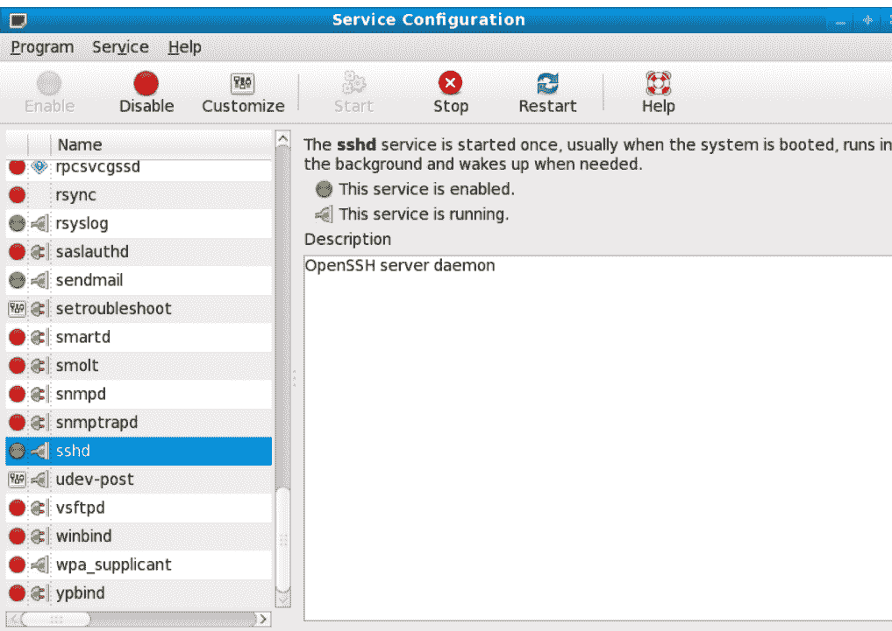
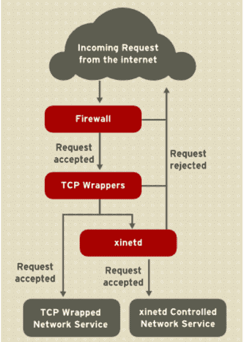
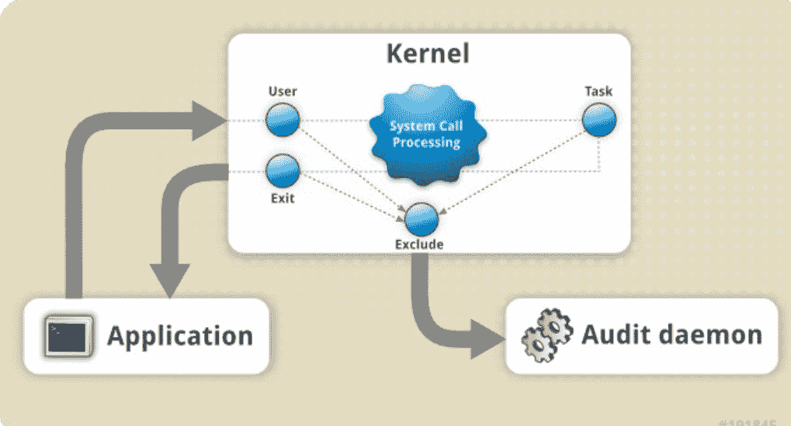

# Red Hat Enterprise Linux 6 安全指南指南

## 摘要

本书帮助用户和管理员学习保护工作站和服务器防止本地及远程入侵、利用和恶意活动的过程和实践。本书专注于 Red Hat Enterprise Linux，通过详细介绍适用于所有 Linux 系统的概念和技术，为数据中心、工作场所和家庭创建一个安全的计算环境。通过适当的管理知识、警惕和工具，运行 Linux 的系统可以充分功能并防御大多数常见的入侵方法。

- 启动、按需和终止连接
- 检查 IPSec 用户空间子系统
- 为 IPSec 配置证书
- 2.7.3. 使用 Openswans 使用 IPSec-VPN
- 检查是否安装了 Openswans

## 第3章 加密 132

### 3.1. 静态数据 132

#### 3.1.1. 全盘加密 132
#### 3.1.2. 基于文件的加密 132

### 3.2. 传输数据 133

#### 3.2.1. 虚拟专用网络 133
#### 3.2.2. 安全 Shell (SSH) 133
##### 3.2.2.1. SSH 加密登录 133
#### 3.2.3. OpenSSL Intel AES-NI 引擎 134
#### 3.2.4. LUKS 磁盘加密 134
##### 3.2.4.1. 红帽企业级 Linux 中的 LUKS 实现 135
##### 3.2.4.2. 在红帽企业级 Linux 中实现 LUKS 135
##### 3.2.4.2. 加密目录 136
##### 3.2.4.3. 为现有设备添加密码 138
##### 3.2.4.4. 从现有设备移除密码 138
##### 3.2.4.5. 在 Anaconda 中创建加密设备 138
##### 3.2.4.6. 额外资源 138
#### 3.2.5. GPG (GPG) 139
##### 3.2.5.1. 在 GNOME 中创建 GPG 密钥 139
##### 3.2.5.2. 在 KDE 中创建 GPG 密钥 139
##### 3.2.5.3. 使用命令行创建 GPG 密钥 140
##### 3.2.5.4. 公钥加密 141

## 第4章 信息安全一般原则 142

### 4.1. 指南与工具 142

## 第5章 安全安装 143

### 5.1. 分区 143
### 5.2. LUKS 分区 143

## 第6章 软件维护 144

### 6.1. 最小化安装 144
### 6.2. 安全更新 144
### 6.3. 自动更新 144
### 6.4. 从已知仓库安装包 144

## 第7章 系统审计 146

- 用用案例 146
- 7.1. 审计架构 147
- 7.2. 安装审计包 148
- 7.3. 配置审计服务 148
- 7.3.1. 用于 C 环境的审计 149
- 7.4. 启动审计服务 149
- 7.5. 定义审计规则 150
- 7.5.1. 使用 auditct 定义审计规则 150
- 控制规则 150
- 文件系统规则 151
- 系统调用规则 152
- 7.5.2. 在 `/etc/audit/audit.rules` 中定义持久审计规则 153
- 控制规则 153
- 文件系统规则 154
- 7.6. 理解审计日志 155
- 7.7. 搜索审计日志 158
- 7.8. 创建审计报告 160
- 7.9. 额外资源 160
- 在线源 161
- 安装文档 161

## 第8章 合规性与漏洞扫描 163

- 8.1. SCAP 简介 163
- 8.2. 使用 SCAP 163
- 8.3. 如何获取 163

## 第9章 联邦标准与法规 165

- 9.1. 简介 165
- 9.2. 联邦信息处理 (FIPS) 165
- 9.3. 国家安全操作手册 (NIS) 167
- 9.4. 支付卡数据安全 (PCI) 167
- 9.5. 安全技术指南 168

## 第10章 参考文献 169

- 加密 171
- A.1. 同步 171
- A.1.1. 高级加密标准 (AES) 171
- A.1.2. 数据加密标准 (DES) 171
- A.2.1. Diffie-Hellman 171
- A.2.1.1. Diffie-Hellman 172
- A.2.2. RSA 172
- A.2.3. DSA 173
- A.2.4. UTLS 173
- A.2.5. Cramer-Shoup 173
- A.2.6. ElGamal 173
- B.1. 事件字段 175
- B.2. 事件类型 175
- 审计系统 179
- 修订历史 185

从主菜单栏中的“字符映射”。接下来，从字符映射菜单栏中选择“搜索”→“查找...”，在“搜索”字段中输入字符名称并点击“下一步”。你寻找的字符将在“字符表”中高亮显示。双击此高亮字符将将其放入“要复制的文本”字段中，然后点击“复制”按钮。现在切换回文档，从 gedit 菜单栏中选择“编辑”→“粘贴”。

上述文本包含了应用程序名称；系统级菜单名称和项目；应用程序特定的菜单名称以及在 GUI 界面中找到文本，所有内容均以比例粗体形式呈现，并可以通过上下文进行区分。

## 等宽粗体斜体或比例粗体斜体

无论是等宽还是比例粗体，添加斜体表示可替换或可变文本，意味着你不是线性输入内容，或者显示的是随情况而变化的文本。例如：

要使用 ssh 连接到远程机器，在 shell 提示符输入 `ssh username@domain.name`。如果远程机器是 example.com 且你在该机器上的用户名是 john，则输入 `ssh john@example.com`。

`mount -o remount file-system` 命令用于重新挂载文件系统。例如，重新挂载 `/home` 文件系统，命令是 `mount -o remount /home`。

要查看当前安装包的版本，使用 `rpm -q package` 命令。它将返回如下结果：`package-version-release`。

注意上述加粗的单词：`username`、`domain.name`、`file-system`、`package`、`version` 和 `release`。每个单词都是一个占位符，要么是你发布命令时输入的，或者是系统显示的文本。例如：

按照呈现作品标题的标准用法，斜体表示新且重要术语首次出现。例如：

*Public* 是一个 DocBook 发布系统。

## 1.2. 引用块规范

终端输出和源代码列表在视觉上与周围文本隔离开。发送到终端的输出采用等宽正字体并呈现如下：

| books | documentation | drafts | mss | photos | stuff | svn |
| books_tests | Desktop | downloads | images | notes | scripts | svgs |

源代码列表同样采用等宽正字体设置，但添加了如下语法高亮：

```
static int kvm_vm_ioctl_deassign_device(struct kvm *kvm,
              struct kvm_assigned_pci_dev *assigned)
{
    int r = 0;
    struct kvm_assigned_dev_kernel *match;

    mutex_lock(&kvm->lock);
    match = kvm_find_assigned(&kvm->arch.assigned_dev_head,
                              assigned_dev->assigned_dev_id);
    if (!match) {
        printk(KERN_INFO, "%s: device hasn't been assigned before, "
               "%s cannot be deasigned\n", __func__);
        r = -EINVAL;
        goto out;
    }

    kvm_deassign_device(kvm, match);

    kvm_free_assigned_device(kvm, match);

out:
    mutex_unlock(&kvm->lock);
    return r;
}
```

## 1.3. 注释与警告

最后，我们使用三种视觉样式来引起对可能被忽略信息的注意。

> Note
> 释是针对当前任务的提示、快捷方式或替代方案。忽略注释不应产生负面后果，但你可能会错过某个让你的生活更轻松的小技巧。

> Important
> 重要信息框详细说明了容易忽略的内容：仅适用于当前会话的配置更改，或者在更新生效之前需要重启的服务。忽略标记为“重要”的框不会导致数据丢失，但可能会引起不快和沮丧。

> Warning
> 警告不应被忽略。忽略警告极可能导致数据丢失。

## 2. 我们需要反馈！

如果你在本手册中发现排版错误，或者你想出了改进本手册的方法，我们非常乐意听到你的反馈！请在 Bugzilla：http://bugzilla.redhat.com/ 针对产品 Red Hat Enterprise Linux 提交报告。

在提交错误报告时，请务必提到手册的标识符：`doc-Security_Guide` 以及版本号：`6`。

如果你对改进文档有建议，请尝试在描述时尽可能具体。如果你发现了错误，请包含章节编号和部分周围文本，以便我们轻松找到它。

# 第 1 章 安全概述

由于日益依赖强大的网络化计算机来帮助运行业务并跟踪我们的个人信息，整个行业已围绕网络和计算机安全实践形成。企业寻求安全专家的知识和技能，以正确地审核系统并定制解决方案以满足其组织的运行需求。由于大多数组织在性质上日益动态化，其员工本地和远程访问公司 IT 资源，安全计算环境的需求变得更加紧迫。

遗憾的是，许多组织（以及个人）将安全视为事后考虑，为了增加性能、生产力、便利性、易用性和预算考虑而忽视这一过程。适当的安全实施通常在未经授权的入侵发生后才被发现。在站点连接到不可信网络（如互联网）之前采取正确措施，是阻止许多入侵尝试的有效手段。

> 本文档多次引用 `/lib` 目录下的文件。使用 64 位系统时，提到的某些文件可能位于 `/lib` 中。

## 1.1. 安全简介

计算机安全是一个通用术语，涵盖保护信息和数据免受未经授权的访问、使用、披露、干扰、修改或破坏。它还包括保护处理和存储这些信息的硬件、软件和网络。

## 1.1.1. 安全是如何产生的？

由于对计算机和网络依赖程度的增加，信息安全在多年一直在演变。已经发生了许多敏感数据泄露或被盗的事件。

## 1.1.3. 安全标准化

各行业的企业都依赖于标准制定机构（如美国医学协会 AMA 或电气电子工程师学会 IEEE）所制定的法规和规则。许多安全顾问和供应商对标准安全模型同认为 CIA，即机密性（Confidentiality）、完整性（Integrity）和可用性（Availability）。以下描述了 CIA 模型：

- 机密性：信息只能由预定义的个人可以使用。应限制信息的未经授权传输和使用。例如，信息的机密性确保客户的个人或财务信息不会被未经授权的个人出于恶意目的获取。
- 完整性：信息不应以使其变得不完整或错误的方式被更改。应限制未经授权的用户修改或破坏敏感信息的能力。
- 可用性：授权用户在需要时任何时候都可以访问信息。可用性是一项保证，可以通过约定的频率和及时性获得。这通常以百分比的形式衡量，并正式地在服务水平协议（SLAs）中约定。

## 1.1.2. SELinux

Red Hat Linux 包含一种名为 SELinux 的 Linux 内核扩展，它实现了一种强制访问控制（MAC）架构，对系统中的文件、进程和应用程序提供了细粒度的控制。SELinux 的详细讨论超出了本文档的范围；然而，有关 SELinux 及其在 Red Hat Enterprise Linux 中使用的更多信息，请参阅《Red Hat Enterprise Linux SELinux User Guide》。有关配置和运行受 SELinux 保护的服务更多信息，请参阅《SELinux Managing Confined Services Guide》。SELinux 的可用资源列在第 10 章“参考文献”中。

## 1.1.3. 安全控制

计算机安全通常分为三个不同的主类别，通常被称为控制措施：

- 物理控制
- 技术控制
- 行政控制

这三个大类定义了实施适当安全的主要目标。在这些控制措施中包含了子类别，进一步详细说明了控制措施以及如何实施它们。

### 1.1.3.1. 物理控制

物理控制是在定义的结构中实施安全措施，以威慑或防止对敏感材料的未经授权访问。物理控制的示例包括：

- 闭路监控摄像头
- 运动或热传感器报警系统
- 安保人员
- 图片 ID
- 锁上并安装了死锁的门
- 生物识别（包括指纹、语音、脸部、虹膜、手写体和其他用于识别身份的自动化方法）

### 1.1.3.2. 技术控制

技术控制以技术为基础，控制整个物理结构内和网络上对敏感数据的访问和使用。技术控制的范围广泛，涵盖了如：

- 加密
- 智能卡
- 网络身份验证
- 访问控制列表 (ACLs)
- 文件完整性审计软件

### 1.1.3.3. 行政控制

行政控制定义了安全中的人性因素。它们涉及组织的所有人员，并通过以下方式确定哪些用户有权访问资源和信息：

- 培训与意识
- 灾难准备与恢复计划
- 人员招聘与离职策略
- 人员注册与核算

## 1.1.4. 结论

现在你已经学习了安全的起源、原因和方面，你会发现更容易确定在使用 Red Hat Enterprise Linux 的适当行动方案。了解哪些因素和条件构成了安全对于规划和实施适当策略至关重要。记住这些信息，随着你深入研究《Red Hat Enterprise Linux 6 安全指南》中安全过程的细节，过程可以形式化，路径也会变得更加清晰。

## 1.2. 漏洞评估

如果有时间、资源和动机，攻击者可以破解几乎任何系统。目前可用的所有安全程序和技术都无法保证任何系统完全免受入侵。路由器帮助保护通往互联网的网关。防火墙帮助保护网络边缘。虚拟网络通过加密流安全地传输数据。入侵检测系统警告你恶意活动。然而，这些每项技术的成功都取决于许多变量：

- 负责配置、监控和维护这些技术的员工的专业知识。
- 快速高效补丁和更新服务的能力。
- 负责人员对网络保持持续警惕的能力。

考虑到系统和技术的动态状态，保护公司资源可能非常复杂。由于这种复杂性，通常很难为所有系统寻找资源。可能会拥有在信息安全许多领域都具有高水平知识的人员，但很难留住仅精通少数领域的专家员工。这主要是因为信息安全的每个主题领域都需要不断的关注和投入。信息安全不是停滞的。

### 1.2.1. 像敌人一样思考

假设你管理着企业网络。此类网络通常包含操作系统、应用程序、服务器、显示器、防火墙、入侵检测系统等。现在想象尝试保持这些每一项的最新状态。考虑到当今软件和网络环境的复杂性，漏洞和 Bug 是肯定的。在一个具有异构系统的大型组织中，保持整个网络的补丁和更新可能证明是一项艰巨的任务。

将所需的专业知识与保持更新的任务相结合，那么不利事件的发生、系统被破解、数据被损坏以及服务中断是不可避免的。

为了增强安全技术并在保护系统、网络和数据，你必须像黑客一样思考，并通过检查薄弱环节来衡量安全性。针对你的系统和网络进行预防性漏洞评估可以揭示网络机密性、完整性、可用性的潜在问题（见第 1.1.1.3 节，“安全标准化”）。通常，漏洞评估始于侦察阶段，在此期间收集有关目标系统和资源的重要数据。该阶段进入系统就绪阶段，对目标进行所有漏洞检查。就绪阶段在报告中结束，将发现的结果分类为高、中、低风险类别；并针对性地提出提高安全性（或降低漏洞风险）的方法。

如果你对家里进行漏洞评估，你可能会检查家的每一扇门，查看它们是否关闭并锁好。你还会检查每个窗户，确保它们已关闭并正确插好。同样的概念也适用于系统、网络和电子数据。恶意用户是你数据中的小偷和破坏者。关注他们的工具、心态和动机，这样他们就可以对自己的行动做出迅速反应。

### 1.2.2. 定义评估与测试

漏洞评估可以分为两种类型：从外向内看和从内向外看。

在执行从外向内的漏洞评估时，你正试图从外部破坏你的系统。作为你公司的外部人员为你提供了黑客的视角。你看到了黑客所看到的——公共可路由的 IP 地址、DMZ 上的系统、你防火墙的外部接口等。DMZ 代表“非军事化区”，对应于位于受信内部网络（如公司局域网）和不受信的外部网络（如公共互联网）之间的计算机或小型子网。DMZ 包含可供互联网流量访问的设备，如 Web (HTTP) 服务器、FTP 服务器、SMTP（电子邮件）服务器和 DNS 服务器。

当你执行从内向外的漏洞评估时，当你处于内部且你的状态被提升为受信任时，你就处于优势地位。这是登录系统后的视角。你看到同级服务器、文件数据库和其他资源。

这两种漏洞评估之间存在显著差异。当你处于公司内部时，你比外部人员拥有更多特权。在大多数组织中，安全配置是为了防止入侵者进入。对组织内部的保护较少（例如部门防火墙、用户级访问控制和身份验证程序）。通常，从外部看时资源有限，因为你处于公司外部，状态不受信任。

考虑漏洞评估与渗透测试的区别。将漏洞评估考虑为渗透测试的第一步。从评估中获得的信息用于测试。漏洞评估是为了检查漏洞和潜在问题，而渗透测试则尝试利用这些结果。

评估基础设施是一个动态过程。安全（无论是信息安全还是物理安全）都是动态的。对系统进行评估显示了一个概述，这可能会产生误报和漏报。误报是一种结果，即工具发现了现实中不存在的漏洞。漏报则是遗漏了实际存在的漏洞。

安全管理员的水平取决于他们所使用的工具和他们保留的知识。采取任何现有的评估工具并在在你的系统上运行，几乎可以肯定存在某些误报。无论是程序故障还是用户错误，结果都是一样的。

> 警告
> 不要尝试在生产系统上利用漏洞。这样做会对系统和网络的生产力和效率产生不利影响。

以下列表探讨了执行漏洞评估的一些益处。

- 创建了对信息安全的积极关注。
- 在黑客发现之前发现潜在的利用漏洞。
- 使系统保持更新并修复补丁。
- 促进开发开发人员专业知识的增长和获益。
- 减少财务损失和负面舆论影响。

## 1.2.1. 建立方法论


为了帮助选择漏洞评估工具，建立一套漏洞评估方法论是有帮助的。遗憾的是，目前还没有预定义的或经过行业认可的方法论；然而，常识和最佳实践可以作为足够的指南。

目标是什么？我们是在看某一台服务器，还是在看我们的整个网络或网络内部？我们是在公司的外部还是内部？这些问题的答案非常重要，因为它们不仅决定了选择何种工具，还决定了使用工具的方式。

要了解更多关于建立方法论的信息，请参考以下网站：

- `http://www.issec.com/osstmn` 开源测试方法论手册 (OSSTMM)
- `http://www.owasp.org/` 开放 Web 应用安全项目 (OWASP)

## 1.2.3. 评估工具

评估可以从某种形式的信息收集工具开始。在评估整个网络时，绘制布局以找到正在运行的主机。一旦定位，逐个检查每个主机。专注于这些主机需要另一组工具。知道使用哪些工具可能是发现漏洞的关键步骤。

就像日常生活的任何方面一样，有许多不同的工具可以执行相同的工作。这一概念也适用于执行漏洞评估。有专门针对操作系统、应用程序和网络（基于所使用的协议）的特定工具。有些工具是免费的，另一些则不是。有些工具直观且易于使用，而另一些工具虽然晦涩且文档匮乏，但具有其他工具不具备的功能。

寻找合适的工具是一项艰巨的任务，最终，经验至关重要。如果可能，请建立一个测试实验室并尝试尽可能多的工具，记录每个工具的优缺点。阅读工具随附的文档（例如，在 README 文件或手册中）。为了获取信息，可以搜索文章、分步指南甚至邮件列表以在互联网上寻找工具。

下文讨论的工具只是可用工具的一小部分样本。

### 1.2.3.1. 使用 Nmap 扫描主机

`Nmap` 是一种流行的工具，可用于确定网络布局。`Nmap` 已经存在多年，通常是收集信息时最常用的工具。它提供了一个非常优秀的手页，详细描述了其选项和用法。管理员使用 `Nmap` 查找系统上的主机和开放端口。

`Nmap` 是漏洞评估中一个胜任的第一步。你可以映射网络内的所有主机，甚至提供一个选项允许 `Nmap` 识别特定主机上运行的操作系统。`Nmap` 是建立使用安全服务和限制未使用用户策略的良好基础。

要安装 `nmap`，请以 root 用户身份运行 `yum install nmap` 命令。

#### 1.2.3.1.1. 使用 Nmap

可以通过在 shell 提示符输入输入 `nmap` 命令，加上要扫描机器的主机名或 IP 地址来运行 `Nmap`：

```
nmap <hostname>
```

例如，扫描主机名为 `foo.example.com` 的机器，在 shell 提示符输入以下内容：

```
~$ nmap foo.example.com
```

基本扫描的结果（取决于主机所在的位置和其他网络状况，可能需要几分钟）看起来如下：

`foo.example.com` 上的有趣端口：

未显示：171 个过滤的端口

| 端口 | 状态 | 服务 |
| :--- | :--- | :--- |
| 22/tcp | open | ssh |
| 53/tcp | open | domain |
| 80/tcp | open | http |
| 113/tcp | closed | auth |

`Nmap` 测试最常见的用于监听或等待服务的通信端口。这些知识对于想要关闭不必要或未使用服务的管理员很有帮助。

有关 `Nmap` 的更多信息，请搜索文章、分步指南甚至邮件列表在互联网上寻找工具。

有关 `Nmap` 的更多信息，请参考其官方网站：

### 1.2.3.2. Nessus

`Nessus` 是一个用于安全服务的扫描器。`Nessus` 的架构允许用户自定义，并检查网络。与任何扫描工具一样，`Nessus` 的性能取决于其插件库。对于想要关闭不必要或未使用服务的管理员，`Nessus` 是一个强大的工具。

`Nessus` 一个用于用于检查和漏洞的扫描器。在大多数情况下，`Nessus` 是一个强大的工具。

为了获取有关 `Nessus` 的更多信息，请参考以下网站：

有关 `Nessus` 的更多信息，请参考其官方网站：

`http://www.nessable.org/`

### 1.2.3.3. Nikto

`Nikto` 是一个可以用于检查 Web 服务器的流行工具。`Nikto` 已经存在多年，并且通常是收集信息时最常用的工具之一。

有关 `Nikto` 的更多信息，请参考其官方网站：

有关 `Nikto` 的更多信息，请参考其官方网站：

`http://www.nikto.org/`

### 1.2.3.4. 预测你的未来

根据你的目标和资源，有许多工具可用。在执行漏洞评估时，某些概念涉及网络安全、渗透测试和渗透测试的观察。在执行漏洞评估时，某些概念是网络安全，渗透测试是重要的一部分。

## 1.3. 攻击者与漏洞

在计划和实施良好的安全策略之前，必须定义攻击者的术语。

### 1.3.1. 黑客的快速历史

黑客（Hacker）一词的现代含义可以追溯到60 年代马省理工学院（MIT）的技术模型铁路俱乐部，当时他们设计了复杂的火车。Hacker 一词最初被用于那些发现了巧妙技巧或绕过方案的俱乐部成员。

从以后，Hacker 一词一直被描述从计算机缓冲区到天才程序员的各种人员。黑客的一个共同特征是愿意在没有外部动机的情况下探索系统和网络的功能。开源开发者通常将自己和同事视为黑客，并将其作为一种尊重。

通常，黑客遵循黑客伦理，该伦理规定对信息和专业知识的追求是关重要的，共享这些知识是黑客对社区的责任。在追求知识的过程中，某些黑客享受绕过计算机安全控制的挑战。因此，媒体经常使用黑客一词描述那些非法访问系统和网络的人。对于这类黑客，更准确的术语是 cracker —— 这是黑客在20世纪80年代中期为了区分这两个社区而。

#### 1.3.1.1. 灰色

在发现和利用系统网络漏洞的人群中有几个不同的群体。这些群体根据他们在执行安全调查时所戴的“帽子颜色”来描述，这表明了意图。

白帽黑客（White hat hacker）是测试系统并检查性能以确定脆弱性的人。白帽黑客破解自己的系统或专门雇用他们进行安全审计的客户系统。学术研究人员和专业安全顾问是白帽黑客的两个例子。

黑帽黑客（Black hacker）与 cracker 同义。通常，crackers 没那么关注破解系统的学术方面。他们通常依赖破解程序并利用系统中的已知漏洞来获取敏感信息，以获取个人利益或对目标系统或网络造成损害。

灰帽黑客（Gray hat hacker）在大多数情况下具有白帽黑客的技能和意图，但偶尔会将知识用于不高尚的目的。灰帽黑客可以被认为是作为一个有时为了实现自己的目标而戴上黑帽的白帽黑客。

灰帽黑客通常遵循另一种形式的黑客伦理，这种伦理认为只要黑客不实施盗窃或泄露机密，入侵系统是可以接受的。然而，一些人会认为，入侵系统的行为本身就是不伦理的。

无论作者的意图如何，了解破解者（cracker）可能尝试利用的漏洞都是重要的。本章其余将关注这些问题。

### 1.3.2. 网络安全威胁

在配置网络以下方面时，不当的做法会增加攻击风险。

#### 1.3.2.1. 不安全的架构

配置不当的网络是未经授权用户的主要入口。将一个基于信任的本地网络变量暴露在极不安全的互联网上，就像在犯罪横生的社区里留一扇虚着的门——在任意时间内可能可能都不会伤害你，但最终会有人利用这个机会。

#### 1.3.2.1. 广播网络

系统管理员往往没有意识到网络硬件在其安全方案中的重要性。广播或非交换原理的集线器和路由器等简单硬件；然而，每当节点跨网络向接收节点传输数据时，集线器或路由器就会发送数据包的广播，直到接收节点由外部入侵者和本地主机上的未经授权用户处理解析协议（ARP）或介质访问控制（MAC）地址欺骗。

#### 1.3.2.2. 集中化服务器

另一个潜在的陷阱是使用集中化计算。许多企业常用的削减成本措施是将所有服务整合到单台强大的机器上。这可以非常方便、更易管理，并且成本远低于多服务器配置。然而，集中化服务器为网络引入了单点故障。如果服务器被攻破，它可能会导致网络完全失效，或者容易受到数据操纵或窃取。在这些情况下，集中化服务器将变成一扇大门，允许访问整个网络。

### 1.3.3. 服务器安全威胁

服务器安全与网络安全同样重要，因为服务器通常存储着大量的大量的信息。如果服务器被攻破，其所有内容都可能被破解者窃取或操纵而。以下章节详细说明了一些主要问题。

#### 1.3.3.1. 未使用的服务和开放端口

完整安装的 Red Hat Enterprise 6 包含 10000 多个附加和库包。然而，服务器管理员不会安装发行版每一个包，而是倾向于安装基础安装包，包括服务器应用程序。

系统管理员经常出现的一种现象是安装操作系统而不注意实际安装了哪些程序。这可能会导致问题，因为不必要的服务被安装、使用默认设置进行配置并可能被开启。这可能导致如 Telnet、DHCP、DNS 等不需要的服务在管理员未察觉的情况下在服务器或工作站上运行，反过来可能导致服务器产生意外流量，甚至为破解者提供进入系统的潜在路径。请参考第 2.2 节“服务器安全”有关关闭端口和禁用未使用服务的信息。

#### 1.3.3.2. 未修补的服务

默认安装包含的大多数服务器应用程序都是坚固的、经过彻底测试的软件。由于已经在生产环境中运行多年，它们的代码已经过彻底提炼，许多漏洞已被发现并修复。

然而，世界上没有完美的软件，总有进一步完善的空间。新的软件由于最近进入生产环境，可能并不如预期的那样严谨，或者可能没有其他服务器软件受欢迎。

开发者和系统管理员经常在服务器应用程序中发现可利用的漏洞，并将信息发布在漏洞跟踪和安全相关的网站，如 Bugtraq 邮件列表（`http://www.securityfocus.com/`）或计算机应急响应小组 (CERT) 网站。虽然这些机制是警示社区安全漏洞的有效方法，但这一点尤为真实，因为破解者也可以访问这些相同的漏洞跟踪服务，并在可能的情况下利用这些信息跟踪未修补的系统。良好的系统管理需要警惕、持续的漏洞跟踪和适当的系统管理，以确保更安全的计算环境。

有关保持系统更新的更多信息，请参考第 1.5 节“安全更新”。

#### 1.3.3.3. 疏忽的管理

未能修补系统的管理员是服务器安全面临的最大威胁之一。根据系统管理员、审计、网络、安全研究所（SANS）的说法，安全漏洞的主要原因是“分配未经过培训的人员来维护安全，且未提供使其完成工作所需的培训时间。[5]”。这既适用于缺乏经验的管理员，也适用于过度自信或有动机的管理员。

某些管理员未能修补的服务和服务工作站，而另一些人则未能监控系统内核的日志消息或网络流量。另一个常见错误是数据库具有默认密码或密钥服务未被更改。例如，某些数据库具有默认管理密码，因为数据库开发者假设系统管理员会在安装后立即更改这些密码。如果数据库管理员未能更改此密码，即使是缺乏经验的破解者也可以使用已知的默认密码获取数据库的管理员权限。这些只是疏忽管理如何导致服务器被攻破的几个例子。

#### 1.3.3.4. 内生不安全的服务

即使是最警惕的组织，如果他们选择的网络服务本质上是不安全的，也会陷于漏洞。例如，许多服务是在假设在受信任网络上使用的范围内开发的；然而，一旦该服务在互联网上可用，这种假设就失效了——这在本质上是不真实的。

网络服务的一类是那些需要加密用户名和密码进行身份验证的服务。Telnet 和 FTP 就是此类服务中的两个。如果数据嗅探软件正在监控流量，破解者就可以轻易截获流量。

另一个常见错误是当数据库具有默认密码或密钥服务未被更改。这种攻击类型被称为中间人攻击。由于服务本质上是不安全的，即使在受信任的网络上。一旦服务在互联网上可用，这种假设就会失效——这在本质上是不真实的。

## 表 1.1. 常见漏洞利用

| 漏洞利用 | 描述 | 备注 |
|---|---|---|
| 空密码或默认密码 | 将管理员密码留空或使用产品供应商设置的默认密码。这在路由器和防火墙等硬件中最为常见，但运行在 Linux 上的某些服务也可能包含默认密码（红帽企业级 Linux 并不带这些密码）。 | 通常与路由器、防火墙、VPN 和网络附属存储 (NAS) 设备等网络硬件相关。常见于旧版操作系统，特别是那些提供服务的机系统（如 UNIX 和 Windows）。管理员有时在匆忙中创建用户账户并留空密码，这为发现该账户的恶意用户创造了完美的入切入点。 |
| 默认共享密钥 | 安全服务有时会为了开发或评估测试封装默认的安全密钥。如果这些密钥未被更改并放置在 Internet 上的生产环境中，所有具有相同共享密钥资源的用户都可以访问其中包含的敏感信息。 | 在无线访问点和预配置的安全服务器设备中最为常见。 |
| IP 欺骗 | 远程机器伪装成你的本地网络，寻找你服务器的漏洞，并安装后门程序或木马以获取网络资源的控制权。 | 欺骗相当困难，因为涉及攻击者预测 TCP/IP 序列号以连接目标系统，但有多种工具可以帮助破解者利用此类漏洞。这取决于目标系统运行的服务（如 rsh、telnet、FTP 等），这些服务使用了基于源的认证技术，与 PKI 或 ssh/SSL/TLS 中使用的其他加密认证形式相比，这些并不推荐。 |
| 窃听 | 通过监听网络上两个活动节点之间的连接，收集它们之间传输的数据。 | 这种攻击主要适用于 Telnet、FTP 和 HTTP 等明文传输协议。远程攻击者必须访问局域网内被攻破的系统才能执行此类攻击；通常破解者会先使用主动攻击（如 IP 欺骗或中间人攻击）来破坏局域网上的系统。 |

# 第 1 章 安全概述

预防性措施包括带有加密密钥交换、一次性密码或加密认证的服务，以防止密码嗅探；同时也建议使用强加密。

### 服务漏洞

攻击者在通过 Internet 运行的服务中发现缺陷或后门；通过此漏洞，攻击者可以破坏整个系统以及可能持有的任何数据，并可能破坏网络上的其他系统。基于 HTTP 的服务如 CGI 允许远程命令执行甚至 shell 访问。即使 HTTP 服务以“nobody”非特权用户运行，攻击者也可以读取配置文件和网络映射，或者启动拒绝服务攻击来耗尽系统资源或导致其他用户无法使用。服务有时存在开发和测试期间未被察觉的漏洞；这些漏洞（例如缓冲区溢出，攻击者使用任意值填充应用程序内存缓冲区导致服务崩溃，从而为攻击者提供一个交互式提示符，他们可以执行完全控制）。管理员应确保服务不以 root 身份运行，并警惕供应商或安全组织（如 CERT 和 CVE）提供的补丁和错误更新。

### 应用漏洞

攻击者在应用程序（如邮件客户端）中发现故障并执行任意代码、植入木马进行破坏，或者被攻破的工作站对网络其余部分具有管理权限。工作站和桌面更容易受到攻击，因为员工缺乏防止或检测攻破的专业知识；在个人安装未经授权的软件或打开邮件附件时，告知他们正在承担的风险是非常重要的。可以实施防护措施，使邮件软件不自动打开或执行。此外，通过红帽网络或其他服务自动更新工作站软件可以减轻多席部署的负担。

### 拒绝服务 (DoS) 攻击

攻击者或攻击者小组通过向目标主机（服务器、路由器或工作站）发送未经授权的数据包来协同攻击组织的网络或服务器。这迫使资源对合法用户不可用。美国报道最多的 DoS 案例发生在 2000 年，ping 洪水攻击了多个作为僵尸的带宽连接，使得追踪攻击的真实源变得困难。使用 `iptables` 的入站过滤（IETF r2267）以及如 `snort` 等网络入侵检测系统有助于管理员跟踪和防止分布式拒绝服务攻击。

## 1.5 安全更新

随着安全漏洞的发现，必须更新受影响软件以限制潜在风险。如果软件是当前支持的红帽企业 Linux 发行版中软件包的一部分，红帽承诺尽快发布修复漏洞的补丁。通常，关于通用安全漏洞利用的公告会附带补丁（或修复该问题的源代码）。该补丁应用于红帽企业 Linux 软件包，并作为错误更新进行测试。然而，如果公告未包含补丁，开发人员首先与软件维护者协作解决问题。如果问题得到解决，软件包将经过测试并作为错误更新发布。如果您的系统发布了错误更新，强烈建议尽快更新受影响的软件包，以尽可能减少可能受漏洞影响的影响。

### 1.5.1 更新软件包

在系统上更新软件时，从可信源下载更新非常重要。攻击者可以轻松构建一个与修复问题的包版本号相同的软件包，但带有不同的安全漏洞并将其发布到 Internet 上。如果发生这种情况，通过对比原始 RPM 验证文件等安全措施将无法检测到该漏洞。因此，仅从可信源（如红帽）下载 RPM 并检查软件包签名以验证其完整性是非常重要的。

> 注意：红帽企业级 Linux 包含一个方便的面板图标，当可用更新时会显示。

### 1.5.2 验证签名包

所有红帽 Linux 软件包都使用 GPG 密钥签名，GPG 代表 GNU Privacy Guard，是一种用于确保软件包真实性的免费软件。如果红帽分发的公钥与私钥不匹配，则软件包可能已被篡改。

红帽 Linux 中的 RPM 工具在安装之前尝试验证 GPG 签名。如果未安装 GPG 密钥，请从安全位置（如红帽安装光盘或 DVD）安装。假设光盘挂载在 `/mnt/cdrom`，使用以下命令让 root 用户将其导入密钥环（系统上的密钥数据库）：

```bash
# rpm --import /mnt/cdrom/RPM-GPG-KEY
```

现在，红帽 GPG 密钥位于 `/etc/pki/rpm-gpg/` 目录。

执行以下命令列出所有已安装的密钥：

```bash
# rpm -qa gpg-pubkey*
gpg-pubkey-db42a60e-37ea5438
```

要查看特定密钥详情，使用 `rpm -qi` 命令接上一条命令的输出，例如：


```bash
# rpm -qi gpg-pubkey-db42a60e-37ea5438
```

在安装前验证 RPM 文件的签名极其重要，以确保它们没有被原始源更改。要一次验证所有下载的软件包，使用以下命令：

```bash
# rpm -K /root/updates/*.rpm
```

`salsa-lib-1.0.22-3.e16.x86_64.rpm: rsa sha1 (md5) pg5 md5 OK`

`salsa-utils-1.0.21-3.e16.x86_64.rpm: rsa sha1 (md5) pg5 md5 OK`

`aspell-0.60.6-12.e16.x86_64.rpm: rsa sha1 (md5) pg5 md5 OK`

第三方。

在验证 GPG 密钥并下载与错误报告（errata report）相关的所有软件包后，在 shell 提示符下安装这些软件包。

或者，您可以使用工具（Utility）来验证签名的软件包。Yum 通过允许对所有软件包仓库开启 GPG 签名验证的 GPG 签名存储库来提供安全的包管理……可以信任下载并安装在您的系统上的 RPM 软件包来自 Red Hat（如红帽）等受信来源，并且它们在传输过程中未被修改过。

为了在通过 Yum 安装或更新软件包时自动启用 GPG 签名验证，请确保已在 `/etc/yum.conf` 文件的 `[main]` 节下定义了以下选项：

```
gpgcheck=1
```

## 1.5.3. 安装签名的软件包

通过以 root 用户身份执行以下命令，可以安全地安装大多数软件包（内核包除外）：

```
rpm -Uvh <package>...
```

例如，若要安装 `/tmp/updates/` 目录下的所有软件包，请运行：

```bash
# rpm -Uvh /root/updates/*.rpm               ########################### [100%]
Preparing...                                            ########### [ 33%]
1:alsa-lib                                              ###########
2:alsa-utils                                               [ 67%]
3:aspell                                               ################ [100%]
```

对于内核包，以 root 用户身份使用格式形式命令：

```bash
rpm -ivh <kernel-package>
```

例如，要安装 `kernel-2.6.32-220.el6.x86_64.rpm`，请在 shell 提示符输入以下内容：

```bash
# rpm -ivh /tmp/updates/kernel-2.6.32-220.el6.x86_64.rpm ################# [100%]
Preparing...                                            ###########
1:kernel                                               ################ [100%]
```

一旦机器使用新内核安全重启，可以使用以下命令删除旧内核：

```bash
rpm -e <old-kernel-package>
```

例如，删除 `kernel-2.6.32-206.el6.x86_64`，请输入：

```bash
# rpm -e kernel-2.6.32-206.el6.x86_64
```

或者，若要使用 Yum 安装所有软件包，以 root 身份运行以下命令：

```bash
~# yum install kernel-2.6.32-220.el6.x86_64.rpm
```

若要使用 Yum 安装本地软件包，请以 root 身份运行：

```bash
# yum localinstall /root/updates/emacs-23.1-21.el6_2.3.x86_64.rpm
```

> 注意
> 移除旧内核并非强制要求。默认启动加载程序 GRUB 允许安装多个内核，然后在启动时从菜单中进行选择。

> 重要
> 在安装任何安全错误修复（security errata）之前，请务必阅读错误报告中包含的任何特殊说明并相应执行。有关应用错误修复更新后所做更改的通用说明，请参阅第 15.4 节“应用更改”。

## 15.4. 应用更改

在下载并安装安全错误修复和更新后，停止使用旧软件并开始使用新软件至关重要。这样做取决于已更新的软件类型。以下列表列出了软件的一般类别，并提供了软件包包后后使用更新版本的说明。

> 注意
> 通常情况下，重启系统是确保使用软件包最新版本的稳妥方法；但是，此选项并非总是必须的，或者系统管理员并不总是可以使用它。

### 应用程序

用户空间应用程序是任何由系统用户启动的程序。通常，此类应用程序仅在用户、脚本或自动化任务启动它们时使用，且它们不会持续很长时间。一旦更新了此类用户空间应用程序，请停止系统上的任何应用程序实例并重新启动程序以使用更新版本。

### 内核

内核是 Red Hat Linux 操作系统的核心软件。它管理对内存、处理器和外围设备的访问，并调度所有任务。由于其核心作用，内核在不停止计算机的情况下无法重启。因此，在系统重启之前，无法使用更新后的内核版本。

### 共享库

共享库是代码单元（例如 `glibc`），被多个应用程序使用。利用共享库的应用程序通常在应用程序初始化时加载共享代码，因此使用该库的任何应用程序必须停止并重新启动。要确定哪些正在运行的应用程序链接到特定库，请使用 `lsof` 命令：

```bash
lsof <path>
```

例如，要确定正在运行的应用程序链接到 `libwrap.so`，请输入：

```bash
lsof -f /lib64/libwrap.so*
```

| COMMAND | PID | USER | TYPE | SIZE | NODE |
| :--- | :--- | :--- | :--- | :--- | :--- |
| sshd | 13600 | root | REG | 253,0 | |
| sshd | 13603 | | mem | 253,0 | |
| gnome-set | 14839 | | mem | 253,0 | |
| metadata | 14925 | | mem | 253,0 | |

Red Hat Enterprise Linux 6 安全指南

### SysV 服务

SysV 服务是持久化的。

断开 CMOS 电池。出于这个原因，最好尽可能锁定计算机机箱。但在尝试断开 CMOS 电池之前，请查阅计算机或主板的说明。

## 2.1.2.1.1. 加固 x86 平台

其他架构使用不同的程序来执行大致等同于 x86 系统上 BIOS 的底层任务。例如，Intel® Itanium™ 计算机使用扩展固件接口 (EFI) shell。

有关在其他架构上对类 BIOS 程序进行密码保护的说明，请参考制造商的说明。

## 2.1.2.2. 引导加载程序密码

对 Linux 引导加载程序保护密码的原因如下：

- 1. 防止访问单用户模式 — 如果攻击可以将系统引导到单用户模式，他们将自动以 root 身份登录，无需提示 root 密码。

> 不建议通过编辑 `/etc/sysconfig/init` 文件中的 `SINGLE` 参数来通过密码保护单用户模式的访问。攻击者可以通过在 GRUB 的内核命令行中指定自定义命令（使用 init 参数）来绕过密码。建议按照第 2.1.2.2.1 节“保护 GRUB 密码”中的指定对 GRUB 加载器进行密码保护。

- 2. 访问 GRUB 控制台 — 如果机器使用 GRUB 作为引导加载程序，攻击者可以使用 GRUB 界面更改其配置或使用 cat 命令收集信息。

- 3. 访问不安全的操作系统 — 如果是双启动系统，攻击者可以在启动时选择操作系统（例如 DOS），该系统会忽略访问控制和文件权限。

Red Hat Linux 6 在 x86 平台上使用 GRUB 引导加载程序。如需详细查看 GRUB，请参考《Red Hat 安装指南》。

## 2.1.2.2.1. 保护 GRUB 密码

你可以通过向配置文件添加密码指令来配置 GRUB，解决第 2.1.2.2 节“引导加载程序密码”列出的前两个问题。执行此操作，首先选择一个强密码，以 root 身份打开 shell 并输入以下命令：

```
/sbin/grub-md5-crypt
```

出现提示时，输入 GRUB 密码并按回车。这将返回密码的 MD5 哈希值。

接下来，编辑位于 `/boot/grub/grub.conf` 的 GRUB 配置文件。打开该文件并在文档主部分的超时行下方，添加以下行行：

```
password --md5 <password-hash>
```

# Red Hat Enterprise Linux 6 安全指南

将 `<password-hash>` 替换为 `/sbin/grub-md5-crypt` 返回的值 [7]。

下次系统启动时，GRUB 菜单将防止在不按下 **p** 并在随后输入 GRUB 密码的情况下访问编辑器或命令行界面。

遗憾的是，此解决方案无法防止攻击者在双启动环境中引导到不安全的操作系统。对于这种情况，必须编辑 `/boot/grub/grub.conf` 文件的其他部分。

查找要保护的操作系统的 **title** 行，并紧接在其下方添加带有 **lock** 指令的行。

对于 DOS 系统，节的开头应类似于：

```
title DOS
lock
```

> **警告**
> 为了使此方法正常工作，`/boot/grub/grub.conf` 文件的主部分必须存在 **password** 行。否则，攻击者可以访问 GRUB 编辑器界面并移除 lock 行。

要为特定的内核或操作系统创建不同的密码，请在节中添加 **lock** 行，随后跟一个密码行。

每个由唯一密码保护的节应以类似于以下示例的行开头：

```
title DOS
lock
password --md5 <password-hash>
```

## 2.1.2.2.2. 禁止交互式启动

在启动序列开始时按 I 允许你交互式地启动系统。在交互式启动期间，这可能允许获得系统物理访问的攻击者禁用安全服务并访问系统。

为了防止用户以 root 身份交互式启动系统，请禁用 `/etc/sysconfig/init` 文件中的 **PROMPT** 参数：

```
PROMPT=no
```

## 2.1.3. 密码安全

密码是 Red Hat Enterprise Linux 用于验证用户身份的主要方法。密码安全对于保护用户、工作站和网络如此重要。

出于安全考虑，安装程序将配置系统使用**安全哈希算法 512 (SHA512)** 和影子密码。强烈建议不要更改这些设置。

如果在安装期间未勾选密码，所有密码将作为单向哈希值存储在所有人可读的 `/etc/passwd` 文件中，这使系统容易受到离线密码破解攻击。如果入侵者能够以普通用户身份访问机器，他可以将 `/etc/passwd` 文件复制到自己的机器上，并针对其运行任意数量的破解程序。如果文件中存在不安全的密码，破解者发现它只是时间问题。

影子密码通过将密码哈希值存储在 `/etc/shadow` 文件中消除了这种攻击，该文件仅 root 用户可读。

这迫使潜在的攻击者通过登录 SSH 或 FTP 等网络服务尝试远程进行密码破解。某些暴力破解攻击要慢得多，并且会留下数百次登录失败的明显痕迹到。

## 2.1.3.1. 创建强密码

创建密码时，请遵循以下指南：

- 密码长度至少为八个字符 — 密码越长越好。如果使用 MD5 密码，应为 15 个字符或更。对于 DES 密码，为八个字符。

- 混合大小写 — Red Hat Enterprise Linux 对大小写敏感，因此混合大小写以增强密码。

- 混合字母和数字 — 在密码中加入数字（特别是添加到中间时）可以增强强度。

- 包含非字母数字字符 — 像 & 等特殊字符可以大大提高密码的强度（如果使用 DES 密码，则无法实现）。

- 选择一个你记得的密码 — 如果你记不住，世界上最好的密码也无用武处；使用缩写词或记忆设备来记忆密码。

# 第 2 章 安全您的网络

在组织内部创建和管理用户密码。

## 2.1.3.2. 在组织内部创建用户密码

如果一个组织拥有大量用户，系统管理员有两种基本方案可以强制使用密码。他们可以为用户创建密码，也可以让用户自行创建密码，同时验证这些密码的质量是否符合接受标准。

为用户创建密码可以确保密码是良好的，但随着组织规模的扩大，这将演变成一项艰巨的任务。它还增加了用户将密码写在纸上的风险。

出于这些原因，大多数系统管理员倾向于让用户自行创建密码，但会积极验证密码的优劣，并在某些情况下，通过密码有效期管理（password aging）强制用户定期更改密码。

## 2.1.3.1. 强制执行密码

为了保护网络免受入侵，系统管理员验证组织内部使用的密码足够强壮是一个好主意。当用户被要求创建或更改密码时，他们可以使用命令行界面 `passwd`，该命令具有“可插认证模块”（PAM）感知能力，因此会检查密码是否过短或其它容易被破解。这是通过 `pam_cracklib.so` PAM 模块实现的。在 Red Hat Linux 中，可以使用 `pam_cracklib.so` 模块根据一组规则检查密码的强度。它可以与 `/etc/pam.d/password` 文件中的其他 PAM 模块堆叠使用，用以为用户登录配置一组自定义规则。`pam_cracklib/` 程序的由两部分组成：它检查密码是否存在于字典中，如果不是，它将继续检查额外的字符。要查看这些字符的完整列表，请参考 `pam_cracklib(8)` 手册页。

**示例 2.1. 使用 pam_cracklib 配置密码强度检查**

要要求密码至少包含 8 个字符并包含所有类型的字符，请向 `/etc/pam.d/password` 文件的 `password` 部分添加以下行：

```
password required pam_cracklib.so retry=3 minlen=8 minclass=4
```

要为连续或重复字符设置密码强度检查，请向 `/etc/pam.d/password` 文件的 `password` 部分添加以下行：

```
password required pam_cracklib.so retry=3 maxsequence=3 maxrepeat=3
```

在此示例中，输入的密码不能包含超过 3 个连续的字符，例如 "abcd" 或 "1234"。此外，相同连续字符的数量被限制为3 个。

> 注意
> 由于不对 root 用户进行检查，因此尽管有警告信息，他仍然可以为普通用户设置任何密码。

由于 PAM 是可定制的，可以添加更多的密码完整性检查，例如 `pam_passwdqc`（从 http://www.openwall.com/passwdqc/ 获取）或编写新模块。要查看可用 PAM 模块列表，请参考 http://uw714.doc.com/en/SEC_pam/pam-6.html。有关关于 PAM 的更多信息，请参考《单点登录和智能卡管理指南》。

在密码创建时进行的密码检查并不像运行密码破解程序对密码进行破解那样发现坏密码有效。

有许多可以在 Red Enterprise Linux 下运行的密码破解程序，尽管没有一个是操作系统自带的。以下是一些流行的密码破解程序的简要介绍：

- **The Ripper** — 一种快速且灵活的密码破解程序。它允许使用多个词列表，并能够暴力破解密码。你可以在 http://www.openwall.com/john/ 在线获取。
- **Crack** — 也许是最著名的密码破解软件，*Crack* 同样非常快，尽管不像 **The Ripper** 那样易用。

- **Slurpie** — **Slurpie** 与 **The Ripper** 和 **Crack** 类似，但它设计用于在多台计算机上同时运行，创建分布式密码破解攻击。可以在 http://www.ussrack.com/distributed.htm 与许多其他分布式攻击评估工具一起找到它。

> 在尝试破解组织内部密码之前，请务必获得书面授权。

## 2.1.3.2.2. 短语 (Passphrases)

短语和密码是当今大多数系统安全的基石。遗憾的是，生物识别和双因子身份验证等技术在许多系统中尚未成为主流。为了安全系统，将启用短语功能，此时应该考虑使用短语。短语比密码长，即使使用数字和符号等非标准字符实现，也能比密码提供更好的保护。

## 2.1.3.2.3. 密码有效期 (Password Aging)

密码有效期是系统管理员用于防御组织内部坏密码的另一种技术。密码有效期意味着在指定的时期（通常为 90 天）之后，用户将将被提示创建新密码。这背后的理论是，如果强制用户定期更改密码，那么被破解的密码对于入侵者来说就是有限。然而，密码有效期的缺点是用户更有可能把密码写下来。

在 Red Hat Enterprise Linux 下，指定密码有效期的两个主要程序是 **chage** 命令或图形化的 **User Manager** (`system-config-users`) 应用程序。

> 使用 **chage** 命令必须启用影子密码（Shadow passwords）。更多信息，请参见《Red Hat Enterprise Linux 6 部署指南》。

**chage** 命令的 **-M** 选项指定密码有效的最大天数。例如，要设置密码在 90 天后过期，可以使用命令：

```
chage -M 90 <username>
```


在上述命令中，将 `<username>` 替换为用户名。要禁用密码过期，传统的做法是在该选项处使用 `99999`。

有关 `chage` 命令可用选项的更多信息，请参见表。

### 表 2.1. chage 命令行选项

| 选项 | 描述 |
| :--- | :--- |
| `-d` | 指定自 1970 年 1 月 1 日以来更改密码的天数。 |
| `-E` | 指定账户锁定日期，格式为 YYYY-MM-DD。除了日期，可以使用自 1970 年 1 月 1 日的天数。 |
| `-I` | 指定密码过期后锁定闲置天数。如果值为 0，则密码过期后不锁定。 |
| `-1` | 列出有效期设置。 |
| `-m` | 指定用户更改密码所需的最小天数。如果值为 0，密码不会过期。 |
| `-M` | 指定密码有效的最大天数。当此选项指定的数字少于当前日期时，用户必须在使用账户前更改密码。 |
| `-W` | 指定在密码过期前警告用户的天数。 |

你还可以通过交互模式使用 `chage` 命令来修改多个密码有效期和账户详情。使用以下命令进入交互模式：

```
chage <username>
```

以下是使用该命令的交互会话示例：

```
# chage juan

更改 juan 的有效期信息

输入新值，或按 ENTER 使用默认值

最小密码年龄 [0]: 10

最大密码年龄 [99999]: 90

最后更改密码日期 (YYYY-MM-DD) [2006-08-18]:n

密码过期警告 [7]:n

密码闲置 [-1]:n

账户过期日期 (YYYY-MM-DD) [1969-12-31]:
```

你可以配置密码在用户首次登录时过期。这将强制用户立即更改密码。

1. 设置初始密码。这一步有两种常见的处理方法：你可以分配一个默认密码，或者使用空密码。
分配默认密码，在 root 终端提示符输入以下内容：

```
passwd username
```

若要分配空密码，请使用以下命令：

```
passwd -d username
```

> 尽可能避免使用空密码

使用空密码虽然方便，但是一种极不安全的做法，因为任何第三方都可以使用该不安全的用户名登录并访问系统。在用空密码解锁账户之前，请务必确保该用户已准备好登录。

2. 以 `root` 身份运行以下命令，强制密码立即过期：

```
chage -d 0 username
```

此命令将密码最后修改日期的值设置为 Unix 纪元时间（ 1970 年 1 月 1 日）。无论实施了何种密码老化策略（如果有），该值都将强制密码立即过期。

在首次登录时，用户现在会被提示设置新密码。

您也可以使用图形化**用户管理器**（User Manager）应用程序来创建密码过期策略，如下所示。执行此操作需要系统管理员权限。

- 1. 点击面板上的**系统**（System）菜单，悬停在**管理**（Administration）上，然后点击**用户和组**（Users and Groups）显示用户管理器。或者，在 shell 提示符处输入命令 `system-config-users`。
- 2. 点击**用户**（Users）选项卡，并在用户列表中选择所需的用户。
- 3. 点击工具栏上的**属性**（Properties）显示用户属性对话框（或在**文件**菜单上选择**属性**）。
- 4. 点击**密码信息**（Password Info）选项卡，勾选**启用密码过期**（Enable password expiration）复选框。
- 5. 在**修改所需的天数**（Days before change required）字段中输入所需的值，并点击**确定**（OK）。

## 第 2 章 维护网络安全

图 2.1. 指定密码老化选项

## 2.1.4. 锁定非活动账户

`pam_lastlog` 模块用于锁定最近未足够登录的用户，或显示用户上次登录尝试的信息。该模块不对 root 账户进行检查，因此 root 账户永远不会被锁定。

`lastlog` 命令显示用户的最后登录情况，而 `last` 命令则显示所有当前和之前的登录会话。命令分别从 `/var/log/lastlog` 和 `/var/log/wtmp` 文件读取数据，这些数据以二进制格式存储。

- 若要显示用户上次成功登录之前的失败登录尝试次数，请以 root 身份向 `/etc/pam.d/login` 文件的 session 部分添加以下行：

```
session     optional        pam_lastlog.so silent noupdate showfailed
```

由于非活动导致的账户锁定可以配置为控制台、GUI 或两者都适用：

- 若要在非活动 10 天后锁定账户，请以 root 身份向 `/etc/pam.d/login` 文件中添加以下行：

```
auth        required        pam_lastlog.so inactive=10
```

- 若要锁定 GNOME 桌面环境账户，请以 root 身份向 `/etc/pam.d/gdm` 文件的 auth 部分添加以下行：

```
auth required pam_lastlog.so inactive=10
```

> 注意
对于其他桌面环境，应该编辑这些环境相应的文件。

## 2.1.5. 自定义访问控制

`pam_access` PAM 模块允许管理员根据登录名、主机或域名地址自定义访问控制。默认情况下，如果没有指定其他文件，该模块从 `/etc/security/access.conf` 文件中读取访问规则。有关这些规则格式的完整说明，请参阅 `access.conf (5)` 手册。在 Red Enterprise Linux 中，`pam_access` 默认包含在 `/etc/pam.d/crond` 和 `/etc/pam.d/atd` 文件中。

要阻止用户从控制台和图形桌面环境访问系统，请遵循以下步骤：

- 在 `/etc/pam.d/login` 和 `/etc/pam.d/gdm` 文件的 account 部分均包含以下行：

```
account include pam_access
```

- 在 `/etc/security/access.conf` 文件中添加：

```
- * * except root
```

- 在 `/etc/pam.d/sshd` 文件的 account 部分添加（以 root 身份）：

```
account required pam_access.so
```

- 在 `/etc/security/access.conf` 文件中添加：

```
- * * -
```

- 在 `/etc/pam.d/login` 文件的 account 部分添加（以 root 身份）：

```
account required pam_access.so
```

- 在 `/etc/security/access.conf` 文件中添加：

```
- * * -
```

- 在 `/etc/pam.d/atd` 文件的 account 部分添加（以 root 身份）：

```
account required pam_access.so
```

- 在 `/etc/security/access.conf` 文件中添加：

```
- * * -
```

- 在 `/etc/pam.d/crond` 文件的 account 部分添加（以 root 身份）：

```
account required pam_access.so
```

- 在 `/etc/security/access.conf` 文件中添加：

```
- * * -
```

运行不安全的服务 — 具有 root 权限的用户可能会在其机器上运行不安全的服务器，例如 FTP 或 Telnet，这可能导致用户名和密码面临风险。这些服务在网络上以明文形式传输信息。

以 root 身份运行电子邮件附件 — 虽然很罕见，但影响 Linux 的病毒在由 root 用户运行时并不会产生影响。只有当它们由 root 用户运行时，它们才会构成威胁。

保留审计轨迹 — 由于 root 账户由多个用户共享，以便多个系统管理员维护系统，因此无法确定在某一时刻哪些用户是 root。当使用单独日志时，账户登录会带有一个用于会话跟踪的唯一数字，该数字会被用户启动的每个进程继承。使用并发日志时，可以使用该唯一数字跟踪跨会话的操作。当某个操作生成审计事件时，将记录登录账户和与唯一数字相关的会话。查看这些日志和会话的命令。`aulast` 命令的 `proof` 选项可以建议特定的搜索，以查询由特定会话生成的审计事件。

## 2.1.8.2. 禁止 root 访问

如果管理员对用户以 root 身份登录感到不适或者出于其他原因，应该保持 root 密码秘密，并并通过启动加载器密码保护禁用重置或单用户模式的访问（更多信息请参阅第 2.1.2.2 节“启动密码”）。

以下是管理员可以进一步确保禁止 root 登录的不同方法：

## 更改 root shell

为了防止用户直接以 root 身份登录，系统管理员可以将 `/etc/passwd` 文件中的 root 账户的 shell 设置为 `/sbin/nologin`。

| 表格 2.2. 禁用 root shell |
| 影响 | 不影响 |
| :--- | :--- |
| 禁止访问 root shell 以及任何此类尝试。阻止了以下程序访问 root 账户： | 无需 shell 的程序，例如 FTP 客户端、邮件客户端和许多 setuid 程序。以下程序不会被阻止访问 root 账户： |
| - `login` | - `sudo` |
| - `gdm` | - FTP 客户端 |
| - `kdm` | - 电子邮件客户端 |
| - `xdm` | |
| - `su` | |
| - `ssh` | |
| | - `scp` | |
| - `sftp` | |

## 通过任何控制台设备 (tty) 禁止 root 访问

为了进一步限制对 root 账户的访问，管理员可以通过编辑 `/etc/securetty` 文件来在控制台上禁用 root 登录。该文件列出了 root 用户允许登录的所有设备。如果该文件根本不存在，root 用户可以通过系统上的任何通信设备登录，无论是通过控制台还是原始网络接口。这是危险的，因为用户可以通过 Telnet 以 root 身份登录其机器，Telnet 会在网络上以明文传输密码。

默认情况下，红帽企业 Linux 的 `/etc/securetty` 文件仅允许 root 用户在物理连接到机器的控制台上登录。要防止 root 用户登录，请在 root 身份通过 shell 提示符执行以下命令删除该文件的内容：

```
echo /etc/securetty
```

要在 KDM、GDM 和 XDM 登录管理器中启用 securetty 支持，请添加以下行：

```
auth [user_unknown=ignore success=ok ignore=ignore default=bad]
pam_securetty.so
```

到下方列出的文件中：

- `/etc/pam.d/gdm`
- `/etc/pam.d/gdm-autologin`
- `/etc/pam.d/gdm-fingerprint`
- `/etc/pam.d/gdm-password`
- `/etc/pam.d/gdm-smart`
- `/etc/pam.d/kdm`
- `/etc/pam.d/kdm-np`
- `/etc/pam.d/xdm`

> 警告
空的 `/etc/securetty` 文件并不能阻止 root 用户使用 OpenSSH 工具套进行远程登录，因为控制台在认证之后才会打开。

| 表格 2.3. 禁止 root 登录 |
| 影响 | 不影响 |
| :--- | :--- |
| 禁止通过控制台或网络访问 root 账户。阻止了以下程序访问 root 账户： | 程序不以 root 身份登录，但通过 setuid 或机制执行管理任务。以下程序不会被阻止访问 root 账户： |
| - `login` | - `su` |
| - `gdm` | - `sudo` |
| - `kdm` | - `ssh` |
| - `xdm` | - `scp` |
| - 其他打开 tty 的网络服务 | - `sftp` |

## 禁止 root SSH 登录

为了防止通过 SSH 协议 root 登录，请编辑 SSH 守护进程的配置文件 `/etc/ssh/sshd_config`，并将读取行：

```
PermitRootLogin yes
```

修改为如下：

```
PermitRootLogin no
```

## 表格 2.4. 禁止 root SSH 登录

| 表格 2.4 | 影响 | 不影响 |
| :--- | :--- |
| 禁止通过 OpenSSH 工具套进行 root 访问。阻止了以下程序访问 root 账户： | 不属于 OpenSSH 工具套的程序。 |
| - `ssh` | |
| - `scp` | |
| - `sftp` | |

### 使用 PAM 限制对服务的 root 访问

PAM 通过 `/lib/security/pam_listfile.so` 模块，在拒绝请求方面提供了极大的灵活性。管理员可以使用此模块引用用户列表。管理员可以使用此模块引用用户列表，以拒绝请求。只有当它们由 root 用户运行时，它们才会构成威胁。此处重复重复）

要在 KDM、GDM 和 XDM 登录管理器中启用 securetty 支持，请添加以下行：

```
auth [user_unknown=ignore success=ok ignore=ignore default=bad]
pam_securetty.so
```

到下方列出的文件中：

- `/etc/pam.d/gdm`
- `/etc/pam.d/gdm-autologin`
- `/etc/pam.d/gdm-fingerprint`
- `/etc/pam.d/gdm-password`
- `/etc/pam.d/gdm-smart`
- `/etc/pam.d/kdm`
- `/etc/pam.d/kdm-np`
- `/etc/pam.d/xdm`

> 警告
空的 `/etc/securetty` 文件并不能阻止 root 用户使用 OpenSSH 工具套进行远程登录，因为控制台在认证之后才会打开。

| 表格 2.3. 禁止 root 登录 |
| 影响 | 不影响 |
| :--- | :--- |
| 禁止通过控制台或网络访问 root 账户。阻止了以下程序访问 root 账户： | 程序不以 root 身份登录，但通过 setuid 或其他机制执行管理任务。以下程序不会被阻止访问 root 账户： |
| - `login` | - `su` |
| - `gdm` | - `sudo` |
| - `kdm` | - `ssh` |
| - `xdm` | - `scp` |
| - 其他打开 tty 的网络服务 | - `sftp` |

## 禁止 root SSH 登录

为了防止通过 SSH 协议 root 登录，请编辑 SSH 守护进程的配置文件 `/etc/ssh/sshd_config`，并将读取行：

```
PermitRootLogin yes
```

修改为如下：

```
PermitRootLogin no
```

## 表格 2.4. 禁止 root SSH 登录

| 表格 2.4 | 影响 | 不影响 |
| :--- | :--- | :--- |
| 禁止通过 OpenSSH 工具套进行 root 访问。阻止了以下程序访问 root 账户： | 不属于 OpenSSH 工具套的程序。 |
| - `ssh` | |
| - `scp` | |
| - `sftp` | |

### 使用 PAM 限制对服务的 root 访问

PAM 通过 `/lib/security/pam_listfile.so` 模块，在拒绝请求方面提供了极大的灵活性。管理员可以使用此模块引用用户列表，以拒绝请求。。管理员可以使用此模块引用用户列表，以拒绝请求。只有当它们由 root 用户运行时，它们才会构成威胁。此处重复重复）

3. 为了也对 root 用户进行锁定，在 `/etc/pam.d/system-auth` 和 `/etc/pam.d/password-auth` 文件中的 `pam_failock` 条目中添加 `even_deny_root` 选项：

```
auth      required    pam_failock.so preauth silent audit deny=3
even_deny_root unlock_time=600
auth      sufficient  pam_unix.so nullock try_first_pass
auth      [default:] pam_failock.so authfail audit deny=3
even_deny_root unlock_time=600
auth      sufficient  pam_failock.so authtucc audit deny=3
even_deny_root unlock_time=600
```

当 `john` 在之前登录过三次后，尝试第四次或第五次登录时，他的账户将在第四次尝试时被锁定。

```
[ryuseva@localhost] $ su john
Account locked due to 3 failed logins
su: incorrect password
```

若要在多次登录失败后禁用锁定，请在 `/etc/pam.d/system-auth` 和 `/etc/pam.d/password-auth` 中 `pam_failock` 的“首次调用”上方添加以下行。同时将 `user1`、`user2` 替换为实际用户名。


`auth [success=1 default=ignore] pam_succeed_if.so user in user1:user2:user3`

要查看每个用户的失败尝试次数，请以 root 身份运行以下命令：

```
[root@localhost -]# faillock
```

```
John:

When             Type Source               Valid

2013-03-05 11:44:14 TTY pts/0                  V
```

要解锁用户的账户，请以 root 身份运行以下命令：

```
faillock --user <username> --reset
```

当使用 `authconfig` 工具修改身份验证配置时，`system-auth` 和 `password-auth` 文件将被来自 `authconfig` 的设置覆盖。为了同时使用这些文件和 `authconfig`，你必须按照以下步骤配置账户锁定：

- 1. 创建以下链接：

```
ln -s /etc/pam.d/system-auth /etc/pam.d/system-auth-local
ln -s /etc/pam.d/password-auth /etc/pam.d/password-auth-local
```

- 2. `/etc/pam.d/system-auth-local` 文件应包含以下行：

```
auth required pam_failock.so preauth silent audit deny=3
unlock_time=600 include system-auth-ac
auth [default:] pam_failock.so authfail audit deny=3
unlock_time=600
account required pam_failock.so include system-auth-ac
password include system-auth-ac
session include system-auth-ac
```

- 3. `/etc/pam.d/password-auth-local` 文件应包含以下行：

```
auth required pam_failock.so preauth silent audit deny=3
unlock_time=600 include system-auth-ac
auth [default:] pam_failock.so authfail audit deny=3
unlock_time=600
account required pam_failock.so include system-auth-ac
password include system-auth-ac
session include system-auth-ac
```

关于 `pam_failock` 配置的更多信息，请参阅 `faillock(8)` 手页。

## 第 2 章 保护网络安全

### 2.1. 会话锁定

在日常操作中，用户由于各种原因可能离开工作站无人看。这可能为攻击者访问机器提供机会，特别是在物理安全不足的环境中（见第 2.1.3 节，“物理控制”）。笔记本电脑特别容易受到影响，因为移动性干扰了物理安全。你可以使用锁定功能防止在输入正确密码之前访问系统，从而缓解这些风险。

> 与注销相比，锁定屏幕的主要优势是，锁定允许用户的进程（如文件传输）继续运行。注销会停止这些进程。

#### 2.1.9.1. 使用 gnome-screensaver-command 锁定 GNOME

Red Enterprise Linux 6 的默认桌面环境 GNOME 包含一个允许用户随时锁定屏幕的功能。有几种方法可以激活锁定：

- 按系统 → 偏好 → 键盘快捷键 → 桌面 → 锁定屏幕中指定的组合键。默认组合键为 Ctrl+Alt+L。
- 在面板上选择 系统 → 锁定屏幕。
- 从命令行界面执行以下命令：

```
gnome-screensaver-command -
```

所有描述的技术具有相同的结果；屏幕保护程序被激活且屏幕被锁定。用户随后可以按任意键取消屏幕保护程序，输入密码并继续工作。

请记住，此功能需要 `gnome-screensaver` 进程正在运行。你可以使用任何提供进程信息的命令来检查是否如此。例如，在终端执行以下命令：

```
pidof gnome-screensaver
```

如果 `gnome-screensaver` 进程当前正在运行，执行命令后屏幕上将显示表示其标识符 (PID) 的数字。如果进程当前未运行，命令将不会任何输出。

更多信息请参阅 `gnome-screensaver-command(1)` 手页。

> 重要：上述描述的锁定屏幕方法依赖于手动激活。因此，管理员应该建议用户在每次离开电脑时都锁定电脑，即使只离开一会。

#### 2.1.9.1. 使用 gnome-screensaver-command 锁定 GNOME

Red Enterprise Linux 6 的默认桌面环境 GNOME 包含一个允许用户随时锁定屏幕的功能。有几种方法可以激活锁定：

- 按系统 → 偏好 → 键盘快捷键 → 桌面 → 锁定屏幕中指定的组合键。默认组合键为 Ctrl+Alt+L。
- 在面板上选择 系统 → 锁定屏幕。
- 从命令行界面执行以下命令：

```
gnome-screensaver-command -
```

所有描述的技术具有相同的结果；屏幕保护程序被激活且屏幕被锁定。用户随后可以按任意键取消屏幕保护程序，输入密码并继续工作。

请记住，此功能需要 `gnome-screensaver` 进程正在运行。你可以使用任何提供进程信息的命令来检查是否如此。例如，在终端执行以下命令：

```
pidof gnome-screensaver
```

如果 `gnome-screensaver` 进程当前正在运行，执行命令后屏幕上将显示表示其标识符 (PID) 的数字。如果进程当前未运行，命令将不会任何输出。

更多信息请参阅 `gnome-screensaver-command(1)` 手页。

> 重要：上述描述的锁定屏幕方法依赖于手动激活。因此，管理员应该建议用户在每次离开电脑时都锁定电脑，即使只离开一会。

#### 2.1.9.1. 屏幕保护程序激活自动锁定

正如 `gnome-screensaver` 名称所示，屏幕保护程序激活功能与屏幕保护程序相关。在你可以访问的机器上，可以使用 ssh 锁定屏幕，只要目标机器接受此协议。执行以下命令：

```
ssh <username>@server> "export DISPLAY=:0; gnome-screensaver-"
```

缓冲区溢出攻击 — 连接到 0 到 2023 号端口的服务必须以管理员用户身份运行。如果应用程序存在可利用的缓冲区溢出漏洞，攻击者就可以以运行守护进程的用户身份访问系统。由于存在可利用的缓冲区溢出，黑客使用自动化工具来识别漏洞，一旦获得访问权限，他们就会使用自动化 rootkit 来维持对系统的访问。

## 注意事项

Red Hat Enterprise Linux 通过 ExecShield 缓解了缓冲区溢出漏洞的威胁，ExecShield 是一种由 x86 单元支持的可执行内存分段保护技术。ExecShield 通过将虚拟内存分为可执行段和不可执行段来降低缓冲区溢出的风险。任何尝试在可执行段之外执行程序的代码（例如从缓冲区溢出注入的恶意代码）都会触发段错误并终止。

ExecShield 还包括对 AMD64 平台上的无执行（NX）技术和 Intel® 系统上的 Execute XD 技术的支持。这些技术与 ExecShield 协同工作，防止恶意代码以 4KB 可执行代码的粒度在虚拟内存的可执行部分运行，从而降低来自缓冲区溢出攻击的风险。

## 重要

为了限制受到网络攻击的风险，请禁用所有未使用的服务。

### 2.1.10.2. 识别和配置服务

为了增强安全性，大多数通过 Red Hat Enterprise Linux 安装的网络服务默认都是关闭的。然而，还有一些显著的例外：

- `cupsd` — Red Hat Enterprise Linux 的默认打印服务器
- `lpd` — 一种替代打印服务器。
- `xinetd` — 一个超级服务器，用于控制到一系列从服务器（如 `gssftp` 和 `telnet`）的连接。
- `sendmail` — SendMail 传输代理 (MTA) 默认启用，但仅监听来自本地主机（localhost）的连接。
- `sshd` — OpenSSH 服务器，是 Telnet 的安全替代方案。

在决定是否保持这些服务的运行时，最好根据常识判断并避免风险。例如，如果没有打印机可用，就不要让 `cupsd` 运行。`portmap` 也是如此。如果您没有挂载 NFS3 卷或使用 NIS（`ypbind` 服务），则应该禁用 `portmap`。

## 服务配置



图 2.3. 服务配置工具

如果您不确定特定服务的用途，服务配置工具有一个描述字段（如图 2.3，“服务配置工具”所示），该字段可提供额外信息。

检查网络服务是否可以在启动时启动运行是不够的。建议检查哪些端口是开放并监听状态的。更多信息请参阅第 2.2.9 节“验证哪些端口正在监听”。

### 2.10.03. 不安全的服务

从潜在角度来说，任何网络服务都是不安全的。这就是为什么关闭未使用的服务如此重要的原因。服务的漏洞利用经常被发现并修补，因此定期更新与任何网络服务相关的包非常重要。更多信息请参阅第 1.5 节“安全更新”。

某些协议在本质上比其他协议更不安全。这些包括以下变体：

- 在网络上以明文传输用户名和密码 — 许多协议（如 Telnet 和 FTP）不对身份验证会话进行加密，应尽可能避免使用。
- 在网络上以明文传输敏感数据 — 许多协议在未加密的网络上传输数据。由于这些协议包括 Telnet、FTP、HTTP 和 SMTP。许多文件系统（如 NFS 和 SMB）也会在未加密的网络上传输信息。在使用这些协议时，限制传输的数据类型是用户的责任。

远程转储服务（如 `netdump`）通过网络以明文传输内存内容。内存转储可能包含密码，甚至更糟糕数据库条目和其他敏感信息。

其他服务如 **finger** 和 **rhod** 会暴露有关系统用户的信息。

本质上不安全服务的示例包括 **login、rsh、telnet、** 和 **vsftpd**。

所有的远程登录和 shell 程序（**login、rsh 和 telnet**）都应避免使用，改为使用 SSH。有关 **sshd** 的更多信息请参阅第 2.1.12 节“安全增强通信工具”。

FTP 在系统安全方面不像远程 shell 那样危险，但必须对 FTP 服务器进行仔细配置和监控以避免问题。有关保护 FTP 服务器的更多信息，请参阅第 2.2.6 节“保护 FTP”。

应该仔细实现并置于防火墙后的服务包括：

- finger
- authd（在之前的 Red Hat Enterprise Linux 版本中称为 ident）
- netdump
- netdump-server
- nfs
- rhod
- sendmail
- smb (Samba)
- yppasswdd
- pyserv
- pyxfrd

有关保护网络服务的更多信息请参阅第 2.2 节“服务器安全”。

下一节将讨论用于设置简单防火墙的工具。

### 2.1.11. 个人防火墙

在配置了必要的网络服务后，实施防火墙非常重要。

> **重要**：在连接到互联网或任何你不信任的网络*之前*，请配置必要的服务并实施防火墙。

防火墙防止数据包访问系统的网络接口。如果对被防火墙拦截的端口发送请求，该请求将被忽略。如果服务正在监听这些被拦截的端口之一，它将无法接收数据包并实际上被禁用了。为此，请确保在在使用防火墙时阻止对未使用端口的访问，同时不要阻止对已配置服务端口的访问。

对于大多数用户来说，配置简单防火墙的最佳工具是具有图形界面的 Red Hat Enterprise Linux **防火墙配置工具 (system-config-firewall)**。该工具创建 `iptables` 规则。

对于高级用户和服务器管理员，手动使用 **iptables** 配置防火墙是更好的选择。参阅第 2.8.2 节“基本防火墙配置”获取更多信息。参阅第 2.8.9 节“IPTables”获取 `iptables` 命令的全面指南。

### 2.1.12. 安全增强通信工具

随着互联网规模和流行的增长，通信拦截的威胁也随之增加。多年来，开发了一些工具在网络传输时进行加密。

Red Hat Enterprise Linux 具有两种使用公密钥加密算法保护网络传输的基本工具：

- **OpenSSH** — 用于加密通信的 SSH 协议的免费实现。
- **Gnu Privacy Guard (GPG)** — PGP（良好隐私）加密应用的免费实现。

OpenSSH 是一种更安全的远程访问方式，并取代了旧的不安全服务 **telnet** 和 **rsh**。OpenSSH 包括一个名为 **sshd** 的网络服务以及三个命令行应用程序：

- **ssh** — 安全远程访问客户端。
- **scp** — 安全远程复制命令。
- **sftp** — 允许交互式文件传输会话的伪 FTP 客户端。

有关 OpenSSH 的更多信息请参阅第 3.2.2 节“Secure Shell”。


> **重要**：虽然 **sshd** 服务本质上是安全的，但*必须*保持更新以防止安全威胁。更多信息请参阅第 1.5 节“安全更新”。

GPG 是确保隐私通信的一种方式。它可以既用于在公共网络上发送敏感数据，也可用于保护硬盘上的敏感数据。

## 2.2. 服务器安全

当系统作为公共网络上的服务器使用时，它就成了攻击的目标。对于系统管理员来说，加固系统和锁定服务至关重要。

在研究特定问题之前，请查看以下增强服务器安全的建议：

- 保持所有服务最新，以防御最新的威胁。
- 尽可能使用安全协议。
- 尽可能每台机器仅运行一种网络服务。
- 仔细监控所有服务器以发现疑活动。

### 2.2.1. 使用 TCP Wrappers 和 xinetd 保护服务

TCP Wrappers 为各种服务提供了访问控制。大多数现代网络服务（如 SSH、Telnet 和 FTP）都使用 TCP Wrappers，它们守卫在传入请求与服务之间

以及请求的服务。

当 TCP Wrappers 与 **xinetd** 配合使用时，其优势会得到增强。`xinetd` 是一个提供额外的访问、日志、绑定、重定向和资源利用控制的超级服务器。

# 注意

将 `iptables` 防火墙规则与 TCP Wrappers 和 **xinetd** 结合使用，可以在服务访问控制中创建冗余。有关使用 `iptables` 命令实现防火墙的更多详细信息，请参阅第 2.8 节“防火墙”。

以下子节假设读者对每个主题都有基础知识，并将重点放在特定的安全选项。

#### 2.2.1.1. 使用 TCP Wrappers 增强安全性

TCP Wrappers 的功能不仅限于拒绝服务的访问。本节说明了如何使用它们发送连接横幅（banners）、警告来自特定主机的攻击以及增强日志功能。有关 TCP Wrapper 的功能和控制，请参阅 **hosts_options** 页面。请参阅在线上的 http://linuxdie.net/man/5/xinetd.conf **xinetd.conf** 页面以获取可用标志，这些标志可以作为您提供服务的选项。

#### 2.2.1.1. TCP Wrappers 与连接横幅

当用户连接到服务时显示横幅是让攻击者知道系统管理员正在访问的一种良好方法。您可以控制向用户展示哪些系统信息。要为服务实现 TCP Wrappers 横幅，请使用 **banner** 选项。

此示例为 **vsftpd** 实现了一个横幅。首先，创建一个横幅文件。它可以位于系统上的任何位置，但名称必须与守护进程相同。例如，该文件名为 **/etc/banners/vsftpd**，并包含以下内容：

```
220-Hello, %C
220-All activity on ftp.example.com is logged.
220-Inappropriate use will result in your access privileges removed.
```

%c 令牌提供了各种客户端信息，例如用户名和主机名，或用户名和 IP 地址，使连接更具威慑力。

为了让此横幅显示在入站连接中，请在 **/etc/hosts.allow** 文件中添加以下行：

```
vsftpd : ALL : banners /etc/banners/
```

#### 2.2.1.2. TCP Wrappers 与攻击警告

如果检测到特定主机或网络正在攻击服务器，可以使用 TCP Wrappers 通过 **spawn** 守护进程向管理员警告来自该主机或网络的后续攻击。

在此示例中，假设检测到一个一个来自 206.162.68.0/24 网络的破解者试图攻击服务器。在 **/etc/hosts.deny** 中放置以下行，以拒绝来自该网络的任何连接尝试，并将这些尝试记录到特殊文件中：

# 红帽企业级 Linux 6 安全指南

```
ALL : 206.186.68.0 : spawn /bin/echo `date` %c %d >> /var/log/intruder_alert
```


`%d`令牌提供了攻击者试图访问的服务名称。

要允许连接并记录该连接，请在`/etc/hosts.allow`文件中放置`spawn`指令。

由于`spawn`指令会执行任何 shell 命令，因此当特定客户端尝试连接服务器时，创建一个特殊脚本来通知管理员或执行一系列命令是一个是一个好主意。

## 2.2.1.1.3. TCP Wrappers 与增强日志记录

如果某些类型的连接比其他连接更受关注，可以使用`severity`选项提高该服务的日志级别。

在此示例中，任何尝试连接 FTP 服务器上 23 端口（Telnet 端口）的人都是破解者。为了表示这一点，在日志文件中放置`emerg`标志而不是默认的`info`标志，并拒绝连接。

要执行此操作，请在`/etc/hosts.deny`中放置以下行：

```
in.telnetd : ALL : severity emerg
```

这使用了默认的`auth`日志设施，但将优先级从默认值`info`提升到`emerg`，后者会将消息直接发布到控制台。

## 2.2.1.2. 使用 xinetd 增强安全性

本节重点介绍如何使用`xinetd`设置陷阱服务。为服务设置资源限制可以帮助防御拒绝服务（DoS）攻击。请参阅`xinetd`和`xinetd.conf`的手册页以获取可用选项列表。

## 2.2.1.2.1. 设置陷阱

`xinetd`的重要功能之一是能够将主机添加到全局无访问（`no_access`）列表中。此列表上的主机在指定时间内或直到`xinetd`重启之前被拒绝连接到由`xinetd`管理的服务。您可以使用`SENSOR`属性来实现此。这是阻止尝试扫描服务器端口的主机的一种简单方法。

设置`SENSOR`的第一步是选择一个你不计划使用的服务。在本示例中，使用了 Telnet。

编辑`/etc/xinetd.d/telnet`，并将`flags`行更改为：

```
flags = SENSOR
```

添加以下行：

```
deny_time = 30
```

这将拒绝该主机在 30 分钟内对该端口发起的任何进一步连接尝试。`deny_time`属性的其他可接受值为`FOREVER`（它使禁令一直有效直到`xinetd`重启）和`NEVER`（它允许禁令）。最后，最后一行应该是：

```
disable = no
```

虽然使用`SENSOR`是一种好方法方法，但它有两个缺点：

- 它对隐身模式（`stealth`）无效
- 知道端口的攻击者可以使系统过载

## 2.2.1.2.2. 使用 xinetd 增强安全性

本节重点介绍如何使用`xinetd`设置陷阱服务。为服务设置资源限制可以帮助防御拒绝服务（DoS）攻击。请参阅`xinetd`和`xinetd.conf`的手册页以获取可用选项列表。

`xinetd`的重要功能之一是能够将主机添加到全局无访问（`no_access`）列表中。此列表上的主机在指定时间内或直到`xinetd`重启之前被拒绝连接到由`xinetd`管理的服务。您可以使用`SENSOR`属性来实现此。这是阻止尝试扫描服务器端口的主机的一种简单方法。

设置`SENSOR`的第一步是选择一个你不计划使用的服务。在本示例中，使用了 Telnet。

编辑`/etc/xinetd.d/telnet`，并将`flags`行更改为：

```
flags = SENSOR
```

添加以下行：

```
deny_time = 30
```

这将拒绝该主机在 30 分钟内对该端口发起的任何进一步连接尝试。`deny_time`属性的其他可接受值为`FOREVER`（它使禁令一直有效直到`xinetd`重启）和`NEVER`（它允许禁令）。最后，最后一行应该是：

```
disable = no
```

虽然使用`SENSOR`是一种好方法方法，但它有两个缺点：

- 它对隐身模式（`stealth`）无效
- 知道端口的攻击者可以使系统过载

## 2.2.1.2.2. 控制资源

`xinetd`的另一个功能是为服务设置资源限制。它使用以下项：

- `cps`：每秒连接数。
- `wait`：在连接前等待的秒数。
- `instances`：并发连接数。
- `rlimit_as`：内存限制（千字节）。
- `rlimit_cpu`：CPU 时间（秒）。
- `rlimit_data`：数据段限制。
- `rlimit_fsize`：允许的文件大小。
- `rlimit_nofile`：打开文件数。
- `rlimit_stack`：栈大小（千字节）。
- `rlimit_size`：总进程大小（字节）。
- `rlimit_core`：核心文件大小。

大多数限制的默认值是无限制的，但可以在`xinetd`配置文件中更改。

## 2.2.2. 安全 portmap

`portmap`服务是一个 RPC 服务，名为`portmap`，与 NIS 及其他相关服务一起用于分用户名、密码和其他敏感信息。由于这些原因，它很难安全。

## 2.2.2.1. 使用 TCP Wrappers 保护 portmap

使用 TCP Wrappers 限制哪些网络或主机访问`portmap`服务是非常重要的，因为它没有身份验证。此外，限制时应仅使用 IP 地址。避免使用主机名，因为它们可能被伪造。

## 2.2.2.2. 使用 iptables 保护 portmap

为了进一步限制对`portmap`访问，在服务器上添加`iptables`规则是一个好方法。以下是两个`iptables`命令。第一条允许来自`192.168.0.0/24`网络的 TCP 连接到端口 111（`portmap`使用）。第二条允许来自本地主机的相同连接。这对于服务是必要的。所有其他数据包被丢弃。

```bash
iptables -A INPUT -p tcp -s 192.168.0.0/24 --dport 111 -j DROP
iptables -A INPUT -p tcp -s 127.0.0.1 --dport 111 -j ACCEPT
```

同样限制 UDP 流量，使用以下命令：

```
iptables -A INPUT -p udp -s 192.168.0.0/24 --dport 111 -j DROP
```

## 2.2.3. NIS 安全

网络信息服务（NIS）是一个 RPC 服务，名为`ypserv`，与`portmap`及其他相关服务一起使用，将用户名、密码和其他敏感信息分发到其域内的任何计算机上。

NIS 由几个应用程序组成。它们包括：

- `/usr/sbin/rpc.bypass`也称为`bypasswd`服务，该守护进程允许用户更改 NIS 密码。
- `/usr/sbin/rpc.ypxfrd`也称为`ypxfr`服务，该守护进程负责网络上的 NIS 映射传输。
- `/usr/sbin/yppush`此应用程序用于将更改的 NIS 数据库同步到多个 NIS 服务器。

`/usr/bin/ypserv` — 这是一个 NIS 服务守护进程。

按照今天的标准来看，NIS 并不够安全。它没有主机身份验证机制，并且以未加密的形式在网络上传输所有信息，包括密码哈希。因此，在使用使用 NIS 的网络时必须格外小心。NIS 的默认配置也是不安全的，这使得情况变得更加复杂。

建议任何计划实现 NIS 服务器的人先加固**`portmap`**服务，并解决以下问题，例如网络规划。

## 2.2.3.1. 仔细规划网络

由于 NIS 在网络上以未加密的形式传输敏感信息，因此将服务置于防火墙之后并在分段网络中至关重要。每当信息在不安全的网络上传输时，都存在被拦截的风险。仔细的网络设计有助于防止安全漏洞发生。

## 2.2.3.2. 使用类似密码的 NIS 域名和用户名

NIS 域内的任何机器都可以可以使用命令从服务器提取信息而无需验证，只要用户知道 NIS 服务器的 DNS 主机名和 NIS 域名。

例如，如果有人将笔记本连接到网络或侵入网络（并成功伪造内部 IP 地址），以下命令将显示**`/etc/passwd`**映射：

```
ypcat -d <NIS_domain> -h <DNS_hostname> passwd
```

如果该攻击者是 root 用户，他们可以通过输入以下命令获取`/etc/shadow`文件：

```
ypcat -d <NIS_domain> -h <DNS_hostname> shadow
```

> 注意
> 如果使用了 Kerberos，则`/etc/shadow`文件不会存储在 NIS 映射中。

为了增加攻击者访问 NIS 映射的难度，为 DNS 主机创建一个随机字符串，例如**`07hfwagtmg.domain.com`**。同样，创建一个*不同*的随机 NIS 域名。这使得攻击者访问 NIS 服务器变得困难得多。

## 2.2.3.3. 编辑 /var/yp/securenets 文件

如果`/var/yp/securenets`文件为空或不存在（默认安装后的情况），NIS 将向所有网络列出列表。要做的第一件事是在该文件中写入子网掩码/网络对，以便**`ypserv`**仅响应来自适当网络的请求。

以下是`/var/yp/securenets`文件的一个示例条目：

```
255.255.255.0    192.168.0.0
```

> **警告**
> 切勿在首次启动 NIS 服务器时创建`/var/yp/securenets`文件。

这种技术不能提供防止 IP 欺骗攻击的保护，但它至少限制了 NIS 服务器的网络范围。

## 2.2.3.4. 分配静态端口并使用 iptables 规则

所有与 NIS 相关的服务器都可以分配特定端口，`rpc.bypasswd`是一个允许用户更改登录密码的守护进程。为另外两个 NIS 守护进程`rpc.ypxfrd`和`ypserv`分配端口允许创建防火墙规则，进一步保护 NIS 服务器不受入侵者侵害。

要执行此操作，请向`/etc/sysconfig/network`添加以下行：

```
YPSERV_ARGS="-p 834"
YPXFRD_ARGS="-p 835"
```

随后可以使用`iptables`规则来强制网络服务器监听这些端口：

```
# iptables -A INPUT -p ALL -s 192.168.0.0/24 --dport 834 -j DROP
# iptables -A INPUT -p ALL -s 192.168.0.0/24 --dport 835 -j DROP
```

这意味着只要请求来自`192.168.0.0/24`网络，无论协议如何，服务器都允许到端口 834 和 835 的连接。

> **注意**
> 有关使用`iptables`命令实现防火墙的更多信息，请参考第 2.8 节“防火墙”。

## 2.2.3.5. 使用 Kerberos 认证

使用 NIS 进行认证时考虑的问题之一是每当用户登录机器时发送密码映射，来自`/etc/shadow`的密码哈希会被发送到网络上。如果入侵者访问了 NIS 域并嗅探网络流量，他们就可以收集用户名和密码哈希。如果有足够的时间，密码破解程序可以猜出弱密码，攻击者可以获得网络上有效账户的访问权限。

由于 Kerberos 使用密钥加密，网络上永远不会发送密码哈希，这使得系统安全得多。有关 Kerberos 的更多信息，请参考《管理单点登录和智能卡》。

## 2.2.4. 加固 NFS

Red Hat Enterprise Linux 6 包含的 NFS 版本 NFSv4 不再需要第 2.2.2 节“加固 portmap”所述的`portmap`服务；NFS 流量现在所有版本都使用 TCP 而不是 UDP，并且在使用 NFSv4 时，由于作为 RPCSEC_GSS 内核模块的一部分，它需要用户和组认证。由于仍然包含了关于`portmap`的信息，因为 Red Hat Enterprise Linux 6 支持 NFSv2 和 NFSv3，两者都使用`portmap`。

## 2.2.4.1. 仔细规划网络

NFSv2 和 NFSv3 上以不安全的方式传输数据。所有版本的 NFS 都有能力使用 Kerberos 认证（并加密）操作文件系统。在 NFSv4 下，所有操作都可以使用 Kerberos；在 v2 或 v3 下，文件锁定和挂载不使用它。使用 NFSv4.0 时，如果客户端位于 NAT 或防火墙之后，可能会关闭委托（delegations）。请参考《存储管理指南》中关于 NFS 的章节，了解如何使用 NFSv4.1 允许通过 NAT 和防火墙。

## 2.2.4.2. 加固 NFS 挂载选项

《存储管理指南》解释了在`/etc/fstab`中使用`mount`命令。从安全管理的角度来看，值得，NFS 挂载选项也可以在`/etc/mount.conf`中指定，可用于设置默认选项。

### 2.2.4.2.1. 检查 NFS 服务器

> **警告**
> 仅导出文件系统。导出文件系统的子目录可能会引发安全问题。在某些情况下，客户端可能会“跳出”文件系统的导出部分并获取导出的内容（参见检查`exports(5)`手册页的章节）。

尽可能使用`ro`选项将文件系统挂载为只读，以减少能够写入挂载文件系统的用户数。仅在特定需要时使用`rw`选项。更多信息请参阅`man exports(5)`。例如，允许写入访问会增加符号链接攻击的风险，这包括临时目录`/tmp`和`/usr/tmp`。

在必须使用`rw`选项挂载目录的情况下，尽量避免其为全局可写。导出主目录也被视为一种风险，因为某些应用程序使用明文或弱加密。随着访问代码的审查和改进，这种风险正在减少。某些用户没有为 SSH 密钥设置密码，这意味着主目录存在风险。强制使用密码或使用 Kerberos 可以缓解这一问题。

将导出限制为需要访问的用户。在 NFS 服务器上使用`showmount -e`命令将导出限制为“保留”端口。默认情况下，服务器允许来自“保留”端口（小于 1024 的端口，即特权用户的客户端通信。

### 2.2.4.2.2. 检查 NFS 客户端

使用`nosuid`选项禁用 setuid 程序。`nosuid`选项禁用设置组标识位或设置用户标识位。这防止了远程用户通过运行 setuid 程序获得更高的权限。

使用`noexec`选项禁用客户端上的所有可执行文件。这防止了用户执行放在文件系统中的文件。

## 2.2.4.3. 留意语法错误

NFS 服务器通过查询**`/etc/exports`**文件来确定导出的文件并将其托管到这些目录。编辑此文件时，不要添加多余的空格。

使用`showmount`命令检查任何配置的 NFS 共享以验证其是否被共享是一种良好的做法：

```
showmount -e <hostname>
```

## 2.2.4.4. 不要使用 no_root_squash 选项

默认情况下，NFS 共享会将 root 用户更改为`nfsnobody`用户，这是一个非特权用户账户。这会将所有 root 创建的文件的所有者更改为`nfsnobody`，从而防止上传设置了`setuid`位的程序。

如果使用`no_root_squash`，root 用户能够更改共享文件系统上的任何文件，并让应用程序受到木马感染，供其他用户无意执行。

## 2.2.4.5. NFS 防火墙配置

NFS 使用的端口由`rpcbind`动态分配，这在创建防火墙规则时可能会导致问题。为了简化此过程，使用`/etc/sysconfig/nfs`文件指定要使用的端口：

- `MOUNT_PORT` — `mountd` (`rpc.mountd`) 的 TCP 和 UDP 端口
- `STAT_PORT` — `status` (`rpc.stat`) 的 TCP 和 UDP 端口
- `LOCKD_TCPPORT` — `lockmgr` (`rpc.lock`) 的 TCP 端口
- `LOCKD_UDPPORT` — `nlockmgr` (`rpc.lockd`) 的 UDP 端口

指定的端口号未被任何其他服务使用。配置防火墙以允许指定的端口，以及 TCP 和 UDP 端口 2049 (`NFS`)。

在 NFS 服务器上运行`rpcinfo -p`命令以查看正在使用哪些端口和 RPC 程序。

## 2.2.5. 加固 Apache HTTP 服务器

Apache HTTP Server 是 Red Hat Enterprise Linux 随带的最稳定、安全的服务之一。有许多选项和技术可以加固 Apache HTTP 服务器 —— 由于数量过多，在此处无法进行深入探讨。本节将简要说明运行 Apache HTTP 服务器的良好实践。

在将任何脚本投入生产环境之前，务必验证系统上运行的任何脚本均按预期工作。此外，确保只有 root 用户对包含脚本或 CGI 的目录具有写权限。执行此操作，请以 root 用户运行以下命令：

```
chown root <directory_name>
```

```
chmod 755 <directory_name>
```

系统管理员在使用`/etc/httpd/conf/httpd.conf`中配置的以下配置选项时应小心：

### FollowSymLinks

此指令默认启用，因此在创建指向 Web 服务器文档根目录的符号链接时，请务必小心。例如，提供指向`/`的符号链接是一个坏主意。

### Indexes

此指令默认启用，但可能并非你所愿。为了防止访问者浏览服务器上的文件，请删除此指令。

### UserDir

`UserDir`指令默认禁用，因为它可以确认系统上是否存在用户账户。若要在服务器上启用用户目录浏览，请使用以下指令：

```
UserDir enabled
UserDir disabled root
```

这些指令激活了除`/root/`之外所有用户目录的目录浏览。要将用户添加到禁用账户列表中，请在`UserDir disabled`行上添加以空格分隔的用户列表。

### ServerTokens

`ServerTokens`指令控制发送给客户端的服务器响应标头字段。它包含了可以使用以下参数自定义的各种信息：

- `ServerTokens Full`（默认选项） — 提供所有可用信息（操作系统类型和已使用的模块），例如：

```
Apache/2.0.41 (Unix) PHP/4.2.2 MyMod/1.2
```


进入`/path/to/xxx`目录，找到`xxx.json`。

在表达式`cvar = avar + bvar`中，加法运算符（`+`）将`avar`与`bvar`相加，得到它们的和`cvar`

在`List.of(arg0, arg1, arg2)`中，`List`接口的工厂方法`of()`接受一系列的元素，返回包含它们的只读列表。

之后我们这样调用`cmd`命令：`cmd arg0 arg1 arg2`。

```
if (condVar > someVal) {console.log("xxx")}
```
[/content]

*Note: The above is example format. Actual processed text follows.*

[content]
- `ServerTokens Prod` 或 `ServerTokens ProductOnly` — 提供以下信息：

```
Apache
```

- `ServerTokens Major` — 提供以下信息：

```
Apache/2
```

- `ServerTokens Minor` — 提供以下信息：

```
Apache/2.0
```

- `ServerTokens Min` 或 `ServerTokens Minimal` — 提供以下信息：

```
Apache/2.0.41
```

- `ServerTokens OS` — 提供以下信息：

```
Apache/2.0.41 (Unix)
```

建议使用 `ServerTokens Prod` 选项，以免可能的攻击者获得有关你系统的任何有价值的信息。

### 重要

不要删除 `IncludesNoExec` 指令。默认情况下，服务器端包含 `SSI` 模块无法执行命令。

### 移除模块

在某些情况下，移除模块是有益的。要移除模块，请在 `/etc/httpd/conf/httpd.conf` 文件中以 `#` 符号注释掉该行。例如：

```
#LoadModule proxy_module modules/mod_proxy.so
```

### 关于 Apache HTTP Server 和 SELinux 的信息

有关 Apache HTTP Server 和 SELinux 的信息，请参考第 3 章。

## 加固 FTP

文件传输协议 `FTP` 是一种用于在网络上传传输文件的旧协议。由于所有事务都是加密的，因此应仔细配置。Red Hat Enterprise Linux 提供了三种 FTP 服务：

- `gssftp` — 基于 Kerberos 的 FTP 守护进程
- `tpd` — 一种内核内核的 FTP 服务
- `vsftpd` — 一种面向安全的 FTP 实现。

以下安全指南用于设置 `vsftpd` 服务。

## 2.2.6.1. FTP 欢迎语

在提交用户名和密码之前，匿名用户将看到欢迎语。默认情况下，此欢迎语包含版本信息以识别系统。

要更改 `vsftpd` 的欢迎语，请在 `/etc/vsftpd/vsftpd.conf` 中添加以下指令：

```
banner_banner=<插入欢迎语>
```

将指令中的 `<插入欢迎语>` 替换为欢迎信息的文本。

对于多行欢迎语，最好使用文件。为了方便管理多个欢迎语，请将所有欢迎语放在名为 `/etc/banners/` 的目录中。示例中的 FTP 欢迎文件为 `/etc/banners/ftp.msg`。此类文件可能如下所示：

```
# Hello, all activity on example.com is logged.
```

正如 2.2.1.1 节所述，可以使用 TCP Wrappers 为连接添加额外的欢迎语。要为 `vsftpd` 引用此欢迎文件，请在 `/etc/vsftpd/vsftpd.conf` 中添加以下指令：

```
banner_file=/etc/banners/ftp.msg
```

## 2.2.6.2. 匿名访问

`/var/ftp/` 目录的存在激活了匿名账户。软件包 `vsftpd` 为匿名用户建立了一个目录树，并将目录权限配置为只读。

默认情况下，匿名用户无法写入任何目录。

> 如果对 FTP 服务器启用匿名访问，请注意敏感数据的存储位置。

### 2.2.6.2.1. 匿名上传

为了允许匿名用户上传文件，建议您先在 `/var/ftp/pub/` 内创建一个只写目录。执行此操作，请以以下身份运行以下命令：

```
~# mkdir /var/ftp/pub/upload
```

接下来，允许权限以确保匿名用户无法查看目录内容：

```
~# chmod 730 /var/ftp/pub/upload
```

目录的详细列表显示如下：

```
~# ls -ld /var/ftp/pub/upload
drw-wx-- 2 root ftp 4096 Nov 14 22:57 /var/ftp/pub/upload
```

允许匿名用户在目录中读写文件的管理员经常发现，他们的服务器变成了被盗软件的存储库。

此外，在 `vsftpd` 下，向 `/etc/vsftpd/vsftpd.conf` 文件中添加以下行：

## 2.2.6.3. 用户账户

由于 FTP 在不安全的网络上通过未加密的用户名和密码进行身份验证，因此建议拒绝服务器从其用户账户访问系统账户。

若要在 `vsftpd` 中禁用所有账户，请向 `/etc/vsftpd/vsftpd.conf` 添加以下指令：

```
local_enable=NO
```

### 2.2.6.3.1. 限制用户账户

要对特定账户或特定用户组（如 root 用户和具有 sudo 权限的用户）禁用 FTP，简单的方法是使用第 2.1.8.2 节“禁止 root 访问”中描述 PAM 列表。`vsftpd` 的 PAM 配置为 `/etc/pam.d/vsftpd`。

也可以直接在每个服务内部禁用用户账户。

要在 `vsftpd` 中禁用特定用户，请将用户名添加到 `/etc/vsftpd/ftpusers`

## 2.2.6.4. 使用 TCP Wrappers 控制访问

按照第 2.2.2.1 节“通过 TCP Wrappers 增强安全性”所述，使用 TCP Wrappers 控制对 FTP 守护的访问。

## 2.2.7. Postfix 安全性

`Postfix` 是一个邮件传输代理 `MTA`，使用简单邮件传输协议 `SMTP` 在 MTA 之间传递电子消息并向投递机构发送电子邮件。虽然许多 MTA 能够对彼此之间的流量加密，但大多数不能，因此在任何公共网络上发送电子邮件本质上是一种不安全的通信形式。

建议任何实施 `Postfix` 服务器的人都解决以下问题。

### 2.2.7.1. 限制拒绝服务攻击

由于攻击的性质，坚定的攻击者可以轻松向服务器泛洪邮件并导致拒绝服务。通过对 `/etc/postfix/main.cf` 中的以下指令设置限制，可以限制此类攻击的有效性。

- `smtpd_connection_rate_limit` — 允许客户端在每个时间内向此服务建立的最大连接尝试次数（下文描述）。默认值为 0，这意味着客户端在每个时间单位内可以建立 Postfix 能接受的任意数量连接。默认情况下，排除信任网络中的客户端。
- `anvil_rate_time_unit` — 用于速率限制计算的时间单位。默认值为 60 秒。
- `smtpd_client_event_exceptions` — 在连接和速率限制命令之外的客户端。默认情况下，排除信任网络中的客户端。
- `smtpd_message_rate_limit` — 允许客户端每个时间单位内请求的最大消息投递次数（无论 Postfix 实际上是否接受这些消息）。
- `default_process_limit` — 提供给定服务的 Postfix 子进程的默认最大数量。可以在 `master.cf` 文件中为特定服务覆盖此限制。默认值为 100。
- `queue_minfree` — 接收邮件所需的队列文件系统的最小空闲空间（单位为字节）。这目前用于 Postfix SMTP 服务器判断默认是否接受任何邮件。当空闲空间小于 `message_size_limit` 的 1.5 倍时，Postfix SMTP 服务器接收 FROM 命令。要指定更高的空闲空间限制，`queue_minfree` 值至少是 `message_size_limit` 的 1.5 倍。默认 `queue_minfree` 0。
- `header_size_limit` — 用于存储头部的最大内存（单位为字节）。如果头部过大，多余部分将被丢弃。默认值为 102400。
- `message_size_limit` — 消息的最大尺寸（单位为字节），包含信封信息。默认值为 1024000。

### 2.2.7.2. NFS 和 Postfix

永远不要将邮件池目录 `/var/spool/postfix/` 放在 NFS 共享卷上。

由于 NFSv2 和 NFSv3 不维护对用户和组 ID 的控制，两个或多个用户可能具有相同的 UID，并接收和读取他人的邮件。

使用 Kerberos 的 NFSv4 就不是如此，因为 SECPRC GSS 内核模块不利用基于 UID 的验证。然而，不将邮件池目录放在 NFS 共享卷上仍然是一个良好的做法。

### 2.2.7.3. 仅限邮件的用户

为了防止对 Postfix 服务器的本地漏洞攻击，邮件用户最好仅使用电子邮件程序访问 Postfix 服务器。不应允许邮件服务器上的账户，且 `/etc/passwd` 文件中的所有用户 shell 都应该被设置为 `/sbin/nologin`（root 用户可能除外）。

### 2.2.7.4. 禁用 Postfix 网络监听

默认情况下，Postfix 设置为仅在本地回环地址上监听。你可以通过查看文件 `/etc/postfix/main.cf` 来验证这一点。

查看 `/etc/postfix/main.cf` 以确保仅出现以下 `inet_interfaces` 行：

```
inet_interfaces = localhost
```

这确保了 Postfix 只接受来自本地系统的邮件消息（如 cron 任务报告），而不来自网络。这是默认设置，可以防止 Postfix 遭受网络攻击。

要移除 localhost 限制并允许 Postfix 在所有接口上监听，可以使用 `inet_interfaces = all` 设置。

## 2.2.8. Sendmail 安全性

`Sendmail` 是一个邮件传输代理 `MTA`，使用简单邮件传输协议 `SMTP` 在 MTA 之间传递电子消息并向投递机构发送电子邮件。尽管许多 MTA 能够对彼此之间的流量加密，但大多数不能，因此在任何公共网络上发送电子邮件本质上是一种不安全的通信形式。

建议任何实施 Sendmail 服务器的人都解决以下问题。

### 2.2.8.1. 限制拒绝服务攻击

由于攻击的性质，坚定的攻击者可以轻松向服务器泛洪邮件并导致拒绝服务。通过对 `/etc/postfix/main.cf` 中的以下指令设置限制，可以限制此类攻击的有效性。

- `CONNECTION_RATE_THROTTLE` — 服务器每秒允许建立的连接数。Sendmail 不限制连接数。如果达到限制，进一步的连接将被拒绝。
- `CONFMAX_DAEMON_CHILDREN` — 服务器生成的子进程的最大数量。Sendmail 不限制子进程数量。如果达到限制，进一步的连接将被拒绝。
- `CONFMIN_FREE_BLOCKS` — 邮件必须具备的最小空闲块数。
- `CONFMAX_HEADERS_LENGTH` — 邮件头的最大接受尺寸（单位为字节）。消息的最大尺寸（单位为字节）。

### 2.2.8.2. NFS 和 Sendmail

永远不要将邮件池 `/var/spool/mail/` 放在 NFS 共享卷上。由于 NFSv2 和 NFSv3 不维护对用户和组 ID 的控制，两个或多个用户可能具有相同的 UID，并接收对方的邮件。

注意：使用 Kerberos 的 NFSv4 就不是如此，因为 SECRPC_GSS 内核模块不使用基于 UID 的验证。不将邮件目录放在 NFS 共享卷上仍然被认为是良好的做法。

### 2.2.8.3. 仅限邮件的用户

为了防止对 Sendmail 服务器的本地漏洞攻击，邮件用户最好仅使用电子邮件程序访问 Sendmail 服务器。不应允许每个邮件服务器，且 `/etc/passwd` 文件中的所有用户 shell 都应该被设置为 `/sbin/nologin`（root 用户可能除外）。

### 2.2.8.4. 禁用 Sendmail 网络监听

默认情况下，Sendmail 设置为本地回环地址。你可以通过查看文件 `/etc/mail/sendmail.mc` 来验证这一点。

```
DAEMON_OPTIONS('Port=-smt,Addr=127.0.0.1,Name=MTA')\dn1
```

这确保了 Sendmail 只接受来自本地系统的邮件消息（如 cron 任务），而不来自网络。这是默认设置，可以保护 Sendmail 免受网络攻击。

要移除 localhost 限制，需要更改 `127.0.0.1` 字符串。Sendmail 的配置需要安装 `sendmail-cf` 软件包，编辑 `.mc` 文件，运行 `/etc/mail/make` 最后重启 `sendmail`。`.cf` 配置文件将重新生成。注意，系统时钟必须正确且正常工作，不能有任何系统时间错误。

## 2.2.9. 验证哪些端口正在监听

应该避免开启不必要的端口，因为这会增加系统的攻击面。如果系统已经运行一段时间，且你发现意料之外的端口处于监听状态，这可能就是入侵的迹象，应该对其进行调查。

以 root 身份从控制台执行以下命令，以确定哪些端口正在监听来自网络的工作连接：

```bash
# netstat -tanp | grep LISTEN
tcp             0 0.0.0.0:*                   0.0.0.0:*
LISTEN         1193/rpc.statd
tcp             0 192.168.122.1:53          0.0.0.0:*
LISTEN         1241/dnsmasq
tcp             0 127.0.0.1:631               0.0.0.0:*
LISTEN         1783/cupsd
tcp             0 127.0.0.1:25             0.0.0.0:*
LISTEN         7696/sendmail
tcp             0 0.0.0.0:111               0.0.0.0:*
LISTEN         1167/rpcbind
tcp             0 127.0.0.1:30003          0.0.0.0:*
LISTEN         1118/tcsd
tcp             0 :::633                      *:::
tcp             0 :::/init                    *:::
tcp             0 :::35018                   *:::
LISTEN         1193/rpc.statd
tcp             0 :::111                      *:::
LISTEN         1167/rpcbind
```

根据系统所需的服务检查命令的输出，关闭那些不是特别需要或授权的服务，然后重复检查。随后，通过网络连接到第一个系统的另一台系统使用 `nmap` 进行外部检查。这可以使用 `iptables` 中的规则。从外部系统对 netstat 输出中的每个 IP 地址（本地主机 127.0.0.0/8 范围除外）扫描。扫描 IPv6 地址时使用 `-6` 选项。更多信息请参阅 `man nmap(1)`。

以下是从另一台系统的控制台执行的命令示例，用于确定哪些端口正在监听来自网络的 TCP 连接：

```bash
# nmap -sT -0 192.168.122.1
```

更多信息请参阅 `netstat`、`nmap` 和服务的 man 手。

## 2.2.10. 禁用源路由

源路由是一种 Internet 协议，允许 IP 数据包携带信息（地址列表），告知路由器数据包必须经过的路径。还有一个选项可以在传输时记录跳数。所经过的跳数列表（即“路由记录”）为目的地提供了返回到源的路径。这允许源（如果是发送主机）松散或严格地指定路由，忽略部分或所有路由器的路由表。它可以允许用户出于恶意目的重定向网络流量。因此，应该禁用基于源的路由。

`accept_source_route` 允许网络接口接受带有严格源路由 `SSR` 或松散源路由 `LSR` 选项的数据包。源路由数据包的接受由 sysctl 设置控制。以 root 身份使用以下命令来丢弃带有 SSR 或 LSR 选项的数据包：

```bash
# /bin/sysctl -w net.ipv4.conf.all.accept_source_route=0
```

# 第 2 章. 安全你的网络

在可能的情况下，应结合上述操作禁用数据包转发（禁用转发可能会干扰虚拟化）。以 root 身份执行下列命令：

这些命令禁用所有接口上 IPv4 和 IPv6 数据包的转发。

```bash
# /bin/sysctl -w net.ipv4.conf.all.forwarding=0
```

```bash
# /bin/sysctl -w net.ipv6.conf.all.forwarding=0
```

这些命令禁用所有接口上的组播数据包。

```bash
# /bin/sysctl -w net.ipv4.conf.all.mc_forwarding=0
```

```bash
# /bin/sysctl -w net.ipv6.conf.all.mc_forwarding=0
```

接受 ICMP 重定向的合法用途很少。除非特别需要，否则禁用接受和发送 ICMP 重定向数据包。

这些命令禁用所有接口上接受 ICMP 重定向数据包。

```bash
# /bin/sysctl -w net.ipv4.conf.all.accept_redirects=0
```

```bash
# /bin/sysctl -w net.ipv6.conf.all.accept_redirects=0
```

此命令禁用所有接口上对安全的 ICMP 重定向数据包接受。

```bash
# /bin/sysctl -w net.ipv4.conf.all.secure_redirects=0
```

此命令禁用所有接口上接受所有 IPv4 ICMP 重定向数据包。


# `/bin/sysctl -w net.ipv4.conf.all.send_redirects=0`

```
```

这里仅是为了禁用 IPv4 重定向数据包。请参阅 RFC4294 以了解关于“IPv6 节点需求”的解释，这是导致 IPv4 和 IPv6 之间产生差异的原因。

为了使设置永久，必须将它们添加到 `/etc/sysctl.conf`。

更多信息请参阅 `sysctl` man 手，`sysctl[8]`。请参阅 RFC4294 以了解关于“IPv6 节点需求”的解释，这是导致 IPv4 和 IPv6 之间产生差异的原因。

基于 iptables 的防火墙在内核网络协议栈中过滤不受欢迎的网络数据包。对于使用它的网络服务，TCP Wrappers 通过定义哪些主机可以或不可以连接到“封装（wrapped）”网络服务来增加额外的保护层。其中一个封装的服务是 xinetd 超级服务器。该服务被称为超级服务器，因为它控制了指向网络服务子集的连接，并进一步细化了访问控制。

图 2.4，“网络服务的访问控制”是这些工具如何协同工作以保护网络服务的基本插图。



图 2.4. 网络服务的访问控制

本章重点介绍 TCP Wrappers 和 xinetd 在控制网络服务访问方面的作用，以及如何使用这些工具增强日志记录和利用管理。有关带有 iptables 的防火墙信息，请参考第 2.8.9 节“iptables”。

## 2.6.1 TCP Wrappers

TCP Wrappers 软件包（`tcp_wrappers` 和 `tcp_wrappers-libs`）默认安装，并为网络服务提供基于主机的访问。包中最重要的组件是 `/lib/libwrap.so` 或 `/lib64/libwrap.so` 库。通常来说，TCP 封装的服务是指针对 `libwrap.so` 库编译的服务。

当对 TCP 封装的服务发起连接尝试时，该服务首先引用主机访问文件（`/etc/hosts.allow` 和 `/etc/hosts.deny`）来确定是否允许客户端连接。大多数情况下，它使用 syslog 守护进程（`syslogd`）将请求客户端名称和请求的服务写入 `/var/log/secure` 或 `/var/log/messages`。

# 第 2 章 安全你的网络

如果允许客户端连接，TCP Wrappers 将连接控制权释放给请求的服务，并且不再参与客户端与服务器之间的通信。

除了访问控制和日志记录外，TCP Wrappers 在拒绝或释放对请求网络服务的连接之前，还可以执行命令与客户端进行交互。

由于 TCP Wrappers 是任何服务器管理员安全工具箱中价值补充，大多数网络服务都使用了 `libwrap.so` 库。某些应用程序包括 `/usr/sbin/sshd`、`/usr/sbin/sendmail` 和 `/usr/sbin/xinetd`。


要确定网络服务二进制文件是否链接到 `libwrap.so`，请以 root 用户输入以下命令：

```
ldd <binary-name> | grep libwrap
```

替换为网络服务的二进制文件名。如果命令直接返回提示符而无输出，则该网络服务没有使用 `libwrap.so`。以下示例表明 `/usr/sbin/sshd` 链接到了 `libwrap.so`：

```bash
# ldd /usr/sbin/sshd | grep libwrap
libwrap.so => /libwrap.so (0x00655800)
```

### 2.6.1.1 TCP Wrappers 的优势

TCP Wrappers 相比其他网络服务控制技术具有优势：

- *对客户端和网络服务都是透明的 —— 连接的客户端和网络服务都感知不到正在使用 TCP Wrappers。合法用户会被记录并连接到请求的服务，而被禁止的客户端则会失败。*
- *多个协议的集中化管理 —— TCP Wrappers 独立于网络服务运行，它们保护许多应用程序共享一组公共访问控制配置文件，使得管理更加简单。*

## 2.6.2. TCP Wrappers 配置文件

要确定客户端是否允许连接到服务，TCP Wrappers 会引用两个文件，通常称为 hosts 文件：

- `/etc/hosts.allow`
- `/etc/hosts.deny`

当 TCP 封装的服务接收到客户端请求时，它执行以下步骤：

1. 它引用 `/etc/hosts.allow` —— TCP 封装的服务按顺序解析 `/etc/hosts.allow` 文件，并应用该服务指定的第一个条规则。如果找到匹配规则，则允许连接。如果没有，则移动到下一步。
2. 它引用 `/etc/hosts.deny` —— TCP 封装的服务按顺序解析 `/etc/hosts.deny` 文件。如果找到匹配规则，则拒绝连接。如果没有，则授予对服务的访问权限。

在使用 TCP Wrappers 保护网络服务时，需要考虑以下重要点：

- 由于 `hosts.allow` 中的规则首先应用，因此它们的优先级高于 `hosts.deny` 中指定的规则。因此，如果允许 `hosts.allow` 中对服务的访问，则 `hosts.deny` 中对同一服务的拒绝访问将被忽略。
- 每个文件中的规则从上到下读取，对于给定的服务的第一个匹配规则是唯一应用的规则。规则的顺序极其重要。
- 如果在两个文件中未找到该服务的规则，或者两个文件都不存在，则授予对服务的访问权限。
- TCP 封装的服务不会缓存访问文件中的主机，因此 `hosts.allow` 或 `hosts.deny` 的任何更改都会立即生效，无需重启服务。


由于 `hosts.allow` 中的规则首先应用，因此它们的优先级高于 `hosts.deny` 中指定的规则。因此，如果 `hosts.allow` 中允许对服务的访问，则 `hosts.deny` 中对该服务的拒绝将被忽略。以下示例表明 `/usr/sbin/sshd` 链接到了 `libwrap.so`：

```bash
# ldd /usr/sbin/sshd | grep libwrap
libwrap.so => /libwrap.so (0x00655800)
```

可用主机如下：

- **ALL** —— 匹配所有内容。它可以同时用于守护列表和客户端列表。
- **LOCAL** —— 匹配任何不包含点（`.`）的主机，例如 `localhost`。
- **KNOWN** —— 匹配主机名和主机地址已知或用户已知的主机。
- **UNKNOWN** —— 匹配主机名或主机地址未知或用户未知的主机。
- **PARANOID** —— 对源 IP 地址进行反 DNS 查询以获取主机名。然后执行 DNS 查询以解析 IP 地址。如果两个 IP 地址不匹配，则丢弃连接并更新日志。

# 重要

使用 `KNOWN`, `UNKNOWN` 和 `PARANOID` 通配符时应小心，因为它们依赖于正常的 DNS 服务器才能正确运行。任何名称解析的中断都可能导致合法用户无法访问服务。

## 2.6.2.1.2. 模式

模式可以使用在规则的 client 字段中，用于精确指定客户端主机组。

以下是 client 字段中常用模式列表：

- * 以点 (`.`) 开头的主机名 — 在主机名开头放置点可以匹配共享该名称列组件的主机。以下示例适用于 `example.com` 域内的任何主机：

```
ALL : .example.com
```

- * 以点 (`.`) 结尾的 IP 地址 — 在 IP 地址末尾放置点可以匹配所有共享该 IP 地址初始数字组的主机。以下示例适用于 `192.168.x.x` 网络内的任何主机：

```
ALL : 192.168.x
```

- * IP 地址/子掩码对 — 子掩码表达式也可以用作模式来控制对特定 IP 地址组的访问。以下示例适用于地址范围为 `192.168.0.0` 到 `192.168.0.0/255.255.254` 的任何主机：

```
ALL : 192.168.0.0/255.255.254.0
```

# 重要

在 IPv4 地址空间中工作时，不支持地址/前缀长度（prefixlen）对声明（CIDR 表示法）。只有 IPv6 规则可以使用这种格式。

- * IPv6 地址/前缀长度 — `[net]/prefix` 对也可以用作模式，来控制对特定 IPv6 地址组的访问。以下示例适用于地址范围为 `3ff05:205:2::1` 到 `3ff05:205:1:ffff:ffff:ffff` 的任何主机：

```
ALL : [3ff05:205:2::1]/64
```

- * 星号 (`*`) — 星号可以匹配整个主机名组或 IP 地址组，只要它们没有混合在包含其他类型模式的客户端列表中。以下示例适用于 `example.com` 域内的任何主机：

```
ALL : *.example.com
```

- * 斜杠 (`/`) 如果客户端列表以斜杠开头，则它被视为文件名。这在需要指定大量主机的规则时非常有用。以下示例引用 TCP Wrappers 的 `/etc/telnet.hosts` 文件用于所有 Telnet 连接：

```
in.telnetd : /etc/telnet.hosts
```

TCP Wrappers 也接受其他较少使用的模式。更多信息请参考 `hosts_access` 的 man 5 页面。

# 警告

使用主机名和域名时要小心。攻击者可以使用各种技巧来绕过准确解析。此外，DNS 服务的中断会阻止授权用户使用网络服务。因此，尽可能使用 IP 地址，当

## 2.6.2.1.3. Portmap 和 TCP Wrappers

`Portmap` 对 TCP Wrappers 的实现不支持主机查找，这意味着 `portmap` 无法使用主机名来识别主机。因此，`hosts.allow` 或 `hosts.deny` 中 `portmap` 的访问控制规则必须使用 IP 地址或关键字 `ALL` 来指定主机。

对 `portmap` 访问控制规则的更改可能不会立即生效。你可能需要重启 `portmap` 服务。

广泛使用的服务（如 NIS 和 NFS）依赖 `portmap` 运行，因此请注意这些局限性。

## 2.6.2.1.4. 操作符

目前，访问控制规则接受一个运算符：`EXCEPT`。它可以同时用于规则的守护进程列表和客户端列表。

`EXCEPT` 运算符允许在同一条规则内对更广泛的匹配进行排除。

在以下 `hosts.allow` 文件示例中，允许 `example.com` 主机连接到除 `cracker.example.com` 外的所有服务：

```
ALL : .example.com EXCEPT cracker.example.com
```

在另一个 `hosts.allow` 文件的示例中，`192.168.0.x` 网络的客户端可以使用所有用于 FTP 服务：

```
ALL EXCEPT vsftpd : 192.168.0.0.
```

# 注意

从组织角度来看，避免使用 `EXCEPT` 运算符更容易。这使得其他管理员能够快速扫描适当的文件，以查看哪些主机被允许或拒绝访问服务，而无需费精力处理 `EXCEPT`运算符。

## 2.6.2.2. 选项字段

除了允许和拒绝访问的基本规则外，红帽企业 Linux 版本的 TCP Wrappers 实现通过选项字段支持访问控制语言的扩展。通过在访问规则中使用选项字段，管理员可以完成各种任务，例如更改其他行为、合并访问控制以及启动 shell 命令。

## 2.6.2.2.1. 日志

选项字段允许管理员通过 **severity** 指令轻松更改规则的日志设施和优先级级别。

在以下示例中，**example.com** 域内任何主机到 SSH 守护进程的连接都将记录到默认的 **authpriv syslog** 设施（因为没有指定设施值），优先级为 **emerg**：

```
sshd : .example.com : severity emerg
```

在以下示例中也可以指定日志设施和优先级级别：

```
sshd : .example.com : severity emerg
```

在实践中，在配置好 **syslog** 之前这是不起作用。更多信息请参考 **syslog** 页面。

## 2.6.2.2.2. 访问控制

选项字段允许管理员在以下示例中指定日志设施和优先级级别：

```
sshd : .example.com : severity emerg
```

在以下示例中也可以指定日志设施和优先级级别：

```
sshd : .example.com : severity emerg
```

## 2.6.2.2.3. Shell 命令


选项字段允许管理员在以下示例中指定日志设施和优先级级别：

```
sshd : .example.com : severity emerg
```

## 2.6.2.2.4. 扩展

扩展与 `spawn` 和 `twist` 指令结合使用时，提供有关客户端、服务器和进程的信息。以下是支持的扩展列表：

- `a` 返回 IP 地址。
- `A` 返回服务器的 IP 地址。
- `C` 返回各种客户端信息，如用户名和主机名，或用户名和 IP 地址。
- `d` 返回守护进程名称。
- `h` 返回客户端主机名（如果主机名不可用则返回 IP 地址）。
- `H` 返回服务器主机名（如果主机名不可用则返回 IP 地址）。
- `n` 返回客户端主机名。如果不可用则输出 unknown。如果主机名和主机地址不匹配，输出 paranoid。
- `N` 返回服务器主机名。如果不可用则输出 unknown。如果服务器主机名和主机地址不匹配，输出 paranoid。
- `p` 返回守护进程的 ID。
- `s` 返回各种类型的服务器信息，如守护进程和服务器的主机或地址。
- `u` 返回用户名。如果不可用则输出 unknown。

已被服务器封禁：

```
vsftpd : .example.com \
  tcp /bin/echo "421 %h has been banned from this server!"
```

有关可用扩展的完整说明，以及额外的访问控制选项，请参阅 `hosts_access` 的 man页（`man 5 hosts_access`）和 `hosts_options` 的 man页。

有关 TCP Wrappers 的更多信息，请参阅第 2.6.5 节“额外资源”。

## 2.6.3. xinetd

`xinetd` 是一个封装超级服务（super service）的守护进程，用于控制对部分流行网络服务的访问，包括 FTP、IMAP 和 Telnet。它为访问控制、日志处理、绑定、重定向和资源利用控制提供了特定于服务的配置选项。

当客户端尝试连接到由 `xinetd` 控制的网络服务时，超级服务会接收请求并检查是否存在任何 TCP Wrappers 访问控制规则。

如果允许访问，`xinetd` 将验证该连接是否符合其针对该服务的访问规则。它还会检查该服务是否能够为其分配更多资源，以及是否违反了任何定义的规则。

如果满足所有条件（即：允许访问该服务；服务未达到其资源限制；且服务未违反任何定义的规则），`xinetd` 将启动请求服务的实例并将连接控制权交由该实例。在连接建立后，`xinetd` 不再参与客户端与服务器之间的通信。

## 2.6.4. xinetd 配置文件

`xinetd` 的配置文件如下：

- `/etc/xinetd.conf` — 全局 `xinetd` 配置文件。
- `/etc/xinetd.d/` — 包含所有特定于服务的文件的目录。

### 2.6.4.1. /etc/xinetd.conf 文件

`/etc/xinetd.conf` 文件包含影响 `xinetd` 控制下每个服务的通用配置设置。它在 `xinetd` 服务首次启动时被读取，因此为了使配置更改生效，您需要重启 `xinetd` 服务。以下是 `/etc/xinetd.conf` 示例：

```
defaults {
  instances = 60
  log_type = SYLOG
  log_on_success = HOST
  log_on_failure = HOST
  cps = 25
}
included /etc/xinetd.d
```

这些行控制着 `xinetd` 的以下方面：

- `instances` — 指定 `xinetd` 可以处理的最大并发请求数。
- `log_type` — 配置 `xinetd` 使用 authpriv 设施，该设施会将条目写入 `/var/log/secure` 文件。
- `log_success` — 配置 `xinetd` 连接尝试。默认情况下，远程主机的 IP 地址和处理请求的服务器进程 ID 会记录在 `/var/log/` 目录下。
- `log_failure` — 配置 `xinetd` 失败连接尝试或连接被拒绝的情况。
- `cps` — 配置 `xinetd` 任意服务每秒允许的连接不超过 25 个。如果超过此限制，服务将被暂停 30 秒。
- `included /etc/xinetd.d/` — 包含位于 `/etc/xinetd.d/` 目录下的特定服务文件中声明的选项。更多信息请参阅第 2.6.4.2 节“/etc/xinetd.d/ 目录”。

通常，`/etc/xinetd.conf` 中的 `log_success` 和 `log_failure` 设置会在特定服务的配置文件中进一步修改。更多信息可能会出现在该服务的文件中。更多信息请参阅第 2.6.4.3 节“日志选项”。

## 2.6.4.2. /etc/xinetd.d/ 目录

`/etc/xinetd.d/` 目录包含由 `xinetd` 管理的每个服务的配置文件，且服务名称与服务相关联。与 `/etc/xinetd.conf` 不同，该目录仅在 `xinetd` 服务启动时被读取。为了使更改生效，管理员必须重启 `xinetd` 服务。

`/etc/xinetd.d/` 目录中的文件格式使用与 `/etc/xinetd.conf` 相同的惯例。将每个服务的配置存储在单独文件中主要原因是为了使自定义更简单，并减少影响其他服务的概率。

要要了解这些文件的结构，请考虑 `/etc/xinetd.d/telnet` 文件：

```
service telnet
{
  flags          = REUSE
  socket_type    = stream
  wait           = no
  user           = root
  server         = /usr/sbin/telnet
  log_on_failure = USERID
  disable        = yes
}
```

这些行控制着 `telnet` 服务的各个方面：

- `service` — 指定名称，通常列在 `/etc/services` 文件中。
- `flags` — 为连接设置任意数量的属性。`REUSE` 指示 `xinetd` 为 Telnet 连接复用 socket。

> 注意：`REUSE` 标记已弃用。所有服务现在都隐式地使用 `REUSE` 标记。

- `socket_type` — 将网络套接类型设置为流（stream）。
- `wait` — 指定服务是单线程（yes）还是多线程（no）。
- `user` — 指定进程运行下的用户 ID。
- `server` — 指定要启动的二进制执行文件。
- `log_on_failure` — 除了 `xinetd.conf` 中定义的参数外，指定连接失败时的日志参数。
- `disable` — 指定服务是禁用（yes）还是启用（no）。

有关这些选项的用法，请参阅 `xinetd.conf` man页。

## 2.6.4.3. 修改 xinetd 配置文件

`xinetd` 为服务提供系列指令。本节重点介绍一些常用的选项。

### 2.6.4.3.1. 日志选项

日志选项适用于 `/etc/xinetd.conf` 以及 `/etc/xinetd.d/` 目录下的服务配置文件。

以下是一些常用日志选项的列表：

- `ATTEMPT` — 记录发生失败尝试的情况（`log_on_failure`）。
- `DURATION` — 记录远程系统使用服务的时间（`log_on_success`）。
- `EXIT` — 记录远程主机的 IP 地址（`log_on_failure` 和 `log_on_success`）。
- `PID` — 记录接收请求的服务器进程 ID（`log_on_success`）。
- `USERID` — 使用 RFC 1413 方法为所有多线程流服务记录远程用户（`log_on_failure` 和 `log_on_success`）。

日志选项的完整列表请参阅 `xinetd.conf` man页。

## 2.6.4.2. 访问控制选项

`xinetd` 用户选择使用 TCP Wrappers 主机访问规则、通过 `xinetd` 配置文件提供访问控制，或两者结合使用。有关 TCP Wrappers 主机访问控制的更多信息，请参阅第 2.6.2 节，“TCP Wrappers”。

在结合 `xinetd` 访问控制使用 TCP Wrappers 运行时，理解这两种访问控制机制之间的关系非常重要。

以下是客户端请求连接时 `xinetd` 遵循的事件序列：

- 1. `xinetd` 守护进程使用 `libwrap` 库检查 TCP Wrappers 主机规则。如果匹配到拒绝（deny）规则，则连接被丢弃。如果允许（allow）规则匹配客户端，则连接将传递给 `xinetd`。
- 2. `xinetd` 守护进程会针对 `xinetd` 服务和请求的服务检查其自身的访问控制规则。如果拒绝（deny）规则匹配客户端，则连接被丢弃。否则，`xinetd` 会启动请求服务的实例并将连接的控制权交给该实例。

> 在结合 `xinetd` 访问控制使用 TCP Wrappers 访问控制时应小心。配置不当可能会导致意外后果。

## 2.6.4.3. 绑定与重定向选项

`xinetd` 的服务配置文件支持将服务绑定到 IP 地址，并将对服务的请求重定向到另一个 IP 地址、主机名或端口。

绑定由特定服务配置文件中的 `bind` 选项控制，并将服务链接到系统上的一个 IP 地址。如果配置了此项，`bind` 选项仅允许指向正确 IP 地址的请求访问服务。你可以使用此方法根据需求将服务绑定到不同的网络接口。

这对于具有多个网络适配器或多个 IP 地址的系统特别有用。在这样的系统上，例如 Telnet，可以配置为仅监听连接到私有网络的接口，而不监听连接到互联网的接口。

`redirect` 选项接受一个 IP 地址或主机名，后面紧跟一个端口号。它配置服务将这些请求重定向到指定的主机和端口号。此功能可以指向相同系统上的另一个端口、将请求重定向到系统上的不同 IP 地址、将请求转移到完全不同的系统和端口号，或者这些选项的任何组合。因此，连接到系统上特定服务的可能会被重路由到另一个系统而不会发生中断。

`xinetd` 守护进程通过产生一个进程来实现这种重定向，该进程在请求客户端机器与实际提供服务的主机之间的连接期间一直存活，并在两个系统之间传输数据。

`bind` 和 `redirect` 选项的优势在结合使用时得得明显。通过将服务绑定到系统上的特定 IP 地址，并将对该服务的请求重定向到只有第一台机器可见的第二个机器，可以使用内部系统为完全不同的网络提供服务。或者，这些选项也可以用于限制多网口主机上特定服务的暴露范围到已知 IP 地址，并将该服务的请求重定向到另一台专门为该目的配置的机器。

例如，考虑一个作为防火墙的系统，其 Telnet 服务有如下设置：

```
service telnet
{
  socket_type = stream
  wait = no
  server = /usr/kerberos/sbin/telnetd
  log_on_success += DURATION USERID
  log_on_failure += USERID
  bind = 123.123.123.123
  redirect = 10.0.1.13
}
```

该文件中的 `bind` 和 `redirect` 选项确保 Telnet 服务绑定到外部 IP 地址 `123.123.123.123`，即面向互联网的地址。此外，任何发送到 `123.123.123.123` 的 Telnet 服务请求都会通过网络适配器重定向到内部 IP 地址 `10.0.1.13`，防火墙和内部系统可以访问该地址。防火墙转发两个系统之间的通信，连接的系统认为它连接到了 `123.123.123.123`，但实际上它连接到了另一台机器。

标准的 Internet 协议安全 (IPsec) 实现。这些 VPN 解决方案无论是基于硬件还是软件，都充当存在于一个办公室到另一个办公室的 IP 连接之间的的专用路由器。

## 2.7.1. VPN 是如何工作的？

当数据包从客户端发送时，它会通过 VPN 路由器或网关，该网关会添加身份验证，并根据需要对数据进行加密。IPsec 有多种模式。最常用的配置是使用带有封装安全载负载 (ESP) 的隧道模式 (Tunnel Mode)。某些专有的 VPN 客户端使用带有 ESP 的传输模式 (Transport Mode)，尽管传输模式在通过 NAT 部署时会遇到困难。部署认证标头 (AH) 并不常见，主要用于核心路由器之间，这是因为在这些地方 ESP 的开销是不必要的，且不需要加密。由 Red Hat Enterprise Linux 部署的 ESP 包含了身份验证标头，尽管其他版本的软件实现有时会被 ESP + AH 错误地解密，导致双重身份验证层。

接收端 VPN 路由器解析标头信息，解密数据并将其路由到目标地（工作站或网络上的节点）。使用网络到网络的连接，局域网上的接收节点接收到解密后并准备好处理的数据包。网络到网络 VPN 中的加密和解密过程对于本地层来说是透明的。

有了这种高水平的安全性，攻击者不仅能够拦截数据包，还需要能够解密数据包。在服务器和客户端之间进行中间人攻击的入侵者至少需要一个用于会话身份验证的私钥。此外，添加此类私钥只会影响当前的流量，而不会影响过去加密发送的流量。由于 VPN 采用了多层身份验证和加密，它是将远程节点连接为统一虚拟局域网 (ifanet) 的安全且有效的方法。

## 2.7.2. Openswan

### 2.7.2.1. 概述

Openswan 是 Red Hat Enterprise Linux 中的一个开源用户空间 IPsec 实现。它采用了密钥建立 IKE (互联网密钥交换) v1 和 v2，并作为用户级守护进程实现。也可以通过 `ip xfrm` 命令进行手动密钥建立，但不建议这样做。Openswan 使用 netlink 与 Linux 内核交互以传输加密密钥。数据包的加密和解密在 Linux 内核中进行。

### 加密支持

Openswan 使用 NSS (网络安全服务) 加密库，这是 FIPS 安全合规性要求的。关于 FIPS (联邦信息处理标准) 的更多信息可以在第 9.2 节“联邦信息处理标准 (FIPS)”找到。

### 安装

运行 `yum install openswan` 命令安装 Openswan。

## 2.7.2.2. 配置

### 位置

本节列出了并了用于配置 OpenSwan 的文档和文件。

- `/etc/ipsec.d` - 主目录。存储 OpenSwan 相关文件。
- `/etc/ipsec.conf` - 配置文件。可以在 `/etc/ipsec.d` 中创建额外的 `*.conf` 配置文件进行单独配置。
- `/etc/ipsec.secrets` - 主密钥文件。可以在 `/etc/ipsec.d` 中创建额外的 `*.secrets` 文件进行单独配置。
- `/etc/ipsec.d/cert*.db` - 数据库文件。默认的 NSS 数据库文件为 `8.db`。从 Red Hat Enterprise Linux 6 开始，`9.db` 文件使用了 nss sqlite 数据库。
- `/etc/ipsec.d/key*.db` - 密钥数据库文件。默认的旧 NSS 数据库文件是 key3.db。从 Red Hat Enterprise Linux 6 开始，`key4.db` 文件使用了 nss sqlite 数据库。
- `/etc/ipsec.d/cacerts` - 证书机构 (CA) 证书的旧位置。建议将 CA 证书导入 NSS 数据库文件。此位置在下一个 Red Hat Enterprise Linux 版本中将废弃。
- `/etc/ipsec.d/certs` - 机器证书的旧位置。建议将机器证书导入 NSS 数据库文件。
- `/etc/ipsec.d/config` - 全局配置。
- `/etc/sec.conf` - 全局配置。
- `/etc/ipsec.d/secrets` - 全局配置。
- `/etc/sec.conf` - 全局配置。
- `/etc/ipsec.d/key` - 全局配置。
- `/etc/ipsec.d/key` - 全局配置。
- `/etc/ipsec.d/config` - 全局配置。
- `/etc/ipsec.d/key` - 全局配置。
- `/etc/ipsec.d/config` - 全局配置。
- `/etc/ipsec.d/key` - 全局配置。
- `/etc/ipsec.d/config` - 全局配置。
- `/etc/ipsec.d/key` - 全局配置。
- `/etc/ipsec.d/config` - 全局配置。
- `/etc/ipsec.d/key` - 全局配置。
- `/etc/ipsec.d/config` - 全局配置。
- `/etc/ipsec.d/key` - 全局配置。
- `/etc/ipsec.d/config` - 全局配置。
- `/etc/ipsec.d/key` - 全局配置。
- `/etc/ipsec.d/config` - 全局配置。
- `/etc/ipsec.d/key` - 全局配置。
- `/etc/ipsec.d/config` - 全局配置。


- `/etc/ipsec.d/key` - 全局配置。
- `/etc/ipsec.d/config` - 全局配置。
- `/etc/ipsec.d/key` - 全局配置。
- `/etc/ipsec.d/config` - 全局配置。
- `/etc/ipsec.d/key` - 全局配置。
- `/etc/ipsec.d/config` - 全局配置。
- `/etc/ipsec.d/key` - 全局配置。
- `/etc/ipsec.d/config` - 全局配置。
- `/etc/ipsec.d/key` - 全局配置。
- `/etc/ipsec.d/config` - 全局配置。
- `/etc/ipsec.d/key` - 全局配置。
- `/etc/ipsec.d/config` - 全局配置。
- `/etc/ipsec.d/key` - 全局配置。
- `/etc/ipsec.d/config` - 全局配置。
- `/etc/ipsec.d/key` - 全局配置。
- `/etc/ipsec.d/config` - 全局配置。
- `/etc/ipsec.d/key` - 全局配置。
- `/etc/ipsec.d/config` - 全局配置。
- `/etc/ipsec.d/key` - 全局配置。
- `/etc/ipsec.d/config` - 全局配置。
- `/etc/ipsec.d/key` - 全局配置。
- `/etc/ipsec.d/config` - 全局配置。
- `/etc/ipsec.d/key` - 全局配置。
- `/etc/ipsec.d/config` - 全局配置。
- `/etc/ipsec.d/key` - 全局配置。
- `/etc/ipsec.d/config` - 全局配置。
- `/etc/ipsec.d/key` - 全局配置。
- `/etc/ipsec.d/config` - 全局配置。
- `/etc/ipsec.d/key` - 全局配置。
- `/etc/ipsec.d/config` - 全局配置。
- `/etc/ipsec.d/key` - 全局配置。
- `/etc/ipsec.d/config` - 全局配置。
- `/etc/ipsec.d/key` - 全局配置。
- `/etc/ipsec.d/config` - 全局配置。
- `/etc/ipsec.d/key` - 全局配置。
- `/etc/ipsec.d/config` - 全局配置。
- `/etc/ipsec.d/key` - 全局配置。
- `/etc/ipsec.d/config` - 全局配置。
- `/etc/ipsec.d/key` - 全局配置。
- `/etc/ipsec.d/config` - 全局配置。
- `/etc/ipsec.d/key` - 全局配置。
- `/etc/ipsec.d/config` - 全局配置。
- `/etc/ipsec.d/key` - 全局配置。
- `/etc/ipsec.d/config` - 全局配置。
- `/etc/ipsec.d/key` - 全局配置。
- `/etc/ipsec.d/config` - 全局配置。
- `/etc/ipsec.d/key` - 全局配置。
- `/etc/ipsec.d/config` - 全局配置。
- `/etc/ipsec.d/key` - 全局配置。
- `/etc/ipsec.d/config` - 全局配置。
- `/etc/ipsec.d/key` - 全局配置。
- `/etc/ipsec.d/config` - 全局配置。
- `/etc/ipsec.d/key` - 全局配置。
- `/etc/ipsec.d/config` - 全局配置。
- `/etc/ipsec.d/key` - 全局配置。
- `/etc/ipsec.d/config` - 全局配置。
- `/etc/ipsec.d/key` - 全局配置。
- `/etc/ipsec.d/config` - 全局配置。
- `/etc/ipsec.d/key` - 全局配置。
- `/etc/ipsec.d/config` - 全局配置。
- `/etc/ipsec.d/key` - 全局配置。
- `/etc/ipsec.d/config` - 全局配置。
- `.etc/ipsec../ipsec.d/key` - 全局配置。
- `/etc/ipsec.d/config` - 全局配置。
- `/etc/ipsec.d/key` - 全局配置。
- `/etc/ipsec.d/config` - 全局配置。
- `/etc/ipsec.d/key` - 全局配置。
- `/etc/ipsec.d/config` - 全局配置。
- `/etc/ipsec.d/key` - 全局配置。
- `/etc/ipsec.d/config` - 全局配置。
- `/etc/ipsec.d/key` - 全局配置。
- `/etc/ipsec.d/config` - 全局配置。
- `/etc/ipsec.d/key` - 全局配置。
- `/etc/ipsec.d/config` - 全局配置。
- `/etc/ipsec.d/key` - 全局配置。
- `/etc/ipsec.d/config` - 全局配置。
- `/etc/ipsec.d/key` - 全局配置。
- `/etc/ipsec.d/config` - 全局配置。
- `/etc/ipsec.d/key` - 全局配置。
- `/etc/ipsec.d/config` - 全局配置。
- `/etc/ipsec.d/key` - 全局配置。
- `/etc/ipsec.d/config` - 全局配置。
- `/etc/ipsec.d/key` - 全局配置。
- `/etc/ipsec.d/config` - 全局配置。
- `/etc/ipsec.d/key` - 全局配置。
- `/etc/ipsec.d/config` - 全局配置。
- `/etc/ipsec.d/key` - 全局配置。
- `/etc/ipsec.d/config` - 全局配置。
- `/etc/ipsec.d/key` - 全局配置。
- `/etc/ipsec.d/config` - 全局配置。
- `/etc/ipsec.d/key` - 全局配置。
- `/etc/ipsec.d/config` - 全局配置。
- `/etc/ipsec.d/key` - 全局配置。
- `/etc/ipsec.d/config` - 全局配置。
- `/etc/ipsec.d/key` - 全局配置。
- `/etc/ipsec.d/config` - 全局配置。
- `/etc/ipsec.d/key` - 全局配置。
- `/etc/ipsec.d/config` - 全局配置。
- `/etc/ipsec.d/key` - 全局配置。
- `/etc/ipsec.d/config` - 全局配置。
- `/etc/ipsec.d/key` - 全局配置。
- `/etc/ipsec.d/config` - 全局配置。
- `/etc/ipsec.d/key` - 全局配置。
- `/etc/ipsec.d/config` - 全局配置。
- `/etc/ipsec.d/key` - 全局配置。
- `/etc/ipsec.d/config` - 全局配置。
- `/etc/ipsec.d/key` - 全局配置。
- `/etc/ipsec.d/config` - 全局配置。
- `/etc/ipsec.d/key` - 全局配置。
- `/etc/ipsec.d/config` - 全局配置。
- `/etc/ipsec.d/key` - 全局配置。
- `/etc/ipsec.d/config` - 全局配置。
- `/etc/ipsec.d/key` - 全局配置。
- `/etc/ipsec.d/config` - 全局配置。
- `/etc/ipsec.d/key` - 全局配置。
- `/etc/ipsec.d/config` - 全局配置。
- `/etc/ipsec.d/key` - 全局配置。
- `/etc/ipsec.d/config` - 全局配置。
- `/etc/ipsec.d/key` - 全局配置。
- `/etc/ipsec.d/config` - 全局配置。
- `/etc/ipsec.d/key` - 全局配置。
- `/etc/ipsec.d/config` - 全局配置。
- `/etc/.sec.d/key` - 全局配置。
- `/etc/.sec.d/config` - 全局配置。
- `/etc/ipsec.d/key` - 全局配置。
- `/etc/ipsec.d/config` - 全局配置。
- `/etc/ipsec.d/key` - 全局配置。
- `/etc/ipsec.d/config` - 全局配置。
- `/etc/ipsec.d/key` - 全局配置。
- `/etc/ipsec.d/config` - 全局配置。
- `/etc/ipsec.d/key` - 全局配置。
- `/etc/ipsec.d/config` - 全局配置。
- `/etc/ipsec.d/key` - 全局配置。
- `/etc/ipsec.d/config` - 全局配置。
- `/etc/ipsec.d/key` - 全局配置。
- `/etc/ipsec.d/config` - 全局配置。
- `/etc/ipsec.d/key` - 全局配置。
- `/etc/ipsec.d/config` - 全局配置。
- `/etc/ipsec.d/key` - 全局配置。
- `/etc/ipsec.d/config` - 全局配置。
- `/etc/ipsec.d/key` - 全局配置。
- `/etc/ipsec.d/config` - 全局配置。
- `/etc/ipsec.d/key` - 全局配置。
- `/etc/ipsec.d/config` - 全局配置。
- `/etc/ipsec.d/key` - 全局配置。
- `/etc/ipsec.d/config` - 全局配置。
- `/etc/ipsec.d/key` - 全局配置。
- `/etc/ipsec.d/config` - 全局配置。
- `/etc/ipsec.d/key` - 全局配置。
- `/etc/ipsec.d/config` - 全局配置。
- `/etc/ipsec.d/key` - 全局配置。
- `/etc/ipsec.d/config` - 全局配置。
- `/etc/ipsec.d/key` - 全局配置。
- `/etc/ipsec.d/config` - 全局配置。
- `/etc/ipsec.d/key` - 全局配置。
- `/etc/ipsec.d/config` - 全局配置。
- `/etc/ipsec.d/key` - 全局配置。
- `/etc/ipsec.d/config` - 全局配置。
- `/etc/ipsec.d/key` - 全局配置。
- `/etc/ipsec.d/config` - 全局配置。
- `/etc/ipsec.d/key` - 全局配置。
- `/etc/ipsec.d/config` - 全局配置。
- `/etc/ipsec.d/key` - 全局配置。
- `/etc/ipsec.d/config` - 全局配置。
- `/etc/ipsec.d/key` - 全局配置。
- `/etc/ipsec.d/config` - 全局配置。
- `/etc/ipsec.d/key` - 全局配置。
- `/etc/ipsec.d/config` - 全局配置。
- `/etc/ipsec.d/key` - 全局配置。
- `/etc/ipsec.d/config` - 全局配置。
- `/etc/ipsec.d/key` - 全局配置。
- `/etc/ipsec.d/config` - 全局配置。
- `/etc/ipsec.d/key` - 全局配置。
- `/etc/ipsec.d/config` - 全局配置。
- `/etc/ipsec.d/key` - 全局配置。
- `/etc/ipsec.d/config` - 全局配置。
- `/etc/ipsec.d/key` - 全局配置。
- `/etc/ipsec.d/config` - 全局配置。
- `/etc/ipsec.d/key` - 全局配置。
- `/etc/ipsec.d/config` - 全局配置。
- `/etc/ipsec.d/key` - 全局配置。
- `/etc/ipsec.d/config` - 全局配置。
- `/etc/ipsec.d/key` - 全局配置。
- `/etc/ipsec.d/config` - 全局配置。
- `/etc/ipsec.d/key` - 全局配置。
- `/etc/ipsec.d/config` - 全局配置。
- `/etc/ipsec.d/key` - 全局配置。
- `/etc/.sec.d/config` - 全局配置。
- `/etc/.sec.d/key` - 全局配置。
- `/etc/.sec.d/config` - 全局配置。
- `/etc/ipsec.d/key` - 全局配置。
- `/etc/ipsec.d/config` - 全局配置。
- `/etc/ipsec.d/key` - 全局配置。
- `/etc/ipsec.d/config` - 全局配置。
- `/etc/ipsec.d/key` - 全局配置。
- `/etc/ipsec.d/config` - 全局配置。
- `/etc/ipsec.d/key` - 全局配置。
- `/etc/ipsec.d/config` - 全局配置。
- `/etc/ipsec.d/key` - 全局配置。
- `/etc/ipsec.d/config` - 全局配置。
- `/etc/ipsec.d/key` - 全局配置。
- `/etc/ipsec.d/config` - 全局配置。
- `/etc/ipsec.d/key` - 全局配置。
- `/etc/ipsec.d/config` - 全局配置。
- `/etc/ipsec.d/key` - 全局配置。
- `/etc/ipsec.d/config` - 全局配置。
- `/etc/ipsec.d/key` - 全局配置。
- `/etc/ipsec.d/config` - 全局配置。
- `/etc/ipsec.d/key` - 全局配置。
- `/etc/ipsec.d/config` - 全局配置。
- `/etc/ipsec.d/key` - 全局配置。
- `/etc/ipsec.d/config` - 全局配置。
- `/etc/ipsec.d/key` - 全局配置。
- `/etc/ipsec.d/config` - 全局配置。
- `/etc/ipsec.d/key` - 全局配置。
- `/etc/ipsec.d/config` - 全局配置。
- `/etc/ipsec.d/key` - 全局配置。
- `/etc/ipsec.d/config` - 全局配置。
- `/etc/ipsec.d/key` - 全局配置。
- `/etc/ipsec.d/config` - 全局配置。
- `/etc/ipsec.d/key` - 全局配置。
- `/etc/ipsec.d/config` - 全局配置。
- `/etc/ipsec.d/key` - 全局配置。
- `/etc/ipsec.d/config` - 全局配置。
- `/etc/ipsec.d/key` - 全局配置。
- `/etc/ipsec.d/config` - 全局配置。
- `/etc/ipsec.d/key` - 全局配置。
- `/etc/ipsec.d/config` - 全局配置。
- `/etc/ipsec.d/key` - 全局配置。
- `/etc/ipsec.d/config` - 全局配置。
- `/etc/ipsec.d/key` - 全局配置。
- `/etc/ipsec.d/config` - 全局配置。
- `/etc/ipsec.d/key` - 全局配置。
- `/etc/ipsec.d/config` - 全局配置。
- `/etc/ipsec.d/key` - 全局配置。
- `/etc/ipsec.d/config` - 全局配置。
- `/etc/ipsec.d/key` - 全局配置。
- `/etc/ipsec.d/config` - 全局配置。
- `/etc/ipsec.d/key` - 全局配置。
- `/etc/ipsec.d/config` - 全局配置。
- `/etc/ipsec.d/key` - 全局配置。
- `/etc/ipsec.d/config` - 全局配置。
- `/etc/ipsec.d/key` - 全局配置。
- `/etc/ipsec.d/config` - 全局配置。
- `etc/ipsec.d/key` - 全局配置。
- `etc/.sec.d/config` - 全局配置。
- `etc/ipsec...key` - 全局配置。
- `etc/.sec....` - 全 全..


接收端 VPN 路由器解析标头信息，解密数据并将其路由到目标地（工作站或网络上的节点）。使用网络到网络的连接，局域网上的接收节点接收到解密后并准备好处理的数据包。网络到网络 VPN 中的加密和解密过程对于本地层来说是透明的。

有了这种高水平的安全性，攻击者不仅能够拦截数据包，还需要能够解密数据包。在服务器和客户端之间进行中间人攻击的入侵者至少需要一个用于会话身份验证的私钥。此外，添加此类私钥只会影响当前的流量，而不会影响过去加密发送的流量。由于 VPN 采用了多层身份验证和加密，它是将远程节点连接为统一虚拟局域网 (`ifanet`) 的安全且有效的方法。

## 2.7.2. Openswan

### 2.7.2.1. 概述

Openswan 是 Red Hat Enterprise Linux 中的一个开源用户空间 IPsec 实现。它采用了密钥建立 IKE (互联网密钥交换) v1 和 v2，并作为用户级守护进程实现。也可以通过 `ip xfrm` 命令进行手动密钥建立，但不建议这样做。Openswan 使用 netlink 与 Linux 内核交互以传输加密密钥。数据包的加密和解密在 Linux 内核中进行。

### 加密支持

Openswan 使用 NSS (网络安全服务) 加密库，这是 FIPS 安全合规性要求的。关于 FIPS (联邦信息处理标准) 的更多信息可以在第 9.2 节“联邦信息处理标准 (FIPS)”找到。

### 安装

运行 `yum install openswan` 命令安装 Openswan。

## 2.7.2.2. 配置

### 位置

本节列出了并解释了用于配置 OpenSwan 的文档和文件。

- `/etc/ipsec.d` - 主目录。存储 OpenSwan 相关文件。
- `/etc/ipsec.conf` - 配置文件。可以在 `/etc/ipsec.d` 中创建额外的 `*.conf` 配置文件进行单独配置。
- `/etc/ipsec.secrets` - 主密钥文件。可以在 `/etc/ipsec.d` 中创建额外的 `*.secrets` 文件进行单独配置。
- `/etc/ipsec.d/cert*.db` - 数据库文件。默认的 NSS 数据库文件为 `8.db`。从 Red Hat Enterprise Linux 6 开始，`9.db` 文件使用了 nss sqlite 数据库。
- `/etc/ipsec.d/key*.db` - 密钥数据库文件。默认的旧 NSS 数据库文件是 `key3.db`。从 Red Hat Enterprise Linux 6 开始，`key4.db` 文件使用了 nss sqlite 数据库。
- `/etc/ipsec.d/cacerts` - 证书机构 (CA) 证书的旧位置。建议将 CA 证书导入 NSS 数据库文件。此位置在下一个 Red Hat Enterprise Linux 版本中将废弃。
- `/etc/ipsec.d/certs` - 机器证书的旧位置。建议将机器证书导入 NSS 数据库文件。

... (此处省略了重复的 key/config 路径列表，已翻译其核心描述) ...

## 2.7.2.3. 命令

本节解释了并提供了 Openswan 的命令示例。

### Openswan 服务

```
service ipsec start
```

```
service ipsec stop
```

```
service ipsec status
```

### 加载和卸载连接

```
ipsec auto --add connection_name
```

```
ipsec auto --delete connection_name
```

### 启动、按需和终止连接

```
ipsec auto --up connection_name
```

```
ipsec auto --route connection_name
```

```
ipsec auto --down connection_name
```

### 检查 IPSec 内核子系统

```
ip xform policy
```

```
ip xform state
```

```
ip -s xform monitor
```

### 检查 IPSec 用户空间子系统

```
ipsec --status
```

```
ipsec verify
```

### IPSec 原始 RSA

要启用 IPSec 使用原始 RSA（无证书机构），必须初始化 NSS 数据库并生成新的 RSA 密钥。

> 如果在初始化 NSS 数据库之前启动了 Openswan IPSec 服务，必须关闭服务并删除 `/etc/ipsec.d/` 中的 `*.db` 文件后才能添加 RSA 密钥或证书。

```
certutil -N -d /etc/ipsec.d
```

> 生成原始 RSA 密钥取决于系统的熵。根据系统活动和密钥大小，这些命令可能需要几分钟才能完成。

生成原始 RSA 密钥：

```
ipsec newhostkey --configdir /etc/ipsec.d --output /etc/ipsec.d/name-of-file.secret
```

列出 IPSec 配置文件的 RSA 密钥

```
ipsec showhostkey --left | --right
```

列出用于 DNS 发表的原始 RSA 密钥

```
ipsec showhostkey --ipseckey
```

```
certutil -S -k rsa -n ca.example.com -s "CN=ca.example.com" -w 12 -t "C,C,C" -x -d ~/CAstore
```

创建一个由此 CA 签名的主机证书：

```
certutil -S -k rsa -c ca.example.com -n west.example.com -s "CN=west.example.com" -w 12 -t "u,u,u" -d ~/CAstore
```

为目标机器创建一个 PKCS #12 格式的导出文件：

```
pk12util -o p12 -n west.example.com -d ~/CAstore
```

将导出的机器证书导入 IPsec NSS 数据库：

```
pk12util -i west.example.com.p12 -d /etc/ipsec.d
```

列出 NSS 数据库（IPsec 网关或 CA）的内容：

```bash
certutil -L -d /etc/ipsec.d
certutil -L -d ~/CAstore
```

## 2.7.3. 使用 Openswan 配置 IPsec VPN

### 检查 Openswan 是否安装

要检查 Openswan 是否安装，请以 root 身份执行以下命令：

```bash
~$ yum install openswan
```

### 安装 Openswan

要安装 Openswan，请以 root 身份执行以下命令：

```bash
~# yum install openswan
```

系统将询问是否接受安装两个密钥以及软件包。

以 root 身份执行以下命令初始化网络安全服务（NSS）数据库：

```bash
~# certutil -N -d /etc/ipsec.d/
```

输入一个用于加密密钥的密码。

密码长度至少为 8 个字符，且应包含至少一个非字母字符。

输入新密码：

再次输入密码：

如果你不想为 NSS 使用密码，只需在提示密码时按两次回车键。如果你输入了密码，则在每次启动 Openswan 时（例如每次系统启动时）都必须重新输入。

恢复默认的 SELinux 安全上下文：

```bash
# restorecon -Rv /etc/ipsec.d
```

以 root 身份执行以下命令通过 OpenSwan 启动 ipsec 守护进程：

```bash
# service ipsec start
ipsec_setup: Starting OpenSwan U2.6.32/K2.6.32-358.el66.x86_64....
```

要确保 OpenSwan 在系统启动时启动，请以 root 身份执行以下命令：

```bash
# chkconfig ipsec on
```

配置任何中间或基于主机的防火墙以允许 ipsec 服务。参见第 2.8.1 节“Netfilter 和 IPTables”有关防火墙以及允许特定服务通过的信息。OpenSwan 需要防火墙允许以下数据包：

- 用于 密钥交换（IKE）协议的 UDP 端口500
- 用于 IKE NAT 穿越的 UDP 端口4500
- 用于封装安全载荷（ESP）IPsec 数据包的协议 50
- 用于认证头（AH）IPsec 数据包的协议 51（不常用）

我们展示了三个设置 IPsec VPN 的示例。第一个示例是连接两个主机以便它们能够安全地通信。第二个示例是连接两个站点以形成一个网络。第三个是支持漫游用户，在此语境下被称为“战士”。

## 2.7.4. 使用 OpenSwan 配置 VPN

OpenSwan 不使用“源”（source）或“目的”（destination）等术语。相反，它使用“左”（left）和“右”（right）来表示端点（主机）。这允许在两个端点上都进行配置，大多数管理员将“left”用于本地主机将“right”用于远程主机。连接“left”和“right”的关键字是任意的选择。你可以字面地解释你网络图中“left”所在的是什么。OpenSwan 会自动检测它是“left”还是“right”。在示例中，被 OpenSwan 命令称为“left”的主机也给出了匹配的主机名。通常使用“west”和“east”分别作为主机名匹配“left”和“right”。在整个指南中，我们将 `west.example.com` 作为“left”，将 `east.example.com` 作为“right”。

端点认证有三种常用方法：

- 预共享密钥（PSK）是最简单的身份验证方法。PSK 应由随机字符组成且长度为 20 个字符。由于非随机和短 PSK 的危险，当系统在 FIPS 模式下运行时无法使用此方法。
- RSA 密钥通常用于静态主机到主机或子网到子网的 IPsec 配置。主机之间手动配置对方的 RSA 公钥。当有许多主机需要相互之间建立 IPsec 隧道时，这种方法效果并不理想。
- X.509 证书通常用于大规模的部署，其中有许多主机需要连接到中央 IPsec 网关。使用中心证书机构（CA）为主机或用户签名 RSA 证书。该 CA 负责传递信任，包括单个主机或用户的证书撤销。

## 2.7.5. 使用 OpenSwan 配置主机到主机 VPN

要配置 OpenSwan 在两个被称为“left”和“right”的主机之间创建主机到主机的 IPsec VPN，请在名为“left”的主机上以 root 身份执行以下命令以创建一个新的 RSA 密钥对：

```bash
# certutil -N -d /etc/ipsec.d/
ls -d /etc/ipsec.d
```

这会为主机生成一个 RSA 密钥对。生成 RSA 密钥的过程可能需要几分钟，特别是在熵较低的虚拟机上。

要查看密钥对，请在名为“left”的主机上以 root 身份执行以下命令：

```bash
# certutil -L -d /etc/ipsec.d
```

## 第 2 章 保护你的网络

```
# tcpdump -n -i interface esp udp port 500 and udp port 4500
00:32.32.632165 IP 192.1.2.23 > 192.1.2.235: ESP(spi=0x63ad7e17,seq=0xa1), length 132
00:32.32.632592 IP 192.1.2.23 > 192.1.2.254: ESP(spi=0x4841b647,seq=0x1a), length 132
00:32.32.632592 IP 192.0.2.254 > 192.0.1.254: ICMP echo reply, id 2489, length 64
00:32.33.632221 IP 192.1.2.23 > 192.1.2.235: ESP(spi=0x63ad7e17,seq=0x1b), length 132
00:32.33.627311 IP 192.1.2.23 > 192.1.2.254: ESP(spi=0x4841b647,seq=0x1b), length 132
00:32.33.627371 IP 192.0.2.254 > 192.0.1.254: ICMP echo reply, id 2489, length 64
00:32.34.623183 IP 192.1.2.23 > 192.1.2.235: ESP(spi=0x63ad7e17,seq=0x1c), length 132
00:32.34.626007 IP 192.1.2.23 > 192.1.2.254: ESP(spi=0x4841b647,seq=0x1c), length 132
00:32.34.626087 IP 192.0.2.254 > 192.0.1.254: ICMP echo reply, id 2489, length 64
00:32.35.632233 IP 192.1.2.23 > 192.1.2.235: ESP(spi=0x63ad7e17,seq=0x1d), length 132
00:32.35.635685 IP 192.1.2.23 > 192.1.2.254: ESP(spi=0x4841b647,seq=0x1d), length 132
00:32.35.636685 IP 192.0.2.254 > 192.0.1.254: ICMP echo reply, id 2489, length 64
```

其中 `interface` 是已知用于携带流量的接口。要使用 `tcpdump` 结束捕获，请按 Ctrl+C。

> 注意

`tcpdump` 命令与 IPSec 的交互非常出乎意料。它只能看到发出的加密数据包，而看不到发出的明文数据包。它能看到传入的加密数据包，以及解密后的传入数据包。如果可能，请在两台机器之间的路由器上运行 tcpdump，而不是在其中一个端点上。

## 2.7.6. 使用 Openswan 构建站点到点的 VPN

为了让 Openswan 创建站点到点的 IPSec VPN（连接两个网络），在两个主机之间会创建一个 IPSec 隧道，这些主机被配置为允许来自一个或多个子网的流量通过。它们可以被视为网络远程部分的网关。站点到点 VPN 的配置与主机到主机 VPN 的区别在于，在配置中指定了一个或多个网络（地址范围）。

要配置 Openswan 创建站点到点的 IPSec VPN，请先按照第 2.7.5 节“使用 Openswan 构建主机到主机 VPN”中的描述配置主机到主机 IPSec VPN，然后将该文件复制或合并到名为 `/etc/ipsec.d/my_site-to-site.conf` 的文件中。使用以 root 身份运行的编辑器编辑自定义配置文件 `/etc/ipsec.d/my_site-to-site.conf` 如下：

```
comm mysubnet
also=myutunnel
leftsubnet=192.0.1.0/24
rightsubnet=192.0.2.0/24
```

```
comm mysubnet
also=myutunnel
connaddrfamily=ipv6
leftsubnet=2001:db8:0/64
rightsubnet=2001:db8:0/64
```

```
comm myutunnel
auto=start
leftid=@west.com
leftip=192.1.2.23
leftrasigkey=0QAorlI+0HafU2DIQmfrje/Ozm
authby=rsag
rightid=@east.com
rightip=192.1.2.45
rightrasigkey=0QA03fc6nSSgt64DwiHbc
```

要建立隧道，请重启 OpenSwan 或以 root 身份发起所有连接：

```bash
# ipsec auto -- add mysubnet
/usr/libexec/ipsec/addsec-props in /proc/sys/crypto/fips_enabled
```

```bash
# ipsec auto -- add mysub6
/usr/libexec/ipsec/addsec-props in /proc/sys/crypto/fips_enabled
```

```bash
# ipsec auto -- add mytunnel
/usr/libexec/ipsec/addsec-props in /proc/sys/crypto/fips_enabled
```


```bash
# ipsec auto -- up mysubnet
104 "mysubnet" #1: STATE_MAIN_I: initiate
003 "mysubnet" #1: Received Vendor ID [Dead Peer]
106 "mysubnet" #1: STATE_MAIN_I: sent MI2, expecting MR2
108 "mysubnet" #1: STATE_MAIN_I: sent MI3, expecting MR3
003 "mysubnet" #1: Received Vendor ID [IKE2]
004 "mysubnet" #1: STATE_MAIN_I: ISAKMP established {auth=RSA_SIG cipher=aes_128 prf=sha2 group=modp2048}
117 "mysubnet" #1: STATE_MAIN_I: ISAKMP established {auth=RSA_SIG cipher=aes_128 prf=sha2 group=modp2048}
```

可以通过 `yum install` 安装 `openswan-doc` 包以获取额外的文档。

## 2.7.10.2. 有用网站

http://www.openswan.org

上游网站。

http://www.mozilla.org/projects/security/pki/

网络安全服务 (NSS) 项目。

## 2.8. 防火墙

信息安全通常被认为是一个过程而非产品。然而，标准的安全实现通常采用某种形式的专用机制来控制访问权限，并将网络资源限制给授权、可识别且可追溯的用户。红帽企业 Linux 包含若干工具，可协助管理员和安全工程师处理网络级访问问题。

防火墙是网络安全实现的核心组件之一。市场上上有多种防火墙解决方案，满足各个层次的需求：从保护单台 PC 的家庭用户，到保护关键企业信息的数据中心解决方案。防火墙可以是 Cisco、Nokia 和 Sonicwall 提供的独立硬件设备。Checkpoint、McAfee 和 Symantec 等供应商也为家庭和商业市场开发了专有的软件防火墙解决方案。

除了软软防火墙之间的区别外，防火墙的功能方式也存在差异，将不同的解决方案区分开来。表 2.6“防火墙类型”详细列出了三种常见的防火墙类型及其工作原理：

### 表 2.6. 防火墙类型

| 方法 | 描述 | 优点 | 缺点 |
| --- | --- | --- | --- |
| NAT | 网络地址转换 (NAT) 将私有 IP 子网放在较小的公共 IP 地址池之后，将请求伪装成一个而非多个地址。Linux 内核通过 Netfilter 内核子系统内置了 NAT 功能。 | - 可以对局域网 (LAN) 上的机器进行透明配置。<br>- 保护一个或多个外部 IP 地址后的机器和服务简化了管理工作。<br>- 通过开启和关闭 NAT 防火墙/网关上的端口可以限制用户对局域网的访问。 | - 一旦用户连接到防火墙外的服务，无法防止恶意活动。 |
| 包过滤 | 包过滤防火墙读取通过局域网的每份数据。它可以通过头部信息读取并处理数据包，并根据防火墙管理员实施的可编程规则集对数据包进行过滤。Linux 内核通过 Netfilter 内核子系统内置了过滤功能 | - 不需要客户端进行自定义，因为所有网络活动都在路由器层而非应用层进行过滤。<br>- 由于数据包不通过代理传输，由于直接连接到远程主机，网络性能更快。 | - 无法像代理防火墙那样过滤包内容。<br>- 在协议层处理数据包，但无法在应用层过滤数据包。<br>- 复杂的网络架构可能使包过滤变得困难，特别是与 IP 伪装或本地子网及 DMZ 网络结合时。 |
| 代理 | 代理防火墙过滤所有协议或从局域网客户端到代理机器的请求，然后由代理代表本地客户端向互联网发送请求。代理机器作为恶意远程用户和内部网络客户端之间的缓冲区 | - 让管理员能够控制局域网外运行哪些应用程序和协议。<br>- 某些代理服务器本地缓存访问的数据，而无需使用互联网连接进行请求，有助于减少带宽消耗。<br>- 代理服务可以进行严密记录和监控，允许更紧密的控制 | - 代理是特定于应用的（HTTP、Telnet 等）或受协议限制的（大多数代理适用于 TCP 连接的服务）。<br>- 应用程序没有代理的情况下无法运行，因此您的应用程序服务器必须使用单独的网络安全形式。<br>- 代理可能会成为网络瓶颈，因为所有请求和传输对网络资源利用的控制都通过一个源进行，而不是直接从客户端到远程服务。 |

## 2.8.1. Netfilter 和 IPTables

Linux 内核具有强大的网络子系统，称为 Netfilter。Netfilter 子系统提供了状态检测包过滤以及 NAT 和 IP 伪装服务。Netfilter 还具有篡改 IP 头部信息以进行高级路由和连接状态管理的能力。Netfilter 由 `iptables` 工具控制。

### 2.8.1.1. IPTables 概述

Netfilter 的强大功能和灵活性是通过 `iptables` 管理工具实现的，这是一个命令行工具，与其前身 `ipchains` 类似。Netfilter/`iptables` 在 Linux 内核 2.4 及以上版本中取代了 `ipchains`。

`iptables` 使用 Netfilter 子系统来增强网络连接、检查（数据包检查）和处理。`iptables` 具有高级日志记录（数据包检查）、路由前和路由后操作、网络地址转换和端口转发，所有功能都集成在一个命令行界面中。

本节提供了 `iptables` 的概述。欲需更详细的信息，请参阅第 2.8.9 节“IPTables”。

## 2.8.2. 基本防火墙配置

就像建筑中所有防止火灾蔓延的尝试一样，计算机防火墙试图防止恶意软件传播到你的计算机。它还有助于防止未经授权的用户访问你的计算机。

在默认的红帽企业 Linux 安装中，你的计算机或网络与任何不可信的网络（例如互联网）之间存在一个防火墙。它决定了远程用户可以访问你计算机上的哪些服务。配置恰当的防火墙可以极大地提高系统的安全性。建议对任何连接互联网的红帽企业 Linux 系统配置防火墙。

### 2.8.2.1. 防火墙配置工具

在红帽企业 Linux 安装的防火墙配置屏幕期间，您可以选择启用基本防火墙以及配置特定设备（包括服务和端口）的选项。

安装完成后，您可以使用防火墙配置工具更改此偏好。

要启动此应用程序，请从面板中选择“系统 → 管理 → 防火墙”，或者在提示符中输入 `system-config-firewall`。

### 2.8.2.2. 启用和禁用防火墙

为防火墙选择以下选项之一：

- **禁用 (Disabled)** — 防火墙对您的系统提供完全访问且不进行安全检查。仅当您运行在受信任网络（非互联网）或需要使用 `iptables` 命令行工具配置自定义防火墙时，才选择此项。

## 警告

防火墙配置和任何自定义防火墙规则都存储在 `/etc/sysconfig/iptables` 文件中。如果您选择“禁用”（Disabled）并点击确定，配置和防火墙规则将会丢失。

- 启用（Enabled）：此选项配置系统拒绝并非出站请求响应的入站连接，例如 DNS 响应或 DHCP 请求。如果需要访问运行在该机器上的服务，您可以选择通过防火墙允许特定服务。如果您正在将系统连接到互联网，但不计划运行服务器，这是最安全的选择。

### 2.8.2.3. 信任的服务

在“信任的服务”列表中启用选项允许指定的服务通过防火墙。

#### WWW (HTTP)

HTTP 协议用于 Apache（以及其他服务器）提供网页服务。如果您计划让您的 Web 服务器对公开放，请勾选此选框。在本地查看页面或开发网页时，不需要此选项。此服务要求安装 `httpd` 软件包。

启用 WWW (HTTP)不会为 HTTPS（HTTP 的 SSL 版本）打开端口。如果需要此服务，请勾选“安全 WWW (HTTPS)”复选框。

#### FTP

FTP 协议用于在网络上的机器之间传输文件。如果您计划让您的 FTP 服务器对公开放，请勾选此选框。此服务要求安装 `vsfptpd` 软件包。

#### SSH

Secure Shell (SSH) 是一套用于登录远程机器并执行命令的工具集。要允许通过 ssh 远程访问机器，请勾选此选框。此服务要求安装 `openssh-server` 软件包。

#### Telnet

Telnet 是一种用于登录远程机器的协议。Telnet 通信是不加密的，无法防止网络嗅探带来的威胁。不建议允许入站 Telnet 访问。要允许通过 telnet 访问机器，请勾选此选框。此服务要求安装 `telnet-server` 软件包。

#### 邮件 (SMTP)

SMTP 允许主机直接连接到您的机器以递送邮件。如果您使用 POP3 或 IMAP 从 ISP 的服务器收集邮件，或者使用 `fetchmail` 等工具，则不需要启用此服务。要允许邮件递送到您的机器，请勾选此选框。请注意，配置不当的 SMTP 服务器允许远程机器使用您的服务器发送垃圾邮件。

#### NFS4

网络文件系统 (NFS) 是一种通常用于 *NIX 系统*的文件共享协议。该协议的第 4 版本比之前的版本更安全。如果您想与其他网络用户共享系统上的文件和目录，请勾选此框。

#### Samba

Samba 是微软专有的 SMB 网络协议的实现。如果您需要与 Microsoft Windows 机器共享文件、目录或本地连接的打印机，请勾选此框。

### 2.8.2.4. 其它端口

防火墙配置工具包含一个“其他端口”部分，用于指定自定义 IP 端口被 `iptables` 信任。例如，允许 IRC 和互联网打印协议 (IPP) 通过防火墙，请在端口部分添加以下内容：

`194:tcp,631:tcp`

### 2.8.2.5. 保存设置

点击确定保存更改并启用防火墙。如果选择了“启用防火墙”，这些选项将被翻译为 `iptables` 命令并写入 `/etc/sysconfig/iptables` 文件。`iptables` 服务也会启动，以便在保存所选选项后激活防火墙。如果选择了“禁用防火墙”，则会删除 `/etc/sysconfig/iptables` 文件并立即停止 `iptables` 服务。

所选的选项还会写入 `/etc/sysconfig/system-firewall` 文件，以便在下次启动应用程序时恢复设置。请勿手动编辑此文件。

尽管防火墙立即激活，但 `iptables` 服务并未配置为在启动时自动启动。请参阅第 2.8.2.6 节“激活 IPTables 服务”获取更多信息。

### 2.8.2.6. 激活 IPTables 服务

防火墙规则只有在 `iptables` 服务运行时才会生效。要手动启动该服务，请以 root 用户身份使用以下命令：

```bash
service iptables restart
iptables: Applying firewall rules: [ OK ]
```

要确保 `iptables` 在系统启动时启动，请使用以下命令：

```bash
chkconfig --level 345 iptables on
```

## 2.8.3. 使用 IPTables

使用 `iptables` 的第一步是启动 `iptables` 服务。请以 root 用户身份使用以下命令启动 `iptables` 服务：

```bash
service iptables restart
iptables: Applying firewall rules: [ OK ]
```

## 注意

如果您打算仅使用 `iptables` 服务，可以关闭 `iptables` 服务。如果您禁用了 `iptables` 服务，请记住也停用 IPv6 网络。永远不要在没有匹配防火墙的情况下让网络设备处于活动状态。

要强制 `iptables` 在系统启动时默认启动，请以 root 用户使用以下命令：

```bash
chkconfig --level 345 iptables on
```

这将强制 `iptables` 在系统每次进入运行级别 3、4 或 5 时都启动。

### 2.8.3.1. IPTables 命令语法

接下来的 `iptables` 示例说明了基本语法：

```bash
iptables -A <chain> -j <target>
```

- `A` 选项指定要附加到 `<chain>` 尾部的规则。每个链由一个或多个规则组成，也称为规则集。

三个内置链是 `INPUT`、`OUTPUT` 和 `FORWARD`。`<target>` 选项指定规则的目标；即当数据包匹配时执行的操作。内置目标有 `ACCEPT`、`DROP` 和 `REJECT`。`<chain>` 选项指定数据包被处理的链。

### 2.8.3.2. 基础防火墙策略

建立基础策略为更详细的规则奠定了基础。每个链的默认策略可以是 `DROP` 或 `ACCEPT`。如果默认阻塞所有入站、出站和转发数据包，则内部用户无法相互通信或与外部资源通信。

根据具体情况，设置每个链的默认策略：

```bash
iptables -P INPUT DROP
iptables -P OUTPUT DROP
iptables -P FORWARD DROP
```

还建议拒绝所有转发数据包。要这样做，请使用：

```bash
iptables -P FORWARD DROP
```

以下章节将描述如何保存 `iptables` 规则。

### 2.8.3.3. 保存和恢复ablesables 规则

ables 的更改是瞬时的；如果重启或重启 `iptables` 服务，规则将刷新并重置。要保存规则以便在服务启动时加载，请以 root 用户使用以下命令：

```bash
service iptables save
iptables: Saving firewall rules to /etc/sysconfig/iptables:[ OK ]
```

规则存储在 `/etc/sysconfig/iptables` 文件中，并在每次启动服务时应用。

### 2.8.3.4. IPTables 过滤

防止攻击者访问 LAN 是网络安全的方面之一。应该通过严格的防火墙规则保护 LAN 的完整性。然而，如果默认策略阻塞所有入站、出站和转发数据包，内部用户无法通信。

为了允许用户执行网络相关功能并使用网络应用程序，管理员必须为通信打开某些端口。例如，允许访问防火墙上的端口 80，请添加以下规则：

```bash
iptables -A INPUT -p tcp -m tcp --dport 80 -j ACCEPT
```

这允许浏览使用标准端口 80 的网站。要访问安全网站（例如 https://www.example.com/），您还需要提供端口 443 的访问，如下：

```bash
iptables -A INPUT -p tcp -m tcp --dport 443 -j ACCEPT
```

> 创建 `iptables` 规则集时，顺序很重要。

> 如果规则丢弃来自 `192.168.100.0/24` 子网的数据包，紧接着允许来自 `192.168.100.13`（位于被丢弃子网内）的数据包，则第二个规则将被忽略。

> 允许来自 `192.168.100.13` 数据包的规则必须在丢弃剩余子网的规则之前。

要在现有链的特定位置插入规则，请使用 `-I` 选项。例如：

```bash
iptables -I INPUT 1 -i lo -p all -j ACCEPT
```

此规则被插入到 `INPUT` 链的第一条位置，以允许本地环回设备流量。

拥有基于 PPP 资源的管理员（例如调制解调器组或 ISP 账户）可以安全地使用拨号访问来绕过防火墙限制。由于它们是直接连接，调制解调器连接通常位于防火墙/网关之后。

对于宽带连接的远程用户，可以进行特殊处理。你可以配置 `iptables` 以接受来自 SSH 客户端的连接。例如，以下规则允许远程访问：

```bash
# iptables -A INPUT -p tcp --dport 22 -j ACCEPT
# iptables -A OUTPUT -p tcp --sport 22 -j ACCEPT
```

这些规则允许单个系统（例如直接连接到 Internet 或防火墙/网关的 PC）进行入站和出站访问。然而，它们不允许防火墙/网关后的节点访问这些服务。要允许域网访问这些服务，可以使用带有 `iptables` 过滤规则的网络地址转换 (NAT)。

## 2.8.5. FORWARD 和 NAT 规则

大多数 ISP 只为其服务的组织提供有限数量的公网路由 IP 地址。

因此，管理员必须找到替代方法来共享互联网服务的访问，而无需为局域网上的每个节点提供公共 IP 地址。使用私有 IP 地址是允许局域网节点正确访问内部和外部网络服务的最常见方法。

边缘路由器（如防火墙）可以接收来自互联网的传入传输，并将数据包路由到目标局域网节点。同时，防火墙/网关也可以将来自局域网节点的出站请求路由到远程互联网服务。

这种网络流量的转发有时可能会变得危险，特别是当存在现代破解工具时，这些工具可以伪造内部 IP 地址，让远程攻击者的机器充当你局域网上的节点。

`FORWARD` 链提供了可以实施的路由和转发策略，以防止网络资源的异常使用。

`FORWARD` 链允许管理员控制数据包在局域网内的路由方向。例如，要允许整个局域网的转发（假设防火墙/网关在 `eth1` 上分配了内部 IP 地址），请使用以下规则：

```bash
# iptables -A FORWARD -i eth1 -j ACCEPT
# iptables -A FORWARD -o eth1 -j ACCEPT
```

此规则允许防火墙/网关后的系统访问内部网络。网关将数据包从一个局域网节点路由到目标节点，并将所有数据包通过其 `eth1` 设备通过。

### 注意

默认情况下，Red Hat Enterprise Linux 内核中的 IPv4 策略禁用了对 IP 转发的支持。这防止了运行 Red Hat Enterprise Linux 的机器作为边缘路由器。要启用 IP 转发，请使用 root 用户运行以下命令：

```bash
# sysctl -w net.ipv4.ip_forward=1
net.ipv4.ip_forward = 1
```


此配置更改仅对当前会话有效；在重启或网络服务重启后不会持续。要永久设置 IP 转发，请按如下所示编辑 `/etc/sysctl.conf` 文件：

找到该行：

```bash
net.ipv4.ip_forward = 0
```

将其修改为如下：

```bash
net.ipv4.ip_forward = 1
```

作为 root 用户，运行以下命令使 `sysctl.conf` 文件的更改生效：

```bash
# sysctl -p /etc/sysctl.conf
net.ipv4.conf.forward = 1
net.ipv4.conf.default.rp_filter = 1
net.ipv4.conf.default.accept_source_route = 0
```

### 2.8.5.1. Postrouting 和 IP 伪装

通过防火墙内部 IP 设备接受转发的数据包允许局域网节点相互通信；它们仍然无法与外部互联网通信。

要允许具有私有 IP 地址的节点与外部公共网络通信，请配置防火墙的 IP 伪装，使用防火墙外部设备的 IP 地址掩盖局域网节点的请求（在此情况下为 `eth0`）：

```bash
# iptables -t nat -A POSTROUTING -o eth0 -j MASQUERADE
```

此规则匹配 `nat` 表 (`-t nat`)，并指定防火墙外部网络设备 (`-o eth0`) 上 NAT 的内置 `POSTROUTING` 链 (`-A POSTROUTING`)。

`POSTROUTING` 允许数据包在离开防火墙外部设备时被修改。

指定 `-j MASQUERADE` 目标用防火墙/网关的外部 IP 地址掩盖节点的私有 IP 地址。

### 2.8.5.2. Prerouting

如果你在内部网络上有一个想要从外部访问的服务器，可以使用 NAT 中 `PREROUTING` 链的 `-j DNAT` 目标来指定目标 IP 地址和端口，请求连接内部服务的入站数据包可以转发到此处。

例如，如果你想将入站的 HTTP 请求转发到位于 `172.31.0.23` 的专用 Apache HTTP 服务器，请作为 root 用户使用以下命令：

```bash
# iptables -t nat -A PREROUTING -i eth0 -p tcp --dport 80 -j DNAT --to 172.31.0.23:80
```

此规则指定 `nat` 表和内置的 `PREROUTING` 链，将入站的 HTTP 请求专门转发到 `172.31.0.23` 的目标 IP 地址。

> 注意
>
> 如果你在 `FORWARD` 链中设置了默认 `DROP` 策略，则必须添加一条规则来转发所有入站的 HTTP 请求，以便进行目标地址转换（`DNAT`）路由。

### 2.8.5.3. DMZs

`DMZ`（非军事化区）是一个物理或逻辑子网，它包含并将组织的面向外部的服务暴露给不可信的网络（通常是互联网）。`DMZ` 充当私有网络和公共互联网之间的缓冲区。

如果你在内部网络上有一个想要从外部访问的服务器，你可以可以使用 NAT 中 `PREROUTING` 链的 `-j DNAT` 目标来指定目标 IP 地址和端口，请求连接内部服务的入站数据包可以转发到此处。

```bash
# iptables -t nat -A PREROUTING -i eth0 -p tcp --dport 80 -j DNAT --to 172.31.0.23:80
```

此规则指定 `nat` 表和内置的 `PREROUTING` 链，将入站的 HTTP 请求专门转发到 `172.31.0.23` 的目标 IP 地址。

> 注意
>
> 如果你在 `FORWARD` 链中设置了默认 `DROP` 策略，则必须添加一条规则来转发所有入站的 HTTP 请求，以便进行目标地址转换（`DNAT`）路由。

`ip6tables` 命令的语法与 `iptables` 在所有方面都相同，不同之处在于支持 128 位地址。例如，使用以下命令在支持 IPv6 的网络服务器上启用 SSH 连接：

```
# ip6tables -A INPUT -i eth0 -p tcp -s 3:ffff::1/128 --dport 22 -j ACCEPT
```

有关 IPv6 组网的更多信息，请参阅 `http://www.ipv6.org/` 上的 IPv6 信息页面。

## 2.8.9 IPTables

Red Enterprise Linux 自带了高级数据包过滤工具——即在网络数据包进入、移动和离开内核栈时对其进行控制的过程。在内核 2 之前的版本，依赖 `iptchains` 进行数据包过滤，并使用规则列表在过滤过程的每个步骤对数据包进行处理。内核 2 引入了 `iptables`（也称为 `netfilter`），它与 `iptchains` 类似，但极大地扩展了网络过滤的范围和控制能力。

本章重点介绍数据包过滤的基础知识，解释 `iptables` 命令中提供的各种选项，并说明如何在系统启动之间保留过滤规则。

> 重要
>
> 2.4 及更高版本内核的默认防火墙机制是 `iptables`，但如果 `iptchains` 已经在运行，则无法使用 `iptables`。如果启动时存在 `iptchains`，内核将发出错误并无法启动 `iptables`。
>
> `iptchains` 的功能不受这些错误的影响。

### 2.8.9.1. 数据包过滤

内核使用 `Netfilter` 设施来过滤数据包，允许某些数据包被接收或通过系统，同时拦截其他数据包。该设施内置在 Linux 内核中，并有五个内置表或列表，如下：

- `filter` — 处理网络数据包的默认表。
- `nat` — 用于修改创建新连接的数据包以及进行网络地址转换 (`NAT`)。
- `mangle` — 用于特定类型的数据包修改。
- `raw` — 用于结合 `NOTTRACK` 目标来标记不受连接跟踪的免免数据包。
- `security` — 用于强制访问控制（MAC）网络规则，例如由 `SECMARK` 和 `CONNMARK` 集合启用的规则。

每个表都有一组内置链（chains），这些链对应 `netfilter` 对数据包执行的操作。

`filter` 表的内置链为：

- `INPUT` — 应用于目标为主机的网络数据包。
- `OUTPUT` — 应用于本地生成的网络数据包。
- `FORWARD` — 应用于通过主机的路由网络数据包。

`nat` 表的内置链如下：

- `PREROUTING` — 应用于网络数据包到达。
- `OUTPUT` — 应用于发送前的本地生成的网络数据包。
- `POSTROUTING` — 应用于发送前的网络数据包。

`mangle` 表的内置链如下：

- `INPUT` — 应用于目标为主机的网络数据包。
- `OUTPUT` — 应用于发送前的本地生成的网络数据包。
- `FORWARD` — 应用于通过主机的路由数据包。
- `PREROUTING` — 应用于路由前的进入网络数据包。
- `POSTROUTING` — 应用于发送前的网络数据包。

`raw` 表的内置链如下：

- `OUTPUT` — 应用于发送前的本地生成的网络数据包。
- `PREROUTING` — 应用于路由前的进入网络数据包。

`security` 表的内置链如下：

- `INPUT` — 应用于目标为主机的网络数据包。
- `OUTPUT` — 应用于发送前的本地生成的网络数据包。
- `FORWARD` — 应用于通过主机的网络数据包。

每个从 Linux 系统接收或发送的网络数据包至少受一个表的影响。然而，一个数据包在链的末尾可能会受到每个表内多个规则的影响。这些规则的结构和目的可能不同，但它们通常是为了在使用特定协议和网络服务时，识别来自或去往特定 IP 地址（或地址组的数据包。下图概述了 `iptables` 子系统如何检查数据包流：


**图 2.6. IPTables 中的数据包过滤**

> 重要
>
> 默认情况下，防火墙规则保存在 `/etc/sysconfig/iptables` 中。当 Linux 系统启动时，`iptables` 服务在任何 DNS 相关的服务之前启动。这意味着防火墙规则只能引用数字 IP 地址（例如 `192.168.0.1`）。域名（例如 `host.com`）会产生错误。
>
> 无论目标为何，数据包都会匹配其中一个表中的规则，并对其应用相应的目标或操作。如果规则为匹配的数据包指定了 `ACCEPT` 目标，则该数据包将跳过规则的剩余部分并允许继续。如果规则指定了 `DROP` 目标，则数据包被拒绝访问系统，且不会发回发送它的主机。如果规则指定了 `QUEUE` 目标，则数据包将传递到用户空间。如果规则指定了 `REJECT` 目标，则数据包被丢弃，但会向源者发送错误信息。
>
> 每个链都有一个默认策略：`ACCEPT`、`DROP`、`REJECT` 或 `QUEUE`。如果链中的某条规则适用于该数据包，则该数据包将根据策略进行处理。`iptables` 命令会配置这些表，并在必要时设置新表。
>
> 注意
>
> 过滤模块默认不加载。因此，用户通过查看 `/proc/` 无法看到所有模块，因为它们是按需加载的。这意味着无法看到哪些模块已加载。

### 2.8.9.2. IPTables 命令选项

过滤数据包的规则通常通过以下特定的参数使用 `iptables` 命令创建，如下：

- 数据包类型 — 指定数据包的类型。
- 源/目的 — 指定数据包源或目的。
- 目标 — 指定对数据包采取的操作。

请参阅 `2.8.9.2.4` “匹配选项”和 `2.8.9.2.5` “目标选项”以获取有关这些选项的更多信息。`iptables` 命令的长度和复杂性可能会根据目的发生显著变化。在构造 `iptables` 命令时，必须记住某些参数和选项需要额外的参数和选项，在满足所有所需的参数和选项之前，规则是无效的。

输入 `iptables -h` 查看命令结构。

### 2.8.9.2.1. 命令的结构

许多 `iptables` 命令具有以下结构：

```
iptables [-t <table-name>] <command> <chain-name>
  <parameter-1> <option-1> \
  <parameter-n> <option-n>
```

`<table-name>` 指定表。如果省略，则使用 `filter` 表。

`<command>` 指定执行的操作，例如添加或删除规则。

`<chain-name>` 指定要编辑、创建或删除的链。

`<parameter>` `<option>` 指定处理数据包的相关选项。

`iptables` 命令的长度可以根据目的而变化。例如，一个从链中删除规则的命令可以非常短：

```
iptables -D <chain-name> <number>
```

相比之下，一个使用多种特定参数和选项从子网添加规则的命令可能很长。在构造 `iptables` 命令时，必须记住某些参数选项需要额外的选项才能构造有效规则。

### 2.8.9.2.2. 命令选项

命令选项指示 `iptables` 执行特定操作。每个 `iptables` 命令只允许一个命令选项。除了帮助命令外，所有命令均使用大写。

- `-A` — 将规则添加到指定链的末尾。与下方说明的 `-I` 不同，它不需要整数参数。它始终将规则添加到指定链的末尾。
- `-D <integer> | <rule>` — 通过编号（例如链第 5 条）或规则规范删除特定链中的规则。规则规范必须精确匹配现有规则。
- `-E` — 重命名用户定义链。用户定义链是指除默认预设链以外的任何链（有关下文 `-N` 选项创建用户定义链的信息）。这是一种视觉上的更改，不会影响表的结构。

> 注意
>
> 如果你尝试重命名默认链之一，系统将报告“未找到匹配”错误。你无法重命名默认链。

- `-F` — 清空所选链，这实际上删除了该链中的所有规则。如果没有指定链，此命令将清空所有链中的所有规则。
- `-h` 提供命令结构的列表，以及命令参数和选项的简要摘要。
- `-I <integer>` — 在用户定义的整数参数的位置向指定链中插入规则。如果没有指定参数，则规则将插入到链的顶部。

## 重要

如所述，链中规则的顺序决定了哪些规则适用于数据包。在使用 `-A` 或 `-I` 选项添加规则时，记住这一点非常重要。当使用带有整数参数的 `-I` 添加规则时，这一点尤为重要。如果你在向链中添加规则时指定了一个唯一的数字，`iptables` 会将新规则添加到现有规则之前（或上方）。

- `-L` — 列出命令后指定链中的所有规则。要列出默认过滤器（`filter`）表中的所有链，请不要指定链或表。否则，应使用以下语法列出特定表中特定链中的规则：

```bash
iptables -L <chain-name> -t <table-name>
```

关于 `-L` 命令选项的其他选项（提供规则编号并允许更详细的规则描述），请参见第 `2.8.9.2.6` 节“列出选项”。

- `-N` — 创建一个用户指定名称的新链。链名必须唯一，否则将显示错误信息。
- `-P` — 为指定的链设置默认策略，这样当数据包遍历整个链而未匹配任何规则时，它们将被发送到指定的目标（如 `ACCEPT` 或 `DROP`）。
- `-R` — 替换指定链中的规则。规则编号必须在链名之后指定，首先需要各种参数来构建数据包过滤规则。
- `-X` — 删除用户指定的链。你不能删除内置链。
- `-Z` — 将表中所有链的字节计数和数据包计数器置零。

## 2.8.9.2.3. IPTables 参数选项

某些 `iptables` 命令（包括用于在特定链中添加、追加、删除、插入或替换规则的命令）需要各种参数来构建数据包过滤规则。

- `-c` — 重置特定规则的计数器。此参数接受 `PKTS` 和 `BYTES` 选项，以指定重置哪个计数器。
- `-d` — 设置匹配规则的数据包的目标主机名、IP 地址或网络。匹配网络时，支持以下 IP 地址/网络格式：
  * `N.N.N.N.M.M.M` — IP 地址范围，`M.M.M` 是子网掩码。
  * `N.N.N.N.M.M.M` — 其中 `N.N.N.N` 是地址范围，`M.M.M` 是位掩码。
- `-f` — 仅此规则适用于分片数据包。

你可以在此参数之前使用感叹号（`!`）选项来指定仅匹配未分片的数据包。

## 注意

尽管存在分片包，但区分分片和非分片包是有用的。分片最初的设计是为了允许 IP 数据包在不同帧大小的网络上传输，但如今分片更多地用于通过恶意数据包生成 DoS 攻击。值得注意的是，IPv6 完全不允许分片。

- `-i` 设置入网络接口，例如 `eth0` 或 `pp0`。在 `iptables` 中，此可选参数仅用于 `INPUT` 和 `FORWARD` 链，以及用于 `nat` 和 `mangle` 表的 `filter PREROUTING` 链。

此参数还支持以下特殊选项：

- `-` 感叹号 (`!`) 反转方向，意味着任何指定的接口都排除在在此规则之外。
- `-` 加号字符 (`+`) 一种通配符，用于匹配所有符合指定字符串的接口。例如，参数 `-i eth` 将将此规则应用于任何以太网接口，但排除其他接口（如 `pp0`）。

如果使用了 `-i` 参数但未指定接口，则每个接口都会受该规则影响。

- `-j` 当数据包匹配规则时，跳转到目标。

标准目标有 `ACCEPT`、`DROP`、`QUEUE`、`RETURN`。

通过 Red Hat Linux `iptables` RPM 软件包默认加载的模块，还可以使用扩展选项。在这些模块中有效的目标包括 `LOG`、`MARK` 和 `REJECT` 等。有关这些以及其他目标的更多信息，请参阅 `iptables` 文档。

此选项还可用于将匹配的规则重定向到当前链之外的用户定义链，以便对数据包应用其他规则。

如果未指定目标，数据包将直接通过该规则而不采取任何操作。该规则的计数器加 1。

- `-o` 设置规则的输出接口。此选项仅适用于 `filter` 表中的 `OUTPUT` 和 `FORWARD` 链，以及 `nat` 和 `mangle` 表中的 `POSTROUTING` 链。此参数接受与入站网络接口参数 (`-i`) 相同的选项。
- `-p <protocol>` 设置受规则影响的 IP 协议。这可以是 `icmp`、`tcp`、`udp` 或 `all`，也可以是一个数字值，代表一个或多个协议。你也可以使用 `/etc/protocols` 文件中列出的任何协议。

`"all"` 协议将规则应用于所有支持的协议。如果规则中没有列出协议，则默认为 `"all"`。

- `-s` 设置特定数据包的源，使用的语法与目标参数 (`-d`) 相同。

## 2.8.9.2. Iptables 匹配选项

不同的协议提供了专门的匹配选项，可以配置为匹配使用该协议的特定数据包。然而，必须在 `iptables` 命令中指定协议。例如，`-p <protocol-name>` 启用指定协议的选项。注意，你也可以使用协议 ID 而不是协议名称。参考以下示例，每个示例的效果相同：

```bash
# iptables -A INPUT -p icmp --icmp-type any -j ACCEPT
# iptables -A INPUT -p icmp --icmp-type any -j ACCEPT
```

- `-d` 使用与源参数 (`-s`) 相同的语法设置特定数据包的目标。
- `-s` 使用与目标参数 (`-d`) 相同的语法设置特定数据包的源。

`state` module — 启用状态匹配。

`state` 模块启用以下选项：

- `--state` — 与以下连接状态进行匹配：
  - `ESTABLISHED` — 匹配的数据包与已建立连接中的其他数据包相关。如果你想维护客户端和服务器之间的连接，需要接受此状态。
  - `INVALID` — 匹配的数据包无法与已知的连接关联。
  - `NEW` — 匹配的数据包要么正在创建一个新连接，要么是以前未见过的双向连接的一部分。如果你想允许新连接到服务，则需要接受此状态。
  - `RELATED` — 匹配的数据包正在启动与现有连接有某种方式相关的新连接。例如 FTP，它使用一个连接处理控制流量（端口 21），使用另一个单独的连接进行数据传输（端口 20）。

这些连接状态可以通过逗号隔开来相互组合使用，例如 `-m state --state INVALID,NEW`。

- `mac` module — 启用 MAC 地址匹配。


mac 模块启用以下选项：

请参阅 `iptables` 手页以获取可用的模块匹配选项。

## 2.8.9.2.5. 目标选项 (Target Options)

当数据包匹配到特定规则时，该规则可以将数据包定向到多个不同的目标，从而决定适当的操作。每个链都有一个默认目标，如果该链上没有规则匹配数据包，或者没有规则在匹配数据包时指定目标，则会使用该默认目标。

以下是标准目标：

- `<user-defined-chain>` — 表中的用户定义链。用户定义链的名称必须唯一。此目标将数据包传递到指定的链。
- `ACCEPT` — 允许数据包通过目的地或另一个链。
- `DROP` — 丢弃数据包而不向请求者响应。发送数据包的系统不会收到失败通知。
- `QUEUE` — 数据包被队列，等待由用户空间应用程序处理。
- `RETURN` — 停止检查当前链中的规则。如果带有 `RETURN` 目标的数据包匹配了从其他链调用的链规则，则数据包将返回到第一个链并从上次停止的地方继续检查。如果 `RETURN` 规则位于内置链上且数据包无法移动回之前的链，则将使用当前链的默认目标。

此外，还有扩展功能允许指定其他目标。这些扩展被称为目标模块或匹配选项模块，并且仅适用于特定的表和情况。有关匹配选项模块的更多信息，请参阅[Section 2.8.9.2.4.4，“附加匹配选项模块]。

存在许多扩展目标模块，大部分仅适用于特定的表或情况。Red Hat Enterprise Linux 默认包含的一些流行的目标模块：

- `LOG` — 记录所有匹配此规则的数据包。由于数据包是由内核记录的，`/etc/syslog.conf` 文件决定了这些日志记录写入的位置。默认情况下，它们被放置在 `/var/log/messages` 文件中。

`LOG` 目标可以使用附加选项来指定记录方式：

- `log-level` — 设置日志事件的优先级级别。参阅 `syslog.conf` 手页获取优先级级别列表。
- `log-ip-options` — 记录 IP 数据包头中设置的任何选项。
- `log-prefix` — 在写入日志行时，在前面放置一个最多 29 个字符的字符串。这对于结合数据包日志的 syslog 过滤器有用。

> 由于此选项存在问题，您应该在 `log-prefix` 值末尾添加一个空格。
- `log-tcp-options` — 记录 TCP 数据包头中设置的任何选项。
- `log-tcp-sequence` — 在日志中写入数据包的 TCP 序列号。

`REJECT` — 向远程系统发送错误包并丢弃数据包。`REJECT` 目标接受 `--reject-with <type>`（其中 `<type>` 是拒绝类型），允许随错误包返回更详细的信息。如果没有使用其他选项，`port-unreachable` 是默认错误类型。参阅 `iptables` 手页获取完整的 `<type>` 选项列表。

其他目标（包括使用 `nat` 表进行 IP 伪装的几个目标，使用 `mangle` 表进行数据包分配的目标）可以在 `iptables` 手页中找到。

## 2.8.9.2.6. 列出选项 (Listing Options)

默认列表命令 `iptables -L [<chain-name>]` 提供了默认过滤表链的非常基本的概述。附加选项提供了更多信息：

- `v` — 显示详细输出、每个处理的数据包数和字节数、每个匹配的数据包数和字节数，以及哪些接口适用于特定规则。
- `x` — 扩展为其精确值。在繁忙的系统中，特定链处理的数据包数和字节数可能会以千字节、兆字节或 `Gigabytes` 缩写。此选项强制显示完整数字。
- `n` — 以数字格式显示 IP 地址和端口号，而不是默认的主机名和网络服务格式。
- `line-numbers` — 在每个链中列出规则及其在链中的数字顺序。这在删除链中的特定规则或确定在何处插入规则时非常有用。
- `t <table-name>` — 指定表名。如果未命名，默认到 `filter` 表。

## 2.8.9.3. 保存 IPTables

使用 `iptables` 创建的规则存储在内存中。如果在保存 `iptables` 规则之前重启系统，规则将会丢失。为了让规则在重启后持续存在，需要对其进行保存。要保存 netfilter 规则，以 root 身份输入以下命令：

```
# service iptables save
```

这执行了 `iptables` 脚本，运行 `/sbin/iptables-save` 并当前的 `iptables` 配置写入 `/etc/sysconfig/iptables`。当系统下次启动时，`iptables` 脚本通过 `/sbin/iptables-restore` 读取 `/etc/sysconfig/iptables` 中保存的规则。

在提交到 `/etc/sysconfig/iptables` 之前，测试新的 `iptables` 规则总是好主意，但也可以从另一个系统的此文件拷贝 `iptables` 规则。您也可以将 `iptables` 规则保存到单独的文件以便分发、备份或其他目的。这样做请以 root 身份运行以下命令：

```
iptables-save <filename>
```

`<filename>` 是规则集的自定义名称。

> 如果将 `/etc/sysconfig/iptables` 文件分发到其他机器，输入 `service iptables reload` 或 `service iptables restart` 以使新规则生效。使用 `reload` 命令更好，因为不会出现无防火墙保护的时间。参见第 2.8.9.4 节 IPTables 控制脚本中 `reload` 命令的描述。对于 IPv6，在 `service` 命令中将 `iptables` 替换为 `ip6tables`。有关 IPv6 和 netfilter 的更多信息，请参考第 2.8.9.5 节，“IPTables and IPv6”。

## 2.8.9.4. IPTables 控制脚本

在 Red Hat Enterprise Linux 中配置 `iptables` 有两种基本方法：

- 防火墙配置工具 (`system-config-firewall`) — 用于创建、激活和保存基本防火墙规则的图形界面。参阅第 2.8.2 节，“基本防火墙配置”获取更多信息。
- `/sbin/service iptables` — 使用其 `ipt` 管理 `iptables` 的各种功能。可用选项如下：

  * `start` — 如果配置了防火墙（即存在 `/etc/sysconfig/iptables`），将完全停止 `iptables`，然后使用 `/sbin/iptables-restore` 命令启动。此选项仅在 `iptchains` 内核模块未加载时有效。要检查该模块是否加载，请以 root 身份输入以下命令：

> 注意 `iptables` 命令（`/sbin/iptables`，用于操作 `iptables` 功能的表和链）与 `iptables` 服务（`/sbin/service iptables`，用于启用和禁用 `iptables` 服务本身）的区别。

```
- lsmod | grep ipchains
```

如果此命令没有输出，则说明模块未加载。如有必要，请使用 `/sbin/rmmod` 命令移除该模块。

- `stop` — 如果防火墙正在运行，内存中的防火墙规则将被清空，并卸载所有的 `iptables` 模块和帮助程序。

- 如果 `/etc/sysconfig/iptables-config` 文件中的 `IPTABLES_SAVE_ON_STOP` 指令从默认值更改为 `yes`，规则将保存到 `/etc/sysconfig/iptables`，任何现有规则将移动到文件 `/etc/sysconfig/iptables.save`。
- `reload` — 如果防火墙正在运行，则将从配置文件重新加载防火墙规则。`reload` 命令不会卸载之前正在使用的帮助程序，但会添加已添加到 `IPTABLES_MODULE`（针对 IPv4）和 `IPT6_MODULES`（针对 IPv6）中的新帮助程序。不清空当前规则的优势是，如果因为错误无法应用新规则，旧规则仍然有效。
- `restart` — 如果防火墙正在运行，内存中的防火墙规则将被清空，如果在 `/etc/sysconfig/iptables` 中进行了配置，则重新启动防火墙。此选项仅在 `iptables` 内核模块未加载时有效。

如果 `/etc/sysconfig/iptables-config` 文件中的 `IPTABLES_SAVE_RESTART` 指令从默认值更改为 `yes`，规则将保存到 `/etc/sysconfig/iptables`，任何现有规则将移动到文件 `/etc/sysconfig/iptables.save`。

有关 `iptables-config` 文件的更多信息，请参考第 2.8.9.4.1 节“IPTables 控制脚本配置文件”。

- `status` — 显示防火墙状态和所有活动规则。此选项的默认配置显示每个规则中的 IP 地址。要显示名称和主机名，请编辑 `/etc/sysconfig/iptables-config` 文件并将 `IPTABLES_STATUS_NUMERIC` 的值改为 `no`。请参考第 2.8.9.4.1 节“IPTables 控制脚本配置文件”获取更多关于 `iptables-config` 文件的信息。
- `panic` — 清空所有防火墙规则。所有已配置表的策略被设置为 `DROP`。这在服务器被攻破时可能非常有用。与其物理断开网络连接，您可以使用此选项停止所有后续网络流量，并让机器处于供分析或其他取证的状态。
- `save` — 使用 `iptables-save` 将防火墙规则保存到 `/etc/sysconfig/iptables`。请参考第 2.8.9.3 节“保存 IPTables 规则”获取更多信息。

> 注意

> 要使用相同的命令控制网络过滤，请将本节列出的 `/sbin/service` 命令中的 `iptables` 替换为 `ip6tables`。有关 IPv6 和 netfilter 的更多信息，请参考第 2.8.9.5 节“IPTables 与 IPv6”。

## 2.8.9.4.1. IPTables 控制脚本配置文件

`iptables` 指令的行为由 `/etc/sysconfig/iptables-config` 配置文件控制。以下是该文件文件中包含的指令列表：

`IPTABLES_MODULES` — 指定在防火墙激活时加载的额外 `iptables` 模块列表，用空格分隔。这可以包括连接跟踪和 NAT 帮助程序。

`IPTABLES_MODULES_UNLOAD` — 在重启和停止时卸载模块。此指令接受以下值：

- `yes` — 默认值。必须设置此选项以实现防火墙重启或停止时的正确状态。
- `no` — 仅在卸载 netfilter 模块出现问题时才设置此选项。

`IPTABLES_SAVE_ON_STOP` — 在防火墙停止时将当前规则保存到 `/etc/sysconfig/iptables`。此指令接受以下值：

- `yes` — 在防火墙停止时将规则保存到 `/etc/sysconfig/iptables`，并将上版本移动到 `/etc/sysconfig/iptables.save` 文件。
- `no` — 默认值。在防火墙停止时不保存规则。

`IPTABLES_SAVE_RESTART` — 在防火墙重启时保存当前规则。此指令接受以下值：

- `yes` — 在防火墙重启时将规则保存到 `/etc/sysconfig/iptables`，并将上版本移动到 `/etc/sysconfig/iptables.save` 文件。
- `no` — 默认值。在防火墙重启时不保存规则。

`IPTABLES_SAVE_COUNTER` — 保存并恢复所有链和规则中的数据包和字节计数器。此指令接受以下值：

- `yes` — 保存计数器。
- `no` — 默认值。不保存计数器值。

`IPTABLES_STATUS_NUMERIC` — 使用数字而非域名或主机名输出 IP 地址。此指令接受以下值：

- `yes` — 默认值。在状态输出中仅返回 IP 地址。
- `no` — 在状态输出中返回主机名。

## 2.8.9.5. IPTables 与 IPv6

如果安装了 `iptables-ipv6` 包，Red Enterprise Linux 中的 netfilter 就可以过滤 IPv6 互联网协议。操作 IPv6 过滤的命令是 `ip6iptables`。

该命令的大部分指令与用于 `iptables` 的指令相同，但不支持 `nat` 表。这意味着无法执行 IPv6 网络地址转换任务（如伪装和端口转发）。

`iptables` 的规则保存在 `/etc/sysconfig/iptables` 文件中。由 `iptables` 脚本保存的先前规则保存在 `/etc/sysconfig/iptables.save` 文件中。

`iptables` 初始化脚本的配置选项保存在 `/etc/sysconfig/iptables-config` 中，且指令名称与 `iptables` 略有不同。

例如，`iptables-config` 指令 `IPTABLES_MODULES` 在 `ip6tables-config` 文件中有对应项。

## 2.8.9.6. 附加资源

防火墙和 Linux Netfilter 子系统的某些方面在本章中未涵盖。请参考以下资源。

### 2.8.9.6.1. 有用的防火墙网站

- `http://www.netfilter.org/` — netfilter/iptables 项目的主页。包含关于 `iptables` 的各种信息，包括解决特定问题的 FAQ 以及 Linux 防火墙维护者 Rusty Russell 编写的有用指南。网站上的 HOWTO涵盖了基础网络概念、数据包过滤和 NAT 配置。
- `http://www.tldp.org/` — Linux 项目包含多个与防火墙创建和管理相关的指南。
- `http://www.iana.org/assignments/port-numbers` — 由互联网分配数字机构（IANA）分配的注册和常用服务端口官方列表。

## 2.8.9.6. 相关文档

- `Red Hat Linux Firewalls`，Bill McCarty 著；Red Hat Press —— 构建网络和服务器防火墙的全面指南。
- `Linux Firewalls`，Robert Ziegel 著；Red Hat Press —— 构建网络和服务器防火墙的全面指南。
- `Security` — 构建网络和服务器防火墙的全面指南。
- `IP Documentation` — 构建网络和服务器防火墙的全面指南。
- `Useful Tables` — 构建网络和服务器防火墙的全面指南。
- `Useful Websites` — 构建网络和服务器防火墙的全面指南。

运动中的数据特别容易受到攻击者的攻击，因为攻击者不需要位于存储数据的计算机附近；他们只需要位于传输路径上的某处即可。加密隧道可以保护通信路径。

## 3.2.1. 虚拟专用网络

虚拟专用网络 (`VPN`) 在跨所有端口的计算机或网络之间提供加密隧道。使用 `VPN` 后，来自客户端的网络流量将通过加密隧道转发到服务器。这意味着客户端在本地上与其通过 `VPN` 连接的服务器处于同一个网络中。`VPN` 非常常见，且设置简单。

## 3.2.2. 安全外壳

安全外壳 (`SSH`) 是一种强大的网络协议，用于通过安全通道与任何系统进行通信。通过 `SSH` 的传输是加密的，并免受拦截保护。加密日志也可以提供比传统的用户名和密码更认证身份验证方法。

`SSH` 很容易激活。通过启动 `sshd` 服务，系统开始接受连接，并在连接过程中提供正确的用户名和密码时，将允许访问系统。`SSH` 服务的标准 TCP 端口为 22，但可以通过修改配置文件 `/etc/ssh/ssh_config` 并重启服务来更改它。该文件还包含 `SSH` 的其他配置。

安全外壳 (`SSH`) 也在计算机之间提供加密隧道，但仅使用单个端口。可以在 `SSH` 隧道上进行端口转发，流量在通过该隧道转发时会被加密，但使用端口转发的流量体验并不像 `VPN` 那样流畅。

### 3.2.2.1. SSH 加密登录

`SSH` 支持使用加密密钥登录计算机。这比使用密码安全得多，如果设置得当，可以被认为是多因素认证。

在进行加密登录之前必须发生更改。在 `/etc/ssh/ssh_config` 文件中，取消注释并修改以下行，使其显示如下：

```
PubkeyAuthentication yes
AuthorizedKeysFile .ssh/authorized_keys
```

第一行告诉 `SSH` 程序允许公钥认证。第二行指向主目录中的一个文件，该文件存储了系统中授权密钥对的公钥。

接下来要做的事情是使用 RSA 2048 位生成用于登录系统的 `SSH` 密钥。默认情况下，你用于连接到系统的密钥存储在 `~/.ssh` 中。你可以利用 `-b` 来修改密钥的位强度（bit-strength）。使用2048 位通常足够。

在你的 `~/.ssh` 目录中，你可以看到刚刚创建的两个密钥。如果你在运行 `sshkeygen` 时接受了默认值，那么密钥就是 `id_rsa` 和 `id_rsa.pub`，即私钥和公钥。你应该始终保护私钥不被暴露。然而，公钥需要传输到你将登录的系统。一旦完成，将密钥添加到批准列表的最简单方法是：

```
$ cat id_rsa.pub >> ~/.ssh/authorized_keys
```

这会将公钥追加到 `authorized_keys` 文件中。当你尝试登录计算机时，`SSH` 将检查此文件。

与密码和任何其他认证机制类似，你应该定期更改你的 `SSH` 密钥。这样做时，确保清理掉 `authorized_keys` 文件中任何未使用的密钥。

## 3.2.3. OpenSSL Intel AES-NI 引擎

Intel 高级加密标准 (`AES-NI`) 引擎适用于某些 Intel 处理器，并允许极快速的硬件加密和解密。

- 关于支持 `AES-NI` 引擎的 Intel 处理器列表，请参考：Intel 的 ARK。


如果检测到的处理器在支持列表中，则会自动启用 AES-NI 引擎。

要检查引擎是否已启用，请以 root 用户运行以下命令：

```
openssl engine -c -tt
```

要测试其速度，请以 root 运行以下命令：

```
openssl speed aes-128-cbc
```

要测试 OpenSSH 的速度，你可以运行如下命令：

```
$ dd if=/dev/zero count=100M | ssh -c aes128-cbc localhost "cat /dev/null"
root@localhost: password:
100+ records in
100+ records out
104857600 bytes (100 MB) copied, 4.8186 s, 21.8 MB/s
```

你可以可以通过 URL 获取有关 AES-NI 引擎的信息：http://software.intel.com/en-articles/intel-advanced-encryption-standard-aes-ni。

## 3.2.4. LUKS 磁盘加密

Linux 统一密钥设置 `LUKS` 允许你对 Linux 计算机上的分区进行加密。这对于移动计算机和可移动介质尤为重要。`LUKS` 允许使用多个用户密钥来解密主密钥，主密钥用于对分区进行批量加密。

### LUKS 概述

#### LUKS 的优点

- `LUKS` 加密整个块，因此非常适合保护移动设备（如可移动存储介质或笔记本电脑硬盘）的内容。
- 加密块设备的底层内容是任意的。这使得它对于加密交换设备有用。这对于某些使用特殊格式块设备进行数据存储的数据库也有用。
- `LUKS` 使用现有的 `device mapper` 内核子系统。
- `LUKS` 提供口令增强功能，可以防止字典攻击。

`LUKS` 设备包含多个密钥槽（slots），允许用户备份密钥/口令。

#### LUKS 不具备的功能：

- `LUKS` 不适用于需要许多（超过八个）用户对同一设备拥有不同访问密钥的应用程序。
- `LUKS` 不适用于需要文件级加密的应用。

### 3.2.4.1. Red Hat Enterprise Linux 中的 LUKS 实现

Red Hat Enterprise Linux 6 使用 `LUKS` 执行文件加密。默认情况下，在安装期间未勾选加密系统的选项。如果你选择了加密硬盘的选项，系统将提示你输入口令，并在每次启动计算机时询问。该口令会“解锁”用于加密分区的批量加密密钥。如果你选择修改分区表，可以选择要使用的分区。这在分区表设置中进行。

`LUKS` 的默认加密算法（参考 `cryptsetup --help`）是 `aes-cbc-essiv:sha256`。注意安装程序 `Anaconda` 默认使用 XTS 模式的 AES 算法，即 `aes-xts-plain64`。`LUKS` 的默认密钥大小为 256 位。使用 `Anaconda` (XTS 模式) 的 `LUKS` 默认密钥大小为 512 位。

> 警告
> 
> 更改默认加密属性可能会影响系统性能并使系统暴露于各种安全风险之中。在没有足够的加密知识且不了解加密算法组合能力的情况下，你不更改系统的默认加密属性。

Red Hat 强烈建议使用默认算法。如果你需要使用默认以外的算法，可以使用 `--cipher` 和 `--key-size` 选项初始化分区。命令的语法为：

```
cryptsetup --verify-passphrase --cipher <cipher>-<mode>-iv --key-size size luksFormat <device>
```

其中 `<cipher> <mode> <iv>` 是表示所用算法的字符串。该字符串由三部分组成：块加密、块模式和初始向量 `IV`。

块加密是一种对块进行确定性算法，允许加密和解密块数据。Red Hat Enterprise Linux 可用的块加密包括：

- `AES` — 高级加密标准，一种 128 位对称块加密，密钥长度为 128、192 和 256 位；更多信息请参考 FIPS PUB 197。
- `Twofish` — 一种 128 位块加密，密钥范围从 128 到 256 位。
- `Serpent` — 一种 128 位块加密，支持 128 位、192 位和 256 位加密密钥。
- `cast5` — 一种 64 位 Feistel 密码，支持密钥范围从 128 到 256 位；更多信息请参考 RFC 2144。
- `cast6` — 一种 128 位 Feistel 密码，使用 128 位、160 位、192 位、224 位或 256 位加密密钥。

更多信息，请参阅 RFC 2612。

分组密码模式描述了如何将分组密码反复应用于大量数据，以便对安全数据进行加密或解密。可以使用以下模式：

- `CBC` — 链（Cipher Chaining）；更多信息请参阅 NIST SP 800-38A。
- `XTS` — 带有密码窃取的可调块密码（Tweakable Block Cipher with Cipher Stealing）；更多信息请参阅 IEEE 1619 或 NIST SP 800-38E。
- `CTR` — 计数器（Counter）；更多信息请参阅 NIST SP 800-38A。
- `ECB` — 电子密码本本（Electronic Codebook）；更多信息请参阅 NIST SP 800-38A。
- `CFB` — 密文反馈（Cipher Feedback）；更多信息请参阅 NIST SP 800-38A。
- `OFB` — 输出反馈（Output Feedback）；更多信息请参阅 NIST SP 800-38A。

初始化向量 `IV` 是一个用于密文随机化的数据块。`IV` 确保相同的明文在重复加密时不会重复使用相同的加密密钥。对于 `CBC` 模式下的密码，`IV` 必须是不可预测的，否则系统可能会容易受到水印攻击（更多信息请参阅 LUKS/cryptsetup FAQ）。红帽建议在 AES 中使用以下项：

- `ESSV` — 加密盐扇区初始化向量（Encrypted Salt-Sector Initialization Vector） - 此 `IV` 用于 `CBC` 模式下的密码。
- `plain64`（或 `plain`） — `IV` 扇区偏移 - 此 `IV` 用于 `XTS` 模式下的密码。

你还可以指定加密密钥的长度。密钥的大小取决于分组密码和分组模式的组合。如果你不指定密钥，`LUKS` 将为给组合使用默认值。例如：如果你决定对 `CBC` 模式下的 `AES` 使用 128 位密钥，`LUKS` 将使用 `AES-128` 实现加密你的分区；而对 `XTS` 模式下的 `AES` 使用 512 位密钥则意味着将使用 `AES-256` 实现。注意，`XTS` 模式使用两个密钥运行，第一个用于可调加密，第二个用于常规加密。

### 3.2.4.2. 手动加密目录

> 警告
> 
> 执行此步骤将删除你正在加密的分区上的所有数据。你将会丢失所有信息！请确保在开始此操作之前将数据备份到外部源！

1. 在 shell 提示符下输入以下命令进入运行级别 1：

```
telinit 1
```

2. 卸载现有的 `/home`：

```
umount /home
```

3. 如果上一步中的命令失败，请使用 `fuser` 找到占用 `/home` 的进程并杀死它们：

```
fuser -mvk /home
```

4. 验证 `/home` 已不再被挂载：

```
grep home /proc/mounts
```

5. 使用 `random=data` 填充你的分区：

```
shred -v --iterations=1 /dev/VG00/LV_home
```

此命令按照你设备的顺序速度进行，可能需要一些时间完成。这是确保已用设备上不留任何未加密数据的重要步骤，并混淆设备中包含加密数据的部分，而不仅仅是填充随机数据。

6. 初始化你的分区：

```
cryptsetup --verbose --verify-passphrase luksFormat /dev/VG00/LV_home
```

7. 打开新加密的设备：

```
cryptsetup luksopen /dev/VG00/LV_home home
```

8. 确保设备存在：

```
ls -l /dev/mapper | grep home
```

9. 创建文件系统：

```
mkfs.ext3 /dev/mapper/home
```

10. 挂载文件系统：

```
mount /dev/mapper/home
```

11. 确保文件系统可见：

```
df -h | grep home
```

12. 将以下内容添加到 `/etc/crypttab` 文件：

```
home /dev/VG00/LV_home none
```

13. 编辑 `/etc/fstab` 文件，删除 `/home` 的旧条目并添加以下行：

```
/dev/mapper/home /home ext3 defaults 1 2
```

14. 恢复默认的 SELinux 安全下文：

```
restorecon -Rv /home
```

15. 重启机器：

```
shutdown
```

16. 更多信息，请参阅 RFC 2612。

### 3.2.4.3. 为现有设备添加新密码句

使用以下命令添加新密码句：

```
cryptsetup luksAddKey /dev/VG00/LV_home
```

### 3.2.4.4. 从现有设备移除密码句

使用以下命令移除密码句：

```
cryptsetup luksRemoveKey /dev/VG00/LV_home
```

### 3.2.4.5. 创建加密设备

要创建加密设备，请勾选 **Encrypt** 复选框。

### 3.2.4.6. 其他资源

关于 `LUKS` 的更多信息，请访问以下链接：

- `LUKS` 首页
- `LUKS/cryptsetup FAQ`
- `LUKS - Linux Unified Key Setup`

### 3.2.5. 使用 Gnu Privacy Guard (GPG)

`GPG` 用于识别你的身份并验证你的通信，包括与你不熟悉的人的通信。`GPG` 允许读取 `GPG` 签名邮件的人验证其真实性。换句话说，`GPG` 允许人们合理地确定通信是由你签名的。`GPG` 非常有用，因为它能防止第三方篡改或拦截会话。

#### 3.2.5.1. 在 GNOME 中创建 GPG 密钥

要在 GNOME 中创建 `GPG` 密钥，请遵循以下步骤：

- 安装 `Seahorse` 工具，它可以让 `GPG` 密钥管理更简单：

- 要创建密钥，在应用程序菜单中选择“密码和密钥”。从“文件”菜单选择“新建密钥”。然后点击“继续”。输入你的全名、地址和描述你身份的注释（例如：John C. Smith, smith@example.com, Software Engineer）。点击“创建”。弹出对话框要求输入密钥密码。选择一个强大且易记的密码。点击“确定”，密钥即可创建。

```
yum install seahorse
```

> 警告
> 
> 如果你忘记了密码，将无法解密数据。

要找到 `GPG` 密钥 ID，请查看新创建密钥旁边的 ID 列。在大多数情况下，如果要求提供密钥，请在 ID 前加上 `0x`，例如 `0x689ABCD`。你应该备份你的私钥并将其存储在安全的地方。

#### 3.2.5.2. 在 KDE 中创建 GPG 密钥

要在 KDE 中创建 `GPG` 密钥，请遵循以下步骤：

- 从菜单通过选择“应用程序 -> 工具 -> 加密工具”启动 `Kgpg` 程序。如果你从未用过 `Kgpg`，程序将引导你完成创建 `GPG` 密钥对的过程。
- 对话框提示你创建一个新密钥。输入你的姓名、电子邮件地址和可选的注释。你还可以为密钥选择过期时间，以及密钥强度（位数）和算法。
- 在下一个对话框中输入你的密码。此时，你的密钥将出现在 `Kgpg` 主窗口中。

要找到您的 `GPG` 密钥 ID，请查看新创建密钥旁的 **Key ID** 列。在大多数情况下，如果要求您输入密钥 ID，请在密钥 ID 前加上 **0x**，例如 **0x6789ABCD**。您应该对您的私钥进行备份并将其存储在某处。

#### 3.2.5.3. 使用命令行创建 GPG 密钥

使用以下命令：`gpg --gen-key`

此命令生成一个由公钥和私钥组成的密钥对。其他人使用您的公钥来验证和/或解密您的通信。请尽可能地分发您的公钥，给您知道的想要接收来自您的真实通信的人员（例如邮件列表）。

一系列提示将引导您完成该过程。如果需要，按 **Enter** 键来分配默认值。第一个提示要求您选择偏喜的密钥类型：

- 请选择您想要的密钥类型：
  (1) RSA 和 RSA (默认)
  (2) DSA 和 Elgamal
  (3) DSA (仅签名)
  (4) RSA (仅签名)

您的选择是？

在所有情况下，默认值都是正确的选择。`RSA/RSA` 密钥不仅允许您对通信进行签名，还可以加密文件。

接下来，选择密钥长度：

`RSA` 密钥长度可以在 1024 到 4096 位之间。

您想要多大的密钥？(2048)

再次，默认的 2048 对于几乎所有用户都是足够的，并代表了极强的安全水平。

接下来，选择密钥的过期时间。选择过期日期而不是使用默认值 **none** 是一个好主意。例如，如果密钥上的电子邮件地址失效，过期日期将提醒他人停止使用该公钥。

请指定密钥的有效期为多久。0 = 密钥永不过 d = 天数后过期 w = 周数后过期 m = 月数后过期 y = 年后过期 密钥有效期为？(0)

例如，输入值 **1y** 将使密钥有效期为一年。（如果您改变主意，可以在密钥生成后更改此过期日期。）

在 **gpg** 应用程序询问签名信息之前，会显示以下提示：

是否正确 (y/n)？

输入 **y** 完成过程。

接下来，输入您的姓名和电子邮件地址。记住，此过程是为了验证您是一个真实的个人。为此，请包含您的真实姓名。不要使用别名或代号，因为这些会掩盖您的身份。

为您的 `GPG` 密钥输入真实的电子邮件地址。如果您选择虚假的电子邮件地址，其他人将很难找到您的公钥。这会让验证通信变得困难。例如，如果您在邮件列表未使用 `GPG` 密钥进行自我介绍，请输入您在列表中使用的电子邮件地址。

使用注释字段包含别名或其他信息。（某些人将密钥用于不同的目的，并用注释来标识每个密钥，如“办公”或“开源项目”。）

在确认提示处，如果所有输入都正确，输入 0 继续，或者使用其他选项来修复任何问题。最后，为您的密钥密钥输入密码短。`gpg2` 程序要求您输入密码短以确保您没有打字错误。

最后，`gpg2` 生成随机数据以使您的密钥尽可能独特。在此步骤期间，移动鼠标、输入随机键或执行其他任务以加快处理速度。一旦完成此步骤，您的密钥就可以使用了：

```
pub 1024D/1B2FA1C 2005-03-31 John Q. Doe <jqdoe@example.com>
Key fingerprint = 17C B823 EA843 E86 4320 54E5 1B2A FA1C
1024/CA4BEE 2005-03-31 [expires: 2006-03-31]
```

密钥指纹是密钥的“签名”，允许他人确认他们收到了未经篡改的公钥。不需要记录此指纹。要随时显示指纹，请使用以下命令替换您的电子邮件地址：

```
$ gpg --fingerprint
```

您的“密钥 ID”由 8 个十六进制数字组成。在上面的示例中，密钥 ID 是 `1B2FA1C`。大多数情况下，如果要求输入密钥 ID，应在密钥 ID 前加上 `0x`，例如 `0x`。

警告：如果您忘记了密码短，密钥将无法使用，且使用该密钥加密的任何数据将丢失。

#### 3.2.5.4. 关于公钥加密

- 1. Wikipedia - 公钥加密
- 2. HowStuffWorks - 加密

## 第 4 章. 信息安全原则

以下通用原则提供了良好安全实践的概述：

- 在网络上传输所有数据以防止中间人攻击和窃听。加密身份验证信息（如密码）是重要的。
- 减少安装和运行的服务数量。
- 使用增强安全的软件和工具，例如安全增强 Linux `SELinux` 用于强制访问控制 `MAC`...

## 第 6 章 软件维护

软件维护对于维持系统安全至关重要。在软件发布后及时进行补丁更新非常关键，以防止攻击者利用已知漏洞渗透您的系统。

### 6.1. 安装最小化软件

只安装您将使用的软件包是一个推荐的做法，因为计算机上的每种软件都可能包含漏洞。如果您是从 DVD 介质安装，请利用安装过程中机会精确选择要安装的软件包。当您以后需要其他软件包时，可以随时将其添加到系统。

有关最小化安装的更多信息，请参阅《Red Hat Linux 安装指南》第 9.17 节“软件包组选择”。也可以通过 `kickstart` 文件使用 `--nobase` 选项进行最小化安装。更多信息请参阅《Red Hat Enterprise Linux 安装指南》第 32.5 节“软件包选择”。

### 6.2. 计划并配置安全更新

所有软件都存在漏洞。这些漏洞往往会使您的系统遭受恶意用户的攻击。未修补的系统是计算机入侵的常见原因。您应该有一个及时安装安全补丁的计划，以关闭这些漏洞防止它们被利用。

对于用户来说，应尽早安装安全更新。配置自动安装安全更新是避免记忆的一种方法，但存在轻微风险，即某些可能会与您的配置或系统其他软件发生冲突。

对于企业或高级家庭用户，应对对安全更新进行测试并安排安装。在补丁发布到安装到系统之间，需要额外的控制来保护系统。这些控制取决于具体的漏洞，但可能包括额外的防火墙规则、使用外部转发（`forwards`）或更改软件设置。

### 6.3. 调整自动更新

Red Hat Enterprise Linux 配置为按每日计划应用所有更新。如果您想更改系统的更新方式，必须通过“软件偏好”（Software Preferences）进行。您可以更改计划、更新类型或在有可用更新时接收通知。

在 GNOME 中，您可以在此处找到更新控制：系统 -> 偏好 -> 软件更新。在 KDE 中，它位于：应用程序 -> 设置 -> 软件更新。

### 6.4. 从已知仓库安装签名软件包


软件通过存储库（`repositories`）发布。所有已知仓库都支持软件包签名。签名使用公钥技术来证明软件包是由仓库发布的的，且自应用签名以来未发生过更改。这可以防止安装在您下载之前创建后可能被恶意篡改的软件。

使用过多的仓库、不可信的仓库或带有未签名软件包的仓库会增加向系统中引入恶意或存在漏洞代码的风险。在向 `yum`/`software update` 添加仓库时请务必小心。

# 第 7 章 系统审计

Linux 审计（Audit）系统提供了一种跟踪系统上安全相关信息的方法。根据预配置的规则，Audit 会生成条目，尽可能尽可能记录有关系统正在发生的事件的信息。这些信息对于任务关键型环境至关重要，用于确定违反安全策略的者及其所执行的操作。Audit 并不会为您的系统提供额外的安全性；相反，它可以用于发现系统上安全策略的违规行为。这些违规行为可以通过 SELinux 等额外的安全措施进一步防止。

以下列表总结了 Audit 能够在日志文件中记录的一些信息：

- 主体（subjects）和对象（objects）的敏感性标签。
- 事件与触发该事件的用户身份的关联。
- 对 Audit 配置的所有修改以及对 Audit 日志文件的访问。
- 所有身份验证机制的使用（如 SSH、Kerberos 等）。
- 对任何受信任数据库（如 `/etc/passwd`）的更改。
- 向系统或从系统导入/导出信息的尝试。
- 根据用户身份、主体和对象标签以及其他属性包含或排除事件。

使用 Audit 系统也是许多安全相关认证的要求。Audit 的设计旨在满足或达到以下认证或合规指南的要求：

- 受控访问保护特性文件 (CAPP)
- 标记安全保护特性文件 (LSPP)
- 规则集基本访问控制 (RSBAC)
- 国家工业安全计划操作手册 (NISPOM)
- 联邦信息安全管理法 (FISMA)
- 支付卡行业数据数据安全标准 (PCI-DSS)
- 安全技术实施指南 (STIG)

Audit 还通过：

- 被国家信息保证伙伴关系 (NIAP) 和最佳安全工业 (BSI) 评估。
- 在 Red Hat Enterprise Linux 4 上通过了控制访问保护特性文件 / 评估保证级别 4+ (CAPP/EAL4+) 。
- 在 Red Hat Enterprise Linux 5 上通过了 LSPP/CAPP/RSBAC/EAL4+ 。
- 在 Red Hat Enterprise Linux 6 上通过了操作系统保护特性文件 / 评估保证级别 4+ (OSPP/EAL4+) 。

## 用例

### 监控文件访问

Audit 可以跟踪文件或目录是否被访问、修改、执行，或者文件的属性是否被更改。这非常有用，例如可以检测对重要文件的访问，并在这些文件损坏时提供审计追踪（Audit trail）。

### 监控系统调用

可以配置 Audit 在每次使用特定系统调用时生成日志条目。例如，可以通过监控 `setimeofday`、`clock_adjtime` 和其他时间相关的系统调用来跟踪系统的更改。

### 记录用户运行的命令

由于 Audit 可以跟踪文件是否被执行，可以定义许多规则来记录特定命令的每次执行。例如，可以为 `/bin` 目录下的每个可执行文件定义规则。生成的日志条目随后可以通过用户 ID 进行搜索。

### 记录安全事件

`pam_ock` 认证模块能够记录登录失败。Audit 也可以设置为记录登录尝试，并提供有关尝试登录用户的额外信息。

### 搜索事件

Audit 提供了 `ausearch` 工具，可以根据多种条件过滤日志条目并提供完整的审计追踪。

### 运行摘要报告

`aureport` 工具可用于生成记录事件的报告（以及其他）。系统管理员随后分析这些报告并调查可疑活动。

### 监控网络访问

可以配置 `iptables` 和 `ables` 工具触发 Audit 事件，允许管理员监控网络访问。

> 注意
>
> 系统性能取决于 Audit 收集的信息量。

## 7.1. 审计架构

Audit 系统由两部分组成：用户空间应用程序和工具，以及内核系统调用处理。内核组件接收来自用户空间的系统调用，并通过三个过滤器之一进行过滤：用户、任务或退出。一旦系统调用通过这些过滤器之一，将根据 Audit 规则配置通过排除过滤器，发送到 Audit 守护进程进行进一步处理。图 7.1 “审计架构”说明了这一过程。



图 7.1 审计架构

用户空间的 Audit 守护进程从内核收集并在日志文件中创建条目。其他 Audit 用户空间工具与 Audit 守护进程、内核审计组件或 Audit 日志文件交互：

- `audisp` —— Audit 分发器守护进程与 Audit 守护进程交互，并将事件发送到其他应用程序进行进一步处理。该进程的目的是提供一种插件机制，以便实时分析程序可以与 Audit 事件交互。
- `auditctl` —— Audit 工具与内核审计组件交互，以控制事件生成过程许多设置和参数。
- 剩余的 Audit 工具以 Audit 日志文件内容作为输入，并根据需求生成输出。例如，`aureport` 工具生成所有记录事件的报告。

## 7.3.1. 为 CAPP 环境配置 auditd

默认的 `auditd` 配置适用于大多数环境。然而，如果你的环境必须满足受控访问保护配置文件（CAPP）设置的标准（而 CAPP 是通用标准（Common Criteria）认证的一部分），则必须对 Audit 守护进程进行以下设置：

- 存放 Audit 日志文件的目录（通常为 `/var/log/audit/`）应该位于独立的分区上。这可以防止其他进程消耗该目录的空间，并为 Audit 守护进程提供对剩余剩余的准确检测。
- `max_log_file` 参数指定单个 Audit 日志文件的最大大小，必须设置该参数，以充分利用存储 Audit 日志文件的分区上的可用空间。
- `max_log_file_action` 参数定义当达到 `max_log_file` 限制时采取的操作，应将其设置为 `keep_logs` 以防止 Audit 日志被覆盖。
- `space_left` 参数指定磁盘上的空闲空间，当达到该空间时触发 `space_left_action` 参数设置的操作，必须设置为一个数值，以便让管理员有足够的时间响应并释放空间。`space_left` 的值取决于 Audit 日志生成的速率。
- 建议将 `space_left_action` 参数设置为 `email` 或 `exec`，并带有适当的通知方法。
- `admin_space_left` 参数指定触发 `admin_space_left_action` 操作的绝对最小空闲空间，必须设置为一个允许管理员执行操作留有足够空间的值。
- `admin_space_left_action` 参数必须设置为 `single`，以将系统置于单用户模式并允许管理员释放一些磁盘空间。
- `disk_full_action` 参数指定当存储 Audit 日志文件的分区上没有可用剩余空间时触发的操作，必须设置为 `halt` 或 `single`。这确保了当 Audit 无法记录事件时，系统将关闭或运行在单用户模式下。
- `disk_error_action` 参数指定在存储 Audit 日志文件的分区上检测到错误时触发的操作，必须设置为 `syslog`、`single` 或 `halt`，取决于你关于处理硬件故障的本地安全策略。
- `flush` 配置参数必须设置为 `sync` 或 `data`。这些参数确保 Audit 事件数据完全与磁盘上的日志同步。

其余配置选项应根据你的本地安全策略进行设置。

## 7.4. 启动 Audit 服务

一旦正确配置了 `auditd`，即可启动服务以收集 Audit 信息并将其存储在日志文件中。以 root 用户执行以下命令启动 `auditd`：

```bash
# service auditd start
```

可选地，你可以以 root 用户执行以下命令配置 `auditd` 在启动时自动运行：

```bash
# chkconfig auditd on
```

可以通过 `service auditd action` 命令执行多项操作。

## 7.5. 定义 Audit 规则

命令，其中 `action` 可以是以下之一：

- `stop` 停止 `auditd`。
- `restart` 重启 `auditd`。
- `reload` 或 `force-reload` 从 `/etc/audit/auditd.conf` 文件重新加载 `auditd` 的配置。
- `rotate` 轮转 `/var/log/audit/` 目录下的日志。
- `resume` 在之前被挂起后恢复 Audit 事件的记录，例如，当存储 Audit 日志文件的磁盘分区上没有足够的可用空间时。
- `condrestart` 或 `try-restart` 仅当 `auditd` 已经在运行时重启 `auditd`。
- `status` 显示 `auditd` 的运行状态。

Audit 系统基于一组规则运行，这些规则定义了要在日志文件中捕获的内容。可以指定三种类型的 Audit 规则：

- 控制规则（Control rules）允许修改 Audit 系统的行为及其部分配置。
- 文件系统规则（File system rules），也称为监视（watches），对访问操作进行审计。
- Audit 规则可以在命令行中指定，也可以写入 `/etc/audit/audit.rules` 文件。

Audit 规则可以通过 `auditctl` 工具定义，这需要 root 权限。

### 7.5.1. 使用 auditctl 定义 Audit 规则

命令，其中 `action` 可以是以下之一：

- `stop` 停止 `auditd`。
- `restart` 重启 `auditd`。
- `reload` 或 `force-reload` 从 `/etc/audit/auditd.conf` 文件重新加载 `auditd` 的配置。
- `rotate` 轮转 `/var/log/audit/` 目录下的日志。
- `resume` 在之前被挂起后恢复 Audit 事件的记录，例如，当存储 Audit 日志文件的磁盘分区上没有足够的可用空间时。
- `condrestart` 或 `try-restart` 仅当 `auditd` 已经在运行时重启 `auditd`。
- `status` 显示 `auditd` 的运行状态。

#### 控制规则

控制规则允许修改 Audit 系统的行为及其部分配置。

- `b` 设置单个 Audit 日志文件的最大大小，例如：

```bash
auditctl -b 8192
```

- `f` 设置检测到错误时执行的操作，例如：

```bash
auditctl -f 2
```

- `e` 启用或禁用 Audit 系统，例如：

```bash
auditctl -e 2
```

- `r` 设置每秒生成的速率，例如：

```bash
auditctl -r 0
```

- `s` 报告 Audit 系统的状态，例如：

```bash
auditctl -s
AUDIT_STATUS: enabled=1 flag=2 pid=0
lost=0
```

- `l` 列出所有已加载的 Audit 规则，例如：

```bash
auditctl -l
LIST_RULES: exit, always watch=/etc/localtime perm=wa
LIST_RULES: exit, always watch=/etc/group perm=wa
LIST_RULES: exit, always watch=/etc/passwd perm=wa
LIST_RULES: exit, always watch=/etc/gshadow perm=wa
```

- `D` 删除所有已加载的 Audit 规则，例如：

```bash
auditctl -D
No rules
```

#### 文件系统规则

文件系统规则，也称为监视（watches），对访问操作进行审计。

要定义文件系统规则，使用以下语法：

```bash
auditctl -w path_to_file -p permissions -k key_name
```

其中：

- `path_to_file` 是被审计的文件或目录。
- `permissions` 是记录的权限：
  - `r` 对文件或目录的读取权限。
  - `w` 对文件或目录的写入权限。
  - `x` 对文件或目录的执行权限。
  - `a` 文件属性的更改。
- `key_name` 是可选字符串，有助于识别是哪个规则或规则集产生了特定的日志条目。

#### 示例 7.1. 文件系统规则

要定义一个记录 `/etc/passwd` 文件所有访问和属性变化的规则，执行以下命令：

```bash
# auditctl -w /etc/passwd -p -k passwd_changes
```

注意 `-k` 参数是任意的。

要定义一个记录 `/etc/selinux/` 目录下所有文件所有访问和属性变化的规则，执行以下命令：

```bash
# auditctl -w /etc/selinux/ -p wa -k selinux_changes
```

要定义一个记录执行 `/sbin/insmod` 命令（该命令向 Linux 内核插入模块）的规则，执行以下命令：

```bash
# auditctl -w /sbin/insmod -p x -k module_insertion
```

## 示例 7.2. 系统调用规则

要定义一个规则，当程序使用 `adjex` 或 `settimeofday` 系统调用时创建一个日志条目，系统使用 64 位架构，执行以下命令：

```bash
# auditctl -a always,exit -F arch=b64 -S adjex -S settimeofday -k time_change
```

要定义一个规则，当 ID 等于或大于 500 的系统用户删除或移除文件时创建一个日志条目（使用 -F audit=424967295 选项排除 UID 不为 0 的用户），执行以下命令：

```
# auditctl -a always,exit -S unlink -S rename -S renameat -F audit=500 -F audit=424967295 -k delete
```

也可以使用调用规则语法定义文件系统规则。以下命令创建的系统调用规则与 `-w /etc/shadow -p wa` 文件规则类似：

```bash
# auditctl -a always,exit -F path=/etc/shadow -F perm=wa
```

## 7.5.2. 在 /etc/audit/audit.rules 文件中定义持久审计规则和控制

要定义重启后依然有效的审计规则，必须将其包含在 `/etc/audit/audit.rules` 文件中。该文件使用相同的 `auditctl` 命令行语法来指定规则。任何空行或跟随井号 (`#`) 的文本都会被忽略。

`auditctl` 命令还可以使用 `-R` 选项从指定文件读取规则，例如：

```bash
# auditctl -R /usr/share/doc/audit-version/stig.rules
```

## 定义控制规则

文件可以包含以下修改 Audit 系统行为的控制规则：`-b`, `-D`, `-e`, `-f` 和 `-r`。有关这些选项的更多信息，请参阅第 7.5.1 节，“定义控制规则”。

### 示例 7.3. audit.rules 中的控制规则

```bash
# 删除所有之前的规则
-D

# 设置缓冲区大小
-b 8192

# 使配置不可变 -- 修改审计规则需要重启
-e 2

# 发生故障时触发内核崩溃
-f 2

# 每秒最多生成 100 条审计消息
-r 100
```

## 定义文件系统和系统调用规则

文件系统和系统调用规则使用 `auditctl` 语法定义。第 7.5.1 节，“使用 auditctl 工具定义审计规则”中的示例可以用以下规则文件表示：

### 示例 7.4. audit.rules 中的文件系统和系统调用规则

```bash
-w /etc/passwd -p wa -k password_changes
-w /etc/selinux -p wa -k selinux_changes
-w /sbin/insmod -p x -k module_insertion

-a always,exit -F arch=b64 -S adjimetime -S timeofday -k time_change
-a always,exit -S unlink -S rename -F audit>=500 -F auid=4294967295 -k delete
```

## 预配置规则文件

在 `/usr/doc/audit-version/` 目录下，audit 包为各种认证标准提供了一组预配置规则文件：

- **nisnorm.rules** — 满足《国家工业安全计划操作手册》第 8 章要求的审计规则配置。
- **capp.rules** — 满足[受控访问保护配置文件](CAPP)要求的审计规则配置，该配置是通用标准（Common Criteria）认证的一部分。
- **lspw.rules** — 满足[标记安全保护配置文件](LSPP)要求的审计规则配置，该配置是通用标准认证的一部分。
- **stig.rules** — 满足安全技术实施指南（STIG）要求的审计规则配置。

要使用这些配置文件，请对原始的 `/etc/audit/audit.rules` 文件进行备份，并将选择的配置文件覆盖到 `/etc/audit/audit.rules` 文件：


```bash
# cp /etc/audit/audit.rules /etc/audit/audit.rules_backup
# cp /usr/share/doc/audit-version/stig.rules /etc/audit/audit.rules
```

## 7.6. 理解审计日志文件

默认情况下，Audit 系统将日志条目存储在 `/var/log/audit/audit.log` 文件；如果启用了日志轮转，`audit.log` 文件将存储在同一目录下。

以下审计事件旨在读取或修改 `/etc/ssh/sshd_config` 文件：

```bash
-w /etc/ssh/sshd_config -p warx -k sshd_config
```

如果审计守护进程正在运行，执行以下命令将在审计日志文件中创建一个新事件：

```bash
# cat /etc/ssh/sshd_config
```

审计日志中的该事件如下：

```
type=SYSCALL msg=audit(1364481363.243:24287): arch=c000003e syscall=2 success=no aud=500 a=7ffd19c5502 a1=a27ffd19c4b50 a3=a1 items=2686 pid=3538 suid=500 gid=500 eid=500 suid=500 sgid=500 sgid=500 sgid=500 tty=pts0 ses=1 comm="cat" exe="/bin/cat" suid=unconfined:u=unconfined:r=unconfined:t=s0:c=c0:c1023 key="sshd_config"
type=CWD msg=audit(1364481363.243:24287): cwd="/home/shadowman"
type=PATH: item=0 name="/etc/ssh/sshd_config" inode=409248 dev=fd=0 mode=010000 uid=0 ogid=0 rdev=00:00 obj=object_t:r=etc:t=s0
```

该事件由三个 `type=` 记录组成，它们共享时间戳和序列号。以下是对该事件的详细分析：

### 第一条记录

- **`type=SYSCALL`**: 字段包含记录类型。在示例中，`SYSCALL` 表示此记录是由系统调用触发的。有关所有可能的 `type` 值及其解释，请参阅附录 B.2 节，“审计记录类型”。

- **`msg=audit(1364481363.243:24287)`**: `msg` 字段记录了：

    - 时间戳和审计格式中的唯一 ID（时间戳:ID）。如果多条记录是同一事件的一部分，则共享相同的时间戳和 ID。

    - 由内核或用户空间应用程序提供的各种事件 `name=value` 对。

- **`arch=c000003e`**: `arch` 字段包含系统 CPU 架构的信息。值 `c000003e` 以十六进制表示。当使用 `ausearch` 命令搜索审计记录时，使用 `-i` 或 `--interpret` 选项可以将十六进制值自动转换为人类可读的形式。`c000003e` 值被解释为 `x86_64`。

- **`syscall=2`**: `syscall` 字段记录系统调用类型。

- **`success=no`**: `success` 字段记录系统调用是成功还是失败。

- **`exit=-13`**: `exit` 字段包含系统调用的返回值。

`key` 字段记录了管理员定义的字符串，该字符串与审计日志中生成此事件的规则相关。

## 第二条记录

`type=CWD`

在第二条记录中，`type` 字段值为 `CWD` —— 当前工作目录。此类型用于记录调用第一条记录中指定的系统调用的进程的执行的工作目录。

此条记录的目的是记录当前进程的位置，以防相对路径被捕获到 `PATH` 记录中。这样就可以重构绝对路径。

`msg=audit(13644481363.243:24287)`

`msg` 字段持有的与第一条记录中的值相同的时间戳和 ID 值。

`cwd="home/shadowman"`

`cwd` 字段包含调用系统调用的目录路径。

## 第三条记录

`type=PATH`

在第三条记录中，`type` 字段值为 `PATH`。一个审计事件会为每一个作为参数传递给系统调用的路径包含一个 `PATH` 类型的记录。在此次审计事件中，只有一个路径 `/etc/ssh/ssh_config` 被用作参数。

`msg=audit(13644481363.243:24287)`:

`msg` 字段持有的与第一、二条记录中的值相同的时间戳和 ID 值。

`item=0`

`item` 表示当前记录是 `SYSCALL` 记录中引用的总项目中的哪一个项目，该索引是从 0 开始的；值为 0 表示它是第一个项目。

`name="etc/ssh/ssh_config"`

`name` 字段记录了作为参数传递给系统调用的文件或目录的全路径。在这种情况下，它是 `/etc/ssh/ssh_config` 文件。

`inode=409248`

`inode` 字段包含与此事件中记录的文件或目录相关的 `inode` 编号。以下命令显示了与 409248 `inode` 编号相关的文件或目录：

```bash
# find -inum 409248 -print
/etc/ssh/sshd_config
```

## dev-fd:0

`dev fd` 指定包含此事件中记录的文件或目录的设备次号和主号。在这种情况下，该值代表 `/dev/fd/0` 设备。

## mode=0100600

`mode` 记录文件或目录的权限，采用数值符号编码。在这种情况下，`0100600` 可以被解释为 `-rw-----`，这意味着只有 root 用户拥有 `/etc/ssh/sshd_config` 文件的写权限。

## uid=0

`uid` 记录对象所有者的用户 ID。

## gid=0

`gid` 记录对象所有者的组 ID。

## rdev=00:00

`rdev` 包含特殊文件的记录设备标识符。在这种情况下，它被用记录的文件。

## obj=system_u:object_r:etc_t:s0

`obj` 记录了执行时标记记录的文件或目录的 SELinux 上下文。

分析的审计事件仅包含事件可能包含的所有字段子集。所有事件及其说明的列表，请参考第 B.1 节“审计事件字段”。事件类型及其说明的列表，请参考第 B.2 节“审计记录类型”。

## 示例 7.5 额外的 audit.log 事件

以下事件记录了 `auditd` 守护进程成功启动。`ver` 字段显示了启动的审计守护进程的版本。

```bash
type=DAEMON_START msg=audit(1364731609.192:5426): auditd start, ver=2.2
format=raw kernel=2.62.32-350.2.16.x86_64 auid=500 pid=4979
subj=unconfined_u:system_r:auditd_t:s0 res=success
```

审计事件记录了 UID 为 500 的用户尝试以 root 用户身份登录失败。

```bash
type=USER_AUTH msg=audit(1364475353.192:2470): user pid=3280 uid=500 auid=500
ses=1 subj=unconfined_u:unconfined_r:unconfined_t:s0:c.1023
msg="op=PAM:authentication acct="root" exe="/bin/su" hostname=? addr=?"
terminal=pts/0 res failed
```

## 7.7. 搜索审计日志文件

`ausearch` 实用工具允许你搜索特定事件审计日志。默认情况下，`ausearch` 搜索 `/var/log/audit/audit.log` 文件。你可以使用 `ausearch` 选项 `-if file_name` 指定不同的文件。在一次 `ausearch` 命令中提供多个选项等于使用与逻辑运算符。

### 示例 7.6 使用 ausearch 搜索审计日志文件

要搜索 `/var/log/audit/audit.log` 文件，请使用以下命令：

```bash
# ausearch --message USER_LOGIN --success no --interpret
```

要搜索所有账户、组和角色变更，使用以下命令：

```bash
# ausearch -m ADD_USER -m DEL_USER -m ADD_GROUP -m USER_CHAUTHTOK -m DEL_GROUP -m CHG_ID -m ROLE_ASSIGN -m ROLE_REMOVE -i
```

要搜索 UID 为 500 的用户登录 root 用户的失败尝试审计事件：

```bash
type=USER_AUTH msg=audit(1364475353.192:2470): user pid=3280 uid=500 auid=500
ses=1 subj=unconfined_u:unconfined_r:unconfined_t:s0:c.1023
msg="op=PAM:authentication acct="root" exe="/bin/su" hostname=? addr=?"
terminal=pts/0 res failed
```

要搜索直到今天的系统调用，使用以下命令：

```bash
# ausearch -m SYSCALL
```

要搜索用户执行的所有审计操作，使用以下命令：

```bash
# ausearch -auid
```

要执行 SCAP 合规性检查，使用以下命令：

```bash
# ausearch -m ...
```

要执行 SCAP 漏洞扫描，使用以下命令：

```bash
# ausearch -m ...
```

要查看 `ausearch` 的解释性输出，使用以下命令：

```bash
# ausearch -i
```

## 7.8. 创建审计报告

`auseport` 实用工具允许你搜索审计日志文件以获取特定事件。默认情况下，`ausearch` 搜索 `/var/log/audit/audit.log` 文件。你可以使用 `ausearch` 选项 `-if file_name` 指定不同的文件。在一次 `ausearch` 命令中提供多个选项等于使用与逻辑运算符。

要搜索 `/var/log/audit/audit.log` 文件，请使用以下命令：

```bash
# ausearch --message USER_LOGIN --success no --interpret
```

要搜索所有账户、组和角色变更，使用以下命令：

```bash
# ausearch -m ADD_USER -m DEL_USER -m ADD_GROUP -m USER_CHAUTHTOK -m DEL_GROUP -m CHG_ID -m ROLE_ASSIGN -m ROLE_REMOVE -i
```

## 7.9. 附加资源

有关审计 系统的更多信息，请参考以下资源。

**在线资源：**

- [审计系统项目](https://people.redhat.com/audit/)

- [Hack Box 审计文章](https://hackthebox.org/issues/)

**安装文档：**

- `audit` 软件包提供的文档位于 `/usr/share/doc/audit/`

**手册页：**

- `audispd`(5)

- `auditd`(5)

- `ausearch`(5)

- `audit.rules`(7)

- `audispd`(8)

- `auditd`(8)

- `ausearch`(8)

## 8. 合规与漏洞扫描

## 8.1. SCAP 简介

如果你想增加组织的安全级别，并确保系统面临的风险降至最低，你需要包含安全内容自动化协议 (`SCAP`) 标准。`SCAP` 是由美国标准与技术研究院 (`NIST`) 管理的一系列标准。它的创建是为了提供一种标准化的方法，例如验证补丁、检查系统配置设置以及检查入侵迹象。

`SCAP` 的主要优势是用于检查的安全内容与扫描内容是的。安全策略（安全内容）和扫描工具都可以由第三方编写。安全策略可以由双方进行验证。

解释一些基本的 SCAP 术语：CPE 密度、SCAP 内容、SCAP 数据流、SCAP 结果、基准、配置文件、规则、安全资产...

以下是标准的 SCAP 组件：

**语言：**

- XCCDF：可扩展配置清单描述格式是一种用于表达、组织和管理安全指南的语言。

- OVAL：开放漏洞与评估语言是开发的用于对扫描系统状态进行逻辑断言的语言。

- OCIL：开放清单交互语言是一种为了提供查询用户的标准方式的语言。

- AI：资产识别是一种为了为安全资产提供数据模型、资产识别方法以及如何使用资产识别指南的语言。

- ARF：资产报告格式是一种用于表示信息资产传输格式以及资产与报告之间关系的语言。

**枚举：**

- CCE：通用配置枚举是应用程序和操作系统安全相关配置元素的枚举。

- CPE：通用平台枚举是一种用于识别信息技术系统、平台和包的结构化命名方案。

- CVE：常见漏洞和披露是应用程序和操作系统安全相关配置元素的枚举。

**指标：**

- CVSS：通用漏洞评分系统用于为软件漏洞分配评分的指标，帮助用户优先考虑安全风险。

- CCSS：通用配置评分系统用于为安全相关配置元素分配的指标，帮助用户优先考虑响应。

## 8.2. 使用 OpenSCAP

## 8.3. 如何获取 SCAP 内容

## 第 9 章 联邦标准与法规

## 9.1. 引言

为了维持安全级别，您的组织可能会努力遵守联邦和行业性的安全规范、标准和法规。本章描述了了其中的一些标准和法规。

## 9.2. 联邦信息处理标准 (FIPS)

联邦信息处理标准（FIPS）出版物 140-2 是一项计算机安全标准，由美国政府和一个工作小组开发，用于验证加密模块的价值。FIPS 发布物（140-2）可以通过以下 URL 找到：http://csrc.nist.gov/publications/PubsFIPS.html 请注意，在编写本文时，出版物 140-3 处于草案阶段，可能不代表所述内容。该标准提供了四（4）个安全级别，以确保对不同行业、加密模块实现方式以及组织规模和需求的充分覆盖。这些级别描述如下：

- 等级 1 - 安全级别 1：安全级别1提供了最低的安全级别。对加密模块规定了基本的安全要求（例如，至少应使用一个批准的（Approved）或经认可的（Approved）安全函数）。在安全级别1 加密模块中，除了对生产级组件的抵抗外，不需要特定的物理安全机制。安全级别1 加密模块的示例是个人电脑（PC）加密卡。

- 等级 2 - 安全级别 2：通过增加对篡改检测的抵抗来增强安全级别1模块的物理安全机制，这包括对可拆卸盖子或门的防剥离锁使用防篡改涂层或密封。防篡改涂层或密封放置在加密模块上，使得必须破坏涂层或密封才能物理访问模块内的明文加密密钥和安全参数 (CSPs)。防篡改密封或防剥离锁放置在盖子或门上，以防止未经授权的物理访问。

- 等级 3 - 除了安全级别2 要求的防篡改物理安全机制外，安全级别3 试图防止入侵者获取加密模块内部持有的 CSPs。安全级别3 要求的物理安全机制旨在以高概率检测并响应物理访问或对加密模块的修改。物理安全机制可能包括在加密模块的可拆卸部分/门打开时，对所有明文 CSP 使用强力外壳和防篡改检测/响应电路。

- 等级 4 - 安全级别 4：提供了本标准定义的最高安全级别。在此安全级别下，安全机制为加密模块提供了一个完整的保护层，旨在检测并响应所有未经授权的物理访问尝试。从任何方向渗透加密模块都有极高概率被检测，导致所有明文 CSPs 立即归零。安全级别4 加密模块适用于不受物理保护的环境。

请参阅 http://csrc.nist.gov/publications/fips/fips140-2/fips1402.pdf 中的 FIPS 140-2 标准，获取有关这些层级的更多信息以及 FIPS 标准的其他规范。

### 9.2.1. 启用 FIPS 模式

为了使 Red Hat Enterprise Linux 6 符合联邦信息处理标准 (FIPS) 出版物 140-2，您需要对系统进行若干更改以确保使用经过认证的加密模块。要将您的系统（内核和用户空间）切换到 FIPS 模式，请遵循以下步骤：

- 1. 为了模块内完整性验证的正常运行，必须禁用 prelink。可以通过在 `/etc/sysconfig/prelink` 配置文件设置 `PRELINKING=no` 来实现。如果存在现有 prelink，应使用 `prelink -u -a` 命令在所有系统文件上撤销。

- 2. 接下来，安装 `dracut-fips` 包：

```bash
# yum install dracut-fips
```

> 注意

当系统上存在 `dracut-fips` 包时，会执行 FIPS 完整性验证，无论系统是否运行在 FIPS 模式。然而，如果系统或共享库处于 FIPS 模式且存在 `dracut-fips`，则完整性验证结果将被忽略（或仅记录）。

- 3. 重新创建 `initramfs` 文件：

```bash
# dracut -f
```

> 警告

此操作将覆盖现有的 `initramfs` 文件。

- 4. 通过在 `/boot/grub/grub.conf` 文件中添加以下选项，修改当前内核的内核命令行：

```bash
fips=1
```

> 注意

如果 `/boot` 或 `/boot/efi` 位于单独分区上，则必须向内核命令行添加内核参数 `boot=partition of /boot` 或 `/boot/efi`。可以分别通过 `df /boot` 或 `df /boot/efi` 命令识别分区。例如：


```text
$ df /boot
Filesystem      1K-blocks  Available Use% Mounted on
/dev/sda1       495844    53780 416644 12% /boot
```

在上面的示例中，`/boot` 分区位于 **`/dev/sda1`**。因此需要向内核命令行追加以下字符串：

```bash
boot=/dev/sda1
```

- 5. 重启您的系统。

加密算法和消息认证码 (MACs) 默认在 `/etc/ssh/ssh_config` 文件中的 FIPS 模式下设置。如果您的 `ssh_config` 包含任何其他加密算法或 MACs，请将其修改为仅使用 FIPS 支持的算法，如下：

```
Protocol 2
Ciphers aes128-ctr,aes192-ctr,aes256-ctr,aes128-cbc,3des-cbc,aes192-cbc,aes256-cbc
MACs hmac-sha1,hmac-sha2-256,hmac-sha2-512
```

如果需要 FIPS 合规性，需要在安装期间向内核命令行添加 `fips=1`，以便使用 FIPS 批准的算法进行持续监控。用户还应通过移动鼠标确保系统具有足够的熵，即操作次数达到 256 次以上。少于 256 次可能会产生唯一的密钥。

在 Red Hat Enterprise Linux 系统上启用 FIPS 模式的描述过程不会影响网络安全服务 (NSS)，需要时用户可以使用以下命令将 NSS 应用程序切换到 FIPS 模式：

```
~# modutil -fips true -dbir dir
```

其中 `dir` 是指定应用程序目录。如果多个应用程序使用该数据库，则所有应用程序将切换到 FIPS 模式。必须重启应用程序才能使 NSS FIPS 模式生效。

## 第 10 章 参考文献

以下参考文献提供了与 SELinux 和红帽企业 Linux（Red Hat Enterprise Linux）相关的附加信息，超本文指南的范围。请注意，由于 SELinux 的快速发展，部分材料可能仅适用于红帽企业 Linux 的特定版本。

## 图书

- 《SELinux by Example》（SELinux 实例）

- Mayer, MacMillan, and Caplan

- Prentice Hall, 2007年

## 教程与帮助

- 理解与自定义 Apache HTTP SELinux

  http://docs.fedoraproject.org/selinux-apache-fc3/

- Russell Coker 的教程与演讲

  http://www.coker.com.au/selinux/talks/ibmtu-2004/

- 通用 SELinux 策略编写 (HOWTO)

  http://www.lurking-grue.org/writingselinuxpolicyHOWTO.html

- 红帽知识库 (Red Hat Knowledgebase)

  http://kbase.redhat.com/

## 普通信息

- NSA SELinux 主网站

  http://www.nsa.gov/selinux/

- NSA SELinux 常见问题解答 (FAQ)

  http://www.nsa.gov/selinux/info/faq.cfm

- Fedora SELinux

  http://docs.fedoraproject.org/selinux-faq/

- SELinux NSA 的开源安全增强型 Linux

  http://www.oreilly.com/catalog/selinux/

## 技术

- 对象类与权限概述

  http://www.tresys.com/selinux/obj_perms_help.html

## 在 Linux 操作系统中集成安全策略的灵活支持（Linux 中 Flask 赋值的历史）

http://www.nsa.gov/research/files/selinux/papers/selsymp2005.pdf

## 将 SELinux 实现为 Linux 安全模块

http://www.nsa.gov/research/files/publications/implementing_selinux.pdf

## 安全增强 Linux 的安全策略配置

http://www.nsa.gov/research/files/selinux/papers/policy/policy.html

## 社区

### Fedora SELinux 用户指南

  http://docs.fedoraproject.org/en-US/Fedora/13/html/Security-Enhanced_Linux/

### Fedora SELinux 受限服务管理指南

  http://docs.fedoraproject.org/en-US/Fedora/13/html/Managing_Confined_Services/

### SELinux 社区页面

  http://selinuxproject.org/

### IRC

  irc.freenode.net, #selinux, #fedora-selinux, #security

## 历史

### Flask 简史

  http://www.cs.utah.edu/flux/flask/html/flask.html

### Fluke 的完整背景

  http://www.cs.utah.edu/flux/fluke/html/index.html

## 加密标准

### A.1. 同步加密

#### A.1.1. 高级加密标准 - AES

在密码学中，高级加密标准（AES）是由美国政府采用的一种加密标准。该标准包含三个分组密码算法：AES-128、AES-192 和 AES-256，它们源自最初由 Rijndael 发表的较大集合。每个 AES 算法都具有 128 位的块大小，密钥分别为 128 位、192 位和 256 位。AES 算法已经过广泛分析并在全球范围内使用，正如其前身数据加密标准（DES）一样。[8]

#### A.1.1. AES 历史

AES 由美国国家标准技术研究院（NIST）于 2001 年 11 月 26 日发布为 U FIPS PUB 197 (FIPS 197)，在此之前经历了期 5 年的标准化过程，期间对竞争算法进行了展示和评估，最终 Rijndael 被选为最合适的方案（详情请参考高级加密标准过程）。该标准于 2002 年 5 月 26 日生效。它存在许多不同的加密软件包中。AES 是 NSA 采用用于机密信息的第一个公开且开放的算法（下文 AES 的安全性）。[9]

Rijndael 算法由两位比利时密码学家 Joan Daemen 和 Vincent Rijmen 开发，并提交给了 AES 选拔过程。Rijndael（读音为 reinda！）是两位发明者名字的组合词。[10]

#### A.1.2. 数据加密标准 - DES

数据加密标准（DES）是一种分组密码（共享密钥加密的形式），由美国国家标准局于 1976 年选为美国的官方联邦信息处理标准（FIPS），随后在国际范围内被广泛使用。它基于使用 56 位密钥的对称密钥算法。该算法最初因设计机密、密钥长度较短以及对国家安全局（NSA）后门的疑虑而引发争议。因此，DES 遭了学术界的审查，这推动了人们对分组密码和密码分析的现代理解。[11]

#### A.1.2.1. DES 历史

DES 现在被认为在许多应用中是不安全的。这主要是因为 56 位的密钥大小太小。

在某些文档中，对作为标准的 DES 和作为算法的 DES 进行了区分，后者被称为……

## A.2. 公钥加密

在某些文档中，对作为标准的 DES 和作为算法的 DES 进行了区分，后者被称为……

相比之下，对称密钥算法（其变体已使用数千年）使用发送者和接收者共享的单一密钥进行加密和解密。由于对称算法计算密集程度小得多，通常使用密钥交换交换密钥，并使用该密钥传输数据。

公钥加密是全球使用的一种基础技术。每个用户使用一对密钥——公钥和私钥。消息使用接收者的公钥加密，并使用相应的私钥进行解密。私钥必须保密，而公钥可以广泛分发。密钥在数学上是相关的，但无法从公钥推导出私钥。

在某些文档中，对作为标准的 DES 和作为算法的 DES 进行了区分，后者被称为数据加密算法。读时，“DES”要么逐字母读取，要么读作 /deːz/

### A.2.1. Diffie-Hellman

Diffie-Hellman 交换（D–H）是一种密码协议，允许互无先验的双方在不安全的通道上共同建立共享密钥。然后可以使用该密钥使用对称密钥对通信进行加密。

尽管 Diffie-Hellman 协议是一种匿的（非认证的）密钥协商协议，但它是多种认证协议的基础，并用于传输层安全（TLS）的临时模式以提供完全前向安全性（根据密码套件称为 EDH 或 DHE）。

美国专利 4,200,770（现已过期）描述了该算法，并将 Hellman、Diffie 和 Merkle 称为发明者。

### A.2.2. RSA

在密码学中，RSA（代表 Rivest、Shamir 和 Adleman）由他们首次公开描述了该算法；

...（下文）Cramer 是一种用于公钥密码学的算法。它是第一个已知既适用于签名也适用于加密的算法，是公钥密码学最早的重大进展之一。RSA 广泛应用于电子商务协议中，并且被认为在密钥足够长且使用最新实现方案的情况下是安全的。

## A.2.3. DSA

DSA（数字签名算法）是一种数字签名的标准，是美国政府的一项数字签名标准。DSA 用于签名，不是加密算法。[23]

## A.2.4. SSL/TLS

传输层安全协议（TLS）及其前身安全套接层（SSL）是加密协议，用于为互联网等网络上的通信提供安全保障。TLS 和 SSL 在传输层端到端对网络连接的分段进行加密。

这些协议的多个版本广泛应用于网页浏览、电子邮件、互联网传真、即时消息和 IP电话（VoIP）等应用中。[24]

## A.2.5. Cramer-Shoup 密码系统

Cramer-Shoup 系统是一种非对称加密算法，它是第一个使用标准密码学假设就能防止受自适应选择密文攻击的高效方案。它的安全性基于判定 Diffie-Hellman 约定的计算困难性（广泛假设，尚未被证明）。它由 Ronald Cramer 和 Victor Shoup 于 1998 年开发，是 Elgamal 密码系统的扩展。与具有极可变性的 Elgamal 相比，Cramer-Shoup 添加了额外的元素，以确保针对抵抗性攻击者具有非延展性。这种非延展性通过使用抗碰撞哈希函数和额外的计算实现，其密文大小与 Elgamal 相同。[25]

## A.2.6. ElGamal 加密

在密码学中，ElGamal 加密是一种基于 Diffie-Hellman 约定的公钥非对称加密算法。它由 Taher ElGamal 在 1985 年描述。ElGamal 加密用于 GNU Privacy Guard 软件、PGP 最新版本以及其他密码系统。[26]

- [8] "高级加密标准。”维基百科。2009年11月14日 http://en.wikipedia.org/wiki/Advanced_Encryption_Standard

- [9] "高级加密标准。”维基百科。2009年11月14日 http://en.wikipedia.org/wiki/Advanced_Encryption_Standard

- [10] "高级加密标准。”维基百科。2009年11月14日 http://en.wikipedia.org/wiki/Advanced_Encryption_Standard

- [11] "数据加密标准。”维基百科。2009年11月14日 http://en.wikipedia.org/wiki/Data_Encryption_Standard

- [12] "数据加密标准。”维基百科。2009年11月14日 http://en.wikipedia.org/wiki/Data_Encryption_Standard

- [13] "数据加密标准。”维基百科。2009年11月14日 http://en.wikipedia.org/wiki/Data_Encryption_Standard

- [14] "公钥加密。”维基百科。2009年11月14日 http://en.wikipedia.org/wiki/Public-key_cryptography

- [15] "公钥密码学。”维基百科。2009年11月14日 http://en.wikipedia.org/wiki/Public-key_cryptography

- [16] "公钥密码学。”维基百科。2009年11月14日 http://en.wikipedia.org/wiki/Public-key_cryptography

- [17] "公钥加密。”维基百科。2009年11月14日 http://en.wikipedia.org/wiki/Public-key_cryptography

- [19] "Diffie-Hellman。”维基百科。2009年11月14日 http://en.wikipedia.org/wiki/Diffie_Hellman

- [20] "Diffie-Hellman。”维基百科。2009年11月14日 http://en.wikipedia.org/wiki/Diffie_Hellman

- [21] "Diffie-Hellman。”维基百科。2009年11月14日 http://en.wikipedia.org/wiki/Diffie_Hellman

- [22] "Diffie-Hellman。”维基百科。2009年11月14日 http://en.wikipedia.org/wiki/Diffie_Hellman

- [23] "DSA。”维基百科。2009年11月14日 http://en.wikipedia.org/wiki/Digital_Signature_Algorithm

- [24] "TLS/SSL。”维基百科。2009年11月14日 http://en.wikipedia.org/wiki/Transport_Layer_Security

- [25] "Cramer-Shoup 密码系统。”维基百科。2009年11月14日 http://en.wikipedia.org/wiki/Cramer-Shoup_cryptosystem

- [26] "ElGamal 加密。”维基百科。2009年11月14日 http://en.wikipedia.org/wiki/ElGamal_encryption

## 审计参考

## B.1. 事件字段

表 B.1，“事件字段”列出了当前支持的所有事件字段。事件字段是审计日志文件中等号之前的值。

## 表 B.1. 事件字段

| 事件字段 | 解释 |
| --- | --- |
| a0, a1, a2, a3 | 前四个记录 |
| acct | 记录账户 |
| addr | 记录地址 |
| arch | 记录架构 |
| auid | 记录审计 UID |
| cwd | 记录当前目录 |
| data | 记录数据 |
| dev | 记录设备 |
| devmajor | 记录主设备号 |
| devminor | 记录次设备号 |
| egid | 记录有效组 ID |
| euid | 记录有效用户 ID |
| exe | 记录执行文件路径 |
| family | 记录地址族 |
| filetype | 记录文件类型 |
| flags | 记录标志 |
| fsgid | 记录文件系统组 ID |
| fsuid | 记录文件系统用户 ID |
| gid | 记录组 ID |
| hostname | 记录主机名 |
| icmtype | 记录 ICMP 类型 |
| id | 记录 ID |
| inode | 记录节点号 |
| inode_gid | 记录节点的组 ID |
| inode_uid | 记录节点的用户 ID |
| items | 记录项目数量 |
| key | 记录用户定义的键 |
| list | 记录审计列表：<br>- 用户<br>- 任务<br>- 退出<br>- 排除 |
| mode | 记录模式位 |
| msg | 记录消息和唯一 ID |
| msgtype | 记录消息类型 |
| name | 记录名称 |
| new-disk | 记录新磁盘资源 |
| new-mem | 记录新内存资源 |
| new-vcpu | 记录新虚拟 CPU 数量 |
| exit | 记录退出码 |
| comm | 记录命令名称 |

# 红帽企业 Linux 安全指南

一个虚虚拟机。

| new-net | 记录分配给虚拟机的新网络接口资源的 MAC 地址。 |
| new_gid | 记录分配给用户的组 ID (GID)。 |
| ouid | 记录登录访问系统并启动目标进程的用户 ID (UID)（例如不是通过 `su` 登录的）。此字段仅用于类型为 OBJ_PID 的记录。 |
| ocomm | 记录用于启动目标进程的命令名称。此字段仅用于类型为 OBJ_PID 的记录。 |
| opid | 记录目标进程的进程 ID (PID)。此字段仅用于类型为 OBJ_PID 的记录。 |
| oses | 记录目标进程的会话 ID (SID)。此字段仅用于类型为 OBJ_PID 的记录。 |
| ouid | 记录目标进程的真实用户 ID (UID) |
| obj | 记录对象的 SELinux 上下文。对象可以是文件、目录、套接字或接收主体操作的任何内容。记录对象的组 ID (GID)。 |
| obj_gid | 记录对象的 UID |
| obj_lev_high | 记录对象的高 SELinux 级别。 |
| obj_lev_low | 记录对象的低 SELinux 级别。 |


## 审计字段

| `obj_role` | 记录对象的 SELinux 角色。 |
| `obj_user` | 记录与对象关联的用户。记录所有者的组 ID (GID)。 |
| `old-disk` | 当新磁盘资源分配给虚拟机时，记录旧磁盘的名称。 |
| `old-mem` | 当为虚拟机分配新内存量时，记录旧内存资源数额。 |
| `old-vcpu` | 当新 CPU 分配给虚拟机时，记录旧虚拟 CPU 资源的数量。 |
| `old-net` | 当新网络接口分配给虚拟机时，记录旧网络接口资源的 MAC 地址。 |
| `old_prom` | 记录网络标志位的上一个值。 |
| `ouid` | 记录启动目标进程的用户真实 ID。 |
| `path` | 记录在 AVC 相关的审计事件中作为参数传递给系统调用的文件或目录的全路径。 |
| `perm` | 记录用于生成事件的权限（即读、写、执行或属性更改）。`pid` 字段取决于该字段中值的来源。在用户空间的字段中，该字段持有进程 ID。 |
| `ppid` | 记录父进程 ID (PID)。 |
| `prom` | 记录网络标志位。 |
| `proto` | 记录使用的协议。此字段专门用于由 `iptables` 生成的审计事件。 |
| `res` | 记录触发审计事件的操作结果。 |
| `result` | 记录触发审计事件的操作结果。 |
| `saddr` | 记录套接字地址。 |
| `sauid` | 记录发送者审计 ID (Audit ID)。由 D-Bus 提供，因为内核无法识别是哪个用户发。 |
| `ses` | 记录调用分析进程的会话 ID。 |
| `sgid` | 记录启动被分析进程的用户设置组 ID (SGID)。 |
| `sig` | 记录导致程序异常终止的信号数量。通常，这是系统被入侵的迹象。 |
| `subj` | 记录主体的 SELinux 上下文。主体可以是进程、用户或对对象执行操作的任何内容。 |
| `subj_clr` | 记录主体的 SELinux 权限 (Clearance)。 |
| `subj_role` | 记录主体的 SELinux 角色。 |
| `subj_sen` | 记录主体的 SELinux 敏感性。 |
| `subj_user` | 记录与主体关联的用户。 |
| `success` | 记录系统调用是成功还是失败。 |
| `suid` | 记录启动被分析进程的用户 ID (UID)。 |
| `syscall` | 记录发送到内核的系统调用类型。 |
| `terminal` | 记录控制终端的名称（不含 `/dev/`）。 |
| `tty` | 记录控制终端的名称。如果进程没有控制终端，则使用值 (none)。 |
| `uid` | 记录启动被分析进程的真实用户 ID (UID)。 |
| `vm` | 记录产生审计事件的虚拟机名称。 |

## B.2. 审计记录类型

表 B.2，“记录类型”列出了所有当前支持的审计记录类型。事件类型在每个审计记录开头的 `type=` 字段中指定。

### 表 B.2. 记录类型

| 事件类型 | 解释 |
|---|---|
| `ADD_GROUP` | 当添加用户空间组时触发。 |
| `ADD_USER` | 当添加用户空间用户账户时触发。 |
| `ANOM_ABEND` | 当进程异常结束时触发（带有导致核心转储的信号，如果已启用的话）。 |
| `ANOM_ACCESS_FS` | 当文件或目录异常结束时触发。 |
| `ANOM_ADD_ACCT` | 当用户空间账户添加异常结束时触发。 |
| `ANOM_AMTU_FAIL` | 当检测到抽象机器测试工具（AMTU）失败时触发。 |
| `ANOM_CRYPTO_FAIL` | 当检测到加密系统失败时触发。 |
| `ANOM_DEL_ACCT` | 当用户空间账户删除异常结束时触发。 |
| `ANOM_EXEC` | 当执行异常结束时触发。 |
| `ANOM_LOGIN_ACCT` | 当账户登录异常结束时触发。 |
| `ANOM_LOGIN_FAILURES` | 当检测到登录失败时触发。 |
| `ANOM_LOGIN_LOCATION` | 当登录位置发生异常时触发。 |
| `ANOM_LOGIN_ROOT` | 当 登录异常时触发。 |
| `ANOM_TIME` | 当登录时间异常时触发。 |
| `ANOM_LOGIN_SESSIONS` | 当检测到登录会话异常时触发。 |
| `ANOM_LOGIN_DAC` | 当磁盘性访问控制发生异常时触发。 |
| `ANOM_LOGIN_MAC` | 当强制访问控制发生异常时触发。 |
| `ANOM_MK_EXEC` | 当创建执行异常结束时触发。 |
| `ANOM_PROMISOUS` | 当检测到混杂模式异常时触发。 |
| `ANOM_RBAC_INTEGRITY` | 当基于角色的访问控制发生异常时触发。 |
| `ANOM_RBAC_TEST` | 当基于角色的测试异常时触发。 |
| `AVC_FS` | 当变为 root 权限时触发。 |
| `AVC_PATH` | 记录 SELinux 路径。 |
| `BPRM_FC` | 当执行文件时触发。 |
| `CAPSET` | 当设置能力时触发。 |
| `CHGRP_ID` | 当组 ID 更改时触发。 |
| `CHUSER_ID` | 当用户空间 ID 更改时触发。 |
| `CONFIG_CHANGE` | 当审计配置更改时触发。 |
| `CRED_ACQ` | 当获取凭据时触发。 |
| `CRED_DISP` | 当释放凭据时触发。 |
| `CRED_REFR` | 当刷新凭据时触发。 |
| `CRYPTO_FAILURE` | 当解密、加密或随机化操作失败时触发。 |
| `CRYPTO_KEY_USER` | 用于加密目的的密钥。 |
| `CRYPTO_LOGIN` | 当检测到加密登录时触发。 |
| `CRYPTO_LOGOUT` | 当加密注销尝试时触发。 |
| `CRYPTO_PARAM_CHANGE` | 当加密参数更改时触发。 |
| `CRYPTO_REPLAY_USER` | 当检测到重放攻击时触发。 |
| `CRYPTO_SESSION` | 在 TLS 会话建立期间记录。 |
| `CRYPTO_TEST_USER` | 根据 FIPS-140 标准记录测试结果。 |
| `CWD` | 记录当前工作目录。 |
| `DAC_CHECK` | 记录磁盘性访问控制结果。 |
| `DAEMON_ABORT` | 守护进程因错误停止时触发。 |
| `DAEMON_ACCEPT` | 守护进程接受远程连接时。 |
| `DAEMON_CLOSE` | 守护进程关闭远程连接时。 |
| `DAEMON_CONFIG` | 当检测到守护进程配置时触发。 |
| `DAEMON_END` | 当守护进程成功停止时触发。 |
| `DAEMON_RESUME` | 当守护进程恢复日志时触发。 |
| `DAEMON_ROTATE` | 当守护进程轮转审计日志时触发。 |
| `DAEMON_START` | 当守护进程启动时触发。 |
| `EOE` | 记录多记录事件的结束。 |
| `EXECVE` | 记录 `execve(2)` 系统调用的参数。 |
| `FD_PAIR` | 记录 `pipe` 和 `socketpair` 系统调的使用。 |
| `FS_RELABEL` | 当检测到文件系统标签操作时触发。 |
| `GRP_AUTH` | 当使用组密码验证用户空间组时触发。 |

# 红帽企业级 Linux 6 安全指南

| `INTEGRITY_RULE` | 触发以记录策略规则。 |
| `INTEGRITY_STATUS` | 触发以记录完整性校验的状态。 |
| `IPC` | 触发以记录由系统调用引用的进程间通信对象的信息。 |
| `IPC_SET_PERM` | 触发以记录通过 `IPC_SET` 控制操作在 IPC 对象上设置的新值的信息。 |
| `KERNEL` | 触发以记录审计（Audit）系统的初始化。 |
| `KERNEL_OTHER` | 触发以记录来自第三方内核模块的信息。 |
| `LABEL_LEVEL_CHANGE` | 当对象的级别标签被修改时触发。 |
| `LABEL_OVERRIDE` | 当管理员员覆盖对象的级别标签时触发。 |
| `LOGIN` | 当用户登录访问系统时，触发以记录相关的登录信息。 |
| `MAC_CIPSOV4_ADD` | 当商业互联网安全选项 (CIPSO) 用户添加新的解释域 (DOI) 时触发。添加 DOI 是由 NetLabel 提供的内核数据包标记能力的一部分。 |
| `MAC_CIPSOV4_DEL` | 当 CIPSO 删除现有的 DOI 时触发。添加 DOI 是 NetLabel 提供的内核数据包标记能力的一部分。 |
| `MAC_CONFIG_CHANGE` | 当 SELinux 布尔值发生变化时触发。 |
| `MAC_IPSET_EVENT` | 当检测到 IPSec 事件或 IPSec 配置发生变化时，触发以记录 IPSec 事件的信息。 |
| `MAC_MAP_ADD` | 当添加新的 Linux 安全模块 (LSM) 域映射时触发。LSM 域映射是 NetLabel 提供的内核数据包标记能力的一部分。 |
| `MAC_MAP_DEL` | 当删除现有的 LSM 域映射时触发。LSM 域映射是 NetLabel 提供的内核数据包标记能力的一部分。 |
| `MAC_POLICY_LOAD` | 当加载 SELinux 策略文件时触发。 |
| `MAC_STATUS` | 当 SELinux 模式（强制 enforcing，允许 permissive）发生变化时触发。 |
| `MAC_UNBLL_ALLOW` | 当使用 NetLabel 提供的内核数据包标记能力允许未标记流量时触发。 |
| `MAC_UNBLL_STCADD` | 当使用 NetLabel 提供的内核数据包标记能力添加静态标签时触发。 |
| `MAC_UNBLL_STCDEL` | 当使用 NetLabel 提供的内核数据包标记能力删除静态标签时触发。 |
| `MMAP` | 触发以记录 `mmap(2)` 系统调用的文件描述符和标志。 |
| `MQ_GETSETATTR` | 触发以记录 `mq_getattr(3)` 和 `mq_setattr(3)` 队列属性。 |
| `MQ_NOTIFY` | 触发以记录 `mq_notify(3)` 系统调用的参数。 |
| `MQ_OPEN` | 触发以记录 `mq_open(3)` 系统调用的参数。 |
| `MQ_SENDRECV` | 触发以记录 `mq_send(3)` 和 `mq_receive(3)` 系统调用的参数。 |
| `NETFILTER_CFG` | 当检测到 Netfilter 链修改时触发。 |
| `NETFILTER_PKT` | 触发以记录通过 Netfilter 链的数据包。 |

## 审计系统参考

| `OBJ_PID` |  |
|---|---|
| `PATH` | 触发以记录发送信号的进程的信息。 |
|  | 触发以记录文件路径信息。 |
| `RESP_ACCT_LOCK[c]` | 当用户账户被锁定时触发。 |
| `RESP_ACCT_LOCK_TIMED[c]` | 当用户账户被锁定指定时间时触发。 |
| `RESP_ACCT_REMOTE[c]` | 当用户账户从远程会话被锁定时触发。 |
| `RESP_ACCT_UNLOCK_TIM[c]` | 当用户账户在配置的时间后被解锁时触发。 |
| `RESP_ALERT[c]` | 发送警报时触发。 |
| `RESP_ANOMALY[c]` | 当异常未被处理时触发。 |
| `RESP_EXEC[c]` | 当入侵检测程序对源自程序执行的威胁做出响应时触发。 |
| `RESP_HALT[c]` | 当系统关闭时触发。 |
| `RESP_KILL_PROC[c]` | 当进程终止时触发。 |
| `RESP_SEBOOLOL[c]` | 当设置 SELinux 布尔值时触发。 |
| `RESP_SINGLE[c]` | 当系统进入单用户模式时触发。 |
| `RESP_TERM_ACCESS[c]` | 当终端终止时触发。 |
| `RESP_TERM_LOCK[c]` | 当终端被锁定时触发。 |
| `ROLE_ASSIGN` | 当管理员将用户分配给 SELinux 角色时触发。 |
| `ROLE_MODIFY` | 当管理员修改 SELinux 角色时触发。 |
| `ROLE_REMOVE` | 当管理员从 SELinux 角色中移除用户时触发。 |
| `SELINUX_ERR` | 当检测到内部 SELinux 错误时触发。 |
| `SERVICE_START` | 当服务启动时触发。 |
| `SERVICE_STOP` | 当服务停止时触发。 |
| `SOCKADDR` | 触发以记录系统调用返回或返回套接字地址。 |
| `SOCKETCALL` | 触发以记录 `sys_socketcall` 系统调用的参数（使用复用的许多套接字系统调用）。 |
| `SYSCALL` | 触发内核的系统调用。 |
| `SYSTEM_BOOT` | 当系统启动时触发。 |
| `SYSTEM_RUNLEVEL` | 当运行级别发生变化时触发。 |
| `SYSTEM_SHUTDOWN` | 当系统关闭时触发。 |
| `TEST` | 触发测试消息。 |
| `TRUSTED_APP` | 触发受信任应用程序。 |
| `TTY` | 当 TTY 输入发送到程序时触发。 |
| `USER_ACCT` | 当用户账户被修改时触发。 |
| `USER_AUTH` | 当检测到身份尝试时触发。 |
| `USER_AVC` | 当生成 AVC 消息时触发。 |
| `USER_CHAUT` | 当用户属性被修改时触发。 |
| `USER_CMD` | 当执行用户空间命令时触发。 |

# Linux 6 安全指南

| 事件 | 说明 |
|---|---|
| `USER_END` | 当会话结束时触发。 |
| `USER_ERR` | 当用户空间发生错误时触发。 |
| `USER_LABELED_EXPORT` | 当导出带有 SELinux 标签的对象时触发。 |
| `USER_LOGIN` | 当用户登录时触发。 |
| `USER_LOGOUT` | 当用户注销时触发。 |
| `USER_MAC_POLICY_LOAD` | 当加载用户空间策略时触发。 |
| `USER_MGMT` | 触发以记录用户空间管理角色的变化。 |
| `USER_ROLE_CHANGE` | 当用户空间发生 SELinux 错误时触发。 |
| `USER_SELINUX_ERR` | 当会话启动时触发。 |
| `USER_START` | 当 TTY 输入发送到管理员程序时触发。 |
| `USER_TTY` |  |
| `USER_UNLABLED_EXPORT` | 当导出无 SELinux 标签的对象时触发。 |
| `US_CONFIG` | 当检测到用户空间配置时触发。 |
| `VIRT_CONTROL` | 当虚拟机启动、暂停或停止时触发。 |
| `VIRT_MACHINE_ID` | 触发以记录标签与虚拟机的绑定。 |
| `VIRT_RESOURCE` | 触发以记录虚拟资源的分配。 |

[a] 前缀为 `ANOM` 的事件类型旨在供入侵检测程序处理。

[b] 此类型与完整性测量体系 (IMA) 相关，它与可信平台模块 (TPM) 芯片配合效果最好。

[c] 前缀为 `RESP` 的审计事件是在检测到恶意活动时的预期响应。

## 版本历史

|  |  |  |
|---|---|---|
| 版本 1-10.404<br>使用 Publican 4.0.0 重建 | 2013年11月25日 | Rüdiger Landmann |
| 版本 1-10<br>适用于 6.5 版本 | 2013年11月19日 | Tomáš Čápek |
| 版本 1-9.9<br>红帽企业级 Linux 6.4 安全指南 | 2013年2月21日 | Martin Prpič |
| 版本 1-8.25<br>红帽企业级 Linux 6.3 安全指南 | 2012年6月20日 | Martin Prpič |
| 版本 1-7<br>红帽企业级 Linux 6.2 安全指南 | 2011年12月6日 | Martin Prpič |
| 版本 1-6<br>解决 BZ#702249，损坏链接。 | 2011年8月5日 | Paul Kennedy |
| 版本 1-5<br>微量修复，Beta 最终构建 | 2010年4月19日 | Scott Radvan |
| 版本 1-4<br>QE 审核和更新 | 2010年3月5日 | Scott Radvan |
| 版本 1-3<br>推送到测试区域以供审核。 | 2010年2月19日 | Scott Radvan |
