# Red Hat Enterprise Linux 7：桌面与管理指南


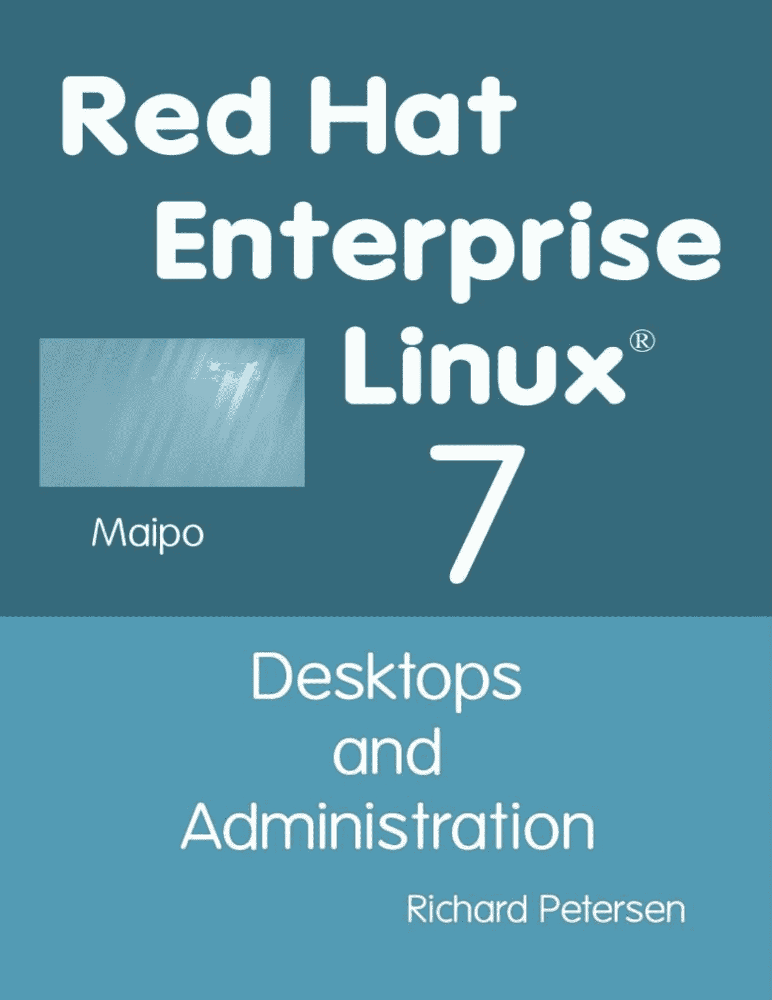


致 George, Robert 和 Mark


[www.surfingturtlepress.com](http://www.surfingturtlepress.com)

请将咨询发送：editor@surfingturtlepress.com


# 前言

本书探讨了面向桌面用户和管理员的 Red Hat Enterprise Linux 7。虽然涵盖了管理工具，但重点在于用户执行任务时需要了解的内容。这里的重点是用户在使用 Red Hat Enterprise Linux 7 时面临的问题，涵盖了应用程序、`GNOME` 和 `KDE` 桌面、shell 命令以及管理和网络工具等主题。详细介绍了桌面，包括配置选项。还涵盖了管理主题，包括用户管理、软件管理、仓库、服务、`systemd`、系统监控、shell 配置、加密、网络连接、共享资源、身份验证、`SELinux`、防火墙、shell 配置、备份和打印机。

本书分为部分：桌面和管理。

第一部分涵盖桌面。首先讨论大多数用户执行的基本桌面使用和配置任务。然后详细介绍了 `GNOME` 和 `KDE` 桌面，涵盖了 `Nautilus` 和 `Dolphin` 文件管理器、`GNOME` 栏以及 `KDE` plasmoids 等主题。它还回顾了 Red Hat Enterprise Linux 可用的桌面应用程序，包括办公和 Web 应用、电子邮件客户端、图形工具、数据库、编辑器、视频应用程序、音乐播放器、浏览器、`FTP` 客户端、即时消息传递、VoIP 应用和音频 (`PulseAudio`) 配置。

第二部分关注管理任务，例如管理用户、监控系统、管理软件、保护系统、配置网络连接和打印机、设置共享资源（`Samba` 和 `NFS`）以及执行备份。介绍了 Red Hat Enterprise Linux 桌面管理工具。对于软件管理，详细介绍了 `GNOME Software`、`PackageKit` 和 `YUM`，以及 Red Hat 和 `EPEL` 仓库。涵盖了加密、授权和 `SELinux` 配置等安全问题。还检查了系统，包括和服务模板文件。讨论了命令行 shell 界面和 shell 配置，包括系统和用户 shell 配置变量和文件。

# 概述

- 前言
- 概述
- 目录
- 第一部分：桌面
    - 1. Red Hat Enterprise Linux 7 简介
    - 2. 桌面使用与配置
    - 3. GNOME
    - 4. K 桌面环境：KDE
    - 5. 应用程序
- 第二部分：管理
    - 6. 系统管理与配置
    - 7. 系统工具与监控
    - 8. 安装与更新软件
    - 9. 用户管理
    - 10. 网络连接与防火墙
    - 11. 共享资源：Samba, NIS
    - 12. 打印服务
    - 13. 安全工具：授权、加密与 SELinux
    - 14. systemd：单元管理
    - 15. 备份
    - 16. Shell
    - 17. Shell 配置
    - 表格列表
    - 图表列表
    - 索引


- 前言
- 概述
- 目录
- 第一部分：桌面
    - 1. Red Hat Enterprise Linux 7 简介
    - Red Hat Enterprise Linux
    - Red Hat Enterprise Linux 文档
    - Linux 文档
    - Red Hat Enterprise Linux 7 特性
    - 安装 Red Hat Enterprise Linux
    - Red Hat 仓库
    - 第三方仓库：EPEL
    - 获取 CD 和 DVD
    - 开源软件
    - 2. 桌面使用与配置
    - 访问你的 Linux 系统
    - GRUB 启动菜单与启动问题
    - 显示管理器：GDM
    - 系统状态区域
    - 桌面


# KDE 41

# GNOME 41
## GNOME 文件管理器 43
## 使用 Tweak 工具进行 GNOME 定制化：主题、图标、字体、启动应用程序和扩展 44
## 从 GNOME 注销并关机 46

# 网络连接 47
## Network Manager 有线连接 47
## Network Manager 无线连接 47
## 设置网络（GNOME 与代理） 49

# 设置 51
## 背景 53
## 日期与时间 54
## 节点 57
## 隐私 58
## 详情（系统信息） 59
## 使用可移动设备和媒体 60
## 共享 61
## 电源管理 62
## `powertop`, `tuned`, 和 `BLTK` 63
## 鼠标和触摸板 64
## 显示（分辨率与旋转） 64
## 通用功能 65
## 键盘与语言 66
## 色配置文件（GNOME 颜色管理器） 66
## 在线账号 67

# 文件系统、设备和远程主机 68
## GDM 自动登录 69
## 视频驱动程序 70
## 多媒体支持：MP3、DVD 和 DivX 70
## 终端窗口 70
## 命令行接口 73
## 从命令行界面访问 Linux 74
## 从命令行关机 Linux 74
## 帮助资源 75
## Man 页面 75
## Info 页面 76
## 在 Linux 上运行 Windows 软件：`Wine` 76

# 3 GNOME 79
## GNOME 3 桌面 80
## 顶部栏 81
## 系统区域 82
## 活动概览 82
## Dash 启动器 83
## 窗口缩略图 84
## 应用程序概览 86
## 活动搜索 86
## 窗口 88
## 工作空间 90
## 通知和消息托盘 92
## 使用 Tweak 工具进行 GNOME 定制化：主题、图标、字体、启动应用程序和扩展 93
## GNOME 桌面帮助 94
# GNOME Files 文件管理器 95
## 主文件夹子目录 96
## 文件管理器窗口 96
## 文件管理器侧边栏 98
## 标签页 99
## 显示文件和文件夹 99
## 预览 101
## 在文件管理器中导航 102
## 管理文件和文件夹 103
## 重命名文件 103
## 分组文件 103
## 打开应用程序和文件的 MIME 类型 104
## 文件和目录属性 104
## 文件管理器偏 105
## 文件管理器搜索 106
## GNOME Desktop FTP：连接到服务器 106
## GNOME Classic 108

# 4 KDE 桌面环境：KDE 109
## KDE 4 111
## Plasma：桌面、面板和 plasmoids（组件） 111
## KDE 帮助中心 112
## KDE 桌面 113
## 桌面背景（壁纸） 115
## 主题 116
## 离开 KDE 117
## KDE Kickoff 菜单 118
## `Krunner` 120
## 可移动设备：设备通知器 121
## 桌面 plasmoids 122
## 管理 plasmoids 122
## 文件夹和图标 plasmoids 124
## 控制面板 125
## 活动 125
## KDE 窗口 129
## 虚拟桌面：分页器 131
## KDE 面板 132
## KWin - 桌面特效 134
## KDE 文件管理器：Dolphin 135
## 目录导航 143
## 复制、移动、删除、重命名操作 144
## 搜索栏、桌面搜索和过滤器 144
## 搜索栏 144
## 桌面搜索 (Nepomuk) 145
## 过滤器栏 146
## KDE 配置：KDE 系统设置 146
## KDE 目录和文件 148

# 5. 应用程序 151
## 办公应用程序 152
## LibreOffice 153
## Calligra 153
## GNOME 办公应用程序 154
## 文档查看器和 DVI 154
## 编辑器 155


# 数据库管理系统 155
# 邮件（email）与新闻 156
# 图形化应用 157
# 多媒体 158
# 多媒体支持 159
# CD/DVD 刻录机 160
# 互联网应用程序 160

# 第 2 部分：管理 163

## 6. 系统管理访问与配置 165
### 红帽企业级 Linux 管理工具 166
#### 管理访问：Root 用户 166
#### 从普通用户账户进行管理访问 167
#### 直接登录 root 用户账户：`su` 167
`su` 168
`root` 密码 168
#### 使用 PolicyKit 进行受控管理访问：`polkit-1` 168
##### 更改 PolicyKit 选项 169
`pkexec` 170
#### 使用 `sudo` 进行受控管理访问 172
#### 配置文件夹和文件 174
##### 配置文件：`/etc` 176
`/etc/sysconfig` 177
##### 系统时间与日期 178
###### 使用 `system-config-date` 实用程序 178
###### 使用 `date` 命令 179
###### 使用 `timedatectl` 命令 179
##### 调度任务：`cron` 180
##### `crond` 服务 180
##### `crontab` 条目 180
##### `cron` 的环境变量 181
##### `cron.d` 文件夹 181
##### `crontab` 命令 182
##### 在 `cron` 中编辑 182
##### 组织调度任务 182
##### 运行 `cron` 脚本 183
##### `Cron` 文件夹名称 184
`anacron` 184
KDE 任务调度器 (`Kcron`) 184
统一引导程序 (`GRUB`) 185
`Dracut` 选项（initramfs RAM 文件系统） 187
`Puppet` 187

## 7. 系统工具与监控 189
### 系统日志：`/var/log` 与 `rsyslogd` 190
### 系统日志、日志与 `journald` 190
### `rsyslogd` 与 `/etc/rsyslog.conf` 191
`rsyslogd.conf` 中的条目 191
#### 优先级 193
#### 动作与用户 193
`/etc/rsyslog.conf` 示例 193
### Linux 审计系统：`auditd` 194
### 磁盘使用分析器 195
### 磁盘工具与 `Udisks` 196
### 性能工具与进程 199
GNOME 系统监控器 200
进程管理 201
KDE 系统监控器 202
`vmstat`, `free`, `top`, `iostat` 和 `load` 202
`fs` 203
自动错误报告工具 (`ABRT`) 203
病毒防护：`ClamAV` 204
硬件传感器 204
#### 监控你的网络：`ping`, `netstat`, `Wireshark` 和 `Nagios` 205
### 网络信息：`ping`, `traceroute` 和 `host` 206
`ping` 206
`who` 207
`host` 207
`traceroute` 207
`Wireshark` 208
#### 捕获选项 208
`Wireshark` 过滤器 208
`tcpdump` 209
`netstat` 210
`Nagios` 210
`OpenIPMI` 212
蓝牙 212
### 音频设置 214
#### 音量控制 215
音频：`PulseAudio` 215

## 8. 安装与更新软件
### 订阅管理器 (Subscription Manager) 219
订阅管理器 220
订阅注册 220
更新 RHEL：GNOME Software 222
使用 GNOME 更新 RHEL 223
使用 `PackageKit` 更新 RHEL 224
使用 `yum` 命令更新 226
使用 `cron` 更新 226
Presto：高效更新 `RPM` 包 227
安装 `cron` 包 227
使用 `yum` 安装 228
使用浏览器安装 228
GNOME Software (`PackageKit`) 232
管理仓库 234
EPEL 仓库 236
第三方仓库：Nux 238
使用 `yum` 命令安装包 238
Yum 配置 239
`/etc/yum.conf` 239
仓库 `repo` 文件 240
红帽企业级 Linux 仓库 241
红帽企业级 Linux 安装 DVD 仓库 241


### EPEL 仓库

# 创建本地 Yum 仓库

### 管理 Yum 缓存

# 使用 `rpm` 手动安装软件包

# 软件包安全检查

# 从 Red Hat SRPMS 安装源码应用程序

## `rpmbuild` 工具
### 构建软件包源码
### 生成用于安装的 RPM 包
### 从归包安装源码应用程序
### 解压归包：归管理器 (File Roller)
### 配置、编译与安装

# 9. 用户管理
## 用户账户：用户与设置
### 用户和组管理器：`system-config-users`
### 用户和组：创建新用户
### 用户和组：组
### 用户配置文件
### 密码
* `/etc/passwd`
* `/etc/shadow` 和 `/etc/gshadow`
### 密码工具
* 用户更改自己的密码
## 管理用户环境
### 配置文件脚本
* `/etc/skel`
* `/etc/login.defs`
* `/etc/login.access`
### 控制用户密码
### 使用 `useradd`、`usermod` 和 `userdel` 添加和删除用户
* `useradd`
* `usermod`
* `userdel`
### 管理组
* `/etc/group` 和 `/etc/gshadow`
* 用户私有组
* 目录
### 使用 `groupadd`、`groupmod` 和 `groupdel` 管理组
* `groupadd` 和 `groupdel`
* `groupmod`
### 磁盘配额
### 配额工具
* `edquota`
* `quotacheck`、`quotaon` 和 `quotaoff`
* `repquota` 和 `quota`
### 轻量级目录协议
### LDAP 客户端与服务器
### LDAP 配置
### Red Hat 目录服务器

# 10. 网络连接与防火墙
## 网络信息：动态与静态
### NetworkManager
### 使用 GNOME 网络手动配置 Network Manager
### 使用网络连接 (`nm-connection-editor`) 手动配置 Network Manager
### Network Manager 无线路由器和隐藏无线
### 使用 `nmcli` 管理网络连接
* `nmcli` 有线连接
* `nmcli` 无线连接
### 可预测与不可预测的设备名称
* 网络设备路径
* 使用 `udev` 规则重命名设备名称
### 命令行 PPP 访问：`wvdial`
### 使用无线工具手动配置
* `iwconfig`
* `iwriv`
* `iwspy`
* `iwlist`
### 防火墙
### 动态与静态防火墙：`firewalld` 和 `iptables` 命令
### 使用 `firewalld` 动态管理
* `firewall-config`
* `firewall-cmd`

# 11. 共享资源：Samba, NFS 和 NIS
## Samba 应用
### 设置 Samba
### 用户级安全
* `smbpasswd`
* `pdbedit`
### Samba `smb.conf` 文件
### 全局部分
### 网络相关选项
### 日志选项
### 独立服务器选项
### 域成员选项
### 域名解析
### 打印选项
### 文件系统选项
### Homes 节
### printer 和 print$ 节
### 共享
### 打印机
### 变量替换
### 测试 Samba 配置
## Samba 公共域控制器：Samba PDC
### 微软域安全
### 核心 Samba PDC 配置选项
### 基础配置
### 域登录配置
### 主节点浏览器配置
### 使用客户端访问 Samba 服务
### 在 GNOME 中访问 Windows Samba 共享


# `smbclient` 325

# `mount.cifs: mount -t cifs` 327

# 网络文件系统 (NFS) 327
## NFS 守护进程 328
## NFS 配置：`/etc/exports` 330
### NFS 主机条目 330
### NFS 选项 331
### NFS 用户级访问 332
### NFS `/etc/exports` 示例 332
### 应用更改 332
### 手动导出文件系统 333
## NFSv4 333
### 使用 NFS4 访问列表实现 NFS 文件和目录安全 334
### 控制对 NFS 器的访问 334
#### `/etc/hosts.allow` 和 `/etc/hosts.deny` 334
#### Portmapper 服务 335
#### Netfilter 规则 335
## 挂载 NFS 文件系统：NFS 客户端 336
### 自动挂载 NFS：`/etc/fstab` 336
### 手动挂载 NFS：`mount` 336
### 按需挂载 NFS：`autofs` 337

# 网络信息服务：NIS 338
## NIS 服务器 340
### 定义 NIS 域 340
### 设置 NIS 服务器选项 340
### 定义共享文件 341
### 创建 NIS 数据库 342
### 控制访问 342
### groups 342
### NIS 客户端 343
### 定义 NIS 域和服务器 343
### 访问服务器 343
### 使用 `nsswitch.conf` 配置文件 344

# 12 打印服务 345
## 打印服务：CUPS 346
### 打印机配置文件 348
### 打印机安装与配置 348
### 自动检测打印机 348
### 打印机 URI（通用资源标识符） 348
### 设置打印机：GNOME 打印机工具 349
### `system-config-printer`：打印设置 349
### CUPS Web 配置界面 350
### 配置远程打印机 352
### 使用 `system-config-printer` 配置远程打印机 352
### 使用 CUPS Web 端配置远程打印机 352
### 手动配置远程打印机 353
### CUPS 配置文件 353
### `cupsd.conf` 353
### 位置指令 355
### 默认操作策略：限制指令 356
### `cupsctl` 357
### `printers.conf` 357
### `subscriptions.conf` 358
### `cups-files.conf` 359
### `cups-browsed.conf` 359
### CUPS 命令行客户端 359
### `lpr` 359
### `lp` 359
### `lpq` 和 `lpstat` 360
### `lprm` 360
### CUPS 命令行管理工具 361
### `lpadmin` 361
### `lpoptions` 362
### `cupsenable` 和 `cupsdisable` 362
### `accept` 和 `reject` 362
### `lpinfo` 362

# 13 安全工具：授权、加密与 SELinux 363
## `authconfig` 364
## 可插拔认证模块 (PAM) 366
## 系统安全服务守护进程 (SSSD) 366
## 加密 367
### 公钥加密 367
### 数字签名 368
### 完整性检查 368
### 加密结合签名 369
### 使用 Seahorse 管理密钥 369
### 密码与密钥 369
### 密钥环 370
### 创建新密钥 370
### 导入密钥 370
### 共享密钥 372
### 使用 `gpg` 加密数据 374
### 加密文件 375
### SELinux 376
### SELinux 架构 378
### SELinux 软件包 378
### 使用 `system-config-selinux` 配置 379
### SELinux 故障排除：`auditallow` 382
### SELinux 策略生成 384
### SELinux 策略管理 386
### `semanage` 388
### 检查 SELinux 信息：`seudit` 388

# 14 systemd：单元文件与服务器管理 389
## systemd 390
### systemd 基础配置文件 391
### 单元 (units) 391
### 单元文件语法 393
### 特殊目标 (targets) 395
### 修改单元文件：`/etc/systemd/system` 397
### 执行环境选项 398


# 服务单元文件 (398)

## 需需服务与独立服务 (socket) (401)
## 路径单元 (403)
## 模板单元文件 (403)
## 运行级别与特殊目标 (405)
### systemd 与自动挂载文件系统：`/etc/fstab` (406)
### systemd slice 和 scope  (408)
## System V：`/etc/rc.d/init.d` (408)
## 关机与关电 (408)

## 管理服务 (410)
### 启用服务：启动时自动启动服务 (410)
### 手动管理服务 (410)
### Cockpit (411)
### `chkconfig` (413)
### service 命令 (414)
### 扩展互联网服务守护进程 (xinetd) (414)

# 15. 备份 (415)
### 个别备份：存档与 `rsync` (416)
### Amanda (417)
### Amanda 命令 (417)
### Amanda 配置 (418)
#### `/etc/amanda` (418)
#### `amanda.conf` (419)
#### `disklist` (419)
### 在网络上启用 Amanda (419)
### Amanda 服务器 (419)
### Amanda 主机 (420)
### 使用 Amanda (420)
### 使用 `dump` 备份与恢复 (421)
### `dump` 级别 (421)
### 记录备份 (421)
### 使用 `dump` 操作 (422)
### 恢复备份 (423)

# 16. Shell (427)
### 终端窗口 (428)
### 命令行 (429)
### 命令行编辑 (430)
### 命令与文件名补全 (430)
### 历史记录 (433)
### 历史事件 (433)
### 文件名扩展：`*`, `[ ]` (435)
### 匹配多个字符 (435)
### 匹配单个字符 (437)
### 匹配范围范围字符 (437)
### 匹配 Shell 符号 (438)
### 生成模式 (438)
### 标准输入/输出与重定向 (438)
### 重定向标准输出：`>` 和 `>>` (439)
### 标准输入 (441)
### 重定向标准错误：`>&`, `2>`, `|&` (441)
### 管道：`|` (443)
### 列出、显示和打印文件：`ls`, `cat`, `more`, `less` 和 `lpr` (444)
### 显示文件：`cat`, `less` 和 `more` (444)
### 打印文件：`lpr`, `lpq`, 和 `lrm` (445)
### 管理目录：`mkdir`, `ls`, `cd`, `pwd` (445)
### 创建与删除目录 (445)
### 显示目录内容 (446)
### 在目录间移动 (447)
### 引用父目录 (447)
### 文件与目录操作：`find`, `cp`, `mv`, `rm` (448)
### 搜索目录：`find` (448)
### 搜索工作目录 (449)
### 定位目录 (449)
### 复制文件 (450)
### 移动文件 (451)
### 复制与移动目录 (452)
### 删除文件与目录：`rm` 命令 (453)
### 链接：`ln` 命令 (453)
### 软链接 (453)
### 硬链接 (454)

# 17. Shell 配置 (457)
### Shell 初始化与配置文件文件 (458)
### 配置目录与文件 (459)
### 别名 (Aliases) (460)
### 命令与选项的别名 (460)
### 命令与参数的别名 (461)
### 为命令设置别名 (461)
### 控制 Shell 操作 (462)
### 环境与子 Shell：`export` (462)
### 使用 Shell 参数配置 Shell (463)
### Shell 变量 (465)
### 使用初始化文件 (466)
### 主目录：`HOME` (466)
### 路径：`PATH` (466)
### 指定 BASH 环境：`BASH_ENV` (467)
### 配置 Shell 提示符 (467)
### 指定你的新闻 (469)
### 配置登录 Shell：`.bash_profile` (469)
### 导出变量 (470)
### 变量赋值 (470)
### 编辑你的 BASH Profile 脚本 (470)
### 手动重新执行 `.profile` 脚本 (471)
### 系统配置文件脚本 (471)
### 配置 BASH Shell：`.bashrc` (474)
### 用户 `.bashrc` BASH 脚本 (474)
### 系统 `/etc/bashrc` BASH 脚本 (475)
### BASH Shell 退出文件：`.bash_logout` (475)

### 表列表 (477)
### 图表列表 (481)
### 索引 (489)


1. Red Hat Enterprise Linux 7 简介 27
2. 桌面使用与配置 35
3. GNOME 79
4. K 桌面环境：KDE 109
5. 应用 151

# 1. Red Hat Enterprise Linux 7 简介

Red Hat Enterprise Linux
Red Hat Enterprise Linux 文档
Red Hat Enterprise Linux 7 特性
安装 Red Hat Enterprise Linux
开源软件

Linux 是一种用于笔记本电脑、桌面电脑和服务器的快速、稳定且开源的操作系统，具有专业级的互联网服务、丰富的开发工具、桌面环境以及包括办公、多媒体和社交媒体应用在内的大量应用程序。作为一种操作系统，Linux 执行许多与 UNIX、OS/X 和 Windows 相同的功能。然而，Linux 以其强大、灵活性以及免费可用而脱颖而出。从技术上讲，Linux 由称为 `kernel` 的内核的操作系统程序组成，该部分最初由 Linus Torvalds 开发。但它一直伴随着大量的软件应用程序进行分发，范围从网络服务器、安全程序到办公应用和开发工具等。Linux 作为开源软件运动的一部分而演进的，独立程序员聚集在一起，为任何用户提供免费的高质量软件。Linux 已经成为开源软件的首选平台，其中许多软件是由自由软件基金会的 GNU 项目开发的。许多应用程序被作为 Red Hat Enterprise Linux 发行版的一部分捆绑在一起。

通过 GNOME 和 KDE 桌面，Linux 还提供了桌面界面。与 Windows 和 Mac 不同，Linux 允许你选择所需的界面，然后对其进行进一步定制，添加面板、小应用、虚拟桌面和菜单，所有功能都具有完整的拖放能力和感知感知工具。Red Hat Enterprise Linux 使用这些桌面的非常稳定的版本。

像 Red Hat 这样的公司通过提供具有高水平支持的可靠商业版本，将 Linux 开发更向前了一步。虽然 Red Hat Enterprise Linux 的源代码是开源且免费提供的，但 Red Hat 提供了技术专业知识来实施一个在商业上可靠的 Linux 版本。今天，受商业支持的 Linux 版本运行着全球范围内大部分服务器。

## Red Hat Enterprise Linux

Red Hat Enterprise Linux 发布版由 Red Hat 公司作为一项开源项目，为了商业目的进行维护和开发。该项目旨在提供一个稳定可靠的系统，特别是针对服务器。发布周期设定为延长的支持间隔，通常为 2 到 3 年，并配有中间刷新版本，以包含错误修复和某些增强软件。虽然 Red Hat Enterprise Linux 是开源的且其源代码免费可用，但支持是通过商业合同提供的，包括编译后的自动更新。详细信息请参阅 Red Hat Enterprise Linux 网站，`https://www.redhat.com/en/technologies/linux-platforms/enterprise-linux`。

Red Hat Enterprise Linux 版 Linux 以商业订阅的形式运行。您可以下载并安装带有 30 天免费软件更新的评估版本，然后购买订阅以获得持续支持。

`https://access.redhat.com/products/red-hat-enterprise-linux/evaluation`

## Red Hat Enterprise Linux 文档

Red Hat 在 `https://access.redhat.com/documentation/` 为 Red Hat Enterprise Linux 维护了大量的文档库（见表 1-1）。文档涵盖了存储管理、安装、管理、电源管理和安全等主题。所有 Red Hat 文档都在 GNU 通用公共许可证下免费提供。

| 网站 | 名称 | |
| --- | --- | --- |
| [`www.redhat.com/en`](https://www.redhat.com/en) | Red Hat 主页 |
| [`www.redhat.com/en/technologies/linux-platforms/enterprise-linux`](https://www.redhat.com/en/technologies/linux-platforms/enterprise-linux) | Red Hat Enterprise Linux 网站 |
| [`access.redhat.com/home`](https://access.redhat.com/home) | Red Hat 客户门户 |
| [`access.redhat.com/documentation/en/`](https://access.redhat.com/documentation/en/) | Red Hat 文档网站 | |
| [`access.redhat.com/documentation/en-US/Red_Hat_Enterprise_Linux/7/html-single/System_Administrators_Guide/index.xhtml`](https://access.redhat.com/documentation/en-US/Red_Hat_Enterprise_Linux/7/html-single/System_Administrators_Guide/index.xhtml) | Red Hat Enterprise Linux 7 管理指南 |
| [`access.redhat.com/documentation/en-US/Red_Hat_Enterprise_Linux/7/html-single/Installation_Guide/index.xhtml`](https://access.redhat.com/documentation/en-US/Red_Hat_Enterprise_Linux/7/html-single/Installation_Guide/index.xhtml) | Red Hat Enterprise Linux 7 安装指南 |
| [`access.redhat.com/documentation/en-US/Red_Hat_Enterprise_Linux/7/html-single/Storage_Administration_Guide/index.xhtml`](https://access.redhat.com/documentation/en-US/Red_Hat_Enterprise_Linux/7/html-single/Storage_Administration_Guide/index.xhtml) | Red Hat Enterprise Linux 7 存储管理指南 |
| [`access.redhat.com/documentation/en-US/Red_Hat_Enterprise_Linux/7/html-single/Power_Management_Guide/index.xhtml`](https://access.redhat.com/documentation/en-US/Red_Hat_Enterprise_Linux/7/html-single/Power_Management_Guide/index.xhtml) | Red Hat Enterprise Linux 7 电源管理指南 |
| [`access.redhat.com/documentation/en-US/Red_Hat_Enterprise_Linux/7/html-single/Security_Guide/index.xhtml`](https://access.redhat.com/documentation/en-US/Red_Hat_Enterprise_Linux/7/html-single/Security_Guide/index.xhtml) | Red Hat Enterprise Linux 7 安全指南 |
| [`access.redhat.com/documentation/en-US/Red_Hat_Enterprise_Linux/7/html-single/SELinux_Users_Administrators_Guide/index.xhtml`](https://access.redhat.com/documentation/en-US/Red_Hat_Enterprise_Linux/7/html-single/SELinux_Users_Administrators_Guide/index.xhtml) | Red Hat Enterprise Linux 7 安全增强 Linux 用户指南 |
| [`www.redhat.com/en/about/newsroom`](https://www.redhat.com/en/about/newsroom) | Red Hat 新闻 |
| [`www.linuxfoundation.org/`](https://www.linuxfoundation.org/) | Linux 基金会 | |
| [`www.kernel.org/`](https://www.kernel.org/) | 最新内核。 | |

表 1-1：Red Hat 网站

在您的系统上安装 Red Hat Enterprise Linux 之前，您可能想查看在线安装指南，它对所有安装过程提供了详细描述。

`https://access.redhat.com/documentation/en-US/Red_Hat_Enterprise_Linux/7/html-single/Installation_Guide/index.xhtml`

系统管理指南为您的 Red Hat Enterprise Linux 系统的管理方面提供了详细信息，范围从包管理到系统监控。在首次执行管理任务之前，始终检查系统管理指南。它将拥有最新的信息。

`https://access.redhat.com/documentation/en-US/Red_Hat_Enterprise_Linux/7/html-single/System_Administrators_Guide/index.xhtml`


《系统管理指南》包含 8 部分，每部分包含章节和子章节。部分列表如下：

- 第 1 部分：基础系统配置
- 第 2 部分：订阅与支持
- 第 3 部分：软件安装与管理
- 第 4 部分：基础设施服务
- 第 5 部分：服务器
- 第 6 部分：监控与自动化
- 第 7 部分：内核、模块和驱动程序配置
- 第 8 部分：系统备份与恢复

红帽企业 Linux《存储管理指南》涵盖了存储系统的详细配置，包括 LVM、硬盘分区、NFS 和磁盘配额。

[存储管理指南 (https://access.redhat.com/documentation/en-US/Red_Hat_Enterprise_Linux/7/html-single/Storage_Administration_Guide/index.xhtml)](https://access.redhat.com/documentation/en-US/Red_Hat_Enterprise_Linux/7/html-single/Storage_Administration_Guide/index.xhtml)

您的 Firefox 浏览器已经配置了访问红帽文档和支持网站的书签。这些书签包括红帽首页、红帽文档网站，以及包含评估、产品文档和订阅支持链接的红帽客户门户页面。

对于大部分文档，您还可以通过 `/usr/share/doc` 文件夹访问系统中已安装的文档，或者使用 Man 页面和 info 页面，以及针对桌面上运行的不同应用程序的上下文帮助按钮。像 GNOME、KDE 和 Libreoffice.org 等软件网站将提供丰富的应用程序文档。

## Linux 文档

一个名为 Linux 文档项目（LDP）的特殊 Linux 项目开发了一套完整的 Linux 手册。您可以在 LDP 主站 [`www.tldp.org`](http://www.tldp.org) 获取这些文档。该文档包括用户指南、介绍和管理指南，并提供多种格式供选择。您还可以在 HOW-TO 文档中找到更简短的说明。您安装的软件对应的 Linux 文档将位于您的 `/usr/share/doc` 文件夹中。

红帽特定的文档可以在 [`access.redhat.com/documentation/`](https://access.redhat.com/documentation/) 获取。[`help.gnome.org/`](https://help.gnome.org/) 网站存有 GNOME 桌面的文档，而 [`www.kde.org/`](https://www.kde.org/) 存有 KDE 桌面的文档。

## 红帽企业 Linux 7 特性

红帽企业 Linux 7 (RHEL7) 对关键应用程序进行了更新，并用新工具取代了旧工具。GNOME 3 现在是默认桌面。请参考这些注释获取所有新更改的详细信息。红帽企业 Linux 7 发布说明位于红帽文档网站上：

[`access.redhat.com/documentation/en-US/Red_Hat_Enterprise_Linux/7/html/7.3_Release_Notes/index.xhtml`](https://access.redhat.com/documentation/en-US/Red_Hat_Enterprise_Linux/7/html/7.3_Release_Notes/index.xhtml)

## 安装红帽企业 Linux

红帽企业 Linux 使用 `Anaconda` 安装程序；它设计得易于使用且实用，同时保持高效和简洁，尽可能安装尽可能和服务和应用程序（参见图 1-1）。红帽企业 Linux 安装指南可以在线获取：

[`access.redhat.com/documentation/en-US/Red_Hat_Enterprise_Linux/7/html-single/Installation_Guide/index.xhtml`](https://access.redhat.com/documentation/en-US/Red_Hat_Enterprise_Linux/7/html-single/Installation_Guide/index.xhtml)

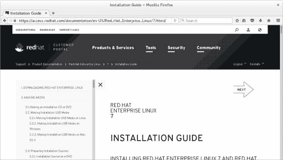

图 1-1：红帽企业 Linux 安装指南

## 红帽存储库

要访问红帽支持的全范围软件，您需要使用 `Subscription Manager` 向红帽注册您的订阅。然后，您可以配置访问多个红帽软件库。旧的红帽网络（RHN）库管理模式已弃用。您可能还想启用红帽补充库，其中包含 Java 软件以及 Adobe Reader 和 Flash 播放应用程序。

## 第三方存储库：EPEL

RHEL7 有一个主要的第三方库可用，即企业级 Linux 额外软件包（EPEL）库。EPEL ([`fedoraproject.org/wiki/EPEL`](http://fedoraproject.org/wiki/EPEL)) 提供了流行的 Fedora 支持包，如 `BackupPC` 和 `Dia`。一些非官方的第三方库（如 Nux）提供了大多数第三方多媒体应用和编码器，如 `vlc` 多媒体播放器和 DVD 视频编码器。这些可能有效也可能无效。在使用 EPEL 和某些第三方库处理重叠软件时可能会出现不兼容情况，因为某些库和应用程序重复重复。建议使用与 EPEL 兼容的库，例如 Nux。

## 获取 CD 和 DVD

要获取红帽企业 Linux 安装 CD 或 DVD，您可以购买订阅或申请 30 天评估订阅。对于评估订阅，请访问以下网站。您必须先注册，通过电子邮件验证订阅。注册后，您就可以下载红帽企业 Linux DVD/CD 并使用 30 天评估订阅进行安装。

[红帽 RHEL 评估详情 (https://www.redhat.com/rhel/details/eval/)](https://www.redhat.com/rhel/details/eval/)

## 开源软件

Linux 是根据软件基金会指定的 GNU 许可证免费分发的，供任何想要使用的人使用。GNU（缩写为“GNU's Unix”）是一个由软件基金会发起并管理的项目，为用户、程序员和开发者提供免费软件。Linux 受版权保护，并非公领域。然而，GNU 许可证的效果与软件属于公领域相似。

大多数 Linux 软件是以开源软件开发的。这意味着应用程序源代码随程序免费分发。互联网上的程序员可以对软件包的开发做出贡献，修改并修正源码。Linux 是一个开源操作系统。其源代码包含在所有发行版中并在网上免费获取。许多大型开发项目也是开源项目，包括 KDE 和 GNOME 桌面及其大部分应用程序。您可以在 [`www.opensource.org`](http://www.opensource.org) 获取更多关于开源运动的信息。

开源软件受公共许可证保护。防止商业公司通过添加少量修改、对这些更改申请版权并将其作为自己的产品出售来控制开源软件。最流行的公共许可证是软件基金会提供的 GNU 许可证。这是 Linux 使用的许可证。GNU 许可证保留版权，要求软件及其任何修改始终免费可用。其他公共许可证也被创建以支持不同类型开源项目的需求。GNU 宽义许可证 (LGPL) 允许商业应用程序使用 GNU 许可软件库。Qt 公共许可证 (QPL) 允许开源开发者使用 KDE 桌面至关重要的 Qt 库。


Linux 目前根据自由软件基金提供的 GNU 公共许可协议拥有版权，它通常被称为 GNU 软件（参见 [`www.gnu.org`](http://www.gnu.org)）。根据 GNU 通用公共许可协议的条款，原作者保留版权，但只要包含源代码、将其公开并免费提供，任何人都可以修改并重新分发该软件。此外，对销售该软件或免费赠送它没有限制。一个分发商可以对软件收费，而另一个分发商则可以免费提供。

# 2. 桌面使用与配置

## 访问您的 Linux 系统

- GRUB
- 显示管理器 (Display Manager)
- GNOME
- GNOME 配置
- 网络连接
- GNOME 设置
- 多媒体支持
- 终端窗口
- 命令行界面
- 帮助资源
- 在 Linux 上运行 Windows 软件：Wine

使用 Linux 已经成为一个近乎直觉的过程，它拥有易于使用的界面，包括图形化登录和如 GNOME 和 KDE 等桌面。即使是标准的 Linux 命令行界面也通过可编辑的命令和基于光标的工具变得更加用户友好。要开始使用红帽企业 Linux (Red Hat Enterprise Linux)，您必须知道如何访问您的系统，并在进入系统后知道如何执行命令和运行应用程序。系统可以通过默认的图形化登录或命令行登录进行访问。对于图形化登录，会出现一个简单的屏幕，带有用于选择登录选项的菜单以及用于选择用户和输入密码的对话框。Linux 的特点是能够于访问丰富的帮助文档。在登录系统时，可以轻松地获取有关任何 Linux 命令和实用程序的信息。

如果您安装了启动加载程序 `GRUB`，当您开启或重启计算机时，启动加载程序会首先决定加载并运行哪个操作系统。在几秒钟内，`GRUB` 将显示一条短消息，告诉操作系统它将启动。通常默认是红帽企业 Linux。

相反，如果您按下键盘上的任意键，启动加载程序会显示一个菜单，列出系统上安装的所有操作系统，并高亮显示默认项。如果列出了 Windows 系统，您可以选择启动它。

命令行登录提示符和图形登录对话框均受支持。红帽企业 Linux 默认使用图形化登录，向您展示一个对话框，您可以在其中选择用户登录，然后输入密码。如果您选择不使用图形化登录，将会看到一个简单的命令行提示符来输入您的用户名。

## GRUB 启动菜单与启动问题

启动时，`GRUB` 屏幕会显示几秒钟，然后开始启动程序。如果您想启动不同的操作系统或向启动项中添加选项，则必须显示 `GRUB` 启动菜单（参见 图 2-1）。通过按下键盘上的任意键来实现此操作。`GRUB` 菜单将显示，并列出 Linux 以及您指定的其他操作系统（如 Windows）。您的 Linux 系统默认会被选中。如果不是，请使用箭头键移动到 Linux 条目（如果它尚未被高亮），然后按 `Enter`。

要更改特定行，请使用上/下箭头键移动到该行。您可以使用左/右箭头键在行内移动。`Backspace` 键可以删除字符，通过输入即可插入字符。编辑更改是临时的。只有通过直接编辑 `GRUB` 配置文件才能进行永久更改。RHEL 7 使用 `GRUB2`，它使用配置文件 `/etc/default/grub`。`GRUB2` 文件保存在 `/etc/grub.d` 目录下。以 root 身份运行以下 `grub2-mkconfig` 以应用在 `/etc/default/grub` 中进行的更改：

```
grub2-mkconfig -o /boot/grub2/grub.cfg
```

更多信息请 [`fedoraproject.org/wiki/GRUB_2`](http://fedoraproject.org/wiki/GRUB_2) 中的 `GRUB2` 页面。

当您的 RHEL 操作系统启动时，会出现 RHEL 标志。您可以按 `ESC` 键查看启动消息。RHEL 使用 `Plymouth` 配合其内核模式设置能力显示启动动画。默认安装了 `Plymouth` RHEL 标志主题。

对于图形安装，某些显示器可能难以运行名为 `Plymouth` 启动工具的图形启动显示。该工具取代了红帽图形启动工具但仍使用命令 `rhgb`。如果您遇到这个问题，可以编辑您的 Linux `GRUB` 条目，并从 Linux 行中删除 `rhgb` 终端。按 `e` 键编辑 Grub Linux 条目（参见 图 2-2）。然后将光标移动到 `linux` 行并进行编辑。使用 `Backspace` 键删除。然后按 `Ctrl+x` 启动编辑后的 `GRUB` 条目。

您的系统将启动，最初使用文本显示执行所有启动任务，然后切换到图形登录。

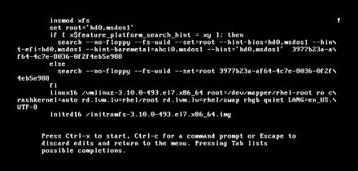

图 2-2: GRUB 编辑窗口

如果您在显示图形界面方面遇到困难，可以选择启动命令行界面。从命令行界面，您可以进行任何配置更改。要从 `GRUB` 进入命令行界面，请编辑 `linux` 行并在行尾添加 `3`。`3` 表示命令行界面（在 RHEL 之前的版本中，`3` 表示运行级别，现在它指向 systemd 目标）。

## 显示管理器：GDM

图形化登录界面显示一个带有用户列表的登录窗口。当您点击用户名时，登录框将取代列表，显示选定的用户名和一个输入密码的文本框。点击“登录”按钮或按 `Enter` 后，您将登录到选定账户，桌面启动。

图形登录由 GNOME 显示管理器 (`GDM`) 处理。`GDM` 管理登录界面，负责验证用户密码和用户名，然后启动桌面。从 `GDM`，您可以使用 `Ctrl+Alt+F2` 切换到命令行界面，然后使用 `Ctrl+Alt+F1` 回到 `GDM`（从桌面可以使用相同的键切换到命令行界面）。键 `F2` 到 `F6` 提供了不同的命令行终端，例如 `Ctrl+Alt+F3` 是第三个命令行终端。

当 `GDM` 启动时，它会显示用户列表（参见 图 2-3）。屏幕右上角的状态区域显示声音和电池状态的图标。点击图标将显示状态区域菜单，其中显示声音调整、网络无线（如果支持）和电池状态（如果是笔记本电脑）。底部的电源按钮将显示一个带有“关机”和“重启”选项的关机对话框。要关闭您的 RHEL 系统，请点击对话框上的“关机”按钮。

![OEBPS/Images/00190.jpeg)

图 2-3: RHEL GDM 用户列表

日期位于屏幕顶部中央。点击日期将显示日历。

状态区域图标旁边是辅助功能菜单，它显示了一个开关菜单，允许您开启辅助功能工具以及诸此类功能，如屏幕键盘、增强对比度和屏幕放大镜。


要登录，请从用户列表中点击一个用户名。系统会提示你输入用户的密码（参见图 2-4）。一个新的对话框将取代用户列表，显示你选择的用户名和一个“密码”（Password）文本框，你可以在其中输入用户的密码。输入密码后，点击“登录”（Sign In）按钮或按回车键。默认启动的是 `GNOME` 桌面。如果你要登录的用户名不在列表中，请点击末尾的“未列出”（Not Listed）项以打开文本框，该框会提示你输入用户名以及密码。

尽管 `GNOME` 是 `RHEL` 的主要桌面，但也可以安装和使用其他桌面，例如 `KDE`、`Xfce` 和 `Mate`。`Xfce` 和 `Mate` 可从 `EPEL` 仓库获取。如果你安装了多个桌面（例如同时安装了 `GNOME` 和 `KDE`），当你点击某个要登录的用户名时，“密码”文本框旁“登录”按钮下方会显示一个“会话”（Session）按钮（齿轮图标）。点击该会话按钮可打开列出已安装桌面的菜单，然后点击你想使用的那个（参见图 2-5）。

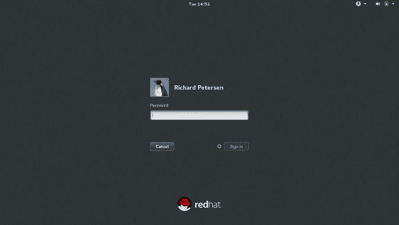

图 2-4: GDM 登录

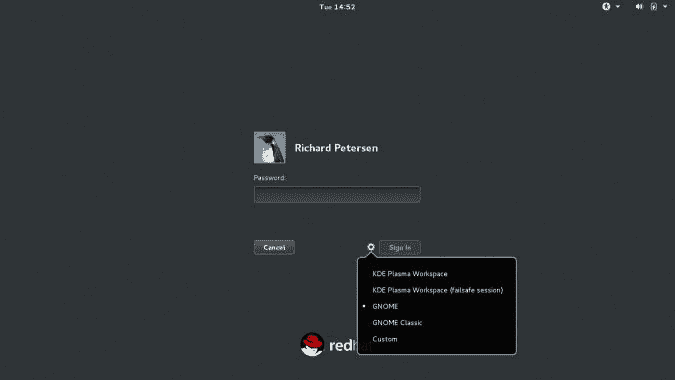

图 2-5: GDM 会话菜单

## 系统状态区域

登录后，系统状态区域显示在顶部栏的右侧（参见图 2-6）。该区域将包含声音和电源等功能的状态图标。点击该按钮会显示系统状态区域菜单，其中包含声音、亮度、有线和无线连接、蓝牙连接、电池以及当前用户的项目，底部还有用于打开 `GNOME Settings`、激活锁屏以及关机或重启系统的按钮。顶部的声音和亮度项目带有滑动条，你可以通过它调整音量和亮度。有线、Wi-Fi、蓝牙、电池和当前用户项会展开为带有更多项目的子菜单（参见图 2-7）。底部的按钮会打开独立的对话框。

在非笔记本电脑系统上，系统状态区域菜单中将没有亮度滑块或电池项。如果系统没有无线设备，`Wi-Fi` 项也将缺失。此类系统将只有声音滑块和当前用户项。

要注销或切换到另一个用户，请点击当前用户项以展开菜单，显示“切换用户”（Switch User）和“注销”（Log Out）项。点击“注销”将返回返回 `GDM` 登录界面。“切换用户”将挂起当前用户并返回 `GDM` 登录界面，你可以在那里以另一个用户登录。如果只定义了一个用户，则没有用户项，因此也没有“注销”项，因为没有其他用户可以登录。


图 2-6: 系统状态区域菜单


图 2-7: 系统状态区域菜单电池项

对于网络连接，`RHEL` 使用 `Network Manager`。`Network Manager` 将自动检测可用的网络连接（参见本章后文“Network Manager 无线连接”）。点击系统状态区域中的 `Wi-Fi` 项以展开显示“选择网络”（Select Network）项的菜单。点击此项将显示一个包含所有可能的无线网络以及任何有线网络的对话框。然后你可以选择你想使用的一个。当你尝试连接到加密的无线网络时，系统会提示输入密码。成功连接的无线网络将添加到你的 `Network Manager` 配置中。

## 桌面

`RHEL` 上可以安装多种备用桌面界面，如 `GNOME` 和 K 桌面环境 (`KDE`)。每个界面都有自己的风格和外观。请记住，`GNOME` 和 `KDE` 界面是两个非常不同的桌面界面，拥有用于选择偏好的独立工具。

### KDE

K 桌面环境 (`KDE`) 在屏幕底部显示一个面板。文件管理器的工作方式与 `GNOME` 文件管理器非常相似。主菜单中有一个“设置”（Settings）项，可以打开 `KDE Settings` 窗口，通过该窗口配置 `KDE` 环境的各个方面，例如桌面效果、工作区外观以及显示器和打印机等设备和网络设置。

## GNOME

`RHEL 7` 使用 `GNOME 3` 桌面，这与 `RHEL 6` 中使用的 `GNOME 2` 桌面不同。它提供了易于使用的概览和菜单，以及灵活的文件管理器和桌面。`GNOME 3` 基于 `gnome-shell`，这是一种合成窗口管理器。它取代了 `GNOME 2` 中的 `Metacity` 窗口管理器、`gnome-panel` 和通知守护进程。

屏幕显示一个顶部栏，通过它可以访问你的应用程序、窗口和设置。点击顶部栏右侧的状态区域按钮会显示菜单，底部有访问设置、锁屏以及关机或重启系统的按钮（参见图 2-8）。要访问应用程序和窗口，请使用活动（Activities）概览。点击顶部栏左侧的活动按钮（或将鼠标移向左侧）。概述模式包含一个列出收藏和运行中的应用程序、工作区和窗口的任务（参见图 2-9）。打开窗口显示显示在窗口概览（桌面区域）。你可以使用顶部的搜索框快速查找应用程序。右侧显示工作区的缩略图，初始有两个。将鼠标移向右侧会显示工作区缩略图。

你可以随时按 `ESC` 键或点击窗口缩略图退出概述。

Dash 是左侧的一条栏，列有你收藏的应用程序图标。初始有 Firefox 浏览器、文件（GNOME 文件管理器）、GNOME 软件、GNOME 帮助、终端窗口、GNOME 设置以及应用程序概览，如图 2-9 所示。要从 Dash 打开应用程序，点击其图标，或右键点击图标从弹出菜单中选择“新窗口”（New Window）。你也可以将图标拖动到窗口概览或右侧的工作区缩略图。


在应用程序概览中有两个子概览：`实用`(Utilities)和`杂项`(Sundries)。`实用`列出了若干工具，例如文本编辑器和系统监器，而`杂项`列出了较旧的管理工具，例如 `system-config-printer` 和 `firewall-config`。这些子概览类似于子菜单，在主概览上叠加子概览。

### GNOME 文件管理器

你可以从控制栏上的“文件”图标访问主文件夹。打开文件管理器窗口，显示你的`主目录`(Home)（参见图 2-10）。你的`主目录`文件夹已经为常用文件创建了默认目录。这些目录包括`文档`(Documents)、`下载`(Downloads)、`音乐`(Music)、`图片`(Pictures)和`视频`(Videos)。你的办公应用程序将默认将文件保存到`文档`文件夹。图像和照片应用程序会将图像文件放置在`图片`目录中。`桌面`(Desktop)文件夹将存放所有保存到桌面的文件和目录。当你下载一个文件时，它会被放置在`下载`目录中。

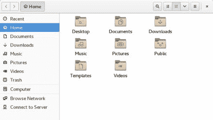

图 2-10: 主目录的文件管理器

文件管理器窗口显示了几个组件，包括结合了标题栏和工具栏的标题栏以及侧边栏。当你打开一个新目录时，将使用同一个窗口显示它，你可以使用前进和后箭头在之前打开的目录之间移动。标题栏显示导航文件夹按钮，显示你当前的文件夹及其父文件夹。你可以点击父文件夹以进入那里。GNOME 文件管理器还支持标签。你可以在同一个文件管理器窗口中打开多个文件夹。

### 使用优化工具进行 GNOME 定制化：主题、图标、字体、启动应用程序和扩展

你可以使用`GNOME 优化工具`(GNOME Tweak Tool) 执行常见的桌面自定义。要自定义的区域包括桌面图标、字体、主题、启动应用程序、工作区、窗口行为和时间显示。你可以从应用程序概览 | `实用`访问`优化工具`。`GNOME 优化工具`具有`外观`(Appearance)、`桌面`(Desktop)、`扩展`(Extensions)、`字体`(Fonts)、`键盘和鼠标`(Keyboard and Mouse)、`电源`(Power)、`启动应用程序`(Startup Applications)、`顶栏`(Top Bar)、`输入`(Typing)、`窗口`(Windows)和`工作区`(Workspaces)标签（参见图 2-11）。

`外观`标签允许你为窗口、图标和光标设置主题。`GNOME 3` 使用 `Adwaita 主题`。该主题具有亮色和黑暗变体。`全局亮色主题`是默认，但你可以使用`外观`标签上的开关启用`全局黑暗主题`。`全局黑暗主题`将窗口背景变为深灰色，而文本和按钮图像显示为白色。

当你添加其他桌面（如 `Cinnamon`）时，可用的主题会增加。有很多窗口主题可以选择，包括 `Clearlooks`、`Mist` 和 `Glider`。对于图标，你可以在 `Oxygen` (KDE)、`Mist` (Cinnamon) 和 `GNOME`之间进行选择。

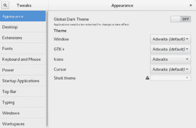

图 2-11: GNOME 优化工具：外观标签（主题）

你可能还想像其他桌面那样在桌面上显示`主目录`、`垃圾箱`和挂载卷（如 USB 驱动器）。使用`优化工具`上的`桌面`标签来显示这些图标（参见图 2-12）。打开“桌面上的图标”开关。`主目录`、`垃圾箱`和`挂载卷`默认勾选。取消勾选将不显示图标。你也可以勾选`网络服务器`选项以显示远程访问文件夹的图标。

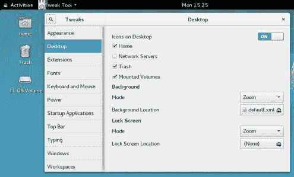

图 2-12: GNOME 优化工具：桌面标签（桌面图标）

窗口标题、界面（应用程序或对话框文本）、文档和`等宽字体`(monospace)（终端窗口或代码）的桌面字体可以在`字体`标签中更改（参见图 2-13）。你可以调整字体大小或更改字体样式。点击字体名称将打开“选择字体”对话框，你可以从中选择不同的字体。文本显示质量可以通过`微调`(Hinting)和`抗锯齿`(Antialiasing)选项进一步调整。只需简单的增加或减少桌面界面上所有字体的大小，你可以调整`缩放因子`(Scaling Factor)。

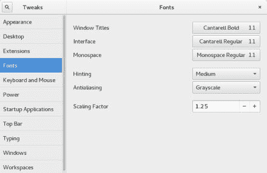

图 2-13: GNOME 优化工具：字体标签

有时，你可能希望在登录时启动某些应用程序，例如 `Gedit` 文本编辑器、`Firefox` 浏览器或 `Videos` 视频播放器。在`启动应用程序`标签上，你可以选择要启动的应用程序（参见图 2-14）。点击`(+)`按钮可以打开对话框，从中选择一个应用程序。添加后，你可以点击`删除`按钮移除该应用程序。

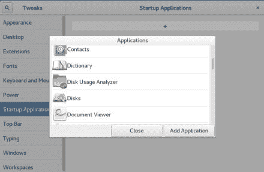

图 2-14: GNOME 优化工具：启动应用程序标签

扩展的功能类似于 GNOME 2 中的小组件。它们是增强或修改 GNOME 桌面的第三方程序，如系统监器、传感器。扩展显示在顶栏或消息栏中。已安装的扩展可以在优化工具的`扩展`标签中开启或关闭。

### 从 GNOME 注销和关机

如果你想退出桌面并返回 GDM 登录界面或切换到另一个用户，点击系统状态区域中的用户项以展开`切换用户`和`注销`菜单（参见图 2-15）。点击`注销`项将显示带有取消`和`注销`按钮的对话框。点击`注销`注销你的账户，退出 GNOME 并返回登录界面，你可以再次作为其他用户登录或关机系统。计时将在对话框中开始，显示在自动注销前剩余的时间。

从登录界面，你可以关机系统：从右下角的系统状态菜单中选择`关机`。这将显示带有重启或关机选项的关机对话框。计时将在对话框中开始，显示在自动关机前剩余的时间。

`切换用户`项将从当前用户切换出并运行 GDM 以显示你可以登录的用户列表。点击名称打开密码提示并显示会话按钮。然后你可以作为该用户登录。已登录用户的会话将保留用户切换时运行的相同窗口和应用程序。你可以在登录用户之间来回，所有用户都保留其离开时的会话。当你从某个用户切换时，该用户运行的程序将在后台继续。

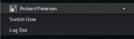

图 2-15: GNOME 注销菜单项

## 网络连接

网络连接将由`网络管理器`为你设置，它会自动检测你的网络连接，包括有线和无线。网络管理器为你的连接提供状态信息，并允许你根据需要从不同的配置连接之间轻松切换。对于初始配置，它会尽可能检测有关新连接的信息。

网络管理器是用户特定的。有线连接将自动启动。对于无线连接，当用户登录时，网络管理器会选择用户偏好的连接。从检测到的无线网络菜单中，用户可以选择要使用的无线连接。


网络管理器在系统状态区域显示活动网络连接：有线连接显示为 `Wired`，无线连接显示为 `Wi-Fi`。每个条目都会指示其状态，如已连接或已断开。这些条目的网络管理器图标将根据连接状态而变化：活动连接显示为实心，断开连接显示为淡（参见图 2-16）。在没有无线设备的有线系统上，系统状态区域菜单中没有 `Wi-Fi` 网络条目。


图 2-16: 网络管理器：无线

### 网络管理器有线连接
对于连接到有线网络（如以太网连接）的计算机，网络管理器会自动检测并建立网络连接。大多数网络使用 `DHCP` 提供 IP 地址和 DNS 服务器等网络信息。通过这种连接，网络管理器可以在你每次启动系统时自动连接到你的网络。

### 网络管理器无线连接
由于有多个用于上网的无线接入点，系统可能有多个网络连接可供选择。对于在不同位置访问不同无线连接的笔记本电脑来说尤其如此。网络管理器工具无需在每次遇到新连接时手动配置，而是可以自动配置并选择要使用的连接。点击系统状态区域中的 `Wired` 条目展开菜单，显示可用于连接或断开有线网络的条目，并在 `Wired` 选项卡处打开 `GNOME Network Settings` 对话框（`Wired Settings`）。

网络管理器将扫描无线连接，检查扩展服务集标识符 (`ESSIDs`)。如果某个 `ESSID` 标识出之前使用过的连接，则会被选中。如果发现多个，则选择最近使用的一个。如果只有新连接，网络管理器将等待用户选择一个。如果用户已登录，则会自动选择一个连接。

点击系统状态区域中的 `Wi-Fi` 条目展开菜单，显示用于选择网络、关闭无线网络等条目，并在 `Wi-Fi` 选项卡处打开 `GNOME Network Settings` 对话框（`Wi-Fi Settings`）。点击 `Select Network` 项目将打开一个对话框，显示所有可用无线连接的列表（参见图 2-17）。条目显示无线网络名称和显示信号强度的波形图。要连接到网络，点击其条目，然后点击 `Connect` 按钮激活连接。如果这是你第一次尝试连接到该网络，系统将提示你输入密码或加密密钥（参见图 2-18）。


图 2-17: 网络管理器连接菜单：无线

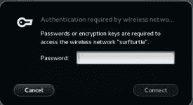

图 2-18: 网络管理器无线身份验证

你可以通过点击系统状态区域展开的 `Wi-Fi` 部分中的 `Turn Off` 条目来关闭无线（参见图 2-19）。关闭后，条目标签变为 `Turn On`。要重新激活无线连接，请点击 `Turn On` 条目。

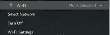

图 2-19: 网络管理器无线开启/关闭

### 设置网络（GNOME 和代理）
GNOME 提供了一个用于基本信息和网络连接管理（包括代理设置）的网络对话框。它设计用于与网络管理器协同工作。从系统状态区域展开的 `Wi-Fi` 条目中选择 `Wi-Fi Settings`，或者点击 `Settings` 对话框中的 `Network` 图标打开 `Network` 对话框（参见图 2-20）。左侧列出了各种网络连接类型的选项卡。包括 `Wi-Fi`、`Wired` 和 `Network proxy` 选项卡（带有无线连接的计算机上显示 `Wi-Fi`）。`Wired` 选项卡允许你开启或关闭有线连接。`Wi-Fi` 选项卡允许你选择无线网络，然后提示输入密码或加密密钥。连接和安全类型会自动检测。你可以不使用无线网络，而是选择 `Airplane Mode` 无线连接或将你的连接作为热点。你还可以连接到本地隐藏网络。右上角的开关允许你开启或关闭无线连接。

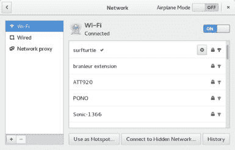

图 2-20: 设置网络无线连接

你当前的活动连接旁边会有一个勾选标记，右侧有一个齿轮按钮。点击齿轮按钮显示一个带有管理连接选项卡的对话框。`Details` 选项卡提供有关连接的信息（参见图 2-21）。对于带有无线连接的计算机上显示 `Wi-Fi`）。`Wired` 选项卡允许你开启或关闭有线连接。`Wi-Fi` 选项卡允许你选择无线网络并提示输入密码或加密密钥。连接和安全类型会自动检测。你可以不使用无线网络，而是选择 `Airplane Mode` 无线连接或将你的连接作为热点。你还可以连接到本地隐藏网络。右上角的开关允许你开启或关闭无线连接。

你当前的活动连接旁边会有一个勾选标记，右侧有一个齿轮按钮。点击齿轮按钮显示一个带有管理连接选项卡的对话框。`Details` 选项卡提供有关连接的信息（参见图 2-21）显示 Wi-Fi）。设置默认设置为自动。要移除网络连接，打开 `Reset` 选项卡（参见图 2-22）并点击 `Forget` 按钮。`Reset` 选项卡上的 `Reset` 按钮允许重置设置。

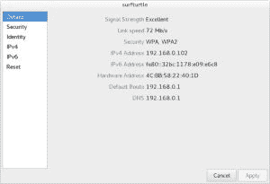

图 2-21: 设置网络无线连接：详情

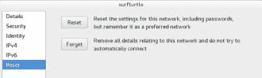

图 2-22: 设置网络无线连接：重置

`Identity` 选项卡具有自动连接和提供给用户的选项。这些是默认设置。如果你不想自动连接到无线网络，请确保取消勾选此选项。

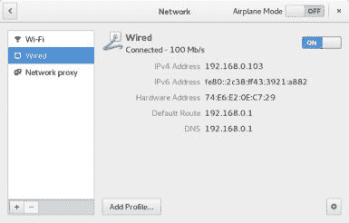

图 2-23: 设置网络有线连接

在 `Network` 对话框中，`Wired` 选项卡（参见图 2-23）显示有线连接的基本信息，包括 IP 地址和 DNS 服务器。右上角的开关允许断开有线连接，让你离线工作。右角的齿轮按钮打开与无线配置对话框类似的配置对话框，带有 `Details`、`Security`、`Identity`、`IPv4`、`IPv6` 和 `Reset` 选项卡。左侧 `Profile` 按钮允许你添加一组不同的有线连接信息（安全、IPv 协议和身份），以便连接到不同的有线网络。

`Network proxy` 选项卡提供一个带有 `None`、`Manual` 和 `Automatic` 的 `Method` 菜单（参见图 2-24）。`Manual` 允许你输入地址和端口信息。对于 `Automatic`选项，你输入配置地址。

要添加新连接（例如 `vpn` 或 `vlan` 连接），点击网络设备列表下方的加 (`+`) 按钮。你将被提示选择接口类型。然后网络配置对话框将启动，让你输入配置信息。


您可以使用 GNOME 设置对话框中列出的 GNOME 配置工具（见表 2-1）来配置桌面设置并执行大多数管理任务，该对话框可以通过系统状态栏对话框（左下角按钮）访问。设置将工具组织为`个人`（Personal）、`硬件`（Hardware）和`系统`（System）三类（见[见]图 2-25](#part0006_split_008.html_id_Toc482531530)）。其中一些工具调用了之前的版本中提供的可用系统工具，例如`声音`（Sound）（使用 `PulseAudio`）。大多数工具使用了新的 GNOME 3 配置和管理工具，如`背景`（Background）、`隐私`（Privacy）、`用户`（Users）和`电源`（Power）（见[见]表 2-1）。

GNOME 3 工具打开时顶部带有一个返回箭头按钮，点击它可以返回设置对话框；右侧有一个搜索按钮，用于定位设置对话框。

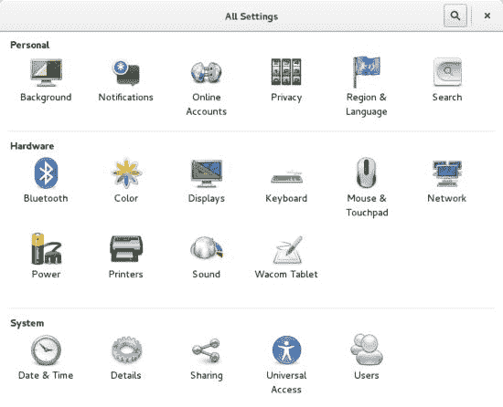

图 2-25: GNOME 系统工具（设置）

| 设置 |  |
| --- | --- |
| 个人 | | |
| 背景 | 设置桌面和锁屏背景（壁纸、颜色和图像） |
| 通知 | 开启不同应用程序的通知 |
| 在线账户 | 为电子邮件和浏览器应用程序配置在线账户 |
| 隐私 | 开启隐私功能，如锁屏和清空垃圾箱 |
| 地区与语言 | 选择语言、地区（格式）和键盘布局 |
| 搜索 | 指定 GNOME 概览搜索框搜索的资源和位置 |
| 硬件 | | |
| 蓝牙 | 设置蓝牙检测和配置 |
| 颜色 | 为设备设置色彩方案 |
| 显示器 | 更改您的屏幕分辨率、刷新率和屏幕方向 |
| 键盘 | 配置按键重复敏感度以及特殊任务（如多媒体操作）的快捷键 |
| 鼠标和触控板 | 设置鼠标和触控板配置；选择手部方向、速度和辅助功能 |
| 网络 | 让您开启或关闭有线和无线网络。允许访问可用的无线网络。如果需要，还可以指定代理配置（手动或自动） |
| 电源 | 设置笔记本电脑闲置时的电源选项 |
| 打印机 | 开启或关闭打印机并访问其打印队列 |
| 声音 | 配置音效、输出量、输入量和声音应用程序设置 |
| Wacom 板 | 提供数板选项 |
| 系统 | | |
| 日期与时间 | 设置日期、时间、时区和网络时间 |
| 详情 | 设置计算机的主机，显示硬件信息，并为某些基本任务分配默认应用程序 |
| 共享 | 开启媒体、远程登录和屏幕访问的共享 |
| 通用功能 | 启用辅助登录和键盘屏幕显示器等功能 |
| 用户 | 管理账户 |

表 2-1: 设置

### 背景

通过`背景`对话框，您可以为桌面和锁屏设置背景：壁纸、图片或颜色。您可以从应用程序概览或设置对话框访问`背景`对话框（见[见]图 2-26](#part0006_split_008.html_id_Toc482531531)）。将显示桌面和锁屏的当前背景。点击其中一个可以打开“选择背景”对话框，其中带有`壁纸`、`图片`和`颜色`选项卡（见[见]图 2-27](#part0006_split_008.html_id_Toc482531532)）。该对话框对于桌面和锁屏背景是相同的。如果您选择`壁纸`，将显示已安装的背景。`颜色`选项卡显示了可以使用作为替代的纯色图像。`图片`选项卡显示您`图片`文件夹中的图像，您可以通过滚动查看来选择一张作为您的背景。要添加您自己的图像，请先将图像添加到您的`图片`文件夹中。然后点击`图片`选项卡以显示您的`图片`文件夹中的所有图像。一旦做出选择，点击右上角的“选择”按钮。您将返回主`背景`对话框，显示您的新背景。显示器上的背景将立即更新。

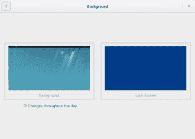 

图 2-26: 背景

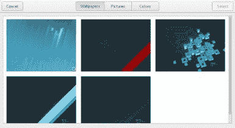

图 2-27: 选择背景

安装`gnome-background`包以添加一组 GNOME 背景。您可以从 [`gnome-look.org/`](http://gnome-look.org/) 下载更多 GNOME 背景（壁纸）。

### 日期与时间

`日期与时间`日历和菜单位于顶部栏上（见[见]图 2-28](#part0006_split_008.html_id_Toc482531533)）。显示桌面和锁屏的当前背景。点击其中一个可以打开“选择背景”对话框，其中带有`壁纸`、`图片`和`颜色`选项卡（见[见]图 2-27](#part0006_split_008.html_id_Toc482531532)）。该对话框对于桌面和锁屏背景是相同的。如果您选择`壁纸`，将显示已安装的背景。`颜色`选项卡显示了可以使用作为替代的纯色图像。`图片`选项卡显示您`图片`文件夹中的图像，您可以通过滚动查看来选择一张作为您的背景。要添加您自己的图像，请先将图像添加到您的`图片`文件夹中。然后点击`图片`选项卡以显示您的`图片`文件夹中的所有图像。一旦做出选择，点击右上角的“选择”按钮。您将返回主`背景`对话框，显示您的新背景。显示器上的背景将立即更新。

`日期与时间`日历和菜单位于顶部栏上（见[见]图 2-28](#part0006_split_008.html_id_Toc482531533)）。`日期与时间`日历显示显示当前时间，但可以修改为显示 24 小时制或 AM/PM。日历显示当前日期，可以通过日历顶部的箭头切换月份。点击底部的“打开日历”可以打开`Evolution`应用程序，可以在其中查看事件。`时钟`链接打开用于查看世界时间的`时钟`工具。

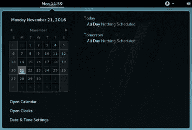

图 2-28: 日期

您可以使用 GNOME 微调工具的`顶部栏`进一步调整顶部栏时间（见[见]图 2-29](#part0006_split_008.html_id_Toc482531534)）。在`时钟`部分，显示日期和秒。对于`日历`，可以显示周数。

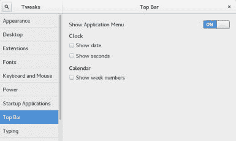

图 2-29: GNOME 微调工具（顶部栏）

日期与时间选项通过`日期与时间设置`对话框设置，您可以从设置对话框或通过`时间`菜单访问它。`日期与时间设置`对话框允许您设置时区和时间。通过关闭`自动`开关使用服务器进行自动设置，或手动设置。一旦关闭，`日期与时间`和`时区`链接将变为可用。

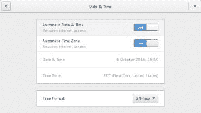  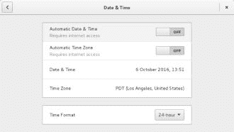

图 2-30: 日期与时间设置（自动已开启）

`日期与时间`链接打开带有小时、分钟、日和年份设置的对话框，并带有月份菜单（见[见]图 2-31](#part0006_split_008.html_id_Toc482531536)）。您可以使用加（`+`）和减（`-`）按钮顺序更改这些值。

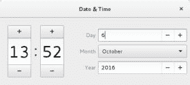

图 2-31: 日期与时间手动设置

`时区`链接打开一个带有时区地图并选中当前时区的对话框（见[见]图 2-32](#part0006_split_008.html_id_Toc482531537)）。点击新的时区即可更改该时区。

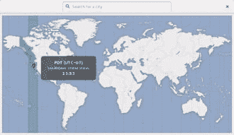

图 2-32: 时区对话框

### 通知

`通知`对话框允许您为不同的应用程序配置通知。还可以还可以选项在屏幕底部显示弹出横幅，或在锁屏上显示通知。这两者默认都是开启的。将显示支持通知的应用程序列表（见[见]图 2-33](#part0006_split_008.html_id_Toc482531538)）。

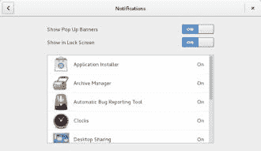

图 2-33: 通知对话框


点击应用程序将显示对话框，您可以在其中开启或关闭应用程序的通知，并设置声音提醒、弹出横幅和锁屏视图等选项（参见图 2-34）。

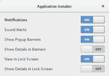

图 2-34: 应用程序的通知设置

## 隐私

隐私对话框允许您开启或关闭隐私功能，例如屏幕锁定、使用和历史记录以及垃圾和临时文件的清理（参见图 2-35）。`Screen Lock` 和 `Usage & History` 默认开启。`Purge Trash & Temporary Files` 和 `Location Services` 关闭。`Location Services` 允许确定您的地理位置。

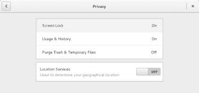  

图 2-35: 隐私

点击 `Screen Lock` 项将打开 `Screen Lock` 配置对话框，您可以在其中开启或关闭 `Screen Lock`，或将其设置为在闲置一段时间后，并允许或拒绝在 `Screen Lock` 屏幕上显示通知（参见图 2-36）。

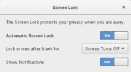

图 2-36: 隐私: 屏幕锁定配置

点击 `Usage & History` 项将打开对话框，您可以在其中开启或关闭使用历史记录，并设置保留时长。该项还有一个按钮，允许您清除最近的记录（参见图 2-37）。

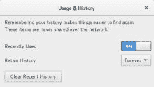

图 2-37: 隐私: 使用和历史记录配置

`Purge Trash & Temporary Files` 项具有自动清空垃圾箱和移除临时文件的选项（参见图 2-38）。您还可以为清理文件设置时间限制。这些选项默认关闭。链接还有按钮，允许您立即清空垃圾箱并清理临时文件。


图 2-38: 隐私: 清垃圾箱和临时文件配置

## 详情（系统信息）

`Details` 对话框使用以下三个标签页显示系统信息：`Overview`、`Default Applications` 和 `Removable Media`。`Overview` 标签页显示硬件规格（内存、CPU、显卡芯片和可用磁盘空间），以及 `hostname`（设备主机名）和 `OS type`（64 位或 32 位系统）（参见图 2-39）。如果您需要，可以在此处更改 `hostname`。当您打开对话框时，系统会检查更新，如果发现，将显示 `Install Update` 按钮，这将打开 `Software Updates` 并允许您更新系统（参见第 4 章）。

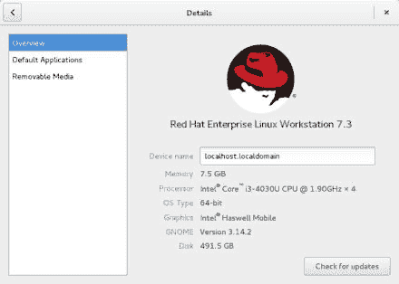  

图 2-39: 详情: 概述

`Default Applications` 标签页允许您为基本类型的文件设置默认应用程序：`Web`、`Mail`、`Calendar`、`Music`、`Video` 和 `Photos`（参见图 2-40）。使用下拉菜单选择已安装的替代方案，例如使用 `Thunderbird` 代替 `Evolution` 处理 `Mail`，或使用 `Image Viewer` 代替 `Shotwell` 处理 `Photos`。

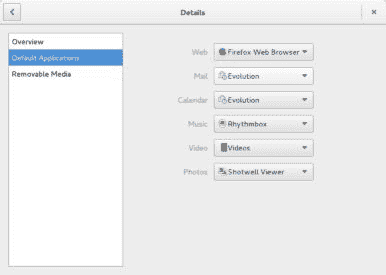

图 2-40: 详情: 默认应用程序

## 使用可移动设备和媒体

RHEL 支持可移动设备和媒体，如数相机、PDA、读卡器和 USB 打印机。这些设备会被自动处理，并在需要时为其设置设备接口。可移动媒体（如 CD 和 DVD 光盘、USB 存储磁盘和数相机）将作为消息栏 `Removable Devices` 菜单中的项显示。在 `Overview` 屏幕上，当您点击底部数字通知时，会显示 `Removable Devices` 图标。点击此图标将显示所有可移动设备的列表，每个项旁边都有 `Eject` 按钮。点击项可以在关联应用程序中打开设备，例如用于 USB 驱动器的文件管理器窗口。在移除驱动器（如 USB 驱动器或移动磁盘驱动器）之前，务必始终点击设备项的 `Eject` 按钮。在点击弹出之前移除驱动器可能会导致磁盘写入操作不完整。

可移动存储设备和媒体也会出现在文件器的 `Devices` 部分。

## 共享

在 `Sharing` 对话框中，您可以允许访问您的账户和屏幕。开关允许您开启或关闭所有共享（参见图 2-42）。

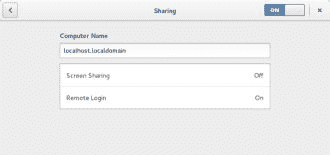  

图 2-42: 共享

点击 `Screen Sharing` 项将打开对话框，您可以在其中允许其他用户访问屏幕。您还可以要求并设置密码（参见图 2-43）。

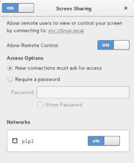

图 2-43: 共享: 允许其他用户访问屏幕


对于笔记本电脑和带有鼠标等远程电池设备的系统，系统状态区域（顶部栏右侧）会显示一个电源图标。系统状态区域菜单显示当前电池电量（参见图 2-44）。该条目展开后显示“电源设置”选项，你可以用它打开“设置”电源对话框。

      

图 2-44: GNOME 电源管理器

GNOME 电源管理器通过电源对话框进行配置，可以通过“设置”中的“电源”访问（参见图 2-45）。该对话框分为四个部分：电池、设备、节能以及挂起与关机。在笔记本电脑上，“电池”部分显示电池电量。“设备”部分显示任何远程设备（如无线鼠标）的电量强度。在“节能”部分，你可以为显示器、无线设备和网络连接设置节能功能。当闲置一段时间后，你可以选择关闭屏幕，并在每次闲置时调暗屏幕。对于笔记本电脑，你还可以设置屏幕亮度。你还可以选择关闭蓝牙、Wi-Fi 和移动宽带。在“挂起与关机”部分，你可以开启系统在闲置时的自动挂起，对于笔记本电脑，可以在电池电量极低时休眠或关机。

使用 GNOME 优化工具（Tweak Tool）的“电源”选项卡，你可以进一步指定按下电源按钮时执行的操作（例如挂起或关），或者在关闭笔记本盖子时挂起。

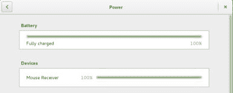

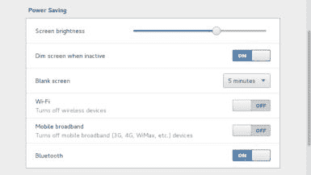

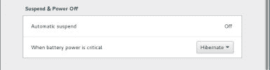  

图 2-45: GNOME 电源管理器

## powertop, tuned, 和 BLTK

为了更精细的电源管理，你可以使用 `powertop` 和 `tuned` 工具。`powertop` 工具在终端窗口中 root 用户身份运行。它将检测并显示有关运行程序和连接设备使用 CPU 的信息。列表中列出了如何配置功耗的建议。要显示包含建议的 `powertop` 结果列表，请添加 `-d` 选项。

```
su
powertop -d
```

对于硬盘和网络设备的自动调优，你可以使用 `tuned`（`tuned` 和 `tuned` utils 工具包）。`tuned` 守护进程监控你的系统并动态调整设置。你可以使用 `tuned` 的 `diskdevstat` 和 `netdevstat` 工具来监控你的硬盘和网络设备。

对于笔记本电脑，你可以使用电池寿命工具包（BLTK）来测试和分析电池性能。选项指定不同的负载类型，例如 `-O` 用于办公套件，`-P` 用于多媒体使用。根据你指定的选项，测试期间将打开并运行不同的应用程序，如 Libreoffice Writer 或 Totem 多媒体播放器。

```
bltk -O
```

你也可以使用 `-a` 选项在桌面系统上运行测试。

```
bltk -a -O
```

## 鼠标和触控板

“鼠标和触控板”对话框是配置鼠标和触摸板的主要工具（参见图 2-46）。鼠标偏好允许你选择鼠标速度、手部方向和双击时间。“测试你的设置”按钮允许你检查点击、双击和滚动。对于笔记本电脑，你可以配置触控板，启用触摸板点击并在打字时禁用它们。你可以开启或关闭触摸板。

GNOME 优化工具的“键盘和鼠标”选项卡具有以下选项：允许启用鼠标中键粘贴并在屏幕上显示指针的位置。

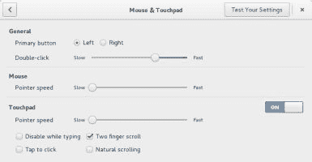  

图 2-46: GNOME 系统工具：鼠标和触控板

## 显示（分辨率和旋转）

RHEL 上使用的 Linux 显示驱动程序支持用户级别的分辨率和方向更改。任何用户都可以指定分辨率或方向，而不影响其他用户的设置。“显示”对话框提供了一个简单的界面，用于设置旋转、分辨率和选择添加的显示器，允许在多个连接的显示器之间实现镜像或扩展显示（参见图 2-47）。

（注：原文此处存在大量重复段落，已根据要求去重，仅保留核心描述）

RHEL 上使用的 Linux 显示驱动程序支持用户级别的分辨率和方向更改。任何用户都可以指定分辨率或方向，而不影响其他用户的设置。“显示”对话框提供了一个简单的界面，用于设置旋转、分辨率和选择添加的显示器，允许在多个连接的显示器之间实现镜像或扩展显示。


# 图 2-50：输入源的区域与语言

### 颜色配置文件（GNOME 颜色管理器）

你可以通过从“设置”中访问“颜色”对话框并指定的配置文件来管理不同设备的颜色。“颜色”对话框列出了你可以设置颜色配置文件的设备。点击设备，屏幕底部将显示 `Add profile`（添加配置）和 `Calibrate`（校准）按钮。你的显示器将自动设置好配置文件。点击`Add Profile`按钮打开一个带有 `Automatic Profiles`（自动配置）菜单的对话框，你可以从中选择颜色配置文件。点击`Add`（添加）按钮添加配置。可用配置包括 `Adobe RGB`、`sRGB` 和 `Kodak ProPhoto RGB`。你也可以从自己的 `ICC` 配置文件文件导入配置。

当你点击设备项时，会列出其 `Profiles`（配置）（参见图 2-51）。点击配置将显示 `Set for all users`（为所有用户设置）、`Remove profile`（删除配置）和 `View details`（查看详情）按钮。点击`View details`按钮获取颜色配置文件信息。

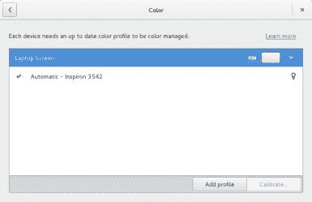

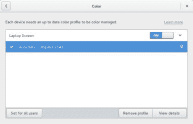 

图 2-51：颜色管理对话框

### 在线账户

你可以使用“设置”中的“在线账户”对话框配置你的在线账户。你不需要单独配置邮件和聊天客户端，可以使用在线账户设置一次访问。点击对话框左下角的加号 `(+)`按钮开始登录程序。系统提示你使用电子邮件和密码登录。提供了对 `Google`、`Flickr`、`Microsoft Exchange`、`ownCloud` 和 `Pocket` 的访问。一旦授权，你将看到该服务的项。点击服务将显示其可用于不同类型的应用程序，例如 `mail`（邮件）、`calendar`（日历）、`contacts`（联系人）、`chat`（聊天）和`documents`（文档）（参见图 2-52）。提供了用于开启和关闭访问的开关。

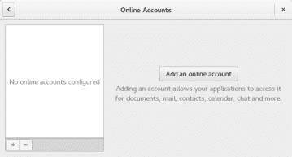  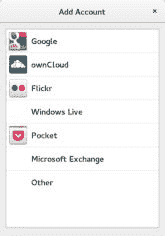  

图 2-52：在线账户

## 访问文件系统、设备和远程主机

当你连接外部存储设备（如 `USB`、`CD/DVD-ROM` 或 `ESATA` 驱动器）时，它会自动挂载，并提示你在文件管理器窗口中打开它。在移除驱动器之前请确保卸载（`Eject`），以便数据被写入。

你的文件系统和可移动介质将作为项出现在文件管理器侧边栏中（参见图 2-53）。`USB` 驱动器等外部设备会自动挂载，并在项旁边带有 `Eject` 按钮。启动时未挂载的内部硬盘分区（如 `Windows` 文件系统）不会自动挂载。双击硬盘分区项即可进行挂载。随后在硬盘项旁边会出现一个 `Eject` 按钮。系统还会提示你在新的文件管理器窗口中打开驱动器的文件系统。

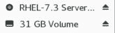

图 2-53：文件管理器窗口中的设备侧边栏

可移动介质上的文件系统也将作为项直接出现在你的桌面消息栏中（概览屏幕右下角；参见图 2-54）。这些项有一个你可以用于卸载驱动器的 `Eject` 按钮。点击驱动器项将在新的文件管理器窗口中打开它。

要挂载 `Windows NTFS` 文件系统（特别是外部或 `USB` 硬盘），你还必须安装 `fuse-ntfs-3g` 包。该包是 `EPEL` 仓库的一部分。它不由 `Red Hat` 提供。你必须先配置对 `EPEL` 仓库的访问（参见第 8 章）。配置完成后，使用 `yum` 或 `PackageKit`（软件包）软件管理器安装 `fuse-ntfs-3g` 包。

除非你手动通过按下键盘上的 `Super` 键配合 `m` 键访问（`Super+m`，`Super` 是 Windows 键），或点击概览屏幕底部中央的消息，否则消息栏将保持隐藏。当你将 `DVD/CD-ROM` 插入 `DVD/CD-ROM` 驱动器时，它会自动挂载并显示其标签图标。读卡器、数码相机、`USB` 驱动器和外部 `USB/ESATA` 硬盘也提供类似的访问。


图 2-54：挂载了可移动驱动器的设备消息栏菜单

如果你已经为视频和音频 `DVD/CDs`，或带有图像、声音或视频文件的磁盘配置了关联应用程序，则该磁盘将用相应的应用程序打开；例如用于图像的 `Shotwell`、用于音频的 `Rhythmbox` 以及用于 `DVD/video` 的 `Movie Player`。

### GDM 自动登录

你可以使用针对 `GDM` 的多个 `TimedLogin` 选项手动配置自动登录。编辑 `/etc/gdm/custom.conf` 文件以创建一个 `[daemon]` 段，并输入以下 `TimedLogin` 选项。

```
[daemon]
TimedLoginEnable=true
TimedLogin=myuser
TimedLoginDelay=10
```

首先，你启用 `TimedLogin` 功能。然后指定你想要登录的用户（`TimedLogin=`）。你还必须设置 `TimedLoginDelay`，通常为约 10 秒；否则，如果你注销，将始终自动登录该用户，而没有机会登录其他用户。

你只能以 root 用户身份编辑此文件。使用 `su` 命令以 root 用户身份登录，然后使用 `vi` 或 `nano` 等行编辑器编辑文件，如 `nano /etc/gdm/custom.conf`。

`GDM` 将显示 `TimedLogin` 选项中指定的用户作为自动登录。在 `GDM` 上登录其他用户时，自动登录用户将初始显示并倒计时。点击取消将显示所有用户列表，你可以从中选择登录。

### 视频驱动

由于 `Nvidia` 和 `ATI` 视频驱动的大部分开源，`Xorg` 和 `Nouveau` 开源版本变得几乎有效，特别是对于 2D 显示支持。对于普通用法，你可能不需要厂商驱动支持。当你安装系统时，系统会自动检测并配置正确的驱动程序。

`Xorg` AMD 视频驱动的名称为 `ati`。`RHEL7` 为 `Nvidia` 使用 `Nouveau` 驱动，这是一个提供加速驱动的开源项目，`xorg-x11-drv-nouveau`。这些是默认驱动，尽管旧的开源 `Nvidia` 驱动也可用，`xorg-x11-drv-nv`。


由于许可和其他限制，RHEL7 发行版不包含对 MP3、DVD Video 或 DivX 媒体的支持。在安装 `RHEL7` 后，你无法播放 MP3 文件、`DVD-Video` 光盘或 DivX 文件。媒体限制也适用于 Fedora，你可以访问 [`fedoraproject.org/wiki/ForbiddenItems`](http://fedoraproject.org/wiki/ForbiddenItems) 查看禁用项目列表。RHEL7 也没有提供许多流行的 Linux 媒体播放器，如 `vlc` 和 `mplayer`。然而，第三方仓库（如 Nux）确实为这些媒体格式提供了所需的库和支持文件，以及相应的媒体播放器。所有软件包都是 RPM 软件包，你可以在先下载并安装仓库配置包后，使用 `YUM` 进行安装。可以使用开源版本的 DivX 即 `Xvid` (`xvid-core`) 来获取 DivX 支持。

## 终端窗口

终端窗口允许你在命令行上输入 Linux 命令。它还为你提供了一个 shell 界面，让你可以使用 shell 命令而不是桌面操作。命令行是可编辑的，允许你使用退格键删除行上的字符。按下按键将插入该字符。你可以使用左、右箭头键在行的任意位置移动，然后按键插入字符，或使用退格键删除字符（参见图 2-55）。文件夹、文件和可执行文件有颜色区分：黑色表示文件，蓝色表示文件夹，绿色表示可执行文件，青色表示链接。共享文件夹显示为绿色背景。

终端窗口会记住你输入的之前的命令。使用向上向下箭头可以在命令行上循环显示这些命令。按下 `ENTER` 键重新执行当前显示的命令。你甚至可以在运行之前的命令对其对其编辑，允许你执行以前命令的修改版本。如果你需要使用不同的参数重新执行复杂命令，或者误输了复杂命令并想在不重新输入整个命令的情况下进行纠正，这将非常有帮助。终端窗口将显示该会话中所有的之前的交互和命令。使用滚动条查看运行过的任何命令及其显示结果。

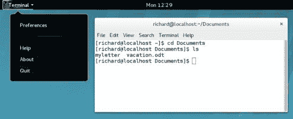  

**图 2-55:** 终端窗口

你可以打开任意数量的终端窗口，每个窗口都在自己的 shell 中运行。你不需要为每个新 shell 打开单独的窗口，可以使用标签页在同一个窗口中打开多个 shell。使用组合键 `Shift-Ctrl-t` 或点击文件菜单上的“打开标签页”（Open Tab）项来打开新标签页。终端窗口顶部会打开一个标签工具栏，其中每个标签页都有文件夹名称和关闭按钮。每个标签页运行一个独立的 shell，让你可以在每个其中输入不同的命令（参见图 2-56）。你可以右键点击标签页的文件夹名称显示弹出菜单移动到不同的标签页，或直接点击标签页的文件夹名称。你还可以使用标签（Tabs）菜单或 `Ctrl-PageUp` 和 `Ctrl-PageDown` 键移动到不同的标签页。当打开多个标签页时，会显示标签菜单。

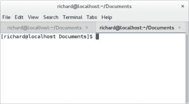

图 2-56: 带有标签页的终端窗口

终端窗口还支持桌面的剪切/复制和粘贴操作。你可以从 Web 页面复制一行，然后将其粘贴到终端窗口（你可以使用终端窗口编辑菜单上的“粘贴”（Paste）项，或按 `Shift-Ctrl-v`）。命令将会出现，然后你可以按 `ENTER` 执行该命令。这对于显示在说明 Web 页面上的命令行操作非常有用。你不需要手动输入复杂的命令，只需直接从 Web 页面选择并复制，然后粘贴到终端窗口。如果需要，你可以在执行之前对命令进行任何编辑。如果你想复制终端窗口上的命令，用鼠标选择文本，然后使用 `Shift-Ctrl-c` 键（或终端窗口编辑菜单上的“复制”（Copy）项）复制命令。只要在终端窗口上显示，你就可以选择一行的一部分或多行。

你可以使用配置（profiles）自定义终端窗口。系统已设置了一个默认配置。要自定义你的终端窗口，从编辑菜单中选择“配置偏好”（Profile Preferences）。这会打开一个窗口用于设置你的默认配置选项，并带有通用（General）、命令（Command）、颜色（Colors）、滚动（Scrolling）和兼容性（Compatibility）标签页（参见图 2-57）。在通用标签页上，你可以按文本行和列选择终端窗口的默认大小。

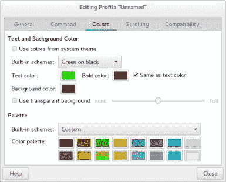

图 2-57: 终端窗口配置

你的终端窗口将被设置为使用白色背景和深色文本。要更改此设置，你可以编辑配置并在颜色标签页上更改背景和文本颜色。取消勾选“使用系统主题颜色”（Use colors from system theme）项。这将启用“内置方案”（Built-in schemes）菜单，你可以从中选择“白底黑字”（Black on white）。自定义选项让你选择自己的文本和背景颜色。滚动标签指定了历史保留的命令行数，以及其他滚动选项，如滚动速度和是否显示滚动条。这些是可以回溯的行，并可以将限制回溯（Limit scrollback）选项设置为无限。

## 命令行界面

在使用命令行界面时，你会得到一个简单的提示符，并在其中输入命令。即使你使用的是像 GNOME 这样的桌面，有时也需要在命令行执行命令。你可以在终端窗口中执行操作，通过快捷方式访问。

Linux 命令大量使用选项和参数。注意在命令行上将你的参数和选项放在正确的位置。Linux 命令的格式是命令名后跟选项，然后是参数，如下：

`命令 选项 参数`

选项是带有一个或两个连字符的单字母代码，用于修改命令执行的操作类型。选项和参数可能是可选的，取决于命令。例如，`ls` 命令可以接受选项 `-s`。`ls` 命令显示目录中的文件列表，`-s` 选项添加每个文件的块大小。你如下所示在命令行上输入命令及其选项：

```
$ ls -s
```


如果你不确定某个命令使用的格式和选项，可以通过显示其帮助页（man page）来快速检查命令语法。大多数命令都有帮助页。只需输入 `man` 命令并将命令名作为参数输入即可。

参数（Argument）是命令执行任务时可能需要的数据。在许多情况下，这是一个文件名。参数以命令行上的单词形式输入，出现在任何选项之后。例如，要显示文件内容，你可以使用 `more` 命令并将文件名作为其参数。当配合文件名 `mydata` 使用 `less` 或 `more` 命令时，在命令行上的输入方式如下：

```
$ less mydata
```

命令行实际上是一个允许你编辑的文本缓冲区。在按下回车键执行命令之前，你可以在命令行上编辑该命令。编辑功能提供了一种方法，可以纠正你在输入命令及其选项时可能犯的错误。`Backspace`（退格）键允许删除刚刚输入的字符（光标左侧的字符），而 `Del` 键允许删除光标所处的字符。通过这种删除字符的能力，如果你愿意，可以退格删除整行，清除你输入的内容。`Ctrl-u` 会擦除整条命令行并让你在提示符处重新开始。

你可以使用 `Up Arrow`（向上箭头）键重新显示上次执行的命令。然后你可以重新执行该命令，也可以对其进行编辑并执行修改后的命令。当你需要重复某些操作（例如编辑同一个文件）时，这非常有帮助。当你输入了错误的命令时，它也有帮助。

### 从命令行界面访问 Linux

当从启动加载程序直接通过命令行界面（或在 GDM 登录对话框中使用 F1 到 F6 的任一键）访问 Linux 时，你最初会看到一个登录提示符。登录提示符之前是你为系统设置的主机名。在这个示例中，主机名为 `turtle`。当你完成 Linux 使用后，可以注销。Linux 将显示完全相同的登录提示符，等待你或另一个用户再次登录。这等同于 GDM 提供的登录窗口。随后，你可以登录另一个账户。

Red Hat Enterprise Linux Server 7.3 (Maipo)
Kernel 3.18.0-493.e17 on x86_64
`turtle login:`

登录你的 Linux 账户涉及两个步骤：输入用户名，然后输入密码。输入你用户账户的用户名。如果你出错了，可以使用退格键删除字符。在下一个示例中，用户输入用户名 `richard`，然后系统提示输入密码：

```
Red Hat Enterprise Linux Server 7.3 (Maipo)
Kernel 3.18.0-493.e17 on an x86_64
turtle login: richard
Password:
```

当你输入密码时，密码不会显示在屏幕上。这是为了保护你的密码不被他人看到。如果你输入的用户名或密码错误，系统将返回错误消息“Login incorrect”（登录错误），并再次要求输入用户名，从头开始登录过程。然后你可以重新输入用户名和密码。

一旦你正确输入了用户名和密码，你就登录了系统。你的命令行提示符会显示出来，等待你输入命令。注意命令行提示符是一个美元符号（`$`）。`$` 是普通用户的提示符，而 `#` 是仅用于 root 用户（超级用户）的提示符。在这一版本的 Red Hat Enterprise Linux 中，你的提示符之前是用户名、主机名以及你所在的文件夹，主目录用波浪号（`~`）表示。两者都被一组括号括起来。

```
[richard@turtle ~]$
```

要结束会话，请执行 `logout` 或 `exit` 命令。这将让你返回登录提示符，等待另一个用户登录。

```
[richard@turtle ~]$ logout
```

### 从命令行关闭 Linux

你可以通过两种方式之一关闭系统。首先，登录一个账户，然后输入 `poweroff` 命令。该命令将你注销并关闭系统。

```
$ poweroff
```

或者，你可以使用 `shutdown` 命令配合 `-h` 选项和指定的延迟时间。使用 `-r` 选项，它会关闭系统然后重启。时间以分钟为单位计算。在下一个示例中，系统将在五分钟后关闭。要立即关闭系统，你可以使用 `+0` 或单词 `now`。

```
# shutdown -h +5
```

要立即关闭系统，你可以使用 `+0` 或单词 `now`。

```
# shutdown -h now
```

你还可以通过按住 ctrl 和 alt 键然后按下 del 键（`ctrl-alt-del`）在登录提示符处强制系统重启。你的系统将通过标准的关机程序然后重启电脑。

## 帮助资源

系统中已经安装了大量的支持文档，也可以从在线资源获取。表 2-2 列出了你的 Red Hat Enterprise Linux 系统上可以使用的帮助工具和资源。

| 资源 | 描述 |
| --- | --- |
| KDE Help Center | KDE 帮助工具， KDE 桌面和应用程序文档的桌面界面、Man 页和 info 文档。 |
| GNOME Help Browser | GNOME 帮助工具，访问 KDE 桌面和应用程序文档的桌面界面。 |
| `/usr/share/doc` | 应用程序的位置 |
| `man command` | Man 页，关于命令的详细信息 |
| `info application` | GNU info 页，关于应用程序的文档 |

表 2-2 帮助资源

GNOME 和 KDE 桌面都带有使用浏览器界面的帮助系统。GNOME 和 KDE 以及其他应用程序都提供上下文相关的帮助。

在你的系统中，`/usr/share/doc` 文件夹包含每个应用程序安装的文档。在每个文件夹中，通常可以找到 `HOW-TO`、`README` 和 `INSTALL` 文档。

### Man 页

你还可以访问 Man 页，这是命令行界面上的 Linux 命令说明书。你可以在终端窗口中使用 `man` 命令访问 Man 页。输入 `man` 后跟你想要信息的命令。以下示例请求了 `ls` 命令的信息：

```
$ man ls
```

按下空格键将跳转到下一页。按下 `b` 键返回上一页。完成后，按下 `q` 键退出 Man 工具并返回命令行。通过按下斜杠（`/`）或问号（`?`）激活搜索。`/`向前搜索，`?` 向后搜索。当你按下 / 时，屏幕底部会打开一行，然后输入要搜索的单词。按下回激活搜索。

### Info 页

GNU 应用程序（如 gcc 编译器和 Emacs 编辑器）的在线文档也以 info 页的形式存在。通过输入命令 `info` 可以访问这些文档。这将显示出不同 GNU 应用程序的特殊屏幕。

info 界面有自己的命令集。你可以通过输入 `info info` 更多。输入 `m` 在屏幕底部打开一行，你可以在其中输入应用程序的前几个字母。按下回将打开该应用程序的 info 文件。


Wine 是一个 Windows 兼容层，允许你在 Linux 上原生运行许多 Windows 应用程序。不需要实际的 Windows 操作系统。Windows 应用程序的运行就像是 Linux 应用程序一样，能够访问整个 Linux 文件系统并使用连接到 Linux 的设备。严重依赖驱动程序的应用程序（例如图形密集型游戏）可能无法运行。其他不依赖任何特殊驱动程序的程序运行得非常良好，包括 Photoshop 和 Microsoft Office。对于某些应用程序，你可能需要使用最新版本的 Wine。

Wine 由 EPEL 仓库提供。它不是 Red Hat 支持的应用程序。安装后，Wine 会显示用于配置的应用程序、Wine 软件卸载程序、Wine 文件浏览器，以及一个 regedit 注册表编辑器 (OLE)、记事本和一个 Wine 帮助工具。

要设置 Wine，请启动 Wine 配置对话框，该对话框显示应用程序（Applications）、库（DLL 选择）、音频（声音驱动）、驱动器（Drives）、桌面集成（Desktop Integration）和图形（Graphics）选项卡。在应用程序选项卡上，你可以选择应用程序为设计的 Windows 版本。驱动器选项卡列出了检测到的分区以及你的 Windows 模拟驱动器（例如 C 盘）。C 盘实际上只是一个文件夹 `.wine/drive_c`，而不是固定大小的分区。你的实际 Linux 文件系统将列为 Z 盘。

配置完成后，Wine 会在用户主目录中设置 `.wine` 文件夹（该文件夹是隐藏的，请在文件器的“视图”菜单中启用“显示隐藏文件”以显示它）。该文件夹内是 `drive_c` 文件夹，它作为 C 盘运行，在 Windows 和 Program File 子文件夹中存放你的 Windows 系统文件和程序文件。System 和 System32 文件夹位于 Windows 文件夹。这是你放置任何需要的 DLL 文件的地方。Program Files 文件夹存放你安装的 Windows 程序，就像它们安装在 Windows Program Files 文件夹中一样。

要使用 Wine 安装 Windows 应用程序，双击桌面上的应用程序安装图标文件，或右键点击应用程序安装图标并选择“用 Wine Windows Program Loader 打开”。或者，你可以打开终端窗口并将 Windows 应用程序作为参数运行 `wine` 命令。

安装的 Windows 软件图标将出现在你的桌面上。只需双击图标即可启动应用程序。它通常会在 Linux 窗口中运行，就像任何 Linux 应用程序一样。

在 Wine 上安装 Windows 字体非常简单，只需将字体从 Windows 文件夹复制到你的 Wine `.wine/drive_c/Windows/fonts` 文件夹即可。你可以将任何 Windows `.ttf` 文件复制到此文件夹以安装字体。Wine 支持 .exe 和 .msi 安装文件。你可能需要通过勾选文件属性对话框权限选项卡中的“执行”复选框来使其变为可执行。

提示：或者，你可以使用名为 Crossover Office 的商业 Windows 兼容层。这是一个经过测试可以运行 Microsoft Office 等某些应用程序的商业产品。访问 [`www.codeweavers.com`](http://www.codeweavers.com) 了解更多详情。Crossover Office 基于 Wine，CodeWeavers 直接支持 Wine。

# 3. GNOME

## GNOME 桌面

### GNOME 概述

### GNOME 启动 (Dash)

### GNOME 窗口 (Windows)

### GNOME 文件管理器 (File Manager)

GNU 网络对象模型环境（也称为 GNOME）是一个强大且易用的环境，主要由面板、桌面和一组用于构建程序界面的桌面工具组成。GNOME 旨在为开发强大的应用程序提供一个灵活的平台。目前，GNOME 受多个发行版的支持，并是 RHEL7 的主要界面。GNOME 是免费的，并根据 GNU 公共许可证发布。GTK+ 用于 GNOME 应用程序的小部件集。GTK+ 小部件集在较早通用公共许可证 (LGPL) 下完全免费。LGPL 允许开发者在专有软件以及自由软件中使用该部件集（GPL 限于自由软件）。

有关详细文档，请查看 GNOME 文档网站 [`help.gnome.org`](https://help.gnome.org)。文档按用户、管理员和开发者组织。“GNOME 帮助”提供了关于桌面使用的完整教程。对于管理员而言，“GNOME 桌面系统管理指南”详细介绍了管理员可以如何管理用户桌面。表 3-1 提供了实用的 GNOME 网站列表。

| 网站 | 描述 |
| --- | --- |
| [`www.gnome.org`](http://www.gnome.org) | GNOME 官方网站 |
| [`help.gnome.org`](http://help.gnome.org) | 面向用户、管理员和开发者的 GNOME 文档网站 |
| [`wiki.gnome.org/Personalization`](https://wiki.gnome.org/Personalization) | 桌面主题和背景艺术 |
| [`www.gnomefiles.org`](http://www.gnomefiles.org) | GNOME 软件应用程序、小部件和工具。 |
| [`developer.gnome.org`](http://developer.gnome.org) | GNOME 开发者网站，请查看 [`help.gnome.org`](http://help.gnome.org) 获取开发者文档。 |

表 3-1：GNOME 资源

GNOME 按照定期计划发布新版本。RHEL7 使用 GNOME 3.18，包含了许多来自 GNOME 3.0 的功能。GNOME 3.18 和 GNOME 3.0 的主要变化在以下位置详细描述：

[`help.gnome.org/misc/release-notes/3.0/`](https://help.gnome.org/misc/release-notes/3.0/)

[`help.gnome.org/misc/release-notes/3.18/`](https://help.gnome.org/misc/release-notes/3.18/)

### GNOME 3 Desktop

GNOME 3 基于 `gnome-shell`，它是一个合成窗口管理器（见图 3-1](#part0007_split_001.html_id_Toc48253163)）。它取代了 RHEL6 中 GNOME 2 Metacity 窗口管理器、`gnome-panel` 和通知守护进程。`gnome-shell` 的关键组件是顶栏、活动概述和通知/消息轨迹功能。顶栏有一个用于日期和时间的对话框、通用访问菜单，以及用于音量、网络连接、电源信息和用户任务（如访问设置和注销）的状态区域。活动概述允许你快速访问收藏的应用、查找应用程序、选择窗口和切换工作区。消息轨迹和通知系统会更新和最近连接的 USB 驱动器。活动按钮右侧是应用程序菜单，它是当前选中应用程序的菜单（例如文件管理器窗口的“文件”）。大多数应用程序只有一个退出选项，而其他应用程序则列出了关键任务。

你可以使用 GNOME 设置对话框中列出的 GNOME 配置工具（见表 3-1](#part0007_split_000.html_id_Toc482530337)）配置桌面设置并执行大多数管理任务，该对话框可以通过系统状态区域访问。设置将工具组织为个人、硬件和系统类别（见图 3-25](#part0007_split_002.html_id_Toc482531587)）。少数工具调用旧版本支持的系统工具，如声音 (PulseAudio) 和显示。大多数工具使用 GNOME 3 配置和管理工具，如背景、锁定屏幕、用户账户和电源。

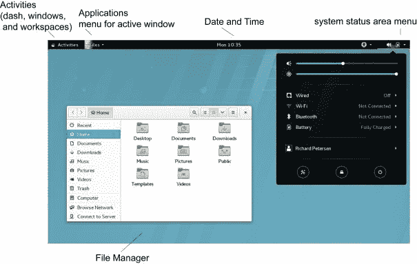

图 3-1：GNOME 桌面


屏幕顶部有一个顶栏，通过它你可以访问应用程序、窗口以及音频和网络等系统属性。点击顶部栏右侧的音频和电源图标，会显示一个菜单，其中的选项可以设置音量、屏幕亮度（笔记本电脑）、有线和无线连接、蓝牙以及注销（请参见图 3-1）。顶部栏的中间有一个按钮，可以显示你的时钟和日历。左侧是“活动”（Activities）按钮，它会显示一个收藏和已打开应用程序的图标栏。

### 系统状态区域

登录后，系统状态区域将显示在顶部栏的右侧（参见图 3-2）。该区域将包含音频和电源等功能的状态图标。点击显示音频、电源和向下箭头的图标按钮，会显示系统状态区域菜单，其中包含音频、亮度、有线和无线连接、电池、当前用户的项目，底部还有用于打开 GNOME 设置、激活锁屏以及关机或重启系统的按钮。音频和亮度项目带有滑动条，你可以通过它调整音量和亮度。Wi-Fi、电池和当前用户项会展开为子菜单并带有额外的目。底部的按钮会打开单独的对话框。

在非笔记本电脑系统上，系统状态区域菜单上将没有亮度滑块或电池项。如果系统没有无线设备，Wi-Fi 项也将缺失。此类系统将仅有一个音频滑块和一个用户项。

要注销，你需要点击当前用户项以展开菜单，显示“注销”和“账户设置”条目。点击“注销”将你带回 GDM 登录界面，你可以在那里以另一个用户登录。

要切换到另一个用户，点击菜单底部的锁定按钮锁定你的会话。然后在解锁屏幕上，点击“取消”按钮下方的“以其他用户登录”链接。你就可以以另一个用户登录了。当你注销时，可以选择原始用户，然后会出现一个解锁屏幕。当你登录时，你的会话就会恢复。


图 3-2: 系统状态区域菜单

### 活动概览

要访问应用程序和窗口，你需使用活动概览模式。点击顶部栏左侧的“活动”按钮（或将鼠标移动到左上角，或按下 super（Windows）键）。活动概览模式由列出你的收藏和运行应用程序的列表、打开窗口的缩略图以及工作区缩略图组成（参见图 3-3）。你可以使用顶部中央的搜索框来查找应用程序和文件。桌面工作区的部分隐藏缩略图显示在右侧。初始有两个。将鼠标移动到右侧会显示工作区缩略图。

你可以随时通过按下 `ESC` 键手动退出活动概览模式。

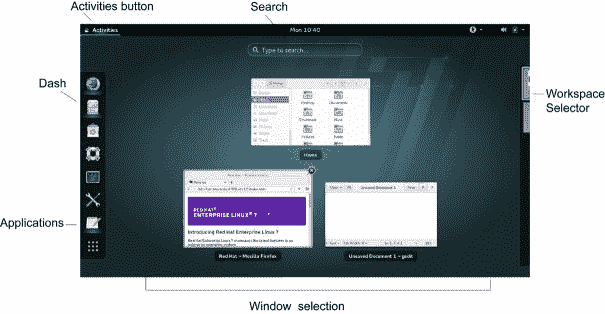

**图 3-3:** GNOME 3 活动概览

### 启动栏 (Dash)

启动栏是左侧的一条栏，带有你收藏的应用程序的图标。最初，在 RHEL7 服务器版本中，有 Firefox 网页浏览器、主文件夹（`Files` 文件管理器）、软件、GNOME 帮助、终端窗口、设置和 Gedit 编辑器的图标（参见图 3-4）。在 RHEL7 工作站版本中，有 Firefox 浏览器、Evolution 邮件程序、Rhythmbox 音乐播放器、Shotwell 照片管理器、文件管理器、软件、GNOME 帮助和终端窗口。要从启动栏打开应用程序，点击其图标，或右键点击并在弹出菜单中选择“新建窗口”。你也可以点击并拖动图标到窗口缩略图区域或右侧的工作区缩略图上。

收藏项始终显示在启动栏上。当你运行其他应用程序时，它们在运行期间也会放置在启动栏上。要将运行中的应用程序添加到收藏作为收藏，右键点击图标并选择“添加到收藏”。稍后可以通过选择“从收藏中移除”来移除应用程序。你也可以从应用程序概览将任何应用程序添加到启动栏，通过点击并拖动其图标到启动栏，或者通过右键点击图标并在菜单中选择“添加到收藏”（参见图 3-4）。

      

图 3-4: 带有收藏和运行应用程序的概览启动栏

### 窗口缩略图

你使用活动概览中的窗口缩略图访问窗口。缩略图显示了所有打开窗口的预览（参见图 3-5）。所选窗口的缩略图右上角有一个 `x`（关闭）按钮。要访问窗口，将鼠标悬停在其上方点击。这将显示窗口，退出概览并返回桌面。


图 3-5: 窗口缩略图

将鼠标移动到屏幕右侧会显示工作区选择器，并高亮当前工作区（参见图 3-6）。你可以通过点击其缩略图切换到另一个工作区。你也可以将窗口直接移动到工作区。如果你的鼠标有滚轮，你可以按下 `Ctrl` 键并使用滚轮向后切换工作区。


图 3-6: 工作区缩略图

### 应用程序概览

点击启动栏上的应用程序图标（最后一个图标，网格按钮）可打开应用程序概览，你可以从中查找并打开应用程序。已安装应用程序的图标将显示在此处（参见图 3-7）。概览底部的“常用”按钮允许你只查看频繁使用的应用程序。点击“全部”按钮查看所有程序。右侧由按钮组成的分页器可以让你快速浏览应用程序列表。你可以通过按钮跳转到列表的任何位置。有两个特殊的子部分：“实用工具”和“杂项”。点击这些图标会打开另一个较小的概览，显示这些类别的应用程序，例如实用工具概览中的“调整工具”和“备份”。点击应用程序图标打开它并退出概览。如果你返回概览模式，你将在概览中看到它的窗口。super 键（Windows 键）配合 `a` 键（`super+a`）将从桌面自动切换到应用程序概览。继续按可以在应用程序概览和窗口缩略图之间切换。

你也可以通过将图标拖动到右侧的工作区缩略图在该工作区打开应用程序。此外，如前所述，要将应用程序添加到启动栏作为收藏，你只需将其图标从应用程序概览直接拖动到启动栏即可。

### 活动搜索


“活动”搜索将搜索应用程序和文件。如果您知道所需应用程序的名称，只需开始输入，系统就会显示匹配的结果（请参见图 3-8）。当您输入时，搜索词会输入到搜索框中。随着内容的增加，结果会动态缩小。系统会自动选中第一个应用程序。如果这就是您需要的程序，只需按 `ENTER` 键即可启动。结果还会显示设置工具和最近访问的文件。

活动概览的搜索框可以通过`Settings Search`对话框进行配置（请参见图 3-9）。在这里，您可以开启或关闭搜索，并指定哪些应用程序支持搜索。默认情况下，这些程序包括联系人、文档、`Files`文件管理器、密码和密钥以及 `Firefox` 浏览器。要指定要搜索的文件夹，请点击右下角的齿轮按钮打开`Search Locations Dialog`对话框，其中包含当前支持的文件夹开关（请参见图 3-10）。点击加号按钮添加您选择的文件夹。

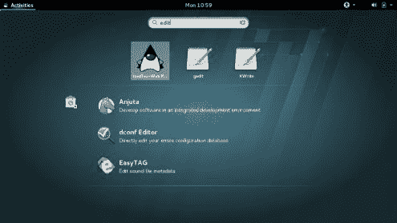

图 3-8: 活动：搜索框

  

图 3-9: 活动：搜索配置


图 3-10: 活动：搜索位置

### 管理窗口

GNOME 窗口的标题栏和工具栏已合并为单个标题栏，如下所示的文件管理器示例。


最小化和最大化按钮已被取消，始终存在一个单一关闭按钮。如果您需要，可以使用 `Tweak Tool` 添加最小化和最大化按钮。某些应用程序会在功能发生变化时更改标题栏，呈现一组不同的工具，此处以 `GNOME Videos` 应用程序所示。


窗口不再具有最大化和最小化按钮。这些任务可以通过拖动操作或双击标题栏来完成。要最大化窗口，双击其标题栏或将标题栏拖动到屏幕顶部。要最小化，将标题栏拖离屏幕顶部。您也可以使用窗口的菜单项来将其最大化或最小化。右键点击标题栏或按 `Alt+spacebar` 可显示窗口菜单。

打开的应用程序窗口在顶部栏的左侧也有一个 `Applications` 菜单。对于许多应用程序，此菜单仅包含一个 `Quit` 条目（请参见图 3-11）。其他程序（如文件管理器）会列出关键任务，如 `Bookmarks`（书签）、`Preferences`（偏选项）和 `Help`（帮助）。`Firefox` 浏览器仅列出一个 `Quit` 按钮，而 `GNOME` 文件管理器则列出 `New Window`（新窗口）、`Bookmarks`、`Preferences`、`Help` 以及 `Quit`。


图 3-11: 带有应用程序菜单的窗口

要最小化打开的窗口使其不再显示在桌面上，请右键点击标题栏并选择 `minimize`。这将隐藏窗口。稍后可以使用活动概览（`Activities` 按钮）上的窗口缩略图重新最大化该窗口。

要关闭窗口，点击其关闭框或从 `Window` 菜单中选择 `Close`。许多当前选中的窗口在顶部栏左侧都有 `Applications` 菜单。如果应用程序没有关闭按钮，您可以点击顶部栏上的 `Applications` 菜单按钮并选择 `Quit` 条目（请参见图 3-11）。

要平铺窗口，点击并拖动其标题栏到屏幕的左边缘或右边缘。当您的鼠标到达屏幕边缘时，窗口将平铺占据屏幕的半部分。您可以对另一个窗口执行针对侧边缘的操作，从而并排显示两个窗口。

要调整窗口大小，将鼠标移动到边缘或角，直到光标变为边缘或角形指针，然后点击并拖动。

右侧的滚动条还具有精细滚动功能。在滚动大量项目时，当您到达搜索点时，可以使用精细滚动来减慢滚动速度。要激活精细滚动，点击并按住滚动条手，或在滚动时按住 `Shift` 键。

您可以使用桌面上的 `Window Switcher` 快速搜索打开的窗口。按 `Alt+Tab` 键可以在当前工作区显示打开窗口的图标栏（请参见图 3-12）。按住 `Alt` 键并按 `Tab` 键可以遍历窗口列表。窗口按应用程序分组。


图 3-12: 窗口切换器 (Alt+Tab)

在 `GNOME` Tweak Tool 的 `Windows` 选项卡中，您可以配置特定窗口。对话框附加到标题栏（请参见图 3-13）。标题栏还有 `Maximize` 和 `Minimize` 按钮的开关。


图 13: GNOME Tweak Tool 对话框

### 工作区

您可以将窗口组织到不同的工作区。工作区通过 `Workspace selector` 管理。在概览中，将鼠标移动到右边缘显示工作区选择器，这是一个显示工作区缩略图的垂直面板（请参见图 3-14）。工作区是动态生成的。工作区选择器会将最后一个工作区显示为空白（请参见图 3-15）。要添加工作区，在概览中将窗口点击并拖动到工作区选择器上的空白工作区。新的空白工作区会自动出现在当前工作区下方


图 3-14: 工作区选择器

  

图 3-15: 添加工作区

要删除工作区，请关闭所有打开的窗口。

您可以使用 `GNOME` Tweak Tool 的 `Workspaces` 选项卡将工作区的创建从动态改为静态，让您指定固定数量的工作区（请参见图 3-16）。


# 图 3-16：GNOME 调优工具：工作区选项卡

### 通知与消息栏

通知（如软件更新和可移动设备激活）会显示在屏幕底部的消息区域（自动隐藏）。当有通知时，概览界面的底部中央会显示一条显示消息数量的消息。点击它可以打开消息栏并显示你的消息。你也可以按 Super 键配合 `m` 键来打开消息栏。通知还包含聊天消息，并按发送者进行组织。

当你第一次连接 USB 驱动器或 DVD 等可移动设备时，系统会显示一条通知，询问你想做什么，例如使用文件管理器打开它（参见图 3-17）。


图 3-17：通知

### 使用调优工具进行 GNOME 定制化：主题、图标、字体、启动应用程序和扩展

你可以使用 GNOME 调优工具进行常见的桌面自定义。可以自定义的区域包括桌面图标、字体、主题、启动应用程序、工作区、窗口行为和时间显示。你可以从应用程序概览 | 实用程序 访问调优工具。GNOME 调优工具具有外观、桌面、扩展、字体、键盘和鼠标、电源、启动应用程序、顶栏、输入、窗口和工作区的选项卡（参见图 3-18）。


图 3-18：GNOME 调优工具：外观选项卡（主题）

外观选项卡允许你为窗口、图标和光标设置主题。GNOME 3 使用的是 Adwaita 主题。该主题有亮色和深色变体。全局亮色主题是默认设置，但你可以使用外观选项卡上的开关来启用全局深色主题。全局深色主题会将窗口背景渲染为深灰色，而文本和按钮图像显示为白色。

你可能还想像其他桌面一样在桌面上显示主目录、垃圾桶以及 USB 驱动器等挂载卷。使用调优工具上的桌面选项卡来显示这些图标（参见图 3-19）。打开“桌面上的图标”开关。主目录、垃圾桶和挂载卷默认被勾选。取消勾选某个图标以不显示它。你也可以勾选网络服务器选项来显示远程访问文件夹的图标。

窗口标题、界面（应用程序或对话框文本）、文档和等宽字体（终端窗口或代码）的桌面字体可以在“字体”选项卡中更改。你可以调整字体大小或更改字体样式。点击字体名称会打开“选择字体”对话框，你可以从中选择不同的字体。文本显示质量可以通过微调（Hinting）和抗锯齿（Antialiasing）选项进一步调整。若要简单地增加或减少桌面界面上所有字体的大小，可以调整缩放因子（Scaling Factor）。

有时，你可能希望在登录时启动某些应用程序，例如 Gedit 文本编辑器、Firefox 网页浏览器或 Videos 视频播放器。在“启动应用程序”选项卡上，你可以选择要启动的应用程序。点击加 (+) 按钮打开应用程序对话框，从中选择一个要启动的应用程序。添加后，你稍后可以通过其“删除”按钮移除该应用程序。

扩展的功能非常类似于 GNOME 2 中的小组件。它们是用于增强或修改 GNOME 桌面的第三方程序，例如窗口列表、工作区指示器、可移动驱动器菜单和应用程序菜单。扩展出现在顶栏上，或者在窗口列表的情况下出现在添加的底栏中。已安装的扩展列在调优工具的“扩展”选项卡上，你可以在那里开启或关闭它们。


图 3-19：GNOME 调优工具：桌面选项卡（桌面图标）

### GNOME 桌面帮助

GNOME 浏览器提供了一个类浏览界面，用于显示 GNOME 桌面帮助以及各种 GNOME 应用程序，如 Brasero、Evince 和 gedit（实用程序 | 帮助）（参见图 3-20）。它包含一个工具栏，允许你在以前查看过的文档列表中移动。你甚至可以收藏特定项目。你可以使用搜索框搜索主题，结果将显示在下拉菜单中。初始显示的是桌面帮助手册。要查看其他帮助页面和手册，请从关闭框旁的菜单选择“所有帮助”（参见图 3-21）。

 

**图 3-20：GNOME 帮助浏览器**


图 21：GNOME 帮助：所有文档

## GNOME 文件管理器

GNOME 文件管理器支持复制、删除项目以及设置权限。文件管理器的名称为 Files，但实际程序名为 `nautilus`。当你选择文件管理器窗口时，顶部会出现 Files 菜单（参见图 3-22）。Files 菜单包含打开新文件管理器窗口、连接远程服务器、文件管理器首选项、书签管理和帮助。


图 3-22：应用程序菜单

### 主目录子文件夹

GNOME 使用用户目录结构来设置用户目录中的子文件夹。文件夹包括文档、音乐、图片、下载和视频。这些本地用户文件夹被许多桌面应用程序用作默认。用户可以使用 GNOME 文件浏览器更改文件夹名称或将它们相互嵌套。例如，可以将音乐移动到视频，或将文档移动到图片。本地配置存储在 `.config/user-dirs.dirs`文件中。系统级默认设置设置在 `/etc/xdg/user-dirs.defaults`文件中。

你可以通过 Files 菜单访问文件管理器书签对话框来管理这些书签。从那里，你可以移除书签或更改其名称和位置。

### 文件管理器窗口

当你点击程序栏上的 Files 图标时，会打开一个显示主目录的文件管理器窗口。文件管理器窗口显示多个组件，包括工具栏和侧边栏。侧边栏显示文件夹、设备、书签和网络项目，显示你的文件系统和默认的主目录子文件夹。你可以通过视图菜单中的选项选择显示或隐藏侧边栏。主面板（右侧）显示当前工作文件夹中的图标或文件和子文件夹。当你选择文件和文件夹时，窗口底部的状态区域会显示所选文件或文件夹的数量或名称以及总大小。

当你打开新文件夹时，将使用同一个窗口显示它，你可以使用后箭头在以前打开的文件夹之间移动（左上方）。当你打开子文件夹时，主工具栏会显示当前文件夹及其父文件夹的按钮，如下所示：


你可以点击文件夹按钮直接跳转到那里。它也可以显示位置 URL 文本框而不是按钮，通过你可以输入本地系统或远程文件夹的位置。按下 `Ctrl+l` 或从 `Tools`（工具）菜单中选择 `Enter Location`（输入位置）。当你访问另一个文件夹时，将恢复到文件夹位置按钮。


图 3-23：带有侧边的文件管理器

从 `Tools`（工具）菜单（菜单按钮），你可以粘贴剪切或复制的文件，以便在文件夹之间移动或复制它们或创建副本（参见表 3-2）。选择菜单项允许你选择所有文件和文件夹、匹配简单正则表达式的项目，以及反转选择，即选择所有未被选中的项目（参见图 3-24）。你还可以书签文件夹、创建新文件夹并关闭文件管理器窗口。`Properties`（属性）会打开带有 `Basic`（基本）和 `Permissions`（权限）标签的`文件夹属性`对话框。


图 3-24：文件管理器工具菜单

| 菜单项 | 说明 |

| --- | --- |
| New Folder (新建文件夹) | 在当前文件夹中创建子文件夹 |
| New Tab (新建标签页) | 创建新标签页 |
| Paste (粘贴) | 粘贴已复制或剪切的文件，允许文件夹间移动或复制文件或创建副本 |
| Undo Rename (撤销重命名) | 撤销或重做粘贴操作 |
| Select All (全选) | 选择此文件夹中的所有文件和文件夹 |
| Select Items Matching (选择匹配项) | 使用基本模式匹配快速搜索文件 |
| Invert Selection (反选) | 选择所有未选中的其他文件和文件夹，取消当前选择 |
| Bookmark this location (书签此位置) | 通过文件管理器将文件夹标记为书签 |
| Properties (属性) | 打开目录的属性对话框 |
| Open in Terminal (在终端中打开) | 在当前文件夹打开终端窗口 |
| Close (关闭) | 关闭文件管理器窗口 |

表 3-2：文件管理器工具菜单

你可以点击文件管理器窗口主面板空白区域的任何地方，显示弹出菜单，其中包含创建新文件夹、在带有命令行提示符的终端窗口中打开当前文件夹以及打开文件管理器属性对话框的选项（参见表 3-3）。

| 菜单项 | 说明 |

| --- | --- |
| New Folder (新建文件夹) | 在当前文件夹中创建子文件夹 |
| Open in Terminal (在终端中打开) | 在当前文件夹打开终端窗口 |
| Paste (粘贴) | 粘贴已复制或剪切的文件，允许文件夹间移动或复制文件或创建副本 |
| Properties (属性) | 打开目录的属性对话框 |

表 3-3：文件管理器弹出菜单

### 文件管理器侧边栏

文件管理器侧边栏显示了你通常访问的文件系统位置：文件夹、设备、书签和网络文件夹（参见图 3-25）。选择 `Computer`（计算机）项将置于文件系统的顶部，让你移动到任何可访问的部分。`Recent`（最近）文件夹存放你最近使用的文件链接。如果你书签了一个文件夹（`Tools | Bookmark This Location`），书签将出现在侧边栏上。要删除或重命名书签，请右键点击侧边栏上的条目并从弹出菜单中选择 `Remove`（删除）或 `Rename`（重命名）。书签名称会更改，但原始文件夹名称不会改变。

   

图 3-25：带有书签、设备、文件夹和回收桶菜单的文件管理器侧边栏

### 标签页

GNOME 文件管理器支持标签页，通过你可以在同一个文件管理器窗口中打开多个文件夹。要打开标签页，从 `Tools`（工具）菜单中选择 `New Tab`（新建标签页）（参见图 3-24）或按下 `Ctrl+t`。你可以使用 `Tabs`（标签页）按钮在标签页之间切换或重新排列标签页。你还可以使用 `Ctrl+PageUp` 和 `Ctrl+PageDown` 键在标签页间切换。使用 `Shift+Ctrl+PageUp` 和 `Shift+Ctrl+PageDown` 键重新排列标签页。要关闭标签页，点击标签右侧的关闭 `(x)` 按钮（参见图 3-26），或按下 `Ctrl+w`。标签页是可以分离的。你可以将标签页拖出到单独窗口。


图 3-26：带有标签页的文件管理器窗口

### 显示文件和文件夹

`View`（视图）允许以图标或详细列表的形式查看文件夹：OEBPS/Images/00104.jpeg

此处显示的 `Icons`（图标）和 `List`（列表）视图：你可以使用 `Ctrl+1` 查看 `Icons`，使用 `Ctrl+2` 查看列表。`List`视图提供名称、权限、大小、日期、所有者和组。按钮显示在主面板顶部。你可以按字段对列表排序。例如，要按日期排序文件，点击 `Date`（日期）；按大小排序，点击 `Size`（大小）。再次点击可在升序和降序之间切换。某些类型的图标会显示其内容的预览。例如，图像文件会显示缩图。文本文件会显示文本的前几个字。

`View`（视图）菜单提供了管理和安排图标的条目（参见表 3-4）。安排的项目包括：

| 菜单项 | 说明 |

| --- | --- |
| Zoom In (放大) | 提供更大的图标放大视图 |
| Zoom Out (缩小) | 提供更小的图标缩小视图 |
| Normal Size (标准大小) | 恢复为标准大小 |
| Reload (刷新) | 刷新文件和目录 |
| By Name, Size, Type, Modification, and Access Date | 按名称、大小、类型、修改和访问日期排列 |
| Reversed Order (反转排序) | 反转文件列表顺序 |
| Show Sidebar (显示侧边栏) | 显示包含位置、设备、书签和网络的侧边栏 |
| Reset View to Defaults (重置视图为默认) | 设置默认视图和排序 |
| Show Hidden Files (显示隐藏文件) | 显示管理点文件 |

表 3-4：文件管理器视图菜单


图 3-27：文件管理器视图菜单

### 预览

文件管理器支持许多不同类型文件的预览。选择你想预览的文件，然后按下空格键。打开一个对话框窗口显示内容。图片文件显示图像（参见图 3-28）。你可以滚动查看文本和 PDF 文件。应用程序文件如 LibreOffice 文件显示文件信息。视频文件会播放，带有暂停和扩展到全屏的控制控件。


图 3-28：预览（空格键）


| 操作 | 描述 |
| :--- | :--- |
| 打开 | 使用其关联应用程序打开文件。目录将在文件管理器中打开。列出关联的应用程序。 |
| 在新标签页中打开 | 在同一窗口的新标签页中打开文件夹 |
| 用...打开打开 | 选择用于打开此文件的应用程序。“打开方式”对话框将列出可能的应用程序 |
| 剪切/复制 | 剪切或复制选中的文件 |
| 复制到 | 将文件复制到主文件夹、桌面或文件管理器窗口中另一个窗格中显示的文件夹中 |
| 移动到 | 将文件移动到主文件夹、桌面或文件管理器窗口中另一个窗格中显示的文件夹中 |
| 创建链接 | 在相同目录下创建该文件的快捷方式 |
| 重命名 (`F2`) | 重命名文件 |
| 移到回收站 | 将文件移动到回收站目录，你稍后可以删除它 |
| 电子邮件 | 通过电子邮件发送文件 |
| 压缩 | 使用 File Roller 对文件进行归档 |
| 属性 | 显示属性对话框 |
| 在终端中打开 | 在终端窗口中打开文件夹 |

表 3-5：文件和文件夹弹出菜单

### 在文件管理器中导航

文件管理器的操作类似于网络浏览器，使用同一个窗口显示已打开的文件夹。它维护了一份之前查看过的文件夹列表，你可以使用工具栏按钮在该列表中来移动。左箭头按钮将你带回上一个目录，右箭头按钮将你带到下一个显示的目录。使用侧边栏访问你的存储设备（`USB`、`DVD/CD` 和连接的硬盘）。从侧边栏，你还可以访问挂载的网络文件夹。你也可以访问主文件夹、回收站和最近文件。如所述，“设备”部分中的`计算机`项将打开你的根（顶层）系统目录。

要打开子文件夹，你可以双击其图标，或右键点击图标并从菜单中选择“打开”（见表 3-5）。要在新标签页中打开文件夹，选择“在新标签页中打开”。

你可以通过点击侧边栏中列出的任何文件夹或文件系统。你也可以右键点击某项以显示包含“在新标签页中打开”和“在新窗口中打开”选项的菜单（见表 3-6）。“回收站”项的菜单让你清空回收站。你还可以删除和重命名书签。

侧边栏中可移动设备的项（如 `USB` 驱动器）也有“弹出”和“安全删除驱动器”的菜单项。内部硬盘则有“卸载”选项。

| 菜单项 | 描述 |
| :--- | :--- |
| 打开 | 使用其关联应用程序打开文件。文件夹将在文件管理器中打开。列出关联的应用程序。 |
| 在新标签页中打开 | 在同一窗口的新标签页中打开文件夹 |
| 在新窗口中打开 | 在单独窗口中打开文件夹，可以通过右键点击从工具栏进行访问 |
| 删除 | 从侧边栏删除书签 |
| 重命名 | 重命名书签 |

表 3-6：文件管理器侧边栏弹出菜单

### 管理文件和文件夹

作为一个符合 GNOME 标准的文件管理器，`Files` 支持通过桌面的拖放操作来执行文件的复制和移动。要移动文件或目录，请从一个目录拖放到另一个目录。移动操作是 GNOME 中默认的拖放操作。要将文件复制到新位置，在拖放时按住 `Ctrl` 键。

你也可以通过右键点击图标并从出现的弹出菜单中选择所需的操作对文件执行删除、重命名和创建链接操作（见表 3-5）。例如，要删除某项，右键点击它并从弹出菜单中选择“移到回收站”。这将其置于 `Trash` 目录中，你稍后可以删除它。要创建链接，右键点击文件并从弹出菜单中选择“创建链接”。这将创建一个以“链接”术语开头的新文件。

### 重命名文件

要重命名文件，你可以右键点击文件图标并从弹出菜单中选择“重命名”项，或者点击其图标并按 `F2` 功能键。图标名称将会被边框围绕，封装在一个小型文本框中。你可以通过点击名称中的某个位置插入文本来覆盖旧名称或编辑当前名称，也可以使用 `Backspace`（退格键）删除字符。你也可以通过在文件的 `属性` 对话框（`基本` 选项卡）中输入新名称来重命名文件。

### 分组文件

你可以通过点击第一项然后按住 `Shift` 键点击最后一项，或者通过点击并拖动鼠标跨越想要选择的项目来选择一组文件和文件夹。要选择分离的项，点击单个图标时按住 `Ctrl` 键。如果你想选择目录中的所有项，从“工具”菜单中选择“选择所有”（`工具 | 选择所有`），或选择 `Ctrl+a`。然后你可以一次复制、移动或删除多个文件。要选择名称中具有特定模式的项，从“工具”菜单中选择“选择匹配项”以打开搜索框，你可以在其中输入模式（`Ctrl+s`）。使用字符 `*` 部分模式，例如使用 `*let*` 匹配所有包含 let 模式的文件名。模式 `my*` 将匹配以 `my` 模式开头的文件名，而 `*.png` 将匹配所有 PNG 图像文件（点表示扩展名）。

### 打开应用程序和文件

你可以通过双击应用程序或用于它的数据文件在文件管理器中启动任何应用程序。如果你想用特定的应用程序打开文件，可以右键点击文件并选择“打开方式”项之一。将显示默认和可能的应用程序的多个“打开方式”项，例如对于文本文件显示“用 gedit 打开”。如果你需要的应用程序未列出，可以选择“打开方式 | 其他应用程序”来访问可用应用程序列表。拖放操作也支持应用程序。你可以将数据文件拖到其关联的应用程序图标（例如在桌面）。应用程序将使用该数据文件启动。

要更改或设置某种类型文件的默认应用程序，你可以打开文件的 `属性` 对话框并选择 `打开` 选项卡。在这里，你可以选择用于此类文件的默认应用程序。可能的应用程序将列出，并分为默认、推荐、相关和其他类别。点击你想要的项，然后点击“设置为默认”按钮。一旦你选择了默认值，它将出现在该文件的“打开方式”列表中。


在文件的“属性”对话框中，你可以查看文件的详细信息并设置选项和权限（参见图 3-29）。文件的属性对话框有三个选项卡：基本（Basic）、权限（Permissions）和打开方式（Open With）。文件夹将有一个额外的“本地网络共享”选项卡，而不是“打开方式”选项卡。“基本”选项卡显示详细信息，例如类型、大小、位置、访问时间和修改日期。类型是 MIME 类型，表示与之关联的应用程序类型。文件图标显示在顶部，有一个显示文件名称的文本框。你可以在“名称”文本框中编辑文件名。如果你想更改文件或文件夹使用的图标图像，请点击图标图像（名称旁边的）打开“选择自定义图标”对话框，并浏览选择所需的图标。`/usr/share/pixmaps` 目录存放当前默认图像的集，尽管你可以选择自己的图像（点击“计算机”项以定位 `pixmaps` 文件夹）。在 `pixmaps` 文件夹中，点击图像文件即可在右侧面板中查看其显示的图标。双击即可更改图标图像。

文件的“权限”选项卡显示了针对该文件设置的所有者、组和其他人的读、写和执行权限。只要该文件属于你，你就可以在此更改任何权限。你可以使用下拉菜单为所有者、组和其他人配置访问权限。你可以将所有者权限设置为“只读”或“读写可写”。对于组和其他人，你也可以设置“无”选项以拒绝访问。点击组名将显示列有不同组的菜单，允许你选择其中一个来更改文件的所属组。如果你想将其作为程序执行，请勾选“允许将文件作为程序执行”。这具有设置执行权限的效果。

文件的“打开方式”选项卡列出了所有与此类文件关联的应用程序。你可以选择你想要作为默认值的一个。这对于媒体文件特别有用，你可能希望为某个文件使用特定的播放器，或为某些图片使用特定的图像查看器。


图 3-29：文件属性

某些类型的文件会有额外的选项卡，提供有关文件的信息。例如，音频文件将有一个“音频”选项卡，列出音频文件类型以及其他信息，如歌曲标题或使用的压缩方法。图像文件将有一个“图像”选项卡，列出分辨率和图像类型。视频文件将包含一个“音频/视频”选项卡，显示视频文件类型，以及压缩和分辨率信息。

文件夹的“权限”选项卡操作方式类似，具有针对所有者、组和其他人的“访问”菜单。访问菜单通过“无”、“仅列出文件”、“访问文件”和“创建和删除文件”选项来控制对文件夹的访问。要对文件夹中的所有文件（相应地设置权限（而不只是文件夹本身），点击“更改包含文件的权限”按钮打开对话框，在其中你可以指定文件夹内文件和文件夹的所有者、组和其他人的权限。

### 文件管理器偏好

你可以在“偏好”对话框中为文件管理器设置偏好，通过选择任何文件管理器窗口应用程序菜单中的偏好（文件 | 偏好）可以访问。

“视图”选项卡允许你选择文件的默认显示方式，例如列表视图或图标视图。你还可以为图标和列表视图设置默认缩放级别。

“行为”允许你选择如何选择文件、管理垃圾箱以及处理脚本。

“显示”允许你选择在图标说明中想要显示的信息，例如大小或日期。你还可以选择让列表视图显示可展开的树结构，显示已展开文件夹内部的文件和子文件夹。

“列表列”选项卡允许你选择在详细列表中显示的功能以及它们的显示顺序。除了已选的名称、大小、日期和类型外，你还可以添加权限、组、MIME 类型、位置、访问时间和所有者。

“预览”选项卡允许你选择是否在图标中显示较小的缩略图内容，例如文本文件的开头文本。

### 文件管理器搜索

GNOME 桌面提供了两种主要的搜索工具：GNOME Dash（启动）搜索和 GNOME 文件管理器搜索。在 GNOME 文件管理器中，你输入一个模式进行搜索。你可以通过指定位置和文件类型来进一步缩小搜索。点击工具栏上的搜索按钮（放大镜图标）打开搜索框。输入要搜索的模式，然后按回车键。结果将显示（参见图 3-30）。搜索从打开的文件夹开始，但你可以点击“所有文件”按钮来搜索所有文件。点击 `+` 按钮（“所有文件”按钮右侧）添加文件类型搜索参数。文件夹窗口会出现文件类型的下拉菜单，并有一个 `x` 按钮用于删除文件类型参数。点击 `+` 按钮添加更多参数。


图 3-30：GNOME 文件管理器搜索

### GNOME 桌面 FTP：连接服务器

从 FTP 站点下载文件的最简单方法是使用 GNOME 文件管理器（GNOME Files）内置的 FTP 功能。FTP 操作已无缝集成到标准文件操作中。从 FTP 站点下载文件只需将文件从一个文件夹拖到另一个文件夹即可简单。使用 GNOME 文件管理器（GNOME Files）访问远程站点，列出远程文件夹中的文件就像访问本地文件夹一样（参见图 3-31）。在文件管理器的位置栏（`Ctrl+l` 或从“文件”菜单选择“输入位置”）中输入带有 `ftp://` 前缀的 FTP 站点 URL 并按回车。弹出的对话框让你指定如何连接。对于公共 FTP 站点你可以匿名连接，或提供用户名和密码作为用户连接（私人站点）。你还可以选择记住密码。FTP 站点上的文件夹将显示，你可以将文件拖到本地文件夹进行下载。要上传文件，将其从你的本地文件夹拖到打开的 FTP 文件夹窗口中。你的文件将上传到该 FTP 站点（如果你有权限的话）。你也可以删除站点文件夹上的文件（如果允许）。

你还可以使用“连接服务器”对话框（参见图 3-32）进行连接，它会记录之前的 FTP 连接。要打开“连接服务器”对话框，在任何文件管理器窗口顶部的文件菜单中选择“连接服务器”菜单，或点击任何文件管理器侧边栏中的“连接服务器”项。输入服务器地址。地址将被记住并添加到“最近服务器”部分。对于 FTP 登录，会弹出一个对话框让你指定匿名登录或输入用户名和密码。点击“连接”按钮访问该站点。


图 3-31：GNOME FTP 访问文件管理器

  

图 3-32：GNOME FTP 连接到服务器和文件管理器


远程 FTP 站的根将在文件管理器窗口中显示。使用文件管理器浏览远程 FTP 站的目录树，直到找到你想要的文件。然后，打开另一个窗口，显示你想要将远程文件复制到的本地目录。在显示 FTP 文件的窗口中，选择你想要下载的文件。然后点击并拖动这些文件到本地文件夹窗口。当文件下载时，会弹出一个对话框显示进度。

文件管理器窗口的侧边栏将列出已访问的 FTP 站点条目。FTP 站点名称右侧会显示一个弹出按钮。要断开站点连接，点击此按钮。FTP 条目将同 FTP 站点图标和文件列表一起消失。

## GNOME Classic

作为 GNOME 桌面的替代方案，你可以使用 GNOME Classic 桌面，它使用了类似于 GNOME2 的界面（请参见图 3-33）。登录时，你可以从会话菜单（登录按钮旁的齿轮按钮）选择 GNOME Classic。GNOME Classic 显示一个带有“应用程序”（Applications）和“位置”（Places）菜单的顶部面板。“系统状态区域”（System Status Area）菜单是相同的。此外，应用程序菜单继续显示在顶部面板上，位于“位置”菜单之后。底部面板有一个任务栏工作空间切换菜单。桌面上可以显示应用程序图标，以及主文件夹和垃圾桶。“应用程序”菜单按类别组织为子菜单，例如图形、办公以及音频与视频。应用程序菜单底部的“活动概览”（Activities overview）条目会启动 GNOME 3 概览界面。


图 3-33: GNOME Classic

# 4. K 桌面环境：KDE

## KDE 4

### KDE 的配置与管理访问

Plasma：桌面、面板和 plasmoids（小部件）

KDE 帮助中心

KDE 桌面

KDE 面板

KWin 桌面特效

KDE 文件管理器：Dolphin

KDE 配置：KDE 设置

K 桌面环境 (KDE) 是一种包含标准桌面功能（如窗口管理器和文件管理器）以及涵盖大多数 Linux 任务的广泛应用程序集的桌面。KDE 桌面由 KDE 项目开发和发布，该项目是一个由数百名程序员组成的大型开源团体。KDE 是根据 GNU 通用许可证提供的开源软件，并随其源代码免费提供。KDE 的开发由 KDE 核心团队管理。

从桌面可以访问许多专门为 KDE 编写的应用程序。这些包括编辑器、照片和绘画图像程序、音频和视频播放器以及办公应用程序。此类应用程序的名称中通常包含字母 `K`，例如 `KMail`。在系统管理级别，KDE 提供了若干种用于管理系统的工具，例如 `kde-config-cron` 任务调度器和 KDE 系统监器。KDE 应用程序还带有内置的帮助应用程序。KDE 包含了对办公应用套件 `Calligra` 的支持，该套件包括演示程序、电子表格、插图编辑器和文字处理器等组件（EPEL 仓库）。

| 网站 | 描述 |
| --- | --- |
| [`www.kde.org`](http://www.kde.org) | KDE 网站 |
| [`www.kde-apps.org`](http://www.kde-apps.org) | KDE 软件仓库 |
| [`techbase.kde.org`](http://techbase.kde.org) | KDE 开发者站点 |
| [`www.qt.io`](http://www.qt.io) | Qt 库站点 |
| [`www.calligra.org`](http://www.calligra.org) | Calligra 套件 |
| [`www.kde-look.org`](http://www.kde-look.org) | KDE 桌面主题，选择 KDE 条目 |
| [`lists.kde.org`](http://lists.kde.org) | KDE 邮件列表 |

表 4-1：KDE 网站

KDE 由 Matthias Ettrich 于 1996 年 10 月发起，设计用于在任何 Unix 实现上，包括 Linux、Solaris、HP-UX 和 FreeBSD。KDE 官方网站为 [`www.kde.org`](https://www.kde.org)，它提供新闻更新、下载链接和文档。KDE 桌面及其应用程序的详细文档可以在 [`docs.kde.org`](https://docs.kde.org) 获取。为用户和开发者提供了若干 KDE 邮件列表，包括公告、管理和其他主题。目前在 [`www.kde-apps.org`](http://www.kde-apps.org) 上有大量额外的供 KDE 使用的应用程序。开发支持和文档可以在 KDE Techbase 站点 [`techbase.kde.org`](http://techbase.kde.org) 获取。各种 KDE 网站列在表 4-1 中。KDE 使用 `Qt` 库作为其 GUI 工具库，该库目前由 Digia 拥有的 QT 公司（网址：[`www.qt.io`](https://www.qt.io)）开发和支持。它将 `Qt` 库作为可自由分发的开源软件提供，尽管也提供商业许可。

当你安装 RHEL7 工作站时，你可以选择安装 GNOME 或 KDE。你也可以在已经安装了 GNOME 的 RHEL7 工作站上安装 KDE 作为额外的桌面。要在已安装了 GNOME 的 RHEL7 工作站上安装 KDE 作为额外的桌面，你可以使用 `yum` 命令。

```bash
yum install kde-desktop
```

## KDE 4 详情

KDE 由 Matthias Ettrich 于 1996 年 10 月发起，设计用于在任何 Unix 实现上运行，包括 Linux、Solaris、HP-UX 和 FreeBSD。KDE 官方网站为 [`www.kde.org`](https://www.kde.org)，它提供新闻更新、下载链接和文档。KDE 桌面及其应用程序的详细文档可以在 [`docs.kde.org`](https://docs.kde.org) 获取。为用户和开发者提供了若干 KDE 邮件列表，包括公告、管理和其他主题。目前在 [`www.kde-apps.org`](http://www.kde-apps.org) 上有大量额外的供 KDE 使用的应用程序。开发支持和文档可以在 KDE Techbase 站点 [`techbase.kde.org`](http://techbase.kde.org) 获取。各种 KDE 网站列在表 4-1 中。KDE 使用 `Qt` 库作为其 GUI 工具库，该库目前由 Digia 拥有的 QT 公司（网址：[`www.qt.io`](https://www.qt.io)）开发和支持。它将 `Qt` 库作为可自由分发的开源软件提供，尽管也提供商业许可。


每个容器都有其自己的配置工具箱。桌面在右上角有一个工具箱，而面板在右侧有一个工具箱。面板工具箱提供了用于调整面板尺寸和位置的配置工具。许多任务支持键盘快捷键（参见表 4-2）。桌面工具箱菜单有一个“快捷键设置”项，它会打开一个 `Configure Shortcuts` 对话框，你可以在其中配置按键。

RHEL7 KDE 4 由于其支持多个 plasma 桌面容器（活动），还支持缩放用户界面 (ZUI)。桌面工具箱菜单显示“缩小”项，以访问 ZUI 界面：添加、删除和选择桌面容器。

| 键位 | 描述 |
| --- | --- |
| `ALT-F1` | 菜单 (Kickoff menu) |
| `ALT-F2` | `Krunner`，命令执行，输入可以是相关操作的搜索字符串，包括书签和联系人，而不仅仅是应用程序。 |
| `上/下方向键` | 在菜单项之间移动，包括 Kickoff 菜单 |
| `左/右方向键` | 移动到子菜单，包括 Kickoff 和快速访问子菜单 |
| `回车键` | 选择菜单项，包括 Kickoff 或快速访问 |
| `Page Up, Page Down` | 快速向上或向滚动滚动 |
| `ALT-F4` | 关闭当前窗口 |
| `ALT-F3` | 当前窗口的窗口菜单 |
| `CTRL-ALT-F6` | 命令行界面 |
| `CTRL-ALT-F8` | 从命令行界面返回桌面 |

表 4-2: KDE 桌面键盘快捷键

### KDE 帮助中心

KDE 帮助中心提供了一个类似于器的界面，用于访问和显示 KDE 帮助文件以及 Linux Man 和 info 文件（参见图 4-1）。你可以通过选择 Kickoff 应用程序菜单底部的对应项来启动帮助中心。帮助窗口显示一个侧边栏，其中有三个标签：一个列出内容，一个提供术语表，一个用于搜索选项（布尔运算符、范围和结果数量）。主面板显示当前选中的文档。侧边栏内容标签页上的帮助树让你选择想要访问的帮助文档类型。在这里，你可以选择 KDE 手册、Man 页面（UNIX 手页）或 info 文（浏览 info 页面），甚至是应用程序手册（Application Manuals）。在线帮助提供了指向 KDE 网站的链接，如 KDE 用户论坛和 KDE 技术库站点。KDE 文档项包含 KDE 系统文档索引，它提供了不同主题（如网络、媒体管理以及 Office 和生产力工具）的基本配置和概述。点击 `Table of Contents` 按钮打开所有 KDE 帮助文档列表，你可以浏览并点击打开。

导航工具栏允许你在之前过的文档之间移动。KDE 帮助文档包含你可以点击的链接以访问其他文档。“后退”和“前进”命令让你可以在之前过的文档列表中移动。KDE 帮助系统提供了一个有效的搜索工具，用于搜索帮助文档（包括 Man 和 info 页面）中的模式。点击工具栏上的 `Find` 按钮或从 `Edit` 菜单选择 `Find` 项，将在帮助窗口底部打开搜索框，你可以在其中输入模式以搜索当前打开的帮助文档。`Options` 菜单允许你使用正则表达式、大小写敏感查询和仅全字匹配来精炼搜索。


**图 4-1:** KDE 帮助中心

### KDE 桌面

KDE 的目标之一是为用户提供一致的一集成桌面（参见图 4-2）。KDE 了自己的窗口管理器（`KWM`）、文件管理器（`Dolphin`）、程序管理器以及桌面面板（`Plasma`）。

你可以在 KDE 中运行任何其他符合 X Window 系统标准的应用程序（如 Firefox），以及任何 GNOME 应用程序。反之，你也可以在 GNOME 中运行任何 KDE 应用程序，包括 `Dolphin` 文件管理器。KDE 4 桌面具有带有面板、菜单和小部件的 Plasma 桌面壳，并添加了仪表板和活动功能（参见图 4-2）。如注所述，许多桌面操作以及 plasmoid 任务都提供了键盘快捷键（参见表 4-3）。

桌面支持拖放和复制粘贴操作。通过复制粘贴操作，你可以将文本从一个应用程序复制到另一个应用程序。你甚至可以从 `Konsole` 终端窗口进行复制和粘贴。

你只需将文件管理器窗口中的图标拖动到桌面，即可在桌面上放置任何文件夹的访问。会出现一个小型菜单，提供 `Folder`（文件夹）或 `Icon`（图标）选项。要在桌面上创建一个图标，请选择 `Icon` 项。`Folder` 选项为文件夹设置一个 `Folder` plasmoid。文件夹中的项将作为菜单显示在文件夹 plasmoid 中，你可以从从中进行选择。

要配置你的桌面，你可以使用 `Settings` 窗口（`Favorites | Settings`）中的 `Workspace Appearance and Behavior` 工具。这些包括 `Workspace Appearance`、`Desktop Effects`、`Desktop Search`、`Default Applications`以及 `Accessibility`。


**图 4-2:** KDE 桌面

桌面任务可以直接从桌面菜单访问。右键点击桌面任意处显示菜单（参见表 4-3）。项包括打开终端窗口、运行命令、锁定屏幕和退出。`Leave` 项显示一个带有注销、关机或重启电脑的对话框。`Desktop Settings` 有一个 `Appearance` 标签，让你配置壁纸、主题以及活动名称和类型。


**图 4-3:** KDE 桌面菜单

| 键位 | 描述 |
| --- | --- |
| `ALT-F1` | 菜单 (Kickoff menu) |
| `ALT-F2` | `Krunner`，命令执行，输入可以是相关操作的搜索字符串，包括书签和联系人，而不仅仅是应用程序。 |
| `上/下方向键` | 在菜单项之间移动，包括 Kickoff 菜单 |
| `左/右方向键` | 移动到子菜单，包括 Kickoff 和快速访问子菜单 |
| `回车键` | 选择菜单项，包括 Kickoff 或快速访问 |
| `Page Up, Page Down` | 快速向上或向滚动滚动 |
| `ALT-F4` | 关闭当前窗口 |
| `ALT-F3` | 当前窗口的窗口菜单 |
| `CTRL-ALT-F6` | 命令行界面 |
| `CTRL-ALT-F8` | 从命令行界面返回桌面 |
| `CTRL-r` | 选中的 plasmoid |
| `CTRL-s` | 打开选中的 plasmoid 配置设置 |
| `CTRL-a` | 打开 Add Widgets 窗口以向桌面添加 plasmoid |
| `CTRL-l` | 锁定你的小部件以防止删除、添加新的或更改设置 |
| `Alt-Tab` | 开启窗口的 Cover Switch 或 Box Switch |
| `CTRL-F8` | 桌面网格 |
| `CTRL-F9` | 显示当前桌面窗口 |
| `CTRL-F10` | 显示所有桌面窗口 |
| `CTRL-F11` | 用于切换桌面的桌面立方 |

表 4-3: 桌面、Plasma 和 KWin 键盘快捷键


背景（壁纸）直接从桌面菜单设置，而不是通过“系统设置”对话框。在桌面背景上点击右键显示桌面菜单，然后选择`默认桌面设置`来打开桌面设置对话框（参见图 4-4）。你也可以从桌面右上角的活动菜单中选择`默认桌面设置`。在 KDE 中，背景被称为壁纸，可以在`视图`选项卡中进行更改。你可以从壁纸列表中选择其他壁纸，或点击`打开`按钮选择自己的图像。你可以点击`获取新壁纸`按钮打开“获取新内容”对话框来添加更多壁纸，该对话框列出并下载从[www.kde-look.org](http://www.kde-look.org)发布的壁纸（参见图 4-5）。每个壁纸条目都会显示图像、描述和评分。对话框右上角的按钮让你以详细（列表）模式或图标模式查看条目。点击`安装`按钮下载壁纸并将其添加到桌面设置的`视图`选项卡中。壁纸下载后，`安装`按钮将变为`卸载`。你可以根据尺寸（类别）、最新、评分和人气（下载次数）对壁纸列表进行筛选。要删除壁纸，你可以在“获取新内容”对话框上选择已安装的壁纸以快速找到条目。你还可以通过模式搜索壁纸，例如棒球或天空。


图 4-4: 默认桌面设置，壁纸


图 4-5: 默认桌面设置，获取新壁纸

### 主题

对于桌面，你还可以选择各种不同的主题、图标和窗口装饰。主题会更改桌面的整个外观和感受，影响桌面元素的外，如滚动条、按钮和图标。主题和窗口装饰为工作区提供了支持。从 KDE 收藏菜单或`应用程序 | 设置`菜单访问系统设置对话框。在系统设置对话框上，点击“工作空间外观和行为”部分的“工作空间外观”图标。工作空间外观对话框允许你选择窗口装饰、光标主题、桌面主题和启动界面（启动）主题。`桌面主题`选项卡列出了已安装的主题，让你选择你想要的。点击`获取新主题`按钮打开“获取新内容”对话框，列出来自[`www.kde-look.org`](http://www.kde-look.org)的桌面主题（参见图 4-6）。点击主题的`安装`按钮下载并安装该主题。从`窗口装饰`选项卡，你可以选择窗口装饰主题。点击`获取新装饰`按钮下载新装饰。`启动界面`选项卡列出了已安装的启动界面主题供选择。点击`获取新主题`按钮安装新的主题。

图标样式是通过系统设置对话框中“常用外观和行为”区域的`应用程序外观`选择的，即`系统设置 | 应用程序外观`。在`图标`选项卡中，你可以选择图标集，或点击`获取新主题`按钮下载新集合。


图 4-6: 系统设置 | 工作空间外观 | 桌面主题，获取新主题

### 离开 KDE

要离开 KDE，你首先点击 KDE Kickoff 菜单上的`退出`选项卡（参见图 4-7）。在这里你将找到注销、锁定、切换用户、睡眠、关机和重启的选项。分为“会话”和“系统”部分。会话部分包含`注销`、`锁定`和`切换用户`条目。系统部分包含系统级操作，包括`关机`、`重启`和`睡眠`。当你选择退出条目时，桌面上会出现该操作的对话框，然后你点击它。`关机`条目将显示关机对话框。

你也可以在桌面的任何地方点击右键，从弹出菜单中选择`退出`条目。如果你退出时打开了任何 KDE 应用程序或窗口，它们在重新启动时会自动恢复。如果你只想锁定桌面，可以选择 Kickoff 退出菜单上的`锁定`条目，此时你的屏幕保护程序就会出现。要访问锁定的桌面，点击屏幕，会出现一个框提示输入登录密码。当你输入密码后，桌面就会重新出现。


图 4-7: Kickoff 菜单退出

### KDE Kickoff 菜单

KickOff 应用程序启动器（参见图 4-8）将菜单条目组织成选项卡，通过 Kickoff 菜单底部的图标访问。有收藏、应用程序、计算机、最近使用和退出等选项卡。你可以通过右键点击应用程序的 Kickoff 条目将应用程序添加到收藏选项卡。要从收藏中移除应用程序，右键点击它并选择`从收藏移除`。应用程序选项卡显示应用程序类别。点击计算机选项卡打开一个包含固定和可移动存储的窗口。最近使用选项卡显示最近访问的文档和应用程序。KickOff 还提供一个搜索框，你可以在其中查找特定的应用程序而不是翻阅菜单。当你浏览子选项卡时，它们列在 Kickoff 菜单顶部搜索框下方，允许返回。点击子选项卡名称直接进入该菜单。

要配置 KDE，你可以使用收藏、计算机或`应用程序 | 设置`选项卡中引用的 KDE 系统设置。


图 4-8: Kickoff 菜单收藏

计算机菜单包含应用程序和位置部分（参见图 4-9）。应用程序部分包含一个系统设置条目。位置部分与 GNOME 的位置菜单类似，包含主目录、根目录和垃圾箱，以及 USB 驱动器和 DVD/CD 盘等可移动设备。根目录与 GNOME 的系统目录相同，是 Linux 文件系统的顶层文件夹。


图 4-9: Kickoff 菜单计算机

应用程序菜单包含与 GNOME 中发现的大相同条目（参见图 4-10）。你可以找到如互联网、图形和办公室等类别的条目。这些菜单列出了你可以使用的 GNOME 和 KDE 应用程序（如果安装了 GNOME 应用程序）。某些条目将调用工具工具的版本，例如系统菜单中的终端条目，它将调用 KDE 终端窗口 `Konsole`。没有偏好菜单。


图 4-10: Kickoff 菜单应用程序

### Krunner


为了快速访问应用程序、书签、联系人和其他桌面项目，你可以使用 `Krunner`。`Krunner` 插件（plasmoid）作为应用程序和其他项目的搜索工具。要查找应用程序，输入搜索模式，将显示匹配的应用程序列表。点击应用程序项即可启动该程序。对于你知道名称、部分名称或仅基本主题的应用程序，`Krunner` 是访问应用程序的一种快速方法。要启动 `Krunner`，按下 `Alt-F2`，或在桌面上点击右键显示桌面菜单并选择“运行命令 (Run Command)”。输入你想要搜索的应用程序模式并按回车键。输入模式 `"edit"` 将显示你的文本编辑器（参见图 4-11）。输入模式 `"office"` 将显示所有已安装的 LibreOffice 应用程序条目。

点击扳手按钮可打开配置 `Krunner` 的标签页。“用户界面 (User Interface)”标签页提供了位置和样式选项。你可以通过命令或任务进行搜索。““插件 (plugins)”标签页列出了用于搜索应用程序、小部件和书签的插件，并提供了如运行 shell 命令和打开文件等功能。问号打开一个对话框，列出搜索功能，如搜索设备、应用程序、命令和小部件等。你甚至可以搜索你访问过的网站。


图 4-11：Krunner 应用程序搜索

## 可移动设备：设备通知器 (Device Notifier)

安装在系统托盘右侧的是“设备通知器 (Device Notifier)”。当你插入 CD/DVD 光盘或 `USB 驱动器` 等可移动设备时，“新设备通知器 (New Device Notifier)”会短暂显示对话框，显示你所有的可移动设备，包括新插入的。你可以随时点击“新设备通知器”来显示此对话框。图 4-12 显示了在面板上显示的“新设备通知器”及其面板图标。当至少有一个可移动设备连接时，就会显示“新设备通知器”。

可移动设备不会以图标形式显示在桌面上。相反，要打开设备，你需要使用“新设备通知器”。点击面板上的“设备通知器”图标打开其对话框，如下所示。

 

设备初始为未挂载，并显示一个卸载按钮。点击此按钮挂载设备。随后会显示一个弹出按钮，你稍后可以使用它可以卸载并弹出设备。通过点击其菜单项用应用程序打开设备将自动挂载设备。点击 DVD/CD 光盘的弹出按钮将将其物理弹出。对于 `USB 驱动器`，驱动器将会被卸载并准备好移除。你就可以安全地移除 `USB 驱动器` 了。

要打开设备，点击“新设备通知器”中的对应条目，例如你的 DVD/CD 光盘或 `USB 驱动器` 项。如果有多个应用程序可以使用此设备，将显示一个带有选项的菜单（参见图 4-12）。对于 CD/DVD 光盘，你有以下选项使用文件管理器打开光盘、使用 `K3b` 应用程序复制，或使用 `Gwenview` 从中下载照片（如果有照片的话）。你可以使用 `Gwenview`（照片）或文件管理器打开 `USB 驱动器` 并显示其内容。随着你安装更多可以使用设备的应用程序，这些应用程序将添加到菜单中。

可移动媒体也会显示在“文件管理器 (File manager)”窗口的侧边栏中。你可以通过右键点击可移动媒体条目并在弹出菜单中选择“安全移除 (Safely remove)”，从文件管理器而不是从“设备通知器”中弹出可移动媒体。

 


图 4-12：设备通知器及其面板插件图标

## 桌面插件

KDE 桌面具有支持插件 (plasmoids) 的 `Plasma` 桌面。插件 (Plasmoids) 与窗口和图标处于同一级别并集成到桌面。正如桌面可以显示窗口一样，它也可以显示插件（参见图 4-13）。插件可以承担桌面操作、运行核心操作，甚至在有限程度上取代对文件管理器窗口的需求。控制仪表板工具可以隐藏所有其他桌面项目，只显示插件。


图 4-13：设置了文件夹插件显示桌面文件夹的 KDE 屏幕

### 管理桌面插件

当你将鼠标悬停在插件上时，会显示其侧边栏，包含调整大小、刷新和关闭插件的按钮（参见图 4-14）。点击此按钮挂载设备。点击扳手图标打开插件的设置对话框（参见图 4-14）。

 

图 4-14：带有侧边栏的插件设置

要在桌面上添加插件，可以在桌面任意位置点击右键并从弹出菜单中选择“添加小部件 (Add Widgets)”。这将跨跨桌面底部的对话框，列出你可以添加的小部件（参见图 4-15）。点击“类别”按钮将打开包含“日期和时间”、“在线服务”和“图形”等不同类别的弹出菜单。使用插件下方的滑动块和箭头进行浏览。双击或拖动小部件即可添加到桌面。可以使用左侧的搜索框搜索小部件。


图 4-15：添加小部件

图 4-16 显示了文件夹视图、数字时钟、备注、计算器和硬件温度插件。当你添加“文件夹视图”插件时，它将默认指向你的家目录。


图 4-16：文件夹视图、数字时钟、备注、系统监控：

### 文件夹和图标插件

你可以通过简单将文件管理器窗口中的图标拖到桌面，从而在桌面上放置任何目录（桌面活动）。将出现一个小菜单，其中包含“图标”、“架 (Shelf)”和“文件夹视图”插件的选项。“文件夹视图”选项将为文件夹设置一个“文件夹视图”插件，显示子文件夹和文件的图标（参见图 4-17）。“图标”条目创建一个桌面图标。“架”条目创建一个文件和文件夹的菜单。

 


对于任何文件夹视图（Folder View）小组件，你可以使用该小组件的设置对话框来更改它所引用的文件夹。文件夹视图小组件具有以下选项：显示桌面文件夹（`Location` 标签页）、你“位置（Places）”列表中的文件夹或某个特定文件夹。你还可以指定标题（`Display` 标签页）。你可以轻松地为你的主文件夹创建一个文件夹视图小组件（在 `Location` 标签页中显示位置条目）。

`Icon` 小组件的设置对话框会显示原始文件夹的配置对话框，包含常规、权限、预览和共享标签页。

## 仪表板

仪表板的设计仅用于显示小组件（应用程序）。它会隐藏所有窗口和图标，显示你所有的桌面小组件。要启动仪表板，按下 `Ctrl-F12`。你也可以在面板或桌面上添加“显示部件仪表板”小组件。在使用时，屏幕顶部将显示 `Widget Dashboard` 标签（参见图 4-18）。要返回桌面，再次按下 `Ctrl-F12` 或点击屏幕顶部 `Widget Dashboard` 标签上的关闭按钮。此外，任何与桌面直接交互的小组件（例如在文件夹小组件中打开文件夹或点击桌面图标）都会将你带回桌面。

  

图 4-18: 仪表板 (Ctrl-F12, 或显示部件仪表板)

## 活动

KDE 的设计支持多个活动（Activities）。活动不等同于虚拟桌面。虚拟桌面会影响窗口，在每个桌面上显示不同的窗口集。活动有自己的一套小组件（部件）。从技术上讲，每个活动都是一个 Plasma 容器（containment），拥有自己的一套小组件。你可以切换到不同的活动（容器），并在桌面上显示不同的小组件集合。

活动是为特定任务设置一组部件（小组件）的方法。你可以为办公工作设置一个活动，为新闻设置一个活动，再为媒体设置一个。每个活动都可以有自己合适的部件，例如办公活动可以有时钟、计算器、字典和文档文件夹。媒体活动可以有一个用于音频的 `Now Playing` 小组件、用于照片的 `Picture Frame` 和用于最新新闻的 `News`。你还可以根据活动模板选择特定类型的活动。KDE 提供了桌面、文件夹、搜索与启动、照片布局和报纸模板，尽管你也可以下载更多。桌面模板提供桌面界面，文件夹是某个文件夹的全屏视图，“搜索与启动”显示应用程序和任务图标，而报纸布局模板则按列显示部件。你的原始桌面已经根据桌面模板配置为桌面活动。

多个活动通过 `Activities` 工具栏进行管理，该工具可以通过桌面工具箱菜单上的 `Activities` 条目或面板左侧的“显示活动管理器”按钮访问。这里显示了这二者。

  

文件和文件夹可以附加到某个活动，并仅在该活动中显示。右键点击并选择 `Activities` 子菜单为该文件或文件夹选择一个活动。窗口默认显示在打开时所在的活动上。该设置配置在 `Window Behavior` 对话框（`System Settings` 对话框中的 `Workspace Appearance and Behavior` 部分）。在 `Task Switcher` 标签页上，`Filter windows by section` 勾选了 `Activities` 部分并选择了 `Current activity`。

要添加活动，请点击工具箱或桌面菜单中的 `Activities` 条目，或点击面板左侧的 `Activities` 按钮。将显示一个活动工具栏，列出你的活动（参见图 4-19）。你的桌面活动图标将已经显示。点击 `Create activity` 按钮添加新活动。从弹出菜单中，你可以选择一个空桌面、当前活动的克隆版本，或从不同类型的活动模板中选择：`Desktop Icons`、`Grid Desktop`、`Grouping Desktop`、`Newspaper Layout`、`Folder View`、`Photos Activity` 和 `Search and Launch`。`Get New Templates` 条目允许你下载额外的模板。随后活动工具栏上会出现 `New Activity` 图标（参见图 4-22）。要切换到另一个活动，点击其图标。


图 4-19: 活动工具栏和图标

初始，活动的名称为 `New Activity`。要更改名称，请点击图标右侧的配置按钮（扳手图标），所示。


活动编辑模式显示图标和名称，允许你编辑活动名称，右侧有 `Apply` 和 `Cancel` 按钮（参见图 4-20）。要更改图标，点击图标打开 `Icon Source` 对话框，你可以在其中选择图片。完成更改后，点击 `Apply` 按钮。

  

图 20: 活动活动

要向活动添加部件（小组件），首先点击活动使其成为当前活动，然后点击 `Add Widgets` 按钮显示 `Widgets` 工具栏。你添加的部件将放置在当前活动中。要禁用（停止）活动，点击其图标右侧的停止按钮（一个小正方形）。右侧会显示 `Delete` 按钮，中心会出现 `Play` 按钮所示。要重新激活活动，点击 `play` 按钮。


要移除活动，首先停止它，然后点击右侧的 `Delete`。会出现移除对话框，有一个 `Remove` 按钮，你可以点击它移除活动。


要从一个活动切换到另一个活动，首先通过右键点击桌面选择工具箱或面板上的 `Activities` 按钮显示 `Activities` 工具栏。然后点击你要的活动图标（参见图 4-21）。新的 `Activity` 将成为你的屏幕（参见图 4-22）。要切换到另一个活动，再次打开 `Activities` 工具栏并点击你要的活动图标。


图 4-21: 活动图标


图 4-22: 活动工具栏和选定的屏幕

文件夹视图活动作为一个文件管理器窗口，在桌面上显示特定的文件夹。配置文件夹活动，右键点击显示桌面菜单并选择 `Folder Settings` 显示 `Desktop Settings` 对话框。添加 `Location`、`Display` 和 `Filter` 图标。在 `Location` 标签页中，你可以显示桌面文件夹、类似 `Home` 文件夹的位置或你选择的文件夹。在 `Display` 标签页上，你设置排列、排序和大小等显示功能。`Filter` 标签允许你显示特定类型或名称模式的文件。


搜索与启动（Search and Launch）活动会创建一个包含任务图标和应用程序组图标的界面，例如书签、联系人、多媒体图形、办公和互联网（参见图 4-23）。配置搜索与启动活动，右键点击显示桌面菜单并选择`Configure Search and Launch`（配置搜索与启动），显示桌面设置对话框。桌面设置对话框具有额外的搜索插件和主菜单（Main Menu）选项卡。在`Main Menu`上，你可以添加或删除应用程序组和任务图标。

报纸布局（Newspaper Layout）活动简单地分两列显示小部件。要报报纸活动，右键点击显示桌面菜单并选择`Configure Page`（配置页面），显示桌面设置对话框。

为了在不同活动之间轻松切换，你可以将活动栏（Activity bar）小部件添加到面板或桌面上。在面板上，活动栏会显示每个活动的按钮。点击即可移动到不同的活动。在桌面上，活动栏会显示一个带有箭头按钮的对话框，用于从一个活动移动到另一个活动。


图 4-23: 活动搜索与启动

### KDE 窗口

KDE 窗口具有你在其他窗口管理器和桌面中常见的功能。你可以通过点击并拖动窗口的任何角或侧边来调整窗口大小。在侧边进行点击并拖动操作会在该维度上扩展窗口，而拖动角会同时扩展高度和宽度。窗口顶部有一个标题栏，显示窗口名称，对于应用程序显示程序名称，文件管理器窗口则显示当前文件夹名称。活动窗口的标题栏会被高亮。要移动窗口，点击标题栏并将其拖到你想去的地方。右键点击窗口标题栏会弹出一个弹出菜单，其中包含窗口操作项，如关闭或调整窗口大小。`More Actions`（更多操作）项会显示额外的选项，如全屏（Fullscreen）和隐藏（Shade）。`Shade`选项会将窗口折叠到标题栏。窗口内部，会显示特定应用程序的菜单、图标和工具栏。

你可以通过从`Window`菜单（右键点击标题栏）中选择`More Actions | Window Manager`（更多操作 | 窗口管理器）项来配置窗口的外观和操作。在这里你可以设置焦点策略，例如点击窗口或仅将鼠标悬停上方（`Focus`）、标题栏配置（`Actions | Titlebar Actions`）、按钮和按键操作（`Actions | Window Actions`）以及移动窗口时的显示方式（`Moving`）。所有这些功能也可以通过系统设置中的`Workspace Appearance and Behavior`部分下的`Window Behavior`对话框的`Window Behavior`选项卡进行配置。

已打开的窗口显示为位于面板的 KDE 任务栏上的按钮。任务栏显示你正在运行的不同程序或已打开窗口的按钮。这本质上是一种对接机制，让你通过点击其按钮切换到某个窗口或应用程序。当你最小化窗口时，它会缩小为任务栏按钮。然后你可以通过点击任务栏按钮来恢复窗口。

标题栏右侧有三个用于最小化、最大化或关闭窗口的小按钮（向下、向上和 `x` 符号）。你可以随时通过点击任务栏按钮切换到某个窗口。你也可以通过将窗口拖到屏幕顶部来将其最大化。

在键盘上，你可以使用`alt-tab`组合键来显示当前打开的窗口列表。按住`alt`键并连续按`tab`键可以在列表中移动。

窗口可以显示为屏幕一半区域的平铺（tile）。你可以在屏幕另一侧为不同的窗口设置另一个平铺区域，允许你在全屏状态下并排显示两个窗口（参见图 4-24）。你可以通过将窗口拖到屏幕侧边（靠近窗口中间的侧边缘）来将其平铺。此时会出现一个平铺轮廓。通过将窗口移动到另一个侧边缘来添加第二个平铺。你可以通过将窗口移动到该边缘来向平铺中添加更多窗口。点击窗口的任务栏按钮将将其显示在所在的平铺区域中。


图 4-24: 窗口平铺

### 应用程序

你可以通过多种方式在 KDE 中启动应用程序。如果 Kickoff Applications 菜单中有该条目，你可以选择该项来启动应用程序。你可以右键点击应用程序菜单中的任何应用程序条目，显示一个包含`Add to Panel`（添加到面板）和`Add to Desktop`（添加到桌面）项的弹出菜单。选择其中任一即可将该应用程序的快捷图标添加到桌面或面板。然后你可以通过单击单击在桌面或面板上的图标来启动应用程序。

桌面上的应用程序图标被实现为桌面 plasmoid（桌面质体）。将鼠标悬停在桌面上的应用程序图标上，会显示一个带有扳手图标的侧边栏，用于图标设置。这将打开一个`Setting`（设置）窗口，包含常规、权限、应用程序和预览选项卡。在`general`选项卡上，你可以选择图标图像并设置显示的名称。`application`选项卡引用实际的应用程序程序文件并带有可能的选项。权限（Permissions）由所有者、组或其他人设置标准的访问权限。

你还可以通过右键点击桌面并选择`Run Command`（运行命令）（或按`alt-f2`）来运行应用程序，这将显示`Krunner`工具，该工具包含一个输入单个命令的框。之前的命令可以通过弹出菜单访问。你只需输入模式来搜索应用程序。结果将显示在`Krunner`窗口中。选择你想要的项。

### 虚拟桌面：切换器（Pager）

KDE 支持虚拟桌面，扩展了你可以工作的桌面区域。你可以在一个桌面运行网络浏览器，并在另一个桌面使用文本编辑器。KDE 最多支持 16 个虚拟桌面。要使用虚拟桌面，将`Pager`小部件添加到面板。你可以使用面板编辑器（右侧）将其移动到面板上你想要的位置。切换器以微型屏幕的形式表示你的虚拟桌面。它的工作方式类似于 GNOME 工作区选择器。最初只有一个虚拟桌面，但你可以添加更多，每个桌面由正方形表示。要从一个桌面移动到另一个桌面，点击目标桌面。选中的桌面将被高亮。你还可以使用`ctrl`键配合功能键切换到特定桌面：例如，`ctrl-f1`切换到第一个桌面，`ctrl-f3`切换到第三个桌面。只需将鼠标悬停在切换器上的桌面框上，就会打开一个显示桌面编号以及该桌面打开的窗口列表的消息。如果你想将窗口移动到不同的桌面，首先通过右键点击窗口标题栏打开窗口菜单。然后选择`Move To Desktop`（移动到桌面）项，它会列出所有可用的桌面。选择你想要的项。

 

图 4-25: 虚拟桌面配置（Workspace Behavior）和切换器图标:

你还可以配置 KDE，使得当你将鼠标移动到桌面边缘时，它会自动移动到相邻桌面。你需要想象桌面是相邻排列的。你可以通过在`System Settings | Workspace Behavior | Screen Edges`选项卡中启用`Switch desktop on edge`功能来启用此功能。此功能还允许将窗口越过边缘到相邻桌面。


要更改虚拟桌面的数量，右键点击面板上的`Desktop Pager`，在弹出菜单中选择`Pager Settings`项以打开`Pager Settings`窗口，然后选择`Virtual Desktops`选项卡，该选项卡显示了活动桌面的项目。你也可以从“工作空间外观与行为”部分的`System Settings | Workspace Behavior`访问`Virtual Desktops`选项卡（参见图 4-25）。标记为“Number of Desktops”的文本框控制虚拟桌面的数量。使用箭头或输入数字来更改桌面数量。

你可以通过点击活动名称并输入新名称来更改任何桌面名称。选择分两行显示四个桌面，它们将如所示堆叠显示。


`Number of rows`项允许你决定显示的行数。仅选择一行将使桌面并排显示，如此处所示。


### KDE 面板

位于屏幕底部的 KDE 面板提供了大多数 KDE 功能的访问权限（参见图 4-26）。面板是一个经过特殊配置的`Plasma containment`，就像桌面是一个`Plasma containment`一样。面板包含菜单、窗口、特定程序和虚拟桌面的图标。这些是为面板使用配置的 plasmoids（小部件）。面板左侧是`Kickoff menu`（启动菜单）的按钮。在 RHEL 上，这是红帽图标。

要向面板添加应用程序，右键点击`Kickoff menu`中的该项以打开弹出菜单并选择`Add to Panel`。


图 4-26: KDE 面板

要向面板添加小部件，右键点击面板上的任何面板小部件以打开弹出菜单，并选择`Panel Options`子菜单，从中你可以选择`Add Widgets`项。这会打开`Add Widgets`窗口，列出你可以添加到面板的小部件（参见图 4-27）。使用底部的滚动条在小部件列表中移动。目前，已安装的小部件带有绿色复选标记。当你的鼠标悬停在一个小部件上时，会打开对话框显示有关它的信息。要添加小部件，双击它或将其拖到面板的右侧。要稍后从面板中删除小部件，你可以使用下一节介绍的面板工具箱。

点击左上角的`Categories`按钮显示不同小部件类别的菜单，如日期和时间、在线和服务图形。你还可以看到当前运行的小部件。点击右侧的`Get New Widgets`按钮打开`Get Hot New Stuff`对话框，你可以在那里下载新的小部件。`Activities`按钮会将你切换到`Activities`工具栏。

注意：要打开`Add Widgets`对话框，你可以点击面板右侧的面板工具箱并点击`Add widgets`按钮


图 4-27: KDE 添加面板小部件

Plasma 面板支持多种类型的窗口和任务小部件，包括任务栏（`Task Manager`）和系统托。系统托的右侧是数字钟。左侧通常是添加的小部件。如所示，从左到右：显示仪表板、显示桌面、系统托（剪贴板、键盘配置、设备通知器、音量、蓝牙、网络管理器、附加系统托图标的弹出菜单）和数字钟。


系统托包含用于桌面操作的小部件，如更新通知器、剪贴板（`klipper`）、电源（电池）检测、设备通知器、声音设置（`kmix`）和网络管理器，如此处所示。系统托的右侧有一个用于弹出菜单的箭头，如此处所示。


系统托右侧的弹出菜单（箭头图标）显示可能未使用的的小部件，如此处所示。


要配置系统托，右键点击系统托菜单（箭头图标）并选择`System Tray Settings`以在`Display`选项卡打开系统托配置对话框，在其中你可以决定显示哪些项目或使某些项目可见或移除（参见图 4-28）。在`Extra Items`列表中，你可以勾选也想显示在系统托上的项目，例如`Manage Print Jobs`和`Weather Forecast`。当你点击`Apply`按钮时，项目将显示。未使用的项目在菜单中。`Entries`选项卡显示所选项目如何显示。


图 4-28: KDE 面板系统托配置

### KDE 面板配置

要更改虚拟桌面的数量，右键点击面板上的`Desktop Pager`，在弹出菜单中选择`Pager Settings`项以打开`Pager Settings`窗口，并选择`Virtual Desktops`选项卡，该选项卡显示了你活动桌面的项目。你也可以从“工作空间外观与行为”部分的`System Settings | Workspace Behavior`访问`Virtual Desktops`选项卡（参见图 4-25）。标记为“Number of Desktops”的文本框控制虚拟桌面的数量。使用箭头或输入数字来更改桌面数量。

你可以通过点击活动名称并输入新名称来更改任何桌面名称。选择分两行显示四个桌面，它们将如所示堆叠显示。


`Number of rows`项允许你决定显示的行数。仅选择一行将使桌面并排显示，如此处所示。


`KWin` 桌面效果可以通过`系统设置`中的`工作空间外观与行为`部分的`桌面效果`对话框来启用（`系统设置 | 桌面效果`）。可以在`常规`选项卡上选择桌面切换效果。对于桌面切换，您可以选择 `Slide`（滑动）、`Fade Desktop`（淡入桌面）和 `Desktop Cube Animation`（桌面立方体动画）。`所有效果`选项卡将列出所有可用效果（参见图 4-31）。


图 4-31: 桌面效果选择与配置

在`所有效果`选项卡上，默认选择了若干窗口效果。活动效果旁边会有一个勾选标记。如果效果条目有一个扳手图标，则意味着该效果可以配置。点击该图标打开其配置对话框。对于某些效果，您可以使用特定的按键来启动它们。最常用的效果是`Taskbar Thumbnail`（任务栏缩略图）、`Grid`（网格）、`Present Windows`（显示窗口）和`Desktop Cube`（桌面立方体）。这些效果的按键列在表 4-4。

| 键 | 操作 |
| --- | --- |
| `Alt-Tab` | 对打开的窗口进行覆盖切换或框切换 |
| `ctrl-F8` | 桌面网格（使用鼠标选择桌面） |
| `ctrl-F9` | 显示当前桌面的窗口 |
| `ctrl-F10` | 显示所有桌面上的窗口 |
| `ctrl-F11` | 桌面立方体（使用鼠标或方向键移动，ESC 退出） |

表 4-4: KWin 桌面效果快捷键

使用 `Alt-Tab` 进行窗口切换是在`窗口行为`对话框的`任务切换器`选项卡中控制的，而不是在`桌面效果`中。从`可视化`菜单中，您可以选择如 `Cover Switch`（覆盖切换）、`Flip Switch`（翻转切换）、`Grid`（网格）和 `Thumbnails`（缩略图）等效果。

大多数效果会自动发生。`Taskbar Thumbnails`效果会在鼠标悬停在窗口上时在任务栏上显示该窗口的实时缩略图，显示其名称、桌面和图像（参见图 4-32）。


图 4-32: 任务栏缩略图效果，显示最小化应用程序的缩略图

在`窗口行为`对话框的`任务切换器`选项卡上，从`可视化`菜单中，您可以从下拉菜单中选择想要使用的窗口切换效果。这些包括 `Thumbnails`（缩略图）、`Grid`（网格）、`Small Icons`（小图标）、`Cover Switch`（覆盖切换）和 `Flip Switch`（翻转切换），以及较小的列表，如信息性的、`compact`（紧凑）、`text icons`（文本图标）和小图标。`Alt-Tab`键实现您选择的效果。在按住 `Alt` 键的同时连续按下 `Tab` 可以在窗口之间移动。`Box Switch` 在框框对话框中显示窗口，而 `Cover Switch` 将未选中的窗口堆叠在侧边，而 `Flip Switch` 则将窗口排列到一侧（参见图 4-33 和 4-34）。


图 4-33: Box Switch - Alt-Tab


图 4-34: Cover Switch - Alt-Tab (已禁用 Box Switch)

`Present Windows`效果会在屏幕上显示打开窗口的图像，并突出显示选中的一个（参见图 4-35）。您可以使用鼠标选择另一个。这提供了一种浏览打开窗口的简单方法。您还可以使用 `Ctrl-F9` 静态显示当前虚拟桌面上的窗口，并使用`方向键`在它们之间移动。使用 `Ctrl-F10` 显示所有桌面上所有打开的窗口。按 `ESC` 键返回桌面。


图 4-35: Present Windows (窗口效果) Ctrl-F9 用于当前桌面，Ctrl-f10 用于所有桌面

`Desktop Grid`将显示所有虚拟桌面的网格（`Ctrl-F8`），让您能够在屏幕上同时看到所有的虚拟桌面（参见图 4-36）。然后您可以在桌面之间移动窗口和打开应用程序。点击桌面将使其成为当前桌面。`plus` 和 `minus` 键允许您添加或删除虚拟桌面。


图 4-36: Desktop Grid - Ctrl-F8

`Desktop Cube`将显示所有虚拟桌面的立方体视图（`Ctrl-F8`），让您在立方体中查看所有虚拟桌面（参见图 4-37）。您可以选择想要移动的桌面。`plus` 和 `minus` 键允许您添加或删除虚拟桌面。立方体有多少个面。按 `ESC` 键返回桌面。`Desktop Cube Animation`每当您切换时都会使用立方体。通过鼠标点击立方体。


图 4-37: Desktop Cube - Ctrl-F8

## KDE 文件管理器：Dolphin

**Dolphin**

`Dolphin` 是 KDE 的专用文件管理器（参见图 4-38）。位置栏以浏览器或编辑模式显示当前文件夹。在浏览器模式显示路径。在编辑模式下显示名称。您也可以使用 `Ctrl-l` 在浏览器和编辑模式之间切换。位置栏以浏览器或编辑模式显示当前文件夹。您也可以使用 `Ctrl-l` 在浏览器和编辑模式之间切换。

Dolphin 菜单栏默认隐藏。当点击工具栏右侧的 `Control` 按钮时显示菜单（参见图 4-39）。可以通过从`Control` 菜单中选择“显示菜单”来重新显示菜单栏。可以通过从`设置`菜单中选择“隐藏菜单”（或按 **Ctrl-m**）再次隐藏菜单栏。

您可以以多种不同的方式显示文件和子文件夹：`Icons`（图标）、详细列表（`Details`）和基础列表（`Compact`）。工具栏上紧邻方向键左侧有图标、紧凑和详细视图的按钮。点击按钮以该视图显示文件和文件夹。您也可以从`Control | 视图模式` 菜单中选择视图。

如果 Dolphin 无法确定要使用的应用程序，它将打开一个对话框提示您输入应用程序名称。您可以点击此框上的 `Browse` 按钮，使用目录树找到您所需的应用程序程序。

| 键 | 描述 |
| --- | --- |
| `alt-left arrow`, `alt-right arrow` | 在历史记录中后退和前进 |
| `alt-up arrow` | 上一级目录 |


| 快捷键 | 说明 |
| :--- | :--- |
| `enter` | 打开文件/目录 |
| `左/右/上/下方向键` | 在图标间移动 |
| `page up, page down` | 快速滚动 |
| `ctrl-c` | 将选中的文件复制到剪贴板 |
| `ctrl-v` | 从剪贴板粘贴文件到当前目录 |
| `ctrl-s` | 按模式选择文件 |
| `ctrl-l` | 定位到 URI 文本框位置栏 |
| `ctrl-f` | 查找文件 |
| `ctrl-q` | 关闭窗口 |

**表 4-5: KDE 文件管理器键盘快捷键**

Dolphin 可以在侧边显示面板（Dolphin 将这些称为面板，尽管它们的操作方式更像独立的标签页）（请参阅 图 4-40）。`位置`（Places）面板将显示常用文件夹（如`主目录`、`网络`和`垃圾箱`）以及可拆卸设备的图标。如需向`位置`面板添加文件夹书签，只需将文件夹拖到此处。如需删除书签，右键点击并选择`删除项目`。快捷键请参阅 表 4-5。

`控制`菜单中的`其他信息`子菜单（如果显示了菜单栏，则为`查看`菜单）允许你显示有关文件的额外信息，如大小、日期、类型和注释。也可以显示特定信息，例如音频文件的`专辑`、`音轨`和`时长`，以及文档的字数和行数。你还可以显示完整路径、权限和组信息（`其他`子菜单）。


*图 4-40: 带有侧边栏的 KDE 文件管理器*

你可以通过从`控制 | 面板`子菜单中选择来显示额外的面板。`信息`面板显示文件或文件夹的详细信息，`文件夹`面板显示文件系统的目录树。这些面板可以从文件管理器窗口分离。请确保在`面板`菜单中选择“解锁面板”以使其变为可分离。此时，每个面板的顶部将显示一个很小的分离按钮（菱形）。点击它可以分离面板，再次点击它即可重新附上。

Dolphin 支持分屏视图，你可以在同一个窗口中打开两个不同的文件夹。点击工具栏上的`分屏`（Split）按钮。然后你可以将文件夹和文件从一个文件夹视图拖到另一个（请参阅 图 4-41）。


*图 4-41: 带有分屏视图的 KDE 文件管理器*

Dolphin 还支持通过 `Samba` 进行文件共享。如需共享文件夹，右键点击文件夹图标并选择`属性`以打开`属性`对话框。然后在`共享`标签页上，你可以选择与`Samba`（Microsoft Windows）共享文件夹。你还可以为用户设置权限：`只读`、`完全控制`和`拒绝`（参阅 图 4-42）。对于`所有人`条目，你通常将权限设置为`只读`。


*图 4-42: KDE 文件管理器文件夹共享对话框*

要配置 Dolphin，点击`控制`菜单中的`配置 Dolphin`以打开`Dolphin 偏好`对话框，该对话框包含`启动`、`视图模式`、`导航`、`服务`、`垃圾箱`和`常规`标签页。在`启动`标签页上，你可以指定分屏视图和默认启动文件夹等。在`视图模式`标签页上，你可以为不同的显示模式（`图标`、`紧凑`和`详细`）设置显示功能，如图标大小、字体类型和布局。`导航`标签页设置双击选择等功能。`服务`标签页用于指定对不同类型文件受支持的操作，例如使用`Dragon Player` 播放 DVD、加密文件或归档文件夹。

垃圾箱`标签页允许你配置垃圾箱设置，如在指定时间删除垃圾箱中的项目以及设置垃圾箱的最大尺寸。`常规`标签页有`行为`、`预览`、`确认`和`状态栏`子标签页。`行为`标签页是你可以启用工具提示并显示选择标记的地方。`确认`标签页允许你启用删除文件、关闭多个标签页和将文件移动到垃圾箱的确认提示。`预览`允许你选择要预览的文件类型。`image`、`jpeg`和`directories`类型已被选中。

### 浏览目录

在文件管理器窗口中，单击文件夹图标即可将移动到该文件夹并显示其文件和子文件夹图标。如需返回上级文件夹，请点击工具栏左侧的后退箭头按钮。单击文件夹图标将带你沿文件夹树向下移动，一次一个文件夹。通过点击后退按钮，你可以向上移动树结构。`导航`栏可以显示路径。点击后退按钮，你可以向上移动。

### 复制、移动、删除、重命名和链接操作

要对文件或文件夹执行操作，首先需要选中它。要选择多个文件，请按住 `Ctrl` 键点击文件。你也可以使用方向键在图标之间移动。

要复制和移动文件，可以使用鼠标拖放方法。要复制文件，通过文件管理器找到它。打开到想要复制文件的另一个文件管理器窗口。然后将文件拖放到该窗口。将出现弹出菜单，提供`移动此处`、`复制此处`或`链接此处`选项。选择`复制此处`。如需将文件移动到另一个目录，遵循相同的步骤，但从弹出菜单中选择`移动此处`。要复制或移动文件夹，使用与文件相同的步骤。文件夹内的所有文件和子文件夹也会被复制或移动。无需从弹出菜单中选择，可以使用相应的键：`Ctrl` 复制、`Shift` 移动以及 `Ctrl-Shift` 链接，这与 GNOME 相同。

要重命名文件，`Ctrl-点击`其图标并按 `F2`，或右键点击图标并从弹出菜单中选择`重命名`。将打开一个对话框，你可以在其中输入文件或文件夹的新名称。

你可以通过选中文件并删除它，或将其放入垃圾箱稍后删除来删除文件。要删除文件，选中它并在`文件`菜单（如果显示了菜单栏）中选择`删除`项，`文件 | 删除`（也可以使用 `SHIFT-DEL` 键）。要将文件放入垃圾箱，将其拖放到到`位置`面板上的`垃圾箱`图标，或右键点击文件并从弹出菜单中选择“移动到垃圾箱”。以后你可以打开垃圾箱文件夹并删除文件。要删除垃圾箱文件夹中的所有文件，右键点击 Dolphin 文件管理器`位置`面板中的`垃圾箱`图标，并从弹出菜单中选择`清空垃圾箱`。


每个文件或目录都有与其相关的属性，包括权限、文件名及其所在文件夹。要显示特定文件的“属性”对话框，请右键点击该文件图标并选择 `Properties`（属性）项。在 `General`（常规）选项卡上，你可以看到显示的文件名。要更改文件名，请将该处的名称替换为新名称。权限在 `Permissions`（权限）选项卡上设置。在这里，你可以为用户、组或其他对该文件的访问者设置读取、写入和执行权限。`Group`（组）项允许你更改文件的所属组。

## 搜索栏、桌面搜索和过滤栏

KDE 将之前的 `KFind` 和 `Dolphin` 搜索工具合并为了一个简化的搜索栏。KDE 还支持过滤栏，用于搜索当前文件夹中的文件和文件夹。

### 搜索栏

要搜索文件，点击图标栏上的查找按钮以打开搜索栏，该搜索栏会显示一个搜索文本框。你也可以从 `Edit`（编辑）菜单中（如果显示菜单栏）选择 `Find`，或按下 `Ctrl-f`。搜索栏显示一个搜索文本框，你可以在其中输入要查找的文件或文件夹的模式。点击左侧的红色“x”按钮关闭查找栏，使用文本框中的黑色“x”按钮清除搜索模式。

搜索框下方的按钮提供了限定搜索的选项。`Filename`（文件名）按钮（默认选项）按文件名搜索。`Content`（内容）按钮将在文本文件中搜索该模式。`From Here`（此处）按钮搜索用户的家目录，而 `Everywhere`（全处）按钮（默认选项）搜索整个文件系统（参见图 4-43）。


图 4-43: KDE 搜索栏

搜索结果显示在主面板中。你可以点击文件以用相应的应用程序打开。文本文件由 `Kate` 文本编辑器显示，图像由 `GwenView` 显示，应用程序直接运行。搜索程序还允许你保存搜索结果备后参考（点击右侧的 `Save`（保存）按钮）。搜索完成后，点击 `Close`（关闭）按钮。

当你将鼠标悬停在查询结果列出的图标上时，信息将显示在右侧的信息面板上（如果面板已显示）。会显示添加标签和注释的链接。右键点击此面板可以打开配置对话框，你可以在其中指定要显示的信息。

### 桌面搜索 (Nepomuk)

桌面搜索可能会占用计算资源并减慢系统速度。出于如此，它是默认禁用的。要配置桌面搜索，选择 `System Settings | Workspace Appearance and Behavior | Desktop Search`（系统设置 | 工作外观与行为 | 桌面搜索）。这将打开桌面搜索控制模块，你可以在其中启用或禁用桌面搜索，并选择不搜索的文件夹。点击 `Enable Nepomuk Semantic Desktop`（启用 Nepomuk 语义桌面）。启用桌面搜索后，Places（位置）面板将显示两个新部分：`Recently Access`（最近访问）和 `Search For`搜索）（参见图 4-44）。随着桌面上所有文件夹和文件被索引，这些条目提供了根据特定标准快速显示文件的分类。`Recently Accessed` 部分允许你显示在“今天”、“昨天”、“本月”和“上个月”访问的文件。在 `Search For` 部分，你可以按类型访问文件：`Documents`（文档）、`Images`（图像）、`Audio Files`（音频文件）和 `Videos`（视频）。


图 4-44: 启用桌面搜索 (Nepomuk) 的 Places 面

### 过滤栏

要快速搜索当前文件夹，你可以激活过滤栏（`Tools | Show Filter Bar` 工具 | 显示过滤栏或 `Ctrl-i`），这会在窗口底部打开一个过滤搜索框。输入模式，将只显示包含该模式的文件和目录名称。点击过滤框右侧的 x 按钮清除内容（参见图 4-45）。


 图 4-45: KDE 过滤栏

## KDE 配置：KDE 系统设置

通过 KDE 配置工具，你可以配置桌面和系统，更改其显示方式和支持的功能。配置对话框可以在 `System Settings`（系统设置）窗口中访问（参见图 4-46）。在 KDE 上，你可以从 `Kickoff Favorites`（启动器收藏）菜单中的 `System Settings` 项访问系统设置，或者从 `Applications | Settings | System Settings`（应用程序 | 设置 | 系统设置）访问。你应该使用 KDE 系统设置工具来配置你的 KDE 桌面。

`System Settings` 窗口显示分为若干部分的系统对话框图标：`Common Appearance and Behavior`（常用外观与行为）、`Workspace Appearance and Behavior`（工作区外观与行为）、`Network and Connectivity`（网络与连接）、`Hardware`（硬件）和 `System Administration`（系统管理）。点击图标将显示一个对话框，其侧边栏带有用于配置的选项的图标列表，被选中的选项卡显示在右侧。被选中的选项卡可能还有子选项卡（参见图 4-47）。`System Settings` 窗口显示了排列在几个部分的系统对话框图标：点击图标将显示一个带有侧边栏配置选项卡图标列表的对话框，选中的选项卡显示在右侧。

`Network and Connectivity` 部分包含配置网络、蓝牙连接和共享的图标。`Common Appearance and Behavior` 部分包含个人信息、帐户详情、快捷方式、文件关联和你的位置。`Workspace Appearance and Behavior` 部分设置桌面特效、主题、辅助功能、默认应用程序、桌面搜索和窗口功能。`System Administration` 部分设置日期时间、安装字体、调度任务。`Hardware` 部分设置打印机配置、电源管理、显示分辨率和输入设备（键盘和鼠标）。

此外，你可以使用经典树格式显示系统设置窗口。点击 `System Settings` 按钮配置对话框，并在 `General`（常规）选项卡上选择 `Classic tree`（经典树）。设置部分以树的形式显示在左侧，选中部分的包显示在右侧。


图 4-46: KDE 系统设置


图 4-47: 系统设置 | 应用外观、样式

## KDE 目录和文件

当在系统上安装 KDE 时，其系统级应用程序、配置和支持文件可能会安装与其他 GUI 和用户应用程序相同的系统目录（参见表 4-6）。在 RHEL 上，KDE 安装在标准系统目录中但有所不同，例如 `/usr/bin` 用于 KDE 程序，`/usr/lib/kde4` 存储 KDE 库，`/usr/include/kde` 包含用于开发的 KDE 头文件。

`.kde` 目录存储维护 KDE 桌面所需的文件和目录。与 GNOME 类似，`Desktop` 目录存储在桌面上显示的 KDE 桌面文件。配置文件位于 `.kde/share/config` 目录。在这里，你可以找到针对不同 KDE 组件的通用配置文件：`kwinrc` 存储窗口器的配置命令，`kdeglobals` 用于键盘快捷键以及其他全局定义。`.kde/share/apps` 目录包含配置 KDE 应用程序的文件和目录。


位于 `share` 目录下的目录包含用于配置您的 KDE 环境默认设置的文件（系统 `share` 目录位于 `/usr/share`）。`share/apps` 目录包含由 KDE 应用程序设置的文件目录；`share/config` 包含特定 KDE 应用程序的配置文件。这些是系统级默认设置，用户可以通过其自己的 `.kde/share/config` 目录中的配置进行覆盖。`share/icons` 目录存放 KDE 桌面和 KDE 应用程序使用的默认图标。用户主目录下的 `.kde` 目录存储了用户自身的桌面及其应用程序的 KDE 配置。

| 系统 KDE 目录 | 描述 |
| --- | --- |
| `/usr/bin` | KDE 程序 |
| `/usr/include/kde` | 用于编译和开发 KDE 应用程序的头文件 |
| `/usr/share/config` | KDE 桌面和应用程序配置文件 |
| `/usr/share/apps` | KDE 应用程序使用的文件 |
| `/usr/share/icons` | KDE 桌面和应用程序使用的图标 |

| 用户 KDE 目录 | 描述 |
| --- | --- |
| `.kde/AutoStart` | 随 KDE 启动的应用程序 |
| `.kde/share/config` | 用户指定功能的用户 KDE 桌面和应用程序配置文件 |
| `.kde/share/apps` | KDE 应用程序使用的目录和文件 |
| `.kde/share/config/plasma-appletsrc` | Plasma 插件配置 |

表 4-6: KDE 安装目录

# 5. 应用程序

## 办公
邮件
图形
多媒体
互联网

所有适用于 RHEL 的 Linux 软件目前均可通过在线仓库获取。您可以下载用于桌面、互联网服务器、办公套件和编程包等的应用程序。软件软件包主要通过官方 RHEL 仓库和 EPEL 仓库分发。下载和更新由您的桌面软件管理器和更新程序自动处理。在订阅过程中，您的系统将被配置为可访问 RHEL 仓库。对于 EPEL 仓库，您必须在 [`fedoraproject.org/wiki/EPEL`](https://fedoraproject.org/wiki/EPEL) 下载并安装适用于 RHEL7 的 EPEL 仓库配置文件 `epel-release`。这是一个简单的自动过程。

RHEL 仓库中的所有软件软件包都可以通过 `GNOME Software` 和 `PackagKit` 直接访问，它们提供了方便的软件安装、删除和搜索。

### 办公应用程序

Linux 现在有多种办公套件可供（请参见 表 5-1）。这些包括专业级文字处理器、演示文稿管理器、绘图工具和电子表格。本章描述了免费提供的版本。所有软件均为 RHEL 和 EPEL 软件包。LibreOffice 是目前 RHEL 支持的主要办公套件。Calligra 是一个专为 KDE 设计的办公套件，可在 EPEL 仓库中获得。GNOME 也支持额外的办公应用程序，其中几个几个可在 RHEL 和 EPEL 仓库中获得。CodeWeavers CrossOver Office 为直接在 Linux 上运行微软 Office Windows 应用程序提供了可靠的支持，并将其与 KDE 和 GNOME 集成。您也可以从 Oracle 购买 Oracle Open Office 等商业办公套件。

| 网站 | 描述 |
| --- | --- |
| [`www.libreoffice.org`](http://www.libreoffice.org) | LibreOffice 开源办公套件 |
| [`www.calligra.org`](http://www.calligra.org) | Calligra Suite，适用于 KDE |
| [`wiki.gnome.org/action/show/Projects/GnomeOffice`](https://wiki.gnome.org/action/show/Projects/GnomeOffice) | GNOME 办公应用程序 |
| [`www.codeweavers.com`](http://www.codeweavers.com) | CrossOver Office (支持微软 Office) |

表 5-1: Linux 办公套件

Linux 还提供了多种数据库管理系统，包括功能强大的商业级数据库管理系统，例如 Oracle、IBM 的 `DB2` 和 Sybase。Linux 可用的大多数数据库管理系统设计用于支持大型关系型数据库。RHEL 的其发行版包含了 MariaDB (MySQL) 和 `PostgreSQL` 开源数据库，它们可以支持较小的数据库。在 Linux 下运行的各种数据库管理系统列在本章稍后的 表 5-8 中。

注意：您可以使用 `GNOME Documents` 应用程序访问并搜索本地及云端文档。

Linux 还提供了多种文本编辑器，从用于简单笔记的简单文本编辑器到具有复杂功能（如拼写检查器、缓冲区或复杂模式匹配）的编辑器。它们均生成字符文本文件并可编辑任何 Linux 文本文件。文本编辑器经常用于系统管理任务，以更改或添加 `/etc` 目录下的 Linux 配置文件条目，或位于用户主目录的初始化或应用程序配置文件（点文件）。您还可以使用文本编辑器处理任何编程语言的源代码文件或 shell 程序脚本。

### LibreOffice

LibreOffice 是一套作为开源项目开发并向所有人免费分发的完全集成办公应用程序套件。它是 Linux 的主要办公套件。LibreOffice 是源自 OpenOffice 的开源且免费的办公套件。LibreOffice 由 Document Foundation 支持，该基金是在 Oracle 收购 OpenOffice 的主要开发者 Sun 后成立的。LibreOffice 现在是 Linux 的主要开源办公软件。Oracle 保留了对 OpenOffice 的控制权。

LibreOffice 已取代 OpenOffice 成为大多数 Linux 发行版的默认办公软件。LibreOffice 包含文字处理、电子表格、演示文稿和绘图应用程序（请参见 表 5-2）。LibreOffice 提供 Linux、Windows 和 macOS 版本。您可以从中获取手册和当前版本等信息。

| 应用程序 | 描述 |
| --- | --- |
| `Calc` | LibreOffice 电子表格 |
| `Draw` | LibreOffice 绘图应用程序 |
| `Writer` | LibreOffice 文字处理器 |
| `Math` | LibreOffice 公式编辑器 |
| `Impress` | LibreOffice 演示管理器 |
| `Base` | 用于访问和管理不同数据库的前端。 |

表 5-2: LibreOffice 应用程序

### Calligra

Calligra（原 KOffice）是一个用于 桌面环境（KDE）的集成办公套件，由多个办公应用程序组成，包括文字处理器、电子表格和图形应用程序。Calligra 允许任何一个应用程序的组件用于另一个应用程序，让您在 `Calligra Words` 文档中嵌入来自 `Calligra Sheets` 的电子表格或来自 `Karbon` 的图表。它还对其文件使用开放文档格式 (ODF)，提供了跨应用程序的标准化。您可以在 [`www.calligra.org`](https://www.calligra.org) 获取有关 Calligra 的更多信息。Calligra 在 EPEL 仓库中可用。

| 应用程序 | 描述 |
| --- | --- |
| `Braindump` | 用于笔记、图像和图表的白板 |
| `Calligra Flow` | 流程图应用程序 |
| `Calligra Stage` | 演示应用程序 |
| `Calligra Words` | 文字处理器（桌面出版） |
| `Calligra Sheets` | 电子表格 |
| `Karbon` | 矢量图形程序 |
| `Kexi` | 数据库集成 |
| `Plan` | 项目管理与规划 |
| `Kontact` (独立项目) | 包含邮件、通讯录和日程表的联系人应用程序 |

表 5-3: Calligra 应用程序


还有几个可选的 GNOME Office 应用程序，包括 Evince、Evolution 和 GnuCash（参见表 5-4）。Evince 和 Evolution 默认安装在 RHEL7 工作站上。其他程序如 AbiWord 和 Gnumeric 则在 RHEL 中不直接可用。您可以在 [`wiki.gnome.org/action/show/Projects/GnomeOffice`](https://wiki.gnome.org/action/show/Projects/GnomeOffice) 了解更多关于 GNOME Office 应用程序的信息。所有程序都实现了嵌入组件的支持，确保在整个 GNOME 界面中都具有拖放操作能力。

| 应用程序 | 描述 |
| --- | --- |
| Evince | 文档查看器 |
| Evolution | 集成式电子邮件、日历和个人组织工具 |
| GnuCash | 个人财务管理器（EPEL 仓库） |

表 5-4：用于 GNOME 的 GNOME Office 和其他 Office 应用程序

### 文档查看器（以及 DVI）

虽然位于“应用程序”透镜下的“图形”过滤器中，但 PostScript、PDF 和 DVI 查看器在 Office 应用程序中更为常见（参见表 5-5）。Evince（PostScript、PDF）和 Okular 可以同时显示 PostScript (`.ps`) 和 PDF (`.pdf`) 文件。Okular、Evince 和 Xpdf 都是 PDF 查看器。它们包含了许多标准的 Adobe 阅读器功能，如缩放、双页显示和全屏模式。

| 查看器 | 描述 |
| --- | --- |
| Evince | 用于 PostScript、DVI 和 PDF 文件的文档查看器 |
| Okular | 用于显示 PDF、DVI 和 postscript 文件的 KDE 应用 |
| xpdf | 仅显示 PDF 文件的 X Window 系统应用程序（EPEL 仓库） |
| Scribus | 用于生成 PDF 文档的桌面出版系统（EPEL 仓库） |
| pdfedit | 编辑 PDF 文档（EPEL 仓库） |
| Simple Scan | 用于扫描仪的 GNOME 扫描仪接口（EPEL 仓库） |

表 5-5：PostScript、PDF 和 DVI 查看器

Evince 是 GNOME 的默认文档查看器。每当您在 GNOME 面上双击 PDF 文件时，它都会自动启动。它的菜单项位于“实用程序”子概述菜单中的“文档查看”。Okular 是 KDE 的默认文档查看器，在 KDE 上的菜单项为“应用程序 | 图形 | 文档查看器”，但在 GNOME 上显示为 Okular。

### 编辑器

Linux 桌面环境（GNOME 和 KDE）支持具有完整鼠标支持、滚动条和菜单的强大文本编辑器。这些包括基础文本编辑器，如 Gedit、Pluma 和 Kate，以及文字处理器，如 LibreOffice Word 和 Calligra Words。Linux 还提供了基于光标的编辑器 Nano、Vim 和 Emacs。Nano 是默认的基于光标的编辑器，界面简单，支持菜单和鼠标选择（如果从终端窗口运行）。Vim 是用于 Unix 系统的 Vi 文本编辑器的增强版本。这些编辑器使用简单的基于光标的操作来为您提供全屏格式。表 5-6 列出了 Linux 的几种桌面编辑器。Vi 和 Emacs 拥有经过多年完善的强大编辑功能。特别是 Emacs，它可以扩展为用于编写新程序的完整开发环境。后版本的 Emacs 和 Vi（如 GNU Emacs、XEmacs 和 vim）提供了对鼠标、菜单和窗口操作的支持。

| 应用程序 | 描述 |
| --- | --- |
| Kate | 文本和程序编辑器 |
| Calligra Words | 桌面出版系统，Calligra 套件的一部分（EPEL 仓库） |
| Gedit | 文本编辑器 |
| GNU Emacs | 支持 X Window 系统的 Emacs 编辑器 |
| nano | 易于使用的全界面编辑器，默认安装 |
| OpenWriter | 可以编辑文本文件的 LibreOffice 文字处理器 |
| Pluma | 文本编辑器（EPEL 仓库） |
| vim | 支持 X Window 系统的 Vim 版本 |
| XEmacs | Emacs 编辑器的 X Window 系统版本（EPEL 仓库） |

表 5-6：桌面编辑器

### 数据库管理系统

数据库软件通常可以分为三类：SQL 数据库和桌面数据库。基于 SQL 的数据库是专业的关系型数据库，其文件由中央数据库服务器程序管理。使用数据库的应用程序不直接访问文件。相反，它们向数据库服务器发送请求，由服务器执行实际访问。SQL 是这些工业级数据库使用的查询语言。RHEL7 包含了 MariaDB (MySQL) 和 PostgreSQL 数据库。两者都是开源项目，供您免费使用。表 5-7 列出了 Linux 目前可用的数据库管理系统。

SQL 数据库是为大量的数据库管理任务设计的关系数据库管理系统 (RDBMS)。许多主流 SQL 数据库现在都有 Linux 版本，包括 Oracle、Informix、Sybase 和 IBM。这些是商业和专业的数据库管理系统。此外，Linux 上还有免费的 SQL 数据库提供类似的功能。

| 系统 | 站点 |
| --- | --- |
| LibreOffice Base | LibreOffice 数据库：[`www.libreoffice.org/discover/base/`](https://www.libreoffice.org/discover/base/) |
| PostgreSQL | PostgreSQL 数据库：[www.postgresql.org](http://www.postgresql.org) |
| MariaDB | MariaDB 派生数据库：[`mariadb.org/`](https://mariadb.org/) |
| Oracle | Oracle 数据库：[www.oracle.com](http://www.oracle.com) |
| Sybase | Sybase 数据库：[www.sybase.com](http://www.sybase.com) |
| DB2 | IBM 数据库：[`ibm.com/software/db2`](http://ibm.com/software/db2) |

表 5-7：Linux 数据库管理系统

LibreOffice 提供了一个基础数据库应用程序 LibreOffice Base，它可以访问许多数据库文件。您可以设置并运行简单的数据库，也可以访问其他数据库应用程序。支持的文件类型包括 ODBC（开放数据库连接）、JDBC（Java）、MySQL、PostgreSQL 和 MDB（Microsoft Access）数据库文件。您也可以创建自己的简单数据库。访问 LibreOffice 页面（[`www.libreoffice.org/discover/base/`](https://www.libreoffice.org/discover/base/)）获取有关驱动程序和数据库的详细信息。

PostgreSQL 基于 POSTURES 数据库管理系统，它使用 SQL 作为查询语言。POSTGRES 是在加州大学伯克利分校开发的下一代研究原型。Linux 发行版（包括 Red Hat、Fedora、Debian 和 Ubuntu）都包含了 PostgreSQL。您可以通过 PostgreSQL 网站 [www.postgresql.org](http://www.postgresql.org) 找到更多信息。PostgreSQL 是一个根据 GPL 许可证开发的开源项目。

MariaDB 派自 MySQL，但更先进且完全开源。它是 RHEL 和 Fedora 的默认 MySQL 类型数据库。MariaDB 由 MySQL 的原始开发者支持和开发。原始的 MySQL 由 Oracle 所有并提供商业版本。如果您需要，仍然可以安装旧的非商业版 MySQL。


Linux 支持广泛的电子邮件和新闻客户端。某些电子邮件客户端设计为在特定的桌面界面上运行，例如 `KDE` 和 `GNOME`。有几个较旧的邮件客户端使用基于屏幕的界面，只能从命令行启动。表 5-8 列出了几种流行的 Linux 邮件客户端。邮件通过 `Sendmail`、`Exim` 和 `Postfix` 等邮件传输代理传输到目的地并从目的地返回。在互联网上发送邮件使用简单邮件传输协议（`SMTP`）。

| 邮件客户端 | 描述 |
| --- | --- |
| Kontact (KMail, KAddressbook, KOrganizer) | 包括 K 桌面邮件客户端 `KMail`；集成邮件、地址簿和调度器 |
| Evolution | 电子邮件客户端，[`projects.gnome.org/evolution/`](http://projects.gnome.org/evolution/) |
| Thunderbird | Mozilla 邮件客户端和新闻阅读器 |
| Sylpheed | Gtk 邮件和新闻客户端 (EPEL 仓库) |
| GNUEmacs 和 XEmacs | Emacs 邮件客户端 |
| Mutt | 基于屏幕的邮件客户端 |
| Mail | 原始基于 Unix 的命令行邮件客户端 |
| Squirrel Mail | 基于 Web 的邮件客户端 (EPEL 仓库) |

表 5-8：Linux 邮件客户端

Usenet 是一个开放邮件系统，用户可以在上面发布包含新闻、讨论和意见的消息。它的工作方式类似于信箱，你 Linux 系统上的任何用户都可以读取或发送消息。用户的消息被整合到 Usenet 文件中，并分到任何注册接收这些系统。要访问 Usenet 新闻，你需要访问新闻服务器，该服务器接收每日 Usenet 新闻源并让其他系统可以访问。要阅读 Usenet 文章，你需要使用新闻阅读器，这是一个连接到新闻服务器并访问文章的客户端程序。在互联网和 TCP/IP 网络中，新闻服务器使用网络新闻传输协议（`NNTP`）与新闻阅读器通信，通常被称为 NNTP 新闻服务器。可以设置新闻传输代理应用程序来创建此类服务器。

你使用新闻阅读器阅读 Usenet 文章，这让你能够选择特定的新闻组，然后阅读其中的文章。大多数新闻阅读器使用一种名为“线程”（threads）的检索功能，将关于同一讨论或主题的文章聚合在一起。几个流行的新闻阅读器列在 表 5-9。

| 新闻阅读器 | 描述 |
| --- | --- |
| Thunderbird | 具有新闻阅读能力的邮件客户端 (基于 X) |
| Sylpheed | GNOME Windows 风格新闻阅读器 (EPEL 仓库) |
| Slrn | 新闻阅读器 (基于光标) (EPEL 仓库) |
| Emacs | Emacs 编辑器、邮件客户端和新闻阅读器 (基于光标) |

表 5-9：Linux 新闻阅读器

## 图形应用程序

`GNOME` 和 `KDE` 桌面支持大量的图形化应用程序，包括图像查看器、窗口捕取工具、图像编辑器和绘图工具（参见 表 5-10）。`Shotwell` 提供了一种简单且强大的方法来管理、显示、导入以及发布你的照片和图像。`Eye of GNOME` 是 `GNOME` 图像查看器。`GIMP` 是 GNU 图像处理程序，一个类似于 Adobe Photoshop 的复杂图像应用。`Inkscape` 是一个基于 Gnome 的用于 `SVG`（可缩矢量矢量）图像的矢量图形应用程序。`KDE` 桌面拥有与 `GNOME` 桌面类似的图形应用程序。

| 工具 | 描述 |
| --- | --- |
| Shotwell | GNOME 数字照相机应用程序和图像视频库管理器 ([`wiki.gnome.org/Apps/Shotwell`](https://wiki.gnome.org/Apps/Shotwell)) |
| Cheese | 用于拍摄照片和视频的 GNOME 摄像头应用程序 |
| Digikam | 数字照片管理工具，兼容 GNOME 和 KDE (EPEL 仓库) |
| KDE | | |
| Gwenview | 图像浏览器和查看器 (KDE 默认) |
| KSnapshot | 屏幕截图捕取工具 |
| KolourPaint | 绘图程序 |
| GNOME | | |
| Eye of Gnome | GNOME 图像查看器 |
| GIMP | GNU 图像处理程序 ([`www.gimp.org/`](https://www.gimp.org/)) |
| Inkscape | GNOME 矢量图形应用程序 ([`inkscape.org/en/`](https://inkscape.org/en/)) |
| LibreOffice Draw | LibreOffice Draw 程序 |
| X Window System | | |
| Xfig | 绘图程序 (EPEL 仓库) |
| ImageMagick | 图像格式转换和编辑工具 |

表 5-10：Linux 图形工具

## 多媒体

许多应用程序适用于视频和音频，包括音频编辑器、MP3 播放器和视频播放器（参见表 5-11 和 3-12）。Linux 音频应用程序包括混音器、数字音频工具、CD 音频刻录、MP3 播放器和网络音频支持。

目前 `GNOME` 有许多音乐应用程序，包括音频编辑器、MP3 播放器和音频播放器（参见 表 5-11）。你可以使用 `Banshee` 和 `Rhythmbox` 从不同来源播放音乐，并使用 `GNOME Sound Recorder` 录制声源。

几个项目提供了电视、视频、DivX、DVD 和 DVB 支持（参见 表 5-12）。许多基于 GNOME 的应用程序使用 GStreamer，这是一种基于图和过滤器的流媒体框架（[`gstreamer.frektop.org/`](https://gstreamer.frektop.org/)）。通过使用插件结构，`GStreamer` 可以容纳多种媒体类型。`GStreamer` 有四个不同的包，分别称为 `base`、`good`、`bad` 和 `ugly`。`base` 包是一组有用且可靠的插件，这些插件位于 Ubuntu 主仓库中。`good` 包是一组受支持且经过测试并符合许可要求的插件，这部分也是 Ubuntu 主仓库的一部分。`bad` 包是一组未支持的插件，其性能无法保证且可能会崩溃，但仍符合许可要求。`ugly` 包包含运行良好但不符合许可要求的插件，例如 DVD 支持。

| 应用程序 | 描述 |
| --- | --- |
| Banshee | 音乐管理 (GStreamer) (EPEL 仓库) |
| Rhythmbox | 音乐管理 (GStreamer)，支持 iPod 的播放器 |
| Amarok | KDE 多媒体播放器 |
| GNOME CD Player | CD 播放器 |
| GNOME Sound Recorder | 录音器 |
| XMMS | CD 播放器 (EPEL 仓库) |

表 5-11：音乐播放器

| 播放器 | 站点 |
| --- | --- |
| Videos | 使用 GStreamer 的 GNOME 视频和 DVD 播放器 |
| Dragon Player | KDE4 的视频和 DVD 播放器 |
| VideoLan Media Player (vlc) | 网络多媒体流。[www.videolan.org](http://www.videolan.org) (Nux 仓库，第三方) |
| MPlayer | MPlayer DVD/多媒体播放器 [www.mplayerhq.hu](http://www.mplayerhq.hu) (Nux 仓库，第三方) |
| XviD | 开源 DivX，[www.xvid.org](http://www.xvid.org) (Nux 仓库，第三方) |

表 5-12：视频播放器

Videos（以前称为 Totem）是 GNOME 的电影播放器，标记为 Videos。它使用 GStreamer。为了扩展 Videos 的功能，可能需要安装额外的 GStreamer 插件。解码器向导会提示你安装所需的媒体解码器和插件。你可以使用 `dconf` 编辑器修改默认设置 (`org.gnome.totem`) (**totem** 包)。

Videos 播放器使用插件来增加如互联网视频流等功能。YouTube 支持已作为桌面的一部分安装，还有 BBC 内容查看器。从 Videos 顶部菜单中选择“偏好设置”（Preferences）打开对话框，其中有一个“插件”（Plugins）按钮。点击它打开“配置插件”窗口。选择你需要的插件。


许多多媒体应用和解码器是第三方应用程序，在 RHEL 或 EPEL 仓库中不可用。这些包括 `vlc` 媒体播放器、`Xvid` 解码器和 `ffmpeg` 音频解码器。你可以从非官方第三方仓库下载它们。目前可用的仓库是 `Nux Dextop` 仓库，地址为：

[`li.nux.ro/repos.xhtml`](http://li.nux.ro/repos.xhtml)

为企业 Linux 7 (`el7`) 安装 `nux-dextop-release` 软件包。安装完成后，你将在“软件源”中看到已启用的 `Nux.RO.RPMS` 仓库。

Nux 桌面仓库依赖于 EPEL 仓库中的软件包。请确保你已安装了 EPEL 仓库配置。RPM 软件包可能会与其他可用的非官方仓库发生冲突，但与 RHEL 和 EPEL 兼容。建议你在自担风险的情况下使用 Nux ，，与其他大多数 EPEL 以外的第三方仓库一样。

MPEG-4 压缩文件以较小的文件大小提供了 DVD 质的视频。它们在互联网上分发高质量视频文件变得流行。当你首次尝试播放 MPEG-4 文件时，解码器向导会提示你安装所需的解码器包以播放它。许多如 `VLC` 这样的多媒体应用已经支持 MPEG-4 文件。

使用 Matroska 封装的 MPEG-4 文件（也称为文件扩展名 `mkv`）可以在大多数视频播放器上播放，包括 Videolan `vlc` 播放器和 `Videos`。你需要安装 HDTV 解码器（如 `MPEG4 AAC` 音频解码器来播放高清 `mkv` 文件。如果需要，解码器向导会提示你安装。要管理和创建 MKV 文件，你可以使用 `mkvtoolnix-gui` 工具（EPEL 仓库）。

你使用被称为 Xvid 的 DivX 开源版本来播放 DivX 视频（`libxvidcore` 包）。大多数 DivX 文件可以使用 `XviD` 。`XviD` 是一个完全独立的开源项目，但它与 DivX 文件兼容。你也可以从 [`xvid.org`](http://xvid.org) 下载 `XviD` 源代码。

## CD/DVD 刻录机

可以使用几种 CD/DVD 刻录程序用于 CD 音乐和 MP3 写入。这些包括 `Brasero` 和 `K3b`（参见表 5-13）。对于刻录 DVD/CD 音乐数据盘，你可以使用 `Brasero` CD/DVD 刻录机。对于 KDE，你可以使用 `K3b`。`Brasero`、`K3b` 和 `dvdauthor` 都可以创建 DVD-Video 光盘。它们都使用了作为桌面安装的 `mkisofs`、`cdrecord` 和 `cdda2wav` DVD/CD 写入程序。

| 应用 | 说明 |
| --- | --- |
| Brasero | 全功能 CD/DVD 刻录机，用于音乐、视频数据盘 |
| K3b | KDE CD 写入界面 |
| dvdauthor | 创建 DVD 的工具（EPEL 仓库） |

表 5-13：CD/DVD 刻录机

## 互联网应用

Linux 提供了强大的 Web 和 FTP 客户端用于访问互联网。其中一些应用程序在系统首次启动时会自动安装并准备好供你使用。Linux 还包含完整的 Java 开发支持，让你能够运行和构建 Java Applet。Web 和 FTP 客户端连接到运行服务器的站点，使用 Web 页面和 FTP 文件为用户提供服务。

RHEL 常用的浏览器包括 `Firefox` (Mozilla)、`Chromium` (Google)、`Konqueror` (KDE) 和 `Elinks`（参见表 5-14）。`Firefox` 是大多数 Linux 发行版使用的默认 Web 浏览器。`Konqueror` 是 KDE Web 浏览器，可以通过 KDE 桌面访问。`Chromium` 是谷歌新 Web 浏览器的开源版本。`ELinks` 是基于命令行的无图形界面浏览器，但在其他所有方面，它都是功能完整的 Web 浏览器。

| 网站 | 说明 |
| --- | --- |
| Firefox | Mozilla 项目 Firefox Web 浏览器，桌面默认浏览器 [`www.mozilla.org`](http://www.mozilla.org) |
| Chromium | Google Chrome Web 浏览器的开源版本 [`www.crhomium.org`](http://www.crhomium.org) (EPEL 仓库) |
| Konqueror | KDE 桌面 Web 浏览器 |
| elinks | 文本命令行 Web 浏览器 [`elinks.or.cz`](http://elinks.or.cz) |

表 5-14：Web 浏览器

Sun（现归 Oracle 所有）将 Java 作为 OpenJDK 项目开源并支持并分发 Linux 版本。`java-1.8.0-openjdk` 包安装了 Java 运行时环境。

RHEL 将安装并使用 GNOME BitTorrent 客户端 `Transmission`，可以通过 Internet 菜单访问。对于 KDE，你可以使用 `Ktorrent` BitTorrent 客户端。要执行 BitTorrent 下载，你需要想要下载的文件对应的 BitTorrent 文件。

基础 FTP 客户端功能集成在 `Dolphin` (KDE) 和 `Nemo` (GNOME) 文件管理器中。你可以使用文件管理器窗口访问 FTP 站点并将文件拖到本地目录进行下载。有效的 FTP 客户端现在也集成到了大多数 Web 浏览器中，使得 Web 浏览器成为主要的下载工具。`Firefox` 特别具有强大的 FTP 功能。

| FTP 客户端 | 说明 |
| --- | --- |
| Dolphin | KDE 文件管理器 |
| Nemo | GNOME 文件管理器 |
| ftp | 命令行 FTP |
| lftp | 命令行 FTP |
| curl | 传输 |
| Filezilla | Linux 版本 (FTP) |

表 5-15：FTP 客户端

虽然文件管理器和 Web 浏览器提供了对公共站点的访问，但为了访问私人站点，你可能需要 `Filezilla`、`lftp` 或 `curl` 等独立 FTP 客户端。这些独立客户端对于大文件下载非常有用，尤其是在显示有限的情况下。即时通讯（IM）列在表 5-14。

| 客户端 |  |
| --- | --- |
| Ekiga | VoIP |
| Pidgin | 即时通讯 |
| Jabber | 即时通讯 (EPEL 仓库) |
| Finch | (EPEL 仓库) |
| Hexchat | IRC 客户端 (EPEL 仓库) |

表 5-16：即时通讯与 VoIP

## 第二部分：管理

### 6. 系统管理访问与配置
### 7. 系统工具与监控
### 8. 安装与更新软件
### 9. 用户管理
### 10. 网络连接与防火墙
### 11. 共享资源：Samba、NFS 和 NIS
### 12. 打印服务
### 13. 安全工具：授权、加密与 SELinux
### 14. systemd：单元文件与服务器管理
### 15. 备份
### 16. Shell
### 17. Shell 配置


# 红帽企业级 Linux 管理工具

## 访问权限：root 用户
### 使用 PolicyKit 进行受控管理访问
### 使用 sudo 进行受控管理访问

## 文件夹
### 配置文件夹和文件
### 系统时间与日期
### 任务调度：`cron`
### 组统一引导加载程序 (GRUB)

你可能需要以不同的方式配置操作系统系统，例如添加新用户、打印机和扫描仪等设备，甚至是文件系统。此类操作均属于系统管理的范畴。执行此类操作的人被称为系统管理员或超级用户（superuser）。从这个意义上说，与 Linux 的交互有两种：普通用户的交互以及执行系统管理任务的超级用户的交互。有关 RHEL 系统管理任务的详细说明，请参阅 RHEL **系统管理指南**。

[`access.redhat.com/documentation/en-US/Red_Hat_Enterprise_Linux/7/html/System_Administrators_Guide/index.xhtml`](https://access.redhat.com/documentation/en-US/Red_Hat_Enterprise_Linux/7/html/System_Administrators_Guide/index.xhtml)

## 红帽企业级 Linux 管理工具

在红帽企业级 Linux 上，大多数管理任务可以由红帽开发并支持的一系列独立专用管理工具处理，例如用于用户管理和显示配置的工具。在你的 GNOME 桌面上，可以在“工具”（Utilities）和“杂项”（Sundry）子摘要找到一些系统管理工具。其他工具位于 GNOME 设置对话框。如果你以具有管理权限的普通用户登录，系统首先会提示输入 root 用户密码。表 6-1 提供了常用管理工具的列表。

| 管理工具 | | | | |
| --- | --- | --- | --- |
| `authconfig-gui` | 身份验证 | 设置身份验证设置 |
| `system-config-date` | 日期与时间 | 更改系统时间/日期 |
| `firewall-config` | 防火墙 | 配置网络防火墙 |
| `system-config-printer` | 打印 | 打印机配置工具 |
| `cockpit` | 服务 | 管理如启动和停止服务器等服务。 |
| `system-config-users` | 用户和组 | 用户和组配置工具 |
| `system-config-selinux` | SELinux 管理 | SELinux 配置 |
| `gpk-application` | PackageKit | 软件管理 |
| `nm-connection-editor` | 网络连接 | 网络配置工具 |

表 6-1：红帽企业级 Linux 配置工具

## 访问权限：Root 用户

为了执行某些系统管理操作，你必须提供 root 用户密码，这将成为超级用户（参见图 6-1）。作为超级用户，你可以执行如启动和关闭系统，以及切换到不同的运行模式（例如单用户模式）。你还可以添加或删除用户、添加或删除整个文件系统、备份和恢复文件，甚至指定系统的名称和地址。


图 6-1：管理访问验证对话框

### 从普通用户账户访问管理

通常情况下，要访问管理应用程序，你只需登录到具有管理权限的账户（管理员账户类型），然后运行该管理应用程序。随后会显示一个对话框提示你输入密码。一旦执行操作，你选择的管理应用程序将启动，允许其功能具有完全的管理权限。其他应用程序将允许你浏览信息，但不能进行更改。例如，要创建一个新用户，你可以登录任何普通账户，然后在“设置”对话框中选择“用户”。“用户”对话框启动后允许你浏览用户信息但不能进行更改。要进行更改，点击右上角的“解锁”按钮打开一个提示输入密码的对话框。一旦执行操作，“用户”对话框的“解锁”按钮将变为“锁定”，你现在可以在系统上创建新用户，还可以修改任何其他用户配置。更新也需要同样的权限。登录账户后，你将收到任何新更新的。当你尝试执行更新时，系统首先会通过同一个对话框提示输入密码。对于启动的每个不同的管理应用程序，你都需要分别输入密码。请记住用户账户可以是管理员类型或标准类型。标准类型的账户无法执行管理任务。

### 直接登录 root 用户账户：`su`

在某些情况下，你可能想直接登录 root 用户账户。这提供了对系统的完全控制，并被认为是有风险的。但如果你正在同时执行多个管理任务，或者需要直接修改配置文件，root 用户账户访问可能效果最好。root 用户是一个预留用于系统管理操作的特殊账户，对你的 Linux 操作系统的所有组件具有无限制的访问。你可以从终端窗口或命令行登录提示符作为 root 用户登录。通过命令行和 `su` 访问，你将只能使用命令行命令。如果你从命令行界面登录，可以运行相应的管理命令，如使用 `yum` 安装包或使用 `useradd` 添加新用户。从你的桌面上，你也可以使用终端窗口运行命令行管理工具。root 用户的命令行界面使用特殊的提示符，即井号 `#`。在接下来的示例中，用户以 root 用户身份登录系统并获得 `#` 提示符。

```
login: root password:
#
```

#### `su`

以普通用户身份登录后，可以使用终端窗口和 `su` 命令登录 root 用户。这在你需要以 root 用户身份运行命令时非常有帮助。你可以配合 root 用户使用 `su` 命令，或者单独使用 `su` 命令（将假设为 root 用户）。系统会提示输入 root 用户密码。

```
su password:
```

在以下示例中，用户以 root 用户身份使用 `service` 命令运行 `nmb` 脚本，该命令需要 root 用户权限。

```
su password: service nmb start
```

要退出 `su` 登录操作，当你完成该账户的操作后，只需输入 `exit`。

```
exit
```

如果你在终端窗口中使用 `su` 命令以 root 用户登录，你无法在该终端窗口中以 root 用户身份运行桌面应用程序。

注意：只要有该用户的密码，`su` 命令实际上可以登录到任何用户。

#### root 密码

由于超级用户拥有更改系统中几乎任何内容的权限，**root** 用户密码通常是被保管的秘密，频繁更改，并仅提供给负责管理系统的人。有了正确的密码，你可以以系统管理员身份登录系统并以不同的方式配置系统。你还可以添加或删除用户、添加或删除整个文件系统、备份和恢复文件，甚至指定系统的名称和地址。

要更改 root 用户密码，在你以 root 用户登录后，可以在终端窗口中使用 `passwd` 命令。系统将检查你的密码以确认你是否选择了一个容易被破解的密码。


PolicyKit 由 Freedesktop.org 项目设计，允许普通用户和应用程序访问受管理的应用程序和设备。目前，它支持多项关键管理操作，包括 NetworkManager、Udisks、PackageKit、Firewall、Services、Samba 以及 GNOME 钟和系统监器。虽然可以通过组权限等其他操作来实现这些功能，但 PolicyKit 旨在提供一个简单且中心化的接口，授予用户访问管理设备和工具的权限。PolicyKit 用于授予对 Udisks 管理的共享设备的访问权限，这包括系统上的大多数设备，也包括可移动设备。

PolicyKit 可以实现更精细的访问控制。它不是采用“全有或全无”的方法（即用户为了访问某个特定的管理工具而获得整个系统的完整 root 级控制权），而是允许访问特定的管理应用程序，并可以拒绝所有其他访问请求。在没有 PolicyKit 的情况下，这种访问只能对某些设备进行有限的配置（例如挂载和卸载 CD/DVD 盘片），但无法应用于应用程序。PAM 和 `sudo` 也提供了类似的精细控制，允许访问特定的管理应用程序，但仍然需要管理员密码访问，并且尽管 root 级权限仅限于该应用程序，但仍然被授予了。你可以在 [`hal.freedesktop.org/docs/polkit/`](http://hal.freedesktop.org/docs/polkit/) 了解更多关于 PolicyKit 的信息。

### PolicyKit 配置与支持

PolicyKit 的新版本 `polkit-1` 现在用于 PolicyKit 操作。这些操作的配置文件存储在 `/usr/share/polkit-1` 中。目前还没有桌面工具用于配置这些设置。桌面工具 `polkit-gnome` 仅在应用程序或设备需要身份验证时提供 GNOME 对话框进行验证。

## 更改 PolicyKit 选项

通过 PolicyKit，受管理的设备和应用程序被设定为与普通用户通信，允许他们请求某些操作。如果用户被执行该操作，则请求获得授权并执行操作。

如果你想更改某些操作（如挂载内部硬盘）的授权设置，就会遇到困难。目前，你可以通过手动编辑 `/usr/share/polkit-1/actions` 文件夹中的配置文件来更改设置，但这具有风险。要进行更改，你首先需要知道要更改的操作以及要设置的权限。`polkit` 的帮助页将列出可能的授权。默认授权可以是针对任何人的 `allow_any`、针对控制台的 `allow_inactive` 以及仅针对活动状态控制台（用户已登录）的 `allow_active`。这些授权可以设置为特定的值，列如下所示：

| auth_admin | 仅限管理员用户，始终需要授权 |
| --- | --- |
| auth_admin_keep | 仅限管理员用户，授权保持一段时间。 |
| auth_self | 需要用户授权 |
| auth_self_keep | 需要用户授权，授权保持一段时间。 |
| yes | 始终允许访问 |
| no | 永远不允许访问 |

你需要知道要修改的 PolicyKit 操作名称以及要编辑的文件。操作文件列在 `/usr/share/polkit-1/actions` 文件夹中。操作文件具有 `.policy` 扩展名。例如，挂载内部硬盘的操作文件为：

`org.freedesktop.udisks2.policy`

其完整路径名是：

`/usr/share/polkit-1/actions/org.freedesktop.udisks2.policy`

默认情况下，PolicyKit 配置为在用户挂载内部硬盘分区之前需要使用 root 密码授权。如果你想允许用户在没有授权请求的情况下挂载分区，则必须修改 `/usr/share/polkit-1` 文件夹中的 `org.freedesktop.udisks2.policy` 文件，将 `filesystem-mount-system` 操作的 `allow_active` 默认值从 `auth_admin_keep` 改为 `yes`。`auth_admin_keep` 需要管理员授权。

输入以下内容编辑 `/usr/share/polkit-1/actions` 文件夹中的 `org.freedesktop.udisks2.policy` 文件。首先以 root 用户 `su` 登录。

```
su
nano /usr/share/polkit-1/actions/org.freedesktop.udisks2.policy
```

如果你启用了 `sudo` 命令，可以使用 `sudo` 和 `gedit` 代替 `su` 和 `nano`。

```bash
sudo gedit /usr/share/polkit-1/actions/org.freedesktop.udisks2.policy
```

找到标记如下的 `action` `id`：

```xml
<action id ="org.feedesktop.udisks2.filesystem-mount-system">
<description>Mount a filesystem on a system device</description>
```

这通常是第二个 action id。在那个 action 部分的末尾，你会发现以下条目。它位于一个默认子部分 `<defaults>` 之中。

```xml
<allow_active>auth_admin_keep</allow_active>
```

将 `auth_admin_keep` 替换为 `yes`。

```xml
<allow_active>yes</allow_active>
```

保存文件。用户将不再需要输入密码即可挂载内部分区。

## pkexec

你可以使用 `pkexec` 命令来替 `sudo` 运行具有管理员权限的图形化应用程序（参见图 6-2）。`pkexec` 工具是 `sudo` 的策略替代方案。像 `disks` 和 `NetworkManager` 这样的应用程序已经有了策略文件，但 `gedit` 等没有。要使用 `pkexec`  `gedit`，你必须创建一个策略文件。

要使用 `pkexec`  `gedit`，你需要在 `/usr/share/polkit-1/actions` 添加一个策略文件。该文件必须具有 `.policy` 扩展名。你可以使用文本编辑器创建文件并将其复制到该文件夹。文件名类似于 `org.freedesktop.policykit.pkexec.policy`。确保在终端中使用 `sudo` 命令配合 `cp` 执行复制。此外，确保文件末尾的注释行将 `exec.allow_gui` 选项设置为 true。

```xml
<annotate key="org.freedesktop.policykit.exec.allow_gui">true</annotate>
```

这里显示了 Gedit 的示例策略文件：

`org.freedesktop.policykit.pkexec.policy`

```xml
<?xml version="1.0" encoding="UTF-8"?>
<!DOCTYPE policyconfig PUBLIC "-//freedesktop//DTD PolicyKit Policy Configuration 1.0//EN" "http://www.freedesktop.org/standards/PolicyKit/1/policyconfig.dtd">
<policyconfig>
<action id="org.freedesktop.policykit.pkexec.gedit">
  <description>Run the Gedit program</description>
  <message>Authentication is required to run gedit</message>
  <icon_name>gedit</icon_name>
  <defaults>
    <allow_any>auth_admin</allow_any>
    <allow_inactive>auth_admin</allow_inactive>
    <allow_active>auth_self_keep</allow_active>
  </defaults>
  <annotate key="org.freedesktop.policykit.exec.path">/usr/bin/gedit</annotate>
  <annotate key="org.freedesktop.policykit.exec.allow_gui">true</annotate>
</action>
</policyconfig>
```

或者，你只需复制一个简单的策略文件，更改名称并编辑它以替换程序名称和消息，并添加 `allow_gui` 条目。

你可以在终端窗口中输入 `pkexec` 命令并将应用程序作为参数，或者设置一个以 `pkexec` 为命令的应用启动器。以下示例将启动具有管理员权限的 Gedit 编辑器，允许你直接编辑系统配置文件（参见图 6-3）。

```bash
pkexec gedit
```


图 6-3：使用 `pkexec` 命令调用 Gedit

## 使用 `sudo` 进行受控的管理访问

通过 `sudo` 工具，你可以允许普通用户对某些任务拥有有限的 root 用户级管理访问权限。这允许其他用户执行特定的超级用户操作，而无需拥有完全的 root 权限。你可以在 [www.sudo.ws](http://www.sudo.ws) 找到更多关于 `sudo` 的信息。要使用 `sudo` 运行管理命令，用户需要在命令前加上 `sudo` 命令。用户将获得一个具有时间限制的票据以允许访问。

```
sudo date
```

访问由 `/etc/sudoers` 文件控制。该文件列出了用户以及他们可以运行的命令，以及访问所需的密码。如果设置了 `NOPASSWD` 选项，则用户将不需要密码。根据上下文，`ALL` 可以指代你网络上的所有主机、所有 root 级命令或所有用户。

若要进行更改或添加条目，你必须使用特殊的 sudo 编辑命令 `visudo` 编辑该文件。该命令会调用 Vi 编辑器来编辑 `/etc/sudoers` 文件。与标准编辑器不同，`visudo` 会锁定 `/etc/sudoers` 文件并检查你的条目的语法。除非语法正确，否则你不允许保存更改。如果你想使用不同的编辑器，可以将其分配给 `EDITOR` 壳变量。

```
visudo
```

`sudoers` 文件中的条目在技术上被称为“规范”（specifications），分为两种类型：用户和别名（alias）。用户规范是实际控制用户访问的主条目。用户规范包含 `user`、`host`、`runas` 和 `command` 列表。`user`列表是该规范中受控制的用户。`hosts` 是用户可以访问的主机。`runas` 列表是用户可以以此身份访问主机的用户列表（具有完全 root 能力的用户应该能够访问主机上的任何用户）。`command` 列表是这些用户可以运行的命令列表。对于任何一项，你都可以使用 `ALL` 来表示所有用户（用户列表和 `runas`）、主机或命令。用户规范具有以下语法：

`users  hosts=(runas) commands`

`(runas)` 部分是可选的，用于允许用户以此用户的身份访问主机。`runas` 部分仅仅是一个用户列表。对用户使用 `ALL` 则赋予对所有用户的访问权限。

主机是你网络上的一个主机。你可以使用 `ALL` 术语指定所有主机。命令可以是一个命令列表，其中部分或全部命令通过是否需要密码等选项进行限定。要指定所有命令，你也可以使用 `ALL` 术语。以下赋予用户 `george` 对所有主机上所有命令的完全 root 级访问权限：

```
george ALL = ALL
```

默认情况下，`sudo` 会拒绝所有用户的访问，但允许 `root` 用户访问。默认的 `/etc/sudoers` 文件通过 `ALL=(ALL) ALL` 条目为 `root` 用户设置了所有命令的完全访问权限。

```
root ALL=(ALL) ALL
```

要给用户在所有主机上的完全管理访问权限（与 `root` 用户权限相同），你可以复制 `root` 用户条目并将 `root` 替换为用户名称。以下赋予 `richard` 用户完全 root 用户级访问权限。

```
richard ALL=(ALL) ALL
```

在使用 `visudo` 编辑器编辑 `sudoers` 文件时，若要复制该行，请移动到 `root` 行，然后按 `yy` 键接着按 `p` 键来复制并粘贴该行。移动到复制内容中的 `root` 名称并按 `cw` 键编辑 root 名称，然后输入新名称。完成后按 `ESC` 键，然后按 `ZZ` 键保存并退出。

你也可以允许用户在指定的主机上以另一个用户运行。这些替代用户被放在命令前的括号内。例如，如果你想让 `george` 以用户 `robert` 的身份访问 `beach` 主机，你可以使用：

```
george beach = (robert) ALL
```

若要让用户在所有主机上以任何用户运行，你应该像处理 root 用户一样使用 `ALL = (ALL)`。

```
george ALL=(ALL) ALL
```

要指定组名，可以在组名前加上 `%` 符号，例如 `%mygroup`。这样，你可以为一组用户提供相同的访问权限。`/etc/sudoers` 文件包含了 `%wheel` 组的示例。

要赋予 `robert` 在所有主机上运行 `date` 命令的权限，你应该使用

```
robert ALL=/usr/bin/system-config-date
```

如果用户想查看自己可以运行哪些命令，该用户将使用带有 `-l` 选项的 `sudo` 命令。

```
sudo -l
```

为了更好地控制不同组和用户的访问，`sudo` 还支持别名规范。更多详情请参见 sudo 手动页。你可以为用户、主机和命令设置别名。某些别名已经为你设置好了。别名具有以下语法：

`alias-type name list`

别名有三种，对应 sudo 条目的每个部分：`User_Alias` 用于用户，`Runas_Alias` 用于身份切换，`Host_Alias` 用于主机以及 `Cmnd_Alias` 用于命令。`Cmnd_Alias` 定义了命令组，这些命令组可以在 sudo 定义中被轻松引用。系统中已经为你定义了几个（尽管被注释掉了），例如运行 `service` 和 `chkconfig` 命令的 `SERVICES`，以及运行 `fdisk`、`parted` 和 `mount` 等文件系统操作的 `STORAGE`。

```
Cmnd_Alias SERVICES = /sbin/service
```
（注：提供的文本在此处截断/合并，但我根据可见内容遵循了逻辑）。

```
Cmnd_Alias SERVICES = /sbin/service
```
`Host_Alias` 条目已在 `/sudoers` 文件中定义。例如指定为管理员的用户组。

```
ADMINS ALL=(ALL) ALL
```
此外，`sudo` 还支持提供特殊功能的标签。特别是 `NOPASSWD` 标签将允许用户在没有密码的情况下登录。`passwd_timeout` 要求用户输入 `root` 用户的密码，而不是自己的用户密码。

## 配置文件夹与文件

你的 Linux 文件系统组织成若干文件夹，其文件被用于不同的系统功能（参见表 6-2）。对于基础系统管理，你应该熟悉存放应用程序的系统文件夹、存放大多数配置文件的系统配置文件夹 (/etc/) 以及记录系统活动的系统日志文件夹 (/var/log/)。

| 文件夹 | 描述 |
| --- | --- |
| `/bin` | 系统相关程序 |
| `/sbin` | 用于特殊任务的系统程序 |
| `/lib` | 系统和应用程序库 |
| `/etc` | 网络服务和应用程序的配置文件 |
| `/home` | 用户主目录和服务器数据文件夹的位置，如 Web 和 FTP 站点文件 |
| `/mnt` | 挂载可移动设备文件系统的位置 |
| `/var` | 内容不断变化的系统文件夹，如日志、打印队列文件和锁文件 |
| `/usr` | 用户相关的程序和文件。包括几个关键子目录，如 `/usr/bin` 和 `/usr/doc` |
| `/usr/bin` | 用户程序 |
| `/dev` | 设备文件的动态生成文件夹 |
| `/usr/share` | 共享文件 |
| `/usr/share/doc` | 应用程序文档 |
| `/tmp` | 系统临时文件文件夹 |
| `/var/log/` | 由 `rsyslogd` 生成的系统日志 |
| `/var/log/audit` | 由 `auditd` 生成的审计 |
| `/lib/systemd/system` | systemd 服务和目标文件 |

表 6-2：系统文件夹


名称中包含“bin”的文件夹用于存放程序。`/bin` 文件夹存放基础用户程序，例如登录 shell（BASH、TCSH 和 ZSH）以及文件命令（`cp`、`mv`、`rm`、`ln` 等）。`/sbin` 文件夹存放特定的系统程序，用于文件系统管理（`fsck`、`fdisk`、`mkfs`）和关机等系统操作。`/usr/bin` 文件夹存放为用户任务设计的程序文件。`/usr/sbin` 文件夹存放相关的系统操作，例如用于添加新用户的 `useradd`。`/lib` 文件夹存放系统所使用的所有库，包括主 Linux 库 `libc` 以及如 `modules` 等子文件夹（该文件夹持有所有当前的内核模块）。

当你配置系统的不同元素（如用户、应用程序、服务器或网络连接）时，你会使用存储在某些系统文件夹中的配置文件（请参见表 6-3）。配置文件存放在 `/etc` 文件夹中，更具体的设备和服务配置位于 `/etc/sysconfig` 文件夹。systemd 用户配置文件和文件夹位于 `/etc/systemd`。

| 文件 | 说明 |
| --- | --- |
| /etc/bashrc | 默认 shell 配置文件 Bash shell |
| /etc/group | 包含组组列表以及每个组的配置 |
| /etc/fstab | 在启动系统时自动挂载文件系统 |
| /etc/profile | 用户的默认 shell 配置文件 |
| /etc/motd | 系统管理员的每日公告 (message of the day) |
| /etc/mtab | 当前挂载的文件系统 |
| /etc/passwd | 包含用户密码和登录配置 |
| /etc/services | 运行在系统上的服务及其使用的端口 |
| /etc/shadow | 包含用户加密后的密码 |
| /etc/shells | 用户可以使用的已安装的 shell |
| /etc/sudoers | 用于控制管理访问的 sudo 配置 |
| 文件夹 | |
| /etc/cron.d | Cron 脚本 |
| /etc/cups | CUPS 打印机配置文件 |
| /etc/default | 某些服务的配置文件 |
| /etc/grub.d | GRUB 引导加载器的 GRUB 配置文件 |
| /etc/modprobe.d | 存放内核模块配置文件的文件夹，指定系统中要自动加载的模块 |
| /etc/openldap | Open LDAP 服务器配置 |
| /etc/skel | 存放初始化文件版本的文件夹（如 `.bash_profile`），这些文件会被复制到新用户的家目录 |
| /etc/sysconfig | Red Hat Enterprise Linux 设备和服务的配置环境 |
| /etc/systemd | 由 systemd 管理的服务配置脚本和链接 |
| /etc/X11 | X Window 系统配置文件 |
| /etc/udev | 生成设备的规则 |

表 6-3：配置文件和文件夹

### 配置文件：/etc

`/etc` 文件夹存放了你的系统、网络、服务器和应用程序配置文件。该文件夹包含多个子文件夹，例如用于 Apache Web 服务器配置文件的 `/etc/httpd`，用于 X Window 系统和窗口管理器配置文件的 `/etc/X11`，以及用于在 `/dev` 中生成设备文件的规则的 `/etc/udev`。你可以通过直接编辑配置文件来配置许多应用程序和服务，尽管最好使用相应的管理工具。表 6-3 列出了 `/etc` 文件夹中找到的几个常用配置文件。

### /etc/sysconfig

在 Red Hat Enterprise Linux 系统上，配置和启动信息也保存在 `/etc/sysconfig` 文件夹中。在这里，你会找到包含系统变量定义的文件，这些变量用于配置如键盘和鼠标等设备，以及网络连接设置，以及服务脚本的选项，涵盖了 Web 服务器或 IPtables 防火墙等服务。这些条目是在你在安装配置设备或安装服务软件时为你定义的。

此处是键盘文件 `/etc/sysconfig/keyboard` 的示例。

```
KEYBOARDTYPE="pc"
KEYTABLE="us"
```

其中几个文件是由 Red Hat Enterprise Linux 管理工具（如 `system-config-keyboard` 和 `system-config-users`）生成的。表 6-4 列出了几个常用工具以及它们控制的 sysconfig 文件。

某些文件为服务脚本提供全局或系统配置支持，如 `iptables`、`samba`、`httpd` (Apache) 或 `SpamAssassin`。其他文件为相应的工具（如 `system-config-users`）提供配置设置。

包含几个文件夹，例如 `network-scripts`，它列出了几个网络连接的启动脚本，例如启动 PPP 连接的 `ifup-ppp`。

| 工具 | 配置文件 |  |
| --- | --- | --- |
| authconfig | /etc/sysconfig/authconfig /etc/sysconfig/network | 认证选项，例如启用 NIS、shadow 密码、Kerberos 和 LDAP。 |
| system-config-keyboard | /etc/sysconfig/keyboard | 选择键盘类型。 |
| NetworkManager | /etc/sysconfig/network /etc/sysconfig/networking | 设置你的网络设置。 |
| system-config-date | /etc/sysconfig/date | 设置日期和时间。 |
| system-config-users | /etc/sysconfig/system-users | 设置 system-config-users。 |
| system-config-httpd | /etc/sysconfig/httpd | 设置 Web 服务器。 |
| IPtables | /etc/sysconfig/iptables | 防火墙规则，IPtables |
| firewalld | /etc/sysconfig/firewalld | 设置 firewalld。 |

表 6-4：对应 Red Hat Enterprise Linux 的 sysconfig 文件

某些工具使用多个 `sysconfig` 文件；例如 `NetworkManager` 将主机和网关等网络配置放在 `/etc/sysconfig/network` 中。特定的以太网设备配置（包括 IP 地址和子网掩码）放在 `/etc/sysconfig/network-scripts` 文件夹中的以太网设备文件中。本地主机设置位于 `/etc/sysconfig/network-scripts/ifcfg-lo`。

### 系统时间

可以使用 shell 命令 `timedatectl` 和 `date`、旧版的桌面工具 `system-config-date` 或 GNOME 设置对话框来设置系统时间。你在首次安装系统时可能已经设置过。通常不需要再次设置。但如果你输入错误或移动到了不同的时区，你需要更改时间。

### 使用 system-config-date 工具

作为 GNOME 设置对话框的替代方案，你仍然可以使用旧的 `system-config-date` 工具设置系统时间。它可以通过“杂项”（Sundry）概览访问。有两个标签，一个是“日期和时间”，另一个是“时区”（请参见图 6-4）。使用日历选择年、月、日。然后使用时间框设置小时、分、秒。时区面板显示了地图。选择离你最近的位置来设置时区。


图 6-4：日期和时间：system-config-date

网络时间协议 (NTP) 允许远程服务器设置日期时间，而不是使用本地设置。NTP 允许对系统时钟进行最精确的同步。它通常用于管理网络化系统的时间，使管理员无需手动同步时钟。你可以从 [`www.ntp.org/`](http://www.ntp.org/) 网站下载最新的文档和 NTP 软件。


在“日期和时间”选项卡中，您可以选择启用 NTP 并选择要使用的服务器。勾选“通过网络同步日期和时间”复选框将显示网络时间协议设置。NTP 服务器通过池运行，池会随机选择一个可用服务器以提高效率。系统已经为您安装了专供 Red Hat Enterprise Linux 使用的一系列池，从 `0.rhel.pool.ntp.org` 开始（参见图 6-5）。如果访问某个池的速度很慢，您可以切换到另一个。`pool.ntp.org` 池服务器支持全球访问。特定地理位置的池可以在 NTP 公共服务支持网站（时间服务器链接）[`support.ntp.org/bin/view/Servers/WebHome/`](http://support.ntp.org/bin/view/Servers/WebHome/)找到。距离的服务器可能会更快。


图 6-5: 日期和时间：system-config-date, 网络时间协议

### 使用 date 命令

您也可以在 root 用户命令行上使用旧的 `date` 命令来设置系统的日期和时间。作为 `date` 的参数，您需要列出（无分隔符）月份、日期、时间和年份。在接下来的示例中，日期被设置为 2016 年 4 月 6 日下午 2:59（4 月为 04，日期为 03，时间为 1459，2016 年为 11）：

```
su
date 0403145916 Sun Apr 3 02:59:22 PST 2011
```

### 使用 timedatectl 命令

您可以在 root 用户命令行上使用 `timedatectl` 命令来设置系统的日期和时间。作为 `timedatectl` 的参数，您使用 `set-time` 选项并列出用冒号隔开的小、分、秒。在下一个示例中，日期被设置为下午 2:59。

```
su
timedatectl set-time 14:59:00
```

作为 `timedatectl` 的参数，您使用 `set-time` 选项并列出用连线隔开的年、月、日。在下一个示例中，日期被设置为 2016 年 12 月 66 日：

```
su
timedatectl set-time 2016:12:06
```

系统时钟以 UTC 时间运行。对于本地时间，您使用 `set-local-rtc` 选项配合 `yes` 参数。使用 `no` 参数将其设回 UTC 时间。

```
su
timedatectl set-time yes
```

请参阅**《系统管理指南》**第 1 节：基本系统配置，第 2 节：配置日期和时间了解使用 `timedatectl`。

[`access.redhat.com/documentation/en-US/Red_Hat_Enterprise_Linux/7/html/System_Administrators_Guide/chap-Configuring_the_Date_and_Time.xhtml`](https://access.redhat.com/documentation/en-US/Red_Hat_Enterprise_Linux/7/html/System_Administrators_Guide/chap-Configuring_the_Date_and_Time.xhtml)

## 任务调度：cron

计划性维护任务（如备份）由 `cron` 服务管理并由 `cron` 守护进程实现。这些任务列在 `crontab` 文件中，例如 `/etc/crontab`。`cron` 守护进程不断检查用户的 `crontab` 文件，以查看何时该执行这些操作。任何用户都可以设置自己的 `crontab` 文件。root 用户可以设置 `crontab` 文件来执行系统管理操作，例如在每周或每月特定时间备份文件。

请检查**《系统管理指南》**获取关于 cron 的详情，部分 **VI. 监控与自动化** | **第 21 节：系统任务自动化**。

[`access.redhat.com/documentation/en-US/Red_Hat_Enterprise_Linux/7/html/System_Administrators_Guide/ch-Automating_System_Tasks.xhtml#s1-autotasks-cron-anacron`](https://access.redhat.com/documentation/en-US/Red_Hat_Enterprise_Linux/7/html/System_Administrators_Guide/ch-Automating_System_Tasks.xhtml#s1-autotasks-cron-anacron)

### crond 服务

cron 守护进程的名称为 `crond`。通常它在系统启动时自动启动。您可以使用 `chkconfig` 设置此功能。以下示例将在每当启动系统时自动启动 `crond` 服务。

```
chkconfig crond on
```

您也可以手动启动和停止 `crond` 服务，您可能在进行紧急维护或升级期间可能需要这样做。从命令行（或终端窗口），您可以使用 `service` 命令和 `stop` 选项来关闭服务，并使用 `start` 选项再次运行它：

```
service crond stop
```

### crontab 条目

crontab 文件条目有六个字段：前五个字段用于指定操作的时间，而最后一个字段是操作本身。第一个字段指定分钟（0–59），第二个字段指定小时（0–23），第三个字段指定日期（1–31），第四个字段指定月份（1–12），第五个字段指定星期（0–6）。


你使用 `crontab` 命令将条目安装到 crontab 文件中。要执行此操作，首先创建一个文本文件并输入你的 crontab 条目。以你喜欢的名称保存此文件，例如 `mycronfile`。然后，要安装这些条目，输入 `crontab` 加上文本文件名。`crontab` 命令会获取文本文件的内容并在 `/var/spool/cron` 文件夹中创建一个 crontab 文件，同时添加发布命令的用户名。在接下来的示例中，root 用户将 `mycronfile` 的内容作为 root 的 crontab 文件。这将创建一个名为 `/var/spool/cron/root` 的文件。如果一个名为 `justin` 的用户安装了 crontab 文件，该操作将创建一个名为 `/var/spool/cron/justin` 的文件。你可以通过 `/etc/cron.allow` 文件控制普通用户对 `crontab` 命令的使用。只有在该文件中列出用户名的用户才能创建自己的 crontab 文件。相反，`/etc/cron.deny` 文件列出了被拒绝使用 cron 工具的用户，防止他们调度任务。如果这两个文件都不存在，则所有用户均被拒绝访问。如果用户不在 `/etc/cron.allow` 文件中，则被拒绝访问。然而，如果 `/etc/cron.allow` 文件不存在而 `/etc/cron.deny` 文件存在，则所有未列在 `/etc/cron.deny` 中的用户都将自动允许访问。

# crontab mycronfile

## 在 cron 中编辑
永远不要尝试直接编辑你的 `crontab` 文件。相反，请使用带有 `-e` 选项的 `crontab` 命令。这将使用标准文本编辑器（如 Vi）在 `/var/spool/cron` 文件夹中打开 `crontab` 文件。`crontab` 使用由 `crontab` 环境变量指定的默认编辑器。若要为 `crontab` 使用不同的编辑器，可以通过将编辑器的程序名称赋值给 `crontab` 变量并导出该变量来更改默认编辑器。通常，`editor` 变量在 `/etc/profile` 脚本中设置。带有 `-l` 选项运行 `crontab` 会显示你的 `crontab` 文件内容，而 `-r` 选项会删除整个文件。使用另一个包含 crontab 条目的文本文件调用 `crontab` 将覆盖你当前的 `crontab` 文件，用文本文件的内容替换它。

## 组织调度任务
你可以将管理性 `cron` 任务组织为两个大类：可以定期运行的常见管理任务，或者需要在特定时间运行的特殊任务。特殊任务可以像下一节描述作为作为 `/etc/crontab` 文件中的条目运行。常见管理任务虽然可以从 `/etc/crontab` 文件运行，但最好组织到专门的 `cron` 文件夹中。在这些文件夹中，每个任务都放置在自己的 shell 脚本中，该脚本将在运行时调用该任务。例如，可能有多个管理任务都需要在每周同一天运行，比如如果系统维护被安排在周日的上午。对于这类任务，`cron` 提供了几个用于自动每日、每周、每月和每年任务的专用文件夹。每个文件夹都包含一个 `cron` 前缀和一个时间间隔后缀。`/etc/cron.daily` 文件夹用于需要每天执行的任务，而每周任务可以放在 `/etc/cron.weekly` 文件夹中。`cron` 文件夹列在 表 6-5 中。

| cron 文件和文件夹 | 说明 |
| --- | --- |
| `/etc/crontab` | 系统 crontab 文件，仅限 root 用户访问 |
| `/etc/cron.d` | 包含多个 crontab 文件的文件夹，仅限 root 用户访问 |
| `/etc/cron.hourly` | 用于每小时执行任务的文件夹 |
| `/etc/cron.daily` | 用于每天执行任务的文件夹 |
| `/etc/cron.weekly` | 用于每周执行任务的文件夹 |
| `/etc/cron.monthly` | 用于每月执行任务的文件夹 |
| `/etc/cron.allow` | 允许提交 `cron` 任务的用户 |
| `/etc/cron.deny` | 禁止访问 cron 用户 |

表 6-5：Cron 文件和文件夹

## 运行 cron 文件夹脚本
每个文件夹都包含同时运行的脚本。每个组的调度由 `/etc/crontab` 文件中的条目决定。脚本的实际执行由 `/usr/bin/run-parts` 脚本执行，它会运行给定文件夹中的所有脚本和程序。给定文件夹中所有任务的调度由 `/etc/crontab` 文件中的条目处理。这里显示了一个示例 `crontab` 文件，其中包含了在不同 `cron` 文件夹中运行脚本的时间。在这里你可以看到大多数脚本都在凌晨 4 点左右运行，可能是每天（4:02）、周日（4:22）或每月第一天（4:42）。每小时的任务在整点后一分钟运行。

```
SHELL=/bin/bash
PATH=/sbin:/bin:/usr/sbin:/usr/bin
MAILTO=root
HOME=/

01 * * * * root run-parts /etc/cron.hourly
02 4 * * * root run-parts /etc/cron.daily
22 4 * * * root run-parts /etc/cron.weekly
42 4 1 * root run-parts /etc/cron.monthly
```

提示：`cron` 文件夹中的脚本按字母顺序运行。如果你需要某个脚本在其他脚本之前运行，可能需要修改其名称。一种方法是在名称前加上数字。例如，在 `/cron.weekly` 文件夹中，`anacron` 脚本被命名为 `0anacron`以便在其他脚本之前运行。

### crontab 条目逻辑
但请记住这些只是包含可执行文件的文件夹。实际调度是由 `/etc/crontab` 文件中的条目执行的。例如，如果 `cron.weekly` crontab 条目的每周字段改为 `*` 而不是 `0`，并将每月字段改为 `1`（`22 4 1 *` 而不是 `22 4 * *`），则 `cron.weekly` 文件中的任务最终将每月运行而不是每周。

## Cron 文件夹命名
这些文件夹使用的名称仅仅是惯例。事实上，你可以创建自己的文件夹，在其中放置脚本，并调度 `run-parts` 在给定时间运行这些脚本。在下一个示例中，放在 `/etc/cron.mydocs` 中的脚本将在每周三中午 12 点运行。

```
12 * * 3 root run-parts /etc/cron.mydocs
```

## Anacron
对于通常在 `cron` 可能运行期间关关的系统，你可能想用 `anacron` 补充 `cron`。`anacron` 仅在调度任务需要执行时激活。例如，如果系统在安排了 `cron` 任务的周末关闭，那么任务将无法执行；然而，`anacron` 在系统重新启动时会检查需要执行的任务并运行它们。它仅设计用于每天或每周运行的任务。

对于 `anacron` 任务，你可以在 `/etc/anacrontab` 文件中放置 `crontab` 条目。对于每个调度任务，你指定执行执行之间的间隔天数（7 为每周，30 为每月）、运行的时间（以分钟为单位）、任务描述以及要执行的命令。对于备份，使用的命令将是 `tar` 操作。


在 KDE 上，你可以使用 KDE 任务调度器（`Kcron`）来设置用户和系统级的计划任务（安装 `kdeadmin` 包）。你可以在 KDE 设置对话框中的“系统管理 | 任务调度器”访问任务调度器。任务调度器窗口将列出你的计划任务（参见图 6-6）。点击“新建任务”按钮打开“新建任务”窗口，你可以在其中输入运行的命令、添加注释，然后通过简单的排列按钮指定月、日、小时和分钟时间。在任务调度器窗口中，你可以选择一个任务并使用侧边按钮对其进行修改、删除、立即运行或打印其副本。对于使用相同复杂命令或参数的任务，你可以创建一个变量，然后在命令中使用该变量。变量列在“环境变量”部分。要在计划任务中使用变量，在输入命令时，在变量名前前加上 `$` 符号。在“命令”文本框中仅输入 `$` 符号将显示一个你可以使用的预定义系统变量列表，例如 `$PATH` 和 `$USER`。


图 6-6: KDE 任务调度器

## 全统一引导加载程序 (GRUB)

通过 Linux，你有能力加载不同版本的 Linux 内核以及安装在系统上的其他操作系统。选择和启动操作系统或内核的任务由引导管理实用程序——通用引导加载程序第 2 版本 (`GRUB2`) 管理。这是一个多功能工具，它让你能够加载安装在硬盘硬盘上的操作系统，还能让你在可能安装在同一 Linux 系统上的不同 Linux 内核之间进行选择。

通过 Grub，用户可以从系统启动时显示的菜单界面选择要运行的操作系统。使用方向键移动到某一项并按回车键。Linux 和 Unix 操作系统被称为多启动操作系统，并且会接收启动时传递给它们的参数。输入 `e` 编辑命令，允许你更改内核参数或指定不同的内核。`c` 命令将你置于命令行界面。只要你的系统 BIOS 支持非常大的硬盘，GRUB 就可以从硬盘上的任何地方启动。查看 grub 的 man 页以获取 Grub 选项。

[`fedoraproject.org/wiki/GRUB_2`](http://fedoraproject.org/wiki/GRUB_2)

RHEL 使用 GRUB2，它使用配置文件 `/etc/default/grub`。GRUB2 文件保存在 `/etc/grub.d` 目录下。以 root 身份运行以下 `grub2-mkconfig` 以应用 `/etc/default/grub` 中的更改。

```
grub2-mkconfig -o /boot/grub2/grub.cfg
```

使用 Grub2，配置放在用户可修改的配置文件中，位于 `/etc/default/grub` 文件和 `/etc/grub.d` 目录。有一个名为 `/boot/grub/grub.cfg` 的 Grub2 配置文件，但该文件是 Grub 每次启动时生成的，用户永远不应编辑它。相反，你应该编辑 `/etc/default/grub` 文件来设置默认启动的操作系统等参数。要创建你自己的菜单项，你需要在 `/etc/grub.d/40_custom` 文件中为它们创建项。

Grub 选项通过给 `/etc/default/grub` 文件中的 Grub 选项赋值来设置。你可以直接编辑文件来更改这些选项。使用 Gedit 编辑器编辑文件，打开终端窗口并输入以下命令。系统将提示你输入密码。

```
sudo gedit /etc/default/grub
```

在双启动系统（即同时有 RHEL 和 Windows 或 Mac 的系统）上，用户可能会更改的选项是 `GRUB_DEFAULT`，它在未选择操作系统时设置要自动启动的操作系统或内核。该选项使用行号来指示 Grub 启动菜单中的某一项，编号从 0 开始（而不是 1）。首先，在启动时检查你的 Grub 菜单（启动时按任意键可以更长时间地显示 Grub 菜单），然后数到你想要设置为默认的操作系统条目所在的位置。如果 Windows 项位于第 4 个位置（即第 3 行，从 0 开始计数），要使其成为默认项，你需要将 `GRUB_DEAULT` 选项设置为 3。

```
GRUB_DEFAULT=3
```

你也可以搜索 `/boot/grub2/grub.cfg` 文件中的 `menuentry` 模式以显示你所有菜单项的列表。使用 `cut` 显示以单引号分隔的第二列（`-d "'" -f2`）。

```
grep ^menuentry /boot/grub2/grub.cfg | cut -d "'" -f2
```

如果操作系统和内核列表发生变化（添加或删除内核），你必须再次编辑 `/etc/default/grub` 文件，并且每次发生更改时都要这样做。设置默认值的更安全方法是配置 GRUB 使用 `grub-set-default` 命令。首先，编辑 `/etc/default/grub` 文件并将 `GRUB_DEFAULT` 选项更改为 `saved`（如果它尚未设置为该选项）。安装后，RHEL 工作站将把 `GRUB_DEFAULT` 选项设置为 `saved`。

```
GRUB_DEFAULT=saved
```

然后更新 GRUB。

```
grub2-mkconfig -o /boot/grub2/grub.cfg
```

`grub-set-default` 命令的参数可以是默认值（从 0 开始）或内核或操作系统的名称。RHEL 工作站将设置默认值为 0。

```
sudo grub2-set-default 0
```

对于内核名称或操作系统，你可以使用引号括起其在菜单上显示的名称，例如：

```
sudo grub2-set-default 'Windows (loader) (dev/sda1)'
```

`GRUB_TIMEOUT` 选项设置 Grub 在启动默认操作系统之前等待的秒数。用于内核的默认选项由 `GRUB_CMDLINE_LINUX` 选项列出。目前这些选项包括在启动时显示 RHEL 标志的 `rhgb` 以及不显示执行任务列表的 `quiet`。一旦你做了更改，必须运行 `grub2-mkconfig` 命令，否则你的更改将不会生效。该命令将生成一个新的 `grub.cfg` 文件，它决定了实际的 Grub 2 配置。

```
grub2-mkconfig -o /grub.cfg
```

你可以通过在 `/etc/grub.d/40_custom` 文件添加自己的启动项。该文件除了你必须小心更改的初始 `exec tail` 命令外几乎是空的。对 `40_custom` 文件进行添加后，你必须更新 GRUB 以使更改生效。

### Dracut 选项（initramfs 文件系统）

RHEL 使用 Dracut initramfs 文件系统来加速启动过程，通过依赖 udev 检测文件系统设备以便快速挂载文件系统。它的目标是尽可能少依赖硬编码操作。Dracut 默认安装在 RHEL 上（`dracut` 包）。查看 `dracut` man 页获取更多详细信息以及完整的选项列表。此外，检查 Dracut 网站 [`sourceforge.net/projects/dracut/`](https://sourceforge.net/projects/dracut/) 和 [`fedoraproject.org/wiki/Features/Dracut`](http://fedoraproject.org/wiki/Features/Dracut)。

Dracut 使用内核命令行上的内核参数来动态配置 initramfs 文件系统，提供了更大的灵活性并进一步减少了内存文件系统的代码。你也可以使用 `dracut` 命令创建 initramfs 文件系统镜像。Dracut 配置位于 `/etc/dracut.conf` 文件和 `/etc/dracut.conf.d` 文件夹中。查看 `dracut.conf` man 页获取配置详情。系统安装了一个示例 `/etc/dracut.conf` 文件供你参考。


Puppet 允许你自动配置远程系统，即使它们可能运行着不同的 Linux 发行版并带有不同的配置文件。你不需要手动配置网络上的每个系统，而是可以使用 Puppet 自动对它们进行配置。Puppet 将管理任务抽象为资源抽象层（RAL）中的资源。然后你使用 Puppet 配置语言为特定资源指定基本值或操作。管理类型包括服务、文件、用户和组。例如，你可以使用 puppet 对使用不同包管理器的系统上的服务（服务器）执行更新。

Puppet 配置可能会变得非常复杂。但一旦设置好，它就能完全自动地跨所有网络系统进行配置更改。欲需详细的文档和指南，请参考以下内容。这些信息并非专门针对 RHEL7。

[`docs.puppet.com/`](https://docs.puppet.com/)

Puppet 配置位于 `/etc/puppet` 文件夹。Puppet 对资源的操作在位于 `/etc/puppet/manifests` 文件夹的清单文件（manifest files）中指定。你可以将 puppet 视为一个数据库，为资源的字段指定值。Puppet 文档中引用的一个简单示例是你想要为密码文件设置的权限。

```
file { '/etc/passwd':
  owner => root, group => root, mode => 644, }
}
```

首先定义资源（在本例中是一个文件），然后是资源标题，对于文件来说，标题通常是完整的文件名（`/etc/passwd`）。对于服务，它可以是服务器守护进程的，例如 `vsftpd`。随后为文件、所有者、组和模式指定属性。

你还可以使用类（classes）和定义（definition）将资源收集到聚合中。类定义在 `/etc/puppet/manifest/classes` 文件夹中。例如，一个类可以组合两个文件资源，允许你通过单个类名引用这两个资源。像 C++ 一样，类可以被其他类继承，从而允许你创建复杂的类而无需重复代码。定义的功能类似于类，但不支持继承。

在 RHEL7 上，客户端使用 puppet 客户端（`puppet` 包），服务器使用 puppetmaster 守护进程（`puppet-server` 包）。这些包可以从 EPEL 仓库获取。

在 puppet 客户端上，请确保使用 `chkconfig` 启用 `puppet` 服务。使用 `service` 命令手动启动和停止。对于服务器，启用 `puppetmaster` 服务。

在防火墙上为 Puppet 端口 `8140` 添加访问权限。你可以使用 `firewall-config`，在“其他端口”（Other Ports）选项卡上点击“添加”（Add）按钮输入端口 `8140`。服务器使用端口 `8141` 到 `8144`。此外，确保安装了 `puppet-firewalld` 包。

在 SELinux 上，确保启用 puppet 客户端访问（SELinux Management，Boolean 选项卡，`puppet` 项）。

puppet 运行时配置在 `/etc/sysconfig/puppet` 文件中。在这里指定 puppet 服务器主机、使用的端口和日志文件。默认条目被注释掉了。

客户端必须知道 puppet 服务器所在主机。对于小型网络，你可以通过在 `/etc/sysconfig/puppet` 文件中设置 `PUPPET_SERVER` 变量来手动完成。

```bash
PUPPET_SERVER=myserver
```

如果你的网络运行着 DNS 服务器，可以为 puppet 服务器设置一个 CNAME puppet 条目。然后 puppet 客户端可以使用该 CNAME 定位 puppet 服务器。

```bash
puppet IN CNAME turtle.mytrek.com
```

你也可以在每个客户端的 `/etc/host` 文件中为 puppet 服务器添加主机条目。

`/etc/sysconfig/puppetmaster` 文件中的 puppetmaster 配置允许你设置端口条目和日志服务。默认条目被注释掉了。移除注释字符 `#` 即可启用。

当你首次建立客户端-服务器 puppet 连接时，客户端和服务器必须签署客户端的 SSL 证书。首先，在客户端上运行 puppet。在服务器上运行 `puppetca --list` 命令查看客户端的证书请求。然后使用 `puppetca --sign` 为证书签名。

# 7. 系统工具与监控

- 系统日志：`/var/log` 和 `rsyslogd`
- Linux 审计系统：`auditd`
- 磁盘使用分析器
- 磁盘工具与 `udisks`
- 性能分析工具与进程
- GNOME 系统监控
- GNOME 电源管理器
- `powertop`、`tuned` 和 `BLTK`
- 自动错误报告工具 (ABRT)
- 监控网络
- 蓝牙
- 声音偏好

Red Hat Enterprise Linux 提供了系统工具以及用户特定的配置工具。有关系统的信息由系统日志、性能分析工具和网络工具提供。这些包括 `RSyslogd` 日志应用程序以及如 GNOME 系统监控、磁盘工具和磁盘使用分析器等性能工具。

## 系统日志：`/var/log` 和 `rsyslogd`

在系统上执行的任务的各种系统日志存储在 `/var/log` 文件夹中。在这里你可以找到邮件、新闻以及所有其他系统操作（如服务器日志）的日志。`/var/log/messages` 文件未被其他日志覆盖的所有系统任务日志。这通常包括启动任务，例如加载驱动程序和挂载文件系统。如果显卡的驱动程序在启动时加载失败，你可以在这里找到错误消息。该文件也会记录登录情况，显示谁尝试登录哪个账户。请参阅**系统管理指南**获取有关日志的详细信息，[第 6 部分 监控与自动化 | 第 20 章 查看和管理日志文件](https://access.redhat.com/documentation/en-US/Red_Hat_Enterprise_Linux/7/html/System_Administrators_Guide/Viewing_and_Managing_Files.html)。

用于系统上执行任务的各种系统日志存储在 `/var/log` 文件夹中。在这里你可以找到邮件、新闻以及所有其他系统操作（如服务器日志）的日志。`/var/log/messages` 文件是未被其他日志覆盖的所有系统任务日志。这通常包括启动任务，例如加载驱动程序和挂载文件系统。如果显卡的驱动程序在启动时加载失败，你可以在这里找到错误消息。该文件也会记录登录情况，显示谁尝试登录哪个账户。请参阅**系统管理指南**获取有关日志的详细信息，[第 6 部分 监控与自动化 | 第 20 章 查看和管理日志文件](https://access.redhat.com/documentation/en-US/Red_Hat_Enterprise_Linux/7/html/System_Administrators_Guide/Viewing_and_Managing_Files.html)。

系统日志由可靠的可扩展日志服务 `rsyslogd` 处理，它替换了旧的 syslog 服务。配置位于 `/etc/rsyslog.conf` 中。更多信息请参阅 [`www.rsyslog.com`](http://www.rsyslog.com)。

## 系统日志、日志文件 (journals) 和 journald

在系统上执行任务的各种系统日志由守护进程存储和管理。实际上，日志现在被视为由守护进程访问的 journals。从命令行（终端窗口），你可以使用 `journalctl` 命令访问日志。`-f` 参数显示最后几条消息，等同于显示旧 `/var/log/messages` 中的最后几条消息。日志的 systemd 单元为 `systemd-journald.service`。以下命令列出了最后几条消息：

```bash
journalctl -f
```

查看上次启动（boot）的日志，使用 `-b` 参数。

```bash
journalctl -b
```

查看特定服务的日志，使用 `-u` 参数和服务的单元名称，例如 `smb.service`。以下列出了 samba 服务器的消息：

```bash
journalctl -u smb.service
```

通过 `--since` 和 `--until` 参数，你可以进一步指定时间。

```bash
journalctl -u smb.service --since=12:00
```


图 7-1：GNOME 日志查看器（系统日志）

### rsyslogd 和 /etc/rsyslog.conf

`rsyslogd` 守护进程管理你系统上的日志，并与网络上其他系统的日志操作进行协调。`rsyslogd` 的配置信息存储在 `/etc/rsyslog.conf` 文件，该文件包含了系统日志文件的名称和位置。在这里，你可以找到 `/var/log/messages` 和 `/var/log/maillog` 等条目。每当你对 `rsyslog.conf` 文件进行更改，都需要使用以下命令重启 `rsyslogd` 守护进程：

```
service rsyslog restart
```

### rsyslogd.conf 中的条目

`rsyslog.conf` 中的条目由两个字段组成：选择器（selector）和动作（action）（rsyslog 使用与旧版 syslog 相同的选择器，以保持兼容性）。选择器是要记录的服务的类型，例如邮件或新闻，而动作是消息存放的位置。动作通常是一个日志文件，但也可以是远程主机或指向另一个程序的管道。服务的类型被称为 `facility.*`。`rsyslogd` 守护进程使用了几个术语来指定特定类型的服务（参见表 7-1）。设施可以通过优先级进一步限定，优先级指定了由设施生成的消息类型。`rsyslogd` 使用了几个指定的术语来指示不同的优先级。选择器由设施和优先级组成，用点号隔开。例如，为了保存邮件系统生成的错误消息，你使用由 `mail` 设施和 `err` 优先级组成的选择器，如下：

```
mail.err
```

| 设施 (Facilities) | 说明 |
| --- | --- |
| authpriv | 安全/授权消息（私有） |
| cron | 时钟守护进程（cron 和 at）消息 |
| daemon | 其他系统守护进程消息 |
| kern | 内内核消息 |
| lpr | 线路打印机子系统消息 |
| mail | 邮件子系统消息 |
| news | Usenet 新闻子系统消息 |
| syslog | Syslog 内部消息 |
| user | 通用用户级消息 |
| uucp | UUCP 子系统消息 |
| local0 到 local7 | 留供本地使用 |

| 优先级 (priorities) | 说明 |
| --- | --- |
| debug | 7, 调试消息，最低优先级 |
| info | 6, 信息性消息 |
| notice | 5, 通知，正常但重要的状态 |
| warning | 4, 警告 |
| err | 3, 错误消息 |
| crit | 2, 临性状态 |
| alert | 1, 警报，必须立即采取行动 |
| emerg | 0, 紧急消息，系统不可用 |

| 操作符 (Operators) | 说明 |
| --- | --- |
| * | 匹配选择器中的所有设施或优先级 |
| = | 限制为指定的优先级 |
| ! | 排除指定的优先级及更高优先级 |
| / | 用于保存消息的文件 |
| @ | 用于发送消息的主机 |
| &#124; | 用于发送消息的 FIFO 管道 |

表 7-1：rsyslogd 设施、优先级和操作符

要将这些消息保存到 `/var/log/maillog` 文件，你指定该文件作为动作，得到如下条目：

```
mail.err /var/log/maillog
```

`rsyslogd` 守护进程还支持使用 `*` 作为匹配字符来匹配选择器中的所有设施或所有优先级：`cron.*` 会匹配所有 `cron` 消息，无论优先级是什么；`*.err` 会匹配来自所有设施的错误消息，而 `*..*` 将匹配所有消息。以下示例将所有邮件消息保存到 `/var/log/maillog` 文件，并将所有关键消息保存到 `/var/log/mycritical` 文件：

```
mail.* /var/log/maillog
*.crit /var/log/mycritical
```

### 优先级

当你为设施指定优先级时，所有优先级更高的消息也会包含在内。`err` 优先级也包含 `crit`、`alert` 和 `emerg` 优先级。如果你只想选择特定优先级的消息，请使用 `=` 操作符限定优先级。例如，`mail.=err` 将仅选择错误消息，而不包含 `crit`、`alert` 或 `emerg` 消息。你也可以用 `!` 操作符限制优先级。这将消除指定优先级及更高优先级的消息。例如，`mail.!crit` 将排除 `crit` 消息，以及更高的 `alert` 和 `emerg` 消息。若要专门排除整个设施的所有消息，你使用 `none` 优先级；例如，`mail.none` 排除所有邮件消息。这通常用于在同一个条目中定义多个选择器时。

你可以通过逗号分隔在给定的选择器中列出多个优先级或设施。你也可以通过分号分隔，在同一个条目中拥有多个选择器。第一个示例向 `/var/log/messages` 文件保存所有 `info` 优先级的消息，同时排除了所有邮件和身份验证消息（`authpriv`）。第二个示例将 `uucp` 和 `news` 设施的所有 `crit` 及以上级别的消息保存到 `/var/log/spooler` 文件：

```
*.info;mail.none;news.none;authpriv.none /var/log/messages
uucp,news.crit /var/log/spooler
```

### 动作 (Actions)

在动作字段中，你可以指定文件、远程系统、用户或管道。文件的动作条目必须以 `/` 开头并指定路径，例如 `/var/messages`。要将消息发送到远程主机，在主机名前指定 `@`。以下示例将所有内核消息发送到 `rabbit.com`：

```
kern.* @rabbit.com
```

要将消息发送给用户，列出他们的名称。以下示例将关键消息发送给用户 `chris` 和 `aleina`：

```
news.=crit chris,aleina
```

你还可以将消息输出到命名管道（FIFO）。动作条目以 `|` 开始。以下示例将内核调试消息发送到命名管道 `|adm/debug`：

```
kern.=debug |adm/debug
```

### rsyslog.conf 示例

这里显示了 RHEL 系统 `/etc/rsyslog.conf` 文件的默认规则。日志记录在 `/var/log` 目录下的各种文件中。

```
```
# 将所有内核消息记录到控制台
kern.* /dev/console

# 除邮件以外的所有 info 或以上级别的消息
*.info;mail.none;news.none;authpriv.none;cron.none /var/log/messages

# authpriv 文件受限
authpriv.* /var/log/secure

# 将所有邮件记录在一个处
mail.* -/var/log/maillog

# 记录 cron 内容
cron.* /var/log/cron

# 所有人紧急消息
*.emerg

# 将邮件和新闻 err 及以上的错误保存到特殊文件
uucp,news.crit /var/log/spooler

# 将启动消息也保存到 boot.log
local7.* /var/log/boot

## Linux 审计系统：auditd

Linux 审计系统提供系统调用审计。审计由 `auditd` 服务器执行，日志保存在 `/var/log/audit`文件夹中。主日志文件为 `/var/log/audit/audit.log`。审计日志服务为 SELlinux 等提供了专用日志。为了完善审计，你可以创建审计规则来检查由特定用户或组生成的系统调用。

`/lib/systemd/system/auditd.service` 服务脚本用于管理 `auditd` 服务器。使用 `service` 命令启动和停止服务器。

```
service auditd start
```

auditd 的配置位于 `/etc/audit/auditd.conf` 文件中。主配置通过 `/etc/audit/auditd.conf` 处理，其中指定了日志文件名、日志格式、日志文件最大值以及磁盘空间减少时采取的行动。请参见 `auditd.conf` 手册以获取所有选项的详细说明。


`audit` 包包含 `auditd` 服务端和三个命令：`autrace`、`ausearch` 和 `auditctl`。你使用 `ausearch` 来查询审计日志。你可以根据各种 ID、进程、用户、组或事件进行搜索，也可以根据文件名甚至时间或日期进行搜索。请查看 `ausearch` 的帮助页获取完整列表。`autrace` 是一个专用工具，允许你跟踪特定进程，记录特定进程的系统调用和操作。你可以使用 `auditctl` 工具控制 `auditd` 服务的行为。通过 `auditctl`，你可以开启和关闭审计，检查其状态并为特定事件添加审计规则。请查看 `auditctl` 的帮助页获取详细描述。

审计规则组织成预定义的列表，并对系统调用有一组特定的动作。目前，有三个列表：task（任务）、entry（入口）和 exit（退出），以及三个动作：never（从不）、always（总是）和 possible（可能）。在添加规则时，列表和动作配对，并用逗号分隔，例如：

`exit,always`

使用 `-a` 选项添加规则。使用 `-S` 选项可以指定特定的系统调用，使用 `-F` 选项可以指定字段。有几个可以使用的字段，例如 `loginuid`（用户登录 ID）、`pid`（进程 ID）和 `exit`（系统调用退出值）。对于字段，你指定指定一个值，例如 `loginuid=510` 表示用户登录 ID 为 510 的用户。文档中描述的以下规则会检查特定用户打开的所有文件。

```
auditctl -a exit,always -S open -F loginuid=510
```

将你想要自动加载的规则放在 `/etc/audit/audit.rules`。示例规则文件位于 `/usr/share/doc/audit*` 文件夹下的 `rules` 文件夹中。你也可以创建一个特定的审计规则文件，并使用 `auditctl` 配合 `-R` 选项从该文件中读取规则。

你可以使用 `aureport` 和 `ausearch` 来查看消息。通过 `ausearch`，你可以创建复杂的搜索。`aulast` 命令显示最后登录用户的列表，`auvirt` 命令列出虚拟机用户。

## 磁盘使用分析器

磁盘使用分析器可以让你看到所有已挂载硬盘分区上已用和可用的空间。你可以通过“工具 | 磁盘使用分析器”访问它。它还会检查所有的 LVM 和 RAID 阵列。使用情况以简单的图表显示，让你看到总共有可用空间及其位置。在扫描对话框中，你可以选择扫描你的主目录（Home Folder）、整个文件系统（磁盘驱动器图标）、连接的设备（如软磁盘或 USB 驱动器），或特定或远程文件夹（参见图 7-2）。


图 7-2：磁盘使用分析器：扫描对话框

要扫描文件夹，请点击齿轮按钮（右上角）打开带有“扫描文件夹”选项的菜单。当你扫描文件夹或文件系统时，将分析并显示该文件夹的磁盘使用情况。每个文件系统都显示一个使用情况图表，以及其大小和顶级文件夹和文件的数量。然后将显示文件夹以及它们的大小和内容（参见图 7-3）。

  

图 7-3：磁盘使用分析器

右侧面板显示磁盘使用情况的性图表。图表可以是环形图（Ring Chart）或树地图（Treemap）。环形图是默认设置。从右下角的按钮选择你想要的一种。对于环形图，显示目录从中心的顶层目录开始，向子文件夹移动。将鼠标悬停在图表的某个区域上会显示其文件夹名称和磁盘使用情况，以及其所有子文件夹。树地图显示为框表示，磁盘使用量越高，框越大，子文件夹被封装在文件夹框内。

## 磁盘工具与 Udisks

磁盘工具（Disk Utility）是一个支持 Udisks 的用户配置界面，用于你的存储介质，如硬盘、USB 驱动器和 DVD/CD 驱动器（`gnome-disk-utility` 包，默认安装）。支持的任务包括磁盘标记、挂载磁盘、磁盘检查和加密。你还可以执行更高级的任务，如管理 RAID 和 LVM 存储设备以及分区。可以通过“工具 | 磁盘工具”访问磁盘工具。用户可以使用磁盘工具格式化 USB 驱动器等可移动介质。磁盘工具还集成在 GNOME 文件中，让你直接格式化可移动介质。

注意：你可以使用 `GParted`（GNOME 分区编辑器）创建和删除你的硬盘分区，并显示有关它们的信息。GParted 可以从 EPEL 仓库获取。安装后，你可以作为 GParted 分区编辑器访问它。

磁盘工具窗口显示一个侧边栏，包含你的存储介质的条目（参见图 7-4）。点击条目会在右侧面板显示介质的信息。可移动设备（如 USB 驱动器）显示电源和弹出按钮，以及带有格式化磁盘的任务菜单。

  

图 7-4：磁盘工具

警告：磁盘工具将列出固定硬盘及其分区，包括安装 RHEL 系统的分区。请不要删除或擦除这些分区。

如果你选择一个硬盘设备，右侧面板顶部将显示硬盘的信息，例如型号、序列号、大小、分区表类型和 SMART 状态（评估）（参见图 7-5）。点击菜单按钮会在右上角显示一个包含你可以对硬盘执行的任务的任务：格式化、基准测试和 SMART 数据。


图 7-5：磁盘工具、硬盘

硬盘面板上的“卷”（Volumes）部分显示了所选硬盘上的分区（参见图 7-6）。分区以图形图标栏的形式显示，显示每个分区的大小和在硬盘上的位置。


图 7-6：磁盘工具、卷

点击图标栏上的分区条目将显示该分区的信息，例如文件系统类型、设备名称、分区标签和分区大小。“内容”条目会告知分区是否已挂载。如果正在使用，它会显示一个“挂载到：”条目，其中包含文件系统挂载路径的链接。你可以点击此路径名称打开一个可以访问该文件系统的文件夹。卷图像下方的按钮栏提供了你可以执行的额外任务，如卸载文件系统（方形按钮）和删除分区（减号按钮）。从“更多任务”菜单中，你可以选择更改分区标签、类型和挂载选项的选项。某些分区（如扩展分区和交换分区）显示的信息有限，允许的任务较少。


有关关于硬盘的更多详细硬件信息，您可以点击右上角任务菜单中的“SMART Data and Tests”项。这将打开一个 SMART 数据对话框，其中包含硬盘的硬件信息（参见图 7-7），包括温度、电源周期、坏道以及磁盘的整体健康状况。属性（Attributes）部分列出了 SMART 详情，例如读取错误率、启动时间、温度和写入错误率。点击开关启用测试，关闭禁用测试。点击“Refresh”（刷新）按钮手动运行测试。点击“Start Self-test”（启动自检）按钮打开包含短测试、扩展测试和传输测试选项的菜单。


图 7-7: 磁盘工具：硬盘硬件 SMART 数据

## 性能分析工具与进程

Linux 将您系统上执行的每个任务视为一个进程，每个进程都分配有一个数字和一个名称。您可以检查这些进程，并启动或停止它们。RHEL 提供了多种工具用于检查进程以及系统性能（参见表 7-2）。GNOME 系统监器提供了便捷的监控。其他可用工具还例如 KDE 系统监器。还有一些工具设计用于 Shell 命令行，以文本行的形式显示输出。

| 性能工具 | 描述 |
| --- | --- |
| vmstat | 系统组件性能 |
| top | CPU 密集型进程列表 |
| free | 空闲 RAM 内存列表 |
| sar | 系统活动信息 |
| iostat | 磁盘使用情况 |
| GNOME System Monitor | 用于进程和使用监控的系统监器（系统 | 管理 | 系统监器） |
| KDE System Monitor | 用于进程和使用监控的 KDE 系统监器 |
| Frysk | 系统进程监控工具 |
| Gnome Power Manager | 管理系统的电源效率功能 |

表 7-2: 性能工具

请查阅**系统管理指南**以获取有关系统监控工具的详细信息，**第 6 部分 监控与自动化 | 第 18 章 系统监控工具**。

[`access.redhat.com/documentation/en-US/Red_Hat_Enterprise_Linux/7/html/System_Administrators_Guide/ch-System_Monitoring_Tools.xhtml`](https://access.redhat.com/documentation/en-US/Red_Hat_Enterprise_Linux/7/html/System_Administrators_Guide/ch-System_Monitoring_Tools.xhtml)

### GNOME 系统监器

RHEL 提供了 GNOME 系统监器用于显示系统信息和监控系统进程，可以通过“工具 | 系统监器”访问。共有三个标签页：进程（Processes）、资源（Resources）和文件系统（File Systems）（参见图 7-8）。资源标签页显示 CPU 历史、内存和交换分区历史、以及网络历史的图表。如果您的系统具有多核 CPU，CPU 历史图将显示每个 CPU 的使用情况。内存和交换内存图显示正在使用的内存量。网络历史图同时显示发送和接收的数据量，以及当前会话的总量。文件系统标签页列出了您的文件系统、挂载点、类型，以及使用的磁盘空间量和剩余空间。双击文件系统项将在管理器窗口中打开该文件系统。

  

图 7-8: GNOME 系统监器：资源

进程标签页列出了您的进程，允许您对进程进行排序和搜索。可以使用字段按钮按名称（Process Name）、进程 ID（ID）、使用率（%CPU）和使用的内存（Memory）等排序。菜单（菜单栏右侧）允许您选择所有进程、仅限自己的进程（My Processes）或活动进程。可以通过选中任何进程并点击“End Process”（结束进程）按钮（右下角），或通过右键点击并选择“End”（结束）来停止任何进程。可以右键点击进程项以显示可以对所选进程执行的操作的菜单，例如停止（Stop）、结束（End）、杀死（Kill）和继续进程（Continue），以及更改进程优先级（Change Priority）。“Open Files”（打开文件）项打开打开进程正在使用的所有文件、套接字和管道的对话框。“Memory Maps”（内存映射）项（从内存映射项选择）显示所选进程的虚拟内存、节点（inodes）和标志信息。

如 CPU 图表使用的颜色等显示功能可以使用 dconf 编辑器的 `gnome-system-monitor` 密钥在 `org | gnome | gnome-system-monitor` 进行设置。

## 管理进程

如果必须强制某个进程或应用程序退出，可以使用 Gnome 系统监器的进程标签页来查找、选择并停止该进程。您应该确定想要停止的进程。结束关键进程可能会瘫痪您的系统。应用程序进程将以应用程序名称命名，您可以使用 Gnome 系统监器的进程标签页来查找、选择并停止该进程。


KDE 系统监器（System Monitor）可以通过 KDE 桌面上的 `系统 | 系统监器` 访问，可以通过 GNOME 桌面上的 `应用程序 | 系统工具 | 系统监器` 访问。该工具允许你监控本地系统以及远程系统的性能。KDE 系统监器可以为各种参数提供简单数值或详细表格。“系统负载”（System Load）选项卡提供有关 CPU 和内存使用的的图形化信息，“进程表”（Process Table）选项卡使用树形格式列出当前进程以显示依赖关系。你可以通过工作表设计自己的监控选项卡，显示你想要显示的不同类型的值以及你想要显示的格式（如条形图或数字仪表）。传感器浏览器（Sensor Browser）面板是一个可展开的传感器树，用于提供 CPU 系统负载或内存已用内存等信息。你所连接的每个主机都有一个顶部条目，包括你自己的 `localhost`。若要设计自己的监控器，请创建一个工作表并将传感器拖到其上方。

### vmstat, free, top, iostat, dstat, and Xload

`vmstat` 命令输出详细列表，指示不同系统组件（包括 CPU、内存、I/O 和交换操作）的性能。报告以行的形式发布，其中包含不同组件的字段。如果你提供一个时间段作为参数，它将按照指定的间隔（通常为几秒）重复执行。`top` 命令提供了系统中 CPU 密集型进程的列表，显示哪些进程正在使用你大部分的资源。列表是实时的，并且每几秒更新一次。系统提供了更改进程状态（如优先级）的命令。`dstat` 命令为 `vmstat`、`iostat` 和 `netstat` 执行的相同操作提供了更符合用户喜界面，并增加了功能。

`free` 命令列出系统中空闲 RAM 内存量，显示已使用和空闲量，以及用于缓冲区和交换内存的量。`Xload` 是 X 窗口系统工具，用于显示负载、CPU 和内存情况；`iostat` 显示你的磁盘使用情况，而 `sar` 显示系统活动信息。

### Frysk

Frysk 是一种专门用于系统进程的复杂监控工具。通过 Frysk，你可以设置非常具体的监控任务，关注特定的应用程序，并从一组观察者进程中选择以提供有关退出通知、系统调用和执行的信息。你可以在 [`sourceware.org/frysk`](http://sourceware.org/frysk) 更多关于 Frysk 的信息。

### 自动错误报告工具 (ABRT)

自动错误报告工具 (ABRT) 检测应用程序崩溃并允许你生成错误报告，你可以将其记录或发送给 Red Hat 支持部门。当崩溃发生时，ABRT 图标会出现在消息面板（`meta-m`）上。你可以点击此处打开 ABRT 对话框，列出检测到的错误（见图 7-10）。右侧将显示所选错误条目的描述。你也可以从“杂项自动错误报告工具”访问 ABRT。

要生成错误报告，选择错误条目并点击“报告”（Report）按钮以启动错误报告向导对话框，首先是选择是向 Red Hat 寻求帮助还是提交报告的对话框（见图 7-11）。报告被处理后，你就可以关闭窗口。

有关 ABRT 的详情，请查阅**系统管理指南**中的**第 6 部分 监控与自动化 | 第 22 章 自动错误报告工具 (ABRT)**。

[`access.redhat.com/documentation/en-US/Red_Hat_Enterprise_Linux/7/html/System_Administrators_Guide/ch-abrt.xhtml`](https://access.redhat.com/documentation/en-US/Red_Hat_Enterprise_Linux/7/html/System_Administrators_Guide/ch-abrt.xhtml)


图 7-10: 自动错误报告工具 (ABRT)


图 7-11: 自动错误报告工具，发送报告

### 病毒防护：ClamAV

对于病毒防护，你可以使用 Linux 版本的 ClamAV，它提供开源的更新病毒防护。更多信息请参阅 [www.clamav.org](http://www.clamav.org)。你可以从 EPEL 仓库安装 ClamAV。ClamAV 会安装病毒防护软件。通过 ClamAV，你可以扫描特定文件和文件夹，以及你的主目录（见图 7-12）。搜索可以是递归的，包括子目录。受感染的文件会被隔离。

ClamAV 命令从终端窗口运行（RHEL7 不支持 ClamAV 的 ClamTK 桌面界面）。使用 `clamscan` 命令扫描文件或文件夹。ClamAV 守护进程中的扫描选项位于 `/etc/clam.d/scan.conf` 文件中。病毒更新在 `freshclam.conf` 文件中配置。请查阅帮助页（Man pages）以获取选项。

### 硬件传感器

磁盘工具（Disk Utility）在硬盘 SMART 数据对话话框中提供传感器信息，包括硬盘的温度。对于 CPU、系统、风扇以及其他支持的传感器，你需要使用 `lm_sensors` 软件包。`lm_sensors` 软件包在 RHEL7 上默认安装。来自 EPEL 仓库的 KGrell 监控器可以实时显示 CPU、系统、风扇和磁盘信息。对于硬盘温度检测，你可以安装 `hddtemp` 服务（来自 EPEL 仓库）。请注意，你可以使用磁盘工具的 SMART 数据对话框检查硬盘温度，这不需要 `hddtemp`。像 KGrell 这样的传感器应用程序需要 `hddtemp`。

要显示硬盘温度，你必须配置传感器检测。在终端窗口中以 root 用户 (`su`) 登录并输入：

```
su
sensors-detect
```

此服务将检测你电脑上的硬件传感器。

KGrell 是一组用于各种系统、网络和设备操作的小堆叠监控器（EPEL 仓库）。栈顶部的标题栏将显示系统的主机名。默认情况下，KGrell 会显示主机名、系统时间、CPU 负载、进程图、磁盘访问、网络设备、内存使用和邮件检查。你可以通过右键点击监控器显示显示选项面板来更改图表显示（例如高度）。

每个监控器都有一个标题栏，例如显示 CPU 显示负载、Disk 显示磁盘访问、Mem 显示内存。要配置监控器，右键点击其标题栏。这将显示对应任务选项卡的 KGrell 配置对话框。例如，磁盘配置将让你选择要监控的特定硬盘和分区。传感器选项卡允许你选择要监控的温度、风扇和电压。将显示完整的配置窗口，侧边栏显示了所选监控器的内置菜单。要显示硬盘温度，首先需要安装 `hddtemp`。请通过 `gkrellm` 帮助页获取所有监控器配置选项的详细说明。KGrell 网站 [www.gkrellm.net](http://www.gkrellm.net)提供了文档、程序支持和主题资源。

你需要使用 `systemctl` 启用 `hddtemp` 守护进程，并使用 `chkconfig` 命令使其能够自启动。

```bash
systemctl enable hddtemp.service
systemctl start hddtemp.service
chkconfig hddtemp on
```


如果您的硬盘未被检测到，您可以配置 `/etc/sysconfig/hddtemp` 文件来检测特定的硬盘。添加硬盘的设备名称，使用 `[abcd]` 来匹配最后一个字母，例如对于 sda、sdb、sdc 和 sdd 硬盘使用 `/dev/sd[abcd]`。在接下来的示例中，设备名称 `/dev/sd[adcd]` 被插入到 `HDDTEMP_OPTIONS` 条目中，跟在 `127.0.0.1` 之后，后者是用于引用您系统的本地主机 IP 地址。

```
HDDTEMP_OPTIONS="-l 127.0.0.1 /dev/sd[abcd]"
```

要编辑 `hddtemp` 文件，您需要打开终端窗口并以 root 用户身份登录。然后使用如 `nano` 或 `vi` 等编辑器。`nano` 编辑器更容易使用（`Ctrl-o` 保存，`Ctrl-x` 退出，使用方向键进行导航）。

```
su
nano /etc/sysconfig/hddtemp
```

## 监控您的网络：ping, netstat, tcpdump, Wireshark 和 Nagios

Linux 上提供了多种应用程序让您监控网络活动。像 Wireshark 这样的图形化应用程序提供了详细的显示和日志，让您分析和检测网络使用模式。其他工具如 `ping`、`netstat` 和 `traceroute` 则提供特定服务（参见 表 7-3）。`ping`、`traceroute` 和 `netstat` 等工具可以在命令行（终端窗口）中单独运行。

| 网络信息工具 | 描述 |
| --- | --- |
| `ping` | 检测系统是否连接到网络。 |
| `finger` | 获取网络上用户的信息。 |
| `who` | 检查当前哪些用户在线。 |
| `whois` | 获取域名信息。 |
| `host` | 获取有关远程主机的网络地址信息。 |
| `traceroute` | 跟踪消息经过的计算机网络和主机序列。 |
| `wireshark` | 用于检查网络流量的协议分析器。 |
| `netstat` | 实时网络状态监控器 |
| `tcpdump` | 捕获并保存网络包 |
| `Nagios` | Nagios 网络监控、`nagios` 包、`/etc/nagios` 配置文件夹、浏览器中的 [`localhost/nagios`](http://localhost/nagios) |

表 7-3：网络工具

### 网络信息：ping, finger, traceroute 和 host

您可以使用 `ping`、`finger`、`traceroute` 和 `host` 命令来查找网络上系统和用户的状态信息。`ping` 命令用于检查远程系统是否运行。您使用 `finger` 来查找网络上其他用户的信息，查看他们是否已登录或是否收到了邮件；`host` 显示网络上系统的地址信息，为您提供系统的 IP 和域名地址；而 `traceroute` 可用于跟踪消息在到达您处之前经过的计算机网络和系统序列。表 7-3 列出了各种网络信息工具。

#### ping

`ping` 命令检测系统是否正常运行。`ping` 的参数是您想要检查的系统名称。如果您想要检查的系统已离机，`ping` 会发出超时消息，指示无法建立。接下来的示例检查 www.redhat.com 是否运行并连接到网络：

```
$ ping www.redhat.com
PING www.redhat.com (209.132.177.50) 56(84) bytes of data.
64 bytes from www.redhat.com (209.132.177.50):icmp_seq=1 ttl=118 time=36.7ms
64 bytes from www.redhat.com (209.132.177.50):icmp_seq=2 ttl=118 time=36.9ms
--- www.redhat.com ping statistics ---
4 packets transmitted, 3 received, 25% packet loss, time 3000ms
rtt min/avg/max/mdev = 36.752/37.046/37.476/0.348 ms
```

您也可以使用 IP 地址而不是域名来使用 `ping`。使用 IP 地址，`ping` 可以尝试直接检测远程系统，而无需通过域名服务器将域名翻译为 IP 地址。当当您的网络域名服务器可能临时宕机，且您想检查网络上的特定远程主机是否连接时，这非常有帮助。

```
ping 209.132.177.50
```

#### who

您可以使用 `who` 命令查看当前系统上有哪些用户在线。`who` 和 `w` 命令列出所有当前连接的用户，以及他们登录的时间、时长和位置。`w` 命令提供了更详细的信息，它有几个选项可以指定详细程度。`who` 命令设计用于在本地系统或网络上运行；`finger` 可以在网络上操作。

#### host

通过 `host` 命令，可以获取连接到网络的系统地址信息。该信息通常包括系统的 IP、域名地址、域名别名和邮件服务器。`host` 命令从网络域名服务器获取信息。如果您只有一个站点的 IP 地址，可以使用 `host` 获取其域名。

```
$ host gnome.org gnome.org 有地址 74.86.31.159  gnome.org 邮件由 10 mx.endcrypt.net 处理。
$ host 74.86.31.159  159.31.86.74.in-addr.arpa 域名 gnome.org。
```

#### traceroute

互联网连接通过各种路由建立，经过一系列互连的网关主机。从一个系统到另一个系统的路径可能不同，某些更快。对于慢连接，可以使用 `traceroute` 检查连接到主机的路由，监控经过的连接数量。`traceroute` 命令的参数是想要检查的主机名或 IP 地址。可以使用选项来指定参数，如服务类型（`-t`）或源主机（`-s`）。`traceroute` 命令将返回路由经过列表，以及发送到每个网关的探测时间。超过五秒的时间用星号 * 显示。

```
traceroute rabbit.mytrek.com
```

您还可以使用 `mtr` 或 `xmtr` 工具同时执行 ping 和跟踪（系统工具中的 Traceroute）。

### Wireshark

Wireshark 是一种网络协议分析器，允许您捕获跨网络传输的数据包，选择并检查您想要检查的协议数据包。您可以检查特定传输的数据包，并以可读格式显示数据。Wireshark 界面显示三个窗格：数据包列表、当前选中数据包的协议树、所选数据包的内容。第一个窗格按时间、源、目的和协议分类。每个分类都有按钮标题。要按特定类别对一组条目排序，请点击其标题。例如，按协议分组，点击协议按钮；对于目的，使用目的按钮。

#### 捕获选项


要配置 Wireshark，你需要从 `Capture` 菜单中选择 `Options` 选项。这将打开一个选项窗口，你可以在其中选择要监控的网络接口。在这里，你还可以选择其他选项，例如存储捕获信息的文件、捕获大小限制，以及筛选数据包的过滤器。勾选杂杂模式（promiscuous mode），你可以看到所有通过该设备的网络流量；而关闭该模式，你将只能看到目标为该设备的数据包。然后你可以点击开始按钮启动 Wireshark。要停止和启动 Wireshark，可以在 `Capture` 菜单中选择 `Stop` 和 `Start` 选项。

`Capture Files` 选项允许你选择一个文件来保存捕获的内容。如果没有选择任何文件，数据将直接显示在 Wireshark 窗口中。如果你想保留网络流量的持续运行快照，可以使用环形缓冲区（ring buffers）。这是用于保存捕获数据的系列文件。当文件满时，捕获将从第一个文件重新保存，以此类推。勾选 `Use multiple files` 可启用此选项。

Display options（显示选项）控制数据包是否在 Wireshark 窗口中实时显示。

Limits（限制）允许你设置捕获数据包的大小限制。

Capture filter（捕获过滤器）允许你选择想要检查的协议类型。

Name resolution（名称解析）在可能的情况下，启用显示主机名和域名而非 IP 地址。

## Wireshark 过滤器

过滤器允许你选择符合特定标准的数据包，例如来自特定主机的数据包。标准使用数据包捕获库（Packet Capture Library）支持并由 `tcpdump` 实现的表达式指定。Wireshark 过滤器使用与 `tcpdump` 命令类似的表达式。详细描述查阅 `tcpdump` 手页。

你可以在 `Find` 选项卡（`Edit` 菜单）中设置 `Search` 过滤器来搜索某些数据包，也可以在 `Options` 选项卡（`Capture` 菜单）中设置 `Capture` 过滤器来选择要记录的数据包。两者的过滤器窗口是相同的。在过滤器窗口中，你可以选择想要搜索或捕获的协议。`Filter` 名称和字符串将出现在 `Properties` 部分。你也可以输入自己的字符串，创建一个你自己的新过滤器。该字符串必须是一个过滤器表达式。

要创建一个新过滤器，在 `Filter Name` 框中输入你想要赋予它的名称。 然后在 `Filter String` 框中输入过滤器表达式，例如 `icmp`。然后点击 New。你的新过滤器将出现在列表中。要更改过滤器，选择它并在 `Filter String` 框中更改其表达式，然后点击 Change。

过滤器表达式由一个 ID（例如主机的名称或数字）和一个限定符（qualifier）组成。限定符有三种类型：类型、方向和协议。类型可以引用主机、网络或端口。类型限定符为 `host`、`net` 和 `port`。方向选择源包、目的包或两者两者。源限定符为 `src`，目的限定符为 `dst`。如果没有目的限定符，则选择两个方向。协议允许你指定特定协议的数据包。协议使用其小写名称表示，例如 ICMP 使用 `icmp`。例如，列出所有来自特定主机的入数据包的表达式为 `src host hostname*`，其中 `hostname` 是源主机。接下来的示例将显示来自 192.168.0.3 主机的所有数据包：

```
src host 192.168.0.3
```

仅使用 `host` 将检查该主机的所有传出和传入数据包。`port` 限定符将检查通过特定端口的数据包。要检查特定协议，你使用协议名称。例如，要检查所有 ICMP 数据包，你将使用表达式

```
icmp
```

还有几种特殊限定符，可以让你进一步控制选择。`gateway` 限定符允许你检测通过网关的数据包。`broadcast`（广播）和 `multi-cast`（多播）限定符检测广播到网络的数据包。`greater` 和 `less` 限定符适用于端口或 IP 地址等数字。

你可以使用 `and`、`or` 或 `not` 将表达式组合成单个复杂的布尔表达式。这允许你创建更精细的过滤器。例如，仅捕获来自主机 192.168.0.2 的入 ICMP 数据包，你可以使用：

```
src host 192.168.0.3 and icmp
```

## tcpdump

与 Wireshark 类似，`tcpdump` 会捕获网络数据包并将其保存在文件中，你可以对其进行检查。`tcpdump` 完全通过命令行操作。你必须打开一个终端窗口来运行它。通过各种选项，你可以精炼捕获，指定你想要的数据包类型。`tcpdump` 使用一组选项来指定你想执行的操作，包括限制捕获大小、决定将其保存到哪个文件以及选择任何你想应用的过滤器。完整列表查阅 `tcpdump` 手页。

`-i` 选项允许你指定要监听的接口。

使用 `-c` 选项，你可以限制捕获的数据包数量。

数据包默认输出到标准输出。要将其保存到文件，可以使用 `-w` 选项。

之后可以使用 `-r` 选项读取数据包文件并对其应用过滤器表达式。

`tcpdump` 命令的参数是一个过滤器表达式，你可以用它来精炼捕获。Wireshark 使用与 `tcpdump` 相同的过滤器表达式（参见 Wireshark 关于过滤器的讨论）。

## netstat

`netstat` 程序提供网络连接状态的实时信息，以及网络统计和路由表。`netstat` 命令有多个选项可以用来获取有关网络的信息。

`netstat` 不带任何选项时列出网络连接。首先列出活跃的 TCP 连接，然后列出活跃的 Unix 套接字。这些套接字包含用于系统与其他系统建立通信的进程。

```
$ netstat
Active Internet connections
Proto Recv-Q Send-Q Local Address Foreign Address (State) User
tcp 0 0 turtle.com.:01 pango1.com.: ESTABLISHED dylan
Active UNIX domain sockets
Proto RefCnt Flags Type State Path
unix 1 [ ] SOCK_STREAM LISTENING /dev/printer
unix 2 [ ] SOCK_STREAM CONNECTED /dev/log
unix 1 [ ] SOCK_STREAM LISTENING /dev/nwapi
unix 2 [ ] SOCK_STREAM CONNECTED
```

你可以使用 `netstat -r` 选项显示路由表，使用 `netstat -b` 选项显示网络接口的使用。

## Nagios

从 EPEL 仓库提供了提供了企业级网络监控软件 Nagios 的 RHEL 兼容软件包。你可以通过 `nagios` 和 `nagios-plugins` 软件包安装 Nagios。EPEL 版本提供了更多插件包，例如集群、ldap 和 RAID 的插件。`nagios-plugins-all` 软件包将安装所有插件包。你也可以选择单独安装插件，例如 DHCP、DNS 或 HTTPD 的插件。Nagios 的配置文件位于 `/etc/nagios`。主配置文件是 `nagios.cfg`，这是一个带有针对每个指令详细注释的可编辑文本文件。

你首先需要为访问 Web 界面创建一个 nagios 管理用户和密码。打开终端窗口并输入以下命令。系统会提示你输入两次新密码。先以 root 用户登录，`su`。

```
htpasswd -c /etc/nagios/passwd nagiosadmin
```

确保启用并运行 nagios 守护进程。此外，配置 SELinux 以允许 Nagios 通信。打开 SELinux 管理对话框，在 Boolean 选项卡上勾选 nagios 项。


然后，你打开浏览器并使用以下 URL 访问 nagios 接口（确保 Apache Web 服务器（`httpd`）已启用并运行）。

http://localhost/nagios

系统将提示你输入用户名和密码。请使用用户 `nagiosadmin` 以及你在运行 `htpasswd` 命令时被提示输入的密码。

`nagiosadmin`

随后将显示 Nagios Web 界面，如图 7-12](#part0012_split_011.html_id_Toc482531660)所示。


图 7-12: Nagios 网络监控 Web 界面

使用左侧边栏列出的链接，你可以显示不同的监控信息，例如网络上主机的服务状态（请参见图 7-13）。


图 7-13: Nagios 网络监控服务状态

Nagios 还提供了一个远程插件服务器，允许 Nagios 插件在远程主机上运行。Nagios 远程插件执行器服务器 (NRPE) 通过 `nrpe` 和 `nagios-plugins-nrpe` 包安装。NRPE 服务器脚本为 `nrpe`。NRPE 服务器的配置文件为 `/etc/nagios/nrpe.cfg`。

```
service nrpe start
```

## OpenIPMI

OpenIPMI 是智能平台管理接口 (IPMI) 的开源版本，它提供本地和远程系统的硬件监控。更多信息请见下文。

[`www.intel.com/design/servers/ipmi/index.htm`](http://www.intel.com/design/servers/ipmi/index.htm) [`openipmi.sourceforge.net/`](http://openipmi.sourceforge.net/)

安装 OpenIPMI (RHEL) 和 `ipmiutil` 软件包（EPEL）。如需支持看门狗，请安装 `watchdog` 包（RHEL）。使用 `chkconfig` 确保启用 `ipmi` 驱动。你可以使用 `service` 命令来启动和停止驱动。

`ipmiutil` 项目提供了一个易于管理 IPMI 的工具。该项目提供了 `ipmiutil` 元命令以及特定命令，例如使用 `ihealth` 检查主机状态，`isensor` 检查传感器读数，`ialarms` 设置前面板报警。

对于 `ipmiutil`，请确保启用 `ipmiutil_asy` 服务（异步桥接代理）以启用远程关机、`impiutil_wdg` 服务（ipmiutil 看门狗定时器）、`impi_port` 以预留 RMCP 端口，以及 `ipmiutil_evt` 服务（事件监控）。

## 蓝牙

RHEL Linux 为串口连接和支持 BlueZ 协议的设备提供了蓝牙支持。蓝牙是键盘、鼠标、打印机和手机等本地连接设备的无线连接方式。你可以认为它是一个用于你外设设备的小型本地网络，消除了对线的需要。BlueZ 是官方 Linux 蓝牙协议，并集成在 Linux 内核中。BlueZ 协议最初由高通开发，现在是一个开源项目，位于 [`www.bluez.org/`](http://www.bluez.org/)。它包含在 RHEL 的 `bluez` 和 `bluez-libs` 等包中。检查 BlueZ 网站获取支持的硬件完整列表。

 

图 7-14: 蓝牙设置（设置）

如果你的系统连接了蓝牙设备，顶部面板的系统状态区域菜单将显示蓝牙条目。如果有连接的设备，它将显示一条显示连接数量的消息。点击该条目显示关闭蓝牙和蓝牙设置的选项。如果你关闭了蓝牙，蓝牙将被禁用且该条目将从系统状态区域菜单中移除。使用从设置对话框访问的蓝牙设置对话框再次开启它。

蓝牙设置项目会打开蓝牙对话框（参见图 7-145）。你也可以从 GNOME 设置对话框中的硬件部分访问蓝牙对话框。在蓝牙设置对话框上，右上角的蓝牙开关允许你开启或关闭蓝牙。检测到的设备列在中间的设备框架中。初始状态下，设备是未连接的（参见图 7-15）。点击设备条目进行连接。会弹出一个对话框显示检测到的 PIN 码，对其进行确认。然后显示设备配置对话框，带有一个连接或断开设备的开关（参见图 7-16）。还会显示配对、类型和地址信息。如果设备支持音频，将显示声音设置按钮，点击后打开该设备的 PulseAudio 音频设置对话框（参见图 7-17）。如需移除设备配置，点击移除设备按钮。

 

图 7-15: 蓝牙设置（已连接）


图 7-16: 设备蓝牙配置


图 7-17: 蓝牙

连接手机时（参见图 7-18），会检测并显示 PIN 码。在配置对话框上，你可以选择连接或断开。如果你启用手机作为移动网络设备（PAN/NAP），系统状态区域菜单中会出现该设备的新条目，你可以展开它列出“作为互联网连接”和“移动宽带设置”。一旦你连接，“作为互联网连接”条目将变为“关闭”条目。


图 7-18: 蓝牙设置向导

## 音频偏好

当你启动系统时，ALSA 会通过 udev 在系统启动时自动为你检测声卡。可插拔设备（如 USB 音频设备）也会被检测。参见表 7-4 获取设备和接口工具列表。

除了硬件驱动程序，音频系统还使用音频接口将编码音频流引导到硬件驱动程序和设备。RHEL7 使用 PulseAudio 服务器作为其音频接口。PulseAudio 旨在将所有音频接口合并为一个简单、灵活且强大的服务器。ALSA 硬件驱动仍然在使用，但应用程序接口由 PulseAudio 处理。PulseAudio 作为 RHEL GNOME 和 KDE 的默认设置安装。PulseAudio 提供了与 Gstreamer 和 VLC 等应用程序交互的包。

| 音频工具 | 描述 |
| --- | --- |
| KMix | KDE 音频连接配置和音量工具 |
| 音频 | GNOME 设置音频，用于选择和配置你的音频接口 |
| PulseAudio | PulseAudio 音频接口，RHEL7 的默认音频接口。[`www.freedesktop.org/wiki/Software/PulseAudio/`](https://www.freedesktop.org/wiki/Software/PulseAudio/) |

表 7-4: 设备和接口工具


PulseAudio 是一个跨平台音频服务器，允许你单独修改不同音频流的音量。文档和帮助请参阅 [`www.freedesktop.org/wiki/Software/PulseAudio/`](https://www.freedesktop.org/wiki/Software/PulseAudio/)。PulseAudio 对你所有的音频流提供完全控制，让你能够组合音频设备并将流定向到网络上的任何地方。PulseAudio 不限于单一系统，它具备网络能力，允许将声音从一台 PC 传输到另一台。

作为替代方案，你可以使用命令行 ALSA 控制工具 `alsamixer`（RHEL 中的 `alsa-tools` 软件包）。它将显示所有连接，并允许你使用键盘命令进行选择（方向键）、静音（m 键）或设置音量（Page Up 和 Down 键）。按 ESC 键退出。`amixer` 命令允许你从命令行对不同的音频连接执行相同的任务。若要实际从命令行进行播放和录制，可以使用 `play` 和 `rec` 命令。

### 音量控制

不同应用程序的量控制显示在应用程序对话框的扬器图标上。你可以点击它并使用滑动条更改应用程序的输出音量。系统状态栏菜单上的滑动音条也允许设置音量，所示。


要对麦克风等特定设备进行音量控制，你需要使用 GNOME 设置中的声音对话框。

### 声音：PulseAudio

你可以使用 GNOME 设置中的声音对话框配置音频设备并为音效、输入、输出和应用程序设置音量。声音对话框有四个标签页：输出、输入、音效和应用程序（参见图 7-19）。KDE 也使用 PulseAudio 并提供了相应的音频配置。

  

图 7-19：声音偏好

音量控制集成在声音对话框中。对话框顶部标签页上方的滑动条允许你设置输出音量。

音效标签页允许你选择警报声，例如 Drip 或 Sonar。滑动条允许你设置声音警报的音量，或通过点击 ON/OFF 开关将其关闭。

在输入标签页上，你可以设置麦克风等输入设备的输入音量。ON/OFF 开关允许禁用它。在说话或录制时，会显示输入电（参见图 7-20）。如果你有多个输入设备，它们将列在“选择声音输入设备”部分。选择你想配置的设备。


图 7-20：Pulse 偏好：输入

在输出标签页上，你可以为选定的输出设备配置平衡设置。如果你有多个设备，它们将列在 Profile（配置文件）菜单中。选择你想配置的设备。可用设置将根据所选设备而变化。对于简单的模拟立体声输出，只有一个平衡设置（参见图 7-21）。

应用程序标签页将显示当前使用音频设备的应用程序。你可以为每个应用程序设置音量（参见图 7-22）。


图 7-21：Pulse 偏好：输出


图 7-22：Pulse 偏好：应用程序

支持多接口（如模拟环绕声 7.1 和数字 SPDIF 输出）的音频设备在 Profile 菜单中可能有一个大量的接口组合列表。此时，输入和输出标签页将显示所选设备的配置设置。选择模拟环绕 7.1 输出后，输出标签页将显示平衡（Balance）、淡入（Fade）和低音器（Subwoofer）设置。为 SPDIF（数字）连接器配置数字输出只需在 Profiles 菜单中选择数字输出条目。

安装 Pulse Audio 时会安装 Pulse Audio 工具（`pulseaudio-utils` 软件包）。这些是用于管理 Pulse Audio 和播放音频文件的命令行工具（参见表 7-5）。`paplay` 和 `pacat` 将播放音频文件，`pactl` 允许你控制音频服务器，`pacmd` 允许你重新配置。查看每个命令的 Man 页面以获取更多信息。如果你经常更改声音偏好，可以在 shell 脚本中使用这些命令完成更改，而不是每次都使用声音偏好对话框。这些某些命令（如 `parec` 和 `paplay`）是 `pacat` 命令的链接，后者执行实际任务。

| 声音工具 | 说明 |
| --- | --- |
| `pacat` | 播放、录制并配置原始音频流 |
| `pacmd` | 生成配置命令的 shell |
| `pactl` | 控制 PulseAudio 服务器，更改输入和输出源 |
| `padsp` | OSS 应用程序的 PulseAudio 封装 |
| `pamon` | 链接 pacat |
| `paplay` | 播放。`-d` 指定输出设备，`-s` 指定服务器，`--volume` 参数设置音量（链接 pacat） |
| `parec` | 录制音频流（链接 pacat） |
| `parecord` | 录制音频流（链接 pacat） |
| `pasuspender` | 挂起 PulseAudio 服务器 |
| `pax11publish` | 访问 PulseAudio 服务器 |

表 7-5：PulseAudio 命令（命令行）

注意：找到 SPDIF 输出的实际名称并不总是明显的。你可能需要在终端窗口运行 `aplay -L` 来查看系统的数字设备名称。它将是带有 Digital 字样的条目。

# 8. 安装和更新软件

订阅管理器

更新软件

GNOME Software

PackageKit (Software)

使用 yum 命令安装软件包

yum 配置

使用 rpm 手动安装软件包

安装源代码应用程序

软件安装是具有管理权限的用户执行的行政功能。Red Hat Enterprise Linux 的主要发行方式是通过在线 Red Hat Enterprise Linux 存储库。该存储库包含了大量的 Red Hat Enterprise Linux 兼容软件。软件包由 Yellowdog Updater Modified (YUM) 软件管理系统。你可以使用 GNOME Software（应用程序安装器）或 PackageKit（Software）桌面应用程序（它们是 YUM 的前端）在桌面上安装、删除和更新软件包。还有第三方 Red Hat 兼容存储库，如 Extra Packages Enterprise Linux (EPEL)。EPEL  Red Hat 仓库未包含流行的 Fedora Linux 软件包，并由 Fedora 项目（Red Hat 的开源非商业 Linux 版本）支持。

Red Hat 还提供 Red Hat Network Satellite 服务，可以在本地网络安装 Red Hat 代理，并直接从代理进行更新。客户端注册和代理连接类似于旧的 Red Hat Network (RHN) 客户端。这是一项商业服务。

请查看《系统管理指南》有关软件管理的详细信息，第 3 部分 安装和管理软件。


对于 Red Hat Enterprise Linux，你可以通过注册 Red Hat 订阅来自动更新系统。注册并配置对 Red Hat 存储库的访问是一个非常简单的程序，可以使用 Red Hat Subscription Manager（`RHSM`）来完成。注册仅限于购买了 Red Hat 发行版的用户，但提供 30 天的免费试用。一旦在 Red Hat 处注册，你就可以访问 Red Hat 存储库，并可以使用 `Yum` 自动下载并安装更新。Red Hat 以订阅服务的形式运营，提供免费的 30 天演示账户。你可以随时购买为期一年的订阅。`RHSM` 配置存储在 `/etc/rhsm` 文件夹中。在此你可以找到 `RHSM` 选项。

在 `Yum` 启用 `RHSM` 的情况下，你可以使用 `yum` 命令、GNOME Software、Packages（软件包）和 Software Update（软件更新）等 `Yum` 工具来管理你的软件。通过 Software Update，你可以自动定位、下载并安装针对你的 Red Hat Enterprise Linux 系统的任何更新，而通过 GNOME Software 和 Packages，你可以浏览并搜索可安装的可用软件包。

### 订阅管理器注册

如果你在安装后的设置程序期间没有通过订阅管理器注册，则会出现订阅管理器通知消息，要求你注册系统（参见 图 8-1）。点击“Register Now”（立即注册）按钮以启动 Red Hat Subscription Manager（`RHSM`）。你也可以直接作为 Red Hat Subscription Manager 访问 `RHSM`。


图 8-1：Red Hat 订阅注册通知

订阅管理器最初有两个选项卡：My Installed Products（我的已产品）和 My Subscription（我的订阅）。在 My Installed Products 选项卡上，你的系统将以安装版本的 Red Hat Enterprise Linux 的名称列出。选择它并点击“Register”（注册）按钮以打开系统注册对话框（参见 图 8-2）。将显示用于注册的订阅网站。


图 8-2：Red Hat Subscription Manager 系统注册

点击“Next”（下一步）按钮输入你的 Red Hat 账户登录名和密码，以及系统名称（参见 图 8-3）。


图 8-3：Red Hat Subscription Manager 注册

你注册的系统将列在 My Installed Products 选项卡上，带有订阅状态和激活日期（参见 图 8-4）。点击“Auto-attach”（自动绑定）按钮将你的 Red Hat 订阅绑定到此系统，从而让你的系统能够访问 Red Hat Enterprise Linux 存储库。你也可以通过 `subscription-manager` 命令从命令行执行注册和绑定。

```
subscription-manager register --username username --password password --auto-attach
```


图 8-4：Red Hat Subscription Manager 激活

### 更新 RHEL7：GNOME Software 和 Software Update

针对特定软件包的新更新正在不断准备中。这些以更新的形式发布，你可以从软件存储库下载并安装到你的系统中。更新 Linux 系统已变成了一个非常简单的程序。对于 RHEL，你可以通过访问支持 `YUM` 更新方法的软件存储库来更新系统。`YUM` 使用 RPM 头来确定哪些软件包需要更新。在 RHEL 上，你可以使用 GNOME Software 执行更新（默认方式），也可以使用较旧的 Software Update。Software Update 是 PackageKit 软件包管理器的一部分，并随 PackageKit 一起安装。`PackageKit` 默认安装。`PackageKit` 使用名称仅为 Software。这些是 `YUM` 的图形化更新界面，可以在桌面执行所有更新。从命令行，你可以使用 `yum update` 命令执行更新。

#### 使用 GNOME Software Update 更新 RHEL

如果检测到更新，GNOME Software 将在消息栏中显示更新消息（参见 图 8-5）。点击“View”（查看）按钮将打开 GNOME Software（应用程序安装器）的 Updates 选项卡，并在那里执行更新。点击“Restart & Install”（重启并安装）按钮将立即关闭系统，然后重启，并在启动过程中下载并安装更新。


图 8-5：更新通知消息和图标

GNOME Software（桌面上称为 Application Installer）是 RHEL 的主要更新工具。你可以使用 GNOME Software 上的 Updates 选项卡查看更新（参见 图 8-6）。该选项卡将显示更新数量。点击某个更新将打开一个显示更新信息的对话框。点击条目将显示有关更新的信息。某些条目（如 OS Updates）会有多个需要更新的软件包（参见 图 8-7）。准备就绪后，点击标题上的 Restart & Install 按钮关闭系统并更新。


图 8-6：GNOME Software Updates 选项卡

 

图 8-7：GNOME Software 更新对话框

#### 使用 Software Update (PackageKit) 更新 RHEL

如果你安装了 `PackageKit`（即 Software），则也会安装 Software Update 软件包。如果你愿意，可以使用它来更新系统，而不是 GNOME Software。你可以从应用程序概览打开 Software。Software Update 会显示显示更新的 Update 对话框（参见 图 8-8）。

 

图 8-8：Software Update 显示选中软件包的描述

更新数量显示在右下角，带有 Install Updates（安装更新）和 Quit（退出）按钮。要执行更新，点击 Install Updates 按钮。如果你想查看更新并可能取消某些更新，可以滚动更新列表，选择你想要更多信息的更新。Software Update 启动时，所有需要的更新都会被选中。每个条目前面的复选框允许你取消可能不想更新的特定软件包。如果你想查看特定软件包的详细信息，点击软件包列表中的条目。窗口下面板将显示选中软件包的描述。显示的信息包括版本和存储库等功能。

点击 Install Updates 按钮开始更新。如果需要额外的依赖包，会打开对话框并列出它们。点击 Continue（继续）按钮将软件包添加到下载列表。更新期间，Software Update 对话框底部会显示状态消息，显示更新进度（参见 图 8-9）。


  

# 图 8-9：更新进度消息

在更新过程中，如果 `PackageKit` 首次访问新的存储库，将提示你接受存储库的密钥。点击是按钮批准对该存储库的访问。随后，你将被提示输入 root 用户（管理员）密码以验证该操作。

如果安装了新内核，将提示你重启系统。如果安装了 `GNOME` 的更新，你可能需要注销并重新登录。

如果安装了新内核，启动时你将使用新内核。你的旧内核将作为 `GRUB` 选项保留，以便在旧内核上遇到困难时使用。要选择旧内核，你必须在 `GRUB` 启动界面上选择它。要将旧内核设置为默认值，你可以将 `/etc/default/grub` 文件中的默认选项设置为 `1`（新内核为 `0`）。

你也可以手动执行更新。从 `Software`（位于 `GNOME` 顶栏）菜单中选择 `Check for Updates`。这将打开 `Software Update` 对话框，并显示可用更新数量的通知。首先将执行更新检查。然后显示更新，并在窗口下方的面板显示所选更新的描述。你可以取消勾选你不想更新的包。要执行包更新，只需点击 `Install Updates` 按钮。

如果没有更新，将显示一条消息通知你没有可用更新，然后 `Software Update` 对话框将关闭。

## 使用 yum 命令更新

或者，你可以使用 `yum` 命令和 `update` 选项进行更新。以下命令将更新已安装的 Shotwell 软件包。

```
yum update shotwell
```

你可以使用 `check-update` 选项查看哪些包需要更新。

```bash
yum check-update
```

要对所有已安装的包进行完整更新，只需使用 `update` 选项。这与通过 `Software Update` 或 `GNOME Software Updates` 更新的效果相同。

```bash
yum update
```

在某些情况下，当你首次从 DVD/CD 安装新系统时，可能会存在不兼容性或错误，导致你无法使用 `Software Update` 更新 `RHEL` 存储库中的最新系统修复。在这种情况下，你可以打开终端窗口（工具 ➤ Terminal）并使用 `yum` 命令直接更新。

```bash
yum update
```

如果显示故障且由于初始发布版本中的错误导致无法访问桌面，也可能发生这种情况，这些错误可以通过更新来修复。此时你可以访问命令行界面，并在登录后输入 `yum update` 命令。

如果存在损坏的依赖关系，也可能需要手动更新。如果在要更新的一组包中，有一个或多个包具有损坏的依赖关系，`GNOME Software` 将不会更新整个包集。`GNOME Software` 并不总是通知你导致问题的软件包。否则，你只需要在 `Software Update` 的包列表中取消勾选它们即可。要排除此类损坏的依赖关系，你可以打开终端窗口并带有 `--skip-broken` 选项运行 `yum update`。

```bash
yum update --skip-broken
```

要排除特定的包或一组包，可以带有 `--exclude` 选项运行 `yum update`。要选择多个具有相同前缀的包，可以在包名后添加星号（`*`）文件匹配操作符。你可以添加任意数量的排除选项。以下将更新除 Perl 包以外的所有包：

```bash
yum update --exclude=perl*
```

### 使用 cron 自动 YUM 更新

`yum-cron` 软件包为 `YUM` 安装了一个 cron 配置文件。这些包括 `/etc/cron.daily` 和 `/etc/cron.weekly` 目录下的 `yum.cron` 文件，它们将自动更新你的系统。cron 条目首先根据需要更新 `YUM` 软件，然后下载并安装已安装包的任何更新。它带有 `update` 选项运行 `yum`。

如果在目录 `/var/lock/subsys` 目录下检测到 `YUM` 锁文件，将运行自动更新。默认情况下，该文件不存在。你可以使用 `yum-cron` 服务脚本添加它。`start` 选项创建锁文件以启用 cron 支持的更新，`stop` 选项删除文件以禁用自动更新。请确保先以 root 用户 (`su`) 登录。

```bash
su
service yum-cron start
```

### Presto：使用 DeltaRPM 包进行高效更新

Presto 通过仅下载包中修改过的部分而不是整个包来更新包，从而显著减少下载量。`YUM` 的 `Presto` 插件（默认安装的 `yum-presto` 软件包）使用 `DeltaRPM` 包而不是完整的替换包来更新包。`DeltaRPM` 包小得多，仅包含用于在你系统上生成更新包版本的更改数据，然后该版本被用于更新你的系统。只需要下载更新包的更改数据。

## 安装软件包

安装软件是由具有管理员访问权限的用户执行的管理功能。除非你在安装期间选择了安装所有包，否则 Linux 用户可用的许多应用程序和工具中只有一部分安装在你的系统上。在 `RHEL` 上，你可以通过 `GNOME Software` 和 `PackageKit` 软件管理器安装或删除软件，也可以使用 `yum` 命令。或者，你也可以通过下载并编译源码来安装单个包。

RPM 软件包就像应用程序的安装程序。Linux 应用程序通常由许多安装在不同目录的文件组成。RPM 软件包可以替你完成这些任务。此外，如果你以后决定不需要某个程序，可以卸载包以从系统中删除所有文件和配置信息。

安装磁盘上的软件包虽然广泛，但仅代表了 `RHEL` 可用的软件包的一部分。大多数位于 `RHEL Software` 存储库中，该存储库的软件包可以通过 `GNOME Software` 和 `PackageKit` 自动下载。许多额外的应用程序和库可以在 `EPEL` 存储库中找到，配置后可以使用 `GNOME Software` 和 `PackageKit` 直接下载。`YUM` 存储库配置是在你的 `RHEL` 系统注册过程中完成的。`EPEL` 存储库提供了你需要手动安装的 `YUM` 配置文件。

### 使用 YUM 安装

### 使用浏览器安装单个软件包


你可以使用浏览器直接从网站下载单个软件包。你只应该在 YUM 支持的仓库中尚未提供软件包时使用此方法。你还必须手动安装任何所需的依赖包，并检查系统兼容性。你的 Web 浏览器将允许你通过一个简单的操作完成下载和安装。系统会弹出一个对话框，提示你使用软件包安装器打开，这将调用 `GNOME Software`（应用程序安装器）。软件包将被下载，系统会询问你是否想要安装该文件。随后的对话框将显示安装进度。

在 GNOME 面上，已经下载的软件包可以通过简单的右键点击进行安装，然后从菜单中选择安装选项，调用 `GNOME Software` 来执行安装。与浏览器下载一样，系统会提示你安装该软件包。

### GNOME Software（应用程序安装器）

`GNOME Software`（在桌面上称为 `Application Installer`）是 `YUM` 的软件管理前端。`GNOME Software` 是基于互联网的，从在线仓库安装，并使用 `YUM` 下载和安装。它被设计为一种跨发行版的包管理器，适用于任何支持 `YUM` 的 Linux 发行版。

`GNOME Software` 执行各种不同的软件任务，包括安装、删除、更新以及安装单个 `RPM` 文件。`GNOME Software` 应用程序名为 `gnome-software`，可以通过应用程序概览中的 `Application Installer` 访问。

`GNOME Software` 目前设计用于安装客户端和系统应用程序。它不安装服务器软件，例如 DNS 名称服务器或 Apache Web 服务器。要管理此类软件，你必须安装 `PackageKit` 软件管理器，它在 `GNOME Software`（应用程序安装器）中的名为“GNOME Packages”。

要使用 `GNOME Software`，点击桌面左侧状态栏上的 `Application Installer` 图标。`GNOME Software` 将通过收集你所有软件包的信息来启动。打开一个窗口，顶部有三个标签，分别为 `All`（全部）、`Installed`（已安装）和 `Updates`（更新）。你可以从 `All` 标签安装应用程序，该标签顶部显示一个用于搜索的文本框、一个特色应用程序、编辑精选列表以及一系列分类按钮（参见 图 8-10）。

 

图 8-10: GNOME Software

点击任何分类标签都会打开一个带有子分类的对话框。`Graphics`（图形）分类有如 `Vector Graphics`（矢量图形）、`Publishing`（出版）和 `Photography`（摄影）等子分类（参见 图 8-11）。右侧每个分类中的软件以图标形式列出。已安装的软件包会被标记为已安装。


图 8-11: GNOME Software: Graphics category

点击软件图标打开页面，该页面提供软件的简要描述及其相关网站的链接（参见 图 8-12）。未安装的软件在软件名称下方显示 `Install` 按钮，已安装的软件显示 `Remove` 按钮。`History` 按钮会显示安装时间及任何更新的对话框。


图 8-12: GNOME Software: software descriptor page

点击 `Install` 按钮安装软件。在软件安装时，按钮上会出现“Installing”标签（参见 图 8-13）。完成后，该按钮将显示一个红色的 `Remove` 按钮，如果你需要，可以使用它来卸载软件。


图 8-13: GNOME Software: installing software

你也可以使用 `All` 标签上的搜索框搜索软件包。输入名称的一部分或描述软件包的术语（参见 图 8-14）。结果会列列出来，显示图标、名称、描述和操作按钮。未安装的软件显示 `Install` 按钮，已安装的软件显示 `Remove` 按钮。点击按钮执行相应任务。点击软件图标可打开其描述页。


图 8-14: GNOME Software: using the search box

`Installed` 标签列出了你已安装的软件（参见 图 8-15）。你可以从 `All` 标签安装应用程序，该标签顶部显示一个用于搜索的文本框、一个特色应用程序、编辑精选列表以及一系列分类按钮。


图 8-15: GNOME Software: Installed tab

### PackageKit（软件）

`PackageKit` 是 `YUM` 的软件管理前端。它被设计为一种跨发行版的包管理器，适用于任何支持 `YUM` 的 Linux 发行版。更多信息请访问 [`www.frektop.org/packageKit/`](https://www.frektop.org/packageKit/)。

要使用 `GNOME Software`，点击桌面左侧状态栏上的 `Application Installer` 图标。`GNOME Software` 将通过收集你所有软件包的信息来启动。打开一个窗口，顶部有三个标签，分别为 `All`（全部）、`Installed`（已安装）和 `Updates`（更新）。你可以从 `All` 标签安装应用程序，该标签顶部显示一个用于搜索的文本框、一个特色应用程序、编辑精选列表以及一系列分类按钮（参见 图 8-16）。在安装任何软件包之前，建议先刷新软件列表。这是仓库中可用软件列表。从 `Software` 应用程序菜单中选择 `Refresh Package Lists`。你可以通过选择侧边栏上的分类来查找软件包。该分类中的所有软件包都列了出来。未安装的软件包显示淡图标和空复选框，已安装的软件包显示彩色并带有勾选。分类让你浏览软件，查看适用于不同任务的软件。图 8-17 显示了 GNOME 桌面的软件包。

要安装软件包，首先点击其复选框。该框会被勾选，软件包图标上会出现加号 `(+)`（参见 图 8-17）。

你也可以点击多个软件包来选择进行安装。一旦准备好安装，点击 `Apply Changes` 按钮（右上角）。


图 8-17: Package information

进度条将显示安装任务的进度。`PackageKit` 任务消息显示在右上角。在下载阶段，`Cancel` 按钮变为可用，允许你取消安装。一旦安装完成，软件包图标颜色将从淡色变为彩色，其复选框中将显示勾选。

如果你想要安装的软件需要依赖或额外的软件包，这些软件包将被列出来，并提示你确认安装它们。点击 `Continue`。

每次点击 `Apply Changes` 安装软件包时，系统都会提示输入 root 用户密码以授权安装。


如果您选择删除一个已安装的软件包，请点击其复选框。复选框变为空，软件包图标上将显示一个垃圾桶图标，如下方的插所示。然后点击 `Apply Changes`（应用更改）进行卸载。软件包删除后，软件包图标的颜色将变淡。

要访问有关特定软件包的信息，请选择它。此时底部会打开一个面板，显示软件描述，右侧有一个按钮栏，其中包含指向软件网站、已安装文件列表、所需软件包和依赖包的按钮（参见图 8-17）。点击 `Visit Project Website`（访问项目网站）按钮将打开您的浏览器进入软件包主页，您可以在那里找到关于该软件包的更多详细信息。

您还可以使用按钮栏来安装或移除选定的软件包。点击软件包，然后从描述右侧的按钮栏中选择 `Install Package`（安装软件包）或 `Remove Package`（移除软件包）。对于未安装的软件包，点击 `Install Package` 按钮将在所选软件包的复选框上打上对钩。要实际执行安装，然后点击 `Apply Changes` 按钮。已安装的软件包允许移除，而未安装的软件包允许安装。对于已安装的软件包，点击 `Remove Package` 按钮将取消勾选软件包的复选框。然后点击 `Apply Changes` 将移除该软件包。在点击 `Apply Changes` 之前，您可以随时根据需要更改选择，勾选或取消软件包的复选框。

`Files`（文件）、`Dependent Packages`（依赖包）和 `Required Packages`（所需软件包）按钮将打开单独窗口，列出这些文件和软件包（参见图 8-18）。`Files` 项打开一个窗口，列出软件包可以安装或已安装的所有文件。这对于追踪命令名称和配置文件的位置非常有帮助。`Dependent Packages` 和 `Required Packages` 按钮将打开窗口，显示软件包的依赖关系，即依赖于它的软件包以及它依赖的软件包。

 

图 8-18: 软件包信息

与其通过类别查找软件包，不如使用软件包名称进行搜索。在位于类别侧边栏顶部的 `Search`（搜索）框中输入要搜索的模式，并按 `Enter`。如果您输入完整的软件包名称（如 `Wine`），该软件包将被选中并显示。您可以通过点击搜索框左侧的搜索图标来进一步精炼搜索，显示一个包含“按名称搜索”、“按描述搜索”和“按文件名搜索”条目的菜单。

与其显示您所有的可用软件包（包括已安装和未安装的），您可以对软件包列表进行过滤。PackageKit GNOME 应用程序菜单（顶部栏）中提供两个过滤选项。您可以根据最新版本和原生软件包进行过滤。原生软件包是适用于您的系统架构的软件包，例如 64 位（`x86_64`）或 32 位（`i686`）。

## 管理存储库

`YUM` 是主要的软件包管理工具。当您安装软件包时，会调用 `YUM` 并自动从适当的存储库中选择并下载软件包。在安装系统后，如果您想安装额外的软件包，`GNOME Software` 和 `PackageKit` 将使用 `YUM` 从在线存储库安装。这些将包含您配置的所有活动 `YUM` 在线存储库，例如如 `EPEL` 等站点，而不仅仅是注册期间配置的 `RHEL` 和更新存储库。这些存储库在 `/etc/yum.repos.d` 文件夹中拥有 `YUM` 配置文件，存储了 URL、GPG 密钥和描述等信息。在安装系统后，如果您想安装额外的软件包，`GNOME Software` 和 `PackageKit` 将使用 `YUM` 从在线存储库安装。这些将包含您配置的所有活动 `YUM` 在线存储库，例如如 `EPEL` 等站点，而不仅仅是注册期间配置的 `RHEL` 和更新存储库。这些存储库在 `/etc/yum.repos.d` 文件夹中拥有 `YUM` 配置文件，存储了 URL、GPG 密钥和描述等信息。在安装系统后，如果您想安装额外的软件包，`GNOME Software` 和 `PackageKit` 将使用 `YUM` 从在线存储库安装。这些将包含您配置的所有活动 `YUM` 在线存储库，例如如 `EPEL` 等站点，而不仅仅是注册期间配置的 `RHEL` 和更新存储库。这些存储库在 `/etc/yum.repos.d` 文件夹中拥有 `YUM` 配置文件，存储了 URL、GPG 密钥和描述等信息。在安装系统后，如果您想安装额外的软件包，`GNOME Software` 和 `PackageKit` 将使用 `YUM` 从在线存储库安装。这些将包含您配置的所有活动 `YUM` 在线存储库，例如如 `EPEL` 等站点，而不仅仅是注册期间配置的 `RHEL` 和更新存储库。这些存储库在 `/etc/yum.repos.d` 文件夹中拥有 `YUM` 配置文件，存储了 URL、GPG 密钥和描述等信息。在安装系统后，如果您想安装额外的软件包，`GNOME Software` 和 `PackageKit` 将使用 `YUM` 从在线存储库安装。这些将包含您配置的所有活动 `YUM` 在线存储库，例如如 `EPEL` 等站点，而不仅仅是注册期间配置的 `RHEL` 和更新存储库。这些存储库在 `/etc/yum.repos.d` 文件夹中拥有 `YUM` 配置文件，存储了 URL、GPG 密钥和描述等信息。在安装系统后，如果您想安装额外的软件包，`GNOME Software` 和 `PackageKit` 将使用 `YUM` 从在线存储库安装。这些将包含您配置的所有活动 `YUM` 在线存储库，例如如 `EPEL` 等站点，而不仅仅是注册期间配置的 `RHEL` 和更新存储库。这些存储库在 `/etc/yum.repos.d` 文件夹中拥有 `YUM` 配置文件，存储了 URL、GPG 密钥和描述等信息。在安装系统后，如果您想安装额外的软件包，`GNOME Software` 和 `PackageKit` 将使用 `YUM` 从在线存储库安装。这些将包含您配置的所有活动 `YUM` 在线存储库，例如如 `EPEL` 等站点，而不仅仅是注册期间配置的 `RHEL` 和更新存储库。这些存储库在 `/etc/yum.repos.d` 文件夹中拥有 `YUM` 配置文件，存储了 URL、GPG 密钥和描述等信息。在安装系统后，如果您想安装额外的软件包，`GNOME Software` 和 `PackageKit` 将使用 `YUM` 从在线存储库安装。这些将包含您配置的所有活动 `YUM` 在线存储库，例如如 `EPEL` 等站点，而不仅仅是注册期间配置的 `RHEL` 和更新存储库。这些存储库在 `/etc/yum.repos.d` 文件夹中拥有 `YUM` 配置文件，存储了 URL、GPG 密钥和描述等信息。在安装系统后，如果您想安装额外的软件包，`GNOME Software` 和 `PackageKit` 将使用 `YUM` 从在线存储库安装。这些将包含您配置的所有活动 `YUM` 在线存储库，例如如 `EPEL` 等站点，而不仅仅是注册期间配置的 `RHEL` 和更新存储库。这些存储库在 `/etc/yum.repos.d` 文件夹中拥有 `YUM` 配置文件，存储了 URL、GPG 密钥和描述等信息。在安装系统后，如果您想安装额外的软件包，`GNOME Software` 和 `PackageKit` 将使用 `YUM` 从在线存储库安装。这些将包含您配置的所有活动 `YUM` 在线存储库，例如如 `EPEL` 等站点，而不仅仅是注册期间配置的 `RHEL` 和更新存储库。这些存储库在 `/etc/yum.repos.d` 文件夹中拥有 `YUM` 配置文件，存储了 URL、GPG 密钥和描述等信息。在安装系统后，如果您想安装额外的软件包，`GNOME Software` 和 `PackageKit` 将使用 `YUM` 从在线存储库安装。这些将包含您配置的所有活动 `YUM` 在线存储库，例如如 `EPEL` 等站点，而不仅仅是注册期间配置的 `RHEL` 和更新存储库。这些存储库在 `/etc/yum.repos.d` 文件夹中拥有 `YUM` 配置文件，存储了 URL、GPG 密钥和描述等信息。在安装系统后，如果您想安装额外的软件包，`GNOME Software` 和 `PackageKit` 将使用 `YUM` 从在线存储库安装。这些将包含您配置的所有活动 `YUM` 在线存储库，例如如 `EPEL` 等站点，而不仅仅是注册期间配置的 `RHEL` 和更新存储库。这些存储库在 `/etc/yum.repos.d` 文件夹中拥有 `YUM` 配置文件，存储了 URL、GPG 密钥和描述等信息。

*(注：原文中存在大量重复段落，已按逻辑处理)* 在安装系统后，如果您想安装额外的软件包，`GNOME Software` 和 `PackageKit` 将使用 `YUM` 从在线存储库安装。这些将包含您配置的所有活动 `YUM` 在线存储库，例如如 `EPEL` 等站点，而不仅仅是注册期间配置的 `RHEL` 和更新存储库。这些存储库在 `/etc/yum.repos.d` 文件夹中拥有 `YUM` 配置文件，存储了 URL、GPG 密钥和描述等信息。

从 `GNOME Software` 应用程序（顶部栏）选择 `Software Sources` 来显示已配置的存储库（参见图 8-19）。已启的存储库已勾选。可以通过取消勾选来禁用存储库。

`PackageKit` 列出了所有活动存储库的可用软件包。如果您只想查看某个存储库的软件包，可以禁用其他。例如，如果您只想查看 `RPM Fusion` 存储库，可以禁用其他，包括 `RHEL`。稍后可以启用其他存储库。

 

图 8-20: 软件包信息

存储库还拥有用于开发、调试和源代码的专用存储库。在这里您可以找到正在开发中的应用程序，以及最新版本。有些具有针对当前版本完全验证的测试存储库。这些应用程序可能无法运行。源码、测试和调试存储库通常是禁用的。测试是正在开发的未来版本的开发库。源代码存储库持有源代码。要显示源码、测试和调试存储库，请勾选 Software Sources 底部的“Show Debug and Development Software Sources”复选框。

您也可以使用 `subscription-manager` 命令配合 `repos` 选项来管理 `RHEL` 存储库。使用 `--list` 选项显示可用存储库，并使用 `--enable` 和 `--disable` 选项激活和禁用存储库。

```
subscription-manager repos --list
subscription-manager repos --enable
subscription-manager repos --disable
```

参见**系统管理指南**，第 2 部分。**订阅与支持**，第 **6.2** 章，**管理软件存储库**。

## EPEL 存储库

适用于 RHEL 支持的软件的可靠第三方存储库由 Extra Packages Enterprise Linux 项目（EPEL）提供。这些软件包是 RHEL 上支持但未包含在 Red Hat Enterprise Linux 中的流行应用程序，例如 `BackupPC`、`Dia` 和 `Calligra`。EPEL 由 Fedora Linux（Red Hat 的开发版本）支持和开发。虽然不是 RHEL 的一部分，但 Red Hat 支持 Fedora 发行版的开发以及 EPEL。更多详细信息请访问 [`fedoraproject.org/wiki/EPEL`](http://fedoraproject.org/wiki/EPEL)  EPEL 站点。


要访问 EPEL 仓库，你首先必须下载并安装它的 `YUM` 配置文件和 GPG 认证密钥（参见图 8-21）。可以从以下地址下载 `YUM` 仓库配置包 `epel-release-7-8.noarch.rpm`，该包包含了 EPEL 公钥：

http://download.fedoraproject.org/pub/epel/7/x86_64/e/epel-release-7-8.noarch.rpm

查看“如何使用”页面获取更多配置信息：

[`fedoraproject.org/wiki/EPEL/FAQ#howtouse`](http://fedoraproject.org/wiki/EPEL/FAQ#howtouse)

务必选择适用于 Red Hat Enterprise Linux 7 的正确架构，`x86` 或 `x86_64`。你可以从 Firefox 下载并使用 `GNOME Software` 打开它以直接安装。可能会出现警告提示密钥未安装，点击`Install Anyway` 即可。密钥包含在包中。

你也可以使用以下命令下载 EPEL 仓库包 `epel-release-7-8.noarch.rpm`。该命令很长，与其在终端窗口的命令行中手动输入，不如直接从 [`fedoraproject.org/wiki/EPEL/FAQ#howtouse`](http://fedoraproject.org/wiki/EPEL/FAQ#howtouse) 网页复制并粘贴整个命令到终端窗口。在网页上点击并拖动命令以进行选择，然后按 `Ctrl-c` 将其复制到剪贴板。打开终端窗口并按 `Ctrl-Shift-v` 将命令粘贴到当前命令行。指定正确的架构。然后按 `ENTER` 运行该命令。

```bash
su -c 'rpm -Uvh http://download.fedoraproject.org/pub/epel/7/x86_64/e/epel-release-7-8.noarch.rpm'
```

安装完成后，你将通过 `PackageKit` 和 `yum` 访问所有的 EPEL 软件包。你可以像安装任何 Red Hat Enterprise Linux 软件包一样下载并安装它们。EPEL 的包名没有通过任何扩展与其他包区分。当你在 `PackageKit` 上选择 EPEL 软件包时，其描述中的 `Source` 项将显示“Extra Packages for Enterprise Linux 7”（参见图 8-22）。


图 8-21: EPEL 仓库

EPEL 提供两个仓库：`epel`（主仓库）和 `epel testing`。测试仓库包含仍在检查中的软件包，尽管这些包可能可以使用。你可以打开 `PackageKit`  `Software Sources` 来检查 EPEL 仓库是否已启用。


图 8-22: 从 EPEL 仓库访问的软件包

启用 EPEL 仓库后，你可以使用 `PackageKit` 和 `GNOME Software` 来搜索、选择和安装该仓库中的任何软件包。EPEL 和 RHEL 仓库的软件包将在 `PackageKit` 和 `GNOME Software` 的软件包列表中交织出现。当你首次安装仓库配置时，务必更新你的 `PackageKit` 包列表，以便新仓库的包被列出。从 `PackageKit` 应用程序菜单（顶部栏）选择“Refresh Package Lists”。

你可以从 [`download.fedoraproject.org/pub/epel/7/`](http://download.fedoraproject.org/pub/epel/7/) 站点直接下载并安装单个 `RPM` 包，但不推荐这样做。你可能需要安装依赖包，为了这一点，你需要 `YUM` 和包管理器（`PackageKit` 和 `GNOME Software`）。

## 第三方仓库：Nux

过去，RHEL 有若干个可用的第三方仓库，它们提供了可能存在许可问题的应用程序和解码器。一些较旧的仓库可能不再受支持，例如 `RepoForge` 或 `atrpms`。在寻找第三方仓库时，确保它与 EPEL 仓库兼容很重要。对于某些第三方仓库，依赖库包可能会发生冲突。目前可能可用的仓库之一是位于以下地址的 `Nux Desktop` 仓库：

[`li.nux.ro/repos.xhtml`](http://li.nux.ro/repos.xhtml)

为 Enterprise Linux 7 (`el7`) 安装 `nux-dop-release` 包。安装完成后，你将在 `Software Sources` 中看到启用的 `Nux.RO.RPMS` 仓库。

Nux 桌面仓库依赖于 EPEL 仓库中的包。确保你已先安装 EPEL 仓库配置。`RPM` 包可能会与其他可用的非官方仓库冲突，但应该与 RHEL 和 EPEL 兼容。建议你自行风险使用 `Nux` 软件包，就像大多数大多数其他第三方仓库一样。

## 使用 yum 命令安装软件包

你也可以在终端窗口或命令行界面中使用 `yum` 命令来访问仓库并下载新软件。要使用 `yum` 命令，请在命令行输入带有 `install` 选项的 `yum` 命令。 will 检测软件包及其任何依赖软件，并询问是否安装。以下示例安装视频播放器：

```bash
yum install totem
```

你还可以删除包，并搜索包以及根据不同标准出包（例如已安装的包）。以下示例列出所有已安装的包：

```bash
yum list installed
```

`available` 选项显示未安装的包。

```bash
yum list available
```

要搜索特定软件包可以使用 `search` 选项。

```bash
yum search totem
```

使用匹配操作符来匹配模式（文件匹配字符）。务必使用单引号，以防止 shell 扩展模式而不是 `yum`。

```bash
yum list 'kernel*'
```


`yum.conf` 文件将包含 Yum 选项设置的主段。有一些通用的 Yum 选项，例如 `logfile`，它列出了 Yum 日志所在的位置。软件包将下载到由 `cachdir` 选项指定的文件夹中，在本例中为 `/var/cache/yum`，并按架构和发布版本的子文件夹进行存放。Yum 使用 `basearch` 特殊变量来确定架构（32 位使用 `i386`，64 位使用 `x86_64`），并使用 `releaserver` 特殊变量来确定发布版本（`6Server`）。`distroverpkg` 选项可以设置为引用特定的软件包，以确定发行版版本。在 RHEL 7 上，使用的是默认值 `redhat-release`。

`keepcache` 选项允许你保留已下载的软件包（设置为 1）或在安装后将其删除（设置为 0，默认值）。`tolerant` 选项允许软件包安装出现错误，`retries` 选项指定了尝试访问软件包的次数。`exactarch` 和 `obsoletes` 均适用于通过 Yum `update` 命令调用的 Yum 更新过程。`tolerant` 选项将允许软件包列表错误（例如已安装软件的错误），使得列表中的其他软件包继续安装。`obsoletes` 选项用于发行版级别的更新，而 `exactarch` 则只会更新你特定架构的软件包，例如 i386 而不是 i686。

`plugins` 选项（1 或 0）用于启用或禁用如 presto 和 search 这样的 yum 插件。在 RHEL 7 上，此项设置为 1。它检查 GPG 软件签名，`gpgcheck` 是一个仓库选项，在此处全局为仓库文件设置。它会检查 GPG 软件签名。`installonly_limit` 用于某些软件包（如内核软件包），这些软件包应该被安装而不被删除。在 RHEL 7 上，此项设置为 2。实际上，安装的额外内核软件包数量为 2。`metadata_expire` 选项设置了从仓库更新软件包元数据信息的时间，该信息用于检测更新。RHEL 7 上的默认值为 90 分钟 (90m)。`yum.conf` 文件中包含一个 `metadata_expire` 条目，但被注释掉了。你可以移除 `#` 注释字符并设置不同的值，尽管不建议这样做。

这里显示了一个示例 `yum.conf` 文件。

```
/etc/yum.conf

[main]
cachedir=/var/cache/yum/$basearch/$releasever
keepcache=0
debuglevel=2
logfile=/var/log/yum.log
tolerant=1
exactarch=1
obsoletes=1
gpgcheck=1
plugins=1
installonly_limit=3
# metadata_expire=90m
# 将你的仓库放在在这里或放在名为 file.repo 的独立文件中
# /etc/yum.repos.d
```

### 仓库 repo 文件 (Repository repo Files)

`/etc/yum.repos.d` 文件夹下的 repo 文件包含了控制特定软件仓库访问的仓库选项。repo 文件中的仓库条目以括号内的服务器 ID 开始，这是仓库的唯一单单词名称，例如 `[epel]`。随后是仓库特定的选项。这些选项通常包括 `gpgcheck`（检查 GPG 软件签名）、`gpgkey`（指定签名位置）以及 `mirrorlist`（引用持有镜像站地址的站点）。仓库特定的 `name` 选项为仓库提供一个名称。仓库站点地址 (URL) 则被分配给 `baseurl` 选项。应该只有一个 `baseurl` 选项，但你可以为它列出多个地址，每个地址占一行。通过 `mirrorlist` 选项，你只需要列出一个持有镜像列表的站点，而不是在 `baseurl` 选项中单独列出每个镜像。地址条目经常使用如 `basearch` 等特殊变量。`basearch` 变量指定由 Yum 定的你正在使用的架构，例如 i386。`gpgcheck` 选项指定你应该执行 GPG 身份验证以确保下载是完整的。`enabled` 选项将启用仓库，允许 Yum 使用它。你可以将启用位设置为 0 或 1 来关闭或开启对仓库的访问。

`gpgkey` 选项对软件包提供身份验证，以确保你下载了正确的版本。有时下载可能会被拦截并植入病毒。GPG 密钥检查防止此类攻击。它还可以确保下载没有损坏或不完整。Red Hat Enterprise Linux GPG 密钥可能已经安装在你的系统中。如果你已经使用过 YUM，你已经下载了它。Red Hat Enterprise Linux GPG 密钥允许你访问 Red Hat Enterprise Linux 软件包。EPEL 和 RepoForge 等第三方仓库也会提供 GPG 密钥。所有仓库的密钥安装在 `/etc/pki/rpmgpg` 文件夹中。

要查看所有仓库的完整列表及其选项和任何设置的值，请使用 `yum-config-manager` 命令。也会列出已安装 yum 插件。

```
yum-config-manager
```

### Red Hat Enterprise Linux 仓库 (Red Hat Enterprise Linux Repository)

Red Hat Enterprise Linux 仓库已经通过 subscription manager 插件配置供 Yum 使用。`/etc/yum.repos.d` 文件夹中没有 RHEL repo 文件。相反，插件配置文件位于 `/etc/yum/pluginconf.d` 文件夹，路径为 `/etc/yum/pluginconf.d/subscription-manager.conf`。该配置文件的 `enabled` 选项设置为 1。

### Red Hat Enterprise Linux 安装 DVD 仓库 (Red Hat Enterprise Linux Install DVD Repository)

如果你有一个 RHEL7 安装 DVD，你可能想配置它以便使用 YUM 安装软件包。首先，将 DVD 上的 `media.repo` 文件复制到 `/etc/yum.repos.d` 文件夹并重命名。请确保以 root 用户身份执行此操作。

```
su
cp /run/media/richard/media.repo /etc/yum.repos.d/redhat.repo
```

repo 文件为 InstallMedia 设置。这里的 repo 文件列出了若干仓库选项。名称为 Red Hat Enterprise Linux 7.0，`metadata_expire` 选项设置为 -1 以关闭仓库更新。`mediaid` 选项分配了 .discinfo 文件中的媒体编号。`cost` 选项设置访问仓库的相对成本，未指定时默认为 1000。对于 DVD，设置为 500。`gpgcheck` 选项在使用前被关闭。使用 `yum` 命令列出并安装。

```
yum repolist

[InstallMedia]
name=Red Hat Enterprise Linux 7.3 Install DVD
mediaid=128519262.134687
metadata_expire=-1
gpgcheck=0
cost=500
enabled=1
baseurl='file:///run/media/richard/RHEL-7.3 Workstation.x86_64/'
```

添加一个 `baseurl` 选项，指定 DVD 挂载的位置。使用 `file://` 前缀。在 RHEL7 工作站上，DVD 挂载在 `/run/media/` 文件夹下，位于你的用户名子目录下，并在进一步的子目录 `RHEL-7.3 Workstation.x86_64` 下。将整个引用包含在单引号中。

通过 `/etc/yum.repos.d/epel.repo` 文件配置 EPEL 仓库，该文件配置了 EPEL 仓库以及调试和源仓库。仓库配置相同的相同的。名称为 Extra Packages for Enterprise Linux 7，使用 `basearch` 来确定名称中的架构部分。`mirrorlist` 选项指定了仓库镜像的位置。使用的 `gpgkey` `RPM-GPG-KEY-EPEL-6` 安装在 `/etc/pki/rpm-gpg` 文件夹中。

```
[epel]
name=Extra Packages for Enterprise Linux 7 - $basearch
#baseurl=http://download.fedoraproject.org/pub/epel/7/$basearch
mirrorlist=https://mirrors.fedoraproject.org/metalink?repo=epel-7&arch=$basearch
```


```
failovermethod=priority
enabled=1
gpgcheck=1
gpgkey=file:///etc/pki/rpm-gpg/RPM-GPG-KEY-EPEL-7
```

一个独立的 repo 文件包含了 EPEL 测试仓库的配置，`epel-testing.repo`。

```
[epel-testing]
name=Extra Packages for Enterprise Linux 7 - Testing - $basearch
#baseurl=http://download.fedoraproject.org/pub/epel/testing/7/$basearch
mirrorlist=https://mirrors.fedoraproject.org/metalink?repo=testing-epel7&arch=$basearch
failovermethod=priority
enabled=0
gpgcheck=1
gpgkey=file:///etc/pki/rpm-gpg/RPM-GPG-KEY-EPEL-6
```

### 创建本地 Yum 仓库

对于可能有多个 Red Hat Enterprise Linux 系统的本地网络，每个系统可能都需要使用 Yum 进行更新，你可以设置一个本地仓库，而不是让每个系统直接从互联网站点更新。实际上，你先在你想要的 Yum 仓库上下载这些包，然后从这些包在你的某个本地系统上创建一个本地仓库。随后，你的本地系统使用该本地仓库来安装和更新包。你必须手动保持本地仓库的更新。使用 `createrepo` 命令从包含所需包的文件夹创建仓库。然后只需为其提供一个配置文件并指定其位置即可。

### 管理 Yum 缓存

当启用 `keepcache` 选项（设置为 1）时，Yum 将其下载的包保留在 `/var/cache/yum` 文件夹中，并按架构和发布版本划分子目录。如果你想保存或复制任何特定包，可以在那里找到它们。缓存让你能够轻松地卸载和重新安装包，而无需重新下载。包将保留在缓存中。如果禁用了缓存，包在安装后将自动删除。

你的缓存大小可能会迅速增加，因此你可能需要定期清理它。如果你只想删除这些已经安装的包，可以使用 `clean packages` 选项。

```
yum clean packages
```

Yum 还维护着一个包头文件列表，包含所有下载包的信息。这些头文件用于更新你的系统，显示哪些包已经安装。你可以选择使用 `clean headers` 选项移除头文件。

如果你只想让 Yum 访问缓存中的包，请使用 `-C` 选项。以下列表仅列出缓存中的包。

```
yum -C list
```

### 使用 rpm 手动安装包

如果你正在安装一个不属于 Yum 仓库的包，且没有桌面访问权限，或者你倾向于从命令行界面操作，可以使用 `rpm` 命令来管理和安装软件包。在大多数情况下，你不需要使用 `rpm` 命令。大多数软件现在存在于 Yum 支持的仓库中。你只需要使用 `yum` 命令或 GNOME Software 和 PackageKit 前端来安装你的包。Yum 的优势是可以自动安装任何依赖包，而 `rpm` 命令虽然会检测到依赖包，但不会安装它们。你必须按照正确的顺序单独安装任何依赖包。

请查看**系统管理指南**关于 RPM 的详情，**附录 A：RPM，A.2 使用 RPM**。

https://access.redhat.com/documentation/en-US/Red_Hat_Enterprise_Linux/7/html/System_Administrators_Guide/s1-rpm-using.xhtml#sec-Installing_and_Upgrading

对于不属于任何 Yum 支持的仓库且很少或没有依赖包的包，你可以直接使用 `rpm` 命令。你也可以使用 `rpm` 命令跳过 Yum，强制从特定包而非 Yum 仓库安装包（Yum 的 `localinstall` 选项可以实现相同的目的）。下表显示了一组常用选项。

| 选项 | 操作 |
| --- | --- |
| -U | 更新包 |
| -i | 安装包 |
| -e | 移除包 |
| -qi | 显示已安装包的信息 |
| -ql | 显示已安装包的文件列表 |
| -qpi | 显示 RPM 包文件的信息（用于未安装的包） |
| -qpl | 显示 RPM 包文件的文件列表（用于未安装的包） |
| -K | 对包进行身份验证并执行完整性检查 |

`rpm` 命令执行软件包的安装、移除和验证。每个软件包实际上都是一个 RPM 包，由软件文件归档和关于如何安装这些文件的信息组成。每个归档以单个文件的形式存在，文件名以 `.rpm` 结尾，表示它是可以由 Red Hat 包管理器安装的软件包。

你可以使用 `rpm` 命令安装或卸载包。`rpm` 命令使用一组选项来确定采取什么操作。`-i` 选项安装指定的软件包，`-U` 选项更新包。使用 `-e` 选项，`rpm` 会卸载包。在 `i` 之前放置 `q` (`-qi`) 会查询系统查看软件包是否已安装并显示有关软件的信息（`-qpi` 查询未安装的包文件）。

```
rpm -Uvh lftp-4.4.8-el7.x86_64
```

```
rpm -qpl lftp-4.4.8-el7.x86_64
```

```
rpm -e lftp
```


要验证软件包，你必须检查其数字签名。软件包使用加密的数字密钥进行签名，这些密钥可以使用由软件包作者提供的公钥进行解密。该公钥必须先下载并安装到你系统中使用的加密工具中。红帽企业级 Linux（Red Hat Enterprise Linux）以及大多数 Linux 发行版都使用 GNU Privacy Guard (GPG) 加密工具。要使用公钥验证 RPM 包，你必须先将其安装到 RPM 密钥数据库中。对于红帽企业级 Linux 发行版的所有 RPM 包，你可以使用红帽企业级 Linux 公钥，它位于 `/etc/pki/rpm-gpg/RPM-GPG-KEY-redhat-release` 文件中。该密钥在你注册时已自动安装。在 `/etc/pki/rpm-gpg/` 文件夹中，你还会找到所有已配置仓库的 RPM GPG 密钥。

或者，你也可以像这里手动导入密钥：

```
rpm --import /etc/pki/rpm-gpg/RPM-GPG-KEY-redhat-release
```

如果你从其他网站下载了 RPM 包，你也可以下载并安装其公钥，并以此验证该软件包。

一旦安装了公钥，你可以使用 `rpm` 命令配合 `--checksig` 选项检查软件包验证。

```
$ rpm --checksig lftp-4.4.8-8.el7.x86_64.rpm
```

你可以使用 `rpm` 命令配合 `--checksig` 和 `--nosignature` 选项手动检查单个软件包的完整性。一个称为 MD5 摘要的值可以衡量软件包的内容。如果该值不正确，说明软件包已被篡改。某些软件包仅提供摘要值，仅允许进行完整性检查。在下一个示例中，用户检查 `lftp` 软件包是否被篡改。`--nosignature` 选项表示不执行验证，仅进行完整性检查。

```
$ rpm --checksig --nosignature lftp-4.4.8-8.el7.x86_64.rpm
```

# 从 Red Hat SRPMS 安装源码应用程序

红帽软件包也以源码格式提供。这些程序存储在 SRPMS 软件包中，你需要将将它们提取到特殊的 RPM 构建文件夹中。生成的源代码可以在你的系统中进行配置、编译和安装。

## rpmbuild 工具

为了管理源文件，你还需要 `rpm-build` 软件包中的支持 `rpmbuild` 工具，以及 `rpmdevtools` 软件包中额外的 rpm 开发工具。此外，确保已安装 `yum-utils` 软件包。

```
rpm-build
rpmdevtools
yum-utils
```

你可以从源码仓库 SRPMS 下载源码源码 SRPMS 软件包。然后，你应该确保已安装了构建给定源码包所需的所有工具和软件包。要做到这一点，请对源码包运行 `yum-builddep` 命令。你必须以 root 用户身份运行此命令。你可以使用 `su -c` 命令仅以 root 身份运行该命令。在本示例中，检查了 freeciv 的源码包。

```
su -c 'yum-builddep freeciv-2.5.5-1.el7.src.rpm'
```

然后，确保使用 `yum` 或 PackageKit 安装 `rpmdevtools` 软件包。

```
su -c 'yum install rpmdevtools'
```

### 构建软件包源码

RHEL7 RPM 源码包通过红帽 RPM 构建文件夹管理，而不是在传统的 `/usr/src` 文件夹。始终建议**不要**以 `root` 用户身份管理和构建 RPMS 源码包。这意味着你不应该以 `root` 用户身份直接安装 RPMS 源码包，这将把文件放在 `/usr/src/redhat` 文件夹中。应避免使用该文件夹处理源码包。

相反，你应该始终作为本地用户将源码包安装在本地用户文件夹，而不是 root 用户（从 `tgz` 文件中提取的归档文件也是如此）。你仍然需要使用 `rpmbuild` 组文件夹，如 SPECS 和 BUILD。要设置此本地构建环境，你使用 `rpmdev-setuptree` 命令（来自 `rpmdevtools` 软件包）。在登录你想要管理源码文件的用户后，运行此命令。

```
rpmdev-setuptree
```

此命令将创建一个 `rpmbuild` 文件夹，并带有用于 SPECS、BUILD、RPMS、SOURCES 和 SRPMS 的子文件夹。文件夹构建在 `$(HOME)/rpmbuild`，其中 `$(HOME)` 解析为你的用户主目录。

将源码 RPMS 包放置在主目录后，运行 `rpm` 命令使用 `-ivh` 提取它，这将源码文件安装到你的 `rpmbuild` 文件夹中。会出现警告信息说正在使用 root，但实际上并非如此。你可以忽略这些信息。

```
rpm -ivh freeciv-2.5.5-1.el7.src.rpm
```

RPM spec 文件 `filename*.spec` 将存放在 `SPECS` 文件夹中，在本示例中，它将是 `freeciv.spec`。配置信息、补丁和内核源码的压缩归档存放在 `SOURCES` 文件夹中。

要生成源码，随后使用 `rpmbuild` 命令配合如 `freeciv.spec` 的 spec 文件指定你想要的架构类型。切换到 `SPECS` 文件夹并使用 `-bp` 选项（构建）运行 `rpmbuild`。


提取压缩包最简单的方法是使用 GNOME 应用程序概览中的 `Archive Manager`（工具 | 归档管理器）。双击压缩包文件，或右键点击并选择“用‘归档管理器’打开”。这将显示压缩包的顶层内容，如果你愿意，可以对其进行浏览，甚至读取如 `README` 和 `INSTALL` 等文本文件。你还可以查看哪些文件将被实际安装。使用按钮进行导航，双击文件夹即可打开它。此时不会提取任何内容。要解压压缩包，点击 `Extract`。你可以选择解压到哪个文件夹，默认将是当前文件夹下的子文件夹。

归档管理器允许你直接读取压缩包中的文本文件。只需在归档管理器窗口列表中选择并双击文本文件。归档管理器将实时提取该文件并在窗口中显示。此时文件并未被实际提取到任何地方。

你还可以使用归档管理器创建自己的压缩包，通过 `New` 按钮创建存档，然后使用 `Add File` 和 `Add Folder` 按钮为其选择文件和文件夹。

或者，在命令行中，你可以使用 `tar` 命令提取压缩包。要使用 `tar` 命令，首先打开终端窗口。在提示符处输入带有 `xvjf` 选项的 `tar` 命令（`j` 代表 `bz2`，`z` 代表 `gz`），如下：

```
tar xvjf freeciv-2.5.5-1.tar.bz2
```

### 配置、编译和安装

提取存档将创建一个以软件命名的文件夹。一旦提取完成，你就对软件进行配置、编译和安装。这通常需要在终端窗口完成。

使用 `cd` 命令进入软件文件夹。执行命令 `./configure`。这会为你的特定系统生成编译器配置。

```bash
./configure
```

使用 `make` 命令编译软件：

```bash
make
```

然后使用 `make install` 命令安装程序：

```bash
make install
```

大多数 KDE 和 GNOME 软件会在相应的菜单或概览中为程序添加条目。你也可以打开终端窗口并输入程序的名称。

# 9. 用户管理

## 用户账户

- `system-config-users`（用户和组）
- 密码
- 管理用户环境
- 使用 `useradd` 和 `userdel` 添加和删除用户
- 管理组
- 磁盘配额
- 轻量级目录访问协议

作为系统管理员，你可以添加或删除用户，添加和删除组，并修改用户和组的访问权限和许可。你还可以访问系统初始化文件，用它们配置所有用户的 shell。你还控制在首次创建用户账户时复制到账户的默认初始化文件。

有关用户和组的详细信息，请参阅**系统管理指南****第 1 部分：基本系统配置 | 第 3 章：管理用户和组**

[`access.redhat.com/documentation/en-US/Red_Hat_Enterprise_Linux/7/html/System_Administrators_Guide/ch-Managing_Users_and_Groups.xhtml`](https://access.redhat.com/documentation/en-US/Red_Hat_Enterprise_Linux/7/html/System_Administrators_Guide/ch-Managing_Users_and_Groups.xhtml)

## 用户账户：用户、设置

你可以通过设置中的“用户”访问用户账户工具来配置和创建账户。用户账户没有提供控制组的方法。如果你需要组控制和更多配置选项，可以使用 GNOME 用户和组应用程序（`system-config-users` 包）。

用户账户对话框左侧有一个可滚动面板，显示用户列表、其图标和登录名；右侧面板显示所选用户的信息（参见图 9-1）。滚动框下方有加 (+) 和减 (-) 按钮，用于添加和删除用户。

当用户账户处于激活状态时，GNOME 顶栏上的应用程序菜单将显示包含“帮助”和“退出”选项的设置菜单。选择“帮助”项会在 GNOME 桌面帮助中打开用户账户帮助页，其中包含大多数任务的详细步骤以及对管理权限的解释。

PolicyKit 控制用户账户的管理员访问。用户对话框最初以只读方式打开，允许你查看用户信息。要执行任何任务（如添加或修改用户），你需要点击对话框右上角的“解锁”按钮。将弹出一个身份验证对话框并提示你输入用户密码。验证通过后，“解锁”按钮将变为“锁定”按钮。完成更改后，点击“锁定”按钮将用户账户恢复到只读（锁定）状态。

 

图 9-1: 用户账户

要添加新账户，点击左侧滚动条底部的加号按钮。打开对话框，允许你设置账户类型（标准或管理员）、用户全名和用户名（参见图 9-2）。对于用户名，你可以输入一个名称或从推荐选项列表中选择。你也可以选择在此时设置密码。点击右上角的“添加”按钮创建用户。新账户将出现在用户账户对话框中，显示名称、图标、账户类型、语言、密码和自动登录。


图 9-2: 用户账户

在指定密码之前，账户将保持非活动状态（参见图 9-3）。你可以在添加账户时或稍后这样做。你也可以更改账户的密码。点击密码条目打开对话框，你可以在其中输入新密码。在空密码文本框的右侧显示有一个密码生成按钮，点击后将为你生成密码。点击后，生成的密码将输入到文本框中，按钮消失并被复选标记取代。删除密码以显示空框，会再次显示密码生成按钮。一旦选择了密码，账户就会被启用。


图 9-3: 用户账户

你可以通过点击条目更改账户类型、语言、密码和图标。系统会提示进行授权。

要更改用户图标，点击图标图像以显示显示可用图像的弹出对话框（参见图 9-4）。你还可以从摄像头拍照（拍照条目）或从你的图片文件夹中选择图片（浏览更多图片）。

目前不支持组配置。


图 9-4: 用户账户

## 用户和组管理器：system-config-users

你也可以通过采用旧的 `system-config-users` 应用程序（称为用户和组）来添加和管理用户。它默认未安装。你可以使用 GNOME Software 或 PackageKit 安装它。安装后，你可以从杂项 | 用户和组访问用户和组。system-config-users 窗口显示列出用户和组的标签页（参见图 9-5）。按钮栏列出了你可以执行的各种任务，包括添加新用户或组、编辑现有的（属性）、或删除选定的用户或组。当你首次打开用户和组时，会提示身份验证。然后你可以根据意愿进行更改。


要创建一个新用户，点击 `Add User` 将打开一个窗口，其中包含用户名、密码和登录 shell 的条目，以及创建主目录和为该用户创建新组的选项（参见图 9-6）。

 

图 9-5：用户与组：添加新用户


图 9-6：用户与组：添加新用户

创建用户后，您可以编辑其属性以添加或更改功能。选择用户条目并点击 `Properties`。这将显示一个带有用户数据、账户信息、密码信息和组选项页的窗口（参见图 9-7）。在“组”选项卡上，您可以选择用户所属的组，添加或删除组成员身份（参见图 9-8）。“账户信息”选项卡允许您为用户设置过期日期，并锁定本地密码。“密码信息”可以启用密码过期，强制用户在特定间隔内更改密码。


图 9-7：用户与组：用户属性窗口：用户数据选项卡


图 9-8：用户与组：用户属性窗口：向用户添加组

### 用户与组：组

要添加组，点击 `Add Group` 按钮打开一个小型窗口，您可以在其中输入组名。新组将列在组列表中（参见图 9-9）。组可以用于文件和文件夹权限，以限制对组用户的访问。


图 9-9：用户与组：组面板

要将用户作为组成员添加，选择该组的条目并点击 `Properties` 按钮。这将打开一个带有“组数据”和“组用户”选项卡的窗口。“组用户”选项卡列出了所有当前用户，并带有复选框（参见图 9-10）。点击您想要成为此组成员的用户复选框。


图 10-1：用户与组：组属性：组用户面板

如果您想移除某个用户成员，点击复选框取消勾选。点击 `OK` 确认更改。如果您想删除一个组，在组面板中选择其条目，然后点击 `Delete` 按钮。

您也可以通过在“用户”选项卡中选择用户并打开其 `Properties` 窗口来添加组。然后选择“组”选项卡并选择您希望该用户所属的组。

## 用户配置文件

任何管理用户的工具都会使用某些默认配置文件和文件夹来设置新账户。系统使用一组路径名来定位这些默认文件，或指示创建某些用户文件夹的位置。例如，`/etc/skel` 存放新用户的初始化文件。新用户的主目录在 `/home` 文件夹中创建。表 9-1 列出了这些路径名列表。

| 文件夹和文件 | 说明 |
| --- | --- |
| `/home` | 用户自己的主目录的位置。 |
| `/etc/skel` | 存放登录 shell 的默认初始化文件，例如 `.bash_profile`、`.bashrc` 和 `.bash_logout`。包含许多用户设置文件夹和文件，如 KDE 的 `.kde` 和 GNOME 的 `Desktop`。 |
| `/etc/shells` | 存放登录 shell，如 BASH 或 TCSH。 |
| `/etc/passwd` | 存放用户的密码。 |
| `/etc/group` | 存放用户所属的组。 |
| `/etc/shadow` | 加密后的密码文件。 |
| `/etc/gshadow` | 组的加密密码文件。 |
| `/etc/login.defs` | 用户的默认登录定义。 |

表 9-1：用户配置文件的路径

## 密码

用户通过提供正确的登录名和密码获取访问权限。系统在密码文件中维护密码，以及用户名和 ID 等登录信息。`passwd` 命令等工具允许用户通过修改这些文件来更改密码；`/etc/passwd` 是传统上存放用户密码的文件，尽管是加密形式。然而，所有用户都允许读取 `/etc/passwd` 文件，这将允许用户访问加密密码。为了提高安全，密码条目保留在 `/etc/shadow` 文件中，该文件仅限 root 用户访问。

提示：每个文件都属于一个用户，该用户可以控制对文件的访问。系统文件由 root 用户所有并仅供 root 访问。FTP 等服务是此规则的例外。虽然 root 可以访问，但服务文件属于它们自己的特殊用户。例如，FTP 文件属于 ftp 用户。这使得用户能够获得服务文件访问权限，而无需拥有 root 用户访问权限。

### /etc/passwd

当您添加用户时，`/etc/passwd` 文件中会为该用户创建一个条目。每个条目占用一行，由多个用冒号分隔的字段组成。字段如下：

用户名 (Username)：用户的登录名

密码 (Password)：用户账户的加密密码

用户 ID (User ID)：系统分配的唯一数字

组 ID (Group ID)：用于标识用户所属组的数字

注释 (Comment)：任何用户信息，如全名

主目录 (Home folder)：用户的主目录

登录 shell (Login shell)：用户登录时运行的 shell

取决于是否使用加密密码，密码字段（第二个字段）将是 x 或密码的加密形式。由于 Red Hat Linux 默认实现加密密码，因此这些条目的密码应为 x。以下是 `/etc/passwd` 条目的示例。

请注意，此系统的用户 ID 从 1000 开始递增 1。在 Red Hat Linux 中，给定的组不是通用的 User，而是由该用户唯一的组。例如，dylan 用户属于一个名为 Dylan 的组。

```
dylan:x:1000:1000:Dylan:/home/dylan:/bin/bash
chris:x:1001:1001:Chris:/home/chris:/bin/bash
```

关闭加密密码支持，passwd 文件中的条目将显示加密密码。由于任何用户都可以读取 `/etc/passwd` 文件，入侵者可以访问并可能破解加密密码。

虽然技术上可以直接编辑 `/etc/passwd` 文件，但并不建议这样做。特别是删除条目不会删除与用户相关的其他信息、权限和数据，这导致了可能的安全漏洞，入侵者可以接管已删除用户的 ID 或磁盘空间。

### /etc/shadow 和 /etc/gshadow

/etc/passwd 是简单的文本文件，容易受到安全漏洞。如果任何人获得了 /etc/password 文件的访问权限，他们可能通过暴力破解破解加密密码。影子套件应用程序实现了更高级别的安全性。这些包括 `useradd`、`groupadd` 及其相应的更新和删除程序。大多数其他用户配置工具（包括用户账户和 system-config-users）都支持影子安全措施。有了影子安全，密码不再保留在 /etc/password 文件中，而是保留在名为 /etc/shadow 的独立文件中。访问被限制为 root 用户。

以下示例显示了用户的 `/etc/passwd` 条目。


`chris:x:1001:1001:Chris:/home/chris:/bin/bash`

对于需要密码的组，系统还会维护一个名为 `/etc/gshadow` 的密码文件。红帽企业 Linux 默认支持影子密码（shadow passwords）。你可以通过 `authconfig` 工具手动指定是否使用影子密码。

## 密码工具

要更改给定用户的任何特定字段，你应该使用提供的用户管理工具，例如本章中讨论的 `passwd` 命令、用户账户（User Accounts）、`system-config-users`、`adduser`、`usermod`、`useradd` 和 `chage`。`passwd` 命令仅允许更改密码。其他工具（如 `system-config-users`）不仅会在 `/etc/passwd` 文件创建条目，还会为用户创建主目录并在用户主目录下安装初始化文件。

这些工具还允许你控制用户对其账户的访问。你可以为用户设置过期日期或锁定其账户。被锁定的账户，其在 `/etc/shadow` 文件中的密码将以无效字符串 `!!` 为前缀。解锁账户会移除此前缀。

提示：通过红帽企业 Linux 认证工具 `authconfig`，你可以启用并配置各种认证工具（如 NIS 和 LDAP 服务器），以及启用影子密码、LDAP 和 Kerberos 认证（可在“Sundry | Authentication”中访问）。

## 用户更改自己的密码

用户执行的一种常用操作是更改密码。在 GNOME 桌面上更改密码简单的方法是使用“用户账户”（点击用户的“密码”条目）或“用户和组”（用户属性对话框，用户数据选项卡），如前所述。

或者，你可以使用 `passwd` 命令。如果你正在使用 GNOME 或 KDE，首先必须打开终端窗口。然后在 shell 提示符处输入 `passwd` 命令。该命令会提示你输入当前密码。输入当前密码并按回车后，系统会提示你输入新密码。输入新密码后，会要求你再次输入。这是为了确保你确实输入想要输入的密码。

```
$ passwd Old password:

New password:

Retype new password:

$
```

## 管理用户环境

每当用户登录时，都会执行两个配置脚本：一个对所有用户都相同的系统配置脚本，另一个可以根据每个用户的需求自定义的用户登录配置脚本。当用户注销时，会运行用户注销脚本。此外，每生成一个 shell（包括登录 shell），都会运行一个用户 shell 脚本。不同的 shell 使用不同类型的脚本。在红帽企业 Linux 上，默认 shell 是 BASH shell。作为替代，用户可以使用不同的 shell，例如 TCSH 或 Z shell。

### 配置脚本 (Profile Scripts)

对于 BASH shell，每个用户主目录下都有一个名为 `.bash_profile` 的 BASH 登录配置脚本。系统配置脚本位于 `/etc` 文件夹，名为 `profile` 且前面没有点。BASH shell 用户 shell 脚本称为 `.bashrc`。`.bashrc` 文件还会运行 `/etc/bashrc` 文件以实现任何全局定义，例如 `PS1` 和 `TERM` 变量。`/etc/bashrc` 文件还会执行 `/etc/profile.d` 文件夹中的任何特殊初始化文件，例如用于 KDE 和 GNOME 的文件。`.bash_profile` 文件会运行 `.bashrc` 文件，并通过它运行 `/etc/bashrc` 文件，从而实现全局定义。

作为超级用户，你可以编辑这些配置或 shell 脚本中的，并在每个用户登录时放入你希望执行的任何命令。例如，你可能想要修改命令的默认路径。或者你可能想要通知用户最近的系统新闻或账户更改。

### /etc/skel

当你首次向系统添加用户时，必须为用户提供其登录、shell 和注销初始化文件的骨架版本。对于 BASH shell，这些将是 `.bash_profile`、`.bashrc` 和 `.bash_logout` 文件。`useradd` 命令和其他用户管理工具（如 `system-config-users`）会自动添加这些文件，将 `/etc/skel` 文件夹中的任何文件复制到用户的新主目录。`/etc/skel` 文件夹包含 `.bash_profile`、`.bashrc` 和 `.bash_logout` 文件的骨架初始化文件；如果你使用 TCSH shell 作为登录 shell，则包含 `.login`、`.tcshrc` 和 `.logout` 文件。`/etc/skel` 文件夹还包含桌面的默认文件和文件夹。这些包括用于 GNOME 的 `.gnome2` 文件和用于 Firefox 的 `.mozilla` 文件夹。

作为超级用户，你可以配置 `/etc/skel` 文件夹中的 `.bash_profile` 或 `.bashrc` 文件。通常包含基础系统变量赋值，用于定义命令路径和命令别名。`PATH` 和 `BASH_ENV` 变量在 `.bash_profile` 中定义。一旦用户拥有了自己的 `.bash_profile` 或 `.bashrc` 文件，他们就可以根据需要重新定义变量或添加新命令。

### /etc/login.defs

用户和组创建工具（如 `useradd` 和 `usergroup`）使用的系统级值保存在 `/etc/login.defs` 文件中。在这里，你可以找到列出的可能的用户和组 ID 范围。`UID_MIN` 存储用户 ID 的最小值，`UID_MAX` 是最大值。各种密码选项控制密码，例如 `PASS_MIN_LEN` 决定允许密码的最小字符数。`CREATE_HOME` 等选项可以设置，以告知 `useradd` 等用户工具默认为新账户创建主目录。这里是这些条目的示例：

```
MAIL_DIR /var/spool/mail
PASS_MIN_LEN 5 CREATE_HOME yes
```

### /etc/login.access

你可以通过 `/etc/login.access` 文件控制远程用户对你系统的访问。该文件由条目组成，列出用户、他们是否被允许访问以及从何处可以访问系统。文件中的记录由三个冒号分隔的字段组成：加号 (`+`) 或减号 (`-`) 符号表示允许用户访问、允许访问的用户登录名，以及他们尝试登录的远程系统（主机）或终端（tty 设备）。以下内容允许用户 `chris` 从远程系统 `rabbit.mytrek.com` 访问系统：

```
+:chris:rabbit.mytrek.com
```

你可以列出多个用户或位置，或者使用 `ALL` 选项替换任何用户或位置，以允许所有用户和位置访问。`ALL` 选项可以使用 `EXCEPT` 选项进行限定，以允许除特定用户的用户访问。以下条目允许任何有效用户通过控制台登录系统，但 `larisa` 和 `aleina` 除外：

```
+:ALL EXCEPT larisa aleina:console
```

其他访问控制文件用于控制特定服务的访问，例如配合 `tcpd` 守护进程使用的 `hosts.deny` 和 `hosts.allows` 文件。

### 控制用户密码

一旦创建了用户账户，就可以控制用户对其账户的访问。`system-config-users` 和 `passwd` 工具都允许你锁定和解锁用户账户。你使用带有 `-l` 选项的 `passwd` 命令锁定账户使其密码失效，并使用 `-u` 选项解锁它。


你还可以通过为密码设置过期日期，强制用户在指定的间隔内更改密码。`system-config-users` 和 `chage` 命令都允许你为用户密码指定有效期限制（参见表 9-2）。 
 

你可以要求用户每月、每周或在特定日期更改密码。一旦密码过期，用户将会被提示输入新密码。你可以提前发出警告，告诉用户在密码过期前还剩多少时间。对于你想要关闭的账户，你可以让密码永久过期。你甚至可以关闭空闲过长的账户。在下一个示例中，`chris` 账户的密码有效期仅为七天。`-M` 选项配合天数可以设置密码的最长有效期。

```
chage -M 7 chris
```

| 选项 | 描述 |
| --- | --- |
| `-m` | 用户在更改密码前必须经过的最少天数 |
| `-M` | 用户不更改密码的最大天数 |
| `-d` | 上次更改密码的日期 |
| `-E` | 密码的特定过期日期，格式为 `yyyy`-`mm`-`dd` 或常用的格式如 `mm`/`dd`*/`yyyy` |
| `-I` | 允许的账户空闲期（天），超过后密码将过期 |
| `-W` | 警告期，在过期前多少天会向用户发送警告消息 |
| `-l` | 显示当前密码过期控制设置 |

表 9-2：`chage` 命令的选项

要为账户设置特定的过期日期，请使用 `-E` 选项并指定日期为 `mm`/`dd`*/`yyyy`。

```
chage -E 07/30/2011 chris
```

要查询给定账户的当前过期设置，请使用 `-l` 选项。

```
chage -l chris
```

你还可以将多个选项组合成一个命令：

```
chage -M 7 -E 07/30/2011 chris
```

## 使用 useradd, usermod 和 userdel 添加和删除用户

Linux 还提供了 `useradd`、`usermod` 和 `userdel` 命令来管理用户账户。所有这些命令都通过命令行选项的形式接收所有信息。如果未指定选项，它们将使用预设的默认值。这些都是命令行操作。要在桌面上使用它们，你首先需要打开一个终端窗口，然后在 shell 提示符输入命令。

### useradd

使用 `useradd` 命令，你可以在命令行上作为选项输入值（例如用户名）来创建用户账户。它将使用新账户的所有默认功能，为该名称创建一个新的登录名和文件夹。

```
useradd chris
```

`useradd` 实用程序首先检查 `/etc/login.defs` 文件以获取创建账户的默认值。对于 `/etc/login.defs` 文件中未定义的默认值，`useradd` 会提供自己的值。你可以使用带有 `-D` 选项的 `useradd` 命令来显示这些默认值。默认值包括组名、用户 ID（UID）、主目录、骨架目录（skel folder）和登录 shell。用户在命令行上输入的值将覆盖相应的默认值。组名是新账户所属组的名称。默认情况下，它是 `other`，这意味着新账户不属于任何组。用户 ID 是识别用户账户的数字。骨架目录是存放初始化文件副本的系统目录。在创建用户新主目录时，这些初始化文件会被复制到该目录。登录 shell 是用户计划使用的特定 shell 的路径。

`useradd` 命令拥有与每个默认值对应的选项。表 9-3 列出了你可以在 `useradd` 命令中使用的选项列表。在创建特定账户时，你可以使用特定值代替这些默认值中的任何一个。在执行操作之前，登录是无法访问的。在下一个示例中，`chris` 账户的组名被设置为 `intro1`，用户 ID 被设置为 578：

```
useradd chris -g intro1 -u 578
```

一旦你添加了新用户登录，就需要为该新登录设置密码。密码条目位于 `/etc/passwd` 和 `/etc/shadow` 文件中。所示所示使用 `passwd` 命令为用户创建新密码。你输入的密码不会显示在屏幕上。系统将提示你重复密码。然后会发出一条消息表示密码已成功更改。

```
$ passwd chris Changing password for user chris
New UNIX password:
Retype new UNIX password: passwd: all authentication tokens updated successfully
```

| 选项 | 描述 |
| --- | --- |
| `-d dir` | 设置新用户的主目录。 |
| `-D` | 显示所有设置的默认值。也可用于重置主目录（`-b`）、组（`-g`）、shell（`-s`）、过期日期（`-e`）和密码过期（`-f`）的默认设置。 |
| `-e mm/dd/yy` | 设置账户过期日期（无）。格式为月/日/年。 |
| `-f days` | 设置账户有效的天数。 |
| `-g group` | 设置组。 |
| `-m` | 如果不存在则创建主目录。 |
| `-p password` | 提供加密密码。 |
| `-r` | 创建 ID 低于已使用的系统账户。 |
| `-s shell` | 设置用户的登录 shell。 |
| `-u userid` | 设置用户 ID。 |

表 9-3：`useradd` 和 `usermod` 的选项

### usermod

`usermod` 命令允许你更改这些功能的任何值。你可以更改主目录或用户 ID。你甚至可以更改账户的用户名。`usermod` 命令使用的选项与 `useradd` 相同。

### userdel

当从系统中删除用户时，可以使用 `userdel` 命令删除用户的登录名。带有 `-r` 选项，用户的主目录也将被删除。在下一个示例中，用户 `chris` 从系统中删除：

```
userdel -r chris
```

## 管理组

你可以使用 shell 命令或之前提到的桌面工具 `system-config-users` 来管理组。组是管理访问权限的有效方式，让你通过组名即可控制多个用户。

### /etc/group 和 /etc/gshadow

存储组信息的系统文件是 `/etc/group`。该文件由组记录组成，每行一条，字段用冒号分隔。一个组包含四个字段：组名、密码、ID 以及属于该组的用户。密码字段可以留空。组记录的字段如下：

组名：组的名称，必须唯一。

密码：实施影子安全后，此字段为 `x`，密码在 `/etc/gshadow` 文件中。

组 ID：系统分配用于识别此组的数字。

用户：属于该组的用户列表，用逗号分隔。

这是 `/etc/group` 文件中的一个条目示例。组名为 `engines`，密码由影子安全管理，组 ID 为 100，属于该组的用户有 `chris`、`robert`、`valerie` 和 `aleina`：

```
engines:x:100:chris,robert,valerie,aleina
```


与 `/etc/passwd` 文件的情况类似，最好使用像 `groupmod`、`groupadd` 或 `system-config-users` 等组管理工具来更改组条目。所有用户对 `/etc/group` 文件都具有读取权限。通过影子安全（shadow security）机制，密码等安全组数据存储在 `/etc/gshadow` 文件中，只有 root 用户才能访问。

### 用户私有组

可以将新用户分配给仅为该用户设置的特殊组，并以用户的用户名命名。因此，新用户 `dylan` 被分配了一个也称为 `dylan` 的默认组。组 `dylan` 也会出现在组列表中。这种分配默认用户组的方法称为用户私有组（UPG）方案。附加组是用户可能想要加入的额外组。传统上，所有用户都 true 分配到一个名为 `users` 的组中，这使得所有用户都受到 `users` 组权限的控制。使用 UPG，每个用户都有自己的组，以及各自的组权限。

## 组文件夹

与用户一样，你也可以为组创建一个主目录。要这样做，你只需在 `/home` 文件夹中为该组创建一个文件夹，并将其组更改为该组名，同时允许组内的任何成员访问。以下示例创建了一个名为 `engines` 的文件夹，并将其组改为 `engines` 组：

```bash
mkdir /home/engines
chgrp engines /home/engines
```

然后，应该使用 `chmod` 命令设置组级别的读、写、执行权限：

```bash
chmod g+rwx /home/engines
```

现在，engines` 组的任何成员都可以访问 `/home/engines` 文件夹以及放置其中的任何共享文件。该文件夹就变成了该组的共享文件夹。事实上，你可以使用相同的步骤在文件系统的任意位置上创建其他共享文件夹。

共享文件夹内的文件权限也应设置为允许组内的其他用户访问。当用户将文件放置在共享文件夹中时，该用户需要设置该文件的权限，以允许组内的其他成员访问它。读取权限允许他人显示它，写权限允许他们更改它，执行权限允许他们运行它（用于脚本和程序）。以下示例首先将 `mymodel` 文件的组更改为 `engines`。然后将 `mymodel` 文件复制到 `/home/engines` 文件夹，并为 `engines` 组设置组读写权限：

```bash
chgrp engines mymodel
cp mymodel /home/engines
chmod g+rw /home/engines/mymodel
```

### 使用 groupadd, groupmod 和 groupdel 管理组

你还可以使用 `groupadd`、`groupmod` 和 `groupdel` 命令来管理组。这些命令行操作允许你从终端窗口快速管理组。

### groupadd 和 groupdel

使用 `groupadd` 命令，你可以创建新组。当你向系统添加一个组时，系统会将该组名放在 `/etc/group` 文件中，并赋予一个组 ID 号。如果启用了影子安全，更改将应用到 `/etc/gshadow` 文件。`groupadd` 命令仅创建组类别。你需要单独将用户添加到组中。在以下示例中，`groupadd` 命令创建了 `engines` 组：

```bash
groupadd engines
```

你可以使用 `groupdel` 命令删除组。在下一个示例中，删除了 `engines` 组：

```bash
groupdel engines
```

### groupmod

你可以使用 `groupmod` 命令更改组名或其 ID。输入 `groupmod -g` 加上新的 ID 号和组名。要更改组名，使用 `-n` 选项。输入 `groupmod -n` 加上组的新名称，然后是当前名称。在下一个示例中，`engines` 组的名字被改为 `trains`：

```bash
groupmod -n trains engines
```

### 磁盘配额

你可以使用磁盘配额来控制特定用户在系统上使用的磁盘空间大小。在你的 Linux 系统中，未使用的磁盘空间被视为公共资源，每个用户可以根据需要访问它。随着用户创建更多文件，他们会从可用磁盘空间池中提取空间。从这个意义上说，所有用户都在共享一个未使用的磁盘空间资源。然而，如果一个用户用尽了所有剩余磁盘空间，其他用户将无法创建文件，甚至无法运行程序。为了解决这个问题，你可以为特定用户创建磁盘配额，限制他们可以使用的磁盘空间量。

参阅**存储管理指南**获取有关磁盘配额的详细信息，**第 16 章：磁盘配额**。

[`access.redhat.com/documentation/en-US/Red_Hat_Enterprise_Linux/7/html/Storage_Administration_Guide/ch-disk-quotas.xhtml`](https://access.redhat.com/documentation/en-US/Red_Hat_Enterprise_Linux/7/html/Storage_Administration_Guide/ch-disk-quotas.xhtml)

### 配额工具

配额检查可以在挂载到你系统上的硬盘分区文件系统上实现。配额通过 `quotacheck` 和 `quotaon` 程序启用。每个分区在挂载时需要带有配额选项 `usrquota` 或 `grpquota`。`usrquota` 启用用户配额控制，而 `grpquota` 适用于组。这些选项通常位于 `/etc/fstab` 文件中特定分区的挂载项中。例如，要将挂载到 `/home` 文件夹的 `/dev/sda4` 硬盘分区支持用户组配额，你需要如下的挂载项：

```text
/dev/sda4 /home ext2 defaults,usrquota,grpquota 1 1
```

你还需要为每个启用了配额的分区创建 `quota.user` 和 `quota.group` 文件。这些是用于存储每个用户和组的配额信息的配额数据库。你可以通过运行带有 `-a` 选项的 `quotacheck` 命令或启用配额的文件系统设备名称来创建这些文件。以下示例在 sda1 硬盘分区上创建配额数据库：

```bash
quotacheck -a /dev/sda1
```

### edquota

你可以使用 `edquota` 命令设置磁盘配额。通过它，你可以访问特定用户和组的配额记录，这些记录维护在磁盘配额数据库中。你还可以为未设置配额的文件系统上的任何用户或组设置默认配额。`edquota` 会在默认编辑器中打开记录，你可以使用编辑器进行任何更改。要打开特定用户的记录，使用 `-u` 选项并将用户名作为 `edquota` 的参数。以下示例打开用户 larisa 的配额：

```bash
edquota -u larisa
```

你为配额设置的限制可以是硬限制或软限制。硬限制将拒绝用户超出配额，而软限制发出警告。对于软限制，你可以指定一个宽限期，在此期间用户有机会将磁盘空间减少到限制以下。如果宽限期结束后磁盘空间仍然超过限制，该用户可能会被拒绝访问账户。例如，软限制通常为 75 兆字节，而硬限制可以是 100 兆字节。超过软限制的用户可以拥有 48 小时的宽限期。

| edquota 选项 | 说明 |
| --- | --- |
| -u | 编辑用户配额。这是默认选项。 |
| -g | 编辑组配额。 |
| -p | 复制指定的典型用户的配额。这是用于初始化用户组配额的正常机制。 |
| -t | 编辑每个文件系统的软时间限制。 |

表 9-4: edquota 的选项


配额记录从磁盘设备名称以及正在使用的内存块和节点（inodes）开始。限制（Limits）段包含软限制和硬限制的参数。如果这些条目为 0，则表示没有设置任何限制。你可以同时设置硬限制和软限制，并将硬限制作为强制性限制。Linux 中的块（Blocks）约为 1,000 字节。节点用于文件存储组成文件的内存块信息。要设置软限制的时间限制，请使用带有 `-t` 选项的 `edquota` 命令。示例显示了 `larisa` 的配额记录：

用户 larisa 的配额：

/dev/sda3: 已用块: 9000, 限制 (soft = 40000, hard = 60000)

已用节点: 321, 限制 (soft = 0, hard = 0)

### quotacheck, quotaon 和 quotaoff

配额记录维护在对应分区的配额数据库中。每个启用了配额的分区都有自己的配额数据库。你可以使用 `quotacheck` 命令检查配额数据库的有效性。你可以使用 `quotaon` 和 `quotaoff` 命令开启或关闭配额。系统启动时，会运行 `quotacheck` 来检查配额数据库，然后运行 `quotaon` 来开启配额。

### repquota 和 quota

作为系统管理员，你可以使用 `repquota` 命令生成指定文件系统的磁盘使用摘要，检查哪些用户接近或超过了配额限制。`repquota` 的参数是需要检查的文件系统；`-a` 选项检查所有文件系统。

```
repquota /dev/sda1
```

| quota 选项 | 说明 |
| --- | --- |
| -g | 打印用户所属组的组配额。 |
| -u | 打印用户的配额。 |
| -v | 显示未分配存储空间的文件系统上的配额。 |
| -q | 打印使用量超过配额的文件系统信息。 |

表 9-5：quota 选项

单个用户可以使用 `quota` 命令检查其内存使用情况以及配额中剩余的磁盘空间大小（参见表 9-5）。

## 轻量级目录访问协议

轻量级目录访问协议（LDAP）旨在实现网络可访问的信息文件夹。在此语境下，“文件夹”被定义为主要以只读、简单、短小、广泛访问且可快速分发的信息的数据库。它不是为事务或更新设计的。它主要用于提供网络上用户的信息，提供有关他们的信息，例如其电子邮件地址或电话号码。此类文件夹也可用于身份验证，以识别特定用户是否属于指定的网络。你可以在 [`www.openldap.org/`](http://www.openldap.org/) 找到更多关于 LDAP 的信息。你可以将用户的 LDAP 文件夹认为是一个互联网可访问的电话簿，任何人都可以查找你以找到你的电子邮件地址或其他信息。事实上，将此类文件夹称为数据库可能更准确。它们是用户信息数据库，可以通过互联网等网络访问。通常，局域网上的用户分布在几个不同的系统上，为了获取某个用户的信息，你需要知道该用户位于哪个系统，然后查询该系统。通过 LDAP，网络上所有用户的信息都存储在 LDAP 服务器中。你只需要查询网络的 LDAP 服务器即可获取有关用户的信息。例如，Sendmail 可以使用 LDAP 查找用户地址。

查看**系统级身份验证指南**获取 LDAP 配置的详情，**第 3.2 节：LDAP 和 IdM**

[`access.redhat.com/documentation/en-US/Red_Hat_Enterprise_Linux/7/html/System-Level_Authentication_Guide/authconfig-ldap.xhtml`](https://access.redhat.com/documentation/en-US/Red_Hat_Enterprise_Linux/7/html/System-Level_Authentication_Guide/authconfig-ldap.xhtml)

Red Hat Enterprise Linux 存储库提供了许多 LDAP 软件包，它们提供了特定的 LDAP 支持。LDAP 支持包包括适用于 Java、Kerberos、Dovecot、Cyrus mail、Mozilla、NSS 和 PAM、Perl、ProFTP、Samba 和 Wine。

### LDAP 客户端和服务器

LDAP 文件夹以客户端和服务器的形式实现，你使用 LDAP 客户端访问管理 LDAP 数据库的 LDAP 服务器。大多数 Linux 发行版使用 OpenLDAP，它是 LDAP 的开源版本（你可以在 [`www.openldap.org`](http://www.openldap.org) 了解更多关于 OpenLDAP 的信息）。该包包含一个 LDAP 服务器（`slapd`）、一个 LDAP 复制服务器（`slurpd`）、一个 LDAP 客户端和工具。`slurpd` 用于更新其他 LDAP 服务器（如果存在多个）。在 Red Hat Linux 上，你可以使用启动脚本重启 LDAP 服务器。

```
/etc/init.d/ldap restart
```

注意：在 Red Hat Enterprise Linux 上，你可以使用 authconfig 启用 LDAP 服务。

### LDAP 配置文件

所有 LDAP 配置文件都保存在 `/etc/openldap` 目录中。包括 `slapd.conf` LDAP 服务器配置文件，以及 `ldap.conf` LDAP 客户端配置文件。

要启用 LDAP 客户端和工具，你需要在 `ldap.conf` 中指定 `BASE` 选项，并使用 `HOST` 选项指定服务器地址。你可以直接编辑 `ldap.conf` 或使用 `authconfig` 工具。

要启用 LDAP 服务器，你需要在 `slapd.conf` 文件中修改后缀（dc）值设置为你的域名域名这是这是 LDAP 服务的网络。

提示：请记住，`/etc/ldap.conf` 和 `/etc/openldap/ldap.conf` 文件是不一样的：`/etc/ldap.conf` 用于 Nameservice Switch 和 PAM 支持，而 `/etc/openldap/ldap.conf` 用于所有 LDAP 客户端。

### Red Hat Directory Server

Red Hat Directory Server（RHDS）是 Red Hat Enterprise Linux 的 LDAP 服务器实现，为企业级操作设计。RHDS 正在快速开发中。建议你参考在线文档获取最新的参考和说明。访问 Directory Server 网站和文档网站获取详细信息。你可以通过 Red Hat 文档学习如何安装和运行 RHDS。

[`www.redhat.com/en/technologies/cloud-computing/directory-server`](https://www.redhat.com/en/technologies/cloud-computing/directory-server)  [`access.redhat.com/documentation/en/red-hat-directory-server/`](https://access.redhat.com/documentation/en/red-hat-directory-server/)

RHDS 由三个部分组成：目录服务器、目录服务器控制台以及管理服务器及其控制台。

**目录服务器** 主要 LDAP 服务器。包含命令行管理工具。

**目录服务器控制台** 基于 浏览器的界面，允许你管理 LDAP 用户和组，以及管理你的服务器、备份和设置安全。

**管理服务器** 管理目录服务器，连接到目录服务器控制台。它与目录服务器控制台通信并在目录服务器实例上执行操作。每个目录服务器实例必须有自己的目录管理服务器。

RHDS 有自己的服务脚本名为 `dirsrv`。

```
service dirsrv start
```


# 10. 网络连接与防火墙

## 网络信息：动态与静态

- 使用 GNOME Network 进行网络配置
- 使用 Network Connections 进行网络配置
- 使用 `nmcli` 管理网络连接
- 可预测与不可预测的网络设备名称
- 命令行 PPP 访问：`wvdial`
- 使用无线工具进行手动无线配置

## 防火墙

在红帽企业级 Linux 中，网络配置主要由 Network Manager 管理。网络配置取决于你是通过以太网卡连接到局域网 (LAN)，还是使用 DSL 调制解调器、无线连接或拨号调制解调器连接。对于命令行下的无线和拨号连接，可以使用 `wvdial` 和 `wconfig`。你可以通过使用 `firewall-config`（杂项 | 防火墙）设置防火墙来控制对网络的访问。表 10-1 列出了几种不同的网络相关配置工具。

| 网络配置应用 | 描述 |
| --- | --- |
| NetworkManager | 自动配置无线和有线网络连接。也可以手动编辑它们。 |
| firewall-config | 设置网络防火墙。 |
| wvdial | PPP 调制解调器连接，在命令行输入。 |
| wconfig | 无线连接，在命令行输入。 |

表 10-1：RHEL 网络配置工具

网络配置可以在 `/etc/networking` 文件夹中找到。`devices` 子文件夹持有你的 `device` 的 `ifcfg` 文件，而 `profiles` 文件夹持有你可能设置的配置。在这里，你可以找到网络连接配置的主机信息和名称服务器信息，包括默认配置。

请查看**网络指南**以获取网络配置的详情。

[`access.redhat.com/documentation/en-US/Red_Hat_Enterprise_Linux/7/html/Networking_Guide/index.xhtml`](https://access.redhat.com/documentation/en-US/Red_Hat_Enterprise_Linux/7/html/Networking_Guide/index.xhtml)

## 网络信息：动态与静态

如果你位于网络中，可能需要获取某些信息来配置你的接口。大多数网络现在都支持使用旧的动态主机配置协议 (DHCP) 或新的 IPv6 协议及其自动地址配置进行动态配置。在这种情况下，你只需要在网络配置工具中使用 DHCP 选项即可。

如果你的网络不支持 DHCP 或 IPv6 自动寻址，你必须提供连接的详细信息。此类连接被称为静态连接，而 DHCP 和 IPv6 连接是动态的。在静态连接中，你需要手动输入连接信息，例如你的 IP 地址和 DNS 服务器；而在动态连接中，这些信息由 DHCP 服务器自动提供给你的系统，或者在你连接到网络时由 IPv6 生成。对于 DHCP，每个主机上的 DHCP 客户端将从为该网络服务的 DHCP 服务器获取信息。IPv6 则直接根据设备和路由器信息（如设备硬件 MAC 地址）生成地址。

此外，如果你使用 DSL 动态、ISDN 或调制解调器连接，无论你的系统是动态的还是静态的，都必须提供提供商、登录和密码信息。你可能还需要提供特殊信息，例如 DSL 或调制解调器压缩方法、拨号号码或需要选择的无线通道。

你可以从你的网络管理员或 ISP（互联网服务提供商）处获取大部分静态网络信息。你需要以下信息：

- **网络接口的设备名称**：对于局域网和无线连接，这通常是一个以太网卡。对于调制解调器、DSL 或 ISDN 连接，这是一个 PPP 设备。也支持虚拟专用网络 (VPN) 连接。
- **主机名**：你的计算机在互联网上通过此名称识别。不要使用 localhost；该名称供系统留作特殊用途。主机名应该是一个简单的单词，可以包含数字，但不能包含点和反斜杠等标点符号。主机名包括主机名称及其域名。
- **域名**：这是你网络的名称。
- **分配给你的机器的网协议 (IP) 地址**：仅静态互联网连接需要需要。动态连接使用 DHCP 协议自动为你分配 IP 地址。互联网上的每个主机都被分配了一个 IP 地址。传统上，该地址使用 IPv4 格式，由一组用点分隔的四个数字组成，用于唯一标识互联网上的单个位置，允许来自其他位置的信息到达该计算机。大多数大型网络使用 IP 协议版本 6 (IPv6)，它使用不同的格式和更复杂的编号序列。
- **你的网络 IP 地址**：此地址通常与 IP 地址相似，但末尾有一个或多个零。
- **子网掩码**：对于大多数网络，这通常是 `255.255.255.0`。但是，如果你是一个大型网络的一部分，请咨询你的网络管理员或 ISP。
- **你的网络广播地址（可用，可选）**：通常，你的广播地址等于你的 IP 地址并在末尾加上数字 255。
- **网络网关计算机的 IP 地址**：这是将你的局域网连接到互联网等更大网络的计算机。
- **名称服务器**：你的网络使用的名称服务器的 IP 地址。
- **NIS 服务器的 NIS 域和 IP 地址**：如果你的网络使用 NIS 服务器，则需要。
- **用户登录和密码信息**：动态 DSL、ISDN 和调制解调器连接需要。

## NetworkManager

Network Manager 会自动检测你的有线和无线网络连接。它是管理网络连接的默认方法。Network Manager 利用 `udev` 的自动设备能力来配置你的连接。如果你需要手动配置网络连接，可以使用 GNOME Network，它可以在系统区域菜单的有线和无线选项以及设置对话框中访问。

Network Manager 是区分用户的。当用户登录时，它会选择该用户偏好的网络连接。用户第一次运行 NetworkManager 时，可以从当前可能的连接列表中进行选择。对于有线连接，可以在系统启动时自动启动连接。初始设置将从系统范围配置提供。

配置也可以全局应用于所有用户。当使用 GNOME Network 编辑或添加网络连接时，其配置对话框中的“标识”（Identity）选项卡会显示“对其他用户可用”复选框。点击此复选框然后点击“应用”按钮，使该连接全局可用。如果你在使用旧的 `nm-connection-editor`，它的连接配置对话框在通用（General）选项卡中显示“所有用户都可以连接到此网络”，你可以勾选它。

Network Manager 可以配置任何网络连接。这包括有线、无线和所有手动连接。网络接口卡（NIC）硬件使用 `udev` 进行检测。Network Manager 提供的信息通过 D-Bus 可供其他应用程序。

由于有多个互联网无线接入点，系统可以有多个不同的网络连接供选择，而不是单线有线连接。这对于在不同位置访问不同无线连接的笔记本电脑尤为适用。不需要每次遇到新连接都手动配置，Network Manager 工具可以自动配置并选择要使用的连接。


Network Manager 设计用于后台运行，为您的连接提供状态信息，并根据需要从一个配置连接之间进行切换。在初始配置时，它会尽可能检测有关新连接的所有信息。

Network Manager 以名为 `NetworkManager` 的守护进程形式运行。如果没有可用以太网连接，Network Manager 将扫描无线连接，检查扩展服务集标识符 (ESSID)。如果某个 ESSID 识别出以前使用过的连接，则会自动选择它。如果发现多个连接，则选择最近使用的一个。如果只有新连接，则 Network Manager 将等待用户选择一个。如果用户已登录，则会自动选择连接。如果随后连接了以太网连接，Network Manager 将从无线连接切换到以太网连接。

可以使用 root 用户通过 `service` 命令开启或关闭 Network Manager 进程。

```bash
su
service NetworkManager start
service NetworkManager stop
```

`service` 命令只是运行 `systemctl`，您可以直接使用它。

```bash
su
systemctl start NetworkManager
systemctl stop NetworkManager
systemctl restart NetworkManager
```

网络实际上是通过较低层级的工具：`ifconfig`、`route` 和 `netstat` 进行配置和管理的。`ifconfig` 工具从您的 root 用户桌面运行，允许您完全配置网络接口，添加新接口并修改其他接口。`ifconfig` 和 `route` 实用程序是底层程序，需要更具体的网络知识才能有效使用。`netstat` 工具为您提供有关网络连接状态的信息。

## 使用 GNOME Network 手动配置 Network Manager

从“设置”中可以提供的 GNOME Network 工具用于手动配置您所有的网络连接。自动无线和有线连接在第 2 章中也有介绍。有关详细的手动配置，Network 功能提供了与“网络连接”中使用的类似的对话框。Network 显示一个带有 Wi-Fi、有线和网络代理标签的对话框（参见 图 10-1）。

请查阅**网络指南 | 第 2 章 配置 IP 网络 | 2.5 在 GNOME 图形用户界面中使用 NetworkManager** 了解有关使用 GNOME 网络的详情。

[`access.redhat.com/documentation/en-US/Red_Hat_Enterprise_Linux/7/html/Networking_Guide/sec-Using_NetworkManager_with_the_GNOME_Graphical_User_Interface.xhtml`](https://access.redhat.com/documentation/en-US/Red_Hat_Enterprise_Linux/7/html/Networking_Guide/sec-Using_NetworkManager_with_the_GNOME_Graphical_User_Interface.xhtml)

  

图 10-1: 网络（设置）：Wi-Fi 标签

在 Wi-Fi 标签上，右侧列出了可用的无线连接。选择一个项目会为其创建一个齿轮按钮，点击它可以打开网络配置对话框，该对话框包含详细、安全、身份、IPv4、IPv6 和重置标签。“详细”标签显示强度、速度、安全方法、IP 和硬件地址、路由以及 DNS 服务器 IP 地址。若要手动编辑连接，您可以使用安全、身份和 IP 标签。“安全”标签显示一个菜单，您可以从中选择安全方法和密码（参见 图 10-2）。


图 10-2: 网络无线配置：安全标签

在“身份”标签上，您可以指定 SSID 名称，选择防火墙区域，并选择在登录时自动连接，以及是否将连接设置为系统范围（勾选“供其他用户可用”复选框，参见 图 10-3）。


图 10-3: 网络无线配置：身份标签

在“IPv4 设置”标签上，有一个开关允许您开启或关闭 IP 连接。分为地址、DNS 服务器和路由部分。“地址”菜单允许您选择所需的类型。默认设置为“自动”。如果将其更改为“手动”，则会出现地址、子掩码和网关的新条目。在 IPv6 标签上，子掩码被前缀取代（参见 图 10-4）。您可以关闭 DNS 和路由的自动开关以将其设置为手动。DNS 部分有一个加号按钮，允许您添加更多 DNS 服务器。


图 10-4: 网络无线配置：IPv6 标签，手动

在“有线”标签上，右下角显示一个齿轮按钮。一个开关允许您开启或关闭连接（参见 图 10-5）。点击齿轮按钮会打开带有详细、身份、IPv4、IPv6 和重置标签的配置对话框。


图 10-5: 网络（设置）：有线标签


图 10-6: 网络配置对话框

可以使用安全、身份和 IP 标签手动配置连接。“安全”标签允许您开启 802.1x 安全并选择身份方法，以及提供用户名和密码（参见 图 10-7）。


图 10-7: 网络有线配置：安全标签

在“身份”标签上，您可以选择防火墙区域、设置名称、设置硬件地址、设置 MTU，并选择自动连接以及是否供其他用户可用（参见 图 10-8）。


图 10-8: 网络有线配置：身份标签

在 IP 标签上，有一个开关允许您开启或关闭连接。该标签包含地址、DNS 服务器和路由部分。DNS 和路由有自动开关。关闭开关允许您手动输入 DNS 服务器地址或路由信息。通过“地址”菜单，您还可以选择使连接自动或手动。如果是手动，则会出现允许您输入地址、子掩码和网关的新条目（参见 图 10-9）。在 IPv6 标签上，子掩码条目被前缀条目取代。

  

图 10-9: 网络有线配置：IPv4 标签，自动和手动

在 GNOME Network 对话框中，可以通过点击左下角的加号添加新连接。弹出一个对话框允许您作为 VPN、Bond、Bridge 或 VLAN 连接。VPN 连接将打开另一个对话框，列出支持的 VPN 连接类型，例如点对连接或 OpenVPN（参见 图 10-10）。Bond、Bridge 和 VLAN 项将打开相应连接的配置对话框。

  

图 10-10: 网络、新连接和 VPN 连接


你可以在“添加网络连接”对话框中配置 VPN 连接，该框显示三个标签页：身份、IPv4 和 IPv6（参见图 10-11）。IP 标签页与无线和有线配置对话框相同。在身份标签页上，你可以输入名称、网关和身份验证信息。点击“高级”按钮进行详细的连接配置。

通过 EPEL 仓库可以使用多种 VPN 服务。默认安装用于 Microsoft VPN 连接的 PPTP 服务。其他流行的 VPN 服务包括 OpenVPN、Cisco 集中器和 Openswan (IPSec)。Network Manager 通过对应这些服务的相应 Network Manager 插件提供支持。插件包以 `network-manager` 命名开头。要使用 `openvpn` 服务，请先安装 `openvpn` 软件以及 `network-manager-openvpn` 插件。对于基于 Cisco 集中器的 VPN，使用 `network-manager-vpnc` 插件。Openswan 使用 `network-manager-openswan` 插件。


图 10-11: 网络 OpenVPN 连接

在系统状态区域菜单上，VPN 连接子菜单将列出配置好的 VPN 连接以便于访问。如果你配置了多个 VPN，每个 VPN 都将显示一个允许你连接或断开的开关。VPN 设置项将打开 GNOME 网络中的 VPN 标签页，你可以在那里添加、编辑或删除 VPN 连接。

  

## 使用网络连接 (nm-connection-editor) 进行 Network Manager 手配置

你也可以使用较旧的网络连接工具 (`nm-connection-editor`) 来编辑任何网络连接，可以通过应用程序概览中的“杂项 | 网络连接”访问。如果未列在杂项列表中，你可以打开终端窗口并输入命令 `nm-connection-editor`。在网络连接对话框中，列出了已建立的连接，并配有“添加”、“编辑”和“删除”按钮用于添加、编辑和移除网络连接（参见图 10-12）。你当前的网络连接应该已经列出。


图 10-12: 网络配置

当你添加连接时，可以从下拉菜单中选择其类型（参见图 10-13）。该菜单将连接类型分为三类：硬件、虚拟和 VPN（虚拟私有网络）（参见图 10-14）。硬件连接涵盖了有线（以太网、DSL 和 InfiniBand）和无线（Wi-Fi、WiMAX 和移动宽带）连接。VPN 列表列出了支持的 VPN 类型，如 OpenVPN、PPTP 和 Cisco。你也可以导入以前配置过的连接。虚拟支持 VLAN 和 Bond 虚拟连接。


图 10-13: 为新网络连接选择连接类型


图 10-14: 新连接类型

编辑以太网连接会打开一个“编辑”窗口。“选择连接类型”对话框上的“创建”按钮用于添加新连接并打开一个类似的、无设置的窗口。共有六个标签页：常规、以太网、8.02.1x 安全、DCB、IPv4 设置和 IPv6 设置。

所有配置编辑对话框都显示一个“常规”标签页，通过它你可以让配置对所有用户可用，并在网络连接可用时自动连接。你也可以选择使用 VPN 连接并指定防火墙区域。图 10-15 显示了有线连接上的常规标签页。


图 10-15: 配置编辑对话框：常规标签

以太网标签列出了 MAC 硬件地址和 MTU。MTU 通常设置为自动。有线以太网的标准默认配置使用 DHCP。

IPv4 设置标签页允许你选择你拥有的有线连接类型。IPv4 连接的手动配置项显示在图 10-16 中。点击“添加”按钮输入 IP 地址、子网掩码和网关地址。然后输入 DNS 服务器地址和你的网络搜索域。“路由”按钮将打开一个窗口，你可以在其中手动输入任何网络路由。


图 10-16: IPv4 有线配置

DCB 标签允许你配置数据中心桥接（Data Center Bridging）连接，如果你的网络支持的话。DCB 为互联网提供扩展，以管理高速连接，如存储区域网络 (SAN) 连接包括以太网光纤 (FCoE) 和光纤初始化协议 (FIP) 以及 iSCSI。对于每种连接，你可以设置流控制优先级和优先级组。

对于无线连接，在连接类型菜单中选择 Wi-Fi 项。指定 WiMAX 作为连接类型。编辑窗口将带有无线信息、安全和设置标签页（参见图 10-17）。在 Wi-Fi 标签上，指定你的 SSID 以及模式和 MTU。

在 Wi-Fi 安全标签上，输入你的连接安全方法。支持常用方法 WEP 以及 WPA 个人。WPA 个人只需要密码。更安全的连接如动态 WEP 和企业级 WPA 也支持。这些需要更多的配置信息，例如身份验证方法、证书和密钥。

对于新的宽带连接，在连接类型菜单中选择移动宽带项。启动设置对话框帮助你设置相应的配置。配置步骤列在左侧。如果你的设备已连接，可以从右侧的下拉菜单中选择它。

一旦选择了服务，可以通过点击移动宽带标签中的条目并点击“编辑”按钮来进一步编辑配置。编辑窗口将带有移动宽带、PPP、IPv4 和 IPv6 设置标签。在移动宽带标签上，你可以输入号码、用户名和密码。高级选项包括 APN、网络和 PIN。APN 应该已经输入。

要添加 VPN 连接，点击网络窗口 VPN 标签中的“添加”按钮。提示选择 VPN 连接类型，你可以从下拉菜单中选择，例如 IPsec 或 OpenVPN。随后打开“编辑 VPN 连接”对话框，标签页：VPN 和 IPv4 设置。在 VPN 标签页，输入 VPN 连接信息，如网关地址和可能需要的其他 VPN 信息（参见图 10-18）。


图 10-18: VPN 配置 (IPsec)


选项将取决于你选择的 VPN 连接类型。对于 `OpenVPN`（EPEL 仓库），在 `VPN` 标签页上，你输入连接信息，例如网关地址以及可能需要的任何额外 VPN 信息。你还需要提供身份验证类型、证书和密钥。点击 `Advanced` 按钮将打开 `Advanced Options` 对话框，其中 `General`、`Security` 和 `TLS Authentication` 标签页。在 `Security` 标签页上，你可以指定使用的密码。

Microsoft 网络上使用的 `PPTP` 连接仅在 `VPN` 标签页上需要网关地址。高级选项允许你指定身份验证方法和安全选项。兼容 `Cisco` 的 VPN 连接需要组名和密码。你还可以指定加密方法、`domain` 和 `username`。

## Network Manager 无线路由器和隐藏的无线网络

如果你有有线或其他非无线连接连接到互联网，可以将你的无线连接设置为无线热点。`GNOME Network` 上的 `Use as Hotspot` 按钮将打开一个对话框，让你开启此功能，将计算机配置为其他计算机可以连接的无线路由器（参见图 10-19）。在作为热点运行时，你将无法使用无线连接。

你还可以通过点击 `GNOME Network` 对话框上的 `Connect to Wi-Fi Network` 按钮访问隐藏的无线网络。这将打开 `Hidden wireless network` 对话框（参见图 10-20）。

 

图 10-19: 创建新的无线网络


图 10-20: 连接隐藏网络

## 使用 nmcli 管理网络连接

`nmcli` 命令是 NetworkManager 的命令行界面。大多数网络配置任务都可以通过 `nmcli` 完成。`nmcli` 命令通过一组对象来管理 NetworkManager：`general` (`g`)、`networking` (`n`)、`radio` (`r`)、`connection` (`c`)、`device` (`d`) 和 `agent` (`a`)。每个对象都可以使用全名或唯一前缀引用，例如用于连接的 `con` 或用于设备的 `dev`。唯一前缀可以短至单个字符，例如代表通用的 `g`、连接的 `c` 或代表设备的 `d`。请参见表 10-2 获取对象列表和常用选项。`nmcli` 的 man 页面提供了带示例的完整列表。

| 对象 |  |
| --- | --- |
| general | NetworkManager 状态和启用的设备。使用简洁 (`-t`) 和字段 (`-f`) 选项来限制显示的信息。 |
| networking | 管理网络，使用 `on` 和 `off` 开启或关闭网络，以及连通性。 |
| radio | 兼容 Cisco 的 VPN 连接允许你指定加密方法。 |
| connection | 管理网络连接。 |
| device | 管理网络接口。 |
| agent | NetworkManager 状态。 |


你可以使用 `nmcli` 来添加连接，就像使用桌面版 NetworkManager 工具一样。要添加新的静态连接，请使用带有 `add` 的连接对象。使用 `con-name` 选项指定连接的配置名称，使用 `ifname` 选项指定接口名称，并指定 `type`（例如以太网 ethernet）。对于静态连接，你需要添加 IP 地址（`ipv4` 或 `ipv6`）和网关地址（`gw4` 或 `gw6`）。对于 DHCP 连接，只需不列出 IP 地址和网关选项即可。配置名称可以是任何名称。你可以为同一个网络设备设置多个配置名称。例如，对于你的无线设备，你可以根据想要连接的不同网络设置多个无线连接配置。如果你需要将以太网设备连接到不同的网络，你只需直接使用你已经设置好的另一个连接配置即可，而无需手动重新配置连接。如果你没有指定连接名称，系统将为你生成并分配一个。如所示，连接名称可以与设备名称相同，但请注意，连接名称指的是配置（profile），而设备名称指的是实际设备（device）。

```
$ nmcli c s NAME UUID TYPE DEVICE enp7s0 f7202f6d-fc66-4b81-89610-69b71202efc0 8010-3-ethernet enp7s0
```

对于 DHCP 连接，请指定配置名称、连接类型和 `ifname`。以下示例创建了一个配置名为 "my-wired" 的以太网连接。

```
nmcli con add con-name my-wired type ethernet ifname enp7s0
```

对于静态连接，添加带有地址的 IP（`ip4` 或 `ip6`）和网关（`gw4` 或 `gw6`）选项。

```
nmcli con add con-name my-wired-static ifname enp7s0 type ethernet ip4 192.168.1.0/24 gw4 192.168.1.1
```

在大多数情况下，类型是 Ethernet（有线）或 wifi（无线）。请查看 `nmcli` 的 man 页以获取其他类型的列表，例如 gsm、infiniband、vpn、vlan、wimax 和 bridge。

你也可以使用交互式编辑器来添加连接。使用 `edit` 代替 `add` 选项，并指定 `con-name`（配置）和连接类型。

```
nmcli con edit type ethernet con-name my-wired
```

要修改现有连接，请使用 `modify` 选项。对于 IP 连接，所更改的属性作为 IP 设置的一部分被引用，在此示例中 `ip4`。IP 属性包括地址、网关和方法（`ip4.addresses`、`ip4.gateway` 和 `ip4.method`）。

```
nmcli con mod my-wired ip4.gateway 192.168.1.2
```

要为属性添加或删除值，请使用 `+` 和 `-` 符号作为前缀。添加 DNS 服务器地址应使用 `+ip4.dns`。删除则使用 `-ip4.dns`。

```
nmcli con mod my-wired +ip4.dns 192.168.1.5
```

你也可以使用交互式编辑器修改连接。使用连接名称配合 `edit` 代替 `modify` 选项。

```
nmcli con edit enp7s0
```

随后你将进入交互式编辑器，显示 `nmcli>` 提示符，并列出你可以更改的设置。`help` 命令列出可用命令。使用 `describe` 命令显示属性描述。

使用 `print` 显示属性的当前值，使用 `set` 修改其值。要查看设置的所有属性，使用 `print` 命令和设置名称。更改完成后，使用 `save` 命令生效。

```
print ipv4
print ipv4.dns
print connection
set ipv4.address 192.168.0.1
```

连接编辑命令还可以使用 `id` 选项引用配置。连接配置信息中的 Name 字段与 ID 相同。此外，每个配置都被赋予了一个唯一的系统 UUID，它也可以用于引用该配置。

一旦完成连接编辑，输入 `quit` 命令退出编辑器。

### nmcli 无线连接

要查看所在区域内所有可用的 wifi 连接列表，你使用 `device` 对象配合 `wifi` 选项。你可以通过添加 `ifname` 选项（如果你有多个接口）进一步限定接口，并通过添加 `bssid` 选项按 BSSID 锁定。

```
nmcli device wifi
```

要连接到新的 Wifi 网络，使用 `wifi` `connect` 选项和 SSID。你可以进一步指定密码、`wep-key-type`、`key`、`ifname`、`bssid`、`name`（配置名称）以及是否为私有网络。如果不提供名称（配置名称），nmcli 将为你生成一个。

```
nmcli dev wifi connect surfturtle password mypass wep-key-type wpa ifname wlp6s0 name my-wireless1
```

要重新连接到你之前设置过的 Wifi 网络，使用 `connection` 对象配合 `up` 命令并使用 `id` 选项来指定配置名称。

```
nmcli connection up id my-wireless1
```

你还可以使用 `connection` 对象、`wifi` 类型以及 `ssid` 选项添加新的无线连接。

```
nmcli con add con-name my-wireless2 ifname wlp6s0 type wifi ssid ssidname
```

然后，使用 `modify` 命令设置 `sec.key-mgmt` 属性来设置加密类型，并使用 `wifi-sec.psk` 属性设置口密码。

```
nmcli con mod my-wirless2 wifi-sec.key-mgmt wpa-psk
nmcli con modify my-wireless2 wifi-sec.psk mypassword
```

## 可预测与不可预测的网络设备名称

网络设备现在使用一种可预测的命名方法，这与旧的命名方法不同。名称是根据引用网络设备的特定设备类型、硬件连接和插槽，甚至是其功能生成的。传统的网络设备名称对以太网设备使用 `eth` 前缀加上设备数字。名称 `eth0` 指的是你计算机上的第一个以太网连接。这种命名方法被认为是不可预测的，因为它没有准确引用实际的以太网设备。旧系统依赖于启动时探测网络驱动程序，如果你的系统有多个以太网连接，名称可能会根据启动过程发生交换。


`/sys/devices` 目录以子目录的形式列出了你所有的设备，包括你的网络设备。设备的路径通过以连接设备的总线命名的子目录逐级推进。为了快速找到完整路径名，你可以使用 `/sys/class` 目录。对于网络设备，使用 `/sys/class/net`。然后使用 `ls -l` 命令列出网络设备以及它们指向 `/sys/devices` 目录中完整路径的链接（`../` 路径引用 `cd` 向上移动两个目录（`class/net`）到 `/sys` 目录）。

```
$ cd /sys/class/net
$ ls enp7s0 lo wlp6s0
$ ls -l total 0

lrwxrwxrwx 1 root root 0 Feb 19 12:27 enp7s0 -> ../../devices/pci0000:00/0000:00:1c.3/0000:07:00.0/net/enp7s0
lrwxrwxrwx 1 root root 0 Feb 19 12:27 lo -> ../../devices/virtual/net/lo
lrwxrwxrwx 1 root root 0 Feb 19 12:28 wlp6s0 -> ../../devices/pci0000:00/0000:00:1c.2/0000:06:00.0/net/wlp6s0
```

因此，`/sys/devices` 目录中 `enp7s0` 的完整路径名为：
`/sys/devices/pci0000:00/0000:00:1c.3/0000:07:00.0/net/enp7s0`

你可以通过 `lspci` 命令找到使用的 PCI 总线插槽。该命令列出了所有连接到 PCI 的设备。在这个示例中，使用的 PCI 总线槽是 7，这就是为什么名称 `enp7s0` 中的 PCI 部分是 `p7`。`s` 部分指的是热插插槽，在本例中为 `s0`。

```
$ lspci 06:00.0 Network controller: Qualcomm Atheros QCA9565 / AR9565 Wireless Network Adapter (rev 01)
07:00.0 Ethernet controller: Realtek Semiconductor Co., Ltd. RTL8101/2/6E PCI Express Fast/Gigabit Ethernet controller (rev 07)
```

| 名称 | 描述 |
| --- | --- |
| en | 以太网 (Ethernet) |
| sl | 串行 IP (slip) |
| wl | wlan, 无线局域网 |
| ww | wwan, 无线广域网 (移动宽带) |
| p | pci 地理位置 (pci-e 插槽) |
| s | 热插插槽索引号 |
| o | 板载卡 |
| f | 功能 (function，用于具有多个端口的显卡) |
| u | USB 端口 |
| i | USB 端口接口 |

表 10-3: 网络接口设备命名

设备具有由 `udev` 定义的某些属性，`udev` 管理所有设备。某些操作（例如 systemd link 文件）会使用这些属性。`ID_PATH`、`ID_NET_NAME_MAC` 和 `INTERFACE` 属性可用于向 `udev` 设备。要显示这些属性，你使用 `udevadm` 命令查询 udev 数据库。通过 `info` 和 `-e` 选项，可以显示所有活动设备的属性。你可以将此输出通过（`|`）到 `grep` 命令，以仅显示特定设备的属性。在以下示例中，列出了 `enp7s0` 设备的属性。在特定设备的属性之前有一行，以 "P" 开头 (`^`) 并以设备名称结尾。`.*` 匹配字符匹配该行上所有其他中间字符，`^P.*enp7s0`。`-A` 选项显示匹配项之后指定的额外行数，`-A 22`。

```
$ udevadm info -e | grep -A 22 ^P.*enp7s0
P: /devices/pci0000:00/0000:00:1c.3/0000:07:00.0/net/enp7s0
E: DEVPATH=/devices/pci000:00/0000:00:1c.3/0000:07:00.0/net/enp7s0
E: ID_BUS=pci
E: ID_MM_CANDIDATE=1
E: ID_MODEL_FROM_DATABASE=RTL8101/2/6E PCI Express Fast/Gigabit Ethernet controller
E: ID_MODEL_ID=0x8136
E: ID_NET_DRIVER=r8169
E: ID_NET_LINK_FILE=/lib/systemd/network/99-default.link
E: ID_NET_NAME_MAC=enx74e6e20ec729
E: ID_NET_NAME_PATH=enp7s0
E: ID_OUI_FROM_DATABASE=Dell Inc.
E: ID_PATH=pci-0000:07:00.0
E: ID_PATH_TAG=pci-0000_07_00_0
E: ID_PCI_CLASS_FROM_DATABASE=Network controller
E: ID_PCI_SUBCLASS_FROM_DATABASE=Ethernet controller
E: ID_VENDOR_FROM_DATABASE=Realtek Semiconductor Co., Ltd.
E: ID_VENDOR_ID=0x1ec
E: IFINDEX=2
E: INTERFACE=enp7s0
E: SUBSYSTEM=net
E: SYSTEMD_ALIAS=/sys/subsystem/net/devices/enp7s0
E: TAGS=:systemd
E: USE_INITIALIZED=108179
```

对于某些任务（例如重命名），你需要知道 MAC 地址。你可以通过 `ip link` 命令找到它，该命令可以简写为 `ip`。MAC 地址位于 `brd` 字符串之前。在本例中，`enp7s0` 的 MAC 地址是 `74:e6:e2:0e:c7:29`。`ip link` 命令还提供了 MTU（最大传输单元）和当前的连接状态。

```
$ ip link
1: lo: <LOOPBACK,UP,LOWER>    mtu 65536 qdisc noqueue state UP metric 100
2: enp7s0: <BROADCAST,MULTICAST,LOWER_UP>  mtu 1500 qdisc f_codel state UP metric 100 ether 74:e6:e2:0e:c7:29 brd ff:ff:ff:ff:ff:ff
```


| Inherits | 继承自指定的节。默认情况下，节继承自 [Dialer Defaults] 节。 |
| Modem | `wvdial` 应该作为你的调制解调器的设备。默认值为 `/dev/modem`。 |
| Baud | `wvdial` 与调制解调器通信的速度。默认为 57,600 波特。 |
| Init1...Init9 | 指定调制解调器使用的初始化字符串；`wvdial` 最多可以使用 9 个。Init1 的默认值为“ATZ”。 |
| Phone | 你让 `wvdial` 拨打的电话号码。 |
| Area Code | 指定区号（如果有）。 |
| Dial Prefix | 指定任何需要的拨号前缀——例如，用 70 禁用呼叫等待，或用 9 使用外线。 |
| Dial Command | 指定拨号操作。默认为“ATDT”。 |
| Login | 指定你在 ISP（互联网服务提供商）使用的用户名。 |
| Login Prompt | 如果你的 ISP 有不寻的登录提示，你可以在此处指定。 |
| Password | 指定你在 ISP 使用的密码。 |
| Auto Reconnect | 如果启用，当对方随机断开连接时，`wvdial` 会尝试自动重新连接。此选项默认开启。 |

### 表 10-4: wvdial 变量

你可以使用 `wvdialconf` 实用程序为你自动创建一个默认的 `wvdial.conf` 文件。`wvdialconf` 实用程序将检测你的调制解调器并为基本功能设置默认值。然后你可以编辑 `wvdial.conf` 文件，并使用你的 ISP 拨号信息修改 `Phone`、`Username` 和 `Password` 条目。删除前面的分号（`;`）可以取消该条目的引用。任何以分号开头的行都被视为注释并忽略。

```bash
$ wvdialconf
```

你还可以创建一个命名的拨号器。如果你有不同的 ISP 需要登录，这会很有帮助。

要启动 `wvdial`，请输入命令 `wvdial`，它将从 `/etc/wvdial.conf` 文件中读取连接配置信息；`wvdial` 会拨号 ISP 并启动 PPP 连接，在被请求时提供你的用户名和密码。

```bash
$ wvdial
```

你可以在 `/etc/wvdial.conf` 文件中为任意数量的连接设置配置。要选择其中一个，请将其标签作为 `wvdial` 命令的参数输入，如下：

```bash
$ wvdial Modem0
```

## 使用无线工具进行手动无线配置

NetworkManager 会自动为 GNOME 和 KDE 桌面检测并配置你的无线连接。你可以使用 Network Manager 无线工具和 `ifwconfig` 手动配置连接。使用 Network Manager 进行无线配置在前面的节中讨论过。

无线配置使用同一组无线扩展（Wireless Extensions）。Wireless Tools 软件包是一组用于安装在 Linux 系统上的无线设备的配置和报告工具（`wireless-tools`，来自 EPEL 仓库）。它们目前作为 Linux Wireless Extension 和 Wireless Tools 项目的一部分受到支持和开发。Wireless Tools 包含了此处列出的配置和报告工具：

| Tool | Description |
| --- | --- |
| `iwconfig` | 设置大多数无线设备的无线配置选项。 |
| `iwlist` | 显示设备当前的状态信息。 |
| `iwspy` | 设置无线网络中的 IP 地址列表并检查其连接质量。 |
| `iwpriv` | 访问特定设备的配置选项。 |

### `iwconfig`

`iwconfig` 命令的工作方式非常类似于 `iwconfig`（注），用于配置网络连接。你可以直接在命令行运行 `iwconfig` 并指定某些参数。新增的参数允许你设置无线特定功能，例如网络名称 (`nwid`）、网卡使用的频率或通道（`freq` 或 `channel`）以及传输比特率（`rate`）。请查看 `iwconfig` 手页以获取接受参数的完整列表。一些常用参数列在 表 10-5 中。

无线 LAN 设备将具有可预测的设备名称。例如，为安装为 `wlp6s0` 的无线设备设置通道，你会使用以下命令并将通道设置为 2：

```bash
iwconfig wlp6s0 channel 2
```

你也可以使用 `iwconfig` 显示你的无线设备的统计信息，就像 `iwconfig` 执行的那样。不带任何参数或带有设备名称输入 `iwconfig` 命令。将列出名称、频率、灵敏度和比特率等信息。检查 `/proc/net/wireless` 以获取统计数据。

与其直接使用 `iwconfig` 设置参数，你可以在无线设备的配置文件中指定它们。无线设备配置文件将位于 `/etc/sysconfig/network-scripts` 文件夹，并根据连接名称赋予如 `ifcfg-surfturtle` 之类的名称。该文件已包含许多 `iwconfig` 设置。任何进一步设置都可以通过将 `iwconfig` 值分配给 `IWCONFIG` 参数来完成，如下：

```bash
IWCONFIG="rate 11M"
```

| Option | Description |
| --- | --- |
| `essid` | 网络名称 |
| `freq` | 连接的频率 |
| `channel` | 使用的通道 |
| `nwid` 或 `domain` | 网络 ID 或域名 |
| `mode` | 设备使用的模式，例如 Ad Hoc = 无接入点的网络，Managed = 有多个接入点的网络，Master = 节点是接入点，Repeater = 转发数据包到其他节点，Monitor = 仅接收包 |
| `sens` | 灵敏度，即可以接收最低信号水平 |
| `key` 或 `enc` | 使用的加密密钥 |
| `frag` | 将数据包切分为更小的片段以提高 |
| `bit` 或 `rate` | 比特传输速率。auto 选项会在噪声通道回退到较低速率 |
| `ap` | 指定特定的接入点 |
| `power` | 唤醒和睡眠的电源管理 |

表 10-5: iwconfig：常用参数

### `iwpriv`

`iwpriv` 命令与 `iwconfig` 配合使用，允许你设置特定设备的选项。通过 `iwpriv`，你还可以开启游离或选择端口。以下示例开启了游离：

```bash
iwpriv wlp6s0 roam on
```

### `iwspy`

你的无线设备可以检查与其接收数据的另一个无线设备之间的连接，报告传输的质量、信号强度噪声水平。你的设备可以维护一个可能接收数据的地址列表。你使用 iwspy 工具设置或添加想要检查的地址。你可以列出 IP 地址或硬件版本。使用 `+` 号将添加地址，而不是替换整个列表：

```bash
iwspy wlp6s0 +192.168.2.5
```

要显示连接的质量、信号和噪声水平，只需带有设备名称输入 `iwspy` 命令：

```bash
iwspy wlp6s0
```

### `iwlist`

要获取有关无线设备的更详细信息（例如所有可用的频率或通道），你使用 `iwlist` 工具。使用设备名称配合特定参数，可以获取设备的特定信息，包括频率、接入点、速率、电源功能、重试限制和使用的加密密钥。你可以使用 `iwlist` 获取有关故障连接的信息。以下示例将列出 `wlp6s0` 无线设备使用的频率。

```bash
iwlist wlp6s0 freq
```


目前大多数连接到互联网的系统都容易受到外部用户尝试获取未经授权访问的攻击。外部用户可以尝试通过建立非法连接、拦截远程连接到系统的用户的有效通信，或伪装成合法用户来尝试获取访问权限。防火墙、加密和身份验证程序都是防御此类攻击的方法。防火墙可以防止任何直接的未经授权访问尝试，加密可以保护来自授权远程用户的传输数据，而身份验证则验证请求访问的用户是否有权这样做。当前的 Linux 内核集成了对使用 `Netfilter` (`IPtables`) 数据包过滤包的防火墙支持（旧版本 `IP Chains` 用于较旧的内核版本）。要实现防火墙，你需要提供一系列规则来管理你想要在系统上允许的访问类型。如果该系统还是私有网络的网关，系统的防火墙功能可以有效帮助保护网络免受外部攻击。

你可以在直接连接到互联网的独立系统上运行防火墙，也可以在将本地网络连接到互联网的网关系统上运行防火墙。大多数网络现在使用专用路由器进行互联网访问，这些路由器带有自己的防火墙。但如果你决定使用 Linux 系统作为网关，它将至少有两个网络连接：一个用于本地网络，一个用于互联网的连接设备。请确保防火墙应用于互联网设备，而不是你的本地网络。

| 网站 | 安全应用 |
| --- | --- |
| [www.netfilter.org](http://www.netfilter.org) | Netfilter 项目、Iptables 和 NAT |
| [www.netfilter.org/ipchains](http://www.netfilter.org/ipchains) | IP Chains 防火墙 |
| [www.openssh.org](http://www.openssh.org) | Secure Shell 加密 |
| [`fedoraproject.org/wiki/FirewallD`](http://fedoraproject.org/wiki/FirewallD) | FirewallD |
| [www.squid-cache.org](http://www.squid-cache.org) | Squid 代理服务器 |
| [`web.mit.edu/Kerberos`](http://web.mit.edu/Kerberos) | Kerberos 网络身份验证 |

表 10-6：网络安全应用

为远程通信提供保护，可以对传输进行加密。对于 Linux 系统，你可以使用 `Secure Shell` (`SSH`) 程序包来加密任何传输，防止它们被他人读取。`Kerberos` 身份验证提供了另一层安全保障，可以对单个服务进行保护，仅允许获得访问权限的用户使用该服务。外部用户可能还会通过你托管的任何互联网服务（如网站）尝试获取未经授权的访问。在这种情况下，你可以设置代理来保护你的网站免受攻击。表 10-6 列出了在 Linux 上常用的几种网络安全应用。

请查看 `Security Guide | Chapter 4. Hardening Your System with Tools and Services | 4.5 Using Firewalls` 以备有关如何使用 `firewalld` 的详细信息。

[`access.redhat.com/documentation/en-US/Red_Hat_Enterprise_Linux/7/html/Security_Guide/sec-Using_Firewalls.xhtml`](https://access.redhat.com/documentation/en-US/Red_Hat_Enterprise_Linux/7/html/Security_Guide/sec-Using_Firewalls.xhtml)

为了清晰起见，本章中的示例使用了传统的网络设备名称（如 `eth0` 和 `eth1`），而不是可预测设备名称（如 `enp7s0`）。请记住，除非你重命名了网络设备，否则系统上的实际设备将使用可预测设备名称（如 `enp7s0`）。

## 动态和静态防火墙：FirewallD 和 iptables 命令

传统的防火墙是静态的。你修改防火墙规则然后重启防火墙以加载这些规则。RHEL 采用了名为 `FirewallD` 的动态防火墙，它可以在不重启防火墙的情况下应用修改后的规则。然而，规则必须由 `FirewallD` 守护进程直接管理。你不能使用 `iptables` 命令为 `firewalld` 守护进程添加防火墙规则。事实上，`FirewallD` 使用传统意义上的 `netfilter` 规则。你不需要像使用 `iptables` 等静态防火墙那样列出一组规则让防火墙读取。相反，你使用 `firewall-config` 和 `firewall-cmd` 工具直接配置你的防火墙。

`FirewallD` 由 `systemd` 使用 `firewalld.service` 单元文件管理。它在网络启动之前 (`Before`) 启动，并与静态 `iptables` 管理防火墙冲突 (`Conflicts`)。运行时配置读取自 `/etc/sysconfig/firewalld` (`EnvironmentFile`)。与 `FirewallD` 守护进程的通信通过 `Dbus` 处理。`FirewallD` 由基础目标 (`WantedBy`) 启动，这意味着它会在所有启动目标时启动。

```
firewalld.service
[Unit]
Description=firewalld - dynamic 防火墙守护进程
Before=network.target
Before=libvirtd.service
Before=NetworkManager.service
After=dbus.service
After=polkit.service
Conflicts=iptables.service ip6tables.service ebtables.service ipset.service
Documentation=man:firewalld(1)
[Service]
EnvironmentFile=-/etc/sysconfig/firewalld
ExecStart=/usr/sbin/firewalld --nofork $FIREWALL_ARGS
ExecReload=/bin/kill -HUP $MAINWALL_PID
[Install]
WantedBy=basic.target
Alias=firewalld.service
```

如果你愿意，仍然可以使用 `iptables` 代替 `FirewallD` 来管理防火墙。`systemd` 单元文件像之前的 System V 脚本一样管理静态 IPtables。`iptables` 脚本启动并停止防火墙。

```
iptables.service
[Unit]
Description=使用 iptables 的 IPv4 防火墙
After=syslog.target
ConditionPathExists=/etc/sysconfig/iptables
[Service]
Type=oneshot
RemainAfterExit=yes
ExecStart=/usr/libexec/iptables/iptables.init start
ExecStop=/usr/libexec/iptables/iptables.init stop
Environment=BOOTUP=serial
Environment=CONSOLETYPE=serial
StandardOutput=syslog
StandardError=syslog
[Install]
WantedBy=basic.target
```

FirewallD 是 RHEL 使用的默认防火墙，以守护进程的形式运行。它不是从离线文件加载规则，而是将规则添加到 `FirewallD` 守护进程中。更多文档请访问：[`fedoraproject.org/wiki/FirewallD`](http://fedoraproject.org/wiki/FirewallD)

`FirewallD` 设置网络区域来定义不同类型网络连接的信任程度（见表 10-7](#part0015_split_012.html_id_Toc482530386)）。每个区域可以包含多个连接，但一个连接只能属于一个区域。`FirewallD` 定义了多个区域，其中大部分是可以更改的（动态）。`drop` 和 `block` 区域是不可变的，旨在停止所有入站。`public`、`external` 和 `dmz` 区域为不可信网络设计，仅暴露部分系统。`work`、`home` 和 `internal` 区域用于信任网络。`trusted` 区域（不可变）允许所有网络连接。

| 区域 | 说明 |
| --- | --- |
| drop (不可变) | 拒绝所有入连接；接受出连接。 |
| block (不可变) | 拒绝所有入连接，并发布 ICMP 主机禁止消息。 |
| trusted (不可变) | 允许所有网络连接 |
| public | 公共区域，不信任其他计算机 |
| external | 用于启用伪装的计算机，保护本地网络 |


| dmz | 用于具有限制访问权限的公共访问计算机。 |
| work | 用于受信任的工作区域 |
| home | 用于受信任的家庭网络连接 |
| internal | 用于内部网络，限制入站连接 |

表 10-7: FirewallD 区域

区域配置位于 `/etc/firewalld/zones`。你可以使用 `firewall-config` 或 `firewall-cmd` 来管理你的区域并添加新区域。默认区域在 `/etc/firewalld.conf` 文件中通过 `DefaultZone` 变量设置。初始情况下，设置为 `public`。默认区域和回备区域保存在 `/lib/firewalld/zones` 中。

区域文件以 XML 格式保存，列出了区域名称以及允许的服务和端口。还包含任何伪装（masquerade）、ICMP 和端口转发选项。

  

图 10-21: firewall-config: 运行时配置

### firewall-config

RHEL 使用 Firewalld 防火墙守护。要配置 Firewalld，你使用 `firewall-config` 图形界面。你也可以从命令行使用 `firewall-cmd` 命令。要设置防火墙，运行 `firewall-config`（Sundry | Firewall）（请参见 图 10-21）。防火墙通过“Zones”选项卡上显示的区域进行配置。要配置特定服务，你使用“Services”选项卡。可以从“View”菜单显示额外的选项卡，用于配置 ICMP 类型、白名单以及直接添加防火墙规则（直接配置）。


图 10-22: firewall-config: 永久配置

通过 `firewall-config`，你可以配置运行时配置（Runtime Configuration）或永久配置（Permanent Configuration）。从“Configuration”中选择其。运行时配置显示你当前的运行设置，而永久配置在重新加载或重启之前不会生效。如果你想编辑区域和服务，则需要选择永久配置（请参见 图 10-22）。此视图在区域滚动框底部显示了一个区域工具栏，用于编辑区域。


图 10-23: 默认区域

防火墙配置是为给区域设置的，例如 home、work、internal、external 或 public 区域。每个区域都可以自己的配置。区域列在 `firewall-config` 窗口左侧的 Zone 滚动框中（请参见 图 10-23）。选择你想配置的区域。`firewall-config` 窗口默认打开。你可以从“System Default Zone”对话框中选择默认区域（请参见 图 10-4），你通过“Options”菜单中的“Change Default Zone”来打开它。

如果你从“Configuration”菜单选择“Permanent Configuration”，Zone 滚动框下方将显示区域工具栏，如下所示。


加号按钮允许添加区域，减号删除区域。铅笔/页面按钮允许编辑区域。添加和编辑按钮会打开“Base Zone Settings”对话框，在其中你输入或编辑区域名称、版本、描述和目标（请参见 图 10-24）。默认目标是 `ACCEPT`。其他选项为 `REJECT` 和 `DROP`。Load Zone Defaults 按钮（黄色箭头）加载默认设置，移除你做的任何更改。

   

图 10-24: 基础区域设置

每个区域反可以有一个或多个网络连接。从“Options”菜单中选择“Change Zones of Connections”，它将列出可用连接，你可以选择它们以打开对话框，从中选择连接的区域。

对于给定的区域，你可以配置服务、端口、伪装、端口转发和 ICMP 过滤器（请参见 图 10-25）。许多用户可能想要更改的功能是服务。Linux 系统通常用于运行网络服务器。如果你正在创建一个强大的防火墙，但仍想运行如 Web 服务器、FTP 服务器、Samba 或 SSH 加密连接，你必须在“Services”选项卡中指定它们。Samba 允许你从 GNOME 或 KDE 桌面访问 Samba 共享（例如远程 Windows 文件系统）。


图 10-25: 服务设置

对于给定的区域，你可以配置服务、端口、伪装、端口转发和 ICMP 过滤器。许多用户可能想要更改的功能是服务。Linux 系统通常用于运行网络服务器。如果你正在创建一个强大的防火墙，但仍想运行如 Web 服务器、FTP 服务器、Samba 或 SSH 加密连接，你必须在“Services”选项卡中指定它们。Samba 允许你从 GNOME 或 KDE 桌面访问 Samba 共享（例如远程 Windows 文件系统）。

### firewall-cmd

`firewall-cmd` 命令在命令行界面上工作，使用选项为不同区域设置功能。区域修改选项（例如 `--add-service`）可以是运行时的永久的。运行时更改在重启或重新加载后消失。要使更改永久生效，添加 `--permanent` 选项，为永久配置进行更改，而不是运行时配置。


使用 get 选项来显示防火墙信息。`--get-zones` 选项列出你的区域，`--get-services` 选项列出当前区域支持的服务，而 `--get-icmptypes` 列出 ICMP 类型。

```
firewall-cmd --get-zones
firewall-cmd --get-services
firewall-cmd --get-icmptypes
```

`--get-default-zone` 选项列出默认区域，而 `--set-default-zone` 设置一个新的默认区域。

```
firewall-cmd --set-default-zone home
```

要查找某个区域启用了哪些功能，请使用 `--list-all` 选项配合 `--zone=` 选项指定区域。

```
firewall-cmd home --zone=home --list-all
```

区域分配了网络接口。有相关的接口选项可以添加、删除或更改接口。使用 query 选项检查接口是否属于某个区域。

```
firewall-cmd --zone=home --query-interface=eth0
```

服务、端口、伪装（masquerade）、icmp 和转发选项可以是运行时的（runtime）或永久的（permanent）。`--service` 选项可以向区域添加和删除服务。

```
firewall-cmd -add-service=vsftp
```

要使更改永久生效，请添加 `--permanent` 选项。

```
firewall-cmd --permanent -add-service=vsftp
```

`--query-service` 选项检查某个服务是否在区域中启用。

```
firewall-cmd --zone=home -query-service=http
```

`--port` 选项用于添加、删除或查询端口。

```
firewall-cmd --zone=home --add-port=22
```

添加 `--permanent` 选项使其永久生效。

```
firewall-cmd --permanent --zone=home --add-port=22
```

`--masquerade` 选项用于添加、删除和查询用于伪装的区域。

```
firewall-cmd --zone=work --add-masquerade
```

`--icmp-block` 选项添加、删除和查询 ICMP 类型。

```
firewall-cmd --zone=work --add-icmp-block=echo-reply
```

如果你的防火墙需要使用自定义防火墙规则，你可以使用 `--direct` 选项添加、删除和列出规则。这些规则是使用 IPtables 语法编写的。你必须指定协议、表、链和参数。以下列出了你添加到 netfilter 表的规则。这些规则不会保存，每次重启或重载时必须重新添加。你可以编写包含 `firewall-cmd` 规则的脚本来实现此。

```
firewall-cmd --direct --get-rules ipv4 netfilter
```

以下添加了一个简单的 netfilter 规则。

```
firewall-cmd --direct -add-rule ipv4 netfilter INPUT Deny
```

# 11. 共享资源：Samba, NFS, 和 NIS

## Samba：Windows 网络访问

### Samba `smb.conf` 文件

### 网络文件系统 (NFS) 和网络信息服务 (NIS)

通过 Samba，你可以让 Microsoft Windows 网络上的 Windows 客户端连接到由 Linux Samba 服务器控制的服务（如共享文件、系统和打印机），同时允许 Linux 系统访问 Windows 系统上的共享文件和打印机。Samba 是一个 Linux 工具的集合，允许你通过 Windows 网络与 Windows 系统进行通信。实际上，Samba 让 Linux 系统或网络表现得像一个 Windows 服务器，并使用与 Windows 网络相同的协议。

虽然大多数 Unix 和 Linux 系统使用 TCP/IP 协议进行网络连接，但 Windows 的 Microsoft 网络使用不同的协议，称为服务器消息块（SMB）协议，该协议实现了运行 Windows 的计算机的局域网（LAN）。SMB 使用一种名为网络基本输入输出系统（NetBIOS）的网络接口，该接口允许 Windows 系统共享资源，如打印机和磁盘空间。此类网络上的一个 Windows 系统可以访问另一个 Windows 系统磁盘驱动的一部分，就像它是自己的一样。SMB 最初是为小型局域网设计的。为了将其连接到更大的网络（包括包含 Unix 网络），微软开发了通用互联网文件系统（CIFS）。CIFS 仍然使用 SMB 和 NetBIOS 进行 Windows 网络通信。

Andrew Tridgell 想将他的 Linux 系统连接到 Windows PC，于是编写了一个他称为 Samba 的 SMB 客户端和服务。Samba 允许 Unix 和 Linux 系统连接到此类 Windows 网络；就像是 Windows 系统一样。Unix 系统可以在 Windows 系统上共享资源，就像它们是另一个 Windows 系统一样。Windows 系统也可以访问 Unix 系统上的资源，就像它们是 Windows 系统一样。实际上，Samba 已成为一个专业级、开源且免费的 CIFS 版本。Samba 有效地让你能够将 Linux 或 Unix 服务器作为运行在 Windows 网络上的组 Windows 机器的网络服务器。你还可以用它在你的 Linux 系统与其他 Windows 系统之间共享文件，或者从 Linux 系统访问 Windows 系统上的文件，以及 Windows 系统之间的文件。

你可以从 Samba 的 Web 和 FTP 站点 [`www.samba.org`](http://www.samba.org) 获取详尽文档和当前发布。Samba HOW-TO 文档也可以在 [`www.tldp.org`](http://www.tldp.org) 获取。Samba 软件包含几个软件包中。通过选择 samba server 包，所需的支持包（如 `smbclient` 和 `samba-common`）会自动选中。

有关 Samba 的详细信息，请参阅**系统管理指南**中的**第 5 部分 服务器 | 第 14 章 文件和打印服务器 | 14.1 Samba**。

## Samba 应用

该软件包包含两个守护进程和若干实用程序（见表 11-1）。

| 应用 | 描述 |
| --- | --- |
| `smbd` | 为 SMB 客户端提供服务的 Samba 服务器守护进程 |
| `nmbd` | 提供 NetBIOS 名称解析和服务的 Samba 守护进程 |
| `winbindd` | 使用 Windows 域提供的认证服务 |
| `smbclient` | 让 Linux 客户端以 FTP 方式访问 Samba 服务 |
| `mount.cifs` | 在 Linux 客户端上挂载 Samba 共享目录（由 `mount` 命令配合 `-t cifs` 选项） |
| `smbpasswd` | 修改 Samba 服务器上的 SMB 加密密码 |
| `smbstatus` | 显示 SMB 网络连接的状态 |
| `brun` | smbd 与外部程序的接口程序 |
| `testparm` | 测试 Samba  `smb.conf` |
| `smbtar` | 直接将 SMB/CIFS 共享资源备份到 Unix 磁带 |
| `nmblookup` | 将 Windows PC 的 NetBIOS 名称映射到其 IP 地址 |
| `smb.service` | Samba 服务器的 systemd 服务脚本 |


Samba 提供四种主要服务：文件和打印服务、身份验证与授权、名称解析以及服务公告。SMB 守护进程 `smbd` 提供文件和打印机服务，以及这些服务的身份验证与授权。这意味着网络上的用户可以共享文件和打印机。你可以通过要求用户提供密码来控制对这些服务的访问。当用户尝试访问共享目录时，系统会提示输入密码。控制可以通过“共享模式”或“用户模式”来实现。共享模式为共享资源设置一个密码，允许任何拥有该密码的用户访问它。用户模式则为每个用户提供不同的密码。为了实现这一目的，Samba 维护着自己的密码文件。

名称解析和服务公告由 `nmbd` 服务器处理。名称解析将 NetBIOS 名称解析为 IP 地址。服务公告（也称为浏览）是让网络上可用的服务列表对连接的 Windows PC（以及通过 Samba 连接的 Linux PC）变得可见的方法。

Samba 还包含 `winbind` 服务，它允许 Samba 服务器使用 Windows 域提供的身份验证服务。Samba 服务器不再维护自己的用户列表来实现访问，而是可以使用 Windows 域身份验证服务来对用户进行验证。

## 设置 Samba

为了允许 Windows 访问 Linux 系统以及 Linux 访问 Windows 系统，你需要使用 Samba 服务器。首先确保 Samba 已经安装。选择安装 `samba` 包将自动选择任何所需的依赖包。

确保你的 Windows 系统上的防火墙没有拦截 Samba（参见图 11-1）。运行 `firewall-config`（杂项 | 防火墙）并选择“服务”选项卡。确保勾选 Samba 服务和 Samba 客户端项，允许 Samba 在你的系统上运行，同时允许多播 DNS (`mdns`)。点击“应用”保存更改。

Samba 服务器由两个守护进程组成：`smbd` 和 `nmbd`。你可能需要先作为 `root` 用户使用 `service` 或 `systemctl` 命令启用并启动这些守护进程，并使用 `smb` 和 `nmb` 服务名称（不带 `d` 字符的服务器名称）。打开终端窗口，使用 `su` 命令访问 root 用户，然后对 `smb` 和 `nmb` 服务器输入 `systemctl` 命令，使用 `enable` 命令启用服务器，然后使用 `service` 命令配合 `start` 命令启动它。一旦启用，每当系统启动时，服务器应该自动启动。Samba 由 `systemd` 管理（参见第 14 章）。

```bash
su
systemctl nmb enable
systemctl smb enable
service nmb start
service smb start
```


图 11-1: 在防火墙上允许 Samba

此外，确保 SELinux 允许 Samba 访问（`system-config-selinux`）。打开 SELinux 管理工具，在“布尔”（Boolean）选项卡上启用 Samba 访问（参见图 11-2）。要共享文件夹、Windows 文件夹和 NFS 文件夹，你需要勾选 `samba` 和 `samba-client` 项。

如果你收到安全警报，可以使用 `chcon` 和 `semanage` 命令手动更改 Samba 的 SELinux 文件上下文。要输入的命令将列在安全警报“显示完整错误输出”滚动窗口的“修复命令”部分。Samba 共享目录的 SELinux 文件上下文设置为 `samba_share_t`。`semanage` 命令会在重新标记时保留此更改。在下面的示例中，设置了 `/mymedia` 共享的 SELinux 文件上下文。

```bash
chcon -R -t samba_share_t '/mymedia'
semanage fcontext -a -t samba_share_t '/mymedia'
```

注意：如果 SELinux 持续阻止你的连接，你可以通过将其置于许可（Permissive）模式来禁用 SELinux，`system-config-selinux`（状态选项卡）。

Samba 有两种身份验证方法：共享和用户。用户验证要求在 Windows 和 Linux 系统存在相应的账户。它们的名称可以相同，尽管 Windows 用户可以映射到 Linux 账户。共享可以对任何用户开放，并作为用户存储空间的扩展。推荐使用用户方法。


图 11-2: 在 SELinux 上允许 Samba: system-config-selinux

要在 Linux 系统上设置简单的文件共享，你首先需要配置 Samba 服务器。你可以通过直接编辑 `/etc/samba/samba.conf` 文件来实现。

Samba 由 `systemd` 管理，使用 `/etc/systemd/system` 中的 `smb.service` 和 `nmb.service` 单元文件。这里显示了 `smb.service` 文件。Samba 在系统日志、网络、nmb 和 Winbind 服务之后（After）启动。它是为了 `multi-user.target`（运行级别 2, 3, 4 和 5）启动的（WantedBy）。运行时配置从 `/etc/sysconfig/samba` 文件读取（EnvironmentFile）。

```ini
smb.service
[Unit]
Description=Samba SMB Daemon
After=syslog.target networking.target nmb.service winbind.service
[Service]
Environment=KRB5CCNAME=FILE:/run/samba/krb5cc_s
Type=notify
NotifyAccess=all
PIDFile=/run/smbd.pid
LimitNOFILE=16384
EnvironmentFile=-/etc/sysconfig/samba
ExecStart=/usr/sbin/smbd $SMBDOPTIONS
ExecReload=/usr/bin/kill -UP $MAINPID
[Install]
WantedBy=multi-user.target
```

NMB 服务在系统日志和网络之后启动（After）。它从 `/etc/sysconfig/samba` 读取运行时配置（EnvironmentFile）。它为用户目标（WantedBy）启动 nmb 服务器（ExecStart）。

```ini
nmb.service
[Unit]
Description=Samba NMB Daemon
After=syslog.target networking.target
[Service]
Type=forking
Environment=KRB5CCNAME=FILE:/run/samba/krb5cc_s
Type=notify
NotifyAccess=all
PIDFile=/run/nmbd.pid
EnvironmentFile=-/etc/sysconfig/samba
ExecStart=/usr/sbin/nmbd $NMBDOPTIONS
ExecReload=/usr/bin/kill -UP $MAINPID
[Install]
WantedBy=multi-user.target
```

## 用户级安全

Samba 主要提供用户级安全，要求远程系统的用户使用 Samba 密码登录。Samba 仍然提供共享和服务级访问，但这些方法已过时且不再推荐。用户级安全要求使用 Windows 加密密码。Windows 使用自己的加密方法。为了让 Samba 处理此类密码，它必须维护自己的 Windows 密码数据库。它无法使用 Linux 密码数据库。

用户级安全要求每个想从 Windows 系统登录 Samba 共享的用户在 Samba 服务器上都有相应的用户账户。此外，该账户必须有一个独立的 Samba 密码以登录 Samba 共享。实际上，他们变成了 Samba 用户。

Samba 服务器上的账户不必与 Windows 系统上的账户名称相同。可以为 Samba 用户指定 Windows 用户名。Windows 用户到 Samba (Linux) 用户的映射列在 `/etc/samba/smbusers` 文件中。下面将 Windows 用户 `rpetersen` 映射到 Samba (Linux) 用户 `richard`。

```text
richard = rpetersen
```

当 Windows 用户在 Windows 中尝试访问 Samba 共享时，系统将提示登录。随后 Windows 用户将输入 `rpetersen` 作为用户名以及为 `richard` 设置的 Samba 密码。


用户级安全由密码后端数据库管理。默认情况下，使用 `tdbsam` 后端数据库。这是一个 `tdb` 数据库文件（简单数据库），用于存储 Samba 密码以及 Windows 扩展信息。`tdbsam` 数据库专为小型网络设计。对于使用 LDAP 管理用户的系统，可以使用启用了 LDAP 的后端 `ldbsam`。`ldbsam` 数据库专为较大的网络设计。之前使用的 `smbpasswd` 文件仍然可用，但仅为了向后兼容而包含。这里显示了 `smb.conf` 文件中用户访问的默认配置项。

```
security = user
passdb backend = tdbsam
```

`username map` 选项指定用于关联 Windows 和 Linux 用户的文件。Windows 用户可以使用 Windows 用户名登录为关联的用户。用户名映射文件通常为 `/etc/samba/smbusers`。

```
username map = /etc/samba/smbusers
```

请务必在 `smb.conf` 文件中启用 PAM：

```
obey pam restrictions = yes
```

如果你正在使用启用了 LDAP 的 Samba 数据库 `ldbsam`，你将使用特殊的 LDAP Samba 工具来管理用户。这些工具在 `smbldap-tools` 包中提供。它们以 `smbldap` 为前缀。提供了添加、修改和删除用户及组的工具，如 `smbldap-useradd`、`smbldap-userdelete` 和 `smbldap-groupmod`。你使用 `smbldap-passwd` 命令通过 LDAP 管理 Samba 密码。`smdbldap-userinfo` 获取用户信息。你通过 `/etc/smbldap-tools/smbldap.conf` 文件来配置你的 LDAP Samba 工具支持。

Samba 还为域登录提供了自有的 Samba 认证 PAM 模块 `pam_smb_auth.so`（`pam_smb` 包）。配置在 `/etc/pam_smb.conf` 文件中设置，在该文件中指定你的域和登录服务器。

### smbpasswd

在用户级安全下，Windows 客户端访问 Samba 服务器资源仅允许该客户端上的用户访问。访问 Samba 服务器时使用的用户名和 Samba 密码必须在 Samba 密码数据库中注册。

要管理用户，你可以使用 `smbpasswd` 命令或 `pdbedit` 工具。`smbpasswd` 命令既适用于旧的 `smbpasswd` 文件也适用于 `tdbsam` 等后端数据库。`pdbedit` 命令仅作用于后端数据库。

或者，你可以在终端窗口中使用 `smbpasswd` 命令来添加或以后更改密码。带有 `-a` 选项的 `smbpasswd` 命令添加用户，带有 `-x` 选项删除用户。要启用或禁用用户，你需要使用 `-e` 和 `-d` 选项。

```
smbpasswd -a aleina
```

用户可以使用 `smbpasswd` 修改自己的密码。以下示例显示了你如何使用 `smbpasswd` 更改 Samba 密码。如果用户没有 Samba 密码，用户只需按回车键。

```
smbpasswd Old password: old-password
New SMB Password: new-password
Repeat New SMB Password: new-password
```

如果你不想使用密码，可以使用带有 `-n` 选项的 `smbpasswd`。`smb.conf` 文件必须将 `null passwords` 选项设置为 yes。注意：如果你正在使用较旧的 `smbpasswords` 文件，请确保 Samba 配置为使用加密密码。将 `encrypt passwords` 选项设置为 `yes` 并指定 SMB 密码文件。

### pdbedit

`pdbedit` 是一个命令行工具，具有添加和删除用户的选项，以及更改密码和设置主目录等功能。你还可以将用户条目导入或导出到从或其他后端数据库。它仅作用于如 `tdbsam` 等后端数据库文件，而不作用于旧的 `smbpasswd` 文件。

要添加用户，你需要使用 `-a` 选项；删除用户则使用 `-x` 选项。

```
pdbedit -a larisa
```

`pdbedit` 命令允许你显示更多关于用户的信息。要显示后端数据库中的用户，可以使用 `-L` 选项。添加 `-v` 选项以获取详细信息。对于特定用户，添加用户名。

```
pdbedit -Lv richard
```

对于最小密码长度或重试等域策略，你使用 `-P` 选项。

```
pdbedit -P
```

你使用 `-i` 和 `-e` 选项导入和导出数据库条目。以下将将条目从旧的 `smbpasswd` 文件导入新的 `tdbsam` 后端数据库。

```
pdbedit -i smbpasswd -e tdbsam
```

如果你的系统使用启用了 LDAP 的 Samba 数据库，则使用 `smbldap` 工具管理用户和组。

## Samba smb.conf 配置文件

Samba 配置存储位于 `/etc/samba` 目录下的 `smb.conf` 文件中。或者，你可以直接编辑该文件，创建自己的 Samba 配置。如果证明你的 Samba 配置非常复杂，你可能需要这样做。直接编辑还可以对你的共享提供更精细的控制。

你使用 `testparm` 命令来检查对 `/etc/samba/smb.conf` 文件所任何更改的语法。在终端窗口中运行以下命令。

```
testparm
```

该文件分为两个部分：一个用于全局选项，另一个用于共享服务。共享服务（也称为 shares）可以是文件或共享服务。


以下是一个章节配置的示例。章节标签被括在括号中，其后有两个参数条目。`path` 参数指定允许访问的目录。`writeable` 参数指定用户是否具有该目录的写权限。

```
[mysection]
path = /home/chris
writeable = true
```

打印机服务具有相同的格式，但需要其他特定的参数。`path` 参数指定打印机池化目录的位置。`read-only` 和 `printable` 参数设置为 true，表示该服务是只读且可打印的。`guest ok` 表示任何人都可以访问它。

```
[myprinter]
path = /var/spool/samba
read only = yes
printable = yes
guest ok = yes
```

参数条目通常是同义词，即具有相同含义的不同条目。例如，`read only = no`、`writeable = yes` 和 `write ok = yes` 的含义都是相同的，即为用户提供写权限。

提示：`writeable` 选项是 `read only` 选项反数的别名。`writeable = yes` 条目等同于 `read only = no` 条目。

## 全局章节 (Global Section)

全局章节决定了整个服务器的配置，并指定了用于主和目录章节的默认条目。在此章节中，你可以找到工作组名称、密码配置和目录设置的条目。全局章节以 `[global]` 标签开始。

```
[global]
```

这里讨论了一些较重要的条目。全局章节组织分为几个部分，每个部分都有带注释的标题，例如网络相关选项。所有内容都是 `[global]` 章节的一部分。

Samba 支持 Windows 使用的 `SMB2` 协议。通过将 `max protocol` 选项设置为 `SMB2` 来启用它。

```
max protocol = SMB2
```

### 网络相关选项 (Network related options)

网络相关选项以一个描述每个选项的注释部分开始，随后是选项条目。注释以 `#` 开头，实际选项以 `;` 开头被注释掉。

```
# ----------------------- Network Related Options -------------------------
#
# workgroup = NT-Domain-Name 或 Workgroup-Name，例如：MIDEARTH
#
# server string 等于 NT 的 Description 字段
#
# netbios name 可用于指定不绑定到主机名的服务器名称
#
# Interfaces 允许你配置 Samba 使用多个接口 # 如果你有多个网络接口，可以列出你
# 想要监听的接口（永远不要省略 localhost）
# interface (lo).
#
# hosts allow = 允许连接的主机。此选项也可以按共享
# 基础进行使用。
# hosts deny = 不允许连接的主机。此选项也可以按共享
# 基础进行使用。
#
# max protocol = 用于定义支持的协议。默认是 NT1。如果你
# 需要实验性的 SMB2 支持，可以设置为 SMB2。
#
workgroup = MYGROUP server string = Samba Server Version %v   ; netbios name = MYSERVER   ; interfaces = lo eth0 192.168.12.2/24 192.168.13.2/24 ; hosts allow = 127\. 192.168.12. 192.168.13. : max protocol = SMB2 
```

Workgroup 条目指定了你想给网络设置的工作组名称。这是在 Windows 客户端网络窗口中显示的工作组名称。`smb.conf` 文件中的默认 Workgroup 条目所示：

```
# workgroup = NT-Domain-Name or Workgroup-Name
workgroup = WORKGROUP
```

Samba 服务器支持的每个 Windows 客户端其工作组名称必须相同。在 Windows 客户端上，工作组名称通常可以在控制面板窗口中的“系统”工具找到。在许多客户端上，默认值是 WORKGROUP。如果你想更改此名称，必须相应更改 `smb.conf` 文件中的 Workgroup 条目。Workgroup 条目与每个 Windows 客户端上的工作组名称必须一致。在示例中，工作组名称为 `mygroup`。

```
workgroup = mygroup
```

此处显示的 `server string` 条目包含了你希望在客户端系统上为服务器显示的的描述性名称。在 Windows 系统上，这是显示在 Samba 服务器图标上的名称。

```
# server string 等于 NT 的 Description 字段
server string = Samba Server Version %v
```

默认是 Samba Server，但你可以将其更改为任何喜欢的名称。在这里使用了 `%h` 变量来显示服务器的主机名。

```
server string = %h server (Samba, RHEL)
```

作为安全措施，你可以将 SMB 服务访问限制在某些指定的本地网络。对于 `hosts allow` 选项，输入你允许访问的本地网络的网络地址。若要拒绝网络中除几个特定主机以外的所有人的访问，你可以在网络地址后带有这些主机的 IP 地址使用 `EXCEPT` 选项。localhost (127) 总是会被自动包含。下一个示例允许访问两个本地网络：

```
hosts allow = 127\. 192.168.1\. 192.168.2.
```

要使用新的 SMB2 协议，你可以将 `max protocol` 设置为 `SMB2`。

注意：你还可以配置 Samba 作为主域控制器 (Primary Domain Controller)。对于 `hosts allow` 选项，输入你允许访问的本地网络的网络地址。若要拒绝网络中除几个特定主机以外的所有人的访问，你可以在网络地址后带有这些主机的 IP 地址使用 `EXCEPT` 选项。localhost (127) 总是会被自动包含。下一个示例允许访问两个本地网络：

```
hosts allow = 127\. 192.168.1\. 192.168.2.
```

要使用新的 SMB2 协议，你可以将 `max protocol` 设置为 `SMB2`。

注意：你还可以配置 Samba 作为主域控制器 (Primary Domain Controller)。对于 `hosts allow` 选项，输入你允许访问的本地网络的网络地址。若要拒绝网络中除几个特定主机以外的所有人的访问，你可以在网络地址后带有这些主机的 IP 地址使用 `EXCEPT` 选项。localhost (127) 总是会被自动包含。下一个示例允许访问两个本地网络：

```
hosts allow = 127\. 192.168.1\. 192.168.2.
```

要使用新的 SMB2 协议，你可以将 `max protocol` 设置为 `SMB2`。

注意：你还可以配置 Samba 作为主域控制器 (Primary Domain Controller)。对于 `hosts allow` 选项，输入你允许访问的本地网络的网络地址。若要拒绝网络中除几个特定主机以外的所有人的访问，你可以在网络地址后带有这些主机的 IP 地址使用 `EXCEPT` 选项。localhost (127) 总是会被自动包含。下一个示例允许访问两个本地网络：

```
hosts allow = 127\. 192.168.1\. 192.168.2.
```

要使用新的 SMB2 协议，你可以将 `max protocol` 设置为 `SMB2`。

注意：你还可以配置 Samba 作为主域控制器 (Primary Domain Controller)。对于 `hosts allow` 选项，输入你允许访问的本地网络的网络地址。若要拒绝网络中除几个特定主机以外的所有人的访问，你可以在网络地址后带有这些主机的 IP 地址使用 `EXCEPT` 选项。localhost (127) 总是会被自动包含。下一个示例允许访问两个本地网络：

```
hosts allow = 127\. 192.168.1\. 192.168.2.
```

要使用新的 SMB2 协议，你可以将 `max protocol` 设置为 `SMB2`。

注意：你还可以配置 Samba 作为主域控制器 (Primary Domain Controller)。对于 `hosts allow` 选项，输入你允许访问的本地网络的网络地址。若要拒绝网络中除几个特定主机以外的所有人的访问，你可以在网络地址后带有这些主机的 IP 地址使用 `EXCEPT` 选项。localhost (127) 总是会被自动包含。下一个示例允许访问两个本地网络：

```
hosts allow = 127\. 192.168.1\. 192.168.2.
```

要使用新的 SMB2 协议，你可以将 `max protocol` 设置为 `SMB2`。

注意：你还可以配置 Samba 作为主域控制器 (Primary Domain Controller)。对于 `hosts allow` 选项，输入你允许访问的本地网络的网络地址。若要拒绝网络中除几个特定主机以外的所有人的访问，你可以在网络地址后带有这些主机的 IP 地址使用 `EXCEPT` 选项。localhost (127) 总是会被自动包含。下一个示例允许访问两个本地网络：

```
hosts allow = 127\. 192.168.1\. 192.168.2.
```

要使用新的 SMB2 协议，你可以将 `max protocol` 设置为 `SMB2`。

注意：你还可以配置 Samba 作为主域控制器 (Primary Domain Controller)。对于 `hosts allow` 选项，输入你允许访问的本地网络的网络地址。若要拒绝网络中除几个特定主机以外的所有人的访问，你可以在网络地址后带有这些主机的 IP 地址使用 `EXCEPT` 选项。localhost (127) 总是会被自动包含。下一个示例允许访问两个本地网络：

```
hosts allow = 127\. 192.168.1\. 192.168.2.
```

要使用新的 SMB2 协议，你可以将 `max protocol` 设置为 `SMB2`。

*(由于提供的文本存在大量重复内容，此处为核心逻辑翻译)*

对于 `hosts allow` 选项，输入你允许访问的本地网络的网络地址。若要拒绝网络中除几个特定主机以外的所有人的访问，你可以在网络地址后带有这些主机的 IP 地址使用 `EXCEPT` 选项。

### 日志选项 (Logging Options)

此章节包含了用于设置 Samba 日志的指令。

Samba 支持 Windows 使用的 `SMB2` 协议。通过将 `max protocol` 选项设置为 `SMB2` 来启用它。

### 独立服务器选项 (Standalone Server Options)

```
# ----------------------- Standalone Server Options ------------------------
#
# security = Samba 运行的模式。可以设置为 user、share
#（已弃）或 server（已弃）。
#
# passdb backend = 用于存储用户信息的后端。新的
# 安装应使用 tdbsam 或 ldapsam。对于 tdbsam 不需要
# 额外的配置。"smpasswd" 工具用于向后兼容。
#
security = user passdb backend = tdbsam
```

Samba 资源通常通过共享或用户级安全进行访问。在共享级别，用户无需登录服务器即可访问资源。在用户级别，每个用户都必须登录并使用密码。Windows 客户端在登录过程中使用加密密码。密码默认加密并由密码数据库管理。在以下条目中，`security` 设置为用户级（`user` 选项），密码数据库（`passdb backend`）使用 `tdbsam`。

```
security = user
passdb backend = tdbsam
```

如果你想要共享级安全，请指定 `share` 作为安全选项。然而，此选项已被弃用。用户级安全被认为是标准：

```
security = share
```

### 域成员选项 (Domain Members Options)

如果你的网络通过域服务器集中处理身份，那么你的 Samba 服务器需要成为域成员。域成员身份通常由活动目录服务器（`ads` 选项）或特定的 PDC 服务器（`domain` 选项）处理。为了为域成员配置 `smb.conf` 文件，`security` 选项设置为 `domain` 或 `ads`。如果你选择 `domain`，则 `workgroup` 选项设置为域的名称。

```
security = domain
workgroup = mydomain
```

在 `smb.conf` 文件的域成员选项部分，你可以设置 `realm` 或 `password server` 选项。如果 `security` 设置为 `ads`，你可以设置 `realm` 选项（活动目录 Realm）。如果你将 `security` 设置为 `domain`，则使用 `password server` 选项来指定你的网络使用的 Windows PDC 服务器。使用星号（`*****`）代替 PDC 名称可以让 Samba 自动检测 PDC 服务器。


```ini
realm = MY_REALM
password server = <NT-Server-Name>
```

# 名称解析

名称服务解析通常由 WINS 服务器（Windows NetBIOS 名称服务，`nmbd`）提供，它由 samba systemd 依赖项启动。如果你的本地网络已经有一个 WINS 服务器，你可以指定该服务器。这里显示了被注释的默认项。将 `w.x.y.z` 替换为你网络的 WINS 服务器名称。

```ini
wins server = w.x.y.z
```

你的 Samba `nmbd` 服务器对 WINS 的支持被注释掉以避免冲突，这使你的 Samba 名称解析服务器变为仅仅纯客户端。这里显示了开启 WINS 支持的注释项。

```ini
wins support = yes
```

本节详细说明了对 Windows 内部名称服务（WINS）的支持。

- 注意：Samba 既可以是 WINS 服务器，也可以是 WINS 客户端，但不能两者兼备。
- `wins support` = 当设置为 `yes` 时，Samba 的 `NMBD` 组件将启用其 WINS 服务器功能。
- `wins server` = 告诉 Samba 的 `NMBD` 组件作为一个 WINS 客户端。
- `wins proxy` = 当设置为 `yes` 时，Samba 会代表不支持 WINS 的客户端回答名称解析查询。要使此功能工作，网络上必须至少有一个 WINS 服务器。默认值为 `no`。
- `dns proxy` = 当设置为 `yes` 时，Samba 尝试通过 DNS `nslookups` 解析 NetBIOS 名称。

```ini
wins support = yes
wins server = w.x.y.z
wins proxy = yes
dns proxy = yes
```

如果你的网络也有自己想要用于名称解析的 DNS 服务器，你可以改为启用它。默认情况下，它如所示被注释掉。移除注释符号以允许使用你网络的 DNS 服务器进行 Windows 名称解析。此外，必须关闭 WINS 服务器的支持。

```ini
dns proxy = yes
```

也可以指令名称解析优先检查 `lmhosts` 和 `/etc/hosts` 文件。这里显示了被注释的默认项。

```ini
name resolve order = lmhosts host wins bcast
```

# 打印选项

本节中的选项允许你配置非默认的打印系统。

- `load printers` = 当设置为 `yes` 时，会自动加载打印列表，而不是逐个设置。
- `cups options` = 允许将选项传递给 CUPS 库。例如，将此选项设置为 `raw` 允许你在 Windows 客户端使用驱动程序。
- `printcap name` = 用于指定替代 printcap 文件。

```ini
load printers = yes
cups options = raw
printcap name = /etc/printcap
```

要启用打印，请将 `load printers` 选项设置为 `yes`。

```ini
load printers = yes
```

其他选项如 `printing` 允许你指定不同的打印服务器（默认为 CUPS）。

```ini
printing = cups
```

# 文件系统选项

文件系统选项段列出了支持扩展属性和访客账户的文件系统的选项。通常，某些类型文件的访问可以被阻止，例如归档文件、隐藏文件、只读文件和系统文件。可以启用扩展属性访问。

```ini
map archive = no
map hidden = no
map read only = no
map system = no
store dos attributes = yes
```

你可以使用访客用户登录使资源对任何人可用，而无需密码。访客用户登录将处理任何未使用特定账户登录的用户。在 Linux 系统上，Samba 默认将使用 `nobody` 用户作为访客用户。或者，你可以设置并指定一个特定用户作为访客用户。务必将访客用户添加到密码文件中。你通过 `smb.conf` 文件中的 `guest account` 项来指定访客用户。

```ini
guest account = nobody
```

## Homes 部分

Homes 部分指定了远程用户通过 SMB 协议访问用户主目录的默认控制选项。将 `browseable` 选项设置为 `no` 可以防止客户端在文件浏览器中列出文件。`writable` 选项指定用户是否对其主目录下的文件具有读写控制。`create mask` 和 `directory mask` 选项设置新文件和目录的最大默认权限。`valid users` 选项使用 `%S` 宏映射到当前服务。

```ini
[homes]
comment = Home Directories
browseable = no
writable = yes
valid users = %S
valid users = MYDOMAIN\%S
create mask = 775
directory mask = 775
```

## printers 和 print$ 部分

printers 部分指定了访问打印机的默认控制选项。这些用于那些没有特定部分的打印机。将 `browseable` 设置为 `no` 仅仅是向客户端隐藏 Printers 部分，而不是隐藏打印机。`path` 项指定了 Samba 用于打印文件的溢打印池目录的位置。要完全启用打印功能，`printable` 项必须设置为 `yes`。要允许访客用户打印，请将 `guest ok` true 设置为 `yes`。这指定了服务器实际用于打印文档的命令。Printers 部分的标准实现如处所示：

```ini
[printers]
comment = All Printers
path = /var/spool/samba
browseable = no
guest ok = yes
writable = no
printable = yes
```

## 共享 (Shares)

特定共享资源（如你系统上的目录）的部分通常放置在 Homes 和 Printers 部分之后。对于定义共享目录的区域，为系统输入一个标签。然后，在单独的行上输入其路径的选项以及你想设置的权限。对于 `path` 选项，请指定完整路径。`comment` 选项包含该共享的标签。你可以让目录设为可写、公共或只读。对于未设置的选项，将使用 Global、Homes 和 Printers 段中输入的默认值。更多示例，请检查原始 `smb.conf` 文件中的内容。

以下示例是 `myprojects` 共享。在这里，`/myprojects` 目录被定义为向具有访客权限的用户开放的共享资源。

```ini
[myprojects]
comment = Great Project Ideas
path = /myprojects
read only = no
guest ok = yes
```

要允许完全公共访问，将 `guest ok` 选项设置为 `yes`，且不设置任何有效用户项（使用此项代替 `public` 选项）。

```ini
[newdocs]
comment = New Documents
path = /home/newdocs
guest ok = yes
read only = no
```

要限制对某些用户的访问，你可以使用 `valid users` 选项列出一组有效用户。将 `guest ok` 选项设置为 `no` 则会关闭与其他人的访问。`invalid users` 选项将拒绝某些用户的访问。

```ini
[mynewmusic]
comment = New Music
path = /home/specialprojects
valid users = robert george larisa aleina
invalid users = richard mark
guest ok = no
read only = no
```

你可以使用 `read list` 和 `write list` 选项来控制某些用户的读写访问。`read list` 选项允许对文件的只读访问，而 `write list` 选项允许读写访问。在示例中，`robert` 和 `george` 具有只读权限，而 `larisa` 和 `aleina` 具有读写权限。可以通过在组名前加上 `@` 符号来指定组，例如 `@mygroup`。请记住，这些文件仍必须在 Linux 系统上开启写权限（`chmod`）。

```ini
[mynewpics]
comment = New Music
path = /home/specialprojects
writable = yes
valid users = robert george larisa aleina
read list = robert george
write list = larisa aleina
```


要设置一个可供多个用户共享的目录，且每个用户对其创建的文件具有控制权，只需在 `Valid Users` 条目中列出用户即可。任何创建文件的权限在高级模式下通过 `Create Mask` 条目（与创建掩码相同）指定。在本示例中，权限设置为 `765`，这为所有者提供了读取/写/执行权限，为组用户提供了读取/写权限，并为所有其他人提供了读取/执行权限（默认值为 `744`，组和其他用户的权限为只读）：

```
[myshare]
comment = Writer’s projects
path = /usr/local/drafts
valid users = justin chris dylan
writable = yes
guest ok = no
read only = no
create mask = 0765
```

## 打印机

对特定打印机的访问在 `smb.conf` 文件的 `Printers` 部分中定义。对于打印机，你需要包含 `Printer` 和 `Printable` 条目，并指定所使用的打印服务器类型。通过 `Printer` 条目，你可以为打印机命名，通过将 `Printable` 条目设置为 `yes`，允许其进行打印。你可以通过 `valid users` 条目以及将 `Public` 条目设置为 `no` 来控制对特定用户的访问。对于公共访问，将 `public` 条目设置为 `yes`。对于 CUPS 服务器，请设置打印选项 `cups`。

以下示例设置了一个允许访客用户访问的打印机。这允许网络上的任何用户使用该打印机。用户需要对打印机的池池化目录（位于 `/var/spool/samba`）具有写入权限。请记住，任何打印机都必须先在你的系统中安装。以下打印机已安装为 `myhp`。你使用 CUPS 管理工具为 CUPS 服务器设置打印机。打印选项可以从通用的打印机共享继承。

```
[myhp]
path = /var/spool/samba
read only = no
guest ok = yes
printable = yes
printer = myhp
opplocks = no
share modes = no
printing = cups
```

与共享目录一样，你可以将打印机的使用限制为某些用户，并拒绝公共访问。以下示例设置了一个仅供用户 `larisa` 和 `aleina` 访问的打印机（如果你需要，可以添加其他用户）。用户需要对打印机的池化目录具有写入权限。

```
[larisalaser]
path = /var/spool/samba
read only = no
valid users = larisa aleina
guest ok = no
printable = yes
printing = cups
printer = larisalaser
opplocks = no
share modes = no
```

## 变量替换

对于分配给参数的字符串值，你可以结合替换运算符。这为指定可能取决于上下文的值（例如用户名）提供了更大的灵活性。例如，假设某个服务需要为每个登录的用户使用单独的目录。此类目录的可以使用 `%u` 变量指定，该变量会替换为当前的用户名。字符串 `path = /tmp/%u` 对于 justin 用户将变为 `path = /tmp/justin`，对于 dylan 用户将变为 `path = /tmp/dylan`。表 11-2 列出了几个较为常见的替换变量。

| 变量 | 描述 |
| --- | --- |
| %S | 当前服务的名称 |
| %P | 当前服务的根目录 |
| %u | 当前服务的用户名 |
| %H | 用户的家目录 |
| %h | 运行 Samba 的 Internet 主机名 |
| %m | 客户端机器的 NetBIOS 名称 |
| %L | 服务器的 NetBIOS 名称 |
| %M | 客户端机器的 Internet 名称 |
| %I | 客户端机器的 IP 地址 |

**表 11-2：Samba 替换变量**

## 测试 Samba 配置

对 `smb.conf` 文件进行更改后，你可以使用 `testparm` 程序来检查条目是否输入正确。`testparm` 会检查 Samba 条目的语法和有效性。默认情况下，`testparm` 检查 `/etc/samba/smb.conf` 文件。如果你使用不同的文件作为配置文件，可以将其作为参数传递给 `testparm`。你还可以让 `testparm` 检查特定主机是否具有访问配置文件所设置服务的权限。

要检查 Samba 服务器的实时运行情况，你可以登录到运行 Samba 服务器的 Linux 系统上的用户账户并连接到服务器。

## Samba 公共域控制器：Samba PDC

Samba 还可以作为公共域控制器 (PDC) 运行。域控制器将在网络上注册并作为域控制器发布。PDC 提供了一种更集中的方式来控制 Samba 共享的访问。它提供了 `netlogon` 服务和一个 `NETLOGON` 共享。PDC 为每个 Windows 和 Samba 客户端设置机器信任帐户。虽然你可以手动进行此，但 Samba 会自动为你完成。你可以在此处获取更多关于 Samba PDC 的信息：

[`us1.samba.org/samba/docs/man/Samba-HOWTO-Collection/samba-pdc.xhtml`](http://us1.samba.org/samba/docs/man/Samba-HOWTO-Collection/samba-pdc.xhtml)

### 微软域安全

正如 Samba 文档所述，微软域安全的主要优势是单点登录 (SSO)。实际上，登录你的用户账户即可访问整个网络。注意：你可以使用 `system-config-authentication` 来启用并配置 Samba PDC。在身份与验证选项卡中，从用户账户数据库菜单选择 Winbind，以显示配置工作组和域控制。

### 必要的 Samba PDC 配置

要配置 PDC，编辑 `smb.conf` 文件的域控制器选项部分。在这里你会找到配置 Samba PDC 的条目。基本的 PDC 选项所示：

```
netbios name = mysystem
workgroup = myworkgroup
domain logons = yes
domain master = yes
security = user
```

### 基本配置

netbios 名称是你想给 PDC 起的名字。

```
netbios name = MYSERVER
```

与大多数 Samba 配置一样，PDC 需要 Samba 后端。`tdbsam` 已经为你配置好了。安全级别应为 `user`。这通常是默认设置并已经存在的。`smb.conf` 条目如下：

```
security = user
passdb backend = tdbsam
```

### 域登录配置

Samba PDC 使用域登录服务允许用户登录网络。域登录服务被微软称为 netlogon 服务。它使用的 Samba 共享也称为 netlogon。要配置域登录服务，将 `domain logons` 条目设置为 `yes`。PDC 必须被指定为域主。这些项位于你 `smb.conf` 文件的 `[global]` 部分的域控制器选项段中。这些条目用分号 `;` 注释。删除分号以取消注释，使其生效。这些条目已经设置为 `yes`。

```
domain master = yes
domain logons = yes
```

登录脚本可以是系统设置的，也可以由用户设置。登录路径引用用户使用的配置。

# 登录脚本名称取决于机器名称
logon script = %m.bat

# 登录脚本名称取决于使用的 unix 用户
logon script = %u.bat
logon path = \\%L\Profiles\%u

然后你可以启用用户添加和删除操作，以便从 PDC 中添加或移除用户。`add machine` 条目允许 Samba 在 Windows 系统首次加入 PDC 控制的网络时自动为其添加受信任的机器帐户。


`add user script = /usr/sbin/useradd "%u" -n -g users`

`add group script = /usr/sbin/groupadd "%g"`

`add machine script = /usr/sbin/useradd -n -c "Workstation (%u)" -M -d /nohome -s /bin/false "%u"`

`delete user script = /usr/sbin/userdel "%u"`

`delete user from group script = /usr/sbin/userdel "%u" "%g"`

`delete group script = /usr/sbin/groupdel "%g"`

然后，你需要在 `smb.conf` 文件中设置一个 netlogon 共享。找到标记为 `[netlogon]` 的部分。该共享存储了 netlogon 脚本，在此例中为 `/var/lib/samba/netlogon` 目录，该目录不应该是可写的，但应该允许所有用户访问（Guest OK）。在 `smb.conf` 文件的共享定义部分，你会发现 `[netlogon]` 部分被注释了。如如下所示，移除该条目中的分号注释。

# 取消取消以下注释并为域登录创建 netlogon 目录

```
[netlogon]
comment = Network Logon Service
path = /var/lib/samba/netlogon
guest ok = yes
writable = no
share modes = no
```

如果你正在使用配置文件（profiles），你应该添加漫游配置共享（`[Profiles]` 标签）。在 netlogon 共享之后添加以下内容，以提供一个特定的漫游配置共享。该配置共享是存储用户 netlogon 配置文件的地方。

# 默认使用用户的家目录

```
[Profiles]
path = /var/lib/samba/profiles
browseable = no
guest ok = yes
```

### 主浏览器配置（Master Browser configuration）

PDC 具有浏览器功能，它可以定位网络上的系统和共享。浏览器功能设置在 `smb.conf` 的 Browser Control Options（浏览器控制选项）部分。如果你已经有另一个想要作为本地主机的 PDC，则使用本地主器选项。通常情况下你会让该条目保持注释状态，如下所示。你的网络中可能运行多个域控制器。你的微软网络将进行选举，以选择哪一个应该是主浏览器。`os level` 设置了此 PDC 的优先级。它应该高于 32，以获得高于网络上其他域控制器的优先级，确保此 PDC 被选为主主控制器。`preferred master` 选项在启动时启动浏览器选举。

```
; local master = no ; os level = 33 ; preferred master = yes
```

## 使用客户端访问 Samba 服务

连接到 SMB 网络的客户端系统可以访问 Samba 服务器提供的共享服务。Windows 客户端应该能够在 Windows 桌面上自动访问共享目录和服务。对于连接到同一网的 Linux 系统，可以使用 GNOME 文件管理器或 KDE 文件管理器，以及专门的 Samba 客户端程序来访问 Samba 服务。

通过 Samba 的 `smbclient`（一个命令行客户端），本地 Linux 系统可以连接到 Samba 服务器上的共享目录并传输文件，还可以运行 shell 程序（需安装 `samba-clients` 软件包）。通过使用带有 `-t cifs` 选项的 `mount` 命令，可以将 Samba 服务器上的目录挂载到 Linux 客户端的本地目录上。`cifs` 选项会调用 `mount.cifs` 来挂载目录。

### 从 GNOME 访问 Windows Samba 共享

你可以使用 Nautilus（GNOME 文件管理器）访问你的 Samba 共享。在 GNOME 文件管理器中选择“网络”（Network）打开网络窗口，该窗口显示你的网络图标。Windows 网络图标将包含你的 Windows 主机所属的工作组。打开 Windows 网络图标将列出你的 Windows 网络组，例如 WORKGROUP。打开 Windows 组图标将列出该组中的主机。这些将显示你共享 Windows 主机的主机图标。点击主机图标将列出其上所有的共享资源。

或者，你可以在文件管理器窗口中打开位置条目并输入 `smb:` 协议以显示所有 Samba 和 Windows 网络，从那里你可以访问 Samba 和 Windows 共享。

### smbclient

`smbclient` 工具的操作方式类似于 FTP，用于使用 SMB 协议访问系统。使用 FTP 客户端时你可以访问其他 FTP 服务器或 Unix 系统，而使用 `smbclient`，你可以访问 Samba 服务器或 Windows 系统上的 SMB 共享服务。许多 `smbclient` 命令与 FTP 相似，例如用于传输文件的 `mget` 或用于删除文件的 `del`。`smbclient` 程序有多个选项用于查询远程系统以及连接远程系统。请参考 `smbclient` 手页以获取完整的选项和命令列表。`smbclient` 程序的参数是服务器名称以及你想在该服务器上访问的服务。服务器名称前有一个双斜杠，单斜杠将其与服务隔开。服务可以是任何共享资源，例如目录或打印机。服务器名称是其 NetBIOS 名称，它可能与其 IP 名称相同也可能不同。例如，要指定名为 `turtle.mytrek.com` 的服务器上的 `myreports` 共享目录，请使用 `//turtle.mytrek.com/myreports`。

```
//server-name/service
```

你也可以提供访问服务的密码。将其作为紧跟在服务名称后的参数输入。如果你不提供密码，系统会提示你输入。

然后，你可以添加多个选项来访问共享，例如远程用户名或可用服务列表。使用 `-I` 选项，你可以通过 IP 地址指定系统。你使用 `-U` 选项和要使用的远程登录名。通过 `-L` 选项，你可以获取可用服务的列表。以下命令将列出 `turtle.mytrek.com` 上的共享：

```
smbclient -L turtle.mytrek.com
```


使用带有 `-t cifs` 选项的 `mount` 命令，Linux 客户端可以将共享目录挂载到其本地系统。`cifs` 选项会调用 `mount.cifs` 命令来执行挂载操作。`mount.cifs` 命令的语法与 `smbclient` 命令相似，具有许多相应的选项。`mount.cifs` 命令的参数是 Samba 服务器和共享目录，随后是你想要挂载该目录的本地目录。

你不需要显式使用 `mount.cifs`，而是使用文件系统类型为 `cifs` 的 `mount` 命令。这将运行 `/sbin/mount.cifs` 命令，该命令将调用 `smbclient` 来挂载文件系统：

```
mount -t cifs //turtle.mytrek.com/myreports /mnt/myreps -U dylan
```

要卸载该目录，请使用 `cifs.umount` 命令配合本地目录名，如下所示：

```bash
cifs.umount /mnt/myreps
```

要挂载服务器上特定用户的目录，请指定 `homes` 服务和用户的登录名。以下示例将用户 `larisa` 的家目录挂载到本地系统的 `/home/chris/larisastuff` 目录：

```bash
mount -t samba //turtle.mytrek.com/homes /home/chris/larisastuff -U larisa
```

你也可以在 Windows 客户端上挂载共享文件夹。只需指定 Windows 客户端的计算机名称及其文件夹即可。如果文件夹名称包含空格，请用单引号括起来。在以下示例中，用户将 `lizard` 上的 `windata` 文件夹挂载为 `/mylinux` 目录。对于任何人都可以访问的文件夹，只需在密码提示处按 `ENTER` 回：

```bash
$ mount -t cifs //lizard/windata /mylinux Password:
$ ls /mylinux _hi_mynewdoc.doc_myreport.txt
```

完成对共享文件夹的操作后，使用 `cifs.umount` 命令卸载它。

```bash
cifs.umount /mylinux
```

如果需要用户级访问，还可以指定用户名和密码作为选项：

```bash
mount -t cifs -o username=chris passwd=mypass //lizard/windata /mylinux
```

你也可以在 `/etc/fstab` 条目中使用 `cifs` 类型来自动挂载 Samba 文件系统：

```bash
//lizard/windata /mylinux cifs defaults 0 0
```

## **网络文件系统 (NFS)**

网络文件系统 (NFS) 允许你将远程计算机上的文件系统挂载到你自己的本地系统中。然后你可以直接访问该远程文件系统上的任何文件。它的优点是允许网络上的不同系统直接访问相同文件，而无需每个系统都保留自己的副本。远程文件系统中只有一份副本，每台计算机都可以访问它。你可以在 NFS 网站 [`nfs.sourceforge.net`](http://nfs.sourceforge.net) 了解更多关于 NFS 的信息。

请参阅《存储管理指南》中的 `第 8 章：网络文件系统 (NFS)` 了解 NFS 配置的详情。

[`access.redhat.com/documentation/en-US/Red_Hat_Enterprise_Linux/7/html/Storage_Administration_Guide/ch-nfs.xhtml`](https://access.redhat.com/documentation/en-US/Red_Hat_Enterprise_Linux/7/html/Storage_Administration_Guide/ch-nfs.xhtml)

有关如何使用 SELinux 配置 NFS 访问的信息，请参阅《SELinux 用户和管理员指南 | 第 2 部分：管理受限服务》 | `第 16 章：网络文件系统`。

[`access.redhat.com/documentation/en-US/Red_Hat_Enterprise_Linux/7/html/SELinux_Users_and_Administrators_Guide/chap-Managing_Confined_Services-Network_File_System.xhtml`](https://access.redhat.com/documentation/en-US/Red_Hat_Enterprise_Linux/7/html/SELinux_Users_and_Administrators_Guide/chap-Managing_Confined_Services-Network_File_System.xhtml)

| NFS 进程 | systemd 单元文件 | 说明 |
| --- | --- | --- |
| `rpc.nfsd` | `nfs-server.service` | 接收来自远程系统的 NFS 请求并将其转换为本地系统的请求。 |
| `rpc.mountd` | `nfs-mountd.service` | 执行请求的挂载和卸载操作。 |
| `rpc.statd` | `nfs-lock.service` `rpc-statd.service` | 当远程主机重启时提供锁定服务。 |
| `rpc.idmapd` | `nfs-idmapd.service` | 将用户和组 ID 映射到名称。 |
| `rpc.gssd` | `nfs-secure.service` `rpc-gssd.service` | 客户端支持用于 NFSv4 gss-api 安全的 `rpcsec_gss` 协议。 |
| `rpc.svcgssd` | `nfs-secure-server.service` | 服务器支持用于 NFSv4 gss-api 安全的 `rpcsec_gss` 协议。 |

表 11-3：NFS 进程和 systemd 单元

### NFS 进程

NFS 在 TCP/IP 网络上运行。持有文件系统的远程计算机为网络上的其他计算机提供服务。它通过导出文件系统来实现，这需要在名为 `/etc/exports` 的 NFS 配置文件中建立条目。

### Systemd 单元文件：nfs-server.service

```ini
[Unit]
Description=NFS 服务器和服务服务
DefaultDependencies=no
Requires=network.target proc-fs-nfsd.mount rbind.target
After=local-fs.target network.target proc-fs-nfsd.mount rbind.target nfs-mountd.service nfs-idmapd.service nfs-statd.service
Wants=rpc-statd-notify.service

[Service]
EnvironmentFile=-/etc/sysconfig/nfs-utils
Type=oneshot
RemainAfterExit=yes
ExecStartPre=/usr/sbin/exportfs -r
ExecStart=/usr/sbin/rpc.nfsd $RPCNFSDARGS
ExecStop=/usr/sbin/rpc.nfsd 0
ExecStopPost=/usr/sbin/exportfs -au
ExecStopPost=/usr/sbin/exportfs -f
ExecReload=/usr/sbin/exportfs -r

[Install]
WantedBy=multi-user.target
```

你可以使用 `nfs.service` 文件和 `systemd` 启动和关闭 NFS 进程，你可以使用 `service` 命令进行调用。

```bash
service nfs start
```

要让 NFS 在 `multi-user.target` 时自动启动。你可以使用 `chkconfig` 或 cockpit 开启或关闭 NFS。

```bash
chkconfig nfs on
```


`/etc/exports` 文件中的条目指定了要导出的文件系统以及网络上可以访问该系统的主机。对于文件系统，请输入其挂载点，即其在主机系统上挂载的目录。随后是可以访问该文件系统的主机列表，以及控制这些访问的选项。每个主机后面都可以跟跟一组括号内的、逗号分隔的导出选项列表。例如，你可能希望给一个主机只读权限，而给另一个主机读写写权限。如果选项以 `*` 符号开头，则这些选项将适用于任何主机。选项列表列在表 11-4 中。`/etc/exports` 文件中条目的格式所示所示：

`directory-pathname host-designation(options)`

### NFS 主机条目

你可以为同一个目录设置多个主机条目，每个条目都具有该目录的访问权限：

`directory-pathname host(options) host(options) host(options)`

在指定主机时，你具有极大的灵活性。对于域内的主机，你可以直接使用主机名；而对于域外的主机，你需要使用完全限定域名。你也可以只使用主机的 IP 地址。与其指定单个主机，你可以引用特定域内的所有主机，允许整个网络访问。实现此点的简单方法是在主机段使用 `*`，后面跟上网络域名，例如，对 mytrek.com 网络中的所有主机使用 `*.mytrek.com`。除了域名外，你还可以使用 CIDR 格式的 IP 网络地址，通过指定子网掩码来指示 IP 地址范围。

你还可以使用 NIS 网络组名称来引用一组主机。NIS 网络组名称前面带有一个 `@` 符号。

`directory host(options) directory *(options) directory *.domain(options) directory 192.168.1.0/255.255.255.0(options) directory @netgroup(options)`

| 通用选项 | 描述 |
| --- | --- |
| `secure` | 要求请求源自安全端口（即小于 1024 的端口）。默认开启。 |
| `insecure` | 关闭安全选项。 |
| `ro` | 仅允许只读访问。默认设置。 |
| `rw` | 允许读写访问。 |
| `sync` | 在请求时执行所有写入操作。默认设置。 |
| `async` | 在服务器准备就绪时执行所有写入。 |
| `no_wdelay` | 立即执行写入，不检查它们是否相关联。 |
| `wdelay` | 检查写入是否相关联，如果是，则等待一起执行。可能会降低性能。默认设置。 |
| `hide` | 自动隐藏作为另一个导出目录的子目录的导出目录。 |
| `subtree_check` | 检查文件系统中的父目录以验证导出的子目录。默认设置。 |
| `no_subtree_check` | 不检查文件系统中的父目录以验证导出的子目录。 |
| `insecure_locks` | 不要求对锁定请求进行身份验证。用于旧版本的 NFS。 |

| 用户 ID 映射 | 描述 |
| --- | --- |
| `all_squash` | 将所有 UID 和 GID 映射到匿名用户。 |
| `no_all_squash` | `all_squash` 的反向选项。默认设置。 |
| `root_squash` | 将来自远程 root 用户的映射到匿名 UID/GID。默认设置。 |
| `no_root_squash` | 关闭 root 挤压。允许 root 用户以远程 root 身份访问。 |
| `anonuid` | 显式设置用于 `all_squash` 和 `root_squash` 选项的匿名账户的 UID 和 GID。 |

**表 11-4：/etc/exports 选项**

### NFS 选项

`/etc/exports` 中的选项作为控制对导出目录访问的权限。只读访问通过 `ro` 选项设置，读写访问通过 `rw` 选项设置。`sync` 和 `async` 选项指定写入操作是立即执行 (`sync`) 还是在服务器准备好处理它时执行 (`async`)。默认情况下，会检查写入请求是否相关，如果是，则将它们一起写入 (`wdelay`)。这可能会降低性能。你可以通过 `no_wdelay` 覆盖此默认设置，并按请求执行写入。如果导出了两个目录，其中一个是另一个的子目录，除非显式挂载 (`hide`)，否则该子目录不可访问。换句话说，挂载父目录不会使子目录可访问。子目录将保持隐藏，直到也被挂载。你可以通过 `no_hide` 选项克服这一限制（尽管这会导致某些文件系统出现问题）。如果导出的目录实际上是较大文件系统中的子目录，将检查其父目录以确保子目录是有效目录 (`subtree_check`)。此选项在只读文件系统中运行良好，但对于可以更改文件名和目录的可写文件系统，可能会导致问题。你可以使用 `no_subtree_check` 选项取消此检查。

### NFS 用户级访问

除了通用选项外，还有适用于用户级访问的选项。作为安全措施，NFS 服务器将客户端的 root 用户视为匿名用户。`root_squash` 将远程 root 用户映射为匿名用户。`no_root_squash` 关闭 root 挤压，允许 root 用户以远程 root 身份访问。`anonuid` 显式设置用于 `all_squash` 和 `root_squash` 选项的匿名账户的 UID 和 GID。`all_squash` 将所有 UID 和 GID 映射到匿名用户。`no_all_squash` 是 `all_squash` 的反向选项，这是默认设置。通常情况下，如果客户端用户在 NFS 服务器上有一个用户账户，该用户就可以挂载并访问其文件。然而，NFS 要求两个系统上的用户 ID 相同。如果不是这样，则会被视为不同的用户。为了解决这个问题，你可以使用 NIS 服务，将用户信息维护在一个地方，即 NIS 密码。

### NFS /etc/exports 示例

此处显示 `/etc/exports` 文件的条目示例。所有主机只读访问挂载在 `/pub` 目录的文件系统，这是一个用于公共访问的常用名称。然而，用户被视为匿名用户 (`all_squash`)。给 `lizard.mytrek.com` 计算机读写访问 `/home/mypics` 目录。下一条允许 `rabbit.mytrek.com` 访问 NFS 服务器上的的光驱，仅使用读访问。最后一条允许任何人安全地访问 `/home/richlp`。

```
/etc/exports
/pub *(ro,insecure,all_squash,sync) /home/mypics lizard.mytrek.com(rw,sync) /media/cdrom rabbit.mytrek.com(ro,sync) /home/richlp *(secure,sync)
```

### 应用更改

每当系统启动 NFS 服务器时（通常在系统启动时），`/etc/exports` 文件将被读取，指定的目录将被导出。当目录被导出时，会在 `/var/lib/nfs/xtab` 文件中为其创建一个条目。正是此文件被 NFS 读取并用于实际导出。条目从 `/etc/exports` 读取并在 `/var/lib/nfs/xtab` 中创建相应的条目。`xtab` 文件维护导出列表。

如果你希望立即重启立即导出 `/etc/exports` 中添加的条目，可以使用 `exportfs` 命令配合 `-a` 选项。添加 `-v` 选项可以显示 NFS 正在执行的操作。在你对 `/etc/exports` 文件进行任何更改时，使用相同的选项。


如果您之后对 `/etc/exports` 文件进行了更改，可以使用 `-r` 选项重新导出其条目。`-r` 选项会将 `/var/lib/nfs/xtab` 文件与 `/etc/exports` 条目重新同步，移除任何其他导出或选项不同的导出项。

```
exportfs -r -v
```

若要同时导出新增的条目并重新导出更改的条目，可以结合 `-r` 和 `-a` 选项。

```
exportfs -r -a -v
```

## 手动导出文件系统

您也可以使用 `exportfs` 命令手动导出文件系统，而不是在 `/etc/exports` 文件中使用条目。导出条目将直接添加到 `/var/lib/nfs/xtab` 文件中。通过 `-o` 选项，您可以列出各种权限，然后跟上要导出的主机和文件系统。主机和文件系统用冒号分隔。例如，要将 `/home/myprojects` 目录以 `ro` 和 `insecure` 权限手动导出到 `golf.mytrek.com`，您可以使用以下命令：

```
exportfs -o rw,insecure golf.mytrek.com:/home/myprojects
```

您还可以使用 `exportfs` 取消已导出（手动或通过 `/etc/exports` 文件）的目录导出。只需使用 `-u` 选项配合主机和导出的目录即可。导出条目将从 `/var/lib/nfs/xtab` 文件中删除。以下示例将取消导出到 `lizard.mytrek.com` 的 `/home/foodstuff` 目录：

```
exportfs -u lizard.mytrek.com:/home/foodstuff
```

## NFSv4

NFS 版本 4 是 NFS 协议的新版本，具有更强大的功能，如更高的安全性、可靠性和速度。它是 RHEL 的默认 NFS 服务器。NFS 客户端（`nfs-utils` 软件包）同时支持 NFSv3 和 NFSv4。当您挂载 NFSv4 文件系统时，仍然使用 `nfs` 文件类型。有关更多详细信息，请参阅 `nfs` 手页。

在 `/etc/exports` 文件中，您可以使用 `fsid=0` 选项指定根导出位置。

```
/home/richlp *(fsid=0,ro,sync)
```

前面的条目允许您将文件系统挂载到 `/home/richlp` 目录，无需在挂载操作中指定它。

```
mount -t nfs rabbit.mytrek.com:/ /home/dylan/projects
```

NFSv4 还支持 RPCSEC_GSS（远程过程调用安全，通用安全服务）安全机制，该机制提供了私/公钥、加密以及支持 Kerberos 的认证。

提示：要查看 NFS 服务器当前导出的文件系统，可以使用带有 `-e` 选项的 `showmount` 命令，`showmount -e nfserver`。要查看哪些客户端主机挂载了 NFS 服务器上的文件系统，直接使用 `showmount` 。

## 使用 NFS4 访问列表的 NFS 文件和目录安全

通过 NFS4，您可以为特定的目录和文件设置访问控制列表 (ACL)。您使用 NFS4 ACL 工具管理这些列表（`nfs4-acl-tools` 软件包）。NFS4 文件系统 ACL 工具包括 `nfs4_getfacl`、`nfs4_setfacl` 和 `nfs4_editfacl`。检查每个工具的手页以获取详细选项和示例。`nfs4_getfacl` 将列出指定文件或目录的访问控制。`nfs4_setfacl` 将为目录或文件创建访问控制，而 `nfs4_editfacl` 将允许您更改它们。`nfs4_editfacl` 只是带有 `-e` 选项调用 `nfs_setfacl`。在编辑访问控制时，您将进入一个可以在其中进行更改的编辑器。设置访问控制时，您可以从文件、标准输入或在命令行列出控制条目。

文件和目录的访问控制比标准权限更精确。ACL 条目遵循 `nfs4_acl` 手页中详细描述的语法。ACL 条目以条目类型开头，例如接受或拒绝条目（`A` 或 `D`）；随后是 ACL 标志，该标志可以指定组或继承能力，然后是应用 ACL 的主体；最后是访问选项列表，例如用于读取的 `r` 或用于写入的 `w`。主体通常是准备被允许或拒绝访问的用户 URL。您也可以指定组，但您需要设置 `g` 组标志。特殊 URL `OWNER@`、`GROUP@` 和 `EVERYONE@` 分别对应标准权限中所有者、组和其他。以下示例为所有者提供完全访问，但仅为用户 `george@rabbit.com` 提供读取和执行权限。拒绝组的写入和执行权限。

```
A::OWNER@:rwadtTnNcCy
A::george@rabbit.com:rxtncy
D:g:GROUP@:waxtc
```

除了读取、写入和执行权限（`r`、`w`、`x`）之外，ACL 列表提供了属性读取（`t`、`n`）和属性写入（`T`、`N`），以及 ACL 读取（`c`）和写入（`C`）访问。通过 `y` 选项启用 NFS 读写同步。删除文件和目录的能力由 `d` 选项提供，对于子目录则由 `a` 选项提供。`D` 选项允许特定的主机。`rtncy` 选项允许数据，`wadDT` 选项允许写入，`x` 选项允许执行。`C` 选项允许允许同步。`c` 选项允许读取。

## 控制对 NFS 的访问

您可以使用多种方法控制对服务器的访问，例如使用 `hosts.allow` 和 `hosts.deny` 允许或拒绝访问。

### /etc/hosts.allow 和 /etc/hosts.deny

`/etc/hosts.allow` 和 `/etc/hosts.deny` 文件用于限制访问服务器，例如使用 `hosts.allow` 允许或 `hosts.deny` 拒绝访问。您可能在 `hosts.allow` 文件中允许某些主机访问 NFS，在 `hosts.deny` 文件中拒绝某些主机。

### Portmapper 服务

第一道防线是控制对 portmapper 的访问。portmapper 告诉主机可以在哪里找到 NFS。为了安全，您应该在 `hosts.deny` 中拒绝所有主机。`ALL` 是一个表示所有主机的关键字。

```
portmap:ALL
```

在 `hosts.allow` 文件中，然后输入网络上的主机或任何您希望访问 NFS 服务器的其他主机。再次，您指定 portmapper 服务然后列出允许访问的 IP 地址。可以使用网络掩码指定特定的 IP 地址或网络范围。以下示例仅允许本地网络 `192.168.0.0` 以及主机 `10.0.0.43` 访问。您可以使用逗号分隔地址：

```
portmap: 192.168.0.0/255.255.255.0, 10.0.0.43
```

portmapper 也被其他服务如 NIS 使用。如果您在 hosts.deny 中关闭了对 portmapper 的访问，您需要在 hosts.allow 中允许访问 NIS 服务（如果您正在运行它们的话）。这些包括 `ypbind` 和 `ypserver`。此外，如果支持这些命令，您可能还需要为 `ruptime` 和 `rusers` 添加条目。

还建议对特定的 NFS 服务添加类似的控制。在 `hosts.deny` 文件中，您为每个服务添加条目，如下：

```
mountd:ALL
rquotad:ALL
statd:ALL
lockd:ALL
```

那么，在 `hosts.allow` 文件中，您可以为每个服务添加条目：

```
mountd: 192.168.0.0/255.255.255.0, 10.0.0.43
rquotad: 192.168.0.0/255.255.255.0, 10.0.0.43
```


statd: 192.168.0.0/255.255.255.0, 10.0.0.43

lockd: 192.168.0.0/255.255.255.0, 10.0.0.43

## Netfilter 规则

你可以使用 Netfilter 进一步控制，检查来自某些主机到 NFS 服务使用端口的传输。`portmapper` 使用端口 111，而 `nfsd` 使用端口 2049。如果你有一个连接到互联网的私有网络并想保护其免受互联网攻击，那么 Netfilter 将非常有帮助。通常，特定的网络设备（如以太网卡）专门用于互联网连接。以下示例假设设备 `eth1` 连接到互联网。任何尝试访问 111 或 2049 端口的数据包都将被拒绝。

```
iptables -A INPUT -i eth1 -p 111 -j DENY
iptables -A INPUT -i eth1 -p 2049 -j DENY
```

要为你的本地网络启用 NFS，你必须允许数据分片。假设 `eth0` 是用于本地网络的设备，你可以使用以下示例：

```
iptables -A INPUT -i eth0 -f -j ACCEPT
```

## 挂载 NFS 文件系统：NFS 客户端

一旦 NFS 使目录对不同的主机可用，这些主机就可以在自己的系统上挂载这些目录并访问它们。主机需要能够作为 NFS 客户端运行。当前的 Linux 内内核都内置了 NFS 客户端功能。这意味着任何 NFS 客户端都可以通过执行简单的挂载操作来挂载其的远程 NFS 目录。

### 自动挂载 NFS：/etc/fstab

你可以通过 `/etc/fstab` 文件中的条目或显式挂载命令来挂载 NFS 目录。通过在 `/etc/fstab` 文件中放置条目，你可以自动挂载 NFS 文件系统。`/etc/fstab` 文件中的 NFS 条目挂载类型为 NFS。一个 NFS 文件系统名由其所在计算机的主机名以及挂载目录的路径组成。两者之间用冒号分隔。例如，`rabbit.trek.com:/home/project` 指定了在 `rabbit.trek.com` 计算机上挂载到 `/home/project` 的文件系统。etc/fstab` 文件中 NFS 条目的格式如下。NFS 版本 1 到 3 的类型为 `nfs`，而 NFS 版本 4 类型为 `nfs4`。

`host:remote-directory  local-directory  nfs options  0 0`

你还可以在 NFS 条目中包含几个 NFS 特有的挂载选项。你可以指定来回数据包的大小以及你的计算机等待主机系统响应的时间。你还可以指定文件系统是硬挂载（hard-mounted）还是软挂载（soft-mounted）。对于硬挂载的文件系统，如果由于某些原因远程系统未响应，计算机将不断尝试连接。软挂载的文件系统在指定的时间间隔后，将放弃尝试连接并发布错误消息。硬挂载是默认选项。进行硬挂载尝试但持续失败的系统将由于其不断尝试实现挂载而停止响应用户输入。由于此原因，软挂载可能更好，因为它们会简单地停止尝试持续失败的挂载。[表 11-5] 和 `mount` 的手册页包含了这些 NFS 客户端选项的列表。它们与之前指出的 NFS 服务器选项不同。

以下是一个 NFS 条目的示例。远程系统是 `rabbit.mytrek.com`，文件系统挂载在 `/home/projects`。该文件系统将挂载到本地系统的 `/home/dylan/projects` 目录。本地系统上必须已经创建 `/home/dylan/projects` 目录。系统类型为 NFS，`timeo` 选项指定本地系统等待最多 20 十分之一秒（两秒）的响应。该挂载是软挂载，可以被 NFS 中断。

```
rabbit.mytrek.com:/home/projects /home/dylan/projects nfs soft,intr,timeo=20
```

### 手动挂载 NFS：mount

你也可以使用带有 `-t nfs` 选项的 `mount` 命令显式挂载 NFS 文件系统。对于 NFSv4 文件系统使用 `-t nfs4`。要显式挂载之前的条目，请使用以下命令：

```
mount -t nfs -o soft,intr,timeo=20 rabbit.mytrek.com:/home/projects / /home/dylan/projects
```

你当然可以使用 `umount` 命令卸载 NFS 目录。你可以指定本地挂载点，也可以指定远程主机和目录，如下所示：

```
umount /home/dylan/projects
umount rabbit.mytrek.com:/home/projects
```

| 选项 | 描述 |
| --- | --- |
| `rsize=n` | NFS 从 NFS 服务器读取文件时使用的字节数。默认为 1,024 字节。设置为 8,192 可以极大提高性能。 |
| `wsize=n` | NFS 向 NFS 服务器写入文件时使用的字节数。默认为 1,024 字节。设置为 8,192 可以极大提高性能。 |
| `timeo=n` | 超时后发送第一次重传之前的以十分分之一秒为单位的值。默认值为七十分分之一之一秒。 |
| `retry=n` | 在放弃之前重试 NFS 挂载操作的分钟数。默认为 10,000 分钟（一周）。 |
| `retrans=n` | 在发生主要超时之前，NFS 挂载操作的重传次数或轻微超时次数（默认为 3）。此时，连接被取消或显示“服务器未响应”的消息。 |
| `soft` | 使用软挂载挂载系统。 |
| `hard` | 使用硬挂载挂载系统。这是默认选项。 |
| `intr` | 允许 NFS 中断文件操作并返回到调用程序。默认不允许文件操作被中断。 |
| `bg` | 如果第一次挂载尝试超时，则在后台继续尝试挂载。默认是直接失败且不进行后台运行。 |
| `tcp` | 使用 TCP 协议挂载 NFS 文件系统，而不是默认的 UDP 协议。 |

**表 11-5: NFS 挂载选项**

### 按需挂载 NFS：autofs

你也可以使用自动挂载服务 `autofs` 挂载 NFS 文件系统。这需要客户端端进行额外的配置。autofs 服务仅会在你尝试访问文件系统时才挂载它。到指定目录的目录切换操作（`cd`）将触发挂载操作，在此时挂载远程文件系统。

autofs 服务使用一个主文件来列出映射文件。`/etc/auto.master` 文件是 autofs 主文件。主文件将列出可以挂载文件系统的根路径，并为这些路径每个列出一个映射文件。映射文件将列出键（子目录）、挂载选项以及可以挂载在该根目录的文件系统。在某些发行版中，`/auto` 目录已实现为自动挂载文件系统的根路径。如果你愿意，你可以在 `/etc/auto.master` 文件中添加自己的文件系统以及映射文件。你会发现 `/etc/auto.master` 文件包含以下针对 `/auto` 目录的条目，列出其映射文件 `auto.misc`：

```
/auto auto.misc --timeout 60
```

映射文件之后，你可以添加选项，如示例所示。`timeout` 选项指定了尝试自动卸载之前等待的不活动秒数。

在映射文件中，你列出键、挂载选项和要挂载的文件系统。键将是本地系统上挂载文件的子目录。例如，为了将 `rabbit.mytrek.com` 主上的 `/home/projects` 目录挂载到 `/auto/projects` 目录，你使用以下条目：

```
projects soft,intr,timeo=20 rabbit.mytrek.com:/home/projects
```

你也可以在主文件中为 NFS 文件系统创建一个新条目，如下所示：

```
/myprojects auto.myprojects --timeout 60
```

然后你创建一个 `/etc/auto.myprojects` 文件，并在其中放置 NFS 文件系统挂载的条目，如下所示：

```
dylan soft,intr,rw rabbit.mytrek.com:/home/projects
```


`newgame soft,intr,ro lizard.mytrek.com:/home/supergame`

## 网络信息服务：NIS

在支持 NFS 的网络中，许多资源和设备由相同的系统共享。通常情况下，每个系统都需要为每个设备或资源拥有自己的配置文件。更改时需要逐个更新每个系统。然而，NFS 提供了一项名为网络信息系统（NIS）的特殊服务，它可以为整个网络维护此类配置文件。对于更改，你只需要更新 NIS 文件。NIS 适用于大多数管理任务所需的信息，如与用户、网络访问或设备相关的信息。例如，你可以通过 NIS 服务维护用户和密码，只需更新这些 NIS 密码文件。

注意：`NIS+` 是 NIS 的更高级的形式，提供了加密和认证支持。但它更容易管理。

NIS 由太阳微系统（Sun Microsystems）开发，最初被称为 Sun 的黄页（`YP`）。NIS 文件存储在 NIS 服务器上（NIS 服务器有时仍被称为 `YP` 服务器）。网络上的各个系统使用 NIS 客户端向 NIS 服务器发出请求。NIS 服务器在名为 `maps` 的特殊数据库文件中维护其信息。Linux 存在 NIS 客户端和服务器版本。Linux NIS 客户端可以使用 NIS 轻松连接到任何网络。

注意：许多网络现在使用 `LDAP` 而不是 `NIS` 来管理用户信息和认证。

NIS 客户端作为初始安装的一部分通过 `ypbind` 和 `yp-tools` 包安装。NIS 服务器可以通过 `ypserv` 包安装。NIS 客户端程序有 `ypbind`（NIS 守护进程，`ypbind` 包）、`ypwhich`、`ypcat`、`yppoll`、`ypmatch`、`yppasswd` 和 `ypset`（`yp-tools` 包）。每个程序都有其包含用法详细说明的 Man 页。NIS 服务器程序有 `ypserv`（NIS 服务器包，`ypserv`）、`ypinit`、`yppasswdd`、`yppush`、`ypxfr` 和 `netgroup`，每个也有自己的 Man 页。

你可以使用 `service` 命令启动和停止 `ypbind` 客户端守护进程和 `ypserv` NIS 服务器。或者，你可以使用 cockpit 来启动和停止 NIS 客户端和服务器守护进程。

```
service ypbind start
service ypserv start
```

NIS 服务器由 `systemd` 使用 `ypbind.service` 和 `ypserv.service` 单元文件管理。运行时配置从 `/etc/sysconfig/ypbind`（`EnvironmentFile`）读取。SELinux (`setsebool`) 配置为允许访问 (`ExecStartPre`）。

```
ypbind.service
[Unit]
Description=NIS/YP (Network Information Service) Clients to NIS Domain Binder
Requires=rpcbind.service
After=syslog.target network.target rpcbind.service ypserv.service NetworkManager-wait-online.service
Before=systemd-user-sessions.service

[Service]
Type=notify
NotifyAccess=all
EnvironmentFile=-/etc/sysconfig/network
EnvironmentFile=-/etc/sysconfig/ypbind
ExecStartPre=/usr/libexec/ypbind-pre-setdomain
ExecStartPre=-/usr/sbin/setsebool allow_ypbind=1
ExecStart=/usr/sbin/ypbind -n $OTHER_YPBIND_OPTS
ExecStartPost=/usr/libexec/ypbind-post-waitbind
PrivateTmp=true

[Install]
WantedBy=multi-user.target
```

`ypserv.service` 文件仅启动 NIS 服务器（`/usr/sbin/ypserv`）。

```
ypserv.service
[Unit]
Description=NIS/YP (Network Information Service) Server
Requires=rpcbind.service
After=syslog.target network.target rpcbind.service

[Service]
Type=notify
NotifyAccess=all
EnvironmentFile=-/etc/sysconfig/network
ExecStart=/usr/sbin/ypserv -f $YPSERV_ARGS
PrivateTmp=true
[Install]
WantedBy=multi-user.target
```

注意：你可以使用 `system-config-authentication` 指定你网络上的远程 NIS 服务器。

### NIS 服务器

在设置 NIS 服务器时，你有很大的灵活性。如果你的网络较小，可能只需要一个 NIS 域，为此对应一个 NIS 服务器。对于较大的网络，你可以将网络划分为几个 NIS 域，每个域都有自己的服务器。即使你只有一个域，你可能也需要几个 NIS 从用服务器。对于一个 NIS 域，你可以有一个主 NIS 服务器和几个 NIS 从用服务器。从服务器可以作为备份，以防主服务器宕机。从服务器只包含在 NIS 主服务器上设置的配置文件的副本。

配置 NIS 服务器涉及几个步骤：

1. 定义 NIS 服务器运行的 NIS 域名。
2. 启动 `ypserv` 守护进程。
3. 在 `/var/yp/Makefile` 文件中设置任何 NIS 服务器选项并指定要管理的配置文件。
4. 使用 `/usr/lib/ypinit` 创建配置文件的 NIS 版本。

#### 定义 NIS 域

你必须先定义一个 NIS 域名。你可以通过在 `/etc/sysconfig/network` 文件中定义 `NIS_DOMAIN` 变量，以便在启动系统时定义 NIS 域。在该变量上，分配你想要赋予 NIS 域的名称。以下示例定义了名为 `myturtles.nis` 的 NIS 域：

```
NIS_DOMAIN=myturtles.nis
```

在首次设置时，你可能需要定义 NIS 域名，无需重启系统的情况下定义 NIS 域。通过 `domainname` 命令可以做到：

```
domainname myturtles.nis
```

NIS 服务器选项保存在 `/etc/ypserv.conf` 文件中。检查该 man 页获取详细信息。通过 `service` 命令启动 NIS 服务器：

```
service ypserv start
```

#### 设置服务器选项

接下来编辑 `/var/yp/Makefile` 以选择维护的配置文件。NIS 服务器选项列在前面。`NOPUSH` 选项将设置为 `true`，表示没有从服务器。如果你为此域设置任何从服务器，你需要将此选项设置为 `false`：

```
NOPUSH = false
```

最小用户和组 ID 设置为 500。这些使用 `MINUID` 和 `MINGID` 变量设置：

```
MINUID=500
MINGID=500
```

大多数发行版使用影子和组文件来加密密码和组；`MERGE_PASSWD` 和 `MERGE_GROUP` 设置为 `true`：

```
MERGE_PASSWD=true
MERGE_GROUP=true
```

NIS 查找密码和其他配置文件的目录通过 `YPSRCDIR` 和 `YPPWDDIR` 变量定义。通常，`/etc` 目录持有配置文件：

```
YPSRCDIR = /etc
YPPWDDIR = /etc
```

然后列出 NIS 可以管理的配置文件。在这里，你会发现用于密码的 `PASSWD`、用于组的 `GROUP` 以及用于打印机的 `PRINTCAP`。条目示例所示：

```
GROUP = $(YPPWDDIR)/group
PASSWD = $(YPPWDDIR)/passwd
SHADOW = $(YPPWDDIR)/shadow
GSHADOW = $(YPPWDDIR)/gshadow
ALIASES = /etc/aliases
ETHERS = $(YPSRCDIR)/ethers # 以太网地址 (用于 rarpd)
BOOTPARAMS = $(YPSRCDIR)/bootparams # 用于启动 Sun 节点 (bootparamd)
HOSTS = $(YPSRCDIR)/hosts
NETWORKS = $(YPSRCDIR)/networks
PRINTCAP = $(YPSRCDIR)/printcap
PROTOCOLS = $(YPSRCDIR)/protocols
```

#### 指定共享文件

网络实际共享的文件列在 `all:` 项中，该项位于配置文件列表之后。定义的某些文件被列为共享，列在 `all:` 之后的第一行。可以通过删除 `#` 号或将条目移动到第一行来添加文件。

```
all: passwd group hosts rpc services netid protocols mail
# netgrp shadow publickey networks ethers amd.home auto.master auto.home auto.local passwd.adjunct timezone locale netmasks
```

不要碰 Makefile 的剩余部分。

#### 创建 NIS 数据库


随后，你通过带有 `-m` 选项的 `ypinit` 命令创建一个包含 NIS 配置文件的 NIS 数据库。系统将检测你的 NIS 服务器，然后会要求你输入在该 NIS 域上使用的任何从用 服务器的名称。如果有，请输入它们。完成后，按下 `ctrl-d`。随后将创建 NIS 数据库文件。

```
ypinit -m
```

对于 NIS 从用服务器，你将使用：

```
ypinit -s masterhost
```

如果你收到以下错误，很可能意味着你的 NIS 服务器没有运行。请确保在运行 `ypinit` 之前已启动了 `ypserv`。

```
failed to send 'clear' to local ypserv: RPC: Program not registered-Updating
```

如果你以后需要更新 NIS 服务器文件，可以切换到 `/var/yp` 目录并执行 `make` 命令。

```bash
cd /var/yp
make
```

## 访问控制

`/var/yp/securenets` 文件允许主机访问你的 NIS 服务器。主机可以通过网络或单独地进行引用。条目由子网掩码和 IP 地址组成。例如，你可以通过以下条目允许本地网络中的所有主机访问：

```
255.255.255.0 192.168.1.0
```

对于单个主机，你可以使用掩码 `255.255.255.255` 或直接使用“host”术语，如下：

```
host 192.168.1.4
```

不同主机访问 NIS 共享数据的控制方式在 `/etc/ypserv.conf` 中确定。

## 网络组 (Netgroups)

你可以使用 NIS 设置网络组，允许你创建网络级的用户组。普通组是在单独主机上本地创建的，而 NIS 网络组可用于全网络服务。例如，你可以使用 NIS 网络组来控制对 NFS 文件系统的访问。网络组定义在 `/etc/netgroup` 文件中。条目由网络组名称组成，后面跟着由三个部分组成的成员标识：主机、用户和 NIS 域：

```
group (host, user, NIS-domain) (host, user, NIS-domain) ...
```

例如，在 NIS 域 `myturtles.nis` 中，要定义一个名为 `myprojects` 的组，其由主机 `rabbit` 上的用户 `chris` 和主机 `lizard.mytrek.com` 上的用户 `george` 组成，你应该使用如下：

```
myprojects (rabbit, chris, myturtles.nis) \
(lizard.mytrek.com, george, myturtles.nis)
```

空段将匹配任何值。以下条目包含了主机 `rabbit` 上的所有用户：

```
newgame (rabbit,,myturtles.ni)
```

如果你对组的使用不需要用户段或主机段，可以使用连字符（`-`）消除其中任意一个。下面的示例生成了一个仅由主机名组成的网络组，不包含用户名：

```
myservers (rabbit,-,) (turtle.mytrek.com,-,)
```

然后，你可以通过在网络组名称前加上 `@` 符号在各种配置文件中引用不同的网络组，如下：

```
@newgame
```

## NIS 客户端

为了让主机在你的网络上使用 NIS，你首先需要指定 NIS 域和服务器。


如果您找不到打印机的驱动程序，可能会从 [`linux-foundation.org/en/OpenPrinting`](http://linux-foundation.org/en/OpenPrinting) 中的 OpenPrinting 数据库下载。该网站维护了详尽的驱动程序列表。RHEL 的 `system-config-printer` 工具现在可以从 OpenPrinting 网站下载最新的驱动程序。

| 资源 | 描述 |
| --- | --- |
| [www.cups.org](http://www.cups.org) | Common Unix 打印系统 |
| [www.pwg.org/ipp](http://www.pwg.org/ipp) | 互联网打印协议 |
| [`linux-foundation.org/en/OpenPrinting`](http://linux-foundation.org/en/OpenPrinting) | OpenPrinting，打印驱动程序 |

**表 12-1：打印资源**

## 打印机服务：CUPS

CUPS 是大多数 Linux 发行版的主要打印服务器。GNOME 为 CUPS 提供了集成支持，允许基于 GNOME 的应用程序直接访问 CUPS 打印机。一旦您安装了打印机并配置了打印服务器，您就可以使用打印客户端进行打印并管理打印队列。CUPS 服务器有多种打印机客户端可用：GNOME 打印管理器、`system-config-printer`、CUPS 配置工具，以及如 `lpq` 和 `lpc` 等各种行打印工具。这些工具将在本章的后后部分进行详细说明。CUPS 配置工具是一个基于 Web 的配置工具，还可以管理打印机和打印作业（打开您的浏览器并输入 URL `http://localhost:631`）。页面上将显示用于管理任务、管理打印机和管理任务的条目。选择“管理任务”（Manage Jobs）条目可以删除或重新排序您提交的任务。

CUPS 由 `systemd` 管理，使用基于按需的 socket 实现，涉及 `cups.service`、`cups.socket` 和 `cups.path` 文件。此外，一个特殊的 `printer.target` 单元会检测打印机何时连接到您的系统。`cups.service` 文件运行 CUPS 服务器 `/usr/sbin/cupsd` (ExecStart)。它在 `printer.target` 激活时运行，而这会在用户连接打印机时发生 (WantedBy)。`cups.socket` 单元文件让 CUPS 在 CUPS socket `/var/run/cups/cups.sock` 上监听请求 (ListenStream)。实际上，CUPS 的运行类似于旧的 inetd 守护进程，仅在被请求时激活。`cups.path` 单元在系统启动时 (WantedBy=multi-user.target) 在 `/var/spool/cups` 设置 CUPS 打印目录 (PathExistsGlob)。

```
cups.service
[Unit]
Description=CUPS Printing Service
Documentation=man:cupsd(8)
After=network.target
[Service]
ExecStart=/usr/sbin/cupsd -l
Type=notify

[Install]
Also=cups.socket cups.path
WantedBy=printer.target
```

```
cups.socket
[Unit]
Description=CUPS Printing Service Sockets
[Socket]
ListenStream=/var/run/cups/cups.sock
[Install]
WantedBy=sockets.target
```

```
cups.path
[Unit]
Description=CUPS Printer Service Spool
[Path]
PathExistsGlob=/var/spool/cups/d*
[Install]
WantedBy=multi-user.target
```

注意：行打印机，下一代（LPRng）是 Linux 和 UNIX 系统的传统打印服务器，但从以后已从 RHEL 中移除。您可以在 [`sourceforge.net/projects/lprng`](http://sourceforge.net/projects/lprng) 了解更多关于 LPRng 的信息。

## 打印机配置文件

在使用任何打印机之前，您必须首先将其安装在网络上的 Linux 系统上。本地打印机直接安装在您自己的系统上。这需要在打印机配置文件中为打印机创建一个条目，定义打印机的类型以及其他功能，如它使用的设备文件和生成池桶目录。在 CUPS 上，打印机配置文件是 `/etc/cups/printers.conf`。安装打印机非常简单：确定为打印机使用哪个设备文件及其配置条目。

当您的系统打印文件时，它会使用称为生成目录（spool directories）的特殊目录。打印作业是一个待打印的文件。当您将文件发送到打印机时，会创建该文件的副本并将其放在为该打印机设置的目录中。生成目录的位置是从打印机在配置文件中的条目获取的。在 Linux 上，生成目录位于 `/var/spool/cups` 下以打印机命名的目录中。例如，`myepson` 打印机的生成目录将位于 `/var/spool/cups/myepson`。生成目录包含多个用于管理打印作业的文件。某些文件使用打印机名称作为扩展名。例如，`myepson` 打印机有文件 `control.myepson`（提供打印队列控制）和 `active.myepson`（用于活动打印作业），以及 `log.myepson`（日志文件）。

您可以使用 `service` 命令和 `cups` 脚本 启动、停止和重启 CUPS。当您进行更改或安装打印机时，务必重启 CUPS 以使更改生效。您可以使用以下命令：

```
service cups restart
```

## 打印机安装与配置

有多种工具可安装 CUPS 打印机。最简单的方法是使用 GNOME 打印工具（设置）。您也可以使用较旧的 `system-config-printer`。或者，可以使用 CUPS 的 Web 配置工具。最后，您可以直接编辑 CUPS 配置文件。

### 自动打印机检测

当您首次将本地打印机连接到系统时，GNOME 打印工具会自动检测打印机并安装相应的驱动程序。然后打印机将列在 GNOME 打印工具和旧的 `system-config-printer` 中。如果检测失败，可以使用设置进行配置。

## 打印机 URI（资源标识符）

打印机可以是本地的也可以是远程的。两者都使用资源标识符（URI）。URI 支持用于通信远程打印机的协议以及引用本地打印机的设备连接。远程打印机通过与其通信的协议进行引用，例如用于 Unix 打印机的 `ipp`、用于 Windows 打印机的 `smb` 以及用于旧 LPRng 服务器的 `lpd`。它们的 URI 类似于 Web URL，指示打印机连接的系统的网络地址。

```
ipp://mytsuff.com/printers/queue1
smb://guest@myhp
```

对于本地打印机，URI 将使用设备连接和设备名称。`usb:` 前缀用于 USB 打印机，`parallel:` 用于连接到并行端口的打印机，`serial:` 用于连接到串口的打印机，`scsi:` 用于 SCSI 连接的打印机。对于本地连接的 USB 打印机，其 URI 如下。

```
usb://Canon/S30
```

## 设置打印机：GNOME 3 打印工具

GNOME 3 打印工具通过设置对话框中的打印机访问，它列出了已安装的打印机，允许您开启或关闭它们并访问作业队列（见图 12-1）。如果没有检测到打印机，将显示“添加新打印机”按钮，您可以使用它来检测打印机。选择打印机可以显示打印机名称、型号、位置和作业数。点击“显示作业”按钮可以列出此打印机的作业。要将打印机设为默认，请勾选默认框。您还可以打印测试页。

您可以使用 GNOME 3 打印工具配置您的打印机。点击“选项”按钮打开打印机选项对话框。在选项对话框中，您可以配置打印机功能，如页面设置、图像、质量和颜色。高级选项允许您设置特殊选项，如对比度、墨水类型和饱和度。


 

图 12-1：GNOME 3 打印工具

## system-config-printer：打印设置

要编辑打印机配置或添加远程打印机，你也可以使用 `system-config-printer`，可以通过“打印 (杂项 | 打印设置)”访问。此实用程序允许你为打印机选择合适的驱动程序，并设置纸张大小和打印分辨率等打印选项。你可以配置直接连接到本地计算机的打印机或网络上远程系统上的打印机。将显示打印机配置窗口，显示已安装打印机的图标。当你添加打印机时，它们的图标将显示在打印机配置窗口中（参见图 12-2）。

请查看**系统管理指南**有关打印设置的详细信息，**第 5 部分 服务器 |** **第 14 章文件和打印服务器 | 14.3 打印设置**。

[`access.redhat.com/documentation/en-US/Red_Hat_Enterprise_Linux/7/html/System_Administrators_Guide/sec-Printer_Configuration.xhtml`](https://access.redhat.com/documentation/en-US/Red_Hat_Enterprise_Linux/7/html/System_Administrators_Guide/sec-Printer_Configuration.xhtml)

 

图 12-2：system-config-printer 工具：多台打印机

要查看打印设置（如打印机和作业选项、访问控制和策略），双击打印机图标或右键点击并选择“属性”。打印机属性窗口将打开，包含五个选项卡：设置、策略、访问控制、打印机选项和作业选项（参见图 12-3）。


图 12-3：打印机属性窗口

## CUPS Web 配置界面

使用 CUPS 配置和安装打印机的简单方法之一是使用 CUPS 配置 Web 界面，这是一个基于浏览器的工具。CUPS 配置界面是一个基于 Web 的工具还可以还可以打印机和打印作业。显示的网页将带有用于管理作业、打印机以及执行管理任务的选项卡。

你使用 `localhost` 地址并指定端口 `631` 来访问 CUPS 配置工具。在 Web 浏览器中输入以下 URL：

```
http://localhost:631
```

在 Web 浏览器中输入 `localhost:631` URL 将打开 CUPS Web 界面的主屏幕。有各个部分的选项卡，以及用于添加打印机或获取帮助等特定任务的链接（参见图 12-4）。选项卡包括管理、类、帮助、作业和打印机。你可以在“管理”选项卡上管理和添加打印机。“打印机”选项卡将列出已安装打印机，并带有访问其打印队列、打印机选项和作业选项等按钮。“作业”选项卡列出你的打印作业并允许你进行管理。

当你在会话期间尝试进行任何更改时，首先会被要求输入管理员用户名（你的用户名）和密码（你的用户密码），就像执行 `sudo` 命令一样。


图 12-4：CUPS Web 端配置：主选项卡

“管理”选项卡显示打印机、类、作业和（服务器）各个区域。服务器部分是你允许共享打印机的地方。按钮允许你查看日志并更改设置。

通过 CUPS 配置工具，你通过一系列 Web 页面在 CUPS 上安装打印机，每个页面都会请求不同的信息。要安装打印机，请点击主页或管理页面上的“添加打印机”按钮。你首先指定协议。在下一个屏幕上，你输入用于打印机的 URI。对于本地打印机，这是协议和主机名。显示一个页面，你在其中输入打印机名称和位置。“共享”项允许你选择共享打印机。位置是打印机连接的主机。该过程与 `system-config-printer` 类似。后续页面将提示你输入打印机的品牌和型号，你可以从可用列表中进行选择。如果你有 PPD 驱动文件，也可以加载它。读取后点击“添加打印机”按钮。在随后的页面上，你将为打印机设置默认选项，如纸张大小和类型、颜色、打印质量和分辨率。

## 配置远程打印机

要安装连接到 Windows 系统或运行 CUPS 的其他 Linux 远程打印机，你需要使用特殊的 URL 协议指定其位置。对于远程主机上的另一个 CUPS 打印机，使用的协议是 `ipp`（互联网打印协议），而对于 Windows 打印机，将是 `smb`。使用 LPRng 的旧 Unix 或 Linux 系统将使用 `lpd` 协议。

确保你的防火墙配置允许访问远程打印机。在 system-config-printer（杂项 | 防火墙）的“服务”选项卡中，确保勾选了 Samba 和 IPP 服务。Samba 允许访问 Windows 打印机，IPP 允许访问通常位于其他 Linux 系统上的互联网打印机。会有 Samba 客户端和服务的项目。

要访问 SMB 共享远程打印机，你需要安装 Samba 并启用服务器消息块服务。`service` 服务默认应该是启用的。如果没有，你可以作为 root 用户使用 `service` 命令启用它。打开终端窗口（实用工具| 终端），使用 `su` 命令访问 root 用户，然后对 `smb` 和 `nmb` 服务器使用 `service` 命令执行 `enable`。

---

### 手动配置远程打印机

### 使用 CUPS Web 端配置配置远程打印机

要使用 CUPS 配置工具安装远程打印机，你需要在初始“添加打印机”页面指定远程打印机网络协议。你可以从 Windows、互联网打印协议（其他 UNIX 或 Linux 系统）、Apple 和 HP JetDirect 连接打印机以及旧的 LPD 线路打印机中进行选择。如果当前连接了网络打印机，它可能会出现在“发现的网络打印机”列表中。


在 `cupsd.conf` 文件中，对于远程打印机，`DeviceURI` 条目不再是列出设备，而是包含一个 Internet 地址及其协议。例如，CUPS 服务器上的远程打印机（`ipp`）将如此处所示所示（Windows 打印机将使用 `smb` 协议）：

```
DeviceURI ipp://mystuff.com/printers/queue1
```

对于 Windows 打印机，你首先需要安装、配置并运行 Samba。（CUPS 使用 Samba 来访问 Windows 打印机）。当你在 CUPS 上安装 Windows 打印机时，你使用 URL 协议 `smb` 指定其位置。允许登录打印机的用户输入主机名之前，并用 `@` 符号与其隔开。在大多数配置中，这是访客用户。这里显示了连接到名为 `lizard` 的 Windows 主机的名为 `myhp` 的 Windows 打印机的位置条目。它的 Samba 共享引用为 `//lizard/myhp`：

```
DeviceURI smb://guest@lizard/myhp
```

要在 Samba 上启用 CUPS，你还需要将 `/etc/samba/smb.conf` 文件中的打印选项设置为 `cups`，如下所示：

```
printing = cups

printcap name = cups
```

注意：要配置供 Windows 主机访问的共享 Linux 打印机，你需要将其配置为 SMB 共享打印机。你可以通过 Samba 完成。

## CUPS 配置文件

CUPS 配置文件位于 `/etc/cups` 目录。这些文件列在 表 12-2 中。`classes.conf`、`printers.conf` 和 `client.conf` 文件可以通过 Web 界面管理。`printers.conf` 文件包含已安装的不同打印机的配置信息。如果你愿意，可以手动编辑这些文件任何一个。

### cupsd.conf

CUPS 服务器通过位于 `/etc/cups` 的 `cupsd.conf` 文件进行配置。你必须手动编辑配置选项；服务器不会通过 Web 界面进行配置。安装 CUPS 时会安装一个带注释的 `cupsd.conf` 文件，其中列出了每个选项，尽管大多数选项都被注释掉了。注释行以 `#` 符号开头。每个选项都有详细的说明。服务器配置使用 Apache Web 服务器语法，由一组指令组成。与 Apache 一样，这些指令中的几个指令可以将其他指令分组为块。

要查看 `cupsd.conf` 指令的详细说明，请检查 CUPS 文档中的 `cupsd.conf`。你也可以通过 CUPS 浏览器版管理工具 `http://localhost:631` 上的帮助页中的 `References` 链接引用此文档。

[`www.cups.org/documentation.php/doc-2.1/man-cupsd-conf.xhtml`](http://www.cups.org/documentation.php/doc-2.1/man-cupsd-conf.xhtml)

| 文件名 | 描述 |
| --- | --- |
| classes.conf | 包含不同本地打印机类的配置 |
| client.conf | 列出指定客户端的特定选项 |
| cupsd.conf | 配置 CUPS 服务器 `cupsd` |
| printers.conf | 包含可用本地打印机的打印机配置 |
| cups-files.conf | CUPS 使用的文件和目录 |
| cups-browsed.conf | 访问远程和本地打印机 |
| subscriptions.conf | 打印机和打印作业信息的订阅控制 |

**表 12-2: CUPS 配置文件**

要查看 `cupsd.conf` 指令的详细说明，请检查 CUPS 文档中的 `cupsd.conf`。你也可以通过 CUPS 浏览器版管理工具 `http://localhost:631` 上的帮助页中的 `References` 链接引用此文档。

[`www.cups.org/documentation.php/doc-2.1/man-cupsd-conf.xhtml`](http://www.cups.org/documentation.php/doc-2.1/man-cupsd-conf.xhtml)

`cupsd.conf` 文件以将日志级别设置为 `warn` 开始。

```
LogLevel warn
```

`Listen` 指令设置接收连接的机器和套接字。这些默认设置为本地机器 `localhost` 的 `631` 端口。如果你使用专用的网络接口连接到本地网络，你将添加网卡的 IP 地址，允许来自网络机器的访问。

```
# 仅监听来自本地机器的连接。
Listen localhost:631
Listen /var/run/cups/cups.sock
```

`Browsing` 指令允许你的本地打印机在网络上被检测到，以便实现共享。对于共享打印，`Browsing` 指令设置为 `on`（默认设置为 `Off`）。`allow, deny` 的 `BrowseOrder` 将拒绝决所有浏览传输，然后首先检查 `BrowseAllow` 指令的异常。反向顺序（`deny, allow`）则相反，接受所有浏览传输，然后首先检查被 `BrowseDeny` 指令拒绝的项目。默认的 `cupsd.conf` 文件有一个 `BrowseOrder allow, deny` 指令，后面跟着一个设置为 `all` 的 `BrowseAllow` 指令。要将其限制在特定网络，请使用网络的 IP 地址而不是 `all`。`BrowseLocalProtocols` 列出了用于在本地网络上发布打印机时使用的网络协议。`BrowseAddress` 指令将使你的本地打印机在指定的网络可用。设置为 `@LOCAL` 以允许本地访问。你可以添加其他 `BrowseAddress` 指令以允许其他网络访问。

```
# 在本地网络显示共享打印机。
Browsing On
BrowseOrder allow, deny
BrowseAllow all
BrowseLocalProtocols dnssd
BrowseAddress @LOCAL
```

CUPS 支持 `Basic` 和 `Digest` 形式的认证，由 `AuthType` 指令指定。`Basic` 认证使用用户和密码。例如，使用 Web 界面时会提示输入 root 用户和 root 用户密码。`Digest` 认证利用 CUPS `/etc/cups/passwd.md5` 文件中的用户信息，使用用户密码的 MD5 版本。此外，CUPS 还支持 `BasicDigest` 和 `Negotiate` 认证。`BasicDigest` 将使用基本密码文件进行基本认证。`Negotiate` 将使用 Kerberos 认证。默认认证类型通过 `DefaultAuthType` 指令设置，设置为 `Basic`。

```
# 需要认证时的默认认证类型
DefaultAuthType Basic
```

#### Location Directive

某些指令允许你对特定位置放置访问控制。这些可以是打印机或资源，例如管理工具或池化目录。位置控制通过 `Location` 指令实现。有多个 Location 指令控制访问。第一个控制服务器根目录 `/**`。`Order allow, deny` 条目激活了对远程系统访问的限制。如果没有后续的 `Allow` 或 `Deny` 条目，则默认拒绝所有。有一个隐含的 `Allow localhost` 配合 `Order allow, deny` 指令，始终允许本地机器访问。实际上，这里拒绝所有系统的访问，仅允许本地系统访问。

```
# 限制对服务器...
<Location />
Order allow,deny
</Location>
```

另一个 `Location` 指令用于限制管理访问，即 `/admin` 资源，增加了对加密的要求。`Order allow,deny` 指令拒绝本地机器以外的所有系统的访问。

```
# 限制对管理页面的访问
<Location /admin>
Order allow,deny
</Location>
```


`Allow from` 和 `Deny from` 指令可以允许或拒绝来自特定主机和网络的访问。如果你只想允许访问某台机器，将可以使用带有该机器 IP 地址的 `Allow from` 指令。CUPS 还使用 `@LOCAL` 来表示你的本地网络，并使用 `IF(`name*)` 表示用于访问网络的特定网络接口（`name` 是接口的设备名称）。如果你想允许本地网络上的所有其他系统进行管理访问，可以添加 `Allow from @LOCAL`。如果你添加了 `Allow` 指令，还必须显式地添加 `Allow localhost` 以确保你的本地机器可以访问。

# 限制对管理页面的访问...

```apache
<Location /admin>
Allow from localhost Allow from @LOCAL Order allow,deny
</Location>
```

以下条目将允许来自特定机器的访问。

```apache
Allow From 192.168.0.5
```

下一个 location 指令限制对 CUPS 配置文件 `/admin/conf` 的访问。`AuthType default` 指令指向 `DefaultAuthType` 设置的默认值。`Require user` 指令引用了 `SystemGroup` 指令 `@SYSTEM`（在 `cups-files.conf` 文件中定义）。只有该组的用户被允许访问。

# 限制对配置文件的访问...

```apache
<Location /admin/conf>
AuthType Default Require user @SYSTEM Order allow,deny
</Location>
```

## 默认操作策略：限制指令

随后为基本管理、打印机、打印作业和所有者操作定义了默认操作策略。默认操作策略部分以 `<Policy default>` 指令开始。限制指令用于实现每种操作的指令。作业操作（Job operations）涵盖了发送文档、重启作业、暂停作业和恢复作业等任务。管理任务包括修改打印机配置、删除打印机、管理打印机类以及设置默认打印机。打印机操作控制暂停打印机、启用或禁用打印机以及关闭打印机等任务。所有者操作包括取消作业和对作业进行身份验证。订阅定义在 `/etc/cups/subscriptions.conf` 文件中。

更多信息请参考 CUPS 关于管理操作策略的文档。

[`www.cups.org/documentation.php/doc-2.1/policies.xhtml`](http://www.cups.org/documentation.php/doc-2.1/policies.xhtml)

在所有默认 `Limit` 指令上，仅允许本地机器（localhost）访问，`Order allow,deny`。

策略部分从用户和作业信息的访问控制开始。`JobPrivateAccess` 的默认值限制访问为所有者、系统和访问控制列表。`JobPrivateValues` 指定了私有化的值，例如作业名称、源主机和源用户。`SubscriptionPrivateAccess` 和 `SubscriptionPrivateValues` 指定了订阅属性的访问权限，例如打印机事件通知（如作业完成或作业停止）。

管理和打印机的 `Limit` 指令都被设置为 `AuthType` 为 `default`，并限制仅允许管理员用户访问，`Require user @SYSTEM`。此处显示了管理指令。

# 所有管理操作都需要管理员进行身份验证...

```apache
<Limit CUPS-Add-Modify-Printer CUPS-Delete-Printer CUPS-Add-Modify-Class CUPS-Delete-Class CUPS-Set-Default CUPS-Get-Devices> AuthType Default Require user @SYSTEM Order deny,allow </Limit>
```

作业相关的和所有者的 Limit 指令都需要所有者或管理员身份验证，`Require user @OWNER @SYSTEM`。此处显示了 `Owner Limit` 指令。

# 只有所有者或管理员才能取消或验证作业...

```apache
<Limit Cancel-Job CUPS-Authenticate-Job> Require user @OWNER @SYSTEM Order deny,allow </Limit>
```

对于所有其他任务，`<Limit All>` 将访问限制为本地机器（localhost）。

```apache
<Limit All> Order deny,allow </Limit>
```

`AuthClass` 指令可以在 `Limit` 指令中使用，指定允许访问的打印机类。`System` 类包含 root、sys 和 system 用户。

一组经过验证的策略指令遵循默认策略，具有类似的条目，并增加了一个用于创建和打印作业的 Limit 指令。

```apache
<Limit Create-Job Print-Job Print-URI Validate-Job> AuthType Default Order deny,allow </Limit>
```

### cupsctl

你可以使用 `cupsctl` 命令来修改你的 `cupsd.conf` 文件，而不是直接编辑该文件。详情请检查 `cupsctl` 手册页。不带选项的 `cupsctl` 命令将显示当前设置。

 cupsctl

通过此命令可以执行的更改仅限于关闭远程管理或禁用共享打印。你可以设置的主要选项有：

- `remote-admin`: 启用或禁用远程管理
- `remote-any`: 启用或禁用远程打印
- `remote-printers`: 启用或禁用远程打印机的显示
- `share-printers`: 启用或禁用与其他系统共享本地打印机

### printers.conf

打印机的配置信息将存储在 `/etc/cups/printers.conf` 文件中。你可以直接检查此文件甚至进行更改。这是一个打印机配置条目的示例。`DeviceURI` 条目指定了使用的设备，在此情况下为 USB 打印机。它目前处于空闲状态，没有作业。`OpPolicy` 条目指定了 `cupsd.conf` 文件中定义的用于此打印机的策略。

# CUPS 打印机配置文件

```apache
# Printer configuration file for CUPS
# Written by cupsd
<Printer mycannon>
UUID urn:72f4abc6-9afe-35f6-47e3-35ae26fdc1
Info Canon
Location
Model Canon
DeviceURI usb://Canon/S330
State Idle
StateTime 330
Accepting Yes
Shared Yes
JobSheets none
QuotaPeriod 0
KLimit 0
OpPolicy default
Error stop-printer
```

### subscriptions.conf

打印机和作业信息的配置位于 `/etc/cups/subscriptions.conf` 文件中。接收信息由 `cupsd.conf` 策略部分的 `SubscriptionPrivateAccess` 和 `SubscriptionPrivateValues` 指令指定。`Events` 指令指定了要发送的事件通知，例如作业完成、打印机停止。`Owner` 指令列的用户。`LeaseDuration` 是有效期（0 表示作业的生命周期）。`Interval` 是通知之间的时间。`Recipient` 是通知的接收者 URI。在以下示例中，它是 dbus://。你可以在此处找到指令和事件的完整列表：

```apache
# Subscription configuration file for CUPS v1.6.3
# Written by cupsd on 2016-10-26 11:24
NextSubscriptionId 42
<Subscription 41>
Events printer-state-changed printer-restarted printer-shutdown printer-stopped printer-added printer-deleted job-state-changed job-created job-completed job-stopped
Owner richard
Recipient dbus://
LeaseDuration 3600
Interval 0
ExpirationTime 1477509828
NextEventId 1
</Subscription>
```

### cups-files.conf

CUPS 用于管理打印作业的文件和目录可以在 `/etc/cups/cups-files.conf` 文件中配置。`ErrorLog` 指令指定了 CUPS 错误日志输出。

```apache
ErrorLog /var/log/cups/error_log
```

`SystemGroup` 指令定义了 `cupsd.conf` 中定义的 @SYSTEM 用户。

```apache
SystemGroup sys root
```

### cups-browsed.conf

`cups-browsed.conf` 文件配置 `cups-browsed` 守护进程，该进程用于浏览远程和本地打印机。`BrowseRemoteProtocols` 定义了使用的协议。


# `BrowseRemoteProtocols` `dnssd` `cups`

`BrowseAllow` 指令可将浏览限制在指定的服务器或网络。

`BrowseAllow 192.168.1.0/24`

`CreateIPPPritnerQueues` 指令允许检测非 CUPS 的 IPP 打印机。

# CUPS 命令行

## 打印客户端

一旦打印作业被放入打印队列，你就可以使用多个打印客户端来管理打印机或多个打印机上的打印作业，例如 Klpq、GNOME 打印管理器以及 CUPS 打印机配置工具。你还可以使用几个命令行打印 CUPS 客户端，这些包括 `lpr`、`lpc`、`lpq` 和 `lprm` 命令。通过这些客户端，你可以打印文档、列出打印队列、重新排序并删除打印作业（有效取消作业）。对于网络连接，CUPS 为其命令提供了加密选项 `-E`，用于加密发送在网络上的打印作业和打印信息。表 12-3 显示了各种打印机命令。

注意：命令行客户端的名称以及语法与 Unix 和旧版 Linux 系统使用的旧版 LPR 和 LPRng 命令行客户端相同。

### lpr

`lpr` 客户端提交作业，然后由 `lpd` 接收并将其放入相应的打印队列；`lpr` 的参数是文件名。如果未指定打印机，则使用默认打印机。`-P` 选项允许你指定特定的打印机。在下一个示例中，用户首先打印文件序言，然后向名为 myepson 的打印机打印文件报告：

```
lpr preface
lpr -P myepson report
```

### lpc

你可以使用 `lpc` 来启用或禁用打印机、重新排序它们的打印队列并重新执行配置文件。要使用 `lpc`，请在 shell 提示符处输入命令 `lpc`。你将得到一个 `lpc>` 提示符，可以在其中输入 `lpc` 命令来管理打印机并重新排序作业。带有打印机名称的 `status` 命令会显示打印机是否就绪、有多少个打印作业等。`stop` 和 `start` 命令可以停止打印机并重新启动。显示的打印机取决于为特定打印服务器配置的打印机。在 CUPS 上配置的打印机仅在你切换到 CUPS 时才会显示。

```
lpc lpc> status myepson
myepson:
printer is on device 'hal' speed -1
queuing is enabled
printing is enabled
1 entry in spool area
```

| 打印机管理 | 说明 |
| --- | --- |
| `lpr options file-list` | 打印文件，将文件复制到打印机的池化目录，并将其放入打印队列以顺序打印。`-P printer` 在指定的打印机上打印文件。 |
| `lpq options` | 显示打印队列中的打印作业。`-P printer` 显示指定打印机的队列。`-l` 打印详细列表。 |
| `lpstat options` | 显示打印机状态。 |
| `lprm options printjob-id or printer` | 从打印队列中移除打印作业。你通过 `lpq` 列出的编号识别特定的打印作业。`-P printer` 移除指定打印机的所有打印作业。 |
| `lpc` | 管理你的打印机。在 `lpc>` 提示符下，你可以输入命令检查打印机状态并采取其他操作。 |

**表 12-3: CUPS 命令行打印客户端**

### lpq 和 lpstat

你可以使用 `lpq` 和 `lprm` 命令管理打印队列。`lpq` 命令列出当前打印队列中的打印作业。通过 `-P` 选项和打印机名称，你可以列出特定打印机的作业。如果你指定用户名，可以列出该用户的打印作业。使用 `-l` 选项，`lpq` 显示每个作业的详细信息。如果你想获取特定作业的信息，只需配合 `lpq` 使用该作业的 ID 。要检查打印机状态，使用 `lpstat`。

```
lpq myepson is ready and printing
Rank Owner Jobs File(s) Total Size
active chris 1 report 1024
```

### lprm

`lprm` 命令允许你从队列中移除打印作业，在作业打印前将其擦除。`lprm` 命令具有许多与 `lpq` 相同的选项。要移除特定作业，请使用带有作业数的 `lprm`。要移除特定打印机的所有打印作业，请使用带有打印机名称的 `-P` 选项。不带选项的 `lprm` 会移除正在打印的作业。以下命令移除队列中的第一个打印作业（使用 `lpq` 获取作业数）：

```
lprm 1
```

# CUPS 命令行管理工具

CUPS 提供了命令行管理工具，如 `lpadmin`、`lpoptions`、`lpinfo`、`cupsenable`、`cupsdisable`、`accept` 和 `reject`。`cupsenable` 和 `cupsdisable` 命令直接启动和停止打印队列，而 `accept` 和 `reject` 命令启动和停止特定作业。`lpinfo` 命令提供打印机信息，`lpoptions` 允许设置打印选项。`lpadmin` 命令允许执行添加打印机和更改配置等管理任务。CUPS 管理工具列于 表 12-4 。

| 管理工具 | 说明 |
| --- | --- |
| `lpadmin` | CUPS 配置 |
| `lpoptions` | 设置打印选项 |
| `cupsenable` | 激活打印机 |
| `cupsdisable` | 停止打印机 |
| `accept` | 允许打印机接受新作业 |
| `reject` | 防止打印机接受作业 |
| `lpinfo` | 列出可用的 CUPS 设备 |

**表 12-4: CUPS 管理工具**

### lpadmin

你可以使用 `lpadmin` 命令设置默认打印机或为打印机配置选项。你可以使用 `-d` 选项指定特定打印机为默认。这里将 myepson 设为默认打印机：

```
lpadmin -d myepson
```

`-p` 选项允许你指定一个打印机并对其设置各种选项。以下示例设置了打印机描述：

```
lpadmin -p myepson -D550
```

某些选项允许你控制每个用户的配额。`job-limit` 选项设置每个用户允许作业的大小，`job-quota-period` 在指定的时间范围内限制作业数量。以下命令为每个用户设置 100 页的限制：

```
lpadmin -p myepson -o job-page-limit=100
```

用户访问通过 `-u` 选项配合允许或拒绝列表确定。允许访问的用户列在 `allow:` 之后，被拒绝的列在 `deny:` 条目之后。这里允许 chris 访问，拒绝 aleina 和 larisa。

```
lpadmin -p myepson -u allow:chris deny:aleina,larisa
```

使用 `all` 或 `none` 允许或拒绝所有或无用户的访问。你可以通过结合用户访问使用 all 或 none 来创建异常。以下示例允许除 justin 以外的所有用户：

```
lpadmin -p myepson -u allow:all deny:justin
```

### lpoptions

`lpoptions` 命令允许你设置打印选项和默认值，主要决定如何打印作业。例如，你可以为特定的打印机设置颜色或页面格式。所有用户的默认设置由 root 用户在 `/etc/cups/lpoptions` 文件中，每个用户也可以创建自己的配置，保存在 `.lpoptions` 文件中。`-l` 选项列出打印机的选项，`-p` 选项指定打印机（你也可以使用 `-d` 选项设置使用的默认打印机）。

```
lpoptions -p myepson -l
```

打印机选项使用 `-o` 选项以及选项名和值进行设置，`- option=value`。你可以使用 `-r` 选项移除打印选项。例如，为了双面打印，你可以将 `sides` 选项设置为 `two-sided`：

```
lpoptions -p myepson -o sides=two-sided
```

移除该选项使用 `-r`。

```
lpoptions -p myepson -r sides
```

要显示可用选项列表，请查看 CUPS 软件手册 [www.cups.org](http://www.cups.org) 中的标准打印选项。


### cupsenable 和 cupsdisable

`cupsenable` 命令启动打印机，而 `cupsdisable` 命令停止打印机。通过 `-c` 选项，你可以取消打印机队列中的所有作业，通过 `-r` 选项可以广播一条解释关机的消息。

```
cupsdisable myepson
```

### accept 和 reject

`accept` 和 `reject` 命令允许你控制对特定打印机打印队列的访问权限。`reject` 命令防止打印机接受作业，而 `accept` 则允许接受新的打印作业。

```
reject myepson
```

### lpinfo

`lpinfo` 命令是一个非常实用的工具，可以让你了解系统上有哪些可用的 CUPS 设备和驱动程序。使用 `-v` 选项查看设备，使用 `-m` 选项查看驱动程序。

```
lpinfo -m
```

# 13. 安全工具：授权、加密与 SELinux

`authconfig`

可插拔身份验证模块 (PAM)

加密

SELinux

授权、加密和权限都是控制访问的方法。授权可以控制对管理工具的访问，确保只有有效且受信任的用户才能更改你的系统设置。某些安全软件包控制对设备、消息、文件夹和文件系统的访问。可插拔身份验证模块 (PAM) 是一种身份验证服务，允许系统决定为用户执行身份验证的方法，例如密码、LDAP 服务器或 NIS 服务器。

有关红帽企业 Linux 安全的详细信息，请查阅：**安全指南**：

[`access.redhat.com/documentation/en-US/Red_Hat_Enterprise_Linux/7/html/Security_Guide/index.xhtml`](https://access.redhat.com/documentation/en-US/Red_Hat_Enterprise_Linux/7/html/Security_Guide/index.xhtml)

## authconfig

为了确认用户身份有效，你的网络可能提供多种身份验证服务。你可以使用 `authconfig` 在系统上启用这些服务。安装 `authconfig` 和 `authconfig-gtk` 软件包。

查看**系统级身份验证指南**获取身份验证配置的详细信息，**第 1 部分系统登录 | 第 2 章配置系统身份验证 | 2.2 使用 Authconfig**

[`access.redhat.com/documentation/en-US/Red_Hat_Enterprise_Linux/7/html/System-Level_Authentication_Guide/authconfig-install.xhtml`](https://access.redhat.com/documentation/en-US/Red_Hat_Enterprise_Linux/7/html/System-Level_Authentication_Guide/authconfig-install.xhtml)


图 13-1: authconfig (系统 | 管理 | 身份验证)

你可以从杂项中作为“身份验证”调用 `authconfig`。`authconfig` 工具包含三个选项卡：身份与身份验证、高级选项和密码选项（参见图 13-1）。在“身份与身份验证”选项卡上，用户账户数据库下拉菜单用于指定类似 NIS 和 LDAP 的服务，这些服务维护了网络中系统和用户的配置信息。如果你的网络维护 LDAP、NIS 和 Winbind 身份验证服务器，则你的网络就维护了 LDAP、NIS 和 Winbind 身份验证服务器。

（注：原文中存在大量重复段落，译文已根据要求整合并保留核心技术内容。）


[https 访问.redhat.com/documentation/en-US/Red_Hat_Enterprise_Linux/7/html/Security_Guide/sec-Encryption.xhtml](https://access.redhat.com/documentation/en-US/Red_Hat_Enterprise_Linux/7/html/Security_Guide/sec-Encryption.xhtml)

加密数据是保护网络传输数据的唯一可靠方法。使用密钥对数据进行加密，接收者或多个接收者随后可以对其解密。为了完全保护网络传输的数据，你不仅应该对其进行加密，还要检查其是否被修改过，并确认它确实是由声称的作者创建的。加密的消息仍可能被拦截、修改然后重新加密。诸如修改摘要之类的完整性检查可以确保数据未被篡改。虽然加密和完整性检查保护了数据，但它们并不能对其进行身份验证。你还需要知道声称发送消息的人确实是发送者，而不是冒充者。为了验证消息的身份，作者可以使用数字签名对其进行签名。该签名也可以被加密，允许接收者对其进行验证。数字签名确保了你收到的消息是真实的。

这种加密最初是通过良好的隐私保护（PGP）实现的。它最初是一种由私有控制的方法，后来被交给了互联网工程任务组（IETF），以支持一种名为 OpenPGP 的 PGP 开放标准，[`www.openpgp.org/`](http://www.openpgp.org/)。任何项目都可以使用 OpenPGP 创建加密应用程序，例如 GnuPG，[`www.gnupg.org/`](http://www.gnupg.org/)。PGP 的商业产品仍由赛门开发，该公司也使用了 OpenPGP 标准。

### 公钥加密

加密使用密钥对数据进行加密，使得相应的密钥可以将其解密。过去，旧的加密形式使用同一个密钥同时加密和解密消息。然而，这涉及到向接收者提供密钥，导致任何获得密钥的人都可以解密数据。公钥加密使用两个密钥：公钥和私钥。公钥所有人共享，而私钥由所有者保守。加密消息时，发送者使用接收者的公钥。解密消息时，接收者使用自己的私钥。这确保了只有私钥持有者才能读取消息。

### 数字签名

为了验证消息的身份，作者可以使用数字签名对其进行签名。该签名是通过使用作者的私钥对消息的哈希进行加密创建的。接收者使用作者的公钥对签名解密并比较哈希。这一过程证明了消息是由作者发送的且未被修改。

### 完整性检查

诸如修改摘要之类的完整性检查可以确保数据未被篡改。修改摘要是一个代表数据的固定长度字符字符串。如果数据发生变化，修改摘要也会发生变化。通过将收到的消息的摘要与原始摘要进行比较，接收者可以验证数据的完整性。


你的个人加密密钥显示在“PGP 密钥”部分。GnuPG 密钥链接显示你的 GPG 密钥。选择`文件 | 新建` 来创建你自己的私钥/公钥。请记住，在执行任何加密操作之前，你必须先设置自己的 GPG 密钥对（私钥和公钥）。你可以选择设置 PGP、私钥或 Secure Shell 密钥。PGP 条目用于设置 GPG 密钥（GPG 是 PGP 的 GNU 版本）。选择 PGP 密钥条目并点击“继续”（参见图 13-6）。

  

图 13-6: 选择加密密钥类型

这将打开“新建 PGP 密钥”窗口，在其中输入你的名称和电子邮件地址。点击“高级密钥选项”下拉箭头来设置加密类型（DSA、RSA 或每个密钥仅限签名）、密钥强度和有效期（参见图 13-7）。你可以选择永不过期。然后点击“创建”按钮。

 

图 13-7: 创建加密密钥

随后系统会要求你为加密密钥输入短语（密码）（参见图 13-8）。该短语将允许你解密任何由你的密钥加密的数据。


图 13-8: 加密密钥的短语

随后将生成密钥。这可能需要一些时间。

一旦创建了密钥，它将出现在“密码和密钥”对话框的 GnuPG 密钥选项卡中（参见图 13-9）。


图 13-9: 我的个人密钥

点击条目将显示一个以密钥名称命名的对话框，并显示三个选项卡：所有者、名称和签名、详细信息。“所有者”选项卡显示密钥类型和 ID，以及密钥的照片以及一个允许你更改密钥短语的按钮（参见图 13-10）。“名称和签名”选项卡允许你向密钥添加用户、对密钥签名以及删除密钥。


图 13-10: GnuPGP 密钥对话框：所有者选项卡

“详细信息”选项卡显示技术细节，如密钥 ID、类型和强度（参见图 13-11）。它还显示创建日期和有效期（如果有）。在“操作”部分，“覆盖所有者信任”菜单允许你设置密钥的信任级别。你还可以将私钥（秘密密钥）导出到文件。系统还会列出所有子密钥，你可以对其使其过期、撤销或删除。你可以添加新的子密钥。


图 13-11: GnuPGP 密钥对话框：详细信息选项卡

### 导入公钥

在“密码和密钥”窗口中，选择`文件 | 导入”（或按 `Ctrl-i`）来导入你已经下载的任何公钥。如果你知道文件名，可以尝试在密钥服务器上搜索它。选择`远程 | 查找远程密钥`来打开“查找远程密钥”对话框，在其中你可以输入密钥的搜索字符串（参见图 13-12）。搜索词被视为前缀，匹配所有可能的补全项。可展开的树列出了可选密钥服务器，让你选择要搜索哪些。

结果列在一个标记为“包含以下远程密钥”的新窗口中（参见图 13-13）。选择你需要的那个，然后点击左上角的“导入”按钮直接导入密钥。要查看密钥信息，双击条目（参见图 13-14）。将显示关于所有者的信息（所有者选项卡）、信任级别（信任选项卡）以及关于密钥的类型和强度等详细信息（详细信息选项卡）。


图 13-12: 搜索密钥


图 13-13: 导入密钥


图 13-14: 密钥信息


图 13-15: 导入的密钥

一旦导入了密钥，它将出现在“密码和密钥”窗口的 PGP 密钥选项卡中（参见图 13-15）。“查看”菜单列出了在 PGP 密钥选项卡中显示的密钥类型：显示个人、显示信任和显示任意。对于新导入的密钥，务必选择“显示任意”选项，否则新条目将不会显示。

如果你知道你可以信任该密钥，可以对其进行签名，使其有效。你可以选择信任该密钥，双击条目打开其对话框（参见图 13-16）。选择信任签名。点击“签名此密钥”按钮打开签名对话框（参见图 13-17）。系统会询问你对密钥有多信任：不信任、随意或非常信任。你还可以选择他人是否可以看到你的签名以及以后是否可以撤销它。然后点击“签名”。密钥现在将带有查看选项出现。


图 13-16: 对于未签名的密钥的短语选项卡


图 13-17: 签名密钥

### 分享密钥

当你创建自己的私钥时，也生成了相应的公钥，他人可以使用它加密发送给你的数据，并解密你发送给他们的签名。要让你的公钥可用，你可以将其导出为文件直接发送用户、与其他用户自动共享或发布在密钥服务器上。要将公钥导出到文件，在“我的个人密钥”选项卡中选择你的密钥，并点击“导出到文件”按钮。你也可以对密钥执行此操作。

你在“设置”窗口中配置密钥共享。选择`编辑 | 偏好设置`打开设置窗口，显示两个选项卡：密钥服务器和密钥共享（参见图 13-18）。在“密钥服务器”选项卡上，指定要访问的密钥服务器。指定了两个默认服务器：`hkp://pool.sks-keysvers.net` 和 `ldap://keyserver.pgp.com`。点击“添加”按钮添加更多，打开对话框并在其中输入密钥服务器类型和主机。从“发布密钥到：”下拉菜单中，你可以选择要发布的密钥服务器或选择不发布（默认值）。你还有自动获取密钥和同步修改密钥的选项。要发布密钥，选择`远程 | 同步并发布密钥`打开同步密钥对话框并点击“同步”按钮。“密钥服务器”按钮会将设置对话框切换到“密钥服务器”选项卡。


图 13-18: 设置设置

### 使用 gpg 命令加密和解密数据

Seahorse 集成了对 GPG 的支持。如果你使用 `gpg` 命令导入密钥，它将出现在 GnuPG 密钥选项卡中。你还可以使用 `gpg` 命令配合 `--sign-key` 选项对密钥进行签名，密钥将通过验证。


# GPG 安全消息管理

`gpg` 命令提供了多种管理安全消息的选项。`e` 选项用于加密消息，`a` 选项生成装甲文本（armored text）版本，`s` 选项用于添加数字签名。电子邮件应用程序将使用此选项。你需要指定收件者的公钥，该密钥应该已经导入到你的 `pubring` 文件中。加密消息时使用的正是该密钥。收件者随后可以使用其私钥解码消息。

使用 `--recipient` 或 `-r` 选项指定收件者密钥的名称。可以使用用户公钥名称中的任何唯一子字符串，通常电子邮件地址就足够了。使用 `d` 选项来解码接收的消息。

在下面的示例中，用户对一个以装甲文本格式（`a`）生成的进行了加密 (`e`) 和签名 (`s`)。`-r` 选项指定了消息的接收者（使用其公钥来加密消息）。

```bash
gpg e -s -a -o myfile.asc -r george@rabbit.mytrek.com myfile
mail george@rabbit.mytrek.com < myfile.asc
```

## 文件加密格式

如果你想以二进制附件的形式发送或传输文件，可以省略 ASCII 护加密选项。如果没有 `--armor` 或 `-a` 选项，`gpg` 会生成一个编码的二进制文件，而不是编码的文本文件。这是 Nautilus 使用的加密方法。二进制文件只能作为附件通过电子邮件传输。如前所述，ASCII 装甲版本通常具有 `.asc` 扩展名，而二进制版本则使用 `.gpg`。

当另一个用户接收到文件时，他们将其保存为命名类似 `myfile.asc` 的文件，然后使用 `-d` 选项解码文件。`-o` 选项将指定保存解码后版本的文件。GPG 会自动判断它是二进制文件还是 ASCII 装甲版本。

```bash
gpg -d -o myfile.txt myfile.asc
```

## 验证与密钥管理

要检查文件的数字签名，你需要使用带有 `--verify` 选项的 `gpg` 命令。这假设发送者已经对文件进行了签名。

```bash
gpg --verify myfile.asc
```

注意：你可以使用 `gpgsplit` 将 GPG 消息拆分为各个组件，以便单独进行检查。

在执行 GPG 任务时，你需要使用密钥名称来引用你拥有的密钥。请记住，你只需要一个唯一的标识子字符串来选择你想要的密钥。GPG 在任何给定命令中对你指定的密钥名称字符串进行模式搜索。如果该字符串匹配多个密钥，所有匹配的密钥都将被选中。

## 使用 Nautilus 加解密文件

GNOME Nautilus 文件管理器可以生成文件的加密副本，并赋予该副本 `.gpg` 扩展名。它的操作类似于仅带有 `-e` 选项且没有 `-a` 选项的 `gpg`。

在 Nautilus 中加密文件：
1. 选择文件，然后右键点击打开 Nautilus 弹出菜单。
2. 在菜单中选择“加密”（rypt）选项。
3. 随后打开“选择收件者”（Choose Recipients）窗口，让你选择使用的加密密钥和数字签名。
4. 选择加密密钥。
5. 系统将提示你输入密钥的密码短。

随后将生成一个扩展名为 `.pgp` 的文件加密副本。原始文件保持不变。如果你只想对文件进行签名，可以右键点击文件名/图标并从菜单中选择“签名”（Sign）。


Linux 和 Unix 系统通常使用自主性访问控制（`DAC`）方法来限制访问。在这种方法中，用户和他们拥有的对象（如文件）决定了权限。用户对其拥有的对象拥有完全裁量权。许多 Linux/Unix 系统的弱点在于用户管理员账户。如果攻击者成功访问了管理员账户，他们将对该账户服务的服务的完全控制权。访问 `root` 用户将获得对整个系统、所有用户以及其运行的任何网络服务的控制。为了应对这一弱点，NSA 建立了强制性访问控制（`MAC`）结构。它不再是基于账户的“全或无”权限集，而是将服务和管理任务进行隔离，并根据详细说明可以做什么和不能做什么策略进行单独控制。权限的授予不仅是因为某人经过身份验证的用户，而且当满足特定的安全标准时。用户、应用程序、进程、文件和设备仅获得其工作所需的访问，而无多余。

### Flask 架构

`Flask`（Flux 高级安全内核）架构将操作系统组件和数据组织为主体（subjects）和对象（objects）。主体是进程：当前运行的应用程序、驱动程序、系统任务。对象是固定组件，如文件、文件夹、套接字、网络接口和设备。对于每个主体和对象，定义了一个安全上下文。安全上下文是一组决定主体或对象如何被使用的安全属性。这种方法对操作系统中的每个元素以及你计算机上的所有数据都提供了非常细粒度的控制。

为安全上下文指定的属性及其执行的程度由整体安全策略决定。这些策略由安全服务器执行。发行版可能提供不同的预配置策略以供选择。例如，Red Hat 在其自己的软件包中提供了三种策略：`minimum`、`targeted` 和 `mls`，它们都是单一参考策略的变体。

SELinux 使用了类型强制（`TE`）、基于角色的访问控制（`RBAC`）和多级安全（`MLS`）安全模型的结合。类型强制关注文件夹和应用程序等对象和进程，而基于角色执行控制用户访问。对于类型强制模型，分配给对象的安全属性被称为 `domains`（域）或 `types`（类型）。`Types` 用于文件等固定对象，而 `domains` 用于运行的应用程序等进程。对于用户对进程和对象的访问，SELinux 利用了基于角色的访问控制模型。当创建新进程或对象时，转换规则指定了它们在安全上下文中所属的类型或域。

通过 `RBAC` 模型，用户被分配了定义了权限的角色。这些角色限制了用户可以访问的对象和进程。进程的安全上下文将包含一个角色属性，控制它可以评估哪些对象。多级安全（`MLS`）增加了一个安全级别，包含敏感值和能力值。

用户被赋予了独立的 SELinux 用户身份。通常，这些身份对应于标准 Linux 用户创建操作下设置的用户 ID。尽管它们可能有相同的名称，但它们并不是相同的标识符。标准的 Linux 身份可以通过 `setuid` 和 `su` 等命令轻松更改。更改 Linux 用户 ID 不会影响 SELinux ID。这意味着即使用户更改了其 ID，SELinux 仍然能够跟踪它，保持对该用户的控制。

### SE Linux 策略软件包

RHEL7 Linux 提供了多个 SELinux 策略软件包（见[表 13-2]）。默认安装 `targeted` 策略。

| 软件包 | 描述 |
| :--- | :--- |
| `selinux-policy-targeted` | SELinux targeted, `/etc/selinux` |
| `selinux-policy-minimum` | SELinux minimum, `/etc/selinux` |
| `selinux-policy-mls` | SELinux mls, `/etc/selinux` |
| `selinux-policy-version.rpm` | SELinux version, `/usr/share/selinux` |
| `selinux-policy-doc` | SELinux documentation, `/usr/share/selinux` |

注意：你还可以使用 `setrouhoot` 来检查并定位 `selinux-policy` 文件中的问题。其他 `system-config-selux` 在 `/etc/selinux/` 中安装自己的模块。

### 使用 system-config-selux 进行配置

通过 `policyutils` (`gui`），你可以管理和配置 `system-config-selux`。`system-config-selux` 窗口列出了多个标签页，带有侧边栏菜单：状态（Status）、布尔（Boolean）、文件标记（File Labeling）、用户映射（User Mapping）、SELinux 用户（SELinux User）、翻译（Translation）、网络端口（Network Port）和策略模块（Policy Module）。`system-config-selux` 工具将调用带有适当选项的 SELinux 管理工具如 `sestatus` 和 `semanage`。

`Status` 标签列出了用于选择策略和强制默认值的弹出菜单，以及当前的强制模式。重启时重新标记的复选框让你在重启时强制对你的文件上下文进行重新标记。

`Boolean` 标签列出了针对目标服务的各种选项，如 Web 和 FTP 服务器、NFS 和 Samba。通过这些选项，你可以进一步修改每个服务的控制方式。对于 FTP、Apache Web 服务器和 Samba 等不同服务有可展开菜单。例如，FTP 条目允许你选择是否允许访问主目录或允许 NFS 传输。布尔条目非常多。要只查看已激活的项，你可以点击 `Customized` 按钮。只显示选定的布尔选项。当你点击 `Customized` 按钮时，它会变为 `All` 按钮，`Revert` 按钮变为可用。`Revert` 将恢复系统布尔默认值。`Lockdown`按钮将启动向导，打开一个新窗口，布尔值在左窗格的可展开树中显示，右窗格让你对选定的布尔值选择 `Enable`（启用）、`Disable`（禁用）和 `Default`（默认）选项。`Forward` 和 `Backward` 按钮让你按顺序遍历布尔值列表。Lockdown 向导将锁定 SELinux 系统，防止对布尔配置进行任何修改。


文件标签（File Labeling）选项卡将列出系统文件夹和文件，显示它们的安全上下文和类型。你可以通过选择项目并点击 `Properties`（属性）来编辑文件的属性。这将显示包含 `File Name`（文件名）、`Type`（类型）、`SELinux Type` 和 `MLS Level` 的对话框。你可以更改 `SELinux` 类型或 `MLS` 级别。对于许可策略（permissive policy），`MLS` 级别将 `s0`，允许任何人访问。你还可以添加或删除项目。


图 13-20：system-config-selinux：Boolean 窗格

用户映射（User Mapping）选项卡显示用户登录名到 SELinux 用户的映射。初始情况下将有两个映射：`root` 用户和默认用户。

SELinux 用户（SELinux User）选项卡显示不同类型的 SELinux 用户。初始会有三种用户类型：`root`、`system_u` 和 `user_u`（参见图 13-21）。`root` 用户是 `root` 用户，对整个系统具有完全且总体的管理权限。`system_u` 用户允许用户在需要承担管理权限。`user_u` 用户用于普通用户。每个项目列出了其 `SELinux User`、`SELinux` 前缀、`MLS`（多级安全）级别、`MLS` 范围和 `SELinux` 角色。`MLS` 级别是访问级别（许可策略下为 `s0`），`MLS` 范围是从 `SystemLow` 到 `SystemHigh` 的访问范围。


图 13-21：system-config-selinux SELinux 用户窗格

给定的用户具有某些可用角色。`root` 用户拥有 `system_r`、`sysadm_r` 和 `user_r` 角色，允许其拥有系统访问、管理能力和标准用户访问。相同的角色也适用于 `user_u`，如果该用户拥有 `root` 用户密码，则允许其执行系统管理。`system_u` 角色仅具有系统访问，不能执行系统管理。

翻译（Translation）选项卡允许你设置 `MLS` 符号。初始情况下，你将拥有 `SystemHigh` 和 `SystemLow`–`SystemHigh` 范围的符号。更改映射的 `MLS` 级别，将更改整个系统的安全级别访问。

网络端口（Network Port）选项卡列出系统上端口的网络协议、`SELinux` 类型和 `MLS` 安全级别。选择一个项目并点击 `Properties` 以更改端口的 `SELinux` 类型或 `MLS` 级别。`Group View`（分组视图）按钮将显示 `SELinux` 类型以及适用于它们的端口列表。此视图不显示 `MLS` 级别，因为这些是应用于单个端口的。

策略模块（Policy Module）选项卡列出不同的 `SELinux`策略模块。在这里，你会看到如 `Thunderbird` 和 `Evolution` 等不同应用程序的模块，以及如 `USB` 和 `HAL` 等设备服务。列出的还有如 `GNOME` 等桌面。该窗格允许你添加或删除模块。你还可以为模块启用或提供额外的审计规则用于记录。

### SELinux 故障排除和 audit2allow

RHEL7 包含的 SELinux troubleshooter 会通知 SELinux 检测到的问题。每当 SELinux 拒绝访问文件或应用程序时，内核会发布 `AVC` 通知。这些通知由 SELinux 故障排除器进行分析，以检测用户可能需要处理的问题。检测到问题时，桌面通知区域会显示 SELinux 故障排除器通知并带有故障排除器图标。点击图标或通知将打开 SELinux 故障排除器窗口。你也可以通过 `Sundry | SELinux Troubleshooter` 随时访问它。你可以在 [`fedorahosted.org/setroubleshoot/`](https://fedorahosted.org/setroubleshoot/) 了解更多关于 SELinux 故障排除器信息。

SELinux 故障排除器窗口显示当前通知（参见图 13-22）。使用 `Next` 和 `Previous` 按钮翻页查看通知。显示的通知编号显示在右上角的 `Show all` 按钮旁边。

 

图 13-22：SELinux 故障排除器


图 13-23：SELinux 故障排除器：故障排除列表

点击“Show full error output”（显示完整错误输出）旁边的展开箭头将在四个部分显示有关通知的详细信息：`Summary`（摘要）、`Detailed Description`（详细描述）、`Allowing Access`（允许访问）和 `Additional Information`（附加信息）（参见图 13-23）。要作为文本复制问题的全文和解决方案，点击 `Copy to Clipboard`（复制到剪板）按钮。然后你可以打开文本编辑器并将错误报告粘贴到文件中（参见图 13-24）。

要一次查看错误消息的列表，点击 `List All Alerts`（列出所有警）按钮显示警报通知列表，以及它们的日期、次数、类别和简单说明（参见图 13-25）。`Delete`（删除）按钮允许你删除警报。


图 13-24：SELinux 故障排除器：完整详细窗口


图 13-25：SELinux 故障排除器完整列表

你也可以使用 SELinux 管理工具进行更改，在这种情况下，使用 `Network Port` 选项卡并点击 `Add` 按钮打开 `Add Network Port` 对话（参见图 13-26）。

在许多情况下，问题可能很容易修复。通常，必须重命名文件的安全上下文以允许访问。在这个示例中，SELinux 需要为 puppetmaster 设置访问。列出了一项 `semanage` 操作作为解决方案。

```
semanage port -a -t puppet_port_t -p
```


图 13-26：SELinux 管理：网络端口

### 允许访问：chcon 和 audit2allow

每当 SELinux 拒绝访问文件或应用程序时，内核会发布 `AVC` 通知。在许多情况下，只需通过重命名文件的安全上下文允许访问即可修复问题。你使用 `chcon` 命令更改文件的安全上下文。需要为 Samba 服务器的 `log.richard3` 文件授予访问。

```
chcon -R -t samba_share_t log.richard3
```

更复杂的问题，特别是未知的问题，可能需要你使用审计日志中的 AVC 消息创建一个新的策略模块。要此此，你可以使用 `audit2allow` 命令。该命令将获取审计 AVC 消息并生成允许 SELinux 访问的命令。审计日志是 `.`。此日志输出到 `audit2allow`，然后它可以使用其 `-M` 选项创建策略模块。

```
cat /var/log/audit/audit.log | audit2allow -M local
```

然后你使用 `semodule` 命令加载该模块。

```
semodule -i local.pp
```

如果你想先编辑允许的条目，可以使用以下操作创建本地模块的 `.te` 文件（`local.te`），然后你可以对其进行编辑。

```
audit2allow -m local -i /var/log/audit/audit.log > local.te
```

一旦你编辑了 `.te` 文件，你就可以使用 `checkmodule` 编译模块，然后使用 `semodule_package` 创建策略模块 `local.pp`。然后你可以用 `semodule` 安装它。你首先使用 `checkmodule` 创建 `.mod` 文件，然后使用 `semodule_package` 创建 `.pp` 文件。

```
checkmodule -M -m -o local.mod local.te
```


```
semodule_package -o local.pp -m local.mod semodule -i local.pp
```

在此示例中，策略模块仅称为 `local`。如果您以后想用 `audit2allow` 创建新模块，您应该使用不同的名称，或者使用 `-o` 选项将输出追加到 `.te` 文件中。

### **SELinux 策略生成工具**

SELinux 策略生成工具用于生成策略框架，允许 SELinux 控制特定的应用程序或用户。在初始屏幕上，您选择应用程序类型、用户或根用户（系统管理员），请参见 图 13-27。

  

图 13-27：SELinux 策略生成工具：策略类型

对于应用程序，系统会提示您输入应用程序名称及其可执行文件的位置。对于可执行文件，您可以点击文本框右侧的文件管理器按钮，以打开 `/usr/sbin` 文件夹的选择窗口。

在随后的屏幕上，您输入应用程序监听的端口以及它连接的端口。然后选择常见特征，如发送电子邮件或使用 PAM 认证。接着选择应用程序使用的文件和文件夹，以及它可能使用的布值（Boolean）。选择策略文件的保存位置。随后将列出生成的规则。当您点击“应用”（Apply）时，将生成策略文件（`.te`、`.fc`、`.sh` 和 `.if`）。

点击应用并保存配置文件后，可以一直点击“后退”按钮直到返回第一个窗口。然后您可以为另一个策略选择其他类型的角色。

对于用户，当您选择“退出用户角色”（Exiting User Roles）时，将显示现有用户角色列表，例如 `guest_u` 或 `user_u`。在下一个屏幕上，可以选择用户可以访问的附加域，如 Wine、`polkit` 或游戏。然后您可以为用户选择附加角色，如 `sysadm` 和 `webadm`。接着您输入用户可以监听和连接的端口，以及任何适用的布值。选择策略文件的保存位置。如果您已经选择了一个，它将显示。随后将列出生成的规则。当您点击“应用”时，将生成策略文件（`.te`、`.fc`、`.sh` 和 `.if`）。

对于用户角色（User Role），系统将提示输入角色名称，然后选择它可以访问的域，接着是使用的端口以及您想要应用的布值。点击应用后，将生成并保存策略文件。

对于根管理员用户角色（Root Admin User Role），您首先输入用户角色名称，然后选择该用户角色可以管理的域，如 `bind`、`cups` 和 `ntp`。使用 Ctrl 键选择多个。然后选择可以转换到此域的用户角色。再次选择监听和连接的端口（如果有），以及任何布值。点击“应用”以生成配置文件。

### **SELinux 策略管理工具**

您可以使用 SELinux 策略管理工具编辑当前策略。使用“选择”（Select）菜单显示搜索应用程序、显示和编辑文件等效性以及修改用户的选项（请参见 图 13-28）。点击右侧帮助图标显示当前对话框的解释。当您对应用程序进行搜索时，匹配项将随着模式输入自动显示。选择您想要的一个。“高级搜索”（Advanced Search）按钮将打开一个对话框，您可以从中选择所有可用应用程序。

  

图 13-28：SELinux 策略管理工具：菜单

选择应用程序将打开一个带有应用程序布值、文件、网络和转换选项卡的对话框（请参见 图 13-29）。


Linux 系统传统上使用 Unix System V init 守护进程通过设置运行级别（runlevels）来管理服务的启动或关闭。RHEL 此后将 SystemV init 守护进程替换为 `systemd` init 守护进程。System V init 守护进程通过顺序运行 shell 脚本在整个系统启动或关闭时启动某些服务，而 `systemd` 使用套接字（sockets）处理所有的系统任务和服务。`systemd` 为守护进程设置套接字并在启动时进行协调。这允许 `systemd` 同时（并行）启动守护进程。如果一个守护进程需要另一个守护进程的支持，`systemd` 会协调它们套接字的数据（缓冲），以便一个守护进程接收到另一个继续运行所需的的信息。这种并行启动的兼容性实现了极快的启动速度。

实际上，你可以将 `systemd` 视为 System V init 脚本与 `inetd` 守护进程 (`xinetd`) 的结合，并将套接字激活（socket activation）应用于所有系统启动任务和网络服务器。套接字激活的设计灵感源于 `inetd` 服务，它使用套接字（`AT_INET`）在请求时启动互联网守护进程。套接字激活设计被 Apple 的 OS X 系统应用于所有套接字（`AF_UNIX`）。这允许所有启动进程同时并行启动，从而实现了极快的启动速度。套接字由 `systemd` 设置和管理。当 `D-BUS` 需要写入 `journald`（日志）时，它会写入由 `systemd` 设置并管理的 `systemd-journald` 套接字。它不需要直接与 `journald` 通信。这意味着服务不再需要像在 System V 下那样按照特定的顺序启动和关闭。它们可以同时启动和停止。此外，由于 `systemd` 控制套接字，如果某个服务失败，其套接字仍然保留。可以使用相同的套接字重启服务，而不会丢失任何信息。`systemd` 管理所有类型的套接字，包括 UNIX（系统）、INET（网络）、`NETLINK`（设备）、`FIFO`（管道）和 POSIX（消息）。更多详情见下文：

[`fedoraproject.org/wiki/systemd`](http://fedoraproject.org/wiki/systemd)

`systemd` 为所有系统任务和服务设置套接字。systemd 任务的配置定义在 `/lib/systemd/system` 目录的单元文件（unit files）中。在这，`systemd` 文件替换了以前 Sys V init 的 `/etc/inittab` 文件中的项目。`systemd` 还有自己版本的 `shutdown`、`reboot`、`halt`、`init` 和 `telinit`，每个版本都有自己的手册页（man page）。这些版本用于 RHEL，而不是原始的 Linux 版本。

`systemd` 完全兼容 System V 脚本和 `/etc/fstab`。SystemV 脚本和 `/etc/fstab` 被视为 `systemd` 使用的额外配置文件。如果存在 System V 脚本，且尚未存在对应的 `systemd` 单元配置文件，它将使用它们来生成相应的单元配置文件。`systemd` 配置始终具有最高优先级。如果需要，`systemd` 还会使用 System V init `/etc/rc.d` 目录下的启动和停止优先级文件来确定依赖关系`/etc/fstab` 中的项目用于生成相应的 `systemd` 单元文件，然后用于管理文件系统。`systemd` 还支持快照（snapshots），允许将服务恢复到之前的状态。

### systemd 基础配置文件

你可以使用位于 `/etc/systemd` 目录下的配置文件为系统、登录管理器、用户和日志服务配置 `systemd`。当作为系统服务运行时，systemd 使用 `system.conf` 文件，否则使用 `user.conf` 文件。你可以设置如日志级别（`LogLevel`）和资源大小限制等选项。可用选项详情见 `systemd.conf`（`system.conf` 和 `user.conf`）、`logind.conf` 和 `journald.conf` 的手册页。

### 单元 (units)

`systemd` 将任务组织成单元，每个单元都有一个单元配置文件。有多种类型的单元（参见表 14-1）。单元文件名带有扩展名以指定其类型。服务类型的扩展名为 `.service`，而挂载类型的扩展名为 `.mount`。服务类型执行的功能与 System V init 脚本非常相似。服务可以停止、启动和重启。`systemctl` 命令将列出所有单元，包括它生成的单元。

单元也可以用于套接字、设备和挂载任务。套接字类型实现了 `inetd` 和 `xinetd` 使用的连接，允许你按需启动服务。设备类型引用由 `udev` 检测的设备。挂载类型管理文件系统的挂载点，自动挂载（automount）在应自动挂载时激活该挂载点。自动挂载单元文件有一个对应的挂载单元文件，它用于挂载文件系统。同样，套接字类型通常有一个对应的服务类型，用于执行该套接字的任务。

每个单元内部都包含控制服务、套接字、设备或挂载点的指令。某些指令是单元类型特有的。这些指令列在对应服务的手册页中，例如服务单元的 `systemd.service` 或挂载单元的 `systemd.mount`（参见表 14-1）。

#### systemd.service

单元通用的选项列在 `systemd.unit` 页面。`systemd.exec` 页面涵盖了服务、套接字、挂载和交换单元的选项。

目标单元（target unit）用于分组单元。例如，目标用于模拟运行级别。多用户目标（multi-user target）组了在 System V 中运行在运行级别 3 的单元（服务）。打印机目标（printer target）激活 CUPS 服务，而图形目标（graphical target）模拟运行级别 5。目标也可以引用其他目标。指定的默认目标指定了运行级别。

| 单元类型 | 单元手册页 | 描述 |
| --- | --- | --- |
| service | systemd.service | 服务，如服务器，可以启动和停止 |
| socket | systemd.socket | 用于服务的套接字（允许 inetd 服务，AF_INET） |
| device | systemd.device | 设备 |
| mount | systemd.mount | 文件系统挂载点 |
| automount | systemd.automount | 文件系统的自动挂载点。与挂载单元一起使用。 |
| target | systemd.target | 分组单元 |
| path | systemd.path | 管理目录 |
| snapshot | systemd.snapshot | 由 systemd 使用 `systemctl snapshot` 命令创建，用于保存 systemd 的运行状态。使用 `systemctl isolate` 恢复状态。 |
| swap | systemd.swap | systemd 为交换文件系统生成的交换单元文件。 |
| timer | systemd.timer | 基于时间的单元激活。对应于服务文件。时间格式在 `systemd.time` 手册页中指定。 |
| | systemd.unit | 包含所有单元通用配置选项的手册页 |
| | systemd.exec | 服务、套接字、挂载和交换单元执行环境选项的手册页 |
| | | systemd.special | systemd 特殊目标（如 multi-user.target 和 printer.target）的手册页。 |
| | | systemd.time | systemd 的时间和日期格式 |


|  | systemd.directives | 所有 systemd 选项及其描述的 man 手页列表。 |

#### 表 14-1: systemd 单元类型和 man 页

某些单元文件是由 `systemd` 自动生成的。例如，`/etc/fstab` 中指定的将由挂载单元（mount units）执行，这些单元是从 `fstab` 条目自动生成的。

单元之间可以相互依赖，一个单元可能需要激活其他单元。这种依赖关系使用带有 `.wants` 后名的目录来指定。例如，`poweroff.target` 依赖于 `plymouth-poweroff` 服务。`poweroff.target.wants` 目录有一个该服务的符号链接。如果你希望某个服务依赖于你的图形桌面，可以在 `graphical.target.wants` 目录中为其添加符号链接。

区分 `/etc/systemd/system` 目录下的 `wants` 目录与 `/lib/systemd/system` 目录下的目录非常重要。`/lib/systemd` 目录中的内容由系统设置，不应变动。要管理你自己的依赖关系，可以在 `/etc/systemd/system` 目录中设置相应的 `wants` 目录。`/etc/systemd` 目录始终具有优先级。例如，在 `/etc/systemd/system/multi-user.target.wants` 目录下，你可以放置指向希望在 `multi-user.target`（运行级别 3）下启动的服务链接。你的系统会自动为你启用的服务安装链接，例如 `smb.service` 和 `httpd.service`。这些都是指向 `/lib/systemd/system` 目录中实际服务文件的链接。`basic.target.wants` 目录包含指向 `firewalld.sevice` 的链接，为所有运行级别启动防火墙。`printer.target.wants` 目录有一个指向 `cups` 服务的链接。

禁用一个服务会从其在 `/etc/systemd/system` 中的 `wants` 目录中删除其链接。例如，禁用 httpd 服务会将其从 `/etc/systemd/system/multi-user.target.wants` 目录中删除链接。在这种情况下，原始的服务文件（即 `httpd.service`）仍留在 `/lib/systemd/system` 目录中。如果你再次启用该服务，链接将重新添加到 `/etc/systemd/system/multi-user.target.wants`。

`/etc/systemd/system` 目录也持有指向服务的链接。`/etc/systemd/system/default.target` 文件是指向 `/lib/systemd/system/multi-user.target` 的链接。`/etc/systemd/system/dbus-org.freedesktop.NetworkManager.service` 链接引用 `/lib/systemd/system/NetworkManager.service`。

要管理 `systemd`，你可以使用 `systemctl` 或 cockpit。旧的服务管理工具（如 `service` 和 `chkconfig`）已经过修改，改为 `systemctl` 对服务执行启动和停止等操作。

### 单元文件语法

单元文件由由括号包含的关键字指定的章节组成。所有单元都有一个单元部分 `[Unit]` 和一个安装部分 `[Install]`。这些部分的选项在 `systemd.unit` Man 页中有详细描述。可以通过以 `#` 或 `;` 字符开头行来编写注释。常用的 Unit 和 Install 部分选项列表请参见 表 14-2。

单元文件的 Unit 部分包含关于单元的通用信息。`Description` 选项提供了有关单元管理的任务的信息，例如此处所示的 Samba 服务器。

```
Description=Samba SMB Daemon
```

`Documentation` 选项列出了应用程序文档的 URI。

```
Documentation=man:dhcpd(8) man:dhcpd.conf(5)
```

注意：单元文件的语法基于 `.desktop` 文件，而后者灵感来自 Windows ini 文件。`.desktop` 类型的文件符合 XDB Desktop Entry 规范。

可以使用 Unit 部分中的 `Before`、`After`、`Requires`、`Wants` 和 `Conflicts` 选项指定依赖的类型。`After` 和 `Before` 配置单元的顺序。在以下 `smb.service` 文件的 `After` 选项中，smb 服务将在系统日志、网络、nmbd 服务器和 Winbind 服务器之后启动。

```
After=syslog.target network.target nmb.service winbind.service
```

`Requires` 选项设置了单元之间的依赖关系。这是一种强依赖。如果其中一个失败，另一个也会失败。在以下 `graphical.target` 单元文件的 `Requires` 选项中，只有在 multi-user.target 激活时，图形目标才能启动。

```
After=multi-user.target
```

`Wants` 选项设置了较弱的依赖关系，需要激活，但如果发生错误不会触发失败。图形目标和像 GDM 这样的显示管理器服务就是这种情况。

```
Wants=display-manager.service
```

| 单元选项 | 描述 |
| --- | --- |
| [Unit] |   |
| Description | 单元的描述。 |
| Documentation | 引用文档的 URI。 |
| Requires | 服务需要的单元。这是一项严格要求。如果所需的单元失败，该单元也会失败。 |
| Wants | 服务希望的单元。这不是一项严格要求。如果所需的单元失败，该单元仍会启动。功能与 `wants` 目录相同。 |
| Conflicts | 负单元依赖关系。启动该单元会停止另一个单元。 |
| Before | 单元排序。单元在这些单元之前启动。 |
| After | 单元排序。单元等待这些单元启动。 |
| OnFailure | 单元失败时运行的单元。 |
| SourcePath | 生成单元文件的配置文件，例如从 `/etc/fstab` 生成的挂载单元。 |
| [Install] |   |
| WantedBy | 为 `wanted by` 单元在 `wants` 子目录中设置指向该单元的链接。当列出的单元激活时，该单元也会激活。这不是一项严格要求。 |
| RequiredBY | 在 `requires` 子目录中设置该单元的符号链接。当列出的单元激活时，该单元也会激活。这是一项严格要求。 |
| Alias | 单元安装的额外名称。别名通过指向单元的符号链接实现。 |
| Also | 与此单元一起安装的额外单元。 |

#### 表 14-2: systemd Unit 和 Install 部分选项（所有单元通用，systemd:unit）

有多种条件选项可用，例如 `ConditionACPower`，如果为真，则检查系统是否在使用交流电。`ConditionPathExists` 检查用于静态防火墙规则的文件是否存在。

```
ConditionPathExists=/etc/sysconfig/iptables
```

某些单元文件是由 `systemd` 自动生成的，允许你使用旧的配置方法。例如，用于管理文件系统挂载的单元是从 `/etc/fstab` 文件中的配置信息生成的。`SourcePath` 选项指定了生成单元文件的配置文件。此处显示 `boot.mount` 单元文件的 `SourcePath` 选项。

```
SourcePath=/etc/fstab
```

Install 部分提供了单元的安装信息。`WantedBy` 和 `RequiredBy` 选项指定了该单元想要或需要的单元。对于管理 Samba 和 Apache Web 服务器的服务单元，安装部分有一个针对 `multi-user.target` 的 `WantedBy` 选项。这具有在运行级别 2、3、4 和 5 上运行服务器的效果。

```
WantedBy=multi-user.target
```

`WantedBy` 选项的实现方式是在 `wanted by` 单元的 `wants` 子目录中设置指向该单元的链接。对于 `multi-user.target` 单元，名为 `multi-user.target.wants` 的子目录具有所有想要它的单元的符号链接。禁用服务会删除链接。`RequiredBy` 是一种强得多的依赖关系。


`Alias` 选项列出了其他可以引用该单元的名称。`default.target` 就是这种情况，它被用于引用启动目标（运行级别）。在 `multi-user.target` 和 `graphical.target` 文件中，你会找到 `default.target` 的 `Alias` 选项。当系统启动时，它会激活一个 `default target`，它是指向你想要的目标的符号链接。

```
Alias=default.target
```

`Also` 选项列出了当此单元启动时应该激活的其它单元。Sendmail 服务有一个 `Also` 选项来启动 sendmail 客户端服务。

```
Also=sm-client.service
```

不同类型的单元有自己的选项。Service、socket、target 和 path 单元都有适用于其任务的选项。

### 特殊目标

target 文件将用于服务、挂载、socket 和设备的单元分组在一起。`systemd` 拥有一组为特定目的设计的特殊 target 文件（参见表 14-3）。其中一些用于按需服务，如蓝牙和打印机。当蓝牙设备连接时，`bluetooth target` 变为激活。当你连接打印机时，`printer target` 被激活，从而激活 CUPS 打印服务器。`sound target` 在系统启动时激活并运行所有声音相关的单元。更多详情请参阅 `special.target` 手页。

有几个特殊的 target 文件设计用于实现 System V 中运行级别的功能（参见表 14-4）。这些包括 rescue、multi-user 和 graphical target。在启动时，`systemd` 激活默认目标，它是指向特殊目标（如 `multi-user.target` 和 `graphical.target`）的链接。你可以在 GRUB 中的 `systemd.unit` 内核命令行选项覆盖默认目标。

以下内容将启动 rescue target。

```
systemd.unit=rescue.target
```

在 GRUB 启动菜单上，你可以编辑内核启动行并添加以下选项启动到命令行而不是桌面。

```
systemd.unit=multi-user.target
```

以下内容将启动 rescue target。

```
systemd.unit=rescue.target
```

| Special units | Description |
| --- | --- |
| basic.target | 在早期启动时运行的单元 |
| bluetooth.target | 当蓝牙设备变为激活时启动 |
| printer.target | 当连接打印机时启动打印服务。 |
| sound.target | 检测到声音设备时启动，通常在启动时。 |
| ctrl-alt-del.target | 当用户按下 Ctrl-Alt-Del 键时激活，它是指向 reboot.target 的链接，后者会重启系统。 |
| system-update.target | 实现离线系统更新。下载后，更新将在系统重启时执行，此时系统会检测到该目标的存在。 |

表 14-3: 特殊单元

在 GRUB 启动菜单上，你可以编辑内核启动行并添加以下选项启动到命令行而不是桌面。

```
systemd.unit=multi-user.target
```

你也可以像之前的版本一样简单地添加一个 3，因为运行级别链接也会引用 `systemd` 中的特殊目标。3 将引用运行级别 3 目标，该目标链接到 multi-user target。

| Special RunlevelTargets | Description |
| --- | --- |
| default.target | 引用启动时激活的特殊目标 |
| rescue.target | 启动基础系统和救援 shell |
| emergency.target | 启动基基础系统，并带有启动完整系统的选项 |
| multi-user.target | 启动命令行界面、多用户和非图形界面（类似于运行级别 3） |
| graphical.target | 启动图形界面（桌面）（类似于运行级别 5） |

表 14-4: 特殊运行级别目标（启动）

以下是 `multi-user.target` 文件的副本。multi-user 目标需要 basic target，后者会加载基础系统（`Requires`）。它与 rescue target 冲突（`Conflicts`），并且在 basic target 之后运行。它可以被隔离，允许你切换特殊目标（`AllowIsolate`）。`default.target` 是它的别名（`Alias`），让该目标启动它。

```
multi-user.target

[Unit]

Description=Multi-User System
Documentation=man:systemd.special(7)
Requires=basic.target
Conflicts=rescue.service rescue.target
After=basic.target rescue.service rescue.target
AllowIsolate=yes
```

`graphical.target` 依赖于 `multi-user.target`。以下是 `graphical.target` 单元文件的副本。它要求 `multi-user.target` 被激活（`Requires`）。任何为 multi-user 目标运行的内容（包括服务器）也会为 graphical target（桌面）运行。桌面目标在 `multi-user.target` 之后运行（`After`）。它不会在 `rescue.target` 下运行（`Conflicts`）。它还希望显示管理器服务（GDM 或 KDM）运行（`Wants`）。你可以隔离它以切换到另一个目标（`AllowIsolate`）。

```
graphical.target

[Unit]
Description=Graphical Interface
Documentation=man:systemd.special(7)
Requires=multi-user.target
Wants=display-manager.service
Conflicts= rescue.service rescue.target
After=multi-user.target rescue.service rescue.target display-manager.service
AllowIsolate=yes
```

### 修改单元文件：/etc/systemd/system

`systemd` 使用单元文件来管理设备、挂载和服务。它们位于 `/lib/systemd/system` 目录，并被认为是你不应该修改的系统文件。相反，要修改单元文件，你应该将其复制到 `/etc/systemd/system` 目录。此目录中的单元文件优先级高于 `/lib/systemd/system` 目录中的文件。然后你可以修改 `/etc/systemd/system` 中的单元文件版本。使用 `cp` 命令复制文件。以下命令拷贝了 Samba 服务单元文件。

```
cp /lib/systemd/system/smb.service /etc/systemd/system/smb.service
```

如果你只想向单元文件中添加单元选项，而不更改 `/lib/systemd/system` 版本中的原始选项，则不需要拷贝单元文件。相反，你可以在 `/etc/systemd/system` 中设置对应的对应的单元文件，其包含一个 `include` 选项来读取 `/lib/systemd/system` 中的原始单元文件。然后，在新的 `/etc/systemd/system` 文件中你可以添加新的 systemd 选项。

或者，你可以在 `/lib/systemd/system` 目录中创建一个对应的配置目录，在其中放置供服务或 socket 文件读取的配置文件。例如，对于 `httpd.service` 文件，在 `/lib/systemd/system` 目录下有一个对应的 `httpd.service.d` 目录。配置文件具有 `.conf` 扩展，例如 `local.conf`。`/lib/systemd/system/httpd.service.d/local.conf` 文件将被 `/lib/systemd/system/httpd.service` 文件读取并具有优先级。

请记住，大多数服务的运行时选项（如 Samba 服务器）仍然位于相应的 `/etc/sysconfig` 文件中，例如 `/etc/sysconfig/samba`。该文件在激活时会被读取。

Samba 或 vsftpd 等服务的实际启用或禁用是通过在 `/etc/systemd/system` 目录下的 `multi-user.target.wants` 目录中设置或删除符号链接处理的。这被认为是适用于 `/etc/systemd/system` 的用户级修改。


service、sockets、mount 和 swap 类型的单元文件共享相同的单元执行环境选项（参见表 14-5）。这些选项存在于该类型的单元段中，例如 service 单元的 `[Service]` 或 socket 单元的 `[Socket]`。通过这些选项，你可以设置功能，如工作目录（`WorkingDirectory`）、文件模式创建掩码（`UMask`）和系统日志级别（`SysLogLevel`）。`Nice` 设置默认调度优先级级别。用户指定单元运行的进程的用户 ID。

`User=mysql`

| Exec 选项 | 描述 |
| --- | --- |
| `WorkingDirectory` | 为应用程序设置工作目录。 |
| `RootDirectory` | 应用程序的根目录 |
| `User`, `Group` | 的用户的用户组 ID。 |
| `Nice` | 为应用程序设置优先级 |
| `CPUSchedulingPriority` | 应用程序的 CPU 调度优先级。 |
| `UMask` | 文件模式创建掩码，默认值为 022。 |
| `Environment` | 为应用程序设置环境变量。 |
| `StandardOutput` | 将标准输出重定向到连接，如日志、控制或空。 |
| `SysLogLevel` | 系统日志级别，如 warn、alert、info 或 debug。 |
| `DeviceAllow`, `DeviceDeny` | 控制应用程序对设备的访问。 |
| `ControlGroup` | 将应用程序分配到控制组。 |

表 14-5：systemd exec 选项 (Service, Socket, Mount, Swap) (systemd:exec)

### Service 单元文件

service 单元文件用于运行应用程序和命令，如 Samba (`smb`) 和 Web (`httpd`) 服务器。它们有一个 `[Service]` 段，其中选项在 `systemd.service` 手页中指定。参见表 14-6 可若干常用 service 选项的列表。service 单元文件的扩展名为 `.service`，前缀是服务器程序的名称，例如 Apache Web 服务器的 `httpd.service` 和 Very Secure FTP 服务器的 `vsftpd.service`。表 14-7 列出了几个流行的服务器。

| Service 选项 | 描述 |
| --- | --- |
| `ExecStart` | 服务启动时执行的命令，例如运行应用程序或服务器。 |
| `Type` | 启动类型，如 simple（默认）、forking、dbus、notify 或 idle |
| `ExecStartPre`, `ExecStartPost` | 在 ExecStart 命令之前和之后执行的命令。 |
| `TimeStartSec` | 在启动 ExecStart 命令之前等待的时间。 |
| `Restart` | 当 ExecStart 命令结束时重重启。 |
| `PermissionsStartOnly` | 布尔值，如果为 true，则应用基于权限的选项，如 User。 |
| `RootDirectoryStartOnly` | 布尔值，如果为 true，`RootDirectory` 选项仅适用于 `ExecStart` 选项。 |

表 14-6：systemd service 选项 `[Service]` (systemd:service)

| Service 单元文件 | 描述 |
| --- | --- |
| `NetworkManager` | 启动或关闭网络连接的操作 |
| `cups` | CUPS 打印守护进程 |
| `dhcpd` | 动态主机配置协议守护进程 |
| `httpd` | Apache Web 服务器 |
| `iptables` | 控制静态防火墙的 IPtables 守护进程 |
| `ip6tables` | 用于 IP 协议版本 6 的 IPtables |
| `krb5kdc` | Kerberos kdc 服务器 |
| `nfs-server` | 网络文件系统 |
| `postfix` | Postfix 邮件服务器 |
| `sendmail` | Sendmail MTA 守护进程 |
| `smb` | 用于 Windows 主机的 Samba |
| `squid` | Squid 代理缓存服务器 |
| `sshd` | Secure Shell 守护进程 |
| `systemd-journald` | 系统日志守护进程 |
| `vsftpd` | Very Secure FTP 服务器 |
| `ypbind` | 网络信息服务 (NIS) |

表 14-7：`/lib/systemd/system` 中的 Service 单元文件集合

下面是 Samba 服务单元文件 `smb.service` 的副本。Samba 服务在系统日志、网络、nmb 和 winbind 服务启动后启动。它是 forking 类型（`Type`）。定义了 Kerberos 的环境变量（`Environment`）。指定了进程 ID 文件（`PIDFile`）。设置为文件数量（`LimitNOFILE`）。环境变量的配置文件位于 `/etc/sysconfig` 目录下的 `/etc/sysconfig/samba`（`EnvironmentFile`）。指定了要运行的服务器程序 `/usr/sbin/smbd`（`ExecStart`）。该服务由 `multi-user.target`（`WantedBy`）安装，在系统启动时的运行级别 2、3、4 和 5 生。

```
smb.service

[Unit]
Description=Samba SMB Daemon
After=syslog.target network.target nmb.service winbind.service

[Service]
Environment=KRB5CCNAME=/run/samba/krb5cc_samba
Type=notify
NotifyAccess=all
PIDFile=/run/smbd.pid
LimitNOFILE=16384
EnvironmentFile=-/etc/sysconfig/samba
ExecStart=/usr/sbin/smbd $SMBDOPTIONS
ExecReload=/usr/bin/kill -HUP $MAINPID

[Install]
WantedBy=multi-user.target
```


蓝牙服务只需要 `bluetooth.target`，该目标仅在存在蓝牙设备时才会被激活。它不会在系统启动时启动。

### 安装

```
[Install]

WantedBy=bluetooth.target
```

如果你希望服务在所有运行级别（runlevels）下启动，可以使用 `basic.target`，就像 `iptables` (`iptables.service`) 所做的那样

```

[Install]

WantedBy=basic.target
```

为了模拟像以前 `inetd` 那样的按需服务器服务，你会使用一个 `.socket` 文件来配合 `.service` 文件。CUPS 就是这种情况，它有一个 `cups` 服务文件和一个对应的 `cups` socket 文件。`sockets.target` 的 `WantedBy` 将 socket 绑定到特殊目标 `sockets.target`，这使得单元变为套接字激活。

`[Socket]` 部分列出了套接字的选项，通常是监听哪个套接字（`ListenStream`）。`systemd.socket` 手页列出了套接字选项。表 14-8 列出了常用选项。

| Socket 选项 | 描述 |
| --- | --- |
| ListenStream | 用于流的监听地址。该地址可以是端口号、套接字设备路径名，或带有端口号的 IPv4 或 IPv6 地址。 |
| Accept | 如果为 true，则为每个连接设置服务实例；如果为 false，则为所有连接设置一个服务实例 |
| MaxConnections | 服务的最大连接数 |
| Service | 套接字激活时运行的服务单元。默认是与 socket 名称相同的服务名称。 |

表 14-8: systemd 套接字文件选项 `[Socket]` (systemd:socket)

```
cups.socket

[Unit]

Description=CUPS Printing Service Sockets

[Socket]

ListenStream=/var/run/cups/cups.sock

[Install]

WantedBy=sockets.target
```

```
cups.service

[Unit]

Description=CUPS Printing Service

Documentation=man:cupsd(8)

After=network.target

[Service]

ExecStart=/usr/sbin/cupsd -f

Type=notify

[Install]

Also=cups.socket cups.path

WantedBy=multi-user.target printer.target
```

### 路径单元 (Path units)

`systemd` 使用路径单元来监控路径。有时，一个服务单元有一个对应的路径单元来监控目录，例如 `cups.path` 和 `cups.service`。`[Path]` 部分的选项列在 表 14-9 和 `systemd.path` 手页中。这里显示了 `cups.path` 单元文件。`PathExistsGlob` 选项会检查打印机队列文件是否存在。

```
cups.path

[Unit]

Description=CUPS Printer Service Spool

[Path]

PathExistsGlob=/var/spool/cups/d*

[Install]

WantedBy=multi-user.target
```

| path 选项 | 描述 |
| --- | --- |
| PathExists | 如果文件存在则激活 |
| PathExistsGlob | 如果存在匹配模式的文件（例如指定目录中的任何文件），则激活。 |
| PathModified | 如果文件被修改，则激活 |

表 14-9: path 选项 (systemd:path)

### 模板单元文件 (Template unit files)

有一种特殊的单元文件类型称为模板文件，它允许在运行时使用一个模板文件生成多个单元文件。模板用于生成服务实例的服务，例如 getty 终端、OpenVPN 连接和 rsync 连接。模板文件名以 `@` 符号结尾。如果未找到某个服务的对应单元文件，`systemd` 将检查是否存在可以应用于该服务的模板文件。`systemd` 将服务名与模板名进行匹配，然后为该特定服务生成一个实例单元。

例如，终端使用 `getty` 服务（获取 TTY）。由于你不知道会使用多少个终端，它们使用 `getty@.service` 单元文件自动生成。

在配置文件中，使用 `%I` 标识符替换服务名。给定服务名 `getty@tty3`，`%I` 标识符替换为 `tty3`。大写的 `%I` 标识符替换为 `tty3`。大写的 `%I` 标识符替换为 `tty3`。大写的 `%I` 标识符替换为 `tty3`。

```
getty@..

[Unit]

Description=CUPS Printing Service Sockets

 在旧的 System V 中，Linux 系统可以运行不同的级别，称为运行级别（runlevels），取决于你想赋予它的能力。在 System V 下，Linux 有几个运行级别，编号从 0 到 6。当你启动系统时，你会进入默认运行级别。运行级别 0、1 和 6 是执行特定功能的特殊运行级别。运行级别 0 是关机状态。运行级别 6 是重启状态——它关闭系统并重启。运行级别 1 是单用户状态，仅允许超级用户访问不运行任何网络服务。

`systemd` 使用特殊目标（targets）而不是运行级别来实现与级别相同的效果，将服务分组并在指定目标上运行。运行级别不再实现。有两个主要的特殊目标：多用户（multi-user）和图形（graphical）。多用户目标类似于运行级别 3，为你提供命令行登录。图形目标类似于运行级别 5，为你提供图形化登录和界面。

你通过将目标的 `systemd` 服务文件链接到 `systemd` 默认目标文件来设置默认目标（运行级别）。此操作取代了以前版本中通过 `inittab` 指定默认运行级别的方法。`inittab` 文件不再使用。以下操作将图形界面设置为默认（运行级别 5）。

```
ln -s /lib/systemd/system/graphicl.target /etc/systemd/system/default.target
```

`systemd` 确实提供了对运行级别的兼容支持。运行级别兼容是通过在 `/lib/system/systemd` 目录中使用符号链接到 `systemd` 目标实现的。`runlevel0.target` 链接引用 `systemd` 的 `poweroff.target`。运行级别 2、3 和 4 都链接到同一个 `multi-user.target`（命令行界面）。`runlevel6.target` 链接到重启目标，`runlevel5.target` 链接到 `graphical.target`（桌面界面）。运行级别及其目标列在 表 14-10 中。


| 系统运行级别链接 | systemd 目标 |
| --- | --- |
| runlevel0 | poweroff.target |
| runlevel1 | rescue.target |
| runlevel2 | multi-user.target |
| runlevel3 | multi-user.target |
| runlevel4 | multi-user.target. |
| runlevel5 | graphical.target. |
| runlevel6 | reboot.target |

表 14-10：系统运行级别（状态）

你仍然可以使用 `runlevel` 命令来查看当前当前运行的状态。它会列出上一个状态，紧接着是当前状态。如果你没有更改状态，则上一个状态将显示为 N，表示没有上一个状态。在你启动系统时的状态就是这种情况。在下一个示例中，系统运行在状态 3，且没有之前的状态更改：

```
runlevel N 3
```

如果你在某个特定的运行级别遇到问题，更改运行级别可能会有所帮助。例如，如果你的视频卡没有正确安装，那么任何尝试在运行级别 5 (`graphical.target`) 下启动的操作都可能会失败，因为该级别会立即启动你的图形界面。相反，你应该使用命令行界面、运行级别 3 (`multi-user.target`) 来修复你的视频卡安装。

无论你从哪个运行级别启动，都可以通过 `telinit` 命令从一个运行级别切换到另一个。如果你的默认运行级别是 3，你会在运行级别 3 下启动，但可以使用 `telinit 5` 切换到运行级别 5。命令 `telinit 0` 会关闭你的系统。在下一个示例中，`telinit` 命令切换到运行级别 1，即管理状态：

```
telinit 1
```

在实现 `systemd` 之前，你也可以使用 `init` 来更改运行级别。在 `systemd` 中，`telinit` 和 `init` 现在都都是原始 UNIX 命令的 `systemd` 仿真版本。`telinit` 命令始终用于更改运行级别。如果你配合运行级别数字使用 `init`，它现在仅仅调用 `telinit` 来执行更改。

或者，你可以直接使用 `systemctl` 命令来更改运行级别（目标）。使用带有 `isolate` 选项和目标文件名的 `systemctl` 命令可以将系统切换到该目标（运行级别）。以下命令将切换到多用户目标。

```
systemctl isolate multi-user.target
```

你也可以使用运行级别链接。

```
systemctl isolate runlevel3.target
```

这正是 `telinit` 命令实际执行的操作。

### systemd 与自动挂载文件系统：`/etc/fstab`

扩展名为 `.mount` 的 `systemd` 单元文件可用于自动挂载文件系统。通常，systemd 会读取 `/etc/fstab` 获取挂载信息。如果 `/etc/systemd` 目录中存在挂载单元文件，则具有更高的优先级，但 `/etc/fstab` 的优先级高于 `/lib/systemd` 目录中的任何单元挂载文件。目前在 RHEL 上，`/etc/fstab` 文件用于挂载配置信息。挂载单元文件的大部分选项与 `/etc/fstab` 文件中的对应，指定了设备路径名称、挂载点、文件系统类型和挂载选项（参见表 14-11）。事实上，`/etc/fstab` 文件中的目在启动时会被转换为挂载单元文件，然后由 systemd 执行实际的挂载操作。这些挂载单元文件是由 `systemd-fstab-generator` 创建的，可以在 `/run/systemd/generator` 目录下找到。

以下 fstab 文件目在 `/run/systemd/generator` 目录下创建了相应的挂载文件：用于启动文件系统的 `boot.mount`、用于主目录文件系统的 `home.mount` 以及用于  根文件系统的 `-.mount`。对于交换文件系统会生成交换单元文件 `dev-mapper-rhel\x2dswap.swap.`。对于 `rhel-home` 和 `rhel-root` 分区，RHEL Workstation 使用 `ext2` 格式，而 RHEL Server 使用 `xfs`。

| 挂载选项 | 描述 |
| --- | --- |
| What | 设备路径 |
| Where | 挂载点的目录。 |
| Type | 文件系统类型 |
| Options | 挂载选项 |
| DirectoryMode | 创建的文件系统挂载目录的权限 |
| TimeoutSec | 等待挂载操作完成的时间 |
| automount options | 描述 |
| Where | 文件系统的挂载点。如果不存在，将创建创建。 |
| DirectoryMode | 任何创建的目录的权限。 |

表 14-11：systemd 挂载和自动挂载文件选项 [Mount] [Automount]

```
/dev/mapper/rhel-root / xfs defaults 0 0
UUID=e759aa59-4a86-4072-982e-000717229b4a /boot ext4 defaults 0 0
UUID=F075-3DA4 /boot/efi vfat umask=0077,shortname=winnt 0 0
/dev/mapper/rhel-home /home xfs defaults 0 0
/dev/mapper/rhel-swap swap swap defaults 0 0
```

对于此示例，用于根文件系统的 `-.mount` 文件将具有以下挂载选项。根目录在挂载文件名中表示为连字符 `-`，而不是斜杠 `/`。挂载选项列在 `[Mount]` 部分中。RHEL Workstation 使用 `ext2` 格式，而 RHEL Server 使用 `xfs`。

```
[Mount]
What=/dev/mapper/rhel-root
Where=/
Type=xfs
```

`home.mount` 文件引用 `/dev/mapper/rhel-home` 文件系统并将其挂载到 `/home` 目录。RHEL Workstation 使用 `ext2` 格式，而 RHEL Server 使用 `xfs`。

```
[Mount]
What=/dev/mapper/rhel-home
Where=/home
Type=xfs
```

`boot.mount` 文件挂载位于 `/boot` 目录下存放内核的 ext4 文件系统。

```
[Mount]
What=/dev/disk/by-uuid/e759aa59-4a86-4072-982e-000717229b4a
Where=/boot
Type=xfs
```

### systemd slice 和 scope 单元

slice 和 scope 单元旨在将单元分组，以便更容易控制它们的进程和资源。scope 单元由 systemd 生成，用于管理进程及其子进程。scope 单元的一个示例是用户会话作用，它将用户的进程分组。slice 用于管理进程资源，例如用于虚拟机的 machine slice、用于系统的 system slice 以及用于用户会话的 user slice。

### System V：/etc/rc.d/init.d

不再实现 SysVinit 服务支持。没有用于启动服务的 rc.d 脚本。systemd 直接管理所有服务。请检查 `/etc/init` 目录下的 README 文件。对于极少数系统任务，你可能会在 `/etc/rc.d/init.d` 目录下发现 System V 脚本。systemd 将读取这些脚本作为服务的配置信息，并生成相应的单元配置文件。如果已存在单元文件，则使用该单元文件并忽略 System V 脚本。`/lib/systemd/system` 目录中的 `rc-local.service` 单元文件将运行 `/etc/rc.d/rc.local` 文件（如果存在）。这是为了与旧的 System V 配置兼容。


你可以使用 `shutdown` 和 `poweroff` 命令来关闭系统。`shutdown` 命令提供了更多选项。请记住，此处使用的 `shutdown` 命令是 `systemd` 版本，它将使用 `poweroff.target` 来实际关闭系统。带有 `-f` 选项的 `poweroff` 命令会强制关机，带有 `--reboot` 选项则重启系统。

```
poweroff
```

`shutdown` 命令有一个时间参数，可以在关机前向系统上的用户发出警告。你可以指定精确的关时间，或者从当前时间开始的分钟数。精确时间由 `hh:mm` 指定，其中 `hh` 为小时，`mm` 为分钟。时间间隔则用 `+` 加上分钟数表示。

`shutdown` 命令有多个选项，你可以通过它们指定关闭系统的方式。`-h` 选项代表 halt（停止），它直接关闭系统，而 `-r` 选项会在关闭系统后重启。在下一个示例中，系统将在十分分钟后关闭：

```
shutdown -h +10
```

要立即关闭系统，可以使用 `+0` 或单词 `now`。`shutdown` 选项列在 表 14-12 中。以下示例将立即关闭系统并重启：

```
shutdown -r now
```

| 命令 | 说明 |
| --- | --- |
| `shutdown [-rkhncft] time [warning]` | 在指定的时间段后关闭系统并向用户发出警告；你可以在时间参数后指定自己的警告消息；如果未指定 `-h` 或 `-r` 来关闭系统，系统将设置为管理模式，运行级别（runlevel）状态为 1。 |
| 参数 | |
| 时间 | 有两种可能的格式：可以是 `hh:mm` 格式的绝对时间，其中 `hh` 为小时（一位或两位数字），`mm` 为分钟（两位数字）；也可以 `+m` 格式，其中 `m` 为等待的分钟数；单词 `now` 是 `+0` 的别名。 |
| 选项 | |
| `-t sec` | 告诉 `init` 在向进程发送警告和杀死信号之间等待 `sec` 秒，然后再切换到另一个运行级别。 |
| `-k` | 不实际关机；仅向所有人发送警告消息。 |
| `-r` | 关机后重启，运行级别状态为 6。 |
| `-h` | 关机后停止，运行级别状态为 0。 |
| `-n` | 不调用 `init` 执行关机；由你自行执行。 |
| `-f` | 重启时跳过文件系统检查 (`fsck`)。 |
| `-c` | 取消已运行的关机任务；不需要时间参数。 |

表 14-12：系统关机选项

使用 `shutdown` 命令，你可以包含一条警告消息发送给当前所有登录的用户，为他们留出时间在关机前完成正在进行的工作。

```
shutdown -h +5 "System needs a rest"
```

如果你没有指定 `-h` 或 `-r` 选项，`shutdown` 命令将关闭多用户模式并将你切换到管理单用户模式。实际上，你的系统状态将从 3（多用户状态）变为 1（管理单用户状态）。此时只有 root 用户处于激活状态，允许 root 用户执行任何其他用户可能干扰的必要系统管理操作。

注意：`halt` 命令现在仅仅是停止系统，而不会将其关闭。

## 管理服务

你可以选择运行某些服务以及运行它们的特殊目标（运行级别）。大多数服务都是服务器，例如 Web 服务器或 FTP 服务器。其他服务提供安全保护，例如 SSH 或 Kerberos。你可以通过 `chkconfig`、`systemctl` 或 cockpit 工具来决定使用哪些服务。

### 启用服务：在启动时自动启动服务

大多数服务都是服务器，例如 Web 服务器或代理服务器。其他服务提供安全性，例如 SSH 或 Kerberos。像 Apache Web 服务器、Samba 服务器和 FTP 服务器现在由 `systemd` 守护进程处理。你可以使用 `systemctl` 命令决定在系统启动时启动哪些服务。旧的 `chkconfig` 命令和 cockpit 工具仅仅是 `systemctl` 命令的前端。

要让服务在启动时运行，你首先需要以 root 用户身份使用 `systemctl` 工具启用它。以 root 用户身份使用 `systemctl` 工具。旧的 `chkconfig` 命令和 cockpit 工具仅仅是 `systemctl` 命令的前端。

### 管理服务

使用 `systemctl` 启动、停止或重启服务。这些（工具）仅仅是 `systemctl` 的前端。

### Cockpit

Cockpit 管理控制台（从 RHEL7 开始提供）提供了一个 Web 界面，用于管理系统管理和网络上的服务器。


点击服务项可打开一个对话框，您可以在其中管理该服务（参见图 14-3）。对话框的标签为服务的 systemd 服务名称，例如 Apache Web 服务器显示为 `httpd.service`。右侧的按钮显示当前状态。禁用的服务将显示 `Enable` 和 `Start` 按钮，以及非活动（inactive）状态。已启用的服务将显示 `Disable` 按钮以及 `Start` 或 `Stop` 按钮。

  

图 14-3：管理服务: cockpit

点击右侧的菜单按钮将显示您想要执行的操作菜单，例如停止或重启服务（参见图 14-4）。禁用和启用服务的菜单有所不同。


图 14-4：禁用和已启用服务的菜单: cockpit

完成服务管理后，您可以点击左侧的 `Services` 链接或对话框顶部的 `Services` 项目返回 `Services` 列表。

如果您禁用了某个服务，它将被移动到禁用列表（参见图 14-5）。启用服务将将其移动到启用列表。要启用一个禁用的服务，请在禁用列表中找到它并点击它打开管理标签页，在其中对其进行启用。


图 14-5：已启用和禁用的服务列表: cockpit

### chkconfig

要配置服务在系统启动时自动启动，您可以使用 `chkconfig` 工具，该工具在命令行中运行。`chkconfig` 命令使用 `on` 和 `off` 选项来选择和取消选择启动的服务。

```
chkconfig smb on
```

`chkconfig` 工具已修改以与 `systemd` 配合。您可以使用 `chkconfig` 来开启或关闭服务（启用或禁用）。然而，不再支持运行级别（runlevels）。

尽管 `chkconfig` 可以开启或关闭 `systemd` 服务，但它最初仍是为 System V 服务设计的。带有 `--list` 选项的 `chkconfig` 仅列出 System V 服务，这可能无效。`--level` 选项不再有效，因为 `systemd` 不再支持用于服务的运行级别。您可以输入它，但它会被忽略。`reset` 命令不适用于 `systemd` 服务。

您使用 `on` 选项来启用服务，使用 `off` 选项来禁用它。

```
chkconfig httpd on
```

`off` 选项用于禁用服务：

```
chkconfig httpd off
```

### service 命令

`service` 命令现在仅是 `systemctl` 命令的前端，后者使用 `systemd` 执行实际操作。`service` 命令无法启用或禁用服务。它只执行停止、重启和状态等管理操作。要手动启动和停止服务，您可以使用 cockpit 或 `service` 命令。在使用 `service` 命令时，您输入带有 `stop` 参数的服务名称来停止它，输入 `start` 参数来启动它，输入 `restart` 参数来重启它。`service` 命令从终端窗口运行。您必须首先使用 `su` 命令以 root 用户身份登录，或者在配置了配置的情况下使用 `sudo` 命令。以下命令将启动 smb Samba 服务。

```
service smb start
```

在 RHEL 中，`systemd` 版本的 `service` 命令实际上会调用 `systemctl` 命令来运行位于 `/lib/systemd/system` 中的服务的 systemd `.service` 单元文件。如果服务未启用，`systemd` 将启用它。可以使用 `systemctl` 命令执行与 `service` 命令相同的操作。以下是上一个命令的等命令。

```
systemctl start smb
```

## 扩展 Internet 服务守护进程 (xinetd)

Xinetd 的功能现在由 `systemd` 执行。只有少数旧应用程序仍在使用它。默认不安装 `xinetd` 包。只有当旧软件包需要它时才应该安装它。使用 `chkconfig` 开启 xinetd 服务。启动或关闭服务，并相应地编辑其在 `/etc/xinetd.d` 目录下 xinetd 配置脚本中的禁用行。

# 15. 备份

#### 独立备份：archive 和 rsync

Amanda

#### 使用 dump 和 restore 进行备份

备份操作已成为管理工作的重要部分。Linux 系统提供了多种备份工具，包括 Anaconda 和传统的 dump/restore 工具，以及用于创建单独副本的 `rsync` 命令。Anaconda 提供基于服务器的备份，允许网络上的不同系统备份到中央服务器。dump 工具允许您精炼备份过程，检测自上次备份以来更改的数据。表 15-1 列出了 Linux 备份工具的网站。

| 网站 | 工具 |
| --- | --- |
| [`rsync.samba.org`](http://rsync.samba.org) | rsync 远程备份 |
| [`www.amanda.org`](http://www.amanda.org) | Amanda 网络备份 |
| [`dump.sourceforge.net`](http://dump.sourceforge.net) | dump 和 restore 工具 |

表 15-1：备份资源

注意：您还可以使用 BackupPC 和 Duplicity 进行备份，这些工具从 EPEL 仓库提供。

## 独立备份：archive 和 rsync

可以使用 `tar` 等归档工具备份并恢复特定的文件和文件夹，稍后恢复。对于备份，`tar` 通常与磁带设备一起使用。为了自动调度备份，可以使用 `cron` 实用调度调度 `tar` 命令。归档也可以压缩以节省空间。然后可以将压缩后的归档复制到任何介质，例如 DVD 光盘、软盘或磁带。在 GNOME 上，您可以使用 File Roller 轻松创建归档（系统工具下的归档管理器）。KDE 上的 Kdat 工具将备份到磁带。

如果您想从一个主机远程复制文件夹或文件到另一个主机以进行特定备份，可以使用 `rsync`，它是为特定文件夹或文件的网络备份设计的，能够智能地仅复制已更改的文件，而不是整个文件夹的内容。在归档模式下，它可以保留原始所有权和权限，前提是主机系统中存在相应的用户。以下示例将 `/home/george/myproject` 文件夹复制到主机 `rabbit` 的 `/backup` 文件夹，创建一个相应的 `myproject` 子文件夹。`-t` 指定这是一个传输。远程主机通过附连接的冒号引用，`rabbit:`。

```
rsync -t /home/george/myproject rabbit:/backup
```

相反，如果您想保留文件的所有权和权限，则可以使用 `-a`（归档）选项。添加 `-z` 选项将压缩文件。`-v` 选项提供详细模式。

```
rsync -avz /home/george/myproject rabbit:/backup
```

源路径末的斜杠将复制文件夹的内容，而不是生成该命名的子文件夹。在这里，`myproject` 文件夹的内容被复制到 `george-project` 文件夹。

```
rsync -avz /home/george/myproject/ rabbit:/backup/george-project
```

`rsync` 命令默认配置使用 SSH 远程 shell。您可以使用 `-e` 选项指定它或替代远程 shell。为了安全传输，可以使用 ssh 加密复制操作。要么使用 `-e ssh` 选项，要么将 `RSYNC_RSH` 变量设置为 ssh。

```
rsync -avz -e ssh /home/george/myproject rabbit:/backup/myproject
```


就像使用 `rcp` 一样，你可以从远程主机复制内容到本地主机。

```
rsync -avz lizard:/home/mark/mypics/ /pic-archive/markpics
```

你还可以将 `rsync` 作为服务器守护进程运行。这将允许远程用户将系统上的文件副本与他们自己的版本进行同步，仅传输更改的文件而不是整个文件夹。许多镜像站和软件 FTP 站点作为 `rsync` 服务器运行，让你无需重新下载完整版本即可更新文件。作为 `rsync` 服务器的配置信息存储在 `/etc/rsyncd.conf` 文件。在 Linux 上，`rsync` 服务器通过 `systemd` 管理，使用 `rsyncd` 服务和套接字文件，通过 `--daemon` 选项启动 `rsync`。它默认是关闭的，但你可以使用 `systemctl` 工具将其启用。

提示：尽管它设计用于主机之间的拷贝，但你也可以使用 `rsync` 在自己的系统内部创建副本，通常是到另一个分区或硬盘上的文件夹。使用 `rsync` 有多种方法。请查看 `rsync` 手页以获取详细说明。

## Amanda

为了备份连接到网络的主机，你可以使用高级 Maryland 自动网络磁盘归档器（Amanda）对主机进行存档。Amanda 使用 `tar` 工具将所有主机备份到一个作为备份服务器的单一主机上。备份数据由每台主机发送到作为 Amanda 服务器的主机，并在那里它们被写入到磁带等备份介质中。通过 Amanda 服务器，所有主机的备份操作将集中在一个服务器上进行，而不是由每台主机自行执行自己的备份。任何需要恢复数据的主机只需向 Amanda 服务器请求，并指定文件系统、日期和文件名。备份数据被复制到服务器的持有磁盘，然后从那里传输到磁带。详细文档和更新可以在 [`www.amanda.org`](http://www.amanda.org) 获取。对于服务器，请确保安装了 `amanda-server` 包，对于客户端，你将使用 `amanda-clients` 包。

Amanda 设计用于自动备份配置可能完全不同的主机以及操作系统。你可以备份任何支持 GNU 工具的主机，包括通过 Samba 连接的 Mac OS X 和 Windows 系统。

### Amanda 命令

Amanda 拥有对应于常用备份任务的命令，以“am”开头，例如 `amdump`、`amrestore` 和 `amrecover`。这些命令列在表 15-2 (#part0020_split_002.html_id_Toc482530411) 中。`amdump` 命令是主要的备份操作。

`amdump` 命令执行请求的备份；它不是为交互式使用设计的。对于交互式备份，你可以直接使用 `tar` 等存档工具。`amdump` 于 cron 指令中指定时间运行。如果由于某些原因 `amdump` 无法将所有数据保存到备份介质（磁带或磁盘），它会将数据保留在持有磁盘上。随后可以使用 `amflush` 命令直接写入数据。你可以使用 `amrestore` 命令恢复特定文件以及整个系统。通过 `amrecover` 工具，你可以从备份列表中选择备份。

| 命令 | 说明 |
| --- | --- |
| amdump | 为 disklist 配置文件中列出的文件系统执行自动备份。 |
| amflush | 用于将数据从持有磁盘直接备份到磁带。 |
| amcleanup | 如果服务器发生系统故障时清理。 |
| amrecover | 使用交互式 shell 选择要恢复的备份。 |
| amrestore | 恢复备份，可以是文件或完整系统。 |
| amlabel | 为 Amanda 备份介质标记。 |
| amcheck | 在备份操作之前检查备份系统、文件以及备份磁带。 |
| amadmin | 备份管理任务。 |
| amtape | 管理备份磁带，加载和移除它们。 |
| amverify | 检查磁带格式。 |
| amverifyrun | 检查上次运行的磁带，指定备份的配置文件夹。 |
| amrmtape | 从 Amanda 数据库中移除磁带，用于损坏的磁带。 |
| amstatus | 显示当前 Amanda 备份操作的状态。 |

 15-2：Amanda 命令

### Amanda 配置

配置文件存放在 `/etc/amanda`，日志和数据库文件存放在 `/var/lib/amanda`。这些在安装 Amanda 时会自动创建。你还需要创建一个文件夹作为持有磁盘，用于在写入磁带之前存放备份。这应该位于可用空间非常大的文件系统上，足以容纳你最大的完整主机备份。

#### /etc/amanda

在 `/etc/amanda` 文件夹内有你想要执行的不同类型备份的子文件夹。每个文件夹都包含自己的 `amanda.conf` 和 `disklist` 文件。默认情况下会创建一个名为 `DailySet1` 的每日备份文件夹，带有默认的 `amanda.conf` 和示例 `disklist` 文件。要使用它们，你需要编辑它们以输入系统自身的设置。对于不同的备份配置，你可以创建一个文件夹并将 `DailySet1/amanda.conf` 和 `disklist` 文件复制其中，并根据需要进行编辑。当你发布 `amdump` 等 Amanda 命令执行备份时，将使用 `/etc/amanda` 子文件夹的名称来指示要执行的备份类型。

```
amdump DailySet1
```

`/etc/amanda` 文件夹还包含一个示例 cron 文件 `crontab.sample`，显示了 cron 条目的样式。

#### amanda.conf

`amanda.conf` 文件包含基本配置参数，如磁带类型和日志文件以及持有文件位置。在大多数情况下，你只需使用 `DailySet1/amanda.conf` 中列出的默认值。该文件有详细的注释，告诉你需要修改的内容。你需要将 `tapedev` 条目设置为你使用的磁带设备，并为你的磁带机设置磁带类型条目。在持有磁盘部分中，你需要指定要使用的持有磁盘的分区和文件夹。详细信息请参阅 Amanda 手页和文档。

#### disklist

`disklist` 文件是你指定要备份的文件系统和分区的地方。条目列出了主机、分区和转储类型（dump-type）。可能的转储类型在 `amanda.conf` 中定义。dump-types 设置了某些参数，如备份优先级以及是否使用压缩。`comp-root` 类型将以压缩方式和低优先级备份根分区，而 `always-full` 类型将以不压缩的方式备份整个分区并具有最高优先级。你可以在 `amanda.conf` 中定义其他 dump-types 并将其应用于不同的分区。

备份将按照列出的顺序执行；确保将重要的任务排在前面。`DailySet1` 中的 `disklist` 文件提供了详细示例。


为了让客户端能够从服务器恢复备份，客户端的主机名必须存放在服务器 Amanda 用户文件夹下的 `.amandahosts` 文件中。该路径为 `/var/lib/amanda`。在服务器上，`/var/lib/amanda/.amandahosts` 将列出所有由 Amanda 备份的主机。

## Amanda 主机

每个主机都需要允许 Amanda 服务器进行访问。要做到这一点，你需要将 Amanda 服务器的主机名放在每个客户端的 `.amandahosts` 点文件中。该文件位于客户端的 Amanda 用户主目录 `/var/lib/amanda` 中。

提示：如果你的服务器和主机启用了防火墙，你将需要允许 Amanda 使用的端口访问，通常为 10080、10082 和 10083。

## 使用 Amanda

备份通过 `amdump` 命令执行。

```
amdump DailySet1
```

每个备份的 `amdump` 命令都放置在 Amanda 的 `crontab` 文件中。运行 `amcheck` 操作以确保磁带已就绪是有帮助的。

```
0 16 * * 1-5 /usr/sbin/amcheck -m DailySet1
45 0 * * 2-6 /usr/sbin/amdump DailySet1
```

在可以使用磁带之前，你必须使用 `amlabel` 对其进行标记。Amanda 使用标记来确定应该使用哪块磁带进行备份。以 Amanda 用户（而不是 root）登录并标记磁带，以便其可以使用。

```
amlabel DailySet DailySet1
```

客户端可以使用 `amrecover` 恢复备份。这需要以 root 用户运行，而不是 Amanda 用户运行。`amrecover` 命令通过交互式 shell 工作，类似于 `ftp`，允许你列出可用文件并选择它们进行恢复。在 `amrecover` shell 中，`ls` 命令将列出所有可用的备份，`add` 命令将选择其中一个，而 `extract` 操作将将其异还原。`lcd` 命令允许你更改客户端目录；`amrecover` 将使用 `DailySet1` 作为默认值，但对于其他配置，你需要使用 `-C` 选项指定它们的配置文件夹。如果你有多个 Amanda 服务器，可以使用 `-t` 选项列出你想要的那一个。

```
amrecover -C DailySet1
```

要恢复全系统备份，你使用 `amrecover` 命令并指定磁带设备和主机名。

```
amrestore /dev/rmt1 rabbit
```

要选择某些文件，你可以将输出通过到恢复命令，例如 `restore`（在下一节中讨论）。

```
amrestore -p /dev/rmt1 rabbit mydir | restore -ibvf 2 -
```

## 使用 dump 和 restore 进行备份

你可以使用 `dump` 和 `restore` 实用工具备份和恢复你的系统。`dump` 可以备份你的整个系统，也可以执行增量备份，仅保存自上次备份以来更改的文件。`dump` 操作支持多种管理备份操作的选项，例如指定存储介质的大小和长度（参见表 15-3）。

### dump 级别

`dump` 工具使用 dump 级别（dump levels）来决定你想要备份系统的程度。dump 级别为 0 将完整复制文件系统。其余的 dump 级别执行增量备份，仅备份自上次低级别备份以来创建或修改的文件和文件夹。dump 级别为 1 将仅备份自上次 0 级备份以来更改的文件。dump 级别 2 反之将仅备份自上次 1 级备份以来更改的文件（如果没有 1 级备份则为 0），依此类推，直到 dump 级别 9。

你可以在 dump 级别 0 运行一次初始完整备份以备份整个系统，然后在之后的某些日期运行增量备份，仅需备份自全量备份以来的更改。

使用 dump 级别，你可以为文件系统制定某些备份策略。请记住，增量备份是基于上次低级别备份的更改运行的。例如，如果上次备份是 6，而下次备份是 8，那么级别 8 将备份级别 6 备份以来的所有内容。备份的顺序是重要的。如果有三个级别分别为 3、6，然后是 5 的备份，那么级别 5 的备份将获取级别 3 备份中的所有内容，而不会停在级别 6 处。在这种情况下，级别 3 是级别 5 的下一个更低级别的备份。这可能会导致一些复杂的增量备份策略。例如，如果你希望每个后续的增量备份都包含之前所有增量备份的更改，你可以按 dump 级别的降序顺序运行备份。假设备份序列为 7、6 和 5，并以 0 为初始全量备份，那么 6 将包含对 7 的所有更改，因为它的下一个更低级别是 0。然后 5 将包含对 7 和 6 的所有更改，也是因为它的下一个更低级别是 0，从而包含了自级别 0 全量备份以来的所有更改。实现此点的更简单方法是让所有增量级别保持相同。给定初始级别为 0，然后是两个级别均为 1 的备份，最后一个级别 1 将包含所有自级别 0 备份以来的更改，因为级别 0 是下一个更低级别，而不是上一个级别 1 备份。

### 记录备份

备份记录在 `/etc/dumpdates` 文件中。该文件将列出所有之前的备份，指定执行备份的文件系统、执行日期以及使用的 dump 级别。你可以使用这些信息从指定的备份恢复文件。记住 `/etc/fstab` 文件也记录了每个文件系统的 dump 级别以及推荐的备份频率。使用 `-W` 选项，`dump` 将同时分析 `/etc/dumpdates` 和 `/etc/fstab` 文件以确定哪些文件系统需要备份。带有 `-w` 选项的 `dump` 命令仅使用 `/etc/fstab` 来报告准备好备份的文件系统。

| 选项 |  |
| --- | --- |
| -0 到 -9 | 指定 dump 级别。dump 级别 0 是全量备份，复制整个文件系统（另见 -h 选项）。0 以上的 dump 级别执行增量备份，复制自上次低级别备份以来文件系统中所有新增或已修改的文件。默认级别为 9。 |
| -B records | 允许你指定卷中的块数，覆盖 `dump` 通常正常使用的介质结束检测或长度和密度的计算。 |
| -a | 允许 `dump` 跳过任何长度计算并一直写入到检测到介质结束为止。推荐用于现代磁带驱动器是默认值。 |
| -b blocksize | 允许你指定每个 dump 记录的字节数。使用此选项，你可以创建更大的块，加快备份速度。 |
| -d density | 指定磁带的密度，单位为每英寸比特（默认为 1,600 BPI）。 |
| -h level | 标记了用户 `nodump` 标志的文件将在此指定的级别或以上不再进行备份。默认值为 1，它在增量备份中不会备份已标记的文件。 |
| -f file/device | 将文件系统备份到指定的文件或设备。可以是文件或磁带驱动器。你可以指定多个用逗号分隔的文件名。可以使用前置主机名 `hostname:file` 引用远程设备或文件。 |
| -M file/device | 实现多卷备份，其中写入的*文件* 被视为前缀，由从 001 开始的数字序列组成的后缀用于每个后续文件，`file001`、`file002` 等。当备份文件需要大于 Linux `ext3` 2GB 文件大小限制时非常有用。 |
| -n | 当备份需要操作员注意时通知操作。 |
| -s feet | 以英尺指定磁带长度。当达到长度时，`dump` 将提示更换磁带。 |
| -S | 估计执行备份所需的空间。 |
| -T date | 允许你指定自己的日期，而不是使用 `/etc/dumpdates` 文件。 |
| -u | 在 `/etc/dumpdates` 文件中写入一个成功的更新条目。 |


| Option | Description |
| --- | --- |
| -W | 探测并显示需要备份的文件系统。这些信息提取自 `/etc/dumpdates` 和 `/etc/fstab` 文件。 |
| -w | 探测并显示需要备份的文件系统，仅根据 `/etc/fstab` 中的信息。 |

表 15-3: dump 选项

### 使用 dump 进行操作

`dump` 命令接受的参数为 dump 级别、存储备份的设备以及正在备份的文件系统的设备名称。如果存储介质（如磁带）太小，无法容纳备份，`dump` 将暂停并让你插入另一块磁带。`dump` 支持在多个卷上进行备份。`-u` 选项会将备份记录在 `/etc/dumpdates` 文件中。在接下来的示例中，对 `/dev/sda3` 硬盘分区上的文件系统执行了整个备份（dump 级别 0）。备份存储在磁带设备 `/dev/tape` 上。

```
dump -0u -f /dev/tape /dev/sda5
```

注意：你可以使用 `mt` 命令控制磁带设备；`mt` 具有倒带、擦除和定位磁带的选项。`rmt` 命令控制远程磁带设备。

存储设备可以是另一个硬盘分区，但通常是磁带设备。当你安装系统时，系统很可能检测到了设备并将 `/dev/tape` 设置为指向它的链接（就像处理 CD-ROMs 那样）。如果没有设置链接，你必须手动创建它或直接使用设备名称。磁带设备可能有不同的设备名称，取决于型号或接口。SCSI 磁带以 `st` 为前缀标记，并附有特定设备的数字：`st0` 是第一个 SCSI 磁带设备。要在 `dump` 命令中使用它，只需指定其名称即可。

```
dump -0u -f /dev/st0 /dev/sda5
```

如果你需要备份到位于网络上另一个系统上的设备，则必须指定该系统的主机名和设备名称。主机名输入在设备名称之前，并用冒号分隔。在接下来的示例中，用户将文件系统 `/dev/sda5` 备份到 `rabbit.mytrek.com` 系统上名为 `/dev/st1` 的 SCSI 磁带设备上：

```
dump -0u -f rabbit.mytrek.com:/dev/st0 /dev/sda5
```

`dump` 命令一次只处理一个文件系统。如果你的系统有多个文件系统，你需要为每个文件系统发出单独的 `dump` 命令。

提示：你可以使用系统 `cron` 实用程序指定时间使用 `dump` 调度备份。

### 恢复备份

你使用 `restore` 命令来恢复整个文件系统或检索特定的文件。`restore` 会从备份归档中提取文件或文件夹，并将它们复制到当前工作目录。在运行 `restore` 时，确保你正处于想要恢复文件到的文件夹中。`restore` 还会根据需要生成任何子文件夹。`restore` 具有几个选项用于管理恢复操作（见表 15-4）。

要恢复单个文件和文件夹，你可以使用 `-i` 选项以交互模式运行 `restore`。这将生成一个包含磁带上所有文件夹和文件的 shell，让你选择想要恢复的内容。完成后，`restore` 将仅从备份中检索你所选的文件。该 shell 有它自己的一套命令，你可以使用这些命令来选择和提取文件和文件夹（见表 15-5）。以下命令将生成一个交互式界面，列出在 `/dev/tape` 设备上备份的所有文件夹和文件：

```
restore -ivf /dev/tape
```

此命令将生成一个包含备份整个文件夹结构的 shell。你将获得一个 shell 提示符，可以使用 `cd` 命令移动到不同的文件夹，并使用 `ls` 命令列出文件和子文件夹。你使用 `add` 命令标记要提取的文件或文件夹。如果你稍后决定不提取它，则可以使用 `delete` 命令将其从标记列表中删除。一旦你选定了所有想要的项目，就输入 `extract` 命令从备份归档中检索它们。要退出恢复 shell，输入 `quit`。`help` 命令将列出恢复 shell 的命令。

| Operation | Description |
| --- | --- |
| -C | 允许你通过比较文件系统上的文件与备份中的文件来检查备份。 |
| -i | 恢复备份中特定文件和文件夹的交互模式。将生成一个 shell 界面，用户可以使用命令来指定要恢复的文件和文件夹（见表 15-5）。 |
| -R | 指示 `restore` 请求多卷备份的一部分磁带，以继续恢复操作。当多卷恢复操作被中断时非常有用。 |
| -r | 恢复文件系统。确保新格式化的分区已挂载，并且你已切换到其顶层目录。 |
| -t | 列出备份或其中指定文件的内容。 |
| -x | 从备份中提取指定的文件或文件夹。恢复文件夹时会带上所有子文件夹。如果没有指定任何文件或文件夹，则将恢复整个文件系统。 |

| Additional Option | Description |
| --- | --- |
| -b blocksize | 使用特定的块大小；否则，`restore` 将从块设备动态确定它。 |
| -f file/device | 在指定的设备上恢复备份。为远程设备指定主机名。 |
| -F script | 在恢复开始时运行脚本。 |
| -k | 对远程设备使用 Kerberos 身份验证。 |
| -h | 仅提取指定的文件夹，不包含其子文件夹。 |
| -M file/device | 从多卷备份恢复，其中前缀被视为数字序列。 |
| -N | 显示文件和文件夹的名称，但不提取它们。 |
| -T folder | 指定一个用于存储临时文件的文件夹。默认值为 `/tmp`。 |
| -v | 详细模式，显示 `restore` 操作的每个文件和类型。 |
| -y | 默认情况下，如果发生错误（如坏块），`restore` 将询问操作员是否继续。此选项将抑制该查询，允许 `restore` 自动继续。 |

表 15-4: restore 的操作和选项

| Command | Description |
| --- | --- |
| add [arg] | 将文件或文件夹添加到待提取文件列表中。此类标记的文件在用 `ls` 列出时名称前会有一个 `*`。标记文件夹的所有子文件夹也将被提取。 |
| cd *arg* | 更改当前工作文件夹。 |
| delete [arg] | 从提取列表中删除文件或文件夹。被删除文件夹的所有子文件夹也将被移除。 |
| extract | 提取提取列表中的文件和文件夹。 |
| help | 显示可用命令列表。 |
| ls [arg] | 列出当前工作文件夹或指定文件夹的内容。 |
| pwd | 显示当前工作文件夹的完整路径。 |
| quit | 退出恢复交互模式 shell。即使提取列表中仍有项目，`quit` 命令也不会任何提取。 |
| setmodes | 设置提取列表中所有文件和文件夹的所有者、模式和时间。用于清理中断的恢复。 |
| verbose | 在详细模式下，每个文件在被提取时都会列出。此外，`ls` 命令会列出文件和文件夹的 inode 号。 |

表 15-5: restore 交互模式 shell 命令


恢复整个文件系统涉及设置一个格式化的分区、将其挂载到你的系统，然后切换到其顶层目录运行 `restore` 命令。首先，你应该使用 `mkfs` 格式化恢复文件系统的分区，然后将其挂载到你的系统中。接着使用带有 `-r` 选项和 `-f` 选项的 `restore` 命令来指定持有系统备份的设备。在下一个示例中，用户格式化并挂载了 `/dev/sda5` 分区，然后在该分区上恢复当前位于 `/dev/tape` 设备磁带上的文件系统备份。

```
mkfs /dev/sda5
mount /dev/sda5 /mystuff
cd /mystuff
restore -rf /dev/tape
```

若要从位于网络上另一系统的备份设备恢复，你必须指定该系统的主机名以及其设备名称。主机名输入设备名称之前，并用冒号分隔。在接下来的示例中，用户从 `rabbit.mytrek.com` 系统上名为 `/dev/tape` 的磁带设备恢复文件系统备份：

```
restore -rf rabbit.mytrek.com:/dev/tape
```

# 16. Shell（终端）

## 终端窗口
- 命令行
- 历史记录
- 文件名扩展：`*`, `?`, `[ ]`
- 标准输入/输出与重定向
- 列出、显示和打印文件：`ls`, `cat`, `more`, `less` 和 `lpr`
- 文件夹管理：`mkdir`, `rmdir`, `ls`, `cd`, `pwd`
- 文件和文件夹操作：`find`, `cp`, `mv`, `rm`, `ln`

Shell 是一种命令解释器，在用户和操作系统之间提供了一个面向行的交互式和非交互式界面。你在命令行输入命令；Shell 解析这些命令，然后作为指令发送给操作系统（可以通过 Gnome 和 KDE 中的终端窗口访问命令行界面）。你也可以将命令放在脚本文件中进行连续执行，类似于程序。Shell 的这种解释能力提供了许多高级功能。例如，Shell 拥有一组扩展字符可以生成文件名。Shell 可以重定向输入和输出，并在后台运行操作，从而释放你执行其他任务的时间。

| Shell | 网站 |
| --- | --- |
| [www.gnu.org/software/bash](http://www.gnu.org/software/bash) | 带有在线手册、FAQ 和当前发布版本的 BASH 网站 |
| [www.gnu.org/software/bash/manual/bash.xhtml](http://www.gnu.org/software/bash/manual/bash.xhtml) | BASH 在线手册 |
| [www.zsh.org](http://www.zsh.org) | Z shell 网站，包含 FAQ 和当前下载的引用。 |
| [www.tcsh.org](http://www.tcsh.org) | TCSH 网站，提供详细支持，包括手册、提示、FAQ 和最近发布 |
| [www.kornshell.com](http://www.kornshell.com) | Korn shell 网站，包含手册、FAQ 和参考资料 |

表 16-1: Linux Shell

为 Linux 开发了多种不同类型的 Shell：Bourne Again shell (BASH)、Korn shell、TCSH shell 和 Z shell。所有 Shell 均供你使用，尽管 BASH shell 是默认的。你只需要一种 Shell 即可完成工作。红帽企业 Linux 包含了所有主要的 Shell，尽管它安装并使用 BASH shell 作为默认。如果你使用命令行 Shell，除非指定其他，否则你将使用 BASH shell。本章将讨论 BASH shell，它与其他 Shell 共享许多特性。

你可以在表 16-1 列出的各自网站上找到更多关于 Shell 信息。此外，每个安装的 Shell 都有详细的在线手册。使用 `man` 命令和 Shell 的关键字来访问它们：BASH shell 使用 `bash`，Korn shell 使用 `ksh`，Z shell 使用 `zsh`，TSCH shell 使用 `tsch`。例如，命令 `man bash` 将访问 BASH shell 的在线手册。

Shell 将文件夹称为目录，将子文件夹称为子目录。这些术在本章和下一章中使用。

## 终端窗口
终端窗口允许你在命令行上输入 Linux 命令（应用程序 | 系统工具 | 终端）。它还提供了一个 Shell 界面，让你使用 Shell 命令而不是桌面。命令行是可编辑的，允许你使用退格键删除行上的字符。按下按键将插入该字符。你可以使用左、右方向键移动到行的任意位置，然后按键插入字符，或使用退格键删除字符。目录、文件和可执行文件有颜色区分：黑色表示文件，蓝色表示目录，绿色表示可执行文件，青色表示链接。共享目录以绿色背景显示。

## 命令行
Linux 命令行界面由单行组成，你在其中输入带有任何选项和参数的命令。从 GNOME 或 KDE，你可以通过打开终端窗口访问命令行界面。如果你以命令行界面启动 Linux，登录后将看到 BASH shell 命令行。

注意：你可以在 [www.gnu.org/software/bash](http://www.gnu.org/software/bash) 了解更多关于 BASH shell 的信息。你的 Linux 系统上可以使用 `man` 命令配合 `bash` 关键字获取详细的在线手册。

默认情况下，BASH shell 使用 `$` 提示符，但 Linux 还有其他几种 Shell，每种 Shell 自己的提示符（例如 C shell 使用 `%`）。root 用户将有不同的提示符 `#`。

```
$
```

你可以在提示符处输入命令及其选项。例如，使用 `-l` 选项，`ls` 命令将显示每个文件的行信息，列出大小以及修改日期和时间。在下一个示例中，用户输入 `ls` 命令后跟 `-l` 选项。`-l` 选项前的横杠是必须的。Linux 用它区分选项和参数。

```
$ ls -l
```

如果你只需要某个特定文件的信息，可以在 `-l` 选项之后添加该文件名作为参数：

```
$ ls -l mydata -rw-r--r-- 1 chris weather 207 Feb 20 11:55 mydata
```

提示：某些命令可能很复杂且执行需要一些时间。当你误执行了错误的命令时，可以使用中断键——`ctrl-c` 来中断并停止此类命令。

你可以在按下回车键之前输入反斜杠，从而跨行输入命令。反斜杠“转义”了回车键，有效地将同一条命令行延续到下一行。在下一个示例中，`cp` 命令分三行输入。前两行以反斜杠结尾，实际上使三三都成为同一条命令行。

```
$ cp -i \
mydata \ /home/george/myproject/newdata
```

你还可以用分号（`;`）分隔在同一行内输入多个命令。实际上，分号充当执行操作。命令将按照输入的顺序执行。接下来的命令执行 `ls` 命令，后执行 `date` 命令。

```
$ ls ; date
```

你还可以使用 `&&` 运算符在同一行中有条件地运行多个命令。只有在前一个命令执行成功时，才会执行后续命令。此功能对于在同一行运行多个依赖脚本非常有用。

```
$ date && ls
```

提示：命令也可以作为参数在命令行中运行，将其结果用于其他命令。要在命令行中运行命令，将命令封装在反引号中。


`BASH` shell 是你的默认 shell，它具有特殊的命令行编辑能力，这些功能在你学习 Linux 时可能会大有裨益（请参阅 表 16-2）。你可以在执行之前轻松地修改已输入的命令，在命令行的任何位置移动并插入或删除字符。这对于复杂命令特别有帮助。你可以使用 `ctrl-f` 或右箭头键向前移动一个字符，使用 `ctrl-b` 或左箭头键向后移动一个字符。`ctrl-d` 或 `del` 删除光标所在处的字符，而 `ctrl-h` 或 `backspace` 删除光标前的字符。要添加文本，你可以使用方向键将光标移动到想要插入文本的位置并输入新字符。你甚至可以使用 `ctrl-w` 或 `alt-d` 键剪切单词，然后使用 `ctrl-y` 键将它们粘贴回不同的位置，从而移动单词。通常情况下，`ctrl` 版本的命令操作字符，而 `alt` 版本操作单词，例如 `ctrl-t` 用于交换字符，`alt-t` 用于交换单词。任何时候你都可以按回车键来执行命令。

例如，如果你在输入命令时出现拼写错误，无需重新输入整个命令，可以使用编辑操作来纠正错误。按键的实际关联及其任务以及全局设置指定在 `/etc/inputrc` 文件。

`BASH` shell 命令行的编辑功能由 `Readline` 提供。`Readline` 支持许多编辑操作。你甚至可以将按键绑定到选定的编辑操作。`Readline` 使用 `/etc/inputrc` 文件来配置键绑定。该文件在你登录时会由你的 `/etc/profile` shell 配置文件自动读取。用户可以通过在家目录中创建 `.inputrc` 文件（这是一个隐藏文件）来自定义他们的编辑命令。最好的方法可能是先将 `/etc/inputrc` 文件复制为你的 `.inputrc` 文件然后对其进行编辑。`/etc/profile` 在访问 `/etc/inputrc` 文件之前会先检查是否存在本地的 `.inputrc` 文件。你可以在 `BASH` shell 参考手册 [www.gnu.org/manual/bash](http://www.gnu.org/manual/bash) 中找到更多关于 `Readline` 的信息。

## 命令和文件名补全

`BASH` 命令行具有执行命令行和文件名补全内置功能。自动补全可以通过 tab 键实现。如果你输入一个不完整的模式作为命令或文件名参数，可以按 tab 键激活命令和文件名补全功能，从而补全该模式。目录名称后会带有一个 `/`。如果有多个命令或文件具有相同的前缀，shell 将简单发出哔声并等待你再次按下 tab 键。然后它会显示可能的命令补全列表，并等待你添加足够的字符以选择唯一的命令或文件名。对于在你知道可能存在多种可能的情况，你可以只按 `ESC` 键而不是两次 tab。

| 移动命令 | 操作 |
| --- | --- |
| `ctrl-f`, `right-arrow` | 向前移动一个字符 |
| `ctrl-b`, `left-arrow` | 向后移动一个字符 |
| `ctrl-a` 或 `home` | 移动到行首 |
| `ctrl-e` 或 `end` | 移动到行尾 |
| `alt-f` | 向前移动一个单词 |
| `alt-b` | 向后移动一个单词 |
| `ctrl-l` | 清屏并将行置于顶部 |

| 编辑命令 | 操作 |
| --- | --- |
| `ctrl-d` 或 `del` | 删除光标所在处的字符 |
| `ctrl-h` 或 `backspace` | 删除光标前的字符 |
| `ctrl-k` | 剪切从光标位置到行的剩余部分 |
| `ctrl-u` | 从光标位置切到行首 |
| `ctrl-w` | 剪切上一个单词 |
| `ctrl-c` | 剪切整行 |
| `alt-d` | 剪切单词的剩余部分 |
| `alt-del` | 从光标切到单词开头 |
| `ctrl-y` | 粘贴上次剪切的文本 |
| `alt-y` | 从之前剪切的文本集中粘贴 |
| `ctrl-y` | 粘贴上次剪切的文本 |
| `ctrl-v` | 插入引号文本，用于将控制键或元 (Alt) 键作为文本插入，例如使用 `ctrl-b` 表示退格或 `ctrl-t` 表示制表 |
| `alt-t` | 交换当前和上一个单词 |
| `alt-l` | 将当前单词转小写 |
| `alt-u` | 将当前单词转大写 |
| `alt-c` | 将当前单词大写 |
| `ctrl-shift-_` | 撤销上一次更改 |

表 16-2：命令行编辑操作

在下一个示例中，用户输入了一个带有不完整文件名的 `cat` 命令。当用户按 tab 键时，系统会搜索匹配项，并在找到后填入文件名。用户随后可以按回车键执行命令。

```bash
$ cat pre tab $ cat preface
```

自动补全也适用于变量、用户和主机的名称。在这种情况下，部分文本需要前一个特殊字符，用以指示名称的类型。以下是可能的自动补全列表：

- 文件名以任何文本或 `/` 开头。
- Shell 变量文本以 `$` 符号开头。
- 用户名文本以 `~` 符号开头。
- 主机名文本以 `@` 开头。
- 命令、别名和文件文本以普通文本开头。

变量以 `$` 符号开头，因此任何以美元符号开头的文本都被视为待补全的变量。变量是从之前定义的变量（如系统 shell 变量）中选择的。

| | 说明 |
| --- | --- |
| `tab` | 自动补全 |
| `tab tab` 或 `esc` | 列出可能的补全项 |
| `alt-/`, `ctrl-/` | 文件名补全，普通文本用于自动 |
| `alt-$`, `ctrl-$` | Shell 变量补全，，$ 用于自动 |
| `alt~`, `ctrl-~` | 用户名补全，~ 用于自动 |
| `alt-@`, `ctrl-@` | 主机名补全，@ 用于自动 |
| `alt-!`, `ctrl-!` | 命令名补全，普通文本用于自动 |

表 16-3：命令行编辑操作

如果你只输入了 `H`，那么你可以输入两次 tab 键查看所有以 H 开头的可能的变量。命令行会重放，让你完成名称输入。

```bash
$ echo $H <tab> <tab> $HOME
```

你还可以使用相应的命令键专门选择要补全的文本类型。在这种情况下，名称以什么种符号开头并不重要。例如，`alt-~` 将当前文本视为用户名。`alt-@` 将其视为主机名，`alt-$` 将其视为变量。`alt-!` 将其视为命令。要显示可能的补全列表，请使用 `ctrl-x` 键配合相应的补全键，例如使用 `ctrl-x-$` 列出可能的变量补全项。

## 历史记录

`BASH` shell 维护了一个列表，称为历史列表，记录了你之前输入的命令。你可以通过按上箭头键在命令行上逐个显示每个命令。向下箭头键在列表中移动。当你在命令行上显示这些之前的命令时，可以修改并执行其中任何一个。

提示：当你已经执行了一个输入错误的命令时，重新显示之前的命令的功能非常有帮助。在这种情况下，你会看到一个错误消息和一个新的空命令行。通过按上箭头键，你可以重新显示之前的命令，对其进行修正，然后再次执行。通过这样，你就不需要重新输入整个命令了。


在 BASH shell 中，`history` 工具记录了你最近执行的命令。命令从 1 开始编号，并且对记录的命令数量有一个限制，默认为 500。`history` 工具是一种短期记忆，用于跟踪你最近执行的命令。要查看你最近执行的命令集，请在命令行中输入 `history` 并按回车。随后将显示你最近的命令列表，每个命令前面都有一个数字。

```bash
$ history 1 cp mydata today
2 vi mydata
3 mv mydata reports
4 cd reports
5 ls
```

你的历史命令记录被保存在家目录下的 `.bash_history` 文件中。

这些命令中的每一个在技术上都被称为“事件”（event）。一个事件描述了一个已经执行的操作——即一个已执行的命令。事件根据执行顺序进行编号。最近的事件编号最大。每个事件都可以通过其编号或命令的起始字符来识别。

`history` 工具允许你引用以前的事件，将其放置在命令行中并让你执行它。实现此操作最简单的方法是使用向上和向下方向键，一个一个地将历史事件放置在命令行中。你不需要先用 `history` 显示列表。按一次向上箭头会将上一个历史事件放在你的命令行中。再次按一次会将下一个历史事件放在命令行中。按向下箭头会将上一个事件放在在命令行中。

你可以使用某些控制键和元键执行其他历史操作，如搜索历史列表。元键是 `alt` 键，在没有 `alt` 键的键盘上是 `ESC` 键。这里使用了 `alt` 键。`alt-<` 将你带到历史列表的开头；`alt-n` 将对其进行搜索。`ctrl-s` 和 `ctrl-r` 将执行增量搜索，在你输入搜索字符串时显示匹配的命令。[表 16-4] 列出了引用历史列表的不同命令。

| 历史命令 | 描述 |
| --- | --- |
| `ctrl-n` 或向下箭头 | 移动到历史列表中的下一个事件 |
| `ctrl-p` 或向上箭头 | 移动到历史列表中的上一个事件 |
| `alt-<` | 移动到历史事件列表的开头 |
| `alt->` | 移动到历史事件列表的末尾 |
| `alt-n` | 前向搜索，下一个匹配项 |
| `alt-p` | 后向搜索，上一个匹配项 |
| `ctrl-s` | 前向搜索历史，前向增量搜索 |
| `ctrl-r` | 反向搜索历史，反向增量搜索 |
| `fc event-reference` | 使用标准编辑器编辑事件并执行它。选项：`-l` 列出最近的历史事件；等同于 `history` 命令；`-e *editor event-reference* 调用指定的编辑器编辑特定事件 |

| 历史事件引用 | |
| --- | --- |
| `!event num` | 通过事件编号引用事件 |
| `!!` | 引用上一个命令 |
| `!characters` | 通过起始字符引用事件 |
| `!?pattern?` | 引用事件中包含模式的事件 |
| `!-event num` | 引用相对于第一个事件有偏移的事件 |
| `!num-num` | 引用范围内的事件 |

表 16-4：历史命令和历史事件引用

提示：如果有多个历史事件匹配你输入的内容，你将听到哔哔声，然后你可以输入更多字符来帮助唯一标识该事件。

你也可以使用 `! history` 命令来引用并执行历史事件。`!` 后面跟着一个标识命令的引用。该引用可以是事件的编号，也可以是事件的起始字符。在下一个示例中，历史列表中的第三条命令首先通过编号引用，然后通过起始字符引用：

```bash
$ !3 mv mydata reports
$ !mv my
mv mydata reports
```

你还可以使用相对于列表末尾的偏移来引用事件。负数将从列表末尾偏移到该事件，从而引用它。在下一个示例中，第四条命令 `cd mydata` 使用负偏移量进行引用，然后执行。记住，你是从列表末尾（在此情况下为事件 5）向列表开头（事件 1）进行偏移的。从事件 5 开始偏移 4 个位置将你置于事件 2。

```bash
$ !-4 vi mydata
```

若要引用上一个事件，你使用紧随其后的 `!`，如 `!!`。在下一个示例中，命令 `!!` 执行用户执行的上一个命令——在这种情况下是 `ls`：

```bash
$ !! ls
mydata today reports
```

## 文件名扩展：*, ?, [ ]

文件名是命令中最常用的参数。通常你可能只知道文件名的一部分，或者你可能想要引用多个具有相同扩展名或以相同字符开头的文件。shell 提供了一组特殊字符，用于搜索、匹配并生成文件名列表。这些是星号、问号和括号（`*`, `?`, `[]`）。给定部分文件名，shell 使用这些匹配运算符搜索文件并扩展为找到的文件名列表。shell 将部分文件名参数替换为扩展后的匹配文件名列表。此文件名列表可以成为 `ls` 等命令的参数，这些命令可以对这些文件进行操作。[表 16-5] 列出了 shell 的扩展字符。

### 匹配多个字符

星号（`*`）引用包含特定字符集的文件。将星号放在模式之前，则会搜索以该模式开头的文件。将星号放在模式之后，则会搜索以该模式结尾的文件。

在下一个示例中，所有以“doc”开头的的文件将被搜索并生成列表。然后所有以“day”结尾的文件将进行搜索并生成列表。最后一个示例显示了 `*` 如何在任何字符组合中使用。

```bash
$ ls doc1 doc2 document docs mydoc monday tuesday
$ ls doc* doc1 doc2 document docs
$ ls *day monday tuesday
$ ls m*d*
```

| 常用 shell 符号 | 执行 |
| --- | --- |
| enter | 执行命令行 |
| ; | 分隔命令 |
| command | 执行命令 |
| `$(command)` | 执行命令 |
| `[]` | 匹配文件名中的字符类 |
| `\` | 转义后续字符。用于转义特殊字符 |
| `|` | 将一个命令的标准输出作为另一个命令的输入 |
| `&` | 在后台执行命令 |
| `!` | 历史命令 |
| 文件扩展符号 | 执行 |
| --- | --- |
| `*` | 匹配文件名中的任意字符集 |
| `?` | 匹配文件名中的单个字符 |
| `[]` | 匹配文件名中的字符类 |
| 重定向符号 | 执行 |
| `>` | 将标准输出重定向到文件或设备，如果文件不存在则创建，如果存在则覆盖文件 |
| `>!` | 感叹号强制在文件存在时覆盖文件 |
| `<` | 将标准输入从文件或设备重定向到程序 |
| `>>` | 将标准输出重定向到文件或设备，将输出追加到文件末尾 |
| 标准错误重定向符号 | 执行 |
| `2>` | 将标准错误重定向到文件或设备 |
| `2>>` | 重定向并追加标准错误到文件或设备 |
| `2>&1` | 将标准错误重定向到标准输出 |

表 16-5：shell 符号


文件名通常包含一个用点指定的扩展名，其后是一个表示文件类型的字符串，例如用于 C 文件的 `.c`、C++ 文件的 `.cpp`，甚至用于 JPEG 图像文件的 `.jpg`。扩展名没有特殊状态，只是组成文件名的字符部分。使用星号 `*` 可以方便地选择具有特定扩展的文件。在下一个示例中，星号 `*` 被用于列出所有具有 `.c` 扩展的文件。放在 `.c` 之前的星号构成了 `ls` 命令的参数。

```
ls *.c calc.c main.c
```

你可以将 `*` 与 `rm` 命令配合使用以一次删除多个文件。星号 `*` 首先选择具有特定扩展名、或以特定字符集开头或结尾的文件列表，然后将此文件列表交给 `rm` 命令进行删除。在下一个示例中，`rm` 命令删除了所有以模式“doc”开头的文件：

```
rm doc*
```

**提示**：在使用 `rm` 命令时，请谨慎且节制地使用 `*` 文件扩展字符。这种组合可能是危险的。在没有使用 `-i` 选项的情况下，`rm` 命令中误错的 `*` 可能会轻易删除当前目录下的所有文件。`-i` 选项会提示用户确认是否应该删除该文件。

### 匹配单个字符

问号 `?` 只匹配文件名中的单个不完整字符。假设你想匹配文件 `doc1` 和 `docA`，但不匹配文件 `document`。星号 `*` 可以匹配任何长度的文件名，而问号 `?` 将匹配限制为一个额外的字符。下一个示例匹配以单词“doc”开头且后跟一个不同字母的文件：

```
ls doc1 docA document
ls doc? doc1 docA
```

### 匹配字符范围

虽然 `*` 和 `?` 文件扩展字符指定的是文件名的不完整部分，但方括号 `[]` 允许你指定一组有效字符进行搜索。括号内的任何字符都会在文件名中匹配。假设你想列出以“doc”开头但仅以 1 或 A 结尾的文件。你对以 2 或 B 或任何其他字符结尾的文件名感兴趣。以下是操作方法：

```
ls doc1 doc2 doc3 docA docB docD document
ls doc[1A] doc1 docA
```

你还可以将一组字符指定为一个范围，而不是逐一列出。在字符集的上限和下限之间放置一个连字符可以选择该范围内的所有字符。范围通常由使用的字符集决定。在 ASCII 字符集中，范围 `a-g` 将选择从 `a` 到 `g` 的所有小写字母（包含边界）。在下一个示例中，选择了以模式“doc”开头并以字符 `1` 到 `3` 结尾的文件。然后匹配以字符 `B` 到 `E` 结尾的文件。

```
ls doc[1-3] doc1 doc2 doc3
ls doc[B-E] docB docD
```

你可以将括号 `[]` 与其他文件扩展字符组合形成灵活的匹配运算符。假设你想列出以 `.c` 或 `.o` 扩展结尾的文件名，而不包含其他扩展。你可以使用星号和括号的组合：`* [co]`。星号匹配所有文件名，而括号仅匹配扩展名为 `.c` 或 `.o` 的文件名。

```
ls *.[co] main.c main.o calc.c
```

### 匹配 Shell 符号

有时，文件扩展字符实际上是文件名的一部分。在这种情况下，你需要通过在字符前加上反斜杠对其进行引用以引用该文件。在下一个示例中，用户需要引用一个以 `?` 字符结尾的文件，`answers?`。然而，`?` 是一个文件扩展字符，会匹配任何以“answers”开头且带有一个或多个字符的文件名。在这种情况下，用户通过前置反斜杠对 `?` 进行引用以引用文件名。

```
ls answers\? answers?
```

将文件名放在双引号中也会对字符进行引用。

```
ls "answers?" answers?
```

对于具有空白字符（如空格字符）的文件名或目录也是如此。在这种情况下，你可以使用反斜杠引用文件或目录名中的空格字符，或者将整个名称放在双引号中。

```
ls My\ Documents My Documents
ls "My Documents" My Documents
```

### 生成模式

虽然 `{}` 不是文件扩展操作，但它通常用于生成名称，你可以使用这些名称创建或修改文件和目录。括号操作只生成名称列表。它不会匹配已存在的文件。模式放在括号内并用逗号分隔。放在括号内的任何模式都将用于生成模式的一个版本，使用前一个或后续的模式，或两者。假设你想生成一组以“doc”开头但仅以模式“ument”、“final”和“draft”结尾的名称列表。以下是操作方法：

```
echo doc{ument,final,draft} document docfinal docdraft
```

由于生成的名称不需要一定存在，你可以在命令中使用 `{}` 操作来创建目录，如下：

```
mkdir {fall,winter,spring}report
ls fallreport springreport winterreport
```

### 标准输入/输出和重定向

输入和输出操作中的数据组织方式类似于文件。从键盘输入的数据被放置在排列为连续字节流的数据流中。来自命令或程序的输出数据也放在数据流中，并排列为连续的字节流。这种输入数据流在 Linux 中被称为标准输入（stdin），而输出数据流被称为标准输出（stdout）。还有一个专门用于错误消息的独立输出数据流，称为标准错误（stderr）。

由于标准输入和输出的组织方式与文件相同，它们可以轻松与文件交互。Linux 具有重定向功能，可以轻松地在文件中进出数据。你可以重定向标准输出，这样就可以不在屏幕上显示输出，而是将其保存到文件中。你还可以将标准输入从键盘重定向到文件，以便从文件中读取输入。

当执行产生输出的 Linux 命令时，该输出被放在标准输出流中。标准输出的默认目标是一个设备——在这种情况下是屏幕。设备（如键盘和屏幕）被视为文件。它们接收和发送与字节流文件具有相同结构的字节流。屏幕是一个显示连续字节流的设备。默认情况下，标准输出将将其数据发送到屏幕设备，然后由屏幕显示这些数据。

例如，`ls` 命令生成文件名列表并将此列表输出到标准输出。接下来，标准输出中的该字节流被重定向到屏幕设备。文件名列表随后打印在屏幕上。`cat` 命令也向标准输出发送输出。文件的内容被复制到标准输出，其默认目标是屏幕。然后文件的内容就会显示在屏幕上。

### 重定向标准输出：> 和 >>

假设你不想在屏幕上显示文件列表，而是将此列表保存到文件中。换句话说，你想将标准输出重定向到文件而不是屏幕。要实现这一点，可以在 Linux 命令之后放置输出重定向运算符大于号（`>`），后跟一个文件名。表 16-6 列出了你使用重定向运算符的不同方法。在下一个示例中，`ls` 命令的输出从屏幕设备重定向到一个文件：

```
ls -l *.c > programlist
```


重定向操作会创建新的目标文件。如果该文件已经存在，它将被标准输出中的数据覆盖。你可以设置 `noclobber` 特性来防止重定向操作覆盖现有文件。在这种情况下，对现有文件进行重定向操作将失败。你可以通过在重定向运算符后放置一个感叹号来克服 `noclobber` 特性。你可以将 `noclobber` 命令放置在 shell 配置文件中，使其成为自动默认操作。接下来的示例为 `BASH` shell 设置了 `noclobber` 特性，然后即使在 `oldarticle` 文件已存在的情况下也强制覆盖该文件：

```
$ set -o noclobber $ cat myarticle >! oldarticle
```

尽管重定向运算符和文件名位于命令之后，但重定向操作并不是在命令之后执行的。事实上，它是在命令之前执行的。重定向操作在接收到标准输出的任何数据之前，就会创建文件并设置重定向。如果文件已存在，它将被删除并被同名文件替换。实际上，生成输出的命令只有在重定向文件被创建后才会执行。

| 命令 | 执行 |
| --- | --- |
| enter | 执行一条命令。 |
| ; | 在同一条命令上分隔命令。 |
| command\ opts args | 在回车键前输入反斜杠，以便在下一行继续输入命令。 |
| `command` | 执行一个命令。 |

| 文件名扩展的特殊字符 | 执行 |
| --- | --- |
| * | 匹配任何字符集。 |
| ? | 匹配任何单个字符。 |
| [] | 匹配可能的字符类。 |
| \ | 引用后续字符。用于引用特殊字符。 |

| 重定向 | 执行 |
| command > filename | 将标准输出重定向到文件或设备，如果文件不存在则创建该文件，如果文件已存在则覆盖该文件。 |
| command < filename | 将标准输入从文件或设备重定向（输入）到程序。 |
| command >> filename | 将标准输出重定向到文件或设备，并将输出追加到文件末尾。 |
| command 2> filename | 将标准错误重定向到文件或设备 |
| command 2>> filename | 将标准错误重定向并追加到文件或设备 |
| command 2>&1 | 在 Bourne shell 中将标准错误重定向到标准输出。 |
| command >& filename | 在 C shell 中将标准错误重定向到文件或设备。 |

| 管道 | 执行 |
| command | command | 将一个命令的标准输出作为另一个命令的输入。 |

表 16-6：Shell 操作

### Shell 重定向示例
在接下来的示例中，`ls` 命令的输出从屏幕设备重定向到一个文件。首先，`ls` 命令列出文件，在接下来的命令中，`ls` 将其文件列表重定向到 `listf` 文件。然后，`cat` 命令显示保存在 `listf` 中的文件列表。注意，`listf` 中的文件列表包含了 `listf` 文件名。`ls` 命令生成的文件名列表包含了重定向操作创建的文件名——在本例中为 `listf`。`listf` 文件首先由重定向操作创建，然后 `ls` 命令将它与其他文件一起列出。由 `ls` 输出的文件列表随后被重定向到 `listf` 文件，而不是打印在屏幕上。

```
$ ls mydata intro preface
$ ls > listf  $ cat listf mydata intro listf preface
```

你也可以使用 `>>` 重定向运算符将标准输出追加到现有文件中。不是覆盖文件，而是标准输出中的数据被添加到文件的末尾。在接下来的示例中，`myarticle` 和 `oldarticle` 文件被追加到 `allarticles` 文件中。`allarticles` 文件将包含 `myarticle` 和 `oldarticle` 的内容。

```
$ cat myarticle >> allarticles $ cat oldarticle >> allarticles
```

### 标准输入
许多 Linux 命令可以从标准输入接收数据。标准输入本身从设备或文件接收数据。标准输入的默认设备是键盘。在键盘上键的字符被放在标准输入中，然后定向到 Linux 命令。与标准输出一样，你也可以重定向标准输入，从文件而非键盘接收输入。重定向标准输入的运算符是小于号（`<`）。在接下来的示例中，标准输入被重定向从 `myarticle` 文件接收输入，而不是键盘设备（使用 `ctrl-d` 结束输入内容）。`myarticle` 的内容通过重定向操作读取到标准输入中。然后 `cat` 命令读取标准输入并显示 `myarticle` 的内容。

```
$ cat < myarticle hello Christopher
How are you today
$
```

你可以结合标准输入和标准输出的重定向操作。在接下来的示例中，`cat` 命令没有文件名参数。没有文件名参数时，`cat` 命令从标准输入接收输入并将输出发送到标准输出。然而，标准输入已被重定向从文件接收数据，而标准输出已被重定向为将其数据放在文件中。

```
$ cat < myarticle > newarticle
```

### 重定向标准错误：>&, 2>, |&
当你执行命令时，可能会发生错误。你可能提供了错误的参数数量，或者发生了某种系统错误。当错误发生时，系统会输出错误消息。通常，这些错误消息与标准输出一起显示在屏幕上。错误消息位于另一个名为标准错误的字节流中。在接下来的示例中，`cat` 命令的参数是一个不存在的文件名 `myintro`。在这种情况下，`cat` 命令将直接发出错误。重定向运算符见表 16-6。

```
$ cat myintro       cat : myintro not found
```

由于错误消息在标准输出的数据之外，这意味着如果你将标准输出重定向到文件，错误消息仍然会显示在屏幕上。尽管标准输出可能被重定向到文件，标准错误仍然指向屏幕。在接下来的示例中，`cat` 命令的标准输出被重定向到文件 `mydata`。包含错误消息的标准错误仍然指向屏幕。

```
$ cat myintro > mydata cat : myintro not found
```

像标准输出一样，你也可以重定向标准错误。这意味着可以将错误消息保存到文件中以便以后参考。如果你需要保存错误记录，这非常有帮助。像标准输出，标准错误的默认目标是显示。使用特殊的重定向运算符，你可以将标准错误重定向到选择的任何文件或设备。如果你重定向了标准错误，错误消息将不会显示在屏幕上。你稍可以通过查看保存它们的文件内容来检查。

所有的标准字节流都可以通过数字在重定向操作中引用。数字 0、1、2 分别引用标准输入、标准输出和标准错误。默认情况下，输出重定向 `>` 操作于标准输出 `1`。你可以通过在输出重定向运算符前加上数字 `2` `2>` 来修改输出重定向以操作标准错误。在接下来的示例中，`cat` 命令再次将产生错误。错误消息被重定向到由数字 `2` 代表的标准错误字节流。

```
$ cat nodata 2> myerrors $ cat myerrors cat : nodata not found
```


你也可以使用数字 `2` 和重定向追加运算符 `>>` 将标准错误追加到文件中。在下一个示例中，用户将标准错误追加到 `myerrors` 文件中，该文件随后作为错误日志。

```bash
$ cat nodata 2>> myerrors
$ cat compls 2>> myerrors
$ cat myerrors
cat : nodata not found cat : compls not found
```

若要同时重定向标准输出和标准错误，你需要为每一个提供单独的重定向操作和文件。在下一个示例中，标准输出被重定向到文件 `mydata`，标准错误被重定向到 `myerrors`。如果 `nodata` 存在，那么 `mydata` 将包含其内容的副本。

```bash
$ cat nodata 1> mydata 2> myerrors
cat myerrors
cat : nodata not found
```

然而，如果你想将错误记录保存到与重定向标准输出相同的文件中，你需要将标准错误重定向到标准输出。你可以通过在数字前加一个安培符号 `&` 来引用标准字节流。`&1` 引用标准输出。你可以在重定向操作中使用此类引用，使标准字节流成为目标文件。重定向操作 `2>&1` 将标准错误重定向到标准输出。实际上，标准输出变成了标准错误的目标文件。反之，重定向操作 `1>&2` 将将标准输入重定向到标准错误。在下一个示例中，标准错误和标准输出的内容将保存在同一个文件 `mydata` 中。

```bash
$ cat nodata 1> mydata 2>&1
```

## 管道：|

你可能会遇到需要将数据从一个命令发送到另一个命令的情况。换句话说，你可能想将一个命令的标准输出发送到另一个命令，而不是发送到目标文件。假设你想将文件名列表发送到打印机进行打印。你需要两个命令来完成操作：`ls` 命令生成文件名列表，以及 `lpr` 命令将列表发送到打印机。实际上，你需要获取 `ls` 命令的输出并将其作为 `lpr` 命令的输入。你可以将数据流视为从一个命令流向另一个命令。在 Linux 中，要建立这种连接，你使用所谓的“管道”（pipe）。管道运算符（`|`，竖线字符）放置在两个命令之间，在它们之间建立连接。上一个命令的标准输出成为另一个命令的标准输入。管道操作接收管道符之前的命令的输出，并将这些数据作为输入发送到管道符之后的命令。如下一个示例所示，你可以用管道连接 `ls` 命令和 `lpr` 命令。`ls` 命令输出的文件名列表通过管道传递给 `lpr` 命令。

```bash
$ ls | lpr
```

你可以将管道操作与其他 Shell 特性（例如扩展通配符）相结合，以执行特定的操作。下一个示例仅打印 `.c` 扩展的文件。使用 `ls` 命令配合星号 `*` 和 `".c"` 来生成具有 `.c` 扩展的文件名列表。然后将此列表通过管道传递给 `lpr` 命令。

```bash
$ ls *.c | lpr
```

在前面的示例中，文件名列表被用作输入，但重要的是，管道是在命令的标准输出上运行的，无论该输出是什么。整个文件甚至多个文件的内容都可以从一个命令管道到另一个命令。在下一个示例中，`cat` 命令读取并输出 `mydata` 文件的内容，然后将其通过管道传递给 `lpr` 命令：

```bash
$ cat mydata | lpr
```

Linux 有许多生成修改输出的命令。例如，`sort` 命令获取文件内容并生成一个每行按字母顺序排序的版本。`sort` 命令处理项目列表文件时效果最好。像 `sort` 这样输出输入修改版本的命令被称为“过滤器”（filters）。过滤器通常配合管道使用。在下一个示例中，生成了 `mylist` 的排序版本并将其管道到 `more` 命令以便在屏幕上显示。注意，原始文件 `mylist` 没有被更改，也没有排序。只有标准输出中 `sort` 的输出是排序过的。

```bash
$ sort mylist | more
```

管道到命令的标准输入可以通过标准输入参数（`-`）进行更精细的控制。当你使用横线作为连字符时……

## 列出、显示和打印

管道到命令的标准输入可以通过标准输入参数（`-`）进行更精细的控制。当你使用横线作为连字符时……（注：原文此处包含重复部分；此处保持核心结构）。

### 显示文件：cat, less, and more

你可能还需要查看文件的内容。`cat` 和 `more` 命令在屏幕上显示文件内容。`cat` 的全意是连接（concatenate）。

```bash
$ cat mydata
```

`cat` 命令一次性将文件的所有文本输出到屏幕。当文件很大时，这会产生问题，因为文本会迅速掠过。`more` 和 `less` 命令的设计旨在解决这个问题，它们一次显示一屏幕的内容。然后你可以自由地前后移动。通过输入命令名后跟要查看的文件来调用（less 是一个功能更强大的显示工具）。

```bash
$ less mydata
```

当 `more` 或 `less` 调用文件时，会显示第一个屏幕。要继续下一页，按 `f` 键或空格键。要后退，按 `b` 键。你可以随时按 `q` 键退出。

### 打印文件：lpr, lpq, and lprm

通过 `lpr` 和 `lprm` 等打印命令，你可以执行打印文件或取消打印任务的操作。当你需要打印文件时，使用 `lpr` 命令将文件发送到连接系统的打印机。在下一个示例中，用户打印了 `mydata` 文件：

```bash
$ lpr mydata
```

#### 表 16-7：列出、显示和打印

| 命令或选项 | 执行 |
| :--- | :--- |
| `ls` | 此命令列出目录名称。 |
| `cat` | 此过滤器可以显示文件。它将内容输出到标准输出。 |
| `more` | 此工具按屏幕显示文件。按空格键继续下一页。 |
| `less` | 此工具也按屏幕显示文件。按空格键继续下一页。 |
| `lpr` | 将文件发送到行打印机。使用 `-P` 指定打印机。 |
| `lpq` | 列出打印任务的打印队列。 |
| `lprm` | 从打印队列中移除打印任务。 |


如果你想一次打印多个文件，可以在 `lpr` 命令之后在命令行中指定多个文件。在下一个示例中，用户同时打印了 `mydata` 和 `preface` 文件：

```
$ lpr mydata preface
```

打印任务被放入队列中，并在后台一个接一个地打印。在文件打印期间，你可以继续进行其他工作。你可以使用 `lpq` 命令随时查看特定打印任务的位置，该命令会提供打印任务的所有者（发送任务的用户登录名）、打印任务 ID、字节大小以及当前存放该任务的临时文件。

如果你需要取消某个不需要的打印任务，可以使用 `lprm` 命令，该命令的参数可以是打印任务的 ID 号或所有者的名称。随后，它会将打印任务从打印队列中删除。对于这项任务，`lpq` 很有帮助，因为它可以为你提供在使用 `lprm` 时所需要的的打印任务 ID 号和所有者。

# 管理目录：mkdir, rmdir, ls, cd, pwd

你可以使用 `mkdir`、`rmdir` 和 `cd` 命令创建和删除自己的目录，还可以更改工作目录。这些命令中的每一个都可以将目录的路径名作为参数。`pwd` 命令显示工作目录的绝对路径名。除了这些命令外，单点（.）、双点（..）和波浪号（~）表示的特殊字符可以分别引用工作目录、目录的父目录和家目录。这些命令使得你能够管理目录。你可以创建嵌套目录，从一个目录移动到另一个目录，并使用路径名引用任何目录。常用的管理目录的命令列在表 16-8。

## 创建和删除目录

你使用 `mkdir` 和 `rmdir` 命令创建和删除目录。在任何情况下，你也可以对目录使用路径名。在下一个示例中，用户创建了 `reports` 目录。然后用户使用路径名创建了 `articles` 目录：

```
$ mkdir reports
$ mkdir /home/chris/articles
```

| 命令 | 执行 |
| --- | --- |
| `mkdir directory` | 创建目录。 |
| `rmdir directory` | 删除目录。 |
| `ls -F` | 列出带有前置斜杠的目录名。 |
| `ls -R` | 列出工作目录以及所有子目录。 |
| `cd directory name` | 切换到指定的目录，使其成为工作目录。不带目录名的 `cd` 将切换回家目录：`$ cd reports` |
| `pwd` | 显示工作目录的路径名。 |
| `directory name/filename` | 路径名中使用斜杠来分隔每个目录名。对于文件路径名，斜杠将前面的目录名与文件名隔开。 |
| `..` | 引用父目录。你可以将其作为参数或路径名的一部分：`$ cd ..` / `$ mv ../larisa oldarticles` |
| `.` | 引用工作目录。你可以将其作为参数或路径名的一部分：`$ ls .` |
| `~/pathname` | 波浪号是一个表示家目录路径名的特殊字符。当你需要为文件或目录使用绝对路径名时它非常有用：`$ cp monday ~/today` |

表 16-8：目录命令

你可以使用 `rmdir` 命令加上目录名来删除目录。在下一个示例中，用户使用 `rmdir` 命令删除了 `reports` 目录：

```
$ rmdir reports
```

要删除一个目录及其所有子目录，你需要使用带有 `-r` 选项的 `rm` 命令。这是一个非常强大的命令，很容易就能删除你所有的文件。系统会针对每个文件向你提示。如果你只想在不产生提示的情况下删除所有文件和子目录，请添加 `-f` 选项。以下示例删除了 `reports` 目录及其所有子目录：

```
rm -rf reports
```

## 显示目录内容

你已经见过如何使用 `ls` 命令列出工作目录中的文件和目录。为了区分文件和目录名，你需要使用带有 `-F` 选项的 `ls` 命令。随后，列表中的每个目录名后都会加上一个斜杠。

```
$ ls weather reports articles
$ ls -F weather reports/ articles/
```

`ls` 命令还接受任何目录名或目录路径名作为参数。这让你能够列出任何目录中的文件，而无需先切换到该目录。在下一个示例中，`ls` 命令以目录名 `reports` 作为参数。然后再次执行 `ls` 命令，但这次使用了 `reports` 的绝对路径名。

```
$ ls reports monday tuesday
$ ls /home/chris/reports monday tuesday
```

## 在目录间移动

`cd` 命令接受你想要切换的目录名作为参数。目录名可以是工作目录中的子目录名，也可以是系统中任何目录的完整路径名。如果你想切回家目录，只需要输入 `cd` 命令本身，无需带文件名参数。

```
$ cd props
$ pwd /home/dylan/props
```

## 引用父目录

目录始终有一个父目录（当然根目录除外）。例如，在前面的列表中，`travel` 的父目录是 `articles` 目录。当一个目录被创建时，会生成两个条目：一个用点（.）表示，另一个用双点（..）表示。点代表该目录的路径名，双点代表其父目录的路径名。作为命令参数使用的双点会引用父目录。单点则引用目录本身。

你可以使用单点来引用你的工作目录，而不是使用其路径名。例如，为了将文件复制到工作目录并保持相同名称，可以使用点代替工作目录的路径名。从这个意义上说，点是工作目录的另一个名称。在下一个示例中，用户将 `chris` 目录下的 `weather` 文件复制到 `reports` 目录。`reports` 目录是工作目录，可以用单点表示。

```
$ cd reports
$ cp /home/chris/weather .
```

`..` 符号经常用于引用父目录中的文件。在下一个示例中，`cat` 命令显示父目录中的天气文件。该文件的路径名是符号 `..` 后跟着一个斜杠和文件名。

```
$ cat ../weather raining and warm
```

提示：你可以使用带有 `..` 符号的 `cd` 命令从底层目录逐步返回目录树中连续的父目录。

# 文件和目录操作：find, cp, mv, rm, ln

随着你创建的文件越来越多，你可能想要备份它们、更改它们的名称、删除其中一些，甚至为它们添加名称。Linux 为你提供了几种文件命令，让你能够搜索文件、复制文件、重命名文件或删除文件（见表 16-5）。如果你有大量文件，还可以搜索它们来定位特定的文件。这些命令是完整单词的缩写，仅由两个字符组成。`cp` 命令代表“copy”（复制）并复制文件，`mv` 命令代表“move”（移动）并重命名或移动文件，`rm` 命令代表“remove”（删除）并删除文件，`ln` 命令代表“link”（链接）并为文件添加另一个名称，通常作为原始文件的快捷方式。双字符规则的一个例外是 `find` 命令，它通过搜索文件名来查找文件。所有操作都可以由桌面（如 GNOME 和 KDE）处理。

### 搜索目录：find


当你在许多不同目录中拥有大量文件时，你可能需要搜索它们来定位特定类型的一个或多个特定文件。`+find` 命令允许你从命令行执行此类搜索。`find` 命令的参数是目录名称，随后是若干可能的选项，这些选项指定了搜索的类型和搜索标准；然后，它会在列出的目录及其子目录中搜索符合这些标准的文件。`find` 命令可以按名称、类型、所有者甚至最后更新时间来搜索文件。

```
$ find directory-list -option criteria
```

提示：在 GNOME 桌面面上，你可以使用“位置（Places）”菜单中的“搜索（Search）”工具来搜索文件。在 KDE 桌面面上，你可以使用文件管理器中的 `find` 工具。从文件管理器（Konqueror）的工具菜单中选择 `find`。

`-name` 选项的标准是一个模式，它指示 `find` 搜索匹配该模式的文件名。要按名称搜索文件，你使用 `find` 命令，后面跟着目录名，然后是 `-name` 选项和文件名。

```
$ find directory-list -name filename
```

`find` 命令还具有仅执行操作的选项，例如输出搜索结果。如果你想 `find` 显示它找到的文件名，只需在命令行中包含任何其他选项的同时包含 `-print` 选项。`-print` 选项是一种操作，它指示 `find` 将其找到的所有文件的名称写入标准输出（你也可以使用 `-ls` 选项来代替，以长格式格式列出文件）。在下一个示例中，用户搜索 `reports` 目录中所有名为 `monday` 的文件。一旦定位，该文件连其相对路径将被打印出来。

```
$ find reports -name monday -print reports/monday
```

`find` 命令使用目录列表中指定的目录名打印文件名。如果你指定了绝对路径，则将输出找到的目录的绝对路径。如果你指定了相对路径，则只输出相对路径。在前面的一个示例中，用户在目录列表中指定了相对路径 `reports`。找到的文件名以该相对路径开始输出。在接下来的示例中，用户在目录列表中指定了绝对路径。然后将使用该绝对路径输出找到的文件名。

```
$ find /home/chris -name monday -print /home/chris/reports/monday
```

提示：如果你需要找到特定程序或配置文件的位置，可以使用 `find` 从根目录搜索该文件。以 root 用户身份登录并使用 `/` 作为目录。此命令在整个文件系统中搜索了 `more` 命令和文件的位置：`find / -name more -print`。

## 搜索工作目录

如果你想搜索你的工作目录，可以在目录路径中使用 `.` 来表示你的工作目录。双点 `..` 则表示父目录。接下来的示例使用 `.` 表示工作目录，搜索工作目录中的所有文件和子目录。如果你位于家目录，这是搜索你所有个人目录的一种方便方法。请注意，找到的文件名是以点为开头输出的。

```
$ find . -name weather -print ./weather
```

你可以使用 shell 通配符字符作为搜索文件的模式标准的一部分。然而，特殊字符必须用引号括起来，以避免被 shell 解释。在接下来的示例中，将搜索 `programs` 目录下所有扩展 `.c` 扩展的文件，然后使用 `-ls` 操作以长格式格式显示它们：

```
$ find programs -name '*.c' -ls
```

## 定位目录

你也可以使用 `find` 命令定位其他目录。在 Linux 中，目录被正式分类为特殊类型的文件。虽然所有文件都是字节流格式，但某些文件（如目录）以特殊方式使用。从这个意义上说，可以认为文件有一个文件类型。`find` 命令有一个名为 `-type` 的选项，用于搜索指定类型的文件。`-type` 选项接受一个代表文件类型的单字符修饰符。代表目录的修饰符是 `d`。在下一个示例中，使用目录名和目录文件类型来搜索名为 `travel` 的目录：

```
$ find /home/chris -name travel -type d -print /home/chris/articles/travel
```

$

文件类型并不说是不同类型的文件，而是应用于操作系统其他组件（如设备）的文件格式。从这个意义上说，设备被视为文件的一种，你可以使用 `find` 搜索设备、目录以及普通文件。表 16-9 列出了 `find` 命令 `-type` 选项可用的不同类型。

你还可以使用 `find` 操作根据所有权或安全标准搜索文件，例如属于特定用户的文件或具有特定安全上下文的文件。`-user` 选项允许定位所有属于特定用户的文件。以下示例列出了用户 `chris` 在整个系统中创建或拥有的所有文件。要仅列出用户家目录下的文件，可以使用 `/home` 作为起始搜索目录。这将找到用户家目录中的所有文件，以及该用户在其他用户目录中拥有的文件。

```
$ find / -user chris -print
```

## 复制文件

要复制文件，只需给 `cp` 两个文件名作为其参数。

| 命令或选项 | 执行 |
| --- | --- |
| `find` | 根据搜索标准在目录搜索文件。该命令有多个选项，指定标准的类型和要执行的操作。 |
| `-name` pattern | 搜索名称中包含 `pattern` 的文件。 |
| `-lname` pattern | 搜索符号链接文件。 |
| `-group` name | 搜索属于组 `name` 的文件。 |
| `-gid` name | 根据组 ID 搜索属于某个组的文件。 |
| `-user` name | 搜索属于某个用户的文件。 |
| `-uid` name | 根据用户 ID 搜索属于某个用户的文件。 |
| `-size` numc | 搜索大小为 `num` 块的文件。如果在 `num` 后添加 `c`，则搜索字节（字符）数的大小。 |
| `-mtime` num | 搜索在 `num` 天前最后修改的文件。 |
| `-newer` pattern | 搜索在匹配 `pattern` 的文件之后修改的文件。 |
| `-context` scontext | 根据安全上下文（SE Linux）搜索文件。 |
| `-print` | 将搜索结果输出到标准输出。结果通常是文件名列表，包含完整路径。 |
| `-type` filetype | 搜索指定文件类型的文件。文件类型可以是 `b`（块设备）、`c`（字符设备）、`d`（目录）、`f`（文件）或 `l`（符号链接）。 |
| `-perm` permission | 搜索具有特定权限的文件。使用八进制或符号格式权限。 |
| `-ls` | 提供每个文件的详细列表，带有所有者、权限、大小和日期信息。 |
| `-exec` command | 文件时执行命令。 |

表 16-9：`find` 命令

第一个文件名是要要复制的文件名，即已经存在的文件。这通常被称为源文件。第二个文件名是你想要副本的文件名。这将是一个包含源文件所有数据副本的新文件。这第二个参数通常被称为目标文件。`cp` 命令的语法如下：

```
$ cp source-file destination-file
```

在接下来的示例中，用户将名为 `proposal` 的文件复制到名为 `oldprop` 的新文件：

```
$ cp proposal oldprop
```


你可能会在无意中通过 `cp` 命令破坏另一个文件。`cp` 命令通过先创建一个文件然后将数据复制到其中来生成副本。如果另一个文件与目标文件同名，该文件将被销毁，并创建一个同名的新文件。默认情况下，红帽企业级 Linux 配置你的系统以检查是否存在同名的副本（`cp` 被别名为带有 `-i` 选项）。要将文件从当前工作目录复制到另一个目录，你只需要将该目录名作为 `cp` 命令的第二个参数。在下一个示例中，`proposal` 文件被 `newprop` 文件覆盖了。`proposal` 文件已经存在。

```
$ cp newprop proposal
```

你可以使用任何通配符字符来生成一个用于 `cp` 或 `mv` 的文件名列表。例如，假设你需要将所有的 C 源代码文件复制到指定的目录。与其在命令行中逐一列出每个文件，不如使用带有 `.c` 扩展名的 `*` 字符来匹配并生成 C 源文件列表（所有扩展名为 .c 的的文件）。在下一个示例中，用户将当前目录下的所有源代码文件复制到 `sourcebks` 目录：

```
$ cp *.c sourcebks
```

如果你想将给定目录中的所有文件复制到另一个目录，可以使用 `*` 在 `cp` 命令中匹配并生成所有这些文件的列表。在下一个示例中，用户将 `props` 目录中的所有文件复制到 `oldprop` 目录。注意在 `*` 特殊字符之前使用了 `props` 路径名。在这种情况下，`props` 是一个路径名，它将附加在 `*` 生成的列表中每个文件之前。

```
$ cp props/* oldprop
```

当然，你可以使用任何其他特殊字符，例如 `.`、`?` 或 `[]`。在下一个示例中，用户将源代码和目标文件（`.c` 和 `.o`）都复制到 `projbk` 目录：

```
$ cp *.[oc] projbk
```

当你复制文件时，你可能想给副本起一个与原始文件不同的名称。只需将新文件名放在目录名之后，并用斜杠分隔。

```
$ cp filename directory-name/new-filename
```

### 移动文件

你可以使用 `mv` 命令重命名文件，也可以将文件从一个目录移动到另一个目录。当使用 `mv` 重命名文件时，你只需将新文件名作为第二个参数。第一个参数是你正在重命名的文件的当前名称。如果你想在移动文件时对其重命名，可以在目录名之后指定文件的新名称。在下一个示例中，`proposal` 文件被重命名为 `version1`：

```
$ mv proposal version1
```

与 `cp` 类似，`mv` 很容易意外删除文件。在重命名文件时，你可能会不小心选择一个已经被另一个文件使用的文件名。在这种情况下，该另一个文件将被销毁。`mv` 命令还有一个 `-i` 选项，它会先检查是否已存在同名文件。

你还可以使用任何特殊字符来生成一个用于 `mv` 的文件名列表。在下一个示例中，用户将当前目录下的所有源代码文件移动到 `newproj` 目录：

```
$ mv *.c newproj
```

如果你想将给定目录中的所有文件移动到另一个目录，可以使用 `*` 匹配并生成所有这些文件的列表。在下一个示例中，用户将 `reports` 目录中的所有文件移动到 `repbks` 目录：

```
$ mv reports/* repbks
```

注意：将文件复制到 CD-R/RW 或 DVD-R/RW 光盘简单的方法是使用内置的 Nautilus 刻录功能。只需插入空白光盘，作为目录打开并将文件拖放到其中。系统会自动提示刻录文件。

### 复制和移动目录

你也可以一次复制或移动整个目录。`cp` 和 `mv` 都可以接受目录名作为第一个参数，允许你将子目录从一个目录移动到另一个目录（参见表 16-10）。

| 命令 | 执行 |
| --- | --- |
| `cp filename filename` | 复制文件。`cp` 接受两个参数：原始文件和新副本的名称。你可以使用路径名来跨目录复制文件： | |
| `cp -r dirname dirname` | 将子目录从一个目录复制到另一个目录。复制的目录包含它所有的子目录： |
| `mv filename filename` | 移动（重命名）文件。`mv` 命令接受两个参数：第一个是要移动的文件。第二个参数可以是新文件名或目录的路径名。如果是目录名，则文件将字面上地移动到该目录，更改文件的路径名： | |
| `mv dirname dirname` | 移动目录。在这种情况下，第一个和最后一个参数都是目录： | |
| `ln filename filename` | 为文件创建称为链接的附加名称。可以在一个目录中创建一个链接，引用另一个目录中的文件： | |
| `rm filenames` | 删除（擦除）文件。可以接受任意数量的文件名作为参数。字面上地删除指向文件的链接。如果一个文件有多个链接，你需要删除所有它们才能删除文件： | |

表 16-10：文件操作

第一个参数是要移动或复制的目录名称，而第二个参数是将其放置其中的内部目录名称。用于文件的路径名结构同样适用于移动或复制目录。

你可以同样轻松地将子目录从一个目录复制到另一个目录。要复制目录，`cp` 命令要求你使用 `-r` 选项。`-r` 选项代表“递归”（recursive）。它指示 `cp` 命令复制目录以及它可能包含的任何子目录。也就是说，从该目录开始的整个目录树都将被复制。在下一个示例中，`travel` 目录被复制到 `oldarticles` 目录。现在有两个 `travel` 子目录，一个在 articles 中，一个在 oldarticles 中。

```
$ cp -r articles/travel oldarticles
$ ls -F articles /travel
$ ls -F oldarticles /travel
```

### 删除文件和目录：rm 命令

当你使用 Linux 时，你会发现你使用的文件数量迅速增加。在 Linux 中生成文件很容易。应用程序以及如 `cp` 等命令很容易创建文件。最终，这些文件中的许多可能会变得过时且无用。这时可以使用 `rm` 命令删除它们。`rm` 命令可以接受任意数量的参数，允许你列出多个文件名并同时删除它们。在下一个示例中，用户删除了 `oldprop` 文件：

```
$ rm oldprop
```

使用 `rm` 命令时要小心，因为它是不可逆的。一旦文件被删除，就无法恢复（没有撤销功能）。使用 `-i` 选项，系统会对每个文件单独询问是否删除。如果你输入 y，文件将被删除。如果你输入任何其他内容，文件都不会被删除。在下一个示例中，`rm` 命令被指示删除 `proposal` 和 `oldprop` 文件。`rm` 命令随后会对每个文件请求确认。用户决定删除 `oldprop`，但保留 `proposal`。

```
$ rm -i proposal oldprop
Remove proposal? n
Remove oldprop? y
```

### 链接：ln 命令

你可以使用 `ln` 命令为文件提供多个名称。你可能希望使用不同的文件名来引用文件。这些附加名称通常被称为链接。Linux 支持两种类型的链接：硬链接和符号链接。硬链接字面上是同一个文件的另一个名称，而符号链接类似于指向另一个文件的快捷方式。符号链接灵活得多，可以在许多不同的文件系统之间工作，而硬链接仅限于本地文件系统。此外，硬链接引入了安全问题，因为它们允许从具有公共访问权限的链接直接访问你想要保护的原始文件。链接通常实现为符号链接。

#### **符号链接**


要设置符号链接（软链接），你使用 `ln` 命令配合 `-s` 选项以及两个参数：原始文件的名称和新添加的文件名。`ls` 操作会列出这两个文件名，但物理上只存在存在一个文件。

```
$ ln -s original-file-name added-file-name
```

在下一个示例中，`today` 文件被赋予了额外的名称 `weather`。它只是 `today` 文件的另一个名字。

```bash
$ ls today
$ ln -s today weather
$ ls today weather
```

你可以通过对同一个文件多次使用 `ln` 命令，给给同一个文件起多个名称。在下一个示例中，`today` 文件同时被赋予了 `weather` 和 `weekend` 两个名称：

```bash
$ ln -s today weather
$ ln -s today weekend
$ ls today weather weekend
```

如果你列出符号链接及其文件的完整信息，你会发现显示的信息是不同的。在接下来的示例中，用户使用 `ls` 命令配合 `-l` 选项列出了 `lunch` 和 `/home/george/veglist` 的完整信息。每行的第一个字符指定了文件类型。符号链接有自己的文件类型，用 `l` 表示。`lunch` 的文件类型是 `l`，表示它是一个符号链接，而不是普通文件。“group”术语后面的数字是文件的大小。注意这些大小是不相同的。`lunch` 文件的大小只有四个字节。这是因为 `lunch` 只是一个符号链接——一个包含另一个文件路径的文件——而路径只占用几个字节。它不是指向 `veglist` 文件的直接硬链接。

```
$ ls -l lunch /home/george/veglist
lrw-rw-r-- 1 chris group 4 Feb 14 10:30 lunch
-rw-rw-r-- 1 george group 793 Feb 14 10:30 veglist
```

要删除一个文件，你只需要删除它的原始名称（以及指向它的任何硬链接）。如果留下了任何符号链接，它们将无法访问该文件。在这种情况下，符号链接将包含一个不再存在文件的路径。

### 硬链接

你可以通过对同一个文件多次使用 `ln` 命令，给同一个文件起多个名称。要设置硬链接，你使用不带 `-s` 选项的 `ln` 命令以及两个参数：原始文件的名称和新添加的文件名。`ls` 操作会列出这两个文件名，但物理上只存在一个文件。

```
$ ln original-file-name added-file-name
```

在下一个示例中，`monday` 文件被赋予了额外的名称 `storm`。它只是 `monday` 文件的另一个名字。

```bash
$ ls today
$ ln monday storm
$ ls monday storm
```

要删除带有硬链接的文件，你需要删除它所有的硬链接。文件的名称实际上被视为指向该文件的链接——因此，`rm` 命令用于删除指向文件的链接。如果你有多个指向该文件的链接并且只删除了其中一个，其他链接将保留在位，你可以通过它们引用该文件。即使你删除了原始链接（文件的原始名称），情况也是如此。任何添加的链接都可以正常工作。在接的示例中，使用 `rm` 命令删除了 `today` 文件。然而，存在一个指向相同文件的链接，名为 `weather`。然后就可以通过 `weather` 的名称引用该文件。

```bash
$ ln today weather
$ rm today
$ cat weather
今天暴雨停了，太阳出来了。
```

# 17. Shell 配置

## Shell 初始化与配置文件

### 配置目录与文件

### 别名 (Aliases)

### 控制 Shell 操作

### 环境变量

### 配置你的 Shell

Linux 系统上通常使用四种不同的主要 Shell：Bourne Again shell (`BASH`) 、AT&T Korn shell、`TCSH` shell 和 Z shell。`BASH` shell 是 Bourne shell 的高级版本，包含了为 Korn shell 和 C shell 开发的大多数高级功能。`TCSH` 是 C shell 的增强版本，最初为 BSD 版本的 Unix 开发的。AT&T Unix Korn shell 是开源的。Z shell 是 Korn shell 的增强版本。尽管它们在 Unix 中的对等物（对应版本）差异很大，但 Linux Shell 共享了许多相同特性。在 Unix 中，Bourne shell 缺少在其他 Unix shell 中找到的许多功能。但在 Linux 中，`BASH` shell 整合了 Korn shell 和 C shell 的所有高级功能，以及 `TCSH` shell。这四种 Shell 供你使用，尽管 `BASH` shell 是默认 shell。

`BASH` shell 是大多数 Linux 发行版的默认 shell。如果你登录到命令行界面，你将被自动放入默认 shell 并获得一个用于输入命令的 shell 提示符。`BASH` shell 的 shell 提示符是美元符号（`$`）。在桌面界面（如 GNOME 或 KDE）中，你可以打开一个终端窗口，它将显示带有默认 shell (`BASH`) 提示符的命令行界面。虽然你登录默认 shell 或在终端窗口中自动显示它，但你可以通过输入它的名称切换到另一个 shell。`tcsh` 调用 `TCSH` shell，`bash` 调用 `BASH` shell，`ksh` 调用 Korn shell，`zsh` 调用 Z shell。你可以通过按下 `ctrl-d` 退出 shell。

`BASH` shell 是大多数 Linux 发行版的默认 shell。如果你登录到命令行界面，你将被自动放入默认 shell 并获得一个用于输入命令的 shell 提示符。`BASH` shell 的 shell 提示符是美元符号（`$`）。你可以通过输入名称切换到另一个 shell。

表 17-1

| Features | Description |
| --- | --- |
| bash | BASH shell |
| bsh | BASH shell |
| sh | BASH shell |
| tcsh | TCSH shell |
| csh | TCSH shell |
| ksh | Korn shell |
| zsh | Z shell |

表 17-2

| Filename | Function |
| --- | --- |
| BASH Shell | |
| .bash_profile | Login initialization file |
| .bashrc | BASH shell configuration file |
| .bash_logout | Logout name |
| .bash_history | History file |
| /etc/profile | System login initialization file |
| /etc/bashrc | System BASH shell configuration file |
| /etc/profile.d | Directory for specialized BASH shell configuration files |
| TCSH Shell | |
| .login | Login initialization file |
| .tcshrc | TCSH shell configuration file, sets prompt |
| .logout | Logout file |
| Z Shell | |
| .zshenv | Shell login file (first read) |
| .zprofile | Login initialization file |
| .zlogin | Shell login file |
| .zshrc | Z shell configuration file |
| .zlogout | Logout file |
| Korn Shell | |
| .profile | Login initialization file |
| .kshrc | KORN shell configuration file |


## 配置目录与文件

应用程序通常会在用户的家目录下安装配置文件，这些文件包含特定的配置信息，用于根据特定用户的需求来定制应用程序。这可能表现为一个以点（.）开头的单个配置文件，或者是一个包含若干配置文件的目录。该目录的名称也会以点开头。例如，Mozilla 在用户的家目录下安装了一个名为 `.mozilla` 的目录，其中包含了配置文件。另一方面，许多邮件应用程序使用一个名为 `.mailrc` 的单文件来存储用户设置的别名和功能设置，而像 Evolution 这样的程序也有它们自己的 `.evolution`。大多数单文件都以字母 `rc` 结尾。FTP 使用一个名为 `.netrc` 的文件。大多数新闻阅读器使用一个名为 `.newsrc` 的文件。配置文件中的条目通常由应用程序设置，但你通常也可以通过编辑文件来创建条目。应用程序有自己的一组特殊变量，你可以在其中定义并分配值。你可以使用 `ls -a` 命令列出家目录下的配置文件。

## 别名 (Aliases)

你使用 `alias` 命令为命令创建另一个名称。`alias` 命令的操作类似于宏，它会展开为它所代表的命令。`alias` 并没有字面上地替换命令的名称；它只是给该命令起了另一个名字。`alias` 命令以关键字 `alias` 开头，后面跟着命令的新名称，然后是等号以及该别名将引用的命令。

注意：`alias` 命令中等号周围不能有空格。

在下一个示例中，`list` 成为 `ls` 命令的另一个名称：

```bash
$ alias list=ls
$ ls mydata today
$ list mydata today
```

如果你想让别名自动定义，就必须在 shell 配置文件中输入别名操作。在红帽企业 Linux (Red Hat Enterprise Linux) 上，别名定义在用户的 `.bashrc` 文件或 `.bash_aliases`文件中。要使用 `.bash_aliases` 文件，你必须首先取消 `.bashrc` 文件中读取 `.bash_aliases` 文件的命令注释。只需编辑 `.bashrc` 文件并删除前面的 `#` 符号，使其看起来如下所示：

```bash
if [ -f ~/.bash_aliases ]; then
. ~/.bash_aliases
fi
```

你也可以直接将别名放置在 `.bashrc` 文件中。有些别名已经定义了，只是被注释掉了。你可以编辑 `.bashrc` 文件并删除这些行中的 `#` 注释符号来激活别名。

```bash
# 更多 ls 别名
alias ll='ls -l'
alias la='ls -A'
alias l='ls -CF'
```

### 命令与选项的别名化

你也可以使用别名来代替命令及其选项，但你需要将命令和选项都包含在单引号内。任何包含空格的别名命令也必须包含在单引号中。在下一个示例中，别名 `lss` 引用带有 `-s` 选项的 `ls` 命令，而别名 `lsa` 引用带有 `-F` 选项的 `ls` 命令。带有 `-s` 选项的 `ls` 命令以块为单位列出文件及其大小，而带有 `-F` 选项的 `ls` 则在目录名后加上斜杠。注意单引号是如何包含命令及其选项的。

```bash
$ alias lss='ls -s'
$ lss mydata 14 today 6 reports 1
$ alias lsa='ls -F'
$ lsa mydata today reports/
```

别名对于简化复杂操作非常有帮助。在下一个示例中，`listlong` 成为带有 `-l` 选项的 `ls` 命令（列出所有文件信息的长格式）的另一个名称，以及用于人类可读格式显示文件大小的 `-h` 选项的名称。务必将命令及其参数包含在单引号内，这样它们会被视为一个参数，而不会被 shell 解析。

```bash
$ alias listlong='ls -lh'
$ listlong -rw-r--r-- 1 root root 51K Sep 18 2008 mydata
-rw-r--r-- 1 root root 16K Sep 27 2008 today
```

### 命令与参数的别名化

你可能经常使用别名来包含带有参数的命令名。如果你经常执行带有复杂特殊字符组合的参数的命令，你可能想对其设置别名。例如，假设你经常只列出源代码和目标文件——即那些以 `.c` 或 `.o` 结尾的文件。你需要为 `ls` 使用一个特殊字符组合如 `.[co]` 作为参数。相反，你可以为带有 `.[co]` 参数的 `ls` 设置别名，给它一个简单的名称。在下一个示例中，用户为命令 `ls.[co]` 创建了一个名为 `lsc` 的别名：

```bash
$ alias lsc='ls *.[co]'
$ lsc main.c main.o lib.c lib.o
```

### 命令的别名化

你也可以将命令名作为别名。在某些应该只配合特定选项使用命令的情况下，这非常有帮助。在 `rm`、`cp` 和 `mv` 命令的情况下，应该始终使用 `-i` 选项以确保现有文件不被覆盖。与其每次使用这些命令时都小心地使用 `-i` 选项，不如将命令名设置别名以包含该选项。在下一个示例中，`rm`、`cp` 和 `mv` 命令已设置别名以包含 `-i` 选项：

```bash
$ alias rm='rm -i'
$ alias mv='mv -i'
$ alias cp='cp -i'
```

`alias` 命令本身可以提供所有已定义的别名及其代表的命令列表。你可以使用 `unalias` 命令删除别名。在下一个示例中，用户列出了所有别名，然后删除了 `lsa` 别名：

```bash
$ alias lsa=ls -F
list=ls rm=rm -i
$unalias lsa
```

## 控制 shell 操作

BASH shell 有许多可以控制不同 shell 操作方式的功能。例如，设置 `noclobber` 功能可以防止重定向覆盖文件。你可以使用 `set` 命令像开关一样开启这些功能。`set` 命令有两个参数：指定开启或关闭的选项以及功能的名称。要开启功能，使用 `-o` 选项；要关闭它，则使用 `+o` 选项。以下是基本格式：

```bash
$ set -o feature  开启功能
$ set +o feature  关闭功能
```

| 功能名称 | 描述 |
| --- | --- |
| `$ set -+o feature` | BASH shell 功能通过 `set` 命令开启和关闭；`-o` 开启功能，`+o` 关闭功能： `$ set -o noclobber` 开启 noclobber； `$ set +o noclobber` 关闭 noclobber |
| `ignoreeof` | 禁用 ctrl-d 登录 |
| `noclobber` | 禁止通过重定向覆盖文件 |
| `noglob` | 禁用用于文件名扩展的特殊字符：`*`、`~` 和 `[]` |

表 17-3：BASH Shell 特殊功能


当你登录账户时，Linux 会生成你的用户 shell（环境）。在这个 shell 中，你可以发布命令并声明变量。你还可以创建并执行 shell 脚本。然而，当你执行 shell 脚本时，系统会生成一个子 shell。此时你有两个 shell：你登录的那个和一个为脚本生成的那个。在脚本 shell 中，你可以执行另一个 shell 脚本，而该脚本又有它自己的 shell。当脚本执行完毕后，它的 shell 就会终止，你返回到执行它的那个 shell。从这个意义上说，你可以拥有许多 shell，它们彼此嵌套。你在 shell 中定义的变量对该 shell 是局部的。如果你在 shell 脚本中定义了一个变量，那么当脚本运行时，该变量将在脚本对应的 shell 中定义，并对该 shell 是局部的。其他 shell 无法引用该变量。在某种意义上，该变量隐藏在它的 shell 中。

你可以在所有类型的 shell 中定义环境变量，包括 `BASH` shell、`Z` shell 和 `TCSH` shell。然而，`BASH` shell 实现环境变量的策略与 `TCSH` shell 不同。在 `BASH` shell 中，环境变量是被导出的（exported）。也就是说，每个子 shell 都会创建一个环境变量的副本。例如，如果导出了 `EDITOR` 变量，系统会自动在每个子 shell 中定义该变量的副本。而在 `TCSH` shell 中，环境变量只定义一次，并可以被任何子 shell 直接引用。

在 `BASH` shell 中，环境变量可以被认为是具有额外功能的普通变量。要创建一个环境变量，你对已经定义的变量应用 `export` 命令。`export` 命令指示系统为每个生成的每个新 shell 定义该变量的副本。每个新 shell 都会拥有该环境变量的自己的副本。这个过程被称为导出变量。将导出的环境变量认为是全局变量是错误的。新 shell 永远无法引用自身外部的变量。相反，系统会为新 shell 生成一个带有其值的变量副本。

| Shell 变量 | 描述 |
| --- | --- |
| `BASH` | 存储 `BASH` 命令的完整路径 |
| `BASH_VERSION` | 显示当前的 `BASH` 版本号 |
| `GROUPS` | 用户所属的组 |
| `HISTCMD` | 历史列表中当前命令的编号 |
| `HOME` | 用户主目录的路径 |
| `HOSTNAME` | 主机名 |
| `HOSTTYPE` | 显示主机运行的机器类型 |
| `OLDPWD` | 上一个工作目录 |
| `OSTYPE` | 使用的操作系统 |
| `PATH` | 搜索可执行命令的目录路径列表 |
| `PPID` | shell 父级 shell 的进程 ID |
| `PWD` | 用户的工作目录 |
| `RANDOM` | 被引用时生成随机数 |
| `SHLVL` | 当前 shell 层级，调用的 shell 数量 |
| `UID` | 当前用户的用户 ID |

**表 17-4：由 Shell 设置的 Shell 变量**

### 使用 Shell 参数配置你的 Shell

当你登录时，Linux 会为你的登录 shell 设置某些参数。这些参数可以以变量或特征的形式存在。参见前一节“控制 shell 操作”中关于如何设置功能的描述。Linux 为 shell 和系统使用保留了一组预定义的变量。这些变量实际上被分配了系统值，从而设置了参数。Linux 设置了你可以用于配置用户 shell 的参数 shell 变量。许多这些参数 shell 变量是由系统在你登录时定义的。某些参数 shell 变量由 shell 自动设置，另一些由稍后描述的初始化脚本设置。某些 shell 变量由 shell 直接设置，另一些仅供其使用。许多其他变量是特定于应用程序的，用于邮件、历史或编辑等任务。从功能上讲，将这些视为系统级变量可能更好，因为它们被用于配置你的整个系统，设置诸如系统上可执行命令的位置或允许的历史命令数量等值。请参 表 17-4 获取由 shell 为 shell 特定任务设置的 shell 变量列表；表 17-5 列出了 shell 用于支持其他应用程序的变量。

一组保留关键字被用于这些系统变量的名称。你不应该将这些关键字作为你自己的任何变量名。系统 shell 变量均用大写字母指定，易于识别。shell 特性变量为小写字母。例如，关键字 `HOME` 被系统用于定义 `HOME` 变量。`HOME` 是一个特殊环境变量，存储用户主目录的路径。相反，关键字 `noclobber` 被用于开启或关闭 `noclobber` 特性。

| Shell 变量 | 描述 |
| --- | --- |
| `BASH_VERSION` | 显示当前的 `BASH` 版本号 |
| `CDPATH` | `cd` 命令的搜索路径 |
| `EXINIT` | Ex/Vi 编辑器的初始化命令 |
| `FCEDIT` | 历史命令 `fc` 使用的编辑器 |
| `GROUPS` | 用户所属的组 |
| `HISTFILE` | 历史文件的路径 |
| `HISTSIZE` | 历史允许的命令数量 |
| `HISTFILESIZE` | 历史文件的行数大小 |
| `HISTCMD` | 历史列表中当前命令的编号 |
| `HOME` | 用户主目录的路径 |
| `HOSTFILE` | 设置主机文件名称，如果不是 `/etc/hosts` |
| `IFS` | 字段间分隔符 |
| `IGNOREEOF` | 如果未设置，EOF 字符将关闭 shell。可以设置为在接受一个 EOF 关闭 shell 之前忽略的 EOF 字符数量（默认值为 10） |
| `INPUTRC` | 为 Readline（命令行）设置 `inputrc` 配置文件。默认是当前目录下的 `.inputrc`。大多数 Linux 发行版将其设置为 `/etc/inputrc` |
| `KDEDIR` | KDE 的路径位置 |
| `LOGNAME` | 登录名 |
| `MAIL` | 如果未设置 `MAILPATH`，Mail 实用程序检查接收消息的特定邮件文件名称 |
| `MAILCHECK` | 检查接收邮件的间隔 |
| `MAILPATH` | Mail 检查接收消息的邮件文件列表 |
| `HOSTTYPE` | Linux 平台，例如 i686 或 x86_64 |
| `PROMPT_COMMAND` | 在每个提示符出现之前执行的命令，将结果整合为提示符的一部分 |
| `HISTFILE` | 历史文件的路径 |
| `PS1` | 主级 shell 提示符 |
| `PS2` | 次级 shell 提示符 |
| `QTDIR` | Qt 库的位置（用于 KDE） |
| `SHELL` | 你正在使用的 shell 类型的程序路径 |
| `TERM` | 终端类型 |
| `TMOUT` | shell 保持活跃等待输入的时间 |
| `USER` | 用户名 |
| `UID` | 用户 ID（数字） |
| `EUID` | 有效用户 ID（数字）。这通常与 `UID` 相同，但在用户更改 ID 时可能会不同，例如使用 `su` 命令，它允许用户变成有效的 root 用户 |

**表 17-5：shell 使用的系统环境变量**


当你登录时，系统会自动定义并分配初始值的许多 shell 参数变量，你可以根据你的意愿进行更改。然而，某些参数变量的值是不应该更改的。例如，`HOME` 变量存储了你主目录的路径。像 `cd` 等命令会引用 `HOME` shell 变量中的路径来定位你的主目录。本节描述了其中一些常见的参数变量。其他参数变量由系统定义并赋了初始值，你可以自由更改这些值。要做到这一点，你需要重新定义它们并分配一个新值。例如，`PATH` 变量由系统定义并赋了初始值；它包含了命令所在的目录路径。每当你执行一个命令时，shell 都会在这些目录中搜索该命令。你可以通过自己重新定义 `PATH` 变量来添加一个新的搜索目录，使其包含新目录的路径。尽管如此，存在其他系统未定义的参数变量。这些通常是可选功能，例如 `EXINIT` 变量，允许你为 `Vi` 编辑器设置选项。每次登录时，你必须为此类变量定义并分配一个值。一些常见的参数变量有 `SHELL`、`PATH`、`PS1`、`PS2` 和 `MAIL`。`SHELL` 变量存储你登录的类型 shell 程序的路径。`PATH` 变量列出了搜索 Linux 命令的各个目录。`PS1` 和 `PS2` 变量存储提示符符号。`MAIL` 变量存储你的邮邮箱文件路径。你可以修改其中任何一个变量的值来自定义你的 shell。

注意：你可以使用 `env` 命令获取当前定义的 shell 变量列表。`env` 命令的操作方式类似于 `set` 命令，但它只列出参数变量。

## 使用初始化文件

你可以使用称为初始化文件的特殊 shell 脚本来自动定义参数变量。*初始化文件*是一个具有特殊命名的 shell 脚本，每当你进入特定的 shell 时就会执行它。你可以编辑初始化文件，并在其中放置参数变量的定义和赋值。当你进入 shell 时，初始化文件将执行这些定义和赋值，从而用你自己的值有效地初始化参数变量。例如，`BASH` shell 的 `.bash_profile` 文件是一个每次登录时都会执行的初始化文件。它包含了参数变量的定义和赋值。然而，`.bash_profile` 文件基本上只是一个 shell 脚本，你可以使用任何文本编辑器（如 `Vi` 编辑器）对其进行编辑；根据你的意愿更改分配给参数变量的值。

在 `BASH` shell 中，所有参数变量都被设计为环境变量。当你定义或重新定义一个参数变量时，还需要将其导出（export）以使其成为环境变量。这意味着你对参数变量的任何更改都必须带有一个 `export` 命令。你会发现在登录初始化文件 `.bash_profile` 的最后，通常有一个针对其中定义的所有参数变量的 `export` 命令。

## 你的主目录：HOME

`HOME` 变量包含你主目录的路径。你的主目录是由参数管理员在你创建账户时指定的。当你登录时，主目录的路径会自动读取到你的 `HOME` 变量中。在下一个示例中，`echo` 命令显示 `HOME` 变量的内容：

```
$ echo $HOME /home/chris
```

当你需要指定主目录的绝对路径时，经常会使用 `HOME` 变量。在下一个示例中，使用 `HOME` 主目录路径来指定报告的绝对路径：

```
$ ls $HOME/reports
```

## 命令位置：PATH

`PATH` 变量包含一系列由冒号分隔的目录路径。每当执行一个命令时，shell 都会逐一搜索 `PATH` 变量中列出的路径。例如，`cp` 命令位于系统的 `/bin` 目录中。该目录路径是 `PATH` 变量列出的目录之一。每当你执行 `cp` 命令时，系统都会搜索该路径并找到 `cp` 命令。系统定义并为 `PATH` 分配了一组初始路径。在 Linux 中，初始路径是 `/bin` 和 `/usr/bin`。

shell 可以执行任何可执行文件，包括你创建的程序和脚本。出于此原因，`PATH` 变量也可以引用你的工作目录；因此，如果你想在工作目录中执行自己的脚本或程序，shell 可以找到它。字符串中的路径之间不允许有空格。没有指定路径的冒号引用你的工作目录。通常，在路径列表末尾放置单个冒号，作为指定工作目录的空条。例如，路径 `//bin:/usr/bin:` 引用了三个目录：`/bin`、`/usr/bin` 和你的当前工作目录。

```
$ echo $PATH /bin:/usr/sbin:
```

你可以向 `PATH` 变量添加任何你想要的新目录路径。如果你使用 shell 脚本创建了多个自己的 Linux 命令，这将非常有用。你可以将这些新的 shell 脚本命令放在你创建的目录中，然后该目录添加到 `PATH` 列表中。这样，无论你在哪个目录，都可以执行你的一个 shell 脚本。`PATH` 变量将包含该脚本所在的目录，因此每当你发布命令时，系统都会搜索该目录。

你通过变量赋值向 `PATH` 变量添加目录。你可以直接在 shell 中执行此赋值。在下一个示例中，用户 `chris` 向 `PATH` 添加了一个名为 `bin` 的新目录。虽然你可以仔细地输入 `PATH` 中列出的完整路径进行赋值，但你也可以使用 `PATH` 的求值——`$PATH` 来代替它。在这个示例中，还使用了 `HOME` 的求值来指定新目录路径中的用户主目录。注意最后一个冒号，它指定了工作目录：

```
$ PATH=$PATH:$HOME/mybin: $ export PATH $ echo $PATH /bin:/usr/bin::/home/chris/mybin
```

如果你在登录期间向 `PATH` 添加目录，该目录仅在你的登录会话期间有效。当你重新登录时，登录初始化文件 `.bash_profile` 将再次用其原始目录集初始化你的 `PATH`。本章稍后会详细描述 `.bash_profile` 文件。要永久向 `PATH` 添加新目录，你需要编辑 `.bash_profile` 文件并找到 `PATH` 变量的赋值。然后，你只需要将目录加上冒号插入到分配给 `PATH` 的路径集中即可。

## 指定 BASH 环境：BASH_ENV

`BASH_ENV` 变量存储了每次生成 `BASH` shell 时要执行的 `BASH` shell 初始化文件的名称。例如，当执行 `BASH` shell 脚本时，会检查 `BASH_ENV` 变量，并在脚本执行之前执行它包含的脚本名称。`BASH_ENV` 变量通常持有 `$HOME/.bashrc`。这是用户目录下的 `.bashrc` 文件（`.bashrc` 文件将在本章稍后讨论）。如果你愿意，可以使用不同的文件，用它代替用于 BASH shell 脚本的 `.bashrc` 文件。

## 配置 shell 提示符

`PS1` 和 `PS2` 变量分别包含主提示符符号和次提示符符号。`BASH` shell 的主提示符符号是美元符号（$）。你可以通过为 `PS1` 变量分配一组新字符来更改提示符符号。在下一个示例中，shell 提示符被改为 `->` 符号：

```
$ PS1='->' -> export PS1

->
```

你可以将提示符更改为任何字符，包括字符串，如下一个示例所示：


```bash
$ PS1="Please enter a command: "
```

请输入一个命令: export PS1

请输入一个命令: ls

mydata /reports

请输入一个命令:

`PS2` 变量存储次级提示符符号，用于需要多行才能完成的命令。默认的次级提示符是 `>`。添加的命令行以次级提示符而不是主提示符开头。你可以像更改主提示符一样轻松地更改次级提示符，如下：

```bash
$ PS2="@"
```

| 提示符代码 | 说明 |
| --- | --- |
| `\!` | 当前历史计数 |
| `\$` | 除 root 用户外的所有用户均使用 `$` 作为提示符，root 用户使用 `#` 作为提示符 |
| `\d` | 当前日期 |
| `\#` | 仅当前 shell 的历史命令计数 |
| `\h` | 主机名 |
| `\s` | 当前激活的 shell 类型 |
| `\t` | 时、分、秒的时间 |
| `\u` | 用户名 |
| `\v` | Shell 版本 |
| `\w` | 当前工作目录的完整路径 |
| `\W` | 当前工作目录名称 |
| `\\` | 显示反斜杠字符 |
| `\n` | 换行 |
| `\[ \]` | 允许输入用于颜色或粗字体等功能的终端特定显示字符 |
| `\nnn` | 以八进制格式指定的字符 |

表 17-6：提示符代码

与 TCSH shell 一样，BASH shell 为你提供了一组预定义的代码，你可以使用它们来配置提示符（参见表 17-6）。通过这些代码，你可以让时间、用户名或目录路径成为提示符的一部分。你甚至可以让提示符显示你即将输入的当前命令的历史事件编号。每个代码前面都有一个 `\` 符号：`\w` 表示当前工作目录，`\t` 表示时间，`\u` 表示你的用户名；`\!` 将显示下一个历史事件编号。在接下来的示例中，用户将当前工作目录添加到提示符中：

```bash
$ PS1="\w $" /home/dylan $
```

代码必须包含在引号字符串中。如果没有引号，代码字符将不会被评估，并且本身将用作提示符。`PS1=\w` 将提示符设置为字符 `\w`，而不是工作目录。接下来的示例在新的提示符中将时间与历史事件编号结合了一起：

```bash
$ PS1="\t \! ->"
```

默认的 BASH 提示符为 `\s-\v\$`，用于显示 shell 类型、shell 版本以及将 `$` 符号作为提示符。某些发行版（包括 Red Hat Enterprise Linux）已将其更改为更复杂的命令，由用户、主机名和当前工作目录名称组成。这里显示了一个示例配置。这里显示了一个简单的等效方案，在主机名中使用 `@` 符号，并在最后的提示符符号中使用 `$`。

```bash
$ PS1="\u@\h:\w$" richard@turtle.com:~$
```

Red Hat Enterprise Linux 还在 `.bashrc` 文件中包含了一些复杂的提示符定义，以支持彩色提示符并检测任何远程用户登录。

### 指定你的新闻服务器

使用了几个 shell 参数变量来设置网络应用程序（如网络浏览器或新闻阅读器）的值。`NNTPSERVER` 用于设置网络上可访问的远程新闻服务器的值。如果你使用 ISP（互联网服务供应商），ISP 通常提供一个你可以通过新闻阅读器应用程序访问的 Usenet 新闻服务器。然而，你必须首先为新闻阅读器提供新闻服务器的 Internet 地址。这就是 `NNTPSERVER` 变量的作用。互联网上的新闻服务器通常使用 NNTP 协议。`NNTPSERVER` 应该持有此类新闻服务器的地址。对于许多 ISP 来说，新闻服务器地址是以 `nntp` 开头的域名。下面的示例将新闻服务器地址 `nntp.myservice.com` 赋值给 shell 变量 `NNTPSERVER`。新闻阅读器应用程序自动从 `NNTPSERVER` 获取新闻服务器地址。通常，此赋值被放在 shell 初始化文件 `.bash_profile` 中，这样每次用户登录时它都会被自动设置。

```bash
NNTPSERVER=news.myservice.com
export NNTPSERVER
```

#### 配置你的登录 Shell: .bash_profile

`.bash_profile` 文件是 BASH shell 的登录初始化文件。它是一个脚本文件，每当用户登录时会自动执行。该文件包含了用于管理你的 shell 的系统环境变量的 shell 命令。它们可能是系统定义变量的重新定义，也可能是用户变量的定义。例如，当你登录时，你的用户 shell 需要知道哪些目录存有 Linux 命令。它将引用 `PATH` 变量来查找这些目录的路径。然而，首先必须为 `PATH` 变量分配这些路径。在 `.bash_profile` 文件中，赋值操作正是就此的。因为是在 `.bash_profile` 文件中，所以赋值在用户登录时会自动执行。

#### 导出变量

你可能添加到 `.bash_profile` 文件中的任何新参数变量都需要使用 `export` 命令进行导出。这使得对于你可能进入的任何子 shell 都是可见。你可以通过将它们列为参数，在一个 `export` 命令中导出多个变量。`.bash_profile` 文件不包含变量定义，尽管你可以添加自己的定义。在这种情况下，`.bash_profile` 文件将包含一个 `export` 命令，其中列出了文件中定义的所有变量。如果列表中缺少了某个变量，你可能无法访问它。`.bashrc` 文件包含 `HISTCONTROL` 变量的定义，然后对其进行了导出。你还可以将赋值和导出命令合并为一个操作，如下所示 `NNTPSERVER` 所示：

```bash
export NNTPSERVER=news.myservice.com
```

#### 变量赋值

下一个示例列出了在你创建创建时为你提供的标准 `.bash_profile` 文件的副本。注意 `PATH` 是如何赋值的。`PATH` 是系统已经定义的参数变量。`PATH` 持有了了在你输入的任何命令时搜索的目录路径。赋值 `PATH=$PATH:$HOME/bin` 的效果是重新定义 `PATH`，使其包含你家目录下的 `bin` 目录，这样你的 bin 目录也将用于搜索任何命令，包括你自己创建的命令，例如脚本或程序。

```bash
.bash_profile

# .bash_profile

# 获取别名和函数

if [ -f ~/.bashrc ]; then . ~/.bashrc fi

# 用户特定环境和启动程序

PATH=$PATH:$HOME/.local/bin:$HOME/bin

export PATH
```

如果你也希望搜索当前工作目录，可以使用任何文本编辑器修改 `.bash_profile` 文件中的这一行 `PATH=$PATH:$HOME/.local/bin:$HOME/bin`。你会在最后一个 bin 之后插入一个冒号 `:`。事实上，你可以更改此条目以添加尽可能你想搜索的目录。在当前工作目录中自动执行命令可能会带来安全风险，允许任何目录中的文件执行，而不是在特定的指定的目录中执行。修改 `.bash_profile` 文件的示例将在下一节所示。

```bash
PATH=$PATH:$HOME/.local/:$HOME/bin:
```

#### 编辑你的 BASH Profile 脚本


你的 `.bash_profile` 初始化文件是一个文本文件，可以像其他文本文件一样用文本编辑器进行编辑。你可以通过编辑 `.bash_profile` 并使用编辑命令在分配给 `PATH` 变量的目录列表中插入新的目录路径，从而轻松地向 `PATH` 添加新目录。你甚至可以添加新的变量定义。然而，如果你这样做，请务必确保在 `export` 命令的参数列表中包含新变量名。例如，如果你的 `.bash_profile`文件中没有 `EXINIT` 变量的定义，你可以编辑该文件并添加新行来为 `EXINIT` 赋值。定义 `EXINIT='set nu ai'` 将配置 Vi 编辑器开启行号和缩进。然后，你需要将 `EXINIT` 添加到 `export` 命令的参数列表中。当 `.bash_profile` 文件再次执行时，`EXINIT` 变量将被设置为命令 `set nu ai`。当调用 Vi 编辑器时，`EXINIT` 变量中的命令将被执行，自动设置行号和自动缩进选项。

在以下示例中，用户的 `.bash_profile` 经过修改，包含了 `EXINIT` 的定义以及对 `PATH`、`PS1` 和 `HISTSIZE` 的重新定义。`PATH` 变量末尾添加了冒号指定当前工作目录，使你能够执行可能位于主目录或工作目录下的命令。`HISTSIZE` 的重新定义减少了保存的历史事件数量，从系统 `.bash_profile` 文件中定义的 1,000 个减少到 `30`。`PS1` 参数变量的重新定义将提示符更改为仅显示当前工作目录的路径。你在 `.bash_profile` 文件中对参数变量所做的任何更改都会覆盖系统 `.bash_profile` 文件早先的设置。所有这些参数变量随后都通过 `export` 命令导出。

```bash
.bash_profile

# .bash_profile

# 获取别名和函数

if [ -f ~/.bashrc ]; then . ~/.bashrc fi

PATH=$PATH:$HOME/.local/:$HOME/bin:

HISTSIZE=30

NNTPSERVER=news.myserver.com

EXINIT='set nu ai'

PS1="\w \$"

export PATH HISTSIZE EXINIT PS1 NNTPSERVER
```

#### 手动重新执行 .profile 脚本

虽然 `.bash_profile` 文件每次登录时都会执行，但在你对其进行更改后不会自动重新执行。`.bash_profile` 文件是一个每次登录时都会执行的初始化文件。如果你想在不注销并重新登录的情况下利用所做的任何更改，可以使用点 `.` 命令重新执行 `.bash_profile` 文件。`.bash_profile` 文件是一个 shell 脚本，与其他任何 shell 脚本一样可以使用 `.` 命令执行。

```bash
$ . .bash_profile
```

或者，你可以使用 `source` 命令来执行 `.bash_profile` 初始化文件或任何初始化文件，例如 TCSH shell 中使用的 `.login` 或 `.bashrc`。

```bash
$ source .bash_profile
```

#### 系统 Shell 配置文件脚本

你的 Linux 系统也有自己的配置文件，每当任何用户登录时都会执行该文件。这个系统初始化文件被简称为 `profile`，位于 `/etc` 目录下，即 `/etc/profile`。该文件包含了系统为每个用户提供所需的参数变量定义。以下是系统配置文件的副本。RHEL7 使用 `pathmunge` 函数为 `PATH` 变量生成目录列表。普通用户的路径将缺少系统目录（路径中带有 `sbin` 的目录）。具有管理员权限的用户和 root 用户生成的路径将包含系统目录和用户应用程序目录，添加 `/sbin`、`/usr/sbin` 和 `/usr/local/sbin`。

```bash
# echo $PATH /usr/lib64/qt-3.3/bin:/usr/local/bin:/usr/local/sbin:/usr/bin:/usr/sbin:/bin:/sbin:/home/richard/.local/bin:/home/richard/bin
```

如果你的系统安装了 Kerberos 客户端（`krb5-appl-clients` 包），则 `PATH` 包含了 Kerberos 工具目录的路径。

```bash
# echo $PATH /usr/kerberos/sbin:/usr/kerberos/bin:/usr/lib64/qt-3.3/bin:/usr/local/bin:/usr/local/sbin:/usr/bin:/usr/sbin:/bin:/sbin:/home/richard/.local/bin:/home/richard/bin own
```

只要提供用户 ID 的 `/usr/bin/id` 是可执行的，就会会设置 `USER`、`MAIL` 和 `LOGNAME` 变量。带有 `-un` 的 `id` 命令仅提供用户 ID 的文本名称，如 chris 或 richard。

`HISTSIZE` 也被重新定义以包含更多数量的历史事件。这里为 `NNTPSERVER` 变量添加了一个条目。通常情况下，新闻服务器地址是一个需要为所有用户设置的值。此类赋值应由系统管理员在系统的 `/etc/profile` 文件中进行，而不是在每个用户自己的 `.bash_profile` 文件中。

注意：`/etc/profile` 文件还会执行 `/etc/profile.d` 目录中的任何脚本。这种设计允许更具模块化的结构。你不需要通过编辑 `/etc/profile` 文件来添加条目，只需向 `/etc/profile.d` 目录中添加脚本即可。

不同应用程序所需的别名和变量设置会让 `/etc/profile` 文件变得过大而难以管理。相反，特定应用程序和任务的别名和变量被放置在 `/etc/profile.d` 目录下的独立配置文件中。BASH 和 C shell 都有相应的脚本。

```bash
/etc/profile

# /etc/profile

# 全局环境和启动程序
# 函数和别名位于 /etc/bashrc
# 除非你清楚自己在做什么否则修改此文件不是一个好主意。
# 更好的方法是在 /etc/profile.d 中创建 custom.sh 脚本
# 对环境进行自定义更改。

pathmunge () {

case ":${PATH}:" in *:"$1":*) ;; *) [ "$2" = "after" ] then PATH=$PATH:$1 else PATH=$1:$PATH fi esac
}
```

```bash
# echo $PATH /usr/kerberos/sbin:/usr/kerberos/bin:/usr/lib64/qt-3.3/bin:/usr/local/bin:/usr/local/sbin:/usr/bin:/usr/sbin:/bin:/sbin:/home/richard/.local/bin:/home/richard/bin
```

if [ -x /usr/bin/id ]; then

if [ -z "$EUID" ]; then # ksh 解决方案 EUID=`id -u` UID=`id -ru`

fi USER="`id -un`" LOGNAME=$USER MAIL="/var/spool/mail/$USER" fi

# 路径处理

if [ "$EUID" = "0" ]; then

pathmunge /usr/sbin pathmunge /usr/local/sbin else

pathmunge /usr/local/sbin after pathmunge /usr/sbin after fi

HOSTNAME=`/bin/hostname 2>/dev/null`

HISTSIZE=1000

if [ "$HISTCONTROL" = "ignorespace" ] ; then

export HISTCONTROL=ignoreboth else

export HISTCONTROL=ignoredups fi

export PATH USER LOGNAME MAIL HOSTNAME HISTSIZE HISTCONTROL for i in /etc/profile.d/*.sh ; do

if [ -r "$i" ]; then if "${-#*i}" != "$-" ]; then

. $i else

. $i >/dev/null fi fi done

unset i

unset -f pathmunge
```

#### **配置 BASH Shell：** **.bashrc**


`.bashrc` shell 配置文件实际上在你每次生成 BASH shell 时都会执行，例如在你运行 shell 脚本时。换句话说，每当创建一个子 shell（subshell）时，`.bashrc` 文件就会执行。这具有导出你在 `.bashrc` shell 初始化文件中定义的任何本地变量或别名（aliases）的效果。`.bashrc` 文件通常包含别名的定义以及任何用于开启 shell 特性的特性变量。别名和特性变量是在 shell 内局部定义的。但 `.bashrc` 文件在每个 shell 中定义了它们。由于由于原因，`.bashrc` 文件通常保存你希望为每个 shell 定义的别名和选项。作为你如何添加自己的别名和选项的示例，已经添加了 `rm`、`cp` 和 `mv` 命令的别名。对于 root 用户的 `.bashrc`，`rm`、`cp` 和 `mv` 别名已经包含在 root 的 `.bashrc` 文件中了。

# .bashrc

## 用户特定别名和函数

```bash
alias rm='rm -i'
alias cp='cp -i'
alias mv='mv -i'
```

## 加载全局定义

```bash
if [ -f /etc/bashrc ]; then
    . /etc/bashrc
fi
```

你可以将任何自己的命令或定义添加到你的 `.bashrc` 文件中。如果你修改了 `.bashrc` 并希望这些更改在当前登录会话中生效，你需要使用 `.` 或 `source` 命令重新执行该文件。

```bash
$ .bashrc
```

## 系统 /etc/bashrc BASH 脚本

红帽企业 Linux（Red Hat Enterprise Linux）还有一个供所有用户使用的系统 `bashrc` 文件，称为 `/etc/bashrc`。目前，`/etc/bashrc` 文件设置了默认 shell 提示符，以及检查用户是否有权使用某个命令的指令。如果在交互式 shell 中，`/etc/bashrc` 文件将决定默认提示符。如果不在登录 shell（login shell）中，它将确定 `PATH` 并运行任何 `profile.d` 脚本。

## BASH Shell 注销文件：.bash_logout

`.bash_logout` 文件也是一个配置文件，但它是在用户注销时执行的。它旨在执行每次注销时希望发生的任何操作。`.bash_logout` 文件通常不包含变量定义，而是包含构成某种初始注销程序的 shell 命令。这些是你希望在注销前总是想要执行的操作。与 `.bash_profile` 一样，你可以将你自己的 shell 命令添加到 `.bash_logout`。

```bash
# ~/.bash_logout
```

## 表格列表

- 表 1-1: 红帽网站 29
- 表 2-1: 设置 54
- 表 2-2: 帮助资源 76
- 表 3-1: GNOME 资源 80
- 表 3-2: 文件管理器工具菜单 98
- 表 3-3: 文件管理器弹出菜单 99
- 表 3-4: 文件管理器视图菜单 101
- 表 3-5: 文件和文件夹弹出菜单 103
- 表 3-6: 文件管理器侧边栏弹出菜单 103
- 表 4-1: KDE 网站 112
- 表 4-2: KDE 桌面键盘快捷键 114
- 表 4-3: 桌面、Plasma 和 KWin 键盘快捷键 117
- 表 4-4: KWin 桌面特效键盘快捷键 138
- 表 4-5: KDE 文件管理器键盘快捷键 143
- 表 4-6: KDE 安装目录 151
- 表 5-1: Linux 办公套件 154
- 表 5-2: LibreOffice 应用 155
- 表 5-3: Calligra 应用 156
- 表 5-4: GNOME 办公和其他针对 GNOME 的其他办公应用 156
- 表 5-5: PostScript, PDF 和 DVI 查看器 157
- 表 5-6: 桌面编辑器 157
- 表 5-7: Linux 数据库管理系统 158
- 表 5-8: Linux 客户端 159
- 表 5-9: 新闻阅读器 160
- 表 5-10: Linux 图形工具 161
- 表 5-11: 音乐播放器 161
- 表 5-12: 视频播放器 161
- 表 5-13: CD/DVD 刻录机 163
- 表 5-14: 浏览器 163
- 表 5-15: FTP 客户端 164
- 表 5-16: 即时通讯 164
- 表 6-1: 红帽配置 168
- 表 6-2: 系统目录 177
- 表 6-3: 配置目录 178
- 表 6-4: 红帽系统工具 179
- 表 6-5: Cron 文件 185
- 表 7-1: rsyslog 优先级 194
- 表 7-2: 网络工具 201
- 表 7-3: NFS 工具 208
- 表 7-4: 音频设备 217
- 表 7-5: 提示符 220
- 表 9-1: 红帽配置 258
- 表 9-2: chage 262
- 表 9-3: useradd 和 usermod 264
- 表 9-4: edquota 268
- 表 9-5: quota 268
- 表 10-1: 红帽配置 272
- 表 10-2: nmcli 对象 286
- 表 10-3: 网络接口命名 291
- 表 10-4: vdbial 294
- 表 10-5: iwconfig 常用参数 296
- 表 10-6: 网络安全 297
- 表 10-7: FirewallD 区域 300
- 表 11-1: Samba 应用 309
- 表 11-2: Samba 变量 324
- 表 11-3: NFS 守护进程和 systemd 文件 330
- 表 11-4: /etc/exports 选项 333
- 表 11-5: NFS 挂载选项 339
- 表 12-1: 打印资源 348
- 表 12-2: CUPS 配置文件 356


# 表 12-3: CUPS 命令行打印客户端 362
# 表 12-4: CUPS 管理工具 363
# 表 13-1: SELinux 资源 379
# 表 13-2: SELinux 软件包 381
# 表 14-1: systemd unit 类型和 man pages 394
# 表 14-2: systemd Unit 和 Install 部分选项（所有单元通用，`systemd:unit`）396
# 表 14-3: 特殊单元 398
# 表 14-4: 特殊运行级别目标 (boot) 398
# 表 14-5: systemd exec 选项 (Service, Socket, Mount, Swap) (`systemd:exec`) 400
# 表 14-6: systemd service options [Service] (`systemd:service`) 401
# 表 14-7: `/lib/systemd/system` 中的 Service 文件集 401
# 表 14-8: systemd socket file options [Socket] (`systemd:socket`) 404
# 表 14-9: path  (`systemd:path`) 405
# 表 14-10: 系统运行级别 (状态) 407
# 表 14-11: systemd mount 和 automount file options [Mount] [Automount] 409
# 表 14-12: 系统关机选项 411
# 表 15-1: 备份资源 418
# 表 15-2: Amanda 命令 420
# 表 15-3: dump 选项 424
# 表 15-4: restore 操作与选项 426
# 表 15-5: restore 交互式模式 Shell 命令 427
# 表 16-1: Linux Shell 430
# 表 16-2: 命令行编辑操作 433
# 表 16-3: 命令行文本补全命令 434
# 表 16-4: 历史命令和历史事件引用 436
# 表 16-5: Shell 符号 438
# 表 16-6: Shell 操作 442
# 表 16-7: 列出、显示和打印 446
# 表 16-8: 目录命令 448
# 表 16-9: `find` 命令 452
# 表 16-10: 文件操作 454
# 表 17-1: Shell 调用命令名称 460
# 表 17-2: Shell 配置文件 461
# 表 17-3: BASH Shell 特殊功能 464
# 表 17-4: Shell 设置的变量 465
# 表 17-5: Shell 使用的系统环境 467
# 表 17-6: 提示符 470

## 图 1-1: Red Hat Linux 安装指南
## 图 2-1: GRUB 菜单 37
## 图 2-2: GRUB 编辑窗口 37
## 图 2-3: RHEL GDM 用户列表 38
## 图 2-4: GDM 登录 39
## 图 2-5: GDM 会话菜单 39
## 图 2-6: 系统区域菜单 40
## 图 2-7: 系统区域菜单电池项 40
## 图 2-8: RHEL GNOME 桌面 42
## 图 2-9: GNOME 3 应用程序模式 42
## 图 2-10: 主目录文件夹管理器 43
## 图 2-11: GNOME Tweak Tool: 外观标签页 (主题) 44
## 图 2-12: GNOME Tweak Tool: 桌面标签页 (桌面图标) 45
## 图 2-13: GNOME Tweak Tool: 字体标签页 45
## 图 2-14: GNOME Tweak Tool: 启动标签页 46
## 图 2-15: GNOME 注销菜单 47
## 图 2-16: Network Manager: 无线 47
## 图 2-17: Network Manager 连接菜单: 无线 48
## 图 2-18: Network Manager 身份验证 48
## 图 2-19: Network Manager 开启与关闭 49
## 图 2-20: 设置 网络连接 49
## 图 2-21: 设置 网络连接: 详情标签页 50
## 图 2-22: 设置 网络连接: 重置标签页 50
## 图 2-23: 设置 网络有线连接 50
## 图 2-24: 网络代理设置 (设置 网络) 51
## 图 2-25: GNOME 系统工具 (设置) 52
## 图 2-26: 背景 54
## 图 2-27: 选择背景 54
## 图 2-28: 日期与时间对话框 55
## 图 2-29: GNOME Tweak Tool: 顶部栏 (时钟选项) 56
## 图 2-30: 开启（顶部）和关闭（底部）自动设置的日期与时间设置对话框 56
## 图 2-31: 日期与时间手动设置 57
## 图 2-32: 时区对话框 57
## 图 2-33: 通知对话框 57
## 图 2-34: 应用程序设置 58
## 图 2-35: 隐私 58
## 图 2-36: 隐私: 屏幕锁定配置 58
## 图 2-37: 隐私: 使用情况与历史配置 59
## 图 2-38: 隐私: 清空垃圾箱与临时文件配置 59
## 图 2-39: 详情: 概述 60
## 图 2-40: 详情: 默认应用程序 60
## 图 2-41: 详情: 可移动媒体默认设置 61
## 图 2-42: 共享 62
## 图 2-43: 共享: 其他用户访问屏幕 62


# 图 2-44: GNOME 电源管理器菜单 63
# 图 2-45: GNOME 电源管理器 64
# 图 2-46: GNOME 系统工具：鼠标和触摸板 65
# 图 2-47: 显示器 65
# 图 2-48: 通用辅助 66
# 图 2-49: 键盘 67
# 图 2-50: 区域与输入源 67
# 图 2-51: 颜色管理 68
# 图 2-52: 在线账户 68
# 图 2-53: 文件管理器中的侧边栏 69
# 图 2-54: 带有可移动驱动器的消息菜单 69
# 图 2-55: 终端窗口 71
# 图 2-56: 带有标签的终端窗口 72
# 图 2-57: 终端配置 73

# 图 3-1: GNOME 桌面 81
# 图 3-2: 系统状态区域 82
# 图 3-3: GNOME 3 活动概览 83
# 图 3-4: 带有收藏和运行应用程序的概览 84
# 图 3-5: 窗口缩略图 85
# 图 3-6: 工作区缩略图 85
# 图 3-7: 应用程序概览 86
# 图 3-8: 活动框 87
# 图 3-9: 活动配置 87
# 图 3-10: 活动位置 88
# 图 3-11: 带有应用程序菜单的窗口 89
# 图 3-12: 窗口切换 (Alt+Tab) 90
# 图 3-13: GNOME Tweaks：窗口（标题栏） 90
# 图 3-14: 工作区选择器 91
# 图 3-15: 添加工作区 91
# 图 3-16: GNOME Tweaks：工作区标签页 92
# 图 3-17: 通知 92
# 图 3-18: GNOME Tweaks：外观标签页（主题） 93
# 图 3-19: GNOME Tweaks：桌面标签页（图标） 94
# 图 3-20: GNOME 帮助 95
# 图 3-21: GNOME 帮助：所有文档 95
# 图 3-22: 带有应用程序菜单的文件管理器 96
# 图 3-23: 带有侧边栏的文件管理器 97
# 图 3-24: 文件管理器工具 97
# 图 3-25: 带有书签、文件夹和垃圾箱的文件管理器侧边栏 99
# 图 3-26: 带有标签的文件管理器窗口 100
# 图 3-27: 文件管理器视图 101
# 图 3-28: 文件预览 (空格) 102
# 图 3-29: 文件属性 105
# 图 3-30: GNOME 文件管理器搜索 107
# 图 3-31: 带有文件管理器的 GNOME FTP 108
# 图 3-32: 带有连接服务器和文件管理器的 GNOME FTP 108
# 图 3-33: GNOME 经典 109

# 图 4-1: KDE 帮助中心 115
# 图 4-2: KDE 桌面 116
# 图 4-3: KDE 桌面菜单 116
# 图 4-4: 默认桌面设置，壁纸 118
# 图 4-5: 默认桌面设置，获取新壁纸 118
# 图 4-6: 系统设置 | 工作区外观 | 桌面主题，获取新主题 119
# 图 4-7: Kickoff 菜单 120
# 图 4-8: Kickoff 菜单收藏 121
# 图 4-9: Kickoff 菜单计算机 121
# 图 4-10: Kickoff 菜单应用程序 122
# 图 4-11: Krunner 搜索 123
# 图 4-12: 设备通知器及其面板 124
# 图 4-13: 带有显示桌面文件夹插件的 KDE 屏幕 124
# 图 4-14: 带有侧边栏的时钟插件 125
# 图 4-15: 添加插件：组件 125
# 图 4-16: 文件夹视图、数字时和系统监控插件 126
# 图 4-17: 拖到桌面的图标、文件夹视图和停靠插件 126
# 图 4-18: 仪表板 (Ctrl-F12) 127
# 图 4-19: 活动栏和图标 128
# 图 4-20: 更改活动 129
# 图 4-21: 活动图标 130
# 图 4-22: 所选活动的工具栏和屏幕 130
# 图 4-23: 活动搜索和启动 131
# 图 4-24: 窗口平铺 132
# 图 4-25: 虚拟桌面配置（工作区行为）和页器图标：133
# 图 4-26: KDE 面 134
# 图 4-27: KDE 面添加小组件 135
# 图 4-28: KDE 面系统托盘配置 136
# 图 4-29: KDE 面配置 136
# 图 4-30: KDE 面配置详情和显示功能 137
# 图 4-31: 桌面特效选择和配置 138
# 图 4-32: 任务栏缩略图效果，显示最小化应用程序的缩略图 139
# 图 4-33: 窗口切换 - Alt-Tab 139


# 图 4-34: 覆盖切换 - Alt-Tab (禁用框框切换) 140
# 图 4-35: 显示窗口 (窗口 效果) Ctrl-F9 用于当前桌面，Ctrl-f10 用于所有桌面 140
# 图 4-36: 桌面网格 - Ctrl-F8 141
# 图 4-37: 桌面立方体 - Ctrl-F11，拖动鼠标或使用左右箭头键 141
# 图 4-38: KDE 文件管理器 (Dolphin) 142
# 图 4-39: KDE 文件管理器菜单 143
# 图 4-40: 带有侧边栏的 KDE 文件管理器 144
# 图 4-41: 带有分屏视图的 KDE 文件管理器 145
# 图 4-42: KDE 文件夹共享对话框 145
# 图 4-43: KDE 搜索栏 147
# 图 4-44: 启用桌面搜索 (Nepomuk) 的位置面板 148
# 图 4-45: KDE 过滤栏 148
# 图 4-46: KDE 系统设置 150
# 图 4-47: KDE 系统设置 | 应用外观，样式 150

# 图 6-1: 管理权限访问认证对话框 169
# 图 6-2: 用于安全访问的 pkexec 提示 172
# 图 6-3: 使用 pkexec 命令调用 Gedit 174
# 图 6-4: 日期与时间: system-config-date 180
# 图 6-5: 日期与时间: system-config-date, 网络时间协议 181
# 图 6-6: KDE 任务调度器 187

# 图 7-1: GNOME 日志查看器 (系统日志) 193
# 图 7-2: 磁盘使用分析器：扫描对话框 197
# 图 7-3: 磁盘使用分析器 198
# 图 7-4: 磁盘实用工具 199
# 图 7-5: 磁盘实用工具，硬盘 199
# 图 7-6: 磁盘实用工具，卷 200
# 图 7-7: 磁盘实用工具：硬盘 SMART 数据 201
# 图 7-8: GNOME 系统监器：资源 202
# 图 7-9: GNOME 系统监器：进程 203
# 图 7-10: 自动错误报告工具 (ABRT) 205
# 图 7-11: 自动错误报告工具，发送报告 206
# 图 7-12: Nagios 监控界面 213
# 图 7-13: Nagios 监控服务状态 213
# 图 7-14: 蓝牙设置 (设置) 214
# 图 7-15: 蓝牙设置：未连接设备 215
# 图 7-16: 蓝牙设备配置 215
# 图 7-17: 蓝牙音频 216
# 图 7-18: 蓝牙设置向导：手机 216
# 图 7-19: 音频偏好 218
# 图 7-20: Pulse 偏好：输入 218
# 图 7-21: Pulse 偏好：输出 219
# 图 7-22: Pulse 偏好：应用程序 219

# 图 8-1: Red Hat 订阅通知 223
# 图 8-2: Red Hat 订阅管理器注册 223
# 图 8-3: Red Hat 订阅注册 224
# 图 8-4: Red Hat 订阅管理器激活 224
# 图 8-5: 更新消息和图标 225
# 图 8-6: GNOME 软件 (应用安装程序)：更新选项卡 225
# 图 8-7: GNOME 软件 (应用安装程序)：更新对话框 226
# 图 8-8: 软件更新：显示描述的选软件包 226
# 图 8-9: 更新进度消息 227
# 图 8-10: GNOME 软件 231
# 图 8-11: GNOME 软件：图形分类 231
# 图 8-12: GNOME 软件：软件描述页 232
# 图 8-13: GNOME 软件：正在安装软件 232
# 图 8-14: GNOME 软件：使用搜索框 233
# 图 8-15: GNOME 软件：已安装选项卡 233
# 图 8-16: PackageKit：软件 234
# 图 8-17: 软件包信息 235
# 图 8-18: 软件包信息 236
# 图 8-19: 软件源对话框：GNOME 软件 237
# 图 8-20: 软件源对话框：PackageKit (软件) 237
# 图 8-21: EPEL 仓库 239
# 图 8-22: 可从 EPEL 的软件 239

# 图 9-1: 用户帐户 252
# 图 9-2: 添加新用户 253
# 图 9-3: 用户，非活动用户 253
# 图 9-4: 账户框，用户图标 254
# 图 9-5: 用户和组：添加新用户 255
# 图 9-6: 用户和组：添加新用户 255
# 图 9-7: 用户和组：用户属性窗口：用户数据选项卡 256
# 图 9-8: 用户和组：用户属性窗口：为用户添加组 256
# 图 9-9: 用户和组：组面板 257
# 图 9-10: 用户和组：组属性：组用户面板 257

# 图 10-1: 网络 (设置)：Wi-Fi 选项卡 275
# 图 10-2: 网络无线配置：安全选项卡 275
# 图 10-3: 网络无线配置：身份选项卡 276
# 图 10-4: 网络无线配置：IPv6 选项卡，手动 277


# 图 10-5: 网络（设置）：有线标签页 277
# 图 10-6: 网络有线配置对话框 277
# 图 10-7: 网络有线配置：安全标签页 278
# 图 10-8: 网络有线配置：身份标签页 278
# 图 10-9: 网络有线配置：IPv4 标签页，自动与手动 279
# 图 10-10: 网络，新连接和 VPN 连接 279
# 图 10-11: 网络 OpenVPN 连接 280
# 图 10-12: 网络配置 281
# 图 10-13: 为新网络连接选择连接类型 281
# 图 10-14: 新连接类型 281
# 图 10-15: 配置编辑对话框：常规标签页 282
# 图 10-16: IPv4 有线配置 282
# 图 10-17: 无线配置 283
# 图 10-18: VPN 配置 (IPsec) 284
# 图 10-19: 创建新无线网络 285
# 图 10-20: 作为隐藏网络连接 285
# 图 10-21: firewall-config: 配置 300
# 图 10-22: firewall-config: 持久配置 301
# 图 10-23: 默认区域 301
# 图 10-24: 基础区域设置 302
# 图 10-25: 服务设置 303
# 图 10-26: 服务协议和端口 304
# 图 10-27: 端口转发 304
# 图 10-28: ICMP 过滤器 305

# 图 11-1: 在防火墙上允许 Samba 310
# 图 11-2: 在 SELinux 上允许 Samba：system-config-selinux 311

# 图 12-1: GNOME 3 打印机 351
# 图 12-2: system-config-printer 工具：多台打印机 352
# 图 12-3: 打印机属性窗口 352
# 图 12-4: CUPS Web 端配置：首页标签页 353

# 图 13-1: authconfig (系统 | 管理) 366
# 图 13-2: authconfig：LDAP 条目 367
# 图 13-3: authconfig：高级选项和密码标签页 368
# 图 13-4: 公钥加密和数字签名 370
# 图 13-5: Seahorse 密码和密钥 371
# 图 13-6: 选择加密类型 372
# 图 13-7: 创建加密密钥 372
# 图 13-8: 加密密钥的口令 373
# 图 13-9: 我的个人密钥 373
# 图 13-10: GnuPG 密钥对话框：所有标签页 373
# 图 13-11: GnuPG 密钥对话框：详情标签页 374
# 图 13-12: 查找密钥 374
# 图 13-13: 导入密钥 375
# 图 13-14: 密钥信息 375
# 图 13-15: 已导入的密钥 375
# 图 13-16: 未签名密钥的导入密钥信任 376
# 图 13-17: 签名 376
# 图 13-18: Seahorse 偏好 377
# 图 13-19: system-config-selinux：状态 381
# 图 13-20: system-config-selinux：布尔值面板 382
# 图 13-21: system-config-selinux SELinux 用户面板 383
# 图 13-22: SELinux 故障排除工具 384
# 图 13-23: SELinux 故障排除工具：故障排除列表 384
# 图 13-24: SELinux 故障排除工具：完整详细窗口 385
# 图 13-25: SELinux 故障排除工具完整列表 386
# 图 13-26: SELinux 管理：网络端口 386
# 图 13-27: SELinux 策略生成工具：策略类型 387
# 图 13-28: SELinux 策略管理工具：菜单 388
# 图 13-29: SELinux 策略管理工具：应用程序 389
# 图 13-30: SELinux 策略管理工具：SELinux 用户 389

# 图 14-1: 系统信息：cockpit 413
# 图 14-2: 服务：cockpit 414
# 图 14-3: 管理服务：cockpit 414
# 图 14-4: 菜单：cockpit 414
# 图 14-5: 已启用和禁用的服务：cockpit 415

# 索引
- `kde`
- `mount`
- `path`
- `service`
- `target`
- `wine`
- `/etc`
- `/etc/bashrc`
- `/etc/crontab`
- `/etc/default/grub`
- `/etc/fstab`
- `/etc/group`
- `/etc/login.access`
- `/etc/login.defs`
- `/etc/passwd`
- `/etc/profile`
- `/etc/rc.d/init.d`
- `/etc/shadow`
- `/etc/skel`
- `.bash_logout`
- `.bash_profile`
- `.bashrc`
- `.bash_logout`
- `.profile`


- `/etc/sysconfig`, 177
- `/etc/systemd/system`, 392, 397
- `/etc/yum.conf`, 239
- `/etc/yum.repos.d`, 239, 240
- `/lib/systemd/system`, 390, 392

## A
- ABRT, 203
- Activities (KDE), 125

### Administration
- Bluetooth, 212
- Cockpit, 411
- 受控的管理员访问, 172
- GNOME 系统监器, 200
- journald, 190
- 日志查看器, 190
- 日志, 190
- OpenIPMI, 212
- pkexec, 170
- PolicyKit, 169
- Puppet, 187
- root 用户, 166
- root 用户账户, 167
- 服务, 410
- `su`, 168

### Tools
- `authconfig`, 257
- CUPS 配置工具, 350
- 磁盘使用分析器, 195
- 网络管理器, 272
- 系统监器, 200
- `system-config-date`, 178
- `system-config-printer`, 349
- `system-config-selinux`, 379
- `system-config-services`, 267
- 终端窗口, 70, 428
- 管理员工具, 166
- 别名, 460

### ALSA
- alsamam, 215
- `amixer`, 215
- Amanda, 417
- `amanda.conf`, 419
- `anacron`, 184
- `anacrontab`, 184
- aplay, 218

### Application Installer
- GNOME 软件, 228
- 刻录机, 160
- 数据库, 155
- 互联网, 160
- KDE, 130
- Krunner, 120
- 多媒体, 158
- 音乐, 158
- 新闻器, 157
- 办公, 152
- 概 (GNOME), 86
- 声音, 214
- GNOME 概述, 86
- 归档, 416
- 提取, 248
- 归档管理器, 248
- 允许, 382
- `auditd`, 194
- `auditd` 管理, 194
- `authconfig`, 257
- 授权, 364
- LDAP, 365
- NIS, 365
- PAM, 366
- 系统守护进程, 366
- PolicyKit, 169
- 自动报告, 203

## B
- 桌面, 125
- 备份, 415
- Amanda, 417
- 导出, 421
- 恢复, 423
- `rsync`, 248
- , 115

### Bit
- BitTorrent, 161
- Bluetooth, 212

### boot
- 挂载, 406
- `graphical.target`, 397
- 运行级别, 405
- 特殊目标, 405

### Bootloader
- 配置, 185
- `GRUB_DEFAULT`, 186
- 切换, 137
- Brasero, 160

### bugs
- ABRT, 203
- `bz2`, 248

## C
### caches
- Yum, 239
- 连接到 FTP 服务器, 106
- 受控的管理员访问, 172
- 拷贝, 144
- 崩溃, 203
- cron, 180
- `/etc/crontab`, 182
- `anacron`, 184
- 环境变量, 181
- KDE 任务调度, 184
- cron.d, 181
- `crond`, 180
- `crontab`, 182
- CUPS, 346
- 配置, 353


- `cupdenable`, [362]
- CUPS 配置工具, [350]
- `cups-browsed.conf`, [359]
- `cupsctl`, [357]
- `cupsd.conf`, [353]
- `cups-files.conf`, [359]
- 限制指令, [356]
- 路径指令, [355]
- `lpadmin`, [361]
- `lpoptions`, [361]
- 打印客户端, [359]
- `printers.conf`, [357]
- `reject`, [362]
- 远程打印机, [352]
- `subscription.conf`, [358]
- `system-config-printer`, [349]
- Web 配置界面, [350]
- CUPS 配置工具, [350]
- `cups-browsed.conf`, [359]
- `cupsctl`, [357]
- `cupsd.conf`, [353]
- `cupsenable`, [362]
- `cups-files.conf`, [359]

## D

### Dash
- GNOME, [83]
- 仪表板, [125]
- 数据库管理系统, [155]

### decrypting
- 数字签名, [376]

### Desktop
- 活动 (KDE), [125]
- 应用程序概览 (GNOME), [86]
- 复制, [144]
- Dash (GNOME), [83]
- 显示文件和文件夹 (GNOME), [99]
- Dolphin, [140]
- 收藏 (GNOME), [83]
- 文件管理器 (GNOME), [95]
- 文件属性 (GNOME), [104]
- 文件夹属性 (GNOME), [105]
- GNOME, [80]
- KDE, [113]
- KDE 配置, [113]
- Win, [135]
- 通知, [92]
- 概览 (GNOME), [82], [86]
- 搜索 (GNOME), [106]
- 窗口 (GNOME), [84]
- 工作空间 (GNOME), [90]
- 桌面立方, [139], [139]
- 桌面切换, [137]
- 桌面网, [138], [138]
- KDE, [135]
- 显示窗口, [138]
- 任务栏缩略图, [136]
- 设备通知器 (KDE), [121]

### Devices
- 磁盘 Utility, [196]
- KDE 设备通知器, [121]
- 磁盘, [196]
- 数字签名, [368], [369]
- 解密, [376]
- 目录, [445]
- 复制, [452]
- 擦除, [453]
- 目录管理服务器, [268]
- 目录服务器, [268]
- 磁盘使用分析器, [195]
- 磁盘 Utility, [196]
- DivX, [70], [160]
- Xvid, [160]
- 文档查看器, [154]
- Evince, [154]
- Okular, [155]
- 文档, [30]
- Linux, [30]
- Dolphin, [140]

### Dracut
- GRUB, [187]
- Dragon Player, [159]
- `dstat`, [202]
- dump, [421]
- DVD 刻录, [160]
- DVD 视频, [70]
- VI, [154]
- Evince, [154]
- Okular, [155]
- 动态 IP, [270]

## E
- 编辑器, [155]
- `quota`, [265]
- `enable`, [361]
- 解密数字签名, [376]
- 数据加密与解密, [375]
- 文件, [376]
- 导入公钥, [372]
- 完整性检查, [368]
- 密钥环, [370]
- Nautilus, [376]
- 公钥加密, [367]
- Seahorse, [369]
- 共享密钥, [374]
- 签名, [369]
- 加密密钥, [369]
- 环境变量, [181], [462]
- EPEL, [32], [236]
- 配置, [236]
- 仓库, [242]
- `etc/rsyslog.conf`, [193]
- Evince, [154]
- `exit`, [74]
- `export`, [463]
- `exports`, [330]
- 扩展互联网服务守护, [414]
- 企业级额外包 Linux, [236]

## F

### Favorites
- GNOME, [83]

### File Manager
- 显示文件和文件夹 (GNOME), [99]
- Dolphin, [140]
- GNOME, [95]
- 预览 (GNOME), [101]
- 搜索 (GNOME), [106]
- 侧边栏 (GNOME), [98]
- 侧边栏 (GNOME), [98]
- 标签 (GNOME), [99]
- 文件系统, [406]
- 文件名补全, [430]
- 文件名扩展, [435]
- `fileroller`, [247]
- Files, [444]
- 连接到服务器, [106]
- 复制, [144], [450]


显示 (GNOME), 99
加密, 376
FTP, 106
移动, 144, 451
预览 (GNOME), 101
属性 (GNOME), 104
重命名, 144
过滤栏 (KDE), 146
查找, 448

## 防火墙
firewall-config, 299
地址伪装, 302
端口, 302
服务, 300
firewall-config, 299
`samba`, 308

# 文件夹
显示 (GNOME), 99
属性 (GNOME), 105
可用, 202
Frysk, 203
`fstab`, 336, 406

# FTP
连接到服务器, 106
文件, 106
Nautilus, 106

## G
GDM 自动登录, 69

### Gedit
pkexec, 171
GIMP, 157
GKrellM, 204

### GNOME, 80
应用概览, 86
蓝牙, 212
Dash, 83
桌面, 80
收藏, 83
文件管理器, 95
文件管理器搜索, 106
文件属性, 104
文件夹属性, 105
帮助, 94
通知, 92
概览, 82
搜索, 106
系统状态区域, 82
调整工具, 93
视频, 159
窗口概览, 84
工作区, 90
GNOME 日志查看器, 190
GNOME  way, 154
GNOME 软件, 228
软件源, 234
更新, 223
GNOME 系统监器, 200
进程, 201
GNOME 音量控制, 215
GParted, 196
数据加密与解密, 375
graphical.target, 397

### 图形
GIMP, 157
Inkscape, 158
groupadd, 264
`groupdel`, 264
`groupmod`, 264
`/etc/group`, 263
组目录, 263
`group`, 264
`/etc/default/grub`, 185
配置, 185
Dracut, 187
`grub-config`, 185
`grub-default`, 186
initramfs, 187
`GRUB`, 186
`grub2-mk`, 185
`grub2-set-default`, 186
Stream, 158

## H
硬盘
GParted, 196
驱动, 205
SMART 信息, 198
驱动, 205
帮助, 94
GNOME, 80
帮助页, 106
手册页, 92
隐藏无线网络, 283
历史, 433
主机, 466
`host`, 207
`hosts.allow`, 334

## I
导入公钥, 372
帮助页, 106
initramfs GRUB, 187
`inittab`, 390
Inkscape, 158

### 安装软件包
安装源码, 247
包安全检查, 245
`rpm`, 243
`yum`, 238
完整性, 368
GNOME, 80
Shell, 428
`iputil`, 212
`ipconfig`, 293
`iplist`, 295
`ipspy`, 294


# K
- 面板配置, [134]
- 等离子 (Plasma), [132]
- 等离子体 (Plasmoids), [122]
- 当前窗口, [138]
- 重命名, [144]
- 搜索栏, [145]
- 机, [117]
- 系统设置, [147]
- 任务调度程序, [184]
- 任务栏缩图, [136]
- 主题, [116]
- 虚拟桌面, [131]
- 壁纸, [115]
- 窗口, [129]
- KDE 系统监控, [202]
- KDE4, [111]
- 密钥环, [370]
- KickOff, [118]
- `kill`, [202]
- Krunner, [120]
- KWin, [135]
- 盒切换, [137]
- 桌面立方体, [139]
- 桌面网格, [138]

## L
- LDAP, [267]
- 身份验证, [365]
- `slapd.conf`, [267]
- `ldap.conf`, [268]
- `ldbsam`, [311]
- LibreOffice, [153]
- `libxvidcore`, [160]

### Links
- 硬链接, [454]
- 符号链接, [453]

### Linux
- Linux, [28]
- 文档, [30]
- Linux 审计系统, [194]
- `lm-sensors`, [204]
- 日志文件查看器, [190]

### Logging
- 日志文件查看器, [190]
- 系统日志, [190]

### Logins
- journald, [190]
- 登录, [74]
- 自动, [69]
- `login.access`, [259]
- `login.defs`, [259]
- 注销, [74]

### Logs
- `auditd`, [194]
- `rsyslog`, [191]
- `lpadmin`, [361]
- `pc`, [359]
- `lpinfo`, [361]
- `lpoptions`, [361]
- `lpq`, [359]
- `lpr`, [359]
- `lprm`, [359]
- `lpstat`, [360]

## M
- MAC, [378]
- make, [248]
- `man`, [75]
- 手册页, [75]
- 手动无线配置, [293]
- MariaDB, [156]
- 伪装, [302]
- Matroska, [160]
- 微软域安全, [323]
- `mkdir`, [445]
- MLS, [378]
- 监控, [199]
- `dstat`, [202]
- `free`, [202]
- KDE 系统监控, [202]
- OpenIPMI, [212]
- `top`, [202]
- `vmstat`, [202]
- `xload`, [203]
- 监控网络, [205]
- `mount`, [327]
- `cifs`, [327]
- NFS, [336]
- `Samba`, [327]
- `mount.cifs`, [327]

### Move
- KDE, [144]
- MP3, [70]
- MPEG-4, [160]
- Matroska, [160]
- MPlayer, [159]
- 多级安全, [378]
- 多媒体, [158]
- CD 刻录机, [160]
- GStreamer, [158]
- Matroska, [160]
- MPEG-4, [160]
- 声音偏好, [214]

## N
- Nautilus, [209]
- 连接到服务器, [138]
- 加密, [365]
- FTP, [267]
- NetBIOS, [106]
- Netgroups, [306]
- netstat, [270]
- 网络配置, [269]
- 网络 NIS, [342]
- 网络对象, [80]
- 网络工具, [270]
- `nmcli`, [283]
- 网络联网
- `nmcli`, [283] (NetworkManager 命令行界面)
- 可预测设备名称, [288]
- 重命名设备名称, [290]
- 重命名网络设备名称, [290]
- 隐藏无线网络, [283]
- udev, [290]
- 无线路由器, [282]


`netstat`, 210

`tcpdump`, 209

`wireshark`, 208

`NetworkManager`, 271

`nmcli`, 283

`PPP`, 291

重命名设备名称， 290

重命名网络设备名称， 290

`udev`, 290

无线路由器， 282

`NFS`, 327

`/etc/exports`, 330

`fstab`, 336

`hosts.allow`, 334

`mount`, 336

选项， 331

`portmapper`, 335

nfs4

`nfs4_getfacl`, 334

`nfs4_getfacl`, 334

NIS

身份验证， 365

客户端， 343

数据库， 342

netgroups， 342

`nsswitch.conf`, 344

NIS 服务器， 340

选项， 340

`nmcli`, 283

NNTPSERVER, 469

通知， 92

`Nouveau`, 70

`nsswitch.conf`, 344

Nux， 238

Nvidia

`Nouveau`, 70

## O

Office 套件， 152

Calligra， 153

GNOME Office， 154

LibreOffice, 153

OpenOffice, 153

Okular， 155

开源软件， 32

OpenIPMI, 212

OpenJDK, 161

`openjdk-7-jre`, 161

OpenOffice, 153

GNOME， 82

## P

`pacat`, 218

包安全检查， 245

PackageKit, 232

软件源， 235

PAM, 366

Panel

KDE, 132

KDE 配置， 134

任务栏缩图， 136

`paplay`, 218

`parec`, 218

分区

GParted, 196

`passwd`, 256, 258, 260

密码环， 258

keyrings, 370

`PATH`, 466

`pdbedit`, 312 (注：从 pdbedit 修正)

PDC, 323

on 配置， 324

主浏览器， 325

PDF, 154

Evince, 154

Okular, 155

pdf, 154

照片， 157

Photoshop, 76

`ping`, 206

管道， 443

`pkexec`, 170

Gedit, 171

策略文件， 171

Plasma, 132

包含性， 111

仪表盘， 125

UI， 111

plasmoids, 111, 122

可插身份验证模块， 364, 366

策略生成工具， 385

策略管理工具， 386

PolicyKit, 169

`auth_admin_keep`, 169

`pkexec`, 170

PolicyKit-1, 169

polkit-1, 168, 168, 169

`portmapper`, 328, 335

端口

防火墙， 302

PostScript, 154

电源管理

电池寿命工具， 63

`bltk`, 63

`powertop`, 63

`tuned`, 63

`poweroff`, 408

`powertop`, 63

`PPP`, 291

可预测网络设备名称， 288, 290

`udev`, 290

偏好

声音， 214, 215

显示窗口， 138

演示文

LibreOffice Impress, 153

打印服务器

配置， 353

`CUPS`, 346

`CUPS` 配置工具， 350

`cupsd.conf`, 353

`lpadmin`, 361

打印服务， 346

`printers.conf`, 357

打印， 345

配置， 348

配置文件， 353

`CUPS`, 346

`lpc`, 359

`lpq`, 360

`lpr`, 359

`lprm`, 360

`lpstat`, 360

`Samba`, 321

Samba 打印机， 319

`system-config-printer`, 349

通用资源标识符 (URI), 348

Web 配置界面， 350

打印文件， 445

优先级， 193

进程， 201

Gnome 系统监控器， 201

`kill`, 202

`ps`, 202


- `profile`, 471
- `prompt`, 467
- `properties`
- `files` (GNOME 文件), 104
- `folders` (GNOME 文件夹), 105
- `ps`, 202
- 公共域控制器, 323
- 公钥
- `importing`, 372
- 公钥加密, 367
- PulseAudio, 215
- `paplay`, 218
- `parec`, 218
- 声音偏好, 214
- `utilities`, 218
- Puppet, 187
- `puppetmaster`, 188

## Q
- `quotacheck`, 265
- `quotaon`, 265
- 配额
- `repquota`, 266
- `usrquota`, 265

## R
- RBAC (基于角色的访问控制), 378
- 红帽目录服务器, 268
- 红帽企业级 Linux, 28, 31
- 文档, 28, 30
- 简介, 27
- 软件源, 220, 234
- 订阅管理器, 220
- 重定向, 438
- 标准错误, 441
- 标准输出, 439
- `reee`, 202
- 拒绝
- `printing`, 362
- 远程打印机
- CUPS, 352
- `system-config-printer`, 352
- `rename`, 144
- 软件源, 220, 234
- EPEL, 32, 236, 242
- Nux, 238
- 软件源, 235
- 订阅管理器插件, 241
- 订阅管理器, 241
- 第三方, 32, 238
- 仓库文件, 240
- `repquota`, 266
- `restore`, 423
- RHDS, 268
- 基于角色的访问控制, 378
- 基于角色的强制执行, 378
- root 用户, 166
- `sudo`, 172
- root , 167
- 路由器, 282
- `rpm`, 243
- RPM, 243
- SRMS, 245
- `rpmbuild`, 246, 247
- `rpm-setree`, 246
- `rpmdevtools`, 246
- `rsync`, 416
- `rsyslog` 优先级, 193
- `rsyslog`, 191
- `rsyslog.conf`, 191
-运行 levels, 405
- `/etc/rc.d/init.d`, 408

## S
- Samba, 306
- `cifs`, 327
- clients, 325
- `firewall-config`, 308
- global, 314
- homes, 319
- `ldbsam`, 311
- 主浏览器配置, 325
- 微软域安全, 323
- `mount`, 327
- `pdbedit`, 312
- PDC, 323
- 打印机, 319
- 打印机, 321
- 公共域控制器, 323
- shares, 320
- `smb.conf`, 313
- `smbclient`, 326
- `smbpasswd`, 307, 311
- `tdbsam`, 311
- `testparm`, 322
- 用户级安全, 310
- variables, 322
- `winbind`, 307
- 扫描器, 152
- `schedule`, 180
- `cron`, 184
- `scope`, 311
- `encryption`, 376
- `preferences`, 374
- `sharing`, 374
- `search`, 374
- `filter`, 374
- `GNOME`, 105
- `audit`, 365
- `security`, 368
- `authentication`, 368
- `Policy`, 378
- `PAM`, 368
- `audit`, 365
- `security`, 368
- `Policy`, 378
- `SELinux`, 377
- `SELinux`, 377
- `tasks`, 180
- `selinux`, 315
- `virus`, 204
- `SELinux`, 377
- `SELinux`, 377
- `administration`, 379
- `administration`, 382
- `administration`, 385
- `seaudit`, 388
- `SELinux Policy Generation Tool`, 385
- `SELinux Policy Management Tool`, 386
- `SELinux Troubleshooter`, 382
- `semanage`, 388
- `system-config-selinux`, 380
- `SELinux Troubleshooter`, 382
- `semanage`, 388


## 服务

- `service`, 410, 414
- `services`, 300
- `Services`, 410
- `/etc/systemd/system`, 392
- `/lib/systemd/system`, 390, 392
- `chkconfig`, 413
- `Cockpit`, 411
- `execution environment options`, 398
- `graphical target`, 397
- `mount units`, 406
- `path units`, 403
- `runlevels`, 405
- `service`, 414
- `service units`, 398
- `socket units`, 401
- `systemd`, 390
- `target units`, 395, 405
- `template units`, 403
- `unit files`, 391

## 共享资源

- `NFS`, 327
- `shares`, 320

## Shell

- `.bash_logout`, 475
- `.bash_profile`, 470
- `.bashrc`, 474
- `aliases`, 460
- `environment variables`, 462
- `filename expansion`, 435
- `history`, 433
- `HOME`, 466
- `matching multiple characters`, 435
- `PATH`, 466
- `pipes`, 443
- `profile`, 471
- `range of characters`, 437
- `redirection`, 438, 439, 441
- `standard error`, 441
- `standard input`, 441
- `standard output`, 439

### Shell 配置

- `Shell configuration`, 457
- `Shell configuration files`, 459
- `Shell initialization`, 458
- `Shell prompt`, 467
- `Shell variables`, 463
- `Shells`, 428

## 关机

- `KDE`, 117
- `shutdown`, 74, 408
- `GNOME`, 98
- `sidebar`
- `digital signatures`, 369
- `slapd`, 267
- `slapd.conf`, 267
- `slice unit files`, 408
- `SMART`, 198
- `smb.conf`, 313
- `smbclient`, 326
- `smbpasswd`, 311
- `Social networking`, 162

## 软件

- `./configure`, 248
- `archives`, 247
- `EPEL`, 236
- `GNOME `, 228
- `Open Source `, 321
- `Package`, 332
- `repository files`, 220, 234
- `rpmbuild`, 247
- `rpmbuild`, 246
- `rpm-setuptree`, 246
- `rpmdevtools`, 246
- `SPECS`, 246
- `SRPMS`, 245
- `third-party`, 239
- `updating`, 232
- `yum`, 238

## 软件包

- `amixer`, 215
- `amixer`, 216
- `lay`, 218
- `GNOME control`, 217
- `Pulse`, 219
- `preferences`, 214
- `SPD`, 218
- `Sound`, 215
- `Sound Effects`, 214

## 源码

- `rpmbuild`, 247
- `rpmbuild`, 246
- `rpm-setuptree`, 246
- `rpmdevtools`, 246
- `SPECS`, 246
- `SSSD`, 267
- `LibreOffice`, 245
- `SRPMS`, 245
- `rpmbuild`, 247
- `rpmbuild`, 246
- `rpm-setuptree`, 246
- `rpmdevtools`, 246
- `SPECS`, 246
- `standard error`, 441
- `standard input`, 441
- `standard output`, 439
- `static IP address`, 270
- `Source packages`, 245
- `SRPMS`, 245


# System V, 408

`system-config-date`, 178

`system-config-printer`, 349, 352

远程打印机, 352

`system-config-selinux`, 379

`systemd`, 390

`/etc/systemd/system`, 392

`/lib/systemd/system`, 390, 392

`chkconfig`, 413

执行环境选项, 398

文件系统, 406

图形目标, 397

挂载单元, 406

路径单元, 403

运行级别, 405

范围单元, 408

服务单元, 398

切片单元, 408

套接字单元, 401

特殊目标, 405

目标单元, 395

模板单元, 403

单元文件, 391

## T

### 标签
文件管理器 (Ubuntu GNOME), 99

终端窗口, 71

`tar`, 248

### 目标
图形运行, 397

任务栏缩略图, 136

`tcpdump`, 209

`tdbsam`, 311

### 温度
`hddtemp`, 205

模板单元文件, 403

终端窗口, 70, 428

标签, 71

`testparm`, 322

`tgz`, 248

### 主题
KDE, 116

时间和日期, 178

`top`, 202

Totem, 159

totem 插件, 159

`traceroute`, 207

Transmission, 161

`tuned`, 63

## U

### udev
可预测的网络名称, 288, 290

### 磁盘
磁盘工具, 196

`SMART`, 198

### 单元
执行环境, 398

`fstab`, 406

挂载单元, 406

路径, 403

运行级别, 405

范围, 408

服务, 398

切片, 408

套接字, 401

特殊目标, 405

目标, 395

模板, 403

单元文件, 391

通用标识符, 348

GNOME 软件, 223

软件, 222

软件更新 (PackageKit), 224

`yum`, 226

### 用户级别
Samba, 310

`userdel`, 262

`usermod`, 262

用户, 249

`/etc/login.access`, 259

`/etc/login.defs`, 259

`/etc/skel`, 256

密码, 258

`userdel`, 262

`usermod`, 262

`usrquota`, 265

## V

### 视频
MPEG-4, 160

视频, 159

视频驱动程序, 70

VideoLAN, 159

视频, 159

### 虚拟桌面
KDE, 131

`visudo`, 172

`vmstat`, 202

## W

### 壁纸
KDE, 115

`who`, 207

`winbindd`, 307

### 窗口
KDE, 129

概览 (GNOME), 84

Windows, 308

字体, 77

Windows 层, 223

Windows, 222

软件更新 (PackageKit), 224

`yum`, 226

### 用户 级别
Samba, 310

`userdel`, 262

`usermod`, 262

用户, 249

`/etc/login.access`, 259

`/etc/login.defs`, 259

`/etc/skel`, 256

密码, 258

`userdel`, 262

`usermod`, 262

`usrquota`, 265

## Y

### Yum, 239

`/etc/yum.conf`, 239

`/etc/yum.repos.d`, 239, 240

缓存, 243

配置, 239

存储库文件, 240

`rpmbuild`, 246, 247

`rpmdev-setuptree`, 246

`rpmdevtools`, 246

源码包, 245

### YUM
软件, 238

更新, 226

## Z

Zoom 用户 Interface, 111

ZUI, 111

