# Red Hat Enterprise Linux 7 网络指南

在 RHEL 7 中配置和管理网络、网络接口和网络服务

Marc Muehlfeld  
Red Hat 客户内容服务  
mmuehlfeld@redhat.com

Ioanna Gkioka  
Red Hat 客户内容服务

Marek Jahoda  
Red Hat 客户内容服务

Jana Heves  
Red Hat 客户内容服务

Stephen Wadeley  
Red Hat 客户内容服务

Christian Huffman  
Red Hat 客户内容服务

## 摘要

《Red Hat Enterprise Linux 7 网络指南》记录了 Red Hat Enterprise Linux 中网络接口、网络和网络服务的配置与管理的相关信息。本书面向对 Linux 和网络有基础知识的系统管理员。

7.9 资源 92

# 第一部分：在开始之前

本文档部分提供了 Red Hat Enterprise Linux 中网络服务基本概念的概述。

## 第 1 章：网络主题概述

### 1.1. IP 网络与非 IP 网络的比较

网络是一个相互连接的设备系统，这些设备可以通过通信共享信息和资源，例如文件、打印机、应用程序和互联网连接。这些每个设备都有一个唯一的互联网协议（IP）地址，以便使用一组被称为“协议”的规则在两个或多个设备之间发送和接收消息。

#### 网络通信的分类

##### IP 网络

通过互联网协议地址进行通信的网络。IP 网络实现在互联网和大多数内部网络中。以太网、电缆调制解调器、DSL 调制解调器、拨号调制解调器、无线网络和 VPN 连接是典型示例。

##### 非 IP 网络

通过较低层而非传输层进行通信的网络。注意，这些网络很少被使用。Infiniband 是一种非 IP 网络，详述于第 13 章“配置 InfininiBand 和 RDMA 网络”。

### 1.2. 静态与动态地址的比较

#### 静态 IP 地址分配

当设备被分配静态 IP 地址时，除非手动更改，否则该地址不会随时间改变。如果你希望实现以下操作，建议使用静态 IP 地址分配：

- 确保 DNS 和身份验证服务器等服务器的网络地址一致性。
- 使用独立于其他网络基础设施的带外管理设备。

第 3.1 节“选择网络配置方法”中列出的所有配置工具都允许分配 IP 地址。还可以使用 `nmcli` 工具，详见第 3.3.8 节“使用 nmcli 添加和配置静态以太网连接”。

有关自动化的配置和管理的更多信息，请参阅《Red Hat Enterprise Linux 7 管理员指南》中的 OpenCLI 章节。《Red Hat Enterprise Linux 7 安装指南》记录了 Kickstart 文件的使用，该文件也可用于自动分配网络。

#### 动态 IP 地址分配

当设备被分配动态 IP 地址时，地址会随时间改变。因此，建议对于偶尔连接到网络的设备使用此方法，因为在重启机器后 IP 地址可能会发生变化。

IP 地址更加灵活，更容易设置和管理。动态主机配置协议（DHCP）是一种动态向主机分配配置的传统方法。更多信息请参阅第 14.1 节“为什么使用 DHCP？”。你也可以使用 `nmcli` 工具，详见第 3.3.7 节“使用 nmcli 添加和配置动态以太网连接”。

#### 注意事项

没有严格规定何时使用静态或动态 IP 地址。这取决于用户的需求、偏好和网络环境。

默认情况下，NetworkManager 调用 DHCP 客户端 `dhclient`。

### 1.3. 配置 DHCP 客户端行为

动态主机配置协议（DHCP）客户端每次连接到网络时都会向 DHCP 服务器请求动态 IP 地址和相应的配置信息。

注意，NetworkManager 默认调用 DHCP 客户端 `dhclient`。

#### 请求 IP 地址

当 DHCP 连接启动时，DHCP 客户端向 DHCP 服务器请求 IP 地址。DHCP 客户端等待完成此操作默认时间为 60 秒。你可以使用 `nmcli` 工具或 `/etc/sysconfig/network-scripts/ifcfg-name` 文件中的 `IPv4_DHCP_TIMEOUT` 选项来配置 `ipv4.dhcp-timeout`。例如，使用 `nmcli`：

```bash
# nmcli connection modify eth0 ipv4.dhcp-timeout: 10
```

如果在此间隔内无法获取地址，则 IPv4 配置将失败。整个连接可能会失败，这取决于 `ipv4.may-fail` 属性：

- 如果 `ipv4.may-fail` 设置为 `yes`（默认），连接状态取决于 IPv6 配置：
  1. IPv6 配置启用且成功，连接已激活，但可以重新尝试 IPv4 配置。
  2. IPv6 配置被禁用或未配置，连接失败。
- 如果 `ipv4.may-fail` 设置为 `no`，连接将被取消激活：
  1. 如果连接的 `autoconnect` 属性启用，NetworkManager 将按照 `autoconnect-retries` 属性设置的次数重试激活连接。默认值为 4。
  2. 如果连接无法获取 DHCP 地址，自动激活将失败。

注意，5 分钟后，自动连接过程将重新启动，DHCP 客户端将尝试从 DHCP 服务器获取地址。

#### 请求租约更新

当获取到地址但无法更新 IP 地址租约时，DHCP 客户端将重启三分钟以尝试从 DHCP 服务器获取租约。每次通过设置秒为单位的 `ipv4.dhcp-timeout` 属性（默认为 60）来获取租约。如果在尝试期间收到回复，进程将停止，你的租约将获得更新。

三次尝试失败后：

- 如果 `ipv4.may-fail` 设置为 `yes`（默认）且 IPv6 配置成功，连接已激活并重启 DHCP 客户端。

## 第 1 章：网络主题概述

```bash
# systemctl enable netconsole.service
```

4. 在 `/var/log/messages` 文件（默认）或 `rsyslog.conf` 中指定的文件中查看客户端的 netconsole 消息。

```bash
# cat /var/log/messages
```

#### 注意

默认情况下，`rsyslog` 和 `netconsole.service` 使用端口 514。若要使用不同的端口，请将 `/etc/rsyslog.conf` 中的行更改为所需的端口号：

```text
$UDPServerRun <PORT>
```

在发送端机器上，取消并编辑 `/etc/sysconfig/netconsole` 文件中的以下行：

```text
SYSLOGPORT=514
```

`netconsole` 配置和故障排除的更多信息，请参阅 Netconsole 内核文档（Netconsole Kernel Documentation）。

### 1.6. 使用 `sysctl` 使用内核调优参数

通过 `sysctl` 工具使用某些内核调优参数，您可以调整运行系统上的网络配置并影响网络性能。

要更改网络设置，请使用 `sysctl` 命令。若要进行跨越系统重启后依然有效的永久更改，请将更改添加到 `/etc/sysctl.conf` 文件中。

要显示所有可用 `sysctl` 参数列表，请以 root 身份输入：

```bash
~# sysctl -a
```

有关使用 `sysctl` 使用内核调优参数的详情，请参阅《系统管理员指南》（System Administrator's Guide）中的“在多接口上使用 PTP”（Using PTP with Multiple Interfaces）。

有关网络内核调优的更多信息，请参阅《内核管理指南》（Kernel Administration Guide）中的网络接口调优（Network Interface Tunables）章节。

### 1.7. 使用 `ncat` 工具管理数据

`ncat` 工具在 Red Hat Enterprise Linux 7 中替换了 `netcat`。`ncat` 是一个提供与其它应用程序和用户连接的后端工具。它通过命令行从网络中读写数据，并使用传输控制协议（TCP）、用户数据协议（UDP）、流传输控制协议（SCTP）或套接字进行通信。`ncat` 可以处理 IPv4 和 IPv6、连接、发送数据包、端口扫描，并支持 SSL 和连接代理（connection broker）等高级功能。

也可以使用 `nc` 命令进入 `ncat`，使用相同的选项。有关 `ncat` 选项的更多信息，请参阅《迁移规划指南》（Migration Planning Guide）中的“新网络工具（ncat）”章节以及 `ncat(1)` 帮助页。


#### 安装 `ncat`

要安装 `ncat` 包，请以 root 身份输入：

```bash
~# yum ncat
```

#### `ncat` 用用场景简述

##### 示例 1.1. 启用客户端与服务器之间的通信

1. 将客户端设置为在 TCP 端口 `8080` 上监听连接：

   ```bash
   ~$ ncat -l 8080
   ```

2. 在服务器机器上，指定客户端的 IP 地址并使用相同的端口号：

   ```bash
   ~$ ncat 10.0.11.60 8080
   ```

   您可以在连接的任何端发送消息，它们将出现在本地和远程机器上。

3. 按 `Ctrl+D` 关闭 TCP 连接。


> 注意：要检查 UDP 端口，请使用带有 `-u` 选项的 `nc` 命令。例如：

```bash
~$ ncat -u -l 8080
```

##### 示例 1.2. 发送文件

如前面的示例所示，与其在屏幕上打印信息，不如将所有信息发送到文件中。例如，通过 TCP 端口 `8080` 从客户端向服务器发送文件：

1. 在客户端机器上，监听特定端口以将文件传输到服务器机器：

   ```bash
   ~$ ncat -l 8080 > outputfile
   ```

2. 在服务器机器上，指定客户端的 IP 地址、端口和要传输的文件：

   ```bash
   ~$ ncat -l 10.0.11.60 8080 < inputfile
   ```

文件传输完成后，连接将自动关闭。

#### 注意

您也可以反向传输文件：

```bash
~$ ncat -l 8080 < inputfile
```

```bash
~$ ncat -l 10.0.11.60 8080 > outputfile
```

##### 示例 1.3. 创建 HTTP 代理服务器

在 localhost 端口 8080 上创建 HTTP 代理服务器：

```bash
~$ ncat -l --proxy-type http localhost 8080
```

##### 示例 1.4. 端口扫描

要查看哪些端口是打开的，使用 `-z` 选项并指定要扫描的端口范围：

```bash
~$ ncat -z 10.0.11.60 80-90
Connection to 192.168.0.1 80 port [tcp/http] succeeded.
```

##### 示例 1.5. 使用 SSL 设置安全的客户端服务器通信

在服务器上设置 SSL：

```bash
~$ ncat -e /bin/bash -k -l 8080 --ssl
```

在客户端机器上：

```bash
~$ ncat --ssl 10.0.11.60 8080
```

#### 注意

为了确保机密性，客户端需要 SSL。

有关 SSL 的信息，请参阅 NetworkSSL 章节。NetworkManager 提供了一个基于 D-Bus 的 API，允许应用程序查询和控制 NetworkManager 的所有方面。请注意，`nmcli` 可用于没有 GUI 的系统并作为服务器。

# 第二部分：网络管理

## 第 2 章：使用 NetworkManager

### 2.1. NetworkManager 概述

在 Red Hat Enterprise Linux 7 中，NetworkManager 是管理网络的默认服务。

### 2.2. 使用 NetworkManager 的优势

- 使网络变得更简单
- 为网络设备提供自动设置
- 支持灵活性
- 处理未管理的设备

### 2.3. 安装 NetworkManager

Red Hat Enterprise Linux 默认安装了 NetworkManager。

### 2.4. 检查 NetworkManager 状态

检查 NetworkManager 是否正在运行：

```bash
~$ systemctl status NetworkManager
```

### 2.5. 启动 NetworkManager

启动 `NetworkManager`：

```bash
~# systemctl start NetworkManager
```

在系统启动时启用 `NetworkManager`：

```bash
~# systemctl enable NetworkManager
```

### 2.6. NetworkManager 工具

表 2.1. NetworkManager 工具和应用程序摘要

| 应用程序或工具 | 描述 |
| --- | --- |
| `nmcli` | 命令行工具，允许用户和脚本与 NetworkManager 交互。请注意，`nmcli` 可用于没有 GUI 的系统并作为服务器。它具有与 GUI 工具相同的功能。 |
| `nmtui` | NetworkManager 的简单基于 curses 的文本界面（TUI）。 |
| `nm-connection-editor` | 用于处理 `control-center` 工具未处理的任务的图形界面，例如配置和组建连接。你可以添加、删除和修改 NetworkManager 存储的网络连接。要启动它，在终端输入 `nm-connection-editor`。 |
| `control-center` | GNOME Shell 为桌面用户提供的图形界面。它包含一个网络设置工具。要启动它，按 `Super` 键进入活动概览，输入 Network 并按 `Enter`。网络设置将打开。 |
| network connection | GNOME Shell 提供的图形界面，表示 NetworkManager 报告的网络连接状态。该图标有多种状态，作为你当前正在使用的连接类型的视觉指示。 |

## 2.7. 使用网络脚本配合 NetworkManager

本节描述了如何运行脚本以及如何在网络脚本中使用自定义命令。

“网络脚本”一词是指 `/etc/init.d/network` 以及它调用的任何其他安装脚本。尽管 NetworkManager 提供了默认的网络服务，但脚本和 NetworkManager 可以并行运行并协同工作。红帽建议先对其进行测试。

### 运行网络脚本

仅使用 `systemctl` 命令运行网络脚本：

```bash
systemctl start|stop|restart|status
```

`systemctl` 工具会清除任何环境变量并确保执行正确。

在 Red Hat Enterprise Linux 7 中，首先启动 NetworkManager，然后 `/etc/init.d/network` 会检查 NetworkManager 以避免对 NetworkManager 的连接进行篡改。NetworkManager 设计为使用 `sysconfig` 配置文件的主要应用程序，而 `/etc/init.d/network` 设计为辅助程序。

`/etc/init.d/network` 脚本在以下情况下运行：

1. 使用 `systemctl` 命令 `start|stop|restart` 之一。
2. 在系统启动和关机时，如果网络服务已启用——这是 `systemctl` 命令的结果。

这是一个手动过程，不会对启动后发生的事件做出响应。用户也可以手动调用 `ifup` 和 `ifdown` 脚本。

### 注意

> `systemctl reload network.service` 命令由于 initscripts 的技术限制，无法工作。要为网络服务应用新配置，请使用 `restart` 命令：

```bash
~# systemctl restart
```

这将关闭并重新启动所有网络接口卡（NIC）以加载新配置。更多信息，请参阅红帽知识库解决方案“网络服务的 reload 和强制-reload 选项”。

### 在网络脚本中使用自定义命令

在 `/sbin/ifup-local` 和 `/sbin/ifdown-local` 脚本中的自定义命令，如果这些设备是由 `/etc/init.d/network` 服务创建的，则不会执行。`ifup-local` 文件默认不存在。如果需要，请在 `/sbin/` 二进制目录下创建它。

`ifup-local` 脚本仅对 initscripts 可见，NetworkManager 不可见。请在 `dispatcher.d/` 目录下创建它。参见“运行 Dispatcher 脚本”章节。

## 网络指南

### 重要

不建议修改包含在 `initscripts` 软件包或相关 RPM 包中的任何文件。如果用户修改了文件，红帽不提供支持。

当网络连接建立或断开时，使用旧网络脚本和 NetworkManager 都可以运行自定义任务。如果启用了 NetworkManager，`ifup` 和 `ifdown` 脚本将询问 NetworkManager 是否管理该接口（这在 `ifcfg` 文件的 `DEVICE` 行中找到）。

由 NetworkManager 管理的设备：

#### 调用 `ifup`

当调用 `ifup` 且设备由 NetworkManager 管理时，有两种选项：

- 如果设备尚未连接，则 `ifup` 会请求 NetworkManager 启动连接。


- 如果设备已连接，则无事可做。

### 调用 `ifdown`

当调用 `ifdown` 且设备由 NetworkManager 管理时：

- `ifdown` 会请求 NetworkManager 终止连接。

对于未由 NetworkManager 管理的设备：

如果你调用 `ifup` 或 `ifdown`，脚本将开始使用旧的非 NetworkManager 机制，该机制自 NetworkManager 出现之前一直存在。

### 运行 Dispatcher 脚本

NetworkManager 提供了一种根据连接状态运行额外的自定义脚本以启动或停止服务的方法。事实上，`/etc/NetworkManager/dispatcher/` 目录存在且 NetworkManager 会运行脚本。每个脚本必须是 root 拥有的可执行文件，并且仅对该文件具有写权限。有关运行 NetworkManager dispatcher 脚本的更多信息，请参阅红帽知识库“如何编写 NetworkManager dispatcher 脚本以应用 ethctl 命令”。

## 2.7 使用 SYSCONFIG 文件使用 NETWORKMANAGER

`/etc/sysconfig/` 目录是配置文件和脚本的存放位置。大多数网络配置信息都存储在那里，但 VPN、移动宽带和 PPPoE 配置除外，这些存储在 `/etc/NetworkManager/` 子目录下。特定于接口的信息存储在 `/etc/sysconfig/network-scripts/` 目录下的 `ifcfg` 文件中。

对于全局设置，使用 `/etc/sysconfig/network` 文件。VPN、移动宽带和 PPPoE 连接存储在 `/etc/NetworkManager/system-connections/` 中。

在 Red Hat Enterprise Linux 7 中，如果你使用 `ifcfg` 文件，NetworkManager 不会自动感知到变化，必须提示它才能注意到变化。如果你使用 NetworkManager 配置文件设置的工具之一，NetworkManager 在你重新连接之前不会实现这些更改。例如，如果使用编辑器更改了 `ifcfg` 文件，NetworkManager 必须重新读取配置文件。

为了确保这一点，以 root 身份进入并重新加载所有连接配置：

```bash
~# nmcli connection reload
```

或者，重新加载一个已更改的文件 `ifcfg-ifname`：

```bash
~# nmcli load /etc/sysconfig/network-scripts/ifcfg-ifname
```

注意，你可以使用上述命令指定多个文件名。

使用 `nmcli` 等工具进行的更改不需要重新加载，但需要将关联接口关闭然后重新开启：

```bash
~# nmcli disconnect interface-name
```

```bash
~# nmcli con up-interface
```

有关 `nmcli` 的更多详细信息，请参阅第 3.3 节“使用 nmcli 配置 IP 网络”。

NetworkManager 不触发任何网络脚本，尽管在使用 `ifup` 命令时，如果 NetworkManager 正在运行，网络脚本会尝试触发它。关于网络脚本的解释，请参见第 2.6 节“使用脚本使用 NetworkManager”。

`ifup` 脚本是一个通用脚本，它执行一些操作并调用特定于接口的脚本，如 `ifup-device_name`。当用户手动运行 `ifup ens30` 时：

1. `ifup` 查找 `/etc/sysconfig/network-scripts/ifcfg-ens30`。
2. 如果 `ifcfg` 存在，`ifup` 查找其 `TYPE` 键以确定调用哪种类型脚本。
3. `ifup` 根据 `TYPE` 调用 `if-wireless` 或 `ifup-device_name`。
4. 类型脚本执行特定任务。
5. 类型脚本处理通用功能，如 DHCP 或静态设置。

在启动时，`/etc/init.d/network` 读取所有 `ifcfg` 文件，并对每个带有 `ONBOOT=yes` 的文件检查 NetworkManager 是否正在启动该 `DEVICE` 设备。如果 NetworkManager 正在启动或已启动，则对该文件不做任何操作；下一个 `ONBOOT=yes` 将继续其传统行为并调用该 `ifcfg`。

结果是，`ONBOOT=yes` 的 `ifcfg` 预期在系统启动时由 NetworkManager 或 initscripts 启动。这确保了 NetworkManager 无法处理的一些旧网络类型（如 ISDN 或拨号调制解调器）以及任何 NetworkManager 支持的新应用程序仍由 initscripts 正确启动，尽管 NetworkManager 无法处理它们。

## 重要

建议不要在 `/etc` 目录内或与活动文件相同的位置存储备份文件，因为脚本会字面上执行 `ifcfg*`；仅排除的扩展名有：`.old`、`.orig`、`.rpmnew`、`.rmporig` 和 `.rpsave`。

有关使用 sysconfig 文件的更多信息，请参阅第 3.5 节“使用 ifcfg 文件配置 IP 网络”以及 `ifcfg(8)` 手页。

## 2.8 更多可用资源

- `man(1)` 手页——描述手册以及如何查找它们。
- `NetworkManager(8)` 手页——描述网络管理守护进程。
- `NetworkManager.conf(5)` 手页——描述 NetworkManager 配置文件。
- `/usr/share/doc/initscripts-version/sysconfig.txt`——描述旧网络服务理解的 `ifcfg` 配置文件和指令。
- `/usr/share/doc/initscripts-version/examples/networking/`——一个包含示例配置文件的目录。
- `ifcfg(8)` 手页——简要描述 `ifcfg` 命令。

# 第 3 章 配置 IP 网络

作为系统管理员，你可以使用 NetworkManager 来配置网络接口，也可以不使用。

## 3.1 选择网络配置方法

- 若要使用 NetworkManager 配置网络接口，可以使用以下工具之一：
  - 文本用户界面工具 `nmtui`。更多信息请参阅第 3.2 节“使用 nmtui 配置 IP 网络”。
  - 命令行工具 `nmcli`。更多信息请参阅第 3.3 节“使用 nmcli 配置 IP 网络”。
  - 图形用户界面工具 `GNOME GUI`。更多信息请参阅第 3.4 节“使用 GNOME GUI 配置 IP 网络”。

- 若要不使用 NetworkManager 配置网络接口：
  - 编辑 `ifcfg` 文件。更多信息请参阅第 3.5 节“使用 ifcfg 文件配置 IP 网络”。
  - 使用 `ip` 命令。这可以用于向接口添加地址，但更改在重启后不会持久化；此时更改将会丢失。详细信息请参阅第 3.6 节“使用 ip 命令配置 IP 网络”。

- 当根文件系统不是本地时，配置网络设置的方法：
  - 使用内核命令行。更多信息请参阅第 3.7 节“从内核命令行配置 IP 网络”。

## 3.2 使用 NMTUI 配置 IP 网络

作为系统管理员，你可以使用 NetworkManager 的工具 `nmtui` 配置网络接口。请参阅第 2.5 节“NetworkManager 工具”。

本过程描述了如何使用文本用户界面工具 `nmtui` 配置网络。

**前提条件**

- `nmtui` 工具在终端窗口中使用。它包含在 `NetworkManager-ui` 软件包中，但 NetworkManager 默认并不安装它。要安装 `NetworkManager-tui`：
- 若要验证 NetworkManager 是否运行，请参阅第 2.3 节“检查 NetworkManager 状态”。

```bash
| ~]$ yum install NetworkManager-tui
```

**步骤**

1. 启动 `nmtui` 工具：

   ```bash
   | ~]$ nmtui
   ```

   出现文本用户界面。

   ![img/6432d27ad634c9a7f868191ca63abe75_25_0.png]

   图 3.1. NetworkManager 文本用户界面启动菜单

2. 若要导航，使用箭头键或按 Tab 键向前切换，按 Shift+Tab 向后切换选项。按 Enter 键选择选项。按空格键切换复选框的状态。

对已激活的连接进行修改后，应用更改需要重新激活连接。在这种情况下，请遵循以下步骤：

### 步骤

1. 选择“激活连接”（Activate a connection）菜单项。

   ![img/6432d27ad634c9a7f868191ca63abe75_25_1.png]

   图 3.2. 激活连接

2. 选择修改过的连接。在右侧，点击“取消激活”（Deactivate）按钮。

   ![img/6432d27ad634c9a7f868191ca63abe75_26_0.png]

   图 3.3. 取消激活修改过的连接

3. 再次选择该连接并点击**激活**（Activate）按钮。

   ![img/6432d27ad634c9a7f868191ca63abe75_27_0.png]

   图 3.4. 重新激活修改过的连接

还可以使用以下命令：

- `nmtui edit connection-name`

  若未提供连接名称，将出现选择菜单。如果提供了连接名称并被正确识别，则会显示相关的“编辑连接”屏幕。

- `nmtui connect connection-name`

  若未提供连接名称，将出现选择菜单。如果提供了连接名称并被正确识别，则会激活连接。任何无效命令都会打印用法信息。

注意，`nmtui` 不支持所有类型的连接。特别是，你可以编辑 VPN、使用 WPA 企业版的无线网络连接或使用 802.1X 的以太网连接。

## 3.3 使用 NMCLI 配置网络

`nmcli`（NetworkManager 命令行界面）命令行用于控制 NetworkManager 并报告网络状态。它可以作为 `nm-applet` 或其他图形客户端的替代品。请参阅第 2.5 节“NetworkManager 工具”。`nmcli` 用于创建、显示、编辑、删除、激活和取消激活网络连接，以及控制和显示设备状态。

用户和脚本均可以使用 `nmcli` 工具来控制 NetworkManager：

- 对于服务器、无头机器和终端，可以使用 `nmcli` 直接控制 NetworkManager，包括创建、编辑、启动和停止网络连接以及查看网络状态。
- 对于脚本，`nmcli` 支持简洁的输出格式，这种格式更适合脚本处理。它是集成网络连接配置的方法，而不是手动管理网络连接。

`nmcli` 命令的基本格式如下：

```bash
nmcli [OPTIONS] OBJECT { COMMAND | help }
```

其中 `OBJECT` 可以是以下内容之一：`general`、`networking`、`radio`、`connection`、`device`、`agent` 和 `monitor`。你可以在命令中使用这些选项的任何前缀。例如，`nmcli help`、`nmcli c help` 和 `nmcli c help generate` 输出相同的输出。

一些用于入门的实用 `OPTIONS` 为：

- `-t`（简洁模式）
- `-p`（美化模式）
- `-f`（指定字段）
- 更多选项请运行 `nmcli --help`。

```bash
nmcli con up id bond0
nmcli con up id port0
nmcli dev disconnect bond0
nmcli dev disconnect ens3
```

### 注意

`nmcli connection down` 命令会从设备上禁用连接，但不会阻止设备进一步的自动激活。`nmcli device disconnect` 命令会断开设备，并防止设备在没有人工干预的情况下自动激活后续连接。

### 3.3.3 理解 `nmcli` 选项

以下是一些重要的 `nmcli` 属性选项。请参阅 `nmcli(1)` 手册页中的完整列表：

#### `connection.type`

连接类型。允许的值有：`adsl`、`bond`、`bond-slave`、`bridge`、`bridge-slave`、`bluetooth`、`cdma`、`ethernet`、`gsm`、`infiniband`、`olpc-mesh`、`team`、`team-slave`、`wlan`、`wifi`、`wimax`。每种连接都有特定类型的命令选项。你可以在 `nmcli(1)` 手册页中查看 `TYPE_SPECIFIC_OPTIONS` 列表。例如：

- `gsm` 连接需要在一个 `apn` 中指定接入点名称。

  ```bash
  nmcli add connection.type gsm access_point_name
  ```

- `wifi` 设备需要在一个 `ssid` 中指定服务标识符。

  ```bash
  nmcli add connection.type wifi ssid My identifier
  ```

#### `connection.interface-name`

与连接相关的设备名称。

```bash
nmcli add connection.interface-name enp1s0 type ethernet
```

#### `connection.id`

连接配置的名称。如果你没有指定连接名称，系统将按如下方式生成：

```text
connection.type -connection.interface-name
```

`connection.id` 是连接配置的名称，不应与表示设备的接口名称（如 `wpl61s0`、`ens3`、`em1`）混淆。然而，用户可以使用接口名称来命名连接，但它们并不是同一个东西。一个设备可以有多个可用连接配置。这对于移动设备或在不同设备之间来回插拔网线时特别有用。与其编辑配置，不如创建不同的配置并根据需要将其应用于接口。`id` 选项也指代连接配置的名称。

对于 `show`、`up`、`down` 等 `nmcli` 命令，最重要的选项是：

#### `id`

由用户分配给连接配置的标识字符串。`id` 可用于 `nmcli` 命令以识别连接。命令输出中的 `NAME` 字段始终表示连接 `id`。它与 `con-name` 指同一个连接配置名称。

#### `uuid`

由系统分配给连接配置的唯一标识字符串。`uuid` 可用于 `nmcli connection` 以识别连接。

### 3.3.4 使用 `nmcli` 交互式连接编辑器

`nmcli` 工具具有一个交互式连接编辑器。要使用它：

```bash
~ nmcli con edit
```

系统将提示你从显示的列表中输入连接类型。在输入连接类型后，你将进入 `nmcli` 提示符。如果你熟悉连接类型，可以使用 `nmcli con edit` 命令添加一个有效的连接类型，并直接进入 `nmcli` 提示符。编辑现有连接配置的格式如下：

```bash
nmcli con edit [id | uuid | path] ID
```

编辑新的连接配置：

```bash
nmcli con edit [type new-connection-type] [con-name new-connection-name]
```

在 `nmcli` 提示符下输入 `help` 可查看有效命令列表。使用 `describe` 命令可以获取设置及其属性的描述：

```bash
describe setting.property
```

例如：

```bash
nmcli> describe team.config
```

### 3.3.5 使用 `nmcli` 创建和修改连接配置

连接配置包含了连接到数据源所需的连接属性信息。

要使用 `nmcli` 为 NetworkManager 创建新配置：

```bash
nmcli c add (ARGUMENTS)
```

`nmcli c add` 接受两种类型的参数：

#### 属性名称

NetworkManager 内部描述连接的名称。最重要的有：

- `connection.type`

  ```bash
  nmcli c add connection.type bond
  ```

- `connection.interface-name`

  ```bash
  nmcli c add connection.interface-name enp1s0
  ```

- `connection.id`

  ```bash
  nmcli c add connection.id "My Connection"
  ```

请参阅 `nm-settings(5)` 手册页获取更多关于属性及其设置的信息。

#### 别名名称

内部翻译为属性的人类可读名称。最常见的有：

- `type`（`connection.type` 属性）

  ```bash
  nmcli c add type bond
  ```

- `ifname`（`connection.interface-name` 属性）

  ```bash
  nmcli c add ifname enp1s0
  ```

- `con-name`（`connection.id` 属性）

  ```bash
  nmcli c add con-name "My Connection"
  ```

在旧版本的 `nmcli` 中，创建连接需要别名、`ifname` `enp1s0` 和 `con-name` `My Connection`。可以使用如下所示格式的命令：

```bash
nmcli c add type ethernet ifname enp1s0 con-name "My Connection"
```

在较新版本中，属性名称和别名可以互换使用。以下示例都是有效且等价的：

```bash
nmcli c type ethernet ifname enp1s0 con-name "My Connection" ethernet.mtu 1600
```


```bash
nmcli c add connection.type ethernet ifname enp1s0 con-name "My Connection" ethernet.mtu 1600
```

对于 loop 之外的所有连接类型，`connection.type`、`interface-name` 和 `con-name` 是强制性的。

```bash
nmcli c add connection.type ethernet ifname enp1s0 con-name "My Connection" ethernet.mtu 1600
```

请参阅 `nm-settings(5)` 获取有关属性及其设置的更多信息。

### 示例 3.9. 使用交互式编辑器配置动态以太网连接

使用交互式编辑器配置动态以太网连接：

```text
$ nmcli interactive connection editor |==
===
一个新的 '802-3-ethernet' 连接

 输入 'help' 或 '?' 查看可用命令。
 输入 'desc-[<setting>-<prop>' 获取详细的属性描述。

 你可以编辑以下设置：802-3-ethernet (ethernet), 802-1x, ipv4, dcb
nmcli> ipv4.method

=== [method] ===
[NM 属性]
IPv4 配置方法。如果指定 'auto'，则为接口使用相应的自动方法（DHCP, PPP, ...），并可以取消其他属性设置。如果指定 'link-local'，将为接口分配一个 169.254/16 范围内的链路本地地址。如果指定 'manual'，则使用静态 IP 地址分配，并且在 'addresses' 属性中必须提供一个 IP 地址。如果指定 'shared'（表示此连接将为其他计算机提供网络访问），则为接口分配一个 102.x/1.24 范围内的地址，并启动 DHCP 和转发 DNS 服务器，且接口将 NAT 到当前默认网络连接。'disabled' 表示此连接将不使用 IPv4。此属性必须设置。
nmcli> set ipv4.method auto
nmcli> save
 正在保存带有 'autoconnect=yes' 的连接。这可能会导致连接立即激活。
 仍然想要保存吗？[yes]
 连接 'ens3' (090b617f-540f-4dd6-bf1f-a905831fc287) 已成功保存。
nmcli> quit
$
```

默认操作是将连接配置保存为持久化配置。如果需要，可以通过**临时命令**将配置仅保留在内存中，直到下一次重启。

## 3.3.8. 使用 nmcli 添加和配置静态以太网连接

### 添加静态以太网连接

添加一个具有静态 `IPv4` 配置的以太网连接：

```bash
nmcli connection add type ethernet con-name connection-name ifname interface-name ip4 address gw4 address
```

可以使用 `ip6` 和 `gw6` 选项添加 `IPv6` 地址和信息。

例如，创建一个仅带有 `IPv4` 地址和网关的静态以太网连接。

# 网络指南

```bash
$ nmcli con add type ethernet connection test-lab ifname ens9 ip4 10.10.10.10/24 \
gw4 10.10.10.254
```

可选地，同时为设备设置 `IPv6` 地址和网关：

```bash
$ nmcli con add type ethernet connection test-lab ifname ens9 ip4 10.10.10.10/24 \
gw4 10.10.10.254 ipv6::1
Connection 'test-lab' (05abfd5e-324e-4461-8501ba704773) 已成功添加。
```

设置两个 `IPv4` DNS 服务器地址：

```bash
$ nmcli con mod test-lab ipv4.dns "8.8.8.8 8.8.4.4"
```

注意，这将替换任何之前设置的 DNS 服务器。设置两个 `IPv6` DNS 地址：

```bash
$ nmcli con mod test-lab ipv6.dns "2001:4860:4680::8888 2001:4860:4680::8844"
```

注意，这将替换任何之前设置的 DNS 服务器。或者，若要向任何之前设置的 DNS 服务器中添加额外的 DNS 服务器，请使用 `+` 前缀：

```bash
$ nmcli con mod test-lab +ipv4.dns "8.8.8.8 8.8.4.4"

$ nmcli con mod test-lab +ipv6.dns "2001:4860:4680::8888 2001:4860:4680::8844"
```

打开新连接：

```text
$ nmcli con up test-lab ifname ens9
Connection 已成功激活 (D-Bus 激活路径: /org/freedesktop/NetworkManager/ActiveConnection/6)
```

查看设备和连接的状态：

```text
$ nmcli device status
DEVICE STATE CONNECTION
ens3 ethernet connected my-office
ens9 ethernet connected test-lab
lo loopback unmanaged --
```

要查看新配置连接的详细信息，执行以下命令：

```text
$ nmcli -p con show test-lab
================================================================================
连接配置详情 (test-lab)
================================================================================
connection.id: test-lab
connection.uuid: 05abfd5e-324e-4461-8501ba704773
connection.interface-name: ens9
connection.type: 802-3-ethernet
connection.autoconnect: yes
connection.timestamp: 1410428968
connection.read-only: no
```

# 第 3 章. 配置 IP 网络

| 属性 | 值 |
|---|---|
| `connection.permissions` | |
| `connection.zone` | |
| `connection.master` | |
| `connection.slave` | |
| `connection.secondaries` | |
| `connection.timeout` | |
| `connection.type` | |
| `connection.ssid` | |
| `connection.bootscript` | |
| `connection.permissions` | |
| `connection.id` | |
| `connection.uuid` | |
| `connection.interface-name` | |
| `connection.autoconnect` | |
| `connection.timestamp` | |
| `connection.read-only` | |

*注：此处表格内容原文中存在重复或错乱，已根据格式要求保留结构并翻译对应项。*

*纠对：原文中的表格部分似乎存在严重的格式错误或重复内容，翻译时已根据提供的原始文本逻辑进行了结构化处理。*

### 示例 3.10. 使用交互式编辑器配置静态以太网连接

使用交互式编辑器配置静态以太网连接：

```text
$ nmcli interactive connection editor |==
===
一个新的 '802-3-ethernet' 连接

 输入 'help' 或 '?' 查看可用命令。
 输入 'desc-[<setting>-<prop>' 获取详细的属性描述。

 你可以编辑以下设置：802-3-ethernet (ethernet), 802-1x, ipv4, dcb
nmcli> ipv4.method

=== [method] ===
[NM 属性]
IPv4 配置方法。如果指定 'auto'，则为接口使用相应的自动方法（DHCP, PPP, ...），并可以取消其他属性设置。如果指定 'link-local'，将为接口分配一个 169.254/16 范围内的链路本地地址。如果指定 'manual'，则使用静态 IP 地址分配，并且在 'addresses' 属性中必须提供一个 IP 地址。如果指定 'shared'（表示此连接将为其他计算机提供网络访问），则为接口分配一个 102.x/1.24 范围内的地址，并启动 DHCP 和转发 DNS 服务器，且接口将 NAT 到当前默认网络连接。'disabled' 表示此连接将不使用 IPv4。此属性必须设置。
nmcli> set ipv4.method auto
nmcli> save
 正在保存带有 'autoconnect=yes' 的连接。这可能会导致连接立即激活。
 仍然想要保存吗？[yes]
 连接 'ens3' (090b617f-540f-4dd6-bf1f-a905831fc287) 已成功保存。
nmcli> quit
$
```

默认操作是将连接配置保存为持久化配置。如果需要，可以通过**临时命令**将配置仅保留在内存中，直到下一次重启。

**NetworkManager** 将其 `ONBOOT` 设置为 `yes`。注意到 ifcfg 文件的更改将被 NetworkManager 察觉。

注意：

`wifi-sec.key-mgmt wpa-psk`

```bash
$ nmcli connection modify MyCafe wifi-sec.ps caffeine
```

请参阅 *Red Hat Enterprise Linux 7 Security Guide* 获取有关密码安全的信息。

### 更改 Wi-Fi 状态

```bash
$ nmcli radio wifi [on | off]
```

### 使用 nmcli 修改特定属性

检查特定属性，例如 `mtu`：

```text
$ nmcli connection show id 'MyCafe' | grep mtu
802-11-wireless.mtu: auto
```

更改设置的属性：

```bash
$ nmcli connection modify id 'MyCafe' 802-11-wireless.mtu 1350
```

验证更改：


```bash
~$ nmcli connection show 'MyCafe' | grep mtu
```

```text
802-11-wireless.mtu: 1350
```

请注意，`NetworkManager` 将 `802-3-ethernet` 和 `802-11-wireless` 等参数视为设置，并将 `mtu` 视为设置的属性。有关其属性和设置的更多信息，请参见 `nm-settings(5)` 页面。

## 3.3.11. 配置 NetworkManager 忽略某些设备

默认情况下，`NetworkManager` 管理除 `lo`（环回）设备以外的所有设备。然而，你可以将某些设备设置为未托管（unmanaged），以配置让 `NetworkManager` 忽略这些设备。通过此设置，你可以手动管理这些设备（例如使用脚本）。

### 3.3.11.1. 在 NetworkManager 中永久将设备配置为未托管

你可以根据多个标准（如接口、MAC 地址或设备类型）将设备配置为未托管。本过程描述了如何在 `NetworkManager` 中将 `en1s0` 接口设置为未托管。

要临时将网络设备配置为未托管，请参见[第 3.3.11.2，“在 NetworkManager 中临时将设备配置为未托管”]。

#### 步骤

1. 可选：显示设备列表以识别你想要设置为未托管的设备：

   ```text
   nmcli device status
   DEVICE TYPE STATE CONNECTION
   enp1s0 ethernet disconnected --
   ```

2. 创建包含以下内容的 `/etc/NetworkManager/conf.d/99-unmanaged-devices.conf` 文件：

   ```ini
   [keyfile]
   unmanaged-devices=interface-name:enp1s0
   ```

   若要将多个设备设置为未托管，请用分号将 `unmanaged-devices` 参数中的条目隔开：

   ```ini
   [keyfile]
   unmanaged-devices=interface-name:interface_1;interface-name:interface_2-...
   ```

3. 重载 `NetworkManager` 服务：

   ```bash
   systemctl reload NetworkManager
   ```

#### 验证步骤

显示设备列表：

```text
nmcli device status
DEVICE TYPE STATE CONNECTION
enp1s0 ethernet unmanaged
...
```

`enp1s0` 设备旁边的未托管状态表示 `NetworkManager` 不管理此设备。

#### 额外资源

有关可用于将设备配置为未托管的标准列表及相应的语法，请参阅 `NetworkManager.conf(5)` 手帮助页中的设备列表格式（Device List Format）部分。

### 3.3.11.2. 在 NetworkManager 中临时将设备配置为未托管

你可以根据多个标准（如接口名称、MAC 地址或设备类型）将设备配置为未托管。本过程描述了如何在 `NetworkManager` 中临时将 `enp1s0` 接口设置为未托管。

你可以使用此方法，例如用于测试。若要永久将网络设备配置为未托管，请参见节 3.3.11.1，“在 NetworkManager 中永久将设备配置为未托管”。

#### 步骤

1. 可选：显示设备列表以识别你想要设置为未托管的设备：

   ```text
   nmcli device status
   DEVICE TYPE STATE CONNECTION
   enp1s0 ethernet disconnected
   ...
   ```

2. 将 `enp1s0` 设备设置为未托管状态：

   ```bash
   nmcli device set enp1s0 unmanaged
   ```

#### 验证步骤

显示设备列表：

```text
nmcli device status
DEVICE TYPE STATE CONNECTION
enp1s0 ethernet unmanaged
...
```

`enp1s0` 设备旁边的未托管状态表示 `NetworkManager` 不管理此设备。

#### 额外资源

有关可用于将设备配置为未托管的标准列表及相应的语法，请参阅 `NetworkManager.conf(5)` 手帮助页中的设备列表格式（Device List Format）部分。

## 3.4. 使用 GNOME GUI 配置网络

在 Red Hat Linux 7 中，`NetworkManager` 没有其自己的图形用户界面（GUI）。桌面右上角的网络连接图标作为 GNOME Shell 的一部分提供，网络设置配置作为新控制中心（control-center）的一部分提供，它支持有线、无线和 VPN 连接。`nm-connection-editor` 是 GUI 配置的主要工具。除了控制中心的功能外，它还了 GNOME-center 未提供的功能，如配置绑定（bond）、网桥（bridge）。在本节中，你可以使用以下工具配置网络接口：

- GNOME 控制中心
- GNOME `nm-connection-editor`

### 3.4.1. 使用 control-center GUI 连接到网络

访问 control-center 应用程序网络设置窗口有两种方法：

- 按 Super 键进入概览（Overview），查看设置（Settings）并按回车。然后，选择左侧的网络（Network）标签，会出现网络设置工具。进入“使用 control-center 配置新连接”部分。
- 点击屏幕右上角的 GNOME Shell 连接图标打开菜单。（img/6432d27ad634c9af86891ca3abe75_42.png）图 3.5 使用 control-center 应用程序进行网络配置

当你点击 GNOME Shell 连接图标时，你将看到：

- 你当前正在连接的网络列表（如有线和 Wi-Fi）。
- `NetworkManager` 检测到的所有可用网络（Available Networks）列表。
- 连接到任何已配置的虚拟专用网络（VPN）的选项。
- 选择设置（Settings）的选项。

如果你已连接到网络，名称左侧会有一个黑色圆点。点击设置，将出现网络设置工具。进入“使用 control-center 配置新连接”节。

### 3.4.2. 使用 GUI 配置新连接

作为系统管理员，你可以根据多个标准配置网络连接或更改设置。要执行此操作，可以使用以下方法之一：

- GNOME 控制中心
- GNOME `nm-connection-editor`

#### 3.4.2.1. 使用 control-center 配置新连接

你可以使用 GNOME 控制中心创建并配置网络连接。

##### 配置新连接

要使用 control-center 配置新的无线、VPN 连接，请按照以下步骤操作：

1. 按 Super 键进入活动概览，输入设置（Settings）并按回车。选择左侧的网络（Network）标签。右侧会出现网络设置。（img/6432d27ad634c9a7f868191ca63abe75_43_0.png）图 3.6 打开设置窗口
2. 点击 `+` 号添加新连接。

#### 配置 配置网络

要配置：

- 有线连接：点击有线（Wired）旁边的 `+` 号，参见节 3.4.6，“使用 GUI 配置有线（以太网）连接”。
- VPN 连接：点击 VPN 旁边的 `+` 号，参见节 3.4.8.1，“使用 control-center 建立 VPN 连接”。

对于 Wi-Fi 连接，点击设置中的 Wi-Fi 项，参见节 3.4.7，“使用 GUI 配置 Wi-Fi 连接”。

##### 使用 control-center 编辑现有连接

点击网络设置窗口中现有连接配置旁的齿轮图标将打开详情窗口，你可以在那里执行大多数网络配置任务，如地址分配、DNS 和路由配置。

| 配置 1 |  |  |  |  |
| :--- | :--- | :--- | :--- | :--- |
| 详情 | 标识 | IPv4 | IPv6 | 安全 |
| 链路速度 | 100 Mb/s |  |  |  |
| IPv4 地址 | 192.168.122.109 |  |  |  |
| IPv6 地址 | fe80::ada0:afbe:e491:7a69 |  |  |  |
| 硬件地址 | 52:54:00:DB:AF:4D |  |  |  |
| 默认路由 | 192.168.122.1 |  |  |  |
| DNS | 192.168.122.1 |  |  |  |

图 3.7. 使用网络连接详情窗口配置网络

可用。如果您不想让 `NetworkManager` 自动连接，请取消勾选该复选框。如果未勾选，您将必须在网络连接图标的菜单中手动选择进行连接。

要让连接对其他用户可用，请勾选“其他用户可用”（Make available to other users）复选框。

在修改连接后应用更改，可以点击连接窗口右上角的“应用”（Apply）按钮。

可以通过点击红色“删除连接配置文件”（Remove Connection Profile）框删除连接。

#### 3.4.2.2. 使用 nm-connection-editor 配置新连接和编辑现有连接

使用 `nm-connection-editor` GUI 应用程序，您可以配置所需的任何连接，并获得控制中心提供的更多功能。此外，`nm-connection-editor` 还提供了 GNOME 控制中心未包含的功能，例如配置绑定（bond）、网桥（bridge）、VLAN 和团队（team）连接。

##### 使用 nm-connection-editor 配置新连接

使用 `nm-connection-editor` 添加新的连接类型：

###### 步骤

1. 在终端中输入 `nm-connection-editor`：

   ```bash
   ~$ nm-connection-editor
   ```

   出现“网络连接”（Network Connections）窗口。

2. 点击加号按钮选择连接类型：

   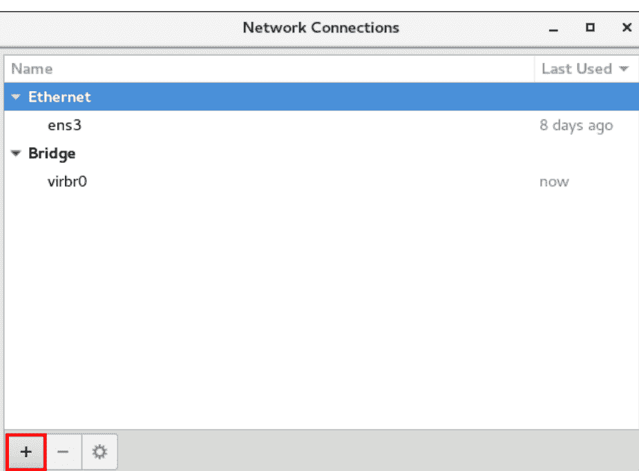

   图 3.8. 使用 nm-connection-editor 添加连接类型

   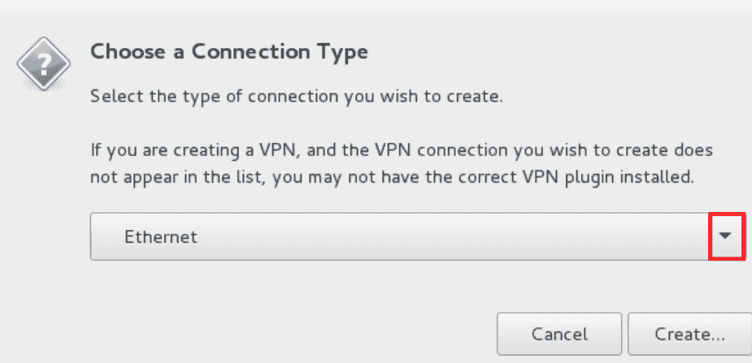

   图 3.9. 使用 nm-connection-editor 选择连接类型

要创建并配置：

- **绑定连接（Bond connections）**，点击 `Bond` 条目并跳转到第 7.8.1 节“建立绑定连接”；
- **网桥连接（Bridge connections）**，点击 `Bridge` 条目并跳转到第 9.4.1 节“使用 GUI 建立网桥连接”；
- **VLAN 连接**，点击 `VLAN` 条目并跳转到第 10.5.1 节“建立 VLAN 连接”；或者，
- 团队连接（Team connections），点击 `Team` 条目并跳转到第 8.14 节“使用 GUI 创建网络团队”。

##### 使用 nm-connection-editor 编辑现有连接

对于现有的连接类型，在“网络连接”对话框中点击齿轮图标，参见“使用 `nm-connection-editor` 配置新连接”章节。

## 3.4.3. 使用 nm-connection-editor 的常用配置选项

如果您使用 `nm-connection-editor` 工具，按照以下步骤操作，大多数连接类型（以太网、Wi-Fi、移动宽带、DSL）都有五个通常用的配置选项：

### 步骤

1. 在终端中输入 `nm-connection-editor`：

   ```bash
   $ nm-connection-editor
   ```

   出现“网络连接”窗口。点击加号按钮选择连接类型，或点击齿轮图标编辑现有连接。

2. 在编辑 `ens3` 的对话框中，选择“常规”（General）选项卡：

   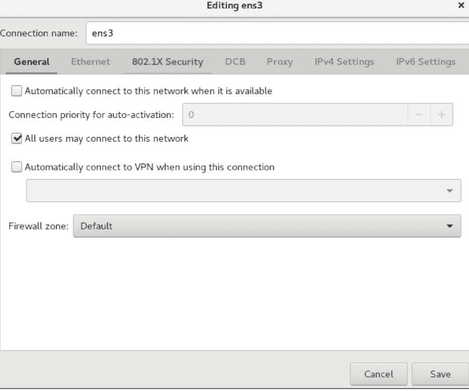

   图 3.10. `nm-connection-editor` 中的配置选项

- **连接名称（Connection name）** – 为您的网络连接输入描述性名称。这用于在网络窗口的菜单中列出该连接。
- **自动激活优先级（Connection priority for auto-activation）** – 如果连接设置为自动连接，将激活该数字（默认值为 0）。数字越大，优先级越高。
- **可用时自动连接到此网络（Automatically connect to this network when it is available）** – 如果您希望 `NetworkManager` 在可用时自动连接到此连接，请勾选此框。更多信息参见“使用控制中心编辑现有连接”章节。
- **所有用户可连接此网络（All users may connect to this network）** – 勾选此框可创建一个系统上所有用户可用的连接。此设置可能需要 root 权限。参见第 3.4.5 节“使用 GUI 管理系统级和私有连接配置文件”。
- **使用此连接自动连接到 VPN（Automatically connect to VPN using this connection）** – 如果您希望 `NetworkManager` 在可用时自动连接到 VPN 连接，请勾选此框。从下拉菜单中选择 VPN。
- **防火墙区域（Firewall Zone）** – 从下拉菜单中选择防火墙区域。有关防火墙区域的更多信息请参见《Red Hat Enterprise Linux 7 安全指南》。


> **注意**
>
> 对于该连接类型，上述配置选项中只有三个可用：连接名称、所有用户可连接此网络和防火墙区域。

## 3.4.4. 使用 GUI 自动连接网络

对于您添加或配置的任何连接类型，您都可以选择 `NetworkManager` 在网络可用时尝试自动连接的方式。您可以使用以下方法之一：

- GNOME 控制中心应用程序
- GNOME `nm-connection-editor` 应用程序

### 3.4.4.1. 使用控制中心自动连接网络

您可以使用控制中心自动连接到网络：

#### 步骤

1. 按 Super 键进入活动概览，输入“设置”（Settings）并按回车。然后，选择左侧的“网络”（Network）选项卡。右侧菜单会出现网络工具，参见“使用控制中心配置新连接”章节。
2. 从右侧菜单选择网络接口。
3. 点击右侧菜单中连接配置文件上的齿轮图标。弹出网络详细信息窗口。
4. 选择“详情”（Details）条目，参见“使用控制中心编辑现有连接”。
5. 勾选“自动连接”，以便 `NetworkManager` 在可用时自动连接。如果您不想让 `NetworkManager` 自动连接，请取消勾选。如果未勾选，您将必须在网络连接图标的菜单中手动选择。

### 3.4.2. 使用 nm-connection-editor 自动连接网络

您可以使用 GNOME `nm-connection-editor` 应用程序自动连接网络。这样做请按照第 3.4.3 节“使用 `nm-connection-editor` 的常用配置选项”的操作，并选择“常规”选项卡。

## 3.4.5. 使用 GUI 管理系统级和私有连接配置文件

`NetworkManager` 存储所有连接配置文件。配置文件是应用于接口的命名设置集合。`NetworkManager` 存储这些系统级（system）以及用户的配置文件。对配置文件的访问由 `NetworkManager` 允许的权限控制。有关连接的更多信息请参见 `nm-settings(5)` 手页。使用以下图形界面工具访问连接配置文件：

- `nm-connection-editor`
- 控制中心应用程序

### 3.4.5.1. 使用 nm-connection-editor 管理配置文件权限

要创建一个系统上所有用户可用的连接，请按照第 3.4.3 节“使用 `nm-connection-editor` 的常用配置选项”的操作，并勾选“所有用户可连接此网络”复选框。

### 3.4.5.2. 使用控制中心管理配置文件权限

要让连接对其他用户可用，请按照“使用控制中心编辑现有连接”章节的操作，并选择“其他用户可用”复选框。

相反，取消勾选“其他用户可用”框，可以将连接改为用户专用而非系统级。


> **注意**
>
> 根据系统的策略，您可能需要 root 权限来更改连接是特定的还是系统级的。

`NetworkManager` 的默认策略允许所有用户创建和修改系统级连接。启动时不可用的配置文件在用户登录后将变为可用。例如，如果用户创建了一个勾选了“自动连接”但未勾选“其他用户可用”的连接配置文件 `user-em2`，则该连接在启动时是不可用的。

为了限制连接和网络，有两个选项可以单独使用或结合使用：

- 取消“其他用户可用”复选框，这将连接转变为仅供执行更改的用户修改和使用。
- 使用 `polkit` 框架根据用户限制常规网络操作的权限。

# 第 3 章. 配置 IP 网络

这两个选项的结合提供了对网络的细粒度安全和控制。有关 `polkit` 的更多信息，请参考 `polkit(8)` 手页。

注意，VPN 连接始终被创建为私用户，因为它们被认为比 Wi-Fi 或以太网连接更私密。

## 3.4.6. 使用 GUI 配置有线（以太网）连接

你可以通过两种方式使用 GUI 配置有线连接：

- control-center 应用
- `nm-connection-editor` 应用

### 3.4.6.1. 使用 control-center 配置有线连接

#### 步骤


1. 按 `Super` 进入活动概览，输入 `Settings` 并按回车。选择左侧的 `Network` 项，会出现网络设置工具，选择名为“使用 control-center 配置新连接”的部分。

2. 如果有线网络接口尚未高亮，请选择 `Wired` 接口。

3. 点击齿轮图标编辑默认的 `Wired` 配置文件。

系统默认创建并配置一个名为 `Wired` 的单个有线连接配置文件。配置文件是一个具命名的设置集合，可以应用于接口。可以为接口创建多个配置文件并根据需要应用。默认配置文件无法删除，但可以更改其设置。

### 基础配置选项

在 `Wired` 对话框中，通过选择 `Identity` 项可以看到以下配置设置：

| Cancel | Profile 1 | Apply |
| :--- | :--- | :--- |
| Details | Identity | IPv4 | IPv6 | Security |
| Name | Profile 1 | |
| MAC Address | | | |
| Cloned Address | | | |
| MTU | automatic | | |

图 3.11. 有线连接的基础配置选项

- **Name（名称）** — 为你的网络连接输入一个描述性名称。此名称将用于在 `Network` 窗口的列表中列出该连接。
- **MAC Address** — 选择此配置文件必须应用的接口的 MAC 地址。
- **Clone Address（克隆地址）** — 如果需要，输入另一个不同的 MAC 地址使用。
- **MTU** — 如果需要，输入一个特定的*最大传输单元*（`MTU`）。`MTU` 值表示链路传输的最大数据包的字节大小。该值默认为 1500，通常不需要指定或更改。

### 进行更高级的有线配置

你可以在编辑对话框中配置现有的连接。

要配置：

- 连接的 `IPv4` 设置。

### 保存你的新（或修改的）有线连接

一旦完成连接编辑，点击 `Apply`（应用）按钮以保存你的自定义配置。如果配置文件在编辑期间正在使用，请重启连接以让 `NetworkManager` 应用更改。如果配置文件处于 `OFF` 状态，请将其设置为 `ON` 或在网络连接图标中选择它。有关使用新连接或更改后连接的信息，请参见[第 3.4.1 节，“使用 control-center GUI 连接到网络”]。

### 创建有线连接

要创建新的有线连接，点击加号按钮，参见名为“使用 control-center 配置网络连接”的部分。

当你点击加号添加连接时，`NetworkManager` 会为该连接创建一个新的配置文件，并打开与编辑现有连接相同的对话框进行编辑，参见名为“使用 control-center 编辑现有连接”的部分。这些对话框的区别在于，现有连接配置文件有一个 `Details` 菜单项。

### 3.4.6.2. 使用 `nm-connection-editor` 配置有线连接

`nm-connection-editor` GUI 应用比 control-center GUI 应用提供了更多配置选项。要使用 `nm-connection-editor` 配置有线连接：

- 在终端输入 `nm-connection-editor`。

```bash
~$ nm-connection-editor
```

出现 `Network Connections` 窗口。

- 选择你想编辑的以太网连接并点击齿轮图标：

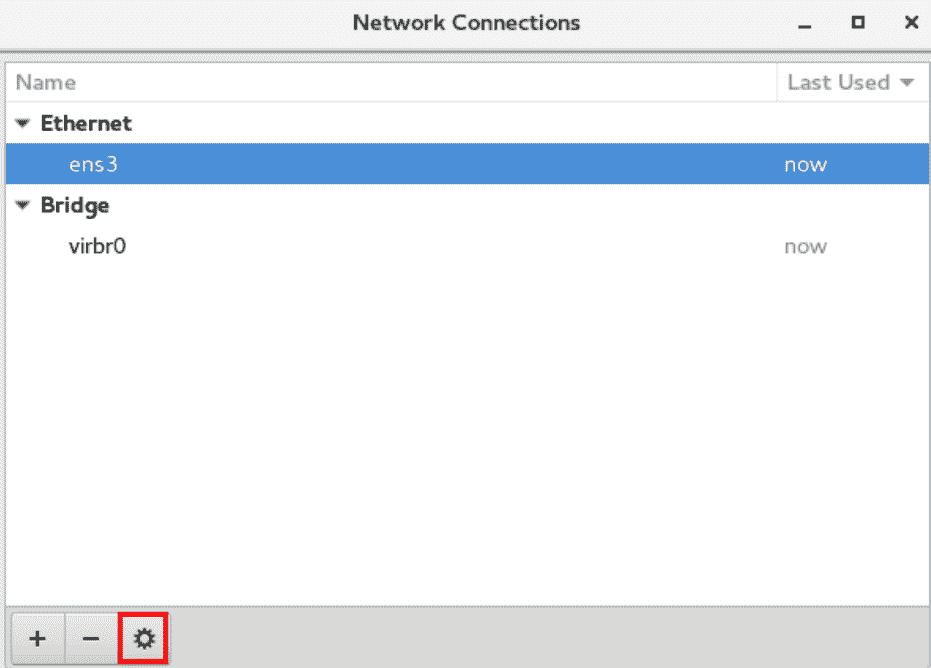

图 3.12. 编辑有线连接

出现 `Editing` 对话框。

- 要连接网络，点击 `General` 标签页，参见第 3.4.3 节，“使用 nm-connection-editor 的常用配置选项”。
- 要配置网络设置，点击 `Ethernet` 标签页，参见名为“使用 nm-connection-editor 配置 802.3 链路设置”的部分。
- 要为有线连接配置 802.1X 安全，点击 `802.1X Security` 标签页，参见第 5.2.4 节，“使用 nm-connection-editor 为有线配置 802.1X 安全”。
- 要配置 IPv4 设置，点击 `IPv4 Settings` 标签页，参见名为“使用 nm-connection-editor 设置 IPv4 方法”的部分。
- 要配置 IPv6 设置，点击 `IPv6 Settings` 标签页，参见第 5.5 节，“配置 IPv6 设置”。

## 3.4.7. 使用 GUI 配置 Wi-Fi 连接

本节解释了如何使用 `NetworkManager` 配置到接入点（Access Point）的 Wi-Fi（也称为无线或 802.11a/b/g）连接。接入点允许无线设备连接到网络的设备。

要配置移动宽带（如 3G）连接，参见第 3.4.9 节，“使用 GUI 配置移动宽带连接”。

### 连接到可用的接入点

#### 步骤

- 点击网络图标激活网络图标菜单，参见第 3.4.1 节，“使用 control-center GUI 连接到网络”。
- 在 Wi-Fi 网络列表中找到接入点的服务集标识符（SSID）。
- 点击网络的 SSID。锁头符号表示接入点需要身份验证。如果接入点受保护，对话框会提示你输入身份密钥或密码。

`NetworkManager` 尝试自动检测接入点使用的安全类型。如果存在多种可能性，`NetworkManager` 将猜测安全类型并在 Wi-Fi 安全下拉菜单中显示它。

- 对于 WPA-PSK Enterprise（带密码的 WPA），无需特殊选择。
- 对于 WPA Enterprise（802.1X），你必须专门选择，因为它无法自动检测。
- 如果你不确定，请依次选择安全类型。在 `Password` 输入密钥。对于 40-bit WEP 或 128-bit WPA 密钥无效，`Connect` 按钮将保持禁用状态。有关安全类型的更多信息，请参见第 5.2 节，“802.1X 安全”。

当 `NetworkManager` 连接到接入点时，网络图标将变为无线连接信号强度的指示。

如果你已经添加了这些接入点，也可以编辑它们的设置。Wi-Fi 页面有一个 `History` 按钮。点击它会显示你尝试过的所有连接。

### 连接到隐藏的 Wi-Fi 网络

`NetworkManager` 的可用列表。只要知道 SSID、身份验证方法和密钥，就可以连接到隐藏 SSID 的无线接入点：

#### 步骤

- 按 `Super` 键进入活动概览，输入 `Settings` 并按回车。然后选择左侧的 `Wi-Fi` 项。
- 选择 `Connect to Hidden Network`。有两种选项：

  - 如果你连接过该隐藏网络：
    - 使用 `Connection` 下拉菜单选择网络。
    - 点击 `Connect`。
  - 如果没有，按以下步骤操作：
    - 将 `Connection` 下拉菜单留为 `New`。
    - 输入隐藏网络的 SSID。
    - 选择其 Wi-Fi 安全方法。
    - 输入正确的身份密钥。
    - 点击 `Connect`。

有关安全设置的更多信息，参见第 5.2 节，“802.1X 安全”。

### 配置新的 Wi-Fi 连接

#### 步骤

- 选择 Wi-Fi 菜单项。
- 点击你想连接的 Wi-Fi 连接名称（默认与 SSID 相同）。
  - 如果 SSID 不在范围内，参见“连接到隐藏 Wi-Fi 网络”的部分。
  - 如果 SSID 在范围内，点击右侧菜单中的 Wi-Fi 连接配置文件。锁头符号表示需要密钥或密码。根据提示，输入身份验证详情。

### 编辑现有的 Wi-Fi 连接

你可以编辑过去尝试过或成功的现有连接。

#### 步骤

- 按 `Super` 键进入活动概览，输入 `Settings` 并按回车。
- 选择左侧菜单中的 `Wi-Fi`。
- 点击你想编辑的 Wi-Fi 连接名称右侧的齿轮图标，出现编辑连接对话框。注意网络当前不在范围内，点击 `History` 显示过去的连接。`Details` 窗口显示连接详情。

### Wi-Fi 连接的基本配置选项

要编辑 Wi-Fi 连接设置，请从编辑连接对话框中选择**身份（Identity）**。可用设置如下：

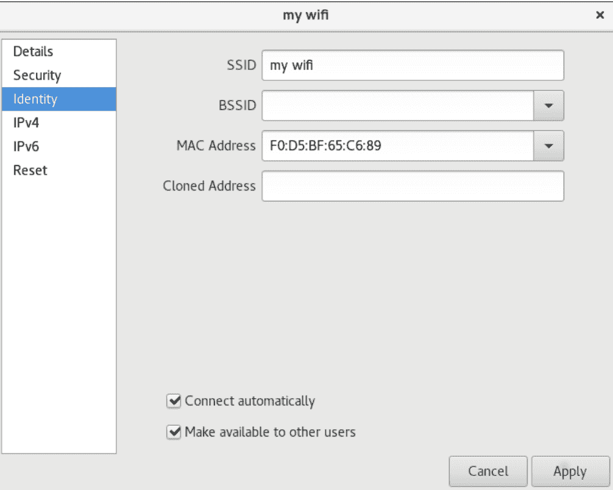

图 3.13. Wi-Fi 连接的基本配置选项

### SSID

接入点（AP）的服务集标识符（SSID）。

### BSSID

*基础服务集标识符*（BSSID）是你在**基础架构（Infrastructure）**模式下连接的特定无线接入点的 MAC 地址，也称为*硬件地址*。该字段默认为空，你也可以通过 `SSID` 连接到无线接入点，而无需指定它。如果指定了 BSSID，它将强制系统仅关联到特定的接入点。

对于自组网网络（ad-hoc networks），**BSSID** 是在创建自组网网络时由 `mac80211` 子系统随机生成的。`NetworkManager` 不会显示它。

### MAC 地址

选择要使用的 Wi-Fi 接口的 MAC 地址，也称为*硬件地址*。

系统可能有一个或多个无线网络适配器。因此，**MAC 地址**字段允许你将特定的无线适配器与特定的连接（或多个连接）关联。

### 克隆地址

用于替代真实硬件地址的克隆 MAC 地址。除非需要，否则留空。

以下设置适用于大多数连接类型：

- 自动连接 – 如果希望 `NetworkManager` 在该连接可用时自动连接，请勾选此框。更多信息请参阅“使用控制中心编辑现有连接”章节。
- 对其他用户可用 – 勾选此框为系统上的所有用户创建连接。更改此设置可能需要 root 权限。详情见第 3.4.5 节“使用 GUI 管理系统级和私有连接配置文件”。

### 设置未来的 Wi-Fi 配置

你可以在编辑对话框中配置现有连接。

- 无线连接的安全身份验证，点击“安全（Security）并转到第 5.2 节“配置 802.1X 安全”。
- 连接的 IPv4 设置，点击 `IPv4` 并转到第 5.4 节“配置 IPv4 设置”。
- 连接的 IPv6 设置，点击 `IPv6` 并转到第 5.5 节“配置 IPv6 设置”。

### 保存你的（或修改后的）连接

完成无线连接编辑后，点击“应用（Apply）”按钮保存你的配置。在连接正确的情况下，你可以从网络连接菜单中选择它来连接到修改后的连接。有关选择和连接网络的详情，请参阅第 3.4.1 节“使用 control-center GUI 连接到网络”。

## 3.4.8. 使用 GUI 配置 VPN 连接

由 `Libreswan` IPsec 是创建 VPN 的首选方法。`Libreswan` 是一个用于 VPN 的开源用户空间实现。使用命令行配置 IPsec VPN 的方法在《Red Hat Enterprise Linux 7 安全指南》中有相关说明。

### 3.4.8.1. 使用连接中心（connection-center）建立 VPN 连接

由 `Libreswan` 提供的 IPsec 是 Red Hat Enterprise Linux 7 中创建 VPN 的首选方法。更多信息请参阅第 3.4.8 节“使用 GUI 配置 VPN 连接”。

使用下方的 GNOME 图形界面工具需要 `NetworkManager-libreswan-package`。要安装它，请以 root 身份运行以下命令：

```bash
yum install NetworkManager-libreswan-gnome
```

请参阅《Red Hat Enterprise Linux 系统管理员指南》获取有关如何在 Red Hat Enterprise Linux 中安装包的信息。

## 网络指南

建立虚拟专用网络（VPN）可以实现你的局域网之间的通信。建立 VPN 允许你的局域网进行通信。对于更多信息，请参阅第 3.4.8 节“使用 GUI 配置 VPN 连接”。

下方的 GNOME 图形界面工具需要 `NetworkManager-libreswan-package`。要安装它，请以 root 身份运行以下命令：

```bash
yum install NetworkManager-libreswan-gnome
```

请参阅《Red Hat Enterprise Linux 系统管理员指南》获取有关如何在 Red Hat Enterprise Linux 中安装包的信息。

建立虚拟专用网络（VPN）实现通信。在 Red Hat Enterprise Linux 7 中创建 VPN 的首选方法是使用 `Libreswan` 提供的 IPsec。

## 使用连接中心建立 VPN 连接

步骤：

1. 按 `Super` 键进入活动概览，输入 `Settings` 并按 `Enter`。
2. 选择 `Network` 菜单，`Network` 工具出现，参考“使用控制中心编辑现有连接”。
3. 点击 `+` 按钮添加 VPN。

| 添加 VPN |
| --- |
| IPsec |
| IKEv1 |
| 导入文件... |

4. 在配置窗口中，你可以指定以下**高级（Advanced）**设置：


图 3.14. 配置 VPN

在常规部分，你可以指定：

**网关（Gateway）**

VPN 网关名称或 IP 地址。

**用户名（User name）**

如果需要，输入与身份验证相关的用户名。

**用户密码（User password）**

如果需要，输入与身份相关的密码。

**组名（Group name）**

VPN 组名。

**密钥（Secret）**

用于初始化身份验证的预共享密钥。

在**高级**部分，可用以下设置：

### 第一阶段算法（Phase1 Algorithms）

如果需要，输入用于认证的算法。

### 第二阶段算法（Phase2 Algorithms）

如果需要，输入用于 IPsec 协商的算法。

### 域名（Domain）

如果需要，输入域名。

### 注意

如果不使用 `NetworkManager` 配置 IPsec，请参阅第 3.4.8 节“使用 GUI 配置 VPN”。


图 3.15. 常规和高级部分

### 编辑现有 VPN 连接

1. 按 `Super` 键进入活动概览，输入 `Settings` 并按 `Enter`。然后，选择 `Network` 菜单，`Network` 工具出现，参考“使用控制中心编辑现有连接”。
2. 选择要编辑的 `VPN` 连接并点击齿轮图标，编辑**常规（General）**和**高级（Advanced）**部分，参考第 3.4.8.1 节“使用连接中心建立 VPN 连接”。

### 保存你的（或修改后的）连接并进行未来配置

完成新 VPN 连接编辑后，点击“保存（Save）”按钮保存你的配置。如果配置文件在编辑时正在使用，请重启连接以让 `NetworkManager` 应用更改。如果配置文件已关闭，请将其设置为开启或从网络连接菜单中选择它。有关新连接或更改连接的信息，请参阅第 3.4.1 节“使用 control-center GUI 连接到网络”。

你可以通过在 `Network` 窗口中选择连接并点击“配置（Configure）”来进一步配置现有连接。

然后，要配置：

- 点击 `IPv4 设置` 并转到第 5.4 节“配置 IPv4 设置”。

### 3.4.8.2. 使用 `nm-connection-editor` 配置 VPN 连接

你也可以使用 `nm-connection-editor` 来添加和配置 VPN 连接。执行此操作，请按照以下步骤进行：

#### 步骤

## 3.4.9. 使用图形用户界面配置移动宽带连接

你可以使用 `NetworkManager` 的移动宽带连接功能连接到以下 2G 和 3G 服务：

- 2G – GPRS（通用分组数据服务）、EDGE（GSM 增强型数据速率演进）或 CDMA（码分多址接入）。
- 3G – UMTS（通用移动电信系统）、HSPA（高速数据包连接）或 EVDO（EVDO 仅数据版）。

你的电脑必须有一个移动宽带（调制解调器），且系统已发现并识别了它，才能创建连接。此类设备可能内置在电脑中（许多笔记本电脑和上网电脑都是如此），也可以作为内部或外部硬件提供。例如 PC 卡、USB 调制解调器或网狗，或者作为调制解调器的手机设备。

### 3.4.9.1. 使用 `nm-connection-editor` 配置移动宽带连接

你可以使用 GNOME `nm-connection-editor` 配置移动宽带连接。

### 添加新的移动宽带连接

1. 在终端中输入 `nm-connection-editor`。出现“网络连接”窗口，请参见第 3.4.3 节“使用 nm-connection-editor 的常用配置选项”。
2. 点击加号按钮。打开“选择连接类型”菜单。
3. 选择“移动宽带”选项。
4. 点击“创建”为此移动宽带设备设置移动宽带连接，选择你想用于连接的支持 2G 或 3G 的设备。如果下拉菜单未激活，表明系统无法检测到支持移动宽带的设备。在这种情况下，点击“取消”，确保你已连接并让电脑识别支持移动宽带的设备，然后重试此过程。点击按钮。
5. 从列表中选择你的提供商所在的国家，点击“继续”按钮。
6. 从列表中选择你的提供商或手动输入。点击“继续”按钮。
7. 从下拉菜单选择你的资费计划并确认接入点名称（APN）正确。点击“继续”按钮。

### 步骤

9. 检查并确认设置，然后点击“应用”按钮。
10. 参考“配置移动宽带选项卡”部分编辑宽带特有的设置。

### 编辑现有移动宽带连接的步骤

1. 在终端中输入 `nm-connection-editor`。出现“网络连接”窗口。
2. 选择“移动宽带”。


3. 选择你想编辑的连接并点击齿轮图标。更多信息请参见第 3.4.3 节“使用 `nm-connection-editor` 的常用配置选项”。

4. 参考“配置移动宽带选项卡”部分编辑宽带特有的设置。

### 配置移动宽带选项卡

如果你已经使用助手添加了新的移动连接（指令请参见“添加新的移动宽带连接”部分），你可以编辑“移动”选项卡，以便在家庭网络不可用时禁用漫游、分配网络 ID，或指示 NetworkManager 在使用连接时优先使用某种技术（如 3G 或 2G）。

### 号码

用于拨与 GSM 移动宽带网络建立 PPP 连接的拨号号码。此字段在初始安装宽带设备时可能会自动填充。你可以轻松留空此字段并输入 APN。

### 用户名

输入用于网络身份验证的用户名。某些提供商不用户名，或在连接网络时接受任何用户名。

### 密码

输入用于网络身份验证的密码。某些提供商不提供密码，或接受任何密码。

### APN

输入用于与基于 GSM 的网络建立连接的接入点名称（APN）。连接时正确的 APN 非常重要，因为它通常决定了：

- 用户网络流量如何如何计费；
- 用户是否可以访问互联网、内网或子网。

### 网络 ID

输入网络 ID 会导致 NetworkManager 强制设备注册到特定网络。这可以用于在无法直接控制漫游时。

### 类型

- 任意 – 让调制解调器选择最网络。
- 3G（UMTS/HSPA）– 强制仅使用 3G 网络。
- 2G（GPRS/EDGE）– 强制仅使用 2G 网络。
- 优先 3G（UMTS/HSPA）– 优先尝试使用 HSPA 或 UMTS 技术连接，失败后回退到 GPRS 或 EDGE。
- 优先 2G（GPRS/EDGE）– 优先尝试使用 GPRS 或 EDGE 技术连接，失败后回退到 HSPA 或 UMTS。

### 当家庭网络不可用时允许漫游

如果你希望 NetworkManager 终止连接而不是从家庭网络切换到漫游网络以避免可能的漫游费用，请取消勾选此框。如果勾选，NetworkManager 将尝试通过从家庭网络切换到漫游网络来保持良好的连接，反之亦然。

### PIN

如果你的设备 SIM（用户卡）被 PIN（个人识别码）锁定，请输入 PIN 以便 NetworkManager 解锁。如果需要使用设备，NetworkManager 必须解锁。

CDMA 和 EVDO 的选项较少。它们没有 APN、网络 ID 或类型选项。

### 保存你的新（或修改）连接并进行后续配置

完成编辑 DSL 连接后，点击“应用”按钮保存你的配置。如果在编辑时正在使用该配置文件，请切换连接以让 NetworkManager 应用更改。如果配置文件关闭，请将其开启或在连接菜单中选择。请参见第 3.4.1 节“使用控制中心 GUI 连接到网络”获取有关你的新或修改连接的信息。

你可以通过在“网络连接”窗口中选择现有连接并点击“编辑”进入对话框来对其进行进一步配置。

要配置：

- MAC 地址和 MTU 设置，点击“有线”选项卡并进入“基本配置选项”部分。
- 连接的点对点设置，点击“PPP 设置”选项卡并进入第 5.6 节“配置 PPP（点对点）设置”。
- 连接的 IPv4 设置，点击“IPv4 设置”选项卡并进入第 5.4 节“配置 IPv4 设置”。

作为系统管理员，你可以通过编辑 `ifcfg` 文件来手动配置网络接口。

接口配置（ifcfg）控制单个网络设备的软件接口。当系统启动时，它会使用这些文件来确定需要启动哪些接口以及如何配置它们。这些文件通常命名为 `ifcfg-name`，其中 `name` 指设备名称。按照惯例，ifcfg 文件的后缀与配置文件中本身 `DEVICE` 字段提供的字符串相同。

### 使用 ifcfg 文件配置静态网络设置的接口

例如，要使用 `ifcfg` 文件为名为 `enp10` 的接口配置静态网络设置，请在 `/etc/sysconfig/network-scripts/` 目录下创建一个名为 `ifcfg-enp10` 的文件，内容如下：

- IPv4 配置

```text
DEVICE=enp10
BOOTPROTO=none
ONBOOT=yes
PREFIX=24
IPADDR=10.0.1.27
```

- IPv6 配置

```text
DEVICE=enp10
BOOTPROTO=none
ONBOOT=yes
IPV6INIT=yes
IPV6ADDR=2001:db8::2/48
```

你不需要指定网络或广播地址，因为这些由 `ipcalc` 自动计算。

有关更多 IPv6 配置选项，请参见 `nm-settings-ifcfg-rh(5)` 手页。

### 重要提示

在 Red Hat Enterprise Linux 7 中，网络接口的命名约定已经发生更改，如第 1 章“一致的网络设备命名”所示。使用 `HWADDR` 指令指定硬件或 MAC 地址会影响设备的命名过程。

### 使用 ifcfg 文件配置动态网络设置的接口

要使用 `ifcfg` 文件为名为 `em1` 的接口配置动态网络设置：

1. 在 `/etc/sysconfig/network-scripts/` 目录下创建一个名为 `ifcfg-em1` 的文件，内容如下：

   ```text
   DEVICE=em1
   BOOTPROTO=dhcp
   ONBOOT=yes
   ```

2. 若要配置接口向 DHCP 服务器发送不同的主机名，请在 `ifcfg` 文件中添加以下行：

   ```text
   DHCP_HOSTNAME=hostname
   ```

   若要配置接口向 DHCP 服务器发送不同的完全限定域名（FQDN），请在 `ifcfg` 文件中添加以下行：

   ```text
   DHCP_FQDN=fully.qualified.domain.name
   ```

   > 注意

   在给定的 `ifcfg` 文件中只能使用一个指令：`DHCP_HOSTNAME` 或 `DHCP_FQDN`。如果同时指定 `DHCP_HOSTNAME` 和 `DHCP_FQDN`，则仅使用后者。

3. 若要配置接口使用特定的 DNS 服务器，请在 `ifcfg` 文件中添加以下行：

   ```text
   PEERDNS=no
   DNS1=ip-address
   DNS2=ip-address
   ```

   其中 `ip-address` 是 DNS 服务器的地址。这将导致网络服务使用指定的 DNS 服务器更新 `/etc/resolv.conf`。只需要一个 DNS 服务器地址，另一个是可选的。

4. 有关在 `ifcfg` 文件中配置静态路由，请参考第 4.5 节“在 ifcfg 文件中配置静态路由”。

默认情况下，当配置通过将 `BOOTPROTO` 设置为 `dhcp` 来自动获取地址时，NetworkManager 会调用 DHCP 客户端。如果需要 DHCP，则每个接口上的每个协议（IPv4 和 IPv6）都会运行一个 DHCP 实例。如果 NetworkManager 未运行，则旧服务无法按要求管理接口。有关动态 IP 地址的更多详细信息，请参见第 1.2 节“比较静态和动态 IP 地址”。

5. 应用配置：

   a. 重新加载更新后的连接文件：

   ```bash
   nmcli connection reload
   ```

   b. 重新激活连接：

   ```bash
   nmcli connection up connection_name
   ```

## 3.5.1. 使用 ifcfg 文件管理系统级和私有配置文件

权限与 `ifcfg` 文件中的 `USERS` 指令对应。如果不存在 `USERS` 指令，则网络配置将对所有用户可用。例如，`ifcfg` 中的以下命令将使连接仅对列出的用户可用：

```text
USERS="joe bob alice"
```

此外，你还可以设置 `USERCTL` 指令来管理设备：

- 如果设置为 `yes`，则允许非 root 用户控制此设备。
- 如果设置为 `no`，则不允许非 root 用户控制此设备。

## 3.6. 使用 ip 命令配置 IP 工作

作为系统管理员，你可以使用 `ip` 命令配置网络接口，但更改在重启后不会持久化；重启时，将丢失任何更改。

`ip` 工具（有时根据上游包名称称为 `iproute2`）的命令记录在 `ip(8)` 页中。Red Hat Enterprise Linux 7 中的包是 `iproute`。如有必要，你可以通过如下检查版本号来确认 `ip` 工具已安装：

```bash
$ ip -V
ip utility, iproute2-ss1130716
```

`ip` 命令可以与 NetworkManager 并行用于接口添加和删除地址及路由，这些更改将在 `nmcli`、`nmtui`、`control-center` 和 D-Bus API 中保留并识别。

要关闭接口：

```bash
ip link set dev interface down
```

> 注意

在命令行给出的 `ip` 命令在系统重启后不会持久化。

### 使用 ip 命令分配静态地址

为接口分配 IP 地址：

```bash
ip addr add 10.0.0.3/24 dev interface
```

你可以查看地址分配：

```bash
ip addr show dev interface
```

从接口中删除 IP 地址：

```bash
ip addr del 10.0.0.3/24 dev interface
```

### 使用 ip 命令配置多个地址

由于 `ip` 工具支持为同一接口配置多个地址，不再需要使用别名方法将多个地址绑定到同一接口。可以重复执行分配地址的 `ip` 命令来分配多个。例如：

```bash
ip addr add 192.168.2.223/24 dev enp1
ip addr add 192.168.4.223/24 dev enp1
```

## 3.7. 从内核命令行配置网络

从接口连接 iSCSI 目标上的根文件系统时，系统中尚未配置网络设置。解决此问题的方案：

1. 安装 `dracut` 工具。有关使用 `dracut` 的信息，请参阅 Red Hat Linux 系统管理员指南。

2. 使用命令行上的 `ip` 选项设置配置：

   ```text
   ip-client-IP-number>-[server-id-]::<gateway-IP-number>:<netmask>:<client-hostname>:<dhcp[dhcp6autoon|any|none]off]
   ```

   - `auto6` – 自动 IPv6 配置。
   - `on`、`any` – 内核中可用的任何协议（默认）。
   - `none`、`off` – 无自动配置，静态网络配置。

   例如：

   ```text
   ip=192.168.180.120:192.168.180.100:192.168.1.255.255.255.255:enp10:off
   ```

3. 设置服务器名称配置：

   ```text
   nameserver=srv1 [nameserver=srv2 [nameserver=srv [...]]]
   ```

`dracut` 会设置网络配置并生成新的 ifcfg 文件，这些文件可以复制到 `/etc/sysconfig/network-scripts/` 目录下。

## 3.8. 使用 IGMP 启用多播

互联网组管理协议（IGMP）允许管理员管理网络、主机和路由器之间多播流量的路由和订阅。Red Hat Linux 内内核支持 IGMPv3。

要显示多播信息，请使用 `ip maddr show` 子命令，例如：

```bash
~$ ip maddr show dev br0
8: 224.0.0.1
inet6 ff02::
inet6 ff01::
[output truncated]
```

或者，在 `ip link show` 命令的输出中查找 `MULTICAST` 字符串，例如：

```text
~$ ip link show br0
8: <BROAD,MULTICAST,UP,LOWER_UP> mtu 1500 qdisc noqueue state UP DEFAULT qlen 1000
link/ether 6c:0b:84:67:fe:63 brd ff:ff:ff:ff:ff:ff
```

要禁用多播并检查 br0 设备上已禁用：

```bash
~# ip link set multicast dev br0
~$ ip link show br0
8: <BROAD,MULTICAST,UP,LOWER_UP> mtu 1500 qdisc noqueue state UP DEFAULT qlen 1000
link/ether 6c:0b:84:67:fe:63 brd ff:ff:ff:ff:ff:ff
```

缺少 `MULTICAST` 字符串表示多播已禁用。

要在 br0 设备上启用多播并检查其是否已启用：

```bash
~# ip link set multicast dev br0
~$ ip link show br0
```

```text
8: br0<BROADCAST,MULTICAST,UP,LOWER_UP> mtu 1500 qdisc noqueue state UP mode
DEFAULT len 1000
link/ether6:0c:6b:84:67:e6 bd:ff:ff:ff:ff:ff
```

更多信息请参阅《Red Hat Enterprise Linux `ip` 命令快速查表》文章和 `ip(8)` 手页。

要检查 IGMP 的当前版本和订阅用于多播的 IP 地址，请查看 `/proc/net/igmp`：

```bash
~$ cat /proc/net/igmp
```

## 注意事项

防火墙默认未启用 IGMP。要为某个区域（zone）启用 IGMP：

```bash
~# firewall-cmd --zone=zone-name --add-protocol=igmp
```

更多信息请参阅《Red Hat Enterprise Linux 安全指南》中的“使用防火墙”章节。

## 3.9. 附加资源

### 安装文档

- `ip(8)` 手页 – 描述 `ip` 工具的命令语法。
- `nmcl(1)` 手页 – 描述 NetworkManager 的命令行工具。
- `nmcli-examples(5)` 手页 – 提供 `nmcli` 命令的示例。
- `nm-settings(5)` 手页 – 描述 NetworkManager 属性及其设置。
- `nm-settings-ifcfg-rh(5)` 手页 – 描述 ifcfg-rh 插件。

### 在线文档

#### Red Hat Enterprise Linux 7 安全指南

描述基于 IPsec 的 VPN 及其配置。描述使用 DNSSEC 的 DNS 查询。

#### RFC 1518 – 无类域间路由（CIDR）

描述 CIDR 地址分配和聚合策略，包括变长子网划分。

#### RFC 1918 – 私有网络地址分配

描述私有使用的 IPv4 地址范围。

#### RFC 3330 – 特殊用途 IPv4 地址

描述由互联网分配机构（IANA）分配的其他特殊 IPv4 地址块。

# 第 4 章 配置静态路由和默认网关

本章涵盖静态路由和默认网关的配置。

## 4.1. 路由与网关简介

路由是一种允许你找到另一个网络路径的机制。路由通常由专门路由的设备处理。因此，在 Red Hat Linux 服务器或客户端上通常不需要配置静态路由。异常包括必须通过加密 VPN 隧道的流量，或由于成本或安全性应采取特定路由的流量。主机的路由表会自动填充直接连接网络的路由（当网络接口处于“启用”状态时）。为了到达远程网络或主机，系统会被赋予一个网关地址，如果已知更好的路由，则该网关通常被称为默认网关。网络管理员使用网络本身的第一个或最后一个 IP 地址作为网关；例如，`192.168.10.1` 或 `192.168.10.254`。不要与代表网络本身的地址混淆；在本例中，`192.168.10.0` 是子网的广播地址 `192.168.10.255`。默认网关是针对所有非本地网络且路由表中未指定首选路由的流量的网关。


为了扩展你的，你可能对 Red Hat 系统管理 I（RH124）课程感兴趣。

## 4.2. 使用 NMCLI 配置静态路由

使用 `nmcli` 工具配置静态路由，请使用以下方法之一：

- `nmcli` 命令行。
- `nmcli` 交互式编辑器。

### 示例 4.1. 使用 nmcli 配置静态路由

使用命令行为以太网连接配置静态路由：

```bash
~]# nmcli connection modify ens3 +ipv4.routes "192.168.122.0/24 via 10.10.10.1"
```

这将 `192.168.122.0/24` 子网的流量导向 `10.10.10.1` 网关。

### 示例 4.2. 使用 nmcli 编辑器配置静态路由

使用交互式编辑器为以太网连接配置静态路由：

```bash
~$ nmcli con edit ens3
```

```text
网络指南 nmcli 交互式编辑器 |===

正在编辑现有连接 '802-3-ethernet: ens3'

输入 'help' 或 '?' 获取可用命令。

输入 'describe' <setting>.<prop> 获取详细属性描述。

你可以编辑以下设置：802-3-ethernet (ethernet), dcb, ipv4, ipv6, tc, proxy

nmcli set ipv4.routes 192.168.122.0/24 10.10.10.1

nmcli> set save persistent

Connection 'ens3' (23f8b65a-8f3d-41a0-a525-e3bc93be8b8) successfully updated.

nmcli quit
```

## 4.3. 使用 GUI 配置静态路由

要设置静态路由，打开要配置连接的 IPv4 或 IPv6 设置。查看第 3.4.1 节“使用控制中心 GUI 连接到网络”以获取操作说明。

### 路由

- **Address（地址）**：输入远程网络、子网或主机的 IP 地址。


- `Netmask`（子网掩码）：上述 IP 地址的子网掩码或前缀。
- `Gateway`（网关）：指向上述远程网络、子网或主机的网关 IP 地址。
- `Metric`（权重）：赋予此路由的网络成本或偏好值。低值将优于高值。

## `Automatic`（自动）

当自动开启时，将使用来自 RA 或 DHCP 的路由，你也可以添加额外的静态路由。当关闭时，仅使用你定义的静态路由。

## `Use this connection only for resources on your network`（仅为此网络使用此连接）

选择此项防止连接成为默认路由。典型示例是连接为 VPN 隧道或到总部的专线，你不希望任何指向互联网的流量通过该连接。选择此选项意味着专门针对通过连接自动学习或手动输入的路由的流量将通过该连接路由。

## 4.4. 使用 `ip` 命令配置静态路由

作为系统管理员，你可以使用 `ip route` 命令配置静态路由。

要显示 IP 路由表，请使用 `ip route` 命令。例如：

```text
~$ ip route
default 192.168.122.1 dev ens9 proto static metric 1024
192.168.122.0/24 dev ens9 proto kernel scope link src 192.168.122.107
```

`192.168.122.0/24 enp1s0 proto kernel scope src 192.168.122.16`

`ip route` 命令采用如下形式：

```text
ip route [ add | del | change | append | replace ] destination-address
```

请参阅 `ip-route(8)` 手册以获取有关选项和格式的详情。

要向主机添加静态路由，换句话说就是添加单个 IP 地址：

```text
~# ip route add 192.0.2.1 10.0.0.1 [dev interface]
```

其中 `192.0.2.1` 是点分十进制表示的 IP 地址，`10.0.0.1` 是下一跳地址，`interface` 是通往下一跳的出口接口。

要向网络添加静态路由，换句话说就是添加代表 IP 地址范围的 IP 地址：

```text
~# ip route add 192.0.2.0/24 10.0.0.1 [dev interface]
```

其中 `192.0.2.0` 是点分十进制表示的目标网络地址，`/24` 是网络前缀。前缀数字是子网掩码中启用位数的数量。这种网络地址斜加网络前缀长度的格式有时被称为无类域间路由（CIDR）表示法。

要删除静态路由：

```text
~# ip route del 192.0.2.1
```

使用 `ip route` 对路由表所做的任何更改在系统重启后都不会保留。要永久配置静态路由，您可以在 `/etc/sysconfig/network-scripts/` 目录下为该接口创建一个 `route-interface` 文件来定义它们。例如，像 `enp1s0` 接口的静态路由将存储在 `/etc/sysconfig/network-scripts/route-interface` 文件中。对 `route-interface` 文件的任何更改在重启网络服务或接口之前都不会生效。`route-interface` 文件有两种格式：

- `ip` 命令参数，即名为“Static Routes Using the IP Command Arguments”的章节。
- `network/netmask` 指令，即名为“Static Routes Using the Network/Netmask Directives Format”的章节。

有关 `ip route` 命令的更多信息请参阅 `ip-route(8)` 手册。

## 4.5. 在配置文件配置静态路由

在命令行提示符处使用 `ip` 命令设置的静态路由会在系统关机或重启后丢失。要配置静态路由在系统重启后仍然有效，必须将其放置在 `/etc/sysconfig/network-scripts/` 目录下的每个接口对应的配置文件中。文件名应采用 `route-interface` 格式。配置文件中有两种类型的命令。

### 使用 `ip` 命令参数格式的静态路由

如果在每个接口配置文件（例如 `/etc/sysconfig/network-scripts/route-enp1s0`）中需要，请在第一行定义默认网关。只有当网关未通过 DHCP 设置且未在 `/etc/sysconfig/network` 文件中全局设置时，才需要此操作：

```text
default via 192.168.1.1 dev interface
```

其中 `192.168.1.1` 是默认网关的 IP 地址。`interface` 是连接到或到达默认网关的接口。`dev` 选项可以省略，它是可选的。注意，此设置优先级高于 `/etc/sysconfig/network` 文件中的设置。

如果需要通往远程网络的路由，可以如下所示指定静态路由。每行被解析为一条独立的路由：

```text
10.10.0/24 via 192.168.1.1 [dev interface]
```

其中 `10.10.0/24` 是远程或目标网络的网络地址和前缀长度。地址 `192.168.1.1` 是通往远程网络的 IP 地址。它最好是下一跳地址，但任何出口接口都可以工作。“下一跳”意味着链路的远端、网关或路由器。可以使用 `dev` 选项指定出口接口，但不是必须的。根据需要添加尽可能多的静态路由。

以下是一个使用 `ip` 命令格式的 `route-interface` 文件的示例。默认网关为 `192.168.0.1`，接口为 `enp1s0`，并且为 `192.168.0.10` 可用的拨号或 WAN 连接。两条静态路由用于访问 `10.10.0/24` 和 `172.16.1.10/32` 主机：

```text
default via 192.168.0.1 dev enp1s0
10.10.0/24 via 192.168.0.10 dev enp1s0
172.16.1.10/32 via 192.168.0.10 dev enp1s0
```

在上面的示例中，发往本地 `192.168.0/24` 网络的数据包将重定向到该网络的接口。发往 `10.10.0/24` 网络和 `172.16.1.10/32` 主机的数据包将重定向到 `192.168.0.10`。

### 使用 `network/netmask` 指令格式的静态路由

## 4.6. 配置静态路由和默认网关

如果在每个接口配置文件（例如 `/etc/sysconfig/network-scripts/route-enp1s0`）中需要，请在第一行定义默认网关。只有当网关未通过 DHCP 设置且未在 `/etc/sysconfig/network` 文件中全局设置时，才需要此操作：

```text
default via 192.168.1.1 dev interface
```

其中 `192.168.1.1` 是默认网关的 IP 地址。`interface` 是连接到或到达默认网关的接口。`dev` 选项可以省略，它是可选的。注意此设置优先级高于 `/etc/sysconfig/network` 文件的设置。

如果需要通往远程网络的路由，可以如下指定静态路由。每行被解析为一条独立的路由：

```text
10.10.0/24 via 192.168.1.1 [dev interface]
```

其中 `10.10.0/24` 是远程或目标网络的网络地址和前缀长度。地址 `192.168.1.1` 是通往远程网络的 IP 地址。它最好是下一跳地址，但任何出口接口都可以工作。“下一跳”意味着链路的远端、网关或路由器。可以使用 `dev` 选项指定出口接口，但不是必须的。根据需要添加尽可能多的静态路由。

以下是一个使用 `ip` 命令格式的 `route-interface` 文件示例。默认网关为 `192.168.0.1`，接口为 `enp1s0`，并且为 `192.168.0.10` 可用的拨号或 WAN 连接。两条静态路由用于访问 `10.10.0/24` 和 `172.16.1.10/32` 主机：

```text
default via 192.168.0.1 dev enp1s0
10.10.0/24 via 192.168.0.10 dev enp1s0
172.16.1.10/32 via 192.168.0.10 dev enp1s0
```

在上面的示例中，发往本地 `192.168.0/24` 网络的数据包将重定向到该网络的接口。发往 `10.10.0/24` 网络和 `172.16.1.10/32` 主机的数据包将重定向到 `192.168.0.10`。

如果需要通往远程网络的路由，可以如下指定静态路由。每行被解析为一条独立的路由：

```text
10.10.0/24 via 192.168.1.1 [dev interface]
```

其中 `10.10.0/24` 是远程或目标网络的网络地址和前缀长度。地址 `192.168.1.1` 是通往远程网络的 IP 地址。它最好是下一跳地址，但任何出口接口都可以工作。“下一跳”意味着链路的远端、网关或路由器。可以使用 `dev` 选项指定出口接口，但不是必须的。根据需要添加尽可能多的静态路由。

如果需要通往远程网络的路由，可以如下指定静态路由。每行被解析为一条独立的路由：

```text
10.10.0/24 via 192.168.1.1 [dev interface]
```

其中 `10.10.0/24` 是远程或目标网络的网络地址和前缀长度。地址 `192.168.1.1` 是通往远程网络的 IP 地址。它最好是下一跳地址，但任何出口接口都可以工作。“下一跳”意味着链路的远端、网关或路由器。可以使用 `dev` 选项指定出口接口，但不是必须的。根据需要添加尽可能多的静态路由。

对于 IPv6 配置，一个 `route-interface` 文件示例，如下：

以下是一个使用 `ip` 命令格式的 `route-interface` 文件示例。默认网关为 `192.168.0.1`，接口为 `enp1s0` 并且为 `192.168.0.10` 可用的拨号或 WAN。

`dev` 选项可以省略，它是可选的。注意此设置优先级高于 `/etc/sysconfig/network` 文件的设置。

如果需要通往远程网络的路由，可以如下指定静态路由。每行被解析为一条独立的路由：

```text
10.10.0/24 via 192.168.1.1 [dev interface]
```

其中 `10.10.0/24` 是远程或目标网络的网络地址和前缀长度。地址 `192.168.1.1` 是通往远程网络的 IP 地址。它最好是下一跳地址，但任何出口接口都可以工作。“下一跳”意味着链路的远端、网关或路由器。可以使用 `dev` 选项指定出口接口，但不是必须的。根据需要添加尽可能多的静态路由。

对于 IPv6 配置，一个 `route-interface` 文件示例，如下。

以下是一个使用 `ip` 命令格式的 `route-interface` 文件示例。默认网关为 `192.168.0.1`，接口为 `enp1s0` 并且为拨号或 WAN。

`dev` 选项可以省略，它是可选的。注意此设置优先级高于 `/etc/sysconfig/network` 文件的设置。

如果需要通往远程网络的路由，可以如下指定静态路由。每行被解析为一条独立的路由：

```text
10.10.0/24 via 192.168.1.1 [dev interface]
```

其中 `10.10.0/24` 是远程或目标网络的网络地址和前缀长度。地址 `192.168.1.1` 是通往远程网络的 IP 地址。它最好是下一跳地址，但任何出口接口都可以工作。“下一跳”意味着链路的远端、网关或路由器。可以使用 `dev` 选项指定出口接口，但不是必须的。根据需要添加尽可能多的静态路由。在命令行提示符处使用 `ip` 命令设置的静态路由会在系统关机或重启后丢失。要配置静态路由在系统重启后仍然有效，必须将其放置在 `/etc/sysconfig/network-scripts/` 目录下的每个接口对应的配置文件中。文件名应采用 `route-interface` 格式。配置文件中有两种类型的命令：

如果在每个接口配置文件（例如 `/etc/sysconfig/network-scripts/route-enp1s0`）中需要，请在第一行定义默认网关。只有当网关未通过 DHCP 设置且未在 `/etc/sysconfig/network` 文件中全局设置时，才需要此操作：

```text
default via 192.168.1.1 dev interface
```

其中 `192.168.1.1` 是默认网关的 IP 地址。`interface` 是连接到或到达默认网关的接口。`dev` 选项可以省略，它是可选的。注意此设置优先级高于 `/etc/sysconfig/network` 文件的设置。

如果需要通往远程网络的路由，可以如下指定静态路由。每行被解析为一条独立的路由：

```text
10.10.0/24 via 192.168.1.1 [dev interface]
```

其中 `10.10.0/24` 是远程或目标网络的网络地址和前缀长度。地址 `192.168.1.1` 是通往远程网络的 IP 地址。它最好是下一跳地址，但任何出口接口都可以工作。“下一跳”意味着链路的远端、网关或路由器。可以使用 `dev` 选项指定出口接口，但不是必须的。根据需要添加尽可能多的静态路由。

```text
10.10.10.0/24 通过 192.168.0.10 表 1
10.10.10.0/24 通过 192.168.0.10 表 2
```

要在接口中指定路由规则，请编辑 `/etc/sysconfig/network-scripts/rule-enp1s0`（针对 IPv4）或 `/etc/sysconfig/network-scripts/rule6-enp1s0`（针对 IPv6）。

NetworkManager 支持策略路由，但目前尚不支持规则（rules）。规则必须由运行自定义脚本的用户进行配置。对于每一条手动静态路由，可以选择一个路由表：

- IPv4 使用 `ipv4.route-table`。
- IPv6 使用 `ipv6.route-table`。

通过将路由设置到特定的表中，所有来自 DHCP、autoconf 和 DHCP6 的路由都将放在该特定表中。此外，所有已配置地址的子网路由都将放在相应的路由表中。例如，如果你配置了 `192.168.1.10/24` 地址，则 `192.168.1.0/24` 子网将包含在 `ipv4.route-table` 中。

有关策略路由规则的更多细节，请参见 `ip-rule(8)` 手页。有关路由表，请参见 `ip-route(8)` 手页。

## 4.6. 配置默认网关

默认网关由网络脚本确定，脚本首先解析 `/etc/sysconfig/network` 文件，然后解析处于“启用（up）”状态的接口 `ifcfg` 文件。`ifcfg` 文件按数字升序解析，最后读取的 `GATEWAY` 指令将用于在路由表中生成默认路由。

你可以使用 `GATEWAY` 指令指定默认路由，既可以在全局配置，也可以在特定接口配置文件中。然而，在 Red Enterprise Linux 中，全局 `/etc/sysconfig/network` 的使用已被弃用，指定网关应仅在每个接口的配置文件中进行。

在由 NetworkManager 管理移动主机的动态网络环境中，网关信息很可能是接口特定的，且最好留由 DHCP 分配。在有必要影响 NetworkManager 选择出站接口以访问网关的特殊情况下，请在不通往默认网关的接口 `ifcfg` 文件中使用 `DEFROUTE=no` 命令。

# 第 5 章 配置网络连接设置

本章描述了网络连接设置的各种配置，并展示了如何使用 NetworkManager 进行配置。

## 5.1. 配置 802.3 链路设置

你可以通过修改以下配置参数来配置以太网连接的 802.3 链路设置：

- `802-3-ethernet.auto-negotiate`
- `802-3-ethernet.speed`
- `802-3-ethernet.duplex`

你可以将 802.3 链路配置为以下三种模式：

- 忽略链路协商
- 强制激活自动协商
- 手动设置速率和双工链路设置

### 忽略链路协商

在这种情况下，NetworkManager 会忽略以太网连接的链路配置，保留设备上已有的配置。

要忽略链路协商，请设置以下参数：

```text
802-3-ethernet.auto-negotiate = no
802-3-ethernet.speed = 0
802-3-ethernet.duplex = NULL
```

### 重要提示

如果 `auto-negotiate` 参数设置为 `no`，但设置了速率和双工值，这并不意味着自动协商已禁用。

### 强制激活自动协商

在这种情况下，NetworkManager 在设备上强制执行自动协商。

要强制激活自动协商，请设置以下选项：

```text
802-3-ethernet.auto-negotiate = yes
802-3-ethernet.speed = 0
802-3-ethernet.duplex = NULL
```

### 手动设置链路速率和双工

在这种情况下，你可以手动配置链路上的速率和双工设置。

要手动设置速率和双工链路设置，请按如下设置上述参数：

```text
802-3-ethernet.auto-negotiate = no
802-3-ethernet.speed = [速率为 Mbit/s]
802-3-ethernet.duplex = [half|full]
```

### 重要提示

请确保同时设置速率和双工值，否则 NetworkManager 不更新链路配置。作为系统管理员，你可以使用以下选项之一配置 802.3 链路设置：

- `nmcli` 工具
- `nm-connection-editor`

### 使用 `nmcli` 配置 802.3 链路设置

#### 步骤

1. 为 `enp1s0` 设备创建一个新连接。
2. 将 802.3 链路设置设置为你选择的配置。详细信息请参阅第 5.1 节“配置 802.3 链路设置”。

例如，手动设置速率为 100 Mbit/s，双工为全双（`full`）：


### 使用 `nm-connection-editor` 配置 802.3 链路设置

**步骤**

1. 在终端中输入 `nm-connection-editor`。
2. 选择要编辑的连接并点击齿轮图标进入编辑对话框。信息请参见第 3.4.3 节“使用 `nm-connection-editor` 的常用选项”。
3. 选择你所需的链路协商：
   - 忽略链路协商
   - 强制激活自动协商
   - 手动设置速率和双工链路设置

### 忽略链路协商

### 强制...

## 5.2. 配置 802.3 链路设置

| Connection name: | Ethernet |
| :--- | :--- |
| IPv4 | IPv6 |
| Device: | `enp1s0` |
| MAC address: | |
| MTU: | |
| Wake on LAN: | |
| Link negotiation: | |
| Speed: | 100 Mbps |
| Duplex: | Full |

### 5.2. 配置 802.3 链路设置使用 `nm-connection-editor`

## 5.2. 802.1X

802.1X 是基于端口的网络访问控制的 IEEE 标准，也称为 WPA Enterprise。802.1X 安全通常与无线网络（WLAN）相关，但也可用于确保 LAN 的安全。

在过去，DHCP 服务器被配置为向未经授权的用户分配 IP 地址，但这种做法既不切实际也不安全。相反，802.1X 安全被用于通过安全网络进行身份验证。

802.1X 提供了一个用于 WLAN 访问的框架，并作为各种可扩展身份协议（EAP）类型的载体。一种 EAP 类型定义了如何在网络上实现安全。NetworkManager 支持这些。

### 5.2.1. 使用 `nmcli` 配置 802.1X 安全

**步骤**

1. 设置密钥管理（key management）协议。它配置了安全 wifi 的机制。更多属性请参见 `nm-settings(5)` 手页。
2. 配置 802.1X 设置。对于传输层安全（TLS）认证，请参见“配置 TLS 设置”。

**表 5.1. 802.1X 设置**

| 802.1X 设置 | 名称 |
| :--- | :--- |
| `802.1X.identity` | 身份 |
| `802.1X.ca-cert` | CA 证书 |
| `802.1X.client-cert` | 用户证书 |
| `802.1X.private-key` | 私钥 |
| `802.1X.private-key-password` | 私钥密码 |

例如，使用 EAP-TLS 配置 WPA2 Enterprise，应用以下设置：

```
nmcli c add type wifi w61s0 con 'My Wifi Network' \
802-11-wireless.ssid 'My Wifi' \
802-11-wireless.security-key-mgmt wpa-eap \
802.1X.eap tls \
802.1X.identity identity@example.com \
802.1X.ca-cert /etc/pki/my-wifi/ca.cert \
802.1X.client-cert /etc/pki/my-wifi/client.cert \
802.1X.private-key /client.key \
802.1X.private-key-password s3cr3t
```

### 5.2.2. 使用 `nmcli` 配置有线 802.1X 安全

使用 `nmcli` 工具配置有线连接的步骤与无线连接相同，除了 `802-11-wireless.ssid` 和 `802-11-wireless-security-key-mgmt` 设置。

### 5.2.3. 使用 GUI 配置 Wi-Fi 802.1X 安全

**步骤**

1. 打开网络窗口（参见第 3.4.1 节“使用控制中心 GUI 连接到网络”）。
2. 从右侧菜单选择一个无线网络接口。如有必要，将符号电源按钮设置为开启并检查硬件开关是否已打开。
3. 选择要配置 802.1X 安全的新连接名称，或现有连接配置文件的齿轮图标。对于新连接，完成身份验证步骤以完成连接，然后点击齿轮图标。
4. 选择安全性。

可用以下配置选项：

**安全**

- 无 (None) — 不加密 Wi-Fi 连接。
- WEP 40/128 位密钥 — 有线等效隐私 (WEP)，来自 IEEE 802.11 标准。使用单个预共享密钥 (PSK)。
- WEP 128 位口令 — 使用口令的 MD5 哈希值来派生 WEP 密钥。
- LEAP — 源自思科系统的轻量级认证协议。
- 动态 WEP (802.1X) — WEP 密钥会动态更改。配合“配置 TLS 设置”部分使用。
- WPA & WPA2 个人版 — Wi-Fi 保护 (WPA)，来自 IEEE 802.11i 草案标准。对于 WEP：Wi-Fi Protected II (WPA2)，来自 802.11-2004 标准。个人模式使用预共享密钥 (WPA-PSK)。
- WPA & WPA2 企业版 — 带有 RADIUS 认证服务器的 WPA，用于提供 IEEE 802.1X 网络访问控制。配合“配置 TLS 设置”部分使用。

**密码**

在下拉菜单中选择一种认证过程。

5. 从下拉菜单选择安全方法：LEAP、动态 WEP (802.1X) 或 WPA & WPA2 企业版。

请参阅“配置 TLS 设置”部分，了解在“安全性”下拉菜单中应选择哪些可扩展认证协议 (EAP) 类型。

## 5.2.4. 使用 `nm-connection-editor` 为有线连接配置 802.1X 安全

**步骤**

1. 在终端中输入 `nm-connection-editor`。

```
~$ nm-connection-editor
```

出现“网络连接”窗口。

选择要编辑的以太网连接并点击齿轮图标，参见第 3.4.6.2 节，“使用 `nm-connection-editor` 配置有线连接”。

2. 选择安全性并将符号按钮设置为开启以启用设置配置。
3. 从以下认证方法中选择一种：
   - 选择传输层安全 (TLS) 并进入“配置 TLS 设置”部分
   - 选择通过安全隧道进行灵活认证 (FAST) 并进入“配置隧道 TLS 设置”部分
   - 选择隧道传输的传输层安全 (Tunneled TLS)，也称为 TTLs，或 EAP-TLS 并进入“配置隧道 TLS 设置”部分
   - 选择用于可扩展认证协议的受保护 PEAP (PEAP) 并进入“配置受保护 PEAP (PEAP) 设置”部分

## 配置 TLS 设置

通过传输层安全 (TLS)，客户端和服务器使用 TLS 协议进行相互认证。服务器证明其持有数字证书，客户端使用客户端证书证明自己的身份，并交换密钥信息。一旦认证完成，认证即成功。

可扩展认证协议的受保护 PEAP (PEAP) 将进入“配置受保护 PEAP (PEAP) 设置”部分。

（注：由于 OCR 文本包含大量重复片段和破碎句子，已根据逻辑流进行了清理。）

```
network={
  key_mgmt=NONE
  eapol_flags=0
  macsec_policy=1

  mka_cak=0011... # 16字节十六进制
  mka_ckn=2233... # 32字节十六进制
}
```

使用上一步中的值来完成 `wpa_supplicant.conf` 配置文件中的 `mka_cak` 和 `mka_ckn` 行。

更多信息请参见 `wpa_supplicant.conf(5)`。

3. 假设你正在使用 `wpl6s0` 连接网络，使用以下命令启动 `wpa_supplicant`：

```bash
~ wpa_supplicant -i wpl6s0 -Dmacsec_linux -c wpa_supplicant
```

Red Hat 建议不要创建和编辑 `wpa_supplicant.file`，而是使用 `nmcli` 命令在前面的步骤中等效地配置 `wpa_supplicant`。以下示例假设你有一个 16 字节十六进制的 CAK (`$MKA_CAK`) 和一个 32 字节十六进制的 CKN (`$MKA_CKN`)：

```bash
# nmcli connect add type macsec \
connection.name test-macsec ifname macsec0 \
connection.autoconnect no \
macsec.parent wpl6s0 macsec.mode psk \
macsec.cak $MKA_CAK \
macsec.cak-flags 0 \
macsec.ckn $MKA_CKN
```

```bash
# nmcli connect up test-macsec
```

完成此步骤后，`macsec0` 设备应该已配置好并用于网络。

详情请参见《MACsec 新特性：使用 `wpa_supplicant` 和（可选）NetworkManager 设置 MACsec》文章。此外，请参《MACsec：一种加密网络流量的特殊解决方案》以获取更多关于 MACsec 网络架构、用场景和配置示例的信息。

## 5.4. 配置 IPv4 设置

使用控制中心（control-center）配置 IPv4 设置

**步骤**

1. 按 Super 键进入活动概览，输入 Settings 并按回车。选择左侧的 Network 选项卡，出现网络设置工具。继续到“使用控制中心配置新连接”部分。
2. 选择你想要编辑的连接并点击齿轮图标。出现编辑对话框。
3. 点击 IPv4 菜单项。

IPv4 菜单允许你配置用于连接网络的方法，并根据需要输入 IP 地址、DNS 和路由信息。当你创建和修改以下连接类型之一（有线、无线、移动宽带、VPN 或 DSL）时，可以使用 IPv4 菜单。

如果你正在使用 DHCP 从 DHCP 服务器获取动态 IP 地址，可以简单地将“地址（Addresses）”设置为“自动 (DHCP)”。

如果你需要配置静态路由，请参阅第 4.3 节“使用 GUI 配置静态路由”。

### 使用 `nm-connection-editor` 设置 IPv4 方法

你可以使用 `nm-connection-editor` 来编辑和配置连接设置。此过程描述了你如何配置 IPv4 设置：

**步骤**

1. 在终端中输入 `nm-connection-editor`。
2. 对于现有的连接类型，点击齿轮图标。

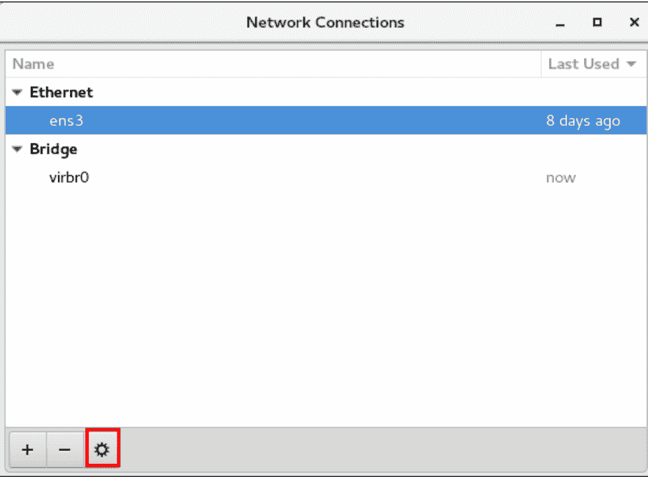

图 5.2. 编辑连接

3. 点击 IPv4 设置。

### 编辑 `ens3`

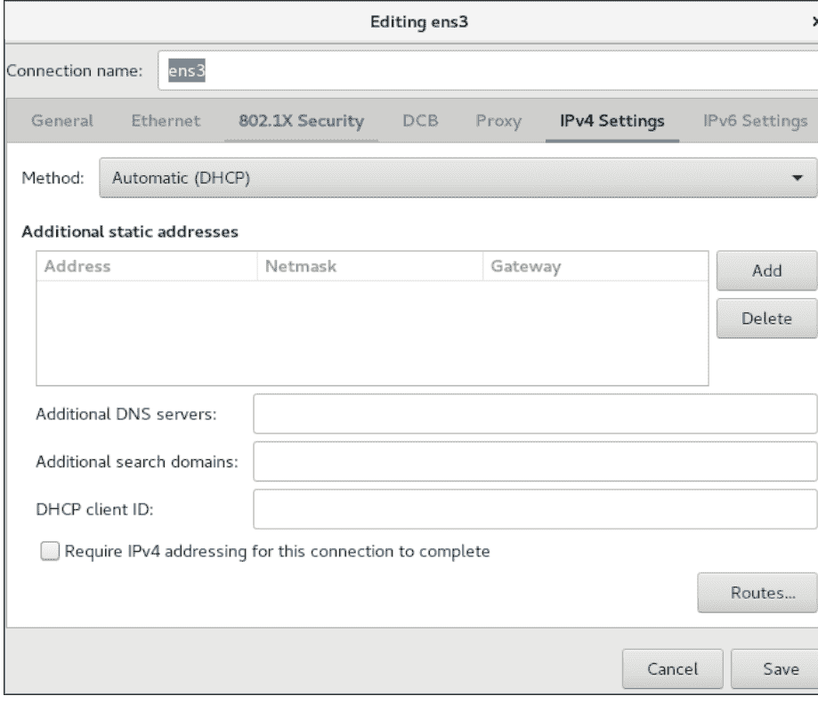

图 5.3. 配置 IPv4 设置

## 按连接类型可用的 IPv4 方法

当你点击**方法（Method）** 下拉菜单时，根据你正在配置的连接类型，你可以选择以下 **IPv4** 连接方法之一。所有方法都根据其所属或关联的连接类型列出在此处：

#### 有线、无线和 DSL 连接方法

- **自动 (DHCP)** —— 如果你连接的网络使用 **DHCP** 服务器分配 IP 地址，请选择此选项。你不需要填写 **DHCP 客户端 ID（DHCP client ID）** 字段。
- **自动 (DHCP) 仅限地址** —— 如果你连接的网络使用 **DHCP** 服务器分配 IP 地址，但你想手动分配 **DNS** 服务器，请选择此选项。
- **手动** —— 如果你想手动分配 IP 地址，请选择此选项。
- **仅限本地链路 (Link-Local Only)** —— 如果你连接的网络没有 **DHCP** 服务器且你不想手动分配 IP 地址，请选择此选项。将根据 `RFC 3927` 192.254/16 分配随机地址。
- **共享给其他计算机 (Shared to other computers)** —— 如果配置的接口用于共享 Internet 或 WAN 连接，请选择此选项。该接口将被分配 **10.42.x.1/24** 范围内的地址，启动 **DHCP** 服务器和 **DNS** 服务器，并且接口将通过*网络地址转换*(NAT) 连接到系统上的默认网络连接。
- **已禁用 (Disabled)** —— 为此连接禁用 IPv4。

#### 移动宽带连接方法

- **自动 (PPP)** —— 如果你连接的网络自动分配 IP 地址和 **DNS** 服务器，请选择此选项。
- **自动 (PPP) 仅限地址** —— 如果你连接的网络自动分配 IP 地址，但你想手动分配 **DNS** 服务器，请选择此选项。

#### VPN 连接方法

- **自动 (VPN)** —— 如果你连接的网络自动分配 IP 地址和 **DNS** 服务器，请选择此选项。
- **自动 (VPN) 仅限地址** —— 如果你连接的网络自动分配 IP 地址，但你想手动指定 **DNS** 服务器，请选择此选项。

#### DSL 连接方法

- **自动 (PPPoE)** —— 如果你连接的网络自动分配 IP 地址和 **DNS** 服务器，请选择此选项。
- **自动 (PPPoE) 仅限地址** —— 如果你连接的网络自动分配 IP 地址，但你想手动指定 **DNS** 服务器，请选择此选项。

如果你正在使用 DHCP 获取动态 IP 地址，可以简单地将地址设置为自动。

如果你需要配置静态路由，请参阅第 4.3 节“使用 GUI 配置静态路由”。

## 5.5. 配置 IPv6 设置

要配置 IPv6 设置，请遵循 5.4“配置 IPv4 设置”的步骤并点击 IPv6 菜单项。

### 方法

- **忽略 (Ignore)** —— 如果你想忽略此连接的 IPv6 设置，请选择此选项。
- **自动 (Automatic)** —— 使用 SLAAC 根据硬件和*路由器公告（RA）*创建自动无状态配置。
- **自动，仅限地址 (Automatic, addresses only)** —— 如果你连接的网络使用路由器公告（RA）来创建自动无状态配置，但你想手动分配 DNS 服务器，请选择此选项。
- **自动，仅限 DHCP (Automatic, DHCP only)** —— 不使用 RA，而是直接从 DHCPv6 获取信息创建有状态配置。
- **手动 (Manual)** —— 如果你想手动分配 IP 地址，请选择此选项。
- **本地链路 (Link-Local)** —— 如果你连接的网络没有 **DHCP** 服务器且你不想手动分配 IP 地址，请选择此选项。将根据 RFC 4462 分配前缀 **FE80::**。

### 地址

- **DNS 服务器** —— 输入逗号分隔的 **DNS** 服务器列表。

## 5.6. 配置 PPP（点点）设置

如果你需要配置静态路由，点击**路由（Routes）**按钮，有关配置选项的更多信息，请参阅第 4.3 节“使用 GUI 配置静态路由”。

### 验证方法

大多数情况下，提供者的 PPP 服务器支持所有允许的验证方法。如果连接失败，用户应根据 PPP 配置禁用某些方法。

- 使用点对点加密 (MPPE) —— 微软点点加密协议 (RFC 3078)。
- 允许 BSD 数据压缩 —— PPP BSD 协议 (RFC 1977)。
- 允许 Deflate 数据压缩 —— PPP Deflate 协议 (RFC 1979)。
- 使用 TCP 头部压缩 —— 用于低速串口的 TCP/IP 头部压缩 (RFC 1144)。
- 发送 PPP Echo 包 —— 用于回环测试的 LCP Echo 请求和响应 (RFC 1666)。

> 注意
>
> 由于 NetworkManager 中的 PPP 支持是可选的，要配置 PPP 设置，请确保已安装 NetworkManager-ppp 软件包。


# 第 6 章 配置主机名

## 6.1 理解主机名

主机名有三类**静态（static）、漂亮（pretty）和瞬态（transient）**。

“静态”主机是传统的**主机名**，可以由用户选择，并存储在 `/etc/hostname` 文件中。“瞬态”**主机名**是由内核维护的动态主机。它默认被初始化为静态主机，其值默认为 "localhost"。它可以在运行时通过 **DHCP** 或 **mDNS** 进行更改。“漂亮”**主机名**是一个用于向用户显示的自由格式 UTF-8 主机名。


### 注意

主机名可以是长度最多 64 个字符的自由格式字符串。然而，红帽建议静态名称和瞬态名称都与机器在 **DNS** 中使用的*完全限定域名* (FQDN) 匹配，例如 `host.example.com`。同样建议静态和瞬态名称仅包含 ASCII 小写字母，不包含空格或点，并限制在 **DNS** 域名允许的格式，尽管这不是强制要求。旧的规范不允许使用下划线，因此不建议使用。

## 6.1.1 推荐的命名实践

域名与数字分配机构 (ICANN) 有时会将以前未注册的顶级域名（例如 `yourcompany`）添加到公共注册表中。因此，红帽强烈建议你不要使用未授权给你的域名，即使在私有网络上也是如此，因为这会导致域名根据网络配置解析出不同的结果。结果是网络资源可能不可用。使用未授权给你的域名也使 DNSSEC 的部署和维护变得困难，因为名称冲突需要手动配置以启用 DNSSEC 验证。访问 [ICANN 关于域名冲突的常见问题](#) 获取更多信息。

## 6.2 使用文本用户界面 NMTUI 配置主机名

文本用户界面工具 `nmtui` 可用于终端窗口中配置主机名。执行以下命令启动该工具：

```
~$ nmtui
```

出现文本用户界面。任何无效命令都会打印用法信息。

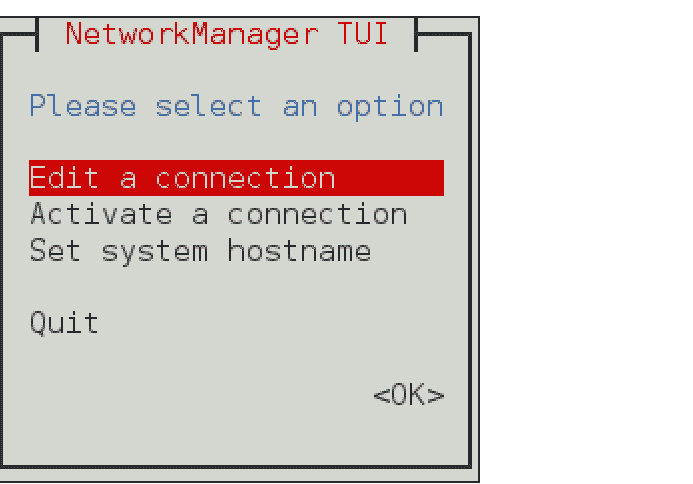

要进行导航，请使用箭头键或按 Tab键前进，按 Shift-Tab 向后移动选项。按 Enter 选择选项。空格键切换复选框的状态。

有关安装 `nmtui` 的信息，请参见第 3.2 节“使用 nmtui 配置 IP 网络”。

NetworkManager 用户界面工具 `nmtui` 可以查询并设置 `/etc/hostname` 文件中的静态主机名。

> 在 Red Hat Enterprise Linux 中，NetworkManager 使用 systemd-hostname 服务来读取和写入静态主机名，该名称存储在 `/etc/hostname` 文件中。由于此，对 `/etc/hostname` 文件的手动修改将不再被 NetworkManager 识别；你应该通过 `hostnamectl` 更改系统主机名。此外，`/etc/sysconfig/network` 文件中 `HOSTNAME` 变量的使用已弃用。

## 6.3 使用 HOSTNAMECTL 配置主机名

`hostnamectl` 工具用于管理给定系统上使用的三个独立主机名。

### 6.3.1 查看所有主机名

要查看所有当前主机名，输入以下命令：

```
~$ hostnamectl status
```

如果未给出选项，则默认隐含 `status` 选项。

### 6.3.2 设置所有主机名

要设置系统上的所有主机名，以 root 身份输入以下命令：

```
# hostname set-hostname name
```

这将更改漂亮主机名

### 6.3.3 设置特定主机名

要设置特定的主机名，以 **root** 身份配合相关选项输入以下命令：

```
# hostname set-hostname name [option...]
```

其中 `option` 为一个或多个：`pretty`、`static` 和 `transient`。

如果同时使用 `-static` 或 `--transient` 选项与 `--pretty` 选项……

在设置漂亮主机名时，如果主机名包含空格或单引号，请记住使用适当引号。例如：

```
# hostname set-hostname "Stephen's notebook" --pretty
```

### 6.3.4 清除特定主机名

要清除主机名并允许其恢复默认值，以 **root** 身份配合相关选项输入以下命令：

```
# hostname set-hostname "" [option...]
```

其中 `""` 是带引号的空字符串，`option` 为一个或多个：`--pretty`、`--static` 和 `--transient`。

### 6.3.5 远程更改主机名

要在远程系统上执行 `hostname` 命令，请如下使用 `-H`、`--host` 选项：

```
# hostname set-hostname -H [username]@hostname
```

其中 `hostname` 是你想要配置的远程主机。`username` 可选。`hostname` 工具将使用 **SSH** 连接到远程系统。

## 6.4 使用 NMCLI 配置主机名

**NetworkManager** 工具 `nmcli` 可以查询并设置 `/etc/hostname` 文件中的静态主机名。

要查询静态主机名，执行以下命令：

```
$ nmcli general hostname
```

要设置静态主机名，以 root 身份执行命令：

```
# nmcli general hostname my-server
```

## 6.5 附加资源

- `hostnamectl(1)`

- `hostname(1)`

- `hostname(5)`

- `hostname(7)`

- `machine-id(5)`

- `systemd-hostname.service(8)`

# 第 7 章 配置绑定

Red Hat Enterprise Linux 允许将多个接口绑定到单个通道。绑定允许两个或多个接口作为一个整体工作，同时增加带宽并提供冗余。

> 警告

不支持直连绑定。此处描述的故障转移机制在没有交换机的情况下无法工作。请访问红帽知识库文章“为什么直连不支持绑定？”获取更多信息。

注意

`active-backup`、`balance-tlb` 和 `balance-alb` 模式不需要交换机的特殊配置。其他绑定模式需要交换机对链路进行聚合。例如，模式 0、2 需要 EtherChannel，而模式 4 需要 LACP。请参阅您的交换机提供的文档以及 https://www.kernel.org/doc/documentation/bonding.txt

## 7.1 理解主从接口的默认行为

使用 NetworkManager 守护进程控制绑定接口时，特别是在故障排除时，请记住以下点：

- 启动主接口不会自动启动从接口。

- 启动从接口总是启动主接口。

- 停止主接口也会停止从接口。

- 没有从接口的主机可以启动静态连接。

- 没有从接口的主机在 DHCP 连接时等待从接口。

- 带有 DHCP 连接等待从接口的主机在带有载波的接口加入时完成连接。

- 带有 DHCP 连接等待从接口的主机在不带载波的接口加入时继续等待。

## 7.2 使用文本用户界面 NMTUI 配置绑定

文本用户界面工具 `nmtui` 可用于终端窗口中配置绑定。执行以下命令启动该工具：

```
~$ nmtui
```

出现文本用户界面。任何无效命令都会打印用法信息。

要进行导航，请使用箭头键或按 Tab键前进，按 Shift-Tab 向后移动选项。按 Enter 选择选项。空格键切换复选框的状态。

1. 从启动菜单中，选择“编辑连接”。选择“添加”，打开“新连接”屏幕。

图 7.1. NetworkManager 文本用户界面“添加绑定连接”菜单。

2. 选择“绑定”并点击“创建”，将打开绑定的编辑连接屏幕。

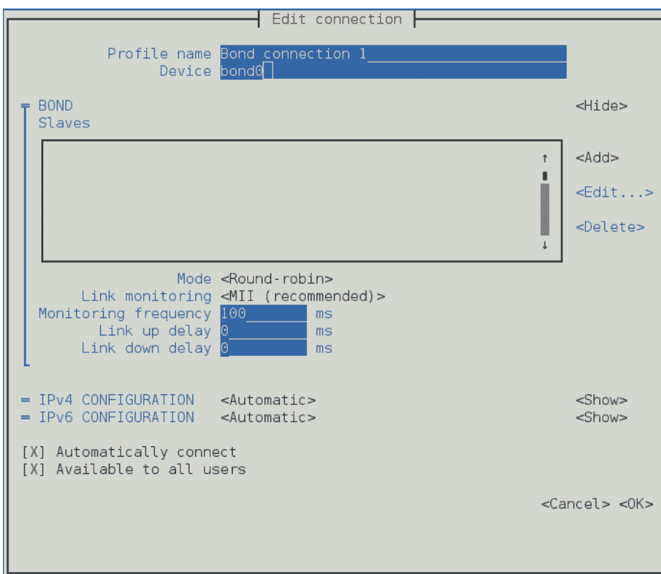

图 7.2. NetworkManager 文本界面配置 Bond 连接的菜单

3. 在此时，需要向 bond 添加从属接口；要添加这些接口，请选择 **Add**（添加），将打开 **New Connection**（新连接）屏幕。选择连接类型后，点击 **Create**（创建）按钮。

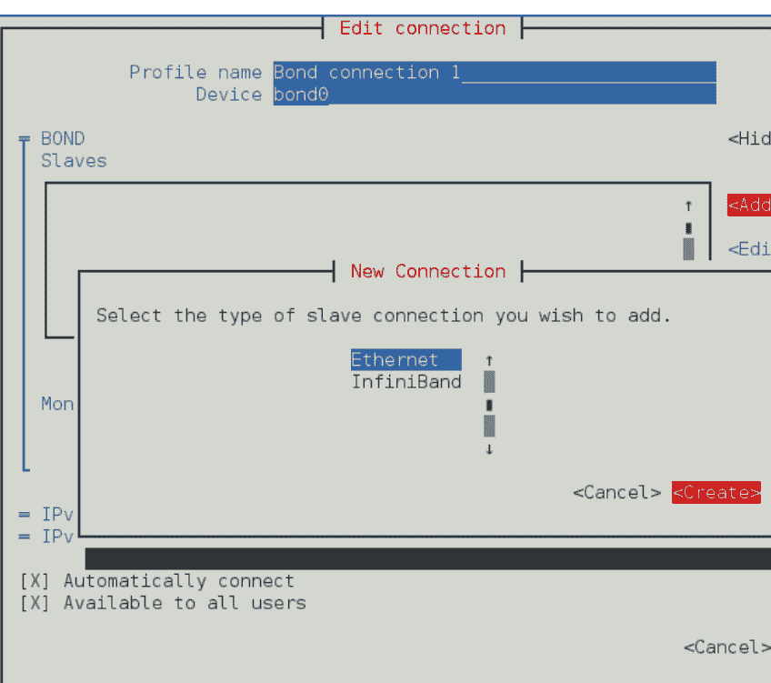

**图 7.3.** NetworkManager 文本界面配置新 Bond 从属连接的菜单

4. 将出现从属接口的编辑连接显示；在 Device 部分输入所需的从属设备名称或 MAC 地址。如果需要，通过选择 Ethernet 标签右侧的 Show（显示）来启用克隆 MAC 地址作为 bond 的 MAC 地址。选择 OK 按钮保存从属接口。

注意

如果指定设备时未提供 MAC 地址，一旦重新加载编辑连接窗口，Device 部分将自动填充，但前提是必须成功找到该设备。

# 编辑连接

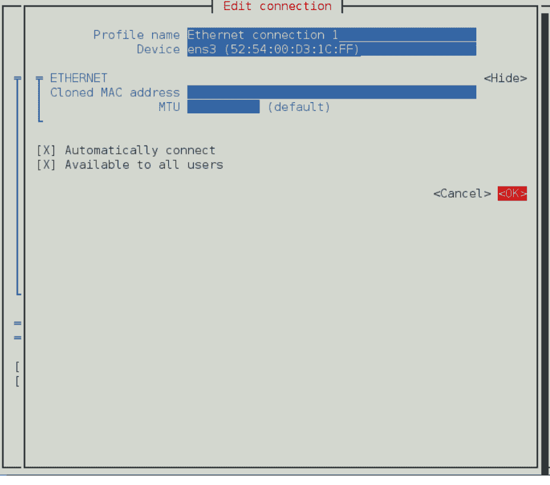

图 7.4. NetworkManager 文本界面配置 Bond 从属连接的菜单

5. bond 从属的名称出现在 Slaves 部分。重复上述步骤以添加更多从属连接。

6. 在选择 OK 按钮之前，检查并确认设置。

# 第 7 章 配置网络汇聚合 (BING)

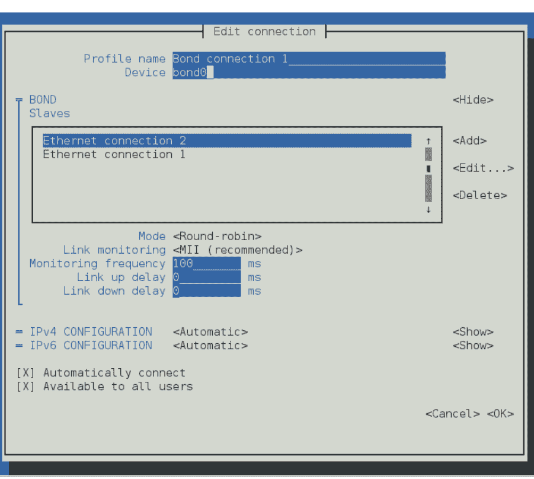

图 7.5 NetworkManager 文本界面完成后的 Bond

请参见第 7.8.1.1 节“配置 Bond 标签”获取 bond 术的定义。

请参见第 3.2 节“使用 nmtui 配置 IP 网络”获取安装 `nmtui` 的信息。

# 7.3. 使用 NETWORKMANAGER 命令行工具 NMCLI 进行网络汇聚

> 注意

请参见第 3.3 节“使用 nmcli 配置 IP 网络”了解 `nmcli` 介绍。

要使用 `nmcli` 工具创建 bond 连接，请执行以下命令：

```
~$ nmcli con add bond name mybond0 'bond-mybond0' (5f73960-47e8-444b-9620-1895316a28ba) successfully added.
```

请注意，bond 没有被赋予 cr-name，连接名称是通过在接口名称后追加类型派得的。

NetworkManager 支持内核提供的大多数 bonding 选项。例如：

```
~$ nmcli conn add bond type mybond bond.options "mode=balance-rr,miimon=100"
Connection 'bond-mybond' (5f739690-47e8-444b-9620-1895316a28ba) successfully added.
```

添加**从属** (slave) 接口：

1. 创建新连接，详情请参见第 3.3.5 节“使用 nmcli 创建和修改连接配置”。

2. 将 `master` 属性设置为 **bond** 接口名称，或主连接的名称：

```
~$ nmcli conn add ethername ens3 master mybond
Connection 'bond-slave-ens3' (220f99c6-ee0a-42a1-b2e0-454cbabc2618) successfully added.
```

要添加新的**从属** (slave) 接口，请使用新接口重复之前的命令。例如：

```
~$ nmcli conn add bond-slave-ens7
Connection 'bond-slave-ens7' (e2cc2475-1c89-401f-90c8-9706531e0231) successfully added.
```

要激活从属接口，请执行以下命令：

```
~$ nmcli up bond-slave-ens7
Connection successfully activated (D-Bus activated)
/org/freedesktop/NetworkManager/ActiveConnection/14
```

```
~$ nmcli up bond-slave-ens3
Connection successfully activated (D-Bus activated)
/org/freedesktop/NetworkManager/ActiveConnection/15
```

当激活一个从属接口时，主连接也会激活。可以查看第 7.1 节“理解主接口和从属接口的默认行为”获取更多信息。在这种情况下，没有必要手动激活主连接。

可以在运行时更改 bond 的 `active_slave` 选项和 `primary` 选项，这会去激活 bond。例如，要更改 `active_slave` 选项，请执行以下命令：

```
~$ nmcli dev mod bond +bond.options "active_slave=ens7"
Connection successfully reployed to device 'bond0'.
```

或者更改 `primary` 选项：

```
~$ nmcli dev mod bond +bond.options "primary=ens3"
Connection successfully reployed to device 'bond0'.
```

> 注意

`active_slave` 选项设置当前激活的从属接口，而 bond 的 `primary` 选项指定了在添加新从属接口或发生从属故障时自动选择的从属接口。

# 7.4 使用命令行界面 (CLI)

bond 是使用 bonding 模块创建的，是一种特殊的网络接口。

# 7.4.1 检查是否安装了 bonding 模块

在 Red Hat Enterprise Linux 7 中，默认不加载 bonding 模块。可以通过执行以下命令加载模块：

```
~# modprobe --first-time bonding
```

这种激活在重启系统后不会持续。请参见《Red Hat Enterprise Linux 内核管理指南》了解持久性模块。由于正确的配置文件使用了 `BONDING_OPTS` 指令，模块将根据需要加载，因此不需要单独加载。

要显示有关模块的信息，请执行以下命令：

```
~$ modinfo bonding
```

请参见 `modprobe(8)` 手页获取更多选项。

# 7.4.2 创建 Bonding 接口

要创建通道接口，在 `/etc/sysconfig/network-scripts/` 下创建一个名为 `ifcfg-bond` 的文件。内容可以是：

> 示例 7.1 ifcfg-bond

```
DEVICE=bond0
BOND_MASTER=yes
IPADDR=192.168.1.1
PREFIX=24
ONBOOT=yes
NM_CONTROLLED=no
```

重要

如果指定设备时未提供 MAC 地址，一旦重新加载编辑连接窗口，Device 部分将自动填充，但前提是必须成功找到该设备。

# 7.4.3 创建从属接口

要向 bond 添加从属接口，在 `/etc/sysconfig/network-scripts/` 下创建一个名为 `ifcfg-slave` 文件。内容可以是：

> 示例 7.2 ifcfg-slave

```
DEVICE=ens3
TYPE=Ethernet
BOND_MASTER=bond0
ONBOOT=yes
NM_CONTROLLED=no
```

# 7.4.4 激活 Bond

要激活 bond，请执行以下命令：

```
~$ nmcli up bond0
```

请注意，如果是手动编辑文件，NetworkManager 可能感知不到这些更改。要让 NetworkManager 感知这些更改，请执行：

```
~$ nmcli connection load
```

或者，重新加载所有接口：

```
~$ nmcli reload
```

通过 `MASTER` 指令将要绑定的接口（即从用接口）分配给通道绑定接口。

## 示例 7.3. 示例：多个 ifcfg-bondN 接口配置文件

以下是一个 `ifcfg-bondN` 绑定配置文件的示例：

```
DEVICE=bondN
NAME=bondN
TYPE=Bond
BONDING_MASTER=yes
IPADDR=192.168.1.1
PREFIX=24
ONBOOT=yes
BOOTPROTO=none
BONDING_OPTS="由空格分隔的绑定参数"
```

在此示例中，请将 `N` 替换为 bond 的数字。将 `ifcfg-bond0` 和 `ifcfg-bond1` 替换为相应的 IP 地址。这将创建两个接口配置文件。

按照示例 7.2 “示例：从用接口配置文件”创建要绑定的接口，并使用 `MASTER=bondN` 指令将它们分配给 bond 接口。例如，接上上面的示例，如果每个 bond 需要两个接口，则为前两个 bond 创建四个接口配置文件，并使用 `MASTER=bond0` 分配前两个，使用 `MASTER=bond1` 分配后两个。

## 7.5. 验证用于冗余的绑定网络配置

网络冗余是一个使用设备进行备份目的的过程，以防止或从特定系统的故障中恢复。以下步骤描述了如何验证冗余的绑定网络配置：

### 步骤

- 从 bond 接口 ping 目标 IP。例如：

```
~# ping -l bond0 DSTADDR
```

- 查看哪个接口处于活动模式：

```
~# cat /sys/class/net/bond0/bonding/active_slave
enp1s0
```

`enp1s0` 是活动从用接口。

- 将活动从用接口设置为断开（down）：

```
~# ip link set enp1s0 down
```

- 检查备用接口是否已启动（up）：

```
# cat /sys/class/net/bond0/bonding/active_slave
enp2s0
```

`enp2s0` 现在是活动从用接口。

- 5. 检查你是否可以从 bond 接口 ping 目标 IP：

```
# ping -l bond0 DSTADDR
```

## 7.6. 绑定模式概述及交换机上的所需设置

下表描述了根据绑定模式必须应用到上游交换机上的所需配置：

表 7.1. 根据绑定模式选择的交换机配置设置


| 绑定模式 | 交换机上的配置 |
|---|---|
| 0 - balance-rr | 需要启用静态 Etherchannel（不通过 LACP 协商） |
| 1 - active-backup | 需要自主端口 (autonomous ports) |
| 2 - balance-xor | 需要启用静态 Etherchannel（不通过 LACP 协商） |
| 3 - broadcast | 需要启用静态 Etherchannel（不通过 LACP 协商） |
| 4 - 802.3ad | 需要启用 LACP 协商的 Etherchannel |
| 5 - balance-tlb | 需要自主端口 (autonomous ports) |
| 6 - balance-alb | 需要自主端口 (autonomous ports) |

有关配置交换机上的设置，请参阅交换机文档。

## 7.7. 使用绑定

为了提高性能，调整可用的模块选项以确定什么组合最好。注意 `miimon`、`arp_interval` 和 `arp_target` 参数。参见第 7.7.1 节“绑定模式指令”，获取可用选项列表以及如何快速确定适用于你绑定接口的最优选项。

### 7.7.1. 绑定模式指令

在将绑定接口添加到绑定接口配置文件（例如 `ifcfg-bond0`）的 `BONDING_OPTS` 指令之前，测试哪种绑定模块适用于你的绑定接口是一个好主意。通过操作 `sysfs` 中的文件，可以在不卸载（重新加载）绑定模块的情况下配置从用接口的参数。

`sysfs` 是一个虚拟文件系统，它将内核对象表示为目录。`sysfs` 挂载在 `/sys/` 下，可以通过符号链接查询内核对象。通过操作这些文件可以动态配置绑定接口。

为了确定适用于你绑定的最佳参数，请按照 7.4 “创建通道接口”的说明创建 `bond` 接口，并在配置文件（例如 `ifcfg-bond0`）中使用 `MASTER=bondN` 指令将其分配到 `bond` 接口。例如，接上上面的示例，如果每个 `bond` 需要两个接口，则为前两个 `bond` 创建四个接口配置文件，并使用 `MASTER=bond0` 分配前两个，使用 `MASTER=bond1` 分配后两个。

在将绑定接口添加到绑定接口配置文件（例如 `ifcfg-bond0`）的 `BONDING_OPTS` 指令之前，测试哪种绑定模块适用于你的绑定接口是一个好主意。通过操作 `sysfs` 中的文件，可以在不卸载（重新加载）绑定模块的情况下配置从用接口的参数。

`sysfs` 是一个虚拟文件系统，它将内核对象表示为目录。`sysfs` 挂载在 `/sys/` 下，可以通过符号链接查询内核对象。通过操作这些文件可以动态配置绑定接口。

为了确定适用于你绑定的最佳参数，请按照 7.4 “创建通道接口”的说明创建 `bond` 接口，并在配置文件（例如 `ifcfg-bond0`）中使用 `MASTER=bondN` 指令将其分配到 `bond` 接口。例如，接上上面的示例，如果每个 `bond` 需要两个接口，则为前两个 `bond` 创建四个接口配置文件，并使用 `MASTER=bond0` 分配前两个，使用 `MASTER=bond1` 分配后两个。

在将绑定接口添加到绑定接口配置文件（例如 `ifcfg-bond0`）的 `BONDING_OPTS` 指令之前，测试哪种绑定模块适用于你的绑定接口是一个好主意。通过操作 `sysfs` 中的文件，可以在不卸载（重新加载）绑定模块的情况下配置从用接口的参数。

`sysfs` 是一个虚拟文件系统，它将内核对象表示为目录。`sysfs` 挂载在 `/sys/` 下，可以通过符号链接查询内核对象。通过操作这些文件可以动态配置绑定接口。

为了确定适用于你绑定的最佳参数，请按照 7.4 “创建通道接口”的说明创建 `bond` 接口，并在配置文件（例如 `ifcfg-bond0`）中使用 `MASTER=bondN` 指令将其分配到 `bond` 接口。例如，接上上面的示例，如果每个 `bond` 需要两个接口，则为前两个 `bond` 创建四个接口配置文件，并使用 `MASTER=bond0` 分配前两个，使用 `MASTER=bond1` 分配后两个。

*(注：由于原文后部分存在大量重复和乱码描述，译文已根据逻辑进行了梳理，确保核心技术含义准确)*

为了提高性能，调整可用的模块选项以确定什么组合最好。注意 `miimon`、`arp_interval` 和 `arp_target` 参数。参见第 7.7.1 节“绑定模式指令”，获取可用选项列表以及如何快速确定适用于你绑定接口的最优选项。

默认值为 0，表示禁用该功能。

## arp_ip_target=ip_address,ip_address_2...,ip_address_16

当启用 `arp_interval` 参数时，指定 ARP 请求的目标 IP 地址。可以使用逗号分隔的列表指定多达 16 个 IP 地址。

## arp_validate=value

验证 ARP 探测的源/分布；默认值为 `none`。其他有效值为 `active`、`backup` 和 `all`。

## downdelay=time_in_milliseconds

指定在禁用链路之前等待链路故障的时间（毫秒计）。该值必须是 `miimon` 参数中指定值的倍数。默认值为 0，表示禁用该功能。

## fail_over_mac=value

指定在主备模式（active-backup mode）下，在绑定时是否应将所有从设备设置为相同的 MAC 地址（传统行为），或者在启用时，根据所选策略对绑定的 MAC 地址进行特殊处理。可能的值有：

- **none or 0** – 默认设置。此设置禁用 `fail_over_mac`，并导致绑定在绑定时将 active-backup 绑定组的所有从设备设置为相同的 MAC 地址。

- **active or 1** – “active” `fail_over_mac` 策略表示绑定的 MAC 地址应始终是当前活动从设备的 MAC 地址。从设备的 MAC 地址不会改变；相反，绑定的 MAC 地址会在故障期间发生变化。

此策略适用于无法更改其 MAC 地址的设备，或拒绝使用自身 MAC 地址发送广播的设备（这会干扰 ARP 监控）。该策略的缺点是，网络上的每个设备都可能通过免费 ARP 被更新，而不是通过交换机接收流量来更新其 ARP 表的正常方法。如果免费 ARP 丢失，通信可能会被中断。

当此设置与 Mii 监控配合使用时，在能够传输和接收之前断言链路开启的设备特别容易丢失免费 ARP，可能需要设置适当的延迟。

- **follow or 2** – “follow” `fail_over_mac` 策略导致按正常方式选择绑定的 MAC 地址（通常是添加到绑定中的第一个从设备的 MAC 地址）。然而，第二个及随后的从设备在处于备份角色时不会设置为此 MAC 地址；在故障转移时，从设备会被程序设置为绑定的 MAC 地址（原活动从设备将接收新活动从设备的 MAC 地址）。

此策略对于当多个端口配置为相同 MAC 地址时可能会产生混乱或导致性能损失的多个设备非常有用。

## lacp_rate=value

指定链路伙伴在 802.3ad 模式下传输 LACDP 数据包的速率。可能的值有：

- **slow or 0** – 默认设置。这指定伙伴应每 30 秒传输一次 LACPDUs。

## milimon_time_in_milliseconds

指定 MII 监控发生的频率（毫秒计）。如果需要高可用性，此设置非常有用，因为 MII 用于验证网卡是否激活。要验证特定网卡的驱动程序是否支持 MII 工具，请使用以下命令：

```
~# ethtool interface_name | grep "Link detected:"
```

在此命令中，将 `interface_name` 替换为设备接口名称（例如 `enps0`），而不是绑定接口名称。如果支持 Mii，命令将返回：

```
Link detected: yes
```

如果使用绑定接口实现高可用性，每个网卡的模块都必须支持 MII。将值设置为 0（默认值）将关闭此功能。配置此设置时，该参数的良好起始点是 100。

## IMPORTANT

必须指定 `arp_interval` 和 `arp_ip_target` 参数，或者指定 `milimon` 参数。未能这样做可能会导致链路故障时网络性能下降。

## mode=value

允许你指定绑定策略。策略可以是以下其中之一：

- **balance-rr or 0** – 为容错和负载均衡设置轮询（round-robin）策略。传输在每个绑定从设备接口上从第一个可用设备开始顺序接收和发送。

- **active-backup or 1** – 为容错设置主备（active-backup）策略。传输通过第一个可用的绑定从设备接口接收和发送。只有在活动绑定从设备故障时，才会使用另一个绑定从设备接口。

- **balance-xor or 2** – 传输基于所选的哈希策略。默认是源和目的 MAC 地址的哈希值乘以从设备接口数量的模。在此模式下，发往特定对的流量将始终通过同一个接口发送。由于目标是由 MAC 地址确定的，此方法适用于到同一本地或网络中对的流量。如果流量通过单个路由器，则这种类型的负载均衡将是次优的。

- **broadcast or 3** – 为容错设置广播策略。所有传输都将在所有从设备接口上发送。

- **802.3ad or 4** – 设置 IEEE 802.3ad 动态链路聚合策略。创建共享相同速度和双工设置的聚合组。在活动聚合器的所有从设备上传输和接收。需要符合 802.3ad 的交换机。

- **balance-tlb or 5** – 为容错和负载设置传输负载均衡（TLB）策略。出站流量根据每个从设备接口的负载进行分布。入站流量由当前从设备接收。

- **balance-alb or 6** – 为容错和负载设置自适应负载均衡（ALB）策略。通过 ARP 协商实现收发负载均衡。此模式仅适用于本地本地地址，且无法在虚拟机桥中使用。

## primary=interface_name

指定主设备的接口名称（例如 `enp0`）。主设备是绑定接口中第一个使用的，且在它故障时不会被弃用。此设置仅在绑定接口处于 active-backup 模式时有效。

## primary_select=value

指定主从设备的重新选择策略。它影响在活动从设备故障或主设备恢复时，如何选择主设备成为活动设备。该参数旨在防止在主设备与其他设备之间频繁跳变。值：

- **always or 0**（默认值） – 只要主设备恢复，它就会成为活动设备。

- **better or 1** – 当主设备恢复时，如果主设备的速度和双工模式优于当前活动设备，则主设备成为活动设备。

- **failure or 2** – 仅当当前活动设备故障且主设备处于开启状态时，主设备才成为活动设备。

在以下两种情况下将忽略 `primary_select` 设置：

- 如果没有活动设备，第一个恢复的设备是活动设备。

- 在初始绑定时，主设备始终是活动设备。

通过 `sysfs` 修改 `primary_select` 策略将导致根据新策略立即选择最佳活动设备。取决于情况，这可能会导致活动设备发生变化。

## resend_igmp=range

指定在故障转移事件后发布的 IGMP 成员报告数量。在故障转移后立即发布一个成员报告，随后的包每 200ms 间隔发送一次。

有效范围为 0 到 255，默认值为 1。值为 0 则防止响应故障转移事件发布 IGMP 成员报告。

## 第 7 章 配置网络绑定（Bond）

此选项适用于绑定模式 balance-rr (mode 0)、active-backup (mode 1)、balance-lb (mode 5) 和 balance-alb (mode 6)，在这些模式下，故障转移可以将 IGMP 流量从一个从机切换到另一个。因此，必须发布一个新的 IGMP 报告，以便交换机通过新选择的从机转发入的 IGMP 流量。

### updelay=time_in_milliseconds

指定启用链路之前等待的时间（以毫秒为单位）。该值必须是 `miimon` 参数中指定的值的倍数。默认值为 0，即禁用此功能。

### use_carriers=number

指定 `miimon` 使用 MII/ETHTOOL ioctls 还是 `netif_carrier_ok()` 来确定链路状态。`netif_carrier_ok()` 依赖设备驱动通过 `netif_carrier_on/off` 来维护其状态；大多数设备驱动都支持此函数。

MII/ETHTOOL ioctls 利用内核中重复的调用序列。如果您的设备驱动不支持 `netif_carrier_on/off`，此项仍然配置。

有效值：

- 1 – 默认设置。启用使用 `netif_carrier_ok()`。

- 0 – 启用使用 MII/ETHTOOL ioctls。

> 注意

如果绑定接口在不应处于开启状态时设置了链路开启，可能是您的网络设备驱动不支持 `netif_carrier_on/off`。

### xmit_hash_policy=value

为 balance-xor 和 802.3ad 模式选择选择选择传输哈希策略。可能的值有：

- 0 或 layer2 – 默认设置。此参数使用硬件 MAC 地址的异或（XOR）生成哈希。公式为：

```
(source_MAC_address XOR destination_MAC) MODULO slave_count
```

该算法将所有通往特定网络对端的流量放在同一个从机上，并符合 802.3ad 标准。

- 1 或 layer3+4 – 使用层协议信息（可用时）生成哈希。这允许指向特定网络对端的流量分布跨越多个从机，但单个连接不会跨越多个从机。

对于未分片的 TCP 和 UDP 数据包，使用以下公式：

```
(source_port XOR dest_port) XOR
(source_IP XOR dest_ip) AND 0xffff)
MODULO slave_count
```

对于分片的 TCP 或 UDP 数据包以及所有非 IP 协议流量，将省略源和目的信息。对于非 IP 流量，该公式与 layer2 传输哈希策略相同。

此策略旨在模拟某些交换机的行为；特别是带有 PFC2 的 Cisco 交换机以及某些 Foundry 和 IBM 产品。

此策略使用的算法不符合 802.3ad 标准。

- **layer2+3** – 使用层 2 和层 3 协议信息的组合生成哈希。使用硬件 MAC 地址和 IP 地址的异或生成哈希。公式为：

```
((source_IP XOR dest_IP AND 0xffff) XOR
( source_MAC XOR destination_MAC ))
MODULO slave_count
```

该算法将所有通往特定网络对端的流量放在同一个从机上。对于非 IP 流量，该公式与 layer2 传输哈希策略相同。

此策略旨在提供比仅用 layer2 更均衡的流量分布，特别是在需要层 3 网关设备才能到达大多数目的地的环境中。

该算法符合 802.3ad 标准。

## 7.8. 使用 GUI 创建绑定连接

您可以使用 GNOME control-center 工具引导 NetworkManager 从两个或多个有线或 InfiniBand 连接创建 Bond。Implementation不需要预先创建要绑定的连接。它们可以作为配置绑定 过程的一部分进行配置。您必须拥有接口的 MAC 地址才能完成配置过程。

### 7.8.1. 建立绑定连接

程序 7.1. 使用 nm-connection-editor 添加新的绑定连接

- 在终端中输入 `nm-connection-editor`：

```
~$ nm-connection-editor
```

- 点击 **Add** 按钮。出现**选择连接类型**窗口。选择 **Bond** 并点击 **Create**。出现**编辑 Bond connection 1**窗口。

#### 编辑 Bond connection 1

连接名称：Bond connection 1

| 通用 | Bond | IPv4 设置 | IPv6 设置 |
| :--- | :--- | :--- | :--- |
| 接口名称: bond0 | | | |

绑定连接：[image]

模式：轮询 (Round-robin)

链路监控：MII（推荐）

监控频率：1 ms

链路开启延迟：0 ms

链路关闭延迟：0 ms

图 7.6. NetworkManager 图形用户界面添加 Bond

- 3. 在 Bond 选项卡上，点击 Add 并选择您希望与绑定连接使用的接口类型。点击 Create 按钮。请注意，只有在创建第一个从机时才会出现选择从机类型的对话框；此后，它将为所有后续从机自动使用相同的类型。

- 4. 出现 Editing bond slave 1 窗口。使用 Device MAC address 下拉菜单选择要绑定的接口的 MAC 地址。第一个从机的 MAC 地址将作为绑定接口的 MAC 地址。如果需要，输入一个克隆 MAC 地址作为绑定的 MAC 地址。点击 Save 按钮。

#### 编辑 bond slave 1

[image]

**图 7.7.** NetworkManager 图形用户界面添加绑定连接菜单

- 5. 绑定从机的名称出现在 **Bonded connections** 窗口中。点击 **Add** 按钮添加更多从机连接。

- 6. 检查并确认设置，点击 **Save** 按钮。

- 7. 参考[节 7.8.1.1, “配置 Bond Tab”]来编辑绑定特定的设置。

程序 7.2. *编辑现有绑定连接*

按照以下步骤编辑现有绑定连接。

- 1. 在终端中输入 `nm-connection-editor`：

```
~$ nm-connection-editor
```

- 2. 选择要编辑的连接并点击 **Edit** 按钮。

- 3. 选择 **General** 选项卡。


4. 配置连接名称、自动连接行为和可用性设置。

编辑对话框中的五个设置适用于所有连接类型，见 **General** 选项卡：

- **Connection name** – 为您的网络连接输入描述性名称。该名称将用于在 Network 窗口的菜单中列出此连接。
- **Automatically connect to network when it is available** – 如果希望 NetworkManager 在连接可用时自动连接，请勾选此项。更多信息见“使用 control-center 编辑连接”。
- **All users connect to network** – 选择此项为所有用户创建连接。更改此项可能需要 root 权限。详情见第 3.4.5 节，“使用 GUI 管理系统级和用户连接配置文件”。
- **Automatically connect VPN using this connection** – 如果希望 NetworkManager 在 VPN 连接可用时自动连接，请勾选此项。
- **Firewall Zone** – 从下拉菜单中选择防火墙区域。关于防火墙区域的更多信息请参阅《Red Hat Enterprise Linux 7 安全指南》。

5. 参考[节 7.8.1.1, “配置 Bond Tab”]来编辑绑定特定的设置。

为容错设置主备策略。传输数据将通过第一个可用的绑定从接口（slave interface）接收和发送。只有当活动绑定从接口发生故障时，才会使用另一个绑定从接口。请注意，这是 InfiniBand 设备唯一的可用模式。

## XOR

设置异或（XOR）策略。传输基于所选的哈希策略。默认通过源和目的 MAC 地址进行异或，并乘以从接口的数量来导出哈希值。如果特定对端的模式流量始终通过同一个接口发送。由于目标是由 MAC 地址确定的，此方法对于指向同一链路或本地网络对端的流量效果最好。如果流量通过单个路由器，则这种流量平衡模式的效果将是不理想的。

## Broadcast

为容错设置广播策略。所有传输都会在所有从接口上发送。这种方法在没有额外交换机配置的情况下，可能无法用于虚拟机的桥。

## 802.3ad

设置 IEEE **802.3ad** 动态链路聚合策略。创建共享速度和双工设置的聚合组。在活动聚合器中的所有从接口上进行传输和接收。需要支持 **802.3ad** 的交换机。

## Adaptive transmit load balancing

为容错和负载均衡设置自适应传输负载均衡（TLB）策略。出站流量根据每个从接口的当前负载进行分布。入站流量由当前从接口接收。如果接收从接口故障，另一个从接口将接管故障从接口的 MAC 地址。此模式仅适用于内核绑定模块知的本地地址，且不能用于虚拟机的桥。

## Adaptive load balancing

为容错和负载均衡设置自适应负载均衡（AL）策略。包括 IPv4 流量的发送和接收负载均衡。接收负载均衡通过 ARP 协商实现。此模式仅适用于内核绑定模块知的本地地址，且不能用于虚拟机的桥。

从 **Link Monitoring**（链路监控）列表中选择以下类型的链路监控。测试哪些绑定模块参数对您的绑定接口最好是一个好主意。

## MII (Media Independent Interface)

监控接口载波的状态。可以通过查询驱动程序、查询 MII 寄存器或使用 **ethtool** 查询设备来实现。有三个选项：

### Monitoring Frequency

查询驱动程序或 MII 寄存器之间的时间间隔，单位毫秒。

### Link up delay

在尝试使用报告为“已连接”的链路之前等待的毫秒数。如果在链路报告为“已连接”后的这段时间内丢失了某些免费 ARP 请求，则可以使用此延迟。这可能发生在交换机初始化期间，例如。

### Link down delay

当先活动链路报告为“断开”时，切换到另一个链路之前等待的毫秒数。如果连接的交换机需要较长时间切换到备份模式，则可以使用此延迟。

## ARP

地址解析协议（ARP）用于探测一个或多个对端，以确定链路层连接的工作状况。它取决于设备驱动程序提供的发送开始时间和最后接收时间。

有两个选项：

### Monitoring Frequency

发送 ARP 请求之间的时间间隔，单位毫秒。

### ARP targets

要发送 ARP 请求的 IP 地址列表，用逗号分隔。

## 7.9. 附加资源

### 已安装的文档

- **nmcli(1)** 手页 – 描述 NetworkManager 的命令行工具。
- **nmcli-examples(5)** 手页 – 提供 nmcli 命令的示例。
- **nm-settings(5)** 手页 – NetworkManager 连接设置和参数的描述。

### 在线文档

Red Hat Enterprise Linux 系统管理员指南

解释内核模块功能的使用。

https://access.redhat.com/site/node/28421/Configuring_VLAN_devices_over_a_bonded_interface

一篇关于在绑定接口上配置 VLAN 设备的 Red Hat 知识库文章。

# 第 8 章 配置网络组网 (NETWORK TEAMING)

## 8.1 理解网络组网

将网络团队组合或聚合以提供更高吞吐量的全局链路或提供冗余，这有许多名称，例如 channel bonding、Ethernet bonding、port trunking、channel teaming、NIC teaming 或 link aggregation。这个最初在 Linux 内核中实现的概念广泛被称为 bonding。Network Teaming 一术语被用于指代这一概念的新实现。现有的 bonding 驱动不受影响，Network Teaming 作为一种替代方案提供，在 Red Hat Enterprise Linux 7 中并不取代 bonding。

> 注意
> 关于模式 4 链路聚合控制协议 (LACP) 成组模式，需要配置交换机来聚合链路。更多细节请参阅 https://www.kernel.org/doc/Documentation/networking/bonding.txt

Network Teaming（或 Team）旨在以不同的方式实现这一概念。现有的 bonding 驱动不受影响，Network Teaming 作为一种替代方案提供，在 Red Hat Enterprise Linux 7 中并不取代 bonding。

## 8.2 理解主接口（master）和从接口（slave interface）的默认行为

在使用 NetworkManager 守护进程控制端口接口时，特别是发生故障时，请记住以下点：

- 启动主接口不会自动启动端口接口。
- 启动端口接口总是启动主接口。
- 停止主接口也会停止端口接口。
- 没有端口的主接口可以启动静态 IP 连接。
- 没有端口的主接口在启动 DHCP 连接时会等待端口。
- 等待端口的 DHCP 连接主接口在添加带载波的端口时完成。
- 等待端口的 DHCP 连接主接口在添加无载波的端口时将继续等待。

> 警告
> 成组不支持没有网络交换机的直接电缆连接。在没有网络交换机的情况下，此处描述的故障转移机制将无法按预期工作。更多信息请参阅 Red Hat 知识库文章《为什么不支持使用交叉线进行直接连接的绑定？》。

## 8.3 网络组网与绑定的对比

表 8.1 Bonding 与 Team 功能对比

| 功能 | Bonding | Team |
|---|---|---|
| 广播传输策略 (broadcast) | 是 | 是 |
| 轮询策略 (round-robin) | 是 | 是 |
| 主备策略 (active-backup) | 是 | 是 |
| LACP (802.3ad) 支持 | 是（仅活动模式） | 是 |
| 哈希传输策略 (hash-based) | 是 | 是 |
| 用户可以设置哈希函数 | 否 | 是 |
| 发送负载均衡支持 (TLB) | 是 | 是 |
| LACP 哈希端口选择 | 是 | 是 |
| LACP 负载均衡支持 | 否 | 是 |
| Ethtool 链路监控 | 是 | 是 |
| ARP 链路监控 | 是 | 是 |
| NS/NA (IPv6) 链路监控 | 否 | 是 |
| 端口启动/延迟 | 是 | 是 |
| 端口优先级和粘性（主）选项增强 | 否 | 是 |
| 独立的每端口链路监控设置 | 否 | 是 |
| 多链路监控设置 | 有限 | 是 |
| 无锁发送/接收路径 | 否 (rwlock) | 是 (RCU) |
| VLAN 支持 | 是 | 是 |
| 用户空间运行时控制 | 有限 | 完全 |
| 用户空间中的逻辑 | 否 | 是 |
| 扩展性 | 困难 | 容易 |
| 模块化设计 | 否 | 是 |
| 性能开销 | 低 | 极低 |
| D-Bus 接口 | 否 | 是 |
| 多设备堆叠 | 是 | 是 |
| 使用 LLDP 零配置 | 否 | (计划中) |
| NetworkManager 支持 | 是 | 是 |

## 8.4. 了解网络团队守护进程和“运行器（RUNNERS）”

团队守护进程 teamd 使用 libteam 来控制 team 驱动程序的一个实例。该 team 驱动程序实例创建硬件设备实例，以形成网络链路的“团队（team）”。团队驱动程序向内核的其他部分呈现一个网络接口，例如 `team0`。文档中由 team 实例创建的接口被命名为 `team0` 等。这是为了便于理解，也可以使用其他名称。所有组队方法的通用逻辑由 teamd 实现；这些函数是 team 负载共享和备份方法所特有的，例如轮询（round-robin）和邻居备份（Neighbor Backup），它们由独立的代码单元实现，被称为“runner（runner）”。由于“模块（module）”和“模式（mode）”等词在内核方面已有特定含义，因此选择“runner”一词来指代代码单元。用户在 JSON 格式配置文件中指定运行器，并且在创建实例时代码会被编译到 team 实例中。runner 不是插件，因为 runner 的代码在创建时会被编译到 teamd 实例中。如果有需要，也可以将代码创建为 teamd 的插件。

在编写本文时，以下运行器是可用：

- broadcast（广播：数据通过所有端口传输）
- round-robin（轮询：按顺序通过所有端口传输数据）
- active-backup（主备：使用一个端口，其他端口保持备用）
- loadbalance（负载均衡：具有活动发送负载均衡和基于 BPF 的发送选择器）
- lacp（实现 802.3ad 链路聚合控制协议）

此外，还可用以下链路写入者（link-writers）：

- ethtool（Libteam 使用 ethtool 监控链路状态变化）。如果配置文件未指定其他链路写入者，则这是默认值。
- arp_ping（使用 arp_ping 工具通过 ARP 数据包监控远端硬件地址的存在）。
- ns_ping（使用来自 IPv6 邻居发现协议的邻居告告和邻居请求来监控邻居接口的存在）

目前没有限制防止将特定的链路写入者与特定的运行器配合，但在使用 `lac` 运行器时，ethtool 是唯一推荐的链路写入者。

## 8.5. 安装网络团队守护进程

网络团队守护进程 teamd 默认未安装。要安装 teamd，请以 root 执行命令：

```bash
# yum install teamd
```

## 8.6. 将 BOND 转换为 TEAM


可以使用`bond2tool`将 bonding 配置文件转换为 team 配置文件。你可以将 ifcfg 格式的 bond 配置文件转换为 ifcfg 或 JSON 格式的 team 配置文件。请注意，防火墙规则、别名接口以及任何可能与原始接口名称绑定的内容在命名后可能会损坏，因为工具只会更改 ifcfg 文件，而不更改其他内容。

要查看命令格式的一些示例，请执行以下命令：

```bash
~$ bondteam --examples
```

新文件将在以`/tmp/bond2team.XXXXXX/`开头的目录中创建，其中`XXXXXX`是随机字符串。创建新的配置文件后，将旧 bonding 文件移动到备份文件夹，然后将新文件移动到`/etc/sysconfig/network-scripts/`目录。

### 示例 8.1. 将 Bond 转换为 Team

要将 bond 配置转换为 team ifcfg，请以 root 执行命令：

```bash
~# /usr/bin/bond2team --master bond0
```

注意，这将保留名称`bond0`。要使用新名称保存配置，请如下所示使用`--rename`选项：

```bash
~# /usr/bin/bond2team --master bond0 --rename team0
```

添加`-json`选项输出 JSON 格式文件而非 ifcfg 文件。参见`teamd.conf(5)`手册页获取 JSON 格式示例。

### 示例 8.2. 将 Bond 转换为 Team 并指定文件路径

要将 bond 配置转换为 team ifcfg 并手动指定 ifcfg 文件的路径，请以 root 执行命令：

```bash
~# /usr/bin/bond2team --master bond0 --configdir/path/to/ifcfg-file
```

### 示例 8.3. 将 Bond 转换为 Team

也可以通过`bond2`参数创建 team 配置。例如：

```bash
~# /usr/bin/bond2team --master bond0 --rename team0
```

添加`-json`选项输出 JSON 格式文件而非 ifcfg 文件。参见`teamd.conf(5)`手册页获取 JSON 格式示例。

## 8.7. 选择接口作为 TEAM 的端口

要查看可用接口，执行以下命令：

```bash
$ ip link
1: lo <LOOPBACK,UP> mtu 65536 qdisc noqueue state UNKNOWN group default qlen 1000 lo 0:00:00:00
2: eth0 <BROADCAST,MULTICAST,UP> mtu 1500 qdisc noodelay state UP group default qlen 1000 link 00:15:5d:ff:01
3: eth1 <BROADCAST,MULTICAST,UP> mtu 1500 qdisc noodelay state UP group default qlen 1000 link 00:15:5d:ff:02
```

## 8.8. 选择网络团队配置

使用 NetworkManager 界面`nmcli`配置网络团队，请参见第 8.9 节“使用用户界面配置网络团队”。

使用命令行工具`nmcli`创建网络团队，请参见第 8.10.1 节“配置网络团队 nmcli”。

使用团队守护进程`teamd`创建网络团队，请参见第 8.10.2 节“使用 teamd 创建网络团队”。

使用配置文件创建网络团队，请参见第 8.10.3 节“使用 ifcfg 文件创建网络团队”。

使用图形用户界面配置网络团队请参见第 8.14 节“使用 GUI 创建网络团队”。

## 8.9. 使用界面 NMTUI 配置网络团队

可以使用`nmcli`工具在终端窗口中配置网络团队。执行以下命令启动工具：

```bash
$ nmtui
```

用户界面界面。任何无效命令都会打印用法信息。

使用方向键导航，或按 Tab 键向前、Shift-Tab 向后移动。按 Enter 键选择选项。空格键切换复选框状态。

- 从起始菜单中选择“编辑连接（Edit a connection）”。
- 选择“添加（Add）”。
- 在 **Device** 部分中输入所需的从机设备名称或 MAC 地址。如果需要，通过选择 **Ethernet** 链接右侧的 **Show** 来输入要用作团队 MAC 地址的克隆 MAC 地址。选择 **OK** 按钮。

> 注意

如果指定设备时未指定 MAC 地址，在重新加载 **Edit Connection**（编辑连接）窗口后，**Device** 部分将自动填充，但仅仅在成功找到该设备时才会填充。

- 组队从机的名称将出现在 Slaves 部分。重复上述步骤以添加更多从机连接。
- 如果要应用自定义端口设置，请选择 JSON 配置部分下方的 Edit 按钮。这将启动一个 vim 控制台，可以在其中应用更改。完成后，在 vim 中写出更改，然后确认 JSON 配置下方显示的 JSON 字符串是否符合预期。
- 在选择 OK 按钮之前，请检查并确认设置。

## 编辑连接 (Edit connection)

图 8.13，NetworkManager 文本用户界面配置团队连接菜单

请参见第 8.13 节“配置团队运行器”获取 JSON 字符串示例。请注意，使用`nmcli`进行团队或端口配置时，应使用示例字符串中的相关部分。不要将 "Device" 作为 JSON 字符串的一部分。例如，"device" 之后但 "port" 之前的 JSON 字符串应在团队配置字段中使用。所有与端口相关的 JSON 字符串必须仅添加到端口配置字段中。

请参见第 3.2 节“使用 nmcli 配置 IP 网络”获取有关安装`nmcli`的信息。

## 8.10. 使用命令行配置网络团队

### 8.10.1. 使用 nmcli 配置网络组队

要查看系统上的连接：

```
~$ nmcli connection show
NAME UUID TYPE DEVICE
enp2s0 0e1815a1-f4d0-499f-fedbb3c1689b 802-3-ethernet --
enp1s0 d0fe157b-f41d-4d1c-a5f5-245deab82487 802-3-ethernet --
```

要查看系统上可用的设备：

```
~$ nmcli device status
```

## 第 8 章. 配置网络组队

| DEVICE | TYPE | STATE | CONNECTION |
|---|---|---|---|
| virbr0 | bridge | connected | |
| ens3 | ethernet | connected | ens3 |

要创建一个名为 ServerA 的新团队接口：

```
$ nmcli connection add type team ifname ServerA
Connection 'team-ServerA' (b954c62f-5fddd-4339-97b0-40efac734c50) successfully added.
```

NetworkManager 将把其内部参数`connection.autoconnect`设置为 yes，由于没有给出 IP 地址，`ipv4.method`将设置为 auto。NetworkManager 还会将配置文件写入到`/etc/sysconfig/network-scripts/ifcfg-teamServerA`，其中连接`ONBOOT`将设置为 yes，`BOPROTO`将设置为 dhcp。

请注意，在下次启动接口之前，NetworkManager 不会察到对文件的更改。请参见第 2.7 节“配合 sysconfig 文件使用 NetworkManager”获取有关使用配置文件的更多信息。

查看分配的其他值：

```
$ nmcli show team-ServerA
connection.id: team-ServerA
connection.uid: b954c62f-5fddd-4339-97b0-40efac734c50
connection.interface-name: ServerA
connection.type: team
connection.autoconnect: yes
ipv4.method: auto [output truncated]
```

由于未指定 JSON 配置文件，将应用默认值。请参`teamd.conf(5)`手页获取有关团队 JSON 参数及其默认值的信息。请注意，名称是通过在类型前加上接口名称派生的。或者，也可以如下使用`con-name`选项指定一个名称：

```
$ nmcli connection add team con-name Team0 ServerB
Connection 'Team0' (57f160a1-09f6-4204-b8f0-6d9ea91218a7) successfully added.
```

要查看团队接口，请输入以下命令：

```
$ nmcli con show
NAME UUID TYPE DEVICE
team-ServerA b954c62f-5fddd-4339-97b0-40efac734c50 team ServerB
enp2s0 0e8185a1-f08d-4802-99fb-ddbb31c689b 802-3-ethernet --
enp1s0 d0fe157b-f41d-4d1c-a5f5-245deab82487 802-3-ethernet --
```

要将名称更改为团队，请输入以下格式的命令：

```
$ nmcli connection modify team-name new-team
```

为已存在的团队加载团队配置文件：

```
$ nmcli connection modify team-name team.config
```

你可以将团队配置指定为 JSON 字符串或提供一个文件名。在这两种情况下，存储在`team.config`属性中的都是团队配置。

```json
{
  "prio": -10,
  "sticky": true
},
  "en2s0": {
    "prio": 100
  }
}
```

创建一个工作配置目录来存储`teamd`配置文件。例如，作为普通用户，输入以下格式的命令：

```bash
~$ mkdir ~/teamd_working_configs
```

将你选择的文件复制到你的工作目录，并根据需要进行编辑。例如，你可以使用以下格式的命令：

```bash
~$ cp /usr/share/doc/teamd/example_configs/activebackup_ethtool_1.conf \
~/teamd_working_configs/activebackup_ethtool_1.conf
```

为了使文件适应你的环境（例如，用作网络团队端口的接口），请按如下方式打开文件进行编辑：

```bash
~$ vi ~/teamd_working_configs/activebackup_ethtool_1.conf
```

进行任何更改并保存文件。有关如何使用 vi 编辑器或你偏好的编辑器，请参考`vi(1)`手页。

请注意，在将接口添加到设备团队时，作为团队端口使用的接口必须不能处于激活状态，也就是说它们必须是“down”（关闭）的。要检查它们的状态，请使用以下命令：

```bash
~$ ip link show
1: <LOOPBACK,LOWER_UP> mtu 65536 qdisc noqueue mode UNKNOWN DEFAULT
    link/loopback 00:00:00:00:00:00 brd 00:00:00:00:00:00
2: <BROCAST,MULTICAST,UPPER,LOWER_UP> mtu 1500 qdisc pfifo_fast state UP
    DEFAULT qlen 1000
    link/ether 52:54:00:d5:f7:d4 brd ff:ff:ff:ff:ff:ff
3: <BROCAST,MULTICAST,UPPER,LOWER_UP> mtu 1500 qdisc pfifo_fast state UP
    DEFAULT qlen 1000
    link/ether 52:54:00:d8:04:70 brd ff:ff:ff:ff:ff:ff
```

在此示例中，我们看到计划使用的两个接口都是“UP”（激活）。

要关闭一个接口，请以 root 身份执行以下格式的命令：

```bash
~$ ip link set eth down
```

根据需要对每个接口重复操作。

要根据配置创建团队接口，作为 root 用户切换到配置目录（此示例中的`teamd_working_configs`）：

```bash
~$ cd /home/user/teamd_working_configs
```

然后执行以下格式的命令：

```bash
~# teamd -g -f backup_ethtool_1.conf
Using team device "team0"
Using PID file /var/run/teamd/team0.pid
Using config file "/home/user/teamd_working_configs/backup_ethtool_1.conf"
```

`-g`选项用于调试信息，`-f`选项用于指定加载的配置文件，`-d`选项用于使进程启动后作为守护进程运行。其他选项请参考`teamd(8)`手页。

要检查团队状态，请以 root 身份执行以下命令：

```bash
~# teamctl team0 state
setup:
runner: activebackup
ports:
em1
link watches:
link summary: up
instance[link_watch_0]:
name: ethtool
link: up
em2
link watches:
link summary: up
instance[link_watch_0]:
name: ethtool
link: up
```

要为网络团队接口`team0`分配地址，请以 root 身份执行以下格式的命令：

```bash
~# ip add addr 192.168.23.2/24 dev team0
```

要检查团队接口的 IP 地址，执行以下命令：

```bash
$ ip addr show team0
4: team0: <BROADCAST,MULTICAST,LOWER_UP> mtu 1500 qdisc noqueue state
link/ether:16:38:57:60:20:61 brd ff:ff:ff:ff:ff:ff
inet 192.168.23.2/24 scope global team0
valid forever preferred_ft inet
inet6 2620:0:0:221:138:1438:57ff:fe60:206/64 scope global dynamic
valid forever 2591800sec preferred_ft 604680sec
inet6 fe80::1438:57ff:fe60:206/64 scope link
valid forever preferred_ft inet
```

要激活团队接口或将其置为“up”，请以 root 身份执行以下格式的命令：

```bash
~# ip link set dev team0 up
```

要临时禁用团队接口或将其置为“down”，请以 **root** 身份执行以下格式的命令：

```bash
~# ip link set dev team0 down
```

要终止或杀死团队守护进程的实例，请作为 **root** 用户执行以下格式的命令：

```bash
~# teamd -t team0 -k
```

`-k`选项指定杀死与设备`team0`关联的守护进程实例。

要获取`teamd`命令行选项的帮助，执行以下命令：

```bash
~$ teamd -h
```

此外，请参考`teamd(8)`手页。

## 8.10.3 使用 ifcfg 文件创建网络团队

使用 ifcfg 创建网络团队，在`/etc/sysconfig/network-scripts/`创建如下文件：

```text
DEVICE=team0
DEVICYPE=Team
ONBOOT=yes
PROTO=none
IPADDR=192.168.1.1
PREFIX=24
TEAM_CONFIG='name": "activebackup", "link_name": "eth0"}
```

这创建了团队的接口。

要创建团队的端口，在`/etc/sysconfig/network-scripts/`创建一个或多个文件：

```text
DEVICE=ens1
HWADDR=85:64:01:46:9E
DEVICYPE=Team
ONBOOT=yes
MASTER=team0
TEAM_CONFIG='prio": "100"}
```

根据需要更改`DEVICE`和`HWADDR`字段以匹配所添加的端口（网络设备）。如果未指定优先级`prio`，它默认值为 0；接受 -32 到 +32 范围的值。

使用`HWADDR`指令将影响设备命名。这在第 11 章“一致设备命名”中解释。

要打开网络团队，以 root 执行以下命令：

```bash
~# ifup team0
```

要查看网络团队，执行以下命令：

```bash
~$ ip link show
```

## 8.10.4 使用 iputils 向团队添加端口

使用`ip`工具向网络团队`team0`添加端口`em1`，以 root 执行以下命令：


```bash
~# ip link set dev em1 down
~# ip link set dev em1 master team0
```

根据需要添加端口。驱动程序会自动启用端口。

## 8.10.5 使用 `teamnl` 列出团队端口

使用 `teamnl` 工具查看或列出网络团队中的端口，以 `root` 执行以下命令：

```bash
~# teamnl team0 ports
em2: up 100 full duplex
em1: up 100 full duplex
```

## 8.10.6 使用 `teamnl` 配置团队选项

使用 `teamnl` 工具查看或列出所有可用选项，以 `root` 执行以下命令：

```bash
~# teamnl team0 options
```

要配置团队使用主备模式，以 `root` 执行以下命令：

```bash
~# teamnl team0 setoption mode activebackup
```

## 8.10.7 使用 `ip` 向团队添加地址

使用 `ip` 工具为团队 `team0` 添加地址，以 `root` 执行以下命令：

```bash
~# ip addr 192.168.2.2/24 dev team0
```

## 8.10.8 使用 `ip` 打开网络团队接口

使用 `ip` 工具激活或“打开”网络团队 `team0` 的接口，以 `root` 执行以下命令：

```bash
~# ip link set team0 up
```

## 8.10.9 使用 `teamnl` 查看活动端口选项

使用 `teamnl` 工具查看或列出网络团队中的 `activeport` 选项，以 `root` 执行以下命令：

## 8.10.10 使用 `teamnl` 设置活动端口选项

使用 `teamnl` 工具为网络团队设置 `activeport` 选项，以 `root` 执行以下命令：

```bash
~# teamnl team0 getoption activeport 5
```

要检查团队端口选项的变化，以 `root` 执行以下命令：

```bash
~# teamnl team0 getoption activeport 5
```

## 8.11 使用 `TEAMDCTL` 控制 `TEAMD`

为了查询运行中的 `teamd` 实例的统计信息或配置信息进行更改，使用控制工具 `teamdctl`。

要查看 `team0` 的当前状态，以 `root` 执行以下命令：

```bash
~# teamdctl team0 state view
```

获取更详细的输出：

```bash
~# teamdctl team0 state view -v
```

获取 `team0` 的 JSON 格式完整状态转储（适用于机器处理），使用以下命令：

```bash
~# teamdctl team0 state dump
```

获取 `team0` 的 JSON 格式配置转储，使用以下命令：

```bash
~# teamdctl team0 config dump
```

要查看作为 `team0` 成员的端口 `em1` 的配置，执行以下命令：

```bash
~# teamdctl team0 port config dump em1
```

### 8.11.1. 向网络团队添加端口

要向网络团队 `team0` 添加端口 `em1`，以 `root` 执行以下命令：

```bash
~# teamdctl team0 port add em1
```

```bash
~# teamnl team0 getoption activeport 0
```

# 重要

如果使用 `teamcdtl` 将端口设置为从属，则该端口必须设置为关闭（down）。否则，`teamcdtl team0 add em1` 命令将失败。

## 8.11.2. 从网络组中移除端口

要从网络组 `team0` 中移除接口 `em1`，请以 `root` 用户执行以下命令：

```bash
~# teamcdtl port remove em1
```

## 8.11.3. 为网络组中的端口应用配置

要为网络组 `team0` 中的端口 `em1` 应用 JSON 格式配置，请以 `root` 用户按以下格式执行命令：

```bash
~# teamcdtl port config update em1 JSON-config-string
```

其中 `JSON-config-string` 是 JSON 格式的字符串文本配置。这将使用提供的 JSON 格式字符串更新端口的配置。一个有效的端口 JSON 字符串示例：

```json
{
  "prio": -10,
  "sticky": true
}
```

在 JSON 配置字符串周围使用单引号并省略换行符。

请注意，旧配置将被重置，任何省略的选项将被重置为默认值。请参考 `teamcdtl(8)` 手页获取团队守护进程控制工具命令示例。

## 8.11.4. 查看网络组中端口的配置

要复制网络组 `team0` 中端口 `em1` 的配置，请以 `root` 用户执行以下命令：

```bash
~# teamcdtl team0 port config dump em1
```

这将端口的 JSON 格式配置转储到标准输出。

## 8.12. 验证冗余网络配置组

网络冗余是一个将设备用于备份目的的过程，以防止或从特定系统的故障。以下步骤描述了如何验证冗余组网的网络配置：

### 步骤

1. 从组接口 ping 目标 IP。例如：

```bash
~# ping -l team0 DASTADDR
```

2. 查看哪个接口处于活动（active）模式：

```bash
# teamctl team0 state
setup:
runner: activebackup
ports:
enp1s0
link watches:
link summary: up
instance[link_watch_0]:
name: ethtool
link: up
down count: 0
enp2s0
link watches:
link summary: up
instance[link_watch_0]:
name: ethtool
link: up
down count: 0
runner:
active port: enp1s0
```

`enp1s0` 是活动接口。

3. 将活动从属接口设置为关闭：

```bash
# ip link set enp1s0 down
```

4. 检查备份接口是否开启：

```bash
# teamctl team0 state
setup:
runner: activebackup
ports:
enp1s0
link watches:
link summary: down
instance[link_watch_0]:
name: ethtool
link: down
down count: 1
enp2s0
link watches:
link summary: up
instance[link_watch_0]:
name: ethtool
link: up
down count: 0
runner:
active port: enp2s0
```

现在 `enp2s0` 是活动接口。

5. 检查是否可以从组接口 ping 目标 IP：

## 8.13. 配置 `TEAMD` 运行器

运行器（Runners）是在创建守护进程实例时编译到 Team 守护进程中的代码单元。有关组运行器的介绍，请参见第 8.4 节“理解网络组守护进程和运行器”。

## 8.13.1. 配置广播运行器 (broadcast)

要配置广播运行器，使用 `root` 编辑器向组 JSON 配置文件中添加以下内容：

```json
{
  "device": "team0",
  "runner": {"name": "broadcast"},
  "ports": {"em1": {}, "em2": {}}
}
```

更多信息请参见 `teamd.conf(5)` 手页。

## 8.13.2. 配置随机运行器 (random)

随机运行器的行为与轮询运行器（round-robin-runner）类似。

要配置随机运行器，使用 `root` 编辑器向组 JSON 配置文件中添加以下内容：

```json
{
  "device": "team0",
  "runner": {"name": "random"},
  "ports": {"em1": {}, "em2": {}}
}
```

更多信息请参见 `teamd.conf(5)` 手页。

## 8.13.3. 配置轮询运行器 (Round-robin)

要配置轮询运行器，使用 `root` 编辑器向组 JSON 配置文件中添加以下内容：

```json
{
  "device": "team0",
  "runner": {"name": "roundrobin"},
  "ports": {"em1": {}, "em2": {}}
}
```

这是一个非常基础的轮询配置。

更多信息请参见 `teamd.conf(5)` 手页。

## 8.13.4. 配置主备运行器 (activebackup)

主备运行器可以使用所有的链路监听器来确定组内链路的状态。可以将以下示例任何一个添加到组 JSON 配置文件中：

```json
{
  "device": "team0",
  "runner": {
    "name": "activebackup"
  },
  "link_watch": {
    "name": "ethtool"
  },
  "ports": {
    "em1": {
      "prio": -10,
      "sticky": true
    },
    "em2": {
      "prio": 100
    }
  }
}
```

此示例配置使用 `ethtool` 作为链路监听的主备运行器。`em2` 具有更高的优先级。`sticky` 标志确保只要链路 `em1` 开启，它就会保持活动状态。

```json
{
  "device": "team0",
  "runner": {
    "name": "activebackup"
  },
  "link_watch": {
    "name": "ethtool"
  },
  "ports": {
    "em1": {
      "prio": -10,
      "sticky": true,
      "queue_id": 4
    },
    "em2": {
      "prio": 100
    }
  }
}
```

此示例配置增加了队列 ID 4。使用 `ethtool` 作为链路监听的主备运行器。`em2` 具有更高的优先级。`sticky` 标志确保只要链路 `em1` 开启，它就会保持活动状态。要使用 `ethtool` 作为链路监听器并应用延迟配置主备运行器，请使用 `root` 编辑器向组 JSON 配置文件中添加以下内容：

```json
{
  "device": "team0",
  "runner": {
    "name": "activebackup"
  },
  "link_watch": {
    "name": "ethtool",
    "delay_up": 2500,
    "delay_down": 1000
  },
  "ports": {
    "em1": {
      "prio": -10,
      "sticky": true
    },
    "em2": {
      "prio": 100
    }
  }
}
```

此示例配置使用 `ethtool` 作为链路监听的主备运行器。`em2` 具有更高的优先级。但 `sticky` 标志确保只要 `em1` 开启，它就会保持活动。链路变化不会立即传播到运行器，但会应用延迟。

更多信息请参见 `teamd.conf(5)`。

## 8.13.5. 配置负载均衡运行器 (loadbalance)

该运行器用于两种类型的负载均衡：主动和被动。在主动模式下，通过使用流量统计尽可能均匀地共享流量。在被动模式下，流随机分布在可用链路上。由于处理开销较低，这种方式具有速度优势。在高流量应用中通常首选这种方式，因为由多个流组成的流量将在链路之间随机分布，这种负载共享无需 `teamd` 干预。

要配置用于被动传输（Tx）负载均衡的负载均衡运行器，使用 `root` 编辑器向组 JSON 配置文件中添加以下内容：

```json
{
  "device": "team0",
  "runner": {
    "name": "loadbalance",
    "tx_hash": ["eth", "ipv4", "ipv6"]
  },
  "ports": {
    "em1": {}, "em2": {}
  }
}
```

基于哈希被动传输（Tx）负载均衡配置。

要配置用于主动传输（Tx）负载均衡的负载均衡运行器，使用 `root` 编辑器向组 JSON 配置文件中添加以下内容：

```json
{
  "device": "team0",
  "runner": {
    "name": "loadbalance",
    "tx_hash": ["eth", "ipv4", "ipv6"],
    "tx_balancer": {
      "name": "basic"
    },
  "ports": {"em1": {}, "em2": {}}
}
```

使用基础负载均衡器的主动传输（Tx）负载均衡配置。

更多信息请参见 `teamd.conf(5)` 手页。

## 8.13.6. 配置 LACP (802.3ad) 运行器

要使用 `ethtool` 作为链接器配置 LACP 运行器，请使用 `root` 编辑器添加以下内容：

```json
{
  "device": "team0",
  "runner": {
    "name": "lacp",
    "active": true,
    "fast_rate": true,
    "tx_hash": ["eth", "ipv4", "ipv6"]
  },
  "link_watch": {"name": "ethtool"},
  "ports": {"em1": {}, "em2": {}}
}
```

与具备链路控制协议（LACP）能力的对端连接。用于 LACP 运行器应使用 `ethtool` 监控链路状态。注意仅使用 `ethtool` 进行链路监控，因为在 `arp_ping` 的情况下，链路永远不会开启。原因是必须先建立链路，只有在此之后包括 ARP 在内的数据包才能通过。使用 `ethtool` 可以防止这种情况，单独监控每个链路。

此运行器可以通过与 `loadbalance` 相同的方式实现主动负载均衡。要启用主动传输（Tx）负载均衡，添加以下部分：

```json
"tx_balancer": {
  "name": "basic"
}
```

更多信息请参见 `teamd.conf(5)` 页面。

## 8.13.7. 配置链路状态监控

提供以下链路状态监控方法。要实现其中一种方法，请使用具有 `root` 权限的编辑器将 JSON 格式字符串添加到 JSON 格式配置文件。

### 8.13.7.1 使用 `ethtool` 配置链路状态监控

要添加或编辑链路开启到通知运行器之间的现有延迟（单位：毫秒），请添加或编辑如下部分：

```json
"link_watch": {
  "name": "etthool",
  "delay_up": 2500
}
```

要添加或编辑链路断开与运行器被通知之间的现有延迟（以毫秒为单位），请按照如下所示添加或编辑部分：

```json
"link_watch": {
  "name": "etthool",
  "delay_down": 1000
}
```

## 8.13.7.2. 为链路状态监控配置 ARP Ping

团队守护进程 `teamd` 向链路远端的地址发送 ARP 请求，以确定链路是否处于状态。所使用的方法与 `arping` 工具相同，但它没有直接使用该工具。

准备一个包含新 JSON 格式配置的文件，类似于示例：

```json
{
  "device": "team0",
  "runner": {"name": "activebackup"},
  "link_watch": {
    "name": "arp_ping",
    "interval": 100,
    "missed_max": 30,
    "source_host": "192.168.23.2",
    "target_host": "192.168.23.1"
  },
  "ports": {
    "em1": {
      "prio": -10,
      "sticky": true
    },
    "em2": {
      "prio": 100
    }
  }
}
```

此配置使用 `arp_ping` 作为链路监控器。`missed_max` 选项是允许的最大丢失回复数（例如 ARP 回复）的限制值。它应该结合 `interval` 选项使用，以确定在链路报告为断开之前的时间。

要从包含 JSON 配置的文件为团队端口 `em2` 加载新配置，请以 `root` 身份执行以下命令：

```bash
~# teamctl port config update em2 JSON-config-file
```

注意，旧配置将被覆盖，任何省略的选项将重重置为默认值。查看 `teamdctl(8)` 手册页以获取更多团队进程控制工具的命令示例。

## 8.13.7.3. 为链路状态监控配置 IPv6 NA/NS


```json
{
  "device": "team0",
  "runner": {"name": "activebackup"},
  "link_watch": {
    "name": "nsna_ping",
    "interval": 200,
    "missed_max": 15,
    "target_host": "fe80::210:18ff:feaa:bbcc"
  },
  "ports": {
    "em1": {
      "prio": -10,
      "sticky": true
    },
    "em2": {
      "prio": 100
    }
  }
}
```

要配置发送 NS/NA 数据包之间的间隔，请按照如下所示添加或编辑部分：

```json
"link_watch": {
  "name": "nsna_ping",
  "interval": 200
}
```

值为毫秒为单位的正数。它应该结合`missed_max`选项使用，以确定在链路报告为断开之前的总时间。

要配置在链路报告为断开之前允许的最大丢失 NS/NA 回复数据包数量，请按照如下所示添加或编辑部分：

```json
"link_watch": {
  "name": "nsna_ping",
  "missed_max": 15
}
```

丢失 NS/NA 回复数据包的最大数量。如果超过此数字，`missed_max`选项是允许的最大丢失回复数（例如 ARP 回复）的限制值。它应该结合`interval`选项使用，以确定在链路报告为断开之前的总时间。

要配置解析为 NS/NA 数据包`IPv6`目标地址的主机名，请按照如下所示添加或编辑部分：

```json
"link_watch": {
  "name": "nsna_ping",
  "target_host": "MyStorage"
}
```

`target_host`选项包含要转换为`IPv6`地址的主机名，该地址将作为 NS/NA 数据包的目标地址。`IPv6`地址可以代替主机名。

## 第 8 章。配置网络组组 (NETWORK TEAMING)

请查看`teamd.conf(5)`手册页以获取更多信息。

## 8.13.8. 配置端口选择覆盖

传输帧的物理端口通常由团队驱动程序的内核部分选择，这与用户或系统管理员无关。输出端口由所选团队模式（`teamd`运行器）的策略选择。有时，将某些类的流出流量定向到特定的接口有助于实现稍微复杂的策略。默认情况下，团队驱动程序在初始化时初始化 16 个队列，这些队列在驱动初始化时创建。如果需要更少或更多的队列，可以使用 Netlink 接口`tx_queues`在团队实例创建期间更改此值。

端口的队列 ID可以通过端口配置选项`queue_id`设置如下：

```json
{ "queue_id": 3 }
```

这些队列 ID 可以与`tc`工具配合使用，以配置复用队列规则。

- 连接名称 – 为您的网络连接输入一个描述性名称。该名称将用于在网络窗口的菜单中列出此连接。
- 自动激活连接优先级 – 如果连接设置为自动连接，则网络将被激活（默认值为 0）。数字越大，优先级越高。
- 当网络可用时自动连接到网络 – 如果您希望 NetworkManager 在网络可用时进行连接，请选择此项。更多信息请参阅“使用控制中心编辑现有连接”章节。
- 所有用户均可连接到此网络 – 勾选此框创建一个系统上所有用户可用的连接。更改此项可能需要 root 权限。详情请参见第 3.4.5 节“使用 GUI 管理系统级和私人连接配置”。
- 使用此连接时自动连接到 VPN – 如果您希望 NetworkManager 在 VPN 可用时连接到 VPN 连接，请选择此项。从下拉菜单选择 VPN。
- 防火墙区域 – 从下拉菜单选择防火墙区域。有关防火墙区域的更多信息，请参阅《Red Hat Enterprise Linux 7 安全指南》。

5. 编辑团队名称和设置，请参考下文第 8.14.1 节“配置团队选项卡”。

## 您的新（或修改过的）连接以及进一步配置

一旦完成团队连接的编辑，点击 Save 按钮保存您的自定义配置。

然后，要进行以下配置：

- 连接的 IPv4 设置：点击 IPv4 设置并跳转到第 5.4 节“配置 IPv4 设置”

或

- 连接的 IPv6 设置：点击 IPv6 设置并跳转到第 5.5 节“配置 IPv6 设置”

## 8.14.1. 配置团队选项卡

如果您已经添加了新的团队连接，可以在文本框中输入 JSON 配置字符串或导入配置文件。点击 Save 以将 JSON 配置应用到团队界面。

有关 JSON 字符串的示例，请参阅第 8.13 节“配置 teamd Runners”。

有关如何添加新团队的说明，请参见步骤 8.1，“使用 nm-connection-editor 添加新团队连接”。

## 8.15. 附加资源

### 已安装文档

- `teamd(8)` man页 – 描述 `teamd` 服务。
- `teamdctl(8)` man页 – 描述 `teamd` 控制工具。
- `teamdconf(5)` man页 – 描述 `teamd` 配置文件。
- `teamnl(8)` man页 – 描述 `teamd` Netlink 库。
- `bond2team(1)` man页 – 描述一个将 bonding 转换为 team 的工具。

### 在线文档

http://www.w3schools.com/js/js_json_syntax.asp

关于 JSON 语法的解释。

## 第 9 章. 配置网络桥接

网络桥接是一种链路层设备，根据 MAC 地址在网络之间转发送流量。它根据 MAC 地址表进行转发，该表通过监听网络流量并学习哪些主机连接到每个网络来构建。在 Linux 主机内部可以使用软件桥接来模拟硬件桥接，例如在虚拟化应用中共享一个网卡 (NIC) 给一个或多个虚拟网卡。

请注意，无法在 Ad-Hoc 或基础设施模式运行的 Wi-Fi 网络上建立桥接。这是由于 IEEE 802.11 标准，该标准规定在 Wi-Fi 中使用 3 地址帧以有效利用空闲时间。

## 9.1. 使用文本用户界面 NMTUI 配置桥接

文本用户界面工具 `nmtui` 可在终端窗口中配置桥接。执行以下命令启动 `nmtui`：

```
$ nmtui
```

出现文本用户界面。任何无效命令都会打印用法方法信息。

使用方向键或 Tab 键向前移动，按 Shift-Tab 键在选项间向后移动。按 Enter 键选择选项。空格键可切换复选框的状态。

1. 从启动菜单开始，选择 Edit a connection（编辑连接）。选择 Add（添加），打开 New Connection（新连接）。

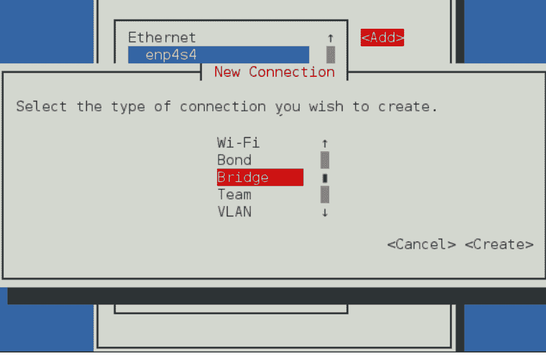

2. 选择 Bridge（桥接），打开 Edit connection（编辑连接）屏幕。

3. 要向桥接添加接口，选择 Add（添加），打开 New Connection（新连接）屏幕。一旦选择了连接类型，选择 Create（创建）按钮即可显示桥接的 Edit Connection 。

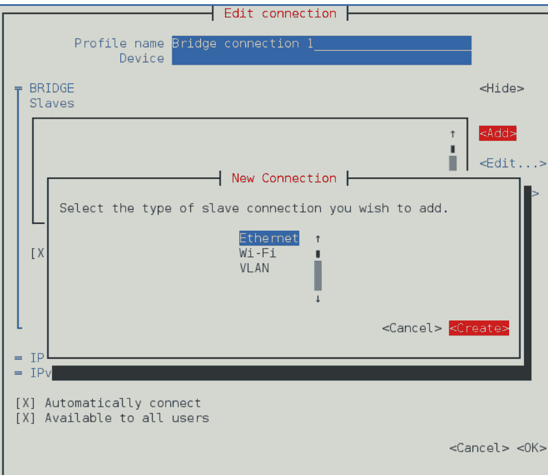

图 9.2. NetworkManager 文本用户界面添加新的桥从从连接菜单

4. 在 Device（设备）部分输入所需的从机设备名称或 MAC 地址。如果需要，通过选择 Ethernet 右侧的 Show（显示）来输入作为桥接 MAC 地址的克隆 MAC 地址。点击 OK 按钮。

> 注意

如果指定设备时未指定 MAC 地址，则在重新加载 Edit Connection 窗口后，Device 部分将自动填充，但前提是成功找到了该设备。

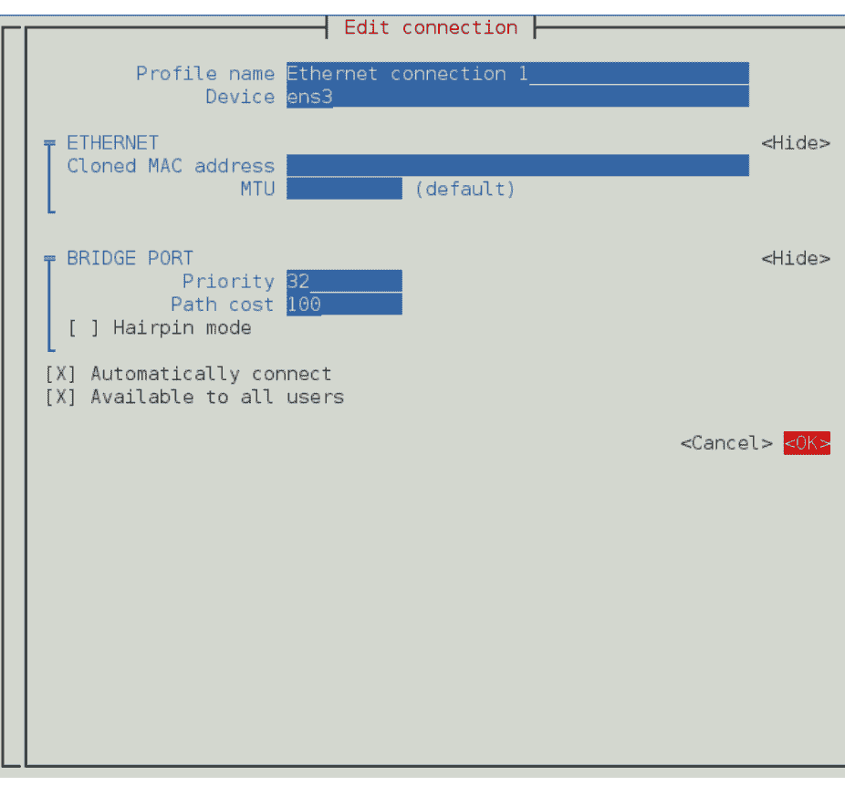

5. 桥接名称出现在 Slaves（从机）部分。重复上述步骤进行添加。

6. 在选择 OK 按钮之前检查设置。

## 9.2. 使用 NETWORK MANAGER 命令行

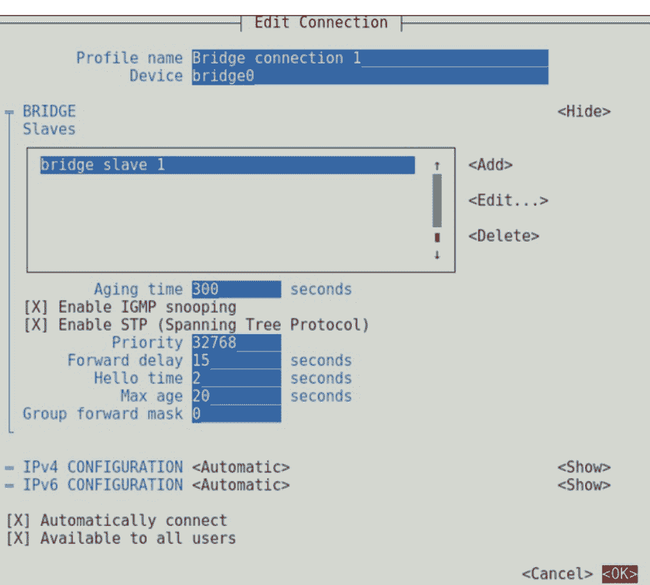

图 9.4. NetworkManager 文本用户界面添加新的桥从从连接菜单

要创建一个桥接，执行以下命令：

```
$ nmcli add type bridge name br0
```

如果没有指定名称，名称将为 `br0`。

要查看桥接设置，执行以下命令：

```
$ nmcli show
```

生成树协议 (STP) 默认启用。要使用非默认值创建桥接，执行命令：

```
$ nmcli add type bridge name br0 priority 10
```

数字越小越优先。要将现有桥接的优先级更改为非默认值，执行如下格式的命令：

```
$ nmcli connect modify bridge-br priority
```

要将接口 `ensp1` 添加到桥-`br0`，执行如下命令：

```
$ nmcli add type ethernet interface ensp1 master bridge-br0
```

要将现有连接接入桥接，请按以下步骤操作：

1. 更改其 `master` 和 `slave-type` 属性。例如，将名为 `vlan100` 的现有 VLAN 连接接入桥接：

```
$ nmcli connection modify vlan100 master bridge-br0 slave bridge
```

激活连接以应用更改：

```bash
$ nmcli connection up vlan100
```

要使用交互模式更改值，请执行以下命令：

```bash
$ nmcli connection edit bridge-br0
```

你将进入 `nmcli` 提示符：

```
nmcli> set bridge.priority 4096
nmcli> save
nmcli> quit
```

连接 'bridge-br0' 已成功保存。

请参阅第 3.3 节“使用 nmcli 配置 IP 网络”以介绍 `nmcli`。

## 9.3 使用命令行界面 (CLI)

### 9.3.1 检查是否安装了桥接内核模块

在 Red Hat Linux 7 中，默认加载了桥接模块。如果需要，你可以通过 root 用户执行以下命令来确保模块已加载：

```
# modprobe bridge
modprobe: ERROR: could not insert 'bridge': Module already in kernel
```

要显示有关模块的信息，请执行以下命令：

```bash
$ modinfo bridge
```

更多选项请参阅 `modprobe(8)` 手页。

### 9.3.2 创建网络桥接

要创建网络桥接，请在`/etc/sysconfig/network-scripts/`目录下创建一个名为`ifcfg-brN`的，将 N 替换为接口数字（例如 0）。该文件的内容与任何被桥接的接口类型相似，例如以太网接口。本示例中的区别在于：

- `DEVICE`指令以`brN`格式提供接口名称作为参数，其中 N 被替换为接口号。
- `TYPE`指令指定为`Bridge`。该指令决定设备类型，且区分大小写。
- 桥接接口配置文件分配了 IP 地址，而物理接口配置文件必须仅包含 MAC 地址（见下文）。
- 为桥接器额外添加了一个指令`DELAY=0`，桥接器会监控流量、确定主机位置，并构建 MAC 地址表作为其过滤决策的基础。如果不存在可能的路由环路，则不需要默认延迟。

#### 示例 9.1. ifcfg-br0 接口文件

以下是一个使用静态 IP 地址的桥接接口配置文件示例：

```text
DEVICE=br0
TYPE=Bridge
IPADDR=192.168.1.1
PREFIX=24
BOOTPROTO=none
ONBOOT=yes
DELAY=0
```

创建另一个接口或修改现有接口，并将其指向桥接接口。

#### 示例 9.2. ifcfg-enp1s0 接口配置文件

以下是一个指向桥接接口的以太网接口配置文件示例。在`/etc/sysconfig/network-scripts/ifcfg-device_name`中配置你的物理接口，其中 `device_name` 是接口名称：

```text
DEVICE=device_br0
TYPE=Ethernet
HWADDR=AA:BB:CC:DD:EE:FF
BOOTPROTO=none
ONBOOT=yes
BRIDGE=br0
```

可选地使用`NAME`指令指定名称。如果未指定名称，NetworkManager 插件 `ifcfg-br0` 将以“类型 接口”的格式为连接配置创建一个名称。在本示例中，通过在`ifcfg-br0`文件中添加`NAME=bridge-br0`，该连接配置将被命名为`bridge-br0`。

对于`DEVICE`设备，几乎可以使用任何接口，因为它不决定设备类型。并不严格要求`TYPE=Ethernet`。如果未设置`TYPE`指令，则设备被视为以太网设备（除非其名称显式匹配不同的接口配置文件）。

指令区分大小写。

使用`HWADDR`指令指定硬件或 MAC 地址将影响设备命名程序，详见第 11 节“一致性网络设备命名”。

# 网络指南

> 如果你正在远程主机上配置配置桥接，并且你通过正在配置的物理网卡连接到该主机，请在继续之前考虑丢失连接的后果。重启服务时你将丢失连接，如果发生任何错误，可能无法恢复连接。建议使用控制台或带外访问。

要打开新的或最近配置的接口，请以 root 执行执行以下格式的命令：

- `ifup device`

此命令将检测 NetworkManager 是否运行，并调用`nmcli con load UUID`然后调用`nmcli con up UUID`。

或者，要重新加载所有接口，请以 root 执行以下命令：

```bash
~# systemctl restart network
```

此命令将停止网络服务、启动网络服务，然后对所有`ONBOOT=yes`的 ifcfg 文件调用`ifup`。

> 注意

默认行为是 NetworkManager 不感知 ifcfg 文件的更改，并继续使用旧配置数据直到接口下次启动。这是通过 `NetworkManager.conf` 文件中的 `monitor-connection-files` 设置的。更多信息请参阅 `NetworkManager.conf(5)` 手页。

### 9.3.3 带 Bond 的网络桥接

现在提供一个由两个或多个以太网接口形成的网络桥接示例，这是虚拟化环境中的另一个常见应用。如果你熟悉绑定（bonded）接口，请参阅第 7.4 节“创建 Bond 接口”。

创建两个多个需要绑定的接口配置文件，如下：

```text
DEVICE=interface_name
TYPE=Ethernet
SLAVE=yes
MASTER=bond0
BOOTPROTO=none
HWADDR=AA:BB:CC:DD:EE:FF
```

> 注意

使用`interface_name`作为接口名称是常见做法，但几乎可以使用任何接口。

关于配置绑定模块的进一步说明，请参阅第 7.7 节“使用 Bonding”。

创建一个配置文件`/etc/sysconfig/network-scripts/ifcfg-bond0`，如下：

```text
DEVICE=bond0
ONBOOT=yes
BONDING_OPTS='mode=1 miimon=100'
BRIDGE=bond0
```

## 9.4 使用 GUI 配置桥接

在启动桥接接口时，NetworkManager 会等待至少有一个端口进入“转发”状态，然后开始任何依赖于网络的 IP 配置（如 DHCP 或 IPv6 自动配置）。静态 IP 地址允许在任何从或端口开始转发数据包之前进行。

### 9.4.1 使用 GUI 建立桥接连接

程序 9.1. 使用 nm-connection-editor 添加新的桥接

按照以下指令创建新的桥接连接：

1. 在终端中输入`nm-connection-editor`：

```bash
~$ nm-connection-editor
```

2. 点击 **Add**（添加）按钮。出现 **Choose a Connection Type** 窗口。选择 **Bridge** 并点击 **Create**（创建）。出现 **Editing Bridge connection1** 窗口。

图 9.5. 编辑桥接连接 1

3. 参考下方的程序 9.3，“向桥接器添加从设备接口”来添加从设备。

## 程序 9.2. 编辑现有的桥接连接

1. 在终端中输入`nm-connection-editor`：

```
~$ nm-connection-editor
```

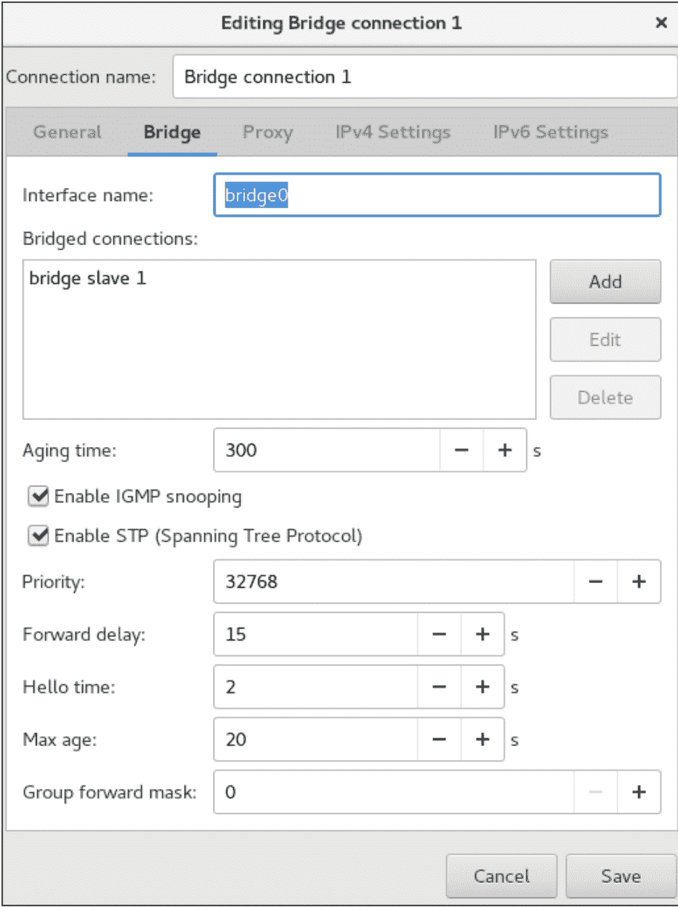

# 网络指南

2. 选择您想要编辑的桥接连接。

3. 点击“编辑”（Edit）按钮。

### 配置连接名称、自动连接行为和可用性设置

“编辑”对话框中的五个设置适用于所有连接类型，请参见“常规”（General）选项卡：

- 连接名称（Connection name） – 为您的网络连接输入一个描述性名称。该名称将用于用于在“网络”窗口的菜单中列出此连接。
- 当网络可用时自动连接到此网络（Automatically connect to this network when it is available） – 如果您希望 NetworkManager 在网络可用时自动连接到此连接，请勾选此框。更多信息请参见“使用控制中心编辑现有连接”章节。


所有用户均可连接此网络（All users may connect to this network）——勾选此框可创建一个系统中所有用户可用的连接。更改此设置可能需要 `root` 权限。详情参见第 3.4.5 节“使用 GUI 管理系统级和私有连接配置文件”。

使用此连接自动连接到 VPN（Automatically connect to VPN using this connection）——如果您希望 `NetworkManager` 在 VPN 可用时自动连接到 VPN 连接，请勾选此框。从下拉菜单中选择 VPN。

防火墙区域（Firewall Zone）——从下拉菜单中选择防火墙区域。有关防火墙区域的更多信息，请参阅《Red Hat Enterprise Linux 7 安全指南》。

## 9.4.1. 配置桥接器选项卡

| 参数 | 说明 |
| :--- | :--- |
| 接口名称（Interface name） | 桥接的接口的名称。 |
| 桥接连接（Bridged connections） | 一个或多个从设备接口。 |
| 老化时间（Aging time） | MAC 地址保留在 MAC 地址转发数据库中的时间（秒）。 |
| 启用 IGMP 侦听（Enable IGMP snooping） | 如果需要，勾选此框启用设备上的 IGMP 侦听。 |
| 启用 STP（生成树协议）（Enable STP (Spanning Tree Protocol)） | 如果需要，勾选此框启用 STP。 |
| 优先级（Priority） | 桥接器优先级；优先级最低的桥接器将被选为根桥接器。 |
| 转发延迟（Forward delay） | 进入转发状态之前在“监听”和“学习”状态下花费的时间（秒）。默认为 15 秒。 |
| Hello 时间（Hello time） | 在桥接协议数据单元（BPDU）中发送配置信息的时间间隔（秒）。 |
| 最大老化（Max age） | 存储来自 BPDU 配置信息的最大时间（秒）。此值应为 Hello 时间的两倍加 1，再减去转发延迟的两倍减 1。 |
| 组转发掩码（Group forward mask） | 该属性是一组掩码，允许组播地址进行转发。在某些情况下，范围从 `01:80:C2:00:00:00` 到 `01:80:C2:00:00:0F` 的组播地址不会被桥接器转发。该属性是一个 16 位掩码，每个位对应范围内的可转发的组播地址。注意，`组转发掩码`不能将任何 `0`、`1`、`2` 位设置为 `1`，因为这些地址用于生成树协议（STP）、链路聚合控制协议（LACP）和以太网 MAC 帧。 |

## 程序 9.3. 向桥接器添加从设备接口

1. 要向桥接器添加端口，请选择“编辑桥接连接 1”窗口中的“桥接”（Bridge）选项卡。如有必要，按照程序 9.2“编辑现有桥接连接”中的步骤打开此窗口。

2. 点击“添加”（Add）。出现“选择连接类型”菜单。

3. 从列表中选择要创建的连接类型。点击“创建”（Create）。出现适用于所选连接类型的窗口。

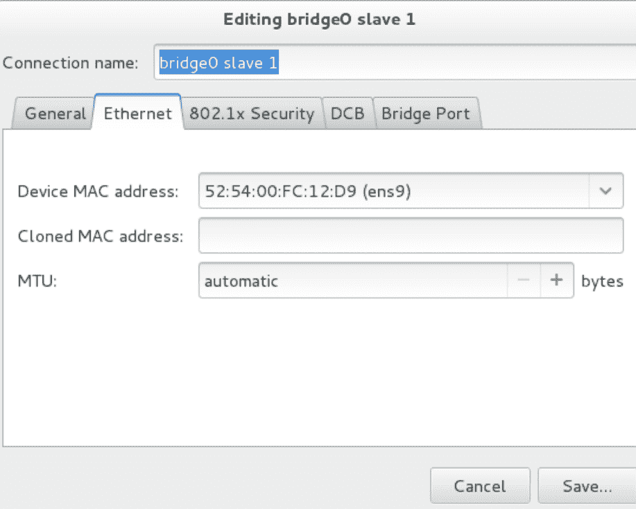

4. 选择“桥接端口”（Bridge Port）选项卡。根据需要配置优先级（Priority）和路径代价（Path cost）。桥接端口的 STP 优先级受 Linux 内核限制。虽然标准允许 0 到 255 的范围，但 Linux 仅允许 0 到 63。默认情况下默认值为 32。

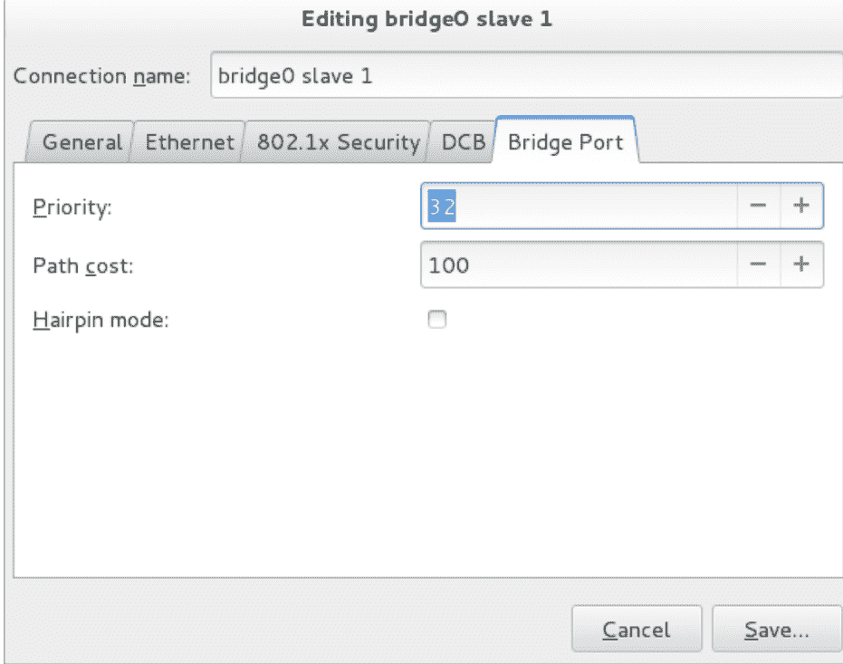

5. 如果需要，勾选“发夹模式”（Hairpin mode）框以启用外部处理的帧转发。也称为虚拟以太网端口聚合器（VEPA）模式。

然后：

- 以太网从设备，点击以太网（Ethernet）选项卡并进入“基本配置选项”部分；或者；
- 绑定从设备（Bond slave），点击 Bond 选项卡并进入第 7.8.1.1 节“配置 Bond 选项卡”；或者；
- Team 从设备（Team slave），点击 Team 选项卡并进入第 8.14.1.1 节“配置 Team 选项卡”；或者；
- VLAN 从设备（VLAN slave），点击 VLAN 选项卡并进入第 10.5.1.1 节“配置 VLAN 选项卡”。
- 若要使用 `NetworkManager` 的用户界面工具 `nmtui` 配置 VLAN 接口，请参阅第 10.2 节“使用用户界面 `nmtui` 配置 802.1Q VLAN 标记”。
- 若要使用 `NetworkManager` 的命令行工具 `nmcli` 配置 VLAN 接口，请参阅第 10.3 节“使用命令行工具 `nmcli` 配置 802.1Q VLAN 标记”。
- 若要手动配置网络接口，请参阅第 10.4 节“使用命令行配置 802.1Q VLAN 标记”。
- 若要使用图形化用户界面工具配置网络，请参阅第 10.5 节“使用 GUI 配置 802.1Q VLAN 标记”。

## 10.2. 使用用户界面配置 802.1Q VLAN 标记

文本用户界面工具 `nmtui` 可在终端窗口中配置 802.1Q VLAN。执行以下命令启动该工具：

```bash
~$ nmtui
```

文本用户界面将出现。任何无效命令都将打印用法信息。

使用方向键或按 Tab 键向前移动选项，按 Shift+Tab 键向后移动。按 Enter 键选择选项。空格键切换复选框的状态。

从启动菜单开始，选择“编辑连接”（Edit a connection）。选择“添加”（Add），将打开“新连接”屏幕。

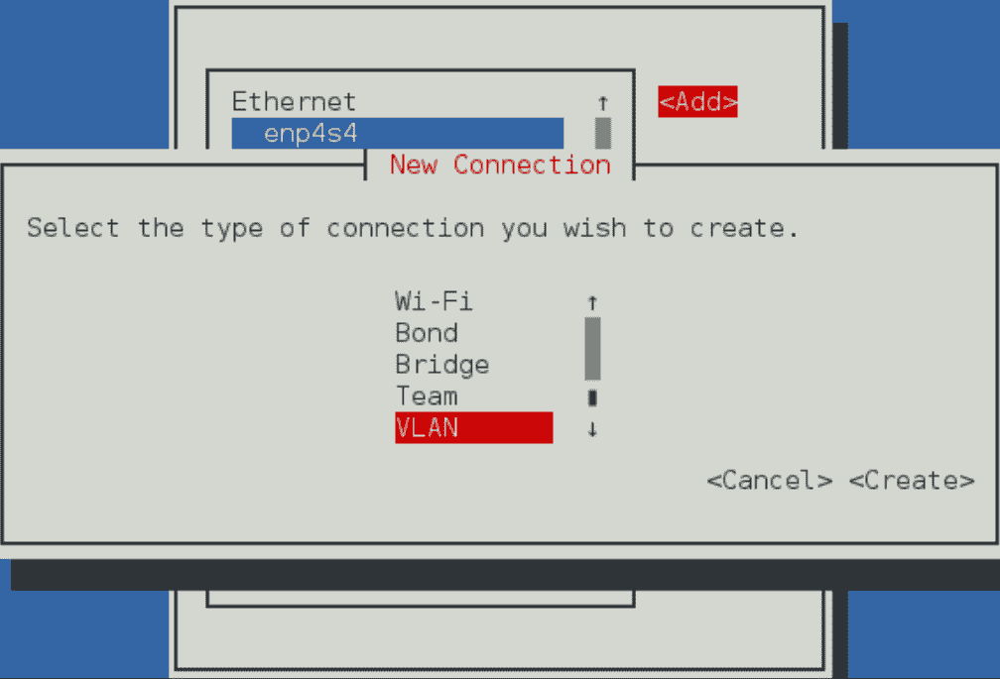

选择 VLAN，将打开“编辑连接”屏幕。按照屏幕上的提示完成配置。

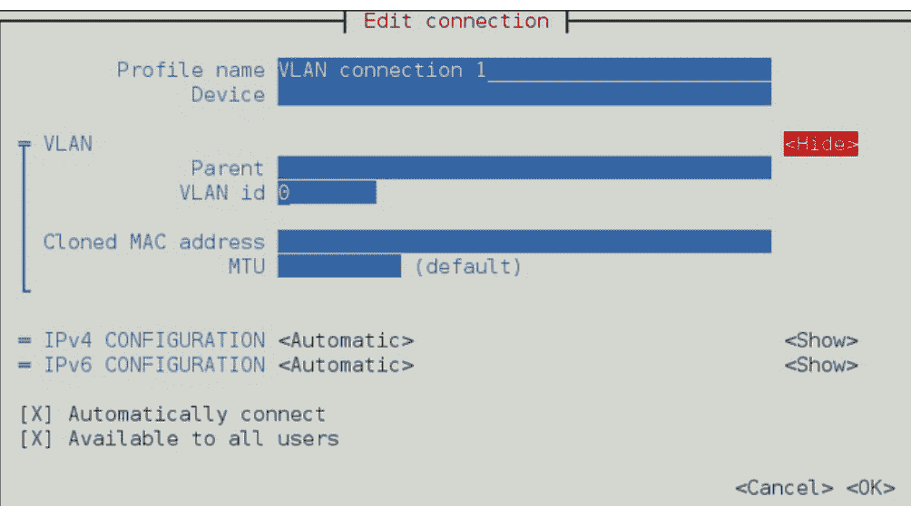

访问第 10.5.1.1 节“配置 VLAN 选项卡”获取 VLAN 术语的定义。

参阅第 3.2 节“使用 `nmtui` 配置 IP 网络”获取有关安装 `nmtui` 的信息。

## 10.3. 使用命令行工具 `nmcli` 配置 802.1Q VLAN 标记

要查看系统上的可用接口，执行以下命令：

```bash
~$ nmcli con show
```

| NAME | UUID | TYPE | DEVICE |
| :--- | :--- | :--- | :--- |
| System en2s0 | 9c92fad9-6ecb-3e6c-eb4d-8a4766f5c04 | 802-3-ethernet | en2s0 |
| System enp1s0 | 5fb0b6d0-0bd0-7ffb-451-d6dd6f53e03 | | |

注意，输出中的 `FIELD` 字段始终表示连接 ID。尽管它看起来像接口名称，但它并不是接口名称。该 ID 可在 `nmcli` 连接中识别连接。`DEVICE` 名称可用于防火墙等其他应用程序。

要在以太网接口 `enp1s0` 上创建一个 VLAN ID 为 10 的 802.1Q VLAN 接口，请执行以下命令：

```bash
~$ nmcli con add type vlan ifname VLAN10 dev enp1s0 id 10
Connection 'vlan-VLAN10' (37750b4a-e85f-40e6-b9b-42b1a4b6d17) successfully added.
```

注意，如果未为 VLAN 指定名称，则名称将通过在接口名称前加上前缀派导出。或者，使用 `con-name` 选项指定名称如下：

```bash
~$ nmcli con add type vlan con-name VLAN12 dev en1ps0 id 12
Connection 'VLAN12' (b796c1a8-9f5f-441c-b35ec-f594d40e6533) successfully added.
```

### 为 VLAN 接口分配地址

你可以使用 `nmcli` 命令像配置其他接口一样分配静态和动态接口地址。

例如，创建一个具有静态 IPv4 地址和网关的 VLAN 接口的命令如下：

```bash
~$ nmcli con add type vlan con-name VLAN20 dev en1ps0 id 20 ipv4 10.10.10.10/24 gw4 10.10.10.24
```

创建一个使用动态分配地址的 VLAN 接口，执行以下命令：

```bash
~$ nmcli con add type vlan con-name VLAN30 dev en1ps0 id 30
```

参阅第 3.3.6 节“使用 `nmcli` 连接到网络”获取使用 `nmcli` 命令配置接口的示例。

要查看已创建的 VLAN 接口，执行以下命令：

| NAME | UUID | TYPE | DEVICE |
| :--- | :--- | :--- | :--- |
| VLAN12 | 4129a37d-4feb-4be5-ac17-14a19382175 | vlan | en1ps0.12 |
| System enp2s0 | 9c2faad9-6e3c-36ec-eb4d-8a476f5c04 | 802-3-ethernet | enps0 |
| System enp1s0 | 5f60b60-b0d0-77fb-a541-ddd6653e0 | | en1ps0 |
| vlan-VLAN10 | 1be91518-112c-461a-a40d9342fd | vlan | VLAN10 |

要查看有关新配置连接的详细信息，执行以下命令：

```bash
~$ nmcli -p show VLAN12
```

```
===================
Connection profile details (VLAN12)
===================
connection.id: VLAN12
connection.uuid: 4129a37d-4feb-4be5-ac17-14a19382175
connection.interface-name:
connection.type: vlan
connection.autoconnect: yes
802-3-ethernet.port: --
802-3-ethernet.speed: 0
802-3-ethernet.auto-negotiate: --
802-3-ethernet.mac-address: --
802-3-ethernet.cloned-mac-address: --
802-3-ethernet.blacklist: --
802-3-ethernet.mtu: auto
vlan.interface-name: --
vlan.parent: en1s0
vlan.id: 12
vlan.flags: (NONE)
vlan.ingress-priority-map:
vlan.egress-priority-map:
Activate connection details (4129a37d-4feb-4be5-ac17-14a19382175)
GENERAL.NAME: VLAN12
GENERAL.UUID: 4129a37d-4feb-4be5-ac17-14a19382175
GENERAL.DEVICES: en1s0.12
GENERAL.STATE: activating
```

VLAN 命令的更多选项列在 `nmcli(1)` 手册的 VLAN 部分。man 页面中创建 VLAN 的设备指的是父设备。在上面的示例中，通过接口名称 `en1s0` 指定设备，也可以通过连接 UUID 或 MAC 地址指定。

要在以太网接口 `enp2s0` 上创建一个具有入口映射的名称为 VLAN1 ID 为 13 的 802.1Q VLAN 连接，执行以下命令：

```bash
~$ nmcli add type vlan con-name VLAN1 dev en2s0 id 13 ingress "2:3:3:5"
```

要查看与上述 VLAN 相关的所有参数，执行以下命令：

```bash
~$ nmcli show vlan-VLAN10
```

要更改 MTU，使用以下命令：

```bash
~$ nmcli modify vlan-VLAN10 802.mtu 1496
```

MTU 设置决定了网络包的最大大小。链路层帧可以携带的最大负载限制了网络 MTU。对于标准以太网帧，MTU 为 1500 字节。设置 VLAN 时，不需要更改 MTU，因为链路层帧增加了 4 字节以适应 802.1Q。

在编写本文时，`connection.interface-name` 和 `vlan.interface-name` 必须相同（如果它们已设置）。它们必须使用 `nmcli` 的交互模式同时更改。更改 VLAN 连接名称，执行以下命令：

```bash
~$ nmcli edit vlan-VLAN10
nmcli> set vlan.interface-name superVLAN
nmcli> set connection.interface-name superVLAN
nmcli> save
nmcli> quit
```

可以使用 `nmcli` 工具设置和清除 ioctl 标记，更改 802.1Q 代码的功能方式。`NetworkManager` 支持以下 VLAN 标记：

- `0x01`：输出包头的重排序
- `0x02`：使用 GVRP 协议
- `0x04`：接口及其主设备的松散绑定

VLAN 的状态同步到父接口或主接口（创建 VLAN 的接口或设备）。如果父接口被设置为“关闭”（down）管理状态，则所有 VLAN 将关闭且所有路由将从路由表中清除。`0x04` 启用*松散绑定*模式，在该模式下，仅从父设备传递到关联 VLAN，或者不更改 VLAN 设备状态。

要设置 VLAN 标记，执行以下命令：

```bash
~$ nmcli connection modify vlan-VLAN10 vlan.flags 1
```

参阅第 3.3 节“使用 `nmcli` 配置 IP 网络”以介绍 `nmcli`。

## 10.4. 使用命令行配置 802.1Q VLAN 标记

在 Red Hat Enterprise Linux 中，`8021q` 模块默认加载。如果需要，可以通过以 `root` 身份执行以下命令确保模块已加载：

```bash
~$ modprobe --first-time 8021q
modprobe: ERROR: could not insert '8021q': Module already in kernel
```

要显示有关模块的信息，执行以下命令：

```bash
~$ modinfo 8021q
```

请查看 `modprobe(8)` man 页面获取更多命令选项。

# 第 10 章. 配置 802.1Q VLAN 标记

如果需要配置第二个 VLAN（例如在同一接口 `enp0` 上配置 VLAN 193），请创建一个名为 `enp0.193` 的新文件，并在其中写入 VLAN 配置详细信息。

- 重启网络服务以使更改生效。请以 `root` 身份执行以下命令：

```
~# systemctl restart network
```

## 10.4.2. 使用 `ip` 命令配置 802.1Q VLAN 标记

要在以太网接口 `enp0` 上创建一个名为 VLAN8 且 ID 为 `8` 的 802.1Q VLAN 接口，请以 `root` 身份执行命令：

```
~# ip link add enp0 name enp0.8 type vlan id 8
```

要查看 VLAN，请执行命令：

```
$ ip -d show enp0.8
4: enp0.8@enp0:BROADCAST,MULTICAST,UP,LOWER_UP> mtu 1500 qdisc noqueue state UP DEFL
link/ether 52:54:00:ce:5f:66 brd ff:ff:ff:ff:ff promiscuity 0
vlan protocol 802.1Q id 8 <REORDER_HDR>
```

注意，如果 VLAN 前面有 `0x`，`ip` 工具将将其解释为十六进制值；如果以 `0` 开头，则解释为八进制值。这意味着为了分配十进制值为 `22` 的 VLAN ID，你不能添加任何零。

要删除 VLAN，请以 `root` 身份执行命令：

```
~# ip link delete enp0.8
```

要使用属于多个 VLAN 的多个接口，请在物理接口 `enp0` 上创建具有相应 VLAN ID 的本地 `enp0.1` 和 `enp0.2`：

```
~# ip link add enp0 name enp0.1 type vlan id 1
ip link set dev enp0.1 up
~# ip link add enp0 name enp0.2 type vlan id 2
ip link set dev enp0.2 up
```

注意，如果在物理设备上没有配置 VLAN，在物理设备上运行网络嗅探器可以捕获到达该物理设备的标记帧。例如：

```
tcpdump -nei enp0 -vvv
```

> **注意**

在命令行提示符 `ip` 命令创建的 VLAN 接口会在系统关闭或重启后丢失。要使 VLAN 接口在系统重启后持久化，请使用 `ifcfg` 文件。请参见第 10.4.1 节“使用 `ifcfg` 文件设置 802.1Q VLAN 标记”。


## 10.5. 使用 GUI 配置 802.1Q VLAN 标记

### 10.5.1. 建立 VLAN 连接

你可以使用`nm-connection-editor`，使用现有接口作为父接口来创建 VLAN。注意，如果父接口设置为自动连接，则 VLAN 设备将自动创建。

**步骤 10.1. 使用 `nm-connection-editor` 添加新的 VLAN 连接**

1. 在终端中输入`nm-connection-editor`：

   ```bash
   ~$ nm-connection-editor
   ```

2. 点击“添加”（Add）按钮。出现“选择连接类型”窗口。选择 VLAN 并点击“创建”（Create）。出现“编辑 VLAN 连接 1”窗口。

3. 在 VLAN 选项卡上，从下拉列表中选择你想要用于 VLAN 连接的父接口。

4. 输入 VLAN ID。

5. 输入 VLAN 接口名称。这是将创建的接口名称。例如。

6. 检查并确认设置，然后点击“保存”（Save）按钮。

7. 如需编辑 VLAN 特定设置，请参见第 10.5.1.1 节，“配置 VLAN 选项卡”。

## 第 10 章. 配置 802.1Q VLAN 标记

图 10.3. 使用`nm-connection-editor`添加新的 VLAN 连接

### 步骤 10.2. 编辑现有的 VLAN 连接

按照以下步骤编辑现有的 VLAN 连接。

1. 在终端中输入`nm-connection-editor`：

   ```bash
   ~$ nm-connection-editor
   ```

2. 选择要编辑的连接并点击“编辑”（Edit）按钮。

3. 选择“通用”（General）选项卡。

4. 配置连接名称、自动连接行为和可用性设置。

   “编辑”对话框中的这些设置适用于所有连接类型：

   - 连接名称 – 为你的网络连接输入一个描述性名称。此名称将用于在网络窗口的 VLAN 中列出此连接。

   - 可用时自动连接到此网络 – 如果你希望 NetworkManager 在此连接可用时自动连接，请勾选此项。更多信息请参阅“使用控制中心编辑现有连接”章节。

   - 对所有用户可用 – 勾选此框以创建一个系统上所有用户都可用的连接。详情请参见第 3.4 节，“管理系统级和私有连接配置”。

5. 如需编辑 VLAN 特定设置，请参见第 10.5.1.1 节，“配置 VLAN 选项卡”。

## 保存你的新（或修改过的）连接并进行后续

一旦完成 VLAN 连接的编辑，点击“保存”（Save）以自定义你的配置。然后，为了：

- 配置连接的 IPv4 设置，点击 IPv4 选项卡并进入第 5.4 节，“配置 IPv4 设置”。

- 配置连接的 IPv6 设置，点击 IPv6 选项卡并进入第 5.5 节，“配置 IPv6 设置”。

### 10.5.1. 配置 VLAN 选项卡

如果你已经按照步骤 10.1 “使用`nm-connection-editor`添加新的 VLAN 连接”，可以编辑 VLAN 选项卡来设置：

- 父接口：可以在下拉列表中选择已配置的接口。

- VLAN ID：用于标记 VLAN 的数字。

- VLAN 接口：将创建的接口名称。例如`enp1`或`vlan2`。

- 克隆 MAC 地址：可选设置更改通过此 VLAN 的包的源 MAC 地址。

- MTU：可选设置通过此 VLAN 的包的最大传输单元（MTU）大小。

## 10.6. 使用命令在 BOND 和 BRIDGE 上配置 VLAN

要在 bond 和 bridge 上使用 VLAN，请按照以下步骤操作：

1. 以`root`身份添加 bond 设备：

   ```bash
   # ip link add bond0 type bond
   # ip link set bond0 miimon 100 mode-backup
   # ip link set em1 down
   # ip link set em2 down
   # ip link set bond0 up
   ```

2. 在 bond 设备上设置 VLAN：

   ```bash
   # ip link add bond0 name bond0.2 type vlan id 2
   # ip link set bond0.2 up
   ```

3. 添加 bridge 设备并将 VLAN 附加到它：

   ```bash
   # ip link add br0 type bridge
   # ip link set bond0.2 master br0
   # ip link set br0 up
   ```

## 10.7. 使用网络管理器工具 NMCLI 在 BOND 和 BRIDGE 上配置 VLAN

要在 bond 和 bridge 上使用 VLAN，请按照以下步骤操作：

1. 添加 bond 设备：

   ```bash
   ~$ nmcli connection add type bond ifname bond0 "mode=active-backup,miimon=100" ipv4.method disabled ipv6.method ignore
   ```

   注意此 bond 连接仅作为 VLAN 的“底层接口”，不获取任何 IP 地址。因此，命令行添加了`ipv4.method disabled`和`ipv6.method ignore`参数。

2. 为 bond 设备添加从设备（slaves）：

   ```bash
   ~$ nmcli connection add type ethernet con-name Slave1 ifname em1 master bond0 slave-type bond
   ~$ nmcli connection add type ethernet con-name Slave2 ifname em2 master bond0 slave-type bond
   ```

3. 添加 bridge 设备：

   ```bash
   ~$ nmcli connection add type bridge con-name Bridge0 br0 ip 192.0.2.1/24
   ```

4. 在 bond 上添加 VLAN 接口，并绑定到 bridge 设备：

   ```bash
   ~$ nmcli connection add type vlan con-name VLAN2 ifname bond0.2 dev bond0 id 2 master br0 slave-type bridge
   ```

5. 查看创建的连接：

   | 名称 | UUID | 类型 | 设备 |
   |---|---|---|---|
   | Bond0 | 05f8f6fa-72c3-4803-8743-2377f0c10bed | bond | bond0 |
   | Bridge2 | 22dc3d0e-d79a-4779-80de-1071c2bed61 | bridge | br0 |
   | Slave1 | e59e13cd-d749-42f4-daee2-de3bafac698 | 802-ethernet | em1 |
   | Slave2 | 25361a76-66b3-cae5-9073-05be5ab8b1c1 | 802-ethernet | em2 |
   | Vlan2 | 22333426-eea4-451d-a589-336f032ec822 | vlan | bond0.2 |

## 配置 VLAN 端口模式

Red Hat Enterprise Linux 经常作为路由器，需要对其网络接口进行高级 VLAN 配置。当以太网接口连接到交换机且物理接口上运行 VLAN 时，需要设置端口模式（switchport mode）。Red Hat Enterprise Linux 服务器或工作站仅连接到一个 VLAN，这使得接入模式（access mode）适用且是默认设置。

在某些场景下，多个 VLAN 使用相同的物理链路（即交换机与 Red Hat Enterprise Linux 机器之间的以太网），这需要在两端都配置链路模式（trunk mode）。

例如，当 Red Hat Enterprise Linux 机器用作路由器时，机器需要将来自各种 VLAN 的标记包通过同一物理以太网转发到路由器的交换机，并保持这些 VLAN 之间的隔离。

根据描述的设置，例如第 10.3 节，“使用命令行工具`nmcli`配置 802.1Q VLAN”，应使用 Cisco switchport mode trunk。如果你仅在接口上设置了 IP 地址，请使用 Cisco switchport mode access。

## 10.9. 更多资源

- `ip-link(8)` 手页 – 描述`ip`工具的网络设备配置命令。

- `nmcli(1)` 手页 – 描述 NetworkManager 的命令行工具。

- `nmcli-examples(5)` 手页 – 提供`nmcli`命令示例。

- `nm-settings(5)` 手页 – 描述 NetworkManager 连接的设置和参数。

- `nm-settings-ifcfg-rh(5)` 手页 – 描述`/etc/sysconfig/network-scripts/ifcfg-*`文件中的 ifcfg-rh 设置。

# 第 11 章 一致的网络设备命名

Red Hat Enterprise Linux（红帽企业级 Linux）为网络接口提供了一致且可预测的网络设备命名方法。这些功能通过更改系统上网络接口的名称，以便更容易地定位和区分接口。

传统上，Linux 中的网络接口被枚举为`eth[0123...s0]`，但这些名称并不一定对应机箱上的实际标签。具有多个适配器的现代服务器平台可能会遇到这些接口的非确定性和违背直觉的命名。这会影响板载在主板上的网络适配器（板载网，或 LOM）以及插卡（单口和多口）适配器。

在 Red Hat Enterprise Linux 中，`udev`支持多种不同的命名方案。默认是根据固件、拓扑结构和位置信息分配名称。这种方案的优点是名称是全自动且可预测的，即使在添加或删除硬件时也能保持不变（不会发生重新枚举），并且可以无缝替换损坏的硬件。缺点是它们比传统的`eth`命名更难查找。例如：`enp5s0`。

> **警告**
>
> 不要禁用一致的网络设备命名，因为这将允许系统使用`ethX`风格的名称，其中`X`是对应特定接口的唯一数字，在启动过程中网络接口可能会有不同的名称。更多信息请参见第 11.10 节“故障排除网络设备命名”。

## 11.1. 命名方案分级

默认情况下，`systemd`将使用以下策略应用支持的命名方案：

- 方案 1：包含固件或 BIOS 提供的板载设备索引号（例如`en01`）的名称。如果固件或 BIOS 中的这些信息适用且可用，则应用，否则回退到方案 2。

- 方案 2：包含固件或 BIOS 提供的 PCI 热插索引号（例如`ens1`）的名称。如果固件或 BIOS 中的这些信息适用且可用，则应用，否则回退到方案 3。

- 方案 3：包含硬件连接器物理位置的名称（例如`enp2s0`）。如果适用则应用，在所有其他情况下直接回退到方案 5。

- 方案 4：包含接口 MAC 地址的名称（例如`enx7e8d1ea46da`）。默认不使用，但如果用户可以选择可以使用。

- 方案 5：传统的不可预测内核命名方案。当所有其他方法都失败时使用（例如`enp1s0`）。

该策略和上述概述的程序是默认设置。如果系统启用了`biosdevname`，则将使用它。注意，启用`biosdevname`需要作为内核命令行参数传递`biosdevname=1`，但 Dell 系统除外，只要安装了`biosdevname`，它就会默认被使用。如果用户使用了已更改内核设备名称的`udev`规则，则这些规则具有更高的优先级。

## 11.2. 理解设备重命名过程

设备处理的详细步骤如下：

- `/usr/lib/udev/rules/60-net.rules`中的规则指示`udev`辅助工具`/lib/udev/rename_device`检查`/etc/sysconfig/network-scripts/ifcfg-suffix`文件。如果存在与接口`HWADDR`MAC 地址匹配的`ifcfg`条目，则将接口重命名为 UDEV 设备给出的名称。

- `/usr/lib/udev/rules/71-biosdevname.rules`中的规则指示`biosdevname`根据其命名策略重命名接口，前提是在此前的步骤中未被重命名、`biosdevname`已安装且启动命令行上没有`biosdevname=0`内核命令。

- `/usr/lib/udev/rules/75-net-description.rules`中的规则指示`udev`通过检查网络接口设备来填充终端`udev`设备属性值`ID_NAME_ONBOARD`、`ID_NET_NAME_SLOT`、`ID_NAME_PATH`、`ID_NAME_MAC`。注意，某些属性可能是未。

- `/usr/lib/udev/rules/80-net-name-slot.rules`中的规则指示`udev`重命名接口，前提是在未在步骤 1 或 2 中重命名，且设置了内核参数`net.ifnames=0`，其优先级如下：`ID_NET_NAME_ONBOARD`、`ID_NET_NAME_SLOT`、`ID_NET_NAME_PATH`。如果其中某项未设置，则最后回退到列表。如果其中任何项已设置，则接口将不会被重命名。

步骤 3 和 4 实现了第 11.1 节“命名方案分级”中描述的方案 1、2、3 以及可选的方案 4。步骤 2 在第 11.6 节“使用`biosdevname`进行一致性网络命名”中进行了详细解释。

## 11.3. 理解可预测的网络接口设备名称

名称根据接口类型具有两个字符的前缀：

- `en`代表以太网 Ethernet。

- `wl`代表无线局域网（WLAN）。

- `ww`代表无线广域网（WWAN）。

名称有以下类型：

- `<index>`

- `on-slot[f<function>][d<dev_id>]`

  热插槽索引号。所有多功能 PCI 设备都将在设备名称中带有`[f<function>]`数字，包括功能 0 设备。

- `x<MAC>`

  MAC 地址。

- `[P<domain>]p<b><s><slot>[f<function>][d<dev_id>]`

  PCI 地理位置。在 PCI 地理位置中，只有当值不为 0 时才会提到`[P<domain>]`数字。例如：`ID_NAME_PATH=/p1enp5s0`。

- `[P<domain>]p<b><s><slot>[f<function>][u<port>][.][c<config>][i<interface>]`

  USB 端口号。对于 USB 设备，由集线器数量链组成。如果名称超过 15 个字符的最大限制，则不会导出名称。如果链中有多个 USB 设备，则会抑制 USB 配置描述符（c1）和 USB 接口描述符（io）的默认值。

## 11.4. Linux on System Z 上的可用网络设备命名方案

使用`bus-id`为 Linux System Z 实例中的网络接口创建设备设备名称。`bus-id`识别 Linux 实例范围内的设备。对于 CCW 设备，总 ID 是带有前缀`n`的设备号，即子网通道。例如：`0.1-0ab1`。

设备类型为`Ethernet`的网络接口命名如下：

- `enccw0.0.1234`

设备类型为`SLIP`的 CTC 网络设备命名如下：

- `slccw0.0.1234`

使用`znet -c`命令或`lscsc -a`命令显示可用的网络设备及其 ID。

**表 11.1. Linux on System Z 的设备名称类型**

| 格式 | 说明 |
|---|---|
| `enccw-ID` | 设备类型 Ethernet |
| `slccw-ID` | 设备类型 SLIP 的 CTC 网络设备 |

## 11.5. VLAN 接口的命名方案

传统上，使用格式为`接口-name.VLAN-ID`的 VLAN 接口名称。VLAN-ID 范围从 0 到 4096，最多四个字符，总接口名称限制为 15 个字符。接口名称长度由内核头文件定义，这是一个全局限制，影响所有应用程序。

在 Red Hat Enterprise Linux 7 中，支持以下 VLAN 接口名称命名规范：

| VLAN 计划 | VLAN ID |
|---|---|
| 单词 vlan 加上 VLAN ID | 例如：`vlan0005` |
| VLAN 加上不带填充的 VLAN ID | 单词 vlan 加上不带填充的 ID。例如：`vlan5` |
| 设备名称加上 VLAN ID | 父接口名称加上 VLAN ID。例如：`enp1s005` |
| 设备名称加上不带填充的 VLAN ID | 父接口名称加上不带填充的 ID。例如：`enp1s0` |

## 11.6. 使用 BIOSDEVNAME 进行网络设备命名

通过`biosdevname`工具实现的此功能将板载网络接口、PCI 卡网络接口和虚拟函数接口从现有的`eth[0123...]`更改为表 11.2“biosdevname N”所示的新规范。注意，如果系统是 Dell 系统，或按照第 11.6.2 节“启用和禁用功能”显式启用了`biosdevname`，则系统命名方案具有更高的优先级。

**表 11.2. biosdevname 规范**

| 设备 | 旧名称 | 新名称 |
|---|---|---|
| 板载网络接口（LOM） | `eth[0123...]` | `em[1234...][a]` |
| PCI 卡网络接口 | `eth[0123...]` | `p<slot>-p<ethernet port>[b]` |
| 虚拟函数 | `eth[0123...]` | `p<slot>-p<ethernet port>_<virtual interface>[c]` |


+ [a] 新枚举从 1 开始。

[b] 例如：`p3p4`

[c] 例如：`p3p4_1`

### 11.6.1. 系统要求

`biosdevname` 程序使用系统 BIOS 信息，特别是 SMBIOS 中的类型 9（系统槽）和类型 41（嵌入扩展信息）字段。如果系统 BIOS 不具有 SMBIOS 2.6 或更高版本的这些数据，则将不使用新的命名规范。大多数旧硬件由于缺乏具有正确 SMBIOS 版本和字段信息的 BIOS，不支持此功能。如需 BIOS 或 SMBIOS 信息，请联系您的硬件供应商。

要使此功能生效，必须安装 `biosdevname` 包。请以 **root** 身份执行以下命令进行安装：

```
~# yum install biosdevname
```

## 11.6.2. 启用和禁用该功能

要禁用此功能，请在安装期间和之后的启动命令行中传递以下选项：

```
biosdevname=0
```

要启用此功能，请在安装期间和之后的启动命令行中传递以下选项：

```
biosdevname=1
```

除非系统满足最低要求，否则此选项将被忽略，系统将使用本章节开头描述的 **systemd** 命名方案。

如果安装了 **biosdevname** ，它在系统的整个生命周期内必须作为启动选项保留。

## 11.7. 管理员注意事项

许多系统自定义文件包含网络接口名称，因此在将系统从旧规范迁移到新规范时需要进行更新。如果您使用新的命名规范，还需要更新某些区域的网络接口名称，例如自定义 **iptables** 规则、修改 **irqbalance** 的脚本以及其他类似的配置文件。此外，在安装时启用此功能将需要修改通过 **ksdevice** 参数使用设备名称的 **kickstart** 文件；这些 **kickstart** 文件需要更新为设备的 MAC 地址或网络的新名称。

> 注意

接口名称的最大长度由内核头文件和全局限制定义，会影响所有应用程序。


## 11.8. 控制网络设备名称的选取

可以通过以下方式控制设备命名：

**通过识别网络接口设备**

在 **ifcfg** 文件中使用 **HWADDR** 指令设置 MAC 地址，可以使其被 **udev** 识别。名称将取自 **DEVICE** 指令提供的字符串，按照惯例，该字符串与 **ifcfg** 后缀相同。例如，**ifcfg-enp0**。

**通过开启或关闭 biosdevname**

将使用由 **biosdevname** 提供的名称（如果 **biosdevname** 能够确定）。

**通过开启或关闭 systemd-udev 命名方案**

将使用 systemd-udev 提供的名称（如果 systemd-udev 能够确定）。

## 11.9. 禁用一致性网络设备命名

禁用一致性网络设备命名仅建议用于特殊场景。有关更多信息请参见第 11 章“一致性网络设备命名”和第 11.10 节“网络设备命名故障排除”。要禁用一致性网络设备命名，请从以下选项中选择：

- 通过“屏蔽”默认策略的 udev 规则来禁用固定名称分配。可以通过创建一个指向 `/dev/null` 的符号链接来实现。这将使用不可预测的内核名称。以 root 身份输入以下命令：

```
# ln -s /dev/null /etc/udev.rules/80-net-name-slot.rules
```

- 创建您自己的手动命名方案，例如将接口命名为 `internet0`、`dmz0` 和 `lan0`。要做到这一点，请创建您的 udev 规则文件并为设备设置 `NAME` 属性。请确保在默认策略文件之前使用新名称，例如将其重命名为 `/etc/udev.rules/70-my-net-names.rules`。

- 修改默认策略以选择不同的命名方案，例如通过 MAC 地址为所有接口命名。以 root 身份按如下方式复制默认策略文件：

```
# cp /usr/lib/udev/rules/80-net-name-slot.rules /etc/udev.rules/80-net-name-slot.rules
```

编辑 `/etc/udev.rules/` 目录下的文件并根据需要更改行。

- 打开 `/etc/default/grub` 并找到 `GRUB_CMDMLINE_LINUX` 变量。


> 注意

`GRUB_CMDMLINE_LINUX` 是包含添加到内核命令行条目的变量。根据您的系统，它可能已经包含了额外的配置。

将 `net.interfaces=0` 和 `biosdevname=0` 同时作为内核参数值添加到 `GRUB_CMDMLINE_LINUX` 变量中：

```
# cat /etc/default/grub
GRUB_TIMEOUT=5
GRUB_DISTRIBUTOR="$(sed 's/.*$/g' /etc/system-release)"
GRUB_DEFAULT=saved
GRUB_DISABLE_SUBMENU=true
GRUB_TERMINAL_OUTPUT=""
GRUB_CMDMLINE_LINUX="dev.lv=/root_rhel_7/swap.rd.lvms.uuid=cc387312-d64-469a-8e49-b04cd5d8067a crashroot=console keymap=us console-latarcyh-sun16.rd.lv=/root quiet net.interfaces=0 biosdevname=0"
GRUB_DISABLE_RECOVERY=""
```

通过运行 `grub2-mkconfig` 命令重新构建 `/boot/grub2/grubcfg`：

```
# grub2-mkconfig -o /boot/grub2/grubcfg
```

## 11.10. 网络设备命名故障排除

## 示例 11.5 以太网接口前缀的局限性

前缀必须满足以下要求：

- 它由 ASCII 字符组成。

- 它是一个字母数字字符串。

- 长度小于 16 个字符。

- 它不与任何用于网络接口命名的已知前缀冲突，如 `eth`、`eno`、`ens` 和 `em`。

## 11.11. 附加资源

已安装的文档

- `udev(7)` 手册页 – 描述 Linux 动态设备管理守护进程 `udevd`。

- `systemd(1)` 手册页 – 描述 systemd 系统和服务管理器。

- `biosdevname(1)` 手册页 – 描述用于获取 BIOS 赋予设备名称的工具。

### 在线文档

- IBM Knowledge Center Publication SC34-2710-00 《Red Hat Enterprise Linux 7 上的驱动程序、功能和命令》包含了关于 IBM System z 设备和附件的“可预测网络设备名称”的信息。

## 第 12 章 配置基于策略的路由以定义备用路由

默认情况下，RHEL 内内核根据路由表根据目标地址决定转发网络数据包的位置。基于策略的路由（Policy-based routing）允许你配置复杂的路由场景。例如，你可以根据源地址、数据包元数据或协议等各种标准路由数据包。

本节描述了如何使用 NetworkManager 配置基于策略的路由。

> 注意

> 在使用 NetworkManager 的系统上，只有 `nmcli` 工具支持设置路由规则将其分配到特定的表中。

## 12.1. 将特定子网的流量路由到不同的默认网关

本节描述了如何配置 A 为路由器，默认情况下，它使用默认路由将所有流量路由到互联网提供商 A。使用基于策略的路由，RHEL 将接收来自内部工作站子网的流量路由到提供商 B。

该过程假设以下网络拓扑：

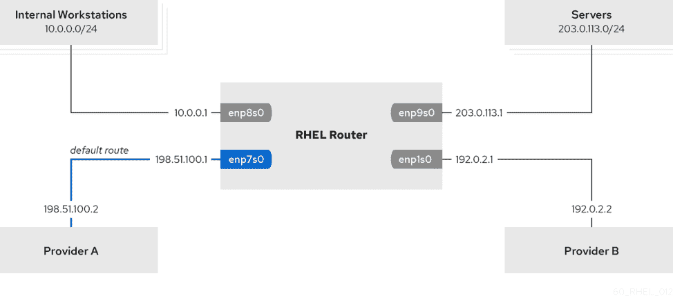

图 12.1. 激活连接

### 前提条件

- 你在过程中要设置的 RHEL 路由器具有四个网络接口：

  - `en7s0` 接口连接到提供商 A 的网络。提供商网络中的网关 IP 为 `198.51.100.2`，网络使用 `/30` 掩码。

  - `en1s0` 接口连接到提供商 B 的网络。提供商网络中的网关 IP 为 `192.0.2.2`，网络使用 `/30` 掩码。

  - `en9s0` 接口连接到带有内部工作站的 `10.0.0.0/24` 子网。

- `en9s0` 接口还连接到带有公司服务器的 `203.0.113.0/24` 子网。

- 内部工作站中的主机使用 `10.0.0.1` 作为默认网关。在过程中，你将此 IP 地址分配给路由器的 `en8s0` 网络接口。

- 服务器子网中的主机使用 `203.0.113.1` 作为默认网关。在过程中，你将此 IP 地址分配给路由器的 `en9s0` 网络接口。

- 防火墙服务已启用并处于激活状态，这是默认设置。

### 步骤

1. 配置到提供商 A 的网络接口：

```
# nmcli connection add type ethernet con-name Provider-A ifname en7s0 ipv4.method manual ipv4.addresses 198.51.100.1/30 ipv4.gateway 198.51.100.2 ipv4.dns 198.51.100.200 connection.zone
```

`nmcli connection add` 命令创建一个 NetworkManager 连接配置。以下列表描述了命令的选项：

- `type ethernet`: 定义连接类型为以太网。

- `con-name`: 设置配置名称。使用有意义的名字以避免混淆。

- `ifname network_device`: 设置网络接口。

- `ipv4.method manual`: 启用配置静态 IP 地址。

- `ipv4.addresses IP_address/subnet_mask`: 设置 IPv4 地址和子网掩码。

- `ipv4.gateway IP_address`: 设置默认网关。

- `ipv4.dns IP_of_DNS_server`: 设置 DNS 服务器的 IPv4 地址。

- `connection.firewall_zone`: 将网络接口分配到定义的防火墙区域。注意 firewalld 会自动启用分配到外部区域的掩装接口。

2. 配置到提供商 B 的网络接口：

```
# nmcli connection add type ethernet con-name Provider-B ifname en1s0 ipv4.method manual ipv4.addresses 192.0.2.1/30 ipv4.routes "0.0.0.0/0 192.0.2.2 table=5000,128.0.0.1/192.0.2.2 table=5000" connection.zone external
```

此命令使用 `ipv4.routes` 参数而不是 `ipv4.gateway` 来设置默认网关。这是将默认网关分配到与默认不同的路由表（5000）所必需的。NetworkManager 在连接激活时会创建此新路由表。

> 注意

> `nmcli` 工具不支持在默认网关 `ipv4.gateway` 中使用 `0.0.0.0/0`。

3. 配置内部工作站的网络接口：

```
# nmcli connection add type ethernet con-name Internal-Workstations ifname en8s0 ipv4.method manual ipv4.addresses 10.0.0.1/24 ipv4.gateway 10.0.0.1 connection.zone
```

4. 配置服务器子网的网络接口：

```
# nmcli connection add type ethernet con-name Servers ifname en9s0 ipv4.method manual ipv4.addresses 203.0.113.1/24 ipv4.gateway 203.0.113.1 connection.zone
```

- 有关在 `nmcli connection add` 命令中可以设置的 `ipv4` 参数详细信息，请参阅 `nm-settings(5)` 手册页中的 [IPv4 settings] 章节。

- 有关在 `nmcli connection add` 命令中可以设置的连接参数详细信息，请参阅 `nm-settings(5)` 手册页中的 Connection settings 章节。

- 有关如何使用 `nmcli` 管理 NetworkManager 连接的详细信息，请参阅 `nmcli(1)` 手册页中的 Connection management commands 章节。

# 第三部分.INFINIBAND 与 RDMA 网络

本部分将讨论如何设置 RDMA、InfiniBand 以及基于 InfiniBand 的 IP 网络连接。

# 第 13 章.配置 INFINIBAND 和 RDMA 网络

# 13.1. 理解 INFINIBAND 和 RDMA 技术

InfiniBand 指的是两个不同的东西。第一个是用于 InfiniBand 网络的物理链路层协议。第二个是调用 InfiniBand Verbs API 的高级别编程 API。InfiniBand Verbs API 是远程内存访问（RDMA）技术的实现。

RDMA 提供了从一台计算机的内存直接访问另一台计算机内存的能力，而无需涉及对方的操作系统。这种技术实现了高吞吐量、低延迟和低 CPU 利用率的网络，这在并行集群中特别有用。

在典型的 IP 传输中，应用程序 X 向机器 B 应用程序 Y 发送某些数据。作为传输的一部分，机器 B 内核必须首先接收数据、解码包头，确定数据属于应用程序 Y，唤醒应用程序 Y，等待应用程序 Y 执行调度切换，然后必须手动将数据从内核内部内存拷贝到应用程序 Y 提供的缓冲区。这个过程意味着大多数网络流量必须在系统内存总线上跨两次（一次是主机适配器使用 DMA 将数据放入内核提供的缓冲区，同时也意味着计算机必须执行多次上下文切换以在内核上下文和应用程序 Y 上下文之间切换）。当网络流量非常大时，这两者都会给系统带来极高的 CPU 负载，并导致其他任务变慢。

RDMA 通信与普通的 IP 通信不同，因为它们在通信过程中跳过了内核，极大地减少了处理网络通信所需的 CPU 开销。RDMA 协议允许主机适配器在数据包来自网络时知道由哪个适配器接收，以及它应该位于应用程序内存的哪个位置，而不是将数据包发送到内核然后再将其拷贝到应用程序缓冲区中。然而，这无法使用大多数应用程序所构建的标准 Sockets API 完成，因此必须提供自己的 API，即 InfiniBand Verbs API，所有通信在可以使用 RDMA 技术之前必须发布到此 API。

Red Hat Enterprise Linux 7 同时支持 InfiniBand 硬件和 InfiniBand Verbs API。有两个附加技术允许在非 InfiniBand 硬件上利用 InfiniBand Verbs API：

- 区域网 RDMA 协议（iWARP）：iWARP 是一种在 Internet 协议（IP）上实现远程内存访问（RDMA）的网络协议。

- 融合以太网 RDMA（RoCE）协议，后来重命名为以太网上的 InfiniBand（IBE）：RoCE 是一种允许在以太网上进行远程内存访问（RDMA）的网络协议。

# 前提条件

iWARP 和 RoCE 技术都使用 IP 网络链路层作为底层技术，大部分配置在第 3 章“配置网络”中介绍。对于大多数情况，一旦正确配置了 IP 网络并安装了相应的硬件驱动程序，内核就包含了 RDMA 功能。但是，如果在安装时没有选择 InfiniBand 软件包，则必须手动安装用户空间驱动程序。

从 Red Hat Enterprise Linux 7.4 开始，所有 RDMA 用户空间驱动程序都合并到了 `rdma-core` 包中。要安装支持 iWARP、RoCE 或 InfiniBand 用户空间驱动程序，请以 root 身份执行：

```bash
~# yum install libibverbs
```

如果您在使用流量控制（PFC）和基于 `mlx4` 的网卡，请编辑 `/etc/modprobe/mlx4.conf` 为插入的以太网交换机配置“no-drop”优先级，并重建 initramfs。基于 `mlx5` 的较新网卡会自动生成 PFC 设置，不需要任何模块来告知它们“no-drop”优先级。

要设置以太网上的 Mellanox 网卡，请参阅第 13.4 节“配置 Mellanox 网卡”。

有了这些驱动程序包，用户应该可以使用大多数 RDMA 协议来测试并在适配器上进行 RDMA 通信。然而，Red Hat Enterprise Linux 包含的设备并不都支持 iWARP 或 RoCE/IB。特别是 iWARP 的连接建立协议与任何 InfiniBand 链路层连接不同。如果程序使用 `libdma` 连接库，它会静默处理 iWARP 和 InfiniBand 之间的差异，程序应该可以工作。如果应用程序尝试自行进行连接管理，则它必须支持。

# 13.2. 使用 ROCE 传输数据

融合以太网 RDMA（RoCE）是一种在以太网上启用远程内存访问（RDMA）的网络协议。根据网络适配器，有两种 RoCE 版本：RoCE v1 和 RoCE v2。

# RoCE v1

RoCE v1 是基于 UDP 的以太网层协议。在使用 ConnectX-3 时，RoCE v1 是默认版本。

# RoCE v2

RoCE v2 构建在 UDP 之上。从 Red Hat Enterprise Linux 7.5 开始在使用 ConnectX-4、ConnectX-5 适配器时，RoCE v2 是默认版本。

RDMA 连接管理器（RDMA_CM）用于在客户端和服务器之间建立可靠连接。数据传输是基于消息的。

# 前提条件

RDMA_CM 会话需要以下之一：

- 客户端和服务器支持相同的 RoCE。


- 客户端支持 RoCE v1，而服务器支持 RoCE v2。

由于客户端决定连接模式，可能出现以下情况：

# 连接成功

如果客户端处于 RoCE v1 或 RoCE v2 模式（取决于使用的网卡和驱动程序），相应的服务器必须具有相同版本以创建连接。此外，如果客户端处于 RoCE v1，而服务器处于 RoCE v2 模式，连接也是成功的。

# 连接失败

如果客户端处于 RoCE v2，而相应的服务器处于 RoCE v1，则无法建立连接。在这种情况下，请更新相应服务器的驱动程序或网络适配器，参阅第 13.2 节“使用 RoCE 传输数据”。

表 13.1. 使用 RDMA-CM 的 RoCE 版本默认值：

| 客户端 | 服务器 | 默认设置 |
| --- | --- | --- |
| RoCE v1 | RoCE v1 | 连接 |
| RoCE v1 | RoCE v2 | 连接 |
| RoCE v2 | RoCE v2 | 连接 |
| RoCE v2 | RoCE v1 | 不连接 |

客户端上的 RoCE v2 和服务器上的 RoCE v1 不兼容。要解决此问题，请强制服务器和客户端环境都通过 RoCE v1 通信。这意味着强制支持 RoCE v2 的硬件使用 RoCE v1。

# 过程 13.1. 当硬件已运行 v2 时更改默认 RoCE 模式

1. 进入`/sys/kernel/config/rdma_cm`目录以设置 RoCE 模式：

```bash
~# cd /sys/kernel/config/rdma_cm
```

2. 使用以太网设备`ibstat`命令显示状态。例如，对于`mlx5_0`：

```bash
~)$ ibstat mlx5_0
CA type: MT4115
Number of ports: 1
Firmware version: 12.17.1010
Hardware version: 0
Node GUID: 0x2488a0703004bf04
System image GUID: 0x2488a0703004bf04
Port 1:
State: Active
```

物理状态：LinkUp

速率：40

基础 LID：0

LMC：0

SM LID：0

能力掩码：0x04010000

端口 GUID：0x2688a07ffe4bfb0a4

链路层：以太网

3. 为`mlx5_0`设备创建一个目录：

```bash
~# mkdir mlx5_0
```

4. 以 tree 格式显示`default_roce_mode`文件中的 RoCE 模式：

```bash
~# cd mlx5_0

$ tree
  └── ports
    └── 1
        └── default_roce_mode
```

```bash
~$ cat /sys/kernel/config/rdma_cm/mlx5_0/ports/1/default_roce_mode
RoCE v2
```

5. 更改默认 RoCE 模式：

```bash
~# echo "RoCE v1" > /sys/kernel/config/rdma_cm/mlx5_0/ports/1/default_roce_mode
```

6. 查看更改：

```bash
~$ cat /sys/kernel/config/rdma_cm/mlx5_0/ports/1/default_roce_mode
RoCE v1
```

# 13.3. 配置 SOFT-ROCE

RoCE 可以同时在硬件和软件中实现。Soft-RoCE 是 RDMA 传输的软件实现。

## 前提

从 Red Hat Enterprise Linux 7 开始，Soft-RoCE 驱动已合并到内核。用户空间驱动已合并到`rdma-core`包。Soft-RoCE 也称为 RXE。要启动、停止和配置 RXE，请使用`rxe_cfg`脚本。查看`rxe_cfg`的选项，请输入`rxe_cfg help`。

# 13.2. 配置 Soft-RoCE

1. 作为 root 用户，输入以下命令显示 RXE 的当前状态：

```bash
~# rxe_cfg
rdma_rxe module not loaded
```

| 名称 | 驱动 | 速率 | MTU | IPv4_addr | RDEV | MTU |
| :--- | :--- | :--- | :--- | :--- | :--- | :--- |
| igb_1 | yes | | | | | |
| mlx4_1 | no | | | | | |
| mlx4_2 | no | | | | | |

2. 作为 root 用户加载 RXE 内核模块和 RXE：

```bash
~# rxe_cfg start
```

| 名称 | 驱动 | 速率 | MTU | IPv4_addr | RDEV | MTU |
| :--- | :--- | :--- | :--- | :--- | :--- | :--- |
| （status 输出） |

可选地验证 RXE 内核模块已加载，请输入：

```bash
~# lsmod | grep rdma
rdma_rxe 11129 0
udp_tunnel 127555 1 rdma_rxe
udp_tunnel 14423 1 rdma_rxe
ib_core 236827 25 rdma_rxe,rdma_cm,ib_ucm,rdma_mlx4,ib_ucm,ib_iser,ibad,rdma,rdma_ucm,isert
```

3. 在以太网接口添加新的 RXE 设备之前，相应的接口应该打开并具有有效的 IP 地址。添加新的 RXE 设备，例如`igb_1`：

```bash
~# rxe_cfg status
```

| 名称 | 驱动 | 速率 | MTU | IPv4_addr | RDEV | MTU |
| :--- | :--- | :--- | :--- | :--- | :--- | :--- |
| igb_1 | yes | | | | rxe0 1024 (3) |
| mlx4_1 | no | | | | | |
| mlx4_2 | no | | | | | |

`RDEV`列中的`rxe0`表示`igb_1`设备已启用 rxe。

4. 使用`ibv_devices`命令验证 RXE 设备的状态。或者，输入`ibstat`查看详细状态：

```bash
~# ibstat rxe0
CA 'rxe0'
CA 类型:
端口数量: 1
固件版本:
硬件版本:
节点 GUID:0xa2369ffe018294
系统镜像 GUID: 0x0000000000000000
端口 1:
状态: Active
物理状态:LinkUp
速率: 40
基础 id: 0
LMC: 0
SM id: 0
能力掩码:0x04010000
端口 GUID:0xa2369ff018294
链路层:以太网
```

# 删除 RXE 设备

如果您想删除 RXE 设备：

```bash
~# rxe_cfg remove igb_1
```

# 验证 RXE 设备的连通性

以下示例说明如何在服务器端和客户端验证 RXE 设备的连通性。

## 示例 13.1. 在服务器端验证 RXE 设备的连通性

```bash
~$ ibv_rc_pingpong -d rxe -g 0
本地地址: LID 0x0000, QPN 0x00012, PSN 0xe2965f, GID fe::29:ff:fe29:486a
远程地址: LID 0x0000, QPN 0x00011, PSN 0xebf206, GID fe::29:ff:fe29:470a
819200 字节在 0.05 秒内 =1244.06 Mbit/sec
1000 次迭代在 0.05 秒内 =52.68/iter
```

## 示例 13.2. 在客户端验证 RXE 设备的连通性

```bash
~$ ibv_rc_pingpong -d rxe -g 0 172.31.44
本地地址: LID 0x0000, QPN 0x00011, PSN 0xebf206, GID fe::29:ff:fe29:470a
远程地址: LID 0x0000, QPN 0x00012, PSN 0xe2965f, GID fe::29:ff:fe29:486a
819200 字节在 0.05 秒内 =1245.72 Mbit/sec
1000 次迭代在 0.05 秒内 =52.61/iter
```

# 13.4. INFINIBAND 和 RDMA 相关的软件包

RDMA 应用与基于 Sockets 的应用程序以及普通 IP 网络不同，在 IP 网络上使用的应用程序无法直接用于 RDMA 网络。Red Hat Enterprise Linux 7 提供了许多用于 RDMA 网络管理、测试和调试、高级 API 以及性能分析的软件包。为了利用这些网络，需要安装部分或全部包（此列表并非详尽，但涵盖了最重要的 RDMA 包）。

## 必需包

- `rdma`：负责内核的 RDMA 栈。
- `libverbs`：提供 Infinand Verbs API。
- `opensum`：子网管理器（仅在一台机器上需要，且仅当织网中没有活跃的子网管理器时）。
- 已安装硬件的用户空间驱动——多个：`ib_m`、`libxcgb`、`libxc4`、`libheca`、`libmlx4`、`libmlx5`以及`libcrc`。注意`libheca`仅对 IBM 服务器可用。

## 推荐包

- `libdmac`、`libdmac-utils`和`ibcm`：连接管理器，能够识别 Infinand、iWARP 和 RoCE 之间的差异，并跨所有这些类型打开连接，用于网络操作的一些测试程序。
- `libverbs-utils`：用于查询已安装硬件并验证织网的 Verbs 程序。
- `infiniband-utils`和`ibutils`：提供用于 Infinand 管理的许多调试工具。
- `perf`：用于各种类型 RDMA 的性能应用。

## 可选包

这些包可用。在安装包之前，请查看“范围”。有关订阅通道的信息可以在“知识库”中找到。

- `dapl`、`dapl-devel`和`dapl-utils`：提供与 Verbs API 不同的 RDMA API。这些具有运行时和开发组件。
- `openmpi`、`mvapich2`和`mvapich2-psm`：能够使用 RDMA 的 MPI 栈。使用这些栈的用户空间应用程序并不一定感知正在进行 RDMA 通信。

# 13.5. 配置 RDMA 子系统

`rdma`服务的启动是自动的。当存在支持 RDMA 的硬件（无论是 Infinand、iWARP 还是 RoCE）时，udev 指令 systemd 启动`rdma`服务。

```text
# systemctl status rdma
rdma.service - 初始化内核中的 iWARP/Infiniband/RDMA 栈
Loaded: loaded (/usr/lib/systemd/system/rdma.service; disabled; preset: disabled)
Active: inactive (dead)
Config: /etc/rdma.conf
```

用户不需要启用`rdma`服务，但如果他们希望一直强制开启，请以 root 身份输入以下命令：

```bash
# systemctl enable rdma
```

## 13.5.1. rdma.conf 配置

`rdma`服务读取`/etc/rdma/rdma.conf`以确定管理员想要默认加载的内核级和用户级 RDMA 协议。用户应编辑此文件来关闭各种驱动。

可以启用和禁用的各种驱动有：

- iPoIB：这是一个 IP 网络仿真层，允许 IP 应用在 InfiniBand 网络上运行。
- SRP：这是 SCSI 请求协议。它允许机器挂载通过 SRP 协议导出的远程驱动器或驱动阵列，就像它是本地硬盘阵列一样。
- SRP：这是 SRP 协议的目标模式（或服务器节点）。它加载了将驱动器或阵列导出给其他机器时所需的内核支持。在任何设备被实际导出之前，需要对目标模式支持进行进一步配置。更多信息请参见`targetd`和`targetcli`包中的文档。
- ISER：这是 Linux 内核通用 iSCSI 层的低级驱动，为 iSCSI 传输提供 Inf InfinBand 网络传输。
- RDS：这是 Linux 内核中的可靠数据报服务。它在 Red Hat Enterprise 7 内核中未启用且无法加载。

## 13.5.2. 70-persistent-ipoib.rules 的用法

`rdma`包提供了文件`/etc/udev/rules/70-persistent-ipoib.rules`。该 udev 文件用于重命名 iPoIB 设备的默认名称（如`ib0`和`ib1`）。用户必须编辑此文件来更改设备的命名方式。首先，找到要重命名设备的 GUID：

```bash
$ ip link show ib0
8: ib0:BROADCAST,MULTICAST,UP,LOWER_UP mtu 65520 qdisc pfifo_fast state UP
    default len 256
    link/infinand 00:00:02:00:fe:80:00:00:00:00:00:04:15:14:03:00:7b:c3:a1 rdma
    00:ff:ff:ff:ff:ff:12:40:bf:ff:ff:00:00:00:00:00:ff
```

## 13.5.3. 放宽用户的 memlock 限制

为了允许非 root 用户运行 RDMA 应用程序，可能需要增加非 root 用户允许在系统中锁定（pin）的内存数量。可以通过在`/etc/security/limits.d/`目录下添加文件来实现，内容如下所示：

```text
$get /etc/security/limits.d/rdma.conf
# configuration for rdma tuning
 * soft memlock unlimited
 * hard memlock unlimited
# rdma tuning end
```

## 13.5.4. 配置 Mellanox 卡以以太网运行

来自 Mellanox 的某些硬件能够在 InfininiBand 或以太网模式运行。这些网卡通常默认设置为 InfininiBand 模式。用户可以将网卡设置为以太网模式。目前支持在 ConnectX 系列硬件上设置模式（使用`mlx5`或`mlx4`驱动）。

要配置 Mellanox mlx5 卡，请使用来自 mst 包的`mstconfig`程序。更多详情，请参阅 Red Hot Customer Portal 上 Red Hat Enterprise Linux 7 知识库文章中的“配置 Mellanox mlx5 卡”。

要配置 Mellanox mlx4 卡，请使用`mstconfig`按照知识库文章设置网卡上的端口类型。如果`mstconfig`不支持您的网卡，请使用`/etc/rdma.conf`文件并按照该文件中的指令为 RoCE/IBoe 使用正确设置端口类型。在这种情况下，必须重新构建`initramfs`，因为驱动程序在重启 initramfs 后会使用更新后的设置。

一旦端口设置，如果一个或两个端口被设置为以太网，且没有使用`mstconfig`设置端口类型，则您会在日志中收到此消息：

```text
mlx4_core 0000:05:00:0.0: Requested port type for port 1 is not supported on this HCA
```

这是正常现象，不影响运行。负责设置端口类型的脚本无法得知驱动是否已在内部将端口 2 设置为请求的端口，而且从交换机对端口 2 发出请求到该交换机完成期间，将端口 1 设置为不同类型的尝试会被接收。脚本会不断重试，直到命令成功或通过超时（此时端口从未连接）。

## 13.5.5. 连接到远程 Linux SRP 目标

SCSI RDMA 协议（SRP）是一种网络协议，允许系统使用 RDMA 访问连接到另一个系统的 SCSI 设备。要使用 SRP 启动器连接 SRP 端的 SRP 目标，您必须为启动器使用的主机通道适配器（HCA）端口添加访问控制列表（ACL）条目。

HCA 端口的 ACL ID 不是唯一的。ACL 取决于 HCA 的 GID 格式，使用相同驱动（如`ib_qib`）的 HCA 可能具有不同格式的 GID。ACL 取决于您如何发起连接请求。

## 连接到远程 Linux SRP 目标：高层概览

1. 准备目标端：

   1. 创建存储后端。例如`/dev/sdc1`分区：

      ```text
      / >backstores/block create vol1 /dev/sdc1
      ```

   2. 创建一个 SRP 目标：

      ```text
      /srt create 0xfe800000000000001175000077dd7e
      ```

   3. 根据步骤 a 中创建的后端创建 LUN：

      ```text
      /srt/ib.fe80000000000000001175000077dd7e/lunes create /backstores/block/vol
      ```

   4. 为远程 SRP 客户端创建节点 ACL：

      ```text
      /srt/ib.fe80000000000000001175000077dd7e/acls create 0x7edd770007511000001175000077d708
      ```

   注意节点 ACL 与`srp_daemon`和`ibrsdaemon`不同。

2. 客户端使用`srp_daemon`或`ibrsdaemon`发起 SRP 连接：

   ```bash
   [root@initiator]# srp_daemon -e -n qib0 -p 1 -R 60 &
   ```


# 第 13 章. 配置 INFINIBAND 和 RDMA 网络

## 13.6 配置子网管理器

### 13.6.1 确定必要性

大多数 InfiniBand 交换机都内置了子网管理器。然而，如果需要比交换机固件更更新的子网管理器，或者需要比交换机允许的更完全的控制，Enterprise Linux 7 使用 `opensm`。所有 InfiniBand 网络都必须运行子网管理器网络才能正常工作。这在构建没有交换机的简单网络且网卡插在后端时也是如此，此时需要一个子网管理器。可能存在多个子网管理器，在这种情况下，一个将作为主（master），任何其他子网管理器将作为失败的从（slave）。

### 13.6.2 配置主文件

`opensm` 程序将其主配置文件保存在 `/etc/rdma/opensm.conf` 中。用户可以随时编辑此文件，且内容将保持最新。该文件本身对选项有详尽的文档。对于最常见的编辑（设置用于绑定的 GUID 和运行的优先级），强烈建议不要编辑 `opensm.conf` 文件，而是编辑 `/etc/sysconfig/opensm`。如果对基础文件 `/etc/rdma/opensm.conf` 没有修改，每当向此文件添加选项时，更容易保持当前配置最新。如果 `opensm.conf` 文件发生了更改，则可能需要将新选项合并到文件中。

### 13.6.3 配置启动选项

`/etc/sysconfig/opensm` 中的选项控制子网管理器的启动以及启动多少个子网管理器副本。对于插在独立网络上的双口 InfiniBand 网卡，每个端口都需要运行一个子网管理器副本。对于每个需要管理的子网，必须启动一个子网管理器实例。此外，如果存在多个 `opensm` 服务器，通过 `opensm` 文件设置优先级来控制哪些是主，哪些是从。该文件提供了一种简单的方法来设置子网管理器的优先级并控制子网管理器绑定到哪个 GUID。

### 13.6.4 创建 P_Key 分区

默认情况下，`opensm` 查找 `/etc/rdma/partitions.conf` 文件以获取要在架构上创建的分区列表。所有架构必须包含该子网，且所有主机都属于该子网。此外，管理员可以在 InfiniBand 架构上创建其他分区。如果定义了一个给定速度的分区（例如 40 Gbps），且网络上有一个无法达到 40 Gbps 的主机，即使该主机有权限，也无法加入该分区，因为无法匹配速度要求，因此建议将分区速度设置为加入该分区主机中最慢的速度。如果某些主机组需要更快的分区，请创建一个更高速度的分区。以下分区文件是一个速度为 10 Gbps 的默认 `0x7fff` 分区，以及速度为 40 Gbps 的 `0x002` 分区：

```
~$ /etc/rdma/partitions.conf
# 参考
# IPv4 组播地址：
# http://www.iana.org/assignments/multicast-addresses
# IPv6 组播地址：
# http://www.iana.org/assignments/ipv6-multicast-addresses/ipv6-multicast-addresses.xml
# mtu =
# 1 = 256
# 2 = 512
# 3 = 1024
# 4 = 2048
# 5 = 4096
# rate =
# 2 = 2.5 GBIT/s
# 3 = 10 GBIT/s
# 4 = 30 GBIT/s
# 5 = 5 GBIT/s
# 6 = 20 GBIT/s
# 7 = 40 GBIT/s
# 8 = 60 GBIT/s
# 9 = 80 GBIT/s
# 10 = 120 GBIT/s

Default=0x7fff, rate=3, mtu=4, scope=2, defmember=full:ALL, ALL_SWITCHES=full;
Default=0x7fff, ipobl,rate=3,mtu-4, scope=2:
migff2:401b:ffff # IPv4 广播地址
migff2:401b:1 # IPv4 所有主机组
migff2:401b:2 # IPv4 所有路由器组
migff2:401b:16 # IPv4 IGMP 组
migff2:401b:fb # IPv4 mDNS 组
migff2:401b:fc # IPv4 组播本地名称解析组
migff2:401b:101 # IPv4 NTP 组
migff2:401b:202 # IPv4 Sun 组
migff2:401b:1 # IPv6 主机组
migff2:401b:2 # IPv6 路由器组
migff2:401b:16 # IPv6 MLD2 可用路由器组
migff2:401b:fb # IPv6 mDNS 组
migff2:401b:101 # IPv6 NTP 组
migff2:401b:202 # IPv6 Sun 组
migff2:401b:1:3 ALL, ALL_SWITCHES=full;
ib0_2=0x002, rate=7,mtu=4, scope=2:
```

## 13.6 启用 opensm

用户需要启用 `opensm` 服务，它安装时没有启用。以 root 身份执行以下命令：

```
~# systemctl enable opensm
```

## 13.7 测试 INFINIBAND RDMA 操作

> 注意
本节仅适用于 InfiniBand。由于 IWARP 和 RoCE/IBoE 设备是基于 IP 的，用户在配置 IPoIB 后应参考 RDMA 操作章节。

一旦启用了 `rdma` 服务、启用了 `opensm` 服务（如果需要），并安装了特定硬件的正确用户态库，用户 RDMA 操作应该是可行的。来自 `libverbs-utils` 包的简单测试有助于确定 RDMA 操作是否正常工作。`ibv_devices` 程序将显示系统中存在哪些设备，`ibv_devinfo` 命令将提供有关每个设备的详细信息。例如：

```
~$ ibv_devices

device node GUID

mlx4_0 0002c90300317880

mx4_1 f45214030007bcba0

~$ ibv_devinfo -d mlx4_1

hca: mlx4_1

transport: InfiniBand(0)

fw_: 2.308000
```

## 程序 13.3. 使用 srp_daemon 或 ibrsdaemon 连接到远程 Linux SRP 目标

- 1. 使用 `ibstat` 命令确定 `State`（状态）和 `Port GUID` 值。HCA 必须处于 `Active` 激活状态。ACL 基于 `Port GUID`：

```
[root@host]# ibstat
CA 'qib0'
CA type: InfininiPath_QLE7342
Number of ports: 1
Firmware version:
Hardware version: 2
Node GUID: 0x001175000077dd7e
System image GUID: 0x001175000077dd7e
Port 1:
State: Active
Physical state: LinkUp
Rate: 40
Base id: 1
SM id: 1
Capability mask: 0x07690886
Port GUID: 0x001175000077dd7e
Link layer: InfininiBand
```

- 2. 根据 HCA 端口获取 SRP目标 ID。注意您需要一个专用分区作为 SRP 目标，例如 `/dev/sdc1`。以下命令替换了 `fe80` 前缀，删除冒号，并将新前缀添加到字符串剩余部分：

```
[root@target]# targetcli | grep '<default>' | sed -e 's/<default>//' -e 's/://g' | grep 117500dd7e
```

- 3. 使用 `targetcli` 在块设备上创建 LUN、创建 SRP 目标并导出 LUN：

```
[root@target]# targetcli
/backstores/block create vol1 /dev/sdc1
Created storage object vol1 using /dev/sdc1
/srt create 0xfe800000000000001175000077dd7e
Created target ib.fe8000000000000001175000077dd7e
/srt/ib.fe80000000000000001175000077dd7e/luns create LUN 0
/ls
backstores
  block [Storage Objects: 1]
    vol1 /dev/sdc1 (write-through)
  fileio [Storage Objects: 0]
  scsi [Storage Objects: 0]
  ramdisk [Storage Objects: 0]
  tlogs [Targets: 0]
  loopback [Targets: 0]
  srt [Targets: 0]
  ib.fe80000000000000001175000077dd7e [ACLs]
    acls [ACLs: 0]
    luns [LUNs: 1]
      lun0 [block/vol1 (/dev/sdc1)]
```

- 4. 在启动器上使用 `ibstat` 命令检查状态是否为 `Active` 并确定 `Port GUID`：

```
[root@initiator]# ibstat
CA 'qib0'
CA type: InfininiPath_QLE7342
Number of ports: 1
Firmware version:
Hardware version: 2
Node GUID: 0x001175000077dd7e
System image GUID: 0x001175000077dd7e
Port 1:
State: Active
Physical state: LinkUp
Rate: 40
Base lid: 2
LMC: 0
SM id: 1
Capability mask: 0x07690886
Port GUID: 0x001175000077dd7e
Link layer: InfininiBand
```

- 5. 使用以下命令在不连接远程 SRP 目标的情况下扫描。启动器找到了远程目标。ID 字符串显示远程目标为 Linux 软件目标 (`ib_srpt.ko`)。

```
[root@initiator]# srp_daemon -a -o
IO Unit Info:
port ID: 0001
port GID: fe800000000000001175000077dd7e
change ID: 0001
max controllers: 0x10

controller[1]
GUID: 0011750007dd7e
vendor ID: 000011
device ID: 007322
IO class : 0100
ID: Linux SRP target
service entries: 1
service[:0011750007dd7e/SRP.T10:0011750007dd7e]
```

- 6. 要验证 SRP 连接，使用 `lssci` 命令扫描 SCSI 设备，并比较启动器连接目标后的 `lssci` 输出。

```
[root@initiator]# lssci
[0:0:10:0] disk IBM-ESXS ST9146803SS B53C /dev/sda
```

- 7. 在不为启动器端口配置 ACL 的情况下连接远程目标（预期会失败），请对 `srp_daemon` 或 `ibrsdaemon` 使用以下命令：

```
[root@initiator]# srp_daemon -n qib0 -p 1 -R 60 &
[1] 4184
```

```
[root@initiator]# ibrsdaemon -c -d /dev/infiniband/umad > /sys/class/infiniband/srp/srp-qib0-1/_add_target
```

- 8. `dmesg` 的输出显示了 SRP 连接失败的原因。在后续步骤中，使用目标端的 `dmesg` 命令来明确情况。

```
[root@initiator]# dmesg -c
[12.035652] scsi host5: ib_srp RECEIVED
[12.035659] scsi host5: ib_srp: SRP LOGIN from
fe80:0000:0000:0001:1175:0007:d708 to fe80:0000:0000:0001:1175:0007:dd7e
REJECTED, reason 0x0010006
[12.037392] scsi host5: ib_srp: Connection 0/2 failed
[12.078848] scsi host5: ib_srp: Sending CM DREQ failed
```

- 3. 建议使用不同的工具（如 `lssci` 或 `dmesg`）验证 SRP 连接。

10. 在目标端 (`ib_srp.ko`) 上使用 `dmmes` 可以提供关于 LOGIN 失败的解释。

此外，`srp_daemon` 提供的输出 ACL ID 为：

`0x7edd77000751100001175000007dd08`。

```
[root@target]# dmmes
[120.300301] ib_srp Received SRP_LOGIN_REQ with i_port_id
0x7edd77000751100:0x1175000007dd078,t_port_id
0x1175000007dd07e:0x1175000007dd07e and it_i_len 260 on port 1
(guide=xefe800000000000000:0x1175000007dd07e)
[120.322027] ib_srp Rejected login because no ACL has been configured for initiator
0x7edd7700075110000117500007dd08.
```

11. 使用 `targetctl` 工具添加 ACL：

```
[root@target]# targetcli
targetcli shell version 2.1.fb41
Copyright 2011-2013 by Datera, Inc and others.
For help commands, type 'help'.

/> /srp/ib.fe80000000000000011750000007dd7e/acls create
0x7edd770007511000001175000007d08
Created Node ACL for ib.7edd770007511000001175000007d708
Created mapped LUN 0.
```

12. 验证 SRP LOGIN 操作：

- a. 等待 60 秒以允许 `srp_daemon` 重试登录：

```
[root@initiator]# sleep 60
```

- b. 验证 SRP LOGIN 操作：

```
[root@initiator]# lscsi
[0:0:1:0] disk IBM-EXXS ST9146803SS B53C /dev/sd
[7:0:0:0] disk LIO-vol1 4.0 /dev/sd
```

- c. 获取 SRP 目标发现内核日志：

```
[root@initiator]# dmmes -c
[1354.180272] scsi 7:0:0:0:SRP.T10:0x1175000007dd007DD7E
[1354.178258] scsi 7:0:0:0: Direct-Access LIO-ORG vol1 4.0 PQ: 0 ANSI: 5
[1354.206888] scsi 7:0:0:0: alla supports import and explicit TQPS
[1354.215699] scsi 7:0:0:0: porta group 00 rel port 01
[1354.221409] scsi 7:0:0:0: porta group 00 state A non-preferred supports TOIUSNA
[1354.223947] scsi 7:0:0:0: attached scsi generic sg1 type 0
[1354.233402] sd 7:0:0:0: 163253868 512-byte logical blocks: (83.5/77.8 GIB)
[1354.236904] sd 7:0:0:0: [sd] Write Protect is off
[1354.235217] sd 7:0:0:0: Mode Sense: 43 00 08
[1354.235128] sd 7:0:0:0: [sd] Write cache: disabled, read cache: enabled, doesn't
[1354.235550] sd 7:0:0:0: [sd] DPO OR FUA
[1354.255491] sd 7:0:0:0: [sd] Attached SCSI disk
[1354.265233] sd 7:0:0:0: ib_srp: new target; id_ext 01175000007dd7e ioc_guid
```

`fe80:0000:0000:0011:7500:0077:d708:dgid`

`fe80:0000:0000:0011:7500:0077:d37:d2e`


`node_guid: f452:1403:007:cba0`

`sys_image_guid: f452:1403:007:cba3`

`vendor_id: 0x02c9`

`vendor_part_id: 4099`

`hw_: 0x0`

`board_id: MT_1090120019`

`phys_port_cnt: 2`

# 网络指南

`port: 1`

`state: PORT_ACTIVE (4)`

`max_mtu: 4096 (5)`

`active_mtu: 2048 (4)`

`sm_lid: 2`

`port_id: 2`

`port_lmc: 0x01`

`link_layer: InfiniBand`

`port: 2`

`state: PORT_ACTIVE (4)`

`max_mtu: 4096 (5)`

`active_mtu: 4096 (5)`

`sm_lid: 0`

`port_id: 0`

`port_lmc: 0x00`

`link_layer: Ethernet`

```
~$ ibstat mlx4_1
CA 'mlx4_1'
CA type: MT4099
Number of ports: 2
Firmware version: 2.30.8000
Hardware version: 0
Node GUID: 0xf45214203007bcba0
System image GUID: 0xf45214203007bcba3
Port 1:
State: Active
Physical state: LinkUp
Rate: 56
Base lid: 2
LMC: 1
SM lid: 2
Capability mask: 0x0251486a
Port GUID: 0xf45214203007bcba1
Link layer: InfiniBand
Port 2:
State: Active
Physical state: LinkUp
Rate: 40
Base lid: 0
LMC: 0
SM lid: 0
Capability mask: 0x04010000
Port GUID: 0x6f15214fffe7bcba2
Link layer: Ethernet
```

`ibv_devinfo` 和 `ibstat` 命令输出的信息有所不同（因为端口 MTU 存在于 `ibv_devinfo` 但在 `ibstat` 输出中不存在，而 Port GUID 存在于 `ibstat` 输出中但在另一个输出中不存在），并且某些项的命名不同（例如，`ibstat` 输出中的本地标识符 (LID) 与 `ibv_devinfo` 输出中的 `port_lid` 相同）。

简单的 ping 程序（例如使用 `infiniband-packages` 包中的 `ibping`）可以用于测试 RDMA 连通性。你必须在一台机器上启动 `ibping` 服务器，然后在另一台机器上作为客户端运行 `ibping` 并让它连接到 `ibping` 服务器。由于我们需要测试基础 RDMA 能力，我们需要使用 RDMA 特定的地址解析方法而不是 IP 地址作为服务器地址。

# 第 13 章。INFINIBAND 与 RDMA 网络

在服务器机器上，使用 `ibv_devinfo` 和 `ibstat` 命令打印出要测试端口的 `port_lid/base LID`（假设上述接口的端口 1，其 `port_lid/base LID` 为 2，Port GUID 为 `0xf45214030bcba1`）。然后使用带有绑定到特定网卡的选项启动 `ibping` 并测试该端口，同时指定 `ibping` 应以服务器模式运行。你可以通过传递 `-t` 或 `--help` 来使用 `ibping` 的可用选项，在本例中我们需要 `-S` 或 `--Server` 选项。

注意：本文中的 port 不是 `-C` 或 `-P`。Port 并不表示网络端口，但在绑定到特定网卡时，如果使用多端口网卡，我们需要使用 `-C` 或 `-P` 表示网卡的物理编号。要测试到 RDMA 织网的连通性（例如，多端口网卡的第二个端口），需要告诉 `ibping` 绑定到网卡上的端口 2。当使用单端口或测试网卡上的第一个端口时，不需要此选项。示例下：

```
$ ibping -S -C mlx4_1 -P 1
```

然后切换到客户端机器并运行 `ibping`。记录下服务器 `ibping` 程序所绑定的端口 GUID 或服务器 `ibping` 程序所绑定的本地标识符 (LID)。同时注意客户端机器上的哪块网卡和哪个端口与绑定到服务器的网卡和端口物理连接到同一个网络。例如，如果服务器上第一块网卡的第二个端口用于连接到次级 RDMA 织网，则客户端必须指定连接到次级织网所需的任何网卡和端口。一旦运行，，作为客户端运行 `ibping` 并使用收集到的端口 LID 或 GUID 作为连接地址连接到服务器。例如：

```
$ ibping -c 10000 -f mlx4_0 -P 0 -L 2

rdma-host.example.com.(none) (Lid 2) ibping statistics --
10000 packets transmitted, 10000 received, 0% packet loss, time 816 ms
ttt min/avg/max = 0.032/0.081/0.446
```

或者

```
$ ibping -c 10000 -f mlx4_0 -P 0 -G 0xf45214030bcba1 \

nrdma-host.example.com.(none) (Lid 2) ibping statistics --
10000 packets transmitted, 10000 received, 0% packet loss, time 769 ms
ttt min/avg/max = 0.027/0.076/0.446
```

此结果验证了 RDMA 通信对于用户态应用中是正常的。可能会遇到以下错误：

```
$ ibv_devinfo
libibverbs: Warning: no device-specific driver found
/sys/class/infiniband/verbs0
```

此错误表示未安装必要的用户态库。管理员需要安装第一部分“InfiniBand 和 RDMA 相关包”中列出的用户态库中的一种（根据硬件情况而定）。在少数情况下，如果 `libibverbs` 类型错误，也会发生此错误。

## 注意事项

许多示例应用程序倾向于使用主机名而不是 LID 来建立服务器与客户端之间的通信。对于这些应用程序，在测试端到端 RDMA 通信之前，有必要设置 IPOver。`ibping` 比较特殊，它接受 LID 作为一种寻址形式，这消除了 IPOver 寻址可能产生的问题，从而让我们能更确彻地判断 RDMA 通信是否正常工作。

## 8 配置 IPOIB

### 13.8.1. 理解 IPoIB 的作用

正如在“比较 IP 与非 IP 网络”节中所提到的，大多数网络都是 IP 网络。Infiniband 不是。IPoIB 的作用是在 Infiniband 之上提供一个 IP 网络仿真层。这允许通信在不修改的情况下在 Infiniband 上运行。这些应用程序的性能远低于原生为 RDMA 编写的程序。由于 Infiniband 的应用程序必须充分利用网络性能，IPoIB 的存在是为了允许不关键应用程序按需运行。由于 iWARP 和 RoCE/IB 都是在顶部分层 RDMA 的 IP 网络，它们不需要 IPoIB。因此，内核将在 iWARP 或 RoCE/IB 之上创建 IPoIB 设备。

### 13.8.2. 理解 IPo 通信模式

IPoIB 设备可以配置为以数据报（datagram）或连接（connected）模式运行。区别在于 IPOver 层尝试与通信另一端的机器打开何种类型的队列对。对于数据报模式，会打开一个不可靠的不断连接队列对。对于连接模式，则配对一个可靠的连接队列对。

使用数据报模式时，不可靠的不断连接队列对不允许任何大于 Infiniband 链路层的数据包。IPOver 层在发送的数据包上添加 4 字节头部，因此 IPoIB 的 MTU 必须比 Infiniband 链路层 MTU 小 4 字节。由于 2048 是常见的 Infiniband 链路层 MTU，数据报模式下的 IPoIB 设备 MTU 为 2044。

当使用连接模式时，可靠的连接队列对允许大于 Infiniband 链路层 MTU 的消息，并在末端处理分段和重组。因此，Infiniband 适配器在连接模式下的消息没有大小限制。然而，IP 数据包只有 16 位大小，因此限制为 65535。允许的 MTU 实际上更小，因为我们需要考虑到所有的 TCP/IP 头部。连接模式下的 IPoIB MTU 最大为 65520，以留出空间。

连接模式通常具有更高的性能，但也消耗更多内核内存。由于大多数系统更看重性能，连接模式是最常用的模式。

然而，如果系统配置为连接模式，它必须以数据报模式发送组播流量（Infiniband 交换机和织网无法通过连接模式组组），并且与未配置连接的主机通信时也会退回到数据报模式。管理员应注意，如果他们打算运行发送组播的程序，且这些程序尝试以接口的最大 MTU 发送组播，则有必要将接口配置为数据报操作，或以某种方式配置应用程序使其数据包适应数据报包。

### 13.3. 理解 IPo 硬件地址

IPoIB 设备具有 20 字节地址。废弃的 `ifconfig` 工具无法读取所有 20 字节，不应用它查找 IPoIB 设备的正确地址。应通过工作属性获取。

IPoIB 地址的前 4 字节是标志和队列对数量。接下来的 8 字节是前缀。当配置 IPoIB 设备时，它将具有默认前缀 `0xfe80:0000:0000:00:00`。设备在连接到子网之前将使用默认前缀，之后将重置子网前缀以匹配其连接的子网。最后的 8 字节是 IPoIB 设备连接的 InfiniBand 部分的 GUID 地址。由于前 4 字节和后续 8 字节会随时间变化，因此使用前 4 字节来匹配其连接的子网。

文本界面工具 `nmtui` 可在终端窗口中配置 InfiniBand。执行以下命令启动该工具：

```
nmtui
```

将出现文本用户界面。任何无效命令都会打印用法信息。

使用方向键或按 Tab 键在选项之间向前移动，按 Shift+Tab 键在选项之间向后移动。按 Enter 键选择选项。空格键切换复选框的状态。

从启动菜单开始，选择“编辑连接”（Edit connection）。选择“添加”（Add），打开“新建连接”（New Connection）屏幕。

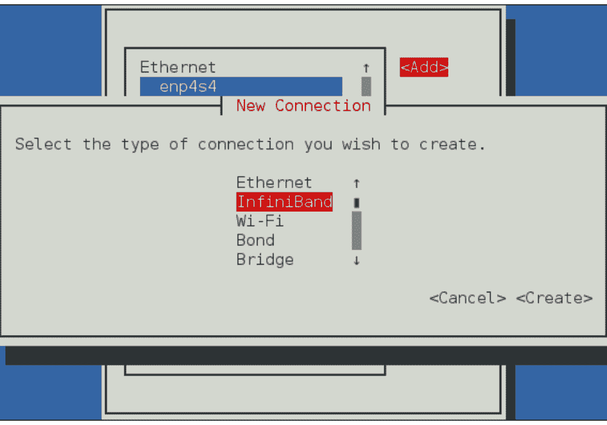

选择 InfiniBand，打开“编辑连接”屏幕。按照屏幕上的提示完成配置。

# 第 13 章.配置 INFINIBAND 和 RDMA 网络

## 编辑连接

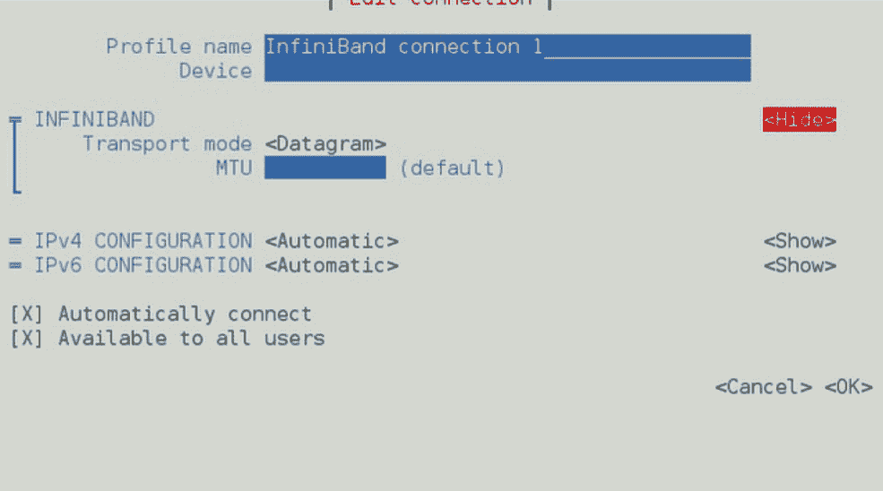

图 13.2.NetworkManager 文本用户界面配置 InfiniBand 连接菜单

参阅 [第 13.8.9.1 节，“配置 InfiniBand 选项卡”]获取 InfiniBand 术语的定义。

参阅 [第 3.2 节，“使用 nmtui 配置 IP 网络”]获取有关安装 `nmtui` 的信息。

## 13.8.6. 使用命令行工具 nmcli 配置 IPoB

首先确定是否需要默认的 IPoB 设备，如果是，请按照 [第 13.5.2 节，“使用 70-persistent-ipoib-rules”]中的说明，使用 udev 重命名规则来重命名设备。用户可以通过移除 `ib_ipoib` 内核模块并重新加载它，以便在重启后重命名 IPoB 接口：

```
$ rmmod ib_ipoib
~$ modprobe ib_ipoib
```

一旦设备具有所需的名称，使用 `nmcli` 工具创建 IPoB 接口。以下示例演示了两种方法：

示例 13.3. 在单独连接中创建和修改 IPoB。

```
$ nmcli add type infiniband connection-name mlx4_ib0 interface mlx4_ib0 transport-connected mtu 65520

Connection 'mlx4_ib0' (8029a0d7-b055-a826-2a6d72220255cc) successfully added.

~$ nmcli edit mlx4_ib0

===| nmcli interactive connection editor |=====

Editing existing 'infiniband' connection: 'mlx4_ib0'
```

输入 'help' 或 '?' 查看可用命令。
输入 'describe [>setting>.<prop>]' 获取详细的属性描述。

您可以编辑以下设置：connection, infiniband, ipv4, ipv6

```
nmcli set infiniband.mac-address 80:00:02:00:fe:80:00:00:00:00:00:52:14:03:00:7b:a3

nmcli save

Connection 'mlx4_ib3' (8029a0d7-8b05-49ff-a826-2a6d722025cc) successfully updated.

nmcli quit
```

或者您可以在一条命令中运行 `nmcli add` 和 `nmcli modify`，如下所示：

# 示例 13.4. 在一条命令中创建和修改 IPoIB。

```
nmcli add type infiniband con-name mlx4_ib0 name mlx4_ib0 transport-mode connected mtu 65520 infiniband.mac-address 80:00:02:00:fe:80:00:00:00:00:00:52:14:03:00:7b:a3
```

在这些点，已经创建了一个 IPoIB 接口 `mlx4_ib0`，并使用了连接模式（connected mode）、具有最大连接 MTU、以及用于 IPv4 和 IPv6 的 DHCP。如果使用 IPoB 接口进行集群流量，并使用以太网接口进行集群外通信，则可能需要禁用 IPoB 接口上的默认路由和名称服务器。可以按照以下方式进行：

```
~$ nmcli interactive editor ===

==== Editing 'infiniband' connection: 'mlx4_ib0'
```

输入 'help' 或 '?' 查看可用命令。
输入 'describe [<setting>-prop]' 获取详细的属性描述。

```
You may edit the following settings: connection, infiniband, ipv4, ipv6

nmcli set ipv4.ignore-auto-dns yes

nmcli set ipv4.ignore-auto-routes yes

nmcli set ipv4.never-default true

nmcli set ipv6.ignore-auto-dns yes

nmcli set ipv6.ignore-auto-routes yes

nmcli set ipv6.never-default true

nmcli save

Connection 'mlx4_ib0' (8029a0d7-8b05-49ff-a826-2a6d722025cc) successfully updated.

nmcli quit
```

如果需要 P_Key，按如下方式使用 `nmcli` 创建：

```
~$ nmcli add type infiniband con-name mlx4_ib0.8002 name mlx4_ib0.8002 parent mlx4_ib0 p-key 0x8002

Connection 'mlx4_ib0.8002' (8029a0d7-8b05-49ff-a826-2a6d722025cc) successfully updated.

~$ nmcli modify mlx4_ib0.8002 infiniband.mtu 65520 infiniband.transport-mode connected ipv4.ignore-auto-dns yes ipv4.auto-routes yes ipv4.never-default true ipv6.ignore-auto-dns yes ipv6.never-default true
```

## 13.8.8. 使用命令行配置 IPoIB

首先确定是否需要默认 IPoB 设备，如果是，请按照第 13.5.2 节，“使用 70-persistent-ipoib-rules”中的说明，使用 udev 重命名规则重命名设备。用户可以通过移除 `ib_ipoib` 内核模块并重新加载它，以便在重启后重命名 IPoB 接口：

```
~$ rmmod ib_ipoib
~$ modprobe ib_ipoib
```

一旦设备具有所需的名称，管理员可以使用首选编辑器创建 ifcfg 文件来配置设备。典型的静态 IPv4 IPoB 配置如下：

```
~$ more ifcfg-mlx4_ib0

DEVICE=mlx4_ib0
TYPE=InfinBand
ONBOOT=yes
HWADDR=80:00:00:4c:fe:80:00:00:00:54:03:00:a1
BOOTPROTO=none
IPADDR=172.31.0.254
PREFIX=24
NETWORK=172.31.0
BROADCAST=172.31.255
IPV4_FAILURE_FATAL=yes
IPV6INIT=no
MTU=65520
CONNECTED_MODE=yes
NAME=mlx4_ib0
```


对于`P_Key`接口，配置文件如下：

```
~$ more ifcfg-mlx4_ib0.8002

DEVICE=mlx4_ib0.8002
PHYSDEV=mlx4_ib0
PKEY=yes
PKEY_ID=2
TYPE=InfinBand
ONBOOT=yes
HWADDR=80:00:00:4c:fe:80:00:00:00:54:03:00:a1
BOOTPROTO=none
IPADDR=172.31.0.254
PREFIX=24
NETWORK=172.31.0
BROADCAST=172.31.255
IPV4_FAILURE_FATAL=yes
IPV6INIT=no
MTU=65520
CONNECTED_MODE=yes
NAME=mlx4_ib0.8002
```

对于所有`P_Key`接口文件，都需要`PHYSDEV`指令且它必须是父设备的名称。`PKEY`指令必须设置为`yes`，`PKEY_ID`必须是接口编号（带有或不带`0x8000`成员位）。但是，设备必须是`PKEY_ID`的四位十六进制表示，使用逻辑或运算符结合`0x8000`成员位，如下：

```
NAME=$(PHYSDEV).($(0x8000 | $PKEY_ID))
```

默认情况下，文件中的`PKEY_ID`被视为十进制数并转换为十六进制，然后与`0x8000`使用逻辑或运算符得到设备的正确名称，但用户可以通过数字前加上`0x`前缀来以十六进制形式指定`PKEY_ID`。

## 13.8.8. 配置 IPoIB 后测试 RDMA 网络

一旦配置了 IPoIB，就可以使用 IP 地址来指定 RDMA 设备。由于使用 IP 地址处理名称的普遍性，大多数 RDMA 应用将它们作为前缀，或者在某些情况下指定要连接的远程机器或本地设备。

要测试 IPoIB 层的功能，可以使用任何标准的 IP 网络工具并提供要测试的 IPoIB 设备的 IP 地址。例如，IPoIB 设备 IP 地址之间的`ping`命令现在应该可以工作了。

Red Hat Linux 包含了不同的 RDMA 性能测试包：`qperf`和`pertest`。这两者任一都可测试 RDMA 网络的性能。

然而，当使用`pertest`包中的任何应用程序或`qperf`程序时，关于地址解析有一个特殊说明。尽管使用 IB 设备的 IP 地址或主机名指定了远程主机，但允许测试应用程序实际上通过不同的 RDMA 接口连接。这是因为可以使用从主机名或地址到两个机器之间 RDMA 地址的过程。客户端连接到服务器有许多方法；例如，如果每台机器上有两个端口连接到同一个 InfiniBand 子网，并且每台机器的第二个端口都有 IP 地址，那么`pertest`可能会发现每台机器的第一个端口是一个有效连接点。在这种情况下，可以使用`pertest`包的命令行选项按卡和端口进行测试，就像在第 13.7 节“测试早期 InfiniBand RDMA 操作”中使用`iping`执行的那样。

## 13.8.9. 使用 GUI 配置 IPoIB

使用图形化工具配置 InfiniBand 连接，请使用`nm-connection-editor`。

### 过程 13.4. 使用 nm-connection-editor 添加新的 InfiniBand 连接

1. 在终端中输入`nm-connection-editor`：

```
~$ nm-connection-editor
```

2. 点击“添加”按钮。出现“选择连接类型”窗口。选择 InfiniBand 并点击“创建”。出现“编辑 InfiniBand 连接”窗口。

3. 在 InfiniBand 选项卡上，从下拉列表中选择您想要用于 InfiniBand 连接的传输类型。

4. 输入 InfiniBand MAC 地址。

5. 检查并确认设置，然后点击“保存”按钮。

6. 参阅第 13.8.9.1 节“配置 InfiniBand 选项卡”，编辑 InfiniBand 特有的设置。

### 过程 13.5. 编辑现有的 InfiniBand 连接

按照以下步骤编辑现有的 InfiniBand 连接。

1. 在终端中输入`nm-connection-editor`：

```
~$ nm-connection-editor
```

2. 选择您要编辑的连接并点击“编辑”按钮。

3. 选择“常规”选项卡。

4. 配置连接名称、自动连接行为和可用性设置。

“编辑”对话框中的五个设置适用于所有连接，请查看“常规”选项卡：

- 连接名称 – 为您的网络连接输入一个描述性名称。此名称将用于在“网络”窗口的菜单中显示此连接。
- 网络可用时自动连接到此网络 – 如果您希望 NetworkManager 在连接可用时自动连接到它，请勾选此框。更多信息请参见“使用控制中心编辑现有连接”章节。
- 所有用户均可连接此网络 – 勾选此框以创建一个系统中所有用户均可使用的连接。更改此设置可能需要 root 权限。详情请参阅第 3.4.5 节“使用 GUI 管理系统范围和私有的连接配置文件”。
- 使用此连接时自动连接 VPN – 如果您希望 NetworkManager 在 VPN 连接可用时自动连接到它，请勾选此框。
- 防火墙区域 – 从下拉菜单中选择防火墙区域。请参阅《Red Hat Enterprise Linux 7 安全指南》以获取有关防火墙区域的更多信息。

5. 参阅第 13.8.9.1 节“配置 InfiniBand 选项卡”，编辑 InfiniBand 特有的设置。

### 保存您的新（或修改过的）连接并进行后续配置

一旦完成对 InfiniBand 连接的编辑，点击“保存”按钮保存您的自定义配置。

然后，如需配置：

- 连接的 IPv4 设置，点击“IPv4 设置”选项卡并继续参考[第 5.4 节，“配置 IPv4 设置”]。
- 连接的 IPv6 设置，点击“IPv6 设置”选项卡并继续参考[第 5.5 节，“配置 IPv6 设置”]。

## 13.8.9.1. 配置 InfiniBand 选项卡

如果您已经添加了新的 InfiniBand 连接（指令说明请参阅[过程 13.4，“使用 nm-connection-editor 添加新的 InfiniBand 连接”]），您可以编辑“InfiniBand”选项卡以设置父级接口和 InfiniBand ID。

### 传输模式

可以从下拉列表中选择数据报模式（Datagram）或已连接模式（Connected）。请选择与您的其余 IPoIB 网络相同的模式。

### 设备 MAC 地址

用于 InfiniBand 网络流量的具备 InfiniBand 能力设备的 MAC 地址。如果您已安装 InfiniBand 硬件，此硬件地址字段将预填充。

### MTU

可选地设置用于通过 InfiniBand 连接发送的数据包的最大传输单元（MTU）大小。

## 13.8.10. 附加资源

### 安装的文档

- `/usr/share/doc/initscripts-version/sysconfig.txt` – 描述配置文件及其指令。

### 在线文档

https://www.kernel.org/doc/Documentation/infiniband/ipoib.txt

对 IPoIB 驱动的描述。包含相关 RFC 的引用。

# 第四部分。服务器

本部分讨论了如何设置网络通常所需的服务器。

> **注意**
>
> 如需通过网络浏览器监控和管理服务器，请参阅《Red Hat Enterprise Linux 使用 Cockpit 入门》。

# 第 14 章. DHCP 服务器

动态主机配置协议（DHCP）是一种网络协议，可自动为客户端机器分配 TCP/IP 信息。每个 DHCP 客户端连接到中央化的 DHCP 服务器，由该服务器返回客户端的网络配置（包括 IP 地址、网关和 DNS 服务器）。

## 14.1. 为什么要用 DHCP？

DHCP 对于网络接口的自动配置非常有用。在配置客户端系统时，您可以选择 DHCP 而不是指定 IP 地址、子网掩码、网关或 DNS 服务器。客户端从 DHCP 服务器获取这些信息。如果您想更改许多系统的 IP 地址，DHCP 同样很有用。通过重新配置所有系统，您只需要在服务器上更改一次配置即可设置新的 IP 地址范围。如果组织的 DNS 服务器发生变化，更改将发生在 DHCP 服务器上，而不是 DHCP 客户端上。当您重启网络或客户端时，更改就会生效。

如果组织拥有一个正确连接到网络的运行良好的 DHCP 服务器，笔记本电脑和其他移动用户就可以在不同的办公室之间移动这些设备。请注意，DNS 和 DHCP 服务器的管理员以及任何配置提供商，应对组织内使用的主机名应达成一致。更多信息请参阅第 6.1.1 节“建议的命名实践”。

## 14.2. 配置服务器

DHCP 服务器（ISC）使用配置文件来定义设置。以 root 身份安装`dhcp`包：

```bash
~$ yum install dhcp
```

服务器的配置文件位于`/etc/dhcp/dhcp.conf`。例如：

```bash
~$ cat /etc/dhcp/dhcp.conf
```

DHCP 服务器使用`/var/lib/dhcp/leases`租赁数据库。更多信息请参阅第 14.2.2 节“租赁数据库”。

### 14.2.1 配置文件

配置服务器的第一步是创建配置文件。配置文件可以包含额外的行。以`#`开头的行被视为注释。配置文件中有两种类型的语句：

- 参数 – 指示如何执行任务，以及是否配置客户端。
- 声明 – 描述网络拓扑。

关键字不区分大小写。部分`{}`之前的参数（包括选项）是全局参数。全局参数适用于后续的所有部分。

> **重要**
>
> 如果更改了配置文件，在重启 DHCP 守护进程之前更改不会生效：
>
> ```bash
> ~$ systemctl restart dhcp
> ```

与其每次更改 DHCP 配置文件并重启服务，使用`omshell`提供了一种交互式方法来连接、查询和更改服务器配置。通过使用`omshell`，可以在运行时进行所有更改。有关`omshell`的更多信息，请查看`omshell`手册页。

### 示例 14.1. 子网声明

```
subnet 192.168.1.0 netmask 255.255.255.0 {
  option routers            192.168.1.254;
  option subnet-mask         255.255.255.0;
  option domain-search      "example.com";
  option domain-name-servers 192.168.1.1;
  option time-offset        -18000; # 东部时间
  range 192.168.1.10 to 192.168.1.100;
}
```

对于每个要服务的子网，以及 DHCP 服务器连接的每个子网，都必须有一个子网声明。即使未向该子网动态分配地址，也需要一个子网声明。

在此示例中，为子网中的每个 DHCP 客户端设置了全局选项，并声明了一个范围。客户端将被分配该范围内的 IP 地址。

### 示例 14.2. 范围参数

```
default-lease-time 600;
max-lease-time 7200;
option subnet-mask 255.255.255.0;
option broadcast-address 192.168.1.255;
option routers 192.168.1.254;
option domain-servers 192.168.1.1, 192.168.1.2;
option domain-search "example.com";
subnet 192.168.1.0 netmask 255.255.255.0 {
  range 192.168.1.10 192.168.1.100;
}
```

根据网络接口卡的 MAC 地址为客户端分配 IP 地址，请在主机声明（host declaration）中使用`hardware ethernet`参数。正如示例 14.3“使用 DHCP 使用静态 IP 地址”所示，主机顶点`apex`指定了 MAC 地址为`00:A0:78:8E:9E:AA`的网卡始终接收 IP 地址`192.168.1.4`。

请注意，你也可以使用`host-name`参数为客户端分配主机名。

### 示例 14.3. 使用 DHCP 使用静态 IP 地址

```
host apex {
  option host-name "apex.example.com";
  hardware ethernet 00:A0:78:8E:9E:AA;
  fixed-address 192.168.1.44;
}
```

Red Hat Enterprise Linux 7 支持为 InfiniBand IPoIB 接口分配静态 IP 地址。然而，由于这些接口没有标准的以太网地址，必须使用不同的方法为 IPoIB 接口指定唯一标识符。标准做法是使用`dhcp-client-identifier`结构来指定 IPoIB 接口的`dhcp-client-identifier`字段。DHCP 服务器结构每个主机最多支持一个`hardware ethernet`和一个条目。但是，可能存在多个`fixed-address`条目，DHCP 服务器将自动根据接收 DHCP 请求的网络返回相应的响应。

### 示例 14.4. 在多个接口上使用 DHCP 使用静态 IP 地址

如果机器具有复杂的配置，对于两个 InfiniBand 接口，且每个物理接口加一个以太网连接，可以使用以下静态 IP 结构进行此类配置：

```
host apex {
  option host-name "apex.example.com";
  hardware ethernet 00:A0:78:8E:9E:AA;
  option dhcp-client-identifier=ff:00:00:00:00:02:00:00:02:c9:00:00:02:c9:03:03:03:31:7b:11;
  fixed-address 172.31.0.50,172.31.2.50,172.31.1.50,172.31.3.50;
}
host apex {
  option host-name "apex.example.com";
  hardware ethernet A0:78:8E:9E:AB;
  option dhcp-client-identifier=ff:00:00:00:00:02:00:00:02:c9:00:02:c9:00:31:7b:12;
  fixed-address 172.31.0.50,172.31.2.50,172.31.1.50,172.31.3.50;
}
```

为了为你的设备找到正确的`dhcp-client-identifier`，你通常可以使用前缀`ff:00:00:00:00:02:00:00:02:c9:00`，并加上 IPoIB 接口的最后 8 字节，这恰好是 InfiniBand 端口接口的 8 字节 GUID。在某些旧的控制器上，这样做是不正确的。这种情况下，我们可以在 DHCP 服务器上使用`tcpdump`捕获传入的请求，并从该捕获包中搜索正确的`dhcp-client-identifier`。例如：

```
$ tcpdump -vi mlx4_ib0
tcpdump: listening on mlx4_ib0, link-type LINUX_SLL (Linux kernel), capture size 65535 bytes
23:42:34.131447 IP (eth 0x2, id 128, offset 0, flags [none], proto UDP (17), length 328)
0.0.0.0.bootp > 255.255.255.255.bootp: [udp sum 06] BOOT/DHCP, Request, length 300,
type 32, hlen 0, 0x97fe3bcde, Flags [Broadcast] (0x8000)
Vendor-rfc1048 Extensions
Magic DHCP-Message Option 53, length 1: Discover
Hostname Option 12, length 10: "rma-deq-03"
Parameter-Request Option 55, length 18:
Subnet-Mask, Time-Zone, Domain-Name, Domain-Server, MTU,
Default-Gateway, Class-Static-Route,
Client-ID Option 61, length 20: hardware-type 255,
00:00:00:00:02:00:c9:00:02:02:ac
```

上面的抓包显示了`Client-ID`字段。`hardware-type 255`对应的 ID 结果在 DHCP 配置中需要完全匹配。所有共享物理属性的子网都应该在示例 14.5 所示的`shared-network`中声明。`shared-network`内子网声明外的参数被视为全局参数。`shared-network`的名称必须具有描述性，例如使用“test-lab”来描述环境中的所有子网。

### 示例 14.5. 共享网络（Shared-network）声明


`shared-network name` 声明用于将多个子网分组，并为它们提供共同的参数。以下示例展示了如何配置一个共享网络：

```
shared-network name {
    option domain-search "test.redhat.com";
    option domain-name-servers ns1.redhat.com, ns2.redhat.com;
    option routers 192.168.0.254;
    # more parameters for shared-network
subnet 192.168.1.0 255.255.252.0 {
    # parameters for subnet
    range 192.168.1.1 192.168.1.254;
}
subnet 192.168.2.0 255.255.252.0 {
    # parameters for subnet
    range 192.168.2.1 192.168.2.254;
}
```

正如示例 14.6 “组声明”所示，组声明用于将全局参数应用于声明。例如，可以将共享网络、子网和主机进行分组。

## 示例 14.6. 组声明（Group Declaration）

```
group {
    option routers 192.168.1.254;
    option subnet-mask 255.255.255.0;
    option domain-search "example.com";
    option domain-name-servers 192.168.1.1;
    option time-offset -18000; # Eastern Time
host apex {
    option host-name "apex.example.com";
    hardware ethernet 00:A0:78:8E:EA:AA;
    fixed-address 192.168.1.4;
}
host raleigh {
    option host-name "raleigh.example.com";
    hardware ethernet 00:A1:DD:74:C3:F2;
    fixed-address 192.168.1.6;
}
```

### 注意

你可以使用示例配置文件作为起点并添加自定义选项。要将此文件复制到正确位置，请以 `root` 身份使用以下命令：

```
~# cp /usr/share/doc/dhcp-version_number/dhcpd.conf /etc/dhcp/dhcp.conf
```

... `version_number` 是 DHCP 版本号。

要查看选项语句及其功能的完整列表，请参阅 `dhcp-options(5)` 手页。

## 14.2.2. 租数据库（Lease Database）

在 DHCP 服务器上，文件 `/var/lib/dhcpd/dhcpd.leases` 存储 DHCP 客户端数据库。不要更改此文件。每个最近分配的 IP 地址的租信息会自动存储在租数据库中。信息包括租长度、分配对象、租的开始和结束日期以及用于获取租的网卡 MAC 地址。

租数据库中的所有时间均为协调世界时 (UTC)，而非本地时间。

租数据库定期重建以防止过大。首先，所有租都保存在临时数据库中。`dhcp.leases` 文件被重命名为 `dhcp.leases~`，临时数据库写入 `dhcp.leases`。

在租数据库重命名为备份文件之后之前，DHCP 守护进程可能会被杀死或系统可能会崩溃。如果 `dhcp.leases` 文件不存在，则需要启动服务。不要创建新的租文件。如果你这样做了，所有的旧租都会丢失并导致许多问题。正确的解决方案是将 `dhcp.leases~` 备份文件重命名为 `dhcp.leases` 然后启动守护进程。

## 14.2.3. 启动和停止服务器

### 重要

当 DHCP 服务器首次启动时，除非 `dhcp.leases` 文件存在，否则它将失败。你可以使用 `touch /var/lib/dhcpd/dhcp.leases` 命令在文件不存在时创建它。如果同一台服务器还运行 BIND 作为 DNS 服务器，则此步是不必要的，因为 `named` 进程会自动检查 `dhcp.leases` 文件。

要启动 DHCP 服务，使用以下命令：

```
systemctl start dhcpd.service
```

要停止 DHCP 服务器，输入：

```
systemctl stop dhcpd.service
```

默认情况下，DHCP 服务不会在启动时启动，有关如何配置守护进程在启动时自动启动的信息，请参阅《Red Hat Enterprise Linux 系统管理员指南》。

如果系统连接了多个网络接口，DHCP 服务器应仅在其中一个接口上监听 DHCP 请求，配置 `dhcpd` 服务器仅在它于 `/etc/dhcp/dhcp.conf` 文件中有子网声明的接口上监听。

这对于具有两个网卡的防火墙非常有用。一个网卡可以配置为 DHCP 客户端从互联网获取 IP 地址。另一个网卡可以作为防火墙后内部网络的 DHCP 服务器。指定连接到系统的网卡更安全，因为用户无法通过互联网连接到守护进程。

要指定命令行选项，可以以 `root` 用户身份编辑 `dhcpd.service` 文件。例如，如：

```
~# cp /usr/lib/systemd/system/dhcpd.service /etc/systemd/system/
~# vi /etc/systemd/system/dhcpd.service
```

编辑 `[Service]` 节下的行：

```
ExecStart=/usr/bin/dhcpd -f /etc/dhcpd/dhcpd.conf -user -group dhcpd --no-pid
```

`your_interface_name(s)`

然后，以 `root` 身份重启服务：

```
# systemctl daemon-reload
# systemctl restart dhcpd
```

命令行选项可以附加到 `/etc/systemd/dhcpd.service` 单元文件 `[Section]` 中的 `ExecStart=/usr/bin/dhcpd` 之后。它们包括：

- `-p` 指定 `dhcpd` 监听的 UDP 端口。默认是 67 端口。DHCP 服务器向 DHCP 客户端发送响应时，使用的端口比所使用的 UDP 端口大 1。例如，如果使用默认端口 67，服务器在端口 67 上监听请求，并在端口 68 上响应客户端。如果指定了端口并使用了 DHCP 中继代理，则必须指定与 DHCP 中继代理监听的相同的端口。详细信息请参阅第 14.3 节“DHCP 中继代理”。

- `-f` 以前台进程运行守护进程。这主要用于调试。

- `-d` 将 DHCP 服务器守护进程的日志到标准错误描述符。这主要用于调试。如果未指定，日志将写入 `/var/log/messages`。

- `-cf filename` 指定配置文件的位置。默认位置是 `/etc/dhcpd/dhcpd.conf`。

- `-lf filename` 指定租约数据库文件的位置。如果租约数据库已存在，则每次启动 DHCP 服务器时都使用同一个文件是至关重要的。强烈建议此选项仅在非生产环境机器上用于调试。默认位置是 `/var/lib/dhcpd/dhcpd.leases`。

- `-q` 启动守护进程时不打印版权信息。

## 14.3. DHCP 中继代理 (DHCP RELAY AGENT)

DHCP (`dhcrelay`) 允许从没有 DHCP 服务器的子网或其他子网上的多个 DHCP 服务器中继 DHCP 和 BOOTP 请求。

当 DHCP 客户端请求信息时，DHCP 中继代理会将请求转发到启动 DHCP 中继时指定的 DHCP 服务器列表。当 DHCP 服务器返回响应时，它将通过广播或通过发送原始请求的网络进行中继。

IPv4 的 DHCP 中继代理 `dhcrelay` 会在所有接口上监听 DHCP4 和 BOOTP 请求，除非 `/etc/sysconfig/dhcrelay` 中的 `INTERFACES` 指令中指定了接口。请参阅第 14.3.1 节“将 `dhcrelay` 配置为 DHCP4 和 BOOTP 中继代理”。IPv6 的 DHCP 中继代理 `dhcrelay` 没有这种行为，必须指定监听 DHCP6 请求的接口。请参阅第 14.3.2 节“配置 `dhcp6` 为 DHCP6 中继代理”。

`dhcrelay` 可以作为 DHCP4 和 BOOTP 中继代理（默认）或 DHCP6 中继代理（使用 `-g` 参数）运行。查看用法信息，请使用命令 `dhcrelay -h`。

### 14.3.1. 将 `dhcrelay` 配置为 DHCP4 和 BOOTP 中继代理

要在 DHCP4 和 BOOTP 模式下运行 `dhcrelay`，需要指定将请求转发到的服务器。以 `root` 用户身份复制并编辑 `dhcrelay.service` 文件：

```
~# cp /lib/systemd/system/dhcp6relay.service /etc/systemd/system/
~# vi /etc/systemd/system/dhcp6relay.service
```

编辑 `[Section]` 下的 `ExecStart` 选项，并在行尾添加一个或多个服务器 IPv4 地址，例如：

```
ExecStart=/usr/sbin/dhcp -d --no-pid 192.168.1.1
```

如果您还想指定 DHCP 中继代理监听 DHCP 请求的接口，请在 `ExecStart` 中添加 `-i` 参数（否则它将监听所有接口），例如：

```
ExecStart=/usr/sbin/dhcp -d --no-pid 192.168.1.1 -i em1
```

其他选项请参见 `dhcprelay(8)` 手页。

要激活所做的更改，请以 `root` 用户身份重启服务：

```
~# systemctl --system daemon-reload
~# systemctl restart dhcp6
```

### 14.3.2. 配置 `dhcp6` 为 DHCP6 中继代理

若要在 DHCP6 模式下运行 `dhcp6`，请添加 `-6` 参数并指定“下行接口”（从客户端或其他中继代理接收查询的接口）和“上行接口”（应转发来自客户端和其他中继代理的查询的接口）。将 `dhcp6relay.service` 复制到 `dhcp6relay.service` 并由 `root` 用户添加：

```
~# cp /lib/systemd/system/dhcp6relay.service /etc/systemd/system/dhcp6relay.service
~# vi /etc/systemd/system/dhcp6relay.service
```

编辑 `[Section]` 下的 `ExecStart` 选项，添加 `-6` 参数并添加“下行接口”和“上行接口”，例如：

```
ExecStart=/usr/sbin/dhcp -d --no-pid -6 -i em1 em2
```

其他选项请参见 `dhcprelay(8)` 手页。

要激活所做的更改，请以 `root` 用户身份重启服务：

```
~# systemctl --system daemon-reload
~# systemctl restart dhcp6
```

## 14.4. 配置多网卡服务器 (CONFIGURING MULTIHOMED SERVER)

多网卡 DHCP 服务器服务多个网络。示例详细说明了如何配置 DHCP 服务器服务多个网络、选择监听哪个网络以及如何为这些网络定义设置。在进行任何更改之前，请备份现有的 `/etc/dhcpd.conf`。DHCP 守护进程将在 `/etc/dhcpd.conf` 中找到子网声明的接口上监听。以下是一个具有两个网络接口（`10.0.0.0/24` 网络 `enp0` 和 `172.16.0.0/24` 网络 `enp1`）的服务器的基础 `/etc/dhcpd.conf` 文件。多个子网声明允许您为网络定义不同的设置：

```
default-lease-time 600;
max-lease-time 7200;
subnet 10.0.0.0 mask 255.255.255.0 {
    option subnetmask 255.255.255.0;
    option routers 10.0.0.1;
    range 10.0.0.5 10.0.0.15;
}
subnet 172.16.0.0 mask 255.255.255.0 {
    option subnetmask 255.255.255.0;
    option routers 172.16.0.1;
    range 172.16.0.5 172.16.0.15;
}
```

`subnet 10.0.0.0 mask 255.255.255.0;` DHCP 服务器服务的每个网络都需要子网声明。多个子网声明。如果只有一个子网声明且没有网络接口，DHCP 守护进程启动失败，并将错误记录到 `/var/log/messages`：

```
dhcp: No subnet declaration for enp0 (0.0.0.0),
dhcp: Ignoring declaration on enp1. 如果这不是您的，请在 dhcpd.conf 中为 enp0 所在的网络编写子网声明。
dhcp: Not configured to listen on any interfaces!
```

`option subnetmask 255.255.255.0;` `subnetmask` 选项定义子网掩码，并覆盖子网声明中的 `netmask` 值。在简单情况下，子网和掩码值是相同的。

`option routers 10.0.0.1;` `routers` 选项定义子网的默认网关。这是系统访问不同子网内部网络以及外部网络所需的。

`range 10.0.0.5 10.0.0.15;` `range` 选项指定可用 IP 地址池。系统从指定的 IP 地址范围分配地址。

更多信息，请参见 `dhcpd.conf(5)` 手页。

警告：为了避免 DHCP 服务器从一个 IP 范围向另一个以太网段提供 IP 地址时发生错误，请确保将多个子网包含在一个声明中。

### 14.4.1. 主机配置 (Host Configuration)

在进行任何更改之前，请备份现有的 `/etc/sysconfig/dhcpd` 和 `/etc/dhcp/dhcpd.conf` 文件。

#### 为单系统配置多个网络

以下 `/etc/dhcp/dhcpd.conf` 示例创建了子网，并根据系统连接的网络为同一系统配置 IP 地址：

```
default-lease-time 600;
max-lease-time 7200;
subnet 10.0.0.0 mask 255.255.255.0 {
    option subnet-mask 255.255.255.0;
    option routers 10.0.0.1;
    range 10.0.0.5 10.0.0.15;
}
subnet 172.16.0.0 mask 255.255.255.0 {
    option subnet-mask 255.255.255.0;
    option routers 172.16.0.1;
    range 172.16.0.5 172.16.0.15;
}
host example0 {
    hardware ethernet 00:1A:6B:6A:2E:0B;
    fixed-address 10.0.0.20;
}
host example1 {
    hardware ethernet 00:1A:6B:6A:2E:0B;
    fixed-address 172.16.0.20;
}
```

`host example0`

`host` 声明定义了单个系统的特定参数，例如 IP 地址。要为多个主机配置特定参数，请使用多个 `host` 声明。大多数 DHCP 客户端忽略 `host` 声明中的名称，只要该名称与其他 `host` 声明是唯一的，可以是任何名称。要为多个网络配置同一系统，请为每个 `host` 声明使用不同的名称，否则 DHCP 守护进程将无法启动。系统通过 `hardware ethernet` 选项识别，而不是通过 `host` 声明中的名称。

`hardware ethernet 00:1A:6B:6A:2E:0B;` `hardware ethernet` 选项识别系统。要找到此地址，请运行 `ip link` 命令。

`fixed-address 10.0.0.20;`

`fixed-address` 选项为由 `hardware ethernet` 选项指定的系统分配一个有效的 IP 地址。此地址必须与 `range` 选项指定的 IP 地址池匹配。

如果 `option` 语句没有以分号结束，DHCP 守护进程将无法启动，并且 `/var/log/messages` 中会记录如下错误：

```
/etc/dhcp/dhcpcd.conf line 20: semicolon expected.
dhcpcd: }
dhcpcd: /etc/dhcp/dhcpcd.conf line 38: unexpected end of file
dhcpcd: ^
dhcpcd: Configuration file errors encountered -- exiting
```

## 配置具有多个网络接口的系统

以下主机声明（`host declarations`）配置具有多个网络接口的单个系统，使得每个接口接收相同的 IP 地址。如果两个网络接口同时连接到同一个网络，此配置将不起作用。


```text
host interface0 {
  hardware ethernet 00:1a:6b:2a:2e:0b;
  fixed-address 10.0.0.18;
}
host interface1 {
  hardware ethernet 00:1A:6B:6A:27:3A;
  fixed-address 10.0.0.18;
}
```

在此示例中，`interface0` 是第一个网络接口，`interface1` 是第二个接口。不同的 `hardware ethernet` 选项标识每个接口。

如果此类系统连接到另一个网络，请添加主机声明，并记住：

- 为其所连接的网络分配一个有效的 `fixed-address`。
- 确保主机声明中的名称是唯一的。

当主机声明中的名称不唯一时，DHCP 守护进程将无法启动，并且`/var/log/messages`中会记录如下错误：

```text
dhcpcd: /etc/dhcp/dhcpcd.conf line 31: host interface0: already exists
dhcpcd: }
dhcpcd: ^
dhcpcd: Configuration file errors encountered -- exiting
```

此错误是由于`/etc/dhcp/dhcpcd.conf`中定义了多个`host interface0`声明引起的。

## 14.5 IPv6 的 DHCP（DHCP6）

ISC DHCP 从 4.x 版本开始通过带有 DHCP6 服务器、客户端和中继代理的功能支持 IPv6（DHCP6）。这些代理支持 IPv4 和 IPv6，但代理一次只能管理一种协议；要实现双重支持，必须为 IPv4 和 IPv6 分别启动。例如，通过编辑各自的配置文件`/etc/dhcp/dhcpd.conf`和`/etc/dhcp/dhcpd6.conf`来同时配置 DHCP4 和 DHCP6，然后执行以下命令：

```shell
~# systemctl start dhcpd
~# systemctl start dhcpd6
```

DHCP6 服务器配置文件可以在`/etc/dhcp/dhcpd6.conf`找到。

示例服务器配置文件可以在`/usr/share/doc/dhcp-vers/on/dhcpd6.conf.example`找到。

简单的 DHCP6 服务器配置文件可能如下：

```text
subnet6 2001:db8:0::/64
  range 2001:db8:0:1::129 2001:db8:0:1::254;
  option dhcp6.name-servers fec0:0:0::1;
  option dhcp6.domain-search "domain.example";
```

要通过网卡的 MAC 地址为客户端分配`fixed-address`，请使用`hardware ethernet`参数：

```text
- host otherclient
  - hardware ethernet 01:00:80:a2:55:67;
  - fixed-address 3ffe:501:fff:100:4321;
```

共享网络中的配置选项以及 IPv6 的组声明与 IPv4 相同。更多详细信息，请参见示例 14.5“共享网络声明”和示例 14.6“组声明”中的演示示例。

## 14.6 为 IPv6 路由器配置 RADVD 守护进程

路由器公告守护进程（radvd）发路由器公告消息，这是 IPv6 无状态配置所需要的。这允许用户根据这些信息自动配置其地址、设置并选择默认路由器。要配置`radvd`守护进程：

1. 安装`radvd`守护进程：

   ```shell
   ~# sudo yum install radvd
   ```

2. 设置`/etc/radvd.conf`文件。例如：

   ```text
   interface enp1s0
   {
     AdvSendAdvert: on;
     MinRtrAdvInterval 30;
     MaxRtrAdvInterval 100;

     prefix 2001:db8:0::/64 {
       AdvOnLink on;
       AdvAutonomous on;
       AdvRouterAddr off;
     };
   };
   ```

### 注意

如果你想在公告路由的同时广告 DNS 解析器，请在`/etc/radvd.conf`文件中添加`RDNSS <ip> <ip>;`选项。要为子网配置 DHCPv6 服务，请将`AdvManagedFlag`设置为`on`，以便允许客户端通过 DHCPv6 服务自动获取 IPv6 地址。有关配置 DHCPv6 服务的详情，请参见第 14.5 节“IPv6 的 DHCP”。

3. 启用`radvd`守护进程：

   ```shell
   ~# systemctl enable radvd.service
   ```

4. 立即启动`radvd`守护进程：

   ```shell
   ~# systemctl start radvd.service
   ```

要显示`radvd`发出的路由器公告内容，使用`radvdump`：

```text
~# radvd
Router advertisement from fe80::1 (hoplimit 255)
AdvCurHopLimit: 64
AdvManagedFlag: off
AdvOtherConfigFlag: off
AdvReachableTime: 0
AdvRetransTimer: 0
Prefix 2001:db8:0::/64
AdvValidLifetime: 30
AdvPreferredLifetime: 0
AdvOnLink: off
AdvAutonomous: on
AdvRouterAddr: on
Prefix 2001:db8:0::/64
AdvValidLifetime: 2000
AdvPreferredLifetime: 600
AdvOnLink: on
AdvAutonomous: on
AdvRouterAddr: on
AdvSourceAddress: 0
```

有关`radvd`守护进程的信息，请参见`radvd(8)`、`radvd.conf(5)`、`radvdump(8)`手册。

## 14.7 DHCPV6 与 RADVD 的比较

IPv4 的动态主机配置主要应用于 DHCP4。但对于 IPv6，有以下选项：

- 手动配置
- 使用`radvd`守护进程
- 使用 DHCPv6 服务器

### 手动配置

手动地址始终始终。你可以使用第 3.3 节“使用`nmcli`连接网络”、第 7.2 节“使用接口配置”以及第 3.6 节“使用`ip`配置网络”中的工具分配 IPv6 地址。

### 使用 radvd 守护进程

符合标准的 IPv6 网络必须提供路由器公告，因此可以通过运行公告守护进程（`radvd`）应用 IPv6 配置。路由器提供局域网上的以前缀信息。在路由器之上，你可以通过路由器公告或动态主机协议（DHCPv6）选择 IPv6 配置。

### 使用 DHCPv6 服务器

当地址管理处于中央时，用户可以设置 DHCPv6 服务器。DHCPv6 的可用性由公告包中的标志宣布。名称服务器配置为递归名称服务器，如果没有权威答案，或者没有之前查询的缓存，它会查询其他根服务器，以确定哪些名称服务器是权威的，然后获取请求的名称。

#### 表 14.1 DHCPv6 与 radvd 的比较

| DHCPv6 | radvd |
| --- | --- |
| 保证随机地址以保护隐私。 | 提供默认网关信息。 |
| 向客户端发送进一步的网络配置选项。例如网络时间协议（NTP）服务器、会话建立协议（SIP）服务器、预启动执行环境（iPXE）配置。 | |
| 将 MAC 地址映射到 IPv6 地址。 | |

> **注意：**正确配置网络时，结合`radvd`使用 DHCP6，因为只有路由器公告提供了默认网关信息。

## 14.8 附加资源

- `dhcpd(8)`手册——描述 DHCP 守护进程如何工作。
- `dhcpd.conf(5)`手册——解释如何配置 DHCP 配置文件；包含一些示例。
- `dhcpd.leases(5)`手册——描述租约数据库。
- `dhcp-options(5)`手册——解释在`dhcpd.conf`中声明 DHCP 选项的语法；包含一些示例。
- `dhcrelay(8)`手册——解释 DHCP 中继代理及其配置选项。
- `/usr/share/doc/dhcp-version/`——包含 DHCP 服务的示例文件、README 文件和发布说明。

## 第 15 章 DNS 服务器

DNS（域名系统）是一种分布式数据库系统，用于将主机名与其各自的 IP 地址关联起来。对于用户来说，它的优点是他们可以使用比数字网络地址更容易记忆的名字引用网络上的机器。对于系统管理员来说，使用 DNS 服务器（也称为名称服务器）可以在不影响基于名称查询的情况下为主机启用 IP 地址。DNS 数据库的使用不仅用于解析 IP 到域名，其用途比 DNSSEC 更广泛。

## 15.1 DNS 简介

DNS 通常使用一个或多个对某些域具有权威的服务器来实现。当客户端从名称服务器请求信息时，它通常连接到端口 53。名称服务器配置为递归名称服务器，如果没有权威答案，或者没有之前查询的缓存，它会查询其他根服务器，以确定哪些名称服务器是权威的，然后获取请求的名称。配置为纯权威且不递归的名称服务器将不依赖于客户端的查找。

### 15.1.1 域名区域

在 DNS 服务器中，所有信息存储在基本数据元素资源记录（RR）中。资源记录定义在 RFC 1034 中。域名被组织成树结构。层级的每一层都由点（`.`）定义。例如：根名称由`.`表示，是 DNS 树的根；域名`com`称为顶级域名（TLD），是根域名（`.`）的子节点，因此它是层级的第一层。域名`example.com`位于层级的第二层。

> **示例 15.1。**一个简单的资源记录

资源记录（RR）示例：

| example.com. | 86400 | A | 192.0.2.1 |
| --- | --- | --- | --- |

域名`example.com.`是该 RR 的所有者。值 86400 是生存时间（TTL）。字母 IN 表示“互联网”，即 RR 的类。字母 A 表明 RR 的类型（在此示例中，为主机地址）。主机地址`192.0.2.1`是此 RR 最后部分包含的数据。这一行是一个具有相同类型、顺序和类的 RR，称为资源记录集（RRSet）。

区域通过使用区域文件在权威名称服务器上定义，区域文件包含每个区域的资源记录定义。区域文件存储在主名称服务器（也称为主服务器）上，对文件进行修改，从用名称服务器（也称为从服务器）从主名称服务器接收区域定义。主服务器和从用服务器都是该区域的权威，并查看客户端。

### 15.1.2 命名服务器类型

有两种命名服务器配置类型：

- **权威（authoritative）**

  权威命名服务器仅对其所属区域（zones）的资源记录回答查询。此类包括主（master）和从（slave）命名服务器。

- **递归（recursive）**

  递归命名服务器提供解析服务，但它们对任何区域都不是权威的。所有解析的答案都会缓存在内存中固定一段时间，该时间由获取的资源记录指定。

虽然命名服务器可以同时是权威和递归的，但建议不要混合这些配置类型。为了能够执行工作，权威服务器应该对所有客户端可用。另一方面，由于递归查找花费的时间远于权威响应，递归服务器应仅对数量的客户端可用，否则它们容易受到分布式拒绝服务（DDoS）攻击。

### 15.1.3 作为命名服务器的 BIND

BIND 由一组与 DNS 相关的程序组成。命名服务器调用`named`、一个名为`rndc`的管理工具以及一个名为`dig`的调试工具。请参阅《Red Hat Enterprise Linux 管理员指南》以获取更多关于如何在 Red Hat Enterprise Linux 中运行服务的信息。

## 15.2 BIND

本节涵盖了 Red Hat Enterprise Linux 包含的 DNS 服务器 BIND（Berkeley Internet Name Domain）。重点关注其配置文件的结构，并描述如何在本地和远程管理它。

### 15.2.1 空区域

BIND 配置了许多“空区域”（empty zones），以防止递归服务器向无法处理这些查询的服务器发送不查询（这会导致延迟并返回 SERVFAIL NXDOMAIN 响应）。配置选项`empty-zones-enable`控制是否创建空区域，选项`disable-empty-zone`可用于从使用的默认前缀列表中禁用一个或多个空区域。

为 RFC 1918 前缀创建的空区域数量已经增加，BIND 9.9 的用户将在未指定`empty-zones-enable`（默认为`yes`）以及将其显式设置为`yes`时看到 RFC 1918 的空区域。

### 15.2.2 配置 named 服务

当`named`服务启动时，它会按照从表 15.1“named 服务配置文件”中描述的文件读取配置。

#### 表 15.1。named 服务配置文件

| 路径 | 描述 |
| --- | --- |
| `/etc/named.conf` | 主配置文件。 |
| `/etc/named/` | 用于包含在主配置文件中的配置文件的辅助目录。 |

配置文件由一组带有嵌套选项的闭合大括号（`{ }`）包围的语句组成。请注意，在编辑文件时，必须小心不要犯语法错误，否则`named`服务将无法启动。一个典型的`/etc/named.conf`文件结构如下：

```text
statement-1 ["statement-1-name"] [statement-class] {
  option-1;
  option-2;
  option-N;
}
statement-2 ["statement-2-name"] [statement-2-class] {
  option-1;
  option-2;
  option-N;
}
statement-N ["statement-N-name"] [statement-N-class] {
  option-1;
  option-2;
  option-N;
};
```

## 注意

如果您安装了`bind-chroot`软件包，BIND 服务将在 chroot 环境中运行。在这种情况下，初始化脚本将使用`mount --bind`命令挂载上述配置文件，以便您在该环境之外管理配置。不需要将任何内容复制到`/var/named/chroot/`目录，因为它是自动挂载的。这简化了维护，因为在 chroot 环境中，您不需要对 BIND 配置文件进行任何特殊处理。您可以像 BIND 不在 chroot 环境中运行时一样组织您的环境。

如果`/var/named/chroot/`下对应的挂载点目录为空，则以下目录会自动挂载到`/var/named/chroot/`目录：

- `/etc/named`
- `/etc/pki/dnsssec-keys`
- `/run/named`
- `/var/named`
- `/usr/lib64/bind`或`/usr/lib/bind`（取决于架构）。

如果目标文件在`/var/named/chroot`中不存在，则以下文件也会挂载：

- `/etc/named.conf`
- `/etc/rndc.conf`
- `/etc/rndc.key`
- `/etc/named.rfc1912.zones`
- `/etc/named.dnsssec.keys`
- `/etc/named.lscldv.key`
- `/etc/named.root.key`

## 重要

编辑 chroot 环境中挂载的文件，需要创建一个备份副本，然后编辑原始文件。或者，使用一个禁用了“edit-a-copy”模式的编辑器。例如，要在 BIND 在 chroot 环境中运行时使用 Vim 编辑 BIND 配置文件`/etc/named.conf`，请以 root 身份执行命令：

```shell
~# vim -c "set backupcopy=yes" /etc/named.conf
```

#### 15.2.2.1 在 chroot 环境中安装 BIND

要安装在 chroot 环境中运行的 BIND，以 root 身份执行命令：

```shell
~# yum install bind-chroot
```

要检查它是否正在运行，执行以下命令：

```shell
~$ systemctl status named
```

如果它正在运行，则必须启用。禁用它，执行以下命令：

```shell
~$ systemctl stop named
```

然后，启用它，执行以下命令：

```shell
~$ systemctl enable named
```

#### 15.2.2.2 语句类型

`/etc/named.conf`中常用的以下语句类型：

`acl`（访问控制列表）语句允许您定义主机组，以便允许或拒绝它们访问命名服务器。它的格式如下：

`acl-name`语句是访问列表的名称，`match-element`选项通常是 IP 地址（如`10.0.0.1`）或无分类域路由（CIDR）网络（例如`10.0.0.1/24`）。定义的关键字列表，请见下表 15.2。

### 表 15.2。定义访问列表

| 关键字 | 描述 |
| --- | --- |
| `any` | 匹配所有 IP 地址。 |
| `localhost` | 匹配本地系统使用的 IP 地址。 |
| `localnets` | 匹配本地系统连接的任何网络上的 IP 地址。 |
| `none` | 不匹配任何 IP 地址。 |

`acl`与`options`等语句结合使用时特别有用。示例 15.2“使用 options”定义了两个访问列表`black-hats`和`red-hats`，并将黑名单授予`red-hats`正常访问。

**示例 15.2。**使用 options


```text
acl black-hats {
  10.0.2.0/24;
  192.168.0.0/24;
  1234:5678::24;
}
acl red-hats {
  10.0.1.0/24;
}
options {
  blackhole { black-hats };
  allow-query { red-hats };
  allow-query-cache { red-hats };
}
```

`include` 语句允许您在`/etc/named.conf`中包含文件，以便可以将敏感数据放在受限制的独立文件中。它的格式如下：

> `include "file-name"`

`file-name`语句名称是文件的绝对路径。

### 示例 15.3 在`/etc/named.conf`中包含文件

> `include "etc/named.rfc1912.zones";`

`options`语句允许定义全局服务器配置选项并为其他语句设置默认值。它可以用于指定`named`工作目录的位置、允许的查询类型等。它的格式如下：

```text
options {
  option;
  ...;
}
```

有关常用的`option`指令列表，请参阅下表 15.3“常用配置选项”。

## 表 15.3 常用配置选项

| 选项 | 说明 |
| --- | --- |
| `allow-query` | 指定哪些主机允许查询名称服务器以获取权威资源记录。它接受访问控制列表、IP 地址集合或 CIDR 格式的网络。默认情况下允许所有主机。 |
| `allow-query-cache` | 指定哪些主机允许通过递归查询查询名称服务器获取非权威数据。默认仅允许 localhost 和 localnets。 |
| `blackhole` | 指定哪些主机被禁止查询名称服务器。当特定主机或网络向服务器发送大量请求时，应使用此选项。默认选项为 none。 |
| `directory` | 指定`named`服务的运行目录。默认选项为`/var/named/`。 |
| `disable-empty-zone` | 用于禁用从默认前缀列表中使用的一个或多个区域。可以在`options`语句中指定，也可以在`view`语句中指定。 |
| `dnssec-enable` | 指定是否返回与 DNSSEC 相关的资源记录。默认选项为 yes。 |
| `dnssec-validation` | 指定是否通过 DNSSEC 证明资源记录的真实性。默认选项为 yes。 |
| `empty-zones-enable` | 控制是否创建空区域。只能在`options`语句中指定。 |
| `forwarders` | 指定一组有效的名称服务器 IP 地址列表，请求将转发到这些名称服务器进行解析。 |
| `forward` | 指定`forwarders`指令的行为。它接受以下选项。 |
| `listen-on` | 指定监听查询的 IPv4 网络接口。在同时充当网关的 DNS 服务器上，可以使用此选项仅回答来自单个网络的查询。默认使用所有 IPv4 接口。 |

## 网络指南

| 选项 | 说明 |
| --- | --- |
| `listen-on-v6` | 指定监听查询的 IPv6 网络接口。在同时充当网关的 DNS 服务器上，可以使用此选项仅回答来自单个网络的查询。默认使用所有 IPv6 接口。 |
| `max-cache-size` | 指定用于服务器缓存的最大内存量。当达到限制时，服务器将导致缓存提前过期，以确保不超出限制。在具有多个视图（views）的服务器中，该限制将分别应用于每个视图的缓存。默认选项为 32M。 |
| `notify` | 指定在区域更新时是否通知名称服务器。它接受以下选项：<br><br>- `yes` — 服务器将通知所有辅助名称服务器。<br>- `no` — 服务器将通知任何辅助名称服务器。<br>- `master-only` — 服务器将仅通知该区域的主名称服务器。<br>- `explicit` — 服务器将仅通知区域语句中`also-notify`列表中指定的辅助服务器。 |
| `pid-file` | 指定由`named`服务创建的进程 ID（PID）文件的位置。 |
| `recursion` | 指定是否作为递归服务器。默认选项为 yes。 |
| `statistics-file` | 指定统计文件的备用位置。默认使用`/var/named/named.stats`文件。 |

> **注意**
>
> `named`用于运行时数据的目录已从 BIND 默认位置`/var/run/named/`移动到新位置`/run/named/`。因此，PID 文件已从默认位置`/var/run/named/named.pid`移动到新位置`/run/named/named.pid`。此外，会话密钥文件已移动到`/run/named/session.key`。这些位置需要通过`options`部分的语句指定。参见示例 15.4，“使用`options`语句”。

> **重要**
>
> 为了防止分布式拒绝服务 (DDoS) 攻击，建议使用`allow-query-cache`选项来限制特定客户端组的递归 DNS 服务。

> 请参见第 15.2.8.1 节“已安装文档”引用的 BIND 9 管理员手册以及`named.conf`手页以获取可用选项的完整列表。

## 示例 15.4 使用`options`语句

```text
options {
  allow-query { localhost };
  listen-on port 53 { 127.0.0.1 };
  listen-on-v6 port 53 { ::; };
  max-cache-size 256M;
  directory "/var/named";
  statistics-file "/var/named/data/named_stats.txt";
  recursion yes;
  dnssec-enable yes;
  dnssec-validation yes;
  pid-file "/run/named/named.pid";
  session-keyfile "/run/named/session.key";
};
```

## `zone`（区域）

`zone`语句允许你定义区域的特征，例如配置文件的位置和区域特定选项，并可用于覆盖全局`options`语句。它采用以下形式：

```text
zone-name [zone-class] {
  option;
  ...;
};
```

`zone-name`属性是区域名称，`zone-class`是区域的选项，`option`是区域名称，`zone-class`是区域的选项，`option`是区域名称，`zone-class`是区域的选项，`option`是区域名称，`zone-class`是区域的选项，`option`是区域名称，`zone-class`是区域的选项，`option`是区域名称，`zone-class`是区域的选项，`option`是区域名称，`zone-class`是区域的选项，`option`是区域名称，`zone-class`是区域的选项，`option`是区域名称，`zone-class`是区域的选项，`option`是区域名称，`zone-class`是区域的选项，`option`是区域名称，`zone-class`是区域的选项，`option`是区域名称，`zone-class`是区域的选项，`option`是区域名称，`zone-class`是区域的选项，`option`是区域名称，`zone-class`是区域的选项，`option`是区域名称，`zone-class`是区域的选项，`option`是区域名称，`zone-class`是区域的选项，`option`是区域名称，`zone-class`是区域的选项，`option`是区域名称，`zone-class`是区域的选项，`option`是区域名称，`zone-class`是区域的选项，`option`是区域名称，`zone-class`是区域的选项，`option`是区域名称，`zone-class`是区域的选项，`option`是区域名称，`zone-class`是区域的选项，`option`是区域名称，`zone-class`是区域的选项，`option`是区域名称，`zone-class`是区域的选项，`option`是区域名称，`zone-class`是区域的选项，`option`是区域名称，`zone-class`是区域的选项，`option`是区域名称，`zone-class`是区域的选项，`option`是区域名称，`zone-class`是区域的选项，`option`是区域名称，`zone-class`是区域的选项，`option`是区域名称，`zone-class`是区域的选项，`option`是区域名称，`zone-class`是区域的选项，`option`是区域名称，`zone-class`是区域的选项，`option`是区域名称，`zone-class`是区域的选项，`option`是区域名称，`zone-class`是区域的选项，`option`是区域名称，`zone-class`是区域的选项，`option`是区域名称，`zone-class`是区域的选项，`option`是区域名称，`zone-class`是区域的选项，`option`是区域名称，`zone-class`是区域的选项，`option`是区域名称，`zone-class`是区域的选项，`option`是区域名称，`zone-class`是区域的选项，`option`是区域名称，`zone-class`是区域的选项，`option`是区域名称，`zone-class`是区域的选项，`option`是区域名称，`zone-class`是区域的选项，`option`是区域名称，`zone-class`是区域的选项，`option`是区域名称，`zone-class`是区域的选项，`option`是区域名称，`zone-class`是区域的选项，`option`是区域名称，`zone-class`是区域的选项，`option`是区域名称，`zone-class`是区域的选项，`option`是区域名称，`zone-class`是区域的选项，`option`是区域名称，`zone-class`是区域的选项，`option`是区域名称，`zone-class`是区域的选项，`option`是区域名称，`zone-class`是区域的选项，`option`是区域名称，`zone-class`是区域的选项，`option`是区域名称，`zone-class`是区域的选项，`option`是区域名称，`zone-class`是区域的选项。更多关于区域文件的信息，请参见 15.2.3，“编辑区域文件”。

## 表 15.4 区域语句中的常用选项

| 选项 | 说明 |
| --- | --- |
| `allow-query` | 指定哪些客户端允许请求此区域的信息。此选项会覆盖全局`allow-query`设置。默认允许所有请求。 |
| `allow-transfer` | 指定哪些辅助服务器允许请求该区域的传输。 |

## 网络指南

| 选项 | 说明 |
| --- | --- |
| `allow-update` | 指定哪些主机允许动态更新区域信息。请注意在允许主机更新时要小心。相反，请使用 15.2.6.3 中提到的签名。 |
| `file` | 指定包含配置数据的文件名。 |
| `masters` | 指定从哪些 IP 地址请求权威信息。此选项仅在区域定义为 slave 时使用。 |
| `notify` | 指定在区域更新时是否通知辅助服务器。它接受以下选项：<br><br>- `yes` — 服务器将通知所有辅助名称服务器。<br>- `no` — 服务器将通知任何辅助名称服务器。<br>- `master-only` — 服务器将仅通知该区域的主名称服务器。<br>- `explicit` — 服务器将仅通知区域语句中`also-notify`列表中指定的辅助服务器。 |
| `type` | 指定区域类型。它接受以下选项：<br><br>- `delegation-only` — 强制 COM、NET 或 OR 等基础设施区域的授权状态。任何没有显式或隐式授权的响应都被视为 NXDOMAIN。此选项适用于 TLD（顶级域名）或用于递归或缓存实现的根区域文件。<br>- `forward` — 将有关此区域的所有请求转发到其他名称服务器。<br>- `hint` — 一种特殊的区域类型，用于指向在其他区域未知时解析查询的根名称服务器。提示区域除了默认之外不需要配置。<br>- `master` — 指定名称服务器为该区域的权威服务器。如果区域的配置文件位于系统上，则应将区域设置为主服务器。<br>- `slave` — 指定名称服务器为该区域的辅助服务器。主服务器在`masters`指令中指定。 |

主或辅助名称服务器的`/etc/named.conf`文件的多数更改涉及添加、修改或删除区域语句，且只需要一小部分区域语句选项让`named`高效运行。

在示例 15.5“主名称服务器的语句”中，区域被标识为 example.com，类型设置为 master，并指示`named`服务读取`/var/named/example.com.zone`文件。它仅允许从名称服务器（192.168.0.2）传输该区域。

## 示例 15.5 主名称服务器的区域语句

```text
zone "example.com" IN {
  type master;
  file "example.com.zone";
  allow-transfer { 192.168.0.2; };
}
```

从服务器的区域语句略有不同。`type`被设置为`slave`，而`masters`指令告诉主服务器的具名 IP 地址。

在示例 15.6“从名称服务器的区域语句”中，`named`服务被配置为向`192.168.0.1` IP 处的主服务器查询关于`example`区域的信息。收到的信息随后被保存到`/var/named/slaves/example.com.zone`文件中。请注意，你必须将所有从用区域放在`/var/named/slaves/`目录下，否则服务将无法传输该区域。

## 示例 15.6 从名称服务器的区域语句

```text
zone "example.com" {
  type slave;
  file "slaves/example.com.zone";
  masters { 192.168.0.1; };
}
```


## 15.2.2.3. 其他语句类型

以下类型的语句在 `/etc/named.conf` 中用得较少：

### controls

`controls` 语句允许你配置使用 `rndc` 管理 `named` 服务时所需的各种安全需求。

请参阅第 15.2.4 节 “使用 rndc 工具”以获取关于 `rndc` 工具及其用法的更多信息。

### key

`key` 语句允许你通过名称定义一个特定的密钥。密钥用于验证各种操作，例如安全更新或使用 `rndc` 命令。`key` 配合两个选项一起使用：

- `algorithm-name` – 要使用的算法类型（例如，`hmac-md5`）。
- `secret "key-value"` – 加密密钥。

请参阅第 15.2.4 节 “使用 rndc 工具”以获取关于 `rndc` 工具及其用法的更多信息。

### logging

`logging` 语句允许你使用多种类型的日志，称为 `channels`（通道）。通过使用语句中的 `channel` 选项，你可以构建自定义类型的日志，并拥有自己的文件名（`file`）、大小限制（`size`）、版本（`version`）和重要性（`severity`）。一旦定义了通道，就会使用 `category` 选项对通道进行分类，并在 `named` 服务重启时开始记录。

默认情况下，`named` 服务将消息发送到 `rsyslog` 守护进程，将其放在 `/var/log/messages` 中。BIND 内置了几个具有不同严重级别的标准通道，例如 `default_sys`（处理日志消息）和 `default_debug`（专门处理调试消息）。默认通道 `default` 使用内置通道在不进行任何特殊配置的情况下转储普通日志。

自定义日志过程可能是一个非常详尽的过程，并且超出了本章的讨论范围。关于创建自定义 BIND 日志的信息，请参阅[第 15.2.8.1 节，“已安装文档”]中的 BIND 9 管理员参考手册。

### server

`server` 语句允许你指定选项，影响 `named` 服务如何响应远程请求，特别是关于通知和区域传输的部分。

`transfer-format` 选项控制随每条消息发送的资源记录数量。它可以是 `one-answer`（一个资源记录）或 `many-answers`（多个资源记录）。请注意，虽然 `many-answers` 选项效率更高，但旧版本的 BIND 不支持。

### trusted-keys

`trusted-keys` 语句允许你指定用于安全 `DNS` (DNSSEC) 的关联公钥。关于此主题的更多信息，请参阅[第 15.2.6.4 节，“DNS 安全扩展 (DNSSEC)”]。

### view

`view` 语句允许你根据查询名称服务器的主机类型来创建特殊视图。这允许某些主机接收关于某个区域的某种答案，而其他主机则接收完全不同的信息。或者，某些区域可能仅对特定的受信任视图可用，而不可信的主机只能查询其他区域。

只要视图名称是唯一的，就可以使用多个视图。`match-clients` 选项允许你指定适用于特定视图的 IP 地址。它会覆盖已配置的全局选项。最后，`view` 语句包含多个适用于 `match-clients` 列表的 `zone` 语句。

请注意，`view` 语句列出的顺序很重要，因为将使用匹配客户端 IP 地址的第一个语句。关于此主题的更多信息，请参阅[第 15.2.6.1 节，“多个视图”]。

## 15.2.2.4. 注释标记

除了语句外，`/etc/named.conf` 文件还可以包含注释。`named` 服务会忽略注释，但在向用户提供额外信息时，注释可能非常有用。以下是有效的注释标记：

```
//
```

`//` 字符之后到行尾的任何文本都是注释。例如：

```
notify yes; // 通知从名称服务器
```

```
#
```

在 `#` 字符之后到行尾的任何文本都是注释。例如：

```
/*
```

任何包含在 `/* */` 包围的文本块都被视为注释。例如：

```
notify yes; /*
```

## 15.2.3. 编辑区域文件

正如 15.1 “名称服务器”所述，区域文件包含有关命名空间的信息。它们默认存储在 `/var/named/`。每个区域文件根据域名命名，例如 `example.com`。

### 15.5. 区域文件

| 路径 |  |
| :--- | :--- |
| `/var/named/` | 服务的工作目录。 |
| `/var/named/slaves/` | 从用区域目录。 |
| `/var/named/dynamic/` | 动态 DNS (DDNS) 密钥目录。 |
| `/var/named/data/` | 各种统计和调试文件的目录。 |

区域文件由语句和资源记录组成。语句单独行。

### 15.2.3.1. 常用语句

语句以美元符号 (`$`) 后跟着语句名称，通常出现在文件顶部。区域文件中常用的语句有：

```
$INCLUDE
```

`INCLUDE` 语句允许在出现的地方包含另一个文件，以便将区域设置存储在单独文件中。

示例 15.7 使用 `$INCLUDE` 语句

```
$INCLUDE /var/named/example.com
```

### $ORIGIN

`$ORIGIN` 语句允许你为未限定记录（例如仅有主机的记录）附加域名。请注意，如果在 `/etc/named.conf` 中指定了区域，则没有使用此语句，因为默认使用区域名称。

在示例 15.8 使用 `$ORIGIN` 语句中，资源记录中任何不以点（`.` 字符）结尾的名称都会附加 `example.com`。

示例 15.8 使用 `$ORIGIN` 语句

```
$ORIGIN example.com.
```

### $TTL

`$TTL` 语句允许你为区域设置默认生存时间 (TTL) 值，即区域记录的有效期。每个资源记录都可以包含自己的 TTL 值，这会覆盖此语句。

增加此值允许名称服务器缓存更长时间，从而减少区域的查询次数，并延长资源更改所需的时间。

示例 15.9 使用 `$TTL` 语句

```
$TTL 1D
```

### 15.2.3.2. 常用资源记录

区域文件中常用的资源记录有：

#### A

地址记录指定分配给名称的 IP 地址。它的格式如下：

```
hostname IN A IP-address
```

如果提交了主机名值，记录将指向最后一个指定的主机。

在示例 15.10 使用 A 记录中，对 `server1.example.com` 的请求将指向 `10.0.1.3` 或 `10.0.1.5`。

示例 15.10 使用 A 记录

```
server1 IN A 10.0.1.3
IN A 10.0.1.5
```

#### CNAME

规范别名（Canonical Name）记录将一个名称映射到另一个名称。由于这种特性，这种类型的记录有时被称为别名记录。它的格式如下：

```
alias-name IN CNAME real-name
```

`CNAME` 记录最常用于指向使用通用命名方案的服务，例如用于 Web 服务器的 `www`。然而，其使用有若干项限制：

- `CNAME` 记录不应指向其他 `CNAME` 记录。这主要是为了避免无限循环。
- `CNAME` 记录不应包含其他类型的资源记录类型（如 `A`、`NS`、`MX` 等）。唯一的例外是当区域已签名时，与 DNSSEC 相关的记录（`RSIG`、`NSEC` 等）。
- 指向主机完全限定域名名（FQDN）的其它资源记录（`NS`、`MX`、`PTR`）不应指向 `CNAME` 记录。

在示例 15.11 “使用 CNAME 资源记录”中，`A` 记录将一个主机绑定到 IP 地址，而 `CNAME` 记录指向了常用的 `www` 主机名。

> 示例 15.11. 使用 CNAME 资源记录

```
server1 IN A 10.0.1.5
www IN CNAME server1
```

#### MX

邮件交换（Mail Exchange）记录指定了发送到由区域控制的特定命名空间的邮件去向。它的格式如下：

```
IN MX preference-value email-server-name
```

`email-server-name` 是一个完全限定域名（FQDN）。`preference-value` 允许对命名空间的邮件服务器进行数值排序，使某些邮件系统优于其他系统。优先值最低的 `MX` 资源记录会被优先选择。然而，多个邮件服务器可以拥有相同的值以便在它们之间分配流量。

在示例 15.12 “使用 MX 资源记录”中，当接收发往 `example.com` 域的邮件时，`mail.example.com` 邮件服务器优于 `mail2.example.com` 邮件服务器。

> 示例 15.12. 使用 MX 资源记录

```
example.com. IN MX 10 mail.example.com.
IN MX 20 mail2.example.com.
```

#### NS

名称服务器（Nameserver）记录宣告特定区域的权威名称服务器。它的格式如下：

```
IN NS nameserver-name
```

`nameserver-name` 应该是一个完全限定域名（FQDN）。请注意，当两个名称服务器列为该域名的权威服务器时，这些名称服务器是辅助名称服务器，还是其中一个是主服务器并不重要。它们仍然被认为是权威的。

示例 15.13. 使用 NS 资源记录

```
IN NS dns1.example.com.
IN NS dns2.example.com.
```

#### PTR

指针（Pointer）记录指向命名空间的另一个部分。它的格式如下：

```
last-IP-digit PTR FQDN-of-system
```

`last-IP-digit` 指 IP 地址中的最后一个数字，而 `FQDN-of-system` 是一个完全限定域名（FQDN）。

`PTR` 记录用于反向域名解析，因为它们将 IP 地址指向特定的名称。参见第 15.2.3.4.2 节“反向域名解析区域文件”获取 `PTR` 记录示例。

#### SOA

起始起始（Start of Authority）记录向名称服务器宣告有关命名空间的重要权威信息。它位于指令之后，是区域中的第一个记录。它的格式如下：

```
@ IN SOA primary-name-server hostmaster-email (
serial-number
time-to-refresh
time-to-expire
minimum-TTL )
```

指令如下：

- `@` 符号将 `$ORIGIN` 指令（如果未设置 `$ORIGIN` 指令，则使用区域名）放置为此 `SOA` 资源记录定义的命名空间。
- `primary-server` 指令是对该域具有权威性的名称服务器的主机。
- `hostmaster-email` 指令是联系命名空间事务的人员邮箱。
- `serial-number` 指令是一个数值，每当区域文件发生更改时该数值都会增加，以指示命名服务需要重新加载区域了。
- `time-to-refresh` 指令是辅助名称服务器使用的数值，用于确定在询问主服务器区域是否发生任何更改之前等待多久。
- `time-to-retry` 指令是辅助名称服务器使用的数值，用于确定在主服务器没有响应的情况下，在发出刷新请求之前等待的时间长度。如果主服务器在 `time-to-expire` 指令指定的时间之前未回复刷新请求，辅助服务器将停止作为该命名空间相关请求的权威。
- 在 BIND 4 和 8 中，`minimum-TTL` 指令是其他名称服务器缓存区域信息的时间。在 BIND 9 中，它定义了负应答缓存多久。负应答缓存可以设置为最大 3 小时（`3H`）。

在配置 BIND 时，所有时间都以秒为单位。然而，在指定秒以外的时间单位时，可以使用缩写，例如分钟（`M`）、小时（`H`）、天（`D`）和周（`W`）。表 15.6 “秒与其他时间单位的比较”显示了秒数以及另一种格式的等效时间。

### 表 15.6. 秒与其他时间单位的比较

| 秒 | 其他时间单位 |
| :--- | :--- |
| 60 | M |
| 1800 | M |
| 3600 | H |
| 10800 | H |
| 21600 | H |
| 43200 | H |
| 86400 | D |
| 259200 | D |
| 604800 | W |
| 3153600 | D |

> 示例 15.14. 使用 SOA 资源记录

```
@ IN SOA dns1.example.com. hostmaster.example.com.
200100 ; serial
21600 ; refresh after 6 hours
3600 ; retry after 1 hour
604800 ; expire
```

#### 注释

除了记录和指令外，区域文件还可以包含注释。注释会被命名服务忽略，但在提供额外信息时非常有用。行尾分号后的任何文本都被视为注释。例如：

```
604800 ; 1 week
```

#### 用法

以下示例展示了区域文件的基本用法。

#### 示例 15.15. 简单区域文件

示例 15.15 展示了标准指令和值的使用。

```
$ORIGIN example.com.
$TTL 86400
@ IN SOA dns1.example.com. hostmaster.example.com. (
20016501 ; serial
21600 ; refresh after 6 hours
3600 ; retry after 1 hour
604800 ; expire after 1 week)
IN NS dns1.example.com.
IN NS dns2.example.com.
dns1 IN A 10.0.1.1
IN AAAA aaaa::1
dns2 IN A 10.0.1.2
IN AAAA aaaa::2
@ IN MX 10 mail.example.com.
IN MX 20 mail2.example.com.
mail IN A 10.0.1.5
IN AAAA aaaa::5
mail2 IN A 10.0.1.6
IN AAAA aaaa::6
; 此区域文件说明了共享 IP 地址
; 用于多个服务。
services IN A 10.0.1.10
IN AAAA aaaa::10
ftp IN CNAME services.example.com.
www IN CNAME services.example.com.
```

在此示例中，权威名称服务器设置为 `dns1.example.com` 和 `dns2.example.com`，并分别通过 `A` 记录绑定 `10.0.1.1` 和 `10.0.1.2`。

通过 `MX` 记录配置的邮件服务器指向 `mail` 和 `mail2` `A` 记录。由于这些名称没有以点结尾，`$ORIGIN` 域被放在它们之后，扩展为 `mail.example.com` 和 `mail2.example.com`。

标准名称的服务（如 `www.example.com`）通过 `CNAME` 记录指向相应的服务器。

此区域文件将在 `/etc/named.conf` 中通过 `zone` 语句调用，类似于：

```
zone "example.com" IN {
type master;
file "example.com.zone";
allow-update { none; };
};
```

### 15.2.3.4.2. 反向解析区域文件

反向解析文件用于将特定命名空间中的 IP 地址转换为完全限定域名（FQDN）。它与标准区域文件非常相似，不同的是使用 `PTR` 资源记录将 IP 地址链接到完全限定域名，如示例 15.16 “反向域名解析区域文件”所示。

示例 15.16. 反向域名解析区域文件

```
$ORIGIN 10.0.1.10-addr.pa.
@ TTL 86400
@ IN SOA dns1.example.com. hostmaster.example.com. (
200162501 ; serial
21600 ; refresh after 6 hours
3600 ; retry after 1 hour
604800 ; expire after 1 week
86400 ; minimum TTL of 1 day)
;
@ IN NS dns1.example.com.
1 IN PTR dns1.example.com.
2 IN PTR dns2.example.com.
5 IN PTR server1.example.com.
6 IN PTR server2.example.com.
3 IN PTR ftp.example.com.
4 IN PTR ftp.example.com.
```

在此示例中，IP 地址 `10.0.1.1` 到 `10.0.1.6` 指向相应的完全限定域名。

此区域文件将通过 `/etc/named.conf` 文件中的 `zone` 语句被调用，类似于以下内容：

```
zone "1.0.in-addr.arpa" IN {
  type master;
  file "example.com.rr.zone";
  allow-update {none};
}
```

此示例与标准的 `zone` 语句之间没有太大区别，但反向域名解析需要将 IP 地址的前三个部分反转并加上 `.in-addr.arpa`。这允许反向域名区域文件中使用的单个 IP 数字块与该区域关联。

## 15.2.4. 使用 rndc 实用程序

`rndc` 实用是一个命令行工具，允许你在本地或从远程机器管理 `named` 服务。其用法如下：

```
rndc [option...] command [command-option]
```


# 15.2.4.1. 配置实用程序

为了防止未经授权的访问服务，必须配置 `named` 监听选定的端口（默认为 953），并且服务和 `rndc` 实用程序均使用相同的密钥。

| 表 15.7. 相关文件 | |
| :--- | :--- |
| 路径 | 说明 |
| `/etc/named.conf` | `named` 服务的默认配置文件。 |
| `/etc/rndc.conf` | `rndc` 实用程序的默认配置文件。 |
| `/etc/rndc.key` | 默认密钥位置。 |

`rndc` 配置位于 `/etc/rndc.conf`。如果该文件不存在，实用程序将使用位于 `/etc/rndc.key` 的密钥，该密钥是在安装过程中使用 `named-config -a` 命令生成的。

`named` 服务通过 `/etc/named.conf` 文件中的 `controls` 语句进行配置，具体见第 15.2.2.3 节“其他语句类型”。除非存在此语句，否则将允许来自回环地址（127.0.0.1）的连接，并使用位于 `/etc/rndc.key` 的密钥。

有关此主题的更多信息，请参阅帮助页以及第 15.2.8 节“附加资源”列出的 BIND 9 管理员手册。

## 重要

为了防止非特权用户向服务发送控制命令，请确保仅允许 root 读取 `/etc/rndc.key` 文件：

```
~# chmod o-rw /etc/rndc.key
```

# 15.2.4.2. 检查服务状态

要检查 `named` 服务的当前状态，使用以下命令：

```
~# rndc status

version: 9.7.0-P2-RedHat-9.7.0-P5.P2.el6
CPUs found: 1
worker threads: 1
number of zones: 16
debug level: 0
xfers running: 0
xfers deferred: 0
soa queries in progress: 0
query logging is OFF
recursive clients: 0/0/1000
tcp clients: 0/100
server is up and running
```

# 15.2.4.3. 重新加载配置和区域

要重新加载配置文件和区域，请在 shell 提示符输入以下内容：

```
~# rndc reload
server reload successful
```

这将重新加载配置，同时保留所有之前缓存的响应，这样你就可以修改区域文件而不会丢失所有存储的名称解析。

要重新加载单个区域，请在 `reload` 命令后指定其名称，例如：

```
~# rndc reload localhost
zone reload up-to-date
```

最后，要仅重新加载配置文件和新添加的区域，请输入：

```
~# rndc reconfig
```

### 注意

如果你打算手动修改使用动态 DNS (DDNS) 的区域，请确保先运行 `freeze` 命令：

```
~# rndc freeze localhost
```

完成后，运行 `thaw` 命令以再次使用 DDNS 并重新加载区域：

```
~# rndc thaw localhost
The zone reload and thaw was successful.
```

# 15.2.4.4. 更新区域密钥

要更新 DNSSEC 密钥并对区域进行签名，请使用 `sign` 命令。例如：

```
~# rndc sign localhost
```

注意，使用上述命令签名区域时必须在 `zone` 语句中设置 `auto-dnssec` 选项。例如：

```
zone "localhost" IN {
    type master;
    file "named.localhost";
    allow-update (none);
    auto-dnssec maintain;
};
```

# 15.2.4.5. 启用 DNSSEC 验证

要启用 DNSSEC 验证，请以 root 身份执行以下命令：

```
~# rndc validation on
```

```
~# rndc validation off
```

参见第 15.2.2.2 节“常用语句类型”中的 `options` 语句，了解如何在 `/etc/named.conf` 中配置此选项。

《Red Hat Enterprise Linux 7 安全指南》包含关于 DNSSEC 的详细章节。

# 15.2.4.6. 启用查询日志

要启用（如果当前已启用则禁用）查询日志，请执行以下命令：

```
~# rndc query
```

要检查 `named` 服务的当前状态，使用第 15.2.2.3 节描述的 `status` 命令。

# 15.2.2. 使用 dig 实用程序

`dig` 实用程序是一个命令行工具，允许你执行名称查询。其典型用法如下：

```
dig
```

参见第 15.2.3 节“资源记录”以获取常用值列表。

# 15.2.2.1. 查询服务器

要查询特定域名的服务器，请使用以下命令格式：

```
dig
```

在示例 15.17 “服务器查询”中，`dig` 实用程序用于显示：

```
dig
```

# 15.2.2.2. 查询 IP 地址

要查询特定区域的 IP 地址，请使用以下命令格式：

```
dig
```

在示例 15.18 “IP 地址查询”中，`dig` 实用程序用于显示：

```
dig
```

# 15.2.2.3. 查询主机名

要查询特定 IP 地址的主机名，请使用以下命令格式：

```
dig
```

在示例 15.19 “主机名查询”中，`dig` 实用程序用于显示：

```
dig
```

## 15.2.6.3. 事务签名 (TSIG)

事务签名 (TSIG) 确保在允许传输之前，主、从名称服务器上都存在一个共享密钥。这加强了标准的基于 IP 地址的传输授权方法；攻击者以前只需要访问 IP 地址即可传输区域，现在他们也需要知道该密钥。

从第 9 版本开始，BIND 还支持 TKEY，这是另一种用于授权区域传输的共享密钥方法。

### 重要提示

在不安全的网络上进行通信时，请不要仅依赖基于 IP 地址的身份验证。

## 15.2.6.4. DNS 安全扩展 (DNSSEC)

域名系统安全扩展 (DNSSEC) 提供了 DNS 数据的源头认证、真实性的否定确认以及完整性。当特定域名被标记为安全时，对于每个未通过验证的资源将返回 SERVAIL 记录。

调试经过 DNSSEC 名的域名或 DNSSEC 解析器时，您可以使用如第 15.2.5 节“使用工具”所述的 `dig` 工具。实用的选项包括 `+dnssec`（通过设置 DNSSEC OK 请求与 DNSSEC 相关的资源）、`+cd`（递归名称服务器不验证响应）、`+bufsize=512`（将包大小更改为 512 以通过防火墙）。

## 15.2.6.5. 互联网协议第 6 (IPv6)

互联网协议第 6 (IPv6) 通过 AAAA 资源记录以及表 15.3“常用配置选项”中描述的 `listen-on-v6` 指令受到支持。

## 15.2.7. 避免常见错误

以下是关于在配置名称服务器时避免常见错误的建议：

- 正确使用分号和括号
  `/etc/named.conf` 文件中漏分号或括号不匹配会导致 `named` 服务无法启动。

- 正确使用点（.）
  在区域文件中，域名末尾的点表示完全限定域名。如果省略，`named` 服务将附加区域名称或 `$ORIGIN` 的值。

- 编辑区域文件时增加序列号 (serial)
  如果序列号没有增加，主服务器将拥有新信息，但从服务器将永远不会收到该区域的刷新。

- 配置防火墙
  如果防火墙阻止了 `named` 服务到其他服务器的连接，推荐的做法是更改防火墙设置。

### 警告

使用固定 UDP 源端口进行 DNS 查询是一个安全漏洞，允许攻击者更容易地进行缓存污染。为了防止这一点，DNS 默认从随机 UDP 源端口（1024 到 65535）发送查询。

## 15.2.8. 其他资源

以下信息源提供了有关 BIND 的额外资源。

### 15.2.8.1. 安装文档

BIND 具有涵盖不同主题的完整文档，每个主题位于自己的目录中。对于下方的每个项，将 `version` 替换为系统中安装 BIND 版本：

```
/usr/share/doc/bind-version/
```

主目录包含 HTML 和 PDF 格式的 BIND 9 管理手册，详细介绍了 BIND 资源需求、如何配置不同类型的服务器、如何执行负载均衡以及其他主题。

```
/usr/share/doc/bind-version/sample/etc/
```

该目录包含 `named` 配置文件的示例。

### rndc(8)

`rndc` 名称服务器控制工具的手页，包含其用法文档。

### named(8)

`named` 互联网域名服务器的手页，包含用于控制 BIND 守护进程的参数。

### lwres(8)

轻量级解析器守护进程 `lwres` 的手页，包含该进程及其用法文档。

### named.conf(5)

`named` 配置文件中可用选项完整列表的手页。

### rndc.conf(5)

`rndc` 配置文件中可用选项完整列表的手页。

### 15.2.8.2. 在线资源

https://access.redhat.com/site/articles/770133

关于在 `chroot` 环境中运行 BIND 的 Red Hat 库文章，包括与 Red Hat Enterprise Linux 6 的区别。

https://access.redhat.com/documentation/en-US/Red_Hat_Enterprise_Linux/7/html/Security_Guide/

Red Hat Enterprise Linux 7 安全指南包含关于 DNSSEC 的详细章节。

https://www.icann.org/namecollision

ICANN 关于域名冲突的常见问题解答 (FAQ)。

## 第 16 章. 配置 SQUID 缓存代理服务器

Squid 是一种代理服务器，通过缓存内容来减少带宽并更快加载页面。本章描述了如何将 Squid 设置为 HTTP、HTTPS 和 FTP 协议的代理，以及身份验证和访问限制。

## 16.1. 设置不带身份验证的 Squid 缓存代理

本节介绍了不带身份验证的 Squid 基本配置。该步骤限制了对代理的访问。

### 前提条件

该步骤假设 `/etc/squid.conf` 文件由 `squid` 包提供。

### 步骤

1. 安装 squid 包：

```bash
yum install squid
```

2. 编辑 `/etc/squid.conf` 文件：

   a. 调整 localnet 访问列表 (ACL) 以匹配 IP 范围。默认情况下，`/etc/squid.conf` 文件包含允许代理的 localnet 规则：

   ```bash
   acl localnet src 192.168.1.0/24
   ```

   b. 更新 acl ports 列表以配置 Squid 可以建立连接的端口。例如，要配置使用代理的客户端只能访问 21 (FTP)、80 (HTTP) 和 443 (HTTPS)，仅在配置中保留以下 acl 语句：

   ```bash
   acl ports port 21
   acl ports port 80
   acl ports port 443
   ```

   c. 在 `cache_dir` 参数中配置缓存类型、缓存目录路径、缓存大小以及进一步的缓存设置：

   ```bash
   cache_dir ufs /var/spool/squid 10000 16 256
   ```

   通过这些设置：
   - Squid 使用 ufs 缓存类型。
   - Squid 将缓存存储在 `/var/spool/squid/` 目录中。
   - 缓存增长到 10000 MB。
   - Squid 在 `/var/spool/squid/` 目录中创建 16 个一级子目录。
   - Squid 在每个一级目录中创建 256 个子目录。

   如果没有设置 `cache_dir` 指令，Squid 将缓存存储在内存中。

3. 如果在 `cache_dir` 参数中设置了不同于 `/var/spool/squid/` 的目录：

   a. 创建缓存目录：

   ```bash
   mkdir -p path_to_cache_directory
   ```

   b. 配置缓存目录权限：

   ```bash
   chown squid:squid path_to_cache_directory
   ```

   c. 如果在 SELinux 强制模式下运行，为该目录设置 `squid_cache_t` 上下文：

   ```bash
   semanage fcontext -a -t squid_cache_t "path_to_cache_directory(/.*)"
   restorecon -Rv path_to_cache_directory
   ```

   如果系统中没有 `semanage` 工具，请安装 `policycoreutils-python-utils` 包。

4. 在防火墙中开放 3128 端口：

   ```bash
   firewall-cmd --permanent --add-port=3128/tcp
   firewall-cmd --reload
   ```

5. 启动 squid 服务：

   ```bash
   systemctl start squid
   ```

6. 启用 squid 服务在系统启动时自动启动：

   ```bash
   systemctl enable squid
   ```

### 验证步骤

要验证代理是否正常工作，请使用 curl 工具下载一个网页：

```
curl -O -L "https://www.redhat.com/index.html" -x proxy.example.com:3128
```

如果 curl 没有显示任何错误，且 index.html 文件已下载到当前目录，则代理工作正常。

## 16.2. 将 SQUID 配置为带有 LDAP 认证的缓存代理

本节描述了 Squid 作为缓存代理的基本配置，该代理使用 LDAP 对用户进行身份验证。该步骤配置了只有经过身份验证的用户才能使用代理。

### 前提条件

- 该步骤假设 `/etc/squid/squid.conf` 文件是由 squid 软件包提供的。如果您编辑了此文件，请删除该文件并重新安装软件包。

- LDAP 目录中存在一个服务用户，例如 `uid=proxy_user,cn=users,cn=accounts,dc=example,dc=com`。Squid 仅使用此账户在目录中搜索待身份验证的用户。待身份验证的用户将此绑定到目录以验证身份信息。

### 步骤

1. 安装 squid 软件包：

   ```
   # yum install squid
   ```

2. 编辑 `/etc/squid/squid.conf` 文件：

   a. 为了配置 `basic_ldap_auth` 工具，请在 `/etc/squid/squid.conf` 顶部添加以下配置项：

   ```
   auth_param basic_program /usr/lib64/squid/basic_ldap_auth -b "cn=proxy,cn=users,cn=accounts,dc=example,dc=com" -D "uid=proxy_user,cn=users,cn=accounts,dc=example,dc=com" -W /etc/squid/ldap_password -f "(&(objectClass=person)(uid=%s))" -ZZ -H ldap://server.example.com:389
   ```

   以下描述了上述示例中传递给 `basic_ldap_auth` 辅助工具的参数：

   - `-b base_DN` 设置 LDAP 搜索基准。
   - `-D proxy_service_user_DN` 设置 Squid 用于在目录中搜索待身份验证用户的账户的区分名称 (DN)。
   - `-W path_to_password_file` 设置包含代理服务用户密码的文件路径。使用密码文件可以防止密码在操作系统的进程列表中可见。
   - `-LDAP_filter` 指定 LDAP 搜索过滤器。Squid 用待身份验证用户提供的用户名替换 `%s` 变量。

   示例中的过滤器 `(&(objectClass=person)(uid=%s))` 定义了用户名必须与 uid 属性中使用的值匹配，且目录条目必须包含 person（人员）对象。

   - `-ZZ` 强制要求使用 STARTTLS 命令通过 LDAP 协议执行 TLS 加密连接。在以下情况下请使用 `-ZZ` 参数：
     - LDAP 服务器不支持加密连接。
     - URL 中指定的端口使用了 LDAPS 协议。

   - `-H LDAP_URL` 参数以 URL 格式指定 LDAP 服务器的协议、主机名或 IP 地址以及端口。

   b. 添加以下 ACL 和规则，以配置 Squid 仅允许经过身份验证的用户使用代理：

   ```
   acl ldap-auth proxy_auth REQUIRED
   http_access allow ldap-auth
   ```

   **重要**

   > 请在 `http_access deny all` 规则之前指定这些设置。

   c. 移除以下规则，以禁用从 localnet ACL 指定 IP 范围绕过代理身份验证：

   ```
   http_access allow localnet
   ```

   d. 默认配置中存在以下 ACL，它定义了 443 为使用 HTTPS 协议的端口：

   ```
   acl SSL_ports port 443
   ```


如果用户也应该能够在其他端口上使用 HTTPS 代理，请为这些端口中的每个端口添加 ACL：

```
acl SSL_ports port port_number
```

e. 更新 `acl Safe_ports` 规则列表，以配置 Squid 可以建立连接的端口。例如，要配置使用代理的客户端只能访问端口 21（FTP）、80（HTTP）和 443（HTTPS）资源，请在配置中保留 `acl Safe_ports` 语句：

```
acl Safe_ports 21
acl Safe_ports 80
acl Safe_ports 443
```

默认情况下，配置包含 `http_access_Safe_ports`，它定义拒绝访问 `Safe_ports` ACL 中未定义的端口。

f. 在 `cache_dir` 参数中配置缓存类型、缓存目录路径、缓存大小以及进一步的特定设置：

```
cache_dir ufs /var/spool/squid 10000 256
```

通过这些设置：

- Squid 使用 `ufs` 缓存类型。
- Squid 将缓存存储在 `/var/spool/squid/` 目录中。
- 缓存增长到 10000 MB。
- Squid 在每个 `/var/spool/squid/` 目录中创建 16 个级-1 子目录。
- Squid 在每个级-1 目录中创建 256 个子目录。

如果不设置 `cache_dir` 指令，Squid 将缓存存储在内存中。

3. 如果在 `cache_dir` 参数中设置了与 `/var/spool/squid/` 不同的缓存目录：

   a. 创建缓存目录：

   ```
   # mkdir -p path_to_cache_directory
   ```

   b. 为缓存目录配置权限：

   ```
   # chown squid path_to_cache_directory
   ```

   c. 如果运行 SELinux 强制模式，为缓存目录设置上下文：

   ```
   # semanage fcontext -a -t squid_t "/path_to_cache_directory(/.*)?"
   # restore -Rv path_to_cache_directory
   ```

如果系统中没有 `semanage` 工具，请安装 `policyutils` 软件包。

4. 将密码存储在 `/etc/squid/ldap_password` 并设置权限：

```
# echo "password" > /etc/squid/ldap_password
# chmod 640 /etc/squid/ldap_password
```

5. 在防火墙中开放 3128 端口：

```
# firewall-cmd --permanent --add-port=3128/tcp
# firewall-cmd --reload
```

6. 启动 `squid`：

```
# systemctl start squid
```

7. 使系统启动时自动启动 `squid`：

```
# systemctl enable squid
```

### 验证步骤

要验证代理是否正常工作，使用 `curl` 工具下载网页：

```
curl -O -L "https://www.redhat.com/index.html" -x proxy.example.com:3128
```

如果 `curl` 没有显示任何错误，且 `index.html` 文件已下载到当前目录，则代理工作正常。

## 排除故障步骤

要验证辅助工具是否正常工作，使用与 `auth_param` 相同的设置手动启动辅助工具：

```
/usr/lib64/squid/basic_ldap_auth
```

2. 输入用户名和密码并按回车：

```
user_name
password
```

如果辅助工具返回 `OK`，则身份验证成功。

## 16.3. 将 SQUID 配置为带有 Kerberos 认证的缓存代理

本节描述了 Squid 作为缓存代理的 Basic 配置，该代理使用 Kerberos 对用户认证到 Active Directory（AD）。该步骤配置了只有经过身份验证的用户才能使用代理。

### 前提条件

- 该步骤假设要安装 Squid 的服务器是 AD 域的成员。详情请参阅《Red Enterprise Linux 7 系统管理员指南》。

### 步骤

1. 安装以下软件包：

   ```
   # yum install squid krb5-workstation
   ```

2. 以 AD 域管理员身份验证：

   ```
   # kinit administrator@EXAMPLE.COM
   ```

3. 为 Squid 创建 keytab 并将其存储在 `/etc/squid/HTTP.keytab`：

   ```
   # export KRB5_KTNAME=FILE:/etc/squid/HTTP.keytab
   # net ads create -U administrator
   ```

4. 向 keytab 添加 HTTP 服务主体：

   ```
   # net ads keytab ADD HTTP -U administrator
   ```

5. 将 keytab 文件的所有者设置为 `squid` 用户：

   ```
   # chmod squid /etc/squid/HTTP.keytab
   ```

6. 可选，验证 keytab 文件是否包含代理服务器完全限定域名（FQDN）的 HTTP 服务主体：

   ```
   # klist -k /etc/squid/HTTP.keytab

   Keytab name: FILE:/etc/squid/HTTP.keytab

   KVNO Principal

   ...

   2 HTTP/proxy.ad.example.com@EXAMPLE.COM
   ```

7. 编辑 `/etc/squid/squid.conf` 文件：

   a. 为了配置 `negotiate_kerberos_auth` 工具，请在 `/etc/squid/squid.conf` 顶部添加以下配置项：

   ```
   auth_param negotiate program /usr/lib64/negotiate_kerberos_auth -k /etc/squid/HTTP.keytab -s http://proxy.ad.example.com@AD.EXAMPLE.COM
   ```

以下描述了上述示例中传递给 `negotiate_kerberos_auth` 辅助工具的参数：

- `-k` 设置 keytab 文件的路径。注意 `squid` 用户必须对该文件具有读取权限。
- `-s HTTP/host_name@kerberos_realm` 设置 Squid 使用的 Kerberos 主体。

此外，可以通过向辅助工具传递一个或两个参数来启用日志：

- `-l` 记录信息消息，例如待身份验证的用户。
- `-d` 启用调试日志。

Squid 将来自辅助工具的调试信息记录到 `/var/log/squid/cache.log`。

   b. 添加以下 ACL 和规则以配置 Squid 仅允许经过身份验证的用户使用代理：

   ```
   acl kerb-auth proxy_auth REQUIRED

   http_access allow kerb-auth
   ```

### 重要提示

在 `http_access deny all` 规则之前指定这些设置。

   c. 移除以下规则，以禁用从 `localnet` ACL 中指定的 IP 范围绕过代理验证：

   ```
   http_access allow localnet
   ```

   d. 默认配置中存在以下 ACL，它将 443 定义为使用 HTTPS 协议的端口：

   ```
   acl SSL_ports port 443
   ```

如果用户也应该能够在其他端口上使用 HTTPS 协议，请为这些端口中的每个端口添加 ACL：

```
acl SSL_ports port port_number
```

   e. 更新 `acl Safe_ports` 规则列表，以配置 Squid 可以建立连接的端口。例如，要配置使用代理的客户端只能访问端口 21（FTP）、80（HTTP）和 443（HTTPS），请在配置中保留 `acl Safe_ports` 语句：

   ```
   acl Safe_ports port 21
   acl Safe_ports port 80
   acl Safe_ports port 443
   ```

默认情况下，`http_access deny Safe_ports` 规则定义了对 `Safe_ports` ACL 中未定义的端口拒绝访问。

   f. 在 `cache_dir` 参数中配置缓存类型、缓存目录路径、缓存大小以及其他特定缓存类型的设置：

   ```
   cache_dir ufs /var/spool/squid 10000 16 256
   ```

通过这些设置：

- Squid 使用 `ufs` 缓存类型。
- Squid 将缓存存储在 `/var/spool/squid/` 目录下。
- 缓存增长可达 10000 MB。
- Squid 在 `/var/spool/squid/` 中创建 16 个层级-1 子目录。
- Squid 在每个层级-1 目录中创建 256 个子目录。

如果你没有设置 `cache_dir` 指令，Squid 将缓存存储在内存中。

9. 如果你在 `cache_dir` 参数中设置了 `/var/spool/squid/` 以外的缓存目录：

   a. 创建缓存目录：

   ```
   # mkdir -p path_to_cache_directory
   ```

   b. 为缓存目录配置权限：

   ```
   # chown squid:squid path_to_cache_directory
   ```

   c. 如果你在强制模式下运行 SELinux，请为缓存目录设置 `squid_cache_t` 上下文：

   ```
   # semanage fcontext -t squid_cache_t "path_to_cache_directory(/.*)"
   # restore -Rv path_to_cache_directory
   ```

如果系统中不可用 `semanage` 工具，请安装 `policycoreutils-python` 包。

10. 在防火墙中开放 3128 端口：

```
# firewall-cmd --permanent --add-port=3128/tcp
# firewall-cmd --reload
```

11. 启动 `squid` 服务：

```
# systemctl start squid
```

12. 启用 `squid` 服务在系统启动时自动启动：

```
# systemctl enable squid
```

### 验证步骤

要验证代理工作正常，请使用 `curl` 工具下载网页页面：

```
# curl -O "https://www.redhat.com/index.html" --proxy-negotiate -u : -x "proxy.ad.example:3128"
```

如果 `curl` 没有显示任何错误且当前目录下存在 `index.html` 文件，则说明代理工作正常。

## 故障排除步骤

手动测试 Kerberos 身份验证：

1. 为 AD 账户获取 Kerberos 票据：

   ```
   # kinit user@AD.EXAMPLE.COM
   ```

2. 可选，显示票据：

   ```
   # klist
   ```

3. 使用 `negotiate_kerberos_auth_test` 工具测试身份验证：

   ```
   # /usr/lib64/squid/negotiate_kerberos_auth_test proxy.ad.example.com
   ```

如果辅助工具返回令牌，则身份验证成功。

> Token: `YIIFAYGKwYBBQUCollFqDC...`

## 16.4. 在 SQUID 中配置域名黑名单

管理员经常希望阻止对特定域的访问。本节描述了如何在 Squid 中配置域名黑名单。

### 前提条件

- Squid 已配置，用户可以使用代理。

### 步骤

1. 编辑 `/etc/squid/squid.conf` 文件并添加以下设置：

   ```
   acl domain_blacklist domain "/etc/squid/domain_blacklist.txt"

   http_access deny all domain_blacklist
   ```

> **重要提示**

在允许用户或客户端访问的 `http_access allow` 语句之前添加这些条目。

2. 创建 `/etc/squid/domain_blacklist.txt` 文件并添加你想要阻止的域名。例如，要阻止对 `example.com`（包括子域名）的访问并阻止 `example.net`，请添加：

   ```
   example.com
   example.net
   ```

> **重要提示**

如果你在 Squid 配置中引用了 `/etc/squid/domain_blacklist.txt` 文件，则该文件不能为空。如果文件为空，Squid 将无法启动。

3. 重启 `squid` 服务：

   ```
   # systemctl restart squid
   ```

## 16.5. 配置 Squid 服务监听特定端口或 IP 地址

默认情况下，Squid 代理服务在所有网络接口上监听 3128。本节描述了如何更改端口以及配置 Squid 监听特定的 IP 地址。

### 前提条件

- 已安装 Squid。

### 步骤

1. 编辑 `/etc/squid/squid.conf` 文件：

   - 设置 Squid 服务监听的端口，在 `http_port` 参数中设置。例如，将端口设置为 8080：

     ```
     http_port 8080
     ```

   - 配置 Squid 服务监听的 IP 地址，在 `http_port` 参数中设置地址和端口号。例如，配置 Squid 仅监听 192.0.2.1 地址：

     ```
     http_port 192.0.2.1:3128
     ```

     添加多个 `http_port` 参数以配置 Squid 监听多个端口和 IP 地址：

     ```
     http_port 192.0.2.1:3128
     http_port 192.0.2.1:8080
     ```

2. 如果配置 Squid 使用不同的端口（3128）：

   a. 在防火墙中开放端口：

   ```
   # firewall-cmd --permanent --add-port=port_number/tcp
   # firewall-cmd --reload
   ```

   b. 如果你在强制模式下运行 SELinux，将端口分配给 `squid_port_t` 类型：

   ```
   # semanage port -a squid_port_t -p port_number
   ```

如果系统中不可用 `semanage` 工具，请安装 `policycoreutils` 包。

3. 重启 `squid` 服务：

```
# systemctl restart squid
```


## 16.6. 其他资源

- 查看`/usr/share/doc/squid-<version>/squid.conf.documented`文件以获取`/etc/squid/squid.conf`中设置的所有配置参数的详细说明。

## 附录 A. 与网络相关的 Red Hat 门户实验室

旨在帮助你提高性能、排除故障并优化配置。本附录提供了与网络相关的 Red Hat Customer Portal Labs 概述。所有 Red Hat Customer Portal Labs 可以在 https://access.redhat.com/labs/ 获取。

### 桥接配置

桥接配置旨在为使用 Red Hat Linux 5.4 或更高版本的 KVM 等应用配置桥接网络接口。

### 网络绑定辅助

Network Bonding Helper 允许管理员使用绑定内核模块和绑定网络接口将多个网络控制器绑定到单个通道。使用 Network Bonding Helper 让两个或多个网络接口作为一个绑定接口工作。

### 数据包捕获语法生成器

数据包捕获生成器帮助你捕获网络包。使用数据包捕获生成器生成选择接口的`tcpdump`命令并打印到控制台。你需要 root 权限来执行该命令。

## 附录 B. 版本历史

| 版本 | 日期 | 作者 |
| --- | --- | --- |
| Revision 10-06 | 2020年3月3日 | Marc Muehliefeld |
| 配置基于策略的路由定义备用路由 | Revision 10-05 | 2019年11月22日 | Marc Muehliefeld |
| 重写 Squid 缓存代理服务器章节 | Revision 10-04 | 2019年8月6日 | Marc Muehliefeld |
| 7.7 版本发布 | Revision 10-03 | 2018年3月22日 | Ioanna Gkiokaka |
| 7.5 版本发布 | Revision 10-02 | 2017年8月14日 | Ioanna Gkiokaka |
| 带有杂项更新的异步发布 | Revision 10-01 | 2017年7月25日 | Mirok Jahoda |
| 7.4 版本发布 | Revision 0.9-30 | 2016年10月18日 | Mirok Jahoda |
| Revision 0.9-25 | 2015年11月11日 | Jana Heves |
| 7.2 版本发布 | Revision 0.9-15 | 2015年2月17日 | Christian Huffman |
| 7.1 版本发布 | Revision 0.9-14 | 2014年12月5日 | Christian Huffman |
| 更新了 ntmtui 和 NetworkManager GUI 章节 | Revision 0.9-12 | 2014年10月5日 | Stephen Wadeley |
| 改进了 IP 网络、802.1Q VLAN 标记和组网 | Revision 0.9-11 | 2014年10月21日 | Stephen Wadeley |
| 改进了绑定、桥接和组网 | Revision 0.9-9 | 2014年9月2日 | Stephen Wadeley |
| 改进了绑定和一致的网络设备命名 | Revision 0.9-8 | 2014年7月8日 | Stephen Wadeley |
| Red Hat Enterprise Linux 7.0 版本发布网络指南 | Revision 0-0 | 2012年12月12日 | Stephen Wadeley |

### B.1. 致谢

本文的某些部分首次发表于《Red Hat Enterprise Linux 6 部署指南》，版权所有 ©2014 Red Hat, Inc.，位于 https://access.redhat.com/documentation/en-US/Red_Hat_Enterprise_Linux/6/html/Deployment_Guide/index.html。

## 索引

### 符号

`/etc/named.conf` (参见 BIND)

### A

权威域名服务器（参见 BIND）

### B

伯克利互联网域名（参见 BIND）

BIND
+ 附加资源，在线资源
+ 安装文档，已安装文档
+ 常见错误，需要避免的常见错误
+ 配置
+ `acl` 语句，常见语句类型
+ 注释标签，注释标签
+ `controls` 语句，其他语句类型
+ `include` 语句，常见语句类型
+ `key` 语句，其他语句类型
+ `logging` 语句，其他语句类型
+ `options` 语句，常见语句类型
+ `server` 语句，其他语句类型
+ `trusted-keys` 语句，其他语句类型
+ `view` 语句，其他语句类型
+ `zone` 语句，常见语句类型

### 目录

+ `/etc/named/`，配置 Named 端
+ `/var/named/`，编辑区域文件
+ `/var/named/data/`，编辑区域文件
+ `/var/named/dynamic/`，编辑区域文件
+ `/var/named/slaves/`，编辑区域文件

### 特性

+ 区域传输 (AXFR)，增量区域传输 (IXFR)
+ DNS 安全扩展 (DNSSEC)，DNS 安全扩展 (DNSSEC)
+ 增量区域传输 (IXFR)，增量区域传输 (IXFR)
+ 互联网协议版本 6 (IPv6)，互联网协议版本 6 (IPv6)

### 网络指南

文件
`/etc/named.conf`，配置 named 服务；配置工具
`/etc/rndc.conf`，配置工具
`/etc/rndc.key`，配置工具

资源记录，域名服务器 区域

类型
权威域名服务器，域名服务器 区域 服务器类型
主（master）域名服务器，域名服务器 区域 服务器类型
递归域名服务器，域名服务器 区域
从备（slave）域名服务器，域名服务器 区域 服务器类型

工具
`dig`，BIND 作为域名服务器；使用 `dig` 工具，DNS 安全扩展 (DNSSEC)
`named`，BIND 作为域名服务器；配置 named 服务
`rndc`，BIND 作为域名服务器；使用 `rndc` 工具

区域
INCLUDE 指令，常见指令
SOA 指令，常见指令
TTL 指令，常见指令
A（地址记录）资源记录，常见资源记录
CNAME（规范名称）资源记录，常见资源记录
注释标签，注释标签
+ 说明，域名服务器 区域
示例用法，一个简单的区域文件，一个反向域名解析区域文件
MX（邮件）资源记录，常见资源记录
NS（域名服务器）资源记录，常见资源记录
PTR（指针）资源记录，常见资源记录
SOA（授权起始）资源记录，常见资源记录

绑定（参见通道绑定）

### C
通道绑定 (channel bonding)
配置，使用通道绑定
说明，使用通道绑定
绑定接口的参数，绑定模块指令
通道绑定接口（参见内核模块）

### D
DHCP，DHCP 服务器

附加资源，附加资源
命令行选项，启动和停止服务器
`dhcpd.conf`，配置文件
`dhcpd.leases`，启动和停止服务器
`dhcp6.conf`，IPv6 的 DHCP (DHCPv6)
DHCPv6，IPv6 的 DHCP (DHCPv6)
`dhcprelay`，DHCP 中继代理
全局参数，配置文件
组，配置文件
选项，配置文件
使用原因，为什么要使用 DHCP？
中继代理，DHCP 中继代理

服务器配置，配置 DHCP 服务器
共享网络，配置文件
启动服务器，启动和停止服务器
停止服务器，启动和停止服务器
子网，配置文件

`dhcpd.conf`，配置文件
`dhcpd.leases`，启动和停止服务器
`dhcprelay`，DHCP 中继代理
`dig`（参见 BIND）

### DNS
+ 定义，DNS 服务器（另另 BIND）

动态主机配置协议（参见 DHCP）

### K
内核模块
+ 绑定模块，使用通道绑定
说明，使用通道绑定
绑定接口的参数，绑定模块指令

模块参数
+ 绑定模块参数，绑定模块指令

### M
多宿主 DHCP
主机配置，主机配置
服务器配置，配置多宿主 DHCP 服务器

### N
域名服务器（参见 DNS）
`named`（参见 BIND）

### NIC
绑定到单通道，使用通道绑定

### P
主域名服务器（参见 BIND）

### R
递归域名服务器（参见 BIND）
资源记录（参见 BIND）
`rndc`（参见 BIND）
根域名服务器（参见 BIND）

### S
从备域名服务器（参见 BIND）
