# Red Hat Enterprise Linux 7 安全指南

Mirek Jahoda  
Red Hat 客户内容服务  
mjahoda@redhat.com

Ioanna Gkioka  
Red Hat 客户内容服务  
igkioka@redhat.com

Robert Krátký  
Red Hat 客户内容服务

Martin Prpič  
Red Hat 客户内容服务

Tomáš Čapek  
Red Hat 客户内容服务

Stephen Wadaley  
Red Hat 客户内容服务

Yoana Ruseva  
Red Hat 客户内容服务

Miroslav Svoboda  
Red Hat 客户内容服务

## 摘要

本书旨在帮助用户和管理员了解保护工作站和服务器免受本地及远程入侵、利用和恶意活动影响的流程与实践。虽然本书侧重于 Red Hat Enterprise Linux，但其中详述的概念和技术适用于所有 Linux 系统。本指南详细介绍了创建数据中心、工作场所和家庭安全计算环境的规划及相关工具。凭借适当的管理知识、警惕性以及工具，运行 Linux 的系统可以既保持完全功能性，又能防御大多数常见的入侵和利用方法。

# 第 1 章. 安全主题概述

由于对强大的联网计算机运行业务和追踪个人信息依赖性的增加，围绕网络和计算机安全实践形成了整个行业。企业已征求安全专家的知识与技能，以正确审计系统并定制符合其组织运营要求的解决方案。由于大多数组织变得越来越动态，其员工正在本地和远程访问关键公司 IT 资源，因此对安全计算环境的需求变得更加突出。

不幸的是，许多组织（以及个人用户）往往将安全视为事后考虑的问题，为了追求更高的性能、生产力、便利性、易用性和预算限制而忽视这一过程。适当的安全实施往往是在事故后进行的 – *在*未授权入侵已经发生*之后*。在将站点连接到不受信任的网络（如互联网）之前采取正确措施，是挫败许多入侵尝试的有效手段。


# 注意

本文档多次提及 `/lib` 目录中的文件。在使用 64 位系统时，其中某些提到的文件可能位于 `/lib64` 中。

## 1.1. 什么是计算机安全？

计算机安全是一个涵盖计算和数据处理广泛领域的通用术语。依赖计算机系统和网络进行日常业务交易和访问关键信息的行业将其数据视为整体资产的重要组成部分。诸如总拥有成本 (TCO)、投资回报率 (ROI) 和服务质量 (QoS) 等术语和指标已进入我们的日常业务词汇中。利用这些指标，行业可以将数据完整性和高可用性 (HA) 作为其规划和管理成本的一部分进行计算。在某些行业，如电子商务中，数据的可用性和可信度可能意味着成败之别。

### 1.1.1. 安全标准化

各行业的企业主都依赖由标准制定机构（如美国医学会 (AMA) 或电气和电子工程师学会 (IEEE)）制定的法规和规则。信息安全同样遵循这些理念。许多安全顾问和供应商都同意采用名为 CIA 的标准安全模型，即*保密性、完整性和可用性*。这种三层模型是评估敏感信息风险、建立安全策略的公认组成部分。以下内容详细描述了 CIA 模型：

- **保密性** – 敏感信息仅应向一组预定义的个体开放。应限制信息的未授权传输和使用。例如，信息的保密性确保客户的个人或财务信息不会被未授权的个体获取，用于身份盗窃或信用卡欺诈等恶意目的。

- **完整性** – 信息不应被修改以致其变得不完整或不正确。应限制未授权用户修改或破坏敏感信息的能力。

- **可用性** – 信息在任何需要时刻都应对授权用户可访问。可用性是对信息可以以约定频率和及时性获取的保证。这通常以百分比衡量，并在服务协议中正式达成一致

服务提供商及其企业客户使用的服务级别协议（SLA）。

### 1.1.2. 密码学软件与认证

Red Hat 知识库中的以下文章概述了 Red Hat Enterprise Linux 的核心密码学组件，记录了这些组件是什么、如何选择、如何集成到操作系统中、如何支持硬件安全模块和智能卡，以及密码学认证如何适用于这些组件。

- RHEL7 核心密码学组件

## 1.2. 安全控制

计算机安全通常分为三个主要的独立类别，通常被称为*控制措施*：

- 物理控制

- 技术控制

- 行政控制

这三个广泛的类别定义了正确实施安全性的主要目标。在这些控制措施中存在子类别，进一步详细说明了控制措施及其实施方法。

### 1.2.1. 物理控制

物理控制是在特定结构中实施的安全措施，用于阻止或防止未经授权访问敏感材料。物理控制的示例包括：

- 闭路监控摄像头

- 运动或热报警系统

- 安全警卫

- 照片身份证

- 锁死并加装防盗插销的钢门

- 生物特征识别（包括指纹、声纹、面部、虹膜、笔迹及其他用于识别个人的自动化方法）

### 1.2.2. 技术控制

技术控制以技术为基础，控制对物理结构和网络中敏感数据的访问和使用。技术控制的范围非常广泛，涵盖诸如以下技术：

- 加密

- 智能卡

- 网络身份验证

- 访问控制列表（ACL）

- 文件完整性审计软件

### 1.2.3. 行政控制

行政控制定义了安全中的人员因素。它们涉及组织中的各级人员，并通过以下手段确定哪些用户有权访问哪些资源和信息：

- 培训和意识教育

- 灾难准备和恢复计划

- 人员招聘和离职策略

- 人员注册和核算

## 1.3. 漏洞评估

只要有时间、资源和动机，攻击者就可以入侵几乎任何系统。目前可用的所有安全程序和技术都不能保证任何系统完全免受入侵。路由器有助于保护通往互联网的大门。防火墙有助于保护网络边缘。虚拟专用网（VPN）通过加密流安全地传输数据。入侵检测系统会警告你存在恶意活动。然而，这些技术中的每一项的成功都取决于许多变量，包括：

- 负责配置、监控和维护这些技术的员工的 expertise（专业知识）。

- 快速、高效地修补和更新服务及内核的能力。

- 负责人员保持对网络持续警惕的能力。

鉴于数据系统和技术的动态状态，保护企业资源可能非常复杂。由于这种复杂性，通常很难为你的所有系统找到专家资源。虽然有可能拥有在许多信息安全领域具备高水平知识的人员，但很难留住那些在多个学科领域都是专家的员工。这主要是因为信息安全的每个学科领域都需要持续的注意和专注。信息安全是不断发展的。

漏洞评估是对你的网络和系统安全进行内部审计；其结果指示你网络的保密性、完整性和可用性（如第 1.1.1 节“标准化安全”中所述）。通常，漏洞评估从侦察阶段开始，在此期间收集关于目标系统和资源的重要数据。这个阶段导致系统就绪阶段，即基本上检查目标的所有已知漏洞。就绪阶段以报告阶段结束，在该阶段中，发现结果被分类为高风险、中风险和低风险；并讨论改善目标安全性（或降低漏洞风险）的方法。

如果你对自己的家进行漏洞评估，你很可能会检查家中的每一扇门，看是否关闭并上锁。你还会检查每一扇窗户，确保它们完全关闭并正确 latch（扣合）。同样的概念适用于系统、网络和电子数据。恶意用户就是你数据的贼和破坏者。关注他们的工具、心态和动机，然后你可以迅速对他们的行为做出反应。

### 1.3.1. 定义评估与测试

漏洞评估可以分为两种类型：*由外看内*和*由内看外*。

在进行由外看内的漏洞评估时，你试图从外部攻破你的系统。作为外部人员，你提供了 crackers（骇客）的视角。你看到 cracker 看到的——公开可路由的 IP 地址、DMZ 上的系统、防火墙的外部接口等。DMZ 代表“非军事区”，对应于位于受信任的内部网络（如企业私有局域网）和不受信任的外部网络（如公共互联网）之间的一台计算机或小型子网。通常，DMZ 包含可被互联网流量访问的设备，如 Web (HTTP) 服务器、FTP 服务器、SMTP（电子邮件）服务器和 DNS 服务器。

当执行由内看外的漏洞评估时，你处于优势地位，因为你是内部人员，且你的状态被提升为受信任。这是你登录系统后你和你同事所具有的视角。你看到打印服务器、文件服务器、数据库和其他资源。

这两种类型的漏洞评估之间有着显著的区别。作为公司内部人员，你比外部人员拥有更多的权限。在大多数组织中，安全配置旨在将入侵者拒之门外。很少采取措施来保护组织的内部（如部门防火墙、用户级访问控制和内部资源认证程序）。通常，当在内部环顾时，资源更多，因为大多数系统都在公司内部。一旦你处于公司外部，你的状态就是不受信任的。你在外部可访问的系统和资源通常非常有限。

考虑漏洞评估和*渗透测试*之间的区别。将漏洞评估视为渗透测试的第一步。从评估中获取的信息用于测试。评估是为了检查漏洞和潜在风险，而渗透测试实际上试图利用这些发现。

评估网络基础设施是一个动态过程。安全，无论是信息安全还是物理安全，都是动态的。执行评估会显示一个概览，这可能会产生假阳性和假阴性。假阳性是一种结果，其中工具发现实际上并不存在的漏洞。假阴性是工具遗漏了实际存在的漏洞。

安全管理员的好坏取决于他们使用的工具和他们保留的知识。采用任何当前可用的评估工具，对你的系统运行，几乎可以肯定会有一些假阳性。无论是程序故障还是用户错误，结果都是一样的。工具可能会发现假阳性，或者更糟，假阴性。


既然定义了漏洞评估和渗透测试之间的区别，在作为你的新最佳实践方法的一部分进行渗透测试之前，请仔细审查评估的发现结果。


**警告**

不要试图利用生产系统上的漏洞。这样做可能会对你的系统和网络的生产力和效率产生不利影响。

以下列表审视了执行漏洞评估的一些好处。

- 主动提升对信息安全的关注度。
- 在黑客发现之前找出潜在的漏洞。
- 确保系统保持最新状态并打上补丁。
- 促进业务增长，并有助于培养员工的专业技能。
- 减少经济损失和负面舆论。

### 1.3.2. 建立漏洞评估方法学

为了帮助选择漏洞评估工具，建立一套漏洞评估方法学是很有帮助的。不幸的是，目前并没有预先定义或行业认可的方法学；然而，常识和最佳实践可以作为充分的指导。

*目标是什么？我们是在查看单台服务器，还是在查看整个网络以及网络内的一切？我们是在公司外部还是内部？* 这些问题的答案非常重要，因为它们不仅决定了选择哪些工具，还决定了使用这些工具的方式。

要了解有关建立方法学的更多信息，请访问以下网站：

- https://www.owasp.org/ – *开放 Web 应用程序安全项目（OWASP）*

### 1.3.3. 漏洞评估工具

评估可以从使用某种信息收集工具开始。在评估整个网络时，首先绘制网络布局图以找到正在运行的主机。一旦定位到这些主机，请单独检查每一个主机。专注于这些主机需要另一组工具。知道使用哪些工具可能是发现漏洞过程中最关键的一步。

正如日常生活的方方面面一样，有许多不同的工具可以执行相同的工作。这个概念也适用于执行漏洞评估。有一些工具专门用于操作系统、应用程序，甚至网络（基于使用的协议）。有些工具是免费的；有些则不然。有些工具直观且易于使用，而另一些工具晦涩且文档不佳，但拥有其他工具所不具备的功能。

寻找合适的工具可能是一项艰巨的任务，最终，经验至关重要。如果可能，搭建一个测试实验室并尽可能多地试用各种工具，记录每个工具的优缺点。查看工具的 README 文件或 man 手册页。此外，在互联网上查找更多信息，例如关于这些工具的文章、逐步指南，甚至是专门的邮件列表。

下面讨论的工具只是现有工具的一小部分示例。

#### 1.3.3.1. 使用 Nmap 扫描主机

**Nmap** 是一个流行的工具，可用于确定网络的布局。**Nmap** 已经存在多年，在收集信息时可能是使用频率最高的工具。它附带了一个优秀的手册页，详细描述了其选项和使用方法。管理员可以在网络上使用 **Nmap** 查找主机系统及其开放端口。

**Nmap** 是漏洞评估的一个有力的第一步。你可以绘制出网络中所有主机的地图，甚至可以传入一个选项，允许 **Nmap** 尝试识别特定主机上运行的操作系统。**Nmap** 是建立使用安全服务并限制未使用服务的政策的良好基础。

要安装 Nmap，请以 `root` 用户身份运行 `yum install nmap` 命令。

#### 1.3.3.1.1. 使用 Nmap

在 shell 提示符下键入 `nmap` 命令，后接要扫描的主机名或 IP 地址，即可运行 **Nmap**：

```
nmap <hostname>
```

例如，要扫描主机名为 `foo.example.com` 的机器，请在 shell 提示符下键入以下内容：

```
~]$ nmap foo.example.com
```

基本扫描的结果（根据主机位置和其他网络状况，可能需要几分钟时间）类似于以下内容：

```
Interesting ports on foo.example.com:
Not shown: 1710 filtered ports
PORT     STATE SERVICE
22/tcp  open  ssh
53/tcp  open  domain
80/tcp  open  http
113/tcp closed auth
```

**Nmap** 测试最常见的网络通信端口，以确定正在监听或等待的服务。这些知识对于希望关闭不必要或未使用服务的管理员很有帮助。

要了解有关使用 **Nmap** 的更多信息，请访问以下 URL 的官方主页：

http://www.insecure.org/

#### 1.3.3.2. Nessus

**Nessus** 是一个全功能的安全扫描器。**Nessus** 的插件架构允许用户根据他们的系统和网络进行定制。与任何扫描器一样，**Nessus** 的效果取决于它所依赖的特征库。幸运的是，**Nessus** 经常更新，并具备完整的报告、主机扫描和实时漏洞搜索功能。请记住，即使是像 **Nessus** 这样强大且经常更新的工具，也可能存在误报（false positives）和漏报（false negatives）。


注意

**Nessus** 的客户端和服务器软件需要订阅才能使用。本文将其作为参考列入，供可能对使用这款流行应用程序感兴趣的读者查阅。

要了解有关 **Nessus** 的更多信息，请访问以下 URL 的官方网站：

http://www.nessus.org/

#### 1.3.3.3. OpenVAS

**OpenVAS**（开放漏洞评估系统）是一组可用于扫描漏洞和进行综合漏洞管理的工具和服务。**OpenVAS** 框架提供了一组基于 Web、桌面和命令行的工具，用于控制解决方案的各个组件。**OpenVAS** 的核心功能由一个安全扫描器提供，该扫描器利用超过 33,000 个每日更新的网络漏洞测试（NVT）。与 **Nessus**（参见第 **1.3.3.2** 节“**Nessus**”）不同，**OpenVAS** 不需要任何订阅。

要了解有关 OpenVAS 的更多信息，请访问以下 URL 的官方网站：

http://www.openvas.org/

#### 1.3.3.4. Nikto

**Nikto** 是一个出色的*通用网关接口*（CGI）脚本扫描器。**Nikto** 不仅检查 CGI 漏洞，而且以逃避的方式进行检查，以逃避入侵检测系统。它附带详尽的文档，在运行程序之前应仔细审阅。如果你有提供 CGI 脚本的 Web 服务器，**Nikto** 可以成为检查这些服务器安全性的出色资源。

有关 **Nikto** 的更多信息可以在以下 URL 找到：

http://cirt.net/nikto2

## 1.4. 安全威胁

### 1.4.1. 对网络安全构成的威胁

在配置网络的以下方面时，不良做法会增加被攻击的风险。

**不安全架构**

配置错误的网络是未经授权的用戶的主要入口点。将一个基于信任的、开放的本地网络暴露在高不安全的互联网上，就像在一个犯罪高发区留着一扇半开的门——在任意的一段时间内可能什么都不会发生，但终有人*最终*会利用这一机会。

**广播网络**

系统管理员往往未能认识到网络硬件在其安全方案中的重要性。简单的硬件，如集线器和路由器，依赖于广播或非交换原理；也就是说，每当一个节点通过向接收节点传输数据时，集线器或路由器会广播数据包，直到接收节点接收并处理该数据为止。这种方法最容易受到来自外部入侵者和本地主机上未经授权的用戶的地址解析协议（ARP）或媒体访问控制（MAC）地址欺骗攻击。

**集中式服务器**

另一个潜在的网络陷阱是集中式计算的使用。许多企业常见的节约成本措施是将所有服务整合到单台强大的机器上。这可能很方便，因为更容易管理，且成本远低于多服务器配置。然而，集中式服务器会在网络上引入单点故障。如果中央服务器被攻破，它可能使网络完全无法使用，或者更糟，容易遭受数据篡改或窃取。在这种情况下，中央服务器就成了允许访问整个网络的敞开门。

### 1.4.2. 对服务器安全构成的威胁

服务器安全与网络安全同等重要，因为服务器通常存储着组织的大量关键信息。如果服务器遭到入侵，其所有内容都可能被入侵者随意窃取或操纵。以下各节详细说明了其中一些主要问题。

### 未使用的服务和开放端口

Red Hat Enterprise Linux 7 的完整安装包含 1000 多个应用程序和库软件包。然而，大多数服务器管理员并不选择安装发行版中的每一个软件包，而是倾向于安装一组基础软件包，其中包括若干服务器应用程序。有关限制已安装软件包数量的原因及额外资源，请参见 **第 2.3 节，“安装最少量的必需软件包”**。

系统管理员中常见的一种情况是，在操作系统安装过程中未关注实际正在安装的程序。这可能带来问题，因为不需要的服务可能会被安装，使用默认设置进行配置，甚至可能被启用。这可能会导致不需要的服务（如 Telnet、DHCP 或 DNS）在管理员未察觉的情况下在服务器或工作站上运行，进而导致服务器出现不需要的流量，甚至为入侵者提供进入系统的潜在途径。有关关闭端口和禁用未使用服务的信息，请参见 **第 4.3 节，“服务安全”**。

### 未修补的服务

默认安装中包含的大多数服务器应用程序都是经过充分测试的可靠软件。由于它们在生产环境中使用了多年，其代码已经过充分完善，许多错误已被发现并修复。


然而，不存在完美的软件，总还有进一步完善的余地。此外，由于新软件近期才进入生产环境，或者其流行程度不如其他服务器软件，因此新软件的测试往往没有人们预期的那么严格。

开发人员和系统管理员经常会在服务器应用程序中发现可利用的错误，并在错误追踪和安全相关的网站上发布信息，例如 `Bugtraq` 邮件列表（<http://www.securityfocus.com>）或计算机应急响应团队（`CERT`）网站（<http://www.cert.org>）。虽然这些机制是向社区警示安全漏洞的有效方式，但及时修补系统取决于系统管理员。这一点尤其重要，因为入侵者也能访问这些相同的漏洞追踪服务，并会利用这些信息在可能的情况下入侵未修补的系统。良好的系统管理需要保持警惕、持续追踪错误以及适当的系统维护，以确保更安全的计算环境。

有关保持系统最新的信息，请参见 **第 3 章，让您的系统保持最新**。

### 疏忽的管理

未能修补系统的管理员是对服务器安全最大的威胁之一。根据 **系统管理员、审计、网络和安全研究所（`SANS`）** 的说法，计算机安全漏洞的主要原因是“让未经培训的人员维护安全，且不提供培训或时间让他们学习并完成工作”。这一点既适用于经验不足的管理人员，也适用于过度自信或缺乏动力的管理人员。

一些管理员未能修补其服务器和工作站，而另一些则未能监控来自系统内核的日志消息或网络流量。另一个常见错误是服务的默认密码或密钥未更改。例如，一些数据库具有默认的管理员密码，因为数据库开发人员假设系统管理员会在安装后立即更改这些密码。如果数据库管理员未能更改此密码，即使是经验不足的入侵者也可以使用广为人知的默认密码获取数据库的管理员权限。这些只是疏忽管理可能导致服务器遭入侵的几个例子。

### 固有不安全的服务

即使是最警惕的组织，如果选择固有的不安全的网络服务，也可能成为漏洞的受害者。例如，许多服务是基于在可信网络上使用这一假设开发的；然而，一旦该服务在互联网上可用，这一假设就会失效——而互联网本身固有的就是不可信的。

不安全网络服务的一个类别是那些需要未加密的用户名和密码进行身份验证的服务。`Telnet` 和 `FTP` 就是两种这样的服务。如果数据包嗅探软件正在监控远程用户与该服务之间的流量，用户名和密码很容易被截获。

固有地，这样的服务也更容易成为安全行业所谓的*中间人*攻击的目标。在这类攻击中，入侵者通过欺骗网络上的被入侵名称服务器，使其指向入侵者的机器而非目标服务器，从而重定向网络流量。一旦有人打开到服务器的远程会话，攻击者的机器就像一个不可见的通道，静静地坐在远程服务和毫无戒备的用户之间，截获信息。通过这种方式，入侵者可以在服务器或用户未察觉的情况下收集管理员密码和原始数据。

另一类不安全服务包括网络文件系统和信息服务，如 `NFS` 或 `NIS`，这些服务最初明确为局域网使用而开发，但遗憾的是扩展到了广域网（针对远程用户）。`NFS` 默认没有任何身份验证或安全机制来防止入侵者挂载 `NFS` 共享并访问其中包含的任何内容。`NIS` 也包含网络上每台计算机都必须知道的关键信息，包括密码和文件权限，这些存储在纯文本 `ASCII` 或 `DBM`（源自 `ASCII`）数据库中。获得该数据库访问权限的入侵者随后可以访问网络上的每个用户帐户，包括管理员帐户。

默认情况下，`Red Hat Enterprise Linux 7` 发布时禁用了所有这些服务。然而，由于管理员常常发现自己被迫使用这些服务，因此仔细的配置至关重要。有关以安全方式设置服务的更多信息，请参见第 4.3 节，“服务安全”。

### 工作站和家庭 PC 安全面临的威胁

工作站和家庭 PC 可能不像网络或服务器那样容易受到攻击，但由于它们通常包含敏感数据，如信用卡信息，因此是系统入侵者的目标。工作站还可以在用户不知情的情况下被征用，并作为协调攻击中的“从属”机器被攻击者使用。出于这些原因，了解工作站的漏洞可以为用户省去重新安装操作系统的麻烦，甚至更糟糕的从数据盗窃中恢复。

#### 弱密码

弱密码是攻击者获取系统访问权限最容易的方式之一。有关创建密码时如何避免常见陷阱的更多信息，请参见第 4.1.1 节，“密码安全”。

#### 易受攻击的客户端应用程序

即使管理员拥有一个完全安全且已修补的服务器，也不意味着远程用户在访问它时是安全的。例如，如果服务器在公共网络上提供 `Telnet` 或 `FTP` 服务，攻击者可以捕获通过网络的明文用户名和密码，然后使用帐户信息访问远程用户的工作站。

即使使用安全协议，如 `SSH`，如果远程用户不保持其客户端应用程序更新，他们也可能易受某些攻击。例如，v.1 `SSH` 客户端易受来自恶意 `SSH` 服务器的 `X` 转发攻击。一旦连接到服务器，攻击者可以悄悄捕获客户端通过网络发出的任何按键和鼠标点击。这个问题已在 v.2 `SSH` 协议中修复，但用户需要负责跟踪哪些应用程序存在此类漏洞，并对其进行必要更新。

第 4.1 节，“*桌面安全性*”详细讨论了管理员和家庭用户应采取哪些措施来限制计算机工作站的漏洞。

## 常见的漏洞利用与攻击

*表 1.1“常见漏洞利用”* 详述了入侵者访问组织网络资源时最常使用的一些漏洞利用方法和入口点。这些常见漏洞利用的关键在于解释其执行方式，以及管理员如何正确保护其网络免受此类攻击。

### 表 1.1. 常见漏洞利用

| 漏洞利用 | 描述 | 备注 |
| --- | --- | --- |
| 空密码或默认密码 | 将管理员密码留空或使用产品供应商设置的默认密码。这在路由器、防火墙等硬件中最常见，但在 Linux 上运行的一些服务也可能包含默认的管理员密码（尽管 `Red Hat Enterprise Linux 7` 并不附带这些默认密码）。 | 通常与路由器、防火墙、VPN 和联网存储（NAS）设备等网络硬件相关。<br><br>在许多遗留操作系统中很常见，尤其是那些捆绑了服务（如 UNIX 和 Windows）的操作系统。<br><br>管理员有时会匆忙创建特权用户账户并留空密码，从而为发现该账户的恶意用户创造了完美的入口。 |
| 默认共享密钥 | 为了开发或评估测试目的，安全服务有时会将默认安全密钥打包提供。如果这些密钥保持不变并放置在互联网上的生产环境中，*所有*拥有相同默认密钥的用户都能访问该共享密钥资源及其包含的任何敏感信息。 | 在无线接入点和预配置的安全服务器设备中最为常见。 |
| IP 欺骗 | 远程机器充当本地网络中的节点，查找服务器的漏洞，并安装后门程序或特洛伊木马以获取对网络资源的控制。 | 欺骗相当困难，因为攻击者需要预测 TCP/IP 序列号以协调与目标系统的连接，但有几种工具可供破解者执行此类漏洞利用。<br><br>依赖于目标系统运行使用*基于源*身份验证技术的服务（如 `rsh`、`telnet`、`FTP` 等），与 PKI 或 `ssh` 或 `SSL/TLS` 中使用的其他加密身份验证形式相比，这些技术并不推荐。 |
| 窃听 | 通过窃听两个活动节点之间的连接，收集它们在网络上传输的数据。 | 这种类型的攻击主要适用于 `Telnet`、`FTP` 和 `HTTP` 传输等明文传输协议。<br><br>远程攻击者必须能够访问 LAN 上被入侵的系统才能执行此类攻击；通常，破解者已使用主动攻击（如 IP 欺骗或中间人攻击）入侵了 LAN 上的系统。<br><br>预防措施包括使用具有加密密钥交换、一次性密码或加密身份验证的服务以防止密码嗅探；也建议在传输过程中使用强加密。 |
| 服务漏洞 | 攻击者发现通过互联网运行的服务中的缺陷或漏洞；通过该漏洞，攻击者可以完全控制整个系统及其可能持有的任何数据，并可能入侵网络上的其他系统。 | 基于 `HTTP` 的服务（如 `CGI`）容易受到远程命令执行甚至交互式 shell 访问的攻击。即使 `HTTP` 服务作为非特权用户（如 "`nobody`"）运行，也可以读取配置文件和网络映射等信息，或者攻击者可以发起拒绝服务攻击，耗尽系统资源或使系统对其他用户不可用。<br><br>服务有时会在开发和测试期间未被察觉的漏洞；这些漏洞（例如*缓冲区溢出*，攻击者使用填充应用程序内存缓冲区的任意值使服务崩溃，从而获得交互式命令提示符，并可能执行任意命令）可能会赋予攻击者完全的管理控制权限。<br><br>管理员应确保服务不以 `root` 用户运行，并密切关注来自供应商或 `CERT` 和 `CVE` 等安全组织的补丁和勘误更新。 |
| **应用漏洞** | 攻击者发现桌面和工作站应用程序（如邮件客户端）中的故障，执行任意代码，植入特洛伊木马以便未来入侵，或使系统崩溃。如果受入侵的工作站在网络其余部分具有管理权限，则可能会发生进一步的利用。 | 由于员工缺乏防止或检测入侵的专业知识或经验，工作站和桌面更容易受到利用；至关重要的是，告知个人在安装未经授权的软件或打开未经请求的邮件附件时所承担的风险。<br><br>可以实施防护措施，使邮件客户端软件不会自动打开或执行附件。此外，使用 `Red Hat Network` 或其他系统管理服务自动更新工作站软件，可以减轻多坐席安全部署的负担。 |


| **拒绝服务（DoS）攻击** | 攻击者或攻击者群体通过向目标主机（服务器、路由器或工作站）发送未经授权的数据包，针对组织的网络或服务器资源进行协同攻击。这迫使该资源对合法用户不可用。 | 美国报告的绝大多数 DoS 案例发生在 2000 年。多个高流量的商业和政府网站因协调的 ping 洪泛攻击而不可用，该攻击利用多个具有高速宽带连接并充当*僵尸*或被定向广播节点的受损系统。<br><br>源数据包通常会被伪造（以及重新广播），这使得调查攻击的真正来源变得困难。<br><br>使用 `iptables` 和 Network Intrusion Detection Systems 等网络入侵检测系统（如 `snort`）进行入口过滤（IETF rfc2267）的进步，协助管理员追踪和防止分布式 DoS 攻击。 |

[1] [http://www.sans.org/security-resources/mistakes.php](http://www.sans.org/security-resources/mistakes.php)

# 第 2 章. 安装安全提示

安全性始于您将光盘或 DVD 放入磁盘驱动器以安装 Red Hat Enterprise Linux 7 的那一刻。从一开始就安全地配置系统，使后续实施额外的安全设置变得更加容易。

## 2.1. 保护 BIOS

对 BIOS（或 BIOS 等效物）和引导加载器进行密码保护，可以阻止具有系统物理访问权限的未经授权用户通过可移动媒体启动或单用户模式获得 root 权限。您应采取哪些安全措施来防范此类攻击，既取决于工作站上信息的敏感度，也取决于机器的位置。

例如，如果一台机器在展会上使用且不包含敏感信息，那么防止此类攻击可能并不关键。然而，如果员工的笔记本电脑带有未加密的公司网络专用 SSH 密钥，并无人看管地留在同一展会上，可能会导致影响整个公司的重大安全漏洞。

但是，如果工作站位于只有授权或可信人员才能访问的地方，那么保护 BIOS 或引导加载器可能并非必要。

### 2.1.1. BIOS 密码

对计算机 BIOS 进行密码保护的两个主要原因是[2]：

1. *防止更改 BIOS 设置* – 如果入侵者可以访问 BIOS，他们可以设置从 CD-ROM 或闪存驱动器启动。这使得他们可以进入救援模式或单用户模式，进而允许他们在系统上启动任意进程或复制敏感数据。
2. *防止系统启动* – 某些 BIOS 允许对启动过程进行密码保护。激活后，攻击者在 BIOS 启动引导加载器之前必须输入密码。

由于设置 BIOS 密码的方法因计算机制造商而异，请查阅计算机手册以获取具体说明。

如果您忘记 BIOS 密码，可以通过主板上的跳线或断开 CMOS 电池来重置。因此，如果可能，锁定计算机机箱是良好的做法。但是，在尝试断开 CMOS 电池之前，请查阅计算机或主板的手册。

#### 2.1.1.1. 保护非基于 BIOS 的系统

其他系统和架构使用不同的程序执行与 x86 系统上的 BIOS 大致等效的低级任务。例如，*统一可扩展固件接口 (UEFI)* shell。

有关 BIOS 类程序的密码保护说明，请参阅制造商的说明。

## 2.2. 磁盘分区

Red Hat 建议为 `/boot`、`/.`、`/home/tmp` 和 `/var/tmp/` 目录创建独立的分区。每个分区的原因各不相同，我们将逐一介绍每个分区。

### 2.2. 分区

此分区是系统在启动过程中读取的第一个分区。用于将系统引导至 Red Hat Enterprise Linux 7 的引导加载程序和内核镜像就存储在此分区中。此分区不应进行加密。如果此分区包含在 `/` 中，且该分区被加密或出于其他原因变得不可用，则系统将无法启动。

### /home

当用户数据（`/home`）存储在 `/` 中而不是单独的分区时，该分区可能会填满，导致操作系统变得不稳定。此外，当您将系统升级到下一版本的 Red Hat Enterprise Linux 7 时，如果您可以将数据保留在 `/home` 分区中，升级过程会更容易，因为在安装过程中这些数据不会被覆盖。如果根分区（`/`）损坏，您的数据可能会永久丢失。使用单独的分区可以稍微增加防止数据丢失的保护。您还可以针对此分区进行定期备份。

### /tmp 和 /var/tmp/

`/tmp` 和 `/var/tmp/` 目录都用于存储不需要长期保存的数据。然而，如果大量数据涌入这些目录中的任何一个，可能会消耗所有存储空间。如果发生这种情况，且这些目录存储在 `/` 内，系统可能会变得不稳定并崩溃。因此，将这些目录移动到独立的分区是一个好主意。


> **注意**
>
> 在安装过程中，会为您提供一个加密分区的选项。用户必须提供口令。该口令将用作密钥来解锁大容量加密密钥，该密钥用于保护分区数据。有关 LUKS 的更多信息，参见第 4.9.1 节，“使用 LUKS 磁盘加密”。

## 2.3. 安装所需的最小软件包数量

最佳实践是仅安装您将要使用的软件包，因为计算机上的每个软件都可能包含漏洞。如果您是从 DVD 媒体安装，请在安装过程中选择确切想要安装的软件包。如果您发现需要另一个软件包，可以随时稍后将其添加到系统中。

有关安装 `最小安装` 环境的更多信息，请参阅 Red Hat Enterprise Linux 7 安装指南中的软件选择章节。也可以使用 Kickstart 文件通过 `--nobaase` 选项执行最小安装。有关 Kickstart 安装的更多信息，请参阅 Red Hat Enterprise Linux 7 安装指南中的软件包选择部分。

## 2.4. 在安装过程中限制网络连接

安装 Red Hat Enterprise Linux 时，安装媒体代表特定时间点的系统快照。因此，它可能没有包含最新的安全修复，并且可能容易受到某些仅在安装媒体提供的系统发布后才得到修复的问题的影响。

安装可能存在漏洞的操作系统时，请始终将暴露限制在最接近的必要网络区域。最安全的选择是“无网络”区域，这意味着在安装过程中让您的机器保持断开连接。在某些情况下，LAN 或内网连接就足够了，而互联网连接风险最高。为了遵循最佳安全实践，在安装 Red Hat Enterprise Linux 时从网络安装，请选择包含您仓库的最接近区域。

有关配置网络连接的更多信息，请参阅 Red Hat Enterprise Linux 7 安装指南中的 **网络 & 主机名** 章节。

## 2.5. 安装后操作

以下列出的步骤是在安装 Red Hat Enterprise Linux 之后应立即执行的安全相关操作。

- 1. 更新您的系统。以 root 身份输入以下命令：

```
[~]# yum update
```

- 2. 尽管防火墙服务 `firewalld` 在安装 Red Hat Enterprise Linux 时会自动启用，但在某些情况下它可能会被显式禁用，例如在 kickstart 配置中。在这种情况下，建议考虑重新启用防火墙。

要启动 `firewalld`，以 root 身份输入以下命令：

```
[~]# systemctl start firewalld
[~]# systemctl enable firewalld
```

- 3. 为了增强安全性，请禁用您不需要的服务。例如，如果您的计算机上没有安装打印机，请使用以下命令禁用 cups 服务：

```
[~]# systemctl disable cups
```

要查看活动服务，输入以下命令：

```
[~]$ systemctl list-units | grep service
```

## 2.6. 附加资源

有关安装的一般信息，请参阅 **Red Hat Enterprise Linux 7 安装指南**。

> [2] 由于不同制造商的系统 BIOS 存在差异，某些 BIOS 可能不支持任何类型的密码保护，而其他 BIOS 可能支持一种类型但不支持另一种。

# 第 3 章. 保持系统最新

本章描述了保持系统最新的过程，这包括计划和配置安全更新的安装方式、应用新更新包引入的更改，以及使用 Red Hat 客户门户来跟踪安全公告。

## 3.1. 维护已安装的软件

随着安全漏洞被发现，必须更新受影响的软件以限制任何潜在的安全风险。如果软件是当前支持的 Red Hat Enterprise Linux 发行版中某个包的一部分，Red Hat 致力于尽快发布修复漏洞的更新包。

通常，关于特定安全漏洞的公告会附带修复该问题的补丁（或源代码）。然后，该补丁会被应用到 Red Hat Enterprise Linux 包中，经过测试并以勘误更新的形式发布。然而，如果公告未包含补丁，Red Hat 开发人员会先与软件维护者合作修复问题。问题修复后，该包经过测试并以勘误更新的形式发布。

如果发布了用于系统中软件的勘误更新，强烈建议您尽快更新受影响的软件包，以最小化系统潜在存在漏洞的时间。

### 3.1.1. 计划和配置安全更新


所有软件都包含错误。通常，这些错误可能导致漏洞，使您的系统暴露于恶意用户之下。未更新的软件包是计算机入侵的常见原因。制定计划，及时安装安全补丁，以快速消除发现的漏洞，防止它们被利用。

当安全更新可用时进行测试，并安排安装。在更新发布到安装在系统上的这段时间内，需要使用额外的控制措施来保护系统。这些控制措施取决于具体的漏洞，但可能包括额外的防火墙规则、使用外部防火墙或更改软件设置。

受支持软件包中的错误是通过勘误机制修复的。勘误由一个或多个 RPM 软件包组成，并附带简要说明，解释该特定勘误处理的问题。所有勘误都通过 Red Hat 订阅管理服务分发给拥有有效订阅的客户。处理安全问题的勘误被称为 Red Hat 安全公告。

有关处理安全勘误的更多信息，参见第 3.2.1 节，“在客户门户上查看安全公告”。有关 Red Hat 订阅管理服务的详细信息，包括如何从 RHN Classic 迁移的说明，请参阅该服务的文档：Red Hat Subscription Management。

### 3.1.1.1. 使用 Yum 的安全功能

Yum 软件包管理器包含几个与安全相关的功能，可用于搜索、列出、显示和安装安全勘误。这些功能还使得可以使用 Yum 仅安装安全更新。

要检查系统可用的安全相关更新，以 root 身份输入以下命令：

```
[~]# yum check-update --security
```

已加载插件：langpacks, product-id, subscription-manager

rhel-7-workstation-rpms/x86_64 | 3.4 kB 00:00:00

无需为安全更新软件包；0 个可用软件包

请注意，上述命令以非交互模式运行，因此可用于脚本中以自动检查是否有可用更新。当有安全更新可用时，该命令返回退出值 100；当没有安全更新时，返回 0。遇到错误时，返回 1。

类似地，使用以下命令仅安装与安全相关的更新：

```
[~]# yum update --security
```

使用 `updateinfo` 子命令来显示或处理由仓库提供的有关可用更新的信息。`updateinfo` 子命令本身接受若干命令，其中一些与安全相关用途有关。有关这些命令的概览，请参阅表 3.1“可用于 yum updateinfo 的安全相关命令”。

## 表 3.1. 可用于 yum updateinfo 的安全相关命令

| 命令 | 描述 |
| :--- | :--- |
| `advisory [advisories]` | 显示关于一个或多个公告的信息。用公告编号替换 *advisories*。 |
| `cves` | 显示关于 CVE（*Common Vulnerabilities and Exposures*，通用漏洞披露）信息的子集。 |
| `security` 或 `sec` | 显示所有安全相关信息。 |
| `severity [severity_level ]` 或 `sev [severity_level]` | 显示关于所提供 *severity_level* 的安全相关软件包的信息。 |

### 3.1.2. 更新和安装软件包

在系统中更新软件时，从可信来源下载更新非常重要。攻击者可以轻易地重建一个具有与旨在修复问题的版本相同版本号但包含不同安全漏洞利用的软件包，并将其发布到互联网上。如果发生这种情况，使用验证文件与原始 RPM 是否匹配等安全措施将无法检测到漏洞。因此，仅从可信来源（如 Red Hat）下载 RPM 并检查软件包签名以验证其完整性，这一点至关重要。

有关如何使用 `Yum` 包管理器的详细信息，请参阅《Red Hat Enterprise Linux 7 系统管理员指南》中的 `Yum` 章节。

#### 3.1.2.1. 验证签名软件包

所有 Red Hat Enterprise Linux 软件包均使用 Red Hat GPG 密钥进行签名。GPG 代表 `GNU Privacy Guard`，或 `GnuPG`，它是一个用于确保分发文件真实性的免费软件包。如果软件包签名验证失败，该软件包可能已被篡改，因此不可信。

`Yum` 包管理器允许自动验证其安装或升级的所有软件包。此功能默认启用。要在系统中配置此选项，请确保 `/etc/yum.conf` 配置文件中的 `gpgcheck` 配置指令设置为 `1`。

使用以下命令在文件系统上手动验证软件包文件：

```
rpmkeys --checksig package_file.rpm
```

有关 Red Hat 软件包签名实践的更多信息，请参阅 Red Hat Customer Portal 上的产品签名（GPG 密钥）文章。

#### 3.1.2.2. 安装签名软件包

要从文件系统安装已验证的软件包（有关如何验证软件包的信息，请参阅第 3.1.2.1 节“验证签名软件包”），请以 `root` 用户身份使用 `yum install` 命令，如下所示：

```
yum install package_file.rpm
```

使用 shell 通配符可同时安装多个软件包。例如，以下命令安装当前目录中的所有 `.rpm` 软件包：

```
yum install *.rpm
```

> **重要**
>
> 在安装任何安全勘误之前，务必阅读勘误报告中包含的特殊说明并相应执行。有关应用由勘误更新所做的更改的通用说明，请参阅第 3.1.3 节“应用由已安装更新引入的更改”。

### 3.1.3. 应用由已安装更新引入的更改

下载并安装安全勘误和更新后，停止使用旧软件并开始使用新软件非常重要。具体做法取决于已更新的软件类型。以下列表列出了软件的一般类别，并提供了在软件包升级后使用更新版本的说明。

> **注意**
>
> 通常，重新启动系统是确保使用软件包最新版本的可靠方法；然而，并非总是需要此选项，系统管理员也并非总是可以执行此操作。

### 应用程序

用户空间应用程序是指任何可由用户启动的程序。通常，此类应用程序仅在用户、脚本或自动化任务实用程序启动它们时使用。

一旦此类用户空间应用程序已更新，请停止系统中该应用程序的所有实例，并再次启动该程序以使用更新后的版本。

### 内核

内核是 Red Hat Enterprise Linux 7 操作系统的核心软件组件。它管理对内存、处理器和外围设备的访问，并调度所有任务。

由于其核心角色，不重启计算机就无法重启内核。因此，在系统重启之前，无法使用更新的内核版本。

#### KVM

当更新 `qemu-kvm` 和 `libvirt` 软件包时，必须停止所有客户虚拟机，重新加载相关的虚拟化模块（或重启宿主系统），然后重新启动虚拟机。

使用 `lsmod` 命令确定以下模块中哪些已加载：`kvm`、`kvm-intel` 或 `kvm-amd`。然后使用 `modprobe -r` 命令移除受影响的模块，随后使用 `modprobe -a` 命令重新加载它们。例如：

```
~]# lsmod | grep kvm
kvm_intel                143031  0
kvm                      460181  1 kvm_intel
~]# modprobe -r kvm-intel
~]# modprobe -r kvm
~]# modprobe -a kvm kvm-intel
```

#### 共享库

共享库是如 `glibc` 这样的代码单元，被许多应用程序和服务使用。利用共享库的应用程序通常在初始化时加载共享代码，因此，使用更新库的任何应用程序都必须停止并重新启动。

要确定哪些正在运行的应用程序链接到特定库，请使用 `lsof` 命令：

```
lsof library
```

例如，要确定哪些正在运行的应用程序链接到 `libwrap.so.0` 库，请输入：

```
~]# lsof /lib64/libwrap.so.0
COMMAND     PID USER   FD   TYPE DEVICE SIZE/OFF   NODE NAME
pulseaudi 12363 test mem  REG  253,0    42520 34121785
/usr/lib64/libwrap.so.0.7.6
gnome-set 12365 test mem  REG  253,0    42520 34121785
/usr/lib64/libwrap.so.0.7.6
gnome-she 12454 test mem  REG  253,0    42520 34121785
/usr/lib64/libwrap.so.0.7.6
```

此命令返回使用 TCP wrappers 进行主机访问控制的所有正在运行的程序的列表。因此，当更新 `tcp_wrappers` 软件包时，必须停止并重新启动列表中列出的任何程序。

#### systemd 服务

`systemd` 服务是通常在引导过程中启动的持久服务器程序。`systemd` 服务的示例包括 `sshd` 或 `vsftpd`。


由于这些程序通常在机器运行期间一直驻留在内存中，因此在升级其软件包后，必须停止并重新启动每个已更新的 systemd 服务。可以作为 root 用户通过 `systemctl` 命令完成此操作：

```
systemctl restart service_name
```

用想要重启的服务名称替换 `service_name`，例如 `sshd`。

### 其他软件

请遵循以下链接资源中列出的说明，以正确更新以下应用程序。

- Red Hat Directory Server – 请参阅相应版本 Red Hat Directory Server 的发行说明，地址为 https://access.redhat.com/site/documentation/en-US/Red_Hat_Directory_Server/。
- Red Hat Enterprise Virtualization Manager – 请参阅相应版本 Red Hat Enterprise Virtualization 的安装指南，地址为 https://access.redhat.com/site/documentation/en-US/Red_Hat_Enterprise_Virtualization/。

## 3.2. 使用 Red Hat 客户门户

位于 https://access.redhat.com/ 的 Red Hat Customer Portal 是与 Red Hat 产品相关的官方信息的主要面向客户的资源。您可以使用它查找文档、管理订阅、下载产品和更新、打开支持案例以及了解安全更新。

### 3.2.1. 在客户门户上查看安全公告

要查看与您拥有活动订阅的系统相关的安全公告（勘误），请登录位于 https://access.redhat.com/ 的客户门户，并点击主页面上的“下载产品与更新”按钮。进入“软件与下载中心”页面后，继续点击“勘误”按钮，以查看适用于您注册系统的公告列表。

要浏览所有活动 Red Hat 产品的所有安全更新列表，请使用页面顶部的导航菜单，前往“安全” → “安全更新” → “活动产品”。

点击表格左侧的勘误代码以显示有关单个公告的更详细信息。下一页不仅包含特定勘误的描述，包括其原因、后果和所需修复，还包含该特定勘误更新的所有软件包列表以及应用更新的说明。该页面还包含对相关参考（如相关 CVE）的链接。

### 3.2.2. 导航 CVE 客户门户页面

CVE（Common Vulnerabilities and Exposures，通用漏洞披露）项目由 The MITRE Corporation 维护，它是漏洞和安全暴露的标准化名称列表。要浏览客户门户上与 Red Hat 产品相关的 CVE 列表，请登录位于 https://access.redhat.com/ 的您的帐户，并使用页面顶部的导航菜单导航到“安全” → “资源” → “CVE 数据库”。

点击表格左侧的 CVE 代码以显示有关单个漏洞的更详细信息。下一页不仅包含特定 CVE 的描述，还包含受影响的 Red Hat 产品列表以及指向相关 Red Hat 勘误的链接。

### 3.2.3. 理解问题严重性分类

Red Hat 产品安全团队会根据问题的严重程度，为在 Red Hat 产品中发现的所有安全问题分配一个影响评级。四级评分标准包括以下级别：低、中等、重要和严重。除此之外，每个安全问题还会使用通用漏洞评分系统（CVSS）的基础分数进行评级。

这些评级共同帮助了解安全问题的影响，从而允许您为系统安排和确定升级策略的优先级。请注意，评级反映的是特定漏洞的潜在风险，这是基于对该 bug 的技术分析得出的，而非当前的威胁级别。这意味着，如果针对某个缺陷发布了利用代码，安全影响评级不会因此改变。

要查看客户门户中各个严重级别评级的详细说明，请访问 `Severity Ratings` 页面。

## 3.3. 其他资源

有关安全更新、应用方式、Red Hat 客户门户以及相关主题的更多信息，请参阅下列列出的资源。

### 已安装文档

- `yum(8)` — Yum 软件包管理器的 man 手册页提供了有关如何使用 Yum 在系统中安装、更新和删除软件包的信息。
- `rpmkeys(8)` — rpmkeys 实用程序的 man 手册页描述如何使用该程序验证下载软件包的真实性。

### 在线文档

- Red Hat Enterprise Linux 7 系统管理员指南 — Red Hat Enterprise Linux 7 的《系统管理员指南》记录了在 Red Hat Enterprise Linux 7 系统上用于安装、更新和删除软件包的 Yum 和 rpm 命令的使用方法。
- Red Hat Enterprise Linux 7 SELinux 用户和管理人员指南 — Red Hat Enterprise Linux 7 的《SELinux 用户和管理人员指南》记录了 SELinux 强制访问控制机制的配置。

### Red Hat 客户门户

- Red Hat 客户门户，安全 — 客户门户的安全部分包含指向最重要资源的链接，包括 Red Hat CVE 数据库和 Red Hat 产品安全的联系方式。
- Red Hat 安全博客 — 关于最新安全相关问题的文章，由 Red Hat 安全专业人员撰写。

### 另见

- 第 2 章，安装安全小贴士 描述了如何从一开始安全地配置系统，以便更轻松地稍后实施额外的安全设置。
- 4.9.2 节，“创建 GPG 密钥” 描述了如何创建一套个人 GPG 密钥以验证您的通信。

# 第 4 章. 使用工具和服务增强系统安全性

## 4.1. 桌面安全

Red Hat Enterprise Linux 7 提供了多种加固桌面以抵御攻击并防止未经授权访问的方法。本节介绍了用户密码、会话和账户锁定以及可移动介质安全处理的推荐做法。

### 4.1.1. 密码安全

密码是 Red Hat Enterprise Linux 7 用于验证用户身份的主要方法。这就是为什么密码安全对于保护用户、工作站和网络如此重要。

出于安全考虑，安装程序将系统配置为使用 `Secure Hash Algorithm 512` 和影子密码。强烈建议不要更改这些设置。

如果在安装期间取消选中影子密码，则所有密码将以单向哈希形式存储在全球可读的 `/etc/passwd` 文件中，这使得系统容易受到离线密码破解攻击的影响。如果入侵者能够以普通用户的身份访问机器，他们可以将 `/etc/passwd` 文件复制到自己的机器上，并运行任意数量的密码破解程序。如果文件中存在不安全的密码，密码破解程序发现这只是时间问题。

影子密码通过将密码哈希存储在仅对 root 用户可读的文件 `/etc/shadow` 中，消除了这种类型的攻击。

这迫使潜在的攻击者试图通过登录机器上的网络服务（如 SSH 或 FTP）来远程进行密码破解。这种暴力攻击速度慢得多，并且会留下明显的痕迹，因为数百次失败的登录尝试会被写入系统文件。当然，如果破解者在深夜对一个拥有弱密码的系统发起攻击，破解者可能在黎明之前就已经获得了访问权限，并编辑了日志文件以掩盖其踪迹。

除了格式和存储方面的考虑外，还有内容问题。用户为了保护其账户免受密码破解攻击所能做的最重要的一件事就是创建一个强密码。


Red Hat 建议使用集中身份验证解决方案，例如 Red Hat Identity Management (IdM)。与使用本地密码相比，使用集中式解决方案更优。有关详细信息，请参阅：

- [Red Hat Identity Management 简介](link)
- [定义密码策略](link)

#### 4.1.1.1. 创建强密码

在创建安全密码时，用户必须记住，长密码比短且复杂的密码更强大。创建仅由八个字符组成的密码不是一个好主意，即使它包含数字、特殊字符和大写字母。像 John The Ripper 这样的密码破解工具已针对破解此类密码进行了优化，而且这些密码对人类来说也很难记忆。

在信息论中，熵是与随机变量相关的不确定程度，以比特为单位表示。熵值越高，密码越安全。根据 NIST SP 800-63-1，不存在于由 50000 个常用密码组成的词典中的密码至少应有 10 位熵。因此，由四个随机单词组成的密码包含大约 40 位熵。为了增加安全性而由多个单词组成的长密码也被称为 `passphrase`，例如：

```
randomword1 randomword2 randomword3 randomword4
```

如果系统强制使用大写字母、数字或特殊字符，可以按照上述建议以简单的方式修改密码短语，例如将第一个字符改为大写并附加 "1!"。请注意，这种修改 `不会` 显著提高密码短语的安全性。


自行创建密码的另一种方法是使用密码生成器。`pwnake` 是一个用于生成由四类字符（大写、小写、数字和特殊字符）组成的随机密码的命令行工具。该实用程序允许您指定用于生成密码的熵比特数。熵是从 `/dev/urandom` 获取的。您可以指定的最小比特数为 56，这足以应对暴力攻击罕见的系统和服务中的密码。64 位比特适用于攻击者无法直接访问密码哈希文件的应用程序。在攻击者可能获得密码哈希的直接访问权限，或密码用作加密密钥的情况下，应使用 80 到 128 位比特。如果您指定了无效的熵比特数，`pwnake` 将使用默认值 56 位比特。要创建 128 位比特的密码，请输入以下命令：

```
pwnake 128
```

尽管创建安全密码的方法各不相同，但始终避免以下不良做法：

- 使用单个词典单词、外语单词、反转单词或仅使用数字。
- 密码或密码短语使用的字符少于 10 个。
- 使用键盘布局中的一串按键。
- 写下您的密码。
- 在密码中使用个人信息，如出生日期、纪念日、家庭成员姓名或宠物名字。
- 在多台机器上使用相同的密码短语或密码。

虽然创建安全密码至关重要，但正确管理它们也很重要，特别是对于较大组织内的系统管理员。以下部分详细介绍了在组织内创建和管理用户密码的良好做法。

### 4.1.1.2. 强制使用强密码

如果组织拥有大量用户，系统管理员有两个基本选项可强制使用强密码。他们可以为用户创建密码，或者允许用户创建自己的密码，同时验证密码是否具有足够的强度。

为用户创建密码可确保密码质量良好，但随着组织的成长，这会成为一项艰巨的任务。这也增加了用户写下密码从而暴露密码的风险。

基于这些原因，大多数系统管理员更倾向于让用户创建自己的密码，但会主动验证这些密码是否足够强。在某些情况下，管理员可能会通过密码老化（password aging）机制强制用户定期更改密码。

当要求用户创建或更改密码时，他们可以使用 `passwd` 命令行实用工具，该工具支持 `PAM`（`Pluggable Authentication Modules`，可插拔认证模块），并检查密码是否过短或容易被破解。此检查由 `pam_pwquality.so` PAM 模块执行。

> **注意**
>
> 在 Red Hat Enterprise Linux 7 中，`pam_pwquality` PAM 模块取代了 `pam_cracklib`，后者在 Red Hat Enterprise Linux 6 中用作默认密码质量检查模块。它使用与 `pam_cracklib` 相同的后端。

`pam_pwquality` 模块用于根据一组规则检查密码强度。其过程包括两个步骤：首先检查提供的密码是否存在于字典中。如果不存在，则继续进行多项额外的检查。`pam_pwquality` 与 `/etc/pam.d/passwd` 文件中 `password` 组件中的其他 PAM 模块堆叠在一起，自定义规则集在 `/etc/security/pwquality.conf` 配置文件中指定。要查看这些检查的完整列表，请参阅 `pwquality.conf(8)` 手册页。

#### 示例 4.1. 在 pwquality.conf 中配置密码强度检查

若要启用使用 pam_quality，请将以下行添加到 `/etc/pam.d/passwd` 文件中的 `password` 堆栈中：

```
password    required    pam_pwquality.so retry=3
```

检查选项每行指定一个。例如，若要要求密码至少包含 8 个字符，并且包含所有四类字符，请将以下行添加到 `/etc/security/pwquality.conf` 文件中：

```
minlen = 8
minclass = 4
```

若要设置针对字符序列和相同连续字符的密码强度检查，请将以下行添加到 `/etc/security/pwquality.conf`：

```
maxsequence = 3
maxrepeat = 3
```

在此示例中，输入的密码不能包含超过 3 个单调序列字符（例如 abcd），也不能包含超过 3 个相同的连续字符（例如 111）。

> **注意**
>
> 由于 root 用户是执行密码创建规则的人，因此他们可以为自己或普通用户设置任何密码，尽管会有警告消息。

### 4.1.1.3. 配置密码老化

密码老化是系统管理员用于防范组织内部弱密码的另一种技术。密码老化意味着在指定的时间段（通常为 90 天）后，用户会被提示创建新密码。背后的理论是，如果强制用户定期更改密码，那么被破解的密码对入侵者的有效期将是有限的。然而，密码老化的缺点是用户更可能将密码写下来。

要在 Red Hat Enterprise Linux 7 下指定密码老化，请使用 `chage` 命令。


> **重要**
>
> 在 Red Hat Enterprise Linux 7 中，shadow 密码默认已启用。有关更多信息，请参阅 Red Hat Enterprise Linux 7 系统管理员指南。

`chage` 命令的 `-M` 选项指定密码有效的最大天数。例如，要将用户密码设置为在 90 天后过期，请使用以下命令：

```
chage -M 90 username
```

在上述命令中，用用户名替换 `username`。要禁用密码过期，请在 `-M` 选项后使用值 `-1`。

有关 `chage` 命令可用选项的更多信息，请参阅下表。

#### 表 4.1. chage 命令行选项

| 选项 | 描述 |
| :--- | :--- |
| `-d days` | 指定自 1970 年 1 月 1 日以来更改密码的天数。 |
| `-E date` | 指定锁定账户的日期，格式为 YYYY-MM-DD。也可以使用自 1970 年 1 月 1 日以来的天数代替日期。 |
| `-I days` | 指定密码过期后锁定账户之前的非活动天数。如果值为 0，则密码过期后账户不会锁定。 |
| `-l` | 列出当前的账户老化设置。 |
| `-m days` | 指定用户必须更改密码的最小天数。如果值为 0，则密码不会过期。 |
| `-M days` | 指定密码有效的最大天数。当该选项指定的天数加上 `-d` 选项指定的天数小于当前天数时，用户必须在使账户之前更改密码。 |
| `-W days` | 指定在密码过期日期之前多少天警告用户。 |

您还可以使用 `chage` 命令的交互模式来修改多个密码老化和账户详细信息。使用以下命令进入交互模式：

```
chage <username>
```

以下是使用该命令的交互会话示例：

```
~]# chage juan
Changing the aging information for juan
Enter the new value, or press ENTER for the default
Minimum Password Age [0]: 10
Maximum Password Age [99999]: 90
Last Password Change (YYYY-MM-DD) [2006-08-18]:
Password Expiration Warning [7]:
Password Inactive [-1]:
Account Expiration Date (YYYY-MM-DD) [1969-12-31]:
```

您可以配置密码在用户首次登录时过期。这强制用户立即更改密码。

1. 设置初始密码。要在 shell 提示符下作为 `root` 分配默认密码，请输入以下命令：

```
passwd username
```

> **警告**
>
> `passwd` 实用工具具有设置空密码的选项。虽然使用空密码很方便，但这是一种非常不安全的做法，因为任何第三方都可以使用不安全的用户名登录并访问系统。请尽量避免使用空密码。如果无法避免，请始终确保在解锁具有空密码的账户之前，用户已准备好登录。

2. 作为 `root` 运行以下命令以强制立即密码过期：

```
chage -d 0 username
```

此命令将密码最后更改日期的值设置为纪元时间（1970 年 1 月 1 日）。无论是否存在任何密码老化策略，此值都会强制密码立即过期。

在首次登录时，用户现在会被提示输入新密码。

### 4.1.2. 账户锁定

在 Red Hat Enterprise Linux 7 中，`pam_faillock` PAM 模块允许系统管理员在指定次数的失败尝试后锁定用户账户。限制用户登录尝试主要是一种安全措施，旨在防止针对获取用户账户密码的暴力破解攻击。

使用 `pam_faillock` 模块时，失败的登录尝试会存储在 `/var/run/faillock` 目录中为每个用户创建的一个单独文件中。


> **注意**


> 失败尝试日志文件中行的顺序很重要。此顺序的任何更改都可能导致所有用户账户被锁定，包括在使用 `even_deny_root` 选项时的 `root` 用户账户。

请遵循以下步骤配置账户锁定：

- 1. 要在三次未成功的尝试后锁定任何非 `root` 用户，并在 10 分钟后解锁该用户，请向 `/etc/pam.d/system-auth` 和 `/etc/pam.d/password-auth` 文件的 `auth` 部分添加两行。编辑后，两个文件中的整个 `auth` 部分应如下所示：

```
auth       required      pam_env.so
auth       required      pam_faillock.so preauth silent audit deny=3 unlock_time=600
auth       sufficient    pam_unix.so nullok try_first_pass
auth       [default=die] pam_faillock.so authfail audit deny=3 unlock_time=600
auth       requisite     pam_succeed_if.so uid >= 1000 quiet_success
auth       required      pam_deny.so
```

已添加第 `2` 行和第 `4` 行。

- 2. 将以下行添加到上一步中指定的两个文件的 `account` 部分中：

```
account     required      pam_faillock.so
```

- 3. 若要对 `root` 用户也应用账户锁定，请将 `even_deny_root` 选项添加到 `/etc/pam.d/system-auth` 和 `/etc/pam.d/password-auth` 文件中的 `pam_faillock` 条目中：

```
auth        required      pam_faillock.so preauth silent audit deny=3 even_deny_root unlock_time=600
auth        sufficient    pam_unix.so nullok try_first_pass
auth        [default=die] pam_faillock.so authfail audit deny=3 even_deny_root unlock_time=600
account     required      pam_faillock.so
```

当用户 `john` 在之前三次登录失败后尝试第四次登录时，其账户将在第四次尝试时被锁定：

```
[yruseva@localhost ~]$ su - john
Account locked due to 3 failed logins
su: incorrect password
```

为了防止系统在多次登录失败后仍不将用户锁定，请在 `/etc/pam.d/system-auth` 和 `/etc/pam.d/password-auth` 中 `pam_faillock` 首次被调用的行的上方添加以下行。同时，将 `user1`、`user2` 和 `user3` 替换为实际的用户名。

```
auth [success=1 default=ignore] pam_succeed_if.so user in user1:user2:user3
```

要查看每个用户的失败尝试次数，请以 `root` 身份运行以下命令：

```
[root@localhost ~]# faillock
john:
When             Type  Source
Valid
2013-03-05 11:44:14 TTY   pts/0
V
```

要解锁用户的账户，请以 `root` 身份运行以下命令：

```
faillock --user <username> --reset
```

## 使用 authconfig 保留自定义设置

使用 `authconfig` 实用程序修改身份验证配置时，`system-auth` 和 `password-auth` 文件会被 `authconfig` 实用程序的设置覆盖。这可以通过创建符号链接来替代配置文件避免，`authconfig` 会识别这些链接且不会覆盖它们。若要在配置文件中同时使用自定义设置和 `authconfig`，请按照以下步骤配置账户锁定：

1. 检查 `system-auth` 和 `password-auth` 文件是否已经是指向 `system-auth-ac` 和 `password-auth-ac` 的符号链接（这是系统默认设置）：

```
~]# ls -l /etc/pam.d/{password,system}-auth
```

如果输出类似于以下内容，说明符号链接已就位，您可以跳至第 3 步：

```
lrwxrwxrwx. 1 root root 16 24. Feb 09.29 /etc/pam.d/password-auth -> password-auth-ac
lrwxrwxrwx. 1 root root 28 24. Feb 09.29 /etc/pam.d/system-auth -> system-auth-ac
```

如果 `system-auth` 和 `password-auth` 文件不是符号链接，请继续下一步。

2. 重命名配置文件：

```
~]# mv /etc/pam.d/system-auth /etc/pam.d/system-auth-ac
~]# mv /etc/pam.d/password-auth /etc/pam.d/password-auth-ac
```

3. 创建包含自定义设置的配置文件：

```
~]# vi /etc/pam.d/system-auth-local
```

`/etc/pam.d/system-auth-local` 文件应包含以下内容：

```
auth required pam_faillock.so preauth silent audit
deny=3 unlock_time=600
auth include system-auth-ac
auth [default=die] pam_faillock.so authfail silent audit
deny=3 unlock_time=600

account required pam_faillock.so
account include system-auth-ac

password include system-auth-ac

session include system-auth-ac
```

```
~]# vi /etc/pam.d/password-auth-local
```

`/etc/pam.d/password-auth-local` 文件应包含以下内容：

```
auth required pam_faillock.so preauth silent audit
deny=3 unlock_time=600
auth include password-auth-ac
auth [default=die] pam_faillock.so authfail silent audit
deny=3 unlock_time=600

account required pam_faillock.so
account include password-auth-ac

password include password-auth-ac

session include password-auth-ac
```

4. 创建以下符号链接：

```
~]# ln -sf /etc/pam.d/system-auth-local /etc/pam.d/system-auth
~]# ln -sf /etc/pam.d/password-auth-local /etc/pam.d/password-auth
```

有关各种 `pam_faillock` 配置选项的更多信息，请参阅 `pam_faillock(8)` 手册页。

### 4.1.3. 会话锁定

在日常操作期间，用户可能需要让工作站处于无人看管状态。这可能会给攻击者提供物理接触该机的机会，特别是在物理安全措施不足的环境中（参见第 1.2.1 节，“物理控制”）。笔记本电脑尤其容易受到攻击，因为其移动性干扰了物理安全。您可以通过使用会话锁定功能来缓解这些风险，该功能会在输入正确密码之前阻止对系统的访问。

#### 4.1.3.1. 使用 vlock 锁定虚拟控制台

用户可能还需要锁定虚拟控制台。可以使用名为 `vlock` 的实用程序来完成此操作。要安装此实用程序，请以 `root` 身份执行以下命令：

```bash
~]# yum install vlock
```


安装完成后，可以使用 `vlock` 命令锁定任何控制台会话，无需任何额外参数。这将锁定当前活动的虚拟控制台会话，同时仍允许访问其他会话。要阻止访问工作站上的所有虚拟控制台，请执行以下操作：

```bash
vlock -a
```

在这种情况下，`vlock` 锁定当前活动的控制台，`-a` 选项阻止切换到其他虚拟控制台。

有关其他信息，请参阅 `vlock(1)` man 手册页。

### 4.1.4. 强制只读挂载可移动媒体

若要强制只读挂载可移动媒体（如 USB 闪存盘），管理员可以使用 `udev` 规则检测可移动媒体，并使用 `blockdev` 实用程序将其配置为只读挂载。这对于强制物理媒体的只读挂载已足够。

#### 使用 blockdev 强制可移动媒体只读挂载

若要强制所有可移动媒体只读挂载，请在 `/etc/udev/rules.d/` 目录中创建一个名为 `80-readonly-removables.rules` 的新 `udev` 配置文件，内容如下：

```
SUBSYSTEM=="block",ATTRS{removable}=="1",RUN{program}="/sbin/blockdev --setro %N"
```

上述 `udev` 规则确保任何新连接的可移动块（存储）设备都会自动使用 `blockdev` 实用程序配置为只读。

#### 应用新的 udev 设置

为了使这些设置生效，需要应用新的 `udev` 规则。`udev` 服务会自动检测到其配置文件的更改，但新设置不会应用于已存在的设备。只有新连接的设备会受到新设置的影响。因此，您需要卸载并拔掉所有已连接的可移动媒体，以确保在下次插入时应用新设置。

若要强制 `udev` 重新应用所有规则到已存在的设备，请以 `root` 身份输入以下命令：

```bash
~# udevadm trigger
```

请注意，使用上述命令强制 `udev` 重新应用所有规则不会影响已挂载的存储设备。

若要强制 `udev` 重新加载所有规则（以防新规则因某种原因未被自动检测），请使用以下命令：

```
~# udevadm control --reload
```

## 4.2. 控制 root 访问权限

在管理家用机器时，用户必须作为 `root` 用户执行某些任务，或者通过使用 `setuid` 程序（如 `sudo` 或 `su`）获取有效的 `root` 权限。`setuid` 程序是指以程序拥有者的用户 ID（`UID`）而非操作该程序的用户身份运行的程序。此类程序在长格式列表的所有者部分由一个 `s` 表示，如以下示例所示：

```
-]$ ls -l /bin/su
-rwsr-xr-x. 1 root root 34904 Mar 10 2011 /bin/su
```


> **注意**
>
> `s` 可以是大写或小写。如果显示为大写，则表示未设置底层权限位。

然而，对于组织的系统管理员来说，必须决定组织内用户对机器的管理访问权限应有多少。通过一个名为 `pam_console.so` 的 PAM 模块，通常仅限 `root` 用户执行的一些活动，如重启和挂载可移动媒体，允许第一个在物理控制台登录的用户执行。然而，其他重要的系统管理任务，如更改网络设置、配置新鼠标或挂载网络设备，在没有管理权限的情况下是无法完成的。因此，系统管理员必须决定网络上的用户应获得多少访问权限。

### 4.2.1. 禁止 root 访问

如果管理员由于上述原因或其他原因而不允许用户以 `root` 身份登录，应保持 `root` 密码的机密性，并且通过引导加载程序密码保护（有关此主题的更多信息，请参见第 4.2.5 节，“保护引导加载程序”）禁止访问运行级别 1 或单用户模式。

以下是管理员可以进一步确保禁止 `root` 登录的四种不同方法：

#### 更改 root shell

为了防止用户直接以 `root` 身份登录，系统管理员可以在 `/etc/passwd` 文件中将 `root` 账户的 shell 设置为 `/sbin/nologin`。

表 4.2. 禁用 Root Shell

#### 通过任意控制台设备（tty）禁用 root 访问权限

为了进一步限制对 `root` 账户的访问，管理员可以通过编辑 `/etc/securetty` 文件来禁用控制台的 `root` 登录。该文件列出了允许 `root` 用户登录的所有设备。如果该文件根本不存在，`root` 用户可以通过系统上的任何通信设备登录，无论是通过控制台还是原始网络接口。这是危险的，因为用户可以使用 Telnet 以 `root` 身份登录其机器，而 Telnet 在网络上以明文传输密码。

默认情况下，Red Hat Enterprise Linux 7 的 `/etc/securetty` 文件仅允许 `root` 用户登录物理连接到机器的控制台。为了防止 `root` 用户登录，请通过以 `root` 身份在 shell 提示符下输入以下命令来删除该文件的内容：

```
echo > /etc/securetty
```

要在 KDM、GDM 和 XDM 登录管理器中启用 `securetty` 支持，请添加以下行：

```
auth [user_unknown=ignore success=ok ignore=ignore default=bad] pam_securetty.so
```

到以下文件中：

- `/etc/pam.d/gdm`
- `/etc/pam.d/gdm-autologin`
- `/etc/pam.d/gdm-fingerprint`
- `/etc/pam.d/gdm-password`
- `/etc/pam.d/gdm-smartcard`
- `/etc/pam.d/kdm`
- `/etc/pam.d/gdm-np`
- `/etc/pam.d/xdm`

> **警告**
>
> 空白的 `/etc/security` 文件 `不能` 阻止 `root` 用户通过 OpenSSH 工具套件远程登录，因为控制台是在身份验证之后才打开的。

**表 4.3. 禁用 Root 登录**

| 影响 | 不受影响的内容 |
| :--- | :--- |
| 阻止通过控制台或网络访问 `root` 账户。以下程序被阻止访问 `root` 账户：<br>- `login`<br>- `gdm`<br>- `kdm`<br>- `xdm`<br>- 其他打开 tty 的网络服务 | 那些不直接以 `root` 身份登录，而是通过 `setuid` 或其他机制执行管理任务。以下程序 `未` 被阻止访问 `root` 账户：<br>- `su`<br>- `sudo`<br>- `ssh`<br>- `scp`<br>- `sftp` |

### 禁用 root SSH 登录

为了防止通过 SSH 协议进行 `root` 登录，请编辑 SSH 守护程序的配置文件 `/etc/ssh/sshd_config`，并将以下行：

```
#PermitRootLogin yes
```

更改为：

```
PermitRootLogin no
```

**表 4.4. 禁用 Root SSH 登录**

| 影响 | 不受影响的内容 |
| :--- | :--- |
| 阻止使用 OpenSSH 工具套件访问 `root` 账户。以下程序被阻止访问 `root` 账户：<br>- `ssh`<br>- `scp`<br>- `sftp` | 不属于 OpenSSH 工具套件的部分程序。 |

## 使用 PAM 限制 root 对服务的访问

通过 `/lib/security/pam_listfile.so` 模块，PAM 在拒绝特定账户访问方面具有极大的灵活性。管理员可以使用该模块引用一个用户列表，这些用户不被允许登录。要限制 `root` 对系统服务的访问，请编辑 `/etc/pam.d/` 目录中目标服务的文件，并确保身份验证需要 `pam_listfile.so` 模块。

以下是该模块在 `/etc/pam.d/vsftpd` PAM 配置文件中用于 `vsftpd` FTP 服务器的示例（如果指令位于单行内，则第一行末尾的 `\` 字符不是必需的）：

```
auth    required    /lib/security/pam_listfile.so    item=user \
sense=deny    file=/etc/vsftpd.ftpusers    onerr=succeed
```

这指示 PAM 参考 `/etc/vsftpd.ftpusers` 文件，并拒绝任何列出的用户访问该服务。管理员可以更改此文件的名称，可以为每个服务维护单独的列表，或者使用一个中央列表来拒绝访问多个服务。

如果管理员想要拒绝访问多个服务，可以类似地在 PAM 配置文件中添加一行，例如用于邮件客户端的 `/etc/pam.d/pop` 和 `/etc/pam.d/imap`，或用于 SSH 客户端的 `/etc/pam.d/ssh`。


有关 PAM 的更多信息，请参见位于 `/usr/share/doc/pam-<version>/html/` 目录中的 *《Linux-PAM 系统管理员指南》*。

**表 4.5. 使用 PAM 禁用 Root**

| 影响 | 不受影响的内容 |
| :--- | :--- |
| 阻止访问支持 PAM 的网络服务中的 `root` 账户。以下服务被阻止访问 `root` 账户：<br>- `login`<br>- `gdm`<br>- `kdm`<br>- `xdm`<br>- `ssh`<br>- `scp`<br>- `sftp`<br>- FTP 客户端<br>- 邮件客户端<br>- 任何支持 PAM 的服务 | 不支持 PAM 的 Program 和服务。 |

### 4.2.2. 允许 Root 访问

如果组织内的用户是可信且具备计算机素养的，允许他们进行 `root` 访问可能不是问题。允许用户进行 `root` 访问意味着，诸如添加设备或配置网络接口之类的次要活动可以由各个用户处理，从而让系统管理员能够专注于处理网络安全和其他重要问题。

另一方面，向个别用户授予 `root` 访问权限可能会导致以下问题：

- **机器配置错误** – 拥有 `root` 访问权限的用户可能会错误配置他们的机器，并需要协助来解决这些问题。更糟糕的是，他们可能会在不知情的情况下打开安全漏洞。

- **运行不安全的服务** – 拥有 `root` 访问权限的用户可能在其机器上运行不安全的服务器，例如 FTP 或 Telnet，这可能使用户名和密码面临风险。这些服务以明文形式在网络上传输这些信息。

- **以 Root 身份运行邮件附件** – 虽然罕见，但确实存在影响 Linux 的邮件病毒。恶意程序在由 `root` 用户运行时构成最大的威胁。

- **保持审计跟踪完整** – 由于 `root` 账户通常由多个用户共享，以便多个系统管理员可以维护系统，因此无法确定在特定时间哪个用户是 `root`。当使用单独登录时，用户登录的账户以及用于会话跟踪的唯一编号会被放入任务结构中，并被用户启动的每个进程继承。当使用并发登录时，该唯一编号可用于将操作追溯到特定的登录。当操作生成审计事件时，它会与该唯一编号相关的登录账户和会话一起记录。使用 `aulast` 命令查看这些登录和会话。 `aulast` 命令的 `--proof` 选项可用于建议特定的 `ausearch` 查询，以隔离由特定会话生成的可审计事件。有关 Audit 系统的更多信息，请参见 *第 6 章，系统审计*。

### 4.2.3. 限制 Root 访问

而不是完全拒绝 `root` 用户的访问，管理员可能希望仅通过 setuid 程序（例如 `su` 或 `sudo`）允许访问。有关 `su` 和 `sudo` 的更多信息，请参见 *《Red Hat Enterprise Linux 7 系统管理员指南》* 中的 *获取特权* 章节，以及 `su(1)` 和 `sudo(8)` 手册页。

### 4.2.4. 启用自动注销

当用户以 `root` 身份登录时，无人照看的登录会话可能会构成重大的安全风险。为了降低这种风险，您可以配置系统在固定时间间隔后自动注销空闲用户。

1. 以 `root` 身份，在 `/etc/profile` 文件开头添加以下行，以确保该文件的处理不能被中断：

```
trap "" 1 2 3 15
```

2. 以 `root` 身份，将以下行插入 `/etc/profile` 文件以在 120 秒后自动注销：

```
export  TMOUT=120
readOnly TMOUT
```

`TMOUT` 变量如果在指定的秒数（在上例中设置为 `120`）内没有活动，则终止 shell。您可以根据特定安装的需求更改此限制。

### 4.2.5. 保护引导加载程序

对 Linux 引导加载程序进行密码保护的主要原因是：

1. *防止访问单用户模式* – 如果攻击者能够将系统引导到单用户模式，他们无需输入 `root` 密码即可自动以 `root` 身份登录。

## 警告

不建议通过编辑 `/etc/sysconfig/init` 文件中的 `SINGLE` 参数并使用密码来保护单用户模式的访问。攻击者可以在 GRUB 2 的内核命令行中通过指定自定义初始命令（使用 `init=` 参数）来绕过密码。建议对 GRUB 2 引导加载器进行密码保护，方法参见《*Red Hat Enterprise Linux 7 系统管理员指南*》中“使用密码保护 GRUB 2”一章。

- **2. 防止访问 GRUB 2 控制台** —— 如果机器使用 GRUB 2 作为引导加载器，攻击者可以使用 GRUB 2 编辑器界面更改其配置，或者使用 `cat` 命令收集信息。

- **3. 防止访问不安全的操作系统** —— 如果是双启动系统，攻击者可以在启动时选择一个忽略访问控制和文件权限的操作系统，例如 DOS。

Red Hat Enterprise Linux 7 在 Intel 64 和 AMD64 平台上包含 GRUB 2 引导加载器。有关 GRUB 2 的详细介绍，请参见《*Red Hat Enterprise Linux 7 系统管理员指南*》中“使用 GRUB 2 引导加载器”一章。

#### 4.2.5.1. 禁用交互式启动

在启动序列开始时按下 `i` 键允许您交互式启动系统。在交互式启动过程中，系统会提示您逐个启动每个服务。然而，这可能会允许获得系统物理访问权限的攻击者禁用与安全相关的服务，从而获得系统访问权限。

为了防止用户交互式启动系统，请以 root 用户身份编辑 `/etc/sysconfig/init` 文件，禁用 `PROMPT` 参数：

```
PROMPT=no
```

### 4.2.6. 保护硬链接和符号链接

为防止恶意用户利用未保护的硬链接和符号链接造成的潜在漏洞，Red Hat Enterprise Linux 7 包含一项功能，仅在满足特定条件时才允许创建或跟随链接。

对于硬链接，以下条件之一必须为真：

- 用户拥有其所链接文件的权限。

- 用户已对其所链接的文件具有读和写权限。

对于符号链接，仅当位于没有全局可写且没有粘滞位的目录之外时，或者以下任一条件为真时，进程才被允许跟随链接：

- 跟随符号链接的进程是该符号链接的所有者。

- 目录的所有者与符号链接的所有者相同。

此保护功能默认开启。它由 `/usr/lib/sysctl.d/50-default.conf` 文件中的以下选项控制：

```
fs.protected_hardlinks = 1
fs.protected_symlinks = 1
```

若要覆盖默认设置并禁用保护，请在 `/etc/sysctl.d/` 目录中创建一个新配置文件，例如命名为 `51-no-protect-links.conf`，其内容如下：

```
fs.protected_hardlinks = 0
fs.protected_symlinks = 0
```

## 注意

请注意，为了覆盖默认系统设置，新配置文件必须具有 `.conf` 扩展名，并且它需要在默认系统文件 *之后* 被读取（文件按字典顺序读取，因此文件名开头数字较大的文件中的设置具有更高优先级）。

有关使用 sysctl 机制在启动时配置内核参数的更多详细信息，请参阅 `sysctl.d(5)` 手册页。

## 4.3. 保护服务

对于组织内的系统管理员而言，用户对管理控制的访问权限是一个重要问题，但对于任何管理并运行 Linux 系统的人而言，监控哪些网络服务处于活动状态则至关重要。

Red Hat Enterprise Linux 7 下的许多服务都是网络服务器。如果机器上正在运行网络服务，则有一个服务器应用程序（称为 *守护进程*）正在一个或多个网络端口上监听连接。应将每个此类服务器视为潜在的攻击途径。

### 4.3.1. 服务风险

网络服务会给 Linux 系统带来许多风险。以下是一些主要问题的列表：

- **拒绝服务攻击 (DoS)** – 通过向服务发送大量请求，拒绝服务攻击可使系统在处理记录并回答每个请求时变得不可用。

- **分布式拒绝服务攻击 (DDoS)** – 一种 DoS 攻击类型，利用多台受损机器（通常数量达数千台或更多）对服务发起协调攻击，使其被请求淹没而不可用。

- **脚本漏洞攻击** – 如果服务器使用脚本执行服务器端操作（Web 服务器通常这样做），攻击者可以针对编写不当的脚本发起攻击。这些脚本漏洞攻击可能导致缓冲区溢出条件，或允许攻击者修改系统上的文件。

- **缓冲区溢出攻击** – 希望监听 1 到 1023 端口的服务必须以管理权限启动，或者需要为它们设置 `CAP_NET_BIND_SERVICE` 能力。一旦进程绑定到某个端口并在其上监听，通常会自动丢弃这些权限或能力。如果未丢弃权限或能力，且应用程序存在可利用的缓冲区溢出，攻击者可能以运行守护进程的用户身份获得系统访问权限。由于存在可利用的缓冲区溢出，破解者使用自动化工具识别存在漏洞的系统，一旦获得访问权限，他们使用自动 rootkit 来维持对系统的访问。


## 注意

在 Red Hat Enterprise Linux 7 中，ExecShield 减轻了缓冲区溢出漏洞的威胁。ExecShield 是一种可执行内存分段和保护技术，受 x86 兼容的单处理器和多处理器内核支持。ExecShield 通过将虚拟内存分离为可执行和非可执行段来降低缓冲区溢出的风险。任何试图在可执行段之外执行代码的程序（例如从缓冲区溢出利用中注入的恶意代码）都会触发段错误并终止。

ExecShield 还支持 AMD64 平台和 Intel® 64 系统上的 No eXecute (NX) 技术。这些技术与 ExecShield 协同工作，以 4KB 可执行代码为粒度，防止恶意代码在虚拟内存的可执行部分中运行，从而降低缓冲区溢出利用的攻击风险。


## 重要

为了限制通过网络遭受攻击的暴露面，应关闭所有未使用的服务。

### 4.3.2. 识别和配置服务

为了增强安全性，Red Hat Enterprise Linux 7 安装的大多数网络服务默认关闭。不过，有一些值得注意的例外：

- `cups` – Red Hat Enterprise Linux 7 的默认打印服务器。
- `cups-lpd` – 另一种打印服务器。
- `xinetd` – 一个超级服务器，控制对一系列下级服务器（如 `gssftpd` 和 `telnet`）的连接。
- `sshd` – OpenSSH 服务器，是 Telnet 的安全替代品。

在决定是否让这些服务保持运行时，最好使用常识并避免承担任何风险。例如，如果没有打印机可用，就不要让 `cups` 保持运行。`portreserve` 也是如此。如果您不挂载 NFSv3 卷或使用 NIS（`ysbind` 服务），则应禁用 `rpcbind`。仅检查哪些网络服务在启动时可用是不够的。建议同时检查哪些端口是打开且正在监听的。更多信息请参阅第 4.4.2 节 “验证哪些端口正在监听”。

### 4.3.3. 不安全的服务

潜在地，任何网络服务都可能是不安全的。这就是为什么关闭未使用的服务如此重要。

服务漏洞通常会被揭示并修补，因此定期更新与任何网络服务相关的软件包非常重要。更多信息请参阅第 3 章 *保持系统最新*。

某些网络协议天生比其他协议更不安全。包括以下任何服务：

- **在网络上传输未加密的用户名和密码** – 许多旧协议，如 Telnet 和 FTP，不加密身份验证会话，应尽可能避免使用。
- **在网络上传输未加密的敏感数据** – 许多协议通过网络传输未加密的数据。这些协议包括 Telnet、FTP、HTTP 和 SMTP。许多网络文件系统，如 NFS 和 SMB，也通过网络传输未加密的信息。使用这些协议时，限制传输的数据类型是用户的责任。

天生不安全服务的示例包括 `rlogin`、`rsh`、`telnet` 和 `vsftpd`。

所有远程登录和 shell 程序（`rlogin`、`rsh` 和 `telnet`）都应避免使用，转而使用 `SSH`。有关 `sshd` 的更多信息，请参阅 *第 4.3.11 节* “保护 SSH”。

`FTP` 不像远程 shell 那样对系统安全性天生危险，但必须仔细配置和监控 `FTP` 服务器以避免问题。有关保护 FTP 服务器的更多信息，请参阅 *第 4.3.9 节* “保护 FTP”。

应仔细实现并放置在防火墙后面的服务包括：

- auth
- nfs-server
- smb 和 nbm (Samba)
- yppasswdd
- yperv
- ypfxrd

有关保护网络服务的更多信息，请参阅 *第 4.4 节* “保护网络访问”。

### 4.3.4. 保护 rpcbind

`rpcbind` 服务是 NIS 和 NFS 等 RPC 服务的动态端口分配守护进程。它具有较弱的身份验证机制，并能够为其控制的服务分配广泛的端口范围。因此，它很难得到保护。

> **注意**
>
> 保护 `rpcbind` 仅影响 NFSv2 和 NFSv3 实现，因为 NFSv4 不再需要它。如果您计划实现 NFSv2 或 NFSv3 服务器，则必须使用 `rpcbind`，并且下一节内容适用。

如果运行 RPC 服务，请遵循以下基本规则。

#### 4.3.4.1. 使用 TCP Wrappers 保护 rpcbind

使用 TCP Wrappers 来限制哪些网络或主机可以访问 `rpcbind` 服务至关重要，因为该服务没有内置的身份验证机制。

此外，在限制对该服务的访问时，仅使用 IP 地址。避免使用主机名，因为它们可能被 DNS 投毒和其他方法伪造。

#### 4.3.4.2. 使用 firewalld 保护 rpcbind

为了进一步限制对 `rpcbind` 服务的访问，建议向服务器添加 `firewalld` 规则，并限制特定网络的访问。

以下是两个示例 `firewalld` 富语言命令。第一个命令允许来自 `192.168.0.0/24` 网络的 TCP 连接访问端口 111（由 `rpcbind` 服务使用）。第二个命令允许来自本地主机的 TCP 连接访问同一端口。所有其他数据包将被丢弃。

```bash
~]# firewall-cmd --add-rich-rule='rule family="ipv4" port port="111" protocol="tcp" source address="192.168.0.0/24" invert="True" drop'
~]# firewall-cmd --add-rich-rule='rule family="ipv4" port port="111" protocol="tcp" source address="127.0.0.1" accept'
```

以类似方式限制 UDP 流量，请使用以下命令：

```bash
~]# firewall-cmd --add-rich-rule='rule family="ipv4" port port="111" protocol="udp" source address="192.168.0.0/24" invert="True" drop'
```


**注意**

在 `firewalld` 富语言命令中添加 `--permanent` 以使设置永久生效。有关实施防火墙的更多信息，请参阅 *Chapter 5, Using Firewalls*（第 5 章，使用防火墙）。

### 4.3.5. 保护 rpc.mountd

`rpc.mountd` 守护进程实现了 NFS MOUNT 协议的服务端，该协议被 NFS 版本 2 (RFC 1904) 和 NFS 版本 3 (RFC 1813) 使用。

如果正在运行 RPC 服务，请遵循以下基本规则。

#### 4.3.5.1. 使用 TCP Wrappers 保护 rpc.mountd

使用 TCP Wrappers 来限制哪些网络或主机可以访问 `rpc.mountd` 服务至关重要，因为该服务没有内置的身份验证机制。

此外，在限制对该服务的访问时，仅使用 IP 地址。避免使用主机名，因为它们可能被 DNS 投毒和其他方法伪造。

#### 4.3.5.2. 使用 firewalld 保护 rpc.mountd

为了进一步限制对 `rpc.mountd` 服务的访问，向服务器添加 `firewalld` 富语言规则，并限制特定网络的访问。

以下是两个示例 `firewalld` 富语言命令。第一个命令允许来自 `192.168.0.0/24` 网络的 `mountd` 连接。第二个命令允许来自本地主机的 `mountd` 连接。所有其他数据包将被丢弃。

```bash
~]# firewall-cmd --add-rich-rule 'rule family="ipv4" source NOT address="192.168.0.0/24" service name="mountd" drop'
~]# firewall-cmd --add-rich-rule 'rule family="ipv4" source address="127.0.0.1" service name="mountd" accept'
```

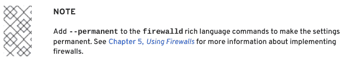

在 `firewalld` 富语言命令中添加 `--permanent` 以使设置永久生效。有关实施防火墙的更多信息，请参阅 *Chapter 5, Using Firewalls*（第 5 章，使用防火墙）。

### 4.3.6. 保护 NIS


**网络信息服务**（NIS）是一种 RPC 服务，称为 `ypserv`，它与 `rpcbind` 和其他相关服务一起使用，将用户名、密码和其他敏感信息的映射分发到声称属于其域内的任何计算机。

NIS 服务器由几个应用程序组成。它们包括以下内容：

- `/usr/sbin/rpc.yppasswd` - 也称为 `yppasswd` 服务，此守护进程允许用户更改其 NIS 密码。
- `/usr/sbin/rpc.ypxfrd` - 也称为 `ypxfrd` 服务，此守护进程负责通过网络传输 NIS 映射。
- `/usr/sbin/ypserv` - 这是 NIS 服务器守护进程。

按照当今标准，NIS 并不十分安全。它没有主机身份验证机制，并且通过网络传输的所有信息（包括密码哈希值）均未加密。因此，在设置使用 NIS 的网络时必须格外小心。这一点因 NIS 的默认配置本质上不安全而变得更加复杂。

建议计划实施 NIS 服务器的任何人首先按照 4.3.4 节“保护 `rpcbind`”中所述的安全措施保护 `rpcbind` 服务，然后解决网络规划等以下问题。

### 4.3.6.1. 仔细规划网络

由于 NIS 通过网络传输未加密的敏感信息，因此重要的是该服务应运行在防火墙后面，并且位于分段且安全的网络上。每当 NIS 信息在不安全的网络上传输时，就有被截获的风险。仔细的网络设计有助于防止严重的安全泄露。

### 4.3.6.2. 使用类似密码的 NIS 域名和主机名

NIS 域内的任何机器都可以使用命令从服务器提取信息，而无需身份验证，只要用户知道 NIS 服务器的 DNS 主机名和 NIS 域名即可。

例如，如果有人将笔记本电脑连接到网络，或者从外部闯入网络（并设法伪造内部 IP 地址），以下命令将显示 `/etc/passwd` 映射：

```bash
ypcat -d <NIS_domain> -h <DNS_hostname> passwd
```

如果该攻击者是 root 用户，他们可以通过输入以下命令获取 `/etc/shadow` 文件：

```bash
ypcat -d <NIS_domain> -h <DNS_hostname> shadow
```

> **注意**
>
> 如果使用 Kerberos，`/etc/shadow` 文件不会存储在 NIS 映射中。

为了使攻击者更难访问 NIS 映射，请为 DNS 主机名创建随机字符串，例如 `o7hfawtgmlwv.domain.com`。同样，创建一个*不同的*随机 NIS 域名。这使得攻击者访问 NIS 服务器变得更加困难。

### 4.3.6.3. 编辑 `/var/yp/securenets` 文件

如果 `/var/yp/securenets` 文件为空或不存在（默认安装后的情况便是如此），NIS 将监听所有网络。首先要做的事情之一是在该文件中放入网络掩码/网络对，以便 `ypserv` 仅响应来自适当网络的请求。

以下是 `/var/yp/securenets` 文件中的示例条目：

```text
255.255.255.0     192.168.0.0
```

> **警告**
>
> 切勿在创建 `/var/yp/securenets` 文件之前首次启动 NIS 服务器。

这种技术无法提供对 IP 欺骗攻击的保护，但它至少限制了 NIS 服务器服务的网络范围。

### 4.3.6.4. 分配静态端口并使用富语言规则

所有与 NIS 相关的服务器都可以分配特定端口，除了 `rpc.yppasswd` 之外 – 该守护进程允许用户更改其登录密码。为其他两个 NIS 服务器守护进程 `rpc.ypxfrd` 和 `ypserv` 分配端口，允许创建防火墙规则以进一步保护 NIS 服务器守护进程免受入侵者攻击。

为此，请向 `/etc/sysconfig/network` 添加以下行：

```bash
YPSERV_ARGS="-p 834"
YPPFRD_ARGS="-p 835"
```

然后可以使用以下富语言 `firewalld` 规则来强制执行服务器监听这些端口的网络：

```bash
~]# firewall-cmd --add-rich-rule='rule family="ipv4" source address="192.168.0.0/24" invert="True" port port="834-835" protocol="tcp" drop'
~]# firewall-cmd --add-rich-rule='rule family="ipv4" source address="192.168.0.0/24" invert="True" port port="834-835" protocol="udp" drop'
```

这意味着服务器仅允许来自 `192.168.0.0/24` 网络的请求连接端口 834 和 835。第一个规则适用于 `TCP`，第二个规则适用于 `UDP`。


> **注意**
>
> 有关使用 iptables 命令实施防火墙的更多信息，请参阅 *Chapter 5, Using Firewalls*（第 5 章，使用防火墙）。

### 4.3.6.5. 使用 Kerberos 身份验证

使用 NIS 进行身份验证时需要考虑的问题之一是，每当用户登录到机器时，`/etc/shadow` 映射中的密码哈希值都会通过网络传输。如果入侵者访问 NIS 域并嗅探网络流量，他们可以收集用户名和密码哈希值。经过足够的时间，密码破解程序可以猜测弱密码，攻击者可以获取网络上一个有效账户的访问权限。

由于 Kerberos 使用秘密密钥加密，因此密码哈希值永远不会通过网络传输，这使得系统更加安全。有关 Kerberos 的更多信息，请参阅 *Linux Domain Identity, Authentication, and Policy Guide*（Linux 域身份、身份验证和策略指南）中的 *Logging into IdM Using Kerberos*（使用 Kerberos 登录 IdM）部分。

### 4.3.7. 保护 NFS


> **重要**
>
> NFS 流量可以使用 `TCP` 传输所有版本，NFSv3 应使用 `TCP` 而非 `UDP`，并且使用 NFSv4 时是必需的。所有版本的 NFS 都支持作为 `RPCSEC_GSS` 内核模块一部分的 Kerberos 用户和组身份验证。仍然包含有关 `rpcbind` 的信息，因为 Red Hat Enterprise Linux 7 支持利用 `rpcbind` 的 NFSv3。

#### 4.3.7.1. 仔细规划网络

NFSv2 和 NFSv3 传统上不安全地传递数据。现在所有版本的 NFS 都有能力使用 Kerberos 对普通文件系统操作进行身份验证（并可选地加密）。在 NFSv4 中，所有操作都可以使用 Kerberos；在 NFSv2 或 NFSv3 中，文件锁定和挂载仍不使用它。使用 NFSv4.0 时，如果客户端位于 NAT 或防火墙后面，可以关闭委派。有关使用 NFSv4.1 允许委派通过 NAT 和防火墙操作的信息，请参阅 Red Hat Enterprise Linux 7 *Storage Administration Guide*（存储管理指南）中的 `pNFS` 部分。

#### 4.3.7.2. 保护 NFS 挂载选项

`/etc/fstab` 文件中 `mount` 命令的用法在《Red Hat Enterprise Linux 7 存储管理指南》的“使用 mount 命令”章节中有所介绍。从安全管理的角度来看，值得注意的是，NFS 挂载选项也可以在 `/etc/nfsmount.conf` 中指定，该文件可用于设置自定义的默认选项。

##### 4.3.7.2.1. 审查 NFS 服务器

> **警告**
> 仅导出整个文件系统。导出文件系统的子目录可能会带来安全隐患。在某些情况下，客户端可能会“突破”导出部分并访问到未导出的部分（参见 `exports(5)` 手册页中关于子树检查的章节）。

尽可能使用 `ro` 选项将文件系统导出为只读，以减少能够向挂载文件系统写入的用户数量。仅在明确需要时才使用 `rw` 选项。更多信息请参阅 `man exports(5)` 页面。允许写入访问会增加例如符号链接攻击的风险。这包括 `/tmp` 和 `/usr/tmp` 等临时目录。

当目录必须以 `rw` 选项挂载时，尽可能避免将其设置为全局可写，以降低风险。导出主目录也被视为一种风险，因为某些应用程序以明文或弱加密形式存储密码。随着应用程序代码的审查和改进，这一风险正在降低。有些用户未为其 SSH 密钥设置密码，因此这也意味着主目录存在风险。强制使用密码或使用 Kerberos 可以缓解该风险。


仅将导出限制在需要访问的客户端。在 NFS 服务器上使用 `showmount -e` 命令审查服务器正在导出的内容。不要导出任何并非明确必需的内容。

不要使用 `no_root_squash` 选项，并审查现有安装以确保未使用该选项。更多信息请参阅第 4.3.7.4 节“不要使用 no_root_squash 选项”。

`secure` 选项是用于将导出限制在“保留”端口的服务器端导出选项。默认情况下，服务器仅允许来自“保留”端口（编号小于 1024 的端口）的客户端通信，因为传统上客户端仅允许“受信任”的代码（如内核中的 NFS 客户端）使用这些端口。然而，在许多网络中，任何人都不难在某个客户端上成为 root，因此服务器很少能安全地假设来自保留端口的通信具有特权。因此，对保留端口的限制价值有限；最好依赖 Kerberos、防火墙以及将导出限制到特定客户端。

大多数客户端在可能的情况下仍会使用保留端口。然而，保留端口是一种有限资源，因此客户端（尤其是拥有大量 NFS 挂载的客户端）可能会选择使用编号较高的端口。Linux 客户端可以使用“noregport”挂载选项来做到这一点。如果您希望允许在导出中使用此行为，可以使用“insecure”导出选项。

良好的做法是不允许用户登录到服务器。在审查上述 NFS 服务器设置时，应审查谁以及什么可以访问该服务器。

### 4.3.7.2.2. 审查 NFS 客户端

使用 `nosuid` 选项禁止使用 setuid 程序。`nosuid` 选项禁用 set-user-identifier 或 set-group-identifier 位。这可以防止远程用户通过运行 setuid 程序来获取更高权限。在客户端和服务器端都应使用此选项。

`noexec` 选项禁用客户端上的所有可执行文件。使用此选项可防止用户无意中执行放置在正在共享的文件系统中的文件。`nosuid` 和 `noexec` 选项是大多数（如果并非全部）文件系统的标准选项。

使用 `nodev` 选项防止客户端将“设备文件”作为硬件设备进行处理。

`resvport` 选项是客户端挂载选项，`secure` 是相应的服务器端导出选项（参见上述说明）。它将通信限制在“保留端口”。保留或“知名”端口是为特权用户和进程（如 root 用户）预留的。设置此选项会导致客户端使用保留源端口与服务器通信。

所有版本的 NFS 现在都支持使用 Kerberos 认证进行挂载。启用此功能的挂载选项为：`sec=krb5`。

NFSv4 支持使用 Kerberos 进行挂载，其中 `krb5i` 用于完整性，`krb5p` 用于隐私保护。这些在挂载时使用 `sec=krb5`，但需要在 NFS 服务器上配置。更多信息请参阅 exports 手册页（`man 5 exports`）。

NFS 手册页（`man 5 nfs`）有一个“SECURITY CONSIDERATIONS”（安全注意事项）章节，解释了 NFSv4 中的安全增强功能，并包含所有 NFS 特定的挂载选项。

#### 4.3.7.3. 警惕语法错误

NFS 服务器通过查阅 `/etc/exports` 文件来确定要导出哪些文件系统以及将这些目录导出到哪些主机。编辑此文件时，务必小心，不要添加多余的空格。

例如，`/etc/exports` 文件中的以下行将目录 `/tmp/nfs/` 以读/写权限共享到主机 `bob.example.com`。

```
/tmp/nfs/		bob.example.com(rw)
```

另一方面，`/etc/exports` 文件中的以下行将同一目录以只读权限共享到主机 `bob.example.com`，并由于主机名后的一个空格字符，将其以读/写权限共享给全世界。

```
/tmp/nfs/		bob.example.com (rw)
```

使用 `showmount` 命令检查任何已配置的 NFS 共享，以验证正在共享的内容，这是一种良好的做法：

```
showmount -e <hostname>
```

#### 4.3.7.4. 不要使用 no_root_squash 选项

默认情况下，NFS 共享会将 root 用户转换为 `nfsnobody` 用户，这是一个无特权用户帐户。这会将所有由 root 创建的所有者的文件所有者更改为 `nfsnobody`，从而防止上传设置了 setuid 位的程序。

如果使用 `no_root_squash`，远程 root 用户将能够修改共享文件系统上的任何文件，并留下被特洛伊木马感染的应用程序供其他用户无意中执行。

#### 4.3.7.5. NFS 防火墙配置

NFSv4 是 Red Hat Enterprise Linux 7 的默认 NFS 版本，它仅需要打开 TCP 端口 2049。如果使用 NFSv3，则需要下面解释的另外四个端口。

### 为 NFSv3 配置端口

NFS 使用的端口由 `rpcbind` 服务动态分配，这在创建防火墙规则时可能会引起问题。为了简化此过程，请使用 `/etc/sysconfig/nfs` 文件指定要使用的端口：

- `MOUNTD_PORT` – `mountd` (`rpc.mountd`) 的 TCP 和 UDP 端口

- `STATD_PORT` – `status` (`rpc.statd`) 的 TCP 和 UDP 端口

在 Red Hat Enterprise Linux 7 中，请在 `/etc/modprobe.d/lockd.conf` 文件中设置 NFS 锁管理器 (`nlockmgr`) 的 TCP 和 UDP 端口：

- `nlm_tcpport` – `nlockmgr` (`rpc.lockd`) 的 TCP 端口

- `nlm_udpport` – `nlockmgr` (`rpc.lockd`) 的 UDP 端口

指定的端口号不得被任何其他服务使用。请配置防火墙以允许指定的端口号，以及 TCP 和 UDP 端口 2049 (`NFS`)。有关其他可自定义的 NFS 锁管理器参数的说明，请参阅 `/etc/modprobe.d/lockd.conf`。

在 NFS 服务器上运行 `rpcinfo -p` 命令，以查看正在使用的端口和 RPC 程序。

#### 4.3.7.6. 使用 Red Hat Identity Management 保护 NFS

在使用 Red Hat Identity Management 的环境中，支持 Kerberos 的 NFS 设置可以大大简化。Red Hat Identity Management 包含在 Red Hat Enterprise Linux 中。

请参阅 [Red Hat Enterprise Linux 7 Linux 域身份、身份验证和策略指南](https://access.redhat.com/documentation/en-us/red_hat_enterprise_linux/7/html/linux_domain_identity_authentication_and_policy_guide/index)，特别是 [设置支持 Kerberos 的 NFS 服务器](https://access.redhat.com/documentation/en-us/red_hat_enterprise_linux/7/html/linux_domain_identity_authentication_and_policy_guide/setting-up-a-kerberos-aware-nfs-server)，以了解在使用 Red Hat Identity Management 时如何使用 Kerberos 保护 NFS。

### 4.3.8. 保护 HTTP 服务器

#### 4.3.8.1. 保护 Apache HTTP 服务器

Apache HTTP 服务器是 Red Hat Enterprise Linux 7 中最稳定和安全的服务之一。有大量可用的选项和技术来保护 Apache HTTP 服务器——数量之多，无法在此深入探讨。以下部分简要介绍了运行 Apache HTTP 服务器时的良好实践。

在将任何脚本投入生产之前，始终验证运行在系统上的脚本是否按预期工作。此外，确保只有 root 用户对包含脚本或 CGI 的任何目录具有写入权限。为此，请以下 root 用户身份输入以下命令：

```
chown root <directory_name>
```

#### 4.3.8.1. 保护 Apache HTTP 服务器

系统管理员在使用以下配置选项（配置于 `/etc/httpd/conf/httpd.conf`）时应保持谨慎：

### FollowSymlinks

此指令默认是启用的，因此在为 Web 服务器文档根目录创建符号链接时务必谨慎。例如，提供指向 `/.` 的符号链接是一个坏主意。

```bash
chmod 755 <directory_name>
```

### Indexes

此指令默认是启用的，但这可能不是理想的设置。要防止访问者浏览服务器上的文件，请移除此指令。

### UserDir


`UserDir` 指令默认是禁用的，因为它可以确认系统中是否存在用户账户。要在服务器上启用用户目录浏览，请使用以下指令：

```apache
UserDir enabled
UserDir disabled root
```

这些指令为除 `/root/` 以外的所有用户目录启用用户目录浏览。要将用户添加到禁用账户列表中，请在 `UserDir disabled` 行添加由空格分隔的用户列表。

### ServerTokens

`ServerTokens` 指令控制发送回客户端的服务器响应头字段。它包含各种信息，可以使用以下参数进行自定义：

- `ServerTokens Full`（默认选项）– 提供所有可用信息（操作系统类型和使用的模块），例如：

```text
Apache/2.0.41 (Unix) PHP/4.2.2 MyMod/1.2
```

- `ServerTokens Prod` 或 `ServerTokens ProductOnly` – 提供以下信息：

```text
Apache
```

- `ServerTokens Major` – 提供以下信息：

```text
Apache/2
```

- `ServerTokens Minor` – 提供以下信息：

```text
Apache/2.0
```

- `ServerTokens Min` 或 `ServerTokens Minimal` – 提供以下信息：

```text
Apache/2.0.41
```

- `ServerTokens OS` – 提供以下信息：

```text
Apache/2.0.41 (Unix)
```

建议使用 `ServerTokens Prod` 选项，以便潜在的攻击者无法获取关于您系统的任何有价值信息。


#### 重要提示

不要移除 `IncludeNoExec` 指令。默认情况下，`服务器端包含 (SSI)` 模块不能执行命令。除非绝对必要，否则建议不要更改此设置，因为这可能会使攻击者能够在系统上执行命令。

### 移除 httpd 模块

在某些场景中，移除某些 `httpd` 模块以限制 HTTP 服务器的功能是有利的。为此，请编辑 `/etc/httpd/conf.modules.d` 目录中的配置文件。例如，要移除代理模块：

```bash
echo '# All proxy modules disabled' > /etc/httpd/conf.modules.d/00-proxy.conf
```

请注意，`/etc/httpd/conf.d/` 目录中也包含用于加载模块的配置文件。

### httpd 和 SELinux

更多信息，请参见 *Red Hat Enterprise Linux 7 SELinux 用户和管理员指南* 中的 *Apache HTTP 服务器和 SELinux* 章节。

#### 4.3.8.2. 保护 NGINX

NGINX 是一个高性能的 HTTP 和代理服务器。本节简要记录了加固 NGINX 配置的额外步骤。请在 NGINX 配置文件的 `server` 部分执行以下所有配置更改。

### 禁用版本字符串

为防止攻击者了解正在服务器上运行的 NGINX 版本，请使用以下配置选项：

```nginx
server_tokens    off;
```

这会移除版本号，并在由 NGINX 处理的所有请求中仅报告字符串 `nginx`：

```bash
$ curl -sI http://localhost | grep Server
Server: nginx
```

### 包含额外的安全相关标题

由 NGINX 处理的每个请求都可以包含额外的 HTTP 头，以减轻某些已知的 Web 应用程序漏洞：

- `add_header X-Frame-Options SAMEORIGIN;` – 此选项拒绝任何域外页面嵌入由 NGINX 提供的内容，从而有效缓解点击劫持攻击。
- `add_header X-Content-Type-Options nosniff;` – 此选项防止某些旧浏览器中的 MIME 类型嗅探。
- `add_header X-XSS-Protection "1; mode=block";` – 此选项启用跨站脚本 (XSS) 过滤，防止浏览器渲染由 NGINX 响应中包含的潜在恶意内容。

### 禁用潜在的有害 HTTP 方法

如果启用，某些 HTTP 方法可能允许攻击者在 Web 服务器上执行原本旨在供开发人员测试 Web 应用程序的操作。例如，TRACE 方法已知允许跨站跟踪 (XST)。

您的 NGINX 服务器也可以通过仅允许那些应被允许的方法（即使用白名单）来禁止这些有害的 HTTP 方法以及任意方法。例如：

```nginx
# Allow GET, PUT, POST; return "405 Method Not Allowed" for all others.
if ( $request_method !~ ^(GET|PUT|POST)$ ) {
    return 405;
}
```

### 配置 SSL

为了保护由您的 NGINX Web 服务器提供的数据，请考虑仅通过 HTTPS 提供数据。要为在 NGINX 服务器中启用 SSL 生成安全配置文件，请参见 Mozilla SSL 配置生成器。生成的配置确保已知的易受攻击的协议（例如 SSLv2 或 SSLv3）、密码和哈希算法（例如 3DES 或 MD5）被禁用。

您还可以使用 SSL 服务器测试来验证您的配置是否符合现代安全要求。

### 4.3.9. 保护 FTP

文件传输协议 (FTP) 是一种较旧的 TCP 协议，旨在通过网络传输文件。由于与服务器之间的所有事务（包括用户身份验证）都是未加密的，因此它被认为是不安全的协议，应谨慎配置。

Red Hat Enterprise Linux 7 提供两种 FTP 服务器：

- `Red Hat Content Accelerator (tux)` – 具有 FTP 功能的内核空间 Web 服务器。
- `vsftpd` – 独立的、面向安全的 FTP 服务实现。

以下安全准则适用于配置 `vsftpd` FTP 服务。

#### 4.3.9.1. FTP 问候横幅

在提交用户名和密码之前，所有用户都会看到一个问候横幅。默认情况下，此横幅包含有用的版本信息，攻击者会利用这些信息来识别系统中的弱点。

要更改 `vsftpd` 的问候横幅，请在 `/etc/vsftpd/vsftpd.conf` 文件中添加以下指令：

```ini
ftpd_banner=<insert_greeting_here>
```

将上述指令中的 `<insert_greeting_here>` 替换为问候消息的文本。

对于多行横幅，最好使用横幅文件。为简化多个横幅的管理，请将所有横幅放在一个新目录中，例如 `/etc/banners/`。在此示例中，FTP 连接的横幅文件是 `/etc/banners/ftp.msg`。以下是此类文件的可能示例：

```text
##########  Hello, all activity on ftp.example.com is logged.  ##########
```

#### 注意

无需按照第 4.4.1 节“使用 TCP Wrappers 和 xinetd 保护服务”中所述，在文件的每一行开头添加 220。

要在 `vsftpd` 中引用此问候横幅文件，请在 `/etc/vsftpd/vsftpd.conf` 文件中添加以下指令：

```ini
banner_file=/etc/banners/ftp.msg
```

还可以使用 TCP Wrappers 向传入连接发送额外的横幅，如第 4.4.1 节“TCP Wrappers 和连接横幅”中所述。

#### 4.3.9.2. 匿名访问

`/var/ftp/` 目录的存在会激活匿名账户。

创建此目录的最简单方法是安装 `vsftpd` 包。此包会为匿名用户建立目录树，并将目录权限配置为对匿名用户只读。

默认情况下，匿名用户无法写入任何目录。

#### 警告

如果启用 FTP 服务器的匿名访问，请注意敏感数据的存储位置。

##### 4.3.9.2.1. 匿名上传

要允许匿名用户上传文件，建议在 `/var/ftp/pub/` 内创建一个仅可写目录。为此，请以 root 身份输入以下命令：

```bash
[~]# mkdir /var/ftp/pub/upload
```

接下来，更改权限，使匿名用户无法查看目录内容：

目录的长格式列表应如下所示：

```bash
~]# ls -ld /var/ftp/pub/upload
drwx-wx---. 2 root ftp 4096 Nov 14 22:57 /var/ftp/pub/upload
```

允许匿名用户在目录中进行读写操作的系统管理员常常发现，他们的服务器变成了盗版软件的仓库。


此外，在 `vsftpd` 中，向 `/etc/vsftpd/vsftpd.conf` 文件添加以下行：

```text
anon_upload_enable=YES
```

#### 4.3.9.3. 用户账户

由于 FTP 在不安全的网络上以未加密的方式传输用户名和密码以进行身份验证，因此最好不要允许系统用户通过其用户账户访问服务器。

要在 `vsftpd` 中禁用所有用户账户，请向 `/etc/vsftpd/vsftpd.conf` 添加以下指令：

```text
local_enable=NO
```

##### 4.3.9.3.1. 限制用户账户

若要禁用特定账户或特定账户组（例如 root 用户和具有 sudo 权限的用户）的 FTP 访问，最简单的方法是使用第 4.2.1 节“禁止 root 访问”中描述的 PAM 列表文件。`vsftpd` 的 PAM 配置文件为 `/etc/pam.d/vsftpd`。

也可以直接在每个服务内部禁用用户账户。

要在 `vsftpd` 中禁用特定用户账户，请将用户名添加到 `/etc/vsftpd/ftpusers`。

#### 4.3.9.4. 使用 TCP Wrappers 控制访问

按照第 4.4.1 节“使用 TCP Wrappers 和 xinetd 保护服务”中的说明，使用 TCP Wrappers 控制对任一 FTP 守护进程的访问。

### 4.3.10. 保护 Postfix

Postfix 是一种邮件传输代理（MTA），它使用简单邮件传输协议（SMTP）在其他 MTA 之间以及邮件客户端或投递代理之间传递电子消息。虽然许多 MTA 能够相互加密流量，但大多数不能，因此通过任何公共网络发送电子邮件被认为是一种本质上不安全的通信形式。在 Red Hat Enterprise Linux 7 中，Postfix 取代了 Sendmail，成为默认的 MTA。

建议计划实施 Postfix 服务器的用户解决以下问题。

#### 4.3.10.1. 限制拒绝服务攻击

由于电子邮件的性质，坚定的攻击者可以轻松地用邮件淹没服务器并导致拒绝服务。可以通过设置 `/etc/postfix/main.cf` 文件中指令的限制来限制此类攻击的有效性。您可以更改已有指令的值，也可以按照以下格式添加您需要的指令及其想要的值：

```
<directive> = <value>
```

以下是可用于限制拒绝服务攻击的指令列表：

- `smtpd_client_connection_rate_limit` – 任何客户端在此时间单位内（如下文所述）允许尝试连接的最大数量。默认值为 0，这意味着客户端可以按 Postfix 能接受的速率进行尽可能多的连接。默认情况下，受信任网络中的客户端被排除在外。

- `anvil_rate_time_unit` – 此时间单位用于速率限制计算。默认值为 60 秒。

- `smtpd_client_event_limit_exceptions` – 被排除在连接和速率限制命令之外的客户端。默认情况下，受信任网络中的客户端被排除在外。

- `smtpd_client_message_rate_limit` – 客户端在此时间单位内允许请求的最大邮件投递数量（无论 Postfix 是否实际接受这些邮件）。

- `default_process_limit` – 提供特定服务的 Postfix 子进程的默认最大数量。此限制可以在 `master.cf` 文件中针对特定服务进行覆盖。默认值为 100。

- `queue_minfree` – 接收邮件所需的队列文件系统中的最小可用空间（以字节为单位）。目前，Postfix SMTP 服务器使用此参数来决定是否接受任何邮件。默认情况下，当可用空间小于 `message_size_limit` 的 1.5 倍时，Postfix SMTP 服务器将拒绝 `MAIL FROM` 命令。要指定更高的最小可用空间限制，请指定至少为 `message_size_limit` 1.5 倍的 `queue_minfree` 值。默认情况下，`queue_minfree` 的值为 0。

- `header_size_limit` – 存储邮件头部所需的最大内存量（以字节为单位）。如果头部更大，超出部分将被丢弃。默认值为 102400。

- `message_size_limit` – 邮件的最大尺寸（以字节为单位，包括封套信息）。默认值为 10240000。

#### 4.3.10.2. NFS 和 Postfix

切勿将邮件 spool 目录 `/var/spool/postfix/` 放在 NFS 共享卷上。由于 NFSv2 和 NFSv3 不控制用户和组 ID，两个或更多用户可能拥有相同的 UID，从而接收和阅读彼此的邮件。

> **注意**
>
> 在使用 Kerberos 的 NFSv4 中，情况并非如此，因为 `SECRPC_GSS` 内核模块不使用基于 UID 的身份验证。然而，仍然认为*不要*将邮件 spool 目录放在 NFS 共享卷上是良好的做法。

#### 4.3.10.3. 仅限邮件用户

为了帮助防止 Postfix 服务器上的本地用户漏洞利用，邮件用户最好仅通过电子邮件程序访问 Postfix 服务器。邮件服务器上的 Shell 账户不应被允许，并且 `/etc/passwd` 文件中的所有用户 Shell 都应设置为 `/sbin/nologin`（root 用户可能除外）。

#### 4.3.10.4. 禁用 Postfix 网络监听

默认情况下，Postfix 设置为仅监听本地环回地址。您可以通过查看文件 `/etc/postfix/main.cf` 来验证这一点。

查看文件 `/etc/postfix/main.cf`，以确保仅出现以下 `inet_interfaces` 行：

```
inet_interfaces = localhost
```

这确保了 Postfix 仅从本地系统（如 cron 任务报告）接受邮件消息，而不是从网络接受。这是默认设置，可保护 Postfix 免受网络攻击。

若要移除 localhost 限制并允许 Postfix 监听所有接口，可以使用 `inet_interfaces = all` 设置。

#### 4.3.10.5. 配置 Postfix 使用 SASL

Red Hat Enterprise Linux 7 版本的 Postfix 可以使用 Dovecot 或 Cyrus SASL 实现来进行 SMTP 身份验证（或 SMTP AUTH）。SMTP 身份验证是简单邮件传输协议的扩展。启用后，SMTP 客户端必须使用服务器和客户端都支持和接受的认证方法向 SMTP 服务器进行身份验证。本节描述如何配置 Postfix 以使用 Dovecot SASL 实现。

要安装 Dovecot POP/IMAP 服务器，从而使 Dovecot SASL 实现在您的系统上可用，请以 root 用户身份执行以下命令：

```
[~]# yum install dovecot
```

Postfix SMTP 服务器可以使用 UNIX 域套接字或 TCP 套接字与 Dovecot SASL 实现进行通信。后一种方法仅在 Postfix 和 Dovecot 应用程序运行在单独机器上的情况下才需要。本指南优先使用 UNIX 域套接字方法，因为它提供更好的隐私性。

为了指示 Postfix 使用 Dovecot SASL 实现，需要对两个应用程序进行多项配置更改。请按照以下程序进行这些更改。

#### 设置 Dovecot

1. 修改主要的 Dovecot 配置文件 `/etc/dovecot/conf.d/10-master.conf`，以包含以下行（默认配置文件已经包含了大部分相关部分，只需取消这些行的注释）：

```
service auth {
unix_listener /var/spool/postfix/private/auth {
mode = 0660
user = postfix
group = postfix
}
}
```

上述示例假设在 **Postfix** 和 **Dovecot** 之间使用 **UNIX 域**套接字进行通信。它还假设 **Postfix SMTP** 服务器的默认设置，包括位于 `/var/spool/postfix/` 目录中的邮件队列，以及应用程序在 **postfix** 用户和组下运行。通过这种方式，读写权限仅限于 **postfix** 用户和组。

或者，您可以使用以下配置来设置 **Dovecot**，使其通过 **TCP** 监听 **Postfix** 的身份验证请求：

```text
service auth {
    inet_listener {
        port = 12345
    }
}
```

在上述示例中，将 `12345` 替换为您想使用的端口号。

2. 编辑 `/etc/dovecot/conf.d/10-auth.conf` 配置文件，以指示 **Dovecot** 向 **Postfix SMTP** 服务器提供 `plain` 和 `login` 身份验证机制：


```text
auth_mechanisms = plain login
```

#### 设置 Postfix

对于 `Postfix`，只需修改主配置文件 `/etc/postfix/main.cf`。添加或编辑以下配置指令：

1. 在 `Postfix SMTP` 服务器中启用 SMTP 身份验证：

```text
smtpd_sasl_auth_enable = yes
```

2. 指示 `Postfix` 使用 `Dovecot SASL` 实现进行 SMTP 身份验证：

```text
smtpd_sasl_type = dovecot
```

3. 提供相对于 `Postfix` 队列目录的认证路径（注意，使用相对路径可确保无论 `Postfix` 服务器是否运行在 `chroot` 中，配置都能正常工作）：

```text
smtpd_sasl_path = private/auth
```

此步骤假设您希望在 `Postfix` 和 `Dovecot` 之间使用 `UNIX` 域套接字进行通信。如果要配置 `Postfix` 在另一台机器上查找 `Dovecot`（当使用 `TCP` 套接字进行通信时），请使用类似于以下值的配置：

```text
smtpd_sasl_path = inet:127.0.0.1:12345
```

在上述示例中，需要将由 `127.0.0.1` 替换为 `Dovecot` 机器的 `IP` 地址，并将 `12345` 替换为在 `Dovecot` 的 `/etc/dovecot/conf.d/10-master.conf` 配置文件中指定的端口。

4. 指定 `Postfix SMTP` 服务器向客户端提供的 `SASL` 机制。请注意，可以为加密和非加密会话指定不同的机制。

### SMTP SASL 安全选项

```
smtpd_sasl_security_options = noanonymous, noplaintext
smtpd_sasl_tls_security_options = noanonymous
```

上述示例规定，在未加密的会话期间，不允许匿名认证，也不允许使用传输未加密用户名或密码的机制。对于加密会话（使用 TLS），仅允许使用非匿名认证机制。

请访问 [http://www.postfix.org/SASL_README.html#smtpd_sasl_security_options](http://www.postfix.org/SASL_README.html#smtpd_sasl_security_options) 查看所有用于限制允许使用的 SASL 机制的支持策略列表。

### 附加资源

以下在线资源提供了有关配置 Postfix SMTP 通过 SASL 进行认证的有用附加信息。

- [http://wiki2.dovecot.org/HowTo/PostfixAndDovecotSASL](http://wiki2.dovecot.org/HowTo/PostfixAndDovecotSASL) – 包含有关如何设置 Postfix 以使用 Dovecot SASL 实现进行 SMTP 认证的信息。
- [http://www.postfix.org/SASL_README.html#server_sasl](http://www.postfix.org/SASL_README.html#server_sasl) – 包含有关如何设置 Postfix 以使用 Dovecot 或 Cyrus SASL 实现进行 SMTP 认证的信息。

### 4.3.11. 保护 SSH

安全外壳协议（SSH）是一种强大的网络协议，用于通过安全通道与另一系统进行通信。SSH 上的传输是加密的，并受到保护以防截获。有关 SSH 协议的一般信息以及在 Red Hat Enterprise Linux 7 中使用 SSH 服务的信息，请参阅《Red Hat Enterprise Linux 7 系统管理员指南》中的 OpenSSH 章节。

> `重要`
>
> 本节强调了保护 SSH 设置的常见方法。绝不应将此建议措施列表视为详尽无遗或决定性的。请参阅 `sshd_config(5)` 以获取有关可用于修改 `sshd` 守护进程行为的所有配置指令的描述，并参阅 `ssh(1)` 以了解基本 SSH 概念的解释。

#### 4.3.11.1. 加密登录

SSH 支持使用加密密钥登录计算机。这比仅使用密码要安全得多。如果您将此方法与其他身份验证方法结合使用，则可以将其视为多因素认证。有关使用多种身份验证方法的更多信息，请参阅第 4.3.11.2 节，“多种身份验证方法”。

为了启用使用加密密钥进行身份验证，需要将 `/etc/ssh/sshd_config` 文件中的 `PubkeyAuthentication` 配置指令设置为 `yes`。请注意，这是默认设置。将 `PasswordAuthentication` 指令设置为 `no` 以禁用使用密码登录的可能性。

可以使用 `ssh-keygen` 命令生成 SSH 密钥。如果在调用时没有额外参数，它将创建 2048 位 RSA 密钥集。默认情况下，密钥存储在 `~/.ssh/` 目录中。您可以利用 `-b` 开关来修改密钥的位强度。通常使用 2048 位密钥就足够了。《Red Hat Enterprise Linux 7 系统管理员指南》中关于配置 OpenSSH 的章节包含了有关生成密钥对的详细信息。

您应该在 `~/.ssh/` 目录中看到两个密钥。如果在运行 `ssh-keygen` 命令时接受了默认值，则生成的文件名为 `id_rsa` 和 `id_rsa.pub`，分别包含私钥和公钥。您始终应通过使私钥仅对文件所有者可读来保护私钥免受暴露。然而，需要将公钥传输到您将要登录的系统。您可以使用 `ssh-copy-id` 命令将密钥传输到服务器：

```bash
$ ssh-copy-id -i [user@]server
```

该命令还会自动将公钥追加到服务器上的 `~/.ssh/authorized_keys` 文件。当尝试登录服务器时，`sshd` 守护进程将检查此文件。

与密码和其他任何身份验证机制类似，您应该定期更改 SSH 密钥。更改时，请确保从 `authorized_keys` 文件中删除任何未使用的密钥。

#### 4.3.11.2. 多种身份验证方法

使用多种身份验证方法，即多因素认证，可以提高对未授权访问的保护级别，因此在加固系统以防止其被入侵时应予以考虑。尝试登录使用多因素认证系统的用户必须成功完成所有指定的身份验证方法才能被授予访问权限。

使用 `/etc/ssh/sshd_config` 文件中的 `AuthenticationMethods` 配置指令来指定要使用哪些身份验证方法。请注意，使用此指令可以定义多组所需的身份验证方法。如果是这种情况，用户必须在至少一组中完成所有方法。列表需要用空格分隔，而列表内的单个身份验证方法名称必须用逗号分隔。例如：

```text
AuthenticationMethods publickey,gssapi-with-mic publickey,keyboard-interactive
```

配置了上述 `AuthenticationMethods` 指令的 `sshd` 守护进程仅授予访问权限，前提是尝试登录的用户成功完成 `publickey` 身份验证后接着进行 `gssapi-with-mic` 身份验证，或者接着进行 `keyboard-interactive` 身份验证。请注意，请求的每个身份验证方法都需要使用 `/etc/ssh/sshd_config` 文件中的相应配置指令（例如 `PubkeyAuthentication`）明确启用。有关可用身份验证方法的一般列表，请参阅 `ssh(1)` 的 `AUTHENTICATION` 部分。

#### 4.3.11.3. 保护 SSH 的其他方法

#### 协议版本

尽管 Red Hat Enterprise Linux 7 提供的 SSH 协议实现仍然支持 SSH 客户端的 SSH-1 和 SSH-2 协议版本，但尽可能情况下仅应使用后者。SSH-2 版本包含针对旧版 SSH-1 的若干改进，并且大多数高级配置选项仅在使用 SSH-2 时才可用。

Red Hat 建议使用 SSH-2 以最大程度地提高 SSH 协议对其所使用的身份验证和通信的保护程度。`sshd` 守护进程支持的协议版本可以通过 `/etc/ssh/sshd_config` 文件中的 `Protocol` 配置指令进行指定。默认设置为 `2`。请注意，SSH-2 版本是 Red Hat Enterprise Linux 7 SSH 服务器支持的唯一版本。

#### 密钥类型

虽然 `ssh-keygen` 命令默认生成一对 SSH-2 `RSA` 密钥，但可以使用 `-t` 选项指示其生成 DSA 或 ECDSA 密钥。ECDSA（椭圆曲线数字签名算法）在相同的等效对称密钥长度下提供更高的性能。它还生成更短的密钥。

#### 非默认端口


默认情况下，`sshd`守护进程监听 TCP 端口 `22`。更改端口可以减少系统基于自动化网络扫描的攻击暴露，从而通过隐蔽性增加安全性。端口可以使用 `/etc/ssh/sshd_config` 配置文件中的 `Port` 指令进行指定。还请注意，必须更改默认 SELinux 策略以允许使用非默认端口。您可以通过修改 `ssh_port_t` SELinux 类型并执行以下命令来完成此操作（需以 `root` 身份运行）：

```bash
# semanage -a -t ssh_port_t -p tcp port_number
```

在上述命令中，将 `port_number` 替换为使用 `Port` 指令指定的新端口号。

### 禁止 Root 登录

如果您的特定用例不需要作为 `root` 用户登录的可能性，您应考虑将 `/etc/ssh/sshd_config` 文件中的 `PermitRootLogin` 配置指令设置为 `no`。通过禁用作为 `root` 用户登录的可能性，管理员可以审计哪个用户在作为普通用户登录后获得了 root 权限并运行了哪些特权命令。

### 使用 X 安全扩展

Red Hat Enterprise Linux 7 客户端中的 X 服务器不提供 X 安全扩展。因此，客户端无法在连接到带有 X11 转发的不可信 SSH 服务器时请求另一层安全。大多数应用程序无论如何都无法在此扩展启用时运行。默认情况下，`/etc/ssh/sshd_config` 文件中的 `ForwardX11Trusted` 选项设置为 `yes`，并且 `ssh -X remote_machine`（不可信主机）和 `ssh -Y remote_machine`（可信主机）命令之间没有区别。

> **警告**
>
> Red Hat 建议不要在与不可信主机连接时使用 X11 转发。

## 4.3.12. 保护 PostgreSQL

PostgreSQL 是一个对象关系数据库管理系统（DBMS）。在 Red Hat Enterprise Linux 7 中，`postgresql-server` 软件包提供 PostgreSQL。如果未安装，请以 root 用户身份输入以下命令进行安装：

```bash
# yum install postgresql-server
```

在开始使用 PostgreSQL 之前，您必须在磁盘上初始化一个数据库存储区域。这称为数据库集群。要初始化数据库集群，请使用随 PostgreSQL 一起安装的命令 `initdb`。数据库集群所需文件系统位置由 `-D` 选项指示。例如：

`$ initdb -D /home/postgresql/db1`

`initdb` 命令将尝试创建你指定的目录（如果该目录尚不存在）。在本示例中，我们使用 `/home/postgresql/db1` 作为名称。`/home/postgresql/db1` 目录包含数据库中存储的所有数据，以及客户端身份验证配置文件：

```
$ cat pg_hba.conf
# PostgreSQL Client Authentication Configuration File
# This file controls: which hosts are allowed to connect, how clients
# are authenticated, which PostgreSQL user names they can use, which
# databases they can access.  Records take one of these forms:
#
# local        DATABASE USER METHOD [OPTIONS]
# host         DATABASE USER ADDRESS METHOD  [OPTIONS]
# hostssl      DATABASE USER ADDRESS METHOD  [OPTIONS]
# hostnossl    DATABASE USER ADDRESS METHOD  [OPTIONS]
```

`pg_hba.conf` 文件中的以下行允许任何经过身份验证的本地用户使用其用户名访问任何数据库：

```
local       all                       all                       trust
```

当你使用创建数据库用户但没有本地用户的分层应用程序时，这可能会带来问题。如果你不希望显式控制系统上的所有用户名，请从 `pg_hba.conf` 文件中删除此行为。

## 4.3.13. 保护 Docker

Docker 是一个开源项目，用于自动化在 Linux 容器中部署应用程序，并提供了将应用程序及其运行时依赖项打包到容器中的能力。为了使你的 `Docker` 工作流更加安全，请遵循 `Red Hat Enterprise Linux Atomic Host 7 容器安全指南` 中的程序。

## 4.4. 保护网络访问

### 4.4.1. 使用 TCP Wrappers 和 xinetd 保护服务

TCP Wrappers 能够做的远不止拒绝访问服务。本节展示了如何利用它们发送连接横幅、警告来自特定主机的攻击以及增强日志记录功能。有关 TCP Wrapper 功能和控制语言的信息，请参阅 `hosts_options(5)` 手册页。有关可用的标志（可作为应用于服务的选项）的信息，请参阅 `xinetd.conf(5)` 手册页。

#### 4.4.1.1. TCP Wrappers 与连接横幅

在用户连接服务时显示合适的横幅，是向潜在攻击者表明系统管理员保持警惕的好方法。你还可以控制向用户展示的系统信息。要为服务实现 TCP Wrappers 横幅，请使用 `banner` 选项。

此示例为 `vsftpd` 实现了横幅。首先，创建一个横幅文件。它可以位于系统上的任何位置，但必须与守护进程同名。在此示例中，该文件名为 `/etc/banners/vsftpd`，并包含以下行：

```
220-Hello, %c
220-All activity on ftp.example.com is logged.
220-Inappropriate use will result in your access privileges being removed.
```

`%c` 标记提供多种客户端信息，如用户名和主机名，或用户名和 IP 地址，使连接更具威慑力。

要向传入连接显示此横幅，请将以下行添加到 `/etc/hosts.allow` 文件中：

```
vsftpd : ALL : banners /etc/banners/
```

#### 4.4.1.2. TCP Wrappers 与攻击警告

如果检测到特定主机或网络正在攻击服务器，可以使用 TCP Wrappers 的 `spawn` 指令警告管理员来自该主机或网络的后续攻击。

在此示例中，假设检测到来自 `206.182.68.0/24` 网络的入侵者正在尝试攻击服务器。将以下行放在 `/etc/hosts.deny` 文件中，以拒绝来自该网络的任何连接尝试，并将尝试记录到特殊文件中：

```
ALL : 206.182.68.0 : spawn /bin/echo `date` %c %d >> /var/log/intruder_alert
```

`%d` 标记提供攻击者试图访问的服务名称。

若要允许连接并记录它，请将 `spawn` 指令放在 `/etc/hosts.allow` 文件中。

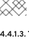

NOTE

由于 `spawn` 指令可以执行任何 shell 命令，建议创建一个特殊脚本，以便在特定客户端尝试连接服务器时通知管理员或执行一系列命令。

#### 4.4.1.3. TCP Wrappers 与增强日志记录

如果某些类型的连接比其他连接更令人担忧，可以使用 `severity` 选项提高该服务的日志级别。

在此示例中，假设任何尝试连接 FTP 服务器 23 端口（Telnet 端口）的人都是入侵者。为此，在日志文件中放置 `emerg` 标志而不是默认标志 `info`，并拒绝连接。

要做到这一点，请将以下行放在 `/etc/hosts.deny` 中：

```
in.telnetd : ALL : severity emerg
```

这使用了默认的 `authpriv` 日志记录设施，但将优先级从默认值 `info` 提升到 `emerg`，该标志会直接将日志消息发布到控制台。

### 4.4.2. 验证哪些端口正在监听

关闭未使用的端口以避免潜在攻击非常重要。对于处于监听状态的非预期端口，您应调查是否存在入侵迹象。

#### 使用 netstat 进行开放端口扫描

以 `root` 身份输入以下命令，以确定哪些端口正在监听来自网络的连接：


```
~]# netstat -pan -A inet,inet6 | grep -v ESTABLISHED
Active Internet connections (servers and established)
Proto Recv-Q Send-Q Local Address                Foreign Address            State
PID/Program name
Active Internet connections (servers and established)
Proto Recv-Q Send-Q Local Address                Foreign Address            State
PID/Program name
tcp      0  0 0.0.0.0:111                  0.0.0.0:*
LISTEN   1/systemd
tcp      0  0 192.168.124.1:53              0.0.0.0:*
LISTEN   1829/dnsmasq
tcp      0  0 0.0.0.0:22                    0.0.0.0:*
LISTEN   1176/sshd
tcp      0  0 127.0.0.1:631                 0.0.0.0:*
LISTEN   1177/cupsd
tcp6     0  0 :::111                        :::*
LISTEN   1/systemd
tcp6     0  0 ::1:25                        :::*
LISTEN   1664/master
sctp     20985/sctp_darn                     0.0.0.0:2500
LISTEN
udp      0  0 192.168.124.1:53              0.0.0.0:*
1829/dnsmasq
udp      0  0 0.0.0.0:67                    0.0.0.0:*
977/dhclient
...
```

使用 `netstat` 命令的 `-l` 选项，仅显示处于监听状态的服务器套接字：

```
~]# netstat -tlnw
Active Internet connections (only servers)
Proto Recv-Q Send-Q Local Address                Foreign Address            State
tcp      0  0 0.0.0.0:111                  0.0.0.0:*
LISTEN
tcp      0  0 192.168.124.1:53              0.0.0.0:*
LISTEN
tcp      0  0 0.0.0.0:22                    0.0.0.0:*
LISTEN
tcp      0  0 127.0.0.1:631                 0.0.0.0:*
LISTEN
tcp      0  0 127.0.0.1:25                  0.0.0.0:*
LISTEN
tcp6     0  0 :::111                        :::*
LISTEN
tcp6     0  0 :::22                         :::*
LISTEN
tcp6     0  0 ::1:631                       :::*
LISTEN
tcp6        0      0 ::1:25                  :::*
LISTEN
raw6         0      0 ::58                  :::*                             7
```

### 使用 `ss` 进行开放端口扫描

或者，使用 `ss` 实用程序列出处于监听状态的开放端口。它可以显示比 `netstat` 更多的 TCP 和状态信息。

```
~]# ss -tlw
Netid  State     Recv-Q Send-Q     Local Address:Port
Peer Address:Port
udp    UNCONN    0      0                  :::ipv6-icmp
:::*
tcp    LISTEN    0      128                     *:sunrpc
*:*
tcp    LISTEN    0      5    192.168.124.1:domain
*:*
tcp    LISTEN    0      128                      *:ssh
*:*
tcp    LISTEN    0      128       127.0.0.1:ipp
*:*
tcp    LISTEN    0      100       127.0.0.1:smtp
*:*
tcp    LISTEN    0      128                    :::sunrpc
:::*
tcp    LISTEN    0      128                       :::ssh
:::*
tcp    LISTEN    0      128                      :::ipp
:::*
tcp    LISTEN    0      100                     :::smtp
:::*
```

```
~]# ss -plno -A tcp,udp,sctp
Netid  State     Recv-Q Send-Q     Local Address:Port
Peer Address:Port
udp    UNCONN    0      0       192.168.124.1:53
*:*
users:(("dnsmasq",pid=1829,fd=5))
udp    UNCONN    0      0              *%virbr0:67
*:*
users:(("dnsmasq",pid=1829,fd=3))
udp    UNCONN    0      0                   *:68
*:*
users:(("dhclient",pid=977,fd=6))
...
tcp    LISTEN    0      5       192.168.124.1:53
*:*
users:(("dnsmasq",pid=1829,fd=6))
tcp    LISTEN    0      128                      *:22
*:*
users:(("sshd",pid=1176,fd=3))
tcp    LISTEN    0      128       127.0.0.1:631
*:*
users:(("cupsd",pid=1177,fd=12))
tcp    LISTEN    0      100       127.0.0.1:25
*:*
users:(("master",pid=1664,fd=13))
...
sctp   LISTEN    0      5                    *:2500
*:*
users:(("sctp_darn",pid=20985,fd=3))
```

`UNCONN` 状态显示处于 UDP 监听模式的端口。

针对 `ss` 输出中显示的每个 IP 地址（不包括本地主机 `127.0.0.0` 或 `::1` 网段），从外部系统执行扫描。扫描 IPv6 地址时请使用 `-6` 选项。

然后，使用通过网络连接到第一台系统的另一台远程机器上的 `nmap` 工具进行外部检查。这可以用于验证 `firewalld` 中的规则。以下是一个确定哪些端口正在监听 TCP 连接的示例：


```
~]# nmap -sT -O 192.168.122.65
Starting Nmap 6.40 ( http://nmap.org ) at 2017-03-27 09:30 CEST
Nmap scan report for 192.168.122.65
Host is up (0.00032s latency).
Not shown: 998 closed ports
PORT    STATE SERVICE
22/tcp  open  ssh
111/tcp open  rpcbind
Device type: general purpose
Running: Linux 3.x
OS CPE: cpe:/o:linux:linux_kernel:3
OS details: Linux 3.7 - 3.9
Network Distance: 0 hops

OS detection performed. Please report any incorrect results at
http://nmap.org/submit/ .
Nmap done: 1 IP address (1 host up) scanned in 1.79 seconds
```

TCP 连接扫描（`-sT`）是在无法使用 TCP SYN 扫描（`-sS`）时的默认 TCP 扫描类型。`-O` 选项用于检测主机的操作系统。

## 使用 netstat 和 ss 扫描开放的 SCTP 端口

`netstat` 实用程序用于打印 Linux 网络子系统的信息。若要显示开放的流控传输协议（SCTP）端口的协议统计信息，请以 `root` 身份输入以下命令：

```
~]# netstat -pLnS
Active Internet connections (only servers)
Proto Recv-Q Send-Q Local Address      Foreign Address      State       PID/Program
name
sctp                   127.0.0.1:250                  LISTEN
4125/sctp_darn
sctp                   0 127.0.0.1:260   127.0.0.1:250    CLOSE
4250/sctp_darn
sctp                   0 127.0.0.1:250   127.0.0.1:260    LISTEN
4125/sctp_darn
```

```
~]# netstat -nl -A inet,inet6 | grep 2500
sctp                   0.0.0.0:2500
LISTEN
```

`ss` 实用程序也可以显示开放的 SCTP 端口：

```
~]# ss -an | grep 2500
sctp   LISTEN   0    5      *:2500             *:*
```

有关更多信息，请参阅 `ss(8)`、`netstat(8)`、`nmap(1)` 和 `services(5)` 手册页。

## 禁用源路由

源路由是一种 Internet Protocol（IP）机制，它允许 IP 数据包携带信息（地址列表），以便告知路由器该数据包必须经过的路径。此外，还有一个选项可以在遍历路由时记录跳数。所经过的跳数列表（即“路由记录”）为目的地提供了返回源的路径。这允许源（发送主机）指定路由（宽松或严格），忽略部分或所有路由器的路由表。这可能允许用户出于恶意目的重定向网络流量。因此，应该禁用基于源的源路由。

`accept_source_route` 选项使网络接口接受设置了 *Strict Source Routing*（SSR）或 *Loose Source Routing*（LSR）选项的数据包。接受源路由数据包由 `sysctl` 设置控制。以 `root` 身份执行以下命令，丢弃设置了 SSR 或 LSR 选项的数据包：

```bash
~]# /sbin/sysctl -w net.ipv4.conf.all.accept_source_route=0
```

在可能的情况下，禁止数据包转发也应与上述设置同时执行（禁用转发可能会干扰虚拟化）。以 `root` 身份执行下列列出的命令：

这些命令禁用所有接口的 IPv4 和 IPv6 数据包转发：

```bash
~]# /sbin/sysctl -w net.ipv4.conf.all.forwarding=0
```

```bash
~]# /sbin/sysctl -w net.ipv6.conf.all.forwarding=0
```

这些命令禁用所有接口的所有多播数据包转发：

```bash
~]# /sbin/sysctl -w net.ipv4.conf.all.mc_forwarding=0
```

```bash
~]# /sbin/sysctl -w net.ipv6.conf.all.mc_forwarding=0
```

接受 ICMP 重定向的合法用途很少。除非特别需要，否则请禁用接收和发送 ICMP 重定向数据包。

这些命令禁用所有接口对所有 ICMP 重定向数据包的接受：

```bash
~]# /sbin/sysctl -w net.ipv4.conf.all.accept_redirects=0
```

```bash
~]# /sbin/sysctl -w net.ipv6.conf.all.accept_redirects=0
```

此命令禁用所有接口对安全 ICMP 重定向数据包的接受：

```bash
~]# /sbin/sysctl -w net.ipv4.conf.all.secure_redirects=0
```

此命令禁用所有接口对所有 IPv4 ICMP 重定向数据包的接受：

```bash
~]# /sbin/sysctl -w net.ipv4.conf.all.send_redirects=0
```


**重要**

如果 `net.ipv4.conf.all.send_redirects` 或 `net.ipv4.conf.interface.send_redirects` 选项中的任意一个设置为启用，则发送 ICMP 重定向将保持激活状态。请确保将每个 *interface* 的 `net.ipv4.conf.interface.send_redirects` 选项设置为 `0` 值。若要自动禁用添加新接口时发送 ICMP 请求，请输入以下命令：

```bash
~# /sbin/sysctl -w net.ipv4.conf.default.send_redirects=0
```

仅有一个用于禁用发送 IPv4 重定向数据包的指令。有关造成 IPv4 和 IPv6 之间这一差异的“IPv6 节点要求”的解释，请参阅 `RFC4294`。


**注意**

若要使这些设置在重启后仍然有效，请修改 `/etc/sysctl.conf` 文件。例如，若要禁用所有接口对所有 IPv4 ICMP 重定向数据包的接受，请使用以 `root` 用户身份运行的编辑器打开 `/etc/sysctl.conf` 文件，并添加如下所示的一行：

```text
net.ipv4.conf.all.send_redirects=0
```

有关更多信息，请参阅 `sysctl` 手册页 `sysctl(8)`。有关与基于源的源路由及其变体相关的 Internet 选项的解释，请参阅 `RFC791`。


**警告**

以太网提供了其他重定向流量的方式，例如 ARP 或 MAC 地址欺骗、未经授权的 DHCP 服务器以及 IPv6 路由器或邻居通告。此外，单播流量偶尔会被广播，导致信息泄露。这些弱点只能通过网络运营商实施的特定对策来解决。基于主机的对策并非完全有效。

### 反向路径转发

反向路径转发（Reverse Path Forwarding）用于防止通过一个接口到达的数据包通过另一个接口离开。当出站路由和入站路由不同时，这有时被称为 *不对称路由*（asymmetric routing）。路由器经常以这种方式路由数据包，但大多数主机不需要这样做。例外情况包括涉及通过一个链路发送流量并通过来自不同服务提供商的另一个链路接收流量的应用程序。例如，将租用线路与 xDSL 或带有 3G 调制解调器的卫星链路结合使用。如果此场景适用于您，则需要在入站接口上关闭反向路径转发。简而言之，除非您确定它是必需的，否则最好将其启用，因为它可以防止用户欺骗来自本地子网的 IP 地址，并减少 DDoS 攻击的机会。


**注意**


Red Hat Enterprise Linux 7 默认使用 **严格反向路径转发**（Strict Reverse Path Forwarding），遵循 **RFC 3704, Ingress Filtering for Multi-homed Networks** 中的 **严格反向路径建议**（Strict Reverse Path recommendation）。


**警告**

如果转发出启用的，则只有在存在其他源地址验证方式（例如 `iptables` 规则）时，才应禁用反向路径转发。

### rp_filter

通过 `rp_filter` 指令启用反向路径转发。可以使用 `sysctl` 实用程序对正在运行的系统进行更改，并通过向 `/etc/sysctl.conf` 文件添加行来进行永久更改。`rp_filter` 选项用于指示内核从三种模式之一中进行选择。

要进行临时全局更改，请以 **root** 身份输入以下命令：

```bash
sysctl -w net.ipv4.conf.default.rp_filter=$integer$
sysctl -w net.ipv4.conf.all.rp_filter=$integer$
```

其中 `$integer$` 为以下值之一：

- **0** – 无源验证。
- **1** – RFC 3704 中定义的严格模式。
- **2** – RFC 3704 中定义的宽松模式。

可以使用 `net.ipv4.conf.interface.rp_filter` 命令按网络接口覆盖该设置，如下所示：

```bash
sysctl -w net.ipv4.conf.interface.rp_filter=$integer$
```


**注意**

若要使这些设置在重启后仍然有效，请修改 `/etc/sysctl.conf` 文件。例如，若要更改所有接口的模式，请使用以 **root** 用户身份运行的编辑器打开 `/etc/sysctl.conf` 文件，并添加如下所示的一行：

```text
net.ipv4.conf.all.rp_filter=2
```

### IPv6_rp_filter

对于 IPv6 协议，`firewalld` 守护进程默认应用反向路径转发。您可以在 `/etc/firewalld/firewalld.conf` 文件中检查该设置。通过设置 `IPv6_rpfilter` 选项，您可以更改防火墙的行为。

如果您需要自定义反向路径转发配置，可以使用 `ip6tables` 命令*在不使用* `firewalld` 守护进程的情况下*完成*，具体操作如下：

```
ip6tables -t raw -I PREROUTING -m rpfilter --invert -j DROP
```

此规则应插入 raw/PREROUTING 链的开头附近，使其应用于所有流量，特别是位于有状态匹配规则之前。有关 `iptables` 和 `ip6tables` 服务的更多信息，请参阅第 5.13 节，“使用 iptables 设置和控制 IP 集”。

## 启用数据包转发

要允许从系统外部到达的数据包转发到另一个外部主机，必须在内核中启用 IP 转发。请以 **root** 身份登录，并将 `/etc/sysctl.conf` 文件中读取为 `net.ipv4.ip_forward = 0` 的行更改为以下内容：

```
net.ipv4.ip_forward = 1
```

要从 `/etc/sysctl.conf` 文件中加载更改，请输入以下命令：

```
/sbin/sysctl -p
```

要检查 IP 转发是否已开启，请以 **root** 身份执行以下命令：

```
/sbin/sysctl net.ipv4.ip_forward
```

如果上述命令返回 `1`，则表示已启用 IP 转发。如果返回 `0`，您可以使用以下命令手动开启：

```
/sbin/sysctl -w net.ipv4.ip_forward=1
```

### 其他资源

以下是进一步解释反向路径转发的资源。

- **已安装文档**
  - `/usr/share/doc/kernel-doc-version/Documentation/networking/ip-sysctl.txt` - 此文件包含该目录中可用的所有文件和选项的完整列表。在首次访问内核文档之前，请以 **root** 身份执行以下命令：
  ```
  ~]# yum install kernel-doc
  ```
- **在线文档**
  - 参阅 RFC 3704，了解关于多宿主网络入站过滤的说明。

## 使用 DNSSEC 保护 DNS 流量

### DNSSEC 简介

DNSSEC 是一组*域名系统安全扩展*（DNSSEC），它使 **DNS** 客户端能够认证并检查来自 **DNS** 名称服务器响应的完整性，以验证其来源并确定其是否在中继过程中被篡改。

### 理解 DNSSEC

为了通过互联网连接，越来越多的网站现在提供使用 HTTPS 安全连接的能力。然而，在连接到 **HTTPS** web 服务器之前，必须执行 **DNS** 查找，除非直接输入 IP 地址。这些 **DNS** 查找是不安全的，并且由于缺乏认证而容易受到*中间人*攻击。换句话说，**DNS** 客户端无法确信看似来自特定 **DNS** 名称服务器的回复是真实的且未被篡改。更重要的是，递归名称服务器无法确保其从其他名称服务器获取的记录是真实的。**DNS** 协议未提供一种机制供客户端确保其未遭受中间人攻击。引入 DNSSEC 是为了解决使用 **DNS** 解析域名时缺乏认证和完整性检查的问题。它并未解决机密性问题。

发布 DNSSEC 信息涉及对 **DNS** 资源记录进行数字签名，并分发公钥，以使 **DNS** 解析器能够建立层级信任链。所有 **DNS** 资源记录的数字签名被生成并作为数字签名资源记录（RRSIG）添加到区域中。区域的公钥作为 **DNSKEY** 资源记录添加。为了建立层级链，**DNSKEY** 的哈希值作为*签名委派*（**DS**）资源记录发布在父区域中。为了便于证明不存在性，使用了 *NextSecure*（**NSEC**）和 **NSEC3** 资源记录。在 DNSSEC 签名区域中，每个资源记录集（**RRset**）都有一个对应的 **RRSIG** 资源记录。注意，用于委派给子区域的记录（**NS** 和 glue 记录）没有签名；这些记录出现在子区域中，并在那里进行签名。

处理 DNSSEC 信息是由配置了根区域公钥的解析器完成的。使用此密钥，解析器可以验证根区域中使用的签名。例如，根区域对 `.com` 的 **DS** 记录进行了签名。根区域还为 `.com` 名称服务器提供 **NS** 和 glue 记录。解析器遵循此委派，并使用这些被委派的名称服务器查询 `.com` 的 **DNSKEY** 记录。获得的 **DNSKEY** 记录的哈希值应与根区域中的 **DS** 记录匹配。如果匹配，解析器将信任为 `.com` 获得的 **DNSKEY**。在 `.com` 区域中，**RRSIG** 记录由 `.com` **DNSKEY** 创建。此过程在 `.com` 内部的委派中类似重复，例如 **redhat.com**。使用这种方法，验证型 **DNS** 解析器只需配置一个根密钥，而在其正常运行期间可以从世界各地收集许多 **DNSKEYs**。如果加密检查失败，解析器将向应用程序返回 **SERVFAIL**。

DNSSEC 的设计方式使其对不支持 DNSSEC 的应用程序完全透明。如果非 DNSSEC 应用程序查询支持 DNSSEC 的解析器，它将收到答案，而不会包含这些新的资源记录类型，如 **RRSIG**。但是，支持 DNSSEC 的解析器仍然会执行所有加密检查，如果检测到恶意的 **DNS** 回答，仍会向应用程序返回 **SERVFAIL** 错误。DNSSEC 保护 **DNS** 服务器（权威和递归）之间数据的完整性，它不提供应用程序与解析器之间的安全。因此，重要的是应用程序与其解析器之间具有安全的传输。实现这一点最简单的方法是在 *Localhost* 上运行支持 DNSSEC 的解析器，并在 `/etc/resolv.conf` 中使用 `127.0.0.1`。或者，可以使用到远程 **DNS** 服务器的 VPN 连接。

### 理解热点（Hotspot）问题


Wi-Fi 热点或 VPN 依赖于“DNS 谎言”：强制门户（Captive portals）往往会劫持 `DNS` 以将用户重定向到一个页面，要求用户为 Wi-Fi 服务进行身份验证（或支付）。连接到 VPN 的用户通常需要使用“仅限内部”的 `DNS` 服务器来定位企业网络外部不存在的资源。这需要软件进行额外处理。例如，`dnssc-trigger` 可用于检测热点是否正在劫持 `DNS` 查询，而 `unbound` 可以充当代理名称服务器来处理 DNSSEC 查询。

### 选择支持 DNSSEC 的递归解析器

要部署支持 DNSSEC 的递归解析器，可以使用 `BIND` 或 `unbound`。两者默认都启用 DNSSEC，并配置了 DNSSEC 根密钥。要在服务器上启用 DNSSEC，两者均可工作，但在移动设备（如笔记本电脑）上推荐使用 `unbound`，因为它允许本地用户在使用 `dnssc-trigger` 处理热点时动态重新配置所需的 DNSSEC 覆盖，以及在使用 Libreswan 处理 VPN 时进行配置。`unbound` 守护进程还支持部署列在 `etc/unbound/*/` 目录中的 DNSSEC 例外，这对服务器和移动设备都有用。

### 4.5.3. 理解 Dnssc-trigger

一旦安装并配置了 `/etc/resolv.conf` 中的 `unbound`，所有来自应用程序的 `DNS` 查询都由 `unbound` 处理。`dnssc-trigger` 仅在触发时重新配置 `unbound` 解析器。这主要适用于漫游客户端机器，如连接到不同 Wi-Fi 网络的笔记本电脑。流程如下：

- NetworkManager 在通过 `DHCP` 获取新的 `DNS` 服务器时“触发”`dnssc-trigger`。
- `Dnssc-trigger` 然后对该服务器执行多项测试，并决定其是否正确支持 DNSSEC。
- 如果支持，则 `dnssc-trigger` 重新配置 `unbound`，以将该 `DNS` 服务器用作所有查询的转发器。
- 如果测试失败，`dnssc-trigger` 将忽略新的 `DNS` 服务器并尝试几种可用的回退方法。
- 如果确定无限制的端口 53（`UDP` 和 `TCP`）可用，它将告诉 `unbound` 不使用任何转发器而成为完整的递归 `DNS` 服务器。
- 如果这不可行，例如因为端口 53 被防火墙阻止以访问网络本身的 `DNS` 服务器以外的所有内容，它将尝试使用端口 80 的 `DNS` 或端口 443 的 TLS 封装 `DNS`。运行在端口 80 和 443 上的 `DNS` 服务器可以在 `/etc/dnssc-trigger/dnssc-trigger.conf` 中配置。默认配置文件中应有注释掉的示例。
- 如果这些回退方法也失败，`dnssc-trigger` 提供以不安全方式操作的选择，这将完全绕过 DNSSEC，或以“仅缓存”模式运行，该模式不尝试新的 `DNS` 查询，但会回答缓存中已有的一切。

Wi-Fi 热点越来越多地允许访问互联网之前将用户重定向到登录页面。在上述探测序列中，如果检测到重定向，系统将提示用户询问是否需要登录才能获取互联网访问。`dnssc-trigger` 守护进程每十秒探测一次 DNSSEC 解析器。有关使用 `dnssc-trigger` 图形工具的信息，请参阅第 4.5.8 节，“使用 Dnssc-trigger”。

### 4.5.4. VPN 提供的域名和名称服务器

某些类型的 VPN 连接可以在 VPN 隧道设置过程中传递域名以及该域名要使用的名称服务器列表。在 `Red Hat Enterprise Linux` 上，*NetworkManager* 支持此功能。这意味着 `unbound`、`dnssec-trigger` 和 `NetworkManager` 的组合可以正确支持由 VPN 软件提供的域名和名称服务器。一旦 VPN 隧道建立，`unbound` 本地缓存中与该接收到的域名相关的所有条目都会被清除，以便从通过 VPN 访问的内部名称服务器重新获取该域名内名称的查询结果。当 VPN 隧道断开时，`unbound` 缓存再次被清除，以确保对该域名的查询返回公共 IP 地址，而不是之前获取的私有 IP 地址。请参阅第 4.5.11 节，“配置连接提供域名的 DNSSEC 验证”。

### 4.5.5. 推荐的命名实践

Red Hat 建议静态名称和临时名称都应与机器在 DNS 中使用的*完全限定域名*（FQDN）匹配，例如 `host.example.com`。

互联网名称与数字地址分配机构（ICANN）有时会将之前未注册的顶级域（如 `.yourcompany`）添加到公共注册表中。因此，Red Hat 强烈建议不要使用未授权给您的域名，即使在私有网络上也是如此，因为这可能导致域名解析结果因网络配置不同而存在差异。其结果是，网络资源可能变得不可用。使用未授权给您的域名还会使 DNSSEC 的部署和维护变得更加困难，因为域名冲突需要手动配置才能启用 DNSSEC 验证。有关此问题的更多信息，请参阅*关于域名冲突的 ICANN 常见问题解答*。

### 4.5.6. 理解信任锚

在分层加密系统中，*信任锚* 是一个被假定为可信的权威实体。例如，在 X.509 架构中，根证书是一个信任锚，信任链由此导出。信任锚必须事先由信任方持有，以便进行路径验证。

在 DNSSEC 的上下文中，信任锚由与某个 `DNS` 名称关联的公钥（或该公钥的哈希值）组成。它表示为 Base 64 编码的密钥。它类似于证书，是一种交换信息（包括公钥）的手段，可用于验证和认证 `DNS` 记录。*RFC 4033* 将信任锚定义为已配置的 DSKEY RR 或 DSKEY RR 的 DS RR 哈希值。验证型安全感知解析器使用此公钥或哈希值作为构建指向签名 DNS 响应的认证链的起点。一般来说，验证型解析器必须通过 DNS 协议之外的某种安全或可信方式获得其信任锚的初始值。信任锚的存在还意味着解析器应期望该信任锚所指向的区域已被签名。

### 4.5.7. 安装 DNSSEC

#### 4.5.7.1. 安装 unbound

为了在本地机器上使用 DNSSEC 验证 `DNS`，必须安装 `DNS 解析器 unbound`（或 `bind`）。在移动设备上，只需安装 `dnssec-trigger`。对于服务器，`unbound` 通常就足够了，但根据服务器所在位置（局域网或互联网），可能需要配置本地域名的转发设置。`dnssec-trigger` 目前仅有助于全局公共 `DNS` 区域。`NetworkManager`、`dhclient` 和 VPN 应用程序通常可以自动收集域名列表（以及名称服务器列表），但 `dnssec-trigger` 和 `unbound` 不行。

要安装 `unbound`，请以 `root` 用户身份输入以下命令：

```bash
# yum install unbound
```

#### 4.5.7.2. 检查 unbound 是否正在运行

要确定 `unbound` 守护进程是否正在运行，请输入以下命令：

```bash
$ systemctl status unbound
```

输出：

```
unbound.service - Unbound recursive Domain Name Server
   Loaded: loaded (/usr/lib/systemd/system/unbound.service; disabled)
   Active: active (running) since Wed 2013-03-13 01:19:30 CET; 6h ago
```

如果 unbound 服务未运行，`systemctl status` 命令将报告 unbound 为 `Active: inactive (dead)`。

#### 4.5.7.3. 启动 unbound

要为当前会话启动 unbound 守护进程，请以 `root` 用户身份输入以下命令：

```bash
# systemctl start unbound
```

运行 `systemctl enable` 命令，以确保 unbound 在每次系统启动时都启动：

```bash
# systemctl enable unbound
```

unbound 守护进程允许使用以下目录配置本地数据或覆盖设置：

- `/etc/unbound/conf.d` 目录用于为特定域名添加配置。这用于将域名的查询重定向到特定的 DNS 服务器。这通常用于仅存在于企业广域网内的子域名。


- `/etc/unbound/keys.d` 目录用于为特定域名添加信任锚。当内部专用名称已进行 DNSSEC 签名，但不存在公开可用的 DS 记录来构建信任路径时，这是必需的。另一种使用场景是当域名的内部版本使用与企业广域网外部公开可用名称不同的 `DNSKEY` 进行签名时。

- `/etc/unbound/local.d` 目录用于添加特定的 DNS 数据作为本地覆盖。这可用于构建黑名单或创建手动覆盖。`unbound` 将向客户端返回此数据，但不会将其标记为 DNSSEC 签名。

`NetworkManager` 以及一些 VPN 软件可能会动态更改配置。这些配置目录中包含已注释掉的示例条目。有关更多信息，请参阅 `unbound.conf(5)` 手册页。

#### 4.5.7.4. 安装 Dnssec-trigger

`dnssec-trigger` 应用程序作为守护进程 `dnssec-triggerd` 运行。要安装 `dnssec-trigger`，请以 `root` 用户身份输入以下命令：

```bash
# yum install dnssec-trigger
```

#### 4.5.7.5. 检查 Dnssec-triggerd 守护进程是否正在运行

要确定 `dnssec-triggerd` 是否正在运行，请输入以下命令：

```bash
$ systemctl status dnssec-triggerd
```

输出：

```
dnssec-triggerd.service - Reconfigure local DNS(SEC) resolver on network change
    Loaded: loaded (/usr/lib/systemd/system/dnssec-triggerd.service; enabled)
    Active: active (running) since Wed 2013-03-13 06:10:44 CET; 1h 41min ago
```

如果 `dnssec-triggerd` 守护进程未运行，`systemctl status` 命令将报告 `dnssec-triggerd` 为 `Active: inactive (dead)`。要为当前会话启动它，请以 root 用户身份输入以下命令：

```bash
# systemctl start dnssec-triggerd
```

运行 `systemctl enable` 命令，以确保 `dnssec-triggerd` 在每次系统启动时都启动：

```bash
# systemctl enable dnssec-triggerd
```

### 4.5.8. 使用 Dnssec-trigger

`dnssec-trigger` 应用程序具有一个 GNOME 面板工具，用于显示 DNSSEC 探测结果并按需执行 DNSSEC 探测请求。要启动该工具，请按 `Super` 键进入活动概览，输入 `DNSSEC`，然后按 `Enter` 键。一个类似船锚的图标会被添加到屏幕底部的通知区域。按屏幕右下角的圆形蓝色通知图标以显示该图标。右键单击锚图标以显示弹出菜单。

在正常操作下，本地使用 `unbound` 作为名称服务器，并且 `resolv.conf` 指向 `127.0.0.1`。当您单击 `Hotspot Sign-On` 面板上的 `OK` 时，此设置会发生变化。`DNS` 服务器从 `NetworkManager` 查询并放入 `resolv.conf`。现在您可以认证热点登录页。锚图标显示一个大红色感叹号，警告您 `DNS` 查询正不安全地进行。认证后，`dnssec-trigger` 应自动检测并切换回安全模式，但在某些情况下它无法做到，用户必须通过选择 `重新探测`（`Reprobe`）手动完成此操作。

`Dnssec-trigger` 通常不需要任何用户交互。一旦启动，它在后台运行，如果遇到任何问题，它会通过弹出文本框通知用户。它还告知 `unbound` 关于 `resolv.conf` 文件的变更。

### 4.5.9. 使用 dig 结合 DNSSEC

要查看 DNSSEC 是否正常工作，可以使用各种命令行工具。最好的工具是使用 `bind-utils` 软件包中的 `dig` 命令。其他有用的工具包括 `ldns` 软件包中的 `drill` 和 `unbound` 软件包中的 `unbound-host`。旧的 `DNS` 工具 `nslookup` 和 `host` 已过时，不应使用。

要使用 `dig` 发送请求 DNSSEC 数据的查询，需要在命令中添加 `+dnssec` 选项，例如：

```
~/dig +dnssec whitehouse.gov
```

```
; <<>> DiG 9.9.3-r1.13207.22-P2-RedHat-9.9.3-4.P2.el7 <<>> +dnssec whitehouse.gov

;; global options: +cmd

; 获取到答案：

; ->HEADER<= 操作码: QUERY, 状态: NOERROR, 标识符: 21388

; 标志: qr rd ra ad; 查询: 1, 回答: 2, 权限: 0, 附加: 1

; OPT 伪部分:

; EDNS: 版本: 0, 标志: do; udp: 4096

; 问题部分:

;whitehouse.gov. IN A

; 回答部分:

whitehouse.gov. 20 IN A 72.246.36.110

whitehouse.gov. 20 IN RRSIG A 7 2 20 20130825124016 20130822114016 8399 whitehouse.gov. BB8vHXEiAkPaLpr t3hq16kJDR0vkxjYTBxiGhuki/Bj n3PoIgYrftxR HH037TliOLsybj/uZv5hL4Uwwd/lw6n8GP1kqhz tAkm xddMQ2IARP6p wbM0kbSUv6N6GUT1Ww pbi+Le lFMqQCqA3se661yH0Je m7hTgPEUE1Zc 3oI=

; 查询时间: 227 毫秒

; 服务器: 127.0.0.1#53(127.0.0.1)

; 时间: 2013年8月22日 星期四 22:01:52 美国东部夏令时

; 接收消息大小: 233
```

除了 A 记录外，还返回了一个 RRSIG 记录，其中包含 DNSSEC 签名，以及该签名的生效时间和过期时间。`unbound` 服务器通过在顶部的 `flags:` 部分返回 `ad` 位，表明数据已通过 DNSSEC 认证。

如果 DNSSEC 验证失败，`dig` 命令将返回 SERVFAIL 错误：

```
~/dig badsign-a.test.dnssec-tools.org
; <<>> DiG 9.9.3-r1.156.01-P1-RedHat-9.9.3-3.P1.el7 <<>> badsign-a.test.dnssec-tools.org
; global options: +cmd
; 获取到答案：
; ->HEADER<= 操作码: QUERY, 状态: SERVFAIL, 标识符: 1010
; 标志: qr rd ra; 查询: 1, 回答: 0, 权限: 0, 附加: 1
; OPT 伪部分:
; EDNS: 版本: 0, 标志:; udp: 4096
; 问题部分:
;badsign-a.test.dnssec-tools.org. IN A
; 查询时间: 1284 毫秒
; 服务器: 127.0.0.1#53(127.0.0.1)
; 时间: 2013年8月22日 星期四 22:04:52 美国东部夏令时
; 接收消息大小: 60
```

为了请求有关失败的更多信息，可以通过向 `dig` 命令指定 `+cd` 选项来禁用 DNSSEC 检查：


```
~/dig +cd +dnssec badsign-a.test.dnssec-tools.org
; <<>> DiG 9.9.3-r1.156.01-P1-RedHat-9.9.3-3.P1.el7 <<>> +cd +dnssec badsign-a.test.dnssec-tools.org
;; global options: +cmd
;; 获取到答案：
;; ->HEADER<= 操作码: QUERY, 状态: NOERROR, 标识符: 26065
;; 标志: qr rd ra cd; 查询: 1, 回答: 2, 权限: 0, 附加: 1
;; OPT 伪部分:
; EDNS: 版本: 0, 标志: do; udp: 4096
;; 问题部分:
;badsign-a.test.dnssec-tools.org. IN A
;; 回答部分:
badsign-a.test.dnssec-tools.org. 49 IN A 75.119.216.33
badsign-a.test.dnssec-tools.org. 49 IN RRSIG A 5 4 86400 20130919183720 20130820173720 19442 test.dnssec-tools.org.
E572dLkMVYB4cgtTRYAHlKKEv0P7tockQb7hXFNZKVbFxBZJOlDREJrr
ZCgAfJ2hYkfOYjJHALnQVWOs6xonNBScv2x2LIybJdFTan6KsR0yFdYZ
n2NpPctn2kUBn5UR1BJRin3Gqv20LZlZx2KD7czBtieMsU/InyhCSG0 kYw=
;; 查询时间: 1 毫秒
;; 服务器: 127.0.0.1#53(127.0.0.1)
;; 时间: 2013年8月22日 星期四 22:06:31 美国东部夏令时
;; 接收消息大小: 257
```

通常，DNSSEC 错误会表现为错误的生效时间或过期时间。虽然在这个例子中，`www.dnssec-tools.org` 的人员故意破坏了该 `RRSIG` 签名，但我们无法通过手动查看此输出来检测到这一点。错误将显示在 `systemctl status unbound` 的输出中，并且 `unbound` 守护进程会以如下方式将这些错误记录到 syslog 中：

```
Aug 22 22:04:52 laptop unbound: [3065:0] 信息: 验证失败 badsign-a.test.dnssec-tools.org. A IN
```

使用 `unbound-host` 的一个示例：

```
$ unbound-host -C /etc/unbound/unbound.conf -v whitehouse.gov
whitehouse.gov 地址为 184.25.196.110 (安全)
whitehouse.gov IPv6 地址为 2600:1417:11:2:8000::fc4 (安全)
whitehouse.gov IPv6 地址为 2600:1417:11:2:8000::fc4 (安全)
whitehouse.gov 邮件由 105 mail1.eop.gov. 处理 (安全)
whitehouse.gov 邮件由 110 mail5.eop.gov. 处理 (安全)
whitehouse.gov 邮件由 110 mail4.eop.gov. 处理 (安全)
whitehouse.gov 邮件由 110 mail6.eop.gov. 处理 (安全)
whitehouse.gov 邮件由 105 mail2.eop.gov. 处理 (安全)
whitehouse.gov 邮件由 105 mail3.eop.gov. 处理 (安全)
```

### 4.5.10. 为 Dnssec-trigger 设置热点检测基础设施

当连接到网络时，`dnssec-trigger` 会尝试检测热点（Hotspot）。热点通常是指一种设备，它强制用户在与网络资源交互前必须先与一个网页进行交互。检测是通过尝试下载一个具有已知内容的特定固定网页来完成的。如果存在热点，那么接收到的内容将与预期不符。

要设置一个具有已知内容的固定网页，以便 `dnssec-trigger` 可以使用它来检测热点，请按照以下步骤操作：

- 1. 在某台互联网上公开可访问的机器上设置一个 Web 服务器。请参见《Red Hat Enterprise Linux 7 系统管理员指南》中的 Web 服务器章节。

- 2. 服务器运行后，在其上发布一个具有已知内容的静态页面。该页面无需是有效的 HTML 页面。例如，您可以使用一个名为 `hotspot.txt` 的纯文本文件，其中仅包含字符串 `OK`。假设您的服务器位于 `example.com`，并且您在 web 服务器的 `document_root/static/` 子目录中发布了 `hotspot.txt` 文件，那么您的静态网页地址将是 `example.com/static/hotspot.txt`。请参见《Red Hat Enterprise Linux 7 系统管理员指南》中 Web 服务器章节里的 `DocumentRoot` 指令。

- 3. 将以下行添加到 `/etc/dnssec-trigger/dnssec-trigger.conf` 文件中：

```
url: "http://example.com/static/hotspot.txt OK"
```

此命令添加了一个使用 HTTP（端口 80）进行探测的 URL。命令的第一部分是将被解析并将被下载的页面的 URL。命令的第二部分是下载网页预期包含的文本字符串。

有关配置选项的更多信息，请参阅 man 页面 `dnssec-trigger.conf(8)`。

### 4.5.11. 为连接提供的域配置 DNSSEC 验证

默认情况下，对于每个连接提供的域（Wi-Fi 连接除外，这些是通过 NetworkManager 提供的），`dnssec-trigger` 会自动将具有适当名称服务器的正向区域添加到 `unbound` 中。默认情况下，所有添加到 `unbound` 的正向区域均会进行 DNSSEC 验证。

可以更改验证正向区域的默认行为，使得默认情况下不对所有正向区域进行 DNSSEC 验证。为此，请修改 `dnssec-trigger` 配置文件 `/etc/dnssec-trigger.conf` 中的 `validate_connection_provided_zones` 变量。作为 root 用户，打开并编辑该行如下：

```
validate_connection_provided_zones=no
```

此更改不适用于任何现有的正向区域，仅适用于未来的正向区域。因此，如果您想禁用当前提供域的 DNSSEC，您需要重新连接。

#### 4.5.11.1. 为 Wi-Fi 提供的域配置 DNSSEC 验证

可以启用为 Wi-Fi 提供的区域添加正向区域。为此，请修改 `dnssec-trigger` 配置文件 `/etc/dnssec-trigger.conf` 中的 `add_wifi_provided_zones` 变量。作为 root 用户，打开并编辑该行如下：

```
add_wifi_provided_zones=yes
```

此更改不适用于任何现有的正向区域，仅适用于未来的正向区域。因此，如果您想为当前 Wi-Fi 提供的域启用 DNSSEC，您需要重新连接（重启）Wi-Fi 连接。

**警告**

将 Wi-Fi 提供的域作为正向区域添加到 `unbound` 可能会带来安全影响，例如：

- 1. Wi-Fi 接入点可能会故意通过 **DHCP** 为您提供一个它没有权限的域，并将您的所有 **DNS** 查询路由到它的 **DNS** 服务器。

- 2. 如果您已关闭正向区域的 **DNSSEC** 验证，Wi-Fi 提供的 **DNS** 服务器可以在您不知情的情况下，伪造所提供域中域名的 **IP** 地址。

### 4.5.12. 其他资源

以下是关于 DNSSEC 的更多解释性资源。

#### 4.5.12.1. 已安装文档

- `dnstsec-trigger(8)` man 页面 – 描述 `dnstsec-triggerd`、`dnstsec-trigger-control` 和 `dnstsec-trigger-panel` 的命令选项。

- `dnstsec-trigger.conf(8)` man 页面 – 描述 `dnstsec-triggerd` 的配置选项。

- `unbound(8)` man 页面 – 描述 DNS 验证解析器 `unbound` 的命令选项。

- `unbound.conf(5)` man 页面 – 包含有关如何配置 `unbound` 的信息。

- `resolv.conf(5)` man 页面 – 包含由解析例程读取的信息。

#### 4.5.12.2. 在线文档

[http://tools.ietf.org/html/rfc4033](http://tools.ietf.org/html/rfc4033)

RFC 4033 DNS 安全简介和要求。


[http://www.dnscach.net/](http://www.dnscach.net/)

一个包含许多 DNSSEC 资源链接的网站。

[http://www.dnsssec-deployment.org/](http://www.dnsssec-deployment.org/)

由国土安全部资助的 DNSSEC 部署倡议，包含大量 DNSSEC 信息，并设有一个邮件列表来讨论 DNSSEC 部署问题。

[http://www.internetsociety.org/deploy360/dnsssec/community/](http://www.internetsociety.org/deploy360/dnsssec/community/)

互联网协会的“Deploy 360”倡议旨在刺激和协调全球 DNSSEC 部署，是寻找社区和 DNSSEC 活动的良好资源。

http://www.unbound.net/

本文档包含关于 `unbound` DNS 服务的一般信息。

http://www.nlnetlabs.nl/projects/dnssec-trigger/

本文档包含关于 `dnssec-trigger` 的一般信息。

## 4.6. 使用 `LIBRESWAN` 保护虚拟专用网络 (VPNS)

在 Red Hat Enterprise Linux 7 中，可以使用 `Libreswan` 应用支持的 `IPsec` 协议来配置虚拟专用网络 (VPN)。`Libreswan` 是 `Openswan` 应用的延续，许多来自 `Openswan` 文档的示例可以与 `Libreswan` 互换使用。`NetworkManager` `IPsec` 插件称为 `NetworkManager-libreswan`。`GNOME Shell` 用户应安装 `NetworkManager-libreswan-gnome` 软件包，该软件包依赖 `NetworkManager-libreswan`。请注意，`NetworkManager-libreswan-gnome` 软件包仅可从可选通道获取。请参阅“启用补充和可选软件仓库”。

用于 VPN 的 `IPsec` 协议本身是使用 Internet Key Exchange (`IKE`) 协议配置的。术语 `IPsec` 和 `IKE` 可互换使用。`IPsec` VPN 也称为 `IKE` VPN、`IKEv2` VPN、`XAUTH` VPN、`Cisco` VPN 或 `IKE/IPsec` VPN。使用第 2 层隧道协议 (`L2TP`) 的 `IPsec` VPN 变体通常称为 `L2TP/IPsec` VPN，这需要可选通道中的 `x12tpd` 应用。

`Libreswan` 是一个在 Red Hat Enterprise Linux 7 中可用的开源用户空间 `IKE` 实现。`IKE` 版本 1 和 2 作为用户级守护进程实现。`IKE` 协议本身也是加密的。`IPsec` 协议由 Linux 内核实现，而 `Libreswan` 配置内核以添加和删除 VPN 隧道配置。

`IKE` 协议使用 UDP 端口 `500` 和 `4500`。`IPsec` 协议由两种不同的协议组成：封装安全载荷 (`ESP`)，其协议号为 `50`；以及认证头 (`AH`)，其协议号为 `51`。不建议使用 `AH` 协议。建议 `AH` 用户迁移到使用空加密的 `ESP`。

`IPsec` 协议有两种不同的操作模式：隧道模式（默认）和传输模式。可以使用 `IPsec` 而无需 `IKE` 来配置内核。这被称为手动密钥配置。可以使用 `ip xfrm` 命令配置手动密钥配置，但由于安全原因，强烈不建议这样做。`Libreswan` 使用 `netlink` 与 Linux 内核进行交互。数据包加密和解密发生在 Linux 内核中。

`Libreswan` 使用网络服务 (`NSS`) 密码库。`Libreswan` 和 `NSS` 均获得联邦信息处理标准 (`FIPS`) 出版物 140-2 认证的授权。


**重要**

由 `Libreswan` 和 Linux 内核实现的 `IKE/IPsec` VPN 是 Red Hat Enterprise Linux 7 中唯一推荐的 VPN 技术。不要在不了解相应风险的情况下使用任何其他 VPN 技术。

### 4.6.1. 安装 `Libreswan`

要安装 `Libreswan`，请以 `root` 身份输入以下命令：

```
~/# yum install libreswan
```

**要检查 `Libreswan` 是否已安装：**

```
~/# yum info libreswan
```

在 **`Libreswan`** 新安装后，`NSS` 数据库应在安装过程中进行初始化。在启动新数据库之前，请按如下方式删除旧数据库：

```
~/# systemctl stop ipsec
~/# rm /etc/ipsec.d/*db
```

然后，要初始化新的 `NSS` 数据库，请以 **`root`** 身份输入以下命令：

```
~/# ipsec initnss
Initializing NSS database
```

仅在操作处于 `FIPS` 模式时，才需要用密码保护 `NSS` 数据库。要初始化 `FIPS` 模式的数据库，请使用以下命令代替前面的命令：

```
~/# certutil -N -d sql:/etc/ipsec.d
Enter a password which will be used to encrypt your keys.
The password should be at least 8 characters long,
and should contain at least one non-alphabetic character.

Enter new password:
Re-enter password:
```

要以 **`root`** 身份启动 **`Libreswan`** 提供的 **`ipsec`** 守护进程，请发出以下命令：

```
~/# systemctl start ipsec
```

要确认守护进程现在正在运行：

```
~/# systemctl status ipsec
* ipsec.service - Internet Key Exchange (IKE) Protocol Daemon for IPsec
  Loaded: loaded (/usr/lib/systemd/system/ipsec.service; disabled; vendor preset: disabled)
  Active: active (running) since Sun 2018-03-18 18:44:43 EDT; 3s ago
    Docs: man:ipsec(8)
          man:pluto(8)
          man:ipsec.conf(5)
  Process: 20358 ExecStopPost=/usr/sbin/ipsec --stopnlog (code=exited, status=0/SUCCESS)
  Process: 20355 ExecStopPost=/sbin/ip xfrm state flush (code=exited, status=0/SUCCESS)
  Process: 20352 ExecStopPost=/sbin/ip xfrm policy flush (code=exited, status=0/SUCCESS)
  Process: 20347 ExecStop=/usr/libexec/ipsec/whack --shutdown (code=exited, status=0/SUCCESS)
  Process: 20634 ExecStartPre=/usr/sbin/ipsec --checkknflog (code=exited, status=0/SUCCESS)
  Process: 20631 ExecStartPre=/usr/sbin/ipsec --checknss (code=exited, status=0/SUCCESS)
  Process: 20369 ExecStartPre=/usr/libexec/ipsec/_stackmanager start (code=exited, status=0/SUCCESS)
  Process: 20366 ExecStartPre=/usr/libexec/ipsec/addconn --config
/etc/ipsec.conf --checkconfig (code=exited, status=0/SUCCESS)
Main PID: 20646 (pluto)
Status: "Startup completed."
CGroup: /system.slice/ipsec.service
└20646 /usr/libexec/ipsec/pluto --leak-detective --config
/etc/ipsec.conf --nofork
```

要确保 **`Libreswan`** 在系统启动时启动，请以 `root` 身份发出以下命令：


```
~]# systemctl enable ipsec
```

配置任何中间防火墙以及基于主机的防火墙以允许 `ipsec` 服务通过。有关防火墙以及允许特定服务通过的信息，请参阅 第 5 章，使用防火墙。`Libreswan` 要求防火墙允许以下数据包通过：

- `UDP` 端口 500 和 4500，用于 `Internet Key Exchange` (IKE) 协议
- `协议 50`，用于 `Encapsulated Security Payload` (ESP) `IPsec` 数据包
- `协议 51`，用于 `Authenticated Header` (AH) `IPsec` 数据包（不常见）

我们提供了使用 `Libreswan` 设置 `IPsec` VPN 的三个示例。第一个示例用于连接两个主机，以便它们能够安全通信。第二个示例是连接两个站点以形成一个网络。第三个示例是支持远程用户，在此上下文中称为*道路战士* (road warriors)。

## 4.6.2. 使用 Libreswan 创建 VPN 配置

`Libreswan` 不使用“源”和“目标”或“服务器”和“客户端”等术语，因为 `IKE/IPsec` 是对等协议。相反，它使用“left”（左）和“right”（右）来指代端点（主机）。在大多数情况下，这也允许在两个端点上使用相同的配置，尽管许多管理员选择始终将“left”用于本地主机，将“right”用于远程主机。

端点认证有四种常用方法：

- `预共享密钥` (PSK) 是最简单的认证方法。PSK 应由随机字符组成，长度至少为 20 个字符。在 `FIPS` 模式下，PSK 需要根据使用的完整性算法符合最低强度要求。建议使用不少于 64 个随机字符的 PSK。
- `原始 RSA` 密钥通常用于静态的主机对主机或子网对子网 `IPsec` 配置。主机通过手动配置彼此的公钥 RSA 密钥。当数十个或更多主机都需要相互建立 `IPsec` 隧道时，这种方法的可扩展性较差。
- `X.509` 证书通常用于大规模部署，其中许多主机需要连接到公共 `IPsec` 网关。使用中央*证书颁发机构* (CA) 为主机或用户签署 RSA 证书。该中央 CA 负责传递信任，包括撤销单独的主机或用户。
- `NULL` 认证用于在未认证的情况下实现网状加密。它保护

它能抵御被动攻击，但不能抵御主动攻击。不过，由于 `IKEv2` 允许非对称认证方法，因此空认证（NULL Authentication）也可用于互联网规模的 Opportunistic IPsec，其中客户端认证服务器，但服务器不认证客户端。这种模式类似于使用 TLS（也称为 https:// 网站）的安全网站。

除了这些认证方法外，还可以增加额外的认证以保护免受量子计算机可能发动的攻击。这种额外的认证方法称为*PostQuantum PreShared Keys*（PPK，后量子预共享密钥）。单个客户端或客户端组可以通过指定一个 PPKID 来使用自己的 PPK，该 PPKID 对应于带外配置的 PreShared Key（预共享密钥）。参见 *Section 4.6.9, “Using the Protection against Quantum Computers.”*（第 4.6.9 节，“使用针对量子计算机的保护”）。

## 4.6.3. 使用 Libreswan 创建主机间 VPN

要配置 `Libreswan` 以创建两个被标记为“left”（左侧）和“right”（右侧）的主机之间的 `IPsec` 主机间 VPN，请在两台主机上分别以 `root` 身份输入以下命令以创建新的原始 RSA 密钥对：

```
~]# ipsec newhostkey
```

Generated RSA key pair with CKAID 14936e48e756eb107fa1438e25a345b46d80433f
was stored in the NSS database

这会为该主机生成一个 RSA 密钥对。生成 RSA 密钥的过程可能需要几分钟，尤其是在熵值较低的虚拟机上。

为了查看主机公钥，以便将其指定为配置中的“left”一侧，请在新添加 hostkey 的主机上以 `root` 身份使用“newhostkey”命令返回的 CKAID 执行以下命令：

```
~]# ipsec showhostkey --left --ckaid
14936e48e756eb107fa1438e25a345b46d80433f
```

# rsakey AQPFKE1pv
leftrsaigkey=05aQIPFKE1pV2GdCF0Ux9Xqhcap53Kaa+uCguo2T1X36LlRK8N+GiVGRH4
Xg+wMrzRb94cDDD0m/BO/Md+A30u0NJ7K724jWuLU2ISfnpvvbDAob8pXyc4Re5gqq/DkqQvse
moeF4kUmMU10BPNu7iBW4HTBFZu+IUyMelSoy2prezmLHbEUFi anUb eSR1+ibgq019L/PabZwyv
GX/uE8MBevSQ+HOuqdGbkq7Ug5EQTFA4/ggdYZDDzX55TzkZZ3es+EwDuRw10g6iiiFFuBagas
HFpeu9Teb1VzRyytynyiJCJcbVhWvqsB4heqa9RpAMmqqBdBenHXw6/hg+JIK3gjJdXvGTgwBY
NDpg60FEDf9h9USaF15d1HO+dmgYZQ74Rg9SWLtiVD1H1YEButqb8f8FVrY9w5n6A2gQP1pgqUdtk
TYUcaaifSfY4hoIAOnku4Fy/Ugej89ZdrSN7Lt+1gsn4fysMmboi09w19+/Lwn1+ldm4nC4nGYdLE
8kZC+8vMJgKL45Yjk2/MFyqqGX/CoxSCPBfUZFiNK7Wa0OkWae/Fqe1heemrVVKapIPiMymJS
mytZI9hkkCD16pCdgro3fJx5fAUCYYSSpyPQClkavbVLwNK9Z1a0wssTaKTj4Xn90Sr2axTeJ
pQeUeq==

你需要将此密钥添加到下方所述的两台主机的配置文件中。如果忘记了 CKAID，你可以使用以下命令获取机器上所有主机密钥的列表：

```
~]# ipsec showhostkey --list
< 1 > RSA keyid: AQPFKE1pv
14936e48e756eb107fa1438e25a345b46d80433f
```

密钥对的秘密部分存储位于 `/etc/ipsec.d/*.db` 中的“NSS database”（NSS 数据库）内。

要为这个主机间隧道创建配置文件，需将上文中的 `lefttrsasigkey=` 和 `righttrsasigkey=` 行添加到放置在 `/etc/ipsec.d/` 目录中的自定义配置文件中。

使用以 `root` 身份运行的编辑器，按以下格式创建带有合适名称的文件：

```
/etc/ipsec.d/my_host-to-host.conf
```

按如下方式编辑该文件：

```
conn mytunnel
    leftid=@west.example.com
    left=192.1.2.23
    lefttrsasigkey=0sAQ0rlor+h0afU7D1CQmXFje/ozm [...]
    W2n417C/4urYHQkCvuIQ==
    rightid=@east.example.com
    right=192.1.2.45
    righttrsasigkey=0sAQO3fC6cnSSGg t64DWiYZZuUHbC4 [...]
    D/v8t5YTQ==
    authby=rsasig
    # 加载并自动启动
    auto=start
```

也可以通过 CKAI D 而非 RSAID 来配置公钥。在这种情况下，请使用 "`leftckaid=`" 代替 "`lefttrsasigkey=`"。

你可以在左侧和右侧两台主机上使用相同的配置文件。`Libreswan` 会根据指定的 IP 地址或主机名自动检测它是“left”还是“right”。如果其中一台主机是移动主机，这意味着其 IP 地址事先未知，那么请在移动客户端上使用 `defaulttroute` 作为其 IP 地址。这将自动获取动态 IP 地址。对于接受来自移动主机传入连接的静态服务器主机，请为其 IP 地址指定 `any` 来表示移动主机。

请确保 `lefttrsasigkey` 的值是从“left”主机获取的，而 `righttrsasigkey` 的值是从“right”主机获取的。使用 `leftckaid` 和 `rightckaid` 时也是如此。

重启 `ipsec` 以确保其读取新配置，如果配置为在启动时运行，请确认隧道已建立：

```
[~]# systemctl restart ipsec
```


使用 `auto=start` 选项时，IPsec 隧道应在几秒内建立。你可以输入以下命令以 `root` 身份手动加载并启动隧道：

```
[~]# ipsec auto --add mytunnel
[~]# ipsec auto --up mytunnel
```

### 4.6.3.1. 使用 Libreswan 验证主机间 VPN

IKE 协商在 UDP 端口 500 和 4500 上进行。IPsec 数据包以 Encapsulated Security Payload (ESP，封装安全有效载荷) 数据包的形式出现。ESP 协议没有端口。当 VPN 连接需要穿过 NAT 路由器时，ESP 数据包会被封装在端口 4500 的 UDP 数据包中。

要验证数据包是否正在通过 VPN 隧道发送，请以 `root` 身份以如下格式执行命令：

```bash
~]# tcpdump -n -i interface esp or udp port 500 or udp port 4500
00:32:32.632165 IP 192.1.2.45 > 192.1.2.23: ESP(spi=0x63ad7e17, seq=0x1a),
		length 132
00:32:32.632592 IP 192.1.2.23 > 192.1.2.45: ESP(spi=0x4841b647, seq=0x1a),
		length 132
00:32:33.632592 IP 192.0.2.254 > 192.0.1.254: ICMP echo reply, id 2489,
		seq 7, length 64
00:32:33.632221 IP 192.1.2.45 > 192.1.2.23: ESP(spi=0x63ad7e17, seq=0x1b),
		length 132
00:32:33.632731 IP 192.1.2.23 > 192.1.2.45: ESP(spi=0x4841b647, seq=0x1b),
		length 132
00:32:33.632731 IP 192.0.2.254 > 192.0.1.254: ICMP echo reply, id 2489,
		seq 8, length 64
00:32:34.632183 IP 192.1.2.45 > 192.1.2.23: ESP(spi=0x63ad7e17, seq=0x1c),
		length 132
00:32:34.632607 IP 192.1.2.23 > 192.1.2.45: ESP(spi=0x4841b647, seq=0x1c),
		length 132
00:32:34.632607 IP 192.0.2.254 > 192.0.1.254: ICMP echo reply, id 2489,
		seq 9, length 64
00:32:35.632233 IP 192.1.2.45 > 192.1.2.23: ESP(spi=0x63ad7e17, seq=0x1d),
		length 132
00:32:35.632685 IP 192.1.2.23 > 192.1.2.45: ESP(spi=0x4841b647, seq=0x1d),
		length 132
00:32:35.632685 IP 192.0.2.254 > 192.0.1.254: ICMP echo reply, id 2489,
		seq 10, length 64
```

其中 `interface` 是已知承载该流量的接口。要结束 `tcpdump` 的捕获，请按 `Ctrl+C`。


# 注意

`tcpdump` 命令与 `IPsec` 的交互存在一些意外之处。它只能看到发出的加密数据包，而看不到发出的明文数据包。它能看到传入的加密数据包以及解密后的传入数据包。如果可能，请在两台机器之间的路由器的某个位置而不是在任一端点上运行 `tcpdump`。当使用虚拟隧道接口（VTI）时，在物理接口上运行的 tcpdump 会显示 ESP 数据包，而在 VTI 接口上运行的 tcpdump 会显示明文流量。

另一种检查隧道是否启动并查看通过隧道的流量大小的简便方法，请以 `root` 身份执行以下命令：

```bash
~]# ipsec whack --trafficstatus
006 #2: "mytunnel", type=ESP, add_time=1234567890, inBytes=336, out
Bytes=336, id='@east'
```

### 4.6.4. 使用 Libreswan 配置站点间 VPN

为了让 Libreswan 创建连接两个网络的站点间 `IPsec` VPN，需要在两个主机（即端点）之间创建一个 `IPsec` 隧道，这些主机被配置为允许来自一个或多个子网的流量通过。因此，它们可以被看作通往远程网络部分的网关。站点间 VPN 的配置与主机间 VPN 的配置仅在于配置文件中必须指定一个或多个网络或子网。

要配置 Libreswan 以创建站点间 `IPsec VPN`，请首先按照第 4.6.3 节“使用 Libreswan 创建主机间 VPN”中所述配置主机间 `IPsec VPN`，然后将该文件复制或移动到一个具有合适名称的文件中，例如 `/etc/ipsec.d/my_site-to-site.conf`。使用以 `root` 身份运行的编辑器，按如下方式编辑自定义配置文件 `/etc/ipsec.d/my_site-to-site.conf`：

```
conn mysubnet
    also=mytunnel
    leftsubnet=192.0.1.0/24
    rightsubnet=192.0.2.0/24
    auto=start

conn mysubnet6
    also=mytunnel
    connaddrfamily=ipv6
    leftsubnet=2001:db8:0:1::/64
    rightsubnet=2001:db8:0:2::/64
    auto=start

conn mytunnel
    leftid=@west.example.com
    left=192.1.2.23
    leftrsasigkey=0sAQ0r1o+hoAFUZlCQmXFje/ozM […]
    W2n417C/4urYHQkCVuIg==
    rightid=@east.example.com
    right=192.1.2.45
    rightrsasigkey=0sAQ03fwC6nSSGgt64Dw1YZzuHBc4 […] D/V8t5YTQ==
    authby=rsasig
```

要启动隧道，请重启 Libreswan 或使用以下命令以 `root` 身份手动加载并初始化所有连接：

```
~]# ipsec auto --add mysubnet

~]# ipsec auto --add mysubnet6

~]# ipsec auto --up mysubnet
104 "mysubnet" #1: STATE_MAIN_I1: initiate
003 "mysubnet" #1: received Vendor ID payload [Dead Peer Detection]
003 "mytunnel" #1: received Vendor ID payload [FRAGMENTATION]
106 "mysubnet" #1: STATE_MAIN_I2: sent MI2, expecting MR2
108 "mysubnet" #1: STATE_MAIN_I3: sent MI3, expecting MR3
003 "mysubnet" #1: received Vendor ID payload [CAN-IKEv2]
004 "mysubnet" #1: STATE_MAIN_I4: ISAKMP SA established
{auth=OAKLEY_RSA_SIG cipher=aes_128 prf=oakley_sha group=modp2048}
117 "mysubnet" #2: STATE_QUICK_I1: initiate
004 "mysubnet" #2: STATE_QUICK_I2: sent QI2, IPsec SA established tunnel mode {ESP=>0x941a4615 <0x1a8eb4ef xfrm=AES_128-HMAC_SHA1 NAT0A=none NATD=none DPD=none}

~]# ipsec auto --up mysubnet6
```

#### 4.6.4.1. 使用 Libreswan 验证站点到站点 VPN

验证数据包是否通过 VPN 隧道发送，其步骤与第 4.6.3.1 节中描述的“使用 Libreswan 验证主机到主机 VPN”相同。


### 4.6.5. 使用 Libreswan 配置站点到站点单隧道 VPN

通常情况下，在建立站点到站点隧道时，网关需要使用其内部 IP 地址而非公共 IP 地址进行通信。这可以通过单隧道来实现。例如，如果左侧主机（主机名为 `west`）的内部 IP 地址为 `192.0.1.254`，右侧主机（主机名为 `east`）的内部 IP 地址为 `192.0.2.254`，则可以使用以下单隧道配置：

```
conn mysubnet
    leftid=@west.example.com
    leftpresigkey=0sAQ0r1o+hOaFUZDlCQmXFrje/0Zm [ ... ] W2n417C/4urYHQkCvuIQ==
    left=192.1.2.23
    leftsourceip=192.0.1.254
    leftsubnet=192.0.1.0/24
    rightid=@east.example.com
    rightpresigkey=0sAQ03fWc6nSSGg t64DwIYZZuHbC4 [ ... ] D/v8t5YTQ==
    right=192.1.2.45
    rightsourceip=192.0.2.254
    rightsubnet=192.0.2.0/24
    auto=start
    authby=rsasig
```

### 4.6.6. 使用 Libreswan 配置子网外推

`IPsec` 通常部署在枢纽-辐射（`hub-and-spoke`）架构中。每个叶节点（`leaf node`）拥有一个属于更大 IP 地址范围的子网段。叶节点通过枢纽进行通信。这被称为子网外推（`subnet extrusion`）。

**示例 4.2. 配置简单的子网外推设置**

在以下示例中，我们配置了总部位于 `10.0.0.0/8` 网段，以及两个使用较小 `/24` 子网的分支机构。

在总部：

```
conn branch1
    left=1.2.3.4
    leftid=@headoffice
    leftsubnet=0.0.0.0/0
    leftpresigkey=0sA[ ... ]
    #
    right=5.6.7.8
    rightid=@branch1
    rightsubnet=10.0.1.0/24
    rightrsasigkey=0sA XXXX
    [&&&&&&&&&]
    #
    auto=start
    authby=rsasig
```

```
conn branch2
    left=1.2.3.4
    leftid=@headoffice
    leftsubnet=0.0.0.0/0
    leftrsasigkey=0sA[...]
    #
    right=10.11.12.13
    rightid=@branch2
    rightsubnet=10.0.2.0/24
    rightrsasigkey=0sAYYYY
    [...]
    #
    auto=start
    authby=rsasig
```

在 "`branch1`" 办公室，我们使用相同的连接。此外，我们使用透传（`pass-through`）连接来排除本地 LAN 流量，使其不通过隧道发送：

```
conn branch1
    left=1.2.3.4
    leftid=@headoffice
    leftsubnet=0.0.0.0/0
    leftrsasigkey=0sA[...]
    #
    right=10.11.12.13
    rightid=@branch2
    rightsubnet=10.0.1.0/24
    rightrsasigkey=0sAYYYY
    [...]
    #
    auto=start
    authby=rsasig

conn passthrough
    left=1.2.3.4
    right=0.0.0.0
    leftsubnet=10.0.1.0/24
    rightsubnet=10.0.1.0/24
    authby=never
    type=passthrough
    auto=route
```

### 4.6.7. 使用 Libreswan 配置 IKEv2 远程访问 VPN

“公路战士”（`Road warriors`）是指使用动态分配 IP 地址的移动客户端的差旅用户，例如笔记本电脑。这些用户通过证书进行身份验证。为了避免使用旧版 `IKEv1` `XAUTH` 协议，以下示例使用 `IKEv2`：

在服务器上：

```
conn roadwarriors
    ikev2=insist
    # 支持（漫游）MOBIKE 客户端 (RFC 4555)
    mobike=yes
    fragmentation=yes
    left=1.2.3.4
    # 如果授予访问 LAN 的权限，请启用此项，否则使用 0.0.0.0/0
    # leftsubnet=10.10.0.0/16
    leftsubnet=0.0.0.0/0
    leftcert=gw.example.com
    leftid=%fromcert
    leftauthserver=yes
    leftmodecfgserver=yes
    right=%any
    # 信任我们自己的证书颁发机构
    rightca=%same
    # 选择一个 IP 地址池分配给远程用户
    # 100.64.0.0/16 可防止当远程用户位于 NAT 之后时发生 RFC1918 冲突
    rightaddresspool=100.64.13.100-100.64.13.254
    # 如果希望远程客户端使用某些本地 DNS 区域和服务器
    modecfgdns="1.2.3.4, 5.6.7.8"
    modecfgdomains="internal.company.com, corp"
    rightauthclient=yes
    rightmodecfgclient=yes
    authby=rsasig
    # 可选，通过 pam 处理客户端 X.509 ID 以允许/拒绝客户端
    # pam-authorize=yes
    # 加载连接，但不发起
    auto=add
    # 清除消失的公路战士连接
    dpddelay=1m
    dpdtimeout=5m
    dpdaction=%clear
```

在移动客户端（即“公路战士”设备）上，使用上述配置的一个略微修改版本：

```
conn to-vpn-server
    ikev2=insist
    # 获取我们的动态 IP
    left=%defaultroute
    leftsubnet=0.0.0.0/0
    leftcert=myname.example.com
    leftid=%fromcert
    leftmodecfgclient=yes
    # right 也可以是 DNS 主机名
    right=1.2.3.4
    rightsubnet=0.0.0.0/0
    # 如果需要访问远程 LAN，请启用此项，否则使用
    # rightsubnet=10.10.0.0/16
    rightsubnet=0.0.0.0/0
    # 信任我们自己的证书颁发机构
    rightca=%same
    authby=rsasig
    # 允许缩小到服务器建议的分配 IP 和远程子网
    narrowing=yes
    # 支持（漫游）MOBIKE 客户端 (RFC 4555)
    mobike=yes
    # 发起连接
    auto=start
```

### 4.6.8. 使用 Libreswan 和 X.509 配置 IKEv1 远程访问 VPN 及 XAUTH

`Libreswan` 提供了一种方法，通过使用 `XAUTH` `IPsec` 扩展，在建立连接时原生地为漫游 VPN 客户端分配 IP 地址和 DNS 信息。`XAUTH` 可以使用 `PSK`（预共享密钥）或 `X.509` 证书进行部署。使用 `X.509` 证书进行部署更安全。客户端证书可以通过证书吊销列表（`CRL`）或在线证书状态协议（`OCSP`）进行吊销。使用 `X.509` 证书时，单个客户端无法冒充服务器。而使用 `PSK`（也称为组密码）时，从理论上是可能的。

`XAUTH` 要求 VPN 客户端额外使用用户名和密码进行身份识别。对于一次性密码（`OTP`），如 `Google Authenticator` 或 `RSA SecureID` 令牌，一次性令牌将附加到用户密码之后。

`XAUTH` 有三种可能的后端：

```
xauthby=pam
```

这使用 `/etc/pam.d/ipsec` 中的配置来认证用户。`Pam` 本身可以配置为使用各种后端。它可以系统账户的用户名-密码方案、`LDAP` 目录、`RADIUS` 服务器或自定义密码认证模块。


```
xauthby=file
```

这使用 `/etc/ipsec.d/passwd` 配置文件（不应与 `/etc/ipsec.d/nsspassword` 文件混淆）。该文件的格式类似于 Apache 的 `.htpasswd` 文件，可以使用 Apache 的 `htpasswd` 命令在此文件中创建条目。然而，在用户名和密码之后，需要第三列指定所使用的 IPsec 连接的连接名称。例如，当使用 `conn remoterusers` 为远程用户提供 VPN 时，密码文件条目应如下所示：

```
user1:$apr$MIwQ3DHb$1I69LzTnZhncT2DpQa0K. :remoterusers
```

> **注意**
>
> 当使用 `htpasswd` 命令时，需要在每行的 `user:password` 部分后面手动添加连接名称。

```
xauthby=alwaysok
```

服务器始终假装 XAUTH 用户名和密码组合是正确的。客户端仍然必须指定用户名和密码，尽管服务器会忽略这些。这只应用于用户已通过 X.509 证书识别的情况，或在不需要 XAUTH 后端的情况下测试 VPN。

使用 X.509 证书的配置示例：

```
conn xauth-rsa
    ikev2=never
    auto=add
    authby=rsasig
    pfs=no
    rekey=no
    left=ServerIP
    leftcert=vpn.example.com
    #leftid=%fromcert
    leftid=vpn.example.com
    leftsendcert=always
    leftsubnet=0.0.0.0/0
    rightaddresspool=10.234.123.2-10.234.123.254
    right=%any
    rightrsasigkey=%cert
    modecfgdns1=1.2.3.4
    modecfgdns2=8.8.8.8
    modecfgdomain=example.com
    modecfgbanner="Authorized Access is allowed"
    leftxauthserver=yes
    rightxauthclient=yes
    leftmodecfgserver=yes
    rightmodecfgclient=yes
    modecfgpull=yes
    xauthby=pam
    dpddelay=30
    dpdtimeout=120
    dpdaction=clear
    ike_frag=yes
    # 用于 xauth 失败时的 walled-garden
    # xauthfail=soft
    # leftupdown=/custom/_updown
```

当 `xauthfail` 设置为 `soft` 而不是 `hard` 时，认证失败将被忽略，VPN 将如同用户已正确认证那样建立。可以使用自定义 `updown` 脚本检查环境变量 `AUTH_FAILED`。然后，此类用户可以被重定向，例如使用 `iptables` `DNAT`，到“围墙花园”（walled garden），在那里他们可以联系管理员或更新付费订阅服务。

VPN 客户端使用 `modecfgdomain` 值和 DNS 条目，将指定域名的查询重定向到这些指定的名称服务器。这允许漫游用户使用内部 DNS 名称访问仅限内部资源。请注意，虽然 IKEv2 支持使用 `modecfgdomains` 和 `modecfgdns` 指定逗号分隔的域名列表和名称服务器 IP 地址，但 IKEv1 协议仅支持一个域名，且 `libreswan` 最多仅支持两个名称服务器 IP 地址。

如果 `leftsubnet` 不是 `0.0.0.0/0`，分裂隧道（split tunneling）配置请求会自动发送到客户端。例如，当使用 `leftsubnet=10.0.0.0/8` 时，VPN 客户端只会将 `10.0.0.0/8` 的流量通过 VPN 发送。

### 4.6.9. 使用防量子计算机保护

使用带有预共享密钥（PreShared Keys）的 IKEv1 提供了针对量子攻击者的保护。IKEv2 的重新设计并未原生提供此保护。`Libreswan` 提供使用*后量子预共享密钥*（PostQuantum PreShared Keys，PPK）来保护 IKEv2 连接免受量子攻击的功能。

要启用可选的 PPK 支持，请在连接定义中添加 `ppk=yes`。若要强制要求 PPK，请添加 `ppk=insist`。然后，可以为每个客户端分配一个带有秘密值的 PPK ID，该值通过带外方式通信。

band（最好为抗量子的）。PPK 的随机性必须非常强，并且不得基于字典中的单词。PPK ID 和 PPK 数据本身存储在 `ipsec.secrets` 文件中，例如：

```
@west @east : PPKS "user1" "thestringismeant tobearandomstr"
```

`PPKS` 指的是静态 PPK。存在一个实验性功能，用于基于一次性密码本（one-time-pad）的动态 PPK。每次连接时，会使用一次性密码本的新部分作为 PPK。当被使用时，该动态 PPK 在文件中的那部分会被零覆盖，以防止重复使用。如果不再有可用的一次性密码本材料，连接将失败。更多信息请参阅 `ipsec.secrets(5)` 手册页。

> **警告**
>
>
> 动态 PPK 的实现是作为技术预览提供的，此功能应谨慎使用。更多信息请参阅 `Red Hat Enterprise Linux 7.5 发布说明`。

### 4.6.10. 额外资源

以下信息来源提供了关于 Libreswan 和 `ipsec` 守护程序的额外资源。

#### 4.6.10.1. 已安装的文档

- `ipsec(8)` 手册页 – 描述 `ipsec` 的命令选项。
- `ipsec.conf(5)` 手册页 – 包含配置 `ipsec` 的信息。
- `ipsec.secrets(5)` 手册页 – 描述 `ipsec.secrets` 文件的格式。
- `ipsec_auto(8)` 手册页 – 描述如何使用 `auto` 命令行客户端来操纵使用自动密钥交换建立的 Libreswan IPsec 连接。
- `ipsec_rsasigkey(8)` 手册页 – 描述用于生成 RSA 签名密钥的工具。
- `/usr/share/doc/libreswan-version/`

#### 4.6.10.2. 在线文档

- https://libreswan.org

  上游项目的网站。
- https://libreswan.org/wiki

  Libreswan 项目维基。
- https://libreswan.org/man/

  所有 Libreswan 手册页。

## 4.7. 使用 OPENSSL

OpenSSL 是一个为应用程序提供加密协议的库。`openssl` 命令行工具使得可以从 shell 使用加密功能。它包括交互模式。

`openssl` 命令行工具有许多伪命令，用于提供有关系统上安装的 `openssl` 版本所支持的命令的信息。伪命令 `list-standard-commands`、`list-message-digest-commands` 和 `list-cipher-commands` 分别输出当前 `openssl` 工具中可用的所有标准命令、消息摘要命令或密码命令的列表。

伪命令 `list-cipher-algorithms` 和 `list-message-digest-algorithms` 列出所有密码和消息摘要的名称。伪命令 `list-public-key-algorithms` 列出所有支持的公钥算法。例如，要列出支持的公钥算法，请执行以下命令：

```bash
~]$ openssl list-public-key-algorithms
```

伪命令 `no-command-name` 测试指定名称的 `command-name` 是否可用。 intended for use in shell scripts. 更多信息请参阅 man `openssl(1)`。

### 4.7.1. 创建和管理加密密钥

在 OpenSSL 中，公钥是从相应的私钥派生的。因此，一旦确定了算法，第一步就是生成私钥。在这些示例中，私钥被称为 `privkey.pem`。例如，要使用默认参数创建 RSA 私钥，请执行以下命令：

```bash
~]$ openssl genpkey -algorithm RSA -out privkey.pem
```

RSA 算法支持以下选项：

- `rsa_keygen_bits:numbits` – 生成密钥中的位数。如果未指定，则使用 `1024`。


- `rsa_keygen_pubexp:value` – RSA 公指数值。这可以是一个大的十进制值，或者如果以 `0x` 开头，则是一个十六进制值。默认值为 `65537`。

例如，要使用 `3` 作为公指数创建一个 2048 位的 RSA 私钥，请执行以下命令：

```bash
~]$ openssl genpkey -algorithm RSA -out privkey.pem -pkeyopt rsa_keygen_bits:2048 -pkeyopt rsa_keygen_pubexp:3
```

要在输出时使用 128 位 AES 和口令“hello”加密私钥，请执行以下命令：

```bash
~]$ openssl genpkey -algorithm RSA -out privkey.pem -aes-128-cbc -pass pass:hello
```

更多信息请参阅 `man genpkey(1)` 关于生成私钥的说明。

### 4.7.2. 生成证书

要使用 `OpenSSL` 生成证书，必须有一个可用的私钥。在这些示例中，私钥被称为 `privkey.pem`。如果你还没有生成私钥，请参阅第 4.7.1 节，“创建和管理加密密钥”。

要使证书由 *证书颁发机构*（CA）签名，必须生成证书并将其发送到 CA 进行签名。这被称为证书签名请求。更多信息请参阅第 4.7.2.1 节，“创建证书签名请求”。替代方案是创建自签名证书。更多信息请参阅第 4.7.2.2 节，“创建自签名证书”。

#### 4.7.2.1. 创建证书签名请求

要创建提交给 CA 的证书，请执行以下格式的命令：

```bash
~]$ openssl req -new -key privkey.pem -out cert.csr
```

这将创建一个名为 `cert.csr` 的 X.509 证书，以默认的 *隐私增强电子邮件*（PEM）格式编码。名称 PEM 源自 `RFC 1424` 中描述的“互联网电子邮件隐私增强（Privacy Enhancement for Internet Electronic Mail）”。要生成替代 DER 格式的证书文件，请使用 `-outform DER` 命令选项。

执行上述命令后，系统会提示输入有关你和你组织的信息，以便为证书创建 *可区分数名*（DN）。你需要以下信息：

- 你所在国家的两字母国家代码
- 你所在的州或省的全名
- 城市或城镇
- 你组织的名称
- 你组织内部单位的名称
- 你的姓名或系统的主机名
- 你的电子邮件地址

`req(1)` 手册页描述了 PKCS#10 证书请求和生成工具。证书创建过程中使用的默认设置包含在 `/etc/pki/tls/openssl.cnf` 文件中。更多信息请参阅 `man openssl.cnf(5)`。

#### 4.7.2.2. 创建自签名证书

要生成有效期为 366 天的自签名证书，请执行以下格式的命令：

```bash
~]$ openssl req -new -x509 -key privkey.pem -out selfcert.pem -days 366
```

#### 4.7.2.3. 使用 Makefile 创建证书

`/etc/pki/tls/certs/` 目录中包含一个 *Makefile*，可以使用 `make` 命令创建证书。要查看使用说明，请执行以下命令：

```bash
~]$ make -f /etc/pki/tls/certs/Makefile
```

或者，更改到该目录并执行 `make` 命令，如下所示：

```bash
~]$ cd /etc/pki/tls/certs/
~]$ make
```

更多信息请参阅 `make(1)` 手册页。

### 4.7.3. 验证证书

由 CA 签名的证书被称为受信任证书。因此，自签名证书是一种不受信任的证书。`verify` 工具使用与 `OpenSSL` 在正常操作中使用相同的 SSL 和 S/MIME 功能来验证证书。如果发现错误，会被报告，然后尝试继续测试以报告其他任何错误。

要验证多个 PEM 格式的单个 X.509 证书，请执行以下格式的命令：

```bash
~]$ openssl verify cert1.pem cert2.pem
```

要验证证书链，叶证书必须位于 `cert.pem` 中，而你不受信任的中间证书必须直接拼接在 `untrusted.pem` 中。受信任的根 CA 证书必须位于 `/etc/pki/tls/certs/ca-bundle.crt` 中列出的默认 CA 之一中，或者位于 `cacert.pem` 文件中。然后，要验证链，请执行以下格式的命令：

```bash
~]$ openssl verify -untrusted untrusted.pem -CAfile cacert.pem cert.pem
```

更多信息请参阅 `man verify(1)`。


> **重要**
>
> 在 Red Hat Enterprise Linux 7 中，由于 MD5 哈希算法强度不足，使用 MD5 哈希算法验证签名的功能已被禁用。请始终使用 SHA256 等强算法。

### 4.7.4. 加密和解密文件

要使用 `OpenSSL` 加密（和解密）文件，可以使用 `pkeyutl` 或 `enc` 内置命令。使用 `pkeyutl` 时，使用 RSA 密钥执行加密和解密；而使用 `enc` 时，则使用对称算法。

#### 使用 RSA 密钥

要加密名为 `plaintext` 的文件，请执行以下命令：

```bash
~]$ openssl pkeyutl -in plaintext -out cyphertext -inkey privkey.pem
```

密钥和证书的默认格式是 PEM。如果需要，使用 `-keyform DER` 选项指定 DER 密钥格式。

要指定加密引擎，请使用 `-engine` 选项，如下所示：

```bash
~]$ openssl pkeyutl -in plaintext -out cyphertext -inkey privkey.pem -engine id
```

其中 `id` 是密码引擎的 ID。要检查引擎的可用性，请执行以下命令：

```bash
~]$ openssl engine -t
```

要对名为 `plaintext` 的数据文件进行签名，请执行如下命令：

```bash
~]$ openssl pkeyutl -sign -in plaintext -out sigtext -inkey privkey.pem
```

要验证签名的数据文件并提取数据，请执行如下命令：

```bash
~]$ openssl pkeyutl -verifyrecover -in sig -inkey key.pem
```

要验证签名，例如使用 DSA 密钥，请执行如下命令：

```bash
~]$ openssl pkeyutl -verify -in file -sigfile sig -inkey key.pem
```

`pkeyutl(1)` 手册页介绍了公钥算法实用工具。

### 使用对称算法

要列出可用的对称加密算法，请使用不支持的选项（例如 `-l`）执行 `enc` 命令：

```bash
~]$ openssl enc -l
```

要指定算法，请使用其名称作为选项。例如，若要使用 `aes-128-cbc` 算法，请使用以下语法：

```bash
openssl enc -aes-128-cbc
```

若要使用 `aes-128-cbc` 算法加密名为 `plaintext` 的文件，请输入以下命令：

```bash
~]$ openssl enc -aes-128-cbc -in plaintext -out plaintext.aes-128-cbc
```

要解密在前一个示例中获得的文件，请使用 `-d` 选项，如以下示例所示：

```bash
~]$ openssl enc -aes-128-cbc -d -in plaintext.aes-128-cbc -out plaintext
```

> ### **重要说明**
>
> `enc` 命令不正确支持 AEAD 密码，并且 `ecb` 模式被认为是不安全的。为了获得最佳结果，请勿使用 `cbc`、`cfb`、`ofb` 或 `ctr` 以外的其他模式。

### 4.7.5. 生成消息摘要

`dgst` 命令生成所提供文件或多个文件的十六进制格式消息摘要。该命令也可用于数字签名和验证。消息摘要命令的形式如下：

```bash
openssl dgst algorithm -out filename -sign private-key
```


其中 `algorithm` 是 `md5|md4|md2|sha1|sha|mdc2|ripemd160|dss1` 之一。在本文撰写时，首选 SHA1 算法。如果您需要使用 DSA 进行签名或验证，则必须将 `dss1` 选项与由 `-rand` 选项指定的包含随机数据的文件一起使用。

若要使用 `sha1` 算法生成默认 Hex 格式的消息摘要，请执行以下命令：

```bash
~]$ openssl dgst sha1 -out digest-file
```

若要使用私钥 `prikey.pem` 对摘要进行数字签名，请执行以下命令：

```bash
~]$ openssl dgst sha1 -out digest-file -sign prikey.pem
```

更多信息请参阅 `man dgst(1)`。

### 4.7.6. 生成密码哈希

`passwd` 命令计算密码的哈希值。要在命令行上计算密码的哈希值，请执行如下命令：

```bash
~]$ openssl passwd password
```

默认使用 `-crypt` 算法。

若要使用基于 MD5 的 BSD 算法 `-1` 从标准输入计算密码的哈希值，请执行如下命令：

```bash
~]$ openssl passwd -1 password
```

`-apr1` 选项指定了 BSD 算法的 Apache 变体。

若要计算存储在文件中的密码的哈希值，并使用盐值 `xx`，请执行如下命令：

```bash
~]$ openssl passwd -salt xx -in password-file
```

`password` 会被发送到标准输出，没有用于指定输出文件的 `-out` 选项。`-table` 将生成一个包含密码哈希值及其对应明文密码的表格。

更多信息和示例请参阅 `man sspasswd(1)`。

### 4.7.7. 生成随机数据

若要生成包含随机数据的文件，并使用种子文件，请执行以下命令：

```bash
~]$ openssl rand -out rand-file -rand seed-file
```

可以使用冒号 `:` 作为列表分隔符，指定多个用于为随机数据进程提供种子的文件。

更多信息请参阅 `man rand(1)`。

### 4.7.8. 对系统进行基准测试

若要测试系统针对特定算法的计算速度，请执行以下格式的命令：

```bash
openssl speed algorithm
```

其中 `algorithm` 是您打算使用的受支持算法之一。要列出可用算法，请输入 `openssl speed`，然后按 Tab 键。

### 4.7.9. 配置 OpenSSL

OpenSSL 具有一个配置文件 `/etc/pki/tls/openssl.cnf`，称为主配置文件，由 OpenSSL 库读取。也可以为每个应用程序拥有单独的配置文件。配置文件包含多个部分，部分名称如下：`[section_name]`。注意，文件的第一部分，直到第一个 `[section_name]` 为止，被称为默认部分。当 OpenSSL 在配置文件中搜索名称时，首先搜索命名部分。除非在命令中使用选项指定了替代配置文件，否则所有 OpenSSL 命令都使用主 OpenSSL 配置文件。配置文件的详细说明请参阅 `config(5)` 手册页。

两个 RFC 解释了证书文件的内容。它们是：

- 互联网 X.509 公钥基础设施证书和证书吊销列表 (CRL) 规范
- 互联网 X.509 公钥基础设施证书和证书吊销列表 (CRL) 规范更新

## 4.8. 使用 STUNNEL

`stunnel` 程序是客户端和服务器之间的加密包装器。它监听配置文件中指定的端口，加密与客户端的通信，并将数据转发到监听其常规端口的原始守护进程。通过这种方式，您可以保护本身不支持任何类型加密的任何服务，或者提高使用您出于安全原因希望避免使用的加密类型（例如受 POODLE SSL 漏洞（CVE-2014-3566）影响的 SSL 版本 2 和 3）的服务的安全性。详见 https://access.redhat.com/solutions/1234773。CUPS 是一个不提供在其自身配置中禁用 SSL 方式的分层的示例。

### 4.8.1. 安装 stunnel

以 root 身份输入以下命令来安装 stunnel 包：

```bash
# yum install stunnel
```

### 4.8.2. 将 stunnel 配置为 TLS 包装器

要配置 stunnel，请遵循以下步骤：

- 无论您将 stunnel 与什么服务一起使用，都需要一个有效的证书。如果没有合适的证书，您可以向证书颁发机构申请获取一个，或者创建一个自签名证书。


#### 警告

对于运行在生产环境中的服务器，请务必使用由证书颁发机构签名的证书。自签名证书仅适用于测试目的或私有网络。

有关证书颁发机构颁发的证书的更多信息，请参阅 *第 4.7.2.1 节，“创建证书签名请求”*。另一方面，要为 stunnel 创建自签名证书，请输入 `/etc/pki/tls/certs/` 目录，并以 `root` 身份输入以下命令：

```bash
certs]# make stunnel.pem
```

回答所有问题以完成过程。

- 2. 当您拥有证书后，为 stunnel 创建配置文件。它是一个文本文件，其中每一行指定一个选项或服务定义的开始。您还可以在文件中保留注释和空行以提高其可读性，其中注释以分号开始。

`stunnel` RPM 包包含 `/etc/stunnel/` 目录，您可以在其中存储配置文件。虽然 stunnel 不需要文件名或其扩展名的任何特殊格式，但请使用 `/etc/stunnel/stunnel.conf`。以下内容将 `stunnel` 配置为 TLS 包装器：

```ini
cert = /etc/pki/tls/certs/stunnel.pem
; 仅允许 TLS，从而避免 SSL
sslVersion = TLSv1
chroot = /var/run/stunnel
setuid = nobody
setgid = nobody
pid = /stunnel.pid
socket = l:TCP_NODELAY=1
socket = r:TCP_NODELAY=1

[service_name]
accept = port
connect = port
TIMEOUTclose = 0
```

或者，您可以通过将包含 `sslVersion = TLSv1` 的行替换为以下各行来避免使用 SSL：

```ini
options = NO_SSLv2
options = NO_SSLv3
```

选项的用途如下：

- `cert` – 证书的路径
- `sslVersion` – SSL 的版本；请注意，尽管 SSL 和 TLS 是两个独立的加密协议，但此处可以使用 TLS
- `chroot` – stunnel 进程运行的更改后的根目录，以实现更高的安全性
- `setuid`, `setgid` – stunnel 进程运行时所采用的用户和组；`nobody` 是一个受限的系统账户
- `pid` – stunnel 保存其进程 ID 的文件，相对于 chroot
- `socket` – 本地和远程套接字选项；在这种情况下，禁用 Nagle 算法以改善网络延迟
- `[service_name]` – 服务定义的开始部分；在此行之后的选项仅应用于该特定服务，而行之上的选项则全局影响 stunnel
- `accept` – 要监听的端口
- `connect` – 要连接的端口；这必须是您正在保护的服务所使用的端口
- `TIMEOUTclose` – 等待客户端 close_notify 警报的秒数；0 指示 stunnel 完全不等待
- `options` – OpenSSL 库选项

## 4.3. 示例 4.3. 保护 CUPS

若要配置 stunnel 作为 CUPS 的 TLS 封装器，请使用以下值：

```
[cups]
accept = 632
connect = 631
```

您可以使用任何空闲端口来替代 632。631 是 CUPS 通常使用的端口。

- 3. 创建 chroot 目录，并授予 setuid 选项指定的用户对该目录的写入权限。为此，请以 root 身份输入以下命令：

```
~/# mkdir /var/run/stunnel
~/# chown nobody:nobody /var/run/stunnel
```

这允许 stunnel 创建 PID 文件。

- 4. 如果您的系统使用了禁止访问新端口的防火墙设置，请相应地进行更改。有关详细信息，请参阅第 5.6.7 节，“使用 GUI 打开端口”。

- 5. 当您创建了配置文件和 chroot 目录，并且确信指定端口可访问时，您即可开始使用 stunnel。

### 4.8.3. 启动、停止和重新启动 stunnel


要启动 `stunnel`，请以 `root` 身份输入以下命令：

```
~]# stunnel /etc/stunnel/stunnel.conf
```

默认情况下，`stunnel` 使用 `/var/log/secure` 记录其输出。

要终止 `stunnel`，请以 `root` 身份运行以下命令来杀死该进程：

```
~]# kill `cat /var/run/stunnel/stunnel.pid`
```

如果您在 `stunnel` 运行时编辑了配置文件，请终止 `stunnel` 并再次启动它，以使更改生效。

## 4.9. 加密

### 4.9.1. 使用 LUKS 磁盘加密

Linux 统一密钥设置磁盘格式（或 LUKS）允许您加密 Linux 计算机上的分区。这在涉及移动计算机和可移动媒体时尤为重要。LUKS 允许多个用户密钥解密主密钥，该主密钥用于分区的批量加密。

### LUKS 概述

### LUKS 做什么

- LUKS 加密整个块设备，因此非常适合保护移动设备（如可移动存储介质或笔记本电脑磁盘驱动器）的内容。
- 加密块设备的底层内容是任意的。这使其对加密 `swap` 设备非常有用。对于使用特殊格式块设备进行数据存储的某些数据库，这也很有用。
- LUKS 使用现有的设备映射内核子系统。
- LUKS 提供口令加强，以保护免受字典攻击。
- LUKS 设备包含多个密钥槽，允许用户添加备用密钥或口令。

### LUKS 不做*什么*：

- LUKS 不适合需要许多（超过八个）用户拥有对同一设备不同访问密钥的应用程序。
- LUKS 不适合需要文件级加密的应用程序。

#### 4.9.1.1. Red Hat Enterprise Linux 中的 LUKS 实现

Red Hat Enterprise Linux 7 利用 LUKS 执行文件系统加密。默认情况下，安装过程中未勾选加密文件系统的选项。如果您选择加密硬盘的选项，系统会提示您输入一个口令，每次启动计算机时都会要求输入此口令。此口令会“解锁”用于解密您分区的批量加密密钥。如果您选择修改默认分区表，您可以选择想要加密哪些分区。这在分区表设置中进行配置。

LUKS 使用的默认密码（参见 `cryptsetup --help`）是 `aes-cbc-essiv:sha256`（ESSIV - 加密盐扇区初始化向量）。请注意，安装程序 Anaconda 默认使用 XTS 模式（`aes-xts-plain64`）。LUKS 的默认密钥长度为 256 位。带有 Anaconda（XTS 模式）的 LUKS 的默认密钥长度为 512 位。可用的密码有：

- AES - 高级加密标准 - FIPS PUB 197
- Twofish（128 位分组密码）
- Serpent
- cast5 - RFC 2144
- cast6 - RFC 2612

#### 4.9.1.2. 手动加密目录

> `警告`
>
> 执行此操作将删除您正在加密的分区上的所有数据。您将丢失所有信息！在开始此操作之前，请确保将数据备份到外部源！

1. 在 shell 提示符下以 `root` 身份输入以下内容以进入运行级别 1：

```
telinit 1
```

2. 卸载现有的 `/home`：

```
umount /home
```

3. 如果上一步中的命令失败，请使用 `fuser` 查找占用 `/home` 的进程并将其杀死：

```
fuser -mvk /home
```

4. 验证 `/home` 已不再挂载：

```
grep home /proc/mounts
```

5. 用随机数据填充您的分区：

```
shred -v -i=1 /dev/VG00/LV_home
```

该命令以设备的顺序写入速度进行，可能需要一些时间完成。这是确保已用设备上未留下未加密数据以及混淆设备中包含加密数据部分（相对于仅随机数据部分）的重要步骤。

6. 初始化您的分区：

```
cryptsetup --verbose --verify-passphrase luksFormat /dev/VG00/LV_home
```

7. 打开新加密的设备：

```
cryptsetup luksOpen /dev/VG00/LV_home home
```

8. 确保设备存在：

```
ls -l /dev/mapper | grep home
```

9. 创建文件系统：

```
mkfs.ext3 /dev/mapper/home
```

10. 挂载文件系统：

```
mount /dev/mapper/home /home
```

11. 确保文件系统可见：

```
df -h | grep home
```

12. 将以下内容添加到 `/etc/crypttab` 文件：

```
home /dev/VG00/LV_home none
```

13. 编辑 `/etc/fstab` 文件，删除 `/home` 的旧条目并添加以下行：

```
/dev/mapper/home /home ext3 defaults 1 2
```

14. 恢复默认的 SELinux 安全上下文：

```
/sbin/restorecon -v -R /home
```

15. 重新启动机器：

```
shutdown -r now
```

16. `/etc/crypttab` 中的条目使您的计算机在启动时询问您的 luks 口令。

17. 以 `root` 登录并恢复您的备份。

现在，您拥有一个加密分区，所有数据都可以在计算机关闭时安全地存放。

#### 4.9.1.3. 向现有设备添加新口令

使用以下命令向现有设备添加新口令：

```
cryptsetup luksAddKey device
```

在被提示输入现有的任一口令以进行身份验证后，系统将提示您输入新口令。

#### 4.9.1.4. 从现有设备移除口令

使用以下命令从现有设备移除口令：

```
cryptsetup luksRemoveKey device
```

系统将提示您输入要移除的口令，然后输入剩余的任一口令以进行身份验证。

#### 4.9.1.5. 在 Anaconda 中创建加密块设备

您可以在系统安装期间创建加密设备。这使您可以轻松配置带有加密分区的系统。

要启用块设备加密，在选择自动分区时勾选 `Encrypt System` 复选框，或者在创建单个分区、软件 RAID 数组或逻辑卷时勾选 `Encrypt` 复选框。完成分区后，系统会提示您输入加密口令。访问加密设备时需要此口令。如果您拥有现有的 LUKS 设备，并且在安装过程的早期阶段为它们提供了正确的口令，那么口令输入对话框将包含一个复选框。勾选此复选框表示您希望将新口令添加到每个现有加密块设备的可用槽中。

> `注意`
>
> 在 `Automatic Partitioning` 屏幕上勾选 `Encrypt System` 复选框，然后选择 `Create custom layout` 不会自动加密任何块设备。

> `注意`
>
> 您可以使用 `kickstart` 为每个新加密块设备设置单独的口令。

#### 4.9.1.6. 其他资源

有关 LUKS 或 Red Hat Enterprise Linux 7 下加密硬盘的更多信息，请访问以下链接之一：

- [LUKS 主页](#)
- [LUKS/cryptsetup FAQ](#)
- [LUKS - Linux 统一密钥设置 Wikipedia 条目](#)
- [HOWTO: 使用第二个硬盘和 pvmove 创建加密物理卷（PV）](#)

### 4.9.2. 创建 GPG 密钥

GPG 用于识别您的身份并验证您的通信内容，包括与陌生人进行的通信。GPG 允许阅读 GPG 签名邮件的任何人验证其真实性。换句话说，GPG 让他人有合理理由确信由您签名的通信确实来自您。GPG 很有用，因为它有助于防止第三方篡改代码或截获对话并修改消息。

#### 4.9.2.1. 在 GNOME 中创建 GPG 密钥

要在 `GNOME` 中创建 GPG 密钥，请按照以下步骤操作：

- 1. 安装 `Seahorse` 实用工具，它可以简化 GPG 密钥管理：

```
~/# yum install seahorse
```

- 2. 要创建密钥，请从 `Applications` → `Accessories` 菜单中选择 `Passwords and Encryption Keys`，这将启动应用程序 `Seahorse`。
- 3. 从 `File` 菜单中选择 `New`，然后选择 `PGP Key`。然后单击 `Continue`。
- 4. 输入您的全名、电子邮件地址，以及一个可选的注释以描述您是谁（例如：John C. Smith, `jsmith@example.com`, Software Engineer）。单击 `Create`。将显示一个对话框，要求为该密钥输入一个口令。选择一个强口令，但也要易于记忆。单击 `OK` 即可创建密钥。

> `WARNING`


> 如果您忘记了口令，您将无法解密数据。

要找到您的 GPG 密钥 ID，请查看新创建的密钥旁边的 `Key ID` 列。在大多数情况下，如果被要求提供密钥 ID，请在密钥 ID 前加上 `0x`，例如 `0x6789ABCD`。您应该备份您的私钥并将其存储在安全的地方。

### 4.9.2.2. 在 KDE 中创建 GPG 密钥

要在 `KDE` 中创建 GPG 密钥，请按照以下步骤操作：

- 1. 从主菜单中选择 `Applications` → `Utilities` → `Encryption Tool` 来启动 `KGpg` 程序。如果您之前从未使用过 `KGpg`，该程序将引导您完成创建您自己的 GPG 密钥对的过程。
- 2. 将出现一个对话框，提示您创建新的密钥对。输入您的姓名、电子邮件地址和一个可选的注释。您还可以为密钥选择过期时间，以及密钥强度（位数）和算法。
- 3. 在下一个对话框中输入您的口令。此时，您的密钥将显示在主要的 `KGpg` 窗口中。

> **WARNING**
>
> 如果您忘记了口令，您将无法解密数据。

要找到您的 GPG 密钥 ID，请查看新创建的密钥旁边的 `Key ID` 列。在大多数情况下，如果被要求提供密钥 ID，请在密钥 ID 前加上 `0x`，例如 `0x6789ABCD`。您应该备份您的私钥并将其存储在安全的地方。

### 4.9.2.3. 使用命令行创建 GPG 密钥

- 1. 使用以下 shell 命令：

```bash
~]$ gpg2 --gen-key
```

此命令生成一个由公钥和私钥组成的密钥对。其他人使用您的公钥来验证和解密您的通信。尽可能广泛地分发您的公钥，特别是给那些已知希望接收来自您的真实通信的人，例如邮件列表。
- 2. 一系列提示将引导您完成该过程。如有需要，按 Enter 键以分配默认值。第一个提示要求您选择喜欢哪种类型的密钥：

```text
Please select what kind of key you want:
(1) RSA and RSA (default)
(2) DSA and Elgamal
(3) DSA (sign only)
(4) RSA (sign only)
Your selection?
```

在几乎所有情况下，默认选项都是正确的选择。`RSA/RSA` 密钥不仅允许您签名通信，还允许您加密文件。
- 3. 选择密钥大小：

```text
RSA keys may be between 1024 and 4096 bits long.
What keysize do you want? (2048)
```

同样，默认值 `2048` 对几乎所有用户都足够，并代表极高的安全级别。
- 4. 选择密钥何时过期。选择一个过期日期而不是使用默认值（即不过期）是一个好主意。例如，如果密钥上的电子邮件地址变得无效，过期日期将提醒其他人停止使用该公钥。

```text
Please specify how long the key should be valid.
 0 = key does not expire
 d = key expires in n days
 w = key expires in n weeks
 m = key expires in n months
 y = key expires in n years
key is valid for? (0)
```

例如，输入值 `1y` 会使密钥有效期为一年。（如果您改变主意，可以在生成密钥后更改此过期日期。）
- 5. 在 `gpg2` 应用程序请求签名信息之前，会出现以下提示：

```text
Is this correct (y/N)?
```

输入 `y` 以完成过程。
- 6. 为您的 GPG 密钥输入您的姓名和电子邮件地址。请记住，这个过程是关于将您作为一个真实的个人进行身份验证。因此，请输入您的真实姓名。如果您选择一个虚假的电子邮件地址，其他人将更难找到您的公钥。这使得验证您的通信变得困难。例如，如果您正在使用此 GPG 密钥在邮件列表上进行自我介绍，请输入您在该列表上使用的电子邮件地址。

使用注释字段包含别名或其他信息。（有些人对不同用途使用不同的密钥，并通过注释识别每个密钥，例如 "Office" 或 "Open Source Projects."）
- 7. 在确认提示处，如果所有条目都正确，请输入字母 `0` 继续，或者使用其他选项来修正任何问题。最后，为您的秘密密钥输入口令。`gpg2` 程序会要求您两次输入口令，以确保您没有打字错误。
- 8. 最后，`gpg2` 生成随机数据，以使您的密钥尽可能独特。在此步骤期间，移动鼠标、随机按键或在系统上执行其他任务可以加速该过程。此步骤完成后，您的密钥即已就绪，随时可以使用：

```text
pub  1024d/1B2AFA1C 2005-03-31 John Q. Doe <jqdoe@example.com>
Key fingerprint = 117C FE83 22EA B843 3E86  6486 4320 545E 1B2A FA1C
sub  1024g/CEA4B22E 2005-03-31 [expires: 2006-03-31]
```

- 9. 密钥指纹是您的密钥的简写“签名”。它允许您向他人确认他们确实收到了您的实际公钥且未经篡改。您无需写下此指纹。要随时显示指纹，请使用以下命令，并将您的电子邮件地址替换进去：

```bash
~]$ gpg2 --fingerprint jqdoe@example.com
```

您的 "GPG key ID" 由 8 个十六进制数字组成，用于标识公钥。在上面的示例中，GPG 密钥 ID 是 `1B2AFA1C`。在大多数情况下，如果被要求提供密钥 ID，请在密钥 ID 前加上 `0x`，例如 `0x6789ABCD`。

> **WARNING**
>
> 如果您忘记了口令，密钥将无法使用，且使用该产品密钥加密的任何数据将丢失。

### 4.9.2.4. 关于公钥加密

- Wikipedia - 公钥密码学
- HowStuffWorks - 加密

## 4.9.3. 使用 openCryptoki 进行公钥密码学

`openCryptoki` 是 `PKCS#11` 的 Linux 实现，`PKCS#11` 是一种 `公钥密码学标准`，它定义了名为 `令牌` (tokens) 的加密设备的应用编程接口 (API)。`令牌` 可以通过硬件或软件实现。本章概述了在 Red Hat Enterprise Linux 7 中安装、配置和使用 `openCryptoki` 系统的方式。

### 4.9.3.1. 安装 openCryptoki 并启动服务

要在系统上安装基本的 `openCryptoki` 软件包，包括用于测试目的的 `令牌` 软件实现，请以 `root` 身份输入以下命令：

```bash
[~]# yum install opencryptoki
```

根据您打算使用的硬件 `令牌` 类型，您可能需要安装额外的软件包以支持您的特定用例。例如，要获得 `可信平台模块 (TPM)` 设备的支持，您需要安装 `opencryptoki-tpmok` 软件包。

有关如何使用 `Yum` 包管理器安装软件包的一般信息，请参阅 *Red Hat Enterprise Linux 7 System Administrator's Guide* 中的 *Installing Packages* 部分。

要启用 `openCryptoki` 服务，您需要运行 `pkcsslotd` 守护进程。通过以 `root` 身份执行以下命令来为当前会话启动守护进程：

```bash
[~]# systemctl start pkcsslotd
```

要确保该服务在启动时自动启动，请输入以下命令：

```bash
[~]# systemctl enable pkcsslotd
```

有关如何使用 *systemd* 目标来管理服务的更多信息，请参阅 *Red Hat Enterprise Linux 7 System Administrator's Guide* 中的 *Managing Services with systemd* 章节。

### 4.9.3.2. 配置和使用 openCryptoki

启动时，`pkcsslotd` 守护进程读取 `/etc/opencryptoki/opencryptoki.conf` 配置文件，并借此收集有关与系统配合工作的 `令牌` 及其 `插槽` 的信息。

该文件使用键值对定义各个 `插槽`。每个插槽定义可以包含 `描述`、要使用的 `令牌库` 的规格以及 `插槽制造商` 的 ID。可选地，可以定义 `插槽` 的硬件和固件 `版本`。有关文件格式的描述以及对各个键及其可分配值的更详细解释，请参阅 `opencryptoki.conf(5)` 手册页。


要修改 `pkcsslotd` 守护进程的运行时行为，请使用 `pkcscanf` 实用工具。此工具允许您显示和配置守护进程的状态，以及列出和修改当前配置的 `插槽` 和 `令牌`。例如，要显示有关 `令牌` 的信息，请发出以下 command（请注意，所有需要与 `pkcsslotd` 守护进程通信的非 root 用户必须属于 `pkcs11` 系统组）：

```
~]$ pkcsconf -t
```

查看 `pkcsconf(1)` 手册页以获取 `pkcsconf` 工具可用参数的列表。


> 请记住，只有完全受信任的用户才应被赋予 `pkcs11` 组的成员资格，因为该组的所有成员都有权阻止其他 `openCryptoki` 服务用户访问已配置的 `PKCS#11` 令牌。该组的所有成员还可以以 `openCryptoki` 其他用户的权限执行任意代码。

### 4.9.4. 使用智能卡为 OpenSSH 提供凭证

智能卡是一种采用 USB 闪存盘、MicroSD 卡或智能卡外形规格的轻量级硬件安全模块。它提供了可远程管理的加密密钥存储库。在 Red Hat Enterprise Linux 7 中，OpenSSH 支持使用智能卡进行身份验证。

要将智能卡与 OpenSSH 配合使用，请将卡中的公钥存储到 `~/.ssh/authorized_keys` 文件中。在客户端上安装由 `opensc` 软件包提供的 `PKCS#11` 库。`PKCS#11` 是一种公钥密码标准，定义了用于称为令牌的加密设备的应用程序编程接口（API）。以 `root` 身份输入以下命令：

```
~]# yum install opensc
```

#### 4.9.4.1. 从卡中检索公钥

要列出卡上的密钥，请使用 `ssh-keygen` 命令。使用 `-D` 指令指定共享库（以下示例中为 OpenSC）。

```text
~]$ ssh-keygen -D /usr/lib64/pkcs11/opensc-pkcs11.so
ssh-rsa AAAAB3NzaC1yc[...] +g4Mb9
```

#### 4.9.4.2. 在服务器上存储公钥

要在远程服务器上启用使用智能卡的身份验证，请将公钥传输到远程服务器。可以通过将检索到的字符串（密钥）复制并粘贴到远程 shell 中，或者将密钥存储到文件（以下示例中为 `smartcard.pub`）并使用 `ssh-copy-id` 命令来完成此操作：

```text
~]$ ssh-copy-id -f -i smartcard.pub user@hostname
user@hostname's password:

Number of key(s) added: 1
```

现在尝试使用 `"ssh user@hostname"` 登录该机器，并检查是否仅添加了所需的密钥。

在没有私钥文件的情况下存储公钥需要使用 `SSH_COPY_ID_LEGACY=1` 环境变量或 `-f` 选项。

#### 4.9.4.3. 使用智能卡上的密钥验证到服务器

OpenSSH 可以从智能卡读取你的公钥，并使用你的私钥执行操作，而不暴露密钥本身。这意味着私钥不会离开卡。要使用智能卡进行身份验证以连接到远程服务器，请输入以下命令并输入保护卡的 PIN：

```
[localhost ~]$ ssh -I /usr/lib64/pkcs11/opensc-pkcs11.so `hostname`
Enter PIN for 'Test (UserPIN)':
[hostname ~]$
```

将 `hostname` 替换为你要连接的实际主机名。

为了在下次连接到远程服务器时避免不必要的输入，请将 `PKCS#11` 库的路径存储在你的 `~/.ssh/config` 文件中：

```
Host `hostname`
        PKCS11Provider /usr/lib64/pkcs11/opensc-pkcs11.so
```

通过运行不带任何额外选项的 `ssh` 命令来连接：

```
[localhost ~]$ ssh `hostname`
Enter PIN for 'Test (UserPIN)':
[hostname ~]$
```

#### 4.9.4.4. 使用 `ssh-agent` 自动化 PIN 登录

设置环境变量以开始使用 `ssh-agent`。在大多数情况下，你可以跳过此步骤，因为在典型会话中 `ssh-agent` 已经在运行。使用以下命令检查你是否可以连接到你的身份验证代理：

```
~]$ ssh-add -l
Could not open a connection to your authentication agent.
~]$ eval `ssh-agent`
```

为了避免每次使用此密钥连接时都输入 PIN，请通过运行以下命令将卡添加到代理中：

```
~]$ ssh-add -s /usr/lib64/pkcs11/opensc-pkcs11.so
Enter PIN for 'Test (UserPIN)':
Card added: /usr/lib64/pkcs11/opensc-pkcs11.so
```

要从 `ssh-agent` 中移除卡，请使用以下命令：

```
-]$ ssh-add -e /usr/lib64/pkcs11/opensc-pkcs11.so
Card removed : /usr/lib64/pkcs11/opensc-pkcs11.so
```

**注意**

FIPS 201-2 要求个人身份验证（PIV）卡持卡人采取明确的用户操作，作为使用存储在卡上的数字签名密钥的条件。OpenSC 正确地执行了此要求。

但是，对于某些应用程序，要求持卡人在每次签名时都输入 PIV 是不实际的。要缓存智能卡 PIN，请移除 `/etc/opensc-x86_64.conf` 中 `pin_cache_ignore_user_consent = true;` 选项前的 `#` 字符。

有关更多信息，请参阅 **PIV 数字签名密钥的持卡人身份验证（NISTIR 7863）** 报告。

#### 4.9.4.5. 附加资源

设置你的硬件或软件令牌的过程在 **Red Hat Enterprise Linux 7 中的智能卡支持** 文章中进行了描述。

有关用于管理和使用智能卡及类似 `PKCS#11` 安全令牌的 `pkcs11-tool` 实用程序的更多信息，请参阅 `pkcs11-tool(1)` man 页。

### 4.9.5. 受信任和加密的密钥

*受信任和加密* 密钥是由内核生成的变长对称密钥，它们利用内核密钥环服务。密钥始终以未加密形式不出现在用户空间的事实意味着可以验证其完整性，进而意味着它们可以被例如扩展验证模块（EVM）使用来验证和确认运行系统的完整性。用户级程序只能以加密块的形式访问这些密钥。

受信任的密钥需要硬件组件：*可信平台模块*（TPM）芯片，它用于创建和加密（密封）密钥。TPM 使用称为*存储根密钥*（SRK）的 2048 位 *RSA* 密钥来密封密钥。

除此之外，受信任的密钥也可以使用 TPM 的特定 *平台配置寄存器*（PCR）值集进行密封。PCR 包含一组反映 BIOS、引导加载程序和操作系统的一致性管理值。这意味着 PCR 密封的密钥只能由创建加密它们的同一精确系统上的 TPM 解密。然而，一旦加载了 PCR 密封的受信任密钥（添加到密钥环中），并且验证了其相关的 PCR 值，就可以使用新的（或未来的）PCR 值对其进行更新，例如，以便可以引导新的内核。单个密钥也可以保存为多个块，每个块具有不同的 PCR 值。

加密密钥不需要 TPM，因为它们使用内核 *AES* 加密，这使得它们比受信任的密钥更快。加密密钥是使用内核生成的随机数创建的，并在导出到用户空间块时由主密钥加密。此主密钥可以是受信任的密钥或用户密钥，这是它们的主要缺点——如果主密钥不是受信任的密钥，那么加密密钥的安全性仅与用于加密它的用户密钥相同。

#### 4.9.5.1. 处理密钥

在进行任何密钥操作之前，需要加载相关的内核模块。对于受信任的密钥，是 `trusted` 模块；对于加密密钥，是 `encrypted-keys` 模块。作为 `root` 用户，使用以下命令同时加载这两个模块：

```bash
~]# modprobe trusted encrypted-keys
```

可以使用 `keyctl` 实用程序创建、加载、导出和更新受信任和加密的密钥。有关使用 `keyctl` 的详细信息，请参阅 keyctl(1)。

**注意**

为了使用 TPM（例如用于创建和密封受信任的密钥），需要启用并激活它。这通常可以通过机器 BIOS 中的设置或使用 `tpm-tools` 实用程序软件包中的 `tpm_setactive` 命令来实现。此外，需要安装 `TrouSers` 应用程序（`trousers` 软件包），并且运行 `TrouSers` 套件的一部分 `tcsd` 守护进程来与 TPM 通信。


要使用 TPM 创建受信任的密钥，请以以下语法执行 `keyctl` 命令：

```bash
keyctl add trusted name "new keyLength [options]" keyring
```

使用上述语法，可以构建如下示例命令：

```bash
~]$ keyctl add trusted kmk "new 32" @u
642500861
```

上述示例创建一个名为 `kmk` 的受信任密钥，长度为 32 字节（256 位），并将其放置在用户密钥环（`@u`）中。密钥的长度可以是 32 到 128 字节（256 到 1024 位）。使用 `show` 子命令列出当前内核密钥环的结构：

```bash
~]$ keyctl show
Session  Keyring
    -3 --alswrv     500   500  keyring: _ses
97833714 --alswrv   500    -1 \_ keyring: _uid.1000
642500861 --alswrv  500   500  \_  trusted: kmk
```

`print` 子命令将加密密钥输出到标准输出。要将密钥导出到用户空间块，请如下使用 `pipe` 子命令：

```bash
~]$ keyctl pipe 642500861 > kmk.blob
```

要从用户空间块加载受信任的密钥，请再次使用 `add` 命令，并将该块作为参数：

```bash
~]$ keyctl add trusted kmk `load `cat kmk.blob`` @u
268728824
```

然后可以使用 TPM 密封的受信任密钥来创建安全的加密密钥。生成加密密钥使用以下命令语法：

```bash
~]$ keyctl add encrypted name "new [format] key-type:master-key-name keyLength" keyring
```

基于上述语法，可以使用已创建的受信任密钥来构建生成加密密钥的命令，如下所示：

```sh
~]$ keyctl add encrypted enckey "new trusted:kmk 32" @u
159771175
```

要在没有 TPM 的系统中创建加密密钥，请使用随机数字序列生成用户密钥，然后使用该密钥密封实际的加密密钥。

```sh
~]$ keyctl add user krmk-user "`dd if=/dev/urandom bs=1 count=32 2>/dev/null`" @u
427069434
```

然后使用随机数用户密钥生成加密密钥：

```sh
~]$ keyctl add encrypted enckey "new user:krmk 32" @u
1012412758
```

可以使用 `list` 子命令列出指定内核密钥环中的所有密钥：

```sh
~]$ keyctl list @u
2 keys in keyring:
427069434: --alswrv 1000 1000 user: krmk-user
1012412758: --alswrv 1000 1000 encrypted: enckey
```

> **重要**
>
> 请记住，未由主受信任密钥密封的加密密钥，其安全性仅与用于加密它们的用户主密钥（随机数密钥）相当。因此，主用户密钥应尽可能安全地加载，并最好在启动过程的早期加载。

#### 4.9.5.2. 附加资源

以下离线和在线资源可用于获取有关使用受信任密钥和加密密钥的更多信息。

### 已安装文档

- `keyctl(1)` – 描述了 `keyctl` 工具及其子命令的使用方法。

### 在线文档

- [Red Hat Enterprise Linux 7 SELinux 用户和管理员指南](#) – Red Hat Enterprise Linux 7 的 *SELinux 用户和管理员指南* 阐述了 SELinux 的基本原理，并详细说明了如何配置和使用 SELinux 以及各种服务（例如 Apache HTTP 服务器）。

- [https://www.kernel.org/doc/Documentation/security/keys-trusted-encrypted.txt](#) – 关于 Linux 内核受信任和加密密钥功能的官方文档。

### 参见

- 第 A.1.1 节，“高级加密标准 – AES”提供了高级加密标准的简洁描述。
- 第 A.2 节，“公钥加密”描述了公钥加密方法及其使用的各种加密协议。

### 4.9.6. 使用随机数生成器

为了能够生成不易被破解的安全加密密钥，需要随机数的来源。通常，数字的随机性越高，获得唯一密钥的可能性就越大。用于生成随机数的熵通常来自计算环境的“噪声”或使用硬件随机数生成器。

`rngd` 守护进程是 `rng-tools` 包的一部分，它能够使用环境噪声和硬件随机数生成器来提取熵。该守护进程检查随机数源提供的数据是否具有足够的随机性，然后将其存储在内核的随机数熵池中。它生成的随机数通过 `/dev/random` 和 `/dev/urandom` 字符设备提供。

`/dev/random` 和 `/dev/urandom` 之间的区别在于，前者是一个阻塞设备，意味着当它确定熵的量不足以生成适当的随机输出时，它会停止提供数字。相反，`/dev/urandom` 是一个非阻塞源，它重用内核的熵池，因此能够提供无限的伪随机数供应，尽管熵较少。因此，不应使用 `/dev/urandom` 来创建长期加密密钥。

要安装 `rng-tools` 包，请以 root 用户身份发出以下命令：

```sh
[~]# yum install rng-tools
```

要启动 `rngd` 守护进程，请以 root 身份执行以下命令：

```sh
[~]# systemctl start rngd
```

要查询守护进程的状态，请使用以下命令：

```sh
[~]# systemctl status rngd
```

要使用可选参数启动 `rngd` 守护进程，请直接执行它。例如，要指定替代的随机数输入源（除了 `/dev/hwrandom` 之外），请使用以下命令：

```sh
[~]# rngd --rng-device=/dev/hwrng
```

上述命令启动 `rngd` 守护进程，将 `/dev/hwrng` 作为读取随机数的设备。类似地，您可以使用 `-o`（或 `--random-device`）选项来选择随机数输出的内核设备（除了默认的 `/dev/random` 之外）。有关所有可用选项的列表，请参阅 `rngd(8)` 手册页。

要检查给定系统中可用的熵源，请以 root 身份执行以下命令：

```sh
[~]# rngd -vf
Unable to open file: /dev/tpm0
```

可用的熵源：

DRNG

### 注意

输入 `rngd -v` 命令后，相应的进程继续在后台运行。默认情况下应用了 `-b, --background` 选项（成为守护进程）。

如果不存在任何 TPM 设备，您只会看到 Intel 数字随机数生成器（DRNG）作为熵源。要检查您的 CPU 是否支持 RDRAND 处理器指令，请输入以下命令：

```sh
$ cat /proc/cpuinfo | grep rdrand
```

### 注意

有关更多信息和软件代码示例，请参阅 Intel 数字随机数生成器（DRNG）软件实现指南。

`rng-tools` 包还包含 `rngtest` 工具，可用于检查数据的随机性。要测试 `/dev/random` 输出的随机性级别，请按照以下方式使用 `rngtest` 工具：


```sh
$ cat /dev/random | rngtest -c 1000
rngtest 5
Copyright (c) 2004 by Henrique de Moraes Holschuh
This is free software; see the source for copying conditions. There is NO
warranty; not even for MERCHANTABILITY or FITNESS FOR A PARTICULAR
PURPOSE.

rngtest: starting FIPS tests...
rngtest: bits received from input: 20000032
rngtest: FIPS 140-2 successes: 998
rngtest: FIPS 140-2 failures: 2
rngtest: FIPS 140-2(2001-10-10) Monobit: 0
rngtest: FIPS 140-2(2001-10-10) Poker: 0
rngtest: FIPS 140-2(2001-10-10) Runs: 0
rngtest: FIPS 140-2(2001-10-10) Long run: 2
rngtest: FIPS 140-2(2001-10-10) Continuous run: 0
rngtest: input channel speed: (min=1.171; avg=8.453; max=11.374)Mibits/s
rngtest: FIPS tests speed: (min=15.545; avg=143.126; max=157.632)Mibits/s
rngtest: Program run time: 2390520 microseconds
```

`rngtest`工具输出中显示的高故障数表示所测试数据的随机性不足，不应依赖它。有关`rngtest`工具可用选项的列表，请参阅`rngtest(1)`手册页。

Red Hat Enterprise Linux 7引入了`virtio RNG`（随机数生成器）设备，该设备提供KVM虚拟机访问主机器熵的能力。在推荐设置中，`hw rng`馈入宿主Linux内核的熵池（通过`/dev/random`），并且QEMU将使用`/dev/random`作为来宾请求熵的来源。

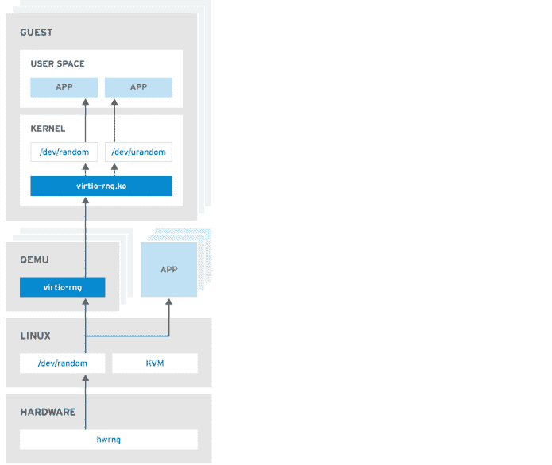

**图 4.1. virtio RNG 设备**

以前，Red Hat Enterprise Linux 7.0和Red Hat Enterprise Linux 6来宾可以通过`rngd`用户空间守护进程利用主机的熵。设置守护进程是每个Red Hat Enterprise Linux安装的手动步骤。在Red Hat Enterprise Linux 7.1中，手动步骤已被消除，使整个过程无缝且自动。现在不需要使用`rngd`，来宾内核本身会在可用熵低于特定阈值时从主机获取熵。然后，来宾内核可以立即在应用请求时将随机数提供给应用。

Red Hat Enterprise Linux安装程序**Anaconda**现在在其安装程序镜像中提供**virtio-rng**模块，从而在Red Hat Enterprise Linux安装期间使主机熵可用。

## 4.10. 使用网络绑定磁盘加密

网络绑定磁盘加密（NBDE）允许用户加密物理机和虚拟机上硬盘的根卷，而无需在系统重启时手动输入密码。

在Red Hat Enterprise Linux 7中，NBDE通过以下组件和技术实现：

Tang是一个将数据绑定到网络存在状态的服务器。当系统绑定到某个安全网络时，Tang使包含数据的系统可用。Tang是无状态的，不需要TLS或身份验证。与基于托管的方案不同（在这些方案中，服务器存储所有加密密钥并了解每一个曾使用过的密钥），Tang从不与任何客户端密钥交互，因此它永远不会从客户端获取任何识别信息。

Clevis是一个用于自动解密的插拔式框架。在NBDE中，Clevis提供LUKS卷的自动解锁功能。`clevis`软件包提供该功能的客户端部分。

Clevis Pin是Clevis框架的一个插件。其中一个PIN是实现与NBDE服务器 – Tang交互的插件。

Clevis和Tang是通用的客户端和服务器组件，提供网络绑定加密。在Red Hat Enterprise Linux 7中，它们与LUKS配合使用，通过加密和解密根及非根存储卷来实现网络绑定磁盘加密。

客户端和服务器端组件均使用José库来执行加密和解密操作。

当您开始配置NBDE时，Tang服务器的Clevis Pin会获取Tang服务器广播的非对称密钥列表。或者，由于密钥是非对称的，Tang的公钥列表可以通过带外分发，以便客户端无需访问Tang服务器即可操作。此模式称为离线配置。

Tang的Clevis Pin使用其中一个公钥生成一个唯一的、密码强度高的加密密钥。数据使用此密钥加密后，该密钥即被丢弃。Clevis客户端应在此配置操作产生的状态存储在方便的位置。此加密数据的过程是配置步骤。NBDE的配置状态存储在LUKS头中，利用`luksmeta`软件包实现。

当客户端准备访问其数据时，它加载配置步骤产生的元数据，并响应以恢复加密密钥。此过程是恢复步骤。

在NBDE中，Clevis使用PIN绑定LUKS卷，以便它可以被自动解锁。成功完成绑定过程后，可以使用提供的Dracut解锁器解锁磁盘。

### 4.10.1. 部署 Tang 服务器

要安装`tang`软件包及其依赖项，请以root身份输入以下命令：

```
~]# yum install tang
```

使用systemd启用并启动`tangd`服务：

```
~]# systemctl enable tangd.socket --now
Created symlink from /etc/systemd/system/multi-user.target.wants/tangd.socket to /usr/lib/systemd/system/tangd.socket.
```

由于`tangd`使用systemd套接字激活机制，服务器会在第一个连接进来时立即启动。在首次启动时会自动生成一组新的密码学密钥。

要执行诸如手动生成密钥等密码学操作，请使用`jose`工具。输入`jose -h`命令或参阅`jose(1)`手册页以获取更多信息。

### 示例 4.4. 轮换 Tang 密钥

定期轮换密钥非常重要。您应该轮换密钥的具体间隔取决于您的应用、密钥大小以及机构策略。关于一些常见的建议，请参阅密码学密钥长度建议页面。

要轮换密钥，请从在密钥数据库目录（通常是`/var/db/tang`）中生成新密钥开始。例如，您可以使用以下命令创建新的签名密钥和交换密钥：

```
~]# DB=/var/db/tang
~]# jose jwk gen -i '{"alg":"ES512"}' -o $DB/new_sig.jwk
~]# jose jwk gen -i '{"alg":"ECC"}' -o $DB/new_exc.jwk
```

将旧密钥重命名为以`.`开头，以将其从广播中隐藏。请注意，以下示例中的文件名与密钥数据库目录中真实且唯一的文件名不同。

```
~]# mv $DB/old_sig.jwk $DB/.old_sig.jwk
~]# mv $DB/old_exc.jwk $DB/.old_exc.jwk
```

Tang立即获取所有更改。无需重启。

此时，新的客户端绑定会获取新密钥，而旧客户端可以继续利用旧密钥。当您确信所有旧客户端都使用新密钥时，您可以删除旧密钥。


> **警告**
>
> 请注意，当客户端仍在使用旧密钥时删除旧密钥可能会导致数据丢失。

Tang使用80端口进行通信。此端口也广泛用于Web服务器。要更改Tang的端口号，请使用标准的systemd机制覆盖`tangd.socket`单元文件。更多信息请参阅*Red Hat Enterprise Linux 7 System Administrator's Guide: Creating and Modifying systemd Unit Files*。

#### 4.10.1.1. 部署高可用性系统

Tang提供两种构建高可用性部署的方法：

- 1. **客户端冗余（推荐）**

客户端应配置为能够绑定到多个Tang服务器。在此设置中，每个Tang服务器都有自己的密钥，客户端能够通过联系这些服务器的一个子集来进行解密。Clevis已经通过其`sss`插件支持此工作流程。

有关此设置的更多信息，请参阅以下手册页：

- `tang(8)`，高可用性部分


- `clevis(1)`，Shamir 的秘密共享部分
- `clevis-encrypt-sss(1)`

Red Hat 推荐此方法用于高可用性部署。
- 2. **密钥共享**

为了冗余目的，可以部署多个 Tang 实例。要设置第二个或后续实例，请安装 `tang` 软件包，并使用通过 SSH 的 `rsync` 将密钥目录复制到新主机。请注意，Red Hat 不推荐此方法，因为共享密钥会增加密钥泄露的风险，并且需要额外的自动化基础设施。

### 4.10.2. 部署加密客户端

要在具有加密卷的机器（客户端）上安装 Clevis 插拔式框架及其 PIN，请以 root 身份输入以下命令：

```bash
~# yum install clevis
```

要使用 Tang PIN 将明文数据加密为 JSON Web Encryption (JWE) 密文对象，请使用 `clevis encrypt tang` 命令，例如：

```bash
~$ clevis encrypt tang '{"url":"http://tang.srv"}' < PLAINTEXT > JWE
The advertisement contains the following signing keys:
_OsIk0T-E2l6qjfDdIwVm1doZjA
Do you wish to trust these keys? [y/nY] y
```

将前面示例中的 `http://tang.srv` URL 更改为安装了 `tang` 的服务器 URL。JWE 输出文件包含您的加密密文。此密文从 `PLAINTEXT` 输入文件中读取。

要解密数据，请使用 `clevis decrypt` 命令并提供密文 (JWE)：

```bash
~]$ clevis decrypt < JWE > PLAINTEXT
```

要了解更多信息，请参阅 `clevis-encrypt-tang(1)` 手册页或使用内置的 CLI 帮助：

```bash
~]$ clevis
Usage: clevis COMMAND [OPTIONS]

clevis decrypt   Decrypts using the policy defined at encryption time
clevis encrypt http Encrypts using a REST HTTP escrow server policy
clevis encrypt sss Encrypts using a Shamir's Secret Sharing policy
clevis encrypt tang Encrypts using a Tang binding server policy
clevis luks bind   Binds a LUKSv1 device using the specified policy
clevis luks unlock  Unlocks a LUKSv1 volume

~]$ clevis decrypt
Usage: clevis decrypt < JWE > PLAINTEXT

Decrypts using the policy defined at encryption time

~]$ clevis encrypt tang
Usage: clevis encrypt tang CONFIG < PLAINTEXT > JWE

Encrypts using a Tang binding server policy

This command uses the following configuration properties:

    url: <string>    The base URL of the Tang server (REQUIRED)

    thp: <string>    The thumbprint of a trusted signing key

    adv: <string>    A filename containing a trusted advertisement
    adv: <object>    A trusted advertisement (raw JSON)

Obtaining the thumbprint of a trusted signing key is easy. If you
have access to the Tang server's database directory, simply do:

    $ jose jwk thp -i $DBDIR/$SIG.jwk

Alternatively, if you have certainty that your network connection
is not compromised (not likely), you can download the advertisement
yourself using:

    $ curl -f $URL/adv > adv.jws
```

### 4.10.3. 配置根卷的手动注册

要自动解锁现有的 LUKS 加密根卷，请安装 `clevis-luks` 子软件包，并使用 `clevis luks bind` 命令将卷绑定到 Tang 服务器：

```bash
~]# yum install clevis-luks
```

```bash
~]# clevis luks bind -d /dev/sda tang '{"url":"http://tang.srv"}'
The advertisement contains the following signing keys:
```

_OsIk0T-E2l6qjfdDiwVmidoZjA

您是否信任这些密钥？ [ynYN] y

您即将初始化一个用于元数据存储的 LUKS 设备。

如果 LUKS 头部间隙中已经以不同格式写入了数据，尝试初始化可能会导致数据丢失。

建议在初始化之前进行备份。

您是否要初始化 `/dev/sda`？ [yn] y

输入现有 LUKS 密码：

此命令执行四个步骤：
1. 创建一个新的密钥，其熵值与 LUKS 主密钥相同。
2. 使用 Clevis 对新密钥进行加密。
3. 将 Clevis JWE 对象通过 LUKSMeta 存储在 LUKS 头部中。
4. 启用新密钥以便与 LUKS 配合使用。

现在，您可以使用现有密码以及 Clevis 策略来解锁此磁盘。如需了解更多信息，请参阅 `clevis-luks-bind(1)` 手册页。


要验证 Clevis JWE 对象是否已成功放置在 LUKS 头部中，请使用 `luksmeta show` 命令：

```bash
[~]# luksmeta show -d /dev/sda
0    active empty
1    active cb6e8904-81ff-40da-a84a-07ab9ab5715e
2    inactive empty
3    inactive empty
4    inactive empty
5    inactive empty
6    inactive empty
7    inactive empty
```

为了让早期启动系统处理磁盘绑定，请在已安装的系统上输入以下命令：

```bash
[~]# yum install clevis-dracut
[~]# dracut -f
```

**重要**

要在使用静态 IP 配置（不使用 DHCPc）的客户端上启用 NBDE，请手动将网络配置传递给 `dracut` 工具，例如：

```bash
[~]# dracut -f --kernel-cmdline "ip=192.0.2.10 netmask=255.255.255.0 gateway=192.0.2.1 nameserver=192.0.2.45"
```

或者，在 `/etc/dracut.conf.d/` 目录中创建一个包含静态网络信息的 `.conf` 文件。例如：

```bash
[~]# cat /etc/dracut.conf.d/static_ip.conf
kernel_cmdline="ip=10.0.0.103 netmask=255.255.252.0 gateway=10.0.0.1 nameserver=10.0.0.1"
```

重新生成初始 RAM 磁盘映像：

```bash
[~]# dracut -f
```

如需了解更多信息，请参阅 `dracut.cmdline(7)` 手册页。

### 4.10.4. 使用 Kickstart 配置自动注册

Clevis 可以与 Kickstart 集成，提供完全自动化的注册过程。
1. 指示 Kickstart 对磁盘进行分区，使根分区启用带有临时密码的 LUKS 加密。该密码是临时用于注册过程的。


```bash
part /boot --fstype="xfs" --ondisk=vda --size=256
part / --fstype="xfs" --ondisk=vda --grow --encrypted --passphrase=tempass
```

2. 通过在 `%packages` 部分中列出相关的 Clevis 软件包来安装它们：

```bash
%packages
clevis-dracut
%end
```

3. 在 `%post` 部分中调用 `clevis luks bind` 来执行绑定。之后，移除临时密码：

```bash
%post
clevis luks bind -f -k- -d /dev/vda2 \\
tang '["url1":"http://tang.srv", "thp":"_OsIk0T-E2l6qjfdDlwVmidoZjA"}' \\
<<<<< "tempass"
cryptsetup luksRemoveKey /dev/vda2 - <<< "tempass"
%end
```

在上述示例中，请注意我们指定了在 Tang 服务器上信任的指纹作为绑定配置的一部分，从而实现对完全非交互式的绑定。

如需了解有关 Kickstart 安装的更多信息，请参阅 Red Hat Enterprise Linux 7 安装指南。有关 Linux 统一密钥设置磁盘格式 `LUKS` 的信息，请参阅第 4.9.1 节，“使用 LUKS 磁盘加密”。

### 4.10.5. 配置可移动存储设备的自动解锁

要自动解锁 `LUKS` 加密的可移动存储设备（例如 USB 驱动器），请安装 `clevis-udisks2` 软件包：

```bash
[~]# yum install clevis-udisks2
```

重新启动系统，然后按照第 4.10.3 节“配置根卷的手动注册”中描述的 `clevis luks bind` 命令执行绑定步骤，例如：

```bash
[~]# clevis luks bind -d /dev/sdb1 tang '{"url":"http://tang.srv"}'
```

现在，`LUKS` 加密的可移动设备可以在您的 GNOME 桌面会话中自动解锁。绑定到 Clevis 策略的设备也可以通过 `clevis luks unlock` 命令解锁：

```bash
[~]# clevis luks unlock -d /dev/sdb1
```

### 4.10.6. 配置启动时非根卷的自动解锁

若要使用 NBDE 也解锁 `LUKS` 加密的非根卷，请执行以下步骤：

1. 安装 `clevis-systemd` 软件包：

```bash
[~]# yum install clevis-systemd
```

2. 启用 Clevis 解锁服务：

```bash
[~]# systemctl enable clevis-luks-askpass.path
Created symlink from /etc/systemd/system/remote-fs.target.wants/clevis-luks-askpass.path to /usr/lib/systemd/system/clevis-luks-askpass.path.
```

3. 按照第 4.10.3 节“配置根卷的手动注册”中描述的 `clevis luks bind` 命令执行绑定步骤。

4. 要在系统启动时设置加密块设备，请在 `/etc/crypttab` 配置文件中添加带有 `_netdev` 选项的相应行。如需了解更多信息，请参阅 `crypttab(5)` 手册页。

5. 将该卷添加到 `/etc/fstab` 文件中的可访问文件系统列表中。在此配置文件中也要使用 `_netdev` 选项。如需了解更多信息，请参阅 `fstab(5)` 手册页。

### 4.10.7. 在 NBDE 网络中部署虚拟机

`clevis luks bind` 命令不会更改 `LUKS` 主密钥。这意味着，如果您创建 `LUKS` 加密的映像以在虚拟机或云环境中使用，则运行该映像的所有实例都将共享主密钥。这是极其不安全的，应始终避免。

这不是 Clevis 的限制，而是 `LUKS` 的设计原则。如果您希望在云环境中拥有加密的根卷，您需要确保为云中的每个 Red Hat Enterprise Linux 实例执行安装过程（通常使用 Kickstart）。不能在不共享 `LUKS` 主密钥的情况下共享这些映像。

如果您打算在虚拟化环境中部署自动解锁，Red Hat 强烈建议您使用 `lorax` 或 `virt-install` 等系统，并结合 Kickstart 文件（参见第 4.10.4 节，“使用 Kickstart 配置自动注册”）或其他自动配置工具，以确保每个加密虚拟机拥有唯一的主密钥。

### 4.10.8. 为云环境构建可自动注册的虚拟机映像

在云环境中部署可自动注册的加密映像可能会带来一系列独特的挑战。与上述其他虚拟化环境类似，映像最多应实例化一次，以避免共享 `LUKS` 主密钥。因此，应使用 `lorax` 或 `virt-install` 等自动化部署系统结合 Kickstart 文件，以确保在映像构建过程中主密钥的唯一性。

云环境允许两种 Tang 服务器部署选项，这里我们予以考虑。首先，Tang 服务器可以部署在云环境本身内部。其次，Tang 服务器可以部署在云之外，在独立的 infrastructure 上，并且两个 infrastructure 之间有 VPN 连接。

在云中本地部署 Tang 确实可以实现轻松部署。然而，鉴于它与其他系统的密文数据持久层共享基础设施，Tang 服务器的私钥和 Clevis 元数据可能存储在同一个物理磁盘上。访问此物理磁盘允许完全破坏密文数据。


# 重要

因此，Red Hat 强烈建议保持数据存储位置与运行 Tang 的系统之间的物理隔离。这种云与 Tang 服务器之间的隔离确保 Tang 服务器的私钥不会意外与 Clevis 元数据结合。如果云 infrastructure 存在风险，它还提供了对 Tang 服务器的本地控制。

### 4.10.9. 其他资源

如需了解更多信息，请参阅以下手册页：

- `tang(8)`

- `clevis(1)`

- `jose(1)`

- `clevis-luks-unlockers(1)`

- `tang-nagios(1)`

## 4.11. 使用 AIDE 检查完整性

高级入侵检测环境（**AIDE**）是一个实用工具，用于在系统上创建文件数据库，然后使用该数据库来确保文件完整性并检测系统入侵。

### 4.11.1. 安装 AIDE

要安装 `aide` 软件包，请以 **root** 身份输入以下命令：

```bash
~]# yum install aide
```

要生成初始数据库，请以 **root** 身份输入以下命令：

```bash
~]# aide --init

AIDE, version 0.15.1

AIDE database at /var/lib/aide/aide.db.new.gz initialized.
```


> **注意**
>
> 在默认配置中，`aide --init` 命令仅检查 `/etc/aide.conf` 文件中定义的一组目录和文件。要在 AIDE 数据库中包括其他目录或文件，并更改其监视参数，请相应地编辑 `/etc/aide.conf`。

要开始使用该数据库，请从初始数据库文件名中移除 `.new` 子字符串：

```bash
~]# mv /var/lib/aide/aide.db.new.gz /var/lib/aide/aide.db.gz
```

要更改 AIDE 数据库的位置，请编辑 `/etc/aide.conf` 文件并修改 `DBDIR` 值。为了增加安全性，请将数据库、配置和 `/usr/sbin/aide` 二进制文件存储在安全位置，例如只读介质。


> **重要**
>
> 为避免在更改 AIDE 数据库位置后出现 SELinux 拒绝，请相应地更新 SELinux 策略。有关更多信息，请参见 *SELinux 用户和管理员指南*。

### 4.11.2. 执行完整性检查

要手动发起检查，请以 **root** 身份输入以下命令：


```bash
~]# aide --check
AIDE 0.15.1 found differences between database and filesystem!!
Start timestamp: 2017-03-30 14:12:56

Summary:
    Total number of files: 147173
    Added files:   1
    Removed files: 0
    Changed files: 2
    ...
```

至少，`AIDE`应配置为每周运行一次扫描。最多，`AIDE`应每天运行一次。例如，要使用`cron`安排`AIDE`在凌晨4:05执行（参见系统管理员指南中的*自动化系统任务*章节），请向`/etc/crontab`添加以下行：

```
05 4 * * * root /usr/sbin/aide --check
```

### 4.11.3. 更新 AIDE 数据库

在验证系统变更（如软件包更新或配置文件调整）后，更新您的基线`AIDE`数据库：

```
~]# aide --update
```

`aide --update`命令创建`/var/lib/aide/aide.db.new.gz`数据库文件。要开始将其用于完整性检查，请从文件名中移除`.new`子字符串。

### 4.11.4. 额外资源

有关`AIDE`的更多信息，请参见以下文档：

- `aide(1)`手册页
- `aide.conf(5)`手册页
- Red Hat Enterprise Linux 7 安全配置指南（OpenSCAP 安全指南）：使用`AIDE`验证完整性
- `AIDE`手册

## 4.12. 使用 USBGUARD

`USBGuard`软件框架通过实施基于设备属性的基本白名单和黑名单功能，提供针对侵入式 USB 设备的系统保护。为了执行用户定义的策略，`USBGuard`使用 Linux 内核的 USB 设备授权功能。`USBGuard`框架提供以下组件：

- 守护程序组件，具有进程间通信 (`IPC`) 接口，用于动态交互和策略执行。
- 与运行中的`USBGuard`实例交互的命令行界面。
- 用于编写 USB 设备授权策略的规则语言。
- 用于与守护程序组件（实现为共享库）交互的 C++ API。

### 4.12.1. 安装 USBGuard

要安装`usbguard`软件包，请以`root`身份输入以下命令：

```
~]# yum install usbguard
```

要创建初始规则集，请以`root`身份输入以下命令：

```
~]# usbguard generate-policy > /etc/usbguard/rules.conf
```

> **注意**
>
> 要自定义`USBGuard`规则集，请编辑`/etc/usbguard/rules.conf`文件。有关更多信息，请参见`usbguard-rules.conf(5)`手册页。此外，请参见第 4.12.3 节，“*使用规则语言创建自己的策略*”中的示例。

要启动`USBGuard`守护程序，请以`root`身份输入以下命令：

```bash
~]# systemctl start usbguard.service
~]# systemctl status usbguard
- usbguard.service - USBguard daemon
    Loaded: loaded (/usr/lib/systemd/system/usbguard.service; disabled;
                vendor preset: disabled)
    Active: active (running) since Tue 2017-06-06 13:29:31 CEST; 9s ago
      Docs: man:usbguard-daemon(8)
  Main PID: 4984 (usbguard-daemon)
   CGroup: /system.slice/usbguard.service
           └4984 /usr/sbin/usbguard-daemon -k -c /etc/usbguard/usbguard-daem...
```

要确保`USBGuard`在系统启动时自动启动，请以`root`身份使用以下命令：

```bash
~]# systemctl enable usbguard.service
Created symlink from
/etc/systemd/system/basic.target.wants/usbguard.service to
/usr/lib/systemd/system/usbguard.service.
```

要列出`USBGuard`识别的所有 USB 设备，请以`root`身份输入以下命令：

```bash
~]# usbguard list-devices
1: allow id 1d6b:0002 serial "0000:00:06.7" name "EHCI Host Controller"
    hash "JD0b9BiktYs2ct3mSQkopnOOV2h9MGYADwhT+0utF2s=" parent-hash
    "4PHGcaDKwtPjKDoYpIRG722cB9Lsigz91Iea93+Gt9c=" via-port "usb1" with-interface 09:00:00
...
6: block id 1b1c:1ab1 serial "000024937962" name "Voyager" hash
    "CrXgiaWIF2bZAU+5WkzOE7y0rdSO82XMzmb7HDv95Q=" parent-hash
    "JD0b9BiktYs2ct3mSQkopnOOV2h9MGYADwhT+0utF2s=" via-port "1-3" with-interface 08:06:50
```

要授权设备与系统交互，请使用`allow-device`选项：

```
~]# usbguard allow-device 6
```

要取消授权并移除系统中的一个设备，请使用`reject-device`选项。如果仅取消授权设备，请使用`block-device`选项的`usbguard`命令：

```
~]# usbguard block-device 6
```

`USBGuard`使用*block*和*reject*术语，含义如下：

- block - 暂时不与此设备通信
- reject - 忽略此设备，仿佛它不存在一样

要查看`usbguard`命令的所有选项，请输入带有`--help`指令：

```
$ usbguard --help
```

### 4.12.2. 创建白名单和黑名单

`usbguard-daemon.conf`文件由`usbguard`守护程序在解析其命令行选项后加载，并用于配置守护程序的运行时参数。要覆盖默认配置文件（`/etc/usbguard/usbguard-daemon.conf`），请使用`-c`命令行选项。有关更多细节，请参见`usbguard-daemon(8)`手册页。

要创建白名单或黑名单，请编辑`usbguard-daemon.conf`文件并使用以下选项：

- `RuleFile`=`<path>`
    - `usbguard`守护程序使用此文件从中加载策略规则集，并写入通过`IPC`接口接收到的新规则。
- `IPCAllowedUsers`=`<username>` [`<username>` ...]
    - 守护程序将接受`IPC`连接的用户名列表，以空格分隔。
- `IPCAllowedGroups`=`<groupname>` [`<groupname>` ...]
    - 守护程序将接受`IPC`连接的组名列表，以空格分隔。
- `IPCAccessControlFiles`=`<path>`
    - 持有`IPC`访问控制文件的目录路径。
- `ImplicitPolicyTarget`=`<target>`
    - 如何处理不符合策略中任何规则的设备。可接受的值：`allow`, `block`, `reject`。
- `PresentDevicePolicy`=`<policy>`
    - 当守护程序启动时，如何处理已经连接的设备：
        - `allow` - 授权每个现有设备
        - `block` - 取消授权每个现有设备
        - `reject` - 移除每个现有设备
        - `keep` - 仅同步内部状态并保持现状
        - `apply-policy` - 对每个现有设备评估规则集


### `PresentControllerPolicy`=`<policy>`

当守护程序启动时，如何处理已经连接的 USB 控制器：

- `allow` - 授权所有当前设备
- `block` - 取消授权所有当前设备
- `reject` - 移除所有当前设备
- `keep` - 仅同步内部状态并保持不变
- `apply-policy` - 为每个当前设备评估规则集

## 示例 4.5. USBGuard 配置

以下配置文件指示 `usbguard` 守护进程从 `/etc/usbguard/rules.conf` 文件加载规则，并且仅允许来自 `usbguard` 组用户使用 IPC 接口：

```
RuleFile=/etc/usbguard/rules.conf
IPCAccessControlFiles=/etc/usbguard/IPCAccessControl.d/
```

要指定 IPC 访问控制列表 (ACL)，请使用 `usbguard add-user` 或 `usbguard remove-user` 命令。有关更多详细信息，请参阅 `usbguard(1)`。在此示例中，要允许来自 `usbguard` 组的用户修改 USB 设备授权状态、列出 USB 设备、监听异常事件以及列出 USB 授权策略，请以 `root` 身份输入以下命令：

```
~]# usbguard add-user -g usbguard --devices=modify,list,listen --policy=list --exceptions=listen
```

### 重要提示

该守护进程提供 `USBGuard` 公共 IPC 接口。在 Red Hat Enterprise Linux 中，对此接口的访问默认仅限于 `root` 用户。请考虑设置 `IPCAccessControlFiles` 选项（推荐）或 `IPCAllowedUsers` 和 `IPCAllowedGroups` 选项，以限制对 IPC 接口的访问。请勿将 ACL 保留为未配置状态，因为这会将 IPC 接口暴露给所有本地用户，并允许他们操纵 USB 设备的授权状态并修改 `USBGuard` 策略。

有关更多信息，请参阅 `usbguard-daemon.conf(5)` 手册页中的 IPC 访问控制部分。

### 4.12.3. 使用规则语言创建自己的策略

`usbguard` 守护进程根据由一组规则定义的策略来决定是否授权 USB 设备。当 USB 设备插入系统时，守护进程按顺序扫描现有规则，当找到匹配的规则时，它根据规则目标授权（允许）、取消授权（阻止）或移除（拒绝）该设备。如果未找到匹配的规则，则决策基于隐式默认目标。此隐式默认操作是阻止设备，直到用户做出决策。

规则语言的文法如下：

```
rule ::= target device_id device_attributes conditions.

target ::= "allow" | "block" | "reject".

device_id ::= "*:*" | vendor_id ":*" | vendor_id ":" product_id.

device_attributes ::= device_attributes | attribute.
device_attributes ::= .

conditions ::= conditions | condition.
conditions ::= .
```

有关规则语言的更多详细信息，如目标、设备规范或设备属性，请参阅 `usbguard-rules.conf(5)` 手册页。

## 示例 4.6. USBGuard 策略示例

### 允许 USB 大容量存储设备并阻止其他所有设备

此策略阻止任何非单纯大容量存储设备的设备。具有隐藏键盘接口的 USB 闪存盘会被阻止。仅允许具有单个大容量存储接口的设备与操作系统交互。该策略由一条规则组成：

```
allow with-interface equals { 08:.* }
```

由于没有阻止规则，因此阻止是隐式的。隐式阻止对桌面用户很有用，因为监听 USBGuard 事件的桌面小工具可以在为设备选择隐式目标时询问用户的决策。

### 允许特定的 Yubikey 设备通过特定端口连接

拒绝该端口上的其他所有内容。

```
allow 1050:0011 name "Yubico Yubikey II" serial "0001234567" via-port "1-2" hash "044b5e168d40ee0245478416caf3d998"
reject via-port "1-2"
```

### 拒绝具有可疑接口组合的设备

实现键盘或网络接口的 USB 闪存盘非常可疑。以下规则集构成了一个策略，该策略允许 USB 闪存盘，并明确拒绝具有额外且可疑接口的设备。

```
allow with-interface equals { 08:.* }
reject with-interface all-of { 08:.* 03:00:.* }
reject with-interface all-of { 08:.* 03:01:.* }
reject with-interface all-of { 08:.* 00:.*.* }
reject with-interface all-of { 08:.* 02:.*.* }
```


> **注意**
>
> 使用黑名单是错误的做法，你不应该只是将一组设备列入黑名单并允许其余设备。上述策略假设阻止是隐式默认值。拒绝一组被视为“不良”的设备是一种限制系统暴露于此类设备的良好方法。

### 允许仅限键盘的 USB 设备

如果尚未允许具有键盘接口的 USB 设备，以下规则才允许仅限键盘的 USB 设备。

```
allow with-interface one-of { 03:00:01 03:01:01 } if !allowed-matches(with-interface one-of { 03:00:01 03:01:01 })
```

在使用 `usbguard generate-policy` 命令进行初始策略生成后，编辑 `/etc/usbguard/rules.conf` 以自定义 USBGuard 策略规则。

```
~-]$ usbguard generate-policy > rules.conf
~-]$ vim rules.conf
```

要安装更新的策略并使更改生效，请使用以下命令：

```
~-]# install -m 0600 -o root -g root rules.conf /etc/usbguard/rules.conf
```

### 4.12.4. 附加资源

有关 USBGuard 的附加信息，请参阅以下文档：

- `usbguard(1)` 手册页
- `usbguard-rules.conf(5)` 手册页
- `usbguard-daemon(8)` 手册页
- `usbguard-daemon.conf(5)` 手册页
- USBGuard 主页

## 4.13. 增强 TLS 配置

TLS（传输层安全）是一种用于保护网络通信的加密协议。在通过配置首选密钥交换协议、身份验证方法和加密算法来增强系统安全设置时，必须牢记，支持的客户端范围越广，最终的安全性越低。相反，严格的安全设置会导致与客户端的有限兼容性，这可能导致某些用户被锁定在系统之外。务必针对最严格的可用配置，仅在出于兼容性原因需要时才放宽限制。

请注意，Red Hat Enterprise Linux 7 中包含的库提供的默认设置对于大多数部署环境来说已经足够安全。TLS 实现在可能的情况下使用安全算法，同时不会阻止来自或前往旧客户端或服务器的连接。在具有严格安全要求的环境中应用本部分所述的增强设置，在这些环境中，预期或不允许不支持安全算法或协议的旧客户端或服务器进行连接。

### 4.13.1. 选择要启用的算法

有几个组件需要选择和配置。以下每一项都直接影响最终配置的稳健性（从而是客户端中的支持级别）或解决方案对系统的计算需求。

#### 协议版本

`TLS` 的最新版本提供了最好的安全机制。除非你有令人信服的理由包括对旧版本 `TLS`（甚至 `SSL`）的支持，否则请让你的系统仅使用最新版本的 `TLS` 协商连接。

不允许使用 `SSL` 版本 2 或 3 进行协商。这两个版本都存在严重的安全漏洞。仅允许使用 `TLS` 版本 1.0 或更高版本进行协商。当前版本的 `TLS` 1.2 应始终优先使用。

> **注意**
>


> 请注意，目前，所有版本的 `TLS` 的安全性都依赖于使用 `TLS` 扩展、特定密码（见下文）和其他解决方法。所有 `TLS` 连接对等方都需要实现安全重新协商指示（`RFC 5746`），必须不支持压缩，并且必须实现针对 `CBC` 模式密码的时序攻击的缓解措施（Lucky Thirteen 攻击）。`TLS` 1.0 客户端需要额外实现记录分割（针对 BEAST 攻击的解决方法）。`TLS` 1.2 支持 *带有关联数据的认证加密* (AEAD) 模式密码，如 `AES-GCM`、`AES-CCM` 或 `Camellia-GCM`，这些密码没有已知问题。上述所有缓解措施都在 Red Hat Enterprise Linux 中包含的加密库中实现。

有关协议版本和建议用法的快速概览，请参阅表 4.6，“协议版本”。

### 表 4.6. 协议版本

| 协议版本 | 使用建议 |

| :--- | :--- |

| `SSL v2` | 不要使用。存在严重的安全漏洞。 |

| `SSL v3` | 不要使用。存在严重的安全漏洞。 |

| `TLS 1.0` | 在必要时用于互操作性目的。存在已知问题，无法以确保证互操作性的方式缓解，因此默认不启用缓解措施。不支持现代密码套件。 |

| `TLS 1.1` | 在必要时用于互操作性目的。没有已知问题，但依赖于包含在 Red Hat Enterprise Linux 中所有 `TLS` 实现中的协议修复。不支持现代密码套件。 |

| `TLS 1.2` | 推荐版本。支持现代 `AEAD` 密码套件。 |

Red Hat Enterprise Linux 中的某些组件配置为使用 `TLS` 1.0，尽管它们支持 `TLS` 1.1 甚至 1.2。这是为了尝试实现与可能不支持最新 `TLS` 版本的外部服务实现最高级别的互操作性。根据你的互操作性要求，启用可用的最高 `TLS` 版本。


## 重要

不推荐使用 `SSL v3`。然而，尽管 `SSL v3` 被认为不安全且不适合通用场景，如果您确实必须保持 *SSL v3* 处于启用状态，请参阅 *第 4.8 节，“使用 stunnel”*，了解如何在使用 *stunnel* 的情况下，即使在使用不支持加密或仅支持过时且不安全加密模式的服务时，也能安全地加密通信。

## 密码套件

应优先选择更现代、更安全的 *密码套件*，而非旧的、不安全的套件。务必禁用 `eNULL` 和 `aNULL` 密码套件的使用，因为它们不提供任何加密或身份验证功能。如果可能，也应禁用基于 `RC4` 或 `HMAC-MD5` 的密码套件，因为它们存在严重缺陷。这同样适用于所谓的 *export*（出口级）密码套件，它们被故意弱化，因此很容易破解。

虽然并非立即存在不安全问题，但不提供 128 位以下安全强度的密码套件不应被考虑，因为它们的有效使用寿命较短。使用 128 位或更高安全强度的算法，预计至少在未来几年内无法被破解，因此强烈推荐使用。请注意，尽管 `3DES` 密码宣称使用 168 位，但实际上仅提供了 112 位的安全强度。

始终优先考虑支持 *（完美）* *前向保密*（*PFS*）的密码套件，这确保即使服务器密钥泄露，加密数据的机密性也得到保障。这排除了快速的 `RSA` 密钥交换，但允许使用 `ECDHE` 和 `DHE`。其中，`ECDHE` 速度更快，因此是首选。

还应优先考虑 `AEAD` 密码（例如 `AES-GCM`），而非 *CBC* 模式密码，因为前者不会受到填充预言攻击的影响。此外，在许多情况下，尤其是当硬件具有 `AES` 加密加速器时，`AES-GCM` 比 `CBC` 模式的 `AES` 速度更快。

请注意，当使用 `ECDHE` 密钥交换与 `ECDSA` 证书时，交易速度甚至比纯 `RSA` 密钥交换更快。为了支持旧版客户端，您可以在服务器上安装两对证书和密钥：一对使用 `ECDSA` 密钥（面向新客户端），另一对使用 `RSA` 密钥（面向旧版客户端）。

## 公钥长度

使用 `RSA` 密钥时，始终优先考虑至少 `3072` 位的密钥长度，并使用至少 `SHA-256` 进行签名，这在真实情况下提供足够的 128 位安全强度。


## 警告

请记住，系统的安全性仅与其链路中最薄弱的环节一样 *强*。例如，单独的强密码并不保证良好的安全性。密钥和证书与 *证书颁发机构*（`CA`）用于签署您的密钥的哈希函数和密钥同样重要。

### 4.13.2. 使用 TLS 实现

Red Hat Enterprise Linux 7 附带了多种功能齐全的 TLS 实现。本节描述了 `OpenSSL` 和 `GnuTLS` 的配置。有关如何配置单个应用程序中 TLS 支持的说明，请参阅 **第 4.13.3 节，“配置特定应用程序”**。

可用的 TLS 实现支持各种 *密码套件*，这些套件定义了建立和使用受 TLS 保护的通信时涉及的所有要素。

使用随不同实现提供的工具，列出并指定为您使用场景提供最佳安全性的密码套件，同时考虑 **第 4.13.1 节，“选择要启用的算法”** 中概述的建议。随后，可以使用生成的密码套件来配置单个应用程序协商和建立安全连接的方式。


> **重要**
>
> 务必在更新或升级您使用的 TLS 实现或使用该实现的应用程序后检查您的设置。新版本可能会引入您不希望启用的新密码套件，而您当前的配置并未禁用这些套件。

#### 4.13.2.1. 在 OpenSSL 中处理密码套件

`OpenSSL` 是一个支持 `SSL` 和 `TLS` 协议的工具包和加密库。在 Red Hat Enterprise Linux 7 中，`/etc/pki/tls/openssl.cnf` 处提供了一个配置文件。此配置文件的格式在 `config(1)` 中有描述。另请参阅 **第 4.7.9 节，“配置 OpenSSL”**。

要获取由 `OpenSSL` 安装支持的所有密码套件列表，请按照以下方式使用带有 `ciphers` 子命令的 `openssl1` 命令：

```
~]$ openssl ciphers -v 'ALL:COMPLEMENTOFALL'
```

向 `ciphers` 子命令传递其他参数（在 `OpenSSL` 文档中称为 *cipher strings* 和 *keywords*）以缩小输出范围。可以使用特殊关键字仅列出满足特定条件的套件。例如，要仅列出定义为属于 `HIGH` 组的套件，请使用以下命令：

```
~]$ openssl ciphers -v 'HIGH'
```

有关可用关键字和 cipher strings 的列表，请参阅 `ciphers(1)` 手册页。

要获取满足 **第 4.13.1 节，“选择要启用的算法”** 中概述建议的密码套件列表，请使用类似以下的命令：


```
~]$ openssl ciphers -v 'ECCDH+aECDSA+AES:kECDH+AES+aRSA:kEDH+aRSA+AES' | column -t
ECDHE-ECDSA-AES256-GCM-SHA384       TLSv1.2  Kx=ECDH  Au=ECDSA  Enc=AESGCM(256)
Mac=AES
ECDHE-ECDSA-AES256-SHA384            TLSv1.2  Kx=ECDH  Au=ECDSA  Enc=AES(256)
Mac=SHA384
ECDHE-ECDSA-AES256-SHA               SSLv3    Kx=ECDH  Au=ECDSA  Enc=AES(256)
Mac=SHA1
ECDHE-ECDSA-AES128-GCM-SHA256        TLSv1.2  Kx=ECDH  Au=ECDSA  Enc=AESGCM(128)
Mac=AES
ECDHE-ECDSA-AES128-SHA256            TLSv1.2  Kx=ECDH  Au=ECDSA  Enc=AES(128)
Mac=SHA256
ECDSA-AES128-SHA Mac=SHA1 SSLv3 Kx=ECDH Au=ECDSA Enc=AES(128)
ECDHE-RSA-AES256-GCM-SHA384 Mac=AESAD TLSv1.2 Kx=ECDH Au=RSA Enc=AESGCM(256)
ECDHE-RSA-AES256-SHA384 Mac=SHA384 TLSv1.2 Kx=ECDH Au=RSA Enc=AES(256)
ECDHE-RSA-AES256-SHA Mac=SHA1 SSLv3 Kx=ECDH Au=RSA Enc=AES(256)
ECDHE-RSA-AES128-GCM-SHA256 Mac=AESAD TLSv1.2 Kx=ECDH Au=RSA Enc=AESGCM(128)
ECDHE-RSA-AES128-SHA256 Mac=SHA256 TLSv1.2 Kx=ECDH Au=RSA Enc=AES(128)
ECDHE-RSA-AES128-SHA Mac=SHA1 SSLv3 Kx=ECDH Au=RSA Enc=AES(128)
DHE-RSA-AES256-GCM-SHA384 Mac=AESAD TLSv1.2 Kx=DH Au=RSA Enc=AESGCM(256)
DHE-RSA-AES256-SHA256 Mac=SHA256 TLSv1.2 Kx=DH Au=RSA Enc=AES(256)
DHE-RSA-AES256-SHA Mac=SHA1 SSLv3 Kx=DH Au=RSA Enc=AES(256)
DHE-RSA-AES128-GCM-SHA256 Mac=AESAD TLSv1.2 Kx=DH Au=RSA Enc=AESGCM(128)
DHE-RSA-AES128-SHA256 Mac=SHA256 TLSv1.2 Kx=DH Au=RSA Enc=AES(128)
DHE-RSA-AES128-SHA Mac=SHA1 SSLv3 Kx=DH Au=RSA Enc=AES(128)
```

上述命令省略了所有不安全的密码，优先选择 `临时椭圆曲线 Diffie-Hellman` 密钥交换和 `ECDSA` 密码，并省略了 `RSA` 密钥交换（从而确保 `完美前向保密`）。

请注意，这是一种相当严格的配置，在实际场景中可能需要放宽条件，以便与更广泛的客户端范围兼容。

#### 4.13.2.2. 在 GnuTLS 中处理密码套件

`GnuTLS` 是一个实现了 `SSL` 和 `TLS` 协议及相关技术的通信库。

> `注意`
>
> Red Hat Enterprise Linux 7 上的 `GnuTLS` 安装提供了最优的默认配置值，为大多数使用场景提供了足够的安全性。除非您需要满足特殊的安全要求，否则建议使用提供的默认值。

使用带有 `-1`（或 `--list`）选项的 `gnutls-cli` 命令来列出所有支持的密码套件：

```
~]$ gnutls-cli -1
```

要缩小由 `-1` 选项显示的密码套件列表，请向 `--priority` 选项传递一个或多个参数（在 `GnuTLS` 文档中称为 `priority strings` 和 `keywords`）。有关所有列表的列表，请参阅位于 http://www.gnutls.org/manual/gnutls.html#Priority-Strings 的 `GnuTLS` 文档

可用的优先级字符串。例如，要获取至少提供 128 位安全性的密码套件列表，请执行以下命令：

```
~]$ gnutls-cli --priority SECURE128 -l
```

要获取满足第 4.13.1 节“选择要启用的算法”中列出的建议的密码套件列表，请使用类似以下命令：

```
~]$ gnutls-cli --priority SECURE256:+SECURE128: -VERS-TLS-ALL:+VERS-TLS1.2: -RSA: -DHE-DSS: -CAMELLIA-128-CBC: -CAMELLIA-256-CBC -l
```

| 密码套件 | 十六进制代码 | 协议版本 |
| :--- | :--- | :--- |
| TLS_ECDHE_ECDSA_AES_256_GCM_SHA384 | 0xc0, 0x2c | TLS1.2 |
| TLS_ECDHE_ECDSA_AES_256_CBC_SHA384 | 0xc0, 0x24 | TLS1.2 |
| TLS_ECDHE_ECDSA_AES_256_CBC_SHA1 | 0xc0, 0x0a | SSL3.0 |
| TLS_ECDHE_ECDSA_AES_128_GCM_SHA256 | 0xc0, 0x2b | TLS1.2 |
| TLS_ECDHE_ECDSA_AES_128_CBC_SHA256 | 0xc0, 0x23 | TLS1.2 |
| TLS_ECDHE_ECDSA_AES_128_CBC_SHA1 | 0xc0, 0x09 | SSL3.0 |
| TLS_ECDHE_RSA_AES_256_GCM_SHA384 | 0xc0, 0x30 | TLS1.2 |
| TLS_ECDHE_RSA_AES_256_CBC_SHA1 | 0xc0, 0x14 | SSL3.0 |
| TLS_ECDHE_RSA_AES_128_GCM_SHA256 | 0xc0, 0x2f | TLS1.2 |
| TLS_ECDHE_RSA_AES_128_CBC_SHA256 | 0xc0, 0x27 | TLS1.2 |
| TLS_ECDHE_RSA_AES_128_CBC_SHA1 | 0xc0, 0x13 | SSL3.0 |
| TLS_DHE_RSA_AES_256_CBC_SHA256 | 0x00, 0x6b | TLS1.2 |
| TLS_DHE_RSA_AES_256_CBC_SHA1 | 0x00, 0x39 | SSL3.0 |
| TLS_DHE_RSA_AES_128_GCM_SHA256 | 0x00, 0x9e | TLS1.2 |
| TLS_DHE_RSA_AES_128_CBC_SHA256 | 0x00, 0x67 | TLS1.2 |
| TLS_DHE_RSA_AES_128_CBC_SHA1 | 0x00, 0x33 | SSL3.0 |

证书类型：CTYPE-X.509

协议：VERS-TLS1.2

压缩：COMP-NULL

椭圆曲线：CURVE-SECP384R1, CURVE-SECP521R1, CURVE-SECP256R1

PK 签名：SIGN-RSA-SHA384, SIGN-ECDSA-SHA384, SIGN-RSA-SHA512, SIGN-ECDSA-SHA512, SIGN-RSA-SHA256, SIGN-DSA-SHA256, SIGN-ECDSA-SHA256

上述命令将输出限制为至少具有 128 位安全性的密码，并优先选择更强的密码。它还禁止使用 `RSA` 密钥交换和 `DSS` 认证。

请注意，这是一个相当严格的配置，在实际场景中，可能需要放宽条件以允许与更广泛客户端的兼容性。

### 4.13.3. 配置特定应用程序

不同的应用程序提供自己的 TLS 配置机制。本节介绍了最常用的服务器应用程序所使用的 TLS 相关配置文件，并提供了典型配置的示例。

无论您选择使用哪种配置，请务必确保您的服务器应用程序强制实施服务器端密码顺序，以便使用的密码套件由您配置的顺序决定。

#### 4.13.3.1. 配置 Apache HTTP 服务器


Apache HTTP 服务器可以使用 OpenSSL 和 NSS 库来满足其 TLS 需求。根据您对 TLS 库的选择，您需要安装 `mod_ssl` 或 `mod_nss` 模块（由同名软件包提供）。例如，要安装提供 OpenSSL `mod_ssl` 模块的软件包，请以 root 身份执行以下命令：

```
[#] yum install mod_ssl
```

`mod_ssl` 软件包安装 `/etc/httpd/conf.d/ssl.conf` 配置文件，该文件可用于修改 Apache HTTP 服务器的 TLS 相关设置。类似地，`mod_nss` 软件包安装 `/etc/httpd/conf.d/nss.conf` 配置文件。

安装 `httpd-manual` 软件包以获取 Apache HTTP 服务器的完整文档，包括 TLS 配置。`/etc/httpd/conf.d/ssl.conf` 配置文件中可用的指令在 `/usr/share/httpd/manual/mod/mod_ssl.html` 中有详细说明。各种设置的示例位于 `/usr/share/httpd/manual/ssl/ssl_howto.html` 中。

在修改 `/etc/httpd/conf.d/ssl.conf` 配置文件中的设置时，请至少考虑以下三个指令：

- `SSLProtocol`

  使用此指令指定您允许使用的 TLS（或 SSL）版本。

- `SSLCipherSuite`

  使用此指令指定您首选的密码套件或禁用您不希望使用的套件。

- `SSLHonorCipherOrder`

  取消注释并将此指令设置为 `on`，以确保连接的客户端遵守您指定的密码顺序。

例如：

```
SSLProtocol all -SSLv2 -SSLv3
SSLCipherSuite HIGH:!aNULL:!MD5
SSLHonorCipherOrder on
```

请注意，上述配置是最低限度的配置，通过遵循 [第 4.13.1 节，“选择要启用的算法”](#) 中概述的建议，可以对其进行显著增强。

要配置和使用 `mod_nss` 模块，请修改 `/etc/httpd/conf.d/nss.conf` 配置文件。`mod_nss` 模块源自 `mod_ssl`，因此它与 `mod_ssl` 共享许多特性，尤其是配置文件的结构以及可用的指令。请注意，`mod_nss` 指令的前缀是 `NSS` 而不是 `SSL`。有关 `mod_nss` 信息的概览，包括不适用于 `mod_nss` 的 `mod_ssl` 配置指令列表，请参阅 [https://git.dredarohosted.org/cgit/mod_nss.git/plain/docs/mod_nss.html](https://git.dredarohosted.org/cgit/mod_nss.git/plain/docs/mod_nss.html)。

#### 4.13.3.2. 配置 Dovecot 邮件服务器

要配置您的 Dovecot 邮件服务器安装以使用 TLS，请修改 `/etc/dovecot/conf.d/10-ssl.conf` 配置文件。您可以在 `/usr/share/doc/dovecot-2.2.10/wiki/SSL.DovecotConfiguration.txt` 中找到该文件中一些基本配置指令的说明（此帮助文件随 Dovecot 的标准安装一起安装）。

在修改 `/etc/dovecot/conf.d/10-ssl.conf` 配置文件中的设置时，请至少考虑以下三个指令：

- `ssl_protocols`

  使用此指令指定您允许使用的 TLS（或 SSL）版本。

- `ssl_cipher_list`

  使用此指令指定您首选的密码套件或禁用您不希望使用的套件。

- `ssl_prefer_server_ciphers`

  取消注释并将此指令设置为 `yes`，以确保连接的客户端遵守您指定的密码顺序。

例如：

```
ssl_protocols = !SSLv2 !SSLv3
ssl_cipher_list = HIGH:!aNULL:!MD5
ssl_prefer_server_ciphers = yes
```

请注意，上述配置是最低限度的配置，通过遵循 [第 4.13.1 节，“选择要启用的算法”](#) 中概述的建议，可以对其进行显著增强。

### 4.13.4. 其他信息

有关 TLS 配置和相关主题的更多信息，请参阅下面列出的资源。

### 已安装的文档

- `config(1)` – 描述了 `/etc/ssl/openssl.conf` 配置文件的格式。

- `ciphers(1)` – 包括可用的 `OpenSSL` 关键字和密码字符串列表。

- `/usr/share/httpd/manual/mod/mod_ssl.html` – 包含 Apache HTTP 服务器中 `mod_ssl` 模块使用的 `/etc/httpd/conf.d/ssl.conf` 配置文件中可用指令的详细描述。

- `/usr/share/httpd/manual/ssl/ssl_howto.html` – 包含 Apache HTTP 服务器中 `mod_ssl` 模块使用的 `/etc/httpd/conf.d/ssl.conf` 配置文件中实际设置的实用示例。

- `/usr/share/doc/dovecot-2.2.10/wiki/SSL.DovecotConfiguration.txt` – 解释了 Dovecot 邮件服务器使用的 `/etc/dovecot/conf.d/10-ssl.conf` 配置文件中的一些基本配置指令。

### 在线文档

- Red Hat Enterprise Linux 7 SELinux 用户和管理员指南 – Red Hat Enterprise Linux 7 的 SELinux 用户和管理员指南介绍了 SELinux 的基本原理，并详细记录了如何配置和使用 SELinux 以及各种服务，例如 Apache HTTP 服务器。

- http://tools.ietf.org/html/draft-ietf-uta-tls-bcp-00 – 关于安全使用 TLS 和 DTLS 的建议。

#### 另请参阅

- 第 A.2.4 节，“SSL/TLS” 提供了 SSL 和 TLS 协议的简要描述。

- 第 4.7 节，“使用 OpenSSL” 描述了（除其他内容外）如何使用 OpenSSL 创建和管理密钥、生成证书以及加密和解密文件。

## 4.14. 使用共享系统证书

共享系统证书存储允许 NSS、GnuTLS、OpenSSL 和 Java 共享获取系统证书锚点和黑名单信息的默认来源。默认情况下，信任存储包含 Mozilla CA 列表，包括正向和负向信任。系统允许更新核心 Mozilla CA 列表或选择其他证书列表。

### 4.14.1. 使用系统范围的信任存储

在 Red Hat Enterprise Linux 7 中，集成的系统范围信任存储位于 `/etc/pki/ca-trust/` 和 `/usr/share/pki/ca-trust-source/` 目录中。`/usr/share/pki/ca-trust-source/` 中的信任设置的优先级低于 `/etc/pki/ca-trust/` 中的设置。

证书文件根据其安装所在的子目录进行处理：

- `/usr/share/pki/ca-trust-source/anchors/` 或 `/etc/pki/ca-trust/source/anchors/` - 用于信任锚点。参见第 4.5.6 节，“理解信任锚点”。

- `/usr/share/pki/ca-trust-source/blacklist/` 或 `/etc/pki/ca-trust/source/blacklist/` - 用于不受信任的证书。

- `/usr/share/pki/ca-trust-source/` 或 `/etc/pki/ca-trust/source/` - 用于扩展 BEGIN TRUSTED 文件格式中的证书。

### 4.14.2. 添加新证书

要将简单 PEM 或 DER 文件格式的证书添加到系统中受信任的 CA 列表中，请将证书文件复制到 `/usr/share/pki/ca-trust-source/anchors/` 或 `/etc/pki/ca-trust/source/anchors/` 目录。要更新系统范围的信任存储配置，请使用 `update-ca-trust` 命令，例如：

```bash
# cp ~/certificate-trust-examples/Cert-trust-test-ca.pem /usr/share/pki/ca-trust-source/anchors/
# update-ca-trust
```


**注意**


虽然 Firefox 浏览器可以在未执行 `update-ca-trust` 的情况下使用新添加的证书，但建议在 CA 变更后运行 `update-ca-trust`。请注意，诸如 Firefox、Epiphany 或 Chromium 等浏览器会缓存文件，您可能需要清除浏览器缓存或重启浏览器以加载当前的系统证书配置。

### 4.14.3. 管理受信任的系统证书

要列出、提取、添加、删除或更改信任锚点，请使用 `trust` 命令。要查看此命令的内置帮助，请输入不带任何参数的该命令，或者使用 `--help` 指令：

```bash
$ trust
usage: trust command <args>...

Common trust commands are:
    list        List trust or certificates
    extract     Extract certificates and trust
    extract-compat Extract trust compatibility bundles
    anchor      Add, remove, change trust anchors
    dump        Dump trust objects in internal format

See 'trust <command> --help' for more information
```

要列出所有系统信任锚点和证书，请使用 `trust list` 命令：

```bash
$ trust list
pkcs11:id=%d2%87b4%e3%df%37%2793%55%f6%56%ea%81%e5%36%cc%8c%1e%3f%bd;type=cert
        type: certificate
        label: ACCVRAIZ1
        trust: anchor
        category: authority

pkcs11:id=%a6%b3%e1%2b%2b%49%b6%d77%3%aa%94%f5%01%e7%73%65%4c%ac%50;type=cert
        type: certificate
        label: ACEDICOM Root
        trust: anchor
        category: authority
...
[Output has been truncated]
```

`trust` 命令的所有子命令都提供详细的内置帮助，例如：

```bash
$ trust list --help
usage: trust list --filter=<what>

  --filter=<what>      filter of what to export
                       ca-anchors     certificate anchors
                       blacklist      blacklisted certificates
                       trust-policy   anchors and blacklist (default)
                       certificates   all certificates
                       pkcs11:object=xx a PKCS#11 URI
  --purpose=<usage>    limit to certificates usable for the purpose
                       server-auth    for authenticating servers
                       client-auth    for authenticating clients
                       email          for email protection
                       code-signing   for authenticating signed code
                       1.2.3.4.5...   an arbitrary object id
  -V, --verbose        show verbose debug output
  -q, --quiet         suppress command output
```

要将信任锚点存储到系统范围的信任存储中，请使用 `trust anchor` 子命令并指定证书的*路径*，例如：

```bash
# trust anchor path.to/certificate.crt
```

要删除证书，请使用证书的*路径*或证书的 ID：

```bash
# trust anchor --remove path.to/certificate.crt
# trust anchor --remove "pkcs11:id=%AABB%CC%DD%EE;type=cert"
```

### 4.14.4. 其他资源

如需更多信息，请参见以下 man 页：

- `update-ca-trust(8)`
- `trust(1)`

## 4.15. 使用 MACsec

媒体访问控制安全（MACsec，IEEE 802.1AE）使用 GCM-AES-128 算法对局域网中的所有流量进行加密和认证。MACsec 不仅可以保护 IP，还可以保护地址解析协议（ARP）、邻居发现（ND）或 DHCP。虽然 `Ipsec` 在网络层（第 3 层）运行，SSL - TLS 在传输层（第 4 层）运行，但 MACsec 在数据链路层（第 2 层）运行。将 MACsec 与其他网络层的安全协议结合使用，可以利用这些标准提供的不同安全特性。

有关 MACsec 网络架构、用例场景和配置示例的更多信息，请参阅*MACsec：加密网络流量的另一种解决方案*文章。

关于如何使用 `wpa_supplicant` 和 `NetworkManager` 配置 MACsec 的示例，请参见*Red Hat Enterprise Linux 7 网络指南*。

## 4.16. 使用 SCRUB 安全删除数据

`scrub` 实用程序在特殊文件或磁盘设备上设置模式，以使检索数据变得更加困难。使用 `scrub` 比在磁盘上写入随机数据更快。此过程提供高可用性、可靠性和数据保护。

要开始使用 `scrub` 命令，请安装 `scrub` 包：

```bash
~]# yum install scrub
```

`scrub` 实用程序在以下基本模式之一中运行：

### 字符或块设备

对应于整个磁盘的*特殊文件*被擦除，其上的所有数据都会被销毁。这是最有效的方法。

```bash
scrub [OPTIONS] special file
```

### 文件

常规文件被擦除，并且仅销毁文件中的数据。

```bash
scrub [OPTIONS] file
```

### 目录

使用 `-X` 选项时，会创建一个目录并填充文件，直到文件系统已满。然后，像文件模式那样擦除这些文件。

```bash
scrub -X [OPTIONS] directory
```

### 示例 4.7. 擦除原始设备

要使用默认的 National Nucluar Security Administration (NNSA) 模式擦除原始设备 `/dev/sdf1`，请输入以下命令：

```bash
~]# scrub /dev/sdf1
scrub: using NNSA NAP-14.1-C patterns
scrub: please verify that device size below is correct!
scrub: scrubbing /dev/sdf1 1995650048 bytes (~1GB)
scrub: random |...................................................|
scrub: random |...................................................|
scrub: 0x00   |...................................................|
scrub: verify  |...................................................|
```

### 示例 4.8. 擦除文件

1. 创建一个*1MB*文件：

```bash
~]$ base64 /dev/urandom | head -c $[ 1024*1024 ] > file.txt
```

2. 显示文件大小：


```bash
~]$ ls -lh
total 1.0M
-rw-rw-r--. 1 username username 1.0M Sep 8 15:23 file.txt
```

### 3. 显示文件内容

```bash
~]$ head -1 file.txt
Jn9paTEveB/IYsbn091huJdw+0jJkhwCIBUsxLXlAyB8uItotUINHKKUeS/7bCRKDQgEP+yJm8VQgL
```

### 4. 擦除文件

```bash
~]$ scrub file.txt
scrub: using NNSA NAP-14.1-C patterns
scrub: scrubbing file.txt 1048576 bytes (~1024KB)
scrub: random |....................................................|
scrub: random |....................................................|
scrub: 0x00 |....................................................|
scrub: verify |....................................................|
```

### 5. 验证文件内容已被擦除

```bash
~]$ cat file.txt
SCRUBBED!
```

### 6. 验证文件大小保持不变

```bash
~]$ ls -lh
total 1.0M
-rw-rw-r--. 1 username username 1.0M Sep 8 15:24 file.txt
```

有关 `scrub` 模式、选项、方法和注意事项的更多信息，请参见 `scrub(1)` man 页。

# 第 5 章. 使用防火墙


**注意**

为了扩展您的专业知识，您可能还对 Red Hat 服务器加固（RH413）培训课程感兴趣。

## 5.1. 开始使用 FIREWALLD

防火墙是一种保护机器免受外部任何不受欢迎流量影响的方式。它允许用户通过定义一组防火墙规则来控制主机机器上的传入网络流量。这些规则用于对传入流量进行分类，要么阻止它，要么允许其通过。

`firewalld` 是一个防火墙服务守护进程，提供具有 D-Bus 接口的动态可定制基于主机的防火墙。由于是动态的，它允许创建、更改和删除规则，而无需在每次更改规则时重启防火墙守护进程。

`firewalld` 使用*区域*和*服务*的概念，简化了流量管理。区域是预定义的规则集。网络接口和源可以分配给某个区域。允许通过的流量取决于您的计算机连接到的网络以及分配给该网络的安全级别。防火墙服务是预定义的规则，涵盖了允许特定服务传入流量所需的所有设置，并且在区域内应用。

服务使用一个或多个*端口*或*地址*进行网络通信。防火墙根据端口过滤通信。要允许服务的网络流量，其端口必须处于*打开*状态。`firewalld` 阻止未明确设置为*打开*端口的所有流量。某些区域，如*trusted*，默认允许所有流量。

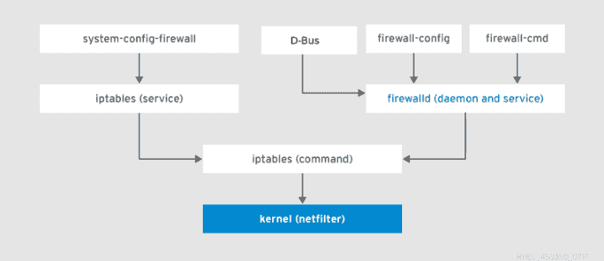

图 5.1. 防火墙堆栈

### 5.1.1. 区域

`firewalld` 可用于根据用户决定信任该网络内接口和流量的级别，将网络分隔到不同的区域中。一个连接只能属于一个区域，但一个区域可以用于许多网络连接。

NetworkManager 会通知 `firewalld` 接口的区域。您可以使用 NetworkManager、`firewall-config` 工具或 `firewall-cmd` 命令行工具将区域分配给接口。后两者仅编辑相应的 NetworkManager 配置文件。如果您使用 `firewall-cmd` 或 `firewall-config` 更改接口的区域，该请求会转发给 NetworkManager，而不会被 `firewalld` 处理。

预定义区域存储在 `/usr/lib/firewalld/zones/` 目录中，并可立即应用于任何可用的网络接口。只有在这些文件被修改后，它们才会被复制到 `/etc/firewalld/zones/` 目录。下表描述了预定义区域的默认设置：

- **block（阻止）**

  任何传入的网络连接都会被 ICMP-host-prohibited（IPv4）或 icmp6-adm-prohibited（IPv6）消息拒绝。只允许从系统内部发起的网络连接。

- **dmz（非军事区）**

  适用于您的非军事区中对外公开可访问但对内部网络访问受限的计算机。仅接受选定的传入连接。

- **drop（丢弃）**

  任何传入的网络数据包都会在没有通知的情况下被丢弃。只允许传出网络连接。

- **external（外部）**

  用于启用了伪装（masquerading）的外部网络，特别是用于路由器。您不信任网络上的其他计算机，以防止它们危害您的计算机。仅接受选定的传入连接。

- **home（家庭）**

  用于家庭环境，此时您通常信任网络上的其他计算机。仅接受选定的传入连接。

- **internal（内部）**

  用于内部网络，此时您通常信任网络上的其他计算机。仅接受选定的传入连接。

- **public（公共）**

  用于您不信任网络上其他计算机的公共场所。仅接受选定的传入连接。

- **trusted（可信）**

  接受所有网络连接。

- **work（工作）**

  用于工作环境，此时您通常信任网络上的其他计算机。仅接受选定的传入连接。

其中一个区域被设置为 *default（默认）* 区域。当接口连接到 NetworkManager 时，它们会被分配给默认区域。在安装时，`firewalld` 的默认区域被设置为 **public（公共）** 区域。默认区域可以更改。


**注意**

网络区域名称的选择旨在自解释，以便用户能够快速做出合理的决策。为避免任何安全问题，请根据您的需求风险评估审查默认区域配置，并禁用不必要的服务。

### 5.1.2. 预定义服务

服务可以是本地端口、协议、源端口和目的地的列表，以及如果在启用服务时自动加载的一列防火墙辅助模块。使用服务可以为用户节省时间，因为他们可以在单个步骤中完成多项任务，例如打开端口、定义协议、启用数据包转发等，而不必逐项设置所有内容。

服务配置选项和通用文件信息在 `firewall-service(5)` 手册页中描述。服务通过单独的 XML 配置文件指定，命名格式如下：`service-name.xml`。在 `firewalld` 中，优先使用协议名称而非服务或应用程序名称。

### 5.1.3. 运行时和永久设置

在 *运行时（runtime）* 模式下提交的任何更改仅在 `firewalld` 运行时有效。当 `firewalld` 重启时，设置会恢复为其 *永久（permanent）* 值。

为了使更改在重启后持久化，请再次使用 `--permanent` 选项应用它们。或者，为了使更改在 `firewalld` 运行时持久化，请使用 `--runtime-to-permanent` `firewall-cmd` 选项。

如果您在 `firewalld` 运行时仅使用 `--permanent` 选项设置规则，这些规则在 `firewalld` 重启前不会生效。然而，重启 `firewalld` 会关闭所有开放端口并停止网络流量。

### 5.1.4. 使用 CLI 修改运行时和永久配置中的设置

使用 CLI 时，您不能同时修改两种模式下的防火墙设置。您只能修改运行时或永久模式。要在永久模式下修改防火墙设置，请在 `firewall-cmd` 命令中使用 `--permanent` 选项。

```bash
~]# firewall-cmd --permanent <other options>
```

如果没有此选项，该命令将修改运行时模式。

要同时更改两种模式下的设置，您可以使用两种方法：

1. 更改运行时设置，然后按如下方式使其变为永久设置：

    ```bash
    ~]# firewall-cmd <other options>
    ~]# firewall-cmd --runtime-to-permanent
    ```

2. 设置永久设置并将设置重新加载到运行时模式：

    ```bash
    ~]# firewall-cmd --permanent <other options>
    ~]# firewall-cmd --reload
    ```

第一种方法允许您在将设置应用于永久模式之前测试它们。

> **注意**


> 尤其是在远程系统上，不正确的设置可能导致用户将自己锁在机器之外。为防止这种情况，请使用 `--timeout` 选项。在指定的时间过后，任何更改都会恢复为其先前的状态。使用此选项会排除 `--permanent` 选项。

> 例如，要为 15 分钟添加 SSH 服务：

```bash
~]# firewall-cmd --add-service=ssh --timeout 15m
```

## 5.2. 安装 FIREWALL-CONFIG 图形用户界面配置工具

要使用 `firewall-config` 图形用户界面配置工具，请以 `root` 用户身份安装 `firewall-config` 软件包：

```bash
~]# yum install firewall-config
```

或者，在 `GNOME` 中，使用 `Super` 键并输入 `Software` 以启动 `Software Sources` 应用程序。在右上角选择搜索按钮后出现的搜索框中输入 `firewall`。从搜索结果中选择 `Firewall` 项，并单击 `Install` 按钮。

要运行 `firewall-config`，请使用 `firewall-config` 命令，或按 `Super` 键进入 `Activities Overview`，输入 `firewall`，然后按 `Enter`。

## 5.3. 查看 FIREWALLD 的当前状态和设置

### 5.3.1. 查看 `firewalld` 的当前状态

防火墙服务 `firewalld` 默认已安装在系统上。使用 `firewalld` CLI 接口检查服务是否正在运行。

要查看服务状态：

```bash
~]# firewall-cmd --state
```

要获取有关服务状态的更多信息，请使用 `systemctl status` 子命令：

```bash
~]# systemctl status firewalld
firewalld.service - firewalld - dynamic firewall daemon
   Loaded: loaded (/usr/lib/systemd/system/firewalld.service; enabled;
            vendor preset)
   Active: active (running) since Mon 2017-12-18 16:05:15 CET; 50min ago
     Docs: man:firewalld(1)
 Main PID: 705 (firewalld)
   Tasks: 2 (limit: 4915)
CGroup: /system.slice/firewalld.service
└─705 /usr/bin/python3 -Es /usr/sbin/firewalld --nofork --nopid
```

此外，在尝试编辑设置之前，了解 `firewalld` 是如何配置的以及哪些规则生效非常重要。要显示防火墙设置，请参阅第 5.3.2 节“查看当前 `firewalld` 设置”。

### 5.3.2. 查看当前 firewalld 设置

#### 5.3.2.1. 使用图形用户界面查看允许的服务

要使用图形 `firewall-config` 工具查看服务列表，请按 `Super` 键进入 `Activities Overview`，输入 `firewall`，然后按 `Enter`。将显示 `firewall-config` 工具。现在您可以在 `Services` 选项卡下查看服务列表。

或者，要通过命令行启动图形防火墙配置工具，请输入以下命令：

```bash
~]$ firewall-config
```

将打开 `Firewall Configuration` 窗口。请注意，此命令可以作为普通用户运行，但偶尔会提示输入管理员密码。

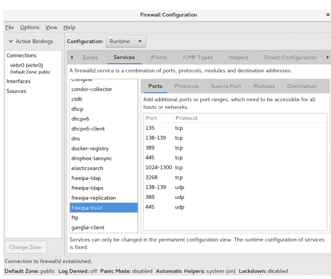

#### 5.3.2.2. 使用 CLI 查看 firewalld 设置

通过 CLI 客户端，可以获取当前防火墙设置的不同视图。`--list-all` 选项会显示 `firewalld` 设置的完整概览。

`firewalld` 使用区域来管理流量。如果未通过 `--zone` 选项指定区域，则该命令在分配给活动网络接口和连接的默认区域中生效。

要列出默认区域的所有相关信息：

```text
~]$ firewall-cmd --list-all
public
	target: default
	icmp-block-inversion: no
	interfaces:
	sources:
	services: ssh dhcpv6-client
	ports:
	protocols:
	masquerade: no
	forward-ports:
source-ports:
icmp-blocks:
rich rules:
```

**注意**

若要指定要显示设置的区域，请在 `firewall-cmd --list-all` 命令中添加 `--zone=区域名称` 参数，例如：

```text
[~]# firewall-cmd --list-all --zone=home
home
  target: default
  icmp-block-inversion: no
  interfaces:
  sources:
  services: ssh mdns samba-client dhcpv6-client
... [输出已截断]
```

若要查看特定信息（如服务或端口）的设置，请使用特定选项。请参阅 `firewalld` 的手册页，或通过使用命令帮助获取选项列表：

```text
[~]# firewall-cmd --help

Usage: firewall-cmd [OPTIONS...]

General Options
 -h, --help                Prints a short help text and exits
 -V, --version             Print the version string of firewalld
 -q, --quiet               Do not print status messages

Status Options
 --state                   Return and print firewalld state
 --reload                  Reload firewall and keep state information
... [输出已截断]
```

例如，要查看当前区域中允许哪些服务：

```text
[~]# firewall-cmd --list-services
ssh dhcpv6-client
```

使用 CLI 工具列出特定子部分的设置有时可能难以解读。例如，你显示 SSH 服务，`firewalld` 会为该服务打开必要的端口 `22`。稍后，如果你列出允许的服务，列表会显示 SSH 服务，但如果你列出开放端口，则不会显示任何内容。因此，建议使用 `--list-all` 选项，以确保你获取完整的信息。

## 5.4. 启动 FIREWALLD

要启动 `firewalld`，请以 `root` 身份输入以下命令：

```text
[~]# systemctl unmask firewalld
[~]# systemctl start firewalld
```

若要确保 `firewalld` 在系统启动时自动启动，请以 `root` 身份输入以下命令：

```text
~]# systemctl enable firewalld
```

## 5.5. 停止 FIREWALLD

要停止 `firewalld`，请以 `root` 身份输入以下命令：

```text
~]# systemctl stop firewalld
```

若要阻止 `firewalld` 在系统启动时自动启动，请以 `root` 身份输入以下命令：

```text
~]# systemctl disable firewalld
```

若要确保 `firewalld` 不会通过访问 `firewalld D-Bus` 接口而启动，并且即使其他服务需要 `firewalld` 也不会启动，请以 `root` 身份输入以下命令：

```text
~]# systemctl mask firewalld
```

## 5.6. 控制流量

### 5.6.1. 预定义服务


可以使用图形 `firewall-config` 工具、`firewall-cmd` 和 `firewall-offline-cmd` 来添加和删除服务。

或者，你可以编辑 `/etc/firewalld/services/` 目录中的 XML 文件。如果用户未添加或更改某个服务，则在 `/etc/firewalld/services/` 中找不到相应的 XML 文件。如果你要添加或更改服务，可以使用 `/usr/lib/firewalld/services/` 目录中的文件作为模板。

### 5.6.2. 在紧急情况下使用 CLI 禁用所有流量

在紧急情况下，如系统遭受攻击，可以禁用所有网络流量以切断攻击者。

要立即禁用网络流量，请开启恐慌模式：

```text
~]# firewall-cmd --panic-on
```

关闭恐慌模式会将防火墙恢复为其永久设置。要关闭恐慌模式：

```text
~]# firewall-cmd --panic-off
```

要查看恐慌模式是否已开启，请使用：

```text
~]# firewall-cmd --query-panic
```

### 5.6.3. 使用 CLI 通过预定义服务控制流量

控制流量最直接的方法是向 `firewalld` 添加预定义服务。这会打开所有必要的端口，并根据 *服务定义文件* 修改其他设置。

1. 检查该服务是否已允许：

```text
~]# firewall-cmd --list-services
ssh dhcpv6-client
```

2. 列出所有预定义服务：

```text
~]# firewall-cmd --get-services
RH-Satellite-6 amanda-client amanda-k5-client bacula bacula-client bitcoint-bitcoin-rpc bitcointestnet bitcointestnet-rpc ceph ceph-
mon cfengine condor-collector ctdb dhcp dhcpv6 dhcpv6-client dns
docker-registry ...
[输出已截断]
```

3. 将服务添加到允许的服务中：

```text
~]# firewall-cmd --add-service=<service-name>
```

4. 使新设置持久化：

```text
~]# firewall-cmd --runtime-to-permanent
```

### 5.6.4. 使用 GUI 通过预定义服务控制流量

要启用或禁用预定义或自定义服务，请启动 `firewall-config` 工具并选择要配置服务的网络区域。选择 `服务` 选项卡，并勾选每种你希望信任的服务类型。取消勾选以阻止某项服务。

要编辑服务，请启动 `firewall-config` 工具，并在标有 `配置` 的菜单中选择 `永久`。在 `服务` 窗口底部会出现额外的图标和菜单按钮。选择你要配置的服务。

`端口`、`协议` 和 `源端口` 选项卡允许为选定的服务添加、更改和删除端口、协议和源端口。模块选项卡用于配置 `Netfilter` 辅助模块。`目标` 选项卡允许将流量限制到特定的目标地址和 Internet Protocol（IPv4 或 IPv6）。


**注意**

在 `运行时` 模式下，无法更改服务设置。

### 5.6.5. 添加新服务

可以使用图形 `firewall-config` 工具、`firewall-cmd` 和 `firewall-offline-cmd` 来添加和删除服务。或者，你可以编辑 `/etc/firewalld/services/` 中的 XML 文件。如果用户未添加或更改某个服务，则找不到相应的 XML 文件位于 `/etc/firewalld/services/`。如果你要添加或更改服务，可以使用 `/usr/lib/firewalld/services/` 中的文件作为模板。

要在终端中添加新服务，请使用 `firewall-cmd`，或者在 `firewalld` 未激活时使用 `firewall-offline-cmd`。输入以下命令以添加一个新的空服务：

```text
~]$ firewall-cmd --new-service=service-name
```

要使用本地文件添加新服务，请使用以下命令：

```text
~]$ firewall-cmd --new-service-from-file=service-name.xml
```

你可以使用附加的 `--name=service-name` 选项更改服务名称。

一旦更改了服务设置，该服务的更新副本就会被放置到 `/etc/firewalld/services/` 中。

作为 root，你可以输入以下命令手动复制服务：

```bash
~]# cp /usr/lib/firewalld/services/service-name.xml \
    /etc/firewalld/services/service-name.xml
```

`firewalld` 首先从 `/usr/lib/firewalld/services` 加载文件。如果文件放置在 `/etc/firewalld/services` 中且有效，那么这些文件将覆盖来自 `/usr/lib/firewalld/services` 的匹配文件。一旦 `/etc/firewalld/services` 中的匹配文件被删除，或者当要求 `firewalld` 加载服务默认值时，`/usr/lib/firewalld/services` 中被覆盖的文件将被使用。这仅适用于永久环境。要在运行时环境获取这些回退设置，需要重新加载。

### 5.6.6. 使用 CLI 控制端口

端口是逻辑设备，使操作系统能够接收并区分网络流量，并相应地将其转发到系统服务。通常由一个监听该端口的守护进程来表示，即它等待传入该端口的任何流量。

通常，系统服务监听为其保留的标准端口。例如，`httpd` 守护进程监听端口 80。然而，系统管理员默认配置守护进程监听不同的端口，以增强安全性或出于其他原因。

#### 打开端口

通过开放端口，系统可以从外部访问，这代表安全风险。通常，保持端口关闭，仅当特定服务需要时才打开它们。

要获取当前区域中开放端口的列表：

1. 列出所有允许的端口：

```bash
~]# firewall-cmd --list-ports
```

2. 添加端口到允许端口以开放传入流量：

```bash
~]# firewall-cmd --add-port=port-number/port-type
```

3. 使新设置持久化：

```makefile
~]# firewall-cmd --runtime-to-permanent
```

端口类型可以是 `tcp`、`udp`、`sctp` 或 `dccp`。类型必须与网络通信类型匹配。

#### 关闭端口

当不再需要开放的端口时，请在 `firewalld` 中关闭该端口。强烈建议一旦不再使用端口，立即关闭所有不必要的端口，因为保持端口开放代表着安全风险。

要关闭端口，请将其从允许端口列表中移除：

- 列出所有允许的端口：

```makefile
~]# firewall-cmd --list-ports
[WARNING]
=====
此命令只会提供以端口形式打开的端口列表。您将无法看到任何以服务形式打开的开放端口。因此，您应考虑使用 --list-all 选项代替 --list-ports。
=====
```

- 将端口从允许端口中移除以关闭入站流量：

```makefile
~]# firewall-cmd --remove-port=port-number/port-type
```

- 使新设置持久化：

```makefile
~]# firewall-cmd --runtime-to-permanent
```

### 5.6.7. 使用 GUI 打开端口

要允许流量通过防火墙到达特定端口，请启动 `firewall-config` 工具并选择要更改设置的网络区域。选择 `端口` 选项卡，并点击右侧的 `添加` 按钮。此时会打开 `端口` 和 `协议` 窗口。

输入要允许的端口号或端口范围。从列表中选择 `tcp` 或 `udp`。

### 5.6.8. 使用 GUI 通过协议控制流量

要允许流量通过防火墙使用特定协议，请启动 `firewall-config` 工具并选择要更改设置的网络区域。选择 `协议` 选项卡，并点击右侧的 `添加` 按钮。此时会打开 `协议` 窗口。

要么从列表中选择协议，要么选择 `其他协议` 复选框并在字段中输入协议。

### 5.6.9. 使用 GUI 打开源端口


要允许流量通过防火墙从特定端口发出，请启动 `firewall-config` 工具并选择要更改设置的网络区域。选择 源端口 选项卡，并点击右侧的 添加 按钮。此时会打开 源端口 窗口。

输入要允许的端口号或端口范围。从列表中选择 `tcp` 或 `udp`。

## 5.7. 使用区域

区域代表了一种更透明地管理入站流量的概念。区域连接到网络接口或分配一组源地址。您独立管理每个区域的防火墙规则，这使得您可以定义复杂的防火墙设置并将其应用于流量。

### 5.7.1. 列出区域

要查看系统中可用的区域：

```console
~]# firewall-cmd --get-zones
```

`firewall-cmd --get-zones` 命令显示系统中可用的所有区域，但不显示特定区域的详细信息。

要查看所有区域的详细信息：

```console
~]# firewall-cmd --list-all-zones
```

要查看特定区域的详细信息：

```console
~]# firewall-cmd --zone=zone-name --list-all
```

### 5.7.2. 修改特定区域的 firewalld 设置

[第 5.6.3 节，“使用 CLI 通过预定义服务控制流量”](#idm460887210444640) 和 [第 5.6.6 节，“使用 CLI 控制端口”](#idm460887210444640) 解释了如何在当前工作区域的范围内添加服务或修改端口。有时，需要在不同的区域中设置规则。

要在不同的区域中工作，请使用 `--zone=zone-name` 选项。例如，要在 `public` 区域中允许 `SSH` 服务：

```console
~]# firewall-cmd --add-service=ssh --zone=public
```

### 5.7.3. 更改默认区域

系统管理员在配置文件中将区域分配给网络接口。如果接口未分配到特定区域，则分配到默认区域。每次重启 `firewalld` 服务后，`firewalld` 都会加载默认区域的设置并使其处于活动状态。

要设置默认区域：
- 显示当前默认区域：

```console
~]# firewall-cmd --get-default-zone
```
- 设置新的默认区域：

```console
~]# firewall-cmd --set-default-zone zone-name
```


> **注意**
> 按照此步骤执行后，即使不使用 `--permanent` 选项，该设置也是永久设置。

### 5.7.4. 将网络接口分配到区域

可以为不同的区域定义不同的规则集，然后通过更改正在使用的接口的区域来快速更改设置。使用多个接口时，可以为每个接口设置特定的区域，以区分通过它们传输的流量。

要将区域分配给特定接口：
- 列出活动区域及其分配的接口：

```console
~]# firewall-cmd --get-active-zones
```
- 将接口分配到不同的区域：

```console
~]# firewall-cmd --zone=zone-name --change-interface=<interface-name>
```


> **注意**
> 您无需使用 `--permanent` 选项即可使设置在内核重启后持久化。如果您设置了新的默认区域，该设置将变为永久设置。

### 5.7.5. 为网络连接分配默认区域

当连接由 `NetworkManager` 管理时，它必须知道所使用的区域。可以为每个网络连接指定一个区域，这提供了根据便携式设备计算机所在位置使用各种防火墙设置的灵活性。因此，可以为不同的位置（如公司或家庭）指定区域和设置。

要为互联网连接设置默认区域，请使用 `NetworkManager` GUI 或编辑 `/etc/sysconfig/network-scripts/ifcfg-connection-name` 文件并添加一行，为该连接分配区域：

```console
ZONE=zone-name
```

### 5.7.6. 创建新区域

要使用自定义区域，请创建一个新区域，并像使用预定义区域一样使用它。新区域需要 `--permanent` 选项，否则命令将不工作。

要创建新区域：
- 创建新区域：

```console
~]# firewall-cmd --new-zone=zone-name
```
- 检查新区域是否已添加到您的永久设置中：

```console
~]# firewall-cmd --get-zones
```
- 使新设置持久化：

```console
~]# firewall-cmd --runtime-to-permanent
```

### 5.7.7. 使用配置文件创建新区域

也可以使用 *区域配置文件* 创建区域。当您需要创建新区域，但希望重用来自不同区域的设置并仅稍作修改时，这种方法可能很有帮助。

`firewalld` 区域配置文件包含区域信息。这些包括区域描述、服务、端口、协议、icmp-blocks、masquerade、forward-ports 和富语言规则，均以 XML 文件格式存储。文件名必须是 `zone-name.xml`，其中 *zone-name* 的长度目前限制为 17 个字符。区域配置文件位于 `/usr/lib/firewalld/zones/` 和 `/etc/firewalld/zones/` 目录中。

以下示例显示了一个配置，允许一个服务（SSH）和一个端口范围，适用于 TCP 和 UDP 协议：

```xml
<?xml version="1.0" encoding="utf-8"?>
<zone>
  <short>My zone</short>
  <description>Here you can describe the characteristic features of the zone.</description>
  <service name="ssh"/>
  <port port="1025-65535" protocol="tcp"/>
  <port port="1025-65535" protocol="udp"/>
</zone>
```

要更改该区域的设置，请添加或删除部分以增加端口、转发端口、服务等。有关更多信息，请参阅 `firewalld.zone` 手册页。

### 5.7.8. 使用区域目标设置入站流量的默认行为

对于每个区域，您可以设置处理未进一步指定的入站流量的默认行为。这种行为通过设置区域的目标来定义。有三个选项 - `default`、`ACCEPT`、`REJECT` 和 `DROP`。通过将目标设置为 `ACCEPT`，您将接受所有入站数据包，除非被特定规则禁用。如果您将目标设置为 `REJECT` 或 `DROP`，您将禁用所有入站数据包，除非在特定规则中允许。当数据包被拒绝时，源机器会收到关于拒绝的通知，而当数据包被丢弃时，不会发送任何信息。

要为区域设置目标：
- 列出特定区域的信息以查看默认目标：

```console
~]# firewall-cmd --zone=zone-name --list-all
```
- 在区域中设置新目标：

```console
~]# firewall-cmd --zone=zone-name --set-target=<default|ACCEPT|REJECT|DROP>
```

## 5.8. 使用区域管理基于来源的入站流量

您可以使用区域来根据入站流量的来源进行管理。这使得您能够整理入站流量，并将其通过不同的区域进行路由，以允许或禁止该流量可访问的服务。

如果您向某个区域添加一个来源，该区域将变为活动状态，并且来自该来源的任何入站流量都会被导向该区域。您可以为每个区域指定不同的设置，这些设置将相应地应用于来自特定来源的流量。即使您只有一个网络接口，也可以使用多个区域。

### 5.8.1. 添加来源

为了将入站流量路由到特定来源，请将该来源添加到该区域。来源可以是 IP 地址，或者是采用无类别域间路由（CIDR）表示法的 IP 掩码。
1. 要在当前区域中设置来源：

```console
~]# firewall-cmd --add-source=<source>
```
2. 要为特定区域设置来源 IP 地址：

```console
~]# firewall-cmd --zone=zone-name --add-source=<source>
```

以下操作允许在 trusted 区域中放行来自 192.168.2.15 的所有入站流量：
1. 列出所有可用的区域：

```console
~]# firewall-cmd --get-zones
```
2. 在永久模式下将来源 IP 地址添加到 trusted 区域：


### 5.8.1. 添加来源

```
~]# firewall-cmd --zone=trusted --add-source=192.168.2.15
```

3. 使新设置持久化：

```
~]# firewall-cmd --runtime-to-permanent
```

### 5.8.2. 移除来源

从区域中移除来源会切断来自该来源的流量。

1. 列出所需区域允许的源：

```
~]# firewall-cmd --zone=zone-name --list-sources
```

2. 永久从区域中移除来源：

```
~]# firewall-cmd --zone=zone-name --remove-source=<source>
```

3. 使新设置持久化：

```
~]# firewall-cmd --runtime-to-permanent
```

### 5.8.3. 添加来源端口

若要启用基于源端口的流量排序，请使用 `--add-source-port` 选项指定来源端口。您还可以将此选项与 `--add-source` 选项结合使用，将流量限制在特定的 IP 地址或 IP 范围内。

要添加来源端口：

```
~]# firewall-cmd --zone=zone-name --add-source-port=<port-name>/<tcp|udp|sctp|dccp>
```

### 5.8.4. 移除来源端口

移除来源端口将禁用基于源端口的流量排序。

要移除来源端口：

```
~]# firewall-cmd --zone=zone-name --remove-source-port=<port-name>/<tcp|udp|sctp|dccp>
```

### 5.8.5. 使用区域和来源仅为特定域允许服务

若要允许来自特定网络的流量使用机器上的服务，请使用区域和来源。

例如，要允许来自 `192.168.1.0/24` 的流量访问 HTTP 服务，同时阻止其他任何流量：

1. 列出所有可用的区域：

```
~]# firewall-cmd --get-zones
block dmz drop external home internal public trusted work
```

2. 将来源添加到 `trusted` 区域，以将来自该来源的流量通过该区域进行路由：

```
~]# firewall-cmd --zone=trusted --add-source=192.168.1.0/24
```

3. 在 `trusted` 区域中添加 `http` 服务：

```
~]# firewall-cmd --zone=trusted --add-service=http
```

4. 使新设置持久化：

```
~]# firewall-cmd --runtime-to-permanent
```

5. 检查 `trusted` 区域是否处于活动状态，并且该服务在其中被允许：

```
~]# firewall-cmd --zone=trusted --list-all
trusted (active)
target: ACCEPT
sources: 192.168.1.0/24
services: http
```

### 5.8.6. 基于协议配置区域接受的流量

您可以允许入站流量基于协议被区域接受。使用指定协议的所有流量都被该区域接受，在该区域中，您可以应用进一步的规则和过滤。

#### 向区域添加协议

向特定区域添加协议后，允许该协议的所有流量被该区域接受。

要向区域添加协议：

```
~]# firewall-cmd --zone=zone-name --add-protocol=port-name/{tcp|udp|sctp|dccp|igmp}
```

**注意** 要接收多播流量，请在 `--add-protocol` 选项中使用 `igmp` 值。

#### 从区域移除协议

从特定区域移除协议后，将停止区域接受基于该协议的所有流量。

要从区域移除协议：

```
~]# firewall-cmd --zone=zone-name --remove-protocol=port-name/{tcp|udp|sctp|dccp|igmp}
```

## 5.9. 端口转发

使用 `firewalld`，您可以设置端口重定向，使得到达系统特定端口的任何入站流量都会传递到您选择的另一个内部端口，或另一台机器上的外部端口。

### 5.9.1. 添加重定向端口

在将流量从一个端口重定向到另一个端口或另一个地址之前，您需要知道三件事：数据包到达的端口、使用的协议以及您希望将它们重定向到的位置。

要将端口重定向到另一个端口：

```
~]# firewall-cmd --add-forward-port=port=<port-number>:proto=tcp|udp|sctp|dccp:toport=<port-number>
```

要将端口重定向到不同 IP 地址的另一个端口：

1. 添加要转发的端口：

```
~]# firewall-cmd --add-forward-port=port=<port-number>:proto=tcp|udp:toport=<port-number>:toaddr=<IP/mask>
```

2. 启用伪装（masquerade）：

```
~]# firewall-cmd --add-masquerade
```

#### 示例 5.1. 将同一机器上的 TCP 端口 80 重定向到端口 88

要重定向该端口：

1. 将端口 80 的 TCP 流量重定向到端口 88：

```
~]# firewall-cmd --add-forward-port=port=80:proto=tcp:toport=88
```

2. 使新设置持久化：

```
~]# firewall-cmd --runtime-to-permanent
```

3. 检查端口是否已重定向：

```
~]# firewall-cmd --list-all
```

### 5.9.2. 移除重定向端口

要移除重定向端口：

```
~]# firewall-cmd --remove-forward-port=port=<port-number>:proto=<tcp|udp>:toport=<port-number>:toaddr=<IP/mask>
```

要移除重定向到不同地址的转发端口：

1. 移除转发端口：

```
~]# firewall-cmd --remove-forward-port=port=<port-number>:proto=<tcp|udp>:toport=<port-number>:toaddr=<IP/mask>
```

2. 禁用伪装（masquerade）：

```
~]# firewall-cmd --remove-masquerade
```

**注意**

使用此方法重定向端口仅适用于基于 IPv4 的流量。对于 IPv6 重定向设置，您需要使用富规则（rich rules）。有关更多信息，请参阅第 5.15 节，“使用“富语言”语法配置复杂防火墙规则”。

若要重定向到外部系统，必须启用伪装。有关更多信息，请参阅第 5.10 节，“配置 IP 地址伪装”。

#### 示例 5.2. 移除同一机器上转发到端口 88 的 TCP 端口 80

要移除端口重定向：

1. 列出重定向端口：

```
~]# firewall-cmd --list-forward-ports
port=80:proto=tcp:toport=88:toaddr=
```

2. 从防火墙中移除重定向端口：

```
~]# firewall-cmd --remove-forward-port=port=80:proto=tcp:toport=88:toaddr=
```

3. 使新设置持久化：

```
~]# firewall-cmd --runtime-to-permanent
```

## 5.10. 配置 IP 地址伪装

要检查是否已启用 IP 伪装（例如，针对 `external` 区域），请以 root 身份输入以下命令：

```
~]# firewall-cmd --zone=external --query-masquerade
```

如果已启用，该命令会打印 `yes` 并返回退出状态 0。否则，它打印 `no` 并返回退出状态 1。如果省略区域，将使用默认区域。

要启用 IP 伪装，请以 root 身份输入以下命令：

```
~]# firewall-cmd --zone=external --add-masquerade
```

要使此设置持久化，请添加 `--permanent` 选项并重复执行该命令。

要禁用 IP 伪装，请以 root 身份输入以下命令：


```
~]# firewall-cmd --zone=external --remove-masquerade
```

要使此设置持久化，请添加 `--permanent` 选项并重复执行该命令。

## 5.11. 管理 ICMP 请求

互联网控制消息协议（ICMP）是一种支持协议，被各种网络设备用来发送错误消息和操作信息，以指示连接问题，例如所请求的服务不可用。与 TCP 和 UDP 等传输协议不同，ICMP 不用于系统间的数据交换。

不幸的是，可以利用 ICMP 消息（尤其是 echo-request 和 echo-reply）来泄露有关您网络的信息，并出于各种欺诈目的滥用这些信息。因此，防火墙可以通过阻止 ICMP 请求来保护您的网络信息。

### 5.11.1. 列出 ICMP 请求

ICMP 请求由位于 `/usr/lib/firewalld/icmp types/` 目录下的独立 XML 文件描述。您可以阅读这些文件以查看请求的描述。`firewall-cmd` 命令用于控制 ICMP 请求的操作。

要列出所有可用的 ICMP 类型：

```bash
~]# firewall-cmd --get-icmptypes
```

ICMP 请求可以由 IPv4、IPv6 或两者同时使用。要查看 ICMP 请求用于哪种协议：

```bash
~]# firewall-cmd --info-icmptype=<icmptype>
```

如果当前阻止了请求，则 ICMP 请求的状态显示为 yes；如果未阻止，则显示为 no。要查看当前是否阻止了某个 ICMP 请求：

```bash
~]# firewall-cmd --query-icmp-block=<icmptype>
```

### 5.11.2. 阻止或取消阻止 ICMP 请求

当您的服务器阻止 ICMP 请求时，它将不再提供通常会提供的信息。但这并不意味着完全没有提供信息。客户端会接收到该特定 ICMP 请求正在被阻止（拒绝）的信息。应该谨慎考虑阻止 ICMP 请求，因为这可能会导致通信问题，特别是对于 IPv6 流量。

要查看当前是否阻止了某个 ICMP 请求：

```bash
~]# firewall-cmd --query-icmp-block=<icmptype>
```

要阻止某个 ICMP 请求：

```bash
~]# firewall-cmd --add-icmp-block=<icmptype>
```

要移除对某个 ICMP 请求的阻止：

```bash
~]# firewall-cmd --remove-icmp-block=<icmptype>
```

### 5.11.3. 在不提供任何信息的情况下阻止 ICMP 请求

通常，如果你阻止 `ICMP` 请求，客户端会知道正在阻止它。因此，正在嗅探活跃 IP 地址的潜在攻击者仍然可以看到你的 IP 地址在线。为了完全隐藏此信息，你必须丢弃所有 `ICMP` 请求。

要阻止并丢弃所有 `ICMP` 请求：

1. 将你的区域的目标设置为 `DROP`：

```bash
~]# firewall-cmd --set-target=DROP
```

2. 使新设置持久化：

```bash
~]# firewall-cmd --runtime-to-permanent
```

现在，除了你明确允许流量外，所有流量（包括 `ICMP` 请求）都会被丢弃。

要阻止并丢弃特定的 `ICMP` 请求并允许其他请求：

1. 将你的区域的目标设置为 `DROP`：

```bash
~]# firewall-cmd --set-target=DROP
```

2. 添加 ICMP 阻止反转以一次性阻止所有 `ICMP` 请求：

```bash
~]# firewall-cmd --add-icmp-block-inversion
```

3. 添加你想允许的 `ICMP` 请求的 ICMP 阻止：

```bash
~]# firewall-cmd --add-icmp-block=<icmptype>
```

4. 使新设置持久化：

```bash
~]# firewall-cmd --runtime-to-permanent
```

`block inversion` 反转了 `ICMP` 请求阻止的设置，因此所有之前未被阻止的请求现在都会被阻止，而之前被阻止的请求现在不再被阻止。这意味着如果你需要取消阻止某个请求，必须使用阻止命令。

要恢复为完全允许的设置：

1. 将你的区域的目标设置为 `default` 或 `ACCEPT`：

```bash
~]# firewall-cmd --set-target=default
```

2. 移除所有已添加的 `ICMP` 请求的阻止：

```bash
~]# firewall-cmd --remove-icmp-block=<icmptype>
```

3. 移除 `ICMP` 阻止反转：

```bash
~]# firewall-cmd --remove-icmp-block-inversion
```

4. 使新设置持久化：

```bash
~]# firewall-cmd --runtime-to-permanent
```

### 5.11.4. 使用 GUI 配置 ICMP 过滤器

要启用或禁用 `ICMP` 过滤器，请启动 `firewall-config` 工具并选择要过滤消息的网络区域。选择 `ICMP Filter` 选项卡，并勾选你想过滤的每种 `ICMP` 消息类型的复选框。清除复选框以禁用过滤器。此设置是按方向进行的，默认允许所有内容。

要编辑 `ICMP` 类型，请启动 `firewall-config` 工具，并从标记为 `Configuration` 的菜单中选择 `Permanent` 模式。`Services` 窗口底部会出现额外的图标。在后续对话框中选择 `Yes` 以启用 masquerading 并使转发到另一台机器生效。

要启用反转 `ICMP Filter`，请单击右侧的 `Invert Filter` 复选框。现在仅接受标记的 `ICMP` 类型，所有其他类型都被拒绝。在使用 `DROP` 目标的区域中，它们会被丢弃。

## 5.12. 使用 FIREWALLD 设置和控制 IP 集合

要查看 `firewalld` 支持的 IP 集合类型列表，请以 `root` 身份输入以下命令。

```bash
~]# firewall-cmd --get-ipset-types
hash:ip hash:ip,mark hash:ip,port hash:ip,port,ip hash:ip,port,net
hash:mac hash:net hash:net,iface hash:net,net hash:net,port
hash:net,port,net
```

### 5.12.1. 使用命令行客户端配置 IP 集合选项

IP 集合可以用作 `firewalld` 区域中的源，也可以用作 rich 规则中的源。在 `Red Hat Enterprise Linux 7` 中，推荐的方法是在直接规则中使用由 `firewalld` 创建的 IP 集合。

要列出永久环境中 `firewalld` 已知的 IP 集合，请以 `root` 身份使用以下命令：

```bash
~]# firewall-cmd --permanent --get-ipsets
```

要以 `root` 身份使用永久环境添加新的 IP 集合，请使用以下命令：

```bash
~]# firewall-cmd --permanent --new-ipset=test --type=hash:net
success
```

上面的命令创建了一个名为 `test` 且类型为 `hash:net` 的 `IPv4` IP 集合。要创建用于 `IPv6` 的 IP 集合，请添加 `--option=family=inete6` 选项。要使新设置在运行时环境中生效，请重新加载 `firewalld`。以 `root` 身份使用以下命令列出新的 IP 集合：

```bash
~]# firewall-cmd --permanent --get-ipsets
test
```

要以 root 身份获取更多关于 IP 集合的信息，请使用以下命令：

```bash
~]# firewall-cmd --permanent --info-ipset=test
test
type: hash:net
options:
entries:
```

注意目前该 IP 集合没有任何条目。要以 root 身份向测试 IP 集合添加条目，请使用以下命令：


```bash
~]# firewall-cmd --permanent --ipset=test --add-entry=192.168.0.1
success
```

上面的命令将 IP 地址 `192.168.0.1` 添加到 IP 集合中。要以 root 身份获取 IP 集合中当前条目的列表，请使用以下命令：

```bash
~]# firewall-cmd --permanent --ipset=test --get-entries
192.168.0.1
```

生成一个包含 IP 地址列表的文件，例如：

```bash
~]# cat > iplist.txt <<EOL
192.168.0.2
192.168.0.3
192.168.1.0/24
192.168.2.254
EOL
```

IP 集合的 IP 地址列表文件应每行包含一个条目。以井号、分号开头或空行将被忽略。

要以 root 身份添加 `iplist.txt` 文件中的地址，请使用以下命令：

```bash
~]# firewall-cmd --permanent --ipset=test --add-entries-from-file=iplist.txt
success
```

要以 root 身份查看 IP 集合的扩展条目列表，请使用以下命令：

```bash
~]# firewall-cmd --permanent --ipset=test --get-entries
192.168.0.1
192.168.0.2
192.168.0.3
192.168.1.0/24
192.168.2.254
```

要以 root 身份从 IP 集合中移除地址并检查更新后的条目列表，请使用以下命令：

```bash
~]# firewall-cmd --permanent --ipset=test --remove-entries-from-file=iplist.txt
success
```

### 5.12.2. 为 IP 集合配置自定义服务

您可以将 IP 集合添加为区域的来源，以使用区域控制来自 IP 集合中列出的任何地址的所有传入流量。例如，要将 `test` IP 集合添加为 `drop` 区域的来源，以丢弃所有来自 `test` IP 集合中列出的所有条目的数据包，请以 `root` 身份使用以下命令：

```bash
[~]# firewall-cmd --permanent --zone=drop --add-source=ipset:test
success
```

来源中的 `ipset:` 前缀向 `firewalld` 表明该来源是一个 IP 集合，而不是 IP 地址或地址范围。

仅 IP 集合的创建和删除限制在永久环境中，所有其他 IP 集合选项也可以在运行时环境中使用，且无需使用 `--permanent` 选项。

若要配置一个自定义服务，以便在 `firewalld` 启动之前创建并加载 IP 集合结构：

1. 使用以 `root` 身份运行的编辑器，创建如下文件：

```bash
[~]# vi /etc/systemd/system/ipset_name.service
[Unit]
Description=ipset_name
Before=firewalld.service

[Service]
Type=oneshot
RemainAfterExit=yes
ExecStart=/usr/local/bin/ipset_name.sh start
ExecStop=/usr/local/bin/ipset_name.sh stop

[Install]
WantedBy=basic.target
```

2. 在 `firewalld` 中永久使用 IP 集合：

```bash
[~]# vi /etc/firewalld/direct.xml
<?xml version="1.0" encoding="utf-8"?>
<direct>
  <rule ipv="ipv4" table="filter" chain="INPUT" priority="0">-m set \
-match-set ipset_name src -j DROP</rule>
</direct>
```

3. 需要重新加载 `firewalld` 才能激活这些更改：

```bash
[~]# firewall-cmd --reload
```

这会在不丢失状态信息（TCP 会话不会被终止）的情况下重新加载防火墙，但在重新加载过程中可能会出现服务中断。

> **警告**
>
> Red Hat 不建议使用未通过 `firewalld` 管理的 IP 集合。若要使用此类 IP 集合，需要一条永久直接规则来引用该集合，并且必须添加一个自定义服务来创建这些 IP 集合。该服务需要在 `firewalld` 启动之前启动，否则 `firewalld` 无法使用这些集合适配直接规则。您可以使用 `/etc/firewalld/direct.xml` 文件添加永久直接规则。

## 5.13. 使用 iptables 设置和控制 IP 集合

`firewalld` 和 `iptables`（以及 `ip6tables`）服务之间的主要区别在于：

- `iptables` 服务将配置存储在 `/etc/sysconfig/iptables` 和 `/etc/sysconfig/ip6tables` 中，而 `firewalld` 将其存储在 `/usr/lib/firewalld/` 和 `/etc/firewalld/` 中的各种 XML 文件中。请注意，由于 Red Hat Enterprise Linux 默认安装了 `firewalld`，因此 `/etc/sysconfig/iptables` 文件不存在。
- 使用 `iptables` 服务时，每次更改都意味着刷新所有旧规则并从 `/etc/sysconfig/iptables` 读取所有新规则，而使用 `firewalld` 时则无需重建所有规则。仅应用差异。因此，`firewalld` 可以在运行时更改设置，而不会丢失现有连接。

两者都使用 `iptables` 工具与内核包过滤器进行通信。

若要使用 `iptables` 和 `ip6tables` 服务而不是 `firewalld`，请先以 root 身份运行以下命令禁用 `firewalld`：

```bash
~]# systemctl disable firewalld
~]# systemctl stop firewalld
```

然后以 root 身份输入以下命令安装 `iptables-services` 软件包：

```bash
~]# yum install iptables-services
```

`iptables-services` 软件包包含 `iptables` 服务和 `ip6tables` 服务。

然后，以 root 身份输入以下命令以启动 `iptables` 和 `ip6tables` 服务：

```bash
~]# systemctl start iptables
~]# systemctl start ip6tables
```

若要启用服务以便在每次系统启动时启动，请输入以下命令：

```bash
~]# systemctl enable iptables
~]# systemctl enable ip6tables
```

`ipset` 实用程序用于管理 Linux 内核中的 IP 集合。IP 集合是存储 IP 地址、端口号、IP 和 MAC 地址对或 IP 地址和端口号对的框架。集合的索引方式使得即使集合非常大，也可以对集合进行非常快速的匹配。IP 集合使得配置更简单且更易管理，并且在使用 `iptables` 时提供性能优势。引用集合的 `iptables` 匹配和目标创建了对集合的引用，从而保护内核中的给定集合。只要存在指向集合的单个引用，该集合就不能被销毁。

使用 `ipset` 可以用集合替代 `iptables` 命令，例如以下命令：

```bash
~]# iptables -A INPUT -s 10.0.0.0/8 -j DROP
~]# iptables -A INPUT -s 172.16.0.0/12 -j DROP
~]# iptables -A INPUT -s 192.168.0.0/16 -j DROP
```

集合的创建方式如下：

```bash
~]# ipset create my-block-set hash:net
~]# ipset add my-block-set 10.0.0.0/8
~]# ipset add my-block-set 172.16.0.0/12
~]# ipset add my-block-set 192.168.0.0/16
```

然后在 `iptables` 命令中按以下方式引用该集合：

```bash
~]# iptables -A INPUT -m set --match-set my-block-set src -j DROP
```

如果集合被使用多次，则配置时间会节省。如果集合包含许多条目，则处理时间会节省。

## 5.14. 使用直接接口


使用 `firewall-cmd` 工具的 `--direct` 选项可以在运行时添加和删除链。这里列出了一些示例。更多信息请参见 `firewall-cmd(1)` 手册页。

如果您不太熟悉 `iptables`，使用直接接口是危险的，因为这可能会无意中导致防火墙出现漏洞。

直接接口模式旨在让服务或应用程序在运行时添加特定的防火墙规则。可以使用 `firewall-cmd --permanent --direct` 命令添加 `--permanent` 选项或修改 `/etc/firewalld/direct.xml` 来使规则永久化。有关 `/etc/firewalld/direct.xml` 文件的信息，请参见手册 `firewalld.direct(5)`。

### 5.14.1. 使用直接接口添加规则

若要向 `IN_public_allow` 链添加规则，请以 `root` 身份输入以下命令：

```bash
~]# firewall-cmd --direct --add-rule ipv4 filter IN_public_allow \
     0 -m tcp -p tcp --dport 666 -j ACCEPT
```

添加 `--permanent` 选项以使设置持久化。

### 5.14.2. 使用直接接口删除规则

若要移除 `IN_public_allow` 链中的规则，请以 `root` 身份输入以下命令：

```bash
~]# firewall-cmd --direct --remove-rule ipv4 filter IN_public_allow \
    0 -m tcp -p tcp --dport 666 -j ACCEPT
```

添加 `--permanent` 选项以使设置持久化。

### 5.14.3. 使用直接接口列出规则

若要列出 `IN_public_allow` 链中的规则，请以 `root` 身份输入以下命令：

```bash
~]# firewall-cmd --direct --get-rules ipv4 filter IN_public_allow
```

请注意，此命令 ` --get-rules ` 选项仅列出之前使用 `--add-rule` 选项添加的规则。它不列出通过其他方式添加的现有 `iptables` 规则。

## 5.15. 使用“丰富语言”语法配置复杂防火墙规则

使用“丰富语言”语法，可以创建比直接接口方法更容易理解的复杂防火墙规则。此外，配置可以永久化。该语言使用带有值的关键词，是 `iptables` 规则的抽象表示。可以使用此语言配置区域；当前的配置方法仍将得到支持。

### 5.15.1. 丰富语言命令的格式

本节中的所有命令都需要以 `root` 身份运行。添加规则命令的格式如下：

```bash
firewall-cmd [--zone=zone] --add-rich-rule='rule' [--timeout=timeval]
```

这将针对区域 `zone` 添加丰富语言规则 `rule`。此选项可以指定多次。如果省略区域，则使用默认区域。如果提供了超时时间，则该规则或这些规则仅在指定的时间段内保持活动状态，之后将自动移除。时间值后可以跟随 `s`（秒）、`m`（分钟）或 `h`（小时）以指定时间单位。默认是秒。

要删除规则：

```bash
firewall-cmd [--zone=zone] --remove-rich-rule='rule'
```

这将移除针对区域 `zone` 的丰富语言规则 `rule`。此选项可以指定多次。如果省略区域，则使用默认区域。

要检查规则是否存在：

```bash
firewall-cmd [--zone=zone] --query-rich-rule='rule'
```

这将返回针对区域 `zone` 是否已添加丰富语言规则 `rule`。如果启用，命令打印 `yes` 且退出状态为 `0`。否则打印 `no` 且退出状态为 `1`。如果省略区域，则使用默认区域。

有关在区域配置文件中使用的丰富语言表示的信息，请参见 `firewalld.zone(5)` 手册页。

### 5.15.2. 理解富规则结构

富规则命令的格式或结构如下：

```
rule [family="rule_family" ]
    [ source [NOT] [address="address" ] [mac="mac_address" ] [ipset="ipset"]]
    [ destination [NOT] address="address" ]
    [ element ]
    [ log [prefix="prefix_text" ] [level="log_level"] [limit_value="rate/duration"] ]
    [ audit ]
    [ action ]
```

**注意**

文件中的富规则结构使用 `NOT` 关键字来反转源地址和目的地址命令的含义，但命令行使用 `invert="true"` 选项。

规则与特定的区域相关联。一个区域可以包含多个规则。如果某些规则相互作用或相互矛盾，则第一个匹配该数据包的规则将生效。

### 5.15.3. 理解富规则命令选项

#### family

如果提供了规则族 `ipv4` 或 `ipv6`，则该规则分别限制为 `IPv4` 或 `IPv6`。如果未提供规则族，则该规则将同时添加到 `IPv4` 和 `IPv6` 中。如果在规则中使用了源地址或目的地址，则必须提供规则族。端口转发也是如此。

#### 源地址和目的地址

##### source

通过指定源地址，可以将连接尝试的发起方限制为源地址。源地址或地址范围是带有 `IPv4` 或 `IPv6` 掩码的 IP 地址或网络 IP 地址。对于 `IPv4`，掩码可以是网络掩码或普通数字。对于 `IPv6`，掩码是普通数字。不支持使用主机名。可以通过添加 `NOT` 关键字来反转源地址命令的含义；除提供的地址外，所有地址都匹配。

如果未指定规则的 `family`，可以为 `IPv4` 和 `IPv6` 添加 MAC 地址以及类型为 `hash:mac` 的 IP 集合。其他 IP 集合需要与规则的 `family` 设置匹配。

##### destination

通过指定目的地址，可以将目标限制为目的地址。目的地址使用与源地址相同的 IP 地址或地址范围语法。使用源地址和目的地址是可选的，并且并非所有元素都允许使用目的地址。这取决于目的地址的使用情况，例如在服务条目中。您可以将 `destination` 和 `action` 组合使用。

#### 元素

元素只能是以下元素类型中的一种：`service`、`port`、`protocol`、`masquerade`、`icmp-block`、`forward-port` 和 `source-port`。

##### service

`service` 元素是 `firewalld` 提供的服务之一。要获取预定义服务列表，请输入以下命令：

```bash
~]$ firewall-cmd --get-services
```

如果服务提供目的地址，它将与规则中的目的地址冲突并导致错误。内部使用目的地址的服务主要是使用组播的服务。该命令的形式如下：

```
service name=service_name
```

##### port

`port` 元素可以是单个端口号或端口范围，例如 `5060-5062`，后跟协议，协议可以是 `tcp` 或 `udp`。该命令的形式如下：

```
port port=number_or_range protocol=protocol
```

##### protocol

`protocol` 值可以是协议 ID 号或协议名称。有关允许的 `protocol` 条目，请参阅 `/etc/protocols`。该命令的形式如下：

```
protocol value=protocol_name_or_ID
```

##### icmp-block

使用此命令阻止一个或多个 `ICMP` 类型。`ICMP` 类型是 `firewalld` 支持的 `ICMP` 类型之一。要获取支持的 `ICMP` 类型列表，请输入以下命令：

```bash
~]$ firewall-cmd --get-icmptypes
```

此处不允许指定操作。`icmp-block` 内部使用操作 `reject`。该命令的形式如下：

```
icmp-block name=icmp_type_name
```

##### masquerade

在规则中启用 IP 伪装 `Masquerading`。可以提供源地址以将伪装限制在此区域，但不能提供目的地址。此处不允许指定操作。

##### forward-port


将带有指定为 `tcp` 或 `udp` 协议的本地端口的数据包转发到本地另一个端口、另一台机器，或另一台机器上的另一个端口。`port` 和 `to-port` 可以是单个端口号或端口范围。目的地址是简单的 IP 地址。此处不允许指定操作。`forward-port` 命令内部使用操作 `accept`。该命令的形式如下：

```
forward-port port=number_or_range protocol=protocol to-port=number_or_range to-addr=address
```

### source-port

匹配数据包的源端口 - 即连接尝试发起方使用的端口。要匹配当前机器上的端口，请使用 `port` 元素。`source-port` 元素可以是单个端口号或端口范围（例如 `5060-5062`），后跟协议 `tcp` 或 `udp`。该命令的形式如下：

```
source-port port=number_or_range protocol=protocol
```

## 日志记录

### log

使用内核日志记录（例如 `syslog`）记录针对规则的新连接尝试。您可以定义前缀文本，该文本将作为前缀添加到日志消息中。日志级别可以是 `emerg`、`alert`、`crit`、`error`、`warning`、`notice`、`info` 或 `debug`。使用 `log` 是可选的。可以按以下方式限制日志记录：

```
log [prefix=prefix_text] [level=log_level] [limit_value=rate/duration]
```

速率是自然正整数 `[1, ..]`，时长单位有 `s`、`m`、`h`、`d`。`s` 表示秒，`m` 表示分钟，`h` 表示小时，`d` 表示天。最大限制值为 `1/d`，表示每天最多一条日志条目。

### audit

`Audit` 提供了一种使用发送到 `auditd` 服务的审计记录进行日志记录的替代方法。审计类型可以是 `ACCEPT`、`REJECT` 或 `DROP`，但在 `audit` 命令后不指定审计类型，因为审计类型将从规则操作中自动收集。`Audit` 没有自己的参数，但可以可选地添加 `limit`。使用 `audit` 是可选的。

## 操作

### accept|reject|drop|mark

操作可以是 `accept`、`reject`、`drop` 或 `mark`。规则只能包含一个元素或一个源。如果规则包含一个元素，则匹配该元素的新连接将使用指定的操作进行处理。如果规则包含一个源，则来自源地址的所有内容都将使用指定的操作进行处理。

```
accept | reject [type=reject_type] | drop | mark set="mark[/mask]"
```

使用 `accept` 时，所有新连接尝试都将被允许。使用 `reject` 时，它们将被拒绝，其源将收到拒绝消息。拒绝类型可以设置为使用其他值。使用 `drop` 时，所有数据包将被立即丢弃，并且不会向源发送任何信息。使用 `mark` 时，所有数据包都将被标记为给定的标记和可选掩码。

## 5.15.4. 使用富规则日志命令

可以使用 Netfilter 日志目标和 `audit` 目标进行日志记录。会为所有区域添加一个新的链，名称格式为“`zone_log`”，其中 `zone` 是区域名称。这在 `deny` 链之前处理，以确保正确的顺序。根据规则的操作，规则或其部分被放置在独立的链中，如下所示：

- `zone_log`
- `zone_deny`
- `zone_allow`

所有日志记录规则都将被放置在“`zone_log`”链中，该链首先被解析。所有 `reject` 和 `drop` 规则都将被放置在“`zone_deny`”链中，该链在 `log` 链之后被解析。所有 `accept` 规则都将被放置在“`zone_allow`”链中，该链在 `deny` 链之后被解析。如果规则包含 `log` 以及 `deny` 或 `allow` 操作，则指定这些操作的规则部分将被放置在匹配的链中。

### 5.15.4.1. 使用富规则日志命令示例 1

启用新的 IPv4 和 IPv6 连接用于认证头协议 AH：

```
rule protocol value="ah" accept
```

### 5.15.4.2. 使用富规则日志命令示例 2

允许新的 IPv4 和 IPv6 连接用于协议 FTP，并使用 `audit` 每分钟记录 1 次：

```
rule service name="ftp" log limit value="1/m" audit accept
```

### 5.15.4.3. 使用富规则日志命令示例 3

允许来自地址 `192.168.0.0/24` 的新 IPv4 连接用于协议 TFTP，并使用 `syslog` 每分钟记录 1 次：

```
rule family="ipv4" source address="192.168.0.0/24" service name="tftp" log prefix="tftp" level="info" limit value="1/m" accept
```

### 5.15.4.4. 使用富规则日志命令示例 4

来自 `1:2:3:4:6::` 的用于协议 RADIUS 的新 IPv6 连接全部被拒绝，并以每分钟 3 次的速率记录日志。来自其他源的新 IPv6 连接被允许：

```
rule family="ipv6" source address="1:2:3:4:6::" service name="radius" log prefix="dns" level="info" limit value="3/m" reject
rule family="ipv6" service name="radius" accept
```

### 5.15.4.5. 使用富规则日志命令示例 5

将从 `1:2:3:4:6::` 接收的、端口为 `4011` 且协议为 TCP 的 IPv6 数据包转发到 `1:2:3:4:7` 的端口 `4012`。

```
rule family="ipv6" source address="1:2:3:4:6::" forward-port to-addr="1::2:3:4:7" to-port="4012" protocol="tcp" port="4011"
```

### 5.15.4.6. 使用 rich rule log 命令示例 6

白名单中允许某个源地址以允许来自该源的所有连接。

```
rule family="ipv4" source address="192.168.2.2" accept
```

请参阅 `firewalld.richlanguage(5)` 手册页以获取更多示例。

## 5.16. 配置防火墙锁定

如果本地应用程序或服务以 `root` 身份运行（例如 `libvirt`），它们可以更改防火墙配置。借助此功能，管理员可以锁定防火墙配置，使得没有应用程序或只有添加到锁定白名单中的应用能够请求防火墙更改。锁定设置默认为禁用。如果启用，用户可以确定本地应用程序或服务没有对防火墙进行任何不想要的配置更改。

### 5.16.1. 使用命令行客户端配置锁定

要查询锁定是否已启用，请以 `root` 身份使用以下命令：

```
~]# firewall-cmd --query-lockdown
```

如果锁定已启用，该命令打印 `yes`，退出状态为 `0`。否则，它打印 `no`，退出状态为 `1`。

要启用锁定，请以 `root` 身份输入以下命令：

```
~]# firewall-cmd --lockdown-on
```

要禁用锁定，请以 `root` 身份使用以下命令：

```
~]# firewall-cmd --lockdown-off
```

### 5.16.2. 使用命令行客户端配置锁定白名单选项

锁定白名单可以包含命令、安全上下文、用户和用户 ID。如果白名单中的命令项以星号 `"*"` 结尾，则所有以该命令开头的命令行都将匹配。如果不存在 `"*"`，则必须匹配包含参数的绝对命令。

上下文是正在运行的应用程序或服务的 SELinux 安全上下文。要获取正在运行的应用程序的上下文，请使用以下命令：

```
~]$ ps -e --context
```

该命令返回所有正在运行的应用程序。通过 `grep` 工具管道处理输出以获取感兴趣的应用程序。例如：

```
~]$ ps -e --context | grep example_program
```

要列出白名单中的所有命令行，请以 `root` 身份输入以下命令：

```
~]# firewall-cmd --list-lockdown-whitelist-commands
```

要将命令 `command` 添加到白名单，请以 `root` 身份输入以下命令：

```
~]# firewall-cmd --add-lockdown-whitelist-command='/usr/bin/python -Es /usr/bin/command'
```

要将命令 `command` 从白名单中移除，请以 `root` 身份输入以下命令：


```
~]# firewall-cmd --remove-lockdown-whitelist-command='/usr/bin/python -Es /usr/bin/command'
```

要查询命令 `command` 是否在白名单上，请以 `root` 身份输入以下命令：

```
~]# firewall-cmd --query-lockdown-whitelist-command='/usr/bin/python -Es /usr/bin/command'
```

如果为真，该命令打印 `yes`，退出状态为 `0`。否则，它打印 `no`，退出状态为 `1`。

要列出白名单中的所有安全上下文，请以 `root` 身份输入以下命令：

```
~]# firewall-cmd --list-lockdown-whitelist-contexts
```

要将上下文 `context` 添加到白名单，请以 `root` 身份输入以下命令：

```
~]# firewall-cmd --add-lockdown-whitelist-context=context
```

要将上下文 `context` 从白名单中移除，请以 `root` 身份输入以下命令：

```
~]# firewall-cmd --remove-lockdown-whitelist-context=context
```

要查询上下文 `context` 是否在白名单上，请以 `root` 身份输入以下命令：

```
~]# firewall-cmd --query-lockdown-whitelist-context=context
```

如果为真，打印 `yes`，退出状态为 `0`；否则，打印 `no`，退出状态为 `1`。

要列出白名单中的所有用户 ID，请以 `root` 身份输入以下命令：

```
~]# firewall-cmd --list-lockdown-whitelist-uids
```

要将用户 ID `uid` 添加到白名单，请以 `root` 身份输入以下命令：

```
~]# firewall-cmd --add-lockdown-whitelist-uid=uid
```

要将用户 ID `uid` 从白名单中移除，请以 `root` 身份输入以下命令：

```
~]# firewall-cmd --remove-lockdown-whitelist-uid=uid
```

要查询用户 ID `uid` 是否在白名单上，请输入以下命令：

```
~]$ firewall-cmd --query-lockdown-whitelist-uid=uid
```

如果为真，打印 `yes`，退出状态为 `0`；否则，打印 `no`，退出状态为 `1`。

要列出白名单中的所有用户名，请以 `root` 身份输入以下命令：

```
~]# firewall-cmd --list-lockdown-whitelist-users
```

要将用户名 `user` 添加到白名单，请以 `root` 身份输入以下命令：

```
~]# firewall-cmd --add-lockdown-whitelist-user=user
```

要将用户名 `user` 从白名单中移除，请以 `root` 身份输入以下命令：

```
~]# firewall-cmd --remove-lockdown-whitelist-user=user
```

要查询用户名 `user` 是否在白名单上，请输入以下命令：

```
~]$ firewall-cmd --query-lockdown-whitelist-user=user
```

如果为真，打印 `yes`，退出状态为 `0`；否则，打印 `no`，退出状态为 `1`。

### 5.16.3. 使用配置文件配置锁定白名单选项

默认白名单配置文件包含 `NetworkManager` 上下文和 `libvirt` 的默认上下文。用户 ID `0` 也在列表中。

```xml
<?xml version="1.0" encoding="utf-8"?>
<whitelist>
    <selinux context="system_u:system_r:NetworkManager_t:s0"/>
    <selinux context="system_u:system_r:virt_t:s0-s0:c0.c1023"/>
    <user id="0"/>
</whitelist>
```

以下是一个示例白名单配置文件，它为 `firewall-cmd` 工具启用所有命令，针对名为 `user` 且用户 ID 为 `815` 的用户：

```xml
<?xml version="1.0" encoding="utf-8"?>
<whitelist>
    <command name="/usr/bin/python -Es /bin/firewall-cmd*"/>
    <selinux context="system_u:system_r:NetworkManager_t:s0"/>
    <user id="815"/>
    <user name="user"/>
</whitelist>
```

此示例同时展示了 `user id` 和 `user name`，但只需要其中一个选项即可。Python 是解释器，并前置到命令行中。您也可以使用特定命令，例如：

```
/usr/bin/python /bin/firewall-cmd --lockdown-on
```

在该示例中，仅允许 `--lockdown-on` 命令。


**NOTE**

在 Red Hat Enterprise Linux 7 中，所有实用程序都位于 `/usr/bin/` 目录中，且 `/bin/` 目录是对 `/usr/bin/` 目录的符号链接。换句话说，虽然作为 `root` 运行 `firewall-cmd` 时路径可能解析为 `/bin/firewall-cmd`，但现在可以使用 `/usr/bin/firewall-cmd`。所有新脚本都应使用新位置。但请注意，如果作为 `root` 运行的脚本被编写为使用 `/bin/firewall-cmd` 路径，则必须将该命令路径与传统上仅用于非 `root` 用户的 `/usr/bin/firewall-cmd` 路径一起加入白名单。

命令名称属性末尾的 `(*)` 表示所有以该字符串开头的命令都将匹配。如果不存在 `(*)`，则必须匹配包含参数的绝对命令。

## 5.17. 配置拒绝数据包日志记录

通过 `firewalld` 中的 `LogDenied` 选项，可以为被拒绝的数据包添加简单的日志记录机制。这些数据包是被拒绝或丢弃的数据包。要更改日志记录设置，请编辑 `/etc/firewalld/firewalld.conf` 文件或使用命令行或 GUI 配置工具。

如果启用了 `LogDenied`，日志规则将被添加在 INPUT、FORWARD 和 OUTPUT 链中默认规则以及区域中最终拒绝和丢弃规则之前的 reject 和 drop 规则之前。此设置的可能值为：`all`、`unicast`、`broadcast`、`multicast` 和 `off`。默认设置为 `off`。使用 `unicast`、`broadcast` 和 `multicast` 设置时，使用 `pkttype` 匹配以匹配链路层数据包类型。使用 `all` 时，所有数据包都被记录日志。

要使用 `firewall-cmd` 列出实际的 `LogDenied` 设置，请以 `root` 身份使用以下命令：

```
~]# firewall-cmd --get-log-denied
off
```

要更改 `LogDenied` 设置，请以 `root` 身份使用以下命令：

```
~]# firewall-cmd --set-log-denied=all
success
```

要使用 `firewalld` GUI 配置工具更改 `LogDenied` 设置，请启动 `firewall-config`，点击 `Options` 菜单并选择 `Change Log Denied`。将出现 `LogDenied` 窗口。从菜单中选择新的 `LogDenied` 设置并点击 `Ok`。

## 5.18. 附加资源

以下信息来源提供了关于 `firewalld` 的附加资源。

### 5.18.1. 已安装的文档

- `firewalld(1)` 手册页 – 描述 `firewalld` 的命令选项。
- `firewalld.conf(5)` 手册页 – 包含配置 `firewalld` 的信息。
- `firewall-cmd(1)` 手册页 – 描述 `firewalld` 命令行客户端的命令选项。


- `firewall-config(1)` 手册页 – 描述 `firewall-config` 工具的设置。

- `firewall-offline-cmd(1)` 手册页 – 描述 `firewalld` 离线命令行客户端的命令选项。

- `firewalld.icmptype(5)` 手册页 – 描述用于 `ICMP` 过滤的 XML 配置文件。

- `firewalld.ipset(5)` 手册页 – 描述 `firewalld` IP 集的 XML 配置文件。

- `firewalld.service(5)` 手册页 – 描述 `firewalld` 服务的 XML 配置文件。

- `firewalld.zone(5)` 手册页 – 描述 `firewalld` 区域配置的 XML 配置文件。

- `firewalld.direct(5)` 手册页 – 描述 `firewalld` 直接接口配置文件。

- `firewalld.lockdown-whitelist(5)` 手册页 – 描述 `firewalld` 锁定白名单配置文件。

- `firewalld.richlanguage(5)` 手册页 – 描述 `firewalld` 富语言规则语法。

- `firewalld.zones(5)` 手册页 – 关于什么是区域以及如何配置它们的一般描述。

- `firewalld.dbus(5)` 手册页 – 描述 `firewalld` 的 `D-Bus` 接口。

### 5.18.2. 在线文档

- [http://www.firewalld.org/](http://www.firewalld.org/) – firewalld 主页。

# 第 6 章. 系统审计

Linux 审计系统提供了一种跟踪系统中与安全相关信息的途径。基于预配置规则，审计系统生成日志条目，尽可能记录系统中发生事件的相关信息。对于关键任务环境而言，这些信息对于确定违反安全策略的人员及其执行的操作至关重要。审计系统不会为系统提供额外的安全性；相反，它可以用于发现系统中使用的安全策略违规。这些违规可以通过额外安全措施（如 SELinux）进一步防止。

以下列表总结了审计系统能够在其日志文件中记录的部分信息：

- 事件的日期和时间、类型及结果。
- 主体和对象的敏感度标签。
- 事件与触发该事件的用户身份的关联。
- 对审计配置的所有修改以及访问审计日志文件的尝试。
- 所有认证机制的使用，例如 SSH、Kerberos 等。
- 对任何受信任数据库（如 `/etc/passwd`）的更改。
- 将信息导入系统或从系统导出信息的尝试。
- 基于用户身份、主体和对象标签及其他属性包含或排除事件。

使用审计系统也是许多与安全相关认证的要求。审计系统的设计旨在满足或超过以下认证或合规指南的要求：

- 受控访问保护配置 (CAPP)
- 标记安全保护配置 (LSPP)
- 基于规则集的访问控制 (RSBAC)
- 国家工业安全计划操作手册 (NISPOM)
- 联邦信息安全管理法 (FISMA)
- 支付卡行业 – 数据安全标准 (PCI-DSS)
- 安全技术实施指南 (STIG)

审计系统还：

- 由国家信息保障伙伴 (NIAP) 和 BSI 最佳安全产业进行评估。
- 在 Red Hat Enterprise Linux 5 上获得 LSPP/CAPP/RSBAC/EAL4+ 认证。
- 在 Red Hat Enterprise Linux 6 上获得操作系统保护配置/评估保证级别 4+ (OSPP/EAL4+) 认证。

## 用例

### 监控文件访问

审计可以跟踪文件或目录是否被访问、修改、执行，或文件的属性是否被更改。例如，这在检测对重要文件的访问时很有用，并在这些文件之一被损坏时提供可用的审计跟踪。

### 监控系统调用

审计可以配置为在每次使用特定系统调用时生成日志条目。例如，这可用于通过监控 `settimeofday`、`clock_adjtime` 和其他时间相关的系统调用来跟踪系统时间的更改。

### 记录用户运行的命令

审计可以跟踪文件是否被执行，因此可以定义规则来记录特定命令的每次执行。例如，可以为 `/bin` 目录中的每个可执行文件定义规则。然后，可以通过用户 ID 搜索生成的日志条目，以生成每个用户的执行命令审计跟踪。

### 记录系统路径名的执行

除了监控文件访问（这在规则调用时将路径转换为 inode）之外，审计现在还可以监控路径的执行，即使该路径在规则调用时不存在，或者文件在规则调用后被替换。这使得规则在升级程序可执行文件后甚至在其安装前都能继续工作。

### 记录安全事件

`pam_faillock` 认证模块能够记录失败的登录尝试。审计也可以配置为记录失败的登录尝试，并提供关于尝试登录用户的额外信息。

### 搜索事件

审计提供了 `ausearch` 实用程序，它可用于过滤日志条目，并基于多种条件提供完整的审计跟踪。

### 运行摘要报告

`aureport` 实用程序可用于生成记录事件的每日报告等。系统管理员随后可以分析这些报告并进一步调查可疑活动。

### 监控网络访问

可以配置 `iptables` 和 `nftables` 实用程序以触发审计事件，从而允许系统管理员监控网络访问。

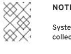

系统性能可能会受到审计收集的信息量的影响。

## 6.1. 审计系统架构

审计系统由两个主要部分组成：用户空间应用程序和实用程序，以及内核侧的系统调用处理。内核组件接收来自用户空间应用程序的系统调用，并通过三种过滤器之一对其进行过滤：*用户*、*任务* 或 *退出*。一旦系统调用通过排除过滤器，它就会被通过上述过滤器之一，并根据审计规则配置将其发送给审计守护进程以进一步处理。图 6.1 “审计系统架构” 说明了此过程。

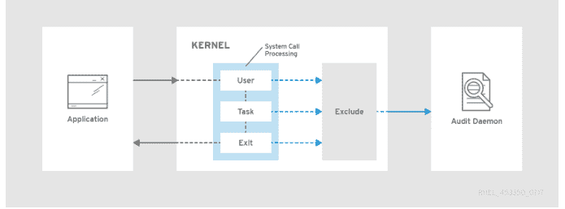

**图 6.1. 审计系统架构**

用户空间审计守护进程从内核收集信息并在日志文件中创建条目。其他审计用户空间实用程序与审计守护进程、内核审计组件或审计日志文件进行交互：

- **auditd** — 审计分发守护进程与审计守护进程交互并将事件发送到其他应用程序以进一步处理。此守护进程的目的是提供插件机制，使实时分析程序能够与审计事件交互。

- **auditctl** — 审计控制实用程序与内核审计组件交互以管理规则并控制事件生成过程中的若干设置和参数。

- 其余审计实用程序以审计日志文件的内容作为输入，并根据用户的需求生成输出。例如，**aureport** 实用程序生成所有记录事件的报告。

## 6.2. 安装审计软件包

为了使用审计系统，必须在系统上安装审计软件包。**audit** 软件包（**audit** 和 **audit-libs**）在 Red Hat Enterprise Linux 7 上默认安装。如果未安装这些软件包，请以 root 用户身份执行以下命令来安装审计及其依赖项：

```bash
~/# yum install audit
```

## 6.3. 配置审计服务

可以在 **`/etc/audit/auditd.conf`** 文件中配置审计守护进程。该文件包含修改审计守护进程行为的配置参数。空行和井号 (`#`) 后面的文本将被忽略。有关更多详情，请参阅 `auditd.conf(5)` 手册页。

### 6.3.1. 为安全环境配置 auditd

默认的 **auditd** 配置应适用于大多数环境。但是，如果你的

如果你的环境必须满足严格的安全策略，建议在 `/etc/audit/auditd.conf` 文件中为审计守护进程配置以下设置：

- **log_file**

  存放审计日志文件的目录（通常为 `/var/log/audit/`）应位于独立的挂载点上。这可以防止其他进程消耗该目录中的空间，并有助于准确检测审计守护进程的剩余空间。

- **max_log_file**

  指定单个审计日志文件的最大大小，必须设置此值以充分利用存放审计日志文件的分区上的可用空间。

- **max_log_file_action**

  决定当达到 `max_log_file` 中设置的限制时采取的操作，应设置为 `keep_logs` 以防止审计日志文件被覆盖。

- **space_left**

  指定磁盘上剩余的可用空间数量，当该数量低于此值时，将触发在 `space_left_action` 参数中设置的操作。必须设置为一个数值，以便管理员有足够的时间做出响应并释放磁盘空间。`space_left` 的值取决于审计日志文件生成的速率。

- **space_left_action**

  建议将 `space_left_action` 参数设置为 `email` 或 `exec`，并配合适当的通知方式。

- **admin_space_left**

  指定绝对最小可用空间量，当空间低于此值时，将触发在 `admin_space_left_action` 参数中设置的操作，必须设置为一个值，以保留足够的空间来记录管理员执行的操作。


### `admin_space_left_action`

应设置为 `single`，以将系统置于单用户模式，并允许管理员释放一些磁盘空间。

### `disk_full_action`

指定当存放审计日志文件的分区上没有可用空间时触发的操作，必须设置为 `halt` 或 `single`。这确保了当审计系统无法再记录事件时，系统要么关闭，要么运行在单用户模式下。

### `disk_error_action`

指定在检测到存放审计日志文件的分区上发生错误时触发的操作，必须根据你本地关于硬件故障处理的安全策略设置为 `syslog`、`single` 或 `halt`。

### `flush`

应设置为 `incremental_async`。它与 `freq` 参数配合使用，该参数决定在强制与硬盘进行硬同步之前可以发送到磁盘的记录数量。`freq` 参数应设置为 `100`。这些参数确保了在保持活动突发良好性能的同时，审计事件数据与磁盘上的日志文件保持同步。

其余配置选项应根据你的本地安全策略进行设置。

## 6.4. 启动审计服务

一旦配置了 `auditd`，请启动该服务以收集审计信息并将其存储在日志文件中。作为 root 用户执行以下命令以启动 `auditd`：

```bash
~]# service auditd start
```


**注意**

`service` 命令是正确与 `auditd` 守护进程交互的唯一方式。你需要使用 `service` 命令，以便正确记录 `audit` 值。你只能使用 `systemctl` 命令执行两个操作：`enable` 和 `status`。

要配置 `auditd` 在系统启动时自动启动，请作为 root 用户执行以下命令：

```bash
~]# systemctl enable auditd
```

可以使用 `service auditd action` 命令对 `auditd` 执行其他多种操作，其中 `action` 可以是以下内容之一：

- `stop`

  停止 `auditd`。

- `restart`

  重启 `auditd`。

- `reload` 或 `force-reload`

  从 `/etc/audit/auditd.conf` 文件重新加载 `auditd` 的配置。

- `rotate`

  轮换 `/var/log/audit/` 目录中的日志文件。

- `resume`

  恢复之前暂停的审计事件日志记录，例如，当存放审计日志文件的磁盘分区没有足够的可用空间时。

- `condrestart` 或 `try-restart`

  仅在 `auditd` 已经运行时才重启它。

- `status`

  显示 `auditd` 的运行状态。

## 6.5. 定义审计规则

审计系统运行于一组规则之上，这些规则定义了要在日志文件中捕获的内容。可以指定以下类型的审计规则：

**控制规则**

允许修改审计系统的行为及其部分配置。

**文件系统规则**

也称为文件监视，允许对特定文件或目录的访问进行审计。

**系统调用规则**

允许记录任何指定程序发出的系统调用。

审计规则可以设置为：

- 使用 `auditctl` 工具在命令行上设置。请注意，这些规则在重启后不会持久化。详细信息请参阅第 6.5.1 节，“使用 `auditctl` 定义审计规则”
- 在 `/etc/audit/audit.rules` 文件中设置。详细信息请参阅第 6.5.3 节，“在 /etc/audit/audit.rules 文件中定义持久审计规则和控制项”

### 6.5.1. 使用 auditctl 定义审计规则

`auditctl` 命令允许你控制审计系统的基本功能，并定义决定哪些审计事件被记录在日志中的规则。

> **注意**
>
> 所有与审计服务和审计日志文件交互的命令都需要 root 权限。请确保你作为 root 用户执行这些命令。此外，设置审计服务需要 `CAP_AUDIT_CONTROL`，记录用户消息需要 `CAP_AUDIT_WRITE`。

#### 定义控制规则

以下是一些允许你修改审计系统行为的控制规则：

- `-b`

  设置内核中现有审计缓冲区的最大数量，例如：

  ```bash
  ~]# auditctl -b 8192
  ```

- `-f`

  设置检测到严重错误时执行的操作，例如：

  ```bash
  ~]# auditctl -f 2
  ```

  上述配置在发生严重错误时触发内核恐慌。

- `-e`

  启用或禁用审计系统，或锁定其配置，例如：

  ```bash
  ~]# auditctl -e 2
  ```

  上述命令锁定审计配置。

- `-r`

  设置每秒生成消息的速率，例如：

  ```bash
  ~]# auditctl -r 0
  ```

  上述配置不对生成的消息设置速率限制。

- `-s`

  报告审计系统的状态，例如：

  ```bash
  ~]# auditctl -s
  AUDIT_STATUS: enabled=1 flag=2 pid=0 rate_limit=0 backlog_limit=8192 lost=259 backlog=0
  ```

- `-l`

  列出当前已加载的所有审计规则，例如：

  ```bash
  ~]# auditctl -l
  -w /etc/passwd -p wa -k passwd_changes
  -w /etc/selinux -p wa -k selinux_changes
  -w /sbin/insmod -p x -k module_insertion
  :
  ```

- `-D`

  删除当前已加载的所有审计规则，例如：

  ```bash
  ~]# auditctl -D
  No rules
  ```

#### 定义文件系统规则

要定义文件系统规则，请使用以下语法：

```bash
auditctl -w path_to_file -p permissions -k key_name
```

其中：

- `path_to_file` 是被审计的文件或目录。
- `permissions` 是被记录日志的权限：
  - r – 对文件或目录的读取访问。
  - w – 对文件或目录的写入访问。
  - x – 对文件或目录的执行访问。
  - a – 文件或目录属性的变更。
- `key_name` 是一个可选字符串，有助于识别哪条规则或哪组规则生成了特定的日志条目。

**示例 6.1. 文件系统规则**

要定义一条记录对 `/etc/passwd` 文件的所有写入访问和所有属性变更的规则，请执行以下命令：

```bash
~/# auditctl -w /etc/passwd -p wa -k passwd_changes
```

请注意，`-k` 选项后面的字符串是任意的。

要定义一条记录对 `/etc/selinux/` 目录中所有文件的所有写入访问和所有属性变更的规则，请执行以下命令：

```bash
~/# auditctl -w /etc/selinux/ -p wa -k selinux_changes
```

要定义一条记录执行 `/sbin/insmod` 命令（该命令将模块插入到 Linux 内核中）的规则，请执行以下命令：

```bash
~/# auditctl -w /sbin/insmod -p x -k module_insertion
```

#### 定义系统调用规则

要定义系统调用规则，请使用以下语法：

```bash
auditctl -a action,filter -S system_call -F field=value -k key_name
```

其中：

- `action` 和 `filter` 指定何时记录特定事件。`action` 可以是 `always` 或 `never`。`filter` 指定应用于该事件的哪个内核规则匹配过滤器。规则匹配过滤器可以是以下内容之一：`task`、`exit`、`user` 和 `exclude`。有关这些过滤器的更多信息，请参阅第 6.1 节“审计系统架构”的开头部分。
- `system_call` 通过名称指定系统调用。所有系统调用的列表可以在 `/usr/include/asm/unistd_64.h` 文件中找到。可以将多个系统调用分组到一条规则中，每个系统调用在其各自的 `-S` 选项后指定。
- `field=value` 指定进一步修改规则以基于指定架构、组 ID、进程 ID 等匹配事件的额外选项。有关所有可用字段类型及其值的完整列表，请参阅 `auditctl(8)` man 手册页。
- `key_name` 是一个可选字符串，有助于识别哪条规则或哪组规则生成了特定的日志条目。


## 示例 6.2. 系统调用规则

要定义一条每当程序使用 `adjtime` 或 `settimeofday` 系统调用且系统使用 64 位架构时创建日志条目的规则，请执行以下命令：

### 6.5.2. 定义可执行文件规则

要定义一条规则，使得每当 ID 为 1000 或更大的系统用户删除或重命名文件时都创建一条日志条目，请执行以下命令：

```bash
~]# auditctl -a always,exit -S unlink -S unlinkat -S rename -S renameat -F auid>=1000 -F auid!=4294967295 -k delete
```

请注意，`-F auid!=4294967295` 选项用于排除未设置登录 UID 的用户。

也可以使用系统调用规则语法来定义文件系统规则。以下命令创建的规则与 `-W /etc/shadow -p wa` 文件系统规则类似：

```bash
~]# auditctl -a always,exit -F path=/etc/shadow -F perm=wa
```

要定义可执行文件规则，请使用以下语法：

```bash
auditctl -a action,filter [ -F arch=cput -S system_call] -F exe=path_to_executable_file -k key_name
```

其中：

- `action` 和 `filter` 指定何时记录特定事件。`action` 可以是 `always` 或 `never`。`filter` 指定应用于事件的内核规则匹配过滤器。规则匹配过滤器可以是以下之一：`task`、`exit`、`user` 和 `exclude`。有关这些过滤器的更多信息，请参阅第 6.1 节“审计系统架构”的开头部分。

- `system_call` 通过名称指定系统调用。所有系统调用的列表可以在 `/usr/include/asm/unistd_64.h` 文件中找到。可以将多个系统调用归入一条规则，每个系统调用在其自己的 `-S` 选项后指定。

- `path_to_executable_file` 是被审计可执行文件的绝对路径。

- `key_name` 是一个可选字符串，有助于识别是哪条规则或哪组规则生成了特定的日志条目。

### 示例 6.3. 可执行文件规则

要定义一条记录 `/bin/id` 程序所有执行情况的规则，请执行以下命令：

```bash
~]# auditctl -F exe=/bin/id -S execve -k execution_bin_id
```

### 6.5.3. 在 /etc/audit/audit.rules 文件中定义持久审计规则和控制

要定义跨重启持久的审计规则，必须直接将其包含在 `/etc/audit/audit.rules` 文件中，或者使用读取 `/etc/audit/rules.d/` 目录中规则的 `augenrules` 程序。`/etc/audit/audit.rules` 文件使用相同的 `auditctl` 命令行语法来指定规则。空行和井号 `#` 后面的文本会被忽略。

也可以使用 `auditctl` 命令读取指定文件中的规则，使用 `-R` 选项，例如：

```bash
~]# auditctl -R /usr/share/doc/audit/rules/30-stig.rules
```

#### 定义控制规则

文件只能包含以下修改审计系统行为 的控制规则：`-b`、`-D`、`-e`、`-f`、`-r`、`--loginuid-immutable` 和 `--backlog_wait_time`。有关这些选项的更多信息，请参阅“定义控制规则”部分。

##### 示例 6.4. audit.rules 中的控制规则

```bash
# Delete all previous rules
-D

# Set buffer size
-b 8192

# Make the configuration immutable -- reboot is required to change audit rules
-e 2

# Panic when a failure occurs
-f 2

# Generate at most 100 audit messages per second
-r 100

# Make login UID immutable once it is set (may break containers)
--loginuid-immutable 1
```

#### 定义文件系统与系统调用规则

使用 `auditctl` 语法定义文件系统与系统调用规则。第 6.5.1 节“使用 auditctl 定义审计规则”中的示例可以用以下规则文件表示：

##### 示例 6.5. audit.rules 中的文件系统与系统调用规则

```bash
-w /etc/passwd -p wa -k passwd_changes
-w /etc/selinux/ -p wa -k selinux_changes
-w /sbin/insmod -p x -k module_insertion

-a always,exit -F arch=b64 -S adjtimex -S settimeofday -k time_change
-a always,exit -S unlink -S unlinkat -S rename -S renameat -F auid>=1000 -F auid!=4294967295 -k delete
```

#### 预配置规则文件

在 `/usr/share/doc/audit/rules/` 目录中，审计包根据各种认证标准提供了一组预配置规则文件：

- `30-nispm.rules` – 满足国家工业安全计划操作手册信息安全章节中指定要求的审计规则配置。

- `30-pci-dss-v31.rules` – 满足支付卡行业数据安全标准 (PCI DSS) v3.1 设定的要求的审计规则配置。

- `30-stig.rules` – 满足安全技术实施指南 (STIG) 设定要求的审计规则配置。

要使用这些配置文件，请备份原始的 `/etc/audit/audit.rules` 文件，并将选定的配置文件复制到 `/etc/audit/audit.rules` 文件：

```bash
~]# cp /etc/audit/audit.rules /etc/audit/audit.rules_backup
~]# cp /usr/share/doc/audit/rules/30-stig.rules /etc/audit/audit.rules
```


> 注意
>
> 审计规则具有一套编号方案，允许对其进行排序。要了解有关命名方案的更多信息，请参阅 `/usr/share/doc/audit/rules/README-rules` 文件。

### 使用 augenrules 定义持久规则

`augenrules` 脚本读取位于 `/etc/audit/rules.d/` 目录中的规则，并将其编译到 `audit.rules` 文件中。该脚本以特定的顺序处理所有以 `.rules` 结尾的文件，顺序基于其自然排序。该目录中的文件按以下含义分组：

- 10 - 内核和 `auditctl` 配置

- 20 - 可能匹配通用规则但您想要不同匹配的规则

- 30 - 主要规则

- 40 - 可选规则

- 50 - 特定服务器规则

- 70 - 系统本地规则

- 90 - 最终化 (不可变)

这些规则并非旨在一次性全部使用。它们是策略的一部分，应经过深思熟虑，并将单独的文件复制到 `/etc/audit/rules.d/`。例如，要按 STIG 配置设置系统，请复制规则 10-base-config、30-stig、31-privileged 和 99-finalize。

一旦规则位于 `/etc/audit/rules.d/` 目录中，通过运行带有 `--load` 指令的 `augenrules` 脚本加载它们：

```bash
~]# augenrules --load
augenrules --load No rules
enabled 1
failure 1
pid 634
rate_limit 0
backlog_limit 8192
lost 0
backlog 0
enabled 1
failure 1
pid 634
rate_limit 0
backlog_limit 8192
lost 0
backlog 1
```

有关审计规则和 `augenrules` 脚本的更多信息，请参阅 `audit.rules(8)` 和 `augenrules(8)` 手册页。

## 6.6. 了解审计日志文件


默认情况下，审计系统将日志条目存储在 `/var/log/audit/audit.log` 文件中；如果启用了日志轮换，轮换后的 `audit.log` 文件存储在同一目录中。

以下审计规则记录尝试读取或修改 `/etc/ssh/sshd_config` 文件的每次尝试：

```bash
-w /etc/ssh/sshd_config -p wa -k sshd_config
```

如果 `auditd` 守护进程正在运行，例如，使用以下命令会在审计日志文件中创建一个新事件：

```bash
-]# cat /etc/ssh/sshd_config
```

`audit.log` 文件中的此事件如下所示：

```text
type=SYSCALL msg=audit(1364481363.243:24287): arch=c000003e syscall=2 success=no exit=-13 a0=7fff d19c5592 a1=0 a2=7fffd19c4b50 a3=a items=1 ppid=2686 pid=3538 audit=1000 uid=1000 gid=1000 euid=1000 suid=1000 fsuid=1000 fegid=1000 fgid=1000 fsgid=1000 ttype=pts0 ses=1 comm="cat" exe="/bin/cat" subj=unconfined_u:unconfined_r:unconfined_t:s0-s0:c0.c1023 key="sshd_config"
type=CWD msg=audit(1364481363.243:24287): cwd="/home/shadowman"
type=PATH msg=audit(1364481363.243:24287): item=0 name="/etc/ssh/sshd_config" inode=4090248 dev=fd:00 mode=0100600 ouid=0 gooid=0 rdev=00:00 obj=system_u:object_r:etc_t:s0 objtype=NORMAL cap_fp=none cap_fi=none cap_fe=0 cap_fver=0
type=PROCTITLE msg=audit(1364481363.243:24287): proctitle=636174002f6574632f7373682f737368645f636f6e66
```

上述事件由四个记录组成，它们共享相同的时间戳和序列号。记录始终以 `type=` 关键字开头。每个记录由多个 `name=value` 对组成，由空格或逗号分隔。以下是对上述事件的详细分析：

### 第一条记录

# 安全指南

## `type=SYSCALL`

`type` 字段包含记录的类型。在此示例中，`SYSCALL` 值指定该记录是由发送到内核的 system call（系统调用）触发的。

要查看所有可能的 `type` 值及其说明，请参阅 `Section B.2, “Audit Record Types”`。

`msg=audit(1364481363.243:24287)`：

`msg` 字段记录：

- 一个 `time` 戳以及记录的唯一 `ID`，格式为 `audit(time_stamp:ID)`。如果多个记录是在同一审计事件作为一部分生成的，它们可以共享相同的 `time` 戳和 `ID`。时间戳使用 Unix 时间格式——自 1970 年 1 月 1 日 00:00:00 UTC 以来的秒数。
- 由内核或用户空间应用程序提供的各种特定事件的 `name=value` 对。

## `arch=c000003e`

`arch` 字段包含关于系统 CPU 架构的信息。值 `c000003e` 以十六进制编码。在使用 `ausearch` 命令搜索审计记录时，使用 `-i` 或 `--interpret` 选项可自动将十六进制值转换为其可读等效值。`c000003e` 的值被解释为 `x86_64`。

## `syscall=2`

`syscall` 字段记录发送到内核的系统调用类型。值 `2` 可以在 `/usr/include/asm/unistd_64.h` 文件中与其可读等效值匹配。在此情况下，`2` 是 `open` 系统调用。请注意，`ausyscall` 实用程序允许您将系统调用编号转换为其可读等效值。使用 `ausyscall --dump` 命令可显示所有系统调用及其编号的列表。有关更多信息，请参阅 `ausyscall(8)` 手册页。

## `success=no`

`success` 字段记录特定事件中被记录的系统调用是成功还是失败。在此情况下，调用未成功。

## `exit=-13`

`exit` 字段包含一个值，该值指定系统调用返回的退出码。此值因不同的系统调用而异。您可以使用以下命令将该值解释为其可读等效值：

```bash
~]# ausearch --interpret --exit -13
```

请注意，上一个示例假设您的审计日志包含一个以退出码 -13 失败的事件。

### `a0=7fffd19c5592`, `a1=0`, `a2=7fffd19c5592`, `a3=a`

从 `a0` 到 `a3` 的字段记录此事件中系统调用以十六进制编码的前四个参数。这些参数取决于所使用的系统调用；它们可以由 `ausearch` 实用程序解释。

## `items=1`

`items` 字段包含跟随系统调用记录之后的辅助记录数量。

## `ppid=2686`

`ppid` 字段记录父进程 ID (PPID)。在此情况下，2686 是父进程的 PPID，例如 bash。

## `pid=3538`

`pid` 字段记录进程 ID (PID)。在此情况下，3538 是 cat 进程的 PID。

## `auid=1000`

`auid` 字段记录审计用户 ID，即 loginuid。此 ID 在用户登录时分配给用户，并由每个进程继承，即使用户的身份发生变化，例如通过 `su - john` 命令切换用户帐户。

## `uid=1000`

`uid` 字段记录启动被分析进程的用户 ID。可以使用以下命令将用户 ID 解释为用户名：`ausearch -i --uid UID`。

## `gid=1000`

`gid` 字段记录启动被分析进程的用户组 ID。

## `euid=1000`

`euid` 字段记录启动被分析进程的有效用户 ID。

## `suid=1000`

`suid` 字段记录启动被分析进程的 set 用户 ID。

## `fsuid=1000`

`fsuid` 字段记录启动被分析进程的文件系统用户 ID。

## `egid=1000`

`egid` 字段记录启动被分析进程的有效组 ID。

## `sgid=1000`

`sgid` 字段记录启动被分析进程的 set 组 ID。

## `fsgid=1000`

`fsgid` 字段记录启动被分析进程的文件系统组 ID。

## `tty=pts0`

`tty` 字段记录调用被分析进程的终端。

## `ses=1`

`ses` 字段记录调用被分析进程的会话 ID。

## `comm="cat"`

`comm` 字段记录用于调用被分析进程的命令行的命令名称。在此情况下，使用 `cat` 命令触发了此审计事件。

## `exe="/bin/cat"`

`exe` 字段记录用于调用被分析进程的可执行文件路径。

## `subj=unconfined_u:unconfined_r:unconfined_t:s0-s0:c0.c1023`

`subj` 字段记录在执行时标记被分析进程所使用的 SELinux 上下文。

## `key="sshd_config"`

`key` 字段记录与在审计日志中生成此事件的规则关联的管理员定义的字符串。

# 第二条记录

## `type=CWD`

在第二条记录中，`type` 字段值为 `CWD` – 当前工作目录。此类型用于记录执行指定了第一条记录中系统调用的进程的工作目录。

此记录的目的是记录当前进程的位置，以防相对路径最终被捕获在相关的 `PATH` 记录中。这样，可以重建绝对路径。

## `msg=audit(1364481363.243:24287)`

`msg` 字段持有与第一条记录中值相同的时间戳和 ID 值。时间戳使用 Unix 时间格式——自 1970 年 1 月 1 日 00:00:00 UTC 以来的秒数。

## `cwd="/home/_user_name_"`

`cwd` 字段包含调用系统调用的目录路径。

# 第三条记录

## `type=PATH`

在第三条记录中，`type` 字段值为 `PATH`。审计事件包含每个作为参数传递给系统调用的路径的 `PATH` 类型记录。在此审计事件中，只有一个路径 (`/etc/ssh/sshd_config`) 被用作参数。

## `msg=audit(1364481363.243:24287)`

`msg` 字段持有与第一条和第二条记录中值相同的时间戳和 ID 值。

## `item=0`


`item` 字段指示当前记录是 `SYSCALL` 类型记录中引用的总项目数中的哪一个。此数字从零开始；值为 0 表示它是第一个项目。

## name="/etc/ssh/sshd_config"

`name` 字段记录作为参数传递给系统调用的文件或目录的完整路径。在此情况下，它是 `/etc/ssh/sshd_config` 文件。

## inode=409248

`inode` 字段包含与此事件中记录的文件或目录关联的 inode 号。以下命令显示与 `409248` inode 号关联的文件或目录：

```bash
-]# find / -inum 409248 -print
/etc/ssh/sshd_config
```

## dev=fd:00

`dev` 字段指定包含此事件中记录的文件或目录的设备的小号和大号 ID。在此情况下，该值代表 `/dev/fd/0` 设备。

## mode=0100600

`mode` 字段记录文件或目录的权限，编码为数字表示，由 `stat` 命令在 `st_mode` 字段中返回。有关更多信息，请参阅 `stat(2)` 手册页。在此情况下，`0100600` 可以解释为 `-rw-------`，这意味着只有 root 用户具有对 `/etc/ssh/sshd_config` 文件的读写权限。

## ouid=0

`ouid` 字段记录对象所有者的用户 ID。

## ogid=0

`ogid` 字段记录对象所有者的组 ID。

## rdev=00:00

`rdev` 字段仅包含特殊文件的记录设备标识符。在此情况下，它未被使用，因为记录的文件是常规文件。

## obj=system_u:object_r:etc_t:s0

`obj` 字段记录在执行时标记记录的文件或目录所使用的 SELinux 上下文。

## objtype=NORMAL

`objtype` 字段记录在给定 syscall 上下文中每个路径记录的操作意图。

## cap_fp=none

`cap_fp` 字段记录与设置文件或目录对象的允许文件系统基于的能力相关的数据。

## cap_fi=none

`cap_fi` 字段记录与设置文件或目录对象的继承文件系统基于的能力相关的数据。

`cap_fe=0`

`cap_fe` 字段记录文件或目录对象基于文件系统的能力的有效位设置。

`cap_fver=0`

`cap_fver` 字段记录文件或目录对象基于文件系统的能力的版本。

## 第4条记录

`type=PROCTITLE`

`type` 字段包含记录的类型。在此示例中，`PROCTITLE` 值指定该记录给出了触发此审计事件的完整命令行，该事件由调用内核的系统调用触发。

```
proctitle=636174002F6574632F7373 82F737368645F636F6E6669677
```

`proctitle` 字段记录用于调用被分析进程的完整命令行。该字段以十六进制编码形式记录，以防止用户影响审计日志解析器。该文本解码为触发此审计事件的命令。在使用 `ausearch` 命令搜索审计记录时，使用 `-i` 或 `--interpret` 选项可自动将十六进制值转换为其人类可读的等价值。`636174002F6574632F737382F737368645F636F6E6669677` 值被解释为 `x86_64`。

上述分析的审计事件仅包含事件可能包含的所有字段的一个子集。有关所有事件字段及其解释的列表，请参见第 B.1 节“审计事件字段”。有关所有事件类型及其解释的列表，请参见第 B.2 节“审计记录类型”。

### 示例 6.6. 额外的 audit.log 事件

以下审计事件记录了 `auditd` 守护程序的成功启动。`ver` 字段显示了启动的审计守护程序的版本。

```
type=DAEMON_START msg=audit(1363713609.192:5426): auditd start, ver=2.2 format=raw kernel=2.6.32-358.2.1.el6.x86_64 audit=1000 pid=4979 subj=unconfined_u:system_r:auditd_t:s0 res=success
```

以下审计事件记录了 UID 为 1000 的用户尝试登录为 root 用户失败的情况。

```
type=USER_AUTH msg=audit(136475353.159:24270): user pid=3280 uid=1000 auid=1000 ses=1 subj=unconfined_u:unconfined_r:unconfined_t:s0-s0:c0.c1023 msg='op=PAM:authentication acct="root" exe="/bin/su" hostname=? addr=? terminal=pts/0 res=failed'
```

## 6.7. 搜索审计日志文件

`ausearch` 实用程序允许您搜索审计日志文件中的特定事件。默认情况下，`ausearch` 搜索 `/var/log/audit/audit.log` 文件。您可以使用 `ausearch` 选项 `-if file_name` 命令指定其他文件。在一个 `ausearch` 命令中提供多个选项等价于在字段类型之间使用 AND 运算符，并在同一字段类型的多个实例之间使用 OR 运算符。

### 示例 6.7. 使用 ausearch 搜索审计日志文件

要搜索 `/var/log/audit/audit.log` 文件中的登录失败尝试，请使用以下命令：

```
~]# ausearch --message USER_LOGIN --success no --interpret
```

要搜索所有账户、组和角色更改，请使用以下命令：

```
~]# ausearch -m ADD_USER -m DEL_USER -m ADD_GROUP -m USER_CHAUTHTOK -m DEL_GROUP -m CHGRP_ID -m ROLE_ASSIGN -m ROLE_REMOVE -i
```

要搜索由特定用户执行的所有已记录操作，使用该用户的登录 ID（audit），请使用以下命令：

```
~]# ausearch -ua 1000 -i
```

要搜索从昨天至今的所有失败的系统调用，请使用以下命令：

```
~]# ausearch --start yesterday --end now -m SYSCALL -sv no -i
```

有关所有 `ausearch` 选项的完整列表，请参见 `ausearch(8)` 手册页。

## 6.8. 创建审计报告

`aureport` 实用程序允许您生成针对记录在审计日志文件中的事件的摘要和列式报告。默认情况下，会查询 `/var/log/audit/` 目录中的所有 `audit.log` 文件以创建报告。您可以使用 `aureport` 选项 `-if file_name` 命令指定运行报告所针对的其他文件。

### 示例 6.8. 使用 aureport 生成审计报告

要为过去三天（不包括当前示例日期）记录的已记录事件生成报告，请使用以下命令：

```
~]# aureport --start 04/08/2013 00:00:00 --end 04/11/2013 00:00:00
```

要为所有可执行文件事件生成报告，请使用以下命令：

```
~]# aureport -x
```

要为上述可执行文件事件报告生成摘要，请使用以下命令：

```
~]# aureport -x --summary
```

要为所有用户的失败事件生成摘要报告，请使用以下命令：

```
~]# aureport -u --failed --summary -i
```

要为每个系统用户的所有失败登录尝试生成摘要报告，请使用以下命令：

```
~]# aureport --login --summary -i
```

要从搜索用户 ID 1000 的所有文件访问事件的 `ausearch` 查询生成报告，请使用以下命令：

```
~]# ausearch --start today --loginuid 1000 --raw | aureport -f --summary
```

要为所有被查询的审计文件以及它们包含的事件时间范围生成报告，请使用以下命令：

```
~]# aureport -t
```

有关所有 `aureport` 选项的完整列表，请参见 `aureport(8)` 手册页。

## 6.9. 其他资源

有关 Audit 系统的更多信息，请参见以下来源。

### 在线资源

- Linux Audit 文档项目页面：https://github.com/linux-audit/audit-documentation/wiki。

### 已安装的文档

`audit` 包提供的文档可以在 `/usr/share/doc/audit/` 目录中找到。

### 手册页

- `audispd.conf(5)`

- `auditd.conf(5)`

- `ausearch-expression(5)`

- `audit.rules(7)`


- `audispd(8)`

- `auditctl(8)`

- `auditd(8)`

- `aulast(8)`

- `aulastlog(8)`

- `aureport(8)`

- `asearch(8)`

- `ausyscall(8)`

- `autrace(8)`

- `auvirt(8)`

# 第 7 章. 使用 OpenSCAP 进行合规性和漏洞扫描

## 7.1. Red Hat Enterprise Linux 中的安全合规性

合规性审计是一个确定给定对象是否遵循合规性策略中写明的所有规则的过程。合规性策略由安全专家定义，他们指定所需的设置，通常以检查清单的形式，用于在计算环境中使用。

合规性策略在不同组织之间甚至在同一组织内的不同系统之间可能存在很大差异。这些策略之间的差异基于这些系统的用途及其对组织的重要性。自定义软件设置和部署特征也引发了对自定义策略检查清单的需求。

Red Hat Enterprise Linux 提供允许完全自动化合规性审计的工具。这些工具基于安全内容自动化协议（SCAP）标准，旨在自动化调整合规性策略。

### Red Hat Enterprise Linux 7 支持的安全合规性工具

- **SCAP Workbench** – `scap-workbench` 图形实用程序旨在对单个本地或远程系统执行配置和漏洞扫描。它还可以用于基于这些扫描和评估生成安全报告。

- **OpenSCAP** – `openscap` 命令行实用程序旨在对本地系统执行配置和漏洞扫描，验证安全合规性内容，并基于这些扫描和评估生成报告和指南。

- **脚本检查引擎 (SCE)** – SCE 是 SCAP 协议的扩展，允许管理员使用脚本语言（如 Bash、Python 或 Ruby）编写其安全内容。SCE 扩展在 `openscap-engine-sce` 包中提供。

- **SCAP 安全指南 (SSG)** – `scap-security-guide` 包提供了针对 Linux 系统的最新安全策略集合。指南包括实用加固建议的目录，并在适用时链接到政府要求。该项目弥合了通用策略要求和特定实施指南之间的差距。

如果您需要在远程多个系统上执行自动化合规性审计，您可以利用适用于 Red Hat Satellite 的 OpenSCAP 解决方案。有关更多信息，请参见第 7.8 节“使用 Red Hat Satellite 中的 OpenSCAP”和第 7.10 节“其他资源”。

## 7.2. 定义合规性策略

安全或合规性策略很少从头开始编写。ISO 27000 标准系列、衍生作品和其他来源提供了安全策略模板和实务建议，应该有助于起步。然而，建立信息安全管理计划的组织需要修改策略模板以符合其需求。策略模板应根据其与公司环境的相关性进行选择，然后必须调整该模板，因为要么模板包含无法应用于该组织的内置假设，要么模板明确要求必须做出某些决定。

Red Hat Enterprise Linux 的审计功能基于安全内容自动化协议（SCAP）标准。SCAP 是一组互操作性规范的综合，标准化了软件缺陷和安全配置信息传达的格式和术语，既向机器和人类。SCAP（安全内容自动化协议）是一个多用途的规范框架，支持自动化配置、漏洞和补丁检查、技术控制合规活动以及安全度量。

换句话说，SCAP 是一种厂商中立的安全策略表达方式，因此被现代企业广泛使用。SCAP 规范创建了一个生态系统，在该系统中，安全内容的格式是众所周知且标准化的，而扫描器或策略编辑器的实现方式并未被强制规定。这种状态使得组织可以只构建一次其安全策略（SCAP 内容），无论他们使用多少个安全供应商。

最新版本的 SCAP 包含几个底层标准。这些组件根据其在 SCAP 中的功能划分为以下组：

## SCAP 组件

- **语言** – 该组包含定义标准词汇和约定以表达合规策略的 SCAP 语言。

    - *可扩展配置检查清单描述格式*（XCCDF） – 一种设计用于表达、组织和管理安全指南的语言。

    - *开放漏洞和评估语言*（OVAL） – 一种开发用于对扫描系统状态进行逻辑断言的语言。

    - *开放检查清单交互语言*（OCIL） – 一种设计用于提供向用户查询并解释用户对给定问题响应之标准方式的语言。

    - *资产标识*（AI） – 一种开发用于提供数据模型、方法和指南以识别安全资产的语言。

    - *资产报告格式*（ARF） – 一种设计用于表达收集的安全资产信息的传输格式以及资产与安全报告之间关系的语言。

- **枚举** – 该组包括定义命名格式以及来自某些感兴趣的安全领域的项目的官方列表或词典的 SCAP 标准。

    - *常见配置枚举*（CCE） – 应用程序和操作系统中与安全性相关的配置元素的枚举。

    - *常见平台枚举*（CPE） – 用于识别信息技术（IT）系统、平台和软件包的结构化命名方案。

    - *常见漏洞与暴露*（CVE） – 公开已知的软件漏洞和暴露的参考方法。

- **度量** – 该组由用于识别和评估安全风险的框架组成。

    - *常见配置评分系统*（CCSS） – 一种用于评估与安全性相关的配置元素并为其分配分数，以帮助用户确定适当的响应步骤优先级的度量系统。

    - *常见漏洞评分系统*（CVSS） – 一种用于评估软件漏洞并为其分配分数，以帮助用户确定其安全风险优先级的度量系统。

- **完整性** – 一个用于维护 SCAP 内容和扫描结果完整性的 SCAP 规范。

    - *安全自动化数据信任模型*（TMSAD） – 一组解释如何使用现有规范在安全自动化域内的 XML 文件上下文中表示签名、哈希、密钥信息和身份信息的建议。

每个 SCAP 组件都有自己基于 XML 的文档格式及其 XML 命名空间。以 SCAP 表达的一致性策略可以采取单个 OVAL 定义 XML 文件、数据流文件、单个 zip 归档或包含代表策略检查清单的 XCCDF 文件的独立 XML 文件集的形式。

### 7.2.1. XCCDF 文件格式

XCCDF 语言旨在支持信息交换、文档生成、组织和情境定制、自动化合规测试以及合规评分。该语言主要是描述性的，不包含执行安全扫描的任何命令。然而，XCCDF 文档可以引用其他 SCAP 组件，因此可用于制定在所有目标平台间可移植的合规策略，但相关的评估文档（OVAL, OCL）除外。

表示合规策略的常见方式是一组 XML 文件，其中一个文件是 XCCDF 检查清单。这个 XCCDF 文件通常指向评估资源，多个 OVAL、OCL 和脚本检查引擎（SCE）文件。此外，文件集可以包含一个 CPE 字典文件和一个定义该字典对象的 OVAL 文件。

作为一种基于 XML 的语言，XCCDF 定义并使用了大量的 XML 元素和属性。以下列表简要介绍了主要的 XCCDF 元素；有关 XCCDF 的更多详细信息，请查阅 NIST 机构间报告 7275 第 4 版。

**XCCDF 文档的主要 XML 元素**

- `<xccdf:Benchmark>` – 这是根元素，包裹整个 XCCDF 文档。它还可能包含检查清单元数据，如标题、描述、作者列表、最近修改日期以及检查清单接受状态。

- `<xccdf:Rule>` – 这是一个关键元素，代表检查清单要求并持有其描述。它可能包含定义验证或强制执行对给定规则合规性的操作或修改规则本身的子元素。

- `<xccdf:Value>` – 这个关键元素用于表达基准中其他 XCCDF 元素的属性。

- `<xccdf:Group>` – 此元素用于通过收集 `<xccdf:Rule>`、`<xccdf:Value>` 和 `<xccdf:Group>` 元素，将 XCCDF 文档组织为具有相同上下文或要求域的结构。

- `<xccdf:Profile>` – 此元素用于 XCCDF 基准的命名定制。它允许基准持有多个不同的定制。`<xccdf:Profile>` 利用多个选择器元素，例如 `<xccdf:select>` 或 `<xccdf:refine-rule>`，以确定在生效时哪些元素将被修改和处理。

- `<xccdf:Tailoring>` – 此元素允许在基准外部定义基准配置文件，这对于合规策略的手动定制有时是期望的。

- `<xccdf:TestResult>` – 此元素用于保存目标系统上给定基准的扫描结果。每个 `<xccdf:TestResult>` 应引用用于定义特定扫描的合规策略的配置档案，并且还应包含与扫描相关的目标系统的重要信息。

- `<xccdf:rule-result>` – 这是 `<xccdf:TestResult>` 的子元素，用于保存针对目标系统应用基准中特定规则的结果。

- `<xccdf:fix>` – 这是 `<xccdf:Rule>` 的子元素，用于修复不符合给定规则的目标系统。它可以包含在目标系统上运行的命令或脚本，以使系统符合该规则。

- `<xccdf:check>` – 这是 `<xccdf:Rule>` 的子元素，引用定义如何评估给定规则的外部来源。

- `<xccdf:select>` – 这是一个选择器元素，用于从策略中包含或排除选定的规则或规则组。


- `<xccdf:set-value>` – 这是一个选择器元素，用于覆盖指定的 `<xccdf:Value>` 元素的当前值，而不修改其其他属性。

- `<xccdf:refine-value>` – 这是一个选择器元素，用于在策略定制期间指定特定 `<xccdf:Value>` 元素的约束。

- `<xccdf:refine-rule>` – 此选择器元素允许覆盖选定规则的属性。

## 示例 7.1. XCCDF 文档示例

```xml
<?xml version="1.0" encoding="UTF-8"?>
<Benchmark xmlns="http://checklists.nist.gov/xccdf/1.2"
           id="xccdf_com.example.www_benchmark_test">
    <status>incomplete</status>
    <version>0.1</version>
    <Profile id="xccdf_com.example.www_profile_1">
        <title>Profile title is compulsory</title>
        <select idref="xccdf_com.example.www_group_1"
                selected="true"/>
        <select idref="xccdf_com.example.www_rule_1"
                selected="true"/>
        <refine-value idref="xccdf_com.example.www_value_1"
                      selector="telnet service"/>
    </Profile>
    <Group id="xccdf_com.example.www_group_1">
        <Value id="xccdf_com.example.www_value_1">
            <value selector="telnet_service">telnet-server</value>
            <value selector="dhcp_service">dhcpd</value>
            <value selector="ftpd_service">tftpd</value>
        </Value>
        <Rule id="xccdf_com.example.www_rule_1">
            <title>The telnet-server Package Shall Not Be Installed</title>
            <rationale>
                Removing the telnet-server package decreases the risk
                of the telnet service's accidental (or intentional) activation
            </rationale>
            <fix platform="cpe:/o:redhat:enterprise_linux:6"
                 reboot="false"
                 disruption="low"
```

### 7.2.2. OVAL 文件格式

开放漏洞评估语言（OVAL）是 SCAP 中至关重要且最古老组成部分。OVAL 标准的主要目标是促进安全产品之间的互操作性。这通过标准化以下三个领域来实现：

1. 目标系统配置的表示。

2. 分析目标系统中是否存在特定的机器状态。

3. 报告指定机器状态与观察到的机器状态之间比较的结果。

与其他工具或自定义脚本不同，OVAL 语言以声明式方式描述资源所需的`状态`。OVAL 语言代码从不直接执行，而是通过一种称为扫描器（scanner）的 OVAL 解释器工具来执行。OVAL 的声明式性质确保了被评估系统的状态不会意外被修改，这一点非常重要，因为安全扫描器通常以尽可能高的权限运行。

OVAL 规范对公众评论和贡献开放，多家 IT 公司与 MITRE 公司（一家联邦资助的非营利组织）进行合作。OVAL 规范在不断演进中，不同版本通过版本号进行区分。当前版本 5.11.1 于 2015 年 4 月发布。

与其他所有 SCAP 组件一样，OVAL 基于 XML。OVAL 标准定义了多种文档格式。每种格式包含不同类型的信息，并服务于不同的目的。

## OVAL 文档格式

- OVAL 定义（OVAL Definitions）格式是最常用的 OVAL 文件格式，直接用于系统扫描。OVAL 定义文档描述了目标系统所需的`状态`。

- OVAL 变量（OVAL Variables）格式定义用于修改 OVAL 定义文档的变量。OVAL 变量文档通常与 OVAL 定义文档配合使用，以在运行时针对目标系统定制安全内容。

- OVAL 系统特征（OVAL System Characteristics）格式保存关于被评估系统的信息。OVAL 系统特征文档通常用于将系统的实际状态与由 OVAL 定义文档定义的预期状态进行比较。

- OVAL 结果（OVAL Results）是最全面的 OVAL 格式，用于报告系统评估结果。OVAL 结果文档通常包含被评估的 OVAL 定义的副本、绑定的 OVAL 变量、OVAL 系统特征，以及基于系统特征与定义比较计算得出的测试结果。

- OVAL 指令（OVAL Directives）格式用于通过包含或排除特定详细信息来定制 OVAL 结果文档的详略程度。

- OVAL 公共模型（OVAL Common Model）格式包含在多个其他 OVAL 方案中使用的构造和枚举定义。它用于重用 OVAL 定义，以避免在多个文档中出现重复。

OVAL 定义文档由一组配置要求组成，每个要求在以下五个基本部分中定义：定义、测试、对象、状态和变量。定义部分中的元素描述了为满足给定定义，应当满足哪些测试。测试元素将对象和状态连接在一起。在系统评估过程中，当被评估系统的一个由给定对象元素指定的资源与给定的状态元素相对应时，测试被视为通过。变量部分定义外部变量，这些变量可用于调整状态部分中的元素。除了这些部分外，OVAL 定义文档通常还包含生成器（generator）和签名（signature）部分。生成器部分保存有关文档来源及其内容相关的各种附加信息。

OVAL 文档基本部分中的每个元素都由以下形式的唯一标识符明确标识：

```
oval:namespace:type:ID
```

其中，`namespace` 是定义标识符的命名空间，`type` 对于定义元素为 `def`，对于测试元素为 `tst`，对于对象元素为 `obj`，对于状态元素为 `ste`，对于变量元素为 `var`，`ID` 是标识符的整数值。

## 示例 7.2. OVAL 定义文档示例


```xml
<?xml version="1.0" encoding="utf-8"?>
<oval_definitions
    xmlns:lin-def="http://oval.mitre.org/XMLSchema/oval-definitions-5#linux"
    xmlns:oval="http://oval.mitre.org/XMLSchema/oval-common-5"
    xmlns="http://oval.mitre.org/XMLSchema/oval-definitions-5"
    xmlns:xsi="http://www.w3.org/2001/XMLSchema-instance">
<generator>
    <oval:product_name>vim</oval:product_name>
    <oval:schema_version>5.10.1</oval:schema_version>
    <oval:timestamp>2012-11-22T15:00:00+01:00</oval:timestamp>
</generator>
<definitions>
<definition class="inventory"
             id="oval:org.open-scap.cpe.rhel:def:7"
             version="1">
    <metadata>
        <title>Red Hat Enterprise Linux 7</title>
        <affected family="unix">
            <platform>Red Hat Enterprise Linux 7</platform>
        </affected>
        <reference ref_id="cpe:/o:redhat:enterprise_linux:7"
                   source="CPE"/>
        <description>
            The operating system installed on the system is Red Hat Enterprise Linux 7
        </description>
    </metadata>
    <criteria>
        <criterion comment="Red Hat Enterprise Linux 7 is installed"
                   test_ref="oval:org.open-scap.cpe.rhel:tst:7"/>
    </criteria>
</definition>
</definitions>
<tests>
    <lin-def:rpm_info_test check_existence="at_least_one_exists"
                           id="oval:org.open-scap.cpe.rhel:tst:7"
                           version="1"
                           check="at least one"
                           comment="redhat-release is version 7">
        <lin-def:object object_ref="oval:org.open-scap.cpe.rhel-release:obj:1"/>
        <lin-def:state state_ref="oval:org.open-scap.cpe.rhel:ste:7"/>
    </lin-def:rpm_info_test>
</tests>
<objects>
    <lin-def:rpm_verifyfile_object id="oval:org.open-scap.cpe.rhel-release:obj:1"
                                   version="1">
        <!-- This object represents rpm package which owns /etc/redhat-release file -->
        <lin-def:behaviors nolinkto='true'
                           nomd5='true'
                           nosize='true'
                           nouser='true'
                           nogroup='true'
                           nomtime='true'
                           nomode='true'
                           nordev='true'
                           noconfigfiles='true'
                           noghostfiles='true' />
        <lin-def:name operation="pattern match"/>
        <lin-def:epoch operation="pattern match"/>
        <lin-def:version operation="pattern match"/>
        <lin-def:release operation="pattern match"/>
        <lin-def:arch operation="pattern match"/>
        <lin-def:filepath>/etc/redhat-release</lin-def:filepath>
    </lin-def:rpm_verifyfile_object>
</objects>
<states>
  <lin-def:rpminfo_state id="oval:org.open-scap:cpe:rhel:ste:7" version="1">
    <lin-def:name operation="pattern match">^redhat-release</lin-def:name>
    <lin-def:version operation="pattern match">^7[\d]</lin-def:version>
  </lin-def:rpminfo_state>
</states>
</oval_definitions>
```

### 7.2.3. 数据流格式

SCAP 数据流是自 SCAP 版本 1.2 以来使用的一种文件格式，它代表了一组 XCCDF、OVAL 和其他组件文件的捆绑包，可用于定义由 XCCDF 检查单表达的合规策略。它还包含索引和目录，允许根据 SCAP 组件将给定的数据流拆分为文件。

数据流使用 XML 格式，该格式由目录表和 `<ds:component>` 元素列表组成的头部构成。这些元素中的每一个都包含一个 SCAP 组件，例如 XCCDF、OVAL、CPE 等。数据流文件可以包含多个同类型的组件，从而覆盖您组织所需的所有安全策略。

## 示例 7.3. 数据流头部示例


```xml
<ds:data-stream-collection
    xmlns:ds="http://scap.nist.gov/schema/scap/source/1.2"
    xmlns:xlink="http://www.w3.org/1999/xlink"
    xmlns:cat="urn:oasis:names:tc:entity:xmlns:xml:catalog"
    id="scap_org.open-scap_collection_from_xccdf_ssg-rhel7-xccdf-1.2.xml"
    schematron-version="1.0">
  <ds:data-stream id="scap_org.open-scap_datastream_from_xccdf_ssg-rhel7-xccdf-1.2.xml"
                 scap-version="1.2" use-case="OTHER">
    <ds:dictionaries>
      <ds:component-ref id="scap_org.open-scap_cref_output--ssg-rhel7-cpe-dictionary.xml"
                        xlink:href="#scap_org.open-scap_comp_output--ssg-rhel7-cpe-dictionary.xml">
        <cat:catalog>
          <cat:uri name="ssg-rhel7-cpe-oval.xml"
                   uri="#scap_org.open-scap_cref_output--ssg-rhel7-cpe-oval.xml"/>
        </cat:catalog>
      </ds:component-ref>
    </ds:dictionaries>
    <ds:checklists>
      <ds:component-ref id="scap_org.open-scap_cref_ssg-rhel7-xccdf-1.2.xml"
                        xlink:href="#scap_org.open-scap_comp_ssg-rhel7-xccdf-1.2.xml">
        <cat:catalog>
```

```
<cat:uri_name=\"ssg-rhel7-oval.xml\"
uri=\"#scap_org.open-scap_cref_ssg-rhel7-oval.xml1\"/>
</cat:catalog>
</ds:component-ref>
</ds:checklists>
<ds:checks>
<ds:component-ref id=\"scap_org.open-scap_cref_ssg-rhel7-oval.xml1\"
xlink:href=\"#scap_org.open-scap_comp_ssg-rhel7-oval.xml\"/>
<ds:component-ref id=\"scap_org.open-scap_cref_output--ssg-rhel7-cpe-oval.xml\"
xlink:href=\"#scap_org.open-scap_comp_output--ssg-rhel7-cpe-oval.xml1\"/>
<ds:component-ref id=\"scap_org.open-scap_cref_output--ssg-rhel7-oval.xml1\"
xlink:href=\"#scap_org.open-scap_comp_output--ssg-rhel7-oval.xml1\"/>
</ds:checks>
<ds:data-stream>
<ds:component id=\"scap_org.open-scap_comp_ssg-rhel7-oval.xml1\"
timestamp=\"2014-03-14T16:21:59\">
<oval_definitions xmlns=\"http://oval.mitre.org/XMLSchema/oval-definitions-5\"
xmlns:oval=\"http://oval.mitre.org/XMLSchema/oval-common-5\"
xmlns:ind=\"http://oval.mitre.org/XMLSchema/oval-definitions-5#independent\"
xmlns:unix=\"http://oval.mitre.org/XMLSchema/oval-definitions-5#unix\"
xmlns:linux=\"http://oval.mitre.org/XMLSchema/oval-definitions-5#linux\"
xmlns:xsi=\"http://www.w3.org/2001/XMLSchema-instance\"
xsi:schemaLocation=\"http://oval.mitre.org/XMLSchema/oval-common-5
oval-common-schema.xsd
http://oval.mitre.org/XMLSchema/oval-definitions-5
oval-definitions-schema.xsd
http://oval.mitre.org/XMLSchema/oval-definitions-5#independent
independent-definitions-schema.xsd
http://oval.mitre.org/XMLSchema/oval-definitions-5#unix
unix-definitions-schema.xsd
http://oval.mitre.org/XMLSchema/oval-definitions-5#linux
linux-definitions-schema.xsd\">"""
```

## 7.3. 使用 SCAP Workbench

`SCAP Workbench`（`scap-workbench`）是一个图形化工具，允许用户对单个本地或远程系统执行配置和漏洞扫描，执行系统修复，并根据扫描评估生成报告。请注意，与 `oscap` 命令行工具相比，`SCAP Workbench` 的功能有限。此外，`SCAP Workbench` 只能处理 XCCDF 和数据流格式的安全内容。

接下来的章节将解释如何安装、启动和使用 SCAP Workbench 来执行系统扫描、修复、扫描自定义，并展示这些任务的相关示例。

### 7.3.1. 安装 SCAP Workbench

要在系统上安装 `SCAP Workbench`，请以 `root` 身份输入以下命令：

```
$ yum install scap-workbench
```

此命令会安装 SCAP Workbench 正常运行所需的所有软件包，包括提供该工具本身的 `scap-workbench` 软件包。请注意，如果系统上已安装必要的依赖项（如 `qt` 和 `openSSH` 软件包），它们会自动更新到最新版本。

SCAP Workbench 需要安全内容才能运行。红帽建议使用 SCAP 安全指南 `SSG`。`scap-security-guide` 软件包作为 SCAP Workbench 的依赖项进行安装，其位置在 `/usr/share/xml/scap/ssg/content/` 目录中。

若要查找其他可能满足您需求的现有 SCAP 内容来源，请参阅第 7.10 节，“其他资源”。

### 7.3.2. 运行 SCAP Workbench

若要从 `GNOME Classic` 桌面环境运行 `SCAP Workbench`，请按 `Super` 键进入 `Activities Overview`（活动概览），输入 `scap-workbench`，然后按 `Enter`（回车）键。`Super` 键有多种表现形式，取决于键盘和其他硬件，但通常显示为 `Windows` 键或 `Command` 键，并且通常位于 `Spacebar`（空格键）的左侧。

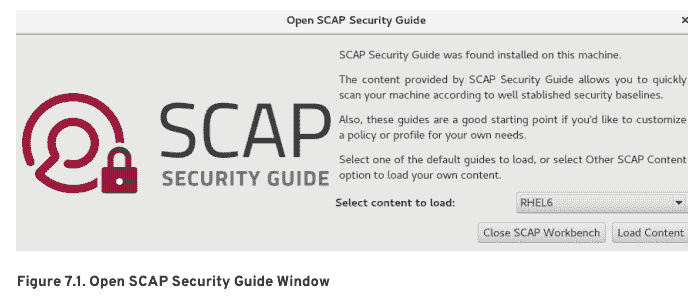

启动工具后，会显示 `Open SCAP Security Guide`（打开 SCAP 安全指南）窗口。选择一个指南后，会显示 `SCAP Workbench` 窗口。此窗口由多个交互组件组成，在您开始扫描系统之前，应该熟悉这些组件：

- `File`（文件）


- 此菜单列表提供了多个选项，用于加载或保存 SCAP 相关内容。要显示初始的 **Open SCAP Security Guide**（打开 SCAP 安全指南）窗口，请单击同名的菜单项。或者，通过单击 **Open Other Content**（打开其他内容）来加载其他 XCCDF 格式自定义文件。要将自定义保存为 XCCDF XML 文件，请使用 **Save Customization Only**（仅保存自定义）项。**Save All**（保存全部）允许您将 SCAP 文件保存到选定的目录或作为 RPM 软件包。

- **Customization**（自定义）
    - 此组合框告知您用于特定安全策略的自定义设置。您可以通过单击此组合框来选择应用于系统评估的自定义规则。默认值为（no customization）（无自定义），这意味着对使用的安全策略没有更改。如果您对选定的安全配置文件进行了任何更改，您可以通过单击 File 菜单中的 Save Customization Only 项，将这些更改保存为 XML 文件。

- **Profile**（配置文件）
    - 此组合框包含选定安全配置文件的名称。您可以通过单击此组合框，从给定的 XCCDF 或数据流文件中选择安全配置文件。要创建一个新的配置文件并继承选定安全配置文件的属性，请单击 Customize（自定义）按钮。

- **Target**（目标）
    - 这两个单选按钮允许您选择要评估的系统是本地机器还是远程机器。

- **Rules**（规则）
    - 此字段显示安全规则列表，这些规则是安全策略的对象。展开特定的安全规则会提供有关该规则的详细信息。

- **Status bar**（状态栏）
    - 这是一个图形化条，指示正在执行的操作的状态。

- **Generate remediation role**（生成修复角色）
    - 此弹出菜单允许您将基于配置文件的修复导出到文件。该文件包含当前选定配置文件中所有规则的所有可用修复。您可以选择输出为 Bash 脚本、Ansible 剧本或 Puppet 清单。在系统评估期间执行的修复是基于 bash 修复的。
    - 此功能允许您检查单个修复，并可能对其进行编辑或挑选（cherry-pick）。因此，它让您完全控制修复过程。

- **Dry run**（试运行）
    - 使用此复选框，您可以将命令行参数获取到诊断窗口，而不是运行扫描。

- **Fetch remote resources**（获取远程资源）
    - 此复选框允许指示扫描程序下载在 XML 文件中定义的远程 OVAL 内容。

- **Remediate**（修复）
    - 此复选框在系统评估期间启用修复功能。如果勾选此框，SCAP Workbench 将尝试纠正未匹配策略定义状态的系统设置。

- **Scan**（扫描）
    - 此按钮允许您启动指定系统的评估。

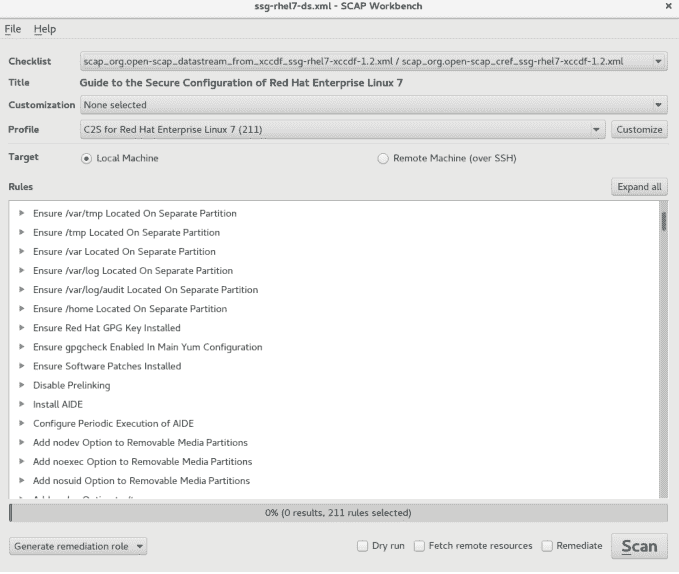

图 7.2. SCAP Workbench 窗口

### 7.3.3. 扫描系统

SCAP Workbench 的主要功能是根据给定的 XCCDF 或数据流文件在选定系统上执行安全扫描。要按照选定的安全策略评估您的系统，请遵循以下步骤：

1. 通过使用 **Open SCAP Security Guide**（打开 SCAP 安全指南）窗口，或在 **File**（文件）菜单中点击 **Open Other Content**（打开其他内容），选择安全策略，并搜索相应的 XCCDF、SCAP RPM 或数据流文件。
    > **WARNING**（警告）
    > 选择安全策略会导致任何未保存的先前自定义更改丢失。要重新应用丢失的选项，您必须再次选择可用的配置文件和自定义内容。请注意，您之前的自定义可能不适用于新的安全策略。

2. 若要使用预先准备好的针对您的用例的自定义安全内容文件，您可以通过单击 **Customization**（自定义）组合框来加载此文件。您可以通过修改可用的安全配置文件来创建自定义调整文件。更多信息，请参阅第 7.3.4 节，“自定义安全配置文件”。
    a. 如果不想为当前系统评估使用任何自定义，请选择（**no customization**）（无自定义）选项。如果之前未选择自定义，这是默认选项。
    b. 选择（**open customization file . . .**）（打开自定义文件...）选项，以搜索当前系统评估要使用的特定调整文件。
    c. 如果您之前使用过某些自定义文件，**SCAP Workbench** 会记住此文件并将其添加到列表中。这简化了相同扫描的重复应用。

3. 通过单击 **Profile**（配置文件）组合框，选择适当的安全配置文件。
    a. 若要修改选定的配置文件，请单击 **Customize**（自定义）按钮。有关配置文件自定义的更多信息，请参阅第 7.3.4 节，“自定义安全配置文件”。

4. 选择两个 **Target**（目标）单选按钮之一，以扫描本地或远程机器。
    a. 如果您选择了远程系统，请通过输入用户名、主机名和端口信息来指定它，如以下示例所示。如果您之前使用过远程扫描，还可以从最近扫描的机器列表中选择远程系统。
    
    **图 7.3. 指定远程系统**

5. 您可以通过选择 **Remediate**（修复）复选框来允许自动更正系统配置。启用此选项后，**SCAP Workbench** 将尝试根据策略应用的安全规则更改系统配置，如果相关检查在系统扫描期间失败。
    > **WARNING**（警告）
    > 如果不谨慎使用，启用修复选项运行系统评估可能导致系统无法使用。

6. 单击 **Scan**（扫描）按钮以启动系统扫描。

### 7.3.4. 自定义安全配置文件

在选择了适合您安全策略的安全配置文件后，您可以点击 **Customize**（自定义）按钮进一步调整。这将打开新的 Customization（自定义）窗口，使您能够修改当前选定的 XCCDF 配置文件，而实际并未更改相应的 XCCDF 文件。

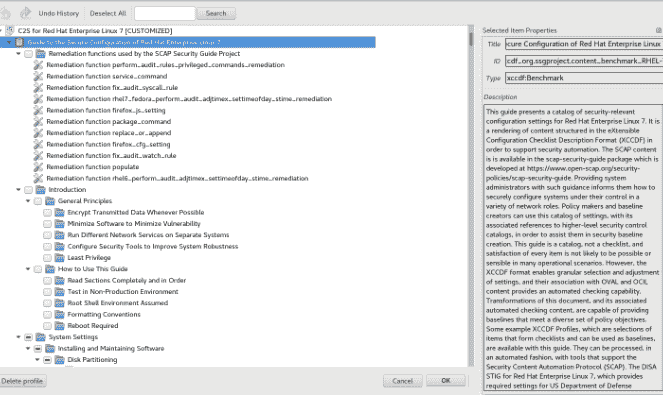

图 7.4. 自定义选定的安全配置

自定义窗口包含与选定安全配置相关的一套完整 XCCDF 元素，以及关于每个元素及其功能的详细信息。您可以通过在该窗口主区域中选中或取消选中相应的复选框来启用或禁用这些元素。自定义窗口还支持撤销和重做功能；您可以点击窗口左上角相应的箭头图标来撤销或重做您的选择。

您还可以更改稍后用于评估的变量。在自定义窗口中找到合适的项，导航至右侧部分，并使用“修改值”字段。

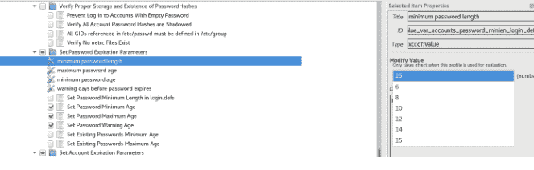

图 7.5. 在自定义窗口中设置选定项的值

完成配置自定义后，点击“确认自定义”按钮以确认更改。您的更改现保存在内存中，如果关闭 SCAP Workbench 或进行某些更改（例如选择新的 SCAP 内容或选择其他自定义选项），这些更改将不会持久保存。要保存您的更改，请点击 SCAP Workbench 窗口中的“保存自定义”按钮。此操作允许您将更改作为 XCCDF 自定义文件保存到选定目录中。请注意，此自定义文件可以与其他配置进一步关联使用。

### 7.3.5. 保存 SCAP 内容

SCAP Workbench 还允许您保存用于系统评估的 SCAP 内容。您可以单独保存自定义文件（参见第 7.3.4 节，“自定义安全配置”），或者通过点击“保存内容”组合框并选择“保存到目录”或“保存为 RPM”选项，一次性保存所有安全内容。

通过选择“保存到目录”选项，SCAP Workbench 将 XCCDF 或数据流文件以及自定义文件都保存到指定位置。这可作为备份解决方案使用。

通过选择“保存为 RPM”选项，您可以指示 SCAP Workbench 创建一个包含 XCCDF 或数据流文件和自定义文件的 RPM 包。这对于将安全内容分发给无法进行远程扫描的系统，或仅为传递内容以供进一步处理，都非常有用。

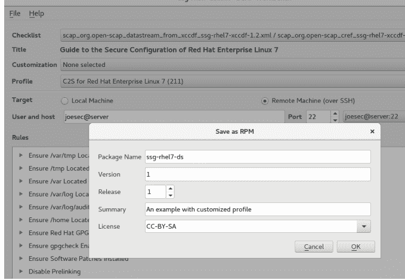

图 7.6. 将当前 SCAP 内容保存为 RPM 包

### 7.3.6. 查看扫描结果并生成扫描报告和修复方案

系统扫描完成后，会出现三个新按钮：“清除”、“保存结果”、“生成修复角色”和“显示报告”，取代原来的“扫描”按钮。


**警告**

点击**清除**按钮将永久删除扫描结果。


要以 XCCDF、ARF 或 HTML 文件形式存储扫描结果，请点击**保存结果**组合框。选择**HTML 报告**选项以生成人类可读形式的扫描报告。XCCDF 和 ARF（数据流）格式适合进一步的自动化处理。您可以重复选择这三种选项中的任意一种或多种。

如果您希望立即查看扫描结果而不保存，请点击**显示报告**按钮，该按钮会在您的默认网络浏览器中以临时 HTML 文件的形式打开扫描结果。

您可以使用**生成修复角色**弹出菜单将基于结果的修复方案导出到文件。此功能与基于配置的修复角色导出非常相似——区别在于通过系统评估的规则修复方案不会被导出，因此文件可能会更小。


**警告**

基于结果的修复方案不支持定制化配置。如果需要导出这些配置，您可以使用`oscap`命令行工具。

## 7.4. 使用 OSCAP

`oscap`命令行工具允许用户扫描本地系统、验证安全合规性内容，并基于这些扫描和评估生成报告和指南。此工具作为 OpenSCAP 库的前端，根据其处理的 SCAP 内容类型将其功能分组到模块（子命令）中。

以下部分解释如何安装 `oscap` 并执行最常见的操作。提供示例来说明这些任务。要了解特定子命令的更多信息，请在 `oscap` 命令中使用 `--help` 选项：

```
oscap [options] module module_operation [module_operation_options_and_arguments] --help
```

其中 *module* 表示正在处理的 SCAP 内容类型，*module_operation* 是对 SCAP 内容进行特定操作的子命令。

### 示例 7.4. 获取特定 oscap 操作的帮助

```
~]$ oscap ds sds-split --help
oscap -> ds -> sds-split
```

```
Split given SourceDataStream into separate files

Usage: oscap [options] ds sds-split [options] SDS TARGET_DIRECTORY

SDS - Source data stream that will be split into multiple files.
TARGET_DIRECTORY - Directory of the resulting files.

Options:
--datastream-id <id> - ID of the datastream in the collection to use.
--xccdf-id <id> - ID of XCCDF in the datastream that should be evaluated.
```

要了解所有 oscap 功能及其选项的完整列表，请参阅 `oscap(8)` 手册页。

### 7.4.1. 安装 oscap

要在您的系统上安装 oscap，请以 root 身份输入以下命令：

```
[~]# yum install openscap-scanner
```

此命令允许您安装 `oscap` 正常运行所需的所有软件包，包括 `openscap` 软件包。为了能够编写自己的安全内容，您还应该安装 `openscap-engine-sce` 软件包，该软件包提供脚本检查引擎（SCE）。SCE 是 SCAP 协议的扩展，允许内容作者使用脚本语言（如 Bash、Python 或 Ruby）编写其安全内容。请注意，`openscap-engine-sce` 软件包仅在可选频道中可用。参见“启用补充和可选存储库”。

可选地，在安装 `oscap` 后，您可以检查您的 `oscap` 版本的能力、它支持哪些规范、特定的 `oscap` 文件存储在哪里、您可以使用哪些类型的 SCAP 对象以及其他有用信息。要显示此信息，请键入以下命令：


```
[~]$ oscap -V
OpenSCAP command line tool (oscap) 1.0.4
Copyright 2009-2014 Red Hat Inc., Durham, North Carolina.

==== Supported specifications ====
XCCDF Version: 1.2
OVAL Version: 5.10.1
CPE Version: 2.3
CVSS Version: 2.0
CVE Version: 2.0
Asset Identification Version: 1.1
Asset Reporting Format Version: 1.1

==== Capabilities added by auto-loaded plugins ====
SCE Version: 1.0 (from libopenscap_sce.so.8)

==== Paths ====
Schema files: /usr/share/openscap/schemas
Schematron files: /usr/share/openscap/xsl
Default CPE files: /usr/share/openscap/cpe
Probes: /usr/libexec/openscap

===== Inbuilt CPE names =====
Red Hat Enterprise Linux - cpe:/o:redhat:enterprise_linux
Red Hat Enterprise Linux 5 - cpe:/o:redhat:enterprise_linux:5
Red Hat Enterprise Linux 6 - cpe:/o:redhat:enterprise_linux:6
Red Hat Enterprise Linux 7 - cpe:/o:redhat:enterprise_linux:7
Fedora 16 - cpe:/o:fedoraproject:fedora:16
Fedora 17 - cpe:/o:fedoraproject:fedora:17
Fedora 18 - cpe:/o:fedoraproject:fedora:18
Fedora 19 - cpe:/o:fedoraproject:fedora:19
Fedora 20 - cpe:/o:fedoraproject:fedora:20
Fedora 21 - cpe:/o:fedoraproject:fedora:21
Red Hat Enterprise Linux Optional Productivity Applications -
cpe:/a:redhat:rhel_productivity
Red Hat Enterprise Linux Optional Productivity Applications 5 -
cpe:/a:redhat:rhel_productivity:5

===== Supported OVAL objects and associated OpenSCAP probes =====
system_info              probe_system_info
family                   probe_family
filehash                 probe_filehash
environmentvariable      probe_environmentvariable
textfilecontent54        probe_textfilecontent54
textfilecontent          probe_textfilecontent
variable                 probe_variable
xmlfilecontent           probe_xmlfilecontent
environmentvariable58    probe_environmentvariable58
filehash58               probe_filehash58
inetalistenservers       probe_inetalistenservers
rpminfo                  probe_rpminfo
partition                probe_partition
iflisteners              probe_iflisteners
rpmverify                probe_rpmverify
rpmverifyfile            probe_rpmverifyfile
rpmverifypackage         probe_rpmverifypackage
selinuxboolean           probe_selinuxboolean
selinuxsecuritycontext   probe_selinuxsecuritycontext
file                     probe_file
interface                probe_interface
password                 probe_password
process                  probe_process
runlevel                 probe_runlevel
shadow                   probe_shadow
uname                    probe_uname
xinetd                   probe_xinetd
sysctl                   probe_sysctl
process58                probe_process58
fileextendedattribute    probe_fileextendedattribute
routingtable             probe_routingtable
```

在您能够有效地使用 `oscap` 之前，还需要在系统上安装或导入一些安全内容。例如，您可以安装 SCAP 安全指南（SSG）软件包 `scap-security-guide`，其中包含目前 Linux 系统最先进且最完善的安全策略集。要在系统上安装 SCAP 安全指南软件包，请以 root 身份输入以下命令：

```
~]# yum install scap-security-guide
```

在系统上安装 `scap-security-guide` 后，除非另有说明，SSG 安全内容位于 `/usr/share/xml/scap/ssg/content/` 目录下，您可以继续进行其他安全合规性操作。

如需查找可能符合您需求的现有 SCAP 内容来源，请参阅第 7.10 节“附加资源”。

在系统上安装 SCAP 内容后，`oscap` 可以处理该内容，前提是提供该内容的文件路径。`oscap` 实用程序支持 SCAP 1.2 版本，并且向后兼容 SCAP 1.1 和 1.0 版本，因此它可以处理早期版本的 SCAP 内容而无需任何特殊要求。

### 7.4.2. 显示 SCAP 内容

SCAP 标准定义了多种文件格式。`oscap` 实用程序可以处理或创建符合许多这些格式的文件。为了进一步处理包含 SCAP 内容的给定文件，您需要了解如何针对给定的文件类型使用 `oscap`。如果您不确定如何使用特定文件，可以打开并读取该文件，或者使用 `oscap` 的 `info` 模块，该模块会解析文件并以人类可读的格式提取相关信息。

输入以下命令以检查 SCAP 文档的内部结构并显示有用信息，例如文档类型、规范版本、文档状态、文档发布日期以及文档复制到文件系统的时间：

```
oscap info file
```

其中 `file` 是要检查的安全内容文件的完整路径。以下示例更好地说明了 `oscap info` 命令的使用方法：

#### 示例 7.5. 显示 SCAP 内容的信息


```
$ oscap info /usr/share/xml/scap/ssg/content/ssg-rhel7-ds.xml
Document type: Source Data Stream
Imported: 2014-03-14T12:22:01

Stream: scap_org.open-scap_datastream_from_xccdf_ssg-rhel7-xccdf-1.2.xml
Generated: (null)
Version: 1.2
Checklists:
	Ref-Id: scap_org.open-scap_cref_ssg-rhel7-xccdf-1.2.xml
	Profiles:
		xccdf_org.ssgproject.content_profile_test
		xccdf_org.ssgproject.content_profile_rht-ccp
		xccdf_org.ssgproject.content_profile_common
		xccdf_org.ssgproject.content_profile_stig-rhel7-server-upstream
	Referenced check files:
		ssg-rhel7-oval.xml
	system:
		http://oval.mitre.org/XMLSchema/oval-definitions-5
Checks:
	Ref-Id: scap_org.open-scap_cref_ssg-rhel7-oval.xml
	Ref-Id: scap_org.open-scap_cref_output--ssg-rhel7-cpe-oval.xml
	Ref-Id: scap_org.open-scap_cref_output--ssg-rhel7-oval.xml
```

Dictionaries:

Ref-Id: `scap_org.open-scap_cref_output--ssg-rhel7-cpe-dictionary.xml`

### 7.4.3. 扫描系统

`oscap` 最重要的功能是对本地系统执行配置和漏洞扫描。相应命令的一般语法如下：

```
oscap [options] module eval [module_operation_options_and_arguments]
```

`oscap` 实用程序可以针对由 `XCCDF`（可扩展配置检查列表描述格式）基准和 `OVAL`（开放式漏洞评估语言）定义表示的 SCAP 内容扫描系统。安全策略可以是单个 OVAL 或 XCCDF 文件的形式，也可以是多个独立的 XML 文件，其中每个文件代表不同的组件（XCCDF、OVAL、CPE、CVE 等）。扫描结果可以打印到标准输出和 XML 文件中。然后可以进一步由 `oscap` 处理结果文件，以生成人类可读格式的报表。以下示例说明了该命令最常见的用法。

#### 示例 7.6. 使用 SSG OVAL 定义扫描系统

若要使用 SSG OVAL 定义文件扫描系统并评估所有定义，请输入以下命令：

```
~/ $ oscap oval eval --results scan-oval-results.xml
/usr/share/xml/scap/ssg/content/ssg-rhel7-ds.xml
```

扫描结果作为 `scan-oval-results.xml` 文件存储在目录中。

#### 示例 7.7. 使用 SSG OVAL 定义扫描系统

若要评估由 SSG 数据流文件表示的安全策略中的特定 OVAL 定义，请输入以下命令：

```
~/ $ oscap oval eval --id oval:ssg:def:100 --results scan-oval-results.xml /usr/share/xml/scap/ssg/content/ssg-rhel7-ds.xml
```

扫描结果作为 `scan-oval-results.xml` 文件存储在目录中。

#### 示例 7.8. 使用 SSG XCCDF 基准扫描系统

若要在系统中执行针对 `xccdf_org.ssgproject.content_profile_rht-ccp` 配置文件的 SSG XCCDF 基准，请输入以下命令：

```
~/ $ oscap xccdf eval --profile xccdf_org.ssgproject.content_profile_rht-ccp --results scan-xccdf-results.xml /usr/share/xml/scap/ssg/content/ssg-rhel7-ds.xml
```

扫描结果作为 `scan-xccdf-results.xml` 文件存储在目录中。


**注意**

`--profile` 命令行参数用于从给定的 XCCDF 或数据流文件中选择安全配置文件。通过运行 `oscap info` 命令可以获取可用配置文件列表。如果省略 `--profile` 命令行参数，则根据 SCAP 标准的要求，使用默认的 XCCDF 配置文件。请注意，默认 XCCDF 配置文件可能适合也可能不适合当前安全策略。

### 7.4.4. 生成报表和指南

`oscap` 的另一个实用功能是生成人类可读格式的 SCAP 内容。`oscap` 实用程序允许将 XML 文件转换为 HTML 或纯文本格式。此功能用于生成安全指南和检查清单，它们作为信息源以及安全系统配置的指南。系统扫描的结果也可以转换为易读的结果报表。一般命令语法如下：

```
oscap module generate sub-module [specific_module/sub-module_options_and_arguments] file
```

其中 *module* 为 *xccdf* 或 *oval*，*sub-module* 为生成的文档类型，*file* 表示 XCCDF 或 OVAL 文件。

以下是该命令最常用的示例：

#### 示例 7.9. 生成带检查清单的指南

若要为 `xccdf_org.ssgproject.content_profile_rht-ccp` 配置文件生成带检查清单的 SSG 指南，请输入以下命令：

```
~]$ oscap xccdf generate guide --profile
     xccdf_org.ssgproject.content_profile_rht-ccp
     /usr/share/xml/scap/ssg/content/ssg-rhel7-ds.xml > ssg-guide-checklist.html
```

指南作为 `ssg-guide-checklist.html` 文件存储在目录中。

#### 示例 7.10. 将 SSG OVAL 扫描结果转换为报表

若要将 SSG OVAL 扫描的结果转换为 HTML 文件，请输入以下命令：

```
~]$ oscap oval generate report scan-oval-results.xml > ssg-scan-oval-report.html
```

结果报表作为 `ssg-scan-oval-report.html` 文件存储在目录中。此示例假设您从存储 `scan-oval-results.xml` 文件的同一位置运行该命令。否则，您需要指定包含扫描结果的文件的全限定路径。

#### 示例 7.11. 将 SSG XCCDF 扫描结果转换为报表

若要将 SSG XCCDF 扫描的结果转换为 HTML 文件，请输入以下命令：

```
~]$ oscap xccdf generate report scan-xccdf-results.xml > scan-xccdf-report.html
```

结果报表作为 `ssg-scan-xccdf-report.html` 文件存储在目录中。或者，您可以使用 `--report` 命令行参数在扫描时生成此报表：

```
~]$ oscap xccdf eval --profile xccdf_org.ssgproject.content_profile_rht-ccp --results scan-xccdf-results.xml --report scan-xccdf-report.html /usr/share/xml/scap/ssg/content/ssg-rhel7-ds.xml
```

### 7.4.5. 验证 SCAP 内容

在开始在系统上使用安全策略之前，您应该首先验证策略，以避免策略中可能存在的任何语法或语义错误。可以使用 `oscap` 实用程序根据标准 SCAP XML 架构验证安全内容。验证结果打印到标准错误流（stderr）。此类验证命令的一般语法如下：

```
oscap module validate [module_options_and_arguments] file
```


其中 `file` 是要验证文件的完整路径。唯一的例外是数据流模块（`ds`），它使用 `sds-validate` 操作而不是 `validate`。请注意，给定数据流中的所有 SCAP 组件都会自动验证，且不需要单独指定任何组件，如以下示例所示：

```
~]$ oscap ds sds-validate /usr/share/xml/scap/ssg/content/ssg-rhel7-ds.xml
```

对于某些 SCAP 内容（如 OVAL 规范），您还可以执行 Schematron 验证。Schematron 验证比标准验证更慢，但提供了更深入的分析，因此能够检测到更多错误。以下 SSG 示例显示了该命令的典型用法：

```
~]$ oscap oval validate --schematron /usr/share/xml/scap/ssg/content/ssg-rhel7-ds.xml
```

### 7.4.6. 使用 OpenSCAP 修复系统

OpenSCAP 允许自动修复处于不合规状态的系统。对于系统修复，需要包含说明的 XCCDF 文件。`scap-security-guide` 软件包包含某些修复说明。

系统修复包括以下步骤：

1. OpenSCAP 执行常规的 XCCDF 评估。
2. 通过评估 OVAL 定义对结果进行评估。每个失败的规则都会被标记为修复候选项。

#### 7.4.6. OpenSCAP 在线修复

在线修复会在扫描时执行修复元素。评估和修复作为单个命令的一部分执行。

要启用在线修复，请使用 `--remediate` 命令行选项。例如，若要使用 `scap-security-guide` 包执行在线修复，请运行：

```bash
~]$ oscap xccdf eval --remediate --profile xccdf_org.ssgproject.content_profile_rht-ccp --results scan-xccdf-results.xml /usr/share/xml/scap/ssg/content/ssg-rhel7-ds.xml
```

此命令的输出由两部分组成。第一部分显示修复前的扫描结果，第二部分显示应用修复后的扫描结果。第二部分可能仅包含**已修复**和**错误**结果。**已修复**结果表示修复后执行的扫描通过了测试。**错误**结果表示即使应用了修复，评估仍未通过。

##### 7.4.6.1. OpenSCAP 在线修复详情

- 3. **OpenSCAP** 搜索合适的修复元素，解析它，准备环境，并执行修复脚本。
- 4. 修复脚本的任何输出都会被 **OpenSCAP** 捕获并存储在 `rule-result` 元素中。修复脚本的返回值也会被存储。
- 5. 每当 **OpenSCAP** 执行修复脚本时，它会立即再次评估 OVAL 定义（以验证修复脚本是否正确应用）。在此第二次运行中，如果 OVAL 评估返回成功，规则的结果为**已修复**，否则为**错误**。
- 6. 修复的详细结果存储在输出 XCDF 文件中。它包含两个 `TestResult` 元素。第一个 `TestResult` 元素代表修复前的扫描。第二个 `TestResult` 基于第一个元素派生，并包含修复结果。

关于修复，**OpenSCAP** 有三种操作模式：在线、离线和审查。

##### 7.4.6.2. OpenSCAP 离线修复

离线修复允许您推迟执行修复。在第一步中，系统仅被评估，结果存储在 XCDF 文件的 `TestResult` 元素中。

在第二步中，`oscap` 执行修复脚本并验证结果。将结果存储到输入文件中是安全的，数据不会丢失。在离线修复过程中，**OpenSCAP** 创建一个基于输入元素的新 `TestResult` 元素，并继承所有数据。新创建的 `TestResult` 仅在对其中 `rule-result` 元素中失败的部分有所不同。对于这些失败的部分，将执行修复。

若要使用 `scap-security-guide` 包执行离线修复，请运行：

```bash
~]$ oscap xccdf eval --profile xccdf_org.ssgproject.content_profile_rht-ccp --results scan-xccdf-results.xml /usr/share/xml/scap/ssg/content/ssg-rhel7-ds.xml
~]$ oscap xccdf remediate --results scan-xccdf-results.xml scan-xccdf-results.xml
```

##### 7.4.6.3. OpenSCAP 修复审查

审查模式允许用户将修复指令存储到文件中以供进一步审查。在此期间不会执行修复内容。

若要生成 shell 脚本形式的修复指令，请运行：

```bash
~]$ oscap xccdf generate fix --template urn:xccdf:fix:script:sh --profile xccdf_org.ssgproject.content_profile_rht-ccp --output my-remediation-script.sh /usr/share/xml/scap/ssg/content/ssg-rhel7-ds.xml
```

### 7.4.7. 为 DISA STIG 查看器导出 XCCDF 结果

DISA STIG 查看器允许用户从 DISA 规则 ID 的角度查看结果。该实用程序期望使用 DISA（国防信息系统局）STIG（安全技术实施指南）标识符（例如 `SV-86555r1_rule`）作为规则 ID。在大多数公开可用的 SCAP 内容中，惯例是将 DISA STIG ID 作为引用或标识符附加到 XCCDF 规则上。因此，由 OpenSCAP 和 SCAP Security Guide 生成的 XCCDF 结果在 DISA STIG 查看器中打开时不可读。

OpenSCAP 允许您将 XCCDF 结果输出为与 DISA STIG 查看器兼容的格式。转换过程会获取附加的 STIG 规则 ID 引用，并替换 XCCDF 规则 ID。

> **示例 7.12. 扫描系统以符合 DISA STIG 并生成 STIG 查看器结果**
>
> 要扫描本地系统以符合 DISA STIG 并生成可在 DISA STIG 查看器中打开的 XCCDF 结果：

```bash
$ oscap xccdf eval --profile xccdf_org.ssgproject.content_profile_stig-rhel7-disa --stig-viewer stig-results.xml /usr/share/xml/scap/ssg/content/ssg-rhel7-ds.xml
```

要在 DISA STIG 查看器中查看 XCCDF 结果，请首先导入您选择的 STIG，并创建一个检查清单。创建好检查清单后，使用“导入 → XCCDF 结果文件”菜单项导入您的结果。

**注意**

请注意，您可以使用其他任何 `oscap` 选项与 `--stig-viewer` 选项一起使用，以导出具有常规规则 ID 的结果。

有关 STIG 查看的更多信息，请参阅 IASE STIG 查看指南网页。

## 7.5. 在 Docker 中使用 OPENSCAP

`oscap-docker` 命令行实用程序允许用户使用 `oscap` 程序扫描其 docker 格式的容器镜像和容器。

以下部分：

- 解释 `oscap-docker` 的安装
- 提供基本的使用示例

要了解有关子命令的更多信息，请在使用 `oscap-docker` 或 `oscap` 命令时使用 `--help` 选项。

**注意**

由于容器文件系统受挂载点影响，扫描镜像的结果可能与从该镜像创建的容器的扫描结果不同。例如，自定义路径中仅提供容器内进程数据的挂载点不会影响扫描结果。但是，容器中针对 `/bin`、`/etc` 或 `/var` 等路径提供的挂载点，若包含新的二进制文件或配置文件，可能会导致扫描结果出现差异。

要启用镜像和容器的扫描，请安装 docker 包。有关安装 Docker 的说明，请参阅《容器入门》指南中“在 Red Hat Enterprise Linux 7 中获取 Docker”章节。

输入以下命令安装 `oscap-docker`：

```bash
# yum install openscap-utils
```

以下示例使用 Red Hat Enterprise Linux 7 镜像。

```bash
# docker pull registry.access.redhat.com/rhel7
```

```bash
# docker images
REPOSITORY                      TAG                 IMAGE ID
registry.access.redhat.com/rhel7   latest              c453594215e4
```


### 7.5.1. 扫描 Docker 格式镜像和容器中的漏洞

`oscap-docker` 命令提供两种扫描镜像和容器漏洞的方法：

- `image-cve` 或 `container-cve` 子命令确定操作系统版本，下载适用于给定系统的 CVE 流，并运行漏洞扫描：

```bash
# oscap-docker image-cve registry.access.redhat.com/rhel7
```

- 另一种更灵活的方法允许您在检查漏洞时指定 OVAL 定义。使用 `image` 或 `container` 子命令配合 `oscap` 的 OVAL 评估参数。例如，若要使用从 Red Hat OVAL 仓库下载的 definitions 文件扫描镜像，请使用以下命令：

```bash
# oscap-docker image registry.access.redhat.com/rhel7 oval eval com.redhat.rhsa-all.xml
```

### 7.5.2. 扫描 Docker 格式镜像和容器的配置合规性

要扫描配置合规性，请使用 SCAP Security Guide `SSG` 提供的 SCAP 内容。确保已安装 `scap-security-guide` 包：

```bash
# yum install scap-security-guide
```

若要验证 Red Hat Enterprise Linux 7 镜像是否符合国防信息系统局安全技术实施指南（DISA STIG）策略，请输入以下命令：

```bash
# oscap-docker image registry.access.redhat.com/rhel7 xccdf eval --profile xccdf_org.ssgproject.content_profile_stig-rhel7-disa /usr/share/xml/scap/ssg/content/ssg-rhel7-ds.xml
```

以下命令扫描 ID 为 `5ef05eef4a01` 的容器的运行环境：

```bash
# oscap-docker container 5ef05eef4a01 xccdf eval --profile xccdf_org.ssgproject.content_profile_stig-rhel7-disa /usr/share/xml/scap/ssg/content/ssg-rhel7-ds.xml
```

要获取包含结果的 XML 文件，请使用 `--results` 参数；要为评估生成 HTML 报告，请添加 `--report` 参数。有关更多信息，请参阅 `oscap (8)` 手册页。

## 7.6. 在 ATOMIC 扫描命令中使用 OPENSCAP

`atomic scan` 命令允许用户使用 OpenSCAP 扫描功能来扫描系统中的 docker 格式容器镜像和容器。可以扫描已知的 CVE 漏洞或配置合规性。此外，用户可以将 docker 格式容器镜像修复到指定的策略。

### atomic scan 和 OpenSCAP 扫描器镜像

要安装用于容器管理的 `atomic` 工具，请输入以下命令：

```bash
# yum install atomic
```

有关 `atomic` 安装的更多信息，请参阅 Atomic CLI 参考中的先决条件。

安装 `atomic` 工具后，还需要一个扫描器，它被 `atomic scan` 命令用作扫描镜像和容器的后端。Red Hat 建议选择 `registry.access.redhat.com` 镜像注册表中 `rhel7/openscap` 容器镜像中捆绑的 OpenSCAP 扫描器：

```bash
# atomic install registry.access.redhat.com/rhel7/openscap
```

`registry.access.redhat.com/rhel7/openscap` 容器镜像被 `atomic scan` 命令用作默认扫描器。它目前支持针对 Red Hat Enterprise Linux 系统的两种扫描类型。要列出支持的扫描类型，请输入以下命令：

### 7.6.1. 使用 atomic scan 扫描 Docker 格式镜像和容器中的漏洞

若要扫描容器和容器镜像，请使用以下格式的 `atomic scan` 命令：

```
# atomic scan [OPTIONS] [ID]
```

其中 `ID` 是容器镜像或容器的 ID。若要扫描所有容器镜像或容器，分别使用 `--images` 或 `--containers` 指令。若要同时扫描这两种类型，使用 `--all` 指令。使用 `atomic scan --help` 命令可以获取可用的命令行选项列表。


**注意**

有关 `atomic` 命令用法和容器的详细说明，请参阅 Red Hat Enterprise Linux Atomic Host 的产品文档。Red Hat 客户门户还提供了一份 Atomic 命令行界面 `CLI` 指南。

`atomic scan` 命令的默认扫描类型是 CVE 扫描。使用它来检查目标是否存在由 Red Hat 发布的 CVE OVAL 定义中定义的已知安全漏洞。


**警告**

CVE 扫描类型使用的 OVAL 定义在构建过程中打包在容器镜像中。Red Hat 每周更新容器镜像。请始终使用最新的 `OpenSCAP` 容器镜像以确保定义是最新的。若要查找已安装的 `OpenSCAP` 容器镜像的版本：

```
# atomic help registry.access.redhat.com/rhel7/openscap | grep version
```

### 示例 7.13. 扫描 Red Hat Enterprise Linux 7 容器镜像中的已知安全漏洞

以下命令扫描 Red Hat Enterprise Linux 7 容器镜像中的已知安全漏洞。`--verbose` 指令提供额外细节。

```
# atomic scan --verbose registry.access.redhat.com/rhel7:latest
docker run -t --rm -v /etc/localtime:/etc/localtime -v /run/atomic/2017-11-01-14-55-37-758180:/scanin -v /var/lib/atomic/openscap/2017-11-01-14-55-37-758180:/scanout:rw,Z -v /etc/oscapd:/etc/oscapd:ro registry.access.redhat.com/rhel7/openscap oscapd-evaluate scan --no-standard-compliance --targets chroots-in-dir:///scanin --output /scanout WARNING: Can't import the 'docker' package. Container scanning functionality will be disabled.
INFO:Creating tasks directory at '/var/lib/oscapd/tasks' because it
didn't exist.
INFO:Creating results directory at '/var/lib/oscapd/results' because it
didn't exist.
INFO:Creating results work in progress directory at
'/var/lib/oscapd/work_in_progress' because it didn't exist.
INFO:Evaluated EvaluationSpec, exit_code=0.
INFO:Evaluated EvaluationSpec, exit_code=0.
INFO:[100.00%] Scanned target
'chroot:://scanin/db7a70a0414e589d7c8c162712b329d4fc670fa47dde721250fb9
fcdbed9cc2'

registry.access.redhat.com/rhel7:latest (db7a70a0414e589)

registry.access.redhat.com/rhel7:latest passed the scan

Files associated with this scan are in /var/lib/atomic/openscap/2017-11-01-14-55-37-758180.
```

以下命令扫描具有多个已知安全漏洞的 Red Hat Enterprise Linux 7.2 容器镜像：


```
$ atomic scan registry.access.redhat.com/rhel7:7.2
docker run -t --rm -v /etc/localtime:/etc/localtime -v /run/atomic/2017-11-01-14-49-36-614281:/scanin -v /var/lib/atomic/openscap/2017-11-01-14-49-36-614281:/scanout:rw,Z -v /etc/oscapd:/etc/oscapd:ro
registry.access.redhat.com/rhel7/openscap openscap-evaluate scan --no-standard-compliance --targets chroots-in-dir://scanin --output /scanout

registry.access.redhat.com/rhel7:7.2 (98a88a8b722a718)
```

发现以下问题：

- `RHSA-2017:2832`：nss 安全更新（重要）
    - 严重程度：重要
    - Rhsa URL: https://access.redhat.com/errata/RHSA-2017:2832
    - Rhsa ID: `RHSA-2017:2832-01`
    - 关联的 CVE：
        - CVE ID: `CVE-2017-7805`
        - Cve URL: https://access.redhat.com/security/cve/CVE-2017-7805

- `RHSA-2017:2016`：curl 安全、错误修复和功能增强更新（中等）
    - 严重程度：中等
    - Rhsa URL: https://access.redhat.com/errata/RHSA-2017:2016
    - Rhsa ID: `RHSA-2017:2016-01`
    - 关联的 CVE：
        - CVE ID: `CVE-2016-7167`
        - Cve URL: https://access.redhat.com/security/cve/CVE-2016-7167

- `RHSA-2017:1931`：bash 安全和错误修复更新（中等）
    - 严重程度：中等
    - Rhsa URL: https://access.redhat.com/errata/RHSA-2017:1931
    - Rhsa ID: `RHSA-2017:1931-01`
    - 关联的 CVE：
        - CVE ID: `CVE-2016-0634`
        - CVE URL: https://access.redhat.com/security/cve/CVE-2016-0634
        - CVE ID: `CVE-2016-7543`
        - CVE URL: https://access.redhat.com/security/cve/CVE-2016-7543
        - CVE ID: `CVE-2016-9401`
        - CVE URL: https://access.redhat.com/security/cve/CVE-2016-9401

与此扫描相关的文件位于 `/var/lib/atomic/openscap/2017-11-01-14-49-36-614281`。

### 7.6.2. 使用 `atomic scan` 扫描和修复 Docker 格式镜像和容器的配置合规性

使用 `atomic scan` 扫描 Docker 格式镜像和容器的配置合规性

`atomic scan` 命令还支持 `configuration_compliance` 扫描。使用此类型的扫描来评估基于 Red Hat Enterprise Linux 的容器镜像和容器，利用打包在 `OpenSCAP` 容器镜像中的 SCAP Security Guide (SSG) 提供的 SCAP 内容。这使得能够针对 SCAP Security Guide 提供的任何配置文件进行扫描。

若要列出 `OpenSCAP` 镜像为 `configuration_compliance` 扫描提供的 SCAP 内容，请输入以下命令：

```
# atomic help registry.access.redhat.com/rhel7/openscap
```

若要验证最新的 Red Hat Enterprise Linux 7 容器镜像是否符合 Defense Information Systems Agency Security Technical Implementation Guide (DISA STIG) 策略，并从扫描中生成 HTML 报告：

```
# atomic scan --scan_type configuration_compliance --scanner_args xccdf-id=scap_org.open-scap_cref_ssg-rhel7-xccdf-1.2.xml,profile=xccdf_org.ssgproject.content_profile_stig-rhel7-disa,report registry.access.redhat.com/rhel7:latest
```

上一个命令的输出在末尾包含关于与此扫描相关的文件的信息：

```
........................
Files associated with this scan are in /var/lib/atomic/openscap/2017-11-03-13-35-34-296606.
# tree /var/lib/atomic/openscap/2017-11-03-13-35-34-296606
/var/lib/atomic/openscap/2017-11-03-13-35-34-296606
└─ db7a70a0414e589d7c8c162712b329d4fc670fa47ddde721250fb9fcdbed9cc2
   └─ arf.xml
   └─ fix.sh
   └─ json
   └─ report.html
   └─ environment.json

1 directory, 5 files
```

`atomic scan` 在 `/var/lib/atomic/openscap/` 目录中生成一个包含扫描的所有结果和报告的子目录。对于配置合规性扫描，每次都会生成带有结果的 `arf.xml` 文件。若要生成人类可读的 HTML 报告文件，请将 `report` 子选项添加到 `--scanner_args` 选项中。

若要生成可由 DISA STIG Viewer 读取的 XCCDF 结果，请将 `stig-viewer` 子选项添加到 `--scanner_args` 选项中。结果将放置在 `stig.xml` 中。有关 DISA STIG Viewer 的更多信息，请参阅第 7.4.7 节，“为 DISA STIG Viewer 导出 XCCDF 结果”。

`--scanner_args` 子选项由逗号字符分隔。用于从指定的数据流文件中选择 XCCDF 组件和配置文件的 `xccdf-id` 和 `profile` 子选项的具体值取自 OpenSCAP 镜像中打包的 SCAP 内容。数据流文件在扫描期间由 OpenSCAP 镜像根据目标容器镜像或容器自动选择。

> **注意**
>
> 如果省略 `--scanner_args` 选项的 `xccdf-id` 子选项，扫描器将在选定的数据流文件的第一个 XCCDF 组件中搜索配置文件。有关数据流文件的更多详细信息，请参阅第 7.2.3 节，“数据流格式”。

### 使用 atomic scan 修复 Docker 格式镜像和容器的配置合规性

若要修复 docker 格式容器镜像以符合指定策略，在进行配置合规性扫描时，请为 `atomic scan` 命令添加 `--remediate` 选项。以下命令从 Red Hat Enterprise Linux 7 容器镜像构建一个新的、符合 DISA STIG 策略的修复容器镜像：


```
atomic scan --remediate --scan_type configuration_compliance --scanner_args profile=xccdf_org.ssgproject.content_profile_stig-rhel7-disa,report registry.access.redhat.com/rhel7:latest
```

发现以下问题：

Configure Time Service Maxpoll Interval
严重程度：低
XCCDF 结果：fail

Configure LDAP Client to Use TLS For All Transactions
严重程度：中等
XCCDF 结果：fail

正在修复规则 43/44：
`'xccdf_org.ssgproject.content_rule_chronyd_or_ntpd_set_maxpoll'`
正在修复规则 44/44：
`'xccdf_org.ssgproject.content_rule_ldap_client_start_tls'`

成功构建 `9bbc7083760e`

成功从 `db7a70a0414e589d7c8c162712b329d4fc670fa7ddde721250fb9fcdbed9cc2` 构建修复镜像 `9bbc7083760e`。

与此扫描相关的文件位于 `/var/lib/atomic/openscap/2017-11-06-13-01-42-785000`。

配置合规性扫描针对原始容器镜像执行，以检查其是否符合 DISA STIG 策略。根据扫描结果，生成包含针对失败扫描结果进行 Bash 修复的修复脚本。随后将该修复脚本应用于原始容器镜像——这被称为修复。修复操作会生成一个配置已更改的容器镜像，并将其作为新层添加到原始容器镜像之上。`atomic scan` 命令的输出报告了一个修复后的镜像 ID。为了使镜像更易于记忆，请为其添加标签，例如：

```
#docker tag 9bbc7083760e rhel7_disa_stig
```


## 重要提示

请注意，原始容器镜像保持不变，仅在原始镜像之上创建了一个新层。修复过程构建了一个包含所有配置改进的新容器镜像。该层的内容由扫描的安全策略定义——在上述情况中，即 DISA STIG 策略。这也意味着修复后的容器镜像不再由 Red Hat 签名，这是预期行为，因为该镜像与原始容器镜像不同，包含了修复层。

## 7.7. 使用 ANSIBLE 结合 OPENSCAP

为了协助将配置合规性集成到您现有的 Ansible 工作流中，OpenSCAP 生成了可供 Ansible 使用的修复方案。这些修复方案以 Ansible 剧本（playbooks）的形式生成，可以基于配置文件（profiles）或基于扫描结果生成。

基于 SCAP 安全指南（SSG）配置文件的剧本包含所有规则的修复，无论系统当前状态如何，系统都将根据该配置文件进行修复。另一方面，基于扫描结果的剧本仅包含在评估期间失败的规则的修复。

在 Red Hat Enterprise Linux 7 中，SSG 为每个配置文件和 Red Hat 产品提供了预构建的 Ansible 剧本。这些剧本存储在 `/usr/share/scap-security-guide/ansible/` 目录中。

要生成基于配置文件的 Ansible 剧本（例如，针对 Red Hat Enterprise Linux 7 的 DISA STIG 配置文件），请输入以下命令：

```
$ oscap xccdf generate fix --fix-type ansible --profile xccdf_org.ssgproject.content_profile_stig-rhel7-disa --output stig-rhel7-role.yml /usr/share/xml/scap/ssg/content/ssg-rhel7-ds.xml
```

要生成基于扫描结果的 Ansible 剧本，请输入以下命令：

```
$ oscap xccdf generate fix --fix-type ansible --result-id xccdf_org.openscap_testresult_xccdf_org.ssgproject.content_profile_stig-rhel7-disa --output stig-playbook-result.yml results.xml
```

- 其中 `results.xml` 文件包含使用 `--results` 选项进行扫描时获得的扫描结果，而 `result-id` 选项包含结果文件中 `TestResult` 组件的 ID。要获取 `TestResult` 组件的 ID，请使用 `oscap_info` 命令处理 `results.xml` 文件：

```
$ oscap_info results.xml | grep "Result ID"
```

要应用 Ansible 剧本，请输入以下命令：

```
$ ansible-playbook playbook.yml
```

请注意，`ansible-playbook` 命令由 `ansible` 软件包提供。有关更多信息，请参阅 `ansible-playbook(1)` 手册页和 `Ansible Tower 用户指南`。

### 过滤任务

剧本中包含的任务与可扩展配置检查清单描述格式（XCCDF）文件中的规则拥有相同的元数据标签。这些标签引用规则 ID、策略、复杂性、干扰性（disruption）以及引用信息，可用于过滤要应用的任务。

例如，仅修复 PCI-DSS 策略要求 6.2 中的规则，请输入以下命令：

```
$ ansible-playbook --tags=PCI-DSS-Req-6.2 /usr/share/scap-security-guide/ansible/ssg-rhel7-role-pci-dss.yml
```

仅修复 RHEL7 OSPP 剧本中非高干扰性的高严重性规则，请输入以下命令：

```
$ ansible-playbook --tags=high_severity --skip-tags=high_disruption /usr/share/scap-security-guide/ansible/ssg-rhel7-role-ospp-rhel7.yml
```

### 定制剧本

您可以选择两种方法来定制您的剧本。第一种是从已定制的配置文件生成剧本。如果定制更改了选定的规则，这种方法更合适。

第二种方法是直接更改剧本中的变量。这是 Ansible 定制剧本的方式。

要为定制配置文件生成 Ansible 剧本，请使用 `--profile` 选项指定定制配置文件的 ID，并使用 `--tailoring-file` 选项指示定制文件（tailoring file）的位置。这些参数与使用定制配置文件进行扫描时使用的参数相同，例如：

```
$ oscap xccdf generate fix --fix-type ansible --profile xccdf_org.ssgproject.content_profile_common_customized --tailoring-file ssg-rhel7-ds-tailoring.xml --output tailored-playbook.yml /usr/share/xml/scap/ssg/content/ssg-rhel7-ds.xml
```

要定制变量，请使用文本编辑器编辑剧本。所有使用的变量都列在剧本的开头，位于 `vars:` 字符串之后。

## 7.8. 使用 RED HAT SATELLITE 结合 OPENSCAP

当运行多个 Red Hat Enterprise Linux 系统时，保持所有系统符合您的安全策略，并从单一位置远程执行安全扫描和评估非常重要。在 Red Hat Satellite 6 上，OpenSCAP 插件和内容提供了合规性和漏洞扫描功能。

该解决方案支持两种执行安全合规性扫描、查看并进一步处理扫描结果的方法。您可以使用 OpenSCAP Satellite Web 界面或 Satellite API。有关此安全合规解决方案的更多信息、要求和功能，请参阅以下 Red Hat Satellite 6 文档：

- 《管理 Red Hat Satellite 指南》中的“安全合规管理”。
- 《内容管理指南》中的“导入 Red Hat OVAL 存储库”。

在 Red Hat Satellite 5.5 上，请在 Satellite 客户端上安装 `spacewalk-openscap` 软件包。有关更多信息，请参阅《RHN Satellite 5.5 用户指南》中的“RHN Satellite 中的 OpenSCAP”。

## 7.9. 实用示例

本节演示了 Red Hat 产品提供的某些安全内容的实际用法。


### 7.9.1. 审计 Red Hat 产品的安全漏洞

Red Hat 持续为其产品提供 OVAL 定义。这些定义允许对已安装软件中的漏洞进行完全自动化的审计。有关此项目的更多信息，请参阅 http://www.redhat.com/security/data/metrics/。要下载这些定义，请输入以下命令：

```
[~]$ wget http://www.redhat.com/security/data/oval/com.redhat.rhsa-all.xml
```

Red Hat Satellite 5 的用户可能会发现补丁定义中的 XCCDF 部分很有用。要下载这些定义，请输入以下命令：

```
[~]$ wget http://www.redhat.com/security/data/metrics/com.redhat.rhsa-all.xccdf.xml
```

要审计系统中已安装软件的安全漏洞，请输入以下命令：

```
[~]$ oscap oval eval --results rhsa-results-oval.xml --report oval-report.html com.redhat.rhsa-all.xml
```

`oscap` 工具将 Red Hat 安全公告映射到链接到国家漏洞数据库（National Vulnerability Database）的 CVE 标识符，并报告哪些安全公告尚未应用。

> 注意
>
> 请注意，这些 OVAL 定义旨在仅覆盖由 Red Hat 发布的软件和更新。您需要提供额外的定义才能检测第三方软件的补丁状态。

### 7.9.2. 使用 SCAP 安全指南审计系统设置

SCAP 安全指南 (SSG) 项目的软件包 `scap-security-guide` 包含了针对 Linux 系统的最新安全策略集。要在您的系统上安装 SCAP 安全指南软件包，请以 root 身份输入以下命令：

```bash
# yum install scap-security-guide
```

`scap-security-guide` 的一部分也是关于 Red Hat Enterprise Linux 7 设置的指导。若要检查 `scap-security-guide` 提供的安全内容，请使用 `oscap info` 模块：

```bash
$ oscap info /usr/share/xml/scap/ssg/content/ssg-rhel7-ds.xml
```

此命令的输出是 SSG 文档的大纲，其中包含可用的配置配置集。若要审计您的系统设置，请选择合适的配置集并运行相应的评估命令。例如，以下命令用于根据 Red Hat 认证云提供商的草案 SCAP 配置集评估给定系统：

```bash
$ oscap xccdf eval --profile xccdf_org.ssgproject.content_profile_rht-ccp --results ssg-rhel7-xccdf-result.xml --report ssg-rhel7-report.html /usr/share/xml/scap/ssg/content/ssg-rhel7-ds.xml
```

## 7.10. 其他资源

有关各种感兴趣的安全合规领域的更多信息，请参阅以下资源。

### 已安装的文档

- `oscap(8)` – `oscap` 命令行实用程序的手册页提供了可用选项的完整列表及其用法说明。
- `scap-workbench(8)` – `SCAP Workbench` 应用程序的手册页提供了关于该应用的基本信息，以及一些指向潜在 SCAP 内容来源的链接。
- `scap-security-guide(8)` – `scap-security-guide` 的手册页提供了关于各种可用 SCAP 安全配置集的进一步文档。还介绍了如何利用 `OpenSCAP` 实用程序使用提供的基准的示例。

### 在线文档

- [OpenSCAP 项目主页](#) – OpenSCAP 项目的主页提供了关于 `oscap` 实用程序以及与 SCAP 相关的其他组件和项目的详细信息。
- [SCAP Workbench 项目主页](#) – SCAP Workbench 项目的主页提供了关于 `scap-workbench` 应用程序的详细信息。
- [SCAP 安全指南 (SSG) 项目主页](#) – SSG 项目的主页，提供针对 Red Hat Enterprise Linux 的最新安全内容。
- [国家标准与技术研究院 (NIST) SCAP 页面](#) – 此页面代表了大量的 SCAP 相关材料的集合，包括 SCAP 出版物、规范以及 SCAP 验证计划。
- [国家漏洞数据库 (NVD)](#) – 此页面代表了最大的基于 SCAP 内容和其他 SCAP 标准的漏洞管理数据仓库。
- Red Hat OVAL 内容仓库 – 这是一个包含针对 Red Hat Enterprise Linux 系统的 OVAL 定义的仓库。
- MITRE CVE – 这是一个由 MITRE 公司提供的已知公开安全漏洞数据库。
- MITRE OVAL – 此页面代表了由 MITRE 公司提供的 OVAL 相关项目。除其他 OVAL 相关信息外，这些页面包含 OVAL 语言的最新版本以及包含数千个 OVAL 定义的 OVAL 内容仓库。
- Red Hat Satellite 文档 – 这组指南描述了（除其他主题外）如何使用 OpenSCAP 来维护多个系统的安全性。

# 第 8 章. 联邦标准与法规

为了维持安全级别，您的组织可能努力遵守联邦和工业安全规范、标准和法规。本章描述了这些标准和法规中的一些。

## 8.1. 联邦信息处理标准 (FIPS)

联邦信息处理标准 (FIPS) 出版物 140-2 是一项计算机安全标准，由美国政府和工作组开发，用于验证加密模块的质量。在此处查看官方 FIPS 出版物：[http://csrc.nist.gov/publications/PubsFIPS.html](http://csrc.nist.gov/publications/PubsFIPS.html)。

FIPS 140-2 标准确保加密工具正确实现其算法。有关这些级别和 FIPS 标准其他规范的进一步详情，请在 [http://dx.doi.org/10.6028/NIST.FIPS.140-2](http://dx.doi.org/10.6028/NIST.FIPS.140-2) 查看完整的 FIPS 140-2 标准。

若要查看所有 FIPS 140-2 证书的完整列表，请访问 [http://csrc.nist.gov/groups/STM/cmvp/documents/140-1/140val-all.htm](http://csrc.nist.gov/groups/STM/cmvp/documents/140-1/140val-all.htm)。要了解合规要求，请参阅 [Red Hat 政府：标准页面](https://access.redhat.com/documentation/en-us/red_hat_enterprise_linux/8/html/.../)。

### 8.1.1. 启用 FIPS 模式

要使 Red Hat Enterprise Linux 符合联邦信息处理标准 (FIPS) 出版物 140-2，您需要做出几处更改，以确保使用经过认可的加密模块。您可以在系统安装期间或安装后启用 FIPS 模式。

#### 在系统安装期间

若要满足*严格的 FIPS 140-2 合规性*，请在系统安装期间将 `fips=1` 内核选项添加到内核命令行。使用此选项后，所有密钥的生成都通过 FIPS 认可的算法进行，并设置了持续监控测试。安装后，系统将自动配置为启动到 FIPS 模式。


> **重要**
>
> 在安装过程中，通过移动鼠标或按下许多按键来确保系统有足够的熵。建议的按键数为 256 个或更多。少于 256 个按键可能生成非唯一密钥。

#### 在系统安装之后

若要安装后通过将系统的内核空间和用户空间转换为 FIPS 模式，请按照以下步骤操作：

1. 安装 `dracut-fips` 软件包：

    ```bash
    ~]# yum install dracut-fips
    ```

    对于支持 AES 新指令 (AES-NI) 的 CPU，也安装 `dracut-fips-aesni` 软件包：

    ```bash
    ~]# yum install dracut-fips-aesni
    ```

2. 重新生成 initramfs 文件：

    ```bash
    ~/# dracut -v -f
    ```

    为了启用模块内完整性验证并在内核启动期间拥有所有必需模块，必须重新生成 initramfs 文件。

    > **警告**
    >
    > 此操作将覆盖现有的 initramfs 文件。

3. 修改引导加载器配置。


若要启动到 FIPS 模式，请将 `fips=1` 选项添加到引导加载器的内核命令行中。如果您的 `/boot` 或 `/boot/EFI/` 分区位于单独的分区上，请也向内核命令行添加 `boot=<partition>`（其中 `<partition>` 代表 `/boot` 或 `/boot/EFI`）参数。

若要识别引导分区，请输入以下命令：

```bash
~/ $ df /boot
Filesystem     1K-blocks    Used Available Use% Mounted on
/dev/sda1       495844    53780   416464  12% /boot
```

为了确保即使设备命名在启动之间发生变化，`boot=` 配置选项也能正常工作，请运行以下命令识别分区的通用唯一标识符 `UUID`：

```bash
~/ $ blkid /dev/sda1
/dev/sda1: UUID="05c000f1-f899-467b-a4d9-d5ca4424c797" TYPE="ext4"
```

将 `UUID` 附加到内核命令行：

```text
boot=UUID=05c000f1-f899-467b-a4d9-d5ca4424c797
```

根据您的引导加载器，进行以下更改：

- **GRUB 2**

  将 `fips=1` 和 `boot=<partition of /boot or /boot/EFI>` 选项添加到 `/etc/default/grub` 文件中的 `GRUB_CMDLINE_LINUX` 键。若要应用对 `/etc/default/grub` 的更改，请重新构建 `grub.cfg` 文件，如下所示：

  - 在基于 BIOS 的机器上，以 root 身份输入以下命令：

    ```bash
    ~/# grub2-mkconfig -o /etc/grub2.cfg
    ```

  - 在基于 UEFI 的机器上，以 root 身份输入以下命令：

    ```bash
    ~]# grub2-mkconfig -o /etc/grub2-efi.cfg
    ```

- **zipl**（仅在 IBM z Systems 架构上）

  将 `fips=1` 和 `boot=<partition of /boot>` 选项添加到 `/etc/zipl.conf` 文件中的内核命令行，并通过作为 `root` 运行以下命令来应用更改：

  ```bash
  ~]# zipl
  ```

### 4. 确保预链接已禁用

为了模块内完整性验证的正常运行，必须禁用库和二进制文件的预链接。预链接由 `prelink` 软件包完成，该软件包默认未安装。除非安装了 `prelink`，否则不需要此步骤。要禁用预链接，请在 `/etc/sysconfig/prelink` 配置文件中设置 `PRELINKING=no` 选项。要禁用所有系统文件上的现有预链接，请使用 `prelink -u -a` 命令。

### 5. 重启您的系统

### 在容器中启用 FIPS 模式

如果主机也设置为 FIPS140-2 模式，并且满足以下要求之一，则可以切换容器到 FIPS140-2 模式：

- 在容器中安装了 `dracut-fips` 软件包。
- 从主机在容器上挂载了 `/etc/system-fips` 文件。

## 8.2. 国家工业安全计划操作手册 (NISPOM)

NISPOM（也称为 DoD 5220.22-M）作为国家工业安全计划 `NISP` 的一个组成部分，就机密信息为所有政府承包商建立了一系列程序和要求的程序。当前的 NISPOM 日期为 2006 年 2 月 28 日，并合并了 2013 年 3 月 28 日的主要更改。NISPOM 文档可从以下 URL 下载：`http://www.nispom.org/NISPOM-download.html`。

## 8.3. 支付卡行业数据安全标准 (PCI DSS)

来自 `https://www.pcisecuritystandards.org/about/index.shtml`：*PCI 安全标准委员会是一个于 2006 年启动的开放全球论坛，负责 PCI 安全标准的开发、管理、教育和意识，包括数据安全标准 `DSS`。*

您可以从 `https://www.pcisecuritystandards.org/security_standards/pci_dss.shtml` 下载 PCI DSS 标准。

## 8.4. 安全技术实施指南

安全技术实施指南 `STIG` 是一种用于计算机软件和硬件标准化安全安装和维护的方法。

有关 STIG 的更多信息，请参阅以下 URL：`http://iase.disa.mil/stigs/Pages/index.aspx`。

# 附录 A. 加密标准

## A.1. 对称加密

### A.1.1. 高级加密标准 – AES

在密码学中，高级加密标准 `AES` 是由美国政府采用的一种加密标准。该标准包含三种分组密码，分别是 `AES-128`、`AES-192` 和 `AES-256`，它们是从最初以 Rijndael 之名发布的一个更大集合中采用的。每种 AES 密码的分组大小均为 128 位，密钥长度分别为 128、192 和 256 位。AES 密码经过了广泛的分析，如今已在全球范围内使用，其前身数据加密标准 `DES` 也曾如此。[3]

#### A.1.1.1. AES 历史

`AES` 于 2001 年 11 月 26 日由美国国家标准与技术研究院 `NIST` 作为美国 FIPS PUB 197 `FIPS 197` 公布，此前经历了 5 年的标准化过程。在 Rijndael 被选为最合适的方案之前，共有十五种竞争设计方案被提交并评估。它于 2002 年 5 月 26 日正式生效。AES 存在于许多不同的加密软件包中。AES 是首个由美国国家安全局 `NSA` 批准用于最高机密信息的公开且开源密码（参见维基百科关于 AES 的文章中的“安全性”部分）。[4]

Rijndael 密码由两位比利时密码学家 Joan Daemen 和 Vincent Rijmen 开发，并由他们提交给 AES 选择过程。Rijndael 是这两位发明者名字的组合词 `portmanteau`。[5]

### A.1.2. 数据加密标准 – DES

数据加密标准 `DES` 是一种分组密码（一种共享密钥加密形式），于 1976 年被美国国家标准局选为美国官方的联邦信息处理标准 `FIPS`，随后在国际上得到了广泛使用。它基于一种使用 56 位密钥的对称密钥算法。该算法最初颇具争议，因为其设计元素保密、密钥长度相对较短，并且有人怀疑国家安全局 `NSA` 在其中设置了后门。因此，DES 受到了严格的学术审查，这促使了现代人对分组密码及其密码分析的理解。[6]

#### A.1.2.1. DES 历史

如今，DES 在许多应用中被认为是不安全的。这主要归因于 56 位的密钥长度过短；1999 年 1 月，distributed.net 和电子前哨基金会 `Electronic Frontier Foundation` 合作，在 22 小时 15 分钟内公开破解了一个 DES 密钥。此外，还有一些分析结果证明了该密码在理论上的弱点，尽管在实际中无法实施。人们认为该算法在三重 DES 形式下实际上是安全的，尽管存在一些理论攻击手段。近年来，该密码已被高级加密标准 `AES` 取代。[7]

在一些文档中，DES 作为一种标准与作为算法的 DES 之间进行了区分，后者被称为 `DEA`（数据加密算法）。[8]

## A.2. 公钥加密

公钥密码学是一种密码学方法，被许多密码算法和密码系统所采用，其显著特征是使用非对称密钥算法，而非或作为对称密钥算法的补充。利用公钥-私钥密码学的技术，许多以前未知的保护通信或验证消息的方法变得切实可行。它们不需要像使用对称密钥算法那样，进行初始的秘密密钥的安全交换。它还可以用于创建数字签名。[9]

公钥密码学是全球范围内一种基础且广泛使用的技术，也是诸如传输层安全 `TLS`（SSL 的继任者）、PGP 和 GPG 等互联网标准的基础。[10]

公钥密码学使用的区分技术是非对称密钥算法，其中用于加密消息的密钥与用于解密的密钥不同。每个用户拥有一对密码密钥——公钥和私钥。私钥保密，而公钥可以广泛分发。消息使用接收者的公钥加密，只能使用相应的私钥解密。密钥在数学上是相关的，但无法在实际或预期的实践中从公钥推导出私钥。正是 20 世纪 70 年代中期发现此类算法，彻底改变了密码学的实践。[11]


相比之下，对称密钥算法（其变体已使用数千年）使用发送者和接收者共享的一个秘密密钥（该密钥也必须保密，因此常用术语存在歧义）来进行加密和解密。要使用对称加密方案，发送者和接收者必须事先安全地共享密钥。[12]

由于对称密钥算法通常计算密集程度低得多，因此常见做法是使用密钥交换算法交换密钥，然后使用该密钥和对称密钥算法传输数据。例如，`PGP` 和 `SSL/TLS` 系列方案就是这样做的，因此被称为混合密码系统。[13]

### A.2.1. Diffie-Hellman

`Diffie-Hellman` 密钥交换（`D-H`）是一种密码协议，允许两个没有彼此预先知识的参与方在不安全的通信通道上共同建立一个共享的秘密密钥。然后可以使用该密钥通过对称密钥密码对后续通信进行加密。[14]

#### A.2.1.1. Diffie-Hellman 历史

该方案于 1976 年由 Whitfield Diffie 和 Martin Hellman 首次发表，尽管后来发现它早在几年前就被英国信号情报机构政府通信安全局（`GCHQ`）的 Malcolm J. Willamson 独立发明，但一直保密。2002 年，Hellman 建议将该算法命名为 `Diffie-Hellman-Merkle` 密钥交换，以承认 Ralph Merkle 对公钥密码学发明的贡献（Hellman, 2002）。[15]

虽然 `Diffie-Hellman` 密钥协议本身是一个匿名（非认证）的密钥协议，但它为各种认证协议提供了基础，并用于在传输层安全（`TLS`）的临时模式中提供完全前向保密（根据密码套件的不同称为 `EDH` 或 `DHE`）。[16]

美国专利 `4,200,770`，现已过期，描述了该算法并承认 Hellman、Diffie 和 Merkle 为发明者。[17]

### A.2.2. RSA

在密码学中，`RSA`（代表首先公开描述该算法的 Rivest、Shamir 和 Adleman）是一种公钥密码算法。它是已知首个既适用于签名也适用于加密的算法，也是公钥密码学的早期重大进展之一。`RSA` 广泛用于电子商务协议中，并且在密钥足够长且使用最新实现的情况下，被认为通常是安全的。

### A.2.3. DSA

`DSA`（数字签名算法）是数字签名的标准，也是美国联邦政府的数字签名标准。`DSA` 仅用于签名，不是加密算法。[18]

### A.2.4. SSL/TLS

传输层安全（`TLS`）及其前身安全套接层（`SSL`）是加密协议，为像互联网这样的网络通信提供安全保障。`TLS` 和 `SSL` 在传输层端到端加密网络连接的分段。

这些协议的多个版本在像网页浏览、电子邮件、互联网传真、即时通信和 IP 语音（VoIP）等应用中广泛使用。[19]

### A.2.5. Cramer-Shoup 密码系统

`Cramer-Shoup` 系统是一种非对称密钥加密算法，是首个被证明在标准密码学假设下可抵抗自适应选定的密文攻击的高效方案。其安全性基于判定性 `Diffie-Hellman` 假设的计算不可行性（广泛假设但未证明）。由 Ronald Cramer 和 Victor Shoup 于 1998 年开发，它是 `ElGamal` 密码系统的扩展。与极度可塑性的 `ElGamal` 不同，`Cramer-Shoup` 增加了额外元素，以确保即使面对精明的攻击者也能保持不可塑性。这种不可塑性通过使用抗碰撞哈希函数和额外计算来实现，导致密文大小是 `ElGamal` 的两倍。[20]

### A.2.6. ElGamal 加密

在密码学中，`ElGamal` 加密系统是一种基于 `Diffie-Hellman` 密钥协议的非对称密钥加密算法，用于公钥密码学。它由 Tahaer ElGamal 于 1985 年描述。`ElGamal` 加密用于免费的 `GNU Privacy Guard` 软件、较新版本的 `PGP` 和其他密码系统中。[21]

- [3] “Advanced Encryption Standard.” Wikipedia. 14 November 2009
  http://en.wikipedia.org/wiki/Advanced_Encryption_Standard
- [4] “Advanced Encryption Standard.” Wikipedia. 14 November 2009
  http://en.wikipedia.org/wiki/Advanced_Encryption_Standard
- [5] “Advanced Encryption Standard.” Wikipedia. 14 November 2009
  http://en.wikipedia.org/wiki/Advanced_Encryption_Standard
- [6] “Data Encryption Standard.” Wikipedia. 14 November 2009
  http://en.wikipedia.org/wiki/Data_Encryption_Standard
- [7] “数据加密标准。” *维基百科*。2009年11月14日  
  http://en.wikipedia.org/wiki/Data_Encryption_Standard
- [8] “数据加密标准。” *维基百科*。2009年11月14日  
  http://en.wikipedia.org/wiki/Data_Encryption_Standard
- [9] “公钥加密。” *维基百科*。2009年11月14日  
  http://en.wikipedia.org/wiki/Public-key_cryptography
- [10] “公钥加密。” *维基百科*。2009年11月14日  
  http://en.wikipedia.org/wiki/Public-key_cryptography
- [11] “公钥加密。” *维基百科*。2009年11月14日  
  http://en.wikipedia.org/wiki/Public-key_cryptography
- [12] “公钥加密。” *维基百科*。2009年11月14日  
  http://en.wikipedia.org/wiki/Public-key_cryptography
- [13] “公钥加密。” *维基百科*。2009年11月14日  
  http://en.wikipedia.org/wiki/Public-key_cryptography
- [14] “迪菲-赫尔曼（Diffie-Hellman）。” *维基百科*。2009年11月14日  
  http://en.wikipedia.org/wiki/Diffie-Hellman
- [15] “迪菲-赫尔曼（Diffie-Hellman）。” *维基百科*。2009年11月14日  
  http://en.wikipedia.org/wiki/Diffie-Hellman
- [16] “迪菲-赫尔曼（Diffie-Hellman）。” *维基百科*。2009年11月14日  
  http://en.wikipedia.org/wiki/Diffie-Hellman
- [17] “迪菲-赫尔曼（Diffie-Hellman）。” *维基百科*。2009年11月14日  
  http://en.wikipedia.org/wiki/Diffie-Hellman
- [18] “数字签名算法（DSA）。” *维基百科*。2010年2月24日  
  http://en.wikipedia.org/wiki/Digital_Signature_Algorithm
- [19] “TLS/SSL。” *维基百科*。2010年2月24日  
  http://en.wikipedia.org/wiki/Transport_Layer_Security
- [20] “Cramer-Shoup 加密系统。” *维基百科*。2010年2月24日  
  http://en.wikipedia.org/wiki/Cramer-Shoup_cryptosystem
- [21] “ElGamal 加密” *维基百科*。2010年2月24日  
  http://en.wikipedia.org/wiki/ElGamal_encryption

# 附录 B. 审计系统参考

## B.1. 审计事件字段

表 B.1 “事件字段” 列出了当前支持的所有审计事件字段。事件字段是审计日志文件中等号前面的值。

### 表 B.1. 事件字段

| 事件字段 | 说明 |
| :--- | :--- |
| `a0`, `a1`, `a2`, `a3` | 记录系统调用的前四个参数，以十六进制编码表示。 |
| `acct` | 记录用户账户名称。 |
| `addr` | 记录 IPv4 或 IPv6 地址。此字段通常跟随主机名之后，包含主机名解析到的地址。 |
| `arch` | 记录系统 CPU 架构的信息，以十六进制编码表示。 |
| `audit` | 记录审计用户 ID。此 ID 在用户登录时分配给用户，并由每个进程继承，即使用户身份发生变化（例如，使用 `su - john` 切换用户账户）。 |


## 审计字段说明

| `capability` | 记录用于设置特定 Linux 能力位的位数。有关 Linux 能力的更多信息，请参阅 `capabilities(7)` 手册页。 |
| `cap_fe` | 记录与设置有效文件系统基础能力位相关的数据。 |
| `cap_fi` | 记录与设置继承的文件系统基础能力相关的数据。 |
| `cap_fp` | 记录与设置允许的文件系统基础能力相关的数据。 |
| `cap_fver` | 记录文件系统基础能力的版本。 |
| `cap_pe` | 记录与设置有效进程基础能力相关的数据。 |
| `cap_pi` | 记录与设置继承的进程基础能力相关的数据。 |
| `cap_pp` | 记录与设置的允许进程基础能力相关的数据。 |
| `cgroup` | 记录在生成审计事件时包含该进程的 `cgroup` 路径。 |
| `cmd` | 记录执行的完整命令行。这对于 shell 解释器很有用，其中 `exe` 字段记录例如 `/bin/bash` 作为 shell 解释器，而 `cmd` 字段记录执行的其余命令行，例如 `hello world.sh --help`。 |
| `comm` | 记录执行的命令。这对于 shell 解释器很有用，其中 `exe` 字段记录例如 `/bin/bash` 作为 shell 解释器，而 `comm` 字段记录执行的脚本名称，例如 `hello world.sh`。 |
| `cwd` | 记录调用系统调用所在的目录路径。 |
| `data` | 记录与 TTY 记录关联的数据。 |
| `dev` | 记录包含事件记录中文件或目录的设备的主次 ID。 |
| `devmajor` | 记录主要设备 ID。 |
| `devminor` | 记录次要设备 ID。 |
| `egid` | 记录启动所分析进程的用户的有效组 ID。 |
| `euid` | 记录启动所分析进程的用户的 有效用户 ID。 |
| `exe` | 记录用于启动所分析进程的可执行文件路径。 |
| `exit` | 记录系统调用返回的退出代码。此值因系统调用而异。您可以使用以下命令将其值解释为人类可读的等价值：`ausearch --interpret --exit exit_code` |
| `family` | 记录使用的地址协议类型，即 IPv4 或 IPv6。 |
| `filetype` | 记录文件类型。 |
| `flags` | 记录文件系统名称标志。 |
| `fsgid` | 记录启动所分析进程的用户的文件系统组 ID。 |
| `fsuid` | 记录启动所分析进程的用户的文件系统用户 ID。 |
| `gid` | 记录组 ID。 |
| `hostname` | 记录主机名。 |
| `icmp type` | 记录接收到的互联网控制消息协议（ICMP）包类型。包含此字段的审计消息通常由 `iptables` 生成。 |
| `id` | 记录被更改的账户的用户 ID。 |
| `inode` | 记录与审计事件中记录的文件或目录关联的 inode 号。 |
| `inode_gid` | 记录 inode 所有者的组 ID。 |
| `inode_uid` | 记录 inode 所有者的用户 ID。 |
| `items` | 记录附加到此记录的路径记录数量。 |
| `key` | 记录与在审计日志中生成了特定事件的规则关联的用户定义字符串。 |
| `list` | 记录审计规则列表 ID。以下是已知 ID 的列表：<br>- `0 - user`<br>- `1 - task`<br>- `4 - exit`<br>- `5 - exclude` |
| `mode` | 记录文件或目录权限，以数字记法编码。 |
| `msg` | 记录记录的时间戳和唯一 ID，或由内核或用户空间应用程序提供的各种特定事件的 `<name>=<value>` 对。 |
| `msgtype` | 记录基于用户的 AVC 拒绝情况下返回的消息类型。消息类型由 D-Bus 确定。 |
| `name` | 记录作为参数传递给系统调用的文件或目录的完整路径。 |
| `new-disk` | 记录分配给虚拟机的新磁盘资源名称。 |
| `new-mem` | 记录分配给虚拟机的新内存资源量。 |
| `new-vcpu` | 记录分配给虚拟机的新虚拟 CPU 资源数量。 |
| `new-net` | 记录分配给虚拟机的新网络接口资源的 MAC 地址。 |
| `new_gid` | 记录分配给用户的组 ID。 |
| `ouuid` | 记录登录以访问系统（例如，相对于使用 SU）并启动目标进程的用户 ID。此字段专属于类型为 OBJ_PID 的记录。 |
| `ocomm` | 记录用于启动目标进程的命令。此字段专属于类型为 OBJ_PID 的记录。 |
| `opid` | 记录目标进程的进程 ID。此字段专属于类型为 OBJ_PID 的记录。 |
| `oses` | 记录目标进程的会话 ID。此字段专属于类型为 OBJ_PID 的记录。 |
| `ouid` | 记录目标进程的真实用户 ID |
| `obj` | 记录对象的 SELinux 上下文。对象可以是文件、目录、套接字，或接收主体动作的任何内容。 |
| `objtype` | 记录系统调用上下文中 PATH 记录对象的意图。 |
| `obj_gid` | 记录对象的组 ID。 |
| `obj_lev_high` | 记录对象的高 SELinux 级别。 |
| `obj_lev_low` | 记录对象的低 SELinux 级别。 |
| `obj_role` | 记录对象的 SELinux 角色。 |
| `obj_uid` | 记录对象的 UID |
| `obj_user` | 记录与对象关联的用户。 |
| `ogid` | 记录对象所有者的组 ID。 |
| `old-disk` | 当新磁盘资源分配给虚拟机时，记录旧磁盘资源的名称。 |

## B.2. 审计记录类型

表 B.2“记录类型”列出了当前支持的所有审计记录类型。事件类型指定在每条审计记录开头的 `type=` 字段中。

**表 B.2. 记录类型**

| 事件字段 | 说明 |
|---|---|
| `old-mem` | 当为虚拟机分配新的内存量时，记录旧的内存资源量。 |
| `old-vcpu` | 当为虚拟机分配新的虚拟 CPU 时，记录旧的虚拟 CPU 资源数量。 |
| `old-net` | 当为虚拟机分配新的网络接口时，记录旧的网络接口资源的 MAC 地址。 |
| `old_prom` | 记录网络混杂模式标志之前的值。 |
| `ouid` | 记录启动目标进程的用户的实际用户 ID。 |
| `path` | 在发生与 AVC 相关的审计事件时，记录作为系统调用参数传递的文件的完整路径。 |
| `perm` | 记录用于生成事件的 `文件权限`（例如，读取、写入、执行或属性变更） |
| `pid` | `pid` 字段的语义取决于该字段中值的来源。在由用户空间生成的字段中，该字段包含一个进程 ID。在由内核生成的字段中，该字段包含一个线程 ID。对于单线程进程，线程 ID 等于进程 ID。请注意，此线程 ID 的值与用户空间中使用的 `pthread_t` ID 值不同。有关更多信息，请参阅 `gettid(2)` 手册页。 |
| `ppid` | 记录父进程 ID (PID)。 |
| `proctitle` | 记录用于调用被分析进程的 `完整` 命令行。该字段以十六进制表示法编码，以防用户影响审计日志解析器。解码后的文本将显示触发此审计事件的命令。在使用 `ausearch` 命令搜索审计记录时，使用 `-i` 或 `--interpret` 选项可以自动将十六进制值转换为人类可读的等效值。 |
| `prom` | 记录网络混杂模式标志。 |
| `proto` | 记录所使用的网络协议。此字段特定于由 `iptables` 生成的审计事件。 |
| `res` | 记录触发审计事件的 `操作结果`。 |
| `result` | 记录触发审计事件的操作结果。 |
| `saddr` | 记录套接字地址。 |
| `suid` | 记录发送方审计登录用户 ID。由于内核无法查看是谁在发送原始 `suid`，因此该 ID 由 D-Bus 提供。 |
| `ses` | 记录调用被分析进程的会话的会话 ID。 |
| `sgid` | 记录启动被分析进程的用户的一组用户 ID。 |
| `sig` | 记录导致程序异常终止的信号编号。通常，这是系统入侵的迹象。 |
| `subj` | 记录主体的 SELinux 上下文。主体可以是进程、用户，或是任何作用于对象的事物。 |
| `subj_clr` | 记录主体的 SELinux 许可级别。 |
| `subj_role` | 记录主体的 SELinux 角色。 |
| `subj_sen` | 记录主体的 SELinux 敏感度。 |
| `subj_user` | 记录与主体关联的用户。 |
| `success` | 记录系统调用是成功还是失败。 |
| `suid` | 记录启动被分析进程的用户的一组用户 ID。 |


| `syscall` | 记录发送给内核的系统调用类型。 |
| `terminal` | 记录终端名称（不含 /dev/）。 |
| `tty` | 记录控制终端的名称。如果进程没有控制终端，则使用值 `none`。 |
| `uid` | 记录启动被分析进程的用户 的实际用户 ID。 |
| `vm` | 记录产生审计事件的虚拟机名称。 |

| 事件类型 | 说明 |
| :--- | :--- |
| ACCT_LOCK | 当管理员锁定用户空间用户帐户时触发。 |
| ACCT_UNLOCK | 当管理员解除用户空间用户帐户锁定时触发。 |
| ADD_GROUP | 当添加用户空间组时触发。 |
| ADD_USER | 当添加用户空间用户帐户时触发。 |
| ANOM_ABEND[^a] | 当进程异常终止（具有可能导致核心转储的信号，如果启用的话）时触发。 |
| ANOM_ACCESS_FS[^a] | 当文件或目录访问异常终止时触发。 |
| ANOM_ADD_ACCT[^a] | 当用户空间帐户添加异常终止时触发。 |
| ANOM_AMTU_FAIL[^a] | 当检测到抽象机器测试工具 (AMTU) 失败时触发。 |
| ANOM_CRYPTO_FAIL[^a] | 当检测到加密系统故障时触发。 |
| ANOM_DEL_ACCT[^a] | 当用户空间帐户删除异常终止时触发。 |
| ANOM_EXEC[^a] | 当文件执行异常终止时触发。 |
| ANOM_LINK[^a] | 当检测到可疑的文件链接使用时触发。 |
| ANOM_LOGIN_ACCT[^a] | 当帐户登录尝试异常终止时触发。 |
| ANOM_LOGIN_FAILURES[^a] | 当达到失败登录尝试的限制时触发。 |
| ANOM_LOGIN_LOCATION[^a] | 当从禁止的位置进行登录尝试时触发。 |
| ANOM_LOGIN_SESSIONS[^a] | 当登录尝试达到最大并发会话数时触发。 |
| ANOM_LOGIN_TIME[^a] | 当在 `pan_time` 等禁止的时间段进行登录尝试时触发。 |
| ANOM_MAX_DAC[^a] | 当达到最大数量的任意访问控制 (DAC) 失败时触发。 |
| ANOM_MAX_MAC[^a] | 当达到最大数量的强制访问控制 (MAC) 失败时触发。 |
| ANOM_MK_EXEC[^a] | 当文件被设置为可执行时触发。 |
| ANOM_MOD_ACCT[^a] | 当用户空间帐户修改异常终止时触发。 |
| ANOM_PROMISCUOUS[^a] | 当设备启用或禁用混杂模式时触发。 |
| ANOM_RBAC_FAIL[^a] | 当检测到基于角色的访问控制 (RBAC) 自检失败时触发。 |
| ANOM_RBAC_INTEGRITY_FAIL[^a] | 当检测到基于角色的访问控制 (RBAC) 文件完整性测试失败时触发。 |
| ANOM_ROOT_TRANS[^a] | 当用户变为 root 时触发。 |
| AVC | 触发以记录 SELinux 权限检查。 |
| AVC_PATH | 触发以在发生 SELinux 权限检查时记录 `dentry` 和 `vfsmount` 对。 |
| BPRM_FCAPS | 当用户执行具有文件系统能力的程序时触发。 |
| CAPSET | 触发以记录为基于进程的能力设置的能力，例如，以 root 身份运行以丢弃能力。 |
| CHGRP_ID | 当用户空间组 ID 改变时触发。 |
| CHUSER_ID | 当用户空间用户 ID 改变时触发。 |
| CONFIG_CHANGE | 当审计系统配置被修改时触发。 |
| CRED_ACQ | 当用户获取用户空间凭证时触发。 |
| CRED_DISP | 当用户处置用户空间凭证时触发。 |
| CRED_REFR | 当用户刷新其用户空间凭证时触发。 |
| CRYPTO_FAILURE_USER | 当解密、加密或随机化加密操作失败时触发。 |
| CRYPTO_IKE_SA | 当建立 Internet 密钥交换安全关联时触发。 |
| CRYPTO_IPSEC_SA | 当建立互联网协议安全关联时触发。 |
| CRYPTO_KEY_USER | 触发以记录用于加密目的的加密密钥标识符。 |
| CRYPTO_LOGIN | 当检测到加密官员登录尝试时触发。 |
| CRYPTO_LOGOUT | 当检测到加密官员登出尝试时触发。 |
| CRYPTO_PARAM_CHANGE_USER | 当检测到加密参数更改时触发。 |
| CRYPTO_REPLAY_USER | 当检测到重放攻击时触发。 |
| CRYPTO_SESSION | 触发以记录在 TLS 会话建立期间设置的参数。 |
| CRYPTO_TEST_USER | 触发以记录 FIPS-140 标准要求的加密测试结果。 |
| CWD | 触发以记录当前工作目录。 |
| DAC_CHECK | 触发以记录 DAC 检查结果。 |
| DAEMON_ABORT | 当守护程序因错误而停止时触发。 |
| DAEMON_ACCEPT | 当 `auditd` 守护程序接受远程连接时触发。 |
| DAEMON_CLOSE | 当 `auditd` 守护程序关闭远程连接时触发。 |
| DAEMON_CONFIG | 当检测到守护程序配置更改时触发。 |
| DAEMON_END | 当守护程序成功停止时触发。 |
| DAEMON_ERR | 当检测到 `auditd` 守护程序内部错误时触发。 |
| DAEMON_RESUME | 当 `auditd` 守护程序恢复记录时触发。 |
| DAEMON_ROTATE | 当 `auditd` 守护程序轮转审计日志文件时触发。 |
| DAEMON_START | 当启动 `auditd` 守护程序时触发。 |
| DEL_GROUP | 当删除用户空间组时触发。 |
| DEL_USER | 当删除用户空间用户时触发。 |

| 事件类型 | 说明 |
| :--- | :--- |
| `DEV_ALLOC` | 在分配设备时触发。 |
| `DEV_DEALLOC` | 在释放设备时触发。 |
| `EOE` | 触发以记录多记录事件的结束。 |
| `EXECVE` | 触发以记录 `execve(2)` 系统调用的参数。 |
| `FD_PAIR` | 触发以记录 `pipe` 和 `socketpair` 系统调用的使用情况。 |
| `FEATURE_CHANGE` | 当审计功能的值发生变化时触发。 |
| `FS_RELABEL` | 检测到文件系统重新标记操作时触发。 |
| `GRP_AUTH` | 当使用组密码对用户空间组进行身份验证时触发。 |
| `GRP_CHAUTHTOK` | 当修改组账户密码或个人识别码（PIN）时触发。 |
| `GRP_MGMT` | 触发以记录用户空间组账户属性的修改。 |
| `INTEGRITY_DATA` [b] | 触发以记录由内核执行的数据完整性验证事件。 |
| `INTEGRITY_HASH` [b] | 触发以记录由内核执行的哈希类型完整性验证事件。 |
| `INTEGRITY_METADATA` [b] | 触发以记录由内核执行的元数据完整性验证事件。 |
| `INTEGRITY_PCR` [b] | 触发以记录平台配置寄存器（PCR）失效消息。 |
| `INTEGRITY_RULE` [b] | 触发以记录策略规则。 |
| `INTEGRITY_STATUS` [b] | 触发以记录完整性验证的状态。 |
| `IPC` | 触发以记录被系统调用引用的进程间通信（IPC）对象信息。 |
| `IPC_SET_PERM` | 触发以记录对 IPC 对象执行 `IPC_SET` 控制操作时设置的新值的信息。 |
| `KERN_MODULE` | 触发以记录加载或卸载时的内核模块名称。 |
| `KERNEL` | 触发以记录审计系统的初始化。 |
| `KERNEL_OTHER` | 触发以记录来自第三方内核模块的信息。 |
| `LABEL_LEVEL_CHANGE` | 当对象的级别标签被修改时触发。 |
| `LABEL_OVERRIDE` | 当管理员覆盖对象的级别标签时触发。 |
| `LOGIN` | 当用户登录以访问系统时，触发以记录相关的登录信息。 |
| `MAC_CHECK` | 当做出用户空间 MAC（强制访问控制）决策时触发。 |
| `MAC_CIPSOV4_ADD` | 当商用互联网协议安全选项（CIPSO）用户添加新的解释域（DOI）时触发。添加 DOI 是内核提供的 NetLabel 数据包标记功能的一部分。 |


## 审计事件类型

`MAC_CIPSOV4_DEL` 当 CIPSO 用户删除现有的 DOI 时触发。添加 DOI 是内核提供的 NetLabel 数据包标记功能的一部分。

`MAC_CONFIG_CHANGE` 当 SELinux 布尔值发生变化时触发。

`MAC_IPSEC_EVENT` 当检测到 IPSec 事件或 IPSec 配置更改时，触发以记录有关 IPSec 事件的信息。

`MAC_MAP_ADD` 当添加新的 Linux 安全模块（LSM）域映射时触发。LSM 域映射是内核提供的 NetLabel 数据包标记功能的一部分。

`MAC_MAP_DEL` 当删除现有的 LSM 域映射时触发。LSM 域映射是内核提供的 NetLabel 数据包标记功能的一部分。

`MAC_POLICY_LOAD` 当加载 SELinux 策略文件时触发。

`MAC_STATUS` 当 SELinux 模式（强制、宽容、关闭）被更改时触发。

`MAC_UNLBL_ALLOW` 当使用内核提供的 NetLabel 数据包标记功能时，允许未标记的流量时触发。

`MAC_UNLBL_STCADD` 当使用内核提供的 NetLabel 数据包标记功能时，添加静态标签时触发。

`MAC_UNLBL_STCDEL` 当使用内核提供的 NetLabel 数据包标记功能时，删除静态标签时触发。

`MMAP` 触发以记录 `mmap(2)` 系统调用的文件描述符和标志。

`MQ_GETSETATTR` 触发以记录 `mq_getattr(3)` 和 `mq_setattr(3)` 消息队列属性。

`MQ_NOTIFY` 触发以记录 `mq_notify(3)` 系统调用的参数。

`MQ_OPEN` 触发以记录 `mq_open(3)` 系统调用的参数。

`MQ_SENDRECV` 触发以记录 `mq_send(3)` 和 `mq_receive(3)` 系统调用的参数。

`NETFILTER_CFG` 检测到 Netfilter 链修改时触发。

`NETFILTER_PKT` 触发以记录穿过 Netfilter 链的数据包。

`OBJ_PID` 触发以记录向其发送信号的目标进程信息。

`PATH` 触发以记录文件路径信息。

`PROCTITLE` 提供触发此审计事件的完整命令行，该事件由内核系统调用触发。

`RESP_ACCT_LOCK`$^{[c]}$ 当用户账户被锁定时触发。

`RESP_ACCT_LOCK_TIME`$^{[c]}$ 当用户账户被锁定指定时间段时触发。

`RESP_ACCT_REMOTE`$^{[c]}$ 当用户账户从远程会话被锁定时触发。

`RESP_ACCT_UNLOCK_TIME`$^{[c]}$ 当用户账户在配置的时间段后解锁时触发。

`RESP_ALERT`$^{[c]}$ 当发送警报电子邮件时触发。

`RESP_ANOMALY`$^{[c]}$ 当异常未被处理时触发。

`RESP_EXEC`$^{[c]}$ 当入侵检测程序响应来自程序执行的威胁时触发。

`RESP_HALT`$^{[c]}$ 当系统关闭时触发。

`RESP_KILL_PROC`$^{[c]}$ 当进程被终止时触发。

`RESP_SEBOOL`$^{[c]}$ 当设置 SELinux 布尔值时触发。

`RESP_SINGLE`$^{[c]}$ 当系统进入单用户模式时触发。

`RESP_TERM_ACCESS`$^{[c]}$ 当会话被终止时触发。

`RESP_TERM_LOCK`$^{[c]}$ 当终端被锁定时触发。

`ROLE_ASSIGN` 当管理员将用户分配到 SELinux 角色时触发。

`ROLE_MODIFY` 当管理员修改 SELinux 角色时触发。

`ROLE_REMOVE` 当管理员将用户从 SELinux 角色中移除时触发。

`SECCOMP` 检测到 SECUre COMPuting（SECCOMP）事件时触发。

`SELINUX_ERR` 检测到内部 SELinux 错误时触发。

`SERVICE_START` 当服务启动时触发。

`SERVICE_STOP` 当服务停止时触发。

`SOCKADDR` 触发以记录套接字地址。

`SOCKETCALL` 触发以记录 `sys_socketcall` 系统调用的参数（用于多路复用许多与套接字相关的系统调用）。

`SYSCALL` 触发以记录对内核的系统调用。

`SYSTEM_BOOT` 系统启动时触发。

`SYSTEM_RUNLEVEL` 系统运行级别更改时触发。

`SYSTEM_SHUTDOWN` 系统关机时触发。

`TEST` 触发以记录测试消息的成功值。

`TRUSTED_APP` 此类型的记录可被需要审计的第三方应用程序使用。

`TTY` 当 TTY 输入被发送到管理进程时触发。

`USER_ACCT` 检测到用户空间用户授权尝试时触发。

`USER_AUTH` 检测到用户空间用户身份验证尝试时触发。

`USER_AVC` 生成用户空间 AVC 消息时触发。

`USER_CHAUTHTOK` 当修改用户账户密码或个人识别码（PIN）时触发。

`USER_CMD` 当执行用户空间 shell 命令时触发。

`USER_END` 当用户空间会话被终止时触发。

`USER_ERR` 检测到用户账户状态错误时触发。

`USER_LABELED_EXPORT` 当对象带有 SELinux 标签导出时触发。

`USER_LOGIN` 当用户登录时触发。

`USER_LOGOUT` 当用户登出时触发。

`USER_MAC_POLICY_LOAD` 当用户空间守护进程加载 SELinux 策略时触发。

`USER_MGMT` 触发以记录用户空间用户账户属性的修改。

`USER_ROLE_CHANGE` 当用户的 SELinux 角色被更改时触发。

`USER_SELINUX_ERR` 检测到用户空间 SELinux 错误时触发。

`USER_START` 当用户空间会话开始时触发。

`USER_TTY` 当从用户空间发送关于发送到管理进程的 TTY 输入的解释性消息时触发。

`USER_UNLABELED_EXPORT` 当对象在没有 SELinux 标签的情况下导出时触发。

`USER_CONFIG` 检测到用户空间系统配置更改时触发。

`VIRT_CONTROL` 当虚拟机被启动、暂停或停止时触发。

`VIRT_MACHINE_ID` 触发以记录标签与虚拟机的绑定。

`VIRT_RESOURCE` 触发以记录虚拟机的资源分配。

# 附录 C. 修订历史

- `修订版本 1-32`

  2018 年 4 月 4 日 星期三

  Mirek Jahoda

  用于 7.5 GA 发布的版本。

- `修订版本 1-30`

  2017 年 7 月 27 日 星期四

  Mirek Jahoda

  用于 7.4 GA 发布的版本。

- `修订版本 1-24`

  2017 年 2 月 6 日 星期一

  Mirek Jahoda

  异步发布，包含各种更新，特别是在 firewallid 部分。

- `修订版本 1-23`

  2016 年 11 月 1 日 星期二

  Mirek Jahoda

  用于 7.3 GA 发布的版本。

- `修订版本 1-19`

  2016 年 7 月 18 日 星期一

  Mirek Jahoda

  新增智能卡部分。

- `修订版本 1-18`

  2016 年 6 月 27 日 星期一

  Mirek Jahoda

  新增 OpenSCAP-daemon 和原子扫描部分。

- `修订版本 1-17`

  2016 年 6 月 3 日 星期五

  Mirek Jahoda

  异步发布，包含各种更新。

- `修订版本 1-16`


### 修订版本 1-15

2016 年 1 月 5 日 星期二

Robert Krátký

7.2 GA 发布后的修复。

### 修订版本 1-14.18

2015 年 11 月 10 日 星期二

Robert Krátký

用于 7.2 GA 发布的版本。

### 修订版本 1-14.17

2015 年 11 月 9 日 星期一

Robert Krátký

异步发布，包含各种更新。

### 修订版本 1-14.15

2015 年 2 月 18 日 星期三

Robert Krátký

用于 7.1 GA 发布的版本。

### 修订版本 1-14.13

2014 年 12 月 6 日 星期五

Robert Krátký

更新红帽客户门户中的排序顺序。

### 修订版本 1-14.12

2014 年 11 月 27 日 星期四

Robert Krátký

反映 POODLE 漏洞的更新。

### 修订版本 1-14.12

2014 年 6 月 3 日 星期二

Tomáš Čapek

用于 7.0 GA 发布的版本。
