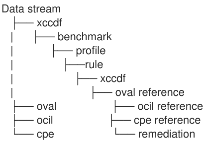
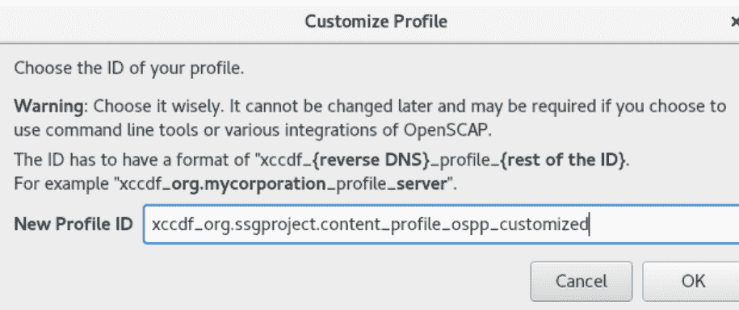
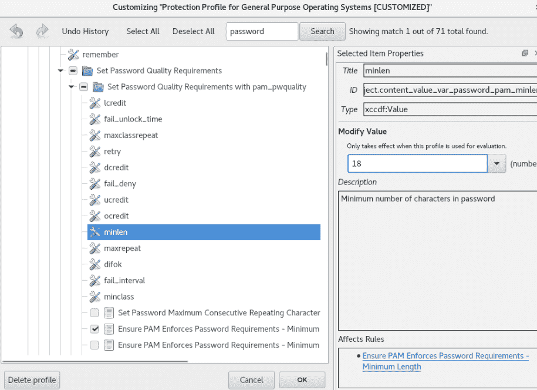

# Red Hat Enterprise Linux 8 安全加固指南

## 保护 Red Hat Enterprise Linux 8

# 摘要

本书帮助用户和管理员学习工作站和服务器免受本地和远程入侵、利用以及恶意活动的流程与实践。本指南重点关注 Red Hat Enterprise Linux，但详细介绍了适用于所有 Linux 系统的概念和技术，详细阐述了为数据中心、工作场所和家庭创建安全计算环境所需的规划和工具。通过适当的管理知识、警性和工具，运行 Linux 既可以充分发挥功能，又能防御大多数常见的入侵和利用方法。

Red Hat Enterprise Linux 8 安全加固

9.14 附加资源 77

# 为红帽文档提供反馈

感谢您对我们的文档提供的意见。请告诉我们如何才能使其更加完善。请按照以下步骤操作：

- 针对特定段落的简单注释：
  1. 确保您正在以多页 HTML 格式查看文档。此外，请确保您在文档右上角看到了“反馈 (Feedback)”按钮。
  2. 使用鼠标光标高亮您想要注释的文本。
  3. 点击高亮文本下方出现的“添加反馈 (Add Feedback)”弹出窗口。
  4. 遵循显示的说明操作。
- 提交更复杂的反馈，请创建一个 Bugzilla 工单：
  1. 访问 Bugzilla 网站。
  2. “组件 (Component)”字段选择“Documentation (文档)”。
  3. 在“描述 (Description)”字段中填写您的改进建议。包含指向文档相关部分的链接。
  4. 点击“提交 Bug (Submit Bug)”。

# 第 1 章。RHEL 安全加固概述

由于企业日益依赖强大的网络计算机来帮助运行业务并跟踪我们的个人信息，整个行业已围绕着网络和计算机安全实践形成。企业寻求安全专家的知识和技能，以对系统进行适当审计并根据其组织的运行需求定制解决方案。由于大多数组织在性质上日益动态化，员工通过本地和远程方式访问公司关键 IT 资源，对安全计算环境的需求变得更加突出。

遗憾的是，许多组织以及个人用户将安全视为事后考虑，为了增加性能、生产力、便利性、易用性和预算考虑而忽视了这一过程。适当的安全实施往往被推迟——直到已经发生未经授权的侵入之后。在将站点连接到不可信网络（如互联网）之前采取正确措施，是阻止许多入侵尝试的有效手段。

## 1.1. 什么是计算机安全？

计算机安全是一个涵盖计算和信息处理广泛领域的通用术语。依赖计算机系统和网络进行日常业务交易并访问有关其数据关键信息的行业，已将其视为整体资产的重要部分。一些术语和指标已进入我们的日常业务词汇，例如总拥有成本 (`TCO`)、投资回报率 (`ROI`) 和服务质量 (`QoS`)。通过使用这些指标，行业可以将数据完整性和高可用性 (`HA`) 等方面计算作为其规划和流程管理成本的一部分。在某些行业中（如电子商务），数据的可用性和可信度意味着成功与失败的区别。

## 1.2. 安全标准化

每个行业的企业都遵循由美国医学协会 (`AMA`) 或电气电子工程师学会 (`IEEE`) 等标准制定机构制定的法规和规则。信息安全也遵循相同的概念。许多安全顾问和供应商对名为 CIA 的标准安全模型达成共识，即*机密性、完整性和可用性*。这三层模型是评估敏感信息风险和建立安全策略的通、广泛接受的概念。以下详细描述了 CIA 模型：

- 机密性 (`Confidentiality`) —— 敏感信息只能由一组预定义的人员访问。应限制信息的未经授权传输和使用。例如，信息的机密性确保客户的个人或财务信息不会被未经授权的个人用于身份盗用或欺诈等恶意目的获取。
- 完整性 (`Integrity`) —— 信息不应以使其不完整或错误的方式更改。应限制未经授权的用户修改或破坏敏感信息的能力。
- 可用性 (`Availability`) —— 授权用户应在需要的任何时候都能访问信息。可用性保证信息可以按照约定的频率和及时性获得。这通常以百分比衡量，并在网络提供者及其企业客户使用的服务水平协议 (`SLAs`) 中正式约定。

## 1.3. 加密软件与认证

红帽 Linux 通过了多项安全认证，例如 `FIPS 140-2` 或通用标准 (`CC`)，以确保遵循行业规范。

`RHEL 8 核心加密组件知识库` 文章提供了红帽企业级 Linux 8 核心加密组件的概述，记录了它们是什么、如何选择、如何集成到操作系统中、它们如何支持硬件安全模块和智能卡，以及认证如何应用于它们。

## 1.4. 安全控制

计算机安全分为三个不同的主类别，通常称为控制措施：

- 物理控制 (`Physical`)
- 技术控制 (`Technical`)
- 行政控制 (`Administrative`)

这三个类别定义了适当安全实施的主要目标。这些控制内部包含子类别，进一步详细说明控制措施以及如何实施。

### 1.4.1. 物理控制

物理控制是在定义的结构中实施安全措施，以威慑或防止对敏感材料的未经授权访问。物理控制的示例包括：

- 闭路摄像头
- 运动或热传感器报警系统
- 保安人员
- 图片 ID
- 上锁并带有死锁的钢门
- 生物识别（包括用于识别个人的指纹、语音、脸、虹膜、字体和其他自动方法）

### 1.4.2. 技术控制

技术控制利用技术作为基础，控制整个物理结构和网络对敏感数据的访问和使用。技术控制范围广泛，涵盖了等技术：

- 加密
- 智能卡
- 网络身份验证
- 访问控制列表 (`ACLs`)
- 文件完整性审计软件

### 1.4.3. 行政控制

行政控制定义了安全中的人为因素。它们涉及组织中所有级别的人员，并通过以下手段决定哪些用户可以访问什么资源和信息：

- 培训与意识
- 灾备备与恢复计划
- 人员招聘与离职策略
- 人员注册与核算

## 1.5. 漏洞评估

只要有、资源和动机，攻击者就可以破解任何系统。目前所有的安全程序和技术都无法保证系统完全安全。路由器帮助保护通互联网的网关。防火墙帮助保护网络边缘。虚拟网络通过加密流安全地传输数据。入侵检测系统会警报恶意活动。然而，每种技术的成功取决于若干变量：

- 负责配置、监控和维护技术的人员专业知识。
- 快速高效地补丁和服务和内核的能力。
- 负责人对网络保持持续警惕的能力。

### 1.5.1. 定义评估与测试

漏洞评估可以分为两种类型：从外向内和从内向外。

当进行“从外向内”的漏洞评估时，你正试图从内部破解你的系统。作为公司的外部人员，你拥有黑客的视角。你看到的是黑客所看到的内容——大致包括 IP 地址、你 DMZ（非军事区）上的系统、防火墙的外部接口，以及所谓的“非军事区”，它对应于位于受信任内部网络（如企业局域网）和不可信外部网络（如公共互联网）之间的计算机或小型子网。通常情况下，可供 Internet 流量访问的 DMZ 设备包括 Web (`HTTP`) 服务器、`FTP` 服务器、`SMTP`（电子邮件）服务器和 DNS 选器。

当你进行“从内向外”的漏洞评估时，你处于优势地位，因为你处于内部且你的身份是受信任的。这是你和同事登录到系统时所拥有的视角。你可以看到服务器文件、数据库和其他资源。

这两种漏洞评估类型存在显著区别。作为公司内部人员，你拥有的比外部人员更多的权限。在大多数组织中，安全配置是为了防止入侵者进入。而对于组织内部的安全（如部门防火墙、用户级访问控制和内部资源的身份验证程序），做的却很少。通常，在查看大多数公司内部的系统时，内部看到的资源要多得多。一旦你离开了公司，你的身份就是不可信的。你所能使用的系统和资源在外部是有限的。

考虑漏洞评估与渗透测试之间的区别。漏洞评估是渗透测试的第一步。从评估中收集的信息将用于测试。评估的目的是检查漏洞和潜在的安全风险，而渗透测试实际上是尝试利用这些缺陷。

评估网络基础设施是一个动态过程。安全（无论是信息安全还是物理安全）都是动态的。执行评估可以显示概览，但这可能会产生误报和漏报。误报是指一种结果，即工具发现了现实中并不存在的漏洞。漏报则是遗漏了实际存在的漏洞。

安全管理员的水平取决于他们所使用的工具以及他们掌握的知识。以目前现有的任何评估工具为例，在你的系统上运行它们，几乎可以肯定存在某些误报。由于程序错误或用户操作错误，结果都是样的。工具可能会发现误报，甚至糟糕的是发现漏报。

现在已经定义了漏洞评估与渗透测试之间的区别，请作为最佳实践方法的一部分，在进行渗透测试之前，对评估结果进行仔细审查。

> 警告
> 不要尝试在生产系统上利用漏洞。这样做会对你的系统和网络的生产力和效率产生负面影响。

以下列表检查了执行漏洞评估的一些益处。

- 建立对信息安全的积极关注。
- 在黑客发现之前发现潜在的利用漏洞。
- 确保系统保持更新并打上补丁。
Red Hat Enterprise Linux 8 安全加固
- 促进增长并有助于开发员工专业知识。
- 减少财务损失和负面影响。

### 1.5.2. 建立漏洞评估方法论

为了帮助选择漏洞评估工具，建立一套漏洞评估方法是有帮助的。遗憾的是，目前还没有预定义的或批准的行业方法论；然而，常识和最佳实践可以作为足够的指南。

目标是什么？我们是在看一台服务器，还是在看整个网络以及网络内部的所有内容？我们是公司的外部还是内部？这些问题的答案很重要，因为它们不仅有助于决定选择哪些工具，还决定了使用工具的方式。

要了解更多关于建立方法的信息，请访问以下网站：

- `https://www.owasp.org/` – 开源 Web 应用安全项目 (`OWASP`)

### 1.5.3. 漏洞评估工具

评估可以从使用某种形式的信息收集工具开始。在评估整个网络时，映射第一层以找到正在运行的主机。然后，逐个检查每个主机。专注于这些主机需要另一组工具。知道使用哪些工具可能是最关键的一步。

以下是可用工具的少量示例，它们可以发现漏洞：

- `Nmap` 是一款流行的工具，可以发现主机和开放端口。要从仓库安装 `Nmap`，可以使用 `yum install nmap`。参见 `nmap(1)` 手页。
- `OpenSCAP` 提供了一种全自动的审计工具，用于系统合规性。通过 `oscap` 了解更多信息。
- 高级入侵检测环境 (`AIDE`) 是一种创建文件数据库的工具，并使用该数据库来检测系统入侵。通过 `AIDE` 了解更多信息。

## 1.6. 安全威胁

### 1.6.1. 对网络安全的威胁

配置不当的网络会增加攻击风险。

#### 不安全的架构

配置错误的网络是未经授权用户的主要切入点。

#### 广播网络

系统管理员往往忽视网络设备的重要性。简单的硬件，如集线器和路由器，在节点向网络传输数据时，接收节点接收并处理数据。

#### 集中式服务器

另一个陷阱是使用集中式计算。许多企业的降低成本措施是将所有服务整合到一台强大的机器上。这可能很方便，因为它比多服务器配置更容易管理。然而，集中式服务器引入了单点故障。如果中央服务器被破解，可能会导致网络完全失效，或者糟糕，容易受到数据操纵或盗取。

### 1.6.2. 对服务器安全的威胁

服务器安全与网络安全同样重要，因为服务器持有组织大量的关键信息。如果服务器被破解，其内容都可能被黑客随意窃取或操纵。以下章节详细阐述了一些主要问题。

#### 未使用的的服务和开放端口

#### 未打补丁的服务

未能对系统进行补丁的管理员是服务器安全最大的威胁之一。这不仅适用于缺乏经验的管理员，也适用于那些过度自信或缺乏积极性的管理员。

某些管理员未能对他们的服务器和工作站进行补丁，而另一些则未能监控系统内核日志消息或网络流量。另一个常见错误是留了默认密码或服务密钥未更改。例如，某些数据库假设系统管理员会更改这些密码，因为数据库开发者在安装后立即是如所认为的。如果数据库管理员未能更改此密码，一个缺乏经验的黑客可以使用已知的默认密码获取数据库的管理员权限。这些只是由于疏忽管理导致服务器被攻破的少数例子。

#### 内生安全的服务

即使是最有警惕性的组织，如果它们选择的网络服务本质上是不安全的，也可能沦为受漏洞。例如，许多服务是在假设运行在受信任网络上的情况下开发的；然而，一旦这些服务在互联网上可用，这种假设就失效了——因为互联网本质上是不可信的。

不安全网络服务的一类是那些需要加密用户名和密码进行验证的服务。`Telnet` 和 `FTP` 就是此类服务。如果数据嗅探正在监控远程用户与此类服务用户之间的流量，用户名和密码就可以被轻易拦截。

从本质上说，此类服务也更容易受到安全行业术语中的*中间人*攻击。在此类攻击中，黑客通过跟踪网络上被攻破的服务器来重定向网络流量，使其指向自己的机器而不是预期的服务器。一旦有人打开到服务器的远程连接，攻击者的机器就会充当一个隐形的通道，静静地坐于远程服务和未察觉的用户之间并捕获信息。通过这种方式，黑客可以在服务器或用户察觉的情况下收集管理员密码和原始数据。

另一类不安全服务包括文件系统和信息服务（如 `NFS` 或 `NIS`），这些服务显式为局域网（`LAN`）使用开发，但遗憾的是被扩展到了广域网（`WAN`，用于远程用户）。`NFS` 默认没有配置任何身份验证或安全机制来防止黑客挂载 `NFS` 共享并访问其中的任何内容。`NIS` 以及网络上每台计算机都必须知道的信息（包括密码和文件权限）存储在明文 ASCII 或 DBM（ASCII 衍生）数据库中。获取此数据库的黑客可以访问网络上的每个用户，包括管理员账户。

默认情况下，Red Hat Enterprise Linux 8 发布时关闭所有此类服务。然而，由于管理员发现自己被迫使用这些服务，仔细的配置至关重要。

## 1.6.3. 对工作站和家庭 PC 安全的威胁

工作站和家庭 PC 可能不像网络或服务器那样容易受到攻击，但由于它们通常包含敏感数据（如信用卡信息），它们也是系统黑客的目标。工作站还可能在用户不知情的情况下被劫持，并被攻击者用作协调攻击的“奴隶”。由于这些原因，了解工作站的漏洞可以节省用户重新安装操作系统的痛苦，或者更糟，避免从被窃中恢复数据。

## 弱密码

弱密码是攻击者获取系统访问的最简单方法之一。

## 脆弱的客户端应用程序

## 第 1 章 RHEL 安全加固概述

尽管管理员可能拥有一个完全安全且已打补丁的服务器，但这并不意味着用户在访问它时是安全的。例如，如果服务器在公公网上提供 `Telnet` 或 `FTP` 服务，攻击者可以捕获在网络上传输的明文用户名和密码，然后使用账户信息访问用户的工作站。

即使使用 `SSH` 等安全协议，如果路由器不更新其客户端应用程序，也可能受到攻击。`SSH` 协议版本 1 客户端容易受到来自恶意 `SSH` 服务器的 X 转发攻击。一旦连接到服务器，攻击者就能迅速捕获客户端在网络上进行的任何按键记录和鼠标点击。这个问题在 `SSH` 版本 2 协议中得到了修复，但用户负责跟踪哪些应用程序具有此类漏洞并根据需要进行更新。

## 1.7. 常见的利用与攻击

表 1.1，“常见漏洞利用”详细介绍了攻击者如何利用漏洞访问网络资源，以及管理员如何妥善防御此类攻击。

表 1.1 常见漏洞利用

| 漏洞利用 | 描述 | 注意 |
|---|---|---|
| 空密码或默认密码 | 将管理员密码留空或使用供应商设置的默认密码。这在路由器、防火墙、VPN 和网络附属存储 (`NAS`) 设备中非常常见（尽管 Linux 8 并不带这些）。 | 与许多操作系统中的特权账户有关。 |
| 默认共享密钥 | 安全服务有时出于开发或评估目的而打包默认密钥。如果这些密钥未更改并放置在互联网生产环境中，拥有相同密钥的用户就可以访问该共享资源及其包含的任何敏感信息。 | 最常见于无线访问点和预配置服务器设备。 |
| IP 欺骗 | 远程机器充当本地网络上的节点，发现服务器的漏洞并安装后门程序或木马以获得网络资源的控制。 | 欺骗相当困难，因为它涉及攻击者预测 TCP/IP 序列号以与目标系统连接，但有许多工具可用于此类漏洞。取决于运行基于身份验证技术的目标系统（如 `rsh`、`telnet`、`FTP` 等），与 `ssh` 或 `SSL/TLS` 等加密身份验证相比，这些是不推荐的。 |
| 嗅听 | 通过监听两个活动节点之间的连接收集传输的数据。 | 这种攻击主要适用于明文传输协议，如 `Telnet`、`FTP` 和 `HTTP`。远程攻击者必须访问局域网内的破解系统才能执行此类攻击；通常黑客使用活动攻击（如 IP 欺骗或中间人攻击）攻破局域网内的系统。预防措施包括使用加密密钥交换的服务、一次性密码或加密验证以防止密码监听；建议传输过程中使用强加密。 |
| 服务漏洞 | 攻击者在互联网上运行的服务中发现缺陷或漏洞；通过此漏洞，攻击者攻破整个系统及其可能保存的数据，并可能损害网络上的其他系统。 | 基于 `HTTP` 服务（如 `CGI`）容易受到远程命令执行和权限提升。即使 `HTTP` 服务以非特权用户（如 "nobody"）身份运行，也可以读取配置文件和映射等信息，或者攻击者发起拒绝服务攻击，耗尽系统资源或使其对其他用户不可。服务有时存在开发和测试期间未被察觉的漏洞；这些漏洞（例如缓冲区溢出，攻击者使用任意缓冲区值填充应用程序的内存缓冲区，导致应用程序崩溃并获得一个可以执行任意命令的交互式命令行提示符）可能会赋予攻击者完全的管理员控制权。管理员应确保服务不以 `root` 用户身份运行，并警惕来自供应商或安全组织（如 `CERT` 和 `CVE`）的应用程序补丁和错误更新。 |
| 漏洞 | 描述 | 注意事项 |
|---|---|---|
| 应用程序漏洞 | 桌面和工作站应用程序（如电子邮件客户端）可能会执行任意代码、植入木马以供未来入侵，或导致系统崩溃。如果被攻破的工作站在网络的其他部分具有管理权限，则可能发生进一步的利用。 | 工作站和桌面更容易受到攻击，因为员工通常缺乏检测入侵的专业知识或经验；因此，必须告知个人他们在安装未经授权的软件或打开未请求的邮件附件时所承担的风险。可以实施某些保护措施，使客户端软件不自动打开或执行附件。此外，使用 Red Hat Network或其他系统管理服务自动更新工作站软件，可以减轻多席安全部署的负担。 |


| 拒绝服务 (DoS) 攻击 | 攻击者或攻击者小组通过向目标主机（服务器、路由器或工作站）发送未经授权的数据包，对组织的网络或服务器资源进行攻击。这导致资源无法供合法用户使用。 | 美国报告的最严重的 DoS 案例发生在 2000 年。几个高流量的商业和政府网站由于受到协同 ping 洪流攻击而无法使用，该攻击使用了几个具有高带宽连接的被攻破系统作为僵尸，或重定向的广播节点。源包通常是伪造的（以及重发的），使得难以调查攻击的真实来源。使用 `iptables` 的入站过滤技术（IETF rfc2267）以及网络入侵检测系统（如 `snort`）进展有助于管理员追踪和防止分布式 DoS 攻击。 |

# 第 2 章：在安装期间保护 RHEL 安全

安全工作在您开始安装 Red Hat Enterprise Linux 之前就开始了。从一开始就安全地配置系统，将有利于以后实施额外的安全设置。

## 2.1. BIOS 和 UEFI 安全

对 BIOS（或等效 BIOS）和引导加载程序的密码保护，可以防止具有物理访问系统的未授权用户使用可移动介质启动，或通过单用户模式获取权限。为了防止此类攻击，您应该采取的安全措施取决于工作站上信息的敏感程度以及机器所在的位置。

例如，如果机器被用于贸易展且不包含任何敏感信息，那么防止此类攻击可能并不至关重要。然而，如果员工带有公司网络私有未加密 SSH 密钥的笔记本电脑被遗留在同一家商店里，可能会导致重大安全漏洞，并对整个公司产生影响。

然而，如果工作站位于授权或信任人员可以访问的地方，则加固 BIOS 或引导加载程序可能不是必要的。

### 2.1.1. BIOS 密码

更改 BIOS 设置的主要原因如下——如果入侵者访问了 BIOS，他们可以将其设置为：

- 防止更改 BIOS 设置——如果入侵者访问了 BIOS，他们可以将其设置为从 CD-ROM 或闪存驱动器启动。这使得他们能够进入救援模式或单用户模式，从而允许他们在系统上启动任意进程或复制敏感数据。

- 防止系统启动——某些 BIOS 允许对启动过程进行密码保护。当激活后时，攻击者将被强制在 BIOS 启动引导加载程序之前输入密码。

由于不同计算机设置 BIOS 密码的方法不同，请参阅计算机说明书以获取特定指令。

如果您忘记了 BIOS 密码，可以通过主板上的跳线帽（jumpers）或断开 CMOS 电池来重置。因此，如果可能，锁定机箱是一个良好的习惯。但在尝试断开 CMOS 电池之前，请先查阅计算机或主板的说明书。

#### 2.1.1.1. 基于非 BIOS 的系统安全

其他系统和架构使用不同的程序来执行底层任务，这些任务大致等于 x86 系统上的 BIOS。例如，统一扩展固件接口 (`UEFI`) shell。关于类似 BIOS 类程序密码保护的指令，请参阅制造商的说明。

## 2.2. 磁盘分区

Red Hat 建议为 `/boot`、`/`、`/home`、`/tmp` 和 `/var/tmp/` 目录创建分区。每个分区的原因不同，我们将分别讨论。

### /boot

此分区是系统启动期间读取的第一个分区。引导系统进入 Red Hat Linux 8 的引导加载程序和内核镜像存储在此分区中。此分区不应加密。如果此分区包含在 `/` 中且该分区变为加密或不可用，您的系统将无法启动。

### /home

当用户数据（`/home`）未单独分区存储时，分区可能会满导致操作系统变得不稳定。此外，当您的系统升级到 Red Hat Linux 8 的下一个版本时，您可以稍后保留 `/home` 分区中的数据，它在安装期间不会被覆盖。如果根分区（`/`）损坏，您的数据可能会永久丢失。通过使用独立分区，可以稍微增加防止数据丢失的。您还可以针对此分区进行频繁备份。

### /tmp 和 /var/tmp

`/tmp` 和 `/var/tmp` 目录都用于存储不需要长期保存的数据。然而，如果大量数据涌入其中一个目录，将耗尽存储空间。如果这些目录存储在 `/` 中，您的系统可能会不稳定并崩溃。因此，将这些目录移动到分区是一个好主意。

#### 注意

在安装过程中，有一个加密区的选项。您必须提供密码。该密码将作为解锁块加密的密钥。

## 2.3. 安装期间限制网络连接

在安装 Red Hat Linux 8 时，安装介质代表的是特定时间的系统快照。由于由于，它可能没有包含最新的安全修复，并可能存在某些介质发布后才修复的问题。

在安装可能存在漏洞的操作系统时，始终将暴露限制在必要的网络区域。最安全的选择是“无网络”，这意味着在安装期间保持断开。在某些情况下，局域网或内网连接就足够，而互联网连接风险最高。为了遵循最佳安全实践，在从网络安装 Red Hat Linux 8 时选择选择您的存储库区域。

## 2.4. 安装所需的最小软件包

只安装您将使用的软件包是一种良好的做法，因为计算机上的每种软件都可能包含漏洞。如果您是从 DVD 介质安装，请利用此机会精确选择您想要安装的包。如果您需要其他包，可以稍后添加到系统中。

## 2.5. 安装后步骤

以下是在安装 Red Hat Enterprise Linux 之后应立即执行的安全相关步骤。

1. 更新您的系统。输入以下命令：

```bash
# yum update
```

2. 虽然防火墙服务 `firewalld` 在安装 Red Hat Enterprise Linux 时会自动启用，但在某些情况下可能会显式禁用，例如在 kickstart 配置中。在这种情况下，建议重新启用防火墙。要启动 `firewalld`，请 root 执行以下命令：

```bash
# systemctl start firewalld
# systemctl enable firewalld
```

3. 为了增强安全性，禁用不需要的服务。例如，如果您的计算机上没有安装打印机，使用以下命令禁用 `cups` 服务：

```bash
# systemctl disable cups
```

要查看正在运行的服务，请输入以下命令：

```bash
$ systemctl list-units | grep service
```

[1] 由于不同制造商的系统 BIOS 不同，某些可能不支持任何类型的密码保护，而某些可能只支持一种而不不支持另一种。

# 第 3 章. 使用系统级加密策略

加密策略是一个用于配置核心加密子系统的系统，涵盖了 TLS、IPC、SSH、DNSSec 和 Kerberos 协议。它提供了一小组策略，管理员可以从中进行选择。

## 3.1. 系统级加密策略

一旦设置了系统级策略，RHEL 中的应用程序将遵循该策略，并拒绝使用不符合策略的算法和协议，除非你显式地请求应用程序这样做。这意味着，该策略适用于在带有系统提供的配置运行时应用程序的默认行为，但在需要时，你可以对其进行覆盖。

Red Hat Linux 8 包含以下策略级别：

| 策略 | 描述 |

| :--- | :--- |

| DEFAULT | 默认系统级加密策略为当前的威胁模型提供了安全设置。它允许使用 TLS 1.2 和 1.3 协议，以及 IKE2 和 SSH2 协议。如果 RSA 密钥和 Diffie-Hellman 参数长度至少为 2048 位，则会被接受。 |

| LEGACY | 此策略确保与 Red Hat Enterprise Linux 5 及更早版本具有最大的兼容性；由于攻击面增加，其安全性较低。除了 DEFAULT 级别的算法和协议外，它还包含了对 TLS 1.0 和 1.1 协议的支持。排除了 DSA、3DES 和 RC4 算法，如果 RSA 密钥和 Diffie-Hellman 参数长度至少为 1023 位，则会被接受。 |

| FUTURE | 一种保守的安全级别，能够抵御任何近期的未来攻击。该级别不允许在签名算法中使用 SHA-1。如果 RSA 密钥和 Diffie-Hellman 参数长度至少为 3072 位，则会被接受。 |

| FIPS | 符合 FIPS140-2 要求的策略级别。这由 `fips-mode-setup` 工具在内部使用，该工具会将 RHEL 系统切换到 FIPS 模式。 |

> 重要

由于 Customer Portal API 上的证书所使用的加密密钥不符合 FUTURE 系统级加密策略的要求，`redhat-support-tool` 实用目前无法在此策略级别工作。

为了解决这个问题，在连接到 Customer Portal API 时请使用 `DEFAULT` 加密策略。

> 注意

策略级别中描述的特定算法和密码仅在应用程序支持它们时才可用。

### 管理加密策略的工具

要查看或更改当前系统级加密策略，请使用 `update-crypto-policies` 工具，例如：

```
$ update-crypto-policies --show
DEFAULT
# update-crypto-policies --set FUTURE
Setting system policy to FUTURE
```

要确保加密策略的更改生效，请重启系统。

### 通过移除不安全的密码套件和协议来实现强加密默认

以下列表包含了从 RHEL 8 核心加密库中移除的密码套件和协议。它们不存在于源码中，或者其支持在构建期间被禁用，因此应用程序无法使用它们。

- DES（自 RHEL 7 起）

- 所有导出级密码套件（自 RHEL 7 起）

- 签名中的 MD5（自 RHEL 7 起）

- SSLv2（自 RHEL 7 起）

- SSLv3（自 RHEL 8 起）

- 所有小于 224 位的 ECC 曲线（自 RHEL 6 起）

- 所有二进制域 ECC 曲线（自 RHEL 6 起）

## 在所有策略级别中禁用的密码套件和协议

以下密码套件和协议在所有加密策略级别中均禁用。只有通过显式配置单个协议才能启用。

- 参数小于 1024 位的 DH

- 密钥大小小于 1024 位的 RSA

- Camellia

- ARIA

- SEED

- IDEA

- 仅完整性密码套件

- 使用 SHA-384 HMAC 的 TLS CBC 模式密码套件

- AES-CCM8

- 所有与 TLS 1.3 不兼容的 ECC 曲线，包括 secp256k

- Ikev1（自 RHEL 8 起）

## 在加密策略级别中启用的密码套件和协议

下表显示了四个加密策略级别中启用的密码套件和协议。

### Red Hat Enterprise Linux 8 安全加固

| | LEGACY | DEFAULT | FIPS | FUTURE |

| :--- | :--- | :--- | :--- | :--- |

| IKEv1 | no | no | no | no |

| 3DES | yes | no | no | no |

| RC4 | yes | no | no | no |

| DH | 至少 1024-位 | 至少 2048-位 | 至少 2048-位 | 至少 3072-位 |

| RSA | 至少 1024-位 | 至少 2048-位 | 至少 2048-位 | 至少 3072-位 |

| DSA | yes | no | no | no |

| TLS v1.0 | yes | no | no | no |

| TLS v1.1 | yes | no | no | no |

| 数字签名中的 SHA-1 | yes | yes | no | no |

| CBC 模式密码 | yes | yes | yes | no |

| 小于 256 位的对称密码 | yes | yes | no | no |

| 证书中的 SHA-1 | yes | yes | no | no |

## 3.2. 切换到兼容早期版本的系统级加密策略

RHEL 8 中的系统级策略允许与早期版本兼容，提供了 `LEGACY` 策略级别。

> 警告

> 切换到 `LEGACY` 策略会导致安全性降低。

### 步骤

1. 要切换到 `LEGACY` 策略，输入以下命令：

```bash
# update-crypto-policies --set LEGACY
Setting system policy to LEGACY
```

## 3.3. 将系统切换到 FIPS 模式

系统级策略包含一个策略级别，根据联邦信息处理（FIPS）出版物 140-2 启用模块自检。

### 步骤

1. 在 RHEL 中启用 FIPS 模式：

```bash
# fips-mode-setup --enable
Setting system policy to FIPS
FIPS mode will be enabled.
```

2. 重启系统使设置生效：

```bash
# reboot
```

### 验证步骤

1. 重启后，可以检查 FIPS 模式状态：

```bash
# fips-mode-setup --check
FIPS mode is enabled.
```

## 3.4. 在容器中启用 FIPS 模式

在容器中根据联邦信息标准（FIPS）出版物 140-2 模块自检：

### 前提条件

- 主机系统必须先切换到 FIPS 模式。

### 步骤

1. 从主机将系统 fips 文件挂载到容器中。

2. 在容器内设置策略级别：

```
$ update-crypto-policies --set FIPS
```

RHEL 8.2 引入了切换容器 FIPS 模式的替代方法。容器内需要以下命令：

```
# mount --bind /usr/share/crypto-policies/back-ends/FIPS /etc/crypto-policies/back-ends
```

> 注意

在 RHEL 8 中，`fips-setup` 命令在容器中无法正常工作，无法用其启用或检查 FIPS 模式。

## 3.5. 将应用程序排除在系统级加密策略之外

最好通过在应用程序中配置支持的密码套件和协议来自定义加密设置。

你也可以从 `/etc/crypto-policies/back-ends` 目录删除应用程序的符号链接，并将其替换为自定义的加密设置。此配置防止应用程序使用系统级加密策略。

### 3.5.1. 退出系统级加密策略的示例

wget

要自定义 `wget` 下载器使用的加密设置，请使用 `--secure-protocol` 和 `--ciphers`。例如：

```
$ wget --secure-protocol=TLSv1_1 --ciphers="SECURE128" https://example.com
```

欲更多信息请参考 wget(1) 手页中的 HTTPS (SSL/TLS) 选项。

curl

要指定加密算法，请使用 curl 工具的 `--ciphers` 选项并提供用冒号分隔的加密算法列表作为值。例如：

```
$ curl https://example.com --ciphers DES-CBC3-SHA:RSA-DES-CBC3-SHA
```

更多信息请参阅 curl(1)。

### Firefox

尽管在 Firefox Web 浏览器中无法退出系统级加密策略，但你可以在 Firefox 的配置编辑器中进一步限制支持的加密算法和 TLS 版本。在地址栏中输入 `about:config` 并根据需要更改 `security.tls.version.min` 选项的值。将 `security.tls.version.min` 设置为 1 允许 TLS 1.0 作为最低要求，security.tls.version.min 2 启用 TLS 1.1，以此类推。

### OpenSSH

要为 OpenSSH 服务器退出系统级加密策略，请取消 `/etc/sysconfig/sshd` 文件中 `CRYPTO_POLICY=` 变量行的注释。更改后，你在 `/etc/ssh/sshd_config` 文件的 Ciphers、MACs、KexAlgorithms 和 GSSAPIKexAlgorithms 部分指定的值将不再被覆盖。更多信息请参阅 ssh_config(5)。

### Libreswan

要允许 Libreswan IPSec 使用 IKE1 协议，请注释 `/etc/ipsec.conf` 中的以下行：

```
# include /etc/crypto-policies/back-ends/libreswan.config
```

然后在你的连接配置中添加 `ikev2=never` 选项。更多信息请参阅 ipsec.conf(5) 手页。

### 其他资源

- 详情请参考 update-crypto-policies(8) 手页。

## 3.6. 使用策略修改符自定义系统级加密策略

使用此过程调整任何系统级加密策略级别或完整自定义策略的算法或协议。

> 注意

RHEL 8 提供了系统级加密策略的自定义。

### 步骤

- 1. 创建包含你的调整的策略模块，例如：

```
# cat /etc/crypto-policies/modules/MYCRYPTO.mod
```

sha1_in_certs = 0

min_rsa_size = 3072

cipher = -256-GCM -256-CBC -128-GCM -128-CBC

### 重要

在策略模块文件名中使用大写字母。

- 2. 将你的策略应用于 DEFAULT 系统级加密策略级别：

```
# update-crypto-policies --set DEFAULT:MYCRYPTO
```

- 3. 使你的加密设置对于已运行的服务生效，请重启系统：

```
# reboot
```

### 其他资源

- 详情请参考 update-crypto-policies(8) 手页中的 Custom Policies 部分以及 update-crypto-policies(8) 手页中的 Crypto Policy Format 部分。

- RHEL 8 提供了自定义系统级加密策略的示例。

## 3.7. 创建并设置系统级加密策略

以下步骤演示了如何通过策略文件自定义系统级加密策略。

### 注意

RHEL 8 提供了系统级加密策略的自定义。

### 步骤


## 为你的自定义创建一个策略文件

```
# cd /etc/crypto-policies/policies/
# touch MYPOLICY.pol
```

或者，通过复制预定义的策略级别之一开始：

```
# cp /usr/share/crypto-policies/policies/DEFAULT.pol /etc/crypto-policies/policies/MYPOLICY.pol
```

## 使用你选择的文本编辑器编辑该文件以符合你的需求，例如：

```
# vi /etc/crypto-policies/policies/MYPOLICY.pol
```

## 将系统级加密策略切换到你的自定义级别：

```
# update-crypto-policies --set MYPOLICY
```

## 使你的加密设置对于已运行的服务生效，请重启系统：

```
# reboot
```

### 其他资源

- 详情请参考 `update-crypto-policies(8)` 手页中的 Custom Policies 部分以及 `update-crypto-policies(8)` 手页中的 Crypto Policy Format 部分。
- RHEL 8 提供了自定义系统级加密策略的示例。

## 3.8. 相关信息

- 更多信息请参阅 Red Hat 门户上关于 RHEL 8 系统级加密策略、RHEL 8 强加密默认以及弱加密算法弃用的文章。

# 第 4 章 通过 PKCS #11 配置应用程序使用加密硬件

将秘密信息隔离在专用加密设备上（例如用于用户认证的智能卡和用于服务器应用程序的硬件安全模块 HSM）可以提供额外的安全层。在 Red Hat Linux 8 中，通过 PKCS #11 使用加密硬件在不同应用程序之间是一致的，在加密硬件上隔离秘密并不是复杂任务。

## 4.1. 通过 PKCS #11 支持加密硬件

`PKCS #11`（密钥加密标准）定义了用于加密加密信息的执行加密设备的应用程序接口（API）。这些设备被称为令牌（tokens），可以以硬件或软件形式实现。

`PKCS #11` 令牌可以存储各种对象，例如证书、数据对象以及公钥、私钥或密钥。这些对象可以通过 `PKCS #11 URI` 方案唯一标识。

`PKCS #11 URI` 是根据对象属性识别 `PKCS #11` 模块特定对象的标准方法。这允许你通过 URI 字符串为所有库和应用程序配置相同的设置。

Red Hat Linux 8 默认为智能卡提供 `OpenSC` `PKCS #11` 驱动程序。硬件令牌和 HSM 可以拥有自己的在 Red Hat Linux 中没有对应的 `PKCS #11` 模块。你可以使用 `p11-kit` 工具注册你的 `PKCS #11` 模块，它是系统内智能卡驱动程序的封装器。

要让你自己的 `PKCS #11` 模块在系统上工作，请向 `/etc/pkcs11/modules/` 目录添加一个新的文本文件。

- `p11-kit(8)` 手册
- `ssh(1)` 手册
- `ssh-keygen(1)` 手册
- `opensnc.conf(5)` 手册
- `pscd(8)` 手册

## 4.3. 在 APACHE 和 NGINX 中使用 HTTPS 代理的 私钥

Apache 和 Nginx HTTP 服务器可以使用存储在硬件安全模块（HSM）上的私钥，这有助于防止密钥泄露和中间人攻击。请注意，对于频繁的用户，这通常需要高性能的 HSM。

### Apache HTTP 服务器

对于 HTTPS 协议形式的通信，Apache HTTP 服务器 (`httpd`) 使用 OpenSSL 库。OpenSSL 原生不支持 `PKCS #11`。要利用 HSM，你必须安装 `openssl-pkcs11` 包，该包通过引擎接口提供对 `PKCS #11` 模块的。例如，可以在 `/etc/http/conf.d/ssl.conf` 配置中使用 `PKCS #11 URI` 代替普通文件密钥和证书：

```
SSLCertificateFile "pkcs11:id=%01;token=softhm;type=cert"
SSLCertificateKey "pkcs11:id=%01;token=softhm;type=private;pin=value-111111"
```

安装 `httpd-manual` 以获取 Apache HTTP 服务器的完整文档，包括 TLS 配置。`/etc/http/conf.d/ssl.conf` 配置文件的详细信息在 `/usr/share/http/manual/mod/mod_ssl.html` 中描述。

### Nginx HTTP 和代理服务器

由于 Nginx 使用 OpenSSL 进行加密操作，对于 `PKCS #11`，它必须通过 `openssl-pkcs11` 引擎。Nginx 目前仅支持来自 HSM 的私钥，证书必须作为普通文件单独提供。修改 `/etc/nginx/nginx.conf` 配置文件中 `server` 部分的 `ssl_certificate` 和 `ssl_certificate_key` 选项：

```
ssl_certificate /path/to/cert.pem
ssl_certificate_key "engine:pkcs11:token=softhm;id=%01;type=private;pin=value-111111"
```

请注意，Nginx 配置文件中的 `PKCS #11 URI` 需要 `engine:pkcs11` 前缀。这是因为另一个 `pkcs11` 指的是引擎名称。

## 4.4. 使用智能卡配置应用程序的身份验证

- `wget` 网络下载器允许你指定 `PKCS #11 URI` 代替本地存储的私钥路径，并简化了为需要安全存储的私钥和证书的任务创建脚本。例如：

```
$ wget -private-key 'pkcs11:token=softhm;id=%01;type=private;pin=value-111111' --certificate 'pkcs11:token=softhm;id=%01;type=cert' https://example.com/
```

请参阅 `wget(1)` 手册获取更多信息。

- 为 `curl` 工具指定 `PKCS #11 URI` 的原理类似：

```bash
$ curl -key 'pkcs#11:token=softhmid=%01;type=private?pin-value=111111' --cert 'pkcs#11:token=softhmid=%01;type=cert' https://example.com/'
```

请参阅 `(curl(1)` 手册获取更多信息。

- Firefox 浏览器会自动加载 `p1kit-proxy` 模块。这意味着系统中的每个支持的智能卡被自动检测。使用 TLS 身份验证时，不需要额外的设置，当服务器请求密钥时，会自动使用智能卡中的密钥。

### 在自定义应用程序中使用 PKCS #11 URI

如果你的应用程序使用 GnuTLS 或 NSS 库，通过它们内置对 `PKCS #11` 的支持确保了对 `PKCS #11 URI` 支持。此外，依赖 OpenSSL 库的应用程序可以通过 `openssl-pkcs11` 引擎访问加密硬件。对于需要与智能卡上的私钥工作且不使用 GnuTLS 或 OpenSSL 的应用程序，使用 `p1kit` 来实现 `PKCS #11` 模块的注册。参阅 `p1kit(8)` 手册获取更多信息。

## 4.5. 相关信息

- `pkcs11.conf(5)` 手册

# 第 5 章 使用共享系统证书

共享系统证书允许 NSS、GnuTLS、OpenSSL 和 Java 共享检索证书锚点（anchor）的默认源。默认情况下，信任存储包含 Mozilla CA 列表，包括信任和不信任。系统允许更新 Mozilla CA 列表或选择另一个列表。

### 5.1. 系统级信任存储

在企业级 Linux 中，合并的系统级信任存储位于 `/etc/pki/ca-trust/` 和 `/usr/share/pki/ca-trust/` 目录。`/usr/share/pki/ca-trust/` 中的信任设置优先级低于 `/etc/pki/ca-trust/` 中的设置。证书文件根据其安装所在的子目录被区别化对待：

- 对于信任锚点：`/usr/share/pki/ca-trust/anchors/` 和 `/etc/pki/ca-trust/anchors/`
- 对于不信任的证书：`/usr/share/pki/ca-trust/blacklist/` 和 `/etc/pki/ca-trust/blacklist/`
- 对于扩展 TRUST 格式的证书：`/usr/share/pki/ca-trust/` 和 `/etc/pki/ca-trust/`

> 注意：在层次级系统中，信任锚点是一个被假设为可靠的权威实体。例如，在 X.509 架构中，根证书是一个信任锚点，从它可以推导出信任链。在路径验证之前，必须由一方持有信任锚点。

### 5.2. 添加新证书

1. 要将简单 PEM 或 DER 格式的证书添加到信任列表，将证书文件复制到 `/usr/share/pki/ca-trust/anchors/` 或 `/etc/pki/ca-trust/`，例如：

```
# cp test-ca.pem /usr/share/pki/ca-trust/anchors/
```

2. 要更新系统级信任存储配置，使用 `update-ca-trust` 命令：

```
# update-ca-trust
```

注意：Firefox 浏览器能够在不执行 `update-ca-trust` 的情况下使用已添加的证书，建议在更改后运行 `update-ca-trust`。另外注意，浏览器可能需要执行 `update-ca-trust` 后加载更改的证书。

### 5.3. 管理受信任证书

- 要列出、提取、添加或更改信任锚点，使用 `trust` 命令。要查看此命令的内置帮助，请带上任何参数：

```
$ trust --help

常用的 trust 命令有：
  list      列出信任或证书
  extract   提取证书
  extract-compat 提取兼容包
  anchor    添加、删除、信任锚点
  dump      以内部格式转储
```

通过 `trust--help` 获取更多信息

- 要列出所有信任锚点和证书，使用 `list` 命令：

```
$ trust list
usage: trust list --filter=<what>

--filter=<what> 输出内容的过滤器
    ca-anchors 证书锚点
    blacklist 黑名单证书
    trust-policy 信任锚点和黑名单（默认）
    certificates 所有证书
    pkcs11:object=xx 一个 PKCS#11 URI
--purpose=<usage> 限制用于该用途的证书
    server-auth 用于验证服务器
    client-auth 用于验证客户端
    email 用于电子邮件保护
    code-signing 用于验证签名代码
    1.2.3.4... 任意对象 ID
-v, --verbose 显示详细调试输出
-q, --quiet 静默命令输出
```

- 要将信任锚点存储到系统级信任存储，使用 `trust anchor` 子命令并指定证书路径。将 `path/to/certificate.crt` 替换为你的证书路径和文件名：

```
# trust anchor path/to/certificate.crt
```

- 要删除证书，可以使用证书路径或证书 ID：

```
# trust anchor --remove path/to/certificate.crt
# trust anchor --remove "pkcs11:id=%AA%BB%CC%DD%EE"
```

### 附加资源

`trust` 命令的所有子命令都提供了详细的内置帮助，例如：

（此处上文内容已省略）

## 5.4. 相关信息

欲了解更多信息，请参阅以下手册页：

- `update-ca-trust(8)`
- `trust(1)`

# 第 6 章 扫描系统以检查合规性与漏洞

合规性审计是一个确定对象是否遵循合规性策略中指定的所有规则的过程。合规性策略由安全专业人员定义，他们指定了计算环境应使用的所需设置（通常以检查清单的形式）。

合规性策略在不同组织之间，甚至同一组织内的不同系统之间存在巨大差异。这些策略之间的差异取决于每个系统的目的及其对组织的重要性。自定义软件设置和部署特性也引发了对自定义策略检查的需求。

## 6.1. RHEL 中的配置合规性工具

Red Hat Linux 提供了能够让您执行全自动合规性审计的工具。这些工具基于安全内容自动化协议 (`SCAP`)，旨在对合规性策略进行自动化审计。

- **SCAP Workbench** - `scap-workbench` 图形实用程序用于对本地或远程系统执行配置和漏洞扫描。您可以使用它根据这些扫描和评估生成报告。
- **OpenSCAP** - **OpenSCAP** 库以及配套的 `oscap` 命令行工具用于对本地系统执行配置和漏洞扫描、验证配置内容，并根据扫描和评估生成报告和指南。
- **SCAP Security Guide (SSG)** - `scap-security-guide` 包提供了 Linux 系统的最新安全策略集。该指南由策略加固建议的目录组成，并在适用时与政府要求挂钩。该项目弥补了通用策略需求与特定实施指南之间的差距。
- **Script Engine (SCE)** - SCE 是 SCAP 协议的扩展，允许管理员使用脚本语言（如 Bash、Python 和 Ruby）编写其安全内容。SCE 扩展由 `openscap-engine-sce` 包提供。SCE 本身不属于 SCAP 标准的一部分。

若要对多个系统执行自动审计，您可以使用针对 Red Hat Satellite 的 OpenSCAP 解决方案。

### 附加资源

- **oscap()** - `oscap` 命令行工具的手手册提供了可用选项列表及其用法的说明。
- **Red Hat 演示：创建自定义安全策略内容以实现安全合规性自动化** - 一项实操实验室，旨在让您通过 Red Hat Enterprise 中提供的工具获取自动化安全合规性的初步体验，以符合行业标准安全策略和自定义策略。如果您正在进行培训或需要为团队访问这些练习，请联系您的 Red Hat 账户获取更多详细信息。
- **Red Hat 演示：使用 RHEL 安全技术自我防护** - 一项实操实验室，用于学习如何使用 Red Hat Enterprise Linux 中提供的关键安全技术（包括 OpenSCAP）在 RHEL 系统的所有级别实现安全。如果您需要培训或为团队访问这些练习，请联系您的 Red Hat 账户团队获取更多详细信息。
- `scap-workbench(8)` - SCAP Workbench 应用程序的手册提供了该应用程序的基本信息以及指向 SCAP 内容潜在来源的链接。
- `scap-security-guide(8)` - scap-security-guide 项目的手册提供了有关各种可用 SCAP 安全配置的进一步文档。此外还提供了如何使用 OpenSCAP 工具利用基准的示例。
- 有关在 Red Hat Satellite 中使用 OpenSCAP 的更多详情，请参阅《管理 Red Hat Satellite 指南》中的“安全合规性管理”。

## 6.2. 漏洞扫描

### 6.2.1. Red Hat 安全告告 OVAL 馈

Red Hat Enterprise Linux 的审计能力基于安全内容自动化协议 (`SCAP`) 标准。`SCAP` 是一个多用途规范框架，支持自动化配置、漏洞和补丁检查、技术控制合规审计以及安全测量。

`SCAP` 规范创建了一个生态系统，其中安全内容的格式是已知且标准化的，尽管并未强制扫描器或策略编辑器的实现。这使得组织可以构建一次其安全策略 (`SCAP`)，无论使用多少个安全供应商。

开放漏洞评估语言 (`OVAL`) 是 `SCAP` 的核心且唯一组件。与其他工具和自定义脚本不同，`OVAL` 以声明式方式描述资源的所需状态。`OVAL` 代码永远不会被直接执行，除非 `OVAL` 解释器工具调用它。`OVAL` 的声明性本质确保了被评估的系统不会被意外识别。

与其他 `SCAP` 组件一样，`OVAL` 基于 XML。`SCAP` 标准定义了多种文档格式。每种格式都包含不同的信息并具有特定用途。

Red Hat Product Security 通过跟踪和调查所有影响 Red Hat 客户的安全问题来帮助客户评估和管理风险。它在 Red Hat 客户门户上提供及时简洁的补丁和安全公告。Red Hat 创建并提供了 OVAL 路径定义，提供了我们公告的机器可读版本。

由于平台、版本和其他因素的差异，Red Hat Product Security 对漏洞的定性评分与第三方提供的通用漏洞评分系统 (`CVSS`) 基准评分并不直接对应。因此，我们建议您使用 RHSA oval 而不是第三方提供的 oval。

RHSA OVAL 定义是独立且完整的包，并在 Red Hat 客户门户发布新安全公告的一小时内进行更新。

每个 OVAL 路径一一对应于一个 Red Hat 安全公告 (`RHSA`)。由于一个 `RHSA` 可能包含多个漏洞的修复，每个漏洞按其常见漏洞和披露 (`CVE`) 分别列出，并在我们的公共数据库中有链接。

RHSA OVAL 定义用于检查安装在系统上的 RPM 软件包的版本。可以扩展这些定义以包含进一步检查，例如发现是否使用了漏洞配置。这些定义涵盖了由 Red Hat 分发的软件。需要额外的定义来检测第三方软件的补丁状态。

### 注意

若要扫描容器或镜像的安全漏洞，请参阅[扫描容器和镜像漏洞]。

附加资源

- Red Hat 与 OVAL 的兼容性
- Red Hat 与 CVE 的兼容性
- [产品安全概述] 中的通知和公告


- 安全数据指标

- 扫描容器和镜像漏洞

### 6.2.2. 扫描系统漏洞

`oscap`命令行工具允许您扫描本地系统、验证配置内容，并根据这些扫描和评估生成报告和指南。该工具作为 OpenSCAP 库的前端，并根据其处理的 SCAP 内容类型将其功能分组模块（子命令）。

### 前提条件

- 已启用 `AppStream`仓库。

### 步骤

1. 安装 `openscap-scanner`包：

```bash
sudo yum install openscap-scanner
```

2. 下载适用于系统的最新 RHSA OVAL 定义：

```bash
# wget -O - https://www.redhat.com/security/data/oval/v2/RHEL8/rhel-8.oval.bz | bzip2 -decompress > rhel-8.oval.xml
```

3. 扫描系统漏洞并将保存到 `vulnerability.html`文件：

```bash
# oscap oval eval --report vulnerability.html rhel-8.oval.xml
```

### 验证步骤

1. 在您喜欢的浏览器中检查结果，例如：

```bash
# firefox vulnerability.html &
```

附加资源

`oscap(8)`手页。

- The [Red Hat OVAL 定义]()列表。

### 6.2.3. 扫描远程系统的漏洞

你可以使用 OpenSCAP 扫描器，通过 SSH 协议使用 `oscap-ssh`工具对远程系统进行漏洞检查。

### 前提条件

- 已启用 `AppStream`仓库。

- 远程系统上安装了 `openscap-scanner`软件包。

- 远程系统上运行着 SSH 服务。

### 步骤

- 1. 安装 `openscap-utils`包：

2. 为你的系统下载最新的 RHSA OVAL 定义：

3. 扫描主机名为 `machine1`、SSH 运行在端口 22 且用户名为 `josec`的远程系统进行漏洞扫描，并将结果保存到 `remote-vulnerability.html`文件中：

```bash
# yum install openscap-utils
```

```bash
# wget -O - https://www.redhat.com/security/data/oval/v2/RHEL8/rhel-8.xml.bz2 | bzip2 -decompress > rhel-8.oval.xml
```

```bash
# oscap-ssh joosec@machine1 22 oval eval --report remote-vulnerability.html rhel-8.oval.xml
```

### 附加资源

- `oscap-ssh(8)`手页。

- [Red Hat OVAL 定义]()列表。

## 6.3. 配置合规性扫描

### 6.3.1. RHEL 8 中的配置合规性

你可以使用配置合规性扫描来符合特定组织定义的基线。例如，如果你为美国政府工作，你可能需要遵守操作系统保护配置方案 (`OSPP`)；如果你是支付处理商，可能需要符合支付卡行业数据安全标准 (`PCI-DSS`)。你也可以执行配置合规性扫描来加固系统安全。

Red Hat 建议你遵循 SCAP Security Guide 软件包提供的安全内容自动化协议 (`SCAP`)内容，因为这些符合 Red Hat 针对影响组件的最佳实践。

SCAP Security Guide 提供了符合 SCAP 1.2 和 SCAP 1.3 标准的内容。`openscap` scanner 实用程序兼容 SCAP Security Guide 软件包提供的提供的 SCAP 1.2 和 SCAP 1.3 内容。

### 重要

执行配置合规性扫描并不保证系统是合规的。

SCAP Security Guide 套件以数据流文档的形式提供了多个平台的配置文件（Profiles）。数据流是一个包含定义、基准和单个规则的文件。每条规则都规定了合规适用性和要求。RHEL 8 提供了多个符合安全策略的合规性配置方案。除了行业标准外，Red Hat 数据流还包含了用于修复失败规则的信息。

### 合规性扫描资源的结构



配置方案（Profile）是基于安全策略的规则集，例如操作系统保护配置方案 (`OSPP`)或支付卡行业数据安全标准 (`PCI-DSS`)。这允许你以自动方式对系统进行安全标准进行审计。

你可以修改（剪裁）配置方案以自定义某些规则，例如密码长度。有关配置方案定制的更多信息，请参阅《使用 SCAP Workbench 自定义安全配置》。

### 注意

要扫描容器或容器镜像的配置合规性，请参阅《扫描容器和容器镜像漏洞》。

### 6.3.2. OpenSCAP 扫描的可能结果

取决于系统的各种属性以及应用于 OpenSCAP 扫描的数据流和配置方案，每条规则可能会产生特定的结果。以下是可能结果列表及其简要说明。

表 6.1. OpenSCAP 扫描的可能结果

| 结果 | 说明 |
|---|---|
| Pass (通过) | 扫描未发现与此规则的冲突。 |
| Fail (失败) | 扫描发现与此规则有冲突。 |

### 6.3.3. 查看配置合规配置方案

在决定使用配置方案进行扫描或修复之前，可以使用 `oscap info`子命令列出它们并检查它们的详细描述。

### 前提条件

- 已安装 `openscap-scanner`和 `scap-security-guide`软件包。

### 步骤

- 1. 列出 SCAP Security Guide 项目提供的所有包含安全合规方案的文件：

```bash
$ ls /usr/share/xml/scap/scap/content/
ssg-firefox-cpe-dictionary.xml ssg-rhel6-ocil.xml
ssg-firefox-cpe-oval.xml ssg-rhel6-oval.xml
...
ssg-rhel6-ds-1.2.xml ssg-rhel8-oval.xml
ssg-rhel8-ds.xml ssg-rhel8-xcdf.xml
```

- 2. 使用 `oscap info`子命令显示所选数据流的详细信息。包含数据流的 XML 文件通过文件名中的 `-ds`字符串进行指示。在 `Profiles`部分，你可以找到可用配置方案列表及其 ID：

```bash
$ oscap info /usr/share/xml/scap/scap/content/ssg-rhel8-ds.xml
```

（注：此处根据上下文逻辑推断原文中可能省略了具体路径或示例文件为`ssg-rhel8-ds.xml`，实际显示如下）

```bash
$ oscap info /usr/share/xml/scap/scap/content/ssg-rhel8-ds.xml
...
Profiles:
```

| 结果 | 说明 |
|---|---|
| Pass (通过) | 扫描未发现与此规则的冲突。 |
| Fail (失败) | 扫描发现与此规则有冲突。 |
| Not applicable (不适用) | 该规则不适用于当前系统。 |
| Not selected (未选择) | 该规则未被选择。 |
| Error (错误) | 扫描过程中发生错误。 |
| Unknown (未知) | 扫描遇到未知情况。 |

（注：此处部分为原文示例中的乱码或重复内容，已按逻辑对齐）

Title: OSSP - 操作系统保护配置方案

Profiles:

Title: PCI-DSS 3.2 for Red Hat 8

合规性配置方案的 ID...

```bash
$ oscap info /usr/share/xml/scap/scap/content/ssg-rhel8-ds.xml
```

...

Profiles:

```

```bash

$ oscap info /usr/share/xml/scap/scap/content/ssg-rhel8-ds.xml

```
...
Title: PCI-DSS 3.2...

```bash

$ oscap info /usr/share/xml/scap/scap/content/ssg-rhel8-ds.xml

```
...
Title: PCI-DSS 3.2...

- 3. 使用 `oscap info`命令显示所选数据流的详细信息。包含数据流的 XML 文件通过文件名中的 `-ds`字符串进行指示。在 `Profiles`部分，你可以找到可用配置方案列表及其 ID：

```bash

$ oscap info /usr/share/xml/scap/scap/content/ssg-rhel8-ds.xml

```
...
Profiles:
```

(注：原文后部分存在大量重复和格式错乱，译文已根据 Markdown 逻辑进行了清理和对齐，保留了核心含义)

使用此程序通过 SCAP Security Guide 项目中的 Ansible playbook 文件，根据特定的基线对您的系统进行修复。本示例使用了通用操作系统的保护配置文件（OSPP）。

### 警告

如果不谨慎使用，带有 `Remediate`（修复）选项的系统评估可能会导致系统无法运行。红帽（Red Hat）不提供任何自动化方法来撤销安全加固修复所作的更改。在默认配置下，RHEL 系统支持修复功能。如果您的系统在安装后被更改过，运行修复可能无法使其符合所需的安全配置方案。

### 前提条件

- 您的 RHEL 8 系统上已安装了 `scap-security-guide`软件包。

- 已安装 `ansible`软件包。更多信息请参阅《Ansible 安装指南》。

### 步骤

- 1. 使用 Ansible 修复系统以符合 OSPP：

```
# ansible-playbook -i localhost,-c local /usr/share/scap-security-guide/ansible/rhel8-playbook-ossp.yml
```

- 2. 重启系统。

### 验证步骤

- 1. 评估系统对 OSPP 配置文件的符合性，并将扫描结果保存到 `ospsp_report.html`文件中：

```
# xccdf eval --profile ospsp --report ospsp_report.html /usr/share/xml/scap/content/ssg-rhel8-ds.xml
```

### 附加资源

- `scap-security-guide(8)`和 `oscap(8)`手页

- Ansible 文档

## 6.6. 创建修复 Ansible Playbook 以使系统符合特定基线

使用此程序创建一个 Ansible playbook，该 playbook 仅包含使您的系统与特定基线对齐所需的修复内容。本示例使用了通用操作系统的保护配置文件（OSPP）。通过此程序，您将创建一个不包含已满足要求的较小 playbook。通过遵循这些步骤，您不会以任何方式修改您的系统，只是为稍后的应用准备一个文件。

### 前提条件

- 您的 RHEL 8 系统上已安装了 `scap-security-guide`软件包。

### 步骤

- 1. 扫描系统并保存结果：

```
# xccdf eval --profile ospsp --results ospp-results.xml /usr/share/xml/scap/ssg/content/ssg-rhel8-ds.xml
```

- 2. 根据上一步生成的文件生成一个 Ansible playbook：

```
# xccdf generate --fix-type ansible --output ospp-remediations.yml
```

- 3. `ospp-remediations.yml`文件包含了针对步骤 1 步扫描中失败规则的 Ansible 修复方案。在检查此生成的文件后，您可以使用 `ansible-playbook ospp-remediations.yml`命令对其进行应用。

### 验证步骤

- 1. 在您选择的文本编辑器中，检查 `ospp-remediations.yml`文件是否包含步骤 1 步扫描中失败的规则。

### 附加资源

- `scap-security-guide(8)`和 `oscap(8)`手页

- Ansible 文档

## 6.7. 创建用于后续应用的修复 Bash 脚本

使用此过程创建一个 Bash 脚本，该脚本包含使您的系统符合 PCI-DSS 等安全配置的修复内容。通过遵循以下步骤，您不会对系统进行任何修改，只是为后续应用准备一个文件。

### 前提条件

- 您的 RHEL 8 系统上已安装了 `scap-security-guide`软件包。

### 步骤

- 1. 使用 `oscap`命令扫描系统并将结果保存到 XML 文件中。在以下示例中，`oscap`根据 `pci-dss`配置文件评估系统：

```
# xccdf eval --profile pci-dss --results pci-dss-results.xml /usr/share/xml/scap/content/ssg-rhel8-ds.xml
```

- 2. 根据上一步生成的结果文件生成一个 Bash 脚本：

```
# xccdf generate --profile pci-dss --fix-type bash --output pci-dss-remediations.sh pci-dss-remediations.xml
```

- 3. `pci-dss-remediations.sh`文件包含了步骤 1 步扫描中失败规则的补措施。在检查此文件后，当您位于该文件所在的目录时，可以使用 `./pci-dss-remediations.sh`命令对其进行应用。

### 验证步骤

- 1. 在您选择的文本编辑器中，检查 `pci-dss-remediations.sh`文件是否包含步骤 1 步扫描中失败的规则。

### 附加资源

- `scap-security-guide(8)`、`oscap(8)`和 `bash(1)`手页

## 6.8. 使用 SCAP Workbench 使用自定义配置文件扫描系统

SCAP Benchmark 包含在 `scap-benchmark`软件包中，是一个图形实用程序，允许用户对本地或远程系统执行配置和漏洞扫描、执行系统修复，并根据扫描评估生成报告。注意，与 `oscap`命令行工具相比，SCAP Benchmark 的功能有限。SCAP Benchmark 以数据流文件的形式处理安全内容。

### 6.8.1. 使用 SCAP Workbench 扫描并修复系统

要根据选定的安全策略评估您的系统，请使用以下程序。

### 前提条件

- 您的系统上安装了 `scap-benchmark`软件包。

### 步骤

- 1. 要运行 SCAP Workbench，请在 GNOME 桌面环境中输入 `scap-workbench`并按回车：

```
$ scap-workbench
```

- 2. 使用以下选项选择安全策略：

# Open SC Security Guide


- 3. 通过勾选 `Remediate`（修复）复选框允许自动修复。启用此选项后，**SCAP Workbench**将尝试根据策略修复系统。

> 警告

> 如果不谨慎使用，带有 `Remediate`选项的系统评估可能会导致系统无法运行。红帽不提供任何自动化方法来撤销安全加固修复所作的更改。在默认配置下，RHEL 系统支持修复功能。如果您的系统在安装后被更改过，运行修复可能无法使其符合所需的配置方案。

- 4. 点击 **Scan**按钮使用选定的配置文件扫描系统。

# ssg-rhel8-ds.xml - SCAP Workbench

| 文件 | 帮助 |
|---|---|
|  |指南 |
| 定制化 | /home/esc/ssg-rhel8-ds.tailoring.xml |
| 配置文件 | 通用操作系统的保护配置文件 (151) | 定制 |
| 目标 | 本地机器 机器（通过 SSH） 展开 |
| 规则 | 审计备份限制失败<br>启用对启动前守护进程的审计失败<br>启用审计通过<br>配置 SSSD 凭据过期<br>配置 SSSD 内存缓存过期<br>禁用 SSH 登录失败<br>禁用空密码访问 失败<br>Kerberos 认证通过<br>基于主机的认证通过<br>禁用 Rhosts RSA 认证支持<br>禁用 SSH 用户已知主机支持失败 | 100% (151 个结果，151 个已选中) |

- 5. 以 XCCDF、ARF 或 HTML 文件格式存储扫描结果，点击 **Save Results**下拉框。选择 **HTML Report**选项生成人类可读格式的扫描报告。XCCDF 和 ARF 格式适用于自动处理。您可以重复选择这三个选项。

- 6. 使用 **Generate remediation role**弹出菜单将结果导出到文件。

### 6.8.2. 使用 SCAP Workbench 定制安全配置文件

您可以通过更改某些规则中的参数（例如最小密码长度）、删除您已覆盖的规则以及添加额外的规则来定制安全配置文件以实施内部策略。您无法通过定制配置文件来定义新规则。

### 前提条件

- 您的系统上安装了 `scap-workbench`软件包。

### 步骤


- 1. 运行 `SCAP Workbench`，并通过 `File` 菜单中的 `Open content from SCAP Security Guide` 或 `Open Other Content` 选择要定制的配置文件。

- 2. 根据需要调整选定的安全配置文件，点击 `Customize` 按钮。

### Red Hat Enterprise Linux 8 安全加固

这将打开新的“自定义”窗口，允许您在不更改原始数据流文件的情况下修改当前选定的配置文件。选择一个新的配置文件 ID。



- 3. 找到规则以修改按逻辑分组组织的规则的树形结构，或者修改 `搜索(Search)` 字段。

- 4. 使用树结构中的复选框包含或排除规则，或修改适用规则的值。



- 5. 点击 `确定(OK)` 按钮确认更改。

- 6. 要永久保存您的更改，请使用以下方法之一：

* 使用 `文件(File)` 菜单中的 `仅保存自定义(Save Customization Only)` 单独保存自定义文件。

* 通过 `文件(File)` 菜单中的 `全部保存(Save All)` 一次性保存所有内容。如果您选择了 `保存到目录(Into a directory)` 选项，`SCAP Workbench` 将把数据流文件和自定义文件都保存到指定位置。您可以将其作为备份方案。

# 第 6 章。扫描系统以检查配置合性和漏洞

通过选择 `作为 RPM` 选项，您可以指示 `SCAP Workbench` 创建一个包含数据流文件和自定义文件的 RPM 包。这对于向无法远程扫描的系统分发安全内容，以及交付内容进行进一步处理非常有用。

### 注意

由于 `SCAP Workbench` 不支持自定义规则基于结果的修复，请配合 `oscap` 命令行工具使用导出的报告。


## 6.8.3. 相关信息

- `scap-workbench(8)` man page

- SCAP Workbench 用户手册

- 使用 Satellite 6.x 部署自定义 SCAP 策略 - 关于定制脚本的知识库文章

# 6.9. 在安装后立即部署符合安全配置的系统

您可以使用 OpenSCAP 在安装过程完成后立即部署符合安全配置（如 OSSP 或 PCI-DSS）的 RHEL 系统。使用这种部署方法，您可以应用以后无法通过修复脚本应用的特定规则，例如密码强度和分区的规则。

## 6.9.1. 使用图形界面部署符合基准的 RHEL 系统

使用此程序部署符合特定基准的 RHEL 系统。此示例使用通用操作系统保护配置文件 (OSPP)。

### 前提条件

- 您已进入 `图形化(graphical)` 安装程序。请注意，`OSCAP Anaconda 附加组件` 不支持纯文本安装。

- 您已进入 `安装摘要(Installation Summary)` 窗口。

### 步骤

- 从 `安装摘要(Installation Summary)` 窗口，点击 `软件选择(Software Selection)`。打开 `软件选择` 窗口。

- 从 `基础环境(Base Environment)` 窗格中，选择 `服务器(Server)` 环境。您只能选择一个基础环境。

> ### 警告

如果您想部署符合标准的系统，请勿使用带 GUI 的基础环境 Server。作为 SCAP指南一部分提供的安全配置文件可能与 Server GUI 的扩展包集不兼容。更多信息请参见例如 BZ#1648162 BZ#1871756, BZ#1816199。

- 1. 点击 `完成(Done)` 应用设置并返回 `安装摘要` 窗口。

- 2. 点击 `安全策略(Security Policy)`。打开 `安全策略` 窗口。

- 3. 要在系统上启用安全策略，将 `应用安全策略(Apply security policy)` 开关切换到 `开启(ON)`。

- 4. 从配置文件面板中选择 `通用操作系统保护配置文件(Protection Profile for General Purpose Operating Systems)`。

- 5. 点击 `选择配置文件(Select Profile)` 确认选择。

- 6. 在窗口底部显示的 `已执行或未执行的(Changes that were done or not to be done)` 窗格中确认更改。完成任何手动更改。

- 7. 由于 OSPP 有必须满足的严格分区要求，请为 `/boot`, `/home`, `/var`, `/var/log`, `/tmp` 和 `/var/log/audit` 创建独立的分区。

- 8. 完成图形安装过程。

> ### 注意

图形安装程序在成功后会自动创建一个相应的 Kickstart 文件。您可以使用 `/root/anaconda-kscfg` 自动安装符合 OSPP 的系统。

### 验证步骤

- 1. 检查安装后的系统状态，请重启系统并开始新扫描：

```
# ospcap xcdf eval --profile ospsp --eval_postinstall_report.html
/usr/share/xml/scap/content/ssg-rhel8-ds.xml
```

### 其他资源

- 有关分区的更多细节，请参见配置手动分区。

## 6.9.2. 使用 Kickstart 部署符合基准的 RHEL 系统

使用此方法部署符合特定基准的 RHEL 系统。此示例使用通用操作系统保护配置文件 (OSPP)。

### 前提条件

- 您的 RHEL 8 系统上安装了 `scap-security-guide` 包。

### 步骤

- 1. 在您选择的编辑器中打开 `/usr/share/scap-security-guide/kickstarts/ssg-rhel8-ossp-ks.cfg` Kickstart 文件。

- 2. 更新分区方案以符合您的配置需求。为了符合 OSPP 标准get，必须保留 `/boot`, `/home`, `/var`, `/var/log`, `/var/tmp` 和 `/var/log/audit` 的独立分区，您只能更改分区的大小。

> > 警告 `OSCAP Anaconda Addon` 插件不支持纯文本安装，请勿在 Kickstart 文件中使用文本选项。更多信息请参见 RHBZ#1674001。

- 3. 按照“使用 Kickstart 执行自动安装”中的描述启动 Kickstart 安装。


重要提示：哈希形式的密码无法检查是否符合 OSPP 要求。

### 验证步骤

- 1. 检查安装后的当前状态，请重启系统并开始新扫描：

```
# oscap xcdf eval --profile ospsp --report eval_postinstall_report.html
/usr/share/xml/scap/ssg/content/ssg-rhel8-ds.xml
```

### 其他资源

- 有关更多信息请参见 OSCAP Anaconda Addon 项目页面。

# 6.10. 扫描容器和容器镜像以查找漏洞

使用此程序查找容器或容器镜像中的安全漏洞。

注意 `scap-podman` 命令从 RHEL 8.2 开始可用。对于 RHEL 8.1 和 8.0，请使用“在 RHEL 8 中使用 OpenSCAP 扫描容器”知识库文章中的解决方法。


### 前提条件

已安装 `openscap-utils` 包。

### 步骤

- 1. 下载适用于系统的 RHSA OVAL 定义：

```
# wget -o https://www.redhat.com/security/data/oval/RHEL8/rhel-8.xml.bz2 | bzip2 --decompress > rhel-8.xml
```

- 2. 获取容器或容器镜像的 ID，例如：

```
# REPOSITORY TAG IMAGE CREATED
registry.access.redhat.com/ubi8/ubi latest 096ca6a207 7 weeks ago 239 MB
```

- 3. 扫描容器或容器镜像以查找漏洞，并将结果保存到 `vulnerability.html` 文件：

```
# oscap-podman 096ca207 oval eval --report vulnerability.html rhel-8.xml
```

注意 `oscap-podman` 命令需要 root 权限，容器 ID 是第一个参数。

### 验证步骤

- 1. 在您选择的浏览器中检查结果，例如：

```
$ firefox vulnerability.html &
```

### 其他资源

- 有更多信息请参见 `oscap-podman(8)` 和 `oscap(8)` man pages。

# 6.11. 评估容器或容器镜像与特定基准的符合性

按照以下步骤评估容器或容器镜像与特定安全基准（如操作系统保护配置文件 OSPP 或支付卡行业数据安全标准 PCI-DSS）的合规性。


> 注意 `scap-podman` 命令从 RHEL 8.2 开始可用。对于 RHEL 8.1 和 8.0，请使用“在 RHEL 8 中使用 OpenSCAP 扫描容器”知识库文章中的解决方法。

### 前提条件

已安装 `openscap-utils` 和 `scap-security-guide` 包。

### 步骤

获取容器或容器镜像的 ID，例如：

```
# podman images
REPOSITORY TAG IMAGE ID CREATED SIZE
registry.redhat.com/ubi8/ubi latest 096ca65a207 7 weeks ago 239 MB
```

评估容器对 OSPP 配置档的合规性，并将扫描结果保存到 `report.html` HTML 文件中

```
# oscap-09cae65a2207 xcdff eval --report report.html --profile ospsp/usr/share/xml/scap/content/scap-rhel8-ds.html
```

将 `09cae65a2007` 替换为您的容器镜像 ID，并将 `ospsp` 值替换为 `pci-dss`，如果您正在评估对 PCI-DSS 基准的合规性。注意，`oscap-podman` 命令需要权限。

### 验证步骤

+   在您选择的浏览器中检查结果，例如：

```
$ firefox report.html &
```

> 注意

标记为 `notapplicable` 的规则是不适用于容器化系统的规则。这些规则仅适用于裸机和虚拟化系统。

### 附加资源

+   若需更多信息，请参阅 `oscap-podman(8)` 和 `scap-security-guide(8)` 手页。

+   安装在 `file://usr/share/doc/scap-security-guide/` 目录下的 SCAP Security Guide 文档。

# 6.12. RHEL 支持的 SCAP SECURITY GUIDE 版本

官方支持的 SCAP Security Guide 版本是 RHEL 相关小版本中提供的版本，或者是 RHEL 最新补丁更新中提供的版本。

# 表 6.2. RHEL 支持的 SCAP Security GUIDE 版本

| Red Hat Enterprise Linux 版本 | SCAP Security Guide 版本 |

|---|---|

| RHEL 6.6 | scap-security-guide-0.18-3.el6 |

| RHEL 6.9 | scap-security-guide-0.18-3.el6 |

| RHEL 6.10 | scap-security-guide-0.18-4.el6 |

| RHEL 7.2 AUS | scap-security-guide-0.25-3.el7 |

| RHEL 7.3 AUS | scap-security-guide-0.130-5.el7_3 |

| RHEL 7.4 AUS, E4S | scap-security-guide-0.133-6.el7_4 |

| RHEL 7.5 (batch update) | scap-security-guide-0.136-10.el7_5 |

| RHEL 7.6 EUS | scap-security-guide-0.140-13.el7_6 |

| RHEL 7.7 EUS | scap-security-guide-0.143-13.el7 |

| RHEL 7.8 (batch update) | scap-security-guide-0.146-11.el7 |

| RHEL 8.0 SAP | scap-security-guide-0.142-11.el8 |

| RHEL 8.1 EUS | scap-security-guide-0.146-1.el8 |

| RHEL 8.2 (batch update) | scap-security-guide-0.148-7.el8 |

# 6.13. 相关信息

+   - OpenSCAP 项目页面 - OpenSCAP 项目主页提供了关于 `scap` 工具以及与其他 SCAP 相关的组件和项目的详细信息。

-- SCAP Workbench 项目页面 - SCAP Workbench 项目主页提供了关于 `scap-workbench` 程序的详细信息。

-- SCAP Security Guide (SSG) 项目页面 - SSG 主页为 Red Hat Enterprise Linux 提供了最新的安全内容。

-- Red Hat Security Demos：创建自定义策略内容以自动化安全合规性 - 这是一个实操实验室，通过使用 Red Hat Enterprise Linux 中包含的工具（结合行业标准安全策略和安全策略），获得自动化安全合规性的经验。如果您需要培训或亲自访问这些实验室，请联系您的 Red 账户团队获取详情。

-- Red Hat Security Demos：使用 RHEL 安全技术保护自己 - 这是一个实操实验室，学习如何使用 Red Hat Enterprise Linux 和 OpenSCAP 中提供的关键安全技术，在您的 RHEL 系统各个层级实现安全。如果您需要培训或亲自访问这些实验室，请联系您的 Red 账户团队获取详情。

-- 美国标准与技术研究院 (NIST) SCAP 页面 - 该页面代表了大量的 SCAP 相关材料，包括 SCAP 出版物、规范和 SCAP 验证计划。

-- 国家漏洞数据库 (NVD) - 该页面代表了最大的 SCAP 内容库和其他基于 SCAP 的漏洞管理数据库。

+   - **Red Hat OVAL 内容库** - 这是一个包含 Red Hat Enterprise Linux 系统漏洞 OVAL 定义的存储库。这是推荐的漏洞内容源。

+   - **MITRE CVE** - 这是一个由 MITRE 公司提供的公开已知安全漏洞数据库。对于 RHEL，建议使用 Red Hat 提供的 OVAL CVE 内容。

+   - **MITRE OVAL** - 这是一个由 MITRE 公司提供的与 OVAL 相关的项目。除了 OVAL 相关的信息外，这些页面还包含 OVAL 语言和一个包含数千个 OVAL 定义的 OVAL 内容库。注意，扫描 RHEL 时，建议使用 Red Hat 提供的 OVAL CVE 内容。

+   - **在 Red Hat Satellite 中管理安全合规性** - 这组指南描述了其他主题，包括如何使用 OpenSCAP 在多个系统上维护安全性。

# 第 7 章 使用 AIDE 检查完整性

高级入侵检测环境 (AIDE) 是一种用于创建系统文件数据库的实用，然后使用该数据库来确保文件完整性并检测系统入侵。

## 7.1. 安装 AIDE

需要执行以下步骤安装 AIDE 并初始化其数据库。

前提条件

+   - AppStream 仓库已启用。

操作步骤

+   1. 安装 `aide` 软件包：

```bash
# yum install aide
```

2. 生成初始数据库：

```bash
# aide --init
```

> 在默认配置中，`aide --init` 命令会检查 `/etc/aide.conf` 文件中定义的一组目录和文件。要在 AIDE 数据库中包含额外的目录或文件，并更改它们的监控参数，请相应地编辑 `/etc/aide.conf`。

+   3. 开始使用 aide，从初始数据库文件名中删除 `.new` 字符串：

```bash
# mv /var/lib/aide/aide.db.new /var/lib/aide/aide.db.gz
```

4. 要更改 AIDE 数据库的位置，请编辑 `/etc/aide.conf` 文件并修改 `DBDIR` 变量。为了额外的安全，请将数据库、配置和 `/usr/sbin/aide` 二进制文件存储在安全位置（例如只读介质）。

# 7.2. 使用 AIDE 执行完整性检查

前提条件

+   - AIDE 已正确安装且数据库已初始化。参见第 7.1 节“安装 AIDE”。

操作步骤

+   1. 发起手动检查：

```bash
# aide --check
```


进入`/path/to/xxx`目录，找到`xxx.json`。

在表达式`cvar = avar + bvar`中，加法运算符（`+`）将`avar`与`bvar`相加，得到它们的和`cvar`

在`List.of(arg0, arg1, arg2)`中，`List`接口的工厂方法`of()`接受一系列的元素，返回包含它们的只读列表。

之后我们这样调用`cmd`命令：`cmd arg0 arg1 arg2`。

```
if (condVar > someVal) {console.log("xxx")}
```

在默认配置中，`aide --init`命令会检查`/etc/aide.conf`文件中定义的一组目录和文件。要在 AIDE 数据库中包含额外的目录或文件，并更改它们的监控参数，请相应地编辑`/etc/aide.conf`。

### 3. 开始使用 aide，从初始数据库文件名中删除 `.new` 字符串：

```bash
# mv /var/lib/aide/aide.db.new /var/lib/aide/aide.db.gz
```

### 4. 要更改 AIDE 数据库的位置，请编辑`/etc/aide.conf`文件并修改`DBDIR`变量。为了额外的安全，请将数据库、配置和`/usr/sbin/aide`二进制文件存储在安全位置（例如只读介质）。

## 7.3. 更新 AIDE

在验证更改后，`aide --init`命令会检查`/etc/aide.conf`文件中定义的一组目录和文件。要在 AIDE 数据库中包含额外的目录或文件，并更改它们的监控参数，请相应地编辑`/etc/aide.conf`。

### 附加资源

- LUKS 项目主页
- LUKS 磁盘上格式规范

## 8.2. RHEL 8 中的 LUKS 版本

在 RHEL 8 中，LUKS 加密的默认格式是 LUKS2。旧的 LUKS1 格式仍然被完全支持，并作为与早期 RHEL 版本兼容的格式提供。

LUKS2 格式的设计是为了以后对各个部分进行更新，而无需更改二进制结构。LUKS 内部使用 JSON 文本格式存储元数据，同时它可以检测元数据损坏，并允许从元数据副本进行自动修复。

> 注意
> 在需要兼容仅支持 LUKS1 的旧系统中，请使用 LUKS2。请注意，RHEL 7 从 7.6 版本开始支持 LUKS2 格式。

> ### 警告
> LUKS2 和 LUKS1 使用不同的命令加密磁盘。对 LUKS 版本使用错误的命令可能会导致数据丢失。

| LUKS 版本 | 加密命令 |
|---|---|
| LUKS2 | `cryptsetup reencrypt` |
| LUKS1 | `cryptsetup-reencrypt` |

## 在线重加密

LUKS2 格式支持在设备在使用时对已加密设备进行重加密。例如，你无需卸载设备上的文件系统即可执行以下任务：

- 更改卷密钥
- 更改加密算法

在加密未加密设备时，你必须卸载文件系统。在加密简短初始化后，你可以重新挂载文件系统。

LUKS1 格式不支持在线重加密。

## 转换

LUKS2 格式的灵感来源于 LUKS1。在某些情况下，你可以将 LUKS1 转换为 LUKS2。在以下特定场景下无法进行转换：

- LUKS1 设备被标记为由基于策略的解密（PBD - Clevis）解决方案使用。当检测到某些 `luksmeta` 元数据时，`cryptsetup` 工具将转换该设备。
- 设备处于活动状态。在进行任何转换之前，设备必须处于非活动状态。

## 8.3. LUKS2 重加密期间数据保护的选项

LUKS2 提供了多个选项，在重加密过程中优先考虑性能或数据保护：

### 校验和 `checksum`

这是默认模式。它平衡了数据保护和性能。该模式在重加密区域存储扇区的单独校验和，因此恢复过程可以检测 LUKS2 已经重加密的扇区。该模式要求块设备扇区是原子。

### 日志 `journal`

这是最安全的模式，但速度最慢。该模式在二进制区域写入重加密区域，由 LUKS2 写入数据。

### 无 `none`

此模式优先考虑性能且不提供数据保护。它仅防止安全终止导致损坏，例如 `SIGTERM` 信号或用户按下 `Ctrl+C`。任何意外的系统崩溃或应用程序崩溃可能导致数据损坏。

你可以使用 `cryptsetup` 的 `--resilience` 选项来选择模式。

如果 LUKS2 重加密过程意外强制终止，LUKS2 可以通过以下方式之一执行恢复：

- 自动：在下次打开 LUKS2 设备的操作期间进行。此操作由 `cryptsetup open` 命令或通过 `system-cryptsetup` 挂载设备触发。
- 手动：通过在 LUKS2 设备上使用 `cryptsetup repair` 命令。

## 8.4. 使用 LUKS2 加密块设备上的现有数据

此过程使用 LUKS2 格式对尚未加密的设备上的现有数据进行加密。新的 LUKS 头存储在设备的头部。

### 前提条件

- 块设备包含一个文件系统。
- 你已经备份了数据。

## 第 8 章. 使用 LUKS 加密块设备

> 警告
> 在加密过程中，你可能会丢失数据：由于硬件、内核或人为故障。在开始加密数据之前，请确保你已经有了可靠的备份。

操作步骤

- 1. 卸载你加密的设备上的所有文件系统。例如：

```bash
# unmount /dev/sdb1
```

- 2. 为存储 LUKS 头留出可用空间。选择适用于你场景的以下选项之一：

  - 在加密逻辑卷的情况下，你可以扩展逻辑卷而不调整文件大小。例如：

```bash
# lvextend -L+32M vg0/lv0
```

  - 使用分区管理工具（如 `parted`）扩展分区。
  - 缩小设备上的文件系统。你可以使用 `resize2fs` 实用处理 `ext2`、`ext3` 或 `ext4` 文件系统。注意，你不能缩小 XFS 文件系统。

- 3. 初始化加密。例如：

```bash
# cryptsetup reencrypt \
  --encrypt \
  --init-only \
  --reduce-device-size 32M \
  /dev/sdb1 sdb1_encrypted
```

该命令会要求你输入密码并启动加密过程。

- 4. 挂载设备：

```bash
# mount /dev/mapper/sdb1_encrypted /mnt/sdb1_encrypted
```

- 5. 启动在线加密：

```bash
# cryptsetup reencrypt --reuse-only /dev/sdb1
```

附加资源

- 详情请参阅 `cryptsetup(8)`、`lvextend(8)`、`resize2fs(8)` 和 `parted(8)` 手页。

## 8.5. 使用带有分离标头的 LUKS 加密块设备上的现有数据

# 红帽企业 Linux 8 安全加固

此过程对块设备上的现有数据进行加密，且不为存储 LUKS 头创建可用空间。头存储在分离的位置，这也作为了额外的安全层。该过程使用 LUKS2 加密格式。

### 前提条件

- 块设备包含一个文件系统。
- 你已经备份了数据。

> 警告
> 在加密过程中，你可能会丢失数据：由于硬件、内核或人为故障。在开始加密数据之前，请确保你已经有了可靠的备份。

操作步骤

- 1. 卸载设备上的所有文件系统。例如：

```
# umount /dev/sdb1
```

- 2. 初始化加密：

```bash
# cryptsetup reencrypt \
--encrypt \
--init-only \
--header /path/to/header \
/dev/sdb1 sdb1_encrypted
```

将 `/path/to/header` 替换为分离 LUKS 头文件的路径。分离 LUKS 头必须是可访问，以便以后解锁加密设备。

该命令会要求你输入密码并启动加密过程。

- 3. 挂载设备：

```bash
# mount /dev/mapper/sdb1_encrypted /mnt/sdb1_encrypted
```

- 4. 启动在线加密：

```bash
# cryptsetup reencrypt --resume-only --header /path/to/header /dev/sdb1
```

### 附加资源

- 更多详情请参阅 `cryptsetup(8)` 手页。

## 8.6. 使用 LUKS2 加密空白块设备

此过程提供了关于使用 LUKS2 格式加密空白块设备的信息。

### 前提条件

- 一个空白块设备。

操作步骤

- 1. 将分区设置为加密的 LUKS 分区：

```
# cryptsetup luksFormat /dev/sdb1
```

- 2. 打开 LUKS 分区：

```
# cryptsetup open /dev/sdb1 sdb1_encrypted
```

这会解锁分区并将其映射到设备映射器。要执行此操作，你需要创建一个文件系统。例如：

```
# mkfs -t ext4 /dev/mapper/sdb1_encrypted
```

- 3. 挂载设备：

```bash
# mount /dev/mapper/sdb1_encrypted /mnt/sdb1_encrypted
```

### 附加资源

- 更多详情请参阅 `cryptsetup(8)` 手页。

## 第 9 章. 使用基于策略的解密配置加密卷的自动解锁

基于策略的解密（PBD）是一套技术，用于解锁硬盘和虚拟机上的加密卷。PBD 使用了多种解锁方法，例如用户密码、可信平台模块（TPM）设备、连接到系统的 PKCS11 设备（例如智能卡）或网络服务器。

PBD 还将不同的解锁方法组合成策略，使得能够以不同的方式解锁同一个卷。红帽企业 Linux 中 PBD 的当前实现包含 Clevis 框架和插件。目前有：

- `tang` - 使用网络服务器解锁
- `tpm2` - 使用 TPM 策略解锁

网络边界加密（NBDE）是 PBD 的子类，允许将加密卷绑定到特殊的网络服务器。NBDE 的当前实现包含了 Tang 服务器的 Clevis 插件以及 Tang 服务器本身。

## 9.1. 网络边界加密

在红帽企业 Linux 中，NBDE 通过以下组件和技术实现。

图 9.1 使用 LUKS 加密卷时的 NBDE 方案。`luksmeta` 包不用于 LUKS2 卷。

| CLEVIS 框架 | TANG 服务器 |
| :--- | :--- |
| Tang Clevis 插件 | |
| Jose Crypto Library | Jose Crypto Library |

Tang 是一个将数据绑定到网络呈现的服务器。当系统绑定到安全网络时，它使包含数据的系统可用。Tang 是无状态的，不需要 TLS 或身份验证。与托管型解决方案（服务器存储所有加密密钥并了解每个使用的密钥）不同，Tang 与任何客户端密钥交互，因此永远不会从客户端获取身份识别信息。

Clevis 是一个自动解密的插件化框架。在 NBDE 中，Clevis 提供 LUKS 卷的自动解锁。`clevis` 包提供了该功能的客户端实现。

## 9. 使用基于策略的解密配置加密卷自动解锁

Clevis pin（插件）是 Clevis 框架的插件。其中一种插件是实现与 NBDE 服务器——Tang 交互的插件。

Clevis 和 Tang 是提供网络绑定（network-bound encryption）的客户端和服务器组件。在 Red Hat Enterprise Linux 中，它们与 LUKS 配合使用，对根卷和非根卷进行加密解密，以实现网络磁盘加密。

客户端和服务器端组件均使用 Jose 库执行配置加密和解密操作。

当您配置 NBDE 时，用于 Tang 的 Clevis pin 会获取 Tang 服务器公布的非对称密钥列表。或者，由于密钥是非称的，可以从带外分发 Tang 的公钥列表，以便客户端在无法访问 Tang 服务器的情况下进行操作。这种模式被称为离线配置（offline provisioning）。

用于 Tang 的 Clevis pin 使用其中一个公钥生成一个唯一的、在密码学上强大的加密密钥。一旦使用该密钥对数据进行加密，密钥就会被丢弃。Clevis 客户端应将配置操作产生的状态存储在方便的位置。加密数据的过程就是配置步骤。

LUKS 2 (`LUKS2`) 是 Red Hat Enterprise Linux 8 中的默认格式，因此 NBDE 的配置状态存储在 LUKS2 头部中。`lukmeta` 软件包对 NBDE 配置状态的利用仅用于使用 LUKS1 加密的卷。用于 Tang 的 Clevis pin 同时支持 LUKS1 和 LUKS2，无需特殊指定。

当客户端准备访问其数据时，它会加载配置步骤中产生的元数据并响应恢复加密密钥。这一过程就是恢复步骤。

在 NBDE 中，Clevis 绑定一个 LUKS 卷插件，使其能够自动解锁。在成功完成绑定过程后，可以使用提供的 Drac unlock 解锁磁盘。

## 9.2. 安装加密客户端 - CLEVIS

使用此步骤在您的系统上部署并开始使用 Clevis 可插体系框架。

步骤

- 1. 在带有加密卷的系统上安装 Clevis 及其插件：

```
# yum install clevis
```

- 2. 要解密数据，使用 `clevis decrypt` 命令并提供 JSON Web Encryption (`JWE`) 格式的密文，例如：

```
$ clevis decrypt < secret.jwe
```

其他资源

- 快速参考，请查看内置的 CLI 帮助：

```
$ clevis
Usage: clevis COMMAND [OPTIONS]

clevis decrypt      使用加密时定义的策略进行解密
```

- `clevis encrypt sss` 使用 Shamir 秘密分发策略加密
- `clevis encrypt tang` 使用 Tang 绑定服务器策略加密
- `clevis encrypt tpm2` 使用 TPM2. 芯片绑定策略加密
- `clevis binds` 使用指定的策略绑定 LUKS 设备
- `clevis lists` 列出绑定到 LUKSv1 或 LUKSv2 设备的插件
- `clevis pass` 返回用于绑定特定插槽的 LUKS 口密码
- `clevis regen` 重新生成 LUKS 元数据
- `clevis report` 报告服务器端的任何密钥轮换
- `clevis unbind` 解除绑定到 LUKS 卷的插件
- `clevis unlock` 解锁 LUKS 卷

- 欲需更多信息，请参阅 `clevis(1)` 手页。

## 9.3. 在 SELinUX 强制模式下部署 TANG 服务器

使用此步骤部署运行在自定义端口并作为 SELinux 强制模式下限制服务的 Tang 服务器。

### 前提条件

- 已安装 `policycoreutils-python-utils` 包及其依赖项。

步骤

- 1. 要安装 tang 包及其依赖项，以 root 身份输入以下命令：

```bash
# yum install tang
```

- 2. 选择一个未占用的端口（例如 `7500/tcp`），并允许 tangd 服务绑定到该端口：

```bash
# semanage port -a t tangd_port -p tcp 7500
```

注意，一个端口只能被一个服务使用，因此尝试使用已占用的端口将返回 `ValueError: Port already defined` 错误信息。

- 3. 在防火墙中打开端口：

```bash
# firewall-cmd --add-port=7500/tcp
# firewall-cmd --runtime-to-permanent
```

- 4. 启用 tangd 服务：

```bash
# systemctl enable tangd.socket
```

- 5. 创建覆盖文件：

```bash
# systemctl edit tangd.socket
```

- 6. 在编辑界面中（打开了位于 `/etc/systemd/system/tangd.socket.d/` 目录下的空 override.conf 文件），通过添加以下行将 Tang 服务器的默认端口从 80 更改为之前指定的数字：

```
[Socket]
ListenStream=
ListenStream=7500
```

保存文件并退出编辑器。

- 7. 重新加载更改的配置：

```bash
# systemctl daemon-reload
```

- 8. 检查您的配置是否生效：

```
# systemctl show tangd.socket -p Listen
Listen=[:]:7500 (Stream)
```

- 9. 启动 tangd 服务：

```bash
# systemctl start tangd.socket
```

由于 tangd 使用 system socket 激活机制，服务器会在第一个连接进入时启动。在首次启动时会自动生成一组新的加密密钥。要执行手动生成密钥等加密操作，请使用 `jose` 工具。

其他资源

- `tang(8)` 手页
- `semanage(8)` 手页
- `firewall-cmd(1)` 手页
- `systemd.unit(5)` 和 `systemd.socket(5)` 手页
- `jose(1)` 手页

## 9.4. 轮换 Tang 服务器密钥并更新客户端上的绑定

使用以下步骤轮换您的 Tang 密钥并更新客户端上的现有绑定。轮换密钥的精确间隔取决于您的应用程序、密钥大小以及机构策略。

前提条件

- Tang 服务器正在运行。
- 客户端上已安装 `clevis` 和 `clevis-luks` 包。
- 注意 `clevis list`、`clevis luks report` 和 `clevis luks regen` 已在 RHEL 8.2 中引入。

步骤

- 1. 要轮换密钥，在 Tang 服务器的 `/var/db/tang` 密钥数据库目录下使用 `/usr/libexec/tangd-keygen` 命令生成新密钥：

```
# ls /var/db/tang
# /usr/libexec/tangd-keygen /var/db/tang
# ls /var/db/tang
```

- 2. 检查 Tang 服务器是否接受新密钥，例如：


# tang-show-keys 7500

- 3. 将旧密钥重命名为以 `.` 开头以隐藏它们。注意示例中的文件名与密钥目录中的实际文件名不同：

```
# cd /var/db/tang
# ls -l
# mv old_key .old_key
```

Tang 会立即获取所有更改。当添加新密钥时，客户端会获取新密钥，旧客户端可以继续使用旧密钥。

- 4. 在 NBDE 客户端上，使用 `clevis lugs report` 命令检查 Tang 服务器公布的密钥是否保持不变。您可以使用 `clevis lugs` 命令识别插槽，例如：

```
# clevis lugs list -d /dev/sda2
1: {"url":"http://tang.srv/"}
# clevis lugs report -d /dev/sda2 -s 1
...
报告了某些密钥已轮换。
您是否要使用 'clevis lugs regen -d /dev/sda2 -s 1' 重新生成元数据？[y/N]
```

- 5. 要为新密钥生成 LUKS 元数据，在前一个命令的提示中输入 `y`，或者使用 `clevis lugs regen` 命令：

```
# clevis lugs regen -d /dev/sda2 -s 1
```

- 6. 当您确定所有旧客户端都使用新密钥后，从 Tang 服务器上删除旧密钥，例如：

```
# cd /var/db/tang
# rm .*.jwk
```

## 9. 使用基于策略的解密配置加密卷的自动解锁

> > 注意
> 
> 在客户端仍在使用旧密钥时移除旧密钥可能会导致数据丢失。如果您不小心删除了此类密钥，请在客户端上运行 `clevis lumps regen` 命令，并手动提供您的 LUKS 密码。

## 更多资源

- `tang-show-keys(1)`, `clevis-luks-list(1)`, `clevis-luks-report(1)` 和 `clevis-luks-regen(1)` 手页

## 9.5. 为带有 TANG 的 NBDE 系统部署加密客户端

以下步骤包含如何使用 Tang 网络服务器配置加密卷自动解锁的步骤。

### 前提条件

- 已安装 Clevis 框架。
- 有一个可用的 Tang 服务器。

### 步骤

- 1. 如要将 Clevis 加密客户端绑定到 Tang 服务器，请使用 `clevis encrypt tang` 子命令：

```bash
$ clevis encrypt tang '{"url":"http://tang.srv:port"}}' input-plain.txt > secret.jwe
广告信息包含以下签名密钥：
```

_Oslk0-E216qfdDiVmdoZjaA

您是否要信任这些密钥？[ynN] y

更改上一个示例中安装 tang 的 `http://tang.srv:port` URL。输出文件 `secret.jwe` 包含以 JSON Web 加密（JWE）格式加密的密密文。该密文是从 `input-plain.txt` 文件读取的。

或者，如果您的配置需要无需 SSH 就与 Tang 服务器进行非交互式通信，您可以下载广告并将其保存到文件中：

```bash
$ curl -sfg http://tang.srv:port -o adv.jws
```

在后续任何任务（如文件或消息加密）中使用 `adv.jws` 文件中的广告：

```bash
$ echo 'hello' | clevis encrypt tang '{"url":"http://tang.srv:port","adv":"adv.jws"}'
```

- 2. 如要解密数据，使用 `clevis decrypt` 命令并提供密文（JWE）：

```bash
$ clevis decrypt <secret.jwe output-plain.txt
```

## 更多资源

- 为了快速参考，请查看 `clevis-encrypt-tang(1)` 手页或使用内置的 CLI 帮助：

```bash
$ clevis
$ clevis decrypt
$ clevis encrypt tang
用法: clevis encrypt tang CONFIG < PLAINTEXT > JWE
...
```

- 如需更多信息，请查看以下手页：

`clevis(1)`

`\clevis-luks-unlockers(7)`

## 9.6. 手动从 LUKS 加密卷中移除 CLEVIS PIN

使用以下步骤手动移除由 `clevis bind` 命令创建的元数据，并擦除包含 Clevis 添加的口令的密钥槽（slot）。

> 重要
> 
> 从 LUKS 加密卷中移除 Clevis pin 的推荐方法是通过 `clevis locks unbind` 命令。使用 `clevis unbind` 的移除过程仅包含一个步骤，适用于 LUKS1 和 LUKS2 卷。以下示例命令移除了绑定步骤创建的元数据，并擦除了 `/dev/sda2` 设备上的 1 号密钥槽：

```bash
# clevis locks unbind -d /dev/sda2 -s 1
```

### 前提条件

- 一个带有 Clevis 绑定的 LUKS 加密卷。

### 步骤

- 1. 检查哪个 LUKS 版本（例如 `/dev/sda2`）被加密，并识别绑定到 Clevis 的槽（slot）和令牌（token）：

```bash
# cryptsetup luksDump /dev/sda2
LUKS 头部信息
Version: 2
...
Keyslots:
0: luks2
...
1: luks2
Key: 512 bits
Priority: normal
```

```
Cipher: aes-xts-plain64
Tokens:
  0: clevis
Keyslot: 1
```

在之前的示例中，Clevis 令牌由 0 标识，关联密钥槽为 1。

- 2. 在 LUKS2 加密的情况下，移除令牌：

```bash
# cryptsetup remove --token-id 0 /dev/sda2
```

- 3. 如果您的设备由 LUKS1 加密（通过 `cryptsetup luksDump` 命令输出中的 `Version: 1` 字符串指示），请使用 `luksmeta wipe` 命令执行此额外步骤：

```bash
# luksmeta wipe -d /dev/sda2 -s 1
```

- 4. 擦除包含 Clevis 口令的密钥槽：

```bash
# cryptsetup luksKillSlot /dev/sda2 1
```

## 更多资源

- 如需更多信息，请查看 `clevis-luks-unbind(1)`、`cryptsetup(8)` 和 `luksmeta(8)` 手页。

## 9.7. 使用 TPM 2.0 策略部署加密客户端

该过程包含使用可信平台模块 2.0 (TPM 2.0) 策略配置加密卷自动解锁的步骤。

### 前提条件

- 已安装 Clevis 框架。查看安装加密客户端 - Clevis
- 具有 64 位 Intel 或 64 位 AMD 架构的系统

### 步骤

- 1. 如要部署使用 TPM 2.0 芯片的客户端，请使用 `clevis encrypt tpm2` 命令，唯一参数为 JSON 对象的形式：

```bash
$ clevis encrypt tpm2 '{}' < input-plain.txt > secret.jwe
```

如需选择不同的层次、哈希和密钥算法，请指定配置属性，例如：

```bash
$ clevis encrypt tpm2 '{"hash":"sha1","key":"rsa"}' < input-plain.txt > secret.jwe
```

- 2. 如要解密数据，提供 JSON Web 加密（JWE）格式的密文：

```bash
clevis decrypt <secret.jwe> > output-plain.txt
```

该 pin 还支持将数据密封到平台配置寄存器（PCR）状态。这样，只有当 PCR 哈希值与密封时使用的策略匹配时，数据才能解封。

例如，将数据密封到 SHA-1 库中索引为 0 和 1 的 PCR：

```bash
clevis encrypt tpm2 '{"pcr_bank":"sha1","pcr_ids":"0,1"}' input-plain.txt > secret.jwe
```

## 更多资源

- 如需更多信息和可能的配置属性列表，请查看 `clevis-encrypt-tpm2(1)` 手页。

## 9.8. 配置 LUKS 加密卷的手动注册

使用以下步骤通过 NBDE 配置 LUKS 加密卷的解锁。

### 前提条件

- 一个 Tang 服务器正在运行且可用的。

### 步骤

- 1. 如要自动解锁现有的 LUKS 加密卷，请安装 `clevis-luks` 子包：

```bash
# yum install clevis-luks
```

- 2. 识别用于 PBD 的 LUKS 加密卷。

| NAME | MIN | SIZE | TYPE | MOUNTPOINT |
| :--- | :--- | :--- | :--- | :--- |
| sda | 8:0 | 256 | disk | |
| sda1 | 8:1 | 12G | part | /boot |
| sda2 | 8:2 | 11G | part | |
| sda2 | 253:0 | 11G | group | |
| rhel-root | 253:0 | | lvm | |
| rhel-swap | 253:1 | 1G | lvm | [SWAP] |

- 3. 使用 `clevis bind` 命令将令牌绑定到服务器：

```bash
# clevis bind -f -k -d /dev/sda2 '{"url":"http://tang.srv'"
```

广告信息包含以下签名密钥：

_Ostk0-E216qfdDiVmdoZjaA

您是否要信任这些密钥？[ynN] y

您正准备初始化 LUKS 设备。

> 建议在初始化之前进行备份。

您是否要初始化 /sda2？[yn] y

此命令执行四个步骤：

a. 创建相同熵的新密钥。
b. 使用 Clevis 加密新密钥。
c. 将 JWE 对象存储在 LUKS 头部。
d. 启用新密钥。

> 注意
> 
> 从 LUKS 加密卷中移除 Clevis pin 的推荐方法是通过 `clevis locks unbind` 命令。使用 `clevis unbind` 的移除过程仅包含一个步骤，适用于 LUKS1 和 LUKS2 卷。以下示例命令移除了绑定步骤创建的元数据，并擦除了 `/dev/sda2` 设备上的 1 号密钥槽：

```bash
# clevis locks unbind -d /dev/sda2 -s 1
```

- 4. 现在可以使用现有密码解锁卷。

- 5. 如要启用早期引导，在已安装的系统上输入以下命令：

```bash
# yum install clevis-dracut
# dracut -fv --regenerate-all
```

### 验证步骤

- 1. 要验证 Clevis 是否成功放置于 LUKS 头部，请使用 `clevis list` 命令：

```bash
# clevis luks list -d /dev/sda2
```

## 9.9. 使用 Kickstart 配置 LUKS 加密卷的自动注册

按照以下步骤配置使用 Clevis 进行加密卷注册的自动化过程。

### 步骤

- 1. 指导 Kickstart 对磁盘进行分区，使根分区启用 LUKS 加密。该密码对于注册过程是临时的。

  - `/part --type="xfs" --ondisk=vda --size=256`
  - `/part --type="xfs" --ondisk=vda --grow=encrypted --passphrase=temppass`

- 2. 通过在 `%packages` 部分列出相关的 Clevis 包进行安装：

```
%packages
clevis-dracut
%end
```

- 3. 在 `%post` 部分中调用 `clevis luks bind` 以执行绑定。之后，移除临时密码：

```bash
%post
curl -sfg http://tang.srv/adv -o adv.jws
clevis luks bind -f -k -d /dev/vda \
```

# 9. 使用基于策略的解密配置加密卷的自动解锁

在之前的示例中，请注意，作为绑定配置的一部分，我们删除了 Tang 服务器上的广告，使得绑定能够完全非交互地完成。

> **警告**
> 
> `cryptsetup luksRemoveKey` 命令将防止对对其应用的 LUKS 设备进行任何进一步的管理。只有对于 LUKS 设备，您才能使用 `dmsetup` 命令恢复已删除的主密钥。

当您使用 TPM 2.0 策略而不是 Tang 服务器时，您可以使用类似的程序。

### 附加资源

- `clevis(1)`、`clevis-luks-bind(1)`、`cryptsetup(8)` 和 `dmsetup(8)` 手页
- [使用 Kickstart 安装 Red Hat Enterprise Linux 8](#)

## 9.10. 配置 LUKS 加密（LUKS-encrypted）的可移动存储设备的自动解锁

使用此过程为 LUKS 加密的 USB 存储设备设置自动解锁处理过程。

### 步骤

- 1. 为了自动解锁 LUKS 加密的可移动存储设备（例如 USB 驱动器），请安装 `clevis-udisks` 软件包：

```bash
# yum install clevis-udisks
```

- 2. 重启系统，然后使用“配置 LUKS 加密卷的手动注册”中描述的 `clevis luks bind` 命令执行绑定步骤，例如：

```bash
# clevis luks bind -d /dev/sdb1 'http://tang.server'
```

- 3. 现在，LUKS 加密的可移动设备可以在您的 GNOME 桌面会话中自动解锁。绑定到 clevis 策略的设备也可以通过 `clevis luks unlock` 命令解锁：

```bash
# clevis luks unlock -d /dev/sdb1
```

当您使用 TPM 2.0 策略而不是 Tang 服务器时，您可以使用类似的程序。

### 附加资源

欲更多信息，请参阅以下手页：

- `clevis-luks-unlockers(7)`

## 9.11. 部署高可用 NBDE 系统

Tang 提供了两种方法构建高可用部署：

### 客户端冗余（推荐）

客户端应配置为绑定多个 Tang 服务器的能力。在这种设置中，每个 Tang 服务器都有自己的密钥，并可以通过联系这些服务器的子集来解密。Clevis 已经通过 **sss** 插件支持此工作流。Red Hat 推荐这种方法用于高可用部署。

### 密钥共享

为了冗余，可以部署多个 Tang 实例。要设置第二个或任何后续实例，请安装 **tang** 软件包并使用通过 SSH 的 **rsync** 将密钥目录复制到新主机。注意，Red Hat 不推荐这种方法，因为共享密钥会增加密钥泄露的风险。

### 9.11.1. 使用 Shamir 秘密共享实现高可用 NBDE

Shamir 秘密共享 (SSS) 是一种将秘密分成若干部分的加密方案。要重构该秘密，需要若干部分。该数量被称为阈值（threshold），SSS 也称为阈值方案。

Clevis 提供了 SSS 的实现。它创建一个密钥并将其分成若干份。每份都使用另一个 pin 进行加密。此外，您定义了阈值 t；如果 NBDE 部署部署了至少 t 份，那么它就会恢复加密密钥并成功解密。

### 9.11.1. 示例 1：使用两个 Tang 服务器的冗余

```
当两个 Tang 服务器至少有一个可用时，以下命令将解密 LUKS 加密设备：
```bash

# clevis luks bind -d /dev/sda1 sss '{"t":"1","pins":[{"url":"http://tang1.srv"},{"url":"http://tang2.srv"}]}'

```

上一个命令使用了以下配置：
```json

{

  "t":"1",

  "pins":[

    {

      "url":"http://tang1.srv"

    },

    {

      "url":"http://tang2.srv"

    }

  ]

}

```

# 9.12. 使用基于策略的解密配置加密卷的自动解锁

在此配置中，SSS 阈值设置为 1，如果列出的 Tang 服务器中至少有一个可用，clevis bind 命令将成功重构秘密。

### 9.11.1.2. 示例 2：Tang 服务器和 TPM 设备上的共享秘密

当 **tang** 服务器和 **tpm2** 设备均可用时，以下命令将成功绑定 LUKS 加密设备。现在 SSS 阈值设置为 2 的配置方案为：
```json

{

  "t":2,

  "pins":{

    "tang":

      {

        "url":"http://tang1.srv"

      }

    },

    "tpm2":{

      "pcr_ids":"0,1"

    }

  }

}
```


### 附加资源

- 有关推荐的高可用 NBDE 设置的更多信息，请参阅以下手页：
- `tang(8)`，High Availability 节
- `clevis(1)`，Section Shamir's Secret Sharing 节
- `clevis-sss(1)`

### 9.12. 在 NBDE 中部署虚拟机

`luks bind` 命令不会更改 LUKS 主密钥。这意味着如果您为虚拟机或云环境创建了 LUKS 加密镜像，所有运行该镜像的实例都将共享该主密钥。

这并不是 Clevis 的限制，而是 LUKS 的设计原理。如果您要在云中部署加密卷，需要确保通过 Kickstart 为每个 Red Hat Enterprise Linux 实例执行安装过程，以避免共享主密钥。

如果您打算在虚拟化环境中部署自动解锁，Red Hat 强烈建议使用带有 Kickstart 文件的 Lorax 或 `virt-install`（参见“使用 Kickstart 配置 LUKS 加密卷”）或其他自动化工具，以确保每个虚拟机都有唯一的主密钥。

### 注意

虚拟机不支持 TPM 2.0 策略的自动解锁。

### 附加资源

欲更多信息，请参阅手页：

- `clevis-luks-bind(1)`

## 9.13. 使用 NBDE 为云环境构建自动注册的镜像

在云环境中部署自动注册的加密镜像可能会带来独特的挑战。与其他虚拟化环境一样，建议减少从单个镜像启动的实例数量，以避免共享主密钥。因此，最佳实践是创建不要在任何公共仓库中共享的自定义镜像，并为数量的实例提供基础。创建的具体数量取决于部署的安全策略以及与 LUKS 主密钥攻击向量相关的风险承受能力。对于启用 LUKS 的自动化部署，应使用 Lorax 或 `virt-install` 配合 Kickstart 文件，以确保镜像构建过程中主密钥的唯一性。

云环境提供了两种 Tang 服务器部署选项，我们在此进行考虑。首先，Tang 服务器可以在云环境内部部署。其次，Tang 服务器可以部署在云外部的独立基础设施上，并在两个基础设施之间建立 VPN 链路。

在云中原生部署 Tang 允许方便部署。然而，由于它与其他系统的加密持久化层共享基础设施，Tang 服务器的私密钥和 Clevis 元数据可能存储在同一个物理磁盘上。访问此物理磁盘会导致加密数据的完全破解。

### 重要

由于此原因，Red Hat 强烈建议在存储数据的位置与运行 Tang 的系统之间保持物理隔离。云与 Tang 服务器私密钥之间的隔离不会意外与 Clevis 元数据结合。当云基础设施面临风险时，它提供了对 Tang 服务器的本地控制。

## 9.14. 附加资源

- `tang(8)`、`clevis(1)`、`jose(1)` 和 `clevis-luks-unlockers(7)` 手页。

# 第10章 系统审计

审计并不会为您的系统提供额外的安全性；相反，它可以用于发现系统上使用的安全策略的违规行为。这些违规行为可以通过 SELinux 等额外的安全措施进一步防止。

## 10.1. LINUX AUDIT

Linux 审计（Audit）系统提供了一种跟踪系统上安全相关信息的方法。基于预配置的规则，Audit 会生成日志条目，尽可能的记录有关系统正在发生的事件的信息。这些信息对于任务关键型环境确定策略的违规者及其执行的动作至关重要。

以下列表总结了 Audit 能够在记录在其日志文件中记录的一些信息：

- 事件的日期、时间以及结果。
- 主体（subjects）和对象（objects）的敏感性标签（Sensitivity labels）。
- 事件与触发事件的用户身份的关联。
- 对 Audit 配置的所有修改以及对 Audit 日志文件的访问尝试。
- 所有对身份验证机制的使用（如 SSH、Kerberos 等）。
- 对任何信任数据库（如 `/etc/passwd`）的更改。
- 向系统或从系统导入导出信息的尝试。
- 根据用户身份、主体和对象标签以及其他属性来包含或排除事件。

Audit 系统的使用也是许多安全相关认证的要求。Audit 的设计旨在满足或超过以下认证或合规指南的要求：

- 受控访问保护配置文件 (CAPP)
- 标记安全保护配置文件 (LSPP)
- 强制基础访问控制 (RSBAC)
- 国家工业安全计划操作手册 (NISPM)
- 联邦信息安全管理法案 (FISMA)
- 支付卡行业 - 数据安全标准 (PCI-DSS)
- 安全技术实施指南 (STIG)

Audit 还通过了：

- 国家信息保证伙伴关系 (NIAP) 和德国安全行业协会 (BSI) 的评估。
- 在 Red Hat Linux 5 上通过 LSPP/CAPP/RSBAC/EAL4+ 认证。
- 在 Red Hat Linux 6 上通过 操作系统保护配置文件/评估保证等级 4 (OSPP/EAL4+) 认证。

## 用例

### 监控文件访问

Audit 可以跟踪文件或目录是否被访问、修改、执行，或者文件的属性是否发生了变化。这非常有用，例如可以检测对重要文件的访问，并在文件损坏时提供可用的审计轨迹。

### 监控系统调用

Audit 可以配置为每次使用系统调用时生成一个日志条目。这可以用于，例如通过监控 `settimeofday`、`clock_adjtime` 以及其他相关的系统调用来跟踪系统时间的更改。

### 记录用户运行的命令

Audit 可以跟踪文件是否被执行，因此可以定义规则来记录特定命令的每次执行。例如，可以为 `/bin` 目录下的每个可执行文件定义规则。可以通过用户 ID 搜索日志条目，以生成已执行命令的审计轨迹。

### 记录系统路径名的执行

除了监控（这在规则调用时翻译为指向一个 inode）的））外，Audit 现在还可以监控路径的执行，即使该路径在规则调用时并不存在，或者该文件在规则调用后被替换。这允许规则在升级程序可执行文件后或在程序安装前继续持续工作。

### 记录安全事件

`pam_failsock` 身份验证模块能够记录失败的登录尝试。Audit 可以配置为记录失败的登录尝试，为尝试登录的用户提供额外信息。

### 搜索事件

Audit 提供了 `ausearch` 工具，该工具用于过滤日志条目，并根据若干条件提供完整的审计轨迹。

### 运行摘要报告

`areport` 工具可用于生成记录事件的每日报告等内容。系统管理员可以分析这些报告并进一步调查可疑活动。

### 监控网络访问

可以配置 `iptables` 和 `ebtables` 来触发 Audit 事件，允许系统管理员监控网络访问。

> 注意
系统性能可能会受到 Audit 收集信息多少寡的影响。

## 10.2 AUDIT 系统 架构

Audit 系统由两个主要部分组成：用户空间的应用程序和工具，以及内核侧的系统调用。内核组件从用户空间应用程序接收系统调用，并通过以下过滤器之一对其进行过滤：`user`、`task`、`fstype` 或 `exit`。

一旦系统调用通过了 `exclude` 过滤器，它将被发送到上述过滤器之一，这些过滤器根据 Audit 规则配置将其发送到 Audit 守护进程进行进一步处理。

用户空间的 Audit 守护进程从内核收集信息并在日志文件中创建条目。其他 Audit 用户空间工具与 Audit 守护进程、内核 Audit 组件或 Audit 日志文件交互：

- `auditctl` – 审计控制工具与内核 Audit 组件交互，以管理规则并控制事件生成过程的许多参数。
- 其余 Audit Audit 以 Audit 日志文件的内容作为输入并根据用户的需求生成输出。例如，`aureport` 工具生成所有记录事件的报告。

在 RHEL 8 中，Audit 分发守护进程（**`audisp`**）的功能已集成到 Audit 守护进程（**`audit`**）中。与实时分析程序交互的文件的配置如下：

## 10.3. 为安全配置审计

以下设置位于 **`/etc/audit/auditd.conf`**：

**log**: 存储 Audit 日志的目录，应位于 `/var/log/audit/`。

**max_file**: 设置的日志文件在轮转之前的最大大小，单位为千字节。

**max_log_files**: 在删除最旧文件之前保留的日志文件数量。

**max_file_action**: 决定当达到日志文件限制时采取的动作，设置为 **halt**（停止）、**syslog**（系统日志）或 **single**（单文件）。

**disk_full_action**: 指定当磁盘上没有可用空间时采取的动作，设置为 **halt** 或 **single**。

**disk_error_action**: 指定当存放 Audit 日志文件的分区检测到错误时采取的动作，设置为 **syslog**、**single** 或 **halt**。

**flush**: 与 **freq** 参数配合工作，该参数决定了在强制同步之前可以向磁盘发送多少条记录。应设置为 **incremental_async**（增量异步）。

**freq**: 在硬同步之前发送到磁盘的记录数，设置为 **100**。

**space_left**: 触发动作的绝对最小可用空间（单位为千字节）。

**space_left_action**: 指定当达到可用空间限制时采取的动作，设置为 **email**（邮件）或 **exec**（执行程序）。

## 10.4 启动和控制审计

一旦配置了 **auditd**，即可启动该服务以收集审计信息并将其存储在日志文件中。作为 root 用户使用以下命令启动 **auditd**。

```
# service auditd start
```

要配置 **auditd** 在启动时运行：

```
# systemctl enable auditd
```

可以使用 **service auditd action** 命令对 **auditd** 执行许多其他操作，其中 action 可以以下之一：

- stop: 停止 **auditd**。
- restart: 重启 **auditd**。
- reload 或 **force-reload**: 从 **etc/audit/auditd.conf** 重新加载 **auditd** 的配置。
- rotate: 轮转 **/var/log/audit/** 目录下的日志文件。
- resume: 在之前暂停后恢复审计事件，例如当存放 Audit 日志文件的分区没有足够的可用空间时。
- condestart: 仅当 **auditd** 运行时启动它。
- status: 显示 **auditd** 的运行状态。

> 注意
**service** 命令是与 **auditd** 守护进程交互的正确方式。您需要使用 **service** 命令以便正确记录 **audit** 值。您可以使用 **systemctl** 命令执行两个操作：**enable** 和 **status**。

## 10.5. 理解审计日志文件

默认情况下，审计系统将日志条目存储在 `/var/log/audit.log` 文件；如果启用了日志轮转（log rotation），audit.log 文件将存储在同一目录下。

添加以下审计规则，以记录每次读取或修改 `/etc/ssh/sshd_config` 文件的尝试：

```
# auditctl -w /etc/ssh/sshd_config -p wa -k sshd_config
```

如果 auditd 守护进程正在运行，例如使用以下命令会在审计日志文件中创建一个新事件：

```
$ cat /etc/ssh/sshd_config
```

audit.log 文件中的此事件看起来如下所示：

```
type=SYSCALL audit(1364481363.243:24287): arch=c000003e syscall=2 success=no exit=-13
a0=77fd1d9c5592 a1=07fd19b44b50 a3=aitems items=1 ppid=2686 pid=3538 auid=1000
gid=1000 euid=1000 suid=1000 sgid=1000 tty=pts0 ses=0 comm="cat" exe="/bin/cat"
type=CWD audit(1364481363.243:24287): cwd="/home/shadow"
type=PATH audit(1364481363.243:24287): item=0 name="/etc/ssh/sshd_config" inode=40928
type=NORMAL cap=none cap_fe=0 obj=system_u:ret_t:0
type=PROCT audit(1364481363.243:24287):protitle=6317400265746327f7373866456367
```

审计事件由记录组成，包含时间戳和序列号。记录始终以 `type=` 关键字开始。每条记录包含多个 `name=value` 对，用空格或逗号分隔。审计事件的详细分析如下：

### 第一条记录

```
type=SYSCALL
```

`type` 字段记录记录类型。在示例中，`SYSCALL` 值指定该记录是由系统调用触发的。`msg=audit(1364481363.243:24287):` 字段记录了审计事件的时间戳和唯一 ID。多个审计事件可以共享相同的时间戳和 ID。时间戳使用 Unix 时间格式——即自 1970 年 1 月 1 日 00:00:00 UTC 以来的秒数。

```
arch=c000003e
```

`arch` 字段包含 CPU 架构的信息。例如，`c000003e` 是十六进制表示。在使用 `ausearch` 命令时，使用 `-i` 或 `--interpret` 选项可以将十六进制值转换为可读的等价值。`c000003e` 被解释为 `x86_64`。

```
syscall=2
```

`syscall` 字段记录发送到内核的系统调用类型。值 `2` 可以与 `/usr/include/asm/unistd_64.h` 中的可读等价值匹配。在这种情况下，`2` 是 `open` 系统调用。`ausearch--dump` 命令允许你显示系统调用列表及其对应的数字。更多信息请参见 `ausearch(8)` 手册。

```
success=no
```

`success` 字段记录该特定事件中的系统调用是成功还是失败。在这种情况下，调用未成功。

```
exit=13
```

`exit` 字段包含系统调用返回的退出码。该值会随不同的系统调用而变化。你可以使用以下命令将该值解释为可读的等价值：

```
# ausearch --interpret --exit -13
```

注意，之前的示例假设你的审计日志包含一个退出码为 `-13` 的失败事件。

### a0=7ffd1c592, a1=0, a2=7ffd1c592, a3==

`a0` 字段记录了该事件中系统调用的前四个参数，以十六进制表示。这些参数取决于所使用的系统调用；它们可以通过 `ausearch` 工具进行解释。

### items=1

`items` 字段包含紧随 syscall 记录之后的 `PATH` 辅助记录。

### ppid=2686

`ppid` 字段记录父进程 ID (PPID)。在这种情况下，`2686` 是父进程（例如 `bash`）的 PPID。

### pid=3538

`pid` 字段记录进程 ID (PID)。在这种情况下，`3538` 是 `cat` 进程的 PID。

### audit=1000

`audit` 字段记录审计用户 ID (auid)，该 ID 在登录时分配给用户，当用户身份更改时，每个进程都会继承它，例如使用 `su` 命令切换账户。

### uid=1000

`uid` 字段记录启动进程的用户 ID。该用户 ID 通过以下命令解释为名称：`ausearch -i`

### gid=1000

`gid` 字段记录启动进程的用户组 ID。

### eid=1000

`eid` 字段记录启动进程的有效用户 ID (uid)。

### suid=1000

`suid` 字段记录启动进程的设置用户 ID (suid)。

### fsuid=1000

`fsuid` 字段记录启动进程的文件系统用户 ID。

### egid=1000

`egid` 字段记录启动进程的有效组 ID (egid)。

### sgid=1000

`sgid` 字段记录启动进程的设置组 ID (sgid)。

### fsgid=1000

`fsgid` 字段记录启动进程的文件系统组 ID。

### tty=pts0

`tty` 字段记录调用分析进程的终端。

### ses=1

`ses` 字段记录调用分析进程会话 ID (sid)。

### comm="cat"

`comm` 字段记录用于调用分析进程的命令行名称。在这种情况下，使用 `cat` 命令触发了此事件。

### exe="/bin/cat"

`exe` 字段记录执行分析进程的可执行文件路径。

### cwd="/home/shadow"

`cwd` 字段记录当前工作目录。

```
type=PATH audit(1364481363.243:24287): item=0 name="/etc/ssh/sshd_config" inode=40928
```


`PATH` 记录记录了路径信息。`item=0` 是项索引，`name="/etc/ssh/sshd_config"` 是文件名，`inode=40928` 是索引号。

## 第四记录

`type` 字段包含记录的类型。在此示例中，`PROCTITLE` 值指定了该记录通过系统调用到内核，提供了由此 Audit 事件触发的完整命令行。

`proctitle:636174002F6574632F7376382F73766845F63F6E66969`

`proctitle` 字段记录了用于调用分析进程的命令完整命令行。该字段采用十六进制编码，以便允许用户影响 Audit 日志解析器。该文本解码了触发此 Audit 事件的命令。当使用 `ausearch` 命令搜索 Audit 记录时，使用 `-i --interpret` 选项自动将十六进制值转换为人类可读的等效值。`636174002F6574632F7376382F73766845F63F6E66969` 值解释为 `cat /etc/ssh/sshd_config`。

## 10.6. 使用 AUDCTL 定义和执行审计规则

Audit 系统根据一组捕获在日志文件中的规则运行。Audit 规则可以通过命令行使用 `auditctl` 工具进行设置，也可以通过在 `/etc/audit/rules.d/` 目录下进行设置。

`auditctl` 命令允许你控制 Audit 系统的基本功能，并定义决定哪些 Audit 事件被记录的规则。

### 文件系统规则示例

- 1. 定义一条规则，允许对 `/etc/passwd` 文件的所有访问和每次属性更改：
  > `# auditctl -w /etc/passwd -p wa -k password_changes`
- 2. 定义一条规则，允许对 `/etc/selinux/` 目录下的所有文件的所有访问和每次属性更改：
  > `# auditctl -w /etc/selinux/ -p wa -k sel_changes`

### 系统调用规则示例

- 1. 定义一条规则，每当程序使用 `adjtime` 或 `setwimeday` 系统调用时，创建一个日志条目，并使用 64 位架构：
  > `# auditctl -a always,exit -F arch=b64 -S adjtime -S settimeday -k time_change`
- 2. 定义一条规则，每当 ID 为 1000 或更大的系统用户删除或重命名文件时，创建一个日志条目：
  > `# auditctl -a always,exit -S unlink -S unlink -S rename -F audit>=1000 -F audit!=429467295 -k delete`

注意，`-F audit!=429467295` 选项用于排除设置了登录 UID 的用户。

### 可执行文件规则

要定义一条记录所有对 `/bin/id` 程序执行操作的规则，请执行以下命令：

```
# auditctl -a always, -F exe=/bin/id -F arch=b64 -S execve -k execution_bin_id
```

其他资源

- 查看 `auditctl(8)` 手页以获取更多信息、性能提示和额外的用法示例。

## 10.7. 定义持久化审计规则

要定义跨重启有效的持久化审计规则，你必须将它们包含在 `/etc/audit/rules.d/audit.rules` 文件中，或者使用 `augrules` 程序读取位于 `/etc/audit/rules/` 下的规则。

注意，`/etc/audit/rules.rules` 文件在每次审计服务启动时都会生成。`/etc/audit/rules/` 中的文件使用相同的 `auditctl` 命令行语法来指定规则。空行和注释（`#`）会被忽略。此外，你可以使用 `auditctl` 命令通过 `-R` 选项从指定文件读取规则，例如：

```
# auditctl -R /usr/share/audit/sample-rules/30-stig.rules
```

## 10.8. 使用预配置规则

在 `/usr/share/audit/sample-rules` 目录下，audit 软件包提供了一组遵循各种标准的预配置规则：

- `30-nis.rules`: 审计规则配置符合《国家安全计划操作手册》中规定的要求。
- `30-ospp-v4.rules`: 审计规则配置符合 OSPP（通用系统保护规范文件）版本 4.2 定义的要求。
- `30-pci-dss-v3.rules`: 审计规则配置符合支付卡行业数据标准（PCI DSS）v3.1 设的要求。
- `30-stig.rules`: 审计规则配置符合安全实施指南（STIG）设的要求。

要使用这些配置文件，请将它们复制到 `/etc/audit/rules.d/` 目录并使用 `augrules --load` 命令，例如：

```
# cd /usr/share/audit/sample-rules/
# cp 10-base-config.rules 30-stig.rules 31-privileged.rules 99-finalize.rules /etc/audit/rules.d/
# augrules --load
```

其他资源

## 第 10 章. 审计审计

- 审计规则有一套编号方案，允许你进行排序。要了解更多关于命名方案的信息，请查看 `/usr/share/doc/audit/rules/README`。
- 查看 `audit.rules(7)` 手页以获取更多信息、故障排除和额外的用法示例。

## 10.9. 使用 AUGENRULES 定义持久化规则

`augenrules` 脚本读取位于 `/etc/audit/rules.d/` 目录下的规则并将其编译为 `audit.rules` 文件。该脚本根据自然排序按特定顺序处理所有以 `.rules` 结尾的文件。此目录中的文件组织成具有以下含义的组：

- 10 - 内核和审计配置
- 20 - 匹配通用规则但你想要不同匹配的规则
- 30 - 主规则
- 40 - 可选规则
- 50 - 服务器特定规则
- 70 - 系统本地规则
- 90 - 最终完成（不可变）

这些规则并非用于所有情况。它们是策略的一部分，应该经过深思熟虑并单独复制到 `/etc/audit/rules.d/`。例如，要在 STIG 配置下设置系统，请复制规则 10-base-config、30-stig、31-privileged 和 99-finalize。

一旦你向 `/etc/audit/rules.d/` 目录中放入这些规则，可以通过运行带有 `--load` 指令的 `augenrules` 脚本来加载它们：

```
# augenrules --load
/sbin/augenrules: No change
No rules
enabled 1
failure 1
pid 742
rate_limit 0
...
```

其他资源

- 有关审计规则和 `augenrules` 脚本的更多信息，请查看 `audit.rules(8)` 和 `augenrules(8)` 手页。

## 10.10. 禁用 AUGENRULES

使用以下步骤禁用 `augenrules` 工具。这将 Audit 切为使用 `/etc/audit/audit.rules` 文件定义的规则。

步骤

- 1. 将 `/lib/systemd/system/auditd.service` 文件复制到 `/etc/systemd/system/` 目录：
```
# cp -f /lib/systemd/system/auditd.service /etc/systemd/system/
```
- 2. 使用你喜欢的编辑器编辑 `/etc/systemd/system/auditd.service` 文件：
```
# vi /etc/systemd/system/auditd.service
```
- 3. 注释掉包含 `augenrules` 的行，并取消包含 `auditctl -R` 的行：
```
ExecStartPost=/augenrules
ExecStartPost=/auditctl -R /etc/audit/audit.rules
```
- 4. 重新加载系统守护进程：
```
# systemctl daemon-reload
```
- 5. 重启 auditd 服务：
```
# service auditd
```

其他资源

- `augenrules(8)` 和 `audit.rules(8)` 手页。
- 对 `/etc/audit/audit.rules` 更改的文章。

## 10.11. 相关信息

有关审计系统的更多信息，请参考以下来源。

在线来源

- RHEL 审计系统参考。
- Auditd 执行选项文章。
- Linux 审计项目页面。

已安装文档

audit 软件包提供的文档可以在 `/usr/share/doc/audit/` 找到。

手册页

- `audispd.conf(5)`
- `auditd.conf(5)`
- `ausearch-expression(5)`
- `audit.rules(7)`
- `audispd(8)`
- `auditctl(8)`
- `auditd(8)`
- `aulast(8)`
- `aulastlog(8)`
- `aureport(8)`
- `ausearch(8)`
- `ausyscall(8)`
- `autrace(8)`
- `aaudit(8)` (注：根据上下文从 auvirt 纠正)

## 第 11 章. 配置和管理白名单

应用程序白名单有效地防止未知和可能的恶意软件的执行。

## 11.1. RHEL 中的 POLICYD 白名单

`policyd` 框架引入了基于用户策略的应用程序白名单和黑名单。应用程序白名单是防止不受限制的可能恶意软件的最有效方法之一。

`policyd` 框架提供了以下组件：

管理员可以根据路径、哈希、MIME 类型或信任定义允许和拒绝规则。

应用程序白名单引入了“信任”的概念。当应用程序通过软件包管理器正确安装时，它会被注册到系统 RPM 数据库中。`policyd` 插件注册任何由 YUM 软件包管理器处理的系统更新。该插件通知数据库的变化。

使用 `rpm` 工具安装需要手动刷新数据库，而其他添加应用程序的方法需要创建规则并重启 `policyd` 服务。

`policyd` 服务配置位于 `/etc/policyd/` 目录，结构如下：

- `policyd.rules` 文件包含允许和拒绝执行规则。
- `policyd.conf` 文件包含守护选项。该文件主要用于性能调优。

## 11.2. 部署应用程序白名单

要在 RHEL 中部署 `policyd` 框架：

### 步骤

- 1. 安装 `policyd` 软件包：
```
# yum install facolicyd
```
- 2. 启用并启动 facolicyd 服务：
```
# systemctl enable --now facolicyd
```

### 验证步骤

- 1. 验证 facolicyd 服务是否正常运行：
```
# systemctl status facolicyd
● facolicyd.service - File Access Policy Daemon
 Loaded: loaded (/usr/lib/systemd/system/facolicyd.service; enabled: vendor preset)
 Active: active (running) since Tue 2019-10-15 18:02:35 CEST, 55s ago
```
- 2. 以没有 root 权限的用户登录，并检查应用程序白名单是否生效，例如：
```
$ /bin/ls /tmp
$ /tmp
bash: /tmp/ls: Operation not permitted
```

## 11.3 为应用程序白名单添加自定义规则

facolicyd 包中的默认规则集不会影响系统功能。对于自定义场景（例如在非标准目录存储二进制文件和脚本，或不通过 yum 或 rpm 安装管理器添加应用程序），您必须修改现有规则或添加新规则。以下步骤演示了如何添加新规则以将自定义二进制文件加入白名单。

### 前提条件

- 您的系统中已部署 facolicyd 框架。

### 步骤

- 1. 将您的自定义二进制文件复制到所需的目录，例如：
```
$ /bin/ls /tmp
$ /tmp
bash: /tmp/ls: Operation not permitted
```
停止 facolicyd 服务：
```
# systemctl stop facolicyd
```
使用调试模式识别原因。由于 `facolicyd --debug` 命令的输出非常详细，且您可以通过 Ctrl+C 停止它或杀死相应的进程，请将错误输出重定向到文件：
```
# facolicyd --debug facolicyd.output &
[1] 51341
```
或者，您可以在另一个终端中运行 facolicyd 调试模式。

重复之前被允许的命令：
```
$ /tmp/ls
bash: /tmp/ls: Operation not permitted
```
通过将任务切回前台并按下 Ctrl+C 来停止调试模式：
```
# fg
facolicyd --debug
^C shut down...
Inter-thread max queue depth 1
Allowed accesses: 2
Denied accesses: 1
...]
```
或者，杀死 facolicyd 调试模式的进程：
```
# kill 51341
```
找到拒绝执行您的应用程序的规则：
```
# cat facolicyd.output
...]
rule:9 dec=deny_audit perm=execute auid=1000 pid=51362 exe=/usr/bin/bash file=/tmp/ls
type=application/x-executable
...]
```
在 `/etc/facolicyd/facolicyd.rules` 文件中，于拒绝您自定义二进制文件的规则之前添加新的允许规则。根据上一个命令的输出，在本例中该规则编号为 9：
```
allow perm=execute exe=/usr/bin/bash trust=1 : path=/tmp/ls ftype=application/x-executable
trust=0
```
或者，您可以通过在 `/etc/facolicyd/facolicyd.rules` 文件中添加以下规则来允许 /tmp 目录下所有二进制文件的执行：
```
allow perm=execute exe=/usr/bin/bash trust=1 : dir=/tmp/ all trust=0
```
- 8. 为了防止自定义二进制文件的内容更改，使用 SHA-256 校验和定义所需的规则：
```
$ sha256sum /tmp/ls
780b75c90b2d4a1ea4679fcb358c892b1251b68d91927c80fc0d9d9d148b25e836 ls
```
将规则更改为遵循以下定义：
```
allow perm=execute exe=/usr/bin/bash trust=1 :
sha256hash=780b75c90b2d4a1ea4679fcb358c892b1251b68d91927c80fc0d9d9d148b25e836
```
- 9. 启动 facolicyd

### Red Hat Enterprise Linux 8 安全加固

### 验证步骤

- 验证 **usbguard** 服务正在运行：
```
systemctl enable --now usbguard
usbguard.service - USBguard daemon
Loaded: (/usr/lib/systemd/system/usbguard.service); enabled; vendor preset: disabled
Active: active (running) since Thu 2019-11-07 09:44:07 CET; 3min 16s ago
```


Docs: `man.usbguard-daemon(8)`

Main PID: 6122 (`usbguard-daemon`)

Tasks: 3 (limit: 11493)

Memory: 1.2M

CGroup: `system.slice/usbguard.service`

`--6122 /usr/bin/usbguard-daemon -f -s /etc/usbguard/usbguard-daemon.conf`

Nov 07 09:44:06 localhost.local `systemd[1]`: Starting USBguard daemon...

Nov 07 09:44:07 localhost.local `systemd[1]`: Started USBguard daemon.

- 列出由 `USBGuard` 识别的 USB 设备：

```
# usbguard list-devices
allow: id 1d6b:0002 serial "0000:02:00:00" name "xHCI Host Controller" hash...
```

## 更多资源

- `usbguard(1)` 和 `usbguard-daemon.conf(5)` 手页

# 12.3. 使用 CLI 阻塞和授权 USB 设备

本过程概述了如何使用 `usbguard` 命令授权和阻塞 USB 设备。

### 前提条件

- `usbguard` 服务已安装并运行。

### 步骤

- 列出由 `USBGuard` 识别的 USB 设备：

```
# usbguard list-devices
allow: id 1d6b:0002 serial "0000:02:06.7" name "EHCI Host Controller"
"JD00bBiktys2ct3mSqKopnOVV2hMGYADWt+ouIF22=" parent-hash
"4PHGcaDWKPtKdYwpIRG722cB9iG9f9ea93+Gt9c=" via-port "usb1" with-interface
09:00:00
block: 6: id 1ab1:0000024937962" name "Voyager"
"CrXiaWlf2ZU5+WckOE7yORSO82Mzbun7Hdb95Q=" parent-hash
"JD00bBiktys2ct3mSqKopnOVV2hMGYADWt+ouIF22=" via-port "1-3" with-interface
08:06:50
```

2. 授权设备 6 与系统交互：

```
# usbguard allow-device 6
```

3. 撤销授权并移除设备 6：

```
# usbguard reject-device 6
```

4. 撤销授权并保留设备 6：

```
# usbguard block-device 6
```

### 注意

`USBGuard` 使用 `block`（阻塞）和 `reject`（拒绝）术语，具有以下含义：

- *block*：暂时不要与此设备交互。
- *reject*：忽略此设备，就像它不存在一样。

## 更多资源

- *列出 `usbguard` 命令的所有选项：*

```
$ usbguard --help
```

- `usbguard(1)` 手页

# 12.4. 为 USB 设备创建自定义策略

以下过程包含为 USB 设备创建规则集的步骤，以反映您应用场景的需求。

### 前提条件

- *`usbguard` 服务已安装并运行。*
- */etc/usbguard/rules.conf* 文件包含一个由 `usbguard generate-policy` 命令生成的初始规则集。

### 步骤

- 1. 创建一个授权当前连接的 USB 设备的策略，并将生成的规则存储到 `rules.conf` 文件中：

```
# usbguard generate-policy --no-hashes > ./rules.conf
```

`--no-hashes` 选项不会为设备生成哈希属性。在配置设置中避免使用哈希属性，因为它们不是持久的。

- 2. 使用您喜欢的文本编辑器编辑 `rules.conf` 文件，例如：

```
# vi ./rules.conf
```

### Red Hat Enterprise Linux 8 安全加固

- 3. 根据需要添加、删除或编辑规则。例如，以下规则仅允许具有单一大容量接口的设备与系统交互：

```
allow with-interface equals ( 08::* )
```

请参阅 `usbguard-conf(5)` 手页获取详细的规则语言描述和更多示例。

- 4. 安装更新后的策略：

```
# install -m 0600 -o root -g root /etc/usbguard/rules.conf
```

- 5. 重启 `usbguard` 以应用新策略：

```
# systemctl restart usbguard
```

### 验证步骤

- 1. 检查激活的策略，例如：

```
# usbguard list-rules
4: allow with-interface 08::*
```

## 更多资源

- `rules.conf(5)` 手

# 12.5. 授权用户和组使用 IPC 接口

本过程用于授权特定用户或组使用 USBGuard 接口。默认情况下，只有 root 用户可以使用此接口。

### 前提条件

- `usbguard` 服务已安装并运行。
- */etc/usbguard/rules.conf* 文件包含一个由 `generate-policy` 命令生成的初始规则集。

### 步骤

- 1. 使用您喜欢的编辑器编辑 */etc/usbguard/usbguard-daemon.conf* 文件：

```
# vi /etc/usbguard/usbguard-daemon.conf
```

- 2. 例如，添加一行允许 `wheel` 组的所有用户使用接口，并保存文件：

```
IPCAllowGroups=wheel
```

3. 使用 `usbguard` 命令添加用户或组。例如，以下命令允许 `josec` 用户完全访问设备、策略列表和异常部分：

```
# usbguard add-user joesec --devices ALL --policy list,listen --exceptions ALL
```

要移除 `josec` 用户的权限，请使用 `usbguard remove-user` 命令。

4. 重启 `usbguard` 守护进程以应用更改：

```
# systemctl restart usbguard
```

## 更多资源

- `usbguard(1)` 和 `rules.conf(5)` 页

# 12.6. 将 USBGuard 授权事件记录到 Linux 审计日志

使用以下步骤将 USBGuard 授权事件集成到标准的 Linux 审计日志。默认情况下，`usbguard` 守护进程将事件记录到 */var/log/usbguard/usbguard-audit.log* 文件。

### 前提条件

- `usbguard` 服务已安装并运行。
- `auditd` 服务正在运行。

### 步骤

- 1. 使用您喜欢的文本编辑器编辑 `usbguard-daemon.conf` 文件：

```
# vi /etc/usbguard/usbguard-daemon.conf
```

- 2. 将 `AuditBackend` 从 `FileAudit` 为 `LinuxAudit`：

```
AuditBackend=LinuxAudit
```

- 3. 重启 `usbguard` 守护进程以应用配置更改：

```
# systemctl restart usbguard
```

### 验证步骤

- 1. 查询审计守护日志以获取 USB 授权事件，例如：

```
# ausearch -ts recent -m USER_DEVICE
```

## 更多资源

- `usbguard-daemon.conf(5)` 手页

# 12.7. 更多资源

- `usbguard(1)`, `rules.conf(5)`, `usbguard-daemon.conf(8)` 和 `usbguard-daemon.conf(5)` 页

- USBGuard 主页
