# Red Hat Enterprise Linux 8.0 (RH124) - 红 Hat 系统管理入门 1

加入探索者、构建者以及勇于为旧问题提供新解决方案的个人行列。对于开源而言，创新的实现完全归功于其背后后的们。

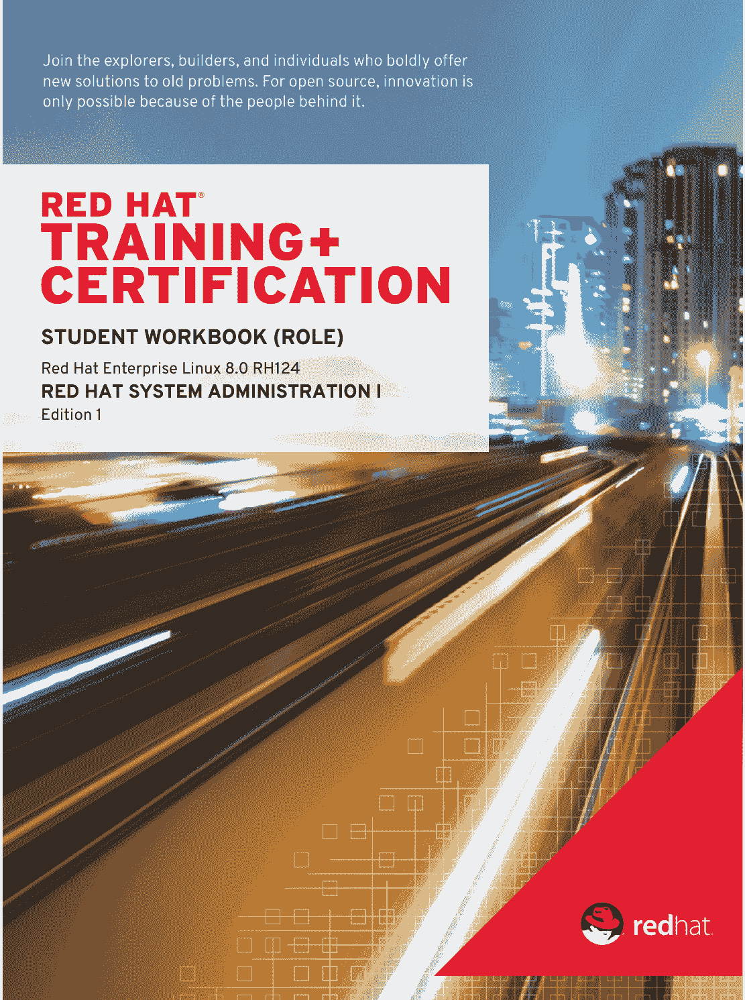

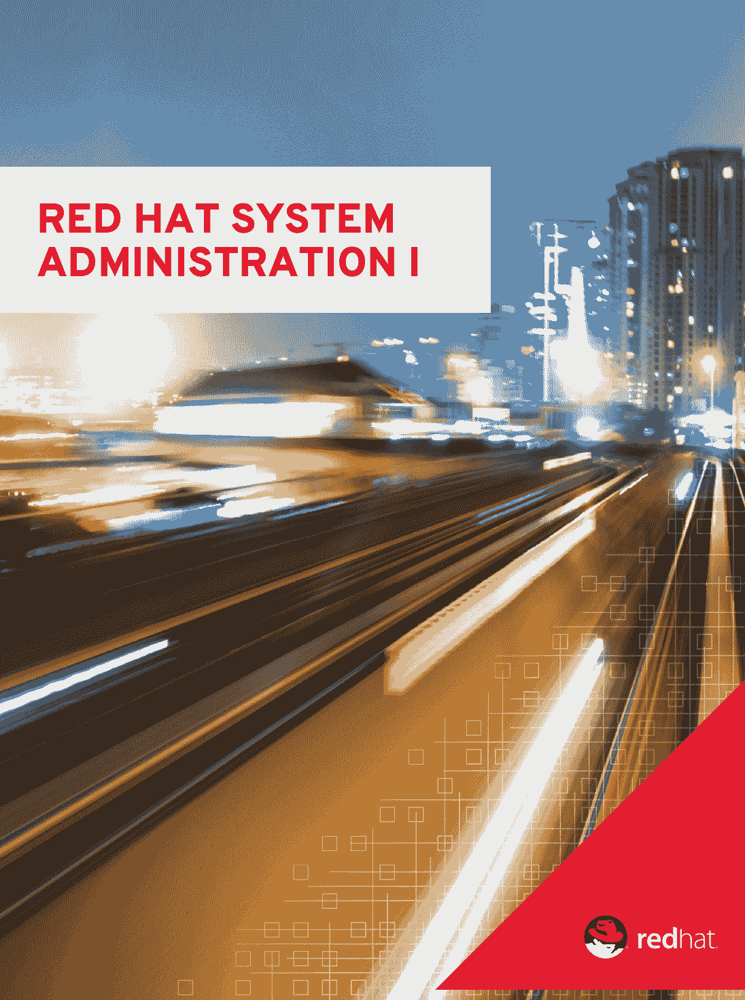

作者：Fiona Allen, Marcus Kesler, Saumik Paul, Snehangshu Karmakar, Victor Costa

编辑：Steven Bonneville, Ralph Rodriguez, David Sacco, Heather David O'Brien, Seth Kenlon

贡献者：Achyut Madhusandan, Rudolf Kastl, Rob Lcke

总结 ....................................................................................... 556

> ### 参考文献
> “参考文献”描述了哪里找到与主题相关的外部文档。
> ### 注意
> “注意”是针对当前任务的提示、快捷方法或替代方案。忽略注意不应产生负面后果，但你可能会错过让你的生活变得更轻松的技巧。
> ### 重要
> “重要”框详细说明了容易被忽略的内容：仅适用于当前会话的配置更改，或者在更新生效之前需要重启的服务。忽略标记为“重要”的框不会导致数据丢失，但可能会引起不快和沮丧。
> ### 警告
> “警告”不应被忽略。忽略警告可能会导致数据丢失。

# 引言

## 红帽系统管理

红帽系统管理 (`RH124`) 是为没有 Linux 管理经验的 IT 专业人员设计的。本课程旨在通过关注核心管理任务为学生提供“生存技能”。红帽系统管理还将通过引入命令行概念和企业级工具为学生成为全面的 Linux 管理员奠定。这些概念将在后续课程红帽系统管理 II (`RH134`) 中进一步开发。

# 课程目标

- 获取在 Red Hat Enterprise Linux 上执行核心系统管理任务的技能。
- 构建认证 Red Hat Enterprise Linux 系统管理员所需的基础知识。

# 目标读者

- 需要执行基本 Linux 管理任务（包括安装、建立网络连接、物理存储和基础安全管理）的各领域 IT 专业人员。

# 先决条件

- 本课程没有正式先决条件；然而，其他操作系统的系统管理经验将非常有帮助。

# 教室环境介绍

## 互联网与设施

网络


图 0.1：教室环境

在本课程中，用于实践活动的主要计算机系统是 `workstation`。学生还会另外另外 `servera` 和 `serverb`。这三个系统都在 `lab.example.com` DNS 域中。

所有学生计算机系统都有标准用户账户 `student`，密码为 `student`。所有系统的 `root` 密码均为 `redhat`。

## 教室机器

| 机器名称 | IP 地址 | 角色 |
|---|---|---|
| `bastion.lab.example.com` | 172.25.250.254 | 连接学生专用网络与教室服务器的网关系统（必须运行） |
| `workstation.lab.example.com` | 172.25.250.9 | 用于系统管理的图形化工作站 |
| `servera.lab.example.com` | 172.25.250.10 | 第一台服务器 |
| `serverb.lab.example.com` | 172.25.250.11 | 第二台服务器 |

`bastion` 的主要功能是充当连接学生机器的网络与教室网络之间的路由器。如果 `bastion` 宕机，其他学生机器只能访问个人学生网络上的系统。

教室中的几个系统提供支持服务。两台服务器 `content.example.com` 和 `materials.example.com` 是用于实际操作活动的软件和实验材料的来源。有关如何使用这些服务器的信息在相应活动的说明文档中提供。这些服务由 `classroom.example.com` 虚拟机提供。为了正常使用实验环境，`classroom` 和 `bastion` 应该始终运行状态。

## 控制您的系统

学生在红帽在线学习课堂（Red Hat Online learning classroom）中被分配了远程计算机。学生可以通过托管在 `rol.redhat.com` (`http://rol.redhat.com`) 的 Web 应用程序进行访问。学生使用他们的红帽客户门户凭据登录该站点。

## 控制虚拟机

你教室环境中的虚拟机通过网页进行控制。教室中每台虚拟机的状态显示在页面“在线实验室”（Online Lab）选项卡下。

### 虚拟机状态

| 虚拟机状态 | 描述 |
| --- | --- |
| STARTING (启动中) | 虚拟机正在执行启动过程。 |
| STARTED (已启动） | 虚拟机正在运行并可用（或在启动时，很快将可用）。 |
| STOPPING (停止中) | 虚拟机正在执行关机过程。 |
| STOPPED (已停止) | 虚拟机已完全关闭。启动时，虚拟机将进入到与关闭时相同的状态（磁盘已保留）。 |
| PUBLISHING (发布中) | 正在进行虚拟机的初始创建。虚拟机正在等待其他虚拟机启动。 |
| WAITING_TO_START (等待启动) | |

根据机器的状态，可以使用以下操作中的某项：

### 教室/机器操作

| 按钮或操作 | 描述 |
| --- | --- |
| PROVISION LAB (配置实验室) | 创建 ROL 课堂。创建教室所需的所有虚拟机并启动它们。完成可能需要几分钟。 |
| DELETE LAB (删除实验室) | 删除 ROL 课堂。销毁教室中的所有虚拟机。**注意：磁盘上生成的任何工作都会丢失。** |
| START LAB (启动实验室) | 启动教室中的所有虚拟机。 |
| SHUTDOWN LAB (关闭实验室) | 停止教室中的所有虚拟机。 |
| OPEN CONSOLE (打开控制台) | 在浏览器中打开新标签页并连接到虚拟机的控制台。学生可以直接登录虚拟机并运行命令。在大多数情况下，学生应该登录虚拟机并使用 `ssh` 连接到其他虚拟机。 |
| ACTION → Start (操作→启动) | 启动（电源）虚拟机。 |
| ACTION → Shutdown (操作→关机) | 正常关闭虚拟机，保留其磁盘内容。 |
| ACTION → Power Off (操作→断电) | 强制关闭虚拟机，保留其磁盘内容。这等于拔掉物理机器的电源。 |
| ACTION → Reset (操作→重置) | 强制关闭虚拟机并将磁盘重置初始状态。**注意：磁盘上生成的任何工作都会丢失。** |

在练习开始时，如果指示重置单个虚拟机节点，请对特定虚拟机点击 `ACTION → Reset`。

在练习开始时，如果指示重置所有虚拟机，请点击 `ACTION → Reset`。

如果你想在课程开始时将教室环境恢复原始状态，可以点击 `DELETE LAB` 移除整个教室环境。实验室删除后，你可以点击 `PROVISION LAB` 配置一组新的教室系统。

> 警告 `DELETE LAB` 操作无法撤销。到那时为止，你在教室环境中完成的任何工作都将丢失。

## 自动停止计时器

红帽在线学习允许学生拥有一定量的计算机时间。为了帮助节省分配的时间，ROL 课堂有一个关联的倒计时器，当计时器过期时会关闭教室环境。

要调整计时器，点击 `MODIFY` 显示“新自动停止时间”（New Autostop Time）对话框。设置教室应自动停止的小时数。点击 `ADJUST TIME` 将此更改应用于计时器设置。

## 国际化

### 用户语言选择

你的用户可能倾向于为桌面环境使用与系统默认不同的语言。他们可能还希望为自己的账户使用不同的键盘布局或输入法。

#### 语言设置

在 GNOME 环境中，用户在首次登录时可能会被提示设置他们的首选语言和输入法。如果没有，个人用户调整首选语言和输入法设置的最简单方法是使用“区域与语言”（Region & Language）应用程序。你有两种方式启动此应用程序。你可以从终端窗口运行命令 `gnome-control-center region`，或者在右上角的系统菜单中选择左下角的设置按钮（图标为交叉的螺丝刀和扳手）。

在打开的窗口中，选择“区域与语言”。点击“语言”框并从出现的列表中选择首选语言。这将更新“格式”设置为该语言的默认值。下次登录时，这些更改将完全生效。

这些设置影响 GNOME 桌面环境以及任何在其中启动的应用程序（如 `gnome-terminal`）。但是，它们不适用于通过远程系统的 `ssh` 登录访问的任何账户，或虚拟控制台（如 `tty5`）上的文本登录。


让你的 shell 环境使用与你的图形环境相同的 `LANG` 设置，即使你通过文本虚拟控制台或 `ssh` 登录也是如此。实现此的一种方法是在你的 `.bashrc` 文件中放置如下代码。此示例将把文本登录使用的语言设置为与用户 `GNOME` 桌面环境的当前设置匹配：

```
i=$(grep 'Language=/var/lib/AccountsService/users/${USER} \
| sed 's/Language=//'
if [ "$i" != "" ]; then
 export LANG=$i
fi
```

日语、韩语、中文和其他非拉丁字符集的语言可能在文本虚拟控制台上无法正常显示。

可以通过通过在命令行上设置 `LANG` 变量来使用另一种语言：

```
[user@host ~]$ LANG=fr_FR.utf8 date
```

## 简介

je. avril 25 17:55:01 CET 2019

后续命令将恢复到系统的默认输出语言。可以使用 `locale` 命令来确定 `LANG` 以及其他相关环境变量的当前值。

### 输入法设置

Red Hat Enterprise Linux 7 或更高版本中的 `GNOME 3` 自动使用 `IB` 输入法选择系统，这使得快速更改键盘布局和输入法变得简单。

“区域与语言”应用程序也可启用替代输入法。“区域与语言”窗口的“输入源”(`Input Sources`)框显示当前可用的输入法。默认情况下，英语（美国）是唯一可用方法。高亮英语（美国）并点击键盘图标更改当前键盘。

要添加另一种输入法，点击输入源窗口左下角的 `+` 按钮。会出现“添加源”窗口。选择你的语言，以及你的首选输入法或键盘布局。

当配置了多个方法时，你可以通过输入 `Super+Space` 快速在它们之间切换。`GNOME` 顶部栏也会出现状态指示器，它有两个功能：显示当前激活的输入法，并作为用于切换输入法或选择复杂输入法高级功能的菜单。

某些方法标记有齿轮，表示这些方法具有高级选项和功能。例如，日语（假名汉字）输入法允许你在拉丁文中预编辑文本，并使用向下和向上方向键选择字符。

美国用户可能也会发现这很有用对于英语（美国）键盘“英语（国际 AltGr 死键）”，它将 PC 104/105 键盘上的右 Alt 视为次级 Shift 修饰键和添加额外字符的死键激活键。还有 Dvorak 等其他布局。

> 注意

如果你知道 Unicode 代码点，可以在 `GNOME` 桌面环境中输入任何 Unicode 字符。按下 `Ctrl+Shift+U`，然后输入代码点。输入后，将显示一个下划线的 `u`，表示系统正在等待 Unicode 代码点。

例如，小写希腊字母 lambda 的代码点为 `U+03BB`，可以通过输入 `Ctrl+Shift+U`、`03BB` 然后回车来输入。

系统的默认语言设置为美国英语，使用 Unicode 的 UTF-8 编码作为字符集（`en_US.utf8`），可以在安装期间或之后进行更改。

从命令行，`root` 用户可以使用 `localectl` 命令更改系统级区域设置。如果不带参数运行 `localectl`，它将显示当前的系统级区域设置。

要设置系统级默认语言，请运行命令 `localectl set-locale LANG=locale`，其中 `locale` 是本章“语言代码参考”表格中 `LANG` 环境变量的相应值。该更改将在用户下次登录时生效，并存储在 `/etc/locale.conf` 中。

```
[root ~]# localectl set-locale LANG=fr_FR.utf8
```

在 `GNOME` 中，管理员用户可以通过点击窗口右上角的“登录”按钮，从“区域与语言”中更改此设置。更改图形登录界面的语言也将调整存储在 `/etc/locale.conf` 配置文件中的系统级默认语言设置。

> **重要：** 像 `tty4` 这样的文本虚拟控制台在显示的字体方面比运行图形环境的虚拟控制台中的终端或 `ssh` 会话的伪终端更局限。例如，日语和中文字符在文本虚拟控制台上可能无法按预期显示。出于此原因，您应该考虑在系统范围内使用英语或其他带有拉丁字母集的语言。

同样，文本虚拟控制台在支持的输入法方面也更为局限，这种管理是与图形桌面环境分开的。可以通过 `localectl` 为文本虚拟控制台和图形环境配置可用全局输入设置。更多信息请参阅 `localectl(1)` 和 `vconsole.conf(5)`。

## 语言包

名为 `langpacks` 的特定 RPM 包用于安装添加特定语言支持的语言包。这些语言使用依赖关系来自动安装额外的 RPM 包，其中包含系统中其他软件包的位置文件、字典和翻译。

要列出已安装和可能安装的包，请使用 `yum list langpacks-*`：

```
[root ~]# yum list langpacks-*
Updating Management repositories.
Updating Subscription Management repositories.
Installed Packages
langpacks-en               1.0-12.el8      @AppStream
Available Packages
langpacks-af.narch         1.0-12.el8      rhel8-for-x86_64-appstream-rpm
langpacks-am.narch         1.0-12.el8      rhel8-for-x86_64-appstream-rpm
langpacks-ar.narch         1.0-12.el8      rhel8-for-x86_64-appstream-rpm
langpacks-as.narch         1.0-12.el8      rhel8-for-x86_64-appstream-rpm
langpacks-ast.narch        1.0-12.el8      rhel8-for-x86_64-appstream-rpm
...output omitted...
```

要添加语言支持，请安装相应的 `langpacks` 包。例如，上面的命令支持法语：

```
[root ~]# yum install langpacks-fr
```

使用 `yum repository --whatsupplements` 来确定 `langpack` 可能会安装哪些 RPM 包：

```
[root@host ~]# yum repository --whatsupplements langpacks-fr
Updating Subscription Management repositories.
Updating Subscription Management repositories.
Last metadata check: 08:13:33 ago Wed 06 Feb 2019 10:47:24 AM CST.
glibc-langpack-fr-0.2.20-18.el8.x86_64
gnome-getting-started-docs-fr-0.3.20-1.el8.noarch
hunspell-fr-0.6.2-1.el8.noarch
hyphen-fr-0.3.0-1.el8.noarch
libreoffice-langpack-fr-1.6.0.6-9.el8.x86_64
man-pages-fr-0.3.70-16.el8.noarch
mythes-fr-0.2.3-10.el8.noarch
```

> **重要** 包使用 RPM 弱依赖，以便仅在核心包需要安装补充包时才进行安装。例如，如前面的示例所示，在安装 `langpacks-fr` 时，只有在也安装了 `mythe` 词典的情况下，才会安装 `mythe` 包。如果随后在该系统中安装了 `mythe`，则 `mythe-fr` 包将通过已安装的 `langpacks-fr` 包的弱依赖自动安装。

> 参考文献：`locale(7)`、`localectl(1)`、`locale.conf(5)`、`vconsole.conf(5)`、`unicode(7)` 和 `utf-8(7)` 手页。图形桌面环境 X11 布局名称与其在 `localectl` 中的名称之间的转换可以在文件 `/usr/share/X11/xkb/rules/base.lst` 中找到。

## 语言代码参考

> 注意：此表可能未反映系统中所有可用 `langpacks`。使用 `yum info langpacks-SUFFIX` 获取关于任何特定 `langpacks` 包的更多信息。

语言代码

| 语言 | LANGPACK 后缀 | $LANG 值 |
| :--- | :--- | :--- |
| 英语 (美国) | en | en_US.utf8 |
| 阿斯米亚语 | as | as_IN.utf8 |
| 孟加尔语 | bn | bn_IN.utf8 |
| 简体中文 | zh_CN | zh_CN.utf8 |


| 繁体中文 | `zh_TW` | `zh_TW.utf8` |
| 法语 | `fr` | `fr_FR.utf8` |
| 德语 | `de` | `de_DE.utf8` |
| 古拉特语 | `gu` | `gu_IN.utf8` |
| 印地语 | `hi` | `hi_IN.utf8` |
| 意大利语 | `it` | `it_IT.utf8` |
| 日语 | `ja` | `ja_JP.utf8` |
| 卡纳纳达语 | `kn` | `kn_IN.utf8` |
| 韩语 | `ko` | `ko_KR.utf8` |
| 马拉雅姆语 | `ml` | `ml_IN.utf8` |
| 马拉地语 | `mr` | `mr_IN.utf8` |
| 奥里亚语 | `or` | `or_IN.utf8` |
| 葡萄牙语 (巴西) | `pt` | `pt_BR.utf8` |
| 旁遮普语 | `pa` | `pa_IN.utf8` |
| 俄罗斯语 | `ru` | `ru_RU.utf8` |
| 西班牙语 | `es` | `es_ES.utf8` |
| 泰米语 | `ta` | `ta_IN.utf8` |
| 泰卢固语 | `te` | `te_IN.utf8` |

# 第一章 | Red Hat Enterprise Linux 入门

从一开始就内置了这些功能，并且假设一直是能够启用这些重要的能力。

- Linux 是一个模块化的操作系统，允许您轻松地替换或删除组件。
系统组件可以根据需要进行升级和更新。一个 Linux 系统可以是一个通用的开发工作站，也可以是一个极其精简的软件设备。

## 什么是开源软件？

开源软件是带有任何人都可以使用、研究、修改和共享源代码的软件。

源代码是用于创建程序的人类可读指令集。它可能被解释为脚本，也可以被编译成计算机运行的二进制可执行文件。源代码一旦创建，它将获得版权保护，版权所有者持有软件可以复制、适配和分发的条款。用户可以在软件许可协议下使用这些软件。

某些软件的源代码只有创建它的个人、团队或组织才能查看、更改或分发。这种软件有时被称为“专有”或“闭源”软件。通常，许可只允许终端用户运行程序，而不提供源代码的访问权限，或仅提供严格限制的访问权限。

开源软件则不同。当版权所有者根据开源许可提供软件时，他们授予了用户运行程序的权利，还授予了免费向他人查看、修改、编译和重新分发源代码的权利。

开源促进了协作、共享、透明和快速创新，因为它鼓励原始开发者之外的人对软件进行修改和改进，并与他人分享。

仅仅因为它是开源的并不意味着它不应该用于或商业提供。开源是许多组织运营的关键部分。某些开源许可允许代码在闭源产品中重用。人们可以出售开源代码，但真正的开源许可条款通常允许客户重新分发源代码。最常见的情况是，像 Red Hat 这样的供应商为部署、支持和扩展基于开源产品的解决方案提供商业化帮助。

开源对用户有许多益处：

- 控制权：查看代码的运作并对其进行更改以改进它。
- 培训：从真实世界的代码中学习，并开发出更有用的应用程序。
- 安全：检查敏感代码，无论是否有原始开发者的帮助都可以进行修复。
- 稳定性：代码可以在原始开发者或分发者丢失后继续存在。

底线是，开源允许通过协作创建出更好的软件，并获得更高的投资回报。

## 开源许可的类型

提供开源软件的方法不止一种。软件许可的条款控制源代码如何与其他代码结合或重用，且存在数数百种不同的开源许可。然而，为了被称为开源，许可必须允许用户自由地使用、查看、更改、编译和分发代码。

有两类开源许可尤为重要：

- 传染性许可（Copyleft licenses）旨在鼓励代码共享。
- 宽松性许可（Permissive licenses）旨在最大化重用性。

传染性许可，或称为“相同开源”（share-alike）许可，要求任何分发源代码（无论是否修改过）的人都必须将复制、更改和分发代码的自由传递给他人。这些许可的基本优势是它们有助于保持现有代码及代码改进的开放，并增加可用开源代码的量。常见的传染性许可包括 GNU 通用公共许可证 (`GPL`) 和较级 GNU 通用公共许可证 (`LGPL`)。

宽松性许可旨在最大化源代码的重用性。只要保留了版权声明和许可声明，用户就可以出于任何目的使用源代码，包括在更具限制性或专有的许可下重用代码。这使得代码的重用变得非常容易，但也面临鼓励仅专有增强的风险。几种常用的宽松性开源许可包括 MIT/X1 许可证、`BSD` 许可证和 `Apache License 2.0`。

## 谁在开发开源软件？

认为开源完全由“志愿者军团”甚至由任何个人加加 Red Hat 开发是一种误区。当今的开源开发绝大多数都是专业人员的。许多开发者获得其组织的薪酬，参与开源项目，以构建并贡献他们及其客户所需的增强功能。

志愿者和学术社区发挥着重要作用，并能做出关键贡献，特别是在新的技术领域。正式开发与非正式开发的结合提供了一个高度动态且高产效的环境。

## 谁是 Red Hat？

Red Hat 是全球领先的开源软件解决方案提供商，利用社区驱动的方法提供可靠且高性能的 Linux、中间件、存储和虚拟化技术。Red Hat 的使命是成为客户、贡献者和合作伙伴社区的催化剂，以开源的方式创造更好的技术。

Red Hat 的角色是帮助客户连接开源社区及其合作伙伴，以有效地使用开源解决方案。Red Hat 积极参与并支持开源社区，多年的经验使该公司深信开源对 IT 行业未来的重要性。

Red Hat 以参与 Linux 社区和 Red Hat Enterprise Linux 发行版而闻名。然而，Red Hat 也活跃在其他开源社区，包括以 JBoss 开发者社区为中心的中间件项目、虚拟化解决方案、OpenStack 和 OpenShift 等云技术，以及基于 Ceph 和 Gluster 的存储项目等。

## 什么是 Linux 发行版？

Linux 发行版是由 Linux 内核以及支持程序和库构建的安装操作系统。一个完整的 Linux 并不是由单一组织开发的，而是由一组独立的开源开发社区通过处理各个软件组件共同开发的。发行版为用户提供了安装和管理 Linux 系统的简单方法。

1991 年，一位名为 Linus Torvalds 的年轻计算机学生开发了一个名为 Linux 的类 Unix 内核，并根据 `GPL` 作为开源软件许可。内核是操作系统的组件，负责管理硬件、内存和运行程序的调度。此 Linux 内核可以使用其他开源软件进行补充，例如来自 GNU 项目的工具和程序、来自 MIT X Window系统的图形界面，以及许多其他开源组件（如 Sendmail 邮件服务器或 Apache HTTP 服务器），以构建一个完整的源码类 Unix 操作系统。

然而，Linux 用户面临的挑战之一是从不同的来源组装所有这些部分。在 Linux 历史非常早期，Linux 开发者就开始工作提供一种预构建和测试过的工具发行版，用户可以下载并快速设置他们的 Linux 系统。

存在许多不同的 Linux 发行版，对于其发行版提供的软件的选择和支持有不同的目标和标准。然而，发行版通常具有许多共同特征：

- 发行版由 Linux 内核和支持的用户程序组成。
- 发行版可以是小型的单一用途的，也可以包含数千个开源程序。
- 发行版必须提供一种安装和更新发行版及其组件的方法。
- 发行版的提供商必须支持软件，并且理想直接参与该软件的开发。

Red Hat Enterprise Linux 是 Red Hat 的商业化 Linux 发行版。

## Red Hat Enterprise Linux 的开发

Red Hat 通过多阶段过程将开源软件集成到 RHEL 中。

- Red Hat 参与支持各个开源项目。它贡献代码、开发者资源和其他支持，经常与其他 Linux 发行版的开发者协作。这有助于提高软件的整体质量。
- Red Hat 赞助并将开源项目集成到社区驱动的 Linux 发行版 Fedora 中。Fedora 提供了一个免费的工作环境，可以作为开发实验室和试验场，用于整合到其商业化产品中的功能。
- Red Hat 对软件进行稳定化处理以确保其适用于长期支持和标准化，并将其集成到其企业级发行版 RHEL 中。

## 第 1 章 | 开始 Red Hat Enterprise Linux


### 参与

(上游项目)

我们参与并创建由社区驱动的上游项目。

### 整合

(社区平台)

我们整合上游项目，培养开源社区平台。

### 稳定

(支持的产品与解决方案)

我们结合丰富的服务和认证生态系统，对这些平台进行商业化运营。

Fedora 是一个社区项目，负责制作和发布一个完整的、免费的基于 Linux 的操作系统。红帽（Red Hat）赞助该社区并与社区代表合作，将最新的上游软件集成到一个快速迭代且安全的发行版中。Fedora 项目将所有贡献回馈给自由开源世界，任何人都可以参与。

然而，Fedora 专注于创新和卓越，而非长期稳定性。每六个月会进行一次新的大版本更新，并可能带来重大变化。Fedora 仅支持约一年的发布（两次大更新），这使其不太适用于企业使用。


# Red Hat Enterprise Linux (RHEL) 是红帽提供的企业级、社区支持的 Linux 发行版

它是开源社区的领先平台，而不仅仅是开源项目的集合。RHEL 经过了广泛测试，拥有庞大的合作伙伴生态系统、硬件软件认证、咨询服务以及多层支持和维护保障。

红帽基于 RHEL 的主要更新基于 Fedora。然而，红帽可以选择要包含的软件包，进行进一步的增强（并回馈给上游项目和 Fedora），并做出符合客户需求的配置决策。红帽帮助供应商和客户参与开源社区，并与上游开发人员合作解决解决方案和问题。

Red Hat Enterprise Linux 使用基于订阅的发行模型。由于它是开源的，因此这并不是许可费用。相反，它支付的是支持、维护、更新、安全补丁、访问红帽客户门户（http://access.redhat.com/）知识库等的费用。客户支付的是长期支持、专业知识、承诺以及需要时的协助。

当大版本更新可用时，客户可以在方便的情况下迁移无需额外付费。这简化了系统经济和实用方面的管理。

## CentOS

CentOS 是一个社区驱动的 Linux 发行版，源自许多开源的 Red Hat Enterprise 代码库和其他来源。它是免费的、易于的，并由活跃的志愿者社区提供和支持，该社区独立于红帽运营。

### CentOS 和 Red Hat Enterprise Linux 主要区别

| CentOS | RED HAT ENTERPRISE LINUX |
| --- | --- |
| 仅限自支持。 | 提供多个支持级别，包括工作期间的标准支持、针对关键问题的 24x7 高级支持，以及入门级支持订阅。可以在环境中组合使用不同的 SLA 级别。 |
| 在官方 RHEL 发布后开始提供生产错误修正（Errata）。 | 由内部开发人员快速响应问题，在官方 RHEL 发布前可能提供热补丁。 |
| 为最新的次要版本提供软件包更新，直到 RHEL 维护支持 2 阶段结束。 | 通过扩展支持 (EUS) 计划为旧的次要版本提供更新，并通过扩展生命支持 (ELS) 计划在维护支持 2 结束后的多年提供更新。 |
| 通常未被 SAS、SAP 和 Oracle 等供应商认证为支持平台。 | 来自数百个独立软件供应商 (ISV) 的数千个认证应用程序。 |
| 通过论坛、邮件列表、聊天以及项目网站和其他社区来源获取帮助和文档资源。 | 通过红帽客户门户 Labs 获取文档、参考架构、案例研究和知识库文章，这是一组你可以用来提高性能、识别安全问题或协助解决任何问题的工具。通过 Red Hat Insights 进行可选的系统分析，这是一个基于 SaaS 的工具，可提供与性能、可用性、稳定性和安全相关的实时评估。 |

有很多方法可以尝试 Red Hat Enterprise Linux。一种方法是从 `https://access.redhat.com/products/red-hat-enterprise-linux/evaluation` 网站下载评估版。页面包含补充信息的链接。

红帽还通过 `https://developer.redhat.com` 上的红帽开发者计划为许多产品提供免费订阅。这些订阅允许开发者快速开发、原型设计、测试并演示他们的软件，以部署在相同的企业产品中。

另一种方法是部署通过云提供商提供的 Red Hat Enterprise Linux 实例。例如，红帽在 Amazon AWS 市场中提供了 Red Hat Enterprise Linux 的官方 AMI。

欲需更多信息，请访问本节末尾引用的 Red Hat Enterprise Linux“入门”页面。

> ### 开始使用 Red Hat Enterprise Linux
> 
> `https://access.redhat.com/products/red-hat-enterprise-linux#getstarted`

### 开源之道

`https://opensource.com/open-source-way`

## 测验

### 开始使用 RED HAT ENTERPRISE LINUX

为以下问题选择正确答案：

- 1. 以下哪两项是开源软件对用户的益处？（选择两项）
  a. 代码可以在原始开发者或分发者丢失后生存。
  b. 敏感的代码选项受到保护且仅原始开发者可用。
  c. 你可以从真实的代码中学习并开发更有效的应用程序。
  d. 只要在公共仓库中代码就是开源的，但在包含闭源软件时许可可能会更改。

- 2. 以下哪两项是红帽开发产品并与社区互动的方式？（选择两项）
  a. 赞助并将开源项目集成到社区驱动的 Fedora 项目中。
  b. 开发仅限红帽发行版的特定集成工具。
  c. 参与上游项目。
  d. 重新打包并重新许可社区产品。

- 3. 下列哪些描述了 Linux 的优点？（选择两项）
  a. Linux 完全由志愿者开发，使其成为低成本的操作系统。
  b. Linux 是模块化的，可以配置为全图形化桌面或小型设备。
  c. Linux 在每个版本发布后以已知状态锁定至少一年，使开发自定义软件更加容易。
  d. Linux 包含强大且可脚本的命令行界面，使自动化和配置更加容易。

## 总结

在本章中，你学习了：

- 开源软件是任何人都可以自由使用、学习、修改和共享的源代码的软件。
- Linux 发行版是基于 Linux 内核构建的、支持用户程序和库的可安装操作系统。
- 红帽公司（Red Hat）参与支持并向开源项目贡献代码，通过赞助并将项目软件集成到社区驱动的发行版中，并稳定这些软件以提供作为受支持的企业级产品。
- 红帽企业级 Linux（Red Hat Enterprise Linux）是红帽提供的开源、企业级、商业支持的 Linux 发行版。

# 第 2 章

## 访问命令行

### 目标

登录 Linux 系统并使用 shell 运行简单命令。

### 目标

- 在本地文本控制台上登录 Linux 系统并使用 shell 运行简单命令。
- 使用 GNOME 3 桌面环境登录 Linux 系统，并在终端程序的 shell 提示符中运行命令。
- 使用制表键补全、命令历史和命令编辑快捷键在 Bash shell 中运行命令以节省时间。

### 节内容

- 访问命令行（及测验）
- 使用桌面访问命令行（及引导性练习）
- 使用 Bash Shell 执行命令（及测验）

### 实验

访问命令行

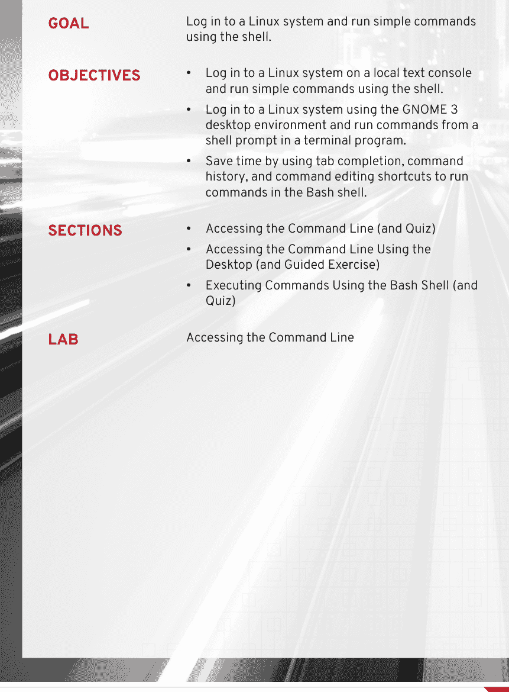

## 访问命令行

### 目标

完成本节后，你应该能够登录 Linux 系统并使用 shell 运行简单命令。

### Bash Shell 简介

命令行是一个基于文本的界面，可用于向计算机系统输入指令。Linux 命令行由一个名为 shell 的程序提供。多年来，人们开发了 shell 程序的各种选项，可以配置不同的用户使用不同的 shell。然而，大多数用户仍然坚持使用当前的默认。

红帽企业级 Linux 的默认 shell 是 GNU Bourne-Again Shell (`bash`)。`bash` 是 UNIX 类系统中最成功的 shell 之一——鲍恩 shell (`Bourne Shell`, `sh`) 的改进版本。

当以交互方式使用 shell 时，它在等待用户输入命令时会显示一个字符串。这被称为 shell 提示符（shell prompt）。当普通用户启动 shell 时，默认提示符以 `$` 字符结束，如下所示。

```
[user@host ~]$
```

如果 shell 以超级用户 `root` 的身份运行，则 `$` 将被 `#` 字符替换。这能更明显地表明它是超级用户 shell，有助于避免可能影响整个系统的事故和错误。超级用户 shell 如下文所示。

```
[root@host ~]#
```

使用 `bash` 执行命令可以非常强大。`bash` shell 提供了一种脚本的语言，可以支持任务自动化。`bash` shell 可以简化或实现那些使用图形化工具难以高效完成的操作。

> 概念上类似于微软 Windows 较新版本中的命令行解释器 `cmd.exe`，尽管 `bash` 拥有更复杂的脚本语言。它也与 Windows 7 和 Windows Server 2008 R2 及其后续版本中的 Windows `PowerShell` 类似。使用 Terminal 实用程序的 Apple Mac 管理员可能会高兴地发现，`bash` 是 macOS 的默认 shell。

### shell 基础

在 shell 提示符处输入的命令由三个基本部分组成：

- 运行运行的命令
- 调整命令行为的选项（Options）
- 参数（Arguments），通常是命令的目标

**命令（command）** 是要运行的程序名称。它可能后跟一个或多个选项，这些选项会调整命令的行为及其执行的内容。选项可能以一个或两个横线（`-a` 或 `--all`）开头，以与参数区分来。参数可能后跟一个或多个参数，这些通常标识命令应该操作的目标。

例如，命令 `usermod -l user01` 包含一个命令 **(usermod)**，一个选项 **(-l)** 和一个参数 **(user01)**。


# 第 2 章 访问命令行

用户的私钥文件，其名为 `mylab.pem`。匹配的公钥已作为授权密钥设置在 `remoteuser` 账户中。

```
[user@host]$ ssh -i mylab.pem remoteuser@remotehost
[remoteuser@remotehost]$
```

对于这项工作，私钥文件必须仅对其所有者可读。在前面的示例中，私钥位于 `mylab.pem` 文件中，可以使用 `chmod 600 mylab.pem` 来确保这一点。有关如何设置文件权限将在后面的章节中进行详细讨论。

用户可能配置了会自动尝试的私钥，但该部分的讨论超出了本节的范围。本节末尾的“参考文献”包含了有关该主题更多信息的链接。

> 注意：当你第一次登录到新机器时，`ssh` 将提示出一个警告，说明它无法确认主机的真实性：
```
[user@host]$ ssh -i mylab.pem remoteuser@remotehost
The authenticity of 'remotehost' (192.0.2.42)' can't be established.
ECDSA fingerprint is 47:8f:b2:cd:fa:68:06:ee:d8:03:14:bb:29:14:a3.
Are sure you want to continue connecting (yes/no)? yes
remoteuser@remotehost]$
```

每当你使用 `ssh` 连接到远程主机时，远程主机都会发送其主机密钥来识别身份并帮助建立加密通信。`ssh` 命令会与保存的密钥列表进行比较，以确保其没有发生变化。如果主机密钥发生了变化，可能表明有人正试图伪装该主机以劫持连接，这被称为中间人攻击。在 SSH 中，主机密钥用于防止中间人攻击；主机密钥对于每个会话都是唯一的，并且需要定期更改，并在怀疑遭到破坏时进行更改。

如果你的本地机器没有为远程主机保存主机密钥，就会收到此警告。如果你输入 `yes`，远程主机发送的密钥将被接受并保存供以后参考。登录将继续，你再次连接到此主机时不会再次看到此消息。如果你输入 `no`，主机密钥将被拒绝并关闭连接。

如果本地机器保存了主机密钥，且它与远程主机实际发送的密钥不匹配，连接将带有警告自动关闭。

## 注销

当你完成 shell 使用并想要退出时，可以选择几种方法之一来结束会话。你可以输入 `exit` 命令来终止当前的 shell 会话。或者通过按下 `Ctrl+D` 完成会话。

以下是用户退出 SSH 会话的示例：
```
[remoteuser@remotehost ~]$ exit
logout
Connection to remotehost.
[user@~]$
```

## 参考文献

- `intro(1)`, `bash(1)`, `console(4)`, `pts(4)`, `ssh(1)` 和 `ssh-keygen(1)` 手页

注意：`console(4)` 手页中涉及 `init(8)` 和 `inittab(5)` 的某些细节已过。

有关 OpenSSH 和公钥身份验证的更多信息，请参考《红帽企业 Linux 8 配置和管理安全》中的“使用 OpenSSH 在两个系统之间的安全通信”章节：https://access.redhat.com/documentation/en-us/red_hat_enterprise_linux/8-beta/html-single/configuring_and_managing_security/index#assembly_using-communications-with-openssh-configuring-and-managing-security

## 注意

有关如何阅读手页和其他在线帮助文档的说明位于下一节的末。

## 测验

### 访问命令行

为以下问题选择正确答案：

- 1. 哪个术语描述执行字符串执行命令的解释器？

  a. 命令 (Command)

  b. 控制台 (Console)

  c. Shell

  d. 终端 (Terminal)

- 2. 哪个术语描述指示交互式 shell 等待用户输入命令的视觉提示？

  a. 参数 (Argument)

  b. 命令 (Command)

  c. 选项 (Option)

  d. 提示符 (Prompt)

- 3. 哪个术语描述要运行的程序的名称？

  a. 参数 (Argument)

  b. 命令 (Command)

  c. 选项 (Option)

  d. 提示符 (Prompt)

- 4. 哪个术语描述调整命令行为的命令行部分？

  a. 参数 (Argument)

  b. 命令 (Command)

  c. 选项 (Option)

  d. 提示符 (Prompt)

- 5. 哪个术语描述命令应该操作的目标的命令行部分？

  a. 参数 (Argument)

  b. 命令 (Command)

  c. 选项 (Option)

  d. 提示符 (Prompt)

- 6. 哪个术语描述用于与系统交互的硬件显示器键盘？

  a. 物理控制台 (Physical Console)

  b. 虚拟控制台 (Virtual Console)

  c. Shell

  d. 终端 (Terminal)

- 7. 哪个术语描述可以支持独立登录会话的多个逻辑控制台之一？

  a. 物理控制台 (Physical Console)

  b. 虚拟控制台 (Virtual Console)

  c. Shell

  d. 终端 (Terminal)

- 8. 哪个术语描述为 shell 会话提供输出显示和输入键盘的接口？

  a. 控制台 (Console)

  b. 虚拟控制台 (Virtual Console)

  c. Shell

  d. 终端 (Terminal)

## 答案

### 访问命令行

为以下问题选择正确答案：

- 1. 哪个术语描述执行字符串执行命令的解释器？

  a. 命令 (Command)

  b. 控制台 (Console)

  c. Shell

  d. 终端 (Terminal)

- 2. 哪个术语描述指示交互式 shell 等待用户输入命令的视觉提示？

  a. 参数 (Argument)

  b. 命令 (Command)

  c. 选项 (Option)

  d. 提示符 (Prompt)

- 3. 哪个术语描述要运行的程序的名称？

  a. 参数 (Argument)

  b. 命令 (Command)

  c. 选项 (Option)

  d. 提示符 (Prompt)

- 4. 哪个术语描述调整命令行为的命令行部分？

  a. 参数 (Argument)

  b. 命令 (Command)

  c. 选项 (Option)

  d. 提示符 (Prompt)

- 5. 哪个术语描述命令应该操作的目标的命令行部分？

  a. 参数 (Argument)

  b. 命令 (Command)

  c. 选项 (Option)

  d. 提示符 (Prompt)

- 6. 哪个术语描述用于与系统交互的硬件显示器键盘？

  a. 物理控制台 (Physical Console)

  b. 虚拟控制台 (Virtual Console)

  c. Shell

  d. 终端 (Terminal)

- 7. 哪个术语描述可以支持独立登录会话的多个逻辑控制台之一？

  a. 物理控制台 (Physical Console)

  b. 虚拟控制台 (Virtual Console)

  c. Shell

  d. 终端 (Terminal)

- 8. 哪个术语描述为 shell 会话提供输出显示和输入键盘的接口？

  a. 控制台 (Console)

  b. 虚拟控制台 (Virtual Console)

  c. Shell

  d. 终端 (Terminal)


图 2.2：打开的消息栏的特写

你可以查看并编辑你的账户使用的 GNOME 键盘快捷键。打开顶部栏右侧的系统菜单。点击左侧菜单底部的 `Settings`（设置）按钮。在打开的应用程序窗口中，从左侧面板选择 `Devices`（设备） → `Keyboard`（键盘）。右侧面板将显示你当前的快捷键设置。

> **注意**
某些键盘快捷键（如功能键或 `Super` 键）可能很难发送到虚拟机。这是因为这些快捷键使用的特殊按键可能会被你的本地操作系统捕获，或者被你用于访问虚拟机图形桌面的应用程序所捕获。

# 第 2 章 | 访问命令行

> 重要
在红帽（Red Hat）目前的虚拟训练和自学训练环境中，使用 `Super` 键可能会有些棘手。你可能无法直接使用键盘上的 `Super` 键，因为在教室环境中，你的浏览器通常不会将其传递给虚拟机。


在浏览器窗口顶部的 Ravelo Systems 处，右侧应该有一个键盘图标。点击该图标，将打开一个屏幕键盘。再次点击将关闭屏幕键盘。

Ravelo 屏幕键盘将 `Super` 视为修饰键，在按下另一个键时通常会按住它。如果你点击一次，它会变成黄色，表示该键正被按下。因此，要在 Ravelo 屏幕键盘上输入 `Super+M`，请点击 `Super`，然后点击 `M`。

如果你只是想在 Ravelo 屏幕键盘上按下并释放 `Super`，你需要点击两次。第一次点击是“按住” `Super` 键，第二次点击是释放它。

Ravelo 屏幕键盘将其视为修饰键（如 `Super`）的其他键还有 `Shift`、`Ctrl`、`Alt` 和 `Caps`。`Esc` 和 `Menu` 键被视为普通键，而**不是**修饰键。

## 工作空间 (WORKSPACES)

工作空间是具有不同应用程序窗口的桌面屏幕。这些可以通过按任务对打开的窗口分组来组织工作环境。例如，用于执行特定系统维护活动（如设置新服务器）的窗口可以分组在一个工作空间，而电子邮件和其他通信应用程序可以分组在另一个工作空间。

切换工作空间有两种简单的方法。其中一种是最快的方法，即使用 `Ctrl+Alt+UpArrow`（向上箭头）或 `Ctrl+Alt+DownArrow`（向下箭头）顺序切换工作空间。第二种是切换到活动概览（Activities overview）并点击所需的工作空间。

使用活动概览的优势是可以使用屏幕右侧的 `工作空间选择器`（workspace selector）和屏幕中心的 `窗口概览`（windows overview）在工作空间之间点击并拖拽窗口。

> 重要

与 `Super` 类似，在红帽目前的虚拟训练和自学训练环境中，`Ctrl+Alt` 键组合通常不会通过你的浏览器传递给虚拟机。

你可以使用 Ravelo 屏幕键盘输入这些组合来切换工作空间。至少需要两个工作空间在使用。使用 Ravelo 屏幕键盘并点击 `Ctrl`、`Alt`，然后点击 `UpArrow`（向上箭头）或 `DownArrow`（向下箭头）。

然而，在这些训练环境中，通常避免键盘快捷键和 Ravelo 屏幕键盘更简单。通过点击 `Activities`（活动）按钮，然后在活动概览右侧的工作空间选择器中点击你想切换的工作空间来切换工作空间。

## 启动终端 (START A TERMINAL)

要在 GNOME 中获取 shell 提示符，请启动图形应用程序，如 GNOME Terminal。有几种方法可以实现。下面列出了两种常用的方法：

- 从活动概览，从启动（dash）中选择 Terminal（可以在收藏区域找到，或者通过网格按钮（位于 Utilities 内）找到它，或者在窗口概览顶部的字段中搜索）。
- 按 `Alt+F2` 键开始打开输入命令框并输入 `gnome-terminal`。

当终端窗口打开时，会启动图形终端程序的用户显示 shell 提示符。shell 提示符和终端窗口的标题栏显示当前用户名、主机名和工作目录。

## 锁定屏幕或注销 (LOCKING THE SCREEN OR LOGGING OUT)

锁定屏幕或完全注销可以通过顶部栏最右侧的系统菜单完成。

要锁定屏幕，从右上角的系统菜单中，点击菜单底部的锁定按钮或使用 `Super+L`（这可能比 Windows+L 更容易记忆）。如果图形会话闲置几分钟，屏幕也会锁定。

会出现一个锁定屏幕，显示系统时间和登录用户的名称。要解锁屏幕，选择 Enter 或 Space 键升起锁定屏幕帘，然后在锁定屏幕上输入该用户的密码。

要登出并结束当前图形登录会话，选择顶部栏右上角的系统菜单，并选择（User）（用户）-> Log Out（注销）。将显示一个窗口，提供取消（Cancel）或确认注销操作的。

## 关机或重启系统 (POWERING OFF OR REBOOTING THE SYSTEM)

要关机，从右上角的系统菜单中，点击菜单底部的电源按钮或使用 `Ctrl+Alt+Del`。在对话框中，你可以选择关机（Power Off）或重启（Restart）机器，或取消（Cancel）操作。如果你不做出选择，将保持现状。

## 引导性练习 (GUIDED EXERCISE)

## 使用桌面访问命令行 (ACCESSING THE COMMAND LINE USING DESKTOP)

### 在开始之前 (BEFORE YOU BEGIN)

在此练习中，你将从图形界面访问命令行。

### 预期结果 (OUTCOMES)

你应该能够从图形界面访问命令行。

## 使用 BASH SHELL 执行命令

### 目标

完成本节后，你应该能够学会使用 bash 在 shell 提示符中运行命令来节省时间。

### 基础命令语法

GNU Bourne-Again Shell (`bash`) 是一个解释用户输入命令的程序。输入到 shell 中的每个字符串最多包含三个部分：命令、选项（通常以 `-` 或 `--` 开头）和参数。输入 shell 的每个单词之间通过空格隔开。命令是安装在系统上的程序名称。每个命令都有自己的选项和参数。

当你准备好执行某个命令时，按下回车键（Enter）。请在每行上单独输入一个命令。命令的输出将在下一个 shell 提示符出现之前显示。

```
user@host$ whoami
user
user@host$
```

如果你想在单行中输入多个命令，请使用分号（`;`）作为命令分隔符。分号是称为“元字符”（metacters）的字符的一员，这些字符对 bash 具有特殊含义。在这种情况下，两个命令的输出都将在下一个 shell 提示符出现之前显示。

下面的示例展示了如何在命令行上组合两个命令（`command1` 和 `command2`）。

```
user@host$ command1;command2
```

### 简单命令示例

`date` 命令显示当前日期和时间。超级用户也可以用它设置系统时钟。以加号（`+`）开头的参数指定了日期的格式字符串。

```
user@host ~$ date
Sat Jan 26 08:13:50 IST 2019
user@host ~$ date %+R
08:13
user@host ~$ date +x
01/26/2019
```

`passwd` 命令更改用户密码。默认情况下，`passwd` 配置为在允许更改之前需要一个强密码。密码由小写字母、大写字母、数字和符号组成，且不基于字典单词。

### 第 2 章 | 访问命令行

超级用户可以使用 `passwd` 命令更改其他密码。

```
[user@host ~]$ passwd
Changing password for user.
Current password: old_password
New password: new_password
Retype password: new_password
passwd: all authentication tokens updated successfully.
```

Linux 不需要通过文件扩展名来按类型对文件进行分类。`file` 命令会扫描文件的开头并显示其类型。要分类的文件作为命令的参数传入。

```
[user@host ~]$ file /etc/passwd
/etc/passwd: ASCII text
[user@host ~]$ file /bin/passwd
/bin/passwd: setuid ELF 64-bit LSB shared object, x86-64, version 1
(SYSV), dynamically linked, interpreter /lib64/ld-linux-x86-64.so.2
for GNU Linux 3.2, BuildID[sha1]=a3637110e27e9a48dcd9f38b4ae4338d32d0e4,
stripped
[user@host ~]$ file /home
/home: directory
```

### 查看文件内容

Linux 中简单且常用的命令之一是 `cat`。`cat` 命令允许你创建一个或多个文件、查看文件内容、合并多个文件并将文件内容重定向到终端。示例展示了如何查看 `/etc/passwd` 文件的内容。

```
[user@host ~]$ cat /etc/passwd
root:x:0:0:root:/root:/bin/bash
bin:x:1:1:bin:/sbin/nologin
deamon:x:2:2:daemon:/sbin/nologin
adm:x:3:4:adm:/var/adm:/sbin/nologin
... omitted ...
```

使用以下命令显示多个文件的内容。

```
[user@host ~]$ cat file1 file2
Hello World!
Introduction to Linux commands.
```


某些文件很长，终端的空间不足以显示它们。`cat`命令不会分页显示文件内容。`less`命令每次显示文件的一页并让你悠闲地滚动。`less`命令允许你向前向后翻页超出终端窗口的文件。使用向上箭头（UpArrow）和向下箭头（DownArrow）进行滚动。按 Q 退出命令。

`head`和`tail`分别显示文件的开头和结尾。默认情况下，这些命令显示文件的 10 行，但它们都有`-n`选项可以指定行数。文件作为这些命令的参数显示。

```
[user@host ~]$ head /etc/password
root:x:0:0:root:/root:/bin/bash
bin:x:1:1:bin:/sbin/nologin
demon:x:2:2:daemon:/sbin/nologin
adm:x:3:4:adm:/var/adm:/sbin/nologin
lp:x:4:7:/spool/lpd:/sbin/nologin
sync:x:5:0:/sbin/bin/sync
shutdown:x:6:0:/sbin/bin/shutdown
halt:x:7:0:/sbin/bin/halt
mail:x:8:12:/spool:/sbin/nologin
operator:x:11:0:/root:/sbin/nologin
[user@host]$ tail -n 3 /etc/password
dm:x:24:42:/var/lib/gdb:/sbin/nologin
gnome-initial-setup:x:9:77:/run/gnome-initial-setup:/sbin/nologin
avahi:x:70:70:/run/avahi-daemon:/sbin/nologin
```

`wc`命令统计文件中的行、字或字符。它接受`-l`、`-w`或`-c`选项分别只显示行数、字数或字符数。

```
[user@host ~]$ wc /etc/password
45 124 255
[user@host ~]$ wc -l /etc/group
70
[user@host ~]$ wc -c /etc/hosts
966 1482 total
```

# TAB
允许用户在输入足够的字符后快速补全命令或文件名。如果字符不唯一，按两次 Tab 会显示所有以这些字符开头的命令。

```
[user@host ~]$ ls /etc/passwd
[user@host ~]$ ls /etc/passwd
[user@host ~]$ passwd
Changing password for user.
Current password:
```

按两次 Tab。

按一次 Tab。

在输入文件名作为命令参数时，可以使用 Tab 补全。当按下 Tab 时，它会尽可能补全名称。

```
[user@host ~]$ ls /etc/passwd
[user@host ~]$ ls /etc/passwd
passwd-
```

许多命令的参数和选项都可以匹配 Tab 补全。`useradd`命令供超级用户 root 在系统中创建额外的用户。它有很多可以控制命令行为的选项。在部分选项后使用 Tab 补全可以在无需大量输入的情况下完成选项。

```
[root@host #] useradd --
--base-dir --groups --log-init --shell
--comment --non-unique --skel
--create-home --home-dir --no-user --system
--defaults --inactive --password --uid
--expired --key --root
--gid --no-create-home --selinux-user --user-group
[root@host #] useradd
```

## 在另一行继续命令

支持许多选项和参数的命令可能会变得很长并由 Bash shell 自动滚动。一旦命令到达窗口右边界，命令就会换行继续。为了提高命令的可读性，你可以将其拆分为多行。要这样做，请在行的末尾添加反斜杠字符（`\`）。这告诉 shell 忽略换行符，并将下一行视为当前行的一部分。Bash shell 将以继续提示符（大于符号 `>`）开始下一行，表示该行是上一行的延续。你可以多次这样做。

```
[user@host]$ head -n 3 \
> /usr/share/dict/words \
> /usr/share/dict/linux.words
==>/usr/share/dict/linux.words <=
1080
10-point
10th

==>/usr/share/dict/linux.words <=
1080
10-point
10th
```

## 命令历史

`history`命令显示带有命令编号的之前执行命令列表。

感叹号字符（`!`）是一个元字符，用于在无需重新输入的情况下扩展之前的命令。`**number**`命令扩展为匹配指定数字的命令。`**string**`命令扩展为以指定字符串开头的最近命令。

```
[user@host]$ history
....output omitted...
23 clear
24 who
25 pwd
26 ls /etc
27 uptime
28 ls -l
29 date
30 history
[user@host]$ !ls
ls -l
total 0
drwx-xr-x. 2 user 2 Mar 29 21:16 Desktop
....output omitted...
[user@host]$ !$26
ls /etc
abrt                 hosts      pulse
adjime             hosts.allow purple
aliases             hosts.deny qemu-ga
....output omitted...
```

## 第 2 章 | 访问命令行

## 有用的命令行编辑快捷键

| 快捷键 | 说明 |
|---|---|
| Ctrl+A | 跳到命令行的开头。 |
| Ctrl+E | 跳到命令行的末尾。 |
| Ctrl+U | 清除从光标到命令行开头的内容。 |
| Ctrl+K | 清除从光标到命令行行末尾的内容。 |
| Ctrl+左箭头 | 跳到命令行中上一个单词的开头。 |
| Ctrl+右箭头 | 跳到命令行中下一个单词的末尾。 |
| Ctrl+R | 在命令历史列表中搜索模式。 |

还有其他命令行编辑命令可用，但这些是对新用户最有用的命令。其他命令可以在 `bash(1)` 帮助页中找到。

> 参考文献

`bash(1)`, `date(1)`, `file(1)`, `cat(1)`, `more(1)`, `less(1)`, `head(1)`, `passwd(1)`, `tail(1)`, 以及 `wc(1)` 帮助页

## 验

## 使用 BASH Shell 执行命令

选择以下问题的正确答案：

- 1. 哪个 Bash 快捷键或命令跳转到命令行中上一个单词的开头？

  a. 按 Ctrl+左箭头

  b. 按 Ctrl+K

  c. 按 Ctrl+A

  d. `!string`

  e. `!number`

- 2. 哪个 Bash 快捷键或命令分隔同一行上的命令？

  a. 按 Tab

  b. `history`

  c. `;`

  d. `!string`

  e. 按 Esc+.

- 3. 哪个 Bash 快捷键或命令用于清除从光标到命令行末尾的字符？

  a. 按 Ctrl+左箭头

  b. 按 Ctrl+K

  c. 按 Ctrl+A

  d. `;`

  e. 按 Esc+.

- 4. 哪个 Bash 快捷键或命令用于通过匹配命令名称重新执行最近的命令？

  a. 按 Tab

  b. `!number`

  c. `!string`

  d. `history`

  e. 按 Esc+.

- 5. 哪个 Bash 快捷键或命令用于补全命令、文件名和选项？

  a. `;number`

  b. `!number`

  c. `history`

  d. 按 Tab

  e. 按 Esc.

- 6. 哪个 Bash 快捷键或命令重新执行历史列表中的特定命令？

  a. 按 Tab

  b. `!number`

  c. `!string`

  d. `history`

  e. 按 Esc.

- 7. 哪个 Bash 快捷键或命令跳转到命令行的开头？

  a. `;number`

  b. `!string`

  c. 按 Ctrl+左箭头

  d. 按 Ctrl+K

  e. 按 Ctrl+A

- 8. 哪个 Bash 快捷键或命令显示之前的命令的列表？

  a. 按 Tab

  b. `!string`

  c. `;number`

  d. `history`

  e. 按 Esc.

- 9. 哪个 Bash 快捷键或命令复制上一个命令的参数？

  a. 按 Ctrl+K

  b. 按 Ctrl+A

  c. `;number`


e. 按 Esc.

## 第 2 章 | 访问命令行

## 答案

使用 BASH Shell 执行命令

选择以下问题的正确答案：

- 1. 哪个 Bash 快捷键或命令跳转到命令行中上一个单词的开头？

  a. 按 Ctrl+左箭头

  b. 按 Ctrl+K

  c. 按 Ctrl+A

  d. `!string`

  e. `!number`

- 2. 哪个 Bash 快捷键或命令分隔同一行上的命令？

  a. 按 Tab

  b. `history`

  c. `;`

  d. `!string`

  e. 按 Esc.

- 3. 哪个 Bash 快捷键或命令用于清除从光标到命令行末尾的字符？

  a. 按 Ctrl+左箭头

  b. 按 Ctrl+K

  c. 按 Ctrl+A

  d. `;`

  e. 按 Esc+.

- 4. 哪个 Bash 快捷键或命令用于通过匹配命令名称重新执行最近的命令？

  a. 按 Tab

  b. `!number`

  c. `!string`

  d. `history`

  e. 按 Esc+.

- 5. 哪个 Bash 快捷键或命令用于补全命令、文件名和选项？

  a. Tab

  b. `!number`

  c. `!history`

  d. 按 Tab

  e. 按 Esc+.

- 6. 哪个 Bash 快捷键或命令重新执行历史列表中的特定命令？

  a. Tab

  b. `!number`

  c. `!string`

  d. `history`

  e. 按 Esc+.

- 7. 哪个 Bash 快捷键或命令跳转到命令行的开头？

  a. `!number`

  b. `!string`

  c. 按 Ctrl+左箭头

  d. 按 Ctrl+K

  e. 按 Ctrl+A

- 8. 哪个 Bash 快捷键或命令显示之前的命令的列表？

  a. 按 Tab

  b. `!string`

  c. `!number`

  d. `history`

  e. 按 Esc+.

- 9. 哪个 Bash 快捷键或命令复制上一个命令的最后一个参数？

  a. 按 Ctrl+K

  b. 按 Ctrl+A

  c. `!number`

  e. 按 Esc+.

## 访问命令行

## 性能检查列表

在本实验中，你将使用 Bash shell 执行命令。

### 预期结果

* 成功使用 Bash shell 命令行运行简单程序。
* 执行用于识别文件类型和显示文本文件部分内容的命令。
* 练习使用一些命令历史“快捷键”来更高效地重复命令或命令部分。

## 开始之前

使用 student 作为密码登录工作站。

在工作站上，运行 `lab cli-review start` 脚本以设置干净的环境。该脚本还将 zcat 文件复制到 student 的家目录。

```bash
[student@workstation ~$ lab cli-review start
```

- 1. 使用 `date` 显示当前的时间和日期。
- 2. 以 12 小时制显示当前时间（例如，11:42:11 AM）。提示：显示该输出的字符串是 `%r`。
- 3. `/home/student/zcat` 是什么类型的文件？人类可读吗？
- 4. 使用 `wc` 命令和 Bash 快捷键显示 zcat 的部分。
- 5. 显示 zcat 的前 10 行。
- 6. 显示 zcat 文件的最后 10 行。
- 7. 使用较少的按键次数精确重复上一个命令。
- 8. 重复上一个命令，但使用 `-n 20` 选项显示文件的最后 20 行。使用命令行编辑以最少按键次数实现此目标。
- 9. 使用 shell 历史再次运行 `date +%r` 命令。

评估

在工作站上，运行 `lab cli-review grade` 脚本确认此练习的成功。

```bash
[student@workstation ~$ lab cli-review grade
```

完成

在工作站上，运行 `lab cli-review finish` 脚本完成实验。

```
[student@workstation ~]$ lab cli-review finish
```

实验结束。

## 第 2 章 | 访问命令行

## 答案

## 访问命令行

## 性能检查列表

在本实验中，你将使用 Bash shell 执行命令。

### 预期结果

* 成功使用 Bash shell 命令行运行简单程序。
* 执行用于识别文件类型和显示文本文件部分内容的命令。
* 练习使用一些命令历史“快捷键”来更高效地重复命令或命令部分。

## 开始之前

使用 student 作为密码登录工作站。

在工作站上，运行 `lab cli-review start` 脚本以设置干净的环境。该脚本还将 zcat 文件复制到 student 的家目录。

```bash
[student@workstation ~$ lab cli-review start
```

1. 使用 `date` 显示当前的时间和日期。
2. 以 12 小时制显示当前时间（例如，11:42:11 AM）。提示：显示该输出的字符串是 `%r`。
3. `/home/student/zcat` 是什么类型的文件？人类可读吗？
4. 使用 `wc` 命令和 Bash 快捷键显示 zcat 的部分。
5. 显示 zcat 的前 10 行。
6. 显示 zcat 文件的最后 10 行。
7. 使用较少的按键次数精确重复上一个命令。
8. 重复上一个命令，但使用 `-n 20` 选项显示文件的最后 20 行。使用命令行编辑以最少按键次数完成此操作。

向上方向键（UpArrow）显示上一个命令。Ctrl+A 将光标移到行首。Ctrl+右方向键跳到到下一个单词，然后添加 `-n 20` 选项并按回车执行命令。

```
student@workstation ~$ tail -n 20 zcat
-l, -list 列出压缩文件内容
-q, -quiet 抑制警告
-r, -recursive 对目录进行操作
-S, -suffix=SUF 在压缩文件上使用 SUF
--synchronous 同步输出（系统崩溃时更安全，但速度较慢）
-t, -test 测试压缩文件的完整性
--verbose 详细模式
--help 显示此帮助信息并退出
--version 显示版本信息并退出
```

在没有指定文件（FILE）或当 FILE 为 - 时，从标准输入读取。

将日志报告至 <bug-gzip@gnu.org>。

```
case $1 in
  --help) printf "%%s\n" "Usage" || exit;
  --version) printf "%%s\n" "Version" || exit;
esac
```

```
exec gzip -cd "$@"
```

+   9. 使用 shell 历史记录再次运行 date +r 命令。

使用 `history` 命令显示之前的命令列表并识别要执行的特定日期。使用 `!number` 运行命令，其中 number 是从 `history` 命令输出使用的使用的编号。

注意，你的 shell 历史记录可能与以下示例不同。请根据你自己的 `history` 命令的输出确定要使用的命令编号。

```
student@workstation ~]$ history
date
date +r
file zcat
wc zcat
head zcat
tail zcat
tail -n 20 zcat
history
[student@workstation ~]$ ! 2
date +r
```

## 评估

在工作站上运行 `lab cli-review grade` 脚本以确认此练习是否成功。

```
[student@workstation ~]$ lab cli-review grade
```

## 完成

在工作站上运行 `lab cli-review finish` 脚本以完成实验。

```
[student@workstation ~]$ lab cli-review finish
```

实验结束。

## 总结

在本章中，你学习了：

- Bash shell 是一个命令解释器，提示交互式用户指定 Linux 命令。
- 许多命令都有 `---help` 选项，可以显示用法信息或屏幕。
- 使用工作空间（workspaces）更容易组织多个应用程序窗口。
- 位于顶部栏左角的活动（Activities）按钮提供了概述模式，帮助用户组织窗口并启动应用程序。
- `file` 命令扫描文件的开头并显示其类型。
- `head` 和 `tail` 命令分别显示文件的开头和结尾。
- 在将文件名作为命令参数输入时，可以使用 Tab 补全来完成文件名。

# 第 3 章

# 从命令行管理文件

## 目标

在 Bash shell 中工作时复制、移动、创建、删除和组织文件。

# 学习目标


- 描述 Linux 如何组织文件，以及文件系统层次结构中各种目录的用途。
- 指定文件相对于当前工作目录和绝对位置的位置，确定并更改你的工作目录，并列出目录内容。
- 创建、复制、移动和删除文件及目录。
- 使用硬链接（hard links）和符号链接（或“软链接”）让多个文件名引用同一个文件。
- 使用 Bash shell 的模式匹配功能高效运行影响许多文件的命令。

# 章节

- 描述 Linux 文件系统层次结构概念（及测验）
- 按名称指定文件（及测验）
- 使用命令行工具管理文件（及引导性练习）
- 建立文件建立链接（及引导性练习）
- 使用 Shell 扩展匹配文件名（及测验）

# 实验

从命令行管理文件

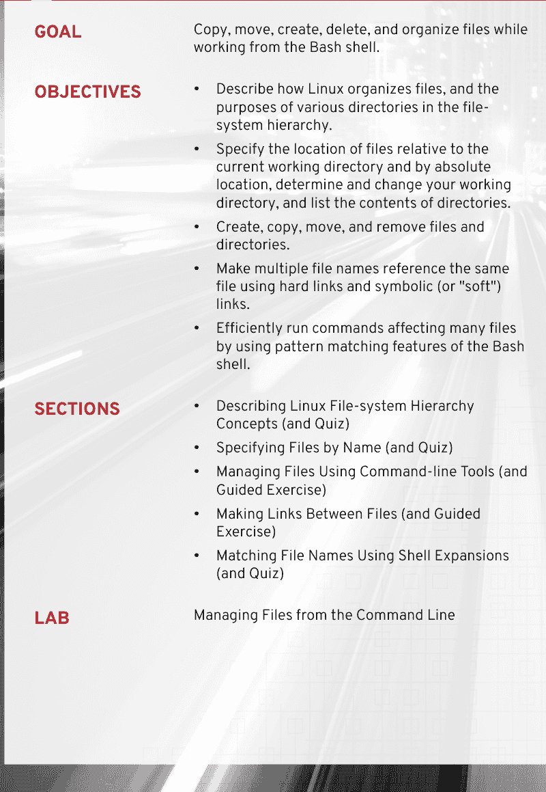

## 描述 Linux 文件系统层次结构概念

# 学习目标

完成本节后，你应该能够描述 Linux 如何组织文件，以及文件系统层次结构中各种目录的用途。

### 文件系统层次结构

Linux 系统上的所有文件都存储在文件系统中，文件系统被组织成单一的倒立目录树，称为文件系统层次结构。这棵树之所以倒立，是因为树的根被认为位于层次结构的*顶部*，而目录和子目录的分支延伸到根的*下方*。

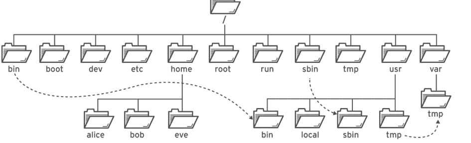

**图 3.1：Red Hat Enterprise Linux 8 中重要的文件系统目录**

`/ `目录是文件系统层次结构顶部的根目录。`/ `字符也用作文件名中的*目录分隔符*。例如，如果 `etc` 是 `/ `目录的子目录，你可以引用该目录为 `/etc`。同样，如果 `/etc` 目录包含一个名为 `issue` 的文件，你可以将该文件引用为 `/etc/issue`。

`/ `的子目录用于标准化的用途，按类型和目的组织文件。这使得更容易找到文件。例如，在根目录中，子目录 `/boot` 用于存储启动系统的文件。

> 注意
> `/ `的子目录用于按类型和目的组织文件的标准化。这使得更容易找到文件。
> * 静态内容在重启后保持不变。
> * 动态或变量内容可能会被修改。
> * 持久性内容在重启后保留。
> * 运行时内容自上次启动以来产生。

`/ `目录的内容包括：

### 重要的 Red Hat Linux 目录

下表列出了系统中重要目录的名称和用途。

| 位置 | 用途 |
| --- | --- |
| `/usr` | 用户命令。<br>* `/sbin`: 系统管理命令。<br>* `/local`: 本地自定义软件。 |
| `/etc` | 系统特定的配置文件。 |
| `/var` | 系统动态数据，如数据库、日志文件等。 |
| `/run` | 自上次启动以来的运行时数据。 |
| `/home` | 普通用户存储个人数据的目录。 |
| `/root` | 管理员的主目录。 |
| `/tmp` | 临时文件的写入空间。超过30天未访问、更改或修改的文件会被删除。 |
| `/boot` | 用于启动系统的文件。 |
| `/dev` | 用于访问硬件的特殊文件。 |

# 重要

在 Red Hat Enterprise 7 及更高版本中，`/ `中的目录与 `/usr `中的对应目录内容相同：

- `/bin` 和 `/usr/bin`
- `/sbin` 和 `/usr/sbin`
- `/lib` 和 `/usr/lib`
- `/lib64` 和 `/usr/lib4`

在旧版本的 Red Hat 中，这些是包含不同文件的独立目录。

在 Red Hat Enterprise 7 及更高版本中，`/ `中的目录是指向 `/usr `的符号链接。

# 参考

`hier(7)` 手页

来自 Fedora 17 的 UsMove

https://fedoraproject.org/wiki/Features/UsMove

## 测验

# 描述 Linux 文件系统层次概念

选择以下问题的正确答案：

1. 哪个目录包含持久的、系统特定的配置数据？
   a. `/etc`
   b. `/root`
   c. `/run`
   d. `/usr`
2. 哪个目录是文件系统层次结构的顶部？
   a. `/etc`
   b. `/`
   c. `/home/root`
   d. `/root`
3. 哪个目录包含用户主目录？
   a. `/`
   b. `/home`
   c. `/root`
   d. `/user`
4. 哪个目录包含临时文件？
   a. `/tmp`
   b. `/trash`
   c. `/run`
   d. `/var`
5. 哪个目录包含动态数据，如数据库和网站？
   a. `/etc`
   b. `/run`
   c. `/usr`
   d. `/var`
6. 哪个目录是管理员用户的主目录？
   a. `/etc`
   b. `/`
   c. `/home/root`
   d. `/root`
7. 哪个目录包含普通命令和实用程序？
   a. `/commands`
   b. `/run`
   c. `/usr/bin`
   d. `/usr/sbin`
8. 哪个目录包含非持久性的进程运行时数据？
   a. `/tmp`
   b. `/etc`
   c. `/run`
   d. `/var`
9. 哪个目录包含已安装的软件程序和库？
   a. `/etc`
   b. `/lib`
   c. `/usr`
   d. `/var`

# Linux 文件系统层级结构概念

选择以下问题的正确答案：

1. 哪个目录包含持久的、特定于系统的配置数据？
   a. `/etc`
   b. `/root`
   c. `/run`
   d. `/usr`
2. 哪个目录是系统文件系统层次结构的顶端？
   a. `/etc`
   b. `/`
   c. `/home/root`
   d. `/root`
3. 哪个目录包含用户家目录？
   a. `/`
   b. `/home`
   c. `/root`
   d. `/user`
4. 哪个目录包含临时文件？
   a. `/tmp`
   b. `/trash`
   c. `/run`
   d. `/var`
5. 哪个目录包含动态数据，例如数据库和网站的数据？
   a. `/etc`
   b. `/run`
   c. `/usr`
   d. `/var`
6. 哪个目录是管理员超级用户的家目录？
   a. `/etc`
   b. `/`
   c. `/home/root`
   d. `/root`
7. 哪个目录包含普通命令和实用程序？
   a. `/commands`
   b. `/run`
   c. `/usr/bin`
   d. `/usr/sbin`
8. 哪个目录包含非持久性的进程运行时数据？
   a. `/tmp`
   b. `/etc`
   c. `/run`
   d. `/var`
9. 哪个目录包含已安装的软件程序和库？
   a. `/etc`
   b. `/lib`
   c. `/usr`
   d. `/var`

## 通过名称指定文件

## 目标

完成本节后，你应该能够相对于当前工作目录和通过绝对位置指定文件的位置，确定并更改工作目录，以及列出目录的内容。

### 绝对路径和相对路径

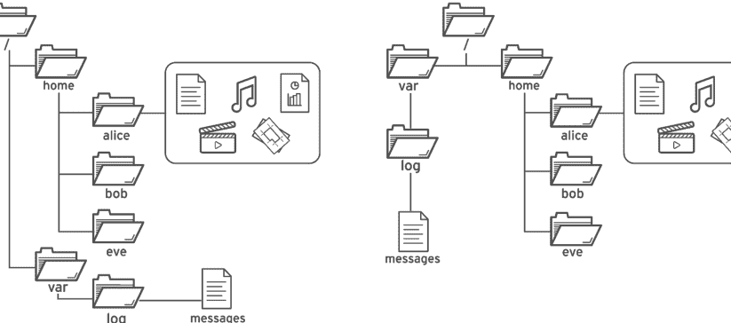

图 3.2：常见的文件查看器（左）等同于顶部的视图（右）。

文件或目录的路径指定了其在文件系统中的唯一位置。遵循文件路径将遍历一个或多个由正斜杠 (`/`) 分隔的子目录，直到到达。目录也称为文件夹，包含其他文件和其他子目录。这些可以以与文件相同的方式被引用。

> 重要
> Linux 文件名中允许包含空格字符。然而，shell 也会使用空格来分隔命令行上的选项和参数。如果你输入的命令包含一个名称带空格的文件，shell 可能会误解该命令，并假设你想在空格处开始一个新文件名或其他参数。
> 可以通过将文件名括在引号中来避免这种情况。但是，如果你不需要在文件名中使用空格，避免使用它们可能会更简单。

### 绝对路径

绝对路径是一个完全限定的，指定了文件在文件系统层次结构中的精确位置。它从根目录 (`/`) 开始，并指定了到达特定文件必须遍历的每个子目录。文件系统中的每个文件都有唯一的绝对路径，可以通过一个简单的规则识别：以正斜杠 (`/`) 开头的路径名为绝对路径。例如，系统日志的绝对路径是 `/var/log/messages`。绝对路径可以很长，所以文件可能位于你的 shell 提示符。

### 当前工作目录和相对路径

当用户登录并打开命令窗口时，初始位置通常是用户的家目录。系统进程也有初始目录。用户根据需要导航到其他目录；*工作目录*或*当前工作目录*指的是他们的当前位置。


就像绝对路径一样，相对路径标识文件，仅指定从工作目录到达文件的路径。识别相对路径遵循简单的规则：以正斜杠以外的任何字符开头的路径都是相对路径。`/var` 目录的用户指向 `log/messages`。Linux 文件系统（如 `ext4`, `XFS`, `GFS` 和 `ClusterFS`）是大小敏感的。在同一个目录中创建 `File.txt` 和 `file.txt` 会导致两个不同的文件。

非 Linux 文件系统（例如 `VFAT`, `Microsoft NTFS` 和 Apple 的 `HFS+`）可能会有所不同。这些系统不是大小敏感的，它们显示创建文件时的原始大小写。因此，如果你在 `VFAT` 文件系统中尝试创建这些文件，它们将被视为同一个文件。

### 导航路径

`pwd` 命令显示当前工作目录的全名。这可以帮助你使用相对路径到达文件。`ls` 命令列出指定目录的内容，如果没有目录，则是当前工作目录。

```
[user@host ~]$ pwd
/home/user
[user@host ~]$ ls Desktop Downloads Pictures Videos
[user@host ~]$
```

使用 `cd` 命令切换工作目录。如果你没有为命令指定任何参数，它将切换到你的家目录。

```
[user@host ~]$ pwd
/home/user
[user@host ~]$ cd Videos
/home/user/Videos
[user@host Videos]$ cd /home/user/Documents
[user@host Documents]$ pwd
/home/user/Documents
[user@host Documents]$ cd
[user@host ~]$ pwd
/home/user
```

# 第 3 章 | 从命令行管理文件

正如你在前面的示例所示，默认 shell 提示符显示路径的最后一部分。例如，`/home/user/Videos` 只显示 `Videos`。当你的当前工作目录是家目录时，提示符显示波浪号 (~)。

`touch` 命令通常更新时间戳为当前日期和时间而不修改它。这对于创建空文件很有用，因为“touch 一个不存在的文件会创建该文件。在下面的示例中，`touch` 命令在 `Documents` 和 `Videos` 子目录中创建文件。

```
[user@host ~]$ touch Videos/buster1.ogg
[user@host ~]$ touch Videos/buster2.ogg
[user@host ~]$ touch Documents/thesis_chapter1.pdf
[user@host ~]$ touch Documents/thesis_chapter2.pdf
[user@host ~]$
```

`ls` 命令有多个显示文件属性的选项。最常用的是 `-l`（长列表格式）、`-a`（所有文件，包括隐藏文件）和 `-R`（递归，包含所有子目录）。

```
[user@host ~]$ ls -la
total 15
drwxr-xr-x 2 user 4096 Feb 7 14:02 Desktop
drwxr-xr-x 2 user 4096 Feb 7 14:02 Downloads
drwxr-xr-x 2 user 4096 Feb 7 14:02 Music
drwxr-xr-x 2 user 4096 Feb 7 14:02 Pictures
drwxr-xr-x 2 user 4096 Feb 7 14:02 Videos
drwxr-xr-x 2 user 4096 Feb 7 14:02 Public
drwxr-xr-x 2 user 4096 Feb 7 14:02 Templates
drwxr-xr-x 2 user 4096 Feb 7 14:02 Videos
drwxr-xr-x 2 user 4096 Feb 7 14:02 Desktop
drwxr-xr-x 2 user 4096 Feb 7 14:02 Documents
drwxr-xr-x 2 user 4096 Feb 7 14:02 Downloads
drwxr-xr-x 2 user 4096 Feb 7 14:02 Music
drwxr-xr-x 2 user 4096 Feb 7 14:02 Pictures
drwxr-xr-x 2 user 4096 Feb 7 14:02 Public
drwxr-xr-x 2 user 4096 Feb 7 14:02 Templates
drwxr-xr-x 2 user 4096 Feb 7 14:02 Videos
[user@host ~]$
total 15
-rw-r--r-- 1 user 1519 Feb 8 09:49 bash_history
-rw-r--r-- 1 user 376 Feb 8 00:37 bash_logout
-rw-r--r-- 1 user 2264 Feb 8 11:13 bash_profile
drwxr-xr-x 2 user 4096 Jul 9 15:20 .config
drwxr-xr-x 2 user 4096 Jul 9 15:00 .desktop
drwxr-xr-x 2 user 4096 Jul 9 15:19 .gnome
drwxr-xr-x 2 user 4096 Jul 9 15:24 .private
drwxr-xr-x 2 user 4096 Jul 9 15:29 .local
-rw-r--r-- 1 user 150 Jul 9 15:32 .network-scripts
-rw-r--r-- 1 user 3068 Jul 9 20:15 .profile_machine
-rw-r--r-- 1 user 100 Jul 9 15:37 .profile
drwxr-xr-x 2 user 4096 Jul 9 15:44 .ssh
drwxr-xr-x 2 user 4096 Jul 9 15:49 .fontconfig
drwxr-xr-x 2 user 4096 Jul 9 15:54 .cache
drwxr-xr-x 2 user 4096 Jul 9 15:59 .config
drwxr-xr-x 2 user 4096 Jul 9 16:04 .color
drwxr-xr-x 2 user 4096 Jul 9 16:09 .python
drwxr-xr-x 2 user 4096 Jul 9 16:14 .local
drwxr-xr-x 2 user 4096 Jul 9 16:19 .bash
drwxr-xr-x 2 user 4096 Jul 9 16:24 .bash
drwxr-xr-x 2 user 4096 Jul 9 16:29 .mozilla
drwxr-xr-x 2 user 4096 Jul 9 16:34 .localome
drwxr-xr-x 2 user 4096 Jul 9 16:39 .mozilla-share
drwxr-xr-x 2 user 4096 Jul 9 16:44 .config
drwxr-xr-x 2 user 4096 Jul 9 16:49 .local
drwxr-xr-x 2 user 4096 Jul 9 16:54 .bash
drwxr-xr-x 2 user 4096 Jul 9 16:59 .bash
drwxr-xr-x 2 user 4096 Jul 9 17:04 .bash
drwxr-xr-x 2 user 4096 Jul 9 17:09 .bash
drwxr-xr-x 2 user 4096 Jul 9 17:14 .bash
drwxr-xr-x 2 user 4096 Jul 9 17:19 .bash
drwxr-xr-x 2 user 4096 Jul 9 17:24 .bash
drwxr-xr-x 2 user 4096 Jul 9 17:29 .bash
drwxr-xr-x 2 user 4096 Jul 9 17:34 .bash
drwxr-xr-x 2 user 4096 Jul 9 17:39 .bash
drwxr-xr-x 2 user 4096 Jul 9 17:44 .bash
drwxr-xr-x 2 user 4096 Jul 9 17:49 .bash
drwxr-xr-x 2 user 4096 Jul 9 17:54 .bash
drwxr-xr-x 2 user 4096 Jul 9 17:59 .bash
```

# 第2 章 | 导航文件

位于列表顶部的特殊目录指的是当前目录 (`.`) 和父目录 (`..`)。这些特殊目录存在于系统的每个目录中。当你开始使用文件管理命令时，你会发现它们的用途。

> ### 重要
>
> 以点 (`.`) 开头的文件是隐藏文件；你在 `ls` 和其他命令的正常视图中无法看到它们。这并不是一个安全功能。许多文件可以防止配置文件弄乱家目录。许多命令只有在使用特定的命令行选项时处理隐藏文件，防止它们被意外复制到其他目录或用户。


> 要保护文件内容不被不当查看，需要使用文件权限。

# 第 3 章 从命令行管理文件

```
/home/user/Videos
[user@host Videos]$ cd
[user@host Documents]$ pwd
/home/user/Documents
[user@host Documents]$ cd -
[user@host Videos]$ pwd
/home/user/Videos
[user@host Videos]$ cd
[user@host ~]-$
```

`cd`命令使用隐藏目录`..`移动上一层到父目录，而无需知道父目录的准确名称。另一个目录`.`在将当前位置作为源参数或目标参数的命令中指定当前目录，避免了使用另一个目录绝对路径的需求。

```
[user@host Videos]$ pwd
/home/user/Videos
[user@host Videos]$ cd .
[user@host Videos]$ pwd
/home/user/Videos
[user@host Videos]$ cd ..
[user@host ~]$ pwd
/home/user
[user@host ~]$ cd .
[user@host home]$ pwd
/home
[user@host home]$ cd ..
[user@host /]$ pwd
/
[user@host /]$ cd
[user@host ~]$ pwd
/home/user
[user@host ~]-$
```

> 参考文献

`info libc 'file name resolution'` (GNU C 库手册)

- 章节 11.2.2 文件名解析

`bash(1)`, `cd(1)`, `ls(1)`, `pwd(1)`, `unicode(7)`, 和 `utf-8(7)` 手页

UTF-8 和 Unicode

`http://www.utf-8.com/`

## 测验

### 通过名称指定文件

选择问题的正确答案：

- 1. 哪个命令用于返回当前用户的家目录，假设当前工作目录为 `/tmp` 且其家目录为 `/home/user`？

  a. `cd`

  b. `cd ..`

  c. `cd .`

  d. `cd *`

  e. `cd /home`

- 2. 哪个命令显示当前位置的绝对路径名？

  a. `cd`

  b. `pwd`

  c. `ls`

  d. `ls -d`

- 3. 哪个命令将始终让你回到当前工作目录之前使用的工作目录？

  a. `cd -`

  b. `cd -p`

  c. `cd`

  d. `cd ..`

- 4. 哪个命令将始终将工作目录从当前位置向上移动二级？

  a. `cd ./`

  b. `cd ..`

  c. `cd ../`

  d. `cd -u2`

- 5. 哪个命令使用长格式列出当前位置的文件，包括隐藏文件？

  a. `long ~`

  b. `ls -a`

  c. `ls -1`

  d. `ls -al`

- 6. 哪个命令将始终将工作目录更改到 `/bin`？

  a. `cd bin`

  b. `cd /bin`

  c. `cd ~bin`

  d. `cd -bin`

- 7. 哪个命令将始终将工作目录更改到当前位置的父目录？

  a. `cd ~`

  b. `cd ..`

  c. `cd ../`

  d. `cd -u1`

- 8. 如果当前工作目录是 `/home/student`，哪个命令将工作目录更改到 `/tmp`？

  a. `cd tmp`

  b. `cd ..`

  c. `cd ../../tmp`

  d. `cd ~tmp`

## 答案

### 通过名称指定文件

选择以下问题的正确答案：

- 1. 哪个命令用于返回当前用户的家目录，假设当前工作目录为 `/tmp` 且其家目录为 `/home/user`？

   a. `cd`

   b. `cd ..`

   c. `cd`

   d. `cd *`

   e. `cd /home`

- 2. 哪个命令显示当前位置的绝对路径名？

   a. `cd`

   b. `pwd`

   c. `ls`

   d. `ls -d`

- 3. 哪个命令将始终让你回到当前工作目录之前使用的工作目录？

   a. `cd -`

   b. `cd -p`

   c. `cd`

   d. `cd ..`

- 4. 哪个命令将始终将工作目录从当前位置向上移动二级？

   a. `cd /`

   b. `cd ..`

   c. `cd ../`

   d. `cd -u2`

- 5. 哪个命令使用长格式列出当前位置的文件并包括隐藏文件？

   a. `long -`

   b. `ls -a`

   c. `ls -l`

   d. `ls -al`

- 6. 哪个命令将始终将工作目录更改到 `/bin`？

  a. `cd bin`

  b. `cd /bin`

  c. `cd ~bin`

  d. `cd -bin`

- 7. 哪个命令将始终将工作目录更改到当前位置的父目录？

   a. `cd -`

   b. `cd ..`

   c. `cd ../..`

   d. `cd -u1`

- 8. 如果当前工作目录是 `/home/student`，哪个命令将工作目录更改到 `/tmp`？

   a. `cd tmp`

   b. `cd ..`

   c. `cd ../../tmp`

   d. `cd ~tmp`

## 使用命令行工具管理文件

### 目标

完成本节后，你理应能够创建、复制、移动和删除文件以及目录。

# 命令行文件管理

图 3.2: 使用命令行工具管理文件

要管理文件，你需要能够创建、删除、复制和移动它们。你还需要将它们在逻辑上组织到目录中。下表总结了一些常用的文件管理命令。本节的剩余部分将详细讨论如何使用这些命令。

| 活动 | 命令语法 |
| :--- | :--- |
| 创建目录 | `mkdir directory` |
| 复制文件 | `cp file new-file` |
| 复制目录及其内容 | `cp -r directory new-directory` |
| 移动或重命名文件或目录 | `mv file new-file` |
| 删除文件 | `rm file` |
| 删除包含文件的目录 | `rm -r directory` |
| 删除空目录 | `rmdir directory` |

### 创建目录

`mkdir`命令创建一个或多个目录。它接受你想要创建的目录的路径列表作为参数。如果目录已经存在，或者你正尝试在一个不存在的目录中创建子目录，则`mkdir`命令将失败。`-p`选项会为请求的目标创建父目录。使用拼写错误会在不产生错误消息的情况下创建意之外的目录。

在以下示例中，假设你正在创建一个名为`Videos`的目录，但你不小心在`mkdir`命令中漏掉了 "s"。

```
[user@host ~]$ mkdir Video
mkdir: cannot create 'Video': No such file or directory
```

`mkdir`命令因为拼写错误失败了。如果你带有`-p`选项使用`Videos`，目录将被创建。

```
[user@host ~]$ mkdir -p Videos
[user@host ~]$ ls
Videos
```

正确拼写目录后，目录将被创建。

在以下示例中，文件和目录位于`/home/user`下。使用空格分隔的目录名称创建多个目录。

```
[user@host ~]$ mkdir Videos Documents
[user@host ~]$ ls
Videos  Documents
```

使用`mkdir`命令创建了三个子目录。`-p`选项创建了缺失的父目录`Thesis`。

```
[user@host ~]$ mkdir -p Thesis/Chapter1 Thesis/Chapter2 Thesis/Chapter3
[user@host ~]$ ls Thesis
Thesis:
Chapter1 Chapter2 Chapter3
```

# 第 8 章 从命令行管理文件

### 复制文件

`cp`命令复制文件，在当前目录或指定的目录创建新文件。它也可以向目录复制多个文件。

> 警告

> 如果目标已存在，`cp`命令将覆盖文件。

```
[user@host ~]$ cd Videos
[user@host Videos]$ cp blockbuster.ogg blockbuster.ogg
[user@host Videos]$ ls -l
total 0
-rw-r--r-- 1 user 0 Feb 8 16:23 blockbuster.ogg
-rw-r--r-- 1 user 0 Feb 8 16:24 blockbuster.ogg
-rw-r--r-- 1 user 0 Feb 8 16:34 blockbuster.ogg
drwxr-xr-x 2 user 4096 Feb 8 16:05 Watched
```


当用一个命令复制多个文件时，最后一个参数必须是目录。复制的文件在新目录中保留其原始名称。如果目标目录存在同名文件，则文件将被覆盖。默认情况下，`cp` 不复制目录；它会忽略它们。

在以下示例中，列出了两个目录：`Thesis` 和 `ProjectX`。最后一个参数 `ProjectX` 是一个有效的目的。`Thesis` 目录被忽略了。

```
[user@host Videos]$ cd ../Documents
[user@host Documents]$ cp thesis_chapter1.pdf thesis_chapter2.pdf Thesis ProjectX
committing directory 'Thesis'
[user@host Documents]$ ls Thesis ProjectX
ProjectX:
thesis_chapter1.pdf thesis_chapter2.pdf
Thesis:
Chapter1 Chapter2 Chapter3
```

在第一个 `cp` 命令中，`Thesis` 目录复制失败，但 `thesis_chapter1.pdf` 和 `thesis_chapter2.pdf` 文件复制成功了。

如果你想将文件复制到当前工作目录，可以使用特殊的 `.` 目录。

```
[user@host ~]$ cp /etc/hostname
[user@host ~]$ cat hostname
host.example.com
```

使用复制命令并配合 `-r`（递归）选项，将 `Thesis` 目录及其内容复制到 `ProjectX` 目录。

```
[user@host Documents]$ cp -r Thesis ProjectX
```

```
[user@host Documents]$ ls -R ProjectX
ProjectX:
Thesis thesis_chapter1.odf thesis_chapter2.odf
ProjectX/Thesis:
Chapter1 Chapter2 Chapter3
ProjectX/Thesis/Chapter1:
ProjectX/Thesis/Chapter2:
thesis_chapter2.odf
ProjectX/Thesis/Chapter3:
```

### 移动文件

`mv` 命令将文件从一个位置移动到另一个位置。如果你将文件的绝对路径视为它的名称，那么移动文件实际上与重命名文件相同。文件内容保持不变。

使用 `mv` 命令来重命名文件。

```
[user@host Videos]$ cd ../Documents
[user@host Documents]$ ls -1 *thesis*
-rw-rw-r-- 1 user user Feb 21:16 thesis_chapter1.odf
-rw-rw-r-- 1 user user Feb 21:16 thesis_chapter2.odf
[user@host Documents]$ mv thesis_chapter2.odf thesis_chapter2_reviewed.odf
[user@host Documents]$ ls -1 *thesis*
-rw-rw-r-- 1 user user Feb 21:16 thesis_chapter1.odf
-rw-rw-r-- 1 user user Feb 21:16 thesis_chapter2_reviewed.odf
```

使用 `mv` 命令将文件移动到不同的目录。

```
[user@host Documents]$ ls Thesis/Chapter1
[user@host Documents]$
[user@host Documents]$ mv thesis_chapter1.odf Thesis/Chapter1
[user@host Documents]$ ls Thesis/Chapter1
thesis_chapter1.odf
[user@host Documents]$ ls -1 *thesis*
-rw-rw-r-- 1 user user Feb 21:16 thesis_chapter2_reviewed.odf
```

### 删除文件和目录

`rm` 命令用于删除文件。默认情况下，`rm` 不删除包含文件的目录，除非你添加了 `-r` 或 `--recursive` 选项。

> 重要提示
> 没有命令行撤销功能，也没有可以从中恢复已分阶段删除文件的“垃圾桶”。

在删除文件或目录之前，验证你当前的工作目录是一个好习惯。

```
[user@host Documents]$$ pwd
/home/student/Documents
```

使用 `rm` 命令从你的工作目录中删除单个文件。

```
[user@host Documents]$$ ls -l thesis*
-rw-rw-r-- 1 user 0 Feb 6 21:16 thesis_chapter2_reviewed.odf
[user@host Documents]$$ rm thesis_chapter2_reviewed.odf
[user@host Documents]$$ ls -l thesis*
is: cannot access 'thesis': No such file or directory
```

如果你尝试在不使用 `-r` 的情况下使用 `rm` 命令删除目录，命令将失败。

```
[user@host Documents]$$ rm Thesis/Chapter1
rm: cannot remove 'Thesis/Chapter1': Is a directory
```

使用 `rm -R` 命令删除子目录及其内容。

```
[user@host Documents]$$ ls -R Thesis
Thesis/
Chapter1 Chapter2 Chapter3
Thesis/Chapter1:
thesis_chapter1.odf
Thesis/Chapter2:
thesis_chapter2.odf
Thesis/Chapter3:
[user@host Documents]$$ rm -rf Thesis/Chapter1
[user@host Documents]$$ ls -l
total 8
drwxr-xr-x. 2 user 4096 Feb 11 12:47 Chapter2
drwxr-xr-x. 2 user 4096 Feb 11 12:48 Chapter3
```

`rm -r` 命令会先遍历每个子目录，在删除每个目录之前删除其中的文件。你可以使用 `rm -ri` 命令在删除前进行交互式确认。这在本质上与 `-f` 选项相反，`-f` 选项强制删除而不向你提示确认。

```
[user@host Documents]$$ rm -ri Thesis
rm: descend into directory 'Thesis?' y
rm: descend into directory 'Thesis/Chapter2?' y
rm: remove empty file 'Thesis/Chapter2/thesis_chapter2.odf?' y
rm: remove directory 'Thesis/Chapter2?' y
rm: remove directory 'Thesis/Chapter3?' y
rm: remove directory 'Thesis?' y
```

# 第 5 章 | 从命令行管理文件

```
[user@host Documents]$
```

> 警告
> 如果你同时指定 `-i` 和 `-f` 选项，则 `-f` 选项具有优先，在 `rm` 删除文件之前你不会收到确认提示。

在下面的示例中，`rmdir` 命令只删除空目录。与之前的示例一样，你必须使用 `rm -r` 命令来删除包含内容的目录。

```
[user@host Documents]$ pwm
/home/student/Documents
[user@host Documents]$ rmdir ProjectX
[user@host Documents]$ rmdir ProjectX
rmdir: failed to remove 'ProjectX': Directory not empty
[user@host Documents]$ rm -r ProjectX
[user@host Documents]$ ls -LR
:
total 0
[user@host Documents]$
```


> 注意
> 不带选项的 `rmdir` 命令无法删除空目录。你必须使用 `rmdir` 命令、`rm -d`（等同于 `rmdir`）或 `rm -r`。

# 参考文献
`cp(1)`, `mkdir(1)`, `mv(1)`, `rm(1)`, 和 `rmdir(1)` 手页

## 引导练习

## 使用命令行工具管理文件

在本次练习中，你将创建、组织、复制和删除文件以及目录。

## 结果
你应该能够创建、组织、复制和删除文件以及目录。

# 在开始之前

使用 student 作为密码以 student 用户登录。

在工作站上，运行 `lab files-manage start` 命令。该命令会运行一个启动脚本，确定 servera 是否可以通过网络访问。

```
[student@workstation ~]$ lab files-manage start
```

- 1. 使用 `ssh` 命令以 student 用户身份登录 servera。系统配置为使用 SSH 密钥进行认证，因此不需要密码。

```
[student@workstation ~]$ ssh student@servera

[student@servera ~]$
```

- 2. 在 student 用户的家目录下，使用 `mkdir` 命令创建三个子目录：Music、Pictures 和 Videos。

```
[student@servera ~]$ mkdir Music Pictures Videos
```

- 3. 继续在 student 用户的家目录下，使用 `touch` 命令创建空文件：
  - 创建名为 `song.mp3` 的文件。
  - 创建名为 `snap.jpg` 的文件。
  - 创建名为 `film.avi` 的文件。
在每个集合中将 `X` 替换为 1 到 6。

```
[student@servera ~]$ touch song1.mp3 song2.mp3 song3.mp3 song4.mp3 \
> song5.mp3 song6.mp3

[student@servera ~]$ touch snap1.jpg snap2.jpg snap3.jpg snap4.jpg \
> snap5.jpg snap6.jpg

[student@servera ~]$ touch film1.avi film2.avi film3.avi film4.avi \
> film5.avi film6.avi

[student@servera ~]$ ls -l
```

# 第 4 章 从命令行管理文件

```
[student@servera ~]$ ls -l
total
-rw-r--r-- 1 student student 0 Jan 1 0 film1.avi
-rw-r--r-- 1 student student 0 Jan 1 0 film2.avi
-rw-r--r-- 1 student student 0 Jan 1 0 film3.avi
-rw-r--r-- 1 student student 0 Jan 1 0 film4.avi
-rw-r--r-- 1 student student 0 Jan 1 0 film5.avi
-rw-r--r-- 1 student student 0 Jan 1 0 film6.avi
-rw-r--r-- 1 student student 0 Jan 1 0 song1.mp3
-rw-r--r-- 1 student student 0 Jan 1 0 song2.mp3
-rw-r--r-- 1 student student 0 Jan 1 0 song3.mp3
-rw-r--r-- 1 student student 0 Jan 1 0 song4.mp3
-rw-r--r-- 1 student student 0 Jan 1 0 song5.mp3
-rw-r--r-- 1 student student 0 Jan 1 0 song6.mp3
-rw-r--r-- 1 student student 0 Jan 1 0 snap1.jpg
-rw-r--r-- 1 student student 0 Jan 1 0 snap2.jpg
-rw-r--r-- 1 student student 0 Jan 1 0 snap3.jpg
-rw-r--r-- 1 student student 0 Jan 1 0 snap4.jpg
-rw-r--r-- 1 student student 0 Jan 1 0 snap5.jpg
-rw-r--r-- 1 student student 0 Jan 1 0 snap6.jpg
```

- 4. 继续在 student 的家目录下，将文件移动到 Pictures 子目录，并将 Music 文件移动到 Videos 子目录。

从一个位置分发文件到多个位置时，首先更改源。使用简单的绝对或相对路径到达目的地。

```
[student@servera ~]$ mv song1.mp3 song2.mp3 song3.mp3 song4.mp3 \
> song5.mp3 song6.mp3 Music
[student@servera ~]$ mv snap1.jpg snap2.jpg snap3.jpg snap4.jpg \
> snap5.jpg snap6.jpg Pictures
[student@servera ~]$ mv film1.avi film2.avi film3.avi film4.avi \
> film5.avi film6.avi Videos
[student@servera ~]$ ls -l Music Pictures
Music:
total
-rw-r--r-- 1 student student 0 Jan 1 0 song1.mp3
-rw-r--r-- 1 student student 0 Jan 1 0 song2.mp3
-rw-r--r-- 1 student student 0 Jan 1 0 song3.mp3
-rw-r--r-- 1 student student 0 Jan 1 0 song4.mp3
-rw-r--r-- 1 student student 0 Jan 1 0 song5.mp3
-rw-r--r-- 1 student student 0 Jan 1 0 song6.mp3
Pictures:
total:
-rw-r--r-- 1 student student 0 Jan 1 0 snap1.jpg
-rw-r--r-- 1 student student 0 Jan 1 0 snap2.jpg
-rw-r--r-- 1 student student 0 Jan 1 0 snap3.jpg
-rw-r--r-- 1 student student 0 Jan 1 0 snap4.jpg
-rw-r--r-- 1 student student 0 Jan 1 0 snap5.jpg
-rw-r--r-- 1 student student 0 Jan 1 0 snap6.jpg
```

-rw-rw-r--. 1 student 0 Feb 4 18:23 snap6.jpg

# 视频:

```
total 0
rw-rw-r--. 1 student 0 Feb 4 18:23 film1.avi
-rw-rw-r--. 1 student 0 Feb 4 18:23 film2.avi
-rw-rw-r--. 1 student 0 Feb 4 18:23 film3.avi
-rw-rw-r--. 1 student 0 Feb 4 18:23 film4.avi
-rw-rw-r--. 1 student 0 Feb 4 18:23 film5.avi
-rw-rw-r--. 1 student 0 Feb 4 18:23 film6.avi
```

- 5. 继续在用户主目录下操作，创建三个子目录将你的文件组织到不同的项目中。将子目录命名为 `friends`（朋友）、`family`（家庭）和 `work`（工作）。使用单个命令同时创建所有目录。

你将使用目录将你的文件重新组织到项目中。

```
[student@servera ~]$ mkdir friends family work
[student@servera ~]$ ls -l
total 0
-drwxr-xr-x. 2 student 6 Feb 4 18:34 family
-drwxr-xr-x. 2 student 6 Feb 4 18:38 friends
-drwxr-xr-x. 2 student 108 Feb 4 18:36 Music
-drwxr-xr-x. 2 student 108 Feb 4 18:36 Pictures
-drwxr-xr-x. 2 student 108 Feb 4 18:36 Videos
-drwxr-xr-x. 2 student 6 Feb 4 18:38 work
```


## 6. 将一组新文件复制到 `family` 和 `friends` 项目目录

根据需要使用多个命令。你不需要像示例那样只使用一个命令。对于每个项目，先切换到项目目录，然后将源文件复制到目录。请记住，你是在进行复制，在文件复制到项目目录后，原始文件将保留在原始位置。

- 复制 `friends` 子目录中包含数字 1 和 2 的文件（所有类型）。
- 将包含数字 3 和 4 的文件复制到 `family` 子目录。

当从多个位置将文件复制到单个位置时，Red Hat 建议在复制文件之前先进入目标目录。使用最简单的语法（绝对路径或相对路径）来访问每个文件任务源。

```
[student@servera]$ cd friends
[student@servera]$ cp ~/Music/song1.mp3 ~/Music/song2.mp3 \
> ~/Pictures/snap1.jpg ~/Pictures/snap2.jpg ~/Videos/film1.avi \
> ~/Videos/film2.avi
[student@servera]$ ls -l
total 0
-rw-rw-r--. 1 student 0 Feb 4 18:42 film1.avi
-rw-rw-r--. 1 student 0 Feb 4 18:42 film2.avi
-rw-rw-r--. 1 student 0 Feb 4 18:42 snap1.jpg
-rw-rw-r--. 1 student 0 Feb 4 18:42 snap2.jpg
-rw-rw-r--. 1 student 0 Feb 4 18:42 song1.mp3
-rw-rw-r--. 1 student 0 Feb 4 18:42 song2.mp3
[student@servera friends]$ cd ~/family
[student@servera family]$ cp ~/Music/song3.mp3 ~/Music/song4.mp3 ~
```

## 第 2 章 | 使用命令行管理文件

```
> ~/Pictures/snap3.jpg ~/Pictures/snap4.jpg \
> ~/Videos/film4.avi \
[student@servera]$ ls -l
total 0
-rw-r--r-- 1 student student 0 Feb 4 18:44 film3.avi
-rw-r--r-- 1 student student 0 Feb 4 18:44 film4.avi
-rw-r--r-- 1 student student 0 Feb 4 18:44 snap3.jpg
-rw-r--r-- 1 student student 0 Feb 4 18:44 snap4.jpg
-rw-r--r-- 1 student student 0 Feb 4 18:44 song3.mp3
-rw-r--r-- 1 student student 0 Feb 4 18:44 song4.mp3
```

对于你的项目工作，请创建额外的副本。

```
[student@servera]$ cd ../work
[student@servera]$ cp ~/Music/song5.mp3 ~/Music/song6.mp3 \
> ~/Pictures/snap5.jpg ~/Pictures/snap6.jpg \
> ~/Videos/film5.avi ~/Videos/film6.avi
[student@servera]$ ls -l
total 0
-rw-r--r-- 1 student student 0 Feb 4 18:44 film5.avi
-rw-r--r-- 1 student student 0 Feb 4 18:44 film6.avi
-rw-r--r-- 1 student student 0 Feb 4 18:44 snap5.jpg
-rw-r--r-- 1 student student 0 Feb 4 18:44 snap6.jpg
-rw-r--r-- 1 student student 0 Feb 4 18:44 song5.mp3
-rw-r--r-- 1 student student 0 Feb 4 18:44 song6.mp3
```

你的项目现在完成了，现在是时候清理项目了。

切换到学生的主目录。尝试使用单个 `rmdir` 命令同时删除 `family` 和 `friends` 项目目录。

```
[student@servera]$ cd ~
[student@servera]$ rmdir family friends
rmdir: failed to remove 'family': Directory not empty
rmdir: failed to remove 'friends': Directory not empty
```

使用 `rm -r` 命令将会失败，因为子目录中包含文件。

- 9. 使用 `rm -r` 命令递归删除 `family` 和 `friends` 子目录及其内容。

```
[student@servera]$ rm -r family friends
[student@servera]$ ls -l
total 0
drwxrxr-x. 2 student student 108 Feb 4 18:36 Music
drwxrxr-x. 2 student student 108 Feb 4 18:36 Pictures
drwxrxr-x. 2 student student 108 Feb 4 18:36 Videos
drwxrxr-x. 2 student student 108 Feb 4 18:44 work
```

- 10. 删除 work 项目中的所有文件，但不要删除 work 目录。

```
[student@servera ~$] cd work
[student@servera ~] rm song5.mp3 song6.mp3 snap5.jpg snap6.jpg \
> film5.avi film6.avi
[student@servera ~]$ ls -l
total 0
```

- 11. 最后，从学生的主目录使用 `rmdir` 命令删除 work 目录。该命令应该成功。

```
[student@servera]$ cd ~
[student@servera]$ rmdir family friends
[student@servera]$ ls -l
total 0
```

- 12. 退出 servera。

```
[student@servera]$ exit
```

### 创建软链接

`ln -s` 命令创建软链接，也称为“符号链接”。软链接不是普通文件，而是一种指向现有文件或目录的特殊类型文件。

与硬链接相比，软链接具有以下优势：

- 它们可以连接不同文件系统上的文件。
- 它们可以指向目录或特殊文件，而不仅仅是普通文件。

在下面的示例中，使用 `ln -s` 命令为现有文件 `/home/user/newfile-link.2` 创建一个新的软链接，并命名为 `/tmp/newfile-symlink.txt`。

```bash
[user@host]$ ln -s /home/user/newfile-link.2 /tmp/newfile-symlink.txt
[user@host]$ ls -l newfile-link.2 /tmp/newfile-symlink.txt
-rw-rw-r-- 1 user 1 user Mar 12 11:29 newfile-link.2
lrwxrwxrwx 1 user 1 user Mar 12 11:20:59 /tmp/newfile-symlink.txt -> /home/user/newfile-link.2
[user@host]$ cat /tmp/newfile-symlink.txt
Hello
```

在前面的示例中，`/tmp/newfile-symlink.txt` 详细列表的第一个字符是 `l` 而不是 `-`。这表示该文件是软链接而不是普通文件。（`d` 则表示该文件是一个目录。）

当原始文件被删除时，软链接仍然指向目标，但目标已丢失。指向缺失文件的软链接被称为“悬空链接”（dangling link）。

```bash
[user@host]$ rm -f newfile-link.2
[user@host]$ ls -l /tmp/newfile-symlink.txt
lrwxrwxrwx 1 user 1 user Mar 12 11:20:59 /tmp/newfile-symlink.txt -> /home/user/newfile-link.2
[user@host]$ cat /tmp/newfile-symlink.txt
cat: /tmp/newfile-symlink.txt: No such file or directory
```


> 重要：上述示例中的悬空软链接显示，如果你之后用与被删除文件相同的名称（`/home/user/newfile-link.2`）创建一个新文件，软链接将不再是“悬空”，并将指向新文件。

硬链接并不是这样工作的。如果你删除一个硬链接并使用普通工具（而不是 `ln`）创建一个相同名称的新文件，新文件将不会链接到旧文件。比较硬链接和软链接的一种方法可能帮助你理解它们的工作原理：

- 硬链接指向存储设备上的数据。
- 软链接指向另一个名称，而该名称又指向存储设备上的数据。
- 软链接可以指向目录。软链接的作用类似于目录。使用 `cd` 切换软链接会将当前工作目录变为链接的目录。某些工具默认可能会跟踪你通过软链接到达那里的的事实。

在下面的示例中，创建了一个名为 `/home/user/configfiles` 的软链接，指向 `/etc` 目录。

```bash
[user@host]$ ln -s /etc /home/user/configfiles
[user@host]$ cd /home/user/configfiles
[user@host]$ pwd
/home/user/configfiles
```

## 参考文献

- `ln(1)` 手页

## 引导练习

### 在文件之间创建链接

在此练习中，你将创建硬链接和符号链接并比较结果。

### 预期结果

你应该能够在文件之间创建硬链接和软链接。

## 开始之前

在工作站上，运行 `lab-make` 命令。该命令运行一个脚本，确定 `servera` 在网络上是否可用，并在 `servera` 上创建文件和工作目录。

```bash
[student@workstation]$ lab-make start
```

1. 使用 `ssh` 命令以 `student` 用户身份登录 `servera`。系统配置为使用 SSH 密钥进行验证，因此不需要密码。

```bash
[student@workstation]$ ssh student@servera
[student@servera]$
```

2. 为现有文件 `/home/student/files/source.file` 创建一个硬链接 `/home/student/backups/source.backup`。

2.1. 查看文件 `/home/student/files/source.file` 的链接计数。

```bash
[student@servera]$ ls -l files/source.file
total 4
-rw-r--r-- 2 student 11 Mar 5 21:19 source.file
```

2.2 创建一个硬链接 `/home/student/backups/source.backup`。将其链接到文件 `/home/student/files/source.file`。

```bash
[student@servera]$ ln /home/student/files/source.file /home/student/backups/source.backup
```

2.3. 验证原始文件 `/home/student/files/source.file` 和新链接文件 `/home/student/backups/source.backup` 的链接计数。两个文件的链接计数都应 2。

```bash
[student@servera]$ ls -l /home/student/files/
-rw-r--r-- 2 student 11 Mar 5 21:19 source.file
[student@servera]$ ls -l /home/student/backups/
-rw-r--r-- 2 student 11 Mar 5 22:19 source.backup
```

3. 创建一个名为 `/home/student/tempdir` 的软链接，指向 `servera` 上的 `/tmp` 目录。

3.1. 创建一个名为 `/home/student/tempdir` 的软链接并链接到 `/tmp`。

```bash
[student@servera]$ ln -s /tmp /home/student/tempdir
```

3.2. 使用 `ls -l` 命令验证新创建的软链接。

```bash
[student@servera]$ ls -l /home/student/tempdir
lrwxrwxrwt 1 student student 4 Mar 22:04 /home/student/tempdir -> /tmp
```

4. 退出 `servera`。

```bash
[student@servera]$ exit
[student@workstation]$
```

## 完成练习

在工作站上，运行 `lab-make` 脚本完成练习。

```bash
[student@workstation]$ lab-make
```

## 使用 Shell 扩展匹配文件名

### 目标

完成本节后，你将能够使用模式匹配高效地管理文件。

### 命令行扩展

Shell 有多种扩展命令行的方法：大括号扩展、变量替换。其中最强大的可能是通配符匹配（globbing）。

### 模式匹配

通配符匹配是一种 Shell 操作，它扩展通配符以匹配文件名。以下是常见的元字符和字符类：

| 模式 | 匹配项 |
| :--- | :--- |
| `*` | 任意长度的字符字符串。 |
| `?` | 任意单个字符。 |
| `[abc...]` | 方括号内的任何字符。 |
| `[^abc...]` | *不在*方括号内的任何字符。 |
| `[:alpha:]` | 任何字母。 |
| `[:lower:]` | 任何小写字母。 |
| `[:upper:]` | 任何大写字母。 |
| `[:alnum:]` | 任何字母或数字。 |
| `[:punct:]` |任何非字母数字的可打印字符。 |
| `[:digit:]` | 0 到 9 之间的任意数字。 |
| `[:space:]` | 任意单个空白字符。 |

在后续示例中，假设你运行了以下命令创建了一些文件。

```bash
[user@host]$ mkdir glob; cd glob
[user@host]$ touch alpha bravo charlie delta dog
[user@host]$ ls
alpha bravo charlie delta dog
```

第一个示例将使用带有星号 (`*`) 和问号 (`?`) 以及类的简单模式来匹配文件。

```bash
[user@host]$ ls a*
alpha alfa
[user@host]$ ls 'a*'
alpha bravo charlie delta
[user@host]$ ls ????
alpha alfa delta echo
[user@host]$ ls ????
baker bravo
```

### 波浪号扩展

波浪号 (`~`) 匹配当前用户的家目录。如果它是一个非斜杠（`/`）的字符串，Shell 将该字符串解释为用户名的绝对路径（如果匹配），并将字符串替换为该用户的家目录的绝对路径。如果没有匹配的用户名，将使用实际的波浪号加上字符。

在下面的示例中，使用 `echo` 命令显示波浪号的值。

```bash
[user@host]$ ls ~root
/root
[user@host]$ ls ~user
/home/user
[user@host]$ ls ~glob
alpha bravo baker charlie delta dog echo
[user@host]$ echo ~glob
/home/user/glob
```

### 大括号扩展

大括号扩展用于生成任意字符串。大括号包含逗号分隔的字符串列表，或序列表达式。结果包括大括号定义之前之后的文本。大括号可以嵌套，一个套一个。此外，双括号语法 `(...)` 扩展为序列，例如 `{m..p}` 将扩展为 m n p。

#### 从命令行管理文件

```
[user@host]$ echo (Sunday,Monday,Tuesday,Wednesday).log
Sunday.log Monday. Tuesday.log Wednesday.log
[user@host]$ echo file(1..3).txt
file1.txt file2.txt file3.txt
[user@host]$ echo file(a..c).txt
file.txt fileb.txt filec.txt
[user@host]$ echo file(a,b){1,2}.txt
file1a.txt file2b.txt fileb2.txt
...（此处省略重复代码内容）
```

大括号扩展（brace expansion）的一个实际用途是快速创建多个文件或目录。


```
[user@host]$ mkdir ../RHEL(6,7,8)
[user@host]$ ls ../RHEL*
RHEL6 RHEL8
			[user@host]$
```

## 变量扩展

变量就像一个命名的容器，可以在内存中存储值。变量使得我们能够从命令行或 shell 脚本轻松访问和修改存储的数据。

你可以使用以下语法将数据赋值给变量的值：

```
[user@host]$ VARIENAME=value
```

你可以使用变量扩展在命令行将变量名转换为其值。如果字符串以美元符号 `$` 开头，shell 将尝试将该字符串的其余视为变量，并将其替换为变量的实际值。

```
[user@host]$ USERNAME=operator
[user@host]$ echo $USERNAME
operator
```

为了避免其他 shell 扩展引起的错误，可以将变量名放在大括号中，例如 `${VARIABLE}`

```
[user@host]$ USERNAME=operator
[user@host]$ echo $(USERNAME)
operator
```

Shell 变量及其用法将在课程的后续部分进行更深入介绍。

## 命令替换

命令替换允许命令的输出替换命令行上的命令本身。当命令被括在括号中并在美元符号 `$` 前时，就会发生命令替换。`$(command)` 形式可以嵌套多个命令扩展。

# 从命令行管理文件

```
[user@host glob]$ echo Today is $(date +%A)
Today is Wednesday.
[user@host glob]$ echo The time is $(date +%M) minutes past $(date +%p)
The time is 26 minutes past 11AM.
[user@host glob]$
```

> 注意

命令替换的旧格式是反引号：`` `command` ``。反引号的缺点包括：1) 它们在视觉上容易与单引号混淆，2) 反引号不能嵌套。

## 防止参数被扩展

Bash shell 中的许多字符具有特殊含义。为了防止 shell 对你命令行中的部分执行扩展，你可以对字符和字符串进行引用和转义。

反斜杠 `\` 是 Bash 中的转义字符。它会保护紧随其后的字符。

```
[user@host glob]$ echo The value of $HOME is your home directory.
The value of /home/user is your home directory.
[user@host glob]$ echo The value of \HOME is your home directory.
The value of $HOME is your home directory.
[user@host glob]$
```

在前面的示例中，保护美元符号不被扩展会导致 Bash 将其视为普通字符，而不对 `$HOME` 执行变量扩展。

为了保护较长的字符串，使用单引号 `''` 或双引号 `""` 来包裹字符串。它们的效果略有不同。单引号会停止所有的 shell 扩展。双引号会停止大部分 shell 扩展。

使用双引号来抑制通配符 `globbing` 和 shell 扩展，但仍允许命令和变量替换。

```
[user@host glob]$ myhost=$(hostname -s); echo $myhost
host
[user@host glob]$ echo "***** hostname is $(myhost) **********"
***** hostname is myhost
[user@host glob]$
```

使用单引号解释所有文本。

```
[user@host glob]$ echo "Will variable $myhost evaluate to $(hostname -s)?"
Will variable $myhost evaluate to host?
[user@host glob]$ echo 'Will variable $myhost evaluate to $(hostname -s)?'
Will variable $myhost evaluate to $(hostname -s)?
[user@host glob]$
```

> **重要**

单引号 `''` 和命令替换反引号 ``` `` ``` 在屏幕和键盘上都很容易混淆。在应该使用其中一种时使用了另一种会导致意想不到的 shell 行为。

> **参考**

`bash(1)`, `cd(1)`, `glob(7)`, `isalpha(3)`, `ls(1)`, `path_resolution(7)`, 和 `pwd(1)` 手页

# 验

# 使用 shell 扩展匹配文件名

选择以下问题的正确答案：

- 1. 哪种模式会只匹配以 "b" 结尾的文件？

  - a. `b*`

  - b. `*b`

  - c. `*b*`

  - d. `![b]*`

- 2. 哪种模式会只匹配以 "b" 开头的文件？

  - a. `b*`

  - b. `*b`

  - c. `*b*`

  - d. `![b]*`

- 3. 哪种模式会只匹配第一个字符不是 "b" 的文件名？

  - a. `b*`

  - b. `*b`

  - c. `*b*`

  - d. `![b]*`

- 4. 哪种模式会匹配所有包含 "b" 的文件名？

  - a. `b*`

  - b. `*b`

  - c. `*b*`

  - d. `![b]*`

- 5. 哪种模式会只匹配包含数字的文件？

  - a. `*#`

  - b. `*[:digit]*`

  - c. `*[:digit]*`

  - d. `[0-9]*`

- 6. 哪种模式会只匹配以大写字母开头的文件？

  - a. `^?`

  - b. `^*`

  - c. `[[:upper]*`

  - d. `[[upper]]*`

- 7. 哪种模式会匹配长度至少为三个的文件？

  - a. `???*`

  - b. `???*`

  - c. `*3*`

  - d. `+++*`

  - e. `...*`

## 答案

# 使用 shell 扩展匹配文件名

选择以下正确答案：

- 1. 哪种模式会只匹配以 "b" 结尾的文件？

  - a. `b*`

  - b. `*b`

  - c. `*b*`

  - d. `![b]*`

- 2. 哪种模式会只匹配以 "b" 开头的文件？

  - a. `b*`

  - b. `*b`

  - c. `*b*`

  - d. `![b]*`

- 3. 哪种模式会只匹配第一个字符不是 "b" 的文件名？

  - a. `b*`

  - b. `*b`

  - c. `*b*`

  - d. `![b]*`

- 4. 哪种模式会匹配所有包含 "b" 的文件名？

  - a. `b*`

  - b. `*b`

  - c. `*b*`

  - d. `![b]*`

- 5. 哪种模式会只匹配包含数字的文件？

  - a. `*#`

  - b. `*[:digit]*`

  - c. `*[:digit]*`

  - d. `[0-9]*`

- 6. 哪种模式会只匹配以大写字母开头的文件？

  - a. `^?`

  - b. `^*`

  - c. `[[:upper]*`

  - d. `[[upper]]*`

- 7. 哪种模式会匹配长度至少为三个的文件？

  - a. `???*`

  - b. `???*`

  - c. `*3*`

  - d. `+++*`

  - e. `...*`

# 从命令行管理文件

## 性能检查

在本实验中，你将使用 shell 和各种文件匹配技术高效地创建、移动和删除文件及目录。

## 结果

你应该能够：

- 使用通配符定位并操作文件。

## 开始之前

使用密码登录 workstation 用户 `student`。

在 workstation 上运行 `lab files-review` 命令。该命令运行一个脚本来判断服务器是否可达。

```
[student@workstation ~]$ lab files-review
```

- 1. 使用 `ssh` 命令以 `student` 用户登录服务器。系统配置为使用 SSH 密钥认证，因此不需要密码。

```
[student@workstation ~]$ ssh server
[server ~]$
```

- 2. 在创建项目文件之前，使用 `mkdir` 命令配合大括号扩展在 `~/home/Documents/project_plans` 创建空项目文档。提示：`~/Documents` 不存在，`mkdir` 的 `-p` 选项将创建它。

在 `~/project_plans` 目录中创建两个文件：`season1_project_plan.out` 和 `season2_project_plan.out`。

- 3. 使用 `tv_seasonX_episodeY.out` 创建实验所需的空项目文件。将 X 替换为季数，将 Y 替换为该季的集数，共两季每季六集。


总共创建 12 个名为 `tv_seasonX_episodeY.out` 的文件。

- 4. 作为系列畅销小说的作者，你的下一部畅销书的章节正在编辑出版。总共创建 8 个名为 `mystery_chapterX.out` 的文件。将 X 替换为数字 1 到 8。

- 5. 使用单个命令在 `Videos` 目录下创建两个名为 `season1` 和 `season2` 的子目录，以组织 TV 剧集。

- 6. 将相应的 TV 剧集移动到 `season` 子目录中。仅使用两个命令，使用相对语法指定目标。

- 7. 使用单个命令创建一个 2 级目录结构来组织推理书章节。在 `Documents` 目录下创建 `my_bestseller`，在新的 `my_bestseller` 目录下创建 `chapters`。

- 8. 通过单个命令在 `my_bestseller` 目录下直接创建三个子目录。将这些子目录命名为 `editor`、`changes` 和 `vacation`。不需要 `-p` 选项（创建父目录），因为 `my_bestseller` 父目录已经存在。

- 9. 进入 `chapters` 目录。使用波浪线 (`-`) 主目录快捷方式指定源文件，将所有章节移动到 `chapters` 目录（该目录现在是当前目录）。指定目标目录的简单语法是什么？

- 10. 你将前两个章节发送给编辑器审核。仅移动两个章节到编辑器，以避免在审核期间修改它们。从 `chapters` 目录开始，使用范围扩展指定章节文件名，并移动目标目录的相对路径。

- 11. 在假期期间你想写第 7 和第 8 章。使用单个命令将文件从 `chapters` 目录移动到 `vacation` 目录。使用大括号扩展指定章节名称。

- 12. 切换工作目录到 `~/Videos/season2`，然后将该季的第一集复制到 `vacation` 目录。

- 13. 使用单个命令切换工作目录到 `~/bestseller/vacation`。列出其文件。使用上一个工作目录参数返回 `season2` 目录（如果上次 `cd` 是一个命令完成的，这将成功）。从 `season2` 目录，将第 2 集复制到 `vacation` 目录。

- 14. 第 1 和第 2 章的作者提出了可能的修改。将 `~/bestseller/chapters` 目录中的两个文件移动到 `~/Documents/bestseller/changes` 目录，以防止这些修改影响原始文件。导航到 `~/Documents/bestseller`。使用方括号模式匹配文件名参数中的章节数字。

- 15. 切换工作目录到 `changes` 目录。

使用 `date +%F` 命令配合命令替换创建 `mystery_chapter5.ofd` 文件，文件名应为 `mystery_chapter5_YYYY-MM-DD`。

- 16. 审核后，你决定情节修改是不必要的。删除 `changes` 目录。

如有必要，删除 `changes` 目录并删除目录内的所有文件。你无法删除当前正在使用的目录。切换到 `changes` 目录的父目录。不带 `r` 递归选项使用 `rm` 命令删除目录。此尝试应该失败。最后，使用 `rmdir` 命令删除空目录，这将成功。

17. 当假期结束时，假期目录就不再需要了。使用 `rm` 命令配合递归选项将其删除。

完成后，返回学生的家目录。

18. 为文件 `~/Documents/project_plans/season2_project_plan.edf` 创建一个硬链接，命名为 `~/Documents/backups/season2_project_plan.edf.back`。硬链接可以防止原始文件被无意删除，并在原始文件发生更改时保持备份文件为更新。

19. 退出 `serverb`。

```
[student@serverb ~]$ exit
logout
Connection to server closed.
[student@workstation ~]$
```

## 评估

在工作站（`workstation`）上，运行 `files-review grade` 脚本以确认本次实验是否成功。

```
[student@workstation ~]$ lab files-review grade
```

## 完成

在工作站（`workstation`）上，运行 `files-review finish` 脚本完成本次实验。这将移除实验过程中在 `serverb` 上创建的所有文件和目录。

```
[student@workstation ~]$ lab files-review finish
```

本实验结束。

# 从命令行管理文件

## 性能检查列表

在本实验中，你将使用 `shell` 和各种文件名匹配技术，高效地创建、移动和删除文件及目录。

# 成果

你应该能够：

- 使用通配符定位并操作文件。

# 在开始之前

使用 `student` 作为密码以 `student` 用户身份登录工作站。

在工作站上，运行 `files-review start` 命令。该命令运行一个启动脚本，用于判断 `serverb` 机器在网络上是否可用。

```
[student@workstation ~]$ lab files-review start
```

- 1. 使用 `ssh` 命令以 `student` 用户身份登录服务器。系统配置为使用 `ssh` 密钥进行验证，因此不需要密码。

2. 在创建项目文件之前，使用带有大括号扩展的 `mkdir` 命令在 `/home/student/Documents/project_plans` 目录下创建空的规划文档。（提示：如果 `~/Documents` 不存在，`mkdir` 命令的 `-p` 选项将创建它。）

在 `~/project_plans` 目录中创建两个空文件：`season1_project_plan.edf` 和 `season2_project_plan.edf`。

```
[student@workstation ~]$ ssh student@serverb
[student@serverb ~]
[student@serverb ~]$ mkdir -p ~/Documents/project_plans
[student@serverb ~]$ touch ~/Documents/project_plans/{season1,season2}_project_plan.edf
[student@serverb ~]$ ls -l ~/Documents/
Documents:
total 0
drwxr-xr-x. 2 student student Jan 30 18:20 project_plans

Documents/project_plans:
total 0
-rw-rw-r--. 1 student student Jan 31 18:20 season1_project_plan.edf
```

# 从命令行管理文件

```
-rw-rw-r-- 1 student student Jan 31 18:20 season2_project_plan.pdf
```

- 3. 在此实验中创建空的练习文件。如果你没有立即识别出预期的扩展快捷，请参考解决方案进行学习和练习。使用 `shell` 补全功能定位文件路径。

- 创建总共 12 个名为 `seasonX_episodeY.ogg` 的文件。将 X 替换为季数，将 Y 替换为集数，每季包含六集。

```
[serverb~$] tv_touch {1..2}_episode{1..6}.ogg
[serverb~$] ls *
season1_episode1.ogg season1_episode5.ogg season2_episode3.ogg
season1_episode2.ogg season1_episode6.ogg season2_episode4.ogg
season1_episode3.ogg season2_episode1.ogg season2_episode5.ogg
season1_episode4.ogg season2_episode2.ogg season2_episode6.ogg
```

- 4. 作为系列畅销小说的作者，你的下一部畅销章节正在编辑出版。创建总共 8 个名为 `mysteryX.docx` 的文件。将 X 替换为 1 到 8。

```
[serverb~$] touch mystery_{1..8}.docx
[serverb~$] ls *
mystery1.docx mystery4.docx mystery7.docx
mystery2.docx mystery5.docx mystery8.docx
mystery3.docx mystery6.docx
```

- 5. 使用单个命令在 `Videos` 目录下创建两个子目录 `season1` 和 `season2`，以组织电视剧集。

```
[serverb~$] mkdir Videos/{1..2}
[serverb~$] ls Videos
season1 season2
```


## 6. 将相应的电视剧集移动到对应的子目录中。仅使用两个命令，使用相对语法指定目标。

```
[serverb~$] mv season1** Videos/season1
[serverb~$] mv season2** Videos/season2
Videos:
season1 season2
```

```
Videos/season1:
season1_episode1.ogg season1_episode3.ogg season1_episode5.ogg
season1_episode2.ogg season1_episode4.ogg season1_episode6.ogg
```

```
Videos/season2:
season2_episode1.ogg season2_episode3.ogg season2_episode5.ogg
season2_episode2.ogg season2_episode4.ogg season2_episode6.ogg
```

## 7. 使用单个命令创建一个 2 级目录结构来组织推理章节。在 `Documents` 目录下创建 `my_bestseller`，并在 `my_bestseller` 目录下创建 `chapters`。

```
[server@~$] mkdir -p Documents/my_bestseller/chapters
[server@~$] ls -R Documents
Documents:
my_bestseller

Documents/my_bestseller:
chapters

Documents/my_bestseller/chapters:
```

## 8. 使用单个命令在 `my_bestseller` 目录下再创建三个子目录。将这些子目录命名为 `editor`、`changes` 和 `vacation`。由于 `my_bestseller` 目录已存在，因此不需要 `-p` 选项。

```
[server@~$] mkdir Documents/my_bestseller/{editor,changes,vacation}
[server@~$] ls -R Documents
Documents:
my_bestseller

Documents/my_bestseller:
chapters changes changes vacation
```

## 9. 切换到 `chapters` 目录。从当前目录，将所有 `mystery*` 文件移动到 `..` 目录。指定目标目录的语法。

```
[server@~$] cd Documents/my_bestseller/chapters
[server@~$] mv mystery* ..
[server@~$] ls ..
```

## 10. 你将部分章节发送到了 `editor`。从子目录开始，使用大括号扩展将 `chapter1` 和 `chapter2` 移动到 `..` 目录。使用相对路径指定目标目录。

```
[server@~$] cd ../editor
[server@~$] mv chapter{1,2} ..
[server@~$] ls ..
```

## 11. 当你想编写第 7 和第 8 章时。使用单个命令将 `chapters` 目录的文件移动到 `vacation` 目录。使用字符串列表指定文件名，不要使用通配符。

```
[server@~$] cd ../chapters
[server@~$] mv chapter{7,8} ../vacation
[server@~$] ls ../vacation
```

## 12. 将你的工作目录切换到 `~/Videos/season2`，然后将该季的第一集复制到 `vacation` 目录。

```
[server@~$] cd ~/Videos/season2

[server@~$] cp *episode1.ogg ~/Documents/my_bestseller/vacation
```

## 13. 使用单个命令从你的工作目录切换到 `~/Documents/my_bestseller/vacation` 目录。使用上一个目录参数返回 `season2` 目录（如果上次目录切换是通过一个命令完成而非多个命令，则操作将成功）。从 `season2` 目录，将第 2 集的文件复制到 `vacation` 目录。使用快捷键返回 `vacation` 目录。

```
[server@~$] cd ~/Documents/my_bestseller/vacation

[server@~$] ls

mystery_chapter7.docx mystery_chapter8.docx tv_season2_episode1.ogg

[server@~$] cd -

/home/ec2~/Videos/season2

[server@~$] cp *episode2.ogg ~/Documents/my_bestseller/vacation

[server@~$] cd

/home/ec2~/Documents/my_bestseller/vacation

[server@~$] ls

mystery_chapter7.docx mystery_chapter8.docx tv_season2_episode2.ogg
```

## 14. 第 5 和第 6 章的作者想要尝试可能的更改。从 `~/Documents/my_bestseller/chapters` 目录将这两个文件复制到 `~/Documents/my_bestseller/changes` 目录，以防止通过修改原始文件产生这些更改。导航到 `~/Documents/my_bestseller` 目录。使用方括号模式。

匹配用于指定哪些章节与 `cp` 命令的文件名参数匹配。

```
[studenterver vacation] $ cd ~/documents/my_bestseller

[studenterver my_bestseller]$ $ cp chapters/mystery_chapter[56].ofd changes

[studenterver my_bestseller]$ $ ls chapters

myst_chapter3.ofd mystery_chapter5.ofd

myst_chapter4.ofd mystery_chapter6.ofd

[studenterver my_bestseller]$ $ ls changes

myst_chapter5.ofd mystery_chapter6.ofd
```

## 15. 将你的当前日期切换到 `changes` 目录。
使用命令替换 `date +%F` 将 `mystery_chapter5.ofd` 复制到一个包含完整日期的新文件中。日期的格式应为 `my_chapter5_YYYY-MM-DD.ofd`。
再次创建 `mystery_chapter5.ofd` 的副本，附加当前时间戳（自 Unix 纪 1970-01-01 00:00:00 以的秒数）以确保文件名唯一。使用命令替换 `date +%s` 来完成此操作。

```
[studenterver my_bestseller]$ $ cd changes

[studenterver changes]$ $(date +%F) cp mystery_chapter5.ofd \
> mystery_chapter5_$(date +%F).ofd

[studenterver changes]$ $ cp mystery_chapter5.ofd \
> mystery_chapter5_$(date +%s).ofd

[studenterver changes]$ $ ls

mystery_chapter5_149254876.ofd mystery_chapter5.ofd

mystery_chapter5_2017-04-18.ofd mystery_chapter6.ofd
```

## 16. 经过进一步审查，决定这些章节没有必要。删除该目录。
如有必要，进入 `changes` 目录并删除该目录中的所有文件。
你不能删除当前工作目录的目录。切换到 `changes` 目录的父目录。尝试使用 `rm` 命令的 `-r` 递归选项删除该目录。此尝试应该失败。最后，使用 `rmdir` 命令删除空目录，这将成功。

```
[studenterver changes]$ $ rm mystery*

[studenterver changes]$ $ cd ..

[studenterver my_bestseller]$ $ rm changes

rm: cannot remove 'changes': Is a directory

[studenterver my_bestseller]$ $ rdir changes

[studenterver my_bestseller]$ $ ls

chapters editor vacation
```


17. 当假期结束后，`vacation` 目录不再需要。使用带有递归选项的 `rm` 命令删除它。
完成后，返回学生的家目录。

```
[studenterver my_bestseller]$ $ rm -r vacation
```

```
[studenterver my_bestseller]$ $ ls
chapters editor
```

```
[studenterver my_bestseller]$ $ cd
```

```
[student@server ~]
```

18. 为 `~/Documents/project_plans/season2_project_plan.odf` 文件创建一个硬链接，命名为 `~/Documents/backups/season2_project_plan.odf.bak`。硬链接可以防止原始文件的意外删除，并在原始文件发生更改时保持备份文件更新状态。

注意，`season2_project_plan.odf.bak` 和 `season2_project_plan.odf` 文件的链接计数均为 2。

```
[student@server ~] mkdir ~/Documents/backups
```

```
[student@server ~] ln ~/Documents/project_plans/season2_project_plan.odf \
> ~/Documents/backups/season2_project_plan.bak
```

```
[student@server ~] ls -lR ~/Documents/
```

```
/home/student/:
total 0
drwxr-xr-x. 2 student student 43 Jan 31 18:59 backups
drwxr-xr-x. 4 student student 36 Jan 31 19:42 my_bestseller
drwxr-xr-x. 2 student student 70 Jan 31 19:20 _project_plans
/home/student/backups:
total 4
-rw-rw--r--. 2 student 0 Jan 31 19:05 season2_project_plan.odf.bak
/home/student/my_bestseller:
total 0
drwxr-xr-x. 2 student student 118 Jan 31 19:39 chapters
drwxr-xr-x. 2 student student 62 Jan 31 19:38 editor
/home/student/my_bestseller/chapters:
total 0
-rw-rw--r--. 1 student 0 Jan 31 19:18 mystery_chapter3.odf
-rw-rw--r--. 1 student 0 Jan 31 19:18 mystery_chapter4.odf
-rw-rw--r--. 1 student 0 Jan 31 19:18 mystery_chapter5.odf
-rw-rw--r--. 1 student 0 Jan 31 19:18 mystery_chapter6.odf
/home/student/project_plans:
total 4
-rw-rw--r--. 1 student 0 Jan 31 19:20 season1_project_plan.odf
-rw-rw--r--. 2 student 0 Jan 31 19:05 season2_project_plan.odf
```

19. 退出服务器。

```
[student@server ~] exit
logout
Connection to server closed.
[student@workstation ~]
```

## 评估

在工作站上，运行 `lab files-review grade` 脚本以确认本次实验的成功。

```
[student@workstation ~]$ lab files-review grade
```

## 完成

在工作站上，运行 `lab files-review finish` 脚本以完成本次实验。该脚本将移除实验练习期间在 serverb 上创建的所有文件和目录。

```
[student@workstation ~]$ lab files-review finish
```

本实验结束。

## 总结

在本章中，你学习了：

- Linux 系统上的文件被组织成单一的倒树形目录，称为文件系统层次结构。
- 绝对路径以 `/` 开头，指定文件在文件系统层次结构中的位置。
- 相对路径不以 `/` 开头，指定文件相对于当前工作目录的位置。
- 使用五个关键命令管理文件：`mkdir`、`rmdir`、`cp`、`mv` 和 `rm`。

## 标题

| HEADING | 描述 |
| :--- | :--- |
| NAME | 主题名称。通常是命令或文件名。简短的描述。 |
| SYNOPSIS | 命令语法的摘要。 |
| DESCRIPTION | 深入描述，以提供对该主题的基本理解。 |
| OPTIONS | 命令执行选项的说明。 |
| EXAMPLES | 如何使用命令、函数或文件的示例。 |
| FILES | 与 man 页相关的文件和目录列表。 |
| SEE ALSO | 相关信息，通常为其他 man 页。 |
| BUGS | 软件已知的错误。 |
| AUTHOR | 关于对该主题开发做出贡献的人的信息。 |

## 通过关键词搜索 man 页

使用 `man -k keyword` 对 man 页进行关键词搜索，它会显示一个与关键词匹配的 man 页列表，并列出章节。

```bash
$student@Desktop~$ man -k password
checkpasswdAccess (3) - 查询内核中的 SELinux 策略数据库。
passwd (8) - 以批模式更新密码
ckpasswd (8) - nrprpd 密码验证器
ckpasswd (8) - 重入式获取密码文件项
fgetwent_r (3) - 重入式获取密码文件项
getwent_r (3) - 重入式获取密码文件项
...
passwd (1) - 更新用户的身份令牌
sslpassword (issl) - 计算密码哈值
passwd (5) - 密码文件
passwd.ntp (5) - 连接到远程 NNTP 服务器的密码
passwd2des (3) - RFS 密码加密
```

常用的系统管理主题位于第1节（用户命令）、第5节（文件格式）和第8节（管理命令）。中。某些故障排除工具的管理员还会使用第2节（系统调用）。其余章节通常供程序员参考或高级管理使用。

> 注意
> 关键词搜索仅针对 `mandb(8)` 命令生成的索引进行，该命令必须以 root 身份运行。该命令通过 `cron.daily` 每日运行，或者在启动后一小时内过期通过 `anacrontab` 运行。

## 重要提示

`man` 命令 `-K`（大写）选项执行全文页面搜索，而不像 `-k` 选项那样只搜索标题和描述。全文搜索使用更多的系统资源并花费更多时间。

## 参考文献

- `man(1)`, `mandb(8)`, `man-pages(7)`, `less(1)`, `intro(1)`, `intro(2)`, `intro(5)`, `intro(7)`, `intro(8)` man 页

## 引导练习

## 阅读 man 页

在此练习中，你将练习使用 man 选项和参数查找相关信息。

## 结果

你应该能够使用 Linux 手册系统，并通过搜索和浏览找到有用信息。

## 开始之前

以用户 `student` 密码登录工作站。（注意：原文写为 "student student"，可能是对 "student" 或用户名/密码的笔误）。

在工作站上，运行 `lab help-manual start` 命令。它还会创建一个名为 `manual` 的文件。

```bash
[student@workstation ~]$ lab help-manual start
```

1. 在工作站上查看 gedit man 页。查看从命令行使用 gedit 编辑特定文件的选项。

使用 gedit man 页中的一个选项，使用文件末尾的光标打开 `/home/student/manual` 文件。

1.1. 查看 gedit man 页。

```bash
[student@workstation ~]$ gedit
```


| GEDIT(1) | 普通命令手册 | GEDIT(1) |
| :--- | :--- | :--- |
| `gedit` - 用于 GNOME 桌面的文本编辑器 | | |

### SYNOPSIS
`gedit [OPTION...] [FILE...] [+LINE:COLUMN]`
`gedit [OPTION...]`

1.2. 在 `gedit` man 页中，学习从命令行编辑特定文件的选项。

`FILE` 指定 `gedit` 启动时要打开的文件。

`+LINE` 对于第一个文件，跳转到 `LINE` 指定的行（不要在 `"+"` 号和数字之间插入空格）。如果缺少 `LINE`，则跳转到最后一行。

按 `q` 退出 man 页。

1.3. 使用 `gedit +` 命令打开手册文件。在 `+` 选项旁缺失的行将作为参数传递，在最后一行打开文件。

```bash
[student@workstation ~]$ gedit + manual
```

那只敏捷的棕色狐狸刚过来向那只懒贵狗打招呼！

确认文件已打开，且光标位于文件最后一行的结尾。按 `Ctrl+Q` 关闭应用程序。

读取 `su(1)` man 页。
注意，当用户使用 `su` 命令时假设用户是 root。如果 `su` 命令后跟着一个连字符 (`-`)，它将启动一个子 shell。如果没有连字符，则会创建一个与用户当前环境匹配的非登录子 shell。

```bash
[student@workstation ~]$ man 1 su
```

SU(1) 用户命令 SU(1)

### NAME
`su` - 使用替换用户和组 ID 运行命令

### SYNOPSIS
`su [options] [-] [user [argument...]]]`

### DESCRIPTION
允许使用替换用户和组 ID 运行命令。
在不带参数调用时，默认作为 root 运行交互式 shell。

### OPTIONS
`-`, `-l`, `--login`
以登录 shell 启动 shell，其环境与真实登录相似

> 注意
> 注意用户使用 `su` 命令时假设用户是 root。如果 `su` 命令后跟着一个连字符 (`-`)，它将启动一个子 shell。如果没有连字符，则会创建一个与用户当前环境匹配的非登录子 shell。

## 阅读 man 页

在此练习中，你将练习使用 man 选项和参数查找相关信息。

## 结果

你应该能够使用 Linux 手册系统，并通过搜索和浏览找到有用信息。

## 开始之前

以用户 `student` 密码登录工作站。

在工作站上，运行 `lab help-manual start` 命令。它还会创建一个名为 `manual` 的文件。

```bash
[student@workstation ~]$ lab help-manual
```

1. 在工作站上查看 `gedit` man 页。查看从命令行使用 `gedit` 编辑特定文件的选项。

使用 `gedit` man 页中的一个选项，使用文件末尾的光标打开 `/home/student/manual` 文件。

1.1. 查看 `gedit` man 页。

```bash
[student@workstation ~]$ gedit
```

| GEDIT(1) | 普通命令手册 | GEDIT(1) |
| :--- | :--- | :--- |
| `gedit` - 用于 GNOME 桌面的文本编辑器 | | |

### SYNOPSIS
`gedit [OPTION...] [FILE...] [+LINE:COLUMN]`
`gedit [OPTION...]`

1.2. 在 `gedit` man 页中，学习从命令行编辑特定文件的选项。

`FILE` 指定 `gedit` 启动时要打开的文件。

`+LINE` 对于第一个文件，跳转到 `LINE` 指定的行（不要在 `"+"` 号和数字之间插入空格）。如果缺少 `LINE`，则跳转到最后一行。

按 `q` 退出 man 页。

1.3. 使用 `gedit +` 命令打开手册文件。在 `+` 选项旁缺失的行将作为参数传递，在最后一行打开文件。

```bash
[student@workstation ~]$ gedit + manual
```

那只敏捷的棕色狐狸刚过来向那只懒贵狗打招呼！

确认文件已打开，且光标位于文件最后一行的结尾。按 `Ctrl+Q` 关闭应用程序。

# 这是 INFO 树的顶部

此处（目录节点）提供了主要主题的菜单。
按 'q' 退出，按 '?' 列出所有 Info 命令，按 'd' 返回此处，
'b' 为初学者提供指南。
Emacs-<Return> 访问 Emacs 主题，类等。

在 Emacs 中，你可以点击菜单项上的 2 按钮或使用引用键来选择它。

- 菜单 (Menu)
- 归档 (Archiving)
- Cpio (`cpio`): 将归档拷贝入/拷贝到 tar 或磁盘。
- Tar (`tar`): 制作磁带（或磁盘）归档。
- 基础 (Basics)
- 常用选项 (Common options): 常用选项。
- Coreutils (`coreutils`): 获取 GNU（文件、文本、shell）工具。
- 日期格式 (`coreutils`): 日期输入格式。
- 文件权限 (`coreutils`): 文件权限。
- 查找文件 (`find`): 对匹配标准的操作。
- 编辑 (`ed`): GNU 编辑器。

图 4.1：`pinfo` 文档查看器，目录树

Info 文档是全面且带有超链接的。可以将 info 页面插入到多种格式。相比之下，man 页面是针对打印输出优化的。Info 格式更灵活，允许讨论复杂的命令和概念。使用命令行读取 Info 节点。一个典型的页面包含关于特定主题、命令或文件的少量内容。Info 文档是一份全面的文档。Info 提供了以下改进：

- 包含系统所有必要信息的单一文档
- 超链接
- 完整的浏览文档索引
- 整个文档的全文搜索

某些命令和工具同时拥有 man 页面和 info 文档；通常，Info 文档更深入。`pinfo` 阅读器比原始 `info` 命令更强大。要浏览特定主题，请使用 `pinfo` 命令。不带参数的 `pinfo` 命令会打开根目录。当安装了软件包时，`pinfo` 中会变为新文档。

> 注意：如果系统中不存在请求的 info 主题，Info 将查找匹配的 man 页面并显示它。

```bash
[user@host ~] man tar
[user@host ~] pinfo tar
```


## 比较 INFO 和 MAN 页面导航

`pinfo` 命令和 `man` 命令使用的导航键略有不同。下表比较了两个命令的导航键：

| 导航 | PINFO | MAN |
| --- | --- | --- |
| 向下滚动一屏 | PageDown 或 Space | PageDown 或 Space |
| 向上滚动一屏 | PageUp 或 b | PageUp 或 b |
| 显示主题目录 | D | - |
| 向下滚动一半屏 | - | D |
| 显示主题的父节点 | U | - |
| 显示主题的根节点 | HOME | G |
| 向上滚动一半屏 | - | U |
| 向下滚动到下一个超链接 | DownArrow | - |
| 在光标处打开主题 | Enter | - |
| 向下滚动一行 | - | DownArrow 或 Enter |
| 向上滚动到上一个超链接 | UpArrow | - |
| 向上滚动一行 | - | UpArrow |
| 搜索模式 | /string | /string |
| 显示主题中的下一个节点 | N | - |
| 重复向下向下搜索 | / then Enter | n |
| 显示主题中的上一个节点 | P | - |
| 重复向上向上搜索 | - | Shift+N |
| 退出程序 | Q | Q |

> 参考文献
`pinfo` info (Info: 简介)
`pinfo` (`pinfo` 文档)

GNU 项目
http://www.gnu.org/gnu/theproject.html
`info(1)` 和 `info(1)` man 页面

## 引导练习

### 阅读文档

在本次练习中，你将使用命令行工具查找 GNU Info 文档中存储的信息。

### 结果

你应该能够使用命令行工具导航 GNU Info 文档。

### 开始之前

使用 `student` 作为密码登录工作站。
在工作站上运行 `lab help-info` 命令。

```
[student@workstation ~$ lab help-info start
```

- 1. 在工作站上不带任何参数启动 `info`。

```
[student@workstation ~$ info
```

- 2. 导航到常用选项主题。
使用 `UpArrow` 或 `DownArrow` 直到 `(coreutils) Common options` 被高亮。

- 基础
- Bash (`bash`): GNU Bourne Again Shell。
- 常用选项 (`coreutils`): Common options。

> 图 4.2：Bash 文档

- 3. 按 `Enter` 查看此主题。

```
File: coreutils.info, Mode: Common options, Next: Output of entries, Prev: Introduction, Up: Top options
```

这些程序提供了某些可用选项。与其为每个程序编写描述，不如在这里进行描述（事实上，每个 GNU 程序都接受（或应该接受）这些选项）。通常选项和参数以任何顺序出现，但选项出现在参数之前。例如，`sort -t` 类似于 `sort -r -t`，因为 `-t` 是一个选项。然而，如果设置了 `POSIX_COR` 环境变量，除非单独指定，否则选项必须出现在参数之前。

> 图 4.3：常用选项 info 主题

- 4. 浏览此 `info` 主题。长格式选项可以缩写。
使用 `PageUp` 和 `PageDown` 浏览主题。是的，许多程序允许选项缩写。

- 5. 确定当用命令参数时符号 `--` 表示选项的结束和命令参数的开始。在复杂命令中，shell 的命令行解析器可能无法正确区分。

- 6. 在不退出 `pinfo` 的情况下，移动到 GNU Coreutils 节点。
按 `U` 移动到主题的根节点。

- 7. 返回根节点主题。
按 `U`。观察当位于主题根节点时，移动会返回主题目录。或者，从任何级别或主题按 `D` 会直接跳转到主题目录。

- 8. 搜索模式 `coreutils` 并选择它。
- 9. 选择主题。通过搜索 "`coreutils`"。
- 10. 向上移动两层返回主题目录。
- 11. 按 `Q` 退出 `pinfo`。
- 12. 再次使用 `pinfo` 命令，指定 `coreutils` 为命令行。

```
[student@workstation ~$ pinfo coreutils
```

- 13. 选择 Disk usage 主题。
按 `DownArrow` 高亮 `Disk usage`，然后按 `Enter` 选择此主题。

- 14. 使用你研究的各种 `evince` 选项查看你的 PostScript 文件。完成后关闭文件。

### 完成

在工作站上运行 `lab help-info finish` 完成本次练习。

```
[student@workstation ~$ lab help-info finish
```

引导练习结束。

## 在红帽企业版中获取帮助

### 检查清单
在本实验中，你将查找信息来帮助完成 man 页面和 GNU Info 文档中的任务。

### 结果
你应该能够：

- 通过搜索 man 页面和 Info 节点找到相关命令。
- 学习常用命令的新选项。
- 使用适当工具查看和打印文档以及非文本格式文件。

### 开始之前
使用 `student` 作为密码登录工作站。
在工作站上运行 `lab help-review start`。

```
[student@workstation ~$ lab help-review start
```

- 1. 在工作站上，确定如何准备打印 man 页面。具体而言，找到用于打印的格式或渲染语言。

- 2. 创建 `password` man 页的格式化输出文件。命名为 `password.ps`。确定文件内容格式。检查 `password.ps` 文件的内容。

> 注意
使用以下命令创建 `password` man 页的输出：

```
[student@workstation $] man -t password > password.ps
```

符号将 man 页的内容重定向到 `password.ps` 文件。该命令将在后续章节中进行详细介绍。

- 3. 使用 `man` 学习查看和打印 PostScript 文件的命令。

- 4. 学习如何在预览模式下使用 `evince()` 查看器。还要确定如何从特定页面打开文档。

- 5. 使用你研究的各种 `evince` 选项查看你的 PostScript 文件。完成后关闭文件。

- 6. 使用 `man` 命令研究 `lp(1)`，以确定如何从特定页面打印任何文档。在不实际输入任何命令的情况下（因为没有打印机），学习使用一条命令仅打印你的 PostScript 文件的第 2 和第 3 页。

- 7. 使用 `quinto` 查找关于 `evince` 查看器的 GNU Info 文档。

- 8. 使用 Firefox 打开系统的软件包文档目录，并进入 `man-db` 包子目录。查看提供的手册。

- 9. 使用 Firefox 浏览器定位并浏览到 `initscripts` 包子目录。查看 `sysconfig.txt` 文件，该文件描述了存储在 `/etc/sysconfig` 目录中的重要系统配置选项。

### 评估

在工作站上运行 `lab help-review grade` 以确认本次练习是否成功。

```
[student@workstation ~]$ lab help-review grade own
```

# 结束

在工作站上运行 `lab help-review finish` 脚本以完成本次练习。

```
[student@workstation ~]$ lab help-review finish
```

本实验结束。

# 第 4 章 | 在 Red Hat Enterprise Linux 中获取帮助

## 解决方案

# 在 RED HAT ENTERPRISE LINUX 中获取帮助

### 性能清单
在本实验中，你将查找信息来帮助你在 man 页面和 GNU 文档中完成任务。

### 成果
你应该能够：

- 通过搜索 man 页面和 Info 节点定位相关命令。
- 学习常用文档命令的新选项。
- 使用适当的工具查看和打印文档以及非文本格式的文件。

### 开始之前
使用密码 `student` 以 `student` 身份登录工作站。
在工作站上，运行 `lab help-review start` 命令。

```
[student@workstation ~]$ help-review start
```

1. 在工作站上，确定如何为打印准备 man 页面。具体来说，找到打印使用的是什么格式或渲染语言。

1.1 使用 `man` 命令确定如何为打印准备 man 页面。

```
[student@workstation ~]$ man man
```


> 注意
`man` 使用 `-t` 使用 PostScript 准备 man 页面以供打印。

- 2. 创建 `passwd` man 页的格式化输出文件。将文件命名为 `passwd.ps`。确定文件内容格式。检查 `passwd.ps` 文件的内容。

# 第 4 章 | 获取 Red Hat Linux 帮助

> 注意
使用以下命令创建 `passwd` 页的格式化输出：

```
[student@workstation] $ man -t passwd > passwd.ps
```

符号 `>` 将 man 页面的内容重定向到 `passwd.ps` 文件。
该命令将在后续章节中详细介绍。

## 2.1. 使用 `man -t` 创建 `passwd` 页的格式化文件

```
[student@workstation] $ man -t passwd > passwd.ps
[student@workstation] $ ls -al
...省略输出...
--rw-rw-r-- 1 student 19947 Feb 26 11:14 passwd.ps
...省略输出...
```

## 2.2. 使用 `file` 命令确定文件内容

```
[student@workstation] $ ls /home/student/passwd
passwd.ps: PostScript document text conforming DSC level 3.0
```

## 2.3. 使用 `less` 命令查看 /home/student/passwd.ps 文件

```
[student@workstation] $ less /home/student/passwd.ps
%%PS-Adobe-3.0
%%Creator: groff version 1.22.3
%%CreationDate: Tue Feb 26 11:14:40 2019
%%DocumentNeededResources: font Times-Roman
%%+ font Times-Bold
%%+ font Times-Italic
%%+ font Symbol
%%SuppliedResources: procset groups 1.22 3
...省略输出...
```

> 注意
`file` 的输出确认文件为 PostScript 格式，你已通过查看内容确认了这一点。注意 PostScript 信息的头部行。使用 `Q` 退出 `less` 命令。

## 3. 使用 `man` 用于查看和打印 PostScript 文件的命令

### 3.1. 使用 man 查看查看和打印 PostScript 文件的命令

```
[student@workstation] -# man -k postscript viewer
evince (1)
GNOME document viewer
evince-preview (1) - 显示 PostScript 和 PDF 文档的打印预览
evince-thumbnail (1) - 从 PostScript 和 PDF 文档创建 png 缩略图
gcm-viewer (1) - GNOME 颜色管理器查看工具
gnome-logs (1) - systemd 日志查看器
grops (1) - groff 的 PostScript 驱动
pango-view (1) - Tango 文本查看器
pluginviewer (8) - 列出可下载的 SASL 插件及其属性
```

> 注意
在 `-k` 选项中使用多个词可以匹配每个单词的页面；描述中包含 "postscript" 或 "viewer" 的页面。注意输出中的 `evince(1)` 命令。

- 4. 学习在预览模式下使用 `evince(1)` 查看器。还要确定如何打开从特定页面开始的文档。

- 4.1 使用 `man` 命令学习如何在预览模式下使用查看器。

```
[student@workstation ~]$ evince
```

> 注意
`-w`（或 `--preview`）选项在预览模式下打开 `evince`。`-i` 选项用于指定起始页。

- 5. 使用你研究的各种 `evince` 选项查看你的 PostScript 文件。完成后关闭文档文件。

- 5.1 使用 `evince` 命令打开 `/home/student/passwd.ps`

```
[student@workstation ~]$ evince /home/student/passwd.ps
```

- 5.2 使用 `evince -w /home/student/passwd.ps` 命令在预览模式下打开文件。

```
[student@workstation ~]$ evince -w /home/student/passwd.ps
```

- 5.3 使用 `evince -i 3 /home/student/passwd.ps` 命令从第 3 页打开文件。

```
[student@workstation ~]$ evince -i 3 /home/student/passwd.ps
```

> 注意
虽然普通 `evince` 允许全屏和演示式查看，但 `evince` 预览模式适用于快速浏览和打印。注意顶部的打印图标。

## 总结

在本章中，你学习了：

- 使用 `man` 命令查看 man 页（帮助页），它提供了有关 Linux 系统组件的信息，例如文件、命令和函数。
- 按照惯例，在引用 man 页时，页面名称后会用括号跟上其章节编号。
- 使用 `pinfo` 命令查看 info 文档，它们由一组超文本节点组成，提供了有关软件软件包的整体信息。
- `man` 和 `pinfo` 使用的导航快捷键略有不同。

# 第 5 章

创建、查看和编辑文本文件

## 目标

# 学习目标

从命令输出或在文本编辑器中创建、查看和编辑文本文件。

- 使用 shell 重定向将命令输出或错误保存到文件中，并通过管道（pipes）通过多个命令行程序处理命令输出。
- 使用 `vim` 编辑器创建和编辑文本文件。
- 使用 shell 变量帮助运行命令，并编辑 Bash 启动脚本来设置 shell 和环境变量，以修改 shell 以及从 shell 运行程序的行为。

# 节次

- 将输出重定向到文件或程序（及测验）
- 从 shell 提示符编辑文本文件（及引导练习）
- 更改 shell 环境（及引导练习）

# 实验

创建、查看和编辑文本文件

## 将输出重定向到文件或程序

# 学习目标

完成本节后，你应该能够使用 shell 重定向将输出或错误保存到文件中，并通过管道通过多个命令行程序处理命令。

### 标准输入、标准输出和标准错误

正在运行的程序（或进程）需要从某处读取输入并向某处写入输出。从 shell 提示符运行的命令从键盘读取输入，并将输出发送到其终端窗口。

进程使用带编号的通道文件描述符（file descriptors）来获取输入和发送输出。所有进程启动时都至少包含三个文件描述符。标准输入（通道 0）从键盘读取输入。标准输出（通道 1）将输出发送到终端。标准错误（通道 2）将错误消息发送到终端。如果程序打开到其他文件的单独连接，它可能会使用编号更高的文件描述符。

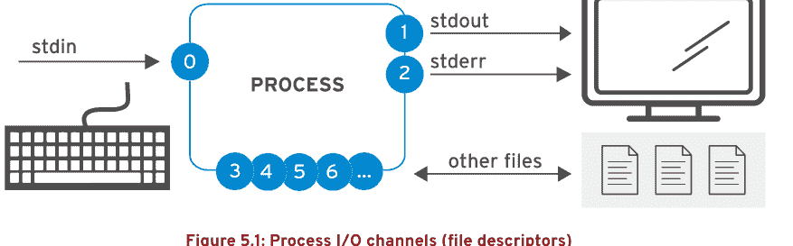

通道（文件描述符）

| 编号 | 通道名称 | 描述 | 默认连接 | 用法 |
|---|---|---|---|---|
| 0 | stdin | 标准输入 | 键盘 | 只读 |
| 1 | stdout | 标准输出 | 终端 | 仅写 |
| 2 | stderr | 标准错误 | 终端 | 仅写 |
| 3+ | filename | 其他文件 | 无 | 读取和/或写入 |

# 将输出重定向到文件

I/O 重定向改变了进程获取输入或输出的方式。不再从键盘获取输入，或将输出和错误发送到终端，而是从读取或写入文件。重定向允许将通常发送到终端窗口的消息保存到文件中。或者，你可以使用重定向来丢弃输出或错误，这样它们就不会显示在终端上或被保存。

重定向 `stdout` 会抑制来自终端的输出。如下表所示，仅重定向 `stdout` 不抑制 `stderr` 错误消息在终端上的显示。如果文件不存在，则将创建它。如果文件存在且重定向不是追加到文件，则文件的内容将被覆盖。

如果你想丢弃输出，特殊文件 `/dev/null` 会静默丢弃重定向到它的通道输出，并且始终是一个空文件。

### 输出重定向操作符

| 用法 | 解释 | 视觉辅助 |
| :--- | :--- | :--- |
| > file | 将 stdout 重定向并覆盖文件 |  |


| `>> file` | 将 stdout 重定向并追加到文件 |  |

| `2> file` | 将 stderr 重定向并覆盖文件 |  |

| `2> /dev/null` | 通过重定向到 `/dev/null` 丢弃 stderr 消息 |  |

| `> file2&1` | 将 stdout 和 stderr 重定向并覆盖同一个文件 |  |

| `>> file2&&1` | 将 stdout 和 stderr 重定向并追加到同一个文件 |  |

# 第 2 章 | 创建、查看和编辑文本

> 注意

重定向操作的顺序至关重要。以下序列将标准输出重定向到 `file`，然后将标准错误重定向到与标准输出相同的地方（`file`）。

```
> file 2>&1
```

然而，下一个序列以相反的顺序执行重定向。它将标准错误重定向到标准输出的默认位置（终端窗口，所以没有变化），然后只将标准输出重定向到 `file`。

```
2>&1 > file
```

由于这个原因，有些人倾向于使用合并重定向操作符：

| | `>file 2>&1` |

|---|---|

| | 使用 `&file` 代替 `>&file`，或者使用 `>>file 2>&1`（在 Bash 4 / RHEL 6 中） |

由于这种原因，某些人倾向于使用合并重定向操作符：合并重定向操作符在所有 shell 中并不标准，且存在局限性。

作者对这一主题持中立态度，在 shell 中遇到这些语法。

### 输出重定向示例

许多例行的管理任务通过重定向得以简化。使用以下示例考虑输出重定向：

- 保存时间戳以备后用。
- `[user@host ~$ date > /tmp/timestamp]`（注意：此处根据上下文省略了 log）

- 将日志文件的最后 100 行复制到另一个文件。
- `[user@host ~$ tail -n 100 /var/log/dmesg > /tmp/last100-messages`

- 将四个文件合并为一个。
- `[user@host ~$ cat file1 file2 file4 > /tmp/all-in-one`

- 将家目录的隐藏和普通文件名列到一个文件中。
- `[user@host ~$ ls -a > /tmp/file-names`

- 向现有文件追加输出。

```
[user@host ~$ echo "new line of information" >> /tmp/many-lines-of-information
[user@host ~$ diff previous-file current-file >> /tmp/tracking-changes
```

接下来的命令会生成错误消息，因为某些目录对普通用户不可访问。观察错误消息被重定向。在查看普通命令输出的同时将错误重定向到文件。

```
[user@host ~$ find /etc -name passwd 2> /tmp/errors
```

将进程输出和错误消息保存到不同的文件中。

```
[user@host ~$ find /etc -name passwd > /tmp/output 2 /tmp/errors
```

忽略并丢弃错误消息。

```
[user@host ~$ find /etc -name passwd > /tmp/output 2 /dev/null
```

将输出和生成的错误存储在一起。

```
[user@host ~$ find /etc -name passwd &> /tmp/save-both
```

将输出和生成的错误追加到现有文件。

```
[user@host ~$ find /etc -name passwd >> /tmp/save-both 2>&1
```

## 构建管道

管道是由管道符（`|`）分隔的一个或多个命令的序列。管道将第一个命令的标准输出连接到下一个命令的标准输入。

> 注意 管道和 I/O 重定向都操作标准输出和标准输入。重定向将标准输出发送到文件或从文件获取标准输入。管道将一个进程的标准输出发送到另一个进程的标准输入。

# 管道示例

此示例获取了 `ls` 命令的输出，并使用 `less` 将其在终端屏幕上分次显示。

```
[user@host ~]$ ls -l /usr/bin | less
```

`ls` 命令的输出被传给 `wc -1`，它统计从 `ls` 接收到的行数并打印到终端。

```
[user@host ~]$ ls | wc -1
```

在此流水线中，`head` 将输出 `ls -t` 的前 10 行结果，并将最终结果重定向到一个文件。

```
[user@host ~]$ ls -t | head -n 10 > /tmp/ten-last-changed-files
```

### 管道、重定向和 tee 命令

当重定向与管道结合时，shell 会先建立整个管道，然后重定向输入/输出。如果在管道中间使用了输出定向，则该输出将流到文件中，而不是管道中的下一个命令。

在此示例中，`ls` 命令的输出进入了文件，而 `less` 在终端上没有显示任何内容。

```
[user@host ~]$ ls > /tmp/saved-output | less
```

`tee` 命令克服了这一局限性。在管道中，`tee` 将其标准输入复制到标准输出，同时也将其标准输出重定向到作为命令参数命名的文件中。如果你将数据比作流过管道的水，`tee` 可以被视化为管道中的“T”型接头，它可以将输出导向两个方向。

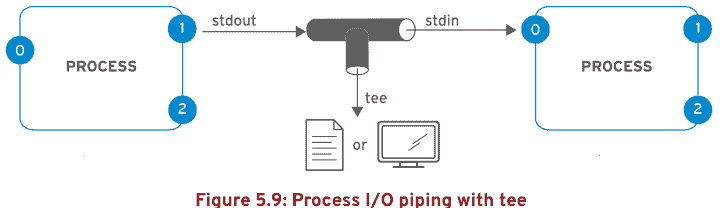

### 使用 tee 命令的管道示例

此示例重定向了 `ls` 命令的输出，并将其传递给 `less` 以在终端屏幕上分次显示。

```
[user@host ~]$ ls -l | tee /tmp/saved-output | less
```

如果在管道末尾使用 `tee`，则命令的最终输出可以同时保存并输出到终端。

# 第 5 章 | 创建、查看和编辑文本文件

```
[user@host ~] ls -t | head -n 10 | tee /tmp/ten-last-changed-files
```

# 重要

标准错误可以通过管道重定向，但不能使用合并重定向操作符（`&` 和 `&&`）来实现。

以下是通过管道重定向标准输出和标准错误的正确方法：

```
[user@host ~] find -name / passwd 2>&1 | less
```

# 参考文献

`info bash` (GNU Bash 参考手册)

- 第 3.2.2 节：管道
- 第 3.6 节：重定向

`info coreutils 'tee invocation'` (GNU coreutils 手册)

- 第 17.1 节：将输出重定向到多个文件或进程

`bash(1)`, `cat(1)`, `head(1)`, `less(1)`, `mail(1)`, `tee(1)`, `tty(1)`, `wc(1)` man pages

# Quiz

# 输出到文件或程序

为以下问题选择正确答案：

- 1. 哪个答案可以将输出显示到终端并忽略所有错误？
  a. `&&file`
  b. `2>&file`
  c. `2>/dev/null`
  d. `1>/dev/null`

- 2. 哪个答案将输出发送到文件并将错误发送到另一个文件？
  a. `>file2`
  b. `>file1=file2`
  c. `>2>&file2`
  d. `| tee file`

- 3. 哪个答案将输出和错误都发送到文件，创建它或覆盖内容？
  a. `| tee file`
  b. `2>&file`
  c. `1>&file`
  d. `&&file`

- 4. 哪个答案将输出和错误发送到同一个文件，并确保保留现有文件内容？
  a. `>file2 2>file`
  b. `&&file`
  c. `>>file 2>&1`
  d. `>>file1>&1`

- 5. 哪个答案会丢弃所有正常发送到终端的消息？
  a. `>file2`
  b. `&>/dev/null`


### 输出到文件或程序

为以下问题选择正确答案：

- 1. 哪个答案可以将输出显示到终端并忽略所有错误？

  a. `&&file`

  b. `2>&file`

  c. `2>/dev/null`

  d. `1>/dev/null`

- 2. 哪个答案将输出发送到文件并将错误发送到另一个文件？

  a. `>file2`

  b. `>file1=file2`

  c. `>2>&file2`

  d. `| tee file`

- 3. 哪个答案将输出和错误都发送到文件，创建它或覆盖内容？

  a. `| tee file`

  b. `2>&file`

  c. `1>&file`

  d. `&&file`

- 4. 哪个答案将输出和错误发送到同一个文件，并确保保留现有文件内容？

  a. `>file2 2>file`

  b. `&&file`

  c. `>>file 2>&1`

  d. `>>file1>&1`

- 5. 哪个答案会丢弃所有正常发送到终端的消息？

  a. `>file2`

  b. `&>/dev/null`

  c. `&>/dev/null 2>file`

  d. `&&file`

- 6. 哪个答案将输出同时发送到屏幕和文件？

  a. `&>/dev/null`

  b. `tee file 2>file2`

  c. `< tee file`

  d. `< file`

- 7. 哪个答案将输出保存到文件并丢弃错误消息？

  a. `&>file`

  b. `tee file 2> /dev/null`

  c. `> file 1> /dev/null`

  d. `> file 2> /dev/null`

## 答案

# 输出到文件或程序

为以下问题选择正确答案：

- 1. 哪个答案可以将输出显示到终端并忽略所有错误？

  a. `&&file`

  b. `2>&file`

  c. `2>/dev/null`

  d. `1>/dev/null`

- 2. 哪个答案将输出发送到文件并将错误发送到另一个文件？

  a. `>file2`

  b. `>file1=file2`

  c. `>2>&file2`

  d. `| tee file`

- 3. 哪个答案将输出和错误都发送到文件，创建它或覆盖内容？

  a. `| tee file`

  b. `2>&file`

  c. `1>&file`

  d. `&&file`

- 4. 哪个答案将输出和错误发送到同一个文件，并确保保留现有文件内容？

  a. `>file2 2>file`

  b. `&&file`

  c. `>>file 2>&1`

  d. `>>file1>&1`

- 5. 哪个答案会丢弃所有正常发送到终端的消息？

  a. `>file2`

  b. `&>/dev/null`

  c. `&>/dev/null 2>file`

  d. `&&file`

- 6. 哪个答案将输出同时发送到屏幕和文件？

  a. `&>/dev/null`

  b. `tee file 2>file2`

  c. `< tee file`

  d. `< file`

- 7. 哪个答案将输出保存到文件并丢弃错误消息？

  a. `&>file`

  b. `tee file 2> /dev/null`

  c. `> file 1> /dev/null`

  d. `> file 2> /dev/null`

## 在 Shell 中编辑文件

## 目标

完成本节后，你将能够通过以下方式在 Shell 中编辑文件：

- 使用 Vim

- 使用 `vim` 命令

- 使用 `vi` 命令

## 在 Shell 中编辑文件

### 为什么学习 Vim

Vim 是 Linux 系统中广泛使用的文本编辑器。在许多分发版中，它是默认安装的。Vim 强大且高效，支持许多高级功能。学习 Vim 可以极大提高你的工作效率。

### 使用 Vim

Vim 是 Vi 的改进版，它包含许多许多功能，使得编辑文本变得更加直观和高效。你可以通过以下方式启动 Vim：

- 输入 `vim`

根据发行版的不同，Vim 可能有多个版本例如：

- `vim`：包含最完整的功能。

- `vim-tiny`：仅包含基本功能。

- `vim-enhanced`：包含更多功能，如 Python 支持。

- `vim-common`：包含大多数常用的功能。

### 启动 Vim

注意：

- 在许多系统中，`vi` 被设置为 `vim` 的别名。这意味着普通用户运行 `vi` 时，实际上运行的是 `vim`。

- 对于 root 用户或 UID 小于 200 的用户，这种别名可能不存在。

如果你以 root 身份运行 `vi` 并期望它以增强模式运行，可能会感到意外。同样，如果安装了 `vim-enhanced` 而普通用户想使用简单的 `vi`，他们可能需要使用 `vim` 来覆盖别名。

高级用户可以使用 `vi --version` 和 `vim --version` 来比较这两个命令的功能。

### Vim 操作模式

Vim 的一个特点是它有多种操作模式：命令模式、扩展命令模式、插入模式和视觉模式。根据模式的不同，你可能正在执行命令、编辑文本或处理文本块。作为新的 Vim 用户，你应该始终意识到当前的模式。当你打开 Vim 时，它进入命令模式，该模式用于导航、剪切、粘贴或其他文本处理。通过单字符按键进入其他模式，以提供特定的编辑功能：

- 按 `i` 键进入插入模式，此时所有文本都成为文件内容。按 `Esc` 会返回命令模式。

- 按 `v` 键进入视觉模式，可以选取多个字符进行文本处理。使用 `Shift+V` 进行行选择，使用 `Ctrl+V` 进行块选择。使用与进入视觉模式相同的按键退出。

- 输入冒号 `:` 开始扩展命令模式，用于诸如写入文件（保存）和退出 Vim 编辑器等任务。

无论何种方式，本节讨论的核心功能都适用于这两个命令。

```
[user@host ~]$ vim filename
```

# 第 2 章 | 创建、查看和编辑文本

> 注意：如果你不确定 Vim 处于什么模式，可以尝试按几次 `Esc` 键返回命令模式。在命令模式下按 `Esc` 是无害的，所以多按几次也没关系。

### 最小、基础 Vim 工作流

Vim 提供了针对高级编辑任务的高效、协调的按键操作。虽然通过练习可以认为这些功能非常有用，但 Vim 的功能可能会让新用户无从从。

`i` 将 Vim 置于插入模式。在此输入的所有文本在退出插入模式之前都会被视为内容。`Esc` 键退出插入模式并将 Vim 返回到命令模式。`u` 键将撤销最近的编辑。`x` 键删除单个字符。`:w` 写入（保存）文件，`:wq` 写入（保存）文件并退出 Vim。`:q` 退出 Vim 并丢弃自上次写入以来的所有文件更改。Vim 用户学习这些命令来完成任何编辑任务。

### 重新排列现有文本

在 Vim 中，复制和粘贴被称为 yank（复制）和 put（粘贴），使用命令 `y` 和 `p`。首先将光标置于要选择的第一个字符，然后进入视觉模式。使用方向键扩展视觉选择范围。准备就绪后按 `y` 将选择的内容复制到内存中（此处原文有误），将光标移动到新位置，按 `p` 将选择的内容粘贴到光标处。

### Vim 中的视觉模式

视觉模式是高亮和操作文本的一种极方法。三种按键：

- 字符模式：`v`

- 行模式：`Shift+V`

- 块模式：`Ctrl+V`

字符模式高亮文本块中的句子。屏幕底部会显示 `VISUAL` 字样。按 `v` 进入视觉模式。`Shift+V` 进入行模式。屏幕底部会显示 `VISUAL LINE`。

视觉块是处理数据文件的理想选择。从光标处开始，按 `Ctrl+V` 进入视觉块模式。屏幕底部会显示 `VISUAL BLOCK`。使用方向键高亮要更改的部分。

> 注意：Vim 有很多功能，但你应该先掌握基础工作流。你不需要快速理解整个编辑器及其功能。通过练习熟悉这些基础，然后你可以通过学习额外的 Vim 命令（按键）来扩展你的词汇量。

本节的练习将向你介绍 `vimtutor` 命令。随 `vim-enhanced` 提供的教程是学习 Vim 核心功能的极佳方式。

## 参考文献

`vim(1)` 手

vim 中的 `:help` 命令（如果安装了 `vim-enhanced` 包）。

Vim 编辑器

```
http://www.vim.org/
```

开始使用 Vim 视觉模式

```
https://opensource.com/article/19/2/getting-started-vim-visual-mode
```

## 引导练习

### 从 Shell 提示符编辑文本文件

在此练习中，你将使用 `vimtutor` 在 vim 编辑器中练习基础编辑技术。

### 学习成果

你应该能够：

- 使用 Vim 编辑文件。

- 通过 `vimtutor` 熟练使用 Vim。

### 在开始之前

使用 `student` 作为密码登录工作站。

在工作站上，运行 `lab edit-vim start` 命令。

```
[student@workstation ~]$ lab edit-vim start
```

1. 使用 `ssh` 命令登录 `servera`。

```
[student@workstation ~]$ ssh servera
使用：systemctl enable --now cockpit.socket 激活 Web 控制台
```

```
Last login: Mon Jan 14 15:36:15 2019 from 172.25.250.254
[student@servera ~]$
```

2. 打开 `vimtutor`。阅读欢迎界面并执行课程 1.1。

```
[student@servera ~]$ vimtutor
```

在演示中，键盘方向键用于导航。当 vi 最初开发时，用户无法依靠方向键或有效的方向键键盘映射来移动光标。因此，vi 最初被设计为使用标准字符键命令来移动光标，正如方便证明的 `H`、`J`、`K` 和 `L`。

这里有一个记忆点：

向退（hang back）、下跳（jump down）、向上（kick up）、向前跃（leap forward）。

3. 在 `vimtutor` 窗口中执行第 1.2 。


本节教你如何在不保留不需要更改的情况下退出。所有更改都会丢失。有时，这比让关键文件处于错误状态要好。

4. 在 `vimtutor` 窗口中执行第 1.3 。

`Vim` 有快速、高效的按键来删除精确数量的单词、行、句子和段落。然而，任何编辑任务都可以通过 `x` 删除单个字符。

5. 在 `vimtutor` 窗口中执行第 1.4 。

对于大多数编辑任务，第一个按键是 `i`。

6. 在 `vimtutor` 窗口中执行第 1.5 。

在讲座中，`i`（插入）命令被教授进入编辑模式的按键。

此 `vimtutor` 展示了进入插入模式时更改光标位置的其他可用按键。在插入模式下，所有输入的文本都是文件内容。

7. 在 `vimtutor` 窗口中执行第 1.6 。

输入 `:wq` 保存文件并退出编辑器。

8. 在 `vimtutor` 窗口中阅读第 1 节的总结。

`vimtutor` 命令包含另外六个多步骤课程。这些课程未作为本课程的一部分分配，但欢迎自行探索它们以学习更多。

9. 从 `servera` 注销。

```
[student@servera ~]$ logout
Connection to server closed.
[student@workstation ~]$
```

## 完成

在工作站上，运行 `lab edit-vim finish` 脚本以完成此练习。

```
[student@workstation ~]$ lab edit-vim finish
```

引导练习结束。

# 更改 Shell 环境

## 目标

完成本节后，你应该能够设置 shell 变量来帮助运行命令，并编辑文件。

### 使用 Shell 变量

`Bash` 允许你设置 shell 变量来帮助运行命令，或修改启动脚本。Shell 变量在程序启动时会自动复制。这些变量对于特定的 shell 会话。

### 给变量赋值

使用以下语法给变量赋值：

```
VARIABLE=value
```

变量名可以包含大小写字母、数字和下划线 `_`。

```
[user@host ~]$ COUNT=40
[user@host ~]$ first_name=John
[user@host ~]$ file1=abc
[user@host ~]$ ID=123
```

记住，此更改影响 shell。你可以使用 `set` 命令列出当前设置的所有变量。（它也列出了函数。）此列表足够长，你可能想将其输出管道到 `less`，以便逐页查看。

```
[user@host ~]$ set | less
BASH:/bin/bash
BASHOPTS=checkwinsize:cdhist:complete_fullquote:extglob:
...
```

### 使用变量扩展获取值

你可以使用变量扩展来引用你设置的变量。要这样做，在变量名面前加一个美元符号 `$`。在下面的示例中，执行变量扩展后，`echo` 命令打印命令行剩余部分。

对于示例，以下命令将 `COUNT` 设置为 40。

```
[user@host ~]$ COUNT=40
```

如果你输入命令 `echo COUNT`，它将打印字符串 `COUNT`。

```
[user@host ~]$ echo COUNT
COUNT
```

但如果你输入命令 `echo $COUNT`，它将打印变量 `COUNT` 的值。

```
[user@host ~]$ echo $COUNT
40
```

一个更具实用的示例可能是使用变量为多个命令引用长文件名。

```
[user@host ~]$ file1=/tmp/tmp.zp9W0Hqcc
[user@host ~]$ ls -l $file1
-rw------- 1 student student 1452 Jan 22 14:39 /tmp/tmp.zp9W0Hqcc
[user@host ~]$ rm $file1
[user@host ~]$ ls -l $file1
total 0
```

> 重要

如果变量名旁边有任何后续字符，你可能需要用大括号保护变量名。你始终可以在变量扩展中使用大括号，但你也会看到很多不需要且省略了大括号的示例。

在下面的示例中，第一个命令尝试扩展不存在的变量 `COUNTx`，这不会导致错误，而是返回为空。

```
[user@host ~]$ echo Repeat COUNTx
Repeat
[user@host ~]$ echo Repeat$(COUNT)x
Repeat 48x
```

例如，影响 shell 历史记录和 `history` 命令的变量是 `NHISTFILE` 和 `HISTFILESIZE`。如果设置了 `HISTFILE`，它指定了 shell 退出时保存 shell 历史记录的文件位置。默认情况下它是用户的 `/.bash_history`。

`HISTFILESIZE` 变量指定了从历史记录中应在该文件中保存多少条命令。

另一个例子是 `PS1`，它是一个控制 shell 提示符外观的变量。如果你更改它的值，它将改变你的 shell 提示符外观。提示符支持的许多特殊字符扩展列在 `bash(1)` 手页的“PROMPTING”部分中。

```
[user@host ~]$ PS1="\bash"
$ bash PS1="\u@\w \$ "
[user@host ~]
```

关于上述示例有两点需要注意：首先，因为 `PS1` 设置的值是一个提示符，通常最好在提示符末尾以一个空格结束。其次，无论变量的值是否包含某种形式的形状（包括空格、制表符或回车），该值必须用引号（单引号或双引号）括起来：这是强制性的要求。如果省略引号，将产生意外的结果。检查上面的 `PS1` 示例并注意它同时符合建议（末尾空格）和规则（引号）。

## 使用环境变量配置程序

shell 为你从那里运行的程序提供了一个环境。除了其他，该环境还包含了文件系统上当前工作目录的信息、传递给提示符的命令行选项以及环境变量的值。程序可以使用这些环境变量来改变它们的行为或默认设置。

不是环境变量的 shell 变量只能由 shell 使用。环境变量可以被 shell 以及也可以由从该 shell 运行的程序使用。

> 注意：上一节中学习的 `NHISTFILE`、`HISTFILESIZE` 和 `PS1` 不需要导出为环境变量，因为它们只被 shell 本身使用，而不被从 shell 运行的程序使用。

你可以通过使用 `export` 命令将其标记为导出，从而将 shell 中定义的任何变量变为环境变量。

```
[user@host ~]$ EDITOR=vim
[user@host ~]$ export EDITOR
```

你可以在一步内导出变量：

```
[user@host ~]$ export EDITOR=vim
```

应用程序和会话使用这些变量来确定它们的行为。shell 在启动时会自动将 `HOME` 变量设置为用户主目录的文件名。这可以帮助程序确定将文件保存在何处。

另一个例子是 `LANG`，它设置本地化（locale）。这调整了程序输出的首选语言；日期、数字和货币的格式；以及程序的排序顺序。如果设置为 `en_UTF-8`，本地化将使用带有 UTF-8 Unicode 编码的美国英语。如果设置为其他，例如 `fr_UTF-8`，它将使用法语 UTF-8 编码。

```
[user@host ~]$ date
Tue Jan 22 16:37:45 CST 2019
[user@host ~]$ export LANG=fr_FR.UTF-8
[user@host ~]$ date
mar. Jan. 22 16:38:14 CST 2019
```

另一个重要的环境变量是 `PATH`。`PATH` 变量包含由冒号分隔的目录，这些目录包含了程序：

```
[user@host ~]$ echo PATH
/home/user/.local/bin:/bin:/usr/bin:/usr/share/Modules/bin:/usr/local/bin:/usr/local/sbin:/usr/sbin
```

当你运行类似 `ls` 的命令时，shell 会按顺序在每个目录中查找可执行文件 `ls`，并运行找到的第一个匹配。（在典型系统上，这是 `/usr/bin/ls`。）

你可以轻松地将额外的目录添加到 `PATH` 的末尾。例如，可能你已经在 `/home/user/sbin` 中有你想要像普通命令一样运行的可执行程序或脚本。你可以像这样将 `/home/user/sbin` 添加到当前会话 `PATH` 的末尾：

```
[user@host ~]$ export PATH=${PATH}:/home/user/sbin
```

要列出特定 shell 的环境变量，请运行 `env` 命令：

```
[user@host ~]$ env
...output omitted...
LANG=en_UTF-8
HISTCONTROL=ignored
HOSTNAME=example.com
XDG_SESSION_ID=4
...output omitted...
```

## 设置默认编辑器


`EDITOR` 环境变量指定了你想要作为命令行程序默认编辑器的程序。如果没有指定，许多程序会使用 `vi` 或 `vim`，但根据需要，你可以覆盖此偏好：

```
[user@host ~]$ export EDITOR=nano
```

## 第 2 章 创建、查看和编辑文件

> 重要：按照惯例，由 shell 自动设置的环境变量和 shell 变量使用大写字母。如果你正在设置自己的变量，可能希望使用小写字母名称以避免冲突。

### 自动设置变量

如果你想在 shell 启动时自动设置 shell 变量或环境变量，你可以编辑 Bash 脚本。当 Bash 启动时，会有几个包含初始化环境的文件。运行的脚本取决于 shell 如何启动（是交互式登录 shell、交互式非登录 shell 还是 shell 脚本）。假设默认的 `/etc/profile` 和 `~/.bash_profile`，如果你想在启动时进行影响你所有交互式账户的更改，请编辑 `.bashrc` 文件。例如，你可以通过编辑该文件将该账户的默认编辑器设置为 `nano`：

```
.bashrc
### Source global definitions
if [ -f /etc/bashrc ]; then
  /etc/bashrc
fi

## 用户特定环境
PATH="$HOME/.local/bin:$PATH"
## 用户特定别名和函数
export EDITOR=nano
```

> 注意：调整所有用户账户设置的最佳方法是将包含更改的以 `.sh` 结尾的文件添加到 `/etc/profile.d` 目录中。要这样做，你需要以 `root` 用户身份登录。

### 取消和取消导出变量

要取消并取消导出变量，请使用 `unset` 命令：

```
[user@host ~]$ file=tmp.zsh
[user@host ~]$ unset file
[user@host ~]$ echo file
```

要在不取消变量的情况下取消导出，请使用 `export -n` 命令：

```
[user@host ~]$ export -n PS1
```

> 引用：`bash(1)`, `env(1)`, 和 `builtins(1)` 手页

## 引导式练习

### 更改 shell 环境

在此练习中，你将使用 shell 变量和变量扩展来运行命令，并使用环境变量来调整新 shell 的默认编辑器。

## 完成

在工作站上运行 `lab edit-shell finish` 脚本以完成此练习。


```
[student@workstation ~]$ lab edit-shell finish
```

本引导性练习结束。

# 创建、查看和编辑文本文件

## 性能检查清单

在本实验中，你将使用 `vim` 编辑器编辑文本文件。

### 预期结果

你应该能够：

- 使用 Vim 进行文件编辑。
- 使用可视模式（`visual mode`）简化文件编辑。

### 在开始之前

使用密码 `student` 登录以 `student` 身份到工作站。

在工作站上，运行 `lab edit-review start` 命令。

```
[student@workstation ~]$ lab edit-review start
```

1. 将学生主目录下所有内容（包括隐藏目录和文件）的详细列表重定向到名为 `editing_final_lab.txt` 的文件中。
2. 使用 Vim 编辑该文件。
3. 删除前三行。按大写 `V` 进入行级可视模式。
4. 删除第一行的列。按小写 `v` 进入字符可视模式。小写 `v` 仅选择单行上的字符。应删除 `-rw-` 之后的列。
5. 删除剩余行中的列以及后续的点 `.`。使用控制序列 `Ctrl-V` 使用可视块模式。使用此序列选择多行上的字符块。应删除 `-rw-` 之后的列。
6. 使用可视块模式删除第四列。
7. 使用可视块模式删除第十行，保留所有行中的月份和日期。
8. 删除 `Desktop` 和 `Public` 行。按大写 `V` 进入行级可视模式。
9. 使用 `:wq` 命令保存并退出文件。创建一个备份，使用日期（秒）创建一个唯一的文件。
10. 在文件末尾添加一条虚线。虚线应至少包含 12 个横线。
11. 追加 `Documents` 目录的目录列表。使用一条命令行在在终端上列出目录列表并将其发送到 `editing_final_lab.txt` 文件。
12. 确认目录列表位于实验文件的底部。

## 评估

在工作站上，运行 **lab edit-review grade** 命令以确认本次练习成功。

```
[student@workstation ~] lab edit-review grade
```

## 完成

在工作站上，运行 **lab edit-review finish** 脚本完成本次练习。

```
[student@workstation ~]$ lab edit-review finish
```

本实验结束。

## 解决方案

# 创建、查看和编辑文本文件

## 性能检查清单

在本实验中，你将使用 `vim` 编辑器编辑文本文件。

### 预期结果

你应该能够：

- 使用 Vim 进行文件编辑。
- 使用可视模式（`visual mode`）简化文件编辑。

### 在开始之前

使用密码 `student` 登录以 `student` 身份到工作站。

在工作站上，运行 `lab edit-review start` 命令。

```
[student@workstation ~]$ lab edit-review start
```

1. 将学生主目录下所有内容（包括隐藏目录和文件）的详细列表重定向到名为 `editing_final_lab.txt` 的文件中。

> 注意
>
> 输出可能与所示的示例不完全匹配。

在工作站上，使用 `cd` 命令返回学生主目录。

使用 `ls -al` 将所有内容的详细列表重定向到名为 `editing_final_lab.txt` 的文件中。

```
[student@workstation ~]$ cd
[student@workstation ~]$ ls -al > editing_final_lab.txt
```

2. 使用 Vim 编辑该文件。

```
[student@workstation ~]$ vim editing_final_lab.txt
```

3. 删除前三行。按大写 `V` 进入行级可视模式。

使用方向键将光标移动到第一行的第一个字符。使用 `Shift+V` 进入行级可视模式。使用向下方向键两次以选择前几行。使用 `x` 删除这些行。

```
student@workstation:- total 32
-drwxr-xr-x 15 student 4096 Jan 22 10:31 .bash_history
-rw-r---- 1 student 409 Jan 21 18:50 .bash_log
-drwxr-xr-x 15 student 4096 Jan 21 15:44 .bash_profile
-rw-r---- 1 student 312 Oct 22 23:56 .bashrc
-drwxr-xr-x 10 student 203 Jan 14 14:16 .config
-rw-r---- 1 student 4096 Jun 6 14:16 .input_history
-drwxr-xr-x 2 student 4096 Jun 6 14:16 .Documents
-rw-r---- 1 student 0 Jan 22 10:45 editing_final_lab.txt
-drwxr-xr-x 1 student 4096 Jan 30 14:16 .ICEAuthority
-drwxr-xr-x 2 student 4096 Jan 19 14:16 .local
-drwxr-xr-x 2 student 4096 Jun 6 14:16 .Pictures
-drwxr-xr-x 2 student 4096 Jun 6 14:16 .Public
-drwxr-xr-x 2 student 4096 Jun 6 14:16 .Templates
-drwxr-xr-x 3 student 4096 Jan 19 14:16 .pki
-rw-r---- 1 student 73 Jan 14 15:33 .ssh
-rw-xr-x 1 student 1095 Jan 14 15:34 .viminfo
```

4. 删除第一行的列。按小写 `v` 进入字符可视模式。小写 `v` 仅选择单行上的字符。

使用方向键将光标移动到第一个字符。按小写 `v` 进入可视模式。使用方向键将光标移动到最后一行。使用 `x` 删除选中内容。

```
student@workstation:- total 32
-drwxr-xr-x 15 student 4096 Jan 22 10:31 .bash_history
-rw-r---- 1 student 409 Jan 21 18:50 .bash_log
-drwxr-xr-x 15 student 4096 Jan 21 15:44 .bash_profile
-rw-r---- 1 student 312 Oct 22 23:56 .bashrc
-drwxr-xr-x 10 student 203 Jan 14 14:16 .config
-rw-r---- 1 student 4096 Jun 6 14:16 .input_history
-drwxr-xr-x 2 student 4096 Jun 6 14:16 .Documents
-rw-r---- 1 student 0 Jan 22 10:45 editing_final_lab.txt
-drwxr-xr-x 1 student 4096 Jan 30 14:16 .ICEAuthority
-drwxr-xr-x 2 student 4096 Jan 19 14:16 .local
-drwxr-xr-x 2 student 4096 Jun 6 14:16 .Pictures
-drwxr-xr-x 2 student 4096 Jun 6 14:16 .Public
-drwxr-xr-x 2 student 4096 Jun 6 14:16 .Templates
-drwxr-xr-x 3 student 4096 Jan 19 14:16 .pki
-rw-r---- 1 student 73 Jan 14 15:33 .ssh
-rw-xr-x 1 student 1095 Jan 14 15:34 .viminfo
```

# 第 2 章 | 创建、查看和编辑文本

5. 删除剩余行中的列以及后续的点 `.`。使用 `Ctrl-V` 使用可视块模式。使用此键选择多行的字符块。应删除 `-rw-` 之后的字符。

使用方向键将光标移动到第一个字符。按 `Ctrl-V` 进入可视模式。使用方向键将光标移动到最后一行列的最后一个字符。使用 `x` 删除选中内容。


6. 使用可视块删除第四列。

使用方向键将光标移动到第四列的第一个字符。按 `Ctrl-V` 进入可视块模式。使用方向键将光标移动到该列的最后一行和最后一列。使用 `x` 删除选中内容。


7. 使用可视块模式删除时间列，保留所有行的月份和日期。


使用方向键将光标移动到第一个字符。按 `Ctrl-V` 进入可视块模式。使用方向键将光标移动到该列的最后一个字符和最后一行。使用 `x` 删除选中内容。

```
student@workstation~
File Edit View Search Terminal Help
-rw 1 student 183 Jan 21 15:00 .bash_history
-rw 1 student 141 Oct 12 23:56 .bash_log
-rw 1 student 141 Oct 12 23:56 .bash_profile
-drwx 2 student 201 Jan 24 .cache
-drwx 2 student 201 Jan 24 Desktop
-drwx 2 student 256 Jan 06 .Documents
-drwx 2 student 256 Jan 06 .Downloads
-drwx 2 student 256 Jan 06 .Pictures
-rw 1 student 506 Jan 16 .editing_final_lab.txt
-rw 1 student 161 Jan 16 .eddt
-drwx 2 student 201 Jan 19 .authority
-drwx 2 student 256 Jan 06 .Music
-drwx 2 student 256 Jan 06 .Public
-drwx 2 student 256 Jan 06 .Templates
-drwx 2 student 256 Jan 06 .Video
-rw 1 student 1095 Jan 14 .viminfo
```

8. 删除 `Desktop` 和 `Public` 行。按大写 `V` 进入行级可视模式。

使用方向键将光标移动到 `Desktop` 行的任意字符。按大写 `V` 进入可视模式。选中整行。对 `Public` 行重复此操作。

```
student@workstation~
File Edit View Search Terminal Help
-rw 1 student 310 Jan 21 .bash_history
-rw 1 student 141 Oct 12 23:56 .bash_log
-rw 1 student 141 Oct 12 23:56 .bash_profile
-drwx 2 student 201 Jan 24 .cache
-drwx 2 student 201 Jan 24 Desktop
-drwx 2 student 256 Jan 06 .Documents
-drwx 2 student 256 Jan 06 .Downloads
-drwx 2 student 256 Jan 06 .Pictures
-rw 1 student 926 Jan 22 .editing_final_lab.txt
-rw 1 student 161 Jan 14 .ICEauthority
-rw 1 student 318 Jan 14 .viminfo
-drwx 2 student 256 Jan 06 .Music
-drwx 2 student 256 Jan 06 .Public
-drwx 2 student 256 Jan 06 .Templates
-drwx 2 student 256 Jan 06 .Video
```

9. 使用 `:wq` 命令保存并退出文件。使用日期（秒）创建一个唯一的文件名进行备份。

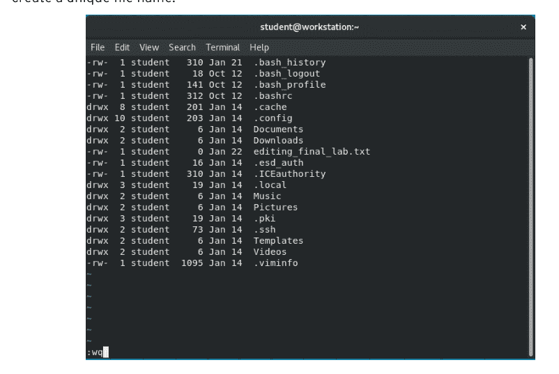

```
[student@workstation ~]$ cp editing_final_lab.txt editing_final_lab_$(date +%F).txt
```

10. 在文件末尾添加一个横线。该横线应至少包含 12 个横杠。

```
[student@workstation ~]$ echo "------------------------------------------------" >> editing_final_lab.txt
```

11. 追加 Documents 目录的目录列表。在终端上显示目录列表并使用一条命令编辑该文件。

```
[student@workstation ~]$ ls Documents/ | tee -a editing_final_lab.txt lab_review.txt
```

```
[student@workstation ~]$ cat editing_final_lab.txt
-rw- 1 student 310 Jan 21 .bash_history
-rw- 1 student 18 Oct 12 .bash_logout
-rw- 1 student 141 Oct 12 .bash_profile
-rw- 1 student 312 Oct 12 .bashrc
drwx 0 student 201 Jan 14 .cache
drwx 10 student 203 Jan 14 .config
drwx 2 student 6 Jan 14 Documents
drwx 2 student 6 Jan 14 Downloads
-rw- 1 student 0 Jan 22 editing_final_lab.txt
-rw- 1 student 16 Jan 14 .sed_auth
-rw- 1 student 310 Jan 14 .ICEauthority
drwx 3 student 19 Jan 14 .local
drwx 2 student 6 Jan 14 Music
drwx 2 student 6 Jan 14 Pictures
```

12. 确认目录列表位于文件的底部。

```
drwx 3 student 19 Jan 14 .pki
drwx 2 student 73 Jan 14 .ssh
drwx 2 student 6 Jan 14 Templates
drwx 2 student 8 Jan 14 Videos
-rw- 1 student 1895 Jan 14 .viminfo
-----------------------------
lab_review.txt
```

## 评估

在工作站上，运行 `lab edit-review grade` 命令以确认本次练习成功。

```
[student@workstation ~]$ lab edit-review grade
```

## 结束

在工作站上，运行 `lab edit-review finish` 脚本完成本次练习。

```
[student@workstation ~]$ lab edit-review finish
```

本实验结束。

## 总结

在本章中，你学习了：

- 运行程序或进程三个三个通信通道：标准输入、标准输出和标准错误。
- 你可以使用 I/O 重定向从文件读取标准输入，或将进程的输出或错误写入文件。
- 管道可以将一个进程的标准输出连接到另一个进程的标准输入，并可用于格式化输出或构建复杂的命令。
- 你应该知道如何使用至少一种命令行文本编辑器，通常系统中安装了 Vim。
- Shell 变量可以帮助你运行命令，并且对于特定的 Shell 会话来说是唯一的。
- 环境变量可以帮助你配置 Shell 或其启动的进程的行为。

# 管理本地用户和组

## 目标

## 目标

创建、管理和删除本地用户和组，并管理本地密码策略。

- 描述 Linux 系统中用户和组的作用。
- 切换到超级用户账户管理 Linux 系统，并使用 `sudo` 命令授予其他用户超级用户权限。
- 创建、修改和删除本地定义的用户账户。
- 创建、修改和删除本地定义的组。
- 为用户设置密码管理策略，并手动锁定和解锁用户账户。

# 章节

- 描述用户和组的概念（及测）
- 获取超级用户权限（及引导练习）
- 管理本地用户账户（及引导练习）
- 管理本地组账户（及引导练习）
- 管理用户密码（及引导练习）

# 实验

管理本地 Linux 用户和组

## 描述用户和组的概念

## 目标

在完成本节后，你应该能够描述 Linux 系统中用户和组的作用。

### 什么是用户？

用户账户用于在不同的人和可以运行命令的程序之间提供安全边界。

用户拥有用户名，以便人类用户识别它们并使其易于操作。在内部，系统通过分配给它们的唯一标识数字（即 ID 或 UID）来区分用户账户。如果用户账户由人类使用，通常会分配一个密码，用户在登录时使用该密码证明他们是授权用户。

用户账户对于系统安全至关重要。每个文件都有特定的用户作为所有者。文件所有有助于系统对用户文件执行访问控制。与运行进程关联的用户决定了进程可以访问的文件和目录。

用户有三种类型：

- 超级用户：拥有系统的完全访问权限。
- 守护进程（Daemons）：在后台运行且不进行交互的进程。
- 普通用户：拥有有限权限。

要查看用户信息，使用 `id` 命令。


```
[user1@host ~]$ id
uid=1000(user1) gid=1000(user1) groups=1000(user1),27(sudo)
```

# 第 6 章

查看另一个用户的基本信息，使用 `id` 命令后接用户名。

```
[user2@host ~]$ id
uid=1002(user2) gid=1002(user2) groups=1002(user2)
```

上述命令的输出通过名称显示用户，但在内部用户名到 UID 的映射定义在账户数据库中。默认情况下，使用 `/etc/passwd` 文件存储信息。`/etc/passwd` 文件中的每行都包含一个用户的信息。它由冒号分隔的字段组成。这里有一个示例：`user01:x:1000:1000:User One:/home/user01:/bin/bash`

- 用户名 (`user01`)。

- 存储在此处的加密格式密码已移动到 `/etc/shadow` 文件，显示为 `x`。

- 用户的 UID (`1000`)。

- 用户主组的 GID (`1000`)。

- 用户的真实名称 (`User One`)。

  家目录 (`/home/user01`)。这是 Shell 启动时的初始工作目录。

- 该进程的默认 shell (`//bin/bash`)。

## 什么是组？

组是一组共享文件和其他系统资源的用户集合。组可以用于向一组用户授予文件访问权限，而不仅仅是单个用户。

和用户一样，组拥有用户名以便易于操作。在内部，系统通过分配给它们的唯一标识数字（即组 ID 或 G）来区分组。

组名到 GID 的映射定义在组账户数据库中。默认情况下，使用 `/etc/group` 文件存储本地组的信息。

`/etc/group` 中的示例：`sudo:27:user01,user2`

- 组名 (`sudo`)。

- 该组的 GID (`27`)。

- 属于该组的用户列表。

查看组信息，使用带 `a` 参数的 `ps` 命令。默认只显示当前 shell 中的进程。添加 `u` 参数以包含终端用户。

```
[student@workstation ~]$ ps -au
USER       PID %CPU %MEM    VSZ TTY START TIME COMMAND
root         1  0.0  0.1  16800 ?        Ss   09:00   /sbin/init
user01    1234  0.0  0.0  4500 pts/0    S    10:00 0:00 /bin/bash
user02    5678  0.0  0.0  4600 pts/1    S    10:01 0:00 /bin/bash
```

`/etc/group` 文件中的每一行都包含关于一个组的信息。每个组条目分为四个由冒号分隔的字段。以下是 `/etc/group` 中某行的示例：

```
group01:x::10000:user01,user02,user03
```

- 该组的组名 (`group01`)。

- 过时的组密码字段。此字段应始终为 `x`。

- 该组的 GID (`10000`)。

- 作为附加组属于该组的用户列表 (`user01,user02,user03`)。主组（或默认组）和附加组将在本节稍后的部分进行讨论。

# 主组与附加组

每个用户都恰有一个主组。对于本地用户，这是在 `/etc/passwd` 文件中将作为该用户创建的新文件所有者的组组。默认情况下，这是由 GID 给出的组 ID。

通常，当你创建一个新用户时，会创建一个与该用户同名的新组。该组是新用户的主组，而该用户是该“用户私有组”（User Private Group）的唯一成员。事实证明，这有助于文件权限的管理，我们将在课程后面的部分进行讨论。

用户可能还拥有附加组。附加组的成员身份授予访问权限取决于其任何一个组是否具有访问权限。具有权限的组或多个组是该用户的主组还是附加组并不重要。

例如，如果用户 `user01` 有一个主组 `user01` 以及附加组 `wheel` 和 `webadmin`，那么该用户就可以读取这三个组中任何一个可读的文件。

`id` 命令也可以用于查找用户的组成员身份。

```
[user03@host ~]$id
uid=1003(user03) gid=1003(user03) groups=1003(user03),10(wheel),10000(group01)
context=unconfined:u:unconfined:r:unconfined:t:s0:s0:c0:1023
```

在前面的示例中，`user03` 的组 `user03` 是其主组 (`gid`)。`groups` 项列出了该用户的所有组，除了主组 `user03` 之外，该用户还有 `wheel` 组和 `group01` 作为附加组。

参考文献

`id(!)`, `passwd(5)`, 和 `group(5)` man 页面

`info libc` (GNU C 库手册)

第 30 部分：用户与组

（注意，必须安装 `glibc-dev` 包才能使用此 info 节点。）

## 测验

### 描述用户和组的概念

为以下问题选择正确答案：

- 1. 哪一个项代表在最基础层面上标识用户的数字？

  a 主用户

  b UID

  c GID

  d 用户名

- 2. 哪一个项代表提供用户命令行提示符的程序？

  a 主 shell (primary shell)

  b 家目录

  c 登录 shell (login shell)

  d 命令名

- 3. 哪一个项或文件代表本地组的位置？

  a 家目录

  b `/etc/passwd`

  c `/etc/GID`

  d `/etc/group`

- 4. 哪一个项或文件代表用户个人文件的位置？

  a 家目录

  b 登录 shell

  c `/etc/passwd`

  d `/etc/group`

- 5. 哪一个项代表在最基础层面上标识组的数字？

  a 主组

  b UID

  c GID

  d groupid

- 6. 哪一个项或文件代表本地用户账户信息的位置？

  a. 家目录

  b `/etc/passwd`

  c `/etc/UID`

  d `/etc/group`

- 7. `/etc/passwd` 文件的第四字段是什么？

  a 家目录

  b UID

  c 登录 shell

  d 主组

### 描述用户和组的概念

为以下问题选择正确答案：

- 1. 哪一个项代表在最基础层面上标识用户的数字？

   a. 主用户

   b. UID

   c. GID

   d. 用户名

- 2. 哪一个项代表提供用户命令行提示符的程序？

   a. 主 shell

   b. 家目录

   c. 登录 shell

   d. 命令名

- 3. 哪一个项或文件代表本地组的位置？

   a. 家目录

   b. `/etc/passwd`

   c. `/etc/group`

   d. `/etc/group`

- 4. 哪一个项或文件代表用户个人文件的位置？

   a. 家目录

   b. 登录 shell

   c. `/etc/passwd`

   d. `/etc/group`

- 5. 哪一个项代表在最基础层面上标识组的数字？

   a. 主组

   b. UID

   c. GID

   d. groupid

- 6. 哪一个项或文件代表本地用户账户信息的位置？

   a. 家目录

   b. `/etc/passwd`

   c. `/etc/UID`

   d. `/etc/group`

- 7. `/etc/passwd` 文件的第四字段是什么？

   a. 家目录

   b. UID

   c. 登录 shell

   d. 主组

## 获取超级权限

### 目标

完成本节后，你将能够切换到 root 用户账户，并通过 `sudo` 命令获取超级用户权限。

### 超级用户

大多数操作系统都有某种超级用户，对系统拥有所有权限。在 Red Hat Linux 中，这种用户是 `root`。超级用户可以安装或删除软件并管理系统。超级用户是 `root`，拥有对系统的所有权限。

超级用户在普通用户之间可以控制设备，但也有例外。这种无限制的权限伴随着责任。超级用户可以破坏系统文件、用户账户、添加后门等。

### 切换用户

`su` 命令允许用户切换到不同的用户。当你从普通用户使用 `su` 时，系统会提示输入要切换到的账户的密码。

```
[user01@host ~]$ su user02
Password:
[user02@host ~]
```

`su` 命令启动一个非登录 shell，而 `su -` 启动一个登录 shell。这两个命令的主要区别是 `su -` 会像新登录一样设置环境，而 `su` 只是启动一个 shell。

大多数情况下，管理员应该运行 `su -` 以获取目标用户环境的 shell。更多信息请参阅 `bash(1)` man 页面。


su 最常用于以另一个用户的身份运行命令行界面（shell 提示符）。然而，通过 `-c` 选项，它可以像 Windows 的 `runas` 一样以另一个用户的身份运行任意程序。运行 `info` 查看更多详情。

# 使用 sudo 执行命令

在某些情况下，出于安全考虑，root 用户账户可能没有任何有效的密码。在这种情况下，用户无法直接通过密码登录 root 系统，也无法通过 `su` 获取交互式 shell。在这种情况下用于获取 root 权限的工具是 `sudo`。

与 `su` 不同，`sudo` 通常要求用户输入自己的密码进行身份验证，而不是他们尝试访问的账户的密码。也就是说，使用 `sudo` 运行 root 命令的用户不需要知道 root 密码。相反，他们使用自己的密码来验证访问。

此外，可以配置 `sudo` 允许特定用户作为其他用户的身份运行任何命令，或作为该用户运行某些命令。

例如，当 `sudo` 配置允许 `user01` 以 `root` 身份运行 `usermod` 命令，`user01` 可以运行以下命令来锁定或解锁用户账户：

```
[user01@host ~]$ sudo usermod -l user02
[sudo] password for user01:
[user01@host ~]$
```...

如果用户尝试以另一个用户的身份运行命令，而 `sudo` 配置不允许，该命令将被阻止，尝试将被记录，并且默认会向 `root` 用户发送一封邮件。

## 第 7 章 | 管理本地用户和组

```
[user02@host ~]$ sudo tail /var/log/secure
[sudo] password for user02:
user02 is not in the sudoers file. This incident will be reported.
[user02@host ~]$
```

使用 `sudo` 的另一个好处是，所有执行的命令默认都会记录在 `/var/log/secure` 中。

```
[user01@host ~]$ sudo tail /var/log/secure
...output omitted.
Feb 6 28:45:46 host sudo[2577]: user01 : TTY=pts0 ; PWD=/home/user01 ; USER=root COMMAND=/sbin/sudo -L user02
...output omitted.
```

在 Red Hat Linux 7 和 Red Enterprise Linux 8 中，`wheel` 组的所有成员都可以使用 `sudo` 以任何用户（包括 `root`）身份运行命令。系统会提示用户输入密码。这与 Red Hat Linux 6 及更早版本不同，在旧版本中，`wheel` 组的成员默认不会获得这种管理权限。

> 警告
>
> RHEL 6 默认不授予 `wheel` 组任何权限。将该组用于非标准用途的站点可能会对 RHEL 7 和 RHEL 8 自动授予所有 `wheel` 成员完全 `sudo` 权限感到惊讶。这可能导致未经授权的用户获得 RHEL 7 和 RHEL 8 系统的管理权限。

从历史上来看，Unix 类系统使用 `wheel` 组成员身份来授予或控制超级用户访问。

## 使用 Sudo 获取交互式 root Shell

如果系统中有一个可以使用 `sudo` 运行命令的非管理员账户，你可以从该账户运行 `sudo -s` 来获取一个交互式 `root` shell。这之所以有效，是因为 `sudo` 会以 `root` 身份运行 `su`，而 `root` 使用 `sudo` 不需要输入密码。

使用 `sudo` 访问 `root` 账户另一种方法是使用 `sudo -i` 命令。这将切换到 `root` 账户并运行用户的默认 shell（通常是 `bash`）以及相关的登录 脚本。如果你只想运行 shell，可以使用 `sudo -s` 命令。

例如，管理员可能通过 SSH 公钥认证登录为普通用户 `ec2-user`，然后通过运行 `sudo -i` 来在 AWS EC2 实例上获取 `root` 用户的 shell。

```
[ec2-user@host ~]$ sudo -i
[password] for ec2-user:
[root@host ~]#
```

`sudo -s` 命令和 `sudo -i` 的行为并不完全相同。本节末将对此简要讨论。

### 配置 Sudo

`sudo` 的主配置文件是 `/etc/sudoers`。为了避免在多个管理员同时尝试编辑它时出现问题，应仅使用特殊的 `visudo` 命令进行编辑。

例如，`/etc/sudoers` 中的以下行代码开启了 `wheel` 组成员的 `sudo` 访问权限。

```
%wheel=(ALL) ALL
```

在此行中，`%wheel` 是控制访问权限的用户或组。`%` 指定任何拥有该文件的 `wheel` 组成员都可以运行任何命令。`ALL=(ALL)` 指定 `wheel` 组可以以系统上任何用户的身份运行命令。

默认情况下，`/etc/sudoers` 还会包含 `/etc/sudoers.d` 目录下的文件内容作为配置的一部分。这允许管理员仅需通过在该目录下放置适当的文件即可为用户添加 `sudo` 访问权限。

> 注意
>
> 使用 `/etc/sudoers.d` 目录下的补充文件既方便又简单。你只需通过将文件复制到目录或从目录中删除即可启用或禁用 `sudo` 访问。

在这种情况下，你将在 `/etc/sudoers.d` 目录中创建和删除文件来为用户和组配置 `sudo` 访问。

要为 `user01` 开启完全 `sudo` 权限，你可以创建 `/etc/sudoers.d/user01`，内容如下：

```
user01=(ALL) ALL
```

要为 `group01` 开启完全 `sudo` 权限，你可以创建 `/etc/sudoers.d/group01`，内容如下：

```
%group01=(ALL) ALL
```

还可以通过以下设置允许用户在无需输入密码的情况下以另一个用户的身份运行命令：

```
ansible=(ALL) NOPWD:ALL
```

虽然向用户或组授予这种级别的访问存在明显的安全风险，但它经常用于云实例、虚拟机和用于配置系统。账户必须经过仔细保护，并且可能需要 SSH 公钥认证才能安全地访问远程系统。Red Hat Enterprise Linux 出带的 `root` `ec2-user` 账户被锁定，因为 `/etc/sudoers` 文件的最后一行设置如下，允许 `ec2-user` 在无需密码的情况下运行任何命令：

```
ec2-user=(ALL) NOPASSWD:ALL
```

> 注意
>
> 在本课程中，你会经常看到 `sudo su` 而不是 `sudo -i`。这两个命令都有效，但它们之间存在细微差异。`sudo su` 命令以类似于普通登录的方式设置 `root` 用户，因为它忽略了设置。`sudo -i` 命令设置 `root` 用户的环境与普通登录不同，这影响了 shell 查找路径。你可以通过 `visudo` 编辑 `/etc/sudoers` 让 `sudo -i` 的行为像 `su`。找到该行：
>
> ```
> Defaults secure_path = /sbin:/bin
> ```
>
> 将其替换为以下行：
>
> ```
> Defaults secure_path = /usr/local/bin:/bin
> Defaults:root secure_path = /sbin
> ```
>
> 对于大多数用途来说，这并不是主要差异。但为了系统 PATH 设置的一致性，示例中大多使用 sudo。

> 参考文献
>
> `su(1)`, `sudo(8)`, `visudo(8)` 以及 `sudoers(5)` 手页
>
> `libc` 引用手册 - 第 3.2 节：进程（注意，此节点必须安装 `glibc-devel` 包才能可用。）

# 引导练习：获取超级用户权限

在此练习中，你将练习切换到 `root` 账户并以 `root` 身份运行命令。

#

你应该能够：

- 使用 `sudo` 切换到 `root` 并在不知道超级用户密码的情况下访问交互式 shell。
- 解释 `su` 和 `sudo -i` 如何通过运行或不运行登录脚本来影响环境变量。
- 使用 `sudo` 以 `root` 身份运行其他命令。

## 开始之前

使用 `student` 登录 `workstation`。在 `workstation` 上运行 `lab users-sudo start` 开始练习。该脚本会创建必要的用户账户并正确设置环境。

```
[student@workstation ~]$ lab users-sudo start
```

- 1. 从 `workstation` 以 `student` 登录 `servera`。

```
[student@workstation ~]$ ssh student@servera
...output omitted...
```

- 2. 探索 `student` 的环境变量。查看当前用户组信息和当前工作目录。还要查看指定用户主目录和可执行文件位置的环境变量。

- 2.1. 运行 `id` 查看当前用户组信息。


```
[student@servera ~]$ id
uid=1000(student) gid=1000(student) groups=1000(wheel)
context=unconfined_u:unconfined_r:unconfined_t:s0-0:0.c23
```

### 2.2. 运行 `pwd` 显示当前工作目录。

```
[student@servera ~]$ pwd
/home/student
```

### 2.3. 打印 `HOME` 和 `PATH` 变量的值以确定主目录和用户可执行文件。

```
[student@server ~]$ echo HOME
/home/student
[student@server ~]$ echo PATH
/home/student/.local/bin:/home/student/bin:/usr/local/bin:/usr/local:/usr/bin:/usr/sbin
```

## 3. 在非登录 shell 中切换到 root 并探索新的 shell 环境。

### 3.1. 在 shell 提示符运行 `su` 成为 root 用户。

```
[student@server ~]$ sudo su
[sudo] password for student: student
[root@server #]
```

### 3.2. 运行 `id` 查看当前用户组信息。

```
[root@server #]$ id
uid=0(root) gid=0(root) groups=0(root)
context=unconfined_u:unconfined_r:unconfined_t:s0-s0:c0.c123
```

### 3.3. 运行 `pwd` 显示工作目录。

```
[root@server #]$ pwd
/home/student
```

### 3.4. 打印 `HOME` 和 `PATH` 变量的值以确定主目录和用户可执行文件。

```
[root@server #]$ echo HOME
/root
[root@server #]$ echo PATH
/sbin:/usr/local/bin:/usr/sbin:/usr/bin:/bin
```

如果你有一定的 Linux 经验，不带 `(-)` 选项进入 root 的 `su` 会导致你保留 student 的 `PATH`。这种情况并没有发生。正如你在下一步中将看到的，这也不是 root 的常规 `PATH`。发生了什么？区别在于你没有使用 `su`，你以 root 身份运行 `su` 是因为你没有传递 root 的密码。`sudo` 命令最初出于安全考虑覆盖初始环境中的 `PATH`。在初始覆盖之后运行的任何命令仍然更新 `PATH`，将在后续步骤中。

### 3.5. 退出 root 用户的 shell 返回到 student 用户的 shell。

```
[root@server #]$ exit
exit
```

# 第 6 章 | 管理本地用户和组

## 4. 在登录 shell 中切换到 root 并探索新的 shell 环境。

### 4.1. 在 shell 提示符处运行 `sudo su -` 以成为 root 用户。

```
[student@servera ~] sudo su
[root@servera #]
```

注意 shell 提示符与上一步中 `sudo su` 相比的区别。

`sudo` 可能会或可能不会提示你输入 student 密码，这取决于 `sudo` 的超时时间。默认超时时间为五分钟。如果你在过去五分钟内通过了 `sudo` 认证，`sudo` 将不会提示你输入密码。如果距离上次通过 `sudo` 认证已超过了五分钟，你需要输入 student 密码来通过 `sudo` 认证。

### 4.2. 运行 `id` 查看当前的用户和组组信息。

```
[root@servera #] id
uid=0(root) gid=0(root) groups=0(root)
context=unconfined_u:unconfined_r:unconfined_t:s0-s0:c0.c1023
```

### 4.3. 运行 `pwd` 显示工作目录。

```
[root@servera #] pwd
root
```

### 4.4. 打印 `HOME` 和 `PATH` 变量的值，分别确定主目录和用户可执行文件路径。

```
[root@servera #] echo HOME
/root
[root@servera #] echo PATH
/usr/local/sbin:/usr/local/bin:/usr/bin:/root/bin
```

在上一步中，在 `sudo` 从 student shell 环境设置中重置 `PATH` 变量后，`su -` 命令运行了 root 的 shell 登录脚本并将 `PATH` 变量设置为另一个值。不带 `)` 的 `su` 命令没有执行此操作。

### 4.5. 退出 root 用户的 shell 返回 student 用户的 shell。

```
[root@servera #] exit
logout
[student@servera ~]$
```

### 5. 验证 `operator1` 用户已配置为可以使用 `sudo` 以任何身份运行任何命令。

```
student@servera ~]$ sudo cut /etc/sudoers.d/operator1
operator1-ALL=(ALL)
```

### 6. 成为 `operator1` 并查看 `/var/log/messages` 的内容。将 `/etc/motd` 复制到 `/etc/motd` 并删除它 (`/etc/motd`)。这些操作需要管理员权限，因此你使用 `sudo` 以超级用户身份运行这些命令。不要通过 `sudo su` 或 `sudo su -` 切换到 root。

#### 6.1. 切换到 `operator1`。

```
[student@servera ~]$ su - operator1
Password: redhat
[operator1@servera ~]
```

#### 6.2. 尝试不用 `sudo` 查看 `/var/log/messages` 的五行。这应该会失败。

```
[operator1@servera ~]$ tail -5 /var/log/messages
tail: cannot open '/var/log/messages' for reading: Permission denied
```

#### 6.3. 尝试使用 `sudo` 查看 `/var/log/messages` 的五行。这应该成功。

```
[operator1@servera ~]$ sudo tail -5 /var/log/messages
[sudo] password for operator1: redhat
Jan 23 15:53:36 server su(2394): FAILED SU (to operator1) student on pts/1
Jan 23 15:53:51 servera su(2310): FAILED SU (to operator1) student on pts/1
Jan 23 15:53:58 servera su(2310): FAILED SU (to operator1) student on pts/1
Jan 23 15:54:12 server su(2322): (to operator1) student on pts/1
Jan 23 15:54:25 servera su(2853): (to operator1) student on pts/1
```

> 注意
>
> 上述输出在你的系统上可能有所不同。

#### 6.4. 尝试不用 `sudo` 将 `/etc/motd` 复制为 `/etc/motd`。这应该会失败。

```
[operator1@servera ~]$ cp /etc/motd /etc/motd
cp: cannot create regular file '/etc/motd': Permission denied
```

#### 6.5. 尝试使用 `sudo` 将 `/etc/motd` 复制为 `/etc/motd`。这应该成功。

```
[operator1@servera ~]$ sudo cp /etc/motd /etc/motd
[operator1@servera ~$]
```

#### 6.6. 尝试不用 `sudo` 删除 `/etc/motd`。这应该会失败。

```
[operator1@servera ~$] rm /etc/motd
rm: remove write-protected regular empty file '/etc/motd'
rm: cannot remove '/etc/motd': Permission denied
[operator1@servera ~$]
```

#### 6.7. 尝试使用 `sudo` 删除 `/etc/motd`。这应该成功。

```
[operator1@servera ~$] sudo rm /etc/motd
[operator1@servera ~$]
```


6.8. 退出 `operator1` 的 shell 返回 `student` 用户的 shell。

```
[operator1@servera ~$] exit
logout
[student@servera ~]$
```

6.9. 从服务器注销。

```
[student@servera ~]$ exit
logout
Connection to server closed.
```

### 完成。

在工作站上，运行 `lab-finish` 完成练习。

## 第 6 章 | 管理本地用户和组

### 管理用户账户

#### 目标

完成本节后，你应该能够创建、修改和删除用户账户。

#### 管理用户

##### 从命令行创建用户

- `useradd` 命令创建一个新用户。它设置了主目录和账户信息。此时账户还没有设置有效密码。
- `useradd --help` 显示可使用的选项。

##### 从命令行修改现有用户

- `usermod --help` 显示可使用的选项：

| 选项 | 用法 |
| :--- | :--- |
| -c, --comment | 将姓名添加到注释字段。 |
| -g, --group | 指定用户的主组。 |
| -G, --groups | 指定逗号分隔的辅助组列表。 |
| -a, --append | 与 -G 使用，添加辅助组而不是替换。 |
| -d, --home_DIR | 为用户指定特定的主目录。 |
| -m, --move-home | 将用户的主目录移动到新位置。必须配合 -d 使用。 |
| -s, --shell | 为用户账户指定特定的登录 shell。 |
| -L, --lock | 锁定账户 |

##### 从命令行删除用户

- `userdel username` 从 `/etc/passwd` 中删除用户的详细信息，但保留用户的主目录。
- `userdel -r username` 从 `/etc/passwd` 中删除用户的详细信息并删除用户的主目录。

> 警告
> 当不带 `-r` 选项使用 `userdel` 删除时，系统将拥有属于分配 UID 的文件。当已删除用户的所有者文件存在于其主目录之外时，也会发生这种情况。这可能会导致信息泄露和其他安全问题。在 Red Enterprise Linux 7 和 Red Enterprise Linux 8 中，`useradd` 命令分配大于 1000 的第一个空闲 UID，除非你使用 `-u` 选项指定它。这就是信息泄露发生的情况。如果第一个空闲 UID 之前分配给已删除的用户账户，则旧用户的 UID 将重新分配给新用户，从而让新用户拥有旧用户文件的所有权。

##### 从命令行设置密码

- `password username` 命令设置用户的初始密码或更改 `username` 的现有密码。

# 第 2 章 管理本地用户和组

- `root` 用户可以设置任何值作为密码。如果密码不符合最低标准，则会显示一条消息，随后提示重新输入新密码，并且所有令牌将成功更新。

```
[root ~]# password user01
Changing password for user01.
New password: redhat
BAD PASSWORD: The password fails the dictionary check - it is based on a
dictionary word
Retype new password: redhat
passwd: all authentication tokens updated successfully.
[root ~]#
```

- 普通用户必须选择至少 8 个字符的密码，且不能基于词典单词、用户名或之前的密码。

## UID 范围

Red Hat Enterprise Linux 使用特定的 UID 和数字范围用于特定用途。

- `UID` 0 始终分配给超级用户账户 `root`。
- `UID` 1-200 是 Red Hat 文件系统静态分配给系统进程的“系统用户”范围。它们通常在安装需要这些程序的软件时从可用池中动态分配。程序以“无特权”系统用户的身份运行这些，以限制其对运行所需资源的访问权限。
- `UID` 1000+ 是可分配给普通用户的范围。

> 注意
> 在 RHEL 7 之前，习惯是 UID 1-499 用于系统用户，UID 500+ 用于普通用户。`useradd` 和 `groupadd` 使用的默认范围可以在 `/etc/login.defs` 文件中更改。

> 引用
> `useradd(8)`, `usermod(8)`, `userdel(8)` man pages

## 引导练习

# 管理本地用户账户

在此练习中，你将在系统中创建几个用户并为这些用户设置密码。

结果

你应当能够配置一个带有额外用户账户的 Linux 系统。

开始之前

以用户 `student` 和密码 `student` 登录到工作站。

在工作站上，运行 `lab users-manage start` 开始练习。此脚本确保环境设置正确。

```
[student@workstation ~]$ lab users-manage start
```

- 1. 从工作站通过用户 `student` 身份向 `servera` 开启 SSH 会话。

```
[student@workstation ~]$ ssh student@servera
...output omitted...
[student@servera ~]
```

- 2. 在 `servera` 上，使用 `sudo` 切换到 `root`，转换为 `root` 用户的 shell 环境。

```
[student@servera ~]$ sudo su -
[sudo] password for student: student
[root@servera ~]
```

- 3. 创建 `operator1` 并确认它在系统中存在。

```
[root@servera ~]# useradd operator1
[root@servera ~]# tail /etc/passwd
...output omitted...
operator1:x:1001:1001::/home/operator1:/bin/bash
```

- 4. 为 `operator1` 设置密码为 `redhat`。

```
[root@servera ~]# passwd operator1
Changing password for user operator1.
New password: redhat
BAD PASSWORD: The password is shorter than 8 characters
Retype new password: redhat
```

`passwd`: all authentication tokens updated successfully.

- 5. 创建额外的用户 `operator2` 和 `operator3`。将它们的密码设置为 `redhat`。

- 5.1. 添加 `operator2` 用户。将 `operator2` 的密码设置为 `redhat`。

```
[root@servera ~]# usermod operator2
[root@servera ~]# password operator2
Changing password for operator2.
New password: redhat
BAD PASSWORD: The password is shorter than 8 characters
Retype new password: redhat
passwd: all authentication tokens updated successfully.
```

- 5.2. 添加 `operator3` 用户。将 `operator3` 的密码设置为 `redhat`。

```
[root@servera ~]# usermod operator3
[root@servera ~]# password operator3
Changing password for operator3.
New password: redhat
BAD PASSWORD: The password is shorter than 8 characters
Retype new password: redhat
passwd: all authentication tokens updated successfully.
```

- 6.1. 运行 `operator1` 用户账户运行 `usermod -c "Operator One" operator1`。

```
[root@servera ~]# usermod -c "Operator One" operator1
```

- 6.2. 运行 `usermod -c "Operator Two"` 来更新 `operator2` 用户的注释。


```
[root@servera ~]# usermod -c "Operator Two" operator2
```

- 6.3. 确认 `operator1` 和 `operator2` 每个用户的注释已反映在用户记录中。

```
[root@servera ~]# tail /etc/passwd
output omitted..
operator1:x:1001:1001:Operator One:/home/operator1:/bin/bash
operator2:x:1002:1002:Operator Two:/home/operator2:/bin/bash
operator3:x:1003::/home/operator3:/bin/bash
```

- 7. 删除 `operator3` 用户及其任何个人数据。确认该用户已成功删除。

- 7.1. 从系统中移除 `operator3` 用户。

```
[root@servera ~]# userdel -r operator3
```

- 7.2. 确认 `operator3` 已成功删除。

```
[root@servera ~]# tail /etc/passwd
...output omitted...
operator1:x:1001:1001:Operator One:/home/operator1:/bin/bash
operator2:x:1002:1002:Operator Two:/home/operator2:/bin/bash
```

- 7.3. 退出 `root` 用户 `shell` 回到 `student` 用户的 `shell`。

```
[root@servera ~]# exit
[student@servera ~]$
```

- 7.4. 退出 `servera`。

```
[student@servera ~]$ exit
Connection to servera closed.
[student@workstation ~]$
```

## 完成

在工作站上，运行 `lab users-manage finish` 完成练习。此脚本确保环境洁净。

```
[student@workstation ~]$ lab users-manage finish
```

引导练习结束

# 管理本地账户

## 目标

完成本节后，学生应该能够创建、修改和删除本地账户。

## 管理组

在将用户添加到组之前，该组必须存在。使用多个命令行工具管理本地组。

### 从命令行创建组

- `groupadd` 命令创建组。在没有选项的情况下，`groupadd` 命令使用 `/etc/login.defs` 中指定的范围创建组。
- `-g` 选项为组指定特定的 GID。

```
[user01@host ~]$ sudo groupadd -g 10000 group01
[user01@host ~]$ tail /etc/group
...output omitted...
group01:x:10000:
```

> 注意
> 自动创建用户私有组（GID 1000+）建议留出一个范围用于附加组。较高的范围将避免与系统组（GID 0-999）冲突。

- `-r` 选项使用 `/etc/login.defs` 列出的有效系统 GID 范围创建系统组 `/etc/login.defs` 中的 `SYS_GID_MIN` 和 `SYS_GID_MAX` 项定义了系统 GID 的范围。

```
[user01@host ~]$ sudo groupmod -r group02 group02
[user01@host ~]$ tail /etc/group
...output omitted...
group02:x:988:
```

### 从命令行修改现有组

- `groupmod` 命令更改现有组的属性。`-n` 选项为组指定新名称。

```
[user01@host ~]$ sudo groupmod -n group02 group02
[user01@host ~]$ tail /etc/group
...output omitted...
group022:x:988:
```

注意组名已从 `group02` 更新为 `group02`。

- `-g` 选项指定一个新的 GID。

```
[user01@host ~]$ sudo groupmod -g 20000 group022
[user01@host ~]$ tail /etc/group
...output omitted...
group022:x::20000:
```

注意 GID 已从 `988` 更新为 `20000`。

### 从命令行删除组

- `groupdel` 命令移除组。

```
[user01@host ~]$ sudo groupdel group022
```

> 注意
> 如果该组是任何现有用户的主组，则无法删除它。与 `userdel` 一样，检查所有文件系统以确保系统中没有属于该组的文件。

# 从命令行更改组成身份

- 组的成员身份由用户管理控制。使用 `usermod -g` 命令更改用户的主组。

```
[user01@host ~]$ id user002
uid=1006(user02) gid=1008(user02)
[user01@host ~]$ sudo usermod -g group001 user002
[user01@host ~]$ id user002
uid=1006(user02) gid=1008(group001) groups=10000(group001)
```

- 使用 `usermod -ag` 命令将用户添加到附加组。

```
[user01@host ~]$ id user003
uid=1007(user03) gid=1009(user03) groups=1009(user03)
[user01@host ~]$ sudo usermod -aG group001 user003
[user01@host ~]$ id user003
uid=1007(user03) gid=1009(user03) groups=1009(user03), 10000(group001)
```

> 重要
> 使用 `-a` 选项使 `usermod` 以追加模式运行。如果不使用 `-a`，用户将从其 `-G` 组列表中未包含的任何附加组中移除。

# 参考文献

`group(5)`, `groupadd(8)`, `groupdel(8)`, 和 `usermod(8)` 手页

## 引导练习

## 管理本地组账户

在此练习中，你将创建组，将它们作为某些用户的附加组（而不更改用户的主组），并为其中一个组配置 `sudo` 权限以便以 `root` 身份运行命令。

# 学习成果

你应该能够：

- 创建组并将其作为附加组使用。
- 为组配置 `sudo` 权限。

## 开始之前

使用 `student` 作为密码登录工作站。
在工作站上，运行 `lab users-group-manage start` 来开始练习。此脚本将创建必要的用户账户以正确设置环境。

```
[student@workstation ~]$ lab users-group-manage start
```

- 1. 从工作站打开到 `servera` 用户 `student` 的 SSH 会话。

```
[student@workstation ~]$ ssh student@servera
...output omitted...
[student@servera ~]
```

- 2. 在 `servera` 上，使用 `sudo` 切换到 `root`，继承 `root` 用户的完整环境。

```
[root@servera ~]$ sudo su
[sudo] password for student: student
[root@servera #]
```

- 3. 创建 GID 为 `30000` 的 `operators` 组。

```
[root@servera #]$ groupadd -g 30000 operators
```

- 4. 创建 `admin` 作为额外的附加组。

```
[root@servera #]# groupadd admin
```

- 5. 验证 `operators` 和 `admin` 附加组都存在。

# 第 7 章 | 管理用户和组

```
[root@server ~]# tail /etc/group
...output omitted...
operators:x:30000:
admin:x:30001:
```

- 6. 确保用户 `operator1`、`operator2` 和 `operator3` 属于该组

将 `operator1`、`operator2` 和 `operator3` 添加到 `operators` 组。

6.1.

```
[root@server ~]# usermod -ag operators operator1
[root@server ~]# usermod -ag operators operator2
```


[root@server ~]# `usermod -ag operators operator3`

### 6.2.

确认用户已成功添加到组中。

```
[root@server ~]# id operator1

uid=1001(operator1) gid=1001(operator1) groups=1001(operator1), 30000(operators)

[root@server ~]# id operator2

uid=1002(operator2) gid=1002(operator2) groups=1002(operator2), 30000(operators)

[root@server ~]# id operator3

uid=1003(operator3) gid=1003(operator3) groups=1003(operator3), 30000(operators)
```

- 7. 确保用户 `sysadmin1`、`sysadmin2` 和 `sysadmin3` 属于 `admin` 组。为 `admin` 的所有组成员启用管理权限。验证 `admin` 的任何成员是否都能运行管理命令。

7.1.

将 `sysadmin1`、`sysadmin2` 和 `sysadmin3` 添加到 `admin` 组。

```
[root@server ~]# usermod -ag admin sysadmin1

[root@server ~]# usermod -ag admin sysadmin2

[root@server ~]# usermod -ag admin sysadmin3
```

7.2.

确认用户已成功添加到组中。

```
[root@server ~]# id sysadmin1

uid=1004(sysadmin1) gid=1004(sysadmin1) groups=1004(sysadmin1), 30001(admin)

[root@server ~]# id sysadmin2

uid=1005(sysadmin2) gid=1005(sysadmin2) groups=1005(sysadmin2), 30001(admin)

[root@server ~]# id sysadmin3

uid=1006(sysadmin3) gid=1006(sysadmin3) groups=1006(sysadmin3), 30001(admin)
```

7.3.

检查 `/etc/group` 以验证附加组成员关系。

```
[root@server ~]# tail /etc/group

...output omitted...

operators:x:30000:operator1,operator2,operator3

admin:x:30001:sysadmin,sysadmin2,sysadmin
```

- 7.4. 创建 `/etc/sudoers.d/admin` 文件，使 `admin` 成员拥有完全的管理权限。

```
[rootservera -] echo "admin ALL=(ALL) ALL" >> /etc/sudoers.d/admin
```

- 7.5. 切换到 `sysadmin1`（`admin` 的一个成员）并验证你可以以 `sysadmin1` 身份运行 `sudo` 命令。

```
[rootservera -$] su - sysadmin1

[sysadmin1@servera -$] sudo cat /etc/sudoers.d/admin

[sudo] password for sysadmin1:redhat

%admin ALL=(ALL) ALL
```

- 7.6. 退出 `sysadmin1` 用户的 shell 返回 `root` 用户的 shell。

```
[sysadmin1@servera -]$$ exit

logout

[root@servera -#]
```

- 7.7. 退出 `root` 用户的 shell 返回 `student` 用户的 shell。

```
[root@servera -]#$ exit

logout

[student@servera -]$
```

- 7.8. 退出 `servera` 登录。

```
[student@servera -]$$ exit

logout

Connection to servera closed.

[student@servera -]$
```

## 完成

在工作站上，运行 `lab users-group-manage` 完成练习。这是密码。

```
[student@workstation -]$
```

引导练习此结束。

## 管理用户密码

## 目标

完成本节后，你应该能够设置

# 影子密码（Shadow密码）

在字典攻击变得常见之前，密码存储在 `/etc/passwd` 中。Red Hat Enterprise Linux 8 将密码移动到了 `/etc/shadow`，该文件仅对 `root` 可读。

### 加密密码的格式

`shadow` 文件存储了三个字段：哈希算法、盐值（salt）和加密哈希值。下面是 `/etc/shadow` 中的一个示例行。

```
$6$sXx/42fJ//JaufZpc0X45JCH30E:17933:9999::
```

数字 `6` 表示 `SHA-512`，`1` 表示 `MD5`，`5` 表示 `SHA-256`。用于加密密码的盐值最初是随机选择的。

# 密码验证

当用户尝试登录时，系统会在 `/etc/shadow` 中查找条目，结合用户输入的明文密码的盐值，并使用哈希算法对其进行加密。如果结果与加密哈希不匹配，则用户输入的密码错误，登录尝试失败。这种方法允许系统在不存储可用于日志记录的格式的情况下，判断用户输入的密码是否正确。

# 配置密码有效期

下面的图显示了相关的密码有效期参数，可以使用 `change` 命令进行调整以实施密码有效期策略。

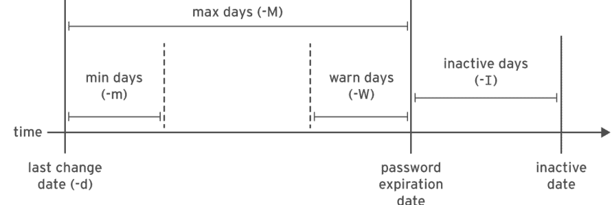

```
user01@host~$ sudo change -m 0 -M 90 -W 7 -I 14 user03
```

上述的 `change` 命令使用 `-m`、`-M`、`-W` 和 `-I` 选项分别设置密码的最小有效期、最大有效期、警告期和闲置期。

`change -d user03` 命令强制 `user03` 在下次登录时更新密码。

`change -E 2019-08-05 user03` 命令导致 `user03` 账户于 `2019-08-05`（格式为 `YYYY-MM-DD`）过期。

# 注意

`date` 命令可以用于计算未来的日期。`-u` 选项报告 `UTC` 时间。

```
[user01@host -~]$ date -d "+45 days" -u
Thu May 23 17:01:20 2019
```

编辑 `/etc/login.defs` 文件中的密码年龄项以设置默认的密码年龄策略。`PASS_MAX_DAYS` 设置密码的默认最大有效期。`PASS_MIN_DAYS` 设置密码的默认最小有效期。`PASS_WARN_AGE` 设置密码的默认警告期。默认密码年龄策略的任何更改都将对新用户生效。现有用户将继续使用旧的密码年龄设置，而不是新设置。

### 限制访问

你可以使用 `chage` 命令设置账户的过期日期。当到达该日期时，用户将无法以交互方式登录系统。可以使用 `usermod` 命令通过 `-L` 选项锁定账户。

```
[user01@host -~]$ sudo usermod -L user03
[user01@host -~]$ su user03
Password: redhat
su: Authentication failure
```

如果用户离开公司，管理员可以使用单个 `usermod` 命令锁定并过期账户。日期必须提供自 `1970-01-01` 以来的天数，或者使用 `YYYY-MM-DD` 格式。

```
[user01@host -~]$ sudo usermod -L -e 2019-10-05 user03
```

上述 `usermod` 命令使用 `-e` 选项为用户账户设置账户过期日期。`-L` 选项锁定用户的密码。

锁定账户可以防止用户通过密码进行系统身份验证。这是防止离职员工访问账户的推荐方法。如果员工返回，可以使用 `usermod -U` 解锁账户。如果账户已过期，请务必也更改过期日期。

### nologin Shell

`nologin` shell 充当不需要以交互方式登录系统的用户的替代品。从安全性的角度来看，当用户账户承担的职责不需要用户登录系统时，禁用该用户账户登录系统是明智的。例如，邮件服务器可能需要一个账户来存储邮件，并需要一个密码让用户通过邮件客户端进行身份验证以检索邮件。该用户不需要直接登录系统。

这种情况的常见解决方案是将用户的登录 shell 设置为 `/sbin/nologin`。如果用户尝试直接登录系统，`nologin` shell 将关闭连接。


```
[user01@host -]$ usermod -s /sbin/nologin user03
[user01@host -]$ su user03
Last login: Wed Feb 6 17:03:06 IST 2019 on pts/0
This account is currently not available.
```

> **重要**

`nologin` shell 防止了系统的交互式使用，但不能阻止所有访问。如果用户使用用户密码进行身份验证，他们可能通过 Web 应用程序、文件传输程序或邮件读取器等应用程序进行验证并上传或检索文件。

- **参考**

`change(1)`, `usermod(8)`, `shadow(5)`, `crypt(3)` man pages

# 引导性练习

# 管理用户密码

在此练习中，你将为几个用户设置密码策略。

## 目标

你应该能够：

- 在用户首次登录系统时强制其更改密码。
- 每隔 90 天强制更改密码。
- 设置账户在当前日期起 180 天后过期。

## 开始之前

使用密码 `student` 以 `student` 登录工作站。

在工作站上，运行 `lab users-pw-manage start` 开始练习。此脚本将创建必要的用户账户和文件，以确保环境设置正确。

```
[student@workstation ~]$ lab users-pw-manage start
```

- 1. 从工作站，以 `student` 身份向 `servera` 开启 SSH 会话。

```
[student@workstation ~]$ ssh student@servera
...output omitted...
[student@servera ~]$
```

- 2. 在 `servera` 上，以 `student` 身份探索锁定和解锁用户账户。

2.1. 尝试以 `operator1` 登录。这应该失败。

```
[student@servera ~]$ sudo usermod -L operator1
[sudo] password for student: student
```

```
[student@servera ~]$ su - operator1
Password: redhat
su: Authentication failure
```

2.3. 解锁 `operator1` 账户。

```
[student@servera ~]$ sudo usermod -U operator1
```

### 2.4. 再次以 `operator1` 登录。这应该成功。

```
$student@servera ~$ su operator1
Password: redhat
...output omitted.
operator1@servera ~$
```

### 2.5. 退出 `operator1` 用户的 shell 回到 `student` 用户的 shell。

```
$operator1@servera ~$ exit
logout
```

- 3. 为 `operator1` 修改密码策略，要求每 90 天更改一次密码。确认密码策略已设置。

3.1. 设置 `operator1` 的最大有效期为 90 天。

```
$student@servera ~ sudo change -M 90 operator1
```

3.2. 验证密码策略已设置。

```
$student@servera ~ sudo change -l operator1
Last password change           : Jan 25, 2019
Password expires               : never
Password inactive             : never
Account expires                : never
Minimum of days between password change : 0
Maximum of days between password change : 90
Number of days warning before expires : 7
```

- 4. 强制 `operator1` 在登录时更改密码。

4.1. 以 `operator1` 登录并更改密码。

```
$student@servera ~$ su operator1
Password: redhat
You are required to change your password (enforced)
Current password: redhat
New password:
Retype new password:
```

- 5. 设置账户在当前日期起 180 天后过期。

5.1. 确定180 天后的日期。

```
[student@servera ~]$ date -d "+180 days" +F
2019-07-24
```

5.2. 设置账户过期日期。

```
[student@servera]$ sudo change -E 2019-07-24 operator1
```

5.3. 验证账户过期日期已设置。

```
[student@servera ~ sudo change -l operator1
Last password change           : Jan 25, 2019
Password expires               : 2019-07-24
Password inactive             : never
Account expires                : never
Minimum of days between password change : 0
Maximum of days between password change : 90
Number of days warning before expires : 7
```

- 6. 为所有用户设置密码在当前日期起 180 天后过期。

6.1. 在 `/etc/login.defs` 中将 `PASS_MAX_DAYS` 设置为 180。使用管理权限编辑文件。使用 `sudo vim /etc/login.defs` 命令执行此步骤。

```bash
# Password aging controls:
#
# PASS_MAX_DAYS   密码使用的最大天数。
# PASS_MIN_DAYS   密码更改之间允许的最小天数。
# PASS_MIN_LEN    最小接受的密码长度。
# PASS_WARN_AGE   在过期前给出的警告天数。

PASS_MAX_DAYS 180
PASS_MIN_DAYS 0
PASS_MIN_LEN 5
PASS_WARN_AGE 7
```

- 7.2. 从 `servera` 注销。

```
[student@servera ~]$ exit
logout
Connection to servera closed.
[student@workstation ~]$
```

## 完成

在工作站上，运行 `users-pw-manage finish` 完成此练习。此脚本将删除练习开始时创建的用户账户和文件，以确保环境整洁。

```
[student@workstation ~]$ users-pw-manage finish
```

引导性练习结束。

# 管理本地用户和组

## 性能检查清单

在实验中，你将设置一个默认的本地密码策略，为三个用户创建一个补充组，允许该组使用 `sudo` 以 `root` 身份运行命令，并修改一个用户的密码策略。

## 学习成果

你应该能够：

- 为本地用户的密码设置默认的密码过期策略。
- 创建一个组并将该组作为新用户的补充组。
- 创建三个新用户，并将新组作为他们的补充组。
- 配置补充组的成员允许使用 `sudo` 以任何用户的身份运行任何命令。
- 设置特定用户的密码过期策略。

## 在开始之前

使用密码 `student` 登录工作站 `workstation`。

在工作站上，运行 `lab users-review start` 来开始练习。此脚本将创建必要的文件以确保环境设置正确。

```
[student@workstation ~]$ lab users-review start
```

- 1. 从工作站出发，以 `student` 身份向服务器开启 SSH 会话。
- 2. 在服务器上，确保新创建的用户密码必须每 30 天更改一次。
- 3. 创建 GID 为 40000 的新组 `consultants`。
- 4. 为 `consultants` 的所有成员配置管理员权限，使其以任何用户的身份执行任何命令。
- 5. 创建 `consultant1`、`consultant2` 和 `consultant3` 用户，并将 `consultants` 作为他们的补充组。


- 6. 设置 `consultant1`、`consultant2` 和 `consultant3` 账户从今天起 90 天过期。

- 7. 修改 `consultant2` 账户的密码策略为每15 天需要新密码。

- 8. 此外，强制 `consultant1`、`consultant2` 和 `consultant3` 用户在首次登录时更改密码。

## 评估

在工作站上，运行 `lab users-review grade` 命令确认本次练习成功。

```
[student@workstation ~]$ lab users-review grade
```

## 完成

在工作站上，运行 `lab users-review finish` 完成本次实验。此脚本将删除整个实验过程中创建的用户账户和文件，以确保环境整洁。

```
[student@workstation ~]$ lab users-review finish
```

本实验此结束。

# 管理本地用户和组

## 性能检查清单

在实验中，你设置了一个默认的本地密码策略，为三个用户创建一个补充组，允许该组使用 sudo 以 root 身份运行命令，并修改了一个用户的密码策略。

## 学习成果

你应该能够：

- 为本地用户的密码设置默认的密码过期策略策略。
- 创建一个组并将该组作为新用户的补充组。
- 创建三个新用户，并将新组作为他们的补充组。
- 配置补充组的成员允许使用 sudo 以用户身份运行任何命令。
- 设置特定用户的密码过期策略。

## 在开始之前

使用密码 `student` 登录工作站。

在工作站上，运行 `Lab users-review start` 来开始练习。此脚本将创建必要的文件以确保环境设置正确。

```
$student@workstation ~]$ lab users-review start
```

- 1. 从工作站出发，以 `student` 身份向服务器开启 SSH 会话。

```
$student@workstation ~]$ ssh student@server
...output omitted...
$student@server ~]$
```

- 2. 在服务器上，确保新创建的用户密码必须每 30 天更改一次。

### 2.1
在 `/etc/login.defs` 中将 `PASS_MAX_DAYS` 设置为 30。使用文本编辑器打开文件时使用管理员权限。使用 `sudo vim /etc/login.defs` 命令执行此步骤。当 sudo 提示你输入 student 的密码时，请使用 `student`。

```
...output omitted...
# Password aging controls:
#
# PASS_MAX_DAYS Maximum number of days
```

...output omitted...

# Password aging controls:

#

# PASS_MAX_DAYS Maximum number of days

# PASS_MIN_DAYS Minimum number of days between

# password changes.

# PASS_LEN Minimum password length.

# PASS_WARN_AGE Number of days given before

# password expires.

PASS_MAX_DAYS 30

PASS_MIN_DAYS 0

PASS_LEN 5

PASS_WARN_AGE 7

... omitted.

- 3. 创建 GID 为 40000 的新组 `consultants`。

- 4. 为 `consultants` 的所有成员配置管理员权限，使其以任何用户的身份执行任何命令。在 `/etc/sudoers.d/consultants` 中添加以下内容：

```
%consultants ALL=(ALL) ALL
```

- 5. 创建 `consultant1`、`consultant2` 和 `consultant3` 用户，并将 `consultants` 作为他们的补充组。

```
sudo useradd -G consultants consultant1
sudo useradd -G consultants consultant2
sudo useradd -G consultants consultant3
```

- 6. 设置 `consultant1`、`consultant2` 和 `consultant3` 账户从今天起 90 天过期。

### 6.1
使用 `date -d "+90 days" +F` 确定日期。

```
2024-08-14
```

### 6.2
根据上述日期设置 `consultant1`、`consultant2` 和 `consultant3` 的过期时间。

```
sudo chage -E 2024-08-14 consultant1
sudo chage -E 2024-08-14 consultant2
sudo chage -E 2024-08-14 consultant3
```

- 7. 修改 `consultant2` 账户的密码策略为每15 天需要新密码。

```
sudo chage -M 15 consultant2
```

- 8. 此外，强制 `consultant1`、`consultant2` 和 `consultant3` 用户在首次登录时更改密码。

### 8.1
将 `consultant1`、`consultant2` 和 `consultant3` 的最后密码更改日期设置为 0。

```
sudo chage -d 0 consultant1
sudo chage -d 0 consultant2
sudo chage -d 0 consultant3
```

## 评估

在工作站上，运行 `lab users-review grade` 命令确认本次练习成功。

```
[student@workstation ~]$ lab users-review grade
```

## 完成

在工作站上，运行 `lab users-review finish` 完成本次实验。此脚本将删除整个实验过程中创建的用户账户和文件，以确保环境整洁。

```
[student@workstation ~]$ lab users-review finish
```

# 解析 Linux 文件系统权限

## 目标

完成本节后，你将能够列出文件和目录的文件系统权限，并解释权限对用户和用户组访问的影响。

## Linux 文件系统权限

文件权限控制对文件的访问。Linux 文件权限系统简单且灵活，这使其易于理解和应用，同时能够轻松地处理标准的权限情况。

文件有三类所有者，权限适用于这些所有者。文件由一个用户所有（通常是创建文件的用户）。文件也属于一个组（通常是创建文件的用户的主组），但对此可以更改。可以为所有用户、所有组以及系统上所有既不是该用户也不是该组成员的其他用户设置不同的权限。

最具体的权限优先。用户权限覆盖组权限，而组权限又覆盖其他权限。

在图 7.1 中，`joshua` 是 `joshua` 和 `web` 组的成员，`allison` 是 `allison`、`wheel` 和 `web` 组的成员。当 `joshua` 和 `allison` 需要协作时，文件应该与 `web` 组关联，组权限应允许所需的访问。


适用于三类权限：读、写和执行。下表解释了这些权限如何访问文件和目录。

## 权限对文件和目录的影响

| 权限 | 对文件的影响 | 对目录的影响 |
| :--- | :--- | :--- |
| r (读) | 可以读取文件的内容。 | 可以列出目录的内容（文件名）。 |
| w (写) | 可以更改文件的内容。 | 可以在目录中创建或删除任何文件。 |
| x (执行) | 可以执行文件。 | 可以访问目录的内容。 |

注意，用户通常对目录同时具有读和执行权限，这样他们就可以列出目录并对其内容具有完全读取访问权限。如果用户对目录只有读取访问权限，他们可以列出目录中的文件名，但如果没有其他信息（如时间戳）。如果用户对目录只有执行访问权限，他们将无法通过显式指定文件名来列出目录中的文件。任何对目录具有写权限的人都可以删除该文件。

Linux 文件的工作方式与 Windows 使用的 NTFS 系统不同。在 Linux 上，权限仅适用于设置权限时的文件或目录。目录上的权限不会自动继承到子目录及其内部。目录的读权限大致等同于 Windows 中的“列出文件夹”。对于目录，如果目录上同时设置了写权限和粘滞位（sticky bit），则只有文件或子目录的所有者才能删除它，这接近于 Windows 对所有文件的“完全控制”权限的行为。然而，root 仍然拥有这些权限。

## 查看文件和目录权限及所有权


`ls` 命令的 `-l` 选项显示关于文件权限和所有权的更详细信息：

```
user@host]$ ls -l
-rw-rw-r-- 1 student student 0 17:36 test
```

你可以使用 `-d` 选项显示目录本身的详细信息，而不是其内容：

```
user@host]$ ls -ld /home
drwxr-xr-x. 5 root Jan 31 22:00 /home
```

分组列表的第一个字符是文件类型。你可以这样解释它：

- `-` 是普通文件。
- `d` 是目录。
- `l` 是软链接。
- 其他字符代表硬件设备 (`b` 和 `c`) 或特殊用途字符 (`p` 和 `s`)。

接下来的九个字符是文件权限。它们分成三组三个字符：适用于所有者用户、所有者组以及系统上所有不是该用户或该组成员的其他用户的权限。如果该组字符为 `rwx`，则该类别具有所有权限：读、写和执行。如果字母被替换为 `-`，则该类别没有权限。

链接后，第一个名称指定所有文件的用户，第二个名称指定所有文件的组。

在上面的示例中，用户 `student` 的权限由第一组三个字符指定。`student` 对 `test` 有读和写权限，但没有执行权限。组 `student` 由第二组三个字符指定：它对 `test` 有读和写权限，但没有执行权限。任何其他用户的权限由第三组三个字符指定：他们对 `test` 只有读取权限。

最具体的权限生效。如果用户权限与组 `student` 不同，且用户 `student` 是该组的成员，则应用用户权限。

## 权限影响示例

以下示例有助于说明文件权限如何相互作用。对于这些示例，我们有四位具有以下组关系的用户：

| 用户 | 组成员关系 |
| :--- | :--- |
| `operator1` | `operator1,consultant1` |
| `database1` | `database1,consultant1` |
| `database2` | `database2,operator2` |
| `contractor1` | `contractor1,operator2` |

这些用户将在 `dir` 目录中工作。这是该目录下文件的详细列表：

```
database1@host]$ ls -la
total 24
drwxrxr-x. 2 database1 consultant1 4096 Apr 4 10:23 .
drwxr-rw-r-- 10 root 4096 Apr 1 17:34 .
-rw-r---- 1 operator1 operator1 1024 Apr 4 11:02 lfile1
-rw-r---- 1 operator1 consultant 3144 Apr 4 11:02 lfile2
```

# 参考

`ls(1)` man page

`info coreutils` (GNU Coreutils)

- 第 13 节：更改文件属性

## 测验

# 解读 Linux 文件系统权限

查看以下信息并利用其来回答测验问题。

系统有四个用户被分配到以下组：

- `consultant1` 属于 `consultant1` 和 `database1` 组
- `operator1` 属于 `operator1` 和 `database1` 组
- `contractor1` 属于 `contractor1` 和 `contractor3` 组
- `operator2` 属于 `operator2` 和 `contractor3` 组

当前目录 (`..`) 包含四个具有以下权限信息的文件：

```
drwrxr-x.   operator1    database1      .
-rw-rw-r--   consultant1 consultant1  lfile1
-rw-rw-rw--   consultant1 database1      lfile2
-rw-rw-r--   operator1    database1      rfile1
-rw-rw-----      operator1    database1      rfile2
```

- 1. 哪个普通文件由 `operator1` 所有且对所有用户都可读？
  a. `lfile1`
  b. `lfile2`
  c. `rfile1`
  d. `rfile2`
- 2. 哪个文件可以被 `contractor1` 用户修改？
  a. `lfile1`
  b. `lfile2`
  c. `rfile1`
  d. `rfile2`
- 3. 哪个文件不能被 `operator2` 用户读取？
  a. `lfile1`
  b. `lfile2`
  c. `rfile1`
  d. `rfile2`
- 4. 哪个文件的组所有者是 `consultant1`？
  a. `lfile1`
  b. `lfile2`
  c. `rfile1`
  d. `rfile2`
- 5. 哪些文件可以被 `operator1` 用户删除？
  a. `lfile1`
  b. `lfile2`
  c. 以上所有。
  d. 以上都不是。
- 6. 哪些文件可以被 `operator2` 用户删除？
  a. `lfile1`
  b. `lfile2`
  c. 以上所有。
  d. 以上都不是。

# 解读 Linux 文件系统权限

查看以下信息并利用其来回答测验问题。

系统有四个用户被分配到以下组：

- `consultant1` 属于 `consultant1` 和 `database1` 组
- `operator1` 属于 `operator1` 和 `database1` 组
- `contractor1` 属于 `contractor1` 和 `contractor3` 组
- `operator2` 属于 `operator2` 和 `contractor3` 组

当前目录 (`.`) 包含四个具有以下权限信息的文件：

```
drwxr-xr-x.  operator1    database1     .
-rw-rw-r--  consultant1 consultant1 lfile1
-rw-rw-r--  consultant1 database1 lfile2
-rw-rw-r--  operator1    database1 rfile1
-rw-rw-----  operator1    database1 rfile2
```

- 1. 哪个普通文件由 `operator1` 所有且对所有用户都可读？
  a. `lfile1`
  b. `lfile2`
  c. `rfile1`
  d. `rfile2`
- 2. 哪个文件可以被 `contractor1` 用户修改？
  a. `lfile1`
  b. `lfile2`
  c. `rfile1`
  d. `rfile2`
- 3. 哪个文件不能被 `operator2` 用户读取？
  a. `lfile1`
  b. `lfile2`
  c. `rfile1`
  d. `rfile2`
- 4. 哪个文件的组所有者是 `consultant1`？
  a. `lfile1`
  b. `lfile2`
  c. `rfile1`
  d. `rfile2`
- 5. 哪些文件可以被 `operator1` 用户删除？
  a. `lfile1`
  b. `lfile2`
  c. 以上所有。
  d. 以上都不是。
- 6. 哪些文件可以被 `operator2` 用户删除？
  a. `lfile1`
  b. `lfile2`
  c. 以上所有。
  d. 以上都不是。

# 从命令行管理文件系统权限

## 目标

完成本节后，你应该应该能够使用命令行工具更改文件的权限和所有权。

# 更改文件和目录权限

从命令行更改权限的命令是 `chmod`，它意味着“更改模式”（权限也称为文件的模式）。`chmod` 命令接受一个权限指令，随后后跟一个要更改的文件或目录列表。权限指令可以通过符号方式（符号方法）或数字方式（数字方法）发布。

# 使用符号方法更改权限

- 什么是 `u`, `g`, `o`, `a`（代表用户、组、其他、所有）
- 什么是 `+`, `-`, `=`（代表添加、删除、设置）
- 哪些是 `r`, `w`, `x`（代表读取、执行）

更改文件权限的符号方法使用字母表示不同的权限组：`u` 代表用户，`g` 代表组，`o` 代表其他，`a` 代表所有。使用符号方法，没有必要设置新的权限组。相反，使用 `+` 或 `-` 分别添加或删除权限，或使用 `=` 替换整组组权限。

权限本身由单个字母表示：`r` 代表读取，`w` 代表写入，`x` 代表执行。当使用 `chmod` 通过符号方法更改权限时，使用大写 `X` 作为权限标志位，只有当文件是目录或已经为用户、组或其它设置了执行权限时，才会执行。

注意

`chmod` 支持 `-R` 选项，用于递归地设置整个目录树中文件的权限。使用 `-R` 选项时，使用 `X` 选项设置权限是非常用的。这允许对权限组进行设置。

# 使用符号方法更改权限

- 谁是 `u`, `g`, `o`, `a`（对应用户、组、其他、所有）
- 什么是 `+`, `-`, `=`（对应添加、删除、设置）
- 哪些是 `r`, `w`, `x`（对应读取、执行）


# 更改文件和目录权限

从命令行更改权限的命令是 `chmod`，它意味着“更改模式”（权限也称为文件的模式）。`chmod` 命令接受一个权限指令，随后跟一个要更改的文件或目录列表。权限指令可以通过符号方式（符号方法）或数字方式（数字方法）发布。

## 使用符号方法更改权限

更改文件权限的符号方法使用字母来表示不同的权限组：`u` 代表用户，`g` 代表组，`o` 代表其他，`a` 代表所有。使用符号方法，没有必要设置新的权限组。相反，使用 `+` 或 `-` 分别添加或删除权限，或使用 `=` 替换整组组权限。

权限本身由单个字母表示：`r` 代表读取，`w` 代表写入，`x` 代表执行。当使用 `chmod` 通过符号方法更改权限时，使用大写 `X` 作为权限标志位，只有当文件是目录或已经为用户、组或其它设置了执行权限时，才会执行。

**注意**

`chmod` 支持 `-R` 选项，用于递归地设置整个目录树中文件的权限。使用 `-R` 选项时，使用 `X` 选项设置权限是非常用的。这允许对权限组进行设置。

### 符号方法要点

- 谁是 `u`, `g`, `o`, `a`（对应用户、组、其他、所有）
- 什么是 `+`, `-`, `=`（对应添加、删除、设置）
- 哪些是 `r`, `w`, `x`（对应读取、写入、执行）

### 示例

- 递归设置用户权限：

```
chmod -R u+rwx directory
```

- 移除组写入权限：

```bash
chmod g-w file
```

- 设置所有用户权限：

```bash
chmod 755 file
```

## 使用数字方法更改权限

数字方法使用三位数字来表示权限：

- 第一数字代表读取 `r`
- 第二数字代表写入 `w`
- 第三数字代表执行 `x`

每个位置的数字值如下：

- `4` 代表读取 `r`
- `2` 代表写入 `w`
- `1` 代表执行 `x`
- `0` 代表无权限

例如，`7` 代表 `4+2+1` `rwx`，`5` 代表 `4+0+1` `r-x`，`4` 代表 `4+0+0` `r--`。

### 示例

- 设置文件可读写执行：

```bash
chmod 777 file
```

- 设置文件为只读：

```bash
chmod 444 file
```

# 从命令行管理文件系统权限

## 目标

完成本节后，你应该能够使用命令行工具更改文件的权限和所有权。

## 更改文件和目录的所有权

新创建的文件由创建它的用户所有。默认情况下，新文件的组所有权是创建者的主组。在 Red Hat Enterprise Linux 中，用户的主组通常是该用户的私有组。为了根据组所有权访问文件，可能需要更改组。

只有 `root` 才能更改文件的所有者。组所有权可以由 `root` 或文件的所有者设置。`root` 可以将文件所有授予任何组，但普通用户只有在是该组成员时才能更改文件的组。

文件所有权可以使用 `chown`（更改所有者）命令更改。例如，要将 `test_file` 的所有权授予 `student` 用户，使用以下命令：

```
[root@host ~]# chown student_file
```

`chown` 可以配合 `-R` 递归更改整个目录树的所有权。以下命令将 `test_dir` 及其内部的所有文件和子目录的所有权授予 `student`：

```
[root@host ~]# chown -R student test_dir
```

`chown` 命令也可以通过在组名前加冒号 `:` 来更改组所有权。例如，以下命令将 `test_dir` 的组改为 `admins`：

```
[root@host ~]# chown :admins test_dir
```

`chown` 命令还可以通过 `owner:group` 语法同时更改所有者和组。例如，将 `test_dir` 的所有者改为 `visitor` 组改为 `guests`，使用以下命令：

```
[root@host ~]# chown visitor:guests test_dir
```

除了使用 `chown` 之外，某些用户使用 `chgrp` 命令更改组所有权。该命令的功能与 `chown` 相似，只是它仅用于更改组所有权，且组名前不需要加冒号 `:`。

**重要**

你可能会遇到 `chown` 命令的示例，它们使用了另一种语法，用点 `.` 而不是冒号将所有者和组分开：

```
[root@host ~# chown owner.group filename
```

你不应该使用这种语法。请始终使用冒号。点号是用户名中的有效字符，但冒号不是。如果系统中存在用户 `enoch.root`、用户 `enoch` 和组 `root`，那么执行 `chown enoch.root filename` 的结果将是 `filename` 的所有者为用户 `enoch.root`。你可能是在尝试将文件的所有权设置为用户 `enoch` 和组 `root`。这可能会导致混淆。

如果你在同时设置用户和组时始终使用 `chown` 冒号语法，其结果将总是容易预测的。

## 参考

- `ls(1)`, `chmod(1)`, `chown(1)` 和 `chgrp(1)` 手册页

## 引导练习

# 管理文件系统权限

# 通过命令行

在此练习中，你将使用文件系统权限创建一个目录，该特定组的所有成员都可以在其中添加和删除文件。

## 目标

你应该能够创建一个允许特定组所有成员访问的协作目录。

## 准备工作

使用密码 `student` 以 `student` 用户登录工作站。

在工作站上，运行 `lab perms-cli start` 命令。该启动脚本会创建一个名为 `consultants` 的组以及两个名为 `consultant1` 和 `consultant2` 的用户。

```
[student@workstation ~]$ lab perms-cli start
```

1. 从工作站，使用 `ssh` 命令以 `student` 用户身份登录 `servera`。


```
[student@workstation ~]$ ssh student@servera
[student@servera ~]$
```

- 2. 使用密码 `redhat` 切换到 root 用户。

```
[student@servera ~]$ su -
Password: redhat
[root@servera ~]#
```

- 3. 使用 `mkdir` 命令创建 `/home/consultants` 目录。

```
[root@servera ~]# mkdir /home/consultants
```

- 4. 使用 `chown` 命令将 `consultants` 目录的组所有更改更改 `consultants`。

```
[root@servera ~]# chown :consultants /home/consultants
```

- 5. 确保组权限允许组成员创建和删除文件。权限应该禁止其他用户访问文件。

- 5.1. 使用 `ls` 命令确认组权限允许组成员在 `/home/consultants` 目录中创建和删除文件。

```
root@servera -# ls -ld /home/consultants
drwxr-xr-x. 2 root consultants 6 Feb 1 12:08 /home/consultants
```

注意 `consultants` 组目前没有写权限。

- 5.2. 使用 `chmod` 命令为 `consultants` 组添加权限。

```
root@servera -# chmod g+w /home/consultants
root@servera -# ls -ld /home/consultants
drwxrwxr-x. 2 root consultants 6 Feb 1 12:31 /home/consultants
```

- 5.3. 使用 `chmod` 命令禁止访问 `/home/consultants` 目录中的文件。

```
root@servera -# chmod 770 /home/consultants
root@servera -# ls -ld /home/consultants
drwxrwx--. 2 root consultants 6 Feb 1 12:08 /home/consultants/
```

- 退出 root shell 并切换到 `consultants` 用户。密码为 `redhat`。

```
root@servera -# exit
logout
[student@servera ~]
[student@servera ~]$ su consultant1
Password: redhat
```

- 进入 `/home/consultants` 目录并创建一个名为 `consultant1.txt` 的文件。

- 7.1. 使用 `cd` 命令切换到 `/home/consultants` 目录。

```
consultant1@servera -]$ cd /home/consultants
```

- 7.2. 使用 `touch` 命令创建一个名为 `consultant1.txt` 的空文件。

```
consultant1@servera ~]$ touch consultant1.txt
```

- 使用 `ls -l` 列出新文件的默认用户和组所有权及其权限。

```
consultant1@servera ~]$ ls -l
-rw-r--r-- 1 consultant1 0 Feb 1 12:31
```

- 9. 确保 `consultants` 组的所有成员都能编辑 `consultant1.txt` 文件。将 `consultant1.txt` 文件的组所有更改为 `consultants`。

- 9.1. 使用 `chown` 命令将 `consultant1.txt` 文件的组所有更改为 `consultants`。

```
[consultant1@servera ~]$ chown :consultants consultant1.txt
```

- 9.2. 使用带有 `-l` 选项的 `ls` 列出 `consultant1.txt` 文件的新所有权。

```
[consultant1@servera ~]$ ls -l consultant1.txt
-rw-rw---- 1 consultant2 0 Feb 1 12:53
```

- 10. 退出 shell 并切换到 `consultant2` 用户。密码为 `redhat`。

```
[consultant1@servera ~]$ exit
logout
[student@servera ~]$ su consultant2
Password: redhat
[consultant2@servera ~]$
```

- 11. 进入 `/home/consultants` 目录并确保 `consultant2` 用户可以编辑 `consultant1.txt` 文件。

- 11.1. 使用 `cd` 命令进入 `/home/consultants` 目录。使用 `echo` 命令向 `consultant1.txt` 添加内容。

```
consultant2@servera ~]$ cd /home/consultants
consultant2@servera ~]$ echo "text" >> consultant1.txt
```

- 11.2. 使用 `cat` 命令确认 `consultant1.txt` 文件已添加内容。

```
consultant2@servera ~]$ cat consultant1.txt
```

- 11.3. 退出 shell。

```
consultant2@servera ~]$ exit
```

- 12. 退出 `servera`。

```
[student@servera ~]$ exit
```

# 结束

在工作站上运行 `lab perms-cli finish` 命令完成练习。

```
[student@workstation ~]$ lab perms-cli finish
```

## 目标

你应该能够创建一个允许特定组所有成员访问的协作目录。

## 开始之前

使用 `student` 作为密码以 `student` 身份登录工作站。

# 管理文件系统权限

## 通过命令行

在此练习中，你将使用文件系统权限创建一个目录，该特定组的所有成员都可以在其中添加和删除文件。

## 目标

你应该能够创建一个允许特定组所有成员访问的协作目录。

## 开始之前

使用 `student` 作为密码以 `student` 身份登录工作站。

你可能会遇到 `chown` 命令的示例，它们使用了另一种语法，用点 `.` 而不是冒号将所有者和组分开：

```
[root@host ~# chown owner.group filename
```

你不应该使用这种语法。请始终使用冒号。点号是用户名中的有效字符，但冒号不是。如果系统中存在用户 `enoch.root`、用户 `enoch` 和组 `root`，那么执行 `chown enoch.root filename` 的结果将是 `filename` 的所有者为用户 `enoch.root`。你可能是在尝试将文件的所有权设置为用户 `enoch` 和组 `root`。这可能会导致混淆。

如果你在同时设置用户和组时始终使用 `chown` 冒号语法，其结果将总是容易预测的。

# 参考

- `ls(1)`, `chmod(1)`, `chown(1)` 和 `chgrp(1)` 手册页

## 引导练习

# 管理文件系统权限

## 通过命令行

在此练习中，你将使用文件系统权限创建一个目录，该特定组的所有成员都可以在其中添加和删除文件。

## 目标

你应该能够创建一个允许特定组所有成员访问的协作目录。

## 在开始之前

使用 `student` 作为密码以 `student` 身份登录工作站。

在工作站上，运行 `lab perms-cli start` 命令。该启动脚本会创建一个名为 `consultants` 的组以及两个名为 `consultant1` 和 `consultant2` 的用户。

```
[student@workstation ~]$ lab perms-cli start
```

- 1. 从工作站，使用 `ssh` 命令以 `student` 用户身份登录 `servera`。

```
[student@workstation ~]$ ssh student@servera
[student@servera ~]$
```

- 2. 使用密码 `redhat` 切换到 root 用户。

```
[student@servera ~]$ su -
Password: redhat
[root@servera ~]#
```

- 3. 使用 `mkdir` 命令创建 `/home/consultants` 目录。


```
[root@servera ~]# mkdir /home/consultants
```

- 4. 使用 `chown` 命令将 `consultants` 目录的组所有更改为 `consultants`。

```
[root@servera ~]# chown :consultants /home/consultants
```

- 5. 确保组权限允许组成员创建和删除文件。权限应该禁止其他用户访问文件。

- 5.1. 使用 `ls` 命令确认组权限允许组成员在 `/home/consultants` 目录中创建和删除文件。

```
root@servera -# ls -ld /home/consultants
drwxr-xr-x. 2 root consultants 6 Feb 1 12:08 /home/consultants
```

注意 `consultants` 组目前没有写权限。

- 5.2. 使用 `chmod` 命令为 `consultants` 组添加权限。

```
root@servera -# chmod g+w /home/consultants
root@servera -# ls -ld /home/consultants
drwxrwxr-x. 2 root consultants 6 Feb 1 12:31 /home/consultants
```

- 5.3. 使用 `chmod` 命令禁止访问 `/home/consultants` 目录中的文件。

```
root@servera -# chmod 770 /home/consultants
root@servera -# ls -ld /home/consultants
drwxrwx--. 2 root consultants 6 Feb 1 12:08 /home/consultants/
```

- 退出 root shell 并切换到 `consultants` 用户。密码为 `redhat`。

```
root@servera -# exit
logout
[student@servera ~]
[student@servera ~]$ su consultant1
Password: redhat
```

- 进入 `/home/consultants` 目录并创建一个名为 `consultant1.txt` 的文件。

- 7.1. 使用 `cd` 命令切换到 `/home/consultants` 目录。

```
consultant1@servera -]$ cd /home/consultants
```

- 7.2. 使用 `touch` 命令创建一个名为 `consultant1.txt` 的空文件。

```
consultant1@servera ~]$ touch consultant1.txt
```

- 使用 `ls -l` 列出新文件的默认用户和组所有权及其权限。

```
consultant1@servera ~]$ ls -l
-rw-r--r-- 1 consultant1 0 Feb 1 12:31
```

- 9. 确保 `consultants` 组的所有成员都能编辑 `consultant1.txt` 文件。将 `consultant1.txt` 文件的组所有更改为 `consultants`。

- 9.1. 使用 `chown` 命令将 `consultant1.txt` 文件的组所有更改为 `consultants`。

```
[consultant1@servera ~]$ chown :consultants consultant1.txt
```

- 9.2. 使用带有 `-l` 选项的 `ls` 列出 `consultant1.txt` 文件的新所有权。

```
[consultant1@servera ~]$ ls -l consultant1.txt
-rw-rw---- 1 consultant2 0 Feb 1 12:53
```

- 10. 退出 shell 并切换到 `consultant2` 用户。密码为 `redhat`。

```
[consultant1@servera ~]$ exit
logout
[student@servera ~]$ su consultant2
Password: redhat
[consultant2@servera ~]$
```

- 11. 进入 `/home/consultants` 目录并确保 `consultant2` 用户可以编辑 `consultant1.txt` 文件。

- 11.1. 使用 `cd` 命令进入 `/home/consultants` 目录。使用 `echo` 命令向 `consultant1.txt` 添加内容。

```
consultant2@servera ~]$ cd /home/consultants
consultant2@servera ~]$ echo "text" >> consultant1.txt
```

- 11.2. 使用 `cat` 命令确认 `consultant1.txt` 文件已添加内容。

```
consultant2@servera ~]$ cat consultant1.txt
```

- 11.3. 退出 shell。

```
consultant2@servera ~]$ exit
```

- 12. 退出 `servera`。

```
[student@servera ~]$ exit
```

# 结束

在工作站上运行 `lab perms-cli finish` 命令完成练习。

```
[student@workstation ~]$ lab perms-cli finish
```

## 目标

你应该能够创建一个允许特定组所有成员访问的协作目录。

## 目标

完成本节后，你将：

- 控制默认权限。
- 了解特殊权限的影响。
- 使用特殊权限来管理文件。

# 特殊权限

特殊权限允许特定组访问。特殊权限是基于基础权限的补充。

## 特殊权限的影响

| 特殊权限 | 文件的影响 | 目录的影响 |
| :--- | :--- | :--- |
| `suid` (setuid) | 以文件所有者的身份运行。 | |
| `sgid` (setgid) | 以组所有者的身份运行。 | 新创建的文件将继承目录的组所有权。 |
| `sticky` (sticky bit) | | 只有文件的所有者（或 root 所有者）才能删除或重命名目录内的文件。 |

# 设置特殊权限

- 符号形式：`setuid = u+s`; `setgid = g+s`; `sticky = o+t`
- 数字形式（前四位数字）：`setuid = 4`; `setgid = 2`; `sticky = 1`

# 示例

- 在目录上添加 `setgid`：

```
[user@host ~#] chmod gs directory
```

- 设置 `setgid` 并为用户和组添加读写写执行权限，其他用户无访问，在目录：

```
[user@host ~#] chmod 2770 directory
```

# 默认文件权限

当你创建一个新文件或目录时，会被分配初始权限。有两个因素影响这些初始权限。第一个是你创建的是普通文件还是目录。第二个是当前的 `umask`。

如果你创建一个新目录，操作系统将开始分配八进制权限 `0777` (`drwxrwxrwx`)。如果你创建一个新文件，操作系统将分配八进制 `0666` (`-rw-rw-rw-`)。你必须显式地为普通文件添加执行权限。

这使得攻击者更难破坏网络服务，因为服务会创建一个新文件并立即将其作为程序执行。

然而，会话还会设置一个 `umask` 来进一步限制初始设置的权限。这是一个八进制位，用于清除由进程创建的新文件和目录的权限。如果 `umask` 中设置了某位，则新文件上相应的权限将被清除。例如，`umask 0002` 会清除其他用户（others）的写权限。开头的零表示特殊权限、用户和组权限不会被清除。`umask` 为 `0077` 会清除新创建文件的所有组权限和其他用户权限。

不带参数的 `umask` 命令将显示当前 shell 的 `umask` 数值：

```
[user@host ~]$ umask
0002
```

使用带有单个数字参数的 `umask` 命令可以更改当前 shell 的 `umask`。该数字参数应该是对应于新 `umask` 值的八进制值。你可以省略 `umask` 中的任何前导零。

Bash 用户的系统默认 `umask` 值定义在 `/etc/profile` 和 `/etc/bashrc` 中。用户可以在其目录下的 `.bash_profile` 和 `.bashrc` 文件中覆盖系统默认值。

### umask 示例

以下示例解释了 `umask` 如何影响文件和目录的权限。查看当前 shell 中文件和目录的 `umask` 权限。所有者和组对文件具有读写权限，其他用户设置为读取。所有者和组对目录具有读、写、执行权限。其他用户的唯一权限是读取。


```
[user@host ~]$ umask
0002
[user@host ~]$ touch default
[user@host ~]$ ls -1 default.txt
-rw-rw-r--. 1 user owner May 9 01:54 default.txt
[user@host ~]$ mkdir default
[user@host ~]$ ls -1d default
drwxwx-xr-x. 2 user owner May 9 01:54 default
```

通过将 `umask` 值设置为 `0`，其他用户的权限从读取变为读和写。其他用户的目录权限从执行和执行变为读、写和执行。

```
[user@host ~]$ umask 0
[user@host ~]$ touch zero.txt
[user@host ~]$ ls -1 zero.txt
-rw-rw-rw-.. 1 user owner May 9 01:54 zero.txt
[user@host ~]$ mkdir zero
[user@host ~]$ ls -1d zero
drwxrwxr-x. 2 user owner May 9 01:54 zero
```

要屏蔽其他用户的所有文件和目录权限，将 `umask` 值设置为 `007`。

```
[user@host ~]$ touch seven.txt
[user@host ~]$ ls -l seven.txt
-rw-r----. 1 user user May  0 01:55 seven.txt
[user@host ~]$ mkdir seven
[user@host ~]$ ls -ld two-seven
drwxr-xr-x. 2 user user May  0 01:54 two-seven
```

`umask` 为 `027` 确保新文件对用户具有读写权限，对组具有权限。新目录对组具有读写权限，对其他用户没有权限。

```
[user@host ~]$ umask 027
[user@host ~]$ touch two-seven.txt
[user@host ~]$ ls -l two two-seven.txt
-rw-r----. 1 user user May  0 01:55 two-seven.txt
[user@host ~]$ mkdir two-seven
[user@host ~]$ ls -ld two-seven
drwxr-xr-x. 2 user user May  0 01:54 two-seven
```

用户的默认 `umask` 由 shell 启动脚本设置。默认情况下，如果你的账户 `UID` 为 `200` 或更多，且你的用户名和主组名相同，你将被分配一个 `022` 的 `umask`。否则，你的 `umask` 将是 `022`。

作为 `root` 用户，你可以通过添加名为 `/etc/profile.d/local-umask.sh` 的 shell 启动脚本来更改，其内容类似于：

```
[root@host]# cat /etc/profile.d/local-umask.sh
## 覆盖默认 umask 配置
if [ $UID -gt 199 ]] && [ "$(id -un)" = "$(id -gn)" ]; then
  umask 007
else
  umask 022
fi
```

上述示例将为 `UID` 大于 `199` 且用户名与主组名匹配的用户设置 `umask` 为 `007`，为其他所有人设置为 `022`。如果你只是想为所有人设置 `umask` 为 `022`，可以创建一个包含以下内容的文件：

```
umask 022
```

为了确保更改生效，你必须退出 shell 并重新登录。当前 shell 中配置的 `umask` 仍然有效。

参考文献：`bash`, `ls`, `chmod`, `umask` 页面

## 引导练习：管理默认权限和文件访问

在此练习中，你将使用 `umask` 设置控制在目录中创建的新文件的权限。

### 预期结果

你应该能够：

- 创建一个共享目录，其中新文件自动归操作员组（`operators` group）。
- 尝试不同的 `umask` 设置。
- 为特定用户调整默认权限。
- 确认你的调整正确。

## 开始之前

使用密码登录到 `workstation`。在 `workstation` 上运行 `perms-default` 命令。该命令会判断 `servera` 是否可达。脚本会在 `servera` 上创建 `operators` 组和 `operator1` 用户。

```
[student@workstation ~]$ perms-default
```

1. 使用 `ssh` 命令登录到 `servera`。

```
[student@workstation ~]$ ssh servera
[student@servera ~]
```

2. 使用密码 `su` 切换到 `operator1` 用户。

```
[student@servera ~]$ su operator1
Password:
[operator1@servera ~]
```

3. 使用 `umask` 命令列出 `operator1` 用户的默认 `umask` 值。

```
[operator1@servera ~]$ umask
0002
```

4. 在 `/tmp` 创建名为 `shared` 的新目录。在 `/tmp/shared` 目录下创建一个名为 `defaults` 的文件。查看默认权限。

4.1. 使用 `mkdir` 命令创建 `/tmp/shared` 目录。使用 `ls -ld` 列出目录权限。

```
[operator1@servera ~]$ mkdir /tmp/shared
[operator1@servera ~]$ ls -ld /tmp/shared
drwxr-xr-x. 2 operator1 operator1 May 4 14:06
```

4.2. 使用 `touch` 命令在 `/tmp/shared` 目录下创建一个名为 `defaults` 的文件。

```
[operator1@servera ~]$ touch /tmp/shared/defaults
```

4.3. 使用 `ls -l` 命令列出文件的权限。

```
[operator1@servera ~]$ ls -l /tmp/shared/defaults
-rw-rw-r--. 1 operator1 operator1 May 4 14:19
```

5. 将 `/tmp/shared` 的组所有更改更改 `operators`。确认新的所有权和权限。

5.1. 使用 `chown` 命令将 `/tmp/shared` 目录的组更改为 `operators`。

```
[operator1@servera ~]$ chown :operators /tmp/shared
```

5.2. 使用 `ls -ld` 命令列出 `/tmp/shared` 目录的权限。

```
[operator1@servera ~]$ ls -ld /tmp/shared
drwxr-xr-x. 2 operator1 operators May 4 14:09
```

5.3. 使用 `touch` 命令在 `/tmp/shared` 目录下创建一个名为 `group` 的文件。使用 `ls -l` 命令列出权限。

```
[operator1@servera ~]$ touch /tmp/shared/group
[operator1@servera ~]$ ls -l /tmp/shared/group
-rw-rw-r--. 1 operator1 operator1 May 4 17:00
```

> 注意：`/tmp/shared/group` 文件的组所有者不是 `operators` 而是 `operator1`。

6. 确保 `/tmp/shared` 目录中创建的文件归 `operators` 组。

6.1. 使用 `chmod` 命令将 `/tmp/shared` 目录的组 ID 设置为写入权限。

```
[operator1@servera ~]$ chmod g+ /tmp/shared
```

6.2. 使用 `touch` 命令在 `/tmp/shared` 目录下创建一个名为 `operations_database.txt` 的新文件。

```
[operator1@servera ~]$ touch /tmp/shared/operations_database.txt
```

6.3. 使用 `ls -1` 验证 `operators` 组是新文件的组所有者。

```
[operator1@servera ~]$ ls -1 /tmp/shared/operations_database.txt
-rw-rw-r--. 1 operator1 operators May 4 16:11
```


7. 在 `/tmp/` 目录下创建一个名为 `operations_network.txt` 的新文件。记录所有权和权限。更改 operator1 的 umask。创建一个名为 `operations_production.txt` 的新文件。记录 `operations_production.txt` 文件的所有权和权限。

### 7.1. 使用 `echo` 命令在 `/tmp/shared` 目录下创建一个名为 `operations_network.txt` 的文件。

```
[operator1@servera ~]$ echo >> /tmp/shared/operations_network.txt
```

### 7.2. 使用 `ls -1` 列出 `operations_network.txt` 文件的权限。

```
[operator1@servera ~]$ ls -1 /tmp/shared/operations_network.txt
-rw-rw-r--. 1 operator1 operators May 5 15:43
```

### 7.3. 使用 `umask` 命令将 operator1 用户的掩码更改为 027。使用 `umask` 命令确认更改。

```
[operator1@servera ~]$ umask 027
[operator1@servera ~]$ umask
```

### 7.4. 使用 `touch` 命令在 `/tmp/shared/` 目录下创建一个名为 `operations_production.txt` 的新文件。使用 `ls -1` 确保新创建的文件对 operators 组具有只读权限，且对其他用户没有权限。

```
[operator1@servera ~]$ touch /tmp/shared/operations_production.txt
```

```
[operator1@servera ~]$ ls -l /tmp/shared/operations_production.txt
-rw-r--r-- 1 operator1 operators 0 Feb 4 15:56 /tmp/shared/
operations_production.txt
```

8. 打开一个新的终端窗口并以 operator1 身份登录到 servera。

```
[student@workstation ~]$ ssh operator1@servera
[operator1@servera ~]$
```

9. 查看 operator1 的 umask 值。

```
[operator1@servera ~]$ umask
0002
```

10. 修改 operator1 用户的默认 umask。新的 umask 将禁止所有不在该组的用户进行访问。确认 umask 已经更改。

#### 10.1. 使用 `echo` 命令将 operator1 用户的默认 umask 修改为 007。

```
[operator1@servera ~]$ echo "umask 007" >> ~/.bashrc
[operator1@servera ~]$ cat ~/.bashrc
## .bashrc

### Source global definitions
if [ -f /etc/bashrc ]; then
  /etc/bashrc
fi

# Uncomment the following line if you don't like systemctl's auto-paging feature:
# export SYSTEMD_PAGER=

# User specific aliases and functions
umask 007
```

#### 10.2. 退出并重新登录 operator1 用户。使用 `umask` 命令确认更改是永久生效的。

```
[operator1@servera ~]$ exit
logout
Connection to server closed.
[student@workstation ~]$ ssh operator1@servera
[operator1@servera ~]$ umask
0007
```

11. 在服务器上，退出所有 operator1 和 student 用户的 shell。

> 注意
> 退出所有 operator1 打开的 shell。未能退出所有 shell 将导致完成脚本执行失败。

```
[operator1@server ~]$ exit
logout
Connection to server closed.
[student@workstation ~$]
```

## 完成

在工作站上，运行实验的 `perms-default finish` 脚本来完成此项练习。

```
[student@workstation ~]$ lab perms-default finish
```

此引导性练习此结束。

# 实验

# 控制文件访问

## 性能检查清单

在本实验中，你将配置文件权限，并设置一个目录，特定组的用户可以使用该目录在本地系统上方便地共享文件。

## 目标

你应该能够：

- 创建一个用户可以在其中进行协作处理文件的目录。
- 创建自动分配组所有权的文件。
- 创建在组外无法访问的文件。

### 准备之前

使用 `student` 作为密码，以 `student` 身份登录到工作站。

在工作站上，运行 `lab permis-review start` 命令。该命令运行一个启动脚本，用于判断服务器在网络上是否可用。该脚本还会创建 `techdocs` 组以及三个用户 `tech1`、`tech2` 和 `database1`。

```
[student@workstation ~]$ lab permis-review start
```

1. 使用 `ssh` 命令以 `student` 用户身份登录服务器。使用 `redhat` 作为密码在服务器上切换到 root。

2. 创建名为 `/home/techdocs` 的目录。

3. 将 `/home/techdocs` 目录的组所有权更改为 `techdocs` 组。

4. 验证 `techdocs` 组的用户可以在 `/home/techdocs` 目录下创建和编辑文件。

5. 设置 `/home/techdocs` 目录的权限。对于 `/home/techdocs` 目录，为所有者和组设置读/写/执行权限 `7`，其他用户无权限 `0`。

6. 验证权限已正确设置。

7. 确认 `techdocs` 组的用户现在可以在 `/home/techdocs` 目录下创建和编辑文件。不在 `techdocs` 组的用户无法创建或编辑 `/home/techdocs` 目录中的文件。用户 `tech1` 和 `tech2` 在 `techdocs` 组中。用户 `database1` 不在该组中。

8. 修改全局登录脚本。普通用户应该有一个 umask 设置，防止他人查看或修改新文件和目录。

9. 退出服务器。

```
[student@server ~]$ exit
logout
Connection to serverb closed.
```

## 评估

在工作站上，运行实验的 `perms-review grade` 脚本以确认此项练习成功。

```
[student@workstation ~]$ lab perms-review grade
```

## 完成

在工作站上，运行实验的 `perms-review finish` 脚本来完成实验。

```
[student@workstation ~]$ lab perms-review finish
```

此实验结束。

## 解决方案

# 控制文件访问

## 性能检查清单

在本实验中，你将配置文件权限，并设置一个目录，特定组的用户可以使用该目录在本地系统上方便地共享文件。

## 目标

你应该能够：

- 创建一个用户可以在其中进行协作处理文件的目录。
- 创建自动分配组所有权的文件。
- 创建在组外无法访问的文件。

### 准备之前

使用 `student` 作为密码，以 `student` 身份登录到工作站。

在工作站上，运行 `lab permis-review start` 命令。该命令运行一个启动脚本，用于判断服务器在网络上是否可用。该脚本还会创建 `techdocs` 组以及三个用户 `tech1`、`tech2` 和 `database1`。

```
[student@workstation ~]$ lab permis-review start
```

1. 使用 `ssh` 命令以 `student` 用户身份登录服务器。使用 `redhat` 作为密码在服务器上切换到 root。

2. 创建名为 `/home/techdocs` 的目录。

3. 将 `/home/techdocs` 目录的组所有权更改为 `techdocs` 组。


## 4. 验证 `techdocs` 组的用户可以在 `/home/techdocs` 目录下创建和编辑文件。

## 5. 设置 `/home/techdocs` 目录的权限。对于 `/home/techdocs` 目录，为所有者和组设置读/写/执行权限 `7`，其他用户无权限 `0`。

## 6. 验证权限已正确设置。

## 7. 确认 `techdocs` 组的用户现在可以在 `/home/techdocs` 目录下创建和编辑文件。不在 `techdocs` 组的用户无法创建或编辑 `/home/techdocs` 目录中的文件。用户 `tech1` 和 `tech2` 在 `techdocs` 组中。用户 `database1` 不在该组中。

## 8. 修改全局登录脚本。普通用户应该有一个 `umask` 设置，防止他人查看或修改新文件和目录。

## 9. 退出服务器。

# 第 7 章 | 文件访问

```
[root@serverb -#]
```

### 8.2. 创建文件 `/etc/profile.d/local-umask.sh` 并写入以下内容，以便为 UID 大于 199 且用户名与主组名相同的用户设置 `umask` 为 `007`，为其他所有人设置为 `022`：

```
[root@serverb -#] cat /etc/profile.d/local-umask.sh
## 覆盖默认 umask 配置
if [ $UID -gt 199 ] && [ "id -gn" = "id -un" ]; then
  umask 007
else
  umask 022
fi
..输出略..
```

### 8.3. 注销 shell 并以 `student` 身份登录，以验证全局 `umask` 是否已变为 `007`。

```
[root@serverb -#] exit
logout
[student@serverb ~$] exit
logout
Connection to server closed.
[student@workstation ~$] ssh student@serverb
[student@serverb ~$] umask
007
```

### 9. 从 `serverb` 登出。

```
[student@serverb ~$] exit
logout
Connection to server closed.
```

## 评估

在工作站上运行 `perms-review grade` 脚本以确认此练习是否成功。

```
[student@workstation ~$] lab perms-review grade
```

## 完成

在工作站上运行 `perms-review finish` 脚本以完成实验。

```
[student@workstation ~$] lab perms-review finish
```

## 总结

在本章中，你学习了：

- 文件有三类类别，权限适用于这三类。一个文件由一个用户、一个组和其他用户所有。最具体的权限将优先适用。用户权限优于组权限，组权限优于其他权限。
- 带有 `-l` 选项的 `ls` 命令可以扩展文件列表，包含权限和所有权。`chmod` 命令可以从命令行更改文件权限。表示权限有两种方法：符号表示（字母）和数字（数字）。
- `chown` 命令更改文件所有权。`-R` 选项递归地更改目录树的所有权。
- `umask` 命令不带参数时显示 shell 的当前 `umask` 值。系统上的每个进程都有一个 `umask`。默认 `umask` 值定义在 `/etc/profile` 和 `.bashrc` 中。

# 第 8 章 监控和管理 Linux 进程

## 目标

评估并控制运行在 Red Hat Enterprise Linux 系统上的进程。

## 目标

- 获取系统中运行程序的信息，以便确定其状态、资源使用情况和所有权，并对其进行控制。
- 使用作业控制管理从同一终端启动的多个进程。
- 控制并终止与你的 shell 关联的进程，并强制结束进程。
- 描述什么是平均负载（load average），并确定导致高资源占用的进程。

### 章节

- 列出进程（以及测验）
- 控制作业（以及引导式练习）
- 杀死进程（以及引导式练习）
- 监控进程活动（以及引导式练习）

# 实验 监控和管理 Linux 进程

### 列出进程

## 目标

完成本节后，你应该能够获取系统中运行程序的信息，以便确定其状态、资源使用情况和所有权，并对其进行控制。

### 进程的定义

进程是已启动的可执行程序的运行实例。一个进程由以下组成：

- 分配内存的地址空间
- 安全属性，包括凭据和权限
- 程序代码的一个或多个执行线程
- 进程状态

进程的环境包括：

- 本地变量和全局变量
- 当前的调度上下文
- 分配的资源，如文件描述符和网络端口

现有的（父）进程复制其地址空间（fork）来创建一个新的（子）进程。每个新进程都被分配一个唯一的进程 ID（PID）用于跟踪和安全。PID 和父进程 ID（PPID）是新进程环境的元素。任何进程都可以创建子进程。所有进程都是第一个进程（Red Hat Enterprise Linux 系统上的 `systemd`）的后代。通过 `fork` 例程，子进程继承了标识、之前和当前的文件描述符、权限和程序代码。进程可能会退出自己的请求（等待）并在子进程完成时接收信号。退出时，父进程进入睡眠，而子进程已经丢弃了它的资源和环境。唯一的剩余资源被称为僵尸（zombie），它是进程表中的一个条目。当子进程退出时，父进程接收到信号，清理进程表中的子进程条目，释放子进程的资源。然后父进程继续执行自身的任务。

## 描述进程状态

在多任务系统中，每个 CPU（或 CPU 核心）在某一点只能处理一个进程。随着进程的运行，其对 CPU 时间和资源分配的即时需求会被分配一个状态，该状态随情况的变化而改变。

图 8.2：Linux 进程状态

Linux 进程状态在之前的图中所示，并在下进行了描述：

### Linux 进程状态

| 名称 | 标志 | 内核定义状态和描述 |
|---|---|---|
| 运行 (Running) | R | TASK_RUNNING: 进程正在 CPU 上执行或等待运行。进程可以执行用户例程或内核例程（系统调用），并在 *Running*（或 *Runnable*）状态下处于队列中并就绪。 |
| | S | TASK_INTERRUPTIBLE: 进程正在等待某些条件：硬件请求、系统资源访问或信号。当事件满足条件时，进程返回 *Running*。 |
| 睡眠 (Sleeping) | D | TASK_UNINTERTIBLE: 此进程也是 *Sleeping*，但与 S 状态不同，它不响应信号。仅当进程中断可能导致不可预测的状态时使用。 |
| | K | TASK_KILLABLE: D 状态，但允许被杀死（退出）。工具将 *Killable* 进程显示为 **D** 状态。 |

### 内核定义状态

| 名称 | 标志 | 描述 |
|---|---|---|
| | I | TASK_IDLE: D 状态的子集。计算负载时不考虑这些进程。对于内核线程，设置了 TASK_UNINTERTIBLE 和 TASK_NOLOAD。与 TASK_KILLABLE 类似。 |
| T | TASK_STOPPED: 进程已停止（挂起），等待用户或其他进程的信号。进程可以通过另一个信号继续（恢复）以返回运行。 |
| Z | TASK_TRACE: 正在调试的进程也处于停止状态并共享相同的 T 标志。 |
| 僵尸 (Zombie) | EXIT_ZOMBIE: 子进程退出时向父进程发送。除了进程标识（ID）之外的所有资源都已释放。 |
| X | EXIT_DEAD: 当父进程回收（剩余子进程结构）时，进程已完全释放。此状态永远不会在进程列表工具观察到。 |

# 为什么进程很重要

在排除故障时，理解内核如何与进程通信以及进程之间如何通信很重要。对于每个进程，系统都会分配状态。`top` 命令的 S 列或 `ps` 命令的 STAT 列显示每个进程的状态。在单 CPU 系统上，一次只能运行一个进程。可能会看到多个状态为 R 的进程，但并非它们都同时运行。某些将处于等待状态。

```
@user@host~$ ps aux
USER PID PR VIRT RES SHR S %CPU %MEM TIME+ COMMAND
1 root 20 0 244344 130684 9024 S 0.0 0.7 0:02.46 system
2 root 20 0 0 0 0 S 0.0 0.0 0:00.00 [kthread]
...输出略....
```

```
@user@host~$ ps aux
USER PID %CPU %MEM VSZ RSS T STAT TIME COMMAND
...输出略....
root 2 0.0 0 0 0 ? S 11:57 0:00 [kthread]
student 3348 0.0 0.2 266904 3836 pts/0 R+ 10:07 0:00 ps aux
```


# 第1章 | 监控 Linux 进程

- 唯一进程标识符 (`PID`)
- 已消耗的 CPU 和实时时间
- 进程在各个位置分配的内存情况
- 进程的标准输出 (`stdout`) 位置，即控制终端
- 当前进程状态

> 重要提示
> Linux 版本的 `ps` 支持三种选项格式：
>
> - UNIX (`POSIX`) 选项，可以分组且不以横杠开头
> - BSD 选项，可以分组且不使用横杠
> - GNU 长选项（long options），以两个横杠开头
> 例如，`ps -aux` 与 `ps aux` 是等同的。

最常用的选项组合 `aux` 会显示所有进程，包括没有控制终端的进程。长列表（选项 `axax`）提供了更多技术细节，但可能通过避免用户层面的查找来提供更快的显示速度。类似的 UNIX 语法使用 `ef` 选项来显示所有进程。

```
[user@host]$ ps aux

USER PID %MEM VSZ RSS T STAT TIME COMMAND

root 1 0.1 0.1 51648 7504 ? S 17:45 0:03 /usr/lib/systemd/
system
root 2 0.0 0.0 0 ? S 17:45 0:00 [kthread]
root 3 0.0 0.0 0 ? S 17:45 0:00 [ksftirqd/0]
root 5 0.0 0.0 0 ? S< 17:45 0:00 [kworker/0:OH]
root 7 0.0 0.0 0 ? S 17:45 0:00 [migration/0]
```

```
...输出已省略...
```

```
[user@host]$ ps -ef

UID PID PPID NI RSS WORD CHAN TTY TIME COMMAND

F 0 1 2 0 51648 ep_pol S ? 0:00 /usr/lib/systemd/
1 0 2 0 0 0 kthread S ? 0:00 [kthread]
1 0 3 2 0 0 smbpo S ? 0:00 [ksftirqd/0]
1 0 5 2 -2-0 worker S< ? 0:00 [kworker/0:OH]
1 0 7 2 -100 0 smbpo S ? 0:00 [migration/0]
...输出已省略...
```

```
[user@host]$ ps -aux

UID PID PPID C TIME TTY TIME COMMAND

root 1 0 17:45 ? 00:00:00 /usr/lib/systemd/systemd --nitched-ro
root 2 0 17:45 ? 00:00:00 [kthread]
root 3 2 17:45 ? 00:00:00 [ksftirqd/0]
root 5 2 17:45 ? 00:00:00 [kworker/0:OH]
root 7 2 17:45 ? 00:00:00 [migration/0]
...输出已省略...
```

默认情况下，不带选项的 `ps` 会选择所有与当前用户具有相同有效 ID (`EUID`) 且与调用 `ps` 时相同的终端关联的进程。

- 括号中的进程（通常在列表顶部）是调度调度的内核线程。
- 僵尸进程 (`Zombies`) 被列为正在退出 (`exiting`) 或已终止 (`defunct`)。
- `ps` 的输出显示一次。使用 `top` 命令进行动态更新的进程显示。
- `ps` 可以以树形格式显示，以便查看父进程和子进程之间的关系。
- 默认输出按进程 ID 数字排序。乍看之下，这似乎是时间顺序。要进行排序，请使用 `-o` 或 `--sort` 选项。显示顺序与系统进程表一致，进程表会在进程死亡和新进程创建时复用行。输出可能看起来是时间顺序的，但除非使用了 `-o` 或 `--sort` 选项，否则无法保证。

# 参考文献

> `info libc signal` (GNU C 库手册) - 第 24 节：信号处理
- `info libc processes` (GNU C 库手册) - 第 26 节：进程
- `ps(1)` 和 `signal(7)` 手页

4. 哪种状态代表一个睡眠直到某些条件满足的进程？
a. D
b. R
c. S
d. T

## 答案

# 列出进程

选择以下问题的正确答案：

1. 哪种状态代表一个已停止或挂起的进程？
a. D
b. R
c. S
d. T
e. Z

2. 哪种状态代表除了 PID 外已释放其所有资源的进程？
a. D
b. R
c. S
d. T
e. Z

3. 父进程使用哪个进程来复制并创建新进程？
a. `exec`
b. `fork`
c. `zombie`
d. `syscall`
e. `reap`

4. 哪种状态代表一个睡眠直到某些条件满足的进程？
a. D
b. R
c. S
d. T

# 第 8 章 | 监控和管理 Linux 进程

## 后台作业

完成本节后，你应该能够使用 Bash 作业控制来管理从同一个终端启动的多个进程。

### 描述作业和会话

作业控制是 shell 的一项功能，允许单个 shell 实例运行和管理多个命令。作业 (`job`) 是一个命令。

### 后台运行的作业

通过在命令行末尾添加 `&` 符号在后台启动命令。

```
[user@host]$ sleep 10000 &

[1] 5947

[user@host]$
```

注意
当命令行包含管道 `|` 并被发送到后台时，整个管道都会作为一个作业在后台运行。

```
[user@host]$ example_command | sort -s "Output" &

[1] 5998
```

你可以使用 `jobs` 命令显示 shell 跟踪的作业列表。

```
[user@host]$ jobs

[1]+ sleep 10000 &

[user@host]$
```

后台作业可以使用 `fg` 命令通过其作业 ID (`%job number`) 带回前台。

```
[user@host]$ fg %1

sleep 10000
```


在前面的示例中，`sleep`命令现在控制终端的前台运行。`shell`本身再次睡眠，等待该进程退出。

要将进程发送到后台，首先在终端按下键盘生成的挂起请求（`Ctrl+Z`）。

```
sleep 10000

^Z

[1]+ Stopped sleep 10000

[user@host]$
```

作业立即进入后台并挂起。

`ps j`显示与作业相关的信息。`PID`是进程的唯一 ID。`PPID`是父进程的 PID，即启动（`fork`）的进程。`PGID`是进程组首的 PID，通常是作业管道中的第一个进程。`SID`是会话领导者的 PID，对于作业通常是运行控制终端上的交互式`shell`。由于示例命令当前处于挂起状态，其进程状态为`T`。

| PPID | PGID | TTY | TPGID | SID | UID | COMMAND |
| --- | --- | --- | --- | --- | --- | --- |
| 2764 | 2768 | 2768 | pts/0 | 6337 | 1000 | 00:00 /bin/bash |
| 2768 | 5947 | 5947 | 2768 pts/0 | 6337 | 1000 | 00:00 sleep 10000 |
| 2768 | 6337 | 6337 | 2768 pts/0 | 6337 | R+ | 1000 | 00:00 ps j |

要启动后台运行的挂起进程，请使用相同的作业 ID 使用`bg`命令。

## 第 8 章 | Linux 进程的监控与管理

```
[user@host ~$] bg %1

[1]+ sleep 10000 &
```

当用户尝试退出带有挂起任务的终端窗口（会话）时，`shell`将发出警告。如果用户立即再次尝试退出，挂起的任务将被杀死。

> 注意
> 请上述示例中`[1]`后的`+`号。`+`号表示该作业是当前默认作业。这意味着，如果使用的命令需要`%job number`作业号且未提供作业号，则操作将在带有`+`标记的作业上执行。

### 参考文献
- Bash 帮助页（GNU Bash 参考手册）
  https://www.gnu.org/software/bash/manual
- 第 7 节：作业控制
- libc 帮助页（GNU C 库参考手册）
  https://www.gnu.org/software/libc/manual/pdf/libc.pdf/
- 第 24 节：信号处理
- 第 26 节：进程
- `bash(1)`, `buildins(1)`, `ps(1)`, `sleep(1)` 手册

有关更多信息，请参阅《红帽企业 Linux 7 系统管理员指南》中的系统监控工具章节：
https://access.redhat.com/documentation/en-us/red_hat_enterprise_linux/7/html-single/ch-system_monitoring_tools

## 引导性练习

### 控制作业

在此练习中，你将对多个进程进行启动、挂起、后台和前台作业控制。

#### 预期结果

你应该能够使用作业控制来挂起和重启用户进程。

#### 开始之前

以`student`身份登录工作站，密码为`student`。

在工作站上，运行`lab processes-control start`命令。该脚本将确保`servera`可用。

```
$student@workstation ~] $ lab processes-control start
```

1. 在工作站上，并排打开两个终端窗口。在本节中，这两个终端分别称为“左”和“右侧”。在每个终端中，使用`ssh`命令以`studenta`用户身份登录。

```
$student@workstation ~] ssh student@servera

使用以下命令启用 Web 控制台：systemctl enable --now cockpit.socket
```

```
Last login: Tue Feb 5 16:24:14 2019 from 172.25.250.254

$student@servera ~]
```

2. 在左窗口中，创建一个新目录`/home/student/bin`。在新目录中，创建一个名为`control`的`shell`脚本。使脚本具有执行权限。

2.1. 使用`mkdir`命令创建新目录`/home/student/bin`。

2.2. 使用`vim`命令在`/home/student/bin`目录下创建一个名为`control`的脚本。要进入 Vim 交互模式，请按`I`键。使用`:wq`命令保存文件。

```
$student@servera ~] vim /home/student/bin/control

!/bin/bash

while true;

  echo -n "@" >> ~/control_outfile

  sleep 1

done
```

> 注意
> `control`脚本将一直运行直到被终止。它每秒将命令行参数追加到文件`~/control_output`中。

2.3. 使用`chmod`命令配合`+x`选项使`control`文件具有执行权限。

```
$student@servera ~] chmod +x /home/student/bin/control
```

3. 执行`control`脚本。该脚本每隔一秒向文件`~/control_output`持续追加单词 "technical"。

> 注意
> 你能够执行你的`control`脚本，是因为它位于你的`PATH`中，并且已经赋予了执行权限。

```
$student@servera ~] control technical
```

4. 在右侧终端`shell`中，使用`tail`命令配合`-f`选项确认新进程正在写入文件。

```
$student@servera ~] tail -f ~/control_output

technical technical technical technical

...output omitted...
```

5. 在左侧终端`shell`中，按下`Ctrl+Z`挂起正在运行的进程。`shell`会返回方括号中的作业 ID。在右侧窗口中，确认进程输出已停止。

```
^Z

[1]+ Stopped control technical

[student@servera ~]$

technical technical technical technical

...no further output...
```

6. 在左侧终端`shell`中，查看作业列表。记住`+`号表示默认作业。在后台重启该作业。在右侧终端`shell`中，确认进程输出再次处于活动状态。

6.1. 使用`jobs`命令查看作业列表。

```
$student@servera ~] jobs
```

Linux 进程监控与管理

```
[1]+ Stopped control technical
```

6.2. 使用`bg`命令在后台重启`control`作业。

```
$student@servera ~]$ bg

[1]+ control technical &
```

6.3. 使用`jobs`命令确认`control`作业正在运行。

```
$student@servera ~]$ jobs

[1]+ Running technical
```

6.4. 在右侧终端`shell`中，确认`tail`命令正在输出。

```
...output omitted...

technical technical technical technical
```

7. 在左侧终端`shell`中，使用`&`符号启动两个后台`control`进程。在右侧终端`shell`中，使用`tail`命令区分这些进程。

```
$student@servera ~] control technical

$student@servera ~] control database
```

8. 在左侧终端`shell`中，使用`jobs`命令查看三个作业。

```
$student@servera ~] jobs

[1]+ Running technical

[2]+ Running database

[3]+ Running database
```

9. 在左侧终端`shell`中，使用`fg`命令将`control`切换到前台。在右侧终端`shell`中，按下`Ctrl+Z`挂起进程。

```
$student@servera ~] fg %1

[1]+ Stopped control technical

[student@servera ~]$
```


- 10. 在左窗口中，使用 `ps` 命令配合 `jT` 查看剩余作业。挂起的作业和后台作业处于睡眠状态 (S)。

```
$student@servera ~] ps jT

PPID PGID TTY STAT TIME

27277 27278 27278 27278 pts/1 Ss 0:00 -bash

27278 28234 28238 28234 pts/1 T 1000 0:00 /bin/bash /home/student/bin/control technical

27278 28251 28251 27278 pts/1 S 1000 0:00 /bin/bash /home/student/bin/control database

28234 28316 28234 28234 pts/1 T 1000 0:00 sleep 1

28251 28701 28251 27278 pts/1 S 1000 0:00 sleep 1

27278 28702 28702 27278 pts/1 R+ 1000 0:00 ps jT
```

- 11. 从两个终端中退出 `servera`。

```
[student@servera ~]$ exit

logout

Connection to servera closed.
```

```
[student@servera ~]$ exit

logout

Connection to servera closed.
```

## 完成

在工作站上，运行 `lab processes-control finish` 脚本以完成本次练习。

```
[student@workstation ~]$ lab processes-control finish
```

此引导性练习结束。

# 杀死进程

## 目标

在完成本节后，你应该能够：

- 使用命令杀死并与进程通信。
- 定义守护进程（daemon process）的特征。
- 结束用户会话和进程。

## 使用信号控制进程

信号是传递给进程的软件中断。信号向执行程序报告事件。产生信号的事件可以是错误、外部事件（如 I/O 请求或过期的定时器），或者是显式请求（使用发送信号的命令或键盘序列）。

下表列出了用于常规进程管理的基础信号。可以通过其短名称（HUP）或正式名称（SIGHUP）引用信号。

### 基础进程管理信号

| 信号数字 | 短名称 | 定义 | 目的 |
|---|---|---|---|
| 1 | HUP | 挂断 (Hangup) | 用于报告终端控制进程的终止。也用于在不终止的情况下重新初始化进程（重新加载配置）。 |
| 2 | INT | 键盘中断 | 导致程序终止。可以被阻塞或处理。通过按下组合键 `Ctrl-C` 发送。 |
| 3 | QUIT | 键盘退出 | 与 SIGINT 类似，但在终止时还会产生进程转储。通过按下组合键 `Ctrl+\` 发送。 |
| 9 | KILL | 杀死，不可阻塞 | 导致程序终止。无法被阻塞、忽略或处理；始终允许。 |
| 15 默认 | TERM | 终止 | 导致程序终止。与 SIGKILL 不同，它可以被阻塞、忽略或处理。请求进程终止的“礼貌”方式；允许自清理。 |
| 18 | CONT | 继续 | 发送给进程以恢复运行（如果进程已停止）。无法被阻塞。即使被处理，也始终恢复进程。 |

## 监控和管理 Linux 进程

| 信号数字 | 短名称 | 定义 | 目的 |
|---|---|---|---|
| 19 | STOP | 停止，不可阻塞 | 挂起进程。无法被阻塞或处理。 |
| 20 | TST | 键盘停止 | 与 SIGSTOP 不同，可以被阻塞、忽略或处理。通过发送 SUSP 组合键（Ctrl+Z）发送。 |

> 注意：信号数字在不同的 Linux 平台上有所不同，但信号名称和含义是标准化的。在使用命令时，建议使用信号名称而不是数字。本节讨论的数字针对 x86_64 系统。

每个信号都有一个默认操作，通常是以下之一：

- Term - 导致进程立即终止（退出）。
- Core - 导致进程保存内存映像（核心转储），然后终止。
- Stop - 导致进程停止执行（挂起）并等待继续（恢复）。

程序可以通过实现处理程序（handler routines）来忽略、替换或扩展信号的默认操作，从而对预期事件信号做出反应。

## 通过显式请求发送信号的命令

你可以通过按下键盘序列向挂起（Ctrl+Z）、杀死（Ctrl+C）或转储（Ctrl+\）当前前台进程发送信号。然而，你将使用发送信号的命令向后台进程或不同会话中的进程发送信号。

信号可以通过名称（例如 -HUP 或 -SIGHUP）或数字（相关的 -1）指定。用户可以杀死自己的进程，但杀死他人拥有的进程需要 root 权限。

`kill` 命令向 PID 数字发送信号。尽管命名为 `kill`，但它可以用于发送任何信号，而不仅仅是终止进程。你可以使用 `kill -1` 列出所有可用信号的名称和数字。

```
[user@host ~] kill -1

1) SIGHUP 2) SIGINT 3) SIGQUIT 4) SIGILL 5) SIGTRAP

6) SIGART 7) SIGBUS 8) SIGPIPE 9) SIGKILL 10) SIGUSR1

11) SIGSEGV 12) SIGUSR2 13) SIGPIPE 14) SIGALRM 15) SIGTERM

16) SIGVTRT 17) SIGCHILD 18) SIGCONT 19) SIGSTOP 20) SIGTSTP

... omitted.

[user@host ~] ps aux | grep
5194 0.0 0.1 222448 2980 pts/1 S 16:39 0:00 /bin/bash /home/user/bin/controljob1
5199 0.0 0.1 222448 3132 pts/1 S 16:39 0:00 /bin/bash /home/user/bin/controljob2
5205 0.0 0.1 222448 3124 pts/1 S 16:39 0:00 /bin/bash /home/user/bin/controljob3
5430 0.0 0.0 221860 1096 pts/1 S+ 16:41 0:00 grep --color=auto job
```

## 监控和管理 Linux 进程

```
[user@host-$] kill 5194

[user@host-$] ps aux | grep job
user      5199 0.0 0.1 222448 3132 pts/1 S 16:39 0:00 /bin/bash /home/user/bin/controljob2
user      5205 0.0 0.1 222448 3124 pts/1 S 16:39 0:00 /bin/bash /home/user/bin/controljob3
user      5783 0.0 0.0 221860 964 pts/1 S+ 16:43 0:00 grep --color=auto job
[1] Terminated

[user@host-$] kill 5199

[user@host-$] ps aux | grep job
user      5205 0.0 0.1 222448 3124 pts/1 S 16:39 0:00 /bin/bash /home/user/bin/controljob3
user      5938 0.0 0.1 221860 1048 pts/1 S+ 16:44 0:00 grep --color=auto job
[2]- Killed

[user@host-$] kill -TERM 5205
user      5996 0.0 0.1 222448 1048 pts/1 S+ 16:45 0:00 grep --color=auto job
[3]+ Terminated
```

`kill` 命令可以根据进程名称向多个进程发送信号。

```
[user@host-$] ps aux | grep job
5194 0.0 0.1 222448 2980 pts/1 S 16:39 0:00 /bin/bash /home/user/bin/controljob1
5199 0.0 0.1 222448 3132 pts/1 S 16:39 0:00 /bin/bash /home/user/bin/controljob2
5205 0.0 0.1 222448 3124 pts/1 S 16:39 0:00 /bin/bash /home/user/bin/controljob3
5438 0.0 0.0 221860 1096 pts/1 S+ 16:41 0:00 grep --color=auto job

[user@host-$] kill
[1] Terminated controljob1
```


[2]- Terminated controljob2

[3]+ Terminated controljob3

```
使用 `kill` 向一个或多个进程发送信号。`kill` 命令的选择标准包括：

- Command - 匹配模式的进程。
- UID - Linux 用户拥有的进程。
- GID - Linux 组拥有的进程。
- Parent - 特定父进程的进程。
- Terminal - 在特定终端运行的进程。
```

```
[user@host-$] ps aux | grep job

5992 0.0 0.1 222448 3040 pts/1 S 16:59 0:00 /bin/bash /home/user/bin/controljob1

5996 0.0 0.1 222448 3048 pts/1 S 16:59 0:00 /bin/bash /home/user/bin/controljob2

6884 0.0 0.1 222448 3048 pts/1 S 16:59 0:00 /bin/bash /home/user/bin/controljob3
```

## 监控和管理 Linux 进程

```
[user@host ~] kill kill1

[1] Terminated controlkill1

[2]- Terminated controljob2
```

```
[user@host ~] ps aux | grep kill

user      6219 0.0 0.1 221860 1052 pts/1 S+ 17:00 0:00 grep --color=auto kill1
```

[3]+ Terminated controljob3

```
[user@host ~] ps aux | grep test

user      6281 0.0 0.1 222448 3012 pts/1 S 17:04 0:00 /bin/bash /home/user/bin/controltest1

user      6285 0.0 0.1 222448 3128 pts/1 S 17:04 0:00 /bin/bash /home/user/bin/controltest2

user      6290 0.0 0.1 222448 3064 pts/1 S 17:04 0:00 /bin/bash /home/user/bin/controltest3

user      6318 0.0 0.1 221860 1080 pts/1 S+ 17:04 0:00 grep --color=auto test
```

```
[user@host ~] kill -u user
```

```
[user@host ~] ps aux | grep test

user      6870 0.0 0.1 221860 1048 pts/1 S 17:07 0:00 grep --color=auto test
```

```
[user@host ~]
```

## 管理性注销用户

你可能因为各种原因需要注销其他用户。列举几种可能的情况：用户违反了安全规定；用户可能耗尽了资源；系统可能无响应；或者他们访问了敏感材料。在这种情况下，你可能需要使用信号管理性地终止他们的会话。

要注销用户，首先识别要终止的会话。使用 `w` 命令列出登录用户和当前运行的进程。注意 `TTY` 和 `FROM` 列，以确定要关闭的会话。

所有用户登录会话都关联到一个终端设备（TTY）。如果设备名称格式为 `pts/N`，则它是与图形终端或远程登录会话相关的伪终端。如果格式为 `ttyN`，则用户位于系统控制台、备用控制台或直接连接的终端。

## 重要提示

管理员通常过快地使用了 `SIGKILL` 信号。

由于 `SIGKILL` 信号无法被捕获或忽略，因此它始终是致命的。然而，若要在不允许进程运行自清理程序的情况下终止进程，建议先发送 `SIGTERM`，首先尝试 `SIGINT`，只有在两者都失败时再使用 `SIGKILL` 进行重试。

首先，使用 `pgrep` 识别要杀掉的 `PID`，它的工作方式与 `pkill` 非常相似，包含相同的选项，区别在于 `pgrep` 是列出进程而不是杀死它们。

```
[root@host #] pgrep -1 -u bob

6964 bash

6998 sleep

6999 sleep

7000 sleep
```

```
[root@host #] pkill SIGKILL -u bob
```

```
[root@host #] pgrep -1 -u bob
```

```
[root@host #]
```

当需要处理的进程处于同一个会话时，没有必要杀死用户的所有进程。使用 `w` 命令确定会话的控制终端，然后只杀死引用相同终端 ID 的进程。除非指定了 `SIGKILL`，否则会话领导进程（在此处为 Bash 登录 shell）会成功处理并存活终止请求，而所有其他进程将被终止。

```
[root@host #] pgrep -1 -u bob

7391 bash

7426 sleep

7427 sleep

7428 sleep
```

```
[root@host #] w -h -u bob

tty3 18:37 5:04 0.03s 0.03s -bash
```

```
[root@host #] pkill -t tty3
```

```
[root@host #] pgrep -1 -u bob

7391 bash
```

```
[root@host #] pkill SIGKILL -t tty3
```

```
[root@host #] pgrep -1 -u bob
```

```
[root@host #]
```

同样可以使用父子关系来应用这种选择性的进程终止。使用 `pstree` 命令查看系统或单个用户的进程树，获取父进程的 `PID`，以杀死其创建的所有进程。在那里，父进程 Bash 登录 shell 会存活，因为信号只指向了它的子进程。

```
[root@host #] pstree -p bob

bash(8391)--sleep(8425)

  └─sleep(8426)

  └─sleep(8427)
```

```
[root@host #] pkill -P 8391
```

```
[root@host #] pgrep -1 -u bob
```


```
bash(8391)
```

```
[root@host ~]# pkill -SIGKILL -P 8391
```

```
[root@host ~]# pgrep -l -u bob

bash(8391)
```

```
[root@host ~]#
```

# 参考文献

`info libc` `signal` (GNU C Library Reference Manual)

- - 第 24 ：信号处理

`info libc` `processes` (GNU C Library Reference Manual)

- - 第 26 ：进程

`kill(1)`, `killall(1)`, `pgrep(1)`, `pkill(1)`, `pstree(1)`, `signal(7)`, and `w(1)` 手页

## 引导练习

# 杀死进程

在本次练习中，你将使用信号来管理和停止进程。

### 预期结果

你应该能够启动和停止多个 shell 进程。

# 准备工作

使用密码 `student` 以 `student` 身份登录工作站。

在工作站上，运行 `lab processes-kill start` 命令。该命令会运行一个启动脚本，用于判断主机 `servera` 在网络上是否可达。

```
[student@workstation ~]$ lab processes-kill start
```

- 1. 在工作站上，并排打开两个终端窗口。在本节中，这些终端被称为**左侧**和**右侧**。在每个终端中，使用 `ssh` 命令以 `student` 身份登录 `servera`。

```
[student@workstation ~]$ ssh student@servera

Activate the web console with: systemctl enable -- cockpit.socket

Last login: Fri Feb 8 12:04:52 2019 from 172.25.2.50

[student@servera ~]
```

- 2. 在左侧窗口中，创建一个名为 `/home/student/bin` 的新目录。在新目录中创建一个名为 `killing` 的脚本。赋予该脚本可执行权限。

```
[student@servera ~]$ mkdir /home/student/bin
```

- 2.2. 使用 `vim` 命令在 `/home/student/bin` 目录下创建一个名为 `killing` 的脚本。按 `I` 进入交互模式。使用 `:wq` 命令保存文件。

```bash
[student@servera ~]$ vim /home/student/bin/killing

#!/bin/bash
```


```bash
while true; do
echo -n $@ >> ~/killing_outfile
sleep 5
done
```

# 注意
`killing` 脚本将运行直到被终止。它每隔 5 秒向 `~/killing_outfile` 追加一行内容。

- 2.3. 使用 `chmod` 命令配合 `+x` 使 `killing` 文件变为可执行。

```bash
[student@servera ~]$ chmod +x /home/student/bin/killing
```

- 3. 在左侧终端中，使用 `cd` 命令进入 `/home/student/bin/` 目录。分别使用 `network`、`interface` 和 `connection` 参数开始杀死进程。启动名为 `network`、`interface` 和 `connection` 的进程。使用后台 `(&)` 让进程在后台运行。

```bash
[student@servera ~]$ cd /home/student/bin
[student@servera ~]$ killing network &
[1] 3468
[student@servera ~]$ killing interface &
[2] 3482
[student@servera ~]$ killing connection &
[3] 3516
```

- 4. 在右侧终端中，使用带有 `-f` 选项的 `tail` 命令确认所有进程已追加到文件中。

```bash
[student@servera ~]$ tail -f ~/killing_outfile
network interface network connection network interface
...
```

- 5. 在左侧终端 shell 中，使用 `jobs` 命令列出进程。

```bash
[student@servera ~]$ jobs
[1] Running network &
[2]- Running interface &
[3]+ Running connection &
```

- 6. 使用信号挂起网络进程。确认网络进程已停止（Stopped）。在右侧终端中，确认网络进程已不再向 `~/killing_output` 追加输出。

6.1. 使用 `kill` 配合 `-SIGSTOP` 停止网络进程。确认网络进程已停止。

```bash
[student@servera ~]$ kill -SIGSTOP %1
[student@servera ~]$ jobs
[1] Stopped network
```

# 6 | 监控与管理进程

（注：此处原文文本似乎存在乱码或格式错误，已根据上下文调整翻译）

## 完成

在工作站上，运行 `lab processes-kill finish` 脚本以完成此练习。

```bash
[student@workstation ~]$ lab processes-kill finish
```

此引导性练习此结束。

## 监控进程活动

## 目标

完成本节后，你应该能够描述什么是负载平均（load average），并确定导致服务器上高资源用量率的进程。

## 描述负载平均

负载平均是 Linux 内核提供的一种测量值，它是表示随时间变化的感知的系统负载的简单方法。它可以作为粗略指示有多少系统资源请求正在等待中，并判断系统负载随时间的推移是在增加还是减少。

每隔五秒，内核会根据运行状态（runnable）和不可中断状态（uninterruptible）的进程数量计算当前负载数值。该数字会被累积，并表示为最近 1、5 和 15 分钟的指数移动平均值。

### 理解 Linux 负载平均的计算

负载平均代表某段时间内感知的系统负载。Linux 通过报告有多少进程准备好在 CPU 上运行，以及有多少进程正在等待磁盘或网络 I/O 完成来确定这一点。

- 负载数值本质上基于准备好运行（进程状态为 `R`）且正在等待 I/O 完成（进程状态为 `D`）的进程数量。
- 某些 UNIX 系统仅考虑 CPU 利用率或运行队列长度来指示系统负载。Linux 也包含了磁盘或网络利用率，因为这些对系统性能的影响可能与 CPU 负载一样大。当遇到高负载平均但 CPU 活动极少时，请检查磁盘和网络活动。

负载平均是对当前在执行任何操作之前正在等待请求完成的进程数量的粗略测量。该请求可能是运行进程所需的 CPU 时间。或者，请求可能是等待某个关键磁盘 I/O 操作完成，在请求完成之前，进程无法在 CPU 上运行，即使 CPU 是空闲的。无论如何，系统负载都会受到影响，由于进程在等待运行，系统看起来运行缓慢。

### 解析显示的负载平均值

`uptime` 命令是显示当前负载平均的一种方法。它打印当前时间、机器运行了多久、运行了多少个用户会话以及当前的负载平均。

```bash
[user@host ~]$ uptime
15:29:03 up 14 min,  2 users,  load average: 2.92, 4.48, 5.20
```

负载平均的三个值代表过去 1、5 和 15 分钟的负载。扫一眼即可判断系统负载看起来是在增加还是减少。

如果负载平均的主要贡献源于等待 CPU 的进程，你可以计算近似的每个 CPU 负载值，以确定系统是否正在经历显著的等待。

`lscpu` 命令可以帮助你确定系统有多少个 CPU。

在接下来的示例中，该系统是一个双核单插槽系统，每个核心有两个超线程。粗略来说，Linux 在调度调度时会将其视为四核 CPU 系统。

```bash
[user@host ~]$ lscpu
Architecture: x86_64
CPU op-mode(s): 32-bit, 64-bit
Byte Order: Little Endian
CPU(s): 4
On-line CPU(s) list: 0-3
Thread(s) per core: 2
Core(s) per socket: 2
Socket(s): 1
NUMA node(s): 1... omitted.
```

在此刻，负载平均的唯一贡献来自需要 CPU 时间的进程。然后你可以根据系统中的 CPU 数量显示负载平均值。低于 1 的值表示资源利用率良好且等待时间最短。高于 1 的值表示资源饱和并存在某种程度的处理延迟。

```
# 根据 lscpu，系统有四个逻辑 CPU，因此除以 4：
# load average: 2.92, 4.48, 5.20
# 逻辑 CPU 数量: 4
# 每个 CPU 负载平均: 0.73 1.12 1.30
```


该系统的负载平均似乎正在下降。

在四个 CPU 上，负载平均为 2.92，意味着所有 CPU 在约 73% 的时间内在使用状态。

在过去的 5 分钟内，系统超载了 12%。

在过去的 15 分钟内，系统超载了 30%。

空闲的 CPU 队列负载数值为 0。每个等待 CPU 的进程都会为负载数值加 1。如果有一个进程在 CPU 上运行，则该资源（CPU）正在使用中，但没有等待的请求。如果一个进程运行了一整一分钟，它对分钟负载平均的贡献将是 1。然而，不可中断地提供关键磁盘或网络资源的进程也包含在计数中并会增加平均值。虽然这并不是 CPU 利用率的指标，但这些进程被添加到队列中，因为它们在获得资源之前无法运行。这是由于资源限制导致的系统负载。在资源饱和接近 100% 之前，负载平均保持在 1 以下，每个额外的请求开始经历等待。

## 真实进程监控

`top` 程序是系统进程的动态视图，显示一个摘要头，随后是一个类似于 `ps` 信息的进程或线程列表。与静态 `ps` 输出不同，`top` 会以可配置的间隔持续刷新，并提供重新排序、排序和高亮功能。用户配置可以保存并持久化。默认输出列可以从其他工具识别出来：

- 进程 (`PID`)。
- 用户名 (`VIRT`)。
- 驻内存 (`RES`) 是物理内存。
- 共享内存 (`SHR`) 是共享内存。
- 虚拟内存 (`VSZ`) 是进程使用的虚拟内存。
- 状态（`S`）是进程状态。
- CPU 时间（`TIME`）是进程自启动的累积时间。
- 命令（`COMMAND`）是进程名。
- 状态（`S`）：
  - `D` = 不中断睡眠
  - `R` = 运行
  - `S` = 睡眠
  - `T` = 停止
  - `Z` = 僵尸

### top 快捷键

| KEY | 目的 |
|---|---|
| `?` | 显示交互式快捷键帮助。 |
| `L` | 修改刷新率（例如 0.5, 1）。 |
| `s` | 显示单个 CPU 的负载。 |
| `B` | 切换反色显示。 |
| `C` | 切换高亮显示。 |
| `U` | 按用户进行过滤。 |
| `M` | 按内存使用排序。 |
| `P` | 按 CPU 使用排序。 |
| `T` | 按时间排序。 |
| `W` | 保存当前显示配置。 |
| `K` | 杀死进程。 |
| `Q` | 退出 `top`。 |
| 注意: | 在安全模式下启动 `top` 时不可用。见 `top(1)`。 |

## 参考文献

`ps(1)`, `top(1)`, `uptime(1)` 和 `w(1)` 手页面

## 引导性练习

### 监控进程活动

在此练习中，你将使用 `top` 命令动态检查并控制进程。

#### 结果

你应该能够实时管理进程。

#### 开始之前

使用 `student` 作为密码登录工作站。

在工作站上，运行 `lab-monitor start` 命令。该命令运行一个定义主机（服务器）在网络上是否可用的脚本。

```
[student@workstation ~]$ lab-monitor start
```

1. 在工作站上打开两个终端。这些终端被称为左和右。在每个终端中，使用 `ssh` 命令以 `student` 用户身份登录服务器。

```
[student@workstation ~]$ ssh student@servera
激活 Web 控制台：systemctl enable --now cockpit.socket
```

```
最后登录：2019年2月8日 周五 12:04:52 来自 172.250.254
$student@servera ~$
```

2. 在左终端中，创建一个新目录 `/home/student/bin`。在新目录创建一个名为 `monitor` 的 shell 脚本。确保脚本具有可执行权限。

2.1. 使用 `mkdir` 命令创建新目录 `/home/student/bin`。

```
[student@servera ~]$ mkdir /home/student/bin
```

2.2. 使用 `vim` 命令在 `/home/student/bin` 目录创建 `monitor` 脚本。按下 `I` 键进入 Vim 交互模式。使用 `:wq` 命令保存文件。

```
[student@servera ~]$ vim /home/student/bin/monitor
!/bin/bash

while true; do

var=1

while [[ var -lt 50000 ]]; do

var=$((var+1))

done

done
```

```
# 第 8 章 | 监控和管理 Linux 进程

sleep 1
done
```

> 注意
监控脚本将一直运行直到终止。它通过执行五十个加法题产生人工 CPU 负载。然后它休睡眠一秒，重置变量并重复。

2.3. 使用 `chmod` 命令配合 `+x` 选项使监控变为可执行。

```
[student@servera~$] chmod +x /home/student/bin/monitor
```

3. 在右侧终端中，运行 `top` 实用。将窗口调整得尽可能高。

```
[student@servera~$] top
top -12:13:03 up 11 days, 58 min, 3 users          load average: 0.00, 0.00, 0.00
tasks: 113 total, 2 running, 111 sleeping, 0 stopped, 0 zombie
CPU(s): 0.2 us, 0.0 sy, 0.0 ni, 99.8 id, 0.0 wa, 0.0 hi, 0.0 si, 0.0 st
Mib Mem: 1829.4 total, 1377.3 free, 193.9 used, 258.2 buff/cache
Mib Swap: 1024.0 total, 1024.0 free, 1476.6 avail Mem
PID PR NI VIRT RES SHR S %CPU %MEM TIME+  COMMAND
5861 root 20 0 0 0 I 0.3 0.0 00:00:01 worker/1-3events
6068 student 20 0 273546 4380 3688 R 0.3 0.2 00:00:01 systemd
1 root 20 0 178680 13424 0 S 0.0 0.7 00:04:03
2 root 20 0 0 0 0 S 0.0 0.0 00:00:03 kthread
3 root 20 0 0 0 0 I 0.0 0.0 00:00:00 rcu_gp
...output已省略...
```

4. 在左侧终端中，观察 `lscpu` 命令以确定此虚拟机上的逻辑 CPU 数量。

```
[student@servera~$] lscpu
Architecture: x86_64
CPU op-mode(s): 32-bit, 64-bit
Byte Order: Little Endian
CPU(s): 2
...output已省略...
```

5. 在左侧终端中，运行一个监控执行文件的单实例。使用安培符号 `&` 在后台运行该进程。

```
[student@servera~$] monitor &
[1] 6071
```

6. 在右侧终端中，观察 `top` 显示。通过按键 `L`、`T` 和 `M` 切换负载、线程和内存表头行。观察此行为后，确保所有表头均已出来。

RH124-RHEL8.0-en-1-20190507

7. 注意 `monitor` 的进程 ID (`PID`)。查看该进程的 CPU 百比，预计该百分比将在 15% 到 20% 之间波动。

```
$student@servera ~]$ top
PID USER PR NI VIRT RES SHR S %CPU %MEM TIME+ COMMAND
0671 student 20 0 222448 2964 2716 S 18.7 0.2 00:27:35 monitor
...output已省略...
```

查看负载平均值。当前一分钟负载平均小于 1.0。观察到的值可能受到来自另一个虚拟机或虚拟主机资源竞争的影响。

```
top - 12:23:45 up 11 days, 1:09, 3 users, load average: 0.21, 0.14, 0.05
```

8. 在左侧终端 shell 中，运行第二个 `monitor` 实例。使用安培符号 `&` 在后台运行该进程。

```
$student@servera ~]$ monitor &
[2] 6498
```

9. 在右侧终端 shell 中，注意第二个 `monitor` 进程的进程 ID (`PID`)。查看该进程的 CPU 百比，预计同样将在 15% 到 20% 之间波动。

```
$student@servera ~]$ top
PID USER PR NI VIRT RES SHR S %CPU %MEM TIME+ COMMAND
```


0671 student 20 0 222448 2964 2716 S 19.0 0.2 01:36:53 monitor

6498 student 20 0 222448 2996 2748 R 15.7 0.2 01:16:34 monitor

...output已省略...

查看一分钟负载平均值，它仍然小于 `1.0`。等待至少一分钟让计算能够适应新的工作负载是重要的。

`top - 12:27:45 up 11 days, 1:09, 3 users, load average: 0.21, 0.14, 0.05`

- 10. 在左侧终端 shell 中，运行第三个 `monitor` 实例。使用安培符号 `&` 在后台运行该进程。

```
$student@servera ~]$ monitor &
```

[3] 7112

- 11. 在右侧终端 shell，注意第三个 `monitor` 进程的进程 ID `PID`。查看该进程的 CPU 百比，预计同样将在 15% 到 20% 之间波动。

# 监控和管理 LINUX 进程

## 性能检查清单

在本实验中，你将定位并管理系统中占用资源最多的进程。

学习目标
你应该能够使用 `top` 作为进程管理工具来管理进程。

开始之前
使用密码 `student` 以用户 `student` 登录工作站。

在工作站上，运行 `lab processes-review start` 命令。该命令运行一个脚本，以确定主机服务器在网络上是否可用。

```
$student@workstation ~$ lab processes-review start
```

- 1. 在工作站上，并排打开两个终端窗口。在本节中，这些终端被称为左终端和右终端。在每个终端窗口中，以用户身份登录 `serverb`。
创建一个 `process101` 脚本，该脚本将产生人工 CPU 负载。将脚本创建在 `/home/student/bin` 目录下。

```bash
#!/bin/bash

while true; do

var=1

while [[ $var -lt 50000 ]]; do

var=$((var+1))

done

sleep 1

done
```

- 1.1. 在工作站上，并排打开两个终端窗口。在每个终端中，使用 `ssh` 命令以用户 `student` 登录 `serverb`。

```
$student@workstation -$ ssh student@serverb
使用命令激活 Web 控制台：systemctl enable --now cockpit.socket
```

上次登录：Wed Feb 13 12:00:37 2019 来自 172.25.250.254
[student@server-$]

- 1.2. 在左终端 shell 中，使用 `mkdir` 命令创建 `/home/student/bin` 目录。

```
$student@server~$ mkdir /home/student/bin
```

- 1.3. 在左终端 shell 中，使用 `vim` 命令创建 `process101` 脚本。
按 `I` 键进入交互模式。输入 `:wq` 保存文件。

```
$student@server~$ vim /home/student/bin/process101
#!/bin/bash

while true; do

var=1

while [ $var -lt 50000 ]; do

var=$((var+1))

done

sleep 1

done
```

- 1.4. 使用 `chmod` 命令和 `+x` 选项使 `process101` 脚本可执行。

```
$student@server~$ chmod +x /home/student/bin/process101
```

## 2. 在右窗口中，运行 `top` 工具。

- 2.1. 在右窗口中，运行 `top` 工具。将窗口尽可能放大。

```
$student@server~$ top
top: 13:47:06 up 19 min, 2 users, load average: 0.00, 0.00, 0.00

Tasks: 118 total, 1 running, 10 sleeping, 0 stopped, 0.0 wa, 0.0 hi, 0.0 si, 0.0 s

CPU(s): 0.0 us, 3.1 sy, 0.0 ni, 96.9 id, 0.0 wa, 0.0 hi, 0.0 st

Mem: 1829.4 total, 1439.1 free, 171.9 used, 218.4 buff/cache

Mi Swap: 1024.0 total, 1024.0 free, 0.0 used, 1499.6 avail
```

| PID USER | PR | VIRT | RES | SHR | S | %CPU | %MEM | TIME | COMMAND |
|---|---|---|---|---|---|---|---|---|---|
| 1 root | 20 | 0 | 17836 | 13488 | 8996 | S | 0.0 | 0.7 | 0:01:15 | systemd |
| 2 root | 20 | 0 | 0 | 0 | S | 0.0 | 0.0 | 0:00:00 | kthread |
| 3 root | 20 | 0 | 0 | 0 | I | 0.0 | 0.0 | 0:00:00 | rcu_gp |
| 4 root | 20 | 0 | 0 | 0 | I | 0.0 | 0.0 | 0:00:00 | rcu_par_gp |
| 6 root | 20 | 0 | 0 | 0 | I | 0.0 | 0.0 | 0:00:00 | kworker/0:0H- |

```
kblockd
... committed..
```

## 3. 在左终端 shell 中，确定虚拟机上的逻辑 CPU 数量。在后台运行 `process101` 脚本。

- 3.1. 使用 `grep` 命令确定逻辑 CPU 的数量。

```
$student@server~$ grep "model name" /proc/cpuinfo | wc -l
```

- 3.2. 使用 `cd` 命令进入 `/home/student/bin` 目录。在后台运行 `process101` 脚本。

```
[student@serverb ~]$ cd /home/student/bin
[student@serverb ~]$ process101 &
```

## 4. 在右终端 shell 中，观察 `top` 显示。在负载、线程和内存之间切换。注意 `process101` 的进程 ID `PID`。在查看线程和内存后，确保 `top` 显示了 CPU 使用率。

- 4.1. 按 `Shift+M`

```
top -13:56:24 28 min, 2 users, load average: 0.21, 0.08, 0.02

Tasks: 112 total, 1 running, 110 sleeping, 0 stopped, 0 zombie

CPU(s): 5.8 us, 1.3 sy, 0.0 ni, 92.8 id, 0.0 wa, 0.0 hi, 0.0 si, 0.0 st

Mem: 1829.4 total, 1438.1 free, 172.7 used, 218.6 buff/cache

Swap: 1024.0 total, 1024.0 free, 0.0 used, 1498.7 avail

| PID PR NI | VIRT | RES | SHR | %CPU | %MEM | TIME | COMMAND |

| 705 root | 20 | NI | 409956 | 34880 | 33620 | 0.0 | 1.9 | 0:00:04 | sssd |

| 706 root | 20 | NI | 454304 | 34472 | 14304 | 0.0 | 1.8 | 0:00:06 | firewall |

| 725 root | 20 | NI | 611348 | 28244 | 14076 | 0.0 | 1.5 | 0:00:27 | tuned |

| 663 polkitd | 20 | NI | 1907312 | 23876 | 16040 | 0.0 | 1.3 | 0:00:04 | polkitd |

| 718 root | 20 | NI | 600316 | 17176 | 14832 | 0.0 | 0.9 | 0:00:07 | NetworkManager |

...output omitted...
```

注意切换到内存模式后，`process101` 不再是第一个进程。你可以按 `Shift+P` 返回 CPU 使用率视图。


```
top -09:32:52 20 min, 2 users, load average: 0.18, 0.10, 0.03
Tasks: 112 total, 2 running, 110 sleeping, 0 stopped, 0 zombie
CPU(s): 7.8 us, 1.5 sy, 0.0 ni, 90.7 id, 0.0 wa, 0.0 hi, 0.0 si, 0.0 st
Mem: 1829.4 total, 1438.1 free, 172.7 used, 218.6 buff/cache
Swap: 1024.0 total, 1024.0 free, 0.0 used, 1498.7 avail
| PID PR NI | VIRT | RES | SHR | %CPU | %MEM | TIME | COMMAND |
| 705 root | 20 | NI | 409956 | 34880 | 33620 | 0.0 | 1.9 | 0:00:04 | sssd |
| 706 root | 20 | NI | 454304 | 34472 | 14304 | 0.0 | 1.8 | 0:00:06 | firewall |
| 725 root | 20 | NI | 611348 | 28244 | 14076 | 0.0 | 1.5 | 0:00:35 | tuned |
| 663 polkitd | 20 | NI | 1907312 | 23876 | 16040 | 0.0 | 1.3 | 0:00:04 | polkitd |
| 718 root | 20 | NI | 600316 | 17176 | 14832 | 0.0 | 0.9 | 0:00:07 | NetworkManager |
```

### 4.3. 按 `T`

| Tasks: 113 total, 2 running, 111 sleeping, 0 stopped, 0 zombie |

| %CPU(s): 7.8/1.5 0 |||||||| 173.7 used |

| Mem: 1829.4 total, 1436.7 free, 219.0 buff/cache |

| Swap: 1024.0 total, 1024.0, 0.0 used 149.7 avail |

| PID PR NI | VIRT | RES | SHR | %CPU | %MEM | TIME | COMMAND |

| 1180 student | 20 | 0 | 222448 | 30816 | 2008 | S | 12.0 | 0.2 | 1:59:04 | process101 |

| 705 root | 20 | 0 | 409956 | 34880 | 33620 | 0.0 | 1.9 | 0:00:04 | sssd |

| 706 root | 20 | 0 | 454304 | 34472 | 14304 | 0.0 | 1.8 | 0:00:06 | firewall |

| 725 root | 20 | 0 | 611348 | 28244 | 14076 | 0.0 | 1.5 | 0:00:30 | tuned |

| 663 polkitd | 20 | NI | 1907312 | 23876 | 16040 | 0.0 | 1.3 | 0:00:04 | polkitd |

| 718 root | 20 | NI | 600316 | 17176 | 14832 | 0.0 | 0.9 | 0:00:07 | NetworkManager |

### 4.4. 按 `Shift+B`

```
top -09:45:28 20 min, 2 users, load average: 0.10, 0.10, 0.04
Tasks: 110 total, 4 running, 106 sleeping, 0 stopped, 0 zombie
CPU(s): 6.8 us, 1.0 sy, 0.0 ni, 92.2 id, 0.0 wa, 0.0 hi, 0.0 si, 0.0 st
Mem: 1829.4 total, 1332.6 free, 175.0 used, 221.7 buff/cache
Swap: 1024.0 total, 1024.0 free, 0.0 used, 1495.3 avail
| PID USER PR | VIRT | RES | SHR | S | %CPU | %MEM | TIME | COMMAND |
| 27179 student | 20 | 0 | 222448 | 30660 | 2812 | R | 15.6 | 0.2 | 1:13:47 | process101 |
```

### 5. 关闭。`top` 配置已停止。确认更改已保存。

#### 5.1. 按 `Shift+B` 切换到关闭。

```
top -19:40:30 6 min, 2 users, load average: 0.11, 0.12, 0.09
Tasks: 112 total, 1 running, 111 sleeping, 0 stopped, 0 zombie
CPU(s): 7.6/1.5
Mem: 182.9/1829.4
Swap: 0.0/1024.0
```

#### 5.2. 按 `Shift+W` 保存此配置。默认配置存储在 `/home/student/.config/procs` 目录下的 `toprc`。在左终端 shell 中，确认它的存在。

```
[student@server ~]$ ls -l /home/student/.config/procs/toprc
-rw-rw-r-- 1 student 966 Feb 18 19:45 /home/student/.config/procs/toprc
```

#### 5.3. 在右终端 shell 中，退出 `top` 并重启。确认新显示使用了保存的配置。

```
top -09:41:30 20 min, 2 users, load average: 0.22, 0.16, 0.08
Tasks: 112 total, 2 running, 110 sleeping, 0 stopped, 0 zombie
CPU(s): 6.8 us, 1.3 sy, 0.9 ni, 91.7 id, 0.0 wa, 0.2 hi, 0.0 si, 0.0 st
Mem: 1829.4 total, 1432.6 free, 175.0 used, 221.7 buff/cache
Swap: 1024.0 total, 1024.0 free, 0.0 used, 1495.3 avail Mem
```

## 6. 将 `process101` 脚本复制到新文件 `process102`。编辑脚本以创建更多人工 CPU 负载。将负载从五万增加到十万。在后台启动 `process101` 进程。

#### 6.1. 在左终端 shell 中，使用 `cp` 命令将 `process101` 复制到 `process102`。

#### 6.2. 使用 `vim` 命令编辑 `process102` 脚本。将加法题从五万增加到十万。使用 `I` 进入交互模式。输入 `:wq` 保存文件。

```bash
[studentserver]$ $ process101
#!/bin/bash
while true; do
var=1
while [[ var -lt 100000 ]]; do
var=$((var+1))
done
sleep 1
done
```

#### 6.3. 在后台启动 `process102`。

```
[studentserver]$ $ process102 & &
[2] 20923
```

#### 6.4. 使用 `jobs` 命令确认两个进程都在后台运行。

```
[studentserver]$ $ jobs          process101 & &
[1]- Running         process102 & &
[2]+ Running
```

# 监控与管理 Linux 进程

```
499 %CPU(s): 0.0 us, 0.0 sy, 0.0 ni, 100 id, 0.0 wa, 0.0 hi, 0.0 si, 0.0
500 Mib 1829.4 total, 1428.7 free, 179.0 used, 221.8 buff/cache
501 Mib 1024.0 total, 1024.0 free, 0.0 used, 1492.1 avail Mem
PID USER PRIRT RESZ SHR %CPU %MEM TIME+ COMMAND
20723 student 20 0 222448 3016 2764 S 24.7 0.2 0:53.28 process102
1180 student 20 0 222448 3056 2068 S 12.0 0.2 0:51.06 process101
...output omitted..
```

> 注意


如果你在进程列表顶部没有看到 `process101`，请按 `Shift+P` 确保其按 CPU 利用率排序。

## 8. 负载平均（load average）仍低于 1。将 `process101` 复制到名为 `process103` 的新脚本。将计数增加到八十万。在后台启动 `process103`。负载平均可能需要几分钟才会变化。

### 8.1. 在右侧终端 shell 中，确认负载平均低于 1。

```
top - 20:24:13 up 6:56, 2 users, load average: 0.43, 0.41, 0.29
...output omitted..
```

### 8.2. 在左侧终端 shell 中，使用 `cp` 命令将 `process101` 复制到名为 `process103` 的新脚本。

### 8.3. 在左侧终端 shell 中，使用 `vim` 命令编辑 `process103` 脚本。将计数增加到八十万。使用按键进入交互模式。输入：`wq` 保存文件。

```
[student@serverb]$ vim process103
!/bin/bash
while true; do
	var=1
	while [[ $var -lt 800000 ]]; do
		var=$((var+1))
		done
	sleep 1
done
```

### 8.4. 在后台启动 `process103`。CPU 使用率在 60% 到 85% 之间波动。

```
[student@serverb]$ process103
```

### 8.5. 确认所有三个作业都在后台运行。

```
[student@server bin]$ jobs
[1] Running       process101 &
[2]- Running       process102 &
[3]+ Running       process103 &
```

### 8.6. 在右侧窗口中确认负载平均高于 1。

```
top - 20:45:33 7:17, 2 users, load average: 1.10, 0.90, 0.64
```

## 9. 在左侧终端 shell 中，切换为 root。暂停 `process101` 进程。列出剩余作业。观察到 `process101` 的状态现在为 T。

### 9.1 使用 `-` 命令切换为 root。密码为 `redhat`。

```
[student@server bin]$ su -
Password: redhat
```

### 9.2 使用带有 `-SIGSTOP` 选项的 `killall` 暂停 `process101` 进程。

```
[root@server bin]## kill -SIGSTOP process101
```

### 9.3 在左侧终端 shell 中，确认 `process101` 不再运行。

```
top - 20:52:01 7:24, 2 users, load average: 1.19, 0.89
Tasks: 112 total, 2 running, 110 sleeping, 0 stopped, 0 zombie
499% (CPU): 0.0 us, 0.0 sy, 0.0 ni, 100.0 id, 0.0 wa, 0.0 hi, 0.0 si, 0.0 st
500 MiB Mem: 1829.4, 1428.7 free, 179.0 used, 221.8 buff/cache
501 MiB Swap: 1024.0, 1024.0, 0.0 used, 1492.1 avail Mem
PID PR NI VIRT STAT SHR %CPU %MEM TIME+ COMMAND
24043 20 0 222448 2974 R 66.1 0.2 6:59:50 process103
20723 20 0 222448 3016 2764 R 29.9 0.2 11:04:38 process102
...output omitted...
```

### 9.4 在左侧终端运行 `ps` 配合 `jt` 查看剩余作业。注意 `process101` 的状态为 T。这表示该进程当前处于挂起状态。

```
[root@server bin]## ps jt
PP PID GID TTY TPGID STAT UID TIME COMMAND
...output omitted...
27138 1180 1180 21738 pts/0 28558 R 1000 3:06 /bin/bash /home/student/bin/process101
27138 20723 20723 21738 pts/0 28558 R 1000 1:23 /bin/bash /home/student/bin/process102
27138 24043 24043 21738 pts/0 28558 R 1000 0:35 /bin/bash /home/student/bin/process103
...output omitted...
```

## 10. 恢复 `process101`。

### 10.1. 在左侧 shell 中使用 `kill` 命令配合 `-SIGCONT` 恢复 `process101`。

```
[root@server ~]# kill -SIGCONT process101
```

### 10.2. 在右侧终端中确认进程正在运行。

```
top - 20:57:02 7:29, 2 users, load average: 1.14 1.20 0.09
Tasks: 112 total, 2 running, 110 sleeping, 0 stopped, 0 zombie
%CPU(s): 0.0 us, 0.0 sy, 0.0 ni, 100.0 id, 0.0 wa, 0.0 hi, 0.0 si
Mib Mem: 1829.4, 1428.7 free, 179.0 used, 221.8 buff/cache
Mib Swap: 1024.0, 1024.0, 0.0 used, 1492.1 avail Mem
```

## 11. 使用命令终止 `process102` 和 `process103`。确认 `process102` 和 `process103` 不再显示在 `top` 中。

### 11.1. 在左侧 shell 中使用 `kill` 命令终止 `process101`、`process102` 和 `process103`。

```
[root@server ~]# kill process101
[root@server ~]# kill process102
[root@server ~]# kill process103
```

### 11.2. 在右侧终端中确认进程不再出现在 `top` 中。

```
top - 21:05:06 7:37, 2 users, load average: 1.26 1.29 0.12
Tasks: 112 total, 2 running, 110 sleeping, 0 stopped, 0 zombie
%CPU(s): 0.0 us, 0.0 sy, 0.0 ni, 100.0 id, 0.0 wa, 0.0 hi, 0.0 si
Mib Mem: 1829.4, 1428.7 free, 179.0 used, 221.8 buff/cache
Mib Swap: 1024.0, 1024.0, 0.0 used, 1492.1 avail Mem
```

## 12. 在左侧终端 shell 中退出 root 用户。在右侧终端 shell 中停止 `top` 命令。退出两个窗口。

### 12.1. 使用 `exit` 命令退出 root 用户。

```
[root@server ~]# exit
logout
[1] Terminated         process101
[2] Terminated         process102
[3]- Terminated         process103
```

### 12.2. 退出所有终端窗口。

```
[student@server bin]$ exit
[student@workstation ~]$
```

### 12.3. 在右侧终端 shell 中，使用 `Ctrl+C` 命令退出。使用 `exit` 命令注销。

```
[student@serverb ~]$ exit
logout
Connection to serverb closed.
[student@workstation ~]$
```

## 评估

在 `workstation` 上运行 `processes-review grade` 脚本确认练习成功。

```
[student@workstation ~]$ lab processes-review grade
```

## 结束

在 `workstation` 上运行 `processes-review finish` 脚本完成实验。

```
[student@workstation ~]$ lab processes-review finish
```

本实验结束。

## 总结

在本章中，你学习了：


进程是可执行程序的运行实例。进程被分配了一个状态，可以是运行、睡眠、停止或僵尸。`ps`命令用于列出进程。

每个终端都是自己的会话，可以有前台进程和独立的后台进程。`jobs`命令显示终端会话内的进程。

信号是向执行程序报告事件的软件中断。`kill`、`pkill`和`killall`命令使用信号控制进程。

负载平均是系统忙程度的估计值。要显示负载平均，你可以使用`top`、`uptime`或`w`。

# 第9章

## 控制服务与守护进程

| 目标 | 使用 systemd 控制和监控服务。 |

| :--- | :--- |

| 目标 | - 列出由 systemd 和 socket 启动的守护进程和网络服务。<br>- 使用 systemctl 控制系统服务。 |

| 章节 | - 识别自动启动的进程（引导练习）<br>- 控制服务（引导练习） |

| 实验 | 控制服务与守护进程 |

## 识别自动启动的进程

### 目标

完成本节后，你应该能够列出由 systemd 和 socket 单元启动的守护进程和网络服务。

### systemd 简介

`systemd`守护进程管理 Linux 的启动，包括服务的启动。它在启动时和运行系统上激活系统资源、守护进程和其他进程。

守护进程（Daemons）是在后台运行并执行各种任务的进程。通常，守护进程在启动时自动启动并一直持续到关机或被手动停止。许多守护程序以字母 d 结尾是一种惯。

`systemd`中的服务通常指一个或多个守护进程，但启动或停止服务可能会对系统状态进行一次性更改，这不涉及让守护进程运行（称为 `oneshot`）。

在 Red Hat Linux 中，第一个启动的进程（PID 1）是`systemd`。`systemd`提供的一些特性功能包括：

- 并行处理能力（同时启动多个服务），可以提高系统速度。
- 按需启动守护进程，而无需单独的服务。
- 自动服务依赖管理，可以防止长时间超时。例如，依赖于网络的服务在网络可用之前不会尝试启动。
- 使用 Linux 控制组跟踪相关进程的方法。

### 描述服务单元

`systemd`使用单元（units）来管理不同对象。下面是一些常见的单元类型：

- 服务单元使用`.service`扩展名代表系统服务。这种类型的单元用于启动频繁访问的守护进程，例如 Web 服务器。
- Socket 单元使用`.socket`扩展名代表`systemd`监控的进程间通信（IPC）套接字。当客户端连接到系统时，`systemd`会启动守护进程并将连接传递给它。Socket 单元用于延迟启动时启动并按需启动常用的服务。
- 路径单元使用`.path`扩展名，用于在特定文件系统更改发生时延迟激活服务。这通常用于使用池目录的服务，例如打印系统。

`systemctl`命令用于管理单元。例如，使用`systemctl -t help`命令显示可用单元。

# 第7章 | 控制服务和守护进程

> 重要
>
> 使用`systemctl`，你可以缩写单元名称、进程树条目和单元描述。

## 列出服务单元

你使用`systemctl`来探索系统的当前状态。例如，以下命令会列出所有已加载的服务单元，并使用`less`对输出进行分页。

```root
root@host ~]# systemctl list-units --type=service
UNIT               LOAD ACTIVE SUB      DESCRIPTION
atd.service         loaded active running Job spooling tools
audit.service       loaded active running Security Auditing Service
chronyd.service     loaded active running NTP client/server
crond.service       loaded active running Command Scheduler
ddbus.service       loaded active running D-Bus System Message Bus
... omitted...
```

上述输出通过`--type=service`选项将列出的单元类型限制为服务单元。输出包含以下列：

### systemctl list-units 命令输出的列

#### UNIT

服务单元的名称。

#### LOAD

`systemd`是否正确解析了单元配置并将单元加载到内存中。

#### ACTIVE

单元的高级激活状态。此信息表明单元是否成功启动。

#### SUB

单元的低级激活状态。此信息提供了关于单元的更详细信息。信息根据单元类型、状态以及单元执行方式而异。

#### DESCRIPTION

单元的简短描述。

默认情况下，`systemctl list-units --type=service`命令仅列出激活状态的单元。`--all`选项列出所有服务单元，无论其激活状态如何。`--state=`可以过滤 LOAD、ACTIVE 或 SUB 字段中的值。

```root
root@host ~]# systemctl list-units --type=service --all
UNIT               LOAD ACTIVE SUB      DESCRIPTION
atd.service         loaded active running Job spooling tools
audit.service       loaded active running Security Auditing *
auth-rpcgss-module.service loaded inactive dead Kernel Module
chronyd.service     loaded active running NTP client/server
cpupower.service    loaded inactive dead Configure CPU power ...
crond.service       loaded active running Command Scheduler
```

RH124-RHEL8.0-en-1-20290507

# 第7章 | 控制服务和守护进程

```
dbus.service loaded active running D-Bus System Bus
display-manager.service not-found inactive dead display-manager.service
```

不带任何参数的`systemctl`命令会列出既已加载又已激活的单元。

```
[root@host ~]# systemctl
UNIT LOAD ACTIVE SUB DESCRIPTION
proc-sys-fs-infinbm_misc.autounit loaded active activating Arbitrary...
sys-devices---- loaded plugged Virtio network...
sys-subsystem-net-devices-ens3.device loaded plugged Virtio network...
..
.mount loaded active mounted Root Mount
boot.mount loaded active mounted /boot
systemd-ask-password-plyth.path loaded active waiting Forward Password...
systemd-ask-password-wall.path loaded active waiting Forward Password...
init.scope loaded active running Session 1 of...
atd.service loaded active running Job spending tools
audit.service loaded active running Security Auditing...
chronyd.service loaded active running NTP client/server
crond.service loaded active running Command Scheduler
...output omitted...
```

`systemctl list-units`命令显示`systemd`服务尝试解析并加载到内存的内容；它不显示已安装但未启的服务。要查看所有单元文件的状态，请使用`systemctl list-unit-files`命令。例如：


```
[root@host ~]# systemctl list-unit-files --type=service
UNIT FILE STATE
arp-ethers.service disabled
atd.service enabled
audit.service enabled
auth-rpcgss-module.service static
autovt.service enabled
blk-availability.service disabled
...output omitted...
```

在 `systemctl list-unit-files` 命令的输出中，`STATE` 的有效值为 `enabled`、`disabled`、`static` 和 `masked`。

## 查看服务状态

使用 `systemctl status name.type` 查看特定单元的状态。如果没有提供单元，`systemctl` 将显示单个单元的状态（如果存在的话）。

```
[root@host ~]# systemctl status sshd.service
sshd.service - OpenSSH server daemon
Loaded: loaded (/usr/lib/systemd/sshd.service); enabled; vendor preset: (enabled)
Active: active (running) since Thu 2019-02-14 12:07:45 UTC; 7 ago
Main PID: 1073 (sshd)
```

290 RH12-RHEL8.0-en-20190507

# CGroup: /system.slice/sshd.service

-1073 /usr/sbin/sshd -d ...

```
Feb 14 11:51:39 host.example.com systemd[1]: Started OpenSSH server daemon.
Feb 14 11:51:39 host.example.com sshd[1073]: Could not load host key: /etc...y
Feb 14 11:51:39 host.example.com sshd[1073]: Server listening on 0.0.0.0
Feb 14 11:53:21 host.example.com sshd[1073]: Server listening on 0.0.0.0
Feb 14 11:53:21 host.example.com systemd[1]: Started OpenSSH server daemon.
```

`systemctl list-units` 命令显示 `systemd` 服务尝试解析并加载到内存的内容；它不显示已安装但未启的服务。

## journalctl - 日志服务与事件

```
dm-event.socket loaded active listening Device-mapper daemon FIFOs
lvm2-llmpold.socket loaded active listening LVM poll daemon socket
...output omitted...
systemd-udev-control.socket loaded active running udev Control Socket
systemd-udev-kernel.socket loaded active running udev Kernel Socket
```

`LOAD` = 反映单元定义是否已正确加载。

`ACTIVE` = 高级单元激活状态，即 `SUB` 的泛化。

`SUB` = 低级单元激活状态，其值取决于单元类型。

列出了 12 个单元。

要显示所有已安装的文件，请使用 '`systemctl list-unit-files`'。

### 4. 探索 chronyd 服务的状态

该服务用于网络同步（NTP）。

#### 4.1. 显示 chronyd 服务的状态

注意任何活跃守护进程的进程 ID（PID）。

```
[student@server ~]$ systemctl status chronyd
chronyd.service - NTP client/server
Loaded: loaded (/usr/lib/system/system/chronyd.service; enabled; vendor preset preset: enabled)
Active: active (running) since Wed 2019-02-06 12:46:57 IST; 7 min ago
Docs: man-chronyd(8)
-chronyd.conf(5)
Process: 684 ExStartPost=/usr/libexec/chrony-helper update-daemon
(code=exited,status=SUCCESS)
Process: 673 ExStart=/usr/sbin/chronyd $OPTIONS (code=exited,status=0)
```

```
Main PID: 680 (chronyd)
Tasks: 1 (limit: 11406)
Memory: 1.5M
Group: /system.slice/chronyd.service
L-680 /usr/sbin/chronyd
```

```
jequi.lt.example.com.systemd[1]: Starting NTP client/server...
...output omitted...
jequi.lt.example.com.systemd[1]: Started NTP client/server.
servera.lab.example.com chronyd[680]: Source 172.25.254.254 offline
servera.lab.example.com chronyd[680]: Source 172.25.254.254 online
servera.lab.example.com chronyd[680]: Selected source 172.25.254.254
```

#### 4.2. 确认列出的守护进程正在运行

在上面的命令中，与 `chronyd` 服务关联的进程 ID 是 `680`。该进程 ID 在你的系统上可能不同。

```
[student@server ~]$ ps -p 680
PID TTY TIME CMD
680 ? 00:00:00 chronyd
```

### 5. 探索 sshd 服务的状态

该服务用于系统之间安全的加密通信。

#### 5.1. 确定 sshd 服务是否已在系统启动时启用

```
[servera ~$]$ systemctl is-enabled sshd
enabled
```

#### 5.2. 在不显示所有状态信息的情况下，确定 sshd 服务是否处于活跃

```
[servera ~$]$ systemctl is-active sshd
active
```

#### 5.3. 显示 sshd 服务的状态


```
[servera ~$]$ systemctl status sshd
* sshd.service - OpenSSH server daemon
   Loaded: loaded (/usr/lib/systemd/system/sshd.service; enabled; preset: enabled)
   Active: active (running since 2019-02-06 12:46:58 IST; 4h 21min ago)
   Docs: sshd(8)
      sshd.config(5)
   Main PID: 720 (sshd)
   Tasks: 1 (limit: 11406)
   Memory: 5.8M
   CGroup: /system.slice/sshd.service
      /usr/sbin/sshd -D -ciphers=aes256-gcm@openssh.com,sha256-poly1305@openssh.com,aes256-ctr,aes256-bc,aes128-gcm@openssh.com,aes128-ctr,aes128-bc -hmac=hmac-sha256-etm@openssh.com,hmac-sha256-sha
      gequi.init.example.com systemd[1]: Starting OpenSSH server daemon...
      server.la.example.com sshd[720]: Server listening on 0.0.0.0:port 22.
      server.la.example.com systemd[1]: Starting OpenSSH server daemon.
      server.la.example.com sshd[720]: Server listening on ::port 22.
      ...output_merged...
      server.la.example.com sshd[1380]: pam_unix(sshd:session): session opened for
      user by (uid=0)
```

按 `Q` 退出命令。

- 6. 列出所有单元服务中已启用或禁用的服务。

```
[servera ~$]$ systemctl list-unit-files --type=service
```

| UNIT FILE | STATE |
| :--- | :--- |
| arp-ethers.service | disabled |
| atd.service | enabled |
| audit.service | enabled |
| auth-rcpgss-module.service | static |
| autovt.service | enabled |
| blk-availability.service | disabled |

```
chrony-dnssrv.service    static
chrony-wait.service     disabled
chronyd.service         enabled
...output omitted...
```

按 `Q` 退出命令。

- 7. 退出 servera。

```
[student@servera ~]$ exit
logout
Connection to servera closed.
[student@workstation]$
```

## 完成

在工作站（workstation）上，运行 `lab services-identify finish` 脚本以完成本次练习。

```
[student@workstation ~]$ lab services-identify finish
```

引导性练习结束。

# 控制系统服务

## 目标

完成本节后，你应该能够控制系统守护进程和网络服务。

# 启动和停止服务

某些服务需要其他服务先运行，从而对其他服务产生依赖关系。服务并非在启动时加载，而是根据需要启动。在两种情况下，systemd `systemctl` 会根据依赖关系或需要启动 CUPS。例如，如果 CUPS 服务未运行且向目录放置了文件，系统将启动它。

要启动服务，首先验证其未在运行。使用 systemd `systemctl`。以下示例显示如何启动：

```
[root@host ~]$ systemctl start
```

要完全停止系统上的服务，禁用单元。禁用服务禁用依赖。

要停止运行的服务，使用 `stop` 命令。以下示例显示如何停止：

```
[root@host ~]$ systemctl stop
Warning: Stopping cups,但可以通过以下方式激活：
cups.path
cups.socket
```

# 重启和加载服务

某些服务无需重启即可加载配置。此过程被称为加载。加载服务不会更改进程 ID。要重启服务，使用 `restart` 命令。以下示例显示如何重启：

```
[root@host ~]$ systemctl restart
```

# 控制服务

第七章 | 控制服务与依赖关系

如果不确定服务是否具有加载配置的功能，请在命令中使用 `reload-restart` 参数。如果加载功能可用，命令将加载配置；否则，命令将重启服务。

```
[root@host ~]$ systemctl reload-restart
```

# 列出单元依赖

`systemctl list-dependencies UNIT` 显示了启动服务单元的依赖层次映射。要查看反依赖（依赖于指定单元的单元），请在命令中使用 `--reverse` 选项。

```
[root@host ~]$ systemctl list-dependencies sshd.service
sshd.service
• --system.slice
• --ssh-keygen.target
• --ssh-keygen@ecdsa.service
• --ssh-keygen@ed25519.service
• --ssh-keygen@rsa.service
• --sysinit.target
• --output omitted..
```

# 屏蔽与取消屏蔽

有时系统可能安装了多个相互冲突的服务。例如，有多种方法管理邮件服务器（例如 `postfix` 和 `sendmail`）。屏蔽服务可以防止管理员意外启动与其他冲突的服务。屏蔽会在配置目录中创建指向 `/dev/null` 文件的链接，从而防止服务启动。

```
[root@host ~]$ systemctl mask sendmail.service

Created symlink /etc/systemd/sendmail.service -> /dev/null.
```

# 第 7 章 控制服务和守护进程

```
...输出省略...

sendmail.service      masked

...输出省略....
```

尝试启动一个被屏蔽（masked）的服务，会输出以下内容：

```
[root@host ~]# systemctl start sendmail.service

Failed to start sendmail.service: Unit sendmail.service is masked.
```

使用 `systemctl unmask` 命令取消服务的屏蔽。

```
[root@host ~]# systemctl unmask sendmail

Removed /etc/systemd/system/sendmail.service.
```

> 重要：
> 一个被禁用的（disabled）的服务可以通过其他单元文件手动启动，但它不会在启动时自动启动。被屏蔽（masked）的服务既无法手动启动也不会自动启动。

# 设置服务在启动时启动或停止

在运行的系统上启动服务不能保证该服务在系统重启时启动。同样，在运行的系统上停止服务也不会防止它在系统重启时启动。在系统配置目录中创建链接可以使服务在启动时运行。`systemctl` 命令用于创建和删除这些链接。

要在系统启动时启动服务，使用 `systemctl enable` 命令。

```
[root@host ~]# systemctl enable ssh.service

Created symlink /etc/systemd/system/multi-user.target.wants/ssh.service -> /usr/lib/systemd/system/ssh.service.
```


上述命令从服务单元文件（通常位于 `/usr/lib/systemd/` 下）创建一个指向系统文件所在位置（即 `/etc/systemd/system/TARGETNAME.target.wants` 下）的符号链接。启用（`enable`）服务不会在当前会话中启动该服务。若要启动服务并使其在系统启动时自动启用，请同时执行 `systemctl start` 和 `systemctl enable` 命令。

要禁用服务的自动启动，请使用以下命令，该命令会移除启用服务时创建的符号链接。请注意，禁用（`disable`）服务并不会停止正在运行的服务。

```
[root@host ~]# systemctl disable ssh.service

Removed /etc/systemd/system/multi-user.target.wants/ssh.service.
```

要验证服务是否已启用或禁用，请使用 `systemctl is-enabled` 命令。

# systemctl 命令总结

可以在运行的系统上启动和停止服务，并启用或禁用它们以便在启动时自动运行。

# 有用的服务管理命令

| 任务 | 命令 |
| --- | --- |
| 查看单元状态的详细信息。 | `systemctl status UNIT` |
| 在运行的系统上停止服务。 | `systemctl stop UNIT` |
| 在运行的系统上启动服务。 | `systemctl start UNIT` |
| 在运行的系统上重启服务。 | `systemctl restart UNIT` |
| 重载运行中服务的配置文件。 | `systemctl reload UNIT` |
| 彻底禁用服务的手动启动和启动时自动启动。 | `systemctl mask UNIT` |
| 使被屏蔽的服务恢复可用。 | `systemctl unmask UNIT` |
| 配置服务在系统启动时启动。 | `systemctl enable UNIT` |
| 禁用服务在系统启动时启动。 | `systemctl disable UNIT` |
| 列出指定单元所需的和需要的单元。 | `systemctl list-dependencies UNIT` |

> 参考文献
> `systemd(1)`, `systemd.unit(5)`, `systemd.service(5)`, `systemd.socket(5)` 和 `systemctl(1)` 手页

欲需更多信息，请参阅 Red Hat Enterprise Linux 8.0 Beta 中“使用 systemd 管理服务”章节，地址如下：
`https://access.redhat.com/documentation/en-us/red_hat_enterprise_linux/8-beta/hat-html-single/configuring_basic_system_settings/managing-services-with-systemd`

## 引导练习

# 控制系统服务

在本次练习中，你将使用 `systemctl` 来停止、重启、重载、启用和禁用由 `systemd` 管理的服务。

### 预期结果

你应该能够使用 `systemctl` 命令控制由 `systemd` 管理的服务。

## 开始之前

使用密码 `student` 并以 `student` 用户身份登录 `workstation`。

从 `workstation` 运行 `lab services-control start` 命令。该命令运行一个启动脚本，用于判断主机 `servera` 是否在网络上可达。该脚本还包含 `sshd` 和 `chronyd` 服务在 `servera` 上运行。

```
[student@workstation ~]$ lab services-control start
```

- 1. 使用 `ssh` 命令以 `student` 用户身份登录 `servera`。系统配置为使用 SSH 密钥进行验证，因此不需要密码。

```
[student@workstation ~]$ ssh student@servera

[student@servera ~]$
```

- 2. 在 `sshd` 服务上执行 `systemctl restart` 和 `systemctl reload` 命令。观察执行这些命令的执行结果。

- 2.1. 显示 `sshd` 服务的状态。注意 `sshd` 守护进程的 ID（PID）。

```
[student@servera ~]$ systemctl status sshd

sshd.service - OpenSSH server daemon

Loaded: loaded (/usr/lib/systemd/system/sshd.service; enabled; vendor preset: enabled

Active: (running) since Wed 2019-02-06 23:50:42 EST; 9min ago

Docs: man:sshd(8)

man:sshd_config(5)

Main PID: 759 (listening)

Tasks: 1 (limit: 11407)

Memory: 5M

...
```

按 Q 退出。

重启 `sshd` 服务并查看状态。守护进程的 PID 必须发生变化。在上面的输出中，PID 从 759 变为 1132（在你的系统上，数字可能不同）。

```
[student@server ~]$ sudo systemctl restart
[sudo] password for student
[student@server ~]$ sudo systemctl status ssh

ssh.service - OpenSSH server daemon

Loaded: loaded (/usr/lib/systemd/system/ssh.service; enabled; vendor preset: enabled

Active: (running) since Wed 2019-02-06 23:50:42 EST; 9min ago

Docs: man(8)

man:ssh_config(5)

Main PID: 1132 (sshd)

Tasks: 1 (limit: 11407)

...
```

按 Q 退出。

- 2. 重载 `sshd` 服务并查看状态。守护进程的 PID 不得改变，且连接不会被中断。

```
[student@server ~]$ sudo systemctl reload
[student@server ~]$ sudo systemctl status ssh

ssh.service - OpenSSH server daemon

Loaded: loaded (/usr/lib/systemd/system/ssh.service; enabled; vendor preset: enabled)

Active: (running) since Wed 2019-02-06 23:50:42 EST; 9min ago

Docs: man(8)

man:ssh_config(5)

Main PID: 1132)
```

按 Q 退出。

- 3. 验证 `chronyd` 服务是否运行。

```
[student@servera ~]$ systemctl status sshd
chronyd.service - NTP client

Loaded: loaded (/usr/lib/systemd/system/chronyd.service; enabled; vendor preset: enabled)

Active: (running) since Thu 2019-02-07 01:48:26 EST; 25min ago

...

servera.example.com systemd[1]: Started NTP client.

servera.example.com chronyd[710]: Selected source 172.25.254
```

- 4. 停止 `chronyd` 服务并查看状态。


```
[student@server ~]$ sudo systemctl stop chronyd
(sudo) password for student
[student@servera ~]$ systemctl status chronyd
chronyd.service - NTP client
Loaded: loaded (/usr/lib/systemd/system/chronyd.service; enabled; vendor preset: enabled)
Active: inactive (dead) since Thu 2019-02-07 01:20:34 EST; 44s ago
...
servera.example.com systemd[1]: Stopping NTP client...
servera.example.com systemd[1]: Stopped NTP client.
```

- 5. 判断 `chronyd` 服务是否已启用在启动时启动。

```
[student@servera ~]$ systemctl is-enabled chronyd
enabled
```

- 6. 重启 servera，查看 `chronyd` 服务的状态。

```
[student@servera ~]$ sudo reboot
(sudo) password for student
Connection to server closed by remote host.
Connection to closed.
[student@workstation ~]$
```以 `student` 用户登录并查看 `chronyd` 服务的状态。

```
[student@workstation ~]$ ssh student@servera
[student@servera ~]$ systemctl status chronyd
chronyd.service - NTP client
Loaded: loaded (/usr/lib/systemd/system/chronyd.service; enabled; vendor preset: enabled)
Active: (running) since Thu 2019-02-07 01:48:26 EST; 5min ago
...
```

- 7. 禁用 `chronyd` 服务使其在启动时时不启动，查看该服务的状态。

```
[student@servera ~]$ sudo systemctl disable chronyd
(sudo) password for student
Removed /etc/systemd/system/multi-user.target.wants/chronyd.service.
[student@servera ~]$ systemctl status chronyd
chronyd.service - NTP client
Loaded: loaded (/usr/lib/systemd/system/chronyd.service; disabled; vendor preset: enabled)
Active: (running) since Thu 2019-02-07 01:48:26 EST; 5min ago
...
```

```
[sudo] password for student: student
Connection to servera closed by remote host.
Connection to servera closed.
[student@workstation-$]
```

以 `student` 用户身份登录 `servera` 并查看 `chronyd` 服务器的状态。

```
[student@workstation -$] ssh student@servera
[student@servera -$] systemctl status chronyd
chrony.service - NTP client/server
Loaded: loaded (/usr/lib/systemd/system/chronyd.service; disabled; vendor preset: enabled)
Active: inactive (dead)
Docs: man:chronyd(8)
man:chrony.conf(5)
```

- 9. 退出 `servera`。

```
[student@servera -$] exit
logout
Connection to servera closed.
[student@workstation$]
```

## 完成

在 `workstation` 上，运行 `lab services-control finish` 脚本以完成本次练习。

```
[student@workstation -]$ lab services-control finish
```

本引导性练习结束。

# 第 7 章 | 控制服务与守护进程

# 实验

# 控制服务与守护进程

## 性能检查清单

在本实验中，你将根据提供的规范，配置若干服务的启用或禁用、运行或停止状态。

## 学习成果

你应当能够启用、禁用、启动和停止服务。

## 准备工作

使用 `workstation` 作为密码以 `student` 用户身份登录。

在 `workstation` 上，运行 `lab services-review start` 命令。该命令运行一个启动脚本，用于判断主机 `server` 在网络上是否可访问。该脚本还确保了 `serverb` 上的 `psacct` 和 `rsyslog` 服务已妥善配置。

```
[student@workstation ~]$ lab services-review start
```

- 1. 在 `serverb` 上，启动 `psacct` 服务。
- 2. 配置 `psacct` 服务在系统启动时启动。
- 3. 停止 `rsyslog` 服务。
- 4. 配置 `rsyslog` 服务，使其在系统启动时不启动。
- 5. 在评估实验之前，重启 `serverb`。

## 评估

在 `workstation` 上，运行 `lab services-review grade` 脚本以确认本次实验是否成功。

```
[student@workstation ~]$ lab services-review grade
```

## 完成

在 `workstation` 上，运行 `lab services-review finish` 脚本以完成本次实验。

```
[student@workstation ~]$ lab services-review finish
```

实验结束。

# 第 7 章 | 控制服务与守护进程

## 答案

# 控制服务与守护进程

## 性能检查清单

在本实验中，你将根据提供的规范，配置若干服务的启用或禁用、运行或停止状态。

## 学习成果

你应当能够启用、禁用、启动和停止服务。

## 准备工作

使用 `workstation` 作为密码以 `student` 用户身份登录。

在 `workstation` 上，运行 `lab services-review start` 命令。该命令运行一个脚本，用于判断主机 `server` 在网络上是否可访问。该脚本还确保了 `serverb` 上的 `psacct` 和 `rsyslog` 服务已妥善配置。

```
[student@workstation ~]$ lab services-review start
```

- 1. 在 `serverb` 上，启动 `psacct` 服务。
- 1.1. 使用 `ssh` 命令以 `student` 用户身份登录 `serverb`。

```
[student@workstation ~]$ ssh student@serverb
[student@serverb ~]$
```

- 1.2. 使用 `systemctl` 命令验证 `psacct` 服务的状态。注意 `psacct` 是停止且未设置启动启动。

```
[student@serverb ~]$ systemctl status psacct
* psacct.service - Kernel process accounting
Loaded: loaded (/usr/lib/systemd/system/psacct.service; disabled; vendor preset: disabled)
Active: inactive (dead)
```

- 1.3. 启动 `psacct` 服务。

```
[student@serverb ~]$ sudo systemctl start psacct
[sudo] password for student: student
[student@serverb ~]$
```

- 1.4. 验证 `psacct` 服务正在运行。

```
[student@serverb -]$ systemctl is-active psacct
active
```


# 2. 配置 psacct 服务在系统启动时启动

## 2.1. 启用 psacct 服务在系统启动时启动

```
[student@serverb -]$ sudo systemctl enable psacct
Created symlink /etc/systemd/system/multi-user.target.wants/psacct.service → /usr/lib/systemd/system/psacct.service.
```

## 2.2. 验证 psacct 服务已启用在系统启动时启动

```
[student@serverb -]$ systemctl is-enabled psacct
enabled
```

# 3. 停止 rsyslog 服务

## 3.1. 使用 `systemctl` 命令验证 rsyslog 服务的状态。注意 rsyslog 服务正在运行且已启用在系统启动时启动

```
[student@serverb -]$ systemctl status rsyslog
* rsyslog.service - System Logging Service
Loaded: loaded (/usr/lib/systemd/system/rsyslog.service; enabled; vendor preset: enabled)
Active: active (running) since Fri 2019-02-08 10:16:00 IST; 2h 34min ago
...output omitted.
```

## 3.2. 停止 rsyslog 服务

```
[student@serverb -]$ sudo systemctl stop rsyslog
[sudo] password for student: student
[student@serverb ~]$
```

## 3.3. 验证 rsyslog 服务已停止

```
[student@serverb -]$ systemctl is-active rsyslog
inactive
```

# 4. 配置 rsyslog 服务，使其在系统启动时不启动

## 4.1. 禁用 rsyslog 服务使其在系统启动时不启动

```
[student@serverb -]$ sudo systemctl disable rsyslog
[sudo] password for student: student
Removed /etc/systemd/system/rsyslog.service.
Removed /etc/systemd/system/multi-user.target.wants/rsyslog.service.
```

## 4.2. 验证 rsyslog 已禁用

## 5. 在评估实验之前，重启 serverb

```
[student@serverb ~]$ sudo reboot
[sudo] password for student: student
Connection to servera closed by remote host.
Connection to servera closed.
[student@workstation$]
```

## 评估

在 workstation 上，运行 `lab services-review grade` 脚本以确认本次实验是否成功。

```
[student@workstation ~]$ lab services-review grade
```

## 完成

在 workstation 上，运行 `lab services-review finish` 脚本以完成本次实验。

```
[student@workstation ~]$ lab services-review finish
```

实验结束。

## 总结

在本章中，你学习了：

- `systemctl` 用于启动、停止、重载、启用和禁用服务。
- `systemctl status` 用于确定守护进程的状态。
- `systemctl list-dependencies` 列出特定服务依赖的所有单元。
- `systemctl` 可以掩码 `mask` 服务单元使其无法运行。

```
user02@remotehost.password: shadowman

remotehost.lab.example.com

[user01@host ~]
```

注意，前面的命令在本地系统的终端中显示了输出。

## 识别远程用户

`w` 命令显示当前登录到计算机的用户列表。这对于显示哪些用户从哪个远程位置通过 `ssh` 登录，以及他们正在做什么特别有用。

```
[user01@host ~] $ ssh user01@remotehost

user02@remotehost's password: redhat

[user01@remotehost ~] w

16:13:38 up 3min, 1 user, load average: 0.00, 0.00, 0.0

USER TTY FROM LOGIN IDLE JCPU PCPU WHAT

user02 pts/0 172.25.259.100 16:13 7:30 0.01s 0.01s -bash

user01 pts/1 172.25.250.100 16:24 3.00s 0.01s 0.00s

[user02@remotehost ~]
```

前面的输出显示用户02 已经从今天通过 172.25.259.100 IP 地址登录到伪终端 0，并且在 shell 提示符处已空闲了七分三十秒。前面的输出显示 user01 已经登录系统到伪终端 1，并且在执行 `w` 命令后已处于空闲状态三秒钟。

## SSH 主机密钥

SSH 通过公钥加密确保通信安全。当 SSH 客户端连接到 SSH 服务器时，服务器会在登录前向客户端发送其公钥副本。这用于为通信通道建立安全加密，并向客户端验证服务器的身份。

当用户使用 `ssh` 命令连接到 SSH 服务器时，该命令会检查本地 `known_hosts` 文件中是否存在该服务器的公钥副本。系统管理员可能已在 `/etc/ssh/ssh_known_hosts` 中进行了预配置，或者用户在主目录下可能有一个包含该密钥的 `~/.ssh/known_hosts` 文件。

如果客户端拥有公钥副本，`ssh` 将将 `known_hosts` 文件中的密钥与收到的密钥进行比较。如果密钥不匹配，客户端将认为到服务器的网络流量可能被劫持或服务器已被攻破，并请求用户确认是否继续连接。

> 在用户特定的 `~/.ssh/config` 文件或系统范围的 `/etc/ssh/ssh_config` 中将 `StrictHostKeyChecking` 参数设置为 `yes`，这将导致 `ssh` 命令在公钥不匹配时始终保存连接。

## 第四章 | 配置安全的 ssh

```
[user01@host ~] ssh newest

The authenticity of your remotehost (172.25.20.12) can't be established.

ECDSA fingerprint is SHA256:aQS0PTOLrqCO2XGk0IYCa7apPKimerDoauk720.

Are you sure you want to continue connecting (yes/no)? yes

Warning: Permanently added newest,172.25.250.12 (ECDSA) to the list of known

hosts.

user01@newhost: password:

...output omitted...

[user01@newhost ~$]
```

## SSH Known Hosts 密钥管理

如果服务器密钥被更改、由于硬盘故障丢失或出于某些合法原因被替换，你需要编辑 `known_hosts` 文件，确保将旧公钥条目替换为新公钥条目，以便无错误地登录。

公钥存储在 SSH 客户端的 `/etc/ssh/ssh_known_hosts` 和每个用户的 `~/.ssh/known_hosts` 中。每个公钥占一行。第一行是共享公钥的主机名和 IP 地址列表。第二部分是所使用的加密算法，最后是密钥本身。

```
[user01@host ~$] cat -/.ssh/known_hosts

remotehost,172.25.250.11 ecdsa-sha256-nistp256

AAAEYJZHHNLOYTTMIbbdhNYANTAAAMlDIhNYANTAAAABBOi0e+FlantG6jul8Ag5NJ

+R1ZI2bWe6Yur6+r1f0F0OEaGfZ1kM3VTfgXfH53DWhnIb+6zf8w==
```

每个 SSH 服务器必须连接到其 `/etc/ssh` 目录下以 `.pub` 结尾的公钥。


`[user01@remotehost ~$] ls -l /etc/ssh/*key.pub`

`/etc/ssh/ssh_host_ecdsa_key.pub /etc/ssh/ssh_host_ed25519_key.pub /etc/ssh/`
`_host_rsa_key.pub`

```
> 注意
将与服务器的 `ssh_host_*.key.pub` 文件匹配的条目添加到你的 `~/.ssh/known_hosts` 文件或系统范围的 `/etc/ssh/ssh_known_hosts` 文件是一个良好的做法。
```

## 参考文献

`ssh(1)`, `w(1)` 和 `hostname(1)` 手页
更多信息请参阅 Red Hat Enterprise Linux 8.0 BETA 配置与管理安全指南中的“Using Secure Communications Between Two Systems With OpenSSH”，
`https://access.redhat.com/documentation/en-us/red_hat_enterprise_linux/8/html/configuring_and_managing_security/assembly-using-secure-communications-with-openssh-configuring-and-managing-security`

314

RH12-RHEL8.0-en-1-202190507

## 引导练习

## 访问远程命令行

在本次练习中，你将以不同的用户登录远程系统并执行命令。

### 目标
你应该能够：

- 登录到远程系统。

### 准备
- 登录到远程系统。
- 执行命令。

1. 打开到 workstation 的 SSH 会话。

```
[student@workstation ~$
```

2. 打开到 serverb 的 SSH 会话。

```
[student@workstation ~$ serverb

The authenticity of 'serverb (172.25.250.11)' can't be established.

ECDSA fingerprint is SHA256:aQS0PTOLrqCO2XGk0IYCa7apPKimerDoauk720.

Are you sure you want to continue connecting (yes/no)? yes

Warning: Permanently added serverb,172.25.250.12 (ECDSA) to the list of known
hosts.

student@serverb: password:

...output omitted...

[student@serverb ~$]
```

3. 在 server 上运行 `w` 命令。

```
[student@serverb ~ w

18:49:22 up 2:55,  1 user, load average: 0.00, 0.00, 0.00

USER TTY FROM LOGIN IDLE JCPU PCPU WHAT

student pts/0 172.25.250.10   18:33 0.00s 0.01s 0.00s
```

4. 退出 server 上的 student shell。

```
[student@serverb ~ exit

logout

Connection to server closed.

[student@workstation ~$]
```

5. 以 root 身份打开到 server 的 SSH 会话。

```
[student@workstation ~ ssh root@server

root@server's password: redhat

...output omitted...

[root@server ~]
```

6. 在 server 上运行 `w` 命令。

```
[root@server ~ w

19:10:28 up 3:16,  1 user,  load average: 0.00, 0.00, 0.00

USER TTY FROM LOGIN IDLE JCPU PCPU WHAT

root pts/0 172.25.250.10   19:09 0.00s 0.01s 0.00s
```

7. 退出 server 上的 root 用户的 shell。

```
[root@server ~ exit

logout

Connection to server closed.

[student@workstation ~$]
```

- 从 servera 上删除 `/home/student/.ssh/known_hosts`。这会导致 ssh 丢失对远程系统的记录身份。

```
$student@servera~$ rm /home/student/.ssh/known_hosts
```

主机密钥可能会因为合法原因发生变化：例如，远程机器因为硬件故障被更换，或者远程机器重新安装了系统。通常情况下，建议在 `known_hosts` 文件中删除特定主机的密钥。由于该 `known_hosts` 文件只有一个条目，你可以删除整个文件。

- 以 student 身份打开一个到 server 的 SSH 会话。如果被提示，请接受密钥。在提示输入 server 上 student 的密码时使用密码。

```
$student@server~$ student@server '172.25.250.11' can't be established.

ECDSA key fingerprint is SHA256:ERTdjooI2rwSwZQngD5or+JXfbidugubdXBuHuwZA

Are sure you want to continue connecting (yes/no) yes

Warning: Permanently added '172.25.250.11' (ECDSA) to the list of known hosts

student@servers password: student

...omitted...

[student@server~$]
```

注意，`ssh` 命令要求你进行确认以接受或拒绝主机密钥，因为无法找到远程主机。

- 退出 server 上 student 用户的 shell，并确认 servera 上存在一个新的 `known_hosts` 实例。

```
$student@server~$ exit

logout

Connection to server closed closed.

$student@server~$ ls -l /home/student/.ssh/known_hosts

-rw-r--r-- 1 student 183 Feb 1 20:26 /home/student/.ssh/known_hosts
```

- 确认新的 `known_hosts` 文件实例包含 servera 的主机密钥。

```
$student@server~$ cat /home/student/.ssh/known_hosts

172.25.250.11 ecdsa-sha2-nistp256

AAAAAE2VjZHNLOkYToYTildZhNYTAAAAmIldZhNYTAAABB019LEYEhmU1rqnQBBPukH2Ba0/QBa9Wub5n4b3S3mihwKKFFFA/UNj8NDpEmHke/GmnkcEYMLbCfd9nNA=
```

实际输出。

- 在不访问交互式 shell 的情况下在 serverb 上远程运行 `hostname`。

```
$student@server~$ student@server hostname

student@server's password: student

server.lab.example.com
```

上述命令显示了远程系统 serverb 的主机名。

- 13. 退出 servera 上 student 用户的 shell。

```
[student@servera ~]$ exit

logout

Connection to servera closed.
```

## 完成

在工作站上运行 `lab ssh-access finish` 以完成此练习。

```
[student@workstation ~]$ lab ssh-access finish
```


本引导性练习此结束。

# 配置基于密钥的身份验证

## 目标

完成本节后，你将能够配置一个用户账户，使用基于密钥的身份验证安全地登录系统，而无需密码。

## 基于密钥的身份验证

你可以配置 SSH 服务器，允许你使用基于密钥的身份验证在无密码的情况下进行验证。这是基于公私钥方案。

要实现这一点，你需要生成一对匹配的加密密钥文件。其中一个是私钥，另一个是匹配的公钥。私钥用作身份凭据，必须保持保密和安全。公钥被复制到用户想要连接的服务器上，用于验证私钥。公钥不需要保密。

你将公钥的副本存放在服务器上。当你尝试登录时，SSH 服务器将使用公钥发布一个挑战，该挑战只能通过使用你独有的私钥副本来回答。因此，你的 `ssh` 客户端将自动验证你对安全访问系统的登录，这种方式不需要你每次输入密码。

## 生成 SSH 密钥

要为身份验证创建私钥和匹配的公钥，请使用 `ssh-keygen` 命令。默认情况下，你的私钥和公钥分别保存在 `~/.ssh/id_rsa` 和 `~/.ssh/id_rsa.pub` 文件中。

```
[user@host ~]$ ssh-keygen

Generating public/private rsa key pair.

Enter file in which to save the key (/home/user/.ssh/id_rsa): Enter

Created directory '/home/user/.ssh'

Enter passphrase (empty for passphrase): Enter

Enter same passphrase: Enter

Your identification has been saved in /home/user/.ssh/id_rsa.

Your public key has been saved in /home/user/.ssh/id_rsa.pub.

Your fingerprint is:

SHA256:5VvuX3O3QYkMioI3XhMmRrHPKWFdIu3HV+w@host.lab.example.com

The key's modulus image:

-----BEGIN RSA PUBLIC KEY-----

+--------
```

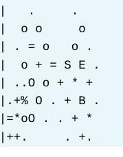

第四章 | 配置与安全

-----+ [SHA256]-----+

如果你在运行 `ssh-keygen` 时没有指定短语，那么 `ssh-keygen` 提示你时私钥将不再受保护。在这种情况下，任何人拥有私钥都可以对其进行验证。如果你设置了短语，那么当你使用私钥时将需要该短语。因此，你可以使用一个名为 `ssh-agent` 的程序来临时将短语缓存在内存中。每当你使用 SSH 使用私密钥登录另一个系统时，`ssh-agent` 都会自动为你提供短语。这非常方便，并且通过减少他人“窥视”看到短语的机会来提高安全性。

取决于你本地系统的配置，如果你登录到 GNOME 图形桌面环境，`ssh-agent` 程序可能会自动启动并为你配置。

如果你在文本控制台登录、使用 `ssh` 登录或使用 `sudo` 或 `su`，你可能需要为该会话手动启动 `ssh-agent`。你可以通过以下命令实现：

```
[user@host ~]$ eval $(ssh-agent)

Agent pid 10155

[user@host ~]$
```

如果你在 `ssh-keygen` 提示你时没有指定短语，那么 `ssh-keygen` 提示你时私钥将不再受保护。在这种情况下，任何人拥有私钥都可以对其进行验证。如果你设置了短语，那么当你使用私钥时将需要该短语。因此，私钥和公钥将保存在 `~/.ssh/`。如果你指定了名称，将覆盖现有文件。

以下示例显示了私钥的创建：

```
[user@host ~]$ ssh-keygen

Generating public/private rsa key pair.

Enter file in which to save the key (/home/user/.ssh/id_rsa): Enter

Created directory '/home/user/.ssh'

Enter passphrase (empty for passphrase): Enter

Enter same passphrase: Enter

Your identification has been saved in /home/user/.ssh/id_rsa.

Your public key has been saved in /home/user/.ssh/id_rsa.pub.

Your fingerprint is:

SHA256:5VvuX3O3QYkMioI3XhMmRrHPKWFdIu3HV+w@host.lab.example.com

The key's modulus image:

-----BEGIN RSA PUBLIC KEY-----

+--------
```

## 共享公钥

在使用密钥验证之前，需要将公钥复制到目标系统。`ssh-copy-id` 将公钥存放在目标系统。

`-f` 选项决定了密钥保存的位置。以下 `ssh-keygen` 示例显示了密钥的创建：

```
[user@host ~]$ ssh-keygen

Generating public/private rsa key pair.

Enter file in which to save the key (/home/user/.ssh/id_rsa): Enter

Created directory '/home/user/.ssh'

Enter passphrase (empty for passphrase): Enter

Enter same passphrase: Enter

Your identification has been saved in /home/user/.ssh/id_rsa.

Your public key has been saved in /home/user/.ssh/id_rsa.pub.

Your fingerprint is:

SHA256:5VvuX3O3QYkMioI3XhMmRrHPKWFdIu3HV+w@host.lab.example.com

The key's modulus image:

-----BEGIN RSA PUBLIC KEY-----

+--------
```

现在尝试登录：`ssh user@remotehost` 并确保只添加了你想要的密钥。公钥成功传输到远程系统后，你可以使用相应的私钥对远程系统进行身份验证。如果你在运行 `ssh` 命令时省略了私钥路径，它将使用默认的 `id_rsa` 文件

```
$ ssh -i ~/.ssh/key-with-pass user@remotehost
```


Enter passphrase for key `'.ssh/key-with-pass'`: `redpass`

...output omitted...

```
[user@remotehost ~]$ exit
logout
Connection to remote closed.
[user@host ~]$
```

# 使用 ssh-agent 进行非交互式身份验证

如果你的私钥受短语保护，你通常需要为身份验证输入短语。然而，你可以使用程序 `ssh-agent` 临时将短语缓存在内存中。每当你使用 SSH 使用私密钥登录另一个系统时，`ssh-agent` 都会自动为你提供短语。这非常方便，并且通过减少他人“窥视”看到短语的机会来提高安全性。

取决于你本地系统的配置，如果你登录到 GNOME 图形桌面环境，`ssh-agent` 程序可能会自动启动并为你配置。

如果你在文本控制台登录、使用 `ssh` 登录或使用 `sudo` 或 `su`，你可能需要为该会话手动启动 `ssh-agent`。你可以通过以下命令实现：

```
[user@host ~]$ eval $(ssh-agent)
Agent pid 10155
[user@host ~]$
```

## 第四章 | 配置与安全 SSH

> 注意
> 当你运行 `ssh-agent` 时，它会打印一些 shell 命令。你需要运行这些命令，通过像 `ssh-add` 这样的程序设置环境变量以便与其通信。`eval ${ssh-agent}` 命令会启动 `ssh-agent` 并运行这些命令，为该 shell 会话自动设置这些环境变量。它还会显示 `ssh-agent` 进程的 PID。

一旦 `ssh-agent` 开始运行，你需要告诉它你的私钥或多个私钥的密码短。你可以使用 `ssh-add` 命令来实现这一点。

以下 `ssh-add` 命令分别为 `/home/user/.ssh/id_rsa`（默认）和 `/home/user/.ssh/key-with-pass` 添加私钥。

```
[user@host ~]$ ssh-add
Identity added: /home/user/.ssh/id_rsa (user@host.example.com)
[user@host ~]$ ssh-add .ssh/key-with-pass
Enter passphrase for .key-with-pass: redpass
Identity added: .ssh/key-with-pass (user@host.example.com)
```

在成功将私钥添加到 `ssh-agent` 进程后，你可以使用 `ssh` 命令调用 SSH 连接。如果你使用了除默认 `/home/user/.ssh/id_rsa` 文件之外的任何私钥，必须使用 `ssh` 命令的 `-i` 选项来指定私钥的路径。

以下 `ssh` 命令示例使用默认私钥身份验证到 SSH 服务器。

```
[user@host ~]$ ssh user@remothost
Last login: Fri Apr 5 10:53:50 2019 from host.example.com
[user@remothost ~]
```

以下 `ssh` 命令示例使用 `/home/user/.ssh/key-with-pass`（非默认）私钥身份验证到 SSH 服务器。示例中的私钥已经解密并添加到你的 `ssh-agent` 进程中，因此 `ssh` 命令不会通过交互式输入密码短语来提示你解密私钥。

```
[user@host ~]$ ssh -i .ssh/key-with-pass user@remothost
Last login: Mon Apr 8 09:44:20 2019 from host.example.com
[user@remothost ~]
```

当你退出启动了 `ssh-agent` 的会话时，进程将退出，你的私钥密码短语将从内存中清除。

# 参考文献
`ssh-keygen(1)`, `ssh-copy-id(1)`, `ssh-agent(1)`, `ssh-add(1)` 手页

## 引导练习

# 配置基于密钥的身份身份验证

在此练习中，你将配置一个用户使用基于密钥的 SSH 身份验证。

## 目标
你应该能够：

- 生成无密码保护的 SSH 密钥对。
- 生成带密码保护的 SSH 密钥对。
- 使用无密码保护和带密码保护的 SSH 密钥进行身份验证。

# 准备工作
使用密码 `student` 以 `student` 用户登录工作站。

在工作站上，运行 `lab ssh-configure start` 开始练习。此脚本会创建必要的用户账户。

```
[student@workstation ~$] lab ssh-configure start
```

- 1. 从工作站打开一个到 `serverb` 的 SSH 会话。

```
[student@workstation ~$] ssh student@serverb
...output omitted...
[student@serverb ~$]
```

- 2. 使用 `su` 命令切换到 `serverb` 上的 `operator1` 用户。

```
[student@serverb ~$] su - operator1
Password: redhat
[operator1@serverb ~$]
```

- 3. 使用 `ssh-keygen` 命令生成 SSH 密钥。不要输入密码短。

```
[operator1@serverb ~$] ssh-keygen
Generating public/private rsa key pair.
Enter file in which to save the key (/home/operator1/.id_rsa): Enter
Created directory '/home/operator1/.ssh'.
Enter passphrase (empty for no passphrase): Enter
Enter same passphrase again: Enter
Your identification has been saved in /home/operator1/.ssh/id_rsa.
Your public key has been saved in /home/operator1/.ssh/id_rsa.pub.
```

# 第四章 | 配置 SSH 安全

密钥指纹：
`SHA256:JainiqdnRSc+Xxh0sJSJQQLnUbdb+jJByrcZQBERI`
`operator@server.lab.example.com`
密钥的随机图像为：

```
+ [RSA 2048]----+
|E+=000 |
|0.. = . 0 |
|+.* = . 0 |
| + X = S |
| +@ + |
| = 0 |
|.0.. |
| 0.. |
+----SHA256----+-
```

- 4. 使用 `ssh-copy-id` 命令将 SSH 密钥对的公钥发送到服务器上的 `operator`。

```
[operator1@server ~] ssh-copy-id operator1@server
/usr/bin/ssh-copy-id INFO: Source of key(s) to be installed: "/home/operator1/.ssh/rsa.pub"
The authenticity of server '172.25.250.10' can't be established.
ECDSA key fingerprint is SHA256:ERTjdpo0IrW5SqqD5r+fxgidBudbwzA.
Are sure you want to continue (yes/no)? yes
/usr/bin/ssh-copy-id INFO: attempting to log in with the new key(s), to filter out are already installed
/usr/bin/ssh-copy-id INFO: 1 key(s) remain to be installed password: redhat
Number of key(s) added: 1
```

现在使用 "`ssh operator1@server`" 登录机器，检查是否只添加了所需的密钥。

- 5. 在不进入远程 shell 的情况下，在服务器上执行 `hostname` 命令。

```
[operator1@server ~] ssh operator1@server hostname
server.lab.com
```


前面的命令没有提示输入密码，因为它使用了无密码私钥作为 `operator1` 进行身份验证。这种方法是不安全的，因为任何拥有私钥的人都可以登录服务器。安全的替代方案是使用密码短来保护密钥，这是下一步。

### 6. 使用 `ssh-keygen` 命令生成一组带保护的 SSH 密钥。将密钥保存为 `/home/operator1/.ssh/key2`。

> 警告
> 如果不指定保存密钥的文件，将使用默认文件 (`/home/user/.ssh/id_rsa`)。你在生成 SSH 密钥时使用了默认文件名，现有密钥将被覆盖。

```
[operator1@serverb ~$] ssh-keygen -f .ssh/key2

Generating public/private key pair.

Enter passphrase (empty for no passphrase): redhatpass

Enter same passphrase again: redhatpass

Your identification has been saved in .ssh/key2.

Your public key has been saved in .ssh/key2.pub.

The key fingerprint is:

SHA256:CtjFpSmRbbgbEIwAI4S1MEbgRbQ1KI1@serverb.example.com
```

密钥的图像为：

```
+----RSA 2048----+
|0x* |
|0B= |
|E0* |
|B00 |
| .= 0 |
| +0 0 |
|+.0+ 0 |
+----SHA256----+
```

### 7. 使用 `ssh-copy-id` 命令将带保护的公钥发送到服务器上的 `operator1`。

```
[operator1@serverb ~$] ssh-copy-id -i .ssh/key2.pub operator1@servera

/usr/bin/ssh-copy-id INFO: Source of key(s) to be installed: ".ssh/key2.pub"

/usr/bin/ssh-copy-id INFO: attempting to log in with the new key(s), to filter out are already installed

/usr/bin/ssh-copy-id INFO: 1 key(s) remain to be installed -- if you are prompted now to install the new keys

Number of key(s) added: 1
```

现在尝试使用 `"ssh operator1@servera"` 登录机器，检查是否只添加了所需的密钥。注意前面的 `ssh-copy-id` 命令没有提示密码，因为它使用了上一步导出到 `servera` 的公钥。

### 8. 在不进入远程 shell 的情况下，通过 SSH 在服务器上执行 `hostname` 命令。使用 `/home/operator1/.ssh/key2` 作为身份文件。指定你在上一步中为私钥设置的密码短。

```
[operator1@server ~$ ssh -i .ssh/key2 operator1@server hostname

Enter passphrase for key '.ssh/key2': redpass

servera.lab.com
```

注意前面的命令提示输入用于保护 SSH 密钥对的密码短。这个密码短保护了私钥。如果攻击者获取了密钥，他们无法使用它访问其他系统，因为密钥本身受密码短保护。`ssh` 命令使用的密码与 `servera` 上 `operator1` 的密码不同，需要用户知道两者。

你可以在下一步中使用 `ssh-agent` 来避免在通过 SSH 登录时交互式输入密码短。在管理员经常登录系统的情况下，使用 `ssh-agent` 既方便又安全。

### 9. 在你的 Bash shell 中运行 `ssh-agent`，并将带密码保护的私钥 (`/home/operator1/.ssh/key2`) 添加到 shell 会话中。

```
[operator1@server ~$ eval $(ssh-agent)

Agent pid@server ~$ ssh-add .ssh/key2

Enter passphrase for key '.ssh/key2': redpass

Identity added: .ssh/key2 (operator1@server.lab.com)
```

前面的 `eval` 命令启动了 `ssh-agent` 并配置该 shell 会话使用它。你使用 `ssh-add` 将解锁的私钥提供给 `ssh-agent`。

### 10. 在不进入远程 shell 的情况下，在服务器上执行 `hostname` 命令。使用 `/home/operator1/.ssh/key2` 作为身份文件。

```
[operator1@server ~$ ssh -i .ssh/key2 operator1@server hostname

servera.lab.com
```

注意前面的 `ssh` 命令没有提示你交互式输入密码短。

### 11. 在工作站上打开另一个终端，并打开到 `serverb` `student` 的 SSH 会话。

```
[student@workstation ~$] ssh student@serverb

...output omitted...

[student@server ~$]
```

## 12. 在 `server2` 上，使用 `su` 命令切换到 `operator1`，并启动一个 SSH 连接到 `servera`。使用 `/home/operator1/.ssh/key2` 作为身份文件来通过 SSH 密钥进行验证。

### 12.1. 使用 `su` 命令切换到 `operator1`。

```
[student@server ~]$ su - operator1

Password: redhat

[operator1@server ~]$
```

### 12.2. 以 `operator1` 身份打开 `servera` 的 SSH 会话。

```
[operator1@server ~]$ ssh -i .ssh/key2 operator1@servera

Enter passphrase for '.ssh/key2': redpass

...output omitted...

[operator1@server ~]$
```

> 注意，之前的 `ssh` 命令提示你交互式地输入密码短，是因为你没有在用于启动 `ssh-agent` 的那个 shell 中发起 SSH 连接。

## 13. 退出你在第二个终端中使用的所有 shell。

### 13.1. 退出 `servera` 登录。

```
[operator1@servera ~]$ exit

logout

Connection to servera closed.

[operator1@server ~]$
```

### 13.2. 退出 `server2` 上的 `operator1` 和 `student` shell，返回工作站上的 `student` 用户 shell。

```
[operator1@server ~]$ exit

logout

[student@server ~]$ exit

logout

Connection to server2 closed.

[student@workstation ~]$
```

### 13.3. 关闭工作站上的第二个终端。

```
[student@workstation ~]$ exit
```

## 14. 在第一个终端上退出 `server2` 登录并结束本次练习。

### 14.1. 从第一个终端，退出 `server2` 上的 `operator1` 用户的 shell。

```
[operator1@server ~]$ exit

logout
```

# 第四章 | SSH 配置与安全

```
[student@server ~]$
```

`exit` 命令导致你退出了 `operator1` 用户的 shell，终止了 `ssh-agent` 激活状态的 shell 会话，并返回到 `serverb` 上的 `student` 用户 shell。

### 14.2. 退出 `serverb` 上的 `student` 用户 shell，返回工作站上的 `student` 用户 shell。

```
[student@server ~]$ exit

logout

Connection to serverb closed.

[student@workstation ~]$
```

# 完成

在工作站上运行 `lab ssh-configure finish` 完成本次练习。

```
[student@workstation ~]$ lab ssh-configure finish
```


引导性练习此结束。

# 自定义 OpenSSH 服务配置

## 目标

完成本节后，你应该能够限制 root 的直接登录，并禁用 OpenSSH 服务的基于密码的验证。

# 配置 OpenSSH 服务器

OpenSSH 服务由名为 `sshd` 的守护进程提供。其主配置文件为 `/etc/ssh/sshd_config`。

OpenSSH 服务器的默认配置运行良好。但是，你可能希望进行一些更改来增强系统的安全性。有两种常见的更改是你需要的：你希望禁止直接远程登录 root 账户，并且禁止基于密码的验证（转而使用 SSH 密钥验证）。

# 禁止超级用户使用 SSH 登录

禁止从远程系统直接登录 root 账户是一项良好的做法。允许以 root 直接登录的风险包括：

- 用户名在每个 Linux 系统上默认都存在，因此潜在的攻击者只需要猜测密码，而不是有效的用户名和密码组合。这降低了攻击者的复杂度。
- root 用户拥有不受限制的权限，因此其一旦被破解可能会对系统造成最大的损害。
- 从审计的角度来看，很难跟踪是哪个授权用户以 root 身份登录并进行了更改。如果用户必须作为普通用户登录并切换到 root 账户，这将产生日志事件，有助于提供账户可追溯性。

OpenSSH 服务器使用 `/etc/ssh/sshd_config` 配置文件中的 `PermitRootLogin` 配置设置来允许或禁止用户以 root 身份登录。

```
PermitRootLogin yes
```

当 `PermitRootLogin` 参数设置为 `yes`（默认值），允许人们以 root 登录。为了防止这一点，请将值设置为 `no`。或者，为了防止基于密码的验证但允许 root 使用密钥验证，请将 `PermitRootLogin` 参数设置为 `without-password`。

任何更改都必须重新加载 SSH 服务（reload）才能生效。

```
[root@host ~]# systemctl reload ssh
```

# 第四章 | SSH 配置与安全

> 重要 使用 `systemctl reload sshd` 命令的优势是它告诉 `sshd` 重新读取配置文件，而不是完全重启服务。`systemctl restart sshd` 命令也会应用更改，但会停止并启动服务，从而断开到该主机的所有 SSH 连接。

# 禁止 SSH 基于密码的验证

仅允许通过密钥登录远程命令行有许多优势：

- 攻击者无法使用密码猜测攻击来远程破解系统上的已知账户。
- 使用受密码短语保护的私钥，攻击者同时需要密码短语和私钥副本。而使用密码时，攻击者只需要密码。
- 通过结合 `ssh-agent` 使用密码短语保护的私钥，密码短语暴露的机会更少（因为输入频率较低），且对用户来说登录更加方便。

OpenSSH 服务器使用 `/etc/ssh/sshd_config` 配置文件中的 `PasswordAuthentication` 参数来控制用户是否可以使用密码验证。

```
PasswordAuthentication yes
```

`/etc/ssh/sshd_config` 中 `PasswordAuthentication` 的默认值 `yes` 允许用户使用密码验证。值 `no` 则防止用户使用密码验证。请记住，每当你更改 `/etc/ssh/sshd_config` 文件时，必须重新加载 `sshd` 服务使更改生效。

## 第 6 章 | 配置与保护 SSH

- 6. 确认你可以使用超级用户密码成功登录到服务器。
- 6.1. 使用 `redhat` 密码通过 SSH 会话以 root 用户登录服务器。

```
[operator2@server ~]$ ssh root@server
root@servera's password: redhat
...output omitted...
[root@server #]
```

注意，上述 `ssh` 命令使用了超级用户的密码进行验证，因为超级用户不存在 SSH 密钥。

- 6.2. 登出服务器。

```
[root@server #] exit
logout
Connection to server closed.
[operator2@server ~$]
```

- 7. 确认你可以使用密码 `redhat` 成功以 `operator3` 用户登录到服务器。
- 7.1. 使用 `redhat` 密码通过 SSH 会话以 `operator3` 用户登录服务器。

```
[operator2@server ~]$ ssh operator3@server
operator3@server's password: redhat
...output omitted...
[operator3@server ~$]
```

注意，上述 `ssh` 命令使用了 `operator3` 的密码进行验证，因为 `operator3` 不存在 SSH 密钥。

- 7.2. 登出服务器。

```
[operator3@server ~]$ exit
logout
Connection to server closed.
[operator2@server ~$]
```

- 8. 配置服务器上的 `sshd` 以防止用户以 root 身份登录。需要时使用 `redhat` 作为超级用户的密码。
- 8.1. 使用 SSH 密钥通过 SSH 会话以 `operator2` 用户登录服务器。

```
[operator2@server ~]$ ssh operator2@servera
...output omitted...
[operator2@servera ~]
```

- 8.2. 在服务器上，切换到 root 用户。

```
[operator2@servera ~]$ su -
Password: redhat
[root@servera #]
```

- 8.3. 在 `/etc/ssh/sshd_config` 中将 `PermitRootLogin` 设置为 `no` 并重载 ssh。你可以使用 `vim /etc/ssh/sshd_config` 来编辑 ssh 配置文件。

```
...output omitted...
PermitRootLogin no
...output omitted...
[root@servera #] systemctl reload ssh
```

- 8.4. 在工作站上打开另一个终端并以 `operator2` 用户登录服务器。从 `serverb` 以 root 身份登录 `servera`。这应该失败，因为你在上一步中删除了通过 SSH 登录 root 的权限。

> 注意：为了方便起见，课堂环境中工作站和 `serverb` 之间已经配置了免密登录。

```
[student@workstation ~]$ ssh operator2@serverb
...output omitted...
[operator2@serverb] ssh root@servera
root@servera's password: redhat
Permission denied, please try again.
root@servera's password: redhat
Permission denied, please try again.
root@servera: Permission denied (publickey,gssapi-keyex,gssapi-with-mic,password).
```

> 默认情况下，`ssh` 命令首先尝试使用密钥进行验证，如果失败，则尝试基于密码的验证。

- 9. 配置 `servera` 上的允许用户使用 SSH 密钥而非密码进行验证。
- 9.1. 回到在 `servera` 上运行着 root 用户 shell 的第一个终端。在 `/etc/ssh/sshd_config` 中将 `PasswordAuthentication` 设置为 `no` 并重载 ssh。你可以使用 `vim /etc/ssh/sshd_config` 来编辑 ssh 配置文件。

```
...output omitted...
PasswordAuthentication no
...output omitted...
[root@servera ~]# systemctl reload sshd
```

- 9.2. 转到在 `serverb` 上运行着 `operator2` 用户 shell 的第二个终端，并以 `operator3` 登录 `servera`。这应该失败，因为 `operator3` 没有配置 SSH 密钥，且 `servera` 上的 `sshd` 服务不再允许使用密码进行验证。

```
[operator2@serverb ~]$ ssh operator3@servera
operator2@servera: Permission denied (publickey, gssapi-keyex, gssapi-with-mic).
```


> 注意：为了粒度控制，你可以在使用 `ssh` 命令结合 `-o PubkeyAuthentication=no` 和 `-o PasswordAuthentication=yes` 选项。这允许你覆盖 `ssh` 命令的默认设置，并根据你上一步在 `/etc/ssh/sshd_config` 中调整的设置，确定上一个命令执行失败的原因。

- 9.3. 回到在 `servera` 上运行着 `root` 用户 `shell` 的第一个终端。验证 `/etc/ssh/sshd_config` 中的 `PubkeyAuthentication` 是否已启用。你可以使用 `vim /etc/ssh/sshd_config` 查看 `sshd` 配置文件。

```
...output omitted...

#PubkeyAuthentication yes

...output omitted...
```

注意 `PubkeyAuthentication` 这一行被注释掉了。该文件中任何被注释的行都使用参数的默认值。正如注释行所示，SSH 的公钥认证默认是开启的。

- 9.4. 回到在 `serverb` 上运行着 `operator2` 用户 `shell` 的第二个终端，并以 `operator2` 登录 `servera`。这应该会成功，因为 `operator2` 已经配置了登录 `serverb` 的 SSH 密钥。

```
[operator2@serverb ~]$ ssh operator2@servera

...output omitted...

[operator2@serverb]
```

- 9.5. 从第二个终端，退出 `servera` 和 `serverb` 上的 `operator2` 用户 `shell`。

```
[operator2@serverb ~]$ ssh operator2@servera

...output omitted...

[operator2@serverb]
```

- 9.6. 从第一个终端，退出 `servera` 上的 `root` 用户 `shell`。

```
[root@servera #] exit

logout

Connection to server closed.
```

- 9.7. 从第一个终端，退出 `serverb` 上的 `operator3` 用户 `shell`。

```
[operator3@server ~] exit

logout

Connection to server closed.
```

## 第四章 - 连接与安全

您的身份标识已保存至 `/home/production1/.ssh/id_rsa`。
您的公钥已保存至 `/home/production1/.ssh/id_rsa.pub`。
密钥指纹为：

```
SHA256:CWCmAm0gquajjl2IAcAngY3u2ikrbrPP4Y1sl3PXCA

production1@server.lab.example.com
```

密钥的随机艺术图像为：

```
+-[RSA 2048]-

|..\0

||

| = . 0

|.* 0

|0. E.

|*0=

X+0+.

|0.=+ +

|"*0=0,+

+------[SHA256]------
```

- 4. 使用 `ssh-id` 命令将 SSH 密钥的公钥发送到服务器上的 `production1`。

```
[production1@server ~]$ ssh-id production1@server
/usr/bin/ssh-id: INFO: 要安装的密钥(s) 来源: "/home/
production1/.ssh/id_rsa.pub.
主机 'server' (172.25.0.111) 的真实性无法确认。
ECDSA 密钥指纹为 SHA256:ERPjdooRIwWZQdnorJfigud03dXBuHwZA.
确定要继续吗 (yes/no)? yes
/usr/bin/ssh-id: INFO: 正在尝试使用新密钥(s) 登录，以过滤掉已安装的密钥
/usr/bin/ssh-id: INFO: 剩余 1 个密钥(s) 待安装 - 如果提示
ow 则将安装新密钥
production1@server's password: redhat
添加的密钥(s) 数量: 1
```

现在尝试使用 `"production1@server"` 登录机器，并检查仅添加了您想要的密钥。

- 5. 确认 `production1` 可以使用 SSH 密钥成功登录 `server`。

```
[production1@server ~]$ ssh production1@server
...输出内容已省略...
[production1@server ~]$
```

- 6. 在服务器上配置 `sudo` 以防止用户以 `root` 身份登录。使用 `redhat` 作为超级用户的密码。

### 6.1. 使用 `su` 命令切换到服务器上的 `root` 用户。

```
[production1@server ~]$ su -
Password: redhat
```

## 第七章 | 配置与加固 SSH

```
[root@serverb]#
```

### 6.2. 在 `/etc/ssh/ssh_config` 中将 `PermitRootLogin` 设置为 `no` 并重载 `sshd`。可以使用 `vim /etc/ssh/ssh_config` 来编辑 `sshd` 的配置文件。

```
...输出内容已省略...
PermitRootLogin no
...输出内容已省略...
[root@serverb]# systemctl reload sshd.service
```

### 6.3. 在工作站上打开另一个终端，并以 `production1` 身份开启 `servera` 的 SSH 会话。从 `servera` 尝试以 `root` 身份登录 `serverb`。这将失败，因为您在上一步中禁用了 SSH 的 `root` 登录。

> 注意
> 为了方便起见，教室环境中已经在工作站和 `servera` 之间配置了免密登录。

```
[student@workstation~$] ssh production1@servera
root@serverb's password: redhat
Permission denied, please try again.
root@serverb's password: redhat
Permission denied, please try again.
root@serverb's password: redhat
root@serverb: Permission denied (publickey,gssapi-keyex,gssapi-with-mic,password).
[production1@servera~$]
```


在尝试以 `root` 身份登录 `servera` 三次失败后，`ssh` 命令返回了。默认情况下，`ssh` 命令优先使用密钥认证。

# 描述系统日志架构

## 目标

完成本节后，你应该能够描述红帽企业 Linux 中用于记录事件的基本日志记录架构。

## 系统日志记录

进程和操作系统内核会记录发生事件的事件日志。这些日志用于审计系统和排排除故障。

许多系统记录将事件记录在文本文件中，这些文件保存在 `/var/log` 目录中。可以使用 `less` 和 `tail` 等普通文本工具对这些日志进行检查。

红帽企业 Linux 内置了基于 Syslog 协议的标准日志记录系统。许多程序使用此服务来记录和组织它们的日志。在红帽企业 Linux 8 中，由 `systemd-journal` 和 `rsyslog` 服务处理 syslog 消息。

`systemd-journal` 服务是操作系统事件架构的核心。它从许多源收集事件，包括内核、从启动过程早期阶段的输出、守护进程在启动和运行时的标准输出和标准错误，然后将它们重构为标准格式，并将它们写入一个结构化的、带索引的系统日志中。默认情况下，此日志存储在不会在重启后保持持久化的文件系统上。

然而，`rsyslog` 服务会从日志文件中读取 `systemd-journal` 接收到的 syslog 消息。然后它会处理这些 syslog 消息，根据自己的配置将其记录到日志文件中或将其转发到其他服务。

`rsyslog` 服务将 syslog 消息排序并写入 `/var/log` 中在重启后仍然持久的日志文件中。`rsyslog` 服务根据每条消息发送的类型 `facility`（设施）以及每个 syslog 消息的优先级将日志消息排序并写入特定文件。

除了 syslog 消息文件外，`/var/log` 目录还包含系统中其他服务的日志文件。下表列出了 `/var/log` 目录中的一些有用文件。

### 选定的日志文件

| 日志文件 | 存储的消息类型 |
| --- | --- |
| `/var/log/messages` | 大多数 syslog 消息记录在此处。异常包括与身份验证处理、计划任务执行以及纯与调试相关的消息。 |
| `/var/log/secure` | 与安全和身份验证事件相关的 syslog 消息。 |
| `/var/log/maillog` | 与邮件服务器相关的 syslog 消息。 |
| `/var/log/cron` | 与计划任务执行相关的 syslog 消息。 |
| `/var/log/boot.log` | 与系统启动相关的非 syslog 控制台消息。 |

> 注意
某些应用程序不使用 syslog 来管理其日志消息，尽管通常情况下它们会将日志文件放置在 `/var/log` 的子目录中。例如，Apache Web 服务器会将日志消息保存到 `/var/log` 目录子目录下的文件中。

## 参考文献

`systemd-journald.service(8)`, `rsyslog(8)`, 和 `rsyslog.conf(5)` man 页面

欲了解更多信息，请参阅《红帽企业 Linux 8.0 BETA 配置基本系统设置指南》中的“使用日志文件排排除故障”章节，地址：https://access.redhat.com/documentation/en-us/red_hat_enterprise_linux/8-beta/html/configuring_basic_system_settings/getting-started-with-system-administration#Troubleshoot-log-files

## 测验

# 描述系统日志架构

选择以下问题的正确答案：

- 1. 在这些日志文件中，哪一个存储了大多数 syslog 消息（与身份验证、邮件、计划任务和调试相关的消息除外）？
  a. `/var/log/maillog`
  b. `/var/log/boot.log`
  c. `/var/log/messages`
  d. `/var/log/secure`

- 2. 哪个日志文件存储了与系统中安全和身份验证操作相关的 syslog 消息？
  a. `/var/log/maillog`
  b. `/var/log/boot.log`
  c. `/var/log/messages`
  d. `/var/log/secure`

- 3. 哪个服务将 syslog 消息排序并组织到 `/var/log/` 中的文件中
  a. `rsyslog`
  b. `systemd-journal`
  c. `auditd`
  d. `tuned`

- 4. 哪个目录容纳了人类可读的 syslog 文件？
  a. `/sys/kernel/debug`
  b. `/var/log/journal`
  c. `/run/log/journal`
  d. `/var/log`

- 5. 哪个文件存储了与邮件服务器相关的 syslog 消息？
  a. `/var/log/lastlog`
  b. `/var/log/maillog`
  c. `/var/log/tallylog`
  d. `/var/log/boot.log`

- 6. 哪个文件存储了与计划任务相关的 syslog 消息？
  a. `/var/log/cron`
  b. `/var/log/tallylog`
  c. `/var/log/spooler`
  d. `/var/log/secure`

- 7. 哪个文件存储了与系统启动相关的控制台消息？
  a. `/var/log/messages`
  b. `/var/log/cron`
  c. `/var/log/boot.log`
  d. `/var/log/secure`

## 答案

# 描述系统日志架构

选择以下正确答案：

- 1. 在这些日志文件中，哪一个存储了大多数 syslog 消息（与身份验证、邮件、计划任务和调试相关的消息除外）？
  a. `/var/log/maillog`
  b. `/var/log/boot.log`
  c. `/var/log/messages`
  d. `/var/log/secure`

- 2. 哪个日志文件存储了与系统中安全和身份验证操作相关的 syslog 消息？
  a. `/var/log/maillog`
  b. `/var/log/boot.log`
  c. `/var/log/messages`
  d. `/var/log/secure`

- 3. 哪个服务将 syslog 消息排序并组织到 `/var/log/` 中的文件中
  a. `rsyslog`
  b. `systemd-journal`
  c. `auditd`
  d. `tuned`

- 4. 哪个目录容纳了人类可读的 syslog 文件？
  a. `/sys/kernel/debug`
  b. `/var/log/journal`
  c. `/run/log/journal`
  d. `/var/log`

- 5. 哪个文件存储了与邮件服务器相关的 syslog 消息？
  a. `/var/log/lastlog`
  b. `/var/log/maillog`
  c. `/var/log/tallylog`
  d. `/var/log/boot.log`

- 6. 哪个文件存储了与计划任务相关的 syslog 消息？
  a. `/var/log/cron`
  b. `/var/log/tallylog`
  c. `/var/log/spooler`
  d. `/var/log/secure`

- 7. 哪个文件存储了与系统启动相关的控制台消息？
  a. `/var/log/messages`
  b. `/var/log/cron`
  c. `/var/log/boot.log`
  d. `/var/log/secure`

## 审阅

# 描述日志架构

完成本节后，你应该能够描述红帽企业 Linux 中用于记录事件的基本日志记录架构，并解释日志文件。

## 系统日志记录

进程和操作系统内核会记录发生事件的事件日志。这些日志用于审计系统和排排除故障。

许多系统记录将事件记录在文本文件中，这些文件保存在 `/var/log` 目录中。可以使用 `less` 和 `tail` 等普通文本工具对这些日志进行检查。

红帽企业 Linux 内置了基于 Syslog 协议的标准日志记录系统。许多程序使用此服务来记录和组织它们的日志。在红帽企业 Linux 8 中，由 `systemd-journal` 和 `rsyslog` 服务处理 syslog 消息。

`systemd-journal` 服务是操作系统事件架构的核心。它从许多源收集事件，包括内核、从启动过程早期阶段的输出、守护进程在启动和运行时的标准输出和标准错误，然后将它们重构为标准格式，并将它们写入一个结构化的、带索引的系统日志中。默认情况下，此日志存储在不会在重启后保持持久化的文件系统上。

然而，`rsyslog` 服务会从日志文件中读取 `systemd-journal` 接收到的 syslog 消息。然后它会处理这些 syslog 消息，根据自己的配置将其记录到日志文件中或将其转发到其他服务。

`rsyslog` 服务将 syslog 消息排序并写入 `/var/log` 中在重启后仍然持久的日志文件中。`rsyslog` 服务根据每条消息发送的类型 `facility`（设施）以及每个 syslog 消息的优先级将日志消息排序并写入特定文件。

除了 syslog 消息文件外，`/var/log` 目录还包含系统中其他服务的日志文件。下表列出了 `/var/log` 目录中的一些有用文件。

### 选定的日志文件

| 日志文件 | 存储的消息类型 |
| --- | --- |
| `/var/log/messages` | 大多数 syslog 消息记录在此处。异常包括与身份验证处理、计划任务执行以及纯与调试相关的消息。 |
| `/var/log/secure` | 与安全和身份验证事件相关的 syslog 消息。 |
| `/var/log/maillog` | 与邮件服务器相关的 syslog 消息。 |
| `/var/log/cron` | 与计划任务执行相关的 syslog 消息。 |
| `/var/log/boot.log` | 与系统启动相关的非 syslog 控制台消息。 |

> 注意
某些应用程序不使用 syslog 来管理其日志消息，尽管通常情况下它们会将日志文件放置在 `/var/log` 的子目录中。例如，Apache Web 服务器会将日志消息保存到 `/var/log` 目录子目录下的文件中。

## 参考文献

（此处略，与原文一致）

## 测验

选择选择以下问题的正确答案：

- 1. 在这些日志文件中，哪一个存储了大多数 syslog 消息（与身份验证、邮件、计划任务和调试相关的消息除外）？
...（此处略，与原文一致）

## 答案

选择以下正确答案：

...（此处略，与原文一致）

## 审阅日志文件

完成本节后，你应该能够解释日志文件以排排除故障。

## 将事件记录到系统

许多程序使用 syslog 协议记录事件。每条日志根据设施（消息类型）和优先级（消息的严重程度）进行分类。可用设施见 `syslog.conf(5)`。

下表列出了从高到低的日志优先级。

| 代码 | 优先级 | 严重程度 |
| --- | --- | --- |
| 0 | emerg | 系统不可用 |
| 1 | alert | 必须采取行动 |
| 2 | crit | 关键 |
| 3 | err | 非关键状态 |
| 4 | warning | 警告 |
| 5 | notice | 普通但重要的事件 |
| 6 | info | 信息事件 |
| 7 | debug | 调试级消息 |

syslog 服务使用日志的设施和优先级决定如何处理它们。这是通过 `/etc/syslog.conf` 文件和 `/etc/syslog.d` 目录中的规则进行配置的。

每个规则如何排序消息是 `syslog.conf` 中的一行。规则的左侧指示 syslog 消息的设施和严重程度。右侧指示如何保存日志消息（或传递消息）。星号 (`*`) 是匹配所有值的通配符。

例如，以下行会将发送到 `authpriv` 设施的任何优先级的消息记录到 `/var/log/secure`：

```
authpriv.* /var/log/secure
```


`authpriv.*`                `/var/log/secure`

## 第二章 分析日志

日志消息有时匹配 `syslog.conf` 中的多个规则。在这种情况下，一个消息会存储在多个日志文件中。为了限制存储的消息，优先级字段中的 `none` 关键字表示不将指示设施的消息存储在指定文件中。

与其将 syslog 消息记录到文件，不如将其打印到所有登录用户的终端上。`rsyslog.conf` 文件有一个设置，可以将优先级为 `emerg` 的 syslog 消息打印到所有登录用户的终端。

### RSYLOG 示例规则

#### 规则

- `#` 将所有内核消息记录到控制台。
  `#` 记录过多内容会刷屏。
  `#kern.*`
- `#` 记录级别高于 `info` 的任何（邮件除外）。
  `#` 不要记录私有的身份验证消息！
  `*.info;mail;authpriv.none;cron.none`
- `#` `authpriv` 文件具有限制访问权限。
  `authpriv.*`
- `#` 将所有邮件消息记录在一个处。
  `mail.*`
- `#` 记录 `cron` 任务
  `cron.*`
- `#` 所有人接收紧急消息
  `*.emerg`
- `#` 将级别为 `crit` 及以上的新错误保存在一个特殊文件中。
  `uucp,news.crit`
- `#` 将启动消息也保存到 `boot.log`
  `local7.*`

### 日志轮转

`logrotate` 工具轮转日志以防止它们在包含 `/var/log` 目录的文件系统中占用过多空间。当日志被轮转时，它会被重命名并带有指示轮转日期的扩展名。例如，旧的 `/var/log/messages` 文件可能会
如果在 `2019-01-30` 进行了轮转，则变为 `/var/log/messages-20190130`。一旦日志文件轮转，将创建一个新的日志文件并通知服务向其写入。

经过多次轮转后，最旧的日志文件将被弃以释放空间。计划任务每天运行 `logrotate` 程序，检查是否有任何日志需要轮转。大多数日志文件每周轮转一次，但当它们达到特定大小时，`logrotate` 的轮转速度会更快或更慢。

本文条目未涵盖 `logrotate` 的配置。更多信息请参阅 `logrotate(8)` 手册页。

# 分析 SYSLOG 条目

日志消息中最旧的消息位于开头，最新的消息位于日志文件的结尾。`rsyslog` 服务在日志文件中记录条目时使用标准格式。以下示例解释了 `/var/log/secure` 日志文件中日志消息的结构。

```
Feb 11 20:11:48 localhost sshd[1433]: Failed password for student from 172.25.25.10 port 59344 ssh2
```

- 记录日志条目的时间戳
- 发送日志消息的主机
- 发送日志消息的程序或进程名称以及 PID 数字
- 实际发送的消息

# 监控日志

监控一个或多个日志文件的事件对于重现问题和故障非常有帮助。`tail -f /path/to/file` 命令输出指定文件的最后 10 行，并在文件写入新行时继续输出新行。

例如，要监控失败的登录尝试，请在一个终端中运行 `tail` 命令，然后在另一个终端中用户尝试登录系统时以 root 用户身份运行 `ssh` 命令。

在第一个终端中，运行以下 `tail` 命令：

```
[root@host ~]# tail -f /var/log/secure
```

在第二个终端中，运行以下 `ssh` 命令：

```
[root@host ~]# ssh root@localhost

root@localhost's password: redhat

...output omitted...

[root@host ~]#
```

返回第一个终端并查看日志。

```
...output omitted...

Feb 10 09:01:13 host sshd[2712]: Accepted password for root from 172.25.25.254

port 56801 ssh2
```

# 分析和存储日志

`Feb 10 09:01:13 host sshd[2712]: pam_unix(sshd:session): session opened for user root (uid=0)`

# 手动发送 SYSLOG 消息

`logger` 命令向 `rsyslog` 服务发送消息。默认情况下，除非使用 `-p` 选项进行指定，否则它会将消息发送到具有 `notice` 优先级的用户设施（`user facility`）。这对于测试 `rsyslog` 服务配置的任何更改都很有用。

要向 `rsyslog` 服务发送消息并将其记录在 `/var/log/boot.log` 日志文件中，请执行以下 `logger` 命令：

```
[root]# logger -p local7.notice "Log entry created on host"
```

## 参考资料
`logger(1)`, `tail(1)`, `rsyslog.conf(5)` 和 `logrotate(8)` 手册页
`rsyslog` 手册

- 由 `rsyslog-doc` 包提供的 `usr/share/doc/rsyslog/html/index.html`

更多信息请参阅 Red Hat Enterprise Linux 8.0 BETA 配置基本系统设置指南中的“使用日志文件进行故障排排除”章节，地址：https://access.redhat.com/documentation/en-us/red_hat_enterprise_linux/8-beta/html/configuring_basic_system_settings/getting-started-with-system-administration#Troubleshoot-log-files

## 引导练习

# 检查 SYSLOG 文件

在此练习中，你将重新配置 syslog 以将特定的日志消息写入新文件。

## 结果

你应该能够配置 syslog 服务，将所有具有 `debug` 优先级的日志消息写入 `/var/log/messages-debug` 日志文件。

## 开始之前

使用密码 `student` 以 `student` 用户登录工作站。

在工作站上，运行 `lab log-configure start` 开始练习。该脚本可确保环境设置正确。

```
[student@workstation -]$ lab log-configure start
```

- 1. 从工作站开始，以 `student` 身份到 `servera` 开启一个 SSH 会话。

```
[student@workstation -]$ ssh student@servera

...output omitted.

[student@servera ~$]
```

- 2. 在 `servera` 上配置 syslog，将所有具有 `debug` 优先级或更高优先级的任何服务的消息写入新的 `/var/log/messages-debug` 日志文件，方法是添加 syslog 配置文件 `/etc/syslog.d/debug.conf`。

- 2.1. 使用 `sudo -i` 切换到 `root` 用户。如果运行 `sudo -i` 命令，请指定 `student` 密码。

```
[student@servera ~ sudo -i

[sudo] password for student: student

[root@servera #]
```

- 2.2. 创建 `/etc/syslog.d/debug.conf` 文件，带有必要的条目将所有 `debug` 优先日志消息重定向到 `/var/log/messages-debug`。你可以使用 `vim /etc/syslog.d/debug.conf` 命令创建如下内容：

```
.debug /var/log/messages-debug
```
前面的行捕捉优先级为 `debug` 或以上的 syslog 消息，并导致 syslog 服务将这些消息写入 `/var/log/messages-debug` 文件。配置行中的通配符 `(*)` 表示设施或优先级。

- 2.3. 重启 `rsyslog` 服务。

```
[root@servera ~]# systemctl restart rsyslog
```

- 3. 验证所有 `debug` 优先日志消息出现在 `/var/log/messages-debug` 文件。

- 3.1. 使用带有 `-p` 选项的 `logger` 命令生成具有 `user` 设施和 `debug` 优先级的日志消息。

```
[root@servera ~]# logger -p user.debug "Debug Test"
```

- 3.2. 使用 `tail` 命令查看 `/var/log/messages-debug` 文件中的最后日志，确认在日志中看到了 Message Test。


[root@servera ~]# `tail /var/log/messages-debug`

Feb 18 22:32:18 servera systemd[1]: Stopping Logging Service...

Feb 18 22:32:18 servera rsyslogd[25176]: [origin="rsyslog" version="8.37.0-9.el8" pid="25176" info="http://www.rsyslog.com"] exiting 15.

Feb 18 22:32:18 servera systemd[1]: Starting Logging Service...

Feb 18 22:32:18 servera rsyslogd[25410]: environment variable TZ is not set, auto-correcting this to /etc/localtime

Feb 18 22:32:18 servera systemd[1]: Started Logging Service.

Feb 18 22:32:18 servera rsyslogd[25410]: [origin="rsyslog" version="8.37.0-9.el8" pid="25410" info="http://www.rsyslog.com"] start

Feb 18 22:32:18 servera student[25410]: Debug Test

```
- 3.3. 退出 rsyslog 上的 root 和 student shell，返回工作站的 student shell。
```

```
[root@servera ~]# exit

[student@workstation ~]$ exit

Connection to server closed.

[student@workstation ~$]
```

## 完成

在工作站上，运行 `lab log-configure finish` 完成此练习。该脚本确保环境恢复到洁洁状态。

```
[student@workstation ~]$ lab log-configure finish
```

引导练习结束。

# 查看系统 JOURNAL 条目

## 目标

完成本节后，你应该能够查找并解释系统 journal 中的条目，以排除故障或查看系统状态。

# 查找事件

`systemd-journal` 服务将日志数据存储在名为 `journal` 的结构化索引文件中。这些数据包含了日志事件的额外信息。例如，`syslog` 事件包含了原始消息的设施和优先级。

在 Red Hat Enterprise Linux 8 中，系统 journal 默认存储在 `/run/log`。该目录的内容在重启后会被清除。你可以更改此设置，将在本之后讨论。

要从 journal 获取日志消息，请使用 `journalctl` 命令。你可以使用此命令查看 journal 中的所有消息，或根据广泛的选项和标准搜索特定事件。如果你运行该命令，你对 journal 有完全访问权限。普通用户可以使用此命令，但可能被限制查看某些消息。

```
[root]# journalctl

--output omitted...

Feb 21 17:46:25 host.lab.example.com systemd[24263]: Stopped Sockets.

Feb 21 17:46:25 host.lab.example.com systemd[24263]: Closed D-Bus User Message Bus Socket.

Feb 21 17:46:25 host.lab.example.com systemd[24263]: Closed Multimedia System.

Feb 21 17:46:25 host.lab.example.com systemd[24263]: Reached target Shutdown.

Feb 21 17:46:25 host.lab.example.com systemd[24263]: Starting Exit Session...

Feb 21 17:46:25 host.lab.example.com systemd[24268]: pam_unix(systemd-user:session): systemd

Feb 21 17:46:25 host.lab.example.com systemd[1]: Stopped User for ID 1001.

Feb 21 17:46:25 host.lab.example.com systemd[1]: user-runtime-dir@1001.service: Unit not needed

Feb 21 17:46:25 host.lab.example.com systemd[1]: Stopping /run/user/1001 mount wrapper

Feb 21 17:46:25 host.lab.example.com systemd[1]: Removed Slice of UID 1001.

Feb 21 17:46:25 host.lab.example.com systemd[1]: Stopped /run/user/1001 mount wrapper.
```

Feb 21 17:36 host.lab.example.com sshd[24434]: pam_unix(sshd:session): session opened for root
Feb 21 18:01:01 host.lab.example.com CROND[24468]: (root) CMD (run-parts /etc/
etc.cron.hourly)
Feb 21 18:01:01 host.lab.example.com run-parts[24471]: (/etc/cron.hourly) starting Gacron
Feb 21 18:01:01 host.lab.example.com run-parts[24477]: (/etc/cron.hourly) finished Anacron
lines 146-1487(1487) q

`journalctl` 命令会高亮重要的日志消息：具有通知（notice）或警告（warning）优先级的将以粗体显示，当错误优先级更高时则显示为红色。

使用 journal 进行故障排除和审计的关键在于将 journal 搜索限制在仅显示相关的输出。

默认情况下，`journalctl -n` 显示最后 10 条日志条目。你可以通过指定显示日志条目的数量参数进行调整。要查看最后五条目，请运行以下 `journalctl` 命令：

```
[root@host ~]# journalctl -n 5

-- Logs at Wed 2019-02-20 16:01:17 +07, at Thu 2019-02-21 18:01:01 +07.

-- Output omitted...

Feb 21 17:46:37 host.lab.example.com systemd-logind[708]: New session 20 of user root.

Feb 21 17:46:37 host.lab.example.com sshd[24434]: pam_unix(sshd:session): session opened for root

Feb 21 18:01:01 host.lab.example.com CROND[24468]: (root) CMD (run-parts /etc/

etc.cron.hourly)

Feb 21 18:01:01 host.lab.example.com run-parts[24471]: (/etc/cron.hourly) starting Gacron

Feb 21 18:01:01 host.lab.example.com run-parts[24477]: (/etc/cron.hourly) finished Anacron

lines 1-6 (END) q
```

类似于 `tail -f` 命令，`journalctl` 会输出系统的最后 10 行，并在新的 journal 条目被写入 journal 时继续输出它们。要退出 `journalctl -f` 进程，请使用 `Ctrl+C` 组合键。

```
[root@host ~]# journalctl -f

-- Logs at Wed 2019-02-20 16:01:17 +07.

-- Output omitted...

Feb 21 18:01:01 host.lab.example.com run-parts[24477]: (/etc/cron.hourly) finished

Gacron
```


Feb 21 18:02:42 host.lab.example.com sshd[24437]: Received disconnect from
172.25.250.250 48710:11: disconnected by user
Feb 21 18:02:42 host.lab.example.com sshd[24437]: Disconnected from user root
172.25.250.250 48718
Feb 21 18:02:42 host.lab.example.com sshd[24434]: pam_unix(sshd:session): session closed for user root
Feb 21 18:02:42 host.lab.example.com systemd-logind[708]: Session 28 logged out.
Waiting for processes to exit.
Feb 21 18:02:42 host.lab.example.com systemd-logind[708]: Removed session 26.

# 分析与 Journal 日志

Feb 21 18:22:43 host.lab.example.com sshd[24499]: Accepted publickey for root from 172.25.250.250 48714: RSA SHA256:UCgYbSl2jE1HLVKnQUrTvznMjol
Feb 21 18:22:44 host.lab.example.com systemd-logind[708]: New session 21 of user root.
Feb 21 18:22:44 host.lab.example.com systemd[1]: Started Session 21 of user root.
Feb 21 18:22:44 host.lab.example.com sshd[24434]: pam_unix(sshd:session): session opened for root (uid)

要排排除问题，你可能希望根据优先级过滤 journal 的输出。`journalctl -p` 接受优先级参数，并显示高于该优先级的 journal 条目。`journalctl` 命令理解 debug、info、notice、warning、err、alert、emergency 级别。

```
[root@host ~]# journalctl -p err
-- Logs at Wed 2019-02-20 16:01:17 +07, at Thu 2019-02-21 18:01:01 +07.
-- Output omitted...
Feb 21 18:01:01 host.lab.example.com run-parts[24477]: (/etc/cron.hourly) finished
Gacron
Feb 21 18:02:42 host.lab.example.com sshd[24437]: Received disconnect from
172.25.250.250 48710:11: disconnected by user
Feb 21 18:02:42 host.lab.example.com sshd[24437]: Disconnected from user root
172.25.250.250 48718
Feb 21 18:02:42 host.lab.example.com sshd[24434]: pam_unix(sshd:session): session closed for user root
Feb 21 18:02:42 host.lab.example.com systemd-logind[708]: Session 28 logged out.
Waiting for processes to exit.
Feb 21 18:02:42 host.lab.example.com systemd-logind[708]: Removed session 26.
```

`journalctl` 接受 `YYYY-MM-DD hh:mm:ss` 格式的时间。如果省略日期，它默认为今天；如果省略时间，它默认为昨天。运行以下 `journalctl` 命令列出所有的 journal 条目：

```
[root@host ~]# journalctl --since "2019-02-10 20:30:00" --until "2019-02-13 12:00:00"
```

列出 `2019-02-10 20:30:00` 到 `2019-02-13 12:00:00` 的所有 journal 条目，请运行以下 `journalctl` 命令：

```
[root@host ~]# journalctl --since "2019-02-10 20:30:00" --until "2019-02-13 12:00:00"
```

# 分析 Journal 日志

Feb 21 18:22:43 host.lab.example.com sshd[24499]: Accepted publickey for root from 172.25.250.250 48714: RSA SHA256:UCgYbSl2jE1HLVKnQUrTvznMjol
Feb 21 18:22:44 host.lab.example.com systemd-logind[708]: New session 21 of user root.
Feb 21 18:22:44 host.lab.example.com systemd[1]: Started Session 21 of user root.
Feb 21 18:22:44 host.lab.example.com sshd[24434]: pam_unix(sshd:session): session opened for root (uid)

要排除问题，你可能希望根据优先级过滤 journal 的输出。`journalctl -p` 接受优先级参数，并显示高于该优先级的 journal 条目。`journalctl` 命令理解 debug、info、notice、warning、err、alert、emergency 级别。

```
[root@host ~]# journalctl -p err
-- Logs at Wed 2019-02-20 16:01:17 +07, at Thu 2019-02-21 18:01:01 +07.
-- Output omitted...
Feb 21 18:01:01 host.lab.example.com run-parts[24477]: (/etc/cron.hourly) finished
Gacron
Feb 21 18:02:42 host.lab.example.com sshd[24437]: Received disconnect from
172.25.250.250 48710:11: disconnected by user
Feb 21 18:02:42 host.lab.example.com sshd[24437]: Disconnected from user root
172.25.250.250 48718
Feb 21 18:02:42 host.lab.example.com sshd[24434]: pam_unix(sshd:session): session closed for user root
Feb 21 18:02:42 host.lab.example.com systemd-logind[708]: Session 28 logged out.
Waiting for processes to exit.
Feb 21 18:02:42 host.lab.example.com systemd-logind[708]: Removed session 26.
```

`journalctl` 接受 `YYYY-MM-DD hh:mm:ss` 格式的时间。如果省略日期，它默认为今天；如果省略时间，它默认为昨天。运行以下 `journalctl` 命令列出所有的 journal 条目：

```
[root@host ~]# journalctl --since "2019-02-10 20:30:00" --until "2019-02-13 12:00:00"
```

列出 `2019-02-10 20:30:00` 到 `2019-02-13 12:00:00` 的所有 journal 条目，请运行以下 `journalctl` 命令：

```
[root@host ~]# journalctl --since "2019-02-10 20:30:00" --until "2019-02-13 12:00:00"
```


## 引导练习

## 审查系统日志条目

在此练习中，你将搜索系统日志中符合特定标准的事件条目。

## 学习成果

你应该能够根据不同的标准搜索系统日志中记录事件的条目。

## 开始之前

使用 `student` 作为密码登录工作站。
在工作站上运行 `lab log-query` 开始练习。该脚本将确保环境配置正确。

```
[student@workstation ~]$ lab log-query
```

- 1. 在工作站上，以 `student` 身份建立到 `servera` 的 SSH 会话。

```
[student@workstation ~]$ ssh student@servera
..output omitted...
[student@servera ~]$
```

- 2. 使用 `PID=1` 匹配配合 `journalctl` 命令，仅显示源自 `servera` 上进程 ID 为 1 的 `systemd` 进程的日志事件。按 `Q` 键退出 `journalctl`。

```
[student@servera ~]$ journalctl _PID=1
..output omitted...
Feb 13 13:21:08 localhost systemd[1]: Found device /dev/disk/by-uuid/cdf612ed-534c-4bd6-b45b-cb81b372ea.
Feb 13 13:21:08 localhost systemd[1]: Started dracut initqueue hook.
Feb 13 13:21:08 localhost systemd[1]: Found device /dev/disk/by-uuid/44330f15-2f0d-4745-ae20-20844f27262d.
Feb 13 13:21:08 localhost systemd[1]: Reached Initrd Root device.
lines 1-5/(5) Q
[student@servera ~]$
```

> `journalctl` 命令在你的系统上可能会产生不同的输出。

# 第 1 章 分析与调整日志

- 3. 使用 `UID=81` 匹配主机 `journalctl`，显示源自 `servera` 上以用户 ID 81 启动的系统服务的日志事件。按 `Q` 退出 `journalctl`

```
$servera ~$ journalctl _UID=81
...output omitted...
Feb 22 01:29:00 servera.lab.example dbus-daemon[672]: [system] Activating via
systemd: service-name='org.freedesktop.mp_dispatcher'
Feb 22 01:29:00 servera.lab.example dbus-daemon[672]: [system] Successfully
activated service='org.freedesktop.mp_dispatcher'
lines 1-5 (END) Q
$servera ~$
```

- 4. 使用 `journalctl` 的 `-p warning` 选项显示 `servera` 上优先级为警告（`warning`）的日志事件。按 `Q` 退出 `journalctl`。

```
$servera ~$ journalctl -p warning
...output omitted...
Feb 13 13:21:07 kernel: Detected CPU 6 model 16 stepping 3
undergoing testing by Red Hat and not might
Feb 13 13:21:07 kernel: Intel Processor - this hardware has not
acpi ACNP00A3: fail to all MMCONFIG
information, can't access PCI configuration s
Feb 13 13:21:07 kernel rpc.stat[288]: Running as root. chown /var/lib/n/
to change different user
...output omitted...
Feb 13 13:21:07 kernel rpc.imdmap[293]: Setting level to 0
Feb 13 13:11:53 servera.lab.example rsyslog[1172]: environment variable TZ is
is not set, auto correcting this to TZ=/etc/
Feb 13 14:51:42 servera.lab.example rsyslog[1]: cgroup compatibility
translation from legacy and unified hierarchy set:
Feb 13 17:15:37 servera.lab.example rsyslog[25176]: environment variable TZ
is not set, auto correcting this to TZ=/etc/
Feb 13 18:22:38 servera.lab.example rsyslog[25410]: environment variable TZ
is not set, auto correcting this to TZ=/etc/
Feb 13 18:47:55 servera.lab.example rsyslog[25731]: environment variable TZ
is not set, auto correcting this to TZ=/etc/
lines 1-117 (END) Q
$servera ~$
```

- 5. 显示 `servera` 上当前时间起最后 10 分钟内记录的所有日志事件。

- 5.1. 使用 `journalctl` 的 `--since` 选项显示 `servera` 上过去 10 分钟内记录的所有日志事件。按 `Q` 退出 `journalctl`。

```
$servera ~$ journalctl --since "10min"
...output omitted...
Feb 13 22:31:01 servera.lab.example CROND[25890]: CMD (run-parts /etc/
cron.hourly)
Feb 13 22:31:01 servera.lab.example run-parts[25893]: (/etc/
cron.hourly)
```

# 分析日志

- 6. 使用 `journalctl` 的 `--since` 选项和 `SYSTEM_UNIT="sshd"` 匹配显示自 09:00:00 以来源自 `sshd` 服务的所有日志。按 `q` 退出 `journalctl`。

```
[student@servera]$ journalctl --since 09:00:00 --SYSTEM_UNIT="sshd"
...output omitted...
Feb 13 22:12:00 servera.lab.example sshd[727]: Server listening : 0.0.
Feb 13 22:12:00 servera.lab.example sshd[727]: Server listening : 22.
Feb 13 22:07:00 servera.lab.example sshd[1238]: Accepted publickey for student
from 172.250.254 port 50659 RSA SHA256
Feb 13 22:07:00 servera.lab.example sshd[1238]: pam_unix(sshd:session):
opened for student by (uid=8)
Feb 13 23:08:00 servera.lab.example sshd[1238]: pam_unix(sshd:session):
closed for student
Feb 13 23:47:00 servera.lab.example sshd[1289]: Accepted publickey for root
from 172.250.254 port 37194 RSA SHA256
Feb 13 23:47:00 servera.lab.example sshd[1289]: pam_unix(sshd:session):
opened for root by (uid=0)
```


Feb 13 23:47:00 servera.lab.example `sshd`[1289]: `pam_unix(sshd:session)`: closed for root

Feb 13 23:48:00 servera.lab.example `sshd`[1316]: Accepted publickey for student from 172.250.254 port 37198 RSA SHA256

Feb 13 23:48:00 servera.lab.example `sshd`[1316]: `pam_unix(sshd:session)`: opened for root by (uid=0)

...output omitted...

lines 1-32

```
[student@servera ~]$
```

- 7. 退出 `servera`。

```
[student@servera ~]$ exit
logout
Connection to servera closed.
[student@workstation ~]$
```

## 完成

在工作站上运行 `lab log-query` 完成此练习。该脚本将确保环境恢复到清洁状态。

# 保留系统日志

## 目标

完成本节后，你应该能够配置系统日志以便在服务器重启时保留事件记录。

## 持久存储系统日志

默认情况下，系统日志保留在 `/run/log/journal` 中，这意味着系统重启动时日志会被清除。你可以更改 `/etc/systemd/journal.conf` 中的 system-journal 配置设置使日志持久化。

`/etc/systemd/journal.conf` 中的 `Storage` 参数定义了是以易失方式还是跨重启持久化的方式存储日志。将此参数设置为 `persistent`、`volatile` 或 `auto`：

- `persistent`: 将日志存储在 `/var/log/journal` 中，该日志可跨重启持久。

如果 `/var/log/journal` 目录不存在，`systemd-journal` 服务将创建它。

- `volatile`: 将日志存储在 `/run/log/journal` 中。由于 `/run` 文件系统是临时的且仅存在于运行内存中，存储在其中的数据不会跨重启持久。
- `auto`: 由 `rsyslog` 决定使用持久存储还是易失性存储。如果 `/var/log/journal` 目录使用持久存储，否则使用易失性存储。

这是未设置 `Storage` 参数时的默认操作。

# 第1章 | 日志分析与调优

```
systemd[1]: Starting Tell Plymouth To
Feb 25 13:01:48 remotehost.lab.example systemd[1]: Starting Tell Plymouth ToWrite Runtime Data...
Feb 25 13:01:48 remotehost.lab.example systemd[1]: Started Tell Plymouth To
Write Runtime Data.
```

> 注意：
在 `grep` 命令中，管道符号 (`|`) 充当指示符。这意味着 `grep` 会匹配来自 `journalctl` 输出中任何包含 `Runtime` 字符串或 `System` 字符串的行。这可以获取易失性（Runtime）日志存储器以及持久化（System）日志存储器的当前大小大小限制。

# 配置持久化系统日志

要配置 `systemd-journald` 在跨重启后持久化地保留系统日志，请在 `/etc/systemd/journald.conf` 文件中将 `Storage` 设置为 `persistent`。以超级用户身份运行您选择的编辑器来编辑 `/etc/systemd/journald.conf` 文件。

```
[Journal]
Storage=persistent
...output omitted...
```

编辑配置文件后，重启 `systemd-journald` 服务以使配置更改生效。

```
root@host ~# systemctl restart systemd-journald
```

如果 `systemd-journald` 服务成功重启，您将看到 `/var/log/journal` 目录被创建并包含一个或多个子目录。这些子目录的名称为十六进制，并包含 `*.journal` 文件。`*.journal` 文件是存储结构化和索引化日志条目的二进制文件。

```
root@host ~# ls /var/log/journal
73ab642e278e4be9bf80e8071a8cd5
root@host ~# ls /var/log/journal/73ab642e278e4be9bf80e8071a8cd5
system-journal en-1000.
```

虽然日志可以保留大量的日志条目，但 `journalctl` 命令的输出包含了当前系统启动以及之前启动的条目。要将输出限制为一次系统启动，请在 `journalctl` 命令中使用 `-b` 选项。以下 `journalctl` 命令检索限制在首次系统启动的条目：

```
root@host ~# journalctl -b 1
...output omitted...
```

以下 `journalctl` 检索限制在第二次系统启动的条目。只有当系统重启了两次以上时，该参数才有意义：

```
root@host ~# journalctl -b 2
```

# 第11章 | 日志分析与调优

以下 `journalctl` 命令检索限制在当前系统启动的条目：

```
[root@host ~]# journalctl -b
```

> 注意：
当使用持久化日志调试系统崩溃调试时，通常需要将日志查询限制在崩溃发生之前的重启中。`-b` 选项可以伴随一个负数，表示输出应包含多少次之前的系统启动。例如，`journalctl -b -1` 将输出限制为仅限上一次启动。

# 参考文献

`system-journald.conf(5)`, `systemd-journald(8)` man 页面

更多信息，请参阅《Red Hat Enterprise Linux 8.0 配置基本系统设置指南》中的“使用日志文件排排除故障”章节，地址为：https://access.redhat.com/documentation/en-us/red_hat_enterprise_linux/8-beta/html/configuring_basic_system_settings/getting-started-with-system-administration#Trouhoot-log-files

## 引导式练习

# 保留系统日志

在此练习中，你将配置系统日志以便在重启后保留其数据。

预期结果
你应该能够配置系统日志，使其在重启后保留其数据。

开始之前
使用密码 `student` 登录到工作站。

在工作站上，运行 `lab log-preserve start` 开始练习。该脚本将确保环境设置正确。

```
[student@workstation ~]$ lab log-preserve start
```

- 1. 从工作站，以 `student` 身份向 `servera` 开启 SSH 会话。

```
[student@workstation ~]$ ssh student@servera
...output omitted...
[student@servera ~]$
```

- 2. 以超级用户身份，确认 `/var/log/journal` 目录不存在。使用 `ls` 命令列出 `/var/log/journal` 目录的内容。使用 `sudo` 提升 `student` 用户的权限。如果提示，请使用 `student` 作为密码。

```
[student@servera ~]$ sudo ls /var/log/journal
(sudo) password for student: student
ls: cannot access '/var/log/journal': No such file or directory
```


> `/var/log/journal` 目录不存在，因此可以确定 systemd-journal 服务没有保留其日志。

### 3. 在 `servera` 上配置 systemd-journal 服务以保留其日志，使日志跨重启后持久化。

#### 3.1.
取消 `/etc/systemd/journald.conf` 文件中 `Storage=auto` 行的注释，并将 `Storage` 设置为 `persistent`。使用 `vim /etc/systemd/journald.conf` 命令编辑配置文件。在 vim 的命令模式下输入 `/Storage=auto` 来搜索 `/etc/systemd/journald.conf` 文件中的 `Storage=auto` 行。在 vim 的命令模式下输入 `:wq!` 保存并退出。

```
...output omitted...

[Journal]

Storage=persistent

...output omitted..
```

#### 3.2. 使用 `systemctl` 命令重启 systemd-journal 服务以使配置更改生效。

```
[student@server ~]$ sudo systemctl restart systemd-journal.service
```

### 4. 确认 `servera` 上的 systemd-journal 服务保留其日志，直到日志跨重启持久化。

#### 4.1. 使用 `reboot` 命令重启服务器。

```
[student@server ~]$ sudo reboot

Connection to server closed by remote host.

Connection to server closed.

[student@workstation ~]$
```

注意，一旦你重启了服务器系统，SSH 连接就会被终止。

#### 4.2. 再次开启到服务器的 SSH 会话。

```
[student@workstation ~]$ ssh student@server

...output omitted..

[student@server ~]$
```

#### 4.3. 使用 `ls` 命令确认 `/var/log/journal` 目录存在。`/var/log/journal` 包含一个十六进制命名的子目录。在这个目录中你会发现日志。你可能会遇到一个与显示不同的名称。

```
[student@server ~]$ sudo ls /var/log/journal

(sudo) password for student: student

73ab642e278e4be9bf80e8071a8cd5

[student@server ~]$ sudo ls /var/log/journal/73ab642e278e4be9bf80e8071a8cd5

system-journal en-1000.
```

#### 4.4. 退出服务器。

```
[student@server ~]$ exit

logout

Connection to server closed.
```

# 结束

在工作站上，运行 `lab log-preserve finish` 完成练习。该脚本将确保环境恢复到初始状态。

```
[student@workstation ~]$ lab log-preserve finish
```

引导练习结束。

# 维护准确时间

## 目标

完成本节后，你应该能够使用 NTP 维护准确时间并配置时区以确保系统记录的时间戳正确。

## 设置本地时钟和时区

正确的同步时间对于跨系统的日志分析至关重要。网络时间协议 `NTP` 是在互联网上提供和获取正确时间的标准方法。机器可以从互联网上的公共 NTP 服务获取准确时间，例如 NTP 项目。高质量硬件时钟是客户端提供准确时间的选项。

`timedatectl` 命令应该提供系统相关设置的概述，包括当前时间、时区和 NTP 同步设置。

```
[user@host ~$] timedatectl

Local time: Fri 2019-04-05 16:10:29 CDT

Universal time: Fri 2019-04-05 21:10:29 UTC

RTC time: Fri 2019-04-05 21:10:29

Time zone: America/Chicago (CDT, -0500)

System synchronized: yes

TP service: active

RTC in local TZ: no
```

时区数据库可用并通过 `timedatectl list-zones` 列出。

```
[user@host ~$] timedatectl list-zones

Africa/Abidjan

Africa/Accra

Africa/Addis_Ababa

Africa/Algiers

Africa/Asmara

Africa/Bamakako
```

`tzselect` 命令用于识别 zoneinfo 时间名称。它会通过交互式向用户提问有关系统位置的问题，并输出正确时区的名称。它不会对系统的时区设置进行任何更改。

超级用户可以使用 `timedatectl set-timezone` 更改系统设置以更新当前时区。以下 `timedatectl` 命令将当前时区更新为 America/Phoenix。

```
[root ~]## timedatectl set-timezone America/Phoenix

[root ~]## timedatectl

  Local time: Fri 2019-04-05 14:12:39 MST

  Universal time: Fri 2019-04-05 21:12:39 UTC

  RTC time: Fri 2019-04-05 21:12:39

  Time zone: America/Phoenix (MST, -0700)

System clock synchronized: yes

  NTP service: active

  RTC in local TZ: no
```

> 如果需要在特定的服务器上使用协调世界时 `UTC`，请将其时区设置为 UTC。`tzselect` 命令不包含 UTC 时区的名称。使用 `timedatectl set-timezone UTC` 命令可以将系统的当前时区设置为 UTC。

使用 `timedatectl set-time` 命令更改系统的当前时间。时间以 "YYYY-MM-DD hh:mm:ss" 格式指定，日期或时间均可省略。以下 `timedatectl` 命令将时间更改为 09:00:00。

```
[root ~]# timedatectl set-time 09:00:00

[root@server ~]$ timedatectl

  Local time: Fri 2019-04-05 09:00:27 MST

  Universal time: Fri 2019-04-05 16:00:27 UTC

  RTC time: Fri 2019-04-05 16:00:27

  Time zone: America/Phoenix (MST, -0700)

System clock synchronized: yes

  NTP service: active

  RTC in local TZ: no
```

`timedatectl set-ntp` 命令启用或禁用 NTP 同步以自动调整时间。该选项需要 true 或 false 参数来开启或关闭。以下 `timedatectl` 命令开启了 NTP 同步。

```
[root ~]# timedatectl set-ntp true
```


# 配置与监控 CHRONYD

`chronyd` 服务通过同步到配置的 NTP 服务器，来保持通常不准确的本地硬件时钟 (RTC) 运行正常。如果没有可用的网络连接，`chronyd` 会计算时钟漂移，漂移记录在 `/etc/chronyd.conf` 文件的 driftfile 中。

默认情况下，`chronyd` 使用 NTP Pool Project 的服务器进行时间同步，不需要额外的配置。当所涉及机器处于孤立网络时，更改 NTP 服务器可能会有用。

NTP 时间的层级（stratum）决定了它的质量。层级决定机器距离高性能参考时钟的跳数。参考时钟是 stratum 0 时间源。直接连接到它的 NTP 服务器是第 1 层时间源，而从 NTP 服务器同步的机器是第 2 层时间源。

`server` 和对等体 (`peer`) 是可以在 `/etc/chronyd.conf` 配置文件使用的两种时间源类型。服务器比本地 NTP 服务器高一层，而对等体处于相同的层级水平。每行可以指定多个服务器和多个对等体。

`server` 行的第一个参数是 NTP 服务器的 IP 地址或 DNS 名称。后面可以列出一系列服务器选项。建议使用 `iburst` 选项，在服务启动后，在短时间内进行四次测量，以获得更准确的初始时钟同步。

在 `/etc/chronyd.conf` 文件中的以下 `server classroom.example.com iburst` 行会导致 `chronyd` 服务使用 `classroom.example.com` NTP 时间源。

```
# 使用来自 pool.ntp.org 项目的公共服务器。

...output omitted...

server classroom.example.com iburst

...output omitted...
```

在将 `chronyd` 指向本地服务器 `classroom.example.com` 后，您应该重启服务。

```
[root@host ~]# systemctl restart chronyd
```

`chronyd` 命令作为 `chronyd` 服务的客户端。在设置 NTP 同步后，您应该使用 `chronyc sources` 命令验证本地系统是否正在无缝同步系统时钟。要获得更多关于输出的详细解释，请使用 `chronyc sources -v` 命令。

```
[root@host ~] chronyc sources -v
210 Number of sources = 1

  -- Source mode      '^' = server, '#' = local clock.

  / Source state '*' = current synced, '+' = combined, '-' = not combined,

 | /   '?' = unreachable, 'x' = time may be in error, '-' = time too variable.

 | ||               - xxxx [yyyy] +/- zzzz

 | ||               / xxxx = adjusted offset,

 | ||  Log2(Polling interval) - / yyyy = measured offset,

 | ||                                zzzz = estimated error.

 MS Name/IP address      Stratum Poll Reach LastRx sample

=================================================

^* classroom.example.com      8 6 17 23 -497ns[-7000ns] +/- 956us
```

# 分析与排序日志

[sudo] password for student: student

2.3. 使用 `timedatectl` 命令验证时区已更新为 America/Port-au-Prince。

```
[student@server-a ~]$ timedatectl
Local time: Tue 2019-02-19 01:16:29 EST
Universal time: Tue 2019-02-19 06:16:29 UTC
RTC time: Tue 2019-02-19 06:16:29
Time zone: America/Port-au-Prince (EST, -0500)
System clock synchronized: no
NTP service: inactive
RTC in TZ: no
```

- 3. 在服务器上配置 `chronyd` 服务，使系统与 NTP 时间源 `time.example.com` 同步。

3.1. 编辑 `/etc/chrony.conf` 文件，指定 `classroom.example.com` 服务器为 NTP 时间源。你可以使用 `sudo vim /etc/chrony.conf` 命令来编辑配置文件。以下输出显示了你必须在文件中添加的配置：

```
...output omitted...
server classroom.example.com iburst
...output omitted...
```

`/etc/chrony.conf` 配置文件中的上一行包含了 `iburst`，用于加速初始时间同步。

3.2. 使用 `timedatectl` 命令开启服务器上的时间同步。

```
[student@server-a ~]$ sudo timedatectl set-ntp yes
```

上述 `timedatectl` 命令根据 `/etc/chrony.conf` 配置文件中更改的设置激活了 NTP 服务器。根据系统当前安装的情况，上述 `timedatectl` 命令可能会激活 `chronyd` 或 `ntpd` 服务。

- 4. 验证服务器上的设置已配置为与环境环境 `classroom.example.com` 时间源同步。

4.1. 使用 `timedatectl` 命令验证同步情况。

```
[student@server-a ~]$ timedatectl
Local time: Tue 2019-02-19 01:52:17 EST
Universal time: Tue 2019-02-19 06:52:17 UTC
RTC time: Tue 2019-02-19 06:52:17
Time zone: America/Port-au-Prince (EST, -0500)
System clock synchronized: yes
NTP service: active
```

# 第 2 章 | 日志分析与调整

RTC in local TZ: no

> 注意
如果前面的输出显示时钟未同步，请等待秒并重新运行 `timedatectl` 命令。将时间设置与时间源成功同步需要几秒钟。

4.2. 使用 `chronic` 命令验证 servera 系统目前正将其时间设置与 classroom.example.com 源同步。

```
[student@servera ~]$ chronic sources -v
210 Number of sources = 1
  Source mode = servera, '= = peer, '# = local clock.
  / . Source state '*' = current synced, '+ = combined, '-' = not combined,
  / | '?' = unreachable, 'x' = time be in error, '-' = time variable.
  | | | | |
  xxxx [ yyyy ] +/ zzzz
  Reachability register (octal) --
  xxxx = adjusted offset,
  yyyy = measured offset,
  ZZZZ = estimated error.
  Log(2(Polling interval) ---
MS Name/IP address         Stratum Poll Reach Rx Last sample
```

```
^* classroom.example.com 2 377 62 +105us [+143us] +/- 14ms
```

注意，前面的输出显示 `classroom.example.com` NTP 时间源的源状态字段 (`$`) 中有一个星号 (`*`)。该星号表示本地系统目前与 NTP 时间源成功同步。

# 4.3. 退出 servera 服务器。

```
[student@servera ~]$ exit
logout
```


Connection to servera closed.

```
[student@workstation ~]$
```

## 完成

在工作站上，运行 `lab log-maintain finish` 来完成本次练习。该脚本确保恢复原始时区以及 `servera` 上的所有原始时间设置。

```
[student@workstation ~]$ lab log-maintain finish
```

本引导性练习结束。

# 日志分析与存储

## 性能检查清单
在本实验中，你将更改现有服务器的时区，并为所有与身份验证失败相关的事件配置一个新的日志文件。

## 结果
你应该能够：

* 更新现有服务器上的时区。
* 配置一个新的日志文件来存储所有与身份验证失败相关的消息。

## 开始之前
使用用户名 `student` 和密码 `student` 登录工作站。

在工作站上，运行 `lab log-review start` 开始练习。该脚本会记录服务器 `serverb` 的当前时区，并确保环境设置正确。

```
[student@workstation ~]$ lab log-review start
```

1. 从工作站开始，以 `student` 身份向 `serverb` 开启 SSH 会话。
2. 为了本次活动，请假设 `serverb` 系统已迁移到牙买加，你必须相应更新时区。在运行 `timedatectl` 命令更新时区时，使用 `sudo` 提升 `student` 用户的权限。使用 `student` 作为密码。
3. 显示 `serverb` 上过去 30 分钟记录的所有日志事件。
4. 创建 `/etc/rsyslog.d/auth-errors.conf` 并包含必要的行，以帮助 `syslog` 服务将与身份验证和安全问题相关的消息写入 `/var/log/auth-errors` 文件。使用 `authpriv` 设施和 `alert` 优先级。

## 评估
在工作站上，运行 `lab log-review` 命令确认练习成功。

```
[student@workstation ~]$ lab log-review
```

## 完成

在工作站上，运行 `lab log-review finish` 完成本次实验。该脚本确保恢复服务器上的原始时区和原始时间设置。

```
[student@workstation ~]$ log-review finish
```

引导练习结束。

# 第 1 章 | 日志分析与存储

## 解决方案

# 日志分析与存储

## 检查清单
在本实验中，你将更改现有服务器的时区，并为所有身份验证失败相关的事件配置一个新的日志文件。

## 结果
你应该：

* 更新现有服务器上的时区。
* 配置一个新的日志文件来存储所有身份验证失败相关的消息。

## 开始之前
使用密码登录工作站。

在工作站上，运行 `lab log-review` 开始实验。该脚本记录 `serverb` 系统的当前时区并确保环境设置正确。

```
[student@workstation ~]$ lab log-review
```

1. 从工作站，以 `student` 身份向 `serverb` 开启 SSH 会话。
```bash
[student@workstation ~]$ ssh@server
...output omitted...
[student@server ~]$
```
2. 为了本次活动，假设 `server` 系统已迁移到牙买加，你必须更新时区。在运行 `timedatectl` 命令更新时区时使用 `sudo` 提升 `student` 的权限。如果提示，使用 `student`。
2.1. 使用 `timedatectl` 命令查看可用时区列表并确定牙买加的时区。
```bash
[student@server ~]$ timedatectl list-timezones | grep
America/Jamaica
```
2.2. 使用 `timedatectl` 命令将 `server` 的时区设置为 `America/Jamaica`。
```bash
[student@server ~]$ sudo timedatectl set-timezone America/Jamaica
[sudo] password for student: student
```
2.3. 使用 `timedatectl` 命令验证时区已设置为 `America/Jamaica`。
```
[student@server ~]$ timedatectl
Local time: Tue 2019-02-19 11:12:46 EST
Universal time: Tue 2019-02-19 16:12:46 UTC
RTC time: Tue 2019-02-19 16:12:46
Time zone: America/Jamaica (EST, -0500)
System clock synchronized: yes
NTP service: active
RTC in local TZ: no
```
3. 显示当前服务器过去 30 分钟的所有日志事件。
3.1. 使用 `date` 命令确定你想查看日志条目的时间范围。
```
[student@server ~]$ date
Feb 22 07:31:05 EST 2019
[student@server ~]$ date -d "-30 minutes"
Feb 22 07:01:35 EST 2019
```
3.2. 使用 `journalctl` 命令的 `--since` 和 `--until` 单元显示服务器过去 30 分钟记录的所有日志事件。使用 `journalctl`
```
[student@server ~]$ journalctl --since 07:01:00 --until 07:31:00
...output omitted...
Feb 22 07:24:28 server.lab.example.com systemd[1138]: Reached target Timers.
Feb 22 07:24:28 server.lab.example.com systemd[1138]: Reached target Paths.
Feb 22 07:24:28 server.lab.example.com systemd[1138]: Starting D-Bus User Session Bus.
Feb 22 07:24:28 server.lab.example.com systemd[1138]: Listening on D-Bus User Socket.
Feb 22 07:24:28 server.lab.example.com systemd[1138]: Reached target Sockets.
Feb 22 07:24:28 server.lab.example.com systemd[1138]: Reached target Basic.
Feb 22 07:24:28 server.lab.example.com systemd[1138]: Reached target Default.
Feb 22 07:24:28 server.lab.example.com systemd[1139]: Startup finished in 123ms.
Feb 22 07:24:28 server.lab.example.com systemd[1]: Started User Manager for UID 1000.
Feb 22 07:24:28 server.lab.example.com sshd[1134]: pam_unix(session): session opened for user student (uid=0)
Feb 22 07:26:56 server.lab.example.com systemd[1138]: Mark boot as successful.
Feb 22 07:26:56 server.lab.example.com systemd[1138]: Started Mark boot as successful.
lines 1-36 (END) q
[student@server ~]$
```

新建 `/var/log/auth-errors` 文件。在配置文件中使用 `authpriv` 设施和 `alert` 优先级级别。

4.1. 创建 `/etc/rsyslog.d/auth-errors.conf` 文件，将新的 `/var/log-auth-errors` 指定为与认证和安全问题相关的消息的目标。你可以使用 `sudo vim /etc/rsyslog.d/auth-errors.conf` 命令来创建配置文件。

`authpriv.alert /var/log/auth-errors`

4.2. 重启 `rsyslog` 服务使配置文件中的更改生效。
```


[student@server] $ sudo systemctl restart rsyslog

```
- 4.3. 使用 `logger` 命令向 `/var/log/auth-errors` 文件写入新消息。对 `logger` 命令应用 `-p authpriv.alert` 选项来生成与认证和安全问题相关的日志消息。
```

[student@server] $ logger -p authpriv.alert "Logging test authpriv.alert"

```
- 4.4. 使用 `tail` 命令确认 `/var/log/auth-errors` 文件已填充包含 `Logging test authpriv.alert` 消息的日志记录。
```

[student@server] $ sudo tail /var/log/auth-errors

Feb 19 11:56:07 server student [6038]: Logging test authpriv.alert
```

- 4.5. 退出服务器。

```
[student@server] $ exit

logout

Connection to server closed.

[student@workstation~]$
```

## 评估

在工作站上，运行 `lab log-review grade` 命令以确认本次练习成功。

```
[student@workstation~]$ lab log-review grade
```

## 完成

在工作站上，运行 `lab log-review finish` 完成本次实验。该脚本可确保恢复服务器上的原始时区以及所有原始时间设置。

```
[student@workstation~]$ lab log-review finish
```


到此，引导性练习结束。

## 总结

在本章中，你学习了：

- `systemd-journald` 和 `rsyslog` 服务捕获并将日志消息写入适当的文件。
- `/var/log` 目录包含日志文件。
- 日志文件的定期轮转防止它们占用文件系统空间。
- `systemd` 日志是临时的，在重启后不会持久化。
- `chronyd` 服务帮助与时间源同步时间设置。
- 服务器可以根据其位置更新时区。

# 第 12 章 网络管理

## 目标

在 Red Hat Enterprise Linux 服务器上配置网络接口和设置。

## 学习目标

- 描述服务器网络地址和路由的基本概念。
- 使用命令行工具测试和检查当前网络配置。
- 使用 `nmcli` 管理网络设置和设备。
- 通过编辑配置文件修改网络设置。
- 配置服务器的静态主机名及其域名解析，并测试结果。

## 章节

- 描述网络概念（及测验）
- 验证网络配置（及引导性练习）
- 从命令行配置网络（及引导性练习）
- 编辑网络配置文件（及引导性练习）
- 配置主机名和域名解析（及引导性练习）

## 实验

网络管理


## 描述网络概念

### 学习目标

完成本节后，你应该能够描述服务器网络地址和路由的基本概念。

#### TCP/IP 网络模型

TCP/IP 网络模型是一个简化的四层抽象集合，描述了不同协议如何协同工作，以便计算机通过互联网从一台机器发送流量到另一台机器。它由 RFC 1122《互联网主机需求——通信层》规定。这些层为：

- 应用层

每个应用程序都有通信规范，以便客户端和服务器跨平台进行通信。常用协议包括 SSH（远程登录）、HTTPS（安全 Web）、NFS 或 CIFS（文件共享）以及 SMTP（电子邮件传递）。

- 传输层

传输协议是 TCP 和 UDP。TCP 是可靠的面向连接的通信，而 UDP 是无连接的数据报协议。应用程序使用 TCP 或 UDP 端口。在 `/etc/services` 文件中可以找到已知和注册端口的列表。

当数据包在网上发送时，服务端口和 IP 地址的组合形成套接字（socket）。每个数据包都有源套接字和目的套接字。这些信息可以在监控和过滤时使用。

- 网络层

互联网（或称为网络层）将数据从源主机传输到目的主机。IPv4 和 IPv6 协议是网络层协议。每个主机都有一个 IP 地址和一个用于确定网络地址的前缀。路由器用于连接网络。

- 链路层

链路（介质访问层）提供到物理介质的连接。最常见的网络类型是有线以太网（802.3）和无线 WLAN（802.11）。每个物理设备都有一个硬件地址（MAC），用于识别网络网段上数据包的终。

#### 描述网络接口名称

系统上的每个网络端口都有一个用于配置和识别的名称。

旧版本的 Red Hat Enterprise 使用如 `eth0` 的名称。新版本的 Red Hat Enterprise 使用如 `ens3` 的名称。

#### 管理网络

系统上的每个网络端口都有一个用于配置和识别的名称。

旧版本的 Red Hat Enterprise 使用如 `eth0` 的名称。新版本的 Red Hat Enterprise 使用如 `ens3` 的名称。

### IPv4 网络

IPv4 是互联网上使用的主要网络协议。为了管理服务器的网络通信，你至少应该对 IPv4 网络有基本的了解。

#### IPv4 地址

IPv4 地址是一个 32 位数字，通常以十进制表示为四个 8 位字节，取值范围从 0 到 255 不等，该地址分为两部分：网络部分和主机部分。同一子网上的所有主机都可以在路由器的情况下直接通信，它们具有相同的网络部分；网络部分用于识别子网。同一子网上的主机不能相同的主机部分；主机部分用于识别子网上的特定主机。

在现代网络中，IPv4 地址的大小是可变的。为了确定 IPv4 地址中哪些是网络部分、哪些是主机部分，管理员必须知道分配给子网的子网掩码（netmask）。子网掩码指示 IPv4 地址中使用了多少位。为主机提供的可用子网越多，子网上的主机就越多。

子网上最低可能的地址（主机部分二进制全为 0）有时被称为网络地址。子网上最高可能的地址（主机部分二进制全为 1）用于 IPv4 的广播消息，被称为广播地址。

网络掩码以两种形式表示。子网掩码的旧语法使用 24 位作为网络部分并显示为 255.255.255.0。较新的语法（CIDR 表示法）指定网络前缀为 /24。两种形式传达相同的信息；即 IP 地址中多少个前导位属于网络地址。

以下示例说明了 IP 地址、前缀（子网掩码）、网络部分和主机部分之间的关系。

## IP 地址：
172.17.5.3 = 10101110.00000001.00000101.00000011
前缀: /16
网络 \ 主机

子网掩码：
255.255.0.0 = 11111111.11111111.00000000.00000000
10101100.00001001.00000101.00000011

## IP 地址：
192.168.5.3 = 11000000.10101000.00000101.00000011
前缀: /24
子网掩码：
255.255.255.0 = 11111111.11111111.11111111.00000000
11000000.10101000.00000101.00000011
网络 主机

图 12.1：IPv4 地址与子网掩码

为 192.168.1.107/24 计算网络地址

| 主机地址 | 192.168.1.107 | 11000000.10101000.01101011 |
| 网络前缀 | /24 (255.255.255.0) | 11111111.11111111.11111111.00000000 |
| 网络地址 | 192.168.1.0 | 11000000.10101000.00000001.00000000 |
| 广播地址 | 192.168.1.255 | 11000000.10101000.00000001.11111111 |

为 10.1.1.18/28 计算网络地址

| 主机地址 | 10.1.1.18 | 00001010.00000001.00000001.00100010 |
| 网络前缀 | /28 (255.255.255.240) | 11111111.11000000.00000000.00000000 |
| 网络地址 | 10.0.0.0 | 00001010.00000000.00000000.00000000 |
| 广播地址 | 10.255.255.255 | 00001010.11111111.11111111.11111111 |

为 172.16.181.23/19 计算网络地址

| 主机地址 | 172.16.181.23 | 10101100.10101000.10101010.00100111 |
| 网络前缀 | /19 (255.255.224.0) | 11111111.11111111.11000000.00000000 |
| 网络地址 | 172.16.160.0 | 10101100.10101000.10100000.00000000 |
| 广播地址 | 172.168.191.255 | 10101100.10101000.11111111.11111111 |

特殊地址 127.0.0.1 始终指向本地系统（"localhost"），网络 127.0.0.0/8 属于本地系统，因此它可以使用网络协议与自身通信。

#### IPv4 路由

无论使用 IPv4 还是 IPv6，网络流量都需要在主机之间以及主机与网络之间移动。每个主机都有一个路由表，允许它为特定网络路由流量。路由表条目列出了目标网络、发送流量时使用的接口，以及任何需要将消息继到到最终目的地的中间路由的 IP 地址。匹配网络目的地的路由表条目将被路由。如果两个条目都匹配，则使用前缀最长的那一个。

如果网络流量不匹配更具体的路由，路由表通常会有一个指向 IPv4 互联网的默认路由条目：0.0.0.0/0。此默认路由指向可达子网（即某个子网内）上的路由器。如果路由器接收到不是发送给自己的流量，它不会像普通主机那样忽略它，而是根据get自己的路由表转发流量。这可能会将流量直接发送到目的地（如果路由器恰好位于子网上），也可能将其转发到另一个路由器。这种转发过程将持续到流量到达最终目的地。


## 示例路由

| 目标 | 接口 | 路由器（如需要） |
|---|---|---|
| 192.0.2/24 | wlo1 | |
| 192.168.5.0/24 | enp3s0 | |
| 0.0.0.0 (默认) | enp3s0 | |

#### IPv4 地址与路由配置

主机可以从 DHCP 在启动时自动配置 IPv4 地址。为了避免冲突，使用 IPv6 以获取网络设置。

作为替代方案，IPv6 可以静态配置。

### IPv6 网络

IPv6 旨在作为 IPv4 的替代品。由于 IPv6，许多 ISP 使用 IPv6 以保留 IPv4 地址。

对于默认路由，路由表中的默认路由匹配此网络；该路由的路由器是所有没有更好路由的流量的去处。使用 IPv6 以简化网络。

#### IPv6 地址

IPv6 地址是 128 位的，通常以十六进制表示。为了让 IPv6 地址更易读，可以省略前导零。对于 IPv6 地址，可以使用双冒号。

2000:0000:0000:0000:0000:0000:0000:0001
```


2000:0000:0000:0000:0000:0000:0000:0000:0000:0000:0000:0000:0000:0000:0000:0001

### IPv6 子网

普通的 IPv6 单播地址分为两个部分：网络前缀和接口 ID。网络前缀标识子网。与 IPv4 不同，IPv6 有一个标准的子网掩码，用于几乎所有地址 `/64`。通常，网络提供商为组织分配较短的前缀，例如 `/48`。这留下了 16 位用于子网（最多 65536 个子网）。

来自提供商的分配为 `2001:db8::48`


图 12.3：IPv6 地址部分与划分

**常见的 IPv6 地址和网络**

| IPv6 地址或网络 | 目的 | 说明 |
|---|---|---|
| `::/128` | localhost | 等同于 127.0.0.1，设置在回环接口上。 |
| `::` | 未指定地址 | 等同于 0.0.0.0。对于网络地址，这可能指示它在所有配置的 IP 地址上监听。 |
| `::/0` | 默认路由（IPv6 互联网） | 等同于 0.0.0.0。路由表中的默认路由匹配此网络；该网络的路由器是所有流量的去处。 |
| `2000::/3` | 全局单播地址 | “正常” IPv6 地址目前由 IANA 从此空间分配。这等同于从 2000::/3 到 ffff::6 的所有网络。 |
| `fd00::/8` | Unique本地地址 (RFC 4193) | IPv6 没有 RFC 1918 私有地址空间的直接对应物，尽管这是一个类似的。站点可以使用这些在组织内部分配路由 IP 地址空间，但这些网络无法在全局互联网上使用。站点必须从此空间随机选择一个 `/48`，但它可以将分配划分为正常的 `/64` 网络。 |

> 重要
在 IPv6 地址后包含 TCP 或 UDP 网络端口时，始终将 IPv6 地址放在方括号中，使其看起来不像地址的一部分。

`[2001:db8::1]:80`

# IPv6 地址或网络用途描述

| IPv6 地址或网络 | 用途 | 描述 |
|---|---|---|
| `fe80::/10` | 链路本地地址 (Link-local addresses) | 每一个 IPv6 接口都会自动配置一个链路本地单播地址，该地址仅在 `fe80::/64` 网络的链路本地范围内有效。<br><br>然而，整个 `fe80::/10` 预留给未来链路本地使用。这将在以后详细讨论。 |
| `ff00::/8` | 组播 (Multicast) | IPv6 等同于 224.0.0.0。组播用于同时向多个主机传输数据，它在 IPv6 中尤为重要，因为它没有广播地址。 |

> **重要** 上表列出了为特定用途预留的网络地址分配。这些分配可能由许多不同的网络组成。请记住，从全局单播和链路本地单播空间分配的 IPv6 网络都具有 `/64` 的子网掩码。

IPv6 中的链路本地地址是一种不可路由的地址，仅用于与特定网络上的主机通信。系统上的每个网络接口都会自动配置一个 `fe80::/64` 网络上的链路本地地址。为了确保其唯一性，本地地址的接口 ID 是由网络接口的以太网硬件地址构建的。将 48 位 MAC 地址转换为 64 位接口 ID 的通常程序是在 MAC 地址的第 7 位插入并在两个字节之间插入 `ff:`。

- 网络前缀: `fe80::/64`
- MAC 地址: `00:11:22:aa:bb:cc`
- 链路本地地址: `fe80::211:2ff:feaa:bbcc/64`

其他机器的链路本地地址可以被同一链路上的其他主机像普通地址一样使用。由于由于每条链路都有一个 `fe80::/64` 网络，因此无法使用路由表正确选择输出接口。与链路本地地址通信时使用的链路必须在地址末尾指定一个范围标识符（scope identifier）。范围标识符由 `%` 加上网络接口的名称组成。

例如，要使用 `ping6` 访问连接到 `ens3` 网络接口的链路本地地址 `fe80::211:2ff:feaa:bbcc`，正确的命令语法如下：

```
[user@host] $ ping6 fe80::211:2ff:feaa:bbcc%ens3
```

> **注意** 范围标识符在访问具有“链路”范围的地址时才需要。普通的全局地址的使用方式就像在 IPv4 中一样，并从路由表中选择它们的输出接口。

组播允许一个系统向特殊的 IP 地址发送流量，该流量会被多个系统接收。它与广播不同，因为只有网络上的特定系统接收流量。它与 IPv4 中的广播也不同，取决于你的网络路由器和系统的配置，组播流量可能会被路由到其他子网。

组播在 IPv6 中起的作用比在 IPv4 大，因为 IPv6 中没有广播地址。IPv6 中的一个关键组播地址是 `ff02::1`，所有节点链路本地地址。链路范围组播地址（以 `ff02::` 开始）需要像链路本地地址一样指定范围标识符。

```
[user@host~] ping ipv6::1

PING from ff02::1%eth3: 64 bytes

64 bytes from fe00::211:feaa:bcc: icmp_seq=1 ttl=64 time=0.02 ms

64 bytes from fe00::20a:aff:fe33:221: icmp_seq=1 ttl=64 time=102 ms (DUP)

64 bytes from fe00::bcd:fe1:fe2b3: icmp_seq=1 ttl=64 time=103 ms (DUP)

64 bytes from fe00::211:212:feaa:bcc: icmp_seq=2 ttl=64 time=0.079 ms
...
```


# IPv6 地址配置

IPv4 地址在地址中有两种方式可以配置到网络接口上。网络地址可以由管理员手动配置，也可以通过 DHCP 从网络动态获取。IPv6 也支持手动配置，以及两种动态配置方法，其中一种是 DHCPv6。

IPv6 的接口 ID 可以根据意愿选择，就像 IPv4 一样。在 IPv4 中，网络中有两个地址不能使用：子网中的最低地址和子网中的最高地址。在 IPv6 中，接口 ID 是预留的，不能用于主机上的普通网络地址。

- 链路上的所有路由器使用的全零标识符 `0000:0000:0000:0000`（“子网路由器任意”，对于 `2001:db8::/64` 网络，这将是 `2001:db8::`）。
- 标识符 `ffff:ffff:ffff:ff00` 到 `ffff:ffff:ffff:ffff.ffff.ffff`。

DHCPv6 的工作原理与 IPv4 的 DHCP 不同，因为没有广播地址。本质上，主机从其链路本地地址向 `ff02::1::2` 端口 `547/UDP` 发送 DHCPv6 请求，所有 DHCP 服务器的链路本地组播组。DHCPv6 服务器做出响应。

除了 DHCP，IPv6 还支持称为无状态地址自动配置（Stateless Address Autoconfiguration）的方法。使用 SLAAC，主机从路由器公告获取自己的地址。路由器定期向链路发送路由器公告。

# 第12 章 | 管理网络

> **重要** 典型的 IPv6 部署结合了 SLAAC 和 DHCPv6，使用 SLAAC 提供网络信息，使用 DHCPv6 提供其他信息，例如 DNS 服务器。

如果你始终使用 IP 地址来访问服务器将非常不方便。人类通常倾向于使用名称而不是难以记忆的字符串。因此 Linux 有将主机名映射到 IP 地址的机制，称为域名系统（DNS）。DNS 是提供主机名到 IP 地址映射的分布式网络。为了使解析服务工作，主机需要指向一个服务器。该服务器不需要在同一子网，只要可即可。这通常通过 DHCP 或 `/etc/resolv.conf` 文件进行配置。本章后续章节将讨论解析。

## 参考文献

`services(5)`, `ping(8)`, `biosdevname(1)` 和 `udev(7)` 手页

更多信息可以在 Red Hat Enterprise Linux 8 网络指南中关于配置网络和一致性网络设备命名的章节找到，该地址为：`https://access.redhat.com/documentation/`

# 验

## 描述网络概念

请为以下问题选择正确答案：

+ 1. IPv4 地址的大小（位，bits）是多少？
   a. 4
   b. 8
   c. 16
   d. 32
   e. 64
   f. 128

+ 2. 哪个术决定了 IP 地址中多少前导位属于网络地址？
   a. netscope
   b. netmask
   c. subnet
   d. multicast
   e. netaddr
   f. network

+ 3. 哪个地址代表有效的 IPv4 主机 IP 地址？
   a. 192.168.1.188
   b. 192.168.1.0
   c. 192.168.1.255
   d. 192.168.1.256

+ 4. IPv6 地址的大小（位，bits）是多少？
   a. 4
   b. 8
   c. 16
   d. 32
   e. 64
   f. 128

+ 5. 哪个地址不代表有效的 IPv6 地址？
   a. 2000:0000:0000:0000:0000:0000:0001
   b. 2::
   c. ::
   d. ff02::1:0:0
   e. 2001:3:7:0:2
   f. 2001:db8::2
   g. 2000::1

+ 6. 哪个术语允许将流量发送到多个系统接收的特殊 IP 地址？
   a. netscope
   b. netmask
   c. subnet
   d. multicast
   e. netaddr
   f. network

## 答案

# 描述网络概念

请为以下问题选择正确答案：

+ 1. IPv4 地址的大小（位，bits）是多少？
   a. 4
   b. 8
   c. 16
   d. 32
   e. 64
   f. 128

+ 2. 哪个术决定了 IP 地址中多少前导位属于网络地址？
   a. netscope
   b. netmask
   c. subnet
   d. multicast
   e. netaddr
   f. network

+ 3. 哪个地址代表有效的 IPv4 主机 IP 地址？
   a. 192.168.1.188
   b. 192.168.1.0
   c. 192.168.1.255
   d. 192.168.1.256

+ 4. IPv6 地址的大小（位，bits）是多少？
   a. 4
   b. 8
   c. 16
   d. 32
   e. 64
   f. 128

+ 5. 哪个地址不代表有效的 IPv6 地址？
   a. 2000:0000:0000:0000:0000:0000:0001
   b. 2::
   c. ::
   d. ff02::1:0:0
   e. 2001:db8:7:0:2
   f. 2001:db8::2
   g. 2000::1

+ 6. 哪个术语允许将流量发送到多个系统接收的特殊 IP 地址？
   a. netscope
   b. netmask
   c. subnet
   d. multicast
   e. netaddr
   f. network

# 验证网络配置

## 目标

完成本节后，你将能够使用命令行工具测试和检查当前的网络配置。

## 获取网络接口信息

## 识别网络接口

`ip link` 命令将列出系统中所有可用的网络接口：

```
[user@ ~]$ ip link

1: <LOOPBACK,UP,LOWER_UP> mtu 65536 disc noque state UNKNOWN mode DEFAULT

  group default qlen 1000

  link/loopback 00:00:00:00:00:00 br 00:00:00:00

2: <BROADCAST,MULTICAST,UP,LOWER_UP> mtu 1500 qdisc mq state UP DEFAULT

  group default qlen 1000

  link/ether 52:54:00:00:00:0a br ff:ff:ff:ff:ff:ff

3: <BROADCAST,MULTICAST,UP,LOWER_UP> mtu 1500 qdisc mq state UP

  group default qlen 1000

  link/ether 52:54:00:00:00:00
```

在下面的示例中，服务器有三个网络接口：`lo` 是回环接口，连接到自身；两个以太网接口 `ens3` 和 `ens4`。

要正确配置网络，需要知道连接到服务器的 `ens3` 的 MAC 地址。`ip link` 命令打印出的 `52:54:00:00:00:00`。

## 显示 IP 地址

使用 `ip` 命令查看地址。一个接口可以具有多个 IPv4 或 IPv6 地址。

```
[user@ ~]$ ip show

1: lo <LOOPBACK,UP,LOWER_UP> mtu 65536 disc noque state UNKNOWN mode DEFAULT

  group default qlen 1000

  link/loopback 00:00:00:00:00:00 br 00:00:00:00

  inet 127.0.0.1/8 scope host lo

  inet6 fe80::1/64 scope link lo lo

2: ens3 <BROADCAST,MULTICAST,UP,LOWER_UP> mtu 1500 qdisc mq state UP DEFAULT

  group default qlen 1000

  link/ether 52:54:00:00:00:0a br ff:ff:ff:ff:ff:ff

  inet 192.168.1.188/24 scope global ens3

  inet6 fe80::2054:0ff:fe00:aa/64 scope link ens3

  inet6 2001:db8::1/64 scope global ens3

3: ens4 <BROADCAST,MULTICAST,UP,LOWER_UP> mtu 1500 qdisc mq state UP DEFAULT

  group default qlen 1000

  link/ether 52:54:00:00:00:0b br ff:ff:ff:ff:ff:ff

  inet 192.168.1.1/24 scope global ens4

  inet6 fe80::2054:0ff:fe00:9b/64 scope link ens4

  inet6 2001:db8::2/64 scope global ens4
```


# 显示性能统计

`ip` 命令也可以用于显示关于接口的统计信息。接收（RX）和发送（TX）包、错误和丢弃包。

```
[user@ ~]$ ip -s link ens3

2: ens3 <BROADCAST,MULTICAST,UP,LOWER_UP> mtu 1500 qdisc mq state UP

  group default qlen 1000

  link/ether 52:54:00:00:00:0a br ff:ff:ff:ff:ff:ff

  statistics:

      RX: 123456 bytes 789 packets 0 errors 0 dropped

      TX: 0 bytes 0 packets 0 errors 0 mited
```

# 检查主机间的连通性

`ping` 命令用于测试连通性。按下 Ctrl+C 之前命令将一直运行，除非提供了限制发送数量的选项。

```
[user@host]$ ping -c 3 192.0.2.254

PING 192.0.2.254 (56) 64 bytes of data.

64 bytes from 192.0.2.254: icmp_seq=1 ttl=64 time=43.33 ms

64 bytes from 192.0.2.254: icmp_seq=2 ttl=64 time=3.48 ms

64 bytes from 192.0.2.254: icmp_seq=3 ttl=64 time=6.83 ms

192.0.2.254 ping statistics

3 packets transmitted, 3 received, 0% packet loss, time 203ms

rtt min/avg/max/mdev = 3.485/4..86/6.837
```

`ping` 命令是 Red Hat Enterprise 中的 ipv6 版本。它在 IPv6 上运行并接受 IPv6 地址，但在其他方面与 `ping` 类似。

```
[user@host]$ ping 6 2001:db8:0::1 56 data bytes

PING 2001:db8:0::1(2001:db8:0::1) 56 bytes of data

64 bytes from 2001:db8:0::1: icmp_seq=1 ttl=64 time=18.4 ms

64 bytes from 2001:db8:0::1: icmp_seq=2 ttl=64 time=0.178 ms

64 bytes from 2001:db8:0::1: icmp_seq=3 ttl=64 time=0.100 ms

^C

2001:db8:0::1 ping statistics

3 packets transmitted, 3 received, 0% packet loss, time 201ms

rtt min/avg/max/mdev = 0.178/6.272/18.458/8.66
```

当你 ping 链路本地地址和链路所有组播组（ff02::）时，必须显式指定要使用的网络接口的范围标识符（例如 ff02::ens3）。如果不这样做，将显示“无效参数”错误。`ping` 可以用于发现本地网络上的 IPv6 地址。

# 管理网络

向 IPv6 路由表中添加 `-6` 选项：

```
[user@]$ ip -6 route

unreachable: ::/64 dev eth0 metric 1024 error -101

unreachable: ::ffff::/96 dev eth0 metric 1024 error -101

2001:db8::/64 dev ens3 proto kernel metric 256

unreachable: 2002::/64 dev lo metric 1024 error -101

unreachable: 2002:ff0::/64 dev lo metric 1024 error -101

unreachable: a0f8::/32 dev lo metric 1024 error -101

unreachable: ac10::/32 dev lo metric 1024 error -101

unreachable: c0a8::/32 dev lo metric 1024 error -101

unreachable: e000::/19 dev lo metric 1024 error -101

unreachable: 3ffe::/32 dev lo metric 1024 error -101

fe80::/64 dev ens3 proto kernel metric 256

default via 2001:db8:0::1:ffff dev ens3 2001:db8:0::1:ffff proto static metric 1024
```

在此示例中，忽略了那些不可路由的路由（这些路由指向未使用的网络）。剩余有：

- 1. 2001:db8:0::1::/64 网络，使用 ens3 接口（假设在该接口上有一个地址）。
- 2. fe80::/64 网络，用于链路本地地址。在具有多个接口的系统上，对于每个链路本地地址，每个接口都有一条通往 fe80::/64 的路由。
- 3. 通往 IPv6 互联网上所有网络（::/0）的默认路由，如果这些网络在系统上没有更具体的路由，该路由器为 2001:db8:0:1::ffff，可以通过 ens3 触达。

# 追踪流量经过的路由

要追踪流量通过多个路由器到达主机的路径，请使用 `traceroute` 或 `tracepath`。这可以识别问题是出在你的某个路由器上还是中间设备上。这两个命令默认都使用 UDP 包；网络会阻塞 UDP 和 ICMP 流量。`traceroute` 命令具有使用 UDP（默认）、ICMP (`-I`) 或 TCP (`-T`) 包追踪路径的选项。通常，默认不安装 `traceroute` 命令。

```
[user@]$ tracepath access.redhat.com

..output. omitted...

4: 71-32-148.145.rcnt.inet.quest 48.853ms as 5

5: dcp-brdr-041.inet.quest 100.732ms as 7

6: 206.111.0.153.ptr.us.no 96.245ms as 7

7: 207.078.14.162.ptr.us.no 85.270ms as 8

8: aeid0.c1.atlanta6-ga.us.xo.no 64.160ms as 7

9: 216.156.108.98.ptr.us.no 108.265ms as 12

10: bu-eth13.atlangam46w-br0.tbbone.com 107.286ms as 12

..output. omitted...
```

`tracepath` 输出中的每一行都代表数据包在源和最终目的地之间经过的路由或跳数。根据可用情况会提供额外信息，包括往返时间 (`RTT`) 和最大传输单元 (`MTU`) 的任何变化。非对称性意味着到达的路由器和从该路由器返回使用的是：

第 12 章 | 管理网络。路由器是用于出站流量，而不是返回流量。

`tracepath6` 和 `traceroute -6` 命令等同于 IPv6 的 `tracepath` 和 `traceroute`。

```
[user@]$ tracepath6 2001:db8:0:::451

1: [LOCALHOST] 0.091ms pmtu 1500

2: 2001:db8:0::1:: 0.214ms

3: 2001:db8:0::2:: 0.512ms

4: 2001:db8:0:::451 0.559ms reached

Resume: pmtu 1500 hops 3 back 3
```

# 故障排除点和服务

TCP 服务通常使用端点作为点，由 IP 地址、协议和端口号组成。服务通常监听在标准端口，而客户端使用随机端口。标准端口的常用名称可以在 `/etc/services` 文件中。`ss` 命令用于显示套接字统计信息。`ss` 命令旨在取代旧的工具 `netstat`，某些系统管理员可能更熟悉后者，但它没有安装。

```
[user@]$ ss -ta

State Recv-Q Send-Q Local Address:Port      Peer:Port

LISTEN 0       128                 *:22               *:

LISTEN 0       128                 *:22               *:

LISTEN 0       100                 127.0.1:53          *:
```


```
LISTEN 0       128                 *:3689             *:
ESTAB 0                   172.250.10:5689      172.250.254:5932
LISTEN 0       128                 :::ssh                               *:
LISTEN 0       128                 :::                               *:
LISTEN 0       100                 :::1:                               *:
LISTEN 0       128                 :::34946                             *:
```

- 用于 SSH 的端口监听在所有 IPv4 地址上。在引用 IPv4 地址或端口时，使用 `"*"` 来表示“所有”。
- 用于 SMTP 的端口监听在 `127.0.0.1` 回环接口上。
- 已建立的连接在 `172.250.10` 上，并源于地址为 `172.250.10` 的系统。
- 用于 SSH 的端口监听在所有 IPv6 地址上。使用 `"::"` 语法。

| 选项 | 描述 |
| :--- | :--- |
| `-n` | 显示数字地址而不是符号名称。 |
| `-l` | 只显示监听套。 |
| `-a` | 显示所有套接字。 |
| `-t` | 显示 TCP 套接字。 |
| `-u` | 显示 UDP 套接字。 |
| `-p` | 显示使用套接字的进程。 |
| `-i` | 显示内部套接字统计。 |

参考：[ss 手册](https://docs.redhat.com/en/red-hat_linux/enterprise_linux/8/html/server-guide/ss.html)

某些设置可能具有多个值。可以通过在设置名称前添加 `+` 或 `-` 符号，向设置列表中添加特定值或从列表中删除特定值。

# 删除网络连接

`nmcli con name` 会从系统中删除名为 `name` 的连接，将其从设备断开并移除文件 `/etc/sysconfig/network-scripts/ifcfg-name`。

```
[root@host ~]# nmcli con static-ens3
```

# 谁可以修改网络设置？

`root` 用户可以使用 `nmcli` 进行任何必要的网络配置更改。

登录到本地控制台的普通用户也可以对系统进行许多网络配置更改。他们必须在系统的键盘上登录到文本虚拟控制台或图形桌面环境才能获得这种控制权限。这背后的逻辑是：如果有人物理出现在电脑旁，那么该电脑可能被用作工作站或笔记本电脑，他们可能需要配置、激活和停用某个有线或无线网络接口。相比之下，如果系统位于数据中心，通常登录到机器本身的用户应该是管理员。

使用 `ssh` 登录的普通用户在不成为 `root` 用户的情况下，没有更改网络权限的权限。

你可以使用 `nmcli gen permissions` 命令查看你当前的权限。

# 命令总结

下表列了本节讨论的常用 `nmcli` 命令列表。

| 命令 | 目的 |
| :--- | :--- |
| `nmcli dev status` | 显示所有网络接口的 NetworkManager 状态。 |
| `nmcli con show` | 列出所有连接。 |
| `nmcli con show name` | 查看连接 `name` 的当前设置。 |
| `nmcli con add con-name name` | 添加新的连接 `name`。 |
| `nmcli con mod name` | 修改连接 `name`。 |
| `nmcli con reload` | 重新加载配置文件（在手动编辑后很有用）。 |
| `nmcli con up name` | 激活连接 `name`。 |
| `nmcli dev dis dev` | 禁用并断开网络接口 `dev` 上的当前连接。 |
| `nmcli con del name` | 删除连接 `name` 及其配置文件。 |

# 参考文献

> `NetworkManager(8)`, `nmcli(1)`, `nmcli-examples(5)`, `nm-settings(5)`, `hostnamectl(1)`, `resolv.conf(5)`, `hostname(5)`, `ip(8)`, 以及 `ip-address(8)` 手页

# 引导性练习

# 从命令行配置网络

在此练习中，你将使用 `nmcli` 配置网络设置。

## 结果

你应该能够将系统从 DHCP 转换为静态配置。

## 开始之前

在工作站上使用密码 `student` 登录 `student` 用户。

从工作站运行 `lab net-config start` 命令。该命令运行一个脚本，用于判断主机 `servera` 是否在网络上可达。

```
[student@workstation ~]$ lab net-config start
```

- 1. 使用 `ssh` 命令以 `student` 用户身份登录 `servera`。系统配置为使用 SSH 密钥认证。

```
[student@workstation ~]$ ssh student@servera
[student@servera ~]$
```

- 2. 这些指令假设你的 MAC 地址为 `52:54:00:00:00:fa` 的网络接口名为 `ens3`。使用 `ip link` 检查此处，如果你的系统有不同的接口名称，请在练习的剩余部分使用该名称。

```
[student@servera ~]$ ip link
1: <LOOPBACK,UP,LOWER_UP> mtu 65536 qdisc noqueue state UNKNOWN group default
len 1000
link/loopback 00:00:00:00:00:00 brd 00:00:00:00:00:00
2: ens3:<BROADCAST,MULTICAST,UP,LOWER_UP> mtu 1500 qdisc fcod_type state UP default qlen 1000
link/ether 52:54:00:00:00:fa brd ff:ff:ff:ff:ff:ff
```

- 3. 使用 `nmcli` 查看网络设置。

### 3.1. 显示所有连接。

```
[student@servera ~]$ nmcli con show
```

| 名称 | UUID | 类型 | 设备 |
| :--- | :--- | :--- | :--- |
| ens3 | 03da038a-3257-4272-a478-53055cc0128 | 以太网 | ens3 |
| Wired connection 1 91d515af-5367-384b-a012-6bdd2e390f66 | 以太网 |  |  |

### 3.2. 仅显示激活的连接。

你的网络接口名称应出现在 DEVICE 列下，该设备激活的连接名称位于同一行的 NAME 列下。本练习假设激活的连接是 `ens3`，与网络接口名称匹配。
如果激活连接的名称不同，请在练习的剩余部分用该名称代替 `ens3`。

```
$student@servera~$ nmcli con show --active
NAME UUID DEVICE
ens3 03d0a38a-3257-a472-a478-53055cc90128 ethernet ens3
```

### 3.3. 显示激活连接的所有设置。

```
$student@servera~$ nmcli con show "ens3"
connection.id:
ens3
connection.uuid:
03d0a38a-3257-a472-a478-53055cc90128
connection.stable-id:
-
connection.type:
802-3-ethernet
connection.autoconnect:
yes
..output omitted...
ipv4.method:
manual
ipv4.dns:
172.25.250.254
ipv4.dns-search:
lab.example.com,example.com
"
ipv4.priority:
0
ipv4.addresses:
172.25.250.10/24
172.25.250.254
ipv4.gateway:
..output omitted...
GENERAL.NAME:
GENERAL.NAME:\ens3
GENERAL.UUID:
03d0a38a-3257-a472-a478-53055cc90128
GENERAL.DEVICE:
ens3
GENERAL.STATE:
activated
GENERAL.DEFAULT:
```


yes

GENERAL.DEFAULT6:

no

GENERAL.SPEC-OBJECT:

-

GENERAL.VPN:

no

GENERAL.DBUS-PATH:

/org/freesktop/NetworkManager/ActiveConnection/2

GENERAL.CON-PATH:

/org/freesktop/NetworkManager/Settings/2

GENERAL.ZONE:

-

GENERAL.MASTER-PATH:

-

IP4.ADDRESS[1]:

172.25.250.10/24

172.25.250.254

IP4.GATEWAY:

dst = 172.25.250.24, nh = 0.0.0.0, mt = 100

IP4.ROUTE[1]:

IP4.ROUTE[2]:ndst = 0.0.0.0/0, nh = 172.25.250.254, mt = 100

IP4.DNS[1]:

172.25.250.254

```
64 bytes from 172.255.250.254: icmp_seq=1 ttl=64 time=0.225 ms
64 bytes from 172.255.250.254: icmp_seq=2 ttl=64 time=0.314 ms
64 bytes from 172.255.250.254: icmp_seq=3 ttl=64 time=0.472 ms

--- 172.255.250.254 ping statistics ---
3 packets transmitted, 2 received, 0% packet loss, time 46ms
rtt min/avg/max/dev = 0.225/0.337/0.472/0.102 ms
```

- 8. 配置原始连接使其在启动时不自动启动，并验证在系统重启时是否使用了该连接。

8.1. 禁用连接在启动时的自动启动。

```
[student@servera ~$] sudo nmcli con mod ens3 connection.autoconnect no
```

8.2. 重启系统。

```
[student@servera ~$] sudo reboot

Connection to server closed by remote host.

Connection to servera closed.

[student@workstation ~]$
```

8.3. 查看激活连接。

```
[student@workstation ~$] ssh student@servera

[student@servera ~$] nmcli show --active

NAME UUID TYPE DEVICE

static-ens3 15aa3901-555d-40cb-94c6-cea6f9151634 ethernet ens3
```

8.4. 退出服务器。

```
[student@servera ~$] exit

logout

Connection to server closed.

[student@workstation ~]$
```

## 完成

在工作站上，运行实验 `net-configure finish` 脚本完成本次练习。

```
[student@workstation ~$] lab net-configure finish
```

引导性练习结束。

## 修改网络配置文件

## 目标

完成本节后，你应该能够通过编辑配置文件来修改网络配置。

## 描述连接配置文件

默认情况下，通过 `nmcli con mod name` 进行的更改会自动保存到 `/etc/sysconfig/network-scripts/ifcfg-name` 中。该文件也可以用文本编辑器手动编辑。完成后后，运行 `nmcli reload` 以让 NetworkManager 读取配置更改。

出于向后兼容性考虑，该文件中保存的指令名称和语法与 `nm-settings(5)` 中的名称不同。下表将一些关键设置名称映射到 `ifcfg-*` 指令。

**nm-settings 与 ifcfg-* 指令对比**

| NMCLI CON MOD | IFCFG-* | 效果 |
| --- | --- | --- |
| ipv4.method manual | BOPROTO=none | 静态配置 IPv4 地址。 |
| ipv4.method auto | BOPROTO=dhcp | 尝试从 DHCP4 获取配置设置。如果也设置了服务器地址，在获得来自 DHCP4 信息之前将不会启用它们。 |
| ipv4.addresses "192.0.2.1/24 192.0.2.254" | IPADDR0=192.0.2.1 PREFIX=24 GATEWAY=192.0.2.254 | 设置静态 IPv4 地址、网络前缀和默认网关。如果为连接设置了多个地址，则 `ifcfg-*` 指令将使用 1, 2, 3 等代替 0。 |
| ipv4.dns 8.8.8.8 | DNS8=8.8.8.8 | 修改 /etc/resolv.conf 以使用此 DNS 服务器。 |
| ipv4.dns-search example.com | DOMAIN=example.com | 修改 /etc/resolv.conf 以在搜索指令中使用此域名。 |
| ipv4.ignore-auto-dns true | PEERDNS=no | 忽略来自 DHCP 服务器的 DNS 服务器信息。 |

| NMCLI CON MOD | IFCFG-* FILE | 效果 |
| --- | --- | --- |
| ipv6.method manual | IP6_AUTOCCONF=no | 静态配置 IPv6 地址。 |
| ipv6.method auto | IP6_AUTOCCONF=yes | 使用来自路由器公告的 SLAAC 配置网络设置。 |
| ipv6.method dhcp | IP6_AUTOCCONF=no DHCPV6=yes | 使用 DHCPv6 配置网络设置，但不使用 SLAAC。 |
| ipv6.addresses "2001:db8::/a64" | IP6ADDR=2001:db8::/a64 IP6_DEFAULTGW=2001:db8 | 设置静态 IPv6 地址、网络前缀和网关。如果为连接设置了多个地址，`IP6_SECONDARIES 取 接受双引号分隔的地址/前缀定义列表。 |
| ipv6.dns . . . | DNS=. . . . | 修改 /etc/resolv.conf 使用此同名。与 IPv4 完全相同。 |
| ipv6.dns-search example.com | DOMAIN=example.com | 修改 /etc/resolv.conf 在搜索指令中使用此域名。与 IPv4 完全相同。 |
| ipv6.ignore-auto-dns true | IP6_PEERDNS=no | 忽略来自 DHCP 服务器的 DNS 服务器信息。 |
| connection.autoconnect yes | ONBOOT=yes | 在启动时自动激活此连接。 |
| connection.id ens3 | NAME=ens3 | 连接的名称。 |
| connection.interface-name ens3 | DEVICE=ens3 | 连接绑定到具有此名称的网络接口。 |
| connection.802-ethernet.mac-address | HWADDR=. . . | 连接绑定到具有 MAC 地址的网络接口。 |

# 修改网络配置

也可以通过直接编辑配置文件来配置网络。连接文件控制单个设备的接口。文件通常命名为 `/etc/sysconfig/network-scripts/ifcfg-name`，其中 `name` 指设备或连接的名称。以下是用于静态或动态 IPv4 配置的文件中常见的标准变量。

## ifcfg 文件的 IPv4 配置选项

| 静态 (STATIC) | 动态 (DYNAMIC) |
| --- | --- |
| BOOTPROTO=none | BOOTPROTO=dhcp |
| IPADDR=172.255.250.10 | NAME="static-ens3" |
| PREFIX=24 | |
| GATEWAY=172.255.250.254 | |

在执行这些更改后，请务必运行 `nmcli reload`。

# 第 16 章 | 网络管理

valid_lft forever preferred_lft forever workstation as student.

## 5.4. 退出服务器返回到学生身份的工作站。

```
[root@server]# exit

logout

[student@server -J]$ exit

logout

Connection to server closed.
```


[student@workstation -$]

```
- 6. 从服务器上的工作站，编辑 `/etc/sysconfig/network-scripts/ifcfg-ens3` 文件以添加额外的地址 `10.0.1.2/24`，然后加载新配置。

- 6.1. 从工作站开始，使用 `ssh` 命令以学生身份登录服务器。
```

[student@workstation -]$ ssh student@server

...output已省略...

[student@server -$]

```
- 6.2. 使用 `sudo -i` 切换到 root 用户。如果系统提示输入密码，请使用 `student` 作为密码。
```

[student@server -]$] sudo -i

[sudo] password for student: student

[root@server #]

```
- 6.3. 修改 `ifcfg-ens3` 文件以添加第二个 IPv4 地址和网络前缀。
```

[root@server #] echo "IPADDR2=10.0.1.2" >> \
/etc/sysconfig/network-scripts/ifcfg-ens3

[root@server #] echo "PREFIX2=24" >> /etc/sysconfig/network-scripts/ifcfg-ens3
```

- 6.4. 重新加载配置更改。

```
[root@server #] nmcli reload
```

- 6.5. 启动带有新设置的连接。

```
[root@server #] nmcli con up "ens3"

Connection successfully activated (D-Bus active path: /org/freedesktop/NetworkManager/ActiveConnection/4)
```

- 6.6. 验证新的 IP 地址。

```
[root@server #] echo ip addr show ens3

2: ens3:<BROADCAST,MULTICAST,UP,LOWER_UP> mtu 1500 qdisc fq_cod state UP

default qlen 1000

link/ether 52:54:00:00:fa:0b br ff:ff:ff:ff:ff
```

inet 172.25.250.11/28 172.25.250.25 scope global noprefix ens3
valid_lft forever preferred_lft forever
inet 10.0.1.2/28 10.0.1.255 scope global noprefoute ens3
valid_lft forever preferred_lft forever
inet6 fe80::7c46:4113:a637:64 scope link noprefix
valid_lft forever preferred_lft forever
```

- 7. 使用新的网络地址测试连通性。

- 7.1. 从 `serverb` ping `servera` 的新地址。

```
[root@serverb~]# ping -c3 10.0.1.1
PING 10.0.1.1 (10.0.1.1) 56(84) bytes of data.
64 bytes from 10.0.1.1: icmp_seq=1 ttl=64 time=0.342 ms
64 bytes from 10.0.1.1: icmp_seq=2 ttl=64 time=0.188 ms
64 bytes from 10.0.1.1: icmp_seq=3 ttl=64 time=0.317 ms
---
 10.0.1.1 ping statistics
3 packets transmitted, 3 received, 0% packet loss, time 35ms
rtt min/avg/max/mdev = 0.188/0.282/0.342/0.068 ms
```

- 7.2. 退出 `serverb` 返回到学生身份的工作站。

- 7.3. 从工作站开始，使用 `ssh` 以学生身份登录 `servera`。

```
[student@workstation ~]$ ssh student@servera
...output已省略...
[student@servera ~]$
```

- 7.4. 使用 `sudo -i` 命令切换到 root 用户。如果系统提示，使用学生密码。

```
[student@servera ~]$ sudo -i
[sudo] password for student
[root@servera ~]#
```

- 7.5. 从 `servera` ping `serverb` 的新地址。

```
[root@servera ~]# ping -c3 10.0.1.2
PING 10.0.1.2 (10.0.1.2) 56(84) bytes of data.
64 bytes from 10.0.1.2: icmp_seq=1 ttl=64 time=0.342 ms
64 bytes from 10.0.1.2: icmp_seq=2 ttl=64 time=0.188 ms
64 bytes from 10.0.1.2: icmp_seq=3 ttl=64 time=0.317 ms
---
 10.0.1.2 ping statistics
3 packets transmitted, 3 received, 0% packet loss, time 35ms
rtt min/avg/max/mdev = 0.188/0.282/0.342/0.068 ms
```

- 7.6. 退出 `servera`。

```
[root@servera ~]# exit
logout
[student@servera ~]$ exit
logout
Connection to servera closed.
[student@workstation ~]$
```

- 8. 在工作站上运行 `lab finish` 完成实验。

```
[student@workstation ~]$ lab finish
```

这结束了实验实验。

# 配置主机名与解析

## 目标

完成本节后，你将能够配置服务器的静态主机名和解析，并测试结果。

## 修改系统主机名

`hostname` 命令显示或临时修改系统主机名。

```
[root@~]# hostname
host@example.com
```

静态主机名可以在 `/etc/hostname` 文件中指定。`hostnamectl` 命令用于修改并查看状态。

```
[root@server]# hostnamectl set-hostname example.com
[root@server]# hostnamectl status
Static hostname: example.com
Transient hostname: example.com
Deployment: vm
Kernel: Linux
```

# 配置解析

stub 解析器用于将名称转换为地址。`/etc/hosts` 文件决定了查找位置。

```
127.0.0.1   localhost
::1         localhost ip6-local
172.25.250.11 servera
172.25.250.12 serverb
```

`/etc/resolv.conf` 文件包含服务器地址。NetworkManager 在接口启动时更新此文件。

```
# Generated by NetworkManager

# NOT EDIT

com

nameserver 8.8.8.8
nameserver 1.1.1.1
```

要添加 IPv6 的 DNS 服务器，在 `ipv6.dns` 参数前使用 `+` 符号。

```
[root@server]# nmcli con mod "static-ens3" +ipv6.dns 2001:4860::8888
```


静态 IPv4 和 IPv6 DNS 设置最终都会变为 `resolv.conf` 中的 `nameserver` 指令。你应该确保列表中至少有一个可用的 IPv4 名称服务器（假设是双栈系统）。最好有一个使用 IPv4 的名称服务器，另一个使用 IPv6，以防 IPv4 或 IPv6 网络出现问题。

## 测试 DNS 解析

`host` 命令可以测试 DNS 服务器的连通性。


```
[root@host ~]# host classroom.example.com
classroom.example.com has address 172.25.254.254
[root@host ~]# host 172.25.254.254
254.254.254.172.in-addr.arpa domain pointer classroom.example.com.
```

## 注意事项

接口启动时 DHCP 会重写 `/etc/resolv.conf` 文件，除非你在相关的接口配置文件中指定 `PEERDNS=no`。使用 `nmcli` 命令设置此项。

```
[root@host ~]# nmcli con mod "static-ens3" ipv4.ignore-auto-dns yes
```

## 引导练习

# 配置主机名和名称解析

在本次练习中，你将手动配置系统的静态主机名、`/etc/hosts` 文件以及 DNS 名称解析器。

## 目标

应该能够设置自定义主机名并配置名称解析设置。

# 准备工作

在工作站上以 `student` 用户登录，密码为 `student`。

从工作站开始，运行 `lab net-hostnames start` 命令。该命令会运行一个启动脚本，用于判断服务器在网络上是否可访问。

```
[student@workstation ~]$ lab net-hostnames start
```

1. 使用 ssh 以 `student` 用户身份登录服务器。系统配置为使用 SSH 密钥进行身份验证，因此登录 servera 时需密码。

```
[student@workstation ~]$ ssh student@servera
[student@servera ~]$
```

2. 查看当前主机名设置。

### 2.1. 显示当前主机名。

```
[student@servera ~]$ hostname
servera.lab.example.com
```

### 2.2. 显示主机名状态。

```
[student@servera ~]$ hostnamectl status
Static hostname: n/a
Transient hostname: servera.lab.example.com
Icon name: computer-vm
Chassis: vm
Machine ID: 7a2b1a4e278e48b9f80e80714aabcd05
Boot ID: 76b1a3d0c944a94445af778cb08f749
Virtualization: kvm
Operating System: Red Hat Enterprise Linux 8.0 Beta (Opt)
PE OS Name: cpe:/redhat/enterprise_linux:8.0-beta
Kernel: Linux 4.18.0-60.x86_64
Architecture: x86-64
```

3. 设置静态主机名以匹配临时主机名。

### 3.1. 修改主机名和主机网络配置文件。

```
[studentserver ~]$ sudo hostnamectl set-hostname servera.lab.example.com
[sudo] password for student: student
[studentserver ~]$
```

### 3.2. 查看在网络启动时提供主机名的配置文件。

```
[studentserver ~]$ cat /etc/hostname
servera.lab.example.com
```

### 3.3. 显示主机名状态。

```
[studentserver ~]$ hostnamectl status
Static hostname: servera.lab.example.com
Icon name: computer-vm
Machine ID: 73ba1a6e2748e40be9bf80e00714a8cds
Boot ID: 76b3a30c944ab9445af778cb8f749
Virtualization: kvm
Operating System: Red Hat Enterprise Linux 8.0 Beta (Opt)
CPE OS: cpe:/o:enterprise_linux:8.0:beta
Kernel: Linux 4.18.0-60.x86_64
Architecture: x86-64
```

4. 临时更改主机名。

### 4.1. 修改主机名。

```
[studentserver ~]$ sudo hostname test
```

### 4.2. 显示当前主机名。

```
[studentserver ~]$ hostname
test
```

### 4.3. 查看在网络启动时提供主机名的配置文件。

```
[studentserver ~]$ cat /etc/hostname
servera.lab.example.com
```

### 4.4. 重启系统。

```
[studentserver ~]$ sudo reboot
Connection to server closed by remote host.
# Connection to servera closed.

```

[student@workstation -]$

### 4.5. 从工作站以 `student` 用户身份登录 servera。

```
[student@workstation -]$ ssh student@servera

[student@servera -]$
```

### 4.6. 显示当前主机名。

```
[student@servera -]$ hostname

servera.lab.example.com
```

5. 为教室服务器添加本地别名。

### 5.1. 查找 classroom.example.com 的 IP 地址。

```
[student@servera -]$ host classroom.example.com

classroom.example.com has address 172.25.254.254
```

### 5.2. 修改 `/etc/hosts`，使该名称拥有 IP 地址 172.25.254.254 并能够与 classroom.example.com 通信。

```
[student@servera -]$ sudo vim /etc/hosts

[student@servera -]$ cat /etc/hosts

127.0.0.1 localhost localhost.localdomain localhost4 localhost.localdomain4

::1 localhost localhost.localdomain localhost6 localhost.localdomain6
```

```
172.25.254.254 classroom.example.com class

172.25.254.254 content.example.com

...content omitted...
```

### 5.3. 查找 class 的 IP 地址。

```
[student@servera -]$ host class

Host class not found: NXDOMAIN

[student@servera -]$ getent hosts class

172.25.254.254 classroom.example.com
```

### 5.4. Ping class。

```
[student@servera -]$ ping -c 3 classroom.example.com

64 bytes from classroom.example.com (172.25.254.254): icmp_seq=1 ttl=64 time=397ms

64 bytes from classroom.example.com (172.25.254.254): icmp_seq=2 ttl=64 time=447ms

64 bytes from classroom.example.com (172.25.254.254): icmp_seq=3 ttl=64 time=470ms
```

### 5.5. 退出 servera。

```
--- classroom.example.com ping statistics

3 packets transmitted, 3 received, 0% packet loss, time rtt/avg/max/mdev = 397/438/470 ms

[student@servera ~]$ exit

Connection to servera closed.

[workstation ~]$
```

## 完成

在工作站上运行 `lab net-hostnames finish` 完成完成练习。

```


[student@workstation ~]$ `lab net-hostnames finish`

引导性练习结束。

# 网络管理

## 检查列表
在实验室中，你将在 Red Hat Enterprise Linux 服务器上配置网络设置。

### 目标
为主网络接口配置静态 IPv4 地址。

### 准备工作
以 `student` 用户登录，密码为 `student`。

从工作站开始，运行 `lab net-review start` 命令。该命令运行一个脚本，判断服务器在网络上是否可用。

```bash
[student@workstation ~]$ lab net-review start
```

- 1. 使用 `ssh` 命令以 `student` 用户身份登录服务器。系统配置为使用 SSH 密钥进行身份验证，因此登录服务器不需要密码。

```
[student@workstation ~]$ ssh@serverb
[student@serverb ~]$
```

- 2. 使用 `sudo -i` 命令切换到 `root` 用户。如果提示，使用 `student` 作为密码。

```
[student@serverb ~]$ sudo -i
[sudo] password for student: student
[root@serverb]#
```

- 3. 使用表格中的设置创建一个静态网络连接。

| 参数 | 设置 |
| --- | --- |
| 连接名称 | lab |
| 接口名称 | ens3（可能不同，使用 MAC 地址为 52:54:00:00:fa:0b 的接口） |
| IP 地址 | 172.25.250.11/24 |
| 网关地址 | 172.25.250.254 |
| DNS 地址 | 172.25.250.254 |

- 4. 配置新连接自动启动。其他连接不应自动启动。
- 5. 修改新连接使其也使用地址 10.0.1/24。
- 6. 配置 `hosts` 文件，使 10.0.1.1 可以被引用为 `private`。
- 7. 重启系统。

## 评估

在工作站上运行 `lab net-review grade` 脚本确认实验成功。

```
[student@workstation ~]$ lab net-review grade
```

## 完成

在工作站上运行 `lab net-review finish` 脚本完成本次实验。

```
[student@workstation ~]$ lab net-review finish
```

实验结束。

# 网络管理

## 检查列表
在实验室中，你将在 Red Hat Enterprise Linux 服务器上配置网络设置。

### 目标
能够为主网络接口配置两个静态 IPv4 地址。

### 准备工作
以 `student` 用户登录，密码为 `student`。

从工作站开始，运行 `lab net-review start` 命令。该命令运行一个脚本，判断服务器在网络上是否可用。

```
[student@workstation ~]$ lab net-review start
```

- 1. 使用 `ssh` 命令以 `student` 用户身份登录服务器。系统配置为使用 SSH 密钥进行身份验证，因此登录服务器不需要密码。
- 2. 使用 `sudo -i` 命令切换到 root 用户。如果提示，使用 `student` 作为密码。
- 3. 使用表格中的设置创建一个静态网络连接。

| 参数 | 设置 |
| --- | -- |
| 连接名称 | lab |
| 接口名称 | ens3（可能不同，使用 MAC 地址为 52:54:00:00:fa:0b 的接口） |
| IP 地址 | 172.25.250.11/24 |
| 网关地址 | 172.25.250.254 |
| DNS 地址 | 172.25.250.254 |

- 4. 配置新连接自动启动。其他连接不应自动启动。
- 5. 修改新连接使其也使用地址 10.0.1/24。
- 6. 配置 `hosts` 文件，使 10.0.1.1 可以被引用为 `private`。
- 7. 重启系统。

确定接口名称和活动连接。方案假设接口名称为 `ens3`。

```
[root@serverb ~]# ip link
1: lo: <LOOPBACK,MULTICAST,UP> mtu 65536 
    link/ether 00:00:00:00:00:00 qdisc noqueue 
2: ens3: <BROADCAST,MULTICAST,UP> mtu 1500 
    link/ether 52:54:00:00:fa:0b brd ff:ff:ff:ff:ff:ff qdisc noodel
```

根据表格中的信息创建新的连接配置。将配置与之前 `ip link` 输出中的网络名称关联。

```
[root@serverb]# nmcli con add-name lab ifname ens3 type ether ip4 172.25.250.11/24 gw 172.25.250.254 dns 172.25.250.254
[root@serverb]#
```

- 4. 配置新连接自动启动。其他连接不应自动启动。

```
[root@serverb]# nmcli mod "lab" connection.autoconnect yes
[root@serverb]# nmcli mod "Wired connection 1" connection.autoconnect no
```

- 5. 修改新连接使其也使用地址 10.0.1/24。

```
[root@serverb]# nmcli mod "lab" +ipv4.addresses 10.0.1.1/24
```

- 6. 配置 `hosts` 文件，使 10.0.1.1 可以被引用为 `private`。

```
[root@serverb]# echo "10.0.1.1 private" >> /etc/hosts
```

- 7. 重启系统。

```
[root@serverb]# reboot
Connection to server closed by remote host.
Connection to server closed.
[student@workstation ~]$
```

## 评估

在工作站上，运行 `lab net-review grade` 脚本以确认此实验是否成功。

```
[student@workstation ~]$ lab net-review grade
```

## 完成

在工作站上，运行 `lab net-review finish` 脚本以完成此实验。

```
[student@workstation ~]$ lab net-review finish
```


本实验结束。

## 总结

在本章中，你学习了：

- TCP/IP 网络模型是一个简化的、四层的抽象集合，它描述了不同的协议如何协同工作，以便计算机能够在互联网上从一台机器发送流量到另一台机器。
- IPv4 是目前互联网上使用的主要网络协议。IPv6 旨在最终取代 IPv4 网络协议。默认情况下，Red Hat Enterprise Linux 在双栈模式下运行，同时并行使用两种协议。
- NetworkManager 是一个监控和管理网络配置的守护进程。
- `nmcli` 命令是一个用于通过 NetworkManager 配置设置的命令行工具。
- 系统的静态主机名存储在 `/etc/hostname` 文件中。`hostname` 命令用于修改或查看系统主机名及相关设置的状态。
- `hostname` 命令用于显示或临时修改系统的主机名。

# 第 13 章 归档与传输

## 目标

将文件从一个系统归档并复制到另一个系统。

## 目标

- 使用 `tar` 将文件和目录归档为压缩文件，并提取现有归档的内容。
- 使用 SSH 安全地向或从远程系统传输文件。
- 将本地文件或目录的内容与远程服务器上的副本同步。

## 章节

- 管理压缩 tar 包（引导式练习）
- 系统间文件传输（引导式练习）
- 系统间文件同步（引导式练习）

## 实验：文件归档与传输

### 管理压缩归档

#### 目标

完成本节后，你应该能够使用 `tar` 将文件和目录归档为压缩文件，并提取现有归档的内容。

#### TAR 命令

在创建备份和跨网络传输数据时，归档和压缩文件非常有用。创建和处理备份存档的最旧且常用的命令之一是 `tar` 命令。通过 `tar`，你可以将大量文件汇集到一个文件（归档）。tar 归档是一个结构化的文件数据序列，包含关于每个文件的元数据和索引，以便提取单个文件。该归档可以使用 `gzip`、`bzip2` 或 `xz` 进行压缩。

#### 选定的选项

`tar` 命令选项分为操作（你想要执行的操作）、通用选项和压缩选项。下表显示了常用选项、长格式选项及其描述：

### tar 操作概述

| 选项 | 描述 |
| --- | --- |
| -c, --create | 创建一个新归档。 |
| -x, --extract | 从现有归档中提取。 |
| -t, --list | 列出归档的内容。 |

### 选定的 tar 通用选项

| 选项 | 描述 |
| --- | --- |
| -v, --verbose | 详细模式。显示哪些文件被归档或提取。 |
| -f, --file= | 文件名。要使用或创建的归档名称。 |
| -p, --preserve-permissions | 在提取归档时保留文件和目录的权限，而不受 umask 影响。 |

### tar 压缩选项概述

| 选项 | 描述 |
| --- | --- |
| -z, --gzip | 使用 gzip 压缩 (.tar.gz)。 |
| -j, --bzip2 | 使用 bzip2 压缩 (.tar.bz2)。bzip2 通常比 gzip 有更高的压缩率。 |
| -J, --xz | 使用 xz 压缩 (.tar.xz)。xz 压缩通常比 bzip2 有更高的压缩率。 |

#### tar 命令的选项列表

`tar` 命令执行以下操作：

- 使用 `-c` 或 `--create` 创建归档。
- 使用 `-t` 或 `--list` 列出归档的内容。
- 使用 `-x` 或 `--extract` 提取归档。

其他常用选项：

- 使用 `-f` 或 `--file` 选项并将文件名作为要操作归档的参数。
- 使用 `-v` 或 `--verbose` 选项开启详细模式；有助于查看文件是如何添加到或从归档中提取的。

> 注意
`tar` 命令实际上支持没有前导 `-` 的旧式字母选项。这种写法仍然常见，当你参考他人的指令或命令时，可能会遇到这种语法。`info 'old options'` 命令详细讨论了这与普通短选项的区别。你可以忽略旧选项，专注于标准的短选项和长选项语法。

#### 归档文件和目录

创建新归档时使用的第一个选项是 `c` 选项，随后是 `f` 选项、一个空格、要创建的归档文件名，最后是应添加到归档中的文件和目录列表。除非另有说明，否则归存在当前目录下创建。

> 警告
在创建 tar 归档之前，请确认没有其他同名的归档。

在创建 tar 归档之前，确认没有其他同名的归档。

以下命令在当前目录中创建一个名为 `archive.tar` 的归档，包含 `file1`、`file2` 和 `dir1`：

> 警告
在创建 tar 归档之前，请确认。

在当前目录下创建一个名为 `archive.tar` 的归档，包含 `file1`、`file2` 和 `dir1`。

以下命令创建一个名为 `archive.tar` 的归档，包含 `file1` 和 `file2`：

```bash
tar -cf archive.tar file1 file2 dir1
```

在当前目录下创建一个名为 `archive.tar` 的归档，包含 `file1` 和 `file2`：

```bash
tar -cf archive.tar file1 file2
```

> 警告
在创建 tar 归档之前，请确认。

在创建 tar 归档之前，请确认。

在当前目录下创建一个名为 `archive.tar` 的归档，包含 `file1` 和 `file2`：

```bash
tar -cf archive.tar file1 file2
```

在当前目录下创建一个名为 `archive.tar` 的归档，包含 `file1` 和 `file2`：

```bash
tar -cf archive.tar file1 file2
```

在当前目录下创建一个名为 `archive.tar` 的归档，包含 `file1` 和 `file2`：

```bash
tar -cf archive.tar file1 file2
```

以下命令创建一个名为 `archive.tar` 的归档，包含 `file1` 和 `file2`：

```bash
tar -cf archive.tar file1 file2
dir1
```

在当前目录下创建一个名为 `archive.tar` 的归档，包含 `file1` 和 `file2`：

```bash
tar -cf archive.tar file1 file2
```

> 警告
在创建 tar 归档之前，请确认。

在创建 tar 归档之前，请确认。

在当前目录下创建一个名为 `archive.tar` 的归档，包含 `file1` 和 `file2`：

```bash
tar -cf archive.tar file1 file2
```

在当前目录下创建一个名为 `archive.tar` 的归档，包含 `file1` 和 `file2`：

```bash
tar -cf archive.tar file1 file2
```

在当前目录下创建一个名为 `archive.tar` 的归档，包含 `file1` 和 `file2`：

```bash
tar -cf archive.tar file1 file2
```

在当前目录下创建一个名为 `archive.tar` 的归档，包含 `file1` 和 `file2`：

```bash
tar -cf archive.tar file1 file2
```

在当前目录下创建一个名为 `archive.tar` 的归档，包含 `file1` 和 `file2`：

```bash
tar -cf archive.tar file1 file2
```

在当前目录下创建一个名为 `archive.tar` 的归档，包含 `file1` 和 `file2`：

```bash
tar -cf archive.tar file1 file2
```

在当前目录下创建一个名为 `archive.tar` 的归档，包含 `file1` 和 `file2`：

```bash
tar -cf archive.tar file1 file2
```

> 注意
在创建归档时使用 `--xattr` 选项存储扩展属性。

`归档`：

```bash
tar -cf archive.tar file1 file2
```

在当前目录下创建一个名为 `archive.tar` 的归档，包含 `file1` 和 `file2`：

```bash
tar -cf archive.tar file1 file2
```

在当前目录下创建一个名为 `archive.tar` 的归档，包含 `file1` 和 `file2`：

```bash
tar -cf archive.tar file1 file2
```

在当前目录下创建一个名为 `archive.tar` 的归档，包含 `file1` 和 `file2`：

```bash
tar -cf archive.tar file1 file2
```


在当前目录下创建一个名为 `archive.tar` 的归档，包含 `file1` 和 `file2`：

```bash
tar -cf archive.tar file1 file2
```

# 归档与传输文件

```bash
tar -cf archive.tar file1 file2
```

> 注意
> 在创建归档时使用 `--xattr` 选项存储扩展属性。

`归档`：

```bash
tar -cf archive.tar file1 file2
```

```bash
[root@host ~]# tar -czf /root/etcbackup.tar.gz /etc
tar: Removing leading '/' from member names
```

要在主机上创建一个名为 `/root/logbackup.tar.bz2` 的 bzip2 压缩包，并包含 `/var/log` 目录的内容：

```
[root@host ~]$ tar -cf /root/logbackup.tar.bz2 /var/log
tar: Removing leading '/' from member names
```

要在主机上创建一个名为 `/root/sshconfig.tar.xz` 的 xz 压缩包，并包含 `/etc/ssh` 目录的内容：

```
[root@host ~]$ tar -cJf /root/sshconfig.tar.xz /etc/ssh
tar: Removing leading '/' from member names
```

创建压缩包后，使用 `-tf` 选项验证包的内容。列出内容并不强制要求使用压缩代理选项。例如，使用以下命令列出 `/root/etcbackup.tar.gz` 文件（其使用 gzip 压缩）中存档的内容：

```
[root@host ~]# tar -tf /root/etcbackup.tar.gz /etc
etc/
etc/fstab
etc/crypttab
etc/mtab
...output omitted...
```

### 解压压缩包

解压 tar 档的第一步是确定存档文件应该解压到哪里，即创建并切换到目标目录。`tar` 命令会确定使用了哪种压缩，通常不需要使用与创建压缩包时相同的压缩选项。如果你选择这样做，必须使用正确的解压类型；否则 `tar` 会报错，提示选项中指定的解压类型与文件的解压类型不匹配。

在 `/tmp/etcbackup` 目录中解压 gzip 压缩包 `/root/etcbackup.tar.gz` 内容：

```
[root@host ~]# mkdir /tmp/etcbackup
[root@host ~]# cd /tmp/etcbackup
[root@host etcbackup]# tar -tf /root/etcbackup.tar.gz
etc/
etc/fstab
etc/crypttab
etc/mtab
...output omitted...
[root@host etcbackup]# tar -xzf /root/etcbackup.tar.gz
```

在 `/tmp/logbackup` 目录中解压 bzip2 压缩包 `/root/logbackup.tar.bz2` 内容：

```
[root@#] mkdir /tmp/logbackup
[root@#] cd /tmp/logbackup
[root@logbackup] tar -tf /root/logbackup.tar.bz2
var/log/
var/log/last
var/log/README
var/log/private/
var/log/wtmp
var/log/btmp
...output omitted.
[root@logbackup] tar -xjf /root/logbackup.tar.bz2
```

在 `/tmp/sshbackup` 目录中解压 xz 压缩包 `/root/sshbackup.tar.xz` 内容：

```
[root@#] mkdir /tmp/sshbackup
[root@#] cd /tmp/sshbackup
[root@logbackup] tar -tf /root/sshbackup.tar.xz
etc/ssh/
etc/ssh/moduli
etc/ssh/ssh_config
etc/ssh/config_d/
etc/ssh/config_d/05-redhat.conf
etc/ssh/sshd_config
...output omitted.
[root@sshbackup] tar -xjf /root/sshbackup.tar.xz
```

列出压缩包的方法与列出未压缩的 tar 档相同。xz 可以用于：

> 注意
> 此外，`gzip`、`bzip2` 和 `xz` 可以独立压缩单个文件。例如，`gzip` 命令生成 `etc.tar.gz` 压缩文件，`bzip2` 命令生成 `abc.tar.bz2` 压缩文件，而 `xz` 命令生成 `myarchive.tar.xz`。
> 对应的解压命令是 `gzip`、`bzip2` 和 `unxz`。例如，`gzip /tmp/etc.tar.gz` 命令生成 `etc.tar` 未压缩 tar 档，`bzip2 abc.tar.bz2` 命令生成 `abc.tar` 未压缩 tar 档，而 `xz myarchive.tar.xz` 命令生成 `myarchive.tar` 未压缩 tar 档。

参考文献
`tar(1)`, `gzip(1)`, `bzip2(1)`, `bunzip2(1)`, `xz(1)`, `unxz(1)` 手册

## 引导式练习

# 管理压缩 tar 档

在此练习中，你将使用 `tar` 命令创建存档并解压其内容。

## 结果

你应该能够存档一个目录树并将存档内容解压到另一个位置。

## 开始之前

在工作站上以 student 用户身份登录。

在工作站运行 `lab-manage start` 命令。该命令运行一个脚本，判断主机 `servera` 是否可访问。该脚本还会确保练习中创建的文件和目录在 `servera` 上不存在。

```
[student@workstation ~$] lab-manage start
```

1. 使用 `ssh` 命令以 student 用户登录服务器。

```
[student@workstation ~$] ssh@servera
[student@servera ~$]
```

2. 切换到 root 用户，因为只有 root 用户才能访问 `/etc` 目录的所有内容。

```
[student@servera ~$] su -
Password: redhat
[root@servera #]
```

3. 使用带有 `-czf` 选项的 `tar` 命令使用 gzip 压缩创建 `/etc` 目录的存档。将存档文件保存为 `/tmp/etc.tar.gz`。

```
[root@servera #] tar -czf /tmp/etc.tar.gz /etc
Removing leading '/' from member names
[root@servera #]
```

4. 使用带有 `-tzf` 选项的 `tar` 命令验证 `etc.tar.gz` 存档包含 `/etc` 目录的文件。

```
[root@servera #] tar -tzf /tmp/etc.tar.gz
etc/
etc/mtab
```

```
etc/fstab
etc/crypttab
etc/resolv.conf
...output omitted...
```

5. 在 servera 上创建一个名为 `/backuptest` 的目录。通过将文件解压到 `/backuptest` 来验证 `etc.tar.gz` 存档是有效的。

5.1. 创建 `backuptest` 目录。

```
[root@servera #] mkdir /backuptest
```

5.2. 切换到 `backuptest` 目录。

```
[root@servera #] cd /backuptest
```

5.3. 在解压前列出 `etc.tar.gz` 存档的内容。


[root@servera #] `tar -tf /tmp/etc.tar.gz`

etc/

etc/mtab

etc/fstab

etc/crypttab

etc/resolv.conf

...output omitted...

```
5.4. 将 `/etc.tar.gz` 存档解压到 `backuptest` 目录。
```

[root@servera #] `tar -xzf /tmp/etc.tar.gz`
```
5.5. 列出 `backuptest` 目录的内容。
```

[root@servera #] `ls -l`

total 1204

drwxr-xr-x 2 root root 4096 Jan 16 23:31 etc
-rw-r-- 1 root root 8198 Sep 10 21:52 aliases
drwxr-xr-x 2 root root 4096 Feb 4 21:58 alternatives
-rw-r-- 1 root root 541 Oct 2 21:01 anacontab
drwxr-xr-x 2 root root 4096 Jan 16 23:31

...
```
6. 退出 servera。
```

[root@servera #] `exit`
```

[student@servera ~$] `exit`

Connection to servera closed.

[student@workstation ~$]
```
在工作站上运行 `lab-manage finish` 完成此练习。
```

[student@workstation ~$] `lab-manage finish`
```
本引导式练习结束。

# 安全地在系统间传输文件

## 目标

完成本节后，你应该能够使用 SSH 在系统间传输文件。

# 使用安全拷贝传输文件

OpenSSH 适用于在远程系统运行 shell 命令。安全拷贝 `scp` 是 OpenSSH 软件包的一部分，可以将文件从远程系统复制到本地系统，或从本地系统复制到远程系统。该命令使用 SSH 服务器进行验证并在传输时加密数据。

你可以为复制的文件指定远程源或目标。远程位置的格式应该是 `[user@host:path]`。用户部分是可选的。如果提供了，将使用你的当前用户名来验证远程服务器，就像基于密钥的认证一样。会提示输入密码。

以下示例演示了如何将 `/etc/yum.conf` 和 `/etc/hosts` 文件复制到远程主机上 `remoteuser` 的家目录：

```bash
$user@host ~$ scp /etc/yum.conf /etc/hosts remoteuser@remotehost:/home/remoteuser

remoteuser@remotehost's password: password

yum.conf             100%  813      0.8KB/s    00:00

hosts                100%  227      0.2KB/s    00:00
```

你也可以反向复制文件，从远程系统到本地文件系统。在此示例中，远程主机上的 `/etc/hostname` 文件被复制到本地目录 `/home/user`。`scp` 命令以用户 `remoteuser` 的身份验证远程主机。

```
$user@host ~$ scp remoteuser@remotehost:/etc/hostname /home/user

remoteuser@remotehost's password: password

hostname             100%  22      0.0KB/s    00:00
```

要递归复制目录，请使用 `-r` 选项。在以下示例中，远程主机上的 `/var/log` 目录被递归复制到主机的 `/tmp/` 目录。你必须以 root 身份连接到远程系统，以确保读取远程 `/var/log` 目录中的所有文件。

```
$user@host ~$ scp -r root@remotehost:/var/log /tmp

root@remotehost's password: password

...output omitted...
```

# 使用安全文件传输程序传输文件

要从 SSH 服务器上交互式地上传或下载文件，请使用安全文件传输程序 sftp。`sftp` 命令会话使用安全身份验证机制以及在与 SSH 服务器之间进行加密数据传输。

与仅使用 `scp` 命令不同，`sftp` 命令使用 `[user]@host` 来识别目标系统和用户。如果你没有指定用户，命令将尝试使用你的本地用户名作为远程用户名进行登录。你将看到一个 `sftp>` 提示符。

```
[user@host ~]$ sftp remoteuser@remotehost

remoteuser@remotehost's password: password

Connected to remotehost.

sftp>
```

交互式 sftp 会话接受各种命令，这些命令在远程文件系统中的工作方式与本地文件系统相同，例如 `ls`、`cd`、`mkdir`、`rdir` 和 `pwd`。`put` 命令将文件上传到远程系统。`get` 命令从远程系统下载文件。`exit` 命令退出 sftp 会话。

要将本地系统的 `/etc/hosts` 上传到远程新创建的目录 `/home/remoteuser/hostbackup` 中。sftp 会话始终假设 `put` 命令后跟的是本地文件系统上的文件，并从连接用户的家目录开始；在此例中，为 `/home/remoteuser`：

```
sftp mkdir hostbackup
sftp> cd hostbackup
sftp> put /etc/hosts

Uploading /etc/hosts to /home/remoteuser/hostbackup/hosts

/etc/hosts                               100%  227      0.8KB/s    00:00

sftp>
```

要从远程主机将 `/etc/yum.conf` 下载到本地系统的当前目录，请执行命令 `get /etc/yum.conf`，并使用 `exit` 命令退出 sftp 会话。

```
sftp> get /etc/yum.conf

Fetching /etc/yum.conf to yum.conf

/etc/yum.conf                               100%  813      0.8KB/s    00:00

sftp> exit

[user@host ~]$
```

- 参考文献
`scp(1)` 和 `sftp(1)` man 手页

# 安全地在系统之间传输文件

在练习中，你将使用 `scp` 将文件从远程系统复制到本地目录。

## 结果

你应该能够将文件从远程主机复制到本地机器上的目录。

# 准备工作

在工作站上以 `student` 用户登录，密码为 `student`。

在工作站，运行 `lab archive-transfer start` 命令。该命令运行一个脚本，判断 `servera` 和 `serverb` 是否在网络上可用。该脚本还会确保练习中要创建的文件和目录在 `servera` 上不存在。

```
[student@workstation ~]$ lab archive-transfer start
```
- 1. 使用 `ssh` 命令以 `student` 用户登录 `servera`。
```
[student@workstation ~]$ ssh student@servera
[student@servera ~]
```
- 2. 使用 `scp` 命令将 `/etc/ssh` 目录从 serverb 复制到 servera 的 `/home/student/serverbackup` 目录。
- 2.1. 在 servera 上，创建一个名为 `/home/student/serverbackup` 的目录。
```
[student@servera ~]$ mkdir ~/serverbackup
```
使用 `scp` 命令递归地从 servera 的 `/home/student/serverbackup` 目录复制 `/etc/ssh` 目录。提示时，输入 root 密码。注意，只有 root 用户才能读取 `/etc/ssh` 目录中的所有内容。
```
[student@servera ~]$ scp -r root@serverb:/etc/ssh ~/serverbackup

The authentication of host 'serverb' (172.25.250.11) can't be established.
```


ECDSA key fingerprint is SHA256:qa5nOpTqlqr1CO2XGk1A0OIY7CaPPKimerDoaUkv720.

Are sure you want to continue (yes/no)? yes

Warning: Permanently added 'serverb,172.25.250.11' (ECDSA) to the list of known hosts.

root@serverb's password: redhat

```
100% 550KB 57MB/s 00:00
```

许多文件

| 文件 | 进度 |
| :--- | :--- |
| ssh_config | 100% 1727 1.4M/s 00:00 |
| 05-redhat.conf | 100% 690 1.6M/s 00:00 |
| ssh_config | 100% 4469 9.5M/s 00:00 |
| ssh_host_ed2519_key | 100% 387 1.2M/s 00:00 |
| ssh_host_ed2519_key.pub | 100% 920 268.1K/s 00:00 |
| ssh_host_ecdsa_key | 100% 492 1.5M/s 00:00 |
| ssh_host_ecdsa_key.pub | 100% 162 537.7K/s 00:00 |
| ssh_host_rsa_key | 100% 1799 4.9M/s 00:00 |
| ssh_host_rsa_key.pub | 100% 382 1.2M/s 00:00 |

- 2.3. 验证 `/etc/ssh` 目录是否已复制到 `/home/serverbackup`。

```
[student@servera ~]$ ls -LR ~/serverbackup
home/student/serverbackup:
total 0
drwxr-xr-x. 2 student 245 Feb 11 ssh

home/student/serverbackup/ssh:
total 588
-rw-r---- 1 student 56386 Feb 11 moduli
-rw-r---- 1 student 1727 Feb 11 ssh_config
drwxr-xr-x. 2 student 28 Feb 11 ssh_config.d
-rw-r---- 1 student 4469 Feb 11 d_config
-rw-r---- 1 student 492 Feb 11 ssh_host_ecdsa_key
-rw-r---- 1 student 162 Feb 11 ssh_host_ecdsa_key.pub
-rw-r---- 1 student 387 Feb 11 ssh_host_ed2519_key
-rw-r---- 1 student 82 Feb 11 ssh_host_ed2519_key.pub
-rw-r---- 1 student 1799 Feb 11 ssh_host_rsa_key
-rw-r---- 1 student 382 Feb 11 ssh_host_rsa_key.pub

home/student/serverbackup/ssh/ssh_config.d:
total 4
-rw-r---- 1 student 690 Feb 11 05-redhat.conf
```

- 3. 退出 servera。

```
[student@servera ~]$ exit
logout
Connection to servera closed.
[student@workstation]$
```

## 完成

在工作站上运行 `lab archive-transfer finish` 脚本来完成练习。

```
[student@workstation]$ lab archive-transfer finish
```

本引导练习结束。

# 安全地在系统之间同步文件

## 目标

完成本节后，你应该能够高效且安全地同步本地文件或目录与远程服务器上的副本。

# 使用 rsync 同步文件和目录

`rsync` 命令是另一种从一个系统安全复制文件到另一个系统的方法。该工具通过同步更改的文件部分来减少复制量。如果两个服务器之间的文件或目录相似，`rsync` 会复制两个文件系统之间的差异部分，而 `scp` 需要复制所有内容。

`rsync` 的优势之一是可以安全高效地在本地系统和远程系统之间复制文件。目录的初始同步所需的时间与复制相同，任何后续同步只需要通过网络传输差异，从而大幅加快更新速度。

`rsync` 最重要的选项之一是 `-n`，用于空运行（dry run）。空运行是对命令在不带空运行选项执行时 `rsync` 将执行的操作模拟。在执行任何 `rsync` 操作之前，你应该执行一次空运行，以确保没有文件被覆盖或删除。

使用 `rsync` 同步文件和目录时的两个常用选项是 `-v` 和 `-a`。

`-v` 或 `--verbose` 选项在同步运行时提供更详细的输出。这对于故障排除和查看进度有用。

`-a` 或 `--archive` 启用“归档模式”。这是启用递归并开启大量保留文件大多数特性的快速方法。通过 `rsync -a`（归档模式）启用。

| 选项 | 描述 |
| :--- | :--- |
| -r, --recursive | 同步整个目录树 |
| -l, --links | 同步符号链接 |
| -p, --perms | 保留权限 |
| -t, --times | 保留时间戳 |
| -g, --group | 保留组所有 |
| -o, --owner | 保留所有者 |
| -D, --devices | 同步设备文件 |

# 第十二章 | 存档与传输

归档模式不保留硬链接，因为这会增加同步时间。如果你想保留硬链接，请添加 `-H` 选项。

> 注意
>
> 如果你正在使用高级权限，可能需要额外添加两个选项：
>
> * `-A` 保留 ACL
> * `-X` 保留 SELinux 上文

你可以使用 `rsync` 将本地文件或目录的内容与远程机器上的文件或目录同步，并将每台机器都作为源。你也可以同步两个本地文件或目录的内容。

例如，将 `/var/log` 目录的内容同步到 `/tmp` 目录：

```
[user@host ~]$ su
Password: password
[root@host]# rsync -av /var/log /tmp
receiving incremental file list
log/
README
boot.log
...output omitted...
tuned/tuned.log
sent 11,592,423 bytes received 770 bytes 23,186,404.0 bytes/sec
total size is 11,586,755 speedup is 1.00
[user@host ~]$ ls /tmp
log ssh-RLjdarkKiWi1
[root@host~]$
```

源目录后的斜杠会同步目录的内容，而不会在目标目录中新建子目录。在本例中，`log` 目录不会在 `/tmp` 目录中创建。只有 `/var/log/` 目录的内容被同步到 `/tmp` 目录中。

```
[root@host]# rsync -av /var/log/ /tmp
sending incremental file list
/
README
boot.log
...output omitted...
tuned/tuned.log
sent 11,592,380 bytes received 778 bytes 23,186,334.0 bytes/sec
total size is 11,586,755 speedup is 1.00
[root@host~]# ls /tmp
```

anaconda

dnf.rpm-log-20190318 private

audit

dnf.rpm-log-20190324 qemu-ga

boot.log

dnf.rpm-log-20190331 README

...输出已省略...

> 重要
>
> 在输入 `rsync` 命令的源目录时，务必记住目录名称末尾是否有斜杠至关重要。它决定了是将目录本身还是仅目录的内容同步到目标位置。

Bash Tab 补全会在目录名末尾自动添加斜杠。

与 `sc` 和 `sftp` 命令一样，对于 `rsync`，你使用 `[user]@host:/path` 格式指定远程位置。远程位置可以是源系统也可以是目标系统，但两台机器中有一台必须是本地。

为了保留文件所有权，最好位于目标系统上。如果目标是远程的，请以 root 身份验证。如果目标是本地的，你必须以 root 运行 `rsync`。

在此示例中，将本地的 `/var/log` 目录同步到 `remotehost` 上的 `/tmp` 目录：


```
[root@remotehost]# rsync -av /var/log remotehost:/tmp
root@remotehost's password: password
正在增量文件列表
log/
log/README
log/boot.log
...输出已省略...
sent 9,783 bytes received 290,576 bytes 85,816.86 bytes/sec
total size is 11,585,690 speedup is 38.57
```

同样，`remotehost` 上的 `/var/log` 远程目录可以同步到本地的 `/tmp` 目录：

```
[root@remotehost]# rsync -av remotehost:/var/log
root@remotehost's password: password
正在增量文件列表
log/boot.log
log/dnf.librepo.log
log/dnf.log
...输出已省略...
sent 9,783 bytes received 290,576 bytes 85,816.86 bytes/sec
total size is 11,585,690 speedup is 38.57
```

## 参考文献

`rsync(1)` 手页

## 引导练习

### 安全地在系统之间同步文件

在此练习中，你将通过通过 SSH 使用 `rsync`，将本地目录的内容与远程服务器上的副本进行同步。

#### 结果

你应当能够使用 `rsync` 命令将本地目录的内容与远程服务器上的副本进行同步。

#### 开始之前

在工作站上使用 `student` 密码登录 `student` 用户。

从工作站运行 `lab archive-sync start` 命令。该命令运行一个启动脚本，用于判断主机 `servera` 和 `serverb` 是否在网络上可达。脚本还会确保练习中要创建的文件和目录不存在于 `servera` 上。

```
[student@workstation ~$] lab archive-sync start
```

1. 使用 `ssh` 命令以 `student` 用户身份登录 `servera`。

```
[student@workstation ~$] ssh student@servera
[student@servera ~$]$
```

2. 在 `servera` 上创建一个名为 `/home/student/serverlogs` 的目录。使用 `rsync` 命令在 `serverb` 上创建 `/var/log` 目录树的初始拷贝到 `servera` 的 `/home/student/serverlogs` 目录中。

2.1. 在 `servera` 上，创建目标目录 `/home/student/serverlogs` 以存储从 `rsync` 同步的日志文件。

```
[student@servera ~$] mkdir -p ~/serverlogs
```

2.2. 使用 `rsync` 命令将 `serverb` 上的 `/var/log` 目录树同步到 `servera` 的 `/home/student/serverlogs` 目录。注意，只有 `root` 用户可以读取 `serverb` 上 `/var/log` 目录的所有内容。所有文件将在初始同步中传输。

```
[student@servera ~$] rsync -av root@serverb:/var/log ~/serverlogs
root@serverb's password: redhat
正在增量文件列表
log/
```

```
log/README
log/boot.log
...输出已省略...
tuned/tuned.log
```

sent 992 bytes received 13,775,064 bytes 2,119,393.23 bytes/sec

total size is 13,768,109 speedup 1.0

```

3. 在 `serverb` 上以 `root` 身份执行 `logger "Log files synchronized"` 命令，在 `/var/log/messages` 日志文件中创建一个新条目，以反映上次同步的时间。

```
[student@servera ~]$ ssh root@serverb 'logger 'Log files synchronized'
Password: redhat
[student@servera ~]
```

4. 使用 `rsync` 命令从 `server` 上的 `/home/student/serverlogs` 目录树安全地同步到 `server`。注意这次只有已传输的日志文件。

```
[student@servera ~]$ rsync -av root@serverb:/var/log ~/serverlogs
root@serverb's password: redhat
正在增量文件列表
log/messages
log/secure
log/audit/audit.log
```

sent 3,496 bytes received 27,243 bytes 782.57 bytes/sec
total size is 11,502,695 speedup 374.21
```

5. 退出 `servera`。

```
[student@servera ~] exit
Connection to servera.
[student@workstation]$
```

#### 完成

在工作站上运行 `lab archive-sync finish` 完成此练习。

```
[student@workstation ~]$ lab archive-sync finish
```

此引导练习结束。

## 归档并传输文件

### 检查列表

在实验中，你将使用 `tar`、`rsync` 和 `scp` 对目录内容进行归档和备份。

#### 结果

你应该能够：

- 将远程目录同步到本地目录。
- 创建同步目录内容的归档。
- 安全地将归档拷贝到远程主机。
- 提取归档。

#### 开始之前

在工作站上使用密码登录 `student` 用户。

从工作站运行 `lab archive-review start` 命令。该命令运行一个启动脚本，判断 `servera` 和 `serverb` 是否在网络上可达。脚本确保实验中创建的文件和目录不存在于 `serverb` 或工作站上。

```
[student@workstation ~]$ archive-review start
```

1. 在 `serverb` 上，将 `servera` 的 `/etc` 目录树同步到 `/configsync` 目录。

1.1. 使用 `ssh` 命令以 `student` 身份登录 `serverb`。

1.2. 在创建 `/configsync` 目录之前使用 `su` 命令切换到 `root` 用户，这需要超级权限。在后续步骤中，你将归档 `/etc` 目录树中的文件，这些文件由 `root` 用户所有，这也需要超级权限。

1.3. 创建 `/configsync` 目录以存储来自 `servera` 的同步配置文件。

## 第12 章 文件系统审计

```
[root@server ~]# mkdir /configsync
```

1.4. 使用 `rsync` 命令将 `servera` 的 `/etc` 目录树同步到 `serverb` 上的 `/configsync` 目录。注意 `root` 用户可以读取 `servera` 上 `/etc` 目录的所有内容。

```
[root@server ~]# rsync -av root@servera:/etc /configsync
root@server's password: redhat
正在增量文件列表
etc/
etc/.passwd.lock
...输出已省略...
etc/yum/protected.d -> .../dnf/protected.d
etc/yum/vars -> .../dnf/vars
sent 10,958 bytes received 21,665,987 bytes 3,334,914.62 bytes/sec
total size is 21,615,767 speedup is 1.0
```

2. 使用 `gzip` 压缩创建一个名为 `configfile-backup-server.tar` 的归档，包含 `/configsync` 目录的内容。

2.1. 使用 `tar -czf` 命令创建 `gzip` 压缩归档。

```
[root@server ~]# tar -czf configfile-backup-server.tar.gz /configsync
tar: Removing leading '/' from members
[root@server ~]
```

2.2. 使用 `tar -tzf` 列出 `configfile-backup-server.tar.gz` 归档的内容。


## 归档并传输文件

### 检查列表

在实验中，你将使用 `tar`、`rsync` 和 `scp` 对目录内容进行归档和备份。

### 结果

你应该能够：

- 将远程目录同步到本地目录。
- 创建同步目录内容的归档。
- 安全地将归档拷贝到远程主机。
- 提取归档。

### 开始之前

在工作站上使用 `student` 密码登录 `student`。

从工作站运行 `lab archive-review start` 命令。该命令运行一个启动脚本，判断 `servera` 和 `serverb` 是否在网络上可达。脚本确保实验中创建的文件和目录不存在于 `serverb` 或工作站上。

```
[student@workstation ~$] archive-review start
```

### 步骤

#### 3. 以 `student` 身份使用 `student` 密码将 `/root/configfile-backup-server.tar.gz` 归档文件从 `server` 安全拷贝到工作站的 `/home/student` 目录。

```
[root@server ~]# tar tzf configfile-backup-server.tar.gz
...输出省略...
configsync/etc/wgetrc
configsync/etc/xattr.conf
```

```
[root@server ~]# scp configfile-backup-server.tar.gz \
> student@workstation:/home/student
...输出已省略...
student@workstation's password: student
configfile-backup-server.tar.gz      100% 510KB  64.5MB/s    00:00
```

#### 1. 在 `serverb` 上，将 `servera` 的 `/etc` 目录树同步到 `/configsync` 目录。

1.1. 使用 `ssh` 命令以 `student` 身份登录 `serverb`。

1.2. 在创建 `/configsync` 目录之前使用 `su` 命令切换到 `root` 用户，这需要超级权限。在后续步骤中，你将归档 `/etc` 目录树中的文件，这些文件由 `root` 用户所有，这也需要超级权限。

1.3. 创建 `/configsync` 目录以存储来自 `servera` 的同步配置文件。

```
[root@server ~]# mkdir /configsync
```

### 第12 章 文件系统审计

#### 4. 在工作站上，提取 `/home/student/config-backup-servera.tar.gz` 存档的内容到 `/tmp/savedconfig/` 目录。

4.1. 退出 `serverb`。

```
[root@serverb ~]# exit
logout
[student@server ~]$ exit
logout
Connection to server closed.
[student@workstation]$
```

4.2. 创建 `/tmp/savedconfig` 目录，将 `/home/student/config-backup-servera.tar.gz` 存档的内容提取到该目录。

```
[student@workstation ~]$ mkdir /tmp/savedconfig
```

4.3. 进入 `/tmp/savedconfig` 目录。

```
[student@workstation ~]$ cd /tmp/savedconfig
[student@workstation savedconfig]$
```

4.4. 使用 `tar` 命令配合 `-tzf` 选项列出 `configfile-backup-servera.tar.gz` 存档的内容。

```
[student@workstation savedconfig]$ tar -tzf ~/configfile-backup-servera.tar.gz
...output omitted...
configync/etc/vimrc
configync/etc/wgetrc
configync/etc/xattr.conf
```

4.5. 使用 `tar` 命令配合 `-xzf` 选项将 `/home/student/configfile-backup-servera.tar.gz` 存档的内容提取到 `/tmp/savedconfig/` 目录。

```
[student@workstation savedconfig]$ tar -xzf ~/configfile-backup-servera.tar.gz
[student@workstation savedconfig]$
```

4.6. 列出目录树以验证目录是否包含来自 `/etc` 目录的文件。

```
[student@workstation savedconfig]$ ls -l
::
total 0
drwxr-xr-x. 3 student 17 Feb 13 10:13 configync
./configync/
total 12
drwxr-xr-x. 95 student student 8192 Feb 13 09:41
./configync/etc:
```

`-rw-r--r-- 1 student student 16 Jan 16 23:41 adjtime`

`-rw-r--r-- 1 student student 1518 Sep 10 17:21 aliases`

`drwx-xr-x. 2 student student 169 Feb 4 21:58 alternatives`

`...output omitted...`

#### 5. 在工作站上返回学生家目录目录。

```
[student@workstation savedconfig]$ cd
```

### 评估

在工作站上运行 `lab archive-review grade` 确认实验成功。

```
[student@workstation ~]$ archive-review grade
```

在工作站上，运行实验存档 `archive-review grade` 脚本以确认此实验是否成功。

```
[student@workstation ~]$ lab archive-review grade
```

### 完成

在工作站上运行 `lab archive-review finish` 脚本完成此练习。

```
[student@workstation ~]$ archive-review finish
```

此实验结束。

在工作站上，运行实验存档 `archive-review finish` 脚本完成本次练习。

```
[student@workstation ~]$ lab archive-review finish
```


## 总结

在本章中，你学习了：

- `tar` 命令可以从一组文件和目录创建存档文件，从存档中提取文件，并列出存档的内容。
- `tar` 命令提供系列不同的压缩方法来减小存档大小。
- 除了提供安全的远程 shell 之外，SSH 服务还提供了 `scp` 和 `sftp` 命令，作为在与运行 SSH 服务器的远程系统之间传输文件的安全方式。
- `rsync` 命令可以安全且高效地同步两个目录之间的文件，其中任何一个都可以位于远程系统。

# 第 14 章 安装和更新软件包

## 目标

从 Red Hat 和 Yum 软件包仓库下载、安装、更新和管理软件包。

## 学习目标

- 将系统注册到你的 Red Hat 账户，并使用 Red Hat 管理工具为其分配软件更新和支持服务的权限。
- 解释软件如何以 RPM 包的形式提供，并使用 Yum 和 RPM 调查系统上安装的软件包。
- 使用 `yum` 命令查找、安装和更新软件包。
- 让服务器启用或禁用使用 Red Hat 或第三方的 Yum 仓库。
- 解释模块（modules）如何允许安装特定版本的软件，列出、启用和切换模块流，以及从模块安装和更新包。

## 章节

- 注册系统以获取 Red Hat 支持（及测验）
- 解释和调查 RPM 软件软件包（及测验）
- 使用 Yum 安装和更新软件包（及导向性练习）
- 启用软件仓库（及导向性练习）
- 管理软件包模块流（及导向性练习）

## 实验

安装和更新软件包

# 注册系统以获取 Red Hat 支持

## 学习目标

完成本节后，你应该能够将系统注册到你的 Red Hat 账户，并使用 Red Hat Subscription Management 为其分配软件更新和服务的权限。

## Red Hat 订阅管理

Red Hat Subscription Management 提供了工具，可供实体购买订阅，允许管理员获取软件包的更新，并跟踪系统所使用的合约和订阅信息。标准工具如 PackageKit 和 `yum` 可以通过 Red Hat 提供的内容分发网络获取软件包和更新。

使用 Red Hat Subscription Management 工具可以执行四项任务：

- 注册系统并将该系统与 Red Hat 账户关联。这允许 Subscription Manager 对系统进行唯一库存统计。当不再使用时，可以注销系统。
- 订阅系统以获得 Red Hat 产品的更新权限。订阅具有特定的支持级别、过期日期和默认仓库。可以使用这些工具自动附加或选择特定的权限。随着需求的变化，可能会移除订阅。
- 启用仓库以提供软件包。默认情况下每个订阅都会启用仓库，但根据需要可以使用其他仓库。
- 审查已可用或已使用的订阅。可以在本地查看订阅信息，也可以在订阅 Asset Manager（SAM）中查看。

## 注册系统

有多种不同的方法可以使用 Red Hat Customer Portal 注册系统。可以使用 GNOME 应用程序或 Web 控制台服务，以及命令行工具。

要使用 GNOME 应用程序注册系统，通过选择 Activities 启动 Red Hat Subscription Manager。在提示时输入密码以进行身份验证。这将显示 Subscriptions 窗口。

### Subscriptions

状态：系统已注册。

### System Purpose

状态：未知

### Installed products

- Red Hat Enterprise Linux for x86_64

注册系统，点击 Subscriptions 窗口中的 Register 按钮。这将显示以下对话框：

59b92e10b67a9cc358a2c593b5496_0

图 14.2：Subscription Manager 的服务位置和账户信息

此对话框将系统注册到订阅服务器。默认情况下，它注册到 Red Hat Customer Portal。提供登录名和密码。

## 命令行注册

使用 `subscription-manager(8)` 在无图形界面注册系统。
`subscription-manager` 命令可以自动将系统附加到匹配的订阅。

- 将系统注册到 Red Hat 账户：

```
[user@host ~]$ subscription-manager register --username=yourusername --password=yourpassword
```

- 查看可用订阅：

```
[user@host ~]$ subscription-manager list --available | less
```

- 自动附加订阅：

```
[user@host ~]$ subscription-manager attach --auto
```

- 或者，从可用订阅列表从特定池附加订阅：

```
[user@host ~]$ subscription-manager attach --pool=poolID
```

- 查看已订阅：

```
[user@host ~]$ subscription-manager list --consumed
```

- 注销系统：

```
[user@host ~]$ subscription-manager unregister
```


> 注意：`subscription-manager` 还可以结合密钥（activation keys）使用，允许对预定义的订阅进行注册和激活，而无需用户名或密码。这种注册方法对于自动化安装和部署非常好，本课程将不再详细讨论。

# 权限证书

权限是已附加到系统的订阅。数字证书用于存储本地系统中权限权限信息。一旦注册，权限证书存储在 `/etc/pki` 及其子目录中。

- `/etc/pki/product` 包含指示安装了哪些 Red Hat 产品的证书。
- `/etc/pki/consumer` 包含标识系统注册到的 Red Hat 账户的证书。
- `/etc/pki/entitlement` 包含了指示哪些订阅已附加到系统的证书。

可以使用 `rct` 工具直接检查这些证书，但 `subscription-manager` 工具提供了更简单的方法来检查附加到系统的订阅。

> 引用
`subscription-manager(8)` 和 `rct(8)` 手册页

开始学习 Red Hat 订阅管理
https://access.redhat.com/site/articles/433903

# 为 Red Hat 支持注册系统

请为以下问题选择正确答案：

- 1. 使用哪个命令在不使用图形界面环境的情况下注册系统？
  a. `rct`
  b. `subscription-manager`
  c. `rpm`
  d. `yum`

- 2. 使用哪个 GUI 工具来注册和订阅系统？
  a. `PackageKit`
  b. `gpk-application`
  c. `Red Hat Subscription Manager`
  d. `gnome-software`

- 3. 使用 Red Hat 订阅管理工具可以执行哪些任务？
  a. 注册系统。
  b. 订阅系统。
  c. 启用存储库。
  d. 审查和跟踪权限。
  e. 以上所有。

## 答案

为 Red Hat 支持注册系统

请为以下问题选择正确答案：

- 1. 使用哪个命令在不使用图形界面环境的情况下注册系统？
  a. `rct`
  b. `subscription-manager`
  c. `rpm`
  d. `yum`

- 2. 使用哪个 GUI 工具来注册和订阅系统？
  a. `PackageKit`
  b. `gpk-application`
  c. `Red Hat Subscription Manager`
  d. `gnome-software`

- 3. 使用 Red Hat 订阅管理工具可以执行哪些任务？
  a. 注册系统。
  b. 订阅系统。
  c. 启用存储库。
  d. 审查和跟踪权限。
  e. 以上所有。

# 解释和调查 RPM 软件包

## 目标

完成本节后，你将能够解释软件如何以 RPM 软件包的形式提供，并能够使用 Yum 和 RPM 调查系统上安装的软件包。

# 软件包与 RPM

RPM 包管理器最初由 Red Hat 开发，为软件分发提供了一种标准的打包方式。以 RPM 软件包的形式管理软件，比处理直接从 Arch 提取到文件系统的软件要简单得多。它允许管理员跟踪由软件包安装的文件，以及在卸载时需要删除的文件，并在安装时检查以确保支持软件包是否存在。已安装软件包的信息存储在每个系统的本地 RPM 数据库中。Red Hat 为 Red Enterprise Linux 提供的所有软件都以 RPM 软件包的形式提供。

RPM 软件包名称由四个元素组成（`.rpm` 后缀）：`name-version-release.architecture`：


> 图 14.3:RPM 文件名元素

- `NAME`：一个或多个描述内容的单词（如 `coreutils`）。
- `VERSION`：原始软件的版本号（如 `8.30`）。
- `RELEASE`：基于该版本的软件包发行版本，由打包者设置，该打包者可能不是原始软件开发者（`4.el8`）。
- `ARCH`：软件包编译时运行的处理器架构，`noarch` 表示此软件包的内容与特定架构无关（与 64 位的 `x86_64`、ARM 的 `aarch64` 等相对）。

从存储库安装软件包时，只需要软件包本身。如果存在多个版本，则安装版本号较高的软件包。如果一个版本存在多个发行版本，则安装发行号较高的软件包。

每个 RPM 软件包都是一个由三个部分组成的特殊归包：

- 软件包安装的文件。
- 软件包信息（元数据），例如名称、版本、发行版本和架构；软件包的摘要和描述；是否需要安装其他软件包；许可；软件包变更日志以及其他细节。

# 第 14 章 | 安装和更新软件包

- 当软件包安装、更新、删除，或者当由其他软件包的安装、更新或删除触发触发时，脚本会运行。

通常情况下，RPM 软件包使用 GPG 签名。RPM 系统通过 GPG 密钥验证完整性。

# 使用 RPM 更新软件

从存储库安装软件包时，只需要软件包本身。如果存在多个版本，则安装版本号较高的软件包。如果一个版本存在多个发行版本，则安装发行号较高的软件包。

每个 RPM 软件包都是一个由三个部分组成的特殊归包：

- 软件包安装的文件。
- 软件包信息（元数据），例如名称、版本、发行版本和架构；软件包的摘要和描述；是否需要安装其他软件包；许可；软件包变更日志以及其他细节。

# 检查 RPM 软件包

RPM 工具是一个可以从数据库获取信息的工具。默认情况下，它显示已安装的软件包。

- `rpm -qa`：列出所有安装的软件包
- `rpm -qf`：查找哪个软件包提供了文件
- `rpm -ql`：列出软件包安装的文件
- `rpm -qc`：列出软件包安装的配置文件
- `rpm -qd`：列出软件包安装的文档文件
- `rpm -q --scripts`：列出在软件包安装或删除之前或运行的 shell 脚本

# 第 8 章 | 安装和更新软件包

```bash
/usr/bin/systemctl daemon-reload >/dev/null 2>&1 ||
if [ $1 -ne 1 ]; then
    # 软件包升级，而非卸载
    /usr/bin/systemctl try-restart sshd.service >dev/null 2>&1 ||
fi
```

- `rpm changelog`：列出软件包的变更信息

```bash
[user host]$ rpm -q audit
* Jan 09 2019 Steve Grubb <grub@redhat.com> 3.0-0.10.2018031git0047a6c
resolves: rbhz#1652977 Message [audit: backlog limit exceeded]
* Fix annofin failure
* Dec 07 2018 Steve Grubb <grub@redhat.com> 3.0-0.8.2018031git0047a6
resolves: rbhz#1639745 - build goes-tool-7 which is not available
resolves: rbhz#1643657 - service audit stop exits prematurely
resolves: rbhz#1616428 - Update git snapshot of audit package
* Remove static libs subpackage
... outputted...
```

查询本地文件：

```bash
[user host]$ ls -l wonderwidgets-1.0-4.x86_64.rpm
-rw-r--r-- 1 root user 257 Mar 13 20:56 wonderwidgets-1.0-4.x86_64.rpm
[user host]$ rpm -qip wonderwidgets-1.0-4.x86_64.rpm
/etc/wonderwidgets.conf
/usr/bin/wonderwidgets
/usr/share/doc/wonderwidgets-1.0
/usr/share/doc/wonderwidgets-1.0/README.txt
```

# 安装 RPM 软件包

可以使用 `rpm` 命令安装已下载到本地目录的 RPM 软件包。

```bash
[root ~]$ rpm -ivh wonderwidgets-1.0-4.x86_64.rpm
###################################### [100%]
Verifying...###################################### [100%]
Preparing...###################################### [100%]
Installing...###################################### [100%]
1:wonderwidgets-1.0-4######################
```


[root ~]$

```
然而，本章的下一节将讨论一个更强大的工具 `yum`，用于从命令行管理 RPM 的安装和更新。
```

> 警告
> 安装来自第三方的软件包时要小心，这不仅是因为它们可能安装的软件，还因为 RPM 软件包可能包含在安装过程中以 root 用户身份运行的任意脚本。

# 第 14 章 | 安装和更新软件包

> 注意
> 你可以在不安装软件包的情况下，从 RPM 软件包文件中提取文件。`rpm2cpio` 工具可以将 RPM 的内容传递给一个名为 `cpio` 的特殊归档工具，该工具可以提取所有文件或单个文件。

将 `rpm2cpio PACKAGEFILE.rpm -id` 的输出通过管道符提取存储在 RPM 软件包中的所有文件。将根据需要创建相对于工作目录中存储文件的子目录树。

```bash
[user@host ~-extract]$ rpm2cpio wonderwidgets-1.0.4.x86_64.rpm | cpio -id
```

通过指定文件的路径来提取单个文件：

```bash
[user@host -]$ rpm2cpio wonderwidgets-1.0.4.x86_64.rpm | cpio -id "*txt"
```

1 blocks

```bash
[user@host -]$ ls -l usr/share/doc/wonderwidgets-1.0/
```

total 4

-rw-r--r-- 1 user 76 Feb 13 19:27 README.txt

# RPM 查询总结

已安装软件包可以使用 `rpm` 命令直接查询。使用 `-p` 选项可以在安装前查询软件包。

| 命令 | 任务 |
|---|---|
| `rpm -qa` | 列出所有已安装的 RPM 软件包 |
| `rpm -q NAME` | 显示系统中安装的版本 |
| `rpm -qi NAME` | 显示软件包的详细信息 |
| `rpm -ql NAME` | 列出软件包中的所有文件 |
| `rpm -qc NAME` | 列出软件包中的配置文件 |
| `rpm -qd NAME` | 列出软件包中的文档文件 |
| `rpm -q --changelog NAME` | 显示新发行版本的变更摘要 |
| `rpm -q -scripts NAME` | 显示安装、升级或删除软件包时运行的脚本 |

> 参考文献
> `rpm(8)`, `rpm2cpio(8)`, `cpio(1)`, `rpmkeys(8)`

## 引导式练习

# 解释与调查 RPM 软件包

在练习中，你将从第三方获取软件包信息，提取文件进行检查，然后在服务器上安装它。

## 结果

你应该能够在服务器上安装由软件仓库提供的软件包。

## 开始之前

以 `student` 用户身份登录工作站并运行 `lab software-rpm` 命令。该脚本将判断主机 `servera` 是否可访问。脚本将在 `servera` 的 `/home/student` 目录下下载 `rhcasa-script-1.0.0-1.noarch` 软件包。

```bash
[student@workstation]$ lab software-rpm
```

- 1. 使用 `ssh` 命令以 `student` 用户身份登录 `servera`。

```bash
[student@workstation]$ ssh student@servera
[student@servera]$
```

- 2. 查看 `rhcasa-script-1.0.0-1.noarch` 软件包的信息和文件列表。软件包在安装或卸载时运行运行。

- 2.1. 查看 `rhcasa-script-1.0.0-1.noarch` 软件包的信息。

```bash
[student@servera]$ rpm -q -p rhcasa-script-1.0.0-1.noarch
Name : rhcasa-script
Version : 1.0.0
Release : 1
Architecture : noarch
Install Date : (not installed)
Group : System
Size : 1056
License : GPL
Signature : (none)
Source RPM : rhcasa-script-1.0.0-src.rpm
Build Date : Wed 06 Mar 2019 03:59 PM
Build Host : foundation@example.com
Relocations : (not relocatable)
Packager : ansakar
```

- 2.2. 列出 `rhcasa-script-1.0.0-1.noarch` 软件包中的文件。

```bash
[student@servera]$ rpm -q -p rhcasa-script-1.0.0-1.noarch -l /opt/rhcasa-script/mymod
```

- 3. 查看 `rhcasa-script-1.0.0-1.noarch` 软件包在安装或更新时运行的脚本。

```bash
[student@servera]$ rpm -q -p rhcasa-script-1.0.0-1.noarch --scripts
preinstall scriptlet (using /bin/sh):
if [ "$1" == "2" ]; then
  if [ -e /etc/motd ]; then
    mv -f /etc/motd /etc/motd.org
  fi
fi
postinstall scriptlet (using /bin/sh):
  ...output...
```

- 3. 在 `/home/student` 目录下提取 `rhcasa-script-1.0.0-1.noarch` 软件包的内容。

- 3.1. 使用 `rpm2cpio` 和 `cpio -tv` 命令列出 `rhcasa-script-1.0.0-1.noarch` 软件包中的文件。

```bash
[student@servera]$ rpm2cpio rhcasa-script-1.0.0-1.noarch.rpm | cpio -tv
rw-r--r-- | root | root | 1056 | Mar 6 | 15:59 | /opt/rhcasa-script/mymod 3 blocks
```

- 3.2. 从 `/home/student` 目录下提取 `rhcasa-script-1.0.0-1.noarch` 软件包中的所有文件。使用 `rpm2cpio` 和 `cpio -idv` 命令以详细模式提取文件并创建所需的领先目录。

```bash
[student@servera]$ rpm2cpio rhcasa-script-1.0.0-1.noarch.rpm | cpio -idv /opt/rhcasa-script/mymod 3 blocks
```

- 3.3. 列出查看 `/home/student/opt` 目录中提取的文件。

```bash
[student@servera]$ ls -lR opt
opt:
total 0
drwx-xr-x. 2 student student 20 Mar 7 14:44 rhcasa-script:
opt/rhcasa-script:
total 4
-rw-r--r-- 1 student 1056 Mar 7 14:44 mymod
```

- 4. 安装 `rhcasa-script-1.0.0-1.noarch` RPM 软件包。使用 `sudo` 命令获取超级权限以安装软件包。

- 4.1. 使用 `sudo rpm -ivh` 安装 `rhcasa-script-1.0.0-1.noarch` RPM 软件包。

```bash
[student@servera]$ sudo rpm -ivh rhcasa-script-1.0.0-1.noarch
[sudo] password for student: student
###################################### [100%]
Verifying...###################################### [100%]
Preparing...###################################### [100%]
Updating / installing...###################################### [100%]
rhcasa-script-1.0.0-1
[student@servera]$
```

- 4.2. 使用 `rpm q` 命令验证软件包已安装。

```bash
[student@servera]$ rpm -q rhcasa-script
rhcasa-script-1.0.0-1.noarch
```

- 5. 退出服务器。


```bash
[student@servera]$ exit
logout
Connection to servera closed.
[student@workstation]$
```

# 结束

在工作站上运行 `lab software-rpm finish` 脚本以完成练习。该脚本将移除练习期间在 `servera` 上安装的所有软件包。

```bash
[student@workstation]$ lab software-rpm finish
```

此练习结束。

# 使用 YUM 安装和更新软件包

## 目标

完成本节内容后，你将能够使用 `yum` 命令查找、安装和更新软件软件包。

## 使用 YUM 管理软件包

低层级 `rpm` 命令可以用于安装软件包，但它设计时并非为了处理依赖关系，也不会自动从多个源解析依赖关系。

`yum` 设计用于一个更优的系统来管理基于 RPM 的软件安装和更新。`yum` 命令允许你安装、更新、删除以及获取软件软件包及其依赖项的信息。你可以获取执行过的事务历史，并与多个 Red Hat 和第三方仓库一起工作。

### 使用 Yum 查找软件

- `yum help` 显示用法信息。
- `yum list` 显示已安装和可用的软件包。

```
[]$ yum list 'http'
Available Packages
http-parser.1686             2.8.0-el8                   rhel8-appstream
http-parser.x86_64           2.8.0-el8                   rhel8-appstream
httpcomponents-client.noarch  4.5.10-module+el8+2452+b359bfcd  rhel8-appstream
httpcomponents-core.noarch   4.4.37-module+el8+2443+b359bfcd  rhel8-appstream
httpd.x86_64                2.4.37-module+el8+2443+60547b7   rhel8-appstream
httpd-devel.noarch           2.4.37-module+el8+2443+60547b7   rhel8-appstream
httpd-filesystem.noarch       2.4.37-module+el8+2443+60547b7   rhel8-appstream
httpd-manual.noarch           2.4.37-module+el8+2443+60547b7   rhel8-appstream
httpd-tools.x86_64            2.4.37-module+el8+2443+60547b7   rhel8-appstream
```

- `yum search KEY` 仅通过名称（name）和摘要（summary）字段中找到关键词列出软件包。

要查找名称、摘要和描述字段中包含“server”的软件包，请使用 `search all`：

```
[]$ yum search all 'web server'
==================== Name & Description Matched: web server ==================
cp-pmda-weblog.x86_64         Performance Co-Pilot (PCP) metrics from web server logs
nginx.x86_64                 A high performance web server and reverse proxy server
==================== Summary Matched: web server ==================
libcurl.x86_64                A library for getting files from web servers
libcurl.1686                  A library for getting files from web servers
libcurl.x86_64                A library for getting files from web servers
==================== Description Matched: web server ==================
httpd.x86_64                  Apache HTTP Server
```

# 第 1 章 | 安装和更新软件包

```
git-instaweb.x86_64 : Repository browser in gitweb
...output omitted...
```

- `yum info PACKENAME` 返回有关软件包的详细信息，包括安装所需的磁盘空间。

获取 Apache HTTP Server 的信息：

```
[user@host ~]$ yum info httpd
Available Packages
Name            : httpd
Version         : 2.4.37
Release         : 7.module+el8+2443+605475b7
Arch            : x86_64
Size            : 1.4 M
Source          : httpd-2.4.37-7.module+el8+2443+605475b7.src.rpm
Repo            : rhel8-appstream
Summary         : Apache HTTP Server
URL             : https://http.apache.org/
License         : ASL 2.0
Description     : The Apache HTTP Server is a powerful, efficient, and extensible
                web server.
```

- `yum provides PATHNAME` 显示匹配指定路径名称的软件包（通常包含通配符）。

要查找提供 `/var/www/html` 目录的软件包：

```
[user@host ~]$ yum provides /var/www/html
httpd-filesystem-2.4.37-7.module+el8+2443+605475b7.noarch : The basic directory
layout for the Apache HTTP server
Repo            : rhel8-appstream
Matched from:
Filename        : /var/www/html
```

## 使用 yum 安装和删除软件

- `yum install PACKENAME` 获取并安装软件软件包，包括任何依赖项。

```
[user@host ~]$ yum install httpd
Dependencies===================================================================
Package        Arch            Version             Repository        Size
===================================================================
Installing:
httpd           x86_64          2.4.37-7.module...  rhel8-appstream   1.4 M
Installing dependencies:
apr             x86_64          1.6.3-8.el8         rhel8-appstream   125 k
apr-util        x86_64          1.6.1-6.el8         rhel8-appstream   105 k
...output omitted...
Transaction Summary
====================================================================
```

Install 9 Packages

Total download size: 2.0 M

Installed size: 5.4 M

Is this ok [y/N]: y

Downloading Packages:


(1/9): apr-util-bdb-1.6.1-6.6.el18.x64.rpm   464 kB/s | 25 kB   00:00

(2/9): apr-1.6.3-8.el18.x64.rpm         1.9 MB/s | 125 kB   00:00

(3/9): apr-util-1.6.1-6.6.el18.x64.rpm         105 kB   00:00

...output omitted...

Total

Running transaction check

Transaction succeeded.

Running transaction test

Transaction succeeded.

Running transaction 8.6 MB/s   00:00

Preparing

Installing: apr-1.6.3-8.el18.x64      1/9

Running-script: apr-1.6.3-8.el18.x64      2/9

Installing: apr-util-1.6.1-6.6.el18.x64      3/9

...output omitted...

Installed: httpd-2.4.37-7.module+el8+2443+60547b7.rpm   4/9

apr-util-bdb-1.6.1-6.6.el18.x64      5/9

apr-util-openssl-1.6.1-6.el18.x64      6/9

...output omitted...

Complete!

- `yum update PACKENAME` 获取软件包的新版本，包括任何依赖项。过程通常会保留配置文件，但在某些情况下，如果新内核启动失败，旧内核可以使用。

# 注意

使用 `yum list kernel` 列出所有已安装和可用的内核。要查看运行中的内核，使用 `uname` 命令。`-r` 选项仅显示版本和发布版本，`-a` 选项显示更多信息。

```
[user@host ~]$ yum list kernel

Installed Packages

kernel.x86_64         4.18.0-60.el8 @anaconda

kernel.x86_64         4.18.0-67.el8 @rhel-8-x86_64-baseos-rpms

[user@host ~]$ uname -r

4.18.0-60.el8.x86_64

[user@host ~]$ uname -a

linux host.lab.example.com 4.18.0-60.el8.x86_64 #1 SMP Jan 11 19:08:11 UTC 2019 x86_64 GNU/Linux
```

- `yum remove PACKENAME` 删除已安装的软件包，包括任何支持的软件包。

```
[user@host ~]$ sudo yum remove httpd
```

> 警告
`yum remove` 命令删除列出的软件包以及任何需要这些软件包的软件包（以及需要这些的软件包，以此此类推）。这可能会意外删除软件包，请仔细检查要删除的软件包列表。

# 使用 yum 安装和删除软件

- `yum` 有“组”的概念，组是为特定目的而一起安装的相关软件集合。在 Red Hat Enterprise Linux 8 中，有两种组。普通组是软件包的集合。环境组是普通组的集合。组提供的软件包或组可能是强制性的（如果安装组则必须安装）、默认的（如果安装组时不安装）或可选的（除非明确请求否则不安装）。

类似于 `yum list`，`yum group` 命令显示已安装和可用组的名称。

```
[user@host ~]$ yum group list

Available Environment Groups:

Server with GUI

Minimal Install

Server

...output omitted...

Available Groups:

Container Management

.NET Core Development
```

# 第 14 章 | 安装和更新软件包

```
RPM Development Tools

...输出已省略...
```

某些组通常通过环境组安装，并且默认隐藏。使用 `yum list hidden` 命令列出这些隐藏的组。

- `yum group info` 显示组的信息。它包含了强制包和可选包的名称列表。

```
[user@host ~]$ yum group info "RPM Development Tools"

Group: RPM Development Tools

Description: These tools include core development tools such as rpmbuild.

Mandatory Packages:

redhat-rpm-config

rpm-build

Default Packages:

pmdevtools

Optional Packages:

rpmplint
```

- `yum group install` 安装一个组，这将安装该组的强制包、默认包以及它们依赖的包。

```
[user@host ~]$ sudo yum group install "RPM Development Tools"

...输出已省略...

正在安装组:

RPM Development Tools

事务摘要

================================

安装 64 个软件包

总下载大小: 21 M

安装大小: 62 M

是否确定 [y/N]: y

...输出已省略...
```

## 重要提示

Yum 组的行为从 Red Hat Enterprise Linux 7 开始发生了变化。在 RHEL 7 中，组被视为对象并由系统跟踪。如果已安装的组进行了更新，且任何强制包或默认包已添加到组存储库中，则这些新软件包将在更新时被安装。

RHEL 6 及更早版本认为，如果所有强制包都已安装，或者组没有强制包，或者组中有任何默认包或可选包，则认为该组已安装。从 RHEL 7 开始，只有当使用 `yum group install` 安装时，该组才被视为已安装。可以使用 `yum mark install` 将组标记为已安装，并在下次更新时安装任何缺失的软件包及其依赖项。

最后，RHEL 6 及更早版本不具备 `yum group` 命令的双单词形式。在其他方面，RHEL 6 中存在 `yumplist` 命令，但 RHEL 7 和 RHEL 8 中对应的 `yum group list` 在当时并不存在。

# 查看事务历史

- 所有的安装和删除操作都记录在 `/var/log/dnf.rpm.log` 中。

```
[user@host ~]$ tail -5 /var/log/dnf.rpm.log

2019-02-26 17:27:02 SUBDEBUG Installed: rpm-build-4.14.2-9.el18.x86_64

2019-02-26 17:27:02 SUBDEBUG Installed: rpm-build-4.14.2-9.el18.x86_64

2019-02-26 17:27:02 SUBDEBUG Installed: rpmdevtools-8.10-7.el18.noarch

2019-02-26 17:27:02 SUBDEBUG Installed: rpmdevtools-8.10-7.el18.noarch

2019-02-26 18:38:42 INFO logging initializing ---
```

`yum history` 显示安装和删除事务的摘要。

| ID | 命令行 | 操作(s) | 更改 |
|---|---|---|---|
| 7 | group install Dvelo | 2019-02-26 13:26 | Install | 65 |
| 6 | update kernel | 2019-02-26 11:41 | Install | 4 |
| 5 | install httpd | 2019-02-25 14:31 | Install | 9 |
| 4 | -y install firewall | 2019-02-04 11:27 | Install | 127 |
| 3 | -C -y remove firewall | 2019-01-16 13:12 | Removed | 11 |
| 2 | -C -y remove linux-firmw | 2019-01-16 13:12 | Removed | 1 |
| 1 | | 2019-01-16 13:05 | Install | 447 |

`history undo` 撤销一个事务。

```
[user@host ~]$ sudo history undo 5
```


Undoing transaction 7, from Feb 26 2019 10:40:32 AM

Install app-perl-1.6.3-8.el18.x86_64 @rhel8-appstream

Install app-util-1.6.1.el18.x86_64 @rhel8-appstream

Install app-util-openssl-1.6.1.el18.x86_64 @rhel8-appstream

Install httpd-2.4.37-7.module+el8+2443b.x86_64 @rhel8-appstream...

```
# YUM 命令摘要

可以通过名称或软件包组来查找、安装和删除软件包。

| 任务 | 命令 |
|---|---|
| 按名称列出已安装和可选软件包 | `yum list [PATTERN]` |
| 列出已安装和可选组 | `yum group list` |
| 通过关键词搜索软件包 | `yum search` |
| 显示软件包详情 | `yum info PACKENAME` |
| 安装软件包 | `yum install PACKENAME` |
| 安装软件包组 | `yum group install GROUPNAME` |
| 更新所有软件包 | `yum update` |
| 软件包 | `yum remove PACKENAME` |
| 显示事务历史 | `yum history` |

参考资料
`yum(1)` 和 `yum.conf`
Red Hat Linux 8.0 Release notes
https://access.redhat.com/documentation/en-us/redhat/enterprise_linux/8-beta/html/8.0_release_notes/

# 和更新软件包

在本练习中，你将安装和删除软件包。

## 结果
你应该能够安装和删除带有依赖关系的软件包。

## 开始之前
以 `student` 身份登录 `workstation`。在 `workstation` 执行 `lab start` 命令。该命令运行一个脚本来判断主机 `servera` 是否可用。

```
[student@workstation ~]$ lab start
```

- 1. 使用 `ssh` 命令以 `student` 用户身份登录。系统配置了 SSH 密钥，因此不需要密码即可登录 `servera`。

```
[student@workstation ~]$ ssh student@servera

[student@servera
```

- 2. 使用 `su` 切换到 `root` 用户提示符。

```
[student@servera ~]$ su

Password: redhat

[root@servera ~]#
```

- 3. 搜索特定软件包。

  - 3.1 尝试运行命令 `guile`。你会发现它尚未安装。

```
[root@servera ~]# guile

-bash: guile: command not found
```

  - 3.2 使用 `yum search` 搜索名称包含 `guile` 的软件包。

```
[root@servera ~]# yum search guile

================================ Matched: guile =================

guile-1.6.8 : A GNU implementation of Scheme for application extension

guile.x86_64 : A GNU implementation of Scheme for application extension package
```

  - 3.3 使用 `yum info` 获取关于 `guile` 的更多信息。

```
[root@servera ~]# yum guile

Available Packages

Name            : guile

Epoch           : 5

Version         : 2.0.14

Release         : 7.el8

...输出已省略...
```

- 4. 使用 `yum install -y` 命令安装 `guile` 软件包。

```
[root@server ~]# yum install -y guile

...输出已省略...

依赖关系完成。
```

| 软件包 | 架构 | 版本 | 存储库 | 大小 |
|---|---|---|---|---|
| 安装: | | | | |
| guile | x86_64 | 5:2.0.14-7.el8 | rhel-8.0-for-x86_64-appstream-rpms | 3.5 M |
| 安装依赖项: | | | | |
| gc | x86_64 | 7.6.4-3.el8 | rhel-8.0-for-x86_64-appstream-rpms | 109 k |
| libatomic_ops | x86_64 | 7.6.2-3.el8 | rhel-8.0-for-x86_64-appstream-rpms | 38 k |
| libtool-ltdl | x86_64 | 2.4.6-25.el8 | rhel-8.0-for-x86_64-baseos-rpms | 58 k |

事务摘要

```
...输出已省略...
```

- 5. 删除软件包。

  - 5.1 使用 `yum remove` 命令删除 `guile` 软件包，在提示时输入 `no`。将删除多少个软件包？

```
[root@server ~]# yum remove guile

...输出已省略...

依赖关系完成。
```

# 第 14 章 | 安装和更新软件包

事务摘要

删除 4 个软件包

可用空间: 12 M
是否确定 [y/N]: n

5.2. 使用 `remove` 命令删除 `gc` 软件包，在提示时输入 `no`。将删除多少个软件包？

```
[root@server ~]# yum remove gc

...输出已省略。

依赖关系完成。
```

| 软件包 | 架构 | 版本 | 存储库 | 大小 |
|---|---|---|---|---|
| 删除: | | | | |
| guile | x86_64 | 5:2.0.14-7.el8 | rhel-8.0-for-x86_64-appstream-rpms | 12 M |
| 删除依赖项: | | | | |
| gc | x86_64 | 7.6.4-3.el8 | rhel-8.0-for-x86_64-appstream-rpms | 221 k |
| libatomic_ops | x86_64 | 7.6.2-3.el8 | rhel-8.0-for-x86_64-appstream-rpms | 75 k |
| libtool-ltdl | x86_64 | 2.4.6-25.el8 | rhel-8.0-for-x86_64-baseos-rpms | 69 k |

# 第 14 章 | 安装和更新软件包

### 6.3. 使用 `yum group install` 命令安装 RPM 开发工具组组件。

```
[root@servera ~] yum group install "RPM Development Tools"

Dependencies resolved:

=================================================================

Package                 Arch    Version               Size

=================================================================

Installing group/module packages:

redhat-rpm-config      noarch  115-1.el8            rhel-8.0-for-x86_64-appstream-rpms  82 k

rpm-build               x86_64  4.14.2-9.el8         rhel-8.0-for-x86_64-appstream-rpms  166 k

Installing dependencies:

dwz                    x86_64  0.12-9.el8          rhel-8.0-for-x86_64-appstream-rpm  109 k

efi-srm-macros        noarch  3-2.el8             rhel-8.0-for-x86_64-appstream-rpm  22 k

... omitted ...
```


```
Transaction Summary
```
Install 60 Packages
=====================
Total download size: 17 M
Installed size: 50 M
Is this ok [y/N]: y
... omitted ...
Installing               : perl-Exporter-5.72-396.el8.noarch  1/60
Installing               : perl-libs-4.5.26-316.el8.x86_64  2/60
Installing               : perl-Carp-1.42-396.el8.noarch  3/60
... omitted ...
Verifying               : dwz-0.12-9.el8.x86_64           2/60
Verifying               : efi-srm-macros-3-2.el8.noarch  2/60
Verifying               : gdb-devel-8.2-5.el8.x86_64  3/60
... omitted ...
Installed:
redhat-rpm-config-115-1.el8.noarch
rpm-build-4.14.2-9.el8.x86_64
rpm-devtools-8.10-7.el8.noarch
... omitted ...
```
完成！

# 7. 探索 yum 的历史和撤销操作

### 7.1. 使用 `yum history` 命令显示最近的 yum 历史

```
[root@servera ~] yum history
ID  | Command line               | Date and time       | Action(s)  | Altered
---|-----------------------------|-------------------|------------|---------
6 | group install RPM Develo | 2019-02-26 17:11 | Install    | 61
5 | install -y guile          | 2019-02-26 17:05 | Install    | 4
4 | -y install @base firewall  | 2019-02-04 11:27 | Install    | 127
3 | -C remove firewall | 2019-01-16 13:12 | Removed | 11 
2 | -C remove linux-firmw | 2019-01-16 13:12 | Removed | 1
1 | | 2019-01-16 13:05 | Install | 447
```

### 7.2. 使用 `yum history undo` 命令确认上一次事务是组安装

```
[root@servera ~] yum history info 6
Transaction ID : 6
Begin time : Tue 26 Feb 2019 05:11:25 PM EST
Begin rpmdb : 563:bf46c4c156982a7e208795400482694072f5ebb
End time : Tue 26 Feb 2019 05:11:33 PM EST (8 seconds)
End rpmdb : 623:bf25b4b2c47ac51d90ae674fib8e497e66636203
User : Student2b4<student>
Return-Code : Success
Releaser : 8
Command Line : group RPM Development Tools
Packages Altered:
Install dwz-01.12-9.el.x86_64 @rhel-8.0-for-x86_64-appstream-rpm
Install efi-sprm-macos-3.2.el18.noarch @rhel-8.0-for-x86_64-appstream-rpm
...output omitted.
```

### 7.3. 使用 `yum history undo` 命令移除安装 guile 包时安装的一整组软件包

```
[root@servera ~] yum history undo 5
```

- 8. 退出服务器系统

```
[root@servera ~] exit
logout
[student@servera ~] exit
Connection to server closed.
[student@workstation ~]
```

# 结束

在工作站上，运行 `lab-yum finish` 完成本次练习。

```
[student@workstation ~]$ lab-yum finish
```

本引导性练习结束。

# 启用 YUM 仓库

## 目标

完成本节后，你将能够启用和禁用对 Red Hat 或第三方仓库的使用。

## 启用 RED HAT 仓库

将服务器注册到订阅管理服务可以获得根据关联订阅访问软件仓库的权限。要查看所有可用仓库：

```
[user@host ~] reposolist all
Loaded plugins: langpacks
rhel-8-server-debug-rpms/x86_64 Red Hat Linux 8 (Debug RPMs) disabled
rhel-8-server-rpms/x86_64 Red Hat Linux 8 enabled
rhel-8-server-source-rpms/x86_64 Red Hat Linux 8 (Source RPMs) disabled
```

`yum-config-manager` 命令用于启用或禁用仓库。要启用仓库，该命令将 `enabled` 参数设置为 `1`。例如，以下命令启用了 `rhel-8-server-debug-rpms` 仓库：

```
[user@host ~]$ yum-config-manager --enable rhel-8-server-debug-rpms
Loaded plugins: langpacks
repo: rhel-8-server-debug-rpms enabled = True
width = 0
base_dir = /var/lib/yum/repos/
```

Red Hat 通过第三方仓库提供其部分软件，可以通过 `yum` 命令从网站、FTP 服务器或本地文件系统访问这些仓库。例如，要启用对第三方仓库的支持，你必须在 `/etc/yum.repos.d/` 目录下创建一个文件。仓库配置文件必须以 `.repo` 扩展结尾。仓库定义包含仓库的 URL、名称、是否使用 GPG 检查软件包签名，以及指向信任 GPG 密钥的 URL。

## 创建 Yum 仓库

使用 `yum-config-manager` 创建 Yum 仓库。以下命令创建了一个名为 `/etc/yum.repos.d/dl.fedoraproject.org.pub_86_64/` 的文件，输出所示：

```
[user@host ~]$ yum-config-manager --add-repo http://dl.fedoraproject.org/pub_86_64/
Loaded plugins: langpacks
adding repo: http://dl.fedoraproject.org/pub_86_64/
repo: dl.fedoraproject.org.pub_86_64
name=Fedora Project 86_64
baseurl=http://dl.fedoraproject.org/pub_86_64/
enabled=1
gpgcheck=1
```

要定义一个仓库但默认不搜索，将 `enabled` 参数设置为 `0`。仓库可以通过 `yum-config-manager` 持久启用或禁用，也可以通过 `yum` 命令选项临时启用或禁用。修改 `/etc/yum.repos.d/epel.repo` 文件以提供自定义值以及 GPG 密钥的位置。管理员应该从外部源下载密钥，例如：

```
[epel]
name=Extra Packages for Enterprise Linux
baseurl=http://dl.fedoraproject.org/pub/el8/
enabled=0
gpgcheck=1
```


## 本地仓库的配置

某些仓库提供了配置文件和 GPG 密钥，可以使用 `yum` 命令安装。例如，`yum` 命令安装 Red Hat 8 EPEL 仓库：

```
[user@host ~]$ yum install http://dl.fedoraproject.org/pub/el8/epel-release-8.noarch
```

`yum` 配置文件列出了多个仓库引用。每个仓库引用以括号内的唯一名称开始。

```
[user@host ~]$ cat /etc/yum.repos.d/epel.repo
[epel]
name=Extra Packages for Enterprise Linux
```

# 安装和更新软件包

```
#baseurl=http://download.fedoraproject.org/pub/el8/$basesearch
mirrorlist=https://mirrors.fedoraproject.org/metalink?repo=epel-8&arch=$basesearch
failovermethod=priority
enabled=1
gpgcheck=0
gpgkey=:///etc/pki/rpm-gpg/RPM-GPG-KEY-8
```

```
[epel-debug]
name=Extra Packages for Enterprise Linux 8 - Debug
baseurl=http://download.fedoraproject.org/pub/el8/debug
mirrorlist=https://mirrors.fedoraproject.org/metalink?repo=epel-debug-8&arch=$basesearch
failovermethod=priority
enabled=0
gpgcheck=1
gpgkey=:///etc/pki/rpm-gpg/RPM-GPG-KEY-8
```

```
[epel-source]
name=Extra Packages for Enterprise Linux 8 - Source
baseurl=http://download.fedoraproject.org/pub/el8/SRPMS
mirrorlist=https://mirrors.fedoraproject.org/metalink?repo=epel-source-8&arch=$basesearch
failovermethod=priority
enabled=0
gpgcheck=1
gpgkey=:///etc/pki/rpm-gpg/RPM-GPG-KEY-8
```

要定义仓库但不默认搜索，插入 `enabled=0` 参数。仓库可以通过 `yum-config-manager` 命令持久地启用或禁用，也可以通过 `yum` 命令选项 `--enablerepo=PATTERN` 和 `--disablerepo=PATTERN` 临时启用。

> 警告在安装签名软件包之前安装 GPG 密钥。这可以验证软件包属于已导入的密钥。否则，`yum` 命令将由于缺少密钥而失败。`nogpgcheck` 选项可以忽略缺失的 GPG 密钥，但这可能导致系统上安装伪造或不安全的软件包，从而危及安全性。

参考文献

更多信息可以在《Red Hat Enterprise Linux 8 System Administrator's Guide》中关于配置 Yum 和 Yum 仓库的章节找到，该指南位于
https://access.redhat.com/documentation/

`yum(1)`, `yum.conf(5)` 和 `yum-config-manager(1)` 手册页

## 引导练习

## 启用 YUM 软件仓库

在本次练习中，你将配置服务器以从远程 Yum 仓库获取软件包，然后从该仓库更新或安装软件包。

### 预期结果

你应当能够配置系统从教室服务器获取软件更新，并更新系统以使用最新软件包。

### 准备工作

在工作站上以学生用户身份登录，密码为 `student`。

在工作站上运行 `lab software-repo start` 命令。该命令运行一个启动脚本，用于判断主机服务器 `servera` 是否可以在网络上访问。该脚本还会确保已安装 `yum` 软件包。

```
[student@workstation -]$ lab software-repo start
```

1. 使用 `ssh` 命令以 `student` 用户身份登录到 `servera`。

```
[student@workstation -]$ ssh student@servera
[student@servera -]$
```

2. 使用 `su -` 在 shell 提示符下切换到 `root`。

```
[student@servera -]$ su -
Password: redhat
[root@servera -]$
```

3. 在 `servera` 上配置软件仓库，以便从以下 URL 获取自定义软件包和更新：

- 自定义软件包提供的地址：http://content.example.com/rhel8.0/x86_64/rhsa-practice/rht
- 自定义软件包的更新位于：http://content.example.com/rhel8.0/x86_64/rhsa-practice/errata

3.1. 使用 `yum-config-manager` 添加自定义软件包仓库。

```
[root@servera -]$ yum-config-manager \
> --add-repo "http://content.example.com/rhel8.0/x86_64/rhsa-practice/rht"
Adding repo from: http://content.example.com/rhel8.0/x86_64/rhsa-practice/rht
```

# 第 14 章 | 安装和更新软件包

3.2. 检查 `/etc/yum.repos.d` 中由上命令创建的软件仓库。使用 `vim` 命令编辑文件并添加 `gpgcheck=0` 以禁用该仓库的 GPG 密钥检查。

```
[root@server#]# vim
> /etc/yum.repos.d/content.example.com.rhel8.0_x86_64.rhsa-practice_rht.repo
[content.example.com.rhel8.0_x86_64.rhsa-practice_rht]
name=created by dnf config-manager from http://content.example.com/rhel8.0/x86_64/rhsa-practice/rht
baseurl=http://content.example.com/rhel8.0/x86_64/rhsa-practice/rht
enabled=1
gpgcheck=0
```

3.3. 创建 `/etc/yum.repos.d/errata.repo` 文件，并以下内容启用更新仓库：

```
[rht-updates]
name=rht updates
baseurl=http://content.example.com/rhel8.0/x86_64/rhsa-practice/errata
enabled=1
gpgcheck=0
```

3.4. 使用 `yum reposolist -a` 列出系统上的所有仓库：

```
[root@server -]# yum reposolist all
repo id repo name status
content.example.com.rhel8.0_x86_64.rhsa-practice_rht created by .... enabled: 2
rht-updates rht updates enabled: 2
...output omitted...
```

4. 禁用 `rht-updates` 软件仓库并安装 `rht-system` 软件包。

4.1. 使用 `yum-config-manager --disable` 禁用 `rht-updates` 仓库。

```
[root@server -]# yum-config-manager --disable rht-updates
```

4.2. 列出并安装 `rht-system` 软件包：

```
[root@server -]# yum list rht-system
Available Packages
rht-system.noarch 1.0.0-1 content.example.com.rhel8.0_x86_64-rhsa-practice-rht
[root@server -]# yum install rht-system
```


Dependencies resolved.

=======================================================================

Package Arch Version Repository Size

=======================================================================

Installing:

`rht-system` noarch 1.0.0-1 content...._rht 3.7 k

...output omitted...

Is this ok [y/N]: y

```

```

...output omitted...

Installed:

`rht-system-1.0.0-1.noarch`

Complete!

### 4.3. 验证 `rht-system` 软件包已安装，并记录该软件包的版本号。

```
[root@servera ~]# yum list rht-system
Installed Packages
rht-system.noarch 1.0.0-1@content.example.com_rhel8.0_x86_64_rhca-practice_rht
```

### 5. 启用 `rht-updates` 仓库并更新所有软件包。

#### 5.1. 使用 `yum-config-manager --enable` 启用 `rht-updates` 仓库。

```
[root@servera ~]# yum-config-manager --enable rht-updates
```

#### 5.2. 使用 `update` 命令更新所有软件包。

```
[root@servera ~]# yum update
Dependencies resolved.
=======================================================================
Package Arch Version Repository Size
=======================================================================
Updating:
rht-system noarch 1.0.0-1 content...._rht 3.7 k
...output omitted...
Is this ok [y/N]: y
...output omitted...
Complete!
```

#### 5.3. 验证 `rht-system` 软件包已安装并更新。

```
[root@servera ~]# yum list rht-system
Installed Packages
rht-system.noarch 1.0.0-1@content.example.com_rhel8.0_x86_64_rhca-practice_rht
```

### 6. 退出会。

```
[root@servera ~]# exit
[student@servera -]# exit
[student@workstation -]# exit
```

# 第 14 章 | 安装和更新软件包

> 注意
使用输出末尾的提示（Hint）来帮助确定哪些流（streams）已启用、禁用或安装，以及哪些是默认值。

列出特定模块的流并检索其状态：

```
[user@host ~]$ yum module list perl
Red Hat Enterprise Linux 8 for x86_64 - AppStream HTB (RPMs)
Name  Stream  Profiles            Summary
perl  5.24    common [d], minimal  Practical Extraction and Report Language
perl  5.26 [d] common [d], minimal  Practical Extraction and Report Language
```

列出由默认模块流安装的包：

```
[user@host ~]$ yum module info perl
Name              : perl
Stream            : 5.26 [d]
Version           : 82081219174508
Context           : 9edba152
Profiles          : common, minimal
Default profiles  : default
Repo              : rhel-8-x86_64-appstream-htb-rpms
Summary           : Practical Extraction and Report Language
                  ... output omitted.
Artifacts         : perl-4:5.24.401-module+el18+2464+d274aed1.noarch
                  : perl-Archive-Tar-0:2.30-1.module+el18+2464+d274aed1.noarch
                  ... output omitted...
```

> 注意
若未指定模块，`yum module info` 将显示默认模块流的详情。使用 `--profile-name:stream` 格式查看特定的模块流。添加 `--profile` 选项可以显示由模块每个配置安装的包信息。例如：

```
[user@host ~]$ yum module info --profile perl:5.24
```

## 启用模块流和安装模块

为了安装模块，必须启用其模块流。为了简化此过程，当启用一个模块时，如果有需要它会自动启用其模块流。可以使用 `yum enable` 并提供模块流名称来手动启用模块流。

RH124-RHEL8.0-en-1-202190507

# 第 14 章 | 安装和更新软件包

> 重要
对于给定的模块，只能启用一个模块流。启用额外的模块流将禁用原始模块流。

使用默认流和配置（profiles）安装模块：

```
[user@host ~]$ sudo yum module install -y perl
Dependencies resolved.
Package Arch Repository Size
Installing group/module packages:
perl x86_64 5.26.3-396.el8 rhel-8-x86_64-appstream-htb-rpm 72 k
```

```
Installing dependencies:
...output omitted...
Running transaction
Preparing 1/1
Installing perl-Exporter-5.72-396.el8.noarch 1/155
Installing perl-Carp-1.42-396.el8.noarch 2/155
...output omitted...
Installed:
perl-4:5.26.3-316.el8.x86_64
perl-Encode-Locale-1.05-9.el8.noarch
...output omitted...
Complete!
```

> 注意
通过运行 `yum install @perl` 可以实现相同的结果。
`@` 符号告知 `yum` 该参数是模块名而非包名。

验证模块流的状态和已安装的配置：

```
[user@host ~]$ yum module list perl
Red Hat Enterprise Linux 8.0 AppStream - AppStream HTB (RPMs)
Name Stream Profiles Summary
perl 5.24 common, minimal Practical Extraction and Report Language
perl 5.26 [d][e] common [i], minimal Practical Extraction and Report Language
Hint: [d]efault, [e]abled, [x]installed
```


# 移除模块和禁用流

移除一个模块将移除所有由配置（profiles）安装的包以及任何依赖于该模块的包。该模块流中未列在任何配置中的包将保持安装在系统中，可以手动移除。

512 RH124-RHEL8.0-en-1-20190507

# 第 14 章 | 安装和更新软件包

> 警告
移除模块和切换模块流可能会有些复杂。切换模块的流等于重置当前流并启用新流。它不会自动更改任何已安装的包。你需要手动操作。

不建议直接安装与当前已安装不同的模块流，因为在安装期间可能会运行升级脚本，这可能会破坏原始模块流。这会导致数据丢失或其他配置问题。

请谨慎操作。

移除已安装的模块：

```
[user@host ~]$ sudo yum module remove -y perl
```

Dependencies resolved.

=================================================================

Package                 ArchVersion                     Repository

=================================================================

Removing:

perl

appstream-htb-rms 0      x86_64:5.26.3-416.el8.x86_64 @rhel-8-for-x86_64-

Removing unused dependencies:

    ...output omitted.

Running transaction                               1/1

Preparing:

Erasing                  :perl-4:5.26.3-416.el8.x86_64 1/155

Erasing                  :perl-CPAN-2.18-397.el8.noarch 2/155

    ...output omitted.

Removed:

perl-4:5.26.3-416.el8.x86_64

dw2-0.12-9.el8.x86_64

    ...output omitted.

Complete!

```

移除模块后，模块流仍然处于启用状态。验证模块流是否已启用：

```
[user@host ~]$ yum module list perl - AppStream HTB (RPMs)
```

Red Hat Linux 8.0 AppStream - HTB (RPMs)

Name      Profiles                        Summary

perl      5.24        common [d], minimal    Practical Extraction and Report Language

perl      5.26 [d]     common [d], minimal    Practical Extraction and Report Language

```

Hint: [d]default, [e]enabled, [x]installed

禁用模块流：

RH124-RHEL8.0-en-1-20190507 533

# 切换模块流

```
[user@host ~]$ yum module disable perl
```

...output omitted...

Dependencies resolved.

=====================================================

Package         Arch       Version    Size

=====================================================

Disabling module:

perl            5.26

Is this ok [y/N]: y

Complete!

```

切换模块流通常需要将内容升级或降级到不同的版本。为了确保切换干净，你应该先移除由流提供的模块。要启用不同的模块流并安装模块：

```
[user@host ~]$ sudo yum module install perl:5.24
```

新的模块流将被启用，当前的流将被禁用。可能需要对上一个流的包进行更新或降级。使用 `yum remove` 移除这些包。

# 参考文献

* 使用应用程序流 (Application Stream)
https://access.redhat.com/documentation/en/red_hat_enterprise_linux/8/html/using_application_stream

* 模块化 (Modularity)
https://docs.fedoraaproject.org/en-US/modularity

# 引导性练习

# 管理软件包流

在本次练习中，你将列出可用模块、启用特定的模块流并从该流安装包。

# 练习目标

你应该能够：

* 列出已安装的模块并检查模块信息。
* 从流中启用并安装模块。
* 切换到特定的模块流。
* 移除并禁用模块。

# 准备工作

使用 `student` 用户身份登录 `workstation`，密码为 `student`。该命令运行一个启动脚本，以确定主机 `servera` 在网络上是否可用。脚本还会确保所需的软件源可用并安装 `postgresql:9.6` 模块。

```
[student@workstation ~]$ lab software-module start
```

* 1. 使用 `ssh` 命令以 `student` 用户身份登录 `servera`。

```
[student@workstation ~]$$$ student@servera
[student@servera ~]$
```

* 2. 在 shell 提示符处切换到 `root`。

```
[student@servera ~]$$ su
Password: redhat
[root@servera ~]#
```

* 3. 列出可用的模块、流和已安装的模块。检查 `python.36` 模块的信息。

### 3.1. 使用 `yum module list` 命令列出可用的模块和流。

```
[root@servera ~]# yum module list
```

Red Hat Enterprise Linux 8.0 AppStream (dvd)

| Name | Stream | Profiles | Summary |

## 第 4 章 | 安装和更新软件包

```bash
python27 2.7 [d] common [d] Python programming ..., version 2.7
python36 3.6 [d] common [d], build Python programming ..., version 3.6
```

提示: [d]默认, [e]启用, [x]禁用, [i]已安装

### 3.2. 使用 `yum module list --installed` 命令列出已安装的模块和流（streams）。

```bash
[root@servera ~]# yum module list --installed
```

Red Hat Enterprise Linux 8.0 AppStream (dvd)

Name Stream Profiles Summary

postgresql 9.6 [e] client, server [d] [i] PostgreSQL server and client ...

提示: [d]默认, [e]启用, [x]禁用, [i]已安装

### 3.3. 使用 `yum module info` 命令检查 `python36` 模块的详情。

```bash
[root@servera ~]# yum module info python36
```

Name : python36

Stream : 3.6 [d]

Version : 828010123171828

Context : 17efdbc7

Profiles : common [d], build

Default profiles : common

Repo : rhel-8.0-for-x86_64-appstream-rpm

Summary : Python programming language, version 3.6

...output omitted.


提示: `[d]`默认, `[e]`启用, `[x]`禁用, `[i]`已安装, `[a]`激活

### 4. 从 3.6 流和 common 配置文件安装 python36 模块。验证该模块的当前状态。

#### 4.1. 使用 `yum module install` 安装 `python36` 模块。使用 `name:stream/profile` 语法从 3.6 流和 common 配置文件安装 `python36` 模块。

> 注意
你可以省略 `/profile` 来使用默认配置文件，并省略 `:stream` 来使用默认流。

```bash
[root@servera ~]# yum module install python36:3.6/common

...output omitted...

Is this ok [y/N]: y

...output omitted...
```

或者，你可以先启用该模块，使其软件包对系统可用而无需安装。然后使用 `yum install @python36` 命令安装模块内的软件包。

```bash
[root@servera ~]# yum module enable python36:3.6/common

[root@servera ~]# yum install @python36

...output omitted...

Is this ok [y/N]: y

...output omitted...

Complete!
```

### 4.2. 检查 `python36` 模块的当前状态。

```bash
[root@servera ~]# yum module list python36

Red Hat Linux 8.0 AppStream (dvd)

Name Stream Profiles Summary

python36 3.6 [d][e] common [d] [i], build Python programming ..., version 3.6
```
提示: `[default]`, `[e]`, `[disabled]`, `[i]installed`

### 5. 将服务器（profile）的 `postgresql` 模块切换到 10 流。

#### 5.1. 使用 `yum module` 命令列出 `postgresql` 模块和流。注意 `postgresql:9.6` 模块当前已安装。

```bash
[root@servera ~]# yum module list postgresql

Red Hat Enterprise 8.0 AppStream (dvd)

Name Stream Profiles Summary

postgresql 10 [d] client, server [d] PostgreSQL server and client

postgresql 9.6 [e] client, server [d] PostgreSQL server and client
```
提示: `[default]`, `[e]`, `[disabled]`, `[i]installed`

#### 5.2. 使用 `yum module install` 切换到 `postgresql:10` 模块流。

```bash
[root@servera ~]# yum module install postgresql:10

...output omitted...

Is this ok [y/N]: y

...output omitted...

Complete!
```

#### 5.3. 验证 `postgresql` 模块已切换到 10 流。

```bash
[root@servera ~]# yum module list postgresql

Red Hat Enterprise 8.0 AppStream (dvd)

Name Stream Profiles Summary

postgresql 10 [d][e] client, server [d] [i] PostgreSQL server and client

postgresql 9.6 client, server [d]
```

### 6. 移除并禁用 `postgresql/module` 流，以及由配置文件安装的所有软件包。

#### 6.1. 使用 `yum remove` 命令移除 `postgresql/module`。该命令还会移除从此模块安装的所有软件包。

```bash
[root@servera ~]# yum remove postgresql

...output omitted...

Is this ok [y/N]: y

...output omitted...

Complete!
```

#### 6.2. 禁用 `postgresql/module` 流。

```bash
[root@servera ~]# yum disable postgresql

...output omitted...

Is this ok [y/N]: y

...output omitted...

Complete!
```

#### 6.3. 验证 `postgresql/module` 流已移除并禁用。

```bash
[root@servera ~]# yum module list postgresql

Hat Enterprise Linux 8.0 AppStream (dvd)

Name Stream Summary

postgresql 10 [d][x] client, server [d] PostgreSQL server and client ...

postgresql 9.6 [x] client, server [d] PostgreSQL server and client ...
```
提示: `[d]`默认, `[e]`启用, `[x]`禁用, `[i]`已安装

### 7. 退出 `servera`。

```bash
[root@servera ~]# exit

logout

[student@servera ~]$ exit

logout

Connection to server closed.

[student@workstation ~]$
```

## 完成

在工作站（`workstation`）上，运行 `lab software-module finish` 脚本以完成本次练习。该脚本将移除练习期间在 `servera` 上安装的所有模块。

```bash
[student@workstation ~]# lab software-module finish
```

引导性练习结束。

## 第 14 章 | 安装和更新软件包

1.3. 创建文件 `/etc/yum.repos.d/errata.repo`，其内容如下：

```
[updates]

name=Red Hat Updates

baseurl=http://content.example.com/rhel8.0/x86_64/rhcsa-practice-errata

enabled=1

gpgcheck=0
```

2. 在服务器上，安装新软件包 `xsane-gimp` 以及适用于 2.4 流和通用配置的 Apache HTTP Server模块（profile）。

2.1. 使用 `yum` 命令列出 `xsane-gimp` 的可用软件包。

```
[root@server ~]# yum list xsane-gimp

Last metadata expiration check: 02:24:30 ago on Thu 07 Mar 2019 03:50:55 CET.

Available Packages

xsane-gimp.x86_64      0.999-30.el8      rhel-8.0-for-x86_64-appstream-rpms
```

2.2. 使用 `yum install` 命令安装最新版本的 `xsane-gimp` 软件包。

```
[root@server]# yum install xsane-gimp

...output omitted...

Install 57 Packages

Total download size: 51 M

Installed size: 205 M

Is this ok [y/N]: y

...output omitted...

Complete!

[root@server]#
```

2.3. 列出可用的模块（modules）和流（streams）。寻找 `httpd` 模块。使用 `yum` 命令安装 2.4 流和通用配置的 `httpd` 模块。

```
[student@server ~]$ yum module list

Name            Stream      Profiles                    Summary

...output omitted...
```


`httpd`           2.4 [d]     common [d], devel, minimal  Apache HTTP Server

...output omitted...

```
[root@server]# yum module install httpd:2.4/common

Install 10 Packages

Total download size: 2.1 M

Installed size: 5.7 M

Is this ok [y/N]: y

...output omitted...

Complete!

[root@server]#
```

3. 出于安全考虑，`serverb` 不应能够向打印机发送任何内容。通过删除 `cups` 软件包来实现。退出 root 账户。

### 3.1. 使用 `yum list` 命令列出已安装的 `cups` 软件包。

```
[serverb ~]# yum list cups

Installed Packages

cups.x86_64			1.2.26-25.el8				@rhel-8.0-for-x86_64-appstream-rpms

[serverb ~]#
```

### 3.2. 使用 `yum remove` 命令移除 `cups` 软件包。

```
[serverb ~]# yum remove cups.x86_64

...output omitted...

Remove 9 Packages

Freed space: 11 M

Is this ok [Y/n]

...output omitted...

Complete!
```

### 3.3. 退出 root 账户。

```
[serverb ~]# exit

[student@serverb ~]
```

4. 确认 `serverb` 上存在软件包 `rhca-script-1.0.0-1.noarch.rpm`。安装该软件包。你需要使用超级用户权限来安装软件包。验证软件包已安装。退出 `serverb`。

#### 4.1. 使用 `rpm` 命令通过查看软件包信息，确认 `serverb` 上存在 `rhca-script-1.0.0-1.noarch.rpm` 软件包。

```
[student@serverb ~]$ rpm -qp rhca-script-1.0.0-1.noarch.rpm -i

Name        : rhca-script

Version     : 1.0.0

Release     : 1

Architecture: noarch

Install Date: (not installed)

Group       : System

Size        : 1856

License     : GPL

Signature   : (none)

Source RPM  : rhca-script-1.0.0-1.src.rpm

Build Date  : Wed 08 Mar 2019 11:29:46 AM CET

Build Host  : foundation8.ilt.example.com

Relocations : (not relocatable)

Packager    : Snehangu Karmakar

URL         : http://example.com

Summary     : RHCSA Practice Script

Description :

A RHCSA practice script.
```

## 第 14 章 | 安装和更新软件包

该软件包更改了挂载。

#### 4.2. 使用 `sudo yum localinstall` 命令安装 `rhca-script-1.0.0-1.noarch.rpm` 软件包。密码为 `student`。

```
[student@serverb -]$ sudo yum localinstall rhca-script-1.0.0-1.noarch.rpm

[sudo] password for student: student

Last metadata expiration time: 1:31:22 on Thu 07 Mar 2019 03:50:55 PM CET.

Dependencies resolved.

=================================================================

Package         Arch Version    Repository      Size

=================================================================

Installing:

rhca-script noarch 1.0.0-1 @commandline 7.6 k

Transaction Summary

=================================================================

Install 1 Package

Total size: 7.0 k

Installed size: 1.0 k

Is this ok [y/N]: y

Downloading Packages:

Running transaction check

Transaction check succeeded.

Running transaction test

Transaction test succeeded.

Running transaction

Preparing 1/1

Running scriptlet: rhca-script-1.0.0-1.noarch 1/1

Installing rhca-script-1.0.0-1.noarch 1/1

Running scriptlet: rhca-script-1.0.0-1.noarch 1/1

Verifying rhca-script-1.0.0-1.noarch 1/1
```

Installed:
rhca-script-1.0.0-1.noarch

Complete!
```

#### 4.3. 使用 `rpm -q` 验证软件包已安装。

```
[student@serverb -]$ rpm -q rhca-script
rhca-script-1.0.0-1.noarch
[student@serverb -]$
```

#### 4.4. 退出服务器

```
[student@serverb -]$ exit
logout
Connection to server closed.
[student@workstation -]$
```

524 RH120

## 评估

## 完成

##

## 总结

在本章中，你学习了：

- 使用 `rpm` 命令可以查询软件包。
- 使用 `yum` 命令可以安装和更新软件包。
- 如何挂载和卸载文件系统。
- `find` 和 `locate` 命令可以用于搜索文件。
- 什么是块设备以及如何识别文件系统。

# 块设备命名

| 设备类型 | 设备命名模式 |
|---|---|
| SATA/SAS/USB 连接的存储设备 | `/dev/sda`, `/dev/sdb` ... |
| virtio-blk 虚拟化存储（某些虚拟机） | `/dev/vda`, `/dev/vdb` ... |
| NVMe 连接的存储（许多 SSD） | `/dev/nvme0`, `/dev/nvme1` ... |
| SD/eMMC 存储（SD 卡） | `/dev/mmcblk0`, `/dev/mmcblk1` ... |

注意：许多虚拟机使用较新的 virtio-scsi 虚拟化存储，它将具有类似 `/dev/sd*` 风格的命名。

# 磁盘分区

通常情况下，你不会将整个存储设备制为一个文件系统。存储设备通常被划分为较小的块（分区）。

分区允许你对磁盘进行划分：不同的分区可以使用不同的文件系统进行格式化，或用于不同的用途。例如，一个分区可以包含用户主目录，而另一个分区可以包含系统数据和日志。如果用户用数据填满了主目录，系统可能仍有可用空间。

分区本身就是独立的块。在 SATA 连接的存储设备上，磁盘上的第一个分区是 `/dev/sda1`。第二块磁盘上的第三个分区是 `/dev/sdb3`，以此此类推。半虚拟化存储设备具有类似的命名系统。

NVMe 连接的 SSD 设备分区命名方式不同。在这种情况下，磁盘上的第一个分区是 `/dev/nvme0p1`。第二块磁盘上的第三个分区是 `/dev/nvme1p3`，以此此类推。SD 或 MMC 设备也具有类似的命名系统。

列出 `/dev/sda` 设备列表可以显示其特殊文件类型为 `b`，它代表块设备（block device）：

```
[user@host ~]$ ls -l /dev/sda1
br-rw----. 1 root disk 8, 1 Feb 22 08:00 /dev/sda1
```

# 逻辑卷


组织分区和磁盘的另一种方法是使用逻辑卷管理（LVM）。通过 `LVM`，一个或多个块设备可以聚合到一个称为卷组（`volume group`）的存储池。卷组中的磁盘空间被划分给一个或多个逻辑卷，逻辑卷在功能上等同于位于物理磁盘上的分区。

`LVM` 系统在创建时为卷组和逻辑卷分配名称。`LVM` 在 `dev` 中创建一个与组名匹配的目录，并在该目录内创建一个与逻辑卷同名的符号链接。该逻辑卷文件可以被挂载。例如，如果一个卷组名为 `myvg`，且其内部的逻辑卷名为 `mylv`，那么逻辑卷设备文件的完整路径为 `/dev/myvg/mylv`。

注意

上述逻辑设备名称的格式实际上实现为指向实际设备文件的符号链接，以便进行访问，该链接在不同启动之间可能会有所不同。还有另一种形式的逻辑设备名称是从 `/dev/mapper` 中的文件链接而来的，它们也是指向实际设备文件的符号链接。

# 检查文件系统

要获取本地和远程文件系统的概述以及可用空空间，请运行 `df` 命令。当在不带参数运行 `df` 命令时，它会报告所有挂载文件系统的总空间、已用磁盘空间、可用磁盘空间以及总磁盘空间的占用百分比。它同时报告本地和远程文件系统。

以下示例显示了文件系统和挂载点。

```
[user@host]$ df
Filesystem     1K-blocks Used Available Use% Mounted on
detmpfs         0 912584 0 % /dev
tmpfs         0 936516 0 % /dev/shm
tmpfs         936516 16812 919704 2 % /run
tmpfs         936516 0 936516 0 % /sys/fs/cgroup
/dev/vda3      8377344 1411332 6966812 17 % /
/dev/vda1      1038336 169896 868440 17 % /boot
tmpfs         173800 0 173800 0 % /run/user/1000
```

主机的分区显示了两个文件系统，分别挂载在 `/` 和 `boot` 上。这对于虚拟机来说常见。写入 `tmpfs` 或 `devtmpfs` 的文件在系统重启后会消失。

为了提高输出大小的可读性，有两种不同的易读选项：`-h` 或 `-H`。这两个选项的区别在于，`-h` 以 KiB (`2¹⁰`)、`MiB` (`2²⁰`) 或 GiB (`2³⁰`) 报告，而 `-H` 以 SI 单位：KB (`10³`)、MB (`10⁶`) 或 GB (`10⁹`) 报告。硬盘在广告产品时使用 SI 单位。

显示系统文件系统的报告，并将其转换为易读格式：

```
[user@host]$ df -h
Filesystem      Size Used Available Use% Mounted on
detmpfs          892M 0 892M 0 % /dev
tmpfs           915M 0 915M 0 % /dev/shm
tmpfs           177M 899M 2 % /run
tmpfs           915M 0 915M 0 % /sys/fs/cgroup
/dev/vda3       8.0G 1.4G 6.7G 17 % /
/dev/vda1       1014M 166M 840M 17 % /boot
tmpfs           183M 0 183M 0 % /run/user/1000
```

要获取有关特定目录树空间的详细信息，请使用 `du` 命令。`du` 命令具有 `-h` 和 `-H` 选项可以将输出转换为易读格式。`du` 命令显示当前目录树中所有文件的大小。

显示 `/usr/share` 目录的磁盘使用报告：

```
[root@host ~]# du /usr/share
176 /usr/share/smartmontools
184 /usr/share/nano
8 /usr/share/bash-completion
8 /usr/share/cmake
356676 /usr/share
```

以易读格式显示 `/share` 目录的磁盘使用报告：

```
[root@host ~]# du -h /var/log
...output omitted...
76K /var/share/smartmontools
184K /var/share/nano
8.0K /var/share/bash-completion
8.0K /var/share/cmake
369M /var/share
```

# 参考文献

- `df(1)` 和 `du(1)` 页面

# 测

# 识别文件系统和设备

选择以下问题的正确答案：

- 1. `/dev` 目录中整个硬盘的设备文件名是什么？

  - a. `/dev/vda`
  - b. `/dev/sda1`
  - c. `/dev/sda`
  - d. `/dev/vg_install/lv_home`

- 2. 第二块磁盘上第三个分区的设备名称。

  - a. `/dev/vda2`
  - b. `/dev/sda3`
  - c. `/dev/sdb2`
  - d. `/dev/sdb3`

- 3. 连接到虚拟机的整个 virtio-blk 磁盘的设备文件名是什么？

- 4. 连接到虚拟机的第二个 virtio-blk 磁盘上第三个分区的设备文件名是什么？

  - a. `/dev/vda3`
  - b. `/dev/sda3`
  - c. `/dev/sdb3`
  - d. `/dev/vda3`

- 5. 哪个命令提供了文件系统挂载点的概述以及以 SI 单位表示的可用空间？

  - a. `df`
  - b. `df -H`
  - c. `df -h`
  - d. `du -h`

## 答案

# 识别文件系统和设备

选择以下问题的正确答案：

- 1. `/dev` 目录中整个硬盘的设备文件名是什么？

  - a. `/dev/vda`
  - b. `/dev/sda1`
  - c. `/dev/sda`
  - d. `/dev/vg_install/lv_home`

- 2. 第二块磁盘上第三个分区的设备名称。

  - a. `/dev/vda2`
  - b. `/dev/sda3`
  - c. `/dev/sdb2`
  - d. `/dev/sdb3`

- 3. 连接到虚拟机的整个 virtio-blk 磁盘的设备文件名是什么？

- 4. 连接到虚拟机的第二个 virtio-blk 磁盘上第三个分区的设备文件名是什么？

  - a. `/dev/vda3`
  - b. `/dev/sda3`
  - c. `/dev/sdb3`
  - d. `/dev/vda3`

- 5. 哪个命令提供了文件系统挂载点的概述以及以 SI 单位表示的可用空间？

  - a. `df`
  - b. `df -H`
  - c. `df -h`
  - d. `du -h`

# 挂载和卸载文件系统

## 目标

完成本节后，你应该能够通过在文件层次结构中添加和删除文件系统来访问文件系统的内容。

# 手动挂载文件系统

位于可移动存储设备上的文件需要挂载后才能访问。`mount` 命令允许 `root` 用户手动挂载文件系统。`mount` 命令的第一个参数指定要挂载的文件系统。第二个参数指定用作文件层次结构中挂载点的设备。

通过 `mount` 命令指定磁盘分区上的文件系统有两种常用方法：

- 使用 `/dev` 中包含该文件系统的设备文件名称。
- 使用写入文件系统的 `UUID`（通用唯一标识符）。

挂载设备相对简单。你只需要识别想要挂载的设备，确保挂载点存在，并将设备挂载到挂载点上。

# 识别块设备

热插拔存储设备，无论是服务器插槽中的硬盘（HDD）还是固态设备（SSD），或是 USB 存储设备，每次连接到系统时必须插在不同的端口。

使用 `lsblk` 命令列出每个块设备的详细信息或所有可用设备。

| 名称 | MAJ:MIN | RM | SIZE | RO | TYPE | 挂载点 |
|---|---|---|---|---|---|---|
| vda | 253:0 | 0 | 0G | | disk | |
| - vda1 | 253:1 | 0 | 1G | | part | /boot |
| - vda2 | 253:2 | 0 | 1G | | part | [SWAP] |
| - vda3 | 253:3 | 0 | 11G | | part | / |
| vdb | 253:16 | 0 | 64G | | disk | |
| - vdb1 | 253:17 | 0 | 64G | | part | |

如果你检测到一个分区的 64 GB 存储设备，你可以推断出之前的输出显示 `/dev/vdb1` 是你想要挂载的分区。

# 通过块设备名称挂载

以下示例将 `/dev/vdb1` 分区上的文件系统挂载到 `/mnt/data` 目录。

```
[root@host ~]# mount /dev/vdb1 /mnt/data
```

# 第一章 | 访问 Linux 系统

要挂载文件系统，目标目录必须已经存在。`/mnt` 目录默认存在，并打算用临时挂载点。


你可以使用 `/mnt`，或者更好的做法是在 `/mnt` 下创建一个子目录作为临时挂载点，除非你有充分的理由将其挂载到文件系统层次结构中的特定位置。

> 重要提示
>
> 如果作为挂载点的目录不为空，则在文件系统挂载之前复制到该目录的任何文件在文件系统卸载之前都是无法访问的。

这种方法在短期内运行良好。然而，如果系统中添加或删除了设备，操作系统检测设备的顺序可能会发生变化。这将改变与该存储设备关联的设备名称。更好的方法是根据文件系统内置的某些特征进行挂载。

# 通过文件系统 UUID 挂载

与文件系统关联的一个稳定标识符是它的 UUID，这是一个非常长的十六进制数字，作为文件系统的一部分，且除非重新创建，否则它将保持不变。

`lsblk -fp` 命令列出设备的完整路径，以及 UUID 和挂载点，以及分区中的文件系统类型。如果文件系统未挂载，则挂载点将为空。

```
[root@host ~]# lsblk -fp
NAME FSTYPE UUID MOUNTPOINT
/dev/vda
/dev/vda1 xfs 23ea8883-a396-494a-82e5-1538a5b821c /boot
/dev/vda2 swap cdf6162d-534c-4bd6-b458-cab1b81a72ea [SWAP]
/dev/vda3 xfs 4438f15-2f9d-4745-ae2e-20844f27262/
/dev/vdb
/dev/vdb1 xfs 46f543d-78c9-4526-a857-244811e2d88
```

通过文件系统的 UUID 挂载文件系统。

```
[root@host ~]# mount UUID="46f543d-78c9-4526-a857-244811e2d88" /mnt/data
```

# 可移动存储设备的自动挂载

如果你已登录并使用图形桌面环境，它会在插入可移动存储介质时自动挂载。

可移动存储设备挂载在 `/run/media/USERNAME/LABEL`，其中 `USERNAME` 是登录图形环境的用户名，`LABEL` 是一个标识符，通常是创建文件时赋予的文件的名称（如果有的话）。

在移除设备之前，你应该卸载它。

# 卸载文件系统

关机和重启程序会自动卸载所有文件系统。作为此过程的一部分，内存缓存的任何文件系统数据都会刷新到存储设备，从而确保文件系统不会发生数据损坏。

> 警告
>
> 文件系统数据缓存在内存中。因此，为了避免损坏磁盘上的数据，在拔掉驱动器之前卸载它们是关重要的。卸载程序在释放驱动器之前同步数据，以确保数据完整性。

要卸载文件系统，`unmount` 命令需要挂载点作为参数。

```
[root@host ~]# unmount /mnt/data
```

如果挂载的文件系统正在使用中，则无法卸载。要使 `unmount` 命令成功，所有进程都需要停止访问挂载点下的数据。

在下面的示例中，卸载失败是因为文件系统正在使用（shell 将 `/mnt/data` 作为当前工作目录），生成了错误消息。

```
[root@host ~]# cd /mnt/data
[root@data]# unmount /mnt/data
unmount: /mnt/data: target is busy.
```

`lsof` 命令列出指定目录中的所有打开文件以及访问它们的进程。这对于识别哪些进程阻止了文件系统的成功卸载很有用。

| COMMAND | PID USER FD TYPE DEVICE SIZE/OFF NODE NAME |
| :--- | :--- | :--- | :--- | :--- | :--- | :--- | :--- | :--- |
| bash | 1593 | root | cwd | DIR | 253,17 | 6 | 128 | /mnt/data |
| lsof | 2532 | root | cwd | DIR | 253,17 | 19 | 128 | /mnt/data |
| lsof | 2533 | root | cwd | DIR | 253,17 | 19 | 128 | /mnt/data |

一旦识别出进程，就可以采取行动，例如等待进程完成或向进程发送 `SIGTERM` 或 `SIGKILL`。在这种情况下，将当前工作目录更改到挂载点之外即可。

```
[root@data]# cd
[root@host ~]# /mnt /data
```

> 注意
>
> 文件系统卸载失败的一个常见原因是 Bash shell 正将挂载点或其子目录作为当前工作目录。使用 `cd` 命令离开文件系统解决此问题。

# 参考

`lsblk(8)`, `mount(8)`, `umount(8)` 和 `lsof(8)` 手页

## 引导练习

# 挂载和卸载文件系统

在此练习中你将练习挂载和卸载文件系统。

预期结果

你应该能够在指定的挂载点挂载一个新的文件系统，然后卸载它。

开始之前

在工作站上以 `student` 用户身份登录。

从工作站运行 `lab fs-mount` 命令。该命令运行一个脚本来判断 `host,servera` 是否可达。该脚本在 `servera` 的第二个磁盘上创建一个分区。

```
[student@workstation ~]$ lab fs-mount
```

1. 使用 `ssh` 命令以 `student` 用户登录 `servera`。

```
[student@workstation ~]$ ssh servera
[student@servera ~]$
```

2. `servera` 的第二个磁盘 (`/dev/vdb`) 添加了一个带有文件系统的分区。通过 UUID 将新可用分区挂载到新创建的挂载点 `/mnt/namespace`。使用 `su -` 命令切换到 root 用户以手动挂载设备。

```
[student@servera ~]$ su -
Password: redhat
[root@servera ~]$
```

2.2. 创建 `/mnt/namespace` 目录。

3. 使用带有 `-fp` 选项的 `lsblk` 命令设备 `/dev/vdb` 的 UUID。

```
[root@servera ~]# lsblk -fp /vdb
NAME FSTYPE UUID MOUNTPOINT
/dev/vdb xfs 04c511a-b005-4ec2-981f-42d1fc65
```

4. 在 `/mnt/namespace` 目录上使用 UUID 挂载文件系统。将 UUID 替换为上一个命令中 `vdb` 磁盘的 UUID。

```
[root@servera ~]# mount UUID="04c511a-b005-4ec2-981f-42d1fc65" /mnt/namespace
```

5. 验证 `/vdb` 设备已挂载在 `/mnt/namespace` 目录上。

```
[root@servera ~]# lsblk -fp /vdb
NAME FSTYPE UUID MOUNTPOINT
/dev/vdb xfs 04c511a-b005-4ec2-981f-42d1fc65 /mnt/namespace
```

3. 切换到 `/mnt/namespace` 目录并创建一个新目录 `/mnt/namespace/newdir` 以及一个空文件 `/mnt/namespace/myfile`。

3.1. 切换到 `/mnt/namespace` 目录。

```
[root@servera ~]# cd /mnt/namespace
```

3.2. 创建目录 `/mnt/namespace/newdir`。

```
[root@namespace]# mkdir newdir
```

3.3. 创建空文件 `/mnt/namespace/myfile`。

```
[root@namespace]# touch myfile
```

4. 卸载挂载在 `/mnt/namespace` 上的文件系统。

4.1. 当 shell 的当前目录仍为 `/mnt/namespace` 时，使用 `umount` 命令卸载 `/mnt/namespace`。`umount` 命令无法卸载设备。

```
[root@namespace]# umount /mnt/namespace
umount: /mnt/namespace: target is busy.
```

4.2. 将 shell 的当前目录更改到 `/root`。

```
[root@namespace]# cd
[root@~]#
```

4.3. 现在成功卸载 `/mnt/namespace`。

```
[root@~]# umount /mnt/namespace
```

5. 退出 `servera`。

```
[root@servera ~] exit
logout
[student@servera ~]$ exit
logout
Connection to servera closed.
[student@workstation]$
```

## 完成


在工作站上运行 `lab fs-mount finish` 脚本完成此练习。

```
[student@workstation ~]$ lab fs-mount finish
```

引导练习结束。

# 在系统中查找文件

## 目标

完成本节后，你应该能够 `find` 和 `locate` 在挂载的文件系统上搜索文件。

## 搜索文件

系统管理员需要在文件系统上搜索符合特定标准的文件本节讨论了两个可以在文件系统层次结构中搜索文件的命令。

- `locate` 命令在预先生成的索引中搜索文件名或文件路径并立即返回结果。
- `find` 命令通过遍历文件系统层次结构实时搜索文件。

## 按名称查找文件

`locate` 命令根据名称或文件路径查找文件。它很快，因为它从 *locate* 数据库中查找信息。该数据库不是实时更新的，必须频繁更新以确保结果准确。这意味着 `locate` 将无法找到自上次更新数据库以来创建的文件。

`locate` 数据库每天自动更新。然而，**root** 用户可以随时发布 `updatedb` 命令强制立即更新。

```
[root@host ~]# updatedb
```

`locate` 命令限制了非特权用户的结果。为了看到结果名称，用户必须对文件所在的目录具有搜索权限。

使用 `passwd` 在宿主机上所有者重建的目录树按名称或路径搜索文件。

```
[user@host ~]$ locate passwd
/etc/passwd
/etc/passwd-
/etc/pam.d/passwd
/etc/security/opasswd
/usr/bin/passwd
/usr/bin/grub2-mkpassword-pbkdf2
/usr/bin/lpppasswd
/usr/bin/passwd
...output omitted...
```

当文件名或路径仅与搜索查询的部分匹配时，将返回结果。

```
[root@host ~]# locate image
/etc/selinux/targeted/contexts/virtual_image_context
/usr/bin/grub2-miimage
```

```
/usr/lib/sysimage
/usr/lib/dracut/dracut.conf.d/02-generic-image.conf
/usr/lib/firewall/services/ovirt-imageio.xml
/usr/lib/grub/1386-pc/lnxboot.image
...output omitted.
```

`-i` 选项执行区分大小写的搜索。使用此选项，所有大写和小写字母的组合都会匹配搜索项。

```bash
[user@host ~]$ locate -i messages
...output omitted.
/usr/share/vim80/log/zh_TW_LC_MESSAGES
/usr/share/vim80/log/zh_TW_LC_MESSAGES/vim.mo
/usr/share/vim80/log/zh_TW.UTF-8/LC_MESSAGES
/usr/share/vim80/log/zh_TW.UTF-8/LC_MESSAGES/vim.mo
/usr/share/vim80/syntax/messages.vim
/usr/share/vim80/syntax/msmessages.vim
/var/log/messages
```

`-n` 选项限制了 `locate` 命令返回的搜索结果数量。例如，将 `locate` 返回的搜索结果限制为前五个：

```bash
[user@host ~]$ locate -n 5 snow.png
/usr/share/icons/HighContrast/16x16/status/weather-snow.png
/usr/share/icons/HighContrast/22x22/status/weather-snow.png
/usr/share/icons/HighContrast/24x24/status/weather-snow.png
/usr/share/icons/HighContrast/25x25/status/weather-snow.png
/usr/share/icons/HighContrast/32x32/status/weather-snow.png
```

## 实时查找文件

`find` 命令通过在文件系统层次结构中进行实时搜索来定位文件。它比 `locate` 慢，但更准确。它还可以根据文件名以外的其他标准搜索文件，例如文件的权限、文件类型、大小或其修改时间。

`find` 命令使用执行搜索的用户账户在文件系统中查找文件。调用 `find` 命令的用户必须对目录具有读取和执行权限才能检查其内容。

`find` 命令的第一个参数是要搜索的目录。如果省略了目录参数，`find` 将从当前目录开始并在任何子目录中查找匹配项。

要按文件名搜索文件，请使用 `-name FILENAME`。`find` 返回精确与 `FILENAME` 匹配的文件路径。例如，要从根目录开始搜索名为 `sshd_config` 的文件，运行以下命令：

```bash
[root@host ~]# find / -name sshd_config
/etc/ssh/sshd_config
```

### 注意

在使用 `find` 命令时，全字选项使用单个横杠，且选项跟在路径名参数之后，这与大多数其他 Linux 命令不同。

可以使用通配符来搜索文件名并返回所有部分匹配的结果。使用通配符时，重要的是对要查找的文件名加引号，以防止终端解释通配符。

在以下示例中，搜索位于 `/` 目录中且以 `.txt` 结尾的文件：

```bash
[root@host ~]# find -name '*.txt'
/etc/pki/nssdb/pkcs11.txt
/etc/brlty/brl-lt-all.txt
/etc/brlty/brl-mb-all.txt
/etc/brlty/brl-md-all.txt
/etc/brlty/brl-mn-all.txt
...output omitted...
```

要在主机 `/etc/` 目录中搜索文件名中任何位置包含单词 `pass` 的文件，请运行以下命令：

```bash
[root@host ~]# find /etc -name '*pass*'
/etc/security/opasswd
/etc/pam.d/passwd
/etc/pam.d/password-auth
/etc/passwd
/etc/passwd
/etc/authselect/password-auth
```

要对给定的文件名执行区分大小写的搜索，请使用 `-iname` 选项，后跟要搜索的文件名。要在主机 `/` 目录中搜索文件名中包含区分大小写文本 `messages` 的消息，运行以下命令：

```bash
[root@host ~]# find -iname '*messages*'
...output omitted...
/usr/share/vim80/lang_zh.UTF-8/LC_MAGES
/usr/share/vim80/lang_zh.cp936/LC_MAGES
/usr/share/vim80/lang_zh.TW/LC_MAGES
/usr/share/vim80/lang_zh.TW.UTF-8/LC_MAGES
/usr/share/vim80/syntax/messages.vim
/usr/share/vim80/syntax/msmessages.vim
```

## 根据所有权或权限搜索文件

`find` 命令可以根据所有权或权限搜索文件。按用户搜索时实用的选项有 `-user` 和 `-group`，按名称搜索使用 `-uid` 和 `-gid`。

在主机 `/home/user` 目录中搜索由用户 `user` 所有的的文件。

```bash
[user@host ~] find -user user
```

# 第12 章 | 访问 Linux 系统

在主机 `/home/user` 目录中搜索由用户 `user` 的文件。

```bash
[user@host ~] find -user user
./bash_logout
./bashprofile
./bashrc
```

在主机 `/home/user` 目录中搜索由组 `user` 的文件。

```bash
[user@host ~]$ find -group user
./bash_logout
./bashprofile
./bashrc
```

在主机 `/home/user` 目录中搜索由用户 ID `1000` 所有的的文件。

```bash
[user@host ~]$ find -uid 1000
./bash_logout
```

# 第 12 章 | 访问 Linux 文件系统

在主机的 `/dev` 目录下生成所有块设备的列表：

```
[root@host]# find /dev -type b
/dev/vd1
/dev/vda
```


`-links` 选项后跟一个数字，用于查找具有特定硬链接数的文件。数字前可以加上 `+` 修饰符来查找硬链接数大于给定数值的文件。如果数字前加上 `-` 修饰符，则搜索限制为所有硬链接数小于给定数值的文件。

在主机上搜索所有具有一个以上硬链接的普通文件：

```
[root@host]# find / -type f -links +1
```

> 参考文献

`locate(1)`, `updatedb(8)`, 和 `find(1)` 手页

## 引导式练习

# 在系统中定位文件

在本次练习中，你将通过使用 `find` 和 `locate` 命令在挂载的文件系统中查找特定文件。

### 预期结果

你应该能够使用 `find` 和 `locate` 命令搜索文件。

# 准备工作

在工作站上以 `student` 用户身份登录，密码为 `student`。

在工作站上，运行 `lab fs-locate start` 命令。该命令运行一个脚本，判断主机 `servera` 是否在网络上可用。

```
[student@workstation ~]$ lab fs-locate start
```

- 1. 使用 `ssh` 命令以 `student` 用户身份登录到 `servera`。

```
[student@workstation ~]$ ssh student@servera
[student@servera ~]$
```

- 2. 使用 `locate` 命令搜索 `servera` 上的文件。

2.1 尽管 `locate` 数据库每天会自动更新，但请通过在 `servera` 上手动启动更新来确保数据库是最新的。使用 `sudo updatedb` 命令更新 `locate` 命令使用的数据库。

```
[student@servera ~]$ sudo updatedb
[sudo] password for student: student
[student@servera ~]$
```

2.2 定位 `logrotate.conf` 配置文件。

```
[student@servera ~]$ locate logrotate.conf
/etc/logrotate.conf
/usr/share/man/man5/logrotate.conf.5
```

2.3 在忽略大小写的情况下定位 `networkmanager -i networkmanager.conf` 配置文件。

```
[student@servera ~]$ locate networkmanager.conf
/etc/NetworkManager/NetworkManager.conf
/etc/dbus-1/system/d.freedesktop.NetworkManager.conf
/usr/share/man/man5/NetworkManager.conf.5
```

- 3. 根据以下要求使用 `find` 命令在 `servera` 上执行实时搜索：

- 搜索 `/var/lib` 目录下所有所有者 `chrony` 用户的文件。

- 列出 `/var` 目录下所有所有者为 `root` 且组所有者为 `mail` 的文件。

- 列出 `/usr/bin` 目录下所有大小大于 50 KB 的文件。

- 搜索 `/home/student` 目录下所有在过去 120 分钟内未发生过更改的文件。

- 列出 `/dev` 目录下所有的块设备文件。

3.1. 使用 `find` 命令搜索 `/var/lib` 目录下所有属于 `chrony` 用户的文件。由于 `/var/lib` 目录内的文件属于 `root`，因此请使用 `sudo` 命令。

```
[student@servera ~]$ sudo find /var/lib -user chrony
[sudo] password for student: student
/var/lib/chrony
/var/lib/chrony/drift
```

3.2. 列出 `/var` 目录下所有属于 `root` 属于 `mail` 组的文件。

```
[student@servera ~]$ sudo find /var -user root -group mail
/var/spool/mail
```

3.3. 列出 `/usr/bin` 目录下所有大小大于 50 KB 的文件。

```
[student@servera ~]$ find /usr/bin -size +50k
/usr/bin/iconv
/usr/bin/locale
/usr/bin/localedef
/usr/bin/cmp
...output omitted...
```

3.4. 查找 `/home/student` 目录下所有在过去 120 分钟内未发生过更改的文件。

```
[student@servera ~]$ find /home/student -mmin +120
/home/student/.bash_logout
/home/student/.bash_profile
/home/student/.bashrc
...output omitted...
```

3.5. 列出 `/dev` 目录下所有的块设备文件。

```
[student@servera ~]$ find /dev -type b
/dev/vdb
/dev/vda3
/dev/vda2
/dev/vda1
/dev/vda
```

- 4. 退出 `servera`。

```
[student@servera ~]$ exit
logout
Connection to servera closed.
[student@workstation]$
```

## 完成

在工作站上，运行 `lab fs-locate finish` 脚本以完成本次练习。

```
[student@workstation ~]$ lab fs-locate finish
```

引导式练习结束。

# 访问 LINUX 文件系统

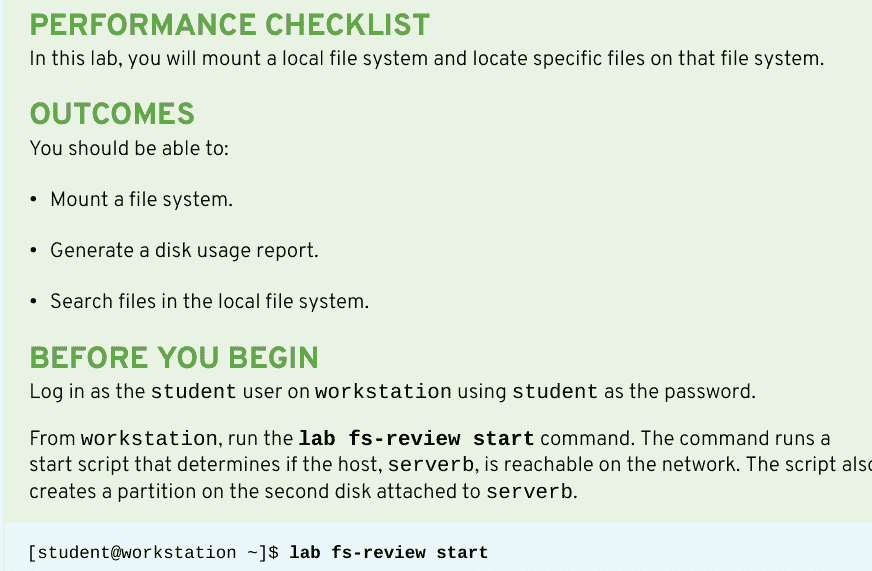

- 1. 在 `serverb` 上以 `root` 身份识别 `/dev/vdb1` 的 UUID，并通过其 UUID 将 `/dev/vdb1` 挂载到 `/mnt/freespace`

- 2. 生成 `/usr/share` 目录的磁盘使用报告，并将结果保存在 `/mnt/freespace/results.txt` 文件。

- 3. 使用 `locate` 命令查找所有的 `syslog.conf` 配置文件并将结果存储在 `/mnt/freespace/search1.txt` 文件。

- 4. 将 `/usr/share` 目录下所有大于 50 MB 且小于 100 MB 的文件的搜索结果存储在 `/mnt/freespace/search2.txt` 文件。

- 5. 退出 `serverb`。

## 评估

在工作站上，运行 `lab fs-review grade` 脚本以确认成功。

## 完成

在工作站上，运行 `lab fs-review finish` 脚本以完成此练习。

```
[student@workstation ~]$ lab fs-review finish
```

本实验此结束。

## 总结

在本章中，你学习了：

- 存储设备由一种称为块设备（`block device`）的特殊文件类型表示。

- `df` 命令报告所有已挂载普通文件系统的总磁盘空间、已用空间和可用磁盘空间。

- `mount` 命令允许 `root` 用户手动挂载文件系统。

- 为了成功卸载设备，所有进程都需要停止访问该挂载点。

- 当使用图形环境时，可移动式存储设备会被挂载在 `/run/media` 目录中。

- `find` 命令在本地文件系统中执行实时搜索，根据搜索标准查找文件。

# 第 16 章

## 分析服务器并获取支持

## 目标

调查并解决基于 Web 的管理界面中的问题，获取 Red Hat 的支持来解决问题。

## 目标

- 激活 Web 控制台管理界面，以远程管理和监控 Red Hat Enterprise Linux 服务器的性能。

- 描述 Red Hat 客户门户提供的关键资源，并从 Red Hat 文档和知识库中查找信息。

- 分析服务器问题，进行修复或解决，并使用 Red Hat Insights 确认解决方案。

## 章节

- 分析和管理远程服务器（以及引导性练习）

- 从 Red Hat 客户门户获取帮助（以及引导性练习）

- 使用 Red Hat Insights 检测并解决问题（以及测验）

# 分析和管理远程服务器

## 目标

完成本节后，你应该能够激活 Web 控制台管理界面，以远程管理和监控 Red Hat Enterprise Linux 服务器的性能。

## 描述 Web 控制台


Web 控制台（Web Console）是为 Red Hat Enterprise Linux 8 设计的基于 Web 的界面，用于管理和监控你的服务器。它基于开源 Cocktail 服务。

你可以使用 Web 控制台监控系统日志并查看系统性能图表。此外，你可以使用浏览器在 Web 控制台界面中使用图形化工具更改设置，包括一个功能完整的交互式终端会话。

## 启用 Web 控制台

Red Hat Enterprise Linux 8 默认在除最小安装外的所有安装变体中安装 Web 控制台。

启用并启动 `cockpit.socket` 服务，该服务运行一个 Web 服务器。如果你需要通过 Web 控制台连接到系统，此步骤是必要的。

```
[user@host ~]$ sudo systemctl enable --now cockpit.socket
Created symlink /etc/systemd/system/sockets.target.wants/cockpit.socket -> /usr/lib/systemd/system/cockpit.socket.
```

如果你正在使用自定义防火墙配置，你需要将 `cockpit` 服务添加到防火墙，以便在防火墙中开放 9090 端口。

```
[user@host ~]$ sudo firewall-cmd --add-service=cockpit --permanent
success
[user@host ~]$ sudo firewall-cmd --reload
success
```

## 登录 Web 控制台

Web 控制台提供自己的 Web 服务器。启动 Firefox 登录 Web 控制台。你可以使用系统中任何本地账户的用户名和密码登录，包括 root 用户。

在浏览器中打开 `http://servername:9090`，其中 `servername` 是服务器的主机名或 IP 地址。连接将受到 TLS 加密保护。默认情况下，系统将安装一个自签名 TLS 证书，当你连接 浏览器时，可能会显示安全警告。`cockpit-ws(8)` 手页说明了如何将 TLS 证书替换为经过签名的证书。

在登录界面输入你的用户名和密码。

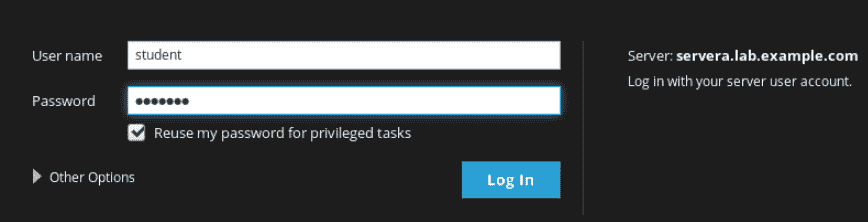

### 图 16.1：Web 控制台登录界面

偶尔，点击**重复我的密码用于特权任务 (Reuse my password for privileged tasks)**选项。这允许你使用 sudo 权限执行命令，从而执行修改系统信息或配置新账户等任务。

点击**登录 (Log In)**。

Web 控制台在标题栏的**右侧**显示用户名。如果你选择了**重复我的密码用于特权任务**选项，特权图标将显示在用户名左侧。


### 图 16.2：特权用户的标题栏

如果你以非特权用户登录，则不显示**特权 (Privileged)**图标。


### 图 16.3：非特权用户的标题栏

## 修改密码

特权和非特权用户在登录 Web 控制台时可以更改自己的密码。点击左侧导航栏中的**账户 (Accounts)**。点击你的账户标签打开详情页。

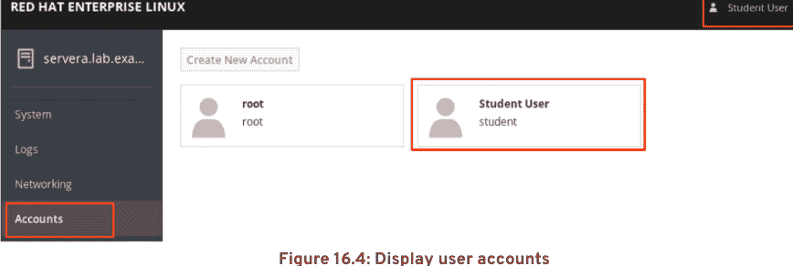

### 图 16.4：显示用户账户

作为非特权用户，你被限制更改自己的密码。要更改密码，必须以 root 用户身份登录。

## 分析服务器并确保其安全

### 红帽企业版 Linux

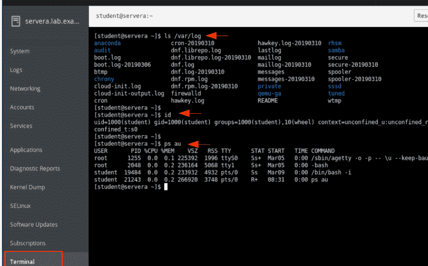

```
$ student@servera-lab...~$ ls -l /var/log
audit
df.log-20190310
df.log-20190310
df.log-20190310
df.log-20190310
df.rpm-20190310
chrony-20190310
cloud-init.log-20190310
cloud-init.log
kernel.log-20190310
secure.log-20190310
samba.log-20190310
spooler.log-20190310
messages-20190310
lastlog
hawkey
gmu.au
README
tmp
```

### 图 16.12：非特权终端会故障排除

## 创建诊断报告

诊断报告是红帽 Linux 系统配置数据、系统信息和诊断信息的集合。完成后的报告中收集的数据包括系统日志和调试信息，可用于排除故障。

以特权用户身份登录 Web 控制台。点击左侧导航栏中的**诊断报告**（Diagnostic Reports），打开创建这些报告的页面。点击**创建报告**Create Report）按钮生成新的诊断报告。

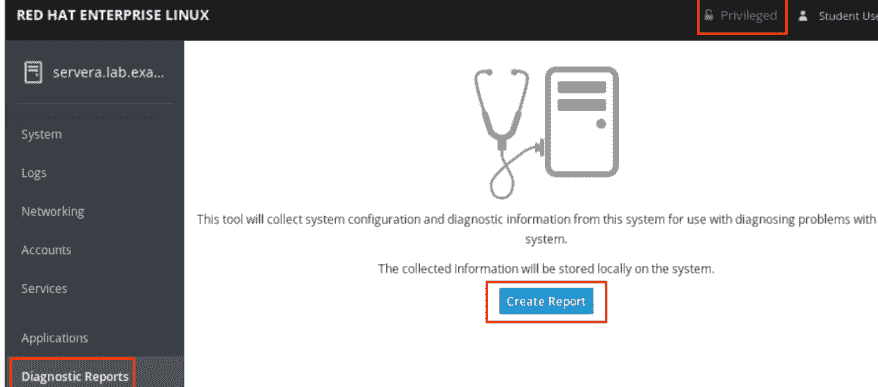

### 图 16.13：诊断报告

报告完成后，界面将显示“完成!”（Done!）。点击**下载报告**（Download report）按钮保存报告。

## 第 1 章 | 分析服务器并获取支持

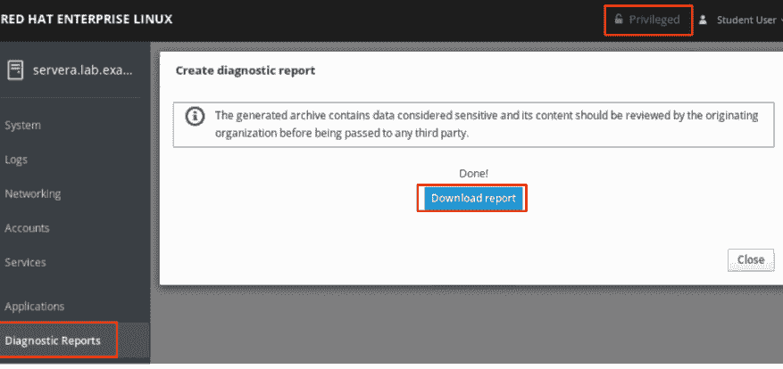

### 图 16.14：已完成的报告

点击“保存文件”（Save File）完成该过程。

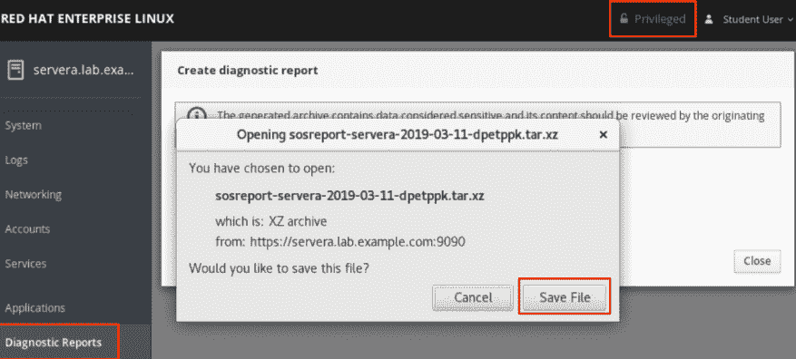

### 图 16.15：保存诊断报告

完成后的报告将保存到访问 Web 控制台的系统的 Downloads 目录。在本例中，该系统是 workstation（工作站）。

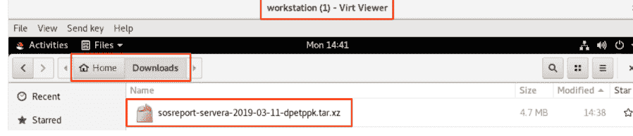

### 图 16.16：访问已完成的报告

## 使用 Web 控制台管理系统服务

作为 Web 控制台的特权用户，你可以停止、启动、启用和重启系统服务。此外，你可以配置网络接口、配置防火墙规则、管理账户等。以下图像显示了使用 Web 控制台管理工具的常见示例。

RH124-RHEL8.0-en-1-20190507

### 系统电源选项

Web 控制台允许你重启或关闭系统。以特权用户身份登录 Web 控制台。点击左侧栏中的“系统”（System）访问系统电源选项。

从“电源选项”（Power Options）下拉菜单中选择所需的选项来重启（Restart）或关闭（Shut Down）系统。

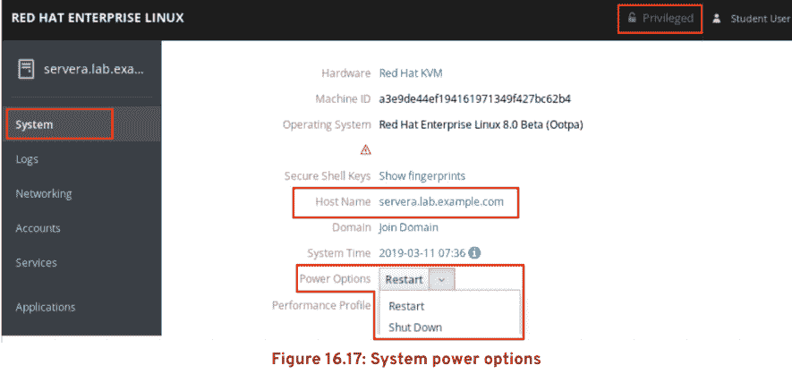

### 控制运行中的服务

你可以使用 Web 控制台中的图形化工具启动、启用、禁用和停止服务。点击左侧导航栏中的“服务”（Services）访问 Web 控制台服务的首页。点击服务首页右上角的“服务”按钮。服务按已启用（Enabled）、已禁用（Disabled）和静态（Static）部分显示。滚动页面以选择你想管理的服务。

在下例中，顺着 chron.service 行操作打开服务管理页面。

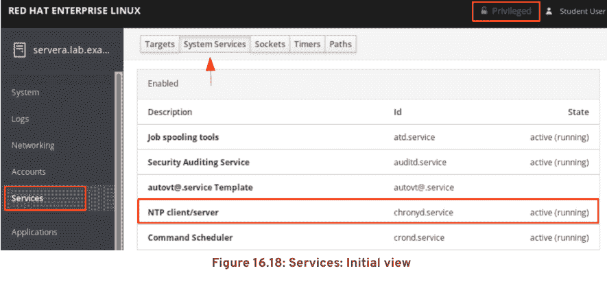

点击管理界面右侧的相应按钮来停止、重启或禁用服务。在本例中，该服务正在运行，因此“启动”按钮不显示。点击任何高亮链接或滚动查看服务管理部分下方显示的“日志”（Logs），可以获取与服务相关的更多信息。

## 第 15 章 | 分析服务器并获取支持

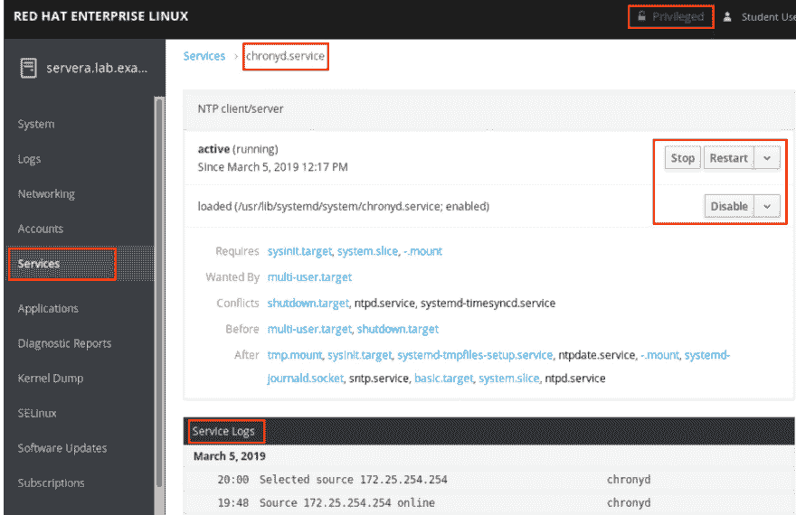

### 配置网络接口和防火墙

要防火墙规则和网络接口，点击左侧导航栏中的“网络”（Networking）。以下示例显示了如何收集网络接口信息以及如何管理它们。

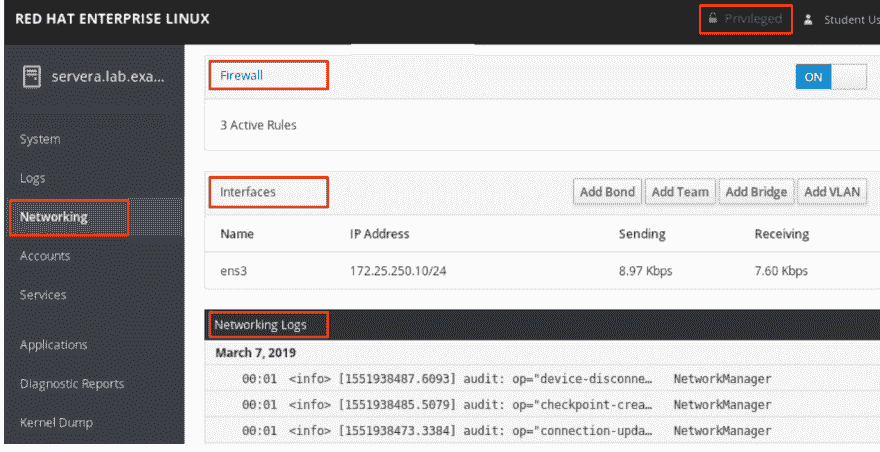

### 图 16.20：网络：初始视图

点击“接口”（Interfaces）部分中所需的接口名称以访问管理页面。在本例中，选择了 ens3 接口。

RH124-RHEL8.0-en-1-20190507

## 第 19 章 | 分析服务器并获取支持

| 名称 | IP 地址 | 发送 | 接收 |
| :--- | :--- | :--- | :--- |
| ens3 | 172.250.10/24 | 8.48 Kbps | 4.75 Kbps |

### 图 16.21：网络：接口

管理页顶部显示所选设备的网络活动。向下滚动查看设置和管理选项。

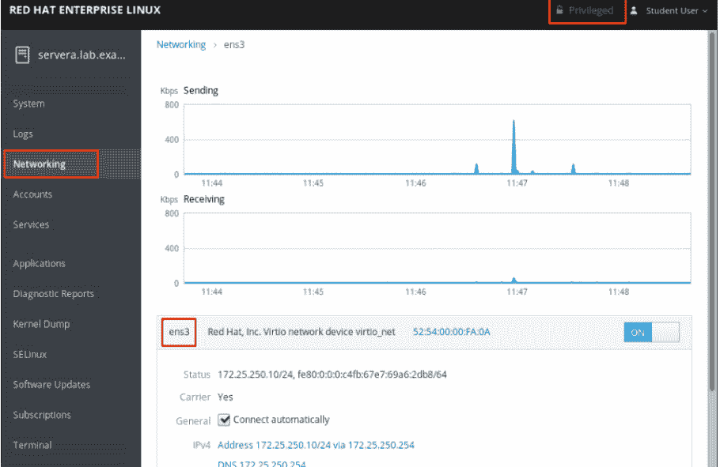

### 图 16.22：网络：接口


要修改或添加接口配置，点击高亮链接。在本例中，IPv4 链接显示了 `ens3` 接口的 IP 地址和掩码 `172.250.10/24`。要为 `ens3` 网络接口添加额外的 IP 地址，点击链接。

## 第 1 章 | 分析服务器并获取支持

| `ens3` Red Hat, Inc. Virtio device virtio_net 状态 ON | 负载 自动 |

| :--- | :--- | :--- |

| IPv4 地址 | 172.250.10/24 | |

| DNS | 172.250.254 | |

| 搜索域 | lab.example.com, example.com | |

| IPv6 | 自动 | |

| MTU | 自动 | |

图 16.23：网络：`ens3` 配置

在“手动”（Manual）列表右侧点击 `+` 添加额外的 IP 地址。在相应字段输入 IP 地址和网络掩码。点击“应用”（Apply）激活新设置。

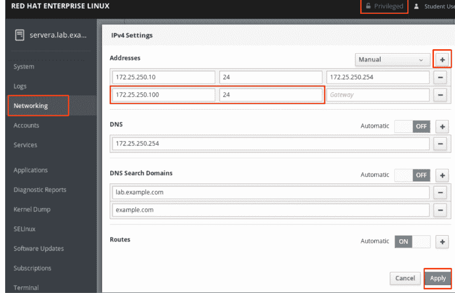

图 16.24：为现有接口添加 IP 地址

显示会自动切换回接口管理页面，你可以在那里确认新的 IP 地址。

RH124-RHEL8.0-en-1-20190507

## 第 19 章 | 分析服务器并获取支持

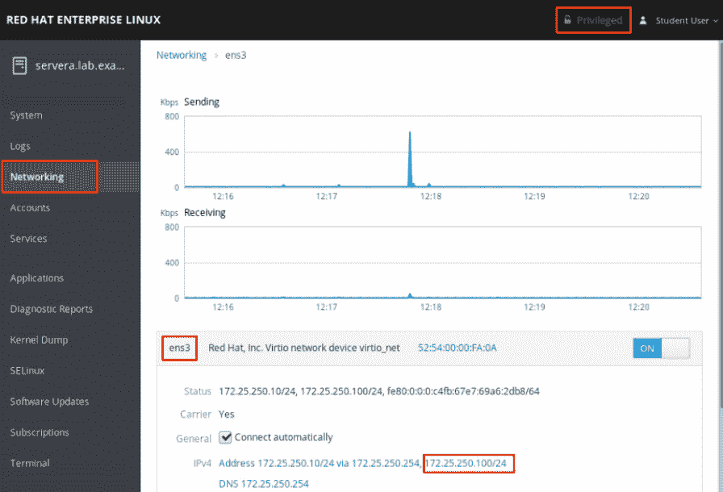

图 16.25：确认新的 IP 地址

## 管理用户账户

作为特权用户，你可以在 Web 控制台中创建用户账户。点击左侧导航栏中的“账户”（Accounts）查看现有账户。点击“创建新账户”（Create New Account）打开账户管理页面。

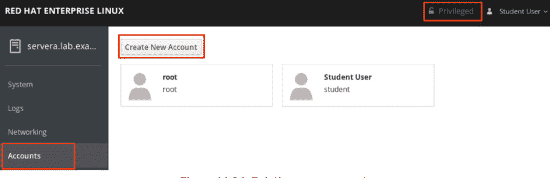

图 16.26：现有用户账户

输入新账户的信息，然后点击“创建”（Create）完成操作。

## 创建账户

| 全名 | 新用户 |

| :--- | :--- |

| 用户名 | `nuser` |

| 密码 | ******** |

| 确认 | ******** |

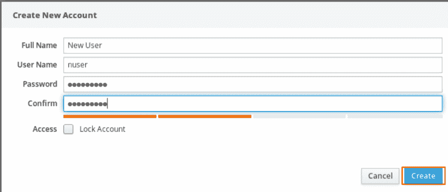

显示会自动切换回账户管理页面，你可以在那里确认新用户账户。

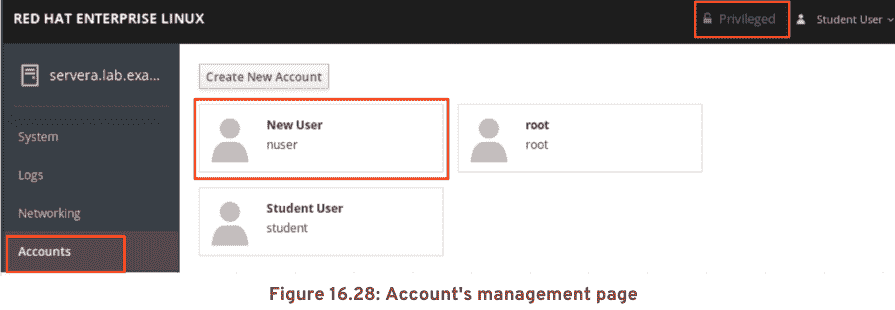

## 参考

`cockpit(1)`、`cockpit-ws(8)` 和 `cockpit.conf(5)` 手页

有关更多信息，请参阅*红帽企业版 Linux 8.0 Beta* 使用 Cockpit 管理系统的指南中的**使用 Cockpit Web 界面管理系统** https://access.redhat.com/documentation/en-us/red_hat_enterprise_linux/8-beta/html/managing_systems_using_the_cockpit_web_interface/

## 引导练习

## 分析管理远程服务器

在此练习中，你启用并访问服务器上的 Web 控制台以对其管理、诊断并解决问题。

## 结果

你应该能够使用 Web 控制台监控基本系统功能、检查日志文件、创建用户账户并访问终端。

## 开始之前

在工作站上使用 `student` 作为密码登录 `student` 用户。

从工作站运行 `lab support-cockpit start` 命令。该命令运行一个脚本来确定主机 `servera` 和 `serverb` 是否在网络上可达。

```
[student@workstation -] $ lab support-cockpit start
```

- 1. 使用 `ssh` 命令以 `student` 用户登录 `servera`。系统配置为使用 SSH 密钥验证，因此登录 `servera` 不需要密码。

```
[student@workstation -] $ ssh student@servera
激活 web 控制台: systemctl enable --now cockpit.socket[student@servera -]$
```

- 2. 系统上已安装 Web 控制台，但尚未激活。启用并启动 `cockpit` 服务。

- 2.1. 使用 `systemctl enable --now cockpit.socket` 命令启用 Web 控制台。

```
[student@servera -] sudo systemctl enable --now cockpit.socket
[sudo] password for student: student
Created symlink /etc/systemd/system/sockets.target.wants/cockpit.socket -> /usr/lib/systemd/system/cockpit.socket.
```

- 3. 在工作站上，打开 Firefox 并以 `student` 用户身份和密码登录 `servera.lab.example.com` 系统上的 Web 控制台界面。

- 3.1. 打开 Firefox 并访问 `https://servera.lab.example.com:9090` 地址。

- 3.2. 通过将其添加为异常来接受自签名证书。

3.3. 使用密码 `student` 以学生用户身份登录。

你现在已以普通用户身份登录，具有最小权限。

- 4. 在 Web 控制台界面内验证你的当前权限。

- 4.1. 点击左侧导航栏中的“Terminal”（终端）进入终端。将打开一个已以 `student` 用户身份登录的终端会话。使用 `id` 命令确认嵌入式终端中的命令执行是否正常。

```
[student@servera ~]$ id
uid=1000(student) groups=1000(student), 10(wheel)
context=unconfined_u:unconfined_r:unconfined_t:s0
```

- 4.2. 点击左侧导航栏中的“Accounts”（账户）来管理用户。将鼠标指针悬停在左角的“New Account”（新账户）按钮上。注意学生用户不允许创建新账户。

- 4.3. 点击“Student User”（学生用户）链接。在用户账户详情页上，注意该用户仅允许设置新密码或授权 SSH 公钥。

- 4.4. 点击右上角的“Student User”下拉菜单。从下拉菜单中选择“Log Out”（注销）。

- 5. 以管理员权限访问 Web 控制台。

- 5.1. 再次以学生用户密码 `student` 登录 Web 控制台界面，但这次勾选“Reuse password for privileged tasks”（特权任务重用密码）复选框。

- 5.2. 要验证管理员访问，确认 Web 控制台右上角的 Student User 账户旁边显示了“Privileged”（特权）标签。

- 6. 要查看系统统计信息，点击左侧导航栏中的“System”（系统）。

此页面显示基本操作系统的统计信息，例如：当前负载、磁盘使用情况、I/O 和网络流量。

- 7. 要检查系统日志，点击左侧导航栏中的“Logs”（日志）。

此页面显示系统日志。使用左上角的按钮根据日期和日志严重性类型修改日志条目的显示方式。

- 7.1. 点击“Severity”（严重性）下拉列表并选择“Everything”（全部）。

- 7.2. 根据当前日期，点击列表中的任何日志条目。日志条目详情页将打开有关该事件的附加信息，例如主机名、SELinux 上下文以及该条目对应的进程 PID 。

- 为现有的网络接口设备添加第二个 IP 地址。

8.1. 点击左侧导航栏中的“Networking”（网络）。

此页面显示 `servera` 当前网络配置的详情，以及实时网络统计信息、防火墙配置和与网络相关的日志条目。

- 8.2. 滚动到“Interfaces”（接口）部分并点击 `ens3` 网络接口名称行。

详情页显示实时网络统计信息以及该网络接口的当前配置。

- 8.3. 点击“Address 172.25.250.10 via 172.25.250.254”链接。

打开一个 IPv4 Settings 窗口，你可以在其中更改网络接口配置。

- 8.4. 在 IPv4 Settings 窗口中，点击“Manual”（手动）旁的 `+` 号。

- 8.5. 在“Address”文本框中输入 `172.25.90.99` 作为 IP 地址。

- 8.6. 在“Prefix length or Netmask”文本框中输入网络掩码值 `24`。

- 8.7. 点击“Apply”（应用）保存新的网络配置。

注意新配置已立即生效。新的 IP 地址在 IPv4 行中可见。

- 创建一个用户账户。

9.1. 点击左侧导航栏中的“Accounts”（账户）。

- 9.2. 点击“New Account”（新账户）。


### 9.3. 在“Create New Account”窗口中添加以下详细信息：

| FIELD | VALUE |
| --- | --- |
| Full Name | manager1 |
| User Name | manager1 |
| Password | redh@t123 |
| Confirm | redh@t123 |

9.4. 点击“Create”（创建）。

### 10. 在 Web 控制台内访问终端会话，将 manager:1 用户添加到 wheel 组。

10.1. 点击左侧导航栏中的“Terminal”（终端）。

10.2. 使用 `id manager1` 命令查看 manager1 用户的组组成情况。

```
[student@servera ~]$ sudo id manager1
```

uid=1001(manager1) gid=1001(manager1) groups=1001(manager1)

10.3. 使用 `usermod -ag wheel manager1` 命令将 manager1 添加到 wheel 组。

```
[student@servera ~]$ sudo usermod -ag wheel manager1
(sudo) password for student: student
[student@servera ~]$
```

10.4. 使用 `id manager1` 命令验证 manager1 是否为 wheel 组成员。

```
[student@servera ~]$ id manager1
uid=1001(manager1) gid=1001(manager1) groups=1001(manager1),10(wheel)
```

### 11. 启用并启动内核进程计数 (psacct) 服务。

11.1. 点击左侧导航栏中的“Services”（服务）。

11.2. 滚动查看“System Services”列表直到找到“Disabled”（已禁用）部分。找到并点击“Kernel process accounting”（内核进程计数）链接。

11.3. 点击“Enable”（启用）。

11.4. 点击“Start”（启动）。

服务已启用并启动。

### 12. 从 Web 控制台注销。

### 13. 从 servera 注销。

```
[student@servera ~]$ exit
```

## 从红帽支持获取帮助

### 目标

完成本节后，你应该能够：

### 访问客户门户的资源

Products & Services 提供了产品中心，这些页面提供了特定产品的评估、概述、入门指南和其他产品支持信息。你还可以访问 Red Hat 产品的文档、知识库直接链接以及有关如何联系支持的信息。

- 访问官方文档。
- 提交支持案例。
- 管理你的订阅和权限。
- 获取优化系统的下载。

网站部分部分对所有人开放，而其他部分仅限拥有订阅的客户。请注意，如果你属于某个组织，组织管理员可以限制对该页面的访问。

### 熟悉客户门户

导览是一个非常有用的工具，可以帮助发现门户提供的所有功能并充分利用其价值。

### 欢迎来到红帽客户门户

第一个窗口有两个选项：CLOSE（关闭）和 NEXT（下一步）。

### 顶部导航栏

客户门户主页顶部导航栏下方有菜单，你可以通过它们导航到提供的四类资源：

- SUBSCRIPTIONS（订阅）
- DOWNLOADS（下载）
- CONTAINERS（容器）
- SUPPORT（支持）

Subscriptions 打开一个新页面，你可以在其中管理已注册系统和订阅。它列出了相关的错误信息，并允许你创建激活密钥以便在注册系统时获取正确的订阅权限。访问此页面。

Downloads 打开一个新页面，让你访问产品下载并对没有权限的产品申请评估。

Support Cases 打开一个新页面，允许你通过案例管理系统创建、跟踪和管理支持案例，前提是你的组织授权了该访问权限。

# 分析服务并获取支持

工具提供了相关工具的链接，帮助您成功使用 Red Hat 产品。解决方案引擎（Solution Engine）为您提供了一种高效的方法来快速搜索解决方案，如果您没有找到满意的解决方案，可以提交工单。客户门户实验室（Customer Portal Labs）提供基于 Web 的应用程序和工具，帮助您提高性能、诊断问题、安全问题并优化配置。例如，产品周期检查器（Product Cycle Checker）可以帮助您查看特定产品及其支持生命周期计划。另一个工具救援模式助手（Rescue Mode Assistant）可以帮助您识别系统的根本原因、生成报告或修复系统的启动时问题。在别处还有许多其他可用工具：

| Tools | Customer Portal Labs |
| --- | --- |
| Solution Engine | Configuration |
| Package | Deployment |
| Errata | Security |
| | Troubleshooting |

图 16.33：工具

安全（Security）提供了访问 `https://access.redhat.com/security/` 的 Red Hat 产品安全中心的权限。它还提供了有关高关注安全问题的信息、访问 Red Hat CVE 数据库、Red Hat 博客的安全中心，以及关于 Red Hat 安全响应流程以及我们如何评估和解决这些问题的资源。

最后，社区（Community）菜单是 Red Hat 专家、客户和合作伙伴进行通信与协作的地方。这里提供了讨论论坛、博客以及您所在地区即将举行的活动信息。

> 注意
>
> 您应该在[开始使用 Red Hat](https://access.redhat.com/start/) 中完成整个导览，包括关于如何个性化您的客户门户体验以及探索您的 Red Hat 订阅优势的章节，以获取有关客户门户的完整信息。您需要在客户门户账户中至少有一个激活的订阅才能访问此页面。

# 使用 RED HAT 支持工具搜索知识库

Red Hat 支持工具 `redhat-support-tool` 提供了一个基于文本的界面，允许您从系统的命令行在客户门户上搜索知识库文章并提交案例。该工具没有图形界面，由于它需要与 Red Hat 客户门户交互，因此需要访问 Internet。使用任何终端或 SSH 连接运行 `redhat-support-tool` 命令。

`redhat-support-tool` 命令可以在交互模式下使用，也可以带有选项和参数作为命令使用。该工具的语法适用于这两种方法。默认情况下，程序在交互模式下启动。使用 `help` 命令查看所有可用命令。交互模式支持制表补全以及调用父 shell 中程序的能力。

```
[user@host ~]$ redhat-support-tool
Welcome to the Red Hat Support Tool.
Command (? for help):
```

# 分析服务并提供支持

当调用时，`redhat-support-tool` 会提示输入 Red Hat 客户订阅者的登录信息。为了避免重复提供这些信息，工具会请求将账户信息存储在用户的家目录（`./redhat-support-tool/redhat-support-tool.conf`）。如果通过特定的 Red Hat 客户门户账户提交问题，可以使用 `global` 选项将账户信息保存到 `/etc/redhat-support-tool.conf` 以及其他系统级配置中。工具的 `config` 命令可以修改配置设置。

`redhat-support-tool` 命令允许订阅者从 Red Hat 客户门户搜索并显示知识库内容。知识库执行关键字搜索，类似于 `man` 命令。用户可以输入错误代码、日志文件中的语法或任何关键词组合来生成相关解决方案文档列表。

这里有一个初始配置和搜索描述：

```
[user@host]$ redhat-support-tool
Welcome to Red Hat Support Tool.
Command (? for help): search How to manage system entitlements with subscription-manager
Please enter your RNH user ID: subscriber
Save the user ID /home/student/.redhat-support-tool/redhat-support-tool.conf(y/n): y
Please enter the password for subscriber: password
Save the password for subscriber in /home/student/.redhat-support-tool/redhat-support-tool.conf(y/n): y
```

在提示用户输入所需的用户配置后，工具继续执行原始搜索请求：


```
Type the number of the solution to view or 'e' to return to the previous menu.
1 [ 253273:VER] How to register and subscribe a system to the Red Hat Customer Portal using Red Hat Subscription-Manager
2 [ 265523:VER] Enabling or disabling a repository using Red Hat Subscription Management.
3 [ 108423:VER] Why does subscription-manager list return: "No Installed products found"
output omitted...
Select Solution: 1
```

如上所示选择文章 1 号，您将将被提示选择阅读的文档章节。最后，使用 `Q` 退出当前章节，或反复使用以退出 `redhat-support-tool` 命令。

```
Select Solution: 1
Type the number of the section to view or 'e' to return to the previous menu.
1 Title
2 Issue
3 Environment
4 Resolution
5 Display all sections
End of options.
Section: 1
```

RH124-RHEL8.0-en-1-20190507

579

# 分析服务并获取支持

## Title

===============================================================================

使用 Red Hat Subscription-Manager 将系统注册并订阅到 Red Hat 客户门户

URL: https://access.redhat.com/solutions/253273

Created On: None

Modified On: 2017-05-29

## Title

===============================================================================

使用 Red Hat Subscription-Manager 将系统注册并订阅到 Red Hat 客户门户

URL: https://access.redhat.com/solutions/253273

Created On: None

Modified On: 2017-05-29

## Issue

===============================================================================

使用 Red Hat Subscription-Manager 将系统注册并订阅到 Red Hat 客户门户

URL: https://access.redhat.com/solutions/253273

Created On: None

Modified On: 2017-05-29

# 使用 RED HAT 工具管理支持案例

订阅的一个益处是通过客户门户访问技术支持。根据支持级别，可以通过在线或电话联系 Red Hat。请访问 https://access.redhat.com/support/policy

# 准备 Bug 报告

在联系 Red Hat 支持部门之前，收集信息至关重要。

定义问题。能够清晰地陈述问题及其症状。尽可能具体。详细列出重现问题的步骤。

收集背景信息。哪个产品和版本受影响？准备好提供信息。这可能包括 `sosreport` 或崩溃转储（crash dump）。

确定严重级别。Red Hat 使用四个严重级别来划分问题。紧急和高级的问题应通过电话处理。

| SEVERITY | DESCRIPTION |
| --- | --- |
| Urgent (Severity 1) | 严重影响您在生产环境中对软件的使用。包括生产数据丢失或系统故障。该问题会导致业务中断且没有替代方案。 |
| High (Severity 2) | 软件可以运行但在生产环境的功能严重降低。该情况对您的业务产生高影响且没有替代方案。 |
| Medium (Severity 3) | 在生产环境或开发环境中涉及软件的部分非关键使用。对于生产环境，对业务产生中等或低的影响。可以通过替代方案继续运行。对于开发环境，该情况会导致项目迁移到生产环境出现问题。 |
| Low (Severity 4) | 一般使用问题、文档错误报告或对未来产品增强或修改的建议。对于生产环境，对业务或系统性能/功能的影响低或没有。对于开发环境，对业务产生中等或低的影响，但可以通过替代方案继续运行。 |

# 使用 redhat-support-tool 管理 Bug 报告

订阅者可以使用 `redhat-support-tool` 创建、查看、修改和关闭 Red Hat 支持案例。当案例处于打开或维护状态时，用户可以附加文件或文档，例如诊断报告（sosreport）。该工具会将文件上传并附加到案例中。

包括产品、版本、摘要、描述、严重性和案例组在内的案例细节可以通过命令行选项分配，也可以让工具提示所需信息。在以下示例中，打开了一个新案例。指定了 `--product` 和 `--version` 选项。

```
[user@]$ redhat-support-tool.
Welcome to Red Hat Support Tool.
Command (? for help): opencase --product="Red Hat Enterprise Linux" --nversion="7.0"
Please enter a summary (or 'q' to exit): System fails to run without power
nPlease enter a description (Ctrl-D on an empty line when complete):
```

当服务器拔掉电源时，操作系统无法继续运行。

+ 1 紧急 (Urgent)

2 高 (High)

3 普通 (Normal)

4 低 (Low)

请选择严重程度（或输入 'q' 退出）：`4`

是否要为此案例分配一个案例组 (y/N)? N

在打开支持案例之前，您是否想查看此问题的解决方案？

(y/N) N

支持案例 01034421 已成功打开。

如果没有指定 `--product` 和 `--version` 选项，`redhat-support-tool` 将为这些选项提供列表。

```
[user@host ~]$ redhat-support-tool
Welcome to the Red Hat Support Tool.
Command (? for help): opcase
Do you want to use the default product - "Red Hat Enterprise Linux" (y/N)?: y
output omitted...
29 7.5
31 7.6
32 8.0 Beta
```

请选择版本（或输入 'q' 退出）：`yum fails to install apache`

请输入描述（完成后在空行上按 Ctrl-D）：

yum cannot find correct repo

+ 1 紧急 (Urgent)

2 高 (High)

3 普通 (Normal)

4 低 (Low)

请选择严重程度（或输入 'q' 退出）：`4`

是否要使用默认的（未分组）案例组 (y/N)?: y

在打开支持案例之前，您是否想查看此问题的解决方案？ (y/N) N

支持案例 018355678 已成功打开。

## 为支持案例附加诊断信息

包含诊断信息可以更快解决问题。在打开案例时附加 `sosreport`。`sosreport` 命令会生成一个从运行的系统中收集的诊断信息的压缩包。如果已创建了存档，`redhat-support-tool` 会提示包含它：

> 请为支持案例 01034421 附加 SOS 报告。以 root 用户身份创建 SOS 报告并执行以下命令 -c sosreport 直接发送到案例：

`redhat-support-tool attachment -c 01034421 path to sosreport`

您现在要为 01034421 附加文件吗？(y/N) N

Command (? for help):

## 第 1 章 | 管理服务与支持

如果不存在当前的 SoS 报告，管理员可以稍后生成并附加一个。使用 `redhat-support-tool addattachment` 命令附加报告。

订阅者可以查看、修改和关闭支持案例：

+ Command (? for help): `listcases`


输入案例编号查看案例，或输入 `e` 返回上级菜单。

1 [等待 Red Hat 处理] 系统在无电情况下无法运行

没有更多案例显示

选择案例：`1`

+ 输入部分编号查看部分，或输入 `e` 返回上级菜单。

1 案例详情

2 修改案例

3 描述

4 建议

5 获取附加

6 添加附加

7 添加注释

选项结束。

选项为: `q`

选择案例：`q`

```
[user@~]$ redhat-support-tool modifycase --status=Closed 01034421
Successfully updated case 01034421
[user@~]$
```

Red Hat Support Tool 具有高级的应用诊断和分析能力。使用内核崩溃储文件 `redhat-support-tool` 可以创建并提取 `backtrace`（回溯）。内核崩溃储文件是使用 `kdump` 命令创建的。`backtrace` 是崩溃转储时活动堆栈帧的报告，并提供操作系统诊断。`redhat-support-tool` 的选项之一是打开支持案例。

该工具还提供日志文件分析。使用工具的 `analyze` 命令可以解析许多类型的日志文件（包括操作系统、JBoss、Python、Tomcat 和 ovirt）以识别问题症状。可以单独对日志进行查看和诊断。对原始数据（如崩溃转储或日志文件）进行预处理分析，允许更快地开启支持案例并提供给工程师。

## 加入 RED HAT 开发者社区

Red Hat 的另一个有用资源是 Red Hat Developer。该程序可在 https://developer.redhat.com 获取，它提供了用于开发目的的 Red Hat 软件订阅权限、相关文档，以及来自微服务、无服务器计算、Kubernetes 和 Linux 专家的高级书籍。此外还有博客和其他资源，以及指向 Red Hat 客户门户的链接。

注册是免费的，可以在 https://developer.redhat.com/register 完成。

## 第 10 章 | 分析服务器并获取支持

> 引用

`sosreport(1)` man page

Red Hat Access: Red Hat Support Tool

https://access.redhat.com/site/articles/445443

Red Hat Support Tool First Use

https://access.redhat.com/site/videos/534293

Contacting Red Hat Technical Support

https://access.redhat.com/site/support/policy/support_process/

Help - Red Hat Customer Portal

https://access.redhat.com/site/help/

## 引导练习

## 从 Red Hat 客户门户获取帮助

在本次练习中，你将使用 Web Console 生成一个诊断报告。

## 结果

你应该能够使用 Web Console 生成一个诊断报告，并将其作为支持案例的一部分提交给 Red Hat 客户门户。

## 准备工作

在工作站 `student` 上以 `student` 用户登录，密码为 `student`。在工作站运行 `lab support-portal` 命令。该命令运行一个脚本来判断 `servera` 是否可达。它还会在 `sera` 上启动 Web Console。

```
[student]workstation ~]$ lab support-portal start
```

+ 1. 从工作站使用 `ssh` 登录到 `servera` 的 `student` 用户。

```
[student]workstation ~$ student@servera
Web console: https://servera.example.com:9090/ or https://172.250.10:9090/
Last login: Mon Mar 4 10:42:20 from 172.250[student]servera ~$
```

+ 2. 使用 `systemctl` 命令确认 `cockpit` 服务正在运行。在提示时输入 `student` 密码。

```
[student]servera ~$ sudo systemctl status cockpit.service
[sudo] password for: student
● cockpit.service - Cockpit Web Service
Loaded: loaded (/lib/systemd/system/cockpit.service; enabled; preset=enabled)
Active: active (running) since Mon 2019-03-04 10:42:20 UTC; 1 min ago
     Process: 1234 Exec:/usr/libexec/cockpit-socket
   Memory: 12M (limit: 2G)
   Tasks: 4
```

+ 3. 使用 `systemctl` 命令确认 `cockpit` 服务正在运行。在提示时输入 `student` 密码。

```
[student]servera ~$ sudo systemctl status cockpit.service
[sudo] password for: student
● cockpit.service - Cockpit Web Service
Loaded: loaded (/lib/systemd/system/cockpit.service; enabled; preset=enabled)
Active: active (running) since Mon 2019-03-04 10:42:20 UTC; 1 min ago
     Process: 1234 Exec:/usr/libexec/cockpit-socket
   Memory: 12M (limit: 2G)
   Tasks: 4
```

## 第 10 章 | 分析服务器与支持

如果不存在当前的 Sos 报告，管理员可以稍后生成并附加一个。使用 `redhat-support-tool addattachment` 命令附加报告。

订阅者可以查看、修改和关闭支持案例：

+ Command (? for help): `listcases`

输入案例编号查看案例，或输入 `e` 返回上级菜单。

1 [等待 Red Hat 处理] 系统在无电情况下无法运行

没有更多案例显示

选择案例：`1`

+ 输入部分编号查看部分，或输入 `e` 返回上级菜单。

1 案例详情

2 修改案例

3 描述

4 建议

5 获取附加

6 添加附加

7 添加注释

选项结束。

选项为: `q`

选择案例：`q`

```
[user@~]$ redhat-support-tool modifycase --status=Closed 01034421
Successfully updated case 01034421
[user@~]$
```

Red Hat Support Tool 具有高级的应用诊断和分析能力。使用内核崩溃储文件 `redhat-support-tool` 可以创建并提取 `backtrace`。内核崩溃储文件是使用 `kdump` 命令创建的。`backtrace` 是崩溃转储时活动堆栈帧的报告，并提供操作系统诊断。`redhat-support-tool` 的选项之一是打开支持案例。

该工具还提供日志文件分析。使用工具的 `analyze` 命令可以解析许多类型的日志文件（包括操作系统、JBoss、Python、Tomcat 和 ovirt）以识别问题症状。可以单独对日志进行查看和诊断。对原始数据（如崩溃转储或日志文件）进行预处理分析，允许更快地开启支持案例并提供给工程师。

## 使用 RED INSIGHTS 检测并解决问题

## 目标

完成本节后，你应该能够使用 Red Hat Insights 分析服务器问题、修复它们并确认解决方案。

## 引入 RED INSIGHTS

Red Hat Insights 是一种预测性分析工具，帮助你使用 Red Hat 产品识别并修复对安全、性能和稳定性的威胁。Red Hat Insights 以软件即服务 (SaaS) 产品交付，因此你可以在没有基础设施要求的情况下进行部署和扩展。此外，这意味着你可以立即利用 Red Hat 的最新建议和更新。

Red Hat 通过 Red Hat Insights 定根据常见的支持风险、安全漏洞、已知配置以及 Red Hat 识别的其他问题更新知识库。缓解或解决这些问题的操作会通过 Red Hat 的验证和确认。这允许你在问题演变成更大的问题之前主动识别、确定优先级并解决。


对于检测到的每个问题，Red Hat Insights 提供了风险估算以及缓解或解决它的建议。这些建议可能提供如 Ansible Playbooks 或人类可读的逐步说明等材料。

Red Hat Insights 的建议针对每个注册到服务的系统进行定制。你为每个客户端系统安装一个代理，收集有关系统运行配置的元数据。这是你可能提供 Red Hat Support `sosreport` 以解决支持工单的部分子集。你可以限制或模糊化发送的数据。取决于你限制的内容，这将阻止某些分析结果的运行。

在注册服务器并完成初始元数据同步后立即，你应该能够在 Red Hat 客户门户帐户中的 Red Hat Insights 界面中看到你的服务器以及针对它的任何建议。

Red Hat 目前对以下 Red Hat 产品提供预测性分析和建议：

+ `Red Hat Enterprise Linux 6.4` 及更高版本
+ `Red Hat Virtualization 4` 及更高版本
+ `Red Hat OpenShift Container Platform`
+ `Red Hat Cloud Suite 6` 和 `Red Cloud Infrastructure 6`

## 描述 Red Hat Insights 架构

你可以通过 Red Hat 客户门户将系统注册到 Red Hat Insights。注册系统时，它会向 Red Hat Insights 提供当前配置的元数据。这些数据通过 TLS 加密发送到 Red Hat Insights 以保护传输安全。在处理之前也会对其进行匿名化处理。

# 第 10 章 | 分析服务器并获取支持

根据 Red Hat Insights 规则引擎提供的建议，分析结果将显示在 Red Hat 客户门户帐户中的 Red Hat Insights 界面上。

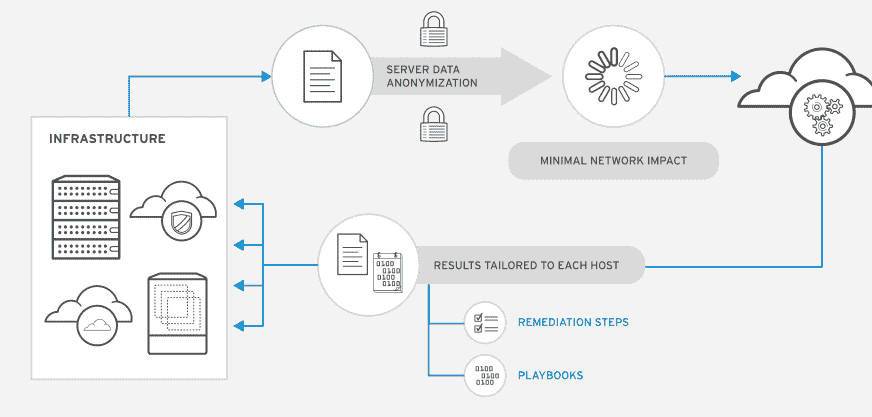

要为 Red Hat Enterprise Linux 服务器配置 Red Hat Insights，请在系统上安装 `insights-client` 软件包。

> **重要**
>
> 从 Red Hat Enterprise Linux 7.5 开始，`insights-client` 软件包取代了旧的 `redhat-access-insights` 软件包。

如果您的系统已通过客户门户订阅服务注册了软件权限，您可以通过一个命令激活 Red Hat Insights。使用 `insights-client --register` 命令注册系统。

```
[root@demo ~]# insights-client --register
```

Insights 客户端定期更新提供给 Red Hat Insights 的元数据。可以使用 `insights-client` 命令随时刷新客户端的元数据。

```
[root@demo ~]# insights-client
Starting to collect Insights data for demo.lab.example.com
Uploading Insights data.
Successfully uploaded report from 773b351b-dfb1-4393-afa8-915cc28750e6 to account XXXX.
```

## 在客户门户中向 Red Hat Insights 注册 RHEL 系统

要在 Red Hat 客户门户上将 RHEL 服务器注册到 Red Hat Insights，总体流程如下：

1. 通过 Red Hat 订阅管理服务交互式地注册系统。

```
[root@demo ~]# subscription-manager register --auto-attach
```

系统必须附加有效的 Red Hat Insights 权限，这可能是您作为 Smart Management 订阅的一部分收到的。此外，必须启用标准的 Red Hat Enterprise Linux 软件包通道。

2. 确保系统上安装了 `insights-client` 软件包。在 RHEL 7 中，该软件包位于 `rhel-7-server-rpms` 通道。

```
[root@demo ~]# yum install insights-client
```

3. 使用 `insights-client --register` 命令将系统注册到 Red Hat Insights 服务，并上传初始系统元数据。

```
[root@demo ~]# insights-client --register
```

4. 验证系统在 https://access.redhat.com/insights 是否处于激活状态。

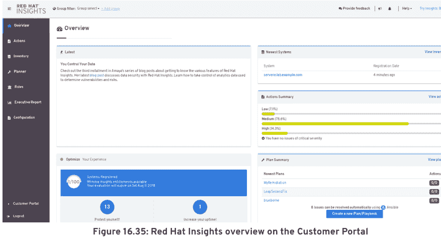

## 查看 RED HAT INSIGHTS 提供的报告

Red Hat Insights 报告显示了系统随时间的变化。通过这些报告，您可以轻松查看当前的风险评估并识别历史趋势，以增强决策能力。

Red Hat Insights 界面为您提供的信息包括：

- 基于您的系统得出的当前整体风险评分。
- 建议在您的系统上采取的操作，这些操作进一步按类别和严重程度进行分类。
- 系统最后一次通过 Red Hat Insights 检查的信息。
- 根据其影响需要优先处理的问题。

## 定义客户门户中 Red Hat Insights 界面的标签

客户门户上的 Red Hat Insights UI 提供了以下标签：

### 概览 (Overview)

最新（Latest）部分提供来自 Red Hat 的新闻和公告。最新系统（Newest Systems）显示您最近注册到 Red Hat Insights 的系统名称，并带有有关其信息的链接。操作摘要（Actions Summary）提供了您应在系统上采取的建议操作的摘要和链接，这些操作被分为低、中、高和紧急级。计划摘要（Plan Summary）和规则摘要（Rules Summary）提供了有关您已添加的维护计划以及 Red Hat 在过去 15 天内添加的分析规则的信息。

### 操作 (Actions)

操作标签提供了建议操作的更详细的概述。

问题（Issues）图表显示了影响您的系统的的问题总数，以及不同类别（可用性、稳定性、性能和安全性）中问题的百分比。您可以点击图表的不同部分获取更详细的信息。

它还显示了风险摘要条形图，按风险对您的问题进行分类（如“概览”标签页所示）。您也可以点击图上的条形以获取更详细的信息。


图 16.36：客户门户上 Red Hat Insights 的操作页面

### 清单 (Inventory)

清单标签提供了您注册到 Red Hat Insights 的系统列表。

您可以轻松针对特定系统、组或支持的平台过滤清单。“上次检查（Last Check）”列显示了每个系统的最新元数据更新。“状态（Status）”列出了每个系统待处理的操作数量，并链接到有关该系统这些操作的信息。

### 计划器 (Planner)

计划器标签列出了您当前的维护计划以及如何创建、删除和管理它们。维护计划允许您从 Red Hat Insights 报告中选择影响特定的问题，在处理问题的各种选项之间进行选择，并生成 Ansible 剧本来缓解或修复这些问题。

### 规则 (Rules)

规则标签提供了 Red Hat Insights 在分析您的系统是否存在问题时可以使用的规则列表。

这些规则可以根据时间、总风险、类别、可能性以及对注册系统的影响进行过滤。

在客户门户界面中，您会注意到某些问题被标记了 Ansible 徽标。这表示有一个可用的 Ansible 修复剧本。带有淡化、划掉线的 [文本] 问题表示某种状态。

## 高管报告 (Executive Report)

高管报告提供了系统健康状况的高级视图。


图 16.37：客户门户上 Red Hat Insights 的高管报告页面

## 配置 (Configuration)

配置标签允许您管理 Red Hat Insights 如何分析您的环境。

## 查看 Red Hat Insights 报告的问题

要查看 Red Hat Insights 的问题，流程如下：

1. 登录客户门户。
2. 导航到“概览”标签查看整体风险评分。
3. 使用“操作”标签查看详细问题和建议的操作。
4. 检查“清单”标签查看特定的注册系统。

## 分析服务器与获取支持

| 注册日期 | 2分钟前 |
| --- | --- |
| 主机名: server.lab.example.com | |


| UUID: 592056eb-7954-4e9f-bb85-219a9983501 | 操作系统: RHEL server release 7.3 (Maipo) |

| 最后签入 | 2分钟前 |

## 系统网络

规则

展开全部

- > 安全 > Dosmas 易受到受构造的 DNS 请求的远程代码执行攻击 (`CVE-2017-1449P`)

> 影响 可能性 总风险 变更风险：极低

- > 安全 > NSS 易受到通过构造的 base64 数据进行的远程代码执行漏洞 (`CVE-2017-5461`)

> 影响 可能性 总风险 变更风险：高

- > 安全 > sudo 易受到通过进程 TTY 解析的本地权限提升攻击 (`CVE-2017-100036`) 影响：本地权限提升

> 影响 可能性 总风险 变更风险：极低

- > 安全 > NetworkManager DHCP 易受到远程代码执行攻击 (`CVE-2018-1111`)

> 影响 可能性 总风险 变更风险：极低

> 图 16.38：Red Hat Insights 规则，如果你想处理它们，可以手动或自动进行处理。来自客户门户。

当你确定了想要处理的问题后，可以手动或自动对它们进行处理。在问题解决并且你的 Red Hat Insights 客户端上传了新的元数据后，该规则将不再匹配该系统，问题将从建议操作列表中消失。

# 手动修复 Red Hat Insights 报告的问题

- 1. 登录 Red Hat 客户门户并访问 `https://access.redhat.com/insights` Red Hat Insights 页面。

导航到“库存 (Inventory)”选项卡。点击已注册的系统。显示的页面将列出影响系统的任何已知问题。

- 2. 在 Web 用户界面中，展开您计划修复的安全问题项目。“解决步骤 (Steps to resolve)”部分提供了有关如何解决问题的信息。

- 3. 在受影响的系统上执行这些步骤以解决问题。

- 4. 应用修复步骤后，在系统上以 root 身份运行命令向 Red Hat Insights 报告更改：

```
[root@demo ~]# insights-client
Starting to collect Insights data for demo.lab.example.com
Uploading Insights data.
Successfully uploaded report from 773b351b-dfb1-4393-afa8-915cc2875e06
account xxxxxxxx.
```

- 5. 在 Red Hat Insights Web 用户界面中，导航到“库存 (Inventory)”选项卡。点击`系统名称 (System Name)`列中的系统名称，并验证问题不再出现在问题列表中。

# 参考文献

`insights-client` 和 `insights-client.conf` 帮助页面。

更多信息，请参阅 *Red Hat Insights 1.0 入门指南*中的`入门 (GETTING STARTED)`章节 `https://access.redhat.com/products/red-hat-insights/#getstarted`

关于 Red Hat Insights 功能更新的更多信息请访问 `https://access.redhat.com/documentation/en-us/red_hat_insights/1.0/html-single/release_notes/`

关于 Red Hat Insights 收集的数据的信息请访问`Red Hat Insights 收集的系统信息` `https://access.redhat.com/articles/5986`

关于如何排除 Red Hat Insights 收集的数据的信息请访问`拒绝发送 Red Hat Insights 的元数据 (Opting Out of Sending Metadata from Red Hat Insights)` `https://access.redhat.com/articles/2527`

# 使用 RED HAT INSIGHT 检测并解决问题

为以下问题选择正确答案：

- 1. 在使用 Red Hat Insights 管理 Red Hat Enterprise Linux 系统时，以下事件的发生顺序是？

1. Red Hat Insights 分析系统元数据以确定哪些问题和建议。

2. Insights 客户端将元数据上传到 Red Hat Insights 服务。

3. 管理员在 Red Hat 客户门户中查看建议的操作。

4. Red Hat Insights 在 Red Hat Enterprise Linux 系统上收集系统元数据。

a. 1, 2, 3, 4

b. 4, 2, 1, 3

c. 4, 2, 3, 1

d. 4, 1, 2, 3

- 2. 使用哪个命令将客户端注册到 Red Hat Insights？

a. `insights-client --register`

b. `insights-client --no-upload`

c. `subscription-manager register`

d. `insights-client --unregister`

- 3. Red Hat Insights 门户中的哪个选项卡允许你根据系统健康状况过滤器显示注册主机的列表？

a. 操作 (Actions)

b. 执行报告 (Executive Report)

c. 计划器 (Planner)

d. 库存 (Inventory)

e. 规则 (Rules)

## 总结

在本章中，你学习了：

- Web 控制台 (Web Console) 是基于开源 Cockpit 服务的服务器 Web 管理界面。

- Web 控制台提供了系统性能图表、管理系统配置和检查日志的图形化工具以及交互式终端界面。

- Red Hat 客户门户为你提供了文档、下载、优化工具、支持案例管理，以及针对你的 Red Hat 产品的订阅和权限管理。

- `redhat-support-tool` 是一个命令行工具，用于从服务器命令行查询知识库并处理支持案例。

- Red Hat Insights 是一种基于 SaaS 的预测分析工具，帮助你识别并修复针对系统安全、性能、可用性和稳定性的威胁。


# 综合复

## 目标

完成本节后，学生应该复习并巩固在《Red Hat System Administration I》中学习的知识和技能。

# 复习 RED HAT SYSTEM ADMINISTRATION I

在开始本课程的综合复之前，学生应该熟悉每个章节涵盖的主题。

学生可以参考教科书中早期的章节进行额外学习。

# 第 1 章，开始使用 Red Hat Enterprise Linux

描述并定义开源、Linux、Linux 发行版以及 Red Hat Enterprise Linux。

- 定义并解释 Linux、开源、Linux 发行版以及 Red Hat Enterprise Linux 的目的。

# 第 2 章，访问命令行

登录 Linux 系统并使用 shell 运行简单命令。

- 使用本地测试控制台登录 Linux 系统并使用 shell 运行简单命令。

- 使用 GNOME 3 桌面环境登录 Linux 系统，并在终端程序中的 shell 提示符下运行命令。

- 通过制表补全、命令历史和编辑快捷键在 Bash shell 中运行命令以节省时间。

# 第 3 章，从命令行管理文件

在 Bash shell 中复制、移动、创建、删除和组织文件。

- 描述 Linux 如何组织文件，以及文件系统层次中各个目录的用途。

- 使用相对工作目录和绝对位置指定文件的位置，确定并更改工作目录，列出目录内容。

- 创建、复制、移动和删除文件及目录。

- 使用硬链接和符号（软）链接多个文件名引用同一个文件。

- 使用 Bash shell 的模式匹配功能实现影响多个文件的高效命令。

# 第 4 章，在 Red Hat Enterprise Linux 中获取帮助

通过本地帮助系统解决问题。

- 在本地 Linux 系统手册帮助页中查找信息。

- 从本地 GNU Info 文档中查找信息。

## 第 5 章，创建、查看和编辑文本文件

从命令输出或在文本编辑器创建、查看和编辑文本文件。

- 使用 shell 重定向将命令输出或错误保存到文件中，并通过管道通过命令行处理命令输出。

- 使用 vi 编辑器创建和编辑文本文件。

- 使用 shell 变量帮助运行命令，并编辑 Bash 脚本来设置 shell 和环境变量，以修改 shell 以及从 shell 运行程序的行为。

## 第 6 章，管理本地用户和组

创建、管理和删除本地用户和组，并管理本地密码策略。

- 描述 Linux 系统中用户和组的作用。


- 切换到超级用户账户以管理 Linux 系统，并使用 `sudo` 命令授予其他用户超级用户权限。
- 创建、修改和删除本地定义的用户账户。
- 创建、修改和删除本地定义的组账户。
- 为用户设置密码管理策略，并手动锁定和解锁用户账户。

## 第 7 章，控制文件访问

在文件上设置 Linux 文件系统权限，并解释不同权限设置的安全性影响。

- 列出文件和目录的权限，并解释这些权限对用户和组访问的影响。
- 使用命令行工具更改文件的权限和所有者。
- 控制用户创建的新文件的默认权限，解释特殊权限的影响，并使用默认权限设置在特定目录下创建的用户组。

## 第 8 章，监控和管理 Linux 进程

评估并控制在 Red Hat Enterprise Linux 系统上运行的进程。

- 获取有关系统上运行的程序信息，以便确定其状态、资源使用和所有者，以及如何控制它们。
- 使用 `bash` 作业（job）控制从同一个终端会话启动的多个进程。
- 控制并终止与你的 `shell` 关联的进程，并强制结束用户会话和进程。
- 描述什么是负载平均，并确定负责服务器高资源占用的进程。

## 第 9 章，控制服务和守护进程

使用 `Systemd` 控制和监控网络服务和守护进程。

- 列出由 `systemd` 服务和 `socket` 启动的系统守护进程和网络服务。
- 使用 `systemctl` 控制系统守护进程和网络服务。

## 第 10 章，配置和安全 SSH

使用 `OpenSSH` 在远程系统上配置安全的命令行服务。

- 登录远程系统并使用 `ssh` 运行命令。
- 为用户账户配置基于密钥的认证，以便无需密码安全地登录远程系统。
- 限制直接以 `root` 登录，并禁用 `OpenSSH` 服务基于密码的认证。

## 第 11 章，分析和存储日志

为了故障排除，定位并准确解释系统事件的日志。

- 描述使用 Red Hat Enterprise Linux 记录事件的基本日志架构。
- 解释相关 `syslog` 文件中的事件，以进行故障排除或审查系统状态。
- 查找并解释系统日志（`journal`）中的条目，以排除故障或审查系统状态。
- 配置系统日志，以便在服务器重启时保留事件记录。
- 通过 `NTP` 保持准确的时间同步并配置时区，以确保系统日志和日志记录的事件具有正确的时间戳。

## 第 12 章，管理网络

在 Red Hat Enterprise Linux 服务器上配置网络接口和设置。

- 描述服务器网络地址和路由的基本概念。
- 使用命令行工具测试和检查当前网络配置。
- 使用 `nmcli` 管理网络设置和设备。
- 通过编辑配置文件修改网络设置。
- 配置服务器的静态主机名及其名称解析，并测试结果。

## 第 13 章，归档和传输文件

将文件从一个系统归档并复制到另一个系统。

- 使用 `tar` 将文件和目录归档为压缩文件并提取现有 `tar` 包的内容。
- 使用 `SSH` 安全地与远程系统传输文件。
- 将本地文件或目录的内容与远程服务器上的副本同步。

## 第 14 章，安装和更新软件包

从 Red Hat 和 Yum 仓库下载、安装、更新和管理软件包。

- 使用 Red Hat Subscription Management 将系统注册到你的 Red Hat 账户，并为其分配软件更新和支持服务的权限。
- 解释软件如何作为 `RPM` 包提供，并使用 `Yum` 和 `RPM` 调查系统上安装的包。
- 使用 `yum` 命令查找、安装和更新软件包。
- 启用或禁用服务器使用 Red Hat 或第三方 Yum 仓库。
- 解释模块（`modules`）如何允许安装特定版本的软件，列出、启用和切换模块流，并从模块中安装和更新包。

## 第 15 章，访问 Linux 文件系统

访问、检查和使用连接到 Linux 服务器的存储上的现有文件系统。

- 解释什么是块设备，解释存储设备的文件名，并识别文件系统用于特定目录或文件使用的存储设备。
- 使用 `find` 和 `locate` 命令将文件系统挂载到文件系统中的目录以访问文件系统。
- 使用 `find` 和 `locate` 命令在挂载的文件系统上搜索文件。

## 第 16 章，分析服务器和获取支持

调查并解决 Web 管理界面中的问题，获取 Red Hat 支持以解决问题。

- 激活 Web 控制台（Web Console）界面以远程管理和监控 Red Hat Enterprise Linux 服务器的性能。
- 描述通过 Red Hat 客户门户提供的关键资源，并从 Red Hat 文档和知识库（Knowledgebase）查找信息。
- 分析服务器问题，修复或解决它们，并使用 Red Hat Insights 确认解决方案。

# 实验：从命令行管理文件

在此练习中，你将管理文件、将文本文件中的特定行重定向到另一个文件，并编辑文本文件。

## 目标

你应该能够：

- 从命令行管理文件。
- 显示文本文件中的指定行并将输出重定向到另一个文件。
- 编辑文本文件。

## 在开始之前

使用学生密码 `student` 登录工作站。

在工作站上，运行 `lab rhsa-rh124-review1` 开始综合复。此脚本将创建必要的文件以正确设置环境。

```
[student@workstation ~]$ lab rhsa-rh124-review1
```

## 指令

在 `serverb` 上完成以下任务以结束练习。

- 创建名为 `/home/student/grading` 的新目录。
- 在 `/home/student/grading` 目录下创建三个名为 `grade1`、`grade2` 和 `grade3` 的空文件。
- 将 `/home/student/bin/manage-files` 的前五行捕获到 `/home/student/grading/manage-files.txt`。
- 将 `/home/student/bin/manage-files` 的最后三行追加到 `/home/student/grading/manage-files.txt`。你不能重写 `/home/student/grading/manage-files.txt` 中已有的文本。
- 将 `/home/student/grading/manage-files.txt` 复制到 `/home/student/grading/manage-files-copy.txt`。
- 编辑文件 `/home/student/grading/manage-files-copy.txt`，使其包含两行连续的 `Test JJ` 文本行。
- 编辑文件 `/home/student/grading/manage-files-copy.txt`，使文件中不存在包含 `Test HH` 的文本行。
- 编辑文件 `/home/student/grading/manage-files-copy.txt`，使其在 `Test BB` 的行和 `Test CC` 的行之间插入一个新行。
- 创建一个名为 `/home/student/hardlink` 的硬链接，指向文件 `/home/student/grading/grade1`。你需要在按照上述说明创建空文件 `/home/student/grading/grade3` 后再执行此操作。
- 创建一个名为 `/home/student/softlink` 的软链接，指向文件 `/home/student/grading/grade2`。
- 将列出 `/boot` 目录内容的命令的输出保存到文件 `/home/student/grading/longlisting.txt` 中。该输出应该是一个“长格式列列表”（long listing），包含每个文件的访问权限、所有者和组所有者、大小和修改日期。

## 评估

在工作站（workstation）上，运行 `lab rhcsa-rh124-review1 grade` 命令以确认此练习是否成功。

```bash
[student@workstation ~]$ lab rhcsa-rh124-review1 grade
```

## 完成

在工作站上，运行 `lab rhcsa-rh124-review1 finish` 来完成综合复习。该脚本将删除在综合复习期间创建的文件和目录，并确保 `serverb` 上的环境是干净的。

```bash
[student@workstation ~]$ lab rhcsa-rh124-review1 finish
```

综合复习结束。

## 解决方案

# 从命令行管理文件

在本次复习中，你将管理文件、将文本文件中的特定行重定向到另一个文件，并编辑这些文件。

## 目标

你应该能够：

- 从命令行管理文件。
- 从文件中显示指定数量的行并将输出重定向到另一个文件。
- 编辑文件。

## 在开始之前

使用密码以 `student` 身份登录到工作站。在工作站上，运行 `lab rhcsa-rh124-review1 start` 来开始综合复习。该脚本将创建必要的文件以正确设置环境。

```bash
[student@workstation ~]$ lab rhcsa-rh124-review1 start
```

## 指令


在 `serverb` 上完成以下任务以完成练习：

- 创建一个名为 `/home/student/grading` 的新目录。
- 在 `/home/student/grading` 目录下创建三个名为 `grade1`、`grade2` 和 `grade3` 的空文件。
- 将 `/home/student/grading/manage-files` 文件的前五行捕到 `/home/student/grading/manage-files.txt` 中。
- 将 `/home/student/grading/manage-files` 的最后三行追加到文件 `/home/student/grading/manage-files.txt` 中。你不允许覆盖 `/home/student/grading/manage-files.txt` 中已有的文本。
- 将 `/home/student/grading/manage-files.txt` 复制到 `/home/student/grading/manage-files-copy.txt`。
- 编辑 `/home/student/grading/manage-files-copy.txt` 文件，使得文件中出现连续的两行文本 `JJ`。
- 编辑 `/home/student/grading/manage-files-copy.txt` 文件，使得文件中不能存在 `HH` 行。
- 编辑 `/home/student/grading/manage-files-copy.txt` 文件，使得 `CC` 之间存在一个新行。
- 创建一个名为 `/home/student/hardlink` 的硬链接，指向文件 `/home/student/grading/grade1`。你需要在按照上述说明创建空文件 `/home/student/grading/grade3` 后再执行此操作。
- 创建一个名为 `/home/student/softlink` 的软链接，指向文件 `/home/student/grading/grade2`。
- 将列出 `/boot` 目录内容的命令的输出保存到文件 `/home/student/grading/longlisting.txt` 中。该输出应该是一个“长格式列列表”，包含每个文件的访问权限、所有者和组所有者、大小和修改日期。

### 1. 创建一个名为 `/home/student/grading` 的目录

1.1 从工作站开始，以 `student` 身份通过 `SSH` 会话连接到 `serverb`。

```bash
[student@workstation ~]$ ssh student@serverb
[student@serverb ~]$
```

1.2 使用 `mkdir` 命令创建 `/home/student/grading` 目录。

```bash
[student@serverb ~]$ mkdir grading
```

由于你在 `student` 用户的家目录下运行了前面的命令，因此在创建 `grading` 目录时没有指定其绝对路径。

### 2. 在 `/home/student/grading` 目录下创建三个名为 `grade1`、`grade2` 和 `grade3` 的空文件

2.1 使用 `touch` 命令在 `/home/student/grading` 目录下创建空文件 `grade1`、`grade2` 和 `grade3`。应用大括号扩展（brace expansion）功能通过一个命令创建所有文件。

```bash
[student@serverb ~]$ touch grading/{1,2,3}
```

2.2 使用 `ls` 命令验证 `/home/student/grading` 目录下是否存在 `grade1`、`grade2` 和 `grade3` 文件。

```bash
[student@serverb ~]$ ls grading/
grade1 grade2 grade3
```

### 3. 将 `/home/student/grading/manage-files` 文件的前五行捕到 `/home/student/grading/manage-files.txt` 中

3.1 使用 `head` 命令查看 `/home/student/grading/manage-files` 的前五行，并将其重定向到 `/home/student/grading/manage-files.txt`。

```bash
[student@serverb ~]$ head -5 manage-files > grading/manage-files.txt
```

前面的命令使用了重定向符号 `>`，这会覆盖 `grading/manage-files.txt` 文件中的任何内容。

3.2 验证 `grading/manage-files.txt` 文件包含以下内容：

```
Test AA
Test BB
Test CC
Test DD
Test EE
```

### 4. 将 `/home/student/grading/manage-files` 的最后三行追加到文件 `/home/student/grading/manage-files.txt` 中。你不允许覆盖 `/home/student/grading/manage-files.txt` 中已有的文本

4.1 使用 `tail` 命令查看 `/home/student/grading/manage-files` 的最后三行，并追加到 `/home/student/grading/manage-files.txt`。

```bash
[student@serverb ~]$ tail -3 manage-files >> grading/manage-files.txt
```

前面的命令使用了双重重定向符号 `>>` 将输出追加到 `grading/manage-files.txt`，从而保留了文件中的现有内容。

4.2 验证 `grading/manage-files.txt` 文件包含以下内容：

```
Test AA
Test BB
Test CC
Test DD
Test EE
Test HH
Test II
Test JJ
```

### 5. 将 `/home/student/grading/manage-files.txt` 复制到 `/home/student/grading/manage-files-copy.txt`

5.1 使用 `cd` 命令进入 `/home/student/grading` 目录。

```bash
[student@serverb ~]$ cd grading/
```

# 判定 | 综合复习

5.2 使用 `cp` 命令将 `manage-files.txt` 复制为 `manage-files-copy.txt`。

```bash
[student@serverb grading]$ cp manage-files.txt manage-files-copy.txt
```

5.3 返回 `student` 用户的家目录。

```bash
[student@serverb grading]$ cd
[student@serverb ~]$
```

### 6. 编辑 `/home/student/grading/manage-files-copy.txt` 文件，使得文件中出现连续的两行文本 `JJ`

6.1 使用 `vim` 编辑器打开 `/home/student/grading/manage-files-copy.txt` 文件。

```bash
[student@serverb ~]$ vim grading/manage-files-copy.txt
```

6.2 在 `vim` 命令模式下，滚动到包含 `Test JJ` 的文本行。按键盘上的 `y` 键复制该行，按 `p` 键将其粘贴到下方。输入 `:wq` 保存更改并退出 `vim`。验证 `/home/student/grading/manage-files-copy.txt` 文件包含以下文本：

```
Test AA
Test BB
Test CC
Test DD
Test EE
Test HH
Test II
Test JJ
Test JJ
```

注意前面的内容包含了两个 `Test JJ` 行。

编辑 `/home/student/grading/manage-files-copy.txt` 文件，使得文件中不能存在 `HH` 行。

7.1 使用 `vim` 编辑器打开 `/home/student/grading/manage-files-copy.txt` 文件。


```bash
[student@serverb ~]$ vim grading/manage-files-copy.txt
```

7.2. 在 `vim` 命令模式下，滚动到包含 `Test HH` 的文本行。按键盘上的 `d` 键删除该行。输入 `:wq` 保存更改并退出 `vim`。验证 `/home/student/grading/manage-files-copy.txt` 文件包含以下文本。

# 澄清 | 综合回顾

`Test BB`
`Test CC`
`Test DD`
`Test EE`
`Test II`
`Test JJ`
`Test JJ`

注意，上述内容不包含 `Test HH` 这一行文本。

- 8. 编辑文件 `/home/student/grading/manage-files-copy.txt`，使得读取为 `Test BB` 的行和读取为 `Test CC` 的行之间存在一个新行。

- 8.1. 使用 `vim` 文本编辑器打开 `/home/student/grading/manage-files-copy.txt` 文件。

```
$student@server1 ~~$ vim /home/student/grading/manage-files-copy.txt
```

- 8.2. 在 `vim` 的命令模式下，向下滚动到包含 `Test CC` 文本的行。按下键盘上的 `I` 键切换到插入模式，同时光标保持在 `Test CC` 行的开头。在插入模式下，按下键盘上的 `Enter` 键在光标上方创建一个空行。使用上方向键导航到空行并创建一个新行文本。按下键盘上的 `Esc` 键切回命令模式。输入 `:wq` 保存更改并退出 `vim`。验证 `/home/student/grading/manage-files-copy.txt` 文件包含以下内容：

`Test AA`
`Test BB`
`A new line`
`Test CC`
`Test DD`
`Test EE`
`Test II`
`Test JJ`
`Test JJ`

注意，上述内容包含了新行文本。

- 9. 为文件 `/home/student/grading/grade1` 创建一个名为 `/home/student/hardlink` 的硬链接。

- 9.1. 使用 `ln` 命令为文件 `/home/student/grading/grade1` 创建一个名为 `/home/student/hardlink` 的硬链接。你需要在按照上述说明创建空文件 `/home/student/grading/grade1` 后执行此操作。

```
$student@server1 ~~$ ln -1 grading/grade1 hardlink
```

- 9.2. 使用 `ls -1` 命令查看 `/home/student/grading/grade1` 文件的链接数。

```
$student@server1 ~~$ ls -1 grading/grade1
-rw-rw-r--. 2 student student 0 Mar 16:45 grading/grade1
```

- 10. 为文件 `/home/student/grading/grade2` 创建一个名为 `/home/student/softlink` 的软链接。

- 10.1. 使用 `ln -s` 命令为文件 `/home/student/grading/grade2` 创建指向它的 `/home/student/softlink` 软链接。

```
$student@serverb ~$ ln -s grading/grade2 softlink
```

- 10.2. 使用 `ls -l` 命令查看 `/home/student/softlink` 软链接的属性。

```
$student@serverb ~$ ls -l softlink
lrwxrxr-x 1 student student 14 Mar 6 17:58 softlink -> grading/grade2
```

- 11. 将列出 `/boot` 目录内容的命令输出保存到文件 `/home/student/grading/longlisting.txt`。输出应该是一个包含每个文件的权限、所有者和组、大小以及修改日期的“长格式列表”。

- 11.1. 使用 `ls -l` 命令以“长列表”格式查看 `/boot` 目录的内容，并将输出重定向到 `/home/student/grading/longlisting.txt`。

```
$student@serverb ~$ ls -l /boot > grading/longlisting.txt
```

- 11.2. 退出服务器。

```
$student@serverb ~$ exit
logout
Connection to serverb closed.
```

## 评估

在工作站上运行 `lab rhca-rh124-review1 grade` 命令以确认本次练习成功。

```
$student@workstation ~$ lab rhca-rh124-review1 grade
```

# 结束

在工作站上运行 `lab rhca-rh124-review1 finish` 来完成综合回顾。该脚本将删除在综合回顾开始时创建的文件和目录，并确保 `serverb` 上的环境是干净的。

```
$student@workstation ~$ lab rhca-rh124-review1 finish
```

综合回顾结束。

# 第 1 章 | 综合回顾

# 管理用户和组、权限以及进程

在本次复习中，你将管理用户和组账户，设置文件和目录的权限，并管理进程。

## 目标

你应该能够：

- 管理用户和组。
- 设置文件和目录的权限。
- 移除消耗过多 CPU 的进程。

# 在开始之前

使用 `student` 作为密码以 `student` 身份登录工作站。

在工作站上运行 `lab rhrcsa-rh124-review2 start` 开始综合回顾。该脚本运行一个消耗最大 CPU 资源的进程，并创建所需的文件以正确设置环境。

```
$student@workstation ~]$ lab rhrcsa-rh124-review2 start
```

# 指令

在 `server2` 上完成以下任务以完成练习。

- 终止当前占用 CPU 时间的进程。
- 创建一个名为 `database` 的新组，其 GID 为 `50000`。
- 创建一个名为 `dbuser` 的新用户，该用户使用 `database` 组作为其次要组之一。`dbuser` 的初始密码应设置为 `redhat`。配置用户 `dbuser` 允许登录。`dbuser` 的密码应当能够更改。`dbuser` 的密码应在 30 天后过期。
- 配置用户 `dbuser` 使用 `sudo` 以超级用户身份运行任何命令。
- 配置用户 `dbuser` 拥有一个默认账户。
- `/home/student/grading/review2` 的权限应允许组访问目录。`/home/student/grading/review2` 的权限应允许创建内容。`/home/student/grading/review2` 的权限应允许用户读取和执行。`/home/student/grading/review2` 的权限应确保用户仅允许删除文件。`/home/student/grading/review2` 的权限为 `755-`。

## 评估

在工作站上运行 `lab rhca-rh124-review1 grade` 命令以确认本次练习成功。

```
$student@workstation ~$ lab rhca-rh124-review1 grade
```

# 结束

在工作站上运行 `lab rhca-rh124-review1 finish` 来完成综合回顾。该脚本将删除在综合回顾开始时创建的文件和目录，并确保 `serverb` 上的环境是干净的。

```
$student@workstation ~$ lab rhca-rh124-review1 finish
```

3. 创建新用户 `dbuser1`，并将 `database` 设置为其辅助组之一。将 `dbuser1` 的初始密码设置为 `redhat`。配置 `dbuser1` 在首次登录时强制修改密码。`dbuser1` 应在上次修改密码 10 天后才能更改密码。`dbuser1` 的密码应在上次修改密码 30 天后过期。

- 3.1. 使用 `adduser` 命令创建一个新用户 `dbuser1`，使用组 `database` 作为其辅助组之一。

```
[root@server]# useradd -G database dbuser1
```

- 3.2. 使用 `passwd` 命令将 `dbuser1` 的密码设置为 `redhat`。

```
[root@server]# passwd dbuser1
```


Changing password for user `dbuser1`.

New password: `redhat`

BAD: The password is shorter than 8 characters

Retype new password: `redhat`

`passwd`: all authentication tokens updated successfully.

### 3.3. 使用 `chage` 命令强制 `dbuser1` 在首次登录时修改密码。

```
[root@server]# chage -d 0 dbuser1
```

### 3.4. 使用 `chage` 命令将 `dbuser1` 的密码最小有效期设置为 10 天。

```
[root@server]# chage -m 10 dbuser1
```

### 3.5. 使用 `chage` 命令将 `dbuser1` 的密码最大有效期设置为 30 天。

```
[root@server]# chage -M 30 dbuser1
```

4. 创建 `/etc/sudoers.d/dbuser1` 文件以配置 `dbuser1`，使其可以使用 `sudo` 以超级用户身份运行任何命令。你可以使用 `vim /etc/sudoers.d/dbuser1` 命令创建该文件。`/etc/sudoers.d/dbuser1` 应包含以下内容：

```
dbuser1 ALL=(ALL) ALL
```

5. 配置用户 `dbuser1` 的默认 `umask` 为 `007`。

#### 5.1. 切换到用户 `dbuser1`。

```
[root@server]# su - dbuser1
```

## CRITERIA | 综合复

```
[dbuser1@server ~]$
```

#### 5.2. 将行 `umask 007` 追加到文件 `/home/dbuser1/.bash_profile` 和 `/home/dbuser1/.bashrc` 中。

```
[dbuser1@server ~]$ echo "umask 007" >> .bash_profile
[dbuser1@server ~]$ echo "umask 007" >> .bashrc
```

#### 5.3. 退出 `dbuser1` 用户的 shell。

```
[dbuser1@server ~]$ exit
logout
[root@server ~]#
```

6. 创建新目录 `/home/student/grading/review2`，并分别将 `student` 和 `database` 设置为其所有用户和组。配置目录权限，使得任何新文件都继承其 `database` 组属性，无论创建者是谁。`/home/student/grading/review2` 的权限应允许 `database` 组的成员和 `student` 用户访问该目录并并在其中创建内容。所有其他用户对该目录应具有读取和执行权限。此外，确保用户仅允许从 `/home/student/grading/review2` 删除删除拥有的文件，而不允许删除别人的文件。

#### 6.1. 使用 `mkdir` 命令创建 `/home/student/grading/review2`。

```
[root@server ~]# mkdir /home/student/grading/review2
```

#### 6.2. 在 `/home/student/grading/review2` 上，使用 `chown` 命令将 `student` 和 `database` 分别设置为所有用户和组。

```
[root@server]# chown student:database /home/student/grading/review2
```

#### 6.3. 使用 `chmod` 命令在 `/home/student/grading/review2` 上应用 SetGID 特殊权限。

```
[root@server]# chmod g+s /home/student/grading/review2
```

#### 6.4. 使用 `chmod` 命令在 `/home/student/grading/review2` 上应用权限模式 `775`。

```
[root@server]# chmod 775 /home/student/grading/review2
```

#### 6.5. 使用 `chmod` 命令在 `/home/student/grading/review2` 上应用粘滞位（sticky bit）特殊权限。

```
[root@server]# chmod o+t /home/student/grading/review2
```

#### 6.6. 退出 root 用户的 shell。

```
[root@server ~]# exit
```

## CHAPTER 11 | 综合复

```
[student@serverb ~$]
```

#### 6.7. 注销 `serverb`。

```
[student@serverb ~$ exit
logout
Connection to serverb closed.
[student@workstation ~$]
```

## Evaluation | 评估

在工作站上运行 `lab rhcsa-rh124-review2 grade` 命令以确认本次练习的成功。

```
[student@workstation ~$] lab rhcsa-rh124-review2 grade
```

## Finish | 完成

在工作站上运行 `lab rhcsa-rh124-review2 finish` 完成综合复习。该脚本将终止进程并删除在综合复习期间创建的文件和目录，确保 `serverb` 上的环境是干净的。

```
[student@workstation ~$ lab rhcsa-rh124-review2 finish
```

综合复习此结束。

## LAB | 实验
### 配置与管理服务器

在本次复习中，你将配置、安全并使用 SSH 服务访问远程机器，配置 rsyslog 服务，归档本地文件，传输本地文件到远程机器并使用 `yum` 管理软件包。

## OUTCOMES | 目标

你应该能够：

- 创建新的 SSH 密钥对。
- 禁止超级用户登录 SSH。
- 禁止密码登录 SSH。
- 更新服务器的时区。
- 使用 `yum` 安装软件包和模块。
- 归档本地文件备份。
- 将本地文件传输到远程机器。

## BEFORE YOU BEGIN | 开始之前

使用 `student` 作为密码登录工作站。

在工作站上运行 `lab rhca-rh124-review3 start` 开始综合复习。该脚本将创建设置综合复习所需的文件。

```
[student@workstation ~] lab rhca-rh124-review3 start
```

## INSTRUCTIONS | 指示

在服务器上完成以下任务以结束练习。

- 创建新的 SSH 密钥对。
- 禁止超级用户登录 SSH。
- 禁止密码登录 SSH。
- 更新服务器的时区。
- 使用 `yum` 安装软件包和模块。
- 归档本地文件备份。
- 将本地文件传输到远程机器。

- 配置 rsyslog 服务，将其收到的所有优先级级别为 debug 或更高的消息记录到 `/var/log/grading-debug` 文件中。此配置应设置在 `/etc/rsyslog.d/grading-debug.conf` 文件中，你需要创建该文件。
- 在 serverb 上安装来自 BaseOS 仓库的 `zsh` 软件包。
- 在 serverb 上启用 `python36` 模块的默认流（stream），并安装该流中提供的所有软件包。
- 将服务器的时区设置为 `Asia/Kolkata`。

## 1. 在 serverb 上为用户 student 生成 SSH 密钥。不要为私钥设置密码。

### 1.1. 从工作站以 student 身份打开到 serverb 的 SSH 会话。

```
student@workstation ~/ ssh student@serverb
...output omitted...
student@serverb ~
```

### 1.2 使用 `ssh-keygen` 命令为用户 student 生成 SSH 密钥。私钥和公钥文件应命名为 `/home/student/.ssh/review3_key` 和 `/home/student/.ssh/review3_key.pub` 分别。

```
student@serverb ~ ssh-keygen
Generating public/private rsa key
```


Enter file in which to save the key (`/home/student/.ssh/id_rsa`): `/home/student/.review3_key`

Enter passphrase (empty for no password): Enter

Enter same passphrase again: Enter

Your identification has been saved in `/home/student/.ssh/review3_key`.

Your public key has been saved in `/home/student/.ssh/review3_key.pub`.

`SHA256:Uqfeh+VRfm4fQDbz/6IfYNSLKOpiq4n6rKIBystudent@serverb.lab.experiment`

The key's random image is:

```
+----RSA 2048--------------------+
|                                |
|      o                          |
|    S                           |
|  .B + .                        |
| .0 . 0 =+ 0.0 |               |
| + = . + .X 0 .0 |             |
| Eoo 0. + +g=+ =|               |
+----[SHA256]--------------------+
```

## 2. 在 servera 上，配置用户 student 以接受通过你在 serverb 上为 student 创建的 SSH 密钥对进行身份验证。学生应该能够通过 SSH 登录服务器而无需输入密码。

### 2.1 使用 `ssh-copy-id` 命令将公钥 `/home/student/.ssh/review3_key.pub` 从 servera 导出到 serverb。

```
[student@serverb ~]$ ssh-copy-id -i .ssh/review3_key.pub student@servera

/usr/bin/ssh-copy-id: INFO: Source of key(s) to be installed: ".ssh/review3.pub"

/usr/bin/ssh-copy-id: INFO: attempting to log in with the new key(s), to filter
out any that are already installed

/usr/bin/ssh-copy-id: INFO: key(s) remain to be installed -- if you are prompted
now it is to install the new keys

student@servera's password: 1
```

Number of key(s) added: 1

现在尝试登录机器：`ssh 'student@servera'`，
并确保只添加了你想要的密钥。

### 2.2 使用 `ssh` 命令确认你可以使用 SSH 私钥 `/home/student/.ssh/review3_key` 登录 serverb 而无需被提示输入密码。

```
[student@serverb ~]$ ssh -i .ssh/review3_key student@servera

...output omitted...

[student@servera ~]$
```

### 2.3 退出服务器。

```
[student@servera ~]$ exit

logout

Connection to server closed.

[student@servera ~]$
```

## 3. 在 serverb 上，配置 sshd 服务以防止用户通过 SSH 以 root 身份登录。

### 3.1 在 `/etc/ssh/sshd_config` 中将参数 `PermitRootLogin` 设置为 `no`。你可以使用命令 `sudo vim /etc/ssh/sshd_config` 来编辑配置文件。

### 3.2 重新加载 sshd 服务。

```
[student@serverb ~]$ sudo systemctl reload sshd.service
```

## 4. 在 servera 上，配置 sshd 服务以防止用户使用密码登录。用户应该能够使用他们 SSH 密钥对的私钥进行身份验证。

### 4.1 在 `/etc/ssh/sshd_config` 中将参数 `PasswordAuthentication` 设置为 `no`。你可以使用命令 `sudo vim /etc/ssh/sshd_config` 来编辑配置文件。

### 4.2 使用 `systemctl reload` 命令重新加载 sshd 服务。

```
[student@serverb ~]$ sudo systemctl reload sshd.service
```

## 5. 在 serverb 上创建一个名为 `/tmp/log.tar` 的 tar 归档，包含 `/var/log` 内容。使用 `/home/student/.ssh/review3_key` 将归档远程传输到 `/tmp` 目录。

### 5.1 使用 `sudo tar` 命令创建一个名为 `/tmp/log.tar` 的归档，包含 `/var/log` 内容。

```
[@serverb ~]$ sudo tar -cvf /tmp/log.tar /var/log

[sudo] password for student: student

...output omitted...
```

### 5.2 使用 `scp` 命令将归档文件 `/tmp/log.tar` 远程传输到 servera 的 `/tmp` 目录。

```
[@serverb ~]$ scp -i .ssh/review3_key /tmp/log.tar servera:/tmp

log.tar 100% 14MB 57MB/s 00
```

## 6. 配置 serverb 上的 rsyslog 服务，将优先级级别为 debug 或更高的消息记录到 `/var/log/grading-debug`。此配置应设置在你创建的 `/etc/rsyslog.d/grading-debug.conf` 文件中。

### 6.1 创建 `/etc/rsyslog.d/grading-debug.conf` 文件，内容如下：

```
debug /var/log/grading-debug
```

### 6.2 使用 `systemctl` 命令重启 rsyslog 服务。

```
[@serverb ~]$ systemctl restart rsyslog
```

### 6.3 使用 `logger` 命令生成优先级为 debug 的日志。

```
[@serverb ~]$ sudo logger -p debug Testing
```

### 6.4 确认日志 Testing 已保存到 `/var/log/grading-debug` 文件中。

```
[@serverb ~]$ sudo tail /var/log/grading-debug

...Output omitted...

Mar 12 09:55:22 serverb student Testing
```

## 7. 在 serverb 上使用 `yum` 命令安装 BaseOS 仓库中的 `zsh` 软件包。

```
[@serverb ~]$ sudo yum install zsh

...output omitted...

Is this ok [y/n]: y
```

## 第 7 章 综合回顾（Comprehensive Review）

```
...output omitted...

Installed:

zsh-5.5.1.el18.x86_64

Complete!
```

## 8. 在 serverb 上使用 `yum` 命令启用 `python36` 模块的默认流并安装流中的所有软件包。

```
[student@serverb ~]$ sudo yum install python36

...output omitted...

Is this ok [y/N]: y

...output omitted...

Installed:

python3-6.6.18.module+el18

pip3-9.8.3-13.el18.noarch

Complete!
```


## 9. 将服务器的时区设置为 `Asia/Kolkata`。

### 9.1 使用 `sudo timedatectl` 命令将服务器的时区设置为 `Asia/Kolkata`。

```
[student@serverb ~]$ sudo timedatectl set-timezone Asia/Kolkata
```

### 9.2 退出服务器。

```
[student@serverb ~]$ exit
logout
Connection to serverb closed.
[student@workstation ~]
```

## 评估

在工作站运行 `lab rhca-rh124-review grade` 命令以确认本次练习成功。

```
[student@workstation ~]$ lab rhca-rh124-review grade
```

## 完成

在工作站运行 `lab rhca-rh124-review finish` 完成综合回顾。该脚本将删除综合回顾开始期间创建的文件和目录并确保 `serverb` 的环境是干净的。

```
[student@workstation ~]$ lab rhca-rh124-review finish
```

综合回顾结束。

# 网络管理实验（LAB MANAGING NETWORKS）

在此回顾中，你将配置并测试网络连接性。

## 结果

你应该能够：

- 配置网络设置。
- 测试网络连接性。
- 为系统设置静态主机名。
- 使用本地可解析的标准主机名连接系统。

## 开始之前

使用 `student` 身份登录工作站。

在工作站运行 `lab rhcesa-rh124-review4 start` 开始综合回顾。该脚本创建正确设置环境所需的文件。

```
[student@workstation~$] lab rhcesa-rh124-review4 start
```

# 指令

在服务器上完成以下任务以执行实验。

- 确定服务器以太网接口地址及其活动连接配置。
- 在服务器上，为可用以太网接口创建一个名为 `static` 的新连接配置，静态设置网络设置且不使用 DHCP。它应基于下表的设置。

| IPv4 地址 | 172.25.250.111 |
| 子网掩码 | 255.255.255.0 |
| 网关 | 172.25.250.254 |
| DNS 服务器 | 172.25.250.254 |

设置服务器的以太网接口使用上表所示更新网络设置。

- 确保服务器的主机名静态设置为 `server-review4.lab.example.com`。
- 在服务器上，将 `client-review4` 设置为 `servera.lab.example.com` 的 IPv4 地址 `172.25.250.10` 的标准主机名。

- 在 `serverb` 具有现有静态网络设置的同一接口上，配置 IPv4 地址 `172.25.250.211`，子网掩码 `255.255.255.0`。不要删除现有的 IPv4 地址。确保当在其接口上静态配置的连接激活时，`serverb` 响应所有地址。
- 在 `serverb` 上，通过激活原始网络连接并停用你手动创建的静态网络连接，恢复原始网络设置。

## 评估

在 `workstation` 上，运行 `lab rhcsa-rh124-review4 grade` 命令以确认本次练习的成功。

```
student@workstation ~]$ lab rhcsa-rh124-review4 grade
```

## 完成

在 `workstation` 上，运行 `lab rhcsa-rh124-review4 finish` 完成综合性复习。此脚本将删除在综合复习开始期间创建的文件和目录，并确保 `serverb` 上的环境是干净的。

```
student@workstation ~]$ lab rhcsa-rh124-review4 finish
```

综合复习此结束。

## 解决方案

## 管理网络

在本次复习中，你将配置并测试网络连接性。

## 结果

你应该能够：

- 配置网络设置。
- 测试网络连接性。
- 为系统设置静态主机名。
- 使用本地可解析规范主机名连接到系统。

## 开始之前

使用用户 `student` 和密码 `student` 登录 `workstation`。

在 `workstation` 上，运行 `lab rhcsa-rh124-review4` 开始综合复习。此脚本将创建必要的文件以正确设置环境。

```
$student@workstation~$ lab rhcsa-rh124-review4
```

## 指令

在 `server` 上的以太网接口及其激活的连接配置文件上完成以下任务。

- 确定以太网接口的名称
- 在 `server` 上，为可用的以太网接口创建一个名为 `static` 的新连接配置文件，本地设置网络设置且不使用 DHCP。它应该基于下表中的设置。

| IPv4 地址 | 172.25.250.111 |
| :--- | :--- |
| 子网掩码 | 255.255.255.0 |
| 网关 | 172.25.250.254 |
| DNS 服务器 | 172.25.250.254 |

将服务器的以太网接口设置为使用上表所示的更新网络设置。

- 确保服务器名称被静态设置为 `server-review4.lab.example.com`。
- 在 `server` 上，为 `servera.lab.example.com` 的 IPv4 地址 `172.25.250.10` 设置 `client-review4` 为规范主机名。

## 综合复习

- 在 `serverb` 具有现有静态网络设置的同一接口上，配置 IPv4 地址 `172.25.250.211`，子网掩码 `255.255.255.0`。不要删除现有的 IPv4 地址。确保当在其接口上静态配置的连接激活时，`serverb` 响应所有地址。
- 在 `serverb` 上，通过激活原始网络连接并停用你手动创建的静态网络连接，恢复原始网络设置。

1. 以用户 `student` 身份登录 `serverb` 的“物理”控制台：
在控制你实验环境的网页界面中，点击 `serverb` 的 `CONSOLE` 按钮。浏览器将打开一个标签页，显示 `serverb` 的控制台会话。在提示符处以 `student` 登录。
从服务器控制台进行网络更改是一个良好的习惯，无论是本地、通过用于远程控制台访问的特殊硬件，还是通过远程访问的串口控制台。如果你使用 `ssh` 调整网络设置，在更改连接配置文件时很容易导致会话挂起或被锁在服务器的远程访问之外。

2. 确定 `serverb` 上以太网接口的名称及其正在使用的连接配置文件名称。

```
[serverb]$ nmcli device status
DEVICE TYPE STATE CONNECTION
ens3 ethernet connected Wired connection 1
lo loopback unmanaged --
```

在此例中，`ens3` 是系统上以太网接口的名称。你将为此接口创建连接配置文件。
网络接口名称和初始连接配置文件的名称在 `serverb` 上可能有所不同。如果是如此，请在解决方案的后续步骤中使用你系统显示的名称代替本解决方案中使用的名称。

3. 在 `serverb` 上，为可用的以太网接口创建一个名为 `static` 的新连接配置文件。静态设置网络设置以便不使用 DHCP。基于下表设置：

| IPv4 地址 | 172.25.250.111 |
| :--- | :--- |
| 子网掩码 | 255.255.255.0 |
| 网关 | 172.25.250.254 |
| DNS 服务器 | 172.25.250.254 |

`serverb` 的以太网接口应使用前表中提到的更新网络设置。

3.1. 使用 `nmcli` 使用给定的网络设置创建连接 `static`。

```
[serverb]$ sudo nmcli connection add --name static type ethernet \
ifname ens3 ipv4.addresses '172.25.250.211/24' ipv4.gateway '172.25.250.254' \
ipv4.dns '172.25.250.254' ipv4.method manual
```
连接 'static' 已成功添加。

3.2. 使用 `nmcli` 命令激活连接。

```
[student@server ~]$ sudo nmcli connection up static
```

4. 使用 `hostnamectl` 命令静态设置服务器名称为 `server-review4.lab.com`，并使用 `hostname` 命令进行验证。


[student@server ~]$ sudo hostnamectl set-hostname server-review4.lab.com

[student@server ~]$ hostname

```
5. 在 server 上，编辑 `/etc/hosts` 文件，将 `client-review4` 设置为服务器 IPv4 地址 172.25.250.10 的规范名。
```
5.1. 编辑 `/etc/hosts` 文件，将 `client-review4` 添加为 172.25.250.10 IPv4 地址的名称。你可以使用 `vim /etc/hosts` 编辑该文件。
```
172.25.250.10 servera
```
5.2. 使用 `ping` 命令验证你可以通过规范名 `client-review4` 访问 172.25.250.10。
```
[student@server ~]$ ping -c2 client-review4

PING client-review4 (172.25.250.10): 56-byte byte data

64 bytes from client-review4 (172.25.250.10): icmp_seq=1 ttl=64 time=259 ms

64 bytes from client-review4 (172.25.250.10): icmp_seq=2 ttl=64 time=291 ms

--- client-review4 statistics

2 packets transmitted, 2 received, 0% packet loss, time 300ms

rtt min/avg/max/mdev = 259/275/291/16 ms
```
6. 在 serverb 接口上配置额外的 IPv4 地址 172.25.250.211，子网掩码 255.255.255.0。不要删除现有的 IPv4 地址。确保当在其接口上静态配置的连接激活时，serverb 响应所有地址。
6.1. 使用 `nmcli` 命令为 `static` 连接添加 IPv4 地址。
```
[student@server ~]$ sudo nmcli connection modify static ipv4.addresses "+172.25.250.211/24"
```
6.2. 使用 `nmcli` 命令激活连接。
```
[student@server ~]$ sudo nmcli connection up static
```
6.3. 在 workstation 上使用 `ping -c2` 命令验证你可以访问主机 172.25.250.211。
```
[student@workstation ~]$ ping -c2 172.25.250.211

PING 172.25.250.211: 56-byte byte data

64 bytes from 172.25.250.211: icmp_seq=1 ttl=64 time=0.246 ms

64 bytes from 172.25.250.211: icmp_seq=2 ttl=64 time=0.296 ms

--- 172.25.250.211 statistics

2 packets transmitted, 2 received, 0% packet loss, time 50ms

rtt min/avg/max/mdev = 0.246/0.271/0.296/0.025 ms
```
7. 在 serverb 上，通过激活原始网络连接并停用你手动创建的静态网络连接，恢复原始网络设置。
7.1. 回到控制台并使用 `nmcli` 命令激活原始连接配置文件。
```
[student@server ~]$ sudo nmcli connection up "Wired connection 1"
```
原始连接配置文件的名称在你的服务器上可能不同。请用你系统中实际看到的名称替换解决方案中所示名称。如果你忘记了，可以使用 `nmcli connection show` 找到它。
7.2. 在 workstation 上，以 student 身份通过 SSH 连接到 serverb，以确保原始网络设置已成功激活。
```
[student@workstation ~]$ ssh serverb

[student@server-review4 ~]$
```
7.3. 从 server-review4 退出 workstation 上的所有终端。
```
[student@server-review4 ~]$ exit

logout

Connection to serverb closed.

[student@workstation ~]$
```

## 完成

在 workstation 上，运行 `lab rhcsa-rh124-review4 finish` 来完成综合回顾。此脚本将删除在综合回顾开始期间创建的文件和目录，并确保 `serverb` 上的环境保持干净。
```
[student@workstation ~]$ lab rhcsa-rh124-review4 finish
```
综合回顾此结束。

# 挂载文件系统和查找文件

在本次回顾中，你将挂载一个文件系统并根据不同的标准查找文件。

## 目标
你应该能够：
- 挂载已有的文件系统。
- 根据文件名、权限和大小查找文件。

# 准备工作
使用密码 student 以 student 身份登录 workstation。

在 workstation 上，运行 `lab rhcsa-rh124-review5 start` 开始综合回顾。此脚本将创建必要的文件系统、用户账户和用户组账户。
```
[student@workstation ~]$ lab rhcsa-rh124-review5 start
```

# 指令
在 serverb 上完成任务以结束练习。
- 在 serverb 上，存在一个包含 XFS 文件系统的块设备但尚未挂载。确定该块设备并将其挂载到 `/review5-disk` 目录。如有必要，创建 `/review5-disk` 目录。
- 在 serverb 上，找到名为 review5-path 的文件。创建一个名为 `/review5-disk/review5.txt` 的文件，其中包含单行内容，即 review5 文件的绝对路径。
- 在 serverb 上，找到所有所有者用户分别为 contractor1、组均为 contractor 的文件。这些文件还必须具有 640 的八进制权限。将这些文件的列表保存到 `/review5-disk/review5-perms.txt` 中。
- 在 serverb 上，找到所有大小为 100 字节的文件。将这些文件的绝对路径保存到 `/review5-disk/review5-size.txt` 中。

## 评估

在 workstation 上，运行 `lab rhcsa-rh124-review5 grade` 命令以确认本次练习成功。
```
[student@workstation ~]$ lab rhcsa-rh124-review5 grade
```

## 完成

在 workstation 上，运行 `lab rhcsa-rh124-review5 finish` 完成综合回顾。此脚本将删除在综合回顾开始期间创建的文件系统、用户账户和用户组账户，并确保 serverb 上的环境保持干净。
```
[student@workstation ~]$ lab rhcsa-rh124-review5 finish
```
综合回顾此结束。

# 挂载文件系统和查找文件

在本次回顾中，你将挂载一个文件系统并根据不同的标准查找文件。

## 目标
你应该能够：
- 挂载已有的文件系统。
- 根据文件名、权限和大小查找文件。

# 准备工作

使用密码 student 以 student 身份登录 workstation。

在 workstation 上，运行 `lab rhca5-rh124-reviews5` 开始综合回顾。此脚本将创建必要的文件系统、用户账户和用户组账户。
```
[student@workstation ~]$ lab rhca5-rh124-reviews5 start
```


# 指令

在 `server` 上完成以下任务以结束练习。

- 在 `server` 上，存在一个包含 XFS 文件系统的块设备但尚未挂载。确定该块设备并将其挂载到 `/review5-disk` 目录。如有必要，创建 `/review5-disk` 目录。
- 在 `server` 上，找到名为 `review5-path` 的文件。创建一个名为 `/review5-disk/review5.txt` 的文件，其中包含单行内容，即 `review5` 文件的绝对路径。
- 在 `server` 上，找到所有所有者用户分别为 `contractor1`、组均为 `contractor` 的文件。这些文件还必须具有 `640` 的八进制权限。将这些文件的列表保存到 `/review5-disk/review5-perms.txt` 中。
- 在 `server` 上，找到所有 `100` 字节大小的文件。将这些文件的绝对路径保存到 `/review5-disk/review5-size.txt` 中。

## 1. 在 `server` 上，将包含 XFS 文件系统的块设备挂载到 `/review5-disk` 目录。

### 1.1. 从 `workstation` 以 `student` 身份打开一个到 `server` 的 SSH 会话。

```
[student@workstation ~]$ ssh student@server
...输出已省略...
[student@server ~]$
```

### 1.2. 使用 `lsblk -fs` 命令确定包含 XFS 文件系统的空闲块设备。

```
$student@server ~$ lsblk -fs
NAME FSTYPE LABEL UUID MOUNTPOINT
...输出已省略...
vdb1 xfs 
    3d97c5ef-23e7-4c1c-a9be-d5c47b5d0d5
└─vdb
...输出已省略...
```

从上述输出可以看出，`vdb1` 块设备包含 XFS 系统，该系统未挂载到任何目录。

### 1.3. 使用 `sudo mkdir` 命令以超级用户身份创建 `/review5-disk` 目录。当 `sudo` 命令提示输入密码时，输入密码 `student`。

```
$student@server ~$ sudo mkdir /review5-disk
[sudo] password for student: student
```

### 1.4. 使用 `sudo mount` 命令以超级用户身份将 `vdb1` 设备挂载到 `/review5-disk`。

```
$student@server ~$ sudo mount /dev/vdb1 /review5-disk
```

### 1.5. 验证 `vdb1` 设备是否已挂载到 `/review5-disk` 目录。

```
$student@server ~$ df -Th
Filesystem     Type  Size  Used Avail Use% Mounted on
/dev/vdb1      xfs   XXG   XXG  XXG XX% /review5-disk
```

## 2. 在 `server` 上，找到名为 `review5-path` 的文件。创建一个名为 `/review5-disk/review5.txt` 的文件，其中包含单行 `review5` 文件的绝对路径。

### 2.1. 使用 `find` 命令查找 `review5-path`。将所有错误重定向到 `/dev/null`。

```
$student@server ~$ find / -name review5-path 2>/dev/null
/home/student/review5-path
```

### 2.2. 创建 `/review5-disk/review5.txt`。将 `review5` 文件的绝对路径写入文件。

```
$student@server ~$ echo "/home/student/review5-path" > /review5-disk/review5.txt
```

## 3. 在 `server` 上，找到所有所有者用户分别为 `contractor1`、组均为 `contractor` 的文件。这些文件还必须具有 `640` 的八进制权限。将这些文件的列表保存到 `/review5-disk/review5-perms.txt` 中。

### 3.1. 使用 `find` 命令查找这些文件。将所有错误重定向到 `/dev/null` 并保存输出到文件。

```
$student@server ~$ find / -user contractor1 -group contractor -perm 640 2>/dev/null > /review5-disk/review5-perms.txt
```

## 4. 在 `server` 上，找到所有 `100` 字节大小的文件。将这些文件的绝对路径保存到 `/review5-disk/review5-size.txt` 中。

### 4.1. 使用 `find` 命令查找所有大小为 `100` 字节的文件。将所有错误重定向到 `/dev/null` 并保存输出到文件。

```
$student@server ~$ find / -size 100c 2>/dev/null > /review5-disk/review5-size.txt
```

```
/usr/libexec/plymouth
/opt/review5-size
```

上述输出可能因你的系统有所不同，取决于你系统中大小为 `100` 字节的文件数量。请注意上述输出中所有文件的绝对路径。

### 4.2. 创建 `/review5-disk/review5-size.txt` 文件。将上一步中确定的所有大小为 `100` 字节的文件路径记录到 `/review5-disk/review5-size.txt` 文本文件中。使用 `sudo vim /review5-disk/review5-size.txt` 命令创建该文本文件。在 `vim` 的命令模式下输入 `:wq!` 保存更改并退出文件。`/review5-disk/review5-size.txt` 文本文件应包含 `review5-size` 文件的绝对路径以及其他路径。

```
...省略了输出...
/opt/review5-size
...省略了输出...
```

### 4.3. 退出服务器。

```
[student@server -]$ exit
logout
Connection to serverb closed.
[student@workstation -]$
```

# 评估

在工作站上运行 `lab rhcsa-rh124-review5 grade` 命令以确认其练习是否成功。

```
[student@workstation -]$ lab rhcsa-rh124-review5 grade
```

# 结束

在工作站上运行 `lab rhcsa-rh124-review5 finish` 完成综合复习。该脚本将删除在综合复习开始创建的文件系统、用户账户和组账户，并确保服务器上的环境是洁的。

```
[student@workstation -]$ lab rhcsa-rh124-review5 finish
```

综合复习结束。
