# Red Hat Enterprise Linux 9 精要：学习安装、管理和部署 RHEL 9 系统

### 7.14 连接到多个服务器 ....................................... 57
### 7.15 启用存储指标.............................................. 58
### 7.16 总结 ............................................................. 59

## 8. 在 RHEL 9 上使用 Bash Shell .......................................... 61

### 8.1 Shell 是什么？...................................................... 61
### 8.2 获取 Shell 访问权限............................................ 61
### 8.3 在提示符下输入命令........................................ 62
### 8.4 获取命令信息.................................... 62
### 8.5 Bash 命令行编辑............................................. 62
### 8.6 使用 Shell 历史记录...................................................63
### 8.7 文件名简写...................................................64
### 8.8 文件名和路径补全...................................................64
### 8.9 输入输出重定向...................................................64
### 8.10 在 Bash Shell 中使用管道...................................................65
### 8.11 配置别名...................................................65
### 8.12 环境变量...................................................66
### 8.13 编写 Shell 脚本...................................................67
### 8.14 总结...................................................68

## 9. 管理 RHEL 9 用户和组...................................................69

### 9.1 从命令行管理用户...................................................69
### 9.2 使用 Cockpit 管理用户...................................................71
### 9.3 使用设置应用管理用户...................................................73
### 9.4 总结...................................................75

## 10. 了解 RHEL 9 软件安装和管理...................................................77

### 10.1 仓库...................................................77
### 10.2 BaseOS 仓库...................................................78
### 10.3 AppStream 仓库...................................................79
### 10.4 总结...................................................82

## 11. 管理 RHEL 9 systemd 单元...................................................83

### 11.1 了解 RHEL 9 systemd 目标...................................................83
### 11.2 了解 RHEL 9 systemd 服务...................................................83
### 11.3 RHEL 9 systemd 目标描述...................................................83
### 11.4 识别和配置默认目标...................................................85
### 11.5 了解 systemd 单元和单元类型...................................................86
### 11.6 动态更改当前目标...................................................87
### 11.7 启用、禁用和屏蔽 systemd 单元...................................................87
### 11.8 在 Cockpit 中使用 systemd 单元...................................................89
### 11.9 总结...................................................90

## 12. RHEL 9 网络管理...................................................91

### 12.1 NetworkManager 简介...................................................91
### 12.2 安装并启用 NetworkManager...................................................92
### 12.3 基本 nmcli 命令...................................................92
### 12.4 使用连接配置文件...................................................96
### 12.5 交互式编辑...................................................98
### 12.6 配置 NetworkManager 权限...................................................99
### 12.7 总结...................................................100

## 13. RHEL 9 防火墙基础...................................................101

### 13.1 了解端口和服务...................................................101
### 13.2 保护端口和服务....................................................101
### 13.3 RHEL 9 服务和 iptables 规则 ....................................................102
### 13.4 众所周知的端口和服务 ....................................................103
### 13.5 摘要 ....................................................106

## 14. 使用 firewalld 配置 RHEL 9 防火墙 ....................................................107

### 14.1 firewalld 简介....................................................107

## 目录


### 14.1.1 区域 107
### 14.1.2 接口 109
### 14.1.3 服务 109
### 14.1.4 端口 109
## 14.2 检查 firewalld 状态 109
## 14.3 使用 firewall-cmd 配置防火墙规则 110
### 14.3.1 识别和更改默认区域 110
### 14.3.2 显示区域信息 110
### 14.3.3 添加和删除区域服务 111
### 14.3.4 处理基于端口的规则 112
### 14.3.5 创建新区域 112
### 14.3.6 更改区域/接口分配 112
### 14.3.7 地址伪装 112
### 14.3.8 添加 ICMP 规则 113
### 14.3.9 实现端口转发 113
## 14.4 从 Cockpit 界面管理 firewalld 114
## 14.5 使用 firewall-config 管理 firewalld 115
## 14.6 摘要 116
# 15. 在 RHEL 9 上配置基于 SSH 密钥的身份验证 117
## 15.1 Secure Shell (SSH) 概述 117
## 15.2 基于 SSH 密钥的身份验证 117
## 15.3 设置基于密钥的身份验证 118
## 15.4 安装并启动 SSH 服务 118
## 15.5 从 Linux 和 macOS 客户端进行 SSH 密钥身份验证 118
## 15.6 管理多个密钥 120
## 15.7 从 Windows 客户端进行 SSH 密钥身份验证 121
## 15.8 使用 PuTTY 进行 SSH 密钥身份验证 123
## 15.9 使用 PuTTYgen 生成私钥 124
## 15.10 摘要 125
# 16. 使用 VNC 进行 RHEL 9 远程桌面访问 127
## 16.1 安全和不安全的远程桌面访问 127
## 16.2 安装 GNOME 桌面环境 127
## 16.3 在 RHEL 9 上安装 VNC 129
## 16.4 配置 VNC 服务器 129
## 16.5 连接到 VNC 服务器 131
## 16.6 建立安全的远程桌面会话 131
## 16.7 使用 PuTTY 在 Windows 上建立安全隧道 133
## 16.8 关闭桌面会话 134
## 16.9 排查 VNC 连接问题 134
## 16.10 摘要 135
# 17. 远程显示 RHEL 9 应用程序（X11 转发） 137
## 17.1 远程显示 RHEL 9 应用程序的要求 137
## 17.2 远程显示 RHEL 9 应用程序 138
## 17.3 受信任的 X11 转发 138
## 17.4 压缩 X11 转发 138
## 17.5 在 Windows 上显示远程 RHEL 9 应用 138
## 17.6 摘要 141
# 18. 使用 RHEL 9 上的 NFS 与远程系统共享文件 143
## 18.1 确保 RHEL 9 上的 NFS 服务正在运行 143
## 18.2 配置 RHEL 9 防火墙以允许 NFS 流量 144
## 18.3 指定要共享的文件夹 144


## 18.4 访问共享文件夹 ........................................................ 145

## 18.5 系统启动时挂载 NFS 文件系统 ................................... 145

## 18.6 卸载 NFS 挂载点 ................................................... 145

## 18.7 在 Cockpit 中访问 NFS 文件系统............................................. 146

## 18.8 摘要 ....................................................................... 147

# 19. 使用 Samba 在 RHEL 9 和 Windows 系统之间共享文件...................... 149

## 19.1 从 GNOME 桌面访问 Windows 资源........................... 149

## 19.2 Samba 和 Samba 客户端........................................................... 150

## 19.3 在 RHEL 9 上安装 Samba....................................................... 150

## 19.4 配置 RHEL 9 防火墙以启用 Samba ............................... 150

## 19.5 配置 `smb.conf` 文件.................................................... 151

### 19.5.1 配置 `[global]` 部分.............................................. 151

### 19.5.2 配置共享资源 ............................................... 151

### 19.5.3 删除不必要的共享 ................................................. 152

## 19.6 为 Samba 配置 SELinux ................................................... 152

## 19.7 创建 Samba 用户 ........................................................... 154

## 19.8 测试 `smb.conf` 文件....................................................... 154

## 19.9 启动 Samba 和 NetBIOS 名称服务 .................................. 155

## 19.10 访问 Samba 共享........................................................ 156

## 19.11 从 RHEL 9 访问 Windows 共享 ......................................... 158

## 19.12 摘要 ..................................................................... 159

# 20. 虚拟化技术概述 ........................................... 161

## 20.1 客户操作系统虚拟化 ........................................... 161

## 20.2 Hypervisor 虚拟化 .................................................. 162

### 20.2.1 半虚拟化 ...................................................... 163

### 20.2.2 全虚拟化...................................................... 164

### 20.2.3 硬件虚拟化 .................................................. 164

## 20.3 虚拟机网络.................................................. 165

## 20.4 摘要 ................................................................... 165

# 21. 在 RHEL 9 上安装 KVM 虚拟化........................................... 167

## 21.1 KVM 概述 ........................................................... 167

## 21.2 KVM 硬件要求.................................................... 167

## 21.3 为 KVM 虚拟化准备 RHEL 9 ....................................... 168

## 21.4 验证 KVM 安装................................................ 168

## 21.5 摘要 ................................................................... 170

# 22. 使用 Cockpit 在 RHEL 9 上创建 KVM 虚拟机 ........................... 171

## 22.1 安装 Cockpit 虚拟机模块 ................................ 171

## 22.2 在 Cockpit 中创建虚拟机 ....................................... 171

## 22.3 开始安装.................................................... 174

## 22.4 使用存储卷和存储池............................... 176

## 22.5 摘要 ................................................................... 178

# 23. 使用 virt-manager 在 RHEL 9 上创建 KVM 虚拟机...................... 179

## 23.1 启动虚拟机管理器......................................... 179

## 23.2 配置 KVM 虚拟系统 .......................................... 180

## 23.3 启动 KVM 虚拟机 ............................................ 184

## 23.4 摘要 ................................................................... 185

# 24. 使用 virt-install 和 virsh 创建 KVM 虚拟机 ...................... 187

## 24.1 运行 virt-install 构建 KVM 客户系统 ............................. 187

## 24.2 RHEL 9 virt-install 命令示例 ...................................... 187

## 24.3 从命令行启动和停止虚拟机 .............. 188

## 24.4 从配置文件创建虚拟机......................... 189

## 24.5 摘要 ................................................................... 189

# 25. 创建 RHEL 9 KVM 网络桥接接口 ............................... 191


## 25.1 获取当前网络管理器设置

## 25.2 从命令行创建网络管理器桥接

## 25.3 声明 KVM 桥接网络

## 25.4 在虚拟机中使用桥接网络

## 25.5 使用 nm-connection-editor 创建桥接网络

## 25.6 摘要

## 26. 使用 virsh 命令行工具管理 KVM

### 26.1 virsh Shell 和命令行

### 26.2 列出客户系统状态

#### 26.3 启动访客系统

#### 26.4 关闭访客系统

#### 26.5 挂起和恢复访客系统

#### 26.6 保存和恢复访客系统

#### 26.7 重启访客系统

#### 26.8 配置分配给访客操作系统的内存

#### 26.9 摘要

## 27. Linux 容器的介绍

### 27.1 Linux 容器与内核共享

### 27.2 容器的用途和优势

### 27.3 RHEL 9 容器工具

### 27.4 容器目录、存储库和注册表

### 27.5 容器网络

### 27.6 摘要

## 28. 在 RHEL 9 上使用容器

### 28.1 安装容器工具

### 28.2 登录 Red Hat 容器注册表

### 28.3 拉取容器镜像

### 28.4 在容器中运行镜像

### 28.5 管理容器

### 28.6 将容器保存为镜像

### 28.7 从本地存储中删除镜像

### 28.8 删除容器

### 28.9 使用 Buildah 构建容器

### 28.10 从头开始构建容器

### 28.11 容器桥接网络

### 28.12 在 Cockpit 中管理容器

### 28.13 摘要

## 29. 设置 RHEL 9 Web 服务器

### 29.1 配置 RHEL 9 Web 服务器的要求

### 29.2 安装 Apache Web 服务器软件包

### 29.3 配置防火墙

### 29.4 端口转发

### 29.5 启动 Apache Web 服务器

### 29.6 测试 Web 服务器

### 29.7 为您的域名配置 Apache Web 服务器

### 29.8 安全网站的基础

### 29.9 为 HTTPS 配置 Apache

### 29.10 获取 SSL 证书

### 29.11 摘要

## 目录

## 30. 配置 RHEL 9 Postfix 邮件服务器

### 30.1 电子邮件系统的结构

#### 30.1.1 邮件用户代理

#### 30.1.2 邮件传输代理

#### 30.1.3 邮件投递代理

#### 30.1.4 SMTP

#### 30.1.5 SMTP 中继

### 30.2 配置 RHEL 9 邮件服务器


### 30.3 Postfix 安装前步骤

### 30.4 防火墙/路由器配置

### 30.5 在 RHEL 9 上安装 Postfix

### 30.6 配置 Postfix

### 30.7 配置 DNS MX 记录

### 30.8 在 RHEL 9 系统上启动 Postfix

### 30.9 测试 Postfix

### 30.10 通过 SMTP 中继服务器发送邮件

### 30.11 摘要

## 31. 向 RHEL 9 系统添加新的磁盘驱动器

### 31.1 挂载的文件系统或逻辑卷

### 31.2 查找新的硬盘驱动器

### 31.3 创建 Linux 分区

### 31.4 在 RHEL 9 磁盘分区上创建文件系统

### 31.5 日志文件系统概述

### 31.6 挂载文件系统

### 31.7 配置 RHEL 9 自动挂载文件系统

### 31.8 使用 Cockpit 添加磁盘

### 31.9 摘要

## 32. 向 RHEL 9 卷组和逻辑卷添加新磁盘

### 32.1 逻辑卷管理 (LVM) 概述

#### 32.1.1 卷组 (VG)

#### 32.1.2 物理卷 (PV)

#### 32.1.3 逻辑卷 (LV)

#### 32.1.4 物理扩展区 (PE)

#### 32.1.5 逻辑扩展区 (LE)

### 32.2 获取有关逻辑卷的信息

### 32.3 从命令行向卷组添加额外空间

### 32.4 使用 Cockpit 向卷组添加额外空间

### 32.5 摘要

## 33. 添加和管理 RHEL 9 交换空间

### 33.1 什么是交换空间？

### 33.2 RHEL 9 推荐的交换空间

### 33.3 识别当前交换空间使用情况

### 33.4 向 RHEL 9 系统添加交换文件

### 33.5 将交换空间添加为分区

### 33.6 向 RHEL 9 LVM 交换卷添加空间

### 33.7 向卷组添加交换空间

### 33.8 摘要

## 34. RHEL 9 系统和进程监控

### 34.1 管理进程

### 34.2 使用 top 进行实时系统监控

### 34.3 命令行磁盘和交换空间监控

### 34.4 摘要

## 索引

## 1. 引言

可以说，目前最受推崇且使用最广泛的企业级操作系统之一就是 Red Hat Enterprise Linux（通常缩写为 RHEL，发音为 rell）发行版。不仅它被认为是最稳定、最可靠的操作系统之一，而且还得到 Red Hat, Inc. 雄厚的资源和技术支持。Red Hat Enterprise Linux 9 Essentials 旨在提供有关 Red Hat Enterprise Linux 9 发行版的安装、使用和管理的详细资料。对于初学者，本书涵盖了操作系统安装、GNOME 桌面环境基础、配置电子邮件和 Web 服务器以及使用 App Streams 安装软件包和系统更新等主题。还涵盖了诸如与 Microsoft Windows 双启动之类的其他安装主题，以及所有重要的安全主题，如配置防火墙和用户及组管理。

对于有经验的用户，远程桌面访问、Cockpit Web 界面、逻辑卷管理（LVM）、磁盘分区、交换管理、KVM 虚拟化、Secure Shell（SSH）、Linux 容器以及使用 Samba 和 NFS 进行文件共享等主题都将详细涵盖，以提供对该企业级操作系统的全面概述。

### 1.1 超级用户约定


RHEL 9 与 Linux 总体上一样，有两种类型的用户账户，一种是标准用户账户，其对操作系统的许多管理文件和功能访问受限，另一种是具有提升权限的超级用户（`root`）账户。通常，用户可以通过以 `root` 用户身份登录，或使用 `su -` 命令并输入 `root` 密码来获得 `root` 访问权限。在以下示例中，用户通过 `su -` 命令获得 `root` 访问权限：

```
[neil@demo-server ~]$ su -
Password:
[root@demo-server ~]#
```

请注意，普通用户的命令提示符以 `$` 符号结尾，而 `root` 用户则为 `#` 字符。在使用命令行时，这是一个有用的指示，可以判断您当前是否以 `root` 用户身份发出命令。

如果 `su -` 命令失败，则系统上的 `root` 账户很可能出于安全原因而被禁用。在这种情况下，可以改用如下所述的 `sudo` 命令。使用 `sudo`，非 `root` 用户可以执行需要 `root` 权限的单个命令。考虑以下尝试使用最新补丁和软件包更新操作系统的尝试：

```
[neil@demo-server ~]$ dnf update
Not root, Subscription Management repositories not updated
```

```
Error: This command has to be run under the root user.
```

可选地，可以配置用户账户使其具有 `root` 级权限。无需先使用 `su -` 命令获得 `root` 访问权限，具有管理权限的用户账户能够使用 `sudo` 运行其他受限命令：

```
[neil@demo-server]$ sudo dnf update
```

```
We trust you have received the usual lecture from the local System
Administrator. It usually boils down to these three things:
```

- #1) Respect the privacy of others.
- #2) Think before you type.
- #3) With great power comes great responsibility.

```
[sudo] password for neil:
Updating Subscription Management repositories.
.
.
```

要执行多个命令而无需重复使用 `sudo` 命令，可以按如下方式访问具有持久超级用户权限的命令提示符：

```
[neil@demo-server]$ sudo su -
[neil@demo-server]#
```

之所以在本书早期就提出这个问题，是因为本书中列出的许多命令行示例都需要 `root` 权限。为了避免在每个命令行示例前重复说明以 `root` 身份运行命令，将使用行首的命令提示符来指示命令是否需要以 `root` 身份执行。如果命令可以作为普通用户运行，命令将以下面的 `$` 命令提示符为前缀：

```
$ date
```

如果另一方面命令需要 `root` 权限，命令将以下面的 `#` 命令提示符为前缀：

```
# dnf install openssh
```

### 1.2 打开一个终端窗口

如果您使用的是 GNOME 桌面并且需要访问命令提示符，则需要打开一个终端窗口。要执行此操作，请按键盘上的 Windows 键或单击屏幕左上角的 Activities 按钮，然后从 dash 中选择终端，如图 1-1 所示：


图 1-1

### 1.3 编辑文件

配置 Linux 系统通常涉及编辑文件。对于 Linux 新手来说，可能不清楚使用哪个编辑器。如果您正在运行终端会话并且还没有首选编辑器，我们建议使用 `nano` 编辑器。要在终端窗口中启动 `nano`，只需输入以下命令：

```
# nano <file>
```

其中 `<file>` 用您要编辑的文件的路径替换。例如：

```
# nano /etc/passwd
```

加载后，`nano` 将如 图 1-2 所示：

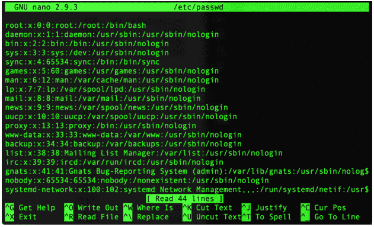

图 1-2

要创建新文件，只需按如下方式运行 `nano`：

```
# nano
```

编辑完文件后，键入 `Ctrl-S` 保存文件，然后按 `Ctrl-X` 退出。要打开现有文件，请使用 `Ctrl-R` 键盘快捷键。

如果您更喜欢在 GNOME 桌面环境中使用图形编辑器，`gedit` 是基本编辑任务的良好起点。要从桌面启动 `gedit`，请按 `Alt-F2` 显示“输入命令”窗口，如图 1-3 所示：

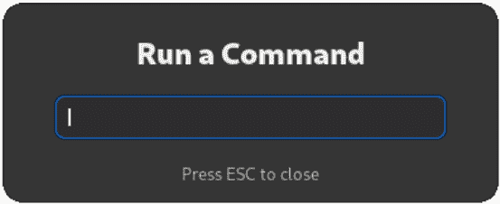

图 1-3

在文本字段中输入 `gedit` 并按 Enter 键。稍等片刻后，`gedit` 将加载，准备打开、创建和编辑文件：

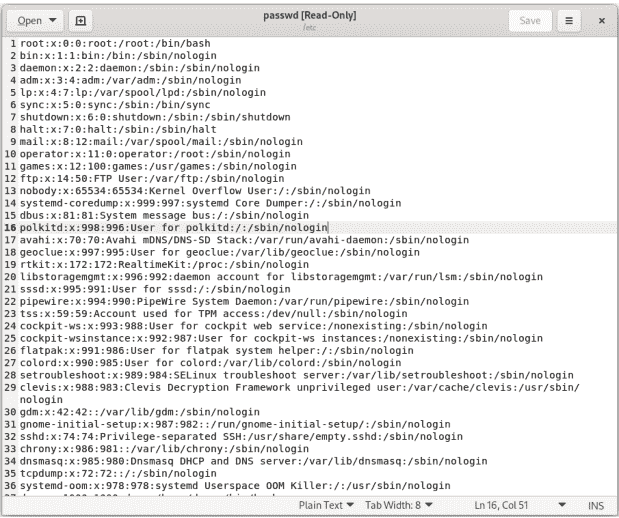

图 1-4

或者，从终端窗口启动 `gedit`，带或不带要打开的文件的路径：

```
# gedit
# gedit /etc/passwd
```

### 1.4 反馈

我们希望您对购买本书感到满意。如果您在书中发现任何错误，或有任何意见、问题或疑虑，请联系我们 `feedback@ebookfrenzy.com`。

### 1.5 勘误

虽然我们尽一切努力确保本书内容的准确性，但涵盖如此庞大和复杂的主题的书籍不可避免地会包含一些错误和疏漏。本书的任何已知问题，连同解决方案，将在以下 URL 中列出：

`https://www.ebookfrenzy.com/errata/rhel9.html`

如果您发现勘误表中未列出的错误，请通过电子邮件告知我们的支持团队 `feedback@ebookfrenzy.com`。

## 2. Red Hat Linux 的简史

Red Hat Enterprise Linux 是 Linux 操作系统众多变体（也称为 `distributions`）之一，是总部位于北卡罗来纳州罗利的美国公司 Red Hat, Inc. 的产品。该公司成立于 1990 年代中期，是 Marc Ewing 和 Bob Young 当时拥有的两家公司合并的结果。然而，Linux 的起源还要追溯得更早。本章将概述 Linux 操作系统和 Red Hat, Inc. 的历史。

### 2.1 究竟什么是 Linux？

Linux 是一种操作系统，就像 Windows 是一种操作系统一样（而 Linux 和 Windows 之间的相似之处也到此为止）。操作系统一词用于描述作为计算机硬件与我们每天运行的应用程序之间层面的软件。当程序员编写应用程序时，他们会与操作系统交互以执行诸如将文件写入硬盘驱动器和在屏幕上显示信息等任务。如果没有操作系统，每个程序员都必须编写代码直接访问系统的硬件。此外，程序员必须能够支持有史以来创建的每一件硬件，以确保应用程序能在每一种可能的硬件配置上运行。由于操作系统处理所有这些硬件复杂性，应用程序开发变得更加容易。Linux 只是当今可用的众多操作系统之一。

### 2.2 UNIX 起源

要了解 Linux 的历史，我们首先要追溯到 1960 年代末的 AT&T Bell 实验室。在此期间，AT&T 已停止参与名为 Multics 的新操作系统的开发。然而，两名 AT&T 工程师 Ken Thompson 和 Dennis Ritchie 决定利用他们在 Multics 项目中学到的知识，创建了一个名为 UNIX 的新操作系统，该系统迅速获得了流行，并在企业和学术机构中得到广泛采用。

随后出现了多种专有的 UNIX 实现，包括 IBM（AIX）、Hewlett-Packard（HP-UX）和 Sun Microsystems（SunOS 和 Solaris）创建的那些。此外，由 Andrew S. Tanenbaum 创建的类 UNIX 操作系统 MINIX 用于教育用途，并向大学提供源代码访问权限。

### 2.3 谁创建了 Linux？

Linux 的起源可以追溯到两个人的工作和哲学。Linux 操作系统的核心是被称为 `kernel` 的东西。这是操作系统运行所需的一组核心功能。内核管理系统的资源并处理硬件与应用程序之间的通信。Linux 内核是由

## Red Hat Linux 简史

林纳斯·托瓦兹因不喜欢 MS-DOS，且迫不及待地等待 MINIX 在新的 Intel 80386 微处理器上的可用性，决定编写自己的类 UNIX 内核。当他完成内核的第一个版本后，他在开源许可证下发布了它，使任何人都可以下载源代码并自由使用和修改，而无需向林纳斯支付任何费用。


大约在同一时间，自由软件基金会的理查德·斯托曼——自由和开源软件的坚定倡导者——正在开发自己的开源操作系统。然而，与其一开始就专注于内核，斯托曼首先开始开发使用和维护操作系统所需的所有 UNIX 工具、实用程序和编译器的开源版本。等他完成这套基础设施的开发后，显而易见的解决方案是将他的工作与林纳斯编写的内核结合起来，创建一个完整的操作系统。这种组合被称为 GNU/Linux。纯粹主义者坚持 Linux 必须始终被称为 GNU/Linux（事实上，曾有一段时间，理查德·斯托曼拒绝接受任何不将 Linux 称为 GNU/Linux 的出版物的采访）。这并不无理，因为自由软件基金会开发的 GNU 工具构成了 GNU/Linux 中重要且不可或缺的一部分。不幸的是，大多数人和出版物仍然简单地称之为 Linux，而且这种情况很可能会一直持续下去。

### 2.4 Red Hat 的早期历史

1993 年，鲍勃·杨创建了一家名为 ACC Corporation 的公司，据杨称，他将其运营在“妻子的缝纫间”。ACC 这个名字本意代表一家目录业务，同时也是他妻子经营的一家名为“康涅狄格古董与收藏品”的小型企业的缩写。ACC 目录业务销售的商品中包括 Linux CD 和相关的开源软件。

大约在同一时间，马克·尤因创建了自己的 Linux 发行版公司，并将其命名为 Red Hat Linux（源于他在卡内基梅隆大学时喜欢戴红色棒球帽的习惯）。

1995 年，ACC 收购了 Red Hat，采用了 Red Hat, Inc. 的名称并经历了快速且显著的增长。鲍勃·杨在公司于 1999 年 8 月上市后不久辞去了首席执行官职务，此后从事了多项商业和慈善事业，包括一家名为 Lulu 的按需印刷图书出版公司，以及拥有两支加拿大职业体育队伍。2018 年，IBM 以 340 亿美元的交易收购了 Red Hat, Inc.。

### 2.5 Red Hat 支持

Red Hat Linux 的早期版本通过软盘和 CD 交付给客户（这当然是在宽带互联网连接广泛普及之前）。当用户遇到软件问题时，他们只能通过电子邮件联系 Red Hat。事实上，鲍勃·杨经常开玩笑说，这有效地限制了支持请求，因为等到客户意识到需要帮助时，他们的电脑通常已经无法使用，因此无法用来发送电子邮件向 Red Hat 支持团队寻求帮助。后来 Red Hat 提供了与付费订阅挂钩的更好支持级别，现在提供从“自助”（无支持）到高级支持的各种支持级别。

### 2.6 开源

Red Hat Enterprise Linux 9 是 Red Hat 当前的商业产品，主要面向企业、关键任务安装。它也是 Red Hat 提供的不断扩展的产品和服务生态系统的基石。RHEL 是一款开源产品，因为你可以免费下载源代码并自行构建软件（这是一项不可轻视的任务）。然而，如果你希望下载预构建的、即装即用的二进制版本软件（无论是否带支持），你必须为其付费。

### 2.7 Fedora 项目

Red Hat 还赞助 Fedora 项目，其目标是提供免费的 Linux 操作系统（源代码和二进制发行版）访问权限，以 Fedora Linux 的形式提供。Fedora Linux 还充当了许多新功能的试验场，这些功能最终会被纳入 Red Hat Enterprise Linux 操作系统家族和 CentOS 衍生版。

### 2.8 CentOS Stream - 免费替代方案

对于无法负担 Red Hat Enterprise Linux 订阅的用户来说，另一个选择是 CentOS Stream 操作系统。CentOS 项目最初是一个社区驱动的项目，现由 Red Hat 所有，它获取 Red Hat Enterprise Linux 源代码，移除 Red Hat 品牌和订阅要求，进行编译并提供发行版下载。与 Fedora 类似，CentOS Stream 在新功能被纳入未来 RHEL 版本之前对其进行实地测试。因此，它可能缺乏稳定性，但提供了访问前沿功能的机会。

### 2.9 摘要

Linux 操作系统的起源可以追溯到林纳斯·托瓦兹和理查德·斯托曼的工作，即 Linux 内核与 GNU 项目构建的工具和编译器的结合。

多年来，Linux 的开源特性导致了各种不同 Linux 发行版的发布。其中一个发行版是 Red Hat Enterprise Linux，由 Red Hat, Inc. 创建，该公司由鲍勃·杨和马克·尤因创立。Red Hat 专注于提供企业级 Linux 软件解决方案，并结合广泛的技术支持服务。

## 3. 在干净磁盘驱动器上安装 RHEL 9

现在部署 RHEL 9 系统有两种方式。一种方法是购买新硬件或重新利用现有计算机系统来安装和运行操作系统。另一个选项是使用 Amazon AWS、Google Cloud 或 Microsoft Azure（仅举几例）等服务创建基于云的操作系统实例。由于基于云的实例通常是通过选择一个已预配置、即用型且已针对云平台优化的操作系统镜像并以此作为 RHEL 系统的基础来创建的，因此在这种情况下无需执行手动操作系统安装。

另一方面，如果你计划在自己的硬件上安装 RHEL 9，那么了解 Red Hat Enterprise Linux 9 的第一步就是安装操作系统。

RHEL 可以在干净磁盘环境中安装（整个磁盘清除现有分区并完全用于 RHEL），也可以在双启动环境中安装，在该环境中 RHEL 与磁盘上的另一个操作系统共存（通常是 Microsoft Windows 家族的操作系统成员）。

本章将介绍从本地或远程安装介质进行干净磁盘安装的方法。Windows 11 系统的双启动安装将在“使用 Windows 双启动 RHEL 9”中介绍。

### 3.1 获取 RHEL 9 安装介质

尽管 RHEL 是一款开源操作系统，其源代码可以自由访问，但二进制安装镜像仅作为付费 Red Hat Enterprise Linux 订阅的一部分提供。除了访问 RHEL 安装镜像外，还有提供操作系统技术支持的订阅级别。如果你已有付费订阅，请登录你的 Red Hat 账户下载操作系统。如果你想在购买前试用 RHEL，Red Hat 提供 30 天试用。要注册试用，请访问 Red Hat 网站的以下地址：

https://www.redhat.com/en/technologies/linux-platforms/enterprise-linux/try-it

Red Hat Developer 计划成员也可获得 RHEL 9 的访问权限。加入该计划的详细信息可在 Red Hat Developers 网站 https://developers.redhat.com 上找到。

RHEL 9 可用于 Intel 64 位（x86_64）和 ARM64（AArch64）CPU 架构系列。安装介质可为每个架构下载为 DVD 或启动 ISO 镜像。DVD ISO 镜像是自包含的，包括安装 RHEL 系统所需的所有软件包，其命名采用以下约定：

## 在干净磁盘驱动器上安装 RHEL 9

```
rhel-baseos-<version>-<architecture>-dvd.iso
```

例如，面向 64 位 Intel 系统的 RHEL 9.1 DVD 映像命名如下：

```
rhel-baseos-9.1-x86_64-dvd.iso
```

另一方面，启动 ISO 映像仅包含开始安装所需的文件，并需要访问位于远程服务器上的完整安装介质。启动映像还可以对现有的 RHEL 系统执行救援操作。启动 ISO 的命名遵循以下约定：

```
rhel-baseos-<version>-<architecture>-boot.iso
```

例如，面向 AArch64 的 RHEL 9.1 启动映像命名如下：

```
rhel-baseos-9.1-x86_64-boot.iso
```

下载映像后，可以将其刻录到光盘，或使用下一节中的步骤将其写入 USB 驱动器，配置虚拟化环境将其视为 DVD 驱动器，或使用本章后面概述的步骤通过网络连接访问安装映像。

## 3.2 将 ISO 安装映像写入 USB 驱动器

如今，操作系统安装更可能从 USB 驱动器而不是 DVD 进行。下载 RHEL 9 的 ISO 安装映像后，将该映像写入 USB 驱动器的步骤取决于驱动器连接到的是 Linux、macOS 还是 Windows 系统。本节剩余部分概述的步骤假定 USB 驱动器是新的或已重新格式化以删除任何现有数据或分区：

### 3.2.1 Linux

在 Linux 上将 ISO 映像写入 USB 驱动器的第一步是识别设备名称。在插入 USB 驱动器之前，通过以下方式列出 `/dev` 中的设备来识别系统已检测到的存储设备：

```
# ls /dev/sd*
/dev/sda  /dev/sda1  /dev/sda2
```

将 USB 驱动器连接到 Linux 系统并运行 `dmesg` 命令以获取最近的系统消息列表，其中一条将报告 USB 驱动器已被检测到，类似于以下内容：

```
[ 406.241717] sd 6:0:0:0: [sdb] Attached SCSI removable disk
```


此输出告诉我们设备名称应包含“sdb”，我们可以通过再次列出 `/dev` 中的设备名称来确认：

```
# ls /dev/sd*
/dev/sda  /dev/sda1  /dev/sda2  /dev/sdb
```

此输出显示 USB 驱动器已被分配到 `/dev/sdb`。在将 ISO 映像写入设备之前，下一步是运行 `findmnt` 命令以确保它未被自动挂载：

```
# findmnt /dev/sdb
TARGET                          SOURCE      FSTYPE OPTIONS
/run/media/neil/d6bf9574-7e31-4f54-88b1  /dev/sdb ext3  rw,nosuid,no
```

如果 `findmnt` 命令指示 USB 驱动器已挂载，请在继续之前将其卸载：

```
# umount /run/media/neil/d6bf9574-7e31-4f54-88b1
```

文件系统卸载后，使用以下命令使用 `dd` 命令将 ISO 映像写入驱动器：

```
# dd if=/path/to/iso/<image name>.iso of=/dev/sdb bs=512k
```

写入过程可能需要一些时间（长达 10 - 15 分钟），具体取决于映像大小和运行系统的速度。映像写入完成后，将出现类似以下内容的输出，并且 USB 驱动器将准备好用于安装 RHEL 9：

```
5956+0 records in
5956+0 records out
3122659328 bytes (3.1 GB, 2.9 GiB) copied, 426.234 s, 7.3 MB/s
```

### 3.2.2 macOS

在 macOS 系统上将 ISO 映像写入 USB 驱动器的第一步是使用 `diskutil` 工具识别设备。在连接 USB 设备之前，打开一个终端窗口并运行以下命令：

```
$ diskutil list
/dev/disk0 (internal, physical):
  #:                       TYPE NAME                    SIZE       IDENTIFIER
  0:      GUID_partition_scheme                        *1.0 TB     disk0
  1:                        EFI EFI                     209.7 MB   disk0s1
  2:                 Apple_APFS Container disk2         1000.0 GB  disk0s2

/dev/disk1 (internal):
  #:                       TYPE NAME                    SIZE       IDENTIFIER
  0:      GUID_partition_scheme                        28.0 GB     disk1
  1:                        EFI EFI                     314.6 MB   disk1s1
  2:                 Apple_APFS Container disk2         27.7 GB     disk1s2

/dev/disk2 (synthesized):
  #:                       TYPE NAME                    SIZE       IDENTIFIER
  0:      APFS Container Scheme -                      +1.0 TB     disk2
                                 Physical Stores disk1s2, disk0s2
  1:                        APFS Volume Macintosh HD    473.6 GB   disk2s1
  2:                        APFS Volume Preboot         42.1 MB    disk2s2
  3:                        APFS Volume Recovery        517.0 MB   disk2s3
  4:                        APFS Volume VM              1.1 GB     disk2s4
```

在确定了已检测设备的基线后，将 USB 驱动器插入 macOS 系统的端口并重新运行命令。相同的结果应出现，并为 USB 驱动器添加一个额外的条目，类似于以下内容：

```
/dev/disk3 (external, physical):
  #:           TYPE NAME                SIZE      IDENTIFIER
  0:                                 *16.0 GB   disk3
```

在上面的示例中，USB 驱动器已被分配到 `/dev/disk3`。在继续之前，按如下方式卸载磁盘：

```
$ diskutil unmountDisk /dev/disk3
Unmount of all volumes on disk3 was successful
```

最后，使用 `dd` 命令将 ISO 映像写入设备，注意引用原始磁盘设备（`/dev/rdisk3`），并在提示时输入用户密码：

```
$ sudo dd if=/path/to/iso/image.iso of=/dev/rdisk3 bs=1m
```

映像写入完成后，USB 驱动器即可使用。

### 3.2.3 Windows/macOS

有多个免费工具可用于 Windows 和 macOS 来将 ISO 映像写入 USB 驱动器，但其中专门用于写入 Linux ISO 映像的是 Fedora Media Writer 工具，可从以下 URL 下载：

https://getfedora.org/en/workstation/download/

安装后，插入目标 USB 驱动器，启动写入工具，并选择图 3-1 中突出显示的 Select .iso file 选项：

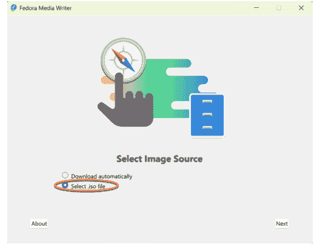

图 3-1

单击 Next 进入写入选项屏幕，并在单击 Select... 按钮之前选择 USB Drive：

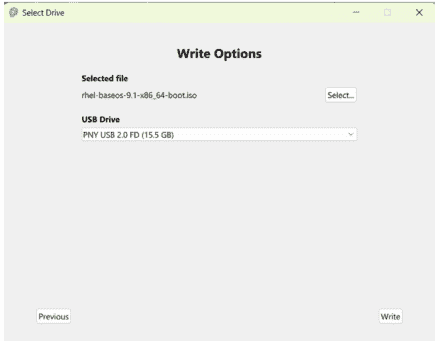

图 3-2

在结果文件选择对话框中，导航并选择 RHEL 9 安装 ISO 映像，然后单击 Open 按钮。最后，单击 Write 按钮开始将映像写入 USB 驱动器：

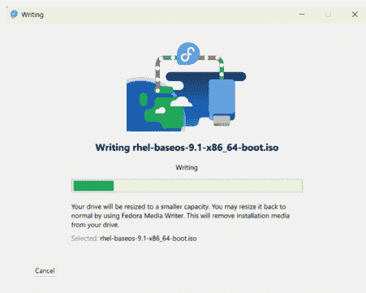

图 3-3

映像写入设备后，设备即可执行安装。

## 3.3 安装 Red Hat Enterprise Linux 9

将 RHEL 9 安装介质插入适当的驱动器并打开系统电源。如果系统尝试从硬盘驱动器启动，您需要进入计算机的 BIOS 设置并更改启动顺序，使其首先从安装介质驱动器启动。系统启动后，您将看到以下屏幕：

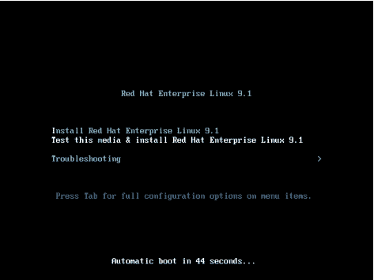

图 3-4

使用箭头键在选项之间导航，并使用 `<Enter>` 键进行选择。例如，如果选择 Troubleshooting 选项，将显示图 3-5 所示的屏幕，包括从本地驱动器上的当前操作系统启动（如果已安装）、测试系统内存或救援已安装的 RHEL 9 系统的选项。还提供了一个选项，可在没有图形控制台的系统上以基本图形模式执行安装：

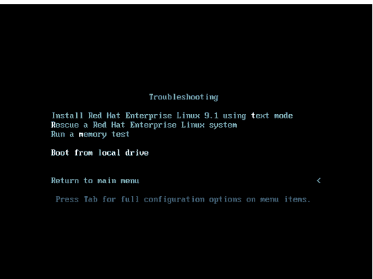

图 3-5

如果您安装 ARM64 映像，则在故障排除屏幕上可能无法使用从本地驱动器启动和运行内存测试的选项。

在主屏幕上选择安装 Red Hat Enterprise Linux 的选项，稍作延迟后，图形安装程序的第一个屏幕将出现：

## 在干净磁盘驱动器上安装 RHEL 9

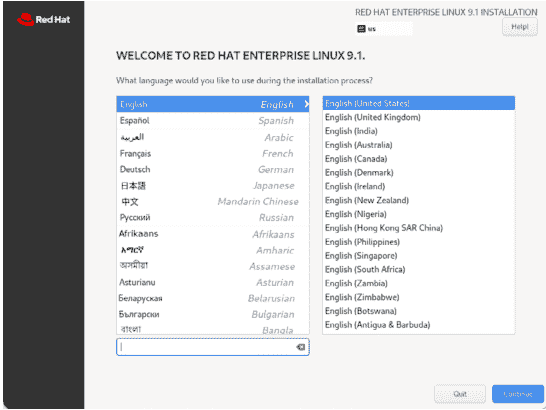

图 3-6

在点击 Continue 继续进入主安装屏幕之前，请在第一个屏幕上选择您首选的语言，如图 3-7 所示：

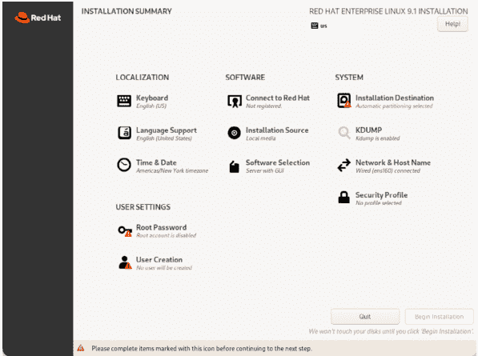

图 3-7

首先选择网络和主机名选项，启用系统上的网络设备，然后在点击应用按钮之前输入主机名：


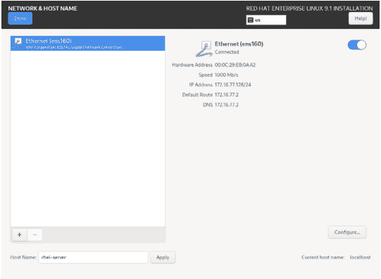

图 3-8

如果您的网络连接需要额外设置，请点击`配置...`按钮以访问如图 3-9 所示的高级网络设置屏幕：

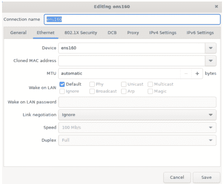

图 3-9

主机名定义完成后，且网络连接已启用，点击`完成`返回主屏幕。

如果您希望更改键盘、语言或时间和日期设置，请从主屏幕的本地化列中选择相应选项。在时间和日期屏幕上，选择与您地理位置相对应的选项。还提供了使用网络时间的选项，该选项会自动将系统与外部网络时间协议服务器同步。

由于安装是从本地媒体进行的，因此无需更改安装源设置。要从远程服务器上的媒体完成安装，选择`安装源`，启用`在网络上`选项，然后指定安装媒体的位置和所使用的 URL 类型。安装媒体例如可以是安装在远程 Web 服务器上或使用 NFS 安装在本地网络上的系统上的 ISO 映像（NFS 文件共享的主题在题为“在 RHEL 9 上使用 NFS 与远程系统共享文件”的章节中进行了详细介绍），或远程存储库的 URL（存储库本质上是在线收集的构成操作系统的软件、包和应用程序的集合，可从中对本地系统进行安装）。

默认情况下，安装程序将执行 RHEL 9 的带 GUI 的服务器安装。这将包括运行操作系统和图形桌面环境所需的最小包。要选择不同的安装配置，请选择`软件选择`选项以显示下方所示的屏幕：

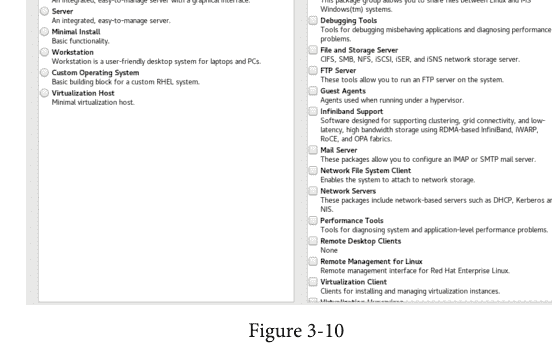

图 3-10

使用左侧面板选择基本配置，并使用右侧面板添加系统启动后您知道需要的任何额外包。如果不需要桌面环境并且不确定要在系统上安装哪些包，请使用`最小安装`选项，并在系统启动后根据需要安装额外包。这可避免安装可能永远不需要的任何包。

安全策略选项允许在系统上安装额外的安全包，这些包允许对系统施加符合安全内容自动化协议（SCAP）标准的 安全限制。虽然从列表中选择配置文件会安装必要的包，但策略限制只有在运行的系统上启用后才会被强制执行。除非您为政府机构或要求此级别安全性的公司工作，否则在此屏幕上选择策略是可选的。

`Kdump`功能在启用时会在系统崩溃时写入操作系统内核的状态。此转储文件可以帮助识别崩溃原因，但在启用时会占用系统内存。除非系统内存有限，否则可以将其保持在启用状态。

配置完基本设置后，下一步是决定如何对硬盘驱动器进行分区以容纳操作系统。

### 3.4 为 RHEL 9 分区磁盘

当选择`*Installation Destination*`选项时，安装程序将显示类似于下图 3-11 所示的屏幕：

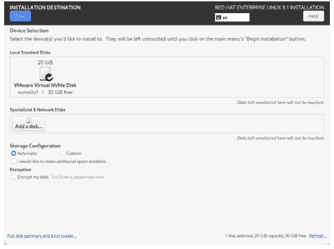

图 3-11

默认情况下，安装程序配置为使用当前选定磁盘驱动器上的可用空间自动安装操作系统并配置标准分区大小。如果磁盘以前包含另一个操作系统，这些现有分区将不会被删除，在 RHEL 9 安装后可能在驱动器上留下未使用的空间。要删除任何现有分区以便可以收回并供 RHEL 9 使用，请启用`*I would like to make additional space available*`选项并点击`*Done*`按钮以显示图 3-12 所示的对话框：

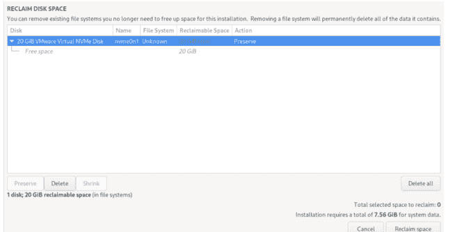

图 3-12

要收回空间，请选择不再需要的分区并通过点击`*Delete*`按钮将其标记为删除。选择所有要删除的分区后，点击`*Reclaim Space*`按钮执行删除操作。收回的空间现在将由 RHEL 9 安装程序自动使用。

要手动配置磁盘布局，即可用空间如何分配，请将`*Storage Allocation*`设置从`*Automatic*`更改为`*Custom*`并点击`*Done*`以显示手动分区屏幕（图 3-13）：

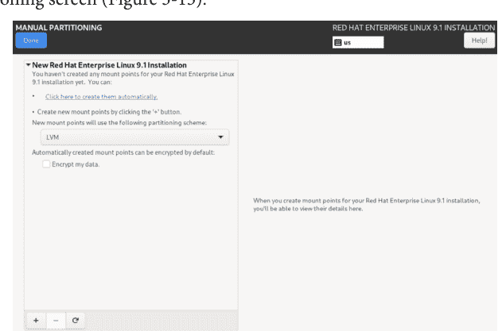

图 3-13

手动分区屏幕允许使用逻辑卷管理（LVM）或标准分区配置磁盘。LVM 是推荐的选项，因为它在系统运行后提供了管理分区大小的灵活性（LVM 在题为“*向 RHEL 9 卷组和逻辑卷添加新磁盘*”的章节中进行了详细介绍）。

选择分区方案后，最后一步是决定分区的大小和相应的文件系统挂载点。通常，`*Click here to create them automatically*`选项提供的默认配置将满足大多数系统需求。但是，要手动创建分区并分配挂载点，请点击`+`按钮手动声明并分配每个分区。

另一个选项是选择自动分区创建，然后使用 resulting 屏幕根据需要手动更改分区配置。例如，图 3-14 显示了通过选择自动创建选项定义的分区配置，并允许在对磁盘进行任何更改之前修改每个分区的设置：

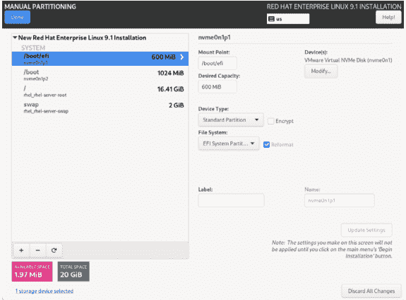

图 3-14

配置磁盘后，点击`完成`，查看对磁盘进行的更改摘要（图 3-15），然后点击`接受更改`按钮：

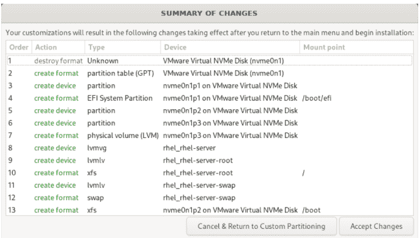

图 3-15

### 3.5 磁盘加密

RHEL 9 还允许通过加密保护磁盘的内容。这要求每次系统启动时输入密码短语。要启用加密，请在主安装目标屏幕上选择`加密我的数据`选项，并在点击`完成`按钮后在图 3-16 所示的对话框中输入密码短语：

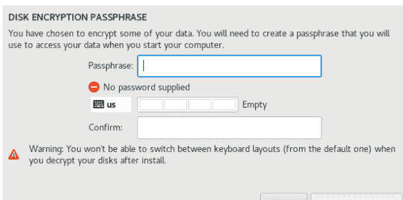

图 3-16

### 3.6 用户设置

在安装完成之前，您必须创建 root 密码和可选的用户账户。root 或超级用户账户是具有系统管理权限的特殊用户。虽然您通常会使用自己的账户登录系统，但您需要 root 权限来配置系统并执行其他管理任务。

选择`Root 密码`选项并输入足够安全的密码。还提供锁定 root 账户使其无法访问的选项，以及允许通过密码身份验证通过远程连接到系统的远程连接访问 root 账户。一般建议将 root 账户保持解锁状态，但禁止使用密码访问通过远程 SSH 访问。如果需要远程 root 访问，应使用基于 SSH 密钥的身份验证来实现，我们将在本书“在 RHEL 9 上配置基于 SSH 密钥的身份验证”章节中介绍该主题。

接下来，选择`用户创建`选项并输入用户名和密码。如果您希望此用户能够使用`sudo`命令执行管理任务，还请启用`将此用户设为管理员`复选框。如果未启用此选项，用户必须使用`su`命令并输入 root 密码才能获得 root 权限（假设上面概述的锁定 root 账户的选项未启用）。如果您添加的用户需要执行管理任务，`sudo`是推荐的选项，应启用该复选框。

### 3.7 注册系统

安装过程完成后且系统运行时，系统必须在安装任何更新或额外包之前向 Red Hat 注册。截至撰写本文时，未先注册即可安装 RHEL 9 的 ARM64 版本是可能的，但 X86_64 版本需要在安装前进行注册。要注册系统，请选择`连接到 Red Hat`选项并根据您获得 RHEL 许可证的方式选择`账户`或`激活密钥`选项。输入信息后，点击`注册`按钮完成注册过程。

## 在干净磁盘驱动器上安装 RHEL 9

### 3.8 物理安装

在做出适当的软件包选择后，点击“`开始安装`”将开始分区磁盘并安装与所选安装设置相匹配的软件包。在此阶段，将显示图 3-17 所示的安装进度屏幕：

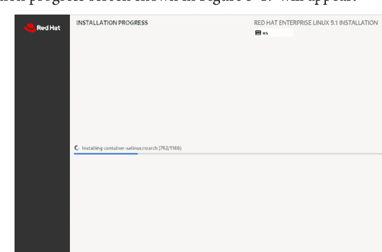

图 3-17

一旦所有系统软件包都已安装并配置完毕，请移除安装介质并点击“`重启系统`”以重新启动系统。

### 3.9 最终配置步骤

系统启动后控制台上显示的内容取决于在“软件选择”安装屏幕中是否选择了“`工作站`”或“`带 GUI 的服务器`”选项。如果在安装期间选择了其中任一选项，则会显示 GNOME 显示管理器（`GDM`）登录屏幕。另一方面，如果选择了`最小化`或`服务器配置`选项，则会显示基于文本的登录提示。无论配置如何，都请使用在安装过程最后步骤中创建的用户登录系统。

对于工作站或带 GUI 的服务器安装，GNOME 初始设置工具将启动并提供桌面环境的引导游览。

如果您在开始安装前未注册系统，可以在命令提示符或桌面环境中的终端窗口中进行注册。要在桌面上启动终端会话，请点击菜单栏中的“`活动`”，然后点击屏幕底部面板中的终端图标，如图 3-18 所示：


图 3-18

在提示符下，使用`sudo`命令获取 root 权限并输入您的用户密码：

```
$ sudo su -
```

接下来，使用`subscription-manager`工具将系统注册到 Red Hat，在提示时输入您的 Red Hat Access 用户名和密码：


```
# subscription-manager register
Registering to: subscription.rhsm.redhat.com:443/subscription
Username: myusername
Password:
The system has been registered with ID: 22f0ca3f-8d03-4933-be95-d6c4d8e3fe1a
The registered system name is: rhelserver1.
```

最后，按如下方式将系统附加到订阅服务：

```
# subscription-manager attach --auto
Installed Product Current Status:
Product Name: Red Hat Enterprise Linux for x86_64
Status:          Subscribed
```

### 3.10 安装更新

如同今天大多数操作系统一样，RHEL 发行版的每个特定版本在公开发布后仍会继续演进。这通常表现为错误修复、安全更新，以及偶尔的新功能，这些都可以通过互联网下载并安装到您的系统上。

最佳实践规定，安装 RHEL 后的第一步是确保将所有可用更新应用到系统。这可以通过终端窗口中的命令行提示符使用 `dnf` 软件包管理器工具来实现。要检查更新的可用性，请运行以下命令：

```
# dnf check-update
```

任何待处理的更新都可以使用 `dnf` 工具再次应用：

```
# dnf update
```

执行后，`dnf` 工具将提供可供更新的软件包列表并提示您确认是否执行更新。

## 在干净磁盘驱动器上安装 RHEL 9

更新完成后，安装基本上已完成，RHEL 9 已准备好使用。

### 3.11 显示启动消息

在启动过程中，RHEL 9 会显示 Red Hat 图形启动（RHGB）屏幕，该屏幕会隐藏系统加载时生成的所有启动消息。要在启动过程中使这些消息可见（如图 3-19 所示），请在系统启动时按下键盘上的 Esc 键：

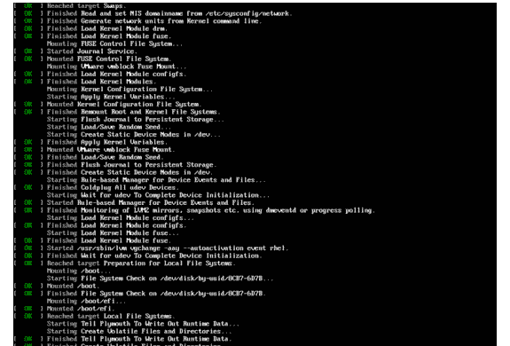

图 3-19

可以通过编辑 `/etc/default/grub` 文件并更改 `GRUB_CMDLINE_LINUX` 设置来更改默认行为，使消息始终默认显示，该设置默认情况下类似于以下内容：

```
GRUB_CMDLINE_LINUX="... rhgb quiet"
```

要移除图形启动屏幕，以便无需按 Esc 键即可看到消息，请从设置中移除“rhgb”选项：

```
GRUB_CMDLINE_LINUX="... rhgb quiet"
```

此更改将导致系统仅显示系统生成的启动消息的子集。要显示系统生成的所有消息，还请移除“quiet”选项：

```
GRUB_CMDLINE_LINUX="... quiet"
```

完成更改后，运行以下命令以生成新的启动配置，使其在系统下次启动时生效：

```
# grub2-mkconfig --output=/boot/grub2/grub.cfg
```

### 3.12 摘要

使用 RHEL 9 的第一步是安装操作系统。对于基于云的服务器，此任务通常在根据云服务提供商提供的各种选项为系统选择操作系统映像时自动执行。然而，在自己的硬件上安装涉及将安装介质下载为 ISO 映像，将该映像写入 DVD 或 USB 驱动器等合适的存储设备，然后从其启动。一旦运行，安装过程允许配置一系列选项，从网络、安装应从本地介质还是通过远程服务器或存储库进行、要安装的软件包以及磁盘分区等。安装完成后，重要的是安装自原始安装映像创建以来可能发布的操作系统更新。

## 第 4 章

### 4. 与 Windows 双启动 RHEL 9

与大多数 Linux 发行版一样，Red Hat Enterprise Linux 9 可以愉快地与硬盘驱动器上几乎任何版本的 Windows（包括 Windows 11）共存。这就是所谓的双启动概念。当您启动系统时，将会显示一个菜单，提供启动 RHEL 9 安装或 Windows 的选项。显然，您一次只能运行一个操作系统。尽管如此，值得注意的是，无论 Windows 分区使用 NTFS、FAT16 还是 FAT32 格式，您的硬盘驱动器上的 Windows 分区中的文件都将从 RHEL 9 中访问。

此安装方法涉及缩小现有 Windows 分区的大小，然后将 RHEL 9 安装到回收的空间中。本章假设 RHEL 9 安装在当前运行 Windows 11 的系统上。

### 4.1 分区调整大小

为了在已包含 Windows 安装的磁盘驱动器上容纳 RHEL，第一步涉及缩小 Windows 分区以腾出一些空间。建议的做法是在尝试安装 RHEL 9 之前使用 Windows 磁盘管理界面减小分区大小。

要在 Windows 11 上访问磁盘管理，请右键单击“开始”菜单并从生成的菜单中选择选项，如图 4-1 所示：

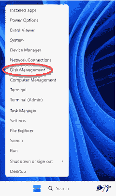

图 4-1

## 与 Windows 双启动 RHEL 9

加载后，磁盘管理工具将显示系统上检测到的磁盘驱动器的图形表示：

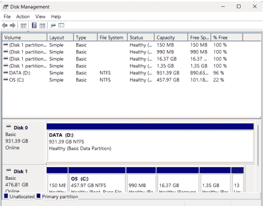

图 4-2

右键单击您希望减小大小的分区并从弹出菜单中选择“收缩卷...”。该工具将计算在不丢失数据的情况下可以最大程度减小卷大小的量（该过程可能需要几分钟，具体取决于分区的总体大小）。一旦此分析完成，将出现类似于下图 4-3 的对话框：

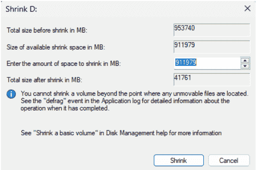

图 4-3

在“输入要收缩的空间量（MB）”字段中指定一个值，然后单击“收缩”按钮继续。一旦调整大小操作完成，使用 RHEL 9 安装介质重新启动（如“在干净磁盘驱动器上安装 RHEL 9”中所述）并使用新的空闲空间。在 RHEL 9 安装过程中，可以通过在安装摘要屏幕上选择安装位置选项并确保选择了自动存储配置选项来实现。这将自动将 RHEL 9 安装到在缩小 Windows 分区时创建的未分配空间中。

一旦 RHEL 安装到磁盘完成并且系统重新启动，标准的 RHEL 启动菜单将会出现，其中包括启动 Windows 系统的额外选项：

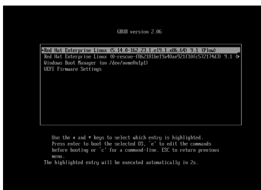

图 4-4

### 4.2 更改默认启动选项

当系统启动时，启动选项屏幕将会出现，并等待 5 秒让用户选择操作系统。如果在超时到期之前未做出选择，则默认操作系统将被启动。默认操作系统将在新配置的系统上为标准（非救援）RHEL 9 映像。然而，此默认值可以从 RHEL 中更改。

一系列启动配置选项（包括在“在干净磁盘驱动器上安装 RHEL 9”中概述的 5 秒超时和启动 RHGB 设置）是在 `/etc/default/grub` 文件中声明的，该文件在新安装时的读取内容如下：

```
GRUB_TIMEOUT=5
GRUB_DISTRIBUTOR="$(sed 's, release .*,g' /etc/system-release)"
GRUB_DEFAULT=saved
GRUB_DISABLE_SUBMENU=true
GRUB_TERMINAL_OUTPUT="console"
GRUB_CMDLINE_LINUX="crashkernel=1G-4G:192M,4G-64G:256M,64G-:512M resume=/dev/mapper/rhel-swap rd.lvm.lv=rhel/root rd.lvm.lv=rhel/swap rhgb quiet"
GRUB_DISABLE_RECOVERY="true"
GRUB_ENABLE_BLSCFG=true
```

更改默认启动系统的第一步是在此文件中声明 `GRUB_SAVEDEFAULT` 设置：

```
GRUB_TIMEOUT=5
GRUB_DISTRIBUTOR="$(sed 's, release .*,g' /etc/system-release)"
GRUB_DEFAULT=saved
GRUB_SAVEDEFAULT=true
.
.
```

此设置会在启动配置中保存新的默认值。接下来，运行 `grub2-set-default` 命令，使用从 0 开始计数的编号系统来更改默认设置。例如，如果 Windows 11 选项在菜单中的位置为 3，则使 Windows 11 成为默认启动选项的命令如下所示：

```
# grub2-set-default 2
```

通过运行以下命令检查新设置是否已生效：


```
# grub2-editenv list
saved_entry=f86218lbe19a40ae921f10fc572174d3-5.14.0-162.23.1.el9_1.x86_64
menu_auto_hide=1
boot_success=1
boot_indeterminate=0
save_default=true
```

请注意，`saved_entry`值现在已设置为 Linux 启动分区。更改默认值后，按如下方式重新生成启动配置文件：

```
# grub2-mkconfig --output=/boot/grub2/grub.cfg
```

重新启动系统并验证启动菜单是否默认为 Windows 选项，并且在超时到期后 Windows 加载。

### 4.3 从 RHEL 9 访问 Windows 分区

在双启动配置中运行 RHEL 时，可以通过从命令行手动挂载分区来访问位于 Windows 分区上的文件。但是，在这样做之前，需要在系统上安装一些额外的软件包。首先，需要下载并安装 fuse 内核模块：

```
# dnf install fuse
# modprobe fuse
```

接下来，需要安装 Fuse NTFS 驱动程序。不幸的是，此软件包未包含在标准 RHEL 9 仓库中，因此需要按如下方式将企业版 Linux 额外软件包（EPEL）仓库添加到系统中：

```
# subscription-manager repos --enable codeready-builder-for-rhel-9-$(arch)-rpms
# dnf install https://dl.fedoraproject.org/pub/epel/epel-release-latest-9.noarch.rpm
```

添加 EPEL 仓库后，现在可以安装驱动程序：

```
# dnf install ntfs-3g
```

安装所需软件包后，下一步是创建一个目录用作 Windows 分区的挂载点。在此示例中，我们将创建一个名为`/mnt/windows`的目录：

```
# mkdir /mnt/windows
```

要识别分配给 Windows 分区的设备名称，请按如下方式使用`fdisk`命令：

```
# fdisk -l
```

| 设备 | 起始 | 结束 | 扇区 | 大小 | 类型 |
|---|---|---|---|---|---|
| `/dev/nvme0n1p1` | 2048 | 206847 | 204800 | 100M | EFI 系统 |
| `/dev/nvme0n1p2` | 206848 | 239615 | 32768 | 16M | Microsoft 保留 |
| `/dev/nvme0n1p3` | 239616 | 49362943 | 49123328 | 23.4G | Microsoft 基本数据 |
| `/dev/nvme0n1p4` | 132933632 | 134213631 | 1280000 | 625M | Windows 恢复环境 |
| `/dev/nvme0n1p5` | 49362944 | 51460095 | 2097152 | 1G | Linux 文件系统 |
| `/dev/nvme0n1p6` | 51460096 | 132933631 | 81473536 | 38.8G | Linux LVM |

在上述输出中，包含我们需要访问的文件的主要 Windows 分区由`/dev/nvme0n1p3`表示。接下来，我们需要按如下方式运行`mount`命令（假设 Windows 分区为`/dev/nvme0n1p3`）：

```
# mount /dev/nvme0n1p3 /mnt/windows
```

通过列出挂载点的顶级目录内容来检查挂载是否成功：

```
# ls /mnt/windows
'$Recycle.Bin' ProgramData swapfile.sys
'Documents and Settings' 'Program Files' 'System Volume Information'
pagefile.sys 'Program Files (x86)' Users
PerfLogs Recovery Windows
```

要使系统每次启动时自动挂载，请将适当的挂载行添加到`/etc/fstab`文件中：

```
/dev/nvme0n1p3 /mnt/windows ntfs defaults 0 0
```

要随时卸载 Windows 文件系统：

```
# umount /mnt/windows
```

### 4.4 摘要

通过创建双启动环境，RHEL 9 可以与 Windows 操作系统安全地共存于同一磁盘驱动器上。这涉及在执行安装之前缩小 Windows 系统的空间以腾出空间供 RHEL 9 使用。安装 RHEL 后，必须修改启动菜单配置以包含从 Windows 启动的选项。要从 RHEL 访问 Windows 文件系统，需要安装 Fuse NTFS 驱动程序并使用它来挂载 Windows 分区。

## 5. 将 Windows 磁盘分区分配给 RHEL 9

在上一章中，我们研究了在与 Windows 相同的磁盘上安装 Red Hat Enterprise Linux 9。此所谓的“双启动”配置允许用户在单个磁盘驱动器上同时安装两个操作系统，并在系统通电时选择启动其中一个。

本章适用于决定喜欢 RHEL 9 足够以从磁盘中完全删除 Windows 并将所得空间用于 Linux 的用户。在以下各节中，我们将逐步完成此过程。

### 5.1 卸载 Windows 分区

如果按照“使用 Windows 双启动 RHEL 9”章节中的步骤从 RHEL 9 中挂载 Windows 分区，则在继续本章之前应采取步骤卸载该分区。假设 Windows 分区已挂载为`/mnt/windows`，可以按如下方式卸载：

```
# umount /mnt/windows
```

还应编辑`/etc/fstab`文件以删除之前添加的`/mnt/windows`自动挂载。

### 5.2 从磁盘删除 Windows 分区

释放 Windows 分区供 RHEL 使用的第一步是删除该分区。但是，在这样做之前，必须从 Windows 和 RHEL 分区备份您需要保留的任何数据。完成此操作后，可以安全地继续本章。

要删除 Windows 分区，我们首先需要使用`fdisk`工具识别它们所在的磁盘：

```
# fdisk -l
Disk /dev/nvme0n1: 64 GiB, 68719476736 bytes, 134217728 sectors
Disk model: VMware Virtual NVMe Disk
Units: sectors of 1 * 512 = 512 bytes
Sector size (logical/physical): 512 bytes / 512 bytes
I/O size (minimum/optimum): 512 bytes / 512 bytes
Disklabel type: gpt
Disk identifier: 7A38CD86-091E-4781-BFB0-928FD383C935
```

| 设备 | 起始 | 结束 | 扇区 | 大小 | 类型 |
|---|---|---|---|---|---|
| `/dev/nvme0n1p1` | 2048 | 206847 | 204800 | 100M | EFI 系统 |
| `/dev/nvme0n1p2` | 206848 | 239615 | 32768 | 16M | Microsoft 保留 |
| `/dev/nvme0n1p3` | 239616 | 49362943 | 49123328 | 23.4G | Microsoft 基本数据 |
| `/dev/nvme0n1p4` | 132933632 | 134213631 | 1280000 | 625M | Windows 恢复环境 |
| `/dev/nvme0n1p5` | 49362944 | 51460095 | 2097152 | 1G | Linux 文件系统 |
| `/dev/nvme0n1p6` | 51460096 | 132933631 | 81473536 | 38.8G | Linux LVM |

在上述示例输出中，系统包含一个物理磁盘驱动器，其设备名为`/dev/nvme0n1`。在该磁盘驱动器上，有六个分区，其设备名分别为`/dev/nvme0n1p1`至`/dev/nvme0n1p6`。基于类型列中的值，存在三个与 Windows 相关的分区。第一个是 Windows 系统分区，而第二个、更大的分区是包含 Windows 操作系统和用户数据的 Windows 启动分区，其后是 Windows 恢复分区。

要删除分区，请使用包含分区的磁盘的设备名称（本例中为`/dev/nvme0n1`）启动`fdisk`工具，然后按照说明再次显示分区和扇区信息：

```
# fdisk /dev/nvme0n1
```


```
Welcome to fdisk (util-linux 2.37.4).
Changes will remain in memory only, until you decide to write them.
Be careful before using the write command.
```

```
Command (m for help): p
```

```
Disk /dev/nvme0n1: 64 GiB, 68719476736 bytes, 134217728 sectors
Disk model: VMware Virtual NVMe Disk
Units: sectors of 1 * 512 = 512 bytes
Sector size (logical/physical): 512 bytes / 512 bytes
I/O size (minimum/optimal): 512 bytes / 512 bytes
Disklabel type: gpt
Disk identifier: 7A38CD86-091E-4781-BFB0-928FD383C935
```

| 设备 | 起始 | 结束 | 扇区 | 大小 | 类型 |
|---|---|---|---|---|---|
| `/dev/nvme0n1p1` | 2048 | 206847 | 204800 | 100M | EFI 系统 |
| `/dev/nvme0n1p2` | 206848 | 239615 | 32768 | 16M | Microsoft 保留 |
| `/dev/nvme0n1p3` | 239616 | 49362943 | 49123328 | 23.4G | Microsoft 基本数据 |
| `/dev/nvme0n1p4` | 132933632 | 134213631 | 1280000 | 625M | Windows 恢复环境 |
| `/dev/nvme0n1p5` | 49362944 | 51460095 | 2097152 | 1G | Linux 文件系统 |
| `/dev/nvme0n1p6` | 51460096 | 132933631 | 81473536 | 38.8G | Linux LVM |

分区表项不在磁盘顺序中。

```
Command (m for help):
```

在继续之前，请注意我们将要删除的分区（in other

换句话说，`/dev/nvme0n1p2` 的起始位置以及 `/dev/nvme0n1p5` 起始位置之前的扇区。

在命令提示符下，删除 Windows 分区（在我们的示例系统中，这些是分区 2、3 和 4）：

```text
Command (m for help): d
Partition number (1-6, default 6): 2

Partition 2 has been deleted.

Command (m for help): d
Partition number (1,3-6, default 6): 3

Partition 3 has been deleted.

Command (m for help): d
Partition number (1,4-6, default 6): 4

Partition 4 has been deleted.
```

现在我们已经删除了 Windows 分区，需要在腾出的磁盘空间中创建新的 RHEL 分区。分区号必须与第一个被移除的分区号相匹配（在本例中为 2）。同时，还需要精确输入分区的起始和结束扇区，正如旧分区所报告的那样（`fdisk` 通常会默认提供正确的值，但最好还是仔细核对）。如果提示您删除 NTFS 签名，请输入 Y：

```text
Command (m for help): n
Partition number (2-4,7-128, default 2): 2
First sector (206848-134217694, default 206848):
Last sector, +/-sectors or +/-size{K,M,G,T,P} (206848-49362943, default 49362943):

Created a new partition 2 of type 'Linux filesystem' and of size 23.4 GiB.
Command (m for help):
```

做出这些更改后，下一步是检查设置是否正确：

```text
Command (m for help): p
Disk /dev/nvme0n1: 64 GiB, 68719476736 bytes, 134217728 sectors
Disk model: VMware Virtual NVMe Disk
Units: sectors of 1 * 512 = 512 bytes
Sector size (logical/physical): 512 bytes / 512 bytes
I/O size (minimum/optimal): 512 bytes / 512 bytes
Disklabel type: gpt
Disk identifier: 7A38CD86-091E-4781-BFB0-928FD383C935
```

| 设备 | 起始 | 结束 | 扇区 | 大小 | 类型 |
|---|---|---|---|---|---|
| `/dev/nvme0n1p1` | 2048 | 206847 | 204800 | 100M | EFI 系统 |
| `/dev/nvme0n1p2` | 206848 | 49362943 | 49156096 | 23.4G | Linux 文件系统 |
| `/dev/nvme0n1p5` | 49362944 | 51460095 | 2097152 | 1G | Linux 文件系统 |
| `/dev/nvme0n1p6` | 51460096 | 132933631 | 81473536 | 38.8G | Linux LVM |

## 将 Windows 磁盘分区分配给 RHEL 9

要提交更改，现在需要将新的分区信息写入磁盘并退出 `fdisk` 工具：

```text
Command (m for help): w
The partition table has been altered.
Syncing disks.
```

### 5.3 格式化未分配的磁盘分区

为了使新分区适合 RHEL 9 使用，需要在其上创建文件系统。当前 RHEL 版本推荐的文件系统类型是 XFS，这将在题为《向 RHEL 9 系统添加新磁盘驱动器》的章节中更详细地介绍。文件系统的创建使用 `mkfs.xfs` 命令执行，方法如下：

```text
# mkfs.xfs -f /dev/nvme0n1p2
meta-data=/dev/nvme0n1p2              isize=512      agcount=4, agsize=1536128 blks
       =                             sectsz=512      attr=2, projid32bit=1
       =                             crc=1           finobt=1, sparse=1, rmapbt=0
       =                             reflink=1       bigtime=1 inobtcount=1
data     =                             bszie=4096      blocks=6144512, imaxpct=25
       =                             sunit=0         swidth=0 blks
naming   =version 2                   bsize=4096      ascii-ci=0, ftype=1
log      =internal log                bsize=4096      blocks=3000, version=2
       =                             sectsz=512      sunit=0 blks, lazy-count=1
realtime =none                        extsz=4096      blocks=0, rtextents=0
```

### 5.4 挂载新分区

接下来，我们需要挂载新分区。在本示例中，我们将把它挂载到名为 `/data` 的目录中。然而，您也可以使用任何有效的挂载点挂载新分区，或将其作为逻辑卷的一部分使用（相关细节在题为《向 RHEL 9 卷组和逻辑卷添加新磁盘》的章节中介绍）。首先，我们需要创建用作挂载点的目录：

```text
# mkdir /data
```


其次，我们需要编辑 `/etc/fstab` 中的挂载表，以便系统每次启动时自动挂载分区。在 `/etc/fstab` 文件底部，添加以下行以挂载新分区（将 `/dev/nvme0n1p2` 设备修改为与您的环境相匹配）：

```text
/dev/nvme0n1p2  /data  xfs defaults 0 0
```

最后，我们可以手动挂载新分区（请注意，在后续重启时这不是必需的，因为分区会由于我们上面添加到 `/etc/fstab` 文件中的设置而自动挂载）：

```text
# mount /data
```

要检查分区，请运行以下命令以显示可用空间：

```text
# df -h /data
```

| 文件系统 | 大小 | 已用 | 可用 | 使用% | 挂载点 |
|---|---|---|---|---|---|
| `/dev/nvme0n1p2` | 24G | 200M | 24G | 1% | `/data` |

### 5.5 摘要

在双启动配置中，Windows 分区可以随时删除以释放空间供 RHEL 系统使用，只需识别哪些分区属于 Windows 然后删除它们即可。删除后，未分配的空间可用于创建新的文件系统并挂载，使其可供 RHEL 系统使用。

## 第 6 章

## 6. GNOME 40 桌面的导览

Red Hat Enterprise Linux 9 包含 GNOME 40 桌面环境。尽管缺乏 Windows 和 macOS 桌面的复杂性，GNOME 40 提供了简洁直观的桌面环境，提供了窗口环境的所有基本功能，并且具有易于快速学习的额外优势。

在本章中，将介绍 GNOME 桌面的主要功能以及基本任务的执行大纲。

### 6.1 安装 GNOME 桌面

如果在 RHEL 9 安装过程中选择了 Workstation 或带 GUI 的 Server 软件配置，GNOME 桌面将被安装并在系统每次启动时自动启动。

如果在 RHEL 9 安装过程中选择了其他任何软件配置，GNOME 桌面将不会包含在安装到系统上的软件包中。在没有显示器连接的基于服务器的系统上安装图形桌面环境似乎是多余的。然而，值得注意的是，GNOME 桌面的远程访问也是可能的；即使在无头服务器上（即缺乏显示器、键盘和鼠标的服务器），安装 GNOME 桌面软件包仍可能有益。建立远程桌面访问的主题将在本书的“使用 VNC 进行 RHEL 9 远程桌面访问”章节中详细介绍。

如果安装配置不包含 GNOME 桌面，可以随时使用以下命令安装：

```text
# dnf groupinstall workstation
```

安装完成后，可以从显示器上的命令提示符按如下方式启动桌面环境：

```text
$ startx
```

### 6.2 GNOME 40 桌面的概述

下图 6-1 所示的屏幕显示了在启动任何其他程序或进行配置更改之前，典型的新启动 GNOME 桌面会话的外观：


图 6-1

主桌面区域（标记为 A）是在启动应用程序和实用程序时窗口出现的区域。与其他桌面环境不同，不可能将文件或应用程序拖放到桌面上，从而提供干净、无杂乱的工作空间。

屏幕顶部的栏（B）称为顶部栏，包括 Activities 菜单（C）、日期和时间，以及一系列按钮和图标，包括网络状态、音频音量、电池电量和其他状态和账户设置。此外，当前在桌面上运行的活动应用程序的应用程序菜单也会出现在顶部栏中。例如，图 6-2 显示了 Terminal 程序的应用程序菜单：

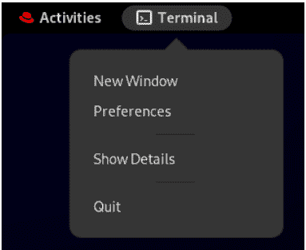

图 6-2

### 6.3 活动概览

应用程序和实用程序使用 Activities Overview 启动，可通过单击顶部栏中的 Activities 按钮或按键盘上的特殊键显示。在 Windows 键盘上，这是 Windows 键；在 macOS 上，是 Command 键，而在 Chromebook 上，是显示放大镜的键。

## GNOME 40 桌面的导览

显示时，活动概览将类似于下文中的图 6-3：

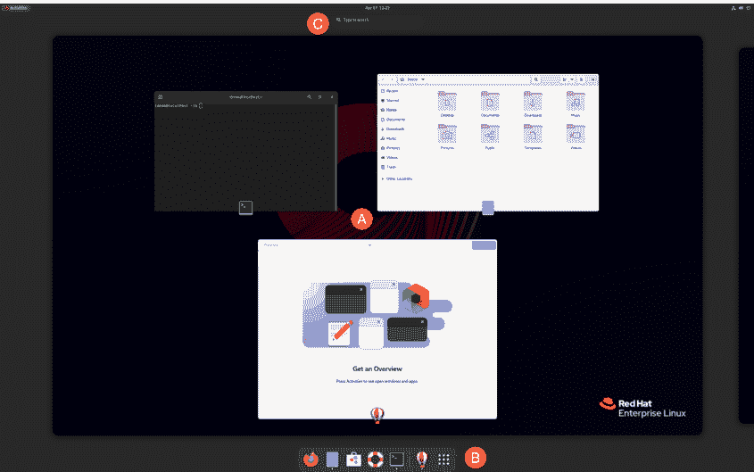

图 6-3

概览的中央区域（图 6-3 上方标记为 A）显示所有当前打开的应用窗口。屏幕底部（B）是仪表板（也称为 dash），从这里启动应用。默认情况下，dash 会显示一组预定义常用应用程序的图标以及任何当前正在运行的应用程序的图标。如果应用程序正在运行，其图标下方会出现一个点。要启动应用程序，只需单击 dash 中的图标即可。

要查找未包含在 dash 中的应用程序，一个选项是选择最右侧的网格图标（由九个点组成的正方形），以显示可浏览的应用程序列表，如图 6-4 所示：

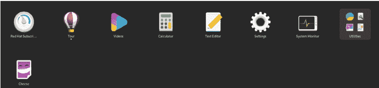

图 6-4

还需要注意的是，列表中的某些条目是包含其他应用程序的文件夹。网格中的项目可以通过拖放图标来重新定位。要将应用添加到文件夹中，请在网格中找到它并将其拖入文件夹。此外，将一个图标拖动并放置到另一个图标上将创建一个包含这两个应用的新文件夹，并且可以向其中添加其他应用。

浏览应用程序的另一种方法是使用搜索栏（图 6-3 上方标记为 C）进行搜索，并在下图所示的操作中展示：

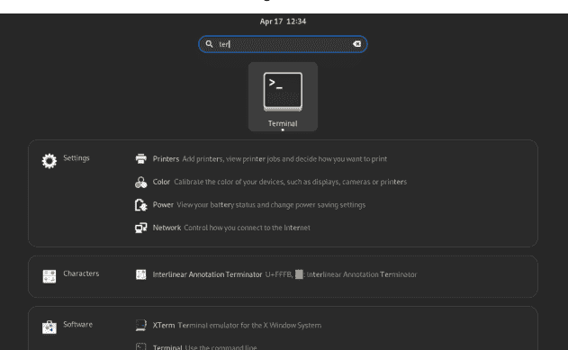

图 6-5

随着在搜索框中输入文本，可能匹配的列表将被细化。

要将应用程序添加到 dash 以便更方便地访问，请找到该应用程序的图标，右键单击它，然后选择“添加到收藏夹”菜单选项：

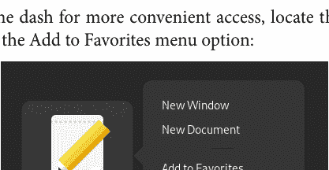

图 6-6

要从 dash 中删除应用，请右键单击 dash 中的图标并选择“从收藏夹中移除”。或者，通过拖放图标到 dash 和从 dash 拖出图标来添加和删除它们。

### 6.4 管理窗口

与其他桌面环境一样，GNOME 中的应用程序在窗口中运行。当打开多个应用程序窗口时，Super + Tab 键盘快捷键将显示切换器面板（图 6-7），允许选择不同的窗口作为当前活动窗口（Super 键要么是 Windows 键，要么在 Mac 键盘的情况下是 Cmd 键）：


图 6-7

如果单个应用程序打开了多个窗口，切换器将在第二个面板中显示这些窗口，以便可以选择特定窗口：

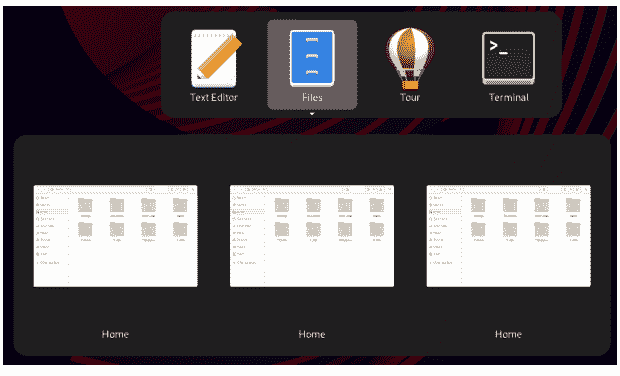

图 6-8

要在切换器中的图标之间向后循环，请使用 Shift+Tab 键盘快捷键。

要最大化窗口使其填满整个屏幕，请单击标题栏并将窗口拖到屏幕顶部。要将窗口恢复到原始大小，请单击标题栏并向下拖动。或者，双击标题栏可在窗口大小之间切换。同样，将窗口拖到屏幕左侧或右侧将使窗口填满屏幕的该半部分。

### 6.5 使用工作区

应用程序窗口出现的屏幕区域称为工作区，GNOME 40 允许配置多个工作区。GNOME 桌面将启动两个工作区，您可以使用 Super+Alt+Left 和 Super+Alt+Right 键组合在它们之间切换。当窗口添加到空白工作区时，工作区面板中会添加另一个空白工作区，从而允许创建额外的 workspaces。

当前工作区的缩略图显示在活动概览中搜索字段下方，如图 6-9 所示：

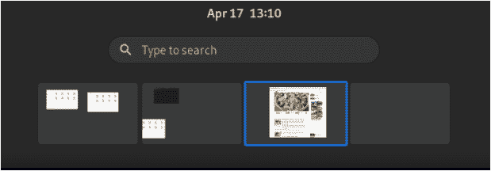

图 6-9

要切换到不同的工作区，请选择相应的缩略图。要将窗口从一个工作区移动到另一个工作区，请显示工作区面板并将应用程序窗口（来自当前工作区的实际窗口或工作区面板中的缩略图窗口）拖放到目标工作区。要删除工作区，请关闭其所有窗口或将它们移动到另一个工作区。

### 6.6 日历和通知

当系统需要通知您某个事件（例如系统或应用程序更新的可用性）时，弹出面板将出现在工作区顶部。此外，通过单击顶部栏中的日期和时间可以访问日历和任何先前的通知，如图 6-10 所示：

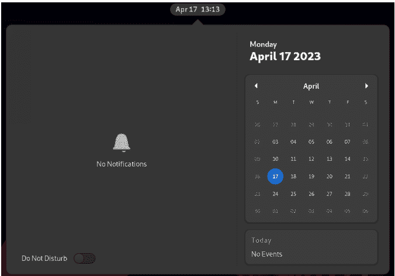

图 6-10

### 6.7 GNOME 桌面设置

要访问“设置”应用程序，请单击顶部栏右侧的图标行并选择“设置”，如图所示 图 6-11：

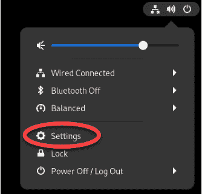

图 6-11

“设置”应用程序提供许多选项，例如以太网和 WiFi 连接、屏幕背景自定义选项、屏幕锁定和电源管理控制以及语言首选项。要探索每个类别中可用的设置，请在“设置”窗口的左侧面板中选择一个选项：

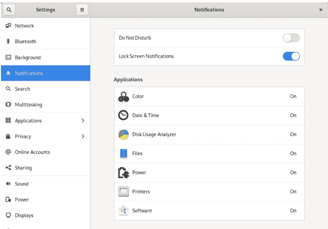

图 6-12


图 6-11 上方所示的菜单还包括切换用户、调整音频音量、更改为不同的 WiFi 网络以及注销、重新启动或关闭系统的选项。

### 6.8 超出基本自定义

GNOME 40 桌面在设计上是一个干净、无杂乱的环境，自定义选项最少。然而，仍然可以对桌面进行额外的更改。GNOME 项目为此开发了一个名为 GNOME Tweaks 的工具。使用以下命令安装和运行此工具：

```
# dnf install gnome-tweaks
$ gnome-tweaks
```

一旦 GNOME Tweaks 加载完成，图 6-13 所示的界面将出现：

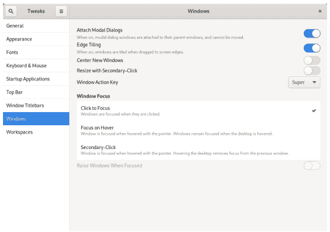

图 6-13

现在有大量自定义桌面的选项可用。太多内容无法在本章中涵盖，因此在继续下一章之前请尝试这些设置。

### 6.9 摘要

RHEL 9 包含 GNOME 40 桌面环境，可在初始安装期间包含，也可稍后使用 `dnf` 组包安装功能安装。与大多数其他桌面环境不同，GNOME 40 的设计目的是提供一个干净且易于使用的窗口用户界面。GNOME 40 桌面的关键区域包括顶部栏、活动概览和 dash。此外，GNOME 40 支持多个工作区，保持运行的应用程序井然有序且屏幕整洁。设置应用程序中提供了各种配置选项，包括桌面背景设置、音频、网络配置和 WiFi 网络选择。

## 7. Cockpit Web 界面的概述

尽管配备了最新的 Linux 桌面环境，Red Hat Enterprise Linux 9 仍然是一个服务器操作系统。因此，大多数 RHEL 部署都是到远程物理服务器或作为基于云的虚拟机实例。这些系统通常在没有键盘、鼠标或显示器的情况下运行，直接访问只能通过网络连接的命令行获得。这在从远程位置管理系统的方面带来了挑战。虽然可以通过远程访问命令行和桌面环境实现很多功能，但对于 RHEL 9 这样企业级的操作系统而言，每日必须执行的行政和监控任务需要一个一致且连贯的解决方案。

Cockpit 基于 Web 的管理界面提供了此功能。本章将解释如何安装、配置和访问 Cockpit 界面，同时提供 Cockpit 主要功能的概述，其中许多功能将在后续章节中更详细地介绍。

### 7.1 Cockpit 概述

Cockpit 是一个轻量级的基于 Web 的界面，允许远程执行一般的系统管理任务。安装并配置后，系统管理员打开本地浏览器窗口并导航到远程服务器上的 Cockpit 端口。加载 Cockpit 界面到浏览器并登录后，可以使用管理和监控工具以可视化方式执行各种任务。

在幕后，Cockpit 使用与在命令行工作时通常使用的相同工具来执行任务，并自动更新以反映系统其他地方发生的更改。这使得 Cockpit 可以与其他管理工具和技术一起使用，而不会有一种方法覆盖另一种方法的风险。Cockpit 还可以配置为访问多个服务器，从而允许通过单个浏览器会话同时管理和监控多个服务器。

Cockpit 默认安装，已捆绑了各种工具，并允许根据需要安装额外的扩展插件。Cockpit 还设计为可以使用 HTML 和 JavaScript 的组合创建自己的扩展，以添加缺失或自定义功能。

Cockpit 的模块化设计还允许将许多功能嵌入到其他基于 Web 的应用程序中。

## Cockpit Web 界面的概述

### 7.2 安装和启用 Cockpit

Cockpit 在 RHEL 9 上通常默认未安装，但可以通过几个简单的步骤进行设置和启用。第一步是按如下方式安装 Cockpit 软件包：

```
# dnf install cockpit
```

接下来，需要启用 Cockpit socket 服务：

```
# systemctl enable --now cockpit.socket
```

最后，如果系统启用了防火墙，则需要在防火墙上打开必要的端口以允许远程浏览器连接访问 Cockpit（有关防火墙的详细信息，请参阅题为“RHEL 9 Firewall Basics”的章节）。

```
# firewall-cmd --add-service=cockpit --permanent
```

```
# firewall-cmd --reload
```

### 7.3 访问 Cockpit

如果您可以访问已安装 Cockpit 的服务器的桌面环境，请打开浏览器窗口并导航到 `https://localhost:9090` 以访问 Cockpit 登录屏幕。另一方面，如果服务器是远程的，请使用域名或 IP 地址导航到服务器（例如，`https://myserver.com:9090`）。

建立连接后，浏览器可能会警告连接不安全。这是因为 Cockpit 服务使用自签名证书。选择继续访问网站的选项，或者为避免今后出现此消息，选择高级选项并为服务器地址添加例外。

连接后，浏览器将加载下图 Figure 7-1 所示的登录页面：

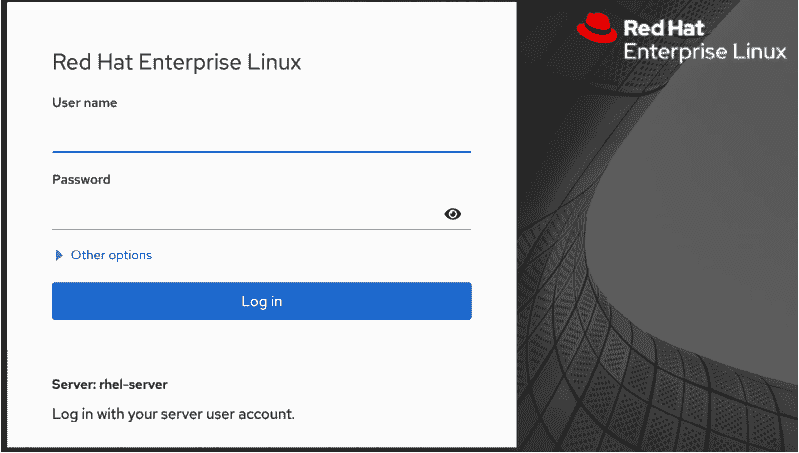

图 7-1

使用 root 身份或使用您的用户帐户凭据登录 Cockpit 界面。请注意，由于权限限制，以用户身份登录时 Cockpit 界面中的某些任务将被限制。在这种情况下，Cockpit 控制台将显示一个标记为“Limited Access”的按钮，如图 7-2 所示：

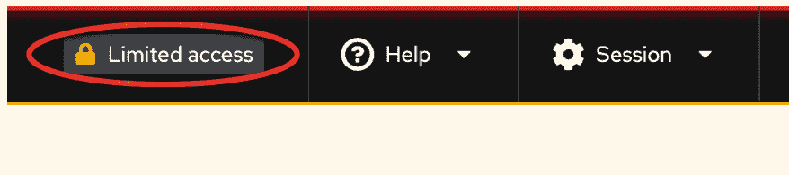

图 7-2

要提升您的权限，请单击受限访问按钮，并在提示时输入您的密码：

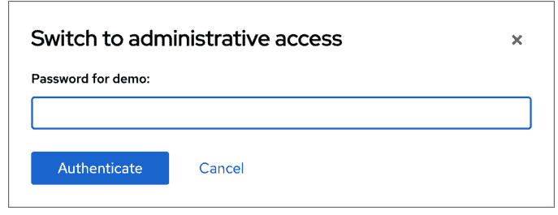

图 7-3

登录后，Cockpit 将显示概览屏幕。

### 7.4 概览

概览屏幕提供当前系统的概览，包括 CPU、内存、存储和网络活动性能指标的访问权限。该屏幕还包括有关系统的信息，包括底层硬件、主机名、系统时间以及系统软件是否是最新的。还提供了重新启动或关闭系统的选项。

例如，图 7-4 显示了 Cockpit 界面的概览页面：

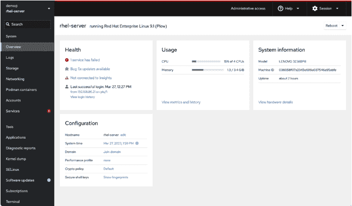

图 7-4

要了解特定类别的更多信息，请单击相应的链接。例如，图 7-5 显示了系统使用情况和指标屏幕：

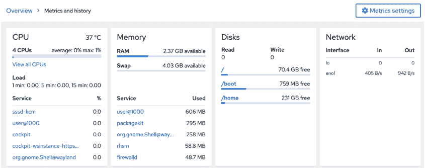

图 7-5

### 7.5 日志

选择日志类别时，Cockpit 会显示 `systemd journal` 日志的内容。选择日志条目将显示完整的日志消息。日志条目按最新在上排序，并且包含菜单可按不同的时间段和基于消息严重性过滤日志。

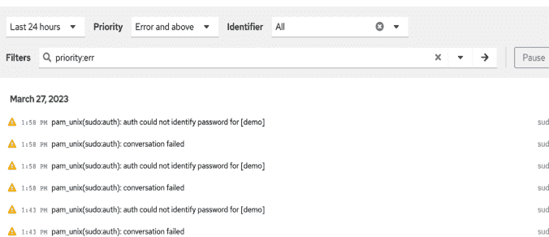

图 7-6

### 7.6 存储

选择存储选项以查看和管理系统上的存储，包括磁盘、分区和卷组、网络文件系统 `NFS` 挂载以及 RAID 存储。该屏幕还允许实时监控磁盘 I/O 活动，并列出用于查询和管理存储设备的系统 `udisksd` 服务的日志输出：

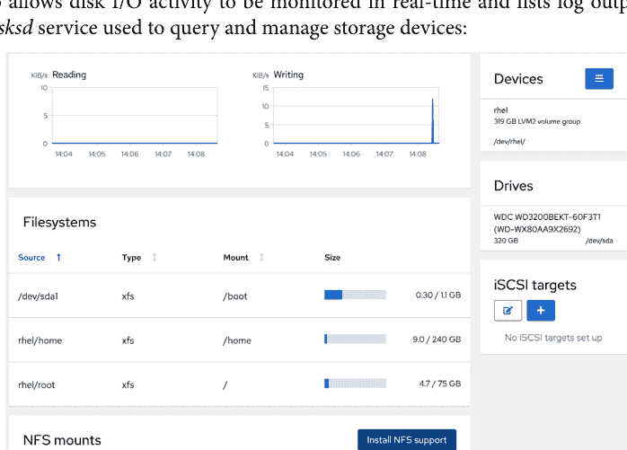

图 7-7

### 7.7 网络

网络屏幕提供有关各种网络相关配置和服务的信息，包括网络接口和防火墙设置。此外，它还允许进行配置更改，例如创建网络桥或设置虚拟网络：

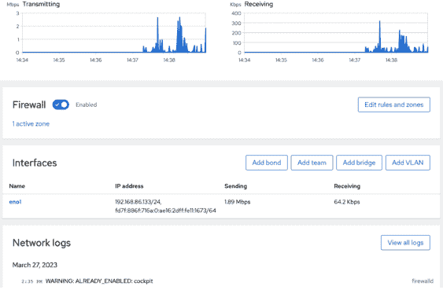

图 7-8

### 7.8 账户

选择此选项以查看系统上配置的当前用户帐户并为其他用户创建帐户。用户管理的主题将在题为“Managing RHEL 9 Users and Groups”的章节中稍后介绍：

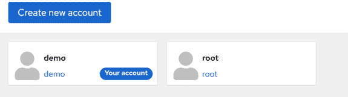

图 7-9

单击现有帐户以查看详细信息并进行更改。用户帐户详细信息页面还可用于查看和添加公共 SSH 密钥到用户的帐户以实现对服务器的远程访问，如章节“Configuring SSH Key-based Authentication on RHEL 9”所述。

### 7.9 服务

此屏幕显示服务器上运行的系统服务列表，并允许添加、删除、停止和启动这些服务。

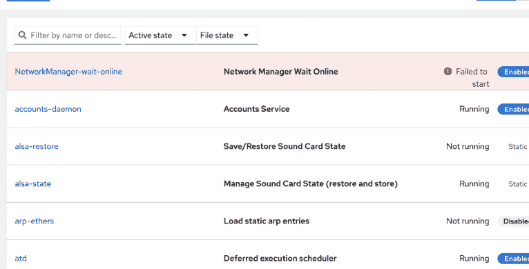

图 7-10

服务的主题将在章节“Managing RHEL 9 systemd Units”中详细介绍。

### 7.10 应用程序

如前所述，可以将附加功能作为扩展添加到 Cockpit。这些扩展可以是自行开发的扩展，也可以是第三方提供的扩展。应用程序屏幕列出已安装的扩展，并允许添加或删除扩展：

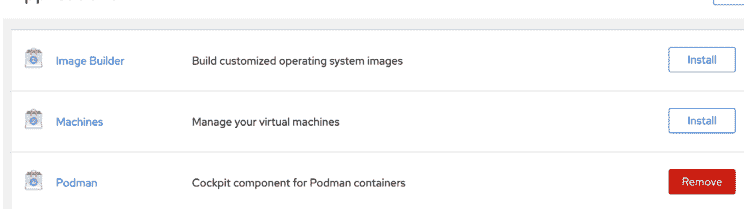

图 7-11

### 7.11 虚拟机


虚拟化允许在单个计算机系统上同时运行多个操作系统实例，每个系统都在自己的虚拟机内运行。虚拟机 Cockpit 扩展提供了一种创建和管理安装在服务器上的虚拟机客户机的方法：

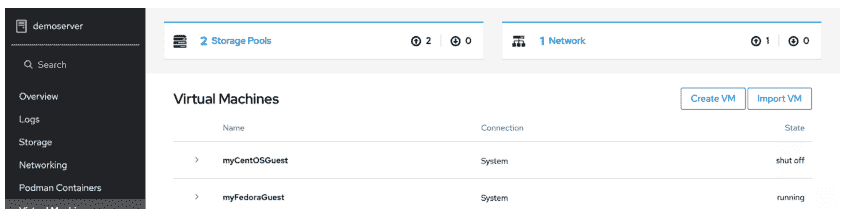

图 7-12

虚拟机扩展默认未安装，但可以通过 Cockpit 应用程序屏幕添加或通过运行以下命令添加：

```
# dnf install cockpit-machines
```

RHEL 9 中虚拟化的使用从章节“An Overview of Virtualization Techniques”开始介绍。

### 7.12 软件更新

如果系统有任何软件更新可用，它们将在这里列出，并且可以从此屏幕安装：

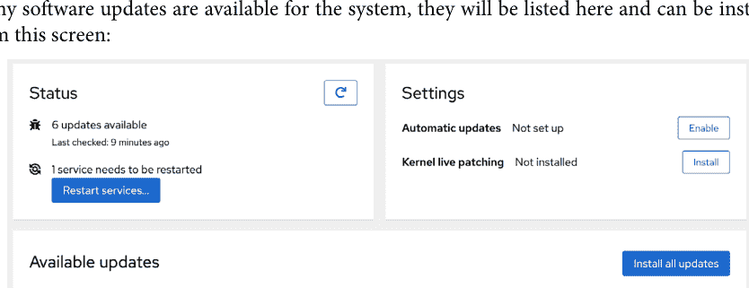

图 7-13

### 7.13 终端

顾名思义，终端屏幕提供对命令行提示符的访问：

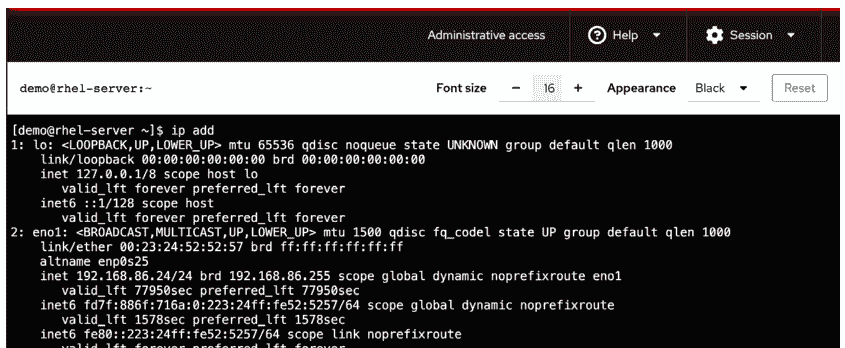

图 7-14

### 7.14 连接到多个服务器

Cockpit 可以配置为从单个会话中管理多个服务器。要将另一个主机添加到 Cockpit 会话，请单击图 7-15 中突出显示的按钮以显示主机面板：


图 7-15

单击添加新主机按钮并输入其他系统的 IP 地址或主机名，并在单击添加按钮之前选择一种颜色以将此服务器与其他添加到 Cockpit 的服务器区分开：


图 7-16

如果您首次连接到远程服务器，Cockpit 会要求您接受新的 SSH 密钥。接受密钥后，您将被提示输入图 7-16 中指定的用户名的密码。还提供了设置和授权受密码保护的 SSH 密钥的选项，以便下次需要访问它时能够自动登录到第二个主机系统：


图 7-17

要在主机之间切换，请显示主机面板（上图 7-15）并选择所需系统。

### 7.15 启用存储指标

在标准安装中，Cockpit 不会保留超出图表所覆盖的短时间窗口中显示的任何性能指标数据。要保留 Cockpit 收集的数据，需要安装 Cockpit Co-Pilot (PCP) 软件包。首先按如下方式安装 `cockpit-pcp` 软件包：

```
# dnf install cockpit-pcp
```

安装 `cockpit-pcp` 后，退出当前 Cockpit 会话并重新登录。

接下来，显示“指标和历史记录”屏幕并点击指标设置按钮以显示图 7-18 所示的屏幕，打开“收集指标”选项，然后点击“保存”：


图 7-18

在 Cockpit 收集数据足够长的时间后，指标信息将如 图 7-19 所示出现，按小时块分类：


图 7-19

### 7.16 摘要

Cockpit Web 界面允许在 Web 浏览器中以可视方式执行远程系统管理任务，而无需依赖命令提示符和命令行工具。安装并启用后，系统管理员打开 Web 浏览器，连接到远程服务器并登录 Cockpit 界面。在幕后，Cockpit 使用与通过命令提示符可用的相同的命令行工具，允许在不冒配置冲突风险的情况下使用两种选项。此外，Cockpit 使用模块化框架，可添加额外扩展并开发和集成自定义扩展。Cockpit 会话可用于管理单个服务器，或配置为同时访问多个服务器。

## 8. 使用 RHEL 9 上的 Bash Shell

学习使用 RHEL 9 和 Linux 发行版的一个重要部分涉及在 shell 环境中工作的熟练程度。虽然 Linux 附带的图形桌面环境（如 GNOME）为操作系统提供了用户友好的界面，但 shell 环境提供的功能、灵活性和自动化程度远超图形桌面工具所能实现的。shell 环境还提供了一种在没有桌面环境时与操作系统交互的方式，在使用 RHEL 9 等基于服务器的操作系统或无法完全启动的损坏系统时，这是一种常见情况。

因此，本章旨在概述 RHEL 9 上的默认 shell 环境（具体为 Bash shell）。

### 8.1 什么是 Shell？

Shell 是一个交互式命令解释器环境，在其中可以在提示符下键入命令或将命令输入到文件中作为脚本并执行。Shell 的起源可以追溯到 UNIX 操作系统的早期。在 Linux 早期，在图形桌面引入之前，shell 是用户与操作系统交互的唯一方式。

多年来开发了各种 shell 环境。第一个被广泛使用的 shell 是由 Bell Labs 的 Stephen Bourne 编写的 Bourne shell。

另一个早期产物是 C shell，它与 C 编程语言共享一些语法相似性，并引入了诸如命令行编辑和历史记录等可用性增强功能。

Korn shell（由 Bell Labs 的 David Korn 开发）基于 Bourne shell 和 C shell 提供的功能。

RHEL 9 上的默认 shell 是 Bash shell（Bourne Again SHell 的缩写）。该 shell 最初作为 Bourne shell 的开源版本，由 Brian Fox 为 GNU 项目开发，并基于 Bourne shell 和 C shell 提供的功能。

### 8.2 访问 Shell

在 GNOME 桌面环境中，可以通过在顶部栏中选择“活动”选项，在搜索栏中输入 Terminal，然后点击 Terminal 图标，从终端窗口访问 shell 提示符。

例如，使用 SSH 远程登录 RHEL 9 服务器时，用户会看到 shell 提示符。题为“在 RHEL 9 上配置基于 SSH 密钥的身份验证”的章节将介绍使用 SSH 访问远程服务器的详细信息。当启动未安装桌面环境的基于服务器的系统时，在用户在物理控制台终端或远程登录会话中完成登录过程后立即进入 shell。

### 8.3 在提示符处输入命令

在 shell 命令提示符下输入命令只需键入命令并按 Enter 键即可。虽然某些命令静默执行任务，但大多数命令会在返回提示符之前显示某种形式的输出。例如，`ls` 命令可用于显示当前工作目录中的文件和目录：

```
$ ls
Desktop  Documents  Downloads  Music  Pictures  Public  Templates  Videos
```

可用命令要么内置于 shell 本身，要么驻留在物理文件系统上。命令在文件系统上的位置可使用 `which` 命令识别。例如，要查找 `ls` 可执行文件在文件系统上的位置：

```
$ which ls
alias ls='ls --color=auto'
    /usr/bin/ls
```

显然，`ls` 命令位于 `/usr/bin` 目录中。还请注意，已配置了一个别名，这将在本章后面介绍。使用 `which` 命令查找内置于 shell 的命令的路径将导致一条消息，指出找不到可执行文件。例如，尝试查找 `history` 命令的位置（该命令内置于 shell 而不是作为文件系统上的可执行文件存在）将导致输出类似于以下内容：

```
$ which history
/usr/bin/which: no history in (/home/demo/.local/bin:/home/demo/bin:/usr/share/Modules/bin:/usr/local/bin:/usr/bin:/usr/local/sbin:/usr/sbin)
```

### 8.4 获取有关命令的信息

Linux shell 中可用的许多命令似乎晦涩难懂。要了解命令的作用和如何使用它的详细信息，请使用 `man` 命令并指定命令名称作为参数。例如，要了解有关 `pwd` 命令的更多信息：

```
$ man pwd
```

执行上述命令后将显示 `pwd` 命令的详细描述。许多命令在运行 `--help` 命令行选项时也会提供额外信息：

```
$ wc --help
```

### 8.5 Bash 命令行编辑

早期 shell 环境不提供任何形式的行编辑功能。这意味着如果你在键入的长命令行开头发现错误，你必须删除所有后续字符，纠正错误，然后重新输入命令的其余部分。幸运的是，Bash 提供了广泛的命令行编辑选项，如下表所述：

| 键序列 | 操作 |
|---|---|
| Ctrl-b 或 左箭头 | 将光标向后移动一个位置 |
| Ctrl-f 或 右箭头 | 将光标向前移动一个位置 |
| Delete | 删除光标正下方的字符 |
| Backspace | 删除光标左侧的字符 |
| Ctrl-_ | 撤销上一次更改（可重复以撤销所有先前的更改） |


| `Ctrl-a` | 将光标移动到行首 |
| `Ctrl-e` | 将光标移动到行尾 |
| `Meta-f` 或 `Esc` 然后 `f` | 将光标向前移动一个词 |
| `Meta-b` 或 `Esc` 然后 `b` | 将光标向后移动一个词 |
| `Ctrl-l` | 清除屏幕上除当前命令外的所有内容 |
| `Ctrl-k` | 从当前光标位置删除到行尾 |
| `Meta-d` 或 `Esc` 然后 `d` | 删除到当前词的末尾 |
| `Meta-DEL` 或 `Esc` 然后 `DEL` | 删除到当前词的开头 |
| `Ctrl-w` | 从当前光标位置删除到前一个空白处 |

表 8-1

### 8.6 使用 Shell 历史记录

除了命令行编辑功能外，`Bash` shell 还提供命令行历史记录支持。之前执行的命令列表可使用 `history` 命令查看：

```
$ history
  1  ps
  2  ls
  3  ls -l /
  4  ls
  5  man pwd
  6  man apropos
```

此外，`Ctrl-p`（或上箭头）和 `Ctrl-n`（或下箭头）可用于在之前输入的命令之间前后滚动。最后，当从历史记录中显示所需命令时，按 `Enter` 键执行它。

另一个选项是输入 `!` 字符，后跟要重复的命令的前几个字符，然后按 `Enter` 键。

## 8.7 文件名简写

许多 shell 命令会接受一个或多个文件名作为参数。例如，要显示名为 `list.txt` 的文本文件的内容，可按如下方式使用 `cat` 命令：

```
$ cat list.txt
```

同样，通过指定所有文件名作为参数，也可以显示多个文本文件的内容：

```
$ cat list.txt list2.txt list3.txt list4.txt
```

不必逐一输入名称，可以使用模式匹配来指定名称符合特定条件的所有文件。例如，可以使用 `*` 通配符来简化上述示例：

```
$ cat *.txt
```

上述命令将显示所有以 `.txt` 扩展名结尾的文件的内容。这可以进一步限制为任何以 `list` 开头并以 `.txt` 结尾的文件名：

```
$ cat list*.txt
```

可以使用 `?` 字符指定单字符匹配：

```
$ cat list?.txt
```

## 8.8 文件名和路径补全

与其输入完整的文件名或路径，或使用模式匹配来减少输入量，shell 提供了文件名补全功能。要使用文件名补全，输入文件或路径名的前几个字符，然后按两次 `Esc` 键。shell 将使用目录中与您输入的字符匹配的第一个文件或路径名为您补全文件名。要获取可能的匹配项列表，在输入前几个字符后按 `Esc =`。

## 8.9 输入和输出重定向

如前所述，许多 shell 命令在执行时会输出信息。默认情况下，此输出会发送到名为 `stdout` 的设备文件，本质上就是 shell 正在运行的终端窗口或控制台。相反，shell 从名为 `stdin` 的设备文件获取输入，默认情况下为键盘。

可以使用 `>` 字符将命令的输出从 `stdout` 重定向到文件系统上的物理文件。例如，要将 `ls` 命令的输出重定向到名为 `files.txt` 的文件，需要以下命令：

```
$ ls *.txt > files.txt
```

完成后，`files.txt` 将包含当前目录中的文件列表。同样，可以将文件的内容作为 `stdin` 输入到命令中。例如，要将文件的内容重定向为命令的输入：

```
$ wc -l < files.txt
```

上述命令将显示 `files.txt` 文件中的行数。

需要注意的是，使用 `>` 重定向运算符会创建新文件或截断现有文件。要追加到现有文件，请使用 `>>` 运算符：

```
$ ls *.dat >> files.txt
```

除了标准输出外，shell 还使用 `stderr` 提供标准错误输出。虽然命令的输出被定向到 `stdout`，但命令生成的任何错误消息都被定向到 `stderr`。这意味着如果 `stdout` 被定向到文件，错误消息仍会出现在终端中。这通常是期望的行为，尽管如果需要，也可以使用 `2>` 运算符重定向 `stderr`：

```
$ ls dkjfnvkjd nf 2> errmsg
```

命令完成后，报告找不到名为 `dkjfnvkjd nf` 的文件的错误将包含在 `errmsg` 文件中。

可以使用 `&>` 运算符将 `stderr` 和 `stdout` 重定向到同一个文件：

```
$ ls /etc dkjfnvkjd nf &> alloutput
```

执行完成后，`alloutput` 文件将同时包含 `/etc` 目录内容的列表以及尝试列出不存在的文件时关联的错误消息。

## 8.10 在 Bash Shell 中使用管道

除了 I/O 重定向外，shell 还允许将一个命令的输出直接通过管道作为另一个命令的输入。管道操作是通过在命令行中两个或多个命令之间放置 `|` 字符来实现的。例如，要统计系统中运行的进程数，可以将 `ps` 命令的输出通过管道传递给 `wc` 命令：

```
$ ps -ef | wc -l
```

命令行上可以执行的管道操作数量没有限制。例如，要查找文件中包含姓名 `Smith` 的行数：

```
$ cat namesfile | grep Smith | wc -l
```

## 8.11 配置别名

随着您对 shell 环境的熟练程度提高，您可能会经常发出带有相同参数的命令。例如，您可能会经常使用带 `l` 和 `t` 选项的 `ls` 命令：

```
$ ls -lt
```

为了减少发出命令所需的输入量，可以创建将命令和参数映射的别名。例如，要创建这样一个别名，即输入字母 `l` 会导致执行 `ls -lt` 命令，可使用以下语句：

```
$ alias l="ls -lt"
```

现在在命令提示符下输入 `l` 将执行原始语句。

## 8.12 环境变量

Shell 环境变量提供数据的临时存储和配置设置。shell 本身设置了多个环境变量，用户可以更改这些变量以修改 shell 的行为。可以使用 `env` 命令获取当前已定义变量的列表：

```
$ env
SSH_CONNECTION=192.168.0.19 61231 192.168.0.28 22
MODULES_RUN_QUARANTINE=LD_LIBRARY_PATH
LANG=en_US.UTF-8
HISTCONTROL=ignoredups
HOSTNAME=RHELdemo-pc.ebookfrenzy.com
XDG_SESSION_ID=15
MODULES_CMD=/usr/share/Modules/libexec/modulecmd.tcl
USER=demo
ENV=/usr/share/Modules/init/profile.sh
SELINUX_ROLE_REQUESTED=
PWD=/home/demo
HOME=/home/demo
SSH_CLIENT=192.168.0.19 61231 22
SELINUX_LEVEL_REQUESTED=
.
.
```

也许最有用的环境变量是 `PATH`。它定义了 shell 将在其中搜索命令提示符下输入的命令的目录以及搜索顺序。新安装的 RHEL 9 系统上用户账户的 `PATH` 环境变量可能配置如下：

```
$ echo $PATH
/home/demo/.local/bin:/home/demo/bin:/usr/share/Modules/bin:/usr/local/bin:/usr/bin:/usr/local/sbin:/usr/sbin
```

另一个有用的变量是 `HOME`，它指定当前用户的主目录。例如，如果您希望 shell 也在您主目录中的 `scripts` 目录中查找命令，您将按如下方式修改 `PATH` 变量：

```
$ export PATH=$PATH:$HOME/scripts
```

可以使用 `echo` 命令显示现有环境变量的当前值：

```
$ echo $PATH
```

您可以使用 `export` 命令创建自己的环境变量。例如：

```
$ export DATAPATH=/data/files
```

将命令的输出分配给环境变量的一个有用技巧是在命令周围使用反引号（`` ` ``）。例如，要将当前日期和时间分配给名为 `NOW` 的环境变量：

```
$ export NOW=`date`
```

```
$ echo $NOW
Wed Mar 29 12:39:20 PM EDT 2023
```

如果每次进入 shell 环境时需要配置的环境变量或别名设置，可以将它们添加到主目录中的名为 `.bashrc` 的文件中。例如，以下 `.bashrc` 文件配置为设置 `DATAPATH` 环境变量和一个别名：


```
# .bashrc

# Source global definitions
if [ -f /etc/bashrc ]; then
    . /etc/bashrc
fi

# User specific environment
PATH="$HOME/.local/bin:$HOME/bin:$PATH"
export PATH

# Uncomment the following line if you don’t like systemctl’s auto-paging feature:
# export SYSTEMD_PAGER=

# User specific aliases and functions
export DATAPATH=/data/files
alias l="ls -lt"
```

## 8.13 编写 Shell 脚本

到目前为止，我们完全专注于 Bash shell 的交互性。交互性是指手动逐个输入命令并在提示符下执行它们。事实上，这只是 shell 能力的一小部分。毫无疑问，shell 最强大的方面之一是创建 shell 脚本的能力。Shell 脚本是包含可在 shell 环境中执行以执行任务的语句序列的文本文件。除了执行命令的能力外，shell 还提供了许多编程结构，例如 `for` 和 `do` 循环以及 `if` 语句，这些都是您在脚本语言中合理期望找到的。

不幸的是，shell 脚本的详细概述超出了本章的范围。然而，许多专门介绍 shell 脚本的书籍和网络资源对该主题的阐述比我们在这里所能达到的要好得多。因此，在本节中，我们只提供 shell 脚本的一点点介绍。

创建 shell 脚本的第一步是创建一个文件（对于本示例，我们将其命名为 `simple.sh`）并将以下内容作为第一行添加：

```
#!/bin/sh
```

`#!` 称为“shebang”，它是一组特殊字符，表示执行脚本所需的解释器的路径是该行上的下一项（在本例中为 `sh`

## 在 RHEL 9 上使用 Bash Shell

可执行文件位于 `/bin`)。这同样可以是，例如 `/bin/csh` 或 `/bin/ksh`，如果你想使用的解释器是其中之一。

下一步是编写一个简单的脚本：

```bash
#!/bin/sh
for i in *
do
    echo $i
done
```

该脚本所做的一切就是遍历当前目录中的所有文件并显示每个文件的名称。可以通过将脚本名称作为参数传递给 `sh` 来执行此脚本：

```
$ sh simple.sh
```

要使文件可执行（从而无需将其传递给 `sh` 命令），可以使用 `chmod` 命令：

```
$ chmod +x simple.sh
```

一旦在文件的权限上设置了执行位，它就可以直接执行。例如：

```
$ ./simple.sh
```

### 8.14 摘要

我们在本章《Red Hat Enterprise Linux 9 Essentials》中简要介绍了 Bash Shell 环境。在图形桌面环境的世界里，很容易忘记操作系统的真正功能和灵活性通常只能通过跳到用户友好的桌面界面之下并使用 Shell 环境来实现。此外，熟悉 Shell 对于管理维护未安装桌面的基于服务器的系统，或在尝试修复损坏到桌面或 Cockpit 界面无法再启动的系统时是必要的。

Shell 的功能远超本章所涵盖的内容。如果你是 Shell 新手，我们强烈建议你寻求额外的资源。一旦熟悉这些概念，你会很快发现，使用终端窗口中的 Shell 执行许多任务比在桌面上浏览菜单和对话框更快。

## 第 9 章

## 9. 管理 RHEL 9 用户和组

在安装 RHEL 9 期间，安装程序创建了 `root` 或超级用户账户并要求配置密码。安装程序还提供了为系统创建用户账户的机会。我们应该记住，RHEL 9 是一个企业级、多用户和多任务操作系统。因此，要充分利用 RHEL 9 的功能，很可能需要向系统授予多个用户的访问权限。每个用户都应拥有自己的用户账户登录名、密码、主目录和权限。

为了便于管理，用户进一步划分为组，这些组可以具有不同的权限级别。例如，你可能有一组在会计部门工作的用户。在这种环境中，你可以创建一个 `accounts` 组并将所有会计部门用户分配到该组。

本章将介绍在 RHEL 9 系统上添加、删除和管理用户和组的步骤。RHEL 9 上的用户和组可以使用命令行工具、Cockpit Web 界面和桌面设置应用程序进行管理。在本章中，我们将介绍这些用户管理方法的每一种。

### 9.1 从命令行管理用户

可以使用 `adduser` 实用程序通过命令行向 RHEL 9 系统添加新用户。要创建新用户账户，请输入类似以下命令：

```
# useradd john
```

默认情况下，这将在 `/home` 目录为用户创建主目录（在本例中为 `/home/john`）。要指定不同的主目录，请在创建账户时使用 `-d` 命令行选项：

```
# useradd -d /users/johnsmith john
```

创建账户后，需要使用 `passwd` 工具为其分配密码，用户才能登录系统：

```
# passwd john
Changing password for user john.
New password:
Retype new password:
passwd: all authentication tokens updated successfully.
```

可以使用 `userdel` 实用程序通过命令行删除现有用户。虽然这会删除账户，但用户的文件和数据仍会保留在系统上：

```
# userdel john
```

在删除过程中也可以删除用户的主目录和邮件 spool：

```
# userdel --remove john
```

RHEL 9 系统上的所有用户都是一个或多个组的成员。默认情况下，新用户会被添加到与用户名相同的私有组中（在上面的示例中，为用户 `john` 创建的账户是名为 `john` 的私有组的成员）。然而，作为管理员，将用户组织到更合乎逻辑的组中是有意义的。例如，所有销售人员可能属于 `sales` 组，会计人员可能属于 `accounts` 组，等等。可以使用 `groupadd` 命令行工具从命令行添加新组，例如：

```
# groupadd accounts
```

使用 `usermod` 工具从命令行将现有用户添加到现有组：

```
# usermod -G accounts john
```

要将现有用户添加到多个现有组，请使用 `-G` 选项运行 `usermod` 命令：

```
# usermod -G accounts,sales,support john
```

请注意，上述命令会将用户从 `-G` 之后未列出的补充组中移除，但用户当前是这些组的成员。要保留任何当前组成员身份，请使用 `-a` 标志追加新的组成员身份：

```
# usermod -aG accounts,sales,support john
```

可以使用 `groupdel` 实用程序从系统中删除现有组：

```
# groupdel accounts
```

请注意，如果要删除的组是任何用户的首要或初始组，则无法删除。在删除组之前，必须先删除该用户或使用 `usermod` 命令为其分配新的主要组。可以使用 `usermod -g` 选项将用户分配到新的主要组：

```
# usermod -g sales john
```

```
# groupdel accounts
```

运行 `groups` 命令以查找用户所属的组。例如：

```
$ groups john
john : accounts support
```

默认情况下，用户账户无法执行需要超级用户（`root`）权限的任务，除非他们知道 `root` 密码。然而，可以配置用户账户以便使用 `sudo` 命令执行特权任务。这涉及将用户账户添加为 `wheel` 组的成员，例如：

```
# usermod -aG wheel john
```

一旦添加到 `wheel` 组，用户将能够使用 `sudo` 执行以下受限任务：

```
$ sudo dnf update
[sudo] password for demo:
Updating Subscription Management repositories.
.
.
```

可以通过编辑 `/etc/sudoers` 文件并找到以下部分来修改 `wheel` 组的 `sudo` 能力：

```
## Allows people in group wheel to run all commands
%wheel  ALL=(ALL)       ALL
```

```
## Same thing without a password
# %wheel        ALL=(ALL)       NOPASSWD: ALL
```

要禁用所有 `wheel` 组成员的 `sudo`，请按如下方式注释掉第二行：

```
## Allows people in group wheel to run all commands
# %wheel  ALL=(ALL)       ALL
```


要允许 `wheel` 组成员在不输入密码的情况下使用 `sudo`（出于安全原因，不建议这样做），请取消 `sudoers` 文件中相应行的注释：

```
## Same thing without a password
%wheel        ALL=(ALL)       NOPASSWD: ALL
```

在幕后，所有这些命令只是简单地更改系统上的 `/etc/passwd`、`/etc/group` 和 `/etc/shadow` 文件。

# 管理 RHEL 9 用户和组

## 9.2 使用 Cockpit 管理用户

如果 Cockpit Web 界面已在系统上安装并启用（该主题在题为“An Overview of the Cockpit Web Interface”的章节中介绍），则可以在下图所示的图 9-1 中的“Accounts”屏幕中执行多个用户管理任务：


图 9-1

屏幕将显示系统上任何现有的用户账户，并提供一个按钮来添加额外的账户。要创建新账户，请点击“Create New Account”按钮并在结果对话框中输入所需信息（图 9-2）。请注意，还可以选择创建账户但将其锁定直至稍后：


图 9-2

要修改用户账户，请从主屏幕中选择它并对账户详细信息进行任何修改：


图 9-3

此屏幕允许执行各种任务，包括锁定或解锁账户、更改密码或强制用户配置新密码。此外，如果选择了服务器管理员选项，用户将被添加到 `wheel` 组并被允许使用 `sudo` 执行管理任务。还提供了一个按钮用于从系统中删除用户。

如果用户通过使用密钥加密的 SSH 连接远程访问系统，则可以在此屏幕中添加用户的公钥。SSH 访问和身份验证将在“在 RHEL 9 上配置基于 SSH 密钥的身份验证”中稍后介绍。

## 9.3 使用设置应用进行用户管理

还可通过 GNOME 桌面设置应用进行第三种用户账户管理选项。此应用可通过点击 GNOME 桌面右上角的图标并选择设置选项来访问，如图 9-4 所示：


图 9-4

当主设置屏幕出现时，点击左侧导航面板中的用户选项。默认情况下，设置将被锁定，无法对系统上的用户账户进行任何更改。要解锁设置应用，请点击下图 9-5 中的解锁按钮并输入您的密码。请注意，只有以具有 `sudo` 权限的用户身份登录时才有可能解锁设置：


图 9-5

解锁应用后，标题栏中会出现一个标记为添加用户... 的按钮。点击此按钮以显示下图 9-6 所示的对话框：


图 9-6

选择管理员账户以向新用户分配 `sudo` 访问权限；否则，保持标准选中。接下来，输入用户的全名和用户名并立即分配密码，或允许用户在首次登录其账户时设置密码。输入信息后，点击添加按钮创建账户。

可以随时通过在用户屏幕中选择相应图标来查看、修改现有用户的设置或删除账户，如图 9-7 所示。还可选择查看用户的登录活动。请注意，在对账户进行任何更改之前，必须再次解锁设置应用：


图 9-7

## 9.4 摘要

作为多用户操作系统，RHEL 9 已设计为支持多个用户的受控访问。在安装期间，创建了 `root` 用户账户并分配了密码，同时还提供了创建用户账户的选项。可以使用命令行工具、通过 Cockpit Web 界面或 GNOME 设置应用向系统添加额外的用户账户。除了用户账户之外，Linux 还实现了组的概念。可以使用命令行工具添加新组并将用户分配给这些组，每个用户必须至少属于一个组。默认情况下，标准非 `root` 用户没有执行特权任务的权限。但是，属于特殊 `wheel` 组的成员可以通过使用 `sudo` 命令执行特权任务。

# 10. 了解 RHEL 9 软件安装和管理

难以置信的是，刚安装的 RHEL 9 系统将包含执行其预期任务所需的所有软件包。即使安装了所有必需的软件，在系统生命周期内也几乎肯定会发布其中许多软件包的新版本。在某些情况下，您需要确保安装这些最新的软件包发布版以确保修复任何错误。在其他情况下，可能需要保留特定软件包的旧版本以与其他软件兼容。

本章介绍 RHEL 9 上软件管理的基本概念，解释如何解决这些问题，解释存储库、软件包和 Red Hat Application Stream（AppStream），并探讨如何列出、安装和删除构成功能 RHEL 9 系统的软件包。

## 10.1 存储库

Linux 本质上由一组基础软件包组成，这些软件包提供操作系统的核心功能，以及一系列其他软件包和模块，在基础操作系统之上添加功能和特性。

在首次安装 RHEL 9 时，根据安装阶段期间选择的软件选项，将安装多个软件包。但是，一旦系统运行起来，就可以在需要时安装额外的软件。通常，所有属于 RHEL 9 的软件（即第三方厂商不提供的软件）都使用 `dnf` 命令下载并安装到系统上。如前几章所述，这通常是在命令提示符下发出类似以下命令：

```
# dnf install httpd
```

当发出此类命令时，请求的软件将从远程存储库下载并安装到本地系统。默认情况下，RHEL 9 配置为从名为 BaseOS 和 AppStream 的存储库下载软件。例如，运行以下命令将提供系统当前配置为在下载软件时使用的存储库列表：

```
# dnf repolist
Updating Subscription Management repositories.
```

| repo id | repo name |
|---|---|
| rhel-9-for-x86_64-appstream-rpms | Red Hat Enterprise Linux 9 for x86_64 - AppStream (RPMs) |
| rhel-9-for-x86_64-baseos-rpms | Red Hat Enterprise Linux 9 for x86_64 - BaseOS (RPMs) |

### BaseOS（RPM）

上面的示例显示系统上同时启用了 AppStream 和 BaseOS 的存储库。请记住，可以为第三方软件添加存储库。

可以通过在 `/etc/dnf/dnf.conf` 文件中放置条目，或通过将 `.repo` 文件添加到 `/etc/yum.repos.d/` 目录来向系统添加额外的存储库。或者，可以使用 `dnf config-manager` 工具添加存储库，将存储库的 `.repo` 文件的 URL 作为命令行参数传递：

```
# dnf config-manager --add-repo https://url/of/repo/file
```

## 10.2 BaseOS 存储库

BaseOS 存储库包含构成操作系统核心功能的软件包。这些软件元素以 Red Hat Package Manager（RPM）软件包文件的形式下载，然后安装到系统上。典型的 RHEL 9 系统将安装大约 1500 个 RPM 软件包。要查看系统上当前安装的所有 RPM 软件包的列表，请按如下方式运行 `rpm` 命令：

```
# rpm -qa | more
qemu-kvm-block-rbd-2.12.0-41.el8+2104+3e32e6f8.x86_64
kyotocabinet-libs-1.2.76-17.el8.x86_64
cyrus-sasl-scram-2.1.27-0.3rc7.el8.x86_64
curl-7.61.1-5.el8.x86_64
.
.
```

可通过按如下方式运行 `dnf` 命令来获取可从 BaseOS 存储库安装的软件包列表：

```
# dnf list
```

要获取与搜索字符串匹配的软件包列表，请按如下方式使用 `dnf`：

```
# dnf search "search string"
```

也可以识别包含特定文件的软件包：

```
# dnf provides filename
```

例如：


```
Updating Subscription Management repositories.
httpd-2.4.51-7.el9_0.x86_64  : Apache HTTP Server
Repo          : rhel-9-for-x86_64-appstream-rpms
Matched from:
Filename      : /etc/httpd/conf/httpd.conf

httpd-core-2.4.53-7.el9.x86_64  : httpd minimal core
Repo          : rhel-9-for-x86_64-appstream-rpms
Matched from:
Filename      : /etc/httpd/conf/httpd.conf
```

```
httpd-core-2.4.53-7.el9_1.1.x86_64 : httpd minimal core
Repo          : rhel-9-for-x86_64-appstream-rpms
Matched from:
Filename      : /etc/httpd/conf/httpd.conf
```

安装软件包，请运行以下命令：

```
# dnf install packagename
```

同样，删除软件包：

```
# dnf delete packagename
```

当有新版本的软件包可用时，它将在系统下次更新时下载并安装，通常通过 `dnf` 命令：

```
# dnf update
```

任何已更新的软件包都将替换系统上当前安装的旧版本。在处理基础操作系统软件包时，这通常是理想的情况，但对于其他软件包，例如编程环境或开发库，升级到新版本可能会导致与系统上安装的其他软件包不兼容。这种问题由 AppStream 仓库解决。

### 10.3 AppStream 仓库

AppStream 仓库以 `软件包`、`模块`、`流` 和 `配置文件` 的形式管理软件。AppStream 软件包再次是 RPM 软件包，如前一节描述 BaseOS 时所述。另一方面，AppStream 模块是属于一起或存在依赖关系的软件包组（例如，构建 Web 服务器时需要一起安装的软件包组）。每个模块可以有多个流，其中每个 `模块流` 代表软件模块的不同版本。

例如，考虑一个托管网站的 RHEL 9 系统，该网站依赖于 PHP 脚本语言的 7.2 版本。服务器仍需要接收 PHP 7.2 的任何更新以受益于补丁和错误修复，但与 PHP 的最新版本（8.1 版）不兼容。在引入 AppStream 之前，在发布新版本时继续接收 7.2 版本的更新将很困难。

为了解决这个问题，RHEL 软件管理工具可以使用 AppStream 仓库仅订阅特定模块的特定流（在本例中为 PHP 模块的 7.2 版本流）。

除了流之外，模块还可以按 `模块配置文件` 进行子类化。模块配置文件提供组成模块的不同软件包配置，可根据系统的要求进行安装。例如，nodejs JavaScript 运行时环境模块可使用 `开发` 或 `最小` 配置文件进行安装。在使用 nodejs 进行开发的系统上，最有可能使用开发配置文件。

## 理解 RHEL 9 软件安装和管理

当使用 nodejs 开发的软件部署时，可能改为安装仅包含运行时的最小系统。

要查看可供安装的模块列表，请按如下方式使用 `dnf` 命令：

```
# dnf module list
Updating Subscription Management repositories.
Last metadata expiration check: 1:27:42 ago on Mon 27 Mar 2023 11:02:15 AM EDT.
Red Hat Enterprise Linux 9 for x86_64 - AppStream (RPMs)
Name      Stream    Profiles                              Summary
maven     3.8       common [d]                           Java project
          management and project comprehension tool
nodejs    18        common [d], development, minimal, s2i Javascript runtime
php       8.1       common [d], devel, minimal           PHP scripting language
.
.
Hint: [d]efault, [e]nabled, [x]disabled, [i]nstalled
```

列表中的第一列是模块的名称，第二列是流名称（通常是模块的版本）。流名称后的字母（[d]）表示该流是否为默认（即如果未引用特定流，则安装时将使用该流），或在执行安装时是否已启用该流。第三列列出对应软件包可用的配置文件，以及配置文件是否为默认、已安装或已禁用的指示。

列出特定模块信息的 `dnf` 命令结构如下：

```
# dnf module list modulename
```

例如，以下输出列出了可供安装的 PHP 模块信息：

```
# dnf module list php
.
.
Name      Stream    Profiles                     Summary
php       8.1 [d]   common [d], devel, minimal   PHP scripting language
```

显然，PHP 8.1 版本将默认安装在系统上，并且该模块可用于通用、开发和最小配置文件配置。

要使用默认流和配置文件安装模块，可以使用以下语法使用 `dnf` 命令：

```
# dnf install @modulename
```

例如：

```
# dnf install @php
```

或者，可以指定要从中执行安装的特定流：

```
# dnf install @modulename:stream
```

例如：

```
# dnf install @php:8.1
```

最后，还可以按如下方式声明配置文件：

```
# dnf install @modulename:stream/profile
```

例如，要安装 PHP 8.1 的最小软件包集：

```
# dnf install @php:8.1/minimal
```

使用上述命令安装模块后，PHP 模块现在将如下列出：

```
php 8.1 [e] common [d], devel, minimal [i] PHP scripting language
```

流列中的 “[e]” 指示符告诉我们 8.1 流已被启用，而配置文件列中的 “[i]” 显示模块已使用最小配置文件安装。

要在不安装模块的情况下启用流，请按如下方式使用 `dnf`：

```
# dnf module enable modulename
```

同样，可以按如下方式禁用流：

```
# dnf module disable modulename
```

要卸载模块，请使用以下语法：

```
# dnf module remove modulename
```

可以使用以下 `dnf` 命令识别有关模块的附加信息：

```
# dnf module info modulename
```

要了解特定模块和流组合的不同配置文件由哪些 RPM 软件包组成，请按如下方式使用 `dnf`：

```
# dnf module info --profile modulename:stream
```

例如：

```
# dnf module info --profile php:8.1
Updating Subscription Management repositories.
Last metadata expiration check: 1:44:32 ago on Mon 27 Mar 2023 11:02:15 AM EDT.
Name : php:8.1:9010020220706080036:9:x86_64
common : php-cli
: php-common
: php-fpm
: php-mbstring
: php-xml
devel : php-cli
: php-common
: php-devel
: php-fpm
: php-mbstring
: php-pecl-zip
: php-process
: php-xml
minimal : php-cli
: php-common
```

最后，要从一个模块流切换到另一个模块流，请按如下方式运行引用新流的安装命令：

```
# dnf install @modulename:otherstream
```

此命令将下载新流的软件包，并将现有软件包升级或降级到指定版本。完成此过程后，对新流的模块软件包进行重新同步：

```
# dnf distro-sync
```


### 10.4 摘要

RHEL 9 系统包含 RPM 格式的软件包，这些软件包从 Red Hat BaseOS 和 AppStream 仓库下载并安装。必要时可以向系统添加额外的仓库以用于安装软件包。

BaseOS 仓库包含实现操作系统基础核心功能的软件包。另一方面，AppStream 软件包提供额外的功能，可根据系统配置的目的有选择地安装。在这种复杂的系统中，可能存在大量的软件包相互依赖，其中系统的某些部分可能需要另一个软件包的特定版本才能正常运行。AppStreams 允许创建包含所有必要依赖软件包的模块和配置文件，以便在正确的版本级别上一起安装特定功能。AppStreams 还允许已安装的软件包接收当前版本的更新，而无需下载下一个主要版本，从而避免破坏其他软件包的依赖关系。

## 11. 管理 RHEL 9 systemd 单位

要精通 RHEL 9 系统管理，了解 systemd 单位的概念至关重要，尤其要重点关注两种特定类型，即目标和服务。本章旨在提供 RHEL 9 支持的不同 systemd 单位的基本概述，同时概述如何在运行的 Linux 系统后台配置众多服务。

### 11.1 了解 RHEL 9 systemd 目标

RHEL 9 可以配置为启动到其中一个状态（称为目标），每个目标旨在提供特定级别的操作系统功能。系统管理员根据系统用途配置系统默认启动的目标。例如，桌面系统很可能会配置为使用图形用户界面目标启动。相比之下，基于云的服务器系统更有可能启动到多用户目标级别。

在启动序列期间，名为 systemd 的进程会查找 `/etc/systemd/system` 文件夹以找到默认目标设置。确定默认目标后，它会继续启动与该目标关联的 systemd 单位，以便系统启动时运行所有必要的进程。

对于熟悉旧版 RHEL 的用户来说，systemd 目标取代了旧的运行级别系统。

### 11.2 了解 RHEL 9 systemd 服务

服务是一个通常在后台运行的进程，提供特定功能。例如，`sshd` 服务是提供对系统安全 shell 访问的后台进程（也称为守护进程）。不同的 systemd 目标配置为根据该目标提供的功能自动启动不同的服务集合。

目标和服务都是 systemd 单位的类型，本章后面将介绍该主题。

### 11.3 RHEL 9 systemd 目标描述

如前所述，RHEL 9 可以启动到其中一个目标级别。系统配置为启动的默认目标进而决定启动哪些 systemd 单位。专门与系统启动和关闭相关的目标可总结如下：

- `poweroff.target` - 该目标关闭系统。你不太可能希望将其作为默认目标。
- `rescue.target` – 使系统以单用户模式启动，在该模式下只有 root 用户可以登录。系统在此模式下不会启动任何网络、图形用户界面或多用户服务。此运行级别非常适合系统管理员执行系统维护或修复活动。
- `multi-user.target` - 将系统启动到具有基于文本控制台登录功能的多用户模式。
- `graphical.target` - 将系统启动到具有 X Window System 能力的联网多用户状态。默认情况下，图形桌面环境将在启动过程结束时启动。这是桌面或工作站用途最常见的运行级别。
- `reboot.target` - 重启系统。另一个出于明显原因，你不太可能希望将其作为默认的目标。

除了上述目标外，系统还包含约 70 个其他目标，其中许多是上述主要目标使用的子目标。例如，在幕后，`multi-user.target` 还会启动一个名为 `basic.target` 的目标，后者进而会启动 `sockets.target` 单位，该单位对于不同进程之间的通信是必需的。这确保了多用户目标所依赖的所有服务也在启动过程中启动。

可以通过在终端窗口中运行以下命令来查看指定目标所依赖的目标和服务列表：

```bash
# systemctl list-dependencies <target>
```

例如，图 11-1 显示了图形目标的 systemd 单位依赖关系的部分列表（完整列表包含超过 140 个目标和服务，用于完全功能的多用户系统）：

```
[demo@rhel-server ~]$ systemctl list-dependencies graphical.target
graphical.target
●─accounts-daemon.service
●─gdm.service
○─nvmefc-boot-connections.service
●─power-profiles-daemon.service
●─rtkit-daemon.service
●─switcheroo-control.service
○─systemd-update-utmp-runlevel.service
●─udisks2.service
●─upower.service
●─multi-user.target
●─atd.service
●─auditd.service
●─avahi-daemon.service
●─chronyd.service
```

图 11-1

该列表以分层树的形式呈现，说明某些依赖项本身具有子依赖项。例如，将列表滚动到底部会显示图形目标依赖于两个与网络文件系统相关的目标（即 `nfs-client.target` 和 `remote-fs.target`），每个目标都有自己的服务和目标子依赖项：


图 11-2

列表中每个条目左侧的颜色点表示该服务或目标的当前状态如下：

- **Green** - 服务或目标处于活动并运行状态。
- **White** - 服务或目标处于非活动（死）状态。通常是因为服务或目标尚未启用、因某种原因已停止，或服务或目标所依赖的条件尚未满足。
- **Red** - 服务或目标因致命错误而未能启动。

要了解有关 systemd 单位状态的更多详细信息，请使用 `systemctl status` 命令，后跟单位名称，如下所示：

```
# systemctl status systemd-machine-id-commit.service
○ systemd-machine-id-commit.service - Commit a transient machine-id on disk
    Loaded: loaded (/usr/lib/systemd/system/systemd-machine-id-commit.service; static)
    Active: inactive (dead)
    Condition: start condition failed at Thu 2023-03-30 08:41:05 EDT; 16min ago
      └─ ConditionPathIsMountPoint=/etc/machine-id was not met
    Docs: man:systemd-machine-id-commit.service(8)
```

### 11.4 识别和配置默认目标

可以使用 `systemctl` 命令按如下方式识别 RHEL 9 系统的当前默认目标：

```
# systemctl get-default
multi-user.target
```

在上述情况下，系统配置为默认使用多用户目标启动。默认设置可随时使用 `systemctl` 命令的 `set-default` 选项进行更改。以下示例更改默认目标，以便下次系统启动时启动图形用户界面：

```
# systemctl set-default graphical.target
Removed /etc/systemd/system/default.target.
Created symlink /etc/systemd/system/default.target -> /usr/lib/systemd/system/graphical.target.
```

默认更改操作输出揭示了 `systemctl` 命令在后台执行以实现更改的步骤。通过建立从 `/etc/systemd/system` 中 `default.target` 文件到 `/usr/lib/systemd/system` 文件夹中相应目标文件（在本例中为 `graphical.target` 文件）的符号链接来配置当前默认值。

### 11.5 了解 systemd 单位和单位类型

如前所述，目标和服务都是 systemd 单位的类型。`/usr/lib/systemd/system` 文件夹中的所有文件都称为 systemd 单位配置文件，每个文件代表一个 systemd 单位。每个单位进而被归类为特定单位类型。RHEL 9 支持 12 种不同的单位类型，包括本章已涵盖的目标和服务单位类型。

单位文件的类型由文件名扩展名表示，如下表 11-1 所示：

| 单位类型 | 文件名扩展名 | 类型描述 |
|---|---|---|
| Service | `.service` | 系统服务。 |
| Target | `.target` | systemd 单位组。 |


| Automount | `.automount` | 文件系统自动挂载点。 |
| Device | `.device` | 内核识别的设备文件。 |
| Mount | `.mount` | 文件系统挂载点。 |
| Path | `.path` | 文件系统中的文件或目录。 |
| Scope | `.scope` | 外部创建的进程。 |
| Slice | `.slice` | 管理系统进程的层级组织单元组。 |
| Snapshot | `.snapshot` | `systemd` 管理器的保存状态。 |
| Socket | `.socket` | 进程间通信套接字。 |
| Swap | `.swap` | 交换设备或交换文件。 |
| Timer | `.timer` | `systemd` 定时器。 |

表 11-1

请注意，目标单位类型与其他类型不同，因为它包含一组 `systemd` 单位
such as services or other targets.

## 11.6 Dynamically Changing the Current Target

The `systemctl set-default` command outlined previously specifies the target that will be used the next time the system starts but does not change the current system's state. To change to a different target dynamically, use the `systemctl` command again, using the `isolate` option followed by the destination target. To switch the current system to the graphical target without rebooting, for example, the following command would be used:

```
# systemctl isolate graphical.target
```

Once executed, the system will start the graphical desktop environment.

## 11.7 Enabling, Disabling, and Masking systemd Units

A newly installed RHEL 9 system will include the base `systemd` service units but is unlikely to include all the services the system will eventually need once it goes into a production environment. A basic RHEL 9 installation, for example, will typically not include the packages necessary to run an Apache web server, a key element of which is the `httpd.service` unit.

The system administrator will resolve this problem by installing the necessary `httpd` packages using the following command:

```
# dnf install httpd
```

Having configured the web server, the next task will be to check the status of the `httpd` service unit to identify whether it was activated as part of the installation process:

```
# systemctl status httpd.service
httpd.service - The Apache HTTP Server
  Loaded: loaded (/usr/lib/systemd/system/httpd.service; disabled; vendor preset: disabled)
  Active: inactive (dead)
  Docs: man:httpd.service(8)
```

Note that the service has loaded but is inactive because it is preset by the vendor to be disabled when first installed. To start the service, the following command can be used:

```
# systemctl start httpd.service
```

A status check will now indicate that the service is active:

```
# systemctl status httpd.service
httpd.service - The Apache HTTP Server
  Loaded: loaded (/usr/lib/systemd/system/httpd.service; disabled; vendor preset: disabled)
  Active: active (running) since Fri 2019-02-15 11:13:26 EST; 8s ago
  Docs: man:httpd.service(8)
Main PID: 10721 (httpd)
  Status: "Started, listening on: port 80"
  Tasks: 213 (limit: 13923)
Memory: 24.1M
```

### Managing RHEL 9 systemd Units

Note, however, that the status indicates that the service is still disabled. This means that the next time the system reboots, the `httpd` service will not start automatically and will need to be started manually by the system administrator.

To configure the `httpd` service to start automatically each time the system starts, it must be enabled as follows:

```bash
# systemctl enable httpd.service
```

Once the service has been enabled, the Loaded section of the status output will read as follows:

```
Loaded: loaded (/usr/lib/systemd/system/httpd.service; enabled; vendor preset: disabled)
```

```bash
# systemctl status httpd.service
● httpd.service - The Apache HTTP Server
    Loaded: loaded (/usr/lib/systemd/system/httpd.service; enabled; vendor preset: disabled)
    Active: active (running) since Thu 2023-03-30 09:04:21 EDT; 2min 17s ago
    Docs: man:httpd.service(8)
  Main PID: 4500 (httpd)
    Status: "Total requests: 0; Idle/Busy workers 100/0;Requests/sec: 0; Bytes served/sec: 0 B/sec"
    Tasks: 213 (limit: 22087)
    Memory: 35.4M
```

A currently running service may be stopped at any time as follows:

```bash
# systemctl stop httpd.service
```


Now that it has been enabled, the next time the system reboots to the current target, the `httpd` service will start automatically. Assuming, for example, that the service was enabled while the system was running the `multi-user` target, the `httpd` service will have been added as another dependency to the `multi-user.target` systemd unit.

Behind the scenes, `systemctl` adds dependencies to targets by creating symbolic links in the `.wants` folder for the target within the `/etc/systemd/system` folder. For example, the `multi-user.target` unit has a folder named `multi-user.target.wants` in `/etc/systemd/system` containing symbolic links to all of the systemd units located in `/usr/lib/systemd/system` on which it is dependent. A review of this folder will show a correlation with the dependencies listed by the `systemctl list-dependencies` command outlined earlier in the chapter.

To configure a service so that it no longer starts automatically as a target dependency, disable it as follows:

```bash
# systemctl disable httpd.service
```

This command will remove the symbolic link to the `httpd.service` unit file from the `.wants` directory so that it is no longer a dependency and, as such, will not be started the next time the system boots.

The `.wants` folder contains dependencies that, if not available, will not prevent the unit from starting and functioning. Mandatory dependencies (in other words, dependencies that will cause the unit to fail if not available) should be placed in the `.requires` folder (for example, `multi-user.target.requires`).

In addition to enabling and disabling, it is also possible to mask a systemd unit as follows:

```
# systemctl mask httpd.service
```

A masked systemd unit cannot be enabled, disabled, or started under any circumstances, even if it is listed as a dependency for another unit. As far as the system is concerned, it is as though a masked systemd unit no longer exists. This can be useful for ensuring that a unit is never started, regardless of the system conditions. The only way to regain access to the service is to unmask it:

```
# systemctl unmask httpd.service
```

## 11.8 Working with systemd Units in Cockpit

In addition to the command-line techniques outlined in this chapter, it is also possible to review and manage systemd units from within the Cockpit web-based interface. For example, assuming that Cockpit has been installed and set up as outlined in the chapter entitled “An Overview of the Cockpit Web Interface”, access to the list of systemd units on the system can be accessed by logging into Cockpit and selecting the Services option in the left-hand navigation panel marked A in Figure 11-3:


Figure 11-3

The row of options marked B displays units of specific types in the main area marked C where the current status of each unit is listed in the State column.

### Managing RHEL 9 systemd Units

Selecting a unit from the list will display detailed information. Figure 11-4, for example, shows the detail screen for an `httpd` instance, including service logs (A) and a switch and menu (B) for performing tasks such as starting, stopping, enabling/disabling, and masking/unmasking the unit:


Figure 11-4

## 11.9 Summary

A newly installed RHEL 9 system includes a base set of systemd units, many of which run in the background to provide much of the system’s functionality. These units are categorized by type, the most common being targets and services. A target unit is a group of other units to be started collectively. The system has a default target unit that defines the other units to be started up each time the system boots. The most common targets are those which boot the system to either multi-user or graphical mode. In addition, the `systemctl` command-line tool provides a range of options for performing systemd unit configuration tasks, many of which are also available through the Cockpit web-based interface.


# Chapter 12
## 12. RHEL 9 Network Management

It is difficult to envisage a RHEL 9 system that does not have at least one network connection and harder still to imagine how such an isolated system could be of much practical use. The simple fact is that RHEL 9 is designed to provide enterprise-level services over network and internet connections. Therefore, a crucial part of learning how to administer a RHEL 9 system involves learning how to configure and manage the network interfaces installed on the system.

This chapter provides an overview of network management on RHEL 9, including the NetworkManager service and tools and some other useful utilities.

### 12.1 An Introduction to NetworkManager

NetworkManager is a service and set of tools designed specifically to make it easier to manage the networking configuration on Linux systems and is the default network management service on RHEL 9.

In addition to a service that runs in the background, NetworkManager also includes the following tools:

- `nmcli` - A tool for working with NetworkManager via the command line. This tool is useful when access to a graphical environment is unavailable and can also be used within scripts to make network configuration changes.
- `nmtui` - A basic text-based user interface for managing NetworkManager. This tool can be run within any terminal window and allows changes to be made by making menu selections and entering data. While helpful in performing basic tasks, `nmtui` lacks many of the features provided by the `nmcli` tool.
- `nm-connection-editor` - A complete graphical management tool providing access to most NetworkManager configuration options.
- `GNOME Settings` - The Network screen of the GNOME desktop Settings application allows basic network management tasks to be performed.
- `Cockpit Network Settings` - The Network screen of the Cockpit web interface allows a range of network management tasks to be performed.

Although there are several ways to manage the network environment on a RHEL 9 system, this chapter will focus on the `nmcli` command. While the graphical tools are certainly helpful when you have access to a desktop environment or Cockpit has been enabled, understanding the command-line interface is essential for situations where a command prompt is all that is available. Also, the graphical tools (Cockpit included) only include some of the capabilities of the `nmcli` tool. Finally, once you are familiar with NetworkManager and `nmcli`, those skills will translate easily when

## RHEL 9 网络管理

使用更直观的工具选项。图形工具选项则不能这么说。例如，如果你只使用过 `nm-connection-editor`，那么使用 `nmcli` 会更困难。

### 12.2 安装并启用 NetworkManager

NetworkManager 应在大多数 RHEL 9 安装中默认已安装。使用 `rpm` 命令来确定是否需要安装：

```
# rpm -q NetworkManager
NetworkManager-1.14.0-14.el9.x86_64
```

如有必要，按如下方式安装软件包：

```
# dnf install NetworkManager
```

安装软件包后，需要启用 NetworkManager 守护进程，以便系统每次启动时都启动：

```
# systemctl enable NetworkManager
```

最后，启动服务并检查状态以验证启动是否成功：

```
# systemctl start NetworkManager
# systemctl status NetworkManager
• NetworkManager.service - Network Manager
    Loaded: loaded (/usr/lib/systemd/system/NetworkManager.service; enabled; vendor >
    Drop-In: /usr/lib/systemd/system/NetworkManager.service.d
            └─NetworkManager-ovs.conf
    Active: active (running) since Tue 2019-04-09 10:07:22 EDT; 2h 48min ago
.
.
```

### 12.3 基本 nmcli 命令

`nmcli` 工具作为 NetworkManager 软件包的一部分已安装，可以使用以下语法从命令行执行：

```
# nmcli [Options] Object {Command | help}
```

在上述语法中，Object 将是 `general`、`networking`、`radio`、`connection`、`monitor`、`device` 或 `agent` 之一，可以缩写为该单词的几个字母（例如，`connection` 的 `con`，甚至只是字母 `c`）。例如，以下所有命令都将输出与 `device` 对象相关的帮助信息：

```
# nmcli device help
# nmcli dev help
# nmcli d help
```

要检查系统上 NetworkManager 的整体状态，请使用以下命令：

```
# nmcli general status
```

| 状态 | 连接性 | WIFI-HW | WIFI | WWAN-HW | WWAN |
|---|---|---|---|---|---|
| 已连接 | 完整 | 已启用 | 已启用 | 已启用 | 已启用 |

要检查系统上安装的设备的状态，可以使用以下命令：


```
# nmcli dev status
DEVICE      TYPE      STATE       CONNECTION
eno1        ethernet  connected   eno1
wlp0s26ulu2 wifi      connected   zoneone
virbr0      bridge    connected   virbr0
lo          loopback  unmanaged   --
virbr0-nic  tun       unmanaged   --
```

输出还可以通过使用 `-p`（pretty）选项来修改，使输出更易于人类阅读：

```
# nmcli -p dev status
====================
    Status of devices
====================
DEVICE      TYPE      STATE       CONNECTION
------------------------------------------------------------
eno1        ethernet  connected   eno1
wlp0s26ulu2 wifi      connected   zoneone
virbr0      bridge    connected   virbr0
lo          loopback  unmanaged   --
virbr0-nic  tun       unmanaged   --
```

相反，可以使用 `-t` 选项使输出更简洁，适合自动化处理：

```
# nmcli -t dev status
eno1:ethernet:connected:eno1
wlp0s26ulu2:wifi:connected:zoneone
virbr0:bridge:connected:virbr0
lo:loopback:unmanaged:
virbr0-nic:tun:unmanaged:
```

状态输出显示系统安装了两个物理设备，一个是以太网，另一个是 WiFi 设备。

`bridge`（`virbr`）条目是用于为虚拟机提供网络的虚拟设备（虚拟化的主题将从标题为“虚拟化技术概述”的章节开始介绍）。最后，环回接口是一个特殊的虚拟设备，允许系统与自身通信，通常用于执行网络诊断。

在使用 NetworkManager 时，了解设备和连接之间的区别很重要。如上所述，设备是物理或虚拟网络设备，而连接是设备连接到的网络配置。

以下命令显示系统上配置的连接信息：

```
# nmcli con show
```

| 名称 | UUID | 类型 | 设备 |
|---|---|---|---|
| zoneone | 2abecafa-4ea2-47f6-b20f-4fb0c0fd5e94 | 无线 | wlp0s26ulu2 |
| eno1 | 99d40009-6bb1-4182-baad-a103941c90ff | 以太网 | eno1 |
| virbr0 | e13e9552-1765-42d1-b739-ff981668fbee | 网桥 | virbr0 |
| zonetwo | f940a2d1-8c18-4a9e-bf29-817702429b8a | 无线 | -- |
| zonethree | fd65c5e5-3e92-4e9e-b924-1b0b07b70032 | 无线 | -- |

上述输出显示 WiFi 设备（`wlp0s26ulu2`）已连接到名为 `zoneone` 的无线网络，而以太网设备（`eno1`）已连接到名为 `eno1` 的连接。除了 `zoneone` 之外，NetworkManager 还列出了另外两个名为 `zonetwo` 和 `zonethree` 的 WiFi 连接，目前均没有设备连接。

要查找分配给连接的 IP 地址，可以使用 `address` 选项使用 `ip` 工具：

```
# ip address
```

上述命令也可以缩写：

```
# ip a
```

```
. 
. 
3: wlp0s26ulu2: <BROADCAST,MULTICAST,UP,LOWER_UP> mtu 1500 qdisc mq state UP group default qlen 1000
    link/ether 74:da:38:ee:be:50 brd ff:ff:ff:ff:ff:ff
    inet 192.168.1.121/24 brd 192.168.1.255 scope global dynamic noprefixroute wlp0s26ulu2
        valid_lft 57584sec preferred_lft 57584sec
. 
.
```

`ip` 命令将输出系统上检测到的所有设备的信息。例如，上述输出显示 WiFi 设备已被分配 IP 地址 `192.168.1.121`。

如果我们只想列出活动连接，可以使用 `-a` 选项使用 `nmcli` 命令：

```
# nmcli con show -a
```

| 名称 | UUID | 类型 | 设备 |
|---|---|---|---|
| zoneone | 2abecafa-4ea2-47f6-b20f-4fb0c0fd5e94 | 无线 | wlp0s26ulu2 |
| eno1 | 99d40009-6bb1-4182-baad-a103941c90ff | 以太网 | eno1 |
| virbr0 | e13e9552-1765-42d1-b739-ff981668fbee | 网桥 | virbr0 |

要将 WiFi 设备连接从 `zoneone` 切换到 `zonetwo`，我们可以运行以下命令：

```
# nmcli device wifi connect zonetwo -ask
Password:
```

`-ask` 标志会导致 `nmcli` 提示用户输入 WiFi 网络的密码。要在命令行中包含 WiFi 密码（如果命令在脚本中执行则特别有用），请使用 `password` 选项：

```
# nmcli device wifi connect zonetwo password <password here>
```

`nmcli` 工具也可以按如下方式用于扫描可用的 WiFi 网络：

```
# nmcli device wifi list
IN-USE  SSID      MODE   CHAN  RATE       SIGNAL  BARS  SECURITY
        zoneone   Infra  6     195 Mbit/s 80            WPA2
*       zonetwo   Infra  11    130 Mbit/s 74            WPA1 WPA2
```

可以按如下方式停用当前活动的连接：

```
# nmcli con down <connection name>
```

同样，不活动的连接可以随时重新启用：

```
# nmcli con up <connection name>
```

当连接被关闭时，NetworkManager 会自动搜索另一个连接，激活它，并将其分配给先前连接建立的设备。为防止在此情况下使用连接，请按如下方式禁用 `autoconnect` 选项：

```
# nmcli con mod <connection name> connection.autoconnect no
```

可以使用以下命令获取有关特定连接的附加信息。这包括所有连接属性的当前值：


```
# nmcli con show eno1
connection.id:                     eno1
connection.uuid:                   99d40009-6bb1-4182-baad-a103941c90ff
connection.stable-id:              --
connection.type:                   802-3-ethernet
connection.interface-name:         eno1
connection.autoconnect:            yes
connection.autoconnect-priority:   0
connection.autoconnect-retries:    -1 (default)
connection.multi-connect:          0 (default)
connection.auth-retries:           -1
connection.timestamp:              1554833695
connection.read-only:              no
connection.permissions:            --
connection.zone:                   --
connection.master:                 --
connection.slave-type:             --
connection.autoconnect-slaves:     -1 (default)
.
.
```

所有这些属性都可以使用 `nmcli` 和 `modify` 选项使用以下语法进行修改：

## 12.4 使用连接配置文件

到目前为止，我们已经探讨了使用连接，但没有解释连接是如何配置的。连接的配置被称为连接配置文件，并存储在位于 `/etc/NetworkManager/system-connections` 目录中的文件中，其内容可能如下所示：

```
# ls /etc/NetworkManager/system-connections
zoneone.nmconnection    eno1.nmconnection
zonethree.nmconnection  zonetwo.nmconnection
```

例如，考虑 `eno1.nmconnection` 文件的内容：

```
id=eno1
uuid=efc69a99-17a3-3636-b68f-bfcc56a73844
type=ethernet
autoconnect-priority=-999
interface-name=eno1
timestamp=1679678184

[ethernet]

[ipv4]
method=auto

[ipv6]
addr-gen-mode=eui64
method=auto

[proxy]
```

该文件包含有关连接的基本信息，包括当前分配给它的设备类型（Ethernet）和连接将在系统启动时自动激活并使用 DHCP（auto）获取 IP 地址的事实。可以通过修改此文件并指示 `nmcli` 重新加载连接配置文件来实现对连接配置文件的更改：

```
# nmcli con reload
```

新的连接配置文件也可以手动创建或由 `nmcli` 自动生成。例如，假设系统上安装了一个新的网络设备。发生这种情况时，NetworkManager 服务将检测到新硬件并为其创建设备。在下面的示例中，新设备被分配了名称 `eno2`：

```
# nmcli dev status
```

| 设备 | 类型 | 状态 | 连接 |
|---|---|---|---|
| eno1 | 以太网 | 已连接 | eno1 |
| eno2 | 以太网 | 已连接 | Wired connection 1 |

NetworkManager 自动检测到该设备，激活了它，并将其分配给名为“Wired connection 1”的连接。这是一个默认连接，我们对其没有配置控制，因为在 `/etc/NetworkManager/system-connections` 中没有它的接口配置文件。因此，下一步是删除“Wired connection 1”连接，并使用 `nmcli` 创建新的连接并将其分配给设备。删除连接的命令如下：

```
# nmcli con delete "Wired connection 1"
```

接下来，`nmcli` 可用于创建新的连接配置文件，该配置文件可以配置为静态 IP 地址或从 DHCP 服务器获取的动态 IP 地址。要创建名为 `dyn_ip` 的动态连接配置文件，将使用以下命令：

```
# nmcli connection add type ethernet con-name dyn_ip ifname eno2
Connection 'dyn_ip' (160d9e10-bbc8-439a-9c47-a2ec52990472) successfully added.
```

要创建不绑定到特定设备的新的连接配置文件，只需在命令中省略 `ifname` 选项即可：

```
# nmcli connection add type ethernet con-name dyn_ip
```

创建连接后，名为 `dyn_ip.nmconnection` 的文件将被添加到 `/etc/NetworkManager/system-connections` 目录。

或者，要创建名为 `static_ip` 并分配静态 IP 地址（在本例中为 `192.168.1.200`）的连接，将使用以下命令：

```
# nmcli con add type ethernet con-name static_ip ifname eno0 ip4 192.168.1.200/24 gw4 192.168.1.1
Connection 'static_ip' (3fccafb3-e761-4271-b310-ad0f28ee8606) successfully added.
```

相应的 `static_ip.nmconnection` 文件内容如下：

```
[connection]
id=static_ip
uuid=41eca181-381c-4d12-b6c9-30446d4e29d1
type=ethernet
interface-name=eno0

[ethernet]

[ipv4]
address1=192.168.1.200/24,192.168.1.1
method=manual

[ipv6]
addr-gen-mode=default
method=auto

[proxy]
```

## RHEL 9 网络管理

添加新连接的命令可以稍作修改以分配 IPv4 和 IPv6 静态地址：

```
# nmcli con add type ethernet con-name static_ip ifname eno0 ip4 192.168.1.200/24 gw4 192.168.1.1 gw4 192.168.1.1 ip6 cabf::4532 gw6 2010:d
```

## 12.5 交互式编辑

除了使用命令行选项使用 `nmcli` 之外，该工具还包括一个交互模式，可用于创建和修改连接配置文件。例如，以下转录显示了交互模式被用于创建名为 `demo_con` 的新以太网连接：


# nmcli con edit

```
# nmcli con edit
Valid connection types: 6lowpan, 802-11-olpc-mesh (olpc-mesh), 802-11-wireless (wifi), 802-3-ethernet (ethernet), adsl, bluetooth, bond, bridge, cdma, dummy, generic, gsm, infiniband, ip-tunnel, macsec, macvlan, ovs-bridge, ovs-interface, ovs-port, pppoe, team, tun, vlan, vpn, vxlan, wimax, wpan, bond-slave, bridge-slave, team-slave
Enter connection type: ethernet

===| nmcli interactive connection editor |===

Adding a new '802-3-ethernet' connection

Type 'help' or '?' for available commands.
Type 'print' to show all the connection properties.
Type 'describe [<setting>.<prop>]' for detailed property description.

You may edit the following settings: connection, 802-3-ethernet (ethernet), 802-1x, dcb, sriov, ethtool, match, ipv4, ipv6, tc, proxy
nmcli> set connection.id demo_con
nmcli> set connection.interface eno1
nmcli> set connection.autoconnect yes
nmcli> set ipv4.method auto
nmcli> set 802-3-ethernet.mtu auto
nmcli> set ipv6.method auto
nmcli> save
Saving the connection with 'autoconnect=yes'. That might result in an immediate activation of the connection.
Do you still want to save? (yes/no) [yes] yes
Connection 'demo_con' (cb837408-6c6f-4572-9548-4932f88b9275) successfully saved.
nmcli> quit
```

另一方面，以下转录修改了之前创建的 `static_ip` 连接配置文件，使其使用与最初指定的不同的静态 IP 地址：

```
# nmcli con edit static_ip

===| nmcli interactive connection editor |===
```

正在编辑现有的 '802-3-ethernet' 连接：'static_ip'

输入 'help' 或 '?' 查看可用命令。

输入 'print' 显示所有连接属性。

输入 'describe [<setting>.<prop>]' 获取详细的属性描述。

```
You may edit the following settings: connection, 802-3-ethernet (ethernet), 802-1x, dcb, sriov, ethtool, match, ipv4, ipv6, tc, proxy
nmcli> print ipv4.addresses
ipv4.addresses: 192.168.1.200/24
nmcli> set ipv4.addresses 192.168.1.201/24
nmcli> save
Connection 'static_ip' (3fccafb3-e761-4271-b310-ad0f28ee8606) successfully updated.
nmcli> quit
```

修改现有连接后，请记住指示 NetworkManager 重新加载配置文件：

```
# nmcli con reload
```

使用交互模式时，了解有一个广泛的内置帮助系统来学习如何使用该工具是有用的。可以通过在 `nmcli>` 提示符下键入 `help` 或 `?` 来访问帮助主题：

```
nmcli> ?
--------------------------------------------------------------------------------
---[ Main menu ]---
goto      [<setting> | <prop>]              :: go to a setting or property
remove    <setting>[.<prop>] | <prop>      :: remove setting or reset property value
set       [<setting>.<prop> <value>]       :: set property value
describe  [<setting>.<prop>]               :: describe property
print     [all | <setting>[.<prop>]]       :: print the connection
verify    [all | fix]                      :: verify the connection
save      [persistent|temporary]           :: save the connection
activate  [<ifname>] [/<ap>|<nsp>]         :: activate the connection
back                                      :: go one level up (back)
help/?    [<command>]                      :: print this help
nmcli     <conf-option> <value>            :: nmcli configuration
quit                                      :: exit nmcli
--------------------------------------------------------------------------------
```

## 12.6 配置 NetworkManager 权限

除了使 RHEL 9 上的网络管理更轻松之外，NetworkManager 还允许为连接指定权限。例如，以下命令将连接配置文件限制为 root 和名为 john 和 caitlyn 的用户帐户：

### RHEL 9 网络管理

```
# nmcli con mod static_ip connection.permissions user:root,john,caitlyn
```

一旦 NetworkManager 重新加载了连接配置文件，`*static_ip*` 连接只有在至少有一位指定用户登录到系统上的活动会话时才会激活并可供其他用户访问。一旦这些用户中的最后一位注销，连接将关闭并保持非活动状态，直到其中一位用户重新登录。

此外，只有拥有权限的用户才能更改连接状态或配置。

### 12.7 摘要

NetworkManager 服务负责 RHEL 9 上的网络管理。NetworkManager 将网络视为由网络接口设备和连接组成。网络设备可以是物理以太网或 WiFi 设备，也可以是虚拟机客户机使用的虚拟设备。连接表示设备所连接的网络，并由连接配置文件进行配置。配置文件将在其他设置中定义连接是否具有静态或动态 IP 地址、网络使用的任何网关的 IP 地址，以及系统每次启动时是否应自动建立连接。

NetworkManager 可使用多种工具进行管理，包括 `*nmcli*` 和 `*nmtui*` 命令行工具、`*nm-connection-editor*` 图形工具以及 Cockpit Web 界面的网络设置部分。通常，`nmcli` 命令行工具提供最多的功能和灵活性。

## 13. RHEL 9 防火墙基础

防火墙是保护单个计算机系统或计算机网络免受外部攻击（通常来自互联网连接）的重要组成部分。任何直接连接到互联网连接的计算机 ideally 都应运行防火墙以防止恶意活动。同样，任何内部网络必须在其与外部互联网连接之间设置某种形式的防火墙。

RHEL 9 内置了强大的防火墙技术 `*iptables*`。有关配置 `iptables` 的书籍可以而且确实已经写过。如果您想了解 `iptables`，我们推荐以下内容：


https://www.linuxtopia.org/Linux_Firewall_iptables/index.html

本章将介绍防火墙、TCP/IP 端口和服务的一些基本概念。RHEL 9 上的防火墙配置将在题为“*RHEL 9 使用 firewalld 进行防火墙配置*”的章节中介绍。

### 13.1 理解端口和服务

目前使用的主要网络通信协议是 TCP/IP。它是互联网使用的协议，因此取代了用于局域网（LAN）的以前流行的协议。

TCP/IP 共定义了 65,535 个端口，其中 1023 个被认为是 *众所周知的端口*。必须了解这些并不是连接网络电缆的物理端口，而是每个网络连接上的虚拟端口，可供应用程序和服务通过 TCP/IP 网络连接进行通信。实际上，流行网络客户端和服务使用的端口数量只是众所周知端口组中更小的子集。

操作系统可以提供多种不同的 TCP/IP 服务。本章末尾的表格提供了此类服务的全面列表。然而，这些服务包括用于运行安全 Web 服务器的 HTTPS、用于允许文件传输的 FTP、用于提供安全远程登录访问和文件传输的 SSH，以及用于传输电子邮件消息的 SMTP。每个服务依次分配给标准的 TCP/IP 端口。例如，HTTPS 分配给端口 443，而 SSH 通信发生在端口 22。

### 13.2 保护端口和服务

保护服务器很大一部分工作涉及定义角色，并基于角色定义应启用哪些服务和端口。例如，仅充当 Web 服务器的服务器应仅运行 HTTPS 服务（此外可能还有 SSH 用于远程管理访问）。所有其他服务都应被禁用，并且理想情况下应从操作系统中完全删除（从而使入侵者更难重新启用该服务）。

保护系统涉及从操作系统中删除任何不必要的服务，并确保使用防火墙阻止与非必要服务关联的端口。定义哪些端口可访问以及在何种情况下可访问的规则是使用 `iptables` 确定的。

许多操作系统默认安装并激活了多个服务。在安装新操作系统之前，必须仔细规划安装。此规划涉及确定不需要的服务以及哪些服务默认已安装并已启用。部署新的操作系统安装绝不应仓促进行。系统上可用的服务和开放端口越少，攻击者的攻击面和机会就越小。

### 13.3 RHEL 9 服务和 iptables 规则

默认情况下，刚安装的 RHEL 9 系统没有定义 `iptables` 规则来限制对端口的访问。可以在终端窗口中执行以下命令以查看当前的 `iptables` 设置：

```
# iptables -L
Chain INPUT (policy ACCEPT)
target  prot opt source          destination

Chain FORWARD (policy ACCEPT)
target  prot opt source          destination

Chain OUTPUT (policy ACCEPT)
target  prot opt source          destination
```

如上输出所示，目前尚未定义任何规则。虽然这可能看起来是不安全的配置，但必须记住，刚安装的 RHEL 9 系统默认也运行的服务很少，使得端口对潜在攻击者毫无用处。例如，由于没有 Web 服务器服务默认安装或运行，因此无法访问刚安装的 RHEL 9 系统上的 Web 服务器。一旦系统开始激活服务，建立防火墙策略并定义 `iptables` 规则将变得很重要。

有多种方法可用于定义 `iptables` 规则，包括使用命令行工具和配置文件。例如，要阻止 IP 地址 192.168.2.76 访问端口 25（用于 SMTP 邮件传输协议），可以在终端窗口中发出以下命令：

```
# iptables -A INPUT -s 192.168.2.76 -p tcp --destination-port 25 -j DROP
```

如果我们现在检查当前规则，我们会看到该规则目前已列出：

```
# iptables -L
Chain INPUT (policy ACCEPT)
target  prot opt source          destination
DROP    tcp -- 192.168.2.76    anywhere    tcp dpt:smtp

Chain FORWARD (policy ACCEPT)
target  prot opt source    destination

Chain OUTPUT (policy ACCEPT)
target  prot opt source    destination
```

随后可以按如下方式删除该规则：

```
# iptables -D INPUT -s 192.168.2.76 -p tcp --destination-port 25 -j DROP
```

鉴于 `iptables` 的复杂性，创建了多个用户友好的配置工具来简化规则创建过程。其中一种工具是 `firewall-cmd` 命令行工具，将在“RHEL 9 Firewall Configuration with firewalld”章节中介绍。

### 13.4 众所周知的端口和服务

在继续介绍更复杂的防火墙规则之前，先花时间概述 RHEL 9 系统可以提供的一些关键服务以及相应的端口号是值得的：

| 端口 | 分配 | 描述 |

|------|------------|-------------|

| 20 | FTP | **文件传输协议（数据）** - 文件传输协议提供了一种在网络连接的计算机系统之间传输特定文件的机制。传输通常使用 `ftp` 客户端执行。大多数现代 Web 浏览器也可以浏览和从远程 FTP 服务器下载文件。FTP 使用 TCP（而不是 UDP）传输文件，这被认为是一种高度可靠的传输机制。FTP 不加密数据，也不被视为安全的 文件传输协议。强烈建议改用安全复制协议（SCP）和安全文件传输协议（SFTP）。 |

| 21 | FTP | **文件传输（控制）** - 传统上，FTP 分配了两个端口（端口 20 和端口 21）。端口 20 最初被认为是数据传输端口，而端口 21 被分配用于通信控制信息。然而，在现代实现中，端口 20 很少使用，所有通信都在端口 21 上进行。 |

| 端口 | 服务 | 描述 |

|------|---------|-------------|

| 22 | SSH | **安全外壳** - 安全外壳通过 TCP/IP 网络为主机提供安全、加密的远程登录会话。远程访问的原始机制是 Telnet 协议。然而，由于 Telnet 以明文传输数据，其使用强烈不建议，而应采用安全外壳，后者对所有通信进行加密，包括登录和密码凭据。SSH 还提供了使用安全复制协议 (SCP) 安全传输文件的机制，也是安全文件传输协议 (SFTP) 的基础。SSH 还同时取代了 `rsh` 和 `rlogin` 客户端。 |

| 23 | Telnet | **Telnet** - Telnet 是一种终端仿真协议，可通过 TCP/IP 连接登录到远程系统。访问基于文本，允许用户在远程主机的命令行提示符中输入文本，而远程主机显示的文本则显示在本地 Telnet 客户端上。Telnet 既不加密密码，也不加密客户端与服务器之间通信的文本。因此，强烈不建议使用 `telnet`。大多数现代系统会关闭端口 23 并禁用 `telnet` 服务以防止其使用。应使用 SSH 代替 Telnet。 |

| 25 | SMTP | **简单邮件传输协议** - SMTP 定义了电子邮件消息从一个网络主机发送到另一个网络主机的机制。SMTP 是一种简单的协议，要求接收主机的邮件服务始终可用。通常，接收主机会将传入消息存储在 `spool` 中，以便收件人随后使用 POP3 或 IMAP 协议访问。此外，SMTP 使用 TCP 传输协议以确保消息无差错传递。 |

| 53 | DNS | **域名服务器** - TCP/IP 网络用来将主机名和完全限定域名 (FQDN) 翻译为 IP 地址的服务。 |

| 69 | TFTP | **简单文件传输协议** - TFTP 是文件传输协议 (FTP) 的精简版。它具有精简的命令集且缺乏身份验证。TFTP 最显著的特性是使用 UDP 传输数据。这导致传输速度快，但因此缺乏数据可靠性。TFTP 通常用于无盘工作站的网络启动。 |

| 80 | HTTP | **超文本传输协议** - HTTP 用于从 Web 服务器向 Web 浏览器下载文本、图形和多媒体。它定义了浏览器与服务器之间的命令和控制机制，定义了客户端请求和服务器响应。HTTP 基于 TCP 传输协议，因此是一种面向连接的协议。 |

| 110 | POP3 | **邮局协议** - POP3 协议是存储和检索服务器上传入电子邮件消息的机制。在大多数企业环境中，传入电子邮件存储在邮件服务器上，然后当用户检查邮件时下载到用户桌面或笔记本电脑上运行的邮件客户端。然而，POP3 会将所有新消息下载到客户端，不允许用户选择要下载的消息、查看头信息或仅下载消息的一部分。因此，IMAP 协议越来越多地被用作 POP3 的替代品。 |


| 119 | NNTP | **网络新闻传输协议** - 该协议负责向 Usenet 新闻服务器（即托管在远程服务器上的新闻组和讨论论坛）发布和检索消息。NNTP 在 OSI 模型的 应用层 运行，并使用 TCP 以确保消息检索和传输无差错。 |

| 123 | NTP | **网络时间协议** - 一种用于将计算机时钟与外部时间源同步的协议。使用该协议，操作系统或应用程序可以从远程 NTP 服务器请求当前时间。远程 NTP 服务器通常基于原子钟提供的时间。NTP 有助于确保网络中的所有系统都设置为相同且准确的当地时间。这在安全情况下尤其重要，例如当客户端或服务器上的文件访问或修改时间存在疑问时。 |

| 143 | IMAP4 | **Internet 消息访问协议，第 4 版** - IMAP4 是一种先进且安全的电子邮件检索协议。IMAP 与 POP3 类似，允许用户访问存储在邮件服务器上的电子邮件消息。然而，IMAP 包含许多附加功能，例如选择性下载消息、查看消息头、搜索消息以及仅下载消息的一部分。此外，IMAP4 使用身份验证并完全支持 Kerberos 身份验证。 |

| 161 | SNMP | **简单网络管理协议** - 提供一种机制，使网络管理员能够收集有关网络设备（如集线器、网桥、路由器和交换机）的信息。SNMP 协议使运行在网络设备上的代理能够向中央管理器报告其状态，反过来允许管理器向设备代理发送新的配置参数。代理还可以配置为在发生某些事件（称为 traps）时通知管理器。SNMP 使用 UDP 发送和接收数据。 |

| 443 | HTTPS | **超文本传输协议安全** - 标准 HTTP（非安全）协议以明文传输数据（即无加密，任何可能截获流量的用户都可见）。虽然这对于大多数网页浏览目的来说是可以接受的，但在需要将信用卡详细信息等机密信息从浏览器传输到 Web 服务器时，它会带来严重的安全风险。HTTPS 使用安全套接层 (SSL) 在客户端和服务器之间发送加密数据来解决此问题。 |

| 2049 | NFS | **网络文件系统** - 最初由 Sun Microsystems 开发，随后在整个行业得到广泛采用，NFS 允许另一个系统通过网络访问远程系统上的文件系统，就好像文件系统位于本地磁盘驱动器上一样。NFS 在基于 UNIX 和 LINUX 的系统上广泛使用。Microsoft Windows 的后期版本也可以访问基于 UNIX 和 LINUX 的系统上的 NFS 共享文件系统。 |

表 13-1

## 13.5 摘要

新安装的 RHEL 9 系统通常被认为是安全的，因为系统端口上没有运行的服务。然而，一旦系统开始配置以供使用，确保其通过实施防火墙而免受攻击就变得很重要。在配置防火墙时，了解各种端口及其对应的服务非常重要。

有多种防火墙选项，最基本的是 `iptables` 防火墙接口的命令行配置。更直观和高级的选项可通过 `firewalld` 获得，这将在下一章中介绍。

# 14. 使用 firewalld 进行 RHEL 9 防火墙配置

防火墙对于保护计算机系统或计算机网络免受外部攻击（通常来自外部源通过互联网连接）至关重要。例如，任何直接连接到互联网连接的计算机都必须运行防火墙以防止恶意活动。同样，任何内部网络必须在其与外部互联网连接之间设置某种形式的防火墙。

所有 Linux 发行版都提供某种形式的防火墙解决方案。在 RHEL 9 的情况下，它采用名为 `firewalld` 的服务形式。

虽然防火墙配置主题可能很复杂，但幸运的是，RHEL 9 提供了命令行、基于 Web 和图形工具来简化防火墙配置过程。本章将介绍 `firewalld` 的基本概念，并介绍使用操作系统提供的工具配置防火墙所需的步骤。

## 14.1 firewalld 简介

`firewalld` 服务使用一组规则来控制传入网络流量并定义哪些流量被阻止，哪些流量被允许通过到系统，并且建立在名为 `iptables` 的更复杂的防火墙工具之上。

`firewalld` 系统提供了一种灵活的方式来管理传入流量。例如，防火墙可以配置为阻止来自特定外部 IP 地址的流量到达，或防止所有到达特定 TCP/IP 端口的流量。规则还可以定义将传入流量转发到不同系统，或充当互联网网关以保护网络上的其他计算机。

遵循标准安全实践，默认的 `firewalld` 安装配置为阻止所有访问，除了 SSH 远程登录和系统用于获取动态 IP 地址的 DHCP 服务（如果系统管理员在安装完成后要能够访问系统，这两者都是必不可少的）。

RHEL 9 上防火墙配置的关键要素是区域、接口、服务和端口。

### 14.1.1 区域

默认情况下，`firewalld` 安装有一系列预配置的区域。区域是一组预配置的规则，可以随时应用于系统，以便快速实现特定场景的防火墙配置。例如，`block` 区域阻止所有传入流量，而 `home` 区域则在假设系统运行在更安全的环境中时施加较不严格的规则

## 使用 firewalld 配置 RHEL 9 防火墙

在期望更高信任级别的地方。可以在系统中添加新的区域，并修改现有区域以添加或删除规则。区域也可以从系统中完全删除。表 14-1 列出了 RHEL 9 系统默认可用的区域集：

| 区域 | 描述 |

|---|---|

| drop | 最安全的区域。仅允许传出连接，所有传入连接都会被丢弃，且不会向连接客户端发出任何通知。 |

| block | 与 drop 区域类似，不同之处在于传入连接会被拒绝，并伴随 icmp-host-prohibited 或 icmp6-adm-prohibited 通知。 |

| public | 适用于连接到公共网络或互联网且其他计算机不可信时使用。允许选定的传入连接。 |

| external | 当系统作为计算机网络的互联网网关时，external 区域应用于连接到互联网的接口。该区域在实现伪装或网络地址转换（NAT）时与 *内部* 区域一起使用，如本章后面所述。允许选定的传入连接。 |

| internal | 与 *外部* 区域一起使用并应用于连接到内部网络的接口。假定内部网络上的计算机是受信任的。允许选定的传入连接。 |

| dmz | 用于系统在非军事区（DMZ）运行时。这些通常是可公开访问但与内部网络其他部分隔离的计算机。允许选定的传入连接。 |

| work | 用于在工作环境网络中运行系统且其他计算机受信任时。允许选定的传入连接。 |

| home | 用于在家庭网络中运行系统且其他计算机受信任时。允许选定的传入连接。 |

| trusted | 最不安全的区域。所有传入连接均被接受。 |

| nm-shared | 该区域在实现连接共享时由 NetworkManager 内部使用。 |

| libvirt | 由虚拟网络使用，通常在服务器托管虚拟机时使用。 |

表 14-1

若要查看某个区域的具体设置，请参考系统上位于 `/usr/lib/firewalld/zones` 目录中的相应 XML 配置文件。例如，以下内容列出了 *public.xml* 区域配置文件的内容：

```
<?xml version="1.0" encoding="utf-8"?>
<zone>
    <short>Public</short>
    <description>For use in public areas. You do not trust the other computers on networks to not harm your computer. Only selected incoming connections are accepted.</description>
    <service name="ssh"/>
    <service name="dhcpv6-client"/>
    <service name="cockpit"/>
    <forward/>
</zone>
```

### 14.1.2 接口

任何连接到互联网或网络（或两者）的 RHEL 9 系统都至少包含一个 *接口*，形式为物理或虚拟网络设备。当 `firewalld` 处于活动状态时，每个接口都会被分配到一个区域，从而允许为不同接口分配不同级别的防火墙安全性。例如，考虑一台包含两个接口的服务器；一个外部连接到互联网，另一个连接到内部网络。在这种情况下，面向外部的接口很可能被分配到更严格的 *外部* 区域，而内部接口可能使用 *内部* 区域。

### 14.1.3 服务

TCP/IP 定义了一组在标准端口上通信的服务。例如，安全的 HTTPS Web 连接使用端口 443，而 SMTP 电子邮件服务使用端口 25。为了有选择地为特定服务启用传入流量，可以向区域添加 `firewalld` 规则。例如，*家庭* 区域默认不允许传入 HTTPS 连接。可以通过向区域添加规则来允许传入 HTTPS 连接，而无需引用特定的端口号。

### 14.1.4 端口


尽管在添加 `firewalld` 规则时可以引用常见的 TCP/IP 服务，但会出现需要在未分配给服务的特定端口上允许传入连接的情况。这可以通过添加引用特定端口而不是服务的规则来实现。这种技术在章节“An Overview of the Cockpit Web Interface” 中被使用，当时打开了端口 `9090` 以允许访问 Cockpit Web 界面。

## 14.2 检查 firewalld 状态

`firewalld` 服务默认安装并在所有 RHEL 9 安装中启用。可以通过以下命令检查服务的状态：

```
# systemctl status firewalld
  firewalld.service - firewalld - dynamic firewall daemon
    Loaded: loaded (/usr/lib/systemd/system/firewalld.service; enabled; vendor preset: enabled)
```

```
Active: active (running) since Thu 2019-02-14 14:24:31 EST; 3 days ago
Docs: man:firewalld(1)
Main PID: 816 (firewalld)
Tasks: 2 (limit: 25026)
Memory: 30.6M
CGroup: /system.slice/firewalld.service
816 /usr/libexec/platform-python -s /usr/sbin/firewalld --nofork
--nopid
```

如有必要，可以按如下方式安装 `firewalld` 服务：

```
# dnf install firewalld
```

`firewalld` 服务默认启用，并在安装后以及系统每次启动时自动启动。

## 14.3 使用 firewall-cmd 配置防火墙规则

`firewall-cmd` 命令行实用程序允许查看 `firewalld` 配置的信息，并从终端窗口中对区域和规则进行更改。

在更改防火墙设置时，了解运行时和永久配置的概念非常重要。默认情况下，任何规则更改都被视为运行时配置更改。这意味着虽然更改会立即生效，但在系统下次重启或 `firewalld` 服务重新加载时会被丢失，例如通过发出以下命令：

```
# firewall-cmd --reload
```

必须使用 `--permanent` 命令行选项使更改永久生效。永久更改在 `firewalld` 服务重新加载之前不会生效，但会一直保留直到手动更改。

### 14.3.1 识别和更改默认区域

要识别默认区域（换句话说，除非专门选择不同区域，否则所有接口将被分配到的区域），请按如下方式使用 `firewall-cmd` 工具：

```
# firewall-cmd --get-default-zone
public
```

要将默认区域更改为其他区域：

```
# firewall-cmd --set-default-zone=home
success
```

### 14.3.2 显示区域信息

列出系统上所有可用区域：

```
# firewall-cmd --get-zones
block dmz drop external home internal libvirt nm-shared public trusted work
```

按如下方式获取当前活动的区域列表以及它们所分配的接口：

```
# firewall-cmd --get-active-zones
external
    interfaces: eth0
internal
    interfaces: eth1
```

可以按如下方式列出特定区域当前配置的所有规则：

```
# firewall-cmd --zone=home --list-all
home (active)
    target: default
    icmp-block-inversion: no
    interfaces: eth0
    sources:
    services: cockpit dhcpv6-client mdns samba-client ssh
    ports:
    protocols:
    masquerade: no
    forward-ports:
    source-ports:
    icmp-blocks:
    rich rules:
```

使用以下命令列出当前可用于包含在 `firewalld` 规则中的服务：

```
# firewall-cmd --get-services
RH-Satellite-6 amanda-client amanda-k5-client amqp amqps apcupsd audit bacula
bacula-client bgp bitcoin bitcoin-rpc bitcoin-testnet bitcoin-testnet-rpc ceph
ceph-mon cfengine cockpit ...
```

列出区域当前启用的服务：

```
# firewall-cmd --zone=public --list-services
cockpit dhcpv6-client ssh
```

可以按如下方式获取端口规则列表：

```
# firewall-cmd --zone=public --list-ports
9090/tcp
```

### 14.3.3 添加和删除区域服务

要向区域添加服务，在本例中向 `public` 区域添加 HTTPS，将使用以下命令：

```
# firewall-cmd --zone=public --add-service=https
success
```

默认情况下，这是一个运行时更改，因此在系统重启后添加的规则将丢失。要永久添加服务，使其在系统下次重启时仍然有效，请使用 `--permanent` 标志：

```
# firewall-cmd --zone=public --permanent --add-service=https
```

## 使用 firewalld 配置 RHEL 9 防火墙

```
success
```

为了验证服务是否已永久添加，请在请求服务列表时务必包含 `--permanent` 标志：

```
# firewall-cmd --zone=public --permanent --list-services
```

```
cockpit dhcpv6-client http https ssh
```

请注意，作为永久性更改，此新规则要到系统重启或 `firewalld` 重新加载后才会生效：

```
# firewall-cmd --reload
```

使用 `--remove-service` 选项从区域中删除服务。由于这是运行时更改，规则将在系统下次重启时重新生效：

```
# firewall-cmd --zone=public --remove-service=https
```

要永久删除服务，请使用 `--permanent` 标志，记得如果需要立即生效则重新加载 `firewalld`：

```
# firewall-cmd --zone=public --permanent --remove-service=https
```

### 14.3.4 使用基于端口的规则

要启用特定端口，请使用 `--add-port` 选项。请注意，手动定义端口时，需要同时提供端口号和协议（TCP 或 UDP）：

```
# firewall-cmd --zone=public --permanent --add-port=5000/tcp
```

在向区域添加规则时，也可以指定端口范围：

```
# firewall-cmd --zone=public --permanent --add-port=5900-5999/udp
```

### 14.3.5 创建新区域

可以通过运行以下命令创建全新区域。创建后，该区域可以像任何预定义区域一样进行管理：

```
# firewall-cmd --permanent --new-zone=myoffice
```

```
success
```

添加新区域后，需要重启 `firewalld` 才能使该区域可用：

```
# firewall-cmd --reload
```

```
success
```

### 14.3.6 更改区域/接口分配

如前所述，系统上的每个接口都必须分配给一个区域。接口分配到的区域也可以使用 `firewall-cmd` 工具进行更改。在以下示例中，`eth0` 接口被分配到 `public` 区域：

```
# firewall-cmd --zone=public --change-interface=eth0
```

```
success
```

### 14.3.7 伪装


Masquerading 在网络管理领域更广为人知的名称是网络地址转换（NAT）。当使用 RHEL 9 系统作为计算机网络的互联网网关时，伪装允许所有内部系统在使用互联网通信时使用该 RHEL 9 系统的 IP 地址。这具有隐藏任何系统内部 IP 地址以免受恶意外部实体的侵害的优点，也避免了为网络上的每台计算机分配公共 IP 地址的必要性。

使用以下命令检查防火墙上是否已启用伪装：

```
# firewall-cmd --zone=external --query-masquerade
```

使用以下命令启用伪装（如果更改为永久性，请记得使用 `--permanent` 标志）：

```
# firewall-cmd --zone=external --add-masquerade
```

### 14.3.8 添加 ICMP 规则

互联网控制消息协议（ICMP）用于网络上的客户端系统之间发送信息，例如错误消息。它也是 `ping` 命令的基础，网络管理员和用户都使用该命令来检测特定客户端是否在网络上处于活动状态。ICMP 类别允许阻止特定 ICMP 消息类型。例如，管理员可能会选择阻止传入的 ping（Echo Request）ICMP 消息，以防止 ping 式拒绝服务（DoS）攻击的可能性（服务器被恶意轰炸大量 ping 消息，导致无法响应合法请求）。

要查看可用于 `firewalld` 规则的 ICMP 类型，请运行以下命令：

```
# firewall-cmd --get-icmptypes
```

```
address-unreachable bad-header beyond-scope communication-prohibited destination-unreachable echo-reply ...
```

以下命令例如永久添加一条规则，用于阻止 `public` 区域的 `echo-reply`（ping 请求）消息：

```
# firewall-cmd --zone=public --permanent --add-icmp-block=echo-reply
```

### 14.3.9 实现端口转发

当 RHEL 9 系统充当内部计算机网络的互联网网关时，端口转发会与伪装一起使用。端口转发允许通过互联网到达防火墙的特定端口上的流量被转发到内部网络上的特定系统。这最好通过示例来描述。

假设 RHEL 9 系统充当内部计算机网络的防火墙，并且网络上的一台系统配置为 Web 服务器。假设 Web 服务器系统的 IP 地址为 `192.168.2.20`。托管在此系统上的网站的域名记录配置为 RHEL 9 防火墙系统所在的公共 IP 地址之后。当 HTTP 网页请求到达端口 `80` 时，充当防火墙的 RHEL 9 系统需要知道如何处理它。通过配置端口转发，可以将所有 Web 流量定向到托管 Web 服务器的内部系统（在本例中为 IP 地址 `192.168.2.20`），要么继续使用端口 `80`，要么将流量重定向到目标服务器上的不同端口。事实上，端口转发甚至可以配置为将流量转发到防火墙同一系统上的不同端口（称为本地转发）。

要使用端口转发，首先按如下方式启用伪装（在此情况下，假设连接到互联网的接口已分配给 `external` 区域）：

```
# firewall-cmd --zone=external --add-masquerade
```

要从一个端口转发到另一个本地端口，可使用类似以下命令：

```
# firewall-cmd --zone=external --add-forward-port=port=22:proto=tcp:toport=2750
```

在上面的示例中，任何端口 `22` 上的 TCP 流量都将被转发到本地系统上的端口 `2750`。另一方面，以下命令将本地系统上的端口 `20` 转发到 IP 地址为 `192.168.0.19` 的系统上的端口 `22`：

```
# firewall-cmd --zone=external \
    --add-forward-port=port=20:proto=tcp:toport=22:toaddr=192.168.0.19
```

同样，以下命令将本地端口 `20` 转发到 IP 地址为 `192.168.0.18` 的系统上的端口 `2750`：

```
# firewall-cmd --zone=external --add-forward-port=port=20:proto=tcp:toport=2750:toaddr=192.168.0.18
```

### 14.4 从 Cockpit 界面管理 firewalld

到目前为止，本章提供了 `firewalld` 的概述，并探讨了使用 `firewall-cmd` 命令行工具管理防火墙区域和接口。虽然 `firewall-cmd` 提供了管理 `firewalld` 配置最灵活的方式，但也可以在 Cockpit Web 控制台中查看和管理默认区域的服务。

要访问 `firewalld` 设置，请登录 Cockpit 界面并从导航面板中选择 Networking。在网络页面上，找到如下面图 14-1 所示的 Firewall 部分并单击 Edit rules and zones 按钮：


图 14-1

Firewall 页面显示默认区域配置的当前服务规则（并允许删除服务），允许向区域添加新服务，并打开和关闭防火墙：

网络 > 防火墙

### 防火墙

默认情况下阻止传入请求。传出请求不被阻止。


图 14-2

### 14.5 使用 firewall-config 管理 firewalld

如果您有权访问图形桌面环境，还可以使用 `firewall-config` 工具配置防火墙。虽然默认未安装，但 `firewall-config` 可以按如下方式安装：

```
# dnf install firewall-config
```

启动时，主 `firewall-config` 屏幕如图所示 14-3 所示：


图 14-3

## 使用 firewalld 配置 RHEL 9 防火墙

工具的关键区域可总结如下：

- A - 显示当前所有活动接口及其所分配的区域。要将接口分配到不同区域，请从此面板中选择它，点击“更改区域”按钮并从生成的对话框中选择所需的区域。
- B - 控制工具中显示的信息以及所做的任何更改是应用于运行时规则还是永久规则。
- C - 系统上配置的区域、服务或 IPSets 的列表。此面板中的信息取决于工具栏 F 中所做的选择。从此面板的列表中选择一项会更新标记为 D 的主面板。
- D - 主面板包含工具栏 E 中当前类别选择的信息。在此示例中，面板显示 `public` 区域的服务。每个服务旁边的复选框控制该服务在防火墙中是否启用。在这些类别面板中，可以添加新规则或配置/删除现有规则。
- E - 控制面板 D 中显示的内容。从此栏中选择项目会显示所选类别的当前规则。
- F - 控制面板 C 中显示的列表。

`firewall-config` 工具使用起来直接且直观，允许使用 `firewall-cmd` 可用的许多任务在可视化环境中执行。

### 14.6 摘要

经过精心规划和实施的防火墙对任何安全系统都至关重要。就 RHEL 9 而言，`firewalld` 服务提供了一个灵活且易于管理的防火墙系统。

`firewalld` 服务使用区域的概念对防火墙规则集进行分组，并包含一套预定义的区域，旨在满足各种防火墙保护需求。这些区域可以修改以添加或删除规则，或创建并配置全新的区域。系统上连接到网络或互联网的网络设备称为接口。每个接口依次分配给一个区域。操作 `firewalld` 的主要工具是 `firewall-cmd` 命令行工具和 `firewall-config` 图形实用程序。最小的防火墙管理选项也可通过 Cockpit Web 界面使用。

## 第 15 章

## 15. 在 RHEL 9 上配置基于 SSH 密钥的身份验证

当 RHEL 9 系统首次安装时，默认配置为允许通过安全外壳（SSH）连接进行远程命令行访问。SSH 为 `root` 账户以及在安装阶段添加的任何其他用户提供密码保护和加密的系统访问权限。然而，这种安全级别是不够的，应尽快升级到基于 SSH 密钥的身份验证。

本章将概述通过实施基于密钥的 SSH 身份验证来提高 RHEL 9 系统安全性的步骤。

### 15.1 安全外壳（SSH）概述

SSH 设计用于允许安全远程访问系统以获取 shell 访问并传输文件和数据。如“使用 VNC 进行 RHEL 9 远程桌面访问”中所述，SSH 还可以提供安全隧道，通过该隧道可通过网络连接实现对 GNOME 桌面的远程访问。


基本的 SSH 配置包括客户端（用于建立连接的计算机上使用）和服务器（在要建立连接的系统上运行）。例如，用户可能会使用在 Linux、Windows 或 macOS 系统上运行的 SSH 客户端连接到在 RHEL 9 系统上运行的 SSH 服务器，以获取 shell 命令行提示或执行文件传输。客户端和服务器之间的所有通信，包括用于获取访问权限的密码，都经过加密以防止外部方拦截数据。

基本 SSH 实现的固有弱点在于它完全依赖于系统上账户分配的密码强度。如果恶意方能够识别出账户的密码（无论是通过猜测、欺骗还是暴力攻击），系统就会变得脆弱。这种弱点可以通过实施基于 SSH 密钥的身份验证来解决。

### 15.2 基于 SSH 密钥的身份验证

基于 SSH 密钥的身份验证使用非对称公钥加密为远程系统访问增加额外的安全层。公钥加密的概念由 Whitfield Diffie 和 Martin Hellman 于 1975 年提出，基于使用一对私钥和公钥。

在公钥加密系统中，公钥用于加密数据，而只有私钥所有者才能解密该数据。

在基于 SSH 密钥的身份验证的情况下，私钥保存在 SSH 客户端所在的计算机上，而相应的公钥则驻留在运行 SSH 服务器的系统上。因此，保护私钥至关重要，因为拥有该密钥的人可以登录到远程系统。作为额外的保护层，私钥也可以加密并通过密码保护，每次建立到服务器的连接时都必须输入该密码。

### 15.3 设置基于密钥的身份验证

设置基于密钥的 SSH 身份验证有四个步骤，可总结如下：

- 1. 生成公钥和私钥。
- 2. 在服务器上安装公钥。
- 3. 测试身份验证。
- 4. 在服务器上禁用基于密码的身份验证。

本章的其余部分将更详细地介绍这些步骤，适用于基于 Linux、macOS 和 Windows 的客户端操作系统。

### 15.4 安装和启动 SSH 服务

如果 SSH 服务器尚未安装并在系统上运行，可以使用以下命令添加：

```
# dnf install openssh-server
# systemctl start sshd.service
# systemctl enable sshd.service
```

### 15.5 来自 Linux 和 macOS 客户端的基于 SSH 密钥的身份验证

设置基于 SSH 密钥的身份验证的第一步是在客户端系统上生成密钥对。如果客户端系统运行 Linux 或 macOS，则使用 `ssh-keygen` 实用程序实现：

```
# ssh-keygen
```

此命令将产生类似以下内容的输出：

```
Generating public/private rsa key pair.
Enter file in which to save the key (/home/<username>/.ssh/id_rsa):
```

按 Enter 键接受密钥文件的默认位置。这将在当前用户主目录的 `.ssh` 子目录中放置两个文件。私钥将存储在名为 `id_rsa` 的文件中，而公钥将位于名为 `id_rsa.pub` 的文件中。

接下来，`ssh-keygen` 将提示输入用于保护私钥的密码短语。如果提供了密码短语，私钥将在本地磁盘上加密，并且需要该密码短语才能访问远程系统。因此，为了更好的安全性，建议使用密码短语。

```
Enter passphrase (empty for no passphrase):
```

最后，`ssh-keygen` 工具将生成以下输出，表明密钥已生成：

```
Your identification has been saved in /home/neil/.ssh/id_rsa.
Your public key has been saved in /home/neil/.ssh/id_rsa.pub.
The key fingerprint is:
SHA256:FOLGWEEGFijWnCT5wtTOv5VK4hdimzWghZizUEM Ybfo <username>@<hostname>
The key's randomart image is:
+---[RSA 2048]----+
|.BB+=+*..       |
|o+B= * . .      |
|===.. + .       |
|*+ * . .        |
|.++ o S         |
|..E+ * o        |
|   o B *        |
|    + +         |
|     .          |
+----[SHA256]----+
```

下一步是将公钥安装到远程服务器系统上。这可以使用 `ssh-copy-id` 实用程序按如下方式实现：

```
$ ssh-copy-id username@remote_hostname
```

例如：

```
$ ssh-copy-id neil@192.168.1.100
/usr/bin/ssh-copy-id: INFO: Source of key(s) to be installed: "/home/neil/.ssh/id_rsa.pub"
/usr/bin/ssh-copy-id: INFO: attempting to log in with the new key(s), to filter out any that are already installed
/usr/bin/ssh-copy-id: INFO: 1 key(s) remain to be installed -- if you are prompted now it is to install the new keys
neil@192.168.1.100's password:
Number of key(s) added: 1
```

现在尝试使用以下方式登录机器：`ssh 'neil@192.168.1.100'` 并检查是否仅添加了您想要的密钥。

一旦密钥安装完毕，通过使用 `ssh` 客户端尝试远程登录来测试身份验证是否有效：

```
$ ssh -l <username> <hostname>
```

如果私钥经过加密并使用密码短语保护，请在提示时输入该短语以完成身份验证并建立对 RHEL 9 系统的远程访问：

```
Enter passphrase for key '/home/neil/.ssh/id_rsa':
Last login: Fri Mar 31 14:29:28 2023 from 192.168.86.21
```

## 在 RHEL 9 上配置 SSH 基于密钥的身份验证

```
[neil@demosystem02 ~]$
```

对于服务器上需要远程访问的任何其他账户，请重复这些步骤。如果还需要从其他客户端系统访问，请将 `id_rsa` 私钥文件复制到其他系统上您主文件夹的 `.ssh` 子目录中。

按当前配置，仍可使用安全性较低的密码身份验证访问远程系统。一旦您验证基于密钥的身份验证正常工作，系统上就需要禁用密码身份验证。要了解如何更改此设置，请先打开 `/etc/ssh/sshd_config` 文件并找到以下行：

```
Include /etc/ssh/sshd_config.d/*.conf
```

这告诉我们 `sshd` 配置设置由 `/etc/ssh/sshd_config.d` 目录中的文件控制。这些文件名必须以数字为前缀，并具有 `.conf` 文件扩展名，例如：

```
01-permitrootlogin.conf
50-redhat.conf
```

数字前缀指定文件相对于文件夹中其他文件的优先级，其中 01 为最高优先级。这确保了如果配置文件包含与另一个文件冲突的设置，则优先级最高的文件始终占优。

在 `/etc/ssh/sshd_config.d` 文件夹中，创建一个名为 `02-nopasswordlogin.conf` 的新文件，内容如下：

```
PasswordAuthentication no
```

保存文件并重启 `sshd` 服务以实施更改：

```
# systemctl restart sshd.service
```

从此时起，只能使用 SSH 基于密钥的身份验证远程访问系统，并且在这种情况下，您无需输入密码。

### 15.6 管理多个密钥

在客户端系统上驻留多个私钥是很常见的，每个私钥提供对不同服务器的访问。因此，在建立连接时存在多种选择特定密钥的选项。例如，可以在启动 `ssh` 客户端时指定要使用的私钥文件，如下所示：

```
$ ssh -l neilsmyth -i ~/.ssh/id_work 35.194.18.119
```

另外，SSH 客户端用户配置文件可以将密钥文件与服务器关联。配置文件名为 `config`，必须位于用户主目录的 `.ssh` 目录中，可用于配置各种选项，包括私钥文件、连接时使用的默认端口、默认用户名以及用于引用服务器的简写昵称。以下示例 `config` 文件为两个服务器定义了不同的密钥文件，并允许通过昵称 `home` 和 `work` 来引用它们。对于 `work` 系统，文件还指定了身份验证时使用的用户名：


```
Host work
    HostName 35.194.18.119
    IdentityFile ~/.ssh/id_work
    User neilsmyth
```

```
Host home
    HostName 192.168.0.21
    IdentityFile ~/.ssh/id_home
```

在设置配置文件之前，用户将使用以下命令连接到 `work` 系统：

```
$ ssh -l neilsmyth -i ~/.ssh/id_work 35.194.18.119
```

现在，命令可以缩短如下：

```
$ ssh work
```

可以通过运行以下命令找到配置文件的完整选项列表：

```
$ man ssh_config
```

### 15.7 从 Windows 客户端进行 SSH 基于密钥的身份验证

Windows 的最新版本作为 Windows PowerShell 的一部分包含了大多数 Linux 和 macOS 系统使用的 OpenSSH 实现的子集。这允许使用与上面为 Linux 和 macOS 概述的类似步骤从 Windows 客户端设置 SSH 基于密钥的身份验证。

在 Windows 上，搜索 Windows PowerShell 并从结果中选择它。运行后，PowerShell 窗口将如下图 15-1 所示出现：


图 15-1

如果您已从其他客户端系统拥有私钥，请将 `id_rsa` 文件复制到 Windows 系统上的名为 `.ssh` 的文件夹中。文件就位后，按如下方式在 PowerShell 窗口中测试身份验证：

```
$ ssh -l <username>@<hostname>
```

例如：

```
PS C:\Users\neil> ssh -l neil 192.168.1.101
Enter passphrase for key 'C:\Users\neil\.ssh\id_rsa':
```

在提示时输入密码短语并完成身份验证过程。

如果私钥尚不存在，请使用 `ssh-keygen` 实用程序在 PowerShell 窗口中生成新的私钥和公钥对，使用为 Linux 和 macOS 概述的相同步骤。生成密钥后，它们将再次位于当前用户主文件夹的 `.ssh` 目录中，并且公钥文件 `id_rsa.pub` 需要安装在远程 RHEL 9 系统上。不幸的是，Windows PowerShell 不包含 `ssh-copy-id` 实用程序，因此此任务必须手动执行。

在 PowerShell 窗口中，切换到 `.ssh` 子目录并显示公钥 `id_rsa.pub` 文件的内容：

```
PS C:\Users\neil> cd .ssh
PS C:\Users\neil\.ssh> type id_rsa.pub
ssh-rsa AAAAB3NzaC1yc2EAAAADAQABAAABAQDFgx1vzu591116/uQw7FbmKV... neil@DESKTOP-S8P8D3N
```

突出显示文件内容并使用 Ctrl-C 键盘快捷键复制它。

仍在 PowerShell 窗口中，使用密码身份验证登录远程系统：

```
PS C:\Users\neil\.ssh> ssh -l <username> <hostname>
```

登录后，检查 `.ssh` 子目录是否存在。如果不存在，按如下方式创建它：

```
$ mkdir .ssh
```

进入 `.ssh` 目录并检查是否已存在名为 `authorized_keys` 的文件。如果不存在，请创建它并将 Windows 系统上公钥文件的内容粘贴到其中。

如果 `authorized_keys` 文件已存在，它可能包含其他密钥。如果是这种情况，请编辑文件并将新公钥粘贴到文件末尾。例如，以下文件包含两个密钥：

```
ssh-rsa AAAAB3NzaC1yc2EAAAADAQABAAABAQCzRWH27Xs8ZA5rIbZXK... neil@localhost.localdomain
ssh-rsa AAAAB3NzaC1yc2EAAAADAQABAAABAQDFgx1vzu591116/... neil@DESKTOP-S8P8D3N
36Rm6Ii3roUCoGCzGR8mn95JvRB3VtCyDdzTWSi8JBpK5gV5oOxNTNPsew1LzouB1CT1qW3CKwEiIwu8S
9MTL7m3nrcaNeLewTTHevvHw4QDwzPQ+B0PDg96fzsYoTXVhzyHSWyo6H0qgrft7aK+gILBtEIhWTkSVE
MAzy1piKtCr1IYTmVK6engv0aoGtMUq6FnOeGp5FjvKkF4aQkh1QR28r  neil@DESKTOP-S8P8D3N
```

公钥安装到服务器后，通过从 PowerShell 窗口登录服务器来测试身份验证，例如：

```
PS C:\Users\neil\.ssh> ssh -l neil 192.168.1.100
Enter passphrase for key 'C:\Users\neil\.ssh\id_rsa':
```

当为所有账户设置并验证基于密钥的身份验证后，请按照上一节末尾所述在 RHEL 9 系统上禁用密码身份验证。

### 15.8 使用 PuTTY 进行 SSH 基于密钥的身份验证

对于没有 OpenSSH 可用或作为使用 PowerShell 的更灵活替代方案的 Windows 系统，PuTTY 工具是一个广泛使用的替代方案。使用 PuTTY 的第一步是在需要 SSH 客户端的任何 Windows 系统上下载并安装它。PuTTY 是一个免费实用程序，可以使用以下链接下载：

https://www.chiark.greenend.org.uk/~sgtatham/putty/latest.html

下载与您的 Windows 系统匹配的 Windows 安装程序可执行文件（有 32 位和 64 位版本），然后执行安装程序完成安装。

如果私钥已存在于另一系统上，请在当前用户的主文件夹中创建 `.ssh` 文件夹并将私钥 `id_rsa` 复制到其中。

接下来，需要使用 PuTTYgen 工具将私钥文件转换为 PuTTY 私钥格式文件。通过在 Windows 开始菜单的搜索栏中输入“PuTTY Key Generator”找到此实用程序并启动它：


图 15-2

启动后，单击操作部分中的 Load 按钮并导航到之前复制到 `.ssh` 文件夹的私钥文件（注意可能需要更改文件类型

## 在 RHEL 9 上配置基于 SSH 密钥的身份验证

过滤为所有文件 (*.*) 以使密钥文件可见)。找到后，选择该文件并将其加载到 PuTTYgen 中。系统提示时，输入最初用于加密文件的密码短语。导入私钥后，通过单击“保存私钥”按钮将其保存为 PuTTY 密钥文件。为保持一致性，将密钥文件保存到 `.ssh` 文件夹中，但使用不同的名称以将其与原始密钥文件区分开。

从“开始”菜单启动 PuTTY，并在主屏幕中输入远程服务器的 IP 地址或主机名，然后在左侧面板中选择 Connection -> SSH -> Auth -> Credentials 类别，如图 15-3 所示：


图 15-3

单击“用于身份验证的私钥”字段旁边的“浏览”按钮，然后导航到并选择之前保存的 PuTTY 私钥文件。然后，可选地，滚动到左侧面板顶部，选择“会话”条目，并在“已保存会话”字段中输入会话名称，然后单击“保存”按钮。这将保存会话配置以供将来使用，而无需每次重新输入设置。

最后，单击“打开”按钮以建立与远程服务器的连接，系统提示时输入用户名和密码短语以完成身份验证。

### 15.9 使用 PuTTYgen 生成私钥

前一节介绍了在使用 PuTTY 时使用现有私钥和公钥的情况。如果不存在密钥，可以使用 PuTTYgen 工具创建密钥，该工具包含在主 PuTTY 安装中。

要创建新密钥，请启动 PuTTYgen 并单击图 15-4 中突出显示的“生成”按钮：


图 15-4

按说明移动鼠标指针以生成随机数据，然后输入可选的密码短语以加密私钥。生成密钥后，使用“保存公钥”和“保存私钥”按钮将文件保存到合适的<|message|>位置。如前一节所述，私钥可与 PuTTY 一起使用。要将公钥安装到远程服务器上，请使用 Windows 上 PowerShell 中 SSH 部分介绍的步骤。

### 15.10 摘要


任何对 RHEL 9 系统的远程访问都必须以提供高水平安全性方式实现。默认情况下，SSH 允许使用基于密码的身份验证进行远程系统访问。然而，这会使系统容易受到任何能够猜出密码或通过其他方式得知密码的人的攻击。因此，建议使用基于密钥的身份验证来保护系统访问。基于密钥的身份验证使用涉及公钥和私钥的公钥加密。当实施后，用户只有在使用与服务器上的公钥匹配的私钥的客户端时才能连接到服务器。作为额外的安全层，私钥也可以加密并受密码保护。一旦实施基于密钥的加密，服务器系统将被配置为禁用安全性较低的基于密码的身份验证。

本章提供了 SSH 基于密钥身份验证的概述，并概述了在 macOS、Linux 和 Windows 上生成密钥和配置客户端以及在 RHEL 9 服务器上安装和管理公钥所涉及的步骤。

## 16. 使用 VNC 进行 RHEL 9 远程桌面访问

RHEL 9 可配置为通过网络或互联网连接提供对图形桌面环境的远程访问。虽然默认情况下未启用，但从网络或互联网上的任何系统显示和访问 RHEL 9 桌面相对简单。这可以在系统运行 Linux、Windows 或 macOS 的情况下实现。甚至还有适用于 Android 和 iOS 的应用程序，可让您从几乎任何有数据信号的地方访问您的 RHEL 9 桌面。

远程桌面访问在许多场景中都很有帮助。例如，它使您或其他人能够从同一网络或互联网上的另一台计算机系统查看和与您的 RHEL 9 桌面环境交互。如果您需要在离开办公桌时工作，例如在旅行时，这很有用。当同事或 IT 支持技术人员需要访问您的桌面以解决问题时，这也很有帮助。

当 RHEL 9 系统在基于云的服务器上运行时，它还允许以命令行提示符或 Cockpit Web 控制台执行管理任务的替代方式访问桌面环境。

RHEL 9 远程桌面功能基于一种称为虚拟网络计算（VNC）的技术。本章将介绍 RHEL 9 中配置和使用远程桌面的关键方面。

### 16.1 安全和不安全远程桌面访问

在本章中，我们将介绍安全和不安全远程桌面访问方法。假设您在安全内部网络中的另一台系统访问一台系统，使用不安全访问方法通常是安全的。另一方面，如果您计划通过任何公共网络远程访问桌面，则必须使用安全访问方法，以避免系统和数据被入侵。

### 16.2 安装 GNOME 桌面环境

当然，只有在桌面本身已安装的情况下才可能访问桌面环境。例如，如果系统最初配置为服务器，则不太可能安装了桌面包。安装运行 GNOME 桌面所需的包的最简单方法是执行组安装。安装包组以启用特定功能的关键是知道组的名称。截至撰写本文时，RHEL 9 上安装桌面环境的两个组为“Server with GUI”和“Workstation”。由于组名往往会从一个 RHEL 版本更改为另一个版本，因此了解已安装或可安装的组列表很有帮助，可以使用 `dnf` 实用程序按如下方式获取：

```
# dnf grouplist
Updating Subscription Management repositories.
Available Environment Groups:
    Server with GUI
    Minimal Install
    Workstation
    Custom Operating System
    Virtualization Host
Installed Environment Groups:
    Server
Installed Groups:
    Container Management
    Headless Management
Available Groups:
    Legacy UNIX Compatibility
    Graphical Administration Tools
    Smart Card Support
    RPM Development Tools
    .NET Development
    System Tools
    Development Tools
    Console Internet Tools
    Security Tools
    Network Servers
    Scientific Support
```

在上述示例中，Workstation 环境组被列为可用（因此尚未安装）。要在安装前了解有关组内容的更多信息，请使用以下命令：

```
# dnf groupinfo workstation
Updating Subscription Management repositories.
Environment Group: Workstation
Description: Workstation is a user-friendly desktop system for laptops and PCs.
Mandatory Groups:
    Common NetworkManager submodules
    Core
    Fonts
    GNOME
    Guest Desktop Agents
    Hardware Support
    Internet Browser
    Multimedia
```

- Printing Client

Standard

Workstation product core

base-x

Optional Groups:

  Backup Client

  GNOME Applications

  Headless Management

  Internet Applications

  Office Suite and Productivity

  Remote Desktop Clients

  Smart Card Support

确认这是正确的组后，可以按如下方式安装：

```
# dnf groupinstall workstation
```

安装后，并且假设系统已添加显示器，可以使用以下 `startx` 命令启动桌面：

```
$ startx
```

另一方面，如果系统是没有任何直接连接显示器的服务器，运行和访问桌面的唯一方法是在系统上配置 VNC 支持。

### 16.3 在 RHEL 9 上安装 VNC

访问远程桌面需要在远程系统上安装 VNC 服务器，在建立访问的系统上安装 VNC 查看器，以及可选的安全 SSH 连接。虽然有多种 VNC 服务器和查看器实现可用，但 Red Hat 已标准化为 TigerVNC，它为基于 Linux 的操作系统提供服务器和查看器组件。非 Linux 平台的 VNC 查看器客户端包括 RealVNC 和 TightVNC。

要在 RHEL 9 上安装 TigerVNC 服务器包，请运行以下命令：

```
# dnf install tigervnc-server
```

如有需要，还可以按如下方式安装 TigerVNC 查看器：

```
# dnf install tigervnc
```

安装服务器后，系统必须配置为运行一个或多个 VNC 服务，并在防火墙上打开适当的端口。

### 16.4 配置 VNC 服务器

安装 VNC 服务器包后，下一步是配置服务器。第一步是为远程桌面环境用户指定密码。以 root 用户登录时，执行 `vncpasswd` 命令（假设用户名为 demo）：

```
# su - demo
[demo@demserver ~]$ vncpasswd
Password:
```

## 使用 VNC 访问 RHEL 9 远程桌面

```
Verify:
Would you like to enter a view-only password (y/n)? n
A view-only password is not used
[demo@demo server ~]$ exit
#
```

接下来，需要在 `/etc/systemd/system` 目录中创建一个名为 `vncserver@.service` 的 VNC 服务器配置文件。此文件的內容应如下所示，其中所有 `<USER>` 实例均需替换为设置 VNC 密码时引用的用户名：

```
[Unit]
Description=Remote desktop service (VNC)
After=syslog.target network.target

[Service]
Type=forking
WorkingDirectory=/home/<USER>
User=<USER>
Group=<USER>

ExecStartPre=/bin/sh -c '/usr/bin/vncserver -kill %i > /dev/null 2>&1 || :'
ExecStart=/usr/bin/vncserver -autokill %i
ExecStop=/usr/bin/vncserver -kill %i

Restart=on-success
RestartSec=15
[Install]
WantedBy=multi-user.target
```

接下来，需要配置防火墙以便为远程 VNC 查看器实例提供对 VNC 服务器的外部访问，例如：


创建服务配置文件后，需要按如下方式启用并启动服务：

```
# systemctl daemon-reload
# systemctl start vncserver@:1.service
# systemctl enable vncserver@:1.service
```

请注意，服务名称中包含 `:1` 用以表示这是 VNC 服务器显示号 1 的服务。这与之前在防火墙中打开的端口 `5901` 相匹配。

按如下方式检查服务是否已成功启动：

```
# systemctl status vncserver@:1.service
```

如果服务启动失败，请运行 `journalctl` 命令以检查错误消息：

```
# journalctl -xe
```

此外，重启系统后请重试。如果服务仍然失败，可以以指定用户身份登录并运行 `vncserver` 命令手动启动 VNC 服务器：

```
$ vncserver :1
```

### 16.5 连接到 VNC 服务器

VNC 查看器实现适用于各种操作系统。因此，快速的网络搜索很可能会提供大量包含在您选择的平台上获取和安装此工具的详细信息的链接。

在安装了 TigerVNC 等 VNC 查看器的 Linux 系统桌面上，可以从终端窗口按如下方式建立远程桌面连接：

```
$ vncviewer <hostname>:<display number>
```

在上面的示例中，`<hostname>` 是远程系统的主机名或 IP 地址，而 `<display number>` 是 VNC 服务器桌面的显示号，例如：

```
$ vncviewer 192.168.1.115:1
```

或者，不带任何选项运行命令以提示输入远程服务器的详细信息：


图 16-1

在 VNC 服务器字段中输入主机名或 IP 地址后跟显示号（例如，`192.168.1.115:1`），然后单击 Connect 按钮。查看器将提示输入用户的 VNC 密码以完成连接，此时将出现包含远程桌面的新窗口。

本节假定远程桌面是从 Linux 或 UNIX 系统访问的；相同的步骤适用于大多数其他操作系统。

使用本节中的步骤连接到远程 VNC 服务器会导致客户端和服务器之间建立不安全且未加密的连接。这意味着远程会话期间传输的数据容易被拦截。因此，需要额外执行几个步骤来建立安全且加密的连接。

### 16.6 建立安全的远程桌面会话

本章探讨的远程桌面配置被认为是不安全的，因为未使用加密。当远程连接不延伸到防火墙保护的内部网络之外时，这是可以接受的。然而，当需要在互联网连接上进行远程会话时，需要更安全的选项。这是通过将远程桌面通过安全外壳（SSH）连接进行隧道传输来实现的。本节将介绍如何在 Linux、UNIX 和 macOS 客户端系统上执行此操作。

SSH 服务器通常默认安装并在 RHEL 9 系统上激活。如果您的系统并非如此，请参阅“在 RHEL 9 上配置基于 SSH 密钥的身份验证”一章。

假设 SSH 服务器已安装并处于活动状态，现在可以转到另一系统。在另一系统上，使用以下命令登录到远程系统，该命令将在两个系统之间建立安全隧道：

```
$ ssh -l <username> -L 5901:localhost:5901 <remotehost>
```

在上面的示例中，`<username>` 引用的是已配置 VNC 访问的远程系统上的用户帐户，而 `<remotehost>` 是远程系统的主机名或 IP 地址，例如：

```
$ ssh -l neilsmyth -L 5901:localhost:5901 192.168.1.115
```

在提示时，使用帐户密码登录。建立安全连接后，是时候启动 `vncviewer` 以使用安全隧道了。在另一个终端窗口中保持 SSH 会话运行，启动另一个终端并输入以下命令：

```
$ vncviewer localhost:5901
```

如果需要，`vncviewer` 会话将提示输入密码，然后启动 VNC 查看器，提供对桌面环境的受保护访问。

尽管连接现在是安全且加密的，但 VNC 查看器很可能仍会报告连接不安全。例如，图 16-2 显示了在 macOS 系统上运行的 RealVNC 查看器显示的警告对话框：


图 16-2

不幸的是，尽管连接现在是安全的，但 VNC 查看器软件无法知道这一点，因此仍会继续发出警告。但是，只要使用 SSH 隧道，请放心，连接确实是安全的。

在上面的示例中，我们将 SSH 隧道会话保留在终端窗口中运行。如果您希望在后台运行会话，可以在建立连接时使用 `-f` 和 `-N` 标志来实现：

```
$ ssh -l <username> -f -N -L 5901:localhost:5901 <remotehost>
```

上述命令将提示输入远程服务器的密码，然后在后台建立连接，使终端窗口可用于其他任务。

如果您从防火墙外部连接到远程桌面，请记住 SSH 连接的 IP 地址将是 ISP 或云托管提供商提供的外部 IP 地址，而不是远程系统的 LAN IP 地址（因为该 IP 地址对防火墙外部的人不可见）。因此，您还需要配置防火墙将端口 `22`（用于 SSH 连接）转发到运行桌面的系统的 IP 地址。无需转发端口 `5900`。不同防火墙的端口转发步骤各不相同，因此请参阅防火墙、路由器或无线基站的文档以获取特定于您配置的详细信息。

### 16.7 使用 PuTTY 在 Windows 上建立安全隧道

从 Windows 系统到 RHEL 9 服务器建立安全桌面会话采用类似的方法。假设您已安装了 TightVNC 等 VNC 客户端，剩余的需求是 Windows SSH 客户端（在本例中为 PuTTY）。

下载并安装 PuTTY 后，第一步是在 Windows 系统和远程 RHEL 9 系统之间建立安全连接，并配置适当的隧道。启动时，PuTTY 显示以下屏幕：


图 16-3

输入远程主机的 IP 地址或主机名（如果您从防火墙外部连接，则为网关的外部 IP 地址）。下一步是设置隧道。单击对话框左侧类别树中 SSH 下的 + 并选择 Tunnels。屏幕随后应如下所示：


图 16-4

输入 `5901` 作为源端口，`localhost:5901` 作为目标，然后单击 Add 按钮。最后，通过单击 Session 类别返回主屏幕。在 Saved Sessions 文本字段中输入会话名称并按 Save。单击 Open 以建立连接。终端窗口将出现，显示来自远程系统的登录提示。输入适当的用户登录名和密码凭据。

SSH 连接现已建立。启动 TightVNC 查看器，在 VNC Server 文本字段中输入 `localhost:5901`，然后单击 Connect。查看器将建立连接，提示输入密码，然后显示桌面。现在您已通过安全的 SSH 隧道连接从 Windows 访问 Linux 系统的远程桌面。

### 16.8 关闭桌面会话

要关闭由 VNC Server 主持的桌面会话，请使用 `--kill` 命令行选项和要终止的桌面的编号。例如，要终止桌面 `:1`：

```
# vncserver -kill :1
```

### 16.9 排查 VNC 连接问题

由于后台有许多操作，VNC 有时似乎不透明，尤其是在出现问题且服务器无法启动或连接时，导致出现错误消息。然而，确实有一些技术可以追踪和解决 VNC 问题：

如果 VNC 服务无法启动，请检查服务的 `systemctl` 状态并查看错误消息：

```
# systemctl status vncserver@:1.service
```

如需更详细的信息，请通过运行 `journalctl` 命令检查 systemd 日志：

```
# journalctl -xe
```

位于以下位置的日志文件可能包含更多信息：

```
/home/<username>/.vnc/<hostname>.<domain>:<display number>.log
```

例如：

```
/home/neilsmyth/.vnc/rhelserver01.localdomain:1.log
```

如果 systemd VNC 服务仍无法启动 VNC 服务器，请尝试使用以下命令手动启动：

```
# vncserver :<display number>
```

例如：

```
# vncserver :1
```

检查输出和日志文件中的错误，以帮助识别问题。然后，如果服务器成功启动，请再次使用 VNC 查看器连接。


如果 VNC 服务器似乎正在运行，但从查看器连接尝试失败，可能值得检查正确的防火墙端口是否已打开。按如下方式开始识别默认区域：

```
# firewall-cmd --get-default-zone
```

`public`

获取默认区域后，检查必要的端口是否已打开：

```
# firewall-cmd --permanent --zone=public --list-ports
```

`5901/tcp` `5900/tcp`

如果 VNC 使用的端口未打开，请按如下方式添加端口：

```
# firewall-cmd --permanent --zone=public --add-port=<port number>/tcp
```

## 16.10 摘要

使用虚拟网络计算（VNC）可以启用对 RHEL 9 系统的 GNOME 桌面环境的远程访问。VNC 由运行在远程服务器上的 VNC 服务器和运行在本地主机上的相应客户端组成，允许远程访问服务器上运行的多个桌面实例。

当 VNC 连接通过公共连接使用时，建议使用 SSH 隧道以确保客户端和服务器之间的通信经过加密且安全。

## 17. 远程显示 RHEL 9 应用程序（X11 转发）

在上一章中，我们介绍了如何在远程计算机上显示整个 RHEL 9 桌面。虽然在需要远程显示整个桌面时效果很好，但如果只想显示单个应用程序，则可能被认为过于复杂。因此，本章将介绍如何在远程系统上显示单个应用程序。

### 17.1 远程显示 RHEL 9 应用程序的要求

在一个 RHEL 9 系统上运行应用程序并在另一个系统上显示它，有几个先决条件。首先，应用程序将被显示的系统必须正在运行 X 服务器。如果系统是运行着桌面环境的 Linux 或 UNIX 系统，则没有问题。但是，如果系统运行的是 Windows 或 macOS，则必须先在该系统上安装 X 服务器，然后才能显示来自远程系统的应用程序。为此目的有多个商业和免费的基于 Windows 的 X 服务器可用，网络搜索应该能为您提供选项列表。

其次，运行应用程序的系统（与应用程序将被显示的系统相对）必须配置为允许 SSH 访问。有关在 RHEL 9 系统上配置 SSH 的详细信息，请参阅“在 RHEL 9 上配置基于 SSH 密钥的身份验证”一章。该系统还必须运行来自 X.org 的 X Window System 而不是 Wayland。要启用 X.org 系统，请编辑 `/etc/gdm/custom.conf` 文件并按如下方式取消注释 `WaylandEnable` 行，然后重新启动系统：

```
# Uncomment the line below to force the login screen to use Xorg
WaylandEnable=false
```

最后，必须配置 SSH 以允许 X11 转发。这是通过在将进行转发的系统上的 SSH 配置中添加以下指令来实现的。在 RHEL 9 上，默认情况下，`/etc/ssh/sshd_config` 文件包含一个指令，用于包含 `/etc/ssh/sshd_config.d` 目录中包含的所有配置文件：

```
Include /etc/ssh/sshd_config.d/*.conf
```

在新安装的系统上，`/etc/ssh/sshd_config.d` 文件夹中将创建名为 `50-redhat.conf` 的文件。编辑此文件并确保按如下方式启用 `X11Forwarding` 属性：

```
X11Forwarding yes
```

更改后，保存文件并重新启动 SSH 服务：

```
# systemctl restart sshd
```

满足上述要求后，应该可以远程显示基于 X 的桌面应用程序。

### 17.2 远程显示 RHEL 9 应用程序

远程显示应用程序的第一步是转到应用程序将被显示的系统。在该系统上，建立到远程系统的 SSH 连接，以便获得命令提示符。这可以使用 `ssh` 命令实现。使用 `ssh` 命令时，我们需要使用 `-X` 标志来告诉它我们计划通过连接隧道传输 X11 流量：

```
$ ssh -X user@hostname
```

在上面的示例中，`user` 是用于登录远程系统的用户名，`hostname` 是远程系统的主机名或 IP 地址。在登录提示符处输入密码，登录后，运行以下命令查看 `DISPLAY` 设置：

```
$ echo $DISPLAY
```

该命令应输出类似以下内容：

```
localhost:10.0
```

要显示应用程序，请从命令提示符运行它。例如：

```
$ gedit
```

执行时，上述命令应在远程系统上运行 `gedit` 工具，但将用户界面显示在本地系统上。

### 17.3 受信任的 X11 转发

如果远程系统上的 `/etc/ssh/sshd_config.d/50-redhat.conf` 文件包含以下行，则可以使用受信任的 X11 转发：

```
ForwardX11Trusted yes
```

受信任的 X11 转发比不受信任的转发稍快，但安全性较低，因为它不启用 X11 安全控制。使用受信任的 X11 转发时需要 `-Y` 标志：

```
$ ssh -Y user@hostname
```

### 17.4 压缩 X11 转发

在使用较慢的连接时，可以使用 `ssh -C` 标志压缩 X11 数据以提高性能：

```
$ ssh -X -C user@hostname
```

### 17.5 在 Windows 上显示远程 RHEL 9 应用程序

要在 Windows 上显示基于 RHEL 9 的应用程序，必须在 Windows 系统上安装 SSH 客户端和 X 服务器。有关在 Windows 上安装和使用 PuTTY 客户端的主题已在本书“在 RHEL 9 上配置基于 SSH 密钥的身份验证”一章中介绍。如果尚未在 Windows 系统上安装 PuTTY，请参阅本章。

就 X 服务器而言，有多个选项可用，尽管 VcXsrv 似乎是一个流行的选择，可从以下 URL 免费获得：

https://sourceforge.net/projects/vcxsrv/

安装 VcXsrv X 服务器后，名为 XLaunch 的应用程序将出现在桌面和开始菜单中。启动 XLaunch 并选择显示选项（最灵活的是多窗口选项，允许每个客户端应用程序在其自己的窗口中显示）：


图 17-1

单击“下一步”按钮继续完成剩余屏幕，接受默认配置设置。在最后一屏，单击“完成”按钮启动 X 服务器。如果出现 Windows Defender 对话框，请单击按钮以允许访问您选择的网络。

运行后，XLaunch 将出现在任务栏中，可以通过右键单击图标并选择 Exit... 菜单选项退出：


图 17-2

安装并运行 X 服务器后，启动 PuTTY 并输入远程主机的连接信息或加载先前保存的会话配置文件。但是，在建立连接之前，需要启用 X11 转发。因此，在 PuTTY 主窗口中，向下滚动左侧面板中的选项，展开 SSH 部分并选择 X11 选项，如图 17-3 所示：


图 17-3

打开图 17-4 中突出显示的启用 X11 转发复选框，返回会话屏幕并打开连接（如果计划再次使用，请事先保存会话）：


图 17-4

在 PuTTY 会话窗口中登录到 RHEL 9 系统并运行桌面应用程序。稍等片刻后，应用程序将以自己的窗口出现在 Windows 桌面上。应用程序打开的任何对话框也将出现在单独的窗口中，就像它们在 RHEL 9 GNOME

## 通过 RHEL 9 远程显示应用程序（X11 转发）

桌面。例如，图 17-5 显示了在 Windows 11 系统上显示的 RHEL 9 `nm-connection-editor` 工具：


图 17-5

### 17.6 摘要

对于需要远程访问单个 RHEL 9 桌面应用程序而不是整个 GNOME 桌面的情况，X11 转发提供了一种轻量级解决方案来远程显示图形应用程序。应用程序将显示在其上的系统必须运行基于 X Window System 的桌面环境（如 GNOME）或已安装并运行 X 服务器。一旦在远程服务器上启用了 X11 转发，并且从本地系统使用 X11 转发选项建立了安全的 SSH 连接，大多数应用程序都可以远程显示在本地 X 服务器上。

## 18. 使用 NFS 在 RHEL 9 上与远程系统共享文件


RHEL 9 提供了两种在网络上与其他系统共享文件和文件夹的机制。一种方法是使用名为 Samba 的技术。Samba 基于 Microsoft Windows 文件夹共享，允许 Linux 系统使文件夹可供 Windows 系统访问，并从 Linux 访问基于 Windows 的文件夹共享。此方法也可以用于在其他 Linux 和 UNIX 系统之间共享文件夹，只要它们安装并配置了 Samba 支持即可。这是异构网络环境中共享文件夹最流行的方法。使用 Samba 的文件夹共享在“在 RHEL 9 和 Windows 系统之间使用 Samba 共享文件”中有所介绍。

另一种选项，专门针对在 Linux 和 UNIX 系统之间共享文件夹，使用网络文件系统（NFS）。NFS 允许一台 Linux 计算机上的文件系统通过网络连接被另一台 Linux 或 UNIX 系统访问。NFS 最初由 Sun Microsystems（现为 Oracle Corporation 的一部分）在 1980 年代开发，至今仍是共享远程 Linux/UNIX 文件系统的标准机制。

NFS 与 Samba 使用的 Windows SMB 资源共享技术非常不同。本章将介绍使用 NFS 在 RHEL 9 与其他 UNIX/Linux 系统之间进行基于网络的文件夹共享。

### 18.1 确保 RHEL 9 上运行 NFS 服务

首先的任务是验证 NFS 服务是否已安装并在您的 RHEL 9 系统上运行。这可以通过命令行或 Cockpit 界面实现。

在幕后，NFS 使用远程过程调用（RPC）以 `rpcbind` 服务的形式在不同计算机之间通过网络共享文件系统。首先通过从终端窗口运行以下命令安装 `rpcbind` 和 `NFS` 服务：

```
# dnf install rpcbind nfs-utils
```

接下来，配置这些服务使其在启动时自动启动：

```
# systemctl enable rpcbind
# systemctl enable nfs-server
```

启用服务后，按如下方式启动它们：

```
# systemctl start rpcbind
# systemctl start nfs-server
```

### 18.2 配置 RHEL 9 防火墙以允许 NFS 流量

接下来，需要配置防火墙以允许 NFS 流量。为此，请运行以下 `firewall-cmd` 命令，其中 `<zone>` 用防火墙和系统配置的适当区域替换：

```
# firewall-cmd --zone=<zone> --permanent --add-service=mountd
# firewall-cmd --zone=<zone> --permanent --add-service=nfs
# firewall-cmd --zone=<zone> --permanent --add-service=rpc-bind
# firewall-cmd --reload
```

### 18.3 指定要共享的文件夹

现在 NFS 正在运行并且防火墙已配置，我们需要指定 RHEL 9 文件系统的哪些部分可以被远程 Linux 或 UNIX 系统访问。这些设置可以在 `/etc/exports` 文件中声明，该文件必须被修改以通过 NFS 导出目录供远程访问。此文件中导出行的语法如下：

```
<export> <host1>(<options>) <host2>(<options>)...
```

在上面的行中，`<export>` 用要导出的目录替换，`<host1>` 是授予访问权限的系统的名称或 IP 地址，而 `<options>` 表示要对该访问施加的限制（只读、读写等）。如果需要，可以在同一行上放置多个主机和选项条目。例如，以下行授予 IP 地址为 192.168.2.38 的主机对 `/datafiles` 目录的只读权限：

```
/datafiles 192.168.2.38(ro)
```

允许使用通配符将导出应用于多个主机。例如，以下行允许所有外部主机对 `/home/demo` 进行读写访问：

```
/home/demo *(rw)
```

`exports` 文件支持的选项完整列表可以通过阅读 `exports` 手册页找到：

```
# man exports
```

对于本章，我们将按如下方式配置 `/etc/exports` 文件：

```
/tmp        *(rw,sync)
/voll       192.168.86.42(ro,sync)
```

配置完成后，需要使用 `exportfs` 命令按如下方式使用最新的 `/etc/exports` 设置更新 NFS 服务器维护的已导出文件系统表：

```
# exportfs -a
```

也可以使用 `exportfs` 工具从命令行查看当前的共享设置：

```
# exportfs
```

上述命令将生成以下输出：

```
/voll        192.168.86.42
/tmp         <world>
```

### 18.4 访问共享文件夹

共享文件夹可以从客户端系统通过从命令行手动挂载来访问。但是，在尝试挂载远程 NFS 文件夹之前，必须先在客户端系统上安装 `nfs-utils` 软件包：

```
# dnf install nfs-utils
```

要从命令行挂载远程文件夹，请打开终端窗口并创建要挂载远程共享文件夹的目录：

```
$ mkdir /home/demo/tmp
```

接下来，输入挂载远程文件夹的命令，使用远程 NFS 服务器的 IP 地址或主机名，例如：

```
$ sudo mount -t nfs 192.168.86.24:/tmp /home/demo/tmp
```

远程 `/tmp` 文件夹然后将挂载到本地系统。挂载后，`/home/demo/tmp` 文件夹将包含远程文件夹及其所有内容。

挂载远程 NFS 文件系统时也可以指定选项。例如，以下命令挂载同一文件夹但将其配置为只读：

```
$ sudo mount -t nfs -o ro 192.168.86.24:/tmp /home/demo/tmp
```

### 18.5 在系统启动时挂载 NFS 文件系统

也可以通过编辑 `/etc/fstab` 文件来配置 RHEL 9 系统，使其在每次启动时自动挂载远程文件系统。加载到编辑器中时，它可能类似于以下内容：

```
/dev/mapper/rhel-root   /   xfs   defaults   0 0
UUID=c4ba0b0f-777a-42a8 /boot   xfs   defaults   0 0
UUID=052D-19D8   /boot/efi   vfat   umask=0077,shortname=winnt 0 2
/dev/mapper/rhel-swap   none   swap   defaults   0 0
```

要挂载例如位于 IP 地址为 192.168.86.24 的系统上的路径为 `/tmp` 的文件夹到本地路径为 `/home/demo/tmp` 的文件夹中（请注意该文件夹必须已存在），请将以下行添加到 `/etc/fstab` 文件中：

```
192.168.86.24:/tmp   /home/demo/tmp   nfs   rw   0 0
```

下次系统重新启动时，远程系统上的 `/tmp` 文件夹将被挂载到本地 `/home/demo/tmp` 挂载点。远程文件夹中的所有文件然后可以像驻留在本地硬盘驱动器上一样访问。

### 18.6 卸载 NFS 挂载点

一旦使用 NFS 挂载远程文件系统，就可以使用 `umount` 命令卸载它，并将本地挂载点作为命令行参数。例如，以下命令将卸载我们的示例文件系统挂载点：

```
$ sudo umount /home/demo/tmp
```

### 18.7 在 Cockpit 中访问 NFS 文件系统

除了使用命令行在客户端上挂载远程 NFS 文件系统外，还可以从 Cockpit Web 界面执行挂载操作。假设 Cockpit 已在客户端系统上安装并配置，从 Web 浏览器登录到 Cockpit 界面并从左侧导航面板选择存储选项。如果未列出存储选项，则需要安装 `cockpit-storaged` 软件包：

```
# dnf install cockpit-storaged
# systemctl restart cockpit.socket
```

Cockpit 服务重新启动后，重新登录到 Cockpit 界面，此时存储选项应现在可见。

选择后，主存储页面将包括一个列出当前已挂载 NFS 文件系统的部分，如图 18-1 所示：


图 18-1

要挂载远程文件系统，请单击上面突出显示的‘+’按钮并在 resulting 对话框中输入有关远程 NFS 服务器和文件系统共享以及本地挂载点和任何必要选项的信息，然后单击添加按钮：


图 18-2


要修改、卸载或删除 NFS 文件系统共享，请在 NFS 挂载列表中选择相应的挂载（图 18-1 上方），以显示图 18-3 下方所示的页面：

## 使用 NFS 在 RHEL 9 上与远程系统共享文件

存储 > `192.168.86.24:/tmp`


图 18-3

在此屏幕中，执行诸如更改服务器或挂载点或卸载文件系统的任务。例如，移除选项会卸载文件系统并从 `/etc/fstab` 文件中删除条目，以便系统下次重启时不会重新挂载。

### 18.8 摘要

网络文件系统（NFS）是一种基于客户端/服务器的系统，最初由 Sun Microsystems 开发，可为 Linux 和 Unix 系统提供在网络上共享文件系统的途径。NFS 允许客户端系统访问并在权限允许的情况下修改位于远程服务器上的文件，就好像这些文件存储在本地文件系统上一样。本章提供了 NFS 的概述，并说明了使用命令行或 Cockpit Web 界面配置客户端和服务器系统的选项。

## 19. 使用 Samba 在 RHEL 9 与 Windows 系统之间共享文件

尽管 Linux 在桌面市场取得了一些进展，但其起源和未来在很大程度上仍基于服务器。因此，RHEL 9 可以充当文件服务器也就不足为奇了。此外，在网络环境中，RHEL 和 Windows 系统并排使用也很常见。因此，通常需要 RHEL 9 系统上的文件能够通过网络连接被 Linux、UNIX 和基于 Windows 的系统访问。同样，驻留在 Windows 系统上的共享文件夹和打印机也可能需要从基于 RHEL 9 的系统访问。

Windows 系统使用一种称为服务器消息块（SMB）的协议来共享诸如文件系统和打印机等资源。为了使 RHEL 9 系统能够通过网络向 Windows 系统提供此类资源，反之亦然，它必须支持 SMB。这是通过一种称为 Samba 的技术实现的。除了在 Linux 和 Windows 系统之间提供集成外，Samba 还可以在 Linux 系统之间提供文件夹共享（作为上一章中介绍的 NFS 的替代方案）。

在本章中，我们将介绍在 RHEL 9 系统上与远程 Windows 和 Linux 系统共享文件系统资源和打印机以及从 RHEL 9 访问 Windows 资源的必要步骤。

### 19.1 从 GNOME 桌面访问 Windows 资源

在深入了解 Samba 共享的更多细节之前，值得注意的是，如果你只想从 GNOME 桌面访问 Windows 共享文件夹，则 GNOME Files 应用程序中已提供支持。Files 应用程序位于 Dash 中，如图 19-1 所示：


图 19-1

启动后，选择左侧导航面板中的“其他位置”选项，然后在主面板中选择 Windows Network 图标以浏览可用的 Windows 资源：


图 19-2

### 19.2 Samba 和 Samba 客户端

Samba 允许将 RHEL 9 资源与 Windows 系统共享，并将 Windows 资源与 RHEL 9 系统共享。RHEL 使用 Samba 客户端访问 Windows 资源。另一方面，RHEL 资源是通过安装和配置 Samba 服务与 Windows 系统共享的。

### 19.3 在 RHEL 9 上安装 Samba

RHEL 9 安装过程中使用的默认设置通常不会安装必要的 Samba 软件包。除非你特别要求安装 Samba，否则系统上可能未安装 Samba。要检查是否已安装 Samba，请打开终端窗口并运行以下命令：

```bash
# rpm -q samba samba-common samba-client
```

任何缺失的软件包都可以使用 `dnf` 命令行工具安装：

```bash
# dnf install samba samba-common samba-client
```

### 19.4 配置 RHEL 9 防火墙以启用 Samba

接下来，必须配置保护 RHEL 9 系统的防火墙以允许 Samba 流量。这可以使用 `firewall-cmd` 命令实现，如下所示：

```bash
# firewall-cmd --permanent --add-port={139/tcp,445/tcp}
# firewall-cmd --reload
```

在启动 Samba 服务之前，需要执行一些配置步骤来定义 RHEL 系统在 Windows 系统中显示的方式以及与远程客户端共享的资源。大多数配置任务都在 `/etc/samba/smb.conf` 文件中进行。

### 19.5 配置 smb.conf 文件

Samba 是一个高度灵活且可配置的系统，提供了许多控制 Windows 网络上资源共享方式的选项。不幸的是，这种灵活性可能导致 Samba 被认为过于复杂。然而，实际上，典型的安装不需要许多配置选项，设置基本配置的学习曲线相对较短。

在本章中，我们将介绍如何将 RHEL 9 系统加入 Windows 工作组并设置一个特定用户可以访问的共享目录。这是一种称为独立 Samba 服务器的配置。更高级的配置，例如将 Samba 集成到 Active Directory 环境中，也可用，但超出了本书的范围。

配置 Samba 的第一步是编辑 `/etc/samba/smb.conf` 文件。

#### 19.5.1 配置 [global] 部分

`smb.conf` 文件分为多个部分。第一个部分是 `[global]` 部分，可以在此指定适用于整个 Samba 配置的设置。虽然这些设置是全局的，但每个选项都可以在其他配置文件部分中被覆盖。

第一项任务是定义 RHEL 9 资源将被共享的 Windows 工作组名称。这由 `[global]` 部分的 `workgroup =` 指令控制，默认配置如下：

```
workgroup = SAMBA
```

如有必要，请先将其更改为工作组的实际名称。

除了 `workgroup` 设置外，其他设置还表明这是一个独立服务器，其中用户密码将保护共享资源。在继续配置要共享的资源之前，还需要将其他参数添加到 `[global]` 部分，如下所示：

```
[global]
.
.
    netbios name = LinuxServer
```

`netbios name` 属性指定服务器在网络上对其他系统可见的名称。

#### 19.5.2 配置共享资源

下一步是配置共享资源（即可以从 Windows 网络上的其他系统访问的资源）。为此，节被赋予一个在共享时引用的名称。例如，如果我们计划共享 RHEL 9 系统的 `/sampleshare` 目录，我们可能会将该节命名为 `[sampleshare]`。在此节中，可以进行多种配置选项。对于本示例，我们将简单地定义要共享的目录，指示该目录既可浏览又可写，并声明该资源为公开，以便访客用户可以访问：

```
[sampleshare]
comment = Example Samba share
path = /sampleshare
browseable = Yes
public = yes
writable = yes
```

要将访问限制为特定用户，可以使用 `valid users` 属性，例如：

```
valid users = demo, bobyoung, marcewing
```

#### 19.5.3 删除不必要的共享

`smb.conf` 文件预先配置了用于共享打印机和系统上用户的主文件夹的节。如果不需要共享这些资源，可以注释掉相应的节，以便 Samba 忽略它们。在以下示例中，`[homes]` 节已被注释掉：

```
.
#
#[homes]
#      comment = Home Directories
#      valid users = %S, %D%w%S
#      browseable = No
#      read only = No
#      inherit acls = Yes
.
.
```

### 19.6 为 Samba 配置 SELinux

SELinux 是一种系统，默认集成在所有 RHEL 9 系统的 Linux 内核中，为操作系统和用户文件提供额外的安全保护层。

传统上，Linux 安全基于允许用户决定谁可以访问他们拥有的文件和其他资源。例如，考虑一个位于特定用户的主目录中并由该用户拥有的文件。该用户可以控制该文件的访问权限，即系统上的其他用户是否可以读取和写入该文件，或者在脚本或二进制文件的

|  |  |

|---|---|

| SELinuxfs 挂载： | `/sys/fs/selinux` |

| SELinux 根目录： | `/etc/selinux` |

| 已加载策略名称： | `targeted` |

| 当前模式： | `enforcing` |

| 配置文件中的模式： | `enforcing` |

| 策略 MLS 状态： | `enabled` |


| 策略 deny_unknown 状态： | allowed |

| 内存保护检查： | actual (secure) |

| 最大内核策略版本： | 33 |

SELinux 可以在 `enforcing` 或 `permissive` 模式下运行。启用时，`enforcing` 模式会拒绝所有未被 SELinux 策略允许的操作。另一方面，`permissive` 模式允许本会被拒绝的操作继续执行，但会在日志文件中记录违规行为。

SELinux 安全基于上下文标签的概念。系统上的所有资源（包括进程和文件）都被分配了由用户、角色、类型和可选的安全级别组成的 SELinux 上下文标签。例如，可以按如下方式查看文件或文件夹的 SELinux 上下文：

```bash
$ ls -Z /home/demo
unconfined_u:object_r:user_home_t:s0 Desktop
unconfined_u:object_r:user_home_t:s0 Documents
```

类似地，`ps` 命令可用于识别正在运行进程的上下文，在此例中为 `ls` 命令：

```bash
$ ps -eZ | grep ls
unconfined_u:unconfined_r:unconfined_t:s0-s0:c0.c1023 14311 tty1 00:00:18 ls
```

当进程（如上面的 `ls` 命令）尝试访问文件或文件夹时，SELinux 系统会检查策略以确定是否允许访问。现在考虑 Samba 服务的上下文：

```bash
$ ps -eZ | grep smb
system_u:system_r:smbd_t:s0 14129 ? 00:00:00 smbd
system_u:system_r:smbd_t:s0 14132 ? 00:00:00 smbd-notifyd
```

SELinux 通过多种方式实现安全，最常见的是称为类型强制。在基本层面上，当进程尝试对对象执行任务（例如写入文件）时，SELinux 会检查进程和对象的上下文类型，并验证安全策略是否允许执行该操作。假设类型为 A 的进程尝试写入类型为 B 的文件，则只有在 SELinux 策略明确说明类型 A 的进程可以对类型 B 的文件执行写操作时才会被允许。在 SELinux 强制执行中，除非规则明确允许，否则默认拒绝所有操作。

SELinux 与 Samba 的问题在于，SELinux 策略未配置为允许类型为 `smb_t` 的进程对除 `samba_share_t` 之外的任何类型的文件执行操作。例如，上面列出的 `/home/demo` 目录将无法被 Samba 服务访问，因为它的类型为 `user_home_t`。要使系统上的文件或文件夹可供 Samba 服务访问，必须将这些特定资源的强制类型更改为 `samba_share_t`。

## 使用 Samba 在 RHEL 9 和 Windows 系统之间共享文件

在本示例中，我们将创建 `smb.conf` 文件中之前引用的 `/sampleshare` 目录并更改其强制类型以使其可供 Samba 服务访问。首先按如下方式创建目录：

```bash
# mkdir /sampleshare
```

接下来，检查目录上的当前 SELinux 上下文：

```bash
$ ls -Z /sampleshare/
unconfined_u:object_r:root_t:s0 .
```

在此实例中，文件夹的上下文标签被分配了 `root_t` 类型。要使文件夹可由 Samba 共享，需要使用 `semanage` 工具将强制类型设置为 `samba_share_t`，如下所示：

```bash
# semanage fcontext -a -t samba_share_t "/sampleshare(/.*)?"
```

请注意 `semanage` 命令中使用了通配符，以确保类型应用于 `/sampleshare` 目录内的任何子目录和文件。添加后，需要使用 `restorecon` 命令应用更改，使用 `-R` 标志递归地将更改应用于任何子目录：

```bash
# restorecon -R -v /sampleshare
Relabeled /sampleshare from unconfined_u:object_r:default_t:s0 to
unconfined_u:object_r:samba_share_t:s0
```

完成这些更改后，该文件夹已配置为符合 `smb` 进程的 SELinux 策略，并可由 Samba 共享。

### 19.7 创建 Samba 用户

需要访问 Samba 共享资源的任何用户都必须配置为 Samba 用户并分配密码。此任务可使用 `smbpasswd` 命令行工具完成。例如，假设名为 `demo` 的用户需要能够从 Windows 系统访问我们的 RHEL 9 系统的 `/sampleshare` 目录。为满足此要求，我们必须按如下方式将 `demo` 添加为 Samba 用户：

```bash
# smbpasswd -a demo
New SMB password:
Retype new SMB password:
Added user demo.
```

现在我们已完成基本 Samba 服务器的配置，是时候测试配置文件然后启动 Samba 服务了。

### 19.8 测试 smb.conf 文件

可以使用 `testparm` 命令行工具按如下方式检查 `smb.conf` 文件中的设置是否存在错误：

```bash
# testparm
Load smb config files from /etc/samba/smb.conf
Loaded services file OK.
```

弱加密允许

服务器角色：`ROLE_STANDALONE`

按 Enter 查看服务定义的转储

```bash
# Global parameters
[global]
    log file = /var/log/samba/%m.log
    netbios name = LINUXSERVER
    printcap name = cups
    security = USER
    wins support = Yes
    idmap config * : backend = tdb
    cups options = raw

[sampleshare]
    comment = Example Samba share
    guest ok = Yes
    path = /sampleshare
    read only = No

[homes]
    browseable = No
    comment = Home Directories
    inherit acls = Yes
    read only = No
    valid users = %S %D%w%S

[printers]
    browseable = No
    comment = All Printers
    create mask = 0600
    path = /var/tmp
    printable = Yes
```

### 19.9 启动 Samba 和 NetBIOS 名称服务

对于 RHEL 9 服务器要在 Windows 网络中运行，必须启动 Samba（SMB）和 NetBIOS 名称服务（NMB）。另外，还可以启用服务，使其在系统每次启动时自动启动：

```bash
# systemctl enable smb nmb
# systemctl start smb nmb
```

在尝试从 Windows 系统连接之前，使用 `smbclient` 实用程序验证

## 使用 Samba 在 RHEL 9 和 Windows 系统之间共享文件

共享是否已配置：

```bash
# smbclient -U demo -L localhost
Enter WORKGROUP\demo's password:
```

| 共享名 | 类型 | 注释 |

|---|---|---|

| sampleshare | Disk | 示例 Samba 共享 |

| print$ | Disk | 打印机驱动 |

| IPC$ | IPC | IPC 服务 (Samba 4.9.1) |

| demo | Disk | 主目录 |

### 19.10 访问 Samba 共享

现在 Samba 资源已配置并且服务正在运行，是时候从 Windows 系统访问共享资源了。在与 RHEL 9 系统相同的工作组中的合适的 Windows 系统上，打开 Windows 资源管理器并导航到网络面板。此时，资源管理器应搜索网络并列出其找到的任何使用 SMB 协议的系统。下图说明了使用 Windows 系统上的 Windows 资源管理器找到的名为 `LINUXSERVER` 的 RHEL 9 系统：


图 19-3


双击 `LINUXSERVER` 主机将提示输入具有访问权限的用户的名称和密码。在此例中，它是我们使用 `smbpasswd` 工具配置的 `demo` 账户：

## 使用 Samba 在 RHEL 9 和 Windows 系统之间共享文件


图 19-4

输入用户名和密码后，该用户配置的共享资源将出现在资源管理器窗口中，包括之前配置的 `/sampleshare` 资源：


图 19-5

双击 `/sampleshare` 共享资源将显示其中包含的文件和目录列表。

如果无法看到 Linux 系统或访问共享文件夹时出现问题，请尝试按如下方式将 Samba 共享映射到本地 Windows 驱动器：

- 1. 打开 Windows 文件资源管理器，在左侧面板上右键单击“网络”条目，然后从生成的菜单中选择 `Map network drive...`。
- 2. 在输入共享文件夹路径之前，从“映射网络驱动器”对话框中选择一个驱动器号。例如：

```
\\LinuxServer\sampleshare
```

启用 `Connect using different credentials` 旁边的复选框。例如，如果您不希望每次登录 Windows 系统时都映射该驱动器，请关闭相应的复选框：


图 19-6

输入设置后，单击“Finish”按钮映射驱动器，并在提示时输入本章前面配置的 Samba 用户的用户名和密码。短暂延迟后，Samba 共享的内容将出现在新的文件资源管理器窗口中。

### 19.11 从 RHEL 9 访问 Windows 共享

如前所述，Samba 是双向的，不仅允许 Windows 系统访问托管在 RHEL 9 系统上的文件和打印机，还允许 RHEL 9 系统访问 Windows 系统上的共享资源。这是通过使用本章开始时安装的 `samba-client` 包实现的。如果尚未安装，请从终端窗口按如下方式安装：

```
# dnf install samba-client
```

可以使用“文件”应用程序从 RHEL 桌面访问 Windows 系统上的共享资源，或使用 `smbclient` 和 `mount` 工具从命令行提示符访问。本节中的步骤假定 Windows 系统已启用适当的网络共享设置。

要使用 GNOME 桌面访问 Windows 系统上的任何共享资源，请启动“文件”应用程序并选择“其他位置”选项。这将显示下图所示的屏幕（图 19-7），包括 Windows 网络的图标（如果检测到）：


图 19-7

选择“Windows 网络”选项将显示网络上检测到的 Windows 系统，并允许访问任何共享资源。


图 19-8

或者，可以使用“连接到服务器”选项连接到特定系统。请注意，远程系统的名称或 IP 地址必须以 `smb://` 为前缀，并且可以跟随特定共享资源的路径，例如：

```
smb://WinServer/Documents
```

如果没有桌面环境，可以使用 `mount` 命令并指定 `cifs` 文件系统类型从命令行挂载远程 Windows 共享。例如，以下命令将位于名为 `WinServer` 的 Windows 系统上的名为 `Documents` 的共享挂载到名为 `/winfiles` 的本地挂载点：

```
# mount -t cifs //WinServer/Documents /winfiles -o user=demo
```

### 19.12 摘要

在本章中，我们研究了如何配置 RHEL 9 系统充当 Samba 客户端和服务器，从而与 Windows 系统共享资源。涵盖的主题包括 Samba 客户端和服务器软件包的安装以及将 Samba 配置为独立服务器。此外，还介绍了 SELinux 的基本概念以及为 Samba 提供对共享资源访问的步骤。

## 20. 虚拟化技术的概述

虚拟化是指在一台计算机系统上同时运行多个操作系统的能力。虽然不一定是新概念，但虚拟化在近年来越来越突出，因为它提供了一种充分利用服务器系统 CPU 和资源容量的方法，同时提供稳定性（即如果一个虚拟化客户机系统崩溃，主机和任何其他客户机系统仍会继续运行）。

虚拟化在尝试不同的操作系统而无需配置双启动环境时也很方便。例如，您可以在虚拟机中运行 Windows，而无需重新分区磁盘，关闭 RHEL 9 并从 Windows 启动。相反，您启动 Windows 的虚拟化版本作为客户操作系统。同样，虚拟化允许您在 RHEL 9 系统内运行其他 Linux 发行版，提供对两个操作系统的并发访问。

在决定实施虚拟化的最佳方法时，清楚地了解当前可用的不同虚拟化解决方案至关重要。因此，本章的目的是以一般术语描述当前常用的虚拟化技术。

### 20.1 客户操作系统虚拟化

客户操作系统虚拟化，也称为基于应用程序的虚拟化，是最容易理解的概念。在此场景中，物理主机计算机运行标准未修改的操作系统，例如 Windows、Linux、UNIX 或 macOS。在此操作系统上运行的是虚拟化应用程序，其执行方式与系统上运行的任何其他应用程序（如文字处理器或电子表格）类似。在此虚拟化应用程序内，创建一个或多个虚拟机以在主机计算机上运行客户操作系统。

虚拟化应用程序负责启动、停止和管理每个虚拟机，并实质上代表各个虚拟机控制对物理硬件资源的访问。虚拟化应用程序还参与一个称为二进制重写的过程，该过程涉及扫描正在执行的客户系统的指令流并用安全的仿真替换任何特权指令。这使得客户系统认为它直接在系统硬件上运行，而不是在应用程序内的虚拟机中运行。

下图说明了基于客户操作系统的虚拟化：


图 20-1

如上图所示，客户操作系统在虚拟化应用程序内的虚拟机中运行，而虚拟化应用程序本身以与任何其他应用程序相同的方式运行在主机操作系统之上。客户操作系统与底层主机硬件之间的多层抽象不利于实现高水平的虚拟机性能。然而，这种技术具有优势，即主机或客户操作系统无需更改，并且不需要特殊的 CPU 硬件虚拟化支持。

### 20.2 Hypervisor 虚拟化

在 Hypervisor 虚拟化中，Hypervisor 的任务是处理虚拟机的资源和内存分配，并为更高级别的管理和监控工具提供接口。基于 Hypervisor 的解决方案分为 Type-1 或 Type-2 两类。

Type-2 Hypervisor（有时称为托管 Hypervisor）作为软件应用程序安装在主机操作系统之上，通过协调对 CPU、内存和网络等资源的访问为客户虚拟机提供虚拟化功能。图 20-2 说明了使用 Type-2 Hypervisor 虚拟化的系统的典型架构：


图 20-2

要了解 Type-1 Hypervisor 的工作原理，了解 Intel x86 处理器架构会有所帮助。x86 系列 CPU 提供一系列称为环的保护级别，代码可在其中执行。Ring 0 具有最高级别的特权，操作系统内核通常在此环中运行。在 ring 0 中执行的代码称为在系统空间、内核模式或监视器模式下运行。所有其他代码，例如在操作系统上运行的应用程序，都在特权较低的环中运行，通常是 ring 3。

与 Type-2 Hypervisor 相比，Type-1 Hypervisor（也称为金属或本地 Hypervisor）直接在主机系统的硬件上以 ring 0 运行。随着 Hypervisor 占用 CPU 的 ring 0，系统上运行的任何客户操作系统的内核必须在特权较低的 CPU 环中运行。不幸的是，大多数操作系统内核明确编写为在 ring 0 中运行，因为它们需要执行仅在该环中可用的任务，例如执行特权 CPU 指令和直接操作内存的能力。近年来已为此问题设计了几种不同的解决方案，下面将分别描述：

#### 20.2.1 半虚拟化

在半虚拟化下，客户操作系统的内核被专门修改以在 Hypervisor 上运行。这通常涉及用对 Hypervisor 的调用（称为 `hypercalls`）替换仅在 CPU 的 ring 0 中运行的特权操作。Hypervisor 反过来执行代表来宾内核执行任务。不幸的是，这通常将支持限制在可以自由修改的开源操作系统（如 Linux）以及所有者同意进行必要的代码修改以针对特定 hypervisor 的专有操作系统。尽管存在这些问题，来宾内核能够直接与 hypervisor 通信的能力使其性能水平高于其他虚拟化方法。

## 虚拟化技术的概述


### 20.2.2 Full Virtualization

完整虚拟化为未修改的来宾操作系统提供支持。术语“未修改”指的是未被修改以在 hypervisor 上运行的操作系统内核，因此仍像在 CPU 的 ring 0 中运行一样执行特权操作。在此场景中，hypervisor 提供 CPU 模拟来处理和修改未修改的来宾操作系统内核所进行的特权和受保护的 CPU 操作。不幸的是，此模拟过程需要时间和系统资源来运行，导致与准虚拟化提供的性能相比性能较低。

### 20.2.3 Hardware Virtualization

硬件虚拟化利用了英特尔和 AMD 最新一代 CPU 中内置的虚拟化功能。这些技术分别称为 Intel VT 和 AMD-V，提供了在不使用完整虚拟化 CPU 模拟固有开销的情况下运行未修改来宾虚拟机的必要扩展。用非常简化的术语来说，这些处理器提供了一个额外的特权模式（ring -1），位于 ring 0 之上，hypervisor 可以在此模式下运行，从而使 ring 0 可供未修改的来宾操作系统使用。

The following figure illustrates the Type-1 hypervisor approach to virtualization:


Figure 20-3

如上图所示，除了虚拟机之外，管理操作系统或管理控制台也运行在 hypervisor 之上，使系统管理员能够管理虚拟机。

### 20.3 Virtual Machine Networking

虚拟机不可避免地需要连接到网络才能发挥实际用途。一个选项是让来宾连接到运行在主机计算机操作系统内的虚拟网络。在此配置中，虚拟网络上的任何虚拟机都可以相互看到，但网络地址转换（NAT）提供对外部网络的访问。当使用虚拟网络和 NAT 时，每个虚拟机在外部网络（主机所连接的网络）上都使用主机系统的 IP 地址表示。这是 RHEL 9 上 KVM 虚拟化的默认行为，通常不需要额外配置。通常默认会创建一个虚拟网络，用名称 `默认` 和设备 `virbr0` 表示。

为了使来宾在外部网络上作为独立的系统（即具有自己的 IP 地址）出现，它们必须配置为共享主机上的物理网络接口。实现此目的最快捷的方法是配置虚拟机以使用“direct connection”网络配置选项（也称为 MacVTap），这将为来宾系统提供与主机相同的网络上的 IP 地址。不幸的是，虽然这使虚拟机可以访问网络上的其他系统，但在使用 MacVTap 驱动程序时，无法在来宾和主机之间建立连接。

更好的选择是在主机系统上配置网络桥接接口，让来宾可以连接。这为来宾提供外部网络上的 IP 地址，同时也允许来宾和主机通信，该主题在题为“`创建 RHEL 9 KVM 网络桥接接口`”的章节中进行了介绍。

### 20.4 Summary

虚拟化是在单个主机操作系统内运行多个来宾操作系统的能力。已经开发了多种虚拟化方法，包括来宾操作系统和 hypervisor 虚拟化。Hypervisor 虚拟化分为两类，称为 Type-1 和 Type-2。Type-2 虚拟化解决方案分为准虚拟化、完整虚拟化和硬件虚拟化，后者使用某些英特尔和 AMD 处理器型号的特殊虚拟化功能。

虚拟机来宾操作系统在网络方面有多种选择，包括 NAT、直接连接（MacVTap）和网络桥接配置。

## Chapter 21

## 21. Installing KVM Virtualization on RHEL 9

RHEL 的早期版本提供了两种虚拟化平台：基于内核的虚拟机（KVM）和 Xen。在最近的版本中，Xen 的支持已被移除，使 KVM 成为随 RHEL 9 提供的唯一捆绑虚拟化选项。除了 KVM 之外，第三方解决方案也在 VMware 和 Oracle VirtualBox 等产品中提供。然而，由于 KVM 随 RHEL 9 提供，因此本章及后续章节将介绍此虚拟化解决方案。

在深入安装和运行 KVM 之前，值得讨论一下它如何适应上一章概述的各种虚拟化类型。

### 21.1 An Overview of KVM

KVM 被归类为 Type-1 hypervisor 虚拟化解决方案，使用 Intel VT 和 AMD-V 硬件虚拟化支持实现完整虚拟化并支持未修改的来宾操作系统。

KVM 与许多其他 Type-1 解决方案不同之处在于，它将主机 Linux 操作系统转变为 hypervisor，同时运行完整、企业级的主机操作系统，实现裸机虚拟化。

### 21.2 KVM Hardware Requirements

在继续本章之前，我们必须讨论在 KVM 环境中运行虚拟机的硬件要求。首先，KVM 虚拟化仅在特定处理器类型上可用。如前所述，这些处理器必须包含 Intel VT 或 AMD-V 技术。

要检查虚拟化支持，请在终端窗口中运行 `lscpu` 命令：

```
# lscpu | grep Virtualization:
```

如果系统包含支持 Intel VT 的 CPU，则上述命令将提供以下输出：

```
Virtualization:      VT-x
```

或者，当检测到支持 AMD-V 的 CPU 时，将显示以下输出：

```
Virtualization:      AMD-V
```

如果 CPU 不支持虚拟化，则上述 `lscpu` 命令不会显示任何输出。

请注意，虽然上述命令仅报告处理器是否支持相应功能，但它并不能表明该功能是否已在 BIOS 中启用。实际上，虚拟化支持通常在大多数系统的 BIOS 中默认被禁用。因此，在继续本教程之前，您应检查 BIOS 设置，以确保已启用适当的虚拟化技术。

与双启动环境不同，虚拟化环境涉及在单个计算机系统上同时运行两个或多个完整操作系统。这意味着系统必须具有足够的物理内存、磁盘空间和 CPU 处理能力，以便并行舒适地容纳所有这些系统。因此，在开始配置和安装过程之前，请检查 RHEL 9 和您选择的来宾操作系统的最低系统要求，并验证主机系统是否具有足够的资源来处理两个系统的要求。

### 21.3 Preparing RHEL 9 for KVM Virtualization

与 Xen 不同，不需要运行特殊版本的内核来支持 KVM。因此，通过安装 KVM 内核模块，KVM 支持已可与标准内核一起使用，从而消除了安装和启动特殊内核的需要。

然而，为了避免冲突，如果系统当前正在运行 Xen 启用的内核，请在继续本章剩余部分之前重新启动系统并从启动菜单中选择非 Xen 内核。

用于设置和维护基于 KVM 的虚拟化系统的工具仅在 RHEL 9 操作系统安装过程中明确选择时才默认安装。要从命令行安装 KVM 工具，请在终端窗口中执行以下命令：

```
# dnf install qemu-kvm qemu-img libvirt virt-install libvirt-client
```

如果您有权访问图形桌面环境，`virt-manager` 包也推荐安装：

```
# dnf install virt-manager
```

### 21.4 Verifying the KVM Installation

在继续之前，值得检查 KVM 安装是否正确完成。当 KVM 安装并运行时，将有两个模块加载到内核中。这些模块的存在与否可以通过在终端窗口中运行 `lsmod` 命令来验证：

```
# lsmod | grep kvm
```

假设安装成功，上述命令应生成类似于以下内容的输出：

```
kvm_intel      237568  0
kvm            737280  1 kvm_intel
irqbypass      16384  1 kvm
```

请注意，如果系统包含 AMD 处理器，`kvm` 模块可能显示为 `kvm_amd` 而不是 `kvm_intel`。

安装过程还应已配置 `libvirtd` 守护进程在后台运行。再次使用终端窗口，运行以下命令以确保 `libvirtd` 正在运行：

```
# systemctl status libvirtd
  libvirtd.service - Virtualization daemon
    Loaded: loaded (/usr/lib/systemd/system/libvirtd.service; enabled; vendor preset: enabled)
    Active: active (running) since Wed 2019-03-06 14:41:22 EST; 3min 54s ago
```

如果进程未运行，可按如下方式启动：

```
# systemctl enable --now libvirtd
# systemctl start libvirtd
```

如果桌面环境可用，通过选择 Activities 并在搜索框中输入“virt”来运行 `virt-manager` 工具。当虚拟机管理器图标出现时，点击它以启动。加载后，管理器应如以下图所示出现：


图 21-1


如果未列出 QEMU/KVM 条目，请选择 `File -> Add Connection` 菜单选项，并在 resulting 对话框中选择 `QEMU/KVM Hypervisor`，然后再点击 `Connect` 按钮：


图 21-2

如果管理器当前未连接到虚拟化进程，请右键单击列出的条目并从弹出菜单中选择 `Connect`。

## 21.5 摘要

`KVM` 是一种 Type-1 超级管理器虚拟化解决方案，使用 Intel VT 和 AMD-V 硬件虚拟化支持实现完全虚拟化，并支持未修改的客户操作系统。它是随 RHEL 9 捆绑的默认虚拟化解决方案，可在任何具有适当处理器支持的 RHEL 9 系统上快速轻松地安装。安装并启用 `KVM` 支持后，以下章节将概述在 RHEL 9 主机上安装和管理虚拟机的一些选项。

# 第 22 章

## 22. 使用 Cockpit 在 RHEL 9 上创建 KVM 虚拟机

基于 `KVM` 的虚拟机可使用 `virt-install` 命令行工具、`virt-manager` GUI 工具或 `Cockpit` Web 控制台的虚拟机模块在 RHEL 9 上轻松配置。本章将使用 `Cockpit` 在 RHEL 9 主机上将操作系统安装为 `KVM` 客户机。标题为“使用 virt-manager 在 RHEL 9 上创建 KVM 虚拟机”的章节将介绍使用 `virt-manager` 工具创建新虚拟机。

下一章，“使用 virt-install 和 virsh 创建 KVM 虚拟机”将介绍虚拟机创建的命令行方法。

### 22.1 安装 Cockpit 虚拟机模块

虚拟机模块可能未默认包含在标准 `Cockpit` 安装中。假设 `Cockpit` 已安装并配置，虚拟机模块可按如下方式安装：

```
# dnf install cockpit-machines
```

安装后，下次登录 `Cockpit` 界面时，导航面板中将出现虚拟机选项（图 22-1 中标记为 A）：


图 22-1

### 22.2 在 Cockpit 中创建虚拟机

要在 `Cockpit` 中创建虚拟机，请点击图 22-1 中标记为 B 的 `Create VM` 按钮以显示创建对话框。

在对话框中，为机器输入名称并选择安装介质是可通过 URL 访问的 ISO 还是本地文件系统路径，或选择来宾请求的厂商和操作系统类型信息并选择 *下载操作系统* 选项，以便在安装过程中自动下载安装镜像。如果您打算使用操作系统下载选项将 RHEL 安装为客户机，则必须先生成 RHSM 令牌并将其复制并粘贴到 VM 创建屏幕的 `Offline token` 字段中。您可以通过在浏览器中打开以下链接、登录您的 Red Hat 账户并选择令牌生成按钮来获取令牌：

*https://access.redhat.com/management/api*

此外，指定用于操作系统安装的虚拟磁盘驱动器的大小以及分配给虚拟机的内存量：


图 22-2

点击 *创建并编辑* 按钮构建虚拟机。创建过程完成后，新 VM 的详细信息将出现在 `Cockpit` 中，如图 22-3 所示：

虚拟机 > demo-vm-guest

demo-vm-guest


图 22-3

如“虚拟化技术概述”所述，`KVM` 为虚拟机提供多种网络配置选项。要查看和更改虚拟机的网络设置，请滚动到 VM 概览屏幕的网络接口部分并点击编辑按钮：


图 22-4

在 resulting 对话框中，可使用网络类型菜单更改网络连接类型，例如从虚拟网络（NAT）更改为直接连接（MacVTap）或桥接到 LAN。

### 22.3 开始安装

要启动新虚拟机并从指定的安装介质安装客户操作系统，请点击概览页面顶部的 `Install` 按钮。`Cockpit` 将启动虚拟机并滚动到控制台视图，其中将显示客户机操作系统屏幕：


图 22-5

如果安装失败，请检查消息以查看打开安装镜像时是否发生错误。这通常发生在 `QEMU` 模拟器以名为 `qemu` 的用户运行，而该用户无法访问 ISO 安装镜像所在的目录时。为了解决此问题，请打开终端窗口（如果系统是远程的，则使用 SSH 连接），更改目录到 ISO 镜像文件的位置，并按如下方式将 `qemu` 用户添加到父目录的访问控制列表（ACL）中：

```
# cd /path/to/iso/directory
# setfacl --modify u:qemu:x ..
```

做出此更改后，按如下方式检查设置：

```
# getfacl ..
# file: ..
# owner: demo
# group: demo
user::rwx
user:qemu:--x
group::---
```

mask::--x

other:::---

完成这些更改后，再次点击 `Install` 按钮以完成安装。

要完成安装，请与控制台视图中的屏幕进行交互，就像您在物理硬件上安装操作系统一样。如果控制台太小而无法容纳整个客户操作系统屏幕，请点击右上角的 `Expand` 按钮。

您也可以使用 `virt-viewer` 工具在 `Cockpit` 浏览器会话之外连接并显示 VM 的图形控制台。要在 RHEL 9 系统上安装 `virt-viewer`，请运行以下命令：

```
# dnf install virt-viewer
```

`virt-viewer` 工具也可用于 Windows 系统，可从以下 URL 下载：

```
https://virt-manager.org/download/
```

要连接到本地主机上运行的虚拟机，请运行 `virt-viewer` 并从 resulting 对话框中选择要连接的虚拟机：


图 22-6

上述命令将列出基于系统的虚拟机。要列出并访问基于会话的客户机，请按如下方式启动 `virt-viewer`：

```
$ virt-viewer --connect qemu:///session
```

或者，您也可以指定虚拟机名称并完全绕过选择对话框，例如：

```
# virt-viewer demo-vm-guest
```

要使用 SSH 将 `virt-viewer` 实例连接到远程主机上运行的虚拟机，可使用以下命令：

```
$ virt-viewer --connect qemu+ssh://<user>@<host>/system <guest name>
```

## 使用 Cockpit 在 RHEL 9 上创建 KVM 虚拟机

例如：

```
$ virt-viewer --connect qemu+ssh://root@192.168.1.122/system demo_vm_guest
```

使用此技术时，需要注意在连接完全建立之前，系统会两次提示输入用户密码。

虚拟机创建完成后，`Cockpit` 界面可以监控该机器并执行诸如重启、关闭或删除客户机系统等任务。磁盘面板上还包含一个选项，可用于向虚拟机配置添加磁盘。

### 22.4 使用存储卷和存储池

创建虚拟机时，通常至少会有一个虚拟磁盘驱动器。代表这些虚拟磁盘驱动器的映像存储在存储池中。存储池可以是本地文件系统上的现有目录、文件系统分区、物理磁盘设备、逻辑卷管理（LVM）卷组，甚至是远程网络文件系统（NFS）。

每个存储池分为一个或多个存储卷。存储卷通常是单个映像文件，每个文件代表一个虚拟磁盘驱动器，但它们也可以采用物理磁盘分区、整个磁盘驱动器或 LVM 卷组的形式。

使用前面的步骤创建虚拟机时，会创建一个默认存储池来存储虚拟机映像。此默认存储池占用根文件系统的空间，可以通过在上文图 22-1 中标记为 C 的面板顶部选择“存储池”选项，从 `Cockpit` 虚拟机界面中查看。

选择后，下文图 22-7 所示的屏幕将出现，其中包含系统上当前配置的存储池列表：


图 22-7

在上例中，默认存储池位于根文件系统上，并将虚拟机映像存储在 `/var/lib/libvirt/images` 目录中。要查看池中包含的存储卷，请选择图 22-8 中突出显示的“存储卷”选项卡：


图 22-8


对于演示客户机，存储卷采用名为 `demo-vm-guest.qcow2` 的映像文件的形式。此外，池中还包含一个包含安装 ISO 映像的存储卷。要了解特定虚拟机使用哪个存储卷，请返回主虚拟机 Cockpit 屏幕，选择虚拟机，然后滚动到磁盘面板，如图 22-9 所示：


图 22-9

虽然出于测试目的和早期实验，使用默认存储池是可以接受的，但建议为一般虚拟化使用创建额外的池。要创建新的存储池，请在 Cockpit 中显示存储池屏幕，然后单击“创建存储池”按钮以显示图 22-10 所示的对话框：


图 22-10

在上例中，正在使用本地文件系统内挂载为 `/MyPool` 的文件系统分区创建一个名为 `MyPool` 的新存储池（磁盘驱动器、分区和挂载点的主题将在题为“向 RHEL 9 系统添加新的磁盘驱动器”的章节中稍后介绍）。创建后，该池将列在 Cockpit 存储池屏幕中，并且随着新虚拟机的创建可以包含存储卷。

### 22.5 摘要

本章概述了使用 Cockpit 基于 Web 的界面创建和管理基于 KVM 的虚拟机。Cockpit 界面的优点是不需要访问主机系统上运行的桌面环境。另一种选择是使用下一章中概述的 virt-manager 图形工具。

## 第 23 章

# 23. 使用 virt-manager 在 RHEL 9 上创建 KVM 虚拟机

前一章探讨了如何使用 Cockpit Web 工具在 RHEL 9 上创建 KVM 虚拟机。需要注意的是，一旦虚拟机 Cockpit 扩展完全实现，virt-manager 可能会在某一天被弃用，本章将介绍如何使用此工具创建新的虚拟机。

### 23.1 启动虚拟机管理器

如果尚未安装，请按如下方式安装 virt-manager 软件包：

```
# dnf install virt-manager
```

接下来，在终端窗口中从命令行运行 `virt-manager` 启动虚拟机管理器。加载后，虚拟机管理器会在显示以下屏幕之前提示输入当前活动用户的密码：


图 23-1

主屏幕列出系统上当前运行的虚拟机。默认情况下，管理器应连接到系统 `libvirtd` 实例。如果未连接，请右键单击列表中的条目并从弹出菜单中选择“连接”。要管理基于会话的虚拟机，请选择“文件 -> 添加连接...”菜单选项以显示图 23-2 所示的对话框：


图 23-2

从“虚拟化程序”菜单中选择 QEMU/KVM 用户会话，然后在此对话框中单击“连接”按钮。返回主 `virt-manager` 屏幕后，QEMU/KVM 会话应已列出，如上文图 23-1 所示。

要创建虚拟系统，请单击新建虚拟机按钮（工具栏中最左侧的按钮）以显示新建 VM 向导的第一个屏幕。在“名称”字段中，输入虚拟系统的适当描述性名称。在此屏幕上，还请选择将安装客户机操作系统的媒体位置。这可以是 CD 或 DVD 驱动器、本地主机可访问的 ISO 映像文件、使用 HTTP、FTP、NFS 或 PXE 的网络安装，或现有虚拟机的磁盘映像：


图 23-3

### 23.2 配置 KVM 虚拟系统

单击“前进”将显示一个寻求有关安装过程的额外信息的屏幕。显示的屏幕和所需信息将取决于初始屏幕上的选择。例如，如果选择了 CD、DVD 或 ISO，则此屏幕将询问 ISO 文件或物理媒体设备的具体位置。此屏幕还尝试根据指定的安装媒体识别客户机操作系统的类型和版本（例如 Windows 版本或 Linux 发行版）。如果无法识别，请取消选中 *“自动从安装媒体/源检测”* 选项，输入操作系统名称的前几个字符，然后从可能匹配项列表中选择一个选项：


图 23-4

设置完成后，单击“前进”按钮以配置 CPU 和内存设置。最佳设置取决于主机上存在的 CPU 数量和物理内存量，以及将与新虚拟机并行运行的其他应用程序和虚拟机的要求：


图 23-5

在下一个屏幕上，可以选择创建指定大小的映像磁盘、选择预先存在的卷或创建指定格式（raw、vmdk、ISO 等）的存储卷。除非您有特定需求使用特定格式（例如，您可能需要在以后迁移到基于 VMware 的虚拟化环境时使用 vmdk）或需要使用专用磁盘或分区，否则在此屏幕上指定大小通常就足够了：


图 23-6

如果在此处使用默认设置，虚拟机将使用默认存储池中的存储卷作为虚拟磁盘驱动器。要使用本章前面创建的自定义“ `MyPool` ”存储池，请在单击 Manage... 按钮之前启用“选择或创建自定义存储”选项。

在存储卷对话框中，选择左侧面板中的 `MyPool` 条目，然后在主面板中单击 + 按钮以创建新的存储卷：


图 23-7

请注意，对话框左下角的 + 按钮也可以用来创建新的存储池，作为使用 Cockpit 界面的替代方案。

在配置屏幕（图 23-8）中，为存储卷命名，选择卷大小，然后单击 Finish 按钮以创建卷并将其分配给虚拟机：


图 23-8

配置这些设置后，选择新卷并单击 Choose Volume 按钮。然后，再次单击 Forward 按钮。最终屏幕显示配置摘要。查看显示的信息。还提供高级选项以更改来宾的虚拟网络配置，如图 23-9 所示：


图 23-9

### 23.3 启动 KVM 虚拟机

单击 Finish 按钮开始创建过程。虚拟化管理器将在启动来宾系统之前创建磁盘并配置虚拟机。最后，新的虚拟机将出现在主 `virt-manager` 窗口中，状态设置为 *运行中*，如图 23-10 所示：


图 23-10

默认情况下，虚拟机的控制台应出现在虚拟机查看器窗口中。要在任何时候查看正在运行的机器的控制台，请确保它在虚拟机列表中被选中，并从工具栏中选择 Open 按钮。虚拟机查看器应准备好开始安装过程：


图 23-11

从现在开始，按照安装说明在 KVM 虚拟机中安装来宾操作系统。

### 23.4 摘要

在 RHEL 9 主机系统上创建新的基于 KVM 的虚拟机有多种方法。本章使用 `virt-manager` 图形工具来创建、配置和运行来宾操作系统，包括创建新的存储卷。在掌握了这些基础知识后，下章将介绍从命令行创建虚拟机。

## 24. 使用 virt-install 和 virsh 创建 KVM 虚拟机

在前几章中，我们探讨了使用 Cockpit 和 virt-manager 图形工具在 RHEL 9 主机上创建 KVM 来宾操作系统的过程。本章将重点介绍使用 `virt-install` 和 `virsh` 命令行工具创建基于 KVM 的虚拟机。这些工具提供了 virt-manager 和 Cockpit 选项的所有功能，并且具有可以在脚本中使用的额外优势，以实现虚拟机创建的自动化。此外，`virsh` 命令允许根据配置文件中包含的规范创建虚拟机。

`virt-install` 工具用于通过提供一系列命令行选项来创建新的虚拟机。本章假设必要的 KVM 工具已安装。阅读章节“在 RHEL 9 上安装 KVM 虚拟化”以了解这些要求的详细信息。

### 24.1 运行 virt-install 构建 KVM 来宾系统

`virt-install` 实用程序接受一系列命令行参数，提供与正在创建的虚拟机相关的配置信息。一些命令行选项是强制性的（明确地，必须提供名称、内存和磁盘存储），而其他选项是可选的。

最少情况下，`virt-install` 命令通常需要以下参数：

- `--name` - 分配给虚拟机的名称。
- `--memory` - 分配给虚拟机的内存量。


- `--disk` - 虚拟机存储的映像文件的名称和位置。此文件将在虚拟机创建期间由 `virt-install` 创建，除非指定了 `--import` 选项以指示使用现有映像文件。

- `--cdrom` 或 `--location` - 指定包含来宾操作系统安装介质的本地路径或远程 ISO 映像的 URL。

使用 `virt-install` 时可用的所有参数的摘要可在手册页中找到：

```
$ man virt-install
```

### 24.2 RHEL 9 virt-install 命令示例

参考上述命令行参数列表，我们现在可以查看使用 `virt-install` 工具的示例命令行结构。

请注意，要显示虚拟机并完成安装，在 `virt-install` 实用程序启动它之后，必须将 `virt-viewer` 实例连接到虚拟机。默认情况下，一旦虚拟机开始运行，`virt-install` 将尝试自动启动 `virt-viewer`。但是，如果 `virt-viewer` 不可用，`virt-install` 将等待建立 `virt-viewer` 连接。例如，如果主机系统具有图形桌面，`virt-viewer` 会话可能在主机系统上本地运行，或者可以从远程客户端建立连接，如章节“使用 virt-manager 在 RHEL 9 上创建 KVM 虚拟机”中所述。

以下命令创建一个新的 KVM 虚拟机，配置为使用 KVM 半虚拟化运行 RHEL 9。它创建了一个新的 10GB 磁盘映像，为虚拟机分配 2048MB RAM，并为安装介质 ISO 映像配置虚拟 CD 设备：

```
# virt-install --name demo_vm_guest --memory 2048 --disk path=/tmp/demo_vm_guest.img,size=10 --network network=default --cdrom /tmp/rhel-baseos-9.1-x86_64-dvd.iso
```

在创建过程运行时，`virt-install` 命令将显示创建进度的状态更新：

```
Starting install...
Allocating 'demo_vm_guest.img'                     | 10 GB  00:00:01
Running graphical console command: virt-viewer --connect qemu:///system --wait demo_vm_guest
```

一旦来宾系统创建完成，`virt-viewer` 屏幕将出现，其中包含从指定的安装介质加载的操作系统安装程序：


图 24-1

从这一点开始，按照来宾操作系统的标准安装程序进行操作。

### 24.3 从命令行启动和停止虚拟机

从命令行创建虚拟机后，显然将来您可能还需要从命令行启动它。这可以使用 `virsh` 命令行实用程序实现，引用创建期间分配给虚拟机的名称。例如：

```
# virsh start demo_vm_guest
```

同样，可以按如下方式向虚拟机发送关机信号：

```
# virsh shutdown demo_vm_guest
```

假设虚拟机未能响应关机信号并且未开始优雅关机。在这种情况下，可以使用 `destroy` 指令销毁虚拟机（伴随数据丢失的风险）：

```
# virsh destroy demo_vm_guest
```

### 24.4 从配置文件创建虚拟机

`virsh create` 命令可以接受配置文件的名称作为参数，以此为基础创建新的虚拟机。配置文件使用 XML 格式。创建配置文件的最简单方法是转储现有虚拟机的配置并对其进行修改以用于新虚拟机。这可以使用 `virsh dumpxml` 命令实现。例如，以下命令将名为 `demo_vm_guest` 的虚拟机域的配置数据输出到名为 `demo_vm_guest.xml` 的文件：

```
# virsh dumpxml demo_vm_guest > demo_vm_guest.xml
```

生成文件后，将其加载到编辑器中以查看并更改新虚拟机的设置。

至少，`<name>`、`<uuid>` 和映像文件路径 `<source file>` 必须更改，以避免与取配置的虚拟机冲突。对于 UUID，可以从文件中删除该行。

如果需要，还可以更改虚拟化类型、内存分配和 CPU 数量等选项。修改文件后，可以按如下方式创建新的虚拟机：

```
# virsh create demo_vm_guest.xml
```

### 24.5 摘要

KVM 提供了 `virt-install` 和 `virsh` 命令行工具，作为使用 Cockpit 和 `virt-manager` 工具创建和管理虚拟机实例的快速高效替代方案。这些工具的优点是可以从脚本中使用，以实现虚拟机创建和管理的自动化。`virsh` 命令还包括从基于 XML 的配置文件创建 VM 实例的选项。

## 25. 创建 RHEL 9 KVM 网络桥接接口

默认情况下，RHEL 9 上的 KVM 虚拟化环境会创建一个虚拟网络，虚拟机可以连接到该网络。也可以使用 MacVTap 驱动程序配置直接连接。但是，正如“虚拟化技术概述”一章所述，这种方法不允许主机和客户机系统通信。

本章旨在介绍在 RHEL 9 上创建网络桥接的步骤，使客户机系统能够共享主机系统的一个或多个物理网络连接，同时仍允许客户机和主机系统通信。

在本章剩余部分，我们将说明如何为基于 KVM 的客户操作系统配置 RHEL 9 网络桥接。

### 25.1 获取当前 Network Manager 设置

网络桥接可以使用 NetworkManager 命令行界面工具 `nmcli` 创建。NetworkManager 在 RHEL 9 系统上默认安装并启用，负责检测和连接网络设备并提供管理网络配置的接口。

主机系统上当前网络连接的列表可以按如下方式显示：

```
# nmcli con show
NAME UUID TYPE DEVICE
eno1 99d40009-6bb1-4182-baad-a103941c90ff ethernet eno1
virbr0 7cb1265e-ffb9-4cb3-aaad-2a6fe5880d38 bridge virbr0
```

上述输出显示主机已通过名为 `eno1` 的设备建立了以太网网络连接，以及名为 `virbr0` 的默认桥接接口，该接口提供对 KVM 客户机系统默认连接的基于 NAT 的虚拟网络的访问。

同样，以下命令可用于识别系统上当前配置的设备（虚拟和物理）：


```
# nmcli device show
GENERAL.DEVICE: eno1
GENERAL.TYPE: ethernet
GENERAL.HWADDR: AC:16:2D:11:16:73
GENERAL.MTU: 1500
GENERAL.STATE: 100 (connected)
GENERAL.CONNECTION: eno1
GENERAL.CON-PATH: /org/freedesktop/NetworkManager/
ActiveConnection/1
WIRED-PROPERTIES.CARRIER:               on
IP4.ADDRESS[1]:                         192.168.86.59/24
IP4.GATEWAY:                            192.168.86.1
IP4.ROUTE[1]:                           dst = 0.0.0.0/0, nh = 192.168.86.1, mt =
100
IP4.ROUTE[2]:                           dst = 192.168.86.0/24, nh = 0.0.0.0, mt =
100
IP4.DNS[1]:                             192.168.86.1
IP4.DOMAIN[1]:                          lan
IP6.ADDRESS[1]:                         fe80::6deb:f739:7d67:2242/64
IP6.GATEWAY:                            --
IP6.ROUTE[1]:                           dst = fe80::/64, nh = ::, mt = 100
IP6.ROUTE[2]:                           dst = ff00::/8, nh = ::, mt = 256,
table=255

GENERAL.DEVICE:                         virbr0
GENERAL.TYPE:                           bridge
GENERAL.HWADDR:                         52:54:00:59:30:22
GENERAL.MTU:                            1500
GENERAL.STATE:                          100 (connected)
GENERAL.CONNECTION:                     virbr0
GENERAL.CON-PATH:                       /org/freedesktop/NetworkManager/
ActiveConnection/2
IP4.ADDRESS[1]:                         192.168.122.1/24
IP4.GATEWAY:                            --
IP4.ROUTE[1]:                           dst = 192.168.122.0/24, nh = 0.0.0.0, mt
= 0
IP6.GATEWAY:                            --
.
.
```

上述部分输出表明执行该命令的主机系统包含一个物理以太网设备 `eno1` 和一个虚拟桥 `virbr0`。

`virsh` 命令也可用于列出系统上当前配置的虚拟网络：

```
# virsh net-list --all
Name                 State      Autostart     Persistent
------------------------------------------------------------
default              active     yes           yes
```

目前，存在的唯一虚拟网络是由 `virbr0` 提供的默认网络。现在已获取有关当前网络配置的一些基本信息，下一步是创建连接到物理网络设备 `eno1` 的网络桥接。

### 25.2 从命令行创建 Network Manager 桥接

创建网络桥接的第一步是向配置中添加新的连接。这可以使用 `nmcli` 工具实现，指定连接为桥接并为连接和接口提供名称：

```
# nmcli con add ifname br0 type bridge con-name br0
```

添加连接后，需要在物理设备 `eno1` 从设备和桥接连接 `br0` 主设备之间建立桥接从接口，如下所示：

```
# nmcli con add type bridge-slave ifname eno1 master br0
```

此时，NetworkManager 连接列表应如下所示：

```
# nmcli con show
NAME              UUID                                 TYPE       DEVICE
eno1              66f0abed-db43-4d79-8f5e-2cbf8c7e3aff  ethernet   eno1
virbr0            0fa934d5-0508-47b7-a119-33a232b03f64  bridge     virbr0
br0               59b6631c-a283-41b9-bbf9-56a60ec75653  bridge     br0
bridge-slave-eno1 395bb34b-5e02-427a-ab31-762c9f878908  ethernet   --
```

下一步是启动桥接接口。如果通过网络连接即通过 SSH 执行配置桥接的步骤，此步骤可能会有问题，因为必须先关闭当前的 `eno1` 连接，然后才能启动桥接连接。这意味着在桥接连接启用以替换它之前，当前连接将被丢失，可能导致远程主机无法访问。

如果远程访问主机系统，可以通过创建 shell 脚本来执行网络更改来避免此问题。这将确保在 `eno1` 接口关闭后启用桥接接口，从而在更改完成后重新连接到主机。开始时，创建一个名为 `bridge.sh` 的 shell 脚本文件，其中包含以下命令：

```
#!/bin/bash
nmcli con down eno1
nmcli con up br0
```

创建脚本后，按如下方式执行它：

```
# sh ./bridge.sh
```

脚本执行时，`eno1` 连接关闭时连接将被丢失。但是，等待几秒钟后，在 `br0` 连接激活后应该可以重新连接到主机。

如果在主机上本地工作，这两个 `nmcli` 命令可以在终端窗口中运行，而不会有任何丢失连接的风险：

```
# nmcli con down eno1
# nmcli con up br0
```

桥接启动并运行后，连接列表现在应同时包含桥接和桥接从连接：

```
# nmcli con show
NAME UUID TYPE DEVICE
br0 59b6631c-a283-41b9-bbf9-56a60ec75653 bridge br0
bridge-slave-eno1 395bb34b-5e02-427a-ab31-762c9f878908 ethernet eno1
virbr0 0fa934d5-0508-47b7-a119-33a232b03f64 bridge virbr0
eno1 66f0abed-db43-4d79-8f5e-2cbf8c7e3aff ethernet --
```

请注意，`eno1` 连接仍在列表中，但已不再活动。要从列表中排除非活动连接，请在请求列表时使用 `--active` 标志：

```
# nmcli con show --active
NAME UUID TYPE DEVICE
br0 c2fa30cb-b1a1-4107-80dd-b1765878ab4f bridge br0
bridge-slave-eno1 21e8c945-cb94-4c09-99b0-17af9b5a7319 ethernet eno1
virbr0 a877302e-ea02-42fe-a3c1-483440aae774 bridge virbr0
```

### 25.3 声明 KVM 桥接网络

此时，桥接连接已在系统上，但对 KVM 环境不可见。运行 `virsh` 命令仍应列出默认网络为唯一可用的网络选项：

```
# virsh net-list --all
Name State Autostart Persistent
-----------------------------------------
default active yes yes
```


在虚拟机可以使用桥接之前，必须声明它并将其添加到 KVM 网络配置中。这涉及创建定义文件，并再次使用 `virsh` 命令行工具。

首先创建名为 `bridge.xml` 的桥接网络定义文件，内容如下：

```
<network>
  <name>br0</name>
  <forward mode="bridge"/>
  <bridge name="br0" />
</network>
```

接下来，使用该文件定义新网络：

```
# virsh net-define ./bridge.xml
```

定义网络后，启动它，并在需要时配置它以便每次系统重启时自动启动：

```
# virsh net-start br0
# virsh net-autostart br0
```

再次列出网络，以验证桥接网络现在是否可在 KVM 环境中访问：

```
# virsh net-list --all
```

## 创建 RHEL 9 KVM 网络桥接接口

| 名称 | 状态 | 自动启动 | 持久化 |
|---|---|---|---|
| `br0` | 活动 | 是 | 是 |
| `default` | 活动 | 是 | 是 |

### 25.4 在虚拟机中使用桥接网络

创建使用桥接网络的虚拟机时，使用 `virt-install --network` 选项并指定 `br0` 桥接名称。例如：

```
# virt-install --name demo_vm_guest --memory 1024 --disk path=/tmp/demo_vm_guest.img,size=10 --network network=br0 --cdrom /home/demo/rhel-baseos-9.1-x86_64-dvd.iso
```

当客户操作系统运行时，它将出现在与主机系统相同的物理网络上，并且将不再位于基于 NAT 的虚拟网络上。

在 Cockpit 界面中，也可以通过编辑虚拟机、找到“网络接口”部分并点击如下面图 25-1 所示高亮的编辑按钮来为虚拟机选择桥接：


图 25-1

在结果的接口设置对话框中，将“接口类型”菜单更改为“桥接到 LAN”，并将“源”设置为 `br0`，如图 25-2 所示：


图 25-2

## 创建 RHEL 9 KVM 网络桥接接口

同样地，使用 `virt-manager` 工具创建新虚拟机时，桥接将在“网络选择”菜单中可用：


图 25-3

要修改现有虚拟机使其使用桥接，请使用 `virsh edit` 命令。该命令将 XML 定义文件加载到编辑器中，可在其中进行更改并保存：

```
# virsh edit GuestName
```

默认情况下，文件将加载到 `vi` 编辑器中。要使用不同的编辑器，请更改 `$EDITOR` 环境变量，例如：

```
# export EDITOR=gedit
```

要从默认虚拟网络更改，请找到文件中的 `<interface>` 部分，对于基于 NAT 的配置，其内容如下：

```
<interface type='network'>
    <mac address='<your mac address here>'/>
    <source network='default'/>
    <model type='virtio'/>
    <address type='pci' domain='0x0000' bus='0x01' slot='0x00' function='0x0'/>
</interface>
```

或者，如果虚拟机使用的是直接连接，则条目可能如下所示：

```
<interface type='direct'>
    <mac address='<your mac address here>'/>
    <source dev='eno1' mode='vepa'/>
    <model type='virtio'/>
    <address type='pci' domain='0x0000' bus='0x01' slot='0x00' function='0x0'/>
```

要使用桥接，请在保存文件之前将源网络属性更改为如下所示：

```xml
<interface type='network'>
    <mac address='<your mac address here>'/>
    <source network='br0'/>
    <model type='virtio'/>
    <address type='pci' domain='0x0000' bus='0x01' slot='0x00' function='0x0'/>
</interface>
```

如果虚拟机已在运行，更改在重启之前不会生效。

### 25.5 使用 nm-connection-editor 创建桥接网络

如果主机系统上可使用本地或远程桌面访问，则大部分桥接配置过程可使用 `nm-connection-editor` 图形工具完成。要使用此工具，在桌面中打开终端窗口并输入以下命令：

```bash
# nm-connection-editor
```

工具加载后，将显示图 25-4 所示的窗口，列出当前配置的网络连接（本质上与 `nmcli con show` 命令生成的输出相同）：


图 25-4

要创建新连接，请点击窗口左下角的‘+’按钮。然后，从结果对话框（图 25-5）中，从菜单中选择“桥接”选项：


图 25-5

选择桥接选项后，点击“创建”按钮进入桥接配置屏幕。首先将连接和接口名称字段都更改为 `br0`，然后点击

## 创建 RHEL 9 KVM 网络桥接接口

位于“桥接连接”列表右侧的“添加”按钮，如图 25-6 所示高亮：


图 25-6

从连接类型对话框（图 25-7）中，将菜单设置更改为“以太网”，然后点击“创建”按钮：


图 25-7

现在将出现另一个对话框，需要在此配置桥接从属连接。在此对话框中，从“设备”菜单中选择桥接要连接的物理网络（例如，`eno1`）：

## 创建 RHEL 9 KVM 网络桥接接口


图 25-8

点击“保存”按钮应用更改并返回“编辑 br0”对话框（如上图所示图 25-6）。在此对话框中，点击“保存”按钮创建桥接。返回主窗口后，新桥接和从属连接应已列出：


图 25-9

剩下的就是使用上一章概述的步骤关闭原始 `eno1` 连接并启动 `br0` 连接（如果通过远程访问主机，请记住在 shell 脚本中执行这些步骤）：

```
# nmcli con down eno1
# nmcli con up br0
```

## 创建 RHEL 9 KVM 网络桥接接口

与使用命令行工具创建桥接时一样，还需要将此桥接添加到 KVM 网络配置中。为此，请重复上面“*声明 KVM 桥接网络*”部分概述的步骤。完成此步骤后，桥接即可供客户虚拟机使用。

### 25.6 摘要

默认情况下，KVM 虚拟机连接到使用 NAT 提供对主机系统所连接网络访问的虚拟网络。如果需要客户机在网络上使用自己的 IP 地址出现，则需要将其配置为共享主机系统的物理网络接口。本章概述了这可以通过使用 `nmcli` 或 `nm-connection-editor` 工具创建网络桥接接口来实现。

## 26. 使用 virsh 命令行工具管理 KVM

在之前的章节中，我们已经介绍了在 RHEL 9 上安装和配置基于 KVM 的客户操作系统的过程。本章探讨了 `virsh` 工具中尚未在前几章中介绍的额外区域，以及如何使用它从命令行管理基于 KVM 的客户操作系统。

### 26.1 virsh Shell 和命令行

`virsh` 工具既是命令行工具，也是交互式 shell 环境。在命令行模式下使用时，命令在命令提示符下发出，并带有适合任务的参数集。

要将选项作为命令行参数使用，请在终端命令提示符下使用它们，如以下示例所示：

```
# virsh <option>
```

在 shell 模式下使用时，`virsh` 工具提供了一个交互式环境，可从中发出一系列命令。

要在 `virsh` shell 中运行命令，请运行以下命令：


# virsh

```
# virsh
Welcome to virsh, the virtualization interactive terminal.

Type: 'help' for help with commands
    'quit' to quit

virsh #
```

在 `virsh #` 提示符下，输入您希望运行的选项。例如，以下 `virsh` 会话列出当前虚拟机，启动名为 `FedoraVM` 的虚拟机，然后获取另一个列表以验证 VM 是否正在运行：

```
# virsh
Welcome to virsh, the virtualization interactive terminal.

Type: 'help' for help with commands
    'quit' to quit

virsh # list
Id      Name            State
```

## 使用 virsh 命令行工具管理 KVM

```
8      RHEL9VM                running
9      CentOS9VM               running
```

```
virsh # start FedoraVM
Domain FedoraVM started
```

```
virsh # list
Id    Name                 State
-------------------------------------------
8     RHEL9VM               running
9     CentOS9VM             running
10    FedoraVM              running

virsh#
```

`virsh` 工具支持广泛的命令，可使用 `help` 选项获得完整列表：

```
# virsh help
```

可以通过在 `help` 指令后指定命令来获得每个命令语法的更多详细信息：

```
# virsh help restore
NAME
    restore - restore a domain from a saved state in a file

SYNOPSIS
    restore <file> [--bypass-cache] [--xml <string>] [--running] [--paused]

DESCRIPTION
    Restore a domain.

OPTIONS
    [--file] <string>  the state to restore
    --bypass-cache     avoid file system cache when restoring
    --xml <string>     filename containing updated XML for the target
    --running          restore domain into running state
    --paused           restore domain into paused state
```

在本章剩余部分，我们将更详细地查看其中一些命令。

### 26.2 列出客户系统状态

任何时候都可以使用 `virsh` 工具的 `list` 选项查看 RHEL 9 虚拟化主机上客户系统的状态。例如：

```
# virsh list
```

上述命令将显示输出，其中包含每个访客的一行，类似于以下内容：

```
virsh # list
```

| Id | 名称 | 状态 |
|----|------|-------|
| 8 | RHEL9VM | 运行中 |
| 9 | CentOS9VM | 运行中 |
| 10 | FedoraVM | 运行中 |

### 26.3 启动访客系统

访客操作系统可以使用 `virsh` 工具配合 `start` 选项并跟上要启动的访客操作系统的名称来启动。例如：

```
# virsh start myGuestOS
```

### 26.4 关闭访客系统

正如名称所示，`virsh` 工具的 `shutdown` 选项用于关闭访客操作系统：

```
# virsh shutdown guestName
```

请注意，`shutdown` 选项允许访客操作系统在收到指令时执行有序关闭。要立即停止访客操作系统，可以使用 `destroy` 选项（存在文件系统损坏和数据丢失的风险）：

```
# virsh destroy guestName
```

### 26.5 挂起和恢复访客系统

访客系统可以使用 `virsh` 工具的 `suspend` 和 `resume` 选项进行挂起和恢复。例如，要挂起特定系统：

```
# virsh suspend guestName
```

同样，要恢复已暂停的系统：

```
# virsh resume guestName
```

如果主机系统重新启动，已挂起的会话将会丢失。另外请注意，已挂起的系统仍驻留在内存中。因此，要保存会话使其不再占用内存并且可以在重新启动后恢复到其确切状态，则需要保存和恢复访客。

### 26.6 保存和恢复访客系统

正在运行的访客操作系统可以使用 `virsh` 实用程序进行保存和恢复。保存时，访客操作系统的当前状态会写入磁盘并从系统内存中移除。保存的系统随后可以在任何时间恢复（包括主机系统重新启动后）。

要保存访客：

```
# virsh save guestName path_to_save_file
```

要恢复已保存的访客操作系统会话：

```
# virsh restore path_to_save_file
```

### 26.7 重启访客系统

要重启访客操作系统：

```
# virsh reboot guestName
```

### 26.8 配置分配给访客操作系统的内存

要配置分配给访客操作系统的内存，请使用 `virsh` 命令的 `setmem` 选项。

例如，以下命令将访客系统分配的内存减少到 256MB：

```
# virsh setmem guestName 256
```

请注意，可接受的内存设置必须在当前域可用的内存范围内。这可以使用 `setmaxmem` 选项进行增加。

### 26.9 摘要

`virsh` 工具提供了创建、监控和管理访客虚拟机的各种选项。如本章所述，该工具可以在命令行或交互模式下使用。

# 第27章

## 27. Linux 容器的介绍

前几章介绍了虚拟化的概念，强调使用 KVM 创建和管理虚拟机。本章将介绍一种相关技术，即 Linux 容器。虽然虚拟机和容器之间存在一些相似之处，但本章将概述关键差异，并介绍 Linux 容器的概念和优势。本章还将概述一些 RHEL 9 容器管理工具。在本章介绍完容器的基础知识后，下章将通过一些在 RHEL 9 上创建和运行容器的实际示例进行讲解。

### 27.1 Linux 容器与内核共享

简单来说，Linux 容器是虚拟化的一种轻量级替代方案。虚拟机包含并在虚拟化环境中运行整个访客操作系统。虚拟机反过来运行在诸如管理对主机系统物理资源访问的超visor之类的环境之上。

容器通过使用一种称为内核共享的概念来工作，该概念利用了 Linux 和基于 UNIX 的操作系统的架构设计。

要了解内核共享和容器的工作原理，首先了解 Linux 或 UNIX 操作系统的两个主要组件会有所帮助。操作系统的核心是内核。简单来说，内核处理操作系统与物理硬件之间的一切交互。第二个关键组件是根文件系统，其中包含操作系统运行所需的所有库、文件和实用程序。利用这种结构，每个容器都有自己的根文件系统，但共享主机操作系统的内核。这种结构在图 27-1 下方的架构图中进行了说明。

这种资源共享之所以成为可能，是因为内核能够在无需重新启动整个系统的情况下动态更改当前根文件系统（一种称为更改根或 `chroot` 的概念）到另一个根文件系统。Linux 容器本质上是这种能力的扩展，结合了容器运行时，其职责是提供在主机系统上执行和管理容器的接口。有多个容器运行时可用，包括 `Docker`、`lxd`、`containerd` 和 `CRI-O`。RHEL 的早期版本默认使用 `Docker`，但在 RHEL 9 中已被 `Podman` 取代


图 27-1

### 27.2 容器的用途和优势

容器的主要优势是它们所需的资源开销比虚拟化少得多，从而允许在单个服务器上同时运行许多容器实例。它们可以根据需求水平快速高效地启动和停止。此外，容器原生运行在主机系统上，提供虚拟机无法匹敌的性能水平。

容器也具有高度可移植性，可以在系统之间轻松迁移。结合 `Docker`、`OpenShift` 和 `Kubernetes` 等容器管理系统，可以在跨多个服务器和云平台的庞大规模上部署和管理容器，可能运行数千个容器。


容器经常用于为应用程序创建轻量级执行环境。在这种情况下，每个容器都提供一个隔离的环境，其中包含应用程序以及该应用程序运行所需的所有运行时和支持文件。然后可以将容器部署到任何其他兼容的主机系统上，该系统支持容器执行，并且无需担心目标系统可能没有应用程序所需的运行时配置——应用程序的所有依赖项都已在容器中。

当在开发和生产环境之间架起桥梁时，容器也很有帮助。通过在容器中进行开发和 QA 工作，它们可以传递到生产环境并安全启动，因为应用程序在与开发和测试相同的容器环境中运行。

容器还促进了部署大型复杂解决方案的模块化方法。不是将应用程序开发为单一的单体实体，而是可以使用容器将应用程序设计为一组交互模块，每个模块都在单独的容器中运行。

容器的一个可能缺点是访客操作系统必须与共享的内核版本兼容。例如，不可能在 Linux 系统上的容器中运行 Microsoft Windows。同样，为 2.6 版本内核设计的 Linux 访客系统也不能共享 2.4 版本内核。这些要求并不是容器设计的目的。相反，这些限制不应被视为局限性，而应被视为容器在提供简单、可扩展和可靠的部署平台方面的关键优势之一。

### 27.3 RHEL 9 容器工具

RHEL 9 提供了多个用于创建、检查和管理容器的工具。主要工具有如下：

- `buildah` – 用于构建容器镜像的命令行工具。
- `podman` – 基于命令行的容器运行时和管理工具。执行诸如从远程注册表下载容器镜像以及检查、启动和停止镜像等任务。
- `skopeo` – 用于转换容器镜像、在注册表之间复制镜像以及在不下载的情况下检查存储在注册表中的镜像的命令行实用程序。
- `runc` – 用于从命令行启动和运行容器的轻量级容器运行时。
- `OpenShift` – 由命令行和基于 Web 的工具组成的企业级容器应用程序管理平台。

上述所有工具均符合 Open Container Initiative（OCI），这是一套规范，旨在确保容器在竞争的工具和平台之间遵循相同的标准。

### 27.4 容器目录、存储库和注册表

红帽容器目录（RHCC）提供了一套由红帽测试的预构建镜像，可下载并用作您自己的容器镜像的基础。可以通过以下 URL 访问 RHCC，并允许对特定镜像进行搜索：

`https://catalog.redhat.com/software/containers/search`

完成搜索后，目录将显示匹配的存储库列表。在此上下文中，存储库是一组相关镜像的集合。例如，图 27-2 显示了可用于 RHEL 9 相关容器的容器镜像存储库的部分列表：

## Linux 容器的介绍


图 27-2

从列表中选择一个仓库将显示有关该仓库的详细信息。在目录中查看仓库时，关键信息包括仓库名称以及存储仓库的注册表的所在地。在下载容器镜像供使用时，必须引用这两个规范。

### 27.5 容器网络

默认情况下，容器使用 Container Networking Interface (`CNI`) 桥接网络栈连接到网络。在桥接配置中，服务器上运行的所有容器都属于同一个子网，因此可以相互通信。容器还通过桥接主机系统的网络连接连接到外部网络。同样，主机可以通过虚拟网络接口（通常命名为 `podman0`）访问容器，该接口是在安装容器工具时创建的。

### 27.6 摘要

Linux 容器提供了一种轻量级的虚拟化替代方案，并利用了 Linux 和 Unix 操作系统的结构。Linux 容器共享主机操作系统的内核，每个容器都有自己的根文件系统，其中包含文件、库和应用程序。因此，容器具有高度的效率和可扩展性，并为构建和部署模块化企业级解决方案提供了理想平台。此外，还有多个工具和平台可用于构建、部署和管理容器，包括第三方解决方案和 Red Hat 提供的解决方案。

## 28. 在 RHEL 9 上使用容器

现在上一章已经介绍了 Linux 容器的基础知识，本章将演示如何在 RHEL 9 上使用 `Podman`、`Skopeo` 和 `Buildah` 工具创建和管理容器。在本章结束时，您将更清楚地了解如何在 RHEL 9 上创建和管理容器。此外，您将获得一个知识基础，以便继续探索 Linux 容器的强大功能。

### 28.1 安装容器工具

在开始使用容器之前，第一步是使用以下命令安装上一章中概述的所有容器工具：

```
# dnf install container-tools
```

### 28.2 登录 Red Hat 容器注册表

首先，将使用 Red Hat 容器注册表中提供的现有镜像创建容器。但是，在从注册表将镜像拉取到本地系统之前，您必须先使用 `podman` 工具使用现有的 Red Hat 凭据登录注册表，方法如下：

```
# podman login registry.redhat.io
Username: yourusername
Password: yourpassword
Login Succeeded!
```

### 28.3 拉取容器镜像

对于本示例，将从注册表中拉取 RHEL 9 通用基础镜像 (`UBI`)。但是，在拉取镜像之前，可以使用 `skopeo` 工具获取有关镜像仓库的信息，例如：


```
# skopeo inspect docker://registry.redhat.io/ubi9/ubi-init
{
    "Name": "registry.redhat.io/ubi9/ubi-init",
    "Digest": "sha256:82352ed85d5dd55efd8d32a7eae998afded2769fc1b517cc4383301da1936a58",
    "RepoTags": [
        "9.1.0-15",
        "9.1.0-12",
        "9.0.0-16",
        "9.0.0-19",
        "9.1.0",
        "9.0.0",
        "9.0.0-16.1655192132",
        "9.0.0-26.1666626006",
        "9.0.0-26.1665072052",
        "9.0.0-16.1655192132-source",
        "9.1.0-5.1669633213-source",
        "9.0.0-26.1666626006-source",
        "9.1.0-12-source",
        "9.1.0-5.1669025017-source",
        "9.1.0-5.1669633213",
        "9.0.0-26.1665072052-source",
        "9.1.0-5.1669025017",
        "9.1",
        "9.0.0-28",
        "9.0.0-29",
        "9.1.0-12.1675789285-source",
        "9.0.0-23",
        "9.0.0-26",
        "9.0.0-26-source",
        "9.0.0-28-source",
        "9.1.0-5-source",
        "9.0.0-29-source",
        "9.1.0-15-source",
        "9.1.0-5",
        "9.0.0-19-source",
        "9.0.0-16-source",
        "9.0.0-23-source",
        "9.1.0-12.1675789285",
        "latest"
    ],
    "Created": "2023-02-22T13:55:53.957676474Z",
    "DockerVersion": "",
    "Labels": {
        "architecture": "x86_64",
        "build-date": "2023-02-22T13:54:21",
        "com.redhat.component": "ubi9-init-container",
        "com.redhat.license_terms": "https://www.redhat.com/en/about/red-hat-end-user-license-agreements#UBI",
        "description": "The Universal Base Image Init is designed to run an init system as PID 1 for running multi-services inside a container. This base image is freely redistributable, but Red Hat only supports Red Hat technologies through subscriptions for Red Hat products. This image is maintained by Red Hat and updated regularly."
    }
}
```

此 `ubi-init` 镜像是用于构建最小操作系统容器的 RHEL 9 基础镜像，将用作本章示例的基础。

在确认这确实是正确的镜像后，以下 `podman` 命令将把镜像拉取到本地系统：

```
# podman pull docker://registry.redhat.io/ubi9/ubi-init
Trying to pull docker://registry.redhat.io/ubi9/ubi-init...Getting image source signatures
Copying blob 340ff6d7f58c done
Copying blob 0e8ea260d026 done
Copying blob c3bd58a6898a done
Copying config a4933472b1 done
Writing manifest to image destination
Storing signatures
a4933472b168b6bd21bc4922dc1e72bb2805d41743799f5a823cdeca9a9a6613
```

通过要求 `podman` 列出所有本地镜像来验证镜像是否已存储：

```
# podman images
```

| 仓库 | 标签 | 镜像 ID | 创建时间 | 大小 |
|---|---|---|---|---|
| registry.redhat.io/ubi9/ubi-init | latest | a4933472b168 | 6 weeks ago | 254 MB |

可以通过运行 `podman inspect` 命令获取有关本地镜像的详细信息：

```
# podman inspect registry.redhat.io/ubi9/ubi-init
```

此命令应输出与本章前面对远程镜像执行的 `skopeo` 命令相同的信息。

### 28.4 在容器中运行镜像

从注册表拉取的镜像是一个完全可操作的镜像，可在容器中无需修改即可运行。要运行镜像，请使用 `podman run` 命令。在这种情况下，将指定 `--rm` 选项以指示我们希望在容器中运行镜像，执行一个命令然后退出容器。在这种情况下，将使用 `cat` 工具输出位于容器根文件系统上的 `/etc/passwd` 文件的内容：

```
# podman run --rm registry.redhat.io/ubi9/ubi-init cat /etc/passwd
root:x:0:0:root:/root:/bin/bash
bin:x:1:1:bin:/bin:/sbin/nologin
daemon:x:2:2:daemon:/sbin:/sbin/nologin
adm:x:3:4:adm:/var/adm:/sbin/nologin
lp:x:4:7:lp:/var/spool/lpd:/sbin/nologin
sync:x:5:0:sync:/sbin:/bin/sync
shutdown:x:6:0:shutdown:/sbin:/sbin/shutdown
halt:x:7:0:halt:/sbin:/sbin/halt
mail:x:8:12:mail:/var/spool/mail:/sbin/nologin
operator:x:11:0:operator:/root:/sbin/nologin
games:x:12:100:games:/usr/games:/sbin/nologin
ftp:x:14:50:FTP User:/var/ftp:/sbin/nologin
nobody:x:65534:65534:Kernel Overflow User::/sbin/nologin
systemd-coredump:x:999:997:systemd Core Dumper::/sbin/nologin
dbus:x:81:81:System message bus::/sbin/nologin
tss:x:59:59:Account used for TPM access:/dev/null:/sbin/nologin
systemd-oom:x:995:995:systemd Userspace OOM Killer::/usr/sbin/nologin
```

将容器内的 `/etc/passwd` 文件内容与主机系统上的 `/etc/passwd` 文件内容进行比较。请注意，它缺少主机上的所有额外用户，这证实了 `cat` 命令是在容器环境中执行的。此外，请注意，容器在几秒钟内启动、运行命令并退出。将其与启动完整操作系统、执行任务以及关闭虚拟机所需的时间进行比较，您就可以开始欣赏容器的速度和效率。

要启动容器、保持其运行并访问 shell，可以使用以下命令：

```
# podman run --name=mycontainer -it registry.redhat.io/ubi9/ubi-init /bin/bash
[root@dbed2be11730 /]#
```


在这种情况下，使用了额外的命令行选项将名称“`mycontainer`”分配给容器。虽然是可选的，但这使得容器更容易识别和引用，而无需使用自动生成的容器 ID。

在容器运行时，在另一个终端窗口中运行 `podman` 以查看系统上所有容器的状态

```
# podman ps -a
```

| 容器 ID | 镜像 | 命令 | 创建时间 | 状态 | 端口 | 名称 |
|---|---|---|---|---|---|---|
| `dbed2be11730` | `registry.redhat.io/ubi9/ubi:latest` | `/bin/bash` | 5 minutes ago | Up 2 minutes ago |  | `mycontainer` |

要从主机在正在运行的容器中执行命令，请使用 `podman exec` 命令，引用正在运行的容器的名称和要执行的命令。例如，以下命令在名为 `mycontainer` 的容器中启动第二个 `bash` 会话：

```
# podman exec -it mycontainer /bin/bash
[root@dbed2be11730 /]#
```

请注意，尽管上面的示例引用了容器名称，但使用 `podman ps -a` 命令列出的容器 ID 也能达到相同的结果：

```
# podman exec -it dbed2be11730 /bin/bash
[root@dbed2be11730 /]#
```

或者，`podman attach` 命令也会附加到正在运行的容器并访问 shell 提示符：

```
# podman attach mycontainer
[root@dbed2be11730 /]#
```

容器启动并运行后，可以进行额外的配置更改和软件包如同其他任何 RHEL 9 系统一样安装。

## 28.5 管理容器

启动后，容器将一直运行，直到通过 `podman` 停止，或在容器运行时启动的命令退出。例如，在主机上运行以下命令将导致容器退出：

```
# podman stop mycontainer
```

另外，在容器的最后一个剩余 `bash` shell 中按下 Ctrl-D 键盘序列将导致 shell 和容器同时退出。一旦退出，容器的状态将相应改变：

```
# podman ps -a
CONTAINER ID IMAGE COMMAND CREATED
STATUS PORTS NAMES
dbed2be11730 registry.redhat.io/ubi9/ubi:latest /bin/bash 9 minutes ago
Exited (0) 14 seconds ago mycontainer
```

虽然容器不再运行，但它仍然存在并包含所有配置和文件系统更改。如果您安装了软件包、进行了配置更改或添加了文件，这些更改将保留在“`mycontainer`”中。为验证这一点，按如下方式重启容器：

```
# podman start mycontainer
```

启动容器后，如前所述再次使用 `podman exec` 命令在容器内执行命令。例如，再次获取 shell 提示符：

```
# podman exec -it mycontainer /bin/bash
```

运行中的容器也可以使用 `podman pause` 和 `unpause` 命令按如下方式暂停和恢复：

```
# podman pause mycontainer
# podman unpause mycontainer
```

## 28.6 将容器保存为镜像

一旦容器 guest 系统按您的需求配置，您很可能希望创建并运行多个此类容器。为此，需要将容器保存为镜像到本地存储，以便用作额外容器实例的基础。这是通过使用 `podman commit` 命令并结合容器的名称或 ID 以及镜像的存储名称来实现的，例如：

```
# podman commit mycontainer myrhel_image
```

保存镜像后，检查它是否已出现在本地存储库的镜像列表中：

```
# podman images
REPOSITORY TAG IMAGE ID CREATED SIZE
localhost/myrhel_image latest 4d207635db6c 9 seconds ago 239 MB
registry.redhat.io/ubi9/ubi-init latest a4933472b168 6 weeks ago 254 MB
```

保存的镜像现在可用于创建与原始镜像相同的额外容器：

```
# podman run --name=mycontainer2 -it localhost/myrhel_image /bin/bash
```

## 28.7 从本地存储中删除镜像

一旦不再需要镜像，可以运行 `podman rmi` 命令，从本地存储中删除镜像，引用 `podman images` 命令输出的镜像名称或 ID。例如，要删除上一节中创建的名为 `myrhel_image` 的镜像，请按如下方式运行 `podman`：

```
# podman rmi localhost/myrhel_image
```

在删除镜像之前，必须先删除基于该镜像的任何容器。

## 28.8 删除容器

即使容器已退出或被停止，它仍然存在并且可以随时重启。如果不再需要容器，可以在容器停止后使用 `podman rm` 命令按如下方式删除它：

```
# podman rm mycontainer2
```

## 28.9 使用 Buildah 构建容器

`Buildah` 允许从现有容器、镜像或完全从头开始构建新容器。`Buildah` 还包括挂载容器文件系统的功能，以便可以从主机访问和修改它。

例如，以下 `buildah` 命令将从 RHEL 9 Base 镜像构建容器（如果镜像尚未从注册表拉取，`buildah` 将在创建容器之前下载它）：

```
# buildah from registry.redhat.io/ubi9/ubi-init
```

运行此命令的结果将是一个名为 `ubi-init-working-container` 的容器，可以准备运行：

```
# buildah run ubi-init-working-container cat /etc/passwd
```

## 28.10 从头开始构建容器

从头开始构建容器会创建一个空容器。创建后，可以安装软件包以满足容器的需求。当创建仅需安装最少软件包的容器时，此方法很有用。

从头开始构建的第一步是运行以下命令来构建空容器：

```
# buildah from scratch
working-container
```

构建完成后，将创建一个名为 `working-container` 的新容器：

```
# buildah containers
CONTAINER ID   BUILDER   IMAGE ID      IMAGE NAME                    CONTAINER NAME
dbed2be11730   *         cb642e6a9917  registry.redhat.io/ubi9/ubi:latest  dbed2be117
3000c099ff29c96eae59aed297b82412b240a8ed29ecec4d39a8ba17df816ea0bb  *  a4933472b168 registry.redhat.io/ubi9/ubi-init:latest ubi-init-working-container
65b424a31039  *  scratch  working-container
```

空容器现在准备好安装一些软件包。不幸的是，这无法在容器内执行，因为甚至 `bash` 或 `dnf` 工具都不存在。因此，容器文件系统需要挂载到主机系统上，并使用 `dnf` 安装软件包，同时将系统根目录设置为挂载的容器文件系统。按如下方式挂载容器文件系统以开始此过程：

```
# buildah mount working-container
/var/lib/containers/storage/overlay/20b46cf0e2994d1ecdc4487b89f93f6ccf41f72788da6386b6bf80984081d9a/merged
```

如果文件系统成功挂载，`buildah` 将输出容器文件系统的挂载点。现在我们已可以访问容器文件系统，`dnf` 命令可以使用 `--installroot` 选项指向挂载的容器文件系统来向容器安装软件包。例如，以下命令在容器文件系统上安装 `bash`、`CoreUtils` 和 `dnf` 软件包（其中 `<container_fs_mount>` 是 `buildah mount` 命令之前输出的挂载路径）：

```
# dnf install --releasever=9.1 --installroot <container_fs_mount> bash coreutils dnf
```

请注意，`--releasever` 选项指示 `dnf` 在容器内安装 RHEL 9.1 的软件包。

安装完成后，按如下方式卸载 scratch 文件系统：


```
# buildah umount working-container
```

一旦 `dnf` 完成软件包安装，容器可以运行，并且可以按如下方式访问 bash 命令提示符：

```
# buildah run working-container bash
bash-5.1#
```

## 28.11 容器桥接网络

如上一章所述，容器网络是使用 Container Networking Interface (CNI) 桥接网络栈实现的。以下命令显示了运行容器的主机系统上的典型网络配置：

```
# ip a
1: lo: <LOOPBACK,UP,LOWER_UP> mtu 65536 qdisc noqueue state UNKNOWN group default qlen 1000
    link/loopback 00:00:00:00:00:00 brd 00:00:00:00:00:00
    inet 127.0.0.1/8 scope host lo
        valid_lft forever preferred_lft forever
    inet6 ::1/128 scope host
    valid_lft forever preferred_lft forever
2: eno1: <BROADCAST,MULTICAST,UP,LOWER_UP> mtu 1500 qdisc fq_codel state UP group default qlen 1000
    link/ether 00:23:24:52:52:57 brd ff:ff:ff:ff:ff:ff
    altname enp0s25
    inet 192.168.86.35/24 brd 192.168.86.255 scope global dynamic noprefixroute
eno1
    valid_lft 68525sec preferred_lft 68525sec
    inet6 fd7f:886f:716a:0:223:24ff:fe52:5257/64 scope global dynamic noprefixroute
    valid_lft 1619sec preferred_lft 1619sec
    inet6 fe80::223:24ff:fe52:5257/64 scope link noprefixroute
    valid_lft forever preferred_lft forever
3: veth15d7e0730if2: <BROADCAST,MULTICAST,UP,LOWER_UP> mtu 1500 qdisc noqueue master podman0 state UP group default qlen 1000
    link/ether 3e:3a:54:b8:d8:e1 brd ff:ff:ff:ff:ff:ff link-netns netns-658a3069-5c69-185f-ef34-621107da5a71
    inet6 fe80::3c3a:54ff:feb8:d8e1/64 scope link
    valid_lft forever preferred_lft forever
6: podman0: <BROADCAST,MULTICAST,UP,LOWER_UP> mtu 1500 qdisc noqueue state UP group default qlen 1000
    link/ether 3e:3a:54:b8:d8:e1 brd ff:ff:ff:ff:ff:ff
    inet 10.88.0.1/16 brd 10.88.255.255 scope global podman0
    valid_lft forever preferred_lft forever
    inet6 fe80::45e:83ff:fe68:4067/64 scope link
    valid_lft forever preferred_lft forever
```

在上面的示例中，主机有一个名为 `eno1` 的接口连接到外部网络，IP地址为 `192.168.86.35`。此外，已创建了一个名为 `podman0` 的虚拟接口，并分配了 IP 地址 `10.88.0.1`。在主机上运行的容器上运行相同的 `ip` 命令可能会产生以下输出：

```
# ip a
1: lo: <LOOPBACK,UP,LOWER_UP> mtu 65536 qdisc noqueue state UNKNOWN group default qlen 1000
    link/loopback 00:00:00:00:00:00 brd 00:00:00:00:00:00
    inet 127.0.0.1/8 scope host lo
    valid_lft forever preferred_lft forever
    inet6 ::1/128 scope host
    valid_lft forever preferred_lft forever
2: eth0@if3: <BROADCAST,MULTICAST,UP,LOWER_UP> mtu 1500 qdisc noqueue state UP group default qlen 1000
    link/ether b6:fb:88:16:8b:5e brd ff:ff:ff:ff:ff:ff link-netnsid 0
    inet 10.88.0.8/16 brd 10.88.255.255 scope global eth0
    valid_lft forever preferred_lft forever
    inet6 fe80::b4fb:88ff:fe16:8b5e/64 scope link
    valid_lft forever preferred_lft forever
```

在这种情况下，容器的 IP 地址为 `10.88.0.8`。在主机上运行 `ping` 命令可以验证主机和容器确实位于同一子网中：

```
# ping 10.88.0.8
PING 10.88.0.8 (10.88.0.8) 56(84) bytes of data.
64 bytes from 10.88.0.8: icmp_seq=1 ttl=64 time=0.056 ms
64 bytes from 10.88.0.8: icmp_seq=2 ttl=64 time=0.039 ms
.
.
```

我们还可以使用 `podman network ls` 命令获取主机系统上当前可用的容器网络列表：

```
# podman network ls
NETWORK ID   NAME      DRIVER
2f259bab93aa podman    bridge
```

以下命令可用于显示容器网络的详细信息，在本例中为上述 `podman` 网络：

```
# podman network inspect podman
[
    {
        "name": "podman",
        "id": "2f259bab93aaaa2542ba43ef33eb990d0999ee1b4b557b7be53c0b7a1bb9",
        "driver": "bridge",
        "network_interface": "podman0",
        "created": "2023-04-11T08:49:20.489892751-04:00",
        "subnets": [
            {
                "subnet": "10.88.0.0/16",
                "gateway": "10.88.0.1"
            }
        ],
        "ipv6_enabled": false,
        "internal": false,
        "dns_enabled": false,
        "ipam_options": {
            "driver": "host-local"
        }
    }
]
```

新容器网络使用以下语法创建：

```
podman network create <network name>
```

例如，要创建一个名为 `demonet` 的新网络，将使用以下命令：

```
# podman network create demonet
```

## 在 RHEL 9 上使用容器

可以使用 `podman network ls` 命令验证新网络的存在：

```
# podman network ls
NETWORK ID      NAME           DRIVER
9692930055dc    demonet        bridge
2f259bab93aa    podman         bridge
```

创建网络后，可以按如下方式将其分配给容器：


```
# podman network connect demonet mycontainer
```

相反，可以使用 `podman network disconnect` 命令将容器从网络断开连接：

```
# podman network disconnect demonet mycontainer
```

创建新的容器网络时，会在 `/etc/containers/networks` 目录中生成一个名为 `<network name>.json` 的配置文件。在上述示例中，将已创建名为 `demonet.json` 的文件，其内容如下：

```
{
    "name": "demonet",
    "id": "9692930055dc6ceea5cc4d0720df548daa521fe62e23ca3659a9815664bca2f6",
    "driver": "bridge",
    "network_interface": "podman1",
    "created": "2023-04-10T16:54:35.618056082-04:00",
    "subnets": [
        {
            "subnet": "10.89.0.0/24",
            "gateway": "10.89.0.1"
        }
    ],
    "ipv6_enabled": false,
    "internal": false,
    "dns_enabled": true,
    "ipam_options": {
        "driver": "host-local"
    }
}
```

可以修改此文件以更改设置，例如子网地址范围、IPv6 支持和网络类型（在本例中设置为 `bridge`），以实现不同的网络配置。

最后，我们可以使用以下命令删除自定义网络：

```
# podman network rm demonet
```

### 28.12 在 Cockpit 中管理容器

除了本章所述的命令行工具外，还可以使用 Cockpit Web 界面创建和管理 Linux 容器。假设 Cockpit 已在系统上安装并启用（该主题在“ Cockpit Web 界面概述”中介绍）并且本章开头概述的登录 Red Hat Container Registry 的步骤已完成，请登录 Cockpit 并选择 Podman Containers 选项。如果 Cockpit 中未安装 Podman 模块，请打开终端窗口并运行以下命令：

```
# dnf install cockpit-podman
```

如有必要，点击按钮启动 Podman 服务，此时屏幕应类似于图 28-1：


图 28-1

第一步是下载一个用作容器基础的镜像（除非已使用命令行工具下载）。要执行下载，请点击图 28-1 上方用箭头标记的菜单按钮并选择 Download new image 选项。当搜索对话框出现时，在搜索对话框中输入关键字。例如，图 28-2 显示了搜索 RHEL 9 通用基础镜像的结果：


图 28-2

找到镜像后，选择它并点击 Download 按钮从注册表中拉取。下载完成后，它将出现在镜像列表中，如图 28-3 所示：

## 在 RHEL 9 上使用容器


图 28-3

要将镜像作为容器运行，请点击 *创建容器* 按钮并在结果对话框中配置容器：


图 28-4

请注意，提供了将主机上的端口映射到容器上的端口的选项（例如，如果容器托管 Web 服务器则很有用）、限制分配给容器的内存以及指定用作容器存储的卷。还提供了一个选项来指定容器启动时运行的程序。配置完成后，点击 *创建并运行* 按钮启动容器。

运行后，容器将出现在 Containers 部分中，如下图 28-5 所示：


图 28-5

突出显示的菜单按钮允许执行诸如启动、停止、暂停和保存容器等操作。此外，现在还可以使用本章前面概述的步骤从命令行访问和管理容器。

### 28.13 摘要

本章使用 `podman`、`skopeo` 和 `buildah` 工具以及 Cockpit Web 界面介绍了在 RHEL 9 上创建和管理 Linux 容器的过程，包括使用从存储库获取的容器镜像以及从头完全构建新镜像。

## 第 29 章

## 29. 设置 RHEL 9 Web 服务器

Apache Web 服务器是构成 RHEL 9 操作系统的众多软件包之一。RHEL 9 的可扩展性和弹性使其成为托管即使是访问量最大的网站的理想平台。

本章将解释如何使用 Apache 配置 RHEL 9 系统作为 Web 服务器，包括安全（HTTPS）和不安全（HTTP）配置。

### 29.1 配置 RHEL 9 Web 服务器的要求

要设置自己的网站，您需要一台计算机（或云服务器实例）、操作系统、Web 服务器、域名、名称服务器和 IP 地址。

就操作系统而言，我们假设您使用的是 RHEL 9。如前所述，RHEL 9 支持 Apache Web 服务器，一旦操作系统运行起来即可轻松安装。此外，可以通过任何域名注册服务注册域名。

如果您在云实例上运行 RHEL 9，服务提供商分配的 IP 地址将列在服务器概览信息中。但是，如果您托管自己的服务器并且您的互联网服务提供商（ISP）分配了静态 IP 地址，则必须将您的域名与该地址关联。这是通过名称服务器实现的，所有域名注册服务都将提供此服务。

如果您没有静态 IP 地址（即，您的 ISP 为您提供经常更改的动态地址），您可以使用几种免费的 Dynamic DNS（DDNS 或 DynDNS 简称）服务将您的动态 IP 地址映射到您的域名。

一旦您配置了域名和名称服务器，下一步就是安装和配置您的 Web 服务器。

### 29.2 安装 Apache Web 服务器软件包

RHEL 的当前版本通常默认不安装 Apache Web 服务器。要检查服务器是否已安装，请运行以下命令：

```
# rpm -q httpd
```

如果 `rpm` 生成的输出类似于以下内容，则 Apache 服务器已安装：

```
httpd-2.4.53-7.el9_1.5.x86_64
```

或者，如果 `rpm` 生成“package httpd is not installed”消息，下一步是安装它。要安装 Apache，请在命令行提示符下运行以下命令：

```
# dnf install httpd
```

### 29.3 配置防火墙

在启动和测试 Apache Web 服务器之前，必须修改防火墙以允许 Web 服务器与外部世界通信。默认情况下，HTTP 和 HTTPS 协议分别使用端口 80 和 443，因此根据使用的协议，可能需要打开其中一个或两个端口。打开端口时，请务必指定适用于面向互联网的网络连接的防火墙区域：

```
# firewall-cmd --permanent --zone=<zone> --add-port=80/tcp
# firewall-cmd --permanent --zone=<zone> --add-port=443/tcp
```

打开必要的端口后，请务必重新加载防火墙设置：

```
# firewall-cmd --reload
```

在云托管服务器上，可能还需要在云控制台中为服务器实例启用相应的端口。请查阅云服务提供商的文档以了解操作步骤。

### 29.4 端口转发

假设托管 Web 服务器的 RHEL 9 系统位于受防火墙保护的网络中（另一台运行防火墙的计算机、路由器或内置防火墙保护的无线基站）。在这种情况下，您必须配置防火墙将端口 80 和 443 转发到您的 Web 服务器系统。执行此操作的机制因防火墙和设备而异，因此请查阅文档以了解如何配置端口转发。

### 29.5 启动 Apache Web 服务器

安装 Apache 服务器并配置防火墙后，下一步是验证服务器是否正在运行，并在必要时启动它。

要从命令行检查 Apache 服务的状态，请在命令提示符下输入以下内容：

```
# systemctl status httpd
```

如果上述命令表明 `httpd` 服务未运行，可以从命令行按如下方式启动它：

```
# systemctl start httpd
```

如果希望 Apache `httpd` 服务在系统启动时自动启动，请运行以下命令：

```
# systemctl enable httpd
```

### 29.6 测试 Web 服务器

安装完成后，下一步是验证 Web 服务器是否正在运行。


如果您可以（本地或远程）访问服务器的桌面环境，请启动 Web 浏览器并在地址栏中输入 `http://127.0.0.1`（`127.0.0.1` 是回环网络地址，指示系统连接到本地机器）。如果一切设置正确，

浏览器应加载图 29-1 所示的测试页面：


图 29-1

如果桌面环境不可用，请从同一局域网内的另一台系统连接，或如果系统托管在远程，使用分配给系统的外部 IP 地址。

## 29.7 为您的域名配置 Apache Web 服务器

设置 Web 服务器的下一步是为您的域名进行配置。要配置 Web 服务器，首先将目录更改为 `/etc/httpd`，其中包含多个文件和子目录。将目录更改为 `conf` 子目录，您将在其中找到名为 `httpd.conf` 的文件，其中包含 Apache 服务器的配置设置。

使用您喜欢的编辑器以超级用户权限编辑 `httpd.conf` 文件，以确保您有权访问和修改该文件。加载后，需要更改多个设置以匹配您的环境。

配置 Apache 以支持特定域最常见的方法是在 `httpd.conf` 文件中添加虚拟主机条目。这允许单个 Apache 服务器通过为每个站点域添加虚拟主机条目来支持多个网站。在 `httpd.conf` 文件中，按如下方式为您的域添加虚拟主机条目：

```
<VirtualHost *:80>
    ServerAdmin feedback@myexample.com
    ServerName www.myexample.com
    DocumentRoot /var/www/myexample
    ErrorLog logs/myexample_error_log
    CustomLog logs/myexample_access_log combined
</VirtualHost>
```

上述虚拟主机条目中的 `ServerAdmin` 指令定义了希望联系您网站管理员的人员的管理员电子邮件地址。请将其更改为您可以接收联系的适当电子邮件地址。

接下来，声明 `ServerName`，以便 Web 服务器知道与此虚拟主机关联的域名。

由于服务器支持的每个网站都有自己的文件集，因此使用 `DocumentRoot` 设置来指定该网站域文件的。传统上使用 `/var/www/domain-name`，例如：

```
DocumentRoot  /var/www/myexample
```

最后，为访问历史记录和错误日志文件添加条目。

创建 `httpd.conf` 文件中声明的 `/var/www/<域名>` 目录，并在其中放置一个包含一些基本 HTML 的 `index.html` 文件。例如：

```
<html>
<title>Sample Web Page</title>
<body>
Welcome to MyExample.com
</body>
</html>
```

最后一步是重启 `httpd` 服务，以确保它采用我们的新设置：

```
# systemctl restart httpd
```

最后，通过打开浏览器窗口并使用域名而不是 IP 地址导航到站点来检查服务器配置是否正常工作。加载的网页应定义在上面创建的 `index.html` 文件中。

## 29.8 安全网站的基础知识

本章创建的 Web 服务器和网站使用端口 80 上的 HTTP 协议，因此被认为是不安全的。问题在于 Web 服务器与客户端（通常是用户的 Web 浏览器）之间的流量以明文传输。换句话说，数据未加密，容易被拦截。虽然这对于一般的网页浏览不是问题，但在执行登录网站或传输身份或信用卡详细信息等敏感信息等任务时，这是一个严重的弱点。

如今，网站预计使用 HTTPS，它使用安全套接层（SSL）或传输层安全（TLS）在 Web 服务器和客户端之间建立安全、加密的通信。这种安全性是通过使用公钥、私钥和会话加密以及证书建立的。

要支持 HTTPS，网站必须拥有由受信任的机构颁发的证书，该机构称为证书颁发机构（CA）。当浏览器连接到安全网站时，Web 服务器会返回网站 SSL 证书的副本，其中还包含网站公钥的副本。然后浏览器会使用受信任的证书颁发机构验证证书的真实性。

如果证书有效，浏览器会使用服务器发送的公钥加密会话密钥并将其传递给服务器。服务器使用私钥解密会话密钥以向浏览器发送加密确认。一旦此过程完成，浏览器和服务器将使用会话密钥加密所有后续数据传输，直到会话结束。

## 29.9 为 HTTPS 配置 Apache

默认情况下，Apache 服务器不包含实现安全 HTTPS 网站所需的模块。因此，第一步是按如下方式在服务器系统上安装 Apache `mod_ssl` 模块：

```
# dnf install mod_ssl
```

安装完成后重启 `httpd` 以将新模块加载到 Apache 服务器中：

```
# systemctl restart httpd
```

使用以下命令检查模块是否已加载到服务器中：

```
# httpd -M | grep ssl_module
ssl_module (shared)
```

安装 `ssl` 模块后，重复本章上一节的步骤为网站创建配置文件，这次使用 `sites-available/default-ssl.conf` 文件作为站点配置文件的模板。

假设模块已安装，下一步是为网站生成 SSL 证书。

## 29.10 获取 SSL 证书

网站的证书必须从证书颁发机构获取。有多种价格不等的选项可供选择。然而，最好的选择无疑是从 Let's Encrypt 获取免费证书，网址如下：

`https://letsencrypt.org/`

从 Let's Encrypt 获取证书涉及安装和运行 `Certbot` 工具。该工具将扫描服务器上的 Apache 配置文件，并提供为系统上配置的任何虚拟主机生成证书的选项。然后它将生成证书并为相应的网站向 Apache 配置添加虚拟主机条目。

按照 Let's Encrypt 网站上的步骤在您的 RHEL 9 系统上下载并安装 `Certbot`，然后按如下方式运行 `certbot` 工具以生成和安装证书：

```
# certbot --apache
```

在请求电子邮件地址并寻求服务条款接受后，`Certbot` 将列出 `httpd.conf` 文件中发现的域名，并允许选择一个或多个将安装证书的站点。`Certbot` 然后将在获取并在系统上安装证书之前执行一些检查：

```
Which names would you like to activate HTTPS for?
------------------------------------------------------------
1: www.myexample.com
```

## 设置 RHEL 9 Web 服务器

```
Select the appropriate numbers separated by commas and/or spaces, or leave input blank to select all options shown (Enter `c` to cancel): 1
Obtaining a new certificate
Performing the following challenges:
http-01 challenge for www.myexample.com
Waiting for verification...
Cleaning up challenges
Created an SSL vhost at /etc/httpd/conf/httpd-le-ssl.conf
Deploying Certificate to VirtualHost /etc/httpd/conf/httpd-le-ssl.conf
Enabling site /etc/httpd/conf/httpd-le-ssl.conf by adding Include to root configuration
```

`Certbot` 还会在 `/etc/httpd/conf` 目录中创建一个名为 `httpd-le-ssl.conf` 的新文件，其中包含为每个生成证书的域名创建的安全虚拟主机条目。这些条目将类似于以下内容：


```
<IfModule mod_ssl.c>
<VirtualHost *:443>
    ServerAdmin feedback@myexample.com
    ServerName www.myexample.com
    DocumentRoot /var/www/myexample
    ErrorLog logs/myexample_error_log
    CustomLog logs/myexample_access_log combined

SSLCertificateFile /etc/letsencrypt/live/www.myexample.com/fullchain.pem
SSLCertificateKeyFile /etc/letsencrypt/live/www.myexample.com/privkey.pem
Include /etc/letsencrypt/options-ssl-apache.conf
</VirtualHost>
</IfModule>
```

最后，Certbot 会询问服务器是否应将未来的 HTTP 网络请求重定向到 HTTPS。换句话说，如果用户尝试访问 `http://www.myexample.com`，Web 服务器将把用户重定向到 `https://www.myexample.com`：

```
Please choose whether or not to redirect HTTP traffic to HTTPS, removing HTTP access.
-------------------------------------------------------------------------------
1: No redirect - Make no further changes to the webserver configuration.
2: Redirect - Make all requests redirect to secure HTTPS access. Choose this for new sites, or if you’re confident your site works on HTTPS. You can undo this change by editing your web server’s configuration.
-------------------------------------------------------------------------------
Select the appropriate number [1-2] then [enter] (press `c` to cancel): 2
```

如果您当前正在测试 HTTPS 配置，并且希望在以后再保持 HTTP 版本处于活动状态，请选择“不重定向”选项。否则，通常建议重定向到 HTTPS。

安装证书后，请在浏览器中通过以下 URL 测试它（将 `myexample.com` 替换为您自己的域名）：

`https://www.ssllabs.com/ssltest/analyze.html?d=www.myexample.com`

如果证书配置成功，SSL Labs 报告将提供高评级，如图 29-2 所示：


图 29-2

作为最后的测试，打开一个浏览器窗口并使用 `https://` 前缀导航到您的域名。页面应像之前一样加载，并且浏览器应指示浏览器与服务器之间的连接是安全的（通常在地址栏中用挂锁图标表示，可以单击以获取更多信息）：


图 29-3

## 29.11 摘要

RHEL 9 系统可以通过安装 Apache Web 服务器来托管网站。RHEL 9 上可以部署不安全（HTTP）和安全（HTTPS）网站。安全网站使用安全套接层（SSL）或传输层安全（TLS）通过公钥、私钥和会话加密以及由受信任的证书颁发机构颁发的证书在 Web 服务器和客户端之间建立加密通信。

# 30. 配置 RHEL 9 Postfix 邮件服务器

除了充当 Web 服务器外，电子邮件也是 RHEL 9 系统的主要用途之一，尤其是在企业环境中。鉴于电子邮件的重要性与普及性，有些人得知 Linux 系统上的电子邮件结构如此复杂会感到惊讶。这种复杂性通常会让 RHEL 9 新手感到不知所措。

好消息是，其中大部分复杂性是为了让经验丰富的电子邮件管理员能够为大规模企业安装实施复杂的配置。然而，对于大多数 Linux 管理员来说，设置一个基本的电子邮件系统相对简单，以便用户可以发送和接收电子邮件。

本章《Red Hat Enterprise Linux 9 Essentials》将解释基于 Linux 的电子邮件配置的基础知识，并逐步介绍配置基本电子邮件环境。为了提供基础知识，我们将把电子邮件系统的复杂性留给该主题的更高级书籍。

## 30.1 邮件系统的结构

完整的电子邮件系统由多个组件组成。下面是对每个组件的简要描述：

### 30.1.1 邮件用户代理

普通用户可能最熟悉系统的这一部分。邮件用户代理（MUA）或邮件客户端是用于编写、发送和阅读电子邮件消息的应用程序。任何在任何计算机上编写并发送过消息的人都使用过一种或另一种邮件用户代理。

Linux 上的典型图形化 MUA 有 Evolution、Thunderbird 和 KMail。对于喜欢基于文本的邮件客户端的人来说，还有更传统的 Pine 和 mail 工具。

### 30.1.2 邮件传输代理

邮件传输代理（MTA）是电子邮件系统中负责将电子邮件消息从一台计算机传输到另一台计算机（无论是在同一局域网内还是通过互联网传输到远程系统）的部分。配置正确后，大多数用户只有在希望重新配置时才会直接与其选择的 MTA 交互。Linux 可用的 MTA 选择很多，包括 Sendmail、Postfix、Fetchmail、Qmail 和 Exim。

### 30.1.3 邮件投递代理

基础设施的另一部分通常对用户隐藏，邮件投递代理（MDA）在后台运行，并在邮件传输代理与邮件客户端（MUA）之间对电子邮件消息进行过滤。MDA 最流行的形式是垃圾邮件过滤器，用于在不需要的电子邮件消息到达用户邮件客户端（MUA）的收件箱之前将其从系统中移除。流行的 MDA 有 Spamassassin 和 Procmail。需要注意的是，一些邮件用户代理应用程序（如 Evolution、Thunderbird 和 KMail）包含自己的 MDA 过滤。其他应用程序，如 Pine 和 Balsa，则不包含。这可能是 Linux 初学者的困惑来源。

### 30.1.4 SMTP

`SMTP` 是简单邮件传输协议（Simple Mail Transport Protocol）的缩写。电子邮件系统使用此协议在服务器之间传输邮件消息。此协议是 MTA 之间用于相互通信并传输消息的语言。

### 30.1.5 SMTP 中继

SMTP 中继是一种协议，允许外部 SMTP 服务器发送电子邮件，而无需托管本地 SMTP 服务器。这通常涉及使用 Mailjet、SendGrid 或 MailGun 等服务。这些服务避免了配置和维护自己的 SMTP 服务器，并且通常提供诸如分析等额外好处。

## 30.2 配置 RHEL 9 邮件服务器

许多系统使用 Sendmail MTA 来传输电子邮件消息；在许多 Linux 发行版中，这是默认的邮件传输代理。不幸的是，Sendmail 是一个复杂的系统，对初学者和经验丰富的用户来说都难以理解和配置。它也正在失宠，因为它被认为处理电子邮件消息的速度比许多较新的可用 MTA 慢。

现在许多系统管理员使用 Postfix 或 Qmail 来处理电子邮件。两者都比 Sendmail 更快、更易于配置。

因此，本章将介绍 Postfix 作为 MTA，因为它简单且流行。然而，如果您更喜欢使用 Sendmail，许多书籍专门介绍该主题，并且会比本章更全面地介绍该主题。

作为第一步，本章将介绍如何配置 RHEL 9 系统作为完整的邮件服务器。稍后本章还将介绍使用 SMTP 中继服务的步骤。

## 30.3 Postfix 预安装步骤

在安装 Postfix 之前，第一步是确保 Sendmail 未在系统上运行。您可以使用以下命令检查：

```
# systemctl status sendmail
```

如果未安装 sendmail，该工具将显示类似以下的消息：

```
Unit sendmail.service could not be found.
```

如果 sendmail 在系统上运行，则在安装和配置 Postfix 之前必须先停止它。要停止 sendmail，请运行以下命令：

```
# systemctl stop sendmail
```

下一步是确保系统重启时 sendmail 不会被自动重启：

```
# systemctl disable sendmail
```


Sendmail 现在已关闭，并配置为系统启动时不自动启动。可选地，若要彻底从系统中移除 sendmail，请运行以下命令：

```
# dnf remove sendmail
```

## 30.4 防火墙/路由器配置

由于发送和接收电子邮件涉及网络连接，防火墙必须配置为允许 SMTP 流量。如果 `firewalld` 处于活动状态，请按如下方式使用 `firewall-cmd` 工具：

```
# firewall-cmd --permanent --add-service=smtp
```

此外，还必须配置服务器与互联网之间的任何其他防火墙或路由器，以允许端口 `25`、`143` 和 `587` 的连接，并在必要时将这些端口的端口转发配置到电子邮件服务器的对应端口。

完成这些初始步骤后，我们现在可以安装 Postfix。

## 30.5 在 RHEL 9 上安装 Postfix

默认情况下，RHEL 9 安装过程会对大多数配置安装 `postfix`。要验证 `postfix` 是否已安装，请使用以下 `rpm` 命令：

```
# rpm -q postfix
```

如果 `rpm` 报告 `postfix` 未安装，可以按如下方式安装：

```
# dnf install postfix
```

`dnf` 工具将下载并安装 `postfix`，并在 `/etc/passwd` 文件中配置一个特殊的 `postfix` 用户。

## 30.6 配置 Postfix

`postfix` 的主要配置设置位于 `/etc/postfix/main.cf` 文件中。互联网上有许多资源提供了有关 `postfix` 的详细信息，因此本节将重点介绍使电子邮件运行所需的基本选项。尽管 `dnf` 安装设置了一些基本配置选项，但它往往会遗漏一些设置并对其他设置猜测错误，因此请仔细检查 `main.cf` 文件。

`main.cf` 文件中的关键选项如下：

```
myhostname = mta1.domain.com
mydomain = domain.com
myorigin = $mydomain
mydestination = $myhostname, localhost.$mydomain, localhost, $mydomain
inet_interfaces = $myhostname
mynetworks = subnet
```

其他设置要么已由安装过程为您设置，要么仅在您想大胆尝试并配置更复杂的电子邮件系统时才需要。

`myhostname` 的格式为 `host.domain.extension`。例如，如果您的 Linux 系统名为 `MyLinuxHost`，您的互联网域名为 `MyDomain.com`，则应按如下方式设置 `myhostname` 选项：

```
myhostname = mylinuxhost.mydomain.com
```

`mydomain` 设置只是上述设置的域名部分。例如：

```
mydomain = mydomain.com
```

`myorigin` 设置定义了输出电子邮件在到达收件人收件箱时似乎来自的域名，应将其设置为您的域名：

```
myorigin = $mydomain
```

最关键的参数之一 `mydestination` 与传入消息相关，并声明此服务器为最终投递目的地的域名。任何发往不在此列表上的域名的传入电子邮件都将被视为中继请求，根据 `mynetworks` 设置（如下所述），通常会导致投递失败。

`inet_interfaces` 设置定义了 `postfix` 允许通过其接收电子邮件的系统网络接口，通常设置为 `all`：

```
inet_interfaces = all
```

`mynetworks` 设置定义了哪些外部系统被信任使用该服务器作为 SMTP 中继。该设置的可能值如下：

- `host` - 仅信任本地系统。所有外部客户端尝试将服务器用作中继的尝试将被拒绝。
- `subnet` - 只有同一网络子网上的系统才能使用服务器作为中继。例如，如果服务器的 IP 地址为 `192.168.1.29`，则 IP 地址为 `192.168.1.30` 的客户端系统可以使用服务器作为中继。
- `class` - 同一 IP 地址类别（A、B 和 C）内的任何系统都可以使用服务器作为中继。

受信任的 IP 地址可以通过指定子网、地址范围或引用模式文件手动定义。以下示例将本地主机和子网 `192.168.0.0` 声明为受信任的 IP 地址：

```
mynetworks = 192.168.0.0/24, 127.0.0.0/8
```

对于此示例，将属性设置为 `subnet`，以便服务器所在本地网络上的任何其他系统都可以通过 SMTP 中继发送电子邮件。相比之下，外部系统将被阻止这样做：

```
mynetworks = subnet
```

## 30.7 配置 DNS MX 记录

当您在注册商处注册并配置域名时，DNS 设置中将配置多个默认值。其中之一就是所谓的邮件交换器（MX）记录。该记录定义了发往您域名的电子邮件应发送到何处，通常默认设置为注册商提供的邮件服务器。如果您托管自己的邮件服务器，则 MX 记录应设置为您的域名或邮件服务器的 IP 地址。进行此更改的步骤取决于您的域名注册商，但通常涉及编辑域名的 DNS 信息，并添加或编辑现有的 MX 记录，使其指向您的电子邮件服务器。

## 30.8 在 RHEL 9 系统上启动 Postfix

一旦 `/etc/postfix/main.cf` 文件配置了正确的设置，现在是启动 `postfix` 的时候了。这可以通过命令行按如下方式实现：

```
# systemctl start postfix
```

如果 `postfix` 已在运行，请确保使用以下命令加载配置更改：

```
# systemctl reload postfix
```

要配置 `postfix` 在系统启动时自动启动，请运行以下命令：

```
# systemctl enable postfix
```

`postfix` 进程现在应该启动。验证一切是否正常工作的最佳方法是检查邮件日志。这通常位于 `/var/log/maillog` 文件中，现在应包含类似于以下输出的条目：

```
Mar 25 11:21:48 demo-server postfix/postfix-script[5377]: starting the Postfix mail system
Mar 25 11:21:48 demo-server postfix/master[5379]: daemon started -- version 3.3.1, configuration /etc/postfix
```

只要没有记录错误消息，您就已成功安装并启动了 `postfix`，并且可以准备测试 `postfix` 配置。

## 30.9 测试 Postfix

测试 `postfix` 配置的一种简单方法是系统内本地用户之间发送电子邮件。要进行快速测试，请按如下方式使用 `mail` 工具（其中 `name` 和 `mydomain` 分别替换为系统上的用户名和您的域名）：

```
# mail name@mydomain.com
```

在提示时，输入电子邮件的主题，然后输入邮件正文文本。要发送电子邮件，请按 `Ctrl-D`。例如：

```
# mail demo@mydomain.com
Subject: Test email message
This is a test message.
EOT
```

再次运行 `mail` 命令，这次以另一用户身份运行，并验证消息是否已发送和接收：

```
$ mail
Heirloom Mail version 12.5 7/5/10. Type ? for help.
"/var/spool/mail/demo": 1 message 1 new
>N 1 root          Mon Mar 25 13:36  18/625   "Test email message"
&
```

如果消息未出现，请检查日志文件（`/var/log/maillog`）中的错误。成功的邮件投递将在日志文件中如下所示：


```
Mar 25 13:41:37 demo-server postfix/pickup[7153]: 94FAF61E8F4A: uid=0 from=<root>
Mar 25 13:41:37 demo-server postfix/cleanup[7498]: 94FAF61E8F4A: message-id=<20190325174137.94FAF61E8F4A@demo-server.mydomain.com>
Mar 25 13:41:37 demo-server postfix/qmgr[7154]: 94FAF61E8F4A: from=<root@mydomain.com>, size=450, nrcpt=1 (queue active)
Mar 25 13:41:37 demo-server postfix/local[7500]: 94FAF61E8F4A: to=<neil@mydomain.com>, relay=local, delay=0.12, delays=0.09/0.01/0/0.02, dsn=2.0.0, status=sent (delivered to mailbox)
Mar 25 13:41:37 demo-server postfix/qmgr[7154]: 94FAF61E8F4A: removed
```

一旦本地电子邮件正常工作，请尝试向外部地址（如 GMail 账户）发送电子邮件。还可以通过从外部账户向您域上的用户发送电子邮件来测试传入邮件是否正常工作。在每种情况下，请检查 `/var/log/maillog` 文件以了解任何错误的解释。

## 30.10 通过 SMTP 中继服务器发送邮件

SMTP Relay 服务是配置邮件服务器处理传出电子邮件的替代方案。如前所述，有多个服务可用，其中大多数可以通过网络搜索“SMTP Relay Service”找到。这些服务中的大多数将要求您以某种方式验证您的域名，并提供用于更新 DNS 设置的 MX 记录。您还将获得用户名和密码，必须将其添加到 postfix 配置中。本节的其余部分假设 `postfix` 已安装在您的系统上，并且您选择的 SMTP Relay 提供商所需的所有初始步骤已完成。

首先编辑 `/etc/postfix/main.cf` 文件，并使用您的域名配置 `myhostname` 参数：

```
myhostname = mydomain.com
```

接下来，在 `/etc/postfix` 中创建一个名为 `sasl_passwd` 的新文件，并添加一行包含中继服务提供的邮件服务器主机以及用户名和密码。例如：

```
[smtp.myprovider.com]:587 neil@mydomain.com:mypassword
```

请注意，端口 587 也已在上述条目中指定。如果没有此设置，`postfix` 将默认为使用端口 25，而大多数 SMTP 中继服务提供商默认会阻止该端口。

创建密码文件后，使用 `postmap` 实用程序生成包含的哈希数据库

邮件凭据：

```
# postmap /etc/postfix/sasl_passwd
```

在继续之前，请采取一些额外的步骤来保护您的 Postfix 凭据：

```
# chown root:root /etc/postfix/sasl_passwd /etc/postfix/sasl_passwd.db
# chmod 0600 /etc/postfix/sasl_passwd /etc/postfix/sasl_passwd.db
```

再次编辑 `main.cf` 文件并添加一个条目来指定中继服务器：

```
relayhost = [smtp.myprovider.com]:587
```

仍在 `main.cf` 文件中，添加以下行以配置 SMTP 服务器的身份验证设置：

```
smtp_use_tls = yes
smtp_sasl_auth_enable = yes
smtp_sasl_password_maps = hash:/etc/postfix/sasl_passwd
smtp_tls_CAfile = /etc/ssl/certs/ca-bundle.crt
smtp_sasl_security_options = noanonymous
smtp_sasl_tls_security_options = noanonymous
```

最后，重启 `postfix` 服务：

```
# systemctl restart postfix
```

服务重启后，使用 `mail` 工具或您首选的邮件客户端尝试发送和接收邮件。

### 30.11 摘要

完整的端到端电子邮件系统包括邮件用户代理 `MUA`、邮件传输代理 `MTA`、邮件投递代理 `MDA` 和 SMTP 协议。RHEL 9 在 MTA 解决方案方面提供了多种选择，其中较为流行的是 Postfix。本章概述了如何在 RHEL 9 系统上安装、配置和测试 `postfix`，使其充当邮件服务器并使用第三方 SMTP 中继服务器发送和接收电子邮件。

# 31. 向 RHEL 9 系统添加新的磁盘驱动器

用户和系统管理员遇到的第一个问题之一是系统需要更多磁盘空间来存储数据。幸运的是，磁盘空间现在是成本最低的 IT 商品之一。在本章和下一章中，我们将了解如何配置 RHEL 9 以使用在安装新的物理或虚拟磁盘驱动器时提供的空间。

### 31.1 挂载的文件系统或逻辑卷

在 RHEL 9 系统上配置新磁盘驱动器有两种方法。一种直接的方法是在新驱动器上创建一个或多个 Linux 分区，在这些分区上创建 Linux 文件系统，然后将它们挂载到特定的挂载点以供访问。这种方法将在本章中介绍。

另一种方法是将新空间添加到现有卷组或创建新的卷组。当安装 RHEL 9 时，会创建一个名为 `rhel` 的卷组。在该卷组内有三个逻辑卷，名为 `root`、`home` 和 `swap`，分别用于存储 `/` 和 `/home` 文件系统以及交换分区。我们可以通过将新磁盘配置为卷组的一部分来增加现有逻辑卷可用的磁盘空间。例如，使用这种方法，我们可以通过将新磁盘上的部分或全部空间分配给 `home` 卷来增加 `/home` 文件系统的大小。该主题将在“向 RHEL 9 卷组和逻辑卷添加新磁盘”中详细讨论。

### 31.2 查找新的硬盘驱动器

本教程假设已安装新的物理或虚拟硬盘驱动器，并且操作系统可以看见它。一旦添加，操作系统应自动检测到新驱动器。通常，系统中的磁盘驱动器会被分配以 `hd`、`sd` 或 `nvme` 开头的设备名称，后跟一个字母以指示设备编号。第一个设备可能是 `/dev/sda`，第二个是 `/dev/sdb`，等等。

以下是连接到 SATA 控制器且仅有一个磁盘驱动器的典型系统的输出：

```
# ls /dev/sd*
/dev/sda  /dev/sda1  /dev/sda2
```

这表明由 `/dev/sda` 表示的磁盘驱动器被分为两个分区，分别由 `/dev/sda1` 和 `/dev/sda2` 表示。

在安装第二个硬盘驱动器后，同一系统的输出如下：

```
# ls /dev/sd*
/dev/sda /dev/sda1 /dev/sda2 /dev/sdb
```

新的硬盘驱动器已被分配到设备文件 `/dev/sdb`。驱动器上未显示分区（因为我们尚未创建任何分区）。

在这一点上，我们可以在新驱动器上创建分区和文件系统并将其挂载以供访问，或将磁盘作为物理卷添加到卷组的一部分。如需执行前者，请继续阅读本章；否则，请阅读“向 RHEL 9 卷组和逻辑卷添加新磁盘”，以了解有关配置逻辑卷的详细信息。

### 31.3 创建 Linux 分区

下一步是在新磁盘驱动器上创建一个或多个 Linux 分区。这是通过使用 `fdisk` 实用程序实现的，该实用程序将要分区的设备作为命令行参数：

```
# fdisk /dev/sdb
```

```
Welcome to fdisk (util-linux 2.37.4).
Changes will remain in memory only, until you decide to write them.
Be careful before using the write command.

Device does not contain a recognized partition table.
Created a new DOS disklabel with disk identifier 0x64d68d00.

Command (m for help):
```

要查看磁盘上的当前分区，请输入 `p` 命令：


```
Command (m for help): p
Disk /dev/sdb: 14.46 GiB, 15525216256 bytes, 30322688 sectors
Disk model: USB 2.0 FD
Units: sectors of 1 * 512 = 512 bytes
Sector size (logical/physical): 512 bytes / 512 bytes
I/O size (minimum/optimal): 512 bytes / 512 bytes
Disklabel type: dos
Disk identifier: 0x64d68d00
```

从上面的 `fdisk` 输出可以看出，磁盘目前没有分区，因为它之前未使用。下一步是在磁盘上创建一个新分区，此任务是通过输入 `n`（新建分区）和 `p`（主分区）来执行的：

```
Command (m for help): n
Partition type
  p   primary (0 primary, 0 extended, 4 free)
  e   extended (container for logical partitions)
Select (default p): p
Partition number (1-4, default 1):
```

在此示例中，我们只计划创建一个分区，即分区 1。接下来，我们需要指定分区开始和结束的位置。由于这是第一个分区，我们需要使其从第一个可用扇区开始，并且由于我们希望使用整个磁盘，因此我们指定最后一个扇区作为结束。请注意，如果您希望创建多个分区，可以按扇区、字节、千字节或兆字节指定每个分区的大小：

```
Partition number (1-4, default 1): 1
First sector (2048-30322687, default 2048):
Last sector, +/-sectors or +/-size{K,M,G,T,P} (2048-30322687, default 30322687):
```

```
Created a new partition 1 of type 'Linux' and of size 14.5 GiB.
```

```
Command (m for help):
```

现在我们已经指定了分区，需要使用 `w` 命令将其写入磁盘：

```
Command (m for help): w
The partition table has been altered.
Calling ioctl() to re-read partition table.
Syncing disks.
```

如果我们现在再次查看设备，将会看到新分区显示为 `/dev/sdb1`：

```
# ls /dev/sd*
/dev/sda /dev/sda1 /dev/sda2 /dev/sdb /dev/sdb1
```

下一步是在新分区上创建文件系统。

### 31.4 在 RHEL 9 磁盘分区上创建文件系统

我们现在安装了新磁盘，它对 RHEL 9 可见，并且我们在磁盘上配置了 Linux 分区。下一步是在分区上创建 Linux 文件系统，以便操作系统可以使用它来存储文件和数据。创建分区文件系统最简单的方法是使用 `mkfs.xfs` 实用程序：

```
# mkfs.xfs -f /dev/sdb1
meta-data=/dev/sdb1              isize=512      agcount=4,  agsize=947520 blks
         =                      sectsz=512      attr=2,  projid32bit=1
         =                      crc=1          finobt=1, sparse=1, rmapbt=0
         =                      reflink=1      bigtime=1 inobtcount=1
data     =                      bsize=4096     blocks=3790080, imaxpct=25
         =                      sunit=0        swidth=0 blks
naming   =version 2              bsize=4096     ascii-ci=0, ftype=1
log      =internal log          bsize=4096     blocks=2560,  version=2
         =                      sectsz=512      sunit=0 blks, lazy-count=1
realtime =none                  extsz=4096     blocks=0, rtextents=0
```

在这种情况下，我们创建了一个 XFS 文件系统。XFS 是一种高性能文件系统，是 RHEL 9 上的默认文件系统类型，并且在并行 I/O 性能和日志的使用方面具有多个优势。

## 将新磁盘驱动器添加到 RHEL 9 系统

### 31.5 日志文件系统的概述

日志文件系统会在磁盘写入期间保留一个日志或记录文件系统的更改日志，可用于快速重建可能由于系统崩溃或断电等事件引起的损坏。

使用日志文件系统有几个优点。首先，多年来存储在磁盘驱动器上的数据大小和数据量呈指数级增长。非日志文件系统的问题在于，崩溃后必须运行 `fsck`（文件系统一致性检查）实用程序。`fsck` 实用程序将扫描整个文件系统，验证所有条目并确保块已正确分配和引用。如果发现损坏的条目，它会尝试修复问题。这里的问题有两个。首先，`fsck` 实用程序并不总是能够修复损坏，您最终会在 `lost+found` 目录中得到数据。应用程序使用此数据，但系统不再知道其引用的位置。另一个问题是时间问题。在庞大的文件系统上完成 `fsck` 过程可能需要很长时间，可能导致不可接受的停机时间。

另一方面，日志文件系统会在每次写入时在磁盘上的日志区域记录信息（日志和日志不需要位于同一设备上）。这本质上是对文件系统“提交意图”的数据。记录的信息量是可配置的，范围从不记录任何内容到记录所谓的“元数据”（即所有权、日期戳信息等）到记录“元数据”和要写入文件的数据块。一旦日志更新，系统就会将实际数据写入适当的文件系统区域，并标记条目表示数据已提交。

崩溃后，可以使用日志快速将文件系统恢复在线，从而将原本可能需要几分钟的 `fsck` 时间缩短到几秒钟，并且数据丢失或损坏的风险大大降低。

### 31.6 挂载文件系统

现在我们已在新磁盘驱动器的 Linux 分区上创建了新的文件系统，我们需要挂载它以便访问和使用。为此，我们需要创建一个挂载点。挂载点只是一个文件系统将被挂载到的目录或文件夹。对于本示例，我们将创建一个 `/backup` 目录以匹配我们的文件系统标签（尽管这些值不需要匹配）：

```
# mkdir /backup
```

然后可以使用 `mount` 命令手动挂载文件系统：

```
# mount /dev/sdb1 /backup
```

运行不带参数的 `mount` 命令会显示当前所有已挂载的文件系统（包括我们新的文件系统）：

```
# mount
proc on /proc type proc (rw,nosuid,nodev,noexec,relatime)
sysfs on /sys type sysfs (rw,nosuid,nodev,noexec,relatime,seclabel)
/dev/sdb1 on /backup type xfs (rw,relatime,seclabel,attr2,inode64,logbufs=8,logbsize=32k,noquota)
```

### 31.7 配置 RHEL 9 自动挂载文件系统

要设置系统在启动时自动挂载新文件系统，需要在 `/etc/fstab` 文件中添加一个条目。`fstab` 条目的格式如下：

```
<device>  <dir>  <type> <options>  <dump> <fsck>
```

这些条目可总结如下：

- `<device>` - 将挂载文件系统的设备。

- `<dir>` - 用作文件系统挂载点的目录。

- `<type>` - 文件系统类型（xfs、ext4 等）。

- `<options>` - 其他文件系统挂载选项，例如使文件系统只读或控制任何用户是否可以挂载文件系统。运行 `man mount` 查看完整选项列表。将此值设置为 `defaults` 将使用文件系统的默认设置（rw、suid、dev、exec、auto、nouser、async）。

- `<dump>` - 指定文件系统的内容是否包含在 `dump` 实用程序执行的任何备份中。此设置很少使用，可以使用 0 值禁用。

- `<fsck>` - 系统崩溃后文件系统是否由 `fsck` 检查以及文件系统检查的顺序。对于 XFS 等日志文件系统，应将其设置为 0 以表示不需要检查。


以下示例显示了配置为在`/dev/sdb1`分区上自动挂载我们的`/backup`分区的`fstab`文件：

```
/dev/mapper/rhel-root   /               xfs     defaults        0 0
UUID=b4fc85a1-0b25-4d64-8100-d50ea23340f7 /boot                   xfs     defaults        0 0
/dev/mapper/rhel-home   /home           xfs     defaults        0 0
/dev/mapper/rhel-swap   swap            swap    defaults        0 0
/dev/sdb1               /backup         xfs     defaults        0 0
```

`/backup`文件系统现在将在系统每次重新启动时自动挂载。

### 31.8 使用 Cockpit 添加磁盘

除了使用本章概述的命令行实用程序处理存储外，还可以使用 Cockpit Web 控制台配置新的存储设备。要查看当前存储配置，请登录 Cockpit 控制台并选择如图 31-1 所示的 Storage 选项：


图 31-1

要找到新添加的存储，请滚动到 Storage 页面底部，直到 Drives 部分进入视野（请注意，Drives 部分也可能位于屏幕右上角）：


图 31-2

在上图中，新驱动器是 15.5 GB 驱动器。选择新驱动器以显示如图 31-3 所示的 Drive 屏幕：


图 31-3

单击 Create partition 按钮并使用对话框指定将分配给此分区的空间量、文件系统类型（推荐使用 XFS）以及可选的标签、文件系统挂载点和挂载选项。请注意，如果此新分区未使用所有可用空间，则可以向驱动器添加其他分区。要更改诸如文件系统是否只读或在启动时挂载之类的设置，请更改 Mount options 部分中的设置：


图 31-4

选择设置后，单击 Create partition 按钮以提交更改。创建过程完成后，新分区将被添加到磁盘，对应的文件系统将在指定的挂载点创建并挂载，并且会对`/etc/fstab`文件进行适当的更改。

### 31.9 摘要

本章介绍了向现有 RHEL 9 系统添加物理或虚拟磁盘驱动器。这是一个相对简单的过程，确保操作系统检测到新驱动器，在驱动器上创建一个或多个分区，然后在这些分区上创建文件系统。虽然 RHEL 9 上有多种文件系统类型可用，但通常推荐使用 XFS。一旦文件系统准备就绪，就可以使用`mount`命令挂载它们。为了使新创建的文件系统在系统启动时自动挂载，可以对`/etc/fstab`配置文件进行添加。

## 第 32 章

## 32. 向 RHEL 9 卷组和逻辑卷添加新磁盘

在上一章中，我们介绍了向 RHEL 9 系统添加新磁盘驱动器、创建分区和文件系统，然后挂载该文件系统以访问磁盘。与创建固定分区和文件系统相比的替代方案是使用逻辑卷管理（LVM）创建由一个或多个物理或虚拟磁盘或分区空间组成的逻辑磁盘。使用 LVM 的优点是可以向逻辑卷添加或删除空间，而无需在多个文件系统上分散数据。

例如，让我们以基于 RHEL 9 的服务器的根（`/home`）文件系统为例。没有 LVM，此文件系统将在操作系统安装时创建特定大小。如果安装了新的磁盘驱动器，就无法将该空间的任何部分分配给`/home`文件系统。唯一的选择是在新磁盘上创建新的文件系统并将它们挂载到特定的挂载点。在这种情况下，新文件系统上会有足够的空间，但`/home`文件系统仍然几乎已满。唯一的选择是将文件移动到新文件系统。使用 LVM，可以将新磁盘（或其一部分）分配给包含根文件系统的逻辑卷，从而动态扩展可用空间。

在本章中，我们将介绍向卷组和逻辑卷添加新磁盘空间以向 RHEL 9 系统的根文件系统添加额外空间所需的步骤。

### 32.1 逻辑卷管理（LVM）概述

LVM 提供了一种灵活且高层次的磁盘空间管理方法。与每个磁盘驱动器被分割成固定大小的分区并在其上创建固定大小的文件系统不同，LVM 提供了一种将磁盘空间分组为可轻松调整大小和移动的逻辑卷的方法。此外，LVM 允许管理员通过为这些用户分配不同的卷组或逻辑卷来仔细控制分配给不同用户组的磁盘空间。当最初分配给卷的空间耗尽时，管理员可以在不将用户文件移动到不同的文件系统的情况下添加更多空间。

LVM 由以下组件组成：

#### 32.1.1 卷组（VG）

卷组是具有一个或多个逻辑和物理卷的高级容器。

#### 32.1.2 物理卷（PV）

物理卷表示诸如磁盘驱动器或其他存储介质之类的存储设备。

### 32.1.3 逻辑卷（LV）

逻辑卷相当于磁盘分区，并且与磁盘分区一样，可以包含文件系统。

### 32.1.4 物理扩展区（PE）

每个物理卷（`PV`）都被划分为大小相等的数据块，称为物理扩展区。

### 32.1.5 逻辑扩展区（LE）

每个逻辑卷（`LV`）都被划分为大小相等的数据块，称为逻辑扩展区。

假设我们正在创建一个名为`VolGroup001`的新卷组。此卷组需要物理磁盘空间才能运行，因此我们分配三个磁盘分区`/dev/sda1`、`/dev/sdb1`和`/dev/sdb2`。这些成为`VolGroup001`中的物理卷。然后，我们将在由这三个物理卷组成的卷组内创建一个名为`LogVol001`的逻辑卷。

如果`LogVol001`中的空间用完，我们将添加更多磁盘分区作为物理卷，并将它们分配给卷组和逻辑卷。

### 32.2 有关逻辑卷的信息

作为在 RHEL 9 中使用 LVM 的示例，我们将通过一个示例来演示如何为标准 RHEL 9 安装的`/`文件系统添加空间。考虑到根分区大小需要灵活，RHEL 9 将`/`文件系统设置为名为`rhel`的卷组内的逻辑卷（称为`root`）。在对 LVM 设置进行任何更改之前，首先收集信息至关重要。

运行`mount`命令将输出有关一系列挂载点的信息，其中包括根文件系统的以下条目：

```
/dev/mapper/rhel-root on / type xfs (rw,relatime,seclabel,attr2,inode64,logbufs=8,logbsize=32k,noquota)
```

可以使用`vgdisplay`命令获取有关卷组的信息：

```
# vgdisplay
--- Volume group ---
VG Name              rhel
System ID
Format               lvm2
Metadata Areas       1
Metadata Sequence No 4
VG Access            read/write
VG Status            resizable
MAX LV               0
Cur LV               3
Open LV              3
Max PV               0
Cur PV               1
Act PV               1
VG Size              <297.09 GiB
PE Size              4.00 MiB
Total PE             76054
Alloc PE / Size      76054 / <297.09 GiB
Free PE / Size       0 / 0
VG UUID              8vZKNE-v6nY-uII2-NKk1-StmF-EkNp-NNKa9b
```

如上例所示，`rhel`卷组的物理扩展区大小为 4.00MiB，总共有 297.09GB 可用于分配给逻辑卷。目前，已分配 76054 个物理扩展区，等于总容量。因此，我们必须添加一个或多个物理卷以增加分配给`rhel`卷组中任何逻辑卷的空间。`vgs`工具对于显示系统中卷组可用空间的快速概览也很有帮助：

```
# vgs
| 卷组 | #PV | #LV | #SN | 属性 | 大小 | 空闲 |
|---|---|---|---|---|---|---|
| rhel | 1 | 3 | 0 | wz--n- | <297.09g | 0 |
```

可以使用`lvdisplay`命令以类似方式获取卷组中逻辑卷的信息：


# lvdisplay

```
# lvdisplay
--- Logical volume ---
LV Path /dev/rhel/swap
LV Name swap
VG Name rhel
LV UUID RckIC8-T5Or-vZF9-Er1e-IqW7-Q7Uc-f9cpvj
LV Write Access read/write
LV Creation host, time demoserver, 2023-04-10 14:11:15 -0400
LV Status available
# open 2
LV Size 3.75 GiB
Current LE 960
Segments 1
Allocation inherit
Read ahead sectors auto
- currently set to 256
Block device 253:1

--- Logical volume ---
LV Path /dev/rhel/home
LV Name home
VG Name rhel
LV UUID MMpQ05-Gry0-9qGg-zvGQ-Dszn-kIkd-ZpaqK6
LV Write Access read/write
LV Creation host, time demoserver, 2023-04-10 14:11:15 -0400
LV Status          available
# open             1
LV Size            <223.34 GiB
Current LE         57174
Segments           1
Allocation         inherit
Read ahead sectors auto
- currently set to 256
Block device       253:2

--- Logical volume ---
LV Path            /dev/rhel/root
LV Name            root
VG Name            rhel
LV UUID            OFqABO-azjy-47DO-bzRo-ha2O-sHz5-jjMPcF
LV Write Access    read/write
LV Creation host, time demoserver, 2023-04-10 14:11:17 -0400
LV Status          available
# open             1
LV Size            70.00 GiB
Current LE         17920
Segments           1
Allocation         inherit
Read ahead sectors auto
- currently set to 256
Block device       253:0
```

如上例所示，卷组 `rhel` 中的 70 GiB 空间分配给逻辑卷 `root`（用于 `/` 文件系统），大约 223.34 GiB 分配给 `home` 逻辑卷（用于 `/home`），3.75 GiB 分配给 `swap`（用于交换空间）。

现在我们知道了空间的使用情况，了解提供空间的设备（换句话说，哪些设备用作物理卷）通常很有帮助。要获取此信息，我们需要运行 `pvdisplay` 命令：

```
# pvdisplay
--- Physical volume ---
PV Name            /dev/sda2
VG Name            rhel
PV Size            <297.09 GiB / not usable 4.00 MiB
Allocatable        yes (but full)
PE Size            4.00 MiB
Total PE           76054
Free PE            0
Allocated PE       76054
PV UUID            siKTC2-fq47-LXTG-VWtc-Ma33-XRCm-5uF63v
```

显然，逻辑卷 `rhel` 控制的空间是通过位于 `/dev/sda2` 上的物理卷提供的。

现在我们对 LVM 配置有了更多了解，可以向卷组及其包含的逻辑卷添加空间。

## 32.3 从命令行向卷组添加额外空间

就像之前收集 RHEL 9 系统当前逻辑卷管理配置信息的步骤一样，可以从命令行对该配置进行更改。

在本章的剩余部分，我们假设已向系统添加了新磁盘，并且操作系统将其视为 `/dev/sdb`。我们还假设这是一个没有现有分区的全新磁盘。如果存在现有分区，应先备份它们，然后使用 `fdisk` 实用程序从磁盘中删除分区。例如，假设由 `/dev/sdb` 表示的设备包含以下两个分区：

```
# fdisk -l /dev/sdb
```

Disk `/dev/sdb`: 14.46 GiB, 15525216256 bytes, 30322688 sectors

Disk model: USB 2.0 FD

Units: sectors of 1 * 512 = 512 bytes

Sector size (logical/physical): 512 bytes / 512 bytes

I/O size (minimum/optimal): 512 bytes / 512 bytes

Disklabel type: dos

Disk identifier: 0x4c33060b

| 设备 | 启动 | 开始 | 结束 | 扇区 | 大小 | ID | 类型 |
|---|---|---|---|---|---|---|---|
| `/dev/sdb1` |  | 2048 | 30322687 | 30320640 | 14.5G | 83 | Linux |

在对这些分区上的任何文件系统进行卸载后，可以按如下方式删除它们：

```
# fdisk /dev/sdb

Welcome to fdisk (util-linux 2.37.4).
Changes will remain in memory only, until you decide to write them.
Be careful before using the write command.

Command (m for help): d
Selected partition 1
Partition 1 has been deleted.

Command (m for help): w

The partition table has been altered.
Calling ioctl() to re-read partition table.
Syncing disks.
```

在进入下一步之前，请从 `/etc/fstab` 文件中删除这些文件系统的任何条目，以便系统在下次重启时不会尝试挂载它们。

磁盘准备就绪后，下一步是使用 `pvcreate` 命令将此磁盘转换为物理卷（如果存在，则同时清除 dos 签名）：

```
# pvcreate /dev/sdb
WARNING: dos signature detected on /dev/sdb at offset 510. Wipe it? [y/n]: y
  Wiping dos signature on /dev/sdb.
  Physical volume "/dev/sdb" successfully created.
```

如果创建失败并显示“Device /dev/<device> excluded by a filter”消息，则在创建物理卷之前可能需要使用 `wipefs` 命令清除磁盘：

```
# wipefs -a /dev/sdb
/dev/sdb: 8 bytes were erased at offset 0x00000200 (gpt): 45 46 49 20 50 41 52 54
/dev/sdb: 8 bytes were erased at offset 0x1fffffe00 (gpt): 45 46 49 20 50 41 52 54
/dev/sdb: 2 bytes were erased at offset 0x000001fe (PMBR): 55 aa
/dev/sdb: calling ioctl to re-read partition table: Success
```

物理卷创建后，我们现在需要使用 `vgextend` 命令将其添加到卷组（在本例中为 `rhel`）：

```
# vgextend rhel /dev/sdb
  Volume group "rhel" successfully extended
```

新物理卷现已添加到卷组中，可以分配给逻辑卷。为此，我们运行 `lvextend` 工具并提供希望扩展的体积大小。在本例中，我们希望将 `home` 逻辑卷的大小扩展 14 GB。请注意，我们需要提供逻辑卷的路径，可以从 `lvdisplay` 命令获得（在本例中为 `/dev/rhel/home`）：


```
# lvextend -L+14G /dev/rhel/home
  Size of logical volume rhel/home changed from <223.34 GiB (57174 extents) to <237.34 GiB (60758 extents).
  Logical volume rhel/home successfully resized.
```

最后一步是调整逻辑卷上驻留的文件系统大小以使用额外空间。执行方式将取决于文件系统类型，可以使用以下 `df` 命令并检查 `Type` 列来识别：

```
# df -T /home
```

| 文件系统 | 类型 | 1K-块 | 已用 | 可用 | 使用% | 挂载点 |
|---|---|---|---|---|---|---|
| `/dev/mapper/rhel-home` | xfs | 234070356 | 1669596 | 232400760 | 1% | `/home` |

如果 `/home` 使用 XFS 文件系统格式化，可以使用 `xfs_growfs` 实用程序调整其大小：

```
# xfs_growfs /home
meta-data=/dev/mapper/rhel-home isize=512    agcount=4, agsize=14636544 blks
       =                       sectsz=512   attr=2, projid32bit=1
       =                       crc=1        finobt=1, sparse=1, rmapbt=0
```

## 将新磁盘添加到 RHEL 9 卷组和逻辑卷

```
= reflink=1 bigtime=1 inodecount=1
data = bsize=4096 blocks=58546176, imaxpct=25
= sunitt=0 swidth=0 blks
naming =version 2 bsize=4096 ascii-ci=0, ftype=1
log =internal log bsize=4096 blocks=28587, version=2
= sectsz=512 sunitt=0 blks, lazy-count=1
realtime =none extsz=4096 blocks=0, rtextents=0
data blocks changed from 58546176 to 62216192
```

如果另一方面，文件系统类型为 ext2、ext3 或 ext4，则在执行文件系统调整大小时应改用 `resize2fs` 实用程序：

```
# resize2fs /dev/rhel/home
```

调整大小完成后，文件系统将已扩展以使用新磁盘驱动器提供的额外空间。所有这些操作均在不移动任何文件或重启服务器的情况下完成。就系统上的用户而言，什么都没有改变（除了现在有更多磁盘空间）。

### 32.4 使用 Cockpit 向卷组添加额外空间

除了本章迄今为止介绍的命令行实用程序之外，还可以通过 Cockpit Web 界面中的存储页面访问有关逻辑卷的信息并进行卷组和逻辑卷更改，如图 32-1 所示：


Figure 32-1

如果未列出存储选项，则需要安装 `cockpit-storaged` 软件包，并按如下方式重启 `cockpit` 服务：

```
# dnf install cockpit-storaged
# systemctl restart cockpit.socket
```

`Cockpit` 服务重启后，重新登录 Cockpit 界面，此时存储选项应已可见。

要从 Cockpit 控制台向现有卷组添加新的磁盘驱动器，请从上述存储页面开始，并从上方标记为 A 的列表中单击与要扩展的卷组关联的文件系统。

在结果屏幕上，单击图 32-2 下方突出显示的 `+` 按钮以添加物理卷：


Figure 32-2

选择要添加到卷组的新驱动器并单击添加按钮：


Figure 32-3

返回卷组屏幕后，向下滚动到要扩展的逻辑卷并单击它以展开更多信息。例如，图 32-4 显示了 `home` 逻辑卷的详细信息：


Figure 32-4

要使用新空间扩展逻辑卷，请单击 `Grow` 按钮并使用结果对话框中的滑块选择应向卷添加多少空间。然后，单击 `Grow` 按钮以提交更改（如果需要，可用空间可在不同卷组之间共享）：


Figure 32-5

完成这些步骤后，卷组将被配置为使用新添加的空间。

### 32.5 摘要

卷组和逻辑卷在 RHEL 9 系统的物理存储设备之上提供了一个抽象层，以提供一种灵活的方式来分配多个磁盘驱动器提供的空间。这允许在无需重新分区磁盘驱动器和在文件系统之间移动数据的情况下动态进行和更改磁盘空间分配。本章概述了卷组以及逻辑卷和物理卷的基本概念，同时演示了如何使用命令行工具和 Cockpit Web 界面管理这些卷。

## 33. 添加和管理 RHEL 9 交换空间

保持 RHEL 9 系统性能的一个重要部分涉及确保有足够的交换空间可供使用，与系统上的内存需求相当。因此，本章提供了 RHEL 9 交换管理的概述。

### 33.1 什么是交换空间？

计算机系统为操作系统提供的物理内存是有限的。当操作系统接近可用内存限制时，它通过将内存页写入磁盘来释放空间。当操作系统需要这些页面中的任何一个时，它们会被读回内存。为此任务分配的磁盘区域称为交换空间。

### 33.2 RHEL 9 推荐的交换空间

RHEL 9 推荐的交换空间取决于多个因素，包括系统中的内存量、对该内存施加的工作负载以及系统是否需要支持休眠。RHEL 9 交换空间的当前指南如下：

| 已安装 RAM 数量 | 推荐交换空间 | 启用休眠时推荐交换空间 |
|---|---|---|
| 2GB 或更少 | 已安装 RAM x 2 | 已安装 RAM x 3 |
| 2GB - 8GB | 已安装 RAM x 1 | 已安装 RAM x 2 |
| 8GB - 64GB | 至少 4GB | 已安装 RAM x 1.5 |
| 64GB 或以上 | 至少 4GB | 不推荐休眠 |

Table 33-1

当系统进入休眠时，当前系统状态会被写入硬盘，主机被断电。当机器随后重新开机时，系统状态会从硬盘驱动器恢复。这与挂起不同，在挂起时系统状态存储在 RAM 中。然后机器进入睡眠状态，此时系统 RAM 保持供电，而其他设备则关闭。

### 33.3 识别当前交换空间使用情况

RHEL 9 系统当前使用的交换量可以通过多种方式识别。一个选项是输出 `/proc/swaps` 文件：

```
# cat /proc/swaps
Filename Type Size Used Priority
/dev/dm-1    partition    3932156    0    -2
```

另外，也可以使用 `swapon` 命令：

```
# swapon
NAME    TYPE    SIZE USED PRIO
/dev/dm-1 partition 3.7G 0B -2
```

要查看交换空间相对于总体可用 RAM 的大小，可以使用 `free` 命令：

```
# free
            total       used       free     shared    buff/cache   available
Mem:       3601420   1577696   1396172    404412     1273236     2023724
Swap:      3932156        0   3932156
```

### 33.4 向 RHEL 9 系统添加交换文件

可以通过创建文件并将其分配为交换来向系统添加额外的交换空间。首先使用 `dd` 命令创建交换文件。可以通过调整 `count` 变量来更改文件的大小。例如，以下命令行创建了一个 2.0 GB 的文件：

```
# dd if=/dev/zero of=/newswap bs=1024 count=2000000
2000000+0 records in
2000000+0 records out
2048000000 bytes (2.0 GB, 1.9 GiB) copied, 29.3601 s, 69.8 MB/s
```

在将文件转换为交换文件之前，必须确保文件已设置安全权限：

```
# chmod 0600 /newswap
```

创建合适的 file 后，需要使用 `mkswap` 命令将其转换为交换文件：


```
# mkswap /newswap
Setting up swapspace version 1, size = 1.9 GiB (2047995904 bytes)
no label, UUID=28d314e9-492f-46f8-bdcf-3a734c4426db5
```

交换文件创建并配置后，可以使用 `swapon` 实用程序实时将其添加到系统中：

```
# swapon /newswap
```

重新运行 `swapon` 现在应报告新文件现在正被用作交换：

```
# swapon
NAME    TYPE    SIZE USED PRIO
/dev/dm-1 partition 3.7G 1M -2
/newswap file    1.9G 0B -3
```

交换空间可以通过以下方式使用 `swapoff` 实用程序动态删除：

```
# swapoff /newswap
```

最后，通过添加以下行修改 `/etc/fstab` 文件，以在系统启动时自动添加新的交换：

`/newswap  swap  swap  defaults 0 0`

### 33.5 将交换添加为分区

作为将文件指定为交换空间的替代方案，整个磁盘分区也可以指定为交换。实现此目的的步骤与添加交换文件相同。在将分区分配给交换之前，请确保相应文件系统上的任何现有数据已备份或不再需要，并且文件系统已卸载。

假设例如磁盘驱动器上存在一个由 `/dev/sdb1` 表示的分区，第一步将是使用 `mkswap` 实用程序再次将其转换为交换分区：

```
# mkswap /dev/sdb1
Setting up swapspace version 1, size = 14.5 GiB (15524163584 bytes)
no label, UUID=306b7fee-eb20-4679-9f14-f94548683557
```

接下来，将新分区添加到系统交换中并验证它是否确实已添加：

```
# swapon /dev/sdb1
[root@demoser ver ~]# swapon
NAME      TYPE      SIZE USED PRIO
/dev/dm-1 partition 3.7G 996K  -2
/dev/sdb1 partition 14.5G 0B   -3
```

再次，`/etc/fstab` 文件可以按如下方式修改，以便在启动时自动添加交换分区：

`/dev/sdb1  swap  swap  defaults 0 0`

### 33.6 向 RHEL 9 LVM 交换卷添加空间

在使用逻辑卷管理的系统上，除了通过文件或磁盘分区添加交换之外，还可以选择扩展用于交换空间的逻辑卷。

第一步是使用 `lvdisplay` 实用程序识别当前可用的交换量以及用于交换空间的卷组和逻辑卷（有关 LVM 的更多信息，请参阅题为“将新磁盘添加到 RHEL 9 卷组和逻辑卷”的章节）：

```
# lvdisplay
--- Logical volume ---
LV Path              /dev/rhel/swap00
LV Name              swap00
VG Name              rhel
LV UUID              EbOScj-1qXw-bB9d-LU61-ZjdC-L7u5-Uhj8De
LV Write Access      read/write
LV Creation host, time demoserver, 2023-04-12 09:34:29 -0400
LV Status            available
# open                2
LV Size              3.75 GiB
Current LE           960
```

## 添加和管理 RHEL 9 交换空间

|  |  |

|---|---|

| 段 | 1 |

| 分配 | inherit |

| 预读扇区 | auto |

| - 当前设置为 | 256 |

| 块设备 | 253:1 |

显然，交换空间位于名为 `swap00` 的逻辑卷上，该逻辑卷属于名为 `rhel` 的卷组。下一步是验证卷组上是否有可分配给交换卷的可用空间：

```
# vgs
  VG   #PV #LV #SN Attr   VSize   VFree
  rhel   2   3   0 wz--n- 197.66g <22.00g
```

如果可用空间足以满足额外的交换需求，请关闭交换并扩展交换逻辑卷，以使用尽可能多的可用空间来满足系统的交换需求：

```
# swapoff /dev/rhel/swap
# lvextend -L+8GB /dev/rhel/swap
  Logical volume rhel/swap successfully resized.
```

接下来，重新格式化交换卷并重新启用交换：

```
# mkswap /dev/rhel/swap
mkswap: /dev/rhel/swap: warning: wiping old swap signature.
Setting up swapspace version 1, size = 12 GiB (12754874368 bytes)
no label, UUID=241a4818-e51c-4b8c-9bc9-1697fc2ce26e

# swapon /dev/rhel/swap
```

完成更改后，检查交换空间是否已增加：

```
# swapon
NAME      TYPE      SIZE USED PRIO
/dev/dm-1 partition 12G  0B   -2
```

### 33.7 向卷组添加交换空间

在上一节中，我们扩展了交换逻辑卷以使用卷组中已有的空间。如果卷组中没有可用空间，则必须在扩展交换之前添加空间。

首先检查卷组的状态：

```
# vgs
  VG     #PV #LV #SN Attr   VSize   VFree
  rhel     1   3   0 wz--n- <297.09g     0
```

上述输出表明卷组内部没有可用空间。但是，假设系统需要向交换空间添加 14 GB。这将需要向卷组添加更多空间。对于本示例，将假设有一个大小为 16 GB 且由 `/dev/sdb` 表示的磁盘可用于添加到卷组。因此，第一步是使用 `pvcreate` 将此分区转换为物理卷：

```
# pvcreate /dev/sdb
Physical volume "/dev/sdb" successfully created.
```

如果创建失败并出现类似“Device /dev/sdb excluded by a filter”的消息，则可能需要在创建物理卷之前擦除磁盘：

```
# wipefs -a /dev/sdb
/dev/sdb: 8 bytes were erased at offset 0x00000200 (gpt): 45 46 49 20 50 41 52 54
/dev/sdb: 8 bytes were erased at offset 0x1fffffe00 (gpt): 45 46 49 20 50 41 52 54
/dev/sdb: 2 bytes were erased at offset 0x000001fe (PMBR): 55 aa
/dev/sdb: calling ioctl to re-read partition table: Success
```

接下来，需要扩展卷组以使用此额外的物理卷：

```
# vgextend rhel /dev/sdb
Volume group "rhel" successfully extended
```

在这一点上，`vgs` 命令应报告 `/dev/sdb` 的空间已添加到卷组：

```
# vgs
VG #PV #LV #SN Attr VSize VFree
rhel 2 3 0 wz--n- 311.54g <14.46g
```

现在卷组中已有额外空间可用，可以扩展交换逻辑卷以利用该空间。但首先，使用 `swapoff` 实用程序关闭交换：

```
# swapoff /dev/rhel/swap00
```

接下来，扩展逻辑卷以使用新空间：

```
# lvextend -L+14GB /dev/rhel/swap00
Size of logical volume rhel/swap00 changed from 3.75 GiB (960 extents) to 17.75 GiB (4544 extents).
Logical volume rhel/swap00 successfully resized.
```

在逻辑卷上重新创建交换：


```
# mkswap /dev/rhel/swap00
mkswap: /dev/rhel/swap: warning: wiping old swap signature.
Setting up swapspace version 1, size = 11.9 GiB (12754874368 bytes)
no label, UUID=241a4818-e51c-4b8c-9bc9-1697fc2ce26e
```

接下来，重新启用交换：

```
# swapon /dev/rhel/swap
```

最后，使用 `swapon` 命令验证交换空间是否已添加到系统：

```
# swapon
NAME      TYPE      SIZE USED PRIO
/dev/dm-1 partition 17.7G  0B   -2
```

### 33.8 摘要

Swap space is vital to any operating system when memory resources become constrained. By swapping out memory areas to disk, the system can continue to function and meet the needs of the processes and applications running on it.

RHEL 9 有一套指南，根据系统中安装的 RAM 数量推荐应分配的基于磁盘的交换空间量。当这些建议不足时，通常无需重新启动即可向系统添加额外的交换空间。本章概述了交换空间可以作为文件、磁盘或磁盘分区添加，或通过扩展配置为交换空间的现有逻辑卷添加。

## 34. RHEL 9 系统和进程监控

运行和管理 RHEL 9 系统的一个重要部分涉及监控内存、交换、存储和处理器使用方面的整体系统健康状况。这包括了解如何检查和管理在后台运行的系统和用户进程。本章将概述一些可用于监控 RHEL 9 系统上的系统资源和进程的工具和实用程序。

### 34.1 管理进程

即使 RHEL 9 系统看起来处于空闲状态，许多系统进程仍会在后台静默运行以保持操作系统正常运行。例如，当您执行命令或启动应用程序时，会启动用户进程，直到相关任务完成。

要获取您当前在单个终端或命令行提示符会话上下文中运行的活动用户进程列表，请按如下方式使用 `ps` 命令：

```
$ ps
    PID TTY          TIME CMD
10395 pts/1    00:00:00 bash
13218 pts/1    00:00:00 ps
```

`ps` 命令的输出显示有两个用户进程在当前终端窗口或命令行提示符会话的上下文中运行，即输入命令的 `bash` shell 以及 `ps` 命令本身。

要列出当前用户运行的所有活动进程，请使用 `-a` 标志使用 `ps` 命令。此命令将列出与用户关联的所有正在运行的进程，无论它们在哪里运行（例如，在其他终端窗口中运行的进程）：

```
$ ps -a
    PID TTY          TIME CMD
 5442 tty2      00:00:00 gnome-session-b
 6350 pts/0     00:00:00 sudo
 6354 pts/0     00:00:00 su
 6355 pts/0     00:00:00 bash
 9849 pts/2     00:00:00 nano
 9850 pts/1     00:00:00 ps
```

如上输出所示，用户正在运行与 GNOME 桌面、shell 会话、`nano` 文本编辑器和 `ps` 命令相关的进程。

要列出特定用户的进程，请使用 `-u` 标志运行 `ps`，后跟用户名：

```
# ps -u john
  PID TTY      TIME CMD
  914 ?        00:00:00 systemd
  915 ?        00:00:00 (sd-pam)
  970 ?        00:00:00 gnome-keyring-d
  974 tty1      00:00:00 gdm-x-session
  .
  .
```

请注意，每个进程都被分配一个唯一的进程 ID，可以通过 `kill` 命令向其发送终止 `TERM` 信号来停止该进程。例如：

```
$ kill 13217
```

使用 `TERM` 信号结束进程的优点是它允许进程优雅地退出，从而可能保存否则可能丢失的任何数据。

如果标准终止信号未终止进程，请使用 `-9` 选项重复 `kill` 命令。此命令发送 `KILL` 信号，即使冻结的进程也应退出，但不会给进程优雅退出的机会，可能导致数据丢失：

```
$ kill -9 13217
```

要列出系统上运行的所有进程（包括所有用户和系统进程），请执行以下命令：

```
$ ps -ax
  PID TTY      STAT  TIME COMMAND
   1 ?        Ss     0:22 /usr/lib/systemd/systemd rhgb --switched-root
   2 ?        S      0:00 [kthreadd]
   3 ?        I<     0:00 [rcu_gp]
   4 ?        I<     0:00 [rcu_par_gp]
   5 ?        I<     0:00 [netns]
```

要列出所有进程并包含有关进程所有权、CPU 和内存使用情况的信息，请使用 `-aux` 选项执行 `ps` 命令：

```
$ ps -aux
USER       PID %CPU %MEM   VSZ   RSS TTY      STAT START   TIME COMMAND
root         2  0.0  0.0     0     0 ?        S    09:59   0:00 [kthreadd]
root         3  0.0  0.0     0     0 ?        I<   09:59   0:00 [rcu_gp]
root         4  0.0  0.0     0     0 ?        I<   09:59   0:00 [rcu_par_gp]
root         5  0.0  0.0     0     0 ?        I<   09:59   0:00 [netns]
root         7  0.0  0.0     0     0 ?        I<   09:59   0:00 [kworker/0:0H-
events_highpri]
root         9  0.0  0.0     0     0 ?        I<   09:59   0:00 [kworker/0:1H-
events_highpri]
.
.
demo      9788  0.1  1.4 763248 50480 ?        Ssl   15:05   0:00 /usr/libexec/
```

```
gnome-terminal-serv
demo        9814  0.0  0.1 224108  5664 pts/2    Ss   15:05   0:00 bash
demo        9849  0.0  0.0 222412  3588 pts/2    S+   15:06   0:00 nano
demo        9873  0.0  0.1 233416  6280 pts/1    R+   15:08   0:00 ps -aux
```

Linux 进程可以启动自己的子进程（称为生成），从而在进程之间形成层级化的父子关系。要查看进程树，请使用 `ps` 命令并包含 `-H` 选项。下面是执行 `ps -aH` 命令时的部分树输出：

```
$ ps -aH
    PID TTY      TIME CMD
    10036 pts/3  00:00:00 ps
      6350 pts/0  00:00:00 sudo
      6354 pts/0  00:00:00 su
      6355 pts/0  00:00:00 bash
      5442 tty2   00:00:00 gnome-session-b
```

进程信息也可以通过 GNOME 桌面上的系统监视器工具查看。该工具可以通过在桌面环境中搜索“系统监视器”启动，或从命令行按如下方式启动：

```
$ gnome-system-monitor
```

系统监视器启动后，选择工具栏中的 Processes 按钮以列出系统上运行的进程，如下图 34-1 所示：


图 34-1

要更改列出的进程（例如，列出所有进程或仅列出您自己的进程），请使用图 34-2 所示的菜单：

## RHEL 9 系统和进程监控


图 34-2


要过滤进程列表，请单击标题栏中的搜索按钮，并在搜索字段中输入进程名称：


图 34-3

要显示特定进程的附加信息，请从列表中选择它，然后单击对话框右下角的按钮（图 34-4 中标记为 A）：


图 34-4

单击该按钮时，将出现与上图所示标记为 B 类似的对话框。从列表中选择一个进程，然后单击 `End Process` 按钮（C）以终止它。

要监视 CPU、内存、交换空间和网络使用情况，请单击标题栏中的 `Resources` 按钮以显示图 34-5 所示的屏幕：


图 34-5

同样，可以通过选择 `File Systems` 工具栏按钮查看系统上使用的存储空间摘要：


图 34-6

### 34.2 使用 top 进行实时系统监控

正如章节“An Overview of the Cockpit Web Interface”所述，Cockpit Web 界面可以执行基本的系统监控。前一节还解释了如何使用 GNOME 系统监视器工具监控进程和系统资源。本章还探讨了 `ps` 命令如何提供 RHEL 9 系统上运行进程的快照。然而，`ps` 命令无法提供系统上进程和资源使用的实时视图。`top` 命令是从命令行实时监控系统资源和进程的理想工具。

运行期间，`top` 将按系统资源使用情况对系统上运行的进程进行排序列出（资源需求最高的进程位于顶部）。屏幕上部显示内存和交换空间使用信息以及所有 CPU 核心的 CPU 数据。所有这些输出都在不断更新，使系统能够实时监控：

## RHEL 9 系统和进程监控


图 34-7

要将显示的信息限制为特定用户所属的进程，请使用 `-u` 选项启动 `top`，后跟用户名：

```
$ top -u john
```

要完整列出 `top` 可用的功能，请按键盘上的 `h` 键或参考手册页：

```
$ man top
```

### 34.3 命令行磁盘和交换空间监控

磁盘空间可以在 Cockpit 中以及使用 GNOME 系统监视器进行监控。然而，要从命令行识别磁盘使用情况，`df` 命令提供了有帮助且快速的概览：

```
# df -h
Filesystem      Size  Used Avail Use% Mounted on
devtmpfs        4.0M     0  4.0M   0% /dev
tmpfs           1.8G     0  1.8G   0% /dev/shm
tmpfs           704M  9.6M  694M   2% /run
/dev/mapper/rhel-root00  70G  6.3G   64G   9% /
/dev/mapper/rhel-home00 224G  1.8G  222G   1% /home
/dev/sda1       1014M  290M  725M  29% /boot
tmpfs           352M  144K  352M   1% /run/user/1000
```

要查看当前的交换空间和内存使用情况，请运行 `free` 命令：

```
# free
               total        used        free      shared  buff/cache   available
Mem:       3823720      879916     1561108      226220     1382696      2476300
```

要持续监控内存和交换级别，请使用 `free` 命令的 `-s` 选项，指定每次更新之间的延迟（以秒为单位），（请记住，`top` 工具可能提供更好的实时查看此数据的方式）：

```
$ free -s 1
Mem:         3823720      879472     1561532     226220     1382716     2476744
Swap:        2097148           0     2097148

               total       used       free     shared buff/cache   available
Mem:         3823720      879140     1559940     228144     1384640     2475152
Swap:        2097148           0     2097148
.
.
```

要从命令行监控磁盘 I/O，请考虑使用 `iotop` 命令，可按如下方式安装：

```
# dnf install iotop
```

安装并执行后（`iotop` 必须以系统管理员权限运行），该工具将按进程显示磁盘 I/O 的实时列表：


图 34-8

### 34.4 摘要

即使看起来什么都没做的系统也会在后台运行许多系统进程。用户在系统上执行的操作将导致启动额外的进程。进程也可以生成自己的子进程。每个进程都会使用一些系统资源，包括内存、交换空间、处理器周期、磁盘存储和网络带宽。本章探讨了一组可用于监控运行系统中进程和系统资源的工具，并在必要时终止可能影响系统性能的异常进程。

## 索引

## 索引

### 符号

- `!` 63
- `#!` 67
- `>>` 65
- `|` 65
- `$DISPLAY` variable 138
- `50-redhat.conf` 137
- `.bashrc` 67
- `/etc/containers/networks` 218
- `/etc/default/grub` 31
- `/etc/exports` 144
- `/etc/fstab` 33, 35, 145, 147, 243
- `/etc/gdm/custom.conf` 137
- `/etc/group` 71
- `/etc/httpd` 225
- `/etc/passwd` 71
- `/etc/samba/smb.conf` 150
- `/etc/shadow` 71
- `/etc/ssh/sshd_config` 137
- `/etc/ssh/sshd_config.d` 137
- `/etc/sudoers` 71
- `/etc/systemd/system` 88, 130
- `/etc/yum.repos.d/` directory 78
- `/home` 69
- `/proc/swaps` 257
- `.requires` 89
- `.ssh` 118, 120
- `/usr/lib/systemd/system` 88
- `/var/log/maillog` 236
- `.wants` 88

### A

- ACC Corporation 8
- Activity Overview 42
- `adduser` 69
- AIX 7
- `alias` 65
- Aliases 65
- AMD-V 164
- Andrew S. Tanenbaum 7
- Apache
  - `mod_ssl` 227
- Apache web server 223
- Application Stream 77
- AppStream 77, 79
  - modules 79
  - packages 79
  - profiles 79
- AppStream repository 77
- `authorized_keys` file 122

### B

- BaseOS repository 77, 78
- Bash
  - scripts 67
- Bash shell 61
  - aliases 65
  - `.bashrc` 67
  - `chmod` 68
  - command-line editing 62
  - do loops 67
  - `echo` 66
  - environment variables 66
  - filename completion 64
  - Filename shorthand 64
  - for loop 67
  - history 63
  - `HOME` 66
  - input and output redirection 64
  - `PATH` 66
  - path completion 64
  - pipes 65
  - `sh` 68
- `stdin` 64
- `stdout` 64
- `basic.target` 84
- Bell Labs 61


# 索引

## C

- `Bourne Again SHell` 61
- `Bourne shell` 61
- `Brian Fox` 61
- `buildah` 207
  - `containers` 214
  - `from registry` 214
  - `from scratch` 214
  - `installroot` 215
  - `run` 215
  - `umount` 215
- `Buildah` 209
- `CA` 226
- `cat` 64
- `certbot` 227
- `Certificate Authority` 226
- `change root` 205
- `chmod` 68
- `chroot` 205
- `cifs filesystem` 159
- `CNI` 208, 215
- `Cockpit` 89
  - `accessing` 50
  - `account management` 54
  - `applications` 55
  - `cockpit-machines` 171
  - `cockpit-storaged` 146
  - `create VM` 171
  - `Drives` 244
  - `enabling` 50
  - `extensions` 49, 55
  - `firewall management` 114
  - `installing` 50
  - `logs` 52
  - `Multiple Servers` 57
  - `networking` 54
  - `NFS` 146
  - `overview` 49
  - `persistent metrics` 58
  - `Podman Containers` 218
  - `port` 50
  - `select bridge` 195
  - `services` 54, 89
  - `storage` 53, 243
  - `system` 51
  - `systemd` 89
  - `terminal access` 56
  - `user management` 71
  - `virtual machines` 55
  - `volume groups` 253
- `cockpit-machines` 171
- `cockpit.socket` 50
- `cockpit-storaged` 146, 253
- `Compressed X11 Forwarding` 138
- `Connection Profiles` 96
- `containerd` 205
- `Container Networking Interface` 208, 215
- `Containers`
  - `attaching to an image` 212
  - `bridge networking` 215
  - `buildah` 214
  - `networking` 215
  - `Networking Interface` 215
  - `overview` 205
  - `pulling an image` 209
  - `removing an image` 214
  - `running an image` 211
  - `saving to an image` 213
  - `stopping` 213
- `context labels` 153
- `CRI-O` 205
- `C shell` 61
- `daemon` 83
- `dash` 43
- `David Korn` 61

## 索引

### C

### D

## 索引

- `dd` 13
- `DDNS` 223
- `默认启动选项` 31
- `default.target` 86
- `df` 252, 268
- `自主访问控制` 152
- `磁盘驱动器`
  - `检测` 239
- `磁盘 I/O` 269
- `磁盘分区`
  - `格式化` 38
- `磁盘使用情况` 268
- `diskutil` 13
- `DISPLAY` 变量 138
- `dmesg` 12
- `dnf` 25
  - `groupinfo` 128
  - `groupinstall` 128
  - `grouplist` 128
- `dnf.conf` 文件 78
- `DNS` 104
- `DNS MX 记录` 235
- `Docker` 205, 206
- `do` 循环 67
- `域名服务器` 104
- `双启动` 35
- `双启动` 29
- `动态 DNS` 223
- `DynDNS` 223

## E

- `echo` 66
- `电子邮件服务器` 231
- `加密`
  - `磁盘` 22
- `环境变量` 66
- `EPEL` 32
- `勘误` 5
- `export` 66
- `exportfs` 144
- `ext2` 253
- `ext3` 253
- `ext4` 253
- `企业版 Linux 额外软件包` 32

## F

- `FAT16` 29
- `FAT32` 29
- `fdisk` 33, 35, 240, 251
  - `创建分区` 240
  - `列出分区` 240
- `Fedora Linux` 9
- `Fedora Media Writer` 14
- `Fedora 项目` 9
- `文件名简写` 64
- `文件系统`
  - `创建` 241
  - `挂载` 242
- `文件传输（控制）` 103
- `文件传输协议（数据）` 103
- `findmnt` 12
- `防火墙`
  - `接口` 109
  - `概述` 101, 107
  - `端口转发` 113
  - `端口` 109
  - `服务` 109
  - `Web 服务器设置` 224
  - `区域` 107
- `firewall-cmd` 103, 110, 130
  - `启用 NFS` 144
  - `邮件设置` 233
  - `Web 服务器设置` 224
- `firewall-config` 115
- `firewalld`
  - `默认区域` 110
  - `显示区域信息` 110
  - `firewall-cmd` 110
  - `firewall-config` 115
  - `ICMP 规则` 113
  - `接口` 107, 109
  - `列出服务` 111
  - `概述` 107
  - `永久设置` 110
  - `端口转发` 113
  - `端口规则` 111, 112
  - `端口` 107, 109
  - `重新加载` 110
  - `运行时设置` 110
  - `服务` 107, 110
  - `状态` 109
  - `区域创建` 112
  - `区域/接口分配` 112
  - `区域` 107
  - `区域服务` 111
- `for` 67
- `ForwardX11Trusted` 138
- `free` 258
  - `-s` 标志 268
- `自由软件基金会` 8
- `fsck` 242
- `fstab` 145, 243
- `FTP` 101, 103
- `全虚拟化` 164
- `Fuse NTFS 驱动程序` 32

## G

- `GDM` 24
- `gedit` 138
- `getfacl` 174
- `GNOME 桌面` 41
  - `活动概览` 42
  - `dash` 43
  - `gnome-tweaks` 48
  - `设置` 47
  - `启动` 41
  - `切换器` 45
  - `调整` 48
  - `窗口` 44
  - `工作区` 45
- `GNOME 桌面环境` 127
- `GNOME 显示管理器` 24
- `gnome-system-monitor` 265
- `gnome-tweaks` 48
- `GNU/Linux` 8
- `GNU 项目` 9
- `graphical.target` 84
- `groupadd` 70
- `groupdel` 70
- `groups` 70
- `grub2-set-default` 32
- `GRUB_SAVEDDEFAULT` 31
- `客户操作系统虚拟化` 161

## H

- `硬件虚拟化` 164
- `Hewlett-Packard` 7
- `history` 62, 63
- `HOME` 66
- `HP-UX` 7
- `HTTP` 105, 226
- `httpd` 223, 227
- `httpd.conf` 225, 227
- `httpd-le-ssl.conf` 228
- `HTTPS` 101, 106, 109, 226
- `hypercalls` 163
- `超文本传输协议` 105
- `超文本传输协议安全` 106
- `Hypervisor` 162
  - `hypercalls` 163
  - `type-1` 162
  - `type-2` 162
- `Hypervisor 虚拟化` 162

## I

- `IBM` 7
- `ICMP` 113
- `id_rsa` 文件 118, 120, 121
- `id_rsa.pub` 文件 118, 122
- `if` 语句 67
- `IMAP4` 105
- `输入和输出重定向` 64
- `安装`
  - `磁盘分区` 20
- `安装`
  - `清洁磁盘` 11
- `安装软件包`
  - `列出` 78
- `Intel VT` 164
- `Intel x86`
  - `环` 163
- `Internet 控制消息协议` 113
- `Internet 消息访问协议，第 4 版` 105
- `Internet 服务提供商` 223
- `I/O 重定向` 65
- `iotop` 269
  - `安装` 269
- `IPSets` 116
- `iptables` 101, 103, 107
  - `规则` 102
  - `工具` 102
- `ip` 工具 94
- `ISO 镜像`
  - `写入 USB 驱动器` 12
- `ISP` 223

## J

- `journalctl` 130, 135
- `日志文件系统` 242

## K

- `Kdump` 19
- `kernel` 7
- `kill` 264
  - `-9` 标志 264
- `Korn shell` 61
- `Kubernetes` 206
- `KVM`
  - `硬件要求` 167


## 安装 168

## 概述 167

## virt-manager 168

`kvm_amd` 168

`kvm_intel` 169

KVM 虚拟化 165

## L

LE 248

Let's Encrypt 227

`libvirtd` 179

`libvirtd` 守护进程 169

Linus Torvalds 8

Linux 容器。参见 Containers

逻辑扩展 248

逻辑卷 248

逻辑卷管理 247

回环接口 93

`lost+found` 242

`ls` 62, 65

`lscpu` 167

`lsmod` 168

LV 248

`lvdisplay` 249, 252, 259

LVM 247

`lxd` 205

## M

macOS

将 ISO 写入 USB 驱动器 13

MacVTap 165

邮件投递代理 231

邮件交换器 235

邮件传输代理 231

邮件用户代理 231

`main.cf` 233

`man` 62

强制访问控制 152

Marc Ewing 8

Martin Hellman 117

MDA 231

MINIX 7

`mkfs.xfs` 38, 241

`mkswap` 258, 259

`mod_ssl` 227

`mount` 33, 145, 158, 242, 248

MTA 231

MUA 231

`multi-user.target` 84

MX 235

## N

NAT 165, 173

NetBIOS 155

NetBIOS 名称服务 155

网络地址转换 165

网络桥接接口 191

网络文件系统 106

NetworkManager

连接配置文件 96

启用 92

安装 92

权限 99

网络新闻传输协议 105

网络时间协议 105

NFS 106

Cockpit 146

防火墙设置 144

`nfs-client.target` 84

NFS 服务 143

`nfs-utils` 145

NMB 155

`nmcli` 91, 193

激活连接 95

添加桥接 193

添加连接 97

命令行选项 92

停用连接 95

删除连接 97

设备状态 93

总体状态 92

交互式 98

修改连接 95

权限 99

重新加载 96

显示连接 93

切换连接 94

wifi 扫描 95

`nm-connection-editor` 91

创建桥接 197

`nmtui` 91

NNTP 105

NTFS 29

NTP 105

## O

OCI 207

开放容器计划 207

OpenShift 206, 207

OSI 堆栈 105

## P

半虚拟化 163, 164

分区

挂载 38

`passwd` 69

PATH 66

路径补全 64

PE 248

物理扩展 248

物理卷 247

管道 65

`podman` 207, 209

`attach` 212

`commit` 213

`exec` 212, 213

`images` 211, 214

`inspect` 211

`network` 命令 217

`network connect` 218

`network create` 217

`network disconnect` 218

`network inspect` 217

`network ls` 217

`network rm` 218

`pause` 213

`ps -a` 212

`pull` 211

`rm` 214

`run` 211

`stop` 213

`unpause` 213

Podman 205, 209

POP3 105

端口转发 113, 224

端口

保护 101

Postfix 231, 232

配置 233

安装 233

`main.cf` 233

`postmap` 236

`sasl_passwd` 236

启动 235

测试 235

`postmap` 236

邮局协议 105

`poweroff.target` 83

PowerShell 121

私钥 117

`ps` 65, 153, 263

`-a` 标志 263

`-aux` 标志 264

`-H` 标志 265

TERM 信号 264

`-u` 标志 263

公钥 117

公钥加密 117

PuTTY 123

安全隧道 133

X11 转发 139

PuTTYgen 123

PuTTY 密钥生成器 123

PV 247

`pvcreate` 252, 261

`pvdisplay` 250

`pwd` 62

## Q

QEMU 180

QEMU/KVM Hypervisor 169

Qmail 232

## R

RealVNC 129

`reboot.target` 84

Red Hat 容器注册表 209

Red Hat Enterprise Linux

下载 11

Red Hat, Inc. 7

Red Hat 软件包管理器 78

Red Hat 支持 8

远程桌面访问

不安全 127

安全 127

`remote-fs.target` 84

远程安装 18

远程过程调用 143

仓库 77

`rescue.target` 83

`resize2fs` 253

`restorecon` 154

RHGB 31

RHSM 令牌 172

Richard Stallman 8

root 密码

安装期间指定 23

root 用户 1

RPC 143

`rpcbind` 143

`rpm` 78

RPM 78

`runc` 207

## S

Samba 143, 150

添加用户 154

防火墙设置 150

安装 150

NetBIOS 155

`samba_share_t` 153

SELinux 152

`smbclient` 155, 158

`smb.conf` 150

`smbpasswd` 154

`smb_t` 153

`testparm` 155

Samba 客户端 150

`samba_share_t` 153

`sasl_passwd` 236

SATA 239

安全文件传输协议 103

安全 Shell 104, 117

安全套接层 226

安全套接字层 106

安全隧道 133

SELinux

上下文标签 153

`restorecon` 154

Samba 152

`sestatus` 152

类型强制 153

SELinux

强制模式 153

宽容模式 153

Sendmail 231, 232

服务器消息块 149

带 GUI 的服务器 127

服务

保护 101

`sestatus` 152

`setfacl` 174

设置应用

用户 73

SFTP 103

`sh` 68

Shell 脚本 67

简单邮件传输协议 104

简单邮件传输协议 232

简单网络管理协议 106

`skopeo` 207, 209

Skopeo 209

SMB 149

`smbclient` 155, 158

`smb.conf` 150

测试 154

`testparm` 154

`smbpasswd` 154

`smb_t` 153

SMTP 101, 104, 109, 232

SMTP 中继 232, 236

SNMP 106

`sockets.target` 84

Solaris 7

生成 265

`ssh`

`-C` 标志 138

X11 转发 138

`-X` 标志 138

SSH 101, 104, 117

Microsoft Windows 121

多个密钥 120

VNC 132

`ssh` 客户端 119

`ssh-copy-id` 119, 122

`sshd_config.d` 137

`sshd_config.d` 目录 120

`sshd_config` 文件 120

`sshd` 服务 120

`ssh-keygen` 118

SSH 服务

安装 118

启动 118

SSH 隧道 132

SSL 106, 226

SSL 证书 226, 227

SSL Labs 229

`startx` 41, 129

`stderr` 65

`stdin` 64

`stdout` 64

存储设备

识别 12

存储池 176

存储卷 176

订阅

附加到 25

`subscription-manager` 25

`su -` 命令 1

`sudo` 2

`wheel` 组 70

SunOS 7

超级用户 1


## 交换 257

当前大小 257

空闲 258

逻辑卷 259

`lvdisplay` 259

`mkswap` 258, 259

`/proc/swaps` 257

`pvcreate` 261

建议 257

`swapoff` 258, 261

`swapon` 258

`swapoff` 258, 261

`swapon` 258

## 系统

单位 86

单位类型 86

`systemctl` 85

`daemon-reload` 130

`systemd` 83

服务 83

目标 83

系统监视器 265

系统进程 263

## T

`TCP/IP` 101, 109

众所周知的端口 103

`Telnet` 104

终端窗口 2

`TERM` 信号 264

`testparm`

`smb.conf` 154

`TFTP` 104

`TigerVNC` 129, 131

安装 129

查看器 129

`TightVNC` 129

`TLS` 226

`top` 267

`-u` 标志 268

传输层安全 226

简单文件传输协议 104

受信任的 X11 转发 138

Type-1 虚拟机监视器 163

Type-2 虚拟机监视器 163

类型强制 153

## U

`UBI` 209

`ubi-init` 211

`UDP` 103

`umount` 13, 145

通用基础镜像 209

`UNIX` 7, 61

起源 7

更新软件包 79

USB 驱动器

设备名称 12

`userdel` 69

`usermod` 70

用户进程 263

用户和组 69

## V

`VcXsrv` 138

`VG` 247

`vgdisplay` 248

`vgextend` 252

`vgs` 249, 261

`virbr0` 191, 192

`virsh` 187, 188, 194, 201

`destroy` 189, 203

`dumpxml` 189

## 索引

`edit` 196

`help` 202

`list` 202

`reboot` 204

`restore` 203

`resume` 203

`save` 203

`setmem` 204

`setmemmax` 204

`shell` 201

`shutdown` 189, 203

`start` 189, 203

`suspend` 203

`virt-install` 171, 187, 195

`virt-manager` 168, 179, 196

安装 168

新 VM 向导 180

存储池 182

`VirtualBox` 167

虚拟化 161

`AMD-V` 164

完全 164

客户机 161

硬件 164

`hypercalls` 163

`hypervisor` 162

`Intel VT` 164

`KVM` 虚拟化 165

`MacVTap` 165

Type-1 162

Type-2 162

`virt-manager` 168

虚拟机网络 165

虚拟网络计算 127

`virt-viewer` 175, 187

`VMware` 167

`VNC` 127

防火墙设置 130

安装 129

`PuTTY` 133

安全 132

服务器关闭 134

启动服务器 130

故障排除 134

`vncpasswd` 129

`vncserver` 131

`vncserver@.service` 130

`vncpasswd` 129

`vncserver` 131

VNC 服务器

配置 129

`vncserver@.service` 130

`vncviewer` 132

卷组 247

## W

`Wayland` 137

`wc` 65

Web 服务器 223

测试 224

众所周知的端口 103

`wheel` 组 70

`which` 62

`Whitfield Diffie` 117

通配符字符 64

通配符 64

`Windows`

从 Linux 访问分区 32

磁盘管理 29

双启动 29

缩小卷 30

将 ISO 写入 USB 驱动器 14

`Windows` 分区

重新获取 35

卸载 35

`Windows PowerShell` 121

`wipefs` 252

工作区 45

`Workstation` 127

## X

`X11` 转发 137

压缩 138

`X11Forwarding` 137

`x86` 系列 163

`Xen` 168

`XFS` 文件系统 241

`XFS` 文件系统 252

`xfs_growfs` 252

`XLaunch` 139

`X.org` 137

`X Window System` 137

## Y

`yum.repos.d` 目录 78

## Red Hat Enterprise Linux 9 精要

可以说，今天最受推崇和广泛使用的企业级操作系统之一是 Red Hat Enterprise Linux 发行版。它不仅被认为是最稳定和可靠的操作系统之一，还得到了 Red Hat, Inc. 丰富的资源和技术支持。

Red Hat Enterprise Linux 9 Essentials 旨在提供有关 Red Hat Enterprise Linux 9 发行版的安装、配置和管理的易于访问的信息。

对于初学者，本书涵盖了诸如操作系统安装、GNOME 桌面环境基础、熟悉 Bash Shell 环境、配置电子邮件和 Web 服务器以及使用 App Streams 安装软件包和系统更新等主题。

还涵盖了诸如与 Microsoft Windows 双启动等其他安装主题，以及所有重要的安全主题，如配置防火墙和用户及组管理。

对于有经验的用户，远程桌面访问、`Cockpit` Web 界面、逻辑卷管理（LVM）、磁盘分区、交换管理、`KVM` 虚拟化、安全 Shell（SSH）、Linux 容器以及使用 Samba 和 NFS 的文件共享等主题都进行了详细阐述，以提供对该企业级操作系统的全面概述。

- 安装 Red Hat Enterprise Linux 9
- 在双启动环境中工作
- 使用 GNOME 40 桌面
- 执行基于 Cockpit 的系统管理
- 学习使用 Bash Shell
- 管理用户和组
- 使用 App Streams 安装和管理软件包
- 使用服务和 `systemd` 单位
- 配置和管理网络
- 学习配置 RHEL 9 防火墙
- 实现安全的 SSH 远程访问
- 配置远程桌面访问
- 与 Linux 和 Windows 系统共享文件
- 部署基于 KVM 的虚拟机
- 使用 Linux 容器
- 了解逻辑卷存储


