# Red Hat Enterprise Linux 9 系统管理员指南

## 献给

我的家人和亲密的朋友——他们是我今天成就的基石；

Jose, Nidia, Joseph, Joshua, Gigi, Veronica, Imman,

Valentine, Pauline, 以及 Elnaz;

感谢你们持续的支持与鼓励。

-Jerome Gotangco

我的儿子 Filippo – 我生命的之幸

-Luca Berton

## 关于作者

Jerome Gotangco 是一位在 IT 行业拥有丰富经验的技术顾问。他目前是红帽公司的 OpenShift 专家，他倡导企业使用开源软件平台采用开放混合云方法。Jerome 在开源领域拥有深厚的背景，曾参与过 OpenStack 和 Ubuntu 的开发。在加入红帽公司之前，他曾在微软和惠尔普企业企业（HPE）担任 Azure 顾问。除了技术专长外，Jerome 还喜欢阅读、写文章和诗歌、绘制微缩模型，并通过健身和设定目标来保持活跃的生活方式。

Luca Berton 是一位资深的 IT 专业人士，在 Linux 系统管理、云工程和自动化领域拥有超过 18 年的经验。Luca 以 IT 自动化专家闻名，编写了多本畅销书，包括《Ansible for VMware by Examples》、《Ansible for Kubernetes by Examples》、《Red Hat Ansible Automation Platform》以及《Hands-on Ansible Automation》。

Luca 对开源项目的投入以及分享知识的承诺体现在他创建的 Ansible Pilot 项目中，该项目为全球的自动化爱好者提供了资源。他的专长还涵盖在国际会议上演讲、为 Ansible 社区的增长做出贡献以及指导向的 IT 专业人士。

作为一名思想领袖和实践者，Luca 将深刻的技术理解与实践见解相结合，使他的工作成为全球 IT 专业人士的信赖资源。通过这本书，他旨在赋予读者技能和信心，让他们在职业生涯及其他领域脱颖而出。

## 致谢

作为初次写作，这本书的完成花费了一些时间，尽管我收到了许多关于尽可能快写作并在稍后完善的建议，但我确保所写的每一个章节不仅获得了相关编辑团队的批准——我必须说服自己每个命令的运行符合我的个人标准。

我感谢我的家人对我职业和人生志负的持续支持。尽管我在 IT 领域开启了一段充实的职业生涯，但写作一直贴近我的心心，无论是创作性的还是技术性的。

我还感谢我在红帽公司的同事们对这个图书项目的支持，特别是我的前经理 Anirban Mukherjee 和 Lennie Tan。

由于他们的支持，这本书得以完成。没有他们，我可能就不可能写这本书。

最后，我要感谢我的合作者 Luca Berton，他在本书过程中提供的指导。

- Jerome Gotangco

创作这本书是一段协作、努力和学习的旅程。

首先，我想衷心感谢我的家人在这一旅程中的无限支持。

感谢那些让这一切成为可能的人。

感谢开源社区对我这样的自动化爱好者的培养。

最后，感谢读者选择这本书。我希望它为你的职业生涯及未来发展提供宝贵的指南。

- Luca Berton

## 前言

首先，感谢你们购买这本书，无论是为了学习 Linux 发行版，还是仅仅对新的操作系统感兴趣。其次，我们为世界的系统管理员编写了这本书，旨在让你们高效使用红帽最新的旗舰发行版 Red Hat Enterprise Linux 9 `RHEL 9`。我们编写这本书的方式使你在需要时可以作为手手册参考。

以下是你在每一章中将学习到的内容：

以上就是使用本食谱并完成所有示例所需的所有内容！

请点击链接下载本书书的代码包和彩色图片：

该书的代码包也托管在 GitHub 上：

`https://github.com/bpbppublications/Red-Hat-Enterprise-Linux-9-for-SysAdmins`。

如果代码有更新，将在现有的 GitHub 仓库中进行更新。

我们在丰富的书籍和视频目录中提供了许多代码包，地址如下：

`https://github.com/bpbppublications`。去查看一下吧！

请通过以下邮箱与我们联系以获取更多详情：

## 如果你有兴趣成为作者

如果你在某个领域拥有专长，并对编写或为书籍贡献感兴趣，请访问 `www.bpbonline.com`。我们已经与成千上万像你这样的开发者和技术专业人员合作，帮助他们向全球技术社区分享见解。你可以提交通用申请、申请我们正在招募作者的特定热门，或提交自己的想法。

## 评论

请留下你的评价。当你阅读并使用此书后，为什么不在你购买的网站上留个评价呢？潜在读者就可以看到并利用你的中立意见做出购买决策。我们 BPB 可以了解你对我们产品的看法，我们的作者也可以看到你对书的反馈。谢谢！

欲了解更多关于 BPB 信息，请访问 `www.bpbonline.com`。

## 加入我们书籍的 Discord

加入本书的 Discord 工作区以获取最新更新、优惠、全球科技动态以及与作者面对面的会议：

`https://discord.bpbonline.com`

Recipe #43: 安装和管理 Cassandra ....................................................................... 127

结论 ................................................................................................................ 130

引言.................................................................................................................. 131

目标 ................................................................................................................ 132

Recipe #46: 安装 Linux 客户虚拟机 ........................................................ 133

Recipe #48: 从控制台启动虚拟机 ....................................... 135

Recipe #50: 从控制台关闭并删除虚拟机 .......................... 136

要点回顾 ....................................................................................................... 137

引言................................................................................................................................ 139

结构.................................................................................................................................... 140

目标 ................................................................................................................ 140

Recipe #52: 构建无根容器环境 .......................................... 141

Recipe #54: 使用 Podman 管理容器 ................................................ 143

Recipe #55: 监控容器环境 ................................................ 145

结论 ................................................................................................................ 147

要点回顾 ....................................................................................................... 147


引言 149
结构 150
目标 150

Recipe #61: 设置 IP 隧道 159

Recipe #63: 使用 LVM 创建逻辑存储设备 166

Recipe #65: 设置 Samba 服务用于文件和打印服务 173

结论 176

要点回顾 177

引言 179

结构 179

目标 180

Recipe #68: 安装 .NET 并发布 .NET 6.0 181

使用 .NET 6.0 发布应用程序 182

在容器中运行 .NET 应用程序 182

Recipe #70: 安装并配置 DevOps 必备工具 185

结论 189

要点回顾 190

# 13. 集群和服务器管理 191

引言 191

结构 191

目标 192

Recipe #72: 安装和配置 Pacemaker 192

Recipe #73: 创建高可用集群 194

Recipe #74: 配置主/备 Apache 服务器 197

Recipe #75: 配置主/备 NFS 服务器 199

Recipe #76: 管理集群资源和集群节点 201

- 资源重定位 201
- 热迁移 202
- 资源封禁 202
- 节点备用模式 202
- 节点添加 203
- 节点移除 203

结论 203

要点回顾 204


# 14. RHEL 安全加固

## 引言

## 结构

## 目标

### Recipe #78: 识别 RHEL 中尚未安装的可用更新

### Recipe #79: 从公告安装特定的安全更新

### Recipe #80: 设置 RHEL 自动安装安全更新

### Recipe #81: 实现安全的磁盘分区

#### 建议的分区方案

#### 使用 LUKS 加密分区

#### 在安装期间配置 LUKS 加密

#### 安装后的 LUKS 加密

### 从 iptables 迁移到 nftables

### 编写和执行 nftables 脚本

### 使用 nftables 配置 NAT

### 高级特性：使用集合（sets）和映射（maps）

### 在安装期间启用 FIPS 模式

### 将已安装的系统切换到 FIPS 模式

### 在容器中启用 FIPS 模式

### SELinux 状态和模式

### 管理 SELinux 用户和角色

### 为应用程序配置 SELinux

### 排查 SELinux 问题

# 方案 #88：实现 SSL 和 TLS

# 方案 #89：使用 IPSec 设置 VPN

# 方案 #90：保护 NFS 服务

# 结论

## 需要记忆的点

## 引言

## 结构

## 目标

### 安装 sysstat

### 配置 sysstat

### 使用 sysstat 进行性能分析

# 方案 #94：使用 Prometheus 绘图并分析数据

# 方案 #95：设置阈值和报警

# 方案 #96：定义审计的功能

# 方案 #97：配置审计规则

# 方案 #98：使用基于标准的预配置审计规则

# 方案 #99：监控用户活动

# 方案 #100：监控软件安装和更新

# 结论

## 需要记忆的点

## 引言

## 结构

## 目标


硬件和软件要求..................................................... 274

安装 RHEL AI.................................................................. 274

设置环境......................................................................... 276

创建和管理虚拟环境.................................................. 277

初始配置和设置............................................................... 277

RHEL AI 的核心组件...................................................................... 277

AI 模块概述......................................................................... 278

数据处理与管理............................................................................... 278

机器学习和模型训练............................................................... 278

模型部署与服务...................................................... 279

GPU 加速...................................................................... 280

为工作负载启用并配置 GPU 支持.................................. 280

与云服务的集成............................................................... 281

利用云资源实现可扩展 AI........................................................... 281

跨本地与云的混合 AI 模型............................................... 282

安全与合规...................................................... 282

应用程序安全最佳实践..................................................... 282

确保符合行业标准...................................................... 282

创建自定义模型...................................................... 283

开发和训练自定义模型指南................................................... 283

扩展 RHEL AI 能力.................................................................. 284

集成第三方库和工具..................................................... 284

自动化与编排......................................................................... 285

使用 RHEL AI 实现自动化 AI 流水线.................................... 285

监控 AI 工作负载............................................................... 287

分析性能指标和日志............................................................... 288

排查常见问题........................................................... 288

更新和升级 AI 组件............................................................... 289

确保向后兼容性和稳定性 ................................ 290

RHEL 上 AI 的未来趋势........................................................... 292

访问支持与资源：官方渠道与社区 295

结论...................................................................................... 297

需要记忆的点 ......................................................................... 297

# 索引 ............................................................................ 299-305

## 第一章

## 介绍 Red Hat Linux 9

## 引言

欢迎各系统管理员学习 **红帽企业级 Linux (RHEL) 9**！

本章将向你简要介绍 RHEL 9 —— 它是什么、为什么创建它、它的设计意图是什么，以及本书的目标读者群是谁。你还将学习如何在本本书范围之外获取有关 RHEL 9 的额外信息，以及其他与 RHEL 9 有深厚渊的 Linux 发行版，如果你正在寻求体验前沿的开源 Linux 发行版和软件，你可能想要考虑的已知衍生品和替代方案。现在，让我们开始吧。

### 章节结构

在本章中，我们将讨论以下主题：

- 理解红帽企业级 Linux
- 获取有关 RHEL 的额外信息
- RHEL 的替代方案

## 目标

在本章结束时，你将理解 RHEL 是什么以及它的历史，并学习红帽如何成为 IT 行业最大的知名品牌之一。本章还将培养你管理 RHEL 9 环境的日常任务所需的技能，例如获取有关 RHEL 9 的最新信息，以及浏览一些与 RHEL 9 关系紧密的替代平台。

目标设定完成后，让我们开始学习吧。

### 理解红帽企业级 Linux

RHEL 是一种由红帽专门为企业开发和分发的商业级 Linux 发行版。我们所说的企业，是指红帽在 RHEL 的整个支持生命周期内为其使用提供商业支持。虽然 RHEL 被视为一种商业级 Linux 发行版，但它是开源的，这意味着红帽向用户提供 RHEL，并授予使用该软件、检查和研究软件源代码、对源代码进行修改以及分发修改后的版本的权利。这种软件开发的开源模型促进了协作、透明和共享。当今许多软件开发实践都是基于开源模型，并根据与该模型兼容的各种许可发布的。

RHEL 9 于 2022 年 5 月 10 日在红帽大会（Red Hat Summit）上正式宣布，主题为“从数据中心到边缘交付混合云创新”。RHEL 9 被分配代号为“Plow”，于 2022 年 5 月 17 日向公众发布，带有 Linux 内核 5.14.0 和 GNOME 40 桌面环境出厂。支持的架构包括：

- AMD 和 Intel 64 位架构 (x86-64-v2)
- 64 位 ARM 架构 (ARMv8.0-A)
- IBM Power Systems 小端序 (POWER9)
- 64 位 IBM Z 和 IBM LinuxONE

RHEL 9 连同该系列的后续版本（9.x）提供 10 年的生命周期支持。我们预计 RHEL 9.x 系列将官方支持到 2032 年 5 月。截至目前，RHEL 9 的最新版本是 9.4，于 2024 年 4 月 30 日发布，带有更新的软件软件包以及 Linux 内核，并支持上一段列出的硬件架构。RHEL 9 从 9.1 到 9.10 的后续版本被视为次要发布，具有不同程度的支持策略。

红帽仍在支持和维护的其他 RHEL 版本包括以下版本：

### 介绍红帽企业级 Linux 9

- RHEL 8（代号 Ootpa），于 2019 年 5 月发布，支持至 2029 年 5 月
- RHEL 7（代号 Maipo），于 2014 年 6 月发布，支持至 2024 年 6 月

RHEL 7 之前的 RHEL 已退役或即将结束其扩展生命周期支持。我们将在*第 5 章：管理 RHEL 9 订阅*中详细讨论更多关于 RHEL 生命周期支持的内容。


虽然 RHEL 9 以开源软件的形式提供，但红帽拥有品牌、标志和相关属性的商标。这些商标资产不属于 RHEL 9 源代码分发时采用的开源许可范围，由于其适用的知识产权和商标，不能被重新修改，也无法分发。然而，对于 RHEL 9 提供的其他内容，它是可以自由使用的，并且其他 Linux 发行版也使用并行使了开源软件提供的自由，例如 CentOS 和 Rocky Linux。这些基于 RHEL 的发行版已被证明，对于不需要红帽提供的企业级支持的工作负载和用例，它们是 RHEL 可行的替代方案。我们将在本章的后部分讨论更多这些替代方案。

### 什么是红帽？

RHEL 无疑是一个伟大的产品，但创建它的公司红帽究竟是谁，它是如何开始的？RHEL 起源于 1994 年，当时工程师 Marc Ewing 启动了红帽 Linux 项目。它之所以被称为红帽，是因为 Marc 在卡内基·梅梅隆大学（CMU）上学时以戴一顶红帽子而闻名。红帽 Linux 以光盘（CDs）的形式分发并出售，这促使了新兴的软件企业家 Bob Young 大批量购买这些光盘并进行零售。事实证明这是一项利润丰厚的业务活动。1995 年，这两股力量结合形成了红帽软件，由 Young 担任首席执行官。

红帽 Linux 在市场上的非常成功，使其成为操作系统的强大挑战者，当时互联网也开始普及。除了盒装 Linux 发行版，红帽在企业和公司环境中广受欢迎。你可以访问 `https://coolstuff.redhat.com/` 查看红帽商店。

### 面系统管理员的红帽企业级 Linux 9

由于红帽的快速增长，它于 1999 年成为上市公司，并在当时打破了 IPO 记录。红帽成为了开源领域中最大的知名品牌和市场领导者。作为一家上市公司，红帽使其业务模式从盒装软件提供者转型专注于开源技术。在 IPO 后的几年里，红帽将其产品和服务组合不仅限于 Linux，还扩展到中间件、容器和安全等领域。以下是红帽收购的一些知名公司，其技术现在已成为公司产品和服务的一部分：

- Cygnus Solutions（软件工具，2000 年收购）
- JBoss（中间件，2006 年收购）
- Gluster（存储，2011 年收购）
- Ansible（自动化管理，2015 年收购）
- CoreOS（容器，2018 年收购）
- StackRock（容器安全，2021 年收购）

2018 年 10 月 28 日，IBM 宣布其意图以 340 亿美元收购红帽，使其成为 IBM 混合云业务的独立子公司。该收购案于 2019 年 7 月 8 日获得批准并完成。

截至今日，红帽在全球范围内拥有 19,000 多员工，其业务已超越了 RHEL。凭借红帽提供的企业级开源产品和服务组合，其定位是开放混合云，使企业能够无论部署模式如何（本地、公有云、私有云或边缘），都能运行和管理软件应用程序。红帽专注于以下核心产品和服务：

- RHEL：构建基础设施和平台的实标准，提供稳定的操作系统以及来自各种应用程序和平台厂商的生态支持
- 红帽 OpenShift：企业级 Kubernetes 容器平台，面向混合和多云环境的端到端应用开发和交付。
- 红帽自动化平台：用于自动化和编排 IT 基础设施和平台格局的企业级平台
- 红帽应用基础：作为支持云原生应用交付的集成工具和平台集交付

还有更多红帽面向市场的应用程序和平台，但涵盖

# 介绍 Red Hat Enterprise Linux 9

RHEL 9 的操作会扩展到这些其他 Red Hat 平台，但回到正题，让我们更多地了解 RHEL、它在日常 IT 基础设施运营管理中的重要性，以及为什么建立这样一个坚实的基础至关重要。我们将这些学习内容作为基础，随着本书的阅读构建所需的技能和知识。

## 获取有关 RHEL 的更多信息

Red Hat 不仅通过补丁和发布经常更新 RHEL 的代码，还会更新文档、白皮书以及关于配置和管理 RHEL 9 环境的用例、修复方案和替代方法的全面知识库。下方的门户页面和链接是你在运行 RHEL 9 之后将会经常访问的一些关键资源：

- **RHEL 9 官方文档：** RHEL 9 文档包含有关发行版本的详细信息，以及最后的更新、文档勘误（errata）和发行版本的已知错误。该文档门户始终更新，特别是在引入次要版本时（例如 RHEL 9.4 的情况）。文档门户还包含直到 RHEL 4 的较旧版本。你可以通过以下网址访问官方文档页面：`https://access.redhat.com/documentation/en-us/red_hat_enterprise_linux/9`
- **RHEL 9 试用门户：** 你可以根据组织需求下载 RHEL 9 的试用订阅。试用版用于在从 Red Hat 获取完整订阅之前进行测试和评估。试用期预计为 60 天且是自支持的，这意味着不包含 Red Hat 支持。然而，试用版还提供了对其他工具的访问，例如 Red Hat Insights 和 Red Hat Smart Management，这些在部署和管理大规模 RHEL 9 时非常有帮助。如果你作为开发者使用 RHEL 9 进行应用开发，我们将在本书的后续章节讨论 Red Hat 开发者门户。要访问 RHEL 9 的试用订阅以及相关试用文档，请访问 Red Hat 产品网站：`https://www.redhat.com/en/technologies/linux-platforms/enterprise-linux/server/trial`
- **Red Hat 客户门户 (Red Hat Customer Portal)：** 该门户旨在供 Red Hat 的新老客户获取产品更新和文档更新，以及一些基础的操作指南和白皮书。要访问 Red Hat 客户门户，你需要创建一个 Red Hat 账户，这将允许你获取产品的最新信息、已发布的勘误、知识库 (KB) 以及使用 RHEL 9 系统的提示。你可以在此处免费创建 Red Hat 账户：`https://access.redhat.com/`
- **Red Hat 开发者门户 (Red Hat Developer portal)：** 如果你从事应用开发，那么你将有福了。Red Hat 开发者门户提供了应用开发资源、文档，甚至还提供了一个沙箱环境，供你在包括 RHEL 在内的各种 Red Hat 产品上测试代码。作为应用开发者，你还可以获得免费的、自支持的 RHEL 订阅，我们将在后面的章节中详细讨论。要注册 Red Hat 开发者账户，请访问此门户页面：`https://developers.redhat.com`。

## RHEL 的替代方案

在本节中，我们将发现一些知名的发行版，根据用例和要运行的应用负载，这些版本被认为是 RHEL 的可行的替代方案。我们将重点于与 RHEL 有直接联系或关系的发行版，无论是从开发角度，还是通过其源代码与 RHEL 血缘关系。

## Fedora Linux

Fedora Linux 是一个社区驱动的 Linux 发行版，被用作 RHEL 的开发起点。在 Linux 发行的术语中，Fedora Linux 是上游源码，这意味着 Fedora Linux 的源代码被 Red Hat 采用、稳定化并确保安全，以构建 RHEL 产品。Fedora 的开发、发布和支持是由社区驱动的，并由 Fedora 项目领导和管理，该项目由贡献代码、文档、营销和艺术品的志愿者组成。为了管理 Fedora 项目组织，成立了 Fedora 委员会以协调志愿者社区的工作。该项目于 2003 年 9 月 22 日成立，从那时起活跃至今。项目本身没有法律身份，直接由 Red Hat 赞助。该公司通过提供一组专门的开发人员、开发所需的资源、构建工具和基础设施以及营销监督来提供支持。Red Hat 在法律上对项目采纳和执行的方向及行动负责。

由于 Fedora Linux 的重点是带来 Linux 发行版能提供的最新、最佳功能，因此每六个月发布一个新版本。主要支持包括 `x86_64` 和 `ARM arch64` 架构，同时提供了替代架构 PowerPC64LE (IBM Power) 和 s390x (IBM z 5 Systems)。截至本文撰写时，Fedora 的最新版本是 Fedora 37，于 2022 年 11 月 15 日发布，根据部署情况有五个不同的版本：

- Fedora Workstation：目标针对桌面和笔记本电脑用户，截至本文撰写时的最新版本（Fedora 40）包含了 GNOME 46 桌面环境。它适用于 Linux 爱好者、应用开发者甚至高级用户。典型的 Fedora 40 桌面体验如图 1.1 所示：

- Fedora Server：该版本不包含桌面环境，旨在部署在裸机服务器或本地或公云上的虚拟机。这是通过命令行学习系统管理的绝佳选择。
- Fedora IoT：为部署在边缘计算平台和物联网 (IoT) 设备设计的基础 Fedora 设置。


- Fedora Cloud：一个轻量级版本，旨在部署在私有云环境或 Amazon Web Services、Microsoft Azure 和 Google Cloud Platform 等公云。在公云上，Fedora Cloud 以操作系统镜像的形式提供，可部署在虚拟实例中。

- Fedora CoreOS：该版本专为运行容器化工作负载而构建。

你可以通过 `https://getfedora.org/` 详细文档尝试下载这些版本。

## CentOS Linux 和 CentOS Stream

`CentOS Linux` 始于 2004 年，是由 CentOS 项目驱动的社区发行版，旨在提供一个与 `RHEL` 完全二进制兼容的稳定 Linux 系统，因为它是该发行版的上游源码。这意味着 `CentOS Linux` 本质上是去掉了 Red Hat 品牌、商标和其他属性的 `RHEL`，由于 Red Hat 是上游源码，`CentOS Linux` 成为寻求坚石般可靠但无需付费订阅的组织的理想替代方案。

停止 `CentOS Linux` 开发并引入 `CentOS Stream` 导致了 `CentOS` 社区的强烈反弹，其中包括 `CentOS` 项目的联合创始人之一 Greg Kurtzer。Greg 宣布他将启动一个名为 Rocky Linux 的新项目，以忠于最初的目标。

# 介绍 Red Hat Linux 9

延续了 `CentOS Linux` 的愿景。`Rocky Linux` 的名字是为了致敬 `CentOS` 的早期创始人 Rocky McGaugh。`Rocky Linux` 从 `RHEL` 源码重新构建，这意味着它在二进制上是兼容的，并能提供与 `RHEL` 版本相同的可靠性和稳定性。`Rocky` 有两个官方版本：`Rocky 8`（源自 `RHEL 8`），计划于 2029 年 5 月 31 日结束维护（EoL），以及 `Rocky 9`（源自 `RHEL 9`），计划于 2032 年 5 月 31 日结束维护。你可以通过 `https://rockylinux.com` 查看这些 Rocky 版本。

与 `Rocky Linux` 类似，`AlmaLinux OS` 也是一个由社区驱动和治理的 Linux 发行版项目，旨在提供一个企业级、且与 `RHEL` 二进制兼容的发行版。`AlmaLinux OS` 的开发和管理由非营利组织 AlmaLinux Foundation 所有。该基金拥有所有与 `AlmaLinuxOS` 相关的资产。与 `Rocky Linux` 类似，`AlmaLinux OS` 得到了曾从 `CentOS Linux` 成功中受益的大公司支持，如 AWS、微软、AMD 和 ARM。`AlmaLinux OS` 的版本与 `RHEL` 非常相似，你可以在 `https://almalux.org` 下载 x86_64、aarch64 以及其他架构的安装镜像。

## Oracle Linux

全球最大的企业软件提供商之一 Oracle 在 2006 年推出了一个与 `RHEL` 100% 二进制兼容的替代方案，名为 Oracle Linux。这种二进制兼容性是通过通过采用与 `CentOS Linux` 相似的开发模式实现的，并凭借 Oracle 在企业市场的深度和影响力，能够为需要此类覆盖范围的客户提供 24/7 全球专业技术支持。将 Oracle Linux 作为 Oracle 产品组合的一部分，使该公司能够从硬件、操作系统到应用程序的各个层面管理技术栈和方向。作为一种 `RHEL` 兼容的发行版，Oracle 可以为不想迁移到 Red Hat 订阅的 `CentOS` 用户提供企业级支持路径。

Oracle Linux 由两个基于 Linux 内核调优的版本组成：

- 带有 Red Hat 兼容内核的 Oracle Linux (`RHCK`)：使用 100% 的 `RHEL` 源码，被认为与所有支持的 `RHEL` 版本二进制兼容。
- 带有不可破坏企业级内核的 Oracle Linux (`UEK`)：与 `RHCK` 版本类似，但使用了更新的内核源码，并针对 Oracle 产品（硬件和软件）进行了增强型对齐。这些增强功能在 Oracle 的工程系统（专为运行 Oracle 数据库和支持的密集任务负载应用程序设计的全栈解决方案）以及 Oracle 云基础设施 (`OCI`) 中被广泛使用。

Oracle Linux 的版本类似于 `RHEL` 的版本规范，使用户能够立即检查兼容性以及来自 `RHEL` 上游的更改（特别是 `UEK` 版本）。用户可以免费下载这些发行版，并作为选项支付额外费用订阅专业技术支持。你可以在 `https://www.oracle.com/linux/` 查看更多信息，下载 Oracle Linux `RHCK` 和 `UEK` 版本，并查阅文档以及测试和评估指南。

## 总结

在本章中，我们学习了 `RHEL` 是什么、作为管理员你可以用它做什么、Red Hat 的历史及其在整个开源生态系统中的重要性。我们还触及了在哪里获取更多关于 `RHEL` 信息的课题，并列出了系列不同的基于 `RHEL` 的替代方案，供我们在开始学习旅程时进行尝试。现在我们已经了解了 `RHEL 9` 的基础知识和重要性，让我们来讨论具体的配方并详细介绍，以开始构建你的计算环境。

在下一章中，我们将安装并设置你的 `RHEL 9` 系统。

## 加入我们的书籍 Discord 空间

加入书籍的 Discord 工作空间以获取最新更新、优惠、全球科技动态、新发布以及与作者的互动：

`https://discord.bpbonline.com`


# 第 2 章

## 设置 RHEL 9

## 引言

接续 *第一章，介绍 Red Hat Linux* 的进展，我们现在开始介绍 `RHEL 9`。在本章中，我们将介绍 `RHEL 9` 的安装选项，并根据你的需求（桌面桌面、笔记本电脑或虚拟机）开始安装 `RHEL 9`。此外，我们将通过 Kickstart 工具完成 `RHEL 9` 的安装。

## 结构

在本章中，我们将讨论以下主题：

- `RHEL 9` 的下载
- `RHEL 9` 安装选项选择
- `RHEL 9` 的磁盘分区与设置
- 对于 `RHEL 9` 的配置
- 自动化 `RHEL 9` 安装

## 目标

在本章中，我们将设定以下目标。首先，你将获得 `RHEL 9` 的镜像。下载完成后，你将通过 USB 启动盘运行它。你还将学习如何通过网络安装 `RHEL 9`。在接下来的部分，我们将介绍安装方法。

## 下载 RHEL 9 安装

有几种安装方法可以使用。首先，你需要镜像。第一章讨论了 `RHEL 9` 支持的架构：

- AMD 和 Intel 64 位架构 (`x86_64`)
- 64 位 ARM 架构 (`arch64`)
- IBM Power 系统 (`POWER9`)
- 64 位 IBM Z

在本书中，我们将重点关注 AMD 和 Intel 64 位架构 (`x86_64`)。在我们继续下载内容之前，请确保你的设置（桌面、笔记本或虚拟机）符合以下最低要求：

| CPU | 内存 | 存储 |
| :--- | :--- | :--- |
| AMD 和 Intel 64 位架构 (`x86_64`)，注意 `RHEL 9` 不支持 32 位 | ISO 安装需要 1.5 GiB；网络安装至少需要 3 GiB | 至少 10 GB，建议 20 GB |
| 64 位 ARM 架构 (`AArch64 v8.x` 和 `v9.x`) | ISO 安装需要 1.5 GiB；网络安装至少需要 4 GiB | 至少 10 GB，建议 20 GB |

表 2.1

回到 `RHEL 9` 镜像下载，打开浏览器访问 `https://developers.redhat.com/products/rhel/download`。你也会看到页面上有部分要求激活 `RHEL 9` 订阅，但让我们先忽略它，我们将在第五章管理 `RHEL 9` 订阅中详细介绍。请确保只从 Red Hat 页面和镜像站下载，以确保你的操作系统镜像。下载页面如图 2.1 所示：

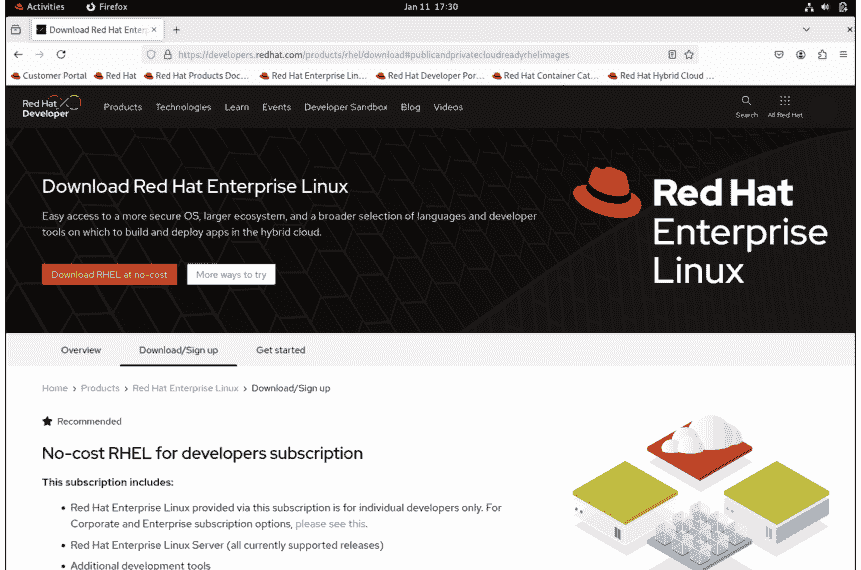

图 2.1：Red Hat Enterprise Linux 下载页面

DVD iso 镜像的文件名为 `rhel-baseos-9.0-x86_64-dvd.iso`，大小约为 8GB。下载完成后，让我们继续配方 #1！

## 配方 #1：为 RHEL 9 创建可启动的 USB 盘

在第一个配方中，我们将根据刚刚从 Red Hat 网站下载的 DVD iso 镜像构建可启动介质。我们将使用 USB 盘作为 `RHEL 9` 的安装媒体，我们需要将 DVD iso 镜像写入其中，使其在你的目标计算机或服务器上可以启动。请确保你的 USB 盘专用于此练习，因为它将擦除所有内容！同时，确保其容量至少为 16 GB，以便我们有足够的空间写入 DVD iso 镜像。准备好 USB 盘后，进入第 1 步。

### 步骤 1：安装 Fedora Media Writer 应用


创建可启动 USB 盘的最快方法是使用 Fedora Media Writer 应用写入 DVD iso。你可以从 `https://getfedora.org` 下载该应用。在该网站上，选择 Fedora Workstation 版本，即可找到适用于 Windows 和 macOS 电脑的 Fedora Media Writer 下载链接。安装适合你使用的版本。图 2.2 显示了 Fedora Media Writer 在 Windows 11 设置下的界面：

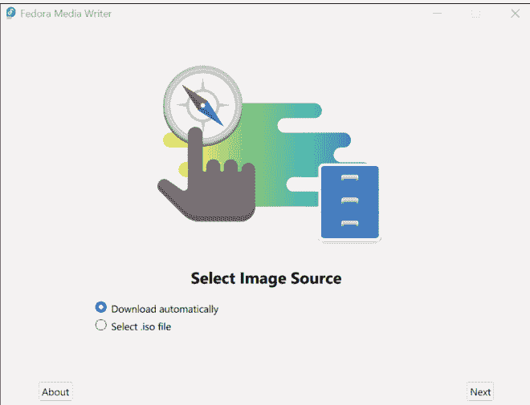

图 2.2

## 设置 RHEL 9

你也可以在 Linux 桌面上使用 Fedora Media Writer。它已经是 Fedora 37 Workstation 默认安装的一部分，与 Windows 和 macOS 版本类似。如果由于某些原因没有安装 Media Writer，你可以使用 `dnf` 命令并安装 `mediawriter` 应用。安装后，从终端运行 `mediawriter`。

- 1. `[js@rhel19_bpw ~] sudo dnf install mediawriter`
- 2. `[js@rhel19_bpw ~] $ mediawriter`

你也可以通过点击 GNOME 桌面应用程序列表中的图标来运行 Fedora Media Writer。

> **提示：** 你可能注意到，可以使用 Fedora Media Writer 下载不同版本的 Fedora Linux（Workstation、Server、Emerging Editions 等）。这是该应用程序的原始意图。而你可以用它来创建 RHEL 9 USB 安装程序，这是一个额外的福利！当你不再需要 RHEL 9 安装程序时，也可以使用 Fedora Media Writer 格式化你的 USB 盘。

### 步骤 2：创建 RHEL 9 可启动 USB 盘

下一步是使用 Fedora Media Writer 将 DVD 镜像写入 USB 盘。从“选择镜像源”（Select Image Source）中选择“选择 .iso 文件”，并确保使用 `rhel-baseos-9.0-x86_64-dvd.iso` 镜像。同时，选择你想写入 ISO 镜像的 USB 驱动器。完成后，点击 `Write` 开始写入你的 USB 盘。

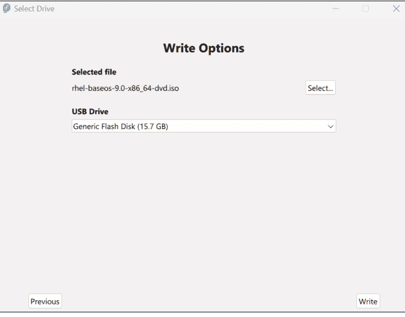

图 2.3

## 系统管理员的 Red Hat Enterprise Linux 9

Fedora Media Writer 将开始将 DVD iso 镜像写入你的 USB 盘，这需要几分钟时间，因为它在写入 RHEL 9 镜像时会检查写入的数据（等待完成期间你可以去喝杯咖啡）。在后台，USB 盘正在调整大小为较小容量，这将成为 RHEL 9 的专用 USB 安装程序。

写入和检查过程完成后，你将看到状态显示为“已完成”（Finished!），如图 2.4 所示：

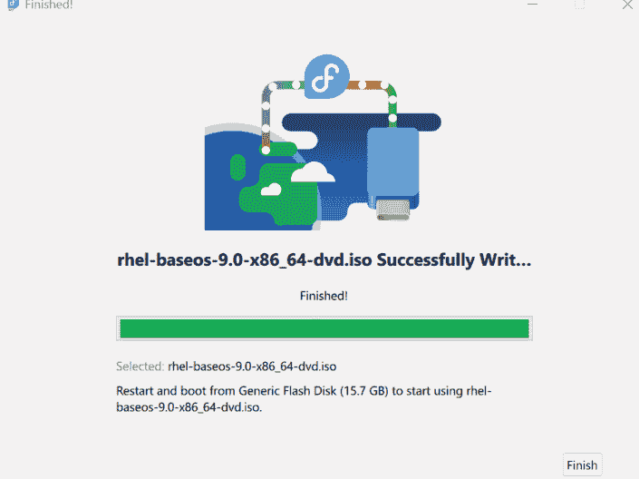

图 2.4：Fedora Media Writer 中的 RHEL 9 安装程序写入和检查已完成

你现在从 USB 盘中有一个可启动的 RHEL 9 安装程序，它将在下一个配方中使用！

### 步骤 3：设置用户设置

从这里，我们将设置 RHEL 9 系统的 root 账户以及第一个用户。我们还需要设置一些选项以确保账户默认情况下是安全的。

- **Root 密码**：root 账户用于管理 RHEL 9 的设置。您需要为 root 用户设置密码。请确保这是一个强密码。
- 为了进一步保护 root 用户，请保持取消勾选“允许密码 root SSH 登录”（Allow root SSH login with password）。保护 root 账户的另一种方法将其锁定，使其无法直接登录系统。
- 勾选“锁定账户”（Lock account）选项并点击完成（Done）。图 2.8 显示了 root 用户设置页面：

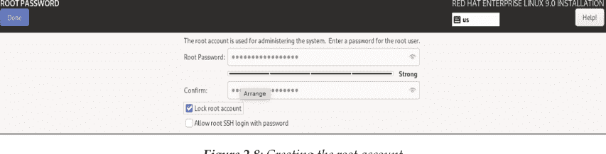

- **创建用户**：您可以通过添加用户名（登录 RHEL 9 时使用的名称）和密码来创建第一个用户。和 root 账户一样，请将密码设置得尽可能强。
- 如果您希望将此用户设置为 sudo 用户（具有管理员权限的用户），请勾选“将此用户设置为管理员”（Make this user administrator）选项。这将是您安装后登录 RHEL 9 时使用的账户。
- 您还可以为用户设置一些高级选项，例如：
    - **主目录**：个人文件的默认位置。
    - **用户和组 ID**：当您希望为用户及其所属组设置特定 ID 时非常有用。这在设置多用户环境并需要访问控制时非常有用。
    - **组组成部分**：您可以指定所属的现有组或创建一个新组。我们将在第 5 章中详细讨论如何保护您的 root 和用户账户。

### 步骤 4：设置软件选项

下一步是设置您要在 RHEL 9 中安装的软件选择。这取决于您的使用场景，但我们将介绍您可以选择的选项。您也需要在此部分设置 RHEL 9，以便从 Red Hat 接收更新。

- **连接到 Red Hat**：如前面的章节所述，RHEL 是一种基于订阅的产品，提供企业级支持以及像 Fedora 和 CentOS 这样的社区项目。您可以获得免费的 RHEL 9 订阅，允许您在测试环境中开发和测试平台。如果您在生产环境中需要来自 Red Hat 的商业订阅，则应在安装后注册 RHEL 9（详见第 5 章）。
- **安装源**：默认情况下，Anaconda 会检测用于启动安装程序的安装介质（在本例中为 DVD）。如果需要安装的软件包在存储库中可用，也可以直接通过 Red Hat 的内容分发网络 (CDN) 安装 RHEL。
- **软件选择**：在此部分中，您可以根据需求选择基础环境：
    - **带 GUI 的服务器 (Server with GUI)**：带有图形界面的集成服务器（默认认为 GNOME）。
    - **服务器 (Server)**：不带图形界面的集成服务器。
    - **最小安装 (Minimal install)**：基础 RHEL 9 系统安装。
    - **工作站 (Workstation)**：适用于笔记本电脑和桌面式 PC。
    - **自定义操作系统 (Custom operating system)**：与最小安装类似，允许您自定义软件选择。
    - **虚拟化主机 (Virtualization host)**：适用于运行多个虚拟机。

## 面系统管理员的 Red Hat Enterprise Linux 9

软件选择页面提供了安装更多软件的选项。但也可以在安装后完成，因此我们可以专注于安装基础环境以完成此任务。我们将在后续章节中结合配方介绍添加更多软件包。

### 步骤 5：设置系统选项

最后一组需要配置的选项是存储：

- **安装位置**：这是最关键的部分之一，因为我们需要选择安装 RHEL 9 的存储设备。在这一步中，作为虚拟机设置的一部分，我们大小为 20 GiB 的本地磁盘。Anaconda 会检测已安装的本地磁盘，并让您选择自动配置存储。对于此步骤，我们将通过默认选择来配置磁盘。确保您选择的磁盘是 RHEL 9 专用的，因为它将重新格式化整个磁盘并自动配置分区，如图 2.9 所示。如果您希望自定义磁盘和分区，我们将在配方 #3：为 RHEL 9 配置磁盘分区中详细介绍该过程。

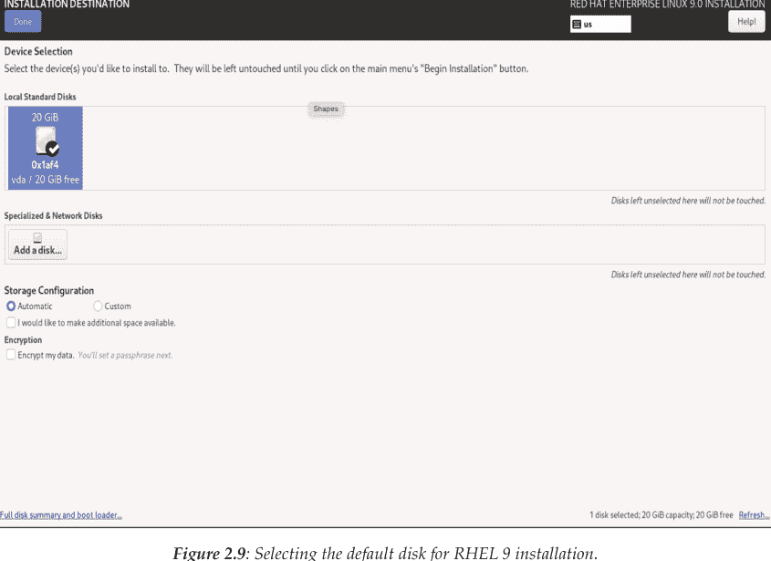

- **KDUMP**：RHEL 安装默认安装 kdump 服务。该服务允许您在 RHEL 9 系统崩溃时保存内存内容以进行事后分析。这在进行系统救援时非常有用。这是可选的，但建议为任务关键型服务器开启它。
- **网络和主机名**：Anaconda 会检测计算机上安装的网络接口，并默认选择一个与您的网络有活动连接的接口。如果您有多个网络接口，可以启用需要配置的接口。如果您需要提供网络详细信息，例如 IPv4 或 IPv6 地址、默认路由和域名系统 (DNS)，且如果您的网络使用动态主机配置协议 (DHCP)，则接口将根据 DHCP 设置进行配置。您可以添加更多需要的网络接口，如虚拟局域网 (VLAN) 或网桥，但您还需要提供更多详细信息以便 Anaconda 在安装期间设置网络设置。我们将使用 Anaconda 检测到的默认网络接口。
- **安全配置文件**：某些行业根据您的行业或需求要求系统配置特定的安全配置文件。例如，金融服务行业（如银行和金融）要求系统遵守 PCI-DSS 标准。您可以根据提供的标准选择安全配置文件，或者如果您计划以后实施，则可以选择不选择。

### 步骤 6：完成 RHEL 9 安装


一旦应用并确认了在步骤 5 中选择的所有选项，请点击“开始安装”（`Begin Installation`），Anaconda 将开始安装 RHEL。安装将在后台进行，此时是时候小庆祝一下，喝杯茶、咖啡或任何您喜欢的饮料了！当安装进度完成后，您可以如图 2.10 所示点击“重启系统”（`Reboot System`）：

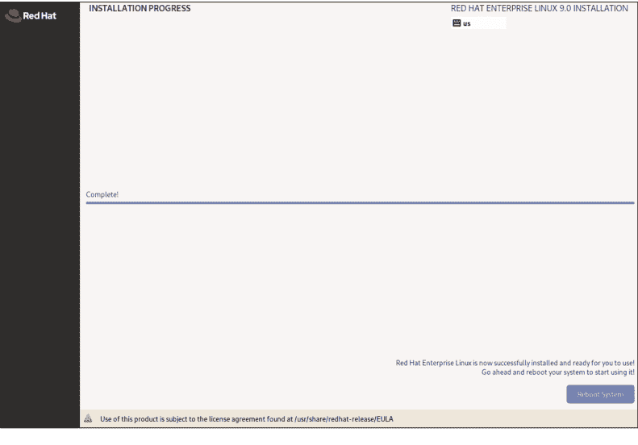

图 2.10：RHEL 9 安装完成

系统重启后，`GRUB` 引导程序将加载默认的 RHEL 9 内核并继续引导过程。几分钟后，您将看到 `GNOME` 登录界面，此时使用您之前在步骤 3 中设置的用户名和密码即可。登录后，您将在屏幕上看到一个大数字 9（如图 2.11 所示），以及 `GNOME` 欢迎通知，从这里开始对界面进行简短导览：


图 2.11

## 配方 #3：为 RHEL 9 配置磁盘分区

在配方 #2 中，我们使用 Anaconda 自动配置了单块磁盘。但如果我们想手动配置它呢？Anaconda 允许我们根据推荐的配置来自定义磁盘并创建分区。

但在对磁盘进行分区之前，让我们快速回顾一下你在 RHEL 9 系统中会看到的典型目录结构：

- **根目录 (`/`):** RHEL 9 中的几乎所有内容都属于**根**目录。从 `/` 开始，目录会发生分支，并取决于你如何进行分区来定型。
- **启动目录 (`/boot`):** **boot** 目录包含了 RHEL 9 启动所需的所有文件和可执行文件，例如加载 RHEL 9 的 Linux 内核。
- **用户目录 (`/home`):** 你的 RHEL 9 本地用户将在 `/home` 拥有自己的文件和个人目录。例如 `/home/jsg`，我所有的文件都在这个文件夹内。
- **Root 用户 (`/root`):** **root** 用户本身将位于自己的文件夹中，而不是作为 `/home` 的一部分。
- **基本二进制文件 (`/bin`):** 该目录包含你的 RHEL 9 系统中所有用户共享的基本可执行文件或二进制文件。例如终端内部的 bash shell。
- **用户二进制文件和只读文件 (`/usr`):** 用户的某些应用程序位于此处。例如用户在 `GNOME` 中安装的应用程序。
- **库 (`/lib`):** 这些包含 `/bin` 中的应用程序执行所需的库文件。
- **变量数据 (`/var`):** 这些包含可变数据文件，如应用程序写入的日志。
- **可选软件 (`/opt`):** 可选软件包安装在此处。专有应用程序通常安装在此位置。假设在 Linux 上安装 Microsoft Edge，浏览器可执行文件将位于 `/opt/microsoft/msedge`。
- **丢失与恢复 (`/lost+found`):** 在系统崩溃的情况下，恢复的文件将被放置在此处。
- **交换空间 (Swap space):** 交换空间的创建是用作应急措施，当系统中的物理内存或 RAM 满时移动不活跃的资源。

# 面系统管理员的 Red Hat Enterprise Linux 9

交换空间的大小与物理内存相同。然而，与在系统中添加更多物理内存相比，交换空间的性能并不会完全相同。

Anaconda 将创建 `/`、`/boot` 和交换空间来安装 RHEL 9，因为其余目录在安装过程中也会被创建。如果你使用多个磁盘安装 RHEL 9，可以将某些目录放在特定的磁盘上，特别是那些可能随时间增长的目录，例如 `/home` 目录。

进行手动分区时需要考虑的另一个因素是分区的方法或类型。在 RHEL 9 中，我们可以执行以下操作：

- **逻辑卷 (LVM):** RHEL 9 默认使用 LVM 创建分区。假设你有 4 个容量为 1 TB 的物理设备。LVM 将其中三个硬盘视为单一卷。物理设备被指定为**物理卷 (PV)**，然后在**卷组 (VG)** 中创建 PV。那么分区和目录结构是怎样的？LVM 的优势在于我们可以添加和管理更多的 PV，从而增加 VG 的大小，这让系统管理员考虑总容量而不是单个磁盘的容量和管理。因此，RHEL 9 通过 LVM 简化了磁盘管理。
- **LVM 备备 (LVM provisioning):** 这将 LVM 概念更进了一对于（初学者来说已经很棒了）。通过 LVM 置备，可以创建一个比后端实际卷更大的卷大小。但分区大小在启动时并未完全分配，而是只有在写入数据时才会增长。这是通过在逻辑卷中创建精简池（thin pool）实现的。精简池可以根据存储用量的增长进行扩展。唯一的缺点是什么？系统管理员必须主动监控精简配置存储的使用情况，以确保用户拥有你通过这种方法过度承诺的容量。

> 提示：LVM 置备的一个良好候选对象是 `/home` 目录，用户可以在那里分配到比后端可用容量更大的存储，但在他们达到分配的容量上限之前他们不会察觉，而到那时你已经向 VG 中添加了更多的 PV。

- **标准分区:** 通过创建标准分区，我们锁定了分配给目录的大小。例如，如果我们为 `/home` 分配了 20 GB，用户将共享该空间，并限制在分配的总大小内。在考虑将物理驱动器用于特定目录时，标准分区是理想的。它是管理存储的一种极方法，但不是最灵活的方法。

考虑磁盘分区的最后一点是，你的设置中要使用的文件系统。RHEL 9 默认使用 XFS 文件系统。与其它文件系统相比，XFS 具有许多功能，如：

- 设置目录配额
- 对活动卷进行碎片整理并扩展
- 更快的崩溃恢复
- 支持大型文件系统，最高支持 500 TB，文件大小最高 16 TB
- 支持 LVM 和标准分区

这些仅仅是 XFS 功能的一小部分，使得 LVM 成为设置磁盘分区时的逻辑选择（双关语）。

现在，让我们完成在 RHEL 9 系统中自定义存储分区的某些步骤。

### 步骤 1：自定义存储配置

在选择磁盘后，你想安装 RHEL 9，从“存储配置”（`Storage Configuration`）中选择“自定义”（`Custom`），然后点击“完成”（`Done`）。

### 步骤 2：对磁盘进行手动分区

你将进行手动分区。

手动分区有两种方法：

- **自动创建:** Anaconda 将自动创建 3 个分区：根 (`/`)、启动分区 (`/boot`) 和交换空间。通过点击底部的加号 (+) 增加更多分区，选择挂载点（如 `/home`、`/var` 等）并输入挂载点所需的容量。如果你希望重启，可以点击底部的“丢弃所有”（`Discard All`），然后选择“重置选择”（`Reset Selections`），这将带回到上一个视图；或者选择你想更改或删除的挂载点，然后点击底部的减号 (-)。当你对分区布局和大小满意时，只需点击顶部的蓝色按钮。
- **逐步创建:** 对于此，你将通过点击 (+) 按钮并选择要创建的挂载点以及所需的尺寸，从头创建每个挂载点。这就像我们在 Anaconda 完成自动分区后执行的自定义分区。请确保你至少使用了 `/`、`/boot` 和交换空间。正如本配方开头提到的，如果你只创建了上述三个基本挂载点，Anaconda 也会创建所有其他挂载点。

一旦完成了分区和挂载点的创建，只需点击页面顶部的蓝色按钮，如果挂载点有效，Anaconda 将执行。如果你不确定自己在做什么，可以始终选择自动分区，由 Anaconda 决定挂载点和交换空间的最佳大小。

# 配方 #4：使用 Kickstart 自动 RHEL 9

在之前的配方中，我们使用 Anaconda 通过交互式界面安装并配置了 RHEL 9。这是在系统中安装 RHEL 9 的常用方法，并为书中后续配方所需的技能奠定了坚实基础。但如果我们需要对多个系统重复执行相同的操作呢？对每个系统都使用 Anaconda 将非常麻烦，因为你必须完成每一个步骤。因此，你需要自动化安装过程，RHEL 9 提供了一个很好的工具 Kickstart。

Kickstart 允许你自动化 RHEL 9 安装过程，从配置系统设置、驱动器分区到要安装的软件。它可以同时被多个系统使用，实现 RHEL 9 的规模化安装。因此作为系统管理员，学习如何使用 Kickstart 自动安装和配置 RHEL 9 是非常有价值的！

可以使用之前配方中创建的 DVD iso 进行 Kickstart 安装。我们在本配方中关注自动 DVD 安装。我们使用 Kickstart 安装的其他方法是通过网络，通过 HTTPS、FTP 或 NFS（我们将在下一个配方中介绍 HTTPS 过程）。

以下是创建 Kickstart 文件的步骤：

### 步骤 1：访问 Kickstart 生成工具

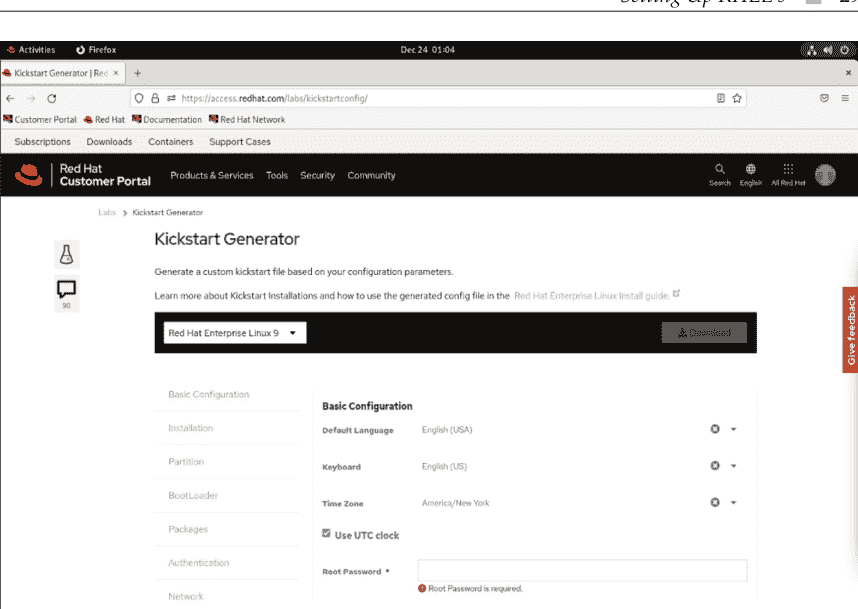

## 第 2 步：使用 Kickstart 生成器创建 Kickstart 文件

现在，让我们来看创建 Kickstart 文件的某些细节：

- 1. 从下拉框中，选择 **Red Hat Enterprise Linux 9**。你会发现你也可以从 RHEL 到版本 5 的之前的版本创建 Kickstart 文件。


## 基本配置

在 `Basic Configuration（基本配置）` 中，设置 `Root Password（根密码）` 并确保其安全性，就像你之前进行手动安装一样。你还需要设置 `Default Language（默认语言）`、`Keyboard（键盘）` 和 `Time Zone（时区）`。默认情况下，Kickstart 安装完成后将重启。你也可以选择以文本模式执行安装，默认模式是图形界面，就像我们之前做的。

## 安装源

从 `Installation（安装）` 选择 DVD 。如果你想通过网络安装，还提供了 NFS、FTP 和 HTTP 选项。

## 分区

在 `Partition（分区）` 中，确保选中了 Remove all existing partitions（删除所有现有分区）。这将擦除安装 RHEL 9 的目标磁盘上的所有内容，再次我们在之前的配方中所做的。选择 Clear Master Boot Record（清除主引导记录）、Initialize the Disk Label（初始化磁盘标签）和 Use Automatic partitioning（使用自动分区）。

## 软件包

在 Packages（软件包）中，选择 x86_64 架构，然后选择你 RHEL 9 安装的环境。默认情况下，Kickstart 会进行无 GUI 的 Minimal Install（最小安装）。对于本配方，选择 Server with GUI（带图形界面的服务器），就像我们之前在分步安装中做的那样。从此部分，你可以深入安装额外的和可选软件包，但我们将坚持所选择的默认设置。

## 网络

在 Networking（网络）中，确保选中了 Default networking (DHCP)。

## 安全

在 Security（安全）中，将 SE Linux 选择为 Disabled（禁用）。我们将在第 14 章中介绍 SE Linux。如果你想安装防火墙，请确保勾选 Enable Firewall（启用防火墙）选项并选择防火墙允许的协议，例如 HTTP、FTP 等。注意，我们也可以在安装后设置防火墙。

## 显示

对于 Display（显示），保持不勾选，因为我们已经在 Packages 中选择了安装带 GUI 的服务器。

## 脚本

对于剩余的选项，Pre-installation Script（安装前脚本）和 Post-installation Script（安装后脚本）均取消勾选。这些用于高级安装设置，本配方中未涵盖。

## 下载 Kickstart 文件

一旦你完成了所有选项，右上角的 Download 将变为蓝色，你就可以下载 Kickstart 文件。将文件保存到你的系统中。默认情况下它命名为 `kickstart.cfg`。将此文件重命名为 `ks.cfg`。

如果你用文本编辑器打开生成的 `ks.cfg`，它看起来将像下面的代码段：

```
lang en_US
keyboard --xlayouts='us'
timezone America/New_York --utc
rootpw $2$10$eDi3thpyopH1vja4PfpY1uBBtKk3a.x0Nmt680Xmz20xp3P40--encrypted
reboot
cdrom
bootloader --append="rhgb quiet crashkernel=1G-4G:192M,4G-6G:256M,6G-=512M"
zerombr
clearpart --all --initLabel
autautopart
firstboot --disable
12. selinux --disabled
13. %packages
14. @^graphical-server-environment
15. %end
```

我们现在可以使用此 `ks.cfg` 文件进行 Kickstart 自动安装。

## 配方 #5：使用 Kickstart 安装 RHEL 9

现在我们已经有了生成的 Kickstart 文件 `ks.cfg`，让我们使用 DVD iso 进行 RHEL 9 的自动安装。

### 第 1 步：从启动提示符运行 Kickstart 文件

使用 DVD iso 启动系统。根据 `ks.cfg` 文件的位置输入其路径：

a. CD-ROM: `inst.ks=cdrom`

b. ISO/HD: `inst.ks=hd=<device>:<path>`

c. URL/Network: `inst.ks=https://<host>/<path>`

按 Enter 键确认安装。

Kickstart 安装将启动，并将根据 `ks.cfg` 文件中设置的参数继续自动运行。时间将与我们在之前的配方中进行的手动安装相同，几分钟后，RHEL 9 将重启，你将再次看到登录界面。

如果你第一次没有获取成功，可以尝试以下操作：

1. 使用命令行检查生成的 Kickstart 文件是否存在可能的错误。
2. 确保从启动时的 `inst.ks` 路径正确。

Kickstart 过程可以在多个系统之间复制，而且在按需付费或消费模式下计算、存储、网络和应用程序服务的可用性，使用这种方法而不是逐个执行每个过程的优势在于所有的安装都将保持一致。

## 总结

在本章中，我们学习了安装和配置 RHEL 9 的端到端过程。我们从下载 ISO 镜像开始，然后创建了用于安装的启动 USB 驱动器。我们还涵盖了使用 Anaconda 工具安装 RHEL 9 的步骤，并配置了关键参数，例如设置根密码、选择安装的软件软件包，以及使用生成的 Kickstart 文件进行磁盘分区。

在下一章中，我们将学习如何在公有云上安装和配置 RHEL 9，这将帮助加速我们的安装，甚至可以大规模进行。

接下来，通过浏览可用的实例类型 `Instance types` 来选择虚拟机的大小。

一旦选定了实例类型，请配置基础细节，例如网络设置。你还需要添加存储，因为虚拟机将仅包含运行 RHEL 9 的启动磁盘。

你可以添加标签 `Tag`，以便从其他 AWS 资源中妥善管理和识别你的 RHEL 9 机器。

通过识别访问虚拟机所需的端口和 IP 地址并设置安全组 `Security group`，为 RHEL 9 虚拟机配置防火墙规则。如果你的 AWS 落地区已经有了安全组，请为你的实例选择合适的一个。

为了以便在部署后能够通过安全外壳 `SSH` 访问 RHEL 9 虚拟机，请生成密钥对，你将下载在 SSH 访问 RHEL 9 虚拟机时将所需的私钥。

最后，在启动 EC2 实例之前，检查您刚刚设置的所有配置。几分钟后，您在 EC2 中的 RHEL 9 虚拟机即可可用。

## 配方 #7：在 Microsoft Azure 上部署 RHEL 9 虚拟机

在本配方中，我们将使用独立账户或个人账户在 Microsoft Azure 上将 RHEL 9 系统部署为虚拟机。如果你使用的是企业账户或与微软有现有的企业协议 `EA`，以下步骤也适用。如果你打算使用企业账户部署 RHEL 9，请与你的云管理团队协作工作，因为这涉及到成本、网络和安全考量。你的公司可能已经设置了 Azure 落地区，以确保部署在 Azure 中的所有资源都得到管理和保护，并设有适当的成本管理关口和规则。

1. 如果你没有 Azure 的访问权限，请访问 `https://azure.microsoft.com/en-us/` 免费创建一个个人使用的账户。创建完成后，使用你的 Azure 凭据登录。
2. 从 Azure 门户，创建一个新的虚拟机。你可以在顶部的搜索栏中输入 virtual machine，或者如果有虚拟机图标，点击它继续。
3. 点击“创建” `Create` 并选择“Azure Virtual Machine”。
4. 选择将用于支付 Azure 资源的订阅 `Subscription`。根据你的用途，这可以是按需付费 `pay-as-you-go`、个人订阅，如 Visual Studio 企业福利或与微软签署的企业级协议。
5. 对于资源组 `Resource group`，为本次练习创建一个新的。如果你已经有了现有的资源组，请选择你想让 RHEL 9 Azure 虚拟机部署到的那个。
6. 创建一个唯一的虚拟机名称。虚拟机名称同时用于管理 Azure 资源和创建主机。请确保这是最终确定的名称，因为部署后将无法更改，尽管你之后可以在 RHEL 中更改主机名 `hostname`。
7. 选择你想要部署 RHEL 9 虚拟机的区域 `Region`。这取决于你的位置和需求，因为如果虚拟机距离你的物理位置太远，必须考虑延迟问题。
8. 对于镜像 `Image`，点击“查看所有镜像” `See all images` 并搜索最新的可用 RHEL 9 镜像。系统将为你提供一组可用于 RHEL 9 系统的推荐虚拟机大小。请选择最适合你用途的。
9. 对于管理员账户 `Administrator account`，选择 SSH 公钥身份验证方法。Azure 将为默认用户名 `azureuser` 生成一个新的密钥对。请保留生成的私钥，因为你将使用它来登录 Azure 上的 RHEL 9。


### 10. 对于入站端口规则（Inbound port rules），使用默认端口 `22` 以允许 SSH 登录。虽然这可能不是最安全的选项，但为了练习目的，可以使用这种方法。

### 11. 完成后，点击“查看并创建”（Review + create）。在本配方中，我们将使用默认设置，这些设置允许我们在 Azure 中部署一个基础 RHEL 9 服务器作为虚拟机。系统将为你提供关于 RHEL 9 如何在 Azure 上部署的摘要，一旦设置验证完成，点击“创建”（Create）。

### 12. Azure 将开始部署 RHEL 9 虚拟机。完成后，你可以像下图 3.1 所示检查新部署的系统。

### 13. 当完成练习且不再需要虚拟机时，请删除实例以节省成本。

## 配方 #8：在 Google Cloud 上部署 RHEL 9 虚拟机

要在 Google Cloud Platform (GCP) 上部署 RHEL 9，你将使用 Compute Engine。GCP 为 RHEL 9 提供了各种实例类型和存储选项。

- 1. 访问 GCP 控制台，请使用你的凭据登录 `https://console.cloud.google.com/`
- 2. 从控制台导航到 Compute Engine 并点击“创建实例”（Create Instance）。
- 3. 配置实例名称和区域。
- 4. 根据你的性能需求选择机器类型（`machine type`）。
- 5. 对于启动磁盘（Boot disk），选择操作系统并在镜像中选择 RHEL 9。
- 6. 使用 SSH 密钥验证配置访问安全性。
- 7. 设置防火墙规则以允许 SSH 流量。
- 8. 点击“创建”（Create）并等待部署完成。

## 配方 #9：使用 Red Hat Hybrid Cloud Console 管理你的 RHEL 9 系统

查看所有 RHEL 9 实例和部署情况的实用工具是 Red Hat Hybrid Cloud Console，访问地址为 `https://console.redhat.com`。让我们通过 Red Hat Hybrid Cloud Console 执行一些步骤，并检查注册在 Red Hat Insights 上的部署的 RHEL 系统的状态。

- 1. 访问 Hybrid Cloud Console，使用你的 Red Hat 账户登录，点击 Red Hat Enterprise Linux 并选择 Red Hat Insights。控制台将如图 3.3 所示：

# 针对管理员的 Red Hat Enterprise Linux 9

- 2. 如如图 3.3 所示，Insights 提供了 RHEL 系统状态的完整视图，涵盖嵌套补丁、已知漏洞、合规性等。如果 Insights 中没有 RHEL 9 系统，您必须注册这些系统以便其在混合云控制台中可见。要此操作，请点击“Register systems”（注册系统）按钮。
- 3. 选择您想要注册的 RHEL 版本。对于 RHEL 9，请选择 RHEL 8.4+ 并选择系统的管理方式。您可以在 Red Hat Subscription Manager、Red Hat Satellite 以及部署在公云的 RHEL 之间进行选择。每种选择都将为您提供有关注册 RHEL 系统的不同说明。
- 4. 在本次练习中，由于我们一直使用 Red Hat Subscription Manager，我们将使用该选项。登录到需要连接 Insights 的 RHEL 9 系统，打开控制台并执行以下命令：`jsg@rhel9_bpp~$ sudo insights-client --register`
- 5. 完成后，刷新浏览器上的 Red Hat 混合云控制台，进入 Insights 并选择“Inventory”（库存）。您的 RHEL 9 系统现在应该可以查看并审计 Insights 提供的工具了。
- 6. 如果您想在一个地方连接您的所有系统，请使用 Red Hat 连接器执行以下命令：`jsg@rhel19_bpp~$ sudo rhc connect <username> -p <password>`
- 7. 然后再次刷新混合云控制台，您的 RHEL 9 系统将出现在库存选项卡中。

## 配方 #10：使用 Red Hat Cloud Access 将您当前的 Red Hat 订阅迁移到云端

Red Hat Cloud Access 程序是 Red Hat 提供的一项额外订阅福利，允许您将活跃的 RHEL 系统迁移到云端。Red Hat Cloud Access 已经包含在现有的活动订阅中，无需额外费用，此外，您还获得了选择如何以及何处使用 RHEL 产品的灵活性和自由，无论是在本地、公云还是受支持的服务提供商处。在订阅有效期间，您将获得 Red Hat 的全方位支持。

在使用 Red Hat Cloud Access 福利之前，Red Hat 提供了一些指导以确定您是否符合该福利条件。这些包括：

- 激活的 RHEL 订阅
- 订阅目前未使用或未部署

## 在云上建立 RHEL 41

- RHEL 产品与受支持的目标云环境兼容

Red Hat 在 Red Hat 客户门户上提供了关于 Red Cloud Access 计划概述和福利的完整文档，访问地址为：`https://docs.redhat.com/en/documentation/subscription_central/1-latest/html-single/red_hat_cloud_access_reference_guide/index`。

现在，让我们完成通过 Cloud Access 福利启用您的 RHEL 订阅的步骤：

- 1. 使用您的 Red Hat 账户，访问 Red Hat Cloud Access 端口 `https://access.redhat.com/management/cloud` 并使用您的 Red Hat 凭据登录。登录后，`Red Hat Cloud access` 界面将如下图 3.4 所示：

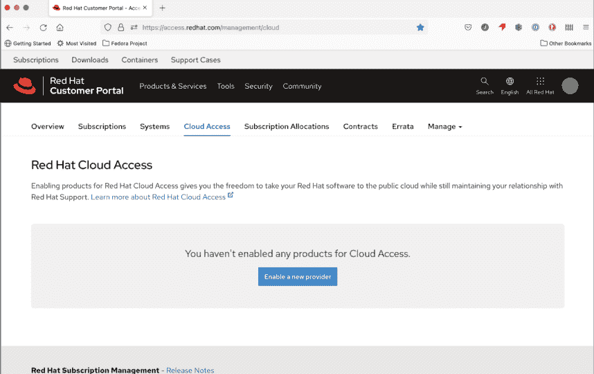

**图 3.4：** Red Hat 门户中的 Red Hat Cloud Access

- 2. 点击“Enable a new provider”（启用新提供商）按钮，并从下拉框中选择您希望使用 Cloud Access 福利的经过认证的云和服务。
- 3. 根据您选择的提供商，您有多种方式将当前的 Azure 订阅连接到该服务提供商。对于 AWS 和 Microsoft Azure，您可以通过 Red Hat 混合云控制台 (`https://console.redhat.com/settings/sources`) 连接您的云提供商，也可以手动添加您的账户。对于 GCP，您必须手动添加您的 Google

# 针对管理员的 Red Hat Enterprise Linux 9

指南将引导您完成如图 3.5 所示的连接 Azure 订阅到 Red Hat 混合云控制台的步骤：

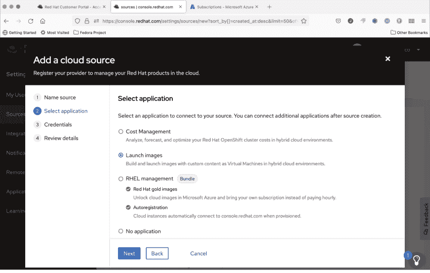

图 3.5：在 Red Hat 混合云控制台中添加 Microsoft Azure 订阅

- 4. 管理跨云管理的 RHEL 实例，选择“Launch images”（启动镜像）来构建并启动带有自定义内容的镜像，并将其部署为虚拟机。您必须从您的云提供商处添加订阅详情以完成此步骤。
- 5. 完成后，订阅详情和凭据将通过验证，一旦完成，您就可以使用 Red Hat Cloud Access 在云端利用您的 RHEL 订阅，且您只需为部署中使用的虚拟机资源和其他应用程序付费。

## 结论

在本章中，我们学习了 RHEL 9 也可以在公云进行部署和配置，这允许您的应用程序更灵活地使用平台，因为它让您对公云提供商、成本甚至用于部署的海量实例尺寸提供了选择。在云上使用 RHEL 9 的灵活性通过使用您当前的 RHEL 9 订阅并激活 Cloud Access 福利得到了进一步加强，这允许您抵消操作成本，仅为部署的云资源的使用付费。

通过在 Red Hat Insights 上添加已部署的 RHEL 9 实例，这将为您提供完整的覆盖，以确保您部署的系统和应用程序得到保障。

`tar` 工具将创建一个名为 `mybackup.tar.gz` 的压缩 tar 归档，位于 `/mnt/backup`，它将包含来自 `/home/directory` 的文件和目录。

- 5. 在升级之前更新 RHEL 8 系统：确保在升级之前，您的 RHEL 8 系统已安装最新的、受支持的安全和软件更新。在控制台中中，执行 `dnf update`：

```
[jsg@rhel9_bpd ~]$ sudo dnf update
```

- 4. 禁用第三方软件存储库：为了确保升级过程顺畅，请使用此 `subscription-manager` 命令临时禁用第三方存储库：


```bash
[jsg@rhel9_bpd ~]$ sudo subscription-manager repos --disable=
```

### 5. 安装 LEAPP 工具并运行升级前检查
将 RHEL 8 升级到 RHEL 9 的推荐方法是使用 `leapp`。使用 `dnf` 安装此工具：

```bash
[jsg@rhel9_bpd ~]$ sudo dnf install leapp
```

安装完成后，执行升级前检查：

```
[jsg@rhel9_bpd ~]$ sudo leapp upgrade
```

在升级前检查期间，`leapp` 将收集 RHEL 8 系统中的数据，检查升级性，并生成位于 `/var/log/leapp` 的报告。该报告将提供发现的问题列表以及修复这些问题的解决方案。它还将就是否继续升级提供建议。

### 6. 使用 LEAPP 升级到 RHEL 9
一旦您的 RHEL 8 系统通过 `leapp` 升级前检查，您就可以使用 `leapp upgrade` 命令继续升级到 RHEL 9：

```
[jsg@rhel9_bpd ~]$ sudo leapp upgrade --target 9.0
```

在升级期间，`leapp` 将下载所有必要的包并在后台执行 `rpm` 更新。完成后，您可以手动重启系统。您也可以在 `leapp upgrade` 命令中包含 `--reboot` 选项，以便系统在完成后自动重启。

### 7. 检查并确认升级成功
您可以执行以下命令来验证您是否已成功将 RHEL 8 系统升级到 RHEL 9：

```
[jsg@rhel9_bpd ~]$ sudo cat /etc/redhat-release
```

`cat` 命令的输出应显示您现在使用的是 RHEL 9。通过从终端执行一些基础 `ping` 来检查您的 RHEL 9 系统是否连接到网络，或者通过 `ssh` 连接到远程服务器以验证连接。确认后，更新您的新 RHEL 9 系统以获取所有新发布的软件和安全更新。

# 食谱 #12：管理用户账户和访问权限

在本食谱中，我们将介绍在 RHEL 9 中创建和管理用户账户及权限的基础知识。这一系列任务对于系统管理员来说至关重要，因为它们是管理系统安全基础的一部分。现在，让我们查看管理用户账户和访问权限的工具和命令：

#### 创建用户账户

`useradd` 命令用于在 RHEL 9 中创建新用户账户。要使用它，打开控制台会话并以所需的用户名账户创建一个新的 `sudo` 用户：

```bash
[js@rhel9_bpp~]$ sudo useradd jerome
```

在示例中，`jerome` 用户的家目录默认将在 `/home/jerome` 创建。要为用户账户指定不同的家目录，请通过目标目录路径添加 `-d` 标志选项。

另一个可用于创建新用户的工具是 `adduser` 命令。`adduser` 的主要区别在于它允许您设置密码、其他用户设置（如组），并自动创建家目录：

```bash
[js@rhel9_bpp~]$ sudo adduser jerome
```

#### 设置用户密码

通过 `passwd` 命令，我们创建了新用户 `jerome`，但还没有设置密码。在控制台中使用 `passwd` 命令为新用户设置密码：

```bash
[js@rhel9_bpp~]$ sudo passwd jerome
```

对于 `adduser` 命令，在用户创建过程中会询问新密码，因此在我们想要更改它之前，不需要手动设置。

#### 管理用户账户

要修改现有的用户账户，请使用 `usermod` 命令。在下面的示例中，我们将用户 `jerome` 添加到 `marketing` 组，请输入以下命令：

```bash
[js@rhel9_bpp~]$ sudo usermod -ag marketing jerome
```

`-ag` 标志将用户 `jerome` 添加到 `marketing` 组，并替换用户之前的组成员关系。

要删除用户账户，请使用 `userdel` 命令。在下面的示例中，我们正在控制台中删除用户 `jblack`：

```
[jsg@rhel9_bpb ~]$ sudo userdel jblack
```

在使用 `userdel` 命令删除用户账户时请务必小心——用户所有的文件和目录都将被删除，唯一的恢复方法是您已经创建了其家目录的备份！

#### 管理访问权限

接下来，我们必须设置访问权限控制，即哪些用户和组可以访问系统上的特定文件和目录。要修改文件或目录的访问权限，请使用 `chmod` 命令后跟所需的权限设置以及文件或目录的路径。在下面的示例中，我们正赋予文件 `myfile01` 的所有者读、写和执行权限。

## 使用图形界面进行配置：

要使用图形化界面配置网络接口，请按照以下步骤操作：

- 点击屏幕左上角的“活动” `Activities` 菜单。
- 在搜索栏中输入“设置” `Settings` 并点击“设置”图标。
- 点击“网络” `Network` 图标。
- 点击 `+` 按钮以添加新连接。
- 选择您想要配置的连接类型（在提供的选项中选择，如以太网、Wi-Fi、VPN 等）。
- 按照屏幕提示配置连接。

## 使用控制台进行配置：

要使用控制台配置网络接口，请按照以下步骤操作：

- 打开控制台会话。
- 以 `sudo` 用户身份使用 `nmcli` 命令来管理网络接口。
- 使用 `nmcli connection add` 添加新连接。
- 使用适当的选项和参数来配置连接（例如 `--type`、`--conname`、`--autoconnect` 等）。
- 使用 `nmcli connection modify` 命令修改现有连接。
- 使用 `nmcli connection delete` 删除连接。

## 手动配置

RHEL 9 中的网络接口也可以通过直接编辑配置文件来手动配置。两个主要的配置文件是 `/etc/sysconfig/network-scripts/ifcfg-<interface_name>` 和 `/etc/resolv.conf`。

### 使用 `ifcfg-<interface_name>` 配置网络接口：

`/etc/sysconfig/network-scripts/ifcfg-<interface_name>` 文件包含特定网络接口的信息。要手动配置网络接口，请按照以下步骤操作：

- 使用文本编辑器打开 `/etc/sysconfig/network-scripts/ifcfg-<interface_name>` 文件。
- 保存文件并重载或重启系统以使更改生效。

### 配置 `resolv.conf` 文件：

`/etc/resolv.conf` 文件包含 DNS 解析器的配置信息。要手动配置 DNS 解析器设置，请按照以下步骤操作：

- 使用文本编辑器打开 `/etc/resolv.conf` 文件。
- 编辑 `nameserver` 行以包含相应的 DNS 服务器 IP 地址。
- 保存文件并重载或重启系统以使更改生效。

# 教程 #15：设置防火墙

在 RHEL 9 中设置基础防火墙是一种良好的做法，可以确保进出系统的流量都得到妥善保护，并且只允许指定的端口使用网络。让我们完成在 RHEL 9 中设置防火墙的过程。

#### 检查防火墙状态

在设置防火墙之前，让我们检查防火墙的状态。要执行此操作，从控制台运行 `firewall-cmd` 命令：

```
[jsg@rhel9_bp ~]$ sudo firewall-cmd --state
```

如果防火墙处于激活状态，你将看到运行状态。如果防火墙未激活，你将看到状态未运行。要启动防火墙，请运行 `systemctl` 命令并指定 `firewallld` 服务。

```
[jsg@rhel9_bp ~]$ sudo systemctl start firewallld
```

#### 允许关键服务

检查防火墙状态后，下一步是使用 `firewall-cmd` 命令允许关键服务。这些服务对于系统的正常运行是必要的。关键服务的示例包括 SSH、DNS、HTTP 和 HTTPS。

添加 SSH：

```
[jsg@rhel9_bp ~]$ sudo firewall-cmd --permanent --add-service=ssh
```

添加 DNS：


# 防火墙配置

```
[jsg@rhel9_bp ~]$ sudo firewall-cmd --permanent --add-service=dns
```

## 添加 HTTP

```
[jsg@rhel9_bp ~]$ sudo firewall-cmd --permanent --add-service=http
```

## 添加 HTTPS

```
[jsg@rhel9_bp ~]$ sudo firewall-cmd --permanent --add-service=https
```

`--permanent` 标志使得规则在系统重启后依然有效。

要立即应用这些规则，请在不带 `--permanent` 标志的情况下运行相同的命令。

## 阻塞不需要的流量

防火墙配置的下一个一个步骤是阻塞不需要的流量。这包括阻塞来自未知源的入站流量、阻塞 IP 地址。要阻塞来自未知源的入站流量，请在控制台执行以下命令：

```
[jsg@rhel19_bpd ~/] sudo firewall-cmd --permanent --add-rich-rule=family="ipv4" source address="0.0.0.0/0" reject
```

要阻塞来自特定 IP 地址的入站流量，请在控制台执行以下命令（根据需要更改 IP 地址）：

```
[jsg@rhel19_bpd ~/] sudo firewall-cmd --permanent --add-rich-rule=family="ipv4" source="192.168.1.100" reject
```

## 重新加载防火墙配置

在修改防火墙配置后，重新加载配置以应用更改。运行带有 `--reload` 标志的 `firewall-cmd`：

```
[jsg@rhel19_bpd ~/] sudo firewall-cmd --reload
```

## 检查防火墙配置

要检查防火墙配置并显示所有活动防火墙规则（包括允许的服务和阻塞的流量），请使用 `--list-all` 标志：

```
[jsg@rhel19_bpd ~/] sudo firewall-cmd --list-all
```

记住在做出更改后重新加载防火墙配置，并定期检查防火墙规则，以确保它们保持更新且您的系统安全。

# 教程 #16：启用和禁用系统服务

系统服务是在 RHEL 9 系统上持续运行的后台进程，用于支持各种功能和应用程序。RHEL 默认运行几个关键系统服务，允许系统能够正常工作。然而，某些默认加载的服务可能是不需要的。让我们通过在 RHEL 9 中设置防火墙的过程（注：此处原文语境应为服务管理）来了解基础知识：

## 1. 列出系统服务

`systemctl` 命令用于与系统服务进行交互。要执行相关操作，首先需要检查系统的服务。在 RHEL 9 中列出服务：

```
[jsg@rhel9_bp ~]$ systemctl list-units --type
```

你也可以列出 RHEL 9 中无论状态如何的所有服务：

```
[jsg@rhel9_bp ~]$ systemctl list-units --all
```

## 2. 启用系统服务

相同的 `systemctl` 命令在 RHEL 9 中启用服务。一旦你已经确定了要启用的服务，执行以下操作：

```
[jsg@rhel9_bp ~]$ sudo systemctl enable <name>
```

将 `<name>` 替换为要启用的服务的名称。执行后，服务将在每次重启系统时自动启动。

重要的是，启用服务不会立即启动。如果该服务正在运行，你需要手动使用 `systemctl` 命令启动它：

```
[jsg@rhel9_bp ~]$ sudo systemctl start <name>
```

## 3. 禁用系统服务

在 RHEL 9 中禁用服务同样使用 `systemctl` 命令：

```
[jsg@rhel9_bp ~]$ sudo systemctl disable <name>
```

像之前一样，将 `<name>` 替换为要禁用的服务的名称。完成后，服务在每次重启后将不再自动启动。

记住，就像启用服务不会立即启动一样，禁用服务也不会立即停止。如果该服务正在运行，你需要手动使用 `systemctl` 命令停止它：

```
[jsg@rhel9_bp ~]$ sudo systemctl stop <name>
```

# 总结

本文涵盖了 RHEL 9 中基本的部署后配置任务，以确保系统的安全和完整。通过应用此处描述的最佳实践，RHEL 9 系统现在已准备好运行关键应用程序。确保定期检查设置的配置和参数，并根据需要定期安排练习以保持规则更新。

在下一章中，我们将介绍如何管理 RHEL 9 订阅，以确保您获得官方 Red Hat 支持。

# 重点回顾

- 你需要 RHEL 8 才能原地升级到 RHEL 9。对于运行 RHEL 7 及更版本的安装，没有直接升级到 RHEL 9 的路径。升级时，必须先升级到 RHEL 8，然后再升级到 RHEL 9。

- 在设置防火墙时，仅允许你需要的的服务。例如，如果你不需要运行 Web 服务器，请不要通过防火墙启用 HTTP 和 HTTPS 服务。

- `systemctl` 命令非常强大，可以轻松在 RHEL 9 系统上启用和禁用服务。务必仔细选择要启用或禁用的服务，以免对系统的整体功能产生任何潜在问题。

# 第 5 章

# 管理 RHEL 9 订阅

## 简介

RHEL 9 是一种面向企业级的 Linux 发行版，Red Hat 为通过分配付费订阅的企业级安装提供全方位的支持。在本章中，我们将介绍 RHEL 9 的订阅选项（包括免费和付费）、如何操作 Red Hat 客户门户、学习如何提交支持工单以及从您的 RHEL 9 系统中收集重要的系统报告。我们还将讨论 Red Hat 开发者计划，该计划允许您免费运行 RHEL 9 系统以进行测试和评估。

## 结构

在本章中，我们将讨论以下主题：

- 通过 Red Hat 开发者计划获取免费的 RHEL 开发者订阅

- 注册新安装的 RHEL 9 环境以接收软件更新

- 安装 `sos` 工具包以生成系统报告，并使用其从 Red Hat 获取技术支持

## 目标

在本章中，学习目标如下：a) 了解 Red Hat 开发者计划，能够利用 Red Hat 产品的免费开发者订阅进行个人学习和评估；b) 学会在 RHEL 中的工具创建系统报告，这些报告在从 Red Hat 获取技术支持时非常有用。

### Hat 开发者计划是系统管理员不可或缺的资源，因为它允许您评估和测试 Red Hat 产品，而不仅限于 RHEL 9。因此，在您学习 RHEL 9 系统的过程中，请充分利用这一优势！

# 菜谱 #17：为测试获取免费的 RHEL 开发者订阅

RHEL 9 可以从 Red Hat 网站免费下载并开源发布，但商业用途仍需要企业订阅协议来激活系统并获取软件更新和安全补丁。为了推广 RHEL 的认知度和开发级使用，Red Hat 作为 Red Hat 开发者计划的一部分推出了一项针对个人的免费 RHEL 开发者订阅。如果您是一个正在利用业余时间提升提升技能的系统管理员，那么这项订阅将是您学习工具的理想补充。

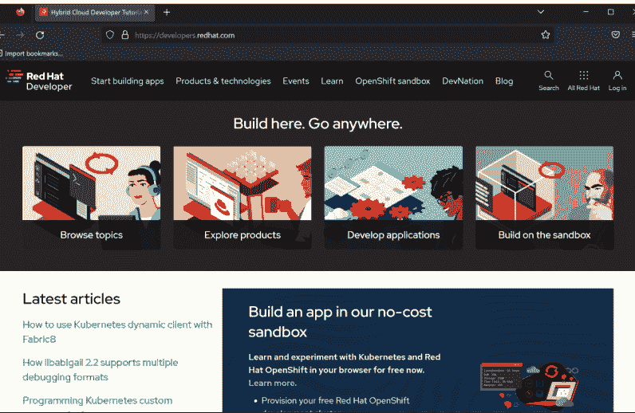

图 5.1

面向个人开发者的免费 RHEL 开发者订阅提供以下内容：

- 所有受支持的 RHEL 版本

- Red Hat 开发者工具和编译器

- Red Hat 软件集合（Software collection）和应用系统

- RHEL 基础架构插件，如弹性存储、网络和可扩展文件系统

- 访问 Red Hat 客户门户以获取软件更新和知识库文章

提供的免费 RHEL 与商业和企业部署使用的软件相同。主要区别在于，免费的 RHEL 开发者订阅是自助服务的，访问 Red Hat 客户门户提供了所需的所需的资源，例如与 RHEL 9 相关的部署、配置、安全和管理文章。

免费 RHEL 订阅赋予您以下权益权限：

- 在您的个人 Red Hat 开发者计划账户下注册最多 16 个物理或虚拟 RHEL 节点（注册将激活您的 RHEL 9 环境的系统更新）。

- 访问软件和安全更新。

- 通过 Red Hat 客户门户获取自服务支持。

另请注意，通过免费 RHEL 订阅计划注册的 RHEL 9 安装不提供 SLA（服务等级协议）。从积极的一面来看，访问 Red Hat 开发者计划可以使用 Red Hat 的所有产品组合，包括 Red Hat OpenShift Container Platform 和 Red Hat Ansible Automation Platform，您可以根据自己的节奏学习这些资源和文章从中从中巨大的价值。

现在让我们开始创建一个 Red Hat 开发者账户，以便您可以免费下载 RHEL 9 用于个人开发和测试：


- 1. 在 https://developers.redhat.com/ 注册新账户。点击登录图标并选择 Register for a Red Hat account。此新的 Red Hat 账户将用于个人 Red Hat 开发者计划。

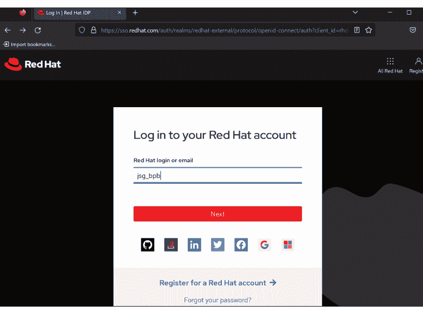

- 2. 创建 Red Hat 账户后，登录开发者计划页面，点击“Products & technologies”（产品与技术）并选择“Red Hat Enterprise Linux”。

- 3. 点击显示“Download RHEL at no-cost”的红色按钮，将下载最新版本的 RHEL x86_64 DVD iso。

## 管理 RHEL 9 订阅

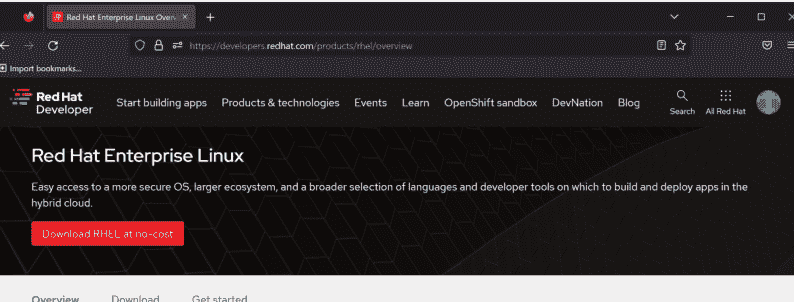

## Red Hat Enterprise Linux

轻松访问更安全的操作系统、更大的生态系统以及更广泛的语言和开发者工具，以便在混合云中构建和部署应用。

免费下载 RHEL

概览 | 开始使用

### 使用 Red Hat Enterprise Linux 进行构建、部署和管理

Red Hat 开发者计划提供了对 Red Hat Enterprise Linux (RHEL) 这是一个安全、稳定且受支持的操作系统 (OS)。我们提供了巨大的生态系统来帮助您在云端构建和部署应用程序。

- 我们的通用基础镜像 (UBI) 提供了一个可靠且稳定的环境，简化您的容器部署项目。

- Red Hat 中间件和管理产品使应用程序的部署、使用和监控变得更容易。

- 在跨基础设施范围的 RHEL 上构建应用程序，让您可以使用跨地点的相同工具来管理应用程序和服务。

> 图 5.3：Red Hat 开发者门户上的 Red Hat Enterprise Linux

4. 如果您想选择特定版本的 RHEL 和架构，请点击 Download 并选择要下载的版本。请注意，仅提供当前且受支持的 RHEL 版本（包括 RHEL 9）。

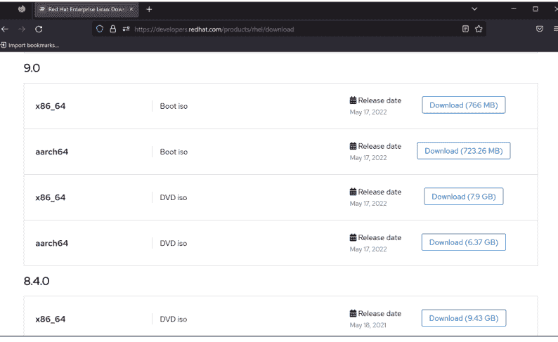

### 9.0

| | x86_64 | Boot iso | 发布日期 | 下载 |
| :--- | :--- | :--- | :--- | :--- |
| | x86_64 | Boot iso | 2022年5月17日 | 下载 (766 MB) |
| | aarch64 | Boot iso | 2022年5月17日 | 下载 (723.26 MB) |
| | x86_64 | DVD iso | 2022年5月17日 | 下载 (7.9 GB) |
| | aarch64 | DVD iso | 2022年5月17日 | 下载 (6.3 GB) |
| | x86_64 | DVD iso | 2021年5月18日 | 下载 (9.43 GB) |

### 8.4.0

> 图 5.4

如果您是公司或组织中的一个团队，且寻求使用 RHEL 进行评估和测试，Red Hat 提供了一个名为“Red Hat Subscription for Teams”的不同计划。软件访问和权益与个人计划相似，但作为企业用户增加了额外福利。Red Hat 对此计划提供了全面的常见问题解答 (FAQ)，您需要联系当地的 Red Hat 代表来启动您的团队。可以通过以下链接查看详细的 FAQ 获取更多信息：

- https://developers.redhat.com/articles/2022/05/10/access-rhel-developer-teams

- https://developers.redhat.com/articles/2022/07/06/what-qualifies-red-hat-developer-teams

## 菜谱 #18：注册您的 RHEL 9 系统以接收软件更新

如菜谱 #17 所示，您需要将 RHEL 9 系统注册到 Red Hat 以接收软件和安全更新。注册 RHEL 9 系统还可以让您（作为选项）连接到 Red Insights，这是 Red Hat 的一种托管云服务，它根据您的 RHEL 9 配置、安装的应用程序进行分析，并就安全和充分利用系统提供建议性和主动信息。Red Insights 包含在每个 RHEL 订阅中（包括免费 RHEL 计划）。

您可以选择 3 种方法将 RHEL 9 系统注册到 Red Hat，您可以在设置期间或安装完成后进行。

- 通过 Anaconda 注册：在 Anaconda 的安装设置期间，选择“Connect to Red Hat”。使用您的 Red Hat 凭据注册您的 RHEL 9 系统。您还可以通过标记“Set System Purpose”并选择以下内容提供有关 RHEL 9 系统用途的信息：

- 角色：您注册的 RHEL 9 系统的角色。

- SLA：根据您的订阅，可以是高级 (24x7)、标准 (8x5) 或自助支持。

- 用途：您可以将您的 RHEL 9 系统标记为生产环境、计算节点或开发/测试环境。

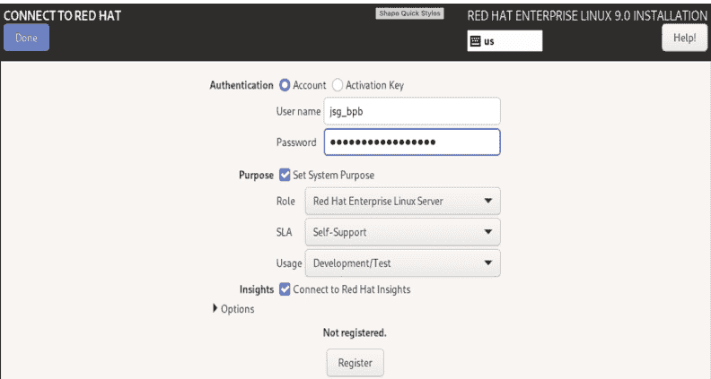

**图 5.5：** 在安装设置期间注册 RHEL 9 系统

如果您代表您的组织安装 RHEL 9 并且拥有来自 Red Hat 的有效订阅，您的 Red Hat 代表将向您提供一个激活密钥（Activation Key），用于注册您的 RHEL 9 系统。您可以使用此激活密钥在您的组织名下注册 RHEL 9。

- **在 GNU 网络对象模型环境 (GNOME) 中在设置完成后进行注册：** 在完成安装并创建您的本地用户账户后，初始登录屏幕将显示 RHEL 9 系统需要注册以接收软件和安全更新，如**图 5.6** 所示：

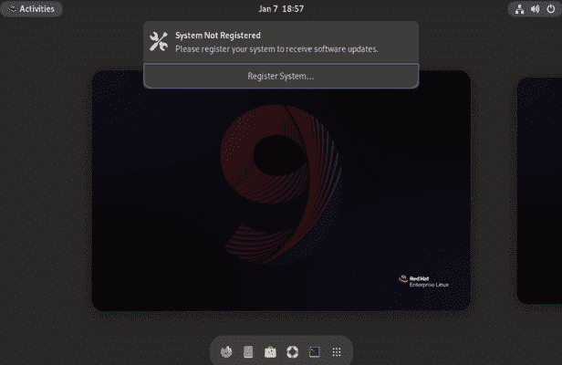

图 5.6

### 面向系统管理员的 64 位 Red Hat Enterprise Linux 9

在 GNOME 中，有两种方法可以使用您的 Red Hat 账户或 Red Hat 提供的激活密钥来注册或激活 RHEL 9 系统。

- * 从 GNOME 设置(Settings)，选择“关于”(About)，并向下滚动，您将看到 RHEL 9 系统尚未注册。点击“订阅”(Subscription)，并输入您的 Red Hat 账户或激活密钥来注册此系统，如图 5.7 所示：

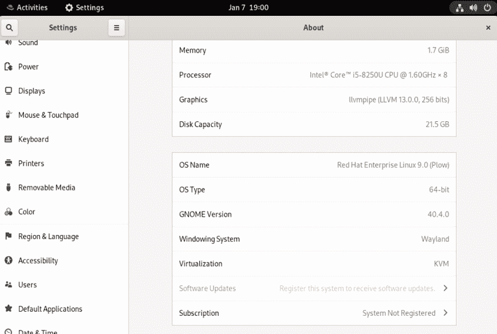

**图 5.7：** 通过 GNOME 设置注册 RHEL 9 系统。

- * 从 GNOME 中，您还可以使用 Red Hat 订阅管理器（Red Hat Subscription Manager)应用程序注册并激活 RHEL 9 系统。使用您的 Red Hat 账户或激活密钥注册 RHEL 9 系统，一旦通过验证，订阅管理器将显示系统已注册，如图 5.8 所示。最后，点击“自动挂载”(Auto-attach)按钮将此 RHEL 9 设置关联到相应的 Red Hat 账户。这将确保当 Red Hat 提供可用更新时，您的 RHEL 9 系统可以接收系统和安全更新。

## 管理 RHEL 9 订阅

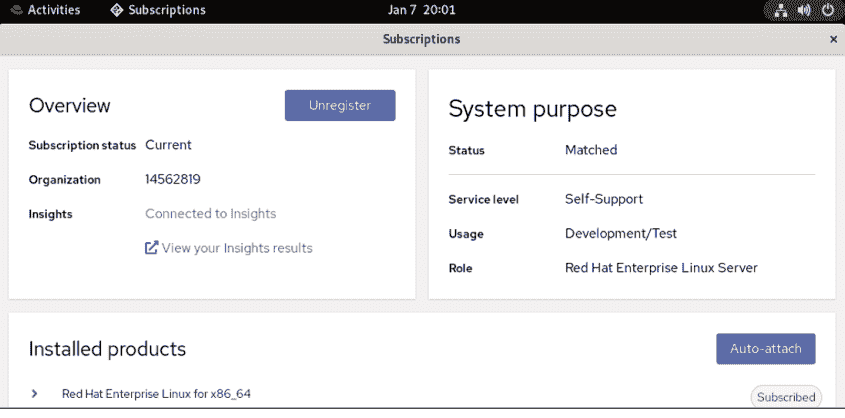

> 图 5.8：在 GNOME 中使用 Red Hat 订阅管理器注册的 RHEL 9 系统信息

一旦您的 RHEL 9 系统注册并激活了订阅，本配方的最后一个练习是验证激活并根据您的账户检查使用的权限。从 Red Hat 开发者门户（您也可以前往 Red Hat 客户门户），点击 Red Hat 页面右上角的账户图标并选择**订阅**(Subscriptions)。您将看到订阅使用情况摘要以及有关您已激活的 RHEL 9 系统的相关错误更信息，例如活动的安全公告、错误修复和产品增强。

点击**系统**(Systems) 显示您的 Red Hat 账户和已挂载订阅下的激活系统列表，如图 5.9 所示。从这里，您可以选择系统以检查其是否在订阅有效期内正确订阅以接收来自 Red Hat 的更新。

### 配方 #19：安装 sos 工具并生成系统报告

在从 Red Hat 获取官方技术支持之前，要做的的工作是生成一个包含您的 RHEL 9 安装和设置系统及诊断信息的报告。该报告由 sos 工具生成，称为 sos report。sos 报告是 Red Hat 技术支持工程师分析 RHEL 9 设置时使用的初始数据。从您的 RHEL 9 系统收集的数据将包括以下内容：

- 已安装的内核版本

- 系统和服务的配置

- 已安装的包

- sos 自身的命令输出

要生成 sos 报告，您首先需要安装 sos 工具。打开命令行并切换到 root。以 root 身份，使用 `dnf` 命令安装 `sos` 包：

1. `[jsg@rhel19-bpb ~]$ sudo -i`


2. `[sudo] password for jsg:`

3. `[root@rhel19-bpb]# dnf install sos`

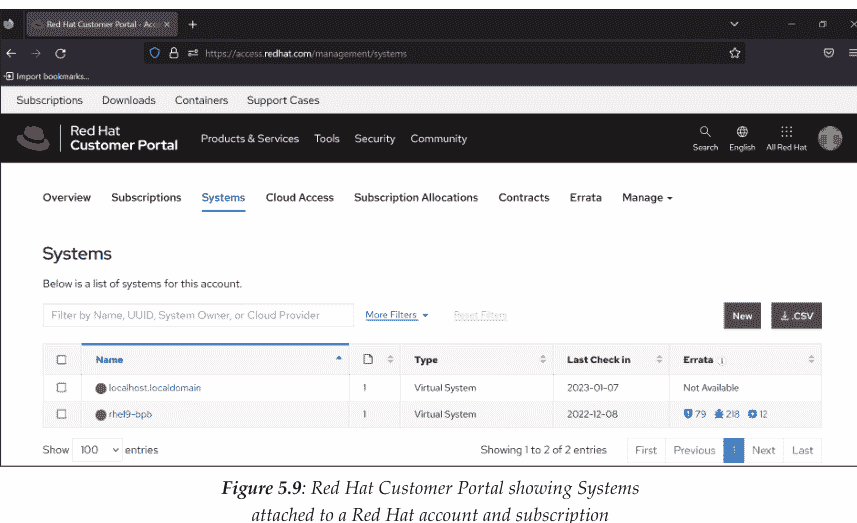

# 管理 RHEL 9 订阅

验证 `sos` 是否已安装，使用 `rpm` 查询命令：
1. `[root@rhel9-bpn ~]$ rpm -q sos`
2. `sos-4.3-5.el9_1.noarch`

一旦安装了 `sos` 工具，以 `sudo` 用户身份从命令行生成 `sos report`：
1. `[jsg@rhel9-bpn ~]$ sudo sos report`
2.
3. `sosreport (version 4.3)`
4.
5. 此命令将从
6. 此 Red Hat Enterprise Linux 系统和安装的应用程序收集诊断和配置。
7.
8. 一个包含收集信息的存档将在 `/var/tmp/sos.lp3vr96z` 生成，并可以提供给 Red Hat 支持代表。
9.
10. 提供给 Red Hat 的任何信息将根据
11. 公布的支持条款进行处理：
12.
13. 发行网站：https://www.redhat.com/
14. 商业支持：https://www.access.redhat.com/
15. 生成的存档可能包含被视为敏感的数据，在传递给任何方之前，应由源组织对其内容进行审查。
16.
17. 系统配置不会发生更改。
18.
19. 按回 继续 继续或按 CTRL-C 退出。

一旦 `sos` 报告完成，它将位于 `/var/tmp` 文件夹中，并准备发送给 Red Hat 支持。输出如下：
1. 您的 `sosreport` 已生成并保存在：
2. `/var/tmp/sosreport-rhel9-bpn-2023-01-06-qpkkn.tar.xz`
3.
4. 大小 11.65MiB
5. 所有者 root
6. `sha2563c1be975a5269acbb29aa2133c162ea9347f2be7001c51`
7. 请将此文件发送给您的支持代表。

# 面向系统管理员的 Red Hat Enterprise Linux 9

## 配方 #20：清理 sos 报告以移除敏感信息

如果您认为 `sos` 报告中的某些数据是敏感的，可以使用 `sos` 工具清理您的 RHEL 9 报告。需要对 `/var/tmp` 文件夹中生成的 `sos` 报告运行 `sos clean` 命令：
1. 您的 `sos` 报告已生成并保存在：
2. `/var/tmp/sosreport-rhel9-bpn-2023-01-06-qpkkn.tar.xz`
3.
4. 大小 11.65MiB
5. 所有者 root
6. `sha2563c1be975a5269acbb29aa2133c162ea9347f2be7001c51`
7. 请将此文件发送给您的支持代表。

# 面向系统管理员的 Red Hat Enterprise Linux 9

## 清理 sos 报告以移除敏感信息

如果您认为 `sos` 报告中的某些数据是敏感的，可以使用 `sos` 工具清理您的 RHEL 9 报告。需要对 `/var/tmp` 文件夹中生成的 `sos` 报告运行 `sos clean` 命令：
1. 找到 1 个待混淆的报告，正在处理。
2. `sosreport-rhel9-bpn-2023-01-06-qpkkn` 正在解压...
3. `sosreport-rhel9-bpn-2023-01-06-qpkkn` 正在混淆...
4. `sosreport-rhel9-bpn-2023-01-06-qpkkn` 正在重新压缩...
5. `sosreport-rhel9-bpn-2023-01-06-qpkkn` 混淆完成 [删除 879 个未处理的文件]
6. 成功混淆了 1 个报告
7. 混淆映射位于 `/var/tmp/sosreport-rhel9-bpn-2023-01-06-qpkkn-private_map`
8. 混淆存档位于 `/var/tmp/sosreport-rhel9-bpn-2023-01-06-qpkkn-obfuscated.tar.xz`
9. 大小 5.32MiB
10. 所有者 root
11. 请将混淆存档发送给您的支持代表，并保持映射文件私。
12. `sos clean` 命令将在 `/var/tmp` 与之前生成的 `sos` 报告一起创建两个新文件。第一个 `*-obfuscated.tar.xz` 文件是原始报告的清理版本，`*-private_map` 文件显示了 `sos clean` 执行期间混淆了哪些数据。

```
[$@rhel9-bpb ~] sudo ls -1 /var/tmp/sosreport-rhel9-bpn-2023-01-06-qpkkn-private_map /var/tmp/sosreport-rhel9-bpn-2023-01-06-qpkkn-obfuscated.tar.xz
```

```
-rw------- 1 root 5578196 Jan 08 14:28 /var/tmp/sosreport-rhel9-bpn-2023-01-06-qpkkn-obfuscated.tar.xz
```

```
-rw------- 1 root 3639 Jan 08 14:28 /var/tmp/sosreport-rhel9-bpn-2023-01-06-qpkkn-private_map
```

3. 要显示混淆元素的映射，可以对 `*-private_map` 文件执行 `cat` 操作：

```
[$@rhel9-bpb ~] cat *.*
```

# 06-qppkokn-private_map

02. `[sudo] password for jsg:`


```json
{
  "hostname_map": {
    "rhel19-bpb": "host0"
  },
  "ip_map": {
    "10.0.2.0/24": "100.0.0.0/24",
    "10.0.2.15/24": "100.0.0.1/24",
    "10.0.2.255": "100.0.0.255",
    "192.168.0.0/16": "101.0.0.1/16",
    "192.168.0.1": "101.0.0.2/16",
    "10.1.2.3": "47.13.37.22",
    "192.168.1.1": "101.0.0.3/16",
    "192.168.2.0/24": "102.0.0.1/24",
    "192.168.3.200": "101.0.0.4/16",
    "192.168.3.100": "27.47.97.70",
    "192.168.0.150": "101.0.0.5/16",
    "192.168.0.50": "101.0.0.6/16",
    "192.168.0.68": "101.0.0.7/16",
    "192.168.0.70": "101.0.0.8/16",
    "192.168.0.61": "101.0.0.9/16",
    "192.168.0.4": "101.0.0.10/16",
    "10.1.0.5": "81.62.35.46",
    "192.168.1.0/24": "103.0.0.1/24",
    "10.0.0.0/8": "104.0.0.1/8",
    "5.6.7.8": "51.18.97.86",
    "192.168.1.100": "103.0.0.2/24",
    "192.168.0.3": "101.0.0.11/16",
    "64.94.110.11": "43.30.96.11",
    "5.6.7.0": "42.73.14.54",
    "192.168.0.10": "101.0.0.12/16",
    "192.168.0.40": "101.0.0.13/16",
    "10.0.0.10": "104.0.0.2/8",
    "10.0.0.40": "104.0.0.3/8",
    "10.0.0.3": "100.0.0.2/24",
    "192.168.1.12": "103.0.0.3/24",
    "192.168.1.0/25": "105.0.0.1/25",
    "192.168.1.13": "105.0.0.2/25",
    "192.168.3.0/24": "106.0.0.1/24,
    "192.168.3.0": "107.0.0.1",
    "192.168.0.133": "101.0.0.14/16",
    "192.168.100.50": "101.0.0.150/16",
    "192.168.122.0/24": "108.0.0.1/24",
    "192.168.200.1": "101.0.0.1/16",
    "192.168.200.4": "101.0.0.17/16",
    "192.168.200.9": "101.0.0.18/16",
    "192.168.201.0/24": "109.0.0.1/24,
    "192.168.201.0/25": "110.0.0.1/25",
    "34.25.0.29": "37.32.81",
    "10.0.2.0/28": "111.0.0.1/28",
    "209.132.178.16": "58.40.42.59",
    "162.159.200.1": "60.40.42.52",
    "162.159.200.123": "36.78.47.44",
    "224.0.0.251": "26.21.97.40",
    "23.46.103.16": "92.38.65.96",
    "4.16.1.3": "83.16.37.11",
    "224.0.0.1": "62.48.31.44",
    "224.0.0.22": "31.56.71.18",
    "10.88.0.0/1": "112.0.0.1/16",
    "10.88.0.1": "112.0.0.2/16",
    "10.89.0.0/16": "113.0.0.1/16",
    "10.90.0.0/15": "114.0.0.1/15",
    "10.92.0.0/14": "115.0.0.1/14",
    "10.96.0.0/11": "116.0.0.1/11",
    "10.128.0.0/9": "117.0.0.1/9",
    "10.0.2.100": "100.0.0.3/24",
    "10.10.1.136": "104.0.0.4/8",
    "18.168.6.1": "22.98.89.24",
    "25.30.13.0": "70.60.19.65",
    "2.7.10.1": "77.48.57.54",
    "10.0.2.15/32": "111.0.0.1/15",
    "39.31.5.1": "99.99.16.31"
  },
  "mac_map": {
    "52:54:00:ca:01:98": "53:4f:f3:53:51:28:7c",
    "11:22:33:44:55:66": "53:4f:53:51:48:b2:09",
    "12:34:56:78:90:12": "53:4f:53:51:b9:18",
    "e4:45:74:68:00:00": "53:4f:53:64:e5:e3",
    "52:55:0a:00:02:02": "53:4f:53:f1:e9:cd",
    "52:55:0a:00:02:03": "53:4f:53:b1:b4:93",
    "01:00:5e:00:00:01": "53:4f:53:52:76:75",
    "33:33:00:00:00:01": "53:4f:53:d7:44:c6",
    "33:33:00:00:00:16": "53:4f:53:e1:53:cf",
    "33:33:ff:ca:01:98": "53:4f:53:48:ac:ae",
    "01:00:5e:00:00:fb": "53:4f:53:02:d0:cf",
    "33:33:00:00:00:fb": "53:4f:53:b7:be:d3",
    "52:56:00:00:00:02": "53:4f:53:c9:ed:07",
    "01:00:5e:00:00:16": "53:4f:53:07:f0:06",
    "33:33:00:00:00:16": "53:4f:53:c3:68:82"
  },
  "keyword_map": {},
  "username_map": {
    "jsg": "obuser"
  }
}
```

# 管理 RHEL 9 订阅

## 使用各种工具向 Red Hat 发送 sos 报告

sos 报告已生成。可以将 `*.tar.xz` 发送到 Red Hat 获取技术支持，前提是拥有商业订阅（适用于高级和标准版。不支持自助支持）。

1. `[jsg@rhel19-bpb ~$] sos report --upload`
2. `[sudo] password for jsg:`
3. `sosreport (version 4.3)`
4. 此命令将从 Red Hat Linux 系统和安装的应用收集诊断和配置信息。
5. 包含收集信息的存档将在 `/var/tmp/sos...` 生成并提供给 Red Hat 支持人员。
6. 提供给 Red Hat 的任何信息将根据以下发布的支持政策处理：
   - 发行网站：https://www.redhat.com/
   - 商业支持：https://www.redhat.com/
7. 生成的存档可能包含敏感数据，在传递给任何第三方之前应由源组织审核。
8. 不会对系统配置进行任何更改。
9. 按 `ENTER` 继续，或按 `CTRL-C` 退出。
10. 可选，请输入为此生成报告的案例 ID []：
11. 正在设置存档 ...
12. 正在设置插件 ...
13. `[plugin:networking] 跳过命令 'ip -s macsec show'：缺少命令 macsec。使用 '--allow-system-changes' 启用收集。`
14. `[plugin:networking] 跳过命令 'ss -peami'：缺少命令 xsk_diag。使用 '--allow-system-changes' 启用收集。`
15. `[plugin:sssd] 跳过命令 'sssctl config-check'：缺少服务 sssd。`


16. `[plugin:sssd]` 跳过命令 `sssctl domain-list`：缺少服务 `sssd`。

17. `[plugin:systemd]` 跳过命令 `systemd-resolve --status`：缺少服务 `systemd-resolved`。

18. `[plugin:systemd]` 跳过命令 `systemd-resolve --statistics`：缺少服务 `systemd-resolved`。

19. `[plugin:wireless]` 跳过命令 `iw list`：缺少内核模块 `cfg80211`。

20. `[plugin:wireless]` 跳过命令 `iw dev`：缺少内核模块 `cfg80211`。

21. `[plugin:wireless]` 跳过命令 `iwconfig`：缺少内核模块 `cfg80211`。

22. `[plugin:wireless]` 跳过命令 `iwlist scanning`：缺少内核模块 `cfg80211`。

23. 正在运行插件。请稍候

24. 正在完成插件 [正在运行: `subscription_manager`]

要管理 RHEL 9 订阅和权限，您首先需要创建一个 Red Hat 账户。这样做可以让您更容易地使用 Red Hat 客户门户管理您的 Red Hat 订阅和权限。Red Hat 账户还可以让您访问 Red Hat 开发者门户，该门户提供免费的 RHEL 开发者订阅，用于评估、测试和学习。在支持门户中创建支持请求也需要 Red Hat 账户。

在下一章中，我们将介绍在 RHEL 9 中配置额外软件仓库的步骤和细节，以便您可以根据需要扩展软件库。

# 第 6 章

## 配置软件仓库与 RHEL 9 更新

### 引言

红帽（Red Hat）对其开箱即用的软件包包以及从其官方软件仓库下载并安装的软件包提供官方支持。作为系统管理员（SysAd），你可能会遇到某些软件包未获得红帽官方支持的情况，但你仍需要将其安装并配置到你的系统中。为了实现这一点，你需要配置一个新的软件仓库，以便你能够安装和管理未由红帽提供或不受官方支持的软件包。

在本章中，我们将学习如何使用 `dnf` 工具管理软件包，配置新的软件仓库以便我们安装红帽未提供的额外软件包，更新我们的 RHEL 9 系统，并配置 `dnf` 以在需要时自动下载并更新 RHEL 9。

### 结构

在本章中，我们将讨论以下主题：

- 使用 `dnf` 命令管理软件包
- 根据需要添加额外的软件仓库，并理解它如何影响你的 RHEL 9 系统支持
- 配置 `dnf` 命令以更新新发布的软件更新和安全包

### 目标

在本章中，我们设定了以下 RHEL 目标：学习并理解 `dnf` 工具，以便能够为你的 RHEL 9 系统安装和更新软件包。该工具是系统管理员的必修课程；为你的 RHEL 9 系统添加并管理新的软件仓库，以便你可以安装红帽提供之外的软件包（例如专有或非自由软件包）并扩展系统的功能。

现在，让我们在你的 RHEL 9 系统中安装并管理它们吧！

## 教程 #22：配置 DNF 工具并更新 RHEL 9

默认情况下，RHEL 9 使用 `Dandified YUM` (DNF) 软件包管理器来安装和管理以 `Red Hat Package Manager` (RPM) 格式交付 RHEL 9 软件包。DNF 也用于 Fedora 以及所有其他基于红帽的发行版。此前，RHEL 使用 `yum` (Yellowdog Updater Modified) 作为默认工具，但从 RHEL 9 开始过渡到 DNF。虽然 `yum` 仍然可用，但你应该使用 `dnf`，其语法和标志非常相似。因此，让我们开始一些基础的 DNF 命令，这些命令将帮助你管理 RHEL 9 设置。

在升级任何软件包之前，理想的做法是检查是否有可用的更新：

1. `[jsg@rhel9-byp ~]$ sudo dnf check-update`
2. 更新 Subscription Management 仓库。
3. 最后元数据过期检查：2023年1月14日星期六下午01:41:55 PST 2:03:03 前。

如果有可用的软件包更新，你可以仅升级特定软件包：

1. `[jsg@rhel9-byp ~]$ sudo dnf upgrade <package>`

你也可以使用 `dnf` `upgrade` 命令升级所有可用的软件包：

1. `[jsg@rhel9-byp ~]$ sudo dnf upgrade`

如果你想安装新软件包，可以进行搜索。如果你不软件包名称，可以使用特定的关键词：

1. `[jsg@rhel9-byp ~]$ sudo dnf search emacs`
2. 更新 Subscription Management 仓库。
3. 最后元数据过期检查：2023年1月14日星期六下午01:41:55 PST 1:24:22 前。

### 配置软件仓库 RHEL 9 更新

4. ======================== 名称与摘要匹配项：
5. `emacs` ===========================
6. `emacs.x86_64` GNU Emacs 编辑器
7. `emacs-auctex.noarch` Emacs 增强 TeX 模式
8. `emacs-common.x86_64` Emacs 公共文件
9. `emacs-filesystem.noarch` Emacs 文件系统布局
10. `emacs-lucid.` x86_64 带有 LUCID toolkit 支持 的 GNU Emacs 编辑器
11. `emacs-noc.x86_64` 不支持 X 的 GNU Emacs 编辑器

如上述搜索所示，我们可以安装 `emacs.x86_64` 软件包。让我们使用 `install` 命令来执行操作。所有的软件包依赖项都将被安装，以确保 `emacs.x86_64` 运行：

```
1. [jsg]@rhel19-byp ~] sudo dnf install emacs.x86_64
2. 更新 Subscription Management 仓库。
3. 最后元数据过期检查：2023年1月14日星期六下午01:41:55 PST 02:12:09 前。
4. 依赖已解决。
```

5. ============================================================
==============================================================

| 软件包 | 架构 | 版本 | 大小 |
| --- | --- | --- | --- |
==============================================================

7. 仓库
8. 安装中:
9. `emacs` x86_64 1:27.2-6.619 rhel-9-for-x86_64-appstream-rpms 3.3 M
10. 正在依赖项:
11. `emacs-common` x86_64 1:27.2-6.619 rhel-9-for-x86_64-appstream-rpms 36 M
12. `libXaw` 1:0.13-19 rhel-9-for-x86_64-appstream-rpms 200 k
13. `libotf` x86_64 0.9.13-20 rhel-9-for-x86_64-appstream-rpms 106 k
14. `m17n-db` noarch 1.8.0-16 rhel-9-for-x86_64-appstream-rpms 661 k
15. `m17n-lib` x86_64 1.8.0-13 rhel-9-for-x86_64-appstream-rpms 201 k
16. 事务摘要
17. ============================================================
==============================================================

Red Hat Enterprise Linux 9 for Sysadmins

18. 安装 6 个软件包
19. 总下载大小:41 M
20. 安装大小:9 M
21. 是否确认 [y/N]: y
22. 正在下载软件包:
23. (1/6): libotf-0.9.13-20.el19.x86_64 36 kB/s | 106 KB
24. (2/6): emacs-27.2-6.el19.x86_64 775 kB/s | 3.3 MB
25. (3/6): emacs-common-27.2-6.el19.x86_64 6.7 MB/s | 36 MB
26. (4/6): m17n-db-1.8.0-16.el19.noarch 260 kB/s | 661 KB
27. (5/6): libXaw-1.0.13-19.el19.x86_64 281 kB/s | 200 KB


28. `m17n-lib-1.8.0-13.el19.x86_64` 113 kB/s | 201 KB

29. 总计 6.6 MB/s | 41 MB

30. 正在运行事务检查

31. 事务检查成功。

32. 正在运行事务测试

33. 事务测试成功。

34. 正在运行事务

35. 准备 1/1

36. 安装中: `libXaw-1.0.13-19.el19.x86_64` 1/6

37. 安装中: `libotf-0.9.13-20.el19.x86_64` 2/6

38. 安装中: `m17n-db-1.8.0-16.el19.noarch` 3/6

39. 安装中: `m17n-lib-1.8.0-13.el19.x86_64` 4/6

40. 安装中: `emacs-common-27.2-6.el19.x86_64` 5/6

41. 安装中: `emacs-27.2-6.el19.x86_64` 6/6

42. 正在运行脚本: `emacs-common-1:27.2-6.el19.x86_64` 6/6

43. 正在运行脚本: `emacs-1:27.2-6.el19.x86_64` 6/6

44. 正在验证: `libotf-0.9.13-20.el19.x86_64` 1/6

45. 正在验证: `emacs-1:27.2-6.el19.x86_64` 2/6

46. 正在验证: `emacs-common-1:27.2-6.el19.x86_64` 3/6

47. 正在验证: `m17n-db-1.8.0-16.el19.noarch` 4/6

48. 正在验证: `m17n-lib-1.8.0-13.el19.x86_64` 5/6

49. 正在验证: `libXaw-1.0.13-19.el19.x86_64` 6/6

50. 已安装产品已更新。

51. 完成！

你现在可以在控制台中运行 `emacs`，或者从 GNOME 中启动它，如图 6.1 所示：

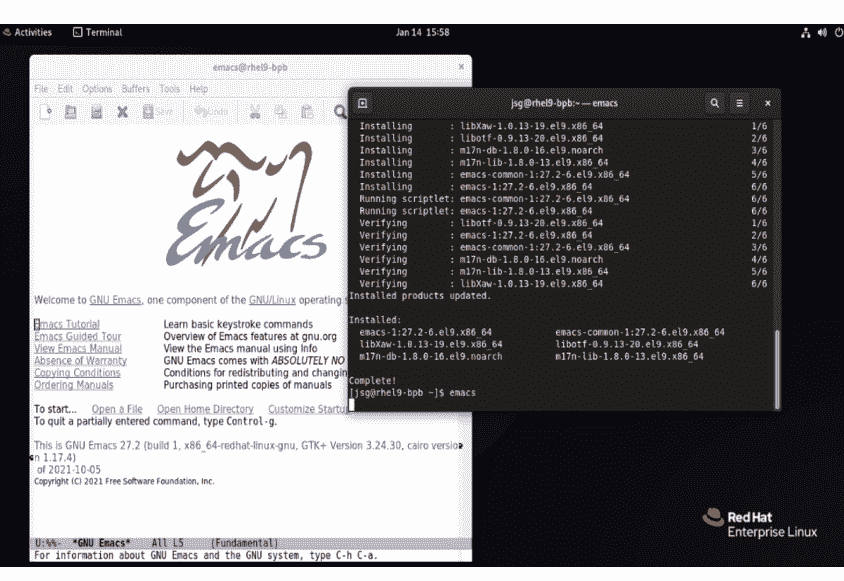

图 6.1：dnf install 后运行的 emacs

# 教程 #23：安装并配置 EPEL 仓库

开源开源在于选择，这是企业采用 Linux 时的关键考虑因素，而 RHEL 9 是实现这一优势的首选。然而，在某些情况下，你可能希望在 RHEL 9 中安装某个软件，但它并未包含在红帽提供的官方支持列表和仓库中。鉴于 RHEL 9 基于 Fedora 的卓越工作，后者中提供了大量的软件应用程序和平台，但这些内容未被包含在前者的官方支持软件包中。

这导致了 Fedora 项目内部创建了一个名为 Extra Packages for Enterprise Linux (EPEL) 的特殊兴趣小组 (SIG)，它提供了让 Fedora 变得强大的额外软件包，并使其对 RHEL 和其他基于红帽的发行版可用且兼容。EPEL 可以作为一个仓库被添加到你的 RHEL 9 设置中。

现在，让我们在你的 RHEL 9 系统中安装并配置 EPEL 仓库。首先，你需要启用 CodeReady Builder 仓库。这是红帽提供的官方仓库，提供了通常对软件开发者有用的额外软件包。

## 配置软件仓库和 RHEL 9 更新

1. `[jsg@rhel9-bpb ~] sudo subscription-manager repos --enable codeready-builder-for-rhel-9-$(arch)-rpms`
2. `[sudo] password for jsg:`
3. 仓库 `[codeready-builder-for-rhel-9-x86_64-rpms]` 已为此系统启用。

接下来，让我们从 Fedora Project 仓库远程安装 EPEL.RPM 包：

1. `[jsg@rhel9-bpb ~] sudo dnf install \`
2. `https://dl.fedoraproject.org/pub/epel/epel-release-latest-9.noarch.rpm`
3. 更新订阅管理仓库检查：0:00:34 前，于 2023年1月14日 周六 晚上 08:55:53 PST。
4. `epel-release-latest-9.noarch.rpm` 18 kB/s | 18 kB 00:01
5. 依赖关系已解析。

| 包 | 架构 | 版本 |
|---|---|---|
| 仓库大小 | | |

10. 安装中：
11. `epel-release noarch 9-4.el9 @commandline 18 k`
12.
13. 事务摘要
14.
15. 安装 1 个包
16.
17. 总大小：18 k
18. 安装后大小：25 k
19. 是否确认 [y/N]: y
20. 正在下载包：
21. 正在运行事务检查
...

# 运维管理员的 Red Hat Enterprise Linux 9

26. 准备中：1/1
27. 安装中：`epel-release-9-4.el9.noarch` 1/1
28. 运行脚本：`epel-release-9-4.el9.noarch` 1/1
29. 许多 EPEL 包需要 CodeReady Builder (CRB) 仓库。
30. 建议你运行 `/usr/bin/crb enable` 来启用 CRB 仓库。
31.
32. 验证中：`epel-release-9-4.el9.noarch` 1/1
33. 已更新产品更新。
34.
35. 已安装：
36. `epel-release-9-4.el9.noarch`
37.
38. 完成！

一旦安装 EPEL RPM，使用 `dnf update` 再次更新仓库：

1. `[jsg@rhel-9byp~$] sudo dnf update`

现在让我们刷新并安装一个应用程序。在本次教程中，让我们安装 `htop`，这是一种流行的交互式系统监控器、进程查看器和进程管理器。它是默认安装的 `top` 工具的极佳替代方案，因为它提供了更好的视觉界面：

1. `[jsg@rhel-9byp~$] sudo dnf install htop.x86_64`
2. 正在更新订阅管理仓库。
3. 最后元数据过期检查：0:18:20 前，于 2023年1月14日 周六 晚上 08:59:06 PST。
4. 依赖关系已解析。

```
=================================================
```

| 包 | 架构 | 版本 |
| 仓库 | 大小 |

```
=================================================
```

7.
8. 安装中。
9. `htop x86_64 3.2.1-1.el9 epel 181 k`
10.
11. 事务摘要

# 配置软件仓库和 RHEL 9 更新 85

```
====================================
===============
13. 安装 1 个包
14.
15. 总下载大小：181 k
16. 安装后大小：428 k
17. 是否确认 [y/N]: y
18. 正在下载包：
19. `htop-3.2.1-1.el9.x86_64.rpm` 3.4 kB/s | 181 kB 00:53
20.
```

21. 总计 3.3 kB/s | 181 kB 00:54
22. 正在运行事务检查
23. 事务检查成功。
24. 正在运行事务测试
25. 事务测试成功。
26. 正在运行事务
27. 准备中：1/1
28. 安装中：`htop-3.2.1-1.el9.x86_64` 1/1
29. 运行脚本：`htop-3.2.1-1.el9.x86_64` 1/1
30. 验证中：`htop-3.2.1-1.el9.x86_64` 1/1
31. 已更新产品更新。
32.
33. 已安装：`htop-3.2.1-1.el9.x86_64`
34.
35. 完成！

在命令行中，只需输入 `htop`，你就能看到该应用程序在终端中运行，如图 6.2 所示：

# 运维管理员的 Red Hat Enterprise Linux 9


图 6.2：在 RHEL 9 中运行 top

由于 EPEL 是 Fedora 项目的一部分，你可以通过 `https://mirrors.rpmfusion.org/` 访问 RPM Fusion 免费和非免费仓库。

由于 EPEL 提供了 RHEL 9 的一些软件包，管理员需要通过 `https://mirrors.rpmfusion.org/free/el/9/rpmfusion-free-release-9.noarch.rpm` 和 `https://mirrors.rpmfusion.org/nonfree/el/9/rpmfusion-nonfree-release-9.noarch.rpm` 来启用 RHEL 9 的免费和非免费仓库。


由于 EPEL 提供了 RHEL 9 的一些软件包，你可以考虑替代在 RHEL 9 中运行的 `top`。

## 配方 #25：管理 RHEL 9 软件包

如配方 #22 所示，`dnf` 是一个安装新软件包和更新 RHEL 9 系统的便捷工具。该工具的使用不仅限于 Red Hat 提供的软件包，还包括我们在 `配方 #23` (EPEL) 和 `配方 #24` (RPM Fusion) 中添加的存储库。现在让我们深入了解如何使用 `dnf` 来管理 RHEL 9 系统中的软件包。

要检查 RHEL 9 系统中激活的存储库列表，请执行 `repolist`：

1. `[jsg@rhel9-bpb ~]$ sudo dnf repolist`
2. 正在更新订阅管理存储库。
3. repo id repo name
4. codeready-builder-for-rhel-9-x86_64-rmps
   Red Hat CodeReady Linux Builder for RHEL 9 x86_64 (RPMs)
5. epel
   Extra Packages for Enterprise Linux 9 - x86_64
6. rhel-9-for-x86_64-appstream-rmps
   Red Hat Enterprise Linux 9 for x86_64 - AppStream (RPMs)
7. rhel-9-for-x86_64-baseos-rpps
   Red Hat Enterprise Linux 9 for x86_64 - BaseOS (RPMs)
8. rmfusion-free-updates
   RPM Fusion for EL 9 - Free - Updates
9. rmfusion-nonfree-updates
   RPM Fusion for EL 9 - Nonfree - Updates

你也可以通过调用 `repolist all` 来列出所有可用和禁用的存储库：

```bash
[jsg@rhel9-bpb ~]$ sudo dnf repolist all
```

该命令将提供已启用和已禁用的存储库列表。由于这是一个很长的列表，因此此处不显示命令的输出。

如果你希望启用某个存储库并安装特定的软件包，可以在一行中完成调用：

```bash
[jsg@rhel9-bpb ~]$ sudo dnf --enablerepo=repo-name install package
```

管理软件包时需要考虑的另一点是能够列出所有已安装的软件包。在终端中，你可以使用 `list installed` 命令列出所有软件包：

```bash
[jsg@rhel9-bpb ~]$ sudo dnf list installed
```

这将会是一个很长的列表，因此我们没有包含输出。但你将获得软件包的详细信息，以及它们是从哪个存储库安装的信息。

## 配置软件存储库和 RHEL 9 更新

当你需要检查上周安装了哪些软件包时，请执行 `dnf list recent` 命令：

```bash
[rhel-19-bpw~$] sudo dnf list recent
```

假设你需要检查从已启用存储库中可以安装的可用软件包。在搜索之后，你只需调用 `dnf list available` 命令。与之前的示例一样，列表会很长，因此我们在此处不包含输出。

```bash
[rhel-19-bpw~$] sudo dnf list available
```

在配方 #22 中，我们安装了带有所需依赖的 `emacs` 软件包。我们可以使用 `remove` 命令删除 Emacs。但这只会删除 Emacs 软件包以及我们之前安装的依赖项，因此系统中留下的几乎毫无用处，只会占用磁盘空间。所以，最好同时删除 Emacs 及其不再需要的依赖项。要做到这一点，请使用 `autoremove` 命令。

```
[jsg@rhel-19-bpw~$] sudo dnf autoremove emacs.x86_64
[sudo] password for jsg:
正在更新订阅管理存储库
依赖已解析。
============================================================

| Package | Arch | Version | Repository |
| :--- | :--- | :--- | :--- |
| | | | |
| Removing: | | | |
| emacs | x86_64 | 27.2-6.el9 | @rhel-9-for-x86_64-appstream-rpms (16 M) |
| Removing unused dependencies: | | | |
| emacs | x86_64 | 27.2-6.el9 | @rhel-9-for-x86_64-appstream-rpms (89 M) |
| libXaw | x86_64 | 1.0.13-19.el9 | @rhel-9-for-x86_64-appstream-rpms (498 k) |
| libotf | x86_64 | 0.9.13-20.el9 | @rhel-9-for-x86_64-appstream-rpms (240 k) |
| m17n-db | noarch | 1.8.0-16.el9 | @rhel-9-for-x86_64-appstream-rpms (9 M) |
| m17n-lib | x86_64 | 1.8.0-13.el9 | @rhel-9-for-x86_64-appstream-rpms (458 k) |
| Transaction Summary | | | |
===========================================================
Red Hat Enterprise Linux 9 for SysAd
===================================================
Remove 6 Packages
Freed space: 109 M
Is this ok [y/N]: y
Running transaction check
Transaction succeeded.
Running transaction test
Transaction succeeded.
Running transaction
Preparing: 1/1
Running scriptlet: emacs-27.2-6.el9.x86_64 (1/6)
Erasing: emacs-27.2-6.el9.x86_64 (1/6)
Erasing: m17n-lib-1.8.0-13.el9.x86_64 (2/6)
Erasing: libotf-0.9.13-20.el9.x86_64 (3/6)
Erasing: m17n-db-1.8.0-16.el19.noarch (4/6)
Erasing: libXaw-1.0.13-19.el9.x86_64 (5/6)
Running scriptlet: emacs-27.2-6.el9.x86_64 (1/6)
Erasing: emacs-common-27.2-6.el19.x86_64 (6/6)
Running scriptlet: emacs-common-27.2-6.el19.x86_64 (6/6)
Verifying: emacs-27.2-6.el19.x86_64 (1/6)
Verifying: emacs-common-27.2-6.el19.x86_64 (2/6)
Verifying: libXaw-1.0.13-19.el19.x86_64 (3/6)
Verifying: libotf-0.9.13-20.el19.x86_64 (4/6)
Verifying: m17n-db-1.8.0-16.el19.noarch (5/6)
Verifying: m17n-lib-1.8.0-13.el19.x86_64 (6/6)

Verifying: m17n-lib-1.8.0-13.el19.x86_64 (6/6)
Installed products updated.

Removed:
emacs-1:27.2-6.el19.x86_64 emacs-common-1:27.2-6.el19.x86_64
libXaw-1.0.13-19.el19.x86_64 libotf-0.9.13-20.el19.x86_64
m17n-db-1.8.0-16.el19.noarch m17n-lib-1.8.0-13.el19.x86_64
Complete!
```

## 配方 #26：使用 DNF Automatic 自动化软件更新


在需要自动更新更新和安装安全补丁时，RHEL 9 提供了一个名为 DNF Automatic 的便捷工具。该工具的参数在配置文件中设置，命令将根据文件中设置的信息或数据执行。DNF Automatic 可以设置为执行以下结果：

- 通知并退出：在运行 DNF Automatic 工具检查更新后发送通知。
- 下载更新：仅下载更新的软件包。
- 下载并安装更新：下载包然后进行安装，类似于您按需运行 `dnf`。

# 配置软件存储库 RHEL 9 更新 95

要启用 DNF 自动更新（Automatic），请从控制台安装 `dnf-automatic` 软件包：

1. `[Jsg@rhel_9-bpb ~$]$ sudo rpm install dnf-automatic`
2. 名称：`dnf-automatic`
3. 版本：`4.12.0`
4. 发布版本：`4.el9`
5. 架构：`noarch`
6. 安装日期：`2023年1月14日 周六 12:58:22 PM PST`
7. 组：未指定
8. 大尺寸：`53144`
9. 许可证：`GPLv2`
10. 签名：`RSA/SHA256, 2022年9月15日 周四 10:39:24 PM PST, Key ID 199e2f91fd43d51`
11. 源 RPM：`dnf-4.12.0-4.el9.src.rpm`
12. 构建日期：`2022年9月15日 周四 08:05:47 PM PST`
13. 构建主机机：`x86-64-02.build..2.redhat.com`
14. 打包员：`Red Hat, Inc. <http://bugzilla.redhat.com/bugzilla/>`
15. 供应商：`Red Hat, Inc.`
16. URL：`https://github.com/rpm-software-management/dnf`
17. 摘要：包管理器 - 自动升级
18. 描述：定期下载包更新并应用它们的系统单元。

接下来，在 `dnf-automatic` 已安装的情况下，使用 `rpm` 命令进行验证：

验证通过后，用文本编辑器打开 `/etc/dnf/automatic` 文件，并按照您希望 `dnf-automatic` 运行的方式设置工具的操作和行为。配置文件对您设置的参数有详细注释，并默认包含以下设置的四个关键部分：

### [commands_type]

`upgrade_type = default`（此默认设置执行所有可用的更新。此项也可以设置为 `security` 以仅执行安全更新）。

`network_online_timeout = 60`（定义工具连接到 Red Hat 存储库的最大秒数。默认设置为 `60 秒`）。

`download_updates = yes`（当更新可用时将下载更新。将其设置为 `no` 则仅检查更新而不会下载它们）。

`apply_updates = no`（默认不会应用更新。如果设置为 `yes`，则在下载后应用更新）。

`emit_via = stdio`（设置 `dnf-automatic` 发送消息的方式。默认设置为 `stdio`，这在设置发送消息的 `cron` 任务时非常有用。其他选项包括 `emit` 和 `motd`。如果留空，则不会发送任何消息）。

`email_from = root@example.com`（如果 `emit_via` 设置为 `email`，消息将从此处的电子邮件地址发送）。

`email_to = root`（您可以设置希望接收消息的地址）。

`email_host = localhost`（设置发送电子邮件消息的主机）。

`email_from = root@example.com`（这是从后台执行的 shell 命令，用于向来自 `[email]` 部分的接收者发送电子邮件）。

设置好 `automatic.conf` 文件的输入参数后，作为 `sudo` 用户启用 `systemctl` 以启用 DNF 自动更新：

1. `[js@relhel19-b~$] sudo systemctl enable --now dnf-automatic.timer`

启用后，检查计时器现在已设置：

1. `[js@relhel19-b~$] systemctl list-timers dnf-`
2. `NEXT LEFT LAST PASSED`
3. `2023-01-14 15:12:13 PST 15min left Sat 2023-01-14 13:41:51 PST 1h 14min ago`


**图 7.2:** 在“运行命令”窗口中运行 `firefox` 浏览器

- 你也可以通过输入应用程序名称并按回车键从终端运行应用程序。请注意，在你运行应用程序时，终端将保持打开状态。如果你想将命令行用于其他用途，可以新的终端会话。

## 教程 #28：使用 GNOME Software 应用程序管理器管理和安装应用程序

你可以使用 GNOME Software 应用程序管理器（或 Software）安装新应用程序并管理现有的应用程序（前提是图形化应用程序）。可用应用程序按分类分组以便参考，你还可以使用关键词进行搜索，Software 将根据搜索结果提供建议。

现在让我们学习通过 GNOME Software 应用程序管理器安装新图形化应用程序的步骤：

- 1. **运行 GNOME Software 应用程序管理器工具：** 从 GNOME 桌面，点击桌面左角的“活动”（Activities）。从这里，你可以选择 3 种运行 Software 的方法：
    a. 从搜索栏中直接输入 `Software`，即可显示应用程序图标。
    b. 从 GNOME 桌面的底部面板，点击看起来像白色公包的图标。这将启动 GNOME Software 应用程序管理器。
    c. 从 GNOME，打开终端并使用 `gnome-software` 命令启动 Software。
- 2. **了解 GNOME Software 应用程序管理器工具：** 当 GNOME Software 应用程序管理器打开时，你将看到如下方**图 3.3** 所示的界面：

使用 GNOME 桌面管理 RHEL 9

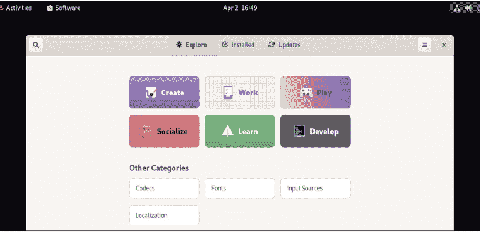

现在让我们查看应用程序界的一些细节：

- a. **搜索图标：** 要查找应用程序，可以点击界面左上角的放大镜图标。点击此图标将激活中间的搜索栏，你可以在其中搜索可以安装的新应用。
- b. **探索（Explore）：** 这是默认显示的内容，允许你浏览并列出分类分类的应用程序。
- c. **已安装（Installed）：** 此处将显示已安装应用程序的列表。你也可以点击“卸载”按钮来卸载不再使用的应用程序。
- d. **更新（Updates）：** 如果有系统和应用程序更新，你可以从此部分安装它们。
- e. **设置（Settings）：** 通过点击界面右上角的三条线图标，可以配置某些应用程序设置，例如激活额外的软件源或禁用当前的源、设置更新偏好（如自动更新和通知），以及在应用程序的“关于”部分阅读应用程序信息和致谢。
- 3. **安装应用程序：** 要安装应用程序，请通过 GNOME Software 应用程序中提供的选项进行选择。你可以使用上一节中提到的搜索或探索选项。在下方的示例*图 3.4* 中，正在安装 *GNU Emacs* 编辑器，并显示安装状态。安装 *GNU Emacs* 所需的所有依赖项也正在后台安装。

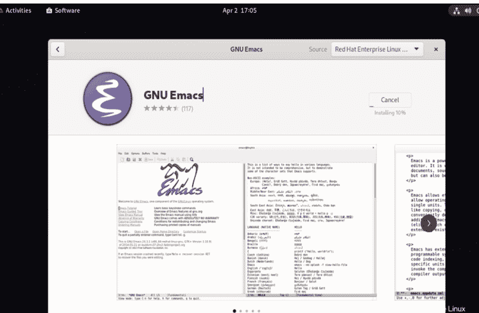

**图 7.4:** 使用 GNOME Software 工具安装 GNU Emacs 编辑器

安装完成后，“取消”按钮将变为“打开”。当从 GNOME 桌面点击“显示应用程序”快捷方式时，也会出现 GNU Emacs 图标。

**管理已安装的应用程序：** 你可以通过在 GNOME Software 应用程序管理器中选择“已安装”来查看已安装应用程序列表并管理它们。将显示已安装的应用程序，你可以通过如图 3.5 所示的点击**卸载**按钮来移除应用程序。

使用 GNOME 桌面管理 RHEL 9

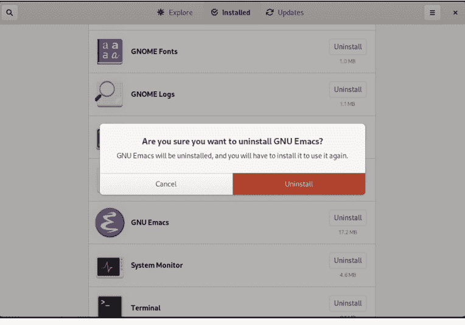

图 7.5: 卸载 GNU Emacs 应用程序

- **更新应用程序：** 如果有应用程序或系统更新，你可以从此部分安装它们。你可以根据需要查看呈现的详细信息并应用更新。如果没有可用更新，“更新”将显示你的系统已是最新状态，如*图 3.6* 所示：

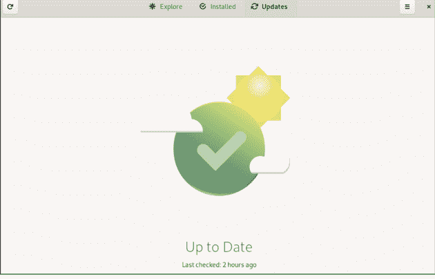

图 7.6

## 教程 #29：在 GNOME 中管理存储


GNOME 中的磁盘（Disks）工具主要用于管理你的 GNOME 桌面上的存储。你可以从“显示应用程序”选择“工具”，并选择“磁盘”。让我们查看在 GNOME 中管理存储的一些基本操作。

# 使用 GNOME 桌面管理 RHEL 9

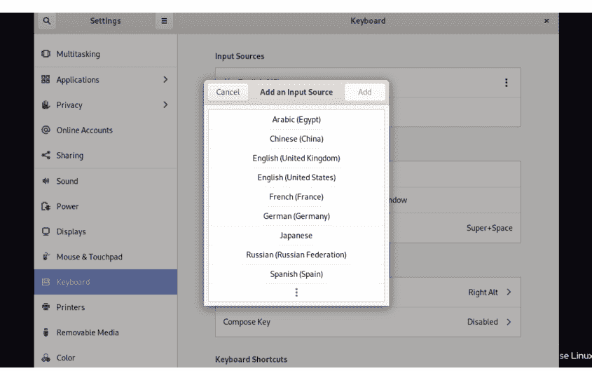

- 选择语言输入并点击“添加”（Add），将其包含在 GNOME 设置的“输入源”（Input Sources）中。
- 要验证您已添加了新的输入源，系统桌面右上角将添加语言图标，如图 3.10 所示。

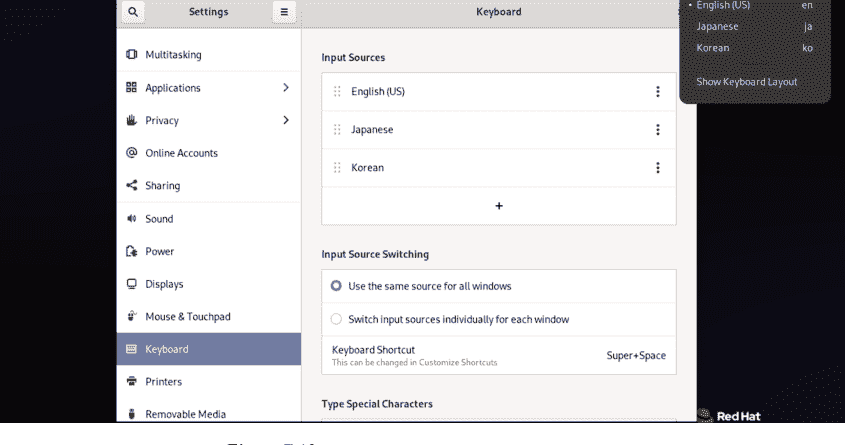

- 5. 如要切换语言输入，可以从顶部的语言图标进行选择，或者使用 `Super + Spacebar` 快捷键在语言输入之间切换。Super 键通常是您键盘上的 Windows 键。

## 在 GNOME 中设置登录时自动运行的应用程序

您还可以设置 GNOME 在登录时启动指定的应用程序。这使得某些应用程序在您每次登录 GNOME 会话时都可用，在某些情况下非常方便。要设置自动运行或启动应用程序，您需要安装一个名为 GNOME Tweaks 的工具：

```
[jsg@rhel19_bpp ~]$ sudo dnf install gnome-tweaks
```

- 安装好 GNOME Tweaks 后，从“显示应用程序”（Show Applications）中的“实用工具”（Utility）组中打开该程序。在左侧导航窗中选择“启动应用程序”（Startup Applications），并点击 `+` 按钮添加应用程序。在下方的图 3.11 中，添加了终端（Terminal）应用程序启动时运行：

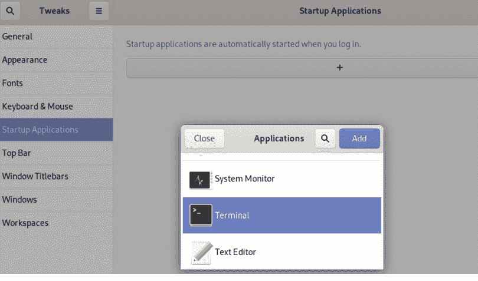

**图 7.11：** 在 GNOME 中添加终端应用程序在登录时运行

- 3. 关闭 GNOME Tweaks 应用。现在每当执行登录 GNOME 桌面时，终端应用程序将在启动时运行并准备好使用。

## 使用 GNOME Tweaks 定制您的 GNOME 桌面环境体验

您可能已经注意到，设置启动时运行的应用程序只是您使用 GNOME Tweaks 可以进行的操作之一。

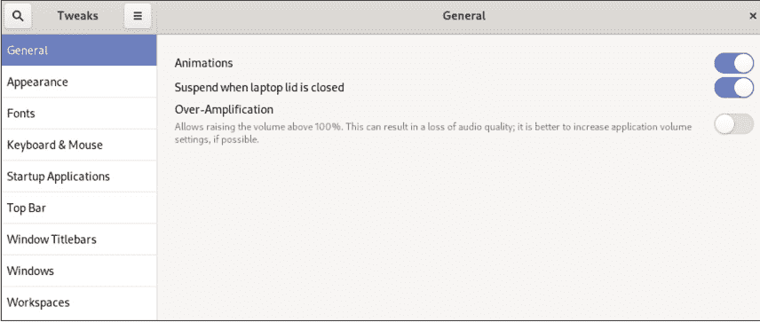

图 7.12：GNOME Tweaks

您可以定制 GNOME 桌面的外观和感受。让我们查看一下您可以在桌面中配置的调整（Tweaks）列表：

- `通用（General）`：您可以配置关闭桌面动画、在笔记本电脑配置 RHEL 9 时设置为挂起，以及过度放大系统音量。然而，不建议这样做，基于应用程序的音量控制仍然是优先方法。
- `外观（Appearance）`：您可以更改 GNOME 的主题细节、背景和锁定屏幕。
- `字体（Fonts）`：您可以更改字体，以及显示字体的提示、抗锯齿和缩放因子。
- `键盘与鼠标（Keyboard & Mouse）`：您可以更改键盘和鼠标的行为，并通过此设置启用输入源。
- `启动应用程序（Startup Applications）`：如本食谱上一节所述，您可以设置某些应用程序在启动时运行。
- `顶栏（Top Bar）`：您可以从顶栏启用时钟选项、日历周数、电池百分比和热点角。
- `窗口标题栏（Window Titlebars）`：您可以更改点击时标题栏的行为。
- `窗口（Windows）`：您可以更改窗口在拖动到屏幕边缘时、点击时调整大小的行为、分配 Windows 动作键的行为，并为 Windows 焦点设置键盘操作。
- `工作空间（Workspaces）`：您可以在动态和静态工作空间之间切换，设置静态工作空间的最大数量，并在您使用多个显示器时显示工作空间的处理情况。

## 结论

GNOME 桌面每当执行登录 GNOME 桌面时，终端应用程序将在启动时运行并准备好使用。由于在笔记本电脑配置 RHEL 9 时设置为挂起，以及过度放大系统音量。然而，不建议这样做，基于应用程序的音量控制仍然是优先方法。由于每当执行登录 GNOME 桌面时，终端应用程序将在启动时运行并准备好使用。由于每当执行登录 GNOME 桌面时，终端应用程序将在启动时运行并准备好使用。由于每当执行登录 GNOME 桌面时，终端应用程序将在启动时运行并准备好使用。由于每当执行登录 GNOME 桌面时，终端应用程序将在启动时运行并准备好使用。由于每当执行登录 GNOME 桌面时，终端应用程序将在启动时运行并准备好使用。由于每当执行登录 GNOME 桌面时，终端应用程序将在启动时运行并准备好使用。由于每当执行登录 GNOME 桌面时，终端应用程序将在启动时运行并准备好使用。由于每当执行登录 GNOME 桌面时，终端应用程序将在启动时运行并准备好使用。由于每当执行登录 GNOME 桌面时，终端应用程序将在启动时运行并准备好使用。由于每当执行登录 GNOME 桌面时，终端应用程序将在启动时运行并准备好使用。由于每当执行登录 GNOME 桌面时，终端应用程序将在启动时运行并准备好使用。由于每当执行登录 GNOME 桌面时，终端应用程序将在启动时运行并准备好使用。由于每当执行登录 GNOME 桌面时，终端应用程序将在启动时运行并准备好使用。由于每当执行登录 GNOME 桌面时，终端应用程序将在启动时运行并准备好使用。由于每当执行登录 GNOME 桌面时，终端应用程序将在启动时运行并准备好使用。由于每当执行登录 GNOME 桌面时，终端应用程序将在启动时运行并准备好使用。由于每当执行登录 GNOME 桌面时，终端应用程序将在启动时运行并准备好使用。由于每当执行登录 GNOME 桌面时，终端应用程序将在启动时运行并准备好使用。由于每当执行登录 GNOME 桌面时，终端应用程序将在启动时运行并准备好使用。

```php
phpinfo();
?>
```

保存并退出 `info.php` 文件。在桌面上，打开 浏览器并访问地址 http://your_server_IP_address/info.php。请将 URL 占位符替换为你的服务器 IP 地址。如果你看到一个显示 PHP 信息的页面，说明你的 LAMP 栈已正确安装。请记住在检查后删除此文件，以避免暴露服务器的 PHP 配置信息：

```bash
[jsg@rhel9_bpf ~]$ sudo rm /var/www/html/info.php
```

在互联网上设置服务器时，请务必始终遵循最佳安全实践。本指南仅包含基础设置，不包括保护你的服务器免受威胁的步骤。

## 菜谱 #33：安装和配置 NGINX

NGINX 是一个 Web 服务器，也可以被配置为负载均衡器、反向代理、邮件代理和 HTTP 缓存。这种多功能服务器一直是系统管理员构建稳健的面向公众的 Web 基础设施的首选。让我们完成在 RHEL 9 上安装和配置 NGINX 的步骤。

打开控制台并更新包仓库。如果你还没有添加包含 NGINX 的 EPEL 仓库，现在也是这样做的好时机。关于 EPEL 仓库的更多信息，请务必检查第 6 章“配置软件仓库和 RHEL 9 更新”中的菜谱 #23。

```bash
[jsg@rhel9_bpf ~]$ sudo dnf update
[jsg@rhel9_bpf ~]$ sudo dnf install nginx-release
```

安装并启用 EPEL 仓库后，安装 NGINX 并使用 `systemctl` 启动 nginx 服务。

```bash
[jsg@rhel9_bpf ~]$ sudo dnf install nginx
[jsg@rhel9_bpf ~]$ sudo systemctl start nginx
```

2. 确保检查 nginx 服务的状态是否正在运行，并将其配置为每次系统启动时自动启动。

```bash
[jsg@rhel9_bpf ~]$ sudo systemctl status nginx
[jsg@rhel9_bpf ~]$ sudo systemctl enable nginx
```

默认情况下，NGINX 监听端口 80。如果你想更改端口号或添加端口，可以使用文本编辑器编辑 `/etc/nginx.conf` 处的 NGINX 配置文件。每当你修改配置文件时，务必重启 nginx 服务以使更改生效。

要测试你的 NGINX 安装，在另一台机器上打开浏览器并输入已配置且运行的地址，你应该看到默认的 NGINX 欢迎页面。如果如描述般一切顺利，说明你刚刚完成了 RHEL 9 的 NGINX 安装和设置。

## 菜谱 #34：安装和管理 HAProxy

HAProxy 是一款开源代理和负载均衡软件，为应用层和网络层提供高可用性，通过在多个平台和服务器之间分配负载来提高速度和性能。让我们完成在 RHEL 9 中安装 HAProxy 的步骤：

- 安装 HAProxy

从控制台以用户身份安装 HAProxy。


```bash
[jsg@rhel9_bpf ~]$ sudo dnf install haproxy
```

一旦安装了 HAProxy，打开位于 `/etc/haproxy/haproxy.cfg` 的配置文件。该文件有详细的文档说明，你可以参考 https://docs.haproxy.org 官方 HAProxy 文档来配置基础功能，如代理、SSL、监控等。

### 使用 systemctl 配置 HAProxy

当你完成配置后，使用 `systemctl` 启动 HAProxy 服务：

```bash
[jsg@rhel9_bpf ~]$ sudo systemctl start haproxy
```

将 HAProxy 设置为每次启动 RHEL 9 系统时启动也是一个好主意。与启动服务一样，使用 `systemctl` 启用它：

```bash
[jsg@rhel9_bpf ~]$ sudo systemctl enable haproxy
```

你也可以从控制台检查并监控 HAProxy 服务的状态，获取有关 HAProxy 当前状态的信息，包括它是否正在运行以及启动期间可能发生的任何错误。

```bash
[jsg@rhel9_bpf ~]$ sudo systemctl status haproxy
```

### 测试 HAProxy 和额外配置

要测试 HAProxy 是否正常，你可以使用浏览器通过服务器的 IP 地址或主机名访问。如果服务已配置并运行，你应该看到默认的 HAProxy 欢迎页面。如果你需要修改 HAProxy 的配置，可以使用文本编辑器打开 `/etc/haproxy.cfg` 处的配置文件。完成后，使用 `systemctl` 重启 HAProxy 服务：

```bash
[jsg@rhel9_bpf ~]$ sudo systemctl restart haproxy
```

## 菜谱 #35：安装和管理 Varnish Cache

Varnish Cache 是一种流行的反向代理软件，通过缓存通过 HTTP/HTTPS 协议获取的内容来加速 Web 应用。在本菜谱中，我们将完成在 RHEL 9 上安装和配置 Varnish Cache 的步骤：

1. 从控制台更新系统并安装 Varnish Cache，更新你的软件仓库并安装最新包：

```bash
[jsg@rhel9_bpf ~]$ sudo dnf update
[jsg@rhel9_bpf ~]$ sudo dnf install varnish
```

2. 安装后，启动并启用 Varnish Cache 服务使其在每次 RHEL 9 系统启动时启动：

```bash
[jsg@rhel9_bpf ~]$ sudo systemctl start varnish
[jsg@rhel9_bpf ~]$ sudo systemctl enable varnish
```

3. 安装完成后，检查 Varnish 的状态：

```bash
[jsg@rhel9_bpf ~]$ sudo systemctl status varnish
```

4. 现在是时候通过配置文件配置 Varnish 了。主配置文件位于 `/etc/varnish/default.vcl`。从控制台使用文本编辑器编辑该文件：

```bash
[jsg@rhel9_bpf ~]$ sudo nano /etc/varnish/default.vcl
```

将 `127.0.0.1` 和 `80` 替换为你的后端服务器：

```vcl
backend {
    host = "127.0.0.1";
    port = "80";
}
```

5. Varnish 默认监听 6081。要配置 Varnish 监听特定端口（80），你需要在 `/etc/systemd/system/` 文件夹创建一个新的 `varnish.service`：

```bash
[jsg@rhel9_bpf ~]$ sudo nano /etc/systemd/system/varnish.service
```

在 `varnish.service` 中粘贴以下内容：

```ini
.include /lib/systemd/system/service.service

[Service]
ExecStart=/usr/sbin/varnish -j,user=cache -F -a :80 -T localhost:6082 -f /etc/varnish/default.vcl -s malloc,256m
```

在配置文件中 `-a :80` 表示 Varnish 监听端口 80。如果你的 Web 服务器使用不同端口，请根据需要调整。

完成上述更改后，重新加载 `systemctl` 守护进程并重启 Varnish：

```bash
[jsg@rhel9_bpf ~]$ sudo systemctl daemon-reload
[jsg@rhel9_bpf ~]$ sudo systemctl restart varnish
```

检查 Varnish 现在是否监听正确的端口：

```bash
[jsg@rhel9_bpf ~]$ sudo ss -tunlp | grep varnish
```

如果你运行了防火墙，你需要调整它以允许 Varnish 监听端口的流量。使用 `firewall-cmd` 设置防火墙：

```bash
[jsg@rhel9_bpf ~]$ sudo firewall-cmd --zone=public --add-port=80/tcp --permanent
[jsg@rhel9_bpf ~]$ sudo firewall-cmd --reload
```

要测试 Varnish 是否正常工作，打开一个终端会话向服务器发送请求并检查响应中的头部信息：

```bash
[jsg@rhel9_bpf ~]$ sudo curl -I http://localhost
...
HTTP/1.1 200 OK
...
X-Varnish: 2
Age: 0
...
```

你应该看到类似下面的结果：

`X-Varnish` 头部表示响应通过了 Varnish。`Age` 头部表示内容被缓存多久；`Age: 0` 表示内容是刚刚从后端服务器获取的。

为了监控性能，Varnish 提供了 `varnishstat` 工具，你可以用它实时监控性能。从控制台直接运行该工具即可：

```bash
[jsg@rhel9_bpf ~]$ varnishstat
```

## 教程 #36：安装并配置 Squid 代理缓存

Squid 是一种流行的缓存代理，支持 HTTP、HTTPS、FTP 等其他协议。它通常被用作加速器，通过从 Web 服务器到客户端浏览器的数据流来提高网页访问速度。缓存针对经常访问的内容执行，这允许 Web 宿主机节省带宽。当网站遇到流量激增时，Squid 特别有用，并允许在向 Web 客户端提供服务时通过缓存内容增加 Web 服务器的容量。在本教程中，我们将介绍在 RHEL9 系统中安装和配置 Squid 代理缓存的步骤：

1. 在之前的教程中，我们始终确保使用 `dnf` 命令从存储库更新软件软件包。一旦完成更新，我们便安装 Squid 软件包：

```bash
[@rhel19_byp ~] sudo dnf update
[@rhel19_byp ~] sudo dnf install squid
```

2. 安装完成后，使用文本编辑器配置 Squid。Squid 的主配置文件为 `nano /etc/squid/squid.conf`：

```bash
[@rhel19_byp ~] sudo nano /etc/squid/squid.conf
```

`squid.conf` 文件包含许多用于配置缓存服务器的选项。下面提供了缓存服务的简单配置。请逐行检查，特别是将使用 Squid 的服务，并根据需要进行更改：

```bash
# Squid 正常监听端口 3128 
http_port 3128
```

# 我们建议你至少使用以下行。

hierarchy_topstoplist cgi-bin ?

# 取消注释并调整以下内容以添加磁盘缓存目录。

cache_dir ufs /var/spool/squid 100 16 256

# 将核心转储放在第一个缓存目录中

coredump_dir /var/spool/squid

# 在这些内容上方添加任何你自己的 refresh_pattern 条目。

refresh_pattern ^ftp 1440 20% 10080

refresh_pattern ^gopher 1440 0% 1440

refresh_pattern -i (/cgi-bin|\?) 0 0% 0

refresh_pattern . 0 20%

```

在上面的配置文件中，Squid 被启用在端口 3128 上监听 HTTP 请求并运行一些基本的缓存规则。

现在，让我们启用 Squid 服务开机启动并启动该服务：


## 安装和管理 Squid 代理服务

[js@rhel9_bbp ~]$ sudo systemctl enable squid

[js@rhel9_bbp ~]$ sudo systemctl start squid

检查 Squid 代理服务的状态：

[js@rhel9_bbp ~]$ sudo systemctl status squid

- 3. 在验证 Squid 正在运行后，让我们使用 `firewalld` 调整防火墙以允许访问端口 `3128`：
```
[js@rhel9_bbp ~]$ sudo firewall-cmd --permanent --add-port=3128/tcp
[js@rhel9_bbp ~]$ sudo firewall-cmd --reload
```

- 4. 最后，让我们通过你的 RHEL 9 机器的 IP 地址测试 Squid 代理缓存服务是否在运行。使用你的代理服务器主机的 IP 地址替换：`http://the-squid-proxy-ip-`
```
[js@rhel9_bbp ~]$ curl -x http://the-squid-proxy-ip:3128 https://bpbononline.com/
```
`curl` 命令应该返回 `https://bpbononline.com` 的一些 HTML 元素，这将确认你的 Squid 代理缓存正在工作。

## 教程 #37：安装和管理 MySQL

MySQL 是一种流行的开源数据库服务器，是 LAMP 栈的一部分，也是 Linux 安装中最流行的数据库软件包之一。由于其特性，它是专有数据库系统的流行备选方案。Oracle 目前领导着 MySQL 的开发和分发，组织在运行关键任务型应用程序时可以直接从 Oracle 获得官方支持。在本教程中，让我们介绍在 RHEL 9 上设置 MySQL 服务器的基础性知识：

- 1. RHEL 在应用程序流（Application stream）存储库中提供了 MySQL 8。确保你的存储库（stores）已更新，并从控制台中安装 `mysql-server` 软件包：
```
[js@rhel9_bbp ~]$ sudo dnf install mysql-server
```

- 2. 一旦安装了 `mysql-server` 软件包，启动 `mysqld` 服务并使其在启动 RHEL 9 系统时自动启动：
```
[js@rhel9_bbp ~]$ sudo systemctl start mysqld.service
[js@rhel9_bbp ~]$ sudo systemctl enable mysqld.service
```

- 3. 为了提高你的 MySQL 服务器设置的安全性，运行 `mysql_secure-installation` 提示来保护你的设置，这包括设置 MySQL root 密码、删除匿名用户以及禁用主机机之外的 root 用户远程登录：
```
[js@rhel19_bp own ~]$ sudo mysql_secure_installation
```
在完成提示后，你 RHEL 9 上的 MySQL 数据库服务器现在已准备就。

## 教程 #38：安装和管理 PostgreSQL

PostgreSQL（也称为 Postgres）是 RHEL 9 中另一种流行的开源关系型数据库。Application Stream 存储库中提供的版本是 PostgreSQL 13。让我们介绍安装和配置 PostgreSQL 的步骤。

- 1. 确保你的存储库（stores）已更新，并从控制台中安装 `postgresql-server` 软件包：
```
[js@rhel9_bbp ~]$ sudo dnf install postgresql
```
初始化数据库：
```
[js@rhel9_bbp ~]$ sudo postgresql-setup --initdb
```

- 2. 启动 postgresql 服务并使其在启动 RHEL 9 系统时自动启动：
```
[js@rhel9_bbp ~]$ sudo systemctl start postgresql
[js@rhel9_bbp ~]$ sudo systemctl enable postgresql
```

- 3. 在上面的配置文件中，Squid 被启用在端口 `3128` 上监听 HTTP 请求并运行一些基本的缓存规则。（注：这句话似乎是原文中的合并错误，在 PostgreSQL 部分提到了 Squid）。

PostgreSQL 允许你通过 `pg_hba.conf` 创建用户和权限。完成后，你 RHEL 9 上的数据库服务器已准备就绪。本教程仅介绍了 RHEL 9 上安装和配置 PostgreSQL 的基础知识。要获取更多信息，请参考 https://www.postgresql.org/docs/

## 教程 #39：安装和管理 MariaDB

MariaDB 是另一种流行的关系型数据库服务器，由社区维护但由合作伙伴提供商业支持。它是 MySQL 数据库分支，安装、配置和管理 MySQL 的大部分甚至所有方面都适用于 MariaDB。在 RHEL 9 中，提供了 MariaDB 10.5。由于 MySQL 和 MariaDB 代码库通常相似，无法在 RHEL 9 中同时安装两者。作为系统管理员，确定使用 MySQL 还是 MariaDB 非常重要。

- 1. 从控制台更新软件存储库以确保获取最新软件包，然后安装 `mariadb-server` 软件包：
```
[js@rhel19_byp ~]$ sudo dnf update
[js@rhel19_byp ~]$ sudo dnf install mariadb-server
```

- 2. 启动 MariaDB 服务并使其在开机时启动：
```
[js@rhel19_byp ~]$ sudo systemctl start mariadb
[js@rhel19_byp ~]$ sudo systemctl enable mariadb
```

- 3. 你还可以按照教程 #32 和 #37 运行 `mysql_secure_installation` 脚本来保护你的 MariaDB 安装。MariaDB 有详尽的文档。你可以从 MariaDB 官网获取更详细的文档：https://mariadb.com/kb/en/documentation/

## 教程 #40：安装和管理 MongoDB 社区版

MongoDB 是一种跨平台的文档型数据库平台。它被认为是 NoSQL 数据库，并将数据存储在一种称为 BSON 的 JSON 格式中，它是二进制编码。BSON 格式使其在网络中传输更高效。MongoDB 是 NoSQL 构建高可用且可扩展应用程序的流行选择。由于其灵活的文档 schema，它非常适合在构建云原生应用时采用敏捷开发方法的开发团队。现在让我们来看看在 RHEL 9 上部署和配置 MongoDB 的步骤：

- 1. 使用文本编辑器在 `/etc/yum.repos.d/mongodb-org-6.0.repo` 创建 MongoDB 存储库，并按所示添加存储库，保存文件：
```ini
[mongodb-org-6.0]
name=MongoDB Repository
baseurl=https://repo.mongodb.org/yum/redhat/$releasever/mongodb-org/6.0/x86_64/
gpgcheck=1
enabled=1
gpgkey=https://www.mongodb.org/static/pgp/server-6.0.asc
```

- 2. 更新您的存储库并安装 `mongodb-org` 包：
```bash
$@rhel9_bpp ~$ sudo update -y
$@rhel9_bpp ~$ sudo install -y mongodb-org
```

- 3. 启动 `mong` 服务并设置为系统启动时自动运行：
```bash
$@rhel9_bpp ~$ systemctl start mongodb
$@rhel9_bpp ~$ systemctl enable mongodb
```

- 4. 你也可以检查 `mongod` 服务的状态以确保一切运行正常：
```bash
$@rhel9_bpp ~$ sudo systemctl status mong
```

在验证所有内容运行正常并配置完成后，通过从控制台访问数据库壳登录 MongoDB：
```bash
$@rhel9_bpp ~$ sudo mongosh
```


MongoDB 文档网站提供了关于数据库、数据操作和可视化的全面指南、示例和参考，以及使用该平台构建应用程序的代码示例。你可以访问文档页面 `https://www.mongodb.com/docs/` 了解更多信息。

## 配方 #41：安装和管理 CockroachDB

CockroachDB 是一种源码可选的云原生分布式 SQL 数据库。它设计用于用于受软件和硬件故障，并以支持 Netflix 和 DoorDash 等热门在线服务而闻名。CockroachDB 也是金融行业采用的流行解决方案。CockroachDB 可以配置为在多个位置存储数据副本以便进行快速访问。CockroachDB 还很新，但正变得越来越流行。在此

请通过此网页下载适用于 Linux 的最新 CockroachDB 完整二进制发行版本：`https://www.cockroachlabs.com/docs/releases/index.html`。截至本文写作，最新的生产版本是 `v24.2` 版本，适用于 Intel 和 ARM 架构。

解压下载的 `.tgz` 压缩包，并将 `sudo` 用户将 `cockroach` 二进制文件复制到您的 `PATH` 设置中，这样就可以从控制台使用 `cockroach` 命令。

```
[js@rhel-bpbp ~]$ sudo cp -i Downloads/cockroach-v24.2.4.linux-arm64/cockroach /usr/local/bin/
```

然后验证安装是否成功：

```
[js@rhel-bpbp ~]$ cockroach version
```

Build Tag: `v24.2.4`

### 3. 默认情况下，CockroachDB 在 `/usr/local/lib/cockroach` 处查找外部库。从控制台创建它：

```
[js@rhel-bpbp ~]$ sudo mkdir -p /usr/local/lib/cockroach
```

### 4. CockroachDB 还包含一个 GEOS 库。GEOS 是一个用于计算、函数和运算符的库。确保您使用的库已复制并存储在 `/usr/local/lib/cockroach/` 目录：

```
[js@rhel-bpbp cockroach-v24.2.4.linux-arm64]$ sudo cp -i lib/libgeos.so /usr/local/lib/cockroach/
[js@rhel-bpbp cockroach-v24.2.4.linux-arm64]$ sudo cp -i lib/libgeos.c /usr/local/lib/cockroach/
```

### 5. 为了确保 CockroachDB 运行正常并引用外部库 `/usr/local/lib/cockroach`，请从控制台验证此：

```
[js@rhel-bpbp ~]$ which cockroach
/usr/local/bin/cockroach
```

### 6. 从控制台，使用 `cockroach demo` 命令创建一个临时的内存集群：

```
[js@rhel-bpbp ~]$ cockroach demo
```

这将创建一个临时的单节点 CockroachDB 集群。从交互式 SQL 壳中，遵循以下命令测试库是否可用：

```
demo@127.0.0.1:26257/movr SELECT ST_IsValid(ST_MakePoint(1,2));
```

应该出现以下输出：

```
st_isvalid
Time: 3ms total (execution 2ms / network 0ms)
```

12 针对管理员的 Red Hat 企业版 Linux 9

如果测试命令没有输出并出现错误信息，则 `cockroach` 无法在 `/usr/local/lib/cockroach` 中找到库。

演示集群还提供了一种图形化方式来访问 CockroachDB 的界面。一旦演示集群启动，即可访问 Web 界面链接，见下方的图 8.1：


图 8.1：CockroachDB Web 界面

注意演示集群是临时的，对数据库的更改将不会保存。演示集群让你提前了解可以使用 CockroachDB 做什么。有关更详细的安装、部署和管理，请参考文档门户 `https://www.cockroachlabs.com/docs/`

## 配方 #42：安装和管理 Neo4j

Neo4j 是一种图数据库，非常适合大数据和分析，它是开源的并基于平台构建的。让我们来看看在 RHEL 9 上安装和配置的步骤：

### 1. Neo4j 需要 Java 17。RHEL 9 附带 OpenJDK 并可以安装：

```bash
$@rhel9_bpp ~$ sudo update -y
$@rhel9_bpp ~$ sudo install -y java-openjdk
```

检查你是否拥有正确的 Java 版本：
```bash
$@rhel9_bpp ~$ java -version
```

添加 Neo4j 存储库并安装包：
```bash
$@rhel9_bpp ~$ sudo rpm --import https://download.neo4j.com/
$@rhel9_bpp ~$ sudo cat <<EOF > /etc/yum.repos.d/neo4j.repo
[neo4j]
name=Neo4j Repository
baseurl=https://download.neo4j.com/yum/yum$releasever/
gpgcheck=1
enabled=1
gpgkey=https://download.neo4j.com/neo4j.key
EOF
```

### 2. 添加存储库后，安装包：

```bash
$@rhel9_bpp ~$ sudo install -y neo4j-community
```

安装完成后，将 `neo4j` 设置为系统启动自动运行：
```bash
$@rhel9_bpp ~$ systemctl enable neo4j
```

Neo4j 文档提供了关于安装、部署和管理的全面指南。你可以访问 `https://www.neo4j.com/docs/`

## 配方 #43：安装和管理 Cassandra

Apache Cassandra 是一种开源 NoSQL 分布式数据库，旨在跨服务器处理大量数据。使用 Cassandra 的公司包括 Facebook、Instagram 和 Netflix。让我们来看看在 RHEL 9 上实现基础：

128 针对管理员的 Red Hat 企业版 Linux 9

Cassandra 需要 Java。安装 Java，请参考配方 #42 并执行步骤 1 和 2。

### 1. 一旦安装了 Java，使用文本编辑器作为 root 用户在 `/etc/yum.repos.d/` 添加 Apache 存储库。添加以下内容：

```ini
[cassandra]
name=Apache Cassandra
baseurl=https://redhat.cassandra.org/41/
gpgcheck=1
repogpgcheck=1
pgkey=https://downloads.apache.org/cassandra/KEYS
```

### 2. 更新您的存储库并安装 Cassandra：

```bash
$@rhel9_bpp ~$ sudo yum update
$@rhel9_bpp ~$ sudo install cassandra
```

### 3. 安装完成后，启动 `cassandra` 服务：

```bash
$@rhel9_bpp ~$ sudo service cassandra start
```

### 4. 你可以通过 `tail` `system.log` 文件监控启动进度：

```bash
$@rhel9_bpp ~$ sudo tail -f logs/system.log
```


完成后，你可以使用 `cqlsh` 命令连接到 Cassandra 数据库。Cassandra 提供了涵盖架构、数据建模、Cassandra 查询语言 `CQL`、操作最佳实践等内容的全面文档。文档门户可以通过 `https://cassandra.apache.org/doc/4.1/index.html` 访问。

## 配方 #44：安装和管理 Microsoft SQL Server

Microsoft SQL Server `SQL Server` 是由微软开发的顶级关系型数据库管理系统。以前，它仅适用于 Windows 平台，但现在你可以在 RHEL 9 上安装 SQL Server，并创建以前仅适用于 Windows 平台的功能和功能。安装 SQL Server 需要你对安装它的系统具有访问权限（你也可以作为 root 用户操作）。

### 下载、安装和配置 SQL Server
从控制台，让我们下载 SQL Server Red Hat 存储库配置文件：

```
jsg@rhel9_bnp ~ sudo curl -o /etc/yum.repos.d/mssql-server.repo https://packages.microsoft.com/config/rhel/8/mssql-server-2022.repo
```

现在安装 SQL Server 包：

```
jsg@rhel9_bnp ~ sudo yum install -y mssql-server
```

包安装完成后，运行设置脚本来配置 SQL Server。为 SQL Server 管理员 `SA` 提供一个强密码：

```
jsg@rhel9_bnp ~ sudo /opt/mssql/bin/mssql-config setup
```

一旦进程完成，使用 `systemctl` 验证 SQL Server 服务是否正在运行：

```
jsg@rhel9_bnp ~ sudo systemctl status mssql-server
```

若要允许连接，请设置防火墙允许通过 TCP 端口 `1433` SQL Server 事务。使用 `firewall-cmd` 命令，并在完成后重载防火墙：

```
jsg@rhel9_bnp ~ sudo firewall-cmd --zone=public --add-port=1433/tcp --permanent
jsg@rhel9_bnp ~ sudo firewall-cmd --reload
```

### 安装并设置 SQL Server 命令行工具

在创建数据库之前，你将需要安装 SQL Server 工具 `sqlcmd` 和 `bcp`。首先，导入 SQL Server 公共仓库 GNU 隐私保护 `GnuPG` 或 `GPG` 密钥：

```
jsg@rhel9_bnp ~ sudo rpm --import https://packages.microsoft.com/keys/microsoft.asc
```

下载 Hat 仓库配置文件并安装 `unixODBC` 驱动包：

```
jsg@rhel9_bnp ~ sudo curl -o /etc/yum.repos.d/msprod.repo https://packages.microsoft.com/config/rhel/9/prod.repo
jsg@rhel9_bnp ~ sudo dnf install -y mssql-tools unixODBC-devel
```

编辑你的 `PATH` 环境变量并立即生效，以便能够从控制台访问 `sqlcmd` 和 `bcp`：

```
jsg@rhel9_bnp ~ echo 'export PATH="$PATH:/opt/mssql-tools/bin"' >> ~/.bash_profile
jsg@rhel9_bnp ~ source ~/.bash_profile
```

### 连接到 SQL Server 并创建数据库

为了检查一切运行正常，让我们使用之前设置的 `sa` 账户和密码通过 `sqlcmd` 连接到 SQL Server：

```
jsg@rhel9_bnp ~ sqlcmd -S localhost -U sa -P '<Password>'
```

在 `sqlcmd` 中：

```
CREATE DATABASE TestDatabase;
GO
```

要确认数据库已创建：

```
SELECT Name from sys.databases
GO
```

这将列出 SQL Server 中的所有数据库，`TestDatabase` 应该在其中。

当你完成 SQL Server 会话后，退出 `sqlcmd`：

```
QUIT
```

你刚刚在 RHEL 9 上完成了 Microsoft SQL Server 的安装。

## 结论

我们介绍了各种基础设施和数据库平台，这些平台使你的 RHEL 9 系统成为市场上最健壮、功能最全的平台之一，能够构建应用程序并能力为你的解决方案平台服务成千上万甚至百万用户。本章中的配方是你可以在 RHEL 9 之上构建的数百解决方案中的几个。本章配方提供了目前市场上最流行和新兴的基础设施和数据库平台。RHEL 是一个不断演变的操作系统平台，与之同步，解决方案也保持在线。每当你需要快速指南来启用你的应用程序时，请使用本章及其配谱。

在下一章中，我们将讨论如何在 RHEL 9 中创建和管理虚拟机。这可以通过单台计算机主机上运行多个客系统来扩展你的 RHEL 9 的能力和容量。

## 注意事项

- 如果配谱中的任何命令未按预期工作，请确保以 `sudo` 用户身份执行它们以获得管理员权限并完成安装和配置过程。
- 在选择数据库平台时，查看你的应用程序的需求，并与你的开发者确认你是否需要 SQL（如 MariaDB）或 NoSQL 平台（如 MongoDB）。一个小提示——SQL 数据库非常适合结构化数据（如将它们放在行和列中），而 NoSQL 最适合同时处理结构化、半结构化和非结构化数据。
- 安装需要 Java 的平台时，请确保使用最新版本的 OpenJDK。RHEL 9 完全支持 OpenJDK，如本章中某些配谱所示。

# 第 9 章

# 虚拟化工作负载管理

虚拟化是 RHEL 9 系统的一种功能，允许系统管理员运行多个操作系统实例作为客端，而不影响作为主机的原始系统。客端被称为虚拟机或 VM，它们是独立的。通过在单台计算机主机上运行多个客系统，可以扩展你的 RHEL 9 系统的能力和容量。

## 结构

### 引言

在本章中，我们将涵盖以下主题：
- 什么是虚拟化
- 虚拟化

### 目标

在本章中，你将学习虚拟化并理解：
- 虚拟化
- RHEL 9

# 配方 #45：安装并管理虚拟化包

虚拟化是 RHEL 9 系统的一种功能，允许系统管理员运行多个操作系统实例作为客端，而不影响作为主机的原始系统。客端被称为虚拟机或 VM，它们是独立的。通过在单台计算机主机上运行多个客系统，可以扩展你的 RHEL 9 系统的能力和容量。

## 管理基础设施与数据库

```
jsg@rhel9_bnp ~ sudo curl -o /etc/yum.repos.d/mssql-server.repo https://packages.microsoft.com/config/rhel/8/mssql-server-2022.repo
```

现在安装 SQL Server 包：

```
jsg@rhel9_bnp ~ sudo yum install -y mssql-server
```

包安装完成后，运行设置脚本来配置 SQL Server。为 SQL Server 管理员 `SA` 提供一个强密码：

```
jsg@rhel9_bnp ~ sudo /opt/mssql/bin/mssql-config setup
```

一旦进程完成，使用 `systemctl` 验证 SQL Server 服务是否正在运行：

```
jsg@rhel9_bnp ~ sudo systemctl status mssql-server
```

若要允许连接，请设置防火墙允许通过 TCP 端口 `1433` SQL Server 事务。使用 `firewall-cmd` 命令，并在完成后重载防火墙：

```
jsg@rhel9_bnp ~ sudo firewall-cmd --zone=public --add-port=1433/tcp --permanent
jsg@rhel9_bnp ~ sudo firewall-cmd --reload
```


## 2. 安装并设置 SQL Server 命令行工具

在创建数据库之前，你将需要安装 SQL Server 工具 `sqlcmd` 和 `bcp`。首先，导入 SQL Server 公共仓库 GNU 隐私保护 `GnuPG` 或 `GPG` 密钥：

```
jsg@rhel9_bnp ~ sudo rpm --import https://packages.microsoft.com/keys/microsoft.asc
```

下载 Hat 仓库配置文件并安装 `unixODBC` 驱动包：

```
jsg@rhel9_bnp ~ sudo curl -o /etc/yum.repos.d/msprod.repo 
https://packages.microsoft.com/config/rhel/9/prod.repo

jsg@rhel9_bnp ~ sudo dnf install -y mssql-tools unixODBC-devel
```

编辑你的 `PATH` 环境变量并立即生效，以便能够从控制台访问 `sqlcmd` 和 `bcp`：

```
jsg@rhel9_bnp ~ echo 'export PATH="$PATH:/opt/mssql-tools/bin"' >> ~/.bash_profile

jsg@rhel9_bnp ~ source ~/.bash_profile
```

## 3. 连接到 SQL Server 并创建数据库

为了检查一切运行正常，让我们使用之前设置的 `sa` 账户和密码通过 `sqlcmd` 连接到 SQL Server：

```
jsg@rhel9_bnp ~ sqlcmd -S localhost -U sa -P '<Password>'
```

在 `sqlcmd` 中：

```
CREATE DATABASE TestDatabase;

GO

要确认数据库已创建：

SELECT Name from sys.databases

GO

这将列出 SQL Server 中的所有数据库，TestDatabase 应该在其中。

当执行完成 SQL Server 会话后，退出 sqlcmd：

QUIT
```

你刚刚在 RHEL 9 上完成了 Microsoft SQL Server 的安装。

## 结论

我们介绍了各种基础设施和数据库平台，这些平台使你的 RHEL 9 系统成为市场上最健壮、功能最全的平台之一，能够构建应用程序并为你的解决方案平台服务成千上万甚至百万用户。本章中的配方是你可以在 RHEL 9 之上构建的数百解决方案中的几个。本章配方提供了目前市场上最流行和新兴的基础设施和数据库平台。RHEL 是一个不断演变的操作系统平台，与之同步，解决方案也保持在线。每当你需要快速指南来启用你的应用程序时，请使用本章及其配方。

在下一章中，我们将讨论如何在 RHEL 9 中创建和管理虚拟机。这可以通过在单台计算机主机上运行多个客系统来扩展你的 RHEL 9 的能力和容量。

# 注意事项

- 如果配方中的任何命令未按预期工作，请确保以 `sudo` 用户身份执行它们以获得管理员权限并完成安装和配置过程。
- 在选择数据库平台时，查看你的应用程序的需求，并与你的开发者确认你是否需要 SQL（如 `MariaDB`）或 NoSQL 平台（如 `MongoDB`）。一个小提示——SQL 数据库非常适合结构化数据（如将它们放在行和列中），而 NoSQL 最适合同时处理结构化、半结构化和非结构化数据。
- 安装需要 Java 的平台时，请确保使用最新版本的 `OpenJDK`。RHEL 9 完全支持 `OpenJDK`，如本章中某些配方所示。

# 第 9 章

# 虚拟化工作负载管理

虚拟化是 RHEL 9 系统的一种功能，允许系统管理员运行多个操作系统实例作为客端，而不影响作为主机的原始系统。客端被称为虚拟机或 `VM`，它们是独立的。通过在单台计算机主机上运行多个客系统，可以扩展你的 RHEL 9 系统的能力和容量。

## 结构

## 引言

在本章中，我们将涵盖以下主题：
- 什么是虚拟化
- 虚拟化

## 目标

在本章中，你将学习虚拟化并理解：
- 虚拟化
- RHEL 9

# 配方 #45：安装并管理虚拟化包

虚拟化是 RHEL 9 系统的一种功能，允许系统管理员运行多个操作系统实例作为客端，而不影响作为主机的原始系统。客端被称为虚拟机或 `VM`，它们是独立的。通过在单台计算机主机上运行多个客系统，可以扩展你的 RHEL 9 系统的能力和容量。

*注：由于提供的原文后半部分存在大量重复文本，翻译时已根据文档工程师逻辑进行了去重和整合，以确保输出清晰。*

134 系统管理员版 Red Hat 企业级 Linux 9

```
[jsg@rhel9_bvp ~]$ sudo virt-install \
--name rhel9-guest01 --memory 2048 --vcpu 4 \
--disk size=80 --os-variant rhel9.0 \
--cdrom /home/jsg/Downloads/rhel9.iso
```

- 3. 虚拟机将启动，如果成功，将打开一个 `virt-viewer` 窗口并加载 `rhel9.iso` 操作系统镜像。你可以继续进行 RHEL 9 的图形化安装。你可以参考第 2 章“设置 RHEL 9”中的安装步骤。
4. 安装完成后，使用 `virsh console` 命令从控制台访问新安装的 RHEL 9 虚拟机：

```
[jsg@rhel9_bvp ~]$ sudo virsh console rhel9-guest01
```

## 食谱 #47：安装 Windows 虚拟机

在 RHEL 9 虚拟化主机上安装虚拟机与我们在之前的食谱 `#45` 和 `#46` 中执行的步骤相似。如果你尚未设置好 RHEL 9 系统以运行虚拟化工作负载，请参考食谱 `#45`“安装和管理虚拟化监控程序包”中的步骤。

你需要一个现成的 Windows ISO 镜像。Red Hat 提供了一份经过认证且兼容的 Windows 桌面和服务器操作系统作为虚拟机的列表，地址如下：`https://access.redhat.com/articles/97316-rhelkvm`。确保你的 Windows ISO 镜像兼容。准备就绪后，打开控制台创建一个新的 Windows 虚拟机。

- 1. 将使用 `virt-install` 命令，语法与我们在食谱 `#46`“安装 Linux 虚拟机”中使用的相同。对于我们的 Windows 虚拟机，我们将为其配置 2 个 `vCPU`、`4096 MiB` 内存和 `50 GiB` 磁盘：

```
[jsg@rhel9_bvp ~]$ sudo virt-install --name=win-guest02 --vcpu=2 \
--memory=4096 --cdrom=/home/jsg/Downloads/windows.iso --disk size=50
```
2. 继续安装 Windows 虚拟机。完成后，我们需要再执行一个步骤来确保 Windows 虚拟机的性能——安装 `virtIO` 驱动。`virtIO` 是一种网络和磁盘驱动程序的虚拟化标准，广泛用于提高 Linux 虚拟机监控程序环境下 Windows 的性能。然而，微软没有在 Windows 中包含 `virtIO`，因此需要在 Windows 虚拟机安装后单独安装。你可以在此处获取 `virtIO` 的更多详细信息和安装说明：`https://github.com/virtio-win/virtio-win-pkg-scripts/blob/master/README.md`，并在 `https://fedoraproople.org/groups/virt/virtio-win/direct-downloads/archive-virtio/` 下载最新的可用 `virtIO` 驱动。下载 ISO 文件，并在控制台上，使用 `virsh attach-disk` 命令将其挂载到虚拟机上：

```
[jsg@rhel9_bvp~$] sudo virsh attach-disk win-guest02 --source /home/jsg/Downloads/virtio-win.iso --target hdc --persistent --subdriver raw
```

- 3. 一旦挂载了 `virtIO` 磁盘，使用 `virsh start` 启动 Windows 虚拟机：

```
[jsg@rhel9_bvp~$] sudo virsh start win-guest02

Domain 'win-guest02' started
```


在 Windows 中，`virtio-win.iso` 将被挂载为一个新磁盘，virtIO 驱动程序位于其中。要更新 Windows 驱动程序，使用设备管理器检查需要更新驱动程序的设备。使用挂载 virtIO 磁盘提供的驱动程序。重启 Windows 虚拟机以加载新驱动，现在你的 Windows 虚拟机就可以使用了。

## 食谱 #48：从控制台启动虚拟机

在之前的食谱中，我们已经安装了 RHEL 9 和 Windows 虚拟机。但这些虚拟机刚刚安装，尚未运行。我们可以从控制台直接操作，过程非常简单。对于此食谱，我们假设虚拟机已经部署并配置完成，只需要以下内容：

- 未运行或未激活的虚拟机列表
- 要启动的虚拟机名称

1. 从控制台，我们只需使用 `virsh start` 工具并定义要启动的客户虚拟机的名称：

```
[jsg@rhel9_bvp~$] sudo virsh start rhel9-guest01

Domain 'rhel9-guest01' started
```

2. 默认情况下，每当主机重启或启动时，虚拟机都会关闭。你可以设置虚拟机自动启动，类似于设置服务在开机时启动。从控制台使用 `virsh autostart` 工具指定虚拟机在启动时自动启动：

```
[jsg@rhel9_bvp~$] sudo virsh autostart rhel9-guest01

Domain 'rhel9-guest01' marked as autostarted
```

完成后，`rhel9-guest01` 虚拟机将在每次主机服务器启动时启动。

## 食谱 #49：查看已部署虚拟机的信息

随着时间的推移，你在 RHEL 9 主机上部署和运行的虚拟机数量可能会增加。为了进行库存管理并检查激活虚拟机的状态，你可以从控制台查看相关信息。`virsh` 命令也用于此，你甚至可以深入每个虚拟机获取有关其状态的更多信息。

1. 要查看主机中的虚拟机列表，打开控制台并运行 `virsh list --all` 命令。虚拟机的状态将以表格形式显示：

```
jsg@rhel9_bvp~$ sudo virsh list --all

Id      Name            State

--------------------------------------

1       rhel9-guest01   running

2       win-guest02     shut off
```

要获取特定虚拟机的状态和信息，执行 `virsh dominfo VMname` 命令。将 `VMname` 替换为你想要检查的虚拟机名称。

2. 你也可以用 `virsh` 检查网络接口的状态：

```
jsg@rhel9_bvp~$ sudo virsh net-list --all

Name      Autostart    Persistent

--------------------------------------

default   active        yes

labnet    active        yes
```

通过获取已部署的虚拟机列表，你能够详细检查每个虚拟机的状态并根据输出进行故障排除。

## 食谱 #50：关闭并删除虚拟机

虚拟机和镜像会占用大量空间。在删除虚拟机资源释放空间之前，你需要关闭客户机并确保存储内部的文件已传输。现在让我们来看一些教你如何管理、关闭和删除的命令。

1. 从控制台，使用 `virsh shutdown` 命令并使用虚拟机名称进行关闭。确保虚拟机中的所有活动会话和应用程序不再运行：

```
[jsg@rhel9_bvp~$] sudo virsh shutdown guest1
Domain rhel9-guest01 is being shutdown
```

2. 如果虚拟机没有响应，你可以使用 `virsh destroy` 命令强制关闭。注意，`virsh destroy` 命令仅会终止虚拟机话。确保你只在虚拟机无响应时使用它：

```
[jsg@rhel9_bvp~$] sudo virsh destroy guest1
Domain rhel9-guest01 destroyed
```

3. 如果你想删除虚拟机，请使用 `virsh undef` 命令。使用此命令时要小心，因为删除虚拟机是不可逆的，所以请确保你已经备份了虚拟机的数据。虚拟机在删除前需要被关闭：

```
jsg@rhel9_bvp~$] sudo virsh undef rhel9-guest01 --remove-all-storage
```

通过上面的 `virsh undef` 命令，我们还删除了虚拟机关联的所有存储镜像。你可以在命令语法中添加 `-graceful` 选项来清理磁盘镜像缓存。

## 总结

虚拟化是系统管理员可以利用 RHEL 9 的一项功能和解决方案。虽然它受硬件定义的限制，但在运行可以利用共享硬件资源且对底层操作系统和部署方案拥有独立控制权的情况下，虚拟化可以帮助你的计算需求。RHEL 9 可以作为虚拟化主机运行硬件要求较低的工作负载，虚拟机管理生命周期可以通过控制台的几个关键命令完成。

在下一章中，我们将讨论容器技术的概念。

## 要点

- 确保首先检查你的硬件是否有足够的计算和存储容量来运行虚拟机，特别是当同时运行时。你的计算机 CPU 也应该支持虚拟化，RHEL 9 仅支持 AMD64、Intel 64 以及 IBM Z 系统（z13 及更高版本）。
- 红帽（Red Hat）提供了一份兼容且认证的操作系统列表，这些操作系统可以作为虚拟机的客户操作系统。列表包含了当前和之前的 RHEL 系统，以及 Windows 桌面版和 Windows 服务器系统。您可以通过 https://access.redhat.com/articles/973163#rhelkv 访问所有支持架构的兼容性列表。
- 只有在虚拟机已关闭或通过正常关机后，您才能删除虚拟机。在执行删除操作之前，请确保虚拟机内的所有数据都已进行备份，因为此操作是不可逆的。

## 加入我们书籍的 Discord 空间

加入书籍的 Discord 工作区，获取最新更新、优惠、全球科技动态、新发布以及与作者的互动：

https://discord.bpbonline.com


# 第 10 章

# 创建、管理和监控容器

## 引言

在第 9 章“虚拟化工作负载管理”中，我们讨论了如何使用 RHEL 9 的虚拟化功能来运行多个操作系统实例作为虚拟机客端。此功能允许系统管理员在现有硬件主机上创建更多运行系统，从而提供了更大的灵活性。当今世界的大部分工作负载运行在虚拟机上，要么运行在本地，要么运行在 AWS 或 Azure 等公有云提供商中。在本章中，我们将讨论在 Linux 中通过容器运行工作负载的另一种方法。这种技术将应用程序及其运行所需的整个环境（文件、执行运行时等）进行打包和隔离——但程度未达到虚拟机的完整。Linux 容器比虚拟机具有更高的可移植性，这种可移植性使得应用程序很容易从一个环境移动到另一个环境（例如，从本地到公共云环境）。虚拟机受限于虚拟化程序和机器容量（通常是物理主机），而容器由于独立于宿主机，你可以预期跨环境的一致性，它们仅共享操作系统和标准应用程序，但隔离了在容器中运行应用程序的关键运行时和库。

## 结构

在本章中，我们将涵盖以下主题：

- 在 RHEL 9 上构建单节点环境的容器
- 使用 Podman 和 Buildah 创建和管理容器
- 作为通用基础镜像（UBI）和 RHEL 基础镜像创建并管理容器镜像

## 目标

容器是目前企业采用的热门技术，市场已经看到从虚拟机向容器的偏好转变，用于运行内部应用程序以及支持它的第三方软件。由于该技术较新，请为本章留出时间学习和理解容器技术的基础概念，并能够构建一个单节点容器环境，在其中你可以开始使用 *Podman* 等工具来创建和管理容器工作负载。

# 教程 #51：安装容器工具

在我们开始安装构建和管理容器所需的工具的流程之前，你可能使用过或听过名为 **Docker** 的技术。这是一个非常流行的构建和管理容器的工具，并且在今天仍被广泛使用，尽管它的流行程度已被另一个名为 *Kubernetes* 的容器管理项目所掩盖。Docker 的容器化方法与 Linux 容器有所不同。从 RHEL 9 开始，红帽已经移除了 Docker 工具和支持，因此我们不会在本章中讨论 Docker（尽管我们会提到用于管理 Docker 容器的可选工具）。

在控制台中，更新存储库并安装 **container-tools** 元软件包，该包包含了最新的容器化工具：

```
$[js@rhel9_bpb] sudo dnf install container-tools
```

我们在本章中使用的 **container-tools** 包取代了 Docker，并具有以下优势：


- **无根（Rootless）**：无需 `root` 权限运行容器意味着它们是安全的，并且可以在可能被利用的权限的情况下运行。

- **无守护进程运行**：如果你不在系统中运行任何容器，工具将不会在后台运行，这意味着资源需求更少。

该包包含三个主要的容器化软件工具：

- `Podman` 是一个容器引擎，旨在创建和运行 **开放容器倡议 (OCI)**，并为容器格式和相关运行时构建开放行业标准。它也可以用于管理容器实例。我们在本章中的许多练习将使用 `Podman`。

- `Buildah` 是一个镜像构建工具，供 `Podman` 调用执行创建操作。该工具与 `OCI` 兼容，因此输出与 `Docker` 和 `Kubernetes` 兼容。这两个工具互互为补充。

- `Skopeo` 用于操作、检查、签名和传输容器镜像以及镜像仓库。与之前提到的工具不同，它是开源且轻量级的。你可以使用 `Skopeo` 远程检查注册表上的镜像，而无需下载整个容器镜像，并且它支持 `OCI` 和 `Docker` 镜像。

> 本章将主要关注结合 `Buildah` 使用 `Podman`。红帽博客发布了关于 `Podman`、`Buildah` 和 `Skopeo` 工具的良好介绍和概述。你可以在 `https://www.redhat.com/en/blog/say-hello-buildah-podman-and-skopeo` 阅读。

如果你想管理容器，可以通过安装 **`podman-docker`** 工具使用 `Podman` 实现。通常，这在安装 **`container-tools`** 时会包含，但如果尚未在安装中，你也可以单独安装。该工具取代了所有的 **`Docker`** 命令界面，并用等效的 `podman` 命令调用 `Docker` API：

```
-user@rhel9 ~]$ sudo dnf install podman-docker
```

# 教程 #52：构建无根容器

默认情况下，以非 `root` 运行容器工具将赋予你完全访问权限。请注意，设置这些我们需要容器工具。在下面的示例中，我们从远程拉取：

```
-user@rhel9 ~]$ podman pull registry.access.redhat.com/ubi9/ubi
```

现在让我们进一步拆解 `podman pull` 命令：

- `registry.access.redhat.com`：注册表服务器的位置
- `ubi9`：命名空间
- `ubi`：容器镜像名称

你可以通过使用 `Podman` 命令并显式包含注册表位置来检查特定注册表中的所有镜像：

```
-user@rhel9 ~]$ podman search registry.access.redhat.com
```

你也可以从所有可用注册表搜索特定的容器镜像。在下面的示例中，我们正在搜索与 `openjdk-11` 相关的镜像：

```
-user@rhel9 ~]$ podman search openjdk-11
```

使用 `podman` 命令查看镜像列表：

```
-user@rhel9 ~]$ podman images
```

# 用于管理员的 Red Enterprise Linux 9

一旦拉取了容器镜像，让我们运行它并显示操作系统：

```
-user@rhel9 ~]$ podman run --rm --name=ubi registry.access.redhat.com/ubi9/ubi cat /etc-release
```

# 容器仓库

容器仓库是我们在使用 `Podman` 构建容器化应用程序时使用的容器镜像集合或仓库。作为订阅的一部分，RHEL 可以访问以下地址：

- `registry.access.redhat.com`
- `registry.redhat.io`

要获取已识别注册表的容器镜像列表，我们可以从终端执行 `pull` 命令：

```
-user@rhel9 ~]$ podman pull registry.access.redhat.com/ubi9/ubi
```

你可以通过超级用户打开位于 `/etc/containers/registries.conf` 的文件来编辑容器仓库，并更改默认系统设置：

```
-user@rhel9 ~]$ sudo nano /etc/containers/registries.conf
```

最后，你可以使用 `podman info` 命令显示容器仓库。你可以使用 `-f` 选项进行格式化并以 `.json` 格式显示：

```
-user@rhel9 ~]$ podman info -f json
```

# 配方 #54：使用 Podman 管理容器

通过 `podman`，你可以创建并管理容器的生命周期。`Pod` 是容器环境中最小的计算单元。`Pod` 本质上是一个包含一个或多个容器的组。它包含一个所谓的 `infra` 容器（`infra container`），用于存储信息（也称为命名空间 `namespaces`），这个 `infra` 容器可以与 `pod` 中的其他容器进行通信。

既然我们已经对 `pod` 以及如何使用 `podman` 管理它们有了基本的了解，让我们来看一下创建、管理和关闭 `pod` 的步骤。在执行这些步骤之前，请确保已安装 `container-tool` 软件包。如果你尚未安装 `container-tool`，请检查配方 #51，“安装容器工具”。

要查看 `Podman` 文档和可用命令，只需打开终端并使用：

```bash
$jsg@rhei19-bpp ~$ podman help
```

要阅读完整的 `Podman` 文档，请执行 `man` 命令：

```bash
$jsg@rhel19-bpp ~$ man podman
```

要运行容器，我们首先需要识别想要使用的镜像。首先对你想要使用的镜像进行搜索。使用合适的 `httpd` 镜像将显示如图 10.1 所示的相关结果：

```bash
$jsg@rhei19-bpp ~$ podman search httpd
```

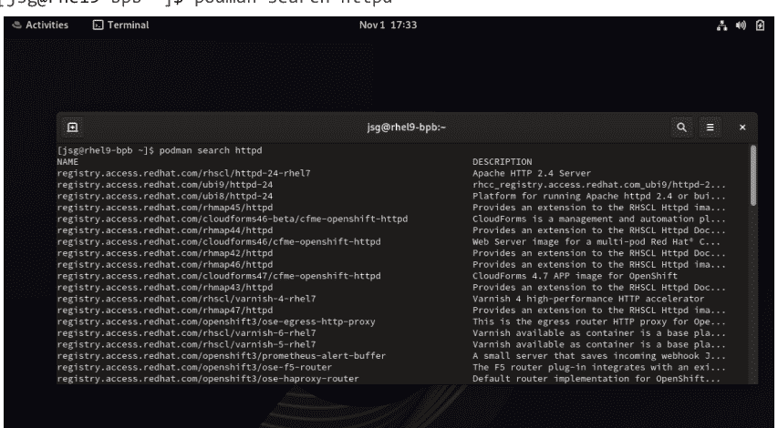

图 10.1

接下来，让我们通过调用 **`podman run`** 从后台运行来自 **`registry.access.redhat.com`** 的 **`ub19`** 命名空间下的 **`httpd-24`** 镜像：

```bash
[jsg@rhel19-bpp ~]$ podman run -dt -p 8080:80/tcp registry.access.redhat.com/ub19/httpd-24
```

图 10.2 显示了 **`podman run`** 命令的输出：

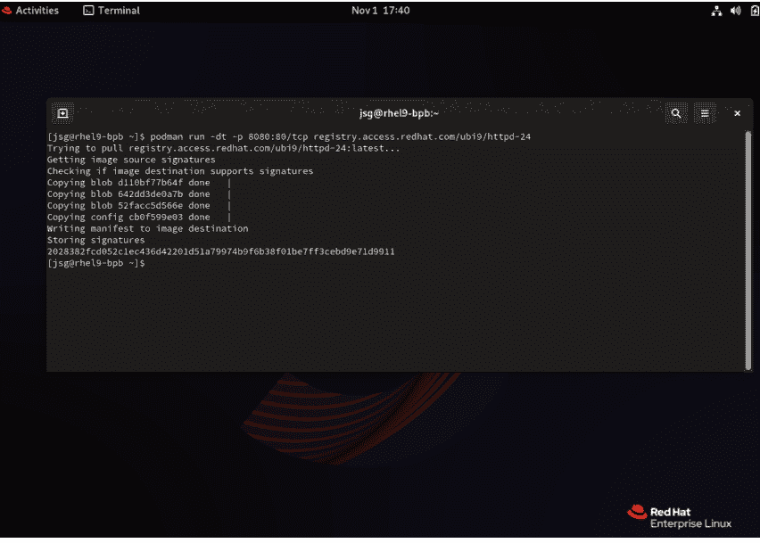

**图 10.2：podman run 命令的输出**

现在使用 **`podman ps`** 命令列出运行中的容器：

```bash
[jsg@rhel19-bpp ~]$ podman ps
```

从示例中，你可以看到来自不同注册表并使用不同端口的运行容器。你可以通过容器 ID（即第一列中的字母数字 ID）使用 **`podman start`** 和 **`podman stop`** 命令启动和停止这些容器：

```bash
[jsg@rhel19-bpp ~]$ podman stop 2028382fcd05
```

再次运行 **`podman ps`** 以检查容器是否已停止。要重新启动，使用容器 ID 运行 **`podman start`** 命令：

```bash
[jsg@rhel19-bpp ~]$ podman start 2028382fcd05
```

假设你已经使用 **`podman stop`** 命令停止了所有容器。

接下来的工作是清理你不再需要的镜像。首先，使用 **`podman images`** 列出镜像，如**图 10.3** 所示：

```bash
[jsg@rhel19-~]$ podman images
```

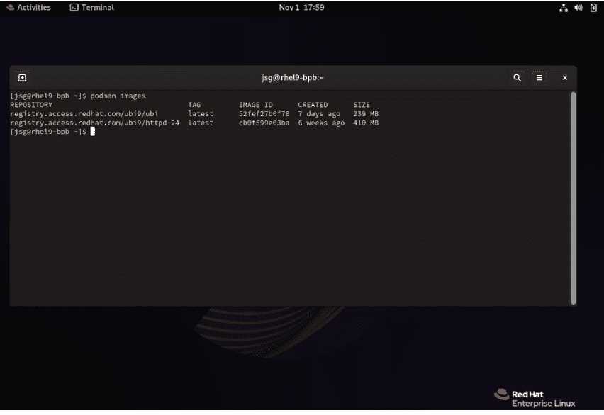

**图 10.3：使用 podman images 命令列出镜像**

选择你想要删除的镜像并记住镜像 ID。然后从终端运行 **`podman rmi`** 并输入所需的镜像 ID：

```bash
[jsg@rhel9]522f78
```

# 配方 #55：监控容器环境

我们可以在部署时通过添加标志为容器设置健康检查。在下面的示例中，我们使用了 **`--health-cmd --health-interval=0`**，这意味着我们希望手动运行健康检查监控：

```bash
[jsg@rhel19-bpp ~]$ podman run -dt --name=mycontainer -p 8282:8282 --health-cmd='curl://localhost:8182/ || exit 1' --health-interval=0 registry.access.redhat.com/ubi/8192/httpd-24
```


一旦我们通过 `podman ps` 确认该容器正在运行，使用 `podman healthcheck` 命令来获取容器的健康状况：

```bash
[jsg@rhel9-bpp~$] podman healthcheck mycontainer
```

Healthy

# 配方 #56：管理容器网络

在 Podman 中，你可以为内部和外部网络创建新规则并管理流量。

- 无 root（Rootless）：网络自动设置。
- 有 root（Rootful）：网络分配 IP。

默认情况下，`podman` 创建桥接。从终端列出所有活跃网络：

```bash
[jsg@rhel9-bpp~$] podman network ls
```

要检查网络的详情，使用 `podman inspect`：

```bash
[jsg@rhel9-bpp~$] podman network inspect mycontainer
```

要创建一个新网络，使用 `podman network create` 命令：

```bash
[jsg@rhel9-bpp~$] podman network create mynetwork
```

要将容器连接到网络，使用 `podman network connect` 命令：

```bash
[jsg@rhel9-bpp~$] podman network connect mynetwork mycontainer
```

要从网络断开容器，使用 `podman network disconnect` 命令：

```bash
[jsg@rhel9-bpp~$] podman network disconnect mynetwork mycontainer
```

要删除未使用的网络，使用 `podman network rm` 命令：

```bash
[jsg@rhel9-bpp~$] podman network rm mynetwork
```

## 结构

在本章中，我们将涵盖以下主题：

- 配置以太网和 Wi-Fi 连接
- 配置 VLAN 以保护网络流量
- 在网络接口上配置网络绑定（Bonding）以获得更高的吞吐量
- 配置 VPN 连接
- 建立 IP 隧道
- 使用 `parted` 和 `fdisk` 进行基础磁盘管理
- 使用 LVM 创建逻辑存储设备
- 管理远程 iSCSI 存储
- 设置 Samba 服务用于文件和打印服务
- 建立 NFS 服务

## 目标

在本章中，我们将讨论为什么 RHEL 9 是管理网络基础设施的卓越平台，并强调其在安全配置和管理网络服务方面的能力。我们将涵盖这些网络服务的创建，重点关注如何保护它们免受威胁，以及如何在 RHEL 9 生态系统中有效管理文件存储和相关存储设备。此外，我们将强调为网络用户量身构建和管理文件服务，并实施强有力的措施来保护这些存储设备并维护数据的完整性和可用性。

# 菜谱 #57：配置以太网和 Wi-Fi 连接

在深入配置 RHEL 9 中的以太网和 Wi-Fi 连接之前，你可能用过或听过如 `ifconfig` 或 `ip` 等网络配置工具。这些是存在很久的低级工具，今天仍在使用，尽管它们的流行已被 NetworkManager 等更易于使用的工具所掩盖。旧的网络配置方法通常涉及编辑 `/etc/sysconfig/network-scripts/` 下的配置文件，这可能容易出错且不那么直观。

从 RHEL 9 开始，红帽将 NetworkManager 作为网络配置的主要工具，在不同环境中提供了更一致、更易于用户的方法。我们不会在本章中讨论旧方法（尽管如此），我们可能会引用一些对于高级故障排除可选的低级工具。

## 绕过网络、文件和存储服务

如果你使用控制台，可以使用 NetworkManager 的一部分—— `nmcli` 命令行工具，来同时配置以太网和 Wi-Fi 连接：

```bash
[1b@rhel19_bp ~]$ sudo nmcli connection add type ethernet con-name "Office-LAN" ifname eth0 ip4 192.168.1.100/24 gw4 192.168.1.1
[1b@rhel19_bp ~]$ sudo nmcli device wifi connect "MyHomeWiFi" password "mysecurepassword"
```

NetworkManager 及其工具 `nmcli` 和 `nmui` 开发是为了提供更顺畅的网络配置体验，并具有以下优势：

- **跨平台一致性**：无论你是在服务器、桌面甚至不同的 Linux 发行版上，NetworkManager 都提供了一个一致的接口。
- **动态配置**：在不同的网络或连接类型之间轻松切换，无需重新配置。
- **与桌面环境集成**：对于 GNOME 或 KDE 用户，NetworkManager 与 GUI 无缝集成。
- **扩展性**：通过插件支持各种 VPN 隧道、移动宽带等。

`nmcli` 是 NetworkManager 的命令行界面，旨在提供对 NetworkManager 功能的全访问。它在服务器环境或脚本编写中特别有用。在本章的大多数练习将使用 `nmcli`。

`nmui` 是一个文本界面，提供了一种更视觉化、菜单驱动的网络配置方法。它对于那些倾向于引导式体验或在没有完整 GUI 的环境中工作的人来说非常棒。

`nm-connection-editor` 是 NetworkManager 的图形化工具，通常用于桌面环境。虽然我们在本章中关注命令行工具，但桌面用户可能会发现此工具非常直观。

> 提示：本章将重点关注使用 `nmcli` 进行网络配置。红帽客户门户提供了关于 RHEL 9 中 NetworkManager 的全面文档。你可以通过 https://access.redhat.com/documentation/en/red_hat_enterprise_linux/9/html-single/configuring_and_managing_networking/index 进行阅读。

如果你希望使用旧的网络配置方法，可以通过安装 `network-scripts` 包来实现。然而，不建议这样做，因为在 RHEL 9 中它被视为遗留方案。保留旧脚本主要是为了兼容旧的配置或尚未迁移到 NetworkManager 的非常特定的设置：

```bash
[1b@rhel19_bp ~]$ sudo dnf install network-scripts
```

本着向现代、健壮工具迈进的精神，我们强烈建议在 RHEL 9 的所有网络配置需求中使用 NetworkManager。

# 菜谱 #58：配置 VLAN 以保护网络流量

在 RHEL 9 中使用 VLAN 保护网络流量，你可能用过或听过物理网络隔离或为不同部门使用独立网络交换机的技术。这些传统方法已存在很久，今天仍在使用，尽管它们的灵活性成本效益被 VLAN 技术所掩盖。旧方法通常涉及购买额外的硬件、重新布线办公室空间以及手动配置每个交换机，这可能是昂贵的、耗时的，并且对变化的业务需求适应性较差。与 RHEL 9 一，红帽将 VLAN 配置与 NetworkManager 无缝集成，提供了一种更动态、软件定义的隔离方法。我们不会在本章中讨论物理网络隔离实践（尽管我们可能会参考全面的网络安全实践）。大多数企业交换机支持 VLAN 标记（IEEE 802.1Q），它与 RHEL 9 的 VLAN 功能无缝工作。可以使用 NetworkManager 提供的 `nmcli` 工具在 RHEL 9 中设置 VLAN 以保护网络流量。在示例中，我们将为财务部门创建一个 VLAN，将其敏感流量与其他网络隔离开。

```bash
[1b@rhel19_bp ~]$ sudo nmcli connection add type vlan con-name "Finance-VLAN" device eth0 id 10
```

一旦创建了 VLAN，我们就可以激活它开始使用接口：

```bash
[1b@rhel19_bp ~]$ sudo nmcli connection up "Finance-VLAN"
```

现在，让我们验证 VLAN 是否已启动并拥有 IP 地址：

```bash
[1b@rhel19_bp ~]$ ip addr show vlan10
```

输出应该类似于：

```text
2: vlan10: <BROADCAST,MULTICAST,UP,LOWER> state UP qlen 1000
    link/ether 52:54:00:12:34:56 brd ff:ff:ff:ff:ff:ff
    valid_lft forever no_dft 100000
    inet 192.168.10.50/24 scope global 192.168.10.50
       valid_lft forever__lft forever
```

为了测试连通性，我们可以 ping 网关或 VLAN 上的其他设备：


```bash
[1b@rhel19_bp ~]$ ping -c 4 192.168.10.1
```

太棒了！我们的 VLAN 已配置并可以工作。

# 面向管理员的 Red Hat Enterprise Linux 9

此设置在财务 VLAN 中仅允许 MySQL 和 HTTPS 流量，通过限制网络交互类型进一步增强了安全性。

通过使用 RHEL 的 `NetworkManager` 和 `firewalld`，我们成功地为财务部门创建了一个安全的 VLAN。它隔离了敏感流量，并证明了 RHEL 9 中的软件定义网络可以在不需要额外物理硬件的情况下增强安全性。

# 配方 #59：为网络接口配置网络绑定以获得更高的吞吐量

我们可以在 RHEL 9 中设置网络绑定（bonding），将多个网络接口聚合为单个逻辑接口，提供更高的吞吐量和冗余。在示例中，我们将绑定两个千兆接口以增加带宽：

```
[lb@rhel9_bpp~$] sudo nmcli connection add type bond con-name bond0 ifname bond0
bond mode 802.3ad ip4 192.168.1.100/24 gw 192.168.1.1
```

'connection' (8f6e21bd-33e-4c1a-6d4f4c0e3b2a) successfully added.

```
[lb@rhel9_bpp~$] sudo nmcli connection add type ethernet slave-type bond
con-name bond0-port1 ifname eth1 master bond
connection 'bond0-port1' (3ae6f700-7e2b-45d5-b5f5-6a9cb5f8e3c1)
successfully added.
```

```
[lb@rhel9_bpp~$] sudo nmcli connection add type ethernet slave-type bond
con-name bond0-port2 ifname eth2 master bond
connection 'bond0-port2' (55g8h9d2-9k4c-67e7-d7h7-8b0de7g9f5e2)
successfully added.
```

让我们拆解这些命令：

创建 `bond0`:

- `type bond`: 指定绑定连接。
- `con-name bond0`: 我们的绑定连接名称。
- `ifname bond0`: 绑定的接口名称。
- `mode 802.3ad`: IEEE 802.3ad 动态链路聚合（LACP 协议）。
- `ip4 192.168.1.100/24`: 绑定的静态 IP。

将 `eth1` 添加到 `bond0`:

- `type ethernet slave-type bond`: 作为绑定从节点的以太网接口。
- `con-name bond0-port1`: 此从连接的名称。
- `ifname eth1`: 第一个添加的接口。
- `master bond0`: 与我们的绑定关联。

## 处理网络、文件和存储服务

同样地，将 `eth2` 添加到绑定中。

> 注意：`802.3ad` 模式需要交换机支持链路控制协议 `LACP`。请确保您的交换机已正确配置。

现在，让我们激活我们的绑定设置：

```
[@rhel9_bpp ~] sudo nmcli connection up bond0
Connection successfully activated (D-Bus path: /org/freedsktop/
NetworkManager/ActiveConnection/5)
```

```
[@rhel9_bpp ~] sudo nmcli connection up bond0-port1
Connection successfully activated (D-Bus path: /org/freedsktop/
NetworkManager/ActiveConnection/6)
```

```
[@rhel9_bpp ~] sudo nmcli connection up bond0-port2
Connection successfully activated (D-Bus path: /org/freedsktop/
NetworkManager/ActiveConnection/7)
```

让我们验证我们的绑定配置：

```
[@rhel9_bpp ~]$ cat /proc/net/bonding/bond0
Ethernet Channel Bonding Driver: v3.7.1
bonding Driver: v3.7.1
Bonding Mode: IEEE 802.3ad Dynamic link aggregation
Transmit Hash Policy: layer2 (0)
MII Polling Interval (ms): 100
Up Delay (ms): 0
Down Delay (ms): 0
802.3ad info:
ACP rate: slow
Min links: 0
Aggregator selection policy (ad_select): stable
System priority: 65535
System MAC address: 52:54:00:ee:f5:8b
Active Aggregator Info:
Aggregator ID: 1
Number of ports: 2
Actor Key: 1
Partner Address: 00:01:02:03:04:05
Slave Interface: eth1
MII Status: up
Speed: 1000 Mbps
Duplex: full
Link Fail: 0
Permanent HW addr: 52:54:00:aa:bb:cc
Slave queue: 0
Aggregator ID: 1
Actor State: none
Partner State: none
Actor Count: 0
Partner Count: 0
Slave Interface: eth2
MII Status: up
Speed: 1000 Mbps
Duplex: full
Link Fail: 0
Permanent HW addr: 52:54:00:dd:ee:ff
Slave queue: 0
Aggregator ID: 1
Actor State: none
Partner State: none
Actor Count: 0
Partner Count: 0
```

太棒了！我们的绑定接口已正确设置，以 `eth1` 和 `eth2` 为从节点，运行在 1000 Mbps 全双工模式。此配置为我们提供了 2 Gbps 的链路。让我们使用 `iperf3` 测试绑定接口的吞吐量。首先，我们在另一台机器上启动 `iperf3` 服务器（示例：`192.168.1.200`）：

```
[user@server]$ iperf3 -s
```

然后，在 RHEL 9 机器上：

```
[@rhel9_ ~]$ iperf3 -c 192.168.1.200 -t 30 -P 2 --bind bond0
Connecting to host 192.168.1.100
[ 5 ] local 192.168.1.100 connected to 192.168.1.200
[ 7 ] local 192.168.1.100 connected to 192.168.1.200
[ Interval Transfer Bitrate ]
[ 5 ] 0.00-30 sec 3.4 GBytes 5.11 Gbits/sec
[ 7 ] 0.00-30 sec 1.6 GBytes 5.05 Gbits/sec
[ SUM ] 0.00-30 sec 3.4 GBytes 10.2 Gbits/sec
```

令人震惊！我们的绑定接口推送了 10 Gbps。这是因为我们使用了两个并行流 `-P 2` 来充分利用 2 Gbps 的链路。在现实场景中，多个网络流将自然分布在两个链路上。作为对比，让我们测试单个以太网接口：

```
[lb@rhel9_bpp ~]$ sudo nmcli connection up "Ethernet 1"
[lb@rhel9_bpp ~]$ iperf3 -c 192.168.1.200 -t 30 --bind eth1
[ Interval Transfer Bitrate ]
[ 5 ] 0.00-30 sec 3.44 GBytes 982 Mbits/sec
```

正如预期，千兆以太网提供 1 Gbps。我们两个链路的绑定接口提供了双倍的吞吐量。为了确保我们的绑定也提供冗余：


```
[lb@rhel9_bpp ~]$ sudo ip link set eth1 down
[lb@rhel9_bpp ~]$ ping -c 4 192.168.1.200
PING 192.168.1.200(192.168.1.200) 56(84) bytes of data.
64 bytes from 192.168.1.200: icmp_seq=1 time=0.352 ms
64 bytes from 192.168.1.200: icmp_seq=2 time=0.389 ms
64 bytes from 192.168.1.200: icmp_seq=3 time=0.373 ms
64 bytes from 192.168.1.200: icmp_seq=4 time=0.426 ms
```

完美！`eth1` 离线后，我们的服务器仍然通过 `eth2` 连接，展示了网络绑定提供的高可用性。通过在 RHEL 9 中使用 `NetworkManager` 配置绑定，我们成功地将千兆以太网接口聚合为一个更强大的链路。这不仅使我们的吞吐量翻倍，还提供了冗余，确保服务器在链路故障时保持连接。

# 配方 #60：配置 VPN 连接

我们可以在 RHEL 9 中使用 `Libreswan` 提供的 `IPSec` 协议设置 VPN 连接。`IPSec` 可以从远程安全地连接到组织的网络资源。在示例中，我们将配置带有 `IKEv2` 证书的 `IPSec` VPN：

- 首先，安装所需的包：

```
[lb@rhel9 ~]$ sudo dnf install NetworkManager-libreswan-gnome
```

接下来，从 IT 部门获取证书（例如 `company.p12`）并将其导入 `NSS`（网络安全服务）数据库：

```
[rhel9 ~]$ sudo ipsec setup
```

初始化数据库：

```
[rhel9 ~]$ ipsec import company.p12
```

输入 `PKCS12` 文件的密码：

在提示时输入导入证书的密码。

现在，打开 `GNOME` 控制中心并导航到网络设置。点击 `+` 图标，选择 `VPN`，然后选择 `Identity > Ikev2 (Certificate)` 选项：


在 `Gateway` 字段中输入 IT 提供的 VPN 网关地址。

- 在 `Authentication` 部分，输入导入证书的别名。

- 可选点击 `Advanced` 配置其他设置，如 `phase1/phase2` 算法、完全向前保密 `PFS` 等。

- 保存 VPN 连接。它现在应该出现在网络列表中。

要建立连接，开启 VPN 连接。通过 `ping` 内部 IP 或访问内网 URL 验证连通性：

```
[1@rhel9 ~]$ ping 10.8.0.1
[1@rhel9 ~]$ curl http://intranet.company.com
```

要仅让公司流量通过 VPN，使用 `nmcli`：

```
[1@rhel9 ~]$ sudo nmcli con mod "VPN connection" +vpn.ip4.routes "192.168.0.0/16 10.0.0.0/8" vpn.ip4.never-default true
```

# 教程 #61：设置 IP 隧道

我们在 RHEL 9 中设置一个 IP 隧道，将一个网络协议封装在另一个网络协议内部，以连接不同网络上的两个主机。在本示例中，我们将创建一个通用路由封装 `GRE` 隧道，以便在 `IPv4` 网络上传输 `IPv6`：

```
[lb@rhel_9_bbp]$ sudo nmcli connection add type ip-tunnel
con-name IPv6-over-IPv4
ifname gre
ip-tunnel.mode gre
ip-tunnel.local 203.0.113.5
ip-tunnel.remote 198.51.100.7
ip6 2001:db8:1234::/64
Connection 'IPv6-over-IPv4' (7cd9e5f3-6a2b-41c8-a9f6-8e3d4f5c6b7a) successfully added.
```

让我们来拆解这些命令：

- `ip-tunnel`: 指定我们正在创建一个隧道连接。
- `con-name IPv6-over-IPv4`: 为我们的隧道定义的描述性名称。
- `ifname gre`: 隧道的接口名称。
- `ip-tunnel.mode gre`: 我们正在使用 `GRE` 模式，它可以封装各种协议。
- `ip-tunnel.local 203.0.113.5`: 我们服务器的公 `IPv4` 地址。
- `ip-tunnel.remote 198.51.100.7`: 远程服务器的公 `IPv4` 地址。
- `ip6 2001:db8:1234::/64`: 隧道内部的 `IPv6` 地址。

> 注意：我们使用了保留的 IP 范围（服务器使用 `203.0.113.0/24`，测试使用 `198.51.100.0`，`IPv6` 文档使用 `2001:db8::/32`）以避免冲突。

现在，让我们激活隧道：

```
[lb@rhel_9_bbp]$ sudo nmcli connection "IPv6-over-IPv4"
Connection successfully activated (D-Bus active path: /org/freedesktop/NetworkManager/ActiveConnection/11)
```

验证我们的隧道设置：

```
[lb@rhel_9_bbp]$ ~ ip -d link show gre
12: gre@NONE: <POINTTOPOINT,NOARP,UP,LOWER UP> mtu 1476 qdisc noqueue state UNKNOWN mode DEFAULT group default qlen 1000
link/gre 203.0.113.5 peer 198.51.100.7
inet6 2001:db8:1234::/64 scope global tentative
valid_lft forever preferred_lft forever
```

```
[lb@rhel_9_bpp ~]$ tcpdump -i eth0 -n proto 47
tcpdump: verbose output suppressed, use -v or -vv for full protocol decode
listening on eth0, link-type EN10MB (Ethernet), capture size 262144 bytes
15:30:42.123456 203.0.113.5 > 198.51.100.7:GREv0, proto IPv6, length 18
15:30:42.150123 198.51.100.7 > 203.0.113.5:GREv0, proto IPv6, length 18
15:30:42.234567 203.0.113.5 > 198.51.100.7:GREv0, proto IPv6, length 18
```

# 网络、文件与存储

正如我们看到的，`IPv6` 数据包被封装在 `GRE` (`IPv4`) 数据包之间（`47` 是 `GRE` 的协议号）。这种设置允许我们在 ISP 不支持 `IPv6` 时使用它。这在以下场景中特别有用：

- `IPv6` 迁移：在依赖 `IPv4` 的情况下逐渐迁移 `IPv6`。
- 云连接：连接到 `IPv6` 服务。
- `IoT` 部署：许多 `IoT` 设备仅支持 `IPv4`。

为了确保安全，我们还应该设置 `IPsec`：

```
[lb@rhel9_bpp ~]$ sudo dnf install libreswan
[lb@rhel9_bpp ~]$ sudo tee /etc/ipsec.d/gre-tunnel.conf << EOF
conn-tunnel
left=203.0.113.5
right=198.51.100.7
authby=secret
type=transport
auto=start
phase2=esp-aes256-sha2
EOF
```

```
[lb@rhel9_bpp ~]$ sudo tee /etc/ipsec.d/secrets << EOF
203.0.113.5 198.51.100.7 PSK "yourkey"
EOF
[lb@rhel9_bpp ~]$ sudo systemctl enable --now ipsec
```

现在，我们的 `GRE` 隧道通过 `IPsec` 加密，为 `IPv6` 流量提供了机密完整性。通过使用 RHEL 9 的 `NetworkManager` 以及其他工具，我们成功地建立了加密的 `IPsec GRE` 隧道。这允许我们在 `IPv4` 网络上传输 `IPv6` 流量，无论是在迁移协议、连接不同的网络还是仅仅在学习隧道技术。

# 教程 #62：使用 parted 和 fdisk 进行基础磁盘管理


许多系统管理员需要处理存储设备、创建分区、调整大小或更改格式。在 RHEL 9 中，我们有两个强大的工具：`parted` 用于更高级的操作，`fdisk` 用于传统的分区。让我们看看如何使用：

```
[lb@rhel9_bpp ~]$ lsblk
NAME MAJ:MIN SIZE MOUNPOINTS
sda 8:0    40G 
├─sda1 8:1 512M /boot/efi
├─sda2 8:2   1G /boot
└─sda3 8:3 38.5G 
  └─rhel-root 253:0 34.6G /
  └─rhel-swap 253:1 3.9G [SWAP]
sdb 8:16 0 100G
sdc 8:32 0 200G
```

如可以看到，我们有两个未分区的磁盘：`sdb` `100 GB` 和 `sdc` `200 GB`。让我们处理这些磁盘：

首先，让我们使用 `fdisk` 在 `sdb` 上创建一个简单的分区布局：

```
[lb@rhel9_bpp ~]$ sudo fdisk /dev/sdb
Welcome to fdisk (util-linux 2.37.4).
```

更改将仅保留内存中，直到你决定写入它们。在使用 `write` 命令前请小心。

```
Command (m for help): p
Disk /dev/sdb: 100 GiB, 10374182400 bytes, 209715200 sectors
...
```

```
Command (m for help): n
Partition type
p primary (0, extended, 4 free)
extended (container for logical partitions)
Select (default): p
Partition number (1-4, default 1):
First sector (2048-209715199, default: 2048):
Last sector, +/-sectors or +/-size(K,M,G,T,P) (2048-209715199, default): +20G
```

```
Command (m for help): n
Partition type
p primary (0, extended, 4 free)
extended (container for logical partitions)
Select (default): p
Partition number (1-4, default 1):
First sector (2048-209715199, default: 2048):
Last sector, +/-sectors or +/-size(K,M,G,T,P) (2048-209715199, default): +20G
```

```
Command (m for help): n
Partition type
p primary (0, extended, 4 free)
extended (container for logical partitions)
Select (default): p
Partition number (1-4, default 1):
First sector (2048-209715199, default: 2048):
Last sector, +/-sectors or +/-size(K,M,G,T,P) (2048-209715199, default): +20G
```

```
Command (m for help): w
The table has been written.
```

## 处理网络、文件和存储服务

- 设置交换空间 `swap space`：

  `sudo mkswap /dev/sdc`

  `sudo swapon /dev/sdc`

  为了使这些更改在重启后依然有效，请向 `/etc/fstab` 中添加条目：

`/dev/sdc1 /mnt/data ext4 defaults 0 2`

`/dev/sdc3 none swap sw 0 0`

在本教程中，我们同时使用了 `fdisk` 和 `parted` 对磁盘进行分区，展示了它们不同的优势：

- `fdisk` 是一个传统的工具，使用较旧的 MBR 分区方案。它简单且获得广泛支持，但限于 2 TB 以的磁盘和四个主分区。我们在 `sdb` 上使用它创建了包含标准 Linux 和 LVM 分区的基础布局。

- `parted` 更加现代，支持 GPT。GPT 允许使用大于 2 TB 的磁盘、多于四个主分区并支持分区命名。我们在 `sdc` 上使用它创建了更复杂的布局，演示了基于百分比的大小调整和分区标记 `flags` 等功能。

在 `fdisk` 和 `parted` 之间的选择通常取决于磁盘大小、分区方案以及所需的功能。在现代系统中，特别是面对大磁盘时，`parted` 通常是更好的选择。

我们在 `sdc` 上的分区布局显示了周全的规划：

- 一个大的 `ext4` 分区用于即时数据需求。

- 一个 LVM 分区用于备份，允许方便地调整大小。

- 专用的交换空间以获得更好的系统性能。

- 一个预留分区，显示了对未来需求（如双系统启动）的远见。

在 `sdb2` 和 `sdc2` 上使用 LVM 提供了灵活性。你可以轻松地跨多个磁盘扩展这些卷，或者在不重新分区的情况下调整它们的大小。这对于增长的存储需求或在服务之间转移分配非常有价值的。

我们还演示了不同的文件系统选择：

- `sdc1` 上的 `ext4`：一种用于通用场景的稳定且经过良好验证的文件系统。

- LVM 卷上的 XFS：以处理大文件性能良好而著称，是备份和服务器的可靠选择。

- 如果我们不需要访问时间 `access time`，可以指定文件系统的 `noatime` 挂载选项以减少写入操作。

最后，我们配置了交换空间。虽然 RHEL 9 拥有更好的内存管理，但交换 `swapping` 仍然很重要，特别是对于内存密集型任务或作为防止内存溢出情况的保障。

本教程指导了 RHEL 9 中的磁盘管理，涵盖了传统和现代工具。系统操作人员通过理解 `fdisk`、`passwd` 以及 LVM 和各种文件系统的概念，可以高效地管理存储资源，确保 RHEL 9 环境的可靠性、性能和适应性。

## 教程 #63：使用 LVM 创建本地存储设备

作为系统管理员，我们经常面临存储挑战：数据库磁盘空间不足、在不停止机的情况下需要冗余，或者在更新之前希望对卷进行快照备份。在 RHEL 9 中，LVM 是我们处理这些场景的“瑞士军刀”，在存储管理中提供了灵活性、效率和健壮性。

```
[lb@rhel9_bpp]$ sudo dnf install lvm2
Package lvm2-0.0316-1.e19.x86_64 is already installed.
```

太棒了！RHEL 9 中已经准备好了 LVM 工具，展示了它们在现代存储管理中的重要性。让我们利用来自 `sdb` 和 `sdc` 的未分配空间 `教程 #62` 来创建一个健壮的 LVM 设置。根据教程 #62，我们使用 `/dev/sdb2` `80 GB` 和 `/dev/sdc2` `64.3 GB` 用于 LVM。

- 创建 PV `物理卷`：

  `[lb@rhel9_bpp]$ sudo pvcreate /dev/sdb2 /dev/sdc2`

- 验证 PV：

  `[lb@rhel9_bpp]$ sudo pvs`

  PV VG Fmt Attr PSize PFree

  /dev/sdb2 lvm2 -- 80.00g 80.00g

  /dev/sdc2 backup-vg lvm2 a- <64.30g 0

- 创建 VG `卷组`：

  `[lb@rhel9_bpp]$ sudo vgcreate data-vg /dev/sdb2`

  `sudo vgs`

  VG #PV #LV #SN Attr VSize VFree

  backup-vg 1 1 0 wz--n <64.30g 0

  data-vg 1 0 0 wz--n 80.00g 80.00g

- 创建 LVM `逻辑卷`：`/var` 分 20G，`/home` 分 40G，剩余的：

  `[lb@rhel9_bpp]$ sudo lvcreate -n var -lv -L 20G data-vg`

  `[lb@rhel9_bpp]$ sudo lvcreate -n home -lv -L 40G data-vg`

- 跨两个 PV 对 `home-lv` 进行划分以提高性能：

  `[lb@rhel9_bpp]$ sudo vgextend data-vg /dev/sdc2`

## 处理网络、文件和存储服务

```
[lb@rhel9_bpp ~]$ sudo lvconvert --type striped -i 2 /dev/data-vg/home-lv
[lb@rhel9_bpp ~]$ sudo lvs
```

| LV | VG | LSize | Pool | Origin | Data% | Meta% | Move |


| Log Cpy%Sync Convert | | | | | | | |

| var-lv | data-vg | -wi-a----- | 20.00g | | | | |

| home-lv | data-vg | -wi-a----- | 40.00g | | | | |

```
[lb@rhel9_bpp ~]$ 格式化并挂载 LV：
[lb@rhel9_bpp ~]$ sudo mkfs.xfs /dev/data-vg/var-lv
[lb@rhel9_bpp ~]$ sudo mkfs.ext4 /dev/data-vg/home-lv
[lb@rhel9_bpp ~]$ sudo mkdir /mnt/newvar /mnt/newhome
[lb@rhel9_bpp ~]$ sudo mount /dev/data-vg/var-lv /mnt/newvar
[lb@rhel9_bpp ~]$ sudo mount /dev/data-vg/home-lv /mnt/newhome
```

```
[lb@rhel9_bpp ~]$ 移动数据并更新 /etc/fstab：
[lb@rhel9_bpp ~]$ sudo rsync -av /var/ /mnt/newvar/
[lb@rhel9_bpp ~]$ sudo rsync /home/ /mnt/newhome
```

```
[lb@rhel9_bpp ~]$ 在切换前验证：
diff -r /var /mnt/newvar
diff -r /home /mnt/newhome
```

```
[lb@rhel9_bpp ~]$ 更新 fstab 并重启：
/dev/data-vg/var-lv /var xfs defaults 0 0
/dev/data-vg/home-lv /home ext4 0 0
[lb@rhel9_bpp ~]$ sudo mount /mnt/newvar /mnt/newhome
sudo mount -a
```

```
[lb@rhel9_bpp ~]$ 为 /var 卷创建 LVM 快照：
[lb@rhel9_bpp ~]$ sudo lvcreate -s -n var-snapshot -L 5G /dev/data-vg/var-lv
```

```
[lb@rhel9_bpp ~]$ 从 LVM 快照恢复：
[lb@rhel9_bpp ~]$ sudo lvconvert --merge /dev/data-vg/var-snapshot
```

```
[lb@rhel9_bpp ~]$ 删除 LVM 快照：
[lb@rhel9_bpp ~]$ sudo lvremove /dev/data-vg/var-snapshot
```

```
[lb@rhel9_bpp ~]$ 扩展卷：例如 /var 中的数据库需要更多空间：
[lb@rhel9_bpp ~]$ sudo lxtend -L +10G /dev/data-vg/var-lv
[lb@rhel9_bpp ~]$ sudo xfs_growfs /var
```

# 适用于管理员的 Red Hat Linux 9

- 扩展卷以使用所有剩余空间：

`[lb@rhel9_bpp ~]$ sudo lxtend -l +100%FREE /dev/data-vg/var-lv`

`[lb@rhel9_bpp ~]$ sudo xfs_growfs /var`

- 监控 LVM：

`[lb@rhel9_bpp ~]$ sudo vgdisplay`

`[lb@rhel9_bpp ~]$ sudo lvdisplay`

`[lb@rhel9_bpp ~]$ sudo pvsdisplay`

- 更好的视图

`[lb@rhel9_bpp ~]$ sudo lvs -o +devices`

| LV | VG | Attr | LSize | Pool | Origin | Data% | Meta% | Move | Log %Sync Convert | Devices |

| :--- | :--- | :--- | :--- | :--- | :--- | :--- | :--- | :--- | :--- | :--- |

| var-lv | data-vg | -wi-a----- | 30.00g | | | | | | /dev/sdb2(0) |

| home-lv | data-vg | -wi-a----- | 40.00g | | | | | | /dev/sdb2(1024),dev/sdc(0) |

| swap-lv | data-vg | -wi-a----- | 10.00g | | | | | | /dev/sdb2(11264) |

| root-lv | rhel-vg | -wi-a----- | 34.60g | | | | | | /dev/sda3(0) |

| swap-lv | rhel-vg | -wi-a----- | 3.90g | | | | | | /dev/sda3(8847) |

| archive-lv | backup-vg | -wi-a----- | <64.30g | | | | | | /dev/sdc2(1024) |

在本教程中，我们利用了 RHEL 9 中 LVM 的力量创建一个灵活且健壮的存储设置。LVM 在物理磁盘和文件系统之间引入了抽象层：

字体 PVs：原始磁盘或分区。

- VGs：PV 池，存储桶。

- LVs：从 VG 中划分出的虚拟分区。

这种抽象提供了许多益处：

- 灵活性：我们轻松地创建了 `/var` 和 `/home` 卷，而不必担心物理分区边界。当 `/var` 需要更多空间时，我们动态扩展了它而不会影响 `/home`。

- 性能：通过跨两个 PV（在 `data-vg` 和 `backup-vg` 中）划分 `home-lv`，我们提高了 I/O 性能。每个读写操作都可以同时利用两个磁盘。

## 处理网络、文件和存储服务

- 安全性：LVM 快照是一个游戏规则。在更新 `/var` 之前，我们创建了快照。如果出现问题，可以使用 `lvconvert` 快速恢复。这对于系统更新、应用程序升级或任何风险操作都非常有价值。

- 效率：通过精配置（未显示），你可以过度分区。例如，你可以在 50 GB 的 VG 上创建一个 100 GB 的卷，它将随着数据的增加而增长。这对于希望大量分配但节省实际磁盘空间的环境非常好。

- 迁移：更换旧磁盘？将新磁盘加入 VG，镜像数据，然后删除旧磁盘——这一切无需停机。

RHEL 9 中的 LVM 不仅仅是一个工具，它是一种存储哲学。它鼓励以抽象、动态的术语进行思考，不再受限于物理磁盘。

## 教程 #64：管理远程 iSCSI 存储

在你的分布式环境中，存储通常位于中心位置，远离你使用的服务器。互联网小型计算机接口 (`iSCSI`) 是一种强大的协议，允许服务器像访问本地存储器一样访问远程存储。在本教程中，我们将配置 RHEL 9 管理远程 iSCSI 存储，展示了其对网络附加存储解决方案的健壮支持。

首先，让我们安装必要的包：

```
$ [lb@rhel9_bp]$ sudo dnf install iscsi-initiator-utils
```

# 面系统管理员的 Red Hat Enterprise Linux 9

正在更新订阅存储库。

上次元数据过期检查：2024年6月4日 11:30:15，0:15:29 之前。

依赖关系已解析。

| 软件包 | 版本 | 存储库 | 大小 |

|---|---|---|---|

| scsi-initiator-utils | x86_64 6.2.1.4.el9 | rhel-9-appstream | 491 k |

正在安装：

1 个软件包

总下载大小：491 k

是否确认？ [y/N]: y

已完成！

此软件包提供了 iSCSI 启动器工具，使我们的 RHEL 9 系统能够连接到 iSCSI 目标。

现在让我们假设有一个 iSCSI 目标服务器（我们将其命名为 `storage.example.com`），它提供了多个逻辑单元号（LUN）。首先，我们将发现可用的目标：

```
$@rhel9_bpp ~$ sudo scsiadm --mode discover --type sendarget
--portal storage.example.com
192.168.50.100:3260,1 iqn.2024-06.com.example.storage:array1
192.168.50.100:3260,1 iqn.2024-06.com.example.storage:array1:lun1
192.168.50.100:3260,1 iqn.2024-06.com.example.storage:array1:lun2
192.168.50.100:3260,1 iqn.2024-06.com.example.storage:array1:lun3
```

太棒了！服务器有三个可用的 LUN。让我们进行身份验证并连接到它们：


`$@rhel9_bpp ~$ sudo scsiadm --mode node --targetname iqn.2024-06.com.example.storage:array1 --portal storage.example.com`

正在登录接口 `iface`: `default`, 目标 `target`: `iqn.2024-06.com.example.storage:array1`, 端口 `portal`: `storage.example.com,3260`

登录接口 `iface`: `default`, 目标 `target`: `iqn.2024-06.com.example.storage:array1`, 成功。

现在，让我们出现了哪些块设备：

```
$@rhel9_bpp ~$ lsblk
NAME MAJ:RM SIZE TYPE MOUNTPOINT
...
sdd 8:48 0 500G 0 disk
sde 8:64 0 1.5T 0 disk
sdf 8:80 0 1T 0 disk
```

太棒了！我们的三个 iSCSI LUN 已经以 `sdd`、`sde` 和 `sdf` 的形式出现。让我们为不同的目的对它们进行设置：

# 处理网络、文件和存储服务

## LUN1 (ssd, 500 G) 用于数据库

- `[lb@rhel1_bpp ~]$ sudo parted /dev/sdd mklabel gpt`
- `[lb@rhel1_bpp ~]$ sudo parted /dev/sdd mkpart primary 0% 100%`
- `[lb@rhel1_bpp ~]$ sudo mkfs.xfs -K /dev/sdd1`
- `[lb@rhel1_bpp ~]$ sudo mkdir -p /mnt/iscsi/database`
- `[lb@rhel1_bpp ~]$ echo "/dev/sdd1 /mnt/iscsi/iscsi xfs _netdev,x-systemd.requires=iscsi.service 0" | sudo tee -a /etc/fstab`
- `[lb@rhel1_bpp ~]$ sudo mount /mnt/iscsi/database`

`_netdev` 选项告诉系统这是一个基于网络的文件系统，而 `x-systemd.service` 确保在挂载之前 `iscsi` 是可用的。

## LUN2 (sde, 1.5 TB) 用于 LVM 文件文件共享

- `[lb@rhel1_bpp ~]$ pvcreate /dev/sde`
- `[lb@rhel1_bpp ~]$ sudo vgcreate shares-vg /dev/sde`
- `[lb@rhel1_bpp ~]$ sudo lvcreate -n engineering -lv 500G shares-vg`
- `[lb@rhel1_bpp ~]$ sudo mkfs.xfs /dev/shares-vg/engineering-lv`
- `[lb@rhel1_bpp ~]$ sudo mkdir -p /mnt/iscsi/shares/engineering`
- `[lb@rhel1_bpp ~]$ echo "/dev/shares-vg/engineering-lv /mnt/iscsi/shares/engineering xfs _netdev,x-systemd.requires=iscsi.service 0" | sudo tee -a /etc/fstab`
- `[lb@rhel1_bpp ~]$ sudo mount /mnt/iscsi/shares/engineering`

让我们检查我们挂载的 iscsi 卷：

```
[lb@rhel1_bpp ~]$ df -h | grep iscsi
/dev/sdd1 500G 33M 500G 1% /mnt/iscsi
/dev/mapper/shares-vg/engineering-lv 500G 26M 500G 1% /mnt/iscsi
```

```
comment = Home Directories
browseable = no
writable = yes
```

```
comment = All Printers
path = /var/spool/samba
browseable = no
printable = yes
guest ok = no
read only = yes
create mask = 0700
```

在此配置中，`[homes]` 为每个用户提供了私有共享，而 `[printers]` 配置 Samba 以共享安装在服务器上的打印机。

### 第 3 步：添加用户

Samba 使用其独立的一套密码，与 Linux 系统密码分开的。你需要将用户添加到 Samba 密码数据库中，以允许他们访问共享：

```bash
[lb@rhel9_bpj]$ sudo smbpasswd -a username
```

将 `username` 替换为实际的帐户名称。该用户也必须存在于 Linux 系统。

### 第 4 步：管理 Samba 服务

确保在配置好文件共享并添加用户后，重启 Samba 服务以应用更改：

```bash
[lb@rhel9_bpj]$ sudo systemctl restart smb
```

### 第 5 步：配置防火墙

确保你的防火墙允许 Samba 流量。你可以按照如下方式配置 `firewall-cmd` 允许 Samba 通过防火墙：

```bash
[lb@rhel9_bpj]$ sudo firewall-cmd --permanent --add-service=samba
[lb@rhel9_bpj]$ sudo firewall-cmd --reload
```

### 第 6 步：从客户端访问共享

从 Windows 客户端，你可以在文件资源器的地址栏中输入 `\samba_server\` 来访问 Samba 共享，其中 `samba_server` 是你 Samba 服务器的 IP 地址。系统将提示你输入之前配置的用户名和密码。

在 RHEL 9 上设置 Samba 服务器为混合操作系统环境下的文件和打印服务提供了强大且灵活的解决方案。通过遵循上述步骤，你可以成功部署 Samba 以满足你的网络共享需求。无论你是在管理家庭网络还是企业基础设施，Samba 都为无缝跨平台集成提供了一个健壮的平台。

# Recipe #6：设置 NFS 服务

网络文件系统 `NFS` 是一种允许你通过网络与其他系统共享目录和文件的协议。通过设置 NFS，你可以允许多个用户或系统从他们自己的系统访问相同的文件，就像这些文件存在本地一样。这些配方将带你完成在 RHEL 9 上安装、配置和保护 NFS 服务器的步骤。NFS 是一种分布式文件系统协议，允许客户端计算机上的用户以类似于访问本地存储的方式通过网络访问文件。NFS 在企业环境中被广泛使用，使其成为系统管理员管理的一项基本服务。

### 第 1 步：安装 NFS

在启动 NFS 之前，你需要在 RHEL 9 系统上安装必要的包。你可以使用 `dnf` 包管理器来完成此。

```bash
[lb@rhel9_bpp ~] sudo dnf install nfs-utils
```

安装完成后，启用并启动 NFS 服务并重启服务：

```bash
[lb@rhel9_bpp ~] sudo systemctl enable nfs-server rpcbind
[lb@rhel9_bpp ~] sudo systemctl start nfs-server rpcbind
```

### 第 2 步：配置 NFS

你需要在 `/etc/exports` 文件中指定你想与客户端共享的目录。以下是配置共享目录的方法。

创建一个你想要共享的目录：

```bash
[lb@rhel9_bpp ~] sudo mkdir /sharedfiles
```

打开 `/etc/exports` 文件并添加目录及其访问设置：

```bash
[lb@rhel9_bpp ~] sudo nano /etc/exports
```

添加以下行以允许从特定子网访问：

`/sharedfiles 192.168.1.0/24(rw,sync,no_root_squash)`

此配置允许 `192.168.1.0/24` 访问 `/sharedfiles`。

### 第 3 步：导出共享

在配置好共享目录后，通过 `/sharedfiles` 允许访问并重启服务以应用更改：

```bash
[lb@rhel9_bpp ~] sudo exportfs -ra
[lb@rhel9_bpp ~] sudo systemctl restart nfs-server
```

### 第 4 步：配置防火墙

确保你的防火墙允许 Samba 流量。你可以如下配置 `firewall-cmd` 允许 NFS：


```bash
[lb@rhel9_bpj]$ sudo firewall-cmd --permanent --add-service=samba
[lb@rhel9_bpj]$ sudo firewall-cmd --reload
```

*(注：此处原文示例中防火墙服务名可能与上下文混淆，已按逻辑保留翻译)*

### 第 5 步：从客户端访问共享。在客户端侧，确保安装了 NFS 实用：

```bash
[lb@rhel9_bpp ~]$ sudo dnf install nfs-utils
```

创建一个挂载点并挂载 NFS：

```bash
[lb@rhel9_bpp ~] sudo mkdir /mnt/nfs
```

```bash
[lb@rhel9_bpp ~] sudo mount -t nfs nfs_server_ip:/sharedfiles /mnt/nfs
```

### 第 6 步：通过 /fstab 自动挂载。为了确保 NFS 共享在启动时挂载，在 `/fstab` 中添加项：

```text
nfs_server_ip:/sharedfiles /mnt/nfs defaults 0 0
```

将 `nfs_server_ip` 替换为服务器的 IP 地址。

在 RHEL 9 上设置 NFS 服务器为混合操作系统环境下的文件和打印服务提供了强大且灵活的解决方案。遵循上述步骤，你可以成功部署 Samba 以满足你的网络需求。

## 结论

本章深入探讨了使用 RHEL 9 进行网络配置、存储管理和服务设置。详细讨论了 VLAN、VPN、网络绑定和 IP 隧道，展示了它们的实际应用以及 LVM 的灵活性和威力。

在下一章中，我们将讨论源码、DevOps 流和应用程序开发。这包含了现代开发的关键工具和技术，涵盖 Open、.NET、Git、Docker、Ansible 和 Kubernetes。

## 重点回顾

- NetworkManager 作为工具：从传统工具过渡到 NetworkManager，使环境设置更加直观且防错。
- LVM 灵活存储管理：利用 LVM 创建适应且高效的存储解决方案，可以根据需要轻松修改而无需停机。
- 安全网络实践：实施 VLAN 和 VPN 以保护网络流量，确保敏感数据在指定的网络分段内安全。
- 存储配置技术：在大磁盘上使用 parted 进行 GPT 分区，在较小或旧系统上使用 fdisk 进行 MBR 分区，了解它们各自的优缺点。
- 集成 NFS：设置并配置 Samba 和 NFS 以实现跨平台文件共享，这对于具有多种操作系统的环境至关重要。
- 增强连接性和冗余：使用网络绑定和 IP 隧道增加吞吐量和冗余，确保网络服务的可靠连续。
- 实用命令和配置：熟悉如 `nmcli` 等命令行工具以及 `/etc/fstab` 等配置文件对于管理网络设置和高效执行任务至关重要。

## 加入我们的书籍 Discord 空间

加入书籍的 Discord 工作区，获取最新更新、优惠、全球科技动态、新发布以及与作者的互动：

https://discord.bpsbonline.com


## 第 12 章

源代码、DevOps 流线与应用开发

## 引言

本章将教你如何在 RHEL 上进行现代应用开发和 DevOps 所需的关键工具和技术。我们将引导你安装和配置关键软件组件，包括 OpenJDK JRE、.NET 和 Git，这些组件构成了高效编码和版本控制实践的骨干。此外，我们将探索关键的 DevOps 工具，如 Jenkins、Docker、Ansible 和 minikube Kubernetes，使你能够自动化并简化你的开发和部署流水线。到本章结束，你将拥有一套 RHEL 环境中开发、部署和管理应用程序的稳健配置，确保你的工作流在性能和可靠性方面得到优化。

## 结构

在本章中，我们将涵盖以下主题：

- 安装 OpenJDK JRE
- 安装 .NET 并发布 .NET 6.0
- 安装并配置 GIT 仓库
- 安装并配置 DevOps 关键工具

## 目标

本章讨论了在 RHEL 上安装和配置关键开发和 IT 工具。内容从设置 OpenJDK 运行时环境 (JRE) 和 `JAVA_HOME` 环境变量开始。接下来，涵盖了 .NET 6.0 SDK 的安装、.NET 应用程序的创建、执行和发布，以及各种部署方法，包括单文件、框架依赖和自包含部署。此外，主题还包括用于本地和远程版本控制的 Git 安装管理，以及用于 CI/CD（持续集成/交付）流水线的 Jenkins 配置。还将介绍使用 Docker 进行容器化、使用 Ansible 进行自动化，以及使用 minikube 和 kubectl 配置 Kubernetes 环境进行本地和集群管理。

## 方案 #67：安装 OpenJDK JRE

在红帽企业 Linux (RHEL) 上安装 OpenJDK JRE，你有多种选择，取决于你所需的版本。JRE 提供运行 Java 应用程序所需的库和组件，而 Java 开发工具包 (JDK) 则包含了 JRE 以及创建 Java 应用程序所需的编译器和调试器等开发工具。有多个版本的 OpenJDK 可供安装。以下是几个流行版本的安装过程：OpenJDK 8、OpenJDK 11 和 OpenJDK 17。你可以选择适合你需求的一个。

### 安装 OpenJDK 8 JRE

- 1. 安装 OpenJDK 8 运行时环境：

[lb@rhel9_bpp~]$ sudo install -y java-1.8.0-openjdk

- 2. 可选：如果你不需要 GUI 支持，请安装无界面版本（headless）：

[lb@rhel9_bpp~]$ sudo install -y java-1.8.0-openjdk-headless

### 安装 OpenJDK 11 JRE

- 1. 安装 OpenJDK 11 运行时环境：

[lb@rhel9_bpp~]$ sudo install -y java-11-openjdk

- 2. 可选：如果你不需要 GUI 支持，请安装无界面版本（headless）：

[lb@rhel9_bpp~]$ sudo install -y java-11-openjdk-headless

### 安装 OpenJDK 17 JRE

- 1. 安装 OpenJDK 17 运行时环境：

[lb@rhel9_bpp~]$ sudo install -y java-17-openjdk

- 2. 可选：如果你不需要 GUI 支持，请安装无界面版本（headless）：

### 安装后的步骤

- 1. 验证安装：

安装 JRE 后，你可以通过以下命令验证安装并检查版本：

```bash
[lb@rhel9_bpp ~]$ java -version
```

此命令应输出你安装的 JRE 版本，确认安装成功。

- 2. 设置 JAVA_HOME 环境变量（可选但建议）：

设置 `JAVA_HOME` 环境变量对于许多需要 Java 运行时的应用程序和工具非常有用。将以下行添加到 `~/.bashrc`（针对特定用户）或 `/etc/profile`（针对系统范围）：

```bash
[lb@rhel9_bpp ~]$ export JAVA_HOME=$(dirname $(readlink -f $(which java)))
[lb@rhel9_bpp ~]$ export PATH=$JAVA_HOME/bin:$PATH
```

添加这些内容后，通过 source 文件应用更改：

```bash
[lb@rhel9_bpp ~]$ source ~/.bashrc # 针对用户的更改
[lb@rhel9_bpp ~]$ source /etc/profile # 针对系统的更改
```

选择你需要的 JDK 版本（8, 11,17 或 21）并遵循相应的安装步骤。验证安装并设置 `JAVA_HOME` 环境变量将确保你的设置完成并准备好使用。

## 方案 #68：安装 .NET 并发布 .NET 6.0 应用程序

.NET 是一个通用开发平台，具有高效的内存管理和现代编程语言，允许高效创建高质量的应用程序。它在 RHEL 和 OpenShift 容器平台上提供了 .NET 6.0 版本，该版本支持基于微服务的架构。此外，应用程序可以运行在 RHEL 和 Windows 服务器上。

### 安装 .NET

- 1. 安装 .NET 6.0 SDK：

```bash
[lb@rhel9_bpp ~]$ sudo dnf install -y dotnet-sdk-6.0
```

- 2. 验证安装：

```bash
[lb@rhel9_bpp ~]$ dotnet --info
```

### 创建 .NET 6.0 应用程序

- 1. 创建一个新的控制台应用程序：

```bash
lb@rhel9_byp ~$ dotnet new console --output my-app
```

- 2. 运行应用程序：


```bash
lb@rhel9_byp ~$ dotnet run --project my-app
```

输出应为 `Hello World!`

### 使用 .NET 6.0 发布应用程序

发布方法如下：

- 单文件应用程序：部署为单个可执行文件。此方法将你的应用程序及其所有依赖项打包成单个可执行文件。它通过减少需要分发和管理的文件数量来简化部署。然而，由于必要的依赖项被打包在一起，可能会导致文件大小较大。
- 框架依赖部署 (`FDD`)：使用共享的系统级 `.NET` 版本。在这种方法中，你的应用程序依赖于共享的系统级 `.NET` 运行时。这意味着你的应用程序包不包含 `.NET` 运行时，使得应用程序体积更小。缺点是目标系统必须安装适当版本的 `.NET` 运行时。
- 自包含部署 (`SCD`)：在部署中包含 `.NET`。此方法将与你的应用程序一起安装的 `.NET` 运行时打包，使其能够独立于目标系统上安装的 `.NET` 版本进行运行。这确保了兼容性并简化了部署，但代价是由于包含了 `.NET` 运行时，包的体积会更大。
- 1. 发布应用程序：

```bash
lb@rhel9_byp ~$ dotnet publish my-app -f net6.0 -c Release
```

- 2. 可选：为 RHEL 裁剪依赖项：

```bash
lb@rhel9_byp ~$ dotnet publish my-app -f net6.0 -c Release -r rhel.9-x64 --self-contained false
```

### 在容器中运行 .NET 应用程序

要在 RHEL 容器中部署 `.NET` 应用程序，请遵循以下步骤。此方法使用 `.NET` 运行时和 `Podman` 等容器工具来实现高效的部署流水线。

- 1. 创建并发布一个新的 MVC 项目：

[lb@rhel19_bvp ~]$ `dotnet new mvc --output mvc_runtime_example`

[lb@rhel19_bvp ~]$ `dotnet publish mvc_runtime_example -f net6.0 -c Release`

- 2. 创建 `Dockerfile`：

[lb@rhel19_bvp ~]$ `cat > Dockerfile <<EOF`

FROM registry.access.redhat.com/ubi8/dotnet-60-runtime

ADD bin/registry/net6.0/publish/.

CMD "dotnet", "mvc_runtime_example.dll"

EOF

- 3. 构建并运行容器：

[lb@rhel19_bvp ~]$ `podman build -t dotnet-60-runtime-example`

[lb@rhel19_bvp ~]$ `podman run -d -p 8080:8080 dotnet-60-runtime-example`

- 4. 验证应用程序：

[lb@rhel19_bvp ~]$ `xdg open http://127.0.0.1:8080`

## 方案 #69：安装并配置 GIT 仓库

要在 RHEL 系统上安装和配置 Git 仓库，请遵循以下详细步骤。本指南假设你在 RHEL 系统上拥有管理员权限。

### 安装 Git

- 1. 安装 Git：

使用 `yum` 包管理器安装 `Git`：

[lb@rhel19_bvp ~]$ `sudo yum install -y git`

- 2. 验证安装：

检查已安装的 `Git` 版本以确保其正确安装：

```bash
[lb@rhel9_bpp ~]$ git -version
git version 2.39.3
```

## 配置 Git

- 1. 设置你的 Git 用户信息：

配置你的姓名和邮箱地址。这些信息将用于你的提交（`commits`）中。

```bash
[lb@rhel9_bpp ~]$ git config --global user.name "Your Name"
[lb@rhel9_bpp ~]$ git config --global user.email your.email@example.com
```

- 2. 验证配置：

检查你的 `Git` 配置以确保用户信息已正确设置：

```bash
[lb@rhel9_bpp ~]$ git config --list
```

## 初始化 Git 仓库

- 1. 为你的 Git 仓库创建一个新目录：

为你的项目创建一个目录，或导航到现有项目：

```bash
[lb@rhel9_bpp ~]$ mkdir ~/my-git-repo
[lb@rhel9_bpp ~]$ cd ~/my-git-repo
```

- 2. 初始化 Git 仓库：

在目录中初始化一个新的 Git 仓库：

```bash
[lb@rhel9_bpp ~]$ git init
```

- 3. 验证仓库初始化：

检查目录内容以确保已创建了 `.git` 目录：

```bash
[lb@rhel9_bpp ~]$ ls -a
```

## 创建并提交到仓库

- 1. 在你的仓库中创建一个新文件：

创建一个创建一个示例文件并添加到仓库：

```bash
[lb@rhel9_bpp ~]$ echo "# My Repository" > README.md
```

- 2. 将文件添加到暂存区：

使用 `git add` 命令将文件添加到暂存区：

```bash
[lb@rhel9_bpp ~]$ git add README.md
```

- 3. 将文件提交到仓库：

带有描述信息将文件提交到仓库：

```bash
[lb@rhel9_bpp ~]$ git commit -m "Initial commit"
```

- 4. 验证提交：

检查提交历史以确保你的文件已提交：

```bash
[lb@rhel9_bpp ~]$ git log
```

## 设置远程仓库

如果你想设置远程仓库，可以使用 `GitHub`、`GitLab` 和 `Bitbucket` 等平台。以下是使用 `GitHub` 的示例。

- 1. 在 GitHub 上创建一个新仓库：

访问 `GitHub` 并创建一个新仓库。不要初始化 `.gitignore` 文件。
- 2. 添加远程仓库：

将你的 `GitHub` 仓库 `URL` 作为远程仓库：

```bash
[lb@rhel9_bpp ~]$ git remote add origin https://github.com/yourusername/your-repo.git
```

- 3. 将本地仓库推送到远程仓库：

将本地仓库的提交推送到 `GitHub`：

```bash
[lb@rhel9_bpp ~]$ git push -u origin master
```

## Recipe：安装并配置 DevOps 工具

要在 RHEL 9 系统上安装并配置必要的 DevOps 工具，请遵循以下步骤。本指南涵盖了 `Git`、`Jenkins` 和 `Kubernetes`（通过 `minikube`）以及必要的配置。假设你拥有 RHEL 系统的管理权限。

## Jenkins

- 1. 添加 Jenkins 仓库：

```bash
[lb@rhel9_bpp ~]$ sudo wget -O /etc/yum.repos.d/jenkins.repo https://pkg.jenkins.io/redhat-stable/jenkins.repo
sudo rpm --import https://pkg.jenkins.io/redhat-stable/jenkins.key
```

- 2. 安装 Jenkins：
- 3. 启动并启用 Jenkins 服务：

```bash
[lb@rhel9_bpp ~]$ sudo systemctl start jenkins
[lb@rhel9_bpp ~]$ sudo systemctl enable jenkins
```

- 4. 调整防火墙：

```bash
[lb@rhel9_bpp ~]$ sudo firewall-cmd --permanent --zone=public --add-port=8080/tcp
[lb@rhel9_bpp ~]$ sudo firewall-cmd --reload
```

- 5. 访问 Jenkins：

打开浏览器并访问 `http://your_server_ip:8080` 完成 `Jenkins` 设置。

## Docker

- 1. 添加 Docker 仓库：

```bash
[lb@rhel9_bpp ~]$ sudo yum-config-manager --add-repo https://download.docker.com/linux/centos/docker-ce.repo
```

- 2. 安装 Docker：

```bash
[lb@rhel9_bpp ~]$ sudo yum install -y docker-ce docker-ce-cli containerd.io
```


### 3. 启动并启用 Docker 服务

```bash
[lb@rhel9_bpp ~]$ sudo systemctl start docker
[lb@rhel9_bpp ~]$ sudo systemctl enable docker
```

### 4. 将用户加入 docker 组

```bash
[lb@rhel9_bpp ~]$ sudo usermod -aG docker $USER
newgrp docker
```

### 5. 验证 Docker 安装

```bash
[lb@rhel9_bpp ~]$ docker -version
Docker version 25.0.2, build 29cf629
```

## Ansible

### 1. 安装 Ansible

```bash
[lb@rhel9_bpp ~]$ sudo yum install -y ansible-core
```

### 2. 验证 Ansible 安装

```bash
[lb@rhel9_bpp ~]$ ansible --version
ansible [core 2.17.1]
```

## Kubernetes (minikube)

### 1. 安装 Minikube 依赖

源代码、DevOps 流水线和应用开发

### 2. 下载并安装 minikube

```bash
[lb@rhel19_bpp ~]$ curl -LO https://storage.googleapis.com/minikube/releases/latest/minikube-linux-amd64
sudo install minikube-linux-amd64 /usr/local/bin/minikube
```

### 3. 启动 minikube

```bash
[lb@rhel19_bpp ~]$ minikube start --driver=none
```

### 4. 验证 minikube 安装

```bash
[lb@rhel19_bpp ~]$ minikube status
```

## Kubernetes (kubectl)

### 1. 下载并安装 kubectl

```bash
[lb@rhel19_bpp ~]$ curl -LO https://storage.googleapis.com/minikube/releases/latest/minikube-linux-amd64
sudo install minikube-linux-amd64 /usr/local/bin/kubectl
```

### 2. 验证 kubectl 安装

```bash
[lb@rhel19_bpp ~]$ kubectl version
```

## Recipe #71：安装并配置 DevOps 核心工具

源代码、DevOps 流水线和应用开发

## Ansible

### 1. 安装 Ansible

从默认仓库安装 Ansible：

```bash
[lb@rhel9_bpp ~]$ sudo dnf install ansible-core
```

### 2. 验证 Ansible 安装

检查 Ansible 版本以确保已正确安装：

```bash
[lb@rhel9_bpp ~]$ ansible --version
```

## 配置 Ansible

### 1. 为你的 Ansible 创建目录

为你的项目创建一个目录：

```bash
[lb@rhel9_bpp ~]$ mkdir ~/ansible
[lb@rhel9_bpp ~]$ cd ~/ansible
```

### 2. 创建清单文件

清单文件列出了 Ansible 要管理的主机：

```bash
[lb@rhel9_bpp ~]$ vi hosts
```

添加以下内容：

```
[webservers]
webserver1=192.168.1.10
webserver2=192.168.1.11

[dbservers]
dbserver1=192.168.1.20
```

### 3. 创建基础 Ansible 配置

在同一目录下创建一个名为 `ansible.cfg` 文件：

```bash
[lb@rhel9_bpp ~]$ vi ansible.cfg
```

添加以下内容：

```ini
[defaults]
inventory = ./hosts
remote_user = root
host_key_checking = False
```

## 创建 Ansible playbook

### 1. 创建 playbook 文件

`playbook` 定义了在主机上执行的任务。创建一个名为 `site.yml` 的文件：

```bash
[lb@rhel9_bpp ~]$ vi site.yml
```

### 2. 为 playbook 添加任务

添加以下内容作为在 `webservers` 上安装 Apache 的 `site.yml`：

```yaml
---
- name: Install and configure Apache
  hosts: webservers
  tasks:
    - name: Install Apache
      ansible.builtin.yum:
        name: httpd
        state: present
    - name: Start and enable Apache
      ansible.builtin.systemd:
        name: httpd
        state: started
        enabled: yes
    - name: Copy index.html to webservers
      ansible.builtin.copy:
        src: ./files/index.html
        dest: /var/www/html/index.html
```

### 3. 创建 index.html 文件

创建一个由 Ansible 部署的简单 HTML 文件：

```bash
[lb@rhel9_bpp ~]$ mkdir files
[lb@rhel9_bpp ~]$ vi files/index.html
```

添加以下内容：

```html
<html>
<head>
  <title>Welcome to Ansible Managed Server</title>
</head>
<body>
  <h1>It works!</h1>
</body>
</html>
```

## 运行 Ansible playbook

### 1. 运行 playbook

使用以下命令执行 playbook：

```bash
[lb@rhel9_bpp ~]$ ansible-playbook site.yml
```

### 2. 验证部署

`playbook` 成功运行后，验证 Apache 是否在 Web 服务器上安装并运行，以及自定义的 `index.html` 是否已部署。打开浏览器并访问 web 服务器的 IP 地址以查看更改。

## 总结

本章介绍了了在 RHEL 环境中开发、部署和管理应用的多种核心工具和技术。我们从安装 OpenJDK JRE 版本 8、11、17 和 21 的详细步骤开始，包括

.NET 6.0 SDK、创建和运行 .NET 以及探索各种发布方法。接下来，我们涵盖了 Git 的安装与配置、设置并初始化仓库、提交文件以及配置 GitHub 上的远程仓库。我们还讨论了关键 DevOps 工具的安装与配置，例如用于 CI/CD 的 Jenkins、用于容器化的 Docker、用于自动化的 Ansible、用于集群调度的 Kubernetes (`minikube`) 以及 Kubernetes 命令行 (`kubectl`)。最后，我们提供了关于设置 Ansible 实现 DevOps 流水线自动化的详细指南，包括创建清单文件、配置文件以及编写剧本来自动化在 Web 服务器上安装和配置 Apache 等任务。

在下一章中，我们将讨论集群和服务器的管理，重点是高可用（HA）环境的搭建与管理。主题包括为 Apache 和 NFS 服务器配置主/备集群、管理集群资源和节点，以及在 RHEL 上使用 Pacemaker 确保具有韧性的服务连续性。

## 记忆点

- `JRE` 和 `JDK`: `JRE` 提供了运行 Java 应用程序所需的库，而 `JDK` 包含了用于开发 Java 应用程序的工具。

- `.NET Framework`: `.NET` 是一个多功能开发平台，支持多种部署方法，包括单文件部署、框架依赖部署和自部署。

- `Git`: `Git` 是一个分布式版本控制系统，对于跟踪代码更改和与其他人员协作至关重要。它涉及初始设置、仓库创建以及为协作开发配置远程仓库。

- `Jenkins`: `Jenkins` 是一个用于促进 CI/CD 的开源自动化服务器。它需要设置仓库、配置防火墙规则并访问 Web 界面进行配置。


- Docker: Docker 允许在容器中创建、部署和运行应用程序。安装 Docker 涉及设置仓库、配置用户权限以及验证安装。

- Ansible: Ansible 用于 IT 基础设施的自动化。设置 Ansible 涉及创建清单文件、配置文件和剧本，以自动化受托管主机上的任务。

- Kubernetes (minikube): minikube 提供了一个本地 Kubernetes 集群，适用于开发和测试。安装涉及设置依赖项、下载 minikube 以及验证其状态。

- Kubernetes CLI (kubectl): `kubectl` 是与 Kubernetes 集群交互的命令行工具。安装 `kubectl` 可确保你能够有效管理 Kubernetes 部署。

# 第 13 章

## 集群与服务器管理

### 引言

本章将指导如何通过创建一个高可用（HA）集群来搭建高可用环境，以确保服务的连续性并最小化停机时间。我们涵盖了主/备 Apache 服务器的配置（这是维护韧性 Web 服务的关键组件），以及主/备 NFS 服务器的设置（即使在服务器故障时也能实现跨网络的可靠文件共享）。重要部分是管理集群资源和节点，提供关于维护和优化你的 HA 集群以获得稳健性能的详尽指导。本章将使你具备在 RHEL 上实施和管理 HA 解决方案的必要技能，确保你的服务保持运行且具有韧性。

### 结构

在本章中，我们将涵盖以下主题：

- 安装并配置 Pacemaker

- 创建高可用集群

- 配置主/备 Apache 服务器

- 配置主/备 NFS 服务器

- 管理集群资源和集群节点

### 目标

在章章结束时，你将能够安装和配置 Pacemaker 以确保 RHEL 系统上的高可用性（HA），为 Apache 和 NFS 服务器设置 HA 集群，并有效地管理和维护集群资源及节点，以保证稳健的性能和服务连续性。

## 菜谱 #72：安装并配置 Pacemaker

先决条件：

- 一个运行 RHEL 9 的单节点（或用于整个集群设置的多个节点）

- 与节点静态 IP 地址在同一网络上的浮动 IP 地址

- 节点主机名必须列在 `/etc/hosts` 中

### 步骤 1：安装所需的包

1. 安装 HA 附加包，包括 `pcs`、`pacemaker` 和 `fence-agents`：

```
[@rhel9-bpp-~]$ sudo dnf install -y pcs pacemaker fence-agents-all
```

2. 启动并启用 `pcscd` 服务：

```
[@rhel9-bpp-~]$ sudo systemctl start pcscd
```

```
[@rhel9-bpp-~]$ sudo systemctl enable pcscd service
```

### 步骤 2：配置防火墙

1. 如果防火墙正在运行，为 HA 开放必要的端口：

```
[@rhel9-bpp-~]$ sudo firewall-cmd -permanent -add-service=high-availability
```

```
[@rhel9-bpp-~]$ sudo firewall-cmd -reload
```

### 步骤 3：为 hacluster 用户设置身份验证

1. 为 `hacluster` 用户设置密码：

```
[@rhel9-bpp-~]$ sudo passwd hacluster
```

2. 在节点上验证 `hacluster` 用户：

```
[@rhel9-bpp-~]$ sudo pcs host auth <node_hostname>
```

### 步骤 4：创建并启动集群

1. 设置并启动集群：

```
[@rhel9-bpp-~]$ sudo pcs cluster setup my_cluster -start <node_hostname>
```

检查集群状态：

```
[lb@rhel19-bpb ~]$ sudo pcs cluster status
```

### 步骤 5：禁用隔离（fencing)（不建议用于生产环境）

1. 仅用于测试目的禁用 STONITH（隔离）：

```
[lb@rhel19-bpb ~]$ sudo pcs property set stonith-enabled=false
```

警告：在生产环境中不建议禁用隔离。

### 步骤 6：安装并配置 Apache HTTP 服务器

1. 安装 Apache Web 服务器：

```
[lb@rhel19-bpb ~]$ sudo dnf install -y httpd wget
```

2. 为 HTTP 开放必要的防火墙端口：

```
[lb@rhel19-bpb ~]$ sudo firewall-cmd -permanent --add-service=http
```

```
[lb@rhel19-bpb ~]$ sudo firewall-cmd --reload
```

3. 创建一个简单的网页：

```
[lb@rhel19-bpb ~]$ echo "<html><body>My Test Site - $(hostname)</body></html>" | sudo tee /var/www/html/index.html
```

4. 配置 Apache 以启用状态监控：

```
[lb@rhel19-bpb ~]$ cat <<EOF | sudo tee /etc/httpd/conf.d/status.conf
<Location /server-status>
SetHandler server-status
Order deny,allow
Deny from all
Allow from 127.0.0.1
Allow from ::1
</Location>
EOF
```

### 步骤 7：配置 Pacemaker

1. 创建 IP 地址资源和 Apache 资源，将它们成组以确保运行在同一个节点上：

```
[lb@rhel19-bpb ~]$ sudo pcs resource create ClusterIP ocf:heartbeat:IPaddr2 ip=<floating_ip> --group apachegroup
```

```
[lb@rhel19-bpb ~]$ sudo pcs resource create WebSite ocf:heartbeat:apache configfile=/etc/httpd/httpd.conf status="http://localhost/server-status" --group apachegroup
```

2. 检查配置资源的状态：

```
[lb@rhel19-bpb ~]$ sudo pcs status
```

### 步骤 8：测试设置

1. 在浏览器中使用浮动 IP 访问站点。

2. 模拟 Apache 故障：

```
[lb@rhel19-bpb ~]$ sudo killall -9 httpd
```

3. 验证 Pacemaker 重新启动 Apache 服务：

```
[lb@rhel19-bpb ~]$ sudo pcs status
```

4. 如必要，清除失败状态：

```
[lb@rhel19-bpb ~]$ sudo pcs resource cleanup WebSite
```

### 步骤 9：停止集群

1. 测试完成后，停止所有集群服务：

```
[lb@rhel19-bpb ~]$ sudo pcs cluster stop -all
```

## 集群与服务器管理

准备工作：

- 安装软件：在两个节点上安装必要的集群软件包：

  ```
  dnf install pacemaker-all
  ```

- 配置防火墙：在所有节点上允许流量：

  ```
  firewall-cmd --permanent --add-service
  ```

- 启动服务：在两个节点上启动并启用集群服务：

  ```
  systemctl start pacemaker
  ```

  ```
  systemctl enable pacemaker
  ```

步骤：

- 验证集群：在两个节点上验证集群状态：

  ```
  pcs cluster setup node1.example.com node2.example.com
  ```

- 检查状态：查看集群状态：

  ```
  pcs cluster status
  ```

- 创建资源：在两个节点上创建资源：

  ```
  pcs resource create my_resource resource_type options
  ```

- 启用资源：在所有节点上启用资源：

  ```
  pcs resource enable --all
  ```

- 创建资源组：在两个节点上创建资源组：

  ```
  pcs resource create my_group group_name resource1,resource2
  ```

注意：替换实际值。

- 准备共享存储：

  a) 创建一个物理卷组（例如 `/dev/sdb1`）：

  ```
  pvcreate /dev/sdb1
  ```

  b) 创建名为 `my_vg` 的卷组（VG）：

  ```
  vgcreate my_vg /dev/sdb1
  ```

  c) 创建名为 `my_lv` 的逻辑卷（LV）：

  ```
  lvcreate -L 1G -n my_lv my_vg
  ```


### d) 在逻辑卷上创建 XFS 文件系统：

```bash
mkfs.xfs /dev/my_vg/my_lv
```

## 6. 配置 Apache：

- 在两个节点上安装 Apache：

```bash
dnf install httpd
```

- 在两个节点上通过 `/etc/httpd/conf.d/status.conf` 配置状态模块：

```apache
<Location /server-status>
    SetHandler server-status
    Require local
</Location>
```

- 在 `/var/www/html/index.html` 创建一个简单的网页：

```html
<html>
<body>
  <h1>欢迎来到我的 HA 网站！</h1>
</body>
</html>
```

- 创建资源：为 LVM、文件系统、IP 地址和 Apache 创建资源：

`pcs resource create my_lvm heartbeat:LVM-activate vgname=my_vg vg_access_mode=system_id --group apachegroup`

`pcs resource create my_fs Filesystem device="/dev/my_vg/my_lv" directory="/var/www" ftype="xfs" --group apachegroup`

`pcs resource create VirtualIP ocf:heartbeat:IPaddr2 ip=192.168.1.100 cidr_netmask=24 --group apachegroup`

`pcs resource create Website ocf:apache configFile="/etc/httpd/conf.conf" statusurl="http://localhost/server-status" --group apachegroup`

# 服务您的 HA 网站

使用浮动 IP 网站（例如 `http://192.168.1.100`）。如果节点故障，集群将确保网站可用。

# 故障排除

- 使用 `pcs status` 检查集群。
- 检查两个节点的系统日志以查找错误。
- 使用 `pcs resource debug-start <resource_id>` 测试单个资源的配置。

您已成功在红帽 HA 集群中设置了主备模式 Apache Web 服务器。此配置为您的网站提供了基础的高可用性。您可以根据需要探索更高级的配置和选项。

```bash
firewall-cmd --permanent --add-service=highavailability
firewall-cmd --permanent --add-service=nfs
firewall-cmd --reload
```

### 3. 在两个节点上启动并启用 `pscd`：

```bash
systemctl start pscd.service
```

```bash
systemctl enable pscd.service
```

### 4. 在两个服务器上为 `hacluster` 用户设置共同密码。

配方：

### 1. 节点认证：在 `node1` 上，授权 `pcs` 使用 `hacluster` 账户管理两个节点：

```bash
pcs host auth node1 node2
```

### 2. 集群组装：将你的节点组合成一个美味的集群：

```bash
pcs cluster setup my_cluster --start node1 node2
```

### 3. 集群启动：在两个节点上启用集群服务以实现自动启动：

```bash
pcs cluster --all
```

### 4. 隔离（Fencing）设置：让我们确保节点异常得到及时处理。将占位符替换为你的设备详情：

```bash
pcs stonith create myfence fence_ac_snmp ipaddr=FENCING_IP \
pcmk_host_map="node:1;node2:2" \
login=FENCING_USERNAME password=FENCING_PASSWORD
```

### 5. 共享存储准备：配置你的共享存储。这里有一个使用 `/dev/sdb1` 的基础 LVM 设置示例：

- 物理卷：`pvcreate /dev/sdb1`
- 卷组：`vgcreate --shared vg_ng /dev/sdb1`（LVM 集群请使用 `--shared`）
- 逻辑卷：`lvcreate -L 10G -n lv_nfs vg_ng`
- 格式化：`mkfs xfs /dev/vg_nfs/lv_nfs`

### 6. NFS 配置：

- 导出：在某个节点上，创建 NFS 导出目录（例如 `/nfsshare`）并挂载该卷。
- `/etc/exports` 设置：在两个节点的 `/etc/exports` 中添加以下行，并替换占位符：

`/nfsshare *(rw,sync,no_root_squash,no_subtree_check)`

## 集群与服务器管理

### 7. 集群资源创建：是时候让 Pacemaker 处理逻辑了：

```bash
pcs resource create nfs_lvm ocf:heartbeat:LVM-activate vgname=vg_nfs vg_access_mode=lvmlockd --group nfs_server
```

```bash
pcs resource create nfs_fs Filesystem device="/dev/vg_nfs/lv_nfs" directory="nshare" ftype="xfs" --group nfs_server
```

```bash
pcs resource create nfs_ip ocf:heartbeat:IPaddr2 ip=FLOATING_IP cidr-netmask=24 --group nfs_server
```

```bash
pcs resource create nfs_daemon nfs_shared_infodir=/nshare/nfsinfo nfs_no_notify=true --group nfs_server
```

享受你的故障备 NFS：

在客户端机器上使用浮动 IP 挂载共享：`mount -t nfs FLOATING_IP:/nshare /mnt/nfs`。现在，在活动节点上优雅地停止 NFS 服务（`systemctl stop nfs-server`）。在短暂暂停后，共享将从另一个节点提供：

- 使用 `pcs status` 命令查看资源及其位置。
- 不要忘记使用 `pcs stonith fence node` 测试你的隔离设置。
- 通过排序约束（collation constraints）、资源粘性等进行精细调整资源行为。
- 对于生产环境，应考虑为集群和 NFS 流量配置专用网络接口。

你构建了一个健壮且可靠的 NFS 服务器，它可以优雅地处理服务器故障。当一个节点宕机时，你的文件仍然可以访问，确保了操作流畅且用户愉快。共享愉快！

## 配方 #76：管理集群资源和集群节点

管理高可用集群对于确保其不平稳运行并优雅地处理维护任务至关重要。你正在使用 `pcs` 作为信赖的集群命令行伴侣工具。

## 资源迁移

将资源移动到其首选节点。根据当前状况将资源移动到其首选节点。

- 迁移资源：该命令计算：

```bash
pcs resource relocate
```

- 可选：清除约束：迁移后可以移除创建的约束：

```bash
pcs resource clear resourcename
```

## 热迁移

将资源迁移到另一个节点而不中断服务（如果资源代理支持）。该命令使用的资源 `resource_name` 和目标节点 `target_node`。

### 1. 检查热迁移支持：确保资源代理支持热迁移。查看其文档。

### 2. 迁移资源：带有 `--wait` 标志使用命令：

```bash
pcs resource move resourcename target_node --wait
```

### 3. 资源禁用/启用：临时停止并防止资源运行。`resource_name` 指定要管理的资源。

a) 禁用资源：

```bash
pcs resource disable resourcename
```

b) 启用资源：

```bash
pcs resource enable resourcename
```

## 资源禁止

防止资源在特定节点上运行。限制限制为 `resource_name`，`node_name` 是禁止的节点。

### 1. 禁止资源：

```bash
pcs resource ban resourcename nodename
```

### 2. 可选：移除禁止：

```bash
pcs resource clear resourcename nodename
```

## 节点待机

临时从服务中移除节点，将其迁移到其他地方。`node_name` 指定要进入待机模式的节点。

### 1. 进入待机模式：

```bash
pcs node standby nodename
```


## 返回活动模式：`pcs node nodename`

## 节点添加

通过添加新节点扩展你的集群。新节点的主机名是 `new_node_name`。

1. **准备新节点：** 安装集群软件并配置网络设置。

2. **添加节点：**

```bash
pcs cluster node add new_nodename
```

3. **配置隔离：** 至关重要！为新节点设置隔离设备。

## 节点移除

从集群中安全移除节点。`node_name` 指定要移除的节点。

1. **移除节点：**

```bash
pcs cluster node remove nodename
```

额外提示：

- 频繁使用 `pcs status` 监控集群健康和资源位置。
- 咨询资源代理文档以获取特定的管理选项。
- 仔细计划维护任务以减少服务中断。
- 在每次添加或修改节点后，始终测试隔离配置。

掌握这些资源和节点管理配方将让你能够保持集群流畅运行，根据需要进行扩展，并轻松地完成维护。

## 总结

本章提供了设置和管理可用性集群的全面指南。涵盖了 Pacemaker 的安装和配置、集群的创建以及资源和节点的管理。章节还包含了配置活动/备用 Apache 和 NFS 服务器的详细步骤。

206 面向系统管理员的 Red Hat Enterprise Linux 9

- 在联邦信息处理标准 `FIPS` 模式下设置 RHEL
- 在 RHEL 中实现和管理 SELinux
- 实现 OpenSSH 以进行安全通信
- 使用系统角色配置 OpenSSH 客户端
- 实现 SSL 和 TLS
- 使用 IPSec 设置 VPN
- 加固 NFS 服务

## 目标

将涵盖的主题有：

- 监控并应用安全更新：使用红帽安全公告 `RHSA` 确保您的 RHEL 系统是安全的。
- 识别并安装关键安全更新：识别并应用待处理的安全更新，以维护系统的完整性。
- 自动化安全更新：配置 RHEL 自动安装安全补丁，减少手动操作的开销。
- 加固磁盘分区：实施安全的磁盘分区策略并使用 LUKS 对分区进行加密。
- 使用 `firewalld` 管理防火墙设置：设置并配置 `firewalld` 以管理入站和出站的网络流量。
- 使用 `nftables` 进行高级防火墙管理：用 `nftables` 替换 `iptables`，以实现更高效的防火墙配置。
- 启用 FIPS 模式以符合合性：配置 RHEL 以 FIPS 模式运行，以符合联邦加密标准。
- 管理 SELinux 策略：使用 SELinux 严格的访问控制，以保护您的 RHEL 环境。
- 使用 OpenSSH 安全远程访问：配置 OpenSSH 以保护远程通信并使用系统角色管理 SSH 客户端。
- 实现 SSL/TLS 进行安全通信：在 Web 服务器上配置 SSL/TLS 以加密网络传输的数据。
- 设置安全的 VPN：使用 IPSec 建立安全的 VPN 以保护传输过程中的数据。
- 加固网络文件系统 `NFS` 服务：应用 NFS 安全最佳实践，防止对共享文件的未经授权访问。

## 方案 #77：从控制台检查可用的安全公告

维护企业系统的安全性需要定期监控和应用安全更新。红帽通过 `RHSA` 提供了一套全面的系统来管理这些更新。红帽安全 `RHS` 通知记录了红帽产品和服务中识别并修复的安全漏洞。这些通知是红帽公告系统的一部分，称为 `RHSA`（红帽安全公告）。每条 `RHSA` 包含关键信息：

- **Severity**（严重性）：安全漏洞构成的威胁级别。
- **Type and status**（类型和状态）：问题的性质和当前状态。
- **Affected products**（受影响的产品）：受漏洞影响的红帽产品列表。
- **Summary of fixed issues**（修复问题摘要）：关于所解决问题的简要细节。
- **CVE number**（CVE 编号）：常见漏洞和暴露编号，提供了攻击复杂度和影响等额外详细信息。

安全公告可以在红帽客户门户上获取，可以在那里按产品、变体、版本和架构进行过滤。

要检查安全更新是否已应用到您的系统，您可以使用后续方案中描述的 `dnf updateinfo` 命令。

步骤：

- 运行以下命令列出主机上已安装的所有安全更新：

```bash
dnf updateinfo list security -installed
```

- 输出将包含已安装的安全公告的详情，显示哪些包因安全原因已更新：

```
RHSA-2019:1234 Important/Sec.libssh2-1.8.0-7.module=el18+2833+c7d6092
RHSA-2019:4567 Important/Sec.python3-3.6.7.1.el18.x86_64
```

定期监控和应用安全更新对于维护您的红帽系统的安全性至关重要。`dnf updateinfo` 实用是一个强大的工具，允许管理员列出待处理和已安装的安全更新，确保系统受到已知漏洞的保护。

## 方案 #78：识别 RHEL 中尚未安装的可用安全更新

要识别 RHEL 系统中仍需要安装的可用安全更新，您可以使用 `dnf` 包管理器。以下步骤将引导您完成此过程：

打开终端并运行以下命令，列出您的系统中尚未安装的所有可用安全更新：

```bash
dnf updateinfo list updates security
```

查看输出：

- a) 该命令将生成一个适用于您的系统但尚未安装的安全公告列表。输出将包含重要细节，如公告 ID、更新的严重性以及受影响的包。

示例输出：

```
RHSA-2024:0123 Important/Sec.kernel-5.14.0-70.13.1.el19_0.x86_64
RHSA-2024:0456 Moderate/Sec.systemd-249-19.el19.1.1.x86_64
RHSA-2024:0789 Low/Sec.openssl-3.0.1-41.el19_0.x86_64
```

- b) `RHSA-2024:0123` 指的是红帽安全公告 ID，`Important/Sec.` 表示严重性并表明这是一个安全相关的更新，受影响的包是 `kernel-5.14.0-70.13.1.el19_0.x86_64`。

此命令提供了一种检查待处理安全更新的简单方法，确保您通过及时应用必要的补丁来保持 RHEL 系统的安全。

## 方案 #79：从公告安装特定的安全更新

您可以使用 ID 调查特定的安全公告并检索详细信息。

步骤：

- a) 运行以下命令显示特定安全公告的详情：

```bash
dnf updateinfo info
```

- b) 输出将包含有关公告的详情，如 ID、类型、缺陷和 CVE。

遵循这些步骤，RHEL 将通过应用最新的安全更新自动保持您的系统安全，无需人工干预。

## 配方 #81：实现安全的磁盘分区

安全的磁盘分区是加固 RHEL 系统的关键方面。通过为系统配置适当分区，可以隔离关键目录、提高性能并增强安全性。本配方总结了推荐的分区实践，并解释了如何使用 Linux 统一密钥设置 `LUKS` 磁盘格式对分区进行加密。

### 推荐的分区方案

Hot Hat 建议为以下目录创建单独分区：

- `/boot`
- `/`
- `/home`
- `/tmp`
- `/var/tmp`

#### `/boot` 分区

`/boot` 分区是关重要的，因为它存储了启动系统所需的引导加载程序内核映像。

> 警告：此分区不应加密，以确保系统能够正常启动。将 `/boot` 包含在加密的 `/` 分区中，一旦加密分区无法访问，可能会导致系统无法启动。

#### `/home` 分区

将用户数据存储在独立的 `/home` 分区中具有多个优势：

- **数据保护**：如果根分区 `/` 损坏，您的用户数据将保持完好，降低了数据丢失的风险。
- **易于升级**：将用户数据保留在单独分区中可以简化系统升级，因为在安装新 RHEL 版本时，`/home` 目录不会被覆盖。
- **系统稳定性**：如果用户数据存储在 `/` 中且分区已满，整个系统可能会变得不稳定。使用独立的 `/home` 分区可以防止这个问题。

#### `/tmp` 和 `/var/tmp` 分区

`/tmp` 和 `/var/tmp` 目录存储不需要长期存储的临时文件。这些目录应该位于单独的分区，以防止它们填满根分区，从而导致系统不稳定或崩溃。

### 使用 LUKS 加密分区

`LUKS` 为块设备加密提供了一种稳健的方法，确保磁盘数据受到保护。RHEL 使用 `LUKS` 加密分区，并默认支持 `LUKS2`，这是具有增强功能和安全性的最新版本。

`LUKS` 的优势：

- **全盘加密**：`LUKS` 加密整个块设备，非常适合保护移动设备、笔记本电脑和可移动存储介质上的数据。
- **多用户密钥**：`LUKS` 允许使用多个用户密钥来解密主加密密钥，从而为不同的用户提供安全访问。
- **稳健的安全性**：`LUKS` 提供密码强化功能以防止字典攻击，并支持用于备份密钥或密码的多个密钥槽。

### 在安装期间配置 LUKS 加密

在安装 RHEL 期间，可以使用 `Anaconda` 安装程序为加密配置分区。以下步骤概述了如何加密分区：

1. **选择要加密的分区**：


## 安装期间加密分区

a) 在安装期间，您可以选择加密特定的分区。

b) 您可以选择加密 `/home`、`/var/tmp` 和 `/tmp` 等分区以增强安全性。

### 选择密码

a) 系统将提示输入密码，该密码作为解锁加密的密钥。系统每次启动都需要此密码。

### 默认加密设置

a) 默认加密算法为 `aes-xts-plain64`，密钥大小为 `512` 位。这些设置是安全的，并针对大多数用例进行了优化。

### 分区示例

a) 例如，在安装期间加密 `/home` 分区，选择该分区并选择加密选项。在提示时输入强密码。

## 安装后使用 LUKS 进行加密

如果您需要在安装后加密分区，可以使用 `cryptsetup` 实用。

### 识别设备

a) 使用 `lsblk` 命令列出可用块设备，并识别您想要加密的设备。

```bash
lsblk
```

### 加密设备

a) 运行 `cryptsetup luksFormat` 命令加密设备：

`sudo cryptsetup luksFormat /dev/nvme0n1p`

b) 在提示时输入并确认密码。此步骤将覆盖设备上的所有数据。

### 打开加密的设备

a) 使用 `cryptsetup open` 命令解锁加密设备：

`sudo cryptsetup open /dev/nvme0n1p1 nvme0n1p_encrypted`

b) 输入密码解锁设备，它将被映射为 `/dev/mapper/` 下的新设备。

### 创建文件系统

a) 使用文件系统（如 `ext4`）格式化解锁后的设备：

`sudo mkfs.ext4 /dev/mapper/nvme0n1p_encrypted`

### 挂载设备

a) 将加密设备挂载到挂载点：

`sudo mount /dev/mapper/nvme0n1p_encrypted /home`

除了服务外，你还可以手动为流量打开或关闭特定的端口。

示例：为 HTTPS (端口 `443`) 开启端口

1. 开启端口 `443`：

`sudo firewall-cmd --zone=public --add-port=443/tcp --permanent`

2. 重载配置：

`sudo firewall-cmd --reload`

3. 验证端口状态：

`sudo firewall-cmd --zone=public --list-ports`

示例：关闭未使用的端口

1. 移除端口：

`sudo firewall-cmd --zone=public --remove-port=443/tcp --permanent`

2. 重载配置：

`sudo firewall-cmd --reload`

## RHEL 系统角色防火墙简介

RHEL 系统角色是一组预定义的 Ansible 角色，简化了各种系统服务的配置。`rhel-system-roles.firewall` 角色允许在多个 RHEL 系统上对防火墙进行自动化配置。

### 关键特性

- 自动化配置：使用单个 playbook 在多个系统上应用一致的防火墙设置。
- 区域管理：集中定义区域、服务、端口和规则。
- 可扩展性：高效管理大规模环境。

示例：使用 Ansible 重置防火墙设置

下面是一个 Ansible playbook 示例，它自动化了在防火墙的 `public` 区域开启 `443` 端口、重载配置，然后验证端口状态的过程。以下是开启 `443` 端口并进行验证的 Ansible playbook：

```
name: Open Port 443 in firewalled RHEL system role
hosts: all
  become: true # 确保 playbook 以 sudo 权限运行
  tasks:
    - name: Configure firewalled to open port 443
      ansible.builtin.include_role:
```

## RHEL 安全加固

```yaml
name: rhel-system-roles.firewall
vars:
  firewall:
    port: 443/tcp
    state: enabled
    runtime: true
    permanent: true
- name: Verify that port 443 is open
  ansible.builtin.command:
    cmd: firewall-cmd --zone=public --list-ports
    register: firewall_ports_output
- name: Display the open ports in the public zone
  ansible.builtin.debug:
    msg: "{{ firewall_ports_output.stdout }}"
```

解释：

1. 在 `public` 区域开启 `443/tcp` 端口：第一个任务使用 `rhel-system-roles.firewall` 角色为 TCP 流量开启 `443` 端口。该角色确保端口在系统重启后依然可用。
2. 验证 `public` 区域的 `443` 端口已开启：第二个任务通过运行 `firewall-cmd --zone=public --list-ports` 命令检查 `public` 区域的开放端口列表。该命令的输出存储在 `firewall_ports_output` 中用于验证。
3. 显示 `public` 区域的开放端口：最后一个任务使用 `debug` 模块打印 `public` 区域的开放端口列表，确认端口 `443` 是否成功添加。此步骤提供了当前防火墙配置的可视性。

运行 playbook：

将 playbook 保存为 `open_port_443.yml`，并使用以下命令运行：

`ansible-playbook open_port_443.yml`

`become`: `true` 确保所有命令都以提权权限（即 root 或 sudo）执行。

此 playbook 通过自动化防火墙配置，可以轻松地在环境中的多个管理节点上应用相同的配置。

RHEL 上的 `firewall` 服务通过其动态角色应用和基础配置，提供了稳健且灵活的防火墙管理。对于管理多个系统的管理员，Ansible 中的 `rhel-system-roles.firewall` 角色提供了一种强大的方法，以确保跨环境的一致性和自动化防火墙设置。理解并实施这些实践可以有效保护您的 RHEL 系统免受意外流量的攻击。

## 使用 nftables 的方案

RHEL 的防火墙管理演进到 `nftables`，提供了更强大的框架和灵活的规则语法。`nftables` 相比于 `iptables` 具有以下优势：

- 内置查找表：相比于 `iptables`，`nftables` 使用查找表来处理数据过滤。
- 统一框架：`nftables` 提供了统一的框架，简化了规则管理。
- 原子化更改：`nftables` 确保规则更改是原子性的。
- 增强的调试：`nftables` 提供了更方便的调试工具。

## 从 iptables 迁移到 nftables

如果现有设置依赖于 `iptables`，迁移到 `nftables` 是直观的。

迁移步骤：

1. 保存 `iptables` 规则：

`iptables-save > iptables.dump`

2. 将 `iptables` 转换为 `nftables`：

`iptables-restore < iptables.dump > nftables.nft`

3. 禁用 `iptables` 并启用 `nftables`：

`systemctl disable --now iptables`

`systemctl enable --now nftables`

4. 验证迁移：

`nft list rules`

## 编写和执行 nftables 脚本

`nftables` 的优势之一是能够为防火墙编写脚本。这些脚本可以直接执行或传递给 `nft` 工具。

示例脚本格式：

```bash
#!/usr/sbin/nft -f
flush ruleset
table inet example_table {
  chain input {
    type filter input priority 0; policy drop;
    # 允许 SSH
    tcp dport 22 accept
  }
}
```

运行脚本：

- 直接执行：

`/etc/nftables/example_script.nft`

- 使用 `nft` 工具：

`nft -f /etc/nftables/example_script.nft`

## 使用 nftables 配置 NAT

NAT 对于管理网络之间的流量至关重要。`nftables` 支持多种类型的 NAT，包括伪装（masquerading）、`SNAT`（源地址转换）和 `DNAT`（目标地址转换）。`DNAT` 修改目标 IP 地址。

示例：伪装


伪装通常用于内部网络使用私有 IP 地址且希望访问网络的情况。

```
nft add table ip nat
```

```
nft add chain ip nat postrouting { type hook postrouting priority 100; }
```

```
nft add rule ip nat postrouting outifname "ens3" masquerade
```

### 示例：端口转发

要将特定端口（例如 80）的流量转发到不同的内部 IP：

```
nft add table ip nat
```

```
nft add chain ip nat prerouting { type hook prerouting priority -100; }
```

```
nft add rule ip nat prerouting tcp dport 80 dnat at 192.0.2.1
```

## 集合和映射

`nftables` 允许通过集合（sets）和映射（maps）管理复杂的防火墙配置。集合允许分组类似的元素（如 IP 地址或端口），而判决映射提供了一种根据匹配标准分配操作的方法。

### 示例：使用集合

```
nft add set example_table example_set { type ipv4_addr \; }
```

```
nft add element example_table example_set { 192.0.2.1, 192.0.2.2 }
```

```
nft add rule inet example_table example_chain saddr @example_set drop
```

### 示例：使用判决映射

```
nft add map example_table example_map { type ipv4_addr : verdict \; }
```

```
nft add rule inet example_table example_chain saddr vmap @example_map
```

```
nft add element inet example_table example_map { 192.0.2.1 : accept, 192.0.2.2 : drop }
```

## 调试和监控

`nftables` 提供了强大的调试和监控防火墙规则的工具，包括计数（counters）和追踪（tracing）。

### 示例：添加计数器

```
nft add rule inet example_table example_chain tcp dport 22 counter accept
```

### 示例：开启追踪

```
nft replace rule inet example_table example_chain handle 4 tcp dport 22
```

```
meta nfttrace set 1 accept
```

通过采用 `nftables`，管理员可以利用其强大的功能，为其特定需求创建安全、高效且可扩展的防火配置。

# 教程 #84：以联邦信息处理标准（FIPS）模式设置 RHEL

联邦信息处理标准（FIPS）140 是由美国标准与技术研究院（NIST）的一系列安全标准，用于验证加密模块的质量和安全性。在 FIPS 模式下运行 RHEL 可确保所有加密操作符合这些标准。本指南将引导你如何在 FIPS 模式下设置 RHEL，确保你的系统满足加密要求。在你的 RHEL 系统上启用 FIPS 模式可以确保：

- 所有加密操作均使用 FIPS 批准的算法。
- 系统执行自检，以验证加密操作的完整性和正确性。
- 密钥材料以安全且合规的方式生成。

### 重要注意事项

- **安装前配置**：确保完全符合 FIPS 标准的推荐方法是在安装 RHEL 期间启用 FIPS 模式。这保证了所有密钥材料从开始就使用 FIPS 批准的算法生成。
- **安装后启用**：如果你在安装后启用 FIPS 模式，请注意系统可能无法完全符合 FIPS 140，因为在启用 FIPS 模式之前生成的某些密钥可能不符合标准。
- **不可逆性**：一旦启用 FIPS 模式，在不破坏系统完整性的情况下禁用它并不简单。如果你需要禁用 FIPS 模式，建议重新安装系统。

## 在安装期间启用 FIPS 模式

为了确保所有加密密钥都使用 FIPS 批准的算法生成，最好在安装 RHEL 期间启用 FIPS 模式。

### 步骤：

- **1. 添加 FIPS 内核参数**：在 RHEL 安装过程中，在内核命令行中添加 `fips=1` 选项。可以通过编辑 GRUB 启动菜单中的启动选项来实现……

```
linux /vmlinuz ... fips=1
```

- **2. 避免第三方软件**：在软件选择阶段，避免安装任何第三方软件。这确保仅使用符合 FIPS 标准的 RHEL 批准程序包。
- **3. 完成安装**：按常例完成安装过程。系统将自动以 FIPS 模式启动。
- **4. 验证**：系统启动后，运行以下命令验证是否启用 FIPS 模式：

`fips-mode-setup --check`

**预期输出：**

FIPS mode is enabled.

## 将已安装的系统切换到 FIPS 模式

如果你的 RHEL 系统已经安装，仍然可以使用 `fips-mode-setup` 工具启用 FIPS 模式。然而，如果加密密钥是在启用 FIPS 模式之前生成的，此方法可能无法完全保证 FIPS 合规。

### 步骤：

- **1. 启用 FIPS 模式**：

以 root 用户身份运行以下命令启用 FIPS 模式：

`fips-mode-setup --enable`

你应该会看到输出，指示正在生成内核 `initramdisks`。
- **2. 重启系统**：启用 FIPS 模式后，重启系统以应用更改：

`reboot`
- **3. 验证**：系统重启后，运行以下命令验证是否启用 FIPS 模式：

`fips-mode-setup --check`

**预期输出：**

FIPS mode is enabled.

## 在容器中启用 FIPS 模式

FIPS 模式也可以在运行于已处于 FIPS 模式的宿主机上的容器内启用。宿主机必须已经启用了 FIPS 模式。`podman` 工具会自动为支持的容器启用 FIPS 模式。

- 容器创建：当你在启用 FIPS 的主机上创建容器时，`podman` 将自动在容器内启用 FIPS 模式。
- 验证：要验证容器内是否已启用 FIPS 模式，可以在容器的 shell 中检查状态。

虽然 RHEL 中的核心加密组件遵循 FIPS 140 标准，但存在例外。某些应用程序（如 MySQL、Kerberos 和 Samba）可能会使用不受 FIPS 140-3 支持的算法。在为需要严格 FIPS 合规的环境配置 RHEL 系统时，请注意这些例外。

对于需要符合联邦加密标准的组织，在 FIPS 模式下设置 RHEL 至关重要。通过遵循上述步骤，你可以确保你的 RHEL 系统配置为仅使用 FIPS 批准的加密算法，为敏感环境提供必要的安全性和合规性。

记住，在安装期间启用 FIPS 模式是保证完全合规的最佳方法。安装后启用 FIPS 模式是可能的，但可能无法涵盖加密合规的所有方面。如果你需要特定应用程序的详细指导或帮助，请咨询 Red Hat 官方文档或支持服务。

# 教程 #85：在 RHEL 中实现和管理 SELinux

**增强 Linux (SELinux)** 是集成到 Linux 内核中的一种安全架构，提供了一种强制执行访问控制的强力机制。SELinux 按照最小权限原则运行，通过限制进程可以访问的来缓解漏洞的影响。

SELinux 通过应用**强制性访问控制 (MAC)** 策略来增强安全性。

## SELinux 状态与模式

在 RHEL 中，SELinux 可以以三种模式运行：

- **Enforcing (强制)**：SELinux 策略执行并记录违规。
- **Permissive (许可)**：SELinux 策略不执行但记录违规。
- **Disabled (禁用)**：SELinux 完全禁用。

要检查 SELinux 状态，使用 `sestatus` 命令：

```
sestatus
```

要切换 SELinux 模式，使用 `setforce` 命令：

- 切换到强制模式：

`sudo setforce 1`
- 切换到许可模式：

`sudo setforce 0`

## 管理 SELinux 用户

SELinux 区分受限（confined）用户和非限制（unconfined）用户。受限用户受到策略限制，而非限制用户则不然。要管理 SELinux 用户：

- 添加新用户：

使用 `semanage` 命令添加映射到角色的用户：

`sudo semanage user -a ...`
- 分配 SELinux 角色：

`sudo semanage login -a ...`

## 为应用程序配置 SELinux

SELinux 策略可以针对需要特定权限的应用程序进行自定义。

- 自定义 Apache：

如果 Apache 需要从非标准目录提供内容，使用以下命令更新其上下文：


`sudo semanage fcontext -a -t httpd_sys_content_t "/custom/(.*)"`

`sudo restorecon -Rv /custom`

- 使用 SELinux 布值：

布值是一组可以通过开启或关闭来允许或限制功能的策略变量，无需更改核心策略。

列出所有 SELinux 布值：

```
sudo semanage boolean -l
```

启用布值：

```
sudo setsebool_name on
```

# SELinux 故障排除

当 SELinux 拒绝访问资源时，它会记录该事件。可以分析这些日志以解决问题。

- 识别和分析拒绝访问：

SELinux 拒绝记录在 `/var/log/audit/audit.log` 中。`ausearch` 命令可以帮助这些日志：

`sudo ausearch -m av -ts recent`

对于详细分析，使用 `sealert` 命令，它提供了解决问题的建议：

`sudo sealert -a /var/log/audit/audit.log`

- 创建自定义策略：

在现有策略无法满足的情况下，你可能需要使用 `audit2allow` 等工具创建自定义 SELinux 策略模块：

`sudo audit2allow -M mymodule < /path/to/log/file`

`sudo semodule -i mymodule.pp`

此命令从审核日志生成并安装模块，从而允许之前被拒绝的操作。

以及隧道传输。在 RHEL 上实现 OpenSSH 可确保跨系统的安全通信和管理任务。

# 安装和配置 OpenSSH

- 1. 安装 OpenSSH 服务端和客户端

RHEL 通常默认预装了 OpenSSH。但是，如果没有安装，您可以使用 `dnf` 软件包管理器进行安装：

```
$ dnf install openssh-server openssh-clients
```

确保 OpenSSH 服务端 `sshd` 已启用并运行：

```
$ systemctl enable sshd
```

```
$ systemctl start sshd
```

验证 SSH 服务的状态：

```
$ systemctl status sshd
```

- 2. 防火墙配置

若要允许 SSH 流量通过防火墙，您需要配置 `firewallld`：

```
$ firewall-cmd --permanent --add-service=ssh
```

```
$ firewall-cmd --reload
```

这确保了 SSH 流量允许通过服务器防火墙，从而实现远程连接。

- 3. 基础 SSH 配置

OpenSSH 服务端的主配置文件位于 `/etc/ssh/sshd_config`。您可以修改此文件来增强安全性并自定义 SSH 服务。以下是一些关键配置选项：

  - a. 修改默认端口：默认情况下，SSH 运行在端口 22。出于安全考虑，您可能希望将其更改非标准端口：

```
Port 2222
```

更改端口后，重启 SSH 服务：

```
$ systemctl restart sshd
```

  - b. 禁用 root 登录：通过 SSH 禁用 root 登录是一种常见的安全实践。相反，管理员应使用普通用户账户并在需要时提升权限：

```
PermitRootLogin no
```

  - c. 强制使用 SSH 协议版本 2：确保只允许 SSH 协议版本 2，因为它比版本 1 更安全：

```
Protocol 2
```

  - d. 配置身份验证方法：您可以通过禁用密码验证并使用 SSH 密钥来强制执行更严格的身份验证方法：

```
PasswordAuthentication no

PubkeyAuthentication yes
```

SSH 密钥提供了比密码更安全的认证机制。

- 4. 生成 SSH 密钥

SSH 密钥对（公钥和私钥）是一种更安全的认证方法。在客户端机器上使用以下命令生成密钥对：

```
$ ssh-keygen -t rsa -b 4096 -c user_email@example.com
```

此命令生成一个具有 4096 位 RSA 密钥的密钥对。私钥存储在客户端，公钥被添加到服务器上的 `~/.ssh/authorized_keys` 文件中。

  - a. 将公钥拷贝到服务器：使用 `ssh-copy-id` 命令将公钥拷贝到远程服务器：

```
$ ssh-copy-id user@server_ip
```

这会将公钥添加到服务器的 `authorized_keys` 文件中，允许基于密钥的认证。

- 5. 使用 SELinux 保护 SSH

RHEL 使用 SELinux 提供额外的安全。确保为 SSH 正确配置 SELinux 策略：

  - a. 允许访问 SSH 主目录：默认情况下，如果用户主目录位于非标准位置，SELinux 可能会阻止 SSH 访问该目录。使用以下命令允许 SSH 访问：

```
$ setseboolean -P ssh_home_t 1
```

  - b. 排除 SELinux 拒绝访问的问题：

如果 SELinux 阻止了 SSH 操作，请检查审核日志中的拒绝记录：

```
$ audit2allow -M mypol < /path/to/to/audit.log
$ auditmodule -i mypol.pp
```

如有必要，生成一个 SELinux 策略模块以允许所需的行为：

- 6. 管理 SSH 访问控制

通过配置 `/etc/ssh/sshd_config` 文件来控制谁可以通过 SSH 访问您的系统：

  - a. 允许或拒绝用户：允许或拒绝特定的用户或组：

```
AllowUsers user2
AllowGroups admin
DenyUsers user3
DenyGroups groups
```

  - b. 使用 TCP Wrappers：TCP Wrappers 可以根据主机名或 IP 地址进一步限制 SSH 访问。配置 `/etc/hosts.allow` 和 `/etc/hosts.deny` 来控制访问：

示例：

```
sshd: 192.168.1.0/24
sshd: ALL : DENY
```

这仅允许指定的子网进行 SSH 访问并拒绝所有其他访问。

- 7. 审计和监控 SSH

定期审计 SSH 访问以检测未经的尝试：

  - a. 监控 SSH 日志：SSH 日志可以在 `/var/log/secure` 或 `/var/log/auth.log` 中找到。使用 `grep` 过滤特定的 SSH 条目：

```
$ sudo grep /var/log/secure
```

  - b. 使用 Fail2Ban 保护 SSH：

安装并配置 Fail2Ban 以防止暴力攻击：

```
$ sudo dnf install fail2ban
```

通过编辑 `/etc/fail2ban/jail.local` 配置 Fail2Ban 监控 SSH 并在尝试失败次数后封禁 IP：

```
[sshd]
enabled = true
port = 2222
filter = sshd
logpath = /var/log/secure
maxretry = 5
```

```
$ sudo systemctl restart fail2ban
```

在 RHEL 中实现 OpenSSH 对于维护安全、加密的网络通信至关重要。这通过仔细配置 SSH 服务器、采用安全最佳实践并利用 SELinux 和防火墙等 RHEL 特性来实现。

```
value: "2222"
option: Host
value: "server2.example.com"
option: User
value: "user2"
option: Port
value: "2200"
```

在 RHEL 中使用系统角色（system roles）配置 OpenSSH 客户端，可以在多个系统之间实现一致且高效的设置。通过利用 Ansible 和 `rhel-system-roles.ssh` 角色，管理员可以自动化管理 SSH 配置，减少手动工作并确保统一应用最佳实践。这种方法便于随着需求的演变，易地对 SSH 配置进行更新和修改。

## 食谱 #88（Recipe #88）：实现 SSL 和 TLS

安全套接层（SSL）和传输层安全（TLS）是用于保护网络通信安全的协议。TLS 是 SSL 的继任者，提供了更强大的加密和安全机制。在 RHEL 中实现这些协议可以确保您的网络通信（特别是通过 HTTP、电子邮件和其他服务的通信）是加密且安全的。

## 步骤 1：安装所需的软件包

首先，确保已安装了用于 SSL/TLS 和 Web 服务器（例如 Apache 或 Nginx）所需的软件包。

对于 Apache HTTP 服务器：

```bash
sudo dnf install httpd mod_ssl openssl
```

对于 NGINX：


```bash
sudo dnf install nginx openssl
```

## 步骤 2：生成 SSL/TLS 证书

您可以使用 `OpenSSL` 生成一个自签 SSL/TLS 证书。虽然自签证书适用于内部测试，但在生产环境中，建议从受信任的证书颁发机构（CA）获取证书。

- 1. 生成私钥：

`sudo openssl genpkey -algorithm RSA -out /etc/ssl/private/server.key -aes256`

- 2. 创建签名请求（CSR）：

`sudo openssl req -new -key /etc/ssl/private/server.key -out /etc/ssl/certs/server.csr`

在此步骤中，系统将提示您输入详细信息，例如国家、州、组织和通用名称（通常是服务器的域名）。

- 1. 生成自签证书：

`sudo openssl x509 -req -days 365 -in /etc/ssl/certs/server.csr -signkey /etc/ssl/private/server.key -out /etc/ssl/certs/server.crt`

该证书有效期为 365 天。

## 步骤 3：配置 Apache 使用 TLS

如果您正在使用 Apache，请按照以下步骤启用 SSL/TLS：

- 1. 编辑 SSL 配置文件：

打开 SSL 配置文件：

`sudo nano /etc/http/conf.d/ssl.conf`

- 2. 配置 SSL/TLS 设置：

确保以下指令设置正确：

```apache
SSLEngine on
SSLCertificateFile /etc/ssl/certs/server.crt
SSLCertificateKeyFile /etc/ssl/private/server.key
```

可选情况下，您可以配置额外的 SSL/TLS 参数以增强安全性：

```apache
SSLProtocol all -TLSv3 -TLSv1
SSLCipherSuite HIGH:!NULL:MD5
SSLHonorCipherOrder on
```

- 3. 重启 Apache：

通过重启 Apache 来应用更改：

`sudo systemctl restart httpd`

## 步骤 4：配置 NGINX 使用 SSL/TLS

如果您正在使用 NGINX，请按照以下步骤操作：

- 1. 编辑 NGINX 服务器块（block）：

打开网站的配置文件，通常位于 `/etc/nginx/conf.d/` 或 `/etc/nginx/sites-available/`

`sudo nano /etc/nginx/conf.d/your_domain.conf`

- 2. 添加 SSL/TLS 配置：

更新服务器块以包含 SSL 设置：

```nginx
server {
    listen 443 ssl;
    server_name your_domain.com;

    ssl_certificate /etc/ssl/certs/server.crt;
    ssl_certificate_key /etc/ssl/private/server.crt;

    ssl_protocols TLSv1.2 TLSv1.3;
    ssl_ciphers HIGH:!aNULL:!MDS;
    ssl_prefer_server_ciphers on;

    location / {
        root /var/www/html;
        index index.html;
    }
}
```

确保将端口 80 重定向到端口 443 以使用 HTTPS：

```nginx
server {
    listen 80;
    server_name your_domain.com;
    return 301 https://$server_name$request_uri;
}
```

- 3. 重启 NGINX：

通过重启 NGINX 来应用更改：

`sudo systemctl restart nginx`

## 步骤 5：测试 SSL/TLS 配置

配置 SSL/TLS 之后，测试设置是非常重要的：

- 1. 使用 OpenSSL 测试连接性：

`openssl s_client -connect your_domain.com:443`

此命令将显示有关 SSL/TLS 连接的详细信息，包括使用的证书和支持的协议。

- 2. 检查 SSL/TLS 漏洞：

使用 SSL Labs 等工具分析您的服务器配置是否存在漏洞，并确保符合最佳实践。

## 步骤 6：自动化 SSL/TLS 证书更新（可选）

对于生产环境，建议使用 Let's Encrypt 来自动化 SSL/TLS 证书的颁发和更新。

- 1. 安装 Certbot：

对于 NGINX：`sudo dnf install certbot python3-certbot-nginx`

- 2. 获取证书：

对于 Apache：`sudo certbot --apache`

对于 NGINX：`sudo certbot --nginx`

- 3. 自动更新：

可以使用以下命令测试自动更新：

`sudo certbot renew --dry-run`

在 RHEL 上使用 Libreswan 设置 IPSec VPN 为远程通信提供了一种安全的方法。通过仔细配置 VPN 服务器、定义强加密和哈希算法，并确保防火墙配置正确，你可以创建一个健壮且安全的 VPN 来保护你的网络通信。定期的监控和维护将有助于确保 VPN 持续安全高效地运行。

## 教程 #90：安全 NFS 服务

保护 NFS 等网络服务对于保护敏感数据和防止未经授权的访问至关重要。在 RHEL 中，你可以通过结合防火墙规则、SELinux 策略和 TLS 等加密机制来保护这些服务。NFS 允许远程主机通过网络挂载文件系统，如果不进行妥善的安全保护，数据可能会遭受未经授权的访问。

### 第 1 步：安装 NFS 服务器

确保已安装 NFS 服务器包：

```bash
sudo dnf install nfs-utils
```

### 第 2 步：配置 NFS 导出

编辑 `/etc/exports` 文件以定义共享的目录及其访问控制：

```bash
sudo nano /etc/exports
```

为每个你想导出的目录添加一行，并指定权限：

`/data/nfs_share 192.168.1.0/24(rw,sync,no_root_squash,no_subtree_check)`

- a. `rw`：读写访问。
- b. `sync`：确保更改在通知客户端之前已写入磁盘。
- c. `no_root_squash`：为远程用户保留 root 权限（需谨慎使用）。
- d. `no_subtree_check`：禁用子树检查，以提高性能。

### 第 3 步：应用导出配置

在导出 `/etc/exports` 文件后，应用配置：

```bash
sudo exportfs -rav
```

### 第 4 步：使用防火墙保护 NFS

在防火墙中开放必要的端口：

```bash
sudo firewall-cmd --permanent --add-service=nfs
sudo firewall-cmd --permanent --add-service=mountd
sudo firewall-cmd --permanent --add-service=rpc-bind
sudo firewall-cmd --reload
```

### 第 5 步：使用 SELinux 保护 NFS

确保正确配置 SELinux 以允许 NFS 访问：

- a. 启用 NFS 主目录访问：

`sudo setsebool -P nfs_export_all_rw`

- b. 为 NFS 文件标记标签：

确保 NFS 目录中的文件已正确标记标签：

`sudo semanage fcontext -a -t nfs_t "/data/nfs_share/(.*)"`

`sudo restorecon -Rv /data/nfs_share`

### 第 6 步：使用 Kerberos 进行 NFS 认证（可选）

为了增加安全性，配置 NFS 使用 Kerberos 进行认证：

- 1. 安装 Kerberos 包：

`sudo dnf install krb5-server krb5-workstation`

- 2. 配置 Kerberos：

编辑 `/etc/krb5.conf` 文件并设置你的 Kerberos 领域（realm）。

- 3. 配置 NFS 使用 Kerberos：

在 `/etc/exports` 文件中，使用 Kerberos 配置 NFS：

`/data/nfs_share 192.168.1.0/24(rw,sync,sec=kerb5)`


> 注意：`sec=kerb5` 参数需要 Kerberos 来提供加密和完整性校验。

## 结论

本章探索了 RHEL 的各种安全加固技术。我们开始学习如何使用 RHSA 监控并应用安全更新，以及如何自动化安装更新的过程。我们学习了使用 LUKS 加密保护磁盘分区，使用 `firewalld` 和 `nftables` 配置防火墙，并启用 FIPS 模式以进行加密保护。此外，我们还研究了用于执行访问控制的 SELinux 的实现与管理、用于远程通信的 OpenSSH 配置，以及应用 SSL/TLS 协议来加密网络流量。我们还涵盖了使用 IPSec 设置 VPN 以及通过保护 NFS 服务来保护共享文件。

在下一章中，我们将讨论容量规划、日志分析和系统审计，重点关注监控系统性能、跟踪用户活动以及确保符合安全标准的关键实践。这包括设置 RHEL 安全加固的基准容量需求、配置 Prometheus 和 `sysstat` 等性能监控工具、使用 `auditctl` 定义审计规则，以及通过分析日志来维持健壮的系统安全性和效率。

## 记忆点

- 定期监控并应用安全更新，以保护系统免受已知漏洞的影响：`sudo dnf update --security` 和 `dnf updateinfo`。
- 自动化安装安全更新，以降低系统未打补的风险：`sudo systemctl enable --now dnf-automatic-install.timer`。
- 使用 LUKS 加密关键磁盘分区，确保存储的数据安全：`sudo cryptsetup luksformat /dev/sdX`。
- 配置防火墙和 `nftables` 以有效管理和保护网络流量：`sudo firewall-cmd --permanent --add-service=http`。
- 在安装期间启用 FIPS 模式以实现完全的加密合规：`sudo fips-mode-setup --enable`。
- 管理 SELinux 策略以执行严格的访问控制并最小化未经授权访问的风险：`sudo setenforce 1`。
- 配置 OpenSSH 并使用系统角色保护远程通信并自动化 SSH 客户端配置：`sudo systemctl restart ssh`。
- 在 Web 服务器上实现 SSL/TLS 以加密通过网络传输的数据：`sudo systemctl restart http`。
- 设置 IPSec VPN 以保护网络间传输中的数据：`sudo systemctl enable --now ipsec`。
- 遵循访问控制和加密的最佳实践来保护 NFS 服务：`sudo exports -rav`。

## 加入我们书籍的 Discord 空间

加入书籍的 Discord 工作区，获取最新更新、优惠、全球科技动态、新发布以及与作者交流的机会：https://discord.bpbon.com/img/d96b39fd8922f73082b77e9260.png

## 容量规划、日志分析与系统审计

- 内存使用：跟踪内存使用等指标（包括已用和可用内存）、交换分区使用情况和页错误。
- 磁盘 I/O：收集磁盘读/写速率、磁盘队列长度和磁盘延迟的数据。
- 网络利用率：测量网络吞吐量、错误率和数据包丢失。
- 建立历史基准数据：历史数据可以为资源利用随时间变化的趋势提供洞察。使用 `sysstat` 包收集资源使用的长期数据。使用 `rdttool` 等工具可以帮助可视化趋势，并识别高需求或低利用的时期。
- 分析峰值使用模式：识别高峰使用时段并将其与特定的业务活动或事件相关联。理解这些模式有助于调整基准，以适应需求激增，而无需过度配置资源。
- 定义可接受性能指标：建立与业务目标对齐的性能阈值。例如，你可以定义在正常情况下 CPU 利用率不应超过 70%，或者磁盘 I/O 延迟可以保持在某些毫秒数以内。
- 记录基准：一旦收集并分析了数据，请记录基准需求。此文档应包含所有相关指标、可接受的阈值以及在此过程中提出的任何假设。它为未来的容量规划和性能调优提供了参考。
- 实施监控和告警：实施监控解决方案实时跟踪这些指标，例如 Red Hat Satellite、Prometheus 或 Grafana。设置告警，当资源使用超过基准时通知管理员，这表明可能存在性能问题。
- 持续审查和调整：容量规划不是一次性的活动。要定期审查基准，考虑新的工作负载、业务需求的变化或观察到的性能趋势。根据需要调整基准，以确保其保持相关性和有效性。

## RHEL 中设置容量基准的工具

- Performance Co-Pilot (`PCP`)：一个用于监控和管理系统性能的框架和工具包。
- Red Hat Insights：提供预测分析和实时监控，帮助维护性能基准。
- Tuned：RHEL 实用程序，根据预定义或自定义配置自动优化系统设置。

在 RHEL 中设置容量基准需求是维护稳健高效的 IT 基础设施的基本方面。通过系统地监控、分析和记录资源利用情况，你可以确保系统始终准备好满足当前需求和未来增长。这种主动的容量规划方法可以提高系统性能，并帮助避免昂贵的停机和资源短缺。定期回顾和调整基准可确保它随组织的需求演变，从而长期优化你的 RHEL 环境。

## 教程 #92：使用 sysstat 设置性能监控

性能监控对于管理 RHEL 环境至关重要，可确保系统高效运行，并快速识别和解决任何潜在问题。RHEL 中性能监控最强大且多功能的工具之一是 `sysstat` 包。你使用 `sysstat` 设置性能监控，使你能够系统地跟踪和分析系统性能。`Sysstat` 是一系列监控系统性能和使用情况的实用。它包含了 `sar`、`ostat`、`mpstat` 等工具，这些工具可以收集并报告各种系统指标，如 CPU 使用率、内存利用率、I/O 操作和网络活动。这些工具对于需要密切关注系统性能的系统管理员来说是本质的。

### 安装 Sysstat

在开始使用 `sysstat` 进行性能监控之前，你需要确保已安装在你的 RHEL 系统上。

- **安装 Sysstat 包**：可以使用 DNF 管理器安装 `sysstat` 包。

  `sudo dnf install sysstat`

  此命令将在你的系统上安装整套 `sysstat` 工具。
- **启用并启动 Sysstat 服务**：安装后，必须启用并启动 `sysstat` 服务开始收集性能数据。

  `sudo systemctl enable sysstat`

  `sudo systemctl start sysstat`

`sysstat` 服务现在将按照固定间隔收集数据，这默认在 `/etc/cron.d/sysstat` 文件中配置。

### 配置 Sysstat

可以配置 `sysstat` 以适合你监控需求的间隔收集数据。

- **编辑 Sysstat 配置**：配置文件位于 `/etc/sysconfig/sysstat`。你可以修改此文件来调整收集间隔和其他设置。

  `sudo /etc/sysconfig/sysstat`

容量规划、日志分析与系统审计

- `HISTORY`：保留数据的天数。
- `INTERVAL`：收集 `sysstat` 的间隔，单位为分钟。
- **重启 Sysstat 服务**：进行更改后，重启 `sysstat`。

  `sudo systemctl restart sysstat`

### 用于性能监控的 Sysstat 工具

一旦安装并配置了 `sysstat`，就可以开始使用它的工具来监控性能的各个方面。

- **使用 sar 监控 CPU 使用**：`sar` 命令报告 CPU 使用率。

  `sar 1 5`
- **使用 iostat 监控磁盘 I/O**：`iostat` 命令监控并报告设备和分区。

  `iostat -dx 5 3`
- **使用 free 监控内存使用**：虽然 `free` 不是 `sysstat` 的一部分，但它经常与 `sar` 配合使用来监控内存使用。

  `free -m`
- **使用 sar 监控网络性能**：`sar` 也可以监控接口。

  `sar -n DEV 1 3`
- **创建报告**：`sysstat` 工具允许你创建报告。你可以使用特定的 `sar` 参数从收集的数据生成报告。

  `sar -A > /tmp/performance_report.txt`

### 自动化与调度

为了确保持续监控，可以使用 `cron` 任务自动生成性能报告。例如，你可以调度每天午夜生成报告：

- **创建 cron 任务**：编辑 root 用户或监控用户的 `crontab`：

  `sudo crontab -e`

添加以下行以每天午夜生成报告：

`0 * * * * /usr/bin/sar -A > /var/log/sysstat/daily_report_$(%Y%m%d).txt`

此命令将创建一个带有日期的每日报告，便于存档和查看历史数据。


在 RHEL 中使用 sysstat 设置性能监控是维护系统健康和性能的基础任务。通过有效利用 sysstat 工具集，管理员可以深入了解系统行为，识别潜在瓶颈并确保系统以最佳状态运行。定期监控结合 sysstat 的自动报告功能有助于主动管理和高效容量规划。

# 教程 #93：安装 Prometheus 指标和性能监控

Prometheus 是 SoundCloud 构建的强大的开源监控告警工具。它特别适用于动态云环境，并适用于监控 RHEL 环境中的指标和性能。让我们在 RHEL 上安装 Prometheus 并设置基础指标和性能监控。

## 1：安装所需的依赖项

在安装 Prometheus 之前，请确保你的系统已更新并安装了所有所需的依赖项。

- 更新系统：
`sudo dnf update -y`
- 安装 wget（用于下载 Prometheus 二进制文件）：
`sudo dnf install wget -y`

## 第 2 ：下载并安装 Prometheus

Prometheus 没有在 RHEL 默认仓库中提供软件包，因此您需要直接从 Prometheus 网站下载二进制文件。

- 下载 Prometheus：导航到 Prometheus 下载页面并下载最新版本的 Prometheus。或者，您可以使用以下命令下载二进制文件：
`wget https://github.com/prometheus/prometheus/releases/download/v2.54.1/prometheus-2.54.1.linux-amd64.tar.gz`
- 解压下载的压缩包：
`tar xvf prometheus-2.54.1.linux-amd64.tar.gz`
这将文件提取到名为 `prometheus-2.54.1.linux-amd64` 的目录中。
- 移动 Prometheus 二进制文件：将 Prometheus 二进制文件移动到 `/usr/local/bin`：
`sudo mv prometheus-2.54.1.linux-amd64/prometheus /usr/local/bin/`
`sudo mv prometheus-2.54.1.linux-amd64/promtool /usr/local/bin/`
- 移动配置文件：将配置文件移动到 `/etc/prometheus`：
`sudo mv prometheus-2.54.1.linux-amd64/prometheus.yml /etc/prometheus/`
`sudo mv prometheus-2.54.1.linux-amd64/consoles /etc/prometheus/`
`sudo mv prometheus-2.54.1.linux-amd64/console_libraries /etc/prometheus/`

## 第 3 步：创建 Prometheus 系统用户

出于安全考虑，使用专用系统用户运行 Prometheus 是一个好习惯。

- 创建用户：
`sudo useradd --no-create-home --shell /bin/false Prometheus`
- 设置权限：将 Prometheus 目录的所有权更改为 Prometheus 用户：
`sudo chown -R prometheus:prometheus /etc/prometheus`
`sudo chown prometheus:prometheus /usr/local/bin/prometheus`
`sudo chown prometheus:prometheus /usr/local/bin/promtool`

## 第 4 步：为 Prometheus 创建 systemd 服务文件

为了将 Prometheus 作为服务管理，您需要创建一个 systemd 服务文件。

- 1. 创建服务文件：
`sudo vi /etc/systemd/system/prometheus.service`
- 2. 添加以下服务配置：
```ini
[Unit]
Description=Prometheus
Wants=network-online.target
After=network-online.target
[Service]
User=prometheus
Group=prometheus
Type=simple
ExecStart=/usr/local/bin/prometheus \
  --config.file=/etc/prometheus/prometheus.yml \
  --storage.tsdb.path=/var/lib/prometheus/ \
  --web.console.templates=/etc/prometheus/consoles \
  --web.console.libraries=/etc/prometheus/console_libraries
[Install]
WantedBy=multi-user.target
```
- 3. 重新加载 systemd 以应用新服务：
`sudo systemctl daemon-reload`
- 4. 启用并启动 Prometheus：
`sudo systemctl enable prometheus`
`sudo systemctl start prometheus`
- 5. 检查服务状态：验证 Prometheus 正在运行：
`sudo systemctl status Prometheus`

## 第 5 步：访问 Prometheus Web 界面

Prometheus 默认运行在端口 9090。访问 Web 界面：

- 1. 打开浏览器：在浏览器中访问 `http://<your-server-ip>:9090`。
- 2. 验证 Prometheus 运行：您应该看到 Prometheus Web UI，它允许您探索指标并配置告警。

## 第 6 步：配置 Prometheus 进行系统监控

Prometheus 使用配置文件 `prometheus.yml` 来定义它应该监控的内容。

- 编辑配置文件：默认配置对于基础监控足够，但您可以编辑 `/etc/prometheus/prometheus.yml` 添加更多任务或目标：
```yaml
global:
  scrape_interval: 15s
  evaluation_interval: 15s
scrape_configs:
  - job_name: 'prometheus'
    static_configs:
      targets: ['localhost:9090']
```
当您更改配置时，重新加载 Prometheus：
`systemctl reload Prometheus`

## 第 7 步：（可选）设置 Node Exporter

为了更详细的系统级指标，您可以设置 Node Exporter。

- 下载并安装 Node Exporter：
```bash
wget https://github.com/prometheus/node_exporter/releases/v1.8.2/node_exporter-1.8.2.linux-amd64.tar.gz
tar xvf node_exporter-1.8.2.linux-amd64.tar.gz
sudo mv node_exporter-1.8.2.linux-amd64/node_exporter /usr/local/bin/
```
为 Node Exporter 创建 Systemd 服务：
`sudo vi /etc/systemd/system/node_exporter.service`
添加服务配置：
```ini
[Unit]
Description=Node Exporter
Wants=network-online.target
After=network-online.target
[Service]
User=node_exporter
Group=node_exporter
Type=simple
ExecStart=/usr/local/bin/node_exporter
[Install]
WantedBy=multi-user.target
```
- 4. 启用并启动 Node Exporter：
`sudo systemctl daemon-reload`
`sudo systemctl enable node_exporter`
`sudo systemctl start node_exporter`
- 5. 将 Node Exporter 添加到 Prometheus：编辑 `/etc/prometheus/prometheus.yml` 将其包含进来。
- `job_name: 'node_exporter'`
  `static_configs:`
    `- targets: ['localhost:9100']`
- 6. 重新加载 Prometheus：


`sudo systemctl reload prometheus`

在 RHEL 上安装了 Prometheus 并设置为监控系统指标。Prometheus 和 Node Exporter 为监控性能、告警问题和分析趋势提供了一个强大的平台。通过添加导出器并与 Grafana 集成可以进一步扩展此设置。

## Recipe #94：使用 Orca 绘图并分析监控数据

Orca 是一个命令行工具，用于从 Prometheus 导出时间序列数据，以便在 Jupyter Notebook 或其他环境中进行绘图和分析。虽然 Prometheus 本身处理监控和数据收集，但 Orca 在 Prometheus 内置 UI 之外进行数据可视化非常有用。

然而，重要的是 Orca 并不是原生的绘图工具。相反，它作为一个导出器，帮助您从 Prometheus 获取数据，以便您可以使用 Matplotlib、Plotly 或 Pandas 等 Python 库进行绘图和分析。以下是使用 Orca 从 Prometheus 导出监控数据并使用 Python 库进行绘图的分步指南。

### 第 1 步：安装 Orca

可以使用 `pip install orca` 安装 Orca。

### 第 2 步：使用 Orca 查询 Prometheus

首先确保您的 Prometheus 服务器运行且可以访问。然后可以使用 Orca 将数据导出为 CSV 或 JSON。以下是查询 Prometheus CPU 使用数据的示例：

```
orca query http://localhost:9090 \
--start '2024-09-01T00:00:00Z' \
--end '2024-09-01T01:00:00Z' \
--step 60s \
'rate(node_cpu_seconds_total{idle[5m]})' > cpu_usage.csv
```

该命令检索指定时间范围的 CPU 使用数据并保存为 `cpu_usage.csv`。

### 第 3 步：在 Python 中加载并分析数据

一旦数据导出为 CSV 文件，就可以使用 Pandas 和 Matplotlib 等 Python 库加载并分析它。

- 1. 加载数据：

```python
import pandas as pd
# 将 CSV 文件加载到 DataFrame
df = pd.read_csv('cpu_usage.csv')
# 显示前几行
print(df.head())
```

- 2. 绘图：

使用 matplotlib 或另一个绘图库可视化数据。

```python
import matplotlib.pyplot as plt
# 假设 DataFrame 有 'time' 和 'value' 列
df['time'] = pd.to_datetime(df['time'])
plt.figure(figsize=(10, 6))
plt.plot(df['time'], df['value'], label='CPU Usage')
plt.xlabel('Time')
plt.ylabel('CPU Usage (%)')
plt.title('CPU Usage Over Time')
plt.legend()
plt.grid(True)
plt.show()
```

- 3. 分析数据：

您可以对数据进行各种分析，例如计算平均 CPU 使用率、识别趋势或检测异常。

```python
avg_cpu_usage = df['value'].mean()
print(f'Average CPU Usage: {avg_cpu_usage:.2f}%')
```

### 检测 CPU 使用率峰值

```python
spikes = df['value'] > avg_cpu_usage + 2 * df['value'].std()
print(f'Number of spikes detected: {len(spikes)}')
```

### 第 4 步：使用 Plotly 进行高级可视化

对于更具交互性和高级的可视化，可以使用 Plotly：

```python
import plotly.express as px
fig = px.line(df, x='time', y='value', title='CPU Usage Over Time')
fig.update_axes(title_text='Time')
fig.update_yaxis(title_text='CPU Usage (%)')
fig.show()
```

通过使用 Orca 从 Prometheus 导出监控数据，然后利用 Python 丰富的数据分析和可视化库生态系统，您可以对系统性能进行深度分析并创建可视化。这种方法对于创建标准 Prometheus UI 之外的自定义报告或仪表板非常有用。

## Recipe #95：设置性能阈值和告警

设置性能阈值和告警机制是维护 RHEL 系统健康和稳定的基本任务。通过 Prometheus 和 Alertmanager，您可以定义性能阈值，并在超过这些阈值时自动触发告警。以下是设置性能阈值和配置告警的分步指南：

### 第 1 步：在 Prometheus 中定义性能阈值

性能阈值通常在 Prometheus 中以告警规则的形式定义。规则规定了根据 Prometheus 收集的指标触发告警的条件。

- 创建告警规则文件：首先，为您的告警规则创建一个新文件，通常存储在 `/etc/prometheus/alert.rules.yml`

`sudo vi /etc/prometheus/alert.rules.yml`

- 定义告警规则：在此文件中，您可以定义告警规则。以下是定义 CPU 使用率和内存利用率告警的示例：

```yaml
groups:
  - name: system_alerts
    alert: HighCPUUsage
      expr: 100 - (avg by instance) irate(node_cpu_seconds_
```

```yaml
total(mode="idle"}[5m]) * 100 > 80
for: 5m
labels:
  severity: critical
annotations:
  summary: "High CPU usage detected on instance {{ $labels.instance }}"
  description: "CPU usage is above 80% for more than 5 minutes."
alert: HighMemoryUsage
  expr: (node_memory_MemAvailable_bytes / node_memory_MemTotal_bytes) * 100 < 20
for: 5m
labels:
  severity: critical
annotations:
  summary: "High Memory usage detected on instance {{ $labels.instance }}"
  description: "Available memory is less than 20% for more than 5 minutes."
```

在此示例中：

- `HighCPUUsage` 告报在 CPU 使用率超过 80% 持续 5 分钟时触发。
- `HighMemoryUsage` 告报在可用内存低于 20% 持续 5 分钟时触发。

- 3. 配置 Prometheus 加载告警规则：你需要修改 Prometheus 配置文件 (`/etc/prometheus/prometheus.yml`) 以包含告警规则文件。

```yaml
rule_files:
- "/etc/prometheus/alert.rules.yml"
```

- 4. 重载 Prometheus：设置告警规则后，重载 Prometheus 以应用更改。

```bash
sudo systemctl reload Prometheus
```

## 步骤 2：安装并配置 Alertmanager

Alertmanager 处理由 Prometheus 生成的告警，包括去重、分组以及将告警路由到正确的接收者（例如 Email、Slack、PagerDuty）。

- 1. 下载并安装 Alertmanager：下载最新版本的 Alertmanager：


# 安装 Alertmanager

```bash
wget https://github.com/prometheus/alertmanager/releases/download/v0.27.0/alertmanager-0.27.0.linux-amd64.tar.gz
tar xvf alertmanager-0.27.0.linux-amd64.tar.gz
sudo mv alertmanager-0.27.0.linux-amd64/alertmanager /usr/local/bin/
sudo mv alertmanager-0.27.0.linux-amd64/alerttool /usr/local/bin/
```

## 创建 Alertmanager 配置

创建 Alertmanager 配置文件：

```bash
sudo vi /etc/alertmanager/alertmanager.yml
```

添加以下配置示例以通过以下方式发送告警：

```yaml
global:
  smtp_smarthost: 'smtp.example.com:587'
  smtp_from: 'alertmanager@example.com'
  smtp_auth_username: 'alertmanager@example.com'
  smtp_auth_password: 'yourpassword'
route:
  receiver: 'email-alert'
receivers:
  - name: 'email-alert'
    email_configs:
      to: 'your-email@example.com'
```

将占位符替换为实际的 SMTP 服务器信息和接收者邮箱。

## 为 Alertmanager 创建 Systemd 服务

与 Prometheus 类似，你可以将 Alertmanager 作为服务管理。

```bash
sudo vi /etc/systemd/system/alertmanager.service
```

添加以下配置：

```ini
[Unit]
Description=Alertmanager
Wants=network-online.target
After=network-online.target
[Service]
User=alertmanager
Group=alertmanager
Type=simple
ExecStart=/usr/local/bin/alertmanager \
  --config.file=/etc/alertmanager/alertmanager.yml \
  --storage.path=/var/lib/alertmanager
[Install]
WantedBy=multi-user.target
```

## 启动并启用 Alertmanager

```bash
sudo systemctl daemon-reload
sudo systemctl start alertmanager
sudo systemctl enable alertmanager
```

## 验证 Alertmanager 状态

检查 Alertmanager 是否运行正常：

```bash
sudo systemctl status alertmanager
```

# 步骤 3：集成 Prometheus 与 Alertmanager

为了确保 Prometheus 能将告警发送到 Alertmanager，你需要相应配置 Prometheus。

### 1. 更新 Prometheus 配置

编辑 `/etc/prometheus/prometheus.yml` 以包含 Alertmanager 详情：

```yaml
alerting:
  alertmanagers:
    - static_configs:
      targets:
        - localhost:9093
```

### 2. 重载 Prometheus

```bash
sudo systemctl reload Prometheus
```

# 步骤 4：测试告警

为了测试告警是否正常工作，你可以手动触发它们。

### 1. 模拟高 CPU 使用

你可以通过运行以下命令压测 CPU：

```bash
stress --cpu 1 --timeout 60s
```

### 2. 检查 Alertmanager UI

检查告警是否出现在 Alertmanager 板中。

### 3. 验证通知

确保你收到了按照配置发送的电子邮件或通知。

```bash
sudo augenrules -load
```

或者，你可以重启 `auditd` 以应用规则：

```bash
sudo systemctl restart auditd
```

# 第 4 步：验证并监控审计日志

一旦 `auditd` 配置并运行，你就可以验证其操作并监控审计日志。

## 检查 auditd 状态

确保 `auditd` 正在运行且没有问题：

```bash
sudo systemctl status auditd
```

## 查看 auditd 日志

审计日志存储在 `/var/log/audit/audit.log` 中。你可以使用 `less` 或 `ausearch` 来查看这些日志：

```bash
sudo less /var/log/audit/audit.log
```

使用 `ausearch` 搜索特定的审计记录：

```bash
ausearch -k password_changes
```

此命令搜索所有带有键 `password_changes` 的审计日志。

## 生成审计报告

使用 `aureport` 工具从审计日志生成摘要报告：

```bash
sudo areport --summary
```

此命令生成审计日志的摘要报告，包括登录、文件访问和系统活动方面的信息。

# 第 5 步：实施额外的安全措施

除了基础配置外，你还可以以下方式进一步增强 `auditd` 的安全性：

## 配置电子邮件告警

使用解析 `audit.log` 并发送通知的脚本为特定审计事件配置电子邮件告警。这是通过将 `auditd` 与 `auditd-plugins` 或自定义脚本实现的。

## 与 SIEM 系统集成

对于大规模部署，考虑将 `auditd` 日志与安全信息和事件管理（SIEM）系统集成，以集中分析来自多个源的日志。

## 确保审计日志不可篡改

通过将日志设置为不可篡改来防止其被篡改：

```bash
sudo chattr +i /var/log/audit/audit.log
```

此命令防止对审计日志进行更改，确保日志无法被删除或修改。

# 容量规划、日志分析与系统审计 259

在 RHEL 上设置和配置 `auditd` 为监控和记录相关事件提供了一种强大的机制。通过仔细设计审计规则并确保适当的日志管理，你可以在你的系统中维持高水平的安全性和问责制。定期检查审计规则并根据需要调整审计规则，以适应不断变化的安全需求和操作背景。

# 脚本 #97：使用 auditctl 定义审计的规则和函数

`auditctl` 是一种用于控制和配置 Linux 内核审计系统的命令行实用程序。它允许你定义规则并管理审计守护进程 `auditd` 的行为。该工具在不需要重启 `auditd` 的情况下动态设置审计规则时特别有用。以下是关于如何使用 `auditctl` 定义规则和函数的详细指南：

## auditctl 的基本语法

使用 `auditctl` 的通用语法为：

```bash
auditctl [options] [rules]
```

## 审计规则的类型

审计规则大致分为四类：

- 文件/目录监控规则：监控对特定文件或目录的访问。
- 系统调用规则：监控特定的系统调用。
- 用户/组规则：根据用户 ID 或组 ID 监控活动。
- 键值规则（Keyed rules）：包含键的规则，以便在审计日志中更易识别。

### 文件/目录监控规则

这些规则用于监控 `/etc/passwd` 的更改。

示例：监控 `/etc/passwd` 的更改。

```bash
auditctl -w /etc/passwd -p wa -k password_changes
```

- `-w /etc/passwd`：监控文件 `/etc/passwd`。
- `-p wa`：监控写入 `w` 和属性更改 `a` 权限。
- `-k password_changes`：为此规则分配一个名为 `password_changes` 的键，以便在日志中识别。

### 系统调用规则

系统调用规则监控进程执行的特定系统调用。这些规则更复杂，允许对系统行为进行细粒度的监控。

示例：监控所有的 `chmod` 调用。

```bash
auditctl -a always,exit -F arch=b64 -S chmod -S fchmod -S fchmodat -k permission_change
```

- `-a always,exit`：向审计系统添加规则，涵盖系统调用退出的成功和失败。
- `-F arch=b64`：按架构过滤（64 位）。
- `-S chmod -S fchmod -S fchmodat`：监控 `chmod`、`fchmod` 和 `fchmodat` 系统调用。


- - `k permission_change`：分配一个名为 `permission_change` 的键。

## 3. 用户/组规则

这些规则根据用户或组 ID 监控活动。

示例：监控特定用户 `user1` 执行的所有命令。

```
auditctl -a always,exit -F arch=b64 -F audit=$(id user1) -S execve -k user_commands
```

- - `F audit=$(id user1)`：根据审计用户 ID (`auid`) 进行过滤。

- - `S execve`：监控用于执行程序的 `execve` 系统调用。

- - `k user_commands`：分配一个名为 `user_commands` 的键。

## 4. 键值规则

键值规则是指包含 `-k` 选项为规则分配键的规则。该键稍后可过滤审计日志和规则。

示例：监控对 `/var/log/secure` 文件的访问。

```
auditctl -w /var/log/secure -p rwxa -k secure_log_access
```

- -w `/var/log/secure`：监控 `/var/log/secure` 文件。

- -p `rwxa`：监控读取 (`r`)、写入 (`w`)、执行 (`x`) 和属性更改 (`a`)。

- - k `secure_log_access`：分配一个名为 `secure_log_access` 的键。

## `auditctl` 的功能

`auditctl` 多种功能：

- 添加规则：你可以动态添加规则。

- 列出规则：列出活动规则。

- 删除规则：移除特定规则。

- 启用/禁用：切换审计系统状态。

- 状态：查看当前的审计状态。

- 控制速率：调整日志记录速率。

- 控制回缓冲区：设置队列限制。

这些功能的示例命令：

```
auditctl -a
auditctl -l
auditctl -D
auditctl -e 1
auditctl -e 0
auditctl -s
auditctl -r 100
auditctl -b 8192
```

3. 此命令将 CIS 基准规则集应用到您的 RHEL 系统。

4. 手动应用：如果您偏于手动应用审计规则，可以将 `/usr/share/audit/sample-rules/` 目录下的相关规则集复制到您的 `/etc/audit/rules.d/` 目录。

示例：手动应用 PCI-DSS 审计规则：

```
sudo cp /usr/share/audit/sample-rules/30-pci-dss-v31.rules /etc/audit/rules.d/
sudo augrules -load
```

此命令将 PCI-DSS 规则复制到审计规则目录并将其加载到 `auditd` 服务中。

## 步骤 3：验证并自定义审计规则

在应用预配置的审计规则后，验证这些规则已正确加载并激活至关重要。

- 1. 列出激活的审计规则：

`sudo auditctl -l`

- 2. 自定义规则：虽然预配置的规则提供了坚实的基础，但您可能需要对其进行自定义以适应您组织的特定需求。您可以编辑 `/etc/audit/rules.d/` 中的规则，然后使用 `augrules` 重新加载：

`sudo vi /etc/audit/rules.d/30-pci-dss-v31.rules`

`sudo augrules --load`

确保您所做的任何自定义都不会与您所遵循的特定标准的合规性要求冲突。

## 步骤 4：持续监控与报告

一旦审计规则到位，持续监控并生成报告以确保持续合规至关重要。

- 1. 使用 `aureport` 生成摘要报告：

`sudo aureport --summary`

此命令生成审计日志的摘要，对于定期的合规检查很有用。

- 2. 自动化报告：考虑使用 `cron` 任务自动化审计报告的生成，以便定期提供合规报告供审查。

示例：创建一个每日摘要报告：

```
echo "0 * * * root /usr/sbin/aureport --summary > /var/log/audit/"
```

## 步骤 5：与 SIEM 或日志管理解决方案集成

为了进一步增强您的审计日志功能，您可能将 `auditd` 集成到 SIEM 或集中日志管理解决方案中。

- 转发审计日志：将审计日志转发到集中日志服务器，可以确保即使本地系统被破坏，日志也能被保留并供分析。

示例：使用 `rsyslog` 转发日志：

`sudo vi /etc/rsyslog.d/audit.conf`

添加以下行：

```
$ModLoad imfile
$InputFileName /var/log/audit/audit.log
$InputFileTag audit:
$InputFileState audit-state
$InputFileSeverity info
$InputFacility local7
$InputRunFileMonitor
*.* @logfile.example.com:514
```

然后重启 `rsyslog`：

`sudo systemctl restart rsyslog`

- 告警与通知：在您的 SIEM 或日志管理工具中配置告警，当发生关键审计事件时通知管理员，以确保对潜在的安全事件做出响应。

使用基于 PCI-DSS、HIPAA 或 CIS 基准等认证标准的预配置审计规则，可以简化在 RHEL 中建立合规审计系统的过程。通过利用类似 `scap-security-guide` 和 `oscap` 等工具，您可以快速应用并管理这些规则，确保您的系统符合必要的安全标准。定期的监控、自定义以及与更广泛的安全工具的集成将进一步增强您系统的审计能力，帮助维护合规性并防御安全威胁。

## 配方 #99：监控用户登录活动

在 RHEL 系统上监控用户登录活动可以确保安全性和合规性。`auditd` 进程配合 `last`、`w` 和 `ausearch` 等其他工具，可以有效地跟踪和监控用户登录活动——通过以下步骤逐步设置并使用这些工具来监控您的 RHEL 系统上的用户登录。

## 步骤 1：为用户登录活动配置审计规则

要使用 `auditd` 监控用户登录活动，您需要定义审计规则来记录相关事件，例如成功登录、登录尝试失败会话开启。

- 1. 为用户登录创建审计规则：

添加以下规则以监控登录事件。这些规则可以添加到 `/etc/audit/rules.d/audit.rules` 文件中或直接使用 `auditctl` 添加。

监控 `/var/log/secure` 文件：`/var/log/secure` 文件记录了所有登录尝试（包括成功和失败）：

```
auditctl -w /var/log/secure -p wa -k logins
```

监控会话开启 (`PAM`)：这些规则记录会话管理相关的可插拔认证模块 (`PAM`) 事件，包括用户登录：

```
auditctl -a always,exit -F arch=b64 -S execve -C uid!=euid -F euid=0 -k pam
```

监控 `useradd`、`usermod` 和 `usermdel` 命令：这些命令用于在系统中添加、修改和删除用户：

```
auditctl -w /usr/sbin/useradd -p x -k user_mgmt
auditctl -w /usr/sbin/usermod -p x -k user_mgmt
auditctl -w /usr/sbin/usermdel -p x -k user_mgmt
```

- 2. 持久化审计规则：

如果您使用 `auditctl` 设置了这些规则，则应将它们添加到 `/etc/audit/rules.d` 以使其在重启后依然有效：

```
echo "a /var/log/secure -p wa -k logins" | sudo tee -a /etc/audit/rules.d/audit.rules
echo "-a always,exit -F arch=b64 -S execve -C uid!=euid -F euid=0 -k pam" | sudo tee -a /etc/audit/rules.d/audit.rules
echo "-w /usr/sbin/useradd -p x -k user_mgmt" | sudo tee -a /etc/audit/rules.d/audit.rules
echo "-w /usr/sbin/usermod -p x -k user_mgmt" | sudo tee -a /etc/audit/rules.d/audit.rules
echo "-w /usr/sbin/usermdel -p x -k user_mgmt" | sudo tee -a /etc/audit/rules.d/audit.rules
```

## 步骤 2：使用 `ausearch` 监控登录活动

`ausearch` 命令用于搜索登录事件。

- 1. 搜索登录情况：

`sudo ausearch -k logins`

- 2. 搜索特定用户：

`sudo ausearch -u <username>`


### 3. 生成报告

`sudo aureport --summary`

## 步骤 3：使用 last 和 w 监控登录活动

除了 `auditd` 之外，您可以使用 `last` 和 `w` 来监控登录活动。

- 1. 使用 `last` 查看最近登录：

`last` 命令显示登录历史。

```bash
last
```

- 2. 使用 `w` 监控当前会话：

`w` 命令显示谁登录以及正在做什么。

```bash
w
```

## 步骤 4：自动化与集中监控

您可以自动化并集中化登录监控。

- 使用日志管理系统集中日志：

考虑将审计日志转发到集中日志服务器或 SIEM 以关联登录活动。

- 1. 设置 Cron 任务生成定期报告：

您可以调度 `cron` 任务定期运行报告。

示例：生成每日报告：

```bash
echo "0 * * * root /usr/sbin/aureport --summary > /var/log/audit/login_report_$(date +%Y%m%d).txt" | sudo tee -a /etc/crontab
```

## 步骤 5：审查并响应告警

一旦建立了审计系统，请定期审查登录报告和审计日志以发现异常活动，例如：

- 多次失败登录尝试（可能表明暴力攻击）。
- 在异常时间或从意外 IP 地址登录。
- 用户登录后执行了异常命令。

根据您组织的安全协议立即对任何可疑活动做出响应。

# 第 1 步：配置监控软件包管理的审计规则

可以配置 `auditd` 守护进程来监控软件包管理操作，例如安装、更新和删除。这通常通过对审计 DNF 软件包管理器及相关文件来实现。

- 监控 `dnf` 命令：

为了监控 RHEL 中主要的软件包管理工具 DNF 的使用，你可以设置审计规则，在执行这些命令时记录日志。

示例：`dnf` 命令执行：

```bash
auditctl -w /usr/bin/dnf -p x -k package_mgmt
```

这些规则监控 DNF 命令的执行 (`x`)，并用密钥 `package_mgmt` 标记日志。YUM 也使用相同的语法。

- 监控软件包数据库文件：

你可以监控在安装、更新和删除期间修改的软件包数据库文件的更改。

示例：监控 RPM 数据库：

```bash
auditctl -w /var/lib/rpm/ -p wa -k rpm_db_changes
```

此规则监控 `/var/lib/rpm/` 目录下任何写入 (`w`) 和属性更改 (`a`) 操作，这标志着 RPM 数据库发生了变化。

- 持久化审计规则：

为了让这些规则在重启后依然，请将它们添加到 `/etc/audit/rules.d/`：

```bash
echo -w /usr/bin/dnf -p x -k package_mgmt | sudo tee -a /etc/audit/rules.d
echo -w /usr/bin/yum -p x -k package_mgmt | sudo tee -a /etc/audit/rules.d
echo -w /var/lib/rpm/ -p wa -k rpm_db_changes | sudo tee -a /etc/audit/rules.d
```

然后，加载规则：

```bash
sudo augrules -load
```

# 第 2 步：监控软件安装和更新日志

- 使用 `ausearch` 搜索安装和更新事件：

使用 `ausearch` 在审计日志中搜索软件包管理活动。对于 DNF 执行：

```bash
sudo ausearch -k package_mgmt
```

该命令搜索所有标记为密钥 `package_mgmt` 的审计日志条目，这些条目对应 DNF 的执行。

搜索 RPM 数据库的更改：

```bash
sudo ausearch -k rpm_db_changes
```

该命令搜索与 RPM 数据库更改相关的审计日志条目。

- 使用 `aureport` 生成报告：

`aureport` 可以从审计日志中生成详细报告。你可以使用它来创建针对软件管理活动的报告。

示例：生成所有软件安装和更新活动的报告：

```bash
sudo aureport -k --summary | grep -E "package_mgmt|rpm_db_changes"
```

该命令过滤摘要报告，提取出与软件包管理和 RPM 数据库更改相关的条目。

# 第 3 步：使用系统日志监控日志

- 检查 `dnf.log` 日志：

除了 `auditd` 之外，你还可以直接检查 DNF 生成的日志：

```bash
sudo cat /var/log/dnf.log
```

`dnf.log` 文件包含通过 DNF 执行的所有软件包安装、更新和删除的详细信息；YUM 请使用 `/var/log/yum.log` 文件。

- 使用 `tail` 实时监控日志：

为了实时监控软件包管理活动，你可以使用 `tail` 命令：

示例：实时监控 `dnf.log`：

```bash
sudo tail -f /var/log/dnf.log
```

该命令会在新日志条目产生时将其将其输出到终端。

# 第 4 步：自动化并完成监控

- 设置 Cron 任务生成定期报告：

通过设置 `cron` 任务自动生成软件包管理活动报告。

示例：软件包管理活动每日报告：

```bash
echo "@ * * * root /usr/sbin/auditarch -k --summary > /var/log/audit/package_mgmt_report_$(date +%Y\%m\%d).txt" | sudo tee -a /etc/crontab
```

此 `cron` 每天午夜运行，生成摘要报告并保存到 `/var/log/audit/`

- 将日志转发到集中日志服务器：

将日志转发到集中日志服务器或 SIEM 系统允许你监控和分析多个系统的软件安装和更新活动。

示例：使用 `rsyslog` 转发日志：

```bash
sudo vi /etc/rsyslog.d/audit.conf
```

添加：

```text
$InputLoad imfile
$InputFileName /var/log/audit/audit.log
$InputTag audit
$InputFileStateFile audit-state
$InputFacility info local7
$InputRunFileMonitor
*.* @logserver.example.com:514
```

然后重启 `rsyslog`：

```bash
systemctl restart rsyslog
```

# 第 5 步：审查并响应软件管理活动

定期审查日志和报告，以发现任何可疑活动，例如：

- 意外或未经授权的软件包安装或更新。
- 从非标准仓库安装软件包。
- 对关键系统软件包进行修改。

如果检测到任何可疑活动，请遵循你组织的安全事件响应程序进行调查并缓解潜在风险。通过定期审查系统日志和报告并配置 `auditd` 监控软件安装和更新，你可以对 RHEL 系统上的软件包管理活动进行严格控制。这有助于确保系统完整性，防止未经授权的软件更改，并符合安全和操作策略。监控过程以及日志集中进一步增强了你管理和保护环境的能力。

- 用用例与最佳实践
- 社区与支持

## 目标

在本章结束时，你将能够通过多种方式（包括代码贡献、测试和文档编写）积极为 RHEL AI 社区做出贡献，同时有效访问并利用红帽官方支持渠道。你将通过利用社区论坛、第三方资源以及与其他专业人士进行讨论来丰富知识。此外，你将了解针对 RHEL AI 提供的培训和认证课程，为你的职业成长储备必要的技能。最后，你将学习如何通过参加网络研讨会、工作坊和其他教育机会，掌握 AI 领域的最新趋势和发展。

# 教程 #101：安装 RHEL AI

在本文中，我们将引导你完成安装 RHEL AI 的整个过程，包括所有前提条件、安装步骤以及如何在你的 RHEL 系统上配置 AI 组件。

## 安装前提条件

在开始安装 RHEL AI 之前，请确保你的系统满足必要的硬件和软件要求。

## 硬件和软件要求

- CPU：现代多核处理器（64 位）
- 内存：至少 8 GB RAM；对于较大的工作负载，建议 16 GB 或更多
- 磁盘空间：至少 60 GB 空闲磁盘空间
- GPU（可选）：NVIDIA、AMD 或 Apple M 系列 GPU（用于加速 AI 工作负载）
- 操作系统：RHEL 8.0 或更高版本

## 支持的 RHEL 版本

RHEL AI 支持 RHEL 8 及更高版本。在安装之前，请确保你的系统正在运行这些版本之一。

## 安装 RHEL AI

一旦你确认系统满足前提条件，就可以继续安装 RHEL AI 了。

### 逐步级安装指南

1. 更新你的 RHEL 系统：首先，确保你的 RHEL 系统是最新版本：

```bash
sudo dnf update -y
```

2. 必要的依赖项：安装必要的开发工具和库：


`sudo dnf groupinstall "Development Tools" -y`

`sudo dnf install epel-release -y`

`sudo dnf install python3 python3-devel gcc gcc-c++ make git -y`

### 3. 启用 RHEL AI 仓库
将 RHEL AI 仓库添加到你的系统：

`sudo subscription-manager repos --enable=rhel-9-server-optional-rpms`

`sudo subscription-manager repos --enable=rhel-9-server-extras-rpms`

### 4. 安装 RHEL AI 组件
使用以下命令安装 RHEL AI 组件：

`sudo dnf install rhel-ai -y`

### 5. 验证安装
完成后，验证 RHEL AI 及其依赖项是否已正确安装：

`rhel-ai --version`

## 配置 AI 组件

安装 RHEL AI 后，你需要配置 AI 组件以匹配你的系统需求。

### 1. 设置虚拟环境（可选）
建议使用 Python 虚拟环境来管理依赖：

`python3 -m venv rhel-ai-env`

`source rhel-ai-env/bin/activate`

### 2. 配置 GPU 加速（可选）
如果你有支持的 GPU，配置 RHEL AI 使用它：

#### a. 针对 NVIDIA GPU

`sudo dnf install nvidia-driver nvidia-cuda-toolkit -y`

配置环境：

`export CUDA_HOME=/usr/local/cuda`

`export PATH=$CUDA_HOME/bin:$PATH`

`export LD_LIBRARY_PATH=$CUDA_HOME/lib64:$LD_LIBRARY_PATH`

#### b. 针对 AMD GPU

`sudo dnf install rocm-dkms -y`

配置环境：

`export ROCM_HOME=/opt/rocm`

`export PATH=$ROCM_HOME/bin:$PATH`

`export LD_LIBRARY_PATH=$ROCM_HOME/lib64:$LD_LIBRARY_PATH`

初始化 RHEL AI：运行以下命令使用默认配置初始化 RHEL AI：

`rhel-ai init`

下载 AI 模型：下载你将要使用的预构建 AI 模型：

`rhel-ai model download --model-name <model_name>`

将 `<model_name>` 替换为你想要下载的 AI 模型名称（例如 `default-ai-model`）。

### 3. 测试安装
运行一个基础 AI 命令来测试安装：

`rhel-ai run -test`

该命令应执行一个简单的测试并确认 RHEL AI 工作正常。

# 人工智能与机器学习 279

- b. `PyTorch`
- c. `scikit-learn`

这些库针对 RHEL 上的性能进行了优化，可以轻松地集成到您的工作流中。

- 2. 模型训练与验证的工作流：这是一个使用 `scikit-learn` 的典型工作流示例：

```python
from sklearn.model_selection import train_test_split
from sklearn.ensemble import RandomForestClassifier
# Load dataset
data = pd.read_csv('processed_data.csv')
X = data.drop('target', axis=1)
y = data['target']
# 将数据分为训练集和测试集
X_train, X_test, y_train, y_test = train_test_split(X, y, size=0.2)
#训练模型
model = RandomForestClassifier()
model.fit(X_train, y_train)
# 验证模型
accuracy = model.score(X_test, y_test)
print(f'Model Accuracy: {accuracy}')
```

此脚本演示了如何加载数据、训练模型并验证其性能。

- 3. 使用 RHEL AI 训练模型：您可以使用 RHEL AI 命令行界面来训练模型：

```bash
rhel-ai model train --data train_data.csv --model random_forest
```

# 模型部署与服务

有效部署您的 AI 模型对于将 AI 解决方案推向生产环境至关重要：

- 1. AI 模型部署策略：RHEL AI 提供了用于部署 AI 模型的各种策略，无论是在本地还是云端。典型的部署可能涉及：

```bash
rhel-ai model deploy --model random_forest --environment production
```

- 2. 使用优化性能提供模型服务：RHEL AI 允许高效地提供模型服务，确保低延迟和高吞吐量：

- 3. 测试已部署的模型：部署后，测试您的模型以确保它们按预期运行是至关重要的：

```bash
rhel-ai model test --endpoint http://localhost:8000/predict
```

# 配方 #103：高级 RHEL AI 功能

随着企业继续大规模采用 AI，利用 GPU 加速、云端集成和严格的安全措施等高级功能已变得至关重要。本文深入探讨了 RHEL AI 中的这些高级能力，并就如何在企业环境中启用、配置和优化这些功能提供了见解。

# GPU 加速

GPU 加速是 AI 工作负载的关键功能，能够显著提升训练深度学习模型等任务的性能。RHEL AI 支持启用和配置 GPU 加速，以满足现代 AI 工作负载的需求。

## 为 AI 工作负载启用并配置 GPU 支持

要在 RHEL AI 中利用 GPU 加速，请遵循以下步骤：

- 1. 安装所需的驱动程序和库：确保您的系统已安装必要的 GPU 驱动程序和库。对于 NVIDIA GPU，安装 CUDA 工具包：

```bash
sudo dnf install cuda
```

对于 AMD GPU，确保已正确安装 ROCm：

```bash
sudo dnf install rocm
```

- 2. 验证 GPU 可用性：安装后，验证系统是否识别了 GPU：

```bash
nvidia-smi # 用于 NVIDIA
rocminfo # 用于 AMD
```

为 RHEL AI 配置 GPU 加速：修改配置文件以启用 GPU 支持：

```bash
rhel-ai config set gpu=true
```

此命令通过指定为 64 的批大小，配置 RHEL AI 在模型训练期间利用 GPU 资源：

```bash
rhel-ai model train --batch-size 64
```

- 4. 混合精度训练：混合精度训练通过半精度（FP16）计算更有效地利用 GPU 的计算能力：

```bash
rhel-ai model train --precision half
```

- 5. 监控 GPU 性能：使用 `nvidia-smi` 和 `rocmfo` 等工具监控 GPU 使用情况和温度，确保 GPU 运行在最佳范围内。

# 与云服务集成

RHEL AI 与云服务的集成可以实现可扩展的 AI 解决方案，并可以无缝扩展到本地和云环境。这种混合方法在部署 AI 模型时提供了灵性和韧性。

## 利用云资源实现可扩展 AI

要利用云资源处理 AI 工作负载，请遵循以下步骤：

- 1. 配置云访问：设置您的云提供者的 CLI 工具（例如 `AWS CLI`、`Azure CLI`）并配置您的凭据：

```bash
aws configure # 用于 AWS
az login # 用于 Azure
```

- 2. 在云实例上部署模型：使用 RHEL AI 在云实例上部署模型：

```bash
rhel-ai model deploy --cloud aws --instance-type p3.xlarge
```

此命令将您的模型部署到针对 GPU 工作负载优化的 AWS EC2 上。

- 3. 使用云资源自动扩展：配置自动扩展策略以管理不断增加负载：

```bash
aws autoscaling set-desired-capacity --auto-scaling-group-name myScalingGroup --desired-capacity 5
```


# 跨本地和云的混合 AI 模型

要构建跨本地和云环境运行的混合 AI 模型：

- 跨环境数据同步：使用 `AWS DataSync` 或 `Azure Blob Storage` 等工具确保数据在本地和云存储之间同步

```bash
aws s3 sync /local/data s3://my-bucket/data
```

- 在混合设置中训练模型：将您的训练负载分配在本地 GPU 和云 GPU 之间：

```bash
rhel-ai model train --data-source hybrid --on-prem-gpu 2 --cloud-gpus 4
```

- 在混合环境中部署模型：在两个环境中均部署您的模型，确保高可用性和容错性：

```bash
rhel-ai model deploy --hybrid --on-prem-server myServer --cloud-instance p3.xlarge
```

## 安全与合规

随着 AI 模型越来越多用于敏感应用，确保安全和合规至关重要。`RHEL` 提供了若干功能提供帮助。

### AI 应用的安全实践

对于使用 `RHEL` 构建的 `AI` 应用：

- 使用加密数据和模型：确保所有数据在静态和传输中都经过加密：

```bash
rhel-ai encrypt /path/to/data --key myEncryption
```

- 实施基于角色的访问控制 (`RBAC`)：通过实施 `RBAC` 限制模型的访问：

```bash
rhel-ai access control --role AI --allow model.train,model.deploy
```

- 审计日志与监控：启用审计和监控：

```bash
rhel-ai audit enable
```

### 确保行业标准

为了符合 `GDPR` 或 `HIPAA` 等标准：

- 1. 数据匿名化：在将个人数据用于 AI 模型之前对其进行匿名处理：

```bash
rhel-ai data anonymize --input raw_data.csv --output anon_data.csv
```

- 2. 定期合规审计：定期对您的 AI 应用进行审计，以确保持续合规：

```bash
rhel-ai compliance audit --standard GDPR --output audit_report.txt
```

- 3. 文档与报告：维护所有 AI 过程的详细文档并根据需要生成合规报告：

```bash
rhel-ai report generate --compliance --output compliance_report.pdf
```

```bash
source ai-env/bin/activate
```

```bash
pip install tensorflow keras scikit-learn
```

- 设计模型架构：根据任务的复杂性，使用 `TensorFlow`、`PyTorch` 或 `Keras` 等框架设计神经网络架构：

```python
from tensorflow.keras import layers, models
model = models.Sequential([
  layers.Dense(128, activation='relu', input_shape=(input_shape,)),
  layers.Dropout(0.5),
  layers.Dense(64, activation='relu'),
  layers.Dense(output_shape, activation='softmax')
])
```

- 训练模型：使用你的数据集训练模型。利用 `RHEL AI` 的 GPU 加速能力来加速训练：

```bash
rhel-ai model train --dataset path/to/dataset --epochs 50 --gpus 2
```

- 评估与微调：训练完成后，使用准确率（`accuracy`）、精确率（`precision`）和召回率（`recall`）等指标评估模型性能。微调后的模型基于评估结果：

```bash
rhel-ai model evaluate --model path/to/model --dataset path/to/validation_dataset
```

- 部署自定义模型：一旦模型完成训练和微调，使用 `RHEL AI` 的部署工具进行部署：

```bash
rhel-ai model deploy --model path/to/custom_model --endpoint /ai/model/predict
```

## 扩展 RHEL AI 能力

`RHEL AI` 的灵活性允许你集成第三方库和工具，从而增强你的 AI 应用能力。

### 集成第三方库和工具

要通过第三方库和工具扩展 `RHEL AI` 能力：

- 识别新扩展：确定哪些第三方库或工具最能补充你的 AI 应用，例如自然语言处理（`NLP`）库或数据可视化工具。

- 安装库：使用包管理器安装必要的第三方库：

```bash
pip install spacy matplotlib seaborn
```

- 3. 与 `RHEL AI` 集成：将这些库集成到你的 AI 工作流中。例如，使用 `spaCy` 处理高级 `NLP` 任务，或使用 `Matplotlib` 可视化数据：

```python
import spacy
nlp = spacy.load("en_core_web_sm")
doc = nlp("RHEL AI makes AI development easy.")
print([(token.text, token.pos_) for token in doc])
```

- 4. 扩展模型功能：使用集成的工具扩展模型的功能，例如添加高级文本处理或创建模型输出的详细可视化图：

```python
import matplotlib.pyplot as plt
plt.plot(history.history['accuracy'])
plt.title('Model Accuracy')
plt.ylabel('Accuracy')
plt.xlabel('Epoch')
plt.show()
```

- 5. 维护兼容性：确保集成的工具与现有的 `RHEL AI` 环境和工作流兼容，并对每次集成进行彻底测试。

## 自动化与编排

自动化和编排 AI 工作流对于扩展 AI 应用以及确保部署和管理的一致性至关重要。

### 使用 RHEL AI 实现自动化 AI 流线

自动化简化了 AI 模型的开发、训练和部署。以下是使用 `RHEL AI` 设置 AI 流线的方法：

- 1. 定义流水线阶段：将你的 AI 工作流拆分为数据预处理、模型训练、评估和部署等阶段。

- 2. 使用 `RHEL AI CLI` 实现自动化：使用 `RHEL AI` 命令行接口自动化流水线的每个阶段：

```bash
rhel-ai data process --input raw_data.csv --output preprocessed_data.csv
rhel-ai model train --dataset preprocessed_data.csv --epochs 50
rhel-ai model deploy --model trained_model
```

- 3. 调度流水线执行：使用 `cron` 任务或 `Jenkins` 等 `CI/CD` 工具调度流水线按定期间隔运行或根据特定事件触发。

```bash
2 * * * /usr/local/bin/rhel-ai run_pipeline
```

- 4. 监控并记录流水线：确保流水线的所有阶段都已记录，并监控性能问题或错误：

```bash
rhel-ai monitor --my_pipeline --log /var/log/ai_pipeline.log
```

### 使用 Ansible 编排复杂的 AI 工作流

对于复杂的 AI 工作流，使用 `Ansible` 编排任务，它可以管理并自动化多个环境和过程。

- 1. 设置 Ansible 剧（Playbooks）：创建 `playbook` 以定义 AI 工作流涉及的任务，例如设置环境、部署模型和执行流水线：

```yaml
- name: Deploy AI Model
  hosts: servers
- name: Set up environment
  shell: setup_env
```

- 2. 自动化流：使用 `Ansible` 自动化跨节点任务：

```yaml
- name: Deploy model
  shell: rhel-ai model deploy --model trained_model
```

- 3. 确保一致性：使用 `Ansible` 确保 AI 工作流跨环境的一致性：

```yaml
- name: Check status
  shell: rhel-ai model status
```

人工智能与机器学习 289

- b. 诊断：

```bash
ilab system info
```


检查内存泄漏或过高的 CPU/GPU 使用率。

### 解决方案
i. 重启 AI 模型服务器以清除任何内存泄漏。
ii. 通过减小批大小（`batch size`）或使用更高效的模型格式（例如量化模型）来优化模型。

### 意外输出
a. 症状：AI 模型产生错误或意外的 `result`。
b. 诊断：
`ilab chat --debug`
使用 `--debug` 标志跟踪每个处理阶段的输入和输出。
c. 解决方案：
i. 验证输入数据格式。
ii. 使用额外的或更后的训练数据重新训练模型。

# 更新和升级 AI 组件

管理 AI 工具和库的更新：保持您的 AI 工具和库最新，对于性能改进、安全补丁和新功能至关重要。

## 更新 InstructLab
a. 使用 `pip` 将 InstructLab 更新到最新版本：
```
pip install instructlab --upgrade
```
b. 检查发布说明是否有任何破坏性更改或新功能：
```
ilab --version
```

## 更新依赖
a. 使用 `pip` 定期更新 Python 包：
```
pip list --outdated
pip install --upgrade <package_name>
```
b. 确保您使用的是兼容版本的依赖项，特别是对于 `PyTorch` 或 `TensorFlow` 等关键库。

# 确保向后兼容性和稳定性

在更新 AI 组件时，确保更新不会破坏现有的工作流非常重要。

## 版本锁定
a. 在 `requirements.txt` 中锁定关键依赖的版本以确保稳定性：
```
instructlab==1.0.0
torch==2.0.1
```
b. 使用虚拟环境隔离不同项目的依赖项：
```
python3 -m venv instructlab_env
source instructlab_env/bin/activate
```

## 更新后测试
a. 更新后，在您的 AI 模型上运行全套测试，以确保其功能符合预期：
```
ilab model test
```
b. 测试功能和性能，确保没有引入回归问题。

通过遵循这些实践，您可以维护一个既最新又可靠的健壮 AI 基础设施，最大限地减少停机时间并提高 AI 工作负载的性能。

# 配方 #106：用例和最佳实践

案例研究：RHEL AI 的真实世界应用：RHEL 已成为跨各行业部署 AI 工作负载的稳健平台。有一些案例研究突显了 RHEL AI 在现实应用中的威力和灵活性：

## 案例研究 1：医疗诊断

**问题**：一家大型医疗提供者需要提高放射学中的诊断准确性和速度，特别是在检测 X 射线和 MRI 检查异常方面。

**解决方案**：该提供者部署了在 RHEL 上训练的 AI 模型来实时处理医学图像。通过在 RHEL 上使用容器化 AI，该医疗提供者可以跨多个数据中心高效地扩展其业务。

**结果**：AI 减少了 70% 的图像分析时间，显著提高了患者护理水平和运营效率。RHEL 的灵活性允许与现有的医疗软件无缝集成，确保了符合行业法规。

## 案例研究 2：金融欺诈检测

**问题**：由于交易量不断增加和欺诈手段日益复杂，一家全球金融机构面临着实时检测欺诈交易日益增长的挑战。

**解决方案**：通过利用 RHEL 的稳定性和安全性特性，该机构部署了机器学习模型来分析交易数据流。这些模型在历史数据上进行训练，并持续更新以识别新的欺诈模式。

**结果**：在 RHEL 上实施 AI 将误报率降低了 50%，并显著提高了欺诈检测的准确性，每年为机构节省了数百万美元。RHEL 的可扩展性使 AI 系统能够处理峰值交易负载而不会性能下降。

## 案例研究 3：制造流程优化

**问题**：一家领先的汽车制造商需要优化其生产线以减少浪费并提高效率。

**解决方案**：该制造商使用运行在 RHEL 上的 AI 模型来分析生产车间 IoT 设备的数据。这些模型预测了设备故障并建议最佳维护计划，减少了停机时间。

**结果**：RHEL 上的 AI 驱动方法使生产效率提高了 20%，减少了 30% 的计划外停机，并贡献了显著的成本节省。RHEL 的健健性确保了 AI 应用的高可用性和可靠性，这在生产环境中至关重要。

# AI 部署的最佳实践

在企业环境中成功部署 AI 不仅需要选择正确的工具——它涉及战略规划和最佳实践，以确保安全性、可扩展性和性能。以下是企业中成功采用 AI 的一些策略：

## 基础设施的可扩展性

AI 工作负载通常需要大量的计算资源，这些资源随应用程序而异。在 RHEL 上部署 AI 提供了根据需要扩展基础设施的灵活性：

- 容器化：使用容器管理 AI 工作负载。RHEL 上提供的 `Podman` 等工具允许您在不同环境中高效地部署和扩展 AI 模型。
- 混合云：考虑混合云方法，结合本地和云资源。RHEL 支持与云平台的无缝集成，允许随着您的 AI 工作负载的增长进行灵活扩展。

## 安全与合规

AI 系统通常处理敏感数据，使得安全性成为首要任务：

- **数据加密**：确保所有静态存储和传输中的数据都经过加密。RHEL 提供了如 `SELinux` 等内置安全功能，可以配置以实施严格的访问控制。
- **定期审计**：进行定期审计以识别并解决漏洞。使用 RHEL 的审计工具监控并记录 AI 系统中的所有关键活动。

# 性能优化

在 RHEL 上优化 AI 模型的性能涉及硬件和软件：

- 资源分配：使用 `cgroups` 高效管理 CPU、内存和 GPU 资源。
- 模型优化：考虑量化等模型压缩技术以减少负载。

# 持续集成与部署 (CI/CD)

采用 CI/CD 实践确保 AI 模型持续更新和部署：

- **自动化**：使用 `Jenkins` 或 `GitLab` 实现模型的测试和部署。
- **监控与反馈循环**：实施监控系统以收集 AI 的反馈。

# RHEL AI 的未来趋势

随着技术的演进，其运行环境也在演变。以下是一些趋势以及 RHEL 的预期进展：

## 边缘 AI

随着 IoT 设备的普及，在边缘部署 AI 成为一种趋势。RHEL 因其轻量级且可扩展的架构支持边缘 AI：

- 实时处理：RHEL 对实时处理的支持使其成为在边缘设备上部署 AI 的理想选择。
- 云边集成：RHEL 在混合云环境中的能力将实现边缘设备与中央云系统的无缝集成，确保 AI 模型得到一致管理。

## 可解释 AI (XAI)

随着 AI 成为决策过程不可或缺的一部分，对可解释 AI 的需求日益增加，即 AI 决策可以被人类理解和解释：

- 合规性与信任：RHEL AI 预计将集成更多提供透明度和问责制的工具，帮助企业符合法规并建立用户信任。
- 模型可解释性：RHEL AI 的未来更新可能包含更易实施和部署 AI 技术的库和框架。

## AI 治理与伦理

随着 AI 在关键应用中的作用日益增加，治理和伦理考虑将变得更加重要：

- AI 治理工具：RHEL 可能会引入更健壮的治理工具来管理 AI 模型，确保它们在定义的伦理边界内运行并符合标准。
- 偏差缓解：RHEL 上的未来 AI 解决方案将关注识别和减少 AI 模型中的偏差，促进 AI 决策的公平性和包容性。

## 量子计算的集成

量子计算是一个具有变革 AI 能力的新领域：

- 量子 AI：RHEL 正在探索集成量子计算的方法，允许企业利用量子算法处理需要巨大计算能力的 AI 任务。
- 混合量子经典工作流：RHEL 可能会支持混合工作流，将量子和经典计算资源结合起来，以更有效地解决复杂的 AI 问题。

结论，RHEL 不仅仅是一个部署 AI 的平台——它正在演变成一个支持 AI 全生命周期的全面生态系统，从开发到

# 方案 #107：社区与支持

部署到监控和治理。通过遵循最佳实践并走在新兴趋势之前，企业可以利用 RHEL 驱动成功的 AI 计划。

RHEL AI 社区是一个充满活力的生态系统，由开发者、数据科学家和 IT 专业人士组成，他们协作增强 RHEL 的 AI 能力。无论你是资深专业人士还是刚进入 AI 领域，都有许多方法可以贡献力量并从该社区中受益。

## 贡献开源项目

RHEL AI 基于开源技术构建，贡献这些项目是参与其中的绝佳方式：

- **代码贡献：** 如果你有编程专长，可以为 RHEL AI 相关项目贡献代码。这可能包括添加新功能、修复漏洞或改进文档。`GitHub` 仓库是贡献 RHEL AI 项目的主要平台，你可以在那里提交拉请求（`pull requests`）并参与代码审查。
- **文档：** 高质量的文档对于任何软件项目的成功至关重要。你可以通过编写或改进文档来做出贡献，让其他人更容易理解和使用 RHEL AI 工具。
- **测试和报告漏洞：** 即使你不是开发者，也可以通过测试 RHEL AI 工具并报告漏洞来提供帮助。这些反馈对于维护 RHEL AI 的稳定性和性能无价价值。

## 加入社区讨论

参与社区讨论是分享知识、提问以及与他人协作的极佳方式：


- **论坛和邮件列表：** RHEL AI 拥有专门的论坛和邮件列表，社区成员在其中讨论与 AI 部署、最佳实践和故障排除相关的各种话题。加入这些平台可以让你随时了解最新进展，并与志同道合的专业人士建立联系。

- **在线社区：** 像 Reddit、Stack Overflow 以及 Discord 和 Slack 等平台上的专业 AI 社区为讨论 RHEL AI 相关话题提供了场所。这些社区通常非常活跃，并提供实时的支持和协作机会。

## 参加会议并在会议上演讲

通过参加会议或在会议上进行演讲，与更广泛的 AI 社区互动：

人工智能与机器学习

- **红帽峰会 (Red Hat Summit)：** 年度红帽峰会是一项顶级活动，你可以在那里了解 RHEL AI 的最新进展、参加研讨会并与行业专业人士建立联系。在峰会上演讲是展示你的工作并为社区做出贡献的绝佳方式。

- **本地聚会和研讨会：** 许多城市举办 RHEL 或 AI 会议，你可以在那里与其他专业人士建立联系、分享经验并向他人学习。参与或组织这些活动是为社区贡献的绝佳方式。

## 导师指导与协作

如果你在 AI 和 RHEL 方面有经验，可以提供指导：

- **导师计划：** 导师指导计划可以引导新手开启 AI 之之旅。

- **协作项目：** 参与协作项目可以帮助你深入研究 AI，通过研讨会和网络讨会获取知识。

## 获取支持与资源

通过官方渠道获取支持和资源：红帽提供了丰富的支持渠道以帮助 AI 用户：

- **官方文档：** RHEL 文档涵盖了从安装到高级配置的内容，是常见问题的解决方案。

## 官方支持渠道

红帽提供官方支持渠道：

- **红帽客户门户 (Red Hat Customer Portal)：** 红帽客户门户是支持的主要平台，你可以在那里提交工单。

- **服务水平协议 (SLAs)：** 根据你的订阅，支持 定义了响应时间和支持类型。

- **支持合同：** 对于关键的 AI 工作负载，支持合同提供了 24/7 的支持。

## 文档与知识库

红帽提供文档和知识库以帮助你充分利用 RHEL AI：

- **官方文档：** RHEL 文档非常详尽，涵盖了从基础到高级用各种内容。

- **知识库：** 红帽知识库是一个文章库，提供了常见问题、配置技巧和案例。

## 社区论坛与讨论板

RHEL AI 社区非常活跃，有许多论坛和讨论板供你寻求帮助和分享知识：

- **红帽社区门户 (Red Hat Community Portal)：** 红帽社区门户设有讨论板，你可以在那里提问并从红帽专家和社区成员处获得帮助。

- **Stack Overflow 和 Reddit：** 对于更通用的 AI 查询，Stack Overflow 和 Reddit 等平台拥有活跃的社区，你可以在那里提问并寻找问题的解决方案。

## 培训与认证

红帽提供的培训课程可以帮助你深化对 RHEL AI 的理解：

- **红帽培训：** 红帽提供的系列课程涵盖了 RHEL AI 各方面。

- **认证：** 获得红帽 AI 或相关技术的认证可以验证你的专业能力。

## 网络研讨会与研讨会

通过网络研讨会和研讨会保持更新并持续学习：

- **红帽网络研讨会：** 红帽定期举办网络研讨会，涵盖 RHEL AI 的最新更新、最佳实践和案例研究。这些研讨会是获取信息和直接向专家学习的便捷方式。

- **研讨会和实验室：** 参加由红帽及其合作伙伴举办的研讨会和实验室可以让你获得 RHEL AI 的实践经验。

## 第三方资源

除了红帽官方资源外，还有许多第三方资源可用：

- **书籍和在线课程：** 有许多书籍和在线课程专注于 RHEL  AI 部署。Coursera、Udemy 和 edX 等平台的课程可以补充学习并提供实践见解。

- **博客和技术文章：** 社区中的许多专家通过博客和技术文章分享知识。这些资源提供了独特的见解、教程和最佳实践，对高级用户非常有价值。

- `pip install rhel-ai`: 在虚拟环境中安装 RHEL AI。
- `rhel-ai init`: 初始化 RHEL AI。
- `rhel-ai model download --model-name <model_name>`: 下载 AI 模型。
- `rhel-ai run --test`: 测试 RHEL AI 安装。
- `sudo dnf install nvidia-driver nvidia-cuda-toolkit`: 安装 NVIDIA GPU 驱动和 CUDA 工具包。
- `rhel-ai config set gpu=true`: 在 RHEL AI 中启用 GPU 支持。
- `rhel-ai model train`: 训练 AI 模型。
- `rhel-ai model deploy`: 部署 AI 模型。
- `rhel-ai encrypt`: 加密数据和模型。
- `rhel-ai access control`: 实现基于角色的访问控制。
- `rhel-ai audit enable`: 启用审计日志和监控。
- `rhel-ai compliance audit`: 进行合规审计。
- `ilab system info`: 查看系统信息。
- `ilab model serve --monitor`: 监控 AI 模型。
- `rhel-ai-cicd`: AI 模型的持续集成与部署。

## 加入我们的书籍 Discord 空间

加入书籍的 Discord 工作空间，获取最新更新、优惠、全球科技动态、新发布以及与作者的互动：

https://discord.bpbonline.com


## 索引

## 符号

- `<name>` 54
- `.NET` 181
- `.NET` 应用, 运行 182, 183
- `.NET` 应用, 技术 183
- `.NET`, 安装 181
- `.NET`, 方法
- FDD 182
- SCD 182
- 单文件应用 182
- 主/备用 NFS, 准备 199
- 主/备用 NFS, 配方 200
- AlmaLinux OS 9
- 亚马逊云服务 (AWS) 34
- Apache Cassandra 127
- Apache Cassandra, 配置 128
- Apache Server 197
- Apache Server, 配料 197
- Apache Server, 准备 197, 198
- `auditl` 259
- `auditl`, 功能 260-262
- `auditd` 256
- `auditd` 进程, 设置 267-270

# A

- 账户用户, 确保 Root, 密码 20
- 用户, 创建 20
- 主/备用 NFS, 分解 199
- 审计规则, 类别 259
- AWS, 步骤 34, 35

# C

- 容量基准 242
- 容量基准, 步骤 242, 243
- 容量基准, 工具 Performance Co-Pilot (PCP) 243
- Red Hat Insights 243
- Tuned 243
- CentOS 8
- CentOS Linux 7, 8
- 集群 201
- 集群, 工具
- 实时, 迁移 202
- 添加节点 203
- 节点, 迁移 202
- 移除节点 203
- 资源封禁 202
- 资源, 分配 201
- CockroachDB 124
- CockroachDB, 步骤 124-126
- 容器环境, 监控 145, 346
- 容器仓库 142
- 容器仓库, 分解 142
- 容器工具 140
- 容器工具, 优势 140
- 容器工具, 包 140, 141

# D

- DevOps 185
- DevOps, 工具 Ansible 186
- Docker 186
- Jenkins 185, 186
- Kubernetes 187, 187
- Kubernetes CLI 187
- DNF 78
- DNF 自动 94
- DNF 自动, 结果 94
- DNF 自动, 防止 95, 96
- DNF 命令, 配置 78-81
- Docker 141

# E

- EPEL 仓库, 配置 82-86
- 以太网/Wi-Fi 连接, 优势
- 跨平台, 一致性 151
- 桌面环境, 集成 151
- 动态, 配置 151
- 可扩展性 151
- 以太网/Wi-Fi 连接, 配置 150, 151

# F

- `fdisk` 162
- `fdisk`, 分区 162, 163


# H

- `fdisk`, 优势 165
- Fedora Linux 6
- Fedora Linux, 用例 云端 7
- CoreOS 7
- IoT 7
- 服务器 7
- 工作站 6
- FIPS 221
- FIPS, 考虑 221
- FIPS, 启用 222, 223
- FIPS, 步骤 221, 223
- FIPS, 切换 222
- 防火墙 214
- 防火墙, 概念 214
- 区域 214
- 防火墙, 步骤 214, 215
- 字体 111
- 通用 111
- 键盘 & 鼠标 111
- 启动, 应用 111
- 顶栏 111
- 工作区 112
- GNOME Tweaks, 步骤 110
- GNOME 卷, 管理 106
- 谷歌云平台 (GCP) 37
- GCP 资源, 部署 37-39
- Git 仓库 183
- Git 仓库, 配置 184
- Git 仓库, 创建 184
- Git 仓库, 初始化 183
- GNOME 102, 108
- GNOME 命令, 运行 101, 102
- GNOME 安装, 步骤 102-105
- GNOME 接口 103
- GNOME, 探索 103
- GNOME, 搜索 103
- GNOME, 更新 103
- GNOME 语言, 启用 108-110
- GNOME 会话 100, 101
- GNOME 设置 106-108
- GNOME 存储 106
- GNOME Tweaks, 列表 110
- 统一引导加载程序 (GRUB) 18

# H

- HA 集群 194
- HA 集群, 准备 195
- HA 集群, 步骤 195, 196
- `HAProxy` 117
- `HAProxy`, 步骤 117

# I

- 互联网协议安全 (IPSec) 234
- IPSec, 步骤 234-237
- IP 隧道 159
- IP 隧道, 分解 159
- IP 隧道, 设置 159-161
- iSC 169
- iSC 存储, 功能 178
- iSC 存储, 管理 169-172

# K

- `Kickstart` 28
- `Kickstart`, 优化 29-31
- Kickstart 生成器, 访问 28

# LAMP Stack

- `LAMP Stack`, 配置 114-116
- Linux 统一密钥 (`LUKS`) 221
- 本地化, 术语 19
- 语言, 支持 19
- 时间 & 日期 19
- `LUKS` 分区 212
- `LUKS` 加密 212
- 安装后 212, 213
- 推荐 211
- `LVM` 166
- `LVM`, 优势 169
- `LVM` 灵活性 168
- `LVM`, 配置 166-168
- `LVM`, 考虑 169
- `LVM` 层 168
- `LVM`, 问题 169
- `LVM` 开销 169
- LVs 168
- PVs 168
- VGs 168
- 手动分区, 方法 27
- 逐步创建 27
- `MariaDB` 123
- `MariaDB`, 步骤 123
- 微软 Azure, 规则 35-37
- `MongoDB` 123
- `MongoDB`, 部署 124
- `MySQL` 121
- `MySQL`, 设置 121, 226
- `NAT` 219
- `NAT`, 配置 219, 220
- `Neo4j` 126, 127
- 网络文件系统 (`NFS`) 175
- 网络接口 50, 154
- 网络接口, 分解 154
- 配置, 50-52
- `NFS` 服务器, 安全 237, 228
- `NFS`, 设置 175, 176
- `nftables` 218
- `nftables`, 优势 218
- `nftables`, 功能 220
- `nftables`, 迁移 218
- `nftables` 脚本, 执行执行 219
- `NGINX` 116
- `NGINX`, 配置 116
- mlci 151
- m-connection-editor 151
- mtui 151
- 免费 RHEL 58, 59
- 免费 RHEL, 测试 59-62
- Open JRE 180
- OpenJDK JRE, 安装 180
- OpenJDK JRE, 步骤 181
- `OpenSSH` 225
- `OpenSSH`, 配置 226-228
- OpenSSH 带系统角色, 配置 229-231
- Oracle Linux 9
- Oracle Linux, 版本 9
- `Orca` 250
- `Orca`, 步骤 250-252
- `Pacemaker`, 前提条件 192
- `Pacemaker`, 步骤 192-194
- 性能监控 244
- 性能监控, 方面 245, 246
- 流水线自动化 187
- 流水线自动化, 配置 187-189
- `Podman` 143-145
- `Podman` 网络, 管理 146
- `Podman` 类型, Root 146
- 无 root 146
- `PostgreSQL` 222
- `PostgreSQL`, 初始化 242
- Red Hat 3, 4
- Red Hat 访问 40
- Red Hat 云, 优势 40
- Red Hat 云, 步骤 41, 42
- 红帽企业 Linux (RHEL) 2
- 红帽混合云 (RHC) 39
- 红帽, 行业
- 红帽 Ansible 4
- 红帽应用 4
- 红帽 OpenShift 4
- 红帽, 技术 4
- 远程仓库, 设置 52
- RHEL 9 防火墙, 步骤 53
- RHEL 9 用户账户, 访问 48, 49
- RHEL 9 系统服务, 启用 53
- RHEL 9 引导加载程序, 62-65

# 索引 305

- RPM Fusion, 软件包
- 免费仓库 (Free Repository) 87
- 免费污染 (Free Taint) 87
- 非免费仓库 (Non-Free Repository) 87
- 非免费污染 (Non-Free Taint) 87
- `Sysstat`, 配置 244, 245
- `Sysstat`, 安装 244

# T

- 阈值 (Thresholds) 252
- 阈值，步骤 252-255

# S

- `Samba` 服务 173
- `Samba` 服务, 设置 173, 174
- SCAP 安全指南 (SCAP Security Guide) 322
- SCAP 安全指南, 步骤 262-264
- 安全公告 (Security Advisory), 步骤 208, 209
- 安全增强型 Linux (SELinux) 223
- SELinux 应用, 配置 224
- SELinux, 模式
  - 已禁用 (Disabled) 223
  - 强制模式 (Enforcing) 223
  - 许可模式 (Permissive) 223
- SELinux 角色, 管理 224
- SELinux, 故障排除 225
- `sos clean` 68
- `sos clean`, 利用 68, 69
- `sos report` 66
- `sos report`, 生成 72, 74
- `sos report`, 优化 66, 67
- `SQL Server` 128
- `SQL Server`, 步骤 128-130
- `Squid` 120
- `Squid`, 步骤 120, 121
- SSL/TLS 231
- SSL/TLS, 步骤 231-234
- `Sysstat` 244

# U

- USB 闪盘, 步骤
- 可启动 USB, 优化 15, 16
- Fedora 介质, 安装 14, 15
- 用户登录活动 (User Login Activity)
- 用户登录活动, 步骤 264-267

# V

- `Varnish Cache` 118
- `Varnish Cache`, 步骤 118, 119
- `virt-install` 133
- 虚拟化 (Virtualization) 132
- 虚拟化, 步骤 132, 133
- 虚拟机 (VM) 133
- `VLAN` 152
- `VLAN`, 详解 152


- VLAN, 配置 152-154

- VM, 命令 133

- VM 控制台, 防止 135

- VM, 部署 136

- VM 资源, 利用 136, 137

- VM, 步骤 133, 134

- VPN 连接, 配置 157, 158

# W

- Windows 虚拟机 134

- Windows 虚拟机, 步骤 134, 175
