# Red Hat Fedora Linux 3 简明指南


### 文件权限

以下示例展示了不同的文件权限组合。有关文件和文件权限的更多信息，请查阅附录 B 和 C。

| 文件权限 | 描述 |
| :--- | :--- |
| -rw-rw-rwx | 为用户、组以及世界上其他人创建读取、写入和执行权限（模式 777）。 |
| drwxr-xr- | 创建一个对其所有者完全开放的目录，该目录也可以被组读取和搜索，并可以被世界上的人读取（但不能搜索）（模式 754）。 |
| crw-r--- | 创建一个字符特殊文件，所有者可以读取或写入，但组和世界上的人只能读取（模式 644）。 |
| brw---- | 创建一个块特殊文件，仅所有者可以读取和写入（模式 600）。 |

### 几个好的命令

这里列出了一些常用（且有用）的命令。你从 shell 提示符输入这些命令：

| 命令 | 描述 |
| :--- | :--- |
| cd directory | 将当前目录更改为 directory。 |
| ls [options] [directory] | 列出当前目录的内容。 |
| ls -l | 列出当前目录的内容，包括文件大小、权限、所有权和日期。 |
| ls -a | 列出所有文件，包括不可见文件（文件名以句点开头的文件）。 |
| pwd [option] | 打印工作目录（即你所在的目录）。 |
| rm [options] filename | 删除 filename。 |
| mkdir [options] directory_name | 创建一个新（空）目录。 |
| rmdir [options] directory_name | 删除一个空目录。 |
| cp [options] src_filename dst_filename | 复制一个文件。 |
| mv [options] src_filename dst_filename(s) | 移动（或重命名）一个文件。 |
| cat [options] filename | 将一个文件连接到标准输出（显示该文件）。 |
| more [options] filename | 分页显示一个文件。 |
| less [options] filename | 分页显示一个文件。 |
| touch [option] filename | 创建一个新（空）文件或更改现有文件的访问日期。 |
| chown [options] filename | 更改文件或目录的所有者。 |
| chgrp [options] filename | 更改文件或目录的组。 |
| chmod [options] filename | 更改文件或目录的权限。 |
| sort [options] filename | 按特定顺序对文件进行排序（取决于选项）。 |
| echo [options] text string | 将命令后输入的内容回显到屏幕上。 |
| date [options] text string | 读取日期和时间（无参数）；设置日期和时间（带参数）。 |
| cut [options] filename | 将一个宽文件分割成多个窄文件。 |
| sed [options] filename | 用于大文件的流式编辑器或实时编辑。 |
| ln [options] source_filename/directory target_filename/directory | 将一个文件名链接到另一个文件。 |
| grep [options] filename | 查找数据并将其打印到输出；此搜索程序使用通用正则表达式。 |

### For Dummies：面向初学者的畅销书系列


### 作者简介

Jon "maddog" Hall 是 Linux 国际组织（一个致力于推广 Linux 操作系统使用的供应商组织）的执行主任。他在计算机行业工作已超过四分之一世纪（不知怎的，这听起来比“25 年”更有分量），过去的 18 年一直在使用、编写和赞赏 Unix 操作系统。Jon 在 Compaq 计算机公司工作，正在帮助塑造 Compaq 关于 Linux 的战略。此前，Jon 是哈特福德州立技术学院计算机科学系主任，他的学生们（他希望）亲切地给他起了“maddog”这个绰号，当时他正试图教他们操作系统设计、编译器理论以及如何过有尊严的生活。

1994 年 5 月，在为 Digital Equipment Corporation 工作期间，“maddog”遇到了 Linus Torvalds，并且足够聪明（他的批评者说“maddog”只是运气好）认识到了 Linux 操作系统的潜力。Linux 改变了他的人生，主要靠的是每天提供 22 小时的工作时间。然而，自从“maddog”开始使用 Linux 以来，他也遇到了更多的女孩（特别是他的两个教子/教女）。通常可以在各种 Linux 会议和活动上找到 Jon 发表演讲（“maddog”只是狂吠），他也曾远道而来向当地 Linux 用户组发表演讲。

Paul G. Sery 是位于新墨西哥州阿尔伯克基的桑迪亚国家实验室的系统管理员。他是计算机支持单位特别项目组的成员，专门负责管理和排查 Unix 和 Linux 系统故障。

在不与顽固的电脑作斗争的时候，Paul 和他的妻子 Lidia 喜欢骑着双人自行车穿越里奥格兰德河谷。他们也喜欢在整个墨西哥旅行。他是*Linux 网络工具包*的作者，也是几本书的共同作者。他拥有新墨西哥大学电气工程学士学位。


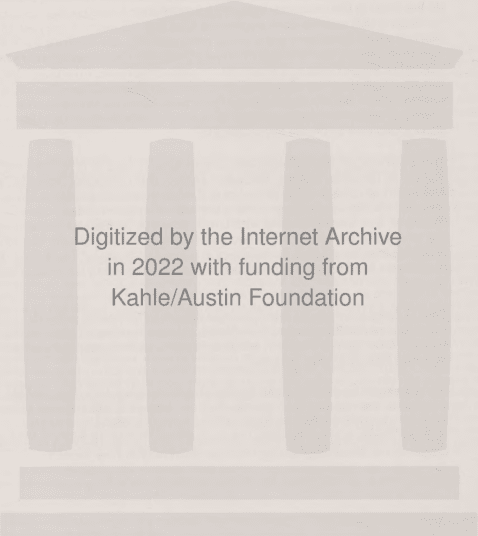

### 致词

**Jon "maddog" Hall：** 献给我的爸妈，众所周知他们非常抵触电子类物品，而且他们仍然叫我 *Ron* 而不是 *maddog*。

**Paul G. Sery：** 献给我的妻子，Lidia Maura Vazquez de Sery。

### 作者致谢

我要感谢我的妻子 Lidia，感谢她的耐心、支持和有益的建议，这些使得本书的写作成为可能。如果没有她，我至今仍将是一个戴着护镜套、用胶带粘着裂开的黑框眼镜、看《星际迷航》、穿着皱巴巴的衬衫、在水槽上方的锅里吃意大利面、周六晚上折腾代码的窝囊废。嗯，我其实并不热衷于《星际迷航》，而且我周六晚上确实在偷瞄这个键盘，但我漂亮的妻子无疑让我成为了一个更好的人。

我要感谢威利出版公司的员工，是他们的卓越支持使得这本书成为可能。Terri Varveris 和 Rebeca Whitney 提供了持续且不可或缺的协助。

我也想要感谢 Anne Hamilton 和 Laura Lewin，她们给了我机会来写作，特别是这本书。她们都对我表现出极大的信心和耐心。我对此深表感激，并祝她们在事业中取得成功。

我要承认，在写这本书时，我的狗——臭名昭著的 Oso Maloso——完全没有提供任何帮助：他吞食了许多本应终结其漫长生涯的东西，包括（但不限于）蚂蚁药、Advil（对狗有毒）、万圣节吃的许多磅 Tootsie Rolls 糖、派对上吃的几袋鸡骨头、啤酒以及其他各种杂物；他还逃出了许多篱笆和大门；并且是已故的伟大的 Paunchy（其名字出现在本书各处）以及当地其他狗的挚友。

Oso 有多少用处呢？嗯，一天晚上，当这本书还在编写中时，我接到了一个电话。我把苹果派放在键盘旁，下楼去接电话，经过他上楼的路。我应该知道有点不对劲的，因为他当时手里拿着一部手机，而且我接起电话时没人接听。我上楼时他正下楼。苹果派不见了。Oso 1，人类 0。

### 出版商致谢

我们为这本书感到自豪；请通过位于 *www.dummies.com/register* 的在线注册表单向我们发送您的评论。

协助将本书推向市场的人员包括：

- **采购、编辑和媒体开发**
  - **项目编辑：** Mark Enochs
  - **采购编辑：** Terri Varveris
  - **资深文字编辑：** Barry Childs-Helton
  - **技术编辑：** Susan 和 Korry Douglas
  - **编辑经理：** Kevin Kirschner
  - **许可编辑：** Laura Moss
  - **媒体开发专员：** Travis Silvers
  - **媒体开发经理：** Laura VanWinkle
  - **媒体开发主管：** Richard Graves
  - **编辑助理：** Amanda M. Foxworth
  - **插图：** Rich Tennant, *www.the5thwave.com*

- **排版**
  - **项目协调员：** Emily W. Wichlinski, Nancee Reeves
  - **版式和图形设计：** Andrea Dahl, Lauren Gaddard, Joyce Haughey, Barry Offringa, Heather Rylan
  - **校对员：** David Faust, Dwight Ramsey, TECHBOOKS Production Services
  - **索引编制员：** TECHBOOKS Production Services
  - ***特别致谢***
    - Christopher W. Morris

- **技术 Dummies 系列出版与编辑**
  - Richard Swadley, 副总裁兼执行集团出版人
  - Andy Cummings, 副总裁兼出版人
  - Mary Bednarek, 高级收购总监
  - Mary C. Corder, 编辑总监

- **消费类 Dummies 系列出版**
  - Diane Graves Steele, 副总裁兼出版人
  - Joyce Peppe, 收购总监

- **排版服务**
  - Gerry Fahey, 生产服务副总裁
  - Debbie Stalley, 排版服务总监

### 简介

**《红帽Fedora Linux 3实用教程》** 介绍了如何安装和使用这款流行且功能强大的Linux发行版，让您既能从中获得乐趣，又能从中获利。Fedora Core是Red Hat Linux的继任者。Fedora Core 1基本上是Red Hat Linux 10；如果你*真的*喜欢数字，可以把Fedora Core 3看作Red Hat Linux 12。

让我们退后一步，说明一下Linux发行版是*Linux内核*（控制计算机的核心软件，也称为*操作系统*）及其所有支持应用程序、实用工具和安装配置软件的组合，这些软件有助于您完成工作并在计算机上享受乐趣。根据上下文的不同，*Linux* 这个词传统上被用作特定Linux发行版的简称。

那么，为什么*这个* Linux发行版被命名为Fedora Core呢？fedora（一种帽子）和core（核心）与*Linux*有什么关系？好吧，Red Hat Inc.公司最近决定是时候专注于其核心业务了，其核心业务以其商业产品Red Hat Enterprise Linux为中心。Red Hat将其“免费”的Red Hat Linux发行版与Fedora Linux项目合并，创建了Fedora Core项目。（Fedora Linux项目此前专注于开发基于Linux的第三方应用程序和实用工具。）

Fedora Core项目是一个开源项目。*开源* 描述的是所有在GNU通用公共许可证（GPL）及其他类似许可证下发布的软件。开源软件向您（以及*每个人*）提供底层源代码的访问权限，并允许您使用、修改和*重新分发*（免费或收费）该代码。唯一的限制是您不能阻止*其他人* 做同样的事情。因此，在新安排下，Red Hat对Fedora Core项目拥有编辑控制权——并为其提供资源——而Fedora Core用户和开发者的社区在技术发展中获得了更大的角色。

少说废话，多干实事！*《红帽Fedora Linux 3实用教程》* 将帮助您在个人计算机上安装和使用极受欢迎的Fedora Core 3。我们向您展示如何完成工作，同时也做有趣的事情。本书还旨在成为一个有效的书挡或咖啡杯垫。无论您用来做什么，希望您都能玩得开心。

### 2 红帽Fedora Linux 3实用教程

### 关于本书

《红帽Fedora Linux 3实用教程》旨在成为一个助您一臂之力的资源。它为您提供了一个寻求帮助和安慰的地方，在那些时刻——当您花了两个小时试图让网络连接正常工作后，您的狗撞到您的桌子，把书撞到了您的计算机上，晃动了网线——而它神奇地开始工作了。

我们尽力在书中填充您需要了解的内容，例如如何执行以下操作：

- 安装Fedora Core 3。
- 连接到互联网，无论使用宽带DSL、电缆调制解调器还是老式的拨号调制解调器。
- 连接到您的局域网（LAN）。
- 构建简单但有效的防火墙。
- 构建互联网和局域网服务，例如Web页面和打印服务器。
- 使用Red Hat Linux播放CD并收听互联网广播电台。
- 使用GNOME桌面环境。GNOME是图形化系统，使您的计算机更容易使用且更有趣。GNOME提供了计算机的外观和感觉，以及许多应用程序。
- 利用有用且可用的应用程序，例如Open Office桌面生产力套件、Evolution桌面组织者和电子邮件客户端，以及流式多媒体MPlayer。
- 使用OpenOffice桌面生产力套件满足您的文字处理、电子表格和演示需求——或者，安装Wine（以及可能的商业Wine增强组件CrossOver Office），以便您可以直接从Fedora Core计算机使用Microsoft Office！
- 升级您的计算机和网络安全性。
- 知道去哪里寻求帮助。
- 管理您的Fedora Core工作站。

您在整本书中还会遇到故障排除技巧。事实上，第18章专门致力于这一主题。并不是说Fedora Core真的有很多麻烦，但我们希望您有所准备，以防遇到坏运气或特殊情况。


*《红帽Fedora Linux 3实用教程》* 中的说明是设计来配合您在本书配套DVD上找到的Fedora Core版本工作的；我们还描述了如何下载DVD上未找到的几个软件包。您可以自由使用其他版本的Fedora Core，甚至是其他Linux发行版，但请记住，我们的说明可能不会完全按照给定的方式工作，或者（有时）甚至完全不工作。哦，勇敢的新世界。祝您好运！

### 愚蠢的假设

您可能知道人们对做假设的人说什么，但**《红帽Fedora Linux 3实用教程》** *绝对* 不会写成如果我们不做一些假设的话。如果您属于以下情况，这本书适合您：

- **想要构建Fedora Core工作站：** 您想使用Linux操作系统构建您的个人工作站。惊讶吗？这本书背面的DVD包含Fedora Core 3发行版。
- **有一台计算机：** 这只是一个技术性事实，您需要一台计算机，因为我们描述了如何在计算机上安装Fedora Core 3。
- **没有强力胶带：** 您想把Fedora Core操作系统和计算机组合在一起，使用强力胶带行不通。
- **不想成为专家：** 您已经有爱好，不想成为Fedora Core专家——至少现在不想。

然而，如果您在寻找以下内容，**《红帽Fedora Linux 3实用教程》** *不适合* 您

- **一本包罗万象的参考书：** 我们确实没有足够的空间，或者没有从出版商那里获得许可来提供全面的主题范围。我们专注于提供让流行且有用的程序运行起来的帮助。例如，我们投入更多篇幅在让DSL或电缆调制解调器工作上，而不是描述使它们工作的理论。
- **一本系统管理书：** 同样，我们没有足够的空间来公正地处理这个主题。我们提供如何执行某些基本管理任务的说明，例如添加用户、软件包和网络连接。我们选择某些主题重点介绍，其余留给其他书籍。

### 本书使用的约定

在计算机大会上，成千上万的计算机人聚在一起讨论深入的技术问题，例如：

- 超人能打败蝙蝠侠吗？
- 惩罚者能超超人吗？
- 惩罚者、超人、蝙蝠侠和蜘蛛侠一起能打败Linux吗？*（绝无可能！）*

但我们指的不是这些深夜、咖啡刺激下的大会。我们的约定是特定信息或任务的简写方式。

### 输入代码

Fedora Core提供了各种图形用户界面（GUI）来帮助您完成大多数您想做的任务。然而，许多人仍然发现通过输入命令“手动”执行许多任务更容易；在某些情况下，这是完成工作的唯一方法。

因此，我们在第4章中向您展示如何使用基于文本的终端仿真器窗口来运行命令。为了预期手动运行命令，我们在此部分描述了几种约定。

当您在段落中看到URL（统一资源定位符）、文件名、目录、命令和参数时，它们会以*等宽字体*重新格式化。这有助于将这些项目与一般文本区分开来。

当您看到**粗体**单词时，它们表示您应该输入的内容；例如：

在命令提示符处输入 `man chown` 并按 **Enter** 键。

这一行告诉您输入命令 `man chown` 并按 **Enter**（或 **Return**）键。然后该命令会被执行。（在整个书中，每当我们需要您执行一个命令时，我们就会说“按 **Enter** 键”或“按 **Enter**”；**Enter** 键与 **Return** 键是同义词。）

独立于文本之外的命令看起来像这样：

`pwd`

以下是Linux中命令*语法*（如何将它们串在一起）的简要说明：

- 未被方括号 [ ] 或圆括号 ( ) 包围的文本必须严格按照所示输入。
- 方括号 [ ] 内的文本是可选的。
- *斜体* 文本表示命令中必须用适当文本替换的部分。您不应逐字输入命令中斜体部分。如果我们说“输入命令 `more somefile`”，我们的意思是让您用您感兴趣的**somefile** 的名称替换 *somefile*。例如，您最终可能输入命令 `more /etc/passwd`，其中用 */etc/passwd* 替换 *somefile*。
- 花括号 { } 内的文本表示您必须从花括号内由 | 符号分隔的值中选择一个。例如，您应该


如果在书中看到类似 echo [one|two|three] 的命令，请键入 echo “one” 或 echo “two” 或 echo “three”。

-   省略号 (. . .) 表示“等等”，或者根据需要重复前面的命令行。

暂时不必过多担心这些约定。在本书的大多数章节中，你无需在这些细节上费太多心思。当你需要了解特定语法的某些内容时，请回到本简介复习一下。

### 按键与点击

某些指令要求你按下特定的一个或多个键以执行所需的操作。如果需要按单个键，我们会说，例如，“按 A 键”。我们使用加号来表示多个键。例如，Ctrl+Alt+Delete 意味着你需要同时按下 Ctrl 键、Alt 键和 Delete 键。

我们在本书中描述的大多数应用程序和实用工具都使用图形用户界面 (GUI)，例如 Fedora Core 显示或网络配置工具，它允许你通过鼠标指点并点击来控制计算机。当我们告诉你“点击”某物时，我们指的是按下鼠标的左键。某些操作要求你使用右键；在这些情况下，我们会明确说明“右键点击”。

### 本书的组织结构

像所有正规的《傻瓜丛书》书籍一样，《红帽 Fedora Linux 3 傻瓜指南》被组织成独立的部分。你可以按任意顺序阅读这些部分。（嘿，如果你看过电影《记忆碎片》，你可能想倒着读这些部分。）基本上，本书并非旨在从封面读到封底；相反，它旨在成为一本参考书，帮助你在需要时找到你正在寻找的内容。结合“内容概览”页、目录和索引，你应该能够轻松找到所需的资料。

如果你按顺序阅读本书的章节，你会先遇到有用且有趣的内容，而更技术性的内容则放在最后。例如，在第一部分安装 Fedora Core 之后，你可能希望立即进入第二部分，了解如何将 Linux 连接到 Internet 或你的局域网。从那里，你可以使用你的新工作站浏览互联网和使用电子邮件。

以下各节描述每个部分。

# 第一部分：安装 Fedora Core

在第一部分中，我们介绍了 Linux 操作系统、其历史的一部分以及你可以使用 Fedora Core 发行版做的一些事情。我们还描述了如何准备计算机以安装 Fedora Core；由于许多（如果不是大多数）计算机都预装了另一个（咳）操作系统，我们描述了如何重新组织计算机的硬盘以安装 Linux。你将了解什么是 Linux，以及如何准备计算机以安装 Fedora Core。然后，我们将引导你完成安装过程，并展示使用 Fedora Core 的基本操作。

### 第二部分：有网吗？

在第二部分中，你将了解如何连接到 Internet 和局域网。你会看到如何使用日常调制解调器、高速（宽带）DSL 连接或电缆调制解调器上网。我们还展示如何连接到现有网络。如果该局域网拥有高速 Internet 连接，你可以将其作为你浏览奇妙世界的门户。Internet 可能很危险，因此我们包括了创建自己的防火墙的说明。

### 第三部分：Linux，哈！它有什么用？绝对什么都能做！

第三部分引导你了解使用 Fedora Core 做具体事情的细节。这部分介绍了 GNOME 桌面窗口环境，并通过了解如何移动、调整大小、隐藏和关闭窗口，以及如何使用文件管理器等，带你熟悉其操作。有两章专门介绍 Fedora Core 的多媒体功能，如收听 CD 和 MP3，以及如何抓取和录制它们。随着流媒体技术的发展，世界各地的在线广播电台现在向你开放。我们介绍 Mozilla 浏览器，以便你可以浏览网络，并使用 Evolution 组织器读取电子邮件、使用日历和执行其他任务。我们还详细描述了功能齐全的 OpenOffice 桌面生产力套件。你可以使用 OpenOffice 在 Fedora Core 机器上完成所有写作和其他与工作相关的功能。你甚至可以用它写一本书！

### 第四部分：极客复仇记

在第四部分中，我们引导你使用 Fedora Core 计算机的网络功能。这是极客之城，但也既有趣又实用。我们从展示如何构建一个简单的网络开始。在你的网络运行起来之后，我们描述了如何构建网络服务，如 Apache Web 服务器、Samba 和打印机服务器。该部分最后两章专门用于探索计算机网络安全的艺术和排查网络问题。戴上你的口袋护具，把老式的惠普计算器绑在腰上，重新贴好眼镜，准备好迎接周六晚上吧！

### 第五部分：十大技巧

如果没有“十大技巧”部分，《傻瓜丛书》书籍就不完整，你可以在这里找到十个至关重要的资源，以及安装 Fedora Core 后人们最常提出的十个最棘手问题的答案。（红帽软件公司的人员提供了这些问题；他们应该知道。）我们还介绍了十个最重要的安全问题。

# 第六部分：附录

啊，附录。附录 A 概述了 Fedora Core 系统管理实用工具。附录 B 描述了如何了解计算机各个硬件部件的详细信息；这些信息在安装 Fedora Core 时有时很有用。附录 C 和 D 介绍了如何使用和管理 Linux 文件系统。附录 E 展示了如何使用红帽包管理器 (RPM)。附录 F 通过描述你可以在配套 DVD 上找到什么，为本书画上句号。

### 你不需要阅读的内容

嘿，如果你不想，你甚至不需要阅读《红帽 Fedora Linux 3 傻瓜指南》中的任何内容，但那样的话，你为什么要买它呢？（不是我们在抱怨。）第一部分包含背景信息。如果你不想要，就不必读。此外，边栏中的文本是可选的，尽管往往很有帮助。如果你正快速上手使用 Fedora Core，你可以跳过边栏和“技术要点”图标旁边的文本，如下节所述。但我们建议稍微放慢脚步，享受这一体验。

### 本书中的图标

本节描述了你在本书中看到的图标。图标通过突出显示有趣或重要的信息来增强讨论。


在这个图标旁边会出现巧妙的捷径和时间节省技巧。Fedora Core 是一个强大的操作系统，使用它的工具和程序可以节省难以置信的时间和精力。我们希望我们的技巧能向你展示如何做到这一点。


别让自己遭遇这种状况！我们希望我们对 Fedora Core 的经验能帮助你避免我们犯过的错误。


这些信息有助于你回忆书中其他部分呈现的信息。


这些信息特别具有极客味和技术性。你可以跳过它们，但如果你更喜欢极客风格，可能会觉得有趣。

### 接下来去哪里

你即将加入那些一直在使用和开发 Fedora Core 和 Linux 的大批人群。我们使用 Unix 已超过 20 年，使用 Linux 超过 10 年，使用 Fedora Core（和红帽 Linux）近 10 年。我们发现 Fedora Core 是一个灵活、强大的操作系统，能够解决大多数问题，即使没有大量的商业软件也是如此。Linux 操作系统——特别是 Fedora Core——的未来是光明的。你花时间和精力度熟悉它将是值得的。


# 第一部分

# 安装 Fedora Core


> “杰里，在你越过安装程序的‘不归点’之前，它们已经在上面了吗？”

# 本部分的内容……

你即将踏上一段通过 Fedora Core 安装程序的旅程。也许你对在计算机上设置操作系统一无所知。没关系。Fedora Core 安装系统天生平和，使用简单明了。此外，我们会引导你完成安装过程。

在第 1 章中，你会了解 Fedora Core 的概况以及它能为你做什么。第 2 章帮助你为安装 Fedora Core 做准备，并在必要时重新划分硬盘分区。真正的乐趣从第 3 章开始，那时你将安装你自己的企鹅。（Linux 的发明者林纳斯·托瓦兹喜欢企鹅，它们已被采纳为 Linux 的吉祥物。）第 4 章提供了关于使用 Fedora Core 的简短但重要的介绍。

# 第 1 章

## 在另一个角落……有一只企鹅？

**本章内容**

- 小睡中回顾 Linux 历史 101
- 了解 Fedora Core 的功能
- 将 Fedora Core 用作工作站
- 使用 Fedora Core 的网络功能

我们在你的未来中看到了一只企鹅。这位谦逊的家伙正在与那个*其他*操作系统在争夺计算机用户的心智和桌面方面展开激烈竞争。Fedora Core 是 Red Hat Linux 的继任者，无疑是推动 Linux 革命的主要力量之一——也是最受欢迎的 Linux 品牌。

本章向你介绍最新且最强大的 Fedora Core 版本，即 Fedora Core 3。本书涵盖了如何使用 Fedora Core 作为桌面生产力工具、互联网门户、多媒体工作站和基本网络服务器的方方面面（至少涵盖了大多数方面）。你可以用 Fedora Core 做很多事情；本章概述了这些可能性——此外还简要回顾了一下 Linux 的历史。

### 世界历史，呃，Linux 历史：第二部分

在计算机世界的开端（以一种轰鸣雷厉的声音说），世界上充斥着巨大的大型机。这些懒散的巨兽笨拙地穿行于大型企业之中，需要一种特殊的超级极客来让它们保持开心；并且吞噬了巨大的空间、电力和资金。后来 IBM PC 和微软出现了，世界改变了。权力在一定程度上交给了大众。

1991 年，赫尔辛基大学一名名为林纳斯·托瓦兹的学生对标准的 PC 操作系统感到不满。他认为 Unix 操作系统可能比 MS-DOS 或 Windows 更适合帮助他完成工作。Unix 发明于 20 世纪 70 年代，虽然功能强大，但价格昂贵，因此他开始编写自己版本的 Unix。现在，编写自己的操作系统是一项简单的任务——并不！在确定了基本部分后，托瓦兹通过互联网招募了一支由才华横溢的程序员组成的团队，他们共同创建了一个新的操作系统，或称为内核，现在被称为 Linux。

托瓦兹在 Linux 早期所做的最重要决定之一，是自由分发 Linux 内核代码，让任何人都可以随心所欲地使用。这些*免费的 Linux 发行版*可以（并且现在仍然可以）以多种形式获取，主要是在线形式。

林纳斯对他创造物的自由分发施加的唯一限制是，软件的任何版本都不能成为专有软件。（*专有*软件由私营公司拥有和开发，其保密程度往往与 51 区不相上下。然而，*开源*代码是面向“大众”的——任何人都可以使用和开发它，而无需担心侵犯版权或专利限制。）你可以随心所欲地修改它，并出于乐趣或利润进行分发。你*不能*做的是阻止其他人使用、修改和分发你修改后的软件。

把开源软件想象成一条道路。林纳斯和其他人开始修建这条路，许多人路过并发现它很有用。一些人开始在这条路上添加内容，而其他人则按原样使用它。如果你愿意，你可以使用这条路，拓宽它，并添加另一个分支——但你*不能*阻止任何人使用原始道路或他们添加的部分；你也不能阻止人们添加他们自己的分支。

Linux 缺乏传统专有软件的限制，促成了其技术的持续改进和创新——随后带来了其巨大的受欢迎程度。开源软件，特别是 Linux，对所有用户和开发者都是透明的。这种透明度使世界各地的人们能够快速改进 Linux 及其相关子系统。相比之下，专有操作系统就像一个密封的黑盒子，除了少数特权内部人员之外，没有人知道里面发生了什么。只有那个精选的小组才能进行修改，这限制了创新和改进。

回到我们简短的历史课：1994 年早春，Linux 的第一个真正版本（1.0 版）可供公众使用。当时非常令人兴奋。即便那时，它也是一个令人印象深刻的操作系统，能在内存少于 2MB 且配备简单 386 微处理器的计算机上高效运行。Linux 1.0 还包含了许多其他操作系统收费数百美元的免费功能。如今，数千万用户在家中和工作中享受着 Linux。

## 自由软件？

自由软件基金会（FSF），是大卫·理查德·斯托曼（Richard Stallman）的产物，贡献了许多实用软件，使使用 Linux 变得更加容易。大多数其日常使用的工具和命令，如 ls 和 cat，都来自 FSF。斯托曼被许多人视为开源运动的发起人。


顺便说一下，如果你在好奇整个企鹅的事情，答案很简单：Linux 喜欢企鹅。Linux 世界自然开始使用这种鸟作为其象征。友好且熟悉的企鹅（顺便提一下，它的名字叫 Tux）现在象征着所有与 Linux 相关的事物。

## 了解你能用 Fedora Core 做什么

Fedora Core 将所有这些组件结合在一起，再加上一些额外的应用程序，并再进一步添加了一些自己的内容——以创建一个*集成产品*。Fedora Core 项目将基本的 Linux 操作系统与软件（一些由其他公司制作，一些由 Red Hat 制作）结合起来，产生一个价值大于其各部分总和的包。这种结合被称为 Linux 的一个*发行版*或*变种*。

为了让你尽快上手，我们将 Fedora Core 3 发行版捆绑在本书后方的 DVD 上。


如果你的计算机无法使用 DVD，你可以寄回本书后方的优惠券，通过 CD-ROM 获取完整的 Fedora Core 3 发行版。

Fedora Core（及其前身 Red Hat Linux）最初几乎仅用于提供基于网络的服务，如 Web 页面。然而，Red Hat, Inc. 公司——连同许多开源开发者（如 GNOME 项目）——开始努力工作，使 Linux 适合桌面使用。结果是 Fedora Core 现在既用于服务器环境也用于桌面环境。它被个人、企业和政府用于削减成本、提高性能，并且仅仅为了完成工作。

你可以将 Fedora Core 用作桌面工作站、网络服务器、互联网网关、防火墙、嵌入式系统的基础（例如，智能录像机或冰箱），甚至多处理器超级计算机的大脑。并且，得益于许多不断进行优化和创新的人，Fedora Core 在每次发布中变得更加灵活和强大。

此列表展示了 Fedora Core 提供的一些功能：

- ✔ **桌面生产力工具：** Red Hat 和现在的 Fedora Core 在过去几年里成功加班加点，使 Linux 能在你的*桌面*上运行（即大多数人用于日常任务（如文字处理或网络浏览）的单计算机系统）。Fedora Core 将软件——如 OpenOffice 生产力工具套件和 Mozilla 浏览器——与操作系统捆绑，以便你可以完成日常工作。OpenOffice 套件包含全功能文字处理器以及电子表格、演示文稿、图形绘制和网页创建工具。其文字处理器可以读取和写入所有 Windows Office 格式，以及许多其他格式（如 WordPerfect）。Mozilla 是一个功能齐全的浏览器，与 Microsoft Internet Explorer 并驾齐驱。

- ✔ **多媒体内容：** Fedora Core 为你打包了众多多媒体工具。你可以播放、录制和从 CD 和 DVD 中抓取音轨。你可以使用 Rhythmbox 通过互联网收听流媒体源（如广播电台）。Linux 还允许你从自己的相机和 MP3 播放器传输照片和其他物品。

- ✔ **网络服务：** Fedora Core 的踪迹可追溯到提供基于网络的服务。Linux 在最初的人气来源于执行如 Web 服务、文件服务和打印机共享等任务——并且从未停歇。我们在本书第四部分中向你展示了如何使用 Fedora Core 创建几种网络服务。

## 增强你的个人工作站

我们无法过分强调 Fedora Core 作为个人计算机表现得多好。使用 Fedora Core，你可以轻松创建自己的低成本、灵活且功能强大的工作站。Fedora Core 提供了大多数你需要完成工作的应用程序的平台。许多应用程序，从桌面生产力套件到 Web 浏览器和多媒体系统，都随 Fedora Core 捆绑提供。例如，以下列表描述了 Linux 可用的免费软件的一些主要类别，以及一些流行程序的示例：

- ✔ **办公套件：** OpenOffice 提供一个完整的桌面生产力套件，其中包括（首先）高级文字处理器、电子表格和演示文稿编辑器。OpenOffice 文字处理器可以读取和写入 Microsoft Word、HTML、电子表格和图形文件。


OpenOffice 提供自己的文件格式，也可以读取和写入 Microsoft Office 97、Office 2000、Office XP 以及 Office 2003 的文件。它还可以使用其他格式，例如富文本格式（Rich Text Format）。请访问 www.openoffice.org 网站了解更多信息。

### 多媒体播放器

Fedora Core 打包并安装了开源的 Rhythmbox 播放器。你可以使用 Rhythmbox 来播放已下载的 Ogg/Vorbis 文件或 Ogg/Vorbis 流；Ogg/Vorbis 是一种在第十二章中介绍的新的开源多媒体格式。你还可以下载出色的开源 MPlayer 音频和视频播放器。MPlayer 可以让你观看 DVD，以及收听或观看 Windows 媒体播放器的音频/视频流。或者，你也可以从 RealNetworks 下载专有软件 RealPlayer 的免费版本，以收听 RealAudio 流。互联网在多媒体方面变得疯狂，而这些多媒体播放器让你能够参与其中。

### 运行 Microsoft Windows 应用程序和环境

你可以使用 Fedora Core 来运行 Windows 程序。WINE（Wine Is Not an Emulator）系统使得直接在 Linux 下运行 Windows 程序成为可能。WINE 在 Linux 和 Windows 世界之间搭建了一座桥梁，让你既能享受 Linux 的优点，又能使用 Windows 的程序。（商业产品 VMware Workstation 通过在 Linux PC 中创建一个虚拟计算机，在那些世界之间搭建了一种不同类型的桥梁。从软件的角度来看，这个虚拟机看起来、行为上、闻起来以及表现上都像一台“真实”的 Windows 计算机（即其正常环境），但实际上它只是一个在 Linux 操作系统下运行的程序。）

### 网络浏览器和电子邮件客户端

Fedora Core 包含开源浏览器 Mozilla，以提供一个强大、可靠且安全的浏览器来浏览网页。你还会获得 KXimian Evolution 个人组织者——它包括电子邮件客户端、日历以及类似 Microsoft Outlook 的其他功能——以满足你的消息传递和组织需求。

## 使用 Linux 网络工具和服务

Linux 计算机可以提供许多灵活的网络服务。你的 Fedora Core 3 DVD 中包含了提供这些服务所需的工具：

### Apache Web 服务器

开源的 Apache Web 服务器运行着互联网上绝大多数的 Web 服务器。只需从本书配套的 DVD 中安装捆绑的 Apache 软件，你就可以启动一个简单的 Web 服务器。

### OpenSSH

Secure Shell（SSH，安全外壳协议）的开源版本使你能够安全地在互联网上进行通信。Secure Shell 比 Telnet 安全得多，因为 Secure Shell 在登录时（甚至登录到其他计算机时）会加密你的通信，从而大大降低了未经授权的人发现你的密码和其他敏感信息的可能性。OpenSSH 还提供了其他身份验证和安全功能，并允许你在机器之间安全地复制文件。使用 OpenSSH，你可以防止他人监听你的通信。

### 互联网访问工具

Fedora Core 提供了几种配置工具，帮助你连接互联网。这些工具帮助你配置 DSL、电缆调制解调器以及普通的电话调制解调器以连接互联网。它们还帮助你连接使用以太网适配器的局域网（LANs）。

## 防火墙

防火墙是一个控制系统，用于控制任何外部网络（在这种情况下是互联网）对你的私有网络的访问，并控制你的私有网络对外部世界的访问。为了将坏分子拒之门外，Fedora Core 通过提供构建你自己的防火墙的工具来提供保护。在这方面，Fedora Core 非常灵活，并且有许多软件包可用，包括流行且易于使用的 netfilter/iptables 过滤软件，该软件包含在本书的配套 DVD 中。第 8 章介绍了使用和修改默认的 Fedora Core 防火墙。

这个列表只是你可以使用 Fedora Core 进行的网络相关操作的一个样本。我们在本书中描述了其中的许多内容。

# 第一部分：安装 Fedora Core

# 第 2 章

# 为 Fedora Core 铺平道路

### 本章内容

-   准备安装 Fedora Core
-   确定你的 Windows 分区是 FAT 还是 NTFS
-   整理你的硬盘碎片
-   调整 FAT 分区的大小
-   调整 NTFS 分区的大小

所有主要个人计算机（PC）制造商都在其机器上默认安装 Microsoft Windows。然而，你可以通过邮件订单或从当地的非品牌商店购买*没有*安装操作系统的计算机。

这意味着什么？基本上，如果你有一台没有预装操作系统的“裸机”PC，你可以跳过这一章。如果你想要从 PC 中移除 Windows，或者你的 Windows 计算机上有一个可以安装 Linux 的第二分区，你也可以跳过这一章。


> **技术要点**
>
> *分区*是用于组织文件和目录的磁盘驱动器的一部分。例如，著名的 Windows C 盘安装在它自己的分区上。分区可以使用磁盘的全部或部分。如今大多数计算机将 C 盘所在的整个硬盘进行分区，尽管有些包括用于 D 盘的第二分区。但是，如果你在你的 PC 上安装了 Windows 并希望保留它，你必须为 Fedora Core 做出安排。幸运的是，Linux 是一个随和的家伙，能与他人和睦相处。你可以在同一驱动器上安装 Fedora Core 与 Windows 相邻，这种配置称为“*双启动*”系统：你在计算机开机，或*启动*时选择要使用的操作系统。

本章向你展示了如何准备你的硬盘，以便 Linux 和 Windows 能够像甜腻的汽水广告中那样和谐共处。世界现在需要的是双启动，甜美的双启动——哦，算了。

## 为你的 Windows 计算机准备安装 Fedora Core

在现有 Windows 安装旁边安装 Fedora Core 之前，你需要准备好你的硬盘。此步骤列表提供了磁盘准备过程的概述：

1.  **戴上红色的费多拉帽（双关语：Fedora 名字与帽子 Fedoras）。**
2.  **备份你 Windows 计算机上的所有内容。**

我们在本章中描述的过程不应影响你现有的 Windows 安装。然而，在处理你珍贵的文件时，你永远不会太过小心，因此你应该备份它们。如何备份 Windows 计算机的内容的描述超出了本书的范围。有许多商业和免费软件（不要与开源软件混淆）备份系统可用。

3.  **确定你的 Windows 计算机的硬盘是如何格式化的。**

Microsoft Windows 使用两种类型的磁盘格式：FAT（File Access Table，文件访问表）和 NTFS（NT File System，NT 文件系统）。FAT 比 NTFS 更古老，也不那么先进。有开源工具可用于调整基于 FAT 的磁盘的大小以为 Linux 腾出空间，但你必须购买商业软件来重新分区 NTFS 系统。（下一节告诉你如何知道你拥有哪种格式。）

4.  **整理你的磁盘碎片。**

所有调整大小的程序都要求你在继续之前*整理*你的磁盘碎片。随着时间的推移，组成你文件的位和字节倾向于在你的硬盘周围散落。如果这些碎片太多留在周围，调整大小可能不起作用——甚至可能引起问题。整理它们；下一节涵盖整理碎片。

5.  **如果你想要将 Fedora Core 安装在 Windows（或其他操作系统）旁边，请重新分区你的计算机硬盘以为安装 Fedora Core 腾出空间。**

你可以使用破坏性或非破坏性调整大小来为 Linux 腾出空间。*破坏性*调整大小会清除所有内容，包括 Windows 和你的数据文件，并重新开始。*非破坏性*调整大小使用 Windows 工具动态缩小现有分区，然后使用释放的空间创建一个新的 Linux 分区。（调整大小将在本章稍后涵盖。）

开源的 FIPS（First nonDestructive Interactive Partition Splitting，第一个非破坏性交互分区分割）程序随完整的 Fedora Core 分发版一起提供，用于重新分区 FAT 磁盘。要重新分区 NTFS 磁盘，你必须使用商业实用程序，如 Norton PartitionMagic 8.0 或 Norton Ghost 2003；这两个程序也适用于 FAT 系统。


## “我是 FAT 还是 NTFS？”

确定你的分区类型的过程很简单。本说明描述了如何使用 Windows（Windows 9x、Windows Me、Windows NT、Windows 2000/2003 和 Windows XP）提供的工具来显示分区类型。

在所有 Windows 系统上执行以下步骤：

- 1. 启动你的计算机。
- 2. 打开“我的电脑”图标。
- 3. 右键单击 C 盘图标。
- 4. 点击“属性”按钮。

你应该能看到关于分区的信息显示，如图 2-1 所示。

图 2-1 显示了 C 盘（该分区）的信息。图的中上部显示（在本例中）该分区使用 NTFS。

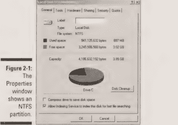

## 对你的硬盘进行碎片整理

当你知道你的硬盘是如何分区的时，就是进行碎片整理的时候了。本节描述了如何对 FAT 和 NTFS 分区进行碎片整理。

碎片整理会将你硬盘上的所有文件整合到连续的区域中。这项任务是必要的，因为作为操作系统，Windows 非常乱，它把数据散落在硬盘各处的速度，比极客在《星际迷航》大会上追明星要签字的速度还要快。

以下步骤展示了如何对你的 Windows 分区进行碎片整理：

- 1. 关闭计算机上的所有程序和窗口，只留下桌面和图标栏。
- 2. 双击桌面上的“我的电脑”图标。
- 3. 点击选中 C 盘，然后选择“文件”、“属性”、“工具”。
- 4. 点击“立即碎片整理”按钮。

碎片整理程序会查看驱动器以确定是否需要碎片整理。

你可能会收到一条消息，告诉你你的硬盘碎片不多，因此不需要进行碎片整理；不要相信它。在普通情况下，这种说法可能是真的。但调整磁盘大小是件棘手的事；你必须彻底碎片整理你的硬盘，因为你要移动分区文件系统的末端并缩小分区，这会擦除该屏障之外的所有内容。

- 5. **点击“开始”。**

碎片整理窗口出现，过程开始。

碎片整理可能需要很长时间，具体时间取决于你硬盘的大小以及数据在磁盘上分布（碎片化）的程度。

点击“显示详细信息”按钮，你可以在大窗口中上下滚动，观察碎片整理过程的动态。彩色块代表程序和数据；白色空间代表你硬盘上的空闲空间，FIPS 可以将这些空间分配给 Linux 文件系统。块在屏幕上的移动表明数据正在硬盘上向前移动。你会看到白色空间在窗口底部出现，这代表数据的末尾。在碎片整理过程结束时，窗口底部不会出现彩色块，所有块都压缩在窗口顶部。在经过看似相当长的时间后，碎片整理结束。所有有用的信息块现在都在硬盘的开头，使其准备好用于调整大小的程序。

以下说明描述了如果你正在运行 Windows NT、Windows 2000/2003 或 Windows XP（NTFS）时如何对你的计算机进行碎片整理：

- 1. 关闭计算机上的所有程序和窗口。
- 2. 点击“开始”、“程序”、“附件”、“系统工具”、“磁盘碎片整理程序”。
- 3. 选择你要进行碎片整理的分区。
    - 大多数计算机使用单个标记为 C:\（ ubiquitous“C 盘”）的分区。
- 4. 点击“碎片整理”按钮，过程开始。

图 2-2 展示了 NTFS 分区的碎片整理过程。

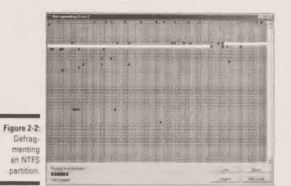

## 我们要搬到 Linux 那边去了

在对你的硬盘进行碎片整理后，你需要为 Linux 腾出空间。本节描述了如何重新分区你的 Windows 计算机以腾出必要的空间。你可以使用开源的 **FIPS** 程序来重新分区 FAT 分区。FIPS 不能用于 NTFS 分区，因此你需要购买一个商业工具，如 PartitionMagic。下一节专门介绍在 FAT 上使用 FIPS。随后的一节描述在 NTFS 分区上使用 PartitionMagic。

> 我们强烈建议在进行操作之前备份你的整个硬盘。如果这样做不切实际或不可能，你应该备份所有重要的文件。通常你可以从发行版光盘重新安装你的操作系统和应用程序，但你不能对数据这样做。你不想失去你辛辛苦苦创建的任何文件或程序。参阅你系统的所有者手册以了解如何备份你的系统——以及必要时如何恢复数据。

FIPS 调整你的基于 FAT 的 Windows 分区的大小。较新版本的 Windows（某些版本的 Windows 95、Windows 98 和 Windows Me）使用 32 位文件分配表（称为 FAT32）和驱动器管理工具，提供大于 2GB 的单驱动器配置。较旧版本的 Windows 95 使用 16 位 FAT（称为 FAT16，奇的是）；要使用 2GB 以上的空间，硬盘必须被分区为 2GB 或更小的逻辑驱动器。较新的计算机拥有比旧的 2GB 限制大得多的硬盘。如果驱动器被重新分区，大型驱动器管理系统将被禁用，DOS 和 Windows 分区再次限制为 2GB。

要完成这项工作，你必须使用古老的 MS-DOS（微软磁盘操作系统）—— 是的，以某种方式，所有的 Windows 都欠 MS-DOS 它的存在。以下说明描述了如何创建一张 MS-DOS 启动软盘，你将用它来运行 FIPS：

- 1. **插入一张软盘并点击“我的电脑”图标。** 请注意，这些步骤会*永久擦除*磁盘上的所有信息。
- 2. **右键单击 3.5" 软盘 (A:) 图标并选择“格式”选项。** 会出现“格式化 A:\”窗口。
- 3. **点击“创建启动盘”选项，然后点击“开始”按钮。** 一个确认窗口，标记为“格式化 A:\”，再次打开。
- 4. **点击“确定”按钮，你的软盘就被格式化了。**

随附本书的单张 DVD 中包含的 Fedora Core 发行版，不幸的是没有包含 FIPS 实用程序。但是，你可以将 FIPS 下载到你刚才创建的软盘中：

- 1. **打开你的浏览器并访问以下网站：**
    `http://download.fedora.redhat.com/pub/fedora/linux/core/1/i386/os/dosutils/fips20.`
- 2. **将 fips.exe、restore.txt、errors.txt 以及（可选的）readme.1st 和 fips.faq 下载到你的软盘。**
- 3. **从软盘启动你的计算机。** 计算机以 MS-DOS 模式重启。
- 4. **在提示符下输入 fips 并按 Enter。** 会出现一些信息并快速闪过，除了最后一条要求你*按任意键*的消息外，你可以忽略所有消息。
- 5. **当你看到“按任意键”消息时，按下去。** 你会看到硬盘上所有现有的分区。
- 6. **当你看到**按任意键**消息时，再按一次。**
    - 你越来越熟练了！驱动器的描述和一系列消息快速闪过。然后 FIPS 在第一个分区中找到空闲空间。
- 7. **当你被问到是否要制作扇区的备份副本时，按*** *y* ***表示“是”。**
    - 屏幕询问 A 驱动器中是否有软盘。
- 8. **取出启动软盘，将一张格式化的软盘放入 A 驱动器，然后按*** *y* ***。**
    - 出现类似 *Writing file a:/root/boot.000* 的消息，随后出现其他消息，最终以 *Use cursor key to choose the cylinder, enter to continue* 结束。

屏幕上出现三列：*旧分区*、*柱面* 和 *新分区*。*旧分区* 的数值是你硬盘主分区的兆字节数。*新分区* 的数值是你正在为 Fedora Core 操作系统创建的新分区的兆字节数。

- 9. **按左右箭头键更改** *旧分区* **和** *新分区* **字段中的数字，为 Windows 操作系统和 Linux 创建所需的空间。**
    - 有关安装要求，请参见第 3 章。
- 10. **当你在每个字段中有正确数量的硬盘空间时，按 Enter 键。**
    - 分区表再次显示，向你展示已为 Linux 操作系统创建的新分区。这个新分区可能是*分区 2*；C 盘可能是*分区 1*。
    - 你还会在屏幕底部看到一条消息，询问你是要继续还是进行修改。
- 11. **如果你对所分区的尺寸满意，按 C 键继续（如果你*** *不满意*，*按 R 键，这将带你回到步骤 10）。**
    - 关于你的硬盘的更多消息快速闪过。最后，出现一条消息告诉你系统已准备好将新的分区方案写入磁盘；它询问你是否要继续。
- 12. **按 Y 键使 FIPS 将新的分区信息写入硬盘。**
    - 分区过程开始。
    - 如果你按 N 键，FIPS 将退出而不更改硬盘上的任何内容——让你的硬盘保持在你碎片整理后的原样。


13. 为确保无损分区操作成功，请移除启动软盘，并按下 Ctrl+Alt+Delete 重新启动系统。

14. 允许 Windows 启动，然后运行 ScanDisk（点击“开始”按钮，选择“程序\附件\系统工具\ScanDisk”）。

ScanDisk 会指示你是否拥有最初的所有文件和文件夹，以及是否有内容丢失。即使检查结果显示一切正常，为了保险起见，也建议保留备份文件一段时间。

现在你准备安装 Fedora Core 3，我们将在第 3 章中说明如何安装。Fedora Core 的安装过程可以利用新创建的空间来建立自己的分区。第 3 章描述了如何使用新空间而避免覆盖现有的 Windows 分区。

### 使用 PartitionMagic 调整 NTFS 分区大小

调整 NTFS 大小需要使用商业工具，如 Norton Ghost (www.norton.com) 或 PartitionMagic (www.symantec.com/partitionmagic)。PartitionMagic 通过缩小 Microsoft Windows 分区来工作，从而为新分区留出空闲空间。然而，Norton Ghost 2003 并不动态修改现有的 NTFS 文件系统。相反，它备份现有的 Windows 分区（进行“快照”），然后在原始位置创建一个或多个新分区。最后，它将原始 Windows 镜像写入新分区。Ghost 需要一个存储设备来保存快照镜像。如果你的 Windows 安装相对较小（小于 4GB），你可能会使用可写 DVD，或者（对于小于 1GB 的快照）甚至使用可写 CD-ROM 作为存储设备。但是，对于较大的安装，你必须使用第二块硬盘、磁带备份或其他备份机制。

本节描述如何使用 PartitionMagic。我们没有使用 Norton Ghost，尽管它是一个优秀的工具，是因为我们无法假设你拥有足够大的备份资源来使用它。（如果你想使用 Ghost，你需要一个足够大的备份介质来存储整个 Windows 安装内容。）虽然 PartitionMagic 没有提供像创建备份那样让人安心的感觉，但它的工作效果非常好。我们已多次使用它并取得了良好结果。

以下步骤描述了如何安装 PartitionMagic：

1. 拿出你的信用卡，去你附近的友好电脑商店（或者在线访问你友好的互联网商店），购买 Symantec 的 PartitionMagic 8。

在一本致力于免费、开源 Linux 操作系统的书中说出这句话有点尴尬。然而，关键在于完成任务——在这种情况下，我们没有非商业的替代方案。（一个开源应用即将问世。我们会尽快进行评估和报道。）在开源的 NTFS 分区调整工具出现之前，最好的选择是进行购买。

有三种 NTFS 变体可用。较旧的 Windows 9x 系统使用一种，Windows NT 使用另一种，第三个版本服务于当前版本的 Windows。对于这项任务，你必须使用 PartitionMagic 8（当前版本），因为它可以识别和处理所有三种 NTFS 版本。


2. **通过将光盘插入光驱来启动 PartitionMagic 安装。**
   安装窗口打开。
3. **点击 PartitionMagic 按钮。**
   另一个对话框打开，询问你是否要安装该程序。
4. **点击 Install（安装）选项。**
   安装向导启动。
5. **在向导运行过程中，根据你的计算机配置回答其问题。**
   通常你应该可以使用默认选项。
6. **创建救援磁盘。**
   安装向导会引导你完成此过程。

安装 PartitionMagic 后，你可以使用它对驱动器进行重新分区。以下说明展示了如何选择现有分区，缩小它，然后从新空间创建一个第二个分区：

1. **启动 PartitionMagic。**
   你会看到类似图 2-3 所示的屏幕。
2. **点击选择你要重新分配的分区。**
3. **点击屏幕左上角的 Create a new partition（创建新分区）选项。**
   创建新分区对话框打开。此向导将引导你完成缩小现有分区并从新空间创建第二个分区的过程。
4. **点击 Next（下一步）按钮。**
   “Where to Create”（创建位置）对话框打开。

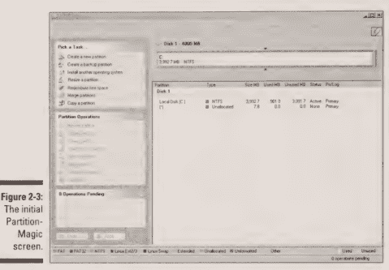

5. 告诉 PartitionMagic 要重新分区哪个分区。

在这个例子中，我们假设你拥有典型的单分区 Windows 计算机（无处不在的 C 盘），如图 2-4 所示。

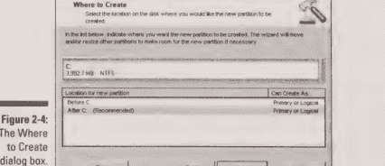

6. 点击 Next（下一步）按钮。

分区属性窗口出现（如图 2-5 所示），为你的新分区提供以下选项：

- **Size（大小）**：分区大小取决于你的磁盘大小。
- **Label（标签）**：标签是可选的且任意的。使用任何你想要的描述。
- **Create as（创建为）**：你可以选择逻辑（Logical）或主（Primary）。PC 驱动器最多可以有四个主分区和任意数量的逻辑分区。

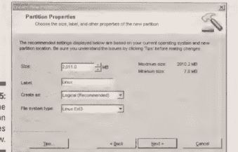

**图 2-5：分区属性窗口。**

7. **指定你要应用于新分区的选项。**

图 2-5 显示了我们输入的设置：我们的新分区大小为 2GB，标签为 `linux`，是逻辑分区，并使用 `ext3` 文件系统。

8. **点击 Next（下一步）按钮。**

确认选择对话框打开，如图 2-6 所示。（PartitionMagic 希望你对即将创建的新分区确定，因此它总结了潜在的新配置。）

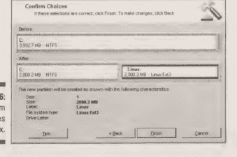

**图 2-6：确认选择对话框。**

9. 检查摘要信息，如果你对选择满意，点击 **Finish（完成）** 按钮。
   - 如果你不想使用当前选择进行重新分区，点击 Back（返回）按钮返回上一个窗口，在那里你可以做出新的选择。
   - 如果你点击 Finish 按钮，即将创建的新分区将显示在主窗口中。然而，你的磁盘不会重新分区，直到你点击 PartitionMagic 窗口左下角的 Apply（应用）按钮。
10. 点击 **Apply（应用）** 按钮，最终确认窗口打开。
11. 在确认窗口中点击 OK（确定）。
    你的磁盘已重新分区：新分区在你重启计算机之前不会生效。
12. 重启你的计算机。
    PartitionMagic 会在计算机启动时应用更改以创建新分区。

## 第 3 章

## 预备，就位，安装！

### 本章内容

- 决定使用哪种 Fedora Core 安装类型
- 启动 Fedora Core 安装过程
- 自动选择 Linux 分区
- 配置你的网络
- 配置你的系统选项
- 完成安装并重启
- 配置你的显示
- 使用 Setup Agent 完成安装后配置

安装 Linux 不是火箭科学——它更像天体物理学。（嗯，也许没那么复杂。）虽然安装 Fedora Core 最初看起来像是一项艰巨的任务，但实际上很简单。安装过程需要你回答几个问题，然后过程会自动处理其他事项。

完成后，你就拥有了一台功能强大的计算机，能够执行任务。它并不是你日常计算工作的全部——所有这些只需这本书的成本！当你想想这其实挺令人惊叹的。花几块钱，你就获得了几年前需要花费巨资才能获得的同等计算能力。

本章将指导你完成安装 Fedora Core 3 的过程。该过程包括插入配套的 Fedora Core 3 DVD 光盘，开启计算机，并回答一些问题。

随书附带一张配套 DVD 光盘，其中包含完整的 Fedora Core 3 发行版。这张单一 DVD 取代了几张 CD-ROM，因此你在安装过程中不需要不断更换 CD-ROM。这也使软件安装更容易，你不需要寻找包含特定特定软件包的特定 CD-ROM。然而，如果你的计算机无法处理 DVD，你可以通过邮寄本书背面的优惠券来获得 Fedora Core 3 的 CD-ROM 版本。如果你拥有宽带连接，或者拨号上网并且有极大的耐心，你也可以直接从 fedora.redhat.com/download 免费下载。


## 仅供安装纯主义者使用

您可以从图形界面或文本界面运行 Fedora Core 安装系统。如果安装过程成功检测到您的图形硬件，系统会自动选择图形安装方式，这也是本章重点讨论的内容。除了使用鼠标进行点击操作更加简便外，图形安装方式还会将相似的配置选项归类在一起。例如，键盘和鼠标的设置会在同一个窗口中呈现，而不是像文本安装那样分为两个窗口。

- 您的母亲可能告诉过你，永远不要指点并点击（可能隐含其他意思，但原文如此直译）。

- 在一种不太可能（但有可能）的情况下，Fedora Core 安装系统发现无法使用您的显卡。有时，安装系统无法启动图形界面；在这种情况下，它默认使用文本模式。使用文本模式界面时，您需要使用键盘输入信息，并使用方向键（光标键）在各个步骤之间移动。

您可能因以下原因必须使用基于文本的安装方式：

您可以通过在 **boot:** 提示符下键入 **linux text** 来选择文本安装方式。

Fedora Core 的安装过程存在一个“无返回点”。这个时间点出现在配置过程的后期，之后磁盘会被分区并安装软件（请参见本章稍后的“安装阶段 5：无返回点”部分）。如果您在该点或该点之前停止，您的旧操作系统和计算机上的数据将保持完整。

## 选择安装类型

Fedora Core 提供多种安装类型可供选择。虽然我们可能认为您可以在系统空间较少的情况下也能应付，但我们决定提供 Fedora Core 建议的每种安装选项所需的最小磁盘空间：

- **工作站（Workstation）：** 此选项会在下一项描述的“个人桌面”安装过程基础上，增加软件开发工具，如 gcc（GNU C 编译器）。使用此选项至少需要 3GB 的磁盘空间。我们在这本书中使用工作站安装选项，并非因为我们程序员，而是因为当安装某些应用程序时，这些工具通常很有用。我们鼓励您在安装 Fedora Core 时使用工作站安装类型。

- **个人桌面（Personal Desktop）：** 此选项安装将计算机用作个人工作站所需的软件。诸如 Mozilla、OpenOffice 和 Evolution 等应用程序以及 GNOME 图形环境，为您提供了享受互联网和完成工作所需的所有工具。此安装类型至少需要 2.3GB 的可用空间。

- **服务器（Server）：** 使用此选项可为提供服务的计算机（如托管网页）创建操作系统环境。如果您只想要最少的附加功能，此安装至少需要 1.1GB 的可用空间；如果您想安装所有附加功能但不安装图形 X-Window 系统，则至少需要 1.4GB 的可用空间；如果您想安装所有附加功能以及 Acme 铃铛和哨子工厂（Acme Bell and Whistle Factory，原文保留），则至少需要 2.1GB。

- **自定义（Custom）：** 此安装类型提供两个选项：最小化和全安装。最小化选项仅安装最基本的必要组件，此选项仅需 620MB 的空间。全安装选项则安装您可能已经猜到的，每一款软件，外加厨房水槽（意指包含一切）；此选项至少需要 6.9GB。

- **升级（Upgrade）：** 更新计算机上已安装的 Fedora Core 软件，并保持所有现有设置、用户和数据不变。您可以选择额外安装包。您的磁盘空间使用量应与现有安装大致相同。当然，额外的包需要额外的空间。

工作站和个人桌面安装选项都可以创建一个您可以用于日常工作的计算机。在这两种情况下，安装都包括 GNOME 图形用户界面（GUI）以及普通计算机用户（也就是您）生存所需的所有工具。如果您想要安装中未提供的软件，您可以随时稍后添加额外的包。

## 安装阶段 1：开始旅程

在安装 Fedora Core 之前，您需要将随书 DVD 插入 DVD/CD-ROM 光驱，并启动或重启您的计算机。本节的说明描述了如何在您的计算机上开始安装 Fedora Core。

本节带您开始 Fedora Core 安装过程。使用这些初始步骤开始安装并进行一些基本配置：

1. 插入随书 DVD 并启动（开机）您的计算机。（如果您的计算机无法从 DVD 启动，请使用书背面的优惠券获取 Fedora Core CD-ROM。）
   在对生命意义进行一番沉思后，您的计算机将显示第一个安装屏幕，其中包含 boot: 提示符。
2. 按 Enter 键。
   一系列消息滚动显示，指示 Linux 内核在您的计算机上检测到的硬件。大多数时候，特别是对于较新的系统，Fedora Core 能够检测到所有基本硬件。然后 Fedora Core 安装过程开始，并打开“欢迎使用 Fedora Core”窗口。


如果安装过程在此时崩溃，请重启您的计算机，并在 boot: 提示符后添加 `nofb` 选项（例如：boot: nofb）。如果那也不起作用，请重启并使用文本安装模式：boot: linux text。此外，Sony Vaio 笔记本用户可能需要在 boot: 提示符下输入 `pci=off` `ide1=0x180,0x386` 选项，以使其 CD-ROM 光驱正常工作。

3. 如果显示“发现 CD”屏幕，您可以选择验证您的 DVD 或 CD-ROM 是否无错误。（请参见边栏“检查您的光盘”。）否则，按 Tab 键选择“跳过”选项，然后按 Enter 键。

4. 点击 **下一步（Next）** 按钮。
   语言选择窗口打开。


您可以通过点击屏幕左下角的 **版本说明（Release Notes）** 按钮来查看有关 Fedora Core 的信息。有关查找更多信息的附加信息显示在信息窗口左侧的信息侧边栏上。

5. 选择一种语言（如果您不想使用默认的英语），然后点击 **下一步（Next）**。
   选择您所说的语言——或者，如果您喜欢冒险，选择不使用的语言（不推荐）。
   键盘配置窗口出现。
6. 选择您的 **键盘配置**，然后点击 **下一步（Next）**。
   通常 Fedora Core 会检测并配置您的鼠标，但如果没有，鼠标配置窗口将打开。
7. 如果被提示（不太可能），选择您的鼠标（吱吱声！），然后点击 **下一步（Next）**。
   - 如果您有一个 PS/2 鼠标，您只需选择制造商和按钮数量。
   - 如果您有一个通过串行端口连接的旧式鼠标，您必须选择制造商、按钮数量以及它连接的串行端口：您只能从四个串行端口中进行选择（在许多情况下，只有两个：`ttyS0` 或 `ttyS1`）。
   - 如果您有一个双按钮鼠标（串行或 PS/2），您可以选择模拟三个按钮，方法是选择 **模拟 3 个按钮（Emulate 3 Buttons）** 选项。通过同时按住两个鼠标按钮来模拟第三个（中间）按钮。
8. 在 **安装类型（Installation Type）** 窗口中，选择 **工作站（Workstation）** 选项，然后点击 **下一步（Next）** 按钮。

## 检查您的光盘

Fedora Core 提供了一种验证机制来检查其 DVD 或 CD-ROM。如果您的发行版光盘是 DVD，Fedora Core 使用数字密钥来帮助验证其是否未损坏：您可以在安装过程开始时，在 **boot:** 提示符下输入 **linux mediacheck** 来验证光盘的完整性。按照以下步骤验证您的 DVD 是否正常工作：

1. 如果您想验证您的 DVD（或 CD-ROM）是否正常，请按 **Enter** 键选择 **确定（OK）** 选项。
2. 按 **Tab** 键选择 **测试（Test）** 选项，并按 **Enter** 键开始完整性检查。
   媒体检查系统会显示一个进度计，完成后在“媒体检查结果”窗口中显示结果。可能的结果是 **通过（PASS）** 和 **失败（FAIL）**。
3. 在“媒体检查结果”窗口中选择 **确定（OK）** 按钮（唯一的选项）。
4. 假设您的 **DVD** 已通过测试，重新插入 DVD 并选择 **继续（Continue）**。
5. 如果您正在测试 **CD-ROM**，请插入第二或第三个 **CD-ROM**，并对每个 **CD-ROM** 重复步骤 2–4。在测试完第三个 **CD-ROM** 后，您就完成了。

显然，如果 DVD（或任何 CD-ROM）未通过测试，您不应该使用它。您应该再买一本这本书。（不，不 – 只是开玩笑。）请联系 Wiley 照片技术支持部门，网址为 www.wiley.com/techsupport，以了解如何获取替代 DVD（或 CD-ROM）。

## 安装阶段 2：切片和切块（分区）

您必须决定在硬盘的哪个位置安装 Fedora Core。这个过程称为 *磁盘分区*，它将磁盘划分为多个部分。然后 Fedora Core 安装在它自己的分区上。

Fedora Core 提供了自动和手动两种创建磁盘分区的方法。我们使用 Fedora Core 的自动方法，因为它简单。自动方法会擦除任何现有的 Fedora Core 分区，但不会触碰任何现有的 Windows 分区。如果您没有现有的 Fedora Core 分区或磁盘上没有未使用的空间，您需要腾出一些空间。请参考第 2 章关于如何缩小 Windows 分区以为 Linux 腾出空间的说明。


### 机密：仅限 Windows 用户

如果你在与 Windows NT、Windows 2000 或 Windows XP 进行双启动配置的同时安装 Fedora Core，你的 NT 启动记录会被暂时覆盖，这意味着你无法启动 Windows NT。别惊慌：你的 NT 启动记录——C 盘——并没有被擦除，只是暂时无法启动而已。（NT 启动记录是让 Windows NT 系统在每次启动计算机时自动运行的机制。）

如果你点击“更改引导加载器”按钮并选择“不安装引导加载器”单选按钮，就可以在不覆盖 NT 启动分区的情况下安装 Fedora Core。当你点击“下一步”按钮时，高级引导加载器配置窗口将打开。选择“启动分区的第一个扇区”选项，然后点击“下一步”按钮。你的 Windows 启动配置将继续像以前一样运行。


Linux 磁盘分区类似于 Windows 磁盘分区。众所周知的 C 盘使用单个磁盘分区。Linux 的对应物是根（/）分区。这两个操作系统使用不同的术语，类比并不完美，尽管概念是相同的。

Fedora Core 安装系统必须对硬盘进行分区才能安装其软件。分区将硬盘划分为一个或多个部分。这些划分用于组织构成操作系统的软件和ated数据（操作系统、用户文件等）。

Fedora Core 提供两种分区方法：自动和手动。使用手动方法需要你就如何将硬盘划分为单独的分区做出许多决定。自动方法使整个过程变得简单得多，除非你愿意冒险（或者想要尝试或拥有手动划分硬盘的经验），否则我们推荐它。我们在本书中使用自动方法。

1. 我们建议使用*自动分区选项*（默认选择），因此请点击**下一步**按钮。

如果你使用的是从未分区过的新磁盘（或者现有磁盘的分区表以某种方式损坏了），会出现一个警告对话框。

2. 如果被提示，请点击**警告**对话框中的**是**按钮。

自动分区窗口将出现。你有三个选项：

- **删除此系统上的所有 Linux 分区：** 此选项在保留所有 Windows 分区（FAT、VFAT 和 NTFS）不变的同时，擦除任何现有的 Linux 分区。如果你正在重新安装 Fedora Core（无论是双启动还是独立配置），请使用此选项。

- **删除此系统上的所有分区：** 此选项是最危险的，因为它会擦除硬盘上所有内容。仅当你绝对确定你不拥有或不想保存磁盘上的任何内容时，才使用此选项。如果你使用此选项，你的新 Fedora Core 安装将成为硬盘上唯一的操作系统。

- **保留所有分区并使用现有可用空间：** 如果你在第二章中描述的非破坏性重新分区过程中缩小了你的 Windows 分区并腾出空间以与 Windows 并排安装 Fedora Core；这是一种*双启动*配置，请使用此选项。

> **危险，威尔·罗宾逊** — 危险！除非你想擦除硬盘上所有内容，否则永远不要选择*删除此系统上的所有分区*选项！请极度小心，因为此操作将摧毁所有已安装的操作系统（Windows 和任何早期版本的 Fedora Core）以及所有数据。例如，如果你的电脑预装了 Windows 并且你想将其转换为仅运行 Fedora Core 的工作站，你可以使用此选项。

3. 在自动分区窗口中选择最适合你的分区选项，然后点击下一步按钮。

在选择分区类型之前，你应该考虑以下事项：

- 如果你重新分区了你的 Windows 磁盘（如第二章所述）以为 Linux 腾出空间，请点击标有**保留所有分区并使用现有可用空间**的按钮。Fedora Core 安装系统会将 Fedora Core 放在磁盘的额外空间上。

- 如果你正在旧版 Linux 安装之上安装 Linux，请点击**删除此系统上的所有 Linux 分区**按钮。

- 如果你想擦除任何现有操作系统（连同磁盘上的所有程序和数据）并重新开始使用 Fedora Core，请点击**删除此系统上的所有分区**按钮。

- 在给出最终确认之前，要查看磁盘将如何分区，你可以选择标有**审查（并在必要时修改）分区**的选项。选择此选项让你可以审查并修改你的分区。

4. **当出现一个描述你的选择后果的警告对话框时，请选择以下选项之一：**

- 点击**是**以继续安装。

- 点击**否**以返回到步骤 3 中的自动分区窗口。

如果你点击**是**，引导加载器配置窗口将出现，如 3-1 图所示。

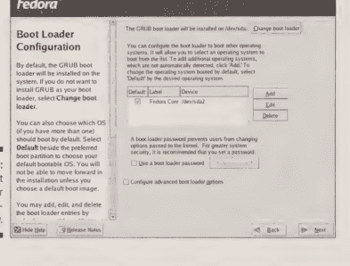

5. **引导加载器的默认设置对你来说应该完全没问题，因此点击下一步。**

引导加载器帮助你启动计算机时运行操作系统；如果你创建了双启动计算机，引导加载器允许你选择一个或另一个操作系统。标准的 Fedora Core 引导加载器是 GRUB，这是一个功能强大的程序，不仅能加载操作系统。然而，GRUB 的默认选项应该就够用了（其高级功能的描述超出了本书的范围）。

如果你的计算机有网络接口卡（NIC），Fedora Core 会检测到它，并且网络配置窗口将出现，如 3-2 图所示。你应该继续到下一节的步骤 1，并配置你的网络。但是，如果你没有以太网 NIC（或者你使用的是 Fedora Core 未检测到的无线设备），安装过程将跳过网络配置，并继续到下一节的步骤 9 **安装阶段 3：配置你的网络**。

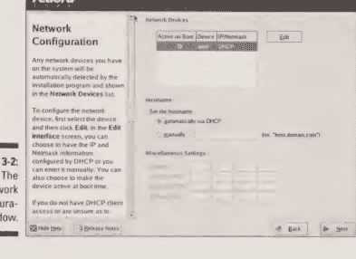

## 安装阶段 3：配置你的网络

如果你准备配置网络，并且你的计算机有以太网适配器或 Wi-Fi（使用 802.11b 标准的无线网络接口）适配器，请按照以下步骤输入适当的信息。如果你有一个网络适配器，但没有（有线或无线）网络可连接，你仍应在步骤 6 中输入一个主机名。输入主机名会在你最终连接到网络时使生活更轻松。

如果你有一个 NIC，网络配置窗口将出现，你可以遵循接下来的一系列步骤来为你的系统配置网络；如果你没有 NIC，请跳过以下步骤中的步骤 9：

1. 如果你连接到一个使用动态主机配置协议（DHCP）的网络，你不需要做其他任何事情来配置你的网络连接。点击**下一步**按钮并跳到步骤 9。

你可能需要咨询你的局域网管理员，以了解局域网（LAN）是否使用 DHCP。如果你构建了自己的局域网并且不知道是否在运行 DHCP，那么你不是。（前往第 15 章了解如何安装和配置 DHCP 服务器。）

2. 点击**编辑**按钮。

3. 通过点击标有**使用 DHCP 配置**的按钮，关闭 DHCP 选项。

4. 在标有**编辑接口**的子窗口中输入你的 IP 地址和子网掩码。

以下列表简要解释了 IP 地址和子网掩码：

- **IP 地址**：这串数字是你的 Fedora Core 计算机的数字网络地址——你的计算机在局域网（在许多情况下，在互联网上）已知的地址。如果你没有向 InterNIC（负责分配 IP 地址的组织）注册你的私有网络地址空间，你可以使用包含 192.168.1.1 到 192.168.254.254 地址范围的公共地址空间。
  - 如果你正在连接到现有的局域网，请咨询你的管理员以获得一个尚未使用的 IP 地址。如果你运行自己的局域网，你必须跟踪未使用的 IP 地址。

- **子网掩码**：基于互联网协议（IP）的私有网络被划分为子网。子网掩码是一串二进制位，将 IP 地址分为两部分：网络地址和主机地址。对于 IP 地址，例如前面要点中的示例（192.168.1.1），最常见的子网掩码是 255.255.255.0。此掩码创建网络地址 192.168.1 和主机地址 1。

5. 点击**确定**按钮。

6. 在**主机名**文本框中（在标有**手动**的按钮旁边），在文本框中输入你的计算机的网络名称——包括主机和网络（域）名称。

例如，如果你想将你的计算机命名为*cancun*，且你的网络名称是*pianchy.net*，你输入*cancun.pianchy.net*。


如果你在 network configuration 过程中没有给你的计算机命名和域名，它被称为*localhost.localhost*。否则，欢迎屏幕将引用你给它的任何名称。例如，在上面的例子中，你会看到*Welcome to cancun.pianchy.net*。

7. 在屏幕底部的**杂项**部分的适当文本框中输入你的**网关和主 DNS**（以及可选的**次 DNS 和第三 DNS**）IP 地址。

这些参数具有不同的功能：

- **网关**：*网关*是将你的私有网络连接到互联网（或另一个私有网络）的计算机的数字 IP 地址。Fedora Core 默认使用地址 192.168.1.254。你可以接受此地址，但留空更好


该选项，除非该地址确实是您的网关。第 5、6 和 7 章分别介绍了如何配置您的 Linux 计算机通过电话线、宽带（DSL 或电缆）以及现有局域网连接连接到互联网。如果这样做，现在就设置默认路由可能会干扰您的连接。

*   **主要 DNS：** 互联网协议使用域名服务（DNS）系统将 *www.redhat.com* 等名称转换为数字 IP。充当 DNS 服务器的计算机被称为*名称服务器*。然而，除非您处于带有名称服务器的私有网络中，或者已连接到互联网（您的 ISP 提供 DNS），否则我们建议您将此框留空。当您指定一个不存在的名称服务器时，许多网络程序会因徒劳等待缺失的服务器响应而运行得非常缓慢。

*   **次要和第三 DNS：** 次要和第三 DNS 作为主要 DNS 服务器的备份。如果您的计算机无法找到主要 DNS 服务器，它可能会找到次要 DNS。如果找不到，则应找到第三 DNS。祝您好运！


如果您正在连接到他人的局域网——例如，如果您正在工作中构建一台 Fedora Core 计算机——您应该从系统管理员处获取此地址。如果您在家里连接自己的局域网，请咨询一下自己，因为您可能就是管理员。

8.  **完成网络配置表单后，单击“下一步”按钮继续。**

防火墙配置窗口打开。

9.  **在防火墙配置窗口中，单击“远程登录（SSH）”按钮。**

防火墙默认处于开启状态。如果您愿意可以将其关闭，但我们建议保持开启状态。

Fedora Core 3 还包含了新的且功能强大的 SELinux 选项。SELinux 提供了强制访问控制（MACs），可大大提高您计算机的安全性。我们在第 17 章中介绍 SELinux。我们建议保持 SELinux 处于活动状态（默认设置）。

10. **单击“下一步”按钮。**

Fedora Core 为您的计算机创建了一个专为工作站设计的防火墙。该防火墙是*有状态的*，这意味着它会跟踪网络流量（包括传入和传出数据包）属于哪些连接。它提供了良好的保护，我们在本书中描述的家用工作站和网络服务器均使用此防火墙。

下一节将展示如何完成 Fedora Core 工作站的配置。

## 安装阶段 4：配置您的选项

本节介绍了 Fedora Core 计算机的基本配置步骤。我们将描述如何设置您的时区和 **root 用户**密码。您还将在默认软件包之外选择安装额外的软件。以下步骤描述了如何执行这些基本任务。

请遵循以下步骤：

1.  额外语言支持窗口打开。如有必要，请做出您的选择，然后单击“下一步”按钮。

时区选择窗口出现。

2.  要选定您的时区，请单击代表离您居住地最近城市的点。

您可以使用地图来指点并点击，直达时区的理想状态。当您点击一千个光点中的一个时，地图下方的子窗口中会显示所代表的城市及其时区。您也可以点击屏幕底部的滑块条来定位您所在的城市或时区名称。找到后，单击文本以选择您的时区。


3.  单击“下一步”。

设置 Root 密码窗口出现。

4.  在“Root 密码”和“确认”文本框中分别输入您的 root 密码。

该密码用于 root 用户账户。拥有此账户的人也被称为*超级用户*，可以访问整个系统并几乎可以做任何事——无论是好事还是坏事。

*root* 用户是唯一可以访问计算机上所有资源的用户。所有文件、进程和设备都由 *root* 控制。您应该仅在执行系统维护或管理任务时登录为 *root* 用户。为了避免对这些重要文件进行非预期的更改或删除，您通常应以普通（非 root）用户身份登录。请参阅本章后面“安装后：使用设置代理”部分中的步骤 2，了解如何添加用户。


您必须输入两次密码，以确保输入正确。输入时，屏幕上会以星号显示密码。（“巴特侠，这是对安全的严重破坏！”您不希望有人能从您肩头窥视并获取您的密码，对吧？）

5.  单击“下一步”。

软件包安装默认设置窗口打开，并显示要安装的重要软件摘要。您可以选择“安装默认软件包”（默认选项）或“自定义要安装的软件包”。

在本书中，我们使用工作站安装环境中的默认软件包。

如果您选择“自定义要安装的软件包”选项，软件包组选择窗口将打开。您可以逐个或按组选择要安装的额外软件包。例如，如果您想安装 KDE 环境，只需点击 KDE 桌面环境菜单旁边的按钮，所有必要的软件包即被选中。通过单击“选择个别软件包”单选选项来选择个别软件包。做出选择后，单击“下一步”按钮并继续步骤 6。

6.  单击“下一步”按钮。

即将安装窗口出现。一个响亮的声音回荡着，宣布这是无法回头的时刻！并非完全如此。并没有响亮的声音说什么（除了在我们脑海中，那太烦人了），但这确实是无法回头的时刻。如果您单击“下一步”按钮，您的磁盘将按照前一部分中选择的任何方式进行重新格式化——然后安装 Fedora Core。下一节描述该过程如何进行。


## 介绍密码礼仪

为了有效并保持操作系统的良好状态，您的密码长度至少需要为六个字符——但您应至少使用八个字符：使用的字符越多，密码越难被破解。如果您担心安全性，我们建议您使用大写字母、小写字母、符号和数字的组合，使密码尽可能难以被攻破。此外，不要选择在字典中能找到的任何内容，或容易与您关联的名称或物品。换句话说，您的名字、名字的反向拼写、生日、狗的名字，或任何语言中的任何单词（包括“不可打印”的字符）都是糟糕的选择。例如，对于 Jon 来说，啤酒（Beer）是一个糟糕的密码选择，即使它包含大写字母和小写字母，因为 Jon 和啤酒通常出现在彼此附近。

想出一个好密码的好方法是选择一个短语并将其弄乱。例如，将 "i am not a number" 变成类似 iMNOTa#1! 的形式。即使结果并没有真正拼出该短语，但它为您提供记忆这些本质上随机字符的所有线索（Iam" = im，"not" = NOT，"a" = un，number = #）。其他常见的替换包括：@ 代替 a，3 代替 e，9 代替 g，1 代替 I，0 代替 b，5 代替 s。例如：这些都很常见。

如果您记录您的密码，请将其存放在不会丢失且不容易被找到或偷走的地方。例如，将您的工作密码保存在家中，或存储在上了锁的办公桌或保险箱中。只要使用该小型设备的密码保护功能，您也可以在 PDA（个人数字助理）中存储密码；您也可以使用加密软件在 PDA 上存储密码。但是，不要将您的密码写在便利贴上并粘在您的计算机监视器上。（笨拙！）

**GNOME** 是 Fedora Core 3 默认的 Fedora Core 图形环境，也是我们在整本书中使用的环境。然而，许多人更喜欢 KDE 环境。选择权在您；您可以使用任何一种环境，或者两种都使用（如果您愿意的话）。（如果您在计算机上同时安装了 GNOME 和 KDE，您可以在登录时选择其中一种作为您的桌面环境。）要安装 KDE，请按照前面步骤 5 中描述的“自定义要安装的软件包”选项进行操作。单击 KDE 软件包组旁边的复选框，然后单击 **Next** 按钮。

## 安装阶段 5：无法回头的时刻

本章迄今为止描述的安装过程尚未对您的计算机造成任何永久性更改。可以说，您的选择还没有定局。什么都没有擦除。也没有任何 Fedora Core 软件包被写入您的硬盘。您可以通过单击“后退”按钮停止安装过程并回到您原来的旧计算机。

做出是否继续的决定。然后，如果答案是肯定的，请深呼吸，并按照以下说明在您的计算机上安装 Fedora Core：

1.  在 **即将安装** 窗口中单击 **Next** 按钮。
    所需安装介质对话框打开。（如果您使用的是 CD-ROM 光盘，会告诉您需要哪些光盘。）
    如果您想中止安装过程，可以单击“重启”按钮。在这种情况下，不会对您的计算机进行任何更改。
2.  在您屏住呼吸片刻（别变蓝脸！）并决定跳入深渊后，单击 **Continue** 按钮。
    您的磁盘分区将被创建和格式化，然后 Fedora Core 发行版将被写入其中。软件包安装窗口（见图 3-3）将告诉您正在安装哪个软件包，以及已安装多少、剩余多少待安装和预计剩余时间。
3.  **（可选）** **如果您使用 CD-ROM 光盘，请在提示时插入第二或第三张光盘，并单击“是”按钮。**
    恭喜窗口打开。
    如果您拥有最新、最先进的高速计算机以及快速的 DVD 或 CD-ROM 驱动器，安装过程只需几分钟。否则，当使用较旧的设备时，请计划花费 20 分钟——或更长时间。


## 图 3-3：安装软件包窗口。

4. 当提示时，单击“重启”按钮，并从计算机中取出随附的 Fedora Core 3 DVD（或 CD-ROM）。

   计算机将重新启动，并打开“显示设置”窗口。如有需要，您可以重新配置显示设置和视频卡；您也可以配置双头（并排显示）显示模式。

5. 单击“确定”。

6. 单击打开的警告对话框中的“下一步”。

Fedora Core 安装完成！以下部分将帮助您完成各种安装后任务，从而使您的 Fedora Core 计算机更易于使用。

### 安装后：使用配置代理

计算机重新启动且“显示设置”窗口关闭后，将打开“配置代理”。配置代理通过将一些配置工作推迟到安装后阶段，从而简化了安装过程。无论您是否运行配置代理，新的 Fedora Core 计算机都能正常工作——但一些微调可以使其表现更佳。

安装 Fedora Core 后首次启动计算机时，配置代理会自动运行。代理将要求您阅读并接受 Fedora Core 许可协议，重新配置显示器（可选），创建用户登录账户（建议执行；请使用 root 账户进行系统管理），设置日期和时间，测试声卡，并安装任何可选的软件包。

本书详细描述了配置这些单独系统的过程。但是，以下步骤说明了在完成 Fedora Core 安装后立即如何使用配置代理：

1. 当新的 Fedora Core 计算机启动时，您将看到配置代理的“欢迎”屏幕。单击“下一步”按钮以开始安装后配置过程。

   “许可协议”窗口将打开。

2. 召集您的律师（枪和钱是可选的），并一起阅读协议。单击标有“是，我同意许可协议”的按钮，然后单击“下一步”去法院。

   说实话，去法院的可能性不大。但以防万一，请否认一切。

3. 显示“日期和时间”窗口。如有需要，您可以更改日期和时间。

   您还可以让计算机自动并持续更新您的时钟。如果您计划连接到互联网，无论是通过局域网 (LAN) 还是宽带调制解调器 (DSL 或电缆调制解调器)，请单击“网络时间协议”选项卡，然后选择“启用网络时间协议 (NTP)”选项。从 NTP 服务器下拉菜单中选择一个 NTP 服务器，然后单击“添加”按钮。默认选项 clock.redhat.com 和 clock2.redhat.com 效果良好，但您也可以输入您想要的服务器。或者，您可能可以访问列表中未列出的 NTP 服务器，并可以手动输入。单击“转发”按钮继续进入“声音配置”屏幕。

   如果您的计算机通过连接互联网的局域网、DSL 连接或电缆调制解调器持续连接到互联网，我们建议您使用 NTP 选项。PC 时钟往往每天会有几秒到几分钟的偏差。保持最新总比过时好。

4. 单击“下一步”按钮。

5. 打开“显示”窗口。如有需要，更改您的显示器类型、显示分辨率和颜色深度。

   您可以通过单击配置栏并从打开的下拉菜单中进行选择来更改显示器类型。通过单击相应的栏并选择值来更改分辨率和/或颜色深度。

6. 单击“下一步”按钮。

   打开“系统用户”窗口。在安装过程中仅创建了 root 用户账户。您在此处有机会创建一个或多个用户账户。

7. 输入账户名称、账户所有者名称及其密码。单击“下一步”按钮继续。

   如果您连接到提供网络登录（如 Kerberos 网络）的局域网，请单击“使用网络登录”按钮并选择适当选项。您通常只在连接大型公司网络时才会遇到网络登录。描述这些情况的特殊性超出了本书的范围。请咨询您的系统管理员。

8. Fedora Core 在检测硬件（如声卡）方面做得很好，应该能检测到您的硬件。单击“播放测试声音”按钮以测试您的音频系统。

   打开一个对话框，询问您是否听到了音乐。

9. 如果您听到企鹅在弹吉他，请单击“是”。

   如果您单击“否”，将打开一个“错误”对话框。

10. 单击“确定”以继续。

    如果声音测试失败，请参阅第 12 章中关于设置声音系统的部分寻求帮助。单击“转发”按钮继续。

11. 单击“下一步”按钮。

    打开“附加 CD”窗口。随附的 Fedora Core DVD 不包含任何附加软件，因此您在此处无需执行任何操作。

12. 单击“下一步”按钮。

    打开“完成设置”窗口。

13. 单击“下一步”按钮。配置代理关闭，您的 Fedora Core 计算机已准备好使用。


您可以随时运行配置代理。配置代理是一个名为 *firstboot* 的脚本。您可以通过运行 *firstboot* 脚本并加上 *reconfig* 选项来运行配置代理。只需以 *root* 身份登录，并从 GNOME 终端窗口运行以下命令：

```bash
rm /etc/sysconfig/firstboot
/usr/sbin/firstboot
```

就是这样！您已经为自己搭建了一台 Fedora Core 计算机。计算机重启后，您就可以将其用作您的个人工作站。

# 第一部分：安装 Fedora Core

# 第 4 章

# 了解 Fedora Core

- 本章内容
  - 启动您的 Fedora Core 计算机
  - 登录您的 Fedora Core 计算机
  - 使用图形和基于文本的应用程序及实用工具
  - 设置您的显示器和视频卡
  - 了解 Fedora Core 文件系统
  - 首次创建用户账户
  - 注销您的 Fedora Core 计算机

如果您已安装 Fedora Core，在开始使用之前，应该花几分钟学习一些基础知识。本章涵盖了入门所需的 Linux 基础知识，不多不少。我们涵盖的主题包括启动和停止您的 Fedora Core 计算机、理解图形应用程序与非图形应用程序之间的区别，以及 Linux 如何使用文件。

我们首先描述如何启动新的 Fedora Core 计算机。这个过程很简单，但了解更多细节会有帮助。

## 启动您的 Fedora Core 计算机

启动计算机 simply 意味着启动它或打开电源；重启计算机意味着重新启动它。以下步骤说明了如何启动您的 Fedora Core 计算机：

1. 确保您的计算机已关闭。
2. 打开计算机的电源。

过一会儿，Fedora Core 启动菜单将显示在屏幕上。如果您在计算机上只安装了 Fedora Core，您只有一个操作系统可供选择：Linux（有关双启动的更多信息，请参见第 3 章中的“安装阶段 2：分割和切割 pie”）。

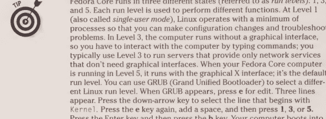

3. 按**上-**和**下箭头**键以突出显示单词 *Linux*（如果尚未突出显示），然后按**Enter**键。

   - 如果您未按任何键，默认操作系统（即 Fedora Core，在安装时它将自己设为默认）将在 10 秒延迟后自动启动。
   - 如果您运行多个操作系统（例如，Fedora Core 和 Windows），您可以选择列出的任何操作系统启动；我们在这里假设您选择了 Linux。

按下**Enter**键后，Fedora Core 启动。在此过程中，一个图形进度窗口显示启动过程进行的程度。您可以（可选地）通过单击“显示详细信息”按钮显示大量技术信息。可选信息是 Linux 正在了解的关于您的计算机及其硬件的内容（例如磁盘驱动器、网络和内存）。

## 登录您的 Fedora Core 计算机

当您使用 Fedora Core（或任何 Linux 发行版）时，您必须以具有独特登录名称的特定用户身份登录。为什么？因为 Linux 是一个多用户系统——因此它使用不同的账户来防止人们查看其他人的秘密文件，从系统中擦除必要的文件，以及以其他方式（故意或无意）做坏事。


使用唯一身份有助于确保一个人的操作不会影响另一个人的操作，因为多人可能同时使用同一台计算机系统（例如通过网络）。这种策略的一个好处是，由于没有用户的文件和目录可以破坏整个系统，Linux 计算机本质上对病毒是免疫的。

Fedora Core 启动时，你会看到屏幕上滚动显示各种消息。滚动停止后，登录界面将出现。

* **记住**

如果你在安装过程中选择不让 X 窗口系统在每次启动系统时自动运行，你将看到 `login:` 提示符。

如果你输入密码或登录名时出现错误，系统会要求你重新输入。

* **警告！**

我们强烈建议你作为非特权用户进行大多数 Fedora Core 实验——并且仅在必要时以 root 用户登录。如果你以 root 身份操作，你可以删除或更改任何事物——并且存在破坏系统、不得不重新安装操作系统或丢失数据的风险。当你以普通用户身份登录时，你可能意外擦除自己的文件和数据，但你无法擦除其他用户的文件或系统文件。

幸运的是，Fedora Core 提供了许多图形化实用工具，你可以作为非特权用户启动它们。每个 Fedora Core 管理工具在启动时都会提示你输入 root 密码，然后执行其特定功能，但仅执行该功能，且具有 root 权限。因此，你可以避免对其他系统造成非预期的损害。（有关文件权限的工作方式以及如何修改它们的更多信息，请参见附录 C。）

## 使用图形化和文本应用及实用工具

Fedora Core 默认安装图形化的 X 窗口系统（也简称为 X）。你可以使用 Fedora Core 提供的基于图形用户界面（GUI 即 graphical user interface，图形用户界面）的工具执行大多数管理任务。本书中大多数操作指南使用基于 X 的应用程序和实用工具。我们这样做是因为它们通常更易于使用——而且本书并非为技术型系统管理员编写。

偶尔，某个实用工具或程序不能以图形化方式运行。信不信由你，一些更极客的用户更喜欢使用基于文本的系统。如果你不熟悉使用基于文本的系统执行一些基本管理任务，我们不建议仅因为可以使用就使用它。不成为极客也没关系。我们仍然喜欢并尊重你。另一方面，了解一些基础知识是有道理的，以防你某天不得不依靠基于文本的界面。

基于文本的界面通常从*shell*（shell）运行，它作为 Fedora Core 操作系统和你之间的基于文本的界面。Fedora Core 默认使用的 *bash* shell 会显示提示符，例如：`[jldidj@cancun ~]$`。你在 shell 提示符处输入命令，结果会显示出来。这就是*命令行界面*（*CLI*）一词的由来。

*Bash* 代表 Bourne-Again Shell。Bash 与 *Ludum* 电影续集没有任何关系，但从技术上说，它是一个命令语言解释器。Bash 可以交互运行，也可以从文件或管道接收输入。

你可以在 GNOME 界面内通过启动一个 GNOME 终端会话（也通称为终端模拟器）来启动 shell。点击 GNOME 应用程序按钮（屏幕右上角的红色帽子，呃，红色 *fedora*）；我们将此简称为 GNOME 菜单。然后选择“系统工具 → 终端”（或在 GNOME 桌面上右键单击任何位置并选择“打开终端”）以启动终端会话，如图 4-1 所示。（你可以在第 9 章了解有关 GNOME 环境的更多信息。）

### 图 4-1：一个 GNOME 终端会话。

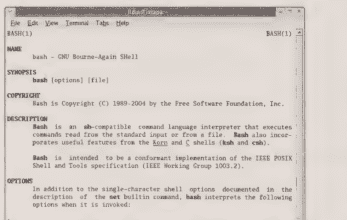

GNOME 菜单按钮在功能上类似于 Windows 的开始按钮。

如果你想在不启动交互式 shell 的情况下运行单个程序，可以使用 GNOME 运行程序菜单：点击 GNOME 菜单按钮并选择“运行应用程序”。当“运行应用程序”窗口打开时，在文本框中键入任何程序的名称。如果程序是图形化的，它将运行。如果程序被设计为与终端屏幕交互（技术术语为*标准输出*），你将看不到输出，除非你点击*在终端中运行*按钮。例如，输入**xlock**会在屏幕上显示一个图形化的时钟。在点击“在终端中运行”按钮后运行简单的 `ls` 命令会显示一个文件列表。


GNOME 终端在与你的交互方式上类似于 Windows 中的 MS-DOS 窗口。打开 MS-DOS 窗口会提供一个基于文本的窗口，用于输入 DOS 命令。Windows CLI 的底层技术与 Linux CLI 不同，但 Linux CLI 提供了远更多的功能。

## 配置显示器和视频卡

Fedora Core 安装过程擅长自动配置自身以使用你的视频硬件和显示器。Linux 使用 X 窗口系统（简称 *X*）来显示图形。然而，偶尔 *X* 配置过程会失败，或者你可能想要重新配置它。无论如何，Fedora Core 都会让你访问它在安装过程中使用的相同配置工具。

Fedora Core 的 X 配置实用工具是**system-config-display**。我们将其简称为*显示配置器*。通常，显示配置器会自动检测你的显示器（显示）和显卡。检测到它们后，你可以设置你的显示分辨率和颜色深度。

## 启动显示配置器

即使你未运行 X（如果你处于非图形模式；你处于运行级别 3），你也可以启动显示配置器：

1. **以*root*身份登录。**
   你将自动看到命令行界面。
2. **在 Bash 提示符处输入此命令：**
   `system-config-display`
   显示配置器窗口将打开。该实用工具在图形界面内运行。

当然，如果你的计算机正在运行 X，你可以启动显示配置器。例如，你可能想要重新配置你的系统。按照以下步骤启动该实用工具：

1. 点击**GNOME** 菜单。
2. 选择**系统设置 ⚙ 显示**。
3. **如果提示，输入*root*密码。**

显示配置器将打开显示设置窗口。使用下一节中的一组步骤来配置你的图形 X 界面。

X 窗口系统（简称 X）由麻省理工学院（MIT）发明，用于在广泛机型之间显示图形应用程序。它最初构建为在 Unix 平台上运行，但已适应 Linux 和其他平台。

缺乏多扫描能力的旧显示器如果在高于 VGA 的分辨率（640 x 480 和 60Hz）下使用可能会受损（多扫描显示器可以切换到显卡生成的相同信号频率）。本世纪制造的显示器以及自 20 世纪 90 年代中期以来制造的大多数显示器都内置了保护机制，以防止它们被*过驱动*而烧毁，但较旧的显示器不具备这种保护。较旧的显示器实际上可能会着火。如果你听到显示器发出怪异的声音或闻到烧焦组件的气味，立即关闭显示器！

## 配置显示

显示配置器允许你配置显示的分辨率、颜色深度、显示器类型、视频驱动程序和双显示器。双显示器的使用和配置超出了本书的范围。在这里，我们描述如何配置其他选项。如前所述，启动显示配置器后，它默认位于设置选项卡。

按照以下步骤重新配置你的显示器：

1. **如果你愿意，修改显示分辨率和颜色深度。**
   你随时可以返回到之前的设置，所以不要犹豫在这里进行实验。
2. **点击硬件选项卡来修改你的显示器和驱动程序设置。**
   图 4-2 显示你可以配置显示器或显卡。
3. **点击显示器类型选项旁边的配置按钮。**
   显示器窗口将打开。你可以使用此窗口来配置你的显示器的精确或几乎精确的设置。
4. **尝试找到并选择你的特定显示器。**
   你可以从数十甚至数百种显示器中选择；你找到自己的显示器的机会至少与中 PowerBall 的概率一样好——实际上好得多。


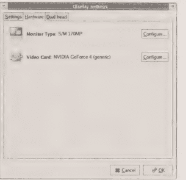

图 4-2：“显示属性”对话框。

-   5. 如果你找到了它，请选择你显示器的制造商和型号，点击**确定**，然后跳转到步骤 8。
-   6. 如果你找不到你的显示器，最好的办法是在两个通用子菜单中翻找一番。“通用 CRT 显示器”子菜单为老式沉重的玻璃（显示器）显示器提供了几种分辨率的通用设置；CRT 是*阴极射线管*的缩写。“通用 LCD 显示器”子菜单为使用*液晶*显示的平板显示器提供设置。如果你不知道哪种类型适合你的显示器，就猜一个并尝试其中一种。如果第一种选择不起作用，请不断尝试不同的通用显示器。
-   7. 选择与你显示设置最接近的通用设置，点击**确定**，然后返回到高级设置窗口。
-   8. 点击**视频卡**标签旁的**配置**按钮。视频卡窗口会打开，如图 4-3 所示。
-   9. 从长长的选项列表中选择你的视频卡。如果你找不到特定品牌和型号的视频卡，请选择**VESA 驱动程序（通用）**选项。

> 最低分辨率（8 位）选项一次只能在窗口中显示 256 种颜色。16 位选项允许显示 65,535 种颜色，而 24 位允许显示超过 1600 万种颜色（这就是为什么它也被称为*真彩色*的原因）。

-   10. 点击**确定**返回“显示属性”窗口。

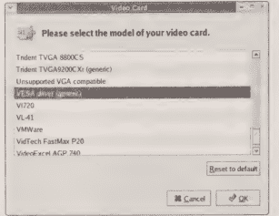


-   11. 点击**确定**，“显示属性”窗口关闭。一个信息窗口会打开，告知你需要注销然后重新登录才能使更改生效。
-   12. 点击**确定**关闭信息窗口。
-   13. 注销然后重新登录以使更改生效。

或者，你可以重启计算机以强制执行更改。

你还可以通过按 Ctrl+Alt+Backspace 迅速且不加掩饰地重启 X。当前的 X 会话将停止并最终重新启动。然后你可以重新登录。

## 深入探讨色彩深度

*色彩深度*，即你的系统在窗口中能够同时激活的颜色数量，大致上是系统视频内存量和窗口分辨率的函数。

如果你的系统随机存取内存（RAM）较小，你的屏幕可以同时显示 1024 x 768 像素（点）的分辨率和 256 种颜色（8 位）。如果你的系统有 2MB 的内存，你可以在相同分辨率下同时在屏幕上显示 64,000 种颜色（16 位）。你拥有的内存越多，在任何给定分辨率下你可以显示的颜色就越多。

当你想要显示一张图像而色彩深度不正确时，并不会发生什么灾难性的事情。图片可能显得暗淡无光或不太正常。这是因为 X 有一种有趣的功能，允许使用*虚拟色彩映射*；活动窗口可以利用色彩深度位的所有颜色，即使其他窗口正在使用不同的颜色。


## 介绍 Linux 文件系统树

与 Windows 一样，Linux 使用文件和目录来存储和组织信息和应用程序。本节介绍 Linux 文件系统。

除了网络部分，Linux 将其所有组件都视为文件。Linux 将文件、目录和设备访问为*文件地址*也就不足为奇了。为了弄清所有东西在哪里，Linux 使用一套由字母和数字组成的系统来引用磁盘驱动器及其分区——例如，*/dev/hda* 可能是系统中第一个 IDE 硬盘的名称，而 */dev/sdb* 可能是第二个 SCSI 硬盘的名称。

你可以将 Linux 文件系统比作一棵倒过来的树。树干是根目录——用 */*（斜杠）表示。一系列树枝、枝条和叶子延伸在根部下方：主干是挂载点，从主干延伸出的枝条是目录，枝条上的叶子是你的文件。图 4-4 显示了根目录、几个目录（包括 etc）以及 etc 中的几个文件。

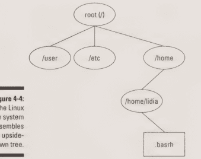

每个挂载点都是一个磁盘分区或远程文件系统（例如你的 DVD 或 CD-ROM 驱动器），它被挂载到——被识别为并作为假设树上“上方”那个主干的目录显示出来。每当一个磁盘分区或远程文件系统挂载到目录枝条上时，该枝条就会变成另一个主干——允许在挂载点下方放置和附加更多的枝条。

Fedora Core 至少需要在你的目录结构中包含一个根分区和一个交换空间分区。根分区存储所有个人和系统文件及目录；Linux 使用交换空间来临时扩展其内存功能，超越你的随机存取内存（RAM）的限制。例如，如果你有 512MB 的 RAM 和 512MB 的交换空间，你可以运行一个几乎使用 1GB 内存的程序。其中一部分存储在内存中，其余部分则存放在交换空间中。

这种配置与 Windows 和 MS-DOS 文件系统没有太大区别——毕竟，Windows 也使用分层目录树的概念——但语法有些不同。Fedora Core 中的顶层目录，*root*（根目录），是用正斜杠 (/) 指定的。随后的每个子目录名称都跟随那个初始斜杠。例如，home 目录是根目录的一个子目录，显示为 /home。在 Windows 世界中，根目录的等价物是用初始反斜杠 (\) 指定的。著名的 C: 提示符与 C:\ 是同义的。当划分子目录时，这两个操作系统的主题得以延续：Linux 使用正斜杠，而 Windows 使用反斜杠。例如，一个目录在 Linux 中显示为 /x/y/z，而在 Windows 中显示为 C:\x\y\z。两个操作系统都可以有子目录，例如在 Linux 中为 /x/y/z/abc，或在 Windows 中为 C:\x\y\z\abc。

文件或目录的位置以路径给出。例如，/x/y/z/abc 描述了到子目录 abc 的路径；如果文件 i23 位于子目录 abc 中，那么其路径为 /x/y/z/abc/i23。路径可以是绝对的或相对的。绝对路径总是指根目录（如前面给出的示例）。相对路径指你系统中碰巧所在的位置；它们相对于你当前的位置。


Linux 和 Windows 文件系统之间的另一个根本区别是，Linux 要求你显式地挂载文件系统。Windows 会自动完成这一点。显式挂载文件系统并不像听起来那么繁重。Fedora Core 安装了实用工具，必要时会自动检测和挂载文件系统。例如，默认的 Fedora Core 配置在每次将 DVD 或 CD-ROM 插入驱动器时都会自动挂载它。

我们在第 3 章中描述的 Workstation（工作站）安装类型会自动设置你的根分区和交换分区，此外还有一个额外的根分区，用于存储 Fedora Core 内核和启动计算机时使用的其他文件。（Personal Desktop（个人桌面）安装类型使用与 Workstation 安装类型相同的分区方案。）

## 创建用户账户

由于 Fedora Core 是一个多用户系统，同一时间可以有不止一个人使用它。例如，你可以登录计算机控制台（连接的键盘和监视器），同时有人通过网络连接登录。因此，你——以及每个其他用户——都必须有一个独立的用户账户才能使用计算机。每个账户都需要独立的账户名和密码来保护你的信息并使你的任务与其他人的任务分开。

如果你有原因添加新用户（例如，如果你有一个家庭网络），或者你忘记在安装期间创建 *nonroot*（非 root）用户账户，本节将向你展示如何做。Fedora Core 提供基于图形和基于文本的用户账户创建和修改工具，以便你使用。下面两节描述了如何使用这两种类型的实用工具。


你可以使用 Fedora Core 用户管理器修改现有的用户账户。点击用户名，然后点击属性按钮，将打开一个类似于“创建新用户”窗口的界面。然后你可以修改账户的任何方面。

### 使用图形用户管理器

Fedora Core 用户管理器是一个出色的管理工具，可以让你的生活更轻松。它提供了一个易于使用的界面，简化了你的系统管理任务。按照以下步骤使用用户管理器创建新账户：


-   1. **通过点击 GNOME 菜单按钮，然后选择 系统设置→ 用户和组 来打开用户管理器。**
    这是*超级用户*的工作。如果你没有以 *root* 用户身份登录，你会被提示输入 *root* 密码。Fedora Core 用户管理器窗口会出现。
-   2. **点击屏幕左上角的 添加用户 按钮。**
    “创建新用户”窗口会出现，如图 4-5 所示。
-   3. **输入你的用户名、真实姓名（全名）以及两次密码（以确认其正确性）；接受 登录 Shell 默认值 /bin/bash。**
    Fedora Core 用户管理器默认也会创建一个 home 目录。

这些项目中的大多数都是不言自明的，但这里有一些额外信息：

-   你的用户名（也称为*登录名*）是你登录计算机时使用的名称。让你的用户名容易记住，并全部使用小写字母。可爱的名字可能稍后显得不合适。避免选择太长的名字，因为你一天可能要输入多次。你可能还会最终使用你的用户名作为你的电子邮件地址，并且不得不在电话中报出它，因此像 *phool* 这样的登录名会导致误发的信息，让你感到愚笨。


# 第一部分：安装 Fedora Core

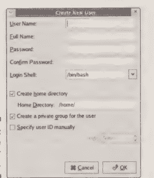

**图 4-5：** 创建新用户对话框。

-   如果您愿意，可以输入您的全名。该信息保存在 `/etc/passwd` 文件中，系统中任何拥有账户的人都可以读取此文件。这些信息通常对系统管理员很有用，因为它允许他们将人员与每个账户关联起来。（好吧，如果您正在配置个人系统，这些信息可能有点多余。）

-   新密码应与用于 `root` 的密码不同。

当您输入密码时，屏幕上会出现一行星号（而不是实际密码），以防有人在您输入时从肩膀上方窥视。（Fedora Core 在这里表现出了一点多疑。）在文本模式下，您不会收到任何反馈，例如星号或其他字符。

-   在您的众多默认 shell 选择中，`/bin/bash` 是一个不错的选择（`bash` 是一种流行的 shell，也是 Fedora Core 的默认 shell）。

4.  点击 **确定**。

您的账户已创建。


Fedora Core 使用可插拔身份验证模块（PAM），它禁止您输入简单或危险的密码；然而，不要因此就认为您的新密码是一个好密码。一个好的密码不会出现在任何字典中，因为密码破解程序会自动尝试所有字典单词来破解您的密码。避免使用生日、纪念日或任何别人可能与您相关联的内容。关于好密码的想法，请参阅第 3 章。只要别忘了它，并且*不要*把它写在便利贴上并贴在显示器上！


您还可以使用 Fedora Core 用户管理器删除现有的用户账户。点击用户名，然后点击删除按钮，该账户会立即被移除。请务必小心，并确定您要执行的操作——Fedora Core 不会要求您确认删除账户。幸运的是（在这种情况下），账户的主目录保持完好（未被删除）；如有必要，您可以返回重新创建该账户。

## 使用基于文本的 useradd 命令

许多系统管理员更喜欢使用基于文本（CLI）的工具和实用程序。一旦熟悉它们，基于文本的工具相对容易使用。如果您同时执行大量管理任务，它们也往往能节省时间，因为您不需要在多个窗口之间来回切换——只需输入一系列命令即可。

以下步骤描述了如何使用 useradd 程序创建用户账户：

1.  通过点击 GNOME 菜单按钮并选择“系统工具 → 终端”来打开 GNOME 终端窗口。

2.  输入以下命令以 root 身份登录：

   `su -`

3.  在提示时输入 root 密码。

4.  在命令提示符处输入 `useradd name`，其中 `name` 是新登录账户的登录名。

   要更改刚创建的账户的系统分配密码，请输入以下命令：

   `passwd name`

5.  在提示时输入密码并按下 Enter 键。

   此步骤会更改新账户的密码，该密码在步骤 4 中由 useradd 命令分配了默认值。（如果使用默认密码，那设密码有什么意义呢？）

6.  再次输入您的密码。

   Fedora Core 要求您重新输入新密码，以确保您输入的密码就是您所想输入的那个。如果您没有完全按照第一次的方式重新输入密码（由于密码不会在屏幕上显示，这很容易做到），您必须重复此过程。Fedora Core 会为新登录更新密码。

## 结束您的第一个会话

从系统注销并重启登录过程非常简单。为此，点击 GNOME 操作按钮并选择注销。会出现“您确定要注销吗？”窗口，系统会要求您确认是否要注销。如果您确实要注销（您*真的*吗？），点击确定按钮即可离开。如果您改变主意，想再多玩一会儿新的操作系统，请点击“否”。

您也可以从该窗口选择重启或停止计算机，方法是点击关机按钮或重启按钮，然后点击确定以确认您的决定。根据您做出的选择，您的系统将完全停止或重启。您还可以按下 Ctrl+Alt+Backspace 键来关闭当前会话。这种方法虽然不那么优雅，但仍然有效，特别是在某些反常进程冻结您的 X 会话的情况下。


# 第二部分

# 上网了吗？

**第五波浪潮**
作者：Rich Tennant


“正如我所料，中士！人们什么时候才能明白拨号上网已经过时了？”

## 在本部分...

在您创建 Fedora Core 工作站后，是时候开始工作了。本部分的章节展示了连接互联网的三种不同方式：传统、缓慢但无处不在的拨号（模拟）调制解调器；尖端且高速的宽带 DSL 或电缆调制解调器；或者连接互联网的现有局域网（LAN）。

第 5 章重点介绍基于电话的调制解调器。调制解调器很像老旧、可靠的皮卡：它们可能不是最快的出行方式，但依然能到达目的地。事实上，调制解调器仍然提供可用的最简单且最具经济性的互联网连接。

第 6 章介绍宽带互联网连接。电话公司、有线电视公司以及中间的各种公司向许多社区提供宽带服务。以并非完全不合理的价钱，您可以获得高速、始终在线的服务。

许多人可以访问现有的局域网（称为 LAN），这些网络连接着工作、学校和家里的计算机。第 7 章展示了如何将您的计算机连接到局域网——如果您的局域网有互联网连接，您还可以了解如何配置您的工作站以使用它。

然而，一旦连接到互联网，您的计算机就会变得容易受到攻击。如果您使用持续连接的服务（如 DSL），这种情况尤其真实。这种差异类似于居住在安静的街道与繁忙的街道之间。在繁忙的街道上，您更容易受到攻击。这就是为什么我们向您展示（在第 8 章中）如何构建防火墙来降低您的在线脆弱性。

## 第 5 章

# 枯燥的拨号调制解调器依然能胜任工作

### 本章内容

-   寻找互联网服务提供商（ISP）
-   配置您的互联网连接
-   配置您的调制解调器
-   连接到您的 ISP

**S**（冲浪）网是一件很有趣的事，有时也是有用的活动。好吧，承认吧：你知道自己只是为了恼火家人或室友而长时间占用电话线，浏览像 `www.theonion.com` 这样地址愚蠢的网站，并与那些你做梦都不会当面交谈的人聊天。关键在于，在您加入在线宇宙的混乱之前，您必须连接到互联网。

自史前时代起，简单的调制解调器就被用来建立这种连接。好吧，现在高速“宽带”互联网连接变得流行，描述如何使用老旧、缓慢的调制解调器可能看起来有点过时了。但许多人（如果不是大多数）仍在使用调制解调器，因此本章描述如何设置调制解调器以连接到互联网服务提供商（ISP）。


本章假设您使用标准拨号调制解调器连接互联网。我们将在第 6 章中描述如何配置您的 Fedora Core 计算机以使用更快的互联网连接技术，即*宽带连接*。

许多人在工作和学校都可以访问连接互联网的网络。（也许您五岁的孩子已经搭建了一个连接互联网的家庭网络！）第 7 章描述了如何将您的 Fedora Core 计算机连接到现有的私有网络，并通过该连接访问互联网。然后，您可以以光速冲浪，直到牛回家。


## 如果你正在购买调制解调器

拨号调制解调器是一种过时的技术，但它仍然是建立个人或小型企业 Internet 连接最常见的方法。由于宽带连接用户数量正在快速增长，而且大多数大型企业也使用宽带服务，因此这一说法可能很快就会不再正确。

*内部调制解调器* 插入计算机主板上的 PCI 或 ISA 插槽，或笔记本电脑上的 PCMCIA 插槽，并从计算机获取电力。*外部调制解调器* 拥有自己的外壳，需要自己的电源（即那些插在笨重黑色设备上的电源插头），并通过串行（有时也称为 RS232）连接连接到计算机。这两种类型的调制解调器都使用电话插孔来连接 Internet。内部调制解调器通常比外部调制解调器便宜，但外部调制解调器具有几个优点。你可以轻松开关它们，无需打开机箱即可将其连接到计算机，并且如果电话线遭受雷击，通过调制解调器传递的电荷不会损坏你的计算机。另一方面，内部调制解调器只需要一根电话线电缆——而外部调制解调器需要电话线、串行连接和电源线。

## 急切寻找 ISP

若要使用拨号调制解调器连接，你必须将调制解调器连接到计算机，然后找到一个优质的 Internet 服务提供商（ISP）进行拨号。很可能你的计算机出厂时已安装了内部调制解调器。如果没有，你需要购买一个，无论是内部还是外部型号。一旦拥有了调制解调器，你可以查阅 Andy Rathbone（Wiley 出版）著的《Upgrading & Fixing PCs For Dummies》（傻瓜式升级和修复电脑指南）第六版，以了解如何安装它。

找到优质 ISP 的最佳方式是口碑推荐。获得个人推荐是了解 ISP 优点和缺点的好方法，而这些信息通常不会出现在广告中。在与 ISP 签约之前，务必确认该公司支持 Linux。

如果你没有朋友，或者你的熟人对你不置一词，可以尝试寻找当地的 Linux 用户组（LUG）进行咨询。你可以在 Fedora Core 社区网页 www.redhat.com/apps/community 上查找 LUG。

表 5-1 列出了一些支持 Linux 的主要 ISP。


### 支持 Linux 的大型 ISP

| ISP | 免费电话号码 | 网站地址（仅限美国） |
|---|---|---|
| Access4Free | 866-MyFree/770-349-3430（免费） | www.access4free.com |
| AT&T WorldNet | 800-967-5363 | www.att.net |
| CompuGlobalHyperNet Network | 555-867-5309 | www.compuglobalhypernet.com |
| CompuServe | 800-336-6823 | www.compuserve.com |
| Earthlink | 800-EARTHLINK | www.earthlink.net |
| Prism Access | 888-930-1030 | www.prisma.net |
| SprintLink | 888-473-7963 | www.sprint.net |

无论你想使用哪一个，务必询问你潜在的新 ISP 是否提供拨号 PPP 服务。PPP（即点对点协议）是 Linux 用于连接 Internet 的方式。如果你交谈的人表现出茫然的样子，你可能需要考虑换一家。

在你选择 Internet 服务提供商并安排付款后，ISP 会提供一些信息，包括以下内容：

- 电话接入号码
- 用户名和密码
- 电子邮件地址（通常，是你的用户名加上 ISP 的域名）
- 主域名服务器（DNS）和备用域名服务器（DNS）号码，这是一个由句点分隔成四组数字的大数字
- 用于处理发出邮件的 SMTP（邮件）服务器
- 用于从 ISP 服务器下载电子邮件到本机器的 POP3 或 IMAP 服务器名称

Access4Free 提供免费的和电子邮件订阅的 Internet 服务组合。注册后，你每月可享受 10 小时的免费服务。超过 10 小时后，每小时收费，最高为 9.95 美元。你也可以订阅每月 9.95 美元的无限制拨号访问；订阅可让你享受电话支持（866-693-7334），否则每次通话需支付 5 美元。（这也还不错！）Access4Free 还在许多美国城市提供本地拨号和 PPP 接入。

## 配置 Internet 连接

你需要配置调制解调器，以便 Fedora Core 可以使用它连接到你的 ISP。拨号配置工具能够很好地检测并配置你的调制解调器。它还设置了一个拨号账户，将你的计算机连接到你的 ISP（因此也连接到 Internet）。当你安装了 ISP 和调制解调器后，下一步是创建调制解调器配置：

1. 点击 GNOME 菜单按钮（屏幕右上角的红帽子），并选择 系统工具 → Internet 配置向导。

2. 如果系统提示，请输入 root 密码。
   - 你必须拥有 root（即最高级别的访问权限）来配置调制解调器。

3. 当“添加新设备类型”窗口打开时，点击“调制解调器连接”，然后点击“下一步”按钮。
   - 在 Internet 配置向导扫描计算机中的调制解调器时，“搜索调制解调器”对话框会短暂出现。

4. 如果未检测到或未识别到调制解调器，将打开“警告”对话框。
   - 如果找到调制解调器，将打开“选择提供商”窗口，你应该跳到第 8 步。

5. 点击“确定”按钮。
   - 出现“选择调制解调器”窗口，如图 5-1 所示。

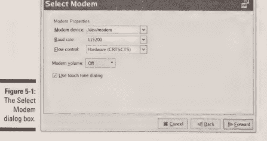

当 Internet 配置向导找不到调制解调器时，它会猜测连接了一个串行端口：`/dev/modem`。（*串行端口* 是计算机用于与串行设备（如调制解调器）通信的机制；通用串行总线（USB）是现代串行端口的等价物。）

6. 你无法确定 `/dev/modem` 设备是否存在，因此选择 `/dev/ttyS0`；如果你使用的是外部 USB 调制解调器，则选择 `/dev/ttyUSB0`。
   - `/dev/ttyS0` 设备是你计算机上的第一个串行端口；`/dev/ttyUSB0` 是第一个 USB 设备。
   - 如有需要，你还可以在“选择调制解调器”窗口中修改调制解调器设置。

7. 点击 **下一步** 按钮。
   - 出现“选择提供商”窗口。

8. 如果你居住在列表中列出的国家之一，请选择相应的预配置。
   - 当然，你可以选择另一个未列出的 ISP——如果你使用该 ISP，还可以点击 T-Online 按钮。德国 ISP T-Online 也提供英文服务。如果选择此服务，请在打开的对话框中输入你的信息。

9. 在“选择提供商”窗口中，在相应的框中输入你的 ISP 电话号码、ISP 名称、登录名和密码。
   - 如有必要，你还应在相应的文本框中输入你的 ISP 前缀和地区或国家代码。

10. 输入信息后，点击 **下一步**。
    - 打开“IP 设置”对话框，如图 5-2 所示。

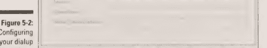

在“IP 设置”对话框中，你有两个默认选项：

- 自动获取 IP 地址设置
- 自动从提供商获取 DNS 信息

默认选项允许你的 ISP 使用 PPP（点对点协议）通过电话线建立 Internet 连接，并使用你的 ISP 的 DNS 服务查找 Internet 名称。

11. **这些设置应与你的 ISP 兼容，因此点击“下一步”按钮。**

打开“创建拨号连接”窗口，显示你刚刚输入的信息摘要。

12. **点击“应用”。**

打开“网络配置”窗口。你可以在窗口中看到你的新调制解调器以及其他网络设备，如以太网接口。

完成调制解调器配置创建后，你可以激活它并连接到 Internet。操作如下：

1. **在“网络配置”窗口中，点击“文件::保存”菜单选项以保存你的调制解调器配置。**

2. **当“信息”窗口打开时，点击“确定”按钮。**

3. **点击“调制解调器”设备以选中它。**
   - 调制解调器行会以蓝色高亮显示。

4. **点击“激活”按钮以启动调制解调器并连接到你的 ISP。**
   - “网络配置”工具将拨号连接到你的 ISP，验证你的连接，并为你的计算机提供 Internet 连接。然后你的 ISP 使用 PPP 协议自动设置你的 IP 地址、默认路由和 DNS 提供商。只要拨号连接处于活动状态，这些数值将优先于任何现有参数（如以太网接口）。

5. **点击 GNOME 面板上的 GNOME 菜单图标，并选择 Internet::Mozilla。**
   - 浏览器打开后，就可以开始浏览了。

6. **完成 Internet 连接使用后，点击“停用”按钮。**
   - 通过停用你的调制解调器连接，你可以重置动态 IP 地址和默认路由。只有当你正在私有网络中使用 DHCP 时，之前的 DNS 提供商才会被重置；否则，拨号 DNS 提供商设置将保持有效。请参阅第 7 章中关于配置 DNS 和以太网或无线接口的章节。


Linux 使用*设备文件*与外设通信。设备文件位于 `/dev` 目录中，大致相当于 Windows 驱动程序：Linux 内核使用它们来与您的硬件通信。

您可以将调制解调器连接到 PC 上的四个串行端口之一，或众多 USB 端口之一。外部串行调制解调器通常连接到 `/dev/ttyS0` 端口，有时也连接到 `/dev/ttyS1`，甚至是 `/dev/ttyS2` 或 `/dev/ttyS3`；USB 调制解调器则连接到 `/dev/ttyUSB0`、`/dev/ttyUSB1` 等。如果您使用的是内部调制解调器，它可能是任意一个 `tty` 设备。

## 启动互联网连接

Fedora Core 提供了一个 PPP 拨号实用程序，帮助您建立 PPP 连接。您需要使用通过“拨号配置工具”设置好的 PPP 配置来建立此连接（本章前面的“配置互联网连接”部分对此工具有所介绍）。

要使用 PPP 拨号程序连接互联网，请遵循以下步骤：

- 1. 点击 **GNOME 菜单**按钮，然后选择**系统工具** :: **网络设备控制**。
  此时会显示“网络设备控制”窗口，列出您拥有的所有网络接口。
- 2. 点击您的调制解调器名称（例如 `Myconnection`），然后点击**激活**。
  网络设备控制实用程序将拨号并连接到您的 ISP（互联网服务提供商）。
- 3. 当您使用完互联网后，点击“网络设备控制”窗口中的**停用**按钮。
  您的连接将终止。

## 第 6 章
## 宽带很酷！

### 本章内容

- 了解宽带互联网连接
- 使用电缆调制解调器连接
- 使用 DSL 调制解调器连接

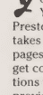

您可能对无处不在的拨号互联网连接很熟悉：登录互联网时，听到那尖锐的调制解调器声音——砰！啪！——您就上网了。如果运气好，整个拨号过程只需不到一分钟，但也可能更久。此外，还有那些下载速度慢得令人抓狂的网页。其实，连接互联网还有更好的方式——这就是*宽带*，它是通过有线电视和数字用户线（DSL）进行高速连接的统称。有线连接由有线电视公司提供，DSL 则由电话公司提供。两者都比拨号连接快得多，且各有优缺点。


宽带中的*宽*（broad）意味着连接调制解调器和互联网的线/电缆具有宽的*带宽*；它们能以更快的速度和更高的可靠性处理更多数据。传统的普通电话服务（POTS）最初是为传输模拟语音数据而设计的。不用说，在访问互联网方面，POTS 远不如宽带表现得好。

两种最流行的宽带类型是有线调制解调器和 DSL。有线调制解调器通过有线电视线路连接，而 DSL 使用 POTS 线路。宽带连接的速度大致从每秒 100 千位（Kbps）到数百万位每秒（Mbps）。*千位*（kilobit）是每秒一千位；*兆位*（megabit）是每秒百万位。这个速度足以在几秒内传输图形丰富的网页，也足以收听多个音频流或观看低分辨率的视频流。


我们正处于无线宽带的前沿。其想法是直接连接 ISP，无需任何电线或电缆。一些公司（如星巴克®）已经小规模地提供此类服务。在更大规模上，像新墨西哥州的 Rio Rancho 这样的城镇即将成为自己的 ISP。未来，ISP 将提供类似于无线电话服务的无线覆盖。敬请期待。

如果您准备切换到 DSL 或有线互联网连接，请相信我们，您绝不会想再回到拨号调制解调器。本章介绍了如何获取和配置宽带连接。


我们建议避免使用 ISDN（综合业务数字网）、卫星以及基于心电感应（mental-telepathy）的宽带互联网连接。ISDN 技术已经过时，有线和 DSL 更好。卫星互联网连接刚刚引入，存在诸如传输延迟（latency）等固有问题，这会严重干扰您的通信；不幸的是，您无法升级到光速的速度。有人说心电感应（MT）效果极佳，但我们发现它会打乱我们的数据。

### DSL 和有线连接：差异在于布线

尽管基于语音的电话网络在很多方面已经现代化，但其基础在过去一个世纪里并没有根本变化。电话网络由成对的铜线组成，扭绞成电缆，将家庭和商务场所连接到电话公司的中心局（CO）。当您拨打电话时，电话公司使用中心局中的交换机将您连接到目的地。这些交换机旨在限制通话可以使用的频率范围（称为*带宽*）。该带宽足以识别语音，但仅此而已。这些限制使得当今的模拟调制解调器无法通过电话网络传输超过大约每秒 56,000 位（即 56 Kbps）的数据。（这个 56 Kbps 的速度会有所波动，主要取决于您所连接的铜线状况，通常会向下波动。）

两种最常用的宽带系统是

- **数字用户线（DSL）：** DSL 旨在通过绕过中心局（CO）的低速语音交换机，从而避免传统电话系统的限制。DSL 使用现有的电话线（这些线将您的家连接到最近的中心局）来承载您的互联网通信。然而，一旦您连接到中心局，您的互联网通信将经过高速数字交换机路由，而不是通过语音设备。通过避开语音设备，您可以获得比拨号调制解调器快许多倍的速度。
  DSL 的主要限制是，传统铜线只能支持几英里内的高速连接。您的电话公司可以告诉您是否为您提供 DSL 服务。
- **有线电视网络：** 虽然有线电视（CATV）公司服务的住宅和商务场所数量不及电话公司，但其网络不受历史限制，通常比 DSL 快得多。CATV 网络也不存在 DSL 那种 3 到 4 英里的限制。通常情况下，如果 CATV 公司提供互联网服务，且该公司服务于您的社区，您就可以通过 CATV 公司获得互联网连接。

## 有线调制解调器选项

有线电视公司为提升网络以获取互联网市场份额投入了大量资金。这一努力在消费者那里得到了回报，美国许多地方现在都能以相当合理的价格访问高速互联网连接。

然而，您必须考虑一些缺点：

- 不幸的是，并非所有有线公司都跟上了 21 世纪的技术。一些 CATV 公司提供电视服务，但不提供互联网连接。
- 许多人不住在有有线电视服务的区域。互联网有线也不是提供网页托管等服务的好媒介。
- 您的有线公司可能要求您连接其 ISP（或使用其批准的独立 ISP）。许多人喜欢使用独立 ISP，因为他们熟悉该服务商或其提供的服务更好。使用自己的 ISP 也更易于设置计算机（或网络）以提供向外访问互联网的服务。有线公司无法阻止您使用其他当地 ISP，但他们不会因此向您收取更低费用——结果您为两种服务付费，而其中一种您并没有使用。
- 直接支持 Linux 的有线公司相对较少。您可能获得连接，但如果需要故障排除，即使是那些与 Fedora Core 无关但仍影响您机器的问题，您也得自己搞定。

如果您决定有线接入适合您的互联网接入需求，以下是通过有线调制解调器将 Fedora Core 计算机连接到互联网的过程概述：

- 1. **做一些研究并订阅 ICP 服务。**
  找到一个互联网有线提供商（ICP）——通常这意味着您现有的有线电视公司——并订阅其 ICP 服务。


### 2. 做出硬件承诺。

通过您的 ICP 获取互联网线缆调制解调器。许多 ICP 将线缆调制解调器作为其服务的一部分提供。否则，您可以从 ICP 或消费电子商店购买调制解调器。

### 3. 进行注册。

向您的 ICP 注册线缆调制解调器。您确实需要向您的 ICP 注册调制解调器。

通过向您的 ICP 提供调制解调器的媒体访问控制（MAC）地址来注册您的调制解调器。ICP 使用 MAC 地址作为参考生成 IP 地址。您不需要对您的线缆调制解调器进行任何操作。您的 ICP 执行注册过程并自动为调制解调器分配 IP 地址。您现在可以使用互联网线缆调制解调器连接到互联网了。太棒了！现在您拥有极速体验！

### 4. 设置线缆调制解调器。

线缆调制解调器有两个连接器：一个 75 欧姆同轴端口和一个双绞线（RJ-45）连接器（同轴连接器与有线电视使用的类型相同；RJ-45 连接器看起来像一个大的电话插头）：

-   将同轴电缆从线缆调制解调器的同轴端口连接到墙上的有线插座，就像连接电视机一样。
-   将网线从 RJ-45 调制解调器端口连接到您的 Fedora Core 计算机。普通网线（称为 5 类线）可能无法工作，这取决于调制解调器是使用单个以太网连接器还是作为交换机的多个以太网端口。如果您的调制解调器使用前者，如果您想直接连接计算机和线缆调制解调器，则需要使用*交叉*线。如果线缆调制解调器内置网络交换机，或者您通过独立的以太网集线器或交换机连接调制解调器，则可以使用普通 5 类线。

### 5. 设置互联网协议。

配置您的计算机，使连接到调制解调器的网络接口使用 DHCP。重启您的计算机网络接口，您就应该可以正常使用了。

以下章节将引导您完成寻找线缆提供商和设置访问权限的过程。

## 寻找互联网线缆提供商

寻找*互联网线缆提供商*（ICP）就像打电话给您的有线电视公司一样简单。并非所有有线电视系统都承载互联网流量，但许多系统确实承载。

不幸的是，寻找提供宽带互联网连接的有线电视公司非常容易。之所以不幸，是因为线缆行业内缺乏竞争。联邦法律实际上限制了市政区域内的竞争，并创造了类似垄断公司的环境。结果，当然是价格维持在高于必要水平的状态。好吧，至少许多有线电视公司正在提供互联网连接。

您的 ICP 是您的默认互联网服务提供商（ISP）。大多数有线电视公司会为您提供一个或多个电子邮件地址。然而，有线电视公司通常不提供登录账户（不像其他 ISP 那样）。

登录账户用于启动应用程序和存储信息。它们并非必需，但非常有用。当然，没有任何东西阻止您保留常规 ISP 并使用其登录账户。然后，您就拥有了一条高速互联网连接，可以使用它登录您拥有的任何账户。

我们不会带您走一遍注册有线电视互联网服务的流程，因为每个 ICP 的流程都不同。无论如何，流程应该足够简单。注册过程的很大一部分涉及等待通话并听音乐。不过，有一个建议：确保您拥有有关您系统的最新信息，并且有线电视公司知道您正在使用 Linux。

## 处理硬件

互联网线缆的一个巨大优点是，您可以从当地电子商店或网上商店购买线缆调制解调器。（相比之下，通常需要通过 DSL 提供商租用或购买 DSL 设备。）无论您是通过提供商、互联网还是实体商店购买，线缆调制解调器的价格通常是一样的。（有线电视公司有时会进行促销，通过退款返还调制解调器价格的大部分甚至全部。）但前往当地商店的便利性是显著的，特别是如果您的线缆调制解调器在周六晚上坏了，而您*必须*下载最新的游戏补丁。

在购买线缆调制解调器之前，请确保您：

-   询问您是否必须通过有线电视提供商购买调制解调器。如果不需要，您可以四处比较寻找最佳价格。
-   确保您购买的调制解调器与您的服务提供商兼容。线缆行业正在朝着使用线缆数据服务接口规范（DOCSIS）作为其互联网连接标准的方向收敛。DOCSIS 调制解调器配置起来相当简单，因此指您的服务提供商使用它们。

如果您提供商不使用 DOCSIS 这种不太可能的情况发生，您可能需要通过您的提供商获取调制解调器。

#### 技术细节

### 线缆调制解调器的工作原理

现代线缆调制解调器做的不仅仅是发送和接收互联网协议（IP）数据包。是的，它们执行基本的调制解调器工作——通过在线缆电视电线上传输和接收 IP 数据包，通过调制和解调电信号来实现（因此得名调制解调器，源自 modulate/demodulate）。但线缆调制解调器现在使用行业标准的数据线缆服务接口规范（DOCSIS）协议在线缆网络上传输电信号。这些信号携带构成网络数据包的实际位和字节。一个很好的类比是 AM 或 FM 收音机。基于 DOCSIS 的信号传输位和字节的方式，就像无线电波传输语音或音乐一样。

我们在本章后面提供的指示是为 DOCSIS 调制解调器设计的。

设置您的线缆调制解调器通常是一个直接的过程。DOCSIS 线缆调制解调器充当网络桥接器。网络桥接器仅仅是将您的网络数据包从一侧传输到另一侧，反之亦然。桥接器的一侧连接到有线电视公司。另一侧通过 5 类交叉线通过您的以太网网卡连接到您的计算机；您也可以通过网络交换机或集线器（LAN）连接。如果您的调制解调器是桥接类型——美国大多数有线 ISP 使用该系统——则不需要任何配置。

### 设置互联网协议

您不需要配置您的 DOCSIS 线缆调制解调器使其工作。然而，您需要做的是向您的 ICP 注册您的调制解调器的以太网地址，并告诉您的 Fedora Core 计算机如何连接到调制解调器。线缆调制解调器通常通过以太网网络接口连接到您的计算机。因此，您需要使用基于以太网的网络将线缆调制解调器连接到您的计算机。

您需要使用动态主机配置协议（DHCP）配置您的 Fedora Core 计算机的以太网适配器；当然，您需要在计算机上安装以太网适配器。您的线缆调制解调器使用 DHCP 设置您的以太网网卡的 IP 地址。以下指示将展示您如何做到这一点：

1.  登录到您的计算机。
2.  点击 GNOME 菜单按钮并选择系统设置网络。
3.  如果提示，输入 root 密码，然后点击确定。
4.  点击**新建**按钮。
    选择设备类型窗口打开。
5.  选择**以太网连接**选项并点击**下一步**按钮。
    选择以太网设备窗口打开，显示网络工具找到的以太网设备（或设备）。
6.  选择**以太网连接**并点击**下一步**按钮。
    选择以太网设备对话框打开。
7.  选择**适当的设备**并点击**下一步**按钮。
    配置网络设置窗口打开，如图 6-1 所示。默认情况下，标记为**通过 DHCP 设置自动获取 IP 地址设置**的选项被选中；**从提供商自动获取 DNS 信息**按钮也被激活。这些确实是您需要使用 DOCSIS 线缆调制解调器的设置。但是，您可以为您的计算机选择一个名称。
8.  为您的计算机选择一个**名称**，并将其输入到**主机名（可选）**文本框中。
    （这一步是可选的；如果您愿意，可以跳过此步骤并转到第 9 步。）
9.  点击**下一步**按钮。
    创建以太网设备窗口打开，显示您的以太网接口配置的摘要。
10. 点击**应用**按钮，控制权返回到原始的**网络配置**窗口。
    网络配置窗口显示您的新以太网设备。但是，在退出配置系统之前，您仍然需要保存您的更改。

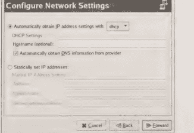

图 6-1：配置网络设置对话框。


11. 选择“文件::保存”，然后单击“确定”按钮。

在单击“确定”之前，会弹出一个信息窗口，提示你更改已保存，你需要重新启动网络或计算机才能使这些更改生效。然后你会返回到网络配置窗口。

12. 单击“激活”按钮，你的新以太网网卡便会开启。

13. 选择“文件::退出”以关闭网络配置窗口。

你已创建并保存了使用电缆调制解调器所需的配置。你也已激活了该连接。现在你可以开始使用宽带互联网连接了。例如，打开 Mozilla，以闪电般的速度开始浏览。


我们强烈建议使用默认防火墙——在常规安装过程中自动安装——或我们在第 8 章中介绍的防火墙来保护你的互联网连接。除非你选择不安装（如第 3 章所述）或显式地将其关闭，否则默认防火墙会自动配置并运行。我们更倾向于安装并使用第 8 章中更安全的防火墙；默认防火墙没有什么问题，但它保护性不如我们的。你可以通过以 root 身份运行命令 `service iptables status` 来验证你的防火墙是否处于活动状态。

### DSL 选项

我们都“有线连接”了——当然是指电话线。DSL 调制解调器利用这种旧的、常见的、得体的名字“普通旧电话业务（POTS）”来为消费者提供高速互联网连接。DSL 选项使用特殊设备，使通过 POTS 线路传输的数据量远多于传统模拟调制解调器。

DSL 通过将计算机的数字网络通信电子转换为可在电信公司的 POTS 上传输的形式，提供高速互联网连接。当你的数据到达电话公司时，它会被转换为另一种形式并转发给你的 ISP。


DSL 使用每秒数百万个周期——即兆赫兹（MHz）范围——的频率，而传统模拟调制解调器则处理每秒数千个周期——千赫兹（KHz）——的信号。使用更高频率时，你会获得更高的通信速度。不幸的是，电话系统并非为处理更高频率而设计。

幸运的是，世界上的天才们已经找到了如何从老旧、缓慢的 POTS 获取高速 DSL 连接的方法。他们设计了新的数字信号处理芯片，以克服 POTS 架构的一些限制。结果是，如果你住得足够近——大约三到四英里——靠近 DSL 提供者的设备，你就可以使用 DSL 连接到网络。

#### 直面 DSL 配置难题

本节描述了基本的 DSL 调制解调器配置问题。我们花时间提供概述，因为人们很容易只关注细节而忽视全局。请查看并熟悉以下列表。这样做之后，让你的 DSL 调制解调器工作会更容易。

大多数消费者 DSL 提供商现在使用非对称 DSL（ADSL）类型的连接。以下列表描述了使 ADSL 连接工作的过程。（请注意，我们互换使用通用缩写 DSL 和 ADSL。大多数消费者 DSL 连接实际上是 ADSL，也是我们在本章中描述的连接类型。）按以下步骤设置 DSL 服务：

- **找到 DSL 提供商。**
  你需要查明你是否住在或工作在 DSL 提供商设备附近，以获得连接。DSL 提供商会检查你的地址，并告诉你他们是否能接受你的业务。你通常可以在 DSL 提供商的网站上检查你的位置。
- **将你的 DSL 调制解调器连接到电话插座和计算机。**
  你的 DSL 调制解调器充当你的计算机和 DSL 服务提供商之间的中介。你必须将一侧连接到电话插座，另一侧连接到你的计算机以太网网卡。
- **配置你的 Fedora Core 计算机以与 DSL 调制解调器通信。**
  你的 Fedora Core 计算机通过以太网网卡连接到 DSL 调制解调器。你必须配置你的以太网网卡以与调制解调器协同工作。
- **使用来自你 ISP 的 PPP 账户名和密码配置 DSL 调制解调器。**
  你必须向你的 ISP 认证你的 DSL 调制解调器。DSL 连接会登录到你的 ISP，就像传统模拟调制解调器一样。你用你 ISP 的用户名和密码配置你的 DSL 调制解调器。
- **配置 DSL 调制解调器的内部（私有）网络接口。**
  你的 DSL 调制解调器必须能够通过以太网连接与 Fedora Core 计算机通信。你必须配置 DSL 调制解调器，使其使用与你的计算机相同的网络参数。
- **配置 DSL 调制解调器的用户和管理员密码。**
  DSL 调制解调器提供合理级别的安全性。你应该通过为调制解调器分配自己的密码来利用这种安全性。此操作可防止黑客入侵你的调制解调器并造成问题。
- **如有必要，配置调制解调器的网络地址转换（NAT）设置。**
  许多，如果不是大多数，DSL 调制解调器默认配置为使用 NAT。这是一件好事，因为 NAT 实际上充当防火墙。保护得越多越好。
- **将设置保存到非易失性内存并重启调制解调器。**
  在你设置好 DSL 调制解调器后，你需要保存其设置。你不想每次打开调制解调器时都输入配置。

互联网被设计为尽可能快地将信息发送——或路由——到其目的地。互联网协议（IP）地址用于指定信息的来源和去向。IP 地址可以是可路由的或不可路由的。不可路由地址可以重用；你可以使用与你邻居相同的不可路由地址，而不会相互干扰。

NAT 将不可路由的 IP 地址转换为可路由的地址，当你通过将其内部 IP 地址翻译为 ISP 的可路由 IP 地址之一，将私有网络连接到互联网时，这很有用。你需要配置你的 DSL 调制解调器，将你的计算机的私有和不可路由地址（例如，192.168.1.1）转换为你 ISP 分配给你的 DSL 连接的地址。

#### 寻找 DSL 提供商

你必须同时获得 DSL 和 ISP 服务才能建立你的宽带连接。一些公司——特别是区域贝尔电话公司——可以提供这两种服务。然而，在我们的情况下，我们更喜欢我们的 ISP，而不是与 DSL 提供商结盟的 ISP。（我们很幸运，在购买 DSL 服务时保留了现有的 ISP。）

DSL 提供商市场仍然相当流动。在选择之前，请仔细研究你所在地区的 DSL 服务提供商——并记住，持久性与低价同样重要。区域贝尔公司比许多竞争对手更有可能提供长期服务。

通常，在你选择 DSL 提供商后，你必须选择一个 ISP。DSL 提供商要么提供自己的 ISP，要么允许你从几个独立的 ISP 中进行选择（DSL 提供商进行安排并与第三方 ISP 直接合作）。

#### DSL 的多种形态

DSL 有多种类型。大多数消费者最终使用 ADSL，因为它以合理的高速度提供廉价的互联网连接。ADSL 很好地满足了单个计算机用户的互联网需求；甚至为小型企业提供充足的服务。不出所料，ADSL 是所有 DSL 类型中最普及的。

其他类型更适合商业使用。大多数地区可能只能访问其中两三种服务。DSL 有多种变体：

- **ADSL（非对称 DSL）**：ADSL 的下载（*下行*）速度与上传（*上行*）速度不同。（这就是为什么它是*非对称*的。）ADSL 的最高速度为 8 Mbps，但由于 POTS 基础设施的限制，通常受到限制。
- **G.Lite**：也称为通用 DSL 或*无滤波器* ADSL，G.Lite 是 ADSL 的低速版本，不需要滤除 POTS 信号。它提供高达 1.5 Mbps 的下行速度和 512 Kbps 的上行速度。
- **HDSL（高比特率 DSL）**：HDSL 是一种具有相同上行和下行速度的对称协议。你可以使用 HDSL 作为 T1 连接的替代，因为它提供 1.544 Mbps 的相同数据速率。
- **HDSL2（高比特率 DSL 2）**：HDSL2 提供与 HDSL 相同的规范，但在单根双绞线连接上工作。
- **IDSL（ISDN 数字用户线）**：IDSL 是当前 ISDN 技术的继任者，使用与 ISDN 和 SDSL 相同的线路编码（2B1Q）。IDSL 主要用于在更受欢迎的形式（如 ADSL 和 SDSL）不可用的区域提供 DSL 服务。IDSL 能够提供 144 Kbps 的上行和下行速率。
- **SDSL（单线 DSL）**：SDSL 通常被称为*对称 DSL*，因为 SDSL 的上行和下行速度相同。
- **VDSL（甚高比特率 DSL）**：在短环路上，VDSL 在高达 1,500 米的距离上提供高达 50 Mbps。VDSL 对于校园环境——大学和商业园区——特别有用。VDSL 目前正在市场试验中引入，以通过现有电话线提供视频服务。你还可以将 VDSL 配置为对称模式。
- **xDSL**：xDSL 是所有 DSL 类型的通用术语（x 表示“任意”）。

### 实际案例：配置 ActionTec DSL 调制解调器

编写明确的配置示例总是很困难，并且可能会让一些读者失望。但 DSL 世界似乎正围绕着具有基于 Web 的配置接口的调制解调器进行整合。因此，我们可以在此提供一个示例，应该对你有用，无论你是否拥有相同类型的调制解调器。祝好运！


### 通过 DSL 调制解调器连接

本节向您展示如何使用一种更为常见的 DSL 调制解调器。Qwest 是一家“小贝尔”公司，也是较大的 DSL 服务商之一，它使用此类设备。我们的调制解调器路由器是 Qwest 推荐使用的设备。您可以通过编辑基于 Web 的菜单来配置它。

以下说明介绍如何配置您的 ActionTec DSL 调制解调器。请记住，我们仅将这些说明作为示例，以展示 DSL 配置的样子。如果您使用不同的调制解调器或服务提供商，或者两者都用，您的配置会有些不同。

- 将随附的电缆从调制解调器的“线路”端口插入电话插孔，将您的 ActionTec 调制解调器连接到电话线。
- 将您的 Fedora Core 计算机的以太网接口连接到 DSL 调制解调器的以太网端口。
    - 如果您的计算机连接到私有网络，请将 DSL 调制解调器的以太网接口连接到同一网络。此步骤通常要求计算机和调制解调器都连接到同一台以太网交换机或集线器。有关连接到私有网络（也称为*局域网*，或 LAN）的信息，请参见第 7 章。
- 在您的计算机上启动 Mozilla，并在窗口顶部的“位置”文本框中输入 `http://192.168.0.1`。
    - 该地址恰好是 ActionTec 调制解调器使用的地址。您的情况可能有所不同。
- 单击“设置/配置”按钮。
    - “设置/配置”窗口将打开。
- 单击“基本设置”按钮。
- “设置”窗口打开，提醒您将调制解调器连接到电话线路，并将计算机连接好。
- 按“下一步”按钮。
    - “宽带连接”窗口将打开。
- 保留默认的 PPPoA 选项，并单击“下一步”按钮。
    - P（点对点）协议，P（协议）——P（点对点协议）基于 ATM。ATM 是异步传输模式；**不要把它理解为“All The Money you want”！** P（协议）基于以太网。不要担心缩写；需要知道的重要事情是，P（点对点协议）是连接 DSL 调制解调器到宽带服务提供商最常用的方法。
- 当“宽带连接—PPP”窗口打开时，在相应的文本框中输入您的 DSL 提供商提供给您的用户名和密码。
    - 只有当您向 DSL 提供商索取并获得静态 IP 地址时才输入静态 IP。只有在您希望向 Internet 提供某些网络服务时才需要使用静态 IP。
- 在“保存并重启”窗口中，按“保存并重启”按钮。
    - 恭喜！正如屏幕上显示的那样，调制解调器会将其自身连接到您的 DSL 提供商，当它准备好时会停止闪烁。
- 单击“状态”选项卡以查看有关您连接的信息。

### 保护您的 DSL 调制解调器

通过 DSL 调制解调器设置好与 Internet 的连接后，您与其他所有这样做的人一样，需要提高其安全性。以下步骤描述如何设置密码（关于选择良好密码的建议请参见第 3 章）：

- 如果您正在继续上一节中断的操作，请单击选择“设置”选项卡。
- 单击“更改管理员密码”按钮。
- 在第一个文本框中输入您的密码，并在第二个文本框中重复输入。
- 单击“保存并重启”按钮。
    - “保存并重启”窗口将打开。
- 再次单击“保存并重启”按钮。
    - 您的新密码将被保存。下次您尝试查看或修改 DSL 调制解调器时，系统将提示您输入用户名和密码。用户名是 `admin`，密码就是您刚刚设置的那个。

每个制造商实现这些步骤的具体方式各不相同。总体思路仍然相同——而且许多步骤应该与我们在此描述的非常接近。所有 DSL 调制解调器都需要相同的基本信息：ISP 用户名、密码等。您应始终将 DSL 调制解调器设置为使用 NAT，因为它充当防火墙。请查阅调制解调器的用户指南获取详细的配置信息。

# 第 7 章

## 本地连接，全球通信：连接到局域网

- 使用以太网或无线 NIC 进行网络通信
- 使用 Fedora Core 网络实用程序
- 启动和停止您的本地网络连接

本章展示了如何将您的 Fedora Core 计算机连接到现有的局域网（也称为 LAN 或私有网络）。这与第 5 章和第 6 章中描述的通过拨号调制解调器或宽带连接直接连接到 Internet 不同；那些章节向您展示如何直接将单台独立的 Fedora Core 计算机连接到 Internet。在这种情况下，您将 Fedora Core 计算机连接到局域网，该局域网可能拥有自己的 Internet 连接。

您可能是出于家庭、工作或学校使用而构建您的 Fedora Core 计算机。场合无关紧要：您可以使用本章中的信息将您的计算机连接到任何现有的局域网。

如果您无法访问局域网，请不要灰心。您可以自己制作一个！第 15 章描述了如何构建一个。


在这本书中，局域网和私有网络这两个术语可以互换使用。

### 介绍局域网

Linux 的发明彻底改变了计算机网络。在 Linux 出现之前创建局域网既昂贵又复杂。局域网几乎是大公司、大学等机构的专属领域。

但是，网络功能从一开始就以 TCP/IP 网络协议的形式内置于 Linux 中。在 20 世纪 90 年代中期，如果您买得起几台 PC、一根廉价的同轴电缆和几个以太网适配器，一个局域网就诞生了。当时以太网适配器（也称为网络接口卡，即 NIC）的价格约为 150 美元或更高。幸运的是，自那以后价格大幅下跌，比中年的摇滚明星摔得还快：现在 100Mbps NIC 的价格低至 10 美元，您可以花不到 50 美元买一张 11Mbps 无线 NIC（54Mbps 802.11g 网卡的售价也略高于 50 美元）。

然而，要将您的 Fedora Core 计算机连接到网络，您确实必须配置一些网络子系统。以下是使您的网络正常运行所需完成的任务：

- 安装您的无线或以太网 NIC。大多数计算机，包括笔记本电脑和台式机，都预装了以太网 NIC。许多笔记本电脑还配备了无线 NIC。如果您需要加装 NIC，请遵循设备附带的说明。
- 加载您的无线或以太网 NIC 内核模块。Fedora Core 通常会自动检测您的硬件并加载正确的内核模块。
- 配置您的 NIC 的 IP 地址、子网掩码和网关。
- 配置您的域名服务（DNS），它负责将 Internet 名称转换为 Internet 协议（IP）地址。

无线网络（或 Wi-Fi，如即将发布的侧边栏中所述）存在一些安全漏洞。请参阅本章后面的“无线网络警告”侧边栏。

执行这些步骤需要做一些“繁重的工作”。使用随 Fedora Core 附带的系统管理工具——图形化网络配置实用程序，您的负担会大大减轻。祝您愉快！


### 使用 Fedora Core 网络实用程序配置您的 NIC

要在现有局域网（LAN）中使用您的 Fedora Core 计算机，您至少需要两个硬件组件：

- 安装在计算机上的无线或以太网 NIC（网络接口卡）
- 用于连接 NIC 的网络集线器、交换机或无线接入点

设置好硬件后，下一步是配置您的 Fedora Core 网络设置。

### 准备配置无线 NIC

在配置您的无线 NIC 之前，您需要弄清楚两件事：

- 您拥有（或需要）的无线 NIC 的类型
- 您的无线 NIC 应如何连接到您的网络

两种最广泛使用的 802.11b（11Mbps）无线电子设备（或*芯片组*）分别由 WaveLAN（由 Lucent Technologies 制造）和 Prism2（由 Intersil 设计）。Fedora Core 支持这两种类型。以下是一些详细信息（制造商等），有助于您确定您的设备使用哪种芯片组：

- **WaveLAN**：Orinoco 是此领域的领导者；其他（不太*流行*）的型号包括 Apple AirPort、Enteriasys RoomAbout 802、Elsa AirLancer 11 和 Melco/Buffalo 802.11b。
- **Prism2**：D-Link DWL-650、LinkSys、Netgear、WPC11 和 Compaq WL110；其他不太流行的型号包括 Addtron WPL-100、Bromax Freeport、GemTek WL-211、Intek/Nokia、SMC 2632W、YDI、Z-COM XI300 和 Zoom Telephonicus ZoomAir 4100。

在本书撰写时，最新可用的无线协议是 **802.11g**。基于此标准的技术可以以高达 54 Mbps 的速度运行，大约是 802.11b 系统速度的五倍。然而，目前尚无很多用于此技术的 Linux 驱动程序可用。Prism54 项目正忙于为 802.11g 协议开发开源 Linux 驱动程序，因此请查看 [www.prism54.org](http://www.prism54.org)，看看在您阅读本章时您的无线网卡是否已有驱动程序。一家名为 Linuxant 的公司出售允许您的 Linux 计算机使用 Microsoft 驱动程序的软件。请参阅其网站 [www.linuxant.com](http://www.linuxant.com) 以了解有关其产品的更多信息。


### IEEE、Wi-Fi 与无线网络

IEEE（读音为“眼-三-E”），即电气和电子工程师学会，是一个全球性的专业人士组织（具体来说，是那些关心技术事务到足以制定统一标准的专家）。作为无线网络领域的“三眼怪”（一只眼，三个 E，懂了吗？），IEEE 关注诸如无线网络设备应使用哪些频率等问题。幸运的是，该组织制定了这项出色的标准，使所有感兴趣的人都能在没有机器之间架设电线的情况下进行沟通。

主导性的无线标准是多种成分的混合。它部分基于 IEEE 802.11b 标准（也称为 Wi-Fi，即无线保真）——以及另外两个较旧的标准（802.11a 和较新的 802.11g）。嘿，我们可以称之为简称：如果你听到人们在谈论 Wi-Fi NIC（网络接口卡），他们只是在谈论无线 NIC。

首要任务是弄清楚你的无线 NIC（或网络适配器）应如何连接到你的网络。无线 NIC 通过两种方式连接到局域网：

- **适配器对适配器**：这种类型被称为*临时*连接，如果你有两台或更多台希望互相通信并形成自己排他性私有网络的计算机，这很有用。
- **适配器对无线接入点**：这种类型称为*基础设施*，它提供了进入局域网的一个单一入口（一个接入点）。一个*接入点*允许一台或多台计算机连接到网络。然而，与临时网络不同，单台计算机可以连接到任何允许它们连接的接入点。

我们提供的无线配置说明适用于基础设施或临时连接方法。只要正确配置你的网络 ID（ESSID）和加密密钥，你的无线 NIC 就可以连接到接入点或其他计算机（Linux 和 Windows）。

#### 为什么临时网络比基础设施网络更好

使用临时模式提供了几项优势：

- **较低的成本**：你不需要购买接入点；接入点的价格通常在 50 美元左右。使用运行在临时模式下的无线 NIC 的计算机直接相互通信，从而消除对公共接入点的需求。
- **对 Linux 用户配置更简单：** 较旧的接入点设备只能通过基于 Windows 的软件进行配置——确切地说，是使用简单网络管理协议（SNMP）。你需要通过有线以太网网络将一台 Windows 计算机物理连接到接入点，然后使用随设备提供的软件。如果你没有任何基于 Windows 的计算机，那将很困难。较新的接入点往往使用基于 Web 的配置工具，因此你可以使用 Mozilla 来配置这些新设备。
- **临时网络无需配置任何接入点：** 你只需配置网络上每台计算机的无线 NIC。你可以使用 Fedora Core 网络配置实用工具来配置无线 NIC，从而简化流程。每个 NIC 必须具有相同的网络 ID 和加密密钥。

临时网络也可以提供稍多的安全性，因为它们通过路由器连接到其他网络——以及互联网。接入点作为网络桥接器工作。路由器检查 IP 地址，然后决定如何指导网络流量从一个网络到另一个网络。桥接器自动传递所有流量。临时网络可以配置为比基于接入点的网络更紧密地——虽然并非完全地——控制网络流量。带有防火墙的临时网络比使用接入点的网络更易于配置。（许多当前的接入点现在提供 NAT 和防火墙支持；使用 NAT 实际上有效地创建了一个防火墙。）

### 配置你的 *以太网或无线* NIC

为了让你基于 Fedora Core 的计算机在局域网中工作，你必须首先配置其网络接口卡，即 NIC。*NIC* 是将你的计算机电子连接到局域网的设备。为了与网络上的其他计算机协同工作，你的以太网或无线适配器必须被赋予一个网络地址和几项其他信息。

> 我们将配置说明分为以太网和无线 NIC 两部分。说明首先向你展示如何启动 Fedora Core 网络配置实用工具。然后我们专门用一个子章节来描述配置以太网和无线设备的具体细节。在涵盖设备具体细节后，我们讨论一般的配置问题。整个配置过程按以下步骤概述：

1. 启动网络配置实用工具。
2. 配置你的以太网或无线 NIC。
3. 配置你的计算机主机名。
4. 配置你的计算机域名服务。
5. 重启你的网络。

### 无线网络警告

Wi-Fi，作为无线技术的标准，使用一种名为*无线等效保密（WEP）的加密系统*来提供安全。WEP 对无线设备之间的通信进行加密，以防止拥有正确设备的人监听和使用你的无线网络。**但 WEP 存在缺陷，并且可以使用广泛可用的工具进行破解。** 如果黑客入侵你的 Wi-Fi 网络，他可以读取你的通信内容。**并且你的问题不会到此为止。黑客可以使用你的无线网络连接到互联网；你给了坏人一顿免费午餐和进入互联网的发射台。**

另一方面，无线网络如此有用，以至于许多人都愿意承受这种风险。其逻辑是什么？**如果你假设你的无线网络向公众开放，你可以采取其他预防措施来保持你的通信私密。**

你应该使用 *OpenSSH、安全套接字层（SSL）和虚拟专用网络（VPN）*——所有这些都在 Fedora Core 中捆绑在一起——来进行所有内部和外部通信。**请记住，使用 SSH、SSL 和 VPN 保护你的信息，但并不能阻止某人连接到你的网络。** 下一代无线安全技术应能修复 WEP 的弱点。**在 WEP 问题得到解决之前，请注意相关风险。**

### *启动网络配置实用工具*

按照以下步骤启动网络配置实用工具：

1. 点击 **GNOME 菜单** 按钮，选择 **系统设置 > 网络**。
2. 如果*被提示这样做*，输入 ***root 密码***。
   图 1-3 显示了初始配置窗口；NIC 可能显示在那里，也可能不显示。只有在你安装 Fedora Core 期间配置了网络，NIC 才会显示在那里。
3. 如果没有 NIC 显示在 **设备** 选项卡上（或者如果你想配置额外的 NIC），点击 **新建** 按钮。
   - 如果你正在处理以太网设备，请跳过到下面“配置以太网 NIC”部分的第 3 步。
   - 如果你正在处理 Wi-Fi NIC，请跳过到本章后面“配置无线 NIC”部分的第 1 步。
   
   选择设备类型窗口会出现。
4. 从列表中选择 ***合适的设备类型***，然后点击 **下一步** 按钮。
   例如，如果你使用的是以太网接口，请选择以太网。如果你使用的是 Wi-Fi 设备，请选择无线连接。
   
   接下来做什么取决于你是在配置以太网 NIC 还是无线 NIC。下面两个部分分别专门用于以太网和无线 NIC。

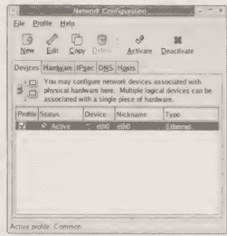

### 配置以太网 NIC

如果你使用的是以太网 NIC，请按照本部分的步骤配置其参数（如果你使用的是无线 NIC，请转到下一节）：

1. 按照前一部分“启动网络配置实用工具”中的步骤操作。

当你从上一步骤第 4 步的下拉列表中选择以太网时，选择以太网设备窗口会出现。

2. 选择适当的以太网设备，然后点击下一步按钮。

网络配置实用工具检测连接到你的计算机的所有以太网设备。大多数 PC 只有一个以太网设备，因此你不需要决定选择哪一个。

配置网络设置窗口打开（参见图 7-2）。

3. 配置你的 TCP/IP 地址设置。

网络配置实用工具选择 DHCP（动态主机配置协议）作为确定机器 IP 地址的默认方法。（DHCP 动态为以太网 NIC 分配 IP 地址和其他参数，此时你已完成 NIC 配置。）如果你连接到提供 DHCP 服务的网络，请在主机名（可选）字段中输入计算机名称（例如，Cancun），点击下一步按钮，然后转到第 9 步。

如果你的网络不使用 DHCP，你需要手动配置 IP 地址。请继续执行第 4 步。


### 92 第 II 部分：网络就绪？

#### 图 7-2：输入您的静态（非 DHCP）IP 地址设置。

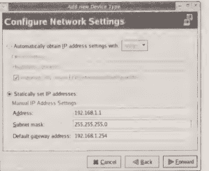

4. **点击“静态设置 IP 地址”单选按钮。**

除非您本身就是管理员（如果是这样，您可能想避免自言自语），否则您应该咨询您友好的本地系统管理员，了解您的网络使用哪些系统。

如果您的计算机上同时拥有无线网卡（NIC）和以太网网卡，情况会稍微复杂一些。您可以同时运行这两个设备，但配置起来会更困难。您可以通过点击“自动获取 IP 地址设置”单选按钮来解决问题，这样圆点就会消失。这个简单的鼠标点击操作可以防止以太网网卡自动启动。


5. **通过在“地址”文本框中键入，为计算机分配一个 IP 地址。**

IP 地址类似于街道地址：它们提供了一个唯一区分您的机器与其他所有机器的编号。私有 IP 地址不需要向管理机构——即分配 IP 地址的 InterNIC 组织——进行任何注册。私有 IP 地址不会在互联网上路由，因此您可以将它们用于您的私有网络。

如果您处于一个拥有注册 IP 地址的网络中，请确保从您的系统管理员那里获取一个 IP 地址。否则，请使用私有 IP 地址。例如，您可以使用 192.168.1.1 到 192.168.254.254 之间的任何 C 类地址——例如 192.168.1.20 或 192.168.32.5。此范围内的私有 IP 地址被指定供私有网络使用。按照设计，私有 IP 地址不会通过互联网进行路由（即从一个网络发送到另一个网络）。


6. **在“子网掩码”文本框中键入 255.255.255.0 或您 IP 地址的子网掩码。**

7. **在“默认网关地址”文本框中，键入您局域网互联网网关的 IP 地址。**

互联网网关是将您的网络连接到您的 ISP（互联网服务提供商）和互联网的设备（路由器或计算机）。如果您在工作单位且有系统管理员，请从他们那里获取该地址。如果您是家庭用户，通常的惯例是将 C 类子网中的最高地址 254 指定为网关。例如，键入 **192.168.1.254**。

您的 *TCP/IP 设置* 应该类似于图 7-2 所示对话框中的设置。

8. **点击“下一步”按钮。**

*创建以太网设备* 对话框将打开，表明您已完成配置过程。该对话框显示了您在前面步骤中输入的信息摘要。

9. **查看摘要并点击“应用”按钮。**

您将被返回到网络配置窗口，该窗口现在显示了新配置的以太网网卡。

10. **通过选择“文件→保存”来保存新的配置。**

一个对话框将打开，通知您更改已保存。点击“确定”按钮继续。

11. **通过点击“激活”按钮来启动网卡。**

此步骤完成了您的以太网网卡配置。

您的以太网网卡现在处于活动状态。但如果您未使用 DHCP，您仍需要配置您的域名服务（DNS）。请继续本章稍后的“配置 DNS”部分。

#### 技术细节

**内核模块** 是 Linux 中相当于 Microsoft Windows 设备驱动程序的组件。通常，Fedora Core 会检测您的以太网适配器并自动加载正确的模块。然而，如果 Fedora Core 无法找到您的以太网适配器，您可以尝试在提供的列表中查找正确的一个。

#### 配置无线网卡

本节描述如何配置无线网卡（也称为 Wi-Fi 网卡）的参数。（如果您没有无线网卡，请跳过此部分。）

以下步骤描述了如何配置您的无线设备。

1. **按照本章前文“启动网络配置实用程序”部分中的步骤操作。**

当您在前面列表的第 4 步的下拉列表中选择了 **无线** 时，**选择无线设备** 窗口将显示。

2. **选择适当的无线设备。**

3. **点击“下一步”按钮。**

**配置无线连接** 窗口将打开，如图 7-3 所示。

4. **从“模式”下拉列表中选择“管理”或“Ad-Hoc”。**

当您使用接入点时，使用 **管理** 模式。如果您配置了一个没有接入点的无线网络，请使用 **Ad-Hoc** 模式。

5. **如果您使用接入点，请在 ESSID（网络 ID）文本框中键入 any。为您的 Ad-Hoc 网络键入特定的 ESSID 名称。**

所有连接到 Ad-Hoc 无线网络的机器必须共享相同的 **ESSID**。例如，您可以选择字符串 **mynetwork** 作为您的 **ESSID**。在这种情况下，您必须为连接到您的 Ad-Hoc 网络的所有机器输入 **mynetwork** 作为 **ESSID**。

6. **在“密钥”文本框中输入加密密钥，然后点击“下一步”按钮。**

您应该从您的网络管理员那里获取 **加密密钥**。如果您已设置了自己的家庭无线网络，您可以自己生成密钥。*加密密钥* 类似于密码，保护您的无线网络免受随意的窃听。在 **密钥** 文本框中，输入一个不超过 13 个字符的密钥——例如，**this is a password** 使用了所有 13 个允许的字符——一般来说，字符越多，**加密密钥** 越有效。


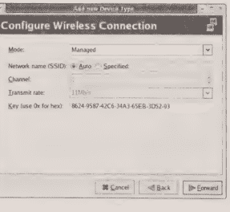

### 第 7 章：本地连接，全球通信：连接局域网


加密密钥是 40 位或 128 位的二进制数。它们可以表示为文本字符串（如第 6 步所述）或十六进制（hex）数字字符串。十六进制数字在计算机科学中通常用于表示较长且笨重的二进制数。对于您的目的来说，知道十六进制数由 16 个字符表示就足够了：0 到 9 和 A 到 F。例如，十六进制 0 表示为十进制 0；十六进制 3，表示为十进制 3；十六进制 9，表示为十进制 9。但十进制 10 是十六进制 A，十进制 16 的十六进制值是 F。此示例密钥的十六进制值

```
this-is-a-password
```

是

```
74686973 6973 6973 615F 686579
```

您可以在密钥字段中输入十六进制值，方法是在密钥前加上字符串 0x。在示例中，您输入这一行：

```
0x74686973 6973 6973 615F 686579
```

输入您的加密密钥并点击“下一步”按钮后，配置网络设置窗口将打开。为您的计算机分配主机名、IP 地址、子网掩码和网关的过程与以太网接口相同。请参阅前一部分“配置以太网网卡”中的步骤 3 到 9，了解如何配置您的无线网卡 TCP/IP 参数。

您的无线网卡配置已完成。如果您未使用 DHCP，您仍需要配置您的域名服务（DNS）。如果是这种情况，请继续下一节。

#### 配置 DNS

如果您正在使用域名服务，必须配置您的计算机使用一到三个 DNS 服务器。如果可用，您可以使用您局域网的 DNS 服务器。您也可以使用外部 DNS 服务器——无论您的局域网是否存在这些服务器。要配置您的 Fedora Core 计算机使用 DNS，请遵循以下步骤：

1.  点击网络配置对话框中的 DNS 选项卡，这是前面步骤列表中断开的位置。
2.  在“主机名”文本框中键入您计算机的主机名。

主机名是任何您想要使用的名称（例如，Cancun）。
如果您连接到由他人控制的网络（例如，在工作单位），在选择主机名之前请咨询系统管理员。

3.  在“主要 DNS”文本框中键入您的 DNS 服务器的 IP 地址。


### 手动启动和停止网络

有时，网络配置实用程序会配置您的网络，但无法激活它。为什么会这样呢？可能是因为网络配置实用程序还相对年轻，随着时间推移会变得更加完善。在此期间，您可以通过以下步骤通过其他方式启动网络系统：

- 1. 单击 GNOME 菜单按钮，选择“系统设置”》“服务器设置”》“服务”，如果系统提示，请输入您的 **root** 密码。
  将出现服务配置实用程序。向下滚动直到找到“网络”选项。
- 2. 选中“网络”选项，然后单击“重启”按钮。
  将打开“信息”窗口，确认您的网络已重启。您的新网络设置已生效。
- 3. 如果您使用的是无法通信的无线网卡，您可能需要重启 PCMCIA 系统：
  - a. 在服务配置实用程序中定位并单击 PCMCIA 服务。
  - b. 单击“重启”按钮。
  - c. 重复步骤 3 以重启网络。

所有网络都会停止，然后再次启动。

或者，您可以在终端模拟器中以 root 身份登录并运行此命令：`service network restart`。（或者，若要停止网络，请运行 `service network stop`。）

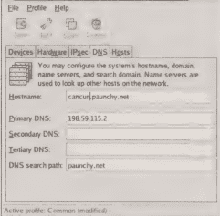

### 第 8 章
#### 只有你能预防不良防火墙

**本章内容**

- 介绍计算机安全
- 使用 Netfilter/iptables 防火墙系统
- 设计和查看过滤规则
- 自动启动防火墙
- 自动更新计算机软件

连接到互联网后，你必须保护自己免受坏人的侵害。坏人戴着黑帽子，就像电影里那样（相比之下，红软呢帽有点古怪，但其实也不错）。你可能还听说过他们被称为黑客、攻击者、黑帽等。无论他们叫什么名字，无论他们的意图如何，互联网每天的危险性都在增加，所以你必须采取预防措施。

在保护自己免受计算机干扰方面，不存在万能灵丹妙药。你不应该依赖任何单一方法或系统来抵御黑客。最好的防御是创建多层重叠的防御，提供额外的保护。这被称为纵深防御。

你的防御盾牌的第一层是你的防火墙。*防火墙*是一种设备，它允许你使用互联网（或连接到它的其他网络），同时阻止互联网使用你。防火墙是单向门，允许你的出站网络连接，同时阻止入站连接。

本章将介绍（不出所料）如何构建防火墙。首先，为了消除你对是否真的需要防火墙的疑虑，我们将解释拥有防火墙为何重要。然后，我们将向你介绍 Netfilter/iptables，一种 Linux 防火墙系统，并描述如何设置你的防火墙过滤规则。在你设置好过滤器后，我们将描述如何自动运行防火墙。


本章描述的防火墙旨在保护单台连接到互联网或局域网的 Fedora Core 计算机。该防火墙并非设计用于保护整个局域网。第 15 章描述了如何修改此防火墙以保护你的私有网络。

#### 理解你首先需要防火墙的原因

你可能认为人多势众是安全的——毕竟，在任何给定时刻，都有数百万的人、企业和组织连接到互联网。作为一个拥有简单计算机或小型私有网络并连接到互联网的个体，你需要担心什么？坏人通常对大笔金钱或大型公关事件感兴趣。我只是个小人物，没人会对我这个老小子感兴趣，对吧？

这种假设听起来合情合理，但可能导致灾难。许多黑客使用工具自动扫描和攻击数千台计算机，几乎不费吹灰之力。即使是一个懒惰的黑客也不费力气就能搜索大量网络，以寻找并利用未受保护的计算机。（别忘了互联网蠕虫传播得也非常快。）

不要冒不必要的风险被 *控制*——这是黑客入侵并控制你的计算机时使用的术语。幸运的是，你可以采取一些合理的预防措施，从而大大增加你的安全性。Linux 提供了保护你自己的有效工具。

使用防火墙是一种简单（但非常有效）的保护自己免受互联网连接风险的方法。防火墙允许你连接互联网，同时阻止不必要和不受的连接进入。


防火墙提供高性价比的保护——但它们不是你应该采取的唯一安全措施。例如，锁好门窗确实有助于防范窃贼，但并不 100% 有效——他们仍然可能破窗而入。你最好的选择是使用多层安全，例如锁好窗户、使用警报器以及关注社区活动。其理念是让每一层安全互相强化。第 17 章描述了如何为计算机添加安全层。分层安全是你最好的保护。

### 构建有效的防火墙

Fedora Core 附带了一个简单但极其有效的防火墙系统，名为 Netfilter/iptables。Netfilter 部分指的是内置于 Linux 操作系统——确切地说是内核——中的防火墙系统，而 iptables 是控制它的界面。我们将整个系统称为 iptables，因为那是你使用的实用程序。

iptables 系统过滤互联网支柱的 IP 数据包（IP 代表 Internet Protocol，即互联网协议）。当你连接到互联网时，你发送和接收的所有信息（图形和文本）都以 IP 数据包的形式发送。通过互联网进入和离开你的计算机的所有信息都以 IP 数据包的形式打包。你可以使用 iptables 根据 IP 数据包的目的地、源地址和端口接受或拒绝它们。

#### 设计过滤规则：宽松和严格的方法

过滤规则就像用来构建防火墙的砖块（或者如果你愿意的话，是石棉）。基本上，过滤规则决定了哪些网络通信可以进入和离开你的计算机。

在设计防火墙过滤规则时，你可以选择两种理念：

- 默认允许所有连接，然后拒绝特定访问。
- 默认拒绝所有连接，然后允许特定访问。

如果你允许所有连接，你将首先允许与你的计算机的所有通信，然后逐一拒绝连接。（Fedora Core 防火墙使用此方法，你在安装过程中创建防火墙时会使用它。）这种方法的危险在于，你可能无意中允许危险流量到达你的机器。另一种方法是首先拒绝所有通信，然后有选择地允许某些流量。从安全角度来看，这种更严格的方法创建防火墙的最佳方式，因为你确切知道允许什么访问。然而，严格方法也可能带来问题；例如，你可能无意中阻止必要的或想要的网络流量到达你的计算机。

我们解释如何使用严格方法，有以下几个原因。

- **这是最安全的方法。** 严格方法更安全，因为它最大限度地减少了外部与你互联网连接计算机的接触。例如，它最大限度地减少了黑客可能通过端口扫描和其他技巧获取的关于你防火墙的信息。
- **它更容易配置。** 由于 iptables 提供有状态过滤，在创建安全防火墙时，你只需配置两条规则。相比之下，宽松方法要求你配置大量单独的规则。额外的、不必要的复杂性会降低安全性。


iptables 系统之所以有效，是因为它使用了*有状态过滤*。防火墙可以跟踪每个网络连接的状态。这是一种技术性表述，意思是 iptables 知道哪些 IP 数据包是有效的，哪些不是。例如，如果你正在浏览 www.dummies.com，iptables 会跟踪属于该连接的所有数据包。iptables 工具可以拒绝试图到达你的电脑但不属于你当前连接的数据包，从而防止黑客将数据包偷偷传入你的防火墙。

+ **提示** Fedora Core 默认安装基于 iptables 的防火墙。安装系统在安装过程中会配置一个良好的保护级别。你可能记得在第 3 章中我们建议你使用默认防火墙配置。然而，默认防火墙的安全性不如我们偏好用于连接互联网的标准高。因此，本章描述如何构建一个更全面且安全的防火墙。

+ **技术说明** **端口**——信息进入或离开计算机的地方——对于互联网协议至关重要。端口用于组织客户端和服务器之间的通信。例如，当你在网页上点击一个链接时，你的浏览器通过使用端口与 Web 服务器进行通信。当然，这是一种粗略的简化，但它描述了基本概念。只需说明，端口有助于控制互联网的内部运作，例如用于 Web 浏览等任务。

### 设置防火墙

你知道你需要一个防火墙并希望创建一个。接下来该怎么办？本节解释如何设置一个基于 iptables 的防火墙，使用限制性模型。完成规则设置后，请参见本章稍后的部分“将过滤规则保存到脚本”，这样你每次开机时就不必重新输入这些规则。

在本节中，你设计一个基于 iptables 的防火墙，该防火墙关闭互联网连接（调制解调器、局域网或宽带）上的所有传入连接，同时仍允许你建立到互联网的传出连接。然后你放宽对传入通信的完全限制，允许传入安全 Shell 连接。（Secure Shell 提供加密通信。）

+ **警告！** 不要通过远程连接执行这些指令！你必须从计算机的控制台运行这些命令。也就是说，你必须坐在你的计算机前操作，而不是通过其他位置的網絡连接进行工作。原因很简单：这些防火墙规则在恢复外部网络连接之前会关闭它们。

构建防火墙的步骤如下，一步一个脚印：

1. **以 *root* 身份登录你的计算机，然后打开一个 GNOME 终端窗口**（在桌面的任何空白处右击，并从菜单中选择“打开终端”）。
2. **输入以下命令以关闭默认的 Fedora Core 防火墙：**

   ```
   service iptables stop
   ```

   该防火墙是在第 3 章描述的安装过程中创建的。iptables 条目会移除任何现有的过滤或网络地址转换（NAT）规则。NAT 规则常用于使你的计算机看起来像是来自你的 ISP，这样你就不必为计算机注册一个官方的互联网协议（IP）地址。
3. **通过输入以下规则开始构建你的防火墙，这些规则过滤掉所有到、从及经过你计算机的网络通信：**

   ```
   iptables --policy INPUT DROP
   iptables --policy OUTPUT DROP
   iptables --policy FORWARD DROP
   ```

   这些命令将你的防火墙默认策略设置为不允许任何网络流量进入（*INPUT* 规则）或离开（*OUTPUT* 规则）任何网络接口；如果你拥有多个网络接口，也不允许任何流量在它们之间传递（*FORWARD* 规则）。此时，你拥有一个极其安全的防火墙。然而，到目前为止，你的计算机对于网络相关任务来说毫无用处。因此，下一步稍微打开防火墙，让你可以安全地访问互联网（或你连接的任何网络）。
4. **输入以下规则以允许网络流量通过回环设备：**

   ```
   iptables -A OUTPUT -j ACCEPT -o lo
   iptables -A INPUT -j ACCEPT -i lo
   ```

   Linux 计算机使用通过*回环接口*（*lo*）连接的虚拟内部网络。回环不是一个物理设备，而是一个虚拟设备。Linux 使用 *lo* 进行内部通信。
5. **为了允许你的计算机进行所有传出通信，输入以下两个命令：**

   ```
   iptables -A OUTPUT -m state --state NEW,RELATED,ESTABLISHED -j ACCEPT
   iptables -A INPUT -m state --state RELATED,ESTABLISHED -j ACCEPT
   ```

   这些规则没有指定任何特定的网络接口。然而，由于过滤器是有状态的，这些规则实际上在你的以太网、无线或拨号点对点（PPP）接口上有效工作。

   第一个过滤规则允许所有传出通信。`--state NEW,RELATED,ESTABLISHED` 选项告诉防火墙允许新连接和已建立连接的数据包通过。（数据包是所有网络通信的基本构建模块。）还允许与现有连接相关但使用不同端口的数据包，例如 FTP 数据传输。

   第二个过滤规则控制从传出连接返回的数据包。例如，当你连接到一个网站时，你的浏览器发出数据包，Web 服务器对它们作出响应。你可以点击网站上的按钮，一个新的显示窗口弹出。点击按钮发出一个数据包，Web 服务器发回数据包。你一开始就阻止了来自互联网的数据包；这个规则创建了一个例外，允许属于现有连接的数据包——例如代表你点击按钮的那个连接——通过防火墙返回你的计算机。请注意，我们不允许新的传入连接（`--state NEW`）建立；这样做会破坏此防火墙的目的。
6. （可选）使用以下规则允许 SSH 连接进入你的 Linux 计算机：

   ```
   iptables -A INPUT -p tcp -m state --state NEW,ESTABLISHED -j ACCEPT --dport 22
   ```

   该规则允许通过 22 端口的 SSH 连接进入你的计算机。

   OpenSSH 服务器在第 3 章描述的安装过程中默认安装。该服务也会自动启动。

   你可以修改此规则以允许其他类型的传入连接进入你的计算机。例如，如果你想创建一个 Web 服务器并允许传入连接，运行此过滤器：

   ```
   iptables -A INPUT -p tcp -m state --state NEW,ESTABLISHED -j ACCEPT --dport 80
   ```

   80 端口用于 Web 服务器连接。（第 16 章向你展示如何创建 Web 服务器。）

你刚刚创建了一个简单、有效的防火墙，保护你的计算机免受僵尸和黑客的侵害。你的防火墙保持活动状态，直到你关闭规则或重启计算机。以下部分展示如何显示你的新防火墙规则。

### 显示防火墙规则

配置防火墙后，你自然会想要验证过滤规则是否正确设置。要显示防火墙规则，请按照以下步骤操作：

1. 打开一个 GNOME 终端仿真器窗口（在 GNOME 桌面的任何空白处右击并选择*新建终端*菜单）。你也可以通过点击 GNOME 菜单并选择*工具 > 终端*来打开 GNOME 终端。
2. 如果你还不是 *root* 用户，请在 GNOME 终端窗口中输入 *su-* 命令。
3. 输入 *root* 密码并输入以下命令以显示防火墙规则：

   ```
   iptables -L -v
   ```

完成这些步骤后，你会看到终端窗口中显示的防火墙过滤规则（在前面的命令中使用*详细 -v* 选项可以显示额外信息，包括网络接口——为了简洁起见，我们在此例中未使用该选项）：

```
Chain INPUT (policy DROP)
target prot opt in out source destination
ACCEPT all -- lo in lo anywhere anywhere
ACCEPT all -- any any anywhere anywhere
 state RELATED,ESTABLISHED
ACCEPT tcp -- any any anywhere anywhere
 tcp dpt:ssh state NEW,ESTABLISHED

Chain FORWARD (policy DROP)
target prot opt in out source destination

Chain OUTPUT (policy DROP)
target prot opt in out source destination
ACCEPT all -- any lo anywhere anywhere
ACCEPT all -- any any anywhere anywhere
 state NEW,RELATED,ESTABLISHED
```

iptables 使用链的概念。*链*是一个或多个相互关联规则的列表。每个规则是链中的一个环节。iptables 有三个内置链：*INPUT、OUTPUT* 和 *FORWARD*。你可以创建自定义链来执行你想要的任何过滤功能。（例如，默认的 Fedora Core 防火墙过滤器创建一个名为 *RH-Firewall-1-INPUT* 的自定义链）。然而，对于此防火墙，创建自定义链并非必要，因此我们只使用内置链。


第一条`chain`（链），`INPUT`（输入），用于过滤入站数据包。你可以看到，默认策略拒绝所有数据包。这种策略构成了一个完美的防火墙——没有任何东西可以进入。然而，这个完美的防火墙也是无用的，因为你的计算机无法查看或交互网络。

你可以通过创建一条规则来开始让防火墙变得有用，该规则允许逻辑回环（`lo`）接口上的所有入站数据包；回环接口用于计算机内部通信。下一条规则允许来自出站连接的返回数据包（`RELATED` 和 `ESTABLISHED`）进入。最后一条规则（这是可选的）允许入站的 Secure Shell（SSH）连接到你的计算机。

下一条`chain`（链），`FORWARD`（转发），阻止所有数据包通过你的 Linux 计算机进行转发。只有当你使用计算机进行路由或其他高级网络功能时，才需要转发。

最后一条`chain`（链），`OUTPUT`（输出），定义了哪些 IP 数据包被允许从你的计算机发出。同样，第一条规则允许通过回环（`lo`）接口进行无限制的交通流。第二条也是最后一条规则允许所有数据包离开你的防火墙。

以下部分描述如何保存你刚刚创建并显示的规则——以便它们可以自动启动。

### 启动你的防火墙

前一部分描述了如何显示你的防火墙过滤规则。但是，你显然不希望每次重启计算机时都手动输入这些规则。本节展示如何自动化你的防火墙。我们将展示如何利用 Fedora Core 工具来保存你刚刚创建的规则，并在每次启动计算机时启动防火墙。

这些步骤假设你已经按照前一部分的描述配置了防火墙——并且配置仍然有效。

#### 将过滤规则保存到脚本

在创建防火墙后，你需要保存你的规则集。Fedora Core 提供了一个实用工具来完成这项工作。`iptables-save` 实用工具读取你当前的防火墙规则，并将其转换为脚本兼容的格式。Fedora Core 还提供了一个脚本，在每次启动计算机时启动你的防火墙。`/etc/init.d/iptables` 脚本在每次启动计算机时运行，因此，你的防火墙也会随之启动。请按照以下步骤操作：

- 1. 如有必要，以 *root* 身份登录，并打开一个 GNOME 终端窗口（参见第 4 章）。
- 2. 输入以下行以保存默认的 Fedora Core 防火墙配置：
    ```
    mv /etc/sysconfig/iptables /etc/sysconfig/iptables.bak
    ```
- 3. 运行此命令，你的防火墙规则将被保存到脚本中：
    ```
    iptables-save > /etc/sysconfig/iptables
    ```

#### 关闭和打开防火墙

Fedora Core 使用 `/etc/sysconfig/iptables` 脚本启动 Netfilter/iptables 防火墙。`/etc/init.d/iptables` 脚本使用存储在 `/etc/sysconfig/iptables` 文件中的过滤规则来实现过滤规则。

你可以通过运行此 iptables 脚本或使用 service 实用程序来启动 Netfilter/iptables 防火墙：

```
service iptables start
```

当然，你必须以 *root* 身份登录。注意，你可以将 start 替换为 stop 来关闭防火墙：

```
service iptables stop
```

你还可以使用（从图形界面）Fedora Core 服务配置实用程序。接下来的步骤展示了如何使用该实用程序来启动或停止你的防火墙：

- 1. 单击 GNOME 菜单按钮并选择 **System Settings→Server Settings→Services**（系统设置→服务器设置→服务）。
      如果你不是以 *root* 身份登录，输入窗口会弹出，并要求你输入 *root* 密码。
- 2. 输入在 Fedora Core 安装过程中设置的 *root* 密码。
      服务配置窗口会出现。此窗口控制所有 Linux *daemons*（守护进程，提供服务的进程）。
- 3. 向下滚动服务配置窗口，直到找到 iptables 服务。
      复选框中的对勾应已设置。
- 4. 单击窗口左上角的“Restart”（重启）按钮。
      你可以单击“Start”（启动）按钮，但我们建议你就使用“Restart”功能。“Start”和“Restart”按钮给你相同的结果，但如果服务已经在运行，重启也能工作。如果服务已经运行，使用“Start”功能则无效。
- 5. 单击“Stop”（停止）按钮以关闭防火墙。
      服务重启后，你会看到确认消息。
- 6. 单击“OK”（确定）。
      你的防火墙已重启，你可以退出服务配置窗口。

**提示**
你还可以防止在启动系统时自动启动 iptables 脚本。单击服务名称左侧的方框以移除对勾。单击“Save”（保存）按钮，指向启动脚本（/etc/init.d/iptables）的指针（/etc/rc.d/rc5.d/S08iptables）将被移除。你可以通过再次单击方框使对勾重新出现来恢复指针。

### 第三部分

## Linux，噢！它有什么用？绝对是一切的用途！

## 第五波

作者：Rich Tennant


> “好的 – 解毒剂，解毒剂，解毒剂图标应该长什么样？你知道，我仍然没有按我想要的方式配置这个 GNOME 桌面。”

## 在本部分...

你可以用计算机做的一件事是翘起脚等待屏幕保护程序启动。你可以在下次参加聚会时告诉所有朋友，你有一台“Fedora Core 盒子”。（这应该会让他们疯狂地流行，因为他们急切地想知道你的股票期权何时成熟。）或者，你可以使用你的新 Fedora Core 工作站（天哪）去做一些事情。

为此，第 9 章介绍了 GNOME 窗口环境的友好世界。GNOME，一个喜欢给 Linux 贴上一张友好面孔的友好小家伙，可以帮助你设置 Linux 的“外观和感觉”，让你感到舒适和自在。第 10 章更进一步，介绍了你可以使用 GNOME 应用程序做的酷炫事情。

在第 11 章，乐趣开始了。你能说“派对”吗？（抱歉。）了解如何使用 Mozilla 浏览器和 Evolution 电子邮件客户端。

第 12 章继续带来乐趣，在那里你将学习如何使用你的计算机作为多媒体中心。它描述了如何收听音频 CD 和文件。它还介绍了如何从 CD 中提取音乐以及将音乐（和数据）刻录到 CD 上。该章节随后展示了如何使用开源多媒体播放器 Rhythmbox 和 MPlayer 来收听流动的流——不，不是河流，而是从互联网流动的音频流。你可以收听无线电和音频剪辑，也可以观看视频。有了这些知识，你可能永远不需要离开你的沙发。

幸运的第 13 章描述了如何使用 OpenOffice 完成工作。抱歉——现实很残酷，个人生产力套件（例如文字处理器和电子表格）是一种必要的恶。必须得做甜甜圈（意指工作）。

第 14 章描述了如何使用便捷的开源 Wine 系统来运行 Windows 应用程序。Wine 为 Linux 用户打开了 Windows 应用程序的浩瀚世界。

### 第 9 章

## 认识 GNOME

### 本章内容

- 纵览 X 窗口系统
- 介绍 GNOME 图形环境
- 熟悉 GNOME 桌面
- 介绍 GNOME 菜单
- 配置 MIME 类型
- 离开你的计算机

Fedora Core 提供两种接口供你使用：在 Chapter 4 中描述的**基于文本**的命令行接口（CLI），以及*图形化*（即面向图像的）X 窗口系统。命令行接口类似于旧的 MS-DOS（Microsoft Disk Operating System）环境；你输入命令让操作系统执行。X 窗口系统（简称为 X）提供了一个图形化的点击环境，大多数人更喜欢在此环境中工作。

Fedora Core 提供两种桌面环境供你使用：GNOME 和 KDE（K 桌面环境）。GNOME 和 KDE 都运行在 X 之上；每个都包含一个菜单系统来访问实用工具、应用程序和快捷方式（以图标形式），以及其他许多增强功能。这两种环境都使 Fedora Core 作为工作站简单易用。

GNOME 是 Fedora Core 的默认桌面环境。Fedora Core 还允许你选择安装 KDE，这是一个许多人偏爱的优秀系统。然而，由于本书的空间有限，我们只讨论 GNOME。


由 Naba Barkakati（来自 Wiley Publishing）撰写的优秀书籍《Red Hat Fedora Linux 2 All-In-One For Dummies》更详细地描述了 KDE。

在本章中，我们介绍 X 以及使用 GNOME 工作的基础知识。你会掌握如何处理 GNOME 面板和桌面（*GNOME 面板*类似于 Windows 计算机中的任务栏）。我们向你展示一些简单但有效的操作来管理你的桌面。


## 简介 X 窗口系统

Fedora Core 为您提供使用 GNOME 和 KDE 桌面环境的选择。然而，GNOME 和 KDE 都运行在 X 之上，而 X 运行在 Linux 之上。X 是提供像 GNOME 这样的系统所使用的底层图形组件的软件。X 是使像 GNOME 这样复杂系统成为可能的基础。

X 由三个部分组成：

-   X 服务器
-   众多图形库
-   一组 X 客户端图形应用程序

X 服务器是一个程序，它与您计算机上的人机交互硬件——如显卡、键盘和鼠标——进行通信，充当硬件与其他图形软件之间的媒介。它使用图形库——由许多程序共享的软件——来正确操作图形硬件。

X 客户端是您交互的图形程序（例如 Mozilla 和 xclock）。X 客户端通过 X 服务器显示其图形输出；它们也通过 X 服务器获取键盘和鼠标输入。X 客户端可以运行在 X 服务器所在的同一台计算机上，或者通过网络运行在任何运行 X 服务器的计算机上。例如，通过使用 X，您可以在世界另一端的计算机上运行 X 客户端，并在您家用计算机上运行的 X 服务器上查看它。

假设您远程登录到澳大利亚的一台计算机，并且您想查看那里的时间。您可以运行基于文本的 date 命令（从 CLI）来查看日期和时间，但那样会很无聊。或者，您可以在远程机器上运行 xclock 程序，并在本地计算机上查看图形化的时钟显示。然后您可以验证澳大利亚人确实使用顺时针走的时钟，且一天有 24 小时。


X 服务器程序，通常简称为 X，并不是操作系统的一部分，就像在其他一些操作系统中那样。相反，X 服务器是一个用户级程序——尽管它很特殊且复杂。

X 窗口系统为这些基于图形的系统提供了基础：

-   **桌面环境：** 桌面环境相当于房子，其中 X 是地基。GNOME 和 KDE 是使计算机使用变得简单的桌面环境，提供高级功能，如菜单系统、图标和背景。
-   **图形应用程序：** Fedora Core 安装了大量应用程序，如游戏、系统管理工具、Mozilla 浏览器和 OpenOffice.org，以提供有助于您使用计算机（和互联网）工作或娱乐的功能。

## 简介 GNOME 图形环境

GNOME 代表 GNU 网络对象模型环境。GNU 代表 GNU's Not UNIX，这是一个假装不定义自己的首字母缩写（可能是由那些可能从未参加过毕业舞会但确实改变了世界的人设计的）。如果您难以记住首字母缩写，只需将 GNOME 视为*免费的精彩图形，不是吗？*无论您如何记住它，GNOME 都是一个开源的图形桌面环境。它为您的 Fedora Core 计算机上的日常任务（如文字处理和互联网浏览）提供了平台。

登录您的 Fedora Core 计算机，查看 GNOME 界面。它应该看起来像图 9-1 所示，并由这三个主要元素组成：

-   **桌面：** 桌面是您在计算机屏幕上看到的内容。这是您工作空间，相当于——看！——桌子的顶部。桌面预先配置了中性的背景和几个图标（包括链接到您的主目录和回收站等位置）。图标相当于堆在桌子上的杂物：有些有用，有些没用。


-   当您双击桌面上的任何图标时，会打开一个 Nautilus 窗口并显示该对应对象的内容。Nautilus 是一个图形化 shell（相对于基于文本的 CLI shell），用于处理不仅是文件和目录，还包括管理工具和网页。有关 Nautilus 的更多信息，请参阅第 10 章。

-   **面板：** 跨越 GNOME 屏幕底部边缘的菜单栏是面板（本章后面将更多关于 GNOME 面板的内容）。您可以从面板访问所有默认的 GNOME 和 Fedora Core（或正确配置的第三方应用程序）。面板类似于桌子上的抽屉。

-   **应用程序：** 这些元素包括用户程序、系统工具和 GNOME 应用程序。用户程序包括诸如 Evolution 和 OpenOffice.org 等应用程序。系统应用程序包括 Fedora Core 系统管理工具（如网络配置和用户管理）以及 GNOME 工具（如帮助浏览器）。

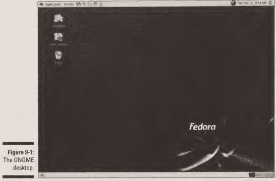

### 简介 GNOME 桌面

GNOME 执行您从桌面环境期望的所有基本图形功能。例如，您可以设置背景并创建图标。本节演示如何执行一些基本的 GNOME 桌面操作和配置。掌握基础知识后，您可以继续自行探索。

由 Fedora Core 安装设置的默认 GNOME 桌面，预装了几个元素。本章的这一节将对桌面进行快速浏览。

#### 简介默认桌面图标

在桌面的左上角有四个图标：计算机、您的主目录、您的硬盘（例如，ide1disk1）和回收站（参考图 9-1）。您还将看到每个插入的 CD-ROM/DVD 以及任何额外硬盘的图标。以下列表描述了每个标准图标的功能：

-   **计算机：** 此图标链接到您的本地文件系统和网络共享。双击计算机图标会打开一个显示四个图标的窗口：软盘、CD-ROM、文件系统和网络（如果您没有这些设备，则不会看到软盘或 CD-ROM 图标）。双击文件系统图标会打开一个显示所有根级目录（参见第 4 章）的窗口，如 /usr 和 /home。打开网络图标允许您浏览网络上的网络文件共享。该网络提供了与 Windows 网络邻居相同的功能。

-   **主目录：** 这个看起来像文件夹的图标代表您的主目录。例如，如果您创建一个名为 `lidia` 的用户账户，将创建一个名为 `/home/lidia` 的目录；图标标记为 `lidia` 的主目录。当您以 `lidia` 登录时，主目录图标链接到该目录。双击主目录（或右键单击并选择打开），会打开一个 Nautilus 窗口，显示主目录的内容。
    -   双击图标以打开与图标关联的 Nautilus 窗口。例如，双击您的主目录会打开一个链接到您主目录的 Nautilus 文件管理器窗口。您也可以通过右键单击图标并选择打开选项来打开图标。

-   **ide1disk1：** 此图标与您的主目录图标类似，除了它显示您的硬盘的根级视图。它默认显示 `/` 而不是 `/home/lidia` 的内容。
    -   您的硬盘图标名称很可能是 `ide1disk1`，因为大多数 PC 使用 IDE（集成驱动电子）硬盘。但是，如果您的计算机使用 SCSI（小型计算机系统接口）磁盘，那么图标将被称为 `scsidsk1`。

-   **回收站图标：** GNOME 提供了一种通过回收站目录删除文件和目录的方法。点击桌面上的任何图标，或者将目录拖到回收站图标。虽然 Jesse James 的 *Monster Garage* 改装的迷你面包车垃圾车不会来收您的文件，但它被放置在回收站目录中。像家里的垃圾桶一样，回收站目录位于您的主目录中。
    -   只有在您右键单击回收站图标并选择清空回收站后，被放入回收站的项目才会真正被删除。您可以通过打开回收站（双击图标），然后点击项目并将其拖出到桌面或打开的首选设置窗口来恢复项目。


GNOME 提供两种从基于文本的 CLI 运行程序的方法。您可以启动一个 GNOME 终端仿真器窗口，或使用 GNOME 运行程序功能。前者在终端仿真器窗口中打开一个 bash shell，您可以从中启动应用程序。后者打开一个窗口，您可以在其中输入要执行的程序名称。这两个系统的主要区别在于，使用终端仿真器时，您可以与应用程序进行更多的交互。运行程序系统仅当应用程序创建 GUI 时，才允许您与应用程序交互。


## 更改 GNOME 的外观和感觉

GNOME 提供了一种更改其元素外观和感觉的方法——即它们的*主题*：打开的窗口中按钮、滑块、菜单、边框和其他组件的大小、形状、纹理和颜色。

### 更改主题

你可以比选后的政客更快地更改主题方法更简单、更快地更改主题，从 GNOME 菜单中选择*偏好设置*→*主题*；或者，你可以打开*Start Here*（从这里开始）图标，并在弹出的窗口中选择*偏好设置*。当*偏好设置*窗口打开时，双击*主题*图标。

当*主题偏好设置*窗口打开时，默认激活*应用程序*选项卡。你可以选择任何主题，所有打开的窗口会立即采用该主题。应用程序主题会更改应用于每个窗口的色调和纹理。例如，选择*金属*主题会使你的窗口具有拉丝表面外观。

点击*窗口边框*选项卡。点击任何主题，你的窗口边框就会改变。窗口边框由包围每个窗口的条带的色调和纹理以及条带上的按钮组成。

不断选择不同的主题，直到你找到一个喜欢的为止。完成后，点击*关闭*按钮。

### 更改桌面背景

你还可以更改显示在桌面上的图像。图像可以是图片、图案或纯色。通过右键点击桌面任何空白（无杂乱）区域来更改桌面，以找到你喜欢的背景。从菜单中选择*更改桌面背景*，*背景偏好设置*窗口打开。通过点击*图片*部分或其变体之一来选择图像。*请选择一张图片*窗口打开。你可以选择任何列出的图像，或在磁盘上搜索其他图像。或者，你可以点击*无图片*按钮来选择纯色。

打开*背景样式*菜单，并选择*纯色*或一组在垂直或水平轴上变化的颜色。然后，你可以点击*颜色*按钮来更改颜色（纯色或渐变）。从*选择颜色*窗口中选择你的颜色。对其他颜色重复此过程，你就会得到一个充满颜色的屏幕。


在桌面空白区域的任何位置右键点击，然后选择*使用默认背景*可重置背景。默认背景会被重新激活。

## 在你的工作场所辛勤工作

使用 GNOME 一段时间后，你会发现随着你启动越来越多的应用程序，你在屏幕上创建了许多窗口。你甚至可能丢失位于其他窗口后面的窗口。你开始怀疑自己需要将几个显示器绑在一起，以便一次性显示所有窗口。

显示器和平板要么笨重要么昂贵，或者两者兼有，因此你可能不得不使用单个显示器。但你不必被困在一个屏幕上。GNOME 允许你将工作扩展到多个虚拟显示器。

想象一下，你有一个大的 GNOME 桌面平均分布在四个显示器上。如果你能在任何显示器上打开窗口，生活将很美好。你会有很多空间来扩展。

然而，由于你很可能*没有*四个显示器，GNOME 将你拥有的一个显示器划分为四个称为*工作区*的虚拟显示器。每个工作区相当于一个真实显示器，你可以将工作扩展在其上。唯一的限制是你一次只能查看一个工作区。

### 在你的工作区切换器中交换位置

在工作区之间切换很简单。GNOME 提供了一个实用工具，即工作区切换器，用于选择任何工作区。工作区切换器位于 GNOME 面板上。

你使用 GNOME 工作区切换器来访问每个工作区。工作区切换器被分为四个象限。点击任何象限都会显示相应的桌面；例如，你可能想拉取左下角的（作为例子），你就进入了该工作区。

你可以强制窗口进入任何或所有工作区。点击窗口左上角的向下箭头。打开的菜单提供了所有预期的关闭、最小化、最大化和调整窗口大小的功能。然而，在菜单的底部有将窗口放置在其余三个工作区之一的选项——或者你可以将窗口放在所有工作区。例如，你可能希望将所有工作区中的 Mozilla 等应用程序拉取出来，以便无论你在做什么都能使用它。

## 使用 GNOME 窗口

在对窗口做任何操作之前，你必须引起它的注意。当窗口得到你的注意时，它具有*焦点*。根据你如何设置 GNOME，你可以用几种方法赋予 GNOME 窗口焦点：

- 点击 GNOME 面板上窗口的最小化图标。
- 点击窗口顶部的标题栏。
- 点击窗口本身的一部分，这通常也会使窗口成为最顶层的窗口。这是默认方法。


在本书中，我们坚持 Fedora Core 和 GNOME 默认设置，该设置在你点击窗口时赋予窗口焦点。

### 移动窗口

要移动窗口，使用鼠标左按钮点击窗口的标题栏的任何位置（并按住）。只要继续按住该按钮，窗口就会随你移动鼠标的地方而移动。释放按钮，窗口就会留在那里。

### 调整窗口大小

有时窗口有点太大或太小，如果你能将窗口调整到合适的大小，生活会轻松很多。为了做到这一点，将鼠标光标定位在窗口的任何边框上。点击并拖动窗口的外轮廓到你想要的大小。释放鼠标按钮，窗口将变为新的大小。

### 最小化窗口

既然你已经在屏幕上放置了许多窗口，如何去掉*少数*或所有窗口？你可以通过点击靠近右上角的加粗带下划线的按钮来*最小化*（或*图标化*——真是一种自负）窗口，这将窗口从桌面移除并放置在 GNOME 面板的存储区域。如果你心情特别恶劣，你可以更彻底地*关闭*窗口。你可以看到图标位于屏幕底部中央边缘的 GNOME 面板上。

以下是几种去掉窗口的方法，从最不剧烈的开始，逐渐升级到彻底的窗口消失：

1. 利用窗口（或窗口中的应用）提供的任何退出按钮或菜单选项。例如，许多应用程序允许你选择*文件*→*退出*来关闭应用程序。
2. 点击窗口标题栏右上角的 X 按钮以关闭窗口。
3. 点击窗口左上角（或右键点击标题栏），并从打开的菜单中选择“关闭”选项。


你可以通过点击 GNOME 面板上对应于该窗口的图标，将最小化的窗口返回到桌面。

### 最大化窗口

要使窗口填满整个屏幕，点击窗口右上角的最大化按钮。查看典型窗口标题栏右侧的按钮：最大化按钮是中间的一个；它看起来像一个正方形，工作方式类似于 Windows 中的层叠按钮。

### 创建 GNOME 桌面图标

你可以在桌面上为 GNOME 菜单上的任何应用程序创建图标。只需点击 GNOME 菜单按钮，找到你想要创建图标的应用程序的菜单项，然后点击该应用程序的图标并继续按住鼠标按钮。在按住鼠标按钮的同时，将光标拖动到 GNOME 桌面上的任何开放区域。释放鼠标按钮，该应用程序的图标将放置在 GNOME 桌面上。然后，你可以通过双击桌面上的图标来启动应用程序。

在 GNOME 中，你可以使用*徽章*增强图标——关于图标应该做什么的额外信息。你可以通过右键点击图标并选择“属性”来分配徽章。属性窗口打开。点击徽章选项卡并选择一个徽章。例如，如果你选择“酷”徽章，桌面上将与图标一起显示一副 Wayfarer 太阳镜——酷。

另一个很酷的 GNOME 图标功能是拉伸图标边界的能力。右键点击图标并选择“拉伸”。虚线和四个方形按钮框住图标。点击任何按钮，你可以随心所欲地拉伸图标图像。


### 介绍 GNOME 面板

GNOME 面板是位于桌面底部的菜单栏。与 Windows 中的任务栏类似，GNOME 面板提供了一个放置常用菜单和小工具的位置，以便于快速打开或查看。GNOME 面板还允许你查看虚拟桌面，并跟踪已最小化的窗口。

默认情况下，Fedora Core 在 GNOME 面板上放置了图标，用于访问 GNOME 菜单、Mozilla、Evolution、OpenOffice（包括 Writer、Impress 和 Calc）、打印机、时间、up2date 小工具以及 GNOME 工作区切换器。你可以通过点击这些图标来启动其中的任何程序或实用工具，或使用该切换器。

GNOME 面板上最重要的元素是最左侧的 GNOME 菜单按钮，你用它来访问所有标准的 GNOME 应用程序和配置工具。GNOME 菜单按钮看起来非常像红色的 Fedora 帽子，位于屏幕的左下角。点击 GNOME 菜单按钮后，你可以从显示出的任何菜单中进行选择。例如，系统设置和系统工具菜单包含了许多你可以用来管理 Fedora Core 计算机的 Fedora Core 实用工具。声音与视频菜单提供对多媒体程序的访问，而图形菜单提供对用于处理图形的应用程序的访问。你明白其中的意思了。

你可以右键点击 GNOME 面板上的任何图标，将其移除、移动、锁定位置或更改其启动器的属性。更改图标启动器的属性允许你修改图标名称、注释、命令、类型或图标图形。

你可以通过右键点击 GNOME 面板的任何未使用区域，选择“添加到面板...”（Add to Panel...），然后从“添加到底部面板”（Add to Bottom Panel）菜单窗口中选择图标，从而将图标添加到 GNOME 面板。例如，选择“添加到面板...”，“添加到底部面板”窗口将打开。选择“应用程序启动器”（Application Launcher）选项，然后点击“前进”（Forward）按钮。点击“互联网”（Internet）选项，选择 Mozilla，然后点击“添加”（Add）按钮。Mozilla 的蓝色地球和鼠标图标将被添加到 GNOME 面板。GNOME 面板菜单的另一个有趣功能是自定义应用程序启动器（Custom Application Launcher）实用工具。再次打开“添加到底部面板”窗口。选择“自定义应用程序启动器”选项并点击“添加”按钮。将打开“创建启动器小工具”（Create Launcher Applet）窗口。通过在相应的文本框中输入应用程序的名称和路径名，你可以添加一个新的、能够启动该应用程序的小工具到 GNOME 面板。

试一试。例如，如果你经常使用 SSH 登录另一台计算机，你可以添加一个自定义图标来简化任务，如下所示：

1. 打开“创建启动器”对话框窗口。
2. 添加图标名称，例如，SSH 到我的机器（SSH to mybox）；你可以选择输入通用名称和注释。
3. 接下来，输入该图标将要启动的命令：
   ```
   /usr/bin/ssh mybox
   ```
4. 在这种情况下，我们希望在一个终端窗口中运行此命令，因此点击“在终端中运行”（Run in terminal）按钮。
5. 可选地，点击“无图标”（No Icon）按钮并从图标图像页面中选择一个图像。例如，我们向下滚动并选择了红苹果。
6. 点击“确定”（OK）按钮，你的图标就诞生了。

图 9-2 显示了新的图标。


在你完成编辑“创建启动器小工具”窗口后，点击“确定”。该图标将被添加到你的面板中。你可以以相同的方式为 Fedora Core 计算机上的任何应用程序创建启动器。

GNOME 提供了一款名为搜索工具（Search Tool）的文件搜索实用工具。点击 GNOME 菜单按钮并选择“查找文件...”（Search for Files...），搜索工具将打开。输入你想查找的文件名并点击“查找”（Find）按钮。点击“高级”（Advanced）标签页，你可以进行更精细的文件搜索。

### 添加和删除面板

你并不局限于默认的 GNOME 面板；你可以随意创建额外的面板。右键点击 GNOME 面板的任何未使用区域，选择“新面板”（New Panel）。

新面板是空白的，不包含任何图标，而默认的 GNOME 面板则包含图标。新面板确实有一个基本菜单，你可以用它来填充图标和其他菜单。右键点击新面板，一个子菜单将打开。你可以使用“添加到面板”菜单来配置新面板。例如，选择“附件”（Accessories）>“时钟”（Clock），一个数字时钟将被添加到面板。或者你可以点击“娱乐”（Amusements）>“眼球”（Eyees）。不断添加图标，直到你对新系统感到满意为止。

如果屏幕开始显得过于杂乱，你可以删除你创建的任何面板——但你无法删除默认的 GNOME 面板。过程很简单：右键点击面板的任何未使用部分，选择“删除此面板”（Delete This Panel）。点击打开的“删除面板”（Delete Panel）窗口中的“删除”（Delete）按钮，面板就会被“解绑”（depanded）。

你可以让任何面板在不使用时隐藏。右键点击面板的任何未使用部分，从弹出菜单中选择“属性”（Properties），“面板属性”（Panel Properties）窗口将打开。选择“自动隐藏”（Autohide）选项并点击“关闭”（Close）按钮。面板将消失在屏幕边缘，直到你将鼠标光标移回该边缘。然后面板将重新出现。


每个新面板的两端都包含箭头，称为隐藏按钮（Hide buttons）；原来的默认面板没有。点击任一边箭头的箭头将强制面板滑向一边或另一边。除了那些相同的箭头之外，面板是隐藏的。点击箭头将揭示隐藏的面板。

### 介绍 GNOME 菜单

你可以通过 GNOME 菜单访问大多数 Fedora Core 和 GNOME 应用程序及实用工具。单独的应用程序在第 10 章中列出，但列出的各个菜单类别如下：

-   **附件**：那些有用但额外的、不属于此列表中任何组的应用程序被标记为附件。例如，GNOME 计算器、文本编辑器和字典应用程序被放置在此类别中。只需输入一个单词，其定义就会显示出来。
-   **文件浏览器**：此实用工具允许你浏览 Windows 和 Linux（通过 Samba）网络文件系统。
-   **游戏**：由于 Linux 最初是为了运行服务而构建的，因此它可能不是人们首先想到为游戏玩家提供的平台。但它有很多游戏。打开游戏图标，你会看到其中许多。你可以像使用 Windows 一样轻松地用 Linux 虚度光阴！哈哈！
-   **图形**：你可以使用几个图形实用工具查看和操作图像。点击 GNOME 菜单，然后是图形菜单，你可以运行诸如 GIMP（一个用于处理 and 编辑图像的出色工具）等应用程序。你可以使用扫描工具通过扫描仪将图像扫描到计算机中，并使用数码相机工具从相机上传图片。
-   **帮助**：你可以访问一个显示 GNOME 帮助信息的 Nautilus 窗口。
-   **互联网**：新的 Fedora Core 默认邮件客户端 Evolution 位于此文件夹中。你也会在这里找到图形聊天应用程序即时通讯器（Instant Messenger）。
-   **网络服务器**：你可以查看你网络上的 Samba 服务器。网络服务器选项提供与 Microsoft 网络邻居（Network Neighbourhood）相同的功能。
-   **办公**：开源的 OpenOffice 应用程序存储在此文件夹中。OpenOffice 提供文字处理器、电子表格、演示文稿管理器和绘图工具，你都可以从这里访问。你还可以在这里找到 OpenOffice 修复和打印机配置实用工具。（图标会自动放置在 GNOME 面板上。）
-   **首选项**：选择此菜单选项将打开与双击 GNOME 桌面“从此处开始”（Start Here）图标并选择“首选项”图标相同的窗口。
-   **编程**：Linux 提供良好的编程环境。Fedora Core 通过此菜单提供了对几种编程实用工具的链接，例如 Emacs，许多人用它来编辑源代码。
-   **最近文档**：选择此选项将打开一个包含你最近编辑过的文档的子菜单。点击任何文档以开始再次编辑它。
-   **运行应用程序**：你可以使用此选项手动运行应用程序。只需点击该选项并在打开的对话框中输入你的命令。实际上，“运行应用程序”是绕过使用 GNOME 终端的一个快捷方式。
-   **声音和视频**：有趣的东西存储在这里，例如 Rhythmbox、CD 播放器和 XMMS 音频应用程序。你也会在这个文件夹中找到更平凡的项目，例如音量控制和音量监视实用工具。
-   **系统设置**：Fedora Core 将许多出色的配置实用工具放置在这里。例如，Fedora Core 网络配置、X 配置和声卡检测实用工具都在这里。此菜单还包括服务器设置菜单，你可以用它来控制各种守护进程。
-   **系统工具**：你可以从此文件夹访问更多的 Fedora Core 系统管理实用工具。首选项窗口还允许你配置除带手动调节的屏幕保护程序以外的其他项目。（我们将键盘铃声设置等奇妙世界的探索留给你。）
-   **查找文件**：此功能帮助你搜索计算机上的文件和目录。选择此功能将打开一个窗口，你可以输入要搜索的文件名。


### 配置 GNOME MIME 类型

您可以使用各种 GNOME 配置工具来更改桌面的外观和感觉。双击桌面上的“从这里开始”（Start Here）图标。窗口打开后，双击“首选项”（Preferences）图标。（您可以通过点击 GNOME 菜单按钮然后打开“首选项”菜单来访问相同的功能。将打开一个子菜单，显示与“首选项”窗口相同的选项。）

以下示例展示了如何将 Ogg MIME 类型与 Rhythmbox 播放器关联：

1.  双击“首选项”窗口中的“文件类型和程序”（File types and programs）图标。
    显示“文件类型和程序”对话框。
2.  选择“音频->OGG 音频”（Audio->OGG audio），然后点击“编辑”（Edit）按钮。
    打开“编辑文件类型”窗口。“编辑文件类型”窗口显示 Ogg 音频文件属于 application/x-ogg MIME 类型。窗口还显示 Ogg 音频文件使用 .ogg 文件后缀。
3.  点击“默认操作”（Default action）下拉菜单，选择“音乐播放器”（Music Player）。
4.  点击“确定”按钮，Rhythmbox 即可准备播放 Ogg 文件。

“首选项”窗口还允许您配置除屏幕保护程序之外的其他项目（原文此处为幽默表述：带有疯狂咆哮的屏幕保护程序）。探索设置键盘铃声和其他项目的奇妙世界就留给您了。

### 晚安 GNOME

如果您不想关闭计算机，但也不想让它向任何路过的人敞开大门，您有两个选项：锁定 GNOME 桌面和注销。

以下部分描述了相关过程。

#### 锁定您的计算机

锁定屏幕是您可以使用的最佳安全功能之一。要锁定屏幕，请点击 GNOME 菜单按钮并选择“锁定屏幕”（Lock Screen）。您的屏幕将被锁定，您必须输入密码才能重新进入。即使您只离开一两分钟，锁定屏幕也是一个好主意。

您还可以配置 GNOME，使其在设置的时间延迟后自动锁定屏幕。如果您在办公环境中使用 Fedora Core 计算机，这很有用。设置屏幕锁定可确保您不会无限期地让计算机处于开放状态。请按照以下说明设置您的屏幕锁定：

1.  点击 GNOME 菜单并选择“首选项::屏幕保护程序”（Preferences::Screensaver）。
    打开“屏幕保护程序首选项”窗口。
2.  点击“锁定屏幕之后”（Lock Screen After）按钮。
3.  点击向上或向下的箭头，选择屏幕锁定生效的时间。
    设置为十到十五分钟是一个很好的折中方案。
4.  点击“关闭”按钮。

#### 夜间回家

当您已经结束了一天的工作并想要回家（或者只是去楼上）时，您需要注销。点击 GNOME 菜单按钮并选择*注销*（*Log Out*）。将打开一个标有*您确定要注销吗？*（*Are you sure you want to log out?*）的对话框。点击“确定”按钮，正如您所料，您将注销。您还有选项可以关闭或重启您的计算机。

GNOME 默认配置随机屏幕保护程序。您可以按如下方式选择单个屏幕保护程序：

1.  点击 GNOME 菜单按钮并选择“首选项::屏幕保护程序”（Preferences::Screensaver）。
    打开“屏幕保护程序首选项”窗口。
2.  点击“模式：”（Mode:）下拉菜单并选择*仅一个屏幕保护程序*（*Only One Screen Saver*）。
3.  向上和向下滚动，直到找到您喜欢的屏幕保护程序。
    例如，您可以从默认的随机屏幕保护程序切换到 Xjack 屏幕保护程序（因为只工作不玩耍，Xjack 也会变成一个无趣的 Xboy！）。对于那些在宁静的度假胜地度过漫长冬天并有充足时间撰写 Linux 书籍的人来说，这是一个不错的选择！
4.  点击“关闭”按钮。

### 消灭 X

当您的应用程序无响应时，您可以简单地停止 X，这将终止在其下运行的所有程序。为此，请同时按下 Ctrl+Alt+Backspace 键。如果您手动启动了 X，则可以注销该账户。如果 X 在启动时自动运行（正如本书所假设的），您将看到 X 登录屏幕，您可以重新登录。

# 第 10 章

## 了解更多的应用程序

### 本章内容

- 介绍 Nautilus，GNOME 文件管理器
- 介绍 Fedora Core/GNOME 应用程序

许多应用程序有助于让您的 Fedora Core 计算机变得有用。在本章中，您将了解如何使用 Nautilus，它是 GNOME 的核心应用程序之一。Nautilus 管理文件和其他对象。我们还将介绍所有默认安装的 Linux 和 GNOME 应用程序。

#### 使用 Nautilus 文件和互联网集成管理器进行导航

成为老板并不一定让您成为一个坏人。是吗？那只是份工作。对吧？那个小小的 GNOME 家伙是个好员工，薪水不多，喜欢被人使唤。在这里按个键，在那里点下按钮，您就可以像任何称职的尖头 *Dilbert* 经理一样指挥他。GNOME 甚至附带了自己的文件和集成管理器，它可以为您节省工作，并为漫长的午餐腾出时间。

*Nautilus* 是 GNOME 使用的图形导航系统，用于引导您在文件和网络之间穿梭。Nautilus 继承了所有优秀文件管理器的传统，向您显示计算机上文件和目录的视图。您可以通过指向和点击来复制、移动、删除和执行文件——创建目录和查看文件详情也轻而易举（好吧，只需点击一下）。Nautilus 更进一步：您可以使用它来配置您的 GNOME 桌面。而且这还没完！Nautilus 还可以导航互联网，访问多媒体应用程序，并进行切片处理！考虑到它是免费工作的，这真是一笔划算的交易。

#### 唤醒 Nautilus

Fedora Core 安装了一个指向您主目录的 GNOME 桌面 Nautilus 图标。该图标位于桌面的左上角。双击该图标，将打开一个 Nautilus 窗口，如 图 10-1 所示。该窗口显示您主目录的内容。

您会看到 Nautilus 菜单显示在窗口的顶部。它遵循熟悉的菜单格式（例如文件和编辑），并执行您期望文件管理器菜单做的所有事情。


点击“查看:->重新加载”（View:->Reload）以更新 Nautilus 对当前目录的视图。如果您创建了新文件，“重新加载”功能很有用。除非您移动到另一个目录然后返回，或者重新加载，否则该文件不会显示在文件管理器中。

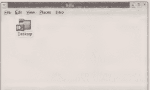

#### 移动文件和目录

打开目标对象（文件或目录）所在的目录的 Nautilus 窗口。为目的地目录打开另一个窗口。移动文件或目录就像将目标对象从其当前位置点击并拖放到其目的地目录一样简单。释放鼠标按钮，您的文件或目录就被移动了。

您也可以按照以下步骤移动多个文件：

1.  点击并拖动鼠标光标，划过您想要移动的文件。
    鼠标光标创建一个矩形轮廓，并突出显示该框内的所有文件。
2.  然后，在突出显示的框内的任何位置点击，并将鼠标光标拖动到您想要的目录。
3.  释放鼠标按钮，文件将移动到指定目录。

#### 复制文件和目录

复制文件或目录比移动稍微复杂一点。您不能只是简单地点击并拖动图标到某个地方。请按照以下步骤操作：

1.  右键点击您想要复制的文件或目录图标，并从打开的菜单中选择“复制”。
2.  通过双击其图标进入您想要复制到的目录。
3.  当目录打开时，在背景的任何位置右键点击，并选择“粘贴文件”选项。

文件或目录将被复制到新位置。

您可以以与复制单个文件相同的方式复制多个文件和目录。

1.  点击并拖动鼠标光标，围绕您想要复制或复制的文件或目录勾勒出一个框。
2.  右键点击任何蓝色突出显示的图标名称（但不要点击图标和名称周围的空白处），并选择“复制”选项。
3.  双击您想要复制到的目录，右键点击背景，并选择“粘贴文件”。
4.  释放鼠标按钮，文件将被复制到指定目录。

## 删除文件和目录

删除文件和目录的过程与复制它们的过程非常相似。您右键点击您想要的文件或目录图标，然后从打开的菜单中选择“移到垃圾桶”（Move to Trash）。文件或目录将被移动到“垃圾桶”目录。


“被移到垃圾桶”的文件和目录不会立即被删除。例如，当您使用“移到垃圾桶”选项删除文件时，文件会被移动到“垃圾桶”文件夹。通过点击其图标，然后右键点击要删除的文件或目录来打开“垃圾桶”目录。选择“从垃圾桶删除”（Delete from Trash）选项。“从垃圾桶删除？”警告窗口将打开，提示您确认删除。点击“删除”键，文件将被擦除。或者，通过打开“垃圾桶”图标，点击“文件”菜单并选择“清空垃圾桶”来删除“垃圾桶”中的所有文件。

如果您有太多的文件和目录，您可以删除其中的一批。同样，通过点击并拖动鼠标光标来勾勒出一个框。右键点击蓝色突出显示的图标或图标名称（但不要点击图标和名称周围的空白处）。文件或目录将被移动到“垃圾桶”目录。


#### 创建文件和目录

在 Nautilus 窗口中任意位置右键单击，然后选择 **新建文件夹**。系统会创建一个新文件夹（在 Linux 术语中称为*目录*），其默认名称为“untitled folder”。右键单击该新文件夹，选择 **重命名**，然后输入您想为目录指定的任何名称。

要创建一个文件，请在 Nautilus 窗口中右键单击并选择 **新建文档 空文件**。新文件图标将出现，您可以输入其名称。

#### 查看文件和目录

默认情况下，文件和目录以图标形式显示在屏幕上。图标显示的唯一信息是名称，以及该项是文件还是目录。您可以通过选择 **查看 以列表形式查看** 来以列表形式显示文件和目录。

此列表描述了不同视图之间的区别：

- **以目录形式查看**：选择此选项会显示当前文件夹中存储的任何图形图像的缩略图。如果当前文件夹中没有存储任何图像，此选项处于非活动状态。
- **以图标形式查看**：默认显示选项；显示图标并指示该项是文件还是目录。常规文件图标有多种形式，但文本文件和配置文件看起来像角落折叠的纸张。包含特定类型数据的文件在文件图标上叠加有小的子图标。例如，PDF 文件带有 PDF 子图标。链接、设备和其他对象具有其他形式。目录采用部分打开的手提文件夹的形式。图标均匀分布在文件管理器屏幕的整个区域。图标倾向于使区分文件和目录变得更加容易，但在屏幕上占用更多空间。
- **以列表形式查看**：除了名称外，还显示每个文件和目录的大小和时间戳。


您可以使用 Nautilus 在桌面上创建更多指向文件或应用程序的快捷方式图标。在 Nautilus 中，只需单击并拖动任何文件或应用程序到桌面的任何空白部分，然后释放鼠标按钮即可。图标将被放置在桌面上。然后，您可以双击其图标来启动应用程序。如果图标指向数据文件（例如文本文件）且 Nautilus 知道如何处理其 MIME 类型，Nautilus 将启动适当的应用程序来打开该文件。否则，Nautilus 会提示您指定用于打开该文件的应用程序。

技术细节
Nautilus 被编程为识别多种多用途互联网邮件扩展（MIME）类型，这些类型定义了文件存储的信息类型，换言之，MIME 维护自己的名片夹。每个 MIME 类型都与某些文件扩展名相关联。例如，当您双击 .doc 文件时，Nautilus 识别出 .doc 文件后缀对应于 Word 文档 MIME 类型，并打开 OpenOffice 文字处理器（如第 13 章所述），从而加载 .doc 文件。

#### 运行程序

Nautilus 是一个努力工作的好帮手，它很乐意为您启动命令。您只需右键单击要运行的图标，这会打开一个子菜单，然后您选择 打开。例如，如果您点击 `/usr/bin/X11` 目录中的 xclock 图标，xclock 将出现在您的桌面上。（双击图标执行相同的功能。）

管理器通常并不聪明。但 Nautilus 比平均水平的熊要聪明，当它遇到各种文件类型时，它知道该怎么做。如果您打开一个不可执行的文件，例如 PDF 文件，文件管理器知道使用哪个程序来查看它。

#### 介绍 Fedora Core/GNOME 应用程序

在第 3 章描述的安装过程中安装了无数应用程序。以下部分列出了每个已安装应用程序及其功能简介。每个部分对应于您点击 GNOME 菜单时看到的子菜单。

##### 附件

您可以在此子菜单中找到各种杂项应用程序。以下列表提供了每个应用程序的简短描述。

- **计算器。** 这是 Gcalc 工具应用程序。Gcalc 工具提供三种计算器模式：基本、金融和科学。它还包含十个存储寄存器。
- **字典。** 这是一个基于网络的客户端应用程序，通过 MIT 字典服务器 dict.org 查找单词的拼写和定义。
- **文本编辑器。** Gedit 提供了一个简单、高效的文本编辑器。

##### 游戏

好吧，Linux 最初是面向运行服务的，因此它可能看起来并不适合游戏玩家。但事实上，它有很多游戏。打开游戏图标，你会看到其中许多。你会发现，用 Linux 虚度光阴就像用 Windows 一样容易！哈！

以下列表简要介绍了每款游戏：

- **AisleRiot 纸牌。** 这个游戏允许你玩几种版本的纸牌游戏。
- **Ataxx。** 这是一个供两名玩家玩的棋盘游戏；你与电脑对战。目标是通过翻转棋子直到对手没有棋子为止。这个游戏类似于黑白棋（Reversi）。
- **Blackjack。** 你猜对了，这个游戏允许你玩 21 点（Blackjack）。
- **BZFlag。** 你可以射击坦克！啊，真想回到 13 岁。
- **Five or more。** 理论上通过移除彩色球来享受乐趣。
- **Four-in-a-row。** 你必须创建一行四个弹珠。你的对手（真人或电脑）必须做同样的事。先连成一行者获胜。
- **Freecell 纸牌。** 这是另一款纸牌游戏。
- **FreeCiv 客户端和服务器。** 制定一个策略来摧毁其他文明。在运行 FreeCiv 客户端启动游戏之前，必须先启动 FreeCiv 服务器。
- **Igno。** 这是另一款类似于 Ataxx 的翻棋游戏。
- **Klotski。** 移动一个带图案的块以实现某些目标。如果你手头有很多时间，你可能会觉得这款游戏有趣。
- **Maelstrom。** 你驾驶你的飞船穿过小行星带来赢得这款游戏。
- **Mahjongg。** 这是经典东方麻将游戏的单人版。
- **Mines。** 在这款游戏中，你需要扫清雷场中的空间。
- **Nibbles。** 你控制一条蛇并试图让它吃钻石。
- **Robots。** 外面有机器人，它们的目的是杀死你。你的目标是——没错，你猜对了——避免死亡。
- **Same GNOME。** 你得到一个满是球的窗口。你必须尽可能高效地移除球。
- **Stones。** 在这款街机游戏中，你必须捡起尽可能多的石头（它们是宝石），同时避免掉落的石头。
- **Tali。** 在这款游戏中，你掷骰子并“创建”类似扑克的手牌。
- **Tetravex。** 你必须在这款游戏中解开一个谜题。
- **Tux Racer。** 这实际上是一款有趣且受欢迎的游戏。Tux Racer 实际上是 Linux 企鹅 Tux，它从白雪覆盖的山坡上疾驰而下。

## 图形

你可以使用几个实用程序查看和操作图形图像。点击 GNOME 菜单，然后是图形菜单，你可以运行像 The GIMP（用于处理和编辑图像的优秀工具）这样的应用程序。你可以使用扫描工具扫描图像，并使用数码相机工具从相机上传照片。

- **GIMP 图像查看器**。GIMP（GNU 图像处理程序）是一个强大的图像程序，可以打开、显示和操作多种格式的图形文件。此处无法列出太多的操作功能。
- **PDF 查看器**。GNOME PDF 查看器打开并显示可移植文档格式（PDF）文件。
- **照片工具**。此应用程序帮助你从数码相机下载和存储照片。
- **PostScript 查看器**。Gnome Ghostview 显示 Postscript 文件。

##### 帮助

此应用程序提供一个包含指向 GNOME 桌面、应用程序和开发工具信息的链接的 Nautilus 窗口，以及通用和系统信息主题。

##### 互联网

Evolution 是新的 Fedora Core 默认电子邮件客户端，它在此子菜单中。你还可以在这里找到 Mozilla 和其他一些互联网应用程序。

- **Evolution 电子邮件**。选择此菜单选项启动 Evolution 电子邮件客户端。有关此应用程序的更多信息，请参见第 11 章。
- **Gaim 互联网消息传递器**。这是一个即时消息客户端。你可以使用此应用程序与使用 AIM、ICQ、Yahoo!、MSN、Jabber、IRC、Napster、Gadu-Gadu 和 Zephyr 的其他即时消息传递器通信。
- **IM**。此聊天客户端可以使用多种协议进行通信。


1.  **IRC。**此选项将启动 X-Chat，这是一款互联网中继聊天（IRC）应用程序。使用 X-Chat，您可以连接多个 IRC 网络进行通信。
2.  **Mozilla。**这是一个功能强大的开源 Web 浏览器。它是 Linux 世界的标准浏览器。
3.  **Thunderbird 电子邮件。**这是一个新的电子邮件客户端，速度快且易于使用。
4.  **视频会议。**GnomeMeeting 提供音频/视频会议系统。
5.  **Web 浏览器。**您可以访问 Fedora Core 3 安装的两个浏览器（Epiphany 和 Mozilla）中的任意一个。Epiphany 是一个 GNOME 文件系统浏览器，也是默认选项。更多详细信息请参阅第 11 章。

#### 办公

开源的 OpenOffice.org 应用程序保存在此子菜单中。OpenOffice.org 提供文字处理器、电子表格、演示文稿管理器和绘图工具，您都可以在这里访问它们（有关 OpenOffice 的更多详细信息，请参阅第 13 章）。您还可以在这里找到一个图表工具。（OpenOffice.org 的图标默认也会放置在 GNOME 面板上。）

6.  **Dia 图表。**这是一个图表程序。
7.  **Evolution。**这是一个提供电子邮件客户端、日历、任务管理器和 PDA 同步功能的组织者工具。电子邮件客户端部分在第 11 章中有描述。
8.  **OpenOffice.org Calc。**这是一个电子表格应用程序，可以读取和写入 Excel 文档。
9.  **OpenOffice.org Draw。**这是一个绘图程序。您可以使用它绘制各种内容。
10. **OpenOffice.org Impress。**这个程序类似于 PowerPoint。它可以读取和写入 PowerPoint 幻灯片。
11. **OpenOffice.org Math。**您可以使用此应用程序创建数学公式。
12. **OpenOffice.org Writer。**这是一个功能齐全的文字处理器，可以读取和写入 Word 文档。例如，本书就是使用 OpenOffice.org Writer 编写的。
13. **项目规划器。**此应用程序有助于您安排事项。

#### 编程

Fedora Core 提供了一个良好的编程环境。通过此菜单，Fedora Core 提供了一系列编程实用程序的链接，例如许多人都用来编辑源代码的 Emacs。

- **Bug Report Tool（错误报告工具）**。Bug Buddy 帮助您向 GNOME 开发者报告问题。
- **DevHelp**。此程序为众多与 GNOME 相关的手册提供了集大成的参考指南。它还提供了一个搜索引擎。
- **Glade 界面设计器**。此应用程序帮助程序员设计和创建图形用户界面。
- **Memory Profiler（内存分析器）**。程序员经常遇到内存泄漏问题。此程序帮助开发者识别和消除内存问题。

#### 声音和视频

这里存储了一些有趣的内容。您可以访问诸如 Rhythmbox、CD 播放器、音乐提取器以及其他音频应用程序。在这个文件夹中，您还可以找到一些更常规的项目，例如音量控制和音量监视实用程序。更多详细信息请参阅第 12 章。

- **CD 播放器**。您可以使用此应用程序播放音乐 CD。
- **Helix Media Player**。一个播放 Ogg 格式文件和音频流的开源程序。
- **K3b**。此应用程序可以复制、擦除和刻录 CD-ROM 和 DVD。
- **Music Player（音乐播放器）**。这是 Rhythmbox，可以播放 Ogg 格式文件和互联网流媒体。
- **Sound Juicer CD Ripper（Sound Juicer CD 提取器）**。此应用程序允许您从 CD 中提取音乐曲目。
- **Sound Recorder（录音机）**。您可以使用此程序录制音频。
- **Volume Control（音量控制）**。此应用程序允许您控制多个音量设置。

### 系统设置

包含在此子菜单中的应用程序提供系统管理功能。更多详细信息请参阅附录 A。

## 系统工具

包含在此子菜单中的应用程序提供系统管理功能。更多详细信息请参阅附录 A。

### 第 11 章

#### 网络冲浪与电子邮件使用

### 本章内容

- 回顾 Web 历史
- 使用 Mozilla 浏览 Web
- 从插件中获得额外帮助
- 保护您的密码安全
- 使用 Evolution 获取电子邮件

在本章中，我们将介绍开源的 Mozilla Web 浏览器和 Evolution 电子邮件客户端。Mozilla 具备其他流行浏览器的所有功能。我们将向您展示如何为您的 Fedora Core 计算机设置 Mozilla，以便您可以浏览互联网。您可以将计算机作为多媒体设备使用。开始使用 Mozilla 后，我们将描述如何使用 Evolution 作为您的电子邮件系统。


本章的目标是介绍 Mozilla 和 Evolution 的基本功能。但是，我们希望您知道，这两个系统能做的事情远远超出本章描述的范围。有关 Mozilla 和 Evolution 的更多信息，请查看“帮助”菜单中提供的功能，例如参考库或帮助内容。

#### 让万维网成为可能

曾经，一家名为 Netscape 的公司创建了一款用于浏览互联网的浏览器。该浏览器最初名为 Navigator，后来改为 Communicator。数以百万计的人从互联网上免费下载了它。Netscape 将访问数量激增的 Web 服务器的能力交给了数百万人（包括我们，即作者们）。Netscape 创造了历史并改变了世界，因为它将互联网从一个主要服务于科学家的媒介变成了一个任何人可以使用工具。

尽管 Netscape Communicator 免费分发给任何想要它的人，但它并不像 Linux 那样属于开源软件。简单来说，Netscape 公司是一个以盈利为目的的企业，Netscape 认为其软件的工作方式是专有的。

另一方面，Netscape 认识到开源动态的重要性，因此发布了名为 Mozilla 的 Netscape 开源*版本*。现在，无数人正在开发并增强 Fedora Core 计算机的默认浏览器 Mozilla。

随本书附带的 DVD 中包含 Mozilla，它是 Netscape Communicator 的开源兄弟。Netscape 和 Mozilla 非常相似，尽管它们在外观和感觉上略有不同。

#### 使用 Mozilla 上网

如果您曾经浏览过互联网（而现在谁又没有呢？），您想做的第一件事就是根据您的需求定制 Mozilla。您可以在不连接互联网的情况下完成此任务。按照本节中的步骤将 Mozilla 定制成您喜欢的样子。

1. 点击 **GNOME 菜单**，然后选择 **首选项** > **更多首选项** > **首选应用程序**。
   首选应用程序对话框窗口将打开。

   Fedora Core 包含三个浏览器：Mozilla、Mozilla Firefox 和 Epiphany。Firefox 和 Epiphany 是新的、极简主义的浏览器，既有趣又易于使用。我们仍然更喜欢 Mozilla，因为它功能强大且成熟，并在我们的示例中使用它。

2. 通过点击 **下拉** 选择 **Web 浏览器：** 下拉菜单并选择 Mozilla，**将默认浏览器从 Firefox 更改为 Mozilla**。

3. 点击 **关闭按钮**。

现在我们要配置 Mozilla。

1. **通过点击 GNOME 面板上的蓝色地球图标启动 Mozilla。**
   Mozilla 中会出现“欢迎使用 Fedora Core”屏幕。您可以使用此页面查找有关 Fedora Core 及其产品的更多信息。

   专注于配置 Mozilla；暂时跳过所有 Fedora Core 信息（不过那里有很多很好的信息，因此您可以按自己的空闲时间探索其世界。）

2. **选择 编辑 > 首选项。**
   在首选项窗口的左侧是一个类别列表，您可以将其视为您位于首选项窗口中的哪个位置的地图。

3. **点击 Navigator 类别旁边的加号（+）以展开它。**
   在此步骤中，您将确定启动 Mozilla 时显示哪个 Web 页面——以及点击导航工具栏上的“主页”按钮时加载哪个 Web 页面。


4. 在“首选项”窗口的“主页”区域中，在“位置”字段中填写你希望作为主页的网页的URL。
   - 你还可以浏览到你选择的网站，然后点击“使用当前页面”按钮。
   - 例如，输入`www.linuxworld.com`，每次启动浏览器或点击Mozilla窗口左上角的“主页”按钮时，你都会看到有关Linux的有趣信息。

Mozilla会记住你去过的地方，并允许你选择（并前往）之前的位置。Mozilla记住历史多久（以及列表变得多大）取决于你选择保留多少天的历史记录。“历史记录”配置选项决定了保存你所访问位置的天数。如果你磁盘空间不足，请选择较低的历史记录数值（例如一天或两天）。否则，请保留默认设置。

#### 使用代理

如果你的Linux计算机通过代理防火墙连接到互联网，你需要配置Mozilla以配合代理工作。

1. 在Mozilla窗口中点击 **编辑** > **首选项**。
2. 点击“高级”类别旁边的加号（+）图标。
3. 点击 **代理** 选项。
4. 点击 **手动代理配置** 单选按钮，并输入你的代理的URL。
   - 例如，在HTTP代理文本框中输入`proxy.mynetwork.com`（如果这是你的防火墙名称），并在端口文本框中输入80。
   - 可选地，如果你的局域网使用自动代理脚本，请点击标有 **自动代理配置URL** 的选项，并输入你的脚本名称。
5. 点击 **确定** 按钮，你应该就能够通过代理防火墙使用Mozilla了。

如果你使用的是Fedora Core默认防火墙或本书中描述的包过滤防火墙，则无需执行此配置过程。

Fedora Core 3引入了新的GNOME网页浏览器Epiphany。Epiphany旨在仅作为浏览器运行并且易于使用。你可以通过点击GNOME菜单并选择 **互联网** > **网页浏览器** 来启动Epiphany。

#### 安装插件

Mozilla执行你期望浏览器执行的任务，例如显示网页，同时它更进一步，让浏览变得简单和容易。不幸的是，Mozilla默认不能包含商业插件，如Flash动画和JavaScript。

然而，如果你想要那“更进一步”的体验，Mozilla通过提供URL，展示了如何在你想要或需要的最常见插件功能的下载和安装位置进行操作。你看，许多公司允许你*个人*访问和使用他们的专有软件。

##### 安装Showwave Flash插件

要使用插件，你只需要（抱歉）将其插入即可。添加插件是一个简单的过程。你获取插件，并将其放置或链接到Mozilla的插件目录。

你可以通过搜索Mozilla插件帮助页面来查找、下载和安装几种流行的插件。以下步骤演示了（例如）如何安装流行的Macromedia Showwave Flash和Java插件：

1. **以*root*用户身份登录。**
2. **启动Mozilla和你的互联网连接（如有必要）。**
3. **通过选择 帮助 > 关于 *插件* 来检查Mozilla中已安装了哪些插件。**

Mozilla显示唯一安装的插件是`libnullplugin.so`。

4. **点击页面顶部的 `plugindoc.mozdev.org` 链接。**

你看到了PluginDoc欢迎页面，该页面显示了在哪里可以找到最流行和最有用的插件。

5. **点击 Linux (x86) 链接。**
6. **点击 Macromedia Flash Player 链接。**
7. **点击 Macromedia Flash Player for x86 Linux 链接。**

打开了Macromedia Flash Player下载中心Linux页面。

8. **点击“立即下载”按钮。**

打开了一个标有“正在打开 `install_flash_player_7_linux.tar.gz`”的对话框。

注意，该包的版本可能会在本书的生命周期内发生变化。如果新版本可用，你应该能够使用它。

9. **在对话框中点击“确定”。**

打开了“输入要保存的文件名”对话框。该对话框的默认设置是保存到你的主目录。你可以更改目录，但默认设置对于我们的目的来说是有效的。

10. **在对话框中点击“保存”按钮。**

下载管理器对话框打开，显示下载进度。你可以通过点击窗口右上角看起来像X的“关闭窗口”按钮来关闭对话框。

Linux提供了一个名为`file-roller`的实用工具，它有助于从存档中提取文件。`File-roller`防止你不得不手动提取文件。以下步骤演示了如何从你刚刚下载的存档中提取并安装Macromedia文件。

1. **点击桌面上的主目录图标。**

打开一个Nautilus窗口，显示新下载的文件。

2. **双击标有 `install_flash_player_7_linux.tar.gz` 的图标。**

打开第二个Nautilus窗口，显示一个名为 `install_flash_player_7_linux` 的文件夹。

3. **在第二个窗口中，双击标有 `install_flash_player_7_linux` 的文件夹。**

窗口显示了 `install_flash_player_7_linux` 存档的内容。

4. **点击“提取”按钮。**

提取对话框打开。

5. **回到第一个Nautilus窗口，点击 文件 > 打开位置。**

打开位置对话框窗口。

6. **在文本框中输入 `/usr/lib/mozilla/plugins`，然后点击“打开”。**

Nautilus打开了一个标有 `plug-ins` 的窗口。

7. **点击并按住 `flashplayer.xpt` 图标，将其拖动到 `plugins` 文件夹。**
8. **重复步骤7，将 `libflashplayer.so` 复制到 `plugins` 文件夹。**
9. **回到你的Mozilla浏览器，从帮助菜单中点击“关于插件”，你将看到新安装的插件显示出来，如图11-1所示。**

在步骤3中描述的Mozilla窗口打开，显示你刚刚安装的新Flash Player插件的名称。

现在你的Mozilla浏览器可以显示任何使用Flash内容的网页。

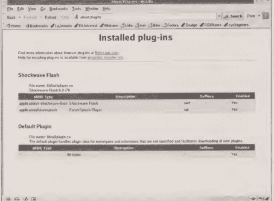

安装Macromedia Flash Player插件让你能够访问大量的多媒体和有趣的网页。下一节将演示如何安装另一个重要的插件。

##### 安装 Java 2 运行时环境

Java 2 运行时环境是另一个重要且有用的插件。以下说明展示了如何获取和安装它：

1. **以root身份登录，启动Mozilla和你的互联网连接（如有必要）。**
2. **点击 帮助 > 关于插件。**
3. **点击 `plugindoc.mozdev.org` 链接。**
4. **点击 Linux (x86) 链接。**
5. **点击 Java Runtime Environment 链接。**
6. **点击 `Sun JRE 5.0` 链接。**

注意，到本书出版时，版本号可能会发生变化。请使用最新可用的版本。

Sun.com 网页打开，告诉你尚未注册。

7. **点击页面左侧的“立即注册”链接。**
8. 适当填写注册表，并点击页面右下角的 **注册** 按钮。

Sun购物车页面打开。

9. 点击 **结账** 按钮。

许可协议页面打开。

10. 点击 **接受** 单选按钮和 **继续** 按钮。
11. 当 **验证订单** 页面打开时，点击 **下单** 按钮。

打开一个JavaScript对话框，提示你进行最终确认。

12. 点击 **确定** 按钮。

Java(TM) 2 运行时环境的下载页面打开。

13. 点击 **自解压文件** 中的 **Linux RPM** 链接。

打开了一个标有 *正在打开 j2re-1_5_0-linux-i586-rpm.bin* 的对话框。

14. 点击 **确定** 按钮。

打开了一个标有 *输入要保存的文件名...* 的对话框。

15. 点击 **保存** 按钮。

下载管理器对话框打开，显示文件下载的进度。你现在必须提取Java库并将其链接到Mozilla，以便使用它们。

1. 通过点击 **GNOME菜单** 并选择 **系统工具** > **终端** 来打开一个 **GNOME终端** 窗口。

我们假设你仍然以Root身份登录。

2. 在 **GNOME终端** 中，输入这些命令：

```
chmod +x j2re*
./j2re*
```

3. 按空格键，同时阅读、消化并（假设）同意许可协议。

再次，你最好让法务团队在你身边。

4. 读完协议后，输入 yes。

5. 在 **GNOME终端** 中输入以下命令：

```
rpm -ivh j2re*rpm
```

6. 输入以下（单条）命令来创建Java插件的链接：

```
ln -s /usr/java/j2re1.5.0/plugin/i386/ns7/libjavaplugin_oji.so /usr/lib/mozilla/plugins/libjavaplugin_oji.so
```


你的浏览器现在已具备 Java 支持。点击“帮助::关于插件”菜单将显示 Java 插件。

以下列表列出了一些更常见的、可供 Linux 使用的插件，建议安装（所有插件均可通过 [插件 doc.mozilla.org 页面](https://doc.mozilla.org) 访问）：

- **Acrobat (Adobe)**：读取 Adobe 可移植文档格式（PDF）文件。许多网站通过 PDF 文件而非 HTML 或其他格式来提供信息。（请注意，你可以使用开源的 xpdf 或 gpdf 程序来查看 PDF 文件。）
- **Java (Sun Microsystems)**：一种编程语言，许多网站使用它来提供动态内容。
- **MPlayer**：允许 Mozilla 播放多媒体的互联网音频/视频流。请参阅第 12 章了解独立的 MPlayer（非插件）应用程序的说明。
- **RealPlayer 10 (RealAudio)**：允许你播放 RealNetworks 的音频和视频流。许多网络电台仍使用 RealNetworks 协议来流式传输其内容。
- 你还可以使用 RealPlayer 10 直接收听 RealAudio 流。
- **Shockwave (Macromedia)**：提供多媒体、图形和游戏导向的支持。

#### 保护你的密码

你可以使用 Mozilla 保存浏览互联网时使用的密码。当你开始保存密码时，也应开始对它们进行加密。加密密码是可选的，但我们强烈推荐。加密使他人找到你的密码变得困难得多。鉴于你可能在互联网上进行的各种业务，你应尽可能保护自己的信息。请遵循以下步骤：

1.  从 Mozilla 浏览器中，从 **Edit** 菜单中选择 **Preferences**。
2.  点击 **Privacy & Security** 菜单旁边的加号（+）。子菜单将打开。
3.  点击 **Passwords** 选项。Passwords 对话框将打开。
4.  点击标有 **Use encryption when storing sensitive data** 的按钮。
5.  点击 **OK**。
6.  再次点击 **Edit::Preferences** 菜单。
7.  在 Privacy & Security 子菜单中点击 **Master Passwords** 选项。
8.  点击 **Change Password** 按钮。Change Master Password 对话框将打开。
9.  在 **New password** 文本框中输入你的**密码**。密码质量量表显示你的密码有多“好”。
10. 在 **New password (again)** 文本框中重新输入你的**密码**。当两个密码匹配时，OK 按钮变为可用。
11. 点击 **OK** 按钮。

Mozilla 现在将加密你保存的任何密码。首次访问受密码保护的对象时，只需输入一次主密码。这是一个简单有效的安全工具。

你可以随时管理密码。从 Edit 菜单中选择 **Preferences** Privacy & Security。选择 **Manage Passwords**，Passwords 对话框将打开。然后你可以按需删除密码。

#### 进化革命的到来

Evolution 是一个软件系统，为 Linux 桌面的——抱歉——进化带来巨大飞跃。Evolution 提供了一个出色的电子邮件和日历客户端（以及其他功能），创建一个集成的单一软件包。Evolution 提供以下功能：

- 日历
- 联系人管理器
- 电子邮件客户端
- 个人数字助理（PDA）管理器
- 任务管理器（待办事项列表）

以下两部分描述了如何配置 Evolution 的电子邮件和 PDA 功能。

##### Evolution 电子邮件

Fedora Core 默认使用 Evolution 作为电子邮件客户端。Evolution 让你可以轻松配置一个或多个电子邮件账户。这些步骤描述了如何配置 Evolution，以便向你的 ISP 电子邮件账户发送和接收消息：

第三部分：Linux，嗯！它有什么用？绝对是一切！

> **提示** Linux 传统上默认使用 Mozilla 电子邮件客户端。Mozilla 电子邮件仍包含在 Fedora Core 发行版中（在你的 DVD 上），但不会默认安装。

1.  点击 GNOME 面板上的 Evolution Email 图标（看起来像一个信封和邮票）。
   - 一个信息对话框将打开，告知你 Evolution 的状态。
2.  点击 OK 按钮。
   - 首次启动 Evolution 时——在配置任何电子邮件账户之前——Evolution 设置向导将打开。
3.  点击 Forward 按钮。
   - Identity 窗口将打开。
4.  在相应的文本框中输入你的姓名和电子邮件地址，然后点击 Forward 按钮。
   - 你可以（可选地）输入你的组织和*签名文件*，这是一个存储个人或业务信息的文件，将附加到你发送的每条消息末尾。
   - 图 11-2 显示了 Identity 窗口中的一些示例条目。

Receiving Mail 对话框将打开。

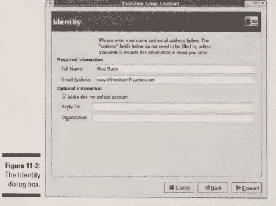

5.  点击 **Server Type** 下拉菜单，并选择与你的 ISP 电子邮件系统匹配的选项。
   - 大多数 ISP 使用互联网消息访问协议（IMAP）服务器类型。
   - **Receiving Mail** 窗口将展开，以便你可以输入更多关于你的 ISP 电子邮件系统的信息。
6.  输入你的 ISP 电子邮件服务器的主机名和你的 ISP 用户名。

图 11-3 显示了此对话框中的一个示例屏幕。

- 你的 ISP 在首次订阅时提供其传入和传出电子邮件服务器的名称。你需要在 **Host** 文本框中输入传入服务器名称。例如，你的 ISP 传入服务器可能是 `mail.mysp.com` 或 `imap.mysp.com`。
- 你的 ISP 用户名可能与你 Linux 计算机上的用户名不同。例如，你的 ISP 用户名可能基于你的名字首字母和姓氏——例如，`garagon`——但你家庭 Linux 计算机的用户名可能只是你的名字，如 `gabe`。

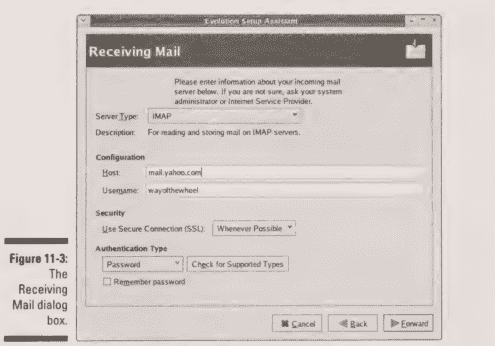

7.  **点击 Forward 按钮。**

第二个 Receiving Mail 窗口将打开。

你可以更改选项，例如让 Evolution 自动查找传入消息，通过选择 Automatically check for new mail 选项。


8.  **进行任何必要或可选更改，然后点击 Forward 按钮。**

Sending Mail 窗口将打开。

9.  **输入你的 ISP 的传出邮件服务器名称，然后点击 Forward 按钮。**

图 11-4 显示了此窗口中的一个示例屏幕。

- Evolution 电子邮件的默认传出协议是 SMTP（ISP 经常使用它，因此你可能无需更改）。你的 ISP 应提供其使用的协议。
- 少数 ISP 可能使用加密的安全套接层（SSL）连接并需要身份验证。同样，你需要从你的 ISP 获取此信息，并在必要时使用这些选项。

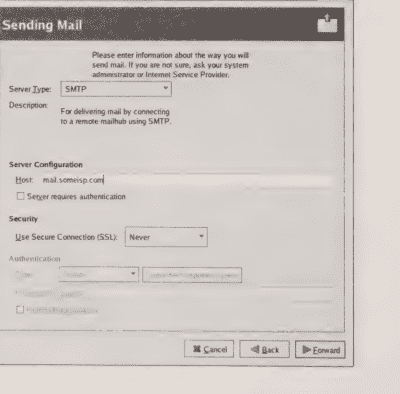

图 11-4：Sending Mail 对话框。

10. 当 Account Management 窗口打开时，点击 Forward 按钮。
    - Evolution 使用你的电子邮件地址作为你创建的账户的默认名称。如果你想更改名称，可以这样做，但这不是必需的。
    - 如果你的账户只有一个，它就是默认账户。否则，你可以通过选择 Make This My Default Account 选项来将其设为默认账户。
11. 最后的配置步骤要求你选择你的时区。点击显示地图上离你所在位置最近的点。
    - 会出现一个更大的地图，允许你微调你的位置（如需要）。这是你在第 3 章中用于设置计算机时区的相同系统。
12. 点击 Forward 按钮。
    - Done 窗口将弹出。
13. 点击 Apply 按钮。
14. 一个 Evolution 信息对话框窗口将打开。阅读消息并点击 OK 按钮。
    - 一个 Enter Password 对话框窗口也将打开。
15. 输入你的电子邮件账户密码并点击 OK 按钮。
    - 可选地，你可以点击 Remember this password 按钮。

Evolution 打开并显示一个 Summary 窗口；另一个单独的对话框也会打开并显示关于它自身的信息（在阅读完对话框中的信息后点击 OK 按钮）。Evolution 功能的快捷方式位于窗口的左侧。点击你的电子邮件账户快捷方式以查看你的新电子邮件地址列表。（你还可以通过点击窗口左上角附近的 Summary 按钮来访问你的账户。）选择你的账户使其处于活动状态。然后你可以发送和接收消息。你还可以对账户执行其他典型操作，如排序、移动和删除消息。

#### 使用 Evolution 配合你的 PDA

你可以将 Evolution 的日历、待办事项管理器和联系人管理器与你的 PDA 一起使用。在本节中，我们重点展示如何使用 Evolution 备份你的 PDA，因为这是你可以做的更有趣和好玩的事情之一（在许多事情中）。你可以阅读在线 Evolution 文档（选择 Help 或访问 [www.gnome.org/gnome-office/evolution.shtml](https://www.gnome.org/gnome-office/evolution.shtml)）或简单地通过尝试来了解更多有关使用日历的信息。


你可以使用 Evolution 的 pilot-link 实用程序将 PDA 数据库备份到你的计算机上。请遵循以下步骤：

- 1. 根据 PDA 的类型，将 Pilot 底座插入计算机的串行端口或 USB 端口。

  连接到底座的线缆上有一个母头 9 针（DB9）插头。大多数（如果不是全部的话）现代计算机都带有一个公头 9 针插头，用于连接到由 `/dev/ttyS0` Linux 设备文件控制的串行端口插座。（在 Windows 系统中，`/dev/ttyS0` 相当于 COM1，`/dev/ttyS1` 相当于 COM2，依此类推。）

  如果你使用的是基于 USB 的底座，端口为 `/dev/ttyUSB0` 或 `/dev/ttyUSB1`。

- 2. 点击 GNOME 面板上的 Evolution 图标。

  Ximian Evolution 应用程序将打开。

- 3. 点击 Contacts 按钮，并从 Tools 菜单中选择 Pilot settings。

  欢迎使用 GNOME Pilot 向导窗口将打开。

- 4. 点击 Forward 按钮，GNOME Pilot Settings 窗口将打开。

  - 你必须告知 Evolution 在哪里找到你的 PDA。打开 Port 菜单并选择串行设备。
  - 该设备可能是 `/dev/ttyS0` 或 `/dev/ttyS1`。尝试和错误并不可耻，所以按顺序选择每个端口，直到找到正确的那个为止。
  - 不必担心选择速度。除非你的计算机非常老旧，否则默认值就足够了。


- 5. 点击 Forward 按钮。

  Pilot 识别窗口将打开。

- 6. 点击 No, I've Never Used Sync Software with This Pilot Before 按钮。

  你的用户名将插入到 User Name 文本框中。（例如，如果你以 paul 身份登录，那么 paul 就是你默认的 Pilot ID。）

- 7. 点击 Forward 按钮以接受该用户名；否则，输入你想用作 Pilot ID 的名称。

- 8. 按下 PDA 底座上的同步按钮（例如，Palm Pilot 上的 HotSync）。

  日历数据库将被复制到你的 Fedora Core 计算机上。

### 第 12 章

## 使用音频和视频应用程序

### 本章内容

- Fedora Core 多媒体简介
- 配置计算机的音频
- 播放光盘
- 提取音乐
- 刻录光盘
- 使用 Rhythmbox
- 介绍和使用 MPlayer
- 安装 MPlayer 插件
- 安装和使用 RealPlayer 10

近期的重大创新之一是使用互联网传输或*流式*播放音频和视频节目。流媒体技术使任何人都有能力创建一个在线电台或电视台——不受地理范围或政府审批的限制——而且成本极低。利用流媒体技术，计算机用户可以收听或观看世界各地的这些广播。

本章描述如何将你的 Fedora Core 计算机用作光盘播放器/刻录机、互联网收音机和 DVD 视频播放器。我们使用各种开源应用程序来执行这些功能。

#### 随着歌曲律动：使用 CD 播放器

想象一下，你正独自坐在电脑前工作——如果你现在就是这样，那这个场景也不算太夸张——或者你正在读一本让你觉得无聊的书——比如说，就是这本。当然是周六晚上。真是令人沮丧。想去参加派对吗？想玩得开心，听听音乐，看看视频？我们无法提供派对、音乐、视频或即时的乐趣，但我们可以帮助你到达那里——通过展示如何将你的电脑用作多媒体中心。

在本章中，我们将向你展示 Fedora Core 提供的工具，可以将你的工作站变成一个音响和视频系统，包括播放 CD、DVD 和互联网流媒体所需的所有应用程序。我们还展示了如何将你的 PC 连接到声卡和扬声器。

#### 设置你的音响系统

Fedora Core 应该在第 3 章描述的安装后过程中自动配置了你计算机的音响系统。然而，你可能会遇到问题——尤其是在较旧的计算机上——因此 Fedora Core 提供了一个声卡检测实用程序。

你可以通过遵循以下步骤来同时配置和测试你的声卡：

- 1. 以任何用户身份登录。
- 2. 点击 GNOME 菜单按钮，并选择 System Settings → Soundcard Detection。
  - 如果提示，请输入 root 密码。
  - 音频设备对话框将打开，如图 12-1 所示。

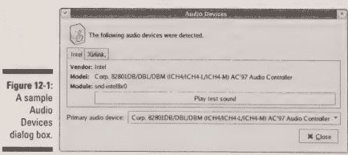

- 3. 点击 **Play test sound** 按钮。

  一个对话框将打开，询问你是否听到了声音。

- 4. 如果你听到了示例吉他声，请点击 **Yes**——你的电脑已经准备好摇滚了。

  如果你没有听到音乐，请点击 **No**。检查以下可能原因：

  - 你的电脑有一个旧的、无法识别的声卡。在这种情况下，你应该购买并安装一个新的声卡。
  - 你没有声卡。你肯定需要购买一个新的声卡并安装它。
  - 你的扬声器连接故障。检查你的电缆并再次尝试。
  - 别人的音响开得太大了。叫警察。

- 5. 在 **Audio Devices** 对话框中点击 **OK**，你就准备好了。

#### 播放 CD

每个人都希望生活中有一点音乐——但你却买了电脑而不是音响系统。（哎呀！）但这不是问题：事实是，你确实明智地花费了钱——因为你的 Fedora Core 计算机可以很好地作为音响系统使用。本节描述了如何设置你的计算机来播放音乐 CD。

Fedora Core 为 Linux 用户捆绑了几个开源 CD 播放器：CD Player、XMMS（包含在发行版中但未默认安装）和 Rhythmbox（我们将在本章稍后介绍 Rhythmbox）。我们在本章中描述 CD Player，因为当你将 CD 插入计算机时，它会自动启动。

以下步骤向你展示了如何开始播放 CD：

- 1. 登录到你的计算机。
- 2. 将 CD 放入 CD-ROM 驱动器。

  GNOME CD Player 应用程序将出现。根据你的音频 CD 的年代不同，你可能在 CD Player 窗口中看到或看不到标题信息。

- 3. 听着你的 CD 开始播放。


你可以通过点击 GNOME 菜单按钮并选择 **Sound & Video::CD Player** 来手动启动 CD Player——非常简单！

CD Player 的控制对于任何在二十世纪出生的人来说都应该是熟悉的领域。以下是给“穴居人”的简单复习：

- 要更改音量，点击 CD Player 窗口右侧的垂直滑动条。在调整音量时按住鼠标按钮。
- 点击窗口中左中区域的交叉工具（螺丝刀和扳手）按钮，以打开首选项窗口。然后你可以选择 CD Player 在启动和停止时的反应方式。你还可以控制默认的 CD 设备（默认是 `/dev/cdrom`，但根据你的计算机硬件，你可能想将其更改为 `/dev/cdrom1` 或其他设备）。你还可以选择 CD Player 皮肤的主题。还有一个简单的帮助系统可用。
- 其余的音乐控制功能一目了然。

如你所见，播放 CD 很简单。

#### 提取 CD 音乐文件

你充满激情吗？如果没有，Sound Juicer 可以帮助你达到那种状态。它*提取*——从 CD 中提取音频信息（音乐文件）到硬盘上的文件中。

这些步骤向你展示了如何使用 Sound Juicer 将音乐复制到你的硬盘上：

- 1. 将你喜欢的 CD 插入 CD-ROM 驱动器。
- 2. 点击 GNOME 菜单按钮并选择 **Sound & Video** > Sound Juicer CD Ripper。

  Sound Juicer 窗口将打开，如图 12-2 所示。

- 3. **默认情况下，选择了所有 CD 音轨**（注意 Extract 列中的勾选标记）。点击任何你不希望提取的音轨的勾选标记。

  Sound Juicer 可能需要一些时间来读取和显示 CD 音轨。

- 4. **点击窗口右下角的 Extract 按钮。**

  进度对话框将打开，显示轨道的整体提取过程的进度。当你完成时，信息对话框将打开。

- 5. **点击 Close 按钮。**


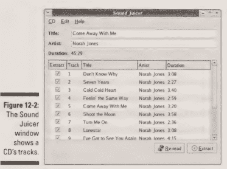

Sound Juicer 将其提取的音乐存储为 Ogg 格式，Ogg 是一种正在崛起的开源音频协议（它与 MP3 相似，但在技术上更优越）。Sound Juicer 会在你的主目录中创建以音乐 CD 名称命名的目录。每个提取的音轨都以歌曲名称保存为 Ogg 格式的文件。

创建音乐文件后，你可以使用 Rhythmbox 播放它（点击 GNOME 菜单，然后选择“声音与音频 > 音乐播放器”）。

#### 刻录 CD

早在 20 世纪 80 年代，当黑胶唱片在 CD 的冲击下逐渐消亡时，建造生产 CD 的工厂耗资巨大：那时制作一张 CD 需要付出巨大的努力。现在，只需花上几块钱购买一台 CD 刻录机，你就可以建立自己的个人 CD 工厂。太神奇了！

> **提示**：一次性可写 CD 被称为 **CD-R**；可重复写入的 CD 是 **CD-RW**。CD 刻录机外观与普通的只读驱动器相似，通过 IDE 或 SCSI 接口连接。

那么你可以刻录什么？答案基本上是任何你想要的内容：数据、软件、数码照片或音乐。我们将首先从刻录音乐开始。

##### 刻录 DVD

新的 `grovisofs` 实用程序使得创建 DVD 成为可能。由于 `grovisofs` 尚处于起步阶段，其图形界面相对不成熟。我们将展示如何通过命令行使用 `grovisofs`。请遵循以下步骤将文件复制到 DVD：

1.  将一张 **DVD** 插入你的 DVD 刻录机。
    -   你可以使用“加号”（DVD+RW）或“减号”（DVD-RW）格式的 DVD 刻录机。
2.  点击 GNOME 菜单并选择“系统工具 > 终端”，以打开一个 **GNOME 终端**模拟器窗口。
3.  运行以下命令，以确定与你的 DVD 写入器对应的哪个 **Linux** 设备文件：
    ```
    grep -i dvd /var/log/dmesg
    ```
    -   你应该会看到类似于以下输出的结果，其中 **hdc** 即为你所需的设备文件：
    ```
    hdc: Hewlett-Packard DVD Writer 200, ATAPI CD/DVD-ROM drive
    ```
4.  如果你想刻录通过 Sound Juicer 抓取的音轨（参见“使用 Sound Juicer 提取 CD 音乐”一节），请运行此命令：
    ```
    grovisofs -Z /dev/hdc -1 -R -J ~/music/*ogg
    ```
    `grovisofs` 将文件写入你的 DVD。请注意，/dev/hdc 对应于你在第 3 步中获取的信息。
5.  你可以**追加**更多文件：
    ```
    grovisofs -M /dev/hdc -1 -R -J ~/other\ music/*ogg
    ```
6.  你不仅限于刻录文件。你还可以将常见的 ISO-9660 格式映像写入 DVD。运行此命令以使用 ISO 映像创建 DVD：
    ```
    grovisofs -vdv -compat -Z /dev/hdc=Image.iso
    ```

易于使用的 `grovisofs` 实用程序允许你创建 DVD，现在它可存储超过 4.5GB 的数据——比 CD-ROM 能处理的要多得多。未来的 DVD 格式将存储超过 40GB 的数据。

以下说明展示了如何将 Ogg 音乐文件刻录到可写 CD 上。

1.  **以任意用户身份登录**，并将一张光盘（CD-R 或 CD-RW）插入你的 CD 刻录机。
2.  **双击**桌面左上角的主目录图标。
    -   Nautilus 窗口打开，显示你主目录的内容。
3.  点击 **Places** 菜单并选择 **CD Creator**。
    -   CD Creator 窗口打开。
4.  回到第一个 **Nautilus** 窗口（你的主目录），双击包含你要记录的音乐文件的文件夹。
    -   例如，如果你遵循前一节“抓取 CD 音乐文件”中的指示，你会将音乐保存在一个新目录中。文件以 Ogg 格式保存。
5.  **点击任意文件并将其拖拽到 CD Creator 窗口中。**
    -   对你想要记录的每个文件重复此步骤。
6.  **点击“文件”菜单并选择“写入 CD”。**
    -   经过短暂思考后，“将文件写入 CD 刻录机”对话框打开。
7.  **点击“写入 CD 文件”按钮。**
    -   当 CD 写入完成后，光盘将弹出。
8.  **完成后点击“关闭”按钮。**
9.  **将 CD 托盘推回驱动器中关闭。**
    -   CD 播放器窗口打开并播放你刚刚记录的音乐。

#### 使用 Rhythmbox

开源程序 Rhythmbox 是收听音频流和文件的极佳工具。Rhythmbox 播放 Ogg 格式音频。Ogg 格式——编解码器——不使用任何专有或受专利保护的算法。Ogg 对任何人都免费使用，那些不希望依赖专有系统的人和组织正在发现它的价值。与其他流行系统（如 MP3）相比，Ogg 还能产生保真度更高的音频流。当你可以不依赖时，为什么要受制于另一家公司的意愿呢？（Rhythmbox 不播放 MP3 格式的音乐。本章后面介绍的 Mplayer 可以播放 MP3。）


> *Ogg* 是用于格式化音频流的系统；*Vorbis* 用于压缩格式化的音频流。与大多数其他技术缩写不同，Ogg/Vorbis 并不是缩写，而是以科幻角色命名的。有关 Ogg/Vorbis 和类似开源多媒体系统的更多信息，请访问 www.vorbis.com。

现在你已经有了一点技术背景，你可以开始使用 Rhythmbox 来收听 Ogg/Vorbis 文件和流媒体。

1.  **点击 GNOME 面板中的蓝色地球图标以打开 Mozilla。**
    -   或者，点击 GNOME 菜单并选择 *Internet > Web Browser* 来打开 Mozilla。
2.  **在 Mozilla 文本框中输入地址 www.vorbis.com/music.psp，然后按 Enter 键。**
3.  **点击任意链接。**
    -   例如，点击第一个链接，*Epoo-Lepidoptera*。
4.  **“正在打开 Epoo-Lepidoptera.ogg”对话框出现。** Rhythmbox 是播放 Ogg 文件的默认应用程序。

Rhythmbox 打开，如图 12-3 所示，并下载音乐。

**158 第三部分：Linux，嗯！它有什么用？绝对是一切！**

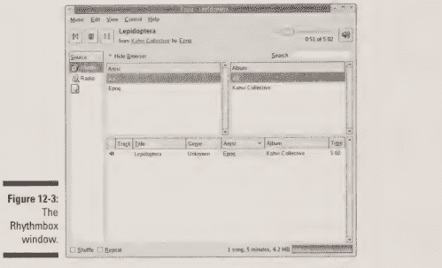

5.  **接下来，播放一个互联网流。**

    访问 www.virgin.co.uk/theastation/listen/ogg.html。

6.  **点击任意 Ogg 链接**。

    Vorbis 网页提供了指向其他支持 Ogg 源的链接。例如，点击 www.vorbis.com/music.psp 页面顶部附近的“音乐站点”链接。你将看到一个包含其他源链接的页面。例如，点击 WCPE 链接前往一个流式播放古典音乐的网页。

#### 介绍强大的 MPlayer

每当存在迫切需求时，超人就会挺身而出……呃，开源运动挺身而出拯救局面。直到最近，你还无法使用任何单一 Linux 应用程序来收听和观看大多数流行流媒体格式。现在，MPlayer 横空出世，填补了这一空白。

MPlayer 可以播放大多数流行（以及许多冷门的）音频和视频流媒体格式。尽管 MPlayer 正处于积极开发中——在开发团队完善其功能时，它在技术上仍处于测试阶段——但它已相当可用，我们认为你应该考虑使用它。我们也在用！

此列表展示了 MPlayer 可以播放的一些流媒体格式：

-   MPEG-1/Layer 3 (MP3)：MP3 是一种流行的但专有的编解码器，用于存储和流媒体音频。
-   Ogg/Vorbis：这种新兴的开源流媒体格式不受任何版权或专利（像其他格式那样）的束缚。
-   微软媒体服务器 (MMS)：你可以使用 MPlayer 收听使用流行 MMS 格式的广播。以前你不得不使用微软客户端应用程序来收听 MMS 流。
-   数字多功能光盘 (DVD)：你可以使用 MPlayer 从电脑播放 DVD。
-   RealAudio：你下载、编译并安装 RTSP 软件包才能使用 RealAudio。

#### 下载和安装 MPlayer

MPlayer 未包含在 Fedora Core 发行版中。我们希望将来会包含，但现在，你必须从开发者那里获取。这些步骤描述了如何下载、安装和使用 MPlayer：

1.  打开 Mozilla 并访问以下网站：
    www.mplayerhq.hu/homepage/design7/dload.html
2.  点击 Red Hat 和 Fedora 的 MPlayer RPM 软件包标题旁的其中一个地理链接。
    例如，点击 USA 链接。你将被重定向到另一个 Web 服务器。
3.  点击“Current version . . . Recommended”链接。
4.  点击 mplayer common 的 Fedora Core 2 链接。（如果有 Fedora Core 3 链接，则点击它。）
    标记为“Enter name of file to save to”的对话框打开。
5.  点击“保存”按钮。
    mplayer-common 文件保存到你的主目录。
6.  重复步骤 4 和 5 以下载 mplayer 软件包。
7.  访问 http://luna.cs.ccsu.edu/dominik/apt/fcl/RPMS/testing。
8.  点击 lame-libs-3.96-1.i386.rpm 链接。
    标记为“Enter name of file to save to...”的对话框打开。
9.  点击“保存”按钮。
    在本书撰写时，最新的 MPlayer RPM 软件包版本是 1.0pre5。如果有更新的版本，你可能会看到——并且应该使用——那个更新版本。


#### 安装 MPlayer

1. 下载所有软件包后，点击 **GNOME 菜单** 并选择 **系统工具::终端** 以打开 **GNOME 终端**。
   GNOME 终端窗口将打开。

2. 输入以下命令以切换到 *root* 用户。
   ```bash
   su -
   ```

3. 输入以下命令以安装 MPlayer：
   ```bash
   rpm -ivh lame-libs*
   rpm -ivh --nodeps mplayer*
   ```

   您可以选择更改默认缓存值，以减少 MPlayer 加载流媒体所需的时间。默认值为 8192（8MB），这可能耗时较长。编辑 `/etc/mplayer/mplayer.conf` 文件，并将 `cache = 8192` 更改为更小的值，例如 `cache = 256`。

##### 使用 MPlayer 播放音频文件和互联网流

现在您可以使用 MPlayer 来播放音频和视频。音频流的一个良好来源是 www.shoutcast.com。点击任何“调谐器”按钮，Mozilla 将下载几个播放列表并启动 MPlayer，通过播放列表播放音乐。

- **提示** *播放列表* 是存储一个或多个音频和视频流位置的文件。例如，如果您点击 Shoutcast 流（位于 www.shoutcast.com）中的任意一个，Mozilla 会将播放列表保存到 `/tmp` 目录，启动 MPlayer 并指示其播放播放列表。在安装有 MPlayer 软件包时，播放列表的 MIME 类型 — `x-scpls` — 已被插入到 Mozilla 中作为辅助应用程序。

您还可以使用 MPlayer 播放音频文件。以下说明概述了此过程。

1. 使用“抓取 CD 音乐文件”部分，从您拥有的 CD 中提取音乐曲目。
2. 点击 GNOME 菜单并选择 系统工具::终端 以打开 GNOME 终端。
3. 在终端窗口中输入以下命令以播放您提取的文件：
   ```bash
   mplayer track1.ogg
   ```
4. 您可以同时按下 Control 键和 C 键（Ctrl-C）来结束会话。

您还可以使用 MPlayer 收听互联网音频流。整个互联网电台世界以及（我们希望很快有的）视频广播都向您开放。MPlayer 将变得越来功能强大和有用。

- 点击 GNOME 菜单并选择 系统工具:终端 以打开 GNOME 终端窗口。
- 在终端窗口中输入以下命令：
  ```bash
  mplayer http://64.202.98.55:80/wr/1
  ```
您将能够收听位于美国宾夕法尼亚州费城的坦普尔大学（Temple University）的爵士和古典电台。他们使用真实的人类来制作节目和播放音乐。

MPlayer 还可以播放 DVD！使用 MPlayer，您的 Fedora Core 电脑就变成了 DVD 播放器。以下说明展示了该过程有多简单：

- 将 DVD 放入您的电脑。
- 点击 GNOME 菜单并选择 系统工具:终端。
  一个 GNOME 终端窗口将打开。
- 运行以下命令以确定您的电脑是否支持 DVD：
  ```bash
  grep -i dvd /var/log/dmesg
  ```
如果您有支持 DVD 的播放器，您将看到类似以下文本的输出：
```text
hdc: Hewlett-Packard DVD Writer 200, ATAPI CD/DVD-ROM drive
hdd: ATAPI CDROM 48X, ATAPI CD/DVD-ROM drive
hdc: ATAPI 32X DVD-ROM CD-R/RW drive, 2048kB Cache, UDMA(33)
```
- 记下您的 DVD 设备文件。
  在这种情况下，DVD 设备文件是 `/dev/hdc`。
- 使用您确定的 DVD 信息来自定义以下命令：
  ```bash
  mplayer dvd:// --dvd-device /dev/hdc
  ```
您的 DVD 将开始播放！您可以通过在 dvd:// 选项后输入曲目编号来播放奖励曲目。例如，要播放第 2 号曲目，请使用命令 `mplayer dvd://2 --dvd-device /dev/hdc`。准备好爆米花吧！

您可以下载一个名为 gMplayer 的 MPlayer 图形界面。使用本章中的 MPlayer 下载说明来获取并安装 gMplayer。

#### 安装 MPlayer 插件

到目前为止，您不得不手动启动 Mplayer。在本节中，我们仅仅通过安装一个插件来使用 MPlayer，该插件允许您通过 Mozilla 播放音频流。步骤如下：

1. 点击 **GNOME 菜单** 并选择 **互联网:\Web 浏览器**。
2. 点击 **帮助** 菜单并选择 **关于插件**。
   已安装插件页面将出现，显示当前已安装的插件。
3. 点击页面顶部的 **plugindoc.mozdev.org** 链接。
   欢迎使用 PluginDoc 页面将打开。
4. 点击 **Linux(x86)** 链接。
   Mozilla 在 Linux (x86) 上的插件支持页面将打开。
5. 点击 *mplayerplug-in* 链接。
   您将跳转到 *mplayerplug-in* 部分。
6. 点击 *mplayerplug-in* 的 **主页** 链接。
   您将前往另一个存储 MPlayer 插件的 Web 服务器。
7. 点击页面左上角的 **下载** 链接。
   您将前往 *sourceforge.net* 上的 *mplayerplug-in* 页面。
8. 点击 **Fedora Core** 链接。
   您将前往列出下载镜像站点的 Web 页面。
9. 点击 **离您最近的链接**。
   一个标记为“打开 mplayerplug-in”的对话框将打开。
10. 点击 **确定** 按钮。
    一个标记为“输入要保存到的文件名...”的对话框将打开。
11. 点击 **保存** 按钮，*mplayerplug-in* **软件包** 将保存到您的电脑。

接下来，您需要安装和配置该插件。以下说明展示了如何安装插件 RPM 软件包，然后使用 Mozilla 播放一些音乐。

1. 双击 GNOME 桌面上的主目录图标。
   Nautilus 窗口将打开，显示主目录的内容。
2. 右键单击 *mplayerplug-in* 图标并选择 **用应用程序打开**。
   用其他应用程序打开窗口将打开。
3. 点击 **安装软件包** 选项。
4. 点击 **确定** 按钮。
5. 如果提示，请在查询对话框中输入 *root* 密码。
   思考片刻后，**系统准备工作完成** 对话框将打开。
6. 点击 **继续** 按钮。
   插件将安装在 /usr/lib/mozilla/plugins 目录中。这是正确的位置，它使 Mozilla 能够直接播放多种类型的多媒体流。
7. 点击 **GNOME 面板** 中的 **Mozilla** 图标。
   您将需要浏览到任何播放音频流的 Web 页面。例如，您可以访问 www.wrti.org。
8. 点击页面左上角 **收听现场** 标题下的 **Windows Media** 链接。
9. *mplayerplug-in* 页面 **打开** 并播放 WRTI 优秀的 **爵士** 选集（下午和晚上）。
   *mplayerplug-in* 连接、缓冲和播放媒体流可能需要一些时间。请耐心等待。

现在您可以使用 Mozilla 播放互联网上的大多数多媒体流。请享用。

#### 安装和使用 RealPlayer 10

我们已经涵盖了几乎所有流行的多媒体格式。我们已经涵盖了 Ogg/Vorbis 和微软格式。然而，我们需要处理 RealAudio 的编解码器。

使用以下说明下载并安装 RealPlayer 10：

1. 打开 **Mozilla** 浏览器。
2. 点击 **帮助** 菜单并选择 **关于插件**。
3. 点击 *plugin-doc.mozdev.org* 链接。
4. 点击 Linux (x86) 链接。
5. 点击 RealPlayer 10 链接。
6. 点击 Download RealPlayer 链接。
   您将被重定向到商业网站 www.real.com/linux。
7. 点击 Download RPM Package 链接。
   一个标记为“打开 RealPlayer10GOLD.rpm”的对话框将打开。
8. 点击 OK 按钮。
   一个标记为“输入要保存到的文件名...”的对话框将打开。
9. 点击 Save 按钮。
   RealPlayer10 软件包将下载到您的主目录。

现在您需要安装 RealPlayer 10 软件包。

1. 双击桌面上的主目录图标。
   Nautilus 窗口将打开，显示您刚刚获取的 RealPlayer10GOLD.bin 软件包。
2. 右键单击 RealPlayer10GOLD.bin 软件包并选择 Open With An Application。
3. 点击 Install Packages 选项。
4. 点击 OK 按钮。
5. 如果提示，请输入 root 密码。
   Completed System Preparation 对话框将打开。
6. 点击 Continue 按钮。
   RealPlayer 10 已安装。（安装过程使 Mozilla 意识到它可以处理 Real Audio。）
7. 您可以通过打开 GNOME 终端窗口并输入命令来测试 RealPlayer 10。
   - 例如，以下命令播放了 Terri Gross 在 2001 年 6 月与 Linus Torvalds 的采访：
     ```bash
     realplay rtp://audio.npr.org/fa/20010604.fa.rm
     ```
   - 或者，您可以使用 Mozilla 浏览到以下站点：
     www.npr.org/features/feature.php?wfId=1123917
     在那里，您可以点击 Fresh Air Audio 链接，并且您将提示使用 RealPlayer 打开流。


### 第 13 章
## 迈入 OpenOffice

- 本章内容
    - 介绍 OpenOffice
    - 使用 OpenOffice Writer
    - 使用 OpenOffice 打印

Fedora Core 是一款出色的产品，它附带了大量服务和应用基础。它一直是一个为提供服务和应用程序而突出的平台。但直到最近，你在世界上许多工作日的计算机上都没有看到 Fedora Core；换句话说，它缺乏在“桌面”上的存在感。

Fedora Core 的问题曾经是缺乏一个完整的办公套件来处理文字处理文档、电子表格和其他文档。幸运的是，桌面生产力套件——如 OpenOffice 及其姐妹应用 StarOffice——已将 Linux 从后台搬到了前台。

### 打开你的办公室

OpenOffice 桌面生产力套件几乎可以做 Microsoft Office 所做的任何事情，但花费更少。便宜多少呢？便宜 100%，因为它是 100% 免费的。Sun Microsystems, Inc. 销售名为 StarOffice 的版本，并也提供一个名为 OpenOffice 的开源版本（你猜对了）。OpenOffice 在 GPL/LGPL 和 SSSL 许可证下授权。所有这些字母意味着什么？它们意味着 f-r-e-e（免费），同时也意味着 Linux 可以集成来自 OpenOffice 的办公生产力功能（因为 Linux 和 OpenOffice 共享 GPL 许可证）。你可以在 www.openoffice.org/project/www/license.html 找到有关这些许可证的更多信息。

OpenOffice 不仅是免费的（我们提到过它是免费的吗？），而且功能强大，为您提供以下功能：

- **文字处理器**：名为 Writer 的全功能所见即所得（WYSIWYG）文字处理器随 OpenOffice 包提供，具备您期望的许多功能——格式化、剪切和粘贴、图形、拼写检查等，如图 13-1 所示。它使用自己的格式，还可以读取和写入富文本格式（RTF）文档；此外，它可以处理 Microsoft Word 6.0、Word 95、Word 97、Word 2000 和 Word XP 文件。

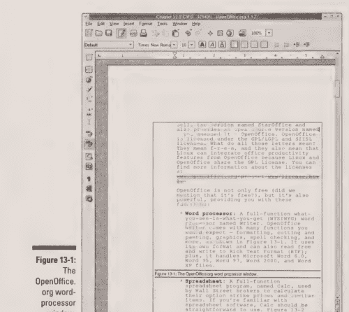

- **电子表格**：名为 Calc 的全功能电子表格程序，华尔街经纪人用它来计算他们的期权执行价格等类似项目。如果您熟悉电子表格软件，Calc 应该很简单就能上手使用。图 13-2 显示了初始的 Calc 窗口。


**图 13-2：** OpenOffice.org 电子表格窗口。

- **演示文稿**：名为 Impress 的图形程序，具备创建演示文稿所需的所有功能。第一次启动 Impress 时，系统会提示您进行配置。选择默认选项后，您看到的 Impress 如图 13-3 所示。您可以使用 Impress 导入和导出 PowerPoint 文档。

- **绘图**：OpenOffice Draw 程序拥有图形工具，可以创建从新手绘画到杰作的任何内容，如图 13-4 所示。


- **其他功能**：OpenOffice 提供其他功能，如 HTML 编辑器、为超级极客准备的数学编辑器，以及用于创建标签和名片的工具。您还可以创建文字处理模板。

好吧，OpenOffice 拥有许多很棒的功能。它们有多好？它们能胜任工作吗？嗯，我们用 OpenOffice 撰写了这本书的这个版本，并用 StarOffice 撰写了前一个版本。这绝非对 OpenOffice 功能的不利证明。


**图 13-4：** OpenOffice.org 图形程序 Draw。

### 认识 OpenOffice

如果您熟悉 Microsoft Office，您就能在 OpenOffice 中找到方向。外观和感觉略有不同，但理念是相同的。如果您是一个崇尚“技术为民”且节俭的人，您可能会发现 OpenOffice 在道德上优于 Office，因为它是免费的并且是开源的一部分。或者您可能只是想开始工作。无论如何，我们在这里简要介绍了一些最常见的 OpenOffice 功能。

本节仅提供了关于您可以使用 OpenOffice 做什么的基本介绍。不，我们并不是无可救药的懒惰；只是详细描述所有内容需要太多空间。请通过自己的测试文档进行实验，并查阅在线帮助系统以获取更多信息。

### 启动和使用 OpenOffice

Fedora Core 提供 OpenOffice，并默认安装它。OpenOffice 很容易访问。点击 GNOME 菜单按钮，然后选择“办公：OpenOffice.org Writer”。您还可以从该菜单选择其他一些（但不是全部）OpenOffice 功能——但是您只能从 OpenOffice 窗口启动 Calc 电子表格程序。从任何窗口（例如在 Writer 或 Impress 中），选择“文件：新建：电子表格”即可打开 Calc。在思考生活几秒钟后，OpenOffice 窗口会出现。

第一次启动 OpenOffice 时，它会询问您是否希望使用工作站模式还是个人模式。前者将 OpenOffice 程序安装在一个所有用户都可访问的中心位置；后者选项将 OpenOffice 的副本安装在您的主目录中。本节使用工作站配置，但您可以选择个人模式。

第一次使用 OpenOffice 时，我们还会被问到几个关于导入地址簿的问题。（我们取消此操作，因为我们更喜欢使用 Ximian Evolution 地址簿。）

您可以通过点击窗口左上角的“文件”按钮，然后点击您想要的选项来访问所有 OpenOffice 功能。

以下列表介绍了这些功能；如果您使用过 Microsoft Office，可能对菜单的布局和操作并不陌生：


- **文件**：正如您预期的那样，您可以使用“文件”菜单打开、关闭、保存或以其他方式操作 OpenOffice 文档。Writer 文件具有 .sxw 扩展名。您还可以使用“文件”菜单读取和写入其他文件格式，如 Microsoft Word 和 HTML。
- **新建**：您可以为任何 OpenOffice 功能创建新文档。当您选择“文件：新建”时，您将获得创建新文本文档、电子表格、演示文稿或其他功能的选项。
- **编辑**：此菜单提供了修改文档所需的所有功能。剪切、复制、粘贴和删除等功能都在其中。任何时刻激活的功能取决于您正在编辑的是文档、电子表格还是演示文稿。例如，如果您没有正在编辑文档（例如您刚启动 OpenOffice 且未打开任何文件），那么剪切、复制和粘贴选项是禁用的。您还可以跟踪更改，就像在 Microsoft Word 中一样。选择“编辑:: 更改”，您可以逐字符地跟踪更改。您可以显示这些更改，也可以将其隐藏起来。当您对编辑满意时，您可以使更改永久化，并将完成的文档保存到磁盘。这很酷。OpenOffice 还提供“编辑”菜单中的“查找和替换”功能。“查找和替换”功能使您能够查找文本字符串，并将它们替换为其他字符串或将其删除。您可以使用它在文档中向前或向后搜索，替换一个实例或所有实例。
- **拼写检查**：OpenOffice 当然提供拼写检查器。您可以通过选择“工具:: 拼写检查:: 检查”来指示拼写检查器检查整个文档。系统会提示您针对检查器检测到的每个可能拼写错误进行操作。或者，您可以设置拼写检查器连续运行。选择“工具:: 拼写检查:: 自动拼写检查”以切换实时拼写检查器；当它被激活时，菜单选项旁边会出现一个勾号。“连续”选项指示 OpenOffice Writer 检查您输入的每个单词，并用红色波浪线标出可能的拼写错误。当您成功纠正错误时，红线消失。
- **视图**：此菜单显示或隐藏各种菜单栏。您可以显示文档的格式字符，并放大或缩小以增减屏幕上显示的文本大小。缩放功能使您无需更改文档即可使较小的字体更易读。
- **插入**：此菜单使您能够将特殊字符、对象、文件和宏插入您的文档。特殊字符包括各种符号（例如重音符号和变音符号），它们不属于日常字符集，除非您经常使用像“café”这样的单词。对象包括图形、符号和图形（您可以使用 Draw 创建自己的图形）。您还可以将宏和超链接插入您的文档。您可以将具有任意行数和列数的表格插入文档。OpenOffice 可以自动调整行高，或者您可以手动操作。从“插入”菜单中选择“表格”，并玩玩这个功能。
- **工具**：从此菜单中，您可以访问拼写检查器、同义词库、各种 OpenOffice 配置设置和其他功能。一些工具（如拼写检查器）是不言自明的。
- **窗口**：此菜单使您能够控制桌面的外观。除了允许您修改和移动窗口外，该菜单还提供其他操作功能。


## 第三部分：Linux，嘿！它有什么用？绝对什么都能干！

**帮助**
OpenOffice 提供了相当不错的在线帮助服务。许多帮助都是上下文相关的：例如，如果你在编辑文本文档，点击“帮助”菜单即可访问与帮助模块相关的信息。

为了进一步说明，选择“帮助 > 帮助代理”，此时会出现帮助代理窗口。帮助代理在新用户感兴趣的几个领域提供协助，包括：

- **Writer 简介：** 提供文字处理器的介绍。
- **基本文本文档技巧：** 告诉你所有关于阅读、编写和打印文本文档你想知道的事情。
- **高级技巧：** 将上述基本文本文档技巧扩展到更高级的主题。
- **菜单：** 描述 OpenOffice 的所有菜单是如何协同工作的。
- **工具栏：** 描述提供信息和快捷方式的工具栏。
- **快捷键：** 描述可以使用哪些按键组合来执行各种文字处理功能。
- **新内容：** 描述自上一个 OpenOffice 版本以来有哪些新功能。
- **支持：** 显示有关从 Sun Microsystems 获取支持的简要信息。

### 使用 OpenOffice 打印

在将 Fedora Core 配置为使用打印机后，从 OpenOffice 进行打印是一个简单的过程。OpenOffice 使用默认的 Linux 打印机，因此你只需进行配置即可。本节首先描述如何配置 Fedora Core 的打印机，然后展示如何设置 OpenOffice 以使用它。

配置连接到 Fedora Core 电脑的打印机是一个简单的过程。你只需运行 `printconf-gui` 打印机配置实用程序并输入有关打印机的信息。这些步骤描述了具体方法：

1. 以 `root` 身份登录到你的 Fedora Core 电脑。
2. 将打印机连接到 Linux 电脑的并行（打印机）端口或 USB 端口。并行端口是电脑机箱背面的一个 25 针母连接器。新电脑通常会在并行端口旁边标记某种打印机图标（尽管有时很难想象他们是怎么想出这个符号的）。如果你的电脑没有标记，通过试错找到合适的端口也无妨。
3. 通过点击 **GNOME 菜单** 按钮并选择 **系统设置 → 打印** 来启动打印机配置工具。
   如果被提示，请输入 `root` 密码。打印机配置窗口将打开。
4. 要添加打印机，点击 **新建** 按钮。当介绍性的 *添加新打印队列* 窗口打开时，点击 **前进** 按钮。
   一个标记为 `队列名称` 的对话框将打开。
5. 输入一个描述性的队列名称（例如，`Epson777`），以及可选的队列*描述*。
   当然，你可以使用默认名称 `printer`，但我们更倾向于使用描述性名称。
6. 点击 **前进** 按钮以打开 `队列类型` 对话框。
   假设你的打印机直接连接到你的电脑，你会看到一个标记为 `队列类型` 的对话框，其中显示设备名称 `/dev/lp0`。
7. 选择适当的设备，然后点击 **前进** 按钮。
   一个标记为 `打印机型号` 的对话框将打开。你可以从各种制造商及其打印机型号中选择。
8. 点击标记为 `通用` 的按钮（点击以选择制造商）。
   从下拉列表中选中你的打印机制造商。
9. 使用垂直滑块定位并选中你的特定型号，然后点击 **前进** 按钮。
   完成后，一个标记为 *添加新打印队列* 的对话框将打开。
10. 点击 **完成** 按钮。
    一个询问窗口将打开。系统会询问你是否想要打印测试页。点击 **确定** 按钮，测试页将被打印。一个 *信息* 窗口将打开，提示你检查测试页是否打印成功。
11. 点击 **确定** 按钮返回到 `打印机配置` 窗口。
    `GNOME 打印管理器` 窗口将打开，显示你刚创建的新打印队列的图标。你可以创建额外的打印队列或修改现有的队列。
12. 双击新图标。
    一个状态窗口将打开，显示当前和过去的打印任务。

既然你已将打印机连接到 Fedora Core 电脑，你就可以从 OpenOffice 进行打印，无需任何进一步的配置。OpenOffice 默认使用 Fedora Core 的打印机配置。该过程很简单：

1. 打开你想打印的文件：从 OpenOffice 桌面，选择 文件 > 打印。
2. 选择打印多少内容。
   你可以选择打印整个文档、单独的页面或一页范围。

### 第 14 章

#### 美酒与 Windows 应用程序的日子

**本章内容**

- 介绍 Wine
- 使用 Wine

Linux 满足了你的大多数，如果不是全部，桌面需求。前几章中描述的应用程序满足了你大多数日常工作需求。所有基本的应用程序，如 OpenOffice、Mozilla 和 Evolution，都供你使用。

然而，有时你需要执行一些 Linux 未提供的功能。例如，大多数游戏是为微软世界编写的，无法在 Linux 上使用。在某些情况下——比如当你正在使用包含复杂宏的文档时——你必须使用 Microsoft Word。这时，Wine、Crossover Office 和 VMware 就派上用场了。

##### 介绍 Wine

Wine 并非来自索诺玛山谷、智利、澳大利亚，甚至不是来自法国南部。你也不能喝醉或为它花很多钱。Wine 不是一种饮料，而是一个软件系统，允许你在 Linux 电脑上运行 Windows 应用程序。Wine 有助于填补 Linux 应用程序的小缺口。

现代 Windows 应用程序在核心层面是为了在 Intel 或 Intel 兼容（例如 AMD）的 Pentium 处理器上运行而编写的。（一些 Windows 应用程序也在 Apple Mac 上运行；不过，为了本讨论的目的，我们只谈论基于 Intel 的 PC。）Linux 运行在基于 Pentium 的 PC 上。但是，你不能直接将像 Microsoft Word 这样的程序加载到你的 Linux 电脑上并期望它能正常工作。

Microsoft Windows 操作系统提供了一个运行 Microsoft 应用程序（如 Word 和 Explorer）的平台。这个平台有点像提供电力的插头，以及访问该电力的标准方式——电源插座以及各种电器——这些类似于应用程序。Windows 这个“插头”提供的是常用低级函数的库——被称为应用程序编程接口（API）。这些函数执行每个应用程序共有的任务，例如打开文件或通过网络通信。使用通用库避免了每个应用程序都不得不重新发明轮子。相反，应用程序只需插入通用的“插座”，专注于执行其特定功能。

问题在于，Windows 平台（电气类比中的“插头”）相当于方孔，而 Linux 相当于圆孔。例如，你不能将 Word 直接插入 Linux 操作系统。这就是 Wine 的作用所在：它提供适配器，让你可以将 Windows 应用程序插入 Linux 插座。


Wine 代表 Wine Is Not an Emulator（Wine 不是模拟器）。这个通常晦涩难懂的缩写是 Linux 和 Unix 程序员所喜爱的类型。它不仅意味着有些人需要多出去走走，还意味着 Wine 并不通过模拟（即仿真）整个 Windows 环境来工作。相反，它复制了环境中的一个重要部分：应用程序与操作系统之间的接口。在电气类比中，Wine 并不是试图成为整个电网（如 Windows 那样），而是适配器。

##### 下载 Wine

好吧，Fedora Core 必须留一些事情给用户。因此，Wine 不包含在该发行版中；你必须从互联网上下载它。这些步骤描述了具体方法：

1. **以任意用户身份登录到你的 Fedora Core 电脑。**
   如果你想的话，可以以超级用户（root）身份登录，但这并不是必需的。不以超级用户身份登录，你就不会冒着意外损坏电脑的风险（例如，删除所有文件）。

2. **点击 GNOME 菜单上的蓝色地球图标打开 Mozilla 浏览器。**
   Mozilla 的使用在第 11 章中有描述。

3. **在浏览器顶部的文本框中输入地址 www.winehq.com/site/download 并按 Enter 键。**
   你的浏览器将显示 Wine 二进制下载页面。此页面包含指向各种非商业和商业存储库的链接。（我们在“介绍”部分描述了商业版 Wine


### 第 14 章：美酒与 Windows 应用

关于 CodeWeavers 的 CrossOver Office，请参阅“本章稍后”部分。请注意，本章的这一节描述了如何获取和使用 Wine 的非商业版本。

1. 点击 Red Hat 链接。

你将重定向到 SourceForge 网站，该网站包含用于 Red Hat 和 Fedora Core 的 Wine 软件包。SourceForge 是许多 Linux 系统知名且受欢迎的仓库；它不仅仅限于承载 Wine。

2. 选择最新的 Fedora Core RPM。

RPM，即 Red Hat 包管理器（Red Hat Package Manager），用于安装和管理软件。有关使用 RPM 的信息，请参见附录 E。

在本书撰写时，最新版本为 `wine-20040813-1fc2winehq.l686.rpm`。该软件包是为 Fedora Core 2 编译的，同时也适用于 Fedora Core 3。

如果你不确定你的计算机使用的是哪一类 Intel（或 Intel 兼容）处理器，请选择 i386 版本。即使你的计算机使用的是 i686 类处理器，使用 i386 版本的 Wine 也能正常工作——只是效率不如 i686 版本高。

SourceForge.net 下载服务器页面将打开，并提供多个地理位置供你选择下载。

3. 点击离你最近的链接。

一个对话框会打开，标签为 *Enter name of file to save to…*（输入要保存的文件名…）

4. 点击 **Save**（保存）按钮。

默认位置是你当前的工作目录。一个进度窗口会打开，显示进度条和预计完成时间。

#### 安装 Wine

下载后你需要安装 Wine。以下步骤描述了安装过程：

1. 要安装 Wine 软件包，请双击桌面左上角的 Home（主目录）图标来打开 Nautilus 文件管理器。

Home 图标标记为 X’s Home（X 的主目录），其中 X 是你登录使用的用户名。例如，如果你以用户 gabe 登录，该图标显示为 gabe’s Home（gabe 的主目录）。

2. 右键点击你刚刚下载的 Wine RPM 软件包文件，并选择 **Open With :: An Application**（打开方式 :: 应用程序）。

*Open with Other Application*（用其他应用程序打开）窗口将打开。

3. **Select Install Packages**（选择 安装包）并点击 **OK**（确定）。

4. 如果 *if you’re prompted*（如果系统提示你），在 Query（查询）对话框中输入 **root password**（root 密码）。

   - 包管理器检查你计算机的当前状态并打开 Completed System Preparation（系统准备完成）窗口。
   - 你可以选择点击 **Show Details**（显示详细信息）按钮，查看你即将安装的 Wine 软件包的摘要。

5. **Click the Continue**（点击 继续）按钮，**Wine** 将被安装。

当 Updating system（更新系统）窗口关闭时，你的软件包已安装完毕。


或者，你可以“手动”安装该软件包：打开终端窗口，切换到 *root* 用户（**su -**），并输入命令 **rpm -ivh wine**。有关手动安装过程的更多信息，请参见附录 E。

#### 使用 Wine

使用 Wine 很简单。安装 Wine 后，你只需打开已安装的 Windows 应用程序，然后使用 Wine 运行它——Wine 会自动配置自身并启动应用程序。以下章节提供了三个示例，展示了你可以用 Wine 做的事情。第一个示例通过展示如何使用内置的 Wine 文本编辑器（该编辑器模拟了 Windows 文本编辑器）来帮助你入门。第二个示例展示了如何获取并运行一个实际上相当有趣的共享软件游戏。最后一个示例展示了如何运行一个实际的 Windows 应用程序。

##### 从简单开始：运行 Notepad

你刚刚安装的 Wine 软件包含几个简单的 Windows 应用程序——也就是说，是 Windows 应用程序的 *emulated*（模拟）版本。Wine 的贡献者们做了大量工作，除了外观和感觉外，还复制了熟悉的 Windows 功能。嘿，我们可以获得一些即时的满足感。

我们可以利用这种情况来演示几个程序。以下步骤描述了如何运行 Notepad 和文件管理器程序：

1. **以普通用户登录**（不是 *root* 用户）。
2. 点击 **GNOME** 菜单并选择 **System Tools :: Terminal**（系统工具 :: 终端）
3. 输入以下命令，Notepad 编辑器将打开。


```bash
wine notepad.exe
```

首次运行 Wine 会在你的主目录中创建一个 .wine 目录。.wine 目录包含 Wine 系统运行所需的所有配置信息。配置信息位于 config 文件中。几个其他文件，都以 .reg 为后缀，模拟 Windows 注册表。Windows 操作系统使用注册表来组织其配置参数；另一方面，Linux 使用单独的文件，例如 /etc/etcsysconfig 和 /usr/local/etc 目录中的那些文件，来保存其配置信息。

4. 你可以使用 Notepad 创建、修改和保存文本文件。
5. 点击 Notepad 中的 File :: Exit（文件 :: 退出）以退出。

##### 享受乐趣：玩游戏

现在，文本编辑很棒——但当你已经体验过并厌倦后，你可以转向更复杂的应用程序，探索 Wine 的真正威力。Wine 擅长运行那些尚未在 Linux 形式下可用的程序（这是一个非常实用的功能）。在本节中，我们将下载并安装一个基于 Windows 的共享软件游戏。


共享软件是开发者允许你免费测试的软件；有时该软件在有限期限内可用。如果你喜欢这个程序，你——并且应该——向程序员支付一小笔费用。

##### Wine 实用工具

Wine 提供几个有用的实用工具，帮助你配置和测试它，我们将在此处介绍其中的一些。

- **wineboot:** 模拟 Windows 计算机的重启。当你安装大量 Windows 应用程序（例如 Microsoft Word）时，重启是必要的，此实用工具提供了该功能。
- **winedbg:** 调试 Wine 应用程序。此实用工具展示了表面之下的运行情况。只有当你开发 Wine 应用程序时才需要使用此实用工具。
- **winexcfg:** 帮助设置许多 Wine 配置选项。
- **clock:** 模拟简单的 Windows 时钟。
- **regedit:** 模拟注册表编辑器。
- **progman:** 作为程序管理器运行。

你可以尝试运行其中一个 Wine 实用工具。例如，测试 *winfile* 实用工具，它充当文件管理器。

像我们这样呆板、年老的人仍然喜欢像 PacMan 这样呆板、老旧的游戏（哇！——即使是我们虚度的青春也是呆板的），所以我们向你展示如何下载类似 PacMan 的街机游戏。第一组步骤描述了在哪里下载软件，第二组步骤涵盖了如何安装和运行游戏（破解 PacMan 的技巧由你负责）：

1. 以普通用户登录并打开 Mozilla。
2. 访问 www.tucows.com。
3. 在搜索文本框中输入 winpac 并点击 **Go!**（执行！）按钮。
4. 在下一个窗口中点击 WinPac2 链接。

   WinPac_2_1_03b 页面将打开。

5. 点击 Win98 选项。

Mozilla 打开一个页面，你可以从中选择一个地理区域进行下载。


Wine 网页提供了一个经过测试的应用程序数据库。请访问 http://appdb.winehq.com/ 浏览已知可以在 Wine 下运行的应用程序。

6. 选择离你较近的位置。

   Mozilla 显示镜像位置。

7. 点击一个镜像。

   另一个网页打开，提供给你各种版本以供下载。

8. 点击 WinPac2 的 Win98 版本。

   一个标签为 `Opening WinPac2_103b.exe` 的对话框打开。

9. 点击 **OK** 按钮。

   标签为 `Enter name of file to save to` 的对话框打开。

10. 点击 **Save** 按钮。

下载管理器窗口打开，显示下载进度。WinPac2 安装程序默认保存到你的主目录。

以下步骤描述了如何安装和运行游戏。大多数安装应该与此类似；你启动安装程序，然后看到一个图形用户界面（GUI）：

1. 点击 **GNOME** 菜单并选择 `System Tools`（系统工具） → `Terminal`（终端）。

   GNOME 终端窗口打开。

2. 在终端窗口中输入此命令：

   ```bash
   wine ./WinPac2_103b.exe
   ```


1. 当 **WinPac 2 安装程序：许可协议** 窗口打开时，阅读许可协议。
2. 点击 **我同意** 按钮。

**WinPac 2 安装程序：安装选项** 窗口会打开，并显示典型安装选项。

3. 点击 **下一步 >** 按钮。

**WinPac 2 安装程序：安装目录** 对话框会打开。

4. 点击 **安装** 按钮。

**WinPac 2 安装程序：已完成** 窗口将显示安装已完成。

5. 点击 **关闭** 按钮。


`C:\` 符号是你主目录中 `/.wine/c` 目录的别名。例如，如果你的主目录是 `/home/gabe`，那么 `C:` 就对应于 `/home/gabe/.wine/c`。

你有多种方法可以启动基于 Wine 的应用程序：

- **手动，通过使用终端模拟器**：以通常的方式打开一个终端模拟器窗口并输入以下命令：
  `wine "C:\Program Files\WinPac 2\WinPac2.exe"`
- **通过使用 GNOME 运行实用工具**：打开 GNOME 运行实用工具并输入以下命令：
  `wine "C:\Program Files\WinPac 2\WinPac2.exe"`
- **通过创建并点击一个 GNOME 图标**：此方法在下方的步骤集合中有说明。如果你想让游戏使用起来更简单（谁不需要额外的工作呢？），请创建一个 GNOME 图标。这些步骤描述了该过程：
  1. 在 **GNOME 面板** 的任何位置右键单击，然后选择 **添加到面板** > **启动器**。
  2. **创建启动器** 窗口打开。
  3. 在 **名称** 文本框中输入 **WinPac2**，并在 **命令** 文本框中输入此命令：
     `wine "C:\Program Files\WinPac 2\WinPac2.exe"`
  4. 点击 **图标** 按钮，并从打开的 **浏览图标** 窗口中选择一个图像。
  5. 例如，选择 **苹果** 图标。
  6. 点击 **确定** 按钮，图标就会在 **面板** 上创建。
  7. 点击新的 **WinPac2** 图标，游戏就会启动，如图 14-1 所示。


图 14-1：WinPac2 游戏介绍窗口。

哦，对了：玩玩游戏吧，如果你喜欢它，请给创作者寄送 20 美元。

#### 使用一些实用的工具：Microsoft Word 97 查看器

你也可以使用 Wine 运行实用的应用程序。例如，你可以免费下载 Microsoft Word 97/2000 查看器。你可能希望查看你的 OpenOffice.org 文件（以 .doc 格式保存时）在 Microsoft Word 中查看时的样子。Microsoft 允许你免费下载他们的 Word97 查看器。

在本节中，我们将展示如何在你的 Fedora Core 计算机上下载和安装 Microsoft Word97 查看器。


**警告！**
Wine 不断被修改和更新，以保持与 Microsoft 尽可能兼容。然而，Wine 偶尔在运行像 Office 和 Word 这样复杂的应用程序时会遇到问题。如果你遇到这类问题，请查阅我们的帮助页面 www.dummies.com/go/rhf/fedora3/fd，寻找可能的解决方案。商业 Wine 封装器，如 CrossOver Office，在运行像 Microsoft Office 这样的应用程序方面做得非常出色。CrossOver Office 只需几美元，将在下一节中介绍。

1. 以普通用户（而非 root）身份登录你的计算机，并打开 Mozilla 浏览器。


**记住**
你需要打开并正常连接互联网，这些说明才能起作用。

2. 在 Mozilla 位置文本框中输入 www.microsoft.com/downloads。
3. 在 *关键词* 文本框中输入 **Word 97 Viewer**，并点击 **Go** 按钮。
4. 点击 **Word 97/2000 Viewer (Windows 95/98/NT)** 链接。
   *Word 97/2000 Viewer (Windows 95/98/NT/2000)* 页面打开。
5. 点击 **下载按钮**。
   一个标记为 *Opening wd97vwr32.exe* 的对话框打开。
6. 点击 **确定按钮**。
   软件下载。
7. 点击 **GNOME 菜单** 并选择 **系统工具：终端**。
8. 在终端窗口中输入以下命令。
   ```
   wine wd97vwr32.exe
   ```
9. 在 *Microsoft Word Viewer 97 Setup* 对话框窗口中点击 **是按钮**。
   *Microsoft Word Viewer 97 Setup* 窗口打开。
10. 点击 **继续按钮**。
11. 当提示保存文件时，点击 **确定按钮**。
    一个 *许可协议* 对话框打开。
12. 阅读 **许可** 并点击 **接受按钮**。
    一个标记为 *To start installation. . .* 的对话框打开。
13. 点击 **安装按钮**。
14. 如果 *Microsoft Word Viewer 97 Setup* 成功完成，点击 **确定按钮**。
    *Word Viewer 97 Setup* 窗口关闭。

安装完成后，你现在可以运行 *Word Viewer 97* 应用程序了。使用以下说明来启动该应用程序。

1. 点击 **GNOME 菜单** 并选择 **系统工具：终端**。
2. 在终端窗口中输入以下命令。
   ```
   wine "C:\\Program Files\\Wordview\\WORDVIEW.EXE"
   ```
   *Microsoft Word Viewer 97* 打开，如图 14-2 所示。
3. 使用默认打开的 **打开文件** 窗口查找并打开一个 *Word* 文件。
4. 完成后，点击 **文件：退出** 离开应用程序。

你可以下载并使用 *Wine* 来运行来自 Microsoft 网站的大量实用和有趣的应用程序。你可以免费获取如 *媒体播放器* 之类的应用程序。试试看吧。

## **184** 第三部分：Linux，嗯！它有什么用？几乎一切！

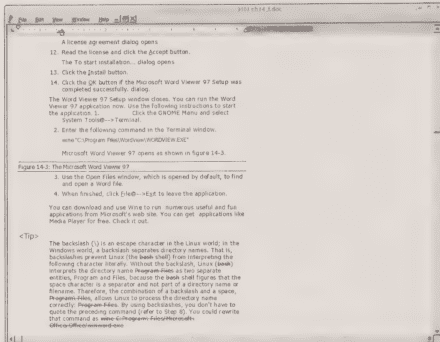

图 14-2：Microsoft Word Viewer 97。


反斜杠 (\) 在 Linux 世界中是一个转义字符；而在 Windows 世界中，反斜杠 (\) 用于分隔目录名称。也就是说，反斜杠阻止 Linux（bash shell）按字面意思解释后面的字符。如果没有反斜杠，Linux（bash）会将目录名称 Program Files 解释为两个独立的实体，Program 和 Files，因为 bash shell 认为空格字符是分隔符，而不是目录名或文件名的一部分。因此，反斜杠和空格的组合，\ ，允许 Linux 正确处理目录名称：Program Files。通过使用反斜杠，你不需要对前面的命令加引号（参见步骤 8）。你可以将该命令重写为 wine C:\Program Files\Microsoft Office\Office\winword.exe。

### 介绍 CodeWeavers CrossOver Office

Wine 帮助你利用 Windows 世界的资源。Wine 是在开源系统下开发的，志愿者为计算世界提供了无数小时的服务和创新。然而，开源社区并不局限于非商业源码。在通用公共许可证（GPL）下开发的软件允许商业使用，只要不对原始 GPL 软件施加限制。

### VMware：一台虚拟现实机器

有时你需要使用一个在 Linux 下根本无法运行的应用程序，即使借助 Wine 也不行。例如，其中一位作者必须使用故障工单系统来修复客户的问题。问题在于那个故障工单应用程序在 Linux 下无法运行，无论是否使用 Wine。该作者必须在他的计算机上同时安装 Windows 和 Linux（双启动系统），否则就需要维护一台单独的计算机，仅用于运行单个应用程序。

当然，使用双启动计算机没有什么错。但如果只需要运行一两个应用程序，这就似乎是浪费时间。双启动计算机在需要从一个操作系统切换到另一个操作系统时还必须重新启动。双启动的一个替代方案是 VMware，这是 VMware, Inc. 的一款商业产品。此程序在物理计算机内创建了一台虚拟计算机。虚拟计算机作为应用程序运行，就像 OpenOffice 或 Mozilla 一样。

VMware 看起来并工作得就像一台真实的 PC。虚拟的 VMware PC 可以像任何真实计算机一样运行 Linux 或 Windows 等操作系统。运行在虚拟机上的操作系统行为就像真实操作系统一样。因此，它托管的任何应用程序看起来并工作得就像真实应用程序一样！VMware 不仅创建虚拟计算机，还创建虚拟网络（想象一下在连接之前尝试网络设计 . . .）。每个配置为使用桥接网络的虚拟计算机都连接到虚拟交换机。因此，如果你在单个主机上创建两个虚拟机，每个机器都可以与另一个机器——以及主机本身——通信，就好像它们连接到以太网集线器一样。这种能力允许你创建实验性和生产性虚拟网络。例如，你可以使用一台功能强大的 PC 来创建几个虚拟服务器，而不是购买和维护单独的主机。

VMware（正如我们所发现的）对于撰写 Linux 书籍也很棒。撰写像本书这样的技术性书籍要求你在撰写初稿时使用新软件版本的早期测试版。旧的方法要求在计算机上安装测试版并用于测试和撰写；或者，你可以并排使用两台计算机。这两种方法都很笨拙，当测试版做一些奇怪的事情时会造成许多头痛。VMware 通过允许你在主机计算机上运行当前生产版本的 Fedora Core，并在虚拟计算机上安装测试版来解决这个问题。你可以在撰写时同时尽情测试测试版，全部在同一台虚拟计算机上。从一个测试版更新到另一个测试版也很容易。

你可以免费下载 VMware Workstation 产品。它需要一个许可证，商业使用大约花费 300 美元，教育使用大约花费 100 美元。这笔钱花得很值。

VMware 还免费提供为期 30 天的评估许可证。这种临时许可证除了时间限制外没有任何其他限制，非常适合测试这个强大的工具。以下部分的步骤描述了如何下载该产品及其临时许可证，以了解其强大功能。


开源软件的商业使用在某些情况下可以提供额外的冲击力。开源用于盈利？确实如此。像CodeWeavers（www.codeweavers.com）和TransGaming（www.transgaming.com）这样的公司就提供了这样的冲击力。这两家公司都在基本的Wine软件上添加了功能，以简化安装过程。CodeWeavers专注于让Wine在通用桌面上更易于使用；该公司使安装和使用Microsoft Office、Internet Explorer以及各种插件变得简单。TransGaming的产品WinX通过提供一个面向游戏的系统，覆盖了计算光谱的另一端。

本书旨在将Linux作为工作站日常使用的有用操作系统。我们的工作（例如）侧重于使用文字处理程序及类似程序。我们留给你去试验WinX。只需说明，我们面向游戏的同事们发现WinX很有用。

CodeWeavers生产两款消费级产品：CrossOver Office Standard和CrossOver Office Professional。Professional和Standard版本都提供了一个安装工具，该工具支持的Windows应用程序比Wine更多。CrossOver Plugin提供内部开发的软件，有助于使用插件。CrossOver主要使用未修改的Wine软件，但提供了一个流畅的安装系统。

CrossOver Office Professional 3.0.1售价为84.95美元，而Standard版本定价为39.95美元。（这些价格适用于你从互联网下载产品的情况。CD版本稍微贵一点。）

### 下载 CrossOver Office Standard 试用版

CodeWeavers慷慨地提供CrossOver Office Standard版本的30天评估许可证。你下载的是产品的完整版本，但仅限于30天使用。以下步骤描述了如何下载CrossOver Plugin的试用版：

- 1. 以超级用户身份登录到你的Fedora Core计算机。
- 2. 打开Mozilla并访问以下网站：www.codeweavers.com/site/products/download_trial
- 3. 点击 **Download Trial**（下载试用版）按钮。
- 4. 填写注册表单并点击 **Request Evaluation**（请求评估）按钮。将打开CrossOver的Download Trial Version页面，通知你安装CrossOver的说明正在通过电子邮件发送给你。
- 5. 打开下面列出的URL（Codeweavers会通过电子邮件发送给你）：http://crossover.codeweavers.com/download/office-trial
- 6. 将打开CrossOver Secure Download窗口。
- 7. 在 **Access Key and Serial Number**（访问密钥和序列号）文本框中，分别输入你的访问密钥（即你的电子邮件地址）和Codeweavers通过电子邮件发送给你的序列号。
- 8. 点击 **Download**（下载）按钮。
  - 将出现一个标记为 **Opening install-crossover-standard-demo-3.0.25.sh**（正在打开 install-crossover-standard-demo-3.0.25.sh）的对话框。（*版本可能在本书出版后发生变化。*）
- 9. 点击 **OK**（确定）按钮。
  - 将打开 **Enter Name of File to Save To**（输入要保存到的文件名）对话框。
- 10. 点击 **GNOME Menu**（GNOME菜单）并选择 **System Tools: Terminal**（系统工具：终端）。
- 11. 在终端窗口中输入以下命令。
  ```
  chmod u+x install-*.sh
  ./install-crossover-standard-demo*.sh
  ```
  - 将打开许可协议对话框窗口。
- 12. 点击 **OK**（确定）按钮，将打开 **CrossOver Office Standard Setup**（CrossOver Office Standard 安装）窗口。

### 使用 CrossOver Office Standard

配置过程的下一阶段允许你从众多流行的Windows应用程序中选择安装。当你选择一个应用程序时，它会自动为你从互联网下载。不麻烦，不费劲。

以下步骤描述了如何选择并自动下载Windows插件：

- 1. 在下一个 **CrossOver Office Standard Setup**（CrossOver Office Standard 安装）窗口中点击 **Begin Install**（开始安装）按钮。
- 2. 安装完成后，点击 **Configure Now**（立即配置）按钮。
  - 将打开一个对话框，提示你以root身份配置。
- 3. 点击 **Next**（下一步）按钮。
  - 一个对话框窗口通知你已安装安全补丁。
- 4. 点击 **OK**（确定）按钮。
  - 另一个对话框通知你，ExecShield系统正在阻止Crossover Office工作。ExecShield是一个最小化缓冲区溢出利用在你机器上工作能力的系统。你必须自行判断是否想按照这些说明继续并禁用该系统。
- 5. 点击 Disable Exec Shield（禁用 Exec Shield）按钮。
  - 另一个对话框提示你完成禁用Exec Shield的操作。它还告诉你如何重新启用Exec Shield。
- 6. 点击 OK（确定）按钮。
  - 将打开一个窗口，提示你输入root密码。
- 7. 输入root密码并按 Enter 键。
  - 将打开 Plugin Setup（插件设置）对话框。
- 8. 在下一个提示符处输入 y。
- 9. 再次按 Enter 键。
  - Exec Shield 已禁用，直到你重新启用它。将打开 CrossOver Office Standard Trial（CrossOver Office Standard 试用版）对话框。
- 10. 点击 Register later（稍后注册）按钮。
  - 将打开 Welcome（欢迎）窗口。
- 11. 点击 Next>（下一步）按钮。
  - 下一个窗口显示软件将安装在哪里。
- 12. 点击 Next>（下一步）按钮。
- 13. 如果你连接到使用代理防火墙的局域网，请输入代理的主机名和端口号。
- 14. 点击 Finish（完成）按钮。
  - 将打开 CrossOver Office Standard Demo Setup（CrossOver Office Standard 演示安装）窗口。

### 安装 Internet Explorer 6

Crossover Office Standard Demo 已安装。现在你可以安装Windows应用程序。例如，如果你有Microsoft Office XP Professional许可证和光盘，你可以使用Crossover Office安装并使用它（你也可以使用Wine，但它可靠性较低）。

你还可以通过以下步骤使用Crossover Office来完成此设置：

- 1. 在 CrossOver Office Standard Setup 窗口中点击 Install...（安装...）按钮。
  - 将打开 Crossover Installation Wizard（Crossover 安装向导）对话框。
- 2. 在 Install Software（安装软件）窗口中点击 Internet Explorer 6.0 选项。
- 3. 点击 Next>（下一步）按钮。
- 4. 在下一个 *Install Software*（安装软件）窗口中点击 **Next>**（下一步）按钮。
  - 将打开 CrossOver Evaluation License（CrossOver 评估许可证）窗口。
- 5. 点击 **OK**（确定）按钮。
  - Internet Explorer 下载开始，并提示你接受 Internet Explorer 许可证。
- 6. 点击 **I accept the agreement**（我接受协议）单选按钮。
- 7. 点击 **Next>**（下一步）按钮。
  - Windows Update: Internet Explorer 对话框给你两个选择：使用典型设置安装或自定义安装。我们将使用默认的典型的安装方式。
- 8. 点击 **Next>**（下一步）按钮。
  - Internet Explorer 组件将被下载。
- 9. 当 *Restart Computer*（重启计算机）对话框打开时，点击 **Finish**（完成）按钮。
  - 一个 Internet Explorer 图标会被放置在 GNOME 桌面上。点击该图标，将打开 Internet Explorer 6 的完整版本，如图 14-3 所示！

安装 Internet Explorer 6 时，还会安装 Microsoft Windows Media Player 6.4。

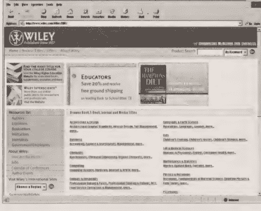

190 第三部分：Linux，嗯！它有什么用？绝对有用！

## 第四部分

### 极客的复仇

第五波（The 5$^{th}$ Wave）

By Rich Tennant


“我不是说我相信任何东西。我所知道的是，自从它出现以来，我们的服务器运行速度快了 50%。”

## 在本部分中 . . .

遵循懒汉和拖延者的伟大传统，我们将真正的工作尽可能推迟。在本部分中，你将了解如何将你的Fedora Core计算机变成一台服务器。这些章节不会立刻把你变成能够索取六位数咨询费的Linux高手，但它们确实会向你介绍Linux的技术侧面。

我们从第15章开始，描述如何构建一个简单的局域网（LAN）。构建LAN并没有听起来那么困难。你连接计算机，配置它们以识别彼此，创建一个互联网网关或防火墙，并且（如果运气好的话）你就可以开动了。

第16章向你展示如何使用你的Fedora Core计算机作为新创建的网络上的网络服务器；你还可以为互联网提供服务。

我们在第17章变得严肃，描述如何开始保护你的Fedora Core服务器和私有网络。你应该将本章视为安全性的介绍，并计划学习更多。

如果（好吧，当你）需要排查Fedora Core故障时，请查看第18章。它提供了一些关于修复计算机问题的详细帮助，特别侧重于网络。当你完成本部分时，你也会像我们一样佩戴口袋保护套（意指穿着正式的专业人士）！

第19章从严肃的计算机安全世界回来，享受一些乐趣。本章描述了如何运行流媒体音频服务。（是的，你可以在线运行你自己的私有网络广播电台。）


## 第 15 章
### 构建你自己的私有网络

**本章内容**
- 设计和创建你的私有网络
- 构建互联网网关
- 构建私有网络防火墙

私有网络由两台或更多相互连接以进行通信的计算机组成；你也可以将私有网络称为*局域网*（LAN）。这些计算机通常位于同一房间或建筑物内的相近位置。与旨在让全球计算机相互通信的互联网不同，局域网旨在保持通信的本地性和私密性。（当然，你总是可以将你的局域网连接到互联网，关于这个话题我们将在本书的其他地方讨论。）

构建私有网络并不像听起来那么困难。首先，你必须决定一般的网络布局。其次，你必须使用电缆和无线设备物理连接计算机。最后，也是最后一步，你必须配置每台计算机的网络设置。设计、连接、配置——一、二、三——就这么简单。

本章展示如何构建一个简单的局域网。如果你想知道如何将一台 Linux 计算机添加到现有网络中，请查看第 7 章。要了解如何向你的局域网添加防火墙，请查看第 8 章。


在本章中，我们将向你展示如何将计算机连接在一起。你应该参考第 7 章中的 Linux 网络配置说明，以连接你网络中的单独计算机。第 7 章中的步骤也旨在适用于任何局域网，包括你在这里构建的局域网。

在本章中，我们描述如何将计算机连接起来以形成局域网。然而，你可以将许多其他设备连接到网络。你可以将各种设备（无论是无线还是有线的）连接到网络；这些设备包括宽带（电缆和 DSL）互联网调制解调器、路由器、交换机、集线器、具备网络功能的打印机，甚至一些个人数字助理（PDA）。在未来，我们完全有理由预期能够将近乎所有电子设备连接到局域网。我们在这里只讨论计算机，是因为我们专注于让你的 Fedora Core 计算机连接上网。然而，请记住，你并不局限于*仅*将计算机组网。

### 设计和构建你的私有网络

私有网络有多种形状和规模。正如你所预期的，大型或中型组织的局域网设计与小型办公室或家庭所用的设计不同。除非工作复杂到需要这样的工具，否则个人和小型组织通常不需要复杂的网络。就本书的目的而言，我们假设你想要并需要一个简单的网络——而 Linux 在组网方面表现出色。我们描述了如何设计一个既强大又可靠的基础局域网。该网络可用于许多小型或中型企业以及大多数家庭。

本章向你展示如何设计一个简单的平面网络。*平面*指的是连接到网络的所有计算机都在单个*子网*（或*子网*）上进行通信这一事实。子网可以在单个局域网内组合使用，但这会使网络的设计、构建和维护更加复杂。

我们在本节中描述的网络还旨在使用 Fedora Core *互联网网关*——一台充当门户的计算机，将私有网络连接到互联网。私有网络中联网的计算机——也称为*主机*或*客户端*——通过以下两种方法之一进行连接：

- **有线连接：** 主机通过称为*以太网集线器*或*以太网交换机*（或简称*集线器*或*交换机*）的设备连接到局域网。交换机在性能和安全性方面优于集线器，并已成为标准。对于你的局域网，我们建议你使用以太网交换机连接所有计算机（主机）——包括互联网网关。图 15-1 展示了我们私有网络的示例，其中的互连织物是以太网交换机。（近年来，以太网交换机变得非常便宜，以太网集线器几乎绝迹了。）我们的示例网络由两台计算机组成：Veracruz 和 Cancun。

- **无线连接：** 无线设备使得无需互连电缆即可构建网络成为可能。无线网络可以采用两种形式：
  - **接入点：** 使用称为接入*点*的设备，你可以将无线主机连接到局域网。这种设计让主机通过射频（RF）信号连接到接入点。接入点也连接到有线网络，无线主机通过该连接与有线网络通信。

    接入点已成为创建无线局域网最流行的系统。你可以在消费电子产品商店找到接入点设备，价格远低于 100 美元。

  - **Ad-hoc 模式：** 这是一种替代的无线连接方法，除了每个主机的无线设备外，不需要单独的接入点（*ad hoc* 是拉丁语中“以任何有效的方式”的意思）。无线主机通过使用 Ad-hoc 模式直接相互通信。（你可以阅读本章稍后“无布线接线”部分中关于 Ad-hoc 模式的更多内容。）

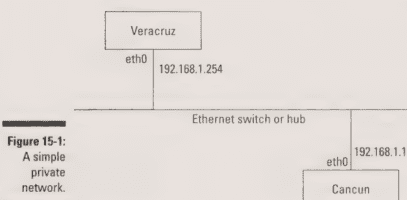

### 所有电线都去哪了？

无线网络使用的射频（RF）信号与你在收音机中调谐接收的、或在手机上通信的、或用于打开车库门的信号是相同的。AM 广播电台发出的 RF 信号与无线网络设备发出的 RF 信号之间的唯一区别在于其频率和强度。

*联邦通信委员会*（FCC）允许任何人将 5 吉赫兹（GHz）的频率范围——每秒数十亿个周期——用于任何目的，只要信号强度较低。实际上，无线局域网中无线电波取代了电线。

### 交换机和集线器的基础知识

交换机比集线器好，因为交换机更安全且速度更快。这里有一个快速的对比来说明它们的区别。

假设你的网络由三台机器——A、B 和 C——组成，它们都连接到一个交换机上。当机器 A 想要与机器 B 通信时，交换机将来自 A 的网络流量直接传输到 B。机器 C 被排除在外。通过确保 C 不知道 A 和 B 在说什么，交换机保持了网络通信的私密性。另一方面，集线器将一台机器的网络流量广播到连接到集线器的所有机器。当 A 向 B 发送信息时，集线器将该信息广播给 B 和 C。

交换机比集线器快，因为网络流量仅在正在通信的机器之间流动。没有彼此通信的计算机不使用交换机的带宽（信息传输的最大速率）。例如，当机器 A 向机器 B 发送信息时，机器 C 不会通过占用带宽而降低通信速度。

### 使用电线为你的网络布线，是的，电线

本节描述如何构建有线网络。你可以混合使用有线和无线网络，但为了简单起见，我们描述如何构建纯有线或纯无线网络。

在远古时代（大约 1996 年），你必须具备技术专长才能自己给网络布线。当时布线使用的是同轴电缆，类似于用于有线电视连接的电缆。同轴电缆笨重，并且需要特殊工具将连接器连接到电缆末端。

现在生活容易多了。为你的网络布线只需要获取类似电话线外观的 Cat-5 电缆。Cat-5 电缆是带有类似电话连接器的制造而成的，使用起来非常简单（原谅这个双关语）。没有麻烦，没有麻烦。


你可以在任何电子产品店买到 Cat-5 电缆。它们有很多颜色和尺寸。Cat-5 电缆不便宜，但也不是特别昂贵。它们可靠，且比同轴电缆更容易使用。

你必须将网络交换机或集线器与 Cat-5 电缆配合使用。交换机和集线器是将你的网络粘在一起的胶水。交换机和集线器都连接单独的计算机，使它们能够相互通信。


## 如果说不全部的话，大多数网络设备现在都基于以太网协议

以太网价格低廉且容易获取。你可以从任何消费电子商店、邮购目录或在线计算机卖家处购买。你不需要了解以太网的任何技术细节，因为它无需配置。你只需要知道以太网连接器的外观类似于电话插孔。但请记住，以太网和电话插孔并不兼容。

对于你的网络，请从将你的机器连接到中心交换机开始。（如果你愿意，也可以使用集线器。）

虽然你可以连接你的交换机或集线器所能处理的所有计算机，但为了尽可能简化工作，以下步骤描述了如何连接两台计算机。坎昆和韦拉克鲁斯。这些步骤假设你拥有交换机或集线器以及至少两根 Cat-5 电缆；以下是使用方法：

1. 在第一台计算机上，将 Cat-5 电缆的一端插入机器背面的以太网网络接口连接器（NIC）。
2. 将电缆的另一端插入交换机。

交换机上你使用的连接器附近应该会亮起绿灯。绿灯表示链路状态正常，表明已建立以太网连接：即计算机和交换机之间具有活动连接。

如果没有获得链路状态，请确保电缆上的两个连接器都已正确插入。将每个连接器拔出并用力重新插回（此操作称为重新插接）。


如果这个建议没有解决问题，请确保电缆工作正常。例如，检查电缆是否有裂缝或切口。检查电缆连接器的导线是否松动。如果可能，请替换另一根电缆；使用一根你已知可用的电缆。这可以帮助你确定待查电缆是否故障。

如果这两种方法都不奏效，你可能有一个损坏的交换机、电缆或以太网 NIC，或者它们的任意组合。你可能需要更换其中一个或所有设备以确定真正的问题所在。也许你可以从一个工作正常的网络借一根已知完好的电缆和 NIC，并用它们来缩小（或排除）问题范围。

3. 对每台额外的计算机重复步骤 1 和 2。

成功将所有计算机连接到交换机后，你可以继续本章后面的“构建互联网网关”部分。该部分描述了如何在 Linux 计算机上构建互联网网关。互联网网关将你的整个私有网络连接到互联网。

### 第四部分：书呆子的复仇

### *无绳布线*

在过去几年里，生活变得更轻松了。无线网络是过去五年中家庭或小型企业网络用户最大的技术进步，现在消费者也能负担得起。

使用无线具有以下优势：

- **不必一边拉线一边说抱歉。** 你不必花费金钱和时间通过墙壁、管道、阁楼和地下室拉线（作者们都享受过这些活动）。你还节省了电缆本身的费用。
- **地理自由：** 无论服务器、互联网网关或打印机位于何处，你都可以自由地在任何地方使用计算机。啊，生活更轻松了，你可以在美好的日子里坐在户外，尽情点击键盘。
- **看起来不错：** 即使你并非如此，你看起来也很高科技。你可以给朋友和家人留下深刻印象。

然而，无线网络也有一些缺点：

- **安全性降低：** 无线通信更容易受到黑客的攻击。你可以使用无线加密来部分保护你的网络。你可以使用基于应用的加密（如 Secure Shell (SSH) 和 Secure Sockets Layer (SSL)）进一步提高安全性。
- **速度降低：** 无线网络通常比有线网络慢。最常见且便宜的无线设备以每秒几兆位（Mbs）的速度工作。较新的设备以约 10 Mbs 的速度工作。这比典型的以 100 Mbs 速度运行的有线网络更慢。
- **复杂度增加：** 配置无线网络比有线网络稍微复杂一些。你必须配置加密密钥和其他选项才能使无线网络正常工作。

构建无线网络的过程很简单。你必须决定如何将你的无线设备连接到你的私有网络。你可以用两种方法做到这一点：

- **使用无线接入点：** *无线接入点*（WAP）是无线设备通过其进行通信的设备。接入点提供单一的接触点，所有其他设备通过其进行通信。如果你安装并使用接入点作为网络结构的一部分，你就在使用*基础设施模式*。

## 第 15 章：构建你自己的私有网络

接入点使用两个网络连接。一个是以太网端口，通过 Cat-5 以太网电缆连接到你的私有 LAN，另一个点连接到你的无线设备。接入点作为你的 LAN 的公共连接点。

另一个连接点是接入点的无线接收器。无线“端口”与网络上所有其他无线设备通信。

- 使用点对点（ad-hoc）通信：与流行观点相反，你可以在没有接入点的情况下创建无线网络。无线 NIC 被设计为直接相互通信，也通过接入点通信。你配置每个 NIC 知道一个通用网络名称和一个通用加密密钥，看哪，Wi-Fi 设备通过直接相互通信形成自己的 ad-hoc 网络。我们稍后在本节中展示如何做到这一点。

点对点通信被称为 ad-hoc 模式。术语 ad hoc 是一种礼貌的说法，意思是拼凑——意味着用你拥有的东西，以任何可能的方式拼凑在一起。使用无线 ad-hoc 模式意味着每个无线设备都可以与其他无线设备通信。（使用无线 NIC 设置网络比使用 WAP 更便宜。）

你可以购买一个接入点来构建你的无线 LAN（尽管你可能需要使用流行的术语 Wi-Fi 网络，意思相同，以便销售员知道你在说什么）。这很简单且快速，但稍贵。如果你选择这条路线，我们留给你按照接入点的说明将其他计算机连接到它。你可以按照第 7 章中的步骤配置你的 Fedora Core 无线网络接口卡（抱歉，Wi-Fi NIC）以连接接入点。

我们描述如何省点钱并使用 Linux 计算机构建 ad-hoc 网络。构建 ad-hoc 网络要求你在 Linux 网关上放置一个 Wi-Fi NIC。然后你配置私有网络上的每台计算机使用相同的网络名称和加密密钥。然后计算机可以通过 Linux 网关直接相互通信并连接到互联网。

遵循这些一般步骤来创建无线 LAN：

1. 在互联网网关计算机上安装 Wi-Fi 和以太网 NIC。

你的私有网络中的每台计算机都可以通过无线 NIC 与互联网网关通信。以太网将网关通过 DSL 或电缆调制解调器连接到互联网；如有必要，你可以用电话调制解调器替代以太网 NIC。

本章的下一节描述了如何构建互联网网关。

2. 在你的每个 Linux 和 Windows 计算机上安装 Wi-Fi NIC。
3. 配置每个 Wi-Fi NIC 使用相同的网络名称和加密密钥。

参考第 7 章了解如何配置 Wi-Fi NIC；使用该网络 IP 地址、netmasks 和其他在此处描述的项目。

4. 配置你的互联网网关将你的私有网络流量转发到互联网。
5. 在你的互联网网关上配置防火墙。

参考本章后面的“使用防火墙保护你的 LAN”部分。


使用*基础设施模式*（当你的网络专门包含接入点时就是这种模式）的一个优点是，无线设备可以在接入点之间移动而无需重新配置。接入点在 LAN 内提供移动性和灵活性，如果你恰好在大型、分散的环境中工作，这可能是一件好事。例如，如果你的公司分布在多个地点，你希望能够在任何地方使用你的计算机。然而，如果你没有正确配置接入点——例如，不使用加密密钥——灵活性就变成了一种安全弱点。确保你正确配置了所有无线设备。

## 构建互联网网关

好的，你已经构建了你的 LAN。太棒了！那并不难。下一个问题是“你能用它做什么？”一个答案是，你私有网络上的每台计算机都可以与其他所有计算机通信并共享信息和服务。（我们在第 16 章中描述如何共享一些有用的基于网络的服务。你将了解如何共享文件和打印机，配置域名服务——DNS——服务器，并构建一个简单的 Web 服务器。）

一个基本的网络功能是连接到互联网。第 5 章和第 6 章向你展示如何将一台外观标准的单台 Linux 计算机连接到互联网。我们将这个过程进一步扩展，向你展示如何将互联网连接转变为可被整个私有网络使用的连接。任何连接到你的 LAN 的计算机随后都具有互联网访问权限。共享是美好的，你的妈妈应该很高兴。


## 第 15 章：构建你自己的专用网络

本章剩余部分将介绍如何构建互联网网关。我们假设你拥有一个可用的互联网连接，如第 5 章和第 6 章中所述。该连接是你的局域网（LAN）与互联网之间的通道。你只需配置一台 Linux 计算机，将来自局域网的互联网流量重定向（路由）到互联网，并修改我们在第 8 章中描述的防火墙，使其能够与该网关配合工作。

### 理解 IP 转发和网络地址转换 (NAT)

互联网网关需要一台拥有两个网络连接 Linux 计算机。你需要一块有线或无线网卡（NIC）来连接你的局域网。另一个网络连接用于建立互联网连接；此连接可以是传统的基于电话线的调制解调器、DSL 调制解调器或电缆调制解调器。你需要使用有线网卡来建立第二个连接。

假设你在示例 Fedora Core 计算机 *Cancun*（IP 地址为 `192.168.1.1`）上打开 Mozilla 浏览器，并输入 URL `fedora.redhat.com`。网络数据包在你的局域网中传输，然后飞向互联网（再返回），最终 Mozilla 显示 Fedora Core 网页。

为了实现这一切，许多事情必须发生。以下是简化后的工作流程：

- 1. Mozilla 请求 Linux 通过 DNS 查找地址，DNS 将 `fedora.redhat.com` 转换为数字 IP 地址 `209.132.177.50`。
- 2. Linux 将该 IP 地址与其内部路由表进行比较。如果地址不匹配其本地网络，操作系统将网络流量引导至默认路由。（换句话说，如果 IP 地址属于私有网络中的机器，Linux 会将其通信引导至连接到局域网的以太网设备。然而，如果 IP 地址位于局域网外部，Linux 会将数据包转发至相应的路由器。）
  - 在这种情况下，`209.132.177.50` 不在局域网中，因此浏览会话的所有流量都被引导至默认路由。
- 3. 在我们描述的专用网络示例中，每台主机的默认路由都指向互联网网关 *Veracruz*。例如，Cancun 生成的所有面向互联网的网络数据包都会发送到 Veracruz。
- 4. 互联网网关 Veracruz 在其内部网卡上接收来自 Cancun 的出站数据包，并将其转发至其外部网卡。通过其外部网卡传输的数据包将被引导至互联网。
- 5. Veracruz（内部网卡地址 192.168.1.254）还将来自 Cancun 的数据包的源地址（192.168.1.1）转换为其外部网卡的源地址。例如，如果 Veracruz 的外部网卡（连接到 DSL 或电缆调制解调器）的地址为 192.168.32.254，那么 Cancun 数据包的源地址将被转换为相同的地址（192.168.32.254）；换句话说，Cancun 的源地址 192.168.1.1 被更改为 192.168.32.254。
- 6. 数据包到达其预期目标。fedora.redhat.com Web 服务器响应查询并发送回请求的信息。
- 7. Veracruz 接收返回的数据包，将其目的地址转换回 Cancun 的地址，并将它们转发至专用网络。
- 8. Cancun 接收数据包，浏览器显示信息。

### 通过网关转发网络流量

本节描述如何配置 Linux 计算机作为互联网网关工作。此过程要求你配置 Linux 内核，以便将一个网络接口（在局域网端口和互联网端口之间）的数据包转发到另一个网络接口。由于 Fedora Core 默认关闭转发功能，本节的步骤描述了如何开启转发（你还需要一台拥有两个网络连接的 Linux 计算机来构建网关）：

- 一个网络连接应该是连接网关到局域网的有线或无线网卡。我们将其称为内部网络连接。
- 另一个连接是基于电话线的调制解调器，或连接到 DSL 或电缆调制解调器的有线网卡。我们将其称为外部网络连接。

图 15-2 显示了修改后用作互联网网关的 Veracruz 计算机。

你现在应该断开外部网络连接。这是因为开启 IP 转发会使互联网和你的专用网络之间能够通信。在完成互联网网关配置之前，IP 转发可能存在安全隐患。暂时断开你的互联网连接可以消除不安全感：拔掉（DSL、电缆或电话）调制解调器的外部（互联网）线缆。

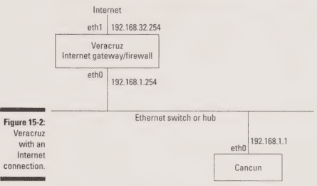

以下步骤描述如何配置 Linux 计算机作为局域网的互联网网关：

1. **在你的预期互联网网关上添加适当的内部和外部网络连接。**
   - 例如，内部网络连接是 *eth0*，外部网络连接是 *eth1*。
2. **以 root 身份登录到你的互联网网关（在本例中为 Veracruz）。**
3. **点击 GNOME 菜单按钮，选择“系统工具” > “终端”。**
   - GNOME 终端窗口打开。
4. **输入以下命令：**
   ```
   gedit /etc/sysctl.conf
   ```
   - gedit 程序显示 *sysctl.conf* 的内容，如图 15-3 所示。
5. **找到这一行（它应该位于文件顶部附近）：**
   ```
   net.ipv4.ip_forward = 0
   ```
6. **将 0 更改为 1：**
   ```
   net.ipv4.ip_forward = 1
   ```
7. **点击“保存”按钮，然后选择“文件” > “退出”以关闭 gedit。**
   - 你可以通过点击 Nautilus 的“刷新”按钮来查看更改。必须重启 Linux 网络服务才能使更改生效。

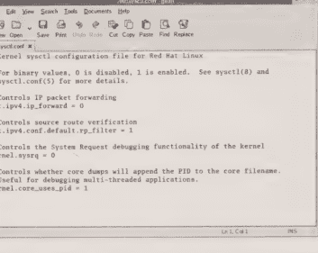

8. 通过点击 GNOME 菜单按钮并选择“系统设置” → “服务器设置” → “服务”来打开服务配置工具。
9. 如果提示，请输入 root 密码。
10. 找到并点击 network 服务。
11. 点击“重启”按钮以开启 IP 转发。
    - 信息对话框打开。
12. 点击“确定”。

### 连接你的互联网网关

在配置互联网网关将网络流量从专用网络转发到你的互联网连接之后（参见上一节），你需要建立该连接。在本节中，我们描述如何使用我们在第 5 章和第 6 章中介绍的互联网连接。你基于那些说明，通过这些连接将你的整个网络连接到互联网。


从功能角度看，你使用的互联网连接类型（电话、DSL 或电缆）并不重要，因为所有这些互联网连接发送和接收的是相同的网络流量。（当然，从实际角度来看，宽带比旧的电话调制解调器更具吸引力，因为其吞吐量更高且延迟更低。）因此，我们可以将我们在第 5 章和第 6 章中描述的互联网连接视为可互换的。

### 配置你的外部互联网连接

我们在上一节中描述的转发功能负责通过你的互联网网关路由到互联网及从互联网返回的数据包。按照以下步骤配置互联网网关：

1. 在你的 Fedora Core 互联网网关上安装有线或 Wi-Fi 网卡。
   - 你使用此网卡将互联网网关连接到你的专用网络。我们识别此设备为内部网卡（*eth0*）。
2. 在你的 Fedora Core 互联网网关上安装有线网卡；如果你使用电话调制解调器作为互联网连接，请跳过此步骤及下一步。
   - 你使用此网卡连接到你的 DSL 或电缆调制解调器。我们识别此设备为外部网卡（*eth1*）。
3. 使用 5 类线将外部网卡连接到 DSL 或电缆调制解调器。
4. 配置你的互联网网关以允许数据包转发。（参见本章前面的“通过网关转发网络流量”部分。）
5. 为每个网卡分配一个 IP 地址。例如，为内部网卡（*eth0*）分配地址 `192.168.1.254`，为外部网卡（*eth1*）分配 `192.168.32.254`。
   - 请注意，当使用电话或电缆调制解调器时，此操作会自动为你完成。调制解调器直接连接到你的网关，而不是通过有线网卡；一些 DSL 调制解调器也可以直接插入计算机，不需要有线连接。对于本书，我们假设你通过有线网卡连接。检查你的协议。电话调制解调器使用点对点协议（PPP），而电缆和某些 DSL 调制解调器使用动态主机配置协议（DHCP），该协议为相应接口分配 IP 地址。
6. 分配一个指向互联网连接设备的默认路由。PPP 和 DHCP 协议会自动执行此步骤。


### 配置你的内部专用网络连接

按照以下步骤配置专用网络中的计算机或网络设备，使其通过网关连接互联网：

1. 配置你的计算机网络参数。
   - 换句话说，当使用基于有线网络的局域网时，为每台计算机分配一个 IP 地址和一个子网掩码（可选但建议还分配主机名和网络名称）。在无线网络上，你必须分配 IP 地址、子网掩码、通用网络名称和加密密钥。


## 使用防火墙保护您的局域网

例如，第 7 章描述了如何设置示例计算机 Cancun。您为其分配主机名 *cancun*；网络名称 paunchy.net；IP 地址 `192.168.1.1`；以及子网掩码 `255.255.255.0`。

如果您在 Cancun 上使用 Wi-Fi 网卡，您可以将 ESSID（电子服务集标识符，本质上就是网络名称）设置为 myfi，并指定加密密钥为 iamnotenumber。

- 将每个设备的默认路由配置为指向互联网网关。
- 清洗并重复。（对私有网络中的每台计算机重复这些步骤。）

在配置好互联网网关和私有网络中的每台附加计算机（主机）之后，您应该测试它们能否与互联网通信。如果遇到困难，请查阅第 18 章获取网络故障排除的建议。当您确信局域网已成功连接到互联网后，请关闭它。您仍然需要设置防火墙（如下节所述），因为您不希望在没有防火墙的情况下保持连接。

在配置好网关的 IP 转发后，您需要保护网络免受互联网上恶意用户的侵害。本节描述如何将您的网关转变为防火墙。您使用我们在第 8 章中描述的过程和许多相同的规则；然而，这个防火墙旨在保护您的整个网络，而第 8 章中的防火墙则侧重于保护单个工作站。

您正在构建的防火墙有助于保护您的计算机和网络。防火墙提供网络地址转换（NAT）功能，允许私有网络中的计算机访问互联网。您可能还记得，NAT 将不可路由的源 IP 地址（例如 192.168.1.1）转换为您互联网连接的可路由源 IP 地址。


网络地址转换也被称为 *IP 伪装*，或者简称为伪装。

我们在第 8 章中描述的防火墙基本配置在新配置中也能正常工作。防火墙执行以下功能：

- **阻止所有入站、出站和转发数据包：** 默认情况下通过阻止所有网络流量开始。这个防火墙完全保护您的私有网络，同时也使其无用！以此策略开始，以确保防火墙阻止除您明确允许之外的所有连接。
- **允许所有内部流量**：您必须允许互联网网关内部环回（lo）接口上的所有网络流量。环回接口被 Linux 操作系统用于其自身的内部通信。许多内部进程通过这个虚拟网络进行通信。
- **允许所有内部网卡流量**：如果您允许私有网络中的计算机与网关通信，您将获得更大的便利性。例如，您可能希望通过安全外壳（SSH）管理网关。采取宽松的方法，允许任何外部机器与网关通信；这种策略使构建防火墙更容易。如果安全需求要求，您可以选择限制内部访问。
- **允许从防火墙发出的所有出站流量**：允许防火墙内部发出的所有连接。防火墙需要执行其自身的内部进程，例如进行 DNS 查询。
- **转发来自私有网络的所有流量**：网关必须将流量从一个接口传递到另一个接口。您更改转发策略，以允许来自私有网络的通信通过防火墙流向互联网。缺点是，来自互联网的流量可以直接穿过防火墙到达私有网络——这不是一个好主意。您可以通过添加 NAT 来解决这个问题，NAT 实际上阻止了通过防火墙的外部访问。

您可以设置特定的转发规则，为您的私有网络提供更强的保护。我们认为，使用 NAT 来有效阻止源自外部的连接已足以满足您的需求。

- **对出站连接使用 NAT**：创建一个 NAT 规则，使所有起源于私有网络的连接看起来像是来自互联网网关。所有私有网络机器的源地址和端口号都被更改为网关的。

如果您的互联网连接设备（电话、DSL 或电缆调制解调器）执行 NAT，则不需要网络地址转换。然而，通过提供 NAT 过滤规则，您确保您的互联网网关可以与任何连接设备配合工作——无论该设备是否执行 NAT。NAT 还防止外部访问您的私有网络。

- **允许入站 SSH 连接**：安全外壳（SSH）协议加密网络连接。SSH 提供了一种相对安全的系统，用于从互联网连接到您的私有网络。我们将防火墙配置为允许 SSH 连接进入我们的防火墙。

互联网网关上的防火墙与我们在第 8 章中描述的防火墙类似，除了您添加了 IP 转发和 NAT。IP 转发允许来自私有网络的数据包向外穿过防火墙并流向互联网。在这种情况下，NAT 使所有发往互联网的流量看起来像是来自防火墙或网关——并防止入站数据包被向内转发到您的私有网络。

按照以下步骤创建您的互联网网关防火墙：

1. 以 root 身份登录到您的计算机，并打开一个 GNOME 终端窗口，通过右键点击桌面的任何空白部分并从菜单中选择“打开终端”来实现。

   或者，您可以点击 GNOME 菜单并选择 System Tools\>Terminal。

2. 输入此命令以停止任何正在运行的防火墙：

   ```
   service iptables stop
   ```

3. 要保存默认的 Fedora Core 防火墙配置，请输入

   ```
   mv /etc/sysconfig/iptables /etc/sysconfig/iptables.bak
   ```

4. 通过输入以下命令，开始拒绝所有设备上的所有网络流量：

   ```
   iptables --policy INPUT DROP
   iptables --policy OUTPUT DROP
   iptables --policy FORWARD DROP
   ```

5. 要允许环回设备上的所有出站和入站流量，请输入

   ```
   iptables -A OUTPUT -j ACCEPT -o lo
   iptables -A INPUT -j ACCEPT -i lo
   ```

6. 输入以下行以允许内部网卡上的所有出站和入站流量：

   ```
   iptables -A OUTPUT -j ACCEPT -o eth0
   iptables -A INPUT -j ACCEPT -i eth0
   ```

7. 要允许从防火墙发出的所有出站连接，请输入以下命令：

   ```
   iptables -A OUTPUT -m state --state NEW,RELATED,ESTABLISHED -j ACCEPT
   iptables -A INPUT -m state --state RELATED,ESTABLISHED -j ACCEPT
   ```

   这些规则允许在防火墙计算机上运行的进程连接到互联网。

8. 要将从内部网卡（eth0）转发的所有流量转发到外部网卡（eth1），请输入以下行：

   ```
   iptables -A FORWARD -f eth0 -m state --state NEW,ESTABLISHED,RELATED -j ACCEPT
   iptables -A FORWARD -i eth1 -m state --state ESTABLISHED,RELATED -j ACCEPT
   ```

   第一条规则通过内部网卡（eth0）转发出站流量。第二条规则通过外部网卡（eth1）将返回流量转发回私有网络。


转发链独立于输入和输出链。例如，您可以简单跳过步骤 6，从而阻止来自私有网络中防火墙计算机 Veracruz 的所有入站和出站数据包。您将无法与防火墙本身通信，但 Veracruz 仍会将数据包从私有网络转发到互联网。

9. 要**对出站流量执行网络地址转换**，请输入

   ```
   iptables -A POSTROUTING -t nat -o eth1 \n    -j SNAT --to 192.168.32.254
   ```

   然后，所有从任何私有网络地址发往互联网的流量都看起来像是来自这个单一地址。

10. 输入以下行以**允许入站 SSH 连接**：

    ```
    iptables -A INPUT -p tcp -m state --state \n    NEW,ESTABLISHED -j ACCEPT --port 22
    ```

11. 通过输入以下行永久保存新的防火墙规则：

    ```
    iptables-save > /etc/sysconfig/iptables
    ```

12. 要确保每次重新启动互联网网关时防火墙自动运行，请输入以下命令：

    ```
    chkconfig --level 35 iptables on
    ```

13. 将互联网网关的外部网卡重新连接到您的 DSL 或电缆调制解调器。

完成这些步骤后，您的互联网网关将受到防火墙的保护。它还将从您的私有网络转发流量到互联网。有了防火墙，您的网络比没有时安全得多。然而，暂时不要放松——您仍然有一些安全工作要做。阅读第 17 章和第 21 章以获取更多关于如何保护自己的信息。


## 第 16 章
### 创建基本的 Linux 网络服务

#### 本章要点

- 准备网络服务器
- 构建 Linux Web 服务器
- 构建 DNS 服务器
- 构建 Samba 文件服务器
- 构建打印服务器

Linux 在设计之初就充分考虑了网络功能。与某些操作系统不同，网络功能在 Linux 中并非事后添加的补丁。Fedora Core 自带提供文件共享、打印机共享及其他功能的软件。这正是 Linux 最初获得广泛流行原因。

在之前的章节中，我们展示了如何使用已连接到现有网络的 Fedora Core 计算机。我们也展示了如何以 Fedora Core 计算机作为客户端和 Internet 网关或防火墙来构建私有网络。在本章中，我们将介绍如何配置 Linux 计算机，以便为私有网络提供一些常用服务。

### 准备网络服务器

本章展示的所有示例都可以在任何 Linux 计算机上运行，例如在第 3 章中基于 Fedora Core 发行版设置的那台计算机。Linux 并不关心你构建计算机时的初衷。Linux 会急切地执行指令，并作为工作站或服务器优雅地工作。

无论是运行 Web 浏览器还是 Web 服务器，Linux 都能同样出色地工作；两者之间的区别仅在于所使用的软件及其配置方式。

例如，当你将计算机用作 Web 浏览器时，你启动 Mozilla 应用程序；或者你使用 Apache 程序来提供网页服务。当然，你可以同时运行这两个程序，例如在运行 Web 服务器时进行文字处理。

你可以配置第 3 章中的 Fedora Core 计算机，为我们在第 7 章和第 15 章中描述的私有网络提供类似的服务。本章描述了如何让 Apache Web 服务器对 Internet 可见。然而，像 Samba 和打印这样的服务，绝对应该保持私密，不应暴露给 Internet。

本章还假设你通过私有网络连接到 Internet，如第 7 章和第 15 章所述。（第 15 章展示了如何使用 Fedora Core 计算机为你的私有网络创建 Internet 网关/防火墙。）本章假设你想使用同一台计算机为你的私有网络提供服务。对于小型办公室和家庭办公室（SOHO）网络，这种假设是合理的，因为小型网络对现代 PC 的需求并不过分。将一台计算机用于多种用途大大简化了你需要做的工作，也是利用资源的高效方式。


使用单台 Linux 计算机作为 Internet 网关并提供网络服务，是利用有限资源的一种经济高效的方式——但此类配置更难确保安全。你在单台机器上每增加一项功能，都会增加该机器的潜在漏洞数量。将添加功能想象成给房子添加门窗：只有一扇门且没有窗户的房子比有 5 扇门和 15 扇窗户的房子更安全——但谁愿意住在黑暗的房子里呢？就像生活中的其他事情一样，安全性是一个权衡的问题。请参阅本书的第二部分以及第 17 章和第 21 章，了解提高安全性的方法。

### 构建 Apache Web 服务器

Web 即 Internet，Internet 即 Web——嗯，这并不完全正确。虽然 Internet 因万维网（WWW）而变得极其流行，但 Internet 还包含更多内容——它为广泛使用的功能提供了基础。电子邮件就是其中之一；Web 则是另一个。

Web 并不像初看时那样神秘。它基本上由通过 Internet 互连的所有 Web 服务器组成。Internet 本身起到了类似全球电话系统的作用：它允许每个人彼此沟通。你可以将 Web 服务器视为让人们的电话，使其能够联系彼此、企业和其他组织。就像你可以创办企业或组织并让人们通过电话联系你一样，你也可以允许人们通过你的 Web 服务器联系你。本节描述了如何构建一个简单的 Web 服务器。

描述如何设置比简单 Web 服务器更复杂的内容超出了本书的范围。不用说，你可以配置 Apache 以提供“整个世界”（可以这么说）的 Web 服务。如果你想利用 Apache 的强大功能，请咨询如 Mohammed J. Kabir（Wiley 出版社）撰写的优秀书籍《Apache Server 2 Bible》等著作。

#### 安装和启动 Web 服务器

Linux 为提供 Web 服务提供了理想平台。随 Fedora Core 捆绑的 Apache Web 服务器系统——易于设置和使用。

按照以下步骤安装和配置基本的 Apache Web 服务器：

1. 以任意用户身份登录并插入随书 DVD。
   - Apache 软件位于 DVD 上。
2. 点击 Fedora 菜单并选择 System Settings::Add/Remove Applications。
   - 如果你尚未以超级用户（root）身份登录，将打开查询对话框。
3. 如果提示，请输入 root 密码。
   - 将打开检查系统状态对话框，并在确定计算机上安装了哪些软件时显示进度条。随后打开添加和移除软件对话框。
4. 向下滚动并点击 Web Server 按钮。
5. 点击 Update 按钮。
   - 在包安装实用程序准备安装软件时，将打开系统更新准备对话框。完成后，窗口标题更改为系统准备已完成。
6. 点击 Continue 按钮。
   - 标记为系统更新的对话框显示安装进度。
7. 点击 OK 按钮。
   - 控制返回到包管理窗口。
8. 点击 Quit 按钮。

如果你已连接到 Internet，可以使用 YUM（Yellowdog Updater, Modifier，难听的缩写，但功能很棒）来安装 Apache（或任何）软件包。YUM 连接到 Fedora Core 项目的下载服务器并安装你需要的任何软件包；你也可以使用 Fedora Core 镜像。YUM 还执行其他功能，如更新你的计算机。输入命令 **yum -y install httpd**，YUM 就会为你完成所有工作。YUM "Yummifies" 你的计算机。撇开愚蠢的文字游戏不谈，它是一个极好的系统。有关 YUM 的更多信息，请参阅附录 E。

Apache Web 服务器预配置为显示示例网页，我们将用于本节的示例。你只需要配置 Apache Web 服务器即可。Fedora Core 提供简单的 GUI 以帮助你进行配置。

以下步骤描述了如何配置你的服务器：

1. 点击 GNOME 菜单并选择 **System Settings->Server Settings**。
   - 如果你未以 **root** 身份登录，将打开查询对话框。
2. 如果提示，请输入 **root 密码**。
   - 将打开 HTTP 对话框。
3. 在 **Server Name** 文本框中输入 **localhost**。
   - 或者，如果你希望与私有网络共享 Web 服务器，可以输入计算机的 Internet 名称（例如，在我们的示例中的计算机 *cancun.paunchy.net*）。
   - 你可以通过点击选择对话框顶部的各个选项卡来配置其他选项。对这些选项的描述超出了本书的范围；默认设置对于简单的 Web 服务器来说运行良好。
4. 点击 **OK** 按钮。
5. 当问题对话框打开时，点击 **Yes** 按钮。

HTTP 窗口关闭，你的 Web 服务器已配置完毕。你需要启动服务器以查看示例网页。按照以下步骤启动服务器。

1. 点击 GNOME 菜单并选择 **System Settings->Services**。
2. 如果提示，请输入 **root 密码**。
   - 将打开服务配置对话框。
3. 向下滚动左侧子菜单并点击 **httpd** 旁边的框。
4. 点击 **Start** 按钮以启动 **Apache Web server**。
   - 将打开信息对话框。
5. 点击 **OK** 按钮。


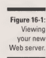


Linux 在指代一个持续运行以提供服务的进程时，使用术语 *daemon*（守护进程）。Apache 守护进程被称为 *httpd*，这是 HyperText Transport Protocol Daemon（超文本传输协议守护进程）的缩写。**HyperText Transport Protocol (HTTP)** 是用于协调服务器和客户端（例如 Mozilla 浏览器）之间网页传输的系统。HTTP 是双方通用的语言。

- 6. **启动 Mozilla。**
- 7. **在 Mozilla 的位置文本框中输入 `http://127.0.0.1` 并按 Enter。**

图 16-1 显示您现在正在查看您的 Web 服务器。

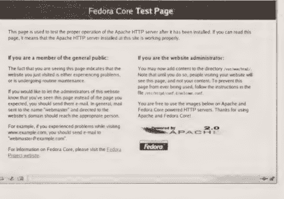


您可以使用 *chkconfig* 实用程序手动配置 Linux，使其在每次启动计算机时自动启动您的 Web 服务器。在终端模拟器窗口中输入以下命令：`chkconfig --level 35 httpd on`。*level 35* 选项将 Web 服务器配置为在 *nongraphical*（非图形）模式（运行级别 3）或 *graphical*（图形）模式（运行级别 5）下启动。运行 *chkconfig* 实用程序会创建 *soft links*（软链接），这在很大程度上类似于指针。在这种情况下，/etc/rc3.d/ 或 /etc/rc5.d/ 目录中的软链接将在您每次启动计算机时自动执行。

您的 Web 服务器现在应该只能在工作站上看到。要使其对您的私有网络可见，请重复步骤 2，并输入您的主机名以代替 localhost。如果您的计算机未连接到局域网（例如，如果它是带有电话、电缆或 DSL 互联网连接的独立机器），您仍然可以从机器本身使用您的 Web 服务器。当然，独享您的 Web 服务器并没有多大乐趣。以下部分描述了如何允许从互联网访问您的 Web 服务器。


Open Office 套件有一个 HTML 编辑器，您可以使用它来创建 Web 页面。该编辑器易于使用，并且可以生成外观精美的文档。打开任何 Open Office 程序（例如 Writer 或 Calc），然后选择 File > New > HTML Document（文件 > 新建 > HTML 文档）。HTML 编辑器窗口将打开，您可以创建 Web 页面。

### 通过防火墙访问您的 Web 服务器

本节描述了如何打开防火墙以允许访问您的 Web 服务器。具体如何允许访问取决于您是直接从 Linux 计算机连接到互联网，还是通过局域网连接。本节中的步骤描述了如何修改防火墙以允许互联网查看您的 Web 页面。

您还必须修改您的互联网网关或防火墙。您必须允许外部 Web 浏览器连接到 Apache 服务器的 80 端口。通过输入以下命令来创建防火墙规则：

```
iptables -A INPUT -p tcp -m state --state NEW,ESTABLISHED -j ACCEPT -dport 80
```

全世界的亚马逊公司们，小心了！好吧，仅凭默认的 Apache Web 页面还不足以惹恼那些巨头，但您已经具备了基础条件。您唯一需要做的就是弄清楚要销售什么。怎么样，卖一本很棒的 Linux 书？


您可能需要修改您的 DSL 调制解调器，以便您的 Web 服务器可以从互联网看到。DSL 调制解调器默认倾向于使用 NAT。NAT 会阻止传入连接。电缆调制解调器通常不使用 NAT，但您的调制解调器可能也需要修改。请查阅调制解调器的用户手册，了解如何允许外部连接的说明。

## 构建 DNS 服务器

每个连接到互联网的设备，包括您的 Fedora Core 计算机，都需要一个互联网协议（IP）地址才能正常通信。IP 地址是唯一的数字，因此对于我们这些碳基人类来说很难记住和使用。**Domain Name System (DNS)** 通过将数字转换为名称来解决这个问题，使我们能够使用诸如 `fedora.redhat.com` 之类的名称，而不是 `209.132.177.50`。在很多方面，DNS 使互联网变得可用，因此也变得更受欢迎。

*DNS 是一个相互依赖的信息共享系统* — 一个分布式数据库。没有集中式服务器包含实际地址，如 `fedora.redhat.com`。相反，DNS 的结构使得本地服务器存储本地地址，而少数集中式服务器存储有关在哪里找到本地地址的信息。

DNS 使互联网成为可能。如果我们不得不从某本巨大的电话簿中查找数字 IP 地址，互联网将不切实际。DNS 还使得在较小的私有网络上工作更加便利。通过构建自己的 DNS 服务器，您避免了记住所有机器所有地址的需要。本节描述了如何构建一个简单的 DNS 系统来服务您的网络。

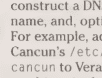

如果您没有构建 DNS 服务器，请将名称/地址对添加到每台计算机的 `/etc/hosts` 文件中。编辑 `/etc/hosts` 并为您私有网络上的每台计算机添加 IP 地址、完整主机名，以及可选的别名。例如，在 Cancun 的 `/etc/hosts` 文件中添加 `192.168.1.254 varacruz.paunchy.net varacruz`。然后在 Veracruz 的 `/etc/hosts` 文件中添加 `192.168.1.1 cancun.paunchy.net cancun`。这些条目允许示例中的两台机器按名称互相寻址。

**介绍 DNS 组件**

总体而言，域名系统（Domain Name System）非常复杂；它包含许多组件。但由于我们要向您展示如何为私有网络构建 DNS 服务器，您可以使用一个更简单的系统，该系统仅使用相对少量的 DNS 组件。构建您的 DNS 服务器需要对基本 DNS 组件有良好的工作理解，因此如下所示：

- **域（Domains）：** 您可能熟悉网络域，无论您是否意识到这一点。*域* 是您在互联网上经常访问的网络。例如，`redhat.com` 是一个域（而 `www.redhat.com` 是 `redhat.com` 域内一台服务器的名称）。
  - 域可以选择划分为子域。例如，Red Hat 有一个子域 `fedora.redhat.com`，用于 Fedora Core 项目。
  - 域本身划分为顶级域。无处不在的 `.com`、`.edu` 和 `.org` 都是顶级域。它们分别将互联网组织为商业、教育和非营利领域。
- **区域（Zones）：** 域划分为区域。DNS 服务器为区域提供服务。一个区域可以直接映射到一个域；多个区域可以为一个域提供服务。本节中构建的 DNS 服务器由一个为虚拟的 `paunchy.net` 域提供服务的单一域组成。
- **权威名称服务器（Authoritative name servers）：** 每个区域必须有一个权威名称服务器。它保存区域内每个主机信息。您可以创建主权威名称服务器和从权威名称服务器。从名称服务器备份主名称服务器。
- **非权威名称服务器（Non-authoritative name servers）：** 为了呈现不太随时间变化的数据，您可以创建加载速度快但不一定提供最及时信息的名称服务器。
- **缓存名称服务器（Caching name server）：** 名称服务器可以配置为从其他名称服务器查找地址并临时保存或缓存信息。缓存名称服务器有助于分散服务大域的负载。
- **根名称服务器（Root name servers）：** 控制域名注册的权威机构提供保存每个域的服务器地址的根名称服务器。DNS 查询将访问根名称服务器以查找权威名称服务器的位置。

在 DNS 配置和区域文件中找到的参数称为资源记录（RR）。此列表描述了它们：

- **A 记录：** 地址（A）记录将 IP 名称映射到数字地址。
- **CNAME 记录：** 规范（CNAME）记录为 A 记录定义别名。
- **MX 记录：** 邮件交换（MX）记录指定为域提供服务的邮件服务器。
- **NS 记录：** 名称服务器（NS）记录指定区域的名称服务器。
- **SOA：** 权威起始（SOA）参数创建一个描述区域文件通用属性的部分。SOA 配置设置序列号和超时的参数，以及区域的域名。

### 查看 DNS 地址请求

本节让您快速了解您的浏览器查找 Fedora Core Web 页面所执行的步骤：

1. 您打开浏览器并输入任何 URL，例如 `fedora.redhat.com`。
2. 浏览器向 Linux 请求该 Web 页面的数字 IP 地址。
3. Linux 查看其 `/etc/resolv.conf` 配置文件并找到名称服务器的地址。


你可以使用互联网上任何可用的 DNS 服务器。例如，你可以从互联网的任何地方使用阿尔伯克基最出色的 ISP 西南赛博端口（Southwest Cyberport）DNS 服务器，198.59.115.2。你应该使用你自己 ISP 的服务器，因为它需要经过的路由器间跳转（hops）较少，从而带来更高的可靠性和更快速度。

- **Linux 从名称服务器请求 fedora.redhat.com 的 IP 地址。**
- **如果名称服务器不知道 fedora.redhat.com 的 IP 地址，它会向根服务器请求 redhat.com 域的权威名称服务器的地址。**
- **根服务器返回 Red Hat 权威名称服务器的地址，其中第一个是 ns1.redhat.com (209.132.177.50)。**
- **名称服务器向 ns1.redhat.com 请求 fedora.redhat.com 的地址。**
- **名称服务器 ns1.redhat.com 返回 fedora.redhat.com 的地址。**
- **使用数字形式的 fedora.redhat.com IP 地址，你的浏览器开始与 Web 服务器通信。**

## 构建 DNS 服务器

当你知道你想让你的 DNS 服务器做什么时，就该着手构建一个了。本节中的步骤描述了如何为你的私有网络构建一个权威名称服务器。该服务器为我们第 15 章中描述的私有、不可路由网络提供地址；你不需要向任何机构注册这些地址。该 DNS 服务器是你的私有域的权威服务器，但这些信息在外部网络中不可用。

本节中的步骤展示了如何安装 DNS 服务器软件。你使用 Fedora Core 配置实用程序创建各种配置文件。（在以下示例中，这些文件是 /etc/named.conf, /var/named/local.zone, /var/named/pancho.zone 和 /var/named/1.168.192.zone 文件。）

### 安装 DNS 软件

首先安装包含 named 服务器软件的 bind RPM：

- 插入 Fedora Core 配套 DVD。
- 点击 GNOME 菜单并选择 系统设置 > 添加/删除应用程序。
- 如果提示，请输入 **root** 密码。
- 向下滚动到 服务器 部分并点击 服务器配置工具 旁边的 *Details* 链接。
  打开 服务器配置工具包详情 窗口。
- 点击标记为 `system-config-bind-A` 的 *Red Hat DNS 配置工具* 旁边的 *单选按钮*。
- 点击 **关闭** 按钮。
  控制权返回到 *软件包管理* 窗口。
- 在 *添加和删除软件* 窗口中，点击 **DNS 名称服务器** 按钮。
- 点击以选择 `bind`、`bind-chroot` **和** `caching-nameserver` 选项。
- 点击 **更新** 按钮。
- 当 *系统准备完成* 对话框打开时，点击 **继续** 按钮。
  打开 *正在更新系统* 对话框，显示软件包安装状态。当软件包安装完成时，*更新完成* 对话框将打开。
- 点击 **确定** 按钮。
  控制权返回到 *添加或删除软件包* 窗口。
- 点击 **退出**。

### 创建 DNS 配置文件

如果你已经遵循了前面的步骤，你需要创建一个 DNS 配置文件，`/etc/named.conf`。按照以下步骤创建基本的 `named.conf` 文件：

- 注销并重新登录。
- 点击 **GNOME 菜单** 并选择 *系统设置*::服务器设置::域名系统。
  截至本文撰写时，*域名系统* 配置实用程序不会自动出现在 *服务器设置* 菜单中，直到你注销并重新登录。希望这本书出版时这个问题会得到修复。
- 如果提示，请输入 **root** 密码。
  打开 *域名服务* 窗口。
- 点击 **新建** 按钮，打开 *选择区域类型* 对话框。
- 在 域名 文本框中输入你的域名，然后点击 确定 按钮。
  与我们的所有示例一样，我们使用域 paunchy.net。
  打开 名称到 IP 翻译 对话框。
- 在 主名称服务器 (SOA) 文本框中输入你的域名，然后点击 确定 按钮。
  例如，输入 paunchy 并紧跟一个点。在此示例中，我们在文本框中输入了 paunchy.。
- 点击 添加记录 按钮。
  打开 添加记录 对话框。
- 在相应的文本框中输入主机名和 IP 地址，然后点击 确定 按钮。
  例如，输入 veracruz 和 192.168.1.254。
- 点击 添加记录 按钮，然后点击选择标记为（在此情况下）添加记录到 paunchy.net 的对话框中的 别名 选项卡。
- 在 别名 文本框中输入一个别名。
  你可以为主机名输入别名以帮助记住机器用途。例如，在 别名 文本框中输入 ns，并从 主机名: 菜单中选择 veracruz.paunchy.net。
- 点击 确定 按钮。
- 重复步骤 6 到 10，将主机名及其 IP 地址和别名添加到你的 DNS 服务器。
  例如，输入我们另一台机器的名称 cancun，地址为 192.168.1.1，别名为 gateway。
- 点击 保存 按钮，然后通过选择 文件→退出 关闭实用程序。

### 启动你的 DNS 服务器

在创建 DNS 配置和区域文件后，你可以启动服务器。操作步骤如下：

- 点击 GNOME 菜单并选择 系统设置→服务器设置→服务。
- 如果提示，请输入 root 密码。
- 找到 named 服务并点击其单选按钮。
  此步骤选择该服务器在启动时运行。
- 点击 **重启** 按钮。
- 在弹出的 **信息** 窗口中点击 **确定** 按钮。

现在你有了一个 DNS 服务器。

或者，你可以作为 **root** 运行以下命令来启动 DNS 服务器：

```
service named restart
```

### 配置你的 DNS 客户端

要使用你的新 DNS 服务器，你必须配置局域网上的主机并修改 Linux 计算机上的 /etc/resolv.conf 文件。（你还必须修改 Windows 机器上的网络设置。）

修改 Linux 计算机上的 resolv.conf 文件如下：

```
search paunchy.net
   nameserver 192.168.1.254
```

你的私有网络 DNS 服务器回答本地和外部查询。它提供局域网中机器的 IP 地址。它还访问互联网并查找 IP 地址。当你询问 Cancun 的地址以及任何外部地址（如 wiley.com）时，你都会得到答案。

你可以指定多达三个名称服务器，因此如果你有一个备份 DNS 服务器，或者可以使用你 ISP 的名称服务器，你可以添加它。

打开一个 GNOME 终端窗口并运行此命令：

```
host cancun
```

你会看到这个结果：

```
cancun.pauchy.net  has  address 192.168.1.1
```

**host** 命令提供了许多选项，可提供有关查询的更多信息。例如，你可以看到 **host** 命令获取信息的位置信息。将 verbose (-v) 选项添加到上述示例中，你会看到类似此输出的信息：

```
Trying “cancun.pauchy.net”
   ::  >HEADER<-  opcode: QUERY, status: NOERROR, id: 18016
   ::  flags: qr aa rd ra; QUERY: 1, ANSWER: 1,
   AUTHORITY: 1, ADDITIONAL: 0

   ::  QUESTION SECTION:
;cancun.paunchy.net.              IN    A
;; ANSWER SECTION:
cancun.paunchy.net.     86400   IN  A 192.168.1.1
;; AUTHORITY SECTION:
paunchy.net.            86400   IN  NS ns.paunchy.net.
Received 69 bytes from 192.168.1.120#53 in 263 ms
```

此列表描述了上述输出中各个部分的含义：

- **问题部分：** 你在 *问题* 部分中可以看到查询是 `cancun.paunchy.net`。注意，我们只请求 cancun 的地址，但 `resolv.conf` 文件中的 `search` 参数指定将 `paunchy.net` 域附加到 cancun 之后。你还看到 A 记录是查询的一部分——你正在请求一个 IP 地址。
- **回答部分：** 此部分显示了对你查询的回答。回答包括主机名和域——`cancun.paunchy.net`——及其数字 IP 地址。*回答* 部分还包括生存时间 (TTL) 值。
- **权威部分：** 此部分中的数据展示了在前面的 *回答* 部分中信息被发现的位置。你从你刚刚构建的名称服务器——`192.168.1.254`——获取了答案。

你网络上的所有计算机都可以使用你的 DNS 服务器。你的 DNS 服务器为所有内部机器提供地址。必要时，服务器会将外部地址请求转发出去。

# 构建 Samba 服务器

在早期阶段，Linux 通过充当 Windows 和 Linux 计算机的文件服务器而获得了许多普及。它是通过跳 Samba 舞来实现的。Samba 不仅仅是他们在巴西跳的一种舞蹈：它是一套与 Microsoft Windows 使用相同文件共享语言（*协议*）的程序。使用 Samba 产生了一种在网络上共享 Linux 文件系统的方式。

本节描述了如何在你的 Fedora Core 计算机上安装和配置 Samba。当然，Samba 随 Fedora Core 捆绑提供，因此安装非常简单。Samba 还配置为自动共享无处不在的 /home 目录，因此配置也很简单。


Samba 由多个程序、配置文件和文档文件组成。完整的 Samba 软件包由四个 RPM 文件组成，这些文件捆绑在这本书附带的 DVD 上。以下列表描述了每个 RPM 文件的用途：

- **samba-client：** 此软件包包含用于将 Linux 计算机连接到 Samba 服务器的实用程序和其他支持软件。您可以使用交互式实用程序 smbclient 连接到 Samba 共享。默认的 Fedora Core 安装会默认安装此软件包。
- **samba：** Samba 服务器软件包含在此软件包中。用于共享文件、目录和打印机程序都包含在这里；两个基本守护进程是 smbd 和 nmbd；基本配置文件是 smb.conf。用于控制守护进程的实用程序也包含在内。
- **samba-swat：** 如果您是一位专家，您可以手动配置 Samba 配置文件 smb.conf。然而，Samba 提供了一个基于 Web 的系统，使用起来简单得多，并且生成的配置文件清晰易读。
- **samba-common：** 其他三个软件包所需的所有软件都包含在此文件中。此软件包也默认安装。


Samba 最初由澳大利亚的 Andrew Tridgell 设计和编码。Samba 迅速在全球范围内流行起来——并且成为了少数人难以应付的工作——因此启动了 Samba 项目以处理进一步的发展和推广。您可以在 www.samba.org 找到有关 Samba 的更多信息。

## 安装 Samba

我们首先向您展示如何在您的计算机上安装所有 Samba 软件。请遵循以下步骤：

1. 以任意用户身份登录。
2. 将 Fedora Core 配套 DVD 插入 DVD/CD-ROM 驱动器。
3. 点击 GNOME 菜单并选择“系统设置 > 添加/删除应用程序”。
   如果您不是以 root 身份登录，将会打开查询窗口。
4. 如果系统提示，请输入 root 密码。
   将打开“添加和删除软件”窗口。
5. 向下滚动到“服务器”部分并点击“Windows 文件服务器”按钮。
6. 点击“更新”按钮。
   将打开“系统准备完成”对话框。
7. 点击“继续”。
   软件包将被安装。
8. 点击“确定”按钮。
   控制权返回到软件包管理窗口。
9. 点击“退出”按钮。

## 配置 Samba

当您完成 Samba 及其配置工具的安装后，我们将向您展示如何配置它。此过程要求您首先激活 SWAT，然后配置 Samba。

Linux 使用一个通用的守护进程 `xinetd` 来处理大量的互联网服务请求。当 `xinetd` 收到针对特定服务的请求时，它会读取 `/etc/xinetd` 目录中该服务的配置文件并启动服务（假设所有条件都满足）。

在使用 SWAT 配置 Samba 之前，我们必须配置 SWAT 的 `xinetd` 配置。以下步骤描述了如何配置 `xinetd` 以启动 SWAT：

1. 点击 GNOME 菜单并选择“系统工具::终端”。
2. 输入以下命令切换到 *root* 用户账户：`su -`
   （这是“超级用户”的缩写。披风可选。）
3. 通过输入以下命令编辑 Samba SWAT 的 `xinetd` 配置文件：`gedit /etc/xinetd.d/swat`
4. 将 `disable = yes` 更改为 `disable = no`。
5. 点击“保存”按钮。
6. 点击“文件::退出”按钮。
7. 使用此命令重启 `xinetd` 守护进程：`service xinetd restart`

配置好 xinetd 后，是时候配置 Samba 了。以下步骤展示了如何将 Samba 设置为通过您的私有网络共享您的 CD-ROM/DVD 驱动器。我们首先使用 Mozilla 连接到 SWAT 配置工具。

1. 点击 GNOME 面板中的蓝色地球图标打开 Mozilla 浏览器。
2. 在位置文本框中输入 http://127.0.0.1:901 并按下回车键。将打开提示对话框窗口。
3. 在“用户名：”文本框中输入 root。
4. 在“密码：”文本框中输入 root 密码。
5. 点击“确定”按钮。将打开 Samba 配置页面。
6. 点击页面顶部的“GLOBALS”链接。将打开全局参数页面。
7. 如果您使用的与默认设置（MYGROUP）不同的工作组名称，请更改工作组名称。
8. 可选地，将服务器字符串更改为描述性字符串。
9. 将 security 值从 USER 更改为 SHARE。

以下步骤展示了如何配置全局 Samba 参数。

1. 点击页面顶部的“SHARES”链接。将打开共享参数页面。
2. 点击“选择共享”下拉菜单并选择 homes。我们移除了 homes 共享，因为我们正在使用共享身份验证——这意味着基本上没有身份验证。如果没有身份验证，我们不想与世界共享我们的主目录！
3. 点击“删除”按钮。
4. 在“创建共享”文本框中输入 cdrom。
5. 点击“创建共享”按钮。共享参数页面将展开。
6. 在“路径”文本框中输入 /media/cdrom。
7. 在“注释”文本框中输入您选择的注释。
8. 点击“提交更改”按钮。

您的 Samba 服务器现在已设置为通过网络共享您的 CD-ROM。

使用以下说明重启 Samba 守护进程，使您的更改对网络可见。

- 点击 **STATUS** 按钮。
- 点击 **Start All** 按钮。

Samba 守护进程——smbd 和 nmbd——启动。您可以通过点击“Restart All”按钮来重启这些守护进程。

共享身份验证基本上让您的 Samba 服务器对任何想要浏览它的人开放。然而在这种情况下，您仍然是安全的，因为您导出的是 DVD/CD-ROM 驱动器——它是只读的。没有人可以修改您的文件


使用共享身份验证选项让共享对象变得轻而易举——但要谨慎使用。此选项也会增加您的安全风险，因为没有密码保护。当共享打印机和 CD-ROM 等只读对象时，这种风险通常是可接受的（尽管您确实有未经授权的读取只读媒体内容的风险）。然而，如果您开始导出读写共享，例如您的主目录，您应该切换到用户身份验证模式，并在您的 Samba 配置中添加带有密码的用户名。在这种情况下，您必须从您的 Windows 计算机进行身份验证，并在打印前指定用户名和密码。

## 构建打印服务器

Fedora Core 可以轻松地与许多甚至大多数品牌和型号的打印机一起工作。您所要做的就是将计算机连接到打印机，运行打印机配置实用程序，然后完成。

大多数消费级打印机必须物理连接到计算机才能工作；物理连接使用 USB（通用串行总线）或并口电缆。然而，许多商务型打印机使用物理或网络连接。虽然 Fedora Core 计算机可以连接到这两种类型，但我们重点关注使用物理连接的那些。

当然，您可以将 Fedora Core 计算机用作网络的打印服务器。

以下部分描述了如何将您的 Fedora Core 计算机物理连接到打印机。随后的两个部分展示了如何为 Linux 和 Windows 计算机配置网络打印服务器。

## 将计算机连接到打印机

在创建打印服务器时，您有两种类型的打印机可供选择：

- **网络打印机：** 可以直接连接到局域网的打印机是网络打印机。它们有自己的以太网（以及未来的无线）NIC。网络打印机分为可以作为自己的打印服务器（也称为 *打印 spooler*）的打印机，以及需要连接到打印服务器的打印机。
- **非网络、本地连接的打印机：** 本地打印机必须通过传统的并口或通用串行总线 (USB) 连接器连接到计算机。计算机和打印机必须彼此足够近，以便通过并口或 USB 电缆连接。

非网络、本地连接的打印机数量多于网络打印机，因为它们的成本更低。但本地连接的打印机灵活性较差，因为它们必须直接连接到计算机；网络打印机可以位于任何存在网络连接的地方。

本节描述如何使用非网络计算机，因为它们非常普遍。过程很简单：您通过 USB 或并口将打印机连接到 Linux 打印服务器。连接后，Linux 计算机可以配置为将打印任务发送到打印机。

使用并口不需要配置 Linux 操作系统。然而，USB 连接需要 Linux 加载 USB *内核模块*（本质上是驱动程序；在 Windows 术语中——告诉计算机如何运行设备的小程序）。加载内核模块是自动的。

## 配置本地打印机

连接打印机后，您必须配置 Linux 以充当打印服务器。Fedora Core 提供了一个出色的打印配置实用程序，我们将在后面使用它来配置我们的打印机。

Fedora Core 可以处理五种打印机类型。打印机配置实用程序允许您配置每种类型。此列表描述了打印机类型：

- **本地连接：** 如果您的打印机通过 USB 或并口物理连接到您的计算机，请使用此类型。我们在此部分的步骤中使用此类型的配置来向您展示如何将打印机连接到 Fedora Core 打印服务器。


- **网络 CUPS (IPP)：** 通用 Unix 打印系统 (CUPS) 是新的 Linux 和 Unix 事实上的打印标准。CUPS 使用互联网打印协议 (IPP) 且易于使用。Windows 计算机无法通过 CUPS 进行打印。我们在下一节中介绍的 Linux 到 Linux 网络打印服务器即使用 CUPS。

- **网络 Unix (LPD)：** 行式打印守护进程 (LPD) 是 Linux 和 Unix 使用的旧打印协议。如果您正在创建一个仅供其他 Linux 和 Unix 计算机使用的打印服务器，可以使用此系统。Windows 计算机无法通过 LPD 进行打印。

- **网络 Windows (SMB)：** 如果您正在向 Windows 打印服务器打印，请使用此打印机类型。Samba 使打印服务器看起来像 Windows 打印服务器；私有网络上的客户端使用此设置。

- **网络 Novell：** 如果您正在向 Novell 打印服务器打印，请使用此打印机类型。

- **网络 JetDirect：** 如果您正在向惠普 (HP) JetDirect 打印机打印，请使用此打印机类型。HP JetDirect 接口内置于许多 HP 及其他打印机中。您还可以购买连接到非网络传统打印机的 JetDirect 打印服务器设备。JetDirect 打印服务器将传统打印机转换为网络打印机。

配置实用程序支持许多不同类型的打印机。以下步骤展示如何配置爱普生 (Epson) Stylus 打印机，因为它是一款良好、便宜且常见的喷墨打印机：

1. 插入合适的 (USB 或并口) 电缆，将打印机连接到计算机。
2. 点击 GNOME 菜单按钮，然后选择 系统设置 → 打印。如果当前未以 *root* 身份登录，将打开查询对话框。
3. 如果系统提示，请输入 *root* 密码。打印机配置窗口将打开。
4. 点击 新建 按钮。将打开一个标有 *添加新的打印队列* 的对话框。
5. 点击 下一步 按钮。队列名称对话框将打开，并提示您输入队列名称（以及打印机简短描述的可选部分）。
6. 在 名称 文本框中输入打印机队列的名称（默认为 *printer*）。

您可以使用任何想要的队列名称。例如，`Epson777` 清楚地表明您正在访问爱普生 Stylus 777 打印机。

7. 点击 下一步 按钮，队列类型对话框将打开。

打印机配置实用程序应该能够检测到连接到 USB 或并口的打印机。

如果您有网络打印机，也可以在此处配置。例如，如果您拥有带有 JetDirect 接口的高端 HP LaserJet，请选择 网络 JetDirect 而不是 本地连接。


Linux 并口 (打印机) 对应 Windows 打印机端口。Linux lpt0 等同于 LPT1，/dev/lpt1 等同于 LPT2。

8. 点击打印机设备（通常应显示为 /dev/lpt0 或 /dev/lpt1），然后点击 下一步 按钮。

打印机型号窗口弹出。

9. 点击 通用（点击选择制造商） 下拉菜单，并选择打印机的制造商。

例如，选择 爱普生 (Epson)。制造商的型号列表将出现。

10. 向下滚动型号列表，选择您的打印机型号。

例如，选择 Stylus Color 777。

11. 点击 下一步 按钮，然后点击 完成 按钮。

问题对话框将打开。

12. 点击 是 按钮以打印测试页。

打印机实用程序将打印测试页并打开一个对话框。

13. 假设测试页已成功打印，请点击 是 按钮。

点击 否 按钮将在对话框中显示打印队列日志文件。控制权将返回到打印机配置窗口。

14. 点击 应用 按钮以保存新的打印机配置，然后选择 操作：退出 来关闭配置实用程序。

打印机配置实用程序关闭，您就拥有一个可用的打印机了。

现在您可以从 Fedora Core 计算机向打印机打印了。这很好——许多人发现这种简单配置就足以满足需求。然而，您可以将计算机配置为网络打印服务器。

## 将打印机共享到私有网络

本节描述如何设置另一台 Fedora Core 或 Linux 计算机通过您的打印服务器进行打印。第一步要求您在网络上共享打印机。以下步骤展示如何创建一个打印机队列来服务您的网络：

1. 在打印机配置窗口中，选择刚刚创建的打印队列。
2. 点击 编辑 按钮。
   - 将打开一个标有 *编辑打印机队列* 的对话框。
3. 点击窗口底部的 共享 按钮。
   - 将打开一个标有 *共享属性* 的对话框。
4. 点击标有 此队列对其他计算机可用 的单选按钮。
5. 点击 编辑 按钮。
   - 将打开一个标有 *编辑允许的主机打印机* 的窗口。
6. 点击标有 网络地址 的单选按钮。
7. 在文本框中输入私有网络地址。例如，如果您使用本书中提到的网络地址示例，请输入 192.168.1.0。
   - 这一步是可选的，您可以保留默认的 *所有主机* 选项。但是，如果您连接到互联网（或使用无线网络），将打印机共享限制在私有网络内更安全。
8. 点击 确定 按钮（请注意，您的子网掩码会自动选择）。
   - 控制权将返回到标有 *共享属性* 的对话框。
9. 点击 确定 按钮。
   - 您将返回到标有 *编辑打印队列* 的窗口。
10. 点击 确定 按钮。
    - 控制权将返回到打印机配置窗口。
11. 点击 应用 按钮。

您的 Fedora Core 计算机现在已准备好将打印机共享给私有网络上的其他 Linux 计算机。

## 从网络 Linux 客户端打印

您可以配置任何使用 CUPS 的 Linux 或 Unix 计算机通过上一节中介绍的打印服务器进行打印。

以下步骤展示如何配置 Fedora Core 计算机作为打印客户端：

1. **以任何用户身份登录到您的 Fedora Core 客户端。**
2. **点击 GNOME 菜单** 并选择 **系统设置::打印**。
   - 打印机配置实用程序将打开。
3. **点击 新建 按钮。**
   - 将打开一个标有 添加新的打印队列 的对话框。
4. **点击 下一步 按钮。**
   - 将打开一个标有 队列名称 的对话框。
5. **在 名称 文本框中输入本地队列的名称。**
   - 名称是任意的，可以与打印服务器队列名称相同或不同。
   - 输入描述是可选的。
   - 标有 队列类型 的窗口将打开。
6. **点击 本地连接 下拉菜单并选择 网络 CUPS (IPP) 选项。**
7. **在 服务器 文本框中输入打印服务器的主机名。**
8. **将** `/printers/queue1` **中的** `queue1` **更改为打印服务器的队列名称。**
   - 有关详细信息，请参阅本章前面“将打印机共享到私有网络”部分。例如，如果打印服务器上的队列名称是 Epson，您输入 `/printers/Epson`。
9. **点击 下一步 按钮。**
10. **点击标有** `Generic` **（点击选择制造商）的下拉消息，选择打印机制造商。**
11. **找到并选择您的打印机型号。**
12. 点击 下一步 按钮。
13. 点击标有 *完成并创建新的打印队列* 的窗口中的 **完成** 按钮。
14. 点击打开的问题窗口中的 **是** 按钮，通过 Fedora Core 打印服务器打印测试页。
15. 点击打开的信息窗口中的 **是** 按钮。
    - 如果打印作业无法正常工作，请点击 **否** 按钮，查看日志信息，并根据需要重复本节或上一节的步骤。

您现在拥有一个可以将打印作业发送到 Linux 服务器的 Linux 客户端。下一节描述如何配置打印服务器以支持 Windows 客户端。

## 从 Windows 计算机进行网络打印

Samba 使将打印机共享给 Windows 计算机成为可能。本章前面“构建 Samba 服务器”部分中描述的 Samba 配置也可用于将打印机共享给 Windows 计算机。以下说明描述了如何配置 Samba 以允许 Windows 打印。

1. 打开 Mozilla 并输入 http://127.0.0.1:901。
2. 提示时输入 *root* 用户名和密码。
3. 点击 **打印机** 按钮。
4. 在 *创建打印机* 文本框中输入打印机队列的名称。
5. 点击 **创建打印机** 按钮。
   - *打印机参数* 页面将打开。
6. 可选地，在 *注释* 文本框中输入描述性注释。
7. 点击标有 *guest ok* 的 *下拉菜单* 并选择 **是**。
8. 点击 **提交更改** 按钮。
   - 打印机配置将保存到 */etc/samba/smb.conf* 文件。
9. 点击页面顶部的 **状态** 按钮。
10. 点击 **重启所有** 按钮，您的打印机将在网络中可见。


您可以将 Linux 计算机配置为通过 Linux/Samba 打印服务器进行打印。本指南将教您如何在 Fedora Core 打印服务器上安装 CUPS 打印驱动程序，但该驱动程序并不“理解”Windows 打印驱动程序。因此，您无法使用随 Windows 计算机附带的打印驱动程序。然而，CUPS 能够理解几乎通用的 PostScript 打印语言。只需在 Windows 计算机上下载一个通用的 PostScript 驱动程序，并使用该驱动程序与 Fedora Core 打印服务器进行通信即可。

以下步骤介绍了如何在 Windows XP 计算机上下载和安装 Adobe PostScript 打印驱动程序：

- 1. 在 Windows 计算机上打开 Internet Explorer (IE) 浏览器，并访问 www.adobe.com/support/downloads/main.html。
- 2. 单击页面中部 *PostScript 打印驱动程序* 标题下方的 Windows 链接。
- 3. 在下一个页面中，选择符合您语言要求的最新驱动程序。例如，选择 `Adobe Universal PostScript Windows Driver Installer 1.0.6-English`。
- 4. 请咨询您的律师，共同阅读许可协议，并集体点击*红色下载按钮*。此时会打开“文件下载”对话框。
- 5. 点击*打开按钮*。文件将开始下载，并打开 Adobe PostScript 驱动程序安装程序窗口。
- 6. 点击*下一步按钮*。此时会打开“最终用户许可协议”窗口。
- 7. 支付律师更多费用，然后点击*接受按钮*。此时会打开“打印机连接类型”对话框。

现在，您可以配置刚刚下载的打印驱动程序了（精彩继续不断）：

- 1. 点击标记为 `It is connected to your network (Network Printer)` 的按钮，*然后*点击*下一步按钮*。Windows 计算机应自动检测 Linux 服务器上的打印机共享，并将其显示在文本框中。
- 2. *如果检测到打印机，请点击下一步按钮*。如果未检测到打印机，请点击**浏览**按钮，并在您的专用网络中搜索您的计算机和打印机。虽然从 Windows 计算机进行浏览的具体步骤超出了本书的范围，但该过程通常*很*简单明了。

会出现一个**错误**窗口，但请不要担心。驱动程序安装工具假设您可能不希望安装通用的 PostScript 驱动程序。

- 3. **既然您想要安装驱动程序，请点击“是”按钮。** 此时会打开*选择打印机型号*对话框，并显示*通用 PostScript 打印机*选项。
- 4. **点击“下一步”按钮，此时会打开“打印机信息”对话框。**
- 5. **您可能也可能不想将此新打印机设为默认打印机，因此请点击相应的按钮。** 请保持*是（推荐）*选项被选中，以便您完成后可以打印测试页。
- 6. **点击“下一步”按钮。**
- 7. **在“设置信息”对话框中点击“安装”按钮，驱动程序将完成安装。**
- 8. **当“打印机配置”对话框打开时，点击“下一步”按钮。**
- 9. **当“通用 PostScript 打印机属性”对话框打开时，点击“确定”按钮。**
- 10. **点击“确定”按钮。** *安装完成*对话框显示您即将完成。
- 11. **点击“完成”按钮，您就完成了。**

您的测试页应该成功打印！现在，您可以通过 Fedora Core 打印服务器从 Windows *和* Linux 计算机进行打印。

> 提示：如果您无法浏览 Linux 打印服务器，可以手动进行配置。例如，如果您的打印服务器使用 IP 地址 `192.168.1.254` 和打印队列 `Epson`，请在适当的配置工具中输入 `\192.168.1.254\Epson`。

## 第 17 章

### 保护您的未来

**本章内容**

- 安全思维
- 防止入侵者
- 更新 Fedora Core 软件包
- 停用服务
- 使用安全外壳客户端
- 配置安全外壳服务器
- 使用 SSL 保护您的 Web 服务器
- 阅读日志
- 介绍安全增强型 Linux
- 理解安全流程

在如今不安全的世界中，保护您的计算机和专用网络是一项基本任务。不幸的是，计算机网络是一项庞大且复杂的工作。它目前更像是一门艺术，而非科学。

本章介绍了几种有助于使这项工作更易于管理的安全方法和实用工具。我们选择了最能物超所值的工具和系统。本章为如何提高计算机和网络的安全性提供了一个起点。我们鼓励您继续学习并完善您的安全系统。

### 安全思维

计算机安全最好被视为一个不完善且持续的过程。没有单一的解决方法、工具或系统能够奇迹般地保护您免受“狂野西部”互联网的攻击。没有银弹（万能药）！安全，就像锻炼和饮食一样，只是艰苦的工作。

因为不存在银弹，所以您需要使用*纵深防御*方法，该方法采用多层安全措施。每一层都有助于保护其他层。当一层失效时，您可以依靠其他层。您还可以根据需要添加或删除层。

分层安全系统 and 措施分为以下四类：

- **预防**：您可以有效地使用面向安全的工具、实用程序和该方法来防止任何攻击成功。设置防火墙和更新软件属于此类别。
- **检测**：并非所有攻击都能被预防，因此尽可能检测它们至关重要。然而，使用入侵检测系统 (IDS) 仍然更像是一门艺术而非科学。
- **消除**：如果您曾经被黑客入侵，必须能够消除所有被篡改的痕迹。如果无法识别并删除黑客安装在计算机上的软件，请准备好重新安装您的 Fedora Core 操作系统。
- **流程**：大多数计算机用户可能希望构建一个安全系统，然后坐享其成。然而，黑客世界与其他世界变化一样快，现在有效的系统不一定明天仍然有效。因此，您必须不断学习并利用这些知识来改进您的安全。

### 一分预防胜过十分治疗：防止入侵者

我们从如何降低被黑客入侵的可能性开始描述。以下各节介绍了提高安全性的系统：

- **更新软件**：Fedora Core 更新和 YUM 实用工具有助于保持计算机软件的最新状态，从而在发现漏洞时消除它们。
- **移除服务**：如果您不使用存在漏洞的软件，黑客就无法利用它。关闭不必要的服务可以减少风险暴露。您可能还希望在服务器上删除软件，如编译器。删除软件可以防止黑客使用它。
- **OpenSSH 和 SSL**：除了查看普通、非安全的 Web 页面外，您在通过互联网（或无线局域网）通信时绝不应不使用加密。开源的安全外壳 (SSH) 和安全套接字层 (SSL) 为您的通信提供有效的加密。

我们将在本节中描述每个系统。

### 更新软件以移除漏洞

标准黑客操作程序很简单：查找并利用漏洞。这种方法虽然简单但有效，其运作方式如下：黑客乔（Joe Hacker）在互联网上四处游走，摸索门把手，偶尔会发现一扇开着的门。如果没有门是开着的，黑客就会寻找更容易撬开的锁。您的工作是确保您的门和窗户锁好，并相对安全。

运行防火墙、关闭不必要的服务并使用良好的密码可以确保您没有留下未锁的设备。确保您的锁不容易被攻破需要持续的监督和保养。软件正在变得日益强大，但也日益复杂。复杂性滋生错误，而错误带来漏洞。因为生活中唯一确定的事是死亡、税收和有 bug 的软件，所以只要可能，bug 必须被修复。每当发现并纠正错误时，每个人都需要不断更新软件。

新的 Linux 2.6 内核（由 Fedora Core 3 使用）使用 Exec-shield 系统来最小化缓冲区溢出的危险。黑客长期以来一直利用在堆栈队列（缓冲区）中发现的漏洞来执行其恶意程序；像 Linux 这样的操作系统使用队列进行内部记录。ExecShield 消除了许多（如果不是大多数）这些漏洞。

Fedora Core 使用一种出色的方法来更新其软件：Yellowdog Updater Modified (YUM) 可以配置为自动检测新软件并为您安装它。Fedora Core 默认安装 YUM。除了使用良好的密码和防火墙外，这可能是您可以运行的最有效的安全系统。Fedora Core 也使用 YUM 系统。

按照以下步骤运行 YUM：

- 1. 以 root 身份登录并将您的 Fedora Core 计算机连接到互联网。有关连接互联网的信息，请参阅第 5、6 和 7 章。
- 2. 配置 YUM 在启动时自动运行。
    ```
    chkconfig --level 35 yum on
    ```
- 3. 如果您的计算机通过代理防火墙连接到互联网，请将以下行添加到 /etc/cron.daily/yum.cron：
    ```
    export http_proxy=http://abc.xyz:port
    ```


您需要将虚构的代理地址和端口 `abc.xyz:port` 更改为与您网络的代理相匹配。

4. 通过 cron 使用以下命令启动 YUM 更新服务：
   `service yum start`

您可以手动更新计算机，方法是登录为 root 用户并运行命令：`yum -y update`。移除 `-y` 选项会强制您在检测到更新后确认是否要运行这些更新。

定期更新计算机是一项简单且必不可少的安全措施。许多入侵事件都源于软件过时。借助 up2date 工具，您可以在漏洞出现时消除大多数安全风险。

## 降低暴露面：移除和减少服务

黑客通过探测易受攻击的网络服务来寻找计算机漏洞。网络服务——例如 Apache、Samba 和 DHCP——当然被设计用于响应网络查询。因此，黑客可以轻松查明您运行哪些服务——进而判断使用哪些攻击（如果有的话）。

我们在其他地方描述了如何保持软件更新以将脆弱性降至最低。然而，您可以更进一步，通过关闭服务使其完全免疫。一条简单的安全规则是“保持简单”。事实很简单：如果您不需要运行某个服务，就不应该运行它。

本节将描述如何消除或减少网络和非网络服务。以下步骤描述了如何使用 chkconfig 实用工具更改启动脚本，以控制网络服务在启动时是否以及如何启动：

1. 点击 GNOME 菜单，选择“系统设置：服务器设置：服务”。如果提示输入密码，请输入 root 密码。服务配置对话框将打开。
2. 选择一个不必要的服务，点击“停止”按钮将其关闭。
3. 当确认对话框出现时，点击“确定”按钮。
4. 点击服务左侧的对勾以移除该对勾。

移除对勾可防止该服务在启动时自动运行。

5. 对每个不必要的服务重复步骤 2 到 4。
6. 当所有不必要的服务都关闭后，点击“保存”按钮。
7. 从“文件”菜单中选择“退出”。

当然，您关闭哪些服务取决于您的具体需求。例如，如果您无意中运行了 Web 服务器，请关闭 **httpd** 服务。通常，您可以关闭以下服务：

- **高级电源管理守护进程（APMD）：** 如果您像大多数人一样定期关闭个人工作站或笔记本电脑的电源，APMD 很有用。但是，在持续运行的服务器上通常不需要 APMD。在前一种情况（工作站或笔记本电脑）下您需要保留 APMD，而在后一种情况（服务器）下应移除它。
- **GPM：** 此服务允许您在非图形模式下使用鼠标。既然您正在运行图形模式，请将其关闭。
- **作业队列守护进程：** **atd** 守护进程用于计划一次性类 cron 作业。如果您需要 **atd**，您会知道的。否则，请将其关闭。
- **网络文件共享（NFS）：** 只有当您运行 NFS 服务器或客户端时，才需要 **nfs**、**nfslock**、**portmap** 和 **autofs** 等服务。您最不希望做的事情之一，例如向 Internet 共享文件。
- **打印服务：** 许多人不运行服务器上的打印守护进程。每当您不需要打印时，请关闭 **CUPS**（通用 UNIX 打印系统）或 **lpr**。
- **Samba：** 与 NFS 一样，如果您不需要 Samba，就应将其关闭。

剩下的由您决定。彻底消灭黑客。

## 使用 chkconfig

您可以使用基于 CLI 的 **chkconfig** 实用工具来设置服务是否自动启动。打开一个 GNOME 终端会话并登录为 root 用户（输入 **su -**）。以下列表显示了您的选项：

- 通过运行 **chkconfig --list** 命令列出服务。
- 通过在 **--list** 选项后指定服务来列出单个服务：**chkconfig --list apmd**。
- 使用 **--add** 选项停止服务：**chkconfig --add apmd**。
- 使用 **--del** 选项删除服务：**chkconfig --del apmd**。

## 使用安全外壳客户端

您可能最熟悉图形化的网络通信应用程序，如 Mozilla Web 浏览器和 Evolution 电子邮件客户端。但是，也有一个基于文本的工具世界，如 Secure Shell、Telnet 和 FTP。这些应用程序通过使用命令行界面（CLI）连接到跨网络和 Internet 的其他计算机，提供了一种交互式方法；有关 CLI 的更多信息，请参阅第 4 章。

交互式通信对于在远程机器上执行任务非常有效。例如，最初在 Linux 机器上工作的首要方式就是 CLI。CLI 通常是执行远程任务的最佳方式。

基于 CLI 的通信过去主要通过不安全的 Telnet、FTP 和 rsh 连接进行。所有服务都使用未加密的连接，密码很容易被检测到。rsh 服务还使用了机器间的信任系统。这种信任使得黑客（如臭名昭著的 Kevin Mitnick）能够通过入侵一台机器，然后在无需身份验证的情况下登录其他机器来“拥有”一个网络。

Open Secure Shell（OpenSSH）提供了加密通道来执行所有这些任务：Fedora Core 默认捆绑了 OpenSSH。我们将（首先）描述如何使用 OpenSSH 客户端与其他机器通信，（其次）创建 OpenSSH 服务器。

> 当您在 Internet 和无线网络上传输数据时，应该（可以说必须）使用加密通道。Internet 和 Wi-Fi 连接本质上是不安全的，您必须保护您的通信。

## 连接到安全外壳服务器

首先，使用 OpenSSH 作为客户端。假设您想使用 OpenSSH 登录到您的 ISP 服务器 ssh.myisp.com。步骤如下：

1. 打开一个 GNOME 终端会话。
2. 输入以下命令：`ssh ssh.myisp.com`

当然，具体情况可能有所不同。如果您的 ISP 用户账户名称与本地计算机不同，您可能需要使用 `-l` 选项。例如，如果您在本地机器上的用户名是 rod，而在 ISP 上是 wayofthewheel，请输入这一行：`ssh -l wayofthewheel ssh.myisp.com`

第一次连接到远程服务器时，您会被提示接受远程服务器的指纹。

3. 在提示时输入 yes。
4. 在提示时输入您的密码，即可登录。

例如，现在您可以使用基于文本的电子邮件客户端，如 *pine*，来读取您的消息。如果您想安全地读取电子邮件，但又无法使用支持 SSL 的 Mozilla 或 Evolution 电子邮件客户端连接到 ISP，那么这个程序很有用。

## 通过网络隧道传输 X

这只是使用 OpenSSH 的一种简单且有用的方式，但您可以做得更多。Red Hat OpenSSH 客户端自动配置为通过其安全连接转发基于 X 的图形。在登录到您的 ISP 时，您可以运行 X 窗口客户端软件并在本地机器上查看它：

1. 按照上述描述登录到您的 ISP（或任何运行 Secure Shell 服务器的机器）。
2. 运行一个 X 窗口应用程序，例如 *xclock*。

简单的 xclock 窗口将显示在您的桌面上。

OpenSSH 还捆绑了文件传输应用程序 Secure Copy（*scp*）和 Secure FTP（*sftp*）。Secure Copy 是非交互式的，用于在远程机器之间复制文件。Secure FTP 是 FTP 的安全版本，也是交互式的。以下列表描述了如何在两台机器之间复制文件：

- 从本地机器复制到远程机器：要将文件从本地计算机传输到远程机器，请使用 Secure Copy（*scp*）：
  - `scp abc myacct@remote.mysp.com`
  - 此命令将文件名 *abc* 从您当前工作的目录复制到远程机器 myacct.mysp.com 的主目录。您可以指定本地和远程目录中的任意一个或两者。例如，以下命令将文件 *abc* 从本地机器的 /tmp 目录复制到远程机器的 /var/tmp 目录，并将其重命名为 *xyz*：
    - `scp myaccount@remote.mysp.com:/tmp/abc /var/tmp/xyz`
  - *scp* 语法很重要。如果您省略冒号（:），您的文件将不会被复制到远程机器，而是简单地复制到本地目录中名为 *myacct@remote.mysp.com* 的文件。
- 从远程机器复制到本地机器：反转参数顺序即可从远程机器复制。以下示例将文件 *abc* 从远程机器上的主目录复制到本地机器上的当前工作目录：
  - `scp myacct@remote:abc`


**sftp** 程序的工作方式类似于老牌 FTP，但当然会使用加密。请按照以下步骤使用 **sftp** 执行简单的文件传输：

- 1. 打开一个 GNOME 终端会话。
- 2. 输入以下命令：
  ```text
  sftp ssh.myisp.com
  ```
- 3. 输入你的用户名和密码。
- 4. 在 **sftp** 提示符下输入 help 命令。

你会看到一系列 **sftp** 命令。你使用最多的命令是 **cd**、**lcd**、**dir**、**ls**、**get** 和 **put**。这些命令的工作方式与它们的 Linux 对应命令类似。

使用 **sftp** 很直观。**get** 用于将文件、多个文件或目录从远程机器传输到本地机器；**put** 用于将内容从本地传输到远程。


OpenSSH 的另一个酷功能是它能够隧道传输任何协议。例如，你可以通过 X 协议将远程机器上的整个 X Window 显示出来。有关更多信息，请参阅 OpenSSH 文档。

## 配置 OpenSSH 服务器

配置 OpenSSH 服务器很简单。你只需要修改 /etc/ssh/sshd_config 文件并运行 **service sshd restart** 命令来重启 OpenSSH 服务器守护进程。查看该配置文件，其中重要的部分列在这里：

- **移除较旧且存在故障的协议版本 1**：版本 1 已损坏且不应使用（将参数 Protocol 2,1 更改为 Protocol 2，如下例所示）：
  ```text
  Port 22
  Protocol 2
  # Hostkeys for protocol version 2
  HostKey /etc/ssh/ssh_host_rsa_key
  HostKey /etc/ssh/ssh_host_dsa_key
  ```

- **移除登录宽限时间参数前面的注释**：此操作设置了一个限制，规定了从你开始登录到完成登录之间的时长：
  ```text
  LoginGraceTime 600
  ```

- 禁止 root 登录：你应该防止用户（包括你自己）直接以 root 身份登录。强制用户先以普通用户身份登录，然后再“su”到 root，可以提供审计轨迹，用于查看谁以 root 用户身份执行了什么操作；这也强制每个人在成为全能的 root 用户之前必须经历两个步骤：
  ```text
  PermitRootLogin no
  StrictModes yes
  ```

- 取消以下参数的注释以允许各种认证模式：
  ```text
  # rhosts authentication should not be used
  RhostsAuthentication no
  # Don't read the user's ~/.rhosts and ~/.shosts files
  IgnoreRhosts yes
  # For this to work you will also need host keys in /etc/ssh/ssh_known_hosts
  RhostsRSAAuthentication no
  # similar for protocol version 2
  HostbasedAuthentication no
  # Change to yes if you don't trust ~/.ssh/known_hosts for RhostsRSAAuthentication and HostbasedAuthentication
  IgnoreUserKnownHosts no
  ```

- 允许人们使用密码认证，但不允许未认证访问：
  ```text
  # To disable tunneled clear text passwords,
  # change to no here!
  PasswordAuthentication yes
  PermitEmptyPasswords no
  ```

要启动 OpenSSH 守护进程，请遵循这些步骤：

- 1. 进行更改并重启 Secure Shell 守护进程：
  ```text
  service sshd restart
  ```
- 2. 如果你正在运行防火墙，请将此规则添加到基于 iptables 的防火墙中：
  ```text
  iptables -A INPUT -p tcp -dport 22 -m state --state NEW,ESTABLISHED -j ACCEPT
  ```
- 3. 保存你的新防火墙配置：
  ```text
  iptables-save > /etc/sysconfig/iptables
  ```
- 4. 重启防火墙服务：
  ```text
  service iptables restart
  ```

现在你可以使用 OpenSSH 客户端和服务器在你的 Linux 计算机之间进行通信。使用 OpenSSH 客户端，你可以交互地登录到其他计算机，在计算机之间复制数据，并以此 piggyback（搭载）任意的通信流（例如 X Window）。你可以反过来与你的主机 Fedora Core 计算机通信。OpenSSH 加密你所有的通信，并防止你的密码和数据被窥视者获取。

## 交换密钥让你的生活更轻松

默认情况下，你使用 OpenSSH 通过传统密码登录到远程用户帐户。然而，OpenSSH 可以使用第二种认证方法，开始时需要一些工作，但长远来看可以节省大量时间。

OpenSSH 提供了一种名为公钥密码学的认证方法。该系统使用一个公钥和一个私钥。你在远程系统上安装公钥，并在你的计算机上保留私钥。公钥可以与任何人共享——嘿，它是公开的。私钥必须不惜一切代价保密。事实上，OpenSSH 默认会对私钥进行加密。在使用私钥之前，你必须使用一句密码短语（本质上是一个带空格的文件名）来解密它。

每当你想登录或与远程计算机通信时，密钥将用于协商该过程。公钥-私钥系统保证你的用户帐户已通过认证，并且是发起的主机；密码仅认证你的登录帐户，而不是你从中连接的计算机。

## 设置公钥密码学密钥交换

要设置密钥交换，请遵循这些步骤：

- 1. 登录到本地计算机上的用户帐户。
  - 例如，以 cancrun 上的用户 rod 身份登录。
- 2. 打开一个 GNOME 终端会话。
- 3. 运行此命令：
  ```text
  ssh-keygen -t dsa
  ```
  此步骤启动了生成公钥和私钥的程序。存在几种加密方法：DSA（数字签名标准）和 RSA（以 Ron Rivest、Adi Shamir 和 Len Adleman 的名字命名）是最流行的。DSA 是非专有的算法，而 RSA 直到最近才拥有专利。尽管 RSA 可用于公共用途，但我们建议使用 DSA。

程序思考片刻后返回以下输出：

```text
Enter file in which to save the key (/home/rod/.ssh/id_dsa)
```

密钥保存到你的主目录中的 `.ssh` 目录。默认值应该没问题，所以按 Enter 键。

- 4. `ssh-keygen` 程序要求你输入一个**密码短语**，它用于加密你的私钥：
  ```text
  Enter passphrase (empty for no passphrase):
  ```
- 5. 输入你的密码短语，`ssh-keygen` 将生成密钥。
  - 使用包含数字和其他字符的短语。例如，你可以尝试像这样的密码短语（不，不是这个确切的，但你知道的）：
    ```text
    Giv3_m3@brek!
    ```
- 6. **通过第二次输入该短语进行验证。**

`ssh-keygen` 程序生成你的公钥和私钥。这些密钥默认存储在 `.ssh` 目录中。`.ssh` 目录默认存储在你的主目录中；如有必要，`ssh-keygen` 会创建 `.ssh` 目录。

## 将公钥复制到远程计算机

你必须将公钥复制到你安全通信的计算机上。这些步骤描述了如何复制和配置它们：

- 1. **登录到本地计算机上的用户帐户。**
  - 例如，以 cancun 上的用户 `rod` 身份登录。
- 2. **点击 GNOME 菜单按钮并选择 System Tools > Terminal 来打开 GNOME 终端窗口。**
- 3. **将公钥复制到远程计算机上的你的帐户。** 例如，如果远程计算机 `cancun` 上的你的帐户是 `rod`，你可以使用 Secure Copy（`scp`）：
  ```text
  scp .ssh/id_dsa.pub rod@cancun:
  ```
  - 在此示例中，你连接的是你已经登录的同一台计算机。这是测试你正在实验的 OpenSSH 服务器最简单的方法。不需要其他机器，甚至不需要网络。
- 4. **在提示时输入你的帐户密码，DSA 公钥将被复制到 Cancun 上的你的主目录。**
- 5. **登录到远程机器。** 例如，使用 `ssh`：
  ```text
  ssh cancun
  ```
- 6. **在提示时输入你的密码。**

OpenSSH 默认在 `.ssh` 目录（在你的主目录中）的 `authorized_keys` 文件中查找公钥。

- 7. 使用这些命令将公钥复制到 `authorized_keys` 文件（记住你应该仍在你的主目录中）：
  ```text
  cat id_dsa.pub > .ssh/authorized_keys
  ```
  - `cat` 命令将 `id_dsa.pub` 的内容“连接”到 Linux 标准输出（通常是你的控制台，在这种情况下是 GNOME 终端）。双大于号 (>) 将标准输出附加到 `.ssh` 目录中的 `authorized_keys` 文件。预先存在的密钥不会受到干扰。
  - `authorized_keys` 文件必须具有正确的权限。（有关文件权限的更多信息，请参阅附录 C。）在这种情况下，宽松的权限会导致船只沉没，OpenSSH 无法与例如 `读/写/执行` 组权限配合工作。
- 8. 确保正确的权限：
  ```text
  chmod 644 .ssh/authorized_keys
  ```
- 9. 确保 OpenSSH 服务器配置允许密钥交换。这些选项应在 `/etc/ssh/sshd_config` 文件中设置：
  ```text
  RSAAuthentication yes
  PubkeyAuthentication yes
  AuthorizedKeysFile .ssh/authorized_keys
  ```
- 10. 如果你对 `sshd_config` 文件进行了任何更改，请重启 `sshd` 守护进程：
  ```text
  service sshd restart
  ```

## 通过使用密钥交换连接远程计算机

准备好使用密钥交换认证系统了吗？从主机（本地）计算机，尝试这些步骤：

- 1. 登录到本地计算机上的用户帐户。
  - 例如，以 cancun 上的用户 `rod` 身份登录。
- 2. 打开一个 GNOME 终端会话。
- 3. 登录到远程机器：
  - `ssh cancun`
- 4. 输入你用于加密私钥的密码短语。

```text
ssh cancun
```

远程计算机认证了你和你的主机计算机。瞧！你进去了。


## 使用 ssh-agent 让生活更轻松

红帽系统会自动启动名为 `ssh-agent` 的服务。使用 ssh-agent 时，你只需输入一次你的口令（pass phrase），`ssh-agent` 就会记住它。在登录你的账户期间，你只需输入一次口令。从那时起，`ssh-agent` 会将口令提供给 OpenSSH 客户端，你就不再需要输入密码或口令了。生活变得轻松。

设置 `ssh-agent` 很简单。请按照以下步骤操作：

- **1. 登录到本地计算机上的用户账户。**
  例如，在 `cancun` 上以用户 `rod` 身份登录。

- **2. 点击 GNOME 菜单并选择 **系统工具 >> 终端**，打开 **GNOME 终端**。

- **3. 输入以下命令：**
  ```bash
  ssh-add
  ```

- **4. 在提示时输入你的口令。**

- **5. 连接到远程机器** — 例如，Cancun：
  ```bash
  ssh cancun
  ```

你无需输入密码或口令即可登录到远程机器上的账户。该系统运行得非常完美。

## 介绍加密和安全

运行一个简单的 Web 服务器（例如我们在第 16 章中介绍的服务器）不应要求你采取极高的安全措施。提供静态文本和图形并不会激起许多黑客的兴趣。然而，当你开始使用 Web 进行商业活动或处理敏感信息时，你需要加强安全性。你将在基本 Web 服务器的基础上创建一个安全的 Web 服务器。

使用安全套接字层（SSL）协议来构建安全的 Web 服务器。SSL 提供了一种机制，允许你的 Web 服务器提供受保护且经过身份验证的连接。将 SSL 与 Apache 结合使用，可以使 Web 服务器通过加密进出 Web 服务器的网络通信来防止窃听，并向客户端浏览器识别其身份。

SSL 提供加密并确保证明身份，如以下两部分所述。

### 第四部分：书呆子的复仇

#### 加密

加密这一数学过程本质上使信息变得乱码化，只有获得授权的人才能将其解码（并阅读）；加密阻止了你不希望其阅读你的通信的人进行阅读。加密和解密的过程需要名为加密算法的数学过程和名为密钥（cryptographic keys，简称 keys）的数学实体的组合。密钥基本上是一个非常长的数字，加密算法使用它来将你的消息、信息或文件对未授权的人隐藏起来。

描述加密的数学过程超出了本书的范围，但简而言之，你需要一个密钥来加密信息，也需要一个密钥来解密它。SSL 使用一种名为公钥加密（public-key encryption）的加密类型。公钥加密的工作原理是服务器使用私钥，而客户端使用公钥。公钥可以被任何人知晓和使用；私钥必须保密，只有服务器知道。

公钥加密与其他秘密类型相比具有优势，因为分发公钥通过互联网等介质非常容易。听起来这似乎违反直觉，但公钥加密确实有效。

#### 身份验证

如果你被欺骗连接到了错误的 Web 服务器，那么世界上所有的加密都是无用的。假设你想从 Amazon.com 购买一本书。你启动 Mozilla 浏览器，连接到 www.amazon.com，并愉快地输入你的信用卡号码，期待第二天收到你的书。但它从未到来。

在这个场景中，某个聪明的黑客向互联网注入了虚假的 DNS 信息，而你的浏览器连接到了 www.hackazon.com。（你的 Web 浏览器查询了 Amazon.com 的数字 IP 地址，但被欺骗并收到了黑客的欺诈性 Web 服务器的地址。）在这种情况下，加密按其设计正常工作，并防止了*其他*黑客拦截你的信用卡信息。然而，它没有确保 Web 服务器是你认为的那个，现在黑客正凭借你的信用卡在坎昆（真正的坎昆）享受美妙的假期。（哎呀！）

SSL 身份验证基于证书的概念。证书包含建立加密连接所需的公钥以及用于验证 Web 服务器身份的其他信息。证书还附带有关创建者、创建时间和创建方式的信息。当你从你正在连接的 Web 服务器获得证书后，你就可以安全地进行业务了。（什么？如果你连接到的是黑客的 Web 服务器，这有什么用？证书只是确保你安全地连接到那个坏蛋网站。）

通过使用一个称为*证书颁发机构*（*certificate authority*，*CA*）的中介来解决这个问题。当你连接到一个安全的 Web 服务器时，它会向你发送其证书。Web 服务器也订阅了一个 CA。该 CA 已调查了订阅的 Web 服务器，并——如果对其真实性满意——为其身份提供担保。如果该 CA 在你已知的 CA 列表中，你将接受该证书并使用公钥验证服务器身份并建立加密连接。

### 使用 SSL 保护你的 Web 服务器

安全的 Web 服务器需要*证书* — 一种用于向客户端验证 Web 服务器的特殊代码。本节中的步骤描述了如何创建证书并与证书颁发机构（CA）合作。

你可以查看你的浏览器知道的所有 CA 列表。按照以下步骤查看 CA 列表：

- **1. 选择 Mozilla 编辑 > 首选项。**
  首选项对话框打开。

- **2. 点击菜单选项左侧紧邻的加号（+）符号，展开隐私与安全菜单**

- **3. 点击证书菜单。**
  证书子窗口打开。

- **4. 点击管理证书按钮。**
  证书管理器窗口在首选项窗口后方打开。

- **5. 点击首选项窗口的上边缘并移动它，使**
  你可以看到证书管理器窗口。

- **6. 点击选择颁发机构选项卡，你将看到**
  **你的浏览器知道的所有 CA 列表。**

你的浏览器会自动接受你访问的任何订阅了这些 CA 之一的安全 Web 页面的证书。

当然，订阅 CA 需要花费时间和金钱。然而，如果你打算将你的安全 Web 服务器用于个人用途（或仅用于实验），你并不一定需要花钱。我们将向你展示如何构建证书，然后在不向 CA 注册的情况下使用它。

这些步骤概述了创建证书的一般过程：

- **1. 安装 SSL 软件。**
- **2. 创建你的 Web 服务器的私钥。**
- **3. 创建你的 Web 服务器的证书。**
- **4. 连接到安全 Web 服务器并接受证书；如果服务器订阅了 CA，接受证书是自动的；否则你必须手动接受证书。**

你可以选择将你的证书向 CA 注册。例如，VeriSign, Inc. 是最广为人知的 CA 之一。访问 www.verisign.com 并点击 SSL Certificates 链接以了解其服务的更多信息。

与 Apache 一样，SSL 软件包含在 Fedora Core 发行版中。以下部分描述了如何安装、配置和使用 SSL 来创建安全的 Web 服务器。

### 安装 SSL 包

按照以下步骤安装 SSL 模块包（我们假设你已经按照第 16 章的描述安装了 Apache Web 服务器）：

- **1. 以 root 身份登录，并通过点击 GNOME 菜单按钮并选择系统工具→终端来打开 GNOME 终端会话。**
  Apache 需要一个额外的 RPM 包来提供 SSL 连接。

- **2. 将配套 DVD 插入 DVD 或 CD-ROM 驱动器。**

- **3. 输入以下命令以安装 SSL 包：**
  ```
  rpm -ivh /media/cdrom/Fedora/RPMS/mod_ssl*
  ```

### 创建私钥

你可能还记得，公钥加密要求服务器使用私钥。（你的 Web 浏览器，即客户端，使用公钥。）我们将在本节中描述如何生成私钥。

按照以下步骤生成你的 Web 服务器的私钥。安装 mod_ssl 包在 /etc/httpd/conf 中创建了几个目录，其中包含通用的密钥和证书。在你创建自己的之前，你必须删除那些“占位”文件（请原谅这个表达）：

- **1. 输入这些命令以删除通用的密钥和证书：**
  ```
  cd /etc/httpd/conf/ssl.key
  rm server.key ../ssl.crt/server.crt
  ```

- **2. 每次提示删除文件时都按 Y。**

- **3. 更改到 makefile 证书所在的目录：**
  ```
  cd /usr/share/ssl/certs
  ```

- **4. makefile 包含制作证书的说明。你只需“运行”makefile 并指定要执行的操作：**
  ```
  make genkey
  ```


## *自我认证：创建你自己的证书*

虽然安全 Web 服务器使用私钥，但你的 Web 浏览器使用的是公钥。浏览器使用公钥来验证服务器的真实性；服务器则使用公钥和私钥来建立加密连接。（公钥包含在证书内。）

你需要一个与私钥配对的公钥，而这里正是生成公钥的地方；请按照以下步骤创建你自己的证书：

- 1. 切换到包含证书生成 makefile 的目录：

```
cd /usr/share/ssl/certs
```

- 2. 输入以下命令来创建新证书：

```
make testcert
```

- 3. 当系统提示你输入在前面部分创建的文件密码时，输入该文件密码。

系统会提示你输入有关你所在位置和 IP 地址以及其他有助于验证证书有效性的信息。这些步骤概述了需要回答的问题以及你需要输入的内容。

- 4. **系统会提示你输入你的国家代码。**

  例如，如果你居住在美国，请输入 US；如果是英国，请输入 GB；如果是墨西哥，请输入 MX。

- 5. **输入你的州（针对美国）或省份名称。（不要缩写名称。）**

  例如，输入 *New Mexico*。

- 6. **输入你的城市名称。**

  在本例中，输入 *Albuquerque*。

- 7. **如果你有，请输入你的组织或公司名称。**

  例如，输入 *Paunchy Heavy Industries, Ltd.*

  可选地，如果你有，可以输入你的组织名称。

- 8. **输入你的 Web 服务器的完整名称。**

  例如，示例中的 Web 服务器名为 *VERACRUZ*，网络名称为 *paunchy.net*。因此，你输入 *veracruz.paunchy.net*。

  你的服务器名称必须与其 DNS 名称匹配（如果你运行自己的 DNS 服务器）。如果两者不匹配，每次你连接到该 Web 服务器时，系统都会提示你接受或拒绝该证书。

- 9. **输入你的电子邮件地址：**

  `paul@paunchy.net`

  你的证书已构建完成。

- 10. **使用以下命令重新启动你的 Web 服务器：**

  `service httpd restart`

- 11. **当系统提示时，输入文件密码。**

  你的安全 Web 服务器已启动。

## *连接到你的安全 Web 服务器*

在创建私钥和证书后，你即可准备连接到你的安全 Web 服务器。

以下步骤描述了获取服务器证书的过程是如何工作的：

- 1. **登录到你的 Fedora Core 计算机并打开 Mozilla。**

- 2. **点击 GNOME 菜单，选择 Internet: Mozilla Web Browser。**

- 3. **输入你的安全 Web 服务器的 URL。**

  例如，如果你将服务器安装在该地址，请输入 *https://cancun.paunchy.net*。*https* 代表超文本传输协议安全（HyperText Transport Protocol Secure），用于安全浏览。

除非你付费让 CA（证书颁发机构）为你认证，否则你需要接受该证书。每次你第一次通过浏览器连接到未订阅（非 CA）的安全 Web 服务器时，系统都会提示你接受或拒绝该证书。因为这是一个属于你自己的安全 Web 服务器，你可以接受该证书，并确定你正在进行安全且真实的连接。

名为 **Website Certified By an Unknown Authority** 的对话框将打开。

- 4. 点击 **Examine Certificate** 按钮，另一个对话框将打开。

新窗口显示了你在创建证书时输入的所有信息。

- 5. 点击 **Close** 按钮，你将返回到**之前的对话框**。

你会得到三个选项：临时接受证书、永久接受证书，或完全不接受。

- 6. 选择**对你来说最有意义的选项**，然后点击 **OK**。

例如，点击标记为 Accept This Certificate *Temporarily for This Session* 的按钮，你就可以查看并与安全 Web 服务器互动。（但是，下次你必须再次接受该证书。）

- 7. **在网页上的任意位置右键单击**，然后选择 **View Page Info**。

另一个标记为 *Page Info* 的对话框打开。点击以选择 **Security** 选项卡。将显示有关你的网站的信息。

- 8. 点击 **View** 按钮，你将看到关于你证书的信息。

- 9. 点击 **Close** 按钮以关闭对话框，返回到查看你的网页。

在 accepting 证书后，你的浏览器将与 Web 服务器协调并建立加密连接——也称为*通道*。你所有的通信都会受到保护，无法被窃听者窥探。

你可以通过从 **Mozilla Preferences** 对话框中打开 **Manage Certificate** 窗口来查看刚刚接受的证书，正如本章前面所述。


访问此网站了解如何创建并向**证书颁发机构 (CA)** 注册证书：

```
www.redhat.com/docs/manuals/linux/RHL-9-Manual/custom-guide/s1-secureserver-generatingkey.html
```

## 危险，威尔·罗宾逊！检测入侵者

每个人都需要一个忠诚、警觉的机器人，在外星人、怪物、史密斯博士和黑客向你发起攻击时发出警报。你不可能拥有字面意义上的机器人（或者你真的可以？），但你可以拥有一个入侵检测系统 (IDS)。

入侵检测是入侵防御的另一面。除非你关闭计算机并将其锁在你的panic room（紧急避难室）里，否则你不能指望不会遭到黑客攻击。请记住，在计算机安全世界中不存在万能的解决方案。你必须采取措施检测你——何时——是否遭受了入侵。

入侵检测需要比我们在本书中讨论的任何安全系统更多的持续工作。其他系统，如防火墙和密码保护，需要一些前期工作，然后就可以在没有太多额外工作的情况下运行。然而，IDS 需要一些初始的安装和配置，然后需要持续审查。如果你想让 IDS 对你有用，就必须每天监控它。

*许多* IDS（太多了，无法在此处一一描述）可以为你提供更强的安全性。我们建议两个成熟且相对易于使用的系统，它们能提供良好的性价比：Snort 和 Tripwire。

*Snort* 是一种基于网络的 IDS。它查找网络流量中表明黑客探测和入侵尝试的模式。Snort 并不完美，确实会报告误报警报。如果你想使用 Snort，就必须花时间识别和消除误报——但时间是值得的，因为系统管理员和安全专业人员认为 Snort 是一个出色的 IDS。请访问 www.snort.org 查找更多信息。Wiley 出版了 Charlie Scott、Paul Wolfe 和 Bert Hayes 合著的 *Snort For Dummies*。

*Tripwire* 通过安全记录文件和目录的指纹，然后将其与后续的指纹进行比较来工作。当前指纹与原始指纹之间的任何差异都表明文件已更改，可能已被破坏。指纹，或*校验和*，是根据文件或目录内容计算出的唯一数学值。你可以在 www.tripwire.com 找到 Tripwire。

## *修改你的防火墙以允许 SSL*

你必须修改你的互联网网关或防火墙以允许安全连接。你必须允许外部 Web 浏览器连接到你的 Apache 服务器上的 443 端口。以下规则允许 SSL 连接：

```
iptables -A INPUT -p tcp -m state --state NEW,ESTABLISHED -j ACCEPT -dport 443
```

如果你使用的是我们在第 6 章中描述的 DSL 调制解调器之类的设备，你必须修改调制解调器的网络地址转换 (NAT) 配置。市场上有许多 DSL 调制解调器；单独描述如何配置它们超出了本书的范围。请咨询你的调制解调器手册获取配置说明。你必须允许外部连接到 443 端口。


## 阅读你的日志

最终，你自己就是最好的入侵检测系统（IDS）。日志文件存储着关于你所有 Fedora Core 系统的信息。阅读日志能让你发现计算机上正在发生的事情——这也是检测入侵的一种方式。

不幸的是，探索日志文件有点像读茶叶渣。不存在一种机械方法来筛选日志文件。你必须寻找异常和可疑的情况。随着阅读的深入，你会认识到什么是正常的，当然也包括什么是异常的。当你作为 IDS 时，经验起着至关重要的作用。

Red Hat 提供了两个用于查看日志文件的好系统。基于电子邮件的 **Logwatch** 日志警报系统会筛选 `/var/log` 中的日志文件，并向 root 用户发送任何警报或错误的电子邮件。你可以配置 Logwatch 的操作参数，使其更好地适应你的操作需求。然而，默认配置在提醒你计算机上的情况方面已经工作得很好了。Red Hat 的 **Logviewer** 图形工具为所有标准日志文件提供了一站式服务。这个手动工具帮助你记住要查看哪些日志文件。

### 使用 Logwatch

Logwatch 在 Red Hat 安装过程中默认安装，它是一个由 cron 每晚运行的 Perl 脚本。它读取 `/var/log` 目录中的每个日志文件，并挑选出它认为有趣的项目。

Logwatch Perl 脚本位于 `/etc/log.d/scripts/logwatch.pl`。`/etc/cron.daily` 目录中的软链接 00-logwatch 指示 cron 系统每晚运行该脚本。

Logwatch 由 `/etc/log.d/conf/logwatch.conf` 文件控制。该文件控制诸如向谁发送结果邮件等选项。logwatch 配置文件是自文档化的，配置起来很简单。

### 使用 Logviewer

Logviewer 是一个简单的工具，旨在显示 `/var/log` 目录中任何标准的 Fedora Core 日志文件。Logviewer 默认显示原始日志信息，并将筛选可疑条目的工作留给你的眼睛。

Logviewer 没有什么特别之处，只是它帮助你访问常见的日志文件并查看其数据。不要低估这种简单辅助的价值。尽管我们忙碌的生活使得阅读日志文件是一项艰巨的任务，但它是一项令人麻木但又必不可少的工作——枯燥但至关重要！

## 抵御模块根程序

*根程序（rootkit）* 是黑客安装在你的机器上并用来对付你和其他人的软件程序；该软件还包括隐藏自身的工具。普通的根程序像常规应用程序一样运行，可以用标准工具检测到。许多根程序（在我们撰写本书时有近 60 种）可以用易于使用的 chkrootkit 系统检测到。请访问 www.chkrootkit.org，点击“下载”下方（大约一屏之后）的“最新源代码包”链接来下载该软件。

较新的、更具恶意的威胁之一是 *模块化根程序*。模块化根程序将自己插入到你的 Linux 内核中，然后控制你计算机上的一切。因为它们驻留在内核中，所以你不能依赖任何标准检测工具来揪出它们。

在采用本章和本书中讨论的良好安全技术后，避免模块化根程序的最佳方法是防止内核模块被加载。你可以从 kernel.org 下载 Linux 根程序源代码，并将其编译为 *单体内核*——即将模块直接编译进内核中。描述如何编译单体内核超出了本书的范围，但有一种替代方法相当易于使用。

替代方案如下：你可以利用 Fedora Core 3 所使用的 2.6 Linux 内核的一项功能。2.6 内核及其模块包含加密签名，可用于阻止未签名模块的加载。使用此功能可以大大减少感染模块化根程序的危险。

要阻止未签名模块加载，请在 /boot/grub/grub.conf 中的内核配置添加 enforcemodulesig 选项。例如，你的 grub.conf 文件应如下所示：

```
title Fedora Core (2.6.8-1.541)
    root (hd0,0)
    kernel /vmlinuz-2.6.8-1.541 ro
    root=LABEL=/ rhgb quiet enforcemodulesig
    initrd /initrd-2.6.8-1.541.img
```

此选项将在你下次重启计算机时生效。

## 介绍 SELinux

新型且功能强大的安全增强型 Linux（SELinux）由美国国家安全局（NSA）设计，旨在提高计算机安全性（参见 www.nsa.gov/selinux/）。SELinux 最近被添加到 Linux 内核中。（向内核添加新功能是一个困难的过程。只有最好的软件才能被添加。）

SELinux 基于 Linux 安全模块（LSM），这是一种通用的、强大的向 Linux 添加安全软件的机制。SELinux 提供了使 Linux 更加安全的框架。请访问 http://lsm.immunix.org/ 获取更多信息。

### 介绍访问控制类型

Linux 使用自主访问控制（DAC）模型来控制文件访问；有关文件权限的更多信息请参见附录 C。如果使用正确，DAC 模型可以提供一定的安全性。然而，如果使用不当或被滥用，它可能会引起问题。例如，如果你拥有一个文件或目录，你可以使其全局可读且全局可写。拥有一个文件赋予了你几乎无限制地控制其使用的能力。这可能会造成安全漏洞，特别是如果你是 root 用户。（例如，使 /etc/shadow 文件全局可写是一个非常坏的主意，因为这使得黑客可以更改你的用户密码。）

SELinux 为 Linux 内核添加了强制访问控制（MAC）功能。你在启动计算机前配置 SELinux 策略，这样用户（包括 root）和进程就不能任意地允许它们拥有的其他对象（文件、目录和套接字）的访问权限。此模型还有助于最小化有漏洞的软件提供给黑客的访问权限。SELinux 将进程、文件和用户彼此隔离，以创建更安全的环境。


如果 Linux 操作系统不允许访问某个对象，SELinux 也不能允许访问。即使 SELinux 的 MAC 允许访问某个文件或目录，如果 Linux 的 DAC 拒绝了访问，你也会被阻止访问。Linux 优先于 SELinux。

### 介绍安全上下文

SELinux 使用 *安全上下文*（SC）和策略的概念来控制对文件、目录和对象等资源（称为对象）的访问。从 40,000（虚拟）英尺的高度来看，这个系统非常简单：每个 Linux 资源都有一个安全上下文。预定义的策略确定一个 SC（源）是否可以访问另一个 SC（目标）。

然而，SC 和策略如何协同工作的细节则更复杂。定义策略和每个对象的安全上下文的规则需要成千上万行。幸运的是，Fedora Core 3 为你配置了所有这些。

为每个可能的 SC 组合定义单独规则会极其复杂且僵化，因为一台 Fedora Core 计算机有数千个文件、目录等。

因此，SELinux 使用基于角色的访问控制（RBAC）来简化策略定义。RBAC 定义了哪些 SC 用户和程序可以进入。

对象——文件、目录、套接字等——的安全上下文由一个安全身份（SID）、一个角色和一个类型组成。进程的 SC 由一个 SID、一个角色和一个域组成。对象被标记一个类型，而进程属于一个域。

以下列表描述了 SC 的组成部分：

- **域。** 进程属于域。域定义了进程可以访问的对象类型。域是类型的反面。
- **SELinux 身份。** 每个进程都有一个 SELinux 身份（Sid）。SELinux 使用 SID 来跟踪用户和进程——这在普通 Linux 中是不可能的。SID 与 Linux 用户身份（UID）不同。
- **角色。** 角色决定了用户和进程可以访问的域。
- **类型。** 对象被分配类型。对象的类型定义了可以访问它的域。

## 介绍 SELinux 策略选项

Fedora Core 3 默认安装并配置 SELinux。安装包括两种安全策略：*Targeted*（针对性）和 *Strict*（严格）。

*Strict* 策略为每个守护进程、root 用户和非特权用户创建单独的域。使用 *Strict* 策略创建了一个非常安全的系统，但修改起来很困难（因此缺乏灵活性）。你通常必须手动配置第三方软件的 SELinux SC，这可能是一个困难的过程。只有经验丰富的 SELinux 管理员才应使用 Strict 策略。

幸运的是，Fedora Core 开发团队创建了 *Targeted* 策略作为传统 Linux DAC 和具有 Strict 策略的 SELinux 之间的折中方案。

*Targeted* 策略为少数服务守护进程（如 Apache）创建单独的域；例如，Apache 守护进程属于 HTTP 域（*http_t*）。这些域被限制访问所有其他域。它们是孤立的岛屿，只能访问最少量的资源。

另一方面，每个用户、进程和对象都属于无条件（unconditional_t）域。对无条件域成员不施加访问限制。无条件域成员有效地表现得好像在标准 Linux DAC 系统的控制之下。


采用**针对性**策略妥协是合理的。如果你将 Fedora Core 计算机作为由防火墙保护的工作站，并使用本章描述的方法和系统，那么你的安全暴露面相对较小。然而，如果你开始运行诸如 Apache 等网络服务，你的风险将急剧增加。使用 SELinux 保护基于网络的服务在安全性上是一个巨大的提升。

详细介绍 SELinux 的内部工作原理超出了本书的范围。对于大多数人来说，使用**针对性**策略就足够了。不过，你可以通过以下邮件列表和网站阅读更多关于 SELinux 的内容：

- `http://fedora.redhat.com/mailman/listinfo/fedora-selinux-list`
- `www.lurking-grue.org/gettingstarted_newselinuxHOWTO.html`
- `www.crypt.gen.nz/selinux/faq.html#WWW.1`
- `www.samag.com/documents/s-7835/sam0303a/0303a.htm`
- `www.crypt.gen.nz/selinux/faq.html`

## 理解安全过程

将安全视为一个过程是最好的观察角度。你思考得越多，研究得越深入，你就越安全。你应该将本章描述的安全系统作为你安全过程的基础。然而，你应该继续构建你的安全过程，以满足你自己的计算机系统和网络的需求。

本节概述了一些你可能考虑添加到你的过程中的额外构建模块：

- **制作备份：** 备份是安全过程的一部分吗？是的！备份是一种基本的安全工具，因为你永远无法消除被黑客攻击的可能性。当你的安全被突破时，你可能会丢失各种信息和配置。例如，你计算机上的所有信息可能被完全擦除，或者更糟糕的是，你可能不知道哪些文件是好的，哪些是坏的。你必须确保你拥有从这类灾难中恢复的能力。

一种良好的备份方法是使用 GnomeTool 用户应用程序，正如我们在第 11 章中描述的那样。你可以将你的用户账户和配置文件存储在 CD-R/RW 或 DVD+/-RW 上。这种方法可靠，而且光盘应该可以永久保存。唯一的限制是 CD 只能存储 700MB 到 800MB 的数据（尽管你可以使用压缩存储更多数据）。

- **安全教育：** 跟上安全趋势和话题有助于你避免被新的黑客攻击所伤。了解你的对手及其技术是必不可少的。

以下 URL 提供了良好的基于安全的信息；参见第 21 章了解一些当前的主要安全漏洞：

- www.linuxsecurity.com
- www.sans.org
- www.nmap.org
- www.securitytracker.com
- www.counterhack.net
- www.infosysec.com
- www.cert.org

- **物理安全：** 我们在本书中重点讨论基于网络的安全。我们假设你的 Fedora Core 计算机运行在你的家庭网络上，在这种情况下，你主要需要担心的是来自互联网的坏人。然而，在办公环境中，你必须担心物理安全。

物理安全涉及防止人们走近并获得对你计算机的未授权访问。你应该设置 BIOS 密码，以防止其他人将你的计算机启动到单用户模式（这将完全绕过你的 Linux 密码）。如果可能，你应该在办公室将计算机锁好，以防止任何人偷走你的硬盘。在任何情况下，都不要将你的密码写在任何可访问的地方（例如在你的桌子上或计算机上）。

除非你希望每次离开座位时都注销，否则你也应该设置 GNOME（或 KDE）屏幕锁定。选择 GNOME 菜单 → 首选项 → 屏幕保护程序，然后选择“屏幕锁定后”选项。选择锁定屏幕前等待的时间，然后单击“关闭”按钮。

- **乏味的坚持性：** 良好的长期安全依赖于坚持性。制作备份、阅读安全日志以及执行其他类似任务都取决于你保持兴趣。这就像保持身材一样：你不能好一阵子然后忘了你的常规习惯。

# 第 18 章

# 引入 Fedora Core 维修工

### 本章内容

- 理解排错的技巧
- 使用故障树进行修剪（排查）
- 诊断网络问题

这本书是完美的，我们写的内容绝不可能出错——永远不可能。如果你期待出现问题，你可能会像 Maytag 维修工一样孤独。正如 Pop Will Eat Itself 歌曲中唱的那样：问题是，问题永远不会发生。勘误（更正）就像砖石结构的书店一样过时。这本书让设置计算机和网络变得如此简单，以至于你可能会想知道为什么其他人有那么多问题！废话，废话，废话。

是的，没错。问题是，这个叫 Murphy 的人（即墨菲定律中的 Murphy）经常出没于虚拟和实体书店，并拜访所有机械和电子设备。他总是就在事情开始顺利的时候跳进来。这家伙就是管不住自己的鼻子，非要干涉别人的事。本章旨在弥合你和 Murphy 之间的关系，以防他追上你。

一个常见问题是让你的 Fedora Core 计算机在网络上正常工作。有时，最好的计划也会有点走样，Murphy 就会来访。本章旨在帮助解决网络问题的出现。

## 关键所在：故障排查你的网络

你的 Fedora Core 机器是你网络的基础，必须正确设置才能让任何东西运行。如果它不起作用，或者你有特殊的设置（或者 Murphy 心情不好），你可以检查几个不同的原因。

在本章中，我们使用连接到专用网络的 Fedora Core 计算机作为故障排查示例。Fedora Core 网络是更难正确设置的事情之一，因为它不仅取决于你的 Linux 计算机，还取决于其他计算机。假设你的 Fedora Core 计算机在你的专用网络中不起作用。如果是这种情况，请使用本章来帮助故障排查你的网络。


参见第五部分了解其他问题的见解。第 20 章描述了如何查找关于你的 Fedora Core 计算机常见问题的信息。第 21 章描述了几种安全修复方法。

## 介绍故障树

与许多技术追求一样，故障排查更是一门艺术，而非科学。有时，你可以很容易地看出问题所在以及如何修复它。在其他时候，这就不那么容易了。修复问题的难度取决于问题的复杂程度以及你对相关知识了解的程度。显然，你对计算机和 Linux 越熟悉，你的故障排查能力就越强。

每个问题都有解决方案。计算机是基于因果关系的机器。当某样东西损坏或不工作时，总有原因。原因可能不容易找到，但它们存在。

如何找到原因？这是一个价值百万美元的问题。获得一百万美元并不容易，除非你愿意磨牙、在一个偏远的岛上策划对抗其他参赛者数周、购买 1000 万张强力球彩票，或者——信不信由你——努力工作并聪明地工作。有些人愿意为了获得一百万美元的机会而吃老鼠，或者足够幸运赢得彩票；大多数人只能努力工作。唉，没办法。

努力工作在概念上很容易，但你如何聪明地工作？这就是**故障树**概念发挥作用的地方。（你的意思是故障长在树上？不完全是……）**故障树**是一种概念辅助工具，帮助你排除所有非你问题真正原因的可能性。故障树看起来像一棵倒置的树，其中树干代表故障，即问题。分支的末端或叶子代表所有可能的原因。完成这一步之后，解决问题几乎是必然的。

例如，图 18-1 显示了故障树的一部分，指出你应该检查哪些主要子系统。为了找到问题的解决方案，你必须系统地识别哪些是正在正常工作的。你沿着路径走到那些不工作的部分，然后当你找到它时，你通常就解决了你的问题。故障树只是帮助将问题解决过程形式化。

以下是一些可能的故障：

- **左侧第一个分支涉及物理连接问题。** 你是否有故障的网络适配器或交换机/集线器？电缆是否没有正确连接到适配器？在这种情况下，晃动电缆或调整连接器。电缆是否有断裂或连接器松动？
- **第二个分支涉及网络接口配置。** 你是否正确配置了以太网适配器（NIC）的 IP 地址？
- **第三个分支帮助你判断问题是否存在于网络路由中。** 你的网络数据包是否可以被导向正确的网络？

故障树帮助你打破任何大问题变成几个更简单的问题。通过逐一排除每个简单问题，你最终应该能够定位根本原因。


### 盲人领路

我们的同事 Ken Hatfield 曾经说过：“故障排查带来的一个附带好处是我所说的‘死胡同的价值’。在故障排查中，你经常走进死胡同，就像你的树示例中的错误分支一样。但通过这样做，你学到了一些东西。在未来，当你遇到不同的问题时，那个之前的死胡同可能就是通往解决方案的道路。”

这里有一个例子：我们最近有一台服务器有很多问题。`/var` 文件系统填满了，这导致一些程序失败。当 `/var` 上的空间被释放时，大多数程序又开始正常工作。但有一个程序不起作用。Paul 花了很长时间试图弄清楚为什么即使问题修复后它仍然不起作用。事实证明，这个特定程序的真正问题是它的许可证已过期。他不仅走进了死胡同，还撞上了墙并继续试图前进。（哎呀！）


## 逐项检查您的 Linux 网络故障排查清单

在本节中，我们描述了一些常见的网络问题及其症状。我们从较简单的网络问题开始，逐渐过渡到更复杂的问题。在对问题进行分类之后，我们将查看故障树的一个分支来解决某个问题。

### 电源是否已开启？

首先，确认电源是否已打开。这听起来很简单，但嘿，有时最简单的事情也会出错。

### 您的网络电缆是否松动或损坏？

确保您的网络电缆没有损坏或断裂。检查连接器以确保它们状态良好。您还应确保使用的是正确的网络电缆，即超五类（8 线）直通电缆。

### 您的以太网集线器或交换机是否正常工作？

您的以太网集线器或交换机也应该处于开启状态。确保网络电缆也连接牢固。

一位经验丰富的电气工程师兼 Linux 作者曾对一家有线电视公司大发雷霆。在费城老鹰队的比赛进行到一半时，他的有线电视服务突然中断了。老鹰队正在输球这并不重要——他想看比赛，因为老鹰队很少出现在阿尔伯克基的电视上。该工程师立即给有线电视公司打电话。“咕噜！咕噜！我的连接——咕噜！咕噜！”那位友善的客服人员一步步引导这位可怜的工程师检查他自己的故障树。步骤 1：您的录像机或电视是否已打开？“是的，当然。”步骤 2：您录像机上的录像机按钮是否已开启？“当然——啊，哎呀，没有。啊，现在起作用了，非常感谢。再见。”哎呀！五年的电气工程学校到底有什么用？（好吧，也许他们没有涵盖“开启”开关的内容。）

每根连接到集线器或交换机的电缆的*链路状态*指示灯都应该亮起。您还应该看到活动连接的指示灯随着网络通信的发生而闪烁。如果您没有看到任何指示灯，请确保电缆已插紧。

### 您的以太网适配器是否正确插入？

您必须拥有以太网适配器才能连接到以太网。确保您的以太网适配器已插入计算机的主板——并且插紧了。有时您需要拔出适配器然后再重新插入（当然要小心），这个过程称为*重新座接*。

### 您的网络适配器配置是否正确？

有时启动脚本配置错误，导致启动屏幕一闪而过，您没看到错误信息。如果发生这种情况，请以*root*身份登录，并在 shell 提示符下输入以下命令：

```
ifconfig
```

您会看到两个不同接口的列表，如下面的代码所示；如果您配置了 PPP，则会看到三个接口。`ifconfig` 命令告知 Linux 内核您有一个网络适配器，并为其指定一个 IP 地址和网络掩码。这是将您的 Linux 计算机连接到网络的第一步：

```
eth0 Link encap:10Mbps Ethernet HWaddr 00:A0:24:2F:30:69
inet addr:192.168.1.1 Bcast:192.168.1.255
Mask:255.255.255.0
UP BROADCAST RUNNING MULTICAST MTU:1500 Metric:1
RX packets:16010 errors:18 dropped:18 overruns:23
TX packets:7075 errors:0 dropped:0 overruns:0
Interrupt:10 Base address:0x300

lo Link encap:Local Loopback
inet addr:127.0.0.1 Bcast:127.255.255.255
Mask:255.0.0.0
UP BROADCAST LOOPBACK RUNNING MTU:3584 Metric:1
RX packets:115 errors:0 dropped:0 overruns:0
TX packets:115 errors:0 dropped:0 overruns:0
```

### 检查您的无线 NIC

Linux 提供了多种工具来处理 Wi-Fi 网络接口。Fedora Core 默认安装 wireless-tools RPM 软件包。这些工具包括 *iwconfig*、*iwspy* 以及其他实用程序。我们描述如何使用 *iwconfig* 检查您的 Wi-Fi 接口配置。

以 *root* 身份登录，打开一个 GNOME 终端窗口（更多信息请参考第 4 章），并运行 *iwconfig* 命令。如果您的 NIC 配置正确，您会看到类似于此示例的输出：

```
lo no wireless extensions.

eth0 IEEE 802.11-DS ESSID:"linky" Nickname:"..."
Mode:Ad-Hoc Frequency:2.437GHz Cell:"..."
Bit Rate:11Mb/s Tx-Power=15 dBm
Sensitivity:1/3
Retry limit:4 RTS thr:off Fragment thr:off
Encryption key:A654-6277-4306-ACC3-E6E0-1C12-98
Power Management:off
Link Quality:0 Signal level:0 Noise level:0
Rx invalid nwid:0 Rx invalid crypt:0 Rx invalid ...
Tx excessive retries:0 Invalid misc:0 Missed ...
```

这些选项是您需要重点检查的重要项：

- **模式 (Mode)**：当您连接到 Ad-hoc 网络时，必须将此值设置为 Ad-Hoc。（有关此方法的更多信息，请参考第 7 章。）当您连接到基础结构网络时，可以使用值 Any。在某些情况下，Any 值可用于 Ad-hoc 网络；然而，对这些情况的描述超出了本书的范围，因此必要时请使用 Ad-hoc 模式。
- **ESSID**：在连接到 Ad hoc LAN 的每台机器上，您都必须使用相同的值。例如，网络上的每台机器都被赋予了 ESSID `linky`。
- **加密密钥 (Encryption key)**：在连接到无线网络的每台机器上，您都必须使用相同的加密密钥。密钥有 40 位和 128 位两种形式。40 位密钥实际上是无用的：它很容易被黑客使用广泛可用的软件破解。128 位密钥也可以被破解，但需要更多时间，所以它总比没有密钥好。

只要您正确设置这些参数，并且您的计算机位于 LAN 中其他设备的范围内，您的无线网络就应该能正常工作。其他参数要么是自生成的，要么对卡的工作并不重要。

### 可能物理连接未正确设置

如果您没有看到包含 `lo`（即回环接口）或 `eth0`（即您的网络适配器）的那一行，那么您的物理网络连接没有设置正确。回环接口不是一个物理设备；它用于网络软件的内部运作。回环接口必须存在，才能配置网络适配器。

如果回环接口不存在，请键入此命令：

```
ifup lo
```

如果回环接口仍未配置，请运行此命令：

```
ifconfig lo 127.0.0.1
```

如果网络适配器（通常是一张以太网卡）不存在，请键入：

```
ifup eth0
```

如果这不起作用，请运行此命令：

```
ifconfig eth0 192.168.1.1
```

由于该地址是一个 C 类网络地址，`ifconfig` 会自动将网络掩码默认设置为 255.255.255.0。如果您怀疑网络掩码未设置——例如，您在 C 类网络上使用了 C 类 B 类地址，如 10.0.0.1——请键入此命令：

```
ifconfig eth0 10.0.0.1 netmask 255.255.255.0
```

键入 `ifconfig`，您的网络适配器应该能正确显示。如果没有，请查看 `ifconfig` 的手册页。您通过键入以下命令并按 Enter 来显示此手册页：

```
man ifconfig
```

您可以以多种方式浏览该文档：按 Enter 逐行查看，按空格键逐页向前翻阅，按 Ctrl+B 向后翻页，或按 Q 退出。`ifconfig` 手册页（man page）提供了关于 `ifconfig` 是什么及其如何工作的详细信息。（Linux 为其大多数程序、库等提供了手册页。）如果您仍遇到问题，请运行以下命令查看 Linux 启动信息：

```
dmesg | more
```

您使用*管道*（通过 | 符号进行路由）将 `dmesg` 的输出传递给 `more` 命令。Linux 管道将一个命令的输出传输到另一个命令的输入。运行上述命令后，您将看到在启动过程中显示的信息。`more` 命令一次显示一页信息；按空格键显示下一页。

### 可能存在硬件问题

如果您没有看到您的以太网适配器，可能存在硬件问题。检查您的适配器。*重置*它（取出再重新放入）并查看是否有效。如果不行，您可能需要一个新的 NIC。如果您能看到 NIC，请在 Linux 内核内部查看它知道哪些设备。键入以下命令切换到名为 `/proc` 的特殊目录，那里存放着进程信息：

```
cat /proc/devices
```

您应该看到一行列出了您的网络适配器。如果没有，Linux 并不知道它的存在。

尝试再次运行您的以太网 NIC。如果它仍然无法运行，您需要查找更多信息。

### 可能存在中断或地址冲突

您可能存在中断或地址冲突。通过键入以下命令，查看内核所知所有设备的中断列表，然后查看 I/O 地址：

```
cat /proc/interrupts
cat /proc/iports
```


## 第 18 章：引入 Fedora Core 的修复专家

I/O 地址是内存中的位置，设备（例如网卡）通过微处理器（例如您的 Pentium 芯片）在此处进行访问。中断向微处理器传达信息，告知其应停止当前操作并处理已到达正在发送中断的设备的消息。

当您的以太网适配器接收到数据包时，它会向微处理器发送中断，以指示已发生事件。您的 Pentium 处理器将停止当前操作并处理新信息。微处理器甚至会与 Linux 交互以进行处理。

输入 `cat /proc/interrupts` 可以显示 Fedora Core 熟悉的中断和 I/O 地址。输出应如下所示：

```text
0:  378425  timer
1:  1120  keyboard
2:  0  cascade
10:  16077  3c509
13:  1  math error
14:  63652 + ide0
```

此列表显示 Linux 知道以太网 NIC（3c509）的存在。

输入 `cat /proc/ioports` 显示 Fedora Core 用于与计算机设备交互的输入/输出端口。此输出显示了此计算机上使用的 I/O 端口：

```text
0000-001f : dmal0
0020-003f : pic1
0040-005f : timer
0060-006f : keyboard
```

查找您的网络适配器。在这种情况下，它是 3c509。如果适配器工作正常，则不应该有任何冲突。如果两个设备的 I/O 端口重叠，则存在冲突，您需要重新配置适配器。运行您的以太网 NIC 配置程序，并在其 EEPROM 中设置适配器参数。旧式适配器可能设有用于设置的跳线或小型开关，称为 DIP 开关。如果您认为需要这样做，请记住写下所有其他设备的中断和 I/O 地址，以免与其他设备发生冲突。

### 可能缺少正确的模块

您可能还缺少正确的模块。在 Fedora Core 中，这种情况几乎不可能发生，因为 Linux 内核会自动按需加载网络及其他模块（这是成熟的技术）。继续查看这些文件以了解 Linux 的运作方式。输入以下命令显示网络设备：

```bash
cat /proc/net/dev
```

如果您未看到以太网接口，您可能有一个不受支持的网络适配器，或者该适配器有缺陷或配置错误。Fedora Core 内核默认会在需要时自动加载模块。您可以使用 `dmesg` 命令回顾启动过程的结果。查找一条写着 `delaying eth0 configuration` 的消息。此消息可能意味着 Linux 无法加载网络适配器模块，或者适配器未正常工作。

使用 `cat /proc/net/dev` 命令显示有关您的设备的信息。

下一步是确保您的网络路由配置正确。在这个领域，您很容易感到困惑。您暂时不需要在局域网（LAN）外部设置路由，但 Linux 需要知道在其自己的网络上将数据包发送到哪里。输入以下命令查看您的路由表：

```bash
netstat -nr
```

您将看到路由表的列表。在这个简化的示例中，已移除了一些不重要的选项：

```text
Kernel IP routing table
Destination     Gateway         Genmask         Flags   Iface
192.168.1.0     0.0.0.0         255.255.255.0   U         eth0
169.254.0.0     0.0.0.0         255.255.0.0     U         eth0
127.0.0.0       0.0.0.0         255.0.0.0       U         lo
0.0.0.0         192.168.1.254   0.0.0.0         UG        eth0
```

此列表简要描述了路由表中各字段的含义：

- **Destination（目标）：** 您要发送数据包的位置或 IP 地址。例如，地址 `192.168.1.0` 指的是您的本地网络。
- **Gateway（网关）：** 必须将数据包发送到该地址（计算机或路由器）才能找到其目的地。当目标是本地网络时，地址 `0.0.0.0` 表示没有网关。
- **Genmask（子网掩码）：** 用于将网络地址部分与 IP 地址中的主机号分开。
- **Flags（标志）：** 指示各种接口信息，例如 `U` 代表 `up`（启用），`G` 代表 `gateway`（网关）。度量值（metric）用作数据包到达目的地所需旅行距离的衡量标准（大于 32 的数字被视为无穷大；数据包存在于一个小型宇宙中）。接下来的两个标志 Ref 和 Use 在这里并不重要。
- **Iface（接口）：** 显示正在使用的网络接口。（eth0 指以太网适配器，lo 指环回接口。环回接口由 Linux 内核内部使用，您不应需要直接使用它。）

169.254.0.0 条目是一个 IPv6（下一代互联网协议版本 6）连接。我们在本书中不使用 IPv6。

关于每个接口的信息——即路由表——显示在标题下方。例如，第一行告诉 Linux 将发往 192.168.1.0 到 192.168.1.255 地址范围的数据包发送到以太网适配器（eth0）。第二行涉及内核的内部环回接口。第三个也是最后一行，地址为 0.0.0.0，是默认路由。它定义了所有未被特定路由覆盖的数据包应发送到的位置。

如果您的表格偏离示例，您可能存在路由问题。例如，如果您没有默认路由 0.0.0.0，则无法与局域网（LAN）或互联网上的任何机器通信。如果缺少环回 127.0.0.1 路由，许多内部过程注定会失败。

### 定义到环回接口的路由

您必须有一个到环回接口（也称为 lo）的路由，即 127.0.0.0 地址。如果您缺少其中一个或两个参数，必须设置它们。为了设置必须配置才能使网络适配器正常工作的环回设备，输入以下命令：

```bash
route add -net 127.0.0.0
```

为了设置网络适配器和您本地网络的路由，输入

```bash
route add 192.168.1.0 dev eth0
```

此路由会自动分配给您的网络适配器。如有必要，您可以将路由分配给另一个 NIC。以下是一个示例：

```bash
route add 192.168.1.0 dev eth1
```

输入 `netstat -rn` 查看您的路由表。您应该能看到环回和以太网的条目。如果您未看到通往网络接口的路由，请尝试重复上述步骤。您可能需要删除某条路由。要删除路由，输入

```bash
route del 192.168.1.0 dev eth0
```

注意，这里使用的是网络地址而不是主机地址。零（0）指定了 C 类网络地址 192.168.1。

### 执行 Ping 操作

如果网络适配器配置正确且路由正确，请检查网络。最好的方法是先 Ping 环回接口，然后 Ping 另一台计算机。输入以下命令，让其运行几秒钟（每秒执行一次 Ping），然后按 Ctrl+C 停止：

```bash
ping 127.0.0.1
```

您应该看到类似以下的响应：

```text
PING 127.0.0.1 (127.0.0.1) 56(84) bytes of data.
64 bytes from 127.0.0.1: icmp_seq=0 ttl=64 time=0.079 ms
64 bytes from 127.0.0.1: icmp_seq=1 ttl=64 time=0.039 ms
```

每一行显示了从环回接口返回的字节数、序列号和往返时间。最后几行构成了摘要，显示是否有数据包未完成传输。这是一个正常工作的系统，但如果您没有看到任何返回的数据包，说明您的设置存在问题，您应该检查网络连接和配置。

接下来，尝试通过输入以下命令来 Ping 您的以太网接口：

```bash
ping 192.168.1.1
```

您应该看到类似于此代码片段的响应：

```text
PING 192.168.1.1 (192.168.1.1): 56 data bytes
64 bytes from 192.168.1.1: icmp_seq=0 ttl=64 time=2.0 ms
64 bytes from 192.168.1.1: icmp_seq=1 ttl=64 time=1.2 ms
--- 192.168.1.1 ping statistics ---
4 packets transmitted, 4 packets received, 0% packet loss
round-trip min/avg/max = 1.2/1.6/8.4 ms
```

### “我能否与另一台计算机或设备通信？”

如果网络中存在另一台计算机，尝试 Ping 该计算机。输入以下命令，让其运行 10 到 15 秒钟，然后按 Ctrl+C 停止：

```bash
ping 192.168.1.254
```


本示例假设另一台计算机的 IP 地址为 **192.168.1.254**。请根据你的网络环境调整你使用的地址。你应该能看到类似以下代码片段中显示的响应：

```
PING 192.168.1.2 (192.168.1.2): 56 data bytes
64 bytes from 192.168.1.254: icmp_seq=0 ttl=32 time=3.1 ms
64 bytes from 192.168.1.254: icmp_seq=1 ttl=32 time=2.3 ms
--- 192.168.1.2 ping statistics ---
4 packets transmitted, 4 packets received, 0% packet loss
round-trip min/avg/max = 2.3/2.5/3.1 ms
```

如果你看到连续的回显数据包且丢包率为 0 或接近 0，说明你的网络运行正常。如果不是，问题可能出在另一台机器上。请回顾本章中的故障排除步骤。请注意，ICMP 到达外部计算机所花费的时间比到达环回设备多约 1 毫秒 (ms)。这是因为环回完全位于 Linux 计算机内部。

## 第 19 章

## 构建流媒体音频服务器

- **本章内容**
  - 介绍 Ices2 和 Icecast2 流媒体音频服务器
  - 创建音乐源
  - 安装和配置 Ices2 和 Icecast2
  - 向你的私有网络流式传输音频

只工作不玩耍，聪明也变傻。所以，暂时忘掉文字处理器和网络服务等日常工作世界，来享受一下乐趣吧。本章介绍如何配置你的 Fedora Core 计算机作为私有网络的音频流媒体服务器。

我们在第 12 章中展示了如何使用 Linux 应用程序（如 MPlayer）来收听互联网音频流。在本章中，我们换个角色，向你展示如何提供这类流媒体服务。仔细想想，这其实挺酷的；你可以在家里带着笔记本电脑四处走动，同时收听你的音乐。

### 介绍 Ices2 和 Icecast2

开源运动再次填平了鸿沟，带来了 Ices2 和 Icecast2。Ices2 和 Icecast2 旨在提供音频流服务。

你很可能从用户角度了解音频流媒体是如何工作的。例如，第 12 章展示了如何使用 Rhythmbox 和 MPlayer 收听互联网音频流。然而，大多数人并不熟悉多媒体流（音频、视频和幻灯片）是如何创建的。为了创建网络音频流，你需要将诸如来自 CD 的音乐轨道等内容提供给多媒体服务器 Ices2。Ices2 将音频流转换为 Ogg 格式并将其提供给 Icecast2。（商业服务器 Shoutcast 和 RealServer 的运行方式与 Icecast2 类似。）Ices2 进而将内容流式传输到私有网络或互联网。然后，你使用 Rhythmbox 等多媒体客户端来收听音频流。

请小心获取音频内容的来源。你必须遵守版权法。当然，你可以自由广播你创建的内容，或者你获得互联网使用许可的内容。你还可以使用购买供自己聆听的音乐。这就是我们要描述如何创建一个私有网络流媒体系统的原因。我们要创建的系统只是一个高级版的光盘播放器。


最初的 Icecast 支持 MP3 流。Icecast 仍然可用，但不再进行开发或支持。由于潜在的版权问题，Icecast 实际上已被弃用，取而代之的是支持开源 Ogg/Vorbis 格式的 Icecast2。

此列表提供了系统中每个组件的更多详细信息：

- **多媒体客户端：** 客户端连接到多媒体服务器并播放流媒体。例如，你使用 Rhythmbox 连接到 Icecast2。
- **多媒体服务器：** 服务器负责接受来自客户端的请求，然后将多媒体信息流式传输给客户端。服务器还将原始多媒体内容转换为互联网协议 (IP) 数据包，以便在私有网络或互联网上路由。
- **多媒体内容：** 如果没有内容源，你的多媒体服务器就没有什么用。你的源可以是音乐 CD 或 DJ——例如你自己。源可以是固定的或动态的。例如，音乐 CD 是一个固定源。Ices2 应用程序从固定源读取数据并将其提供给 Icecast2。

### 创建音乐源

在创建服务器之前，你必须先创建要播放的内容。本节描述如何创建要播放的 Ogg/Vorbis 文件。我们假设你想从商业音乐 CD 创建文件。这种做法是合法的，并不违反版权法，因为你并没有创建一个在互联网上广播的服务器。相反，你正在创建一个在私有网络（你的网络）上广播的服务器。据我们所知，你仍然可以收听自己的 CD。


Ogg/Vorbis 音频格式化系统在功能上与 MP3 类似。然而，Ogg/Vorbis（或简称 Ogg）是一种开源格式（也称为编解码器），并且与 MP3 不同，它不使用任何专有算法或协议。Ogg 还比其他格式提供更高质量的保真度。Ogg/Vorbis 实际上是两个独立的实体：Ogg 是一种音频压缩格式，而 Vorbis 是一种编码系统。

使用以下步骤创建 Ogg-Vorbis 格式的音乐文件：

1. **以 Root 用户登录并插入音频 CD。**
2. **点击 GNOME 菜单按钮，选择 声音与视频 -> Sound Juicer CD 抓取器。**
3. **点击窗口中的 提取 按钮。**
   - 会打开一个进度对话框。Sound Juicer 将音乐从 CD 提取到你计算机上的文件中。这些文件存储在一个以专辑标题命名的子目录中，该子目录又存储在一个以艺术家姓名命名的子目录中。例如，如果艺术家是 Norah Jones，专辑是 *Come Away with Me*，那么音乐轨道位于目录 `Norah Jones/Come Away with Me`（在你的主目录中）。
4. **当音乐提取完成后，会打开一个信息对话框，你可以点击 关闭 按钮。**
   - Ices2 和 Icecast2 使用所谓的播放列表来确定要流式传输什么媒体。以下步骤展示了如何从你刚才提取的音乐中创建一个简单的播放列表。
5. **将刚才创建的第一个 Ogg 文件复制到 /tmp 目录并将其重命名为 example1.ogg。**
   - 我们复制到 /tmp 目录并重命名，只是为了让配置文件尽可能简单。命令如下所示：
     ```bash
     cp 01*ogg /tmp/example1.ogg
     ```
6. **创建指向 Ogg 音乐文件的 playlist.txt 文件，如下所示：**
   ```bash
   echo "/tmp/example1.ogg" > /usr/local/etc/playlist.txt
   ```

你的简单播放列表现在已经创建好，随时可以播放。


你可以通过在终端模拟器中运行此命令将 Wave 转换为 Ogg 格式：`oggenc *.wav`。你可以播放 Ogg 编码的文件：`ogg123 xyz.wav`。

现在你有一个或多个 Ogg-Vorbis 格式的音频文件。你需要安装和配置 Icecast2 和 Ices2 才能将音乐广播给自己。

### 安装 Ices2 和 Icecast2

在本节中，我们打破了仅使用预编译软件包形式的自我规定。首先，虽然 icecast2 以 RPM 格式提供，但它需要一个 Fedora Core 3 未包含的库包。其次，ices2 尚未提供软件包形式。第三，我们需要安装一个尚未打包的库。我们将展示如何从源代码下载和构建 Libshout、ices2 和 icecast2。


编译像 ices2 和 icecast2 这样的代码是我们推荐在第 3 章中安装 Fedora Core 工作站类软件的原因。使用工作站类软件会安装从源代码编译所需的编译器和相关实用工具。

在 Linux 世界中，从源代码构建需要遵循以下一般步骤：

1. **配置**。第一步需要配置软件。配置过程构建依赖文件。有几种 Linux 系统可以执行此操作。Icecast2 和 ices2 使用 configure 脚本。
2. **编译**。软件配置完成后，你必须对其进行编译。*编译* 是一个通用的计算机过程，它将源代码转换为可执行代码。源代码是人类可读的——嗯，至少是被归类为书呆子的那类人类可读。编译源代码将其转换为计算机可以理解的形式。所有应用程序都是从源代码编译而来的。
3. **安装**。结果编译后，必须安装。Linux 使用默认目录，如 /usr/bin、/usr/sbin、/usr/local/bin 和 /usr/local/sbin 来存储可执行文件（应用程序和服务）。大多数软件系统需要放置在这些类型的位置才能正常工作。

### 下载 Libshout、Icecast2 和 Ices2

在构建流媒体音频服务器之前，你必须获取 icecast2 和 ices2 软件以及 Libshout 库。本节描述如何下载软件。


到目前为止，你知道 Linux 使用许多名称和缩写，其中许多最多只能是晦涩难懂的。所以，当你遇到 Ogg/Vorbis、icecast2 或 xiph.org 这些名字时，你很可能没有感到惊讶。Ogg/Vorbis 是其开发者喜欢的一个科幻角色。Icecast2 是名称 *Shoutcast* 的变体，而 Xiph 是 *Xiphophorus hellerii* 的缩写，这是一种在小型水族箱中很受欢迎的小型剑尾鱼。


这些步骤有助于你为 Fedora Core 计算机做好准备，以便开始构建多服务器：

- 1. 以任意用户身份登录你的计算机。
- 2. 打开 Mozilla 浏览器，访问 www.icecast.org，然后点击页面顶部的“Download”（下载）链接。

现在你需要从互联网上下载 icecast2 和 ices2 软件。

- 3. 点击 `icecast-2.0.2.tar.gz` 链接。

此时会弹出一个标题为“Opening icecast-2.0.2.tar.gz”的对话框。

- 4. 点击“Save it to disk”（保存到磁盘）选项，然后点击“OK”（确定）按钮。

此时会弹出一个标题为“Enter name of file to save to...”（输入要保存的文件名……）的对话框。

- 5. 点击“Save”（保存）按钮。

文件将被下载到你的计算机中。

- 6. 回到浏览器中，向下滚动页面并点击 `libshout-2.0.tar.gz` 链接。

“Enter name of file to save to...”（输入要保存的文件名……）对话框将打开。

- 7. 点击“Save”（保存）按钮，`libshout` 归档文件将被下载到你的计算机中。

- 8. 再次回到 www.icecast.org 网页，点击页面右上角的“Ices”链接。

Ices 下载页面将打开。现在该下载 ices2 源代码了。

- 9. 点击 `ices-2.0.0.tar.gz` 链接。

“Enter name of file to save to...”（输入要保存的文件名……）对话框将打开。

- 10. 点击“Save”（保存）按钮。

ices2 文件将下载到你的当前目录中。

请注意，在这一节中，我们打破了仅从 RPM 包安装预编译软件这一未明说的规则。虽然 Icecast2 提供有 RPM 格式，但 ices2 并没有。我们本可以使用 Icecast2 软件包，但它需要一个难以找到的库（在多个程序间共享的软件）。因此，从头编译 Icecast2 和 Ices2 反而更简单。（了解我们这类技术宅是怎么度过周六夜晚的，也挺有趣的！）

在安装 Icecast2 和 Ices2 之前，我们必须先安装 libshout 库：

- 1. 点击 GNOME 菜单并选择 System Tools:: Terminal（系统工具:: 终端），打开一个终端窗口。

这些说明假设你是在主目录下进行操作。

- 2. **切换为 root 用户：**

```
su
```

请注意我们没有使用 `su -` 命令。使用短横线（-）会告知替代用户（su）命令采用新用户的环境并切换到新用户的家目录。这包括切换到用户家目录，会使这个过程变得复杂。

- 3. **解包 libshout 归档文件并切换到新的 libshout 目录。**

```
tar xzf libshout*
cd libshout-2.0
```

- 4. **运行以下命令以设置编译过程：**

```
./configure
```

- 5. **通过运行 make 命令来编译和链接软件：**

```
make
```

- 6. **安装软件：**

```
make install
```

libshout 库被安装到 `/usr/local/lib`。接下来的说明展示了如何配置、编译和安装 Ices2 多服务器。

- 1. **返回上一级到你的主目录：**

```
cd ..
```

- 2. **解包 Ices2 归档文件：**

```
tar xzf ices-2*
```

星号匹配主版本号——2 之后的任何字符。我们在这里使用它，以防 Ices2 的版本号发生了变化。

- 3. **切换到你在步骤 2 中通过 tar 命令创建的 Ices2 目录：**

```
cd ices-2*
```

- 4. **运行以下命令以设置编译过程：**

```
./configure
```

- 5. **通过运行 make 命令来编译和链接软件：**

```
make
```

- 6. **安装软件：**

```
make install
```

Ices2 软件被安装在 `/usr/local` 目录中。

- 7. 将示例配置文件复制到其工作位置，并向上移动一级：

```
cp conf/ices*.xml /usr/local/etc
cd ..
```

接下来，使用以下方法配置、编译和安装 icecast2。

- 1. 解包 icecast2 归档文件：

```
tar xzf icecast*
```

- 2. 切换到新创建的 icecast2 目录：

```
cd icecast*
```

- 3. 配置 icecast2 以供编译：

```
./configure
```

- 4. 编译源代码：

```
make
```

- 5. 安装代码：

```
make install
```

icecast2 软件被安装在 `/usr/local` 目录中。

- 6. 将示例配置文件复制到其工作位置：

```
cp conf/icecast2dist /usr/local/etc/icecast.conf
```

现在，你的 ices2 和 icecast2 服务器已准备就绪，可以正式运行。下一节将描述如何配置这两个系统。配置完成后，你就可以提供多媒体流了。

## 配置 Icecast2

Ices2 从静态文件（例如格式为 Ogg/Vorbis 的音乐）中获取多媒体内容。然后，Ices2 将音频流提供给 icecast2 服务器。你可以使用客户端应用程序连接到 icecast2 服务器来收听音乐。所有这些连接都是通过 IP 网络进行的。

Ices2 和 icecast2 使用回环（127.0.0.1）接口进行通信。（*回环接口是一个内部网络接口，不使用任何物理设备。*）使用回环接口提供了一种测试配置的简单方法。

> Icecast2 使用端口 8000 与其流源进行通信，使用端口 8001 进行管理。

你首先配置 Icecast2：

- 1. 创建 icecast 用户。

```
useradd -m -d /var/log/icecast icecast
```

此用户将用于运行 icecast 服务器，但由于我们没有设置密码，因此它不会作为登录账户使用。

- 2. 切换到 /usr/local/etc 目录。

- 3. 打开 Icecast2 配置文件，如下所示：

```
gedit icecast.xml
```

现在，你需要对配置文件进行一些微小的修改，以设置你的简单流媒体服务器。

- 4. 找到定义端口号和绑定地址（127.0.0.1）的配置文件部分。移除这些参数的注释。

注释将这些字符字符串 `<!--` 和 `-->` 封装在配置参数周围。

- 5. 移除注释后，代码应如下所示：

```xml
<!-- You can use these two if you only want a single listener -->
<port>8000</port>
<bind-address>127.0.0.1</bind-address>
```

这些参数告诉 Icecast2 服务器要监听的端口号和 IP 地址。它们还将主服务器定义为同一台机器。

- 6. 找到配置中的 Master Server（主服务器）部分并移除注释。配置应如下所示：

```xml
<master-server>127.0.0.1</master-server>
<master-server-port>8001</master-server-port>
<master-update-interval>120</master-update-interval>
<master-password>hackme</master-password>
```

- 7. 找到 `<logdir>` 参数并将其更改为以下内容：

```xml
<logdir>/var/log/icecast/</logdir>
```

这是保存有关运行中的 Icecast2 服务器所有信息（在日志中）的位置。有关 Icecast2 问题的信息也放置在那里。

- 8. 找到 `<security>` 部分并将用户和组更改为 icecast：

```
<security>
  <chroot>0</chroot>
  <!--
    <changeowner>
      <user>nobody</user>
      <group>nogroup</group>
    </changeowner>
  -->
</security>
```

以 nobody 用户运行服务器可以降低安全风险——入侵你的 Icecast2 服务器不会给黑客提供超级用户权限。

- 9. 移除 `<changeowner>` 参数之前和 `</changeowner>` 参数之后的注释：

```
<security>
  <chroot>0</chroot>

  <changeowner>
    <user>icecast</user>
    <group>icecast</group>
  </changeowner>

</security>
```

移除注释可使 `<user>` 和 `<group>` 指令生效，并强制 Icecast2 以用户和组 nobody 运行。如果你不移除注释，Icecast2 将以启动它的进程的用户和组身份运行。由于你以 root 身份登录，Icecast2 将以 root 用户身份运行。


以任何 root 权限运行任何服务都可能危及计算机的安全。

- 10. 点击“Save”（保存）按钮保存你的更改。
- 11. 通过选择 File → Quit（文件 → 退出）退出 Gedit。

你刚刚启动了多服务器，但还没有传输任何内容。现在处于静默状态。由于你不想触犯 FCC（联邦通信委员会），下一节将描述如何配置并启动 Ices2 服务器，以便向 Icecast2 服务器提供内容。

## 配置 Ices2

配置 Ices2 类似于配置 Icecast2。按照以下步骤配置 Ices2，然后向 Icecast2 提供音频流：


1.  运行以下命令打开 Gedit 文本编辑器：

   `gedit /usr/local/etc/ices-playlist.xml`

   Ices2 可以处理静态和实时音频流。`ices-live.xml` 配置文件用于处理实时流，而 `ices-playlist.xml` 则用于配置静态流。然而，提供实时流的内容超出了本书篇幅所能描述的范围，因此我们留给您去深入研究这一主题。

2.  将 `<logpath>` 指令更改为以下内容：

   `<logpath>/var/log/icecast/</logpath>`

3.  修改 Ices2 以配合您刚刚提取的 Ogg 音频文件工作。找到 `<input>` 模块并修改文件参数，使其指向您新创建的播放列表文件：

   ```
   <input>
       <module>playlist</module>
       <param name="type">basic</param>
       <param name="file">
           /usr/local/etc/playlist.txt
       </param>
       <param name="random">0</param>
       <param name="restart-after-reread">0</param>
       <param name="once">0</param>
   </input>
   ```

   `<input>` 和 `</input>` 分隔符告知 ices2 这些参数用于定义播放列表：

   - `<module>`：这些分隔符定义了播放列表的边界。
   - `Type`：此参数定义了您使用的播放列表类型。在此例中，它是基本系统。
   - `File`：包含播放列表的文件名称在此处定义。
   - `Random`：如果将此选项设置为 1，播放列表中的曲目将随机播放。
   - `Once`：如果将此参数设置为 1，则告知 ices2 每首曲目仅播放一次。

4.  单击“保存”按钮以保存您的更改。

5.  选择“文件:: 退出”，Gedit 窗口将关闭。

   Ices2 使用配置文件（在这种情况下，即*播放列表*）向 Icecast2 提供静态流。播放列表定义了 ices2 提供给 Icecast2 的音频文件。


Ices2 开始向您创建的 Ogg/Vorbis 文件所在的 Icecast2 服务器进行流式传输。您可以开始收听您的私人流媒体服务器了。我们在下一节中介绍具体操作方法。

## 将一切整合起来：向您的私有网络传输音乐

您可以使用 Rhythmbox 等多媒体播放器连接并收听音频流。以下步骤描述了如何操作（假设您仍以 Root 身份登录）：

1.  **启动您的 Icecast2 服务器：**
   `icecast -c /usr/local/etc/icecast.xml &`
2.  **启动 Ices2 服务器：**
   `ices /usr/local/etc/ices-playlist.xml &`
3.  **启动 Rhythmbox 或 MPlayer 以播放流。例如，如下使用 MPlayer：**
   `mplayer http://127.0.0.1:8000/example.ogg`。

就这样！您会听到从您的音乐 CD 中复制的任何音乐。

> **提示**
> 在尝试让 Ices2 正常工作期间，经常需要多次重启 Ices2。在这种情况下，您可能会占用 Ices2 和 Icecast2 用于通信的回环端口。在这种情况下，您会在 `/var/log/ices/ices.log` 文件中看到一个警告，指出它无法连接到端口 127.0.0.1:8000。您可以通过以 root 身份运行以下命令来解决该问题：`service network restart`。

使用 Icecast2 在您的 PC 上本地提供音乐流并没有什么好处。使用第 12 章中描述的 CD 播放机要简单得多。然而，当跨网络执行此操作时，收听您的多媒道流媒体服务器既有用又有趣。

## 在您的私有网络上进行流式传输

前一节描述了如何在您所在的计算机上广播音乐以及向该计算机广播。如果您已经创建了 Jukebox，现在是时候将 Jukebox 扩展为一个私有网络电台了。

以下步骤描述了如何配置您的 Icecast2 服务器以在您的私有网络上广播：

1.  **以 root 身份登录**，通过点击 GNOME 菜单并选择“附件”：文本编辑器，打开 Gedit 文本编辑器。
2.  在 Gedit 窗口中，选择“文件”：打开。
3.  选择 /usr/local/etc/icecast.xml 并点击**确定**。
4.  将回环地址 127.0.0.1 更改为您 Icecast2 服务器的 IP 地址。

    例如，如果您的服务器 IP 地址是 192.168.1.1，请按照此处所示修改文件；也要相应地更改主机名：

    ```xml
    <hostname>cancun</hostname>
    <!-- You can use these two if you only want a
    single listener -->
    <port>8000</port>
    <bind-address>127.0.0.1</bind-address>

    <!-- You may have multiple <listener> elements -->
    <listen-socket>
      <port>8000</port>
      <bind-address>192.168.1.1
      </bind-address>
    </listen-socket>
    ```

    请注意，端口号保持不变。

5.  更改源密码，使其不同于默认值。否则，任何下载 Icecast2 包的人都可以确定您的密码：

    ```xml
    <source-password>
      givememusic
    </source-password>
    ```

6.  **修改电子邮件和位置信息以匹配您的网络。**
    此步骤可以让任何听众了解您是谁以及您来自哪里。

    ```xml
    <location>Hi-Fi Paunchy</location>
    <admin>olgoz@paunchy.net</admin>
    ```

7.  点击“保存”按钮以**保存您的更改**。
8.  在 Gedit 中打开 **Icecast2 配置文件** — /usr/local/etc/ices-playlist.xml。

## 理解 URL

您是否曾想过 URL 的各个部分意味着什么？使用诸如 `http://localhost:8000/track1.ogg` 这样的 URL 访问流媒体音频服务器，我们认为应该剖析这些部分各自的含义和功能。此列表描述了每个 URL 元素的功能：

- **协议**：Icecast2 使用超文本传输协议（HTTP）数据包来封装音频流。HTTP 是一个不错的选择，因为配置防火墙允许 HTTP 连接非常容易。
- **地址**：Icecast2 服务器的 IP 地址可以是域名或数字形式。例如，您可以将 `localhost` 替换为其数字地址 127.0.0.1。
- **端口**：Icecast2 在 TCP 端口上列出连接请求，默认使用端口 8000。您可以轻松通过修改 Icecast2 配置文件来更改端口。
- **挂载点**：此组件指定要连接的 Icecast2 流。Icecast2 能够播放两个流。在此示例中，您使用内容文件 `track1.ogg`，您可以按照前一节中的步骤创建该文件。

9.  修改文件，使 Ices2 联系 Icecast2 服务器：

    ```xml
    <hostname>veracruz</hostname>
    <port>8000</port>
    <password>givememusic</password>
    <mount>/example1.ogg</mount>
    ```

10. 保存您的更改并关闭 Gedit 窗口。

您可以从运行 Icecast2/Ices2 的 Fedora Core 计算机或您的私有网络上的任何 Linux 计算机执行以下两个步骤。

您可以通过向播放列表添加曲目来轻松扩展您的音乐选择。例如，如果您在其他位置有几首曲目，只需在 `/usr/local/etc/ices-playlist.xml` 中为每一首添加一行即可。


11. 打开一个 GNOME 终端窗口并启动服务器（在停止任何旧版本之后）：

    ```bash
    killall -9 icecast ices
    ices -c /usr/local/etc/icecast.xml &
    ices /usr/local/etc/ices-playlist.xml &
    ```

12. 输入此命令以启动 Rhythmbox 并连接到新配置的 Icecast2 流：

    ```bash
    rhythmbox http://192.168.1.1:8000/example1.ogg
    ```

如果您愿意，也可以使用 MPlayer 来收听流：

```bash
mplayer http://192.168.1.1:8000/example1.ogg
```

您拥有了自己的互联网电台。您在第 8 章中了解到的防火墙阻止任何人从互联网连接到音频流，因此您不应该违反任何版权法——您仍然可以收听自己的 CD。您可以从私有网络上的任何计算机收听您的电台，包括无线笔记本电脑。这相当酷。我们希望很快，您可能会看到类似于 Apple iPod 的支持 Ogg 的音乐播放器，并收听我们的电台，就像我们在便携式收音机上那样。

# 第五部分
## 十项清单


“当我们创立公司时，我们并不打算叫它‘红帽’。但最终我们觉得‘蜂须 Linux’听起来更糟，所以决定叫‘红帽’。”


# 在本部分……

啊，这是每本*傻瓜式入门*（For Dummies）书籍中都会包含的部分：十项速成篇。在这里，我们将翻箱倒柜，找出十个这个和十个那个。

在第 20 章中，我们列出了一些常见的问题（及其解决方案）。

不幸的是，世界仍然是一个危险的地方。第 21 章概述了十种计算机安全威胁。我们描述了如何在狂野西部——也就是互联网——中变得更加安全一点。

# 第 20 章
## 十个问题领域及解决方案

### 本章内容

- 查找有关 Linux 的信息
- “我忘记了我的密码”
- “我忘记了我的 root 密码”
- “我需要入侵我自己的电脑！”
- “我想更改 GRUB 启动顺序”
- “当我启动到 Windows 时，我会进入恢复进程”
- “我的网络在工作，又不在工作”
- “我想制作一个紧急启动软盘”
- “我无法从我的 DVD 启动”
- “Linux 找不到 shell 脚本（或程序）”
- “我不知道如何让 X 窗口系统在启动时开始”

在任何技术情境中，人们最终都会遇到需要帮助的问题和麻烦。本章旨在帮助你解答使用 Fedora Core 时可能遇到的最常见的问题。

### “救命！我需要帮助！”

在本章开始展示如何解决特定问题之前，它首先描述了几个信息来源。因为我们无法涵盖超过几个最常见的问题，所以我们首先指引你朝向更多信息和帮助的方向。

### 书籍和更多的书籍

当我们还在侏罗纪时代使用计算机时，关于计算机的书籍数量还装不满一个书架，而且它们大多关于硬件本身的电子学。网络书籍集中在诸如两个以太网数据包碰撞的概率等主题上，而不是如何构建简单的网络。你在大众书店里几乎找不到任何计算机操作系统书籍。极其畅销的由 Dan Gookin（Wiley）撰写的*《DOS 傻瓜式入门》*（DOS For Dummies），实际上是第一本操作系统书籍之一——并启动了*For Dummies*系列。

现在有数千本关于计算机的书籍可供使用；大多数描述了软件及其交互作用，硬件则退居次要位置。像*For Dummies*系列这样的书籍不再只是书店的专属。你还可以在大众市场场所找到它们，例如当地的电子超级市场。


关于*For Dummies*书籍的一个绝佳信息来源是电视系列剧*《辛普森一家》*（The Simpsons）。该节目特别喜爱并高度尊重*For Dummies*作者，并为我们提供了惊人准确的肖像。（D’oh）

也许在你购买这本书之前看了其他书籍，并被它们使用技术术语的方式所吓到。或者你可能觉得其他书籍对于你想做的事情来说太笼统了，而你想要更具任务导向性的内容。你可能想重新审视那些书籍（尤其是来自 Wiley 的技术书籍），因为如果你读了这本书，你的知识水平应该会更高。TCP/IP 网络、计算机设计、操作系统理论、形式语言理论、计算机图形学和系统管理培训，都是当你拥有一台 Linux 计算机时可以更深入研究的主题。

许多专门关于 Unix 操作系统的书籍部分或完全适用于 Linux，例如关于 Perl（一种全面的解释器）的书籍。通过获取一本（或更多）关于 Perl 的书籍，并坐下来使用你的 Linux 系统，你不仅获得了一个新的工作工具，还对一种完整的编程语言有了新的欣赏。如果你想了解如何编写 Perl 代码，你只需查看源代码即可。

### Fedora Core 和 Linux 文档

Fedora Core 在你的本地磁盘驱动器上包含了大量关于其组件的信息。在*/usr/share/doc*目录中查找有关电脑上几乎所有软件包的手册、HOWTO 和其他文档。例如，打开 Mozilla 并选择“文件 > 打开文件”。当“打开文件”对话框打开时，在“文件名”文本框中输入*/usr/share/doc/cups-1.1.21/index.html*并单击“确定”。（CUPS 版本可能会在本书出版时发生变化。你可以通过输入命令`cups -ql cups | grep index`来查找手册的位置。）通用 Unix 打印系统（CUPS）页面将打开。使用 Mozilla 浏览*/usr/share/doc*目录，获取有关 CUPS 等系统的信息。

你可以从 Linux 文档项目（LDP）找到大量关于 Linux 的信息。LDP 文档在*copyleft*（类似版权的专用词）下发布，这基本上与版权相同，仅仅意味着你可以打印和使用它们。你可以在 www.tldp.org 找到 LDP 文档。你也可以在本地找到 Fedora Core 发行说明，位于`file:///usr/share/doc/HTML/index.html`。

Red Hat 提供当你购买其完整发行版时获得的手册的在线版本。查看 www.redhat.com/docs/manuals/linux/RHL-9-Manual 以获取有关 Red Hat 几乎所有方面的信息。Fedora Core 是 Red Hat Linux 9 的直接后裔，这些手册仍然很有价值。

### 上学时期

了解更多 Unix 和 Linux 信息的另一种方式是选修课程，也许是在当地的社区学院。许多学院提供 Unix 课程，有些已经开始使用 Linux 来教授它们的 Unix 课程。你可以在家里的系统上做作业，或者，如果你有一台笔记本（笔记本电脑），你可以随时随地工作。[关于本书第一版的打字文本是在新西兰奥克兰的一家酒店完成的，而第二版的更新文本则是在芝加哥的美国航空休息室完成的] 回想我们在大学期间，若能有机会坐在自己舒适的酒吧或宿舍房间里做计算机项目，我们会多么感激。相反，我们不得不坐在一间堆满打孔卡机器的房间里——算了，不提也罢。如果有一台 Linux 系统，我们会舒适得多，效率也会更高。有时候，进步*确实*是真实的。

### 在新闻中

你可以从互联网上的邮件列表和新闻组获取有关 Linux 操作系统的额外信息。事实上，互联网最早期的大众用途之一是 Usenet 信息共享系统。Usenet 类似于万维网，因为它使用一组协议来执行一种特殊的通信类型，不同于通用互联网。Usenet 提供了让人们通过电子邮件参与讨论的能力。人们将消息发布到特定的兴趣组，任何人都可以查看和回复。

新闻组和邮件列表专门针对特定主题：技术性以及任何两个人或以上感兴趣的主题。数十个新闻组和邮件列表致力于 Linux 主题。搜索这些组通常能为你的问题提供精确如激光般的答案，因为其他人很可能已经遇到了你的问题并找到了解决方案。在必要时，你也可以将你的问题发布到新闻组。

### 296 第五部分：十项速成篇

在 http://fedorah.redhat.com/participate/communicate 查看 Fedora Core 邮件列表。该网页提供了访问所有 Fedora Core 列表的途径。

例如，你可以在 www.dejane.ws.com 和 www.mailgate.org 搜索新闻组。Google 也提供了一个优秀的搜索组的机制，名为 Google Groups，位于 www.google.com/advanced_group_search。

### 用户组

用户组正在全世界各地涌现。有些比其他的更活跃，但大多数至少每月举行一次会议。有些组仅限 Linux；其他则属于更大的计算机组，无论是 Unix 还是更一般的计算机用户协会。用户组提供了一个询问问题的好机会。用户组也倾向于激发新想法和任务执行的新方式。

你可以通过咨询 GLUE（Groups of Linux Users Everywhere，全球 Linux 用户组）来了解你的地区是否有 Linux 用户组，这是一项由发布《Linux Journal》的 Specialized Systems Consultants, Inc.（SSC）运营的服务。你可以在 www.ssc.com 找到 GLUE，这是一张用户组的自动地图。

到达该站点后，单击“Resources”（资源）链接，它将带你到 Linux Journal 站点。然后查看那里的资源区域，以找出离你最近的用户组在哪里聚会。


你的地区没有用户组？在你的当地大学或社区学院发布一条消息，说你想成立一个组；你所在地区的其他人可能会决定加入你。一想到要尝试成立一个用户组就感到恐惧？用户组领导通常不是技术上最懂行的成员，而只是优秀的组织者。他们组织会议空间，寻找（或召集）演讲者，发送会议通知，寻找赞助商，安排茶点（通常是啤酒），并执行其他组织任务。有时候，当领导似乎是一个吃力不讨好的工作，但当会议进行得非常好时，所有的努力都是值得的。所以打起精神：作为一个 Linux 新手，你可能还分不清 grep 和 awk（暂时），但你仍然可能成为一名好的主席。

### 修复常见问题

本节描述了如何修复几个常见问题。下面每个小节概述了问题，然后描述了解决方案。


## “我忘记密码了”

**问题：** 你在工作和生活中必须记住成千上万个密码。不幸的是，你记不起你的 Linux 密码。

**解决方案：** 如果你忘记了某个用户账户的密码但还记得 root 密码，解决方案很简单。在这种情况下，只需以 root 身份登录并重置用户密码即可。例如，如果你的用户名是 `rod`，请运行命令 `passwd rod` 并输入新密码——例如，`likes coffee`。

当你忘记 root 密码时，解决方案就比较困难了。你必须像黑客一样入侵你的计算机来修复这个问题。幸运的是，Red Hat 提供了两种可能的解决方案：要么通过 GRUB 引导进入单用户模式，要么从第一张 Red Hat 安装光盘引导。

## “我忘记 root 密码了！”

**问题：** 如果你无法以 `root`（超级用户）身份登录，你就无法重置普通用户的密码。然而，你可以通过将 Fedora Core 计算机引导至单用户模式来轻松避免必须登录 `root` 用户的问题。

**解决方案：** 打开或重启你的计算机，当出现 GRUB 引导屏幕时，按光标键选择 Linux 操作系统；如果你没有使用双启动系统（只安装了 Linux），则会自动选择 Linux。接下来，按 `e` 键编辑 GRUB 配置。你会看到三行，中间一行以单词 `kernel` 开头。当出现三行菜单时，使用光标键选择 `kernel` 行。再次按 `e` 键，按空格键，然后在该行末尾输入数字 1。按 Enter 键，你将返回到原始的 GRUB 窗口。最后，按 `b` 键将系统引导至单用户模式。


当你在编辑 GRUB 引导机制时，通过将 `1` 替换为 `3`，你可以指示 Linux 引导至非图形模式（runlevel 3）而非单用户模式。

## “我需要入侵我自己的电脑！”

开启或重置你的计算机。如有必要，更改 BIOS 设置为从 CD-ROM 启动。在你的计算机启动 GRUB 引导系统之前，将附带 DVD 插入 DVD 或 CD-ROM 驱动器。当 Red Hat 安装过程开始时，在 `boot:` 提示符处输入 `linux rescue`。

Red Hat 将进入单用户模式并挂载你的 Linux 分区。你可以通过输入以下命令访问和使用你的计算机的 *root* 文件系统：

```
chroot /mnt/sysimage
```

现在你已完全控制你的计算机。例如，你可以重置 *root* 密码：

```
passwd
```

当你被提示时输入新密码——并注意任何对你的计算机拥有物理访问权限的人都可以使用此方法入侵它！如果你在公共或半公共场所使用你的计算机，你应该设置 BIOS 密码。设置 BIOS 密码并不会使这种入侵方法变得不可能，但它确实会让它变得更难。

## “我想更改 GRUB 引导顺序”

**问题：** 你创建了一台具有 Fedora Core 和 Windows 双启动的计算机，你想更改默认启动哪一个。

**解决方案：** 修改你的 Linux 计算机上的 `/etc/grub/grub.conf` 文件。*grub.conf* 应类似于以下示例：

```
default=0
timeout=10
splashimage=(hd0,2)/grub/splash.xpm.gz
title Fedora Core (2.6.3-2.1.253.2.1)
root (hd0,2)
kernel /vmlinuz-2.6.3-2.1.253.2.1 ro root=LABEL=/ rhgb
initrd /initrd-2.6.3-2.1.253.2.1.img
title Other
rootnoverify (hd0,1)
chainloader +1
```

在这种情况下，Linux 是默认启动的操作系统，除非你选择*其他*；*default = 0* 对应列表中的第一个操作系统——第一行 Title 行。若要更改顺序，只需将默认值从 0 更改为 1。看起来是这样的：

```
default=1
timeout=10
splashimage=(hd0,0)/grub/splash.xpm.gz
title Fedora Core (2.6.3-2.1.253.2.1)
root (hd0,2)
kernel /vmlinuz-2.6.3-2.1.253.2.1 ro root=LABEL=/ rhgb
initrd /initrd-2.6.3-2.1.253.2.1.img
title Other
rootnoverify (hd0,1)
chainloader +1
```

下次你启动计算机时，你的 Windows 操作系统（DOS 行）将自动启动。

## “当我引导进入 Windows 时，我遇到了恢复过程”

**问题：** 你有一台双启动计算机，Microsoft Windows 是备用操作系统。当你引导进入 Windows 时，你看到的是 Windows 恢复屏幕。“发生了什么？救命，我很害怕！”

**解决方案：** 放宽心——你几乎可以肯定没有失去理智或 Windows 分区。发生的情况是，Fedora Core 安装过程错误地选择了用于启动 Windows 的 Windows 恢复分区。如今大多数计算机都预装了 Windows 恢复分区（而不是恢复 CD-ROM），因此 Fedora Core 在配置 GRUB 时至少看到两个 Windows 分区，并做出了错误的选择。例如，你有 hda1 和 hda2，而 GRUB 认为 hda1 是 Windows 分区——但实际上 hda1 是恢复分区，而 hda2 是 Windows 中的 C 盘。

你必须重新配置 GRUB 以指向正确的 Windows 分区，使其能正常工作。例如，你可能有这个 `/etc/grub/grub.conf` 文件：

```
default=0
timeout=10
splashimage=(hd0,2)/grub/splash.xpm.gz
title Fedora Core (2.6.3-2.1.253.2.1)
    root (hd0,2)
    kernel /vmlinuz-2.6.3-2.1.253.2.1 ro root=LABEL=/ rhgb
    initrd /initrd-2.6.3-2.1.253.2.1.img
title Other
    rootnoverify (hd0,0)
    chainloader +1
```

将 `rootnoverify (hd0,0)` 参数更改为 `rootnoverify (hd0,1)`，然后重启你的计算机。或者，如果你的恢复分区设置为 `rootnoverify (hd0,1)`，将其更改为 `rootnoverify (hd0,0)`。这种技术应该能修复你的问题。

## “我的网络在工作，却又没在工作”

**问题：** 你已配置并检查了你的网络连接，它看起来正常。但你无法连接到你想要的一些或所有机器或网络服务。你感到困惑。

**解决方案：** 检查你的基于 Iptables 的防火墙。Red Hat 在安装过程中配置了两个不同级别的防火墙。本书还描述了几种不同的 Iptables 防火墙配置。如果你的防火墙未正确配置，它将阻止一些或所有网络通信。即使你的防火墙配置正确，在很多情况下，它可能旨在阻止你所需的通信类型。

使用此命令关闭你的防火墙：

```
/etc/init.d/iptables stop
```

如果你的网络连接立即正常工作，那么你的防火墙很可能就是罪魁祸首。在这种情况下，你必须修改防火墙以满足你的需求。修复问题后立即重新开启防火墙：

```
/etc/init.d/iptables start
```

关于如何自定义 Iptables 防火墙的描述超出了本书的范围。然而，本书向你展示如何构建的防火墙可能适合你，而且更容易理解和修改。有关基于 Iptables 的防火墙的更多信息，请参考第 8 章。

## “我想制作一个紧急引导软盘”

**问题：** 你在安装 Fedora Core 时跳过了制作紧急引导盘，现在想要一个。

**解决方案：** 如果你读了第 3 章并跳过了制作引导盘，一切并未完蛋；实际上，制作一个很容易。以 root 身份登录你的计算机，并插入一张空白软盘——或者一张你不介意删除信息（丢失该盘上所有内容）的盘。然后运行此命令：

```
uname -r
```

此命令返回有关你正在运行的 Linux 版本的信息。输出看起来类似于：

```
2.6.3-2.1.253.2.1
```

使用那个数字运行此命令：

```
mkbootdisk 2.6.3-2.1.253.2.1
```

当过程完成写入磁盘时，你就拥有了一张 Fedora Core 引导软盘。重启你的计算机，并在 boot: 提示符处按 Enter 键。然后你的计算机将启动 Fedora Core。

## “我无法从我的 DVD 启动”

**问题：** 你有一张 DVD（或 CD-ROM）光盘，无法从中启动。光盘在其他方面可能没有问题，但它就是不能用于启动。

**解决方案：** 你可以使用本书末尾附带 DVD 中提供的启动镜像来创建一张可引导的软盘，从而绕过此问题。（此光盘与你在第 3 章中可以选择创建的紧急引导软盘不同。）

以 root 身份登录你的 Fedora Core 计算机，并使用以下命令挂载附带 DVD：

```
mount /media/cdrom
```

更改到 CD-ROM 上的 images 目录：

```
cd /media/cdrom/images
```

将磁盘插入软盘驱动器并运行此命令：

```
dd if=bootdisk.img of=/dev/fd0
```

启动镜像被写入磁盘，你可以从中启动你的计算机。

如果你有一个 CD-R 驱动器，你也可以创建一张可引导的 CD-ROM。插入一张可写 CD-ROM（CD-R 或 CD-R/W）并运行此命令：

```
cdrecord -isosize boot.iso
```

## “Linux 找不到 shell 脚本（或程序）”

**问题：** 你输入了一个命令名称，但 Linux 找不到该命令，即使它在当前目录中。


## 解决方案
当你在命令行中输入 shell 或二进制命令名称时，Linux 会在特定的目录和特定的顺序中查找该名称。要查看 Linux 查找哪些目录——以及查找的顺序——*输入命令* `echo $PATH`。

你会看到类似以下内容的输出：

```text
/bin:/usr/bin:/usr/local/bin
```

Linux 会在这些目录中查找你要执行的命令、程序或 shell。根据你的发行版或系统管理员（如果你有系统管理员）的系统配置不同，你可能会看到更多的目录。

假设你创建了一个名为 *bark* 的 shell 或程序，并希望执行它（假设你已经设置了权限位，使你有权执行 *bark*）。你有几个选择（实际上你有超过两个选择，但我们只列出最安全的那两个）。一个选择是在命令行中输入此命令：

```text
./bark
```

这一行告诉 Linux 在你当前的目录（`.`）中查找并执行 *bark*。你的第二个选择是将 *bark* 移动到 `PATH` 变量中显示的目录之一，例如 `/usr/local/bin`，然后在提示符处再次输入 **bark**。

## “我不知道如何让 X 窗口系统在启动时开始运行”

**问题：** 你不希望登录到命令行模式（如 DOS 中那样）并输入 *startx*。相反，你希望通过 X 窗口系统进行登录。

**解决方案：** 如果你希望从一开始就看到图形界面，请修改 `/etc/inittab` 文件中的以下行：

```text
id:3:initdefault:
```

更改为：

```text
id:5:initdefault:
```

# 第 21 章

## 十大安全漏洞及其修复方法

### 本章内容

- 简化你的系统
- 加密你的通信
- 使用防火墙
- 更新你的软件
- 备份你的数据
- 介绍缓冲区溢出
- 社交工程攻击
- 使用强密码
- 扫描视界
- 跟踪你的日志

怪物来了！床底下有个怪物。那匹大木马上装满了希腊人，呃，极客。乔尼来了！快出来吧。诸如此类。无论如何表述，有一件事是确定的：计算机世界正变得更加危险。

你想先听好消息还是坏消息？好消息是，互联网让世界变得更美好，并且正在以更多（以及难以预见的）方式继续如此。而且，变化的速度只会加速。坏消息是，由于互联网不断变化，某人利用互联网伤害你的方式也在不断增加。本章概述了一些潜伏在那条昏暗的电子大街上的危险分子。

我们在本章中的目的是为你指明正确的方向，以便你可以获得对计算机安全的*一般*认识。不幸的是，计算机安全是一个复杂的主题。由于安全主题的复杂性，我们在这里无法做到更多，只能触及一些重要方面。我们只试图通过为你的新 Fedora Core 计算机添加一些简单但有效的安全措施，让你获得最大的回报。

本章介绍了十个重要的安全主题。你可以将它们作为一个很好的起点，来提高你的计算机安全性。

## 有多少守护进程可以在 Linux 进程表头部跳舞？

每家公司都希望其操作系统易于安装和使用。操作系统天生就是复杂的动物，Linux 也不例外。（当然，当我们说 Linux 总体上是一个比 Windows 更简单的系统时，我们并不偏颇，无论你是通过代码行数来衡量简单性，还是通过其设计的透明性——即开源概念——来衡量。）公司在使系统易于使用和使其相对安全之间走钢丝——当系统简单时，他们能卖出更多副本——但当你被黑入时，你会招致他们的愤怒。

易用性和安全性通常无法很好地共存。例如，如果你安装并激活每个软件包和选项，你的操作系统使用起来会容易得多。另一方面，运行每个软件包意味着你有更多的潜在漏洞。安装 10 扇门和 20 扇窗户后，进入你自己的房子轻而易举，但便利性也为窃贼提供了绝佳的机会。同样的逻辑适用于你的计算机操作系统：你安装的软件越多，有人闯入你的计算机的机会就越多。

我们不知道解决这一困境的万能药。从安全角度来看，最好的答案是不给入侵者任何入口：将你的计算机放在一个没有网络或外部连接的锁着的房间里，并将其关闭。然后你就有了一个真正安全的系统，它的唯一任务就是支撑地板。

就像生活中大多数事情一样，最好的答案是学习安全基础，然后运用你的最佳判断来平衡安全性与便利性。仅运行你需要的服务。例如，如果你不想将你的 Fedora 计算机用作（Windows）文件系统服务器，就不要运行 Samba 文件系统服务。如果你在计算机上使用图形 X 窗口模式，就不要运行基于文本的 Cpm 鼠标程序。这个列表是无止境的——超出了本书详细讨论的范围。你可以从以下来源找到更多信息：

- 网站：www.sans.org 和 www.usenix.org 都涉及安全问题。
- HOWTO：前往 www.fedora.redhat.com/docs 或 www.fedoranews.org 并搜索安全文章。你还可以前往 www.redhat.com/docs/manuals/linux/RHL-9-Manual 并打开自定义指南和参考文档以获取安全建议。Red Hat Linux 9 和 Fedora Core 3 有共同的渊源，Red Hat 9 手册可以为你提供有价值的见解。
- **涵盖安全的书籍：** 浏览当地书店，寻找讨论如何减少服务的 Linux 书籍。一些好书包括 Mohammed K. Jibril 著的 *Red Hat Linux Security and Optimization* 和 David A. Banel 著的 *Linux Security Toolkit*（均由 Wiley 出版）。虽然这些书没有专门介绍 Fedora Core，但它们提供了一般的 Linux 安全信息。

## 使用 OpenSSH 隐藏你的通信

你可能会发现很难信任你不完全控制的通信媒体——例如大学局域网、无线家庭网络和互联网。我们的（以及探员 Mulder 的）观点：不要相信任何人！

*安全外壳*（SSH）协议用于进行加密的 CLI（命令行界面）终端会话和文件传输。Fedora Core 发行版捆绑了 OpenSSH。安装 Fedora Core 时，你会自动获得 OpenSSH 客户端。你可以通过在终端会话中输入命令 `ssh destination` 来使用 OpenSSH。destination 是你想要与之通信的计算机。你可以从 www.openssh.org 获取关于 OpenSSH 的信息。


使用无线网络时，使用加密至关重要。Wi-Fi（也称为 802.11b 或 802.11g）无线网络可以使用基于 WEP（有线等效协议）的内置加密。然而，WEP 确实存在一些重大安全漏洞。唯一的长期解决方案是等待下一个标准出现以修复这个问题，或者使用 OpenSSH 提供你自己的加密。如果你尽可能使用 OpenSSH 和 SSL 进行通信，你会安全得多。

## 啊！没有防火墙——糟糕！

宽带连接在你连接互联网时带来速度和便利性的质的飞跃。宽带连接的两个最流行的选择是 DSL 和电缆调制解调器。开始使用它们之后，你可能再也不会回到缓慢的、石器时代的基于电话的调制解调器了。

但每线银色边缘都暗示着一团乌云。宽带连接不仅提供最后一次互联网连接，还提供持续连接。当你谈论基于电话的调制解调器时，黑客是指那些发明和创造技术设备的人，他们只能在你连接到互联网时攻击你的家庭计算机和私人网络。使用 24/7 宽带连接意味着互联网上的每个黑客（即世界上的每个黑客）都可以不断敲打你的计算机和私人网络。这是一个巨大的漏洞。

防火墙为你提供抵御基于互联网的攻击的首要保护。现代 Netfilter/iptables 数据包过滤防火墙系统在正确配置时提供出色的保护。Fedora Core 安装过程默认安装了一个良好的基于 iptables 的防火墙，第 8 章描述了如何配置一个更好的防火墙。你绝对、绝对不要在没有先配置个人防火墙的情况下连接到互联网。

我们并不想暗示如果你使用基于电话的调制解调器连接互联网，你对攻击就是无敌的。传统的调制解调器连接在活跃时与持续的宽带连接一样脆弱。我们的意思是，未连接的调制解调器是一个安全的调制解调器。


## 跟上软件琼斯的步伐

没有人是完美的，操作系统供应商也不例外。即使是开源 Linux 开发人员也会犯错。软件系统中经常发现漏洞，必须加以修复。

Fedora Core 通过其网站提供了一种保持最新的问题和安全修复的方法。前往 fedora.redhat.com/download/updates.html 查找你系统所有 RPM 包的最新和最安全版本。有关更新计算机的信息，请参考第 17 章。

## “备份？我不需要该死的备份！”

如果你不经常备份计算机的内容，那么你就面临着一个安全漏洞，仅此而已。如果你的计算机被入侵，你可能会丢失部分或全部宝贵信息。你应该尽可能频繁地备份你的数据。


你可以选择许多技术和软件程序来进行备份，但这绝对不是一个在这本书里能够开始详细讨论的话题。即使我们仅涉及细节，也没法涵盖Fedora Core。一本详细介绍Fedora Core的优秀书籍是Christopher Negus（Wiley出版社）编写的*《Red Hat Linux Bible: Fedora and Enterprise Edition》*。

例如，以下命令使用通用的Linux *tar* 包归档（*tar*）命令来创建主目录的归档。然后，你可以使用OpenSSH的*scp*命令将该归档安全地复制到另一个位置，例如你的ISP账户或你有访问权限的另一台计算机。

按照以下步骤创建主目录的归档：

- **登录到你的用户账户。**
- **运行此 *tar* 命令：**

```
tar czf mybackup.tgz
```

在这种情况下，*c* 选项表示使用 *tar* 创建一个新的归档。*z* 选项指示 *tar* 压缩数据。*f* 选项将紧随其后的文本 *mybackup.tgz* 定义为目标文件，即文件复制到的目标。单个点 (.) 表示将当前工作目录中的所有文件复制到归档中。

- **使用 OpenSSH 将 *tar* 归档复制到另一个位置：**

```
scp mybackup.tgz myloginaccount@myisp.com
```

该命令安全地将 *tar* 归档复制到 ISP *myisp.com* 上的账户 *myloginaccount*。

## 我的缓冲区溢出

在表面之下，计算机程序——应用程序——由许多称为子程序（subroutines）的子程序组成。*子程序* 允许程序员将程序需要执行的任务划分为许多更小的任务。设计大型或小型程序时，如果没有子程序是不可能的。

每当一个程序调用子程序，或者一个子程序调用另一个子程序时，信息可以通过堆栈在两者之间传递。*堆栈* 就像一个网球罐：第一个推进罐子的球是最后被取出的球。这种类型的堆栈被称为 *先进后出*。（还有其他变体，例如 *先进先出*。）事实证明，堆栈在传输信息方面非常高效：当向子程序传输信息时，内存会被消耗，而当子程序结束时，内存会自动释放。堆栈也被称为 *缓冲区* 和 *队列*。

尽管堆栈使带有子程序的编程高效，但它们容易受到一种称为 *缓冲区溢出（或堆栈粉碎）* 的黑客技术的攻击。溢出缓冲区是黑客侵入计算机最常用的方法之一。其想法是以二进制形式向程序输入看似疯狂的代码流，使其以设计者从未预料到的方式运行。

以下是缓冲区溢出的工作原理：

- 字符流溢出了子程序缓冲区的预期边界。
- 当子程序结束时，它从堆栈中读取调用程序或子程序的返回地址。
- 但虚假的返回地址会执行恶意黑客代码——你就被黑客入侵了！

对于黑客成功而言，还需要发生更多事情，但你可以理解这个概念。当黑客发现并利用易受攻击的程序时，他们获得了对你计算机的访问权限。有时，这种访问以超级用户（*root*）访问的形式出现！天哪！

以下是一些你可以用来最小化缓冲区溢出风险的简单技术：

- **你的第一道防线是简单减少你运行的服务数量。** 如果你不运行某个特定服务，你就不会面临该服务中缓冲区溢出漏洞的任何被入侵风险。
    - 例如，Lion 蠕虫在 2001 年春天造成了巨大破坏。Lion 利用了 Linux *sendmail* 和 *Lpd* 打印服务中的漏洞。不运行这些服务的计算机不受 Lion 蠕虫的影响。
- **你的第二道防线是尽可能频繁地更新你的 Fedora Core 计算机。** Fedora Core 会发布包更新（一旦可用），以修复漏洞。缓冲区溢出的修复包含在许多包更新中。更新你的系统可以修复许多缓冲区溢出漏洞。
    - 点击 GNOME 面板上的红色感叹号按钮来启动更新服务。你也可以运行命令 **yum update** 来实现相同的功能。
- **你的最后防线是名为 ExecShield 的新堆栈保护系统。** ExecShield 在堆栈中放置了一个金丝雀（canary）。*金丝雀是一个数字，如果被缓冲区溢出覆盖，会为调用软件创建无效状态。* 调用受破坏子程序的软件会看到无效状态，并可以在造成损害之前决定退出。

## 第 21 章：十种安全漏洞及其修复

ExecShield 包含在 Fedora Core 内核中。当启用 ExecShield 时，它会阻止程序的某些部分（包括其堆栈）执行代码或其他程序。程序的某些部分（例如数据）不应该可执行——当然，堆栈也不例外。

ExecShield 提供三种操作模式：

- **禁用：** ExecShield 被禁用，并不影响计算机的操作。
    - 你可以通过以 root 身份登录，启动 GNOME 终端，并运行以下命令来手动配置 Linux 禁用 ExecShield：

```
echo 0 > /proc/sys/kernel/exec-shield
```

    - 或者，你可以将以下选项添加到 /etc/sysctl.conf 配置文件中，以在启动时关闭 ExecShield：

```
kernel.exec-shield = 0
```

- **仅对标记的二进制文件启用：** 这是默认模式，仅启用已标记的程序——二进制文件——与 ExecShield 协同工作。你可能希望将此模式与例如 Web 服务器一起使用。你可以用 ExecShield 保护你最易受攻击的服务，而不必担心例如你的 Mozilla 浏览器。
    - 此操作模式是 ExecShield 的默认设置。然而，如果你已更改为其他模式，可以通过以 root 身份登录，启动 GNOME 终端，并运行以下命令来重置此模式：

```
echo 1 > /proc/sys/kernel/exec-shield
```

- **对所有二进制文件启用：** 在此模式下，你计算机上的所有程序都使用 ExecShield。由于 ExecShield 相对较新，我们仅推荐将此模式用于实验。
    - 你可以通过以 root 身份登录，启动 GNOME 终端，并运行命令 `echo 2 > /proc/sys/kernel/exec-shield` 来手动配置 Linux 使用此更高级别的安全设置。或者，你可以将选项 `kernel.exec-shield = 2` 添加到 /etc/sysctl.conf 配置文件中，以在启动时将 ExecShield 设置为最高级别。

你可以了解某个程序是否与 ExecShield 兼容。使用程序 execstack 来查询和设置程序使用 ExecShield。例如，输入命令 `execstack -q /sbin/*`，你会看到几个文件（如 GRUB）是兼容的；第一列中的大写字母 X 表示该文件已使用 ExecShield 钩子编译。你可以通过输入 `execstack -s /sbin/grub` 来设置 GRUB 使用 ExecShield。你最终会看到更多程序变得与 ExecShield 兼容。

ExecShield 还可以随机化程序加载到计算机虚拟内存中的位置。黑客可以利用程序加载到计算机内存中的位置的知识。Linux 在相当可预测的位置加载程序，但 ExecShield 主要解决了这个问题。

ExecShield 默认情况下会随机化 Linux 内存。太棒了！你可以手动配置 ExecShield 随机化功能：以 root 身份登录，启动 GNOME 终端，并运行命令 `echo 1 > /proc/sys/kernel/exec-shield-randomize`。或者，你可以将行 `kernel.exec-shield-randomize = 1`（或 `0`）添加到 `/etc/sysctl.conf` 以在启动时自动化此过程。

## 社会工程

黑客不必发现超技术性的技巧来侵入你的计算机。许多聪明的黑客在遇到受良好保护的计算机或网络时并不气馁。在这些注重安全的时代，一个普通的黑客要侵入你的系统需要做什么？并不是很多。

一些黑客技术不依赖技术手段。其中一种技术是社会工程，这是一种委婉的说法，意思是“我计划欺骗你或你的同事，让他们提供我用来对付你的信息。”

社会工程可以很简单，例如黑客打电话给你，看你是否在家或办公室。如果你不在场，黑客可以上门，或者闯入，并简单地偷走你的计算机或其磁盘。一个不那么大胆的黑客可能通过欺骗帮助台技术人员重置密码来获得对计算机的访问权限。其想法是以意想不到的方式获得对你计算机或网络的访问或控制权。


黑客采用的另一种社会工程技术是拨打公司的帮助台，并假装自己是贵宾。那些拿最低工资的员工常常会被恐吓或说服交出密码或其他重要信息。

这个故事寓意是要保持良好的安全卫生习惯，并对陌生人保持警惕。除非绝对必要且你能验证请求的真实性，否则不要泄露信息。

## 糟糕的密码

最容易被避免、但被滥用最频繁的漏洞是糟糕或缺失的密码。密码是你的第一道防线。如果你的密码容易被猜到——甚至更糟——是空白的，那么有人就会入侵。

糟糕的密码很容易修复。从为你创建的每个账户——特别是 root——分配一个密码开始。然后养成使用“好”密码的习惯。密码可以被暴力破解，因为计算机


变得非常快。由于你连接了互联网，黑客可能会窃取你的 `/etc/passwd` 文件，该文件包含你基于文本的密码的加密版本，然后利用计算机对其进行破解。

不要使用任何字典中找到的密码。任何语言的简单单词都很容易被破解。例如，不要使用密码 fedora。相反，使用 fedora 和 rocks 这两个词，你可以将 e 更改为 3，o 更改为 0，然后将它们组合成良好的密码 f3doraR0cks!，这意味着破解软件必须使用暴力破解（耗时更长），而不是仅仅依靠字典搜索来发现它。

## 扫描我

在有人入侵系统并将其拒之门外时，信息就是王道。黑客利用关于你的计算机和网络的知识来突破你的系统。一种常见且强大的工具是 nmap，它可以获取有关你所使用的操作系统类型及其运行的服务的信息。这个端口扫描工具可以发现有关单个计算机和网络的丰富信息。

nmap 包含在 Fedora Core 发行版中。要安装它，请以 root 身份登录，挂载 DVD（将其插入驱动器），并输入以下命令：

```
rpm -ivh /media/cdrom/Fedora/RPMS/nmap*
```

然后你可以扫描你自己，或者你私有网络（如果你有的话）上的任何计算机。例如，如果你登录到 cancun，你可以运行 nmap localhost 命令。

nmap 命令会探测你的内部回环网络接口 — 例如 lo — 并返回你正在运行的服务列表。此列表显示了一个示例结果：

```
Starting nmap 3.48 ( www.insecure.org/nmap/ ) at 2004-10-19

Interesting ports on localhost.localdomain (127.0.0.1):
(The ports scanned but not shown below are in state: closed)
   Port      State    Service
   22/tcp    open     ssh
   25/tcp    open     smtp
   80/tcp    open     http
   111/tcp   open     rpcbind
   631/tcp   open     ipp
   6000/tcp  open     http-alt

Nmap run completed -- 1 IP address (1 host up) scanned
```

如果你是一个黑客，这是很好的素材。通过知道该机器正在运行某些服务，你可以尝试寻找可利用的漏洞。很多黑客都这样做。

另一个很好的测试是登录到你的 ISP 账户，并扫描你的计算机或家庭网络所连接的互联网连接。如果你的防火墙正常运行，扫描结果显示很少或没有信息。这是好事。如果扫描显示有关你的计算机和网络的信息，那么你的防火墙要么没有正确运行，要么根本没有运行。

你可以利用这些信息对你有利。看到黑客看到的内容赋予了你堵塞安全漏洞的能力。

## 我知道你去年夏天在哪里登录过

Linux 擅长记录日志。Fedora Core 在安装过程中配置为记录每个用户登录和其他技术信息。然而，检查日志更像是一门艺术，而不是一门科学。（我们没有确定你的系统当前是否正在受到攻击或已被入侵的明确技术。但是，市面上有一些很好的入侵检测产品 — 例如 Snort — 我们知道有一本可以帮助你的书：Wiley 出版了 Charlie Scott、Paul Wolfe 和 Bert Haynes 撰写的 *Short For Dummies*。查一查吧。）

在检查日志中的差异时，经验非常重要。你越关注你的系统，你就越能认识其怪癖和一般行为。Fedora Core 将通用日志存储在 `/var/log` 目录中。

当然，Fedora Core 提供了一个有用的图形日志检查实用工具。要运行它，请遵循这些步骤：

- 点击 GNOME 菜单并选择 **System Tools::System Logs**。
- 如果被提示，请输入 **root 密码**。系统日志窗口打开。
- 选择左侧子菜单中的任何日志组以查看选定的信息。

故事的寓意是“经常检查你的日志！”

# 第六部分

## 附录

## 第五波

By Rich Tennant


> “它叫做 Linux 扑克。每个人都能看到其他人的牌，所有牌都是百搭牌，你可以利用对手的牌进行操作，除了 Bill Gates，他的脸出现在小丑牌上，除了他大家都会赢。”

## 在本部分...

本部分是每本书中那些无法融入章节流程的有趣且令人兴奋的*附录*所在区域。本书有六个附录。

附录 A 概述了 Fedora Core 系统管理实用工具。附录 B 展示了如何确定你的计算机由哪些部件组成。附录 C 和 D 描述了 Linux 文件系统及其使用方法。在附录 E 中，你将了解 RPM（Red Hat 软件包管理器）和 YUM（Yellowdog 更新器、修改器）。作为最后的准备工作，附录 F 描述了本书配套 DVD 的内容。

## 附录 A

### Fedora Core 管理实用工具

**在本附录中**

- Fedora Core 系统设置
- Fedora Core 服务器设置
- Fedora Core 系统工具

在 Linux 发行版中，Fedora Core 试图通过创建实用工具来简化你的生活，从而与竞争对手区分开来。例如，它提供了众多集成的、易于使用且非常强大的系统管理实用工具。这些实用工具是 Fedora Core 赢得市场份额竞争的原因之一。本附录概述了 Fedora Core 管理实用工具。

你应该能够使用本附录列表中描述的实用工具完成大多数系统管理任务。可用的实用工具根据你找到它们的菜单进行组织；这里给出的列表应帮助你找到管理 Fedora Core 计算机所需的工具。

并非本附录中列出的所有实用工具都默认安装。许多实用工具只有在安装其相应服务时才会安装。例如，只有安装了 Apache Web 服务器软件包，你才能使用 Apache 配置实用工具。我们会告诉你当某个实用工具不是作为我们建议在第 3 章中安装的工作站安装类型的一部分安装时，会特别说明。

### 系统设置

系统设置实用工具位于 GNOME 系统设置菜单中，你可以通过使用 GNOME 菜单或 Start Here 窗口找到它：

- **添加/删除应用程序**：添加和删除 RPM 软件包。有关更多信息，请参见附录 E。
- **身份验证**：处理所有形式的 Linux 用户账户身份验证。默认设置应能满足大多数人的需求。
- **日期和时间**：设置你的 Linux 计算机的日期、时间和时区。你還可以配置自动时间同步器 — 网络时间协议 (NTP) — 守护进程。
- **显示**：允许你配置视频驱动程序和监视器。第 4 章提供了有关如何使用此实用工具的更多信息。
- **键盘**：让你选择键盘的国家/地区设置。
- **语言**：帮助你选择计算机使用的默认语言。
- **登录屏幕**：允许你配置登录屏幕的外观和感觉以及其他方面。
- **网络**：配置你的网络接口。你还可以使用它来打开或关闭网络设备。请参阅第 5、6 和 7 章了解如何使用此工具的示例。
- **打印**：配置打印机。第 16 章提供了一个使用此工具的示例。
- **Red Hat Network 配置**：更新你的 Fedora Core 软件。使用此实用工具配置默认的 RHN 配置。
- **Root 密码**：重置 root 密码。
- **安全级别**：启用/禁用并配置你的工作站防火墙（使用 iptables）。正如我们在第 3 章中讨论的那样，Fedora Core 安装过程允许你启用/禁用防火墙，还提供选项以允许某些外部连接，例如 SSH。安装过程还允许你启用/禁用 SELinux。此工具允许你重新配置这些选项。
- **服务器设置**：参见下一节，“服务器设置”。
- **声卡检测**：检测和配置你的声卡。第 12 章提供更多说明。
- **用户和组**：创建新的用户和组。你还可以修改现有的用户和组。第 4 章展示了如何使用此实用工具。

### 服务器设置

通过选择 GNOME 菜单 > 系统设置 菜单并选择 服务器设置，你可以显示服务器设置菜单。默认情况下，它仅包含服务配置实用工具。此列表描述了你可以选装的各种实用工具（除了服务配置之外）：

- **Apache 配置**：创建和修改你的 Apache Web 服务器。有关 Apache 的简介，请参见第 16 章。


☐ **域名系统：** 创建和修改您的 DNS 服务器配置。DNS 将 Internet 名称转换为数字地址。

☐ **NFS：** 网络文件系统（NFS）允许计算机与其
他计算机共享其文件系统。NFS 早于 Samba 出现，配置和使用更简单，但提供的安全性不如 Samba。

☐ **网络引导服务：** 使用此系统从网络引导您的计算机。

☐ **Samba 服务器配置：** 创建和修改您的 Samba 服务器。Samba 与网络上的其他计算机共享文件、目录和打印机。这些计算机可以运行 Windows、Linux 或 Unix；然而，Linux 和 Unix 计算机必须运行 Samba 客户端软件才能连接到 Samba 服务器。

☐ **服务：** 控制您的 Fedora Core 计算机可以运行的所有服务。您可以启动、停止或重启任何服务器，并设置服务在启动时是否运行。

## 系统工具

点击 GNOME 菜单并选择系统工具以找到这些工具：

☐ **归档管理器：** 启动 File Roller 实用工具，用于创建、修改和解压各种归档文件。您最常在线索和 Unix 计算机上找到用于 tape archive（TAR）系统。此实用工具也支持 ZIP、ARJ 和其他协议。

☐ **配置编辑器：** 启动 GConf 编辑器。GConf 编辑 GNOME 配置、其实用程序以及其他面向通用应用程序的实用工具。

☐ **磁盘管理：** 挂载、卸载和格式化特定的文件系统和设备。

☐ **软盘格式化程序：** 格式化软盘。

☐ **硬件浏览器：** 显示有关您的计算机硬件子系统的信息。附录 B 提供了有关此工具的更多信息。

☐ **网络配置向导：** 允许您创建网络接口。请参阅第 5、6 和 7 章了解如何使用此工具的示例。

☐ **Kickstart：** 帮助您自动化和定制 Fedora Core 安装。使用它来记录并定制创建您当前 Fedora Core 安装的设置，并使用该模板创建新安装。

☐ **网络设备控制：** 打开和关闭您的网络设备。

* **Red Hat Network：** 启动 RHN up2date 实用工具。
* **Red Hat Network 警报图标：** 指示有可用的 RHN 更新。
* **系统日志：** 显示您的系统日志内容。
* **系统监视器：** 显示有关您的计算机运行进程的信息。此实用工具还显示您的计算机处理器和内存使用的最近历史。
* **终端：** 启动 GNOME 终端。您可以使用终端与计算机交互，无需华丽的屏幕图形。请参阅第 4 章了解有关使用终端的信息。

# 附录 B

## 发现您的硬件的真实身份

本附录内容

* PC 硬件子系统
* 硬盘控制器
* 计算机内存
* Windows 9x 和 Windows Me 计算机上的硬件识别
* Windows NT、Windows 2000 和 Windows XP 计算机上的硬件识别

在安装 Fedora Core 之前，您应该尽可能多地了解您的计算机。本附录介绍了组成计算机的基本系统。我们还向您展示如何发现这些部件的信息。

了解您的硬件在聚会上可能很有用：“我的处理器比你的处理器快！” 除了让您在聚会上吹牛外，如果您在安装 Fedora Core 3 时遇到第 3 章描述的问题，这些知识也会有帮助。了解组成您计算机的各个部分还可以让您更好地知道您的新 Linux 计算机能做什么。本附录帮助您踏上自我发现的旅程。

Linux 运行在从 venerable 386 到 Digital Equipment Corporation (DEC) Alpha、Sun SPARC 和其他系统的 Intel 处理器上。但是，随附本书的 Fedora Core 版本仅适用于基于 Intel 386、486 和 Pentium 的计算机。这不应该是一个问题，因为世界上 99.9%（好吧，可能没那么多）的计算机都使用 Intel。


### 分解您的计算机

不，我们不想让你弄坏你的计算机。但我们要描述计算机子系统。当你第一次使用计算机时，它们可能看起来很神秘，但事实是它们并不是特别复杂。当你查看组成 PC 的部件时，你会发现每个部件执行特定的任务。所有部件的总和等于一台计算机。此列表概述了组成计算机的子系统：

- **中央处理单元（CPU）：** CPU，或微处理器，通常被称为计算机的大脑，因为 CPU 以极其详细的细节控制计算机所做的每件事。CPU 由软件控制，软件本质上是一种执行任务的配方，从检测键盘输入到通过网络通信以在 Web 浏览器中显示图片。

当前 PC 上最常见的 CPU 现在是 Intel Pentium；你的 PC 里很可能有一个。通常，CPU 越快，你的计算机就越快。CPU 速度以*兆赫*（MHz）测量，这意味着每秒百万个周期。为了执行复杂任务，如发送电子邮件，CPU 必须执行许多简单任务，或*指令*，以完成较大的任务。尽管最简单的指令只需要一个 CPU 周期，但大多数需要几个周期。总体而言，然而，MHz 测量是微处理器运行速度的合理指标。

- **硬盘：** 硬盘，也称为硬磁盘，存储计算机上的所有永久信息。实际的磁盘是金属盘，在微小的磁域（*斑点*）中存储位和字节。磁盘旋转，漂浮在空气垫上的磁头从磁盘读取和写入。旋转的磁盘使磁头能够快速访问磁盘上的任何位置，并产生空气垫。

- **磁盘控制器：** 磁盘控制器将驱动器连接到计算机的微处理器。几种类型的控制器常用：IDE、USB、FireWire 和 SCSI。大多数 PC 都配有 IDE 内置硬盘。然而，高性能计算机往往使用基于 SCSI 的驱动器，因为它们更快（也更贵）。IDE 控制器可以连接多达四个驱动器。

- **CD-ROM：** CD-ROM 存储信息的方式与硬盘类似，但使用光而不是磁场来写入数据。大多数 PC 使用基于 IDE 的 CD-ROM。SCSI CD-ROM 更快（与 SCSI 硬盘一样）。由于 USB 和 FireWire CD-ROM 的价格正在迅速下降，它们正变得越来越常见。

- **RAM，即随机存取存储器：** 在 RAM 中工作比从硬盘和 CD-ROM 工作快得多。因为 RAM 用于存储临时信息、程序、数据以及其他存储在 RAM 中的信息类型——当计算机断电时，它“忘记”一切。RAM 以兆字节（MB）测量。*兆字节*大约是一百万字节。

- **鼠标：** 不是所有鼠标都是一样的。你拥有哪种类型的鼠标——总线、PS/2 或串行？它有多少个按钮？如果你有串行鼠标，它连接到哪个 COM 端口，并使用哪个协议（Microsoft 或 Logitech）？

- **显示器/平板显示器：** 显示器或平板显示器的品牌和型号是什么？它的垂直和水平刷新率是多少？只有当你计划使用 X 窗口系统（Linux 的图形部分）时才需要此信息。显示器和平板显示器执行完全相同的功能，但技术不同。显示器是无处不在、沉重、像电视一样的玻璃真空管设备，正在迅速被平板显示器取代。这些屏幕使用液晶显示（LCD）技术，使用更少的电力和空间。

- **显卡：** 显卡或视频芯片组的品牌和型号是什么，视频 RAM 的数量是多少？

- **网络接口卡（NIC）：** 如果你有网络连接，网络接口卡的品牌和型号是什么？

这是计算机子系统的概述。每个执行特定的功能；安装在计算机*机箱*内（无论是台式机还是笔记本电脑）；它们协同工作，创建你熟悉的计算机。接下来两节更详细地描述硬盘和内存。

### 理解硬盘控制器

硬盘的两种主要类型是 IDE 和 SCSI，每种类型都有自己的控制器。IDE 在 PC 中更常见；新型 PC 通常有两个 IDE 控制器而不是一个。对于每个 IDE 控制器，你的系统只能有两个硬盘：主盘和从盘。因此，拥有两个 IDE 控制器的 PC 可以有多达四个硬盘。你应该知道哪个硬盘是哪个。此外，如果你有一个想要保留的 Windows 系统，你应该知道它位于哪个硬盘上。以下列表显示了 Windows 系统上的正常配置：

- 第一个控制器的主盘名为 C。
- 下一个硬盘，名为 D，是第一个控制器上的从盘。
- 下一个硬盘，E，是第二个控制器上的主盘。
- 最后一个硬盘，F，是第二个控制器上的从盘。

Windows 通常位于 C 盘，而你的数据在其他硬盘上。这种字母命名方案是一种可能性；你的硬盘可能设置不同，并且可能包括 IDE 控制器上的 CD-ROM 作为驱动器。

一些高端 PC 在其主板上或单独的 SCSI 控制器板上有 SCSI 控制器，是除了 IDE 控制器之外还是代替 IDE 控制器。较旧的 SCSI 控制器可以有多达八个设备，编号从 0 到 7，包括控制器本身。较新的 SCSI 控制器（*称为宽控制器*）可以有多达 16 个设备，包括控制器本身。


# 322 第六部分：附录

如果你只有一块 SCSI 硬盘，驱动器 0 或驱动器 1 通常是你的 C 盘，其他驱动器则按顺序排列。

如果你混合使用 IDE 和 SCSI 控制器，你的 C 盘可能位于其中任何一个上。本附录后面“探索 Windows 9x 或 Windows Me 硬件”和“探索 Windows NT、Windows 2000 或 Windows XP 硬件”这两节将向你展示如何识别你拥有哪些硬盘、它们的类型以及它们连接在哪个控制器上。

由于以下几个原因，我们建议将 Fedora Core 安装在一块单独的硬盘上，使其远离任何 Windows 操作系统。首先，你现在可以以远低于 100 美元（美国）的价格买到 80GB 的硬盘。其次，缩小 MS-DOS 和 Windows 的体积以便让 Fedora Core 以完整形式存在于现有硬盘上是一项相当艰巨（在最坏情况下几乎不可能完成）的任务。此外，虽然从技术上讲你可以将 Fedora Core 发行版拆分并安装在多块硬盘上，但这会使后续更新发行版变得困难。


### 关于内存字节的小知识

内存是决定计算机运行速度的最重要因素。计算机使用随机存取存储器 (RAM) 来存储和访问操作系统、程序和数据。Intel 处理器通常拥有以下数量的 RAM（主内存）：

- Linux 可以在少得惊人的内存上运行。经过一些配置且不启用图形界面，你可以在仅拥有 16MB 内存的旧 PC 上运行 Linux；32MB 内存会让操作轻松许多，并显著提升计算机速度。
- 许多人将内存较小的旧 PC 用作简单的网络服务器。


- 然而，如果你想运行带图形界面的 Linux，你需要 64MB 内存。
- 拥有 128MB 内存，Fedora Core 可以轻松运行多个图形程序（例如 OpenOffice.org）。
- 进行高强度计算需要 256MB 或更多内存（现在许多 PC 标配 512MB）。使用大型应用程序，如 VMware，拥有足够的内存至关重要。

VMware 虚拟计算机需要自己的 RAM 才能以合理速度运行；例如，运行 Windows 2000 虚拟计算机应至少分配 128MB 内存。如果你想运行多个 VMware 虚拟计算机实例，计划使用 512MB 内存。


你可以通过使用笔记本内置 CD-ROM 光驱，或 PCMCIA、USB 或专有 CD-ROM 光驱，在大多数笔记本电脑上安装 Fedora Core。如果你没有这些设备，可以尝试获取一个 PCMCIA 以太网控制器并进行网络安装，前提是网络上的另一个 Linux 系统已安装了 CD-ROM 光驱。如果采取此路径，请查阅 www.redhat.com/support 上的 Fedora Core 安装文档。你还需要一张 Fedora Core 支持的显卡。Fedora Core 支持大多数显卡，通常只有使用最新显卡硬件的前沿笔记本电脑才会出现问题。如果找不到特定驱动程序，你可以使用 Fedora Core 提供的通用 VGA、XGA 或 SVGA 驱动程序。

### 探索你的 Windows 9x 或 Windows Me 硬件

你不必去好莱坞就能被发现——前提是你是一块计算机硬件。Windows 提供了在你家中发现各个部件的工具。本节描述了如何使用 Windows 9x 或 Windows Me（微软仍会在一段时间内提供支持）进行发现过程。

如果你拥有 Windows 9x 或 Windows Me 计算机，请使用本节来探索和显示有关你的计算机的信息。使用无处不在的控制面板。启动你的 Windows 计算机并遵循以下说明：

1. 点击 **Start** 按钮并选择 **Settings: Control Panel**。双击 **System** 图标并选择 **Device Manager** 选项卡。
2. 在屏幕顶部，选择 **View Devices by Connection**。此步骤向你显示所有组件及其相互关系。
3. 在 **System Properties** 对话框中的 **Control Panel** 的 **Device Manager** 选项卡上，选择 **View Devices by Type** 选项。

在列表中，注意某些图标前有加号 (+) 或减号 (−)。加号表示该项已折叠。减号表示该项已展开以显示所有子树。

4. 点击 **plus (+) sign** 以展开列表。

展开列表会显示每个计算机子系统。构成你的计算机的每个设备都会显示出来。右键点击某个设备并选择 **Properties** 选项以显示有关特定设备的信息。

你可以使用 Web 来了解你的计算机。计算机公司在其网站上提供关于其产品的详细信息。前往制造商的网页并查找你计算机的型号。到达你的页面后，寻找 **Specification**（或 **Specs**）链接。

### 探索你的 Windows NT、Windows 2000 或 Windows XP 硬件

发现运行 Windows NT、Windows 2000 和 Windows XP 系统的信息与在 Windows 9x 或 Windows Me 系统进行相同发现过程相似。过程相同，只是到达那里的方式略有不同：

在 Windows NT 和 Windows 2000 计算机上，请遵循以下步骤：

1. 点击 **Start** 按钮并选择 **Settings Control Panel**。然后，在 **Control Panel** 窗口中双击 **System** 图标。
2. 当 **System Properties** 窗口打开时，点击 **Hardware** 选项卡。然后，点击 **Device Manager** 按钮以打开 **Device Manager** 窗口。
3. 点击任何你想查看的硬件子系统的加号 (+)。子菜单打开，显示特定类型的所有设备。
4. **Right-click** 任何硬件子系统并选择 **Properties**。**Properties** 选项向你显示该特定设备的信息。

在 Windows XP 计算机上，请遵循以下步骤：

1. 点击 **Start** 按钮并选择 **My Computer** 选项。
2. **Double-click** **Control Panel** 图标。
3. **Double-click** **System** 图标，选择 **Hardware** 选项卡，然后双击 **Device Manager** 按钮。**Device Manager** 窗口打开。
4. 点击加号 (+) 以显示子系统内的设备。
5. **Right-click** 设备以打开一个菜单，你可以从中选择 **Properties** 选项。**Properties** 窗口打开并显示有关设备的信息。

# 附录 C
让文件档案记录你的一生

## 本附录内容

- 全面了解 Linux 文件和目录
- 导航 Linux 文件系统
- 创建、移动、复制和销毁目录和文件
- 更改文件所有权和权限

在本附录中，我们将大胆地深入 Linux 文件和目录结构。别担心：Linux 虽然过着有结构的生活，但它仍然灵活。经过一点介绍，你可以很快掌握 Linux 的生活方式。

我们还将向你介绍文件类型、子目录、路径和根目录。你还将看到回家的路——到你的主目录。一旦你熟悉了 Linux 文件和目录结构，我们将向你展示如何做出一些更改，例如如何复制和移动文件和目录，以及如何——天哪！——销毁它们。

## 理清 Linux 文件事实

Linux 文件类似于 Unix、DOS、Windows 和 Macintosh 文件。所有操作系统都使用文件来存储信息。文件允许你整理你的东西并分离你的信息。例如，构成本附录的文本存储在一个文件中——每个其他章节也是如此，每个章节都在自己的文件中。随着我们迅速处理长文件，请关注不断跳动的提示符。

## 存储文件

我们假设你知道文件是由文件名标识的信息的离散集合——并且 Linux 可以在目录中存储多个文件，只要文件名称不同。（Linux 将不同目录中同名文件分别存储。）


无论是否喜欢，Linux 文件名最长可达 256 个字符。文件名可以包含大写字母和小写字母（也称为*混合大小写*）、数字以及特殊字符，例如下划线 (_)、点号 (.) 和连字符 (-) 以及空格。由于文件名可以由混合大小写的名称组成，且每个名称都是独特的，因此这些名称是*区分大小写*的。例如，FILENAME、filename 和 FileNAme 是不同的文件的唯一文件名，尽管它们由相同的字母组成。

虽然文件名在技术上可以包含通配符，例如星号 (*) 和问号 (?)，但使用它们并不是个好主意。各种命令解释器或*shell* 使用通配符来一次性匹配多个文件名。如果您的文件名包含通配符，您将难以指定*仅*这些文件。我们建议您创建不包含空格或其他对 shell 具有特定含义字符的文件名。这是 Linux 文件名与 DOS 和 Windows 文件名不同的地方之一。


## 按文件类型排序

Linux 文件可以包含各种信息。事实上，Linux 将每个设备——例如磁盘驱动器、显示器、鼠标或键盘——都视为文件；唯一的例外是网络接口。以下五类文件最终会让你最为熟悉：

- **用户数据文件**：这些文件包含你创建的信息。用户数据文件有时被称为*平面文件*，通常包含最简单的数据，由纯文本和数字组成。更复杂的用户数据文件，如图形文件或电子表格文件，必须通过特殊程序进行解释和使用。如果你用文本编辑器查看这些文件，它们通常无法阅读，因为它们的内容并不总是 ASCII 文本。更改这些文件通常只影响拥有这些文件的用户。
- **系统数据文件**：系统使用这些文件来跟踪系统中的用户、登录和密码等。作为系统管理员，你可能需要查看或编辑这些文件。作为普通用户，你无需担心系统数据文件（除了也许作为你自己私人启动文件示例的那些文件）。
- **目录文件**：这些文件保存属于它们的文件和*其他目录*的名称。这些文件和目录被称为*子项*。Linux（以及 Unix）中的目录只是另一种类型的文件。如果你在一个目录中，它上面的目录就是*父项*。是不是很有家的感觉？
- **特殊文件**：这些文件代表硬件设备（如磁盘驱动器、磁带驱动器或键盘）或操作系统使用的某种占位符。/dev 目录包含许多这类特殊文件。你可以在命令提示符下运行此命令来查看该目录：`ls -l /dev`
- **可执行文件**：这些文件包含供计算机使用的指令（通常称为*程序*或*shell 脚本*）。当你输入这些文件之一的名称时，你是在告诉操作系统*执行*这些指令。一些可执行文件看起来像乱码，另一些则看起来像长长的计算机命令列表。许多这些可执行文件位于 /bin、/usr/bin、/sbin 和 /usr/sbin 中。

当你使用 `ls -l` 命令列出文件时，它会显示文件和目录的列表。目录文件（例如）以字母 d 开头，因此在这个例子中很容易辨认：

```
lidia@cancun lidia]$ ls -l
drwxr-xr-x  5 lidia  lidia  1024 Aug  3  2004 Desktop
drwx------  2 lidia  lidia  1024 Aug 10  2004 nsmail
```

## 理解文件和目录

如果你生活在 Windows 世界，你可以将 Linux 文件系统想象成一个巨大的文件文件夹，其中包含文件和其他文件文件夹，这些文件文件夹又包含文件和其他文件文件夹，这些文件文件夹又包含文件——嗯，你懂我的意思了。事实上，Linux 文件系统通常就是这样组织的。一个大目录包含文件和其他目录，而其他所有目录又依次包含文件和目录。

## 目录和子目录

包含在或*嵌套*在另一个目录中的目录是*子目录*。例如，名为 /mother 的目录可能包含一个名为 /child 的子目录。两者之间的关系（即使它们没有这种家庭衍生出的文件名）被称为*父子关系*。子目录的完整名称是 /mother/child，这是保存名为 /mother/child/reunion 且包含家庭聚会信息文件的好地方。

## 根目录

在 Linux、DOS 和 Unix 的树状目录结构中，树底部的这个大目录是*根目录*。*根目录*是所有其他目录的父目录（这位可怜的家伙肯定累坏了），由单个 / 符号表示（发音为“斜杠”）。从根目录开始，整个目录结构像树一样生长，目录和子目录像树枝一样分叉。


如果你能把树翻过来，让树干在空中，树枝朝向地面，你就会得到一个*倒置的树*——这就是 Linux 文件系统通常绘制和表示的方式（树的根在顶部）。如果我们谈论的是大自然之母，你很快就会得到一棵死树。然而，由于主题涉及计算机技术，你得到的是一棵不断生长、倒置的树。

### 在文件系统中移动

### 名字里有什么？

你命名目录的方式与命名文件相同，遵循相同的规则。判断一个名称是文件名还是目录名的几乎唯一方法是看斜杠字符 (/) 如何用于显示嵌套在其他目录中的目录。例如，**usr/local** 意味着 *local* 在 *usr* 目录中。你知道 *usr* 是一个目录，因为尾随的斜杠字符告诉你这一点；然而，你不知道 *local* 是文件还是目录。

如果你使用带 `-f` 选项的 `ls` 命令，Linux 会在目录末尾加上斜杠字符进行列表，例如 `local/`，因此你知道 *local* 是一个目录。


判断斜杠字符指示的是**根**目录、其他独立目录，还是目录和文件的最简单方法，是查看斜杠字符前是否有任何内容出现在*目录路径指定*中（一个字符串，精确显示你必须经过哪些目录和子目录才能到达该文件）。如果斜杠前没有任何内容，那就是*根*目录。例如，你知道 */usr* 是*根*目录中的一个子目录或文件，因为它前面只有一个斜杠字符。

### 回到家中

Linux 系统有一个名为 **/home** 的目录，其中包含用户的 home 目录，用户可以在其中：

- 存储文件
- 创建更多子目录
- 移动、删除和修改子目录和文件

Linux 系统文件和其他用户的文件永远不会出现在用户的 **/home** 目录中。Linux 决定*home* 目录放置在哪里，该位置只能由超级用户（*root*）更改，普通用户不能更改。Linux 之所以具有专断性，是因为它必须维持秩序并控制安全。

### 在文件系统中移动

你不需要地图或 GPS（全球定位系统）即可在 Linux 文件系统中导航。你只需知道两个命令：`pwd` 和 `cd`。（你在命令行运行这些命令。）但是，你还需要知道从哪里开始——这就是下一节有用的原因。

### 找出你所在的位置

登录你的 Fedora Core 计算机并打开一个 GNOME 终端会话。在这种情况下，作为示例，你以用户 `lida` 身份登录。要找出你在 Linux 文件系统中的位置，只需在命令提示符下输入 **pwd**：

```
[lida@cancun lida]$ pwd
/home/lida
```

此响应表示你以 *lida* 身份登录，并且位于 */home/lida* 目录中。除非你的替身在外面，否则你应该以*你自己*的身份登录，并且位于 */home/yourself* 目录中，其中 *yourself* 是你的登录名。

**pwd** 命令代表*打印当前工作目录*。你的*工作目录*是 Linux 命令执行操作的默认目录；*工作目录*是你输入命令时在文件系统中的位置。例如，当你输入 `ls(1)` 命令时，Linux 会显示你工作目录中的文件。你的任何文件操作都在你的工作目录中进行，除非你是 **root** 用户。出于我们在此不详细说明的安全原因，默认情况下 **root** 用户被配置为无法在当前工作目录上操作。你可以更改此设置，但 **root** 用户通常必须明确指定工作目录。例如，如果你是 **root** 并且位于 */etc* 目录中，想要指示 *hosts* 文件，你必须输入 **cat /etc/hosts**，而不能仅输入 **cat hosts**。

如果你使用此命令：

```
ls -la
```

你只会看到工作目录中的文件。如果你想指定不在工作目录中的文件，除了文件名，你还必须指定包含该文件的目录名称。例如，此命令列出 */etc* 目录中的 *passwd* 文件：

```
ls -la /etc/passwd
```

### 指定目录路径

如果你要读取的文件位于你所在目录的子目录中，你可以通过输入相对文件名来访问该文件。*相对路径*指定文件相对于你当前位置的位置。


除了我们在本附录前面讨论的关于指定目录路径的内容外，你还需要了解以下三条规则：

- 一个点 (.) 始终代表你当前的目录。
- 两个点 (..) 指定你当前所在目录的父目录。
- 所有包含 (.) 或 (..) 的目录路径都是相对目录路径。

你可以通过使用 `ls (1)` 命令的 `-a` 选项来查看这些文件。如果没有 `-a` 选项，`ls (1)` 命令不会麻烦去列出 `.`, `..`, 文件，或以句点开头的任何文件名。这句话听起来可能有点奇怪，但 Unix 的创造者认为，让某些文件通常保持隐藏状态能使目录结构更整洁。因此，始终存在的文件（`.` 和 `..`）以及特定用途的文件是被隐藏的。应该隐藏的文件类型是那些用户在浏览目录结构时通常不需要看到的文件（例如，用于根据用户偏好定制应用程序的文件）。

指定相对于你当前位置的路径。这里有一个例子：

```bash
cd /etc
ls -la ../etc/passwd
```

第一条命令将你移动到 `/etc` 目录，`passwd` 文件就驻留在那里；在这种情况下，该命令使用了一个绝对路径（`/etc`）。第二条命令冗余地向上移动一级目录（`..`），然后在 `/etc` 目录中查找 `passwd` 文件。你向上移动一级目录，然后又向下回到 `/etc`；这演示了相对路径（`../etc/passwd`）的使用。

如果你想查看系统上的登录账户，你可以从主目录发出以下命令：

```bash
ls -la ..
```

此命令列出父目录。因为父目录（`/home`）包含系统上所有人的登录目录，所以此命令显示他们登录目录的名称。

你一直在查看的是相对路径名，它们相对于你在文件系统中的位置。在任何地方都有效的文件名是绝对路径。这些文件名始终以斜杠字符（`/`）开头，表示根目录。这里有两个示例：

```bash
ls -la /etc/passwd
```

## 更改工作目录

你偶尔（经常？）想要更改你的工作目录。为什么？我们很高兴你问了——因为更改它使你可以使用更短的相对路径名。为此，你只需使用 `cd`（*change directory*，更改目录）命令。

例如，要将工作目录从当前目录更改到 `/usr` 目录，输入以下命令：

```
cd /usr
```

## 回家

如果你单独输入 `cd`，而不带任何目录名，你将返回到你的主目录。仅仅知道你可以轻松回到熟悉的地方就足以令人安慰。没有比家更温暖的地方了。

你还可以使用 `cd` 配合 *relative*（相对）指定项，如下所示：

```
cd ..
```

如果你在 `/usr/bin` 目录中并输入前面的命令，Linux 会将你带到名为 `/usr` 的父目录：

```
cd /usr/bin
cd ..
```

- **TIP**（提示） 这里有几个小技巧：如果你输入 `cd ~`，你将进入你的主目录（波浪号符号（~）等同于 `/home/username`）。如果你输入 `cd ~username`，你可以进入该用户的主目录。在非常大的系统中，此命令很有用，因为它消除了你需要记住并输入大型目录规格的需要。

这个列表描述了 shell 重定向符号：

- `>` 被称为 *redirect standard output*（重定向标准输出）。使用它时，你告诉计算机“捕获通常显示在屏幕上的信息，创建一个文件，并将信息放入其中。”
- `>>` 被称为 *append standard output*（附加标准输出）。使用此符号时，你告诉计算机“捕获通常显示在屏幕上的信息并将其附加到现有文件。如果文件不存在，则创建它。”
- `<` 告诉计算机“将指定文件中的信息提供给标准输入（也称为标准输入），就好像信息来自键盘一样。”

# 操作文件和目录

Linux 有多种创建、移动、复制和删除文件和目录的方法。有些功能非常容易使用，以至于你需要小心：与其他操作系统不同，Linux 不会告诉你即将覆盖一个文件——它只是按照你的指令执行并覆盖！


我们在本书的其他地方已经说过，并将再次重复：确保在阅读这些章节时，你不是以 root 用户身份登录的。当你以 root 身份登录时，可能会无意中伤害你的计算机。作为 root 或超级用户，你可以擦除任何文件或目录——无论设置了哪些权限。请小心！

## 创建目录

要在 Linux 中创建一个新目录，请使用 `mkdir` 命令（MS-DOS 中有一个相同的命令）。它看起来像这样：

```text
mkdir newdirectory
```

此命令在你的当前或工作目录下创建一个子目录。如果你想在另一个目录下创建子目录，请先切换到该目录，然后创建新的子目录。

创建一个名为 `cancun` 的新目录。继续——执行它：

```text
mkdir cancun
```

（你能猜到我们现在更想去哪里吗？）

创建另一个名为 `veracruz` 的目录：

```text
mkdir veracruz
```

然后更改目录，将自己放入 `cancun` 目录：

```text
cd cancun
```

现在，验证你确实在 `cancun` 目录中：

```text
pwd
```

附录 C: 文件管理 333

## 移动和复制文件和目录

移动和复制目录和文件的命令分别是 `mv`（移动）和 `cp`（复制）。如果你想要重命名一个文件，可以使用 `mv` 命令。不，你实际上并没有移动文件，但 Linux（和 Unix）开发人员意识到重命名某物与移动它非常相似。移动命令的格式是：

```
mv source destination
```

创建一个你可以练习移动的文件。`touch` 命令更新现有文件的时间戳，或者如果文件不存在则创建一个空文件。在这种情况下，文件 `test` 不存在，由 `touch` 创建：

```
touch go
```

移动新文件：

```
mv go to
```

此命令使文件保持在同一目录中，并将其名称更改为 `to`。文件实际上并没有被移动——只是被重命名了。

尝试将 `to` 文件移动到 `veracruz` 目录。为此，你必须先将文件向上移动，然后将其移动到 `veracruz` 目录。你可以用一个命令完成：

```
mv to ../veracruz
```


- **REMEMBER**（记住）

目标文件使用双点（..）表示法；每个目录都包含一个指向父目录的双点目录。此命令告诉 Linux 向上移动一级目录并查找名为 `veracruz` 的目录，然后将该文件放入该目录中，命名为 `newto`，因为你没有指定其他名称。如果你这样做：

```
mv go ../veracruz/now
```

`go` 文件会移动到名为 `now` 的 `veracruz` 目录。请注意，在这两种情况下（文件保持其名称 `go` 或获取新名称 `now`），你的当前目录仍然是 `cancun`，并且所有你的文件名都是相对于该目录的。


- **TECHNICAL STUFF**（技术细节）

严格来说，文件实际上还没有真正移动。数据位仍然在磁盘上原本的位置。你用来谈论文件的文件规格（目录路径加上文件名）是不同的，因此它看起来像是移动了。

# 第六部分：附录

## 删除文件和目录

删除（或移除）文件的命令是 `rm`。使用 `rm` 很直接。例如，创建一个要擦除的虚拟文件：

```
touch junk
```

你可以用此命令删除该文件：

```
rm junk
```

你已从当前目录中删除了虚拟文件。要从其他目录中删除文件，你需要提供一个相对文件名或绝对文件名。例如，如果你想清除 `veracruz` 目录中的 `now`，你输入这一行：

```
rm ../veracruz/now
```


你可以将通配符（在许多方面类似于 Windows 通配符）与 `rm` 一起使用，但如果这样做，请务必非常小心！当文件在 Linux 中被删除时，它们将永远消失——完蛋，不见了——并且无法恢复。

以下命令会删除当前目录以及你有权限删除的所有子目录中的所有内容：

```
rm -r *
```


不要以 root（超级用户）身份执行此命令！当你以 root 身份运行任何命令时都应小心，但对于可以擦除整个目录和文件系统的命令，更要特别小心。


为了减少使用通配符时不小心删除大量文件的风险，请确保在 `rm`、`cp`、`mv` 以及其他各种命令中使用 `-i` 选项。`-i` 选项意味着交互式，它会列出每个将被删除（使用 `rm` 命令）或被覆盖（使用 `mv` 或 `cp` 命令）的文件名。如果你回答 y 或 Y，文件将被分别删除或覆盖。如果你回答其他任何内容，Linux 将保留该文件。

你不仅可以删除文件，还可以删除目录。假设你有一个旧目录 `/tmp/junk`，你不再需要它了。你可以通过输入以下内容来删除它及其所有内容：

```
rm -rf /tmp/junk
```

给 `rm` 命令这些选项（r 和 f）会删除 `/tmp/junk` 目录及其下的所有文件和目录。`r` 选项意味着递归删除；在递归中，该命令会遍历父目录中的每个子目录。`f` 选项强制执行命令。不会给出提示。


## 更改文件所有权并授予权限

所有 Linux 文件和目录都有所有者，并被分配了一组权限。这种**所有权**和**权限**系统是限制和允许用户访问文件的基础。文件权限还可用于指定文件是否可作为命令执行，并确定谁可以使用该文件或命令。

文件和目录由用户账户拥有。用户账户在 `/etc/passwd` 文件中定义。例如，您在第 3 章安装 Fedora Core 时创建了 **root**（超级用户）用户账户，安装系统创建了超级用户主目录 **/root** 以及几个配置文件（例如 `.bashrc`）。**root** 用户拥有所有这些文件和目录。如果您创建了一个普通用户账户——例如 **lidia**——那么该用户的主目录和配置文件都由用户 **lidia** 拥有。用户可以访问和修改他们拥有的任何文件或目录。

除了用户所有权外，文件和目录还具有组所有权。组由 `/etc/group` 文件定义，并提供二级访问控制。例如，您可以为所拥有的文件分配组所有权，并允许属于该组的其他用户访问这些文件。

文件和目录被分配了允许或拒绝读取、写入和执行的权限。权限被分配给文件或目录的所有者、组或非所有者。任何非所有者都被称为 **other**（其他用户）。所有者、组和任何其他人的权限彼此独立。

使用带有 `-l` 选项的 `ls` 命令可以让您查看文件的权限以及其他相关信息，例如谁拥有该文件、哪些用户组有权访问或修改该文件、文件或目录的大小、文件最后修改的时间以及其名称。

首先，创建一个文件，然后列出它：

```bash
touch gotowork
ls -l gotowork
```

您将获得此响应：

```bash
-rw-rw-r-- owner group 0 Jul 26 16:00 gotowork
```

`-rw-rw-r--` 字符是 `gotowork` 文件的权限：所有者是您，而组（尽管可能也是您）可能是某人或某事物，具体取决于系统的设置和管理方式。

您可能想知道如何才能成为文件的所有者。您自动成为您创建的任何文件的所有者，这是合情合理的。作为所有者，您可以更改默认文件权限——甚至可以更改所有权。但是，如果您更改文件所有权，您将失去所有者权限。

要更改文件或目录的所有权，请使用 **chown (change ownership)** 命令。通常您需要是 **root** 才能执行此操作。

假设您决定定居下来，过上更沉思的生活，更加符合您新的俳句写作职业。别人将不得不计划周末的出行和通宵派对。您放弃了对 **gotowork** 文件的所有权：

```bash
chown root gotowork
```

此命令将 **gotowork** 的所有权更改为 **root**。要将其改回来，您可以使用 **chown** 命令，但您必须以 **root** 身份执行。

文件和用户都属于 **groups**（组）。在 **gotowork** 示例中，该组由用户组成。使用组使您可以为大量用户——但不是所有用户——提供文件访问权限。组权限和所有权对于确保特定项目或工作组中的成员能够访问整个组所需的文件非常有用。

要查看系统上有哪些可用的组，请查看文件 **/etc/group**。使用 **more** 命令，您会看到类似这样的文件：

```bash
root:x:0:root
bin:x:1:root,bin,daemon
...
nobody:x:99:
users:x:100:
floppy:x:19:
.....
your_user_name:x:500:your_user_name
```

其中 **your_user_name** 是您用于账户的登录名。请记住，该文件并不完全像这样——只是相似。行首的名称是 **组名称**。行尾的名称（例如 **root**、**bin** 和 **daemon**）是 **用户组名称**，它们可以属于用户组列表。

要更改文件所属的组，请以 **root** 身份登录并使用 **chgrp** 命令。其语法与 **chown** 命令相同。例如，要更改 **gotowork** 所属的组，请发出此命令：

```bash
chgrp newgroupname gotowork
```


Fedora Core 为每个用户分配一个唯一的组。例如，当您向系统添加第一个用户时，该用户获得用户 ID 和组 ID 为 500。下一个用户获得用户 ID 和组 ID 为 501，依此类推。此系统使您可以对谁获得对文件的何种访问进行大量控制。

## 制定您自己的规则

作为文件的所有者，您可以指定读取、写入或执行文件的权限。您还可以确定谁（您自己、一组人或所有人）可以在文件上执行这些操作。这些权限意味着什么？请继续阅读（我们允许您这样做）：

- **读取权限：** 您可以读取文件。对于目录，读取权限允许 `ls` 命令列出目录中文件的名称。您还必须具有目录的执行权限，才能使用 `ls` 命令的 `-l` 选项或切换到该目录。
- **写入权限：** 您可以修改文件。对于目录，您可以在该目录内创建或删除文件。
- **执行权限：** 您可以输入文件名称并执行它。除非您同时具有读取权限，否则您无法查看或复制文件。因此，包含可执行 Linux 命令的文件（称为 *shell scripts*，即 shell 脚本）必须既可执行又可被执行者读取。然而，用编译型语言（如 C）编写的程序只需要执行权限，以保护它们不被复制到不应该被复制的地方。

对于目录，执行权限意味着您可以切换到该目录（使用 `cd`）。除非您还具有目录的读取权限，否则 `ls -l` 不起作用。您可以列出该目录中的目录和文件，但仅使用 `ls -l` 命令无法看到关于文件或目录的附加信息。虽然这种安排可能看起来很奇怪，但它对安全很有用。

如果是文件，文件权限的第一个字符是连字符 (-)；如果是目录，第一个字符是 d。其余的九个字符是文件权限三个类别中每个类别的读取、写入和执行位置：

- **Owner**（也称为用户）
- **Group**
- **Others**

例如，您的 *gotowork* 文件在使用 `ls -l gotowork` 命令列出时，可能显示以下权限：

```
-rw-rw-r--
```

第一位的连字符 (-) 表示这是一个常规文件（不是目录或其他特殊文件）。接下来的字符 (`rw-`) 是所有者的权限。所有者可以读取和写入文件，但不能执行它。接下来的三个字符 (`rw-`) 是组的权限。该组也可以读取和写入文件。最后三个字符 (`r--`) 是其他人的权限，即只读。

`-[::][rw-][rw-][r--]` 说明了权限的四个部分：文件类型后跟三组三位组，分别指示所有者、组和 *other*（即 *everyone else*，其他人）用户的读取、写入和执行权限。

您可以仅使用六个字母指定大多数文件权限：

- **ugo** 代表 user（即 owner）、group 和 other。
- **rwx** 代表 *read（读）*、*write（写）* 和 *execute（执行）*。

这些六个字母以及一些符号——例如等号 (=) 和逗号——组合成如何设置文件权限的规范。

更改权限的命令是 `chmod`。这是它的语法：

```
chmod specification filename
```

更改 *gotowork* 的模式，赋予用户读取、写入和执行文件的能力：

```
chmod u=rwx gotowork
```

这很简单。如果您想给予组仅读取和执行文件的权限呢？您执行以下命令：

```
chmod g=rx gotowork
```

此命令不影响所有者或其他人的权限——只影响组的权限。您可以以其他方式设置权限位。但既然这种方式如此简单，为什么还要使用其他方式呢？


## 附录 D

### 成为管理员：管理 Linux 文件系统

**本附录内容**
- 挂载和卸载文件系统
- 使用新硬盘或存储棒增加磁盘空间

管理 Linux 文件系统并不是一个复杂的工作，但它是至关重要的。你有责任管理 Linux 文件系统，并确保用户（即使你是唯一的用户）能够访问安全且未损坏的数据。你是文件系统的管理者（是的——呃——西装革履的管理者）。

本附录将向你介绍如何管理你的 Linux 文件系统。请把自己当作一名管理培训生。读完本附录后，不妨悠闲地享用一顿美味、漫长且昂贵的午餐。

### 挂载和卸载文件系统

Fedora Core 以及其他类 Unix 操作系统使用文件的方式与 MS-DOS、Windows 和 Macintosh 操作系统不同。在 Linux 中，*一切* 都以文件形式存储目录结构中可预测的位置；甚至 Linux 还将命令存储为文件。与其他现代操作系统一样，它具有树状分层目录结构：*文件系统*。

所有可供用户使用的磁盘空间都被合并到单一的目录树中。该系统的基础是 *根目录*（注意不要与 root 用户混淆），用斜杠（/）表示。文件系统的内容通过挂载过程向 Linux 提供访问。*挂载* 文件系统就是设置它，使 Linux 意识到其中包含的文件和目录。这个过程就像给马装鞍——除了没有马参与，而且反正你会从马上 *卸鞍*。也许我们最好忘了那匹马。

与 Windows 世界不同，除 /root 外，所有 Linux 文件系统都必须显式地 *挂载* 或 *卸载*，这意味着文件系统可以分别连接到或断开目录树。

#### 从软盘挂载 Windows 文件

挂载和卸载文件系统的过程很好地说明了 Linux 和 Windows 之间的区别。如果你在 Windows 上使用软盘或 CD，只需将其插入驱动器即可立即访问其中的内容。而在 Linux 中，你必须将软盘插入驱动器，然后显式地挂载它。听起来复杂吗？其实并没有。

你可以在 Linux 计算机上挂载 Windows 硬盘分区或软盘驱动器。你可以读写 FAT 或 FAT32，但只能从 NTFS 文件系统中读取。以下是如何挂载 Windows 软盘：

1. 将格式化为 Windows MS-DOS 的软盘插入驱动器，点击 GNOME 菜单按钮，然后选择“系统工具”→“磁盘管理”。如果被要求，请输入 root 密码。
2. 选择软盘并点击“挂载”按钮。

当屏幕左侧出现软盘图标时，你就知道软盘已 successfully 挂载。

现在你可以读写软盘（除非你的软盘上的只读标签被设置）。

3. 点击“关闭”按钮以关闭工具。

Fedora Core 和 GNOME 配置为在将软盘或 CD 插入驱动器时自动启动挂载该软盘或 CD 的过程。这里我们使用手动方法来展示该过程的工作原理。若要从命令行界面手动挂载软盘，请登录为 root，打开终端窗口，并运行以下命令：

```bash
mount -t msdos /dev/fd0 /mnt/floppy
```

#### 卸载文件系统

卸载 Linux 文件系统比挂载它简单一些。因为文件系统已经挂载，所以你不需要指定任何选项或其他信息。你只需要告诉 Red Hat 磁盘管理向导卸载文件系统。请遵循以下步骤：

1. 点击“主菜单”按钮并选择“系统工具”→“磁盘管理”。如果被提示，请输入 root 密码。
2. 当“用户挂载工具”窗口出现时，点击你所感兴趣的文件系统的按钮。


该按钮指示文件系统是已挂载还是未挂载。几秒钟后，按钮标签将从“卸载”变为“挂载”，以显示文件系统已被卸载。

3. 点击 **关闭按钮** 以退出工具。

文件系统已卸载。如果文件系统是可移除类型，例如软盘或 CD，你可以将其移除。否则，在重新挂载之前，文件系统将无法使用。


你可以从 `bash` shell 运行 `eject` 命令来弹出 CD。你必须先卸载 CD，然后输入 `eject` 命令。否则，若要弹出 CD，你必须先卸载它，然后按下 CD-ROM 驱动器上的弹出按钮。在这两种情况下，在卸载 CD 之前，你都无法弹出它。

#### 添加磁盘驱动器

迟早，生活会追上你，你可能需要或想要更大的房子、汽车或牙齿里的钻石，或者别的什么。磁盘空间也是如此，在这种情况下，你需要添加另一个磁盘驱动器。

增加驱动器空间的第一步是添加一个新的存储设备。它可以是硬盘（IDE 或 SCSI）或 USB 或 FireWire 存储棒。以下步骤描述了添加存储设备的一般过程，然后对其进行格式化和挂载：

1. 安装硬盘或插入 USB 或 FireWire 设备。


如果设备是 IDE 或 SCSI 硬盘，请关闭计算机和监视器的电源。拔掉电源线并打开计算机机箱。（伸手进入计算机时，注意不要有时被锋利的金属边缘划伤。）使用随硬盘附带的防静电带；遵循随带附带的说明。

大多数 PC 使用 IDE 控制器。基于 SCSI 的 PC 更昂贵，消费者并不常拥有；这些 SCSI 类型在商业领域更为常见。基于 IDE 的 PC 有两个 IDE 控制器。每个设备可以控制多达两个 IDE 设备。带状电缆将控制器连接到设备。

如果新硬盘通过带状电缆或 IDE 控制器连接，并且该控制器已连接另一个设备（硬盘或 CD-ROM），则必须将新磁盘配置为从设备。

如果设备是 USB 或 FireWire 存储棒，请跳至步骤 3。

2. **重启计算机并从 GNOME 终端窗口运行 `dmesg` 命令。**

如果你添加了 IDE 驱动器，请查找 hdx 设备的提及，其中 x 被替换为字母 b、c、d 或 e。此信息告诉你，内核在启动时“看到”了新的硬盘：

```
hdb: HITACHI_DK227A-50, 4789MB w/512KB
Cache,CHS=610/255/63
```

如果你添加了 SCSI 驱动器，一般设备类型为 sdX。

3. **对新的驱动器进行分区。**

对于 IDE 驱动器，运行 `fdisk /dev/hdb` 命令。

对于 USB 或 FireWire 存储棒，使用命令 `fdisk /dev/sda`。存储棒会作为 SCSI 设备出现，例如 `/dev/sda`、`/dev/sdb` 或 `/dev/sdc`，具体取决于你的计算机配置。

4. **在新分区上创建文件系统（根据情况更改设备）。**

例如，当使用 IDE 或 SCSI 驱动器时，输入以下命令：

```bash
mkfs /dev/hdb
```

对于 USB 存储棒（长线性芯片），输入此命令：

```bash
mkfs /dev/sdc
```

5. **创建一个新的目录用于挂载新设备：**

```bash
mkdir /space
```

6. **使用适当的命令挂载新格式化的驱动器：**

```bash
mount /dev/hdb /space
```

或

```bash
mount /dev/sdc /space
```

你的驱动器已物理添加到系统中并进行了分区，并且你已添加了文件系统。驱动器已准备好加入其余的文件系统。

## 附录 E

### 使用 RPM 和 YUM 提速

**本附录内容**
- 介绍 RPM
- 使用 RPM
- 介绍和使用 YUM

本附录向你介绍 Red Hat 包管理器（RPM）和 Yellowdog Updater, Modifiers（YUM）。Red Hat, Inc. 与另一个 Linux 发行商 Caldera Systems 联合开发了 RPM。杜克大学给了我们精彩的 YUM。

RPM 是 Linux 世界中许多领域的主要内容。其目的是减少你在安装、删除和管理软件时需要做的工作量。RPM 部分自动化了软件的安装、更新和删除。如果没有 RPM，Linux 绝不可能变得像现在这么流行，因为安装和管理计算机将变得过于困难。

虽然还有其他包管理器可用，但 RPM 已成为安装、修改和传输 Linux 软件的最流行系统。这个便捷的工具是 Red Hat 成为 *de facto* Linux 发行版领导者的重要原因。快速浏览本章以了解关于 RPM 你需要知道的一切。

YUM 是软件安装和维护领域的新成员。YUM 在比 RPM 更高的层面上工作，管理 RPM 包，负责安装、更新、查询和删除它们。YUM 简单地让计算机使用变得更容易。


# 介绍 Red Hat 软件包管理器

Red Hat Linux（以及随后的 Fedora Core）发行版如此受欢迎的主要原因之一，是 Red Hat 公司通过 RPM 等技术为其客户创造了价值。

在 Fedora Core 安装过程中安装的所有软件都以 RPM 格式存储，称为软件包。软件包是一个包含单个软件（例如应用程序、库和文档）的文件集合。

软件包管理这一概念已经存在了一段时间。主要的 Unix 供应商都提供自己的系统。其理念是将执行特定功能的一些软件分发在一个文件中——并让软件包管理器（Package Manager）来完成安装、删除和管理单个文件的工作。Linux 世界从这个系统中受益匪浅，它简化了软件的分发和使用。

你可以不使用 RPM 来安装软件，但我们不确定你为什么想要这样做——RPM 软件包包含了安装和运行应用程序所需的一切。例如，如果没有 RPM 软件包，安装 Mozilla 将变得非常繁琐：你必须安装组成 Mozilla 系统的各个组件，这可能需要几十个步骤。你还可以安装、更新或卸载 RPM 软件（详情参见下一节）。

我们记得，在早期使用 Linux 操作系统的时候。我们不得不使用令人恐惧的磁带归档系统（TAR）……从数十张软盘中安装所有软件！相信我们：使用 tar 安装、维护和升级 Linux 是一项艰巨的任务。RPM 使我们这些曾经“雪天背着书包上下学”的人的生活变得轻松了许多。

配套 DVD 上的 `/Fedora/RPMS` 目录包含所有 Fedora Core RPM 软件包。

RPM 执行三个基本功能：安装、升级和删除软件包。除此之外，它还能获取有关已安装和尚未安装的软件包的各种信息。（所有这一切，它还能洗窗户呢。）以下是每个功能的简要说明：

- **安装软件包：** RPM 安装软件。像 Mozilla 这样的软件系统，拥有各种类型的文件，必须放置在特定位置才能正常工作。例如，在 Red Hat 下，部分（并非全部）Mozilla 文件需要放入 `/usr/bin` 目录。RPM 自动执行这种组织工作，毫无麻烦。RPM 不仅将文件安装到正确的目录中，还执行创建目录和运行脚本等任务来完成需要做的事情。（它真是个有条理、爱整洁的小家伙。）

- **升级软件包：** 更新系统比看牙医还痛苦的日子已经一去不复返了。RPM 就像我们都希望拥有过的个人 Linux 助手，为你更新现有的软件包。RPM 还会跟踪（在其自己的数据库中）你安装的所有软件包。当你升级一个软件包时，RPM 会处理所有的记录工作，并只替换需要替换的文件。它还会保存其替换的配置文件。

- **删除软件包：** RPM 维护的软件包数据库在删除软件包时也很有用。简而言之，RPM 负责清除垃圾。（从未有如此轻松的内务工作。）RPM 会对每个文件进行卸载。当目录中没有其他软件包的文件时，属于该软件包的目录也会被删除。

- **查询软件包和文件：** RPM 还可以提供有关软件包及其文件的详细信息。你可以使用查询功能来了解软件包的功能以及哪些文件属于它。无论 RPM 软件包是否已安装，RPM 都可以对其进行处理。

- **验证软件包：** RPM 可以通过 `checksum`（计算机指纹）来验证已安装软件包，以检查其是否以及如何被修改。此功能出于安全原因很有用。如果你怀疑某个文件或系统已被入侵，可以使用 RPM 来了解其更改情况。

RPM 软件包通常将配置文件作为其安装的一部分。如果你删除 RPM 软件包，这些配置文件**不会被删除**，而是通过在原始文件名的末尾添加 `.rpmsave` 后缀进行重命名。例如，删除 Kerberos 软件包 `krb5afs` 时，会通过将其重命名为 `/etc/krb.conf.rpmsave` 来保存原配置文件 `/etc/krb.conf`。

当你删除软件包时，RPM 会删除相关的文件和目录。RPM 会自行清理——玛莎·斯图尔特（Martha Stewart，当她不在做洗衣工作时）绝对会称这为“好事”。

## 使用 Red Hat 软件包管理器

Fedora Core 提供了一款名为 Red Hat 软件包管理器的工具，用于处理 RPM 软件包。软件包管理器图形工具提供了管理 RPM 的所有功能。这就像给汽车装上自动变速箱：软件包管理器为你换挡——好吧，但你仍需要自己开车。

软件包管理器提供了便捷的 RPM 功能访问；你可以安装、升级、删除、查询和验证。本节描述如何使用软件包管理器来提升你的 RPM 使用体验。

要启动软件包管理器，请点击 GNOME 菜单按钮并选择“系统设置”->“添加/删除应用程序”。如果你未以 root 用户身份登录，当提示时请在输入窗口中输入 root 密码。在软件包管理器确定你已安装哪些软件包时，会短暂显示一个进度窗口。经过“思考”后，会出现软件包管理窗口。

软件包管理器显示在你的系统上默认安装的所有 Red Hat 软件包组。单个软件包被组织到组中，例如 X 窗口系统和 GNOME。当组左侧的复选框处于激活状态——以勾选标记表示——该组中的一个或多个软件包已安装。软件包组右侧的数字显示该组中已安装的软件包数量占总数量的比例。

点击“详细信息”选项会打开 GNOME 桌面软件包详细信息窗口，显示组中所有基础和非可选软件包；每个软件包的简短单行描述也显示在每个软件包旁边。标准软件包始终随软件包组安装。额外软件包则是可选安装的。

## 从 DVD 安装 RPM 软件包

当你安装 Fedora Core 系统时，从 DVD 复制到硬盘的所有软件都来自 RPM 软件包。当你想要从配套 DVD 或 RPM 仓库（如 www.freshmeat.net）或 Red Hat 的 www.redhat.com 添加软件时，可以通过使用“安装”按钮来完成。要从 CD-ROM 安装 RPM 软件包，请遵循以下步骤：

1. **启动软件包管理器：选择“系统工具”->“添加/删除软件包”。**
   如果提示，请在信息窗口中输入 root 密码。

2. **当“添加和删除软件”窗口打开时，选择你要安装软件包组。**
   例如，如果你想安装 Mozilla 电子邮件客户端，首先需要做一些探索。向下滚动到“图形化互联网”软件包组。软件包组旁边的简短描述写着“该组包括图形化电子邮件、Web 和聊天客户端”，这表明你走上了正确的路径。

3. 点击“详细信息”按钮以了解你要安装的软件包的详细信息。
   例如，选择“图形化互联网”组，“图形化互联网软件包详细信息”窗口将打开。你会看到包括 Mozilla 邮件客户端在内。

4. 选择菜单选项旁边的复选框。

5. 点击“关闭”按钮返回到软件包管理窗口。

6. 点击“更新”按钮，“准备系统更新”窗口将打开。
   软件包管理器将确定你所安装的软件包需要哪些额外软件包。在确定依赖关系后，“系统准备完成”窗口将显示要安装的软件包数量以及它们所需的磁盘空间。

7. 点击“继续”按钮。
   “信息”窗口将打开，提示你插入 DVD。

8. 插入 CD 并点击“确定”。
   “系统更新进度 - 安装中”窗口显示进度计。

9. 如果提示，插入额外的 CD，并点击“信息”窗口中的“确定”按钮。
   安装过程完成后，“系统更新过程”窗口将显示“更新完成”消息。

10. 点击“确定”按钮返回到“添加和删除软件”窗口。

在 RPM（以及 Debian Linux 系统上的 Debian 软件包管理器）出现之前，Linux 软件仅通过 tar 归档分发，有时被称为 tarballs（或更形象地称为 hairballs）。tar 文件存储机制以 tar 格式将一个或多个文件存储在单个文件中。tar 文件具有 `.tar` 文件后缀；如果 tar 文件经过压缩，则具有类似 `.tgz` 或 `.tar.gz` 的后缀。如果你的软件不经常更改且你年轻，使用基于 tar 的分发系统就足够了。但当你需要升级或更改软件或与复杂的软件系统工作时，tar 变得相当难以处理。与其花一生时间吐出 hairballs，不如使用像 RPM 这样的系统来极大地简化你的生活。

## 删除 RPM 软件包

你可以像安装一样轻松地删除 Red Hat 软件包。使用 RPM 擦除（-e）功能，它是安装（-i）功能的相反操作。


## 当你取消勾选已安装的软件包时，软件包管理器会移除该软件包

以下步骤描述了如何移除软件包：

- **1. 点击 GNOME 菜单按钮并选择系统设置：_添加/移除应用程序_。**

  打开 _软件包管理_ 窗口。

- **2. 如果在 _信息_ 窗口中提示，请输入 _root_ 密码。**

- **3. 点击包含你要移除的 _软件包_ 的软件包组旁边的 _详细信息_ 按钮。**

  例如，如果你点击开发工具组的详细信息按钮，就会打开开发工具 _软件包详情_ 窗口。

- **4. 点击你要移除的 _软件包_ 左侧的复选框。**

  对勾消失。

- **5. 点击 _关闭_ 按钮。**

  控制返回到 _软件包管理_ 窗口。

- **6. 点击 _更新_ 按钮。**

  _正在准备系统更新_ 对话框短暂打开，然后你返回到 _系统准备完成_ 窗口。

- **7. 点击 _继续_ 按钮。**

  软件包（或多个软件包）被移除。

- **8. 在 _更新完成_ 窗口中点击 _确定_ 按钮。**

- **9. 回到 _软件包管理_ 窗口，点击 _确定_ 按钮。**


> 务必确保你真的想要弃用该软件包，因为当你移除一个软件包时，它就消失了——彻底消失。好吧，也许我们说得有点夸张。你随时可以上网访问诸如 _www.freshmeat.net_ 或 _www.redhat.com_ 等网站，下载更多的软件包进行安装。我们建议你这样做。总是会有新的工具问世，可以帮助优化你的 Fedora Core 计算体验。

## 使用 RPM 手动操作

本章的第一部分集中介绍如何使用 Red Hat 软件包管理器来安装和移除软件包。你也可以选择使用 _rpm_ 命令。它为安装和移除功能提供了额外的特性。你可以使用 _rpm_ 来安装、更新、移除和查询软件包。本节提供了手动使用 _rpm_ 命令的示例。

### 手动安装和升级软件包

`rpm -i` 参数表示将进行安装。你可以通过使用 `-v` 选项添加*详细*模式（提供更多信息）。（你可以将选项组合成一个组；例如，`-i -v` 可以变成 `-iv`。）请按照以下说明安装和升级软件包：

- 1. 以 root 身份登录。
- 2. 通过点击 *GNOME 面板* 中的终端图标打开终端仿真器窗口（操作说明请参阅第 4 章）。
  打开 GNOME 终端仿真器窗口。
- 3. 要在终端窗口中添加软件包，请输入以下命令：

```bash
rpm -iv /media/cdrom/Fedora/RPMS/mozilla-mail*
```

或者，你可以升级系统中已安装的软件包。将 `RPM 升级` 选项 `-U` 替换 `安装` 选项 `-i`。例如，以下命令更新 Mozilla 电子邮件客户端软件包：

```bash
rpm -Uv /media/cdrom/Fedora/RPMS/mozilla-mail*
```

构成较新版本的 Mozilla-mail 软件包的文件将覆盖旧版本。不过，现有的配置会通过给配置文件添加 `.rpmsave` 后缀来保存。

### 手动移除软件包

`RPM` 软件包是计算机上很好的居民，因为它们便于移除。`rpm` 命令允许你通过 `erase (-e)` 功能移除软件包。

假设你不喜欢 Mozilla 电子邮件客户端，而更喜欢 Evolution 客户端。没问题：你可以移除 Mozilla 邮件软件包。要移除 RPM 软件包，请遵循以下步骤：

- 1. 以 *root* 身份登录并打开终端仿真器窗口。
  打开 GNOME 终端窗口。
- 2. 输入以下命令以查找要移除的软件包名称：

```bash
rpm -qa | grep mozilla
```

你应该看到这些结果：

```text
mozilla-nss-1.0.1-10
mozilla-1.0.1-10
mozilla-nspr-1.0.1-10
mozilla-psm-1.0.1-10
mozilla-mail-1.0.1-10
```

在移除软件包之前，你需要知道它的名称。我们使用这一步来显示所有已安装的 Mozilla 软件包，以找到该软件的名称。

- 3. 你还可以使用以下命令获取关于该软件包的信息：

```bash
rpm -qi mozilla-mail
```

或者，你可以使用 `rpm -qa` 命令显示所有已安装软件包的列表。运行 `man rpm` 命令以查找查询选项。

- 4. 输入以下命令以移除 Mozilla 电子邮件客户端：

```bash
rpm -e mozilla-mail
```

## 介绍 YUM

简单来说，Yellowdog Updater, Manager (YUM) 是一个绝妙的系统。YUM 通过提供 RPM 没有的三个功能，将软件安装和管理提升到下一个层次：

- **接管寻找和获取软件包的任务：** YUM 可以从互联网（或专用网络）、DVD 或 CD-ROM、或本地硬盘下载软件包。
- **计算软件包依赖项：** 如果你想安装一个碰巧需要安装其他软件包的 RPM 软件包，你通常需要确定这些软件包是什么，找到它们并手动安装。
- **更新你的计算机：** YUM 可以更新你的整个 Fedora Core 计算机，也可以安装和移除单个软件包或软件包组。RPM 可以更新单个软件包，但不能更新整个系统。YUM 更新选项执行与 Red Hat up2date 系统相同的功能。

YUM 配置简单，并且可以访问多个软件仓库（镜像）。这是默认的 YUM 配置 /etc/yum.conf：

```ini
cachedir=/var/cache/yum
debuglevel=2
logfile=/var/log/yum.log
pkgpolicy=newest
distroverpkg=fedora-release
tolerant=1
exactarch=1
exclude=

[base]
name=Fedora Core $releasever - $basearch - Base
baseurl=http://fedora.redhat.com/releases/fedora-core-$releasever

[updates-released]
name=Fedora Core $releasever - $basearch - Released Updates
baseurl=http://fedora.redhat.com/updates/released/fedora-core-$releasever

#[updates-testing]
#name=Fedora Core $releasever - $basearch - Unreleased
# Updates
#baseurl=http://mirrors.kernel.org/fedora/core/test/1.90/$basearch/os
```

YUM 配置选项列表如下：

- **cachedir:** 此选项设置 YUM 存储 RPM 软件包及其头部文件（存储文件和关于该包的其他信息）的位置。YUM 在安装或更新 RPM 软件包（和头部文件）之前会下载它们。默认位置是 /var/cache/yum 目录。
- **debuglevel:** 此选项设置传输到日志文件的信息详细程度。范围是从 0 到 10，其中 0 表示无信息，10 表示信息过多。默认值为 2。
- **logfile:** 日志文件的位置。不出所料，默认位置是 /var/log/yum.log；/var/log 是大多数（如果不是全部的话）Linux 日志文件的默认位置。
- **pkgpolicy:** 有两个选项：newest 和 last。newest 选项告诉 YUM 安装软件包的最近版本。last 选项选择字母顺序服务器列表中最后一个服务器上找到的软件包。我们想不出使用 last 选项的任何理由。
- **distroverpkg:** 你的 Fedora Core 计算机包含一个名为 fedora-release 的 RPM 软件包。该软件包包含关于你安装版本的信息。（Red Hat Linux 计算机包含一个名为 redhat-release 的软件包，包含相同类型的信息。）由于 YUM 是平台独立的（适用于多个 Linux 发行版），此选项告诉 YUM 在哪里查找发行版名称和版本号。默认值是 fedora-release。
- **tolerant:** YUM 可以严格也可以不严格。当 tolerant 设置为 1（默认值）时，YUM 会忽略操作过程中发生的小错误。
- **exactarch:** YUM 也可以严格对待所安装软件包的架构。当 YUM 设置为默认值 `1` 时，如果已安装的软件包是 `i686`，它就不会安装 `i386`。
- **exclude:** 你可以告诉 YUM 不安装某些软件包。例如，如果你不想让 YUM 自动更新你的 Linux 内核，请设置 `exclude-kernel*`。

`/etc/yum.conf` 的其余内容包含 Server 部分。这些部分告诉 YUM 在哪里查找 RPM 软件包。Server 部分还让 YUM 了解软件包的一般用途。以下列表详细描述了每个 Server 部分选项：

- **serverid:** 服务器标识（serverid）字段告诉 YUM 它控制哪种类型的软件仓库（在 Red Hat 更新系统中称为*通道*）。Fedora Core 配置为与以下类型配合使用：`base`、`updates-released`、`updates-testing` 和 `development`。基础仓库的内容与你附带的 DVD 上相同——它包含“基础”Fedora Core 2 发行版。updates-released 仓库包含对基础安装的所有经过官方测试和认可的升级；updates-testing 类型包含尚未正式发布待定更新。development 类型包含旨在用于下一个 Fedora Core 版本的软件包。它基本上就是下一个版本的测试版。
  到你阅读本书时，Development 仓库将包含旨在成为 Fedora Core 4（或更高版本，取决于你阅读本书的时间）的软件。你可以通过下载并安装 Fedora Core 3 测试发行版来参与 Fedora Core 测试周期。或者，你可以使用 YUM 从 Development 仓库更新你的计算机。这就是我们在写这本书时所做的。
- **name:** 此选项设置显示在运行 YUM 时用于 *serverid* 的描述。
- **baseurl:** 此选项指向 *serverid* 仓库 URL。你可以使用 base、updates-released、updates-testing 和 development 仓库类型。默认 URL 是 `fedora.redhat.com`，但你可以添加一个或多个镜像。
  例如，你可以将基础服务器 ID 更改为
  `baseurl` =
    `http://fedora.redhat.com/releases/fedora-core-$releasever/`
    `http://mirrors.kernel.org/fedora/core/$releasever/i386`
  此示例为 YUM 提供了两个要使用的仓库（按顺序）：如果一个不可用，则使用第二个。请注意，每个镜像可能使用略微不同的目录结构来存储其仓库。Fedora Core 项目的默认仓库 `download.fedora.redhat.com` 使用 `/fedora/linux/core/3/i386/` 作为其基础目录，但是


## YUM 功能

mirrors.kernel.org 使用 /fedora/core/3/1386/os 路径。只要 baseurl 指向软件库中找到 headers 目录的位置，YUM 就能正常工作。例如，如果您浏览镜像站点 limestone.voregon.edu，您会在 /fedora/3/1386/os 找到 headers 目录，尽管在 mirrors.kernel.org 上 /fedora/core/3/1386/os 包含 headers 目录。

YUM 提供了执行以下任务的能力：

- 清理。使用此选项可删除 YUM 缓存目录中累积的文件。
- 安装。您可以使用此选项安装一个或多个软件包；您也可以使用此功能安装整个软件组。假设您想使用 Fedora Core 3 发行版中包含但未默认安装的 XMMS 多媒体播放器。但您的 DVD 在另一个房间，您不想起身去拿。（我们暴露了太多懒惰习惯。）没问题。假设您已连接互联网，运行 `yum install xmms` 命令，您就不必起身了。
- 信息。此选项提供软件包的摘要。运行 `yum info mozilla` 命令，YUM 会去获取并提供 Mozilla 软件包的信息摘要。
- 列表。此选项提供有关计算机上已安装软件包的信息。输入 `yum list mozilla` 命令以查找计算机上安装的 Mozilla 软件包的信息。
- 提供项。您使用此选项加上一个字符串或通配符，以查找软件包提供哪些功能或文件。
- 移除。使用此选项移除一个或多个软件包及其任何依赖项。
- 搜索。使用此选项查找与您提供的文本字符串匹配的软件包。例如，如果您输入 `yum search moz`，您将得到 Mozilla 软件包的列表。
- 更新和 check-update。使用更新选项，是的，更新单个软件包或您的整个计算机；更新过程会移除旧版本，然后安装新版本。如果您运行 `yum update` 命令，您的整个计算机将被更新。指定单个软件包（例如，`yum update mozilla`），将更新该软件包。您可以显示哪些（如果有）软件包可以更新。输入 `yum check-update` 命令，将显示您的计算机上所有可用的软件包更新。
- 升级。此选项不再使用，并将在未来被移除。请使用更新选项。

## 附录 F

## 关于 DVD

随书附带的 DVD 包含完整的 Fedora Core 3 发行版。Wiley 率先使用 DVD 取代 CD-ROM，因为它们更易于使用，我们希望这将使使用 Fedora Core 变得更加愉快。

本附录介绍了安装 Fedora Core 所需的最低计算机配置，以及配套 DVD 中的一些内容。

如果您的计算机无法读取 DVD，您可以通过寄回本书背面的优惠券来获得 Fedora Core 3 的 CD-ROM 版本。

虽然 DVD 包含 Linux 内核和支持的 GNU 程序及应用，但它并不包含本书中描述的一些应用程序。您必须从互联网下载 Wine、VMWare、MPlayer 和 Iccast2/Lices2 等应用程序。我们描述了从互联网下载本书中讨论的、未包含在配套 DVD 上的所有应用程序的位置和方法。

## 系统要求

请确保您的计算机满足（或超过）此处和第 3 章中列出的最低系统要求。图形工作站需要更多资源。如果您的计算机不符合大多数这些要求，您在安装和运行 Fedora Core 时可能会遇到问题：

- 对于图形模式（这是大多数人使用的模式），建议使用配备 400MHz 或更快处理器的 Pentium 级 PC。使用 200MHz 的 Pentium 级 PC 可让计算机以文本模式运行。许多人在提供简单的网络服务（如 Apache Web 或局域网防火墙）时，其 Fedora Core 计算机以文本模式运行。您可以很好地利用旧机器！
- 为了在使用图形 X 窗口系统时获得合理的性能，我们建议至少 256MB，但您只需 192MB 主内存即可应付。内存永远是不够的，我们建议您尽可能增加计算机内存。
- 您可以使用少于 **64MB** 的内存以文本模式运行 Fedora Core。
- Fedora Core 提供多种安装类别，安装不同的软件捆绑包。当然，各类别占用的空间不同。默认类别，个人桌面，需要 **2.3GB** 的磁盘空间。我们在本书中使用的 工作站 类别（参见第 3 章）需要 **3GB**。服务器 类别可以生活在 **1.1GB** 中，最小 自定义 安装将此数字减少到 **620MB**。使用 自定义（所有）安装选项需要至少 **6.9GB**。
  - 我们建议当使用 工作站 安装时，您的计算机至少有 **5GB**（现在这不是一个大要求），这样在安装 Linux 后您有一些操作空间。
- 您还应该有一个 DVD 驱动器（可选地，一个 3¾ 英寸软盘驱动器加一张空白 3¾ 英寸软盘），一个多同步监视器，一个内部 IDE 或 SCSI 硬盘，一个键盘和一个鼠标。

从 DVD 安装 Fedora Core 操作系统的说明详细列在第 I 部分。安装软件后，请将 DVD 放回塑料套中，或其他合适的地方，以妥善保管。

## 您会发现什么

您可以通过 HTML 查看器（如 Mozilla，它也包含在 DVD 上）查看此 DVD 上的大部分文档；或者，您可以打印它。您还可以从其他操作系统（如 DOS、Windows 或 Unix）查看大部分文档。

由于 DVD 有完整的 Linux 实现，列出所有附带工具和实用程序将占用太多空间。DVD 简要地包含了大多数软件，以便您可以

- 访问互联网
- 用几种计算机语言编写程序
- 创建和处理图像
- 创建、处理和播放声音（如果您有声卡）
- 玩某些游戏
- 从事电气设计

## 如果您的 DVD 有问题

我们尽力测试了具有最低系统要求的各种计算机。不幸的是，计算机可能会脾气不好，Linux 可能无法按说明安装或正常工作。

最可能的两个问题是您的 RAM 不足以运行您想使用的程序，或者您有一些 Linux 不支持的硬件。幸运的是，随着越来越多的硬件得到 Linux 支持，后一种问题每天发生得越来越少。

您也可能有一个或多个使用 **驱动程序**（在 Linux 术语中称为*内核模块*）的 FireWire、USB 或 SCSI 硬盘，而 Linux 不支持该驱动程序——或者控制器对于 Linux 开发团队来说太新了，在录制 DVD 时无法提供适当的支持。

如果 DVD 有问题，请致电 Wiley 产品技术支持电话号码：800-762-2974。在美国境外，请致电 1-317-572-3994。您也可以在互联网上联系 Wiley 产品技术支持，网址为 www.wiley.com/techsupport。Wiley Publishing, Inc. 仅提供安装和其他一般质量控制项目的技术支持；关于应用程序本身的技术支持，请咨询程序的供应商或作者。

要下额外订单或获取有关其他 Wiley 产品的信息，请致电 800-225-5945。

## 索引

### 符号和数字

- -A 表格命令, 103–104, 256
- \ (反斜杠)
  - *bash 转义字符*, 184
  - *Windows 根目录符号*, 56
- | (*竖线*) dmesg 命令运算符, 270
- > (*大于号*)
  - cat 命令运算符, 248
  - shell 重定向符号, 331
- - (*连字符*) 文件权限前缀, 337, 338
- --> (*连字符, 大于号*) 注释后缀, 283
- !- (*i* 表格命令, 105
- < (*小于号*, 感叹号, 连字符) 注释前缀, 284
- < (*小于号*) shell 重定向符号, 332
- . (*句号*)
  - 当前目录指示器, 330
  - 域名分隔符, 96
- .. (*句号*) 父目录指示器, 330
- / (*斜杠*)
  - 目录分隔符, 328
  - 根目录符号, 55, 56
- ~ (*波浪号*) cd 命令运算符, 331
- 1.168.192.zone 文件, 219
- 802.11 协议, 87, 88

### A

- ActionTec DSL 调制解调器, 81–83
- 添加和删除软件对话框, 213
- 添加新启动器功能 (*GNOME*), 121
- 添加或删除软件包窗口, 220
- 添加记录对话框, 221
- 添加到面板<"娱乐"->游戏 (*GNOME*), 121
- 添加到面板<"启动器" (*GNOME*), 121
- 地址 (A) 记录, 218
- 通讯录, 170
- Adleman, Len (*RSA 加密共同作者*), 246
- Adobe Acrobat 插件, 144
  - PostScript 打印驱动程序, 234–235
- DSL (非对称 DSL), 79, 81
- AisleRiot 纸牌游戏, 132
- *Apache Server 2 Bible* (Kabiri), 213
- Apache Web 服务器 (*在 DVD 上*), 212–216
- API (应用程序编程接口), 176
- APMD (高级电源管理守护程序), 241
- 小程序启动器窗口 (*GNOME*), 120–121
- 归档文件, 141, 307, 317
- 归档管理器实用程序, 317
- 非对称 DSL (ADSL), 79, 81
- Ataxx 游戏, 132
- *atd* 守护程序, 241
- ATM (*异步传输模式*), 82
- AT&T *WorldNet* IPS, 65

### 音频

*另见特定音频格式*

- 刻录 CD, 155–157
- 防火墙, 使用其保护音频流, 289
- *Icecast2*, 配置以进行流媒体音频, 277–278, 280–285, 288
- *IceS2*, 配置以进行流媒体音频, 277–278, 280–283, 285–287
- LAN, 通过其进行流媒体音频, 277, 287–290
- MPplayer, 使用其收听音频流, 158–163, 287
- 播放音频文件, 157, 158–159, 160–161


# 360

《Red Hat Fedora Linux 3 菜鸟指南》

### A
- 音频（续）
  - 播放 CD，135、153–154
  - 播放列表，160、279、285–286
  - RealPlayer，收听音频流
    - 使用，163–164
    - 录制，135
  - Rhythmbox，收听音频流
    - 使用，157–158、288
  - 从 CD 提取音频，135、154–155、279
  - 声卡，45、152–153、316
  - 音量，135、154
- 音频设备对话框（GNOME），152–153
- 音频→OGG 音频（GNOME），124
- 身份验证工具，316
- authorized_keys 文件，248
- 自动分区窗口，34

### B
- 背景首选项窗口（GNOME），116
- 反斜杠（\），184
  - bash 转义字符，184
  - Windows 根目录符号，56
- 备份，261、306–307
- Bandel, David A.（Linux 安全工具包），305
- 条形图（\i）dim_g 命令操作符，270
- Barkakati, Naba（《Red Hat Fedora Linux 2 一体通晓手册》），111
- bash（Bourne-Again Shell），50、184
- 黑杰克纸牌游戏，132
- 启动加载器配置窗口，36
- 计算机启动
  - 从 CD-ROM 启动，297–298
  - 描述，47
  - 双启动系统，17、34、35–36、185、299
  - 从 DVD 启动，301
  - 加载器，36、48、258、298–299
  - 从 MS-DOS 软盘启动，22
  - 从网络启动，317
  - NT 启动记录，36
  - 重新启动，47、60、179
- Bourne-Again Shell（bash），50、184
- 桥接，网络，76
- 宽带连接窗口，82
- 宽带连接–PPP 窗口，82
- 缓冲区溢出，187、307–310
- Bug Buddy 软件，135
- BZFlag，132

### C
- C（规范）记录，218
- C 盘分区，17
- CA（证书颁发机构），251–252、255
- 电缆调制解调器，73–78、216
- 有线电视互联网连接，73、74–75
- 布线，74、196–197、266
- Calc 软件，134、167、170
- 计算器工具，131
- 相机，从中下载图像，133
- 金丝雀（缓冲区溢出检查码），308
- 规范（C）记录，218
- 大小写敏感性，326
- cat 命令，248
- 阴极射线管（CRT）显示器，53
- CD，音频
  - 刻录，155–157
  - 播放，135、153–154
  - 提取，135、154–155、279
- CD 命令，331
- CD Creator 软件，156–157
- CD Player 软件，153–154
- CD-ROM
  - 用作备份介质，261
  - 从中启动，297–298
  - 获取 Fedora Core 3，13
  - 火线接口，320
  - 挂载点，55
  - 在网络共享 CD-ROM 驱动器，226–227
  - USB，320
  - 验证机制，33
- 中央局（CO），72
- 中央处理器（CPU），320
- CERT 协调中心网站，262
- 证书颁发机构（CA），251–252、255
- 证书，加密，251–255
- 证书管理器（Mozilla），251、255
- 通道，Web 服务器，255
- 在 OpenOffice 文档中插入特殊字符，171
- 检查系统状态对话框，213
- chgrp 命令，336
- 芯片组，87
- chkcconfig 工具，215、240–241
- chkrootkit 系统，258
- chmod 命令，338
- chown 命令，336
- CLI（命令行界面），50、116、242
- 时钟
  - 添加到 GNOME 面板，122
  - 工具，179
  - xclock 工具，131、243
- CO（中央局），72
- CodeWeavers CrossOver Office 软件，182、184、186–188
- 颜色
  - 深度，54
  - 桌面背景，117
  - 真彩色，53
  - 显卡设置，53
  - 虚拟颜色映射，54
- 命令行界面（CLI），50、115、242
- 通用 Unix 打印系统（CUPS），229、232、234、241、294
- 编译，30、280
- 系统准备完成对话框，163、164
- CompuGlobalMegaHyperNet 网络，65
- CompuServe ISP，65
- 计算机图标（GNOME），115
- 配置文件，179
- 配置编辑器工具，317
- 配置文件，添加注释，284
- 配置网络设置窗口，77
- 配置无线连接窗口，94
- 确认选择对话框（PartitionMagic），27
- 控制面板（Windows），323
- 版权保留（copyleft），295
- Counter Hack 网站，262
- cp 命令，333
- CPU（中央处理器），320
- 创建拨号连接窗口（拨号配置工具），68
- 创建以太网设备对话框，93
- 创建启动器小部件窗口（GNOME），120–121
- 创建新分区对话框（PartitionMagic），25
- 创建新用户对话框（用户管理器），57–58
- CrossOver Office 软件，182、184、186–188
- CRT（阴极射线管）显示器，53
- 公钥密码学，246–249
- CUPS（通用 Unix 打印系统），229、232、234、241、294

### D
- DAC（自主访问控制），259
- 守护进程，108、215
- 数据在电缆服务接口规范（DOCSIS），75–76、77
- 日期
  - 显示，112
  - 设置，44、316
- 日期和时间工具，316
- 日期和时间窗口，44
- date 命令，112
- 磁盘碎片整理，18、19–21
- 删除面板窗口（GNOME），122
- 桌面
  - 背景，117–118
  - 描述，14
  - Fedora Core，14–15、31
  - GNOME 桌面，113–119
  - 添加图标，120、130
  - KDE，41、111–112
  - 图片，116
  - 主题，116
  - 窗口边框，116
  - 窗口管理，118–119
  - 工作区，117
  - 将 X 窗口系统作为桌面环境，111–112
- dev
  - 命令，272
  - 目录，69、327
- DevHelp 软件，135
- 设备
  - 检测，45、66、91、152、323–324
  - 文件，69
- DHCP（动态主机配置协议），37–38、76–77、91、205
- Dia 图表软件，134
- 拨号互联网连接，66–69
- 词典
  - MIT 词典服务器，131
  - 密码破解器，58、311
- 数字签名标准（DSA）加密，246
- 数字用户线（DSL），71、72–73、78–83、205、216
- 目录
  - 参见具体目录
  - 复制，129、333
  - 创建，130、332
  - 删除，115、129、334
  - 添加桌面图标，130
  - 文件，326
  - 图标视图，130
  - 列出目录，130、328
  - 列出目录内容，329
  - 移动，128、333
  - 名称，328
  - 使用 Nautilus 进行目录管理，128–131
  - 导航目录结构，328–332
  - 嵌套，327
  - 路径，328、329–330
  - 子目录，327
  - 树结构，327
  - 工作目录，329、331
- 自主访问控制（DAC），259
- 磁盘碎片整理工具（Windows），20–21
- 磁盘管理工具，317
- 显示配置器工具，51–54
- 显示工具，316
- dmesg 命令，270、341
- DNS（域名系统）
  - A 记录，218
  - 地址请求，218–219
  - 别名，221
  - C 记录，218
  - 缓存，218
  - 客户端，222–223
  - 配置文件，219、220–221、222
  - 数据库，217
  - 域组件，217
  - 以太网 NIC 设置，86
  - 输入主机名，95
  - 使用 hosts 文件作为替代，217
  - ISP，65
  - LAN，95–96
  - MX 记录，218
  - NS 记录，218
  - 主服务器，39、95–96
  - 查询，222–223
  - RR，218
  - 搜索路径，96
  - 从服务器，39、96
  - 服务器，39、95–96、216–218、219–222
  - SOA 记录，218、221
  - 启动，221–222
  - 辅助服务器，39
  - 区域组件，217、220
- doc 目录，294
- DOCSIS（数据在电缆服务接口规范），75–76、77
- 域
  - 描述，217
  - 名称，96
  - 子域，217
- 域名服务窗口，220
- 域名系统。参见 DNS
- 《DOS 菜鸟指南》（Gookin），294
- 下载管理器对话框（Mozilla），143
- 下载
  - CrossOver Office，186–187
  - Fedora Core，29
  - Fedora Core 更新，306
  - FIPS，22
  - Microsoft Word 查看器，182–183
  - Mplayer，15、159
  - RealPlayer，15、163–164
  - Windows 插件，187–188
  - WINE，176–177
- Draw 软件，134、168、169
- DSA（数字签名标准）加密，246
- DSL（数字用户线），71、72–73、78–83、205、216
- 双启动系统，17、34、35–36、185、299
- Dummies 网站，182
- DVD
  - 用作备份介质，261
  - 从中启动，301
  - 刻录，156
  - 挂载，301
  - 播放，161
  - 在网络共享 DVD 驱动器，226–227
  - 验证机制，33


## 随书 DVD
- Apache Web 服务器，15
- Evolution，146
- Fedora Core，从 DVD 安装，31–33
- Fedora Core，DVD 中版本，13
- iptables 防火墙，16
- Mozilla 浏览器，138
- Netfilter 防火墙，16
- 软件包，从 DVD 安装，346–347
- 系统要求，355–356
- 故障排除，357
- 验证，33
- 动态主机配置协议 (DHCP)，37–38, 76–77, 91, 205

## 以太网
- 网卡，76, 86, 267
- DHCP，76–77, 91, 205
- 集线器，194, 196, 197, 266–267
- 链路状态，197
- 网络接口卡 (NIC)，76–78, 79, 88–93, 269–270
- 交换机，194, 196, 197, 266–267
- 无线网络，在同一台计算机上运行，92

## Evolution 软件 (DVD 上)
- 26

## 电子邮件
- 账户管理窗口，149
- 地址簿，170
- 文档，在线，149
- 功能概述，145
- Fedora Core，捆绑提供，15
- 身份窗口，146
- 密码，149
- PDA，整合，149–150
- 接收邮件对话框，145–146, 147
- 发送邮件对话框，147–148
- 服务器设置，146–147
- 启动，123, 134
- 时区设置，148

## ExecShield 系统
- 187–188, 239, 308–310

## E
- Earthlink ISP，65
- echo 命令，302
- 编辑文件类型窗口 (GNOME)，124
- 编辑菜单 (OpenOffice)，170–171
- 编辑 → 首选项 (Mozilla)，138
- 教育，262, 295
- 802.11 协议，87, 88
- 电子服务集标识符 (ESSID)，94, 206, 269
- 电子邮件，145–150。另见 Evolution 软件 (DVD 上)
- 加密。另见具体的加密技术
    - 算法，250
    - 证书，251–255
    - 描述，250
    - 电子邮件，144
    - 十六进制密钥，95
    - Mozilla，144
    - 获取密钥，94, 252
    - 密码，144
    - 私钥，252–253
    - 公钥，246–249
    - 文本字符串密钥，95
    - Web 服务器，249, 251–255
    - 无线网络，88, 90, 94–95, 269, 305
- 输入密码对话框 (Evolution)，149
- Epiphany，138–140
- ESSID (电子服务集标识符)，94, 206, 269

## F
- FAT (文件分配表)，18, 19, 21–24
- 故障树，264–266, 267
- FCC (联邦通信委员会)，195
- feature 命令，342
- 功能概述，13–14
- Fedora Core 社区网站，64
- Fedora Core 项目，1, 13, 305
- Fedoraweb 网站，305
- 文件。另见特定文件
    - 地址，55
    - 应用程序，关联，124–125, 131
    - 归档文件，140, 307, 317
    - 浏览，123
    - 复制，129, 243–244, 333
    - 创建，130
    - 删除，115, 129, 334
    - 桌面图标，添加，130
    - 目录文件，326
    - 可执行文件，327
    - FAT 文件系统，18, 19, 21–24
    - 平面文件，326
    - 图标视图，130
    - 输入，332
    - 列表视图，130
    - 挂载/卸载文件系统，55, 339–341
    - 移动，128, 333
    - 名称，325–326, 328
    - Nautilus，使用它进行文件管理，128–131
    - 导航文件系统，328–332
    - NTFS 文件系统，18, 19, 21, 24–28
    - OpenOffice 文件格式，15
    - 输出，331
    - 所有权，335–337
    - 分区文件系统，确定，19
    - 路径，56
    - 权限，335, 336, 337–338
    - 查询，345
    - 恢复已删除的文件，334
    - 根目录文件系统，55, 56
    - 搜索，121
    - 规范，333
    - 系统数据，326
    - 时间戳，手动更新，333
    - 树形，文件系统，55–56
    - 用户数据，326
    - Windows 文件系统，18
- 文件分配表 (FAT)，18, 19, 21–24
- 文件浏览器 (GNOME)，122
- 文件菜单 (OpenOffice)，170
- 文件 > 新建 > HTML 文档 (OpenOffice)，216
- 文件 > 新建 > 新建 (OpenOffice)，170
- 文件 > 新建 > 电子表格 (OpenOffice)，170
- 文件 > 打开位置 (Nautilus)，141
- 文件 > 打印 (OpenOffice)，174
- 文件 > 属性 > 工具 (Windows)，20
- File Roller 实用程序，141, 317
- 文件传输协议 (FTP)
    - 安全性，243, 244
- 过滤，IP 数据包，101–104, 107
- 查找和替换功能 (OpenOffice)，171
- FiPS (首次非破坏性交互式分区拆分)，18, 22–24

## 防火墙
- 另见 iptables 防火墙 (DVD 上)；Netfilter 防火墙 (DVD 上)
    - 音频流，使用其进行保护，289
    - 定义，78, 102
    - 描述，99
    - 作为 DSL 调制解调器，83
    - Fedora Core 安装，安装期间设置，39
    - 重要性，305–306
    - 传入通信，允许，103
    - 互联网网关设置，200, 207, 208
    - IP 数据包过滤，101–104, 107
    - IP 数据包转发，207, 208–209
    - 局域网 (LAN)，206–209
    - 用于设置，104, 106, 207, 208
    - NAT 设置，207, 209
    - 需求，100
    - NIC 设置，207, 208
    - 传出通信，允许，103, 104
    - 宽松方法，101
    - 代理，140
    - 严格方法，101, 103, 206
    - 规则，添加，103–104
    - 规则，链接，106
    - 规则，显示，105–106
    - 脚本，107
    - SELinux 选项，39
    - SSH 设置，104, 207, 209, 245
    - SSL 设置，256
    - 启动，107–108
    - 连接状态，监控，102
    - 有状态的，39–40
    - 停止，103, 107–108, 208, 300
    - 故障排除，300
    - Web 服务器设置，216
    - 无线网络，200
    - 工作站，100

## FireWire (IEEE 1394)
- CD-ROM，320
- 驱动器，添加，341–342

## 首次非破坏性交互式分区拆分 (FiPS)
- 18, 22–24

## first\*boot 脚本
- 45

## 五个或以上
- 132

## Flash 插件
- 140–142

## Floppy Formatter 实用程序
- 317

## find
- 参见 directory

## FORWARD iptables 规则
- 106

## 四子连珠游戏
- 132

# G
- Freecell 纸牌游戏，132
- FreeCiv 游戏，132
- FSF (自由软件基金会)，13
- FTP (文件传输协议) 安全性，243, 244
- Game Internet Messenger，133
- Windows 游戏软件，在 WINE 环境中运行，179–182, 186
- 游戏菜单 (GNOME)，122, 132–133
- Gcalcut 实用程序，131
- gcc (Gnu C 编译器)，30
- GConf 实用程序，317
- gedit 实用程序，203–204
- 通用公共许可证 (GPL)，184
- Ghost 软件，18, 24
- GIMP (GNU 图像操纵程序)，122, 133
- Glade 界面设计器软件，135
- G.Lite DSL，81
- GLUE (无处不在的 Linux 用户组)，296
- gplayser 界面，161

### GNOME (GNU 网络对象模型环境)
- 附件菜单，122, 131
- Apple Launcher 窗口，120–121
- 应用程序元素，114, 116, 121, 124
- 音频设备对话框，152–153
- 背景首选项窗口，116
- 计算机图标，115
- 创建启动器小工具窗口，120–121
- 删除面板窗口，122
- 描述，41
- 桌面，113–119
- 编辑文件类型窗口，124
- 文件浏览器，122
- 游戏菜单，122, 132–133
- 图形菜单，122–123, 133
- 帮助菜单，123, 133
- 主目录图标，115
- 图标，添加，120
- 安装，31
- Internet 菜单，123, 134
- KDE，同时安装，41
- MIME 类型，124
- 与 MS-DOS 比较，51
- 网络服务器菜单，123
- OpenOffice 菜单，123, 134
- 面板，113, 118–122
- 首选项菜单，116, 123
- 打印管理器，173
- 打印机型号窗口，230
- 编程菜单，123, 135
- 问题对话框，230
- 队列名称对话框，229
- 队列类型对话框，230
- 最近文档菜单，123
- 运行应用程序菜单，123
- 屏幕截图首选项窗口，125
- 查找文件菜单，123
- Shell Tool，121
- shell，从中启动，50
- 声音和视频菜单，123, 135
- Start Here 图标，116
- 启动，50
- 系统设置菜单，120, 123, 136, 315–316
- 系统工具菜单，123, 136
- 终端，45, 50–51, 115
- 主题首选项窗口，116
- 回收站图标，115, 129
- X Window 系统，关系，111–112

- Gnome 会议，134
- GNOME 项目，13
- GnomeToaster 软件，261
- Gnu C 编译器 (gcc)，30
- GNU 图像操纵程序 (GIMP)，122, 133
- GNU 网络对象模型环境。参见 GNOME
- Google 群组，296
- Gooikn, Dan (DOS 傻瓜指南)，294
- GPL (通用公共许可证)，184
- gpl (GNU 公共许可证)，1
- gpm 实用程序，241, 304
- 通用引导加载程序 (GRUB)，36, 48, 258, 298–299

## 图形
- 相机，下载图像，133
- 桌面图片，116
- 绘图，134, 168
- GIMP，122, 133
- 扫描，122–123
- 查看器实用程序，133
- X Window 系统图形库，112


# G
- 图形菜单 (GNOME)，122–123, 133
- 大于号 (>), 248
- cat 命令运算符, 331
- Shell 重定向符号, 331
- 组管理, 335, 336–337
- 全球 Linux 用户组 (GLUE), 296
- growisofs 实用工具, 156
- GRUB (Grand Unified Bootloader), 36, 48, 258, 298–299
- gThumb 图像查看器软件, 133

# H
- 黑客, 100, 306
- 硬盘
  - *另见* 分区
  - 添加, 341–342
  - 控制器, 320, 321–322
  - 碎片整理, 18, 19–21
  - 描述, 320
  - Fedora Core，专用化, 322
  - IDE, 321
  - SCSI, 321–322
  - 空间回收工具, 30–31
- 硬件浏览器实用工具, 317
- 硬件检测, 45, 66, 91, 152, 323–324
- Hayes, Bert (*Short For Dummies*), 256, 312
- HDSL (高比特率 DSL), 81
- HDSL2 (高比特率 DSL 2), 81
- 帮助媒体播放器, 135
- 帮助/关于插件 (Mozilla), 144
- 帮助菜单
  - GNOME, 123, 133
  - OpenOffice, 171
- hex (十六进制) 数字, 95
- 历史记录功能 (Mozilla), 139
- Linux 历史, 11–12
- 家目录
  - 目录, 59, 115, 328, 331
  - 图标, 177
- host, 命令, 222
- host, 网络, 95, 194
- hosts 文件, 217
- HTML (超文本标记语言)
  - 编辑器, 168, 216
- HTTP (超文本传输协议), 214–215
- httpd (超文本传输协议守护进程), 215, 241
- 集线器，以太网, 194, 196, 197, 266–267
- 连字符 (-) 文件权限前缀, 337, 338
- 连字符，大于号 (->) 注释后缀, 284

# I
- Lingo 游戏, 132
- Icecast2 软件, 277–278, 280–285, 288
- Ices2 软件, 277–278, 280–285, 288–287
- ICMP (互联网控制报文协议), 275
- 图标
  - *另见* 特定图标
  - 桌面图标，添加, 120, 130
  - GNOME 面板图标，添加, 121–122
  - Nautilus 图标视图, 130
  - 窗口，最小化, 119
- ICP (互联网电缆服务提供商), 73, 74–75
- IDE (集成驱动电子) 硬盘, 321
- 身份窗口 (Evolution), 146
- IDS (入侵检测系统), 256, 312
- ISDL (ISDN 数字用户环路), 81
- IEEE (电气与电子工程师协会) 802.11 协议, 87, 88
- ifconfig 命令, 267–270
- ifconfig 命令, 269
- IM, 133
- 图像。*参见* 图形
- Impress 软件, 134, 167, 168
- InfoSync 网站, 262
- initab 文件, 302
- INPUT iptables 规则, 103, 104, 106, 256
- 输入/输出 (I/O) 地址, 270–271
- 插入菜单 (OpenOffice), 171
- 安装 Fedora Core
  - 自定义安装, 31
  - 日期设置, 44
  - 安装前硬盘碎片整理, 18, 19–21
  - 桌面, 31
  - DHCP 设置, 37–38
  - DNS，指定主服务器, 39
  - 随本书提供的 DVD, 31–33
  - 防火墙设置, 39
  - 硬件检测, 45
  - IP 地址设置, 38
  - 键盘设置, 32
  - 语言设置, 32, 40
  - 鼠标设置, 32
  - 子网掩码设置, 38
  - 网络设置, 36, 37–40
  - 软件包摘要, 41
  - 分区，创建, 33–36, 43
  - *root* 用户密码设置, 40–41
  - 服务器安装, 31
  - 超级用户设置, 40
  - 系统要求, 30, 31
  - 基于文本的安装, 30
  - 时间设置, 40, 44
  - 升级, 31
  - 与 Windows 在同一台计算机上, 17–18
  - 无线设置, 37
  - 工作站, 30
- 即时通讯, 133–134
- 电气与电子工程师协会 (IEEE) 802.11 协议, 87, 88
- 集成驱动电子 (IDE) 硬盘, 321
- 集成产品, 13
- 综合业务数字网 (ISDN), 72
- 互联网电缆服务提供商 (ICP), 73, 74–75
- 互联网配置向导, 66
- 互联网连接
  - 电缆调制解调器, 73–78, 216
  - 有线电视, 73, 74–75
  - 拨号上网, 66–69
  - DSL, 71, 72–73, 78–83
  - 卫星, 72
  - 速度, 71
  - 无线, 71
- 互联网控制报文协议 (ICMP), 275
- 互联网网关
  - 计算机设置, 38–39, 203–204
  - 连接, 204–206
  - 描述, 38–39, 196
  - 防火墙设置, 200, 207, 208
  - 通过它转发 IP 数据包, 202–204, 205, 207
  - LAN, 93, 200–206
  - NAT, 201–202
  - 网络服务，基于同一台计算机, 212
  - NIC 设置, 93, 199, 205
  - Web 服务器设置, 216
  - 无线网络, 199
- 互联网菜单 (GNOME), 123, 133–134
- 互联网打印协议 (IPP), 229
- 互联网协议地址。*参见* IP 地址
- 互联网协议 (IP) 伪装, 206
- 互联网协议数据包。*参见* IP 数据包
- 互联网广播站, 290
- 互联网中继聊天 (IRC), 134
- 互联网服务提供商 (ISP), 64–65, 67–68, 80, 146–147
- *interrupts* 命令, 271
- Intersil Prism2 无线 NIC, 87
- 入侵检测系统 (IDS), 256, 312
- I/O (输入/输出) 地址, 270–271
- *ipports* 命令, 271
- IP (互联网协议) 地址
  - 描述, 38
  - DNS 服务器, 95–96
  - Fedora Core 安装，期间设置, 38
  - 互联网连接设置, 67–68
  - 子网掩码, 93
  - NIC, 76–78, 91–92, 205, 258
  - 私有, 92
- IP (互联网协议) 伪装, 206
- IP (互联网协议) 数据包
  - 电缆调制解调器处理, 76
  - 过滤, 101, 102, 103–104, 107
  - 转发, 201–204, 205, 207, 208–209
- IP 设置对话框, 67–68
- IPP (互联网打印协议), 229
- *iptables* 防火墙 (在 DVD 上), 256
  - -A 命令, 103–104, 256
  - FORWARD 规则, 106
  - INPUT 规则, 103, 104, 106, 256
  - 安装, 102
  - 介绍, 16
  - -L 命令, 105
  - OUTPUT 规则, 103, 106
  - 规则，添加, 103–104
  - 规则，链接, 106
  - save 实用工具, 107
  - 脚本, 107
  - SSH 连接, 104, 245
  - 启动, 107–108
  - 停止, 103, 107–108, 300
  - 故障排除, 300

# J
- Java 插件, 143
- Java 2 运行时环境，安装, 142–143
- JetDirect 打印机, 229, 230

# K
- K3b, 135
- Kabir, Mohammed J., *Apache Server 2 Bible*, 213; *Red Hat Linux Security and Optimization*, 305
- Kbps (千比特每秒), 71
- KDE 环境, 41, 111–112
- 内核
  - Linux 2.6, 238
  - lo, 273
  - 模块, 86, 93, 228
  - 单片式, 258
  - NIC，通知, 267–268
  - SELinux 添加至, 258
- 键盘, 32, 316
- KHz (千赫兹), 78
- Kickstart 实用工具, 317
- 千比特每秒 (Kbps), 71
- Klotski 游戏, 132

# L
- -L iptables 命令, 105
- LAN (局域网)
  - 音频，流媒体传输, 277, 287–290
  - DNS, 95–96
  - 防火墙, 206–209
  - 主机, 95, 194
  - 互联网网关, 93, 200–206
  - 手动启动/停止, 96–97
  - Web 服务器可见性, 215–216
- 语言设置, 32, 40, 316
- LCD (液晶显示器) 监视器, 53, 321
- LDP (Linux 文档项目), 295
- 小于号，感叹号，连字符 (<!--) 注释前缀, 284
- 小于号 (< ) Shell 重定向符号, 332
- libshout 库, 280–282
- 行打印守护进程 (LPD), 229
- 链接状态, 197
- Linux 文档项目 (LDP), 295
- Linux 期刊, 296
- Linux 救援命令, 297–298
- Linux 安全模块 (LSM), 259
- Linux 安全工具包 (Bandel), 305
- Linux 2.6 内核, 238
- Linux 用户组 (LUG), 64
- Linuxnut 软件, 87
- LinuxSecurity 网站, 262
- Lion 蠕虫, 308
- 液晶显示器 (LCD) 监视器, 53, 321
- lo (回环接口)
  - 描述, 103
  - 存在性，检查, 269
  - 防火墙设置, 104, 106, 207, 208
  - Ices2, 283, 287
  - 内核, 273
  - NIC 设置, 273–274
  - Ping, 274, 275
- 局域网。*参见* LAN
- local.zone 文件, 219
- 锁定计算机, 125–126, 262
- 日志文件, 257, 312, 318
- 登录屏幕实用工具, 316
- Logviewer 实用工具, 257
- Logwatch 脚本, 257
- 回环接口。*参见* lo
- LPD (行打印守护进程), 229
- ls 命令, 328, 329, 330, 337–338
- LSM (Linux 安全模块), 259
- Ludent Technologies Wavelan 无线 NIC, 87
- LUG (Linux 用户组), 64
- lurking-grue 网站, 261


## M
- MAC（强制访问控制），259
- machine（机器），virtual（虚拟），15, 185
- Macromedia Shockwave Flash
  - plug-in（插件），140-142
- Maelstrom 游戏，132
- Mahjongg（麻将）游戏，132
- mail-exchange (MX) record（邮件交换记录），218
- Mailgate 网站，296
- mailing list（邮件列表），295-296
- makefile certificate（Makefile 证书），252, 253
- Mandatory Access Control (MAC)（强制访问控制），259
- masquerading（伪装），206
- Massachusetts Institute of Technology (MIT) dictionary server（麻省理工学院（MIT）词典服务器），131
- Math software（数学软件），134, 168
- Mbps (megabits per second)（兆比特每秒），71
- Media Player software（媒体播放器软件），189
- mediacheck utility（mediacheck 实用程序），33
- megahertz (MHz)（兆赫兹），78, 320
- memory（内存）
  - buffer overflow（缓冲区溢出），187, 307-310
  - Fedora Core requirement（Fedora Core 要求），322
  - I/O address（I/O 地址），270-271
  - Linux requirement（Linux 要求），322
  - RAM（随机存取存储器），320, 322
  - stack queue（堆栈队列），239, 307-308
  - stack smashing（堆栈粉碎），308
  - swap space（交换空间），56
  - VMware，322
- Memory Profiler software（内存分析器软件），135
- MHz (megahertz)（兆赫兹），78, 320
- Microsoft
  - Media Player（媒体播放器），189
  - Office application, running（运行 Office 应用程序），182, 187-189
  - Word Viewer software（Word 查看器软件），182-184
- Microsoft Media Server (MMS)（微软媒体服务器），159
- MIME (Multipurpose Internet Mail Extensions)（多用途互联网邮件扩展），124, 130-131, 160
- Mines（扫雷）游戏，132
- MIT (Massachusetts Institute of Technology) dictionary server（麻省理工学院词典服务器），131
- mkbootdisk command（mkbootdisk 命令），301
- mkdir command（mkdir 命令），332
- mode, single-user（单用户模式），48
- modem（调制解调器）
  - adding（添加），66-67
  - cable modem（电缆调制解调器），73-78, 216
  - closing connection（关闭连接），68
  - detection（检测），66
  - dialing（拨号），68
  - dial-up（拨号上网），66-69
  - DSL（数字用户线），79, 80, 81-83, 205, 216
  - external（外部），64, 69
  - internal（内部），64
  - opening connection（打开连接），68
  - serial（串行），64, 67, 69
  - surge protection（浪涌保护），64
  - USB（通用串行总线），67, 69
  - WinModem（软调制解调器），64
- monitor（显示器），44, 51-54, 117, 321
- more command（more 命令），270, 336
- mounting/unmounting file system（挂载/卸载文件系统），55, 301, 339-341
- mouse（鼠标），32, 241, 304, 320
- Mozilla browser on the DVD（DVD 上的 Mozilla 浏览器）
  - Certificate Manager（证书管理器），251, 255
  - Download Manager dialog box（下载管理器对话框），143
  - email client（邮件客户端），145
  - encryption（加密），144
  - Fedora Core, bundled with（随 Fedora Core 捆绑），14
  - History feature（历史记录功能），139
  - home page, setting（设置主页），138
  - installing（安装），31
  - Java 2 Runtime Environment, installing（安装 Java 2 运行时环境），142-143
  - Open File dialog box（打开文件对话框），294
  - Passwords dialog box（密码对话框），144
  - plug-in, adding（添加插件），139-142, 162
  - Preferences window（首选项窗口），139
  - proxy firewall setup（代理防火墙设置），139
  - starting（启动），138
  - Website Certified By an Unknown Authority dialog box（由未知机构认证的网站对话框），255
- MPlayer software（MPlayer 软件），15, 144, 158-163, 287
- MP3 files（MP3 文件），159
- MS-DOS，22, 51, 294
- Multipurpose Internet Mail Extensions (MIME)（多用途互联网邮件扩展），124, 130-131, 160
- Music Player software（音乐播放器软件），135
- mv command（mv 命令），333
- MX (mail-exchange) record（邮件交换记录），218

name server（名称服务器），39

Name to IP Translations dialog box（名称到 IP 转换对话框），221

named.conf file（named.conf 文件），219, 220–221

name-server (NS) record（名称服务器记录），218

NAT (network address translation)（网络地址转换），80, 83, 201–202, 207, 209

National Security Agency (NSA)（国家安全局），258

Nautilus software（Nautilus 软件），113, 115, 127–131, 141, 163

Negas, Christopher (Red Hat Linux Bible: Fedora and Enterprise Edition)，307

Netfilter firewall (on the DVD)（DVD 上的 Netfilter 防火墙），16, 101

netmask（子网掩码），88, 93

Netscape，137–138

netstat command（netstat 命令），272

network adapter. See NIC (network interface card)（网络适配器。参见 NIC（网络接口卡））

network address translation (NAT)（网络地址转换），80, 83, 201–202, 207, 209

Network Booting Service utility（网络启动服务实用程序），317

Network Configuration utility（网络配置实用程序），36, 68, 78, 90–91, 95

Network Device Control utility（网络设备控制实用程序），69, 317

Network File Sharing (NFS)（网络文件共享），241

Network File Sharing (NFS)（网络文件共享），317

network interface card. See NIC (network interface card)（网络接口卡。参见 NIC（网络接口卡））

network server（网络服务器），123, 316

Network Servers menu (GNOME)（网络服务器菜单（GNOME）），123

Network Time Protocol (NTP)（网络时间协议），44

Network utility（网络实用程序），316

networking. See also LAN (local-area network); network server; wireless networking（网络。另见 LAN（局域网）；网络服务器；无线网络）

- booting computer from network（通过网络启动计算机），317
- bridge（桥接），76
- CD-ROM drive, sharing（共享 CD-ROM 驱动器），226–227
- client（客户端），194
- connection, external（外部连接），202, 205
- connection, internal（内部连接），202, 205–206
- domain（域），217
- DVD drive, sharing（共享 DVD 驱动器），226–227
- fault tree, diagnosing problem using（故障树，用于诊断问题），264–266, 267
- feature overview（功能概览），14
- Fedora Core installation, setup during（Fedora Core 安装，安装期间设置），36, 37–40
- file, copying across network（跨网络复制文件），243–244
- flat network（扁平网络），194
- gateway setup（网关设置），38–39, 93
- host（主机），95, 194
- hub, Ethernet（以太网集线器），194, 196, 197, 266–267
- link status（链路状态），197
- listing networking devices（列出网络设备），272
- netmask（子网掩码），88, 93
- printing（打印），227, 229, 231–235, 241
- service, removing unused（移除未使用的服务），238, 240–241
- share (object exported to network)（共享（导出到网络的对象）），223, 226–227
- SOHO（小型办公室/家庭办公室），212
- subnetwork（子网），194
- switch, Ethernet（以太网交换机），194, 196, 197, 266–267
- troubleshooting check list（故障排除检查清单），266–275
- X Window System, tunneling across network（X 窗口系统，跨网络隧道传输），243–244
- zone（区域），217

New menu (OpenOffice)（新建菜单（OpenOffice）），170

newspurg，255–296

NFS (Network File Sharing)（网络文件共享），241

NFS (Network File System)（网络文件系统），317

Nibbles game（Nibbles 游戏），132

NIC (network interface card)（网络接口卡）
- cost（成本），86
- DSL connection（DSL 连接），79
- Ethernet（以太网），76–78, 79, 89–93, 269–270
- firewall setup（防火墙设置），207, 208
- installation, detection during（安装，检测期间），36
- internet gateway setup（互联网网关设置），93, 199, 205
- interrupt conflict（中断冲突），270–271
- I/O address conflict（I/O 地址冲突），270–271
- IP addresses（IP 地址），76–78, 91–92, 205, 268
- kernel, informing of（内核，通知），267–268
- lo setup（lo 设置），273–274
- module, checking（检查模块），271–272
- reseating（重新插拔），270
- troubleshooting（故障排除），267–274
- wireless（无线），86, 87–88, 93–95, 199–200, 268–269

nmap.org Web site（nmap.org 网站），262

nnn，105, 183

nmbrd daemon（nmbrd 守护进程），224, 227

Norton software（Norton 软件）
- Ghost，18, 24
- PartitionMagic，18, 24–28

Notepad, running in WINE environment（在 WINE 环境中运行记事本），178–179

NS (name-server) record（名称服务器记录），218

NSA (National Security Agency)（国家安全局），258

NTFS (NT File System)（NT 文件系统），18, 19, 21, 24–28

NTP (Network Time Protocol)（网络时间协议），44

Office application, running（运行 Office 应用程序），182, 187–189

oggenc command（oggenc 命令），279

### Ogg/Vorbis 格式
- burning Ogg file to CD（将 Ogg 文件刻录到 CD），156
- creating Ogg/Vorbis file（创建 Ogg/Vorbis 文件），278–279
- open source（开源），15
- Rhythmbox support（Rhythmbox 支持），15, 123–124, 157–158
- streaming, using for（流媒体，用于），157, 278–279
- Web site（网站），157

1.168.192.zone file（1.168.192.zone 文件），219

Open File dialog box (Mozilla)（打开文件对话框（Mozilla）），294

Open Location dialog box (Nautilus)（打开位置对话框（Nautilus）），141

open source software（开源软件），12

Open With Application (Nautilus)（用应用打开（Nautilus）），163

Open With Other Application window (Nautilus)（用其他应用打开窗口（Nautilus）），163

### OpenOffice 软件套件。*另见* 特定项
- address book（地址簿），170
- change, tracking（跟踪更改），171
- character, inserting special（插入特殊字符），171
- Edit menu（编辑菜单），170–171
- feature overview（功能概览），14–15
- Fedora Core, bundled with（随 Fedora Core 捆绑），14
- file format（文件格式），15
- File menu（文件菜单），170
- Find and Replace feature（查找和替换功能），171
- GNOME OpenOffice menu（GNOME OpenOffice 菜单），123, 134
- Help menu（帮助菜单），171
- Insert menu（插入菜单），171
- installing（安装），31
- licensing（许可协议），165
- New menu（新建菜单），170
- printing（打印），172–174
- Spell check menu（拼写检查菜单），171
- starting（启动），170
- Tools menu（工具菜单），171
- View menu（视图菜单），171
- Web site（网站），15
- Window menu（窗口菜单），171

OpenSSH (open-source SSH)（开源 SSH）
- authentication setup（身份验证设置），244–245
- client（客户端），242–243, 245
- configuration file（配置文件），244–245
- destination（目标），305
- Fedora Core, bundled with（随 Fedora Core 捆绑），242
- installing（安装），104
- password（密码），245, 249
- public-key cryptography provided by（提供的公钥加密），246–249
- root user login, disallowing（禁止 root 用户登录），245
- server（服务器），104, 244–246
- starting（启动），104
- Web site（网站），305
- X Window System, tunneling across network using（使用 X 窗口系统进行跨网络隧道传输），243–244

### 操作系统
- computer, buying without（购买无操作系统的计算机），17
- dual-boot system（双启动系统），17, 34, 35–36, 185, 299
- partitioning, removing during（分区时移除），35
- X Window System, relation to（与 X 窗口系统的关系），111–112

OUTPUT iptables rule（OUTPUT iptables 规则），103, 106

### 所有权
- file（文件），335–337
- hacker, by（由黑客），100

### 包组选择窗口，41

软件包安装默认设置窗口，41

使用 RPM 进行软件包管理，343–350

PAM (Pluggable Authentication Module)（可插拔身份验证模块），58

Panel (GNOME)（面板（GNOME）），113, 118–122

parallel port（并行端口），172

### 分区
- creating（创建），34–35
- described（描述），17
- Fedora Core, creating for（为 Fedora Core 创建），33–36, 43
- file system, determining（确定文件系统），19
- label（标签），27
- logical（逻辑），27
- operating system, removing during partitioning（分区时移除操作系统），35
- primary（主），27
- root（根），34, 40–41, 56
- swap partition（交换分区），56
- Windows C drive（Windows C 驱动器），17, 34
- Windows partition, resizing（调整 Windows 分区大小），18, 22–28

PartitionMagic software（PartitionMagic 软件），18, 24–28

passwd file（passwd 文件），311, 335

password（密码）
- case（大小写），42
- changing（更改），59
- choosing secure（选择安全的），42, 58
- cracking（破解），58, 310–311
- default（默认），59
- DSL modem（DSL 调制解调器），79, 83
- encryption（加密），144
- Evolution，149
- length（长度），42
- login, entering at（登录时输入），49, 58
- Mozilla password options（Mozilla 密码选项），144
- OpenSSH，245, 249
- PDA, saving in（保存在 PDA 中），42
- recovering forgotten（找回遗忘的密码），297
- root user（root 用户），40–41, 57, 297, 310
- SSH，243, 245, 247

Passwords dialog box (Mozilla)（密码对话框（Mozilla）），144

path（路径）
- absolute（绝对），56, 330
- directory（目录），328, 329–330
- displaying（显示），302
- file（文件），56
- relative（相对），56, 329, 330, 331

paunch.zone file（paunch.zone 文件），219

PCMCIA (Personal Computer Memory Card International Association)（个人计算机存储器卡国际协会），64, 97, 323

PDA (personal digital assistant)（个人数字助理），42, 149–150

PDF (Portable Document Format)（可移植文档格式），133, 144

penguin logo（企鹅标志），13

period (.)（点号）
- current directory indicator（当前目录指示符），330
- domain name separator（域名分隔符），96

periods (..) parent directory indicator（双点号父目录指示符），330

permission（权限）
- file（文件），335, 336, 337–338
- SSH，248

Personal Computer Memory Card International Association (PCMCIA)（个人计算机存储器卡国际协会），64, 97, 323

personal digital assistant (PDA)（个人数字助理），42, 149–150

Pilot
- cradle（底座），149
- Wizard，150

ping command（ping 命令），274–275

plain old telephone service (POTS)（传统电话服务），71, 78

playlist（播放列表），160, 279, 285–286

Pluggable Authentication Module (PAM)（可插拔身份验证模块），58

plugin. See also specific plugin（插件。另见特定插件）
- list of common（常见列表），143
- Mozilla, adding to（添加到 Mozilla），139–142, 162
- Windows plug-in, downloading（下载 Windows 插件），187–188

Point-to-Point Protocol (PPP)（点对点协议），65, 68, 69, 82, 205

port（端口）
- described（描述），102
- listing（列出），271
- parallel（并行），172
- scanning（扫描），311–312
- serial（串行），64, 67, 69

Portable Document Format (PDF)（可移植文档格式），133, 143

PostScript Viewer software（PostScript 查看器软件），133

POTS (plain old telephone service)（传统电话服务），71, 78

PPP (Point-to-Point Protocol)（点对点协议），65, 68, 69, 82, 205

PPPoA (PPP over ATM)（PPP over ATM），82

Preferences dialog box (Mozilla)（首选项对话框（Mozilla）），138, 251

Preferences menu (GNOME)（首选项菜单（GNOME）），116, 123

Preferences→Privacy & Security (Mozilla)（首选项→隐私与安全（Mozilla）），144

Preferences→Screensaver (GNOME)（首选项→屏幕保护程序（GNOME）），125

Preferences window (Mozilla)（首选项窗口（Mozilla）），138

printconf-gui utility（printconf-gui 实用程序），174

Printer model window (GNOME)（打印机型号窗口（GNOME）），230

printer-configuration utility（打印机配置实用程序），227–232

printing（打印）
- adding printer（添加打印机），172–173, 230, 232, 233
- Adobe PostScript driver（Adobe PostScript 驱动程序），234–235
- CUPS，229, 232, 234, 241, 294
- GNOME Print Manager（GNOME 打印管理器），173
- IPP，228
- JetDirect printer（JetDirect 打印机），229, 230
- local（本地），228–230
- LPD，229
- network（网络），227, 229, 231–235, 241
- Office document（Office 文档），172–174
- queue（队列），229–230, 231, 232
- server（服务器），227–228, 231–235
- spooler（打印后台程序），228
- USB printer connection（USB 打印机连接），228

Prism Access ISP，65

Prism 2 wireless NIC，87

private network. See LAN (local-area network)（私有网络。参见 LAN（局域网））


- 处理器要求
    - Linux，319
    - Windows 应用程序，175
    - WINE，177
- 产品，集成，13
- pgrogman 实用工具，179
- 程序管理器，在 WINE 环境中模拟，179
- 编程菜单（GNOME），123, 135
- 程序*附件*系统工具*扫描磁盘（Windows），24
- 项目规划器，134
- 专有软件，12
- 代理防火墙，139
- 公钥密码学，246–249
- pwd 命令，329
- 邮件列表列表，296
- 手册，295, 305
- SELinux 资源，261
- regedit 实用工具，179
- 注册表，Windows，179
- 重新加载功能（Nautilus），128
- 必需安装介质对话框，42
- 重新插接，197, 267, 270
- resolv.conf 文件，218, 222
- 资源记录（RR），218
- restore.exe 文件，22
- 射频（RF）信号，195
- RHN（红帽网络）实用工具，317–318
- Rhythmbox
    - Fedora Core，随附，15
    - GNOME 面板，添加至，121
    - Internet 流，播放，158
    - Ogg/Vorbis 支持，15, 124, 157–158
    - 启动，135
    - 流音频，使用该方式收听，157–158, 287
- 富文本格式（RTF），166
- 从 CD 中提取音频，135, 154–155, 279
- Rivest, Ron（RSA 加密联合作者），246
- rm 命令，334
- 机器人游戏，132
- 根目录，55, 56, 327
- 根分区，34, 40–41, 56
- root 用户
    - 文件所有权，335, 336
    - 仅在必要时登录，49, 332, 334
    - OpenSSH 登录，禁止，245
    - 密码，40–41, 57, 297, 310
    - 工作目录访问，329
- rootkit 软件，258
- 路由，80, 89, 92, 272–273
- RPM（红帽包管理器），343–350
    - .rpmcase 文件，345
- RR（资源记录），218
- RSA（Rivest、Shamir、Adleman）加密，246
- rsh 服务，242
- RTF（富文本格式），166
- RTSP 包，159
- 运行应用程序菜单（GNOME），123
- 运行级别，48

## Q

- 查询对话框，66, 213
- 问题对话框（GNOME），230
- 队列名称对话框（GNOME），229
- 队列类型对话框（GNOME），230

## R

- 射频（RF）信号，195
- RAM（随机存取存储器），320, 322
- Rathbone, Andy（《Upgrading & Fixing PCs For Dummies》第 6 版），64
- RealAudio 格式，159
- RealPlayer 软件，15, 143, 163–164
- RealServer 软件，277
- 重启计算机，47, 60
- 接收邮件对话框（Evolution），145–146, 147
- 最近文档菜单（GNOME），123
- Red Hat Fedora Linux 2 All-in-One（For Dummies (Barkatula)），111
- Red Hat Linux Bible: Fedora and Enterprise Edition (Negus), 307
- Red Hat Linux Security and Optimization (Kabir), 305
- Red Hat Network (RHN) 实用工具，317–318
- Red Hat Package Manager (RPM)，343–350
- Red Hat 网站
    - CA 资源，255
    - Fedora Core 社区页面，64
    - Fedora Core 更新，306

## S

- Samba 服务器，122, 223–227, 241, 317
- Same G(N)OME 游戏，132
- SANS 研究所网站，262, 304
- 卫星 Internet 连接，72
- 保存并重启窗口，83
- save 实用工具，107
- SC（安全上下文），259–260
- 扫描磁盘实用工具（Windows），24
- 扫描实用工具，122–123
- Scott, Charlie（《Short For Dummies》），256, 312
- scp（安全复制）软件，243, 247
- 屏幕保护程序，125, 262
- SCSI（小型计算机系统接口）硬盘，321–322
- SDSL（单线数字用户线路），81
- 搜索文件菜单（G(N)OME），123
- 搜索工具（G(N)OME），121
- 安全复制（scp）软件，243, 247
- 安全 FTP（sftp）软件，243, 244
- 安全外壳（Secure Shell）。*参见* SSH
- 安全套接层（SSL），90, 148, 249–255, 256
- 安全性。*另参见 特定的安全机制*
    - 缓冲区溢出，307–310
    - 一致性，262
    - 纵深防御方法，238
    - 教育，262
    - FTP，243, 244
    - 黑客，100, 306
    - IDS（入侵检测系统），256, 312
    - 分层方法，100, 238
    - 计算机锁定，124–125, 262
    - 日志文件，审阅，257, 312
    - 物理安全，262, 304, 310
    - 端口扫描，311–312
    - 作为一个过程，261–262
    - rootkit，258
- SC，259–260
- 服务，移除未使用的，238, 240–241
- SID，260
- 社会工程学，310
- 软件，保持最新，238, 239–240, 306
- 堆栈队列，239, 307–308
- 信任，机器间，242
- 无线网络，90, 198
- X 窗口系统，通过网络隧道传输，243–244
- 安全上下文（SC），259–260
- 安全标识符（SID），260
- 安全级别实用工具，316
- Security-Enhanced Linux（SELinux），39, 258–261
- SecurityTracker 网站，262
- 选择区域类型对话框，220
- 选择设备窗口，77
- 选择以太网设备对话框，77
- 选择调制解调器窗口，66
- 选择打印机型号对话框，235
- SELinux（Security-Enhanced Linux），39, 258–261
- 发送邮件对话框（Evolution），147–148
- 串行端口，64, 67, 69
- 服务器配置工具包详细信息窗口，220
- 服务。*另参见 特定服务*
    - 删除，241
    - 列出服务，241
    - 使用服务实用工具管理，317
    - 移除未使用的，238, 240–241
    - 停止，241
- 服务配置对话框，97, 214
- 设置 root 密码窗口，40
- 设置代理，44–45
- 设置/配置窗口，82
- sftp（安全 FTP）软件，243, 244
- Shamir, Adi（RSA 加密联合作者），246
- 共享（导出到网络的对象），223, 226–227
- 共享软件，179
- Shell（外壳程序）。*另参见* SSH（安全外壳）
    - bash，50, 184
    - G(N)OME，从此启动，50
    - 接口，基于文本的，50
    - Nautilus，作为，113
- 重定向，331–332
- 脚本，301–302, 337
- Shockwave Flash 插件，140–142
- Shootcast 软件，160, 277, 280
- SID（安全标识符），260
- 简单网络管理协议（SNMP），89
- 单线数字用户线路（SDSL），81
- 单用户模式，48
- 斜杠（/）
    - 目录分隔符，328
    - 根目录符号，55, 56
- 小型计算机系统接口（SCSI）
    - 硬盘，321–322
- 小型办公室/家庭办公室（SOHO）
    - 网络，212
- smbclient 实用工具，224
- smb.conf 文件，224
- smb 守护程序，224, 227
- SNMP（简单网络管理协议），89
- Snot For Dummies（Scott、Wolfe 和 Hayes），256, 312
- SOA（起始权威）记录，218, 221
- 社会工程学，310
- SOHO（小型办公室/家庭办公室）
    - 网络，212
- 纸牌游戏，132
- 声音。参见 audio
- 声音和视频菜单（GNOME），123, 135
- 声卡，45, 152–153, 316
- Sound Juicer 软件，135, 154–155, 279
- 录音机软件，135
- SourceForge 网站，177
- Southwest Cyberport DNS 服务器，219
- 拼写检查，131, 171
- 无分离器数字用户线路，80
- 打印机，spooler（假脱机），228
- SprintLink ISP，65
- SSC（Specialized Systems Consultants, Inc.），296
- ssh 目录，247
- SSH（安全外壳）
    - 客户端，242–244
    - 密码学，公钥，246–249
    - 加密，238
    - 防火墙配置，104, 207, 209, 245
    - OpenSSH，104, 242–243, 244–246, 247–248, 305
    - 密码，243, 245, 247
    - 权限，248
    - root 用户登录，禁止，245
    - 服务器，242–243, 244–246
    - ssh-agent 系统，249
    - sshd.conf 文件，244
    - ssh-keygen 实用工具，247
- SSL（安全套接层），90, 148, 249–255, 256
- 堆栈
    - 队列，239, 307
    - 粉碎，308
- StarOffice 软件套件，165
- 开始此处图标（GNOME），116
- 起始权威（SOA）记录，218, 221
- 启动脚本，240–241
- 石子游戏，132
- su 命令，282
- 子域名，217
- 子网，194
- 子程序，307
- 超级用户，56。另参见 root 用户
- 交换空间，56
- 交换机，以太网，194, 196, 197, 266–267
- .sxx 文件，170
- Sys Admin 网站，261
- sysctl.conf 文件，203
- 系统日志实用工具，312, 318
- 系统监视器实用工具，318
- 系统设置菜单（GNOME），120, 123, 136, 315–316
- 系统工具菜单（GNOME），123, 136

## T

- Tali 游戏，132
- .tar 文件，307, 347
- Tetravex 游戏，133
- 文本编辑器，131, 178
- 基于文本的接口
    - GNOME 终端，45, 50–51, 115
    - 使用该方法安装 Fedora Core，30


## 376 红帽 Fedora Linux 3 傻瓜入门

基于文本的界面（*续*）

- shell，50
- X Window System 与基于文本界面的对比，49–50

- 主题偏好设置窗口（GNOME），116
- Thunderbird 电子邮件，134
- tilda（`~` 命令运算符），331

### 时间

- 时钟，添加到 GNOME 面板，122
- 时钟实用程序，179
- 文件时间戳，手动更新，333
- 设置，40, 44, 316
- xclock 实用程序，131, 243
- 时区，40, 148, 316

- 工具→互联网配置向导，66
- 工具菜单（*OpenOffice*），171
- 工具→拼写检查→自动拼写检查（*OpenOffice*），171
- 工具→拼写检查→检查（*OpenOffice*），171
- Torvalds, Linus（*Linux 创始人*），12, 164
- touch 命令，333
- TransGaming WineX 软件，186
- 透明度，12
- 回收站图标（*GNOME*），115, 129
- Trippwire 软件，256
- 信任，互换，242
- tty 设备，67, 69
- tucows 网站，180
- Tux（*Linux 企鹅*），13
- Tux Racer 游戏，133

## u

- 统一资源定位器 (URL)，289
- 通用 DSL，81
- 通用串行总线。*参见* USB
- 非官方 *Fedora* FAQ 网站，261
- 系统更新对话框，220
- *Upgrading & Fixing PCs For Dummies*（《电脑升级与维修傻瓜入门》），第 6 版（*Ratliffe*），64
- 升级 Fedora Core，31
- URL（*统一资源定位器*），289

### USB（*通用串行总线*）

- CD-ROM，320
- 驱动器，添加，341–342
- 内核模块，228
- 调制解调器，67, 69
- PDA 底座，150
- 打印机连接，228

- unusex.org 网站，304

### 用户

- 账户，创建，45, 56–59
- 账户，删除，59
- group（*帮助资源*），64, 296
- group（*用户管理工具*），335, 336–337
- 名称，登录时输入，48–49, 57
- root，40–41, 49, 59, 245, 334
- 超级用户，40
- 用户管理实用程序，57–59
- useradd 命令，59

## v

- var 文件，265
- VDSL（*甚高比特率 DSL*），81

### 视频

- 刻录 DVD，156
- 显卡，52, 53–54, 321
- 播放 DVD，161
- 播放列表，160
- 流媒体，151
- 验证 DVD，33
- 视频会议，134
- 视图菜单（*OpenOffice*），171
- 视图→重新加载（*Nautilus*），128
- virgin.com 网站，158
- 虚拟颜色映射，54
- 虚拟机器，15, 185
- 虚拟监视器，117
- VMware Workstation 软件，15, 185, 322
- 音量控制软件，135
- Vorbis 格式。*参见* Ogg/Vorbis 格式
- VPN（*虚拟私人网络*），90

## w

- WAP（*无线接入点*），88–89, 195, 198–199
- Wavelan 无线 NIC，87

### Web 服务器

- Apache Web 服务器（位于 DVD 上），212–216
- 证书，254–255
- 通道，255
- 描述，212
- 加密，249, 251–255
- 防火墙设置，216
- HTTP 设置，214–215
- 互联网网关设置，216
- LAN，在 LAN 上的可见性，215–216
- 移除未使用的，241
- SSL，249, 251–255
- 启动，215
- 由未知机构认证的网站对话框（Mozilla），255
- WEP（无线等效保密），90, 305
- 创建位置对话框（PartitionMagic），25–26
- Wi-Fi（无线保真），88
- 威利产品技术支持联系方式，357
- 窗口管理，118–119, 171
- 窗口菜单（OpenOffice），171

### Windows

- C 盘分区，17, 34
- 控制面板，323
- 磁盘碎片整理实用程序，20–21
- 双启动系统，17, 34, 35–36, 185, 299
- 文件系统，18
- 游戏软件，在 WINE 环境中运行，179–182, 186
- 硬件检测，323–324
- 从软盘挂载 Windows 文件，340
- 记事本，在 WINE 环境中运行，178–179
- 分区，调整大小，18, 22–28
- 插件，下载，187–188
- 从网络上的 Windows 计算机打印，233–235
- 处理器要求，175
- 程序管理器，在 WINE 环境中模拟，179
- 重启，在 WINE 环境中模拟，179
- 注册表，179
- 运行 Windows 应用程序，15
- 磁盘扫描实用程序，24
- 虚拟机器，使用其运行 Windows 应用程序，185
- .wine 目录，179
- Wine HQ 网站，176, 180

### WINE（Wine Is Not an Emulator，Wine 不是仿真器）

- 调试 Wine 应用程序，179
- 下载，176–177
- 其提供的功能，15, 175–176
- 安装，177–178
- Microsoft Office 应用程序，在 WINE 环境中运行，182
- 处理器要求，177
- 版本，选择合适的，177
- Windows 时钟，模拟，179
- Windows 游戏软件，在 WINE 环境中运行，179–182, 186
- Windows 记事本，在 WINE 环境中运行，178–179
- Windows 程序管理器，模拟，179
- Windows 重启，模拟，179
- 封装器，商业版，182, 186
- wineboot 实用程序，179
- winecfg 实用程序，179
- winebib 实用程序，179
- winefile 实用程序，179
- WineX 软件，186
- WinModem 调制解调器，64
- WinPac2 游戏，180–182
- 无线接入点 (WAP)，88–89, 195, 198–199
- 无线等效保密 (WEP)，90, 305
- 无线保真 (Wi-Fi)，88

### 无线局域网

- 自组网模式，88–89, 195, 199–200, 268
- 优点/缺点，198
- 加密，88, 90, 94–95, 269, 305
- ESSID，94, 206, 269
- 在同一台计算机上运行以太网，92
- Fedora Core 安装，安装过程中设置，37
- 教程，200
- IEEE 802.11 协议，87, 88
- 基础架构模式，88, 198–199, 200
- 互联网连接，71
- 互联网网关，199
- 管理模式，94
- NIC，86, 87–88, 93–95, 199–200, 268–269
- 路由器，89
- 安全性，90, 198
- 速度，198

- Wolfe, Paul（Short For Dummies），256, 312
- Word 查看器软件，182–184
- 工作区切换器软件，117
- 工作站，14–15, 30, 56, 100
- Writer 软件，134, 166, 170

## X

### X Window System

- 在其下运行的应用程序，停止，126
- 客户端，112
- 作为桌面环境，112
- GNOME，与其的关系，111
- 图形库，112
- KDE 环境，与其的关系，111
- 监视器，为其配置，52–54
- 网络，跨隧道传输，243–244
- 操作系统，与其的关系，113
- 服务器，112
- 启动，54, 302
- 停止，126
- 与基于文本的界面相比，49–50
- xclock 实用程序，131, 243

- xDSL（xdigital subscriber line），81
- Ximian Evolution 软件。参见 DVD 上的 Evolution 软件
- xinitd 守护进程，225
- xiph.com 网站，280

## Y

- YUM（Yellowdog Updater, Modifier），213–214, 239–240, 350–353

## Z

- 区域，网络，217

---

**ISO 分发：** 本书包含 Fedora 项目提供的 Fedora Core 3 Linux 的 ISO 副本，您可以按照随软件提供的许可协议使用它。如需更多信息，请访问 Fedora 项目网站（http://fedora.redhat.com/）。红帽不为 Fedora Core 提供支持服务。您可以访问红帽网站（www.redhat.com）或拨打免费电话（1-888-2REDHAT）购买红帽® 企业 Linux® 及技术支持。

**有限保证：** (a) WPl 保证软件和软件介质在正常使用的情况下，自购买本书之日起六十（60）天内，在材料和工艺上不存在缺陷。如果 WPl 在保修期内收到有关材料或工艺缺陷的通知，WPl 将更换有缺陷的软件介质。(b) WPl 及本书作者免除所有其他明示或暗示的保证，包括但不限于关于软件、程序、其中包含的源代码和/或本书中描述的技术的可销售性和特定用途适用性的暗示保证。WPl 不保证软件中包含的功能将满足您的要求，也不保证软件的运行无错误。© 本有限保证赋予您特定的法律权利，您可能拥有因司法管辖区而异的其他权利。

## 威利出版公司 (Wiley Publishing, Inc.)

### Fedora™ Core 3 Linux® CD-ROM 优惠

如果您无法访问带有 DVD 光驱的 PC，我们将以少量的运费和材料费提供完整的 CD-ROM 套装。如果您希望接收 CD，请按照以下说明通过电话、在线或优惠券订购。

对于每种订购方式，请在提示时使用 ISBN：0764588214 和促销代码 FL3FD。费用为 11.00 美元（USD）另加运费。

条款：在法律禁止或限制的地方无效。请预留 2-4 周用于交付。

#### 通过电话订购：

1. 在美国拨打免费电话 – 1-877-762-2974。国际客户，请拨打 1-317-572-3994。
2. 向操作员提供正确的 ISBN 和促销代码。请准备好您的信用卡。

#### 通过在线订购：

1. 前往 http://www.wiley.com/。
2. 使用产品搜索功能搜索 RHLinux 3 Multipack 或 0764588214。
3. 将项目放入购物车，并在提示时使用促销代码 (FL3FD)。

#### 通过优惠券订购：

1. 填写下方的优惠券。
2. 费用为 11.00 美元（USD）另加运费。要了解运费成本，请在美国拨打 1-877-762-2974 或国际客户拨打 1-317-572-3994。
3. 将其发送至优惠券底部列出的地址。


请将此优惠券及适当的美资金额寄回至：
Wiley Publishing, Inc.
Customer Care
RHLinux 3 Multipack, 0764588214 Promo: FL3FD
10475 Crosspoint Blvd.
Indianapolis, IN 46256

条款：威利对丢失、被盗、迟到或字迹不清的订单概不负责。如需了解本履行优惠相关事宜，请致电 1-877-762-2974 或 1-317-572-3994。


## GNU 通用公共许可证

版本 2，1991 年 6 月

版权所有 © 1989, 1991 自由软件基金会，Inc.

59 Temple Place — Suite 330, Boston, MA 02111-1307, USA

允许任何人复制和分发本许可文档的原文副本，但不得对其进行修改。

### 前言

大多数软件的许可证旨在剥夺你分享和修改它的自由。相反，GNU 通用公共许可证旨在保证你分享和修改自由软件的自由——确保该软件对其所有用户都是自由的。本通用公共许可证适用于自由软件基金会的大部分软件，以及作者承诺使用它的任何其他程序。（自由软件基金会的某些其他软件则受 GNU 库通用公共许可证的保护。）你也可以将其应用于你的程序。

当我们谈论自由软件时，我们指的是自由，而非价格。我们的通用公共许可证旨在确保你拥有分发自由软件副本的自由（如果你愿意，可以为此服务收费），确保你能够获得源代码或在需要时获取它，确保你可以修改软件或将其部分用于新的自由程序；并且确保你知道你可以做这些事情。

为了保护你的权利，我们需要制定限制，禁止任何人否认这些权利或要求你放弃这些权利。这些限制转化为如果你分发软件副本或修改该软件时你需要承担的某些责任。

例如，如果你分发此类程序的副本，无论是免费还是收费，你都必须给予接收者你所拥有的所有权利。你必须确保他们也接受或可以获得源代码。并且你必须向他们展示这些条款，以便他们了解其权利。

我们通过两步来保护你的权利：(1) 对软件进行版权保护，(2) 向你提供此许可证，该许可证给予你复制、分发和/或修改软件的法律许可。

此外，为了每位作者及我们的保护，我们希望确保每个人明白，本自由软件没有任何保证。如果软件被他人修改并传递，我们希望他们的接收者知道他们手中的不是原始版本，以便其他人引入的任何问题都不会影响原始作者的声誉。

最后，任何自由程序都持续受到软件专利的威胁。我们想避免这样一种危险：自由程序的分发者单独获得专利许可，从而使该程序实际上变得专有。为了防止这种情况，我们已明确表明，任何专利必须为每个人免费使用而授权，或者根本不予授权。

以下是复制、分发和修改的准确条款和条件。

### 复制、分发和修改的条款与条件

0. 本许可证适用于任何包含由版权持有人放置的通知、说明其可以按通用公共许可证条款分发的程序或其他作品。“程序”指下文所述的任何此类程序或作品，“基于该程序的作品”指该程序或版权法下的任何衍生作品：也就是说，包含该程序或其一部分的作品，无论是原样还是经过修改和/或翻译成另一种语言。（在此后，翻译在不加限制的情况下包含在“修改”一词中。）每个被许可人被称为“你”。

除复制、分发和修改之外的活动不受本许可证约束；它们超出了其范围。运行程序的行为不受限制，程序的输出仅当其内容构成基于该程序的作品时（无论是否通过运行程序产生）才受到覆盖。是否如此取决于程序的功能。

1.  你可以复制和分发你收到的程序源代码的原样副本，可以使用任何介质，前提是你必须在每个副本上显著且适当地发布相应的版权声明和免责声明；保持完好所有涉及本许可证和任何缺失保证的通知；并将本许可证的副本随程序一起给予任何其他接收者。

    你可以对物理转移副本的行为收取费用，并且你可以选择性地以交换费用的方式提供保证保护。

2.  你可以修改你对程序的副本或任何部分，从而形成基于该程序的作品，并按照上述第 1 节的条款复制和分发此类修改或作品，前提是你还满足所有以下条件：

    -   a) 你必须使修改后的文件包含显眼的通知，说明你修改了文件以及任何修改的日期。
    -   b) 你必须使任何你分发或发布的，整体或部分包含或衍生自该程序或其任何部分的著作，在整体上按本许可证条款免费许可给所有第三方。
    -   c) 如果修改后的程序在运行时通常以交互式方式运行命令，你必须使其以最常见的普通方式开始用于此类交互式使用时，打印或显示一份公告，其中包含适当的版权声明和没有保证的通知（否则，说明你提供保证）以及用户可以在这些条件下重新分发程序的信息，并告知用户如何查看本许可证的副本。（例外：如果程序本身是交互式的，但通常不打印此类公告，则基于该程序的作品不需要打印公告。）

这些要求适用于修改后的作品整体。如果该作品中可识别的部分不是衍生自该程序，并且可以合理地被视为独立和单独的作品，则当你将它们作为单独的作品分发时，本许可证及其条款不适用于这些部分。但当你将这些相同部分作为基于该程序的作品的整体一部分分发时，整体的分发必须按本许可证的条款进行，该许可对其他被许可人的许可延伸至整个整体，从而延伸至每一部分，无论谁撰写的。

因此，本节并非意图主张权利或质疑你对完全由你自己编写的作品的权利；相反，其意图是行使控制基于该程序的衍生或集体作品分发的权利。

此外，仅仅将未基于该程序的另一作品与该程序（或基于该程序的作品）聚合在一个存储或分介质上，并不会使该另一作品进入本许可证的范围。

3.  你可以按照上述第 1 和第 2 节的条款以目标代码或可执行形式复制和分发该程序（或基于它的作品，根据第 2 节），前提是你还执行以下其中一项：

    -   a) 随附完整的、对应的、机器可读的源代码，这些源代码必须按照上述第 1 和第 2 节的条款分发在通常用于软件互换的介质上；或，
    -   b) 随附一份书面要约，有效期至少为三年，向任何第三方提供，以不超过你物理执行源代码分发的成本的收费，提供完整的、机器可读的对应源代码副本，这些副本必须按照上述第 1 和第 2 节的条款分发在通常用于软件互换的介质上；或，
    -   c) 随附你收到的关于分发对应源代码要约的信息。（此替代方案仅允许非商业分发，且仅在你收到以目标代码或可执行形式提供的程序并附带此类要约，符合上述 b 小节的情况时才允许。）

作品的源代码指为了对其进行修改而优选的作品形式。对于可执行作品，完整的源代码指其包含的所有模块的所有源代码，加上任何相关的接口定义文件，以及用于控制可执行文件的编译和安装的脚本。但是，作为一个特殊例外，分发的源代码无需包含通常与可执行文件运行的操作系统的主要组件（编译器、内核等）一起分发的任何内容（无论源形式还是二进制形式），除非该组件本身随附可执行文件。

如果通过提供从指定地点访问复制的方式来分发可执行代码或目标代码，那么提供从同一地点访问复制源代码的同等机会也算作源代码的分发，即使第三方不被迫复制源代码。

4.  除本许可证明确规定的情况外，你不得复制、修改、再许可或分发该程序。任何试图以其他方式复制、修改、再许可或分发该程序的行为均属无效，并将自动终止你在此许可证下的权利。但是，只要你保持完全合规，从你这里获得副本或权利的各方其许可证不会终止。


## 5.

由于您尚未签署该许可证，您无需接受它。然而，除此之外，没有任何其他内容授予您修改或分发该程序或其衍生作品的权限。如果您不接受此许可证，法律将禁止上述行为。因此，通过修改或分发该程序或基于该程序的作品，您即表明您接受该许可证以执行上述操作，并接受其关于复制、分发或修改该程序或基于该程序的作品的各项条款和条件。

## 6.

每次您重新分发该程序（或任何基于该程序的作品）时，接收方自动获得来自原始许可方的许可，允许其根据这些条款和条件复制、分发或修改该程序。您不得对接收方行使本许可授予的权利施加任何进一步限制。您没有责任强制执行第三方遵守本许可证。

## 7.

如果由于法院判决、专利侵权指控或任何其他原因（不仅限于专利问题），您被施加了条件（无论是通过法院命令、协议还是其他方式），而这些条件与本许可证的条件相矛盾，这些情况不会免除您遵守本许可证条件的责任。如果您无法同时满足本许可证项下的义务和其他相关义务，则结果是您根本不得分发该程序。例如，如果专利许可证不允许所有直接或间接通过您获得副本的人免费重新分发该程序，那么同时满足专利许可证和本许可证的唯一方法就是完全停止分发该程序。

如果在特定情况下本节中的任何部分被判定为无效或不可执行，本节其余部分仍应适用，且本节整体应在其他情况下适用。

本节的目的是不诱导您侵犯任何专利或其他财产权主张，也不质疑任何此类主张的有效性；本节的唯一目的是保护自由软件分发体系的完整性，该体系通过公共许可证实践得以实施。许多人依靠对该体系的一致适用，向通过该体系分发的广泛软件做出了慷慨贡献；是否愿意通过其他系统分发软件由作者/捐赠者决定，被许可方不能强加这一选择。

本节旨在清晰地阐明被视为本许可证其余部分的结果。

## 8.

如果某些国家因专利或版权界面限制了该程序的分发和/或使用，将该程序置于本许可证下的原始版权持有人可以添加明确的地理分发限制，排除这些国家，从而仅允许在未被如此排除的国家内或这些国家之间进行分发。在这种情况下，本许可证将该限制纳入其中，仿佛该限制是本许可证正文的一部分。

## 9.

自由软件基金会可能会不时发布《通用公共许可证》的修订版和/或新版本。新版本在精神上将与当前版本相似，但可能在细节上有所不同，以解决新的问题或关注点。

每个版本都有一个区分性的版本号。如果程序指定了适用于它的本许可证的版本号以及“任何后续版本”，您有权选择遵循该版本或自由软件基金会发布的任何后续版本的条款和条件。如果程序未指定本许可证的版本号，您可以选择自由软件基金会曾发布的任何版本。

## 10.

如果您希望将程序的部分内容合并到分发条件不同的其他自由程序中，请写信给作者请求许可。对于由自由软件基金会拥有版权的软件，请写信给自由软件基金会；我们有时会对此做出例外处理。我们的决定将由保护我们所有自由软件衍生物的免费地位以及促进软件共享和重用这两个目标来指导。

## 无保证

## 11.

由于该程序是免费授权的，因此在适用法律允许的范围内，该程序不提供任何保证。除非另有书面声明，版权持有人和/或其他方提供的程序“按原样”提供，不附带任何形式的明示或暗示保证，包括但不限于适销性和特定用途适用性的暗示保证。关于程序质量和性能的全部风险由您承担。如果程序被证明存在缺陷，您应承担所有必要的服务、维修或纠正费用。

## 12.

在任何情况下，除非适用法律要求或书面协议约定，任何版权持有人或任何可能按照上述许可修改和/或重新分发该程序的其他方，对您因使用或无法使用该程序而引起的任何一般、特殊、附带或后果性损害（包括但不限于数据丢失、数据不准确或您或第三方遭受的损失，或程序与其他程序无法协作），均不承担赔偿责任，即使该持有人或其他方已被告知可能存在此类损害。

## 条款和条件结束

## 商务、职业与个人理财


0-7645-5307-0


0-7645-5331-3 *#

**另有：**

- 《会计傻瓜指南》†
- 0-7645-5314-3
- 《商业计划傻瓜套件》†
- 0-7645-5365-8
- 《求职信傻瓜指南》
- 0-7645-5224-4
- 《节俭生活傻瓜指南》
- 0-7645-5403-4
- 《高尔夫傻瓜指南》
- 0-7645-5176-0
- 《领导力傻瓜指南》
- 0-7645-5457-0
- 《管理傻瓜指南》
- 0-7645-1771-6
- 《市场营销傻瓜指南》
- 0-7645-5600-2
- 《个人理财傻瓜指南》*
- 0-7645-5250-5
- 《项目管理傻瓜指南》
- 0-7645-5283-X
- 《简历傻瓜指南》†
- 0-7645-5471-9
- 《销售傻瓜指南》
- 0-7645-5363-1
- 《小企业傻瓜套件》*#
- 0-7645-5093-4

## 家庭与商务电脑基础


0-7645-4074-2


0-7645-3758-X

**另有：**

- 《ACLT6 傻瓜指南》
- 0-7645-2645-6
- 《2004年生活全合一傻瓜速查手册》
- 0-7645-7347-0
- 《PAQ 傻瓜指南》
- 0-7645-6769-1
- 《Mac OS X Panther 省时技巧傻瓜指南》
- 0-7645-5812-9
- 《Mac 电脑傻瓜指南》
- 0-7645-5656-8
- 《Microsoft Money 2004 傻瓜指南》
- 0-7645-4191-1
- 《Office 2003 全合一傻瓜速查手册》
- 0-7645-3883-7
- 《Outlook 2003 傻瓜指南》
- 0-7645-3759-8
- 《PC 电脑傻瓜指南》
- 0-7645-4074-2
- 《TIvo 傻瓜指南》
- 0-7645-6923-6
- 《PC 升级与修复傻瓜指南》
- 0-7645-1665-5
- 《Windows XP 省时技巧傻瓜指南》
- 0-7645-3748-2

## 美食、家居、园艺、爱好、音乐与宠物


0-7645-5295-3


0-7645-5232-5

**另有：**

- 《贝斯吉他傻瓜指南》
- 0-7645-2487-9
- 《糖尿病烹饪傻瓜指南》
- 0-7645-5230-9
- 《园艺傻瓜指南》
- 0-7645-5130-2
- 《吉他傻瓜指南》
- 0-7645-5106-X
- 《节日装饰傻瓜指南》
- 0-7645-2570-0
- 《家居改善全合一傻瓜指南》
- 0-7645-5680-0
- 《编织傻瓜指南》
- 0-7645-5395-X
- 《钢琴傻瓜指南》
- 0-7645-5105-1
- 《幼犬傻瓜指南》
- 0-7645-5255-4
- 《剪贴簿傻瓜指南》
- 0-7645-7208-3
- 《老年犬傻瓜指南》
- 0-7645-5818-8
- 《唱歌傻瓜指南》
- 0-7645-2475-5
- 《30分钟餐食傻瓜指南》
- 0-7645-2589-1

## 互联网与数字媒体


0-7645-1664-7


0-7645-6924-4

**另有：**

- 《2005年网上购物目录傻瓜指南》
- 0-7645-7495-7
- 《CD 与 DVD 录制傻瓜指南》
- 0-7645-5956-7
- 《eBay 傻瓜指南》
- 0-7645-5654-1
- 《抵御垃圾邮件傻瓜指南》
- 0-7645-5965-6
- 《在线地质学傻瓜指南》
- 0-7645-5994-8
- 《Google 傻瓜指南》
- 0-7645-4420-9
- 《音乐人家庭录音傻瓜指南》
- 0-7645-1634-5
- 《互联网傻瓜指南》
- 0-7645-4173-0
- 《iPod 与 iTunes 傻瓜指南》
- 0-7645-7772-7
- 《预防身份盗窃傻瓜指南》
- 0-7645-7336-5
- 《Pro Tools 全合一傻瓜速查手册》
- 0-7645-5714-9
- 《Roxio Easy Media Creator 傻瓜指南》
- 0-7645-7131-1

* 另有加拿大独立版本
† 另有英国独立版本


0-7645-5146-9


0-7645-5418-2

### 其他可购书籍：
- [Adoption For Dummies](https://www.dummies.com/catalog/adoption-for-dummies) 0-7645-5488-3
- [Basketball For Dummies](https://www.dummies.com/catalog/basketball-for-dummies) 0-7645-5248-1
- [The Bible For Dummies](https://www.dummies.com/catalog/the-bible-for-dummies) 0-7645-5296-1
- [Buddhism For Dummies](https://www.dummies.com/catalog/buddhism-for-dummies) 0-7645-5359-3
- [Catholicism For Dummies](https://www.dummies.com/catalog/catholicism-for-dummies) 0-7645-5391-7
- [Hockey For Dummies](https://www.dummies.com/catalog/hockey-for-dummies) 0-7645-5228-7
- [Judaism For Dummies](https://www.dummies.com/catalog/judaism-for-dummies) 0-7645-5299-6
- [Martial Arts For Dummies](https://www.dummies.com/catalog/martial-arts-for-dummies) 0-7645-5358-5
- [Pilates For Dummies](https://www.dummies.com/catalog/pilates-for-dummies) 0-7645-5397-6
- [Religion For Dummies](https://www.dummies.com/catalog/religion-for-dummies) 0-7645-5264-3
- [Teaching Kids to Read For Dummies](https://www.dummies.com/catalog/teaching-kids-to-read-for-dummies) 0-7645-4043-2
- [Weight Training For Dummies](https://www.dummies.com/catalog/weight-training-for-dummies) 0-7645-5168-7
- [Yoga For Dummies](https://www.dummies.com/catalog/yoga-for-dummies) 0-7645-5117-5

## 旅行


0-7645-5438-7


0-7645-5453-0

### 其他可购书籍：
- [Alaska For Dummies](https://www.dummies.com/catalog/alaska-for-dummies) 0-7645-1761-9
- [Arizona For Dummies](https://www.dummies.com/catalog/arizona-for-dummies) 0-7645-6938-4
- [Cancún and the Yucatán For Dummies](https://www.dummies.com/catalog/cancun-and-the-yucatan-for-dummies) 0-7645-2437-2
- [Cruise Vacations For Dummies](https://www.dummies.com/catalog/cruise-vacations-for-dummies) 0-7645-6941-4
- [Europe For Dummies](https://www.dummies.com/catalog/europe-for-dummies) 0-7645-5456-5
- [Ireland For Dummies](https://www.dummies.com/catalog/ireland-for-dummies) 0-7645-5455-7
- [Las Vegas For Dummies](https://www.dummies.com/catalog/las-vegas-for-dummies) 0-7645-5448-4
- [London For Dummies](https://www.dummies.com/catalog/london-for-dummies) 0-7645-4277-X
- [New York City For Dummies](https://www.dummies.com/catalog/new-york-city-for-dummies) 0-7645-6945-7
- [Paris For Dummies](https://www.dummies.com/catalog/paris-for-dummies) 0-7645-5948-8
- [RV Vacations For Dummies](https://www.dummies.com/catalog/rv-vacations-for-dummies) 0-7645-5443-3
- [Walt Disney World & Orlando For Dummies](https://www.dummies.com/catalog/walt-disney-world-and-orlando-for-dummies) 0-7645-6943-0

## 图形、设计与 Web 开发


0-7645-4345-8


0-7645-5589-8

### 其他可购书籍：
- [Adobe Acrobat & PDF For Dummies](https://www.dummies.com/catalog/adobe-acrobat-pdf-for-dummies) 0-7645-3760-1
- [Building A Web Site For Dummies](https://www.dummies.com/catalog/building-a-web-site-for-dummies) 0-7645-7144-3
- [Dreamweaver MX 2004 For Dummies](https://www.dummies.com/catalog/dreamweaver-mx-2004-for-dummies) 0-7645-4342-3
- [FrontPage 2003 For Dummies](https://www.dummies.com/catalog/frontpage-2003-for-dummies) 0-7645-3882-9
- [HTML 4 For Dummies](https://www.dummies.com/catalog/html-4-for-dummies) 0-7645-1995-6
- [Illustrator For Dummies](https://www.dummies.com/catalog/illustrator-for-dummies) 0-7645-4084-X
- [Macromedia Flash MX 2004 For Dummies](https://www.dummies.com/catalog/macromedia-flash-mx-2004-for-dummies) 0-7645-4358-X
- [Photoshop 7 All-in-One Desk Reference For Dummies](https://www.dummies.com/catalog/photoshop-7-all-in-one-desk-reference-for-dummies) 0-7645-1667-1
- [Photoshop 8 Timesaving Techniques For Dummies](https://www.dummies.com/catalog/photoshop-8-timesaving-techniques-for-dummies) 0-7645-6782-9
- [PHP 5 For Dummies](https://www.dummies.com/catalog/php-5-for-dummies) 0-7645-4168-6
- [PowerPoint 2003 For Dummies](https://www.dummies.com/catalog/powerpoint-2003-for-dummies) 0-7645-3908-6
- [QuarkXPress 6 For Dummies](https://www.dummies.com/catalog/quarkxpress-6-for-dummies) 0-7645-2593-X

## 网络、安全、编程与数据库


0-7645-6852-3


0-7645-5784-X

### 其他可购书籍：
- [A+ Certification For Dummies](https://www.dummies.com/catalog/a-certification-for-dummies) 0-7645-4187-0
- [Access 2003 All-in-One Desk Reference For Dummies](https://www.dummies.com/catalog/access-2003-all-in-one-desk-reference-for-dummies) 0-7645-3988-4
- [Beginning Programming For Dummies](https://www.dummies.com/catalog/beginning-programming-for-dummies) 0-7645-4997-9
- [C For Dummies](https://www.dummies.com/catalog/c-for-dummies) 0-7645-7068-4
- [Firewalls For Dummies](https://www.dummies.com/catalog/firewalls-for-dummies) 0-7645-4048-3
- [Home Networking For Dummies](https://www.dummies.com/catalog/home-networking-for-dummies) 0-7645-42796
- [Network Security For Dummies](https://www.dummies.com/catalog/network-security-for-dummies) 0-7645-1679-5
- [Networking For Dummies](https://www.dummies.com/catalog/networking-for-dummies) 0-7645-1677-9
- [TCP/IP For Dummies](https://www.dummies.com/catalog/tcpip-for-dummies) 0-7645-1760-0
- [VBA For Dummies](https://www.dummies.com/catalog/vba-for-dummies) 0-7645-3989-2
- [Wireless: All In One Desk Reference For Dummies](https://www.dummies.com/catalog/wireless-all-in-one-desk-reference-for-dummies) 0-7645-7496-5
- [Wireless Home Networking For Dummies](https://www.dummies.com/catalog/wireless-home-networking-for-dummies) 0-7645-3910-8


0-7645-6820-5 *


0-7645-2566-2

### 其他可购书籍：
- [Alzheimers For Dummies](https://www.dummies.com/catalog/alzheimers-for-dummies) 0-7645-3899-3
- [Asthma For Dummies](https://www.dummies.com/catalog/asthma-for-dummies) 0-7645-4233-8
- [Controlling Cholesterol For Dummies](https://www.dummies.com/catalog/controlling-cholesterol-for-dummies) 0-7645-5440-9
- [Depression For Dummies](https://www.dummies.com/catalog/depression-for-dummies) 0-7645-3900-0
- [Dieting For Dummies](https://www.dummies.com/catalog/dieting-for-dummies) 0-7645-4149-8
- [Fertility For Dummies](https://www.dummies.com/catalog/fertility-for-dummies) 0-7645-2549-2
- [Fibromyalgia For Dummies](https://www.dummies.com/catalog/fibromyalgia-for-dummies) 0-7645-5441-7
- [Improving Your Memory For Dummies](https://www.dummies.com/catalog/improving-your-memory-for-dummies) 0-7645-5435-2
- [Pregnancy For Dummies †](https://www.dummies.com/catalog/pregnancy-for-dummies) 0-7645-4483-7
- [Quitting Smoking For Dummies](https://www.dummies.com/catalog/quitting-smoking-for-dummies) 0-7645-3629-4
- [Relationships For Dummies](https://www.dummies.com/catalog/relationships-for-dummies) 0-7645-5384-4
- [Thyroid For Dummies](https://www.dummies.com/catalog/thyroid-for-dummies) 0-7645-5385-2

## 教育、历史、参考与考试准备


0-7645-5194-9


0-7645-4186-2

### 其他可购书籍：
- [Algebra For Dummies](https://www.dummies.com/catalog/algebra-for-dummies) 0-7645-5325-9
- [British History For Dummies](https://www.dummies.com/catalog/british-history-for-dummies) 0-7645-7021-8
- [Calculus For Dummies](https://www.dummies.com/catalog/calculus-for-dummies) 0-7645-2948-4
- [English Grammar For Dummies](https://www.dummies.com/catalog/english-grammar-for-dummies) 0-7645-5322-4
- [Forensics For Dummies](https://www.dummies.com/catalog/forensics-for-dummies) 0-7645-5580-4
- [The GMAT For Dummies](https://www.dummies.com/catalog/the-gmat-for-dummies) 0-7645-5251-1
- [Ingles Para Dummies](https://www.dummies.com/catalog/ingles-para-dummies) 0-7645-5427-1
- [Italian For Dummies](https://www.dummies.com/catalog/italian-for-dummies) 0-7645-5196-5
- [Latin For Dummies](https://www.dummies.com/catalog/latin-for-dummies) 0-7645-5431-X
- [Lewis & Clark For Dummies](https://www.dummies.com/catalog/lewis-and-clark-for-dummies) 0-7645-2545-X
- [Research Papers For Dummies](https://www.dummies.com/catalog/research-papers-for-dummies) 0-7645-5426-3
- [The SAT I For Dummies](https://www.dummies.com/catalog/the-sat-i-for-dummies) 0-7645-7193-1
- [Science Fair Projects For Dummies](https://www.dummies.com/catalog/science-fair-projects-for-dummies) 0-7645-5460-3
- [U.S. History For Dummies](https://www.dummies.com/catalog/us-history-for-dummies) 0-7645-5249-X


# 在 dummies.com® 获取智慧

- 查找所有 Dummies 图书的完整列表
- 浏览大量的免费在线文章
- 注册免费每周发送至您邮箱的 eTips 提示
- 查看其他带有 Dummies 名称的产品
- 直接从 Dummies 书店购物
- 参加抽奖，每月赢取新奖品！


* 另售加拿大版
† 另售英国版

图书在所有售书处均有销售。如需更多信息或直接订购：美国客户请访问 www.dummies.com 或致电 1-877-762-2974。英国客户请访问 www.wileyeurope.com 或致电 8000 243407。加拿大客户请访问 wiley.ca 或致电 1-800-567-4797。

# 用 Dummies 做得更多
## 为其他人群打造的产品！

从爱好到健康，发现各种有趣的产品


访问 www.dummies.com 的 Dummies 专业商店以获取更多信息！


# 使用宽带 DSL 上网并创建网页

# 安装 Fedora Core 3，使用 OpenOffice.org，播放 CD，并设置防火墙

企鹅王者归来，比以往更加强大！这份友好的指南将帮助您安装和配置新版 Fedora Core，以便您可以使用令人兴奋的功能，如增强系统安全的 SELinux 基础设施以及功能强大的 Linux 多媒体工具 MPlayer。微调 GNOME® 桌面环境，连接到宽带电缆调制解调器，然后开始工作吧！

Jon “maddog” Hall，Linux 国际组织执行主任，是举世闻名的 Linux 布道家。**Paul G. Sery** 是桑迪亚国家实验室（Sandia National Laboratories, Inc.）的系统管理员。


所有这些都在
**附赠 DVD**

# DVD 上提供完整的 Fedora Core 3 发行版！

系统要求：请参阅“关于 DVD”附录以了解详细信息及完整的系统要求。

# 探索如何：

- 使用 OpenOffice 桌面生产力套件
- 安装 Wine 并使用 Microsoft® 应用程序
- 播放网络广播和刻录 CD
- 升级您的网络安全
- 使用 Evolution 桌面组织程序和电子邮件客户端

# 获取智慧！ @ **www.dummies.com**
*配套网站*

- 前往 www.dummies.com/go/thlfedora3fd
- 查看最新更新和勘误表（如提供）
- 访问随书提供的软件光盘

$29.99 US
$42.99 CN
£19.99 UK

操作系统/
Linux 和 UNIX

ISBN 0-7645-7940-1
52999
9 780764 579400

For Dummies®
WILEY 的品牌印记

KO-012-465

