# 红帽 Linux 4.1：官方红帽 Linux 用户指南

红帽开发团队：
- Donald Barnes
- Marc Ewing
- Michael Fulbright
- Jeremy Hansen
- Michael K. Johnson
- Jim Knobele
- Michael Maher
- Hunter Matthews
- Erik Troan


## 附录 H Red Hat 与自由分发的软件
#### H.1 自由软件模式
#### H.2 “自由软件”的演变
#### H.3 GNU 通用公共许可证
#### H.4 Linux 会取代商业操作系统吗？
#### H.5 Red Hat Software, Inc. 在 Linux 开发中的角色
## H.6 延伸阅读

## 附录 I 许可证
### I.1 BSD 版权声明
### I.2 X 版权声明
### I.3 GNU 通用公共许可证

# 前言

## 什么是 Red Hat Linux？

Red Hat Linux 是一个基于 Linux 内核的完整操作系统，该内核最初由 Linus Torvalds 创建。Linux 继续由一个由 Linus 领导的全球团队通过互联网进行开发，并且仍在快速向前发展。当前稳定的 2.0.x 内核（Red Hat Linux 4.1 基于此内核）展示了 Linux 开发社区的非凡才华和创造力，以及协作开发模式的价值。有关此主题的更多信息，请参阅附录 H，《Red Hat 与自由分发的软件》。

自 4.0 版本发布以来，Red Hat Linux 运行在三大主流计算平台上：Intel 兼容 PC、Digital Alpha 计算机和 Sun SPARC 设备。我们统一的源代码树以及 RPM（Red Hat 包管理）技术带来的优势，使我们能够保持针对这三个平台的 Red Hat Linux 版本同步发布，从而使用户能够以最小的努力在这些平台之间管理和移植软件。

我们很高兴地注意到，在 Linux 操作系统上可用的应用程序数量正在增长，其中一些来自 Red Hat Software。我们通过网站上的无限制 FTP 以及互联网上的许多镜像站点提供我们的 Linux 操作系统版本。Red Hat Linux 也可以 CD-ROM 形式获取。有关我们产品提供的最新信息以及其他 Linux 资源的链接，请访问 Red Hat Software 的网站 http://www.redhat.com。

在大多数系统上，Red Hat Linux 安装很容易：安装程序可以在短短 15 分钟内引导您完成整个过程。系统本身非常灵活：您只需几次鼠标点击即可安装或卸载单个软件“包”。维护也很简单：包安装可以验证和纠正，并且包可以简单可靠地安装和卸载。此外，Red Hat Linux 管理也很方便：捆绑在“控制面板”中的一组图形化管理工具减少了日常系统管理的麻烦。系统自由分发组件的完整源代码均已提供。

## 本书概述

本手册的组织结构如下：

- 第 1 章，快速入门，包含足够的信息，使有经验的用户可以轻松地完成 Red Hat Linux/Intel 的基本安装。我们建议新的 Linux 用户在安装之前通读手册，以便对系统有一个良好的理解。
- 第 2 章，安装 Red Hat Linux/Intel，包含在 Intel 或兼容 PC 上安装 Red Hat Linux 的详细说明。
- 第 3 章，安装 Red Hat Linux/Alpha，包含在 Digital Alpha 上安装 Red Hat Linux 的说明。
- 第 4 章，安装 Red Hat Linux/SPARC，包含在 Sun SPARC 机器上安装 Red Hat Linux 的说明。
- 第 5 – 10 章解释了在安装了 Red Hat Linux 之后如何配置各种服务，如何在系统上查找文档，以及如何使用伴随 Red Hat Linux 的各种系统管理和管理工具。它们还解释了您的 Red Hat Linux 系统的特殊之处，包括特殊文件存放的位置以及如何关闭 Red Hat Linux。
- 附录包含关于 Red Hat Linux 的额外信息，包括硬件要求列表、伴随 Red Hat Linux/Intel 的 MetroLink X 服务器手册、Red Hat Linux 常见问题解答（FAQ），以及获取技术支持的说明。

# 致谢

我们要感谢所有 beta 测试者，他们将他们的系统托付给 Red Hat Linux 的早期版本，并花时间提交 bug 报告，特别是那些自“万圣节”版本甚至更早时期就与 Red Hat 一起工作的人。我们还要感谢 Linus Torvalds 以及世界各地数以百计的开发者，他们真正创造了分布式开发的奇迹。

再次感谢，欢迎来到精彩的 Linux 世界！

Red Hat 开发团队

# 第 1 章
## 快速入门

本章总结了如何安装或升级 Red Hat Linux/Intel；它面向已经熟悉安装 Linux 的用户。如果本章没有提供足够的信息，请阅读第 2 章，*安装 Red Hat Linux/Intel*。

### 1.1 Red Hat Linux 勘误表

偶尔，我们会发现 Red Hat Linux 发布版本中存在一些问题，其中一些问题可能会影响安装。当我们发现问题时，我们会在 Red Hat Linux 勘误表中发布有关该问题及其解决方案的信息，我们通过以下几种方式提供该表：

- 通过万维网：`http://www.redhat.com/errata`
- 通过电子邮件：`errata@redhat.com`

请注意，勘误表中列出的问题的解决方案可能需要您使用与下面提到的或随您的 Red Hat Linux CD-ROM 提供的不同的启动或安装磁盘映像。

### 1.2 获取 Red Hat Linux

获取 Red Hat Linux 有几种方法；最简单的方式是通过 CD-ROM。如果您没有 CD-ROM 驱动器，这可能不切实际，因此我们通过 FTP 免费提供；您可以从附录 F 中列出的任何 Red Hat 镜像站点下载它，*Red Hat Linux FAQ*。

这些镜像站点是为希望通过 FTP 安装或希望获取包升级的人提供的。将发行版下载到硬盘并从中安装是可能的，但对于大多数情况来说这是非常不切实际的，并且超出了本文档的范围。

如需购买 CD-ROM 版本的 Red Hat Linux，请通过附录 F 中列出的任何联系方式联系 Red Hat Software。

### 1.3 制作软盘

如果您拥有随官方 Red Hat Linux 4.1 附带寄送的启动和补充软盘，请跳至以下第 1.4 节。

如果您的 Red Hat Linux/Intel 版本未包含启动软盘和补充软盘，您需要创建它们。如果您的 CD-ROM（或 FTP 站点）上有 README 文件，请立即阅读；它包含有关 Red Hat Linux 4.1 的最新信息，其中一些可能与您即将阅读的内容不同。

启动和补充磁盘映像位于 CD-ROM 和 FTP 站点上的 **images** 目录中。如果您进行 CD-ROM 或 NFS 安装，您只需要制作一个启动软盘。所有其他安装方法还需要补充软盘。您可以使用 Linux 下的 *dd* 或 DOS 下的 *rawrite.exe*（在 *dosutil* 目录中找到）将每个磁盘映像文件写入格式化的高密度（1.44 MB）3.5 英寸软盘。

### 1.4 安装

要安装 Red Hat Linux，请将启动软盘插入 A 驱动器，并将 CD 插入 CD-ROM 驱动器（对于 CD-ROM 安装）或连接到您的网络（对于 FTP 或 NFS 安装）。然后重新启动您的机器，并回答显示的所有问题。如果您从 PCMCIA、FTP 或硬盘安装，请在提示时插入补充软盘。

### 1.5 从先前版本升级

Red Hat Linux 4.1 的安装过程包括从先前的 Red Hat Linux 版本（基于 RPM 技术的 2.0、2.1、3.0.3 和 4.0）进行升级的能力。升级您的系统将安装模块化的 2.0.x 内核以及安装在您机器上的包的更新版本。升级过程使用 `.rpmsave` 扩展名（例如，`sendmail.cf.rpmsave`）保留现有的配置文件，并留下一个日志，记录它在 `/tmp/upgrade.log` 中采取了哪些操作。随着软件的发展，配置文件格式可能会发生变化，因此您应该在集成更改之前仔细比较您的原始配置文件和新文件。

要升级 Red Hat Linux 系统，您必须使用启动软盘（以及可能的补充软盘），就像执行完全安装一样。在选择安装介质（并在需要时设置网络信息）之后，安装程序会提示您选择 **Install**（安装）或 **Upgrade**（升级）；请选择 **Upgrade**。此升级过程在功能上等同于在先前版本的 Red Hat Linux 中运行 `upgrade` 脚本。

请注意，一些升级的包可能“依赖”于可能未安装在您的系统上的其他包。升级过程会处理这些 *dependencies*（依赖项），但它可能需要安装额外的包以满足这些依赖项。

### 1.6 直接从 CD-ROM 运行

先前版本的 Red Hat Linux 在 CD-ROM 上附带一个“实时文件系统”；这允许用户在不首先将其安装到硬盘上的情况下直接从 CD-ROM 运行 Red Hat Linux。

不幸的是，随着模块化的 Linux-2.0.x 内核，添加“实时”启动功能变得太复杂，不再支持。我们对造成的不便表示歉意。


# 第 2 章

# 安装 Red Hat Linux/Intel

本章详细解释了如何在 Intel 及兼容 PC 上安装或升级 Red Hat Linux。本章的组织结构如下：

- **2.1 节，Red Hat Linux 勘误**，提供了关于 Red Hat Linux/Intel 4.1 最新信息的重要指引。
- **2.2 节，开始之前**，描述了一些在实际安装 Red Hat Linux 之前需要了解的注意事项。
- **2.3 节，安装准备**，说明了如何创建安装软盘（如果随附的 Red Hat Linux 版本中未包含），并解释了如何使用安装程序。
- **2.4 节，分步安装**，提供了完成整个安装或升级过程的逐步说明。

## 2.1 Red Hat Linux 勘误

偶尔，我们会发现 Red Hat Linux 版本中存在的问题，其中一些问题可能会影响安装。当我们发现问题时，我们会在 Red Hat Linux 勘误中发布关于该问题及其解决方案的信息，我们通过以下几种方式提供这些信息：

- 通过万维网：http://www.redhat.com/errata
- 通过电子邮件：errata@redhat.com

请注意，勘误中列出的问题解决方案可能要求您使用与下文提到的或随您的 Red Hat Linux CD-ROM 附带的不同的启动或安装磁盘映像。

## 2.2 开始之前

在开始安装 Red Hat Linux 之前，您应该收集一些关于您系统的信息：

- 熟悉您机器中安装的硬件，包括：
  - **硬盘** — 数量和容量；如果您有多个硬盘，了解哪个是主盘、次盘等会有所帮助。
  - **内存** — RAM 的数量。
  - **CD-ROM** — 其接口类型（IDE、SCSI 或其他接口），对于非 IDE 和非 SCSI CD-ROM，需知道其制造商和型号。
  - **SCSI 适配器** — 制造商和型号。
  - **网卡** — 制造商和型号。
  - **鼠标** — 类型（串口、PS/2 或总线鼠标）、协议（Logitech、Microsoft、MouseMan 等）以及按钮数量；此外，对于串口鼠标，还需知道它连接到的 com 端口。

此外，如果您将安装 X 窗口系统，您应该熟悉以下内容：

- **您的显卡** — 制造商和型号或视频芯片组，视频 RAM 的数量。
- **您的显示器** — 制造商和型号，允许的水平刷新率和垂直刷新率范围。

您可以在随系统提供的文档中找到上述大部分信息，或者向您的系统供应商或制造商查询。

- 如果您将连接到网络，请确保您知道您的 IP 地址、子网掩码、网关 IP 地址、名称服务器 IP 地址、域名和主机名。如果您不知道这些值，请咨询您的网络管理员。

- 如果 Red Hat Linux/Intel 将在您的机器上与 OS/2 共存，您必须使用 OS/2 分区软件创建磁盘分区——否则，OS/2 可能无法识别磁盘分区。在安装过程中，不要创建任何新分区，但请使用 Linux fdisk 为您的 Linux 分区设置正确的分区类型。

- 如果您计划使用 LILO（Linux 加载器）来启动您的 Red Hat Linux 系统，请参阅 2.4.18 节，LILO 安装，以获取可能影响您的分区计划的指南。

请仔细阅读所有安装说明后再开始；这将为您准备需要做出的任何决策，并应消除潜在的意外情况。

### 2.2.1 安装方法

您可以通过多种基本方法之一来安装或升级 Red Hat Linux/Intel。根据您使用的方法，您需要一张或两张格式化的高密度（1.44 MB）3.5 英寸软盘。

从 CD-ROM 安装或通过 NFS 安装只需要一张启动盘。从硬盘安装、通过 FTP 安装或从 PCMCIa 设备（包括基于 PCMCIa 的 CD-ROM）安装则需要一张启动盘和一张辅助盘。下面 2.3.1 节解释了如何创建启动盘和辅助盘。

**CD-ROM** 如果您有 Red Hat Linux CD 和一张启动盘，您将需要一个受支持的 CD-ROM 驱动器，并且您的机器上需要一个 3.5 英寸软驱或正在运行的 MS-DOS 安装环境以运行安装实用程序。如果您的 CD 没有附带启动盘，您需要访问一台运行 Linux 或 MS-DOS 的计算机，以便从 CD 创建启动盘。

**NFS** 如果您希望通过网络安装，您需要在一台支持带有 Rock Ridge 扩展的 ISO-9660 文件系统的机器上挂载 Red Hat Linux CD-ROM。该机器还必须支持 NFS。通过 NFS 导出 CD-ROM 文件系统。您需要配置名称服务，或者知道 NFS 服务器的 IP 地址，以及导出 CD-ROM 的路径。

**FTP** 对于 FTP 安装，您需要一张启动盘和一张辅助盘。您需要配置有效的名称服务器，或者知道您将使用的 FTP 服务器的 IP 地址。您还需要 FTP 站点上 Red Hat Linux 目录根路径的路径。

**硬盘** 要从硬盘安装 Red Hat Linux，您需要使用与 FTP 安装相同的启动盘和辅助盘。首先，您必须在目录树的顶级创建一个 **RedHat** 目录。您要安装的所有内容都应放置在该目录中。首先复制 *base* 子目录，然后复制您想要安装的包到一个名为 **RPMS** 的另一个子目录中。您可以使用现有 DOS 分区或安装程序中不需要的 Linux 分区（例如，在已安装系统中用于数据存储的分区）上的可用空间。

如果您使用的是 DOS 文件系统，您可能无法使用完整的 Linux 文件名来命名 **RPM** 包。安装过程并不关心文件名看起来如何，但最好您记录它们，以便知道您在安装什么。

**PCMCIA** 如果您的 CD-ROM、以太网卡或本地硬盘连接到 PCMCIA 适配器，您必须使用 PCMCIA 支持进行安装。您需要一个受支持的 PCMCIA 控制器和一个受支持的 PCMCIA SCSI 适配器或以太网卡。通过 PCMCIA 安装需要使用辅助软盘。

### 2.2.2 关于内核驱动程序的说明

在安装 Red Hat Linux 期间，内核支持的文件系统和其他驱动程序存在一些限制。然而，安装完成后，支持 Linux 下所有可用的文件系统。在安装时，模块化内核支持（E）IDE 设备（包括 ATA/PCI CD-ROM 驱动器）、SCSI 适配器和网卡。此外，还支持所有鼠标、SLIP、CSLIP、PPP、PLIP、FPU 仿真、控制台选择、ELF、SysV IPC、IP 转发、防火墙和记账、反向 ARP、QIC 磁带和并行打印机。

安装完成后，您可能希望重建一个仅包含您硬件支持的定制内核。有关如何构建定制内核的信息，请参见第 5 章，5.1 节。

### 2.2.3 磁盘分区

要安装 Red Hat Linux，必须为其提供可用的磁盘空间。此磁盘空间需要与您在计算机上可能安装的其他操作系统（例如，MS-DOS、OS/2、不同版本的 Linux，或另一个我们不便提及的知名操作系统）使用的磁盘空间分开。使磁盘空间可用的方法是将其划分为*分区*。

您可能希望将 Red Hat Linux 安装在单独的硬盘上，甚至安装在一台不包含其他操作系统的计算机上。在这种情况下，您可以使用 Red Hat Linux 安装系统来创建所需的磁盘分区。

或者，您可能希望将 Red Hat Linux 安装在一个已经包含来自其他操作系统软件或数据的磁盘上；创建所需磁盘分区的方法取决于当前存在哪些其他操作系统。

#### 磁盘分区与 MS-DOS

大多数 MS-DOS 系统，从供应商那里买来时，都有一个包含一个大分区的硬盘。为了安装 Red Hat Linux，您需要缩小该分区的大小，然后在剩余的空间中为 Red Hat Linux 创建一个分区。有两种方法可以实现这一点：

- **破坏性重新分区** 此操作会破坏正在调整大小的磁盘分区中的数据；您应该对要保留的磁盘上的所有数据进行完整、可靠的备份。然后，使用名为 `fdisk` 的 MS-DOS 磁盘分区实用程序，删除大分区并创建一个较小的 MS-DOS 分区。从备份中恢复数据到新分区。


## 非破坏性重新分区

此操作不应破坏您在调整大小的磁盘分区中的数据；然而，我们建议无论如何都要对您希望保留的数据进行可靠的备份。您可以使用 Red Hat Linux 光盘中 **dosutils** 目录里包含的 **fips** 实用工具来调整您的 MS-DOS 分区大小；我们强烈建议在此之前先阅读位于 **fipsdocs** 子目录中的 **fips** 文档。

重新分区后，您可以按照 *逐步安装* 中的描述，使用 Red Hat Linux 安装系统为您的 Red Hat Linux 系统创建分区。

## 磁盘分区与其他操作系统

关于创建与其他操作系统兼容的磁盘分区的信息，可在多个 HOWTO 和 Mini-HOWTO 文档中获取，这些文档位于 Red Hat Linux 光盘的 **doc/HOWTO** 和 **doc/HOWTO/mini** 目录中。

## 需要多少个分区？

如果您愿意，可以在一个大的分区中安装 Red Hat Linux。不过，我们推荐以下配置：

-   **一个交换分区** 用于虚拟内存。如果您的计算机内存为 16 MB 或更少，您必须创建一个 *交换分区*；即使您拥有更多内存，也建议使用交换分区。您的交换分区大小应为 16 MB 或与您计算机内存量相同，取两者中较大者。
-   **一个根分区** 将在您的 Red Hat Linux 系统启动时挂载为 /（根目录）；它只需要包含启动系统所必需的内容以及系统配置文件。30–50 MB 的大小对大多数系统都很合适。
-   **一个 /usr 分区**，Red Hat Linux 系统中的大量软件都驻留于此；根据您计划安装的软件包数量，此分区大小应为 150–350 MB。
-   一个 /home 分区，用于存放用户的家庭目录；/home 的大小主要取决于您计划在 Red Hat Linux 系统中拥有多少用户以及他们可能在家庭目录中存储什么内容。

此外，您可能还希望创建以下任何分区：

-   一个 /tmp 分区用于临时文件。对于较大的多用户系统或网络服务器机器，这是一个好主意。
-   如果您希望安装 Red Hat Linux 附带的大量源代码，可以创建一个 /usr/src 分区。
-   创建一个 /usr/local 分区，用于存放您希望与 Red Hat Linux 系统其余部分分开的内容，例如无法以 RPM 软件包形式获得的软件。

## 2.3 准备安装

### 2.3.1 创建启动盘和辅助软盘

您的 Red Hat Linux/Intel 光盘集可能包含一张启动软盘和一张辅助软盘。如果是这样，您可以直接跳至第 2.3.2 节。如果没有，您必须自行创建它们。

如果您通过 CD-ROM 或 NFS 安装 Red Hat Linux，则只需一张启动软盘。如果您通过硬盘、FTP 或 PCMCIA 设备安装，则需要一张辅助软盘。

为了创建启动软盘和辅助软盘，您需要两张空白、已格式化的高密度（1.44 MB）、3.5 英寸软盘。软盘*映像*位于 Red Hat Linux 光盘或您获取 Red Hat Linux 的 FTP 站点的 *images* 目录中。每个映像都是相应软盘的“快照”，您需要将其传输到实际的软盘上；您可以使用 MS-DOS 或 Linux 来完成此操作。

### 在 MS-DOS 下制作软盘

要在 MS-DOS 下制作软盘，请使用 Red Hat Linux 光盘 *dosutils* 目录中包含的 `rawrite` 实用工具。首先，将一张格式化的 3.5 英寸软盘标记为“启动软盘”或类似名称，并将其插入软盘驱动器。然后，使用以下命令（假设您的 CD 是 d: 盘）：

```
d:
cd \images
..\dosutils\rawrite.exe
```

`rawrite` 首先会询问您软盘映像的文件名；请输入 `boot.img`。然后它会询问要将映像写入哪个软盘驱动器；请输入 `a:`。如果您需要制作辅助软盘，请标记第二张软盘，然后再次运行 `rawrite`，使用 `supp.img`。

### 在 Linux 下制作软盘

要在 Linux 下制作软盘，您必须具有写入 `/dev/fd0`（3.5 英寸软盘驱动器）的权限。将一张空白、已格式化的软盘标记为“启动软盘”或类似名称，并将其插入软盘驱动器（但不要挂载它）。挂载 Red Hat Linux 光盘后，切换到 `images` 目录并使用以下命令：

```bash
dd if=boot.img of=/dev/fd0 bs=1440k
```

如果您需要制作辅助软盘，请标记第二张软盘，将其插入软盘驱动器，然后使用以下命令：

```bash
dd if=supp.img of=/dev/fd0 bs=1440k
```

### 不使用启动软盘进行安装

或者，如果您的计算机上安装了 MS-DOS，您可以不制作软盘而直接从光盘启动安装系统。为此，请使用以下命令（假设您的 CD 是 d: 盘）：

```
d:
cd \dosutils
autoboot.bat
```

### 2.3.2 关于虚拟控制台的说明

Red Hat Linux 安装系统不仅仅是在引导您通过安装过程时显示的对话框。事实上，安装系统在运行过程中会显示几种不同种类的诊断消息，并为您提供一种从 shell 提示符输入命令的手段。它在五个*虚拟控制台*上显示安装对话框、shell 提示符和消息，您可以通过单个按键在这些虚拟控制台之间切换。如果您在安装 Red Hat Linux 时遇到问题，这些虚拟控制台可能非常有用；显示在安装日志或系统日志中的消息可以帮助您定位问题。请参见图 2.1 了解虚拟控制台的列表、切换到它们的按键及其内容。

| 控制台 | 按键 | 内容 |
| :--- | :--- | :--- |
| 1 | `Alt` + `F1` | 安装对话框 |
| 2 | `Alt` + `F2` | shell 提示符 |
| 3 | `Alt` + `F3` | 安装日志（来自安装程序的 mensagem） |
| 4 | `Alt` + `F4` | 系统日志（来自内核等的 mensagem） |
| 5 | `Alt` + `F5` | 程序输出（来自其他程序的 mensagem） |

图 2.1：虚拟控制台信息

### 2.3.3 使用对话框

您可以使用一组简单的按键来浏览安装对话框。在大多数对话框中，有一个*光标*或*高亮*，您可以使用箭头键（`左` `右` `上` `下`）、`Tab` 键和 `Alt` + `Tab` 键移动它。每个屏幕底部都列有移动命令的摘要。

要“按下”一个按钮（如 `OK`），请将光标 `Tab` 到该按钮并 pressing `Space` 键。要从项目列表中选择一个项目，请将高亮移动到要选择的项并 pressing `Enter` 键。要从*检查列表*中选择任意数量的项目，请将高亮移动到要选择的项并 pressing `Space` 键以选择该项目。要取消选择该项目，请再次 pressing `Space` 键。pressing `F12` 接受当前值并进入下一个对话框；这通常等同于 pressing `OK` 按钮。

**请注意：** 在安装过程中请勿随意按键；这可能会导致不可预测的行为。

## 2.4 逐步安装

### 2.4.1 启动安装系统

#### 引导

要开始安装 Red Hat Linux，请将刚才创建的启动软盘插入软盘驱动器并重新启动机器（如果您的机器上安装了 MS-DOS，您可以直接从 CD-ROM 开始安装；请参见上文第 2.3.1 节）。将显示 **boot:** 提示符；请按 `Enter` 键启动。观察启动消息，查看 Linux 内核是否检测到了您的硬件。如果它未能正确检测到您的硬件，您可能需要重新启动并在 **boot:** 提示符下输入一些选项，例如：

```
boot: linux hdc=cdrom
```

按 `Enter` 键使用这些选项启动。如果您确实需要指定一些启动 *选项*，请记下它们；稍后将会用到。

**请注意：** 由于 Red Hat Linux 支持在多种不同类型的硬件上进行安装，许多驱动程序（包括 SCSI 适配器、网卡和许多 CD-ROM 的驱动程序）并未内置于安装过程中使用的 Linux 内核中；相反，它们作为*模块*提供，并在安装过程中按需加载。在您加载这些驱动程序时，您将有机会指定其选项，实际上，这些驱动程序会忽略您在 **boot:** 提示符下为它们指定的任何选项。请参见上文第 2.2.2 节了解关于安装系统中内置驱动程序的更多信息。

#### 开始安装

引导完成后，安装过程首先会询问您是否正在使用彩色显示器（参见图 2.2）。默认选择为 **是**；如果您无法区分光标或高亮，请按一次 `Tab` 键，然后按 `Enter` 键继续。接下来


## 2.4. 逐步安装

它显示一条欢迎信息：按 Enter 键开始安装。如果您希望中止安装过程，您可以现在弹出启动软盘并重新启动机器。

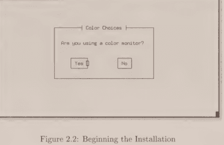

### 2.4.2 PCMCIA 支持

在欢迎对话框之后，安装程序会询问您是否需要 PCMCIA 支持。如果您使用 PCMCIA 设备进行安装（例如，通过 NFS 安装时使用的 PCMCIA 以太网卡，或从 CD 安装时使用的 PCMCIA SCSI 卡），您应该回答“是”；安装程序会提示您插入补充磁盘。在插入 PCMCIA 卡之前，您应该等待下一个对话框出现。

### 2.4.3 选择安装方法

您可以通过四种基本方法中的任何一种安装 Red Hat Linux（参见第 2.2.1 节，安装方法），其中一些方法需要使用补充磁盘。总结如下：

- **CD-ROM** 如果您拥有装有 Red Hat Linux CD 的 CD-ROM 驱动器；不需要补充磁盘。
- **IDE (ATAPI)** 大多数为基于 Intel 的 PC 提供的 CD-ROM 都是 IDE（也称为 ATAPI）CD-ROM。安装程序会在放弃之前检查所有可用的 IDE 设备上的 CD-ROM。
- **SCSI** 如果您的 CD-ROM 连接到受支持的 SCSI 适配器，请选择此项；安装程序会要求您选择一个 SCSI 驱动程序。选择与您的适配器最相似的驱动程序。如有必要，您可以为驱动程序指定选项；然而，大多数驱动程序会自动检测您的 SCSI 适配器。
- **其他** 如果您的 CD-ROM 既不是 IDE 也不是 SCSI CD-ROM，则属于“其他”。安装程序将列出受支持的 CD-ROM 的驱动程序列表；选择一个驱动程序，如有必要，指定任何驱动程序选项。

### 2.4.4 如果您正在通过 NFS 安装

如果您不是通过 NFS 安装 Red Hat Linux，您可以跳到下面的第 2.4.5 节。

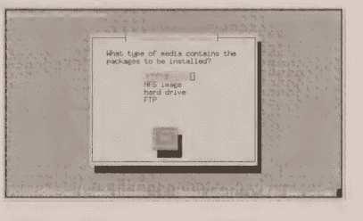

图 2.3：选择安装方法

#### 选择网络驱动程序

如果您是通过 NFS 进行安装，您的计算机中必须安装受支持的网络卡。安装程序提示您选择支持您的网络卡的驱动程序，并指定驱动程序定位和识别该卡所需的任何选项。大多数时候，驱动程序可以通过*探测*自动定位该卡；然而，探测您的硬件可能会导致您的机器挂起。如果发生这种情况，请重新启动机器，再次开始安装，并在此步骤指定额外的驱动程序选项（参见附录 B）。

#### 配置 TCP/IP 网络

在安装程序找到您的网络卡之后，它会显示几个用于配置 TCP/IP 网络的对话框。此信息仅在安装过程中使用；您稍后可以配置永久性的网络信息。如果您希望从机器将“居住”的网络以外的其他网络进行安装，此功能提供了更大的灵活性。图 2.4 包含示例网络信息。

第一个对话框询问您的 IP 和其他网络地址（参见图 2.5）。输入您在安装期间使用的 **IP 地址** 并按 Enter。安装程序试图根据您的 IP 地址猜测您的子网掩码；如果子网掩码不正确，您可以更改它。按 Enter。安装程序根据您的 IP 地址和子网掩码猜测默认网关和主名称服务器地址；如果它们不正确，您可以更改它们。选择“确定”以继续。

| 字段 | 示例值 |
|---|---|
| IP 地址 | 10.0.2.15 |
| 子网掩码 | 255.255.255.0 |
| 默认网关 | 10.0.2.254 |
| 主名称服务器 | 10.0.2.1 |
| 域名 | redhat.com |
| 主机名 | pooh.redhat.com |

图 2.4：示例网络信息

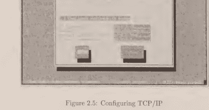

图 2.5：配置 TCP/IP

第二个对话框提示您输入域名、主机名和其他网络信息（参见图 2.6）。输入您系统的 **域名** 并按 Enter；安装程序会将域名向下带到 **主机名** 字段。在域名前输入您使用的主机名，以形成完全限定域名（FQDN）。如果您的网络拥有多个名称服务器，您可以在 **次要名称服务器** 和 **三级名称服务器** 字段中输入额外名称服务器的 IP 地址。选择 **确定** 以继续。

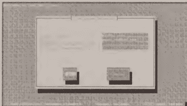

图 2.6：配置网络

#### NFS 服务器信息

最后一个 NFS 专用对话框请求有关 NFS 服务器的信息（参见图 2.7）。输入您的 NFS 服务器的名称或 IP 地址，以及包含 Red Hat Linux CD 的导出目录的名称。例如，如果 NFS 服务器将 Red Hat Linux CD 挂载在 /mnt/cdrom 上，请在 **Red Hat 目录** 中输入 /mnt/cdrom。如果 NFS 服务器导出的是 Red Hat Linux 安装树的镜像而不是 CD，请输入包含 **RedHat** 目录的目录。例如，如果您的 NFS 服务器包含目录 /mirrors/redhat/1386/RedHat，请输入 /mirrors/redhat/1386。

### 2.4.5 升级或安装

在您选择一种安装方法后（如果您是通过 NFS 安装，则是在您配置网络信息之后），安装程序提示您选择 *安装* 或 *升级*（参见图 2.8）。

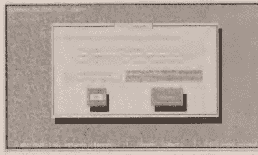

图 2.7：通过 NFS 安装

#### 安装

通常，您会在干净的磁盘分区或分区集上安装 Red Hat Linux，或者在另一个 Linux 安装之上安装。在另一个 Linux 安装（包括 Red Hat Linux）之上安装 Red Hat Linux 不会保留先前安装的任何内容。

如果您希望执行完整安装，请选择“安装”。

#### 升级

Red Hat Linux 4.1 的安装过程包括从基于 RPM 技术的先前版本的 Red Hat Linux（2.0、2.1、3.0.3 和 4.0）进行升级的功能。升级您的系统将安装模块化 2.0.x 内核以及您的机器上已安装的包的更新版本。升级过程使用 .rpmsave 扩展名（例如，sendmail.cf.rpmsave）保留现有配置文件，并在 /tmp/upgradedlog 中留下一个日志，说明它执行了哪些操作。随着软件的发展，配置文件格式可能会发生变化，因此您应该在整合您的更改之前仔细比较原始配置文件和新文件。

如果您希望升级您的 Red Hat Linux/Intel 系统，请选择“升级”。

**请注意：** 某些升级的包可能“依赖”于您的系统上可能未安装的其他包。升级程序会处理这些 *依赖项*，但可能需要安装额外的包以满足它们。

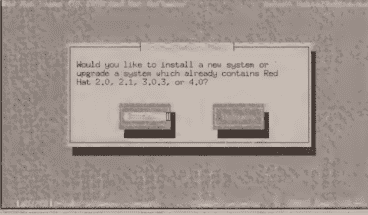

图 2.8：升级或安装

### 2.4.6 SCSI 支持

在您选择执行升级还是完整安装之后，安装程序会询问您是否有任何 SCSI 适配器。如果您选择 **是**，接下来的对话框将显示一个 SCSI 驱动程序列表。选择与您的 SCSI 适配器最相似的驱动程序。然后，安装程序为您提供一个机会，让您为所选的 SCSI 驱动程序指定选项；然而，大多数 SCSI 驱动程序会自动检测您的硬件。

### 2.4.7 如果您正在通过 FTP 安装

如果您不是通过 FTP 安装 Red Hat Linux，您可以跳到下面的第 2.4.8 节。

#### 选择网络驱动程序

如果您是通过 FTP 进行安装，您的计算机中必须安装受支持的网络卡。安装程序提示您选择支持您的网络卡的驱动程序，并指定驱动程序定位和识别该卡所需的任何选项。大多数时候，驱动程序可以通过 **探测** 自动定位该卡；然而，探测您的硬件可能会导致您的机器挂起。如果发生这种情况，请重新启动机器，再次开始安装，并在此步骤指定额外的驱动程序选项（参见附录 B）。

#### 配置 TCP/IP 网络

在安装程序找到您的网络卡之后，它会显示几个用于配置 TCP/IP 网络的对话框。此信息仅在安装过程中使用；您稍后可以配置永久性的网络信息。如果您希望从机器将“居住”的网络以外的其他网络进行安装，此功能提供了更大的灵活性。图 2.4 包含示例网络信息。

第一个对话框询问您的 IP 和其他网络地址（参见图 2.5）。输入您在安装期间使用的 **IP 地址** 并按 `Enter`。安装程序试图根据您的 IP 地址猜测您的 **子网掩码**；如果子网掩码不正确，您可以更改它。按 `Enter`。安装程序根据您的 IP 地址和子网掩码猜测 **默认网关** 和 **主名称服务器** 地址；如果它们不正确，您可以更改它们。选择 **确定** 以继续。

第二个对话框提示您输入域名、主机名和其他网络信息（参见图 2.6）。输入您系统的 **域名** 并按 `Enter`；安装程序会将域名向下带到 **主机名** 字段。在域名前输入您使用的主机名，以形成完全限定域名（FQDN）。如果您的网络拥有多个名称服务器，您可以在 **次要名称服务器** 和 **三级名称服务器** 字段中输入额外名称服务器的 IP 地址。选择 **确定** 以继续。


## FTP 服务器信息

最后一个与 FTP 相关的对话框会请求有关 FTP 服务器的信息（参见图 2.9）。请输入您要从中安装的主机的名称或 IP 地址，以及包含适用于您的体系架构的 RedHat 目录的目录名称。例如，如果 FTP 站点包含目录 /pub/mirrors/redhat/1386/RedHat，请输入 /pub/mirrors/redhat/1386。

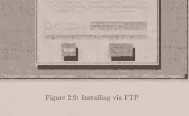

图 2.9：通过 FTP 安装

### 2.4.8 为 Red Hat Linux 创建分区

在决定是否使用 SCSI 支持之后（如果是通过 FTP 安装，在配置网络信息之后），安装程序会显示其能在您的系统上找到的硬盘列表，并提示您为 Red Hat Linux 预留至少一个磁盘分区。如果需要创建一个或多个分区，请选择您要分区的磁盘并按 [Enter]；安装程序将启动 Linux fdisk 实用工具。关于为 Red Hat Linux 创建分区的建议，请参阅第 2.2.3 节。

#### 使用 fdisk

fdisk 包含简练但有用的在线帮助。以下是几条提示：

- 要列示当前的分区表，请使用 `p` 命令。要添加新分区，请使用 `n`。
- Linux `fdisk` 默认创建类型为 `Linux native` 的分区。创建 swap 分区时，请使用 `t` 命令不要忘记将其类型更改为 `Linux swap`。
- Linux 允许单个磁盘上最多有四个 (4) 分区。如果您希望创建更多分区，其中四个分区之一可以是*扩展*分区，该分区进而包含一个或多个*逻辑*分区。由于它充当容器，扩展分区必须跨越逻辑分区将占用的所有空间。
- 在创建每个分区时，记下哪些分区（例如，`/dev/hda2`）用于哪些文件系统（例如，`/usr`）是个好主意。
- **请注意：** 您所做的任何更改，直到使用 `w` 命令保存并退出 `fdisk` 之前，均不会生效。您可以随时使用 `q` 命令退出 `fdisk` 而不保存更改。

#### 分区编号

Linux 使用字母和数字的组合来引用磁盘分区，这可能会让新手用户感到困惑。以下是摘要：

- **字母**表示分区所在的设备，例如，`/dev/hda`（第一个 IDE 硬盘）或 `/dev/sdb`（第二个 SCSI 磁盘）。
- **数字**表示分区。前四个（主分区或扩展分区）的编号为 1 到 4。逻辑分区从 5 开始。例如，`/dev/hda3` 是第一个 IDE 硬盘上的第三个主分区或扩展分区；`/dev/sdb6` 是第二个 SCSI 硬盘上的第二个逻辑分区。

#### 更改分区表

完成磁盘分区后，请按下 **Done**；您可能会看到一条消息，指示安装程序需要重启。这是在更改磁盘分区数据后的正常现象；如果您创建、修改或删除了任何扩展分区，通常会发生这种情况。按下 **OK** 后，您的机器将重启。请按照您在 **Partitioning Disks** 之前执行的相同安装步骤进行操作；然后只需选择 **Done** 即可。

### 2.4.9 初始化交换空间

在为 Red Hat Linux 创建分区后，安装程序会查找 swap 分区。如果找到任何分区，它会询问您是否希望初始化它们。使用 `Space` 选择要初始化为交换空间的分区，然后选择 **OK**。

如果安装程序找不到您的 swap 分区，请确保已将分区类型设置为 **Linux swap**；请参阅上述第 2.4.8 节。

### 2.4.10 文件系统配置

由于 Red Hat Linux 可能分布在多个磁盘分区上，您需要选择哪些磁盘分区与哪个*文件系统*对应。

#### 选择根分区

在初始化交换空间后，安装程序会显示其能找到的 Linux 分区列表，并提示您选择*一个根分区*。根分区（或*根文件系统*）是持有*启动您的 Red Hat Linux 系统所需的一切*的分区：在系统启动时，它会被挂载在 `/`（*根目录*）上。选择您要使用的根分区并按 `Enter`。

#### 其他分区

下一个对话框会显示系统上大多数磁盘分区的列表（包括 Linux 可以读取的 MS-DOS 和其他分区），为您提供机会将其他分区分配给文件系统的不同部分。您分配的文件系统将在 Red Hat Linux 系统启动时自动挂载。选择要分配的分区并按 `Enter`（或选择 **Edit**）；然后输入该分区的*挂载点*，例如，`/usr`（参见图 2.10）。

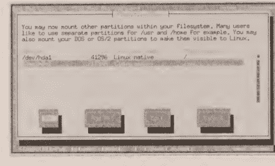

此外，Red Hat Linux 允许您在系统启动时挂载 NFS 卷；这使得目录树可以在网络上共享。选择 `Add NFS`，然后输入 NFS 服务器的主机名、NFS 卷的路径以及该卷的本地挂载点（参见图 2.11）。

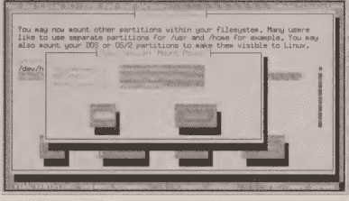

图 2.11：添加 NFS 挂载

#### 格式化分区

下一个安装对话框会显示待格式化分区的列表。大多数分区应该进行格式化，特别是如果它们是新创建的；但是，诸如 /home 或 /usr/local 之类的分区，如果您希望保留其中的数据，则无需格式化。选择要格式化的每个分区并按 `Space`。如果您希望在格式化每个文件系统时检查坏块，请选择 `Check for bad blocks during format`。按下 `OK`。

### 2.4.11 选择和安装软件包

在配置并格式化您的分区后，您可以准备选择要安装的软件包。您可以选择*系统组件*（根据功能将软件包分组）、选择单个软件包，或选择两者的组合。

#### 2.4.12 逐步安装


#### 选择系统组件

系统组件根据您的 Red Hat Linux 系统应能够执行的功能对软件包进行分组：例如，**C Development**、**Networked Workstation** 或 **Web Server**。选择您要安装的每个组件并按 `Space`。选择 **Everything** 将安装 Red Hat Linux 包含的所有软件包（参见图 2.12）。

如果您还希望选择或取消选择单个软件包以及系统组件，请选择 **Select individual packages**。

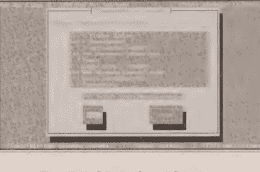

图 2.12：选择系统组件

#### 选择单个软件包

在选择要安装的组件后，您可以选择或取消选择单个软件包。安装程序会显示可用软件包组的列表；选择一个组进行检查并按 `Enter`。安装程序会显示该组中软件包的列表，您可以使用 `Space` 选择或取消选择。您可以通过按 `F1` 查看软件包的详细描述（参见图 2.13）。完成选择单个软件包后，在 **Select Group** 对话框中按 **OK**。

**请注意：** 某些软件包（如内核和某些库）是每个 Red Hat Linux 系统所必需的，因此无法选择或取消选择。

#### 软件包依赖项

许多软件包为了正确运行，依赖于系统中已安装的其他软件包或库。例如，许多图形化的 Red Hat 系统管理工具需要 python 和 pythonlib 软件包。为了确保您的系统拥有完全正常运行所需的所有软件包，Red Hat Linux 会在每次安装或卸载软件包时检查依赖项。

在完成选择要安装的软件包后，安装程序会检查所选软件包列表中的依赖项。如果有任何软件包需要您未选择安装的其他软件包，程序将显示这些未解决的依赖项列表，并给您机会解决它们（参见图 2.14）。如果您只是按 OK，程序将通过将所有必需的软件包添加到所选软件包列表中来自动解决它们。


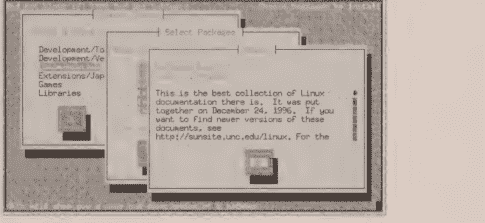

图 2.13：选择软件包

## 软件包安装

在所有软件包依赖关系解析完成后，安装程序开始安装软件包；它会在你的 Red Hat Linux 系统的 `/tmp/install.log` 中留下完整的安装日志。

## 2.4.12 选择键盘布局

在安装完你选择的所有软件包后，安装程序会列出可安装的键盘布局（见图 2.15）。请选择你希望在 Red Hat Linux 系统中使用的键盘布局，然后按 `Enter` 键；安装程序会立即安装该键盘布局。

如果你希望在启动 Red Hat Linux 系统后更改键盘布局，可以使用 `/usr/sbin/kbdconfig` 命令。

## 2.4.13 配置鼠标

要配置鼠标，请选择最符合你鼠标类型的选项，然后按 `Enter`。如果你使用的是双键鼠标，并希望同时点击左右键来模拟第三个（中）键，请选择**模拟三键**。

如果你选择了串行鼠标，下一个对话框将提示你选择鼠标连接的串行（COM）端口。请选择正确的端口，然后按 `Enter`。

> **请注意：** 如果你的鼠标连接到*PS/2 鼠标端口*，无论它是什么类型的鼠标，你都应该选择 **PS/2 鼠标**。

如果你希望在启动 Red Hat Linux 系统后更改鼠标配置，可以使用 `/usr/sbin/mouseconfig` 命令。

## 2.4.14 配置 X 窗口系统

在设置好鼠标之后，如果你安装了 X 窗口系统软件包，你就有机会配置你的 X 服务器。如果你没有*选择*安装 X 窗口系统，你可以跳到下面的第 2.4.15 节。

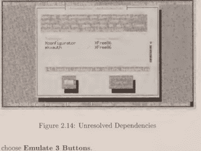

### 配置 Metro-X 服务器

如果你正在使用官方 Red Hat Linux/Intel CD 进行安装，你可以安装一份 MetroLink 的 Metro-X 服务器，这是一种高质量的商用 Linux X 服务器。有关许可证信息，请参阅随附在你 Red Hat Linux CD 上的 MetroLink 许可证（纸质副本）。如果你选择使用 Metro-X，安装程序将启动 Metro-X 配置工具 `configX`；有关如何使用 `configX` 的更多信息，请参阅第 5 章第 5.3 节。

### 配置 XFree86 服务器

如果你希望使用 XFree86（因为 Metro-X 可能不支持你的显卡，或者你已经在另一台机器上安装了 Metro-X，或者你的 Red Hat Linux/Intel 副本中不包含 Metro-X，或者你只是更喜欢使用 XFree86），安装程序将启动 `Xconfigurator` 工具，该工具在第 5 章第 5.2 节中有详细说明。

`Xconfigurator` 首先会列出一系列显卡。请从列表中选择你的显卡，然后按 `Enter`。如果列表中未显示你的显卡，XFree86 可能不支持它；不过，如果你对显卡的技术细节有所了解，你可以选择**未列出的显卡**并尝试进行配置。

选定显卡后，安装程序将安装相应的 XFree86 服务器，*Xconfigurator* 会列出显示器列表。如果你的显示器出现在列表中，请选择它并按 `Enter`。否则，请选择*自定义*。如果你选择了*自定义*，*Xconfigurator* 会提示你选择显示器的水平同步范围和垂直同步范围（这些值通常可以在随显示器提供的文档中找到，或从显示器供应商或制造商处获取）。

> **请注意：** 不建议选择与你的显示器“相似”的选项，除非你确定所选显示器的能力不超过你实际显示器的能力。如果这样做，你可能会使显示器超频，从而损坏或摧毁它。

接下来，*Xconfigurator* 会提示你输入显卡上安装的显存大小。如果不确定，请查阅随显卡提供的文档。选择比实际可用显存更多的量通常不会损坏显卡，但如果这样做，XFree86 服务器可能无法正确启动。

如果你选择的显卡可能带有视频时钟芯片，*Xconfigurator* 会列出一系列时钟芯片。建议的选择是*无时钟芯片设置*，因为在大多数情况下，XFree86 可以自动检测正确的时钟芯片。

最后，*Xconfigurator* 会提示你选择要使用的视频模式；按 `Space` 键选择一个或多个模式。*Xconfigurator* 然后将包含所有选择的配置文件写入 `/etc/X11/XF86Config`。

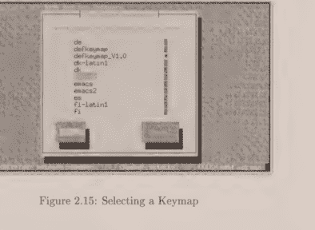

## 2.4.15 配置网络

在协助你配置 X 服务器后，安装程序会给你一个配置（或重新配置）网络的机会。如果你是通过 CD-ROM 或本地硬盘进行安装，安装程序会询问你是否要配置网络。如果你选择**否**，你的 Red Hat Linux 系统将是一个独立工作站。如果你选择**是**，你可以按照以下说明配置网络。

如果你是通过 NFS 或 FTP 安装 Red Hat Linux，你之前已经配置了临时网络信息。安装程序提供三个选项：

- 保留你用于安装的网络设置；你之前输入的所有网络信息将成为系统永久配置的一部分。
- 重新配置网络；安装程序将显示下面描述的网络配置对话框，并将安装过程中使用的值作为默认值填入。如果你的系统将安装在与安装 Red Hat Linux 时使用的不同的网络上，请选择此项。
- 完全不设置网络；你的系统将不会配置网络。如果你是通过网络安装系统，但将其用作独立工作站，请选择此项。


### 网络配置对话框

在安装程序找到你的网卡后，它会显示几个用于配置 TCP/IP 网络的对话框。此信息仅在安装过程中使用；之后你可以配置永久网络信息。如果你希望从机器最终所在网络以外的其他网络进行安装，此功能提供了更大的灵活性。图 2.4 包含示例网络信息。

第一个对话框询问你的 IP 地址和其他网络地址（见图 2.5）。输入你安装期间使用的 **IP 地址**，然后按 `Enter`。安装程序将根据你的 **IP 地址** 尝试猜测你的 **子网掩码**；如果错误，你可以更改子网掩码。按 `Enter`。安装程序根据你的 IP 地址和子网掩码猜测 **默认网关** 和 **主要名称服务器** 地址；如果错误，你可以更改它们。选择 **确定** 以继续。

第二个对话框提示你输入域名、主机名和其他网络信息（见图 2.6）。输入你系统的 **域名**，然后按 `Enter`；安装程序会将域名传递到 **主机名** 字段。在域名前输入你正在使用的主机名，以形成完全限定域名（FQDN）。如果你的网络有多个名称服务器，你可以在 **次要名称服务器** 和 **第三级名称服务器** 字段中为额外的名称服务器输入 IP 地址。选择 **确定** 以继续。


## 2.4.16 配置时钟

在设置好网络后，安装程序会显示一个对话框，帮助你配置 Red Hat Linux 系统的时区。

如果你希望将硬件（CMOS）时钟设置为 GMT（格林尼治标准时间，也称为 UTC，即协调世界时），请选择 **硬件时钟设置为 GMT**。将硬件时钟设置为 GMT 意味着，如果你的时区使用夏令时，你的 Red Hat Linux 系统将正确处理夏令时。大多数网络使用 GMT。

从列表中选择你的系统将运行的时区，然后按 <u>Enter</u>。

如果你希望在启动 Red Hat Linux 系统后更改时区配置，可以使用 `/usr/sbin/timeconfig` 命令。

## 2.4.17 设置 Root 密码

在设置好系统时区后，安装程序会提示你为系统设置 *root 密码*；这是你首次登录 Red Hat Linux 系统时使用的密码。

Root 密码必须至少为六个字符；你输入的密码不会在屏幕上回显。你必须两次输入密码；如果两次输入不匹配，安装程序将要求你重新输入（见图 2.16）。

你应该将 root 密码设置为容易记住但他人难以猜测的内容。你的姓名、电话号码、*qwerty*、*password*、*root*、*123456* 和 *anteater* 都是糟糕的密码示例。好的密码混合了数字和大写字母与小写字母，并且不包含词典中的单词：例如 Aard387varK 或 410VBltlSW。请记住，密码是区分大小写的。请写下这个密码，并将其保存在安全的地方。

**请注意：** *root* 用户（也称为 *超级用户*）具有完全

系统的全局访问权限；因此，建议仅在执行系统维护或管理操作时才以 root 用户登录，以免关键系统文件被意外修改、移动或删除。请参见第 8.1 节，了解在重启系统后如何为自己添加用户的说明。

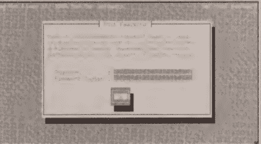

图 2.16：Root 密码输入

## 2.4.18 安装 LILO

为了能够启动你的 Red Hat Linux 系统，通常需要安装 LILO（LIinux LOader，Linux 加载器）。你可以将 LILO 安装在以下几个位置之一：

- **主引导记录（MBR）** 是安装 LILO 的推荐位置，除非该位置已经安装了其他操作系统加载器（例如 System Commander 或 OS/2 的启动管理器）。当机器启动时，LILO 将启动并显示 boot: 提示符；你可以启动 Red Hat Linux 或任何配置 LILO 启动的其他操作系统（见下文）。

- **根分区的第一个扇区** 如果你系统中已经使用了其他启动加载器（如 OS/2 的启动管理器），则推荐选择此处；这样你可以配置该启动加载器来启动 LILO 并引导 Red Hat Linux。

- **软盘的第一个扇区** 是上述任一选项的替代方案；若要启动 Red Hat Linux，请将 LILO 软盘插入机器的软盘驱动器并重新启动。LILO 将从软盘启动并显示 boot: 提示符。

选择你要安装 LILO 的位置，然后按 **确定**。如果你不想安装 LILO，请按 **跳过**。

## LILO 的限制

LILO 受到大多数 PC BIOS 的一些限制。如果你想在硬盘上安装 LILO，你的根分区必须位于以下位置（“规则”）：

1. 如果你有 2 个 IDE（或 EIDE）硬盘，你的根分区必须位于其中之一。这也包括主控制器上的任何 IDE CD-ROM 驱动器。如果你有一个 IDE 硬盘和一个 IDE CD-ROM 位于主控制器上，你必须将根分区安装在硬盘上。
2. 如果你有一个 IDE（或 EIDE）硬盘和一个或多个 SCSI 硬盘，你的根分区必须位于 IDE 硬盘或 ID 为 0 的 SCSI 硬盘上。其他 SCSI ID 均不适用。
3. 如果只有 SCSI 硬盘，你的根分区必须位于 ID 为 0 或 ID 为 1 的硬盘上。其他 SCSI ID 均不适用。
4. 在任何情况下，你的 Linux 内核（以及，如果你使用 SCSI 适配器，初始 ramdisk）必须位于柱面 1023 以下。对于 IDE（或 EIDE）硬盘，这通常意味着位于 512 MB 标记以下；对于 SCSI 硬盘，通常位于 1 GB 标记以下。确保此条件最简单（且推荐）的方法是确保整个根分区位于柱面 0–1023 之间。某些较新的 BIOS 没有此限制。

## 为 LILO 启动命令行添加选项

最后，安装程序将询问你是否希望为 LILO 启动命令添加默认选项。你输入的任何选项都将在每次 Linux 内核启动时传递给内核。完成后按 **确定**。

## LILO 的替代方案

如果你不希望使用 LILO 来启动你的 Red Hat Linux 系统，有几种替代方案：

LOADLIN 可以从 MS-DOS 加载 Linux；不幸的是，它需要在 MS-DOS 分区上提供 Linux 内核的副本（如果你使用 SCSI 适配器，还需要初始 ram 盘）。实现此目的的唯一方法是使用其他方法（例如从软盘上的 LILO）启动你的 Red Hat Linux 系统，然后将内核复制到 MS-DOS 分区。LOADLIN 可从 ftp://sunsite.unc.edu/system/Linux-boot/ 及 sunsite 的各种镜像站点获取。

SYSLINUX 是一个与 LOADLIN 非常相似的 MS-DOS 程序；它也可从 ftp://sunsite.unc.edu/system/Linux-boot/ 及 sunsite 的各种镜像站点获取。

一些商业启动加载器，如 System Commander，能够启动 Linux（但可能仍要求在你的 Linux 根分区中安装 LILO）。

## 2.4.19 完成...或开始

完成 LILO 安装后，安装程序将重启你的系统。请不要忘记从软盘驱动器中取出安装软盘。

在 boot: 提示符处，按 Enter 并观看你的 Red Hat Linux 系统启动。当显示 login: 提示符时，输入 root；在 Password: 提示符处，输入你在第 2.4.17 节中为你的机器设置的 root 密码。

# 第 3 章

# 安装 Red Hat Linux/Alpha

## 3.1 简介

这是针对 Digital Equipment Corporation 的 Alpha 系列处理器上的 Red Hat Linux/Alpha 4.1 版本的简要安装说明。本章描述了安装 Red Hat Linux/Alpha 与 Red Hat Linux/Intel 之间的差异。有关安装程序的更多详情，请参见第 2 章，安装 Red Hat Linux/Intel。

## 3.2 支持的硬件

Red Hat Linux/Alpha 支持基于 Alpha 处理器和 PCI 总线的多种硬件。已知支持此版本的平台包括：

1. AlphaPC64 (Cabriolet, Aspen Telluride)
2. AxpPCI33 (Noname)
3. EB64+ (Aspen Alpine)
4. EB66 (NekoTech Mach 1)
5. EB66+
6. Jensen (DEC PC 150, 2000 model 300, Culean)
7. Univeral Desktop Box (UDB, 有时称为 Multia)。这只是一个非名牌主板，在此文档的其余部分将其视为非名牌主板处理。
8. AlphaStation 200, 250, 255, 400 (Avanti machines)
9. EB164 (Aspen Avalanche, Timberline, Summit; Microway Screamer)
10. Kinetics 的 Platform 2000 机器
11. PC164 机器 (Durango)
12. Alcor 类型机器 (AlphaStation 500, 600; Maverick, Brett)
13. Alpha-XL
14. Alpha-XLT (XL 300, XL 366)
15. Mikas 类型机器 (AlphaServer 1000), 不支持 1000A)

除了 Jensen 之外的所有那些平台都包含 NCR 810 SCSI 控制器，虽然 BusLogic PCI SCSI 控制器（FlashPoint 除外）、Adaptec AHA2940 SCSI 控制器和 Qlogic 1020 ISP 控制器也受到支持。Jensen 设计使用 AHA1740 SCSI 控制器并受支持。

支持 NE2000、DE422 和 DE4x5 (PCI) 以太网卡。这包括 UDB 的内部以太网硬件。内核中还包括令牌环支持。

X 窗口系统应在除 Jensen 机器以外的任何使用基于 S3 的视频卡的机器上正常工作。可从 ftp://ftp.azstarnet.com 的 /pub/linux/axp/jensen 目录获取 S3 卡的服务器。TGA 服务器（例如在 UDB 上有效）可在你的 Red Hat Linux/Alpha CD 的 X11 目录中找到。Orchid 和 Number 9 的大多数卡都能工作。大多数 Diamond Stealth 卡也受到支持。Digital TGA 卡（基于 DC21030 芯片）在 8 位模式下受支持，并且还提供了用于 Mach64 卡的 X 服务器。

有关 Alpha 硬件的更多信息见附录 D。

## 3.3 安装迷你加载器 MILO

启动 Red Hat Linux/Alpha 的最简单方法是通过 Linux 迷你加载器 MILO。你可以直接从系统固件加载 MILO，或者使用 ARC 控制台将 MILO 作为替代操作系统加载。有关这些过程的详情见 MILO FAQ，该文档作为附录 E 提供。

完整的 MILO 树位于 CD 的 *milo* 目录中。它包含制作此 CD 时可用的最新文档和 MILO 镜像。然而，MILO 的后续版本定期在 *gatekeeper.dec.com* 上提供。*images/arc* 目录还包含可用于 ARC 控制台直接启动到 MILO 的软盘镜像。它们包含 MILO 和 **load.exe**，以及支持 MILO 刷写的平台可用的 MILO 可刷写版本和刷写管理实用程序。如果你在 MILO 方面遇到困难，首先尝试使用更新版本的 MILO。

如果你的机器不支持 MILO，你需要直接从 SRM 控制台启动软盘或 CD。有关如何操作的信息可从 Red Hat Software 网站获取，网址为 `http://www.redhat.com/linux-info/alpha/faq`。

## 3.4 安装 Red Hat Linux/Alpha

### 3.4.1 制作启动盘

安装 Red Hat Linux/Alpha 的第一步是创建启动盘；使用哪个启动盘取决于你拥有的硬件。各种启动盘镜像在 Red Hat Linux/Alpha CD 的 *images* 目录中可用，其中还包含一个 README，提供有关可用各种镜像的更多信息。

可用的启动镜像包括：

1. `cab.img` (AlphaPC64, Cabriole)
2. `noname.img` (AxpPCI33, Noname, Universal Desktop Box)
3. `eb64p.img` (EB64+, Aspen Timberlines)


- 4. `eb66.img` (EB66)
- 5. `eb66p.img` (EB66+)
- 6. `jensen.img` (Jensen's)
- 7. `avanti.img` (AlphaStation 200, 250, 400)
- 8. `xl.img` (Alpha XL)
- 9. `xlt.img` (Alpha XTL)
- 10. `eb164.img` (基于 EB164 的机器)
- 11. `p2000.img` (Platform 2000)
- 12. `pc164.img` (基于 Alcor 的机器)
- 13. `alcor.img` (基于 Alcor 的机器)
- 14. `mikasa.img` (基于 Mikasa 的机器)

所有这些镜像都应在基于 VGA 或 TGA 的显卡机器上正常工作。要从这些镜像创建软盘，请在 MS-DOS 或 MS-Windows 下使用 `rawrite.exe`（它位于 `dosutils` 目录中），或者在 Linux 或 Unix 下使用 `dd`。

### 3.4.2 开始安装

安装 Red Hat Linux/Alpha 需要使用 ramdisk。Red Hat Linux/Alpha CD 的 `images` 目录中有几个 ramdisk 镜像。要开始安装，请引导至 MILO 提示符，并将启动盘插入您的第一个软驱。然后向 MILO 输入以下命令：

```
boot fd0:vmlinux.gz root=/dev/fd0 load_ramdisk=1 prompt_ramdisk=1
```

MILO 从启动盘读取 Linux 内核并运行它。内核从软盘剩余部分加载基本系统并运行安装程序。如果您使用的是 SRM 控制台，必须将 `load_ramdisk=1 prompt_ramdisk=1` 命令作为参数传递给内核，以便正确开始安装。Red Hat Linux/Alpha 支持两种硬盘分区方式：

- 标准 *fdisk* 风格的分区；这种分区具有常见的特性（例如扩展分区），并且与 Intel 平台上的操作方式相同（使用 Linux *fdisk*）。如果您使用的是 ARC 控制台，则必须使用此分区风格。
- BSD 风格的磁盘标签。对于带有磁盘标签的硬盘，通常将第一个分区设为交换分区。我们不建议使用 BSD 磁盘标签，除非绝对必要。

### 3.4.3 收尾工作

安装完成且系统完全配置好之后，系统会提示您重置计算机。这表明您的系统已成功安装。

### 3.5 引导您的 Red Hat Linux/Alpha 系统

要从 MILO 引导 Red Hat Linux，您必须使用 **boot** 命令。该命令会根据根分区的位置略有不同。例如，如果您的根分区是第一个 SCSI 硬盘上的第二个分区，您可以如下引导：

```
boot sda2:vmlinux.gz root=/dev/sda2
```

如果您的根分区是第二个 IDE 硬盘上的第三个分区，请使用此命令：

```
boot hdb3:vmlinux.gz root=/dev/hdb3
```

有关这些命令以及自动化引导过程的更多信息，请阅读附录 E 中的 MILO HOWTO。

# 第 4 章 安装 Red Hat Linux/SPARC

以下是 Red Hat Linux/SPARC 4.1 版本针对 SPARC 系列处理器的简要安装说明。本章描述了安装 Red Hat Linux/SPARC 与 Red Hat Linux/Intel 之间的差异。有关安装过程的更多详细信息，请参阅第 2 章。

### 4.1 硬件

已知 Red Hat Linux/SPARC 可在以下硬件上运行：

- sun4c 架构机器（IPC, SS1 等）
- sun4m 架构机器（Classic, SS5, SS10 等）
- bwtwo, cg3, cg6, TCX 帧缓冲（TCX 上的 24 位）
- cg14 帧缓冲（cg3 模式）
- 上述所有机器上的 SCSI 和以太网
- 4 型和 5 型键盘和鼠标
- 外部 SCSI 驱动器
- CD-ROM 驱动器（外部和内部）
- SCSI/以太网 SBUS 扩展卡
- 适用于上述帧缓冲的任何原装 Sun 监视器

**不支持**的硬件部分列表：

- 基于 VME 的 sun4m 机器，例如 4/690
- sun4d (SS1000, SS2000)
- sun4u (UltraSparc1, UltraSparc2, EnterPrise UltraSparc 服务器)
- sun4 架构
- 在 Solaris2.4 和其他系统中被称为 'sun4e' 的 Eurocard sun4c 机器不受支持。这些是 VME 总线 sun4c 机器，内核尚未移植到这些机器上。

### 4.2 从软盘引导

首先，您需要将系统引导到安装程序。您需要创建启动软盘，而创建软盘取决于您拥有的 PROM 版本。Red Hat Linux/SPARC CD 上的 **images 目录**包含两个镜像。如果您的 PROM 版本为 0 或 1（这是主要版本号...PROM 1.6 是 type 1 PROM），请使用 *boot-r0.img*；如果您的 PROM 版本为 2.0 或更高，请使用 *boot-v2.img*。要创建软盘，您可以在 MS-DOS 下使用 *rawrite.exe*（位于 Red Hat Linux/SPARC CD 的 *dosutils* 目录中），或者在 Linux 或 Unix 下使用 **dd**。在 MS-DOS 下，您应输入以下命令（假设 CD-ROM 驱动器为 **d**）：

```
d:            
cd \images     
..\dosutils\rawrite.exe
```

当提示时，输入要写入软盘的镜像文件名。在 Linux 或 Unix 下，挂载 CD，切换到其挂载目录，并使用以下命令：

```
dd if=images/boot-v2.img of=/dev/fd0
```

如果您拥有 version 0 或 1 PROM，请将 boot-v2.img 替换为 boot-v0.img。另外请注意，在 Solaris 下不要使用 /dev/rfd0；它将无法工作。请改用 /dev/fd0。

插入软盘，并在 PROM 提示符下输入 boot floppy。您将看到一个 SILO 提示符。如果您希望使用 ramdisk 进行安装（它将使用约 2M RAM，并建议在拥有 8M 或更多 RAM 时使用），只需在 SILO 提示符下按 Enter 键即可。如果您希望进行基于 NFS 根的文件系统安装，您需要在此提供一些参数。公式如下：

```
linux nfsroot=nfs.server.IP.address:/path/to/RH/image
```

要使此功能正常工作，您需要网络上的一个 rarp 条目或 bootp 条目，以告知您的 SPARC 其 IP 地址。这在下面的第 4.3 节中有说明。

### 4.3 通过网络引导

如果您没有软驱，并且您的 PROM 版本低于 2，您需要通过网络引导。这相对容易，但您需要本地网络上的一台服务器有一个 rarp 条目，以告知目标 SPARC 其 IP 地址。可以在内核算入了 RARP（或作为模块插入）的 Linux 系统上，使用以下形式的命令来完成：

```
rarp -s ip.address.of.sparc hw:address:of:sparc
```

在大多数情况下，您还需要一个 ARP 条目；例如：

```
arp -s ip.address.of.sparc hw:address:of:sparc
```

现在，您需要在本地网络上设置一个 TFTP 服务器，向目标 SPARC 提供内核。这应该是执行上述 rarp 的同一台机器。在 Red Hat Linux 中，可以通过编辑 /etc/inetd.conf 来完成。您需要一个类似以下的条目：

```
tftp dgram udp wait root /usr/sbin/tcpd in.tftpd /home/tftp
```

现在您可以将 /images/vmlinuz 复制到服务器上的 /home/tftp，并创建一个符号链接，以便 PROM 能够获取正确的文件。该符号链接取决于目标 SPARC 的 IP 地址和架构。您需要将链接命名为 IP 地址的十六进制值后接“点”再接架构。例如，要为 flanders.redhat.com（一台 IP 地址为 199.183.24.232 的 sun4m 机器）创建符号链接，您应输入以下命令：

```
cd /home/tftp
ln -s vmlinuz C7B718E8.SUN4M
```

此时，您应该能够进入 SPARC 的 PROM 并输入：

```
boot net nfsroot=nfs.server.IP.address:/path/to/RH/image
```

它应该从 TFTP 服务器满足其 rarp 请求，并通过 TFTP 开始加载内核。然后内核应启动并开始安装。

引导安装磁盘后，您会看到一个带有单个按钮的欢迎屏幕；按 Enter 键开始安装。

现在，选择您要从中安装的介质：NFS、硬盘或 FTP。仅当存在具有 EXT2 文件系统的现有分区时，从硬盘安装才能正常工作；从 UFS 安装尚未实现。

## 4.4 网络安装

您也可以通过 TFTP 传输完整的安装镜像（内核和根文件系统）来进行 FTP 安装。您希望执行与上述示例相同的操作，例-


cept for the nfsroot and the kernel link. Instead of using `/images/vmlinux.` use `tftpboot.img`. Put it in `/home/tftp` and make the symlink:

```bash
cd /home/tftp 
ln -s tftpboot.img C7B718EB_SUN4M
```

请记得根据你自己的网络编号和机器架构更改 IP 地址和架构。

现在你需要做的只是在 SPARC 上执行 **boot net**，它应该会通过 TFTP 传输所有内容，启动内核并开始安装程序。然后你可以从附近的服务器进行 FTP 安装，或者也可以选择进行 NFS、硬盘或 CD-ROM 安装。

## 4.5 使用串行终端安装

你还可以使用串行终端安装 Red Hat Linux/SPARC 4.1：任何模拟 VT100 的终端都应该能正常工作。从软盘启动，并在 SILO 提示符下输入：

```bash
linux serial
```

安装程序在第一个串行端口上运行，设置为 9600,8,N,1（9600 波特率，8 位数据，无奇偶校验，1 位停止位）。如果你的串行终端支持颜色，安装程序可以以彩色模式运行。

在串行安装过程中的任何提示对话框（任何带有“确定”按钮的对话框），你都可以按 Ctrl + Z 启动一个子 shell；要返回安装程序，请在 shell 提示符下输入 exit。

**重要！** 使用串行终端安装后，登录你的 Red Hat Linux 系统的唯一方式是通过网络；然而，`/etc/security` 文件会阻止 root 用户从网络登录。当串行安装完成但尚未重启机器之前，请按 Ctrl + Z 启动一个子 shell 并输入以下命令：

```bash
rm /mnt/etc/security
```

如果你未能执行此步骤，你将无法登录到机器。

## 4.6 安装：选择系统组件

（有关系统组件的说明，请参阅第 2 章，第 2.4.11 节。）

**重要！** 在为 Red Hat Linux/SPARC 选择要安装的系统组件时，如果不选择 **选择单个软件包** 而选择安装 **所有功能**，可能会导致 Red Hat Linux 系统无法启动。

最后安装的内核将是一个多处理器内核，这将在单处理器机器上无法工作。此外，默认的 X 服务器最终会是 **XsunMono**，这可能对大多数人来说无法正常工作。如果你确实希望安装 **所有功能**，同时也选择 **选择单个软件包**。然后，除了你希望安装的那个（**kernel-sparc** 适用于大多数情况）之外，取消选择所有内核，以及除了适用于你的硬件的那个之外（lwtwo 显卡使用 XsunMono，所有 8 位显示器使用 **Xsun**，支持的 24 位显示器使用 **Xsun24**）的所有 X 服务器。

## 4.7 SILO 配置

SILO 配置与 LILO 配置几乎相同，详见第 2.4.18 节。

## 4.8 分区

为 SPARC 分区硬盘时还有一个额外的步骤。你必须将每个磁盘的第三个分区创建为类型 **整盘（Whole Disk）**，从 0 柱面延伸到磁盘末尾。它不应该被触碰，但应该存在。你仍然可以像平常一样创建其他分区。

## 4.9 X Windows

SPARC 上没有鼠标或 X Windows 配置。默认安装的是 8 位服务器。如果你想使用 24 位服务器（用于 TCX 卡），你需要安装 **Xsun24** 软件包。如果你只有 bwtwo 帧缓冲器并希望提高性能，请安装 **XsunMono** 软件包。

安装上述两者中的任何一个都需要你重新启动 X Windows。此外，如果你使用上述服务器之一，你可以卸载 Xsun 软件包。

# 第 5 章

## 安装后配置

安装完成后，你的系统已完全可用，但你可能仍希望进行一些额外的配置。本章描述你可能需要执行的一些系统配置任务。

## 5.1 构建自定义内核

随着 Linux 2.0.x 内核引入模块化，构建自定义内核发生了一些重大变化。过去，如果你想访问特定的硬件或文件系统组件，必须将支持编译进你的内核。对于某些硬件配置，内核的大小可能迅速达到临界水平。要求对偶尔使用的项提供即时的支持是对系统资源的低效使用。利用 2.0.x 内核的功能，如果某些硬件组件或文件系统使用频率较低，可以按需加载它们的驱动程序模块。有关处理内核模块的信息，请参阅第 8 章，第 8.6 节。

### 5.1.1 构建模块化内核

只有 Red Hat Linux/Intel 和 Red Hat Linux/SPARC 支持模块化内核；Red Hat Linux/Alpha 用户必须构建整体式内核（参见下文第 5.1.3 节）。

这些说明提供了利用通过内核模块化所获得的强大功能和灵活性所需的知识。如果你不想利用模块化，请参阅第 5.1.3 节，其中解释了构建和安装整体式内核的不同方面。假设 **kernel-source** 软件包已经安装，并且所有命令都在 *usr/src/linux* 目录中执行。

重要的是要以已知的状态开始内核构建的源树。因此，建议你先执行命令 **make mrproper**。这将删除任何配置文件以及可能散落在源树中的任何先前构建的残留物。现在，你必须创建一个配置文件，以确定在新内核中包含哪些组件。根据你的硬件和个人偏好，有三种方法可用来配置内核。

- **make config** 一个交互式文本程序。组件会依次呈现，你用 **Y**（是）、**N**（否）或 **M**（模块）回答。
- **make menuconfig** 一个图形化的菜单驱动程序。组件在类别菜单中呈现，你使用与 Red Hat Linux 安装程序相同的方式选择所需的组件。切换对应于你想包含的项的标签；**Y**（是）、**N**（否）或 **M**（模块）。
- **make xconfig** 一个 X Windows 程序。组件列在不同的菜单层级中，使用鼠标选择组件。同样，选择 **Y**（是）、**N**（否）或 **M**（模块）。

为了使用 **kernel**（详见第 8.6 节）和内核模块，你必须在配置中对 **内核支持（kernel support）** 和 **模块版本（CONFIG_MODVERSIONS）支持** 回答 **Yes**。如果你想使用已经通过上述方法之一创建的配置文件的内核（*usr/src/linux/.config*），你可以省略 make mrproper 和 make config 命令，并使用 make dep 命令后跟 make clean 来为构建准备源树。

下一步是将源代码组件实际编译成你的机器可用于启动的工作程序。这里描述的方法在发生意外时最易于恢复。如果你对其它可能性感兴趣，详情可在 Kernel-HOWTO 或你 Linux 系统上的 /usr/src/linux 中的 Makefile 中找到。

- 使用 make boot 构建内核。
- 使用 make modules 构建你配置的任何模块。
- 将旧的模块集移开：

```bash
rm -rf /lib/modules/2.0.27-old
mv /lib/modules/2.0.27 /lib/modules/2.0.27-old
```

当然，如果你升级了内核，请将 2.0.27 替换为你正在使用的版本。

- 使用 make modules_install 安装新模块（即使你没有构建任何模块）。

如果你有一个 SCSI 适配器并且使你的 SCSI 驱动程序模块化，请构建一个新的 initrd 映像（参见第 5.1.2 节）。注意，在自定义内核中使 SCSI 驱动程序模块化的实际理由很少。

为了提供一个冗余的启动源以保护免受新内核中可能出现错误的风险，你应该保留原始内核。将内核添加到 LILO 菜单就像在 /boot 中重命名原始内核，将新内核复制到 /boot，在 /etc/lilo.conf 中添加几行并运行 /sbin/lilo 一样简单。以下是 Red Hat Linux 附带提供的默认 /etc/lilo.conf 文件的一个示例：

```bash
boot=/dev/hda
map=/boot/map
install=/boot/boot.b
prompt
timeout=100
image=/boot/vmlinuz
```


```
label=linux
root=/dev/hda1
read-only
```

现在你必须更新 /etc/lilo.conf。如果你构建了一个新的 initrd 镜像，你必须告知 LILO 使用它。在这个 /etc/lilo.conf 的示例中，我们在文件底部添加了四行，以指示从另一个内核启动。我们将 /boot/vmlinuz 重命名为 /boot/vmlinuz.old，并将其标签更改为“old”。我们还为新的内核添加了一行 initrd：

```
boot=/dev/hda
map=/boot/map
install=/boot/boot.b
prompt
timeout=100
image=/boot/vmlinuz
	label=linux
	initrd=/boot/initrd
	root=/dev/hda1
	read-only
image=/boot/vmlinuz.old
	label=old
	root=/dev/hda1
	read-only
```

现在，当系统启动时，你在 LILO 的 `boot:` 提示处按下 Tab 键，将显示两个选项：

```
LILO boot:
linux	old
```

要启动新内核（linux），只需按 Enter，或者等待 LILO 超时。如果你想启动旧内核（old），只需输入 old 并按 Enter。

以下是这些步骤的摘要；

- `mv /boot/vmlinuz /boot/vmlinuz.old`
- `cp /usr/src/linux/arch/i386/boot/zImage /boot/vmlinuz`
- 编辑 /etc/lilo.conf
- 运行 /sbin/lilo

你可以通过重启计算机并观察消息来开始测试你的新内核，以确保你的硬件被正确检测。

### 5.1.2 制作 initrd 镜像

加载你的 SCSI 模块时需要一个 initrd 镜像。如果满足以下条件，shell 脚本 /sbin/mkinitrd 可以为你的机器构建一个合适的 initrd 镜像：

- 回环块设备可用。
- /etc/conf.modules 文件中有针对你的 SCSI 适配器的行；例如：

```
alias scsi_hostadapter BusLogic
```

要构建新的 initrd 镜像，运行带有如以下参数的 /sbin/mkinitrd：

```
/sbin/mkinitrd /boot/newinitrd-image 2.0.12
```

其中 /boot/newinitrd-image 是用于你的新镜像的文件，而 2.0.12 是应在 initrd 镜像中使用的内核（来自 /lib/modules）的模块所对应的内核（不一定与当前正在运行的内核的版本号相同）。

### 5.1.3 构建单片内核

要构建单片内核，你遵循与构建模块化内核相同的步骤，但有一些例外。

- 在配置内核时，只回答 Yes 和 No 来回答问题（不要将任何东西模块）。
- 省略以下步骤：

```
make modules
make modules_install
```

- 编辑文件 /etc/rc.d/rc.sysinit，并在行 depmod -a 的开头插入“#”以注释掉该行。

## 5.2 使用 XFree86 配置 X 窗口系统

有四种方法可以在你的机器上配置 XFree86：Xconfigurator、XF86Setup、xf86config 或手动配置。Xconfigurator、XF86Setup 和 xf86config 在功能上是等价的，应该同样好用。如果你不确定此过程中的任何内容，一个很好的额外文档来源是：

```
http://www.xfree86.org
```

Xconfigurator 是一个全屏菜单驱动的程序，它引导你完成 X 服务器的设置。XF86Setup 是随 XFree86 分发的图形化设置程序，运行需要 VGA 16 色服务器。xf86config 是随 XFree86 分发的面向行的程序。它不像 Xconfigurator 那样容易使用，但为了完整性而包含在内。如果这些实用程序无法提供可用的 XF86config 文件，你可能拥有一个不受支持的显卡，或者你需要手动编写配置文件。通常情况是前者，因此在尝试自己编写配置文件之前，请检查并确保你的显卡是受支持的。如果你的显卡不受 XFree86 支持，你可能需要考虑使用商业 X 服务器，例如伴随官方 Red Hat Linux/Intel 的 Metro-X 服务器。如果你有关于你的视频卡是否受支持的问题，你可以查看 http://www.xfree86.org 获取有关 XFree86 的信息，并查看 http://www.metrolink.com 获取有关 Metro-X 的信息。

### 5.2.1 X 服务器

假设你在安装时选择了正确的视频卡，你应该已经安装了合适的 X 服务器。稍后运行 Xconfigurator 或 xf86config 时，你需要确保选择相同的视频卡，否则自动探测将失败。

如果你认为为你的视频卡安装了错误的 X 服务器，在能够配置之前，你必须安装正确的那个。例如，如果 CD 挂载在 /mnt/cdrom，并且你需要安装 S3 服务器，输入以下命令：

```
cd /mnt/cdrom/RedHat/RPMS
rpm -ivh XFree86-S3-3.1.2-1.i386.rpm
ln -sf ../../usr/X11R6/bin/xF86_S3 /etc/X11/X
```

这将安装 S3 服务器并创建正确的符号链接。

### 5.2.2 Xconfigurator

要配置 X 窗口，你必须首先选择你的视频卡。向下滚动支持的卡片列表，直到找到你机器中的卡。第 5.2.2 节可能帮助你确定与你的硬件相匹配的视频服务器。如果你的卡不在列表中，它可能不受 XFree86 支持。在这种情况下，你可以尝试列表中的最后一个卡片条目（Unlisted Card）或商业 X Windows 服务器，例如 Metro X。下一步是选择你的显示器。如果你的显示器不在列表中，你可以选择其中一个通用显示器条目或“Custom”并输入你自己的参数。自定义显示器配置仅推荐给那些对 CRT 显示器的内部工作原理有充分了解的人。普通用户可能应该使用列表中的通用选择之一。选择显示器后，你需要告诉 Xconfigurator 你有多少视频内存。将高亮移动到适当的列表条目，然后按 Enter 或 F12 继续。对于下一步，建议选择默认（No Clockchip Setting）条目，但经验丰富的用户可能想要选择特定的时钟芯片。

#### 选择你的服务器

如果你不确定你拥有什么芯片组，找出答案的最佳方法通常是查看该卡。图 5.1 列出了哪些芯片组和主板需要哪些服务器。选择最适合你硬件的那一个。

| 服务器 | 芯片组 |
| :--- | :--- |
| VGA16 | 所有具有 256K 内存的 VGA 主板（仅 16 色） |
| SVGA | Trident 9800 & 9400, Cirrus Logic, C & T, ET4000, 其他 |
| Mach8 | 使用 Mach8 芯片组的 ATI 主板 |
| Mach32 | 使用 Mach32 芯片组的 ATI 主板 |
| Mach64 | 使用 Mach64 芯片组的 ATI 主板 |
| 514 | IBM 514/A 主板及真正的克隆品 |
| S3 | S3 主板，大多数 Diamond，一些 Orchid，其他 |
| AGX | 所有 XGA 图形板 |
| P9000 | Diamond Viper（但不是 9100）及其他 |

图 5.1: X 服务器

#### 完成

如果你之后想增加显示器的刷新率，你可以手动编辑配置文件，或者再次运行 `Xconfigurator` 并从我们的列表中选择一个更贴近你显示器规格的显示器。

最后的配置步骤包括选择你想包含在你的 `XF86config` 文件中的视频模式。使用方向键在每种颜色深度（8、16 和 24 位）下方的列表中上下移动光标。使用 `Spacebar` 选择单独的分辨率，使用 `Tab` 键在颜色深度字段之间移动。当你选择了要使用的视频模式后，将光标移动到 "OK" 按钮并按 `Enter`，或使用 `F12` 快捷方式。信息屏幕将提供关于选择视频模式、启动和停止 X 服务器的最新信息。

## 5.3 使用 Metro-X 配置 X 窗口系统

通过特别安排，安装单份 Metro-X 增强版 X 服务器的许可证包含在官方 Red Hat Linux/Intel CD 中。请注意，与 `XF86` 服务器（也包含在内）不同，Metro-X 是商业许可软件。在安装之前，你应该审查并接受其许可条款。Metro-X 支持许多 `XF86` 不支持的视频卡。配置实用程序可以以图形模式（configX）或文本模式（configX.curses）运行。

### 5.3.1 系统要求

最少 8 兆字节 RAM；建议 16 兆字节。基本服务器包需要 12 兆字节磁盘空间。

### 5.3.2 configX.curses

configX.curses 是一个简单的图形配置工具，用于配置 Metro-X。configX.curses 实用程序不提供配置多个屏幕或选择鼠标按钮数量的支持。如果你需要这些功能，你必须使用 configX。要运行 configX.curses，输入以下命令：

```
configX.curses
```

启动屏幕包含有关 Metro Link, Inc. 的信息以及配置 Metro-X 所需事项的简要说明。按 Enter 键开始配置。屏幕将在顶部显示当前配置信息，在底部显示配置菜单。使用方向键在菜单中上下移动高亮，使用 Enter 键选择高亮显示的项目。

#### 图形卡

当你从配置菜单中选择 Graphics Card 时，将显示支持卡片的列表。如上所述选择你的视频卡。选择视频卡后，你会被要求从默认列表中选择一种视频模式。使用的分辨率取决于个人喜好。数字越小，显示上的项目越大。某些视频卡和视频模式的组合支持大于物理显示器的虚拟屏幕。如果你的组合是其中之一，你会被要求选择虚拟屏幕的大小。


## 鼠标

配置 Metro-X 的鼠标时，您需要了解您的鼠标类型以及它是如何连接到计算机的。当您选择鼠标类型时，配置窗口中会提供默认设备。如果您不确定，请接受默认设置，之后如有需要再进行调整。

## 退出

从菜单中选择“保存并退出”将保存您对 Metro-X 配置所做的任何更改，并退出 `configX.curses` 程序。

从菜单中选择“不保存并退出”将丢弃您对 Metro-X 配置所做的任何更改，并退出 `configX.curses` 程序。

## 5.3.3 configX

Metro-X 还可以通过名为 `ConfigX` 的图形实用程序进行系统配置，用于指定您正在使用的鼠标、键盘、显示器、显卡、颜色深度和屏幕分辨率。

### 启动

- 以 root 用户登录并输入以下命令：`/usr/bin/X11/configX`
- 显示特殊键的说明。（此消息仅在 Metro-X 初始配置之前出现，当 Xconfig 文件不存在时。）
- 按 `Enter` 继续。

### 特殊键

当 Metro-X 首次安装时，它尚未识别您的鼠标。在初始配置过程中，必须使用特殊键来移动屏幕并进行选择。

| 按键 | 功能 |
| :--- | :--- |
| Tab | 向前移动到下一个字段。 |
| Shift + Tab | 向后移动到上一个字段。 |
| ↑, ↓, ←, → | 更改当前字段中的值。 |
| Enter | 设置/取消设置切换按钮。 |
| Page Down | 切换到下一个配置页。 |
| Page Up | 切换到上一个配置页。 |
| Esc | 取消当前屏幕或弹出窗口。 |
| Alt-F | 跳转到文件下拉菜单。 |
| Alt-S | 跳转到屏幕下拉菜单。 |
| Alt-C | 跳转到配置下拉菜单。 |

图 5.2：特殊键的功能

## 鼠标配置

如果默认鼠标不适用于您的系统：

- 按 ↓ 显示鼠标列表。
- 按 ↑ 或 ↓ 滚动到您的鼠标条目，然后按 Enter 选择它。
- 按 Tab 移动到下一个字段。
- 按 ↓ 显示鼠标按钮列表。（默认条目基于您的鼠标选择，通常是合适的选择。）
- 按向上箭头或向下箭头滚动到您的按钮条目，然后按 Enter 选择它。
- 按 Tab 移动到下一个字段。
- 如果需要更改鼠标设备的路径，请在此处编辑。
- 按 Tab 移动到下一个字段。

## 键盘配置

Metro-X 包括国际键盘支持，允许您选择适合您语言和国家的键盘。

- 初始键盘设置为默认：默认控制台映射，这适用于大多数键盘。
- 按 ↓ 显示键盘列表。
- 按 ↑ 或 ↓ 滚动到您的键盘条目，然后按 `Enter` 选择它。
- 按 `Tab` 移动到下一个字段。

## 显示器配置

默认显示器设置为 *Generic 640x480 @ 60Hz 13 inch*。

- 按 ↓ 显示显示器列表。
- 按 ↑ 或 ↓ 滚动到您的显示器条目，然后按 `Enter` 选择它。
- 按 `Tab` 移动到下一个字段。
- 如果需要更改屏幕宽度（毫米），请在此处编辑。
- 按 `Tab` 移动到下一个字段。
- 如果需要更改屏幕高度（毫米），请在此处编辑。
- 按 `Tab` 移动到下一个字段。

## 屏幕保护程序

某些显卡和显示器支持显示器电源管理系统（DPMS），它能在用户输入停止时最小化显示器使用的功率。如果您的硬件具有此功能，则可以在本部分控制 DPMS 的各个阶段。典型的 DPMS 设置具有级联效应，根据您选择的各阶段之间的延迟时间，各个阶段会依次激活。

- * X 屏幕保护程序 - DPMS 的初步阶段，使屏幕变黑但不降低功耗。
- * 待命模式 - DPMS 的第一阶段，通过禁用显示器的水平同步信号提供中等程度的功耗降低。
- * 挂起模式 - DPMS 的第二阶段，通过禁用显示器的垂直同步信号提供显著的功耗降低。
- * 显示器关闭 - DPMS 的最终阶段，通过禁用显示器的水平和垂直同步信号提供最大程度的功耗降低。
- 在 *X 屏幕保护程序延迟* 字段中，按 [Enter] 切换此选项的开或关。
- 如果开启，按 [Tab] 移动到 *分钟* 字段，然后使用 [←] 或 [→] 设置值。
- 按 [Tab] 移动到下一个字段。
- 在 *待命模式延迟* 字段中，按 [Enter] 切换此选项的开或关。
- 如果开启，按 [Tab] 移动到 *分钟* 字段，然后使用 [←] 或 [→] 设置值。
- 按 [Tab] 移动到下一个字段。
- 在 *挂起模式延迟* 字段中，按 [Enter] 切换此选项的开或关。
- 如果开启，按 [Tab] 移动到 *分钟* 字段，然后使用 [←] 或 [→] 设置值。
- 按 [Tab] 移动到下一个字段。
- 在 *显示器关闭延迟* 字段中，按 [Enter] 切换此选项的开或关。
- 如果开启，按 [Tab] 移动到 *分钟* 字段，然后使用 [←] 或 [→] 设置值。

按 **Page Down** 移动到第二个配置屏幕，该屏幕控制显卡、颜色数量、虚拟分辨率和物理分辨率。

每个显卡配置由五个元素组成：

- 显卡（制造商和型号）。
- 屏幕上同时支持的颜色数量（颜色深度）。
- 屏幕的虚拟分辨率（宽度 x 高度）。
- 屏幕的物理分辨率（宽度 x 高度）。
- 屏幕刷新率（Hz）。

非隔行扫描模式比标记为“隔行扫描”的刷新率提供更好的屏幕效果。显示器支持的最高刷新率将提供最佳的图像效果。在较高的屏幕分辨率下，较高的刷新率对于防止屏幕可见闪烁尤为重要。所选显示器支持的最高刷新率会自动显示。

**显卡**

- 默认显卡设置为 *IBM VGA*。
- 按  显示显卡列表。
- 按  或  滚动到您的显卡条目，然后按 **Enter** 选择它。
- 按 **Tab** 移动到下一个字段。

## 颜色

并非所有显卡都能支持所有颜色深度（颜色数量）。在此字段中，只有您的显卡支持的颜色深度选项是可敏感的。其他选项将变灰。

- 只能选择 *一个* 颜色选项（由于 X 的设计限制）。
- 在某些情况下，可用的颜色选项会受到您选择的物理分辨率的限制，具体取决于您显卡的能力。并非所有颜色深度在高分辨率下都可用。
- 默认设置位于您卡片的最低值。
- 决定您要使用哪个可用的颜色设置。
- 按 `Tab` 移动到该颜色设置，然后按 `Enter` 选择它。（之前的设置将被取消。）
- 按 `Tab` 移动到下一个字段。

## 虚拟分辨率

*虚拟分辨率* 设置允许您拥有一个实际上比物理屏幕大的屏幕工作区。窗口可以延伸到屏幕的物理边界之外，并通过滚动到扩展区域来查看。在此字段中，只有您的显卡支持的虚拟分辨率选项是可敏感的。其他选项将变灰。如果您不想使用此功能，请选择 *Disabled* 选项。

- 只能选择 *一个* 虚拟分辨率。
- 在某些情况下，可用的虚拟分辨率选项会受到您选择的物理分辨率的限制，因为虚拟分辨率必须始终大于最高的物理分辨率。
- 虚拟分辨率的默认设置为 *Disabled*。
- 决定您要使用哪个可用的虚拟分辨率。
- 按 `Tab` 移动到该设置，然后按 `Enter` 选择它。（之前的设置将被取消。）
- 按 `Tab` 移动到下一个字段。

## 物理分辨率

并非所有显卡和显示器都能支持所有物理分辨率。在此字段中，只有您的硬件支持的分辨率选项是可敏感的。其他选项将变灰。


- 可以选择多个物理分辨率。在运行 Metro-X 时，您可以通过按下快捷键组合在这些分辨率之间切换：
  - 按 Ctrl + Alt + + 切换到下一个分辨率。
  - 按 Ctrl + Alt + − 切换到上一个分辨率。

- 如果只想使用一个分辨率，请确保仅选中一个物理分辨率切换按钮。

- 在某些情况下，您选择的物理分辨率可能会限制您在颜色和虚拟分辨率中可做的选择，这取决于显卡的性能。

  1. 默认设置位于该卡的最低值。
  2. 决定您想要使用的可用分辨率。
  3. 按 Tab 键移动至该设置，然后按 Enter 键进行选择。
  4. 按 Tab 键移动至对应的字段以设置该分辨率的屏幕刷新率 (Hz)，然后使用左箭头或右箭头从可用的频率选项中选择数值。默认设置是显示器支持的最高频率，通常也是合适的选择。
  5. 对每个想要设置的物理分辨率重复此过程。

## 多屏配置

Metro-X 支持多达四块屏幕，可以同时使用单个键盘和鼠标控制所有这些屏幕。这允许您运行许多应用程序而无需重叠窗口，对于图像处理工作特别有用。对于每个使用的屏幕，必须为该屏幕的监视器和显卡创建单独的配置。显卡要求请参见第 C.1.4 节。

## 添加屏幕

Metro-X 默认设置为单屏模式。第一个配置的屏幕标记为 Screen 0。当您添加第二个屏幕时，其所有默认设置将复制 Screen 0 的当前设置。因此，如果所有屏幕的硬件相同，您可以在添加其他屏幕之前先配置 Screen 0 以节省时间。同样，随着添加更多屏幕，添加新屏幕时当前处于活动状态的屏幕的设置将决定新屏幕的默认设置。

  1. 按 [Alt-S] 显示 Screen 下拉菜单。
  2. 输入 A 表示添加。
  3. Screen 0 的监视器和显卡图标变为轮廓，而 Screen 1 会出现两个全彩图标。
  4. 如果需要对新屏幕的配置进行更改，请参照本章前面描述的操作步骤。
  5. 使用 [Page Down] 和 [Page Up] 键移动到每个屏幕的配置页面。

## 删除屏幕

当删除某个屏幕时，所有屏幕号较高的屏幕会立即向下移动一个槽位。例如：您当前配置了屏幕 0、1 和 2，并删除了屏幕 1。该屏幕及其所有配置信息将消失。屏幕 2 随后变为屏幕 1，但保留其自身配置。最终您剩下屏幕 0 和 1。

  1. 使用 [Page Down] 或 [Page Up] 键激活您想要删除的屏幕的图标组。
  2. 按 [Alt-S] 显示 *Screen* 下拉菜单。
  3. 输入 D 表示删除。
  4. 一组 *Monitor* 和 *Graphics Card* 图标消失。较高编号的屏幕（如果有）会立即填补被删除屏幕的空缺。

## 屏幕布局

屏幕布局窗口允许您指定多个屏幕在工作区中的排列方式，以便鼠标在屏幕间移动时行为恰当。

  1. 按 **Alt-S** 显示 Screen 下拉菜单。
  2. 输入 *L* 表示布局。
  3. *屏幕布局* 窗口将出现。
  4. 按 ← 和 → 查看针对您的屏幕数量的各种布局组合。
  5. 当显示您想要的布局时，按 **Enter** 键进行选择。

## 字体路径

如有需要，您可以从 Metro-X 配置实用程序中编辑字体路径。如果您使用字体服务器而非现有字体，或在现有字体之外使用字体服务器，这将是非常必要的。

  1. 按 **Alt-C** 显示 *Configuration* 下拉菜单，然后按 **Enter**。
  2. *字体路径* 窗口将出现。
  3. 根据系统需要编辑该文件。Metro-X 会按照该文件中列出的目录顺序查找字体。如果您使用字体服务器，请将其输入为第一行：
     ```
     tcp/<fontserver machine>:7000
     ```
     如果您的端口号不是默认的 *7000*，请将其更改为您系统相应的端口号。
  4. 按 **Tab** 键移动至底部按钮并在其中切换，然后按 **Enter** 键选择其中一个。如果信息正确，请选择 *Ok* 按钮。如果您想忽略所做的更改，请选择 *Cancel* 按钮。如果您编辑了字体路径并希望恢复到原始设置，请选择 *Load Defaults* 按钮。

## 保存并退出

  1. 按 [Alt-F] 显示 File 下拉菜单。
  2. 输入 S 表示 *保存并退出*。
  3. 您的更改将被保存，Metro-X 配置实用程序将关闭，您的系统现在已准备好运行 Metro-X！

## 退出不保存

  1. 按 [Alt-F] 显示 File 下拉菜单。
  2. 输入 Q 表示 *退出*。
  3. 将出现一个预防性对话框：*在退出前保存当前配置？*
  4. 按 [Tab] 键移动至 *No* 按钮，然后按 [Enter] 键确认您要在不保存更改的情况下退出 Metro-X 配置实用程序。

有关 Metro X 功能及 X*config* 文件格式的更多详细信息，请参见附录 C。

## 5.4 鼠标配置

要配置鼠标（或在安装后重新配置鼠标），请输入命令 /usr/sbin/mouse*config*。使用方向键向下滚动列表，直到高亮显示您的鼠标类型。如果有任何鼠标连接到 PS/2 式端口，您应选择“PS/2”作为鼠标类型。如果鼠标连接到 ATI 视频卡上的鼠标端口，您应选择“ATI Bus Mouse”。如果您有一个双按钮鼠标并希望通过同时点击左键和右键来模拟第三个（中间）鼠标按钮，请使用 [Tab] 键将光标移动到“Emulate 3 Buttons”复选框并按 [Spacebar] 切换选择状态。

## 5.5 Sendmail

默认的 sendmail.cf 文件将被安装到 /etc。默认配置应适用于大多数仅使用 SMTP 的站点。它不适用于 UUCP 站点；如果需要 UUCP 邮件传输，您需要生成一个新的 sendmail.cf。要生成新的 sendmail.cf，您需要安装 m4 和 sendmail 源代码包。有关创建 sendmail 配置文件的详细信息，请阅读 sendmail 源代码中的 README 文件。此外，O'Reilly & Associates 出版了一本优秀的 sendmail 参考书，标题为 *sendmail*，作者是 Bryan Costales。

一种常见的 sendmail 配置是让一台机器充当网络上所有机器的邮件网关。例如，在 Red Hat Software，我们有一台机器 mail.redhat.com 处理所有的邮件。在那台机器上，我们只需将 mail.redhat.com 将处理邮件的机器名称添加到 /etc/sendmail.cw。以下是一个示例：

```
# sendmail.cw - 在此包含您的机器所有别名。
torgo.redhat.com
poodle.redhat.com
devel.redhat.com
```

然后，在其他机器（torgo、poodle 和 devel）上，我们需要编辑 /etc/sendmail.cf 以在发送邮件时“伪装”为 mail.redhat.com，并将任何本地邮件处理转发到 redhat.com。在 /etc/sendmail.cf 中找到 DH 和 DL 行，并按如下方式编辑：

```
# 我将无限定名称发送到的地方（null 意味着本地投递）
DRmail.redhat.com
# 谁获取所有本地电子邮件流量
DHmail.redhat.com
# 我伪装成谁（null 表示不伪装）
DMredhat.com
```

使用这种类型的配置，所有发出的邮件看起来像是从 redhat.com 发送的，任何发送到 torgo.redhat.com 或其他主机的邮件将被投递到 mail.redhat.com。

请注意，如果配置系统伪装成另一个机器，从您的系统发送到您自己的系统的任何电子邮件都将发送到您所伪装的机器。例如，在上述说明中，由 cron 守护进程定期发送到 root@poodle.redhat.com 的日志文件将被发送到 root@mail.redhat.com。

## 5.6 控制服务访问

作为安全措施，大多数网络服务由一个称为 *TCP wrapper* 的保护性程序管理。受保护的服务是 /etc/inetd.conf 中指定 /usr/sbin/tcpd 的那些服务。tcpd 可以根据请求的来源以及 /etc/hosts.allow 和 /etc/hosts.deny 中的配置来允许或拒绝对服务的访问。默认情况下，Red Hat Linux 允许所有服务请求。要禁用或限制服务，您可以编辑 /etc/hosts.allow。这是一个 /etc/hosts.allow 文件的示例：

```
ALL: redhat.com .redhat.com
in.talkd: ALL
in.ntalkd: ALL
in.fingerd: ALL
in.ftpd: ALL
```

此配置允许来自 redhat.com 和 *.redhat.com 机器的所有连接。它还允许来自所有机器的 talk、finger 和 ftp 请求。

tcpd 使用 /etc/hosts.allow 和 /etc/hosts.deny 的组合，允许更复杂的访问控制。有关完整详情，请阅读 tcpd(8) 和 hosts.access(5) 手册页。

## 5.7 匿名 FTP

设置匿名 FTP 很简单。您需要做的就是安装 anon-ftpd rpm 软件包（您可能在安装时已经完成了这一点）。一旦安装完成，匿名 FTP 即可正常运行。

有少数几个文件您可能需要编辑以配置 FTP 服务器。


## 5.8 万维网服务器

`/etc/ftpaccess` 此文件定义了你 FTP 服务器的大部分访问控制。你可以执行的一些操作包括：设置逻辑“组”以控制来自不同站点的访问，限制同时 FTP 连接的数量，配置传输日志记录，等等。请阅读 ftpaccess 手册页以获取完整详情。

`/etc/ftphosts` ftphosts 文件用于允许或拒绝特定主机对某些账户的访问。请阅读 ftphosts 手册页以获取详细信息。

`/etc/ftpusers` 此文件列出了所有不允许通过 FTP 登录到你机器上的用户。例如，默认情况下，root 列在 `/etc/ftpusers` 中。这意味着你无法通过 FTP 登录到机器并作为 root 用户登录。这是一个良好的安全措施，但一些管理员喜欢从该文件中删除 root。

如果你安装了 Apache Web 服务器（来自 apache 包），那么你的 Web 服务已经在运行了！只需将 Red Baron（或任何其他 Web 浏览器）指向 `http://localhost`。

默认显示的页面是 `/home/htpm/index.html`。你可以按照自己的喜好编辑此文件（或完全替换它）。所有 CGI 程序、图标和 html 页面都存储在 `/home/htpm` 中，但这可以在 Apache 配置文件中更改，所有配置文件都存储在 `/etc/httpd/conf`。所有 httpd 活动的日志保留在 `/var/log/httpd` 中。设置你的网站就像将自己的 HTML 页面和链接添加到 `/home/httpd/html/` 目录一样简单。有关定制 Web 服务器的更多信息，我们推荐参考 Chuck Musciano 和 Bill Kennedy 编写、由 O'Reilly & Associates 出版的《HTML: The Definitive Guide》。

### 5.9 NFS 配置

NFS 代表网络文件系统（Network File System），它是一种在机器之间共享文件的方式，就好像它们位于本地硬盘上一样。Linux 既可以作为 NFS 服务器，也可以作为 NFS 客户端，这意味着它可以向其他系统“导出”文件系统，并且可以“挂载”从其他机器导出的文件系统。

#### 5.9.1 挂载 NFS 文件系统

使用 `mount` 命令挂载来自另一台机器的 NFS 文件系统：

```
mount porky:/mnt/export /mnt/local
```

在此命令中，porky 是 NFS 文件服务器的主机名，`/mnt/export` 是 porky 导出的文件系统，而 `/mnt/local` 是我本地机器上希望挂载该文件系统的目录。在运行 `mount` 命令之后（并且如果我有来自 porky 的正确权限）——看！——我可以输入 'ls /mnt/local' 并获取 porky 上 `/mnt/export` 中文件的列表。

#### 5.9.2 导出 NFS 文件系统

控制你希望导出哪些文件系统的文件是 “/etc/exports”。其格式为：

```
directory hostname(options)
```

“(options)” 是可选的。例如：

```
/mnt/export speedy.redhat.com
```

这将允许 speedy.redhat.com 挂载 `/mnt/export`，但：

```
/mnt/export speedy.redhat.com(ro)
```

这将仅允许 speedy 以只读方式挂载 `/mnt/export`。

每次你更改 `/etc/exports` 时，都需要告诉 NFS 守护程序查看其新信息。实现此目标的一种简单方法是停止并重新启动守护程序：

```
/etc/rc.d/init.d/nfs stop
/etc/rc.d/init.d/nfs start
```

以下命令也可以工作：

```
killall -HUP rpc.nfsd rpc.mountd
```

有关更多详情，请参阅以下手册页：nfsd(8)、mountd(8) 和 exports(5)。另一个好的参考是 Hal Stern 编写、由 O'Reilly & Associates 出版的《Managing NFS and NIS Services》。

### 5.10 在启动时运行程序

文件 `/etc/rc.d/rc.local` 在启动时执行，在所有其他初始化完成之后，以及在更改运行级别时执行。你可以在这里添加额外的初始化命令。例如，你可能希望启动额外的守护程序，或初始化打印机。此外，如果你需要串行端口设置，可以编辑 `/etc/rc.d/rc.serial`，它将在启动时自动执行。

默认的 `/etc/rc.d/rc.local` 只是创建一个包含你的内核版本和机器类型的精美登录横幅。

### 5.11 彩色 ls 设置

Color ls 现在是标准 ls 命令的一部分。要使用彩色 ls，只需发出命令（在 bash 中）：

```
alias 1s='1s --color'
```

### 5.12 NIS/NYS 设置

本节的基本内容由 Grant Taylor 提供。为了清晰度和篇幅进行了编辑。其他内容由 redhat-l1st 邮件列表上的用户提供。

本段文字试图描述 Red Hat Linux 产品中提供的 yp、NIS 和 NIS+ 支持。

- 什么是 yp？NIS？NIS+？NYS？这些问题在 NIS-HOWTO 中得到了回答。它随 Red Hat Linux 包含在 ldp 包中，也在 CD 上。如果你安装 ldp 包，你将能在 /usr/doc/ldp/HOWTO 中找到 NIS-HOWTO。
- 简短的回答是，虽然 yp（“黄页”）是英国的电话簿，但 NIS 是用于在多台机器之间共享 passwd、group、hosts、services 和其他有用信息的传统基于 RPC 的实现。NIS+ 是相同想法的更时尚、更安全的实现。NYS 是 NIS 的公共领域版本。
- 提供了什么？Red Hat 在其 libc 中提供 NIS 客户端代码，以及像 ypcat 和 ypbind 这样的普通 yp/NIS 客户端程序。我们提供一个普通的 NIS 服务器守护程序，因为 NYS（即 NIS+）服务器守护程序尚未准备好。我们的 ypserv 似乎没有编译带有 tcp_wrapper 风格的 /etc/hosts.allow/deny 检查。
- 如何让 ypbind 正常工作？如何设置客户端工作站？libc 中的 NYS 代码完成了所有工作。无需运行 ypbind。你可能 *确实* 需要运行 domainname（显然这对普通 NIS 客户端程序是有益的）。你必须配置从 /etc/nsswitch.conf 中读取哪些映射以及从哪里读取，并使用 /etc/yp.conf 配置你所在的 NIS 服务器和域。nsswitch.conf 有很好的注释，而 yp.conf 将如下所示：

```
domain foo
ypserver foo.bar.com
```

不要在 passwd 或 group 的末尾添加通常的 +::: 行。

- 如何运行 ypserv（主服务器）？Red Hat 提供一个普通的 NIS（即 yp）服务器。它就像任何其他 ypserv 一样工作——修改 /var/nis 中的 Makefile 以符合你的口味，也许将源文件移动到 /var/nis/src，或者不这样做，运行 make 来制作数据库，然后运行 ypserv。更多文档在 /usr/doc/ypserv*/ 中。
- yppasswd 和 yppasswdd 在哪里？它们不包含在 Red Hat Linux 中，但你可以获得普通的 NIS 分发并自行安装，不会有太多麻烦。它可以从 NIS HOWTO 中列出的地方获取。你不得不多修改随附的 pupdate 脚本，即使 README 声称它与我们提供的 NYS Makefile 兼容。我们也不提供 rpcsrv/yppasswd.h，虽然我们确实有 .x 文件。yppasswdd 包附带两者，所以没什么大不了的。应该使用 NYS define，但不要使用 -lnsl 库，因为它已内置于我们的 libtc 中。
- 这些信息非常不完整！已经有一份 NIS-HOWTO，比本文档描述或应当描述的设置方法要好得多。它也是随 Red Hat Linux 包含在 ldp 包中。

# 第 6 章 查找文档

Red Hat Linux 包含数千页在线文档，帮助你了解如何使用该系统。所包含的手册页、info 文档和纯文本文件提供了有关 Linux 几乎每个方面的信息。为了获得更多帮助，Red Hat 还以电子形式包含了 Linux 文档项目生产的所有文档。

### 6.1 在线帮助

当你在寻找关于命令和错误消息的一般帮助时，最好的起点就在你的系统上。

#### 6.1.1 手册页

你系统上的几乎每个命令都有一个相关的“man”页。这是你如果有疑问或问题时可以立即获取的文档。如果你在使用命令 `1s` 时遇到了困难，你可以输入 `man 1s`。这将调出 `1s` 的 man 页。man 页通过 `less` 程序查看，因此在 man 页中，`less` 的所有选项都将起作用。一些重要的按键操作是：

- 按 q 退出。

79


### 6.1.2 软件包文档

-   按 **Enter** 键逐行向下翻页
-   按 **Space** 键逐页向下翻页
-   按 b 键向上回退一页
-   输入 / 后跟字符串并按 **Enter** 键搜索字符串
-   按 n 查找上一个搜索词的下一个匹配项

有时候在终端上查看 man 页并不是很方便。如果你有可用的打印机，也可以打印 man 页。如果你没有 Postscript 打印功能，只想打印 ASCII，可以使用以下命令打印 man 页：

```
man COMMAND | lpr
```

如果你有 Postscript 打印机，你可能希望使用以下命令进行打印：

```
man -t COMMAND | lpr
```

在上述两个命令中，请将“COMMAND”替换为你想要获取帮助的命令。

此外，有时候某些内容拥有不止一个 man 页。下表列出了各章节包含的内容：

| 章节 | 内容 |
| :--- | :--- |
| 1 | 用户命令 |
| 2 | 系统调用 |
| 3 | 库函数调用 |
| 4 | 设备文件 |
| 5 | 文件格式 |
| 6 | 游戏 |
| 7 | 杂项 |
| 8 | 系统命令 |
| 9 | 内核内部结构 |

假设你想查看 **swap on** 的 man 页，你执行了 **man swap on**。实际上，你得到的是系统调用 **swap on(2)** 的 man 页，这是你在 C 程序中用于开启 swap 的函数。除非你在编写自己的程序来执行此操作，否则这可能不是你想得到的。因此，根据上表，你可以看到你想要的可能是“系统命令”，位于第 8 章。然后你可以执行 man 8 swapon。这一切是因为 man 按照顺序搜索 man 目录，并在找到第一个匹配项时返回。

你也可以在 man 页中搜索字符串。使用 man -k string-to-search-for 来执行此操作。但是，除非 makewhatis 数据库已创建，否则此操作无效。在 Red Hat Linux 中，这由夜间运行的 cron 任务完成。如果你没有让系统整夜运行，数据库就不会被创建。如果是这种情况，只需运行：

```
/etc/cron.weekly/makewhatis.cron
```

注意：此操作必须以 root 身份执行。

完成上述步骤后，你可以输入 man -k swapon。该命令将返回：

```
# man -k swapon
swapon, swapoff (2) - start/stop swapping to file/device
swapon, swapoff (8) - enable/disable devices and files for paging and swapping
```

因此，你可以看到第 2 章和第 8 章都有涉及 swapon（在此情况下还包括 swapoff）的文档页。

### 6.1.2 软件包文档

许多软件包包含 README 和其他文档作为源软件包的一部分。Red Hat Linux 使用标准位置来安装这些文档，因此你无需安装源代码即可查看这些文档。所有这些文档都存储在 /usr/doc 的子目录中。子目录取决于软件包。每个带有额外文档的软件包都会创建一个名为 packagename-version-releasenumber 的目录。例如，tin 软件包可能是版本 1.22，发布号为 2。其文档路径将是 /usr/doc/tin-1.22-2。

在很大程度上，此目录中的文档是 ASCII 格式。通常你可以使用 more filename 或 less filename 来查看它们。这很好，但如果你想知道某个特定命令或文件是否有文档，却不知道它来自哪个软件包怎么办？这没关系！你只需输入：

```
rpm -qdf /etc/sendmail.cf
```

这将报告包含文件 /etc/sendmail.cf 的软件包中的所有文档。RPM-HOWTO 中更详细地介绍了此类命令，可从 www.redhat.com 获取。

另外，如果你需要帮助的是一条命令，而 man 页不够清晰怎么办？你可以执行类似以下操作：

```
rpm -qdf ‘which COMMAND’
```

再次说明，“COMMAND”是你需要帮助的实际命令。只有当该命令在你的路径中时，此操作才有效。

### 6.1.3 HOWTO 和 FAQ

Linux 文档项目（LDP）的大部分内容都可在系统的 /usr/doc 目录下找到。

/usr/doc/HOWTO 包含在我们制作 CD-ROM 时所有可用的 ASCII 格式 HOWTO 文档。它们经过了 gzip 压缩，因此你需要使用 gunzip 解压，或使用如下命令：

```
zcat HAM-HOWTO.gz | more
```

后者可以工作，但比解压后使用 more 的灵活性略低。不过，除非你在完成后重新将文档压缩为 gzip 格式，否则解压也会占用更多的磁盘空间。

/usr/doc/HOWTO/mini 包含所有可用的迷你 HOWTO 的 ASCII 版本。它们未压缩，可以使用 more 或 less 查看。/usr/doc/HTML 包含所有 HOWTO 以及 Linux 安装和入门指南的 HTML 版本。要查看这些内容，只需使用如 Red Hat Software 的 Red Baron 或 arena 等 WWW 浏览器即可。你可以执行类似以下操作：

```
cd /usr/doc/HTML
arena index.html
```

/usr/doc/FAQ 包含一些热门 FAQ（包括 RedHat-FAQ）的 ASCII 版本（以及一些 HTML 版本）。所有这些都可以使用 more 或 less 查看。

### 6.1.4 "locate" 命令

当你不知道某个命令或文件的完整名称但需要找到它时，通常可以使用 locate 来查找。locate 使用数据库来查找系统上的所有文件。通常，此数据库由每晚的 cron 任务构建。然而，如果你的机器并非始终启动进入 Linux，这种情况就不会发生。因此，如果是这种情况，你可能偶尔需要运行以下命令：

```
/etc/cron.daily/updatdb.cron
```

执行此操作时需要系统具有 root 权限。这将确保 locate 正常工作。

例如，如果你知道需要查找所有 "finger" 文件，可以运行：

```
locate finger
```

它应该会返回类似以下内容：

```
/usr/bin/finger
/usr/lib/rc/script/finger
/usr/man/man1/finger.1
/usr/man/man8/in.fingd.8
/usr/sbin/in.fingerd
```

然而，有一点需要注意：locate 不仅基于文件名返回匹配项，还基于路径名返回。因此，如果你的系统上有一个 /home/djb/finger/ 目录，它将与该目录中的所有文件一起被返回。

### 6.1.5 "info" 页

虽然 man 是最普遍的文档格式，但 info 功能强大得多。它提供了超文本链接，使阅读大型文档变得容易得多，并为文档编写者提供了许多功能。关于 Red Hat 的各个方面（特别是 GNU 项目部分）有一些非常完整的 info 文档。

要阅读 info 文档，请在不带任何参数的情况下使用 info 程序。它会向你展示可用文档的列表。如果它找不到某项内容，可能是因为未安装包含该文档的软件包。使用 RPM 安装它并再次尝试。

如果你习惯使用 emacs，它内置了一个用于 info 文档的浏览器。使用 Ctrl-h Ctrl-i 即可查看。

info 系统是基于超文本的系统。出现的任何高亮文本都是指向更多信息的链接。使用 Tab 键将光标移动到链接处，按 Enter 键跟随链接。按 p 返回上一页，n 移动到下一页，u 向上一级文档导航。要退出 info，请按下 Ctrl-x Ctrl-c（control-x 后跟 control-c）。

学习如何使用 info 的最佳方法是阅读关于它的 info 文档。如果你阅读 info 呈现的第一个屏幕，你将能够入门。

## 6.2 来自互联网社区的帮助

### 6.2.1 Red Hat 邮件列表

如果你无法在线找到关于你问题的帮助，并且拥有 WWW 访问权限，你应该查看 http://www.redhat.com/mailing-list.html。在这里，你可以搜索 redhat-list 的存档。几乎所有的问题在那里都已经得到解答。

如果你已经尝试了所有寻找帮助的途径，那么你的下一个最佳选择是在 Red Hat 邮件列表上寻求帮助。获取最新信息，请访问 http://www.redhat.com/mailing-list.html。

我们每个列表的请求地址是：

```
redhat-list-request@redhat.com
redhat-digest-request@redhat.com
redhat-announce-list-request@redhat.com
redhat-devel-list-request@redhat.com
rpm-list-request@redhat.com
arp-list-request@redhat.com
sparc-list-request@redhat.com
```

要订阅，请发送电子邮件给你想要订阅的列表地址，并在主题（Subject:）行中输入 subscribe。

要取消订阅，请发送电子邮件给你想要取消订阅的列表地址，并在主题（Subject:）行中输入 unsubscribe。

然后，要向列表发送电子邮件，你只需将其发送到上述不带 -request 的名称地址即可。唯一的例外是 redhat-digest，它只是 redhat-list 的摘要版本。在这种情况下，地址是 redhat-list@redhat.com。

### 6.2.2 USENET 新闻组

另一个很好的帮助来源是 USENET 上的 comp.os.linux 层级结构。如果你熟悉新闻组，你应该去看看。未来将会有一份"使用新闻组"的技巧文档，以协助不熟悉 Usenet 的用户。


# 第七章

### 使用 RPM 进行包管理

Red Hat 包管理器（RPM）是一个开放式的打包系统，可供任何人使用，并且适用于 Red Hat Linux 以及其他 Linux 和 UNIX 系统。Red Hat 软件公司鼓励其他供应商抽出时间来审视 RPM 并将其用于他们自己的产品。RPM 在 GPL 条款下发布。

对于终端用户而言，RPM 提供了许多功能，使得系统维护变得比以往任何时候都更加容易。安装、卸载和升级 RPM 包都是一行命令，所有繁琐的细节都由系统自动处理。RPM 维护一个包含已安装包及其文件的数据库，这使得您可以对系统进行强大的查询和验证。在升级过程中，RPM 会对配置文件进行特殊处理，以确保您永远不会丢失自定义设置——这是直接使用 .tar.gz 文件无法实现的功能。

对于开发者而言，RPM 允许您获取软件源代码，并将其打包成供终端用户使用的源码包和二进制包。这个过程相当简单，由您创建的一个单个文件以及可选的补丁驱动。这种对“原始”源代码与您的补丁及构建说明的清晰划分，使得在新版本软件发布时更容易维护该包。

截至撰写本文时，一本全面记录 RPM 的书正在编写中，内容包括：构建和使用包、配置 RPM、在程序中使用 RPM 库、RPM 文件格式等。如需更多信息，请联系 Red Hat 软件公司或访问我们的网页 http://www.redhat.com。

## 7.1 RPM 设计目标

在尝试理解如何使用 RPM 之前，了解其设计目标会有所帮助。

**可升级性** 使用 RPM，您可以升级系统的单个组件而无需完全重新安装。当您获得基于 RPM 的操作系统的新版本（如 Red Hat Linux）时，您不需要重新安装机器（像基于其他打包系统的操作系统那样）。RPM 允许智能、完全自动化、就地升级您的系统。包中的配置文件在升级过程中得以保留，因此您不会丢失自定义设置。

**强大的查询功能** RPM 还设计有强大的查询选项。您可以搜索整个数据库中的包或特定文件。您还可以轻松查明某个文件属于哪个包以及它的来源。RPM 包中包含的文件位于一个压缩归档中，并带有一个自定义二进制头，其中包含有关包及其内容的有用信息，从而允许您快速轻松地查询单个包。

**系统验证** 另一个强大功能是验证包的能力。如果您担心自己删除了某个包的重要文件，只需验证该包即可。系统会通知您任何异常。此时，如有必要，您可以重新安装该包。您在重新安装过程中修改的任何配置文件都会被保留。

**原始源代码** 一个关键的设计目标是允许使用由软件原作者分发的“原始”软件源代码。使用 RPM，您不仅拥有原始源代码，还包含使用过的任何补丁以及完整的构建说明。这在几个方面具有巨大优势。例如，如果一个程序的新版本发布，您不一定需要从头开始就能使其编译通过。您可以查看补丁，看看您可能*需要*做什么。所有编译时的默认设置以及为使软件正确构建而做出的所有更改，通过这种方式都很容易看到。

这个目标可能看似只对开发者重要，但它也为终端用户带来了更高质量的软件。我们要感谢 BOGUS 发行版的成员们开创了原始源代码的概念。

### 7.2 使用 RPM

RPM 有五种基本操作模式（不包括包构建）：安装、卸载、升级、查询和验证。本节概述了每种模式。要获取完整的详情和选项，请尝试 `rpm --help`，并参阅 rpm man 页面和（前文提到的）RPM 书籍。

#### 7.2.1 安装

RPM 包的文件名通常类似 `foo-1.0-1.i386.rpm`，其中包含包名（`foo`）、版本（`1.0`）、发布号（`1`）和架构（`i386`）。安装包非常简单：

```
$ rpm -ivh foo-1.0-1.i386.rpm
foo
```
#### #####

如前所示，RPM 会打印出包的名称（这不一定与文件名相同，文件名可能只是 `1.rpm`），然后在安装包时打印出一连串的哈希标记，作为一种进度指示器。

安装包的设计旨在简单，但您可能会遇到一些错误：

**包已安装**

如果包已经安装，您将看到：

```
$ rpm -ivh foo-1.0-1.i386.rpm
foo                    package foo-1.0-1 is already installed
error: foo-1.0-1.i386.rpm cannot be installed
```

如果您确实希望无论如何都安装该包，可以在命令行使用 `--replacepkgs`，这将指示 RPM 忽略该错误。

**文件冲突**

如果您尝试安装一个包含已由其他包安装的文件的新包，您将看到：

```
$ rpm -ivh foo-1.0-1.i386.rpm
foo      /usr/bin/foo conflicts with file from bar-1.0-1
error: foo-1.0-1.i386.rpm cannot be installed
```

要让 RPM 忽略该错误，请在命令行使用 `--replacefiles`。

**未解决的依赖项**

RPM 包可以“依赖”于其他包，这意味着为了正确运行，它们需要安装其他包。如果您尝试安装一个存在未解决依赖项的包，您将看到：

```
$ rpm -ivh bar-1.0-1.i386.rpm
failed dependencies:
foo is needed by bar-1.0-1
```

要处理此错误，您应该安装所需的包。如果您希望无论如何强制安装（这是一个坏主意，因为该包可能无法正确运行），请在命令行使用 `--nodeps`。

##### 7.2.2 卸载

卸载包与安装一样简单：

```
$ rpm -e foo
```

请注意，我们使用的是包名“foo”，而不是原始包文件名“foo-1.0-1.i386.rpm”。

如果在其他已安装的包依赖于您试图移除的包时，您在卸载包时可能会遇到依赖项错误。例如：

```
$ rpm -e foo
removing these packages would break dependencies:
foo is needed by bar-1.0-1
```

要让 RPM 忽略该错误并无论如何卸载包（这是一个坏主意，因为依赖它的包可能无法正常工作），请在命令行使用 `--nodeps`。

#### 7.2.3 升级

升级包几乎与安装相同。

```
$ rpm -Uvh foo-2.0-1.i386.rpm
foo
```
#### #####

上面未显示的事实是，RPM 自动卸载了 foo 包的旧版本。实际上，您可能希望始终使用 `-U` 来安装包，因为即使没有安装之前的版本，它也工作得很好。

由于 RPM 对带有配置文件的包执行智能升级，您可能会看到类似以下消息：

```
saving /etc/foo.conf as /etc/foo.conf.rpmsave
```

这意味着您对配置文件的修改可能不与包中的新配置文件“向前兼容”，因此 RPM 保存了您的原始文件，并安装了新文件。您应尽快调查并解决这两个文件之间的差异，以确保系统继续正常运行。

由于升级实际上是卸载和安装的组合，您可以遇到来自这些模式的任何错误，外加另一种情况：如果 RPM 认为您试图升级到版本号*较旧*的包，您将看到：

```
$ rpm -Uvh foo-1.0-1.i386.rpm
foo              package foo-2.0-1 (which is newer) is already installed
error: foo-1.0-1.i386.rpm cannot be installed
```

要让 RPM 无论如何执行“升级”，请在命令行使用 *--oldpackage*。

##### 7.2.4 查询

查询已安装包数据库的操作是通过 *rpm -q* 完成的。一个简单的用法是 *rpm -q foo*，它将打印已安装包 foo 的包名、版本号和发布号：

```
$ rpm -q foo
rpm-2.0-1
```

除了指定包名外，您还可以使用 *rpm -q* 的以下选项来指定要查询的包。这些被称为*包规范选项*。

- *-a* 查询所有当前已安装的包。
- *-f <file>* 查询拥有 <file> 的包。
- *-F* 与 *-f* 相同，但它通过标准输入接收文件名（例如 *find /usr/bin | rpm -qF*）。
- *-p <packagefile>* 查询包 <packagefile>。
- *-P* 与 *-p* 类似，但它从标准输入获取包文件名（例如 *find /mnt/cdrom/RedHat/RPMS | rpm -qP*）。

有几种方法可以指定要显示查询包的哪些信息。以下选项用于选择您感兴趣的信息。这些被称为*信息选择选项*。


-   -i 显示软件包信息，例如名称、描述、发行版、大小、构建日期、安装日期、供应商以及其他杂项信息。
-   -l 显示该软件包“拥有”的文件列表。
-   -s 显示软件包中所有文件的状态。状态只有两种可能：normal（正常）和 missing（缺失）。
-   -d 显示被标记为文档（手册页、info 页、README 等）的文件列表。
-   -c 显示被标记为配置文件的文件列表。这些是您在安装后为适应系统而进行修改的文件（如 sendmail.cf、passwd、inittab 等）。

对于显示文件列表的选项，您可以在命令行中添加 -v，以熟悉的 ls -l 格式获取列表。

### 7.2.5 校验

校验软件包会将软件包安装后的文件信息与原始软件包中的相同信息进行比较。除此之外，校验还会比较每个文件的大小、MD5 校验和、权限、类型、所有者和组。

rpm -V 用于校验软件包。您可以使用查询中列出的任何软件包选择选项来指定要校验的软件包。一个简单的用法是 rpm -V foo，它验证 foo 软件包中的所有文件在最初安装时是否保持不变。例如：

-   要校验包含特定文件的软件包：
    ```
    rpm -Vf /bin/vi
    ```
-   要校验所有已安装的软件包：
    ```
    rpm -Va
    ```
-   要将已安装的软件包与 RPM 软件包文件进行对比校验：
    ```
    rpm -Vp foo-1.0-1.i386.rpm
    ```

如果您怀疑您的 RPM 数据库已损坏，这可能会很有用。

如果所有校验都正常，则不会有任何输出。如果存在任何不一致之处，它们将被显示出来。输出格式是一个由 8 个字符组成的字符串，前缀可能有一个表示配置文件的“c”，然后是文件名。8 个字符中的每一个表示将文件的某个属性与记录在 RPM 数据库中的该属性值进行比较的结果。单个“.”（点）表示测试通过。以下字符表示某些测试失败：

-   5 MD5 校验和
-   S 文件大小
-   L 符号链接
-   T 文件修改时间
-   D 设备
-   U 用户
-   G 组
-   M 模式（包括权限和文件类型）

如果您看到任何输出，请凭您的最佳判断决定是否需要删除或重新安装该软件包，或以某种方式修复问题。

## 7.3 向朋友展示 RPM 的强大功能

RPM 是一个非常有用的工具，既可用于系统管理，也可用于诊断和修复问题。理解所有选项的最佳方法是查看一些示例。

-   假设您不小心删除了一些文件，但不确定删除了什么。如果您想验证整个系统并查看可能缺失的内容，请输入：
    ```
    rpm -Va
    ```
    如果某些文件缺失，或者看似已损坏，您可能应该重新安装该软件包，或者卸载然后再重新安装该软件包。
-   假设您遇到一个不识别的文件。要找出哪个软件包拥有它，请输入：
    ```
    rpm -qf /usr/Xl1R6/bin/xjewel
    ```
    输出如下：
    ```
    xjewel-1.6-1
    ```
-   我们可以将上述两个示例结合到以下场景中。假设您在 /usr/bin/paste 上遇到了问题。您希望验证拥有该程序的软件包，但不知道是哪个软件包。只需输入：
    ```
    rpm -Vf /usr/bin/paste
    ```
    相应的软件包将被校验。
-   如果您正在使用某个程序并希望了解有关它的更多信息，您可以输入以下内容来查找拥有该程序（在本例中为 ispell）的软件包随附了哪些文档：
    ```
    rpm -qdf /usr/bin/ispell
    ```
    输出将如下所示：
    ```
    /usr/man/man4/ispell.4
    /usr/man/man4/english.4
    /usr/man/man1/unsq.1
    /usr/man/man1/tryaffix.1
    /usr/man/man1/sq.1
    /usr/man/man1/munchlist.1
    /usr/man/man1/ispell.1
    /usr/man/man1/findaffix.1
    /usr/man/man1/buildhash.1
    /usr/info/ispell-info.gz
    /usr/doc/ispell-3.1.18-1/README
    ```
-   您找到了一个新的 koules RPM，但不知道它是什么。要获取有关它的某些信息，请输入：
    ```
    rpm -qip koules-1.2-2.i386.rpm
    ```
    输出将如下所示：
    ```
    Name : koules Distribution: Red Hat Linux Colgate
    Version : 1.2 Vendor: Red Hat Software
    Release : 2 Build Date: Mon Sep 02 11:59:12 1996
    Install date: (none) Build Host: porky.redhat.com
    Group : Games Source RPM: koules-1.2-2.src.rpm
    Size : 614939
    Summary : SVGAlib action game; multiplayer, network, sound
    Description :
    ```
    这款街机风格游戏在构思上具有新颖性，在执行上非常优秀。没有射击，没有血腥，没有内脏，没有暴力。玩法简单，但您仍需培养技巧才能游玩。此版本使用 SVGAlib 在图形控制台上运行。
-   现在您想查看 koules RPM 安装了哪些文件。您会输入：
    ```
    rpm -qlp koules-1.2-2.i386.rpm
    ```
    输出如下：
    ```
    /usr/man/man6/koules.6
    /usr/lib/games/kouleslib/start.raw
    /usr/lib/games/kouleslib/end.raw
    /usr/lib/games/kouleslib/destroy2.raw
    /usr/lib/games/kouleslib/destroy1.raw
    /usr/lib/games/kouleslib/creator2.raw
    /usr/lib/games/kouleslib/creator1.raw
    /usr/lib/games/kouleslib/colize.raw
    /usr/lib/games/kouleslib
    /usr/games/koules
    ```

这些只是几个示例。在使用系统时，您会发现 rpm 还有更多用途。

## 7.4 其他 RPM 资源

有关 RPM 的更多信息，请查看 man 手册页、帮助屏幕（`rpm --help`）以及以下地址可用的 RPM 文档：

```
ftp://ftp.redhat.com/pub/code/rpm
```

正如前面提到的，一本全面的 RPM 书籍将于 1996 年秋季出版。该书出版后，我们的网站上将提供相关信息，网址为 `http://www.redhat.com`。

还有一个用于讨论与 RPM 相关问题的邮件列表，名为 `rpm-list@redhat.com`。该列表归档在 `http://www.redhat.com`。若要订阅，请向 `rpm-list-request@redhat.com` 发送邮件，并在主题行中包含单词 `subscribe`。

# 第 8 章

# 控制面板

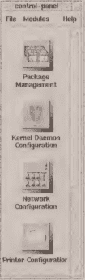

控制面板是许多不同系统管理工具的启动平台。它们让您无需记住配置文件格式和复杂的命令行选项即可配置各种内容，从而简化您的工作。

要启动控制面板，请以 root 身份运行 startx 启动 X 窗口系统，然后在 xterm 中输入 control-panel。您必须以 root 身份运行才能成功运行控制面板工具。如果您已经以普通用户身份运行 X，也可以做到这一点。只需输入 su -c control-panel，然后在提示时输入 root 密码。如果您计划以 root 身份执行其他任务，可以输入 su -，并在提示时输入 root 密码。然后您将获得一个 root shell。在这里，您需要输入 DISPLAY=:0 control-panel & 才能使控制面板正常工作。“DISPLAY” 部分告诉控制面板使用您的显示器。此语法仅适用于 bash 等 Bourne 兼容的 shell。如果您运行的是 csh，则需输入 setenv DISPLAY :0; control-panel &。

双击图标会启动一个工具。请注意，您可以启动任何工具的两个实例，但这通常是个非常坏的主意，因为您可能试图在两个地方编辑相同的文件，最终导致覆盖自己的更改。如果您不小心启动了工具的第二个副本，应立即退出。此外，当工具运行时，不要手动编辑由控制面板工具管理的任何文件。类似地，当工具运行时，不要运行可能更改这些文件的其他程序。

## 8.1 用户和组配置

图 8.1 所示的工具用于管理系统中的用户和组。从某种意义上说，它是 /etc/passwd 和 /etc/group 的图形化编辑器，如果启用了 shadow 密码，还用于 /etc/shadow。使用此工具，您可以添加和删除用户及组，设置登录 shell、全名、主目录、uid、gid 等。

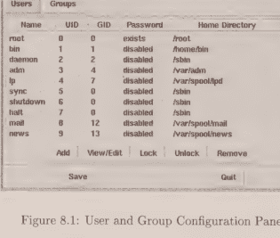

图 8.1：用户和组配置面板

### 8.1.1 添加或编辑用户

相同的界面用于添加和编辑用户。要添加用户，请点击主窗口中的 **Add** 按钮。将会弹出一个如图 8.2 所示的对话框，其中已填入了一些默认值。要编辑


## 8.1 管理用户和组

### 8.1.1 创建新用户

要创建新用户，你必须以 root 用户身份登录。如果你已经是现有用户，请在主窗口中双击该用户，或者单击该用户，然后单击 *View/Edit* 按钮。

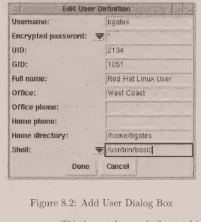

首先输入用户名。这 *不是* 用户的姓氏和名字；而是他们用于登录系统的 ID。请勿包含任何空格或冒号，且不要输入超过 8 个字符。完成后按回车键，其他一些字段将自动填入默认值。如果你愿意，可以更改它们，但这并非必需。你可以自行选择输入用户的完整姓名、办公室和电话号码。登录 shell 可以通过从下拉菜单中选择或像其他字段一样直接输入 shell 来更改默认值（通常是 `/bin/bash`）。

你需要处理密码。在 **Encrypted Password** 菜单中有五个选项：Original、Change、No Password、Lock 和 Unlock。No Password 是一个非常糟糕的选项——没有密码时，任何人都可以使用此 ID 登录你的系统。选择 Lock 将阻止任何人使用此 ID 登录，但保留已分配的密码，以便稍后可以解锁；Unlock 将解锁之前锁定的密码。当你添加新用户时，Original 是空白的（即 No Password）——同一个对话框也用于编辑现有用户，此时 Original 是用户的原始密码。通常你会选择 Change。将会出现一个小对话框，你需要在其中输入密码，然后通过再次输入来确认。在密码输入窗口中点击 **Done** 以确认你已正确输入密码。

工具提供的 **UID** 和 **GID** 数字是可以正常工作的。如果你更改它们，后果自负；该工具的设计假设是，如果你更改它们，说明你知道自己在做什么并且想要更改它们。如果你不知道 **UID** 或 **GID** 代表什么，请保持原样。

如果你在系统中配置了 shadow 密码，你将看到一个 Shadow Management 按钮，允许你配置密码和账户过期时间。默认情况下（显示为空白字段的具有默认值），不会执行过期操作。如果你不熟悉 shadow 密码账户管理，你可能会希望接受默认设置。在编辑完过期信息后，点击 **Done**。

完成用户编辑后，在 Edit User Definition 对话框中点击 **Done** 以添加该用户。

如果此用户尚未拥有主目录（除非你之前已创建主目录，否则他们不会拥有），系统将创建一个。

### 8.1.2 删除用户

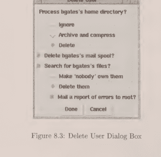

要删除用户，请在主窗口中单击选择用户，然后点击 **Remove**。你将看到图 8.3 中所示的对话框。你可以执行三种类型的操作。你可以忽略用户的主目录，保持其原样。你可以将其归档并压缩为一个 *.tar.gz* 文件，或者完全删除它。如果你愿意，可以压缩用户的邮件队列。前两个操作将在你确认删除后立即执行，在工具接受更多输入之前。你可以在用户主目录之外的文件系统部分搜索属于该用户的文件，并将所有权转移给用户“nobody”或删除它们。如果你选择搜索用户的文件，你有一个选项可以将错误报告通过电子邮件发送给 root。这一点很重要，因为搜索将在后台进行，以便你继续工作；这可能需要很长时间。要查找属于“nobody”的文件，请执行以下命令：

```bash
find / \( -group nobody -o -user nobody \) -print
```

### 停用用户

有时你可能只是想暂时“删除”用户，并打算稍后恢复该用户。**Lock** 和 **Unlock** 功能可以处理这种情况。当你停用用户时，用户的密码会在前面添加“*★*”进行锁定，从而防止用户登录。你还有选项使用 **tar** 和 **gzip** “折叠”用户的主目录，这可以节省一些空间。当你重新激活用户时，密码锁定将被移除，如果主目录被折叠，它将恢复展开到正常状态。当你锁定用户时，你会看到与删除用户时相同的选项，但你不太可能想要删除任何文件。

### 8.1.3 创建新组

要创建新组，首先通过选择主窗口顶部的 **Groups** 选项卡切换到组编辑模式。点击 **Add** 会弹出一个对话框以指定组详细信息。首先为组输入一个名称。就像用户名一样，组名称不应包含空格或冒号，且长度不应超过 8 个字符。你可以设置组密码；如果你这样做了，非该组成员的用户可以通过使用 newgrp 程序并提供该密码来假设组成员身份。要添加成员到组中，请在 User list 字段中输入他们的名字。当你选择了所有组成员后，点击 **Done**。

### 8.1.4 编辑现有组

要编辑现有组，请在主窗口中双击该组，或者单击该组，然后单击 **View/Edit**。编辑现有组和创建新组使用相同的接口。

## 8.2 文件系统配置

图 8.4 中显示的文件系统配置工具允许你轻松地检查和操作文件系统挂载点、类型、选项等。它在操作大量文件系统时非常有用。除非你是一位经验丰富的系统管理员，否则你大概不想这样做。如果你知道自己在做什么，那么如何挂载、卸载和添加设备应该相当简单明了。

FSM 菜单中的 **Reload** 项使文件系统配置工具重新从你的硬盘加载 */etc/fstab*。如果你在文件系统配置工具运行时（你不应该这样做）手动编辑了 */etc/fstab*，你可能需要重新加载。

要使用窗口底部的按钮，请在主窗口中选择一个文件系统，然后单击其中一个按钮。这些按钮执行以下功能：

- **Info**：显示文件系统信息，包括设备、分区类型、文件系统类型、挂载点和选项、注释、大小、使用百分比等。
- **Check**：对分区执行文件系统检查 (fsck)。你只能对 *未挂载* 的分区执行此操作——如果分区已挂载，你将收到错误，并且必须先将其卸载。
- **Mount**：挂载所选的文件系统。
- **Unmount**：卸载所选的文件系统。
- **Format**：在所选分区上创建新的文件系统。这将擦除所选分区上的所有数据！你只能对 *未挂载* 的分区执行此操作--- 如果分区已挂载，你将收到错误，并且必须先将其卸载。
- **Edit**：弹出一个对话框，你可以编辑挂载点、挂载选项、注释等。

### 8.2.1 添加 NFS 挂载

要通过 NFS 挂载文件系统，请从 **NFS** 菜单中选择 **Add Mount**。将出现一个对话框，你必须填写以下值：

- **Device**：输入主机名和路径，用冒号分隔。例如，foo.bar.com:/usr/exported 表示 foo.bar.com 上的 /usr/exported 目录。
- **Mount Point**：输入你机器上要挂载 NFS 文件系统的目录。例如，/mnt/foo。
- **Options**：输入此文件系统的挂载选项。默认值为 soft,intr,rw。rw 表示文件系统是可读写的，soft,intr 是使系统在远程服务器宕机时更具弹性的选项。请参阅 mount 手册页以获取可用选项的完整列表。
- **Comment**：此可选字段可用于存储简短的注释。

正确填写所有内容后，点击 **OK**。此时条目已写入你的 /etc/fstab，但文件系统实际上并未挂载。要挂载它，请在主窗口中选择它，然后点击 **Mount**。

## 8.3 打印机配置

打印机配置工具 (printtool) 维护 /etc/printcap、打印队列目录和打印过滤器。这些过滤器允许你打印许多不同类型的文件，包括：

- 纯文本 (ASCII) 文件


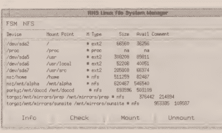

图 8.4：文件系统配置面板

- PostScript 文件
- TeX、DVI 文件
- GIF、JPEG、TIFF 及其他图形格式
- RPM 包

使用 lpr 直接打印 GIF 或 RPM 文件即可“正确处理”。

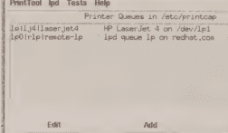

图 8.5：打印工具

若要创建新的打印队列，请选择**添加**。然后，选择要添加的打印机类型。printtool 可配置以下三种类型的打印机：

- **本地**打印队列用于连接在 Red Hat Linux 系统打印机端口或串行端口上的打印机。
- **远程**打印队列连接至可通过 TCP/IP 网络访问的其他系统。
- **SMB** 打印队列连接至使用 LAN Manager 网络的其他系统。

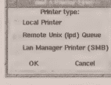

图 8.6：选择打印机类型

选择打印机类型后，请填写以下信息：

**队列名称** 队列的显示名称。可以使用 |（管道符）字符分隔多个名称。

**暂存目录** 这是本地机器上在打印发生前存储文件的目录。请注意，不要让多个打印队列使用同一个暂存目录。

**文件限制** 接受的最大打印作业大小。大小设为 0 表示不施加限制。

对于*本地*打印机，还需要填写以下信息：

**打印机设备** 通常是 /dev/lp1，即打印机所连接端口的名称。串行打印机通常位于 /dev/ttyS? 端口。您需要手动配置串行参数。

**输入过滤器** 过滤器将待打印文件转换为打印机可处理的格式。按**选择**以挑选最匹配您打印机的过滤器。

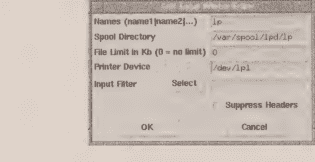

图 8.7：添加本地打印机

除了配置能够打印图形和 PostScript 输出的打印队列外，您还可以配置*仅文本*打印机，它只能打印纯 ASCII 文本。大多数打印机驱动也能在不先转换为 PostScript 的情况下打印 ASCII 文本；只需确保**将 ASCII 转换为 PostScript**未被勾选。

对于*远程*打印机，请填写以下信息：

**远程主机** 托管该打印机的远程机器的主机名。

**远程队列** 远程机器上打印机的队列名称。

远程机器必须配置为允许本地机器在指定队列上打印。通常由 /etc/hosts.lpd 控制此行为。

对于*SMB* 打印机，请填写以下信息：

**打印机服务器名称** 您要使用的打印机所连接机器的名称。

**打印机名称** 您要打印所在打印机的名称。

**打印机用户** 访问该打印机时必须登录的用户名。

### 8.3. 打印机配置

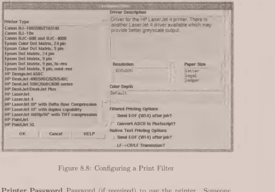

**打印机密码** 使用打印机所需的密码（如果要求）。如果您不知道，应该有人可以告诉您。

**请注意：** 如果您需要为 SMB（LAN Manager）打印队列使用用户名和密码，这些信息将以未加密形式存储在本地脚本中，并必须通过命令行传递给 smbclient 程序。因此，他人有可能获知该用户名和密码。因此，建议用于打印机的用户名和密码不要与本地 Red Hat Linux 系统上的用户账号相同，这样可能的安全风险仅限于打印机被未授权使用。如果 SMB 服务器提供文件共享，也建议其使用不同于打印队列的密码。

添加打印队列后，您可能需要重启打印机守护进程（lpd）。若要执行此操作，请在 lpd 菜单中选择重启 lpd。

您可以为已配置的任何打印队列打印测试页。从“测试”菜单中选择您希望打印的测试页类型。

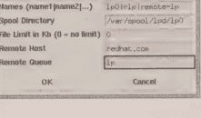

图 8.9：添加远程打印机

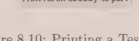

图 8.10：打印测试页

## 8.4 网络配置

图 8.11 所示的网络配置面板旨在方便地操作 IP 地址、网关地址、网络地址以及名称服务器和 `/etc/hosts` 等参数。

网络设备可被添加、移除、配置、激活、停用或设置别名。支持以太网、arcnet、令牌环、ppacket（ATP）、PPP、SLIP、PLIP 和回环设备。PPP/SLIP/PLIP 支持在大多数硬件上运行良好，但某些硬件配置可能会表现出不可预测的行为。使用网络配置工具时，点击“保存”可将更改写入磁盘；若不想进行任何更改而退出，请选择“退出”。

### 8.4.1 管理名称

网络配置工具的“名称”面板主要有两个用途：设置计算机的主机名和域名，以及确定使用哪个名称服务器来查找网络中的其他主机。网络工具无法将机器配置为名称服务器。要编辑字段或向字段添加信息，只需左键点击该字段并输入新信息。

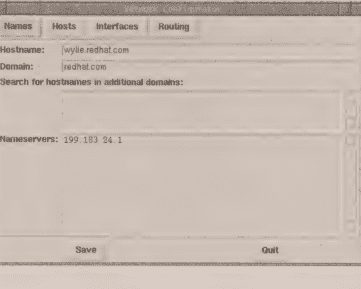

图 8.11：网络配置面板

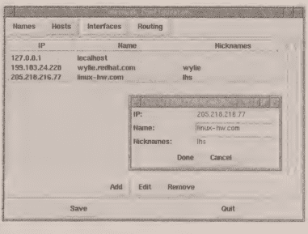

图 8.12：添加/编辑主机

### 8.4.2 管理主机

在“主机”管理界面中，您可以向 /etc/hosts 文件添加、编辑或移除主机。添加或编辑条目的操作相同。会弹出一个编辑对话框，输入新信息并在完成后点击“完成”即可。示例见图 8.12。

### 8.4.3 添加网络接口

如果您在安装 Red Hat Linux 后向机器添加了网络接口，或者在安装时未配置以太网卡，您可以通过几次鼠标点击进行配置。首先，在主面板中点击“接口”。这将弹出一个显示已配置设备窗口及一排可用选项，见图 8.13。

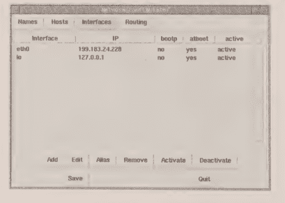

要添加设备，首先点击“添加”按钮，然后从弹出的框中选择要配置的接口类型。（图 8.14）

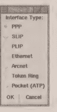

#### PPP 接口

添加 PPP 接口可能只需在图 8.15 所示的“创建 PPP 接口”框中提供电话号码、登录名和密码即可。在许多情况下，建立 PPP 连接需要一定程度的自定义。选择**自定义**按钮允许您修改 PPP 接口的硬件、通信和网络设置。

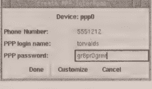

#### SLIP 接口

要配置 SLIP 接口，您必须先提供电话号码、登录名和密码。这将提供建立 SLIP 连接所需的聊天脚本的初始参数。当您选择“完成”按钮时，将出现“编辑 SLIP 接口”对话框，允许您进一步自定义 SLIP 的硬件、通信和网络参数。

#### PLIP 接口

要在系统中添加 PLIP 接口，您只需提供 IP 地址、远程 IP 地址和子网掩码即可。您还可以选择是否在启动时激活该接口。

#### 以太网、Arcnet、令牌环和 Pocket 适配器接口

如果您正在向计算机添加以太网、arcnet、令牌环或口袋适配器，您需要提供以下信息：

- **设备** 由 netconfig 根据已配置的设备确定。
- **IP 地址** 为您的网络设备输入一个 IP 地址。
- **子网掩码** 为您的网络设备输入网络掩码。
- **网络** 根据提供的 IP 地址和子网掩码值确定。
- **广播** 根据提供的 IP 地址和子网掩码值确定。
- **启动时激活** 如果您希望机器启动时自动配置该设备，请勾选此框。
- **使用 BOOTP 配置** 如果您的网络上有一个 BOOTP 服务器并希望使用它来配置设备，请勾选此框。

提供新设备的配置信息后，点击**完成**。该设备应作为非活动设备出现在您的“接口”列表中。（活动列应显示“否”标签）。要激活新设备，请通过鼠标点击选中它，然后点击**激活**按钮。如果未正确启动，您可能需要点击**编辑**重新配置它。


### 8.4.4 管理路由

在路由管理界面中，您可以添加、编辑或删除静态网络路由。添加或编辑条目的操作是相同的，就像主机面板一样。将出现一个编辑对话框；只需输入新信息，完成后点击**完成**。有关示例，请参阅图 8.16。

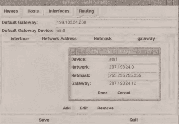

图 8.16：添加/编辑路由

## 8.5 时间和日期

通过点击时间和日期显示界面中相应的部分，并点击箭头来更改数值，您可以使用时间机器来更改时间和日期。

在您点击“设置系统时钟”按钮之前，系统时钟不会改变。

点击“重置时间”可将时间机器的时间重置为系统时间。

**注意：** 更改时间可能会严重扰乱那些依赖时间正常流逝的程序，并可能引发问题。在更改时间或日期之前，请尽可能退出所有应用程序和进程。

## 8.6 内核守护进程配置

如第 5 章所述，Red Hat Linux 包含“kerneld”（内核守护进程），它会自动按需将一些软件和硬件支持加载到内存中，并在不再需要时将其卸载。

图 8.17 中所示的工具用于管理 kerneld 的配置文件。虽然 kerneld 可以加载某些东西（如文件系统）而无需显式配置，但当遇到通用的硬件请求时，它需要被告知要加载哪些硬件支持。

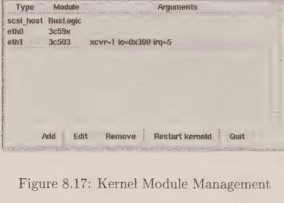

例如，当内核想要加载以太网支持时，kerneld 需要知道您拥有一块什么样的以太网卡，如果您的以太网卡需要特殊配置，它也需要知道这一点。

### 8.6.1 更改模块选项

要更改加载模块时提供的选项，请点击相应行以选中它，然后点击“编辑”按钮。kernelcfg 会弹出一个窗口，如图 8.18 所示。kernelcfg 知道的每个选项（通常是所有可用选项）都有自己的窗口。通常，您希望忽略“其他参数：”窗口。有些模块通常不接受参数；但以防万一，它们有一个“参数：”窗口，允许您输入配置信息。

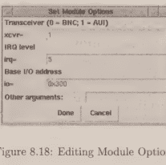

### 8.6.2 更改模块

要更改哪个模块被调用以提供通用服务（例如以太网卡或 SCSI 主机适配器模块），您需要删除旧的模块并添加新的模块。要删除模块，请通过点击选中它，然后点击**删除**。然后按照下一节的说明，点击**添加**以添加新模块。

如果您更改了 SCSI 控制器（**scsi_hostadapter**），请记住使用 `/sbin/mkinitrd` 命令创建一个新的初始 ramdisk，如第 5.1.2 节所述。

### 8.6.3 添加模块

要添加任何类型的模块，请点击**添加**按钮。会出现一个对话框（图 8.19），要求您选择模块类型。以太网是 eth，令牌环是 tr，SCSI 控制器是**scsi_hostadapter**，等等。点击**确定**以继续到下一个对话框。如果有多个模块可用于您选择的模块类型，会出现一个对话框（图 8.20），询问您想使用哪个模块，可能还会询问模块类型的具体细节；例如对于以太网，您需要从**eth0, eth1**等中进行选择。完成后，再次点击**确定**以继续在下个对话框（图 8.20）中指定模块选项，该对话框与编辑模块时出现的对话框相同。

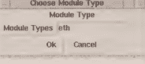

图 8.19：添加模块

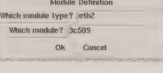

图 8.20：从可用模块中选择

### 8.6.4 重启内核

使用内核守护进程配置工具所做的更改将写入文件 */etc/conf.modules*，内核在启动时每次都会读取该文件。一旦完成更改，您可以点击**重启内核**按钮来重启内核。这不会导致当前正在使用的模块重新加载；它只会通知内核在将来加载更多模块时使用新的配置。

# 第 9 章

## Glint

Red Hat 提供了一款图形化工具，用于辅助软件包的安装和移除。它被称为 glint（图形化 Linux 安装工具），并在 X 窗口系统下运行。它允许轻松安装、卸载、升级、查询和验证软件包。其界面与许多流行文件管理器中的界面类似，使用简单。

在 glint 中，通过选择要操作的软件包，然后通过按钮选择要执行的操作来进行操作。安装软件包会将该软件包的所有组件安装到您的系统中。卸载软件包会移除该软件包的所有痕迹，除了您已修改的配置文件。升级软件包会安装新版本的软件包，并卸载之前安装的其他所有版本。这使得快速升级到软件包的最新版本成为可能。

查询操作允许您检查已安装或可用软件包的详细信息。您可以查看软件包的描述、构建的时间和地点、软件包中的文件以及其他属性。每个软件包的所有配置和文档组件都清晰标记，以减少您寻找它们所花费的时间。

使用 glint 执行所有这些操作与在命令行中使用 rpm 执行它们是一样的。然而，glint 的图形化特性通常使这些操作更容易执行。

处理 glint 的常规方法是显示可用的软件包和文件，选择您想要操作的项，然后按下按钮或选择菜单项来执行操作。例如，您可以通过几次点击来安装多个软件包。

## 9.1 启动 glint

要启动 glint，只需在任何 X 终端窗口中运行 **glint** &。这会弹出一个如图 9.1 所示的窗口。任何用户都可以使用 glint 查询和验证软件包，但如果您需要安装、卸载或升级软件包，请确保以 root 身份运行 glint。

glint 界面主要包含两个部分。第一部分位于左侧，允许您浏览和选择系统上安装的软件包。右侧包含操作所选软件包的按钮。

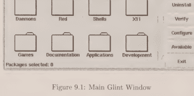

## 9.2 软件包显示

glint 中的每个文件夹图标代表一组软件包。每组可以包含其他组，这允许灵活地放置软件包。组用于将执行相似功能的软件包放置在相似的位置。例如，Red Hat 包含许多应用程序，如编辑器和电子表格。所有基于文本的编辑器都出现在“应用程序”组中。在该组内部，还有另一个分组，包含所有随附的编辑器。

按照惯例，组的写法与 UNIX 路径相同。最顶层的组写在最前面，随后的组用斜杠分隔组名。这意味着基于 X 的绘图程序出现在 X11/Applications/Graphics 组中。

要查看组内的软件包和子组，请双击组的文件夹图标上的左键。窗口随后会更改以显示该软件包的内容。软件包显示的第一行显示您当前正在查看哪个组，以及导致当前组的路径。要返回之前查看的组，请双击“返回”文件夹，该文件夹始终位于文件夹区域的左上角（尽管它经常被滚动出视野）。

如果您想在一个新窗口中查看子组，请双击其文件夹图标中的中间鼠标按钮。如果您的鼠标只有两个按钮，请同时点击两个按钮。这将在其中创建包含该组的新窗口。

### 9.2.1 上下文相关菜单

在软件包窗口中的任何图标上按下鼠标右键，会弹出一个小的、*上下文相关*菜单。其包含的具体项目取决于您确切在哪里按下。它们都包含选择或取消选择该项的选项，许多还允许您安装、卸载、查询、升级或验证您点击的项。稍后将提供更多关于如何执行这些操作的信息。

要从上下文相关菜单中选择一项，请在图标上按下并长按鼠标右键。在仍按住右键的同时，将鼠标指针移动到您想要选择的项（该项随后会高亮显示）上。释放鼠标右键以选择该项并使菜单消失。

### 9.2.2 选择软件包

要选择单个软件包，请点击其图标上的鼠标左键。您会注意到软件包图标周围会出现一个细边框（如图 9.2 所示），表示当前已选中。要取消选择，请点击鼠标左键


然后边框就会消失。当前选中的软件包数量始终显示在窗口底部。软件包组的文件夹图标显示该组内已选中的软件包数量，如果全部选中则显示“所有”。

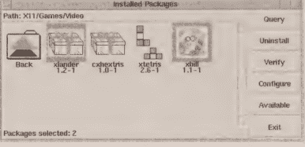

软件包的上下文敏感菜单也允许轻松选择或取消选择。使用软件包图标上的 `select`（选择）和 `unselect`（取消选择）选项可以选中或取消选中该软件包，而使用软件包组的文件夹图标上的这些选项则可以选中或取消选中该组内的所有软件包。使用这些菜单选项比逐个选择每个软件包要快得多。

## 9.2.3 查看可用软件包

要查看可供你安装哪些软件包，请选择任意 glint 窗口中的 `Available`（可用）按钮。片刻之后，会出现一个新窗口，如图 9.3 所示。标题和按钮的区别表明，此窗口列出的可能是你可以安装的软件包。在这些软件包中导航和选择的方式与其他 glint 窗口相同。

如果你收到来自 glint 的错误消息，提示找不到任何 RPM，请参见下文关于“配置”的部分。

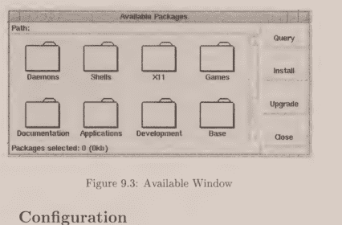

### 9.3 配置

glint 需要的唯一配置信息是新 RPM 的路径。如果你正在使用 Red Hat Linux 光盘，这通常是 `/mnt/cdrom/RedHat/RPMS`，这也是 glint 的默认路径。如果你从互联网下载新的 RPM，或者想通过 NFS 挂载的光盘安装 RPM，这个路径可能对你来说会有所不同。

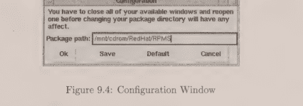

要更改此路径，请首先确保关闭所有可能打开的列出可用软件包的窗口。然后从剩余的窗口中选择“配置”选项。这将打开一个如图 9.4 所示的对话框。在这里，你可以输入你想查看的 RPM 的完整路径。点击“保存”按钮将保存此路径，使其成为未来 glint 会话的默认路径。“默认”按钮会将路径恢复为 glint 启动时使用的路径。

更改此路径并关闭对话框后，你可以使用“可用”按钮查看新位置中可用的软件包。

## 9.4 软件包管理

### 9.4.1 查询软件包

查询单个软件包或软件包组最简单的方法是使用图标的上下文敏感菜单中的查询选项。如果你想要查询更多样化的软件包集合，请选中它们，并使用其中一个窗口中的“查询”按钮。

使用这两种方法中的任何一种都会创建一个如图 9.5 所示的窗口。如果你只选择一个软件包，窗口外观会略有不同，因此以下内容可能不完全适用。

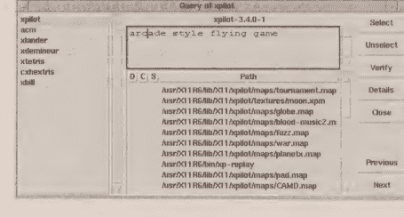

窗口最左侧是被查询软件包的列表。选择其中一个会改变窗口其余部分的信息。你可以使用窗口右侧的“下一个”和“上一个”按钮按顺序浏览它们。

当前软件包的名称、版本和发行版位于查询窗口的中上部。紧接其下的是软件包的描述，这可能相当长。那里有一个滚动条，让你可以阅读完整内容。

描述下方是该软件包包含的文件列表。除了文件的完整路径外，文件列表还告知你其他几件事。如果路径左侧出现 **D**，则表示该文件是文档文件，值得阅读。如果那里出现 **C**，则表示该文件是配置文件。一个 **\*** 表示你的系统上未安装该文件的正确版本。这可能是因为安装了较新版本的软件包，或者两个软件包包含同一文件的不同版本。

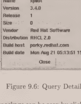

点击 **Details**（详细信息）按钮可以看到有关软件包的更多信息。此时会出现一个如图 9.6 所示的窗口。该窗口列出了主查询窗口中显示的软件的更多信息。当你在查询窗口中选择一个新的软件包时，详细信息窗口中的信息将更改以反映你的新选择。

在查询软件包时，你还可以使用提供的按钮选择、取消选择或验证软件包。查看完软件包后，点击 **Close**（关闭）按钮。

### 9.4.2 验证软件包

验证软件包会检查软件包中的所有文件，以确保它们与你系统上存在的文件匹配。校验和、文件大小、权限和所有者属性都会与数据库进行比对。当你怀疑某个程序文件因安装新程序而损坏时，可以使用此检查。

选择要验证的软件包与选择要查询的软件包相同。选中软件包并使用“验证”按钮，或从上下文敏感菜单中选择“验证”项。将打开一个如图 9.7 所示的窗口。

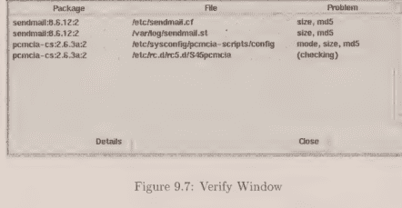

此窗口中的三列分别描述了存在问题的软件包、存在问题的文件以及找到的差异的简要描述。在检查运行期间，当前正在检查的文件会作为列表中的最后一个元素显示，问题被列为 (checking)（正在检查）。通过验证可以找到的所有问题列表如图 9.8 所示。

| 问题 | 描述 |
| :------- | :---------- |
| missing | 该文件不再位于你的系统上 |
| mode | 权限位已更改 |
| size | 文件大小已更改 |
| uid | 所有者的 uid 已更改 |
| gid | 所有者的 gid 已更改 |
| md5 | md5 校验和已更改 |
| link | 该文件是指向错误位置的符号链接 |


要获取有关找到的文件问题的更多信息，请双击文件的路径。如图 9.9 所示的窗口列出了属性预期的和当前的错误值。

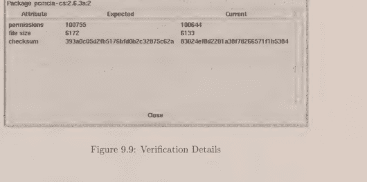

### 9.4.3 安装新软件包

从 glint 安装新软件包非常简单。首先查看可供安装的软件包（参见 9.2.3 节了解操作方法）。你可以选中其中任意数量的软件包进行安装（选择方式与验证软件包相同，如果不确定它们是什么，也可以先查询它们）。如果你想安装单个软件包或软件包组，上下文敏感菜单提供了快捷方式。图 9.10 显示了一个窗口，其中一些软件包被选中用于安装。

开始安装后，会出现一个如图 9.11 所示的窗口。它跟踪安装进度，让你知道正在进行某项操作。顶部栏显示当前软件包（其名称列在其中）已安装的部分，而底部图形显示总安装已完成的程度。软件包数量、软件包大小和时间估计会不断更新。

如果安装过程中出现问题，将会出现一个窗口列出发生的任何错误。如果发生这种情况，你应该更正问题，然后重试。

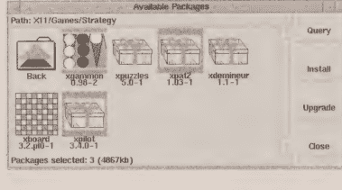

图 9.10：选中的待安装软件包

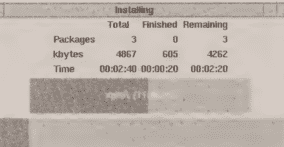

图 9.11：安装进度

安装完成后，已安装的软件包和软件包组会从可用窗口移动到主 glint 窗口，以表明它们已成功安装。

### 升级软件包

当某个软件包的新版本发布时，在系统上安装它非常简单。以与选择软件包进行安装相同的方式，从可用软件包窗口中选择软件包。“升级”按钮和上下文敏感菜单都将开始升级过程。

在升级期间，你会看到一个与安装类似的进度指示器


packages。完成后，已安装的软件包将显示在主要的 glint 窗口中，软件包的旧版本将被移除。

使用升级选项比先卸载软件包的旧版本再安装新版本要好得多。使用升级可以确保你对软件包配置文件所做的任何更改都得到妥善保留，而手动操作可能会导致这些更改丢失。

如果在安装过程中磁盘空间不足，安装将会失败。然而，在发生错误时正在安装的软件包可能会留下一些文件。要清理这些文件，请在腾出更多磁盘空间后重新安装该软件包。

## 9.4.4 卸载软件包

卸载软件包与升级软件包不同。当软件包被卸载时，它所使用且系统中其他软件包不再需要的文件会被移除。已修改的配置文件会被复制为 `<filename>.rpmsave`，以便你稍后重用。

与验证和查询软件包类似，你可以通过 glint 窗口右侧的按钮或上下文敏感菜单来移除软件包。请记住，当你从组的菜单中进行选择时，该操作将应用于该组中的所有软件包，因此务必小心！

一旦开始卸载，glint 会要求确认，并显示如图 9.12 所示的窗口。所有即将被卸载的软件包都会列在其中。你应该查看这些软件包，以确保你不会移除想要保留的内容。点击“是”按钮将启动卸载过程。完成后，被移除的软件包和组将从它们所在的任何窗口中消失。

| 名称 | 版本 | 发行版 |
| :--- | :--- | :--- |
| xglxot | 3.4.0 | 1 |
| xcm | 4.7 | 3 |
| xdauster | 1.2 | 1 |
| xtemeriser | 1.1 | 1 |
| xetris | 2.6 | 1 |
| csharins | 1.0 | 1 |
| xdiII | 1.1 | 1 |

图 9.12：卸载窗口

# 第 10 章

### 系统管理

本章概述了 Red Hat Linux 系统。它将介绍你可能不了解的系统特性，以及与其他 UNIX 系统略有不同的方面。请注意，大多数系统管理任务是通过控制面板执行的，这在第 8 章中有详细讲解。

#### 10.1 文件系统结构

Red Hat 软件致力于遵循 Linux 文件系统标准（FSTND），这是一份协作文档，定义了许多文件和目录的名称和位置。我们将继续跟踪该标准，以确保 Red Hat 的合规性。

尽管符合标准意味着许多事情，但最重要的两点是与其他合规系统的兼容性，以及能够以只读方式挂载 /usr 分区。/usr 分区包含通用的可执行文件，并不打算让用户修改。因此，/usr 分区可以从 CD-ROM 挂载，也可以通过只读 NFS 从另一台机器挂载。当前的 Linux 文件系统标准（FSTND）文档是任何符合 FSTND 的文件系统的权威参考，但该标准在许多领域留白或允许扩展。在本节中，我们提供了该标准的概述，并描述了标准未涵盖的文件系统部分。

完整的标准可以在以下地址查看：

```
http://www.eg.bucknell.edu/~quinlan/fssnd
```

##### 10.1.1 FSSTND 概述

这里提到的目录和文件是由 FSSTND 文档规范定义的子集。请查阅最新的 FSSTND 文档以获取最准确和完整的信息。

###### /etc 目录

/etc 目录专用于本地计算机的配置文件。/etc 中不应放置二进制文件。过去放在 /etc 中的二进制文件现在应放入 /sbin 或 /bin。

X11 和 skel 目录应该是 /etc 的子目录：

```
/etc
|-- X11
`-- skel
```

X11 目录用于存放 X11 配置文件，如 XF86Config。skel 目录用于存放“骨架”用户文件，这些文件在创建新用户时用于填充 HOME 目录。

###### /lib 目录

/lib 目录应仅包含执行 /bin 和 /sbin 中的二进制文件所需的库。

> “/sbin 通常包含除 /bin 中的二进制文件外启动系统所必需的文件。任何在 /usr 已知被挂载（在没有问题的情况下）后执行的操作都应放置在 /usr/sbin。仅限本地的系统管理二进制文件应放置在 /usr/local/sbin。”

至少，以下程序应位于 /sbin 中：

```
clock, getty, init, update, mkswap, swapoff, swapon, halt, reboot, shutdown, fdisk, fscck.?, mkfs.?, lilo, arp, ifconfig, route
```

###### /usr 目录

/usr 目录用于存放整个站点可共享的文件。/usr 目录通常拥有自己的分区，并且应该可以只读挂载。以下目录应该是 /usr 的子目录：

```
/usr
|-- X11R6
|-- bin
|-- dict
|-- doc
|-- etc
|-- games
|-- include
|-- info
|-- lib
|-- local
|-- man
|-- sbin
|-- share
+-- src
```

X11R6 目录用于 X 窗口系统（在 Red Hat Linux 中为 XFree86），bin 用于可执行文件，doc 用于杂项非手册页文档，etc 用于站点范围的配置文件，include 用于 C 头文件，info 用于 GNU info 文件，lib 用于库，man 用于手册页，sbin 用于系统管理二进制文件（不属于 /sbin 的那些），src 用于源代码。

###### /usr/local 目录

FSSTND 指出：

> “/usr/local 层级供系统管理员在本地安装软件时使用。它需要确保在系统软件更新时不会被覆盖。它可用于存放一组机器间可共享但不在 /usr 中的程序和数据。”

/usr/local 目录的结构与 /usr 目录相似。它包含以下子目录，其用途与 /usr 目录中的子目录相似：

```
/usr/local
| - bin
| - doc
| - etc
| - games
| - include
| - info
| - lib
| - man
| - sbin
+ - src
```

###### /var 目录

由于 FSSTND 要求能够以只读方式挂载 /usr，因此任何需要写入日志文件或需要 spool 或锁目录的程序，最好将这些写入 /var 目录。FSSTND 指出 /var 用于：

> “... 可变数据文件。这包括 spool 目录和文件、管理和日志数据，以及瞬态和临时文件。”

以下目录应该是 /var 的子目录：

```
/var
├─ log
├─ catman
├─ lib
├─ local
├─ named
├─ nis
├─ preserve
├─ run
├─ lock
├─ tmp
└─ spool
   ├─ at
   ├─ cron
   ├─ lpd
   ├─ mail
   ├─ mqueue
   ├─ rwho
   ├─ smail
   ├─ uucp
   └─ news
```

系统日志文件，如 wtmp 和 lastlog，位于 /var/log。/var/lib 目录还包含 RPM 系统数据库。格式化后的手册页位于 /var/catman，锁文件位于 /var/lock。/var/spool 目录包含用于存储数据文件的各个系统的子目录。

#### 10.1.2 Red Hat Linux 中的 /usr/local

在 Red Hat Linux 中，/usr/local 的预期用途与 FSSTND 规范略有不同。FSSTND 指出，/usr/local 应作为存放那些需从系统软件升级中保持安全的软件的位置。由于 Red Hat Software 的系统升级通过 RPM 系统和 Glint 安全地进行，因此你不需要通过将文件放在 /usr/local 来保护文件。相反，我们建议你使用 /usr/local 存放本地计算机专用的软件。

例如，假设你通过只读 NFS 从 `beavis` 挂载了 `/usr`。如果你希望安装某个软件包或程序，但不允许写入 `beavis`，你应该将其安装在 `/usr/local` 下。稍后，如果你成功说服 `beavis` 的系统管理员在 `/usr` 中安装该程序，你可以从 `/usr/local` 中将其卸载。

### 10.2 Red Hat 特殊文件位置

除了位于 `/var/lib/rpm` 的 RPM 系统相关文件（参见第 7 章）外，还有两个其他特殊位置是为 Red Hat Linux 的配置和运行保留的。

控制面板及相关工具将大量内容放置在 `/usr/lib/rhs` 中。这里可能没有什么你希望手动编辑的内容。它主要包含小脚本、位图和文本文件。

另一个位置，`/etc/sysconfig`，存储配置信息。该目录中文件的主要用户是在启动时运行的脚本。虽然可以手动编辑这些文件，但最好使用适当的面板工具。

### 10.3 用户、组和用户私有组

传统上，管理用户和组是一项繁琐的工作。Red Hat Linux 拥有几种工具和约定，使用户和组的管理更容易、更实用。

管理用户和组的最简单方法是通过控制面板的用户和组模块（关于控制面板的详细信息参见第 8 章，关于用户和组模块的详细信息参见第 8.1 节）。

你也可以使用 `adduser` 从命令行创建新用户。

#### 10.3.1 标准用户

表 10.3.1 列出了由安装过程设置的标准用户（这基本上就是 `/etc/passwd` 文件）。此表中的组 ID（GID）是


### 10.3. 用户、组和用户私有组

用户的*主要组*。有关如何使用组的详细信息，请参见第 10.3.3 节。

| 用户 | UID | GID | HOME 目录 | Shell |
| :--- | :--- | :--- | :--- | :--- |
| root | 0 | 0 | /root | /bin/bash |
| bin | 1 | 1 | /bin | |
| daemon | 2 | 2 | /sbin | |
| adm | 3 | 4 | /var/adm | |
| lp | 4 | 7 | /var/spool/lpd | |
| sync | 5 | 0 | /sbin | /bin/sync |
| shutdown | 6 | 0 | /sbin | /sbin/shutdown |
| halt | 7 | 0 | /sbin | /sbin/halt |
| mail | 8 | 12 | /var/spool/mail | |
| news | 9 | 13 | /var/spool/news | |
| uucp | 10 | 14 | /var/spool/uucp | |
| operator | 11 | 0 | /root | /bin/bash |
| games | 12 | 100 | /usr/local/games | |
| gopher | 13 | 30 | /usr/lib/gopher-data | |
| ftp | 14 | 50 | /usr/ths/ftp | |
| nobody | 99 | 99 | /root | |

**图 10.1：标准用户**

#### 10.3.2 标准组

表 10.3.2 列出了安装过程设置的标准组（这基本上是 */etc/group* 文件）。

| 组 | 组 ID | 成员 |
| --- | --- | --- |
| root | 0 | root |
| bin | 1 | root,bin,daemon |
| daemon | 2 | root,bin,daemon |
| sys | 3 | root,bin,adm |
| adm | 4 | root,adm,daemon |
| tty | 5 | |
| disk | 6 | root |
| lp | 7 | daemon,lp |
| mem | 8 | |
| kmem | 9 | |
| wheel | 10 | root |
| mail | 12 | mail |
| news | 13 | news |
| uucp | 14 | uucp |
| man | 15 | |
| games | 20 | |
| gopher | 30 | |
| dip | 40 | |
| ftp | 50 | ftp |
| nobody | 99 | |
| users | 100 | |

**图 10.2：标准组**

### 10.3.3 用户私有组

Red Hat Linux 采用用户私有组（UPG）机制，这使得使用 UNIX 组变得更加容易。UPG 机制并没有在标准 UNIX 处理组的方式中添加或更改任何内容。它只是提供了一种处理组的新约定。每当您创建一个新用户时，默认情况下，该用户拥有一个唯一的组。该机制的工作原理如下：

- **用户私有组** 每个用户都有自己的主要组，且仅该用户是该组的成员。

- **umask = 002** 传统的 UNIX umask 为 022，它防止其他用户和*用户主要组的其他成员*修改用户的文件。由于在 UPG 机制中每个用户都有自己的私有组，因此不需要这种“组保护”。umask 为 002 将防止用户修改其他用户的私有文件。umask 在 */etc/profile* 中设置。

- **目录的 SGID 位** 如果您在目录上设置 SGID 位（使用 *chmod g+s directory*），则在该目录中创建的文件其组将设置为该目录的组。

大多数计算站点喜欢为每个主要项目创建一个组，并将人员分配到他们所在的组中。然而，传统上管理文件很困难，因为当某人创建文件时，该文件归属于其主要组所属的组。当一个人同时处理多个项目时，很难使文件归属于与该项目关联的组。在 UPG 机制中，组是根据项目自动分配给文件的，这使得管理组项目变得非常简单。

假设您有一个名为 *devel* 的大型项目，许多人正在 *devel* 目录中编辑 *devel* 文件。创建一个名为 *devel* 的组，使用 *chgrp* 将 *devel* 目录更改为 *devel* 组，并将所有 *devel* 用户添加到 *devel* 组中。现在，所有 *devel* 用户都可以编辑 *devel* 文件并在 *devel* 目录中创建新文件，并且这些文件将始终保留 *devel* 组属性。因此，它们始终可以被其他 *devel* 用户编辑。

如果您有多个像 *devel* 这样的项目，以及从事多个项目的用户，这些用户在项目之间切换时，永远不需要更改他们的 umask 或组。每个项目主目录上的 SGID 位会“选择”正确的组。

由于每个用户的 HOME 目录由该用户及其私有组所有，因此在 HOME 目录上设置 SGID 位是安全的。然而，默认情况下，文件是以用户的主要组创建的，因此 SGID 位是多余的。

#### 用户私有组的理由

由于 UPG 机制是新的，许多人对此有疑问，并想知道它为什么是必要的。以下是该机制的理由。

- 您希望让一组人员处理位于例如 /usr/lib/emacs/site-lisp 目录中的一组文件。您信任少数人在那里进行更改，但肯定不是所有人。
- 因此您输入：
  ```text
  chown -R root.emacs /usr/lib/emacs/site-lisp
  ```
  并将适当的用户添加到组中。
- 为了允许用户实际在目录中创建文件，您输入：
  ```text
  chmod 775 /usr/lib/emacs/site-lisp
  ```
- 但当用户创建新文件时，它会被分配给用户的默认组（通常是 users）。为了防止这种情况，您输入
  ```text
  chmod 2775 /usr/lib/emacs/site-lisp
  ```
  这将导致目录中的一切都以“emacs”组创建。
- 但新文件需要模式 664，以便 emacs 组中的其他用户能够编辑它。为此，您将默认 umask 设为 002。
- 嗯，这一切都运行得很好，除了如果您的默认组是“users”，您在主目录中创建的每个文件都将可被“users”中的每个人（通常是所有人）写入。
- 为解决此问题，您让每个用户拥有一个“私有组”作为其默认组。

此时，通过设置默认 umask 为 002 并赋予每个人一个私有默认组，您可以轻松设置用户可以利用的组，而无需进行任何复杂操作。只需创建组，添加用户，并对组的目录执行上述 chown 和 chmod 操作即可。

### 10.4. PAM

赋予用户某种特权的程序需要能够验证用户的身份。当您登录系统时，您提供姓名和密码，登录过程使用这些信息来验证登录——以核实您是否如所言属实。除了密码之外，还有其他的身份验证形式，并且密码也可以以不同的方式存储。

PAM 代表“可插拔身份验证模块”（Pluggable Authentication Modules），它允许系统管理员设置身份验证策略，而无需重新编译执行身份验证的程序。使用 PAM 时，您可以通过编辑配置文件来控制模块如何插入程序。

大多数 Red Hat Linux 用户永远不需要接触此配置文件。当您使用 RPM 安装需要进行身份验证的程序时，它们会自动做出所需的更改以执行正常的密码身份验证。但是，您可能希望自定义配置，在这种情况下，您需要理解该配置文件。

#### 10.4.1 模块

PAM 标准定义了四种类型的模块。*auth* 模块提供实际的认证，例如请求并检查密码，以及设置“凭证”，如组成员资格或 kerberos“票据”。*account* 模块检查身份验证是否被允许（账户未过期，用户允许在此时登录等）。*password* 模块用于设置密码。*session* 模块在用户通过身份验证后使用，使其能够使用其账户，例如挂载用户的主目录或使其邮箱可用。

这些模块可以*堆叠*，从而使用多个模块。例如，登录通常使用至少两种身份验证方法：如果“rhosts”身份验证成功，则允许连接即可；如果失败，则执行标准的“unix”密码身份验证。

可以随时添加新模块，并且支持 PAM 的应用程序随后可以配置为使用它们。例如，如果您有一个一次性密码计算器系统，并且可以编写支持它的模块（系统包含编写模块的文档）。支持 PAM 的程序可以使用新模块并与新的一次性密码计算器协同工作，而无需重新编译或以其他方式修改。

Red Hat Linux 中有一个模块，我们为了完整性而包含它，但目前不推荐仅基于实验目的使用：`pam_pwdb.so`。`pwdb` 软件包和 `pam_pwdb.so` 模块目前是 alpha 质量的软件，但具有您可能希望尝试的有趣功能。目前 Red Hat Software **不支持**它们。

### 10.4.2 服务

使用 PAM 的每个程序都定义自己的“服务”名称。登录程序定义服务类型 `login`，`ftp` 定义服务类型 `ftp` 等。通常，服务类型是用于*访问*服务的程序名称，而不是（如果有区别）用于*提供*服务的程序。

### 10.4.3 配置文件

文件 `/etc/pam.conf` 用于配置所有 PAM 应用程序。每个应用程序（实际上是每个**服务**）都有自己的“段”（stanza）。段看起来像这样：

```
# login authorization
login auth required /lib/security/pam_secrety.so
login auth required /lib/security/pam_unix_auth.so
login auth required /lib/security/pam_nologin.so
login account required /lib/security/pam_unix_acc.so
login password required /lib/security/pam_unix_passwd.so
login session required /lib/security/pam_unix_session.so
```

第一行是注释。任何以 `#` 字符开头的行都是注释。接下来的三行堆叠了三个用于登录授权的模块。第一个确保*如果*用户试图以 root 身份登录，他们登录所在的 `tty` 在 `/etc/secrety` 中列出


### 10.4. 使用 PAM 进行用户身份验证

如果 *if* 存在。第二项要求用户输入密码并检查该密码。第三项检查 */etc/nologin* 文件是否存在；如果存在，则显示文件内容，且如果用户不是 root，则禁止其登录。

请注意，即使*第一个模块失败*，所有三个模块都会进行检查。这是一个安全决定——其设计目的是不向用户透露其身份验证被拒绝的原因，因为知道被拒绝的原因可能会让他们更容易绕过身份验证。

第五行执行必要的记账操作。例如，如果启用了影子密码，*pam_unix_acct.so* 模块将检查账户是否已过期，或者用户是否未更改密码且更改密码的宽限期已过。

第六行指定：如果登录程序更改用户的密码，应使用 *pam_unix_passwd.so* 模块来执行此操作。（只有在 *auth* 模块确定需要更改密码时才会这样做——例如，当影子密码已过期时。）

最后一行指定应使用 *pam_unix_session.so* 模块来管理会话。目前，该模块未执行任何操作；它可以用任何必要的模块进行替换（或补充——不仅可以堆叠 *auth* 模块）。

虽然 */etc/pam.conf* 中条目的顺序无关紧要，但条目内各行的顺序可能很重要。（实际上，重要的是每种 *服务类型*/*模块类型* 对各行的顺序。）虽然调用 *required* 模块的顺序并不太重要，但还有其他可用的 *控制标志*。虽然 *optional* 很少使用，且在 Red Hat Linux 系统上默认从不使用，但 *sufficient* 使顺序变得重要。

让我们看看 *rlogin* 的 *auth* 配置：

```
rlogin  auth  required      /lib/security/pam_security.so
rlogin  auth  required      /lib/security/pam_nologin.so
rlogin  auth  sufficient   /lib/security/pam_rhosts_auth.so
rlogin  auth  required     /lib/security/pam_unix_auth.so
```

¹未来版本的 PAM 将允许你指定不同的行为；标准正在修订过程中。

这看起来*几乎*与 login 条目相同，但多了一行指定额外的模块，且模块的指定顺序不同。

首先，`pam_security.so` 阻止在不安全的终端上发生 root 登录。这实际上禁止了所有 root 登录尝试。如果你希望允许它们（在这种情况下，我们建议你要么不连接互联网，要么位于良好的防火墙之后），你可以简单地删除该行。

其次，`pam_nologin.so` 如上所述，检查 `/etc/nologin`。

第三，如果 `pam_rhosts_auth.so` 验证了用户身份，PAM 会立即向 rlogin 返回成功，而不进行任何密码检查。如果 `pam_rhosts_auth.so` 无法验证用户身份，则该失败的验证将被忽略。

最后（如果 `pam_rhosts_auth.so` 未能验证用户身份），则执行常规的 unix 密码验证。

#### 10.4.4 默认条目

当安装包含使用 PAM 的应用程序的软件包时，它们会自动向 `/etc/pam.d` 添加条目。只要可能，它们不指定使用哪些模块——它们只是复制 `/etc/pam.conf` 顶部附近 DEFAULT 条目中放入的内容。通过更改该条目，你可以更改大多数应用程序使用的默认条目。如果你这样做，在添加新的 PAM 感知应用程序后，你需要检查 `/etc/pam.conf`，以确保添加的条目符合你的系统。

### 10.4.5 影子密码

默认的 `pam_unix.*.so` 模块可以支持影子密码。为了将系统转换为影子密码，请使用以下命令：

```
cd /etc
pwconv
chmod 600 passwd- shadow-
```

`pam_unix.*.so` 模块将自动检测你正在使用影子密码并进行所有必要的调整。

### 10.4.6 更多信息

这仅仅是 PAM 的介绍。系统中 `/usr/doc` 包含更多信息，格式包括文本、HTML 和 PostScript，包括*系统管理员指南*、*模块编写者手册*、*应用程序开发人员手册*以及 PAM 标准 DCE-RFC 86.0。此外，文档可从 Red Hat 网站获取，网址为 http://www.redhat.com/linux-info/pam/

## 10.5 启动过程、Init 和关闭

### 10.5.1 System V Init

本节简要描述启动过程的内部机制。它主要详细说明了机器如何使用 SysV Init 启动，以及它与旧版 Linux 发行版中使用的原始 init 之间的区别。

Init 是内核在启动时运行的程序。它负责启动启动时需要运行的所有常规进程。这些包括允许你登录的 gettys、NFS 守护进程、FTP 守护进程，以及你希望在机器启动时运行的任何其他内容。

SysV Init 正在迅速成为 Linux 世界中控制启动时软件启动的标准。这是因为它比传统的 BSD init 更易使用，且更强大、更灵活。

SysV init 还与 BSD init 不同，其配置文件位于 `/etc` 的子目录中，而不是直接位于 `/etc` 中。该目录名为 `rc.d`。在其中你可以找到 `rc.sysinit` 以及以下目录：

- init.d
- rc0.d
- rc1.d
- rc2.d
- rc3.d
- rc4.d
- rc5.d
- rc6.d

`init.d` 包含大量脚本。基本上，对于你可能需要启动的每个服务（在启动时或进入另一个运行级别时）都需要一个脚本。服务包括网络、nfs、sendmail、httpd 等内容。服务不包括那些只能运行一次然后退出（如 setserial）的内容。这类内容应放在 rc.local 或 rc.serial 中。

如果你想要 rc.local，它应该在 /etc/rc.d 中。大多数系统都包含一个，尽管它没做太多事情。如果你需要在启动时执行特定于串行端口的操作，也可以在 /etc/rc.d 中包含 rc.serial。

事件链如下：

- 内核在几个位置查找 init 并运行它找到的第一个
- init 运行 /etc/rc.d/rc.sysinit
- rc.sysinit 执行许多必要操作，然后运行 rc.serial（如果存在）
- init 运行默认运行级别的所有脚本。
- init 运行 rc.local

默认运行级别在 /etc/inittab 中确定。你应该在顶部附近看到类似如下的行：

```
id:3:initdefault:
```

由此，你会查看第二列并看到默认运行级别是 3，这对大多数系统来说应该是正确的。如果你想更改它，可以手动编辑 /etc/inittab 并更改 3。在修改 inittab 时要非常小心。如果你搞乱了，你可以通过重新启动并执行以下操作来修复：

```
LILO boot: linux single
```

这应该允许你进入单用户模式，以便你可以修复 inittab。

现在，它是如何运行所有正确的脚本的？如果你在 `rc3.d` 上执行 `ls -l`，可能会看到类似以下内容：

```
lrwxrwxrwx 1 root root 17 13:11 S10network -> ../init.d/network
lrwxrwxrwx 1 root root 16 13:11 S30syslog -> ../init.d/syslog
lrwxrwxrwx 1 root root 14 13:32 S40con -> ../init.d/con
lrwxrwxrwx 1 root root 14 13:11 S50net -> ../init.d/net
lrwxrwxrwx 1 root root 13 13:11 S60nfs -> ../init.d/nfs
lrwxrwxrwx 1 root root 15 13:11 S70lpd -> ../init.d/lpd.init
lrwxrwxrwx 1 root root 11 13:11 S91local -> ../rc.local
```

你会发现该目录中没有实际的“文件”。那里的一切都是指向 init.d 目录中某个脚本的链接。链接的开头还有“S”和一个数字。“S”意味着启动该特定脚本，“K”意味着停止它。数字的存在仅仅是为了排序。Init 将按出现顺序启动所有服务。你可以重复数字，但这只会让你有些困惑。你只需要使用两位数字，加上一个大写的“S”或“K”来启动或停止你需要的服务。

init 如何启动和停止服务？很简单。每个脚本都编写为接受一个参数，可以是“start”和“stop”。你实际上可以用如下命令手动执行这些脚本：

```
/etc/rc.d/init.d/httpd init stop
```

以停止 httpd 服务器。Init 只是读取名称，如果它有“K”，就调用脚本并传入“stop”参数。如果它有“S”，就调用脚本并传入“start”参数。为什么要所有这些运行级别？有些人想要一种简单的方式来设置机器以使其具有多功能性。我可能有一个“server”运行级别，只运行 httpd、sendmail、网络等。然后我可能有一个“user”运行级别，运行 xdm、网络等。

### 10.5.2 Init 运行级别

通常，Red Hat Linux 在运行级别 3 下运行——完整的多用户模式。Red Hat Linux 使用以下运行级别：

- 0 停机。
- 1 单用户模式。
- 2 多用户模式，无 NFS。


## 10.5.2 进入单用户模式引导

-   完全多用户模式。
-   重启。

如果你的机器进入了一种由于 `/etc/inittab` 损坏而无法引导的状态，或者因为 `/etc/passwd` 损坏或你忘记了密码而无法登录，请在 LILO 引导提示符处输入 `linux 1` 以进入单用户模式。此时会启动一个非常精简的系统，并给你一个 shell，你可以通过它来修复问题。

### 10.5.3 关闭系统

要关闭 Red Hat Linux，请执行 `shutdown` 命令。你可以阅读 `shutdown` 的手册页以获取完整细节，但最常见的两种用法是：

```
shutdown -h now
shutdown -r now
```

两者都能干净地关闭系统。在所有服务停止后，第一条命令将停止机器，第二条命令将重启机器。

为了避免对文件系统造成损坏，请直接避免运行 `reboot` 或 `halt` 命令。

## 10.6 救援模式

当系统出现问题时，有几种方法可以进行修复。然而，这要求你充分了解你的系统。本手册无法教你该做什么，但我们将介绍如何使用我们的产品进入救援模式，在那里你可以利用自己的知识来拯救系统。

### 10.6.1 通过 LILO

如果系统能够引导，但在完成引导后不允许你登录，你可以使用 `single` 或 `emergency` 引导选项。在 LILO 引导提示符处，输入 `linux single` 以单用户模式引导。在单用户模式下，你的本地文件系统将被挂载，但你的网络不会被激活。在紧急模式下，几乎没有任何设置。只有根文件系统会被挂载，并且它是只读挂载的。

### 10.6.2 紧急启动软盘

安装软盘集也可以用作救援磁盘集。当你启动引导软盘时，在引导提示符处输入 **rescue**（在非 Intel 平台上，将 **rescue** 作为选项添加到你正在引导的内核中，例如 `linux rescue`），安装过程会问几个问题，要求你插入第二张磁盘，并在 VC 1 和 VC 2 上设置 shell。正在运行的 shell 是 `ash`，一个没有历史记录或命令行编辑功能的最小 bourne shell。

`PATH` 环境变量已设置，以便一旦你在 `/mnt` 上挂载了根分区，如果软盘上不存在根分区中的二进制文件，它们将被执行。同样，如果需要，`/mnt/lib` 和 `/mnt/usr/lib` 中的库也会被使用。在修复系统时，你可能希望更改你的 `PATH`，使其不包含 `/bin` 和 `/usr/bin`，保留 `/mnt/bin`、`/mnt/usr/bin` 等。如果你这样做，你需要使用 `/bin/umount` 来卸载 `/mnt`。

在挂载 `/mnt` 之前，可用的重要实用程序版本有限：

-   **mount**：mount 命令不要求被挂载的设备节点已经存在，也不要求设备的完整名称。除非另有说明，它假设是 ext2 文件系统。
    -   `mount /dev/sda1 /mnt -t ext2` 在功能上等同于 `mount sda1 /mnt`
-   **ash**：完整版本
-   **cat**：不接受任何选项
-   **chmod**：chmod 命令不接受符号模式名称，只接受八进制模式。
-   **cpio**：完整版本
-   **e2fsck**：完整版本
-   **fdisk**：完整版本
-   **gzip**：完整版本
-   **gunzip**：完整版本
-   **insmod**：完整版本
-   **ls**：完整版本
-   **lsmod**：不接受任何选项
-   **mkdir**：没有 GNU 长选项
-   **mke2fs**：完整版本
-   **mkmod**：mkmod 命令不接受符号模式名称，只接受八进制模式。
-   **open**：完整版本
-   **rm**：没有 GNU 长选项
-   **rmmod**：完整版本
-   **sh**：指向 ash 的符号链接

# 附录 A

### 硬件要求

所有在标准 Linux 内核中有驱动程序的器件在 Red Hat 内核中都是“开箱即用”支持的，除了声卡。然而，模块化内核简化了添加声卡支持的过程。有关如何执行此操作的更多信息，请参阅 Kernel-HOWTO（位于 `/usr/doc/HOWTO` 中）。

有关内核直接支持的特殊硬件的更多信息，包括 SCSI 设备，请参阅 Hardware-HOWTO 和 SCSI-HOWTO（与上述位置相同）。还有一个 XFree86 HOWTO 和一个 MetroCards 文件，列出了支持的显卡。

需要连接一个 1.44M 软驱作为第一个物理软盘设备（`a1`）。以下是各种流行软件组合的要求：

**基于文本的最简安装**

-   386sx 或更高级别的 CPU
-   8M 内存
-   40M 硬盘
-   任何可用的显卡（Hercules, CGA, VGA, SVGA 等）
-   任何支持的 CD-ROM 驱动器

**带有 X 窗口系统的基于文本的最简安装**

-   386sx 或更高级别的 CPU
-   8M 内存
-   80M 硬盘
-   任何 XFree86 支持的显卡（VGA 和 SVGA，见下文）
-   鼠标（支持大多数类型）
-   任何支持的 CD-ROM 驱动器

**推荐配置**

-   486dx 或更高级别的 CPU
-   16M 内存
-   300M 硬盘
-   任何 XFree86 或 Metro X 支持的 SVGA 卡
-   三键鼠标
-   SCSI 磁带驱动器（可选）
-   UPS（可选）
-   双速 CD-ROM 驱动器

支持的显卡包括：

-   大多数 Diamond 卡
-   大多数基于 S3 的卡
-   基于 ET4000 的卡
-   ATI 卡
-   Cirrus Logic 542x 和 543x
-   基于 Chips and Technologies 的卡
-   Trident 8900 和 9400
-   大多数 #9 卡

支持的 CD-ROM 驱动器包括：

-   所有符合 IDE/ATAPI 标准的驱动器
-   所有连接到受支持控制器卡的 SCSI 驱动器
-   所有 Sound Blaster 接口驱动器（Matsushita/Kotobuki/Panasonic）
-   Mitsumi 驱动器
-   Sony 535, CDU 31, CDU 33

# 附录 B

### 模块参数

本附录旨在说明某些内核模块*可能*需要的*一些*可能参数。需要注意的是，在大多数情况下，不需要使用额外的参数。

#### B.1 CD-ROM 参数

| 硬件 | 参数 |
| --- | --- |
| Mitsumi CD-ROM | mcd=port,irq |
| Sony 31&33 CD-ROM | cdu31a=base_addr,[irq=0][,pas] |
| Aztech CD268 | aztcd=port |
| SB Pro 或 16 兼容 | sbpcd=io_addr,(SB,Laser mate,SPEA) |
| ATAPI/IDE CD-ROM 驱动器 | hd(a,b,c,d)=cdrom |

上述示例如下：

| 示例 | 配置 |
| --- | --- |
| mcd=0x340,11 | 非 IDE Mitsumi，端口 340，IRQ 11 |
| cdu31a=0x340,0 | CDU 31 -或- 33，端口 340，无 IRQ |
| aztcd=0x220 | Aztech CD-ROM，端口 220 |
| hdc=cdrom | IDE，第二接口的从设备 |
| sbpcd=0x230,SoundBlaster | Panasonic 类型 CD-ROM，端口 230 |

**注意：** 大多数新型 Sound Blaster 卡带有 IDE 接口。你不需要使用 "sbpcd" 参数，只需使用 hd* 参数即可。

#### B.2 SCSI 参数

| 硬件 | 参数 |
| --- | --- |
| SCSI Seagate ST0x | st0x=base_addr,irq |
| SCSI Future Domain TMC-8xx | tmc8xx=base_addr,irq |
| SCSI Trantor T128 | t128=base_addr,irq |
| 基于 SCSI NCR-5380 | ncr5380=port,irq,dma_channel |
| Adaptec 151,2x, SB SCSI | aha152x=port,irq,scsi_id,reconnect_parity |
| Adaptec 1542 | aha1542=base_addr |
| Buslogic | buslogic=base_addr |
| Pro Audio Spectrum / Studio 16 | pas16=port,irq |

一些示例如下：

`aha1542=0x330 aha152x=0x330,11,7 tmc8xx=0x330,11`

注意：上述示例较为冗长。对于 AHA1522，请使用 "aha152x"。对于 AHA1505，请使用 "aha152x"。对于 TMC800，请使用 "tmc8xx"。

当参数中有逗号时，请确保不要在逗号后加空格。如果你要在命令行提供参数，唯一的空格应该出现在 `11nx` 之后以及多个参数之间（例如 `11nx mcd=0x340,11 bmouse=5`）。

#### B.3 以太网参数

以太网参数的格式如下：

`ether=irq,base_addr,mem_start,mem_end`

然而，对于许多网卡来说，这不应该必要。一个示例如下：

`ether=11,0x360`

注意：最后两个参数在大多数（如果不是全部）时间都可以省略。另外，`11nx` 只能识别系统中的第一个以太网卡。要让它识别两个，你必须使用如下的参数：


boot: linux ether=0,0,eth1

有关此内容的详细信息，请参阅“多以太网迷你 HOWTO”。

# 附录 C
## Metro X

### C.1 特殊功能

#### C.1.1 热键退出

Metro-X 支持通过热键退出。当您 `.xinitrc` 或 `.xsession` 中的最后一个客户端不提供退出会话的方式时，这有助于终止 X 服务器。退出组合键为 `Ctrl | Alt | Backspace`。

#### C.1.2 热键分辨率切换

在配置 Metro-X 时，您可以选择多种屏幕分辨率。然后，您可以通过按下相应的组合键在 X 服务器运行期间即时更改分辨率。要切换到下一个分辨率，请按 `Ctrl | Alt | +`。要切换到上一个分辨率，请按 `Ctrl | Alt | -`。

#### C.1.3 硬件平移

Metro-X 支持硬件平移。这允许您将虚拟分辨率设置为高于监视器的物理分辨率。这样，窗口可以延伸到屏幕的物理边界之外，并且可以通过滚动到扩展区域来查看。

#### C.1.4 多屏幕

Metro-X 最多支持四个屏幕，所有屏幕都可以通过单个键盘和鼠标同时控制。这允许您运行许多应用程序而不会导致窗口重叠，对于图像处理工作尤其有用。

在多屏幕配置中，有一个 X 进程、一个鼠标和一个键盘——但有多个屏幕。鼠标/光标可以在不同的屏幕之间移动。客户端使用语法 `–display :0.X` 连接到不同的屏幕，其中 X 是屏幕编号。

##### 支持的卡

可以使用以下列表中的同一张卡的至多四个：

- 一个或多个 Matrox MGA Impression Plus
- 一个或多个 Matrox MGA Ultima Plus
- 一个或多个 Matrox MGA Millennium

#### C.1.5 国际键盘

Metro-X 使用 X 键盘扩展支持各种键盘。键盘描述包含有关键盘物理布局、来自键盘的键代码以及将键代码映射为键符号所需的符号信息。

Metro-X 提供许多预定义配置，按语言和国家排序。这些配置通过 `configX`（第 5.3.3 节）进行选择。

### C.2 Metro X 配置文件

#### C.2.1 警告

X 服务器的主配置文件是 **Xconfig**。如果对此文件进行不当修改，Metro-X 的正常功能将受损！除非绝对必要，否则不要编辑 **Xconfig** 文件。

#### C.2.2 Xconfig

Metro-X 按以下顺序在以下位置查找 **Xconfig** 文件：

```
$HOME/Xconfig
$HOME/.Xconfig
/etc/X11/Xconfig (仅在 Linux 上)
/usr/lib/X11/Metro/Xconfig
```

大多数选项通过配置实用程序（**ConfigX**，第 5.3.3 节）进行设置。可以使用编辑器添加额外的选项，并且 **ConfigX** 将保留这些选项。

#### C.2.3 关键字

下面列出了 **Xconfig** 关键字的描述。此处按字母顺序排列以便您使用，并在各个条目中注明了任何顺序依赖关系。

##### 在配置实用程序中设置的选项

以下列出的 **Xconfig** 关键字是通过 Metro-X 配置实用程序控制的选项。对这些选项的任何更改都应通过实用程序进行，以避免意外损坏 Metro-X 的功能。

**BitsPerPixel** <emph 数字> 某些 X 驱动程序支持打包的每像素 24 位内存组织。这意味着每个像素占用三个字节的视频内存。在这种情况下，<emph configX> 插入行：**BitsPerPixel** 24

**Buttons** <数字> 此项指定鼠标上的按钮数量。此条目必须紧跟在 Xconfig 文件中的 Mouse 条目之后。

**Card** <字符串> 这指定正在使用的图形卡型号。这仅由 configX 使用。

**Chipset** <字符串> 这显示服务器使用的芯片组。通常 configX 会将正确的芯片组插入到 Xconfig 文件中。

**Clocks** <数字> [/<数字>...] 此项包含一个数字列表，指定与卡上的时钟发生器相关的频率。数字以 MHz 为单位指定。

**Depth** <数字> 这引用屏幕的颜色深度，控制可以显示的颜色数量。不同的卡和驱动程序支持不同的深度值：4、8、16、24 或 32。深度 4 支持 16 种颜色，深度 32 支持 1600 万种颜色。

**Dimensions** <宽度> <高度> 此关键字表示屏幕的毫米尺寸，将在收到请求时传递给 X 客户端。

**DPMSoffDelay** <数字> 这控制屏幕进入 DPMS 关闭模式之前，自最后一次用户输入后的秒数。关闭模式提供最大的电源削减。要激活此模式，X 服务器禁用发送到监视器的水平和垂直同步信号。

**DPMSstandbyDelay** <数字> 这控制屏幕进入 DPMS 待机模式之前，自最后一次用户输入后的秒数。待机模式提供最少的电源削减。要激活此模式，X 服务器禁用发送到监视器的水平同步信号。

**DPMSsuspendDelay** <数字> 这控制屏幕进入 DPMS 暂停模式之前，自最后一次用户输入后的秒数。暂停模式提供显著的电源削减。要激活此模式，X 服务器禁用发送到监视器的垂直同步信号。

**Driver** <字符串> 这引用驱动程序的名称，通常对应于 X 服务器的名称。例如：

```
Driver 8514
```

启动定义 8514 驱动程序的章节。

**Emulate3Buttons** 此条目用于当双按钮鼠标模拟三按钮鼠标时。此条目必须紧跟在 Xconfig 文件中的 Mouse 条目之后。

**FontPath** <字符串> FontPath 后跟一个逗号分隔的字体目录字符串。字体目录是包含字体和 fonts.dir 文件的任何目录。

**HotKeyExit** 此项允许您使用键序列 Ctrl-Alt-Backspace 关闭 X 服务器。如果不存在此关键字，Ctrl-Alt-Backspace 不会执行任何特殊操作。

**KbdDesc** <字符串> 引号中的字符串必须与 KeyboardInfo 文件中的某个条目匹配。

**KbdDescFile** <字符串> 该字符串描述键盘。

**LogFile** <文件名> X 服务器的错误将记录在此处。

**Modes** 跟随 Modes 的条目提供显示模式定时信息。如果指定了多个模式，服务器可以在模式之间切换。有关更多详细信息，请参阅 Modes（第 C.2.4 节）。

**Monitor** <字符串> 引号中的字符串必须与 MonitorInfo 文件中的某个条目匹配。

**Mouse** <类型>/<设备> 这描述正在使用的鼠标类型。类型是一个依赖于操作系统的关键字；设备参数通常是必需的，并且是 /dev 目录中的一个文件。

**MouseDesc** <字符串> 引号中的字符串必须与 MouseInfo 文件中的某个条目匹配。

**ScreenLayout** <屏幕> <左邻居> <右邻居> <上邻居> <下邻居> <左边缘> <右边缘> <上边缘> <下边缘> 这定义了鼠标光标到达屏幕边缘时的行为。每个配置的屏幕都有一个 ScreenLayout 条目。*邻居字段告诉将鼠标移动到哪里。值为 -1 表示鼠标应停在边缘处。*边缘字段告诉鼠标将在相应 *邻居 屏幕的哪个边缘出现。屏幕编号从 0 到 4。边缘编号如下：

| 边缘 | 编号 |
|---|---|
| ENTER_LEFT | 1 |
| ENTER_RIGHT | 2 |
| ENTER_UP | 3 |
| ENTER_DOWN | 4 |

**图 C.1：** ScreenLayout 边缘编号

**Virtual** <宽度> <高度> 这指定屏幕的虚拟宽度和高度。如果使用硬件平移，虚拟宽度和高度可以大于物理宽度和高度。

**Weight** <字符串> 这指定 RGB 颜色规范，具体取决于深度值。当深度值为 16 时，选项为：

- R5:G5:B5（默认）或
- R5:G6:B5

当深度值为 32 时，选项为：

- R8:G8:B8（默认）或
- B8:G8:R8

当深度值为 4 或 8 时，忽略权重值。

**XscreenSaverDelay** 这控制屏幕变黑之前没有输入操作的秒数。

##### 未在配置实用程序中设置的选项

以下关键字控制未通过配置实用程序设置的选项，需要手动编辑 Xconfig 文件。

**BackBuffer** 此条目告诉 X 服务器为 BackBuffer 分配屏幕外内存。

**CursorAdjustX**
**CursorAdjustY** 如果硬件光标未正确定位在 X Window 屏幕上，CursorAdjustX 和 CursorAdjustY 允许您指定一个增量（像素数）来调整光标的左右位置。


### C.2. METRO X 配置文件

CursorScreenOne 在多屏幕配置中，此设置将光标限制在屏幕 0 上。

NoBackingStore 这会关闭 backing store（后备存储）。Backing store 是一种服务器功能，允许程序创建复杂的图形，并由服务器自动处理曝光请求，从而避免冗长的重绘周期。Backing store 使用系统内存来保存窗口内容，如果在内存有限的情况下，实际上可能会拖慢系统速度。

NoCursorWrap 在多屏幕配置中，此设置防止光标从屏幕 1 环绕到屏幕 0。

NoFontCache 这会关闭字体缓存。

NoKeyboard 此设置禁止键盘输入。

NoLEDs 服务器不执行任何 LED 处理。

NoPixmapCache 这会关闭 pixmap（像素图）和 stipple（点画）缓存。

NotPrimaryMonitor 不为虚拟终端支持执行任何控制台处理。当 X 运行在不是驱动控制台的显卡上时，通常使用此设置。

Option <string> 这指定一个传递给服务器的特殊选项。它可能指定显卡型号或某个通常不使用的特定功能。通常 configX 会在 Xconfig 文件中插入正确的选项。

Option HardwarePex 将此行添加到 Xconfig 文件中以使用 Matrox MGA Impression Plus 显卡上的硬件 Z 缓冲器。此文件条目必须紧跟在 Driver MGA 条目之后。

Option NoHardwareCursor 添加此行以禁用硬件光标支持。此文件条目必须紧跟在 Driver 条目之后。

RemapCursorPad 此配置使 X 服务器为小键盘方向键和光标键方向键返回不同的键码。这是对 X 协议的一个轻微违规，但它允许客户端区分这些按键。

SndFormat <number> <number> <number> <number> Metro-X 11.5 可以读取 X11.4 SNF（Server Natural Format，服务器自然格式）字体。由于 SNF 字体没有标准，因此可以调整以下四个数字以读取大多数 SNF 字体。这四个数字参数代表以下值，通常在服务器编译时内置：

```text
BITMAP_BIT_ORDER
IMAGE_BYTE_ORDER
GLYPHPADBYTES
BITMAP_SCANLINE_UNIT
```

例如，要读取 SCO SNF 字体，请将此行添加到 Xconfig 文件：

```text
SnfFormat 1 0 1 1
```

或者，要读取与 Interactive Systems Corporation 的 X11 R4 兼容的 SNF 字体，请将此行添加到 Xconfig 文件：

```text
SnfFormat 1 1 4 4
```

Terminate Terminate 导致服务器在最后一个客户端断开连接时退出。通常，xinit 会在服务器重置之前，在最后一个客户端断开连接时终止 X 服务器。

Trace <number> 这将打印额外的调试信息。

VideoRam <number> 这指定显卡上的视频内存数量，以 1024 字节为单位（1 兆字节等于 1024）。X 服务器通常能检测卡片上有多少内存。

VisualClass <number> 这使用 /usr/include/X11 中的默认 VisualClass，基于以下表格：

| VISUAL_CLASS | NUMBER |
| :---------------------------------- | :------ |
| StaticGray | 0 |
| GrayScale | 1 |
| StaticColor | 2 |
| PseudoColor | 3 |
| TrueColor | 4 |
| DirectColor | 5 |

图 C.2：视觉类别

在单色显示器上，应在 Xconfig 文件中添加以下行：

```text
VisualClass 1
```

#### C.2.4 模式

Xconfig 文件的最后一部分是模式数据库（Modes）。它包含各种分辨率的 VESA 时序规格。默认值适用于大多数显卡，但可以进行微调，以便在监视器上居中对齐图像并调整其大小。大多数 Metro-X 服务器使用此数据库来配置显卡的图形模式。这些数字指示使用 DisplayConfig 文件中 CLOCKS 行的哪个时钟，并且显示水平和垂直时序值。更具体地说，数字的示例如下：

`"1024x768" 65 1024 1092 1220 1344 768 786 791 810`

下表显示了上例中每个模式数字的定义。

| VALUE | 含义 |
| :--- | :--- |
| "1024X768" | 屏幕分辨率（像素） |
| 65 | 像素时钟 (MHz) |
| 1024 | 显示的像素 (水平) |
| 1092 | 同步开始 (水平) |
| 1220 | 同步结束 (水平)
| 1344 | 总周期 (水平) |
| 768 | 显示的像素 (垂直) |
| 786 | 同步开始 (垂直) |
| 791 | 同步结束 (垂直) |
| 810 | 总周期 (垂直) |

图 C.3：模式定义

这些数字代表电子束在一次屏幕垂直刷新中扫描的范围。它们决定图像在屏幕上的位置以及刷新率。

### 调整图像位置

如果屏幕图像未能正确居中或充满监视器屏幕，您可以编辑模式数字。请务必在拉伸或缩小图像之前先使图像居中。您所做的任何调整将在重启 X 服务器后生效。

**居中图像：** **显示的像素** 数字必须匹配所需的物理屏幕分辨率。**同步开始** 和 **同步结束** 数字必须同时增加或减少（以向左或向右：向上或向下移动），且幅度相同，并保持在 **显示** 和 **总周期** 值的范围内。

- 图像太靠右：要调整太靠右的图像，请同等增加 **水平同步开始** 和 **水平同步结束** 值。
- 图像太靠左：要调整太靠左的图像，请同等减少 **水平同步开始** 和 **水平同步结束** 值。例如，要调整太靠左的图像，您可以通过将 8 加到两个水平时序数字（同步开始和同步结束）上来开始此过程。确保同步结束数字不超过 **水平总周期** 数字。垂直定位也适用相同的技术：
- 图像太低：要调整太低（太靠下）的图像，请同等减少 **垂直同步开始** 和 **垂直同步结束** 值。
- 图像太高：要调整太高（太靠上）的图像，请同等增加 **垂直同步开始** 和 **垂直同步结束** 值。例如，要调整太高的图像，您可以通过将 8 加到两个垂直时序数字（同步开始和同步结束）上来开始此过程。确保同步结束数字不超过 **垂直总周期** 数字。

**拉伸或缩小图像：** **显示的像素** 数字必须匹配所需的物理屏幕分辨率。通过增加或减少 **总周期** 值来拉伸或缩小图像。此外，为了保持中心位置，必须基于变化的 **总周期** 值的一半差异，同等增加或减少 **同步开始** 和 **同步结束** 数字。例如，如果您在 **水平总周期** 值中添加了 10，您还需要在 **水平同步开始** 值中添加 5，并在 **水平同步结束** 值中添加 5。

- 图像水平方向太窄：要拉伸水平方向太窄（左右出现额外空间）的图像，请将水平总周期增加数值 x，然后向水平同步开始和水平同步结束值都加上 x 的一半。
- 图像垂直方向太窄：要拉伸垂直方向太窄（上下出现额外空间）的图像，请将垂直总周期增加数值 x，然后向垂直同步开始和垂直同步结束值都加上 x 的一半。
- 图像水平方向太宽：要缩小水平方向太宽（图像超出左右边缘）的图像，请将水平总周期减少数值 x，然后从水平同步开始和水平同步结束值中各减去 x 的一半。
- 图像垂直方向太高：要缩小垂直方向太高（图像超出上下边缘）的图像，请将垂直总周期减少数值 x，然后从垂直同步开始和垂直同步结束值中各减去 x 的一半。

## 扩展

扩展在 /usr/lib/X11/Metro/Extensions 文件中配置。
大多数扩展是动态加载的；也就是说，如果需要它们，它们会在没有任何额外手动配置的情况下自动加载。标记为“ON”的扩展在服务器启动时加载，并且永远不会卸载。标记为“DYN”的扩展通过 X 客户端的 XQueryExtension 调用按需动态加载。这些扩展可以通过 XListExtensions 或 xdpyinfo 显示。标记为“OFF”的扩展无法使用，也不会通过 XListExtensions 或 xdpyinfo 显示。

## 特殊说明

- Multi-Buffering 和 DOUBLE-BUFFER 不能动态加载。
- 它们必须设置为“ON”或“OFF”。
- GLX (OpenGL) 可以动态加载，但 GLX 依赖于 DOUBLE-BUFFER 设置为“ON”。因此，要使用 GLX，请将 DOUBLE-BUFFER 设置为“ON”，并将 GLX 设置为“DYN”。


X3D-PEX（PEX）可以动态加载，但 X3D-PEX 依赖于“多缓冲”（Multi-Buffering）处于“开启”状态。因此，要使用 X3D-PEX，需将多缓冲设置为“开启”，并将 X3D-PEX 设置为“DYN”。

# 附录 D

## Alpha 系统与处理器简介

本文档对现有的 Alpha CPU、芯片组和系统进行了简要概述。内容略带硬件偏向，这反映了作者的专业领域。尽管我是数字设备公司（Digital Equipment Corporation）的员工，但这并非 Digital 的官方声明，文中表达的观点纯属个人意见，不代表 Digital 的立场。

### D.1 什么是 Alpha

“Alpha”是 Digital 公司 64 位 RISC 架构的名称。Digital 公司的 Alpha 项目始于 1989 年中，旨在为 VAX 用户提供一条高性能的迁移路径。虽然这不是 Digital 生产的第一种 RISC 架构，但它是首个推向市场的架构。1992 年 3 月，当 Digital 宣布推出 Alpha 时，决定通过销售 Alpha 微处理器进入商用半导体市场。Alpha 有时也被称为 Alpha AXP，原因晦涩难解且极其专业，此处不再深究。简而言之，二者是同一事物。

### D.2 什么是 Digital Semiconductor

Digital Semiconductor（DS，[http://www.digital.com/info/semiconductor/](http://www.digital.com/info/semiconductor/)）是数字设备公司（Digital——我们不喜欢 DEC 这个名字）内部负责在商用市场销售半导体的业务部门。Digital 的产品包括 CPU、支持芯片组、PCI-PCI 桥接器以及用于通信和多媒体应用的 PCI 外设芯片。

### D.3 Alpha CPU

目前有两代实现 Alpha 架构的 CPU 内核：

- EV4
- EV5

关于“EV”代表什么，众说纷纭（编者注：真实答案当然是“Electro Vlassic”，见第 D.12 节），但其中的数字代表 Digital 公司用于实现该内核的首代 CMOS 技术。因此，EV4 最初是在 CMOS4 中实现的。随着时间推移，CPU 通常可以通过光缩小技术升级到下一代 CMOS 工艺，从而获得中期的性能提升。因此，EV4S 是在 CMOS5 工艺中实现的 EV4 内核。将设计缩小到特定技术与在该技术下从头开始实现设计之间有很大区别（但我现在不想深入讨论这个问题）。这里还有几个变数：还存在 CMOS4S（CMOS4 的光缩小版）和 CMOS5L。

真正的技术迷会感兴趣的是：CMOS4 是 0.75 微米工艺，CMOS5 是 0.5 微米工艺，CMOS6 是 0.35 微米工艺。

要将这些 CPU 内核映射到*芯片*，我们得到：

| 部件号 | 描述 |
| :--- | :--- |
| /21064-150,166/ | EV4（最初），EV4S（现在） |
| /21064-200/ | EV4S |
| /21064A-233,275,300/ | EV45 |
| /21066/ | LCA45（EV4 内核，配 EV4 FPU） |
| /21066A-233/ | LCA45（EV4 内核，但配 EV45 FPU） |
| /21164A-233,300,333/ | EV5 |
| /21164A-417/ | EV56 |
| /21264/ | 你只需耐心等待并观察…… |

EV4 内核是一个双发射（每个 CPU 时钟周期可发射 2 条指令）的超长流水线内核，包含整数单元、浮点单元和分支预测。它完全采用旁路设计，具有 64 位内部数据路径和紧耦合的 8K 字节缓存，指令缓存和数据缓存各一个。这些缓存是直写式的（它们从不产生脏数据）。

EV45 内核对 EV4 内核进行了一些调整：它拥有性能略有提升的浮点单元，以及 16KB 缓存，指令缓存和数据缓存各一个（它还支持缓存奇偶校验）。（编者注：Neal Crook 在一封单独的邮件中指出，浮点单元（FPU）的改进提升了除法的性能。EV4 FPU 的单精度除法需要 34 个周期，双精度除法需要 63 个周期（非数据依赖）。相比之下，EV45 的除法通常单精度需要 19 个周期（最大 34 个周期），双精度需要 29 个周期（最大 63 个周期）（数据依赖）。）

EV5 内核是一个四发射内核，同样采用超长流水线设计、完全旁路等特性。它拥有紧耦合的 8K 字节缓存，指令和数据缓存各一个。这些缓存是直写式的。它还拥有一个紧耦合的 96K 字节片上二级缓存（Scache），该缓存为 3 路组相联且采用写回策略（可能产生脏数据）。从 EV4 到 EV5 的性能提升不仅仅归功于时钟速度的提高。除了更大的缓存和四发射之外，在微架构方面还进行了一些改进，以减少某些路径中生产者/消费者的延迟。

EV56 内核在微架构上与 EV5  fundamentally 相同，但它增加了一些新的 8 位和 16 位加载和存储指令（参见第 D.8 节“字节及相关内容”）。这些指令主要用于设备驱动程序。EV56 内核是在 CMOS6 中实现的，这是一种 2.0V 工艺。

21064 于 1992 年 3 月宣布推出。它使用 EV4 内核，具有 128 位总线接口。总线接口支持外部二级缓存的“简易”连接，块大小为 256 位（总线上的 2 个数据节拍）。Bcache 的时序完全可通过软件配置。21064 也可以配置为使用 64 位外部总线（但我不确定是否有发货系统使用此模式）。21064 不对 Bcache 施加任何策略，但通常将其配置为写回缓存。21064 确实包含钩子，允许外部硬件维护 Bcache 和内部缓存的缓存一致性，但这很复杂。

21066 使用 EV4 内核，并集成了内存控制器和 PCI 主机桥。为了节省引脚，内存控制器具有 64 位数据总线（但内部缓存的块大小为 256 位，与 21064 相同，因此填充一个块需要总线上 4 个节拍）。内存控制器支持外部 Bcache 和外部 DRAM。Bcache 和 DRAM 的时序完全可通过软件配置，并且可以精确到 CPU 时钟周期进行控制。虽然填充缓存块需要 4 个节拍的过程听起来很糟糕，但由于 DRAM 访问以页模式进行，实际上并没有那么糟糕。不幸的是，内存控制器不支持任何新型奇异 DRAM（SDRAM、EDO 或 BEDO）或同步缓存 RAM。PCI 总线接口完全符合 rev2.0 标准，最高运行频率为 33MHz。

21164 具有 128 位数据总线，支持拆分读取，任何时刻最多可有 32 个未完成的读取（这在最佳且理想的条件下允许 100% 的利用率，即理论上可以在每个总线时钟周期传输 128 位数据）。21164 支持外部三级缓存（Bcache）的简易连接，并具备所有钩子，允许外部系统维护与所有缓存的完全一致性。因此，对称多处理器设计变得“简单”。

21164A 于 1995 年 10 月宣布推出。它使用 EV56 内核。它在名义上与 21164 引脚兼容，但需要拆分电源轨；21164 上所有原本提供 +3.3V 电源的引脚现在被拆分为两组：一组向 CPU 内核提供 2.0V 电源，另一组向 I/O 单元提供 3.3V 电源。与旧版实现不同，21164 的引脚不耐受 5V。这一更改的结果是，21164 系统通常无法升级到 21164A（但请注意，设计一个既能容纳 21164A 也能容纳 21164 的系统相对简单）。21164A 还有两个新引脚，以支持新的 8 位和 16 位加载和存储。它还改进了 21164 对使用同步 SRAM 实现外部 Bcache 的支持。

### D.4 21064 性能与 21066 性能对比

21064 和 21066 拥有相同的（EV4）CPU 内核。如果在 21064 和 21066 上运行相同的程序，且 CPU 速度相同，则性能差异仅源于系统 Bcache/内存带宽。任何在*内部*缓存具有高命中率的代码线程都将表现相同。有两个主要的性能杀手：

1.  写密集型代码。尽管 21064 和 21066 都有写缓冲区来吸收部分延迟，但写密集型代码会受到系统总线写入带宽的限制。这是因为片上缓存是直写式的。
2.  希望将浮点数当作整数处理的代码。Alpha 架构不允许从整数寄存器到浮点寄存器的寄存器间传输。这种转换必须通过内存进行（因此，由于片上缓存是直写式的，必须通过 Bcache）。(编者注：似乎 EV4 和 EV45 都可以通过主数据缓存（Dcache）执行转换，前提是内存已经被缓存。在这种情况下，转换序列中的存储操作将更新 Dcache，而随后的加载操作在特定情况下能够读取更新后的 Dcache 值，从而避免成本高昂的 Bcache 往返。特别是，似乎最好连续执行 staq/ldq 或 stt/ldq 指令，这有点反直觉。)

如果你在 21164A 和 21066A 之间进行相同的比较，由于两片芯片的 Icache 和 Dcache 大小不同，还存在一个额外的因素。

现在，21164 解决了这两个问题：我实现了*更高*的系统总线带宽（尽管信号引脚数量相同——是的，我*知道*它比 21064 多了大约两倍的引脚，但所有额外的引脚都是电源和地线！）（是的，真的！！）它具有写回缓存。剩下的唯一问题就是“这要花多少钱？”


## D.5 关于时钟的一些说明

目前所有的 Alpha CPU 都使用高速时钟，因为其微架构被设计为所谓的短棒（short-stick）设计。因此，系统总线无需以极快的速度运行：

-   在 21066(A)、21064(A) 和 21164 上，片外缓存（Beache）定时是完全可编程的，精度达到 CPU 时钟级别。例如，在 275MHz 的 CPU 上，Beache 读取访问时间可以以 3.6ns 的精度进行控制。
-   在 21066(A) 上，DRAM 定时是完全可编程的，精度达到 CPU 时钟级别（*不是* PCI 时钟，而是 CPU 时钟）。
-   在 21064(A)、21164(A) 上，系统总线频率是 CPU 时钟频率的亚倍数。大多数 21064 主板使用 33MHz 的系统总线时钟。
-   使用 21066 的系统可以以相对于 CPU 的任意频率运行 PCI。通常，PCI 以 33MHz 运行。
-   使用 APECS 芯片组（参见 D.6 节）的系统，其 CPU 系统总线始终等于 PCI 总线频率。这意味着两个总线倾向于以 25MHz 或 33MHz 运行（因为这些频率可以倍增至匹配 CPU 频率）。在 APECS 系统中，DRAM 控制器定时可根据 CPU 系统总线频率进行软件编程。

*注：* 有人建议他们在 21066 上性能不佳是因为 21066 内存控制器仅以 33MHz 运行。实际上，是那些超高速的 21064A 系统其内存控制器“仅”以 33MHz 运行。

# D.6 芯片组

DS 销售两种 CPU 支持芯片组。2107x 芯片组（又名 APECS）是 21064(A) 的支持芯片组。2117x 芯片组（又名 ALCOR）是 21164 的支持芯片组。还将有 2117xA 芯片组（又名 ALCOR 2）作为 21164A 的支持芯片组。

两种芯片组都为各自的 CPU 提供内存控制器和 PCI 主机桥。APECS 提供 32 位 PCI 主机桥，ALCOR 提供 64 位 PCI 主机桥，后者（符合 PCI 规范的要求）支持 32 位和 64 位 PCI 设备。

APECS 由 6 个 208 引脚芯片组成（4 个 32 位数据切片（DECATE），1 个系统控制器（COMANCHE, CIA），1 个 PCI 控制器（EPIC））。它提供 DRAM 控制器（128 位内存总线）和 PCI 接口。它还执行所有工作，以在 PCI 设备通过 DMA 向内存写入（或从内存读出）时维持内存一致性。

ALCOR 由 5 个芯片组成（4 个 64 位数据切片（Data Switch, DSW）- 208 引脚 PQFP 和 1 个控制（Control, I/O Address, CIA）- 433 引脚塑料 PGA）。它提供 DRAM 控制器（256 位内存总线）和 PCI 接口。它还执行支持外部 Beache 以及在 PCI 设备通过 DMA 向内存写入（或从内存读出）时维持内存一致性所需的所有工作。

21066 没有支持芯片组，因为内存控制器和 PCI 主机桥功能已集成到芯片上。

# D.7 系统

DS 的应用工程团队使用 CPU 和支持芯片组生成示例设计。这些通常是 PC-AT 尺寸的主板，具备你通常会在高端 Pentium 主板上找到的所有功能。最初，这些示例设计的目的是作为第三方设计主板设计的起点。这些第一代设计被称为评估板（EBs）。随着构建主板所需的工程量增加（由于更高频率的时钟以及需要满足射频发射和 susceptibility 法规），重点已转向提供适合批量生产的主板。

Digital 的系统团队利用 Alpha 处理器生产了多代机器。其中一些系统使用系统团队设计的支撑逻辑，另一些使用 DS 的商品化芯片组。在某些情况下，系统同时使用两者。

各种第三方公司使用 Alpha 处理器构建系统。其中一些公司从零开始设计系统，其他则使用 DS 支持芯片组，克隆/修改 DS 示例设计，或者简单地使用 DS 组装和测试好的板卡打包系统。

**EB64：** 过时设计，使用 21064，内存控制器使用可编程逻辑实现。I/O 通过使用可编程逻辑接口 486 (> ISA 桥芯片提供。板载以太网。SuperI/O (2S, 1P, FD)，Ethersnet 和 ISA。PC-AT 尺寸。使用标准 PC 电源运行。

**EB64+：** 使用 21064 或 21064A 和 APECs。具有 ISA 和 PCI 扩展（3 个 ISA，2 个 PCI，其中一对位于共享插槽中）。支持 36 位 DRAM SIM。ISA 总线由 Intel SaturnI/O PCI-ISA 桥生成。板载 SCSI (NCR 810 在 PCI 上)，以太网 (Digital 21040)，KBD，MOUSE (PS2 风格)，SuperI/O (2S, 1P, FD)，RTC/NVRAM。启动 ROM 是 EPROM。PC-AT 尺寸。使用标准 PC 电源运行。

**EB66：** 使用 21066 或 21066A。I/O 子系统与 EB64+ 相同。Baby PC-AT 尺寸。使用标准 PC 电源运行。EB66 原理图曾作为营销海报发布，宣传 21066 为“世界上第一款嵌入式 PCI 微处理器”（对于冷知识爱好者：实际上有 2 个版本的海报 - 1 个绘制电路并为第一版撰写文案，一些美国人在第二版中篡改了文案）。

**EB164：** 使用 21164 和 ALCOR。具有 ISA 和 PCI 扩展（3 个 ISA 插槽，2 个 64 位 PCI 插槽（其中一个与 ISA 插槽共享）和 2.32 位 PCI 插槽。使用插入式 Beache SIMM。I/O 子系统提供 Superl/O (2S, 1P, FD)，KBD，MOUSE (PS2 风格)，RTC/NVRAM。启动 ROM 是 Flash。PC-AT 尺寸主板。需要带 3.3V 输出的电源。

**AlphaPC64 (又名 Cabinlet)：** 源自 EB64+，但现在为 baby-AT 尺寸，带 Flash 启动 ROM，无板载 SCSI 或以太网。3 个 ISA 插槽，4 个 PCI 插槽（其中一对位于共享插槽中），使用插入式 Beache SIMM。需要带 3.3V 输出的电源。

**ANXpci33 (又名 NoName)** 基于 EB66。该设计由 Digital 的技术 OEM (TOEM) 团队生产。它使用运行在 166MHz 或 233MHz 的 21066 处理器。它是 baby-AT 尺寸，使用标准 PC 电源运行。它有 5 个 ISA 插槽和 3 个 PCI 插槽（其中一对是共享插槽）。有两个版本，键盘连接器分别为 PS/2 或大型 DIN。

**其他基于 21066 的主板：** 市场上大多数甚至所有其他基于 21066 的主板也基于 EB66 - 在设计 21066 系统时，系统选项真的不多，因为所有控制都在芯片上完成。

**Multia (又名 Universal Desktop Box)：** 这是基于 21066 的非常紧凑的立式桌面系统。它包括 2 个 PCMCIA 插槽，21030 (TGA) 图形，21040 以太网和 NCR 810 SCSI 磁盘以及软驱，2 个串行端口和一个并行端口。由于尺寸紧凑，扩展能力有限（一个 PCI 插槽）。（关于何时可以使用 PCI 插槽有一些限制，我不记得具体是什么了）（注意还有基于 21066A 和基于 Pentium 的 Multia 可用）。

**DEC PC 150 AXP (又名 Jensen)：** 这是一个非常古老的 Digital 系统 - 第一代 Alpha 系统之一。这里提到它是因为这些系统中有一些似乎在二手市场上有售。Jensen 是一个落地式塔式系统，使用 150MHz 21064（后期版本使用更快的 CPU，但我不确定具体频率）。它使用可编程逻辑将 486 EISA I/O 桥接口连接到 CPU。

**其他 21064(A) 系统：** 周围有 3 或 4 种主板设计（这里不包含 Digital *系统*），我所知道的所有设计都源自 EB64+ 设计。这些包括：

-   EB64+ (一些厂商打包销售未经修改的板卡)；AT 外形规格。
-   Aspen Systems 主板：EB64+ 衍生版；baby-AT 外形规格。
-   Aspen Systems 服务器板：许多 PCI 插槽（包括 PCI 桥）。
-   AlphaPC64 (又名 Cabriolet)，baby AT 外形规格。

**其他 21164(A) 系统：** 我知道的唯一一个不是简单克隆 EB164 的是 DeskStation 制造的 系统。该系统使用 Desk Station 专有的内存和 I/O 控制器实现。我不知道他们对 Linux 的态度如何。

# D.8 字节和所有这些东西

当 Alpha 架构引入时，它在 RISC 架构中是独一无二的，因为它摒弃了 8 位和 16 位的加载和存储。它支持


## D.9 Alpha 架构备注

32 位和 64 位的加载和存储操作（即 Digital 术语中的长字和双字）。联合架构师（Dick Sites, Rich Witek）通过引用以下优势来证明这一决策的合理性：

- 缓存和内存子系统对字节的支持往往会减慢对 32 位和 64 位数据的访问速度。
- 字节支持使得在缓存/内存子系统中构建高速纠错电路变得困难。

Alpha 通过提供强大的指令来操纵 64 位寄存器内的字节和字节组进行了补偿。字符串操作的标准基准测试（例如某些 Byte 基准测试）表明，Alpha 在字节操纵方面表现出色。

缺少字节加载和存储指令会影响某些软件信号量的实现，并影响 I/O 子系统的设计。Digital 解决 I/O 问题的方案是使用一些低位地址线在 I/O 传输期间指定数据大小，并将这些线解码为字节使能。这种所谓的稀疏寻址（Sparse Addressing）浪费了地址空间，并导致 I/O 空间不连续（关于稀疏寻址的复杂性，等我找到时间写出来时再详细说明）。请注意，在此上下文中，I/O 空间指的是位于 PCI 上的所有系统资源，因此既包括 PCI 内存空间，也包括 PCI I/O 空间。

随着 21164A 的引入，Alpha 架构经过工程变更（ECo）以包含字节寻址。在早期 CPU 上执行这些新指令将导致 OPCDEC PALCode 异常，从而由 PALCode 来处理该访问。这将带来性能影响。其结果是，使用这些新指令（在我看来）应仅限于设备驱动程序，而非应用程序代码。

这些新的字节加载和存储指令意味着未来的支持芯片组将能够支持连续的 I/O 空间。

### D.9 PALCode 及相关内容

这是解释 PALCode 的章节占位符。如果有足够的兴趣，我会撰写它。

## D.10 移植

任何基于 Alpha 的机器运行 Linux 的能力实际上仅受限于你获取其内部结构细节信息的能力。由于 E66、EB64+ 和 EB164 主板已有 Linux 移植版本，所有基于 21066、21064/APECS 或 21164/ALCOR 的系统只需很少或无需修改即可运行 Linux。这些主板之间的主要区别在于它们路由中断的方式。中断有三个来源：

- 板载设备
- PCI 设备
- ISA 设备

所有系统都使用 Intel 系统 I/O 桥（SIO）作为 PCI 和 ISA 之间的桥接器（主 I/O 总线是 PCI，ISA 总线是用于支持低速和“传统”I/O 设备的次要总线）。SIO 包含传统的级联 8259 中断控制器对。

某些系统（例如 Noname）将其所有中断通过 SIO 路由到 CPU。某些系统具有单独的中断控制器，并将所有 PCI 中断加上 SIO 中断（8259 输出）通过该控制器路由，而所有 ISA 中断则通过 SIO 路由。

系统之间的其他差异包括：

- 它们有多少插槽
- 它们有哪些板载 PCI 设备
- 它们是否有 Flash 或 EPROM

## D.11 更多信息

所有 DS 评估板设计均免费授权，一套设计的完整文档套件价格约为 50 美元。这包括所有原理图、可编程部件源码、CPU 和支持芯片组的数据手册。文档套件可从 Digital Semiconductor 分销商处获得。我并不是建议许多人会想要立刻冲出去购买这套资料，但我确实想指出这些信息是可以获得的。

希望这有帮助。如有评论/更新/扩展建议，请致信 Neal Crook，neal.crook@reo.mts.digital.com

## D.12 参考文献

http://www.research.digital.com/wrl/publications/abstracts/TN-13.html
Bill Hamburgen, Jeff Mogul, Brian Reid, Alan Eustace, Richard Swan, Mary Jo Doherty, and Joel Bartlett. Characterization of Organic Illumination Systems. DEC WRL, Technical Note 13, April 1989.

# 附录 E

# Alpha Miniloader 使用指南

本文档描述了 Miniloader，这是一个用于 Alpha 系统的程序，可用于初始化机器并加载 Linux。Alpha Linux Miniloader（全称）也被称为 Milo。

## E.1 介绍

本文档描述了 Alpha AXP 上 Linux 的 Miniloader（Milo）。此固件用于初始化基于 Alpha AXP 的系统，加载并启动 Linux，并最终为 Linux 提供 PALCode。

### E.1.1 版权

Alpha Miniloader (Milo) HOWTO 的版权 ©1995, 1996 David A Rusing 所有。

> **版权** 与其他所有 Linux HOWTO 文档一样，本文件可以完整或部分地以任何物理或电子介质进行复制和分发，前提是保留所有副本上的此版权声明。允许并鼓励商业再分发；但是作者*希望*在发生此类分发时得到通知。您可以将此 HOWTO 翻译成任何语言，只要*保留此版权声明和*

免责声明原封不动，并添加一份通知说明谁翻译了该文档。

**免责声明** 尽管我已尽力包含我能获得的最准确和最新的信息，但我无法保证使用本文件中的信息不会导致数据或设备丢失。我对 HOWTO 中的信息不提供任何保修，我也不会因使用本 HOWTO 中的信息而产生的任何后果承担责任。

### E.1.2 本文档的新版本

本文档的最新版本可在 `ftp://gatekeeper.dec.com/pub/` 找到，David Mosberger-Tang 也很乐意在他优秀的 Linux Alpha FAQ 网站 `http://www.azstarnet.com/~explinux` 中包含其 html 形式。

## E.2 什么是 Milo？

在基于 Intel 的 PC 系统上，BIOS 固件设置系统，然后从 DOS 文件系统的引导块中加载要运行的映像。这在很大程度上就是 Milo 在基于 Alpha 的系统上做的事情，然而 BIOS 固件和 Milo 之间存在一些有趣的差异，最值得注意的是 Milo 包含并未经修改地使用了标准 Linux 设备驱动程序。Milo 是固件，而 LILo 则依赖于 BIOS 固件来加载自身。Milo 的主要功能部分是：

1. PALCode，
2. 内存设置代码（构建页表并开启虚拟寻址），
3. 视频代码（BIOS 仿真代码和 TGA (21030)），
4. Linux 内核代码。这包括真实的 Linux 内核代码（例如，中断处理）和仿制或模拟的 Linux 内核，
5. Linux 块设备驱动程序（例如，软盘驱动程序），
6. 文件系统支持（ext2、MS-DOS 和 ISO9660），
7. 用户界面代码（MILO），
8. 内核接口代码（为 linux 设置 HWRPB 和内存映射），
9. 用于管理环境变量的 NVRAM 代码。

以下段落更详细地描述了这些功能部分。

PALCode 可以被视为一个微小的软件层，它将芯片定制为特定的操作系统。它在一种特殊模式（PALmode）下运行，该模式有一定限制，但它使用标准的 Alpha 指令集，仅增加五条指令。通过这种方式，Alpha 芯片可以运行诸如 Windows NT、OpenVMS、Digital Unix 以及当然 Linux 这样多样化的操作系统。Milo 使用的 PALCode（因此 Linux 本身也是）与 Milo 的其他部分一样，是自由软件。它源自 Digital 的评估板软件示例 Digital Unix PALCode。不同 PALCode 之间的差异是由于 Alpha 芯片之间存在的地址映射和中断处理的差异（基于 21066 的系统与基于 21064+2107x 的系统具有不同的 I/O 映射），以及不同基于 Alpha 的系统之间的差异。

为了使 Milo 正常工作，它需要知道可用的内存是什么，Linux 最终将从哪里运行，并且必须能够为 Linux 设备驱动程序分配临时内存。该代码维护一个内存映射，其中包含永久分配页和临时分配页的条目。在启动过程中，Milo 将自身解压到物理内存中的正确位置。当它将控制权传递给 Linux 内核时，它会保留压缩版本自身、PALCode（内核所需）和一些数据结构的内存。这使得系统中大部分内存留给了 Linux 本身。

内存代码的最后一步是设置并开启虚拟寻址，以便 Linux 期望看到的数据结构位于虚拟内存中的正确位置。

Milo 包含视频代码，用于初始化和使用系统的视频设备。如果有 VGA 设备，它会检测并使用它，否则它会尝试使用 TGA (21030) 视频设备。如果都失败，它会假设没有图形设备。标准预构建映像中包含的 BIOS 仿真是 Digital 自己的 BIOS 仿真，它支持大多数，如果不是全部，可用的标准图形设备。


Linux 设备驱动程序驻留在内核中，并期望内核提供某些服务。其中一些服务由 Linux 内核代码直接提供，例如中断处理，而其他一些服务则由类似内核的运行时提供。

Milo 最强大的特性是你可以将未经修改的 Linux 设备驱动程序嵌入其中。这使其具备支持所有 Linux 支持的设备的可能性。Milo 包含针对其构建所依赖的 Linux 内核中配置的所有块设备，以及大量的块设备代码（例如，`ll_rw_blk()`）。

Milo 从真实的文件系统加载 Linux 内核，而不是从引导块或其他奇怪的地方加载。它支持 MSDOS、EXT2 和 ISO9660 文件系统。支持 Gzip 压缩文件，并建议使用这些文件，特别是当从相当缓慢的软盘加载时。Milo 通过其 `.gz` 后缀来识别这些文件。

Milo 内置了一个简单的键盘驱动程序，该驱动程序与同样简单的视频驱动程序一起，使其拥有一个简单的用户界面。该界面允许你列出已配置设备上的文件系统、引导 Linux 或运行闪存更新实用程序，并设置控制系统引导的环境变量。与 LILO 类似，你可以向内核传递参数。

Milo 必须告知 Linux 内核这是什么类型的系统、有多少内存以及这些内存中哪些是空闲的。它使用 HWRPB（Hardware Restart Parameter Block，硬件重启参数块）数据结构及相关内存簇描述来实现这一点。这些数据在将控制权移交给 Linux 内核之前，被放置在虚拟内存中的适当位置。

## E.3 预构建的标准 Milo 镜像

如果你计划在基于标准 Alpha 的系统上运行 Linux，那么有一些预构建的“标准”Milo 镜像可供你使用。这些镜像（连同源代码和其他有趣的内容）可以在 [ftp://gatekeeper.dec.com/pub/Digital/Linux-Alpha/MiniLoader](ftp://gatekeeper.dec.com/pub/Digital/Linux-Alpha/MiniLoader) 找到。

`images` 子目录包含每个标准系统（例如 AlphaPC64）的一个目录，其中的 Milo 镜像遵循以下命名约定：

- 1. `milo` - 迷你加载器可执行镜像，此镜像可以通过多种方式加载，
- 2. `fmu.gz` - 闪存管理实用程序，
- 3. `milo.dd` - 引导块软盘镜像。应使用 `rawrite.exe` 或 Linux 上的 `dd` 来写入这些镜像。

`test-images` 目录，就像 `images` 子目录一样，包含每个标准系统的一个目录。这些镜像具有一定的实验性质，但通常包含所有最新特性。

## E.4 如何构建 Milo

你单独构建 Milo，而不是将其与内核一起构建。由于 Milo 需要内核的部分功能才能工作（例如中断处理），你必须首先配置并构建与你要构建的 Milo 相匹配的内核。通常这意味着使用相同版本号构建内核。因此，`milo-1.3.76.tgz` 将针对 `linux-1.3.76.tar.gz` 进行构建。Milo 可能针对更高版本的内核进行构建，但也可能不行。在剩余的讨论中，我假设你的内核源代码和对象文件存储在 `/usr/src/linux` 子树中。

要构建 Milo，请将工作目录更改为 Milo 源目录，并调用 make：

```
make KSrc=/usr/src/linux config
```

与 Linux 内核一样，你会被询问一系列问题

回显到串行端口的输出 (MINI_SERIAL_ECHO) [y]

如果可能，最好将内核 printk 回显到 `/dev/ttyS0`。如果你能（并且想要），则输入 "y"，否则输入 "n"。

使用 Digital 的 BIOS 模拟代码（非免费）(MINI_DIGITAL_BIOS_EMU) [y]

此代码作为库包含在内，只要用于基于 Alpha 的系统就可以自由分发。源代码不可用。如果你回答 "n"，则构建免费软件的替代 BIOS 模拟。其源代码与 Milo 一起提供。

## E.5 如何加载 Milo

加载 Milo 最普遍支持的方法是通过 Windows NT ARC 固件，因为大多数出货系统都支持这一点。然而，加载 Milo 的方式多种多样。它可以从中加载：

- 应急引导块软盘，
- Windows NT ARC 固件，
- Digital 的 SRM 控制台，
- Alpha 评估板调试监视器，
- 闪存/ROM。

### E.5.1 从 Windows NT ARC 固件加载 Milo

如果并非全部，那么大多数基于 Alpha AXP 的系统都包含 Windows NT ARC 固件，这是引导 Milo 进而引导 Linux 的首选方法。一旦 Windows NT 固件正在运行，并且你拥有适合你系统的正确 Milo 镜像，这种方法就完全是通用的。

Windows NT ARC 固件是一个程序可以运行并回调固件以执行操作的环境。Windows NT OSLoader 是一个完全这样做的程序。`Linload.exe` 是一个简单得多的程序，它仅仅做了加载和执行 Milo 所需的工作。它将适当的映像文件加载到内存的 0x00000000，然后对其进行 swap-PAL PALCall。Milo 与 Linux 一样，使用与 Windows NT 不同的 PALCode，这就是为什么必须发生交换的原因。Milo 将自己重定位到 0x200000，并像以前一样通过 PALCode 重置入口点继续。

在添加 Linux 引导选项之前，你需要将 `linload.exe` 和你希望加载的适当 Milo 复制到 Windows NT ARC 固件可以读取的某个位置。在以下示例中，假设你正在从 DOS 格式软盘启动：

- 1. 在引导菜单中，选择 Supplementary menu...
- 2. 在 Supplementary menu 中，选择 Set up the system...
- 3. 在 Setup menu 中，选择 Manage boot selection menu...
- 4. 在 Boot selections menu 中，选择 Add a boot selection
- 5. 选择 Floppy Disk 0
- 6. 输入 `\nlinload.exe` 作为 osloader 目录和名称
- 7. 回答 "yes" 表示操作系统与 osloader 位于同一分区
- 8. 输入 "/" 作为操作系统根目录
- 9. 我通常输入 "Linux" 作为此引导选择的名称
- 10. 回答 "No" 表示你不想在启动时初始化调试器
- 11. 此时你应该回到了 Boot selections menu，选择 Change a boot selection 选项并选择你刚创建的那个作为编辑对象
- 12. 使用向下箭头 ↓ 显示 OSLOADFILENAME，然后输入你想使用的 Milo 镜像名称，例如 `noname.arc` 并按 Return
- 13. 按 Esc 返回 Boot Selections menu
- 14. 选择 Setup Menu（或再次按 Esc）并选择 Supplementary menu，以及 save changes 选项
- 15. 按 Esc 回到 Boot menu，你可以尝试引导 Milo。如果你不想要 Linux 作为第一个引导选项，你可以更改 Boot selections menu 中引导选项的顺序。

完成所有这些步骤后，你应该拥有一个看起来像这样的引导选择：

```
LOADIDENTIFIER=Linux
SYSEMPARTITION=muli(0)disk(0)fdisk(0)
OSLOADER=muli(0)disk(0)fdisk(0)\nlinload.exe
OSLOADPARTITION=muli(0)disk(0)fdisk(0)
OSLOADFILENAME=\noname.arc
OSLOADOPTIONS=
```

现在你可以引导 Milo（然后是 Linux）。你可以直接从 Windows NT 理解的文件系统（如硬盘上的 NTFS 或 DOS）加载 `linload.exe` 和 Milo。**OSLOADOPTIONS** 的内容会传递给 Milo，Milo 将其解释为命令。因此，为了直接从 Windows NT 引导 Linux 而在 Milo 中不停留，你可以在 **OSLOADOPTIONS** 中传递以下内容：

```
boot sda2:vmlinux.gz root=/dev/sda2
```

有关可用命令的更多信息，请参阅第 E.6 节 *Milo 的用户界面*。

通过 WNT ARC 固件加载 Milo 的另一种（相当巧妙的）方法是将 Milo 放在 MS-DOS 软盘上并命名为 *fwupdate.exe*，然后选择“Upgrade Firmware”选项。

## E.5.2 从评估板调试监视器加载 Milo

评估板（以及经常从其克隆的设计）包含对 Alpha 评估板调试监视器的支持。在考虑使用此方法引导 Milo 之前，请查阅你的系统文档。以下系统 *已知* 包含调试监视器支持：

- AlphaPC64（第 E.5.6 节）
- EB64+（第 E.5.6 节）
- EB66+（第 E.5.6 节）
- EB164（第 E.5.6 节）

在考虑使用此方法之前，你应该注意到早期版本的评估板调试监视器不包含视频或键盘驱动程序，因此你必须准备好通过串行端口连接另一个系统，以便你可以使用调试监视器。它的接口非常简单，输入 `help` 会显示大量命令。其中最有意思的包括 *boot* 或 *load* 字样。


## E.5.2 从评估板调试监视器加载 Milo

评估板调试监视器可以通过网络（网络启动）或软盘加载映像。无论哪种情况，在启动映像之前，请将引导地址设置为 0x2000000（bootadr 2000000）。

如果映像位于软盘上（请注意，仅支持 DOS 格式化的软盘），则需要键入以下命令：

```
AlphaPC64> f1boot <Milo-image-name>
```

## E.5.3 从故障安全引导块软盘加载 Milo

据已知，只有 AxpPCI33 支持故障安全引导块软盘功能（参见第 E.5.6 节“无名板卡”）。

如果你没有标准的预构建 Milo .dd 映像，那么你可能需要构建一个 SRM 引导块软盘。一旦构建好 Milo，你需要在 Digital Unix 机器上执行以下操作：

```bash
fdisk -fmt /dev/rfd0a
cat mboot bootm > /dev/rfd0a
disklabel -rw rfd0a `rx23' mboot bootm
```

或者在 Linux 机器上：

```bash
cat mboot bootm > /dev/fd0
```

如果你有标准的 Milo 映像可用（例如 milo.dd），则使用以下命令构建引导块软盘：

```bash
dd if=milo.dd of=/dev/fd0
```

## E.5.4 从闪存加载 Milo

有许多系统可以将 Milo 烧录到闪存中并直接启动（而不是通过 Windows NT ARC 固件）：

- AlphaPC64（第 E.5.6 节）
- Noname（第 E.5.6 节）
- EB66+（第 E.5.6 节）
- EB164（第 E.5.6 节）

## E.5.5 从 SRM 控制台加载 Milo

SRM（System Reference Manual，系统参考手册的缩写）控制台不了解文件系统或磁盘分区，它只期望二级引导加载程序占据从给定偏移量开始的连续物理磁盘扇区范围。描述二级引导加载程序的信息（其大小和偏移量）包含在前 512 字节块中。要通过 SRM 加载 Milo，你必须在 SRM 可以访问的设备（如软盘）上生成该结构。这就是 mboot 和 boom 的作用，mboot 是第一个块（或引导描述），而 boom 是四舍五入到 512 字节边界的 Milo 映像。

要从引导块设备加载 Milo，请构建 mboot 和 boom，并使用以下命令将它们推送到引导设备上：

```
$ cat mboot boom > /dev/fd0
```

或者，从网站获取适当的 milo.dd 并使用 RAWRITE.EXE 或 dd 将其写入引导设备。

完成上述操作后，你可以启动 SRM 控制台并使用其众多命令之一来启动 Milo。例如，要从引导块软盘启动 Milo，请键入以下命令：

```
>>boot dva0
(boot dva0.0.0.0.1 -flags 0)
block 0 of dva0.0.0.0.1 is a valid boot block
reading 621 blocks from dva0.0.0.0.1
bootstrap code read in
base = 112000, image_start = 0, image_bytes = 4da00
initializing HWRPB at 2000
initializing page table at 104000
initializing machine state
setting affinity to the primary CPU
jumping to bootstrap code

Milo Stub: V1.1
Unzipping Milo into position
Allocating memory for unzip
####...
```

以下系统已知支持 SRM 控制台：

- Noname（第 E.5.6 节）
- AlphaPC64（第 E.5.6 节）
- EB164（第 E.5.6 节）

## E.5.6 系统特定信息

### AxpPCI33（Noname）

Noname 板卡可以从 Windows NT ARC 固件加载 Milo（第 E.5.1 节“从 Windows NT ARC 固件启动”），从 SRM 控制台（第 E.5.5 节“从 SRM 控制台加载 Milo”），以及从故障安全引导块软盘（第 E.5.3 节“从故障安全引导块软盘加载”）。有一种可从 Milo 运行的闪存管理工具，因此一旦 Milo 运行起来，就可以将其烧录到闪存中（第 E.7 节“运行闪存管理工具”）。但请注意，一旦这样做，你将丢失之前存储在该处的映像，因为闪存空间仅够容纳一个映像。

Noname 的启动方式由板卡上的一组跳线 J29 和 J28 控制。这些跳线如下所示：

```
4
J29 2 x x x 6
1 x x x 5

J28 2 x x 6
1 x x x 5
3
```

我们关注的两个选项是 J28 的 1-3 引脚（从闪存启动控制台/加载程序）和 J29 的 1-3 引脚（从引导块软盘启动控制台/加载程序）。要在 Noname 板卡上首次启动 Milo，你需要选择第二个选项。

通过跳线选择从软盘启动选项后，将包含 Milo 的 SRM 引导块软盘放入软驱并重启。几秒钟后（软驱指示灯熄灭后），你应该看到屏幕变白，并且 Milo 会告知你当前状态。

如果你对这些技术细节特别感兴趣，Noname 将软盘上的映像加载到物理地址 0x104000，将闪存上的映像加载到 0x100000。因此，Milo 构建时其 PALcode 起始于 0x200000。当它首次加载时，它会将自己移动到正确的位置（参见 relocate.S）。

### AlphaPC64（Cabriole）

AlphaPC64 包含 Windows NT ARC 固件（第 E.5.1 节）、SRM 控制台（第 E.5.5 节）和评估调试监视器（第 E.5.2 节“从调试监视器加载”）。这些映像位于闪存中，且有空间添加 Milo，以便你可以直接从闪存启动 Milo。有一种可从 Milo 运行的闪存管理工具，因此一旦 Milo 运行起来，就可以将其烧录到闪存中（第 E.7 节“运行闪存管理工具”）。此系统支持 Milo 环境变量。

使用跳线和保存在 TOY 时钟 NVRAM 中的启动选项的组合来选择启动选项（以及放入闪存后的 Milo）。

跳线是 J2，SP 位 6 和 7 具有以下含义：
- SP 位 6 应始终处于断开状态。如果设置此跳线，则会启动 SROM 迷你调试器。
- SP 位 7 闭合：启动由 TOY 时钟中启动选项字节选定的映像。
- SP 位 7 断开：启动闪存中的第一个映像。

因此，当位 7 断开时，调试监视器将被启动，因为它始终是闪存中的第一个映像。当位 7 闭合时，将选择由 TOY 时钟中的启动选项选定的映像。调试监视器、Windows NT ARC 固件和 Milo 都支持设置此启动选项字节，但你必须非常谨慎地使用它。特别是，当你运行 Windows NT ARC 固件时，不能将启动选项设置为下次系统启动时加载 Milo；它只允许你将调试监视器或 Windows NT ARC 设置为启动选项。

要通过评估板调试监视器将 Milo 放入闪存，你需要一个可刷写的映像。构建过程生成 milo.rom，但你也可以使用随板卡提供的调试监视器软件中的 makerom 工具制作 rom 映像：

```
} makerom -v -l7 -l200000 Milo -o mini.flash
```

（键入 makerom 可了解参数的含义，其中 7 是 srom 使用的闪存映像 ID，-l200000 将映像的加载地址设为 0x200000）。

将该映像加载到内存（通过调试监视器命令 fload、netload 等）地址 0x200000，然后将映像烧录到闪存中：

```
AlphaPC64} flash 200000 8
```

（200000 是要烧录的映像所在的内存地址，8 是你放置映像的段号。闪存中有 16 个 1024*64 字节的段，调试监视器位于第 0 段，Windows NT ARC 固件位于第 4 段）。

通过将映像编号写入 TOY 时钟来设置 srom 将启动的映像。

```
AlphaPC64} bootopt 131
```

（131 表示启动第 3 个映像，129 = 第 1 个，130 = 第 2 个，等等）。

关闭电源，合上跳线 7，打开电源，你应该看到 Milo 启动起来。如果没有，则断开跳线 7 并重启调试监视器。

### EB66+

与所有由 Digital 制造的 Alpha 评估板一样，EB66+ 包含评估板调试监视器，因此可以使用它来加载 Milo（第“从调试监视器加载”节）。通常（尽管不是总是），基于这些设计的板卡也包含调试监视器。通常，这些板卡包含 Windows NT ARC 固件（第“从 Windows NT ARC 固件启动”节）。有一种可从 Milo 运行的闪存管理工具，因此一旦 Milo 运行起来，就可以将其烧录到闪存中（第“运行闪存管理工具”节）。此系统支持 Milo 环境变量。

这些系统在闪存中有多个启动映像，由跳线控制。两个跳线组是 J18 和 J16，位于板卡底部中间位置（如果 Alpha 芯片在顶部）。使用跳线和保存在 TOY 时钟 NVRAM 中的启动选项的组合来选择启动选项（以及放入闪存后的 Milo）。

J18 的跳线 7-8 闭合表示启动由启动选项描述的映像。J18 的跳线 7-8 断开表示启动评估板调试监视器。

通过评估板调试监视器将映像烧录到闪存的过程与 AlphaPC64 完全相同（第“AlphaPC64”节）。

### EB64+/Aspen Alpine

该系统与 AlphaPC64 非常相似，只是它不包含可从其中加载 Milo 的闪存。EB64+ 有两个 ROM，其中一个包含 Windows NT ARC 固件（第“从 Windows NT ARC 固件启动”节），另一个包含评估板调试监视器（第“从调试监视器加载”节）。

Aspen Alpine 略有不同，它只有一个 ROM；该 ROM 包含 Windows NT ARC 固件。

### 通用桌面盒（Multia）

这是一种非常紧凑的基于 21066 的预封装系统，包含一个 TGA（21030）图形设备。虽然你可以将半高 PCI 图形卡装入该盒中，但你最好等待 XFree86 对完整 TGA 的支持。它包含 Windows NT ARC 固件，因此从其启动是首选方法（第“从 Windows NT ARC 固件启动”节）。


from Windows NT")。

## EB164

EB164 与其他由 Digital 构建的 Alpha 评估板一样，包含评估板调试监视器（Evaluation Board Debug Monitor），因此可以通过该监视器加载 Milo（见 E.5.2 节：从调试监视器加载）。通常（但并非总是如此），那些设计衍生自这些评估板的系统也包含调试监视器。通常，这些板卡包含 Windows NT ARC 固件（见 E.5.1 节：从 Windows NT ARC 固件启动）。SRM 控制台也可用（见 E.5.5 节：从 SRM 控制台加载 Milo）。还有一种可从 Milo 运行的闪存管理工具，因此一旦 Milo 运行起来，就可以将其刷入闪存（见 E.7 节：运行闪存管理工具）。该系统支持 Milo 环境变量。

这些系统的闪存中有多个由跳线控制的启动映像。跳线组 J1 位于板卡的左下方（假设 Alpha 芯片在顶部）。你使用跳线的组合以及保存在 TOY 时钟 NVRAM 中的启动选项来在启动选项（以及刷入闪存后的 Milo）之间进行选择。

如果 J1 的跳线 SP-11 插入，则启动由启动选项描述的映像。如果 J1 的跳线 SP-11 拔出，则启动评估板调试监视器。

通过评估板调试监视器将映像刷入闪存的过程与 AlphaPC64 完全相同（见 E.5.6 节：AlphaPC64）。

## XL266

XL266 是被称为 Avanti 的一系列系统之一。它有一个包含 Alpha 芯片和缓存的 riser 卡，以直角插入主板。该主板可以替换等效的 Pentium 主板。

这些系统中的某些随附 SRM 控制台，但其他系统，尤其是 XL266，仅随附 Windows NT ARC 固件（见 E.5.1 节：从 Windows NT ARC 固件启动）。

以下是我列出的兼容系统：

-   AlphaStation 400 (Avanti)，
-   AlphaStation 250，
-   AlphaStation 200 (Mustang)，
-   XL。有两种型号，XL266 和 XL233，唯一区别在于处理器速度和缓存大小。

注意：我用于开发和测试 Milo 的系统是 XL266，因此这是我能保证唯一可用的系统。然而，从技术上讲，上述所有系统都是等效的；它们拥有相同的支持芯片组和相同的中断处理机制。

## Platform2000

这是一个基于 233MHz 21066 的系统。

## E.6 Milo 的用户界面

一旦你正确安装/加载/运行了 Milo，你会在屏幕上看到 MILO（MIniLOader）提示符。有一个非常简单的界面，你必须使用它来启动特定的 Linux 内核映像。输入“help”是个好主意，因为它提供了命令的有用摘要。

### E.6.1 "help" 命令

可能是 Milo 最有用的命令：

```text
MILO> help
MILO command summary:

ls [-t fs] [dev:[dir]]
    - List files in directory on device
boot [-t fs] [dev:file] [boot string]
    - Boot Linux from the specified device and file
run [-t fs] dev:file
    - Run the standalone program dev:file
show
    - Display all known devices and file systems
set VAR VALUE
    - Set the variable VAR to the specified VALUE
unset VAR
    - Delete the specified variable
reset
    - Delete all variables
print
    - Display current variable settings
help [var]
    - Print this help text
```

设备指定为：fd0, hda1, hda2, sdal…
如果你想使用除默认*文件系统*（'ext2'）以外的任何东西，请使用 '-t *filesystem-name*' 选项。
使用 'show' 命令来显示已知的设备和*文件系统*。
键入 'help *var*' 查看变量列表。

**注意** *bootopt* 命令仅出现在 AlphaPC64（及类似）系统上。请参考板卡文档以了解其具体含义。

**设备** 直到你使用需要*使用*设备的命令，否则不会发生设备初始化。第一个 *show、ls、boot* 或 *run* 命令都会导致 Linux 内部的设备被初始化。设备的命名方式（完全相同）与 Linux 本身命名的方式一样。因此，第一个 IDE 磁盘将被称为 'hda'，其第一个分区将是 'hda1'。使用 *show* 命令来显示可用的设备。

**文件系统** Milo 支持三种*文件系统：MS DOS、EXT2* 和 *ISO9660*。只要设备可用，Milo 就可以*列出、启动*或*运行*存储在这些*文件系统*之一的映像。Milo 的默认*文件系统*是 *EXT2*，因此你必须告诉 Milo 该*文件系统*不是其他类型。所有使用*文件名*的命令都允许你使用 *-t [filesystem]* 选项来指定*文件系统*。因此，如果你想列出 SCSI CD ROM 的内容，你可能会键入以下内容：

*MILO> ls -t iso9660 scd0:*

**变量** Milo 包含一些可设置变量，有助于*引导*过程。如果你通过 Windows NT ARC 固件加载，那么 Milo 使用该固件设置的*引导*选项环境变量。对于某些系统，Milo（例如，AlphaPC64）维护自己的一组环境变量，这些变量不会从*引导*到*引导*改变。这些变量是：

```text
MILO> help var
Variables that MILO cares about:
MEMORY_SIZE  - System memory size in megabytes
BOOT_DEV     - Specifies the default boot device
BOOT_FILE    - Specifies the default boot file
BOOT_STRING  - Specifies the boot string to pass to the kernel
SCSI0_HOSTID - Specifies the host id of the n-th SCSI controller
AUTOBOOT     - If set, MILO attempts to boot on powerup
              and enters command loop only on failure.
AUTOBOOT_TIMEOUT - Seconds to wait before auto-booting on powerup.
```

### E.6.2 启动 Linux

boot 命令从设备启动 Linux 内核。你需要在 EXT2 格式化的磁盘（SCSI、IDE 或软盘）或 ISO9660 格式化的 CD 上有一个 Linux 内核映像，并且该映像对 Milo 可用。映像可以是 gzip 压缩的，在这种情况下，Milo 会通过 .gz 后缀识别它是 gzip 压缩的。

你应该注意，Milo 的版本通常不需要与你要加载的 Linux 内核版本匹配。你使用以下命令语法启动 Linux：

```text
MILO> boot [-t file-system] device-name:file-name [boot-option(s)]
```

其中 device-name 是你想要使用的设备名称，file-name 是包含 Linux 内核的文件名称。在文件名之后提供的所有参数都直接传递给 Linux 内核。

如果你正在安装 Red Hat，那么你需要指定根设备等。因此你会使用：

```text
MILO> boot fd0:vmlinux.gz root=/dev/fd0 load_ramdisk=1
```

Milo 会自动包含你配置到 vmlinux 中的块设备。我测试了软盘驱动程序、IDE 驱动程序和 NCR SCSI 驱动程序，这些工作正常。此外，重要的是将 SCSI 控制器的 host id 设置为合理的值。默认情况下，MILO 会将其初始化为最大可能值（7），这通常工作得非常好。

然而，如果你愿意，你可以通过将环境变量 SCSIn_HOSTID 设置为适当值来显式设置系统中第 $n$ 个 SCSI 控制器的 host id。例如，要将第一个 SCSI 控制器的 hostid 设置为 7，你可以在 MILO 提示符下发出以下命令：

```text
setenv SCSIO_HOSTID 7
```

### E.6.3 重启 Linux

你可能想使用 **shutdown -r now** 命令重启正在运行的 Linux 系统。在这种情况下，Linux 内核将控制权返回给 Milo（通过 HALT CallPAL 入口点）。Milo 为此在内存中保留一份自身的压缩副本，并通过 HWRPB（硬件重启参数块）中保存的信息检测到系统正在重启。在这种情况下，它开始重新启动，重用最后一次启动 Linux 内核时使用的完全相同的命令。有一个 30 秒的超时，允许你中断此过程并以你喜欢的任何方式启动任何你想要的内核。

### E.6.4 “bootopt” 命令

对于基于闪存的系统，如 AlphaPC64、EB164 和 EB66+，有许多可能的启动选项，这些选项使用 **bootopt** 命令更改。它有一个参数，即十进制数字，表示下一次系统电源循环或重置时要启动的映像类型：

-   0: 启动评估板调试监视器。
-   1: 启动 Windows NT ARC 固件。

为了告诉启动代码从闪存启动 Milo 固件，你需要一个意味着启动第 N$^{th}$ 个映像的启动选项。为此，你需要 128 加上 N，因此如果 Milo 是第三个映像，你会使用以下命令：

```text
MILO> bootopt 131
```

**注意：** 请非常小心此命令。一个好的规则是永远不要将 bootopt 设置为 0（评估板调试监视器），而是使用系统的跳线来实现相同的效果。


## E.7 运行闪存管理工具

`run` 命令用于运行闪存管理工具。在开始之前，你需要准备一个 Milo 可用的设备，其中包含 `updateflash` 程序。该文件（如同 `vminux` 一样）可以经过 gzip 压缩。你需要使用 `(run)` 命令从 Milo 中运行闪存管理工具程序：

```
MILO> run fd0:fmuz.gz
```

一旦加载并初始化完成，闪存管理工具将提供一些关于闪存设备的信息，并显示命令提示符。同样，`help` 命令最为有用。

```
Linux Milo Flash Management Utility V1.0
Flash device is an Intel 28F008SA
16 segments, each of 0x10000 (65536) bytes
Scanning Flash blocks for usage
Block 12 contains the environment variables
FMU>
```

请注意，在环境变量可能存储且存在多个闪存块（例如 AlphaPC64）的系统中，闪存管理工具会寻找一个用于存放 Milo 环境变量的块。如果已存在这样的块，闪存管理工具会告知其位置。否则，你必须使用 `environment` 命令设置并初始化一个块。在上述示例中，闪存块 12 包含 Milo 的环境变量。

### E.7.1 "help" 命令

```
FMU> help
FMU command summary:

list - List the contents of flash
program - program an image into flash
quit - Quit
environment - Set which block should contain the environment variables
bootopt num - Select firmware type to use on next power up
help - Print this help text
FMU>
```

请注意，`environment` 和 `bootopt` 命令仅在 EB66+、AlphaPC64 和 EB164 系统（及其克隆机型）上可用。

### E.7.2 "list" 命令

"list" 命令显示闪存存储器的当前使用情况。当存在多个闪存块时，将显示每个闪存块的使用情况。在下面的示例中，可以看到 Windows NT ARC 使用了 4:7 块和第 15 块。

```
FMU> list

 Flash blocks:  0:DBM  1:DBM  2:DBM  3:WNT  4:WNT  5:WNT  6:WNT  7:WNT  8:Milo
 9:Milo  10:Milo  11:Milo  12:Milo  13:0  14:0  15:WNT
 Listing flash Images

 Flash image starting at block 0:
    Firmware Id:   0 (Alpha Evaluation Board Debug Monitor)
    Image size is 191248 bytes (3 blocks)
    Executing at 0x300000

 Flash image starting at block 3:
    Firmware Id:   1 (Windows NT ARC)
    Image size is 277664 bytes (5 blocks)
    Executing at 0x300000

 Flash image starting at block 8:
    Firmware Id:   7 (Milo/Linux)
    Image size is 217896 bytes (4 blocks)
    Executing at 0x200000

 FMU>
```

### E.7.3 "program" 命令

闪存管理工具中包含一份 Milo 闪存映像的压缩副本。"program" 命令允许你将此映像写入闪存。该命令允许你取消操作，但在运行之前，你应该使用 "list" 命令查看 Milo 应放置的位置。如果 Milo 已在闪存中，闪存管理工具将询问是否覆盖它。

```
FMU> program
Image is:
Firmware Id: 7 (Milo/Linux)
Image size is 217896 bytes (4 blocks)
Executing at 0x200000
Found existing image at block 8
Overwrite existing image? (N/y)? y
Do you really want to do this (y/N)? y
Deleting blocks ready to program: 8 9 10 11
Programming image into flash
Scanning Flash blocks for usage
FMU>
```

请等待操作完成后再关闭系统电源。

注意：我必须强调，在这里你必须非常小心，不要覆盖你可能需要的现有闪存映像，否则会导致系统无法使用。一条很好的规则是永远不要覆盖调试监视器（Debug Monitor）。

### E.7.4 "environment" 命令

此命令选择一个闪存块来包含 Milo 的环境变量。

### E.7.5 "bootopt" 命令

这与 Milo 的 "bootopt" 命令完全相同，请参阅第 E.6.4 节 "bootopt" 命令。

### E.7.6 "quit" 命令

这个命令实际上意义不大。一旦闪存管理工具运行完毕，返回 Milo（或其他状态）的唯一方法是重启系统。

## E.8 限制

不幸的是，世界并不完美，因此总有一些需要注意的限制。

Milo 的设计初衷并非用于加载 Linux 以外的操作系统，尽管它可以加载那些链接到与 Linux 相同内存位置（即 `0xFFFFFC0000310000`）执行的映像。这就是闪存管理工具能够运行的原因。

包含在 `trmniniboot/palcode/t/ttlah` 中的 PALCode 源代码是正确的，但是在使用最新的 gas 构建时存在问题。如果使用 Alpha 评估板工具包中提供的古老的 a.out gas，则可以成功构建（它们就是这样构建的）。我正在试图让有人修复新的 gas。在此期间，作为一个变通方案，我已为支持的板卡提供了预编译的 PALCode，David Mosberger-Tang 在他的 ftp 站点上有一个修复后的 gas。

## E.9 问题解决

以下是一些常见的问题及其解决方案。

**从评估板调试监视器读取 MS-DOS 软盘。** 多人报告在使用 Digital Alpha 评估板（如 AlphaPC64）附带的评估板调试监视器从软盘读取文件时遇到问题。通常，调试监视器可以正确加载前几个扇区，但随后会进入无限循环并抱怨“坏扇区”。显然，调试监视器预期的 DOS 文件系统与 Linux 实现的 DOSFS 之间存在不兼容性问题。长话短说：如果遇到此问题，请尝试使用 DOS 写入软盘。例如，如果加载文件 `milo.cab` 不起作用，请使用 DOS 机器，插入软盘，然后执行：

```
copy a:milo.cab c:
copy c:milo.cab a:
del c:milo.cab
```

然后再次尝试从该软盘启动。这通常可以解决问题。

**Milo 显示一长串 0 且不接受输入。** 这通常发生在 Milo 被构建为使用 COM1 作为辅助控制台设备的情况下。在这种情况下，Milo 会将输出回显到 COM1 并从中接受输入。这对于调试非常有用，但如果连接的设备不是终端，则不太好。如果发生这种情况，请断开设备或断电，直到 Linux 内核启动完成。一旦 Linux 正常运行，一切都会如预期般工作。

## E.10 致谢

我要感谢：

- Eric Rasmussen 和 Eilteen Samberg，PALcode 的作者；
- Jim Paradis，因其键盘驱动器和最初的 MILO 界面；
- Jay Estabrook，因其帮助和 bug 修复；
- David Mosberger-Tang，因其共享软件 BIOS 模拟以及他的支持和鼓励；
- 最后（且*绝非*次要地），感谢 Linus Torvalds，因其定时器代码及其内核。

Milo 还有很多事情需要完成，如果你想要自己添加某些内容，请告知我 david.rusling@reo.mts.dec.com，以便我们不重复劳动。

最后，向 Digital 表示巨大感谢，感谢他们生产出如此出色的芯片（并支付费用让我做这件事）。

# 附录 F

# Red Hat Linux 常见问题解答

## F.1 引言

这是 Red Hat Linux 官方常见问题解答（FAQ）的第二版。它由 redhat@redhat.com 维护，关于此 FAQ 的所有评论或建议请发送至该地址。要获取此 FAQ 的更新，请发送电子邮件至 faq@redhat.com 以获取自动回复，或在任何 Red Hat 镜像的 docs 目录中查看。

如果你拥有此文档的印刷版本（例如来自 Red Hat 用户指南）并希望获取最新版本，请参阅 http://www.redhat.com 或发送电子邮件至 faq@redhat.com。

## F.2 一般性问题

### F.2.1 我可以在哪里获取关于 Red Hat Linux 的信息？

联系 Red Hat Software 获取订购信息。最好的方式是访问 http://www.redhat.com。获取其他信息，请发送电子邮件至 info@redhat.com 以获取自动回复（非常有用……真的）。你也可以浏览

ftp://ftp.redhat.com 和 http://www.redhat.com 以获取新公告和产品信息。

### F.2.2 Red Hat Linux 提供哪些媒体？

目前，它可以通过 CD 和 FTP 获取。要了解从哪里 FTP 获取，请参阅关于 Red Hat 镜像的问题。

### F.2.3 Red Hat FTP 站点速度较慢。有没有镜像？

Red Hat FTP 站点有几个镜像：

- 英国
  - sunsite.doc.ic.ac.uk /packages/linux/redhat
  - nfs-uxsup.cox.cam.ac.uk /pub/redhat/
  - ftp.ox.ac.uk /pub/linux/redhat
- 欧洲
  - ftp.pk.edu.pl /pub/linux/redhat
  - ftp.arch.pwr.wroc.pl /mirror/linux/redhat/
  - ftp.ras.ru /pub/Linux/redhat
  - ftp.u-bordeaux.fr /pub/Linux/redhat
  - ftp.ibp.fr /pub/linux/distributions/redhat
  - redhat.netvision.net.il /pub/mirrors/redhat
  - ftp.sorosis.ro /pub/mirrors/ftp.redhat.com
  - ftp.mp1-sb.mpg.de /pub/linux/mirror/ftp.redhat.com
  - ftp.jate.u-szeged.hu /pub/linux/redhat
  - ftp.ibp.fr /pub/linux/distributions/redhat
  - ftp.gwdg.de /pub/linux/install/redhat
  - ftp.msu.ru /pub/Linux/RedHat
  - ftp.sgg.ru /mirror/redhat
  - sunsite.mff.cuni.cz /OS/Linux/Distributions/RedHat
  - ftp.ton.tut.fi /pub/Linux/RedHat
  - garbo.uwasa.fi /pub/mirror/RedHat
  - ftp.funet.fi /pub/Linux/images/RedHat


## F.2 一般问题

| FTP 站点 | 路径 |
| :--- | :--- |
| sunsite.icm.edu.pl | /pub/Linux/redhat |
| ftp.arch.pwr.pproc.pl | /mirror/linux/redhat |
| ftp.rhi.hi.is | /pub/linux/RedHat |
| ftp.nvg.unit.no | /pub/linux/redhat |
| ftp.pk.edu.pl | /pub/linux/RedHat |
| ftp.nlug.nl | /pub/os/linux/distri/RedHat |
| dutepp0.et.tudelft.nl | /pub/Unix/Linux/Distributions/redhat |
| ftp.iol.ie | /pub/Unix/Linux/distributions/RedHat |
| sunsite.auc.dk | /pub/os/linux/redhat |
| ftp.cs.us.es | /pub/Linux/redhat |
| ftp.sorosis.ro | /pub/mirrors/ftp.redhat.com |
| **非洲** | |
| ftp.is.co.za | /linux/distributions/redhat |
| **亚洲** | |
| ftp.detcc.edu.au | /pub/linux-redhat |
| dopey.gist.net.au | /pub/redhat |
| ftp.dacom.co.kr | /pub/Linux/redhat |
| ftp.lab.kddi.co.jp | /OS/Linux/packages/redhat |
| sunsite.ust.hk | /pub/Unix/distributions/redhat |
| ftp.tku.edu.tw | /Unix/Linux/RedHat |
| ftp.wonmet.net | /LINUX/redhat |
| **南美洲** | |
| ftp.sunsite.dcc.uchile.cl | /pub/OS/linux/redhat |
| **北美洲** | |
| ftp.varesearch.com | /pub/mirrors/redhat |
| ftp.tkn.net | /pub/linux/redhat |
| ftp-nog.utrgers.edu | /pub/linux/distributions/redhat |
| ftp.interpath.net | /pub/linux/redhat |
| schiiz.cae.wisc.edu | /pub/Unix/RedHat |
| ftp.engr.uark.edu | /pub/linux/redhat |
| ftp.infomagic.com | /pub/mirrors/linux/RedHat |
| ftp.wgs.com | /pub/linux/redhat |
| ftp.drcdrom.com | /pub/linux-redhat |
| ftp.hkstar.com | /pub/Linux/redhat |
| ftp.ph.t.com | /pub/linux/redhat |
| linux.ucs.indiana.edu | /pub/linux/redhat |
| ftp.uoknor.edu | /linux/redhat |
| ftp.cc.gatech.edu | /pub/linux/distributions/redhat |
| uiarchive.cso.uiuc.edu | /pub/systems/linux/distributions/redhat |
| ftp.caldera.com | /pub/mirrors/redhat |
| ftp.cms.ucnwwl.edu | /linux/redhat |
| ftp.wilmington.net | /Linux/redhat |
| sunsite.unc.edu | /pub/linux/distributions/redhat |
| gatekeeper.dec.com | /pub/linux/redhat |
| ftp.rge.com | /pub/systems/linux/redhat |
| linusww.db.erau.edu | /pub/pub/linux/distrib/redhat |
| ftp.eit.com | /pub/mirrors/redhat |
| ftp.real-time.com | /pub/redhat |
| ftp.priority.net | /pub/redhat |
| ftp.miranda.org | /pub/mirrors/redhat |
| ftp.siriuscc.com | /pub/Linux/Redhat |

本文档的其余部分包含对这些镜像上文件的路径引用。只需将该文件名拼接到上述任一镜像位置，即可找到该文件。

### F.2.4 如何向红帽软件（Red Hat Software）订购？

可以通过以下方式联系红帽软件销售部：

- 电话：(919) 572-6500
- (800) 454-5502
- 传真：(919) 572-6726
- 电子邮件：sales@redhat.com
- 网站：http://www.redhat.com

### F.2.5 如何联系红帽软件（Red Hat Software）？

红帽软件
3203 Forttown Ave, Suite 123
Durham, NC 27713
电话：(919) 572-6500
(800) 454-6502
传真：(919) 572-6726
redhat@redhat.com
http://www.redhat.com
ftp://ftp.redhat.com

### F.2.6 如何在红帽发布新更新时及时获取？

请密切关注：
http://www.redhat.com/errata

以获取自当前光盘压制以来我们发布的新信息。
同时，请检查我们 FTP 镜像上的 *centrib* 目录，其中包含用户提交给我们的软件包。我们还会通过 redhat-announce-list 定期发布有关更新的公告。

### F.2.7 如果我购买的是 Caldera、PHT 等 CD-ROM，我该如何获得支持？

除非您购买了由红帽软件生产的 Red Hat Linux CD-ROM 产品，否则请不要要求获得支持。是的，如果您拥有 Caldera，那么您就拥有 Red Hat Linux，但您是从 Caldera 那里购买的。如果您希望获得 Caldera 的支持，请访问其网站：http://www.caldera.com 查看其支持选项。

此外，Pacific Hi-Tech 销售带有“官方 Red Hat Linux”字样的 CD。
虽然这是一张不错的 CD，但它是由该公司生产并由其提供支持的。
请勿就 PHT CD 的问题联系我们寻求帮助。

### F.2.8 红帽与 Caldera、PHT 等的关系是什么？

它们都是独立的公司。与任何 Linux CD-ROM 制造商一样，Caldera、Pacific Hi-Tech、Yggdrasil 和 LSL 都可以自由使用 Red Hat Linux 作为其产品的基础。然而，这意味这些供应商如果希望获得支持，则需完全自行负责支持其产品。我们无法直接支持其他供应商的产品，但其他供应商提供的 Red Hat 用户欢迎参与我们的邮件列表，并充分使用我们的 WWW 网站和 FTP 站点。

### F.2.9 如果我遇到媒体（手册或 CD-ROM）问题该怎么办？

如果您在收到的产品上遇到问题（例如您的手册缺页或 CD-ROM 有划痕），请联系红帽软件 sales@redhat.com 或使用上述联系方式致电。问题将得到迅速解决。请勿在 redhat-list 或向支持团队报告这些问题，因为它们可能是个别情况，您的产品只需更换即可。

（不，这不是常见问题，但偶尔会发生。）

### F.2.10 获取 Red Hat Linux 支持的最快且最佳方式是什么？

您可以先通过 http://www.redhat.com/ 搜索问题的答案。这里有一个搜索引擎，可以搜索所有 Red Hat 邮件列表。如果您没有找到所需内容，可以加入 redhat-list，然后将您的邮件发送至 redhat-list@redhat.com。

要订阅该列表，请发送电子邮件至 redhat-list-request@redhat.com，主题行写为：

`subscribe`

由于该列表的流量相对较高，我们还有 redhat-announce-list。该列表仅用于发布对 Red Hat 社区至关重要的公告，流量较低。所有使用 Red Hat Linux 的人都应该订阅该列表。

要订阅该列表，请发送电子邮件至 redhat-announce-list-request@redhat.com，主题行写为：

`subscribe`

我们还有一个开发者列表。

要订阅该列表，请发送电子邮件至 `redhat-devel-list-request@redhat.com`，主题行写为：

`subscribe`

### F.2.11 如何报告问题？

请发送邮件至 `bugs@redhat.com` 或向 `redhat-list` 报告 bug。再次提醒，如果您不是从我们这里或 ACC 书店购买 Red Hat Linux，请参阅上一个问题“如何获得支持……”。

在报告问题时，请尽可能详细！！！例如，如果您无法让 Red Hat 识别您的 SCSI 驱动器，请告诉我们：

- * Red Hat 的版本
- * SCSI 卡类型
- * 内核
- * 驱动器的 SCSI id
- * 您有多少个 IDE 驱动器
- * 问题的具体细节

如果您无法让 CD-ROM 被识别，请告诉我们：

- * Red Hat 的版本
- * CD-ROM 的制造商和型号
- * 接口类型（IDE、SB 等）
- * bootdisk 版本
- * 硬件配置

再次，请尽可能详细地描述您的问题！

### F.2.12 Red Hat Linux 有哪些版本？

现在已有好几个版本了。以下是概述：

- • 预览版（或测试版）- 1994 年夏季
- • 万圣节版 - 1994 年秋
- • 母亲节 1.0 - 1995 年夏季
- • 母亲节 1.1 - 1995 年夏末
- • Red Hat Linux 2.0 测试版 - 1995 年夏末
- • Red Hat Linux 2.0 - 1995 年秋初
- • Red Hat Linux 2.1 - 1995 年秋末
- • Red Hat Linux/Alpha 2.1-测试版 - 1995 年秋末
- • Red Hat Linux/Alpha 2.1 - 1996 年 1 月
- • Red Hat Linux/Intel 3.0.3 - 1996 年 3 月
- • Red Hat Linux Rembrandt (测试版) - 1996 年 8 月
- • Red Hat Linux/Intel 4.0 - 1996 年 10 月
- • Red Hat Linux/Alpha 4.0 - 1996 年 10 月
- • Red Hat Linux/SPARC 4.0 - 1996 年 10 月
- • Red Hat Linux/Intel 4.1 - 1997 年 1 月
- • Red Hat Linux/Alpha 4.1 - 1997 年 1 月
- • Red Hat Linux/SPARC 4.1 - 1997 年 1 月

### F.2.13 Red Hat Linux 支持哪些硬件？

有关当前受支持的硬件列表，请访问：

http://www.redhat.com/

请在 Red Hat 支持部分下查找。

要获取更好的视频卡列表，您应该查看：

http://www.xfree86.org/

### F.2.14 为什么我的 Adaptec (274x, 284x) 无法工作？

Adaptec 274x 和 284x 受支持，但可能需要重新配置才能正常工作。据报告，这些卡上的宽位协商（wide negotiation）并未完全正常工作，因此应该将其禁用。

### F.2.15 Red Hat Linux 有哪些应用程序？

有很多可用的 Linux 应用程序。请访问 http://www.redhat.com/ 并转到“Linux 应用程序和实用工具”部分。该部分由一个与 Red Hat 没有任何关系的个人维护。您可以在他的页面上找到几乎所有可用于 Linux 的产品信息。

### F.2.16 Red Hat Linux 包含源代码吗？

是的。我们包含了用于构建该发行版的确切源代码。从 2.0 版本开始，Red Hat Linux 基于称为 RPM 的打包系统构建，该系统仅使用原始源代码（与您在作者 FTP 站点上找到的相同）以及可能存在的 Red Hat 补丁。有关 RPM 的完整信息可在 http://www.redhat.com 上找到。

### F.2.17 随 Red Hat 附带的 X Windows 是哪个版本？

Red Hat Linux 4.1 附带 XFree86 3.2，并标配一个非常不错的配置工具。

### F.2.18 Red Hat 是否支持 UMSDOS 安装？

简而言之，不支持。这不是一个好的性能选择。除此之外，您的机器上并不“需要”MS-DOS :)


## F.3 安装相关问题

#### F.3.1 我需要交换空间吗？

是的！如果你只有 8M 内存，在安装 Red Hat 时你*必须*启用至少 8M 的交换空间。如果你有更多的内存，你仍然应该启用交换空间，尽管这不是强制性的。

#### F.3.2 如何让我的 SB16 上的 IDE CD-ROM 工作？

Creative Labs 套件默认将 IDE 接口设置为第三个 IDE 端口（我认为这是 IDE2）。这在 Linux 下无法工作，因为 Linux 只识别两个 IDE 端口。你需要做的是移动卡上的跳线，将其配置为 IDE1（次级 IDE 端口）。我不确定是否需要在 DOS 下进行更改才能使此配置生效，但你的手册应该会对此有所帮助（它*仍然*可以工作，但你可能需要编辑一两个文件）。

你可能还需要指定命令行参数，例如：

```
boot: linux hdN=cdrrom
```

如果你只有一个 IDE 驱动器，在这种情况下 N 很可能是“b”（即“linux hdb=cdrrom”）。如果你有兩個，那么将是“c”。

#### F.3.3 我如何进行 Red Hat Linux 4.1 的网络安装？

从任何 Red Hat 镜像的 docs 目录获取 RedHat-HOWTO。它会告诉你所有你需要知道的内容。

#### F.3.4 我如何再次运行安装程序？

使用你用于安装的光盘重新启动你的机器。你很可能需要完全重新安装你的系统。

如果你只是想重新配置网络或安装更多软件包，请尝试使用控制面板工具。

#### F.3.5 为什么我缺少一些程序？

尝试在 shell 提示符下运行 'df'。如果显示 "/" 或 "/usr" 的使用率为 100%，很可能你的分区对于整个安装来说太小了。不幸的是，除非你密切观察，否则这不会导致任何类型的错误消息（当系统告诉你安装需要 2 小时时，大多数人不会仔细检查 :-)）。你很可能需要重新安装并做以下两件事之一：a) 将你的根分区或 "/usr" 分区变大或 b) 安装更少的软件包。

另外，如果你为 Linux 创建的没有任何分区已满，你可能只是缺少一些软件包。你需要使用 `glint` 或 `rpm` 来安装它们。

#### F.3.6 我如何挂载我的 CD-ROM？

如果你是从 CD-ROM 安装的，你应该能够执行：

```bash
mount /mnt/cdrom
```

如果你得到一个错误，说挂载点不存在，请执行：

```bash
mkdir /mnt/cdrom
```

如果你通过 NFS 进行了安装：你需要知道你拥有什么类型的 CD-ROM。最好的方法是在重新启动时观看启动消息，或者查看 `/var/adm/messages`（**more** `/var/adm/messages`）。你很可能拥有一个 IDE CD-ROM，它将显示为 `/dev/hdc` 或 `/dev/hdd`，或者你拥有一个 Sound Blaster 类型，它是 `/dev/sbpcd`，或者你拥有一个 SCSI 类型，它是 `/dev/scd0`。

无论如何，你可以执行以下操作：

```bash
mount -t iso9660 /dev/xxxx /mnt/cdrom
```

并将 `xxxx` 替换为你的设备。然后你可以：`cd /mnt/cdrom` 然后：`ls`，你就会看到 CD-ROM 的内容。

#### F.3.7 为什么 Linux 只能看到我的部分内存？

可能有几件事出了错。在一些 386 上，你需要编译你的内核并启用“Limit memory to 16M?”。一些 AMI BIOS 主板有一个内存选项，可以将内存分成两个段。我不确定这个选项叫什么，但它与“linear”有关。你会在你的 BIOS 设置中找到它。你可能需要在启动时从 lilo 向内核指定内存数量。要尝试此方法，请在 lilo 提示符下输入：linux mem=32M。如果这有效，你可以将该行添加到 /etc/lilo.conf 中的 append 并重新运行 lilo。上述示例将是：

```
append = "mem=32M"
```

编辑文件后不要忘记运行 'lilo'。

#### F.3.8 我如何安装到 DOS 分区？

你不能。当前的 Red Hat 发行版都不支持 UMSDOS 安装。如果你有一个驱动器，其中有一个大的 DOS 分区，并且你想使用其中的空闲空间，你有两个选择。一种是备份你所有的 DOS 数据，然后将驱动器重新分区成较小的分区，然后将 DOS 数据恢复到 DOS 分区中。这样你就有一个空闲分区供 linux 使用。第二个选择是使用 fips。fips 是一个程序，它允许你更改 DOS 分区的分区大小，而不会损害其上的数据。强烈建议在使用 fips 之前备份你的数据。Red Hat Software 不对使用 fips 的适用性提供任何保证或声明，也不能保证数据不受损害。我没有听说过任何人使用 fips 有糟糕的经历，但我也不保证这一点。

#### F.3.9 我如何使用随 RedHat 附带的 NYS/NIS 系统？

请参阅 NYS-Tips。你可以在 http://www.redhat.com/ 找到它。

#### F.3.10 为什么安装 Linux 后我现在无法访问 Unixware？

你需要使用启动软盘启动 Unixware 并运行 `disk / mbr`。这将允许你重新进入 Unixware，但无法让你访问 Linux。

#### F.3.11 为什么我的 Diamond 显卡在 X Windows 下行为异常？

如果你在使用 XFree86 和 Diamond 显卡时遇到问题，你可以尝试放入：

“Option Diamond”

在你的 `/etc/X11/XF86Config` 中（如果你使用的是 `/etc/XF86Config` 则在 `/etc/XF86Config` 中）。

#### F.3.12 我去哪里找“errata”（勘误表）？

要找到已知问题的解决方案，请参阅：

www.redhat.com/errata

并查找你特定版本的产品页面。这些勘误表仅适用于 Red Hat Linux 3.0.3 及更高版本。

#### F.3.13 我安装了 Metro-X，现在如何使用它？

为了让 `startx` 命令使用 Metro-X 而不是 XFree86，你必须使 `/etc/X11/X` 成为指向 `/usr/X11R6/bin/X` 的符号链接。这可以总结如下：

```
rm /etc/X11/X
ln -s /usr/X11R6/bin/X /etc/X11/X
```

## F.4 使用 Red Hat Linux

### F.4.1 为什么 Red Hat 的 ‘adduser’ 将每个用户放入其/她自己的组中？

这被称为用户组方案，并在手册中有描述。它基本上允许你使用组来让多个人使用一组公共文件并对其进行编辑，这是透明的。流程如下：

- 你希望让一组人共同处理某个目录（例如，“/usr/lib/emacs/site-lisp”）中的一组文件。你信任少数人在那里自由操作，但肯定不是每个人。
- 所以你执行“chown -R root.emacs /usr/lib/emacs/site-lisp”。并将适当的用户添加到该组中。
- 为了允许用户实际在目录中创建文件，你执行“chmod 775 /usr/lib/emacs/site-lisp”。
- 这没问题，但当用户创建一个新文件时，它会获得用户默认组（通常是 users）的组所有权。
- 为了防止这种情况，你执行“chmod 2775 /usr/lib/emacs/site-lisp”，这导致目录中创建的所有内容都具有“emacs”组。
- 这没问题，但新文件需要为 emacs 组中的另一个用户设置为 664 模式。为此，你将默认 umask 设置为 002。
- 好吧，这一切都工作得很好，除了如果你的默认组是“users”，你在主目录中创建的每个文件都将被“users”中的每个人（通常是每个人）可写。
- 为了解决这个问题，你为每个用户创建一个“私有组”作为其默认组。

在此时，通过设置默认 umask 为 002 并给每个人一个私有的默认组，你可以轻松设置用户可以利用的组，而无需任何魔法。只需创建组，添加用户，并对组目录执行上述 chown 和 chmod。

### F.4.2 为什么 Red Hat 附带的 xmh 无法正常工作？

我们只提供 xmh，因为它是标准 X11 分发的一部分。xmh 基本上是从 X11 分发中原封不动提供的，很可能已损坏。我们发现有几个更好的替代方案。如果你想使用 mh 邮件，请安装 mh RPM 和 exmh RPM。exmh 是一个比 xmh 好得多的 GUI 邮件阅读器。

### F.4.3 我重新编译了我的内核，但我得到了 vmlinux 而不是 vmlinuz。为什么？

你需要执行 `make boot` 而不是仅仅 `make`；这将构建一个压缩的内核并将其放置在 `/usr/src/linux/arch/i386/boot`。你必须将其复制到 `/boot` 并自己运行 lilo 才能使用这个内核。

如果你使用了 `make`，你会得到一个名为 vmlinux 的文件。这是一个*未压缩*的内核映像，并且**无法**工作！LILO 只能引导压缩的内核。

### F.4.4 我如何制作自己的软件包（RPM）？

很简单。阅读 RPM-HOWTO，它可以在任何 Red Hat 镜像的 `docs` 目录中找到。

### F.4.5 我编译了一个程序，但我无法运行它。怎么回事？

假设你作为 root 执行以下操作：

```
gcc -o hello hello.c
hello
```

你将得到 `"hello: command not found"`
为什么？
默认情况下，`.` 不在你的路径中。你必须运行：


./hello

（点、斜杠、h、e、l、l、o，中间没有空格）

出于安全原因，`.` 不应出现在你的路径中。

## F.4.6 为什么 xtexsh 无法工作？

xtexsh 基于比我们提供的版本更旧的 Tcl/Tk 版本。遗憾的是，到目前为止它尚未移植到较新的版本，因此完全无法使用。

# 附录 G

## 获取技术支持

截至 1996 年 7 月，Red Hat 软件公司上线了一套新的技术支持系统。该系统会自动将问题分配给支持技术人员。本文档描述了如何使用 Red Hat 软件的技术支持系统。

## G.1 注册

为了获得 Red Hat 软件产品的技术支持，你必须先注册该产品。每个正式的 Red Hat 产品都附带一张注册卡。你的产品注册号同时印在可撕下的邮寄部分和这张卡片的顶部。产品注册号唯一标识你购买的产品（例如 Red Hat Linux），该产品包含 30 天免费的通过传真或电子邮件获取的安装技术支持。

### G.1.1 通过网络注册

你可以在 Red Hat 的网站 `http://www.redhat.com/support/register/` 上在线注册你的 Red Hat 软件产品。选择“注册产品”链接。请填写所有适用信息，并确保准确（不要填写如“在 Intel i386 10MHz 且 2GB 内存上运行的 Red Hat Linux/Alphas”之类的内容 ->）。我们利用你在注册时提供的信息来更快地解决问题并回答问题，不正确的信息对我们和你的客户都没有好处。此外，请确保你提供的电子邮件地址是正确的。所有支持相关的通信都将发送到此地址。

在注册过程中，系统会询问你的支持 ID。如果你以前没有在该网站上注册过产品，你将没有支持 ID：请选择 *我没有支持 ID*。如果你之前已在网站上注册过产品，你应该拥有一个支持 ID；请输入它。如果你知道你有支持 ID，但想不起来或不手边，你可以选择 *我收到过支持 ID 但想不起来了*，但你的注册可能会延迟几天。

### G.1.2 通过电子邮件注册

如果你无法访问万维网，但可以使用互联网电子邮件，你可以将注册详情发送到 `register@redhat.com`。请包含以下信息：

- 联系方式：姓名、地址、城市、州/省、国家、邮政编码，以及电话和传真号码；如果你有支持 ID，也请提供；
- 产品信息：你正在注册的产品名称、产品注册号（非常重要！）、你使用该产品所在的架构（Intel、Alpha/AXP 或 Sparc），以及你使用产品的用途（文件服务器、互联网服务器、工作站、家用电脑或其他）；
- 系统信息：CPU（i386、i486、i586、i686/PentiumPro、AXP21164、AXP21064、Sparc4C、Sparc4M）、CPU 速度（MHz）、RAM 容量（MB）、硬盘（数量、大小、类型、分区）、视频卡、CD-ROM 驱动器、网络卡以及其它硬件组件（SCSI 或 ISDN 适配器，等等）。

### G.1.3 通过传真或普通邮件注册

虽然注册卡附带了邮寄部分，但如果你可以访问万维网或互联网电子邮件，我们不建议通过传真或普通邮件注册；如果这样做，你的注册可能会严重延迟。如果你确实希望通过传真注册，请将你的注册卡复印件传真至 +1-919-361-2711，收件方为 Red Hat 软件公司。

## G.2 支持问题

技术支持是一门玄学：在大多数情况下，支持技术人员仅依靠与客户的沟通来解决他们从未亲自见过的硬件上的安装问题。因此，清晰地陈述你的问题非常重要，包括诸如以下详细信息：

- 问题的症状（“Red Hat Linux 4.1 无法识别我的 CD-ROM 驱动器。”）
- 问题开始的时间（“它昨天开始不工作了……”）
- 你围绕问题发生时间对系统所做的更改（“……在我将其从 IDE 控制器断开后。”）
- 与问题特别相关的任何诊断输出（“在启动消息中，它显示 ‘Cannot find /dev/hdb; device disconnected.’”），不过，这一点可以过度；除非我们要求，否则不要发送你的系统日志。
- 其他相关信息（“我使用的是软盘安装方式，从 CD 进行安装。”）

### G.2.1 如何发送

Red Hat 的支持系统是基于电子邮件的，并部分自动化；因此，确保你以正确的格式发送支持问题至关重要，这样你的消息才能被识别并路由给合适的支持技术人员。为了获得 Red Hat 软件产品的技术支持，你必须先注册该产品。

对于每个需要支持的新问题，支持系统都会创建一个支持工单。要创建支持工单，你只需向支持系统发送一封主题行为 [registration #nnnnnn] 的消息。

其中 nnnnnn 是你请求支持的产品注册号（不是你的支持 ID）。例如，如果你的注册号是 654321，主题行应为：

> Subject: [registration #654321]

方括号、井号和单词 “registration” 必须存在。如果愿意，你可以在主题行中添加解释性文字：

> Subject: [registration #654321] CD-ROM 问题

一旦你创建了工单，支持回复会在主题行中包含支持工单号：

> Subject: [ticket #98] CD-ROM 问题

就同一个问题进行通信时，只需发送一封主题行相同的回复：

> Subject: Re: [ticket #98] CD-ROM 问题

一旦你的问题得到解决或你的问题得到回答，负责你支持工单的技术人员将关闭该工单；你将从支持系统收到一条消息，表明工单已关闭，并包含问题的摘要及解决方案。你可以为下一个支持问题创建新的工单。

### G.2.2 发送到哪里

Red Hat 技术支持系统的地址是 support@redhat.com；所有支持问题都应发送到该地址。还有几个相关的地址：

- 如需获取 Red Hat FAQ（常见问题解答，含答案）的副本，请发送电子邮件至 faq@redhat.com。
- 如需获取 Red Hat PPP 提示（设置 PPP 连接的提示）的副本，请发送电子邮件至 ppp-tips@redhat.com。
- 如需报告错误，请发送电子邮件至 bugs@redhat.com。

## G.3 支持常见问题（FAQ）

- 问题：我发送了几条消息给 Red Hat 支持系统，但我完全没有收到回复。那里有人吗？
- 回答：检查你的注册信息，确保你的电子邮件地址是正确的。你可以在 http://www.redhat.com/support/register/ 上查看。

- 问题：我知道我已经注册了，但我不断收到支持系统的消息，告诉我尚未注册。怎么回事？
- 回答：你是如何以及在何时注册的？如果你是通过邮寄或传真发送注册卡，你很可能不在新的支持系统数据库中。请尝试通过万维网在 http://www.redhat.com/support/register/ 在线注册。

- 问题：但我是通过电子邮件注册的。为什么支持系统不工作？
- 回答：当你通过电子邮件注册时，你的消息会发送给一位实际的人员，他们手动为你注册；这可能会使你的注册延迟从几小时到几天不等。

- 问题：我是通过 Web 注册的，但我仍然收到“无效注册号”的消息。为什么？
- 回答：如果你在注册时选择了“我收到过支持 ID 但想不起来了”，支持系统会将你的注册信息发送给一位实际的人员，他们手动为你注册；这可能会使你的注册延迟从几小时到几天不等。

- 问题：我在注册时做了一切完美的事情，但我仍然收到说我注册号无效的消息。这是一个愚蠢的支持系统。
- 回答：请确保你在 Subject: 行使用的是产品注册号，而不是支持 ID 或支持工单号。产品注册号印在随每个 Red Hat 产品附带的注册卡上。


# 附录 H

### Red Hat 与可自由分发的软件

#### H.0.1 Red Hat 的历史

与 Unix 本身一样，Linux 是一个非常模块化的操作系统。选择、编译、链接和安装组成完整 Linux 操作系统所需的各种组件所需的技能，超出了大多数希望使用 Linux 的人的经验范围。各种 Linux 发行版在很大程度上解决了普通 Linux 用户的这一问题，但大多数发行版并未解决系统成功安装后如何升级 Linux 系统的问题。大多数用户发现，当需要升级时，删除整个 Linux 系统并从头重新安装更为简单。

Red Hat 发行版通过提供高级软件包管理、图形化（点击即可！）系统安装与控制，以及系统管理工具，使 Linux 的安装和维护变得更加容易。

#### H.1 自由软件模式

Linux 以及 GNU 实用程序（特别是 Red Hat Linux）最出色的特性之一，就是其可根据 GNU 通用公共许可证（GPL）的条款进行分发。这一特性使研究机构、大学、商业企业和黑客能够合作开发和 Red Hat Linux 及相关技术，而不必担心其工作将来会被商业供应商控制或限制。

简而言之，GPL 将软件开发和分发模式转变为一个类似于我们的法律体系及其行业所使用的模式。如果一名律师设计了一个在最高法院胜诉的论点，他的回报不仅包括客户支付的费用，还包括其成就为其执业带来的额外客户。他所使用的“论点”可供其他任何律师无限制地使用，并且实际上成为了我们集体法律遗产的一部分。

这种新模式已经形成了一个新兴行业，像 Cygnus Support（见 http://www.cygnus.com）这样的公司，基于为大型商业用户提供 GPL 及其他“可自由分发”软件的支持和服务，已经发展成为数百万美元规模的企业。Red Hat Software, Inc. 的快速增长同样基于我们对 Red Hat Linux 发行版的开发和支持，该产品我们在全球范围内通过 CD 和互联网根据 GPL 条款分发。

#### H.2 “自由软件”的演变

Unix 操作系统也是由 AT&T 基于合作方式开发的，并得到了许多大学和研究机构的积极支持。许多早期的 Unix 贡献者对 AT&T 在 20 世纪 70 年代末和 80 年代开始强制执行 Unix 使用和分发方面的版权条款感到失望。这最终导致了 AT&T（以及后来于 1991 年从 AT&T 购买 Unix 版权的 Novell）与加州大学伯克利分校之间漫长而激烈的法律争端。作为对公共软件开发项目中个人控制问题的一种部分回应，位于马萨诸塞州剑桥市的麻省理工学院（MIT）自 1984 年以来，一直支持 Richard Stallman 在软件开发社区发起支持自由软件开发的运动。这导致了自由软件基金会（FSF）及其 GNU 项目的成立。GNU 的名字遵循了早期 Unix 使用递归缩写作为程序名称的传统，全称是 GNU’s Not Unix（GNU 不是 Unix）。FSF 仍总部位于 MIT，在过去十年中，凭借 GNU C、GNU C++、Emacs 等众多产品取得了惊人的成功，其中许多构成了 Linux 操作系统的重要且关键的组成部分。Richard Stallman 坚称，且有一定道理，Linux 应正确地被称为 GNU 系统。

Red Hat Linux 中的一些代码还受其他多种“自由软件”许可证的保护。其中流行的是加州大学伯克利分校的 BSD 许可证，该许可证规定版权持有者仍是注册所有者，但不对代码使用者的进一步分发施加限制。

同样来自 MIT，但与 FSF 或 GPL 无关的是 X 联盟，这是一个由 Unix 行业赞助的努力，旨在构建和维护 X 窗口系统。反过来，一个名为 XFree86 项目的团队承担了将 X 窗口系统移植到 Intel 平台的责任。为了方便起见，我们将这些许可证的副本包含在本手册的附录中。由于全球开发工作的贡献，Linux 正在迅速发展，我们鼓励你及你的公司或学校为此做出贡献。

#### H.3 GNU 通用公共许可证

Red Hat Software, Inc. 选择根据 GPL 授权其代码，原因有两个。首先，这是最简便的做法，因为 Linux 内核就是这样授权的，且我们的代码与其他 GPL 代码的交互足够紧密，使得其他任何许可方案都难以实施。其次，出于合作开发的目的，我们真诚地认为 GPL 实际上是最有效的许可格式。

GPL 的目的与任何标准版权许可证类似，即定义你可以和不可以将产品用于何种用途。然而，它与商业许可证有实质性区别，因为它的目的不是限制你对软件的使用，而是保证你对软件的使用。

它完全不会限制使用 Linux 或其他 GPL 代码时同时使用标准的商业授权软件。你从他人那里“借用”的、根据 GPL 授权的代码所做出的更改，必须根据 GPL 定义的同一无限制规则向他人公开。任何仅使用或运行在 Linux 之上的产品，都可以采用你选择的任何商业规则进行授权。

有许多领先的商业软件开发商正在积极支持其在 Linux 上的商业产品，这些产品你需要购买许可证，例如来自 OSF 的 Motif，来自 Empress Software 的 Empress RDBMS，WordPerfect，以及近期的 Applixware - 来自 Applix Inc. 和 Red Hat Software 的办公套件。你可以在第 I 章找到完整的 GPL 副本。

#### H.4 Linux 会取代商业操作系统吗？

Linux 操作系统的巨大开发工作和广泛分发将确保其成为商业受限操作系统的真正、可行且重要的替代品。开放式开发模式、源代码的可用性以及缺乏许可证限制是 Linux 操作系统的“特性”，而商业操作系统开发商根本无法提供。需要这种模式的软件开发团队包括来自政府附属研究组织、学术研究和教学项目，以及商业软件应用开发商的团队。

近年来，Linux 可用新应用的快速增长以及这些技术用户群的迅速扩大，甚至导致最大的计算机行业组织也开始认真对待 Linux。即使是 Datapro（麦格劳-希尔公司）在其最近的 1996 年 UNIX 行业调查中得出结论：“程序员正在认真审视 Linux 在生产平台上的可行性，因为如今 Linux 的成本低于 Microsoft，并且具有 UNIX 的额外优势，如卓越的性能、固有的强大工具集以及通信能力”。

Linux、FSF 的 GNU 代码以及其他“可自由分发”软件所代表的新分发和开发模式，是一种已经在成功竞争旧的商业受限模式的新模式。这些技术有着令人兴奋的未来，我们很高兴你现在是其中的一部分。

#### H.5 Red Hat Software, Inc. 在 Linux 开发中的角色

Red Hat Linux 发行版也是根据 GPL 发布的。我们将自己的角色视为使 Linux 操作系统易于安装、配置和维护


适用于专业开发人员、系统管理员和学生。Red Hat Linux 可以在互联网上的许多 FTP 站点免费获取，且限制较少（参见 GPL）。它也可通过 CD 从 Red Hat Software 购买，请访问 [http://www.redhat.com](http://www.redhat.com) 或拨打 (1919) 572-6500，也可从大多数 Linux 存档 CD 供应商处获取。

Red Hat Software, Inc. 为 Linux 操作系统用户提供支持，从运行单个工作站的个人到运行数百台联网机器的大型组织，通过多种计划提供服务。

我们衷心感谢来自 Linux 开发社区的支持，包括 Linus Torvalds、Linux 贡献者列表上的每一位以及成千上万其他帮助使 Linux 取得今天成功贡献者。我们也想感谢包括 Digital Equipment Corporation、O'Reilly & Associates、Metro Linux Inc 以及许多其他商业开发者对我们工作日益增长的贡献。我们鼓励大家使用 Red Hat 的 Linux 发行版，开发并添加功能，或者简单地打包您自己需要的程序，或者认为其他人会欣赏的程序。如有任何需要，请随时联系我们。

您可以通过 info@redhat.com 直接联系 Red Hat Software。

## H.6 延伸阅读

互联网上有关于 Linux 可自由分发软件和商业软件的列表，收录在诸如《Linux Journal》、《The Commercial HOWTO》、《Linux Software Map》以及包括 Red Hat Software 零售部门在内的许多 Linux 供应商的文件中。许多第三方和商业产品可以通过 Red Hat 网站购买，包括 Motif、数据库开发系统、编辑器等更多信息。可以通过向 (919) 572-6726 发送传真请求获取信息，网站位于 [http://www.redhat.com/](http://www.redhat.com/)。

有关 Linux 的更多信息，请参见：

- *Running Linux*，M. Welsch，O'Reilly & Associates，1995 年。
- *Linux: Network Administrators Guide*，O'Reilly & Associates，1995 年。
- `ftp://ftp.redhat.com/pub/`，`http://www.redhat.com/`
- 自由软件基金会 `ftp://prep.ai.mit.edu/pub/gnu.gnu@prep`
- X 联盟和 XFree86，`http://www.x.org` `http://www.xfree86.org`
- 对于通用 Unix 问题，请参见 O'Reilly & Associates 的全系列书籍。它们可能是所有 Unix 相关事项的最佳参考材料。它们可以从 Red Hat 在线目录（`http://www.redhat.com/`）购买。

# 附录 I

### 许可证

Red Hat Linux CD-ROM 上几乎所有软件组件都可以自由再分发。少数组件需要特殊许可才能再分发，Red Hat Software, Inc. 已获得这些许可。大多数软件组件根据本章中三个许可证之一的条款分发。请参阅每个软件组件以了解精确的分发条款。

CD-ROM 上所有由 Red Hat Software, Inc. 生产的软件均受 Red Hat Software, Inc. 1995 年版权保护。除非另有说明，所有此类软件均可根据 GNU 通用公共许可证（GPL）的条款自由再分发。

Red Hat、rpm 和 glint 是 Red Hat Software, Inc. 的商标。

### I.1 BSD 版权

Copyright ©1991, 1992, 1993, 1994 加利福尼亚大学董事会保留。所有权利保留。

允许在源代码和二进制形式中重新分发和使用，无论是否修改，前提是满足以下条件：

1. 重新分发源代码必须保留上述版权声明、此条件列表和以下免责声明。
2. 二进制形式的重新分发必须在随分发的文档和/或其他材料中复现上述版权声明、此条件列表和以下免责声明。
3. 所有提及此软件功能或使用的广告材料必须显示以下确认声明：本产品包含由加利福尼亚大学伯克利分校及其贡献者开发的软件。
4. 未经特定事先书面许可，不得使用大学或其贡献者的名称来认可或推广基于此软件派生的产品。

此软件由董事会和贡献者按“原样”提供，且不附带任何明示或暗示的保证，包括但不限于适销性和特定用途适用性的暗示保证。在任何情况下，董事会或贡献者均不对任何直接的、间接的、偶然的、特殊的、惩罚性的或后果性的损害负责（包括但不限于采购替代商品或服务；使用、数据或利润损失；业务中断），无论基于何种责任理论，无论是合同、严格责任还是侵权（包括疏忽或其他），亦无论是否已被告知存在此类损害的可能性。

### I.2 X 版权

Copyright ©1987 X Consortium

特此授权，免费向获得本软件及相关文档文件（以下简称“软件”）副本的任何人，授予无限制地处理软件的权利，包括但不限于使用、复制、修改、合并、发布、分发、许可再许可和/或销售软件副本的权利，并允许将软件提供给他人执行上述权利，前提是满足以下条件：

上述版权声明和本授权声明必须包含在软件的所有副本或实质部分中。

软件按“原样”提供，不附带任何明示或暗示的保证，包括但不限于适销性、特定用途适用性和非侵权性的保证。在任何情况下，X CONSORTIUM 均不对因软件或其他交易引起的任何索赔、损害或其他责任负责，无论是合同行为、侵权行为还是其他行为。

除本声明中所述外，未经 X Consortium 事先书面授权，不得将 X Consortium 的名称用于广告或其他促进销售、使用或与此软件相关的其他交易。

Copyright ©1987 Digital Equipment Corporation. Maynard, Massachusetts.

All Rights Reserved

特此授权，允许出于任何目的免费使用、复制、修改和分发本软件及其文档，前提是上述版权声明出现在所有副本中，并且该版权声明和本授权声明出现在支持文档中，且未经特定书面事先许可，不得在有关软件分发的广告或宣传中使用 Digital 的名称。

DIGITAL 否认对本软件的所有保证，包括所有适销性和适用性的暗示保证。在任何情况下，DIGITAL 均不对任何特殊、间接或后果性损害或任何由使用、数据或利润损失引起的任何损害负责，无论是合同行为、疏忽还是其他侵权行为，均因使用或执行本软件或其性能而产生。

### I.3 GNU 通用公共许可证

#### GNU 通用公共许可证 版本 2，1991 年 6 月

Copyright (C) 1989, 1991 自由软件基金会，Inc. 675 Mass Ave, Cambridge, MA 02139, USA 允许任何人复制和分发本许可证文档的逐字副本，但不允许更改它。

##### I.3.1 前言

大多数软件的许可证旨在剥夺你分享和修改它们的自由。相反，GNU 通用公共许可证旨在保证你分享和修改自由软件的自由——确保软件对其所有用户都是免费的。本通用公共许可证适用于自由软件基金会的大部分软件，以及任何其他作者承诺使用它的程序。（自由软件基金会的其他一些软件由 GNU 库通用公共许可证覆盖。）你也可以将其应用于你的程序。

当我们提到自由软件时，我们指的是自由，而不是价格。我们的通用公共许可证旨在确保你拥有分发自由软件副本的自由（如果你想，可以为此服务收费），你可以获取源代码或如果你想要，你可以修改软件或使用其片段制作新的自由程序；并且你知道你可以做这些事情。

为了保护你的权利，我们需要施加限制，禁止任何人否认你这些权利或要求你放弃权利。如果你分发软件副本或修改它，这些限制转化为你对某些责任。

例如，如果你分发此类程序的副本，无论是免费还是收费，你必须给接收者你所拥有的所有权利。你必须确保他们也收到或可以获得源代码。你还必须向他们展示这些条款，以便他们知道他们的权利。

我们通过两个步骤保护你的权利：(1) 对软件进行版权保护，以及 (2) 向你提供本许可证，授予你法律许可以复制、分发和/或修改软件。

此外，为了保护每个作者的权益以及我们的权益，我们希望确保


每个人都了解，本自由软件不提供任何保证。如果软件被他人修改并再次分发，我们希望其接收者知道他们所获得的并非原始版本，这样由他人引入的任何问题都不会影响原作者的声誉。

最后，任何自由软件都持续受到软件专利的威胁。我们希望避免这样一种风险：自由程序的分发者单独获得专利授权，从而使该程序实际上变成专有软件。为了防止这种情况，我们已明确规定，任何专利都必须许可给所有人免费使用，或者根本不予许可。

关于复制、分发和修改的精确条款和条件如下。

## 1.3.2 GNU 通用公共许可证

### 复制、分发和修改的条款与条件

0. 本许可证适用于任何包含版权声明持有者声明其可在本通用公共许可证条款下分发的程序或其他作品。下文中的“程序”指任何此类程序或作品，“基于程序的作品”指根据版权法定义的衍生作品：即包含程序或其部分（无论是逐字复制、修改和/或翻译为其他语言）的作品。（此后，翻译在“修改”一词中无限制地包含。）每位许可受让人被称为“你”。

除复制、分发和修改之外的其他活动不受本许可证约束；它们超出了其范围。运行程序的行为不受限制，且程序的输出仅在构成基于程序的作品时才受约束（与是否通过运行程序生成无关）。是否构成作品取决于程序的具体功能。

### 1

你可以逐字复制并分发你所获得的程序源代码副本，使用任何介质，前提是你必须在每个副本上显著且适当地发布适当的版权声明和免责声明；保持完整所有指向本许可证和免责声明的声明；并向程序的其他任何接收者提供本许可证的副本。

你可以就物理转移副本的行为收取费用，并且可以自行选择收取费用以提供保修保护。

### 2

你可以修改你获得的程序或其任何部分的副本，从而形成基于程序的作品，并按照上述第 1 节的条款复制和分发此类修改或作品，前提是你还满足以下所有条件：

- a. 你必须在修改后的文件中添加显著声明，说明你已更改文件及更改日期。
- b. 你分发或发布的任何作品，若整体或部分包含或派生于程序或其任何部分，必须作为一个整体，免费向所有第三方许可，并符合本许可证的条款。
- c. 如果修改后的程序在正常运行时以交互方式读取命令，你必须确保该程序在以最普通的方式开始交互使用时，打印或显示一则公告，包括适当的版权声明、无保修的声明（或你提供保修的声明）、用户可以按这些条件重新分发该程序的说明，以及如何查看本许可证副本的说明。（例外：如果程序本身是交互式的但通常不打印此类公告，则你基于程序的作品无需打印公告。）

这些要求适用于修改后的作品作为整体而言。如果该作品可识别的部分并非派生于程序，且可合理被视为独立且分开的工作，则当你将这些部分作为独立作品分发时，本许可证及其条款不适用于这些部分。但是，当你将这些相同部分作为基于程序的作品的整体一部分进行分发时，整体的分发必须符合本许可证的条款，该许可证对其他许可受让人的权限扩展至整个整体，因此扩展至每一部分，无论其由谁编写。

因此，本节的目的并非主张权利或质疑你完全由你自己撰写的作品的权利；相反，其目的是行使控制基于程序的衍生或集体作品分发的权利。

此外，将未基于程序的另一作品与程序（或基于程序的作品）存储在存储或分发介质的卷上进行单纯的聚合，并不使该另一作品进入本许可证的范围。

### 3

你可以按照上述第 1 节和第 2 节的条款，以目标代码或可执行形式复制和分发程序（或根据第 2 节基于程序的作品），前提是你还执行以下任一操作：

- a. 附带完整的相应机器可读源代码，该源代码必须按照上述第 1 节和第 2 节的条款，在通常用于软件交换的介质上分发；或者，
- b. 附带一项为期至少三年的书面要约，承诺向任何第三方提供完整机器可读的相应源代码副本，收费不超过你物理执行源代码分发的成本，该源代码将按照上述第 1 节和第 2 节的条款，在通常用于软件交换的介质上分发；或者，
- c. 附带你收到的关于分发相应源代码要约的信息。（此替代方案仅允许非商业分发，且仅当你以目标代码或可执行形式收到程序并附带上述 b 项中的要约时方可使用。）

作品的源代码指用于修改该作品的首选形式。对于可执行作品，完整源代码指其包含的所有模块的所有源代码，加上相关的接口定义文件，以及用于控制可执行文件编译和安装的脚本。但是，作为特殊例外，分发的源代码无需包含通常随可执行文件运行的操作系统主要组件（编译器、内核等，以源代码或二进制形式分发）中包含的任何内容，除非该组件本身伴随可执行文件分发。

如果通过提供从指定地点复制的访问权限来分发可执行文件或目标代码，则提供从同一地点复制源代码的同等访问权限也算作源代码的分发，即使第三方未被强制随目标代码复制源代码。

### 4

除本许可证明确规定的以外，你不得复制、修改、分许可或分发程序。任何试图以其他方式复制、修改、分许可或分发的行为无效，并将自动终止你根据本许可证享有的权利。然而，从你这里根据本许可证获得副本或权利的各方，只要他们完全遵守，其许可证就不会终止。

### 5

你无需接受本许可证，因为你并未签署它。但是，除上述外，没有任何其他授予你修改或分发程序或其衍生作品的权限。如果你不接受本许可证，这些行为在法律上是禁止的。因此，通过修改或分发程序（或任何基于程序的作品），你表示你接受本许可证以执行此操作，并接受所有关于复制、分发或修改程序或基于程序的作品的条款和条件。

### 6

每次你重新分发程序（或任何基于程序的作品）时，接收者自动获得原始许可人的许可，允许其根据这些条款和条件复制、分发或修改程序。你不得对接收者行使本许可证授予的权利施加任何进一步限制。你无需负责执行第三方对本许可证的遵守情况。

### 7

如果由于法院判决、专利侵权指控或其他任何原因（不仅限于专利问题），对你施加的条件（无论是通过法院命令、协议还是其他方式）与本许可证的条件相矛盾，这些条件并不免除你遵守本许可证的义务。如果你无法分发以同时满足你在本许可证下和其他相关义务，则作为结果，你根本不得分发程序。例如，如果专利许可证不允许所有直接或通过你间接获得副本的人免费重新分发程序，那么满足该专利许可证和本许可证的唯一方式就是完全 refrain 分发程序。

如果本节的任何部分在特定情况下被认定无效或不可执行，该节的其余部分旨在适用，且该节整体在其他情况下旨在适用。

本节的目的并非诱导你侵犯任何专利或其他产权主张，或质疑任何此类主张的有效性；本节的唯一目的是保护自由软件分发系统的完整性，该系统通过公共许可实践实现。许多人依靠对该系统的一致适用，对通过该系统分发的广泛软件做出了慷慨的贡献；是否愿意通过其他系统分发软件由作者/捐赠者决定，许可受让人不能强加此选择。

本节旨在彻底明确本许可证其余部分被认为所产生的后果。


### 8

如果某些国家因专利或受版权保护的接口的限制，导致该程序的发行和/或使用受到限制，那么将该程序置于本许可证之下的原始版权持有者可以添加明确的地理发行限制，以排除这些国家，从而确保发行仅在被排除的国家之外或这些国家之间进行。在此情况下，本许可证将把该限制视为如同写在本许可证正文中一样予以纳入。

### 9

自由软件基金会可能不时地发布修订版和/或新版的一般公共许可证。这些新版本在精神上与现行版本相似，但在细节上可能有所不同，以解决新的问题或关注点。

每个版本都有一个独特的版本号。如果程序指定了适用于它的本许可证的某个版本号以及“任何后续版本”，您有权选择遵循该版本或自由软件基金会发布的任何后续版本的条款和条件。如果程序未指定本许可证的版本号，您可以选择自由软件基金会曾经发布的任何版本。

### 10

如果您希望将程序的部分内容并入其他发行条件不同的自由软件程序中，请致信作者请求许可。对于由自由软件基金会拥有版权的软件，请致信自由软件基金会；我们有时会对这种情况做出例外处理。我们的决定将遵循两个目标：保持我们所有自由软件衍生作品的自由状态，以及促进软件的一般共享和重用。

### 11

#### 无保证

由于本程序是免费授权的，在适用法律允许的范围内，本程序不提供任何保证。除非另有书面声明，版权持有者和/或其他各方按“原样”提供本程序，不提供任何形式的明示或默示保证，包括但不限于适销性和特定用途适用性的默示保证。关于本程序质量和性能的全部风险由您承担。如果本程序证明存在缺陷，您将承担所有必要的维护、修理或更正费用。

在任何情况下，除非适用法律要求或书面协议另有约定，任何版权持有者，或任何按照上述许可修改和/或重新分发本程序的其他各方，均不对您承担任何损害赔偿责任，包括因使用或无法使用本程序而引起的任何一般、特殊、附带或后果性损害（包括但不限于数据丢失或数据不准确，您或第三方遭受的损失，或本程序无法与其他程序协同运行造成的损失），即使该持有者或该其他方已被告知此类损害的可能性。

条款与条件结束

## I.3.3 附录

### 如何将这些条款应用于您的新程序

如果您开发了一个新程序，并希望使其对公众具有最大的用处，实现这一目标的最佳方式是使其成为自由软件，使每个人都能根据这些条款重新分发和修改它。

为此，请将以下通知附加到程序上。最安全的做法是将它们附加到每个源文件的开头，以最大程度地传达免责声明；并且每个文件至少应包含“版权”行和指向完整通知位置的指针。

# 附录 I. 许可证

<一行用于给出程序名称及其功能简述。> Copyright (C) 19yy <作者姓名>

本程序是自由软件；您可以按照自由软件基金会发布的 GNU 通用公共许可证的条款重新分发和/或修改它；可以是该许可证的第 2 版，或者（由您选择）任何后续版本。

本程序分发的希望是它有用，但没有任何保证；甚至没有对适销性或特定用途适用性的默示保证。更多细节请参见 GNU 通用公共许可证。

您应该已经收到了一份 GNU 通用公共许可证的副本，与本程序一起分发；如果没有，请写信至自由软件基金会，Inc., 675 Mass Ave, Cambridge, MA 02139, USA。

同时请添加有关如何通过电子邮件和纸质邮件联系您的信息。

如果该程序是交互式的，请在以交互模式启动时输出类似以下的简短通知：

```
Gnomovision version 69, Copyright (C)19yy 作者姓名
Gnomovision 不提供任何保证；详细信息请输入 'show w'。
这是自由软件，您可以在上述条件下重新分发它；
详细信息请输入 'show c'。
```

假设的命令 'show w' 和 'show c' 应显示通用公共许可证的相应部分。当然，您使用的命令可能不叫 'show w' 和 'show c'；它们甚至可以是鼠标点击或菜单项 - 只要适合您的程序即可。

如果必要，您还应让您的雇主（如果您是一名程序员）或学校签署一份关于该程序的“版权免责声明”。这里有一个示例；请更改姓名：

```
Yoyodyne, Inc., 在此声明对本程序 'Gnomovision'
（用于模拟编译器的程序）由 James Hacker 编写
所拥有的一切版权利益。
<Ty Coon 的签名>, 1989 年 1 月 4 日 Ty Coon, Vice 公司总裁
```

本通用公共许可证不允许将您的程序并入专有程序中。如果您的程序是一个子程序库，您可能认为允许专有应用程序与该库链接更有用。如果您希望这样做，请改用 GNU 库通用公共许可证而不是本许可证。

# 索引

- /dev/null，参见
- /etc/exports，参见 NFS，导出
- /etc/pam.conf，142
- 致谢，xi
- Alpha，171
- 启动磁盘，41
- Apache，74
- ARC，41, 188
- arena，83
- AT&T，230
- autoboot，12
- autoprobe，参见 XFree86
- bash，99
- 启动磁盘
  - 制作，11, 12
- 启动管理器，参见 LIL0
- 引导
  - 单用户，146
- BSD，43
- BSD 版权，235
- CD-ROM
  - ATAPI，16
  - IDE，16
  - 安装，参见 install，CD-ROM
  - 其他，16
  - SCSI，16
  - 支持的驱动器，153
- 时钟，34
- 彩色 ls，76
- 配置
  - X Windows，30
- configX，62
- controlpanel，99
- 版权，ii
- Costales, Bryan，72
- CSLIP，9
- Cygus，230
- 日期
  - 设置，115
- DEC，参见 Digital
- Diamond，参见 Video Adapter,Diamond
- Digital，172
- Digital Equipment Corporation，233
- 磁盘
  - 启动，7, 11
  - Milo，200
  - 辅助，7
  - 辅助，11, 12
- 文档，79
- 常见问题解答 (FAQs)，82
  - 查找，82
  - HOWTOs，82
  - HTML，82
  - info 页面，84
  - locate 命令，83
  - man 手册页，79
  - 在线，79
  - 包文档，81
  - READMEs，81
- 不存在，参见 /dev/null
- emacs，84, 231
- Empress，232
- 勘误，1, 5
- Estabrook, Jay，206
- ET4000，参见 Video Adapter,ET4000
- EV4，172, 173
- EV45，172, 173
- EV5，172, 173
- EV6，173
- 文件系统配置，104
  - 添加 NFS 挂载，105
- 软盘
  - 安装，参见 install,Floppy
- 无软盘
  - 安装，参见 install,Floppyless
- 帧缓冲，50
- 自由软件基金会，参见 FSF
- FSF，230, 232, 234
  - 电子邮件，234
  - ftp，234
- fstab，104, 105
- FTP
  - 匿名，73
  - ftpaccess，73
  - ftphosts，74
  - ftpusers，74
- GNU，230, 232
- GPL，230, 233
- 停止 (halt)，133, 148
- 硬盘
  - 安装，参见 install,Hard Drive
- 主机名，110
- hosts.allow，73
  - 示例，73
- hosts.deny，73
- HTML，74
- intrl d，57
- 安装
  - CD-ROM，7, 11, 15
  - 组件选择，27
  - FTP，8, 11, 16, 21
  - 硬盘，11
  - 硬盘，8, 16
  - NFS，8, 11, 16
  - 包选择，27
  - PCM CIA，8, 11, 15
  - UMSDOS，参见 不支持
- Intel，184
- 内核，9
  - 构建，53, 57
  - 模块化的，53
- 键位映射，29
- LDP，79, 82
- LIL O，35, 133, 184
  - /etc/lilo.conf，56
- lilooad.exec，190
- Linux 文档项目，参见 LDP
- 实时文件系统，3
- 邮件列表，参见 Red Hat Software，邮件列表
- Matt Welsh，参见 Welsh, M.
- Metro Link，58, 61
- Metro X
  - 字体路径，70
  - 键盘
    - 国际，160
    - 多屏幕，68, 160
- MetroX，60, 62
  - configX. 61
  - configX.curses，61
  - configX.ncurses，61
- Microsoft，参见 邪恶帝国 (Evil Empire)
- MI LO，41, 43
- Milo，184


building, 187  
loading, 188

MIT, 230

mkswap, 133

modules

PAM, 141

Mosberger-Tang, David, 206

Motif, 232, 233

mouse, 29

selection, 62, 71

nameserver

selecting, 110

network

interface

aliasing, 110

network configuration, 32, 110

adding device, 112

networking, 112

NFS, 74

exporting, 75

install, see install/NFS

mounting, 75

NIS+, 76

NIS/NYS, 76

not documented, see not supported

not supported, see doesn't exist

Novell, 230

NTFS, 190

O'Reilly & Associates, 72, 74, 76, 233

OS/2, 7, 35

OSF, 232

overview, x

PAM, 141

Paradis, Jim, 206

partitioning, 9

Alpha, 43

recommended, 10

passwords

shadow, 144

PLIP, 9

PPP, 9, see network configuration, adding SLIP/PPP

printer configuration, 105

local, 107

remote, 108

SMB, 108

test page, 109

quickstart, 2

rarp, 47

Rasmussen, Eric, 206

rawrite, 42, 187

Red Baron, 74, 83

Red Hat Software

contacting

email, 233

ftp, 233

mailing lists, 84

axp-list, 85

redhat-announce-list, 85

redhat-devel-list, 85

redhat-digest, 85

redhat-list, 76, 85

rpm-list, 85

sparc-list, 85

www, 84, 233

RISC, 171

root password, 34

rootdisk, see raidisk

RPM, 87

rpm, 87

determining file ownership with, 95

installing, 89

locating documentation with, 95

querying, 92, 95, 96

uninstalling, 90

upgrading, 91

verifying, 93

*Running Linux*, 233

Samborg, Ellen, 206

SCSI, 14, 21

sendmail, 72

aliases, 72

masquerading, 72

with UUCP, 72

services

PAM, 142

setenv, 99

shadow passwords, 144

shutdown, 133, 148

SILO, 50

SLIP, 9, *see* network configuration, adding SLIP/PPP

SPARC

booting

from floppy, 46

from network, 47

disk partitioning, 50

installation

network, 48

supported hardware, 45

unsupported hardware, 46

X Windows, 50

SRM, 42, 192

Stallman, Richard, 230

swapon, 81, 133

swapon, 80, 81, 133

Tylor, Grant, 76

tcpd, 73

tesh, 99

TFTP, 48

TGA, 42

time

setting, 115

Torvalds, Linus, ix, xi, 206, 233

University of California at Berkeley, 230

upgrading, 3

Usenet, 85

user accounts

adding, 100

deactivating, 103

editing, 100

removing, 102

user groups

creating, 103

editing, 104

Video Adapter, 59

Diamond, 153

ET4000, 153

S3, 59, 153

Welsh, M., 233

Windows NT, 188

WordPerfect, 232

World's Greatest Programmer, *see* Torvalds, Linus

WWW, 83

browser, *see* Arena, Netscape

server, *see* Apache

X Constructor, 231

Xconfigurator, 60

XFree86, 231, 234

configuration, 58

Xconfigurator, 58, 59

xf86config, 58

server chart, 59

yp, 76

ypbind, 77

yppasswd, 77

yps, 77

# 红帽 Linux 发行版 4.1

“官方”红帽 4.1 包含所有最新的 Linux 工具和实用程序，包括最新 2.0 内核改进的网络和硬件支持。

本手册是您红帽 Linux 系统安装和管理的“官方”手册。无论您是从互联网上的某个站点下载了红帽 Linux，还是从红帽软件公司购买了红帽 Linux，或作为其他产品或 CD-Rom 套装的一部分，本手册都将使您使用这项先进技术变得更加简单和愉快。

“红帽最大的优势在于，其众多软件包和工具几乎不需要配置……从整体上看，红帽是 Linux 最复杂且最具商业性的发行版。” *Inforworld 杂志*。

这款基于 POSIX 的高级易管理操作系统能让您的 PC 作为 UNIX 工作站有效地、可靠地执行高级计算任务。它非常适合从建立互联网 Web 或 FTP 服务器、互联网应用程序、研究工作、软件开发，甚至高级电脑游戏等各种应用。

### 易于安装和管理。

借助 RHPM 的打包系统和模块化内核，操作系统的安装从未如此简单。只需选择一个或多个配置选项，您的安装即可用于以下用途：

- C 和 C++ 开发  
- NFS 服务器  
- 匿名 FTP/ Gopher 服务器  
- 新闻服务器  
- 网络管理  
- 工作站  
- Dialog 工作站  
- 游戏机  
- X 窗口系统  
- Web 服务器  
- 打印机服务器  
- 网络化工作站  
- DOS-Windows  
- 连接  
- 多媒体机器  
- 文本文档格式化  
- 或使用手动配置选项，根据您的需求和喜好安装和配置您的 Linux 计算机。

许多强大的高级图形化工具为高级用户节省了数小时的时间，并让新手系统管理员能够根据自己的需求定制和配置系统。这些软件工具涵盖了 TCP/IP、PPP、SLIP、文件系统、用户和组、软件包等的配置。

RPM 打包系统是一个日益壮大的 Linux 标准，使系统的升级和维护变得简单且无忧无虑。现在的 4.1 版本引入了“软件包依赖项”，消除了猜测，并在安装、卸载和升级软件包时防止重大系统故障。

### 高级系统和网络安全功能。

RPM 系统的灵活性使红帽 Linux 赢得了最安全操作系统之一的声誉。几乎每当在互联网上发现安全问题时，红帽软件就会发布新的或更新的软件包以应对新的威胁，为您节省时间并降低被入侵的可能性。

红帽 Linux 4.1 发行版支持标准的“UNIX”密码认证，以及用于增强安全的“影子”密码。可插拔认证模块（PAM）系统允许编写额外的认证方法并将其动态添加到系统中，以满足您的特殊安全需求。

### 从早期版本升级。

由于红帽 Linux 4.1 发行版是基于高级 RPM 技术构建的，您的系统永远不会过时。当有新版本发布时，您可以使用简单的升级程序将任何或所有组件升级到最新版本，该程序会为您完成所有工作。红帽 Linux 2.0、2.1 和 3.0 (Picsos) 用户可以简单且安全地升级到 4.1 版本。

### 革命性的软件开发和许可模式。

红帽 Linux 4.1 发行版是一个完整的基于 POSIX 的操作系统，拥有数百项在价格为十倍之高的 UNIX 操作系统中找不到的功能。

红帽 Linux 提供了整个操作系统的完整源代码，包括所有编译器、库、实用程序和 X 窗口系统。

这项先进操作系统技术惊人价值背后的源泉是红帽 Linux 技术的协作开发。GNU 和 Linux 技术受 GPL 版权保护，该协议排除了对全球软件开发贡献的商业控制权和限制。

- 有关这一迷人主题的更多内容，请参阅本书内部。


