# Red Hat Linux 5.0：官方 Red Hat Linux 安装指南


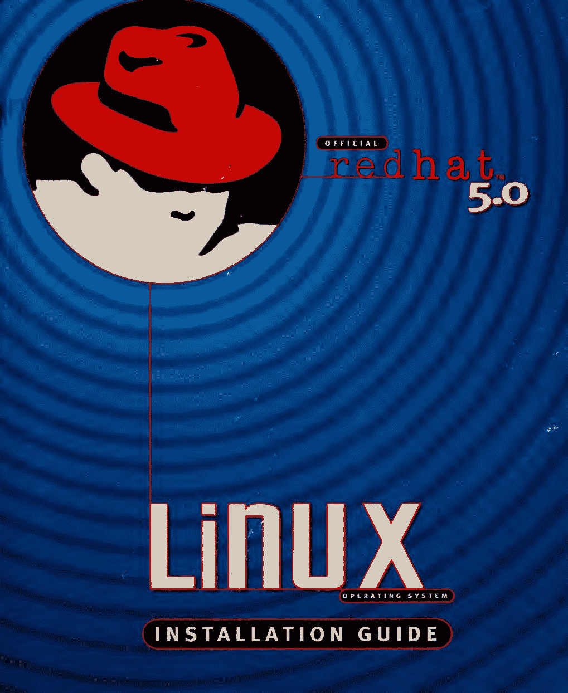

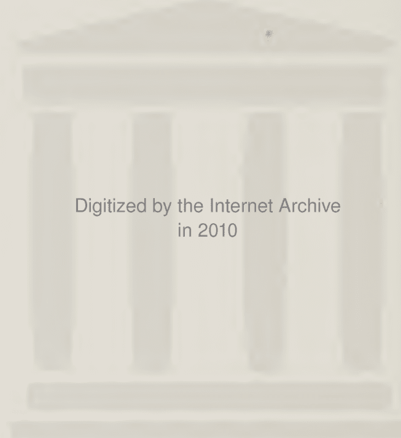

http://www.archive.org/details/redhatlinux50off00rese*


```
redhat@redhat.com
http://www.redhat.com
```


# 前言

欢迎！感谢你对 Red Hat Linux 的关注。我们认为我们拥有目前市面上最好的 Linux 发行版，并一直致力于保持这一点。Red Hat Linux 5.0 是 Red Hat Software 软件系列的最新产品。我们希望你喜欢它，并像我们开发它时一样，喜欢使用 Red Hat Linux。

有趣的是，尽管 Linux 在部分计算机用户中非常流行且广为人知，但仍有许多人刚刚听说它。Red Hat Linux 5.0 是 Red Hat Software 软件系列的最新产品。我们希望你喜欢它，并像我们开发它时一样，喜欢使用 Red Hat Linux。


第 1 章，“Red Hat Linux 5.0 新功能”包含了有关 Red Hat Linux 5.0 新添加的新功能的信息。

第 2 章，“开始之前”包含了在开始安装 Red Hat Linux 之前您应该执行的任务信息。

第 3 章，“开始安装”包含了启动 Red Hat Linux 安装过程的详细说明。

第 4 章，“继续安装”包含了关于安装过程主要部分的说明。

第 5 章，“完成安装”包含了完成安装过程所需的最后步骤的说明。

第 6 至 11 章解释了在安装好 Red Hat Linux 后，如何配置各种服务，如何在您的系统中查找文档，以及如何使用随 Red Hat Linux 附带的各种系统管理和管理工具。这些章节还解释了您的 Red Hat Linux 系统的特殊之处，包括特殊文件的存放位置以及如何关闭 Red Hat Linux。

附录包含了关于 Red Hat Linux 的额外信息，包括针对 Digital Alpha 机器和 Sun SPARC 机器所有者的信息、常见问题等。

## 快速启动信息

对于那些以前安装过 Red Hat Linux/Intel 并且急于开始使用的人，只需启动引导盘并选择所需的安装方法即可。如果您从 FTP 站点、硬盘安装，或者在安装期间将使用 PCMCIA 卡，系统将提示您插入辅助软盘。无论何种情况，请按照提示回答所有问题。

如果您正尝试为 Alpha 或 SPARC 安装 Red Hat Linux，您真的应该阅读第 15 页的第 2 章。它将引导您参考针对您的非 Intel 基础系统的特定信息。

## 升级到之前的 Red Hat Linux 版本

Red Hat Linux 5.0 的安装过程包含了升级到之前的 Red Hat Linux 时代（2.0、2.1、3.0.3、4.0、4.1 和 4.2）的能力，这些版本基于 RPM 技术。升级您的系统将安装模块化的 2.0.x 内核，以及安装在您的机器上的程序包的更新版本。升级过程将使用 `.rpmsave` 扩展名保留现有的配置文件（例如 sendmail.cf.rpmsave），并在 `/tmp/upgradelog` 中留下日志，说明它所执行的操作。随着软件的演进，配置文件的格式可能会发生，因此在整合您的更改之前，您应该仔细对比您的原始配置文件与新文件。

## 来自开发者的话

我们感谢所有的 Beta 测试人员将他们的系统托付给 Red Hat Linux 的早期版本，并花时间从一线提交错误报告，特别是那些自“万圣节”（Halloween）发布及更早时期一直支持 Red Hat 的朋友。我们还感谢 Linus Torvalds 以及全球成千上万的开发者，他们创造了真正称得上为分布式开发奇迹之一。

再次，感谢您对 Red Hat Linux 的关注！

Red Hat 开发团队

## 编辑者的话

从本手册开始，Red Hat 软件公司已投入了全职资源来制作文档。读过本手册之前版本的人可能已经注意到已经做了一些更改；我们希望您会喜欢这些更改。我们的目标是将本手册演变为一份详尽的文档，能够满足任何想要安装 Red Hat Linux 的人的需求，无论他们的经验水平如何。

## 我们需要反馈！

在我们朝着这一目标迈进的过程中，会有错误。如果您发现了错误，或者想出了让本手册更好的方法，我们非常想听听您的意见！
请发送邮件至：

```
docs@redhat.com
```

请务必注明手册标题以及您的建议。如果您发现了错误，请包含页码以便我们轻松找到。我们可能无法回复发送给我们的每条信息，但您可以相信，我们会阅读所有的信息。

感谢您对 Red Hat Linux 的关注！

Edward C. Bailey

## Red Hat Linux 5.0 新功能

本章描述了 Red Hat Linux 5.0 的新特性。

### 1.1 安装增强

我们对 Red Hat Linux 安装过程进行了许多更改，以下是列表：

- 自动探测 PCI 设备
- 专家安装模式
- 启动盘模式
- 配置分区和挂载的新方法
- 守护程序的启动配置
- 增强 XFree86 配置

### 1.1.1 自动探测 PCI 设备

安装程序可以探测带有  的计算机。如果需要，可以通过专家模式禁用自动探测（见 1.1.2）。

### 1.1.2 专家安装模式

通过在提示界面进入专家模式运行安装程序，对话框允许用户输入选项。因此，如果特定的硬件配置需要选项，则应使用专家模式。

### 1.1.3 启动盘模式

可以使用启动盘模式来自动化 Red Hat Linux 安装。它不再在安装期间向用户提问，而是读取一个包含所有所需信息的文件。有关启动盘模式的更多信息，请阅读 Red Hat Linux 光上的 /doc/README.ks。

### 1.1.4 配置分区和挂载

在过去，安装程序使用 fdisk 设置分区，并使用一系列对话框定义挂载点。虽然这些功能在 Red Hat Linux 5.0 中仍然可用，但有一种替代方案。Diskid 在一个屏幕上提供了挂载点和分区配置。此外，Diskid 支持“可扩展分区”的概念——这种分区可以扩展以分配磁盘上的剩余空间。

有关 Diskid 的更多信息，请参阅第 54 页的第 4.3 节。

### 1.1.5 配置启动运行的服务

在之前的 Red Hat Linux 版本中，如果您在安装 Red Hat Linux 时安装了特定服务（如 bind、samba 等），该服务在安装完成并重启系统后会自动启动。现在，您可以在安装期间选择哪些服务启动，哪些服务不启动。在安装期间，您将被要求选择每次系统启动时要运行的服务。更多信息，请参阅第 76 页的第 5.5 节。

### 1.1.6 增强 XFree86 配置

XFree86 配置工具 XConfigurator 已经增强。它现在将尝试探测您的系统以自动确定安装了什么类型的显卡。此外，XConfigurator 现在将为您的硬件确定最佳分辨率和色彩深度。

### 1.2 新的用户模式工具

> Diskid 在 Red/SPARC 安装程序下不可

对于新 Red Hat Linux 用户来说，最大的障碍之一是许多任务只能由 root 账户执行、通过一套晦涩的命令执行，或者两者兼有。为了让生活变得更容易，有一些新工具供任何用户执行常用任务：

- 用户信息工具
- 用户密码工具
- 文件系统挂载工具
- 网络设备工具


### 1.2.1 用户信息工具

用户信息工具用于在用户的密码记录中设置“gecos”信息。图 1.1 显示了它的运行情况。

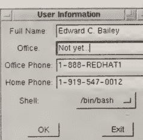

图 1.1：用户信息工具

如你所见，你可以输入你的：

- 全名
- 办公室
- 办公电话
- 家庭电话
- Shell

要使用此工具，请运行 /usr/bin/userinfo。

### 1.2.2 用户密码工具

如名所示，用户密码工具用于更改密码。该工具会弹出一个消息，标识正在更改密码的用户，随后提示当前密码和新密码。要使用密码工具，请运行 /usr/bin/userpasswd。

## 1.2 新型用户模式工具

### 1.2.3 文件系统挂载工具

此程序可以方便地挂载和卸载文件系统。它将 /etc/fstab 中每个配置了用户选项的文件系统显示为“挂载”（Mount）和“格式化”（Format）按钮。在图 1.2 中，CD-ROM 驱动器已挂载（点击“挂载”按钮即可卸载）。所有可写且未卸载的媒体，“格式化”按钮均为激活状态，点击后会对媒体进行格式化。

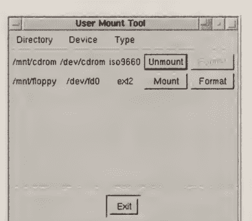

图 1.2：文件系统挂载工具

要使用此工具，请运行 /usr/bin/usermount。

### 1.2.4 网络设备工具

使用此工具可以轻松地启动和停止网络接口。用户可以查看每个可用网络接口以及代表其状态的彩色按钮（见下一页图 1.3）。点击接口按钮可以切换该接口（即：如果是关闭状态则开启，反之亦然）。点击状态信息按钮将强制更新该接口的状态（尽管状态会自动更新）。完成后，点击 Exit 退出。

要使用此工具，请运行 /usr/bin/usermount。

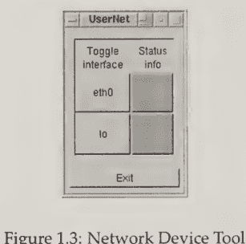

### 1.3 系统管理相关增强

Red Hat Linux 5.0 为系统管理员提供了以下功能：

- 基于 glibc 的系统
- 改进的 shadow 工具集
- 新的 initscript 程序
- 新的备份脚本
- 改进的网络配置工具
- 用于软盘访问的新用户组
- 针对 sendmail 的反垃圾邮件更改

### 1.3.1 基于 glibc 的系统

Red Hat Linux 5.0 现在基于名为 glibc 的较新库。glibc 有许多优势：

- 作为一个活跃维护的库，glibc 更加稳定。
- 许多人认为 glibc 速度更快。
3. 现在同一个库可以用于所有的 Red Hat Linux 平台。
4. Glibc 支持线程和国际化。

### 1.3.2 改进的 shadow 工具集

Red Hat Linux 5.0 对影子密码（shadow-words）的支持得到了显著增强。shadow-utils 软件包包含许多支持以下内容的工具：

- 从普通密码到影子密码及反之的转换（pwconv, pwunconv）。
- 密码、组及关联影子文件的验证（pwck, grpck）。
- 行业标准的添加、删除和修改用户账户的方法（useradd, usermod 和 userdel）。
- 行业标准的添加、删除和修改用户组的方法（groupadd, groupmod 和 groupdel）。
- 管理 /etc/group 文件的行业标准方法（gpasswd）。

**请注意：** 关于这些工具还有几点需要注意的：

- 无论是否启用影子密码（shadowing），这些工具都能正常工作。
- 这些工具经过微调，以支持 Red Hat Software 的用户组方案。有关修改的说明，请参阅 useradd 手页。有关用户私有组的更多信息，请查看第 171 页的第 1.3.3 节。
- adduser 脚本已替换为指向 /usr/sbin/useradd 的软链接。

### 1.3.3 新的 initscript 实用

chconfig 工具提供了一个简单的命令行工具，用于维护 /etc/rc.d 目录结构。它让系统管理员无需直接操作 /etc/rc.d 中大量的符号链接。

更多信息请参阅 chconfig 手页。

### 1.3.4 新的备份脚本

如手页所述，“rhbackup 是一个用于简单本地和远程系统备份的程序。它……使用 rsh 和 tar 作为其基础网络和存档机制。”

关于 rhbackup 的更多信息，请参阅 rhbackup 手页。

### 1.3.5 改进的网络配置工具

网络配置工具 netcfg 已经增强。它现在具有克隆网络接口的能力。考虑以下示例：

笔记本电脑大多数时间连接到公司局域网。有时，笔记本所有者会去公司的一个部门出，希望在该部门的局域网上使用笔记本。

此外，Red Hat Linux 不进行转发。

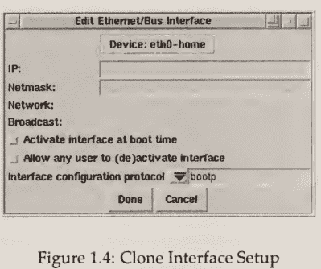

### 1.3.6 新的软盘组

Red Hat Linux 5.0 不进行转发。

### 1.3.7 针对 sendmail 的反垃圾邮件更改

Red Hat Linux 5.0 不进行转发。

## 概述

Red Hat Linux 5.0 不进行转发。

sendmail.cf 中添加了以下规则集：

- junk
- check.mail
- check.rcpt
- remove.local
- junkIP
- check_

这些规则集的行为由 /etc/mail目录目录下的文件控制：

- ip.allow
- name.allow
- relay.allow
- deny

ip.allow

这是一个包含主机地址或网络的平文本文件。该文件的格式为：

```
hhh.hhh.hhh
ccc.ccc.ccc
bbb.bbb
aaa
```

这些行分别代表一个主机地址、一个 C 类网络、一个 B 类网络和一个 A 类网络。

name.allow

这是一个包含主机主机名或域名的平文本文件。

该文件的格式为：

```
hostname.domain.com
domain.com
```

这些行代表一个主机名和一个域名。

relay.allow

这是一个包含该机器将转发的主机名、域名、主机地址或网络的平文本文件：

该文件的格式为：

```
hostname.domain.com
domain.com
hhh.hhh.hhh.hhh
ccc.ccc.ccc
bbb.bbb
aaa
```


# Red Hat Linux 5.0 的新功能

deny（拒绝)

这是一个纯文本文件，在使用之前必须使用 makemap(8) 将其转换为哈希数据库文件。该文件包含一组电子邮件地址、主机名、域名、主机地址或网络地址，这些内容通过制表符与错误消息分隔。

该文件的格式为：

```
user@domain.com<tab>error message 0
hostname.domain.com<tab>error message 1
domain.com<tab>error message 2
hhh.hhh.hhh<tab>error message 1
ccc.ccc.ccc<tab>error message 3
bbb.<tab>error message 4
aaa<tab>error message 5
```

每行代表一个已知垃圾邮件发送者的标识。当此文件中指定了电子邮件地址时，提供的错误消息将返回给该垃圾邮件发送者的 MTA。对于其他格式，相应的错误消息将记录在 /var/log/maillog，并向垃圾邮件发送者的 MTA 返回“550 Access denied”。

可以使用以下命令创建文件的哈希数据库版本：
makemap -v /etc/mail/deny < /etc/mail/deny

该命令的输出是数据库文件 /etc/mail/deny.db。

## 1.4 其他新功能

这些新功能无法归类：

- 模块化音频驱动程序
- 声卡配置工具
- 窗口管理器增强

### 1.4.1 模块化音频驱动程序

在 Red Hat Linux 5.0 中，标准的 OSS/Free 驱动已被修改为完全模块化。这允许加载和卸载各种音频驱动程序，而无需重新编译内核树或重启系统。这项工作由 Alan Cox 完成，并由 Red Hat Software, Inc. 赞助。

更多信息请参阅 sndconfig 文档目录 (/usr/doc/sndconfig/） 中的 README 文件。最新信息可以在 http://ftp.redhat.com/pub/sound/ 找到。

如果您有关于模块化音频驱动程序的任何问题，请向 sound-bugs@redhat.com 发送邮件。此外还有一个与模块化音频驱动程序相关的邮件列表（sound-list@redhat.com）。如需订阅，请向 sound-list-request@redhat.com 发送邮件，主题名为“subscribe”。

### 支持的声卡

目前，支持以下声卡：

- Sound Blaster 1.0
- Sound Blaster 2.0
- Sound Blaster Pro
- Sound Blaster 16
- Sound Blaster 16 PnP
- Sound Blaster AWE32/AWE64 (仅限 SB-16 模式)

### 1.4.2 声配置工具

Red Hat Linux 5.0 还包含了 sndconfig，这是一个面向屏幕的实用，可以正确配置声卡驱动程序。

关于 sndconfig，您有几点需要了解：

**支持即插即用** – sndconfig 能够检测并配置即插用声卡，例如 Sound Blaster 16 PnP。但请注意，当前版本的 sndconfig 会创建一个新的 /etc/isapnp.conf 文件，其中仅取消注释了声卡的设置。因此，如果您的系统上有其他即插用设备，您必须执行以下操作之一：

- 您可以手动将声卡的 PnP 信息添加到现有的 /etc/isapnp.conf 中，并使用 --probe 选项运行 sndconfig。
- 您可以在不带 --probe 选项的情况下运行 sndconfig，并在 sndconfig 创建的 /etc/isapnp.conf 文件中注释其他 PnP 卡的配置信息。

修改 /etc/conf.modules – sndconfig 通过添加有关声卡所需的模块信息来修改 /etc/conf.modules 文件。请注意，sndconfig 将您的原始 /etc/conf.modules 文件保存为 /etc/conf.modules.bak。设置您的声卡，运行 /usr/sbin/sndconfig。

### 1.4.3 窗口管理器增强

对提供的窗口管理器及其菜单进行了增强。

# 在开始之前

虽然安装 Red Hat Linux 是一个简单的过程，但在开始安装之前花一些时间可以使整个过程变得顺畅得多。在本章中，我们将讨论在开始安装之前应该执行的步骤。

**请注意：** 如果您当前运行的是 2.0（或更高版本）Red Hat Linux 系统，可以进行升级。请跳过本章以回顾与安装相关的基本问题，并按照指示顺序阅读后续章节。

在安装 Red Hat Linux 之前，您应该做以下五件事：

1. 确保您有权访问安装所需的 Red Hat Linux 组件。
2. 确保您了解计算机的硬件配置和网络信息。
3. 根据任务决定您将使用何种方法安装 Red Hat Linux。
4. 确定 Red Hat Linux 位于硬盘的什么位置。
5. 确保您有足够的文档以便在安装后有效使用您的 Red Hat 系统。


如果您购买了 Red Hat Linux 盒装版，那么您已经准备好了！然而，偶尔也会出错，所以现在是检查盒装版内容的好时机。如果您没有购买 Red Hat Linux 盒装版，请跳到第18页的第 2.1.3 节。

### 2.1.1 Red Hat 盒装版的内容

Red Hat Linux 盒装版包含以下物品：

- 安装指南
- Red Hat Linux CD 1 和 2
- 启动和补充磁盘
- 许可与注册卡

让我们快速查看每一项：

安装指南

您正在阅读的 Red Hat Linux 安装指南包含了安装 Red Hat Linux 所需的信息。此外，它还包含了 Red Hat Linux 独特方面的信息。

CD 1 和 2

这两个光盘包含了 Red Hat Linux 发行版。CD 1 包含了适用于您的计算机类型（Intel、Alpha 或 SPARC）的所有二进制包。CD 2 包含了用于构建 CD 1 上二进制包的源码包。

启动和补充磁盘

这些磁盘用于启动 Red Hat Linux 安装过程。根据您的计算机配置和选择的安装类型，您可能需要启动磁盘、补充磁盘，或者完全都不需要。

许可与注册卡

此卡包含了 Red Hat Linux 的许可条款，以及可能包含的任何商业软件的许可条款。您在这里找到有关 Red Hat Linux 5.0 的最新信息。此外，可以在此卡上找到注册 Red Hat Linux 副本的方法。注册后，您可以获得安装支持。Red Hat Software 的安装支持将在第183页的附录 A 中讨论。

### 2.1.2 缺少了什么？

如果您是从 Red Hat Software（或其经销商）购买的 Red Hat Linux 盒装版，但缺少上述列表中的某些物品，请告诉我们！拨打我们的电话 1-888-733-4281（美国境外拨打 +1-919-547-0012或者向 sales@redhat.com 发送邮件。

如果您的 Red Hat Linux 盒装版是完整的，请跳到下一页第 2.1.4 节。

### 2.1.3 没有盒装版？没问题！

当然，并不是每个人都会购买 Red Hat Linux 盒装版。完全可以使用其他公司创建的 CD 甚至通过 FTP 安装 Red Hat Linux。在这种情况下，您可能需要创建一个或多个磁盘来启动。


### 2.1.4 检查是否有更新的磁盘镜像

有时，我们会发现安装可能会失败，需要一个经过修订的磁盘镜像才能使安装正常运行。在这种情况下，我们通过 Red Hat Linux 错误列表（Red Hat Linux Errata）提供了特殊的镜像。

由于这种情况相对少见，通常情况下您先尝试使用标准磁盘镜像可以节省时间，只有在完成安装过程中遇到任何问题时，再查阅错误列表。

查看错误列表有两种方法：

- 1. 广域网 - 将您的 浏览器指向 http://www.redhat.com/errata，您可以在线阅读错误列表，并轻松地下载磁盘镜像。
- 2. 电子邮件 - 通过向 errata@redhat.com 发送一封空邮件，您将收到一封包含完整错误列表的邮件。此外还包括每个更新包和磁盘镜像的 URL。

将您的 浏览器指向 http://www.redhat.com/errata，您可以在线阅读错误列表，并轻松地下载磁盘镜像。

通过向 errata@redhat.com 发送一封空邮件，您将收到一封包含完整错误列表的邮件。此外还包括每个更新包和磁盘镜像的 URL。

## 2.2 您需要的事的事

为了防止安装过程中出现意外情况，在尝试安装 Red Hat Linux 之前，您应该了解以下信息：

### 2.2.1 硬件配置

您应该对您的硬件的基本了解：

- 硬盘(s) - 特别是，大小和类型。
- 内存 - 容量。
- CD-ROM - 最重要的是，接口类型（IDE 或 SCSI）。
- SCSI 适配器（如果存在）——适配器的型号和规格。
- 网卡（如果存在）——网卡的型号和规格。
- 鼠标 – 鼠标类型（串行、PS/2 或总线），以及按钮数量；此外，对于串行鼠标，它连接的端口。

在查阅错误列表时，请注意磁盘镜像的文件名。

| Alpha |
| :--- |
| 除了 Red Hat 网站上的最新错误列表，Alpha 系统的所有者应该查阅第 211 页的附录 D2。 |

| SPARC |
| :--- |
| 除了 Red Hat 网站上的最新错误列表，SPARC 用户应该查阅第 197 页的附录 C1。 |

### 2.2.2 视频配置

如果您将安装 X Window 系统，您还需要熟悉以下内容：

- 显卡 – 显卡的型号（或其使用的视频芯片组），以及它拥有的显存量。

### 2.3 安装方法

- 显示器 – 显示器的型号，以及允许的刷新率范围。

### 2.2.3 网络相关信息

如果您将连接到网络，请确保您知道：

- IP 地址 – 通常表示为一组由点分隔的数字，例如 10.0.2.15。
- 子网掩码 – 另一组由点分隔的数字。掩码码 255.255.248.0。
- 网关 IP 地址 – 另一组点分隔的数字。例如 10.0.2.254。
- 一个或多个 DNS IP 地址 – 一或多组点分隔的数字。10.0.2.1 可能是 DNS 服务器的地址。
- 域名 – 给您的组织的名称。例如，Red Hat Software 的域名是 redhat.com。
- 主机名 – 您的计算机名称。例如，计算机可以命名为 pooh。

请注意：上述提供的信息仅供示例！在安装 Red Hat Linux 时请勿这些信息！如果您不知道网络的正确值，请咨询您的网络管理员。

# 在开始之前

您可以通过几种不同的方法之一来安装或升级 Red Hat Linux。每种方法在不同情况下都有最佳效果。


## 2.4 磁盘分区

对于 NFS 安装，你只需要一个启动软盘。

如果你确定这种安装方法最适用于你的情况，请直接跳到第 2.4 节。

### 2.3.5 从硬盘安装

如果其他安装方法都不对你有效，但你通过某种方法可以将 Red Hat Linux 软件包写入你系统的硬盘中，那么你就可以从硬盘进行安装。在这种安装方法中，你选择的 Red Hat Linux 软件包将从硬盘上的一个分区读取，并安装在另一个分区（或一组分区）上。

### 如何操作

硬盘安装方法需要你自己在方面上做一些前期的准备工作，因为在启动 Red Hat Linux 安装程序之前，你必须将所有必要的文件拷贝到某个分区中。你必须首先在目录树的顶层创建一个 `RedHat` 目录。你安装的所有内容都应该放在该目录中。首先复制基础子目录及其内容。

接下来，将想要安装的软件包拷贝到另一个名为 `RPMS` 的子目录。你可以使用现有的 DOS 分区或安装过程中不需要的 Linux 分区的可用空间（例如，用于安装后系统上数据存储的分区）。

如果你使用的是 DOS 文件系统，你将无法为 RPM 软件包使用完整的 Linux 文件名。安装过程并不在乎文件名的形式如何，但记录下它们是一个好主意。从硬盘安装时，你需要一个启动软盘和一个补充性软盘。

## 2.4 磁盘分区

为了安装 Red Hat Linux，你必须为它留出磁盘空间。这些磁盘空间需要与你可能在计算机上安装的其他操作系统（如 Windows、OS/2 甚至是不同版本的 Linux）所使用的磁盘空间分开。

磁盘可以被划分为不同的分区。每个分区的访问方式就像是一块独立的磁盘一样。此外，每个分区都有一个类型，用于指示分区内是如何存储信息的。例如，DOS、OS/2 和 Linux 使用不同的分区类型。

即使你是在自己的独立硬盘上安装 Red Hat Linux，或者在一台没有包含任何其他操作系统的计算机上安装，你仍然需要为 Red Hat Linux 创建分区。在这种情况下，这非常简单，因为硬盘上没有其他分区需要担心。

另一方面，在安装过程中，你将获得为 Red Hat Linux 创建分区的机会。此时，你首要考虑的问题是确保你有足够的磁盘空间来创建这些分区。让我们回顾一下为 Red Hat Linux 分区腾出空间的不同方法。

### 2.4.1 重新分区策略

在尝试对硬盘进行重新分区时，你可能会面临三种场景：

- 有未分区的空闲空间。
- 有未使用的分区。
- 正在使用的分区中有空闲空间。

让我们依次查看每个场景。

### 使用未分区的空闲空间

在这种情况下，定义的分区没有跨整个硬盘，留下了不属于任何定义分区的未分配空间。如果你仔细考虑，一个未使用的硬盘也属于这一类；唯一的区别是所有空间都不属于任何定义分区的范围。

在这种情况下，你可以直接从未使用的空间创建必要的分区。

### 使用未使用的分区

去年，你将 Windows 系统上的那块 105MB 硬盘换成了一个 1.2GB 的“巨兽”。你将其划分为两个等份，认为 C “驱动器”（实际上是第一个分区）用于 Windows，D “驱动器”（实际上是第二个分区）用于你从互联网下载的免费软件集合。嗯，你太习惯使用 C 盘了，以至于从未在 D 盘上放置过任何实质性的内容。

如果你发现自己处于这种境地，你可以可以使用分配给未使用分区的空间。你需要删除该分区，并在其位置创建相应的 Linux 分区。

### 使用活动分区的空闲空间

这是最常见的情况。遗憾的是，这也是最难的。主要问题是你有足够的空闲空间，但它目前被分配给了一个正在使用的分区。如果你购买了一台预装了软件的计算机，硬盘很可能有一个巨大的分区，存放着操作系统和数据。

除了向你的系统添加新硬盘外，你还有两个选择：

- 破坏性重新分区 —— 基本上，你删除这个单一的大分区，并创建几个较小的分区。正如你想象的，你在该分区中的任何数据都会被破坏。这意味着进行完全备份是必要的。为了你自己的起见，请做两次备份，使用验证（如果你的备份软件支持），并在删除分区之前尝试从备份中读取数据。另请注意，如果该分区上安装了某种类型的操作系统，那么它也需要重新安装。

在为现有软件创建一个较小的分区后，你可以重新安装任何软件，恢复你的数据，并继续你的 Red Hat Linux 安装。

- 非破坏性重新分区 —— 在这里，你运行一个程序来实现看似不可能的任务；它在不丢失分区中存储的任何文件的情况下让大分区变小。许多人发现这种方法是可靠且无问题的；我们建议你对正在调整大小的分区进行备份，以防万一。

你应该用什么软件来完成此操作？有很多工具可用，但常用的是 GParted。GParted 是一个图形化工具，允许对分区进行调整大小、移动和删除。如果你更倾向于命令行，可以使用 `fdisk` 或 `gparted`。

请注意：目前，某些 BIOS 无法处理四个分区。如果你的计算机超过四个分区，你可能需要另一种方法。

### 2.4.2 分区与其他操作系统

如果 Red Hat Linux 与其他操作系统共存，大多数情况下你不会有问题。然而，某些系统组合需要额外的关注。关于与其他操作系统兼容的分区信息可以在指南中找到。

如果 Red Hat Linux 与 OS/2 共存，在安装期间不要创建任何新分区，但要使用 fdisk 设置正确的分区类型。

## 2.4 磁盘分区

### 2.4.3 最后一个的小细节：使用 LILO

LILO（Linux 加载器）是 Intel 系统上启动 Red Hat Linux 最常用的方法，它仅使用内置在计算机中的基本输入输出系统（或 BIOS）。本节的剩余内容完全适用于 Intel 类型，Alpha 或 SPARC 用户无需阅读，他们可以直接跳到下一页的第 2.4.4 节。

### 与 BIOS 相关的限制

LILO 受到大多数 Intel 计算机 BIOS 的限制。具体来说，大多数 BIOS 无法访问超过两个硬盘，并且无法访问存储在任何硬盘第 1023（第 1024 个）柱面之外的数据。注意，某些新的 BIOS 没有这些限制，但绝非如此。

LILO 在启动时需要的所有数据（包括 Linux 内核）都位于 `/boot` 目录，该目录是根分区的一部分。如果你打算使用 LILO 启动 Red Hat Linux 系统，必须遵循以下准则：

在两个 IDE 驱动器上 —— 如果有两个（或 EIDE）驱动器，`/boot` 必须位于其中一个。请注意，这个双驱动器限制也包括主 IDE 控制器上的任何 IDE 光驱驱动器。因此，如果你有一个 IDE 硬盘，并且在主控制器上有一个 IDE 光驱驱动器，那么 `/boot` 必须位于第一个硬盘上，即使你的辅助 IDE 控制器上还有其他硬盘。

在第一个 IDE 或第一个 SCSI 驱动器上 —— 如果你有一个 IDE（或 EIDE）和一个或多个 SCSI 驱动器，`/boot` 必须位于 IDE 驱动器或 ID 为 0 的 SCSI 驱动器。其他 SCSI ID 无法工作。

在两个 SCSI 驱动器上 —— 如果你有 SCSI 硬盘，`/boot` 必须位于 ID 为 0 或 1 的驱动器上。其他 SCSI ID 无法工作。

完全在 1023 柱面以下分区 —— 无论适用上述哪配置，存放 `/boot` 的分区必须完全位于 1023 柱面以下。如果存放 `/boot` 的分区跨越了 1023 柱面，


# 30
# 在开始之前

你可能会遇到这样的情况：LILO 最初可以正常工作（因为所有必要信息都在 1023 柱道以下），但如果需要加载的新内核，且该内核位于 1023 柱道以上，则将会失败。

如前所述，某些较新的 BIOS 可能允许 LILO 在不符合我们指南的配置下运行。同样，LILO 的某些冷门特性可能被用于启动 Linux 系统，即使配置不符合我们的指南。然而，由于涉及的变量非常多，红帽软件无法支持此类非常规尝试。

### 2.4.4 多少个分区？

虽然你可以在单个分区中安装红帽 Linux（受限于我们目前为止提到的任何分区考虑因素），但将内容稍微拆分是一个更明智的主意。我们建议以下布局作为单分区简单性与多分区灵活性之间的折中方案：

**请注意：** 如果你计划安装随红帽 Linux 附的所有软件包，你可能需要使用更大的分区。

- **交换分区 (swap partition)** – 交换分区用于支持虚拟内存。如果你的电脑内存为 16 MB 或更少，你必须创建一个交换分区。即使你有更多内存，也建议创建一个交换分区。交换分区的最小大小应等于你的电脑内存或 16 MB（以较大者为准）。

- **根分区 (root partition)** – 根分区是 /（根目录）所在的位置。它只需要包含启动系统所需的项以及系统配置文件。50 MB 到 80 MB 的根分区对于大多数系统都很好。

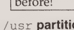

不要忘记我们在上一页第 2.4.3 节中提到的 LILO 限制！

- **/usr 分区** – /usr 分区是红帽 Linux 系统中大部分软件所在的位置。该分区的大小应在 200 MB 到 500 MB 之间，取决于你计划安装的软件包数量。如果可能，请为 /usr 分区留出充足的空间。你以后安装的任何 RPM 软件包（通常）都会比任何其他分区占用更多的 /usr 空间。


- **/home 分区** – 这是用户家目录存放的位置；/home 的大小取决于你计划在红帽 Linux 系统上设置多少用户，以及他们可能在家目录中存储什么内容。

> 以下分区专门红帽 Linux /Alpha 安装。

- **MILO 分区** – 将使用 MILO 启动系统的 Alpha 用户，应创建一个 1.5 MB 的 DOS 分区，在安装完成后将 MILO 拷贝到其中。

此外，你可能希望创建以下任何分区：

- **/usr/local 分区** – 传统上，/usr/local 用于存放你希望与红帽 Linux 系统部分分开的内容，例如未以 RPM 软件包形式提供的软件。大小取决于你预计放入系统中的软件量。

- **/usr/src 分区** – 红帽 Linux 系统中有两项内容存储在 /usr/src 中：

    - **Linux 内核源码** – Linux 内核的完整源码存储在此，新内核也在此构建。

    - **基于 RPM 软件包的源码** – 如果安装了源包文件（即 SRPM），文件将存储在此。注意，除非另有说明，否则任何构建的包也会在此处使用一个构建目录。

    - **再次，该分区的大小取决于你预计构建的软件量。**

- **/tmp 分区** – 如名所示，/tmp 分区用于临时文件。对于较大的多用户系统或网络服务器，创建一个专门的 /tmp 分区是一个好主意。这是因为许多活动用户可能会填充根分区（/），而 /tmp 就位于那里。对于单用户工作站，没有必要为 /tmp 专门划分分区。


Red Linux 是一个功能强大的操作系统。除非你是 Linux 大师，否则你需要文档来充分利用你的 Linux 系统。每个人都应该查看第 113 页的第 7 章获取更多有关可用 Linux 文档的信息。虽然许多人发现第 7 章描述的资源非常有帮助，但刚开始使用 Linux 的人可能需要额外信息。对你最有帮助的信息取决于你的 Linux 专家水平：

**Linux 新手** - 如果这是你第一次使用 Linux（或者任何类 Linux 操作系统），你需要关于基本 Unix 概念的坚实介绍信息。例如，O'Reilly and Associates (http://www.ora.com/) 产生了大量与 Linux 和 Unix 相关的书籍。尝试他们更通用的标题。

**有一定的 Linux ** - 如果你用过其他 Linux 发行版（或类 Linux 操作系统），你可能可以在一些深度参考资料中找到你需要的内容。红帽软件的 *Doctor Linux* 和 *Linux Man* 是整体文档的好选择，而当你需要关于特定主题的大量信息时，O'Reilly 更具专业的标题非常有价值。

**老手** - 如果你是红帽 Linux 的长期用户，你可能不需要我们告诉你读哪些文档。感谢阅读。


## 2.6 关于驱动的说明

你可能会遇到这样的情况：LILO 最初可以正常工作（因为所有必要信息都在 1023 柱道以下），但如果需要加载新内核，且该内核位于 1023 柱道以上，则将会失败。

如前所述，某些较新的 BIOS 可能允许 LILO 在不符合我们指南的配置下运行。同样，LILO 的某些冷门特性可能被用于启动 Linux 系统，即使配置不符合我们的指南。然而，由于涉及的变量非常多，红帽软件无法支持此类非常规尝试。

### 2.4.4 多少个分区？

虽然你可以在单个分区中安装红帽 Linux（受限于我们目前提到的任何分区考虑因素），但将内容稍微拆分是一个更明智的主意。我们建议以下布局作为单分区简单性与多分区灵活性之间的折中方案：

**请注意：** 如果你计划安装随红帽 Linux 附的所有软件包，你可能需要使用更大的分区。

- **交换分区 (swap partition)** – 交换分区用于支持虚拟内存。如果你的电脑内存为 16 MB 或更少，你必须创建一个交换分区。即使你有更多内存，也建议创建一个交换分区。交换分区的最小大小应等于你的电脑内存或 16 MB（以较大者为准）。

- **根分区 (root partition)** – 根分区是 /（根目录）所在的位置。它只需要包含启动系统所需的项以及系统配置文件。50 MB 到 80 MB 的根分区对于大多数系统都很好。


不要忘记我们在上一页第 2.4.3 节中提到的 LILO 限制！

- **/usr 分区** – /usr 分区是红帽 Linux 系统中大部分软件所在的位置。该分区的大小应在 200 MB 到 500 MB 之间，取决于你计划安装的软件包数量。如果可能，请为 /usr 分区留出充足的空间。你以后安装的任何 RPM 软件包（通常）都会比任何其他分区占用更多的 /usr 空间。


- **/home 分区** – 这是用户家目录存放的位置；/home 的大小取决于你计划在红帽 Linux 系统上设置多少用户，以及他们可能在家目录中存储什么内容。

> 以下分区专门红帽 Linux /Alpha 安装。

- **MILO 分区** – 将使用 MILO 启动系统的 Alpha 用户，应创建一个 1.5 MB 的 DOS 分区，在安装完成后将 MILO 拷贝到其中。

此外，你可能希望创建以下任何分区：

- **/usr/local 分区** – 传统上，/usr/local 用于存放你希望与红帽 Linux 系统部分分开的内容，例如未以 RPM 软件包形式提供的软件。大小取决于你预计放入系统中的软件量。

- **/usr/src 分区** – 红帽 Linux 系统中有两项内容存储在 /usr/src 中：

    - **Linux 内核源码** – Linux 内核的完整源码存储在此，新内核也在此构建。

    - **基于 RPM 软件包的源码** – 如果安装了源包文件（即 SRPM），文件将存储在此。注意，除非另有说明，任何构建的包也会在此处使用一个构建目录。

    - **再次，该分区的大小取决于你预计构建的软件量。**

- **/tmp 分区** – 如名所示，/tmp 分区用于临时文件。对于较大的多用户系统或网络服务器，创建一个专门的 /tmp 分区是一个好主意。这是因为许多活动用户可能会填充根分区（/），而 /tmp 就位于那里。对于单用户工作站，没有必要为 /tmp 专门划分分区。


Red Linux 是一个功能强大的操作系统。除非你是 Linux 大师，否则你需要文档来充分利用你的 Linux 系统。每个人都应该查看第 113 页的第 7 章获取更多有关可用 Linux 文档的信息。虽然许多人发现第 7 章描述的资源非常有帮助，但刚开始使用 Linux 的人可能需要额外信息。对你最有帮助的信息取决于你的 Linux 专家水平：

**Linux 新手** - 如果这是你第一次使用 Linux（或者任何类 Linux 操作系统），你需要关于基本 Unix 概念的坚实介绍信息。例如，O'Reilly and Associates (http://www.ora.com/) 产生了大量与 Linux 和 Unix 相关的书籍。尝试他们更通用的标题。

**有一定的 Linux  ** - 如果你用过其他 Linux 发行版（或类 Linux 操作系统），你可能可以在一些深度参考资料中找到你需要的内容。红帽软件的 *Doctor Linux* 和 *Linux Man* 是整体文档的好选择，而当你需要关于特定主题的大量信息时，O'Reilly 更具专业的标题非常有价值。

**老手** - 如果你是红帽 Linux 的长期用户，你可能不需要我们告诉你读哪些文档。感谢阅读。


它还为你提供了一种从 shell 提示符输入命令的方法。它将这些信息显示在五个虚拟控制台上，你可以通过单个按键在它们之间进行切换。如果你在安装 Red Hat Linux 时遇到问题，这些虚拟控制台将非常有帮助。安装或系统控制台上显示的消息可以帮助确定问题。请参见图 3.1，查看虚拟控制台列表、切换所需的快捷键及其内容。

| 控制台 | 快捷键 | 内容 |
|---|---|---|
| 1 | Alt-F1 | 安装对话框 |
| 2 | Alt-F2 | shell 提示符 |
| 3 | Alt-F3 | 安装日志（来自安装程序的消息） |
| 4 | Alt-F4 | 系统日志（来自内核等的消息） |
| 5 | Alt-F5 | 其他消息 |

图 3.1：虚拟控制台信息

通常情况下，除非你正尝试诊断安装问题，否则没有理由离开 1 号虚拟控制台。但如果你是个好奇心的人，可以随便到处看看。

现在是时候安装 Red Hat Linux 了。要开始安装，首先必须启动安装程序。在我们开始之前，请确保你已经准备好了安装所需的所有资源。如果你已经阅读了第 15 页的第 2 章并按照指示进行了操作，那么你应该已经准备好了。

> 如果你还没有创建磁盘盘，请阅读第 214 页的 D.4 节并现在创建它们。创建好磁盘盘后，请阅读第 215 页的 D.5 节获取有关启动安装的信息。

> 如果你还没有为安装做好准备，请阅读第 199 页的 C.2 节到 C.5 节。确定你将如何启动安装程序，并发布启动安装的 boot 命令。

### 3.2.1 启动安装程序

要开始安装 Red Hat Linux，将启动磁盘盘插入计算机第一个磁盘驱动器并重启。经过短时间延迟，将出现一个包含启动提示符的屏幕。该屏幕包含各种启动选项的信息。每个启动选项都有与其关联的一个或多个帮助屏幕。要访问帮助屏幕，按下屏幕底部行列出的相应功能键。你需要记住两点：

- * 如果你在第一分钟内没有采取任何操作，初始屏幕将自动启动安装程序。要禁用此功能，请按下帮助屏幕按键之一。
- 如果你按下帮助屏幕功能键，会有轻微延迟，因为需要从磁盘盘读取帮助屏幕。

通常情况下，你只需要按 Enter 键即可启动。观察启动消息以查看 Linux 内核是否检测到你的硬件。如果它没有正确检测到硬件，你可能需要在“专家”模式下重新安装。专家模式禁用了大多数硬件探测，并让你能够为安装安装期间加载的驱动程序输入选项。可以使用 boot 命令进入专家模式：

```
boot: expert
```

**请注意：** 初始启动消息不包含任何对 SCSI 或网卡的引用。这些设备由在安装过程中加载的模块支持。

选项也可以传递给内核。例如，要指示内核在 128 MB 的系统中使用所有 RAM，输入：

```
boot: linux mem=128M
```

输入任何选项后，按 Enter 键使用这些选项启动。如果你需要指定启动选项来识别你的硬件，这些选项稍后会用到。

## 3.3 开始安装

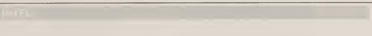

不使用磁盘盘安装。或者，如果你的计算机上安装了 MS-DOS，你可以直接从 CD 启动安装系统，而无需使用任何磁盘盘。

要这样做，请使用以下命令（假设你的 CD 是驱动器 d:）

```
C:\> d:
D:\> cd dosutils
D:\dosutils> autoboot.bat
```

注意，这种方法在 DOS 窗口中无效——autoboot.bat 文件必须以 DOS 作为唯一的操作系统执行换句话说，Windows 不能运行。

**请注意：** Red Hat Linux/Intel CD-ROM 也可以由支持启动 CD-ROM 的较新计算机启动。并非所有计算机都支持此功能，如果你的计算机无法从 CD-ROM 启动，你必须使用启动磁盘盘（或从 DOS 自动启动）来开始。

启动后，安装程序开始询问你是否使用彩色显示器（见下一页的图 3.2）。**Yes** 是默认选项——你应该看到光标或高亮的 **Yes** 按钮。如果你没有看到光标或高亮，按一次 `Tab` 键选择 No，然后按 `Enter` 继续。

接下来，安装程序将显示欢迎消息。按 `Enter` 开始安装。如果你想在此时中止安装过程，只需现在弹出启动磁盘盘并重启你的机器。

# 开始安装

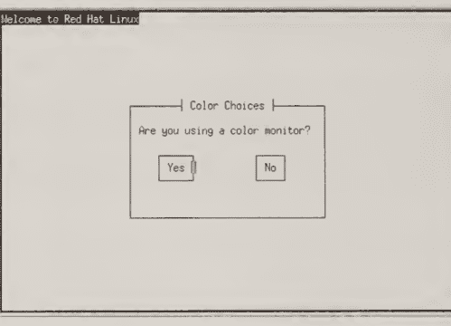

图 3.2：开始安装

### 3.3.1 选择键盘类型

在欢迎对话框之后，安装程序提供了一个选择键盘类型的机会（见下一页的 3.3）。使用按键选择适用于剩余安装的类型。注意滚动条显示有更多类型。选择键盘类型后按 Enter 将加载键盘类型。如果你以后想更改键盘类型，可以这样做。

### 3.3.2 PCMCIA 支持

接下来，安装程序将探测你的系统以确定是否需要 PCMCIA。**请注意：** 如果你在专家模式下进行安装，将被询问需要 PCMCIA（例如，通过 NFS 使用 PCMCIA 以太网卡，或通过 SCSI 卡从 PCMCIA 安装）。如果发现了 PCMCIA，回答 Yes。

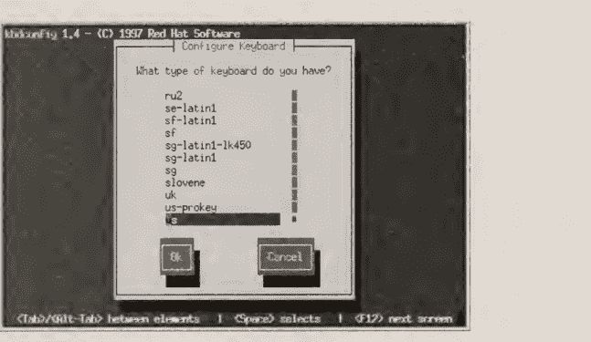

图 3.3：选择键盘类型

### 3.3.3 选择安装方法

现在询问你想哪种安装方法（见下一页的图 3.4）。高亮相应的选项并选择 OK。你可以通过四种基本方法安装 Red Hat Linux（参见第 21 页的第 2.3 节），某些方法需要使用辅助磁盘盘：

- **CD-ROM** 如果你有 CD-ROM 驱动器和 Red Hat Linux CD-ROM。不需要辅助磁盘盘。请参见下一页的 3.4.1 节。
- **NFS** 如果你从 NFS 服务器安装，该服务器导出 Linux CD-ROM 或来自 Red Hat FTP 站的 Red Hat Linux 镜像。不需要辅助磁盘盘。请参见面向页的 3.4.2 节。
- **Hard Drive** 如果你将 Red Hat Linux 文件复制到了本地硬盘。需要辅助磁盘盘。请参见第 47 页的 3.4.8 节选择硬盘安装方法。
- **FTP** 如果你直接从 FTP 服务器安装。需要辅助磁盘盘。请参见面向页的 3.4.2 节。

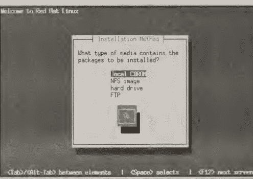

图 3.4：选择安装方法

### 3.4.1 从 CD-ROM 安装

如果你将从 CD-ROM 安装 Red Hat Linux，选择“CD-ROM”，并选择 Ok。安装程序随后将探测你的系统并尝试识别你的 CD-ROM 驱动器。如果它无法识别，将询问你拥有什么类型的 CD-ROM。你可以从以下类型中选择：

- IDE (ATAPI) 大多数适用于 Intel PC 的 CD-ROM 驱动器都是 IDE（也称为 ATAPI）。如果选择了此类型，安装程序将检查所有可用 IDE 设备以寻找 CD-ROM 驱动器。


## 3.4 选择安装方法

如果你的 CD-ROM 连接到支持的 SCSI 适配器，请选择此；安装程序会要求你选择一个 SCSI 驱动程序。选择与你的适配器最相似的驱动。如有，你可以为驱动指定选项；但大多数驱动程序会自动检测你的 SCSI 适配器。

如果你的 CD-ROM 既不是 IDE 也不是 SCSI CD-ROM，它属于“其他”。带有专用 CD-ROM 接口的声卡就是这种 CD-ROM 类型的示例。安装程序会列出支持的 CD-ROM 驱动列表——选择一个驱动，并在必要指定任何驱动选项。

一旦识别出 CD-ROM 驱动器，系统将要求将 Red Hat Linux CD-ROM 插入驱动器中。完成后点击确定。稍等片刻，将出现下一个对话框。请翻到第 51 页的第 4 章继续安装 Red Hat Linux。

### 3.4.2 通过 NFS 或 FTP 进行网络安装

基于 NFS 和 FTP 的安装相似的，因为它们都需要网络相关信息。因此，我们将讨论你偏好的安装方法，请选择 OK 并按空格键。如果你要进行 NFS 安装，请跳到第 45 页的 3.4.4 节。如果你要进行 FTP 安装，请继续阅读。

### 3.4.3 通过 FTP 安装

如果你要从 FTP 站点安装 Red Hat Linux，突出“FTP”并选择 OK。FTP 安装需要额外的软盘——当被要求插入时，请插入并选择 OK。安装程序将在加载额外软盘时显示进度条。请在手册中标记此处，因为你稍后会回到这里。

接下来，翻到第 51 页的第 4 章，按照那里的说明操作，直到包括第 65 页的第 4.4 节。然后回到这里。

回来得这么快？到此时，你已经执行了以下步骤：

- 选择了安装或升级。

# 开始安装

- 加载了对你计算机上任何 SCSI 设备的支持。
- 使用 Disk Druid 或 fdisk 设置了磁盘分区和挂载点。
- 识别了可用的交换分区并对其进行了初始化。

请确保你已标记了此处，因为你过一会儿还会回到这里。现在跳到下一页的 3.4.5 节。本节将引导你通过必要的网络配置对话框。稍后你就会……

好了，你回来了。你应该已经输入了所有必要的网络信息，现在应该看到“FTP 信息”对话框。在这里将安装程序指向你选择的 FTP 站点（见图 3.5）。输入你正在安装的 FTP 站点名称或 IP 地址，以及包含你架构的 RedHat 目录的名称。例如，如果 FTP 站点包含目录 `pub/mirrors/redhat/i386/RedHot/enter`，则输入 `pub/mirrors/redhat/i386`

如果你不是匿名 FTP，或者你需要使用代理 FTP 服务器（例如，如果你在防火墙后面），请勾选框，另一个对话框将请求 FTP 账户和代理信息。

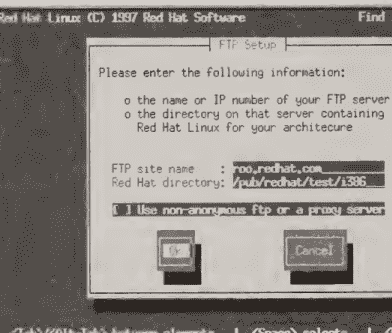

图 3.5：通过 FTP 安装

如果所有内容都指定正确，你应该看到一个消息框，指示正在检索 `base/hdlist`。现在翻到第 66 页的第 4.5 节继续安装 Red Hat Linux。

## 3.4 选择安装方法

### 3.4.4 通过 NFS 安装

如果你要从 NFS 服务的文件系统安装 Red Hat Linux，突出“NFS image”并选择 OK。

### 3.4.5 网络驱动程序配置

接下来，安装程序将探测你的系统并尝试识别你的网卡。大多数情况下，驱动程序可以自动找到网卡。如果它无法识别你的网卡，你将被要求选择支持你网卡的驱动程序，并指定驱动程序定位和识别它所需的任何选项。

### 3.4.6 配置 TCP/IP 网络

安装程序配置好你的网卡后，它会提供几个配置系统 TCP/IP 网络的对话框。图 3.6 包含了示例网络信息。

| 字段 | 示例值 |
| :--- | :--- |
| IP 地址 | 10.0.2.15 |
| 子网掩码 | 255.255.255.0 |
| 默认网关 | 10.0.2.254 |
| 主 DNS 服务器 | 10.0.2.1 |
| 域名 | redhat.com |
| 主机名 | pooh.redhat.com |

图 3.6：示例网络信息

注意，图 3.6 中的信息仅为示例！你应该从你的网络管理员处获取正确的信息。

第一个对话框要求提供 IP 和其他网络地址（见下一页的图 3.7）。输入你在安装期间使用的 IP 地址并按回车。安装程序尝试根据你的 IP 地址猜测子网掩码；如果子网掩码不正确，你可以更改它。按回车。安装程序猜测默认网关和主 DNS 服务器

# 开始安装

安装程序根据你的 IP 地址和子网掩码猜测默认网关和主 DNS 服务器；如果它们不正确，你可以更改。

如果你的局域网有 DHCP 服务器，你可以勾选 DHCP 框。无论哪种情况，选择 OK 继续。

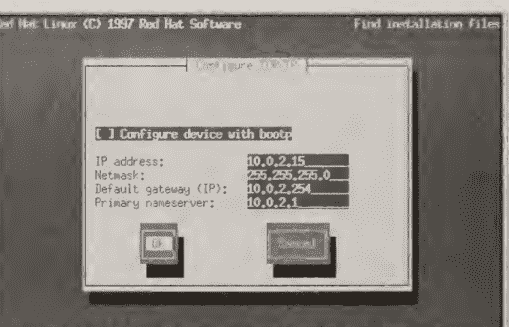

图 3.7：配置 TCP/IP

第一个对话框要求提供 IP 和其他网络地址（见下一页的图 3.7）。输入你在安装期间使用的 IP 地址并按回车。安装程序尝试根据你的 IP 地址猜测子网掩码；如果子网掩码不正确，你可以更改它。按回车。安装程序猜测默认网关和主 DNS 服务器

## 3.4 选择安装方法

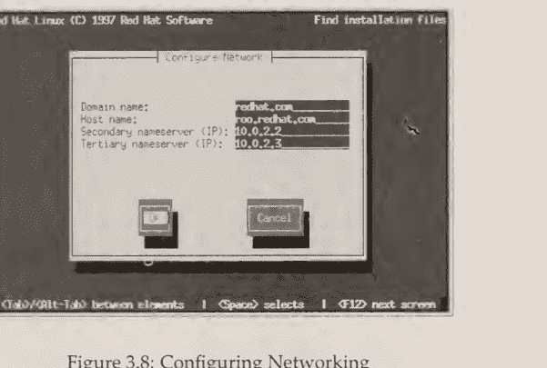

### 3.4.7 NFS 服务器信息

下一个对话框请求 NFS 服务器信息（见下一页的图 3.9）。输入 NFS 服务器名称或 IP 地址，以及包含 Red Hat 的导出目录。例如，如果 NFS 服务器将 Linux CD 挂载在 `/mnt/cdrom`，则输入 `/mnt/cdrom`。如果 NFS 服务器导出的是 Red Hat 安装树而不是 CD，输入包含 RedHat

稍等片刻，将出现下一个对话框。翻到第 51 页的第 4 章继续安装 Red Hat Linux。

### 3.4.8 从硬盘安装

如果你要从本地连接的硬盘安装 Red Hat Linux，突出“hard drive”并选择 OK。

在启动安装程序之前，你必须先将所有必要文件复制到本地连接硬盘的分区上。如果你还没有这样做，请参考第 25 页的第 2.3.5 节。从硬盘安装

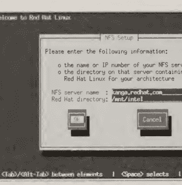

需要额外的软盘；当被指示时，请将其插入计算机的软盘驱动器并选择 OK。加载额外软盘时将显示进度条。

此时，显示一个标题为“选择分区”的对话框（见对面图 3.10）。输入持有 RedHat 目录树的分区设备名称。还有一个“目录”字段。如果 RedHat 目录不在该分区的根目录下（例如 `/test/new/RedHat`），请输入 RedHat 目录的路径（在我们的示例中为 `/test/new/`）。

如果安装程序无法在分区上找到必要文件


## 3.4 选择安装方法

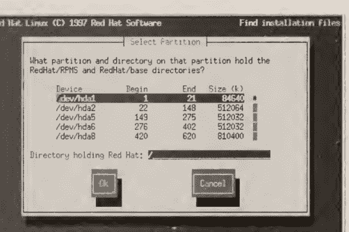

图 3.10：为硬盘安装选择分区

以及您指定的目录，您将返回到“选择分区”对话框以进行必要的修正。

如果所有内容都指定正确，您将看到一个消息框，指示软件包正在扫描。现在，请转到第 66 页的第 4.5 节继续安装 Red Hat Linux。

# 4
# 继续安装

## 4.1 升级或安装

在选择了安装方法后（如果您通过网络安装，则在配置好网络信息后），安装程序会提示您进行安装或升级（见下一页的图 4.1）。

### 4.1.1 安装

您通常会在干净的磁盘分区或一组分区上安装 Red Hat Linux，或者在另一个 Linux 安装之上安装。

**请注意：** 在另一个 Linux 安装（包括 Red Hat Linux）之上安装 Red Hat Linux 不会保留之前安装的任何信息。请确保已保存任何重要文件！

如果您希望进行完整安装，请选择**Install**，并跳转到第 53 页的第 4.2 节。

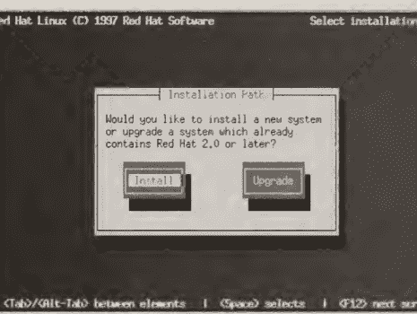

图 4.1：升级或安装

### 4.1.2 升级

Red Hat Linux 5.0 的安装过程包含了从之前的 Red Hat Linux 版本（2.0 及更高版本）升级的能力，这些版本基于 RPM 技术。升级系统会安装模块化的 2.0 内核以及您当前安装的软件包的更新版本。升级过程通过将配置文件重命名为 .rpmsave（例如 sendmail.cf.rpms）来保留现有文件，并在 /tmp/upgrade 中留下记录。作为软件，配置格式可能会发生，在整合更改之前，您应该仔细比较原始文件。

如果您想升级 Red Hat Linux 系统，请选择 **Upgrade**。

**请注意：** 某些升级软件包可能需要安装其他软件包才能正常运行。升级程序会处理这些依赖关系，但可能需要安装额外的软件包。您将看到所需软件包的名称，然后决定是否安装它们。

## 4.2 SCSI 支持

如果您选择执行升级或完整安装，安装程序将探测系统的 SCSI 适配器。在某些情况下，安装程序会询问您是否有 SCSI 适配器。如果您选择是，接下来的对话框将显示 SCSI 驱动列表。安装程序随后允许您为选定的 SCSI 适配器指定选项；然而，大多数 SCSI 驱动会自动检测您的硬件。

## 4.3 为 Red Hat Linux 创建分区

此时，必须让安装程序知道在哪里安装 Red Hat Linux。这是通过为一个或多个分区定义挂载点来实现的。您可能还需要创建或删除分区。

安装程序会弹出一个对话框，让您从两个分区工具中进行选择（见下一页的图 4.2）：

- **Disk Druid** – 这是 Red Hat Linux 新的安装管理实用程序。根据用户提供的要求创建和删除磁盘分区并管理每个分区的挂载点。
- **fdisk** – 这是传统的 Linux 分区工具。虽然它比 Disk Druid 更灵活，但缺点是 fdisk 假设您具有分区经验，并且习惯其简洁的用户界面。

> Disk Druid 在 Red Hat Linux/SPARC 上不可用。

除特殊情况外，Disk Druid 可以处理典型的 Red Hat Linux 安装的分区需求。

选择想要使用的磁盘分区工具并按 Enter。如果您选择 Disk Druid，请继续阅读。如果您倾向于使用 fdisk，请转到第 61 页的第 4.3.2 节。

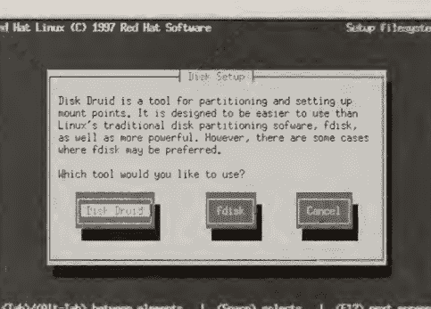

图 4.2：选择磁盘设置方法

### 4.3.1 使用 Druid

如果您选择了 Druid，将看到一个与图 4.3 类似的屏幕。虽然初看起来很复杂，但其实并不是。让我们查看 Druid 的三个部分，您会发现没什么好怕的

#### “Current Disk Partitions”部分

“Current Disk Partitions”部分中的每一行代表一个磁盘分区。您会注意到该部分右侧有一个滚动条，这意味着分区可能比一次显示的要。如果您使用向上和向下键，可以查看是否有额外的分区。该部分的每行都有五个不同的字段：

- **Mount Point** – 该字段表示当 Red Hat Linux 安装并运行时分区挂载的位置。
- **Device** – 该字段显示分区的设备名称。
- **Requested** – “Requested”字段显示定义分区时请求的最小尺寸。

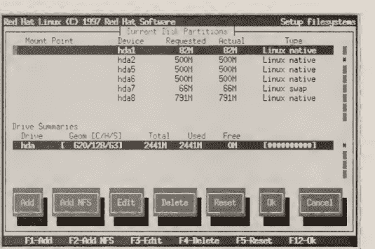

图 4.3：Druid 主界面

**Actual** - “Actual”字段显示已分配的空间。
**Type** - “Type”字段显示分区类型。

#### “Drive Summaries”部分

“Drive Summaries”部分的每一行代表一个硬盘。每行都有以下字段：

- **Drive** – 该字段显示硬盘名称。
- **Geom (C/H/S)** – 该字段显示几何结构。几何结构由三个数字组成，代表硬盘报告的柱道、头部和扇区。
- **Total** – “Total”字段显示硬盘总空间。
- **Used** – 该字段显示硬盘当前已分配给分区的空间。
- **Free** – “Free”字段显示硬盘中仍未分配的空间。
- **Bar Graph** – 该字段提供了当前使用空间的视觉表示。方框内的井号越多，剩余空间就越少。在图 4.3 中，条形图显示剩余空间。

#### Druid 按钮

这些按钮控制 Disk Druid 的操作。它们用于添加和删除分区以及更改分区属性。此外，还有按钮用于接受您所做的更改、丢弃这些更改或退出 Disk Druid。让我们顺序查看每个按钮。

- **Add** – “Add”按钮用于请求分区。选择后，将出现一个包含需要填写字段的对话框。
- **Add NFS** – 此按钮用于将只读的 NFS 服务文件系统添加到 Linux 系统的挂载点集中。选择后，将出现一个包含需要填写字段的对话框。
- **Edit** – “Edit”按钮用于修改“Current Disk Partitions”部分中选中分区的属性。选择此按钮将弹出一个对话框。取决于分区信息是否已写入磁盘，“Edit Partition”框中的某些或所有字段可能会被更改。
- **Delete** – “Delete”按钮用于删除“Current Disk Partitions”部分中选中的分区。选择此按钮将弹出一个对话框以确认删除。
- **Reset** – 此按钮用于丢弃您在 Disk Druid 中可能的所有更改，并将分区列表恢复为从硬盘分区表上读取的内容。选择后，系统将要求您确认是否要丢弃更改。注意，您指定的任何挂载点将丢失并需要重新输入。


## 4.3 为 Red Hat Linux 创建分区

确定 - “确定”（Ok）按钮会将你对系统分区的任何更改写入磁盘。在 Disk Druid 重写你的硬盘分区表之前，系统将要求你确认已的更改。此外，你定义的任何挂载点都会传递给安装程序，并最终被你的 Red Hat Linux 系统用于定义文件系统布局。

取消 - 此按钮将使 Disk Druid 放弃并不保存你所做的任何更改。选择此按钮时，安装程序将弹出一个对话框，允许你选择下一步要执行的操作。

请注意：你需要为 Red Hat Linux 分配至少一个分区，可选地分配更多。这在第 30 页的第 2.4.4 节中有更详细的讨论。

现在让我们来看看如何使用 Disk Druid 为你的 Red Hat Linux 系统设置分区。

# 添加分区

要添加新分区，选择“添加”（Add）按钮，并按下空格或回车键。将出现一个名为“编辑新分区”的对话框（见图 4.4）。它包含以下字段：

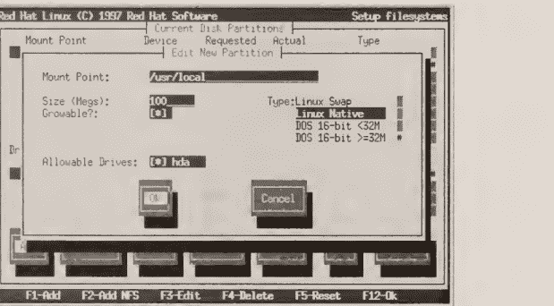

图 4.4：创建新分区

# 继续安装

- 挂载点（Mount Point） - 选中此字段，输入分区的挂载点。例如，如果此分区应该是根分区，则输入 `/`；为分区输入 `/usr`，以此此类推。

- 大小（MB）（Size (Megs)） - 在此字段中，输入分区的大小（兆字节）。注意，该字段起始值为“1”，这意味着除非你更改它，否则你将得到一个 1 MB 的分区。使用退格键（Backspace）删除它，并输入所需的分区大小。

- 可扩展的？（Growable?） - 此复选框表示你在上一个字段中输入的大小是应视为分区的精确大小还是最小大小。按空格键勾选或取消勾选该框。勾选后，分区将增长以填充硬盘上的所有可用空间。在这种情况下，分区的大小将与其他分区一样进行扩展和收缩。

- 类型（Type） - 此字段包含不同分区类型的列表。使用 F 键选择适当的分区类型。

- 允许的驱动器（Allowable Drives） - 此字段包含安装在系统上的硬盘列表，每个硬盘对应都有一个复选框。如果硬盘的框未被勾选，则该分区永远不会在该硬盘上创建。通过使用不同的复选框设置，你可以引导 Diskid 以你认为合适的方式放置分区，或者让 Diskid 决定分区放在哪里。

- 确定（Ok） - 当你对分区设置满意并希望创建它时，选择此按钮并按下空格。

- 取消（Cancel） - 当你不想创建分区时，选择此按钮并按下空格。

## 添加分区时的问题

如果你尝试添加分区且 Disk Druid 可以执行你的请求，你将看到一个与对面页图 4.5 类似的对话框。框中列出了所有未分配的分区，以及它们无法分配的原因。选择“确定”（Ok）按钮并按下空格继续。请注意，未分配的分区也会显示在 Disk Druid 的主界面上（尽管你可能需要滚动“当前硬盘分区”才能看到它们）。

# 删除分区

要删除分区，在“当前硬盘分区”部分选中该分区，选择“删除”（Delete）按钮并按下空格。系统将要求你确认删除。

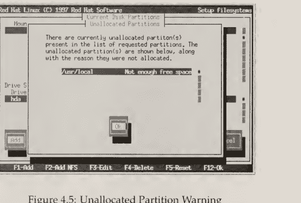

# 编辑分区

要更改分区的设置，在“当前硬盘分区”部分选中该分区，选择**编辑**（Edit）按钮并按下 [空格]。你将看到一个与第 57 页图 4.4 所示相似的对话框。进行相应的更改，选择**确定**（Ok）并按下 [空格]。

**请注意：** 如果分区已存在于你的硬盘上，你将能够更改分区的挂载点。如果你想进行任何其他更改，你需要删除该分区并重新创建。

# 添加 NFS 挂载

要添加只读的 NFS 共享文件系统，选择**添加 NFS**（Add NFS）按钮并按下 [空格]。如果你没有选择与网络相关的安装方法，将看到若干几个关于网络配置的对话框（更多信息请参阅第 45 页的第 3.4.5 节）。适当地填写它们。然后你将看到一个名为“编辑网络挂载点”的对话框（见下一页图 4.6）。在此对话框中，你需要输入 NFS 服务器名称、导出文件系统的路径以及该文件系统的挂载点。根据情况选择“确定”（Ok）或“取消”（Cancel）按钮，并按下 [空格]。

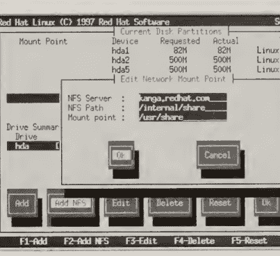

图 4.6：添加 NFS 挂载点

# 开始

如果你想放弃在 Disk Druid 中做的任何更改，可以选择“重置”（Reset）按钮并按下 [空格]。系统将要求你确认此操作。如果你选择“是”（Yes），Disk Druid 将重新从每个磁盘读取分区（如果有）。选择“否”（No）则允许你返回屏幕。

## 取消

如果你更倾向于使用 fdisk，选择“取消”（Cancel）并按下 [空格]。这是你想重新开始时。

## 完成

当你完成分区和挂载点的配置后，你的屏幕应该像图 4.7 所示。选择“确定”（Ok）并按下空格。

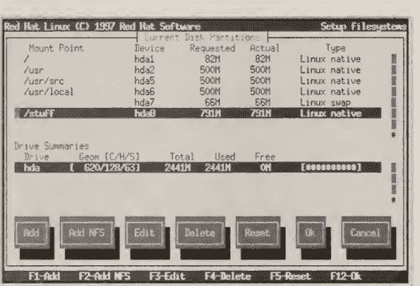

图 4.7：分区与挂载点

### 4.3.2 使用 fdisk

如果你更倾向于使用 fdisk 来管理分区，将看到一个名为“磁盘设置”（Disk Setup）的对话框（见后面页图 4.8）。框中列出了所有磁盘。移动到你想分区的磁盘，选择“编辑”（Edit）并按下空格。然后你进入 fdisk 并分区磁盘。

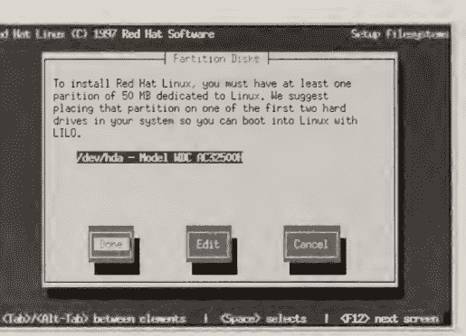

图 4.8：用于分区的磁盘

# fdisk 概述

fdisk 了一些提示：

- 添加新分区使用 `n`。
- Linux 默认创建原生类型的分区。当你创建交换分区时，不要忘记使用 `t` 命令将其更改为交换类型。交换值为 82。对于其他分区类型，使用 `l` 命令查看类型和值。
- Linux 在一个硬盘上允许最多四个 (4) 个分区。如果你想创建更多，这四个分区中的一个可以是扩展分区，作为一个或多个逻辑分区的容器。作为容器，扩展分区的大小至少要等于包含的所有逻辑分区的大小之和。
- 在创建每个分区时，最好记录下哪些分区（例如 `/dev/hda2`）用于哪些文件系统（例如 `/usr`）。
- 请注意：你所做的任何更改在通过 `w` 命令保存并退出 fdisk 之前都不会生效。你可以随时通过 `q` 命令退出 fdisk 而不保存更改。

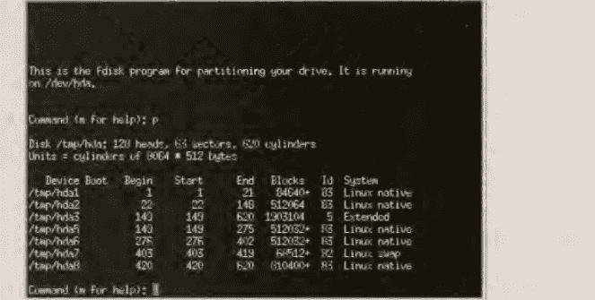

图 4.9：fdisk 的示例输出

# 分区编号

Linux 使用字母和数字组合来指划分分区，这对于没有经验的用户来说可能很困惑。以下是总结：

**前两个字母** - 分区名称的前两个字母指示分区所在的设备类型。你通常会看到 `hd`（用于 IDE 磁盘）或 `sd`（用于 SCSI 磁盘）。

**下一个字母** - 该字母指示分区位于哪个设备上。例如，`/dev/hda`（第一个 IDE 硬盘）或 `/dev/sdb`（第二个 SCSI 磁盘）。

**数字**表示分区。前四个（主分区或扩展分区）编号为 1 到 4。逻辑分区从 5 开始。例如，`/dev/hda3` 是第一个硬盘上的第三个主分区或扩展分区；`/dev/sdb6` 是第二个 SCSI 磁盘上的逻辑分区。


# 修改分区表

当你完成磁盘分区后，点击“完成”（Done）；你可能会看到一条消息，指示安装程序需要重启。在更改磁盘分区数据后这是正常现象；通常在你创建、更改或删除任何扩展分区时会发生。点击“确定”（OK）后，你的机器将重启。按照你在“磁盘分区”之前相同的安装步骤操作，最后选择“完成”即可。

### 4.3.3 文件系统配置

由于 Red Hat Linux 可能分布在多个磁盘分区上，你需要选择哪些磁盘分区对应哪个文件系统。

### 选择根分区

如果你正在进行全新安装，安装程序会列出它找到的所有 Linux 分区，并提示你选择根分区（见对页图 4.10）。根分区（或根文件系统）包含了启动你的 Red Hat Linux 系统所需的所有内容；当系统启动时，它会被挂载在根目录 `/ 上。选择你想要使用的根分区并按回车。

如果你正在进行升级，安装程序会尝试自动寻找根分区；如果找到了，它将进入下一步。

### 其他分区

下一个对话框包含所有具有 Red Hat Linux 可读文件系统的磁盘分区列表，包括 MS-DOS 或 Windows 的分区。这给了你机会将这些分区分配到 Red Hat Linux 文件系统的不同部分。你分配的分区将在你的 Red Hat Linux 系统启动时自动挂载。选择你想要分配的分区并按回车（或选择“编辑” Edit）；然后输入该分区的挂载点，例如 `/usr`（见第 66 页图 4.11）。

此外，Red Hat Linux 允许在系统启动时挂载只读的 NFS 卷；这允许目录树跨网络共享。选择

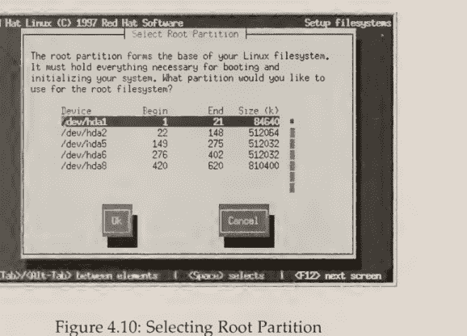

“添加 NFS”（Add NFS）。如果你没有选择与网络相关的安装方法，你将看到几个关于网络配置的对话框（更多信息请参见第 45 页第 3.4.6 节）。请适当填写。然后你将看到一个标题为“编辑网络挂载点”（Edit Network Mount Point）的对话框。输入 NFS 服务器的主机名、NFS 卷的路径以及该本地挂载点（见第 67 页图 4.12）。

## 4.4 初始化交换空间

在你为 Red Hat Linux 创建分区后，安装程序会寻找交换分区（见第 68 页图 4.13）。如果找到任何分区，它会询问你是否要初始化它们。使用空格键选择想要初始化为交换的分区；如果你想检查分区的坏块，请确保勾选了“格式化时检查坏块”（Check for bad blocks during format）框。选择“确定”（OK），并按空格。

如果安装程序找不到交换分区而你确定它存在，请确保你已将分区类型设置为 Linux 交换（Linux swap）；有关如何使用 Disk Druid 或 fdisk 进行此项操作的信息，请参见第 53 页第 4.3 节。

# 继续安装

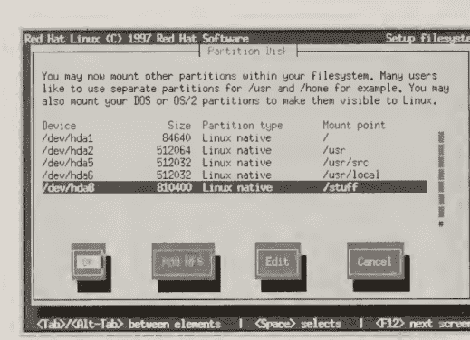

图 4.11：文件系统配置

## 4.5 格式化分区

下一个对话框列出了要格式化的分区列表（见第 69 页图 4.14）。所有新创建的分区都应该格式化。此外，任何包含旧数据的已存在分区不再需要格式化。然而，如果 `/home` 或 `/usr/local` 等分区包含你想保留的数据，则不能格式化。选择每个要格式化的分区并按空格。如果你想在格式化每个文件系统时检查坏块，请选择“格式化时检查坏块”。选择“确定”（OK），并按空格。

## 4.6 选择并安装软件包

在配置并格式化分区后，你就可以选择要安装的软件包了。你可以选择组件（根据功能将软件包组合在一起）、单个软件包或两者的结合。

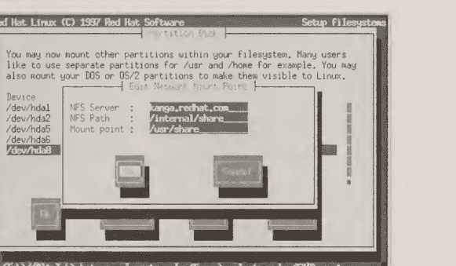

图 4.12：添加 NFS 挂载

### 4.6.1 选择组件

组件根据其提供的功能将软件包分组。例如：C 开发、网络工作站或 Web 服务器。选择你想要安装的每个组件并按空格。选择“全部”（Everything，可以在组件列表末尾找到）将安装 Red Hat Linux 包含的所有软件包（见第 70 页图 4.15）。

如果你想选择或取消选择单个软件包，请选择“选择单个软件包”（Select individual packages）。

### 4.6.2 选择单个软件包

选择完想要安装的组件后，你可以选择或取消选择单个软件包。安装程序会显示可用软件包组列表；选择一组进行检查并按回车。安装程序会显示该组中的软件包列表，你可以通过按 F1 和空格来选择或取消选择（见第 71 页图 4.16）。你可以通过按“选择组”（Select Group）对话框查看软件包的详细说明。

请注意：某些软件包（如内核和某些库）是每个 Red Hat 系统的必需品，无法选择或取消选择。

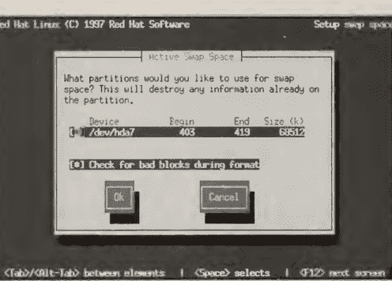

### 4.6.3 软件包依赖

许多软件软件包为了正常运行，依赖于必须安装在你系统上的其他软件包或库。例如，许多图形化的 Red Hat 系统管理工具需要 `python` 和 `pythonlib` 软件包。为了确保你的系统拥有所有所需的软件包以完全功能，Red Hat Linux 在每次安装或删除软件包时都会检查软件包依赖关系。

完成待安装软件包的选择后，安装程序会检查已选软件包列表的依赖关系。如果任何软件包需要你未选择安装的项，程序将列出这些未解决的依赖项列表，并提供你解决它们的机会（见第 71 页图 4.17）。如果你直接按“确定”（OK），程序将通过将所有必需软件包添加到已选软件包列表中来自动解决它们。

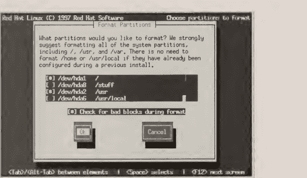

图 4.14：格式化分区

### 4.6.4 软件包安装

在解决所有软件包依赖关系后，安装程序会显示一个对话框，告知包含已安装软件包列表的日志文件将写入系统的 `/tmp/install.log`。选择“确定”（Ok）并按空格继续。

此时，安装程序将格式化你选择的每个分区。这可能需要几分钟（如果你指示安装程序检查坏块，则需要更久）。

一旦所有分区格式化完成，安装程序开始安装软件包。显示一个名为“安装状态”（Install Status）的窗口，包含以下信息：

- **软件包**Package）：当前正在安装的软件包名称。
- **大小**Size）：软件包的大小（以 KB 为单位）。
- **摘要**Summary）：软件包的简短描述。

**软件包安装进度条**：显示当前软件包安装完成情况的条。

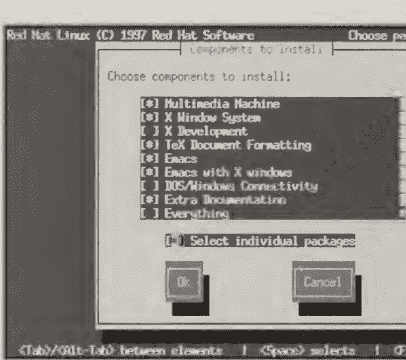

图 4.15：选择系统组件

统计部分——该部分包含标记为“总”（Total）、“完成”（Completed）和“剩余”（Remaining）的行。正如你所料的，这些行包含了将安装的软件包总数统计、已完成安装的数量统计以及尚未安装的软件包统计。这三行跟踪的信息包括：

- 软件包（Packages）：软件包数量。
- 字节（Bytes）：大小。
- 时间（Time）：耗时。

总进度条——该进度条通过颜色变化显示整个安装的完成程度。

如果你正在进行 FTP 安装，每当一个软件包从 FTP 站点获取时，都会弹出一个消息框。

此时，在所有软件包安装完成之前你什么都不需要做。完成速度取决于你选择的软件包数量以及计算机的速度。一旦所有软件包安装，请翻到下一章完成你的 Red Hat Linux 安装。


# 4.6 选择与安装软件包

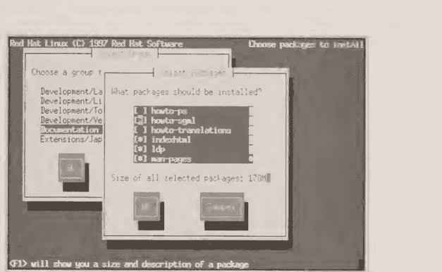

图 4.16：选择软件包

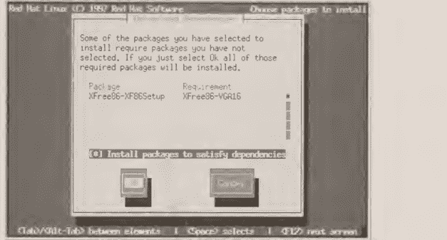

图 4.17：未解析的依赖关系

# 5
# 完成安装

## 5.1 配置鼠标

接下来，安装程序将探测您的系统并尝试寻找鼠标。如果找到鼠标，将显示一个对话框，显示发现鼠标的端口。按空格键继续。

如有必要，您将被要求提供有关鼠标的额外信息，例如鼠标协议和按钮数量。

如果您想在启动 Red Hat Linux 系统后更改鼠标配置，可以使用 `/usr/sbin/mouseconfig` 命令。

## 5.2 配置 X Windows

设置好鼠标后，如果您安装了 X Windows 软件包，将有机会机会配置 X 服务器。如果您没有选择安装 X Window 系统，可以跳到第75页的第 5.3节。

### 5.2.1 配置 Metro-X 服务器

如果您是从官方 Red Hat Linux/Intel CD 安装的，可以安装一个 MetroLink 的 Metro-X 服务器，这是一款适用于 Linux 的高质量商业 X 服务器。请参阅随 Red Hat Linux CD 的 MetroLink 许可（纸质版）获取许可信息。如果您选择使用 Metro-X，安装程序将启动 Metro-X 配置工具 config；有关如何使用 configX 的更多信息，请参见第96页的第 6.3节。

### 5.2.2 配置 XFree86 服务器

如果您想使用 XFree86，安装程序将启动 Xconfigurator 工具，该工具在第94页的第 6.2节中有详细描述。

Xconfigurator 会探测您的系统以确定您拥有什么种类型的显卡。如果失败，Xconfigurator 将提供显卡列表。从列表中选择您的显卡并按回车键。如果您的显卡没有出现在列表中，XFree86 可能不支持它。然而，如果您拥有关于该显卡的技术知识，可以选择“未列出的显卡”（Unlisted Card）并尝试进行配置。

一旦选定了显卡，安装程序将安装适当的 XFree86 服务器，Xconfigurator 将呈现一个显示器列表。如果您的显示器出现在列表中，请选择它并按回车键。否则，选择“自定义”（Custom）。Xconfigurator 会提示您选择显示器的水平同步范围和垂直同步范围（这些值通常可以在随显示器的文档中找到，或从显示器供应商或制造商处获得）。

**请注意：** 不建议选择与您的显示器“相似”的显示器，除非您确定所选的显示器不会超过您的显示器的能力。如果这样做，您可能会超频显示器并导致其损坏或毁灭。

接下来，Xconfigurator 提示显卡上安装的视频内存大小。如果您不确定，请咨询随显卡附的文档。选择比可用内存更多的内存不会损坏您的显卡，但如果这样做了，XFree86 服务器可能无法正常启动。

如果您选择的显卡可能有视频时钟芯片，Xconfigurator 将呈现时钟芯片列表。推荐的选择是“不设置时钟芯片”（No Clockchip Setting），因为在大多数情况下，XFree86 可以自动检测到合适的时钟芯片。

最后，Xconfigurator 提示您选择希望使用的视频模式；按空格键选择一个或多个模式。然后，Xconfigurator 将包含您所有选择的配置文件写入 `/etc/X11/XF86Config`。

接下来，安装程序将给您提供一个配置（或重新配置）网络的机会。如果您是从 CD-ROM 或本地硬盘安装的，安装程序会询问您是否想要配置网络。如果您选择“否”（No），您的 Red Hat Linux 系统将是一台独立的工作站。如果您选择“是”（Yes），可以按照下面的说明配置网络。

如果您通过 NFS 或 FTP 安装 Red Hat Linux，您已经输入了临时网络信息。安装程序为您提供三个选择（见附图 5.1）：

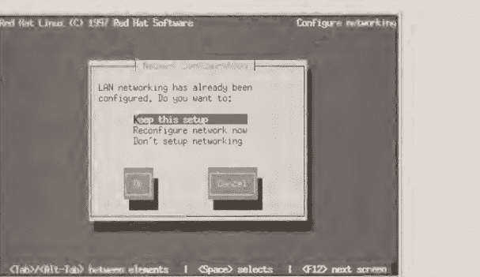

图 5.1：网络配置选项

- **保持此设置 (Keep this setup)** – 保留您在安装期间使用的网络配置。您之前输入的所有网络信息将成为系统永久配置的一部分。
- **现在重新配置网络 (Reconfigure network now)** – 安装程序将显示第45页第 3.4.6节中的网络配置对话框。您在安装期间使用的值将作为默认填充。如果您的系统将安装在用于安装 Red Hat Linux 的网络上，请选择此项。
- **不设置网络 (Don't setup networking)** – 完全不设置网络。您的系统将不会配置网络。如果您通过网络安装了系统，但将其作为独立工作站使用，请选择此项。

### 5.3.1 网络配置对话框

如果您在此选择配置网络，将看到一系列对话框。更多信息请参见第45页的第 3.4.6节。

## 5.4 配置时钟

接下来，安装程序将显示一个对话框帮助您配置 Red Linux 系统的时区（见对面的图 5.2）。

如果您想将硬件（CMOS）时钟设置为 GMT（格林威治标准时间，也称为 UTC 或世界时间），请选择“硬件时钟设置为 GMT”（Hardware clock to GMT）。如果您想在启动 Red Linux 系统后更改时区配置，可以使用 `/usr/sbin/timeconfig` 命令。

## 5.5 选择启动服务

您将看到一个标题为“服务”（Services）的对话框（见第78页的图 5.3）。框中显示了服务列表，每个服务旁边都有复选框。滚动此列表，勾选您希望每次系统启动时自动启动的服务。注意，您可以在安装后运行此操作以更改重启时启动的服务。

## 5.6 配置打印机

设置好网络后，安装程序会询问您是否想要配置打印机。如果您选择“是”（Yes），对话框将要求您指示打印机的连接方式（见第79页的图 5.4）。以下是可用打印机连接类型的简要描述：

- **本地 (Local)** – 此打印机直接连接到您的计算机。
- **远程 lpd (Remote lpd)** – 此打印机连接到您的局域网（通过另一台计算机或直接连接），并能够 lpr/lpd 通信。
- **网络管理器 (LAN Manager)** – 此打印机连接到另一台计算机，该计算机通过网络管理器（或 SMB）共享打印机。

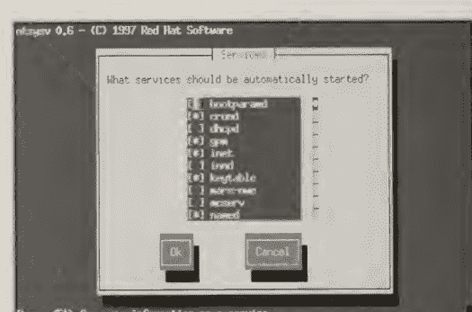

图 5.3：选择服务

选择打印机类型后，您将看到一个标题为“标准打印机选项”（Standard Printer Options）的对话框（见第80页的图 5.5）。输入您喜欢的队列名称和打印池目录，或接受默认信息。

接下来看到的对话框取决于您选择的打印机连接类型。转到与您的打印机连接类型对应的章节：

**本地 (Local)** – 5.6.1节

**远程 Lpd (Remote Lpd)** – 下一页 5.6.2节

**网络管理器 (LAN Manager)** – 对面的 5.6.3节

### 5.6.1 本地连接打印机

如果您选择“本地”作为打印机连接类型，您将看到一个与第81页图 5.6 类似的对话框。

在提供的字段中输入打印机设备名称。为了方便起见，安装程序尝试确定计算机上可用的打印机端口。选择“下一步”（Next），并按空格键。现在转到第80页的第 5.6.4节以继续。


## 5.6 配置打印机

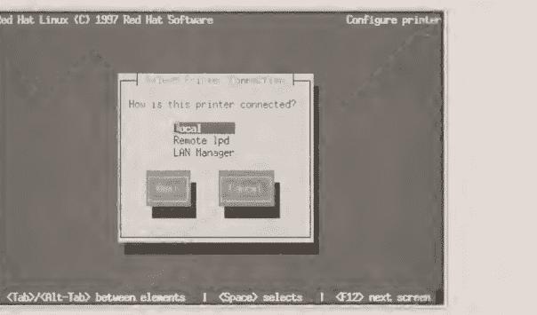

图 5.4：选择打印机类型

### 5.6.2 远程 lpd 打印机

如果选择“Remote lpd”作为打印机的连接类型，将看到与第 82 页图 5.7 类似的对话框。

在“Remote hostname”（远程主机名）字段输入直接连接打印机的计算机名称。与远程打印机相关的远程计算机队列名称输入“remote queue”（远程队列）字段。选择 Next（下一步），并按空格键。现在转到下一页的第 5.6.4 节继续。

### 5.6.3 LAN Manager 打印机

如果选择“LAN Manager”作为打印机的连接类型，将看到与第 83 页图 5.8 类似的对话框。

在提供的字段中输入必要信息。选择 Next（下一步），并按空格键。现在转到下一页的第 5.6.4 节继续。

## 5.6.4 完成打印机设置

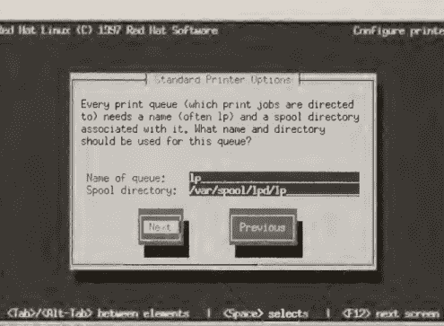

图 5.5：标准打印机选项

接下来，你将看到标题为“Configure Printer”（配置打印机）的对话框（见第 84 页图 5.9）。选择与你的打印机最匹配的打印机类型。选择 Next（下一步），并按空格键继续。

选择打印机类型后，你将看到与第 85 页图 5.10 类似的对话框。适当设置纸张大小和分辨率。如果打印机在每行结束后没有自动执行回车，应勾选 Fix stair-stepping of text 复选框。

最后，你将看到一个包含所有打印机相关信息的对话框（见第 86 页图 5.11）。验证信息是否正确。如果一切正常，选择 Done（完成）。如果需要修改，选择 Edit（编辑）。如果你现在不想配置打印机，也可以选择 Cancel（取消）。

如果你选择 Done，将获得配置另一台打印机的选项，或者你可以继续安装。

## 5.7 设置根密码

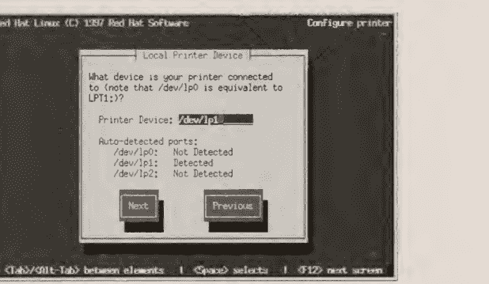

图 5.6：本地打印机设备

安装程序接下来将提示你为系统设置根密码（见第 86 页图 5.12）。你将使用根密码首次登录你的 Red Linux 系统。

根密码长度至少为六个字符；你输入的密码不会在屏幕上显示。你必须输入两次；如果两个密码不匹配，安装程序将要求你重新输入。

你应该设置一个你记得住、但别人难以猜到的根密码。你的名字、电话号码、example、password、root、123456 和 ante 都是糟糕密码的例子。良好的密码应该混合数字、大写字母和小写字母，且不包含字典单词，例如：Aard37vark 或 420BmtTNT。记住密码是区分大小写的。写下这个密码并将其存放在安全的地方。

**请：** 根用户（也称为超级用户）对整个系统具有完全访问权限；为此，以根用户登录最好仅用于系统维护或管理，以免关键系统文件被意外更改、移动或删除。请参第 132 页的第 9.1 节有关重启系统后如何为你添加用户账户的说明。

## 5.8 安装 LILO

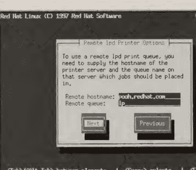

图 5.7：远程 lpd 打印机选项

为了能够启动你的 Red Hat Linux 系统，你通常需要安装 LILO（Linux 加 Loader）。你可以在两个位置之一安装 LILO：

- 主引导记录（MBR）是安装 LILO 的推荐位置，除非那里已经安装了另一个操作系统加载程序（例如 System Commander 或 OS/2 的 Boot Manager）。当你的机器启动时，LILO 会启动并显示启动提示符；你可以启动 Red Hat Linux 或任何你配置 LILO 启动的其他操作系统（见下文）。

- 如果你已经在系统上使用了另一个引导程序（如 OS/2 的 Boot Manager），建议选择根分区的第一个扇区；然后你可以设置该引导程序启动 LILO 并启动 Red Hat Linux。

将出现一个对话框，允许你选择所需的 LILO 安装类型（见第 87 页图 5.13）。选择你想要安装 LILO 的位置并按 OK。如果你不想安装 LILO，按 Skip（跳过）。

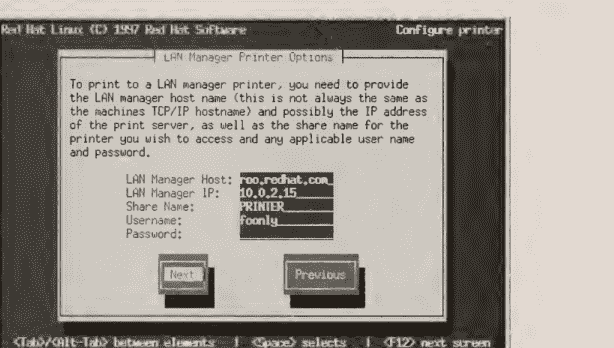

图 5.8：LAN Manager 打印机选项

**请：** 如果你选择 *Skip*（跳过），你将无法直接启动 Red Hat Linux 系统，而需要使用其他启动方法（如启动磁盘）。请自担此风险！

### 5.8.1 向 LILO 启动命令行添加选项

最后，安装程序将询问你是否想向 LILO 启动命令行添加默认选项（见第 87 页图 5.14）。你输入的任何选项将在每次启动时传递给 Linux 内核。如果你有 LBA 驱动器，请勾选 Use linear mode。完成后选择 OK 并按 `Space`。

### 5.8.2 LILO 的替代方案

如果你不想使用 LILO 启动你的 Red Hat Linux 系统，有几种替代方案：

- LOADLIN 可以从 MS-DOS 加载 Linux；遗憾的是，它要求 MS-DOS 上可用 Linux 内核（和初始内存磁盘）的副本。


## 6.1.1 构建模块化内核

只有 Red Hat Linux/Intel 和 Red Hat Linux/SPARC 支持模块化内核，Red Hat Linux/Alpha 用户必须构建单体内核（参见下文第 6.1.3 节）。

这些指令将为您提供利用内核模块化带来的功能和灵活性所需的知识。如果您不想利用模块化，请参阅第 6.1.3 节，获取关于构建和安装单体内核不同方面的说明。假设您已经安装了 `kernel-headers` 和 `kernel-source` 包，并且您在 `/usr/src/linux/` 目录下执行所有命令。

从已知状态的源码树开始内核至关重要。因此，建议您从 `make proper` 命令开始。这将删除任何配置文件以及可能散落在源码树中的任何之前构建的遗留文件。您必须创建一个配置文件，用以确定要将哪些组件包含在新内核中。根据您的硬件和个人偏好，有三种方法可以配置内核：

- `make n`：一个交互式文本程序。会显示组件，您用 Y（是）、N（否）或 M（模块）进行回答。
- `make menuconfig`：一个图形化菜单驱动程序。组件在类别菜单中显示，您以与 Red Hat Linux 安装程序中使用相同的方式选择所需的组件。切换与您包含的项目对应的标签；Y（是）、N（否）或 M（模块）。
- `make xconfig`：一个 Windows 程序。组件在不同级别的菜单中列出，使用鼠标选择组件。同样，选择 Y（是）、N（否）或 M（模块）。

**注意：** 为了使用内核（详情请见第 9.6 节）和内核模块，您必须在配置中对内核支持和模块版本（CONFIG_MODVERSIONS）支持回答 Yes。

**注意：** 如果您在运行“克隆”处理器的机器（例如由 Cyrix 或 AMD 制造的处理器）上（或为该机器）正在构建 Linux/Intel 内核，建议选择处理器类型为 386。

如果您想使用已通过上述方法之一创建的配置文件（`/usr/src/linux/.config`）来构建内核，可以跳过 `make mrproper` 和 `make config` 命令，并使用命令 `make dep` 后接 `make clean` 来准备源码树进行构建。

下一步是将源码组件实际编译成一个可以使用来启动的运行程序。这里描述的方法在发生意外时最容易恢复。如果您对其他可能性感兴趣，可以在 Kernel-HOWTO 或您 Linux 系统中 `/usr/src/linux` 目录下的 Makefile 中找到详细信息。

- 使用 `make boot` 构建内核。
- 使用 `make modules` 构建您配置的任何模块。
- 使用以下命令将旧模块移出：

```bash
rm -rf /lib/modules/2.0.29-old
mv /lib/modules/2.0.29 /lib/modules/2.0.29-old
```

当然，如果您升级了内核，请将 2.0.29 替换为您正在使用的版本。

- 使用 `make modules.install` 安装新模块（即使您没有构建任何模块）。

如果您有 SCSI 适配器并已将 SCSI 驱动程序设为模块化，请构建新的 initrd 镜像（参见第 6.1.2 节；注意，在自定义内核中将 SCSI 驱动程序模块化的实际理由很少）。

为了提供冗冗余启动源以防止新内核中可能出现的错误，您应该保留原始内核。将内核添加到 LILO 菜单非常简单：重命名 /boot 中的原始内核，将新内核复制到 /boot，在 /etc/lilo.conf 中添加几行，并运行 /sbin/lilo。以下是 Red Hat Linux 带的默认 /etc/lilo.conf 文件示例：

```text
boot=/dev/hda
map=/boot/map
install=/boot/boot.b
prompt
timeout=100
image=/boot/vmlinux
label=linux
root=/dev/hd1
read-only
```

## 安装后配置

现在您必须更新 `/etc/lilo.conf`。如果您构建了新的 initrd 镜像，您必须告诉 LILO 使用它。在这个 `/etc/lilo.conf` 示例中，我们在文件底部添加了四行，以指示要启动哪个内核。我们将 `/boot/vmlinuz` 重命名为 `/boot/vmlinuz.old` 并将其标签更改为 old。我们还为新内核添加了 initrd 行：

```text
boot=/dev/hda
map=/boot/map
install=/boot.b
prompt
timeout=100
image=/boot/vmlinuz
label=linux
initrd=/boot/initrd
root=/dev/hd1
read-only
image=/boot/vmlinuz.old
label=old
root=/dev/hd1
read-only
```

现在当系统启动并在 LILO 启动提示处按下 Tab 键时将显示两个选择：

```text
LILO boot:
linux old
```

要启动新内核 (linux)，只需按 Enter 键或等待 LILO 超时。如果您想启动旧内核 (old)，只需输入 old 并按 Enter。

以下是步骤总结：

- mv /boot/vmlinuz /boot/vmlinuz.old
- cp /boot/vmlinux /boot/vmlinuz
- edit /etc/lilo.conf
- run /sbin/lilo

## 6.1 构建自定义内核

只要您在安装时选择了正确的显卡，并且安装了正确的 X Server。在运行 configurator 或 xf86config 时，autoprobe 将失败。

如果您认为您为显卡安装了错误的 X Server，则在配置之前必须安装正确的。例如，如果

### 6.1.2 生成 initrd

initrd 镜像用于启动时加载模块。如果满足以下条件，就可以构建 initrd：

- 回环设备可用。
- /etc/modules 中有一行您的适配器；例如：

要构建新的 initrd，运行如下：

```bash
/sbin/mkrd /boot/initrd 2.0.12
```

其中 /boot/initrd 是要使用的文件，2.0.12 是运行内核的版本。

## 6.1.3 构建单体内核

构建单体内核遵循与模块化内核相同的步骤，但有少数例外：

- 配置内核时，对问题只回答 Yes 或 No。
- 跳过步骤：

```bash
make modules
make modules_install
```

- 编辑 /etc/rc.d/rc.init，通过插入 # 注释掉 dep 行。

## 6.2 X Window 配置

有四种方法可以在您的机器上配置 XFree：

- Xconfigurator
- XFreeSetup
- xf86config
- 手动

Xconfigurator 是一个全屏菜单驱动程序，引导您设置 X Server。XFreeSetup 是随 XFree 分发的图形化设置程序，它需要 VGA 16 色服务器才能运行。xf86config 是随 XFree 分发的命令行程序。在 Xconfigurator 中不太容易出错或使用不支持的显卡，但为了完整性仍包含了它。如果这些工具无法提供工作的 X86config 文件，可能是您有一个不支持的显卡，或者您需要手动编写配置文件。通常是前者，因此在尝试手动编写配置文件之前，请检查并确保您的显卡受支持。如果您的显卡不受 XFree 支持，您可能考虑使用商业服务器，例如随官方 Red Hat Linux 附带的 Metro-X 服务器。对显卡是否受 XFree 支持有疑问，可以访问 http://www.xfree86.org 获取有关 XFree 的信息，访问 http://www.metrolink.com 获取有关 Metro-X 的信息。


# 6.2 使用 XFree6 配置 X Window

已挂载在 /mnt/cdrom，且你需要安装 S3 服务器，请输入以下命令：

```
cd /mnt/cdrom/RedHat/RPMS
rpm -ivh XFree6-S3-3.1.2-1.i386.rpm
ln -sf ../../usr/X11R/bin/XFree6_S3 /etc/X11/X
```

这将安装 S3 服务器并创建适当的符号链接。

## 6.2.2 XConfigurator

要配置 X Windows，你必须首先选择你的显卡。向下滚动支持的卡列表，直到找到你机器中的显卡。第 6.2.2 节可能帮助你确定与硬件匹配的视频服务器。如果你的显卡未列出，则 XFree6 可能不支持它。在 particular情况下，你可以尝试列表中的最后一项（未列出的显卡）或商业级 X Windows 服务器，例如 Metro X。下一步是选择你的显示器。如果你的显示器不在列表中，你可以选择一个通用显示器条目或“Custom”（自定义）并输入你的参数。自定义显示器配置仅建议对 CRT 显示器内部原理有深入理解的人使用。普通用户可能应该使用列表中的通用选项之一。选择显示器后，你需要告诉 XConfigurator 你有多少显存。将高亮项移动到适当的列表条目并按 Enter 或 F12 继续。对于下一步，建议选择默认（No Clockchip Setting）条目，但经验用户可能想要选择特定的时钟。

### 选择你的服务器

如果你不确定自己使用的是什么芯片组，最好的方法通常是查看显卡。图 6.1 列出了哪些芯片组和主板需要哪些服务器。选择与你的硬件最匹配的一个项。

## 完成

如果你想增加显示器的刷新率，可以手动编辑配置文件，也可以再次运行 XConfigurator 从我们的列表中选择一个显示器。

| 服务器 | 芯片组 |
|---|---|
| VGA16 | 所有带有 256K 的 VGA 板（仅限 16 色） |
| SVGA | Trident 8900 & 9400, Cirrus Logic, C & T, ET4000, 其他 |
| Mach8 | 使用 Mach8 芯片组的 ATI 板卡 |
| Mach32 | 使用 Mach32 芯片组的 ATI 板卡 |
| Mach64 | 使用 Mach64 芯片组的 ATI 板卡 |
| 8514 | IBM 8514 / A 板及真实克隆板 |
| S3 | # 板，大多数 Diamonds，部分 Orchids，其他 |
| AGX | 所有 XGA 显卡板 |
| P9000 | Diamond Viper（非 9100 型）及其他 |
| W32 | 所有 ET4000/ W32 卡，但不是标准的 ET4000 |

图 6.1: X 服务器

最后的配置步骤包括选择你想要包含在 XP86config 文件中的视频模式。使用方向键在每个颜色深度（8、 16 和 24 位）下方的列表中上下移动光标。使用空格键选择单个分辨率，使用 Tab 键在颜色深度字段之间移动。当你选好想要使用的视频模式后，将光标移动到“OK”按钮并按 Enter 或使用 F12 快捷键。信息屏幕将提供有关选择视频模式、启动和停止 X 服务器的最新信息。

## 6.3 使用 Metro-X 配置 X Window

通过特殊安排，官方 Red Linux/Intel CD 包含一份 Metro-X 增强型 X 服务器的安装许可。请注意，与 XFree86 服务器（也包含在内）不同，Metro-X 是商业许可软件。在安装它之前你应该检查并接受其许可条款。Metro-X 支持许多 XFree86 不支持的显卡。配置实用可以在图形模式（configX）或文本模式（configX.curses）下运行。

### 6.3.1 系统要求

至少 8 兆内存；建议 16 兆。基础服务器需要 12 兆的磁盘空间。

### 6.3.2 configX.curses

configX.curses 是一个用于配置 Metro-X 的简单图形配置工具。configX.curses 工具不提供配置多屏或选择鼠标按钮数量的支持。如果你需要这些功能，请使用 configX。要运行 configX.curses，输入命令：

```
configX.curses
```

启动屏幕有关于 Metro Link, Inc. 的信息以及配置 Metro-X 所需的简要说明。按 Enter 键开始配置。屏幕顶部显示当前配置信息，底部显示配置菜单。使用方向键移动高亮项并上下移动菜单，按 Enter 键选择被高亮的项。

### 显卡

当你从配置菜单中选择 Graphics Card（显卡）时，将显示支持的显卡列表。如上述所示选择你的显卡。选择显卡后，你将被要求从默认列表中选择一种视频模式。使用的分辨率取决于个人喜好。数字越小，显示器上的项目越大。某些显卡和视频模式的组合支持比物理显示更大的虚拟屏幕。如果你的组合属于其中之一，你将被要求选择虚拟屏幕大小。

### 鼠标

使用 Metro-X 配置鼠标需要你了解你的是什么类型的鼠标以及它是如何连接到计算机的。当你选择鼠标类型时，配置窗口将提供默认设备。如果你不确定，请接受默认值并在以后需要时进行调整。

### 退出

从菜单中选择 Save and Exit（保存并退出）将保存你对 Metro-X 配置的任何更改并退出 configX.curses 程序。

从菜单中选择 Quit without Saving（不保存退出）将丢弃你对 Metro-X 配置的任何更改并退出 configX.curses 程序。

### 6.3.3 configX

Metro-X 也可以通过名为 ConfigX 的图形工具为你的系统进行配置，它用于指定你使用的鼠标、键盘、显示器、显卡、颜色深度和屏幕分辨率。

### 启动

- 1. 以 root 登录并输入以下命令：/usr/bin/X11/configX
- 2. 显示特殊键的说明。（此消息仅在初始配置、即不存在配置文件时出现。）
- 3. 按 Enter 继续。

### 特殊键

Metro-X 首次安装后，无法识别你的鼠标。必须使用特殊键在屏幕上移动并进行选择。

### 鼠标配置

如果默认鼠标不适用于你的系统：

- 1. 按向上显示鼠标列表。
- 2. 按向上或向下滚动到你的鼠标条目，然后按 Enter 选择。
- 3. 按 Tab 移动到下一个字段。

| 键 | 功能 |
| --- | --- |
| Tab | 在字段间向前移动 |
| Shift-Tab | 在字段间向后移动 |
| ↑ ↓ | 更改当前字段中的值 |
| Enter | 设置/取消切换按钮 |
| Page Down | 切换到下一页配置 |
| Page Up | 切换到上上一页配置 |
| Esc | 退出当前屏幕或弹出窗口 |
| Alt-F | 跳转到文件下拉菜单 |
| Alt-S | 跳转到屏幕下拉菜单 |
| Alt-C | 跳转到配置下拉菜单 |

图 6.2: 特殊键的功能

- 1. 按向下显示鼠标按钮列表。（默认条目根据你的鼠标选择，通常是合适的选择。）
- 2. 按 ↑ 或 ↓ 滚动到你的按钮条目，然后按 Enter 选择。
- 3. 按 Tab 移动到下一个字段。
- 4. 如果你需要更改鼠标设备的路径，在此处编辑。
- 5. 按 Tab 移动到下一个字段。

### 键盘配置

Metro-X 包含国际键盘支持，允许你选择适用于你的语言和国家的键盘。

- 1. 初始键盘设置为默认：Default Console Mapping（默认控制台映射），它适用于大多数键盘。
- 2. 按向下显示键盘列表。
- 3. 按向上或向下滚动到你的键盘条目，然后按 Enter 选择。
- 4. 按 Tab 移动到下一个字段。


# 显示器配置

默认显示器设置为 `Generic 640x480 @ 60Hz 13 inch`。

- 1. 按 ↓ 显示显示器列表。
2. 按 ↑ 或 ↓ 滚动到你的显示器条目，然后按 Enter 选择它。
3. 按 Tab 移动到下一个字段。
4. 如果你需要更改屏幕宽度 (mm)，请在此处编辑。
5. 按 Tab 移动到下一个字段。
6. 如果你需要更改屏幕高度 (mm)，请在此处编辑。
7. 按 Tab 移动到下一个字段。

# 屏幕保护

某些显卡和显示器支持显示器管理系统 (DPMS)，该系统在用户停止输入时最大限度地减少显示器的功耗。如果你的硬件具有此功能，可以在此部分中控制 DPMS 的各个阶段。典型的 DPMS 设置具有级联效应，各个阶段会根据你选择的延迟时间连续激活。

- * X 屏幕保护 - DPMS 的初始阶段，会黑屏但不降低功耗。
- 待机模式 (Standby Mode) - DPMS 的第一阶段，通过禁用显示器的水平同步信号来提供中等节电。
- 挂起模式 (Suspend Mode) - DPMS 的第二阶段，通过禁用显示器的垂直同步信号来提供显著节电。
- 显示器关闭 (Monitor Off) - DPMS 的最终阶段，通过同时禁用显示器的水平和垂直同步信号来提供最大的节电。

- 1. 在“X 屏幕保护延迟”字段中，按 Enter 开启或关闭此功能。
2. 如果开启，按 Tab 移动到“分钟 (Minutes)”字段，然后使用 ← 或 → 设置值。

# 6.3 使用 Metro-X 的 X Window 配置

3. 按 Tab 移动到下一个字段。

4. 在“待机模式延迟”字段中，按 Enter 开启或关闭此选项。

5. 如果开启，按 Tab 移动到“分钟 (Minutes)”字段，然后使用 ← 或 → 设置值。
6. 按 Tab 移动到下一个字段。

7. 在“挂起模式延迟”字段中，按 Enter 开启或关闭此选项。
8. 如果开启，按 Tab 移动到“分钟 (Minutes)”字段，然后使用 ← 或 → 设置值。
9. 按 Tab 移动到下一个字段。

10. 在“显示器关闭延迟”字段中，按 Enter 开启或关闭此选项。
11. 如果开启，按 Tab 移动到“分钟 (Minutes)”字段，然后使用 ← 或 → 设置值。

# 显卡配置

按 Page Down 移动到第二个配置屏幕，该屏幕控制显卡、颜色数、虚拟分辨率和物理分辨率。

每个显卡配置由五个元素组成：

- 显卡（品牌和型号）
- 屏幕同时支持的颜色数（色深）
- 屏幕的虚拟分辨率（宽 x 高）
- 屏幕的物理分辨率（宽 x 高）
- 屏幕刷新率 (Hz)。

相比标记为“隔行 (Interlaced)”的刷新率，非隔行模式提供更好的屏幕效果。显示器支持的高刷新率将提供最佳图像。在高分辨率下，高刷新率特别重要，可以防止屏幕出现闪烁。所选显示器支持的最高刷新率会自动显示。

# 安装后配置

1. 默认显卡设置为 IBM VGA。

2. 按 [I] 显示显卡列表。

3. 按 [↑] 或 [↓] 滚动到你的显卡条目，然后按 [Enter] 选择它。

4. 按 [Tab] 移动到下一个字段。

# 颜色

并非所有显卡都能支持所有色深（颜色数）。只有你的显卡支持的色深选项在该字段中是可操作的。其他选项将显示为灰色。

- 只能选择一种颜色选项（由于 X 的设计限制）。
- 在某些情况下，可用的颜色选项将受你所选物理分辨率的限制（取决于显卡的能力）。高分辨率下并不支持所有色深。

- 默认设置为针对你显卡的最低值。
- 决定你想使用哪种可选颜色设置。
- 按 [Tab] 移动到该颜色设置，然后按 [Enter] 选择。（之前的设置将被取消。）
- 按 [Tab] 移动到下一个字段。

# 虚拟分辨率

虚拟分辨率设置允许你拥有一个比物理屏幕更大的屏幕工作区域。窗口可以超出物理边界，并通过滚动到扩展区域来查看。只有你的显卡支持的虚拟分辨率选项在该字段中是可用的。其他选项将显示为灰色。如果你不想使用此功能，请选择“禁用 (Disabled)”选项。

- 只能选择一种虚拟分辨率。

- 在某些情况下，可选的虚拟分辨率将受你所选物理分辨率的限制，因为虚拟分辨率必须大于最高物理分辨率。

- 1. 虚拟分辨率的默认设置为“禁用 (Disabled)”。
2. 决定你想使用哪种可选虚拟分辨率。
3. 按 Tab 移动到该设置，然后按 Enter 选择。（之前的设置已被取消。）
4. 按 Tab 移动到下一个字段。

# 物理分辨率

并非所有的显卡和显示器都支持所有的物理分辨率。只有你的硬件支持的分辨率选项在该字段中可用。其他选项将显示为灰色。

- 可以选择多个物理分辨率。在运行 Metro-X 时，可以通过热键在这些之间切换：
- 按 Ctrl+Alt+ 切换到下一个分辨率。
- 按 Ctrl+Alt+ 切换到上一个分辨率。

- 在某些情况下，你选择的物理分辨率可能会限制“颜色”和“虚拟分辨率”中的选择。如果你只需要一种分辨率，请确保选中了一个分辨率按钮。

1. 默认设置为针对你显卡的最低值。
2. 决定你想使用哪种可选分辨率。
3. 按 Tab 移动到该设置，然后按 Enter 选择它。
4. 按 Tab 移动到相应的字段设置屏幕刷新率 (Hz)。
5. 对你想要设置的每个物理分辨率重复此过程。

# 多屏幕配置

Metro-X 支持多达四个屏幕，可以使用单个键盘和鼠标同时控制。这允许你在运行应用程序时不产生窗口重叠，对于图像处理工作特别有用。对于使用的每个屏幕，必须为该屏幕单独创建显示器显卡配置。显卡要求见 G1.4。

# 添加屏幕

Metro-X 默认为单屏幕设置。第一个配置的屏幕标记为 Screen 0。当你添加第二个屏幕时，其所有配置默认将复制 Screen 0 的当前设置。如果所有屏幕的硬件相同，你可以在添加其他屏幕之前配置 Screen 0 以节省时间。同样，随着更多屏幕的添加，添加另一个屏幕时当前激活的屏幕设置将决定新屏幕的默认设置。

- 1. 按 Alt-S 显示屏幕下拉菜单。
2. 输入 A 添加。
3. Screen 0 的显示器和显卡图标变为轮廓，并为 Screen 1 出现两个全彩色图标。
4. 如果需要对新屏幕的配置进行更改，请参考本章前面描述的步骤。

# 删除屏幕

当删除屏幕时，所有编号较高的屏幕都会自动降低一个位置。例如：你配置了屏幕 0、1 和 2，然后删除了屏幕 1。该屏幕及其所有配置信息都会消失。屏幕 2 变为屏幕 1，但保留了自己的配置。你留下了屏幕 0 和 1。


## 6.3 使用 Metro-X 配置 X Window

- 1. 使用 `Page Down` 或 `Page Up` 激活您想要删除的屏幕的图标组。
- 2. 按 Alt-S 显示屏幕下拉菜单。
- 3. 输入 D 进行删除（Delete）。
- 4. 一组显示器和显卡图标将会消失。编号较高的屏幕（如果有）将立即填补被删除屏幕的空隙。

## 屏幕布局

“屏幕布局”窗口允许您指定多个显示器在工作区中的排列方式，以便鼠标在屏幕之间的移动是合理的。

- 1. 按 Alt-S 显示屏幕下拉菜单。
- 2. 输入 L 进入“布局”（Layout）。
- 3. 出现“屏幕布局”窗口。
- 4. 按键查看适用于您的显示器数量的各种布局组合。
- 5. 当显示所需的布局时，按 Enter 键选择。

## 字体路径

如有需要，您可以在 Metro-X 配置实用程序内部编辑字体路径。如果您使用字体服务器代替或增加现有的字体，这将必要的。

- 1. 按 Alt-C 显示配置下拉菜单，然后按 Enter。
- 2. 出现“字体路径”窗口。
- 3. 根据系统需要编辑该文件。Metro-X 按照文件中列出目录的顺序查找字体。如果您使用字体服务器，请将其作为第一行输入：

```
tcp/<fontserver machine>:7000
```

## 安装后配置

如果您的端口号不是默认的 7000，请将其更改为适用于系统的数字。

- 4. 使用 [Tab] 键移动并在底部按钮之间切换，然后按 [Enter] 选择其中一个。如果信息正确，选择 OK 按钮。如果您想放弃已所的更改，请选择取消（Cancel）按钮。如果您编辑了字体路径并想返回原始设置，请选择加载默认值（Load Defaults）按钮。

## 保存并退出

- 1. 按 [Alt-F] 显示文件下拉菜单。
- 2. 输入 S 进行*保存*（Save）并*退出*（Exit）。
- 3. 更改已保存，Metro-X 配置实用程序关闭，您的系统现在已准备好运行 Metro-X！

## 不保存直接退出

- 1. 按 [Alt-F] 显示文件下拉菜单。
- 2. 输入 Q 进行*退出*（Quit）。
- 3. 出现警告对话框：*退出前保存当前配置吗*？
- 4. 按 [Tab] 键移动到“否”（No）按钮，然后按 [Enter] 确认您想在不保存更改的情况下退出 Metro-X 配置实用程序。

更多关于 Metro X 功能和 *Xconfig* 文件格式的详情，请参附录 G。

## 6.4 鼠标配置

要配置鼠标（或在安装后重新配置鼠标），输入命令 `/usr/sbin/mouseconfig`。使用方向键向下滚动列表，直到您的鼠标类型被高亮。如果您有*任何*鼠标连接到 PS/2 风格端口，应选择 *PS/2* 作为您的鼠标类型。如果鼠标连接到 ATI 显卡上的鼠标端口，应选择 *ATI Bus Mouse*。

## 6.5 Sendmail

如果您有一个双键鼠标，并想通过同时点击左右鼠标键来模拟第三（中间）鼠标键，请使用 Tab 键将光标移动到“模拟三键”（Emulate 3 Buttons）复选框，并按空格键切换选择。

默认的 `sendmail.cf` 文件将安装在 /etc/。默认配置应适用于大多数仅 SMTP 的站点。它对 UUCP 站点无效；如果您需要使用 UUCP 邮件传输，则需要生成一个新的 `sendmail.cf`。要生成新的 `sendmail.cf`，您需要安装 m4 和 sendmail 源码包。阅读 sendmail 源码中的 README 文件以获取有关创建 sendmail 配置文件的详情。此外，O'Reilly & Associates 出了一本由 Bryan Costales 编写的优秀 sendmail 参考书。

一种常见的 sendmail 配置是让单台机器作为网络上所有机器的邮件网关。例如，在 Red Hat Software，我们有一台 `mail.redhat.com` 机器处理我们所有的邮件。在那台机器上，我们只需将需要 mail.redhat.com 处理邮件的机器名称添加到 /etc/sendmail.cf。以下是一个示例：

```
# sendmail.cf - 包含您机器的所有别名
# 在此处。
torgo.redhat.com
poodle.redhat.com
devel.redhat.com
```

在其他机器（torgo, poodle 和 devel）上，我们需要编辑 /etc/sendmail.cf，以便在发送邮件时“伪装”成 mail.redhat.com，并将任何本地邮件处理转发到 redhat.com。在 /etc/sendmail.cf 中找到 DH 和 DM 行并编辑它们：

```
# 谁将未限定名称发送到
# (null 表示投递到本地)
DRredhat.com
```

```
# 谁获取所有本地流量
DHredhat.com
# 谁伪装成 (null 表示不伪装)
DMredhat.com
```

通过此类类型的配置，所有发送的邮件将看起来像是从 redhat.com 发送的，任何发送到 torgo.com 或其他主机的邮件将被投递到 mail.redhat.com。请注意，如果您配置系统伪装从您的系统发送到该机器的任何邮件，cron 守护进程将发送到 root@redhat.com。

## 6.6 控制访问

作为安全措施，大多数服务由一个名为 wrapper 的保护程序管理。在 /etc/inetd.conf 中允许或拒绝来自某些主机的访问。查看 tcpd(8) 和 hosts(5) 手册获取详情。以下是 hosts.allow 的示例：

```
ALL: redhat.com
in.talkd: ALL
in.fingerd: ALL
in.ftpd: ALL
```

## 6.7 匿名 FTP

设置匿名 FTP 非常简单。您只需安装 anon 包（您可能已经做了）。安装后，匿名 FTP 将运行。

您可能需要编辑几个文件：

- /etc/ftpass 定义了 FTP 服务器的大部分访问控制。您可以执行：设置不同站点的访问、限制并发 FTP 连接数、配置日志等。查看 ftpass 手册获取详情。
- /etc/hosts 用于允许或拒绝来自某些主机的访问。查看 hosts 手册。
- /etc/ftpusers 列出了所有允许 ftp 到您的机器的用户。例如，默认情况下 /etc/ftpusers 中列出了 root。这是一种良好的安全措施，但某些管理员倾向于从文件中移除 root。

## 6.8 万维网

万维网是今天的热点之一。Red Hat Linux 让您以两种方式参与其中：作为 Web 浏览器和 Web 服务器。让我们来看看这两者。

### 6.8.1 Web 浏览器

Linux 有多种 Web 浏览器，包括免费分发的 arena、lynx 和 grail。最流行的商业浏览器来自 Netscape Communications Corporation。它们从他们的 ftp 站点提供评估版：

```
http://www.netscape.com/download/client_download.html
```

直接从 Netscape 获取两个完全授权的版本：

Netscape Communicator 4.03（部分号 100-00479-00）
Netscape Communicator 4.03 Professional（部分号 100-04811-00）

更多信息请参阅：

http://merchant.netscape.com/netstore/clients/index.html

可以通过以下电话联系 Netscape：

- 企业销售：(650) 937-2555
- 个人销售：(650) 937-3777
- 政府销售：(650) 937-3678

**注意：** 请查看 Netscape 网站上的相应文档，了解这些产品的最新许可和使用权政策。

### 6.8.2 Web 服务器

如果您安装了 Apache Web 服务器（来自 apache 包），那么您的 Web 服务已经运行！只需将您的 Web 浏览器指向 http://localhost。

显示的默认页面是 /home/httpd/html/index.html。您可以根据喜好编辑此文件（或完全替换）。所有的 CGI 程序、图标和 HTML 页面都存储在 /home/httpd，但可以通过 Apache 配置文件进行更改，所有配置都存储在 /etc/httpd/conf/。所有 http 活动日志都保存在 /var/log/httpd/。


## 6.9 NFS 配置

### 6.9.1 挂载 NFS 文件系统

使用 `mount` 命令挂载另一台机器上的 NFS 文件系统：

```
mount porky:/mnt/export /mnt/local
```

在此命令中，porky 是 NFS 文件服务器的主机，/mnt/export 是 porky 导出的文件系统，而 /mnt/local 是你本地机器上我们想要挂载该文件系统的目录。在 `mount` 命令运行后（如果我们拥有来自 porky 的适当权限），我们可以进入 /mnt/local 并列出 /mnt/export 中的文件列表。

### 6.9.2 导出 NFS 文件系统

控制你想要导出的文件系统的文件是 /etc/exports。它的格式如下：

```
directory      hostname(options)
```

(options) 是可选的。例如：

```
/mnt/export      speedy.redhat.com
```

这将允许 speedy.redhat.com 挂载 /mnt/export，但是：

```
/mnt/export      speedy.redhat.com(ro)
```

将仅允许 speedy 以只读方式挂载 /mnt/export。

每次你更改 /etc/exports 时，都需要通知 NFS 守护进程检查以获取新信息。实现此点的简单方法是直接停止并启动守护进程：

```
/etc/rc.d/init.d/nfs stop
/etc/rc.d/init.d/nfs start
```

以下命令同样有效：

```
killall -HUP rpc.nfsd rpc.mountd
```

更多详情请参见以下 man页面：nfsd(8), mount(8), mountd(8) 和 exports(5)。另一个很好的参考是 Hal Stern 编写、O'Reilly 出版的《Managing NFS and NIS Services》。

## 6.10 在启动时运行程序

文件 /etc/rc.d/rc.local 在启动时执行，在所有其他初始化完成后，并且每次更改运行级别（runlevels）时执行。你可以在这里添加额外的初始化命令。例如，你可能想要启动额外的守护进程。此外，如果你需要设置串口，可以编辑 /etc/rc.d/rc.serial，它将在启动时自动执行。

默认的 /etc/rc.d/rc.local 仅仅会创建一个带有你的内核版本和机器类型的漂亮登录横幅。

## 6.11 color-ls 设置

color-ls 现在是标准 `ls` 命令的一部分。要获取带颜色的目录列表，只需（在 bash 中）执行以下命令：

```
alias ls='ls' --color=tty
```

## 7 查找文档

Red Hat Linux 包含了数千页在线文档，帮助你学习如何使用该系统。man 页面、info 文档和纯文本文件包含了 Linux 几乎每个方面的信息。Red Hat 还以电子形式包含了 Linux Documentation Project 生成的所有文档。

### 7.1 在线帮助

当你正在查找命令和错误消息的通用帮助时，最好的起点就是你的系统本身。

### 7.1.1 Man 页面

你系统上的大多数命令都有相关的“man”页面。如果你有疑问或问题，可以立即获取这些文档。如果你在运行 `ls` 命令时遇到困难，可以输入 `man ls`。这将显示 ls 的 man 页面。man 页面通过 `less` 程序查看，因此在 man 页面中，`less` 的所有选项都有效。一些重要的按键包括：

- - q 退出
- Enter 逐行向下分页
- Space 向上翻页
- 接着输入字符串并按 Enter 搜索字符串
- n 查找上一次搜索的下一次出现

有时在命令行查看 man 页面并不太友好。只要你有一个正常的打印机，你也可以打印 man 页面。如果你没有 postscript 打印能力且只想打印 ASCII，可以使用以下命令打印 man 页面：

```
man COMMAND | l1pr
```

如果你有 postscript 打印机，你可能想用以下命令打印：

```
man -t COMMAND | l1pr
```

在这两个命令中，“COMMAND”代表你尝试获取帮助的命令。此外，有些内容会有多个 man 页面。以下是内容所在位置的表格：

| 章节 | 内容 |
| :--- | :--- |
| 1 | 用户命令 |
| 2 | 系统调用 |
| 3 | 库调用 |
| 4 | 设备 |
| 5 | 文件格式 |
| 6 | 游戏 |
| 7 | 杂项 |
| 8 | 系统命令 |
| 9 | 内核内部 |

### 7.1 在线帮助

假设你想查看 `swapon` 的 man 页面。你执行 `man swap`。你实际上得到的是系统调用 `swap(2)` 的 man 页面，这是你在 C 程序中用于开启交换的函数。除非你正在编写自己的程序来实现它，否则这可能不是你想要的。所以，使用上面的图表，你可以看到你需要的可能是一个“系统命令”，位于第 8 节。然后你可以执行 `man swap`。这一切是因为 `man` 会搜索 man 目录，并在找到第一个匹配项时返回它。

你也可以在 man 页面中搜索字符串。你通过 `man -k string.to.search` 来实现。然而，除非 `makewhatis` 数据库已创建，否则这不起作用。在 Red Hat Linux 下，这是通过夜夜运行的定时任务（cron job）完成的。如果你没有让系统运行过夜，数据库就不会创建。如果是如此，请以 root 用户运行以下命令：

```
/etc/cron.weekly/makewhatis.cron
```

完成后，你可以输入 `man -k swapon`。该命令将返回：

```
# man -k swapon
swapon, swapoff (2) - start/stop swapping to file/device
swapon, swapoff (8) - enable-disable devices and files for paging and swapping
```

所以你可以看到，第 2 节和第 8 节中有引用 swapon（在本例中也包括 swapoff）的页面。

### 7.1.2 软件包文档

许多软件包将 README 文件和其他文档作为源码包的一部分。Red Hat Linux 使用标准位置来安装这些文档，这样你不需要安装源码就可以查看文档。所有这些文档都存储在 /usr/doc 的子目录下。子目录取决于它。

### 7.1.3 HOWTOs 和 FAQs

当你不知道命令或文件的全称但需要找到它时，通常可以通过 `locate` 找到它。`locate` 使用数据库来查找系统上的所有文件。通常，该数据库每晚通过定时任务构建。然而，如果你的机器没有一直启动到 Linux 系统，这种情况就不会发生。所以，如果是这种情况，你可能偶尔需要运行以下命令：

```
/etc/cron.daily/updatedb.cron
```

在执行此操作时，你需要是系统的 root 用户。这将允许 `locate` 正常工作。

所以，如果你知道你需要找到所有的“finger”文件，可以运行：

```
locate finger
```

它应该返回类似的内容：

```
/usr/bin/finger
/usr/lib/irc/script/finger
/usr/man/man1/finger.1
/usr/man/man8/in.fingerd.8
/usr/sbin/in.fingertd
```

但要注意，locate 不仅根据文件名返回结果，还根据路径名返回。如果你的系统中有一个 /home/djb/finger/ 目录，它将与该目录中的所有文件一起被返回。


以及为文档编写者提供的许多功能。关于 Red Hat 的各个方面，有一些非常完善的 info 文档（特别是来自 GNU 项目的部分）。

要阅读 info 文档，请在不带参数的情况下运行 `info` 程序。它将向你列出可用文档的列表。如果它找不到某些内容，可能是因为你没有安装包含该文档的包。请用 RPM 安装后重试。

如果你熟悉 emacs，它内置了一个用于查看 info 文档的浏览器。使用 `Ctrl-h` `Ctrl-i` 可以查看。

info 系统是一个基于超文本的系统。任何高亮的文本都是通向更多信息的链接。使用 `Tab` 将光标移动到链接上，按 `Enter` 访问链接。按 `P` 返回上一页，`n` 移动到下一页，`u` 回文档的上一级。要退出 info，请按 `Ctrl-x` `Ctrl-c` (control-c)。

学习如何使用 info 的最好方法是阅读关于 info 的 info 文档。如果你阅读了 info 呈现的第一个屏幕，就可以上手了。

## 7.2 来自互联网社区的帮助

### 7.2.1 Red Hat 邮件列表

如果你无法在网上找到你问题的帮助，并且你有 WWW 访问，你应该查看 `http://www.redhat.com/support/mailing-lists/`。在这里，你可以搜索 redhat-list 的存档。许多问题已经得到了解答。

我们每个邮件列表的订阅地址为：

```
redhat-list-request@redhat.com
redhat-digest-request@redhat.com
redhat-announce-list-request@redhat.com
redhat-devel-list-request@redhat.com
rpm-list-request@redhat.com
axp-list-request@redhat.com
sparc-list-request@redhat.com
```

要订阅，请在邮件的主题（Subject:）行输入你想要订阅的列表地址发送邮件。

要取消订阅，请在邮件的主题（Subject:）行输入 `unsubscribe` 并你想要取消的列表地址发送邮件。

如果要向列表发送邮件，只需发送到上面的地址即可，无需去掉名称中的 `-request`。唯一的例外是 redhat-digest 摘要版本，它只是 redhat-list 的摘要版本。在这种情况下，地址是 redhat-list@redhat.com。

### 7.2.2 USENET 新组

另一个良好的帮助源是 USENET 上的 comp.os.linux 层级结构。如果你熟悉新闻，应该去看看。

## 8 使用 RPM 进行包管理

Red Hat 软件包管理器 (RPM) 是一个供任何人使用的开放软件包系统，它同时适用于 Red Hat Linux 以及其他 Linux 和 UNIX 系统。Red Hat 软件公司鼓励其他供应商花时间研究 RPM 并将其用于自己的产品。RPM 根据 GPL 协议进行分发。

对于对端用户来说，RPM 提供了许多功能，使系统维护比以往任何时候都简单得多。安装、卸载和升级 RPM 包都是单行命令，所有杂乱的细节都已处理完毕。RPM 维护一个已安装包及其文件的数据库，这允许你对系统进行强大的查询和验证。在升级期间，RPM 会特地处理配置文件，这样你就永远不会丢失自己的自定义设置——这一功能是直接使用 .tar.gz 文件所无法实现的。

对于开发者来说，RPM 允许你获取软件源代码并将其封装成供终端用户的源码包和二进制包。这个过程非常简单，并由你创建的单个文件和可选补丁（patches）驱动。这种“原始”源码与你的补丁、构建指令之间的清晰界限，在软件发布新版本时减轻了包的维护工作。

### 8.1 RPM 设计目标

在尝试理解如何使用 RPM 之前，了解其设计目标会有帮助。

**可升级性**：通过 RPM，你可以升级系统的单个组件而无需完全重新安装。当你获得基于 RPM 的操作系统新发行版（如 Red Hat Linux）时，你不需要重新安装机器（像使用基于其他软件包管理系统的操作系统那样）。RPM 允许对你的系统进行智能的、全自动的现场升级。包中的配置文件在升级过程中会被保留，因此你不会丢失自定义设置。

**强大的查询**：RPM 的设计还具有强大的查询选项。你可以通过整个数据库搜索包或某些特定文件。你可以轻松地找到某个文件属于哪个包以及来自何处。RPM 包的内容位于压缩存档中，包含一个自定义二进制头，其中包含有关包及其内容的有用信息，允许你快速、方便地查询单个包。

**系统验证**：另一个强大的功能是验证包的能力。如果你担心删除了某个包的重要文件，只需验证该包即可。你会收到任何异常通知。此时，如有需要可以重新安装该包。你修改过的任何配置文件在重新安装期间都会保留。

**原始源码**：一个至关重要的设计目标是允许使用由系统原始作者分发的“原始”软源（softsources）。通过 RPM，你拥有原始源码以及用过的任何补丁，加上完整的构建指令。由于几个原因，这是一个巨大的优势。例如，如果一个程序发布了新版本，你并不一定需要从头开始编译。你可以查看补丁以了解你可能需要做什么。通过这种方式，所有编译进去的默认值以及为了让软件正确构建而所做的所有更改都一而易见。这一目标对开发者来说似乎很重要，但也为终端用户带来了更高质量的软件。

### 8.2 使用 RPM

RPM 有五种基本模式（不包括构建包）：安装、卸载、升级、查询和验证。本节包含每种模式的概述。详细信息请查看 rpm --help 和相应的 man 手页。

### 8.2.1 安装

RPM 包通常文件名为 `foo-1.0-1.i386.rpm`（包名、版本、发行版、架构）。安装包非常简单：

```bash
rpm -ivh foo-1.0-1.i386.rpm
```

如你所示，RPM 会打印包名（而不是原始包文件名），然后打印一系列井号作为安装进度。软件包的设计很简单，但可能会遇到一些错误：

#### 包已安装

如果包已经安装，你会看到：

```bash
$ rpm -ivh foo-1.0-1.i386.rpm
        package foo-1.0-1 is already installed
error: foo-1.0-1.i386.rpm cannot be installed
```

如果你确实想安装该包，可以在命令行中使用 `--replace` 来忽略该错误。

#### 文件冲突

如果你尝试安装一个包含已被另一个包安装文件的包，你会看到：

```bash
# rpm -ivh foo-1.0-1.i386.rpm
foo /usr/bin/foo conflicts with file from bar-1.0-0
error: foo-1.0-1.i386.rpm cannot be installed
```

要让 RPM 忽略该错误，请在命令行使用 `--replacefiles`。

#### 未解决依赖

RPM 包可以“依赖”其他包，这意味着它们需要安装其他包才能正常运行。如果你尝试安装一个具有此类未解决依赖的包，你会看到：

```bash
$ rpm -ivh bar-1.0-1.i386.rpm
failed dependencies:
foo is needed by bar-1.0-0
```

处理此错误，你应该安装请求的包。如果你想强制安装（这是一个坏主意，因为包可能无法正常运行），请在命令行使用 `--nodeps`。

### 8.2.2 卸载

卸载包和安装一样简单：

```bash
$ rpm -e foo
```

注意我们使用的是包名“foo”，而不是原始包文件名“foo-1.0-1.i386.rpm”。

在卸载包时，如果其他已安装的包依赖于你尝试删除的包，可能会遇到依赖错误。例如：


### 8.2 使用 RPM

$ rpm -e 移除这些包将破坏依赖关系。
bar-1.0-1 需要 foo

若要让 RPM 忽略该错误并强制卸载软件包（这是一个坏主意，因为依赖于该包的程序可能无法正常工作），请在命令行上使用 `--nodeps`。

### 8.2.3 升级

升级软件包几乎与安装完全相同。

```
$ rpm -Uvh foo-2.0-1.i386.rpm
foo ###########################################
```

你在上面没有看到的事实是 RPM 自动安装了任何旧版本的 `foo` 包。事实上，你可能希望始终使用 `-U` 来安装包，因为在没有安装之前的版本的情况下，它也能正常工作。

由于 RPM 对带有配置文件的软件包进行智能升级，你可能会看到如下消息：

```
saving /etc/foo.conf as /etc/foo.conf.rpmsave
```

这意味着你对配置文件的更改可能与包中的新配置文件不“向前兼容”，因此 RPM 保存了你的原始文件，并安装了一个新文件。你应该尽快调查并解决这两个文件之间的差异，以确保你的系统继续正常运行。

由于升级 实际上是卸载和安装的组合，你可能会遇到这些模式中的任何错误，此外还有一种：如果 RPM 认为你正尝试升级到一个版本号更旧的包，你会看到：

```
$ rpm -Uvh foo-2.0-1.i386.rpm
foo package foo-2.0-1 (which is newer) is already installed
error: foo-1.0-1.i386.rpm cannot be installed
```

若要让 RPM 强制执行“升级”，请在命令行上使用 `--oldpackage`。

### 8.2.4 查询

查询已安装包的数据库通过 `rpm -q` 完成。简单的用法是 `rpm -q foo`，它将打印已安装包 `foo` 的名称、版本号和发布版本：

```
rpm -q foo
rpm-2.0-1
```

与其指定包名，你可以使用 `-q` 配合以下选项来指定你想要查询的包。这些被称为“软件包规范选项”（Package Specification Options）。

- -a 查询所有当前已安装的包。
- -f <file> 查询拥有 `<file>` 的包。
- -F 与 `-f` 相同，但它通过标准输入接收文件名（例如：`find /usr/bin | rpm -qF`）。
- -p <filepath> 查询 `<filepath>` 的包。
- -P 类似于 `-p`，它从标准输入接收包文件名（例如：`find /mnt/cdrom/RedHat/RPMS | rpm -qP`）。

有多种方法可以指定关于查询包要显示的信息。以下选项用于选择你感兴趣的信息。这些被称为“信息选择选项”（Information Selection Options）。

- -i 显示包信息，如名称、描述、发布版本、大小、构建日期、安装日期、供应商和其他杂项信息。
- -1 显示包“拥有”的文件列表。
- -s 显示包中所有文件的状态。只有两种状态：正常（normal）和缺失（missing）。
- -d 显示标记为文档的文件列表（man 手页、info 页、README 等）。
- -c 显示标记为配置文件的文件列表。即你在安装后为了使包适应你的系统而修改的文件（如 sendmail、passwd、inittab 等）。

对于那些显示文件列表的选项，你可以在命令行中添加 `-v` 以以熟悉的 `ls -l` 格式获取列表。

### 8.2.5 验证

验证软件包是将从包安装的文件信息与原始包的相同信息进行比较。除其他外，验证还会比较每个文件的大小、MD5 和、权限、类型、所有者和组。

`rpm -V` 验证软件包。你可以使用列出的任何“软件包选择选项”来查询想要验证的包。简单的用法是 `rpm -V foo`，验证包中的所有文件是否与原始安装时一致。例如：

- 验证包含特定文件的包：
  - rpm -Vf /bin/vi
- 验证所有已安装的包：
  - rpm -Va
- 根据 RPM 包文件验证已安装的包：
  - rpm -Vp foo-1.0-1.i386.rpm
如果你怀疑 RPM 数据库已损坏，这会非常有用。

如果所有验证均通过，将没有输出。如果有任何差异，它们将显示出来。输出格式是由 8 个字符组成的字符串，其中一个可能的 "c" 表示配置文件，然后是文件名。这 8 个字符中的每一个都代表文件的一个属性与 RPM 数据库中记录的该属性值进行比较的结果。单个 `.`（点）表示测试通过。以下字符表示某些测试失败：

- 5 MD5 校验
- S 文件大小
- L 符号链接
- T 文件修改时间
- D 设备
- U 用户
- G 组
- M 模式（包括权限和文件类型）

如果你看到任何输出，请根据你的判断决定是否应该删除或重新安装包，或者以某种方式修复问题。

## 8.3 用 RPM 惊艳你的朋友

RPM 是一个管理系统和修复系统都非常有用的工具。RPM（Red Hat Package Manager）是 rpm 包管理器的高级接口。它用于安装、更新、查询和验证软件包。


# 9
# 控制面板

控制面板是许多不同系统管理工具的启动器。它们通过让你在无需记忆配置文件格式和复杂的命令行选项的情况下进行配置，让你的生活变得更加简单。

要启动控制面板，请使用 `startx` 以 root 启动 X Window System，并在 `xterm` 中输入 `control-panel`。你需要 root 权限才能成功运行控制面板工具。如果你已经作为普通用户运行了 X，也可以这样做。只需输入 `su -c control-panel` 并在提示时输入 root 密码即可。如果你计划以 root 身份执行其他任务，可以在提示时输入 `su - root 密码`。随后你将获得一个 root 壳。在这里，你需要输入 `DISPLAY=:control-panel &` 来让控制面板运行。“DISPLAY” 告诉控制面板使用你的显示器。这种语法仅适用于类似 bash 的 Bourne 兼容 shell。

如果你运行的是 `tcsh`，则应输入 `setenv DISPLAY :0; control-panel &`。

双击图标可启动相应的工具。请注意：

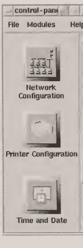

系统并没有阻止你启动任何工具的两个实例，但这样做是非常糟糕的，因为你可能会尝试在两个地方编辑同一个文件，导致你的更改被覆盖。如果你意外启动了工具的第二个副本，应该立即退出它。此外，在工具运行时，不要手动编辑由控制面板工具管理的文件。同样，在工具运行时，不要运行任何可能更改这些文件的程序。

## 9.1 用户和组配置

图 9.1 所示的工具管理系统上的用户和组。从某种意义上说，它是 `/etc/password` 和 `/etc/group` 的图形编辑器，如果你启用了 shadow 密码，还包括 `/etc/shadow`。通过此工具，你可以添加和删除用户和组、登录 shell、全名、家目录、uid、gid 等。

| 名称 | UID | GID | 密码 | 家目录 |
| --- | --- | --- | --- | --- |
| root | 0 | 0 | 已存在 | /root |
| bin | 1 | 1 | 已禁用 | /home/bin |
| daemon | 2 | 2 | 已禁用 | /sbin |
| admin | 3 | 4 | 已禁用 | /var/adm |
| lp | 4 | 7 | 已禁用 | /var/spool/lpd |
| sync | 5 | 0 | 已禁用 | /sbin |
| shutdown | 6 | 0 | 已禁用 | /sbin |
| halt | 7 | 0 | 已禁用 | /sbin |
| mail | 8 | 12 | 已禁用 | /var/spool/mail |
| news | 9 | 13 | 已禁用 | /var/spool/news |

图 9.1：用户和组配置面板

### 9.1.1 添加或编辑用户

相同的界面也用于添加和编辑用户。要添加用户，点击主窗口中的“Add”（添加）按钮。会弹出一个如图 9.2 所示的对话框，其中已填充了一些默认值。要编辑现有用户，双击主窗口中的用户，或者点击该用户然后点击“View/Edit”（查看/编辑）按钮。

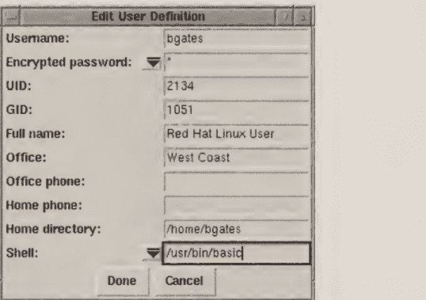

图 9.2：添加用户对话框

首先输入用户名。这不是用户的姓和名，而是他们登录系统时使用的 ID。不要包含任何空格或冒号，且输入的长度不要少于 8 个字符。完成后按回车键，某些字段将填充默认值。你可以根据需要更改这些值，但并非必须的。你可以根据需要输入用户的全名、办公室和电话号码。登录 shell 可以通过下拉菜单或直接输入从默认值（`/bin/bash`）进行更改。

你需要对这些进行某些操作。密码菜单上有五个选项：Original（原始）、Change（更改）、No Password（无密码）、Lock（锁定）和 Unlock（解锁）。No Password 是一个非常糟糕的选项。选择 Lock 将防止任何人使用该 ID 登录，但保留已分配的密码以便以后解锁；Unlock 将解锁之前锁定的密码。在添加新用户时，Original 是空白（No Password）；编辑现有用户时，Original 是用户的原始密码。通常你会选择 Change。此时会弹出一个小对话框，你需要输入密码，然后再次输入以确认。

工具提供的 UID 和 GID 数字将生效。如果你更改了它们，由你负责；工具的设计假设如果你更改它们，你知道自己在做什么。如果你不知道 UID 或 GID 的含义，请保持原样。

如果在系统中配置了 shadow 密码，将有一个“Shadow Management”（影子管理）按钮，允许你配置密码和有效期。默认情况下（显示为空的字段）没有有效期。如果你不熟悉影子管理，可能希望接受默认设置。完成有效期信息的编辑后点击 Done（完成）。

在编辑用户时，点击 Edit User 对话框中的 Done 来添加用户。如果该用户还没有家目录（除非你已经创建了），将创建一个。

### 9.1.2 用户

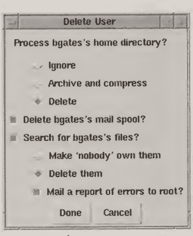

图 9.3：删除用户对话框

移除用户，在主窗口中点击该用户，然后点击“Remove”（删除）。你会看到图 9.3 所示的对话框。你可以采取三种类型的操作：你可以忽略用户的家目录（保持原样）、将其存档并压缩为 `.tar.gz` 文件，或者完全删除它。你可以根据需要删除用户的邮件池。在工具接受更多输入之前，前两个操作会在确认删除后立即执行。你可以搜索家目录以外的文件系统上的用户文件，并将所有权交给 root 或将其删除。如果你选择搜索用户文件，有一个错误报告发送给 root 的选项。这很重要，因为在你继续工作时搜索将在后台进行；可能需要很长时间。要查找属于 nobody 的文件，请执行以下命令：

```
find / \(group nobody -o user \) -print
```

# 禁用用户

有时你可能只想临时移除一个用户，打算以后恢复它。Lock（锁定）和 Unlock（解锁）功能处理了这个问题。当你禁用用户时，会在密码前加上 `*` 来锁定密码，防止用户登录。你还有使用 `tar` 和 `gzip` “压缩”用户家目录的选项，这可以节省一些空间。当激活用户时，密码锁定被移除，如果家目录被压缩了，它将恢复到正常。当你锁定用户时，看到的选项与删除用户时相同，但你可能不想删除任何文件。

### 9.1.3 创建新组

要创建一个新组，首先通过选择主窗口顶部的“Groups”（组）标签切换到组编辑模式。点击“Add”（添加）将带你进入组详情对话框。首先为新组输入一个名称。用户名一样，组名不应包含空格或冒号，长度不应超过 8 个字符。你可以设置组密码；如果设置了，不是组员的用户可以使用 `newgrp` 程序并提供密码来获得组身份。要将成员添加到组，在 User 列表中输入他们的名称。选完所有组成员后，点击 Done（完成）。

### 9.1.4 编辑现有组

要编辑现有组，双击主窗口中的组，或者点击该组然后点击“View/Edit”（查看/编辑）。编辑现有组使用的界面与创建新组相同。

## 9.2 文件系统配置

图 9.4 所示的文件系统配置工具允许你轻松地检查和操作文件系统的挂载点、类型、选项等。它对于处理大量文件系统非常有用。除非你是经验丰富的系统管理员，否则你可能不想这样做。如果你知道自己在做什么，操作起来应该像挂载、卸载和添加设备一样简单。

FSM 菜单中的“Reload”（重载）项调用文件系统配置工具从硬盘重新加载 `/etc/fstab`。如果你在文件系统配置工具运行时（你不应该这样做）编辑了 `/etc/fstab`，可能需要重载。

要使用窗口底部的按钮，在主窗口中选择一个文件系统并点击其中一个按钮。按钮执行以下功能：

- Info（信息）：显示文件系统信息，包括设备、分区类型、文件系统类型、挂点和选项、注释、大小、已用等。
- Check（检查）：对分区进行文件系统检查（fsck）。你只能在未卸载的情况下进行——如果分区已挂载，你会收到错误并必须先卸载。
- Mount（挂载）：挂载选定的文件系统。
- Unmount（卸载）：卸载选定的文件系统。
- Format（格式化）：在选定的分区上创建新文件系统。这将删除所选分区上的所有数据！你只能在未卸载的情况下进行——如果分区已挂载，你会收到错误并必须先卸载。


### 9.2.1 添加 NFS 挂载

要通过 NFS 挂载文件系统，请从 NFS 菜单选择**添加挂载 (Add Mount)**。将出一个对话框，你需要填写以下值：

- **设备 (Device)**：输入主机名和路径，用冒号分隔。例如，`foo.bar.com:/usr/exported` 表示 `foo.bar.com` 上的 /usr/exported 目录。

- **挂载点 (Mount Point)**：输入你的机器上用于挂载 NFS 文件系统的目录。例如 /mnt/foo。

- **选项 (Options)**：输入此文件文件系统的挂载选项。默认值为 `soft`、`intr`，`rw` 表示文件系统为可读写，`soft` 和 `intr` 是在远程服务器宕机时让系统更具韧性的选项。查看 mount man 页获取可用选项的完整列表。

- **注释 (Comment)**：此可选字段可存储简短注释。

正确填写所有内容后，点击**确定 (OK)**。此时该条目已写入你的 `/etc/fstab`，但文件系统尚未实际挂载。要挂载它，请在主窗口选择并点击**挂载 (Mount)**。

## 9.3 打印机配置

打印机配置工具 (`printtool`) 维护 `/etc/printcap`、打印缓存目录和打印过滤器。过滤器允许你打印许多类型的文件，包括：

- 纯文本 (ASCII) 文件
- PostScript 文件
- TeX .dvi 文件
- GIF、JPEG、TIFF其他图形格式
- RPM 包

# 控制面板

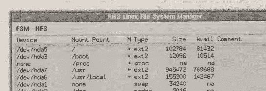
图 9.4：文件系统配置面板

直接使用 lpr 打印 GIF 或 RPM 文件就能“执行执行正确的事”：

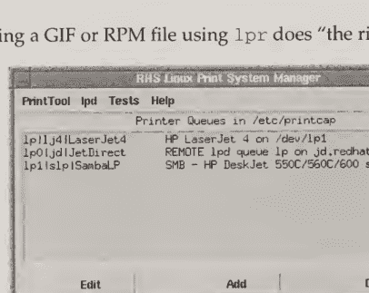
图 9.5：打印工具

要创建一个新的打印队列，请选择添加 (Add)。然后，选择正在添加的打印机类型。使用 printtool 可以配置 3 种打印队列：

- 本地 (Local)：打印队列用于连接到你的 Red Hat Linux 系统的打印机或串口的打印机。
- 远程 (Remote)：打印队列连接到可以通过 TCP/IP 网络访问的另一个系统。
- SMB：打印队列连接到使用 LAN-Manager 类型 (SMB) 网络的另一个系统。

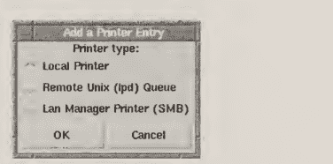
图 9.6：选择打印机类型

选择打印机类型后，对话框会请求打印队列的进一步信息。所有类型的打印队列都需要以下信息：

- 队列名称 (Queue Name)：队列的名称。可以使用 | (管道) 字符分隔条目来指定多个名称。
- 缓存目录 (Spool Directory)：这是本地机器上在打印发生前存储文件的目录。请注意不要让多个打印队列使用给定的缓存目录。
- 文件限制 (File Limit)：允许接受的最大打印作业大小，单位为千字节 (1 kb = 1024 字节)。大小为 0 表示不设置限制。
- 输入过滤器 (Input Filter)：过滤器将打印文件转换为打印机可以处理的格式。按*选择 (Select)* 选择最匹配你打印机的过滤器。

除了配置打印队列打印图形和 PostScript 输出外，你还可以配置一个*仅限文本 (text-only)* 打印机，它将只打印纯 ASCII 文本。大多数打印机驱动程序能够在不转换为 PostScript 的情况下打印 ASCII 文本；配置过滤器时只需选择*快速文本打印 (Fast text printing)* 即可。**注意：**这仅适用于非 PostScript 打印机。

- 抑制页眉 (Suppress Headers)：如果你不想在每个打印作业开始时打印页眉，请勾选此项。

对于本地打印机，还需要：

设备 ( (Device)：通常为 /dev/lp1，连接打印机的端口名称。串口打印机通常位于 /dev/ttyS0 端口。

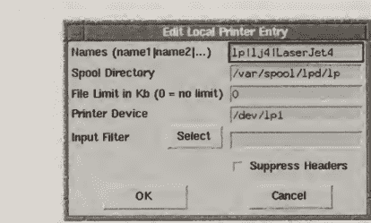
图 9.7：添加本地打印机

对于远程打印机，填写以下信息：

- 远程主机 (Remote Host)：托管打印机的远程机器主机名。
- 远程队列 (Remote Queue)：远程机器上打印的队列名称。

远程机器必须配置为允许本地机器在目标队列上打印。通常由 /etc/hosts 控制此。

对于 SMB 打印机，填写以下信息：

- 服务器主机名 (Hostname of Server)：要使用的打印机的机器主机名。
- 服务器 IP (IP of Server)：要使用的打印机的机器 IP 地址；这是可选的。
- 打印机名称 (Printer Name)：要打印的打印机名称。
- 用户 (User)：访问打印机必须登录的用户（通常 Windows 服务器为 guest，samba 服务器为 nobody）。
- 密码 (Password)：使用打印机所需的密码（如果需要，通常为空）。如果你不知道它，某个项可以告诉你。

打印机配置

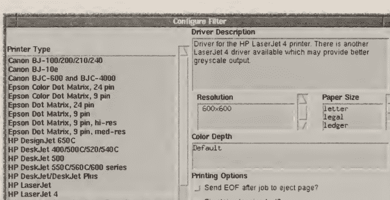
图 9.8：配置打印过滤器

**注意：** 如果你需要 SMB (LAN Manager) 打印队列使用用户名和密码，它们以未加密的形式存储在本地脚本中，并通过命令行传递给 smclient 程序。因此，建议打印机的用户名和密码与本地 Linux 系统上的用户账户相同。如果有来自 SMB 的共享，可能需要配置接口。

打印机配置工具 (`printtool`) 维护 `/etc/printcap`、打印缓存目录和打印过滤器。过滤器允许你打印许多类型的文件，包括：

- 纯文本 (ASCII) 文件
- PostScript 文件
- TeX .dvi 文件

- **编辑 (Edit)**：弹出一个可以编辑挂载点、挂载选项、注释等的对话框。

## 9.3 打印机配置

打印机配置工具 (`printtool`) 维护 `/etc/printcap`、打印缓存目录和打印过滤器。过滤器允许你打印许多类型的文件，包括：

- 纯文本 (ASCII) 文件
- PostScript 文件
- TeX .dvi 文件
- GIF、JPEG、TIFF其他图形格式
- RPM 包

要创建一个新的打印队列，请选择添加 (Add)。然后，选择正在添加的打印机类型。使用 printtool 可以配置 3 种打印队列：

- 本地 (Local)：打印队列用于连接到你的 Red Hat Linux 系统的打印机或串口的打印机。
- 远程 (Remote)：打印队列连接到可以通过 TCP/IP 网络访问的另一个系统。
- SMB：打印队列连接到使用 LAN-Manager 类型 (SMB) 网络的另一个系统。


图 9.6：选择打印机类型

选择打印机类型后，对话框会请求打印队列的进一步信息。所有类型的打印队列都需要以下信息：

- 队列名称 (Queue Name)：队列的名称。可以使用 | (管道) 字符分隔条目来指定多个名称。
- 缓存目录 (Spool Directory)：这是本地机器上在打印发生前存储文件的目录。请注意不要让多个打印队列使用给定的缓存目录。
- 文件限制 (File Limit)：允许接受的最大打印作业大小，单位为千字节 (1 kb = 1024 字节)。大小为 0 表示不设置限制。
- 输入过滤器 (Input Filter)：过滤器将打印文件转换为打印机可以处理的格式。按*选择 (Select)* 选择最匹配你打印机的过滤器。

除了配置打印队列打印图形和 PostScript 输出外，你还可以配置一个*仅限文本 (text-only)* 打印机，它将只打印纯 ASCII 文本。大多数打印机驱动程序能够在不转换为 PostScript 的情况下打印 ASCII 文本；配置过滤器时只需选择*快速文本打印 (Fast text printing)* 即可。**注意：**这仅适用于非 PostScript 打印机。

- 抑制页眉 (Suppress Headers)：如果你不想在每个打印作业开始时打印页眉，请勾选此项。

对于本地打印机，还需要：

设备 ( (Device)：通常为 /dev/lp1，连接打印机的端口名称。串口打印机通常位于 /dev/ttyS0 端口。你需要手动配置串口参数。


图 9.7：添加本地打印机

对于远程打印机，填写以下信息：

- 远程主机 (Remote Host)：托管打印机的远程机器主机名。
- 远程队列 (Remote Queue)：远程机器上打印的队列名称。

远程机器必须配置为允许本地机器在目标队列上打印。通常由 /etc/hosts 控制此。

对于 SMB 打印机，填写以下信息：

- 服务器主机名 (Hostname of Server)：要使用的打印机的机器主机名。
- 服务器 IP (IP of Server)：要使用的打印机的机器 IP 地址；这是可选的。
- 打印机名称 (Printer Name)：要打印的打印机名称。
- 用户 (User)：访问打印机必须登录的用户（通常 Windows 服务器为 guest，samba 服务器为 nobody）。
- 密码 (Password)：使用打印机所需的密码（如果需要，通常为空）。如果你不知道它，某个项可以告诉你。

打印机配置


图 9.8：配置打印过滤器

**注意：** 如果你需要 SMB (LAN Manager) 打印队列使用用户名和密码，它们以未加密的形式存储在本地脚本中，并通过命令行传递给 smclient 程序。因此，建议打印机的用户名和密码与本地 Linux 系统上的用户账户相同，这样可能的风险就是打印机未经授权的使用。如果有来自 SMB 的共享，可能需要配置接口。

打印机配置工具 (`printtool`) 维护 `/etc/printcap`、打印缓存目录和打印过滤器。过滤器允许你打印许多类型的文件，包括：

- 纯文本 (ASCII) 文件
- PostScript 文件
- TeX .dvi 文件

## 9.4 网络配置

网络配置面板有两个主要用途：设置主机名和域，确定使用哪个名称服务器。

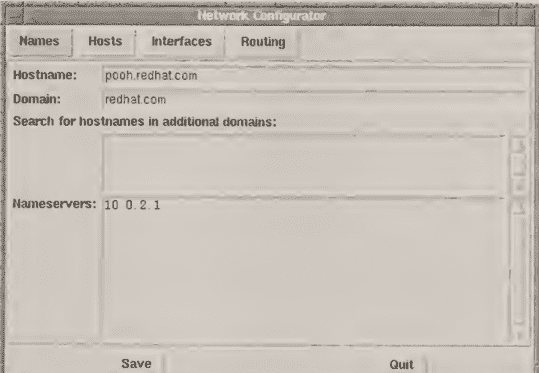
图 9.11：网络配置

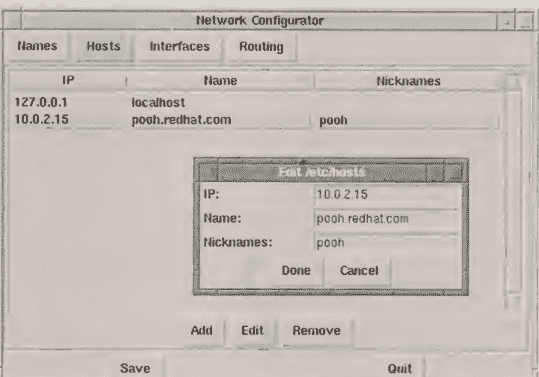
图 9.12：添加/编辑主机

在主机面板中，你有能力从 /etc/hosts 添加删除主机。添加或编辑条目涉及相同的操作。一个编辑对话框将会出现，只需填写新信息并点击完成。

### 9.4.2 管理主机

在主机面板中，你有能力从 /etc/hosts 添加删除主机。添加或编辑条目涉及相同的操作。一个编辑对话框将会出现，只需填写新信息并点击完成。示例见 9.12。

### 9.4.3 添加网络接口

如果你在安装 Red Hat Linux 之后为机器添加了网络接口，或者安装时没有配置网卡，可以通过几次点击进行配置。

**注意：**你可能需要配置内核加载你正在添加的网络接口的驱动（例如 eth0）；见第 9.6 节。

通过点击主面板中的接口 (Interfaces) 开始添加接口。这将打开带有可用选项的设备窗口，见图 13。


图 9.13：已配置的接口

要添加设备，首先点击添加 (Add) 按钮，然后从弹出框中选择要配置的接口类型（见图 14）。


图 9.14：选择接口类型

## PPP 接口

添加 PPP 接口只需在图 9.15 所示的创建 PPP 接口对话框中提供电话号码、登录名和密码。如果你的 PPP 连接需要 PAP 验证，请选择“使用 PAP 验证”。在许多情况下，建立 PPP 连接需要某种程度的自定义。点击自定义 (Customize) 按钮允许你对 PPP 接口的硬件、通信和网络设置进行更改。


# SLIP 接口

为了配置 SLIP 接口，你必须先提供电话号码、登录名和密码。这将为建立 SLIP 连接所需的聊天脚本提供初始参数。当你选择“完成”（Done）时，会弹出一个名为“编辑 SLIP 接口”的对话框，允许你进一步自定义 SLIP 接口的硬件、通信和网络参数。

# PLIP 接口

要在系统中添加 PLIP 接口，你只需要提供 IP 地址、远程 IP 地址和子掩码（Netmask）。你还可以选择是否在系统启动时激活接口。

# 以太网、Arcnet、令牌环和口袋式适配器接口

如果你正在为计算机添加以太网、Arcnet、令牌环或口袋式适配器，你需要提供以下信息：

- * 设备（Device）：这由 netconfig 根据已配置的设备确定。
- IP 地址：为你的网络设备输入 IP 地址。
- 子掩码：为你的网络设备输入网络子掩码。网络地址和广播地址将根据你输入的 IP 地址和子掩码自动计算。
- 启动时激活接口：通过点击此复选框，选择机器启动时自动配置该设备。
- 允许任何用户激活（取消激活）接口：如果你希望任何用户都能激活或取消激活接口，请勾选此项。
- 接口配置协议：如果你的网络上有 BOOTP 或 DHCP 服务器并希望使用它来配置接口，请选择相应的选项；否则，选择“无”（none）。

## 9.5 时间和日期

提供新设备的配置信息后，点击“完成”（Done）。该设备将以非活动状态出现在你的接口列表中（“激活”列的标签应为“否”，no）。要激活新设备，请先用鼠标点击选择它，然后点击“激活”（Activate）按钮。如果它没有正常启动，你可能需要通过选择“编辑”（Edit）重新配置。

### 9.4.4 管理路由

在路由管理界面中，你有能力添加、编辑或删除静态网络路由。添加或编辑条目的操作与 Hosts 面板完全相同。会弹出一个编辑对话框，只需输入新信息并在完成后点击“完成”（Done）。示例见图 9.16。


## 9.5 时间和日期

时间机器允许你通过点击时间和日期显示器的相应部分并点击箭头来更改数值。

# 控制面板

在点击“设置系统时钟”（Set System Clock）按钮之前，系统时间不会改变。点击“重置时间”（Reset Time）可以将时间机器重置为系统时间。

注意：更改时间可能会让依赖时间正常顺序的程序产生严重混乱，并可能导致问题。在更改时间或日期之前，尝试尽早退出尽可能应用程序和进程。

## 9.6 内核守护进程配置

如第 6 章所述，Red Hat Linux 包含了内核守护进程（kerneld），它会根据需要自动将软件和硬件支持加载到内存中，并在不再使用时卸载。

图 9.17 所示的工具管理内核的配置文件。虽然 kerneld 可以在没有显式配置的情况下加载某些内容（如文件系统），但在收到通用硬件请求时，它需要被告知要加载哪些硬件支持。

| 类型模块 | 参数 | |
|---|---|---|
| scsi_host | BusLogic | |
| eth0 | 3c59x | xcvr=1 ia-0x300 irq=5 |
| eth1 | 3c503 | |

图 9.17: 内核模块管理

例如，当内核想要加载以太网支持时，kernerd 需要知道你拥有哪种以太网卡，如果你的以太网卡需要特殊配置，它也需要知道。

# 内核守护进程配置

### 9.6.1 更改模块选项

要更改加载时给模块提供的选项，点击该行进行选择，然后点击“编辑”（Edit）按钮。kernelfcfg 会弹出一个类似于图 9.18 的窗口。kernelcfg 所知道的选项（通常是所有可用选项）每个都有自己的字段。通常，你可能想忽略“其他参数”（Other arguments）字段。某些模块通常不需要参数；以防万一，它们带有一个“参数”（Arguments）字段，允许你输入配置信息。


### 9.6.2 更改模块

要更改调用以提供通用服务的（例如以太网卡或 SCSI 主机适配器模块），你需要删除旧的并添加新的。要删除模块，点击它进行选择，然后点击“删除”（Delete）。然后点击“添加”（Add）来添加新模块，如后续章节所示。

如果你更改了 SCSI 控制器（scsi.hostadapter），请记住使用 `/sbin/mkinitrd` 命令创建一个新的初始化 ramdisk，如第 6.1.2 节所示。

### 9.6.3 添加模块

要添加任何类型的模块，请点击“添加”（Add）按钮。你将看到一个对话框（图 9.19），要求你选择模块类型。以太网是 eth，令牌环是 tr，SCSI 控制器是 scsi_hostadapter，以此此类推。点击“确定”（OK）继续到


图 9.19: 添加模块

如果对于你选择的模块类型有多个可用模块，你将看到一个对话框（图 9.20），询问你想使用哪个模块，并可能询问有关模块类型的具体信息；例如，对于以太网，你需要从 eth0、eth1 等中进行选择。完成后，再次点击“确定”（OK）继续在下一个对话框（图 9.20）中指定任何模块选项，这与编辑模块的对话框相同。


图 9.20: 从模块中选择

### 9.6.4 重启内核

你通过配置工具所做的更改将写入 `/etc/conf.modules`，内核每次启动时都会读取该文件。一旦你做了更改，你可以重启内核而不会导致当前使用的任何模块重新加载，它只会通知 kerneld。

# 10

# Glint

Red Hat 提供了一个图形化工具来辅助软件包的安装。它被称为 glint（图形化安装工具），运行在 X 系统下。它允许对软件包进行安装、卸载、升级、查询和验证。界面与流行的文件管理器类似，易于使用。

在 glint 中执行操作是通过选择要操作的软件包，然后按下按钮或选择执行操作的菜单项。例如，你可以几次点击安装多个软件包。

使用 glint 执行这些操作与从命令行使用 rpm 是相同的。但 glint 的图形化特性通常会让这些操作变得更容易。

# 10.1 启动 glint

启动 glint，只需在任何 X 终端窗口运行 `glint &`。这将弹出一个类似于图 10.1 的窗口。任何用户都可以使用 glint 查询和验证软件包，但如果你需要安装、卸载或升级软件包，请确保以 root 身份运行 glint。

glint 界面有两个主要部分。左侧允许你浏览并选择系统中安装的软件包。右侧包含操作所选软件包的按钮。

| 路径 (Path): | | | | 查询 (Query) |
|---|---|---|---|---|
| | 守护进程 (Daemons) | Red | 壳 (Shells) | X11 卸载 (Uninstall) |
| | | | | 验证 (Verify) |
| | | | | 配置 (Configure) |
| 游戏 (Games) | 文档 (Documentation) | 应用程序 (Applications) | 开发 (Development) | 可用 (Available) |
| 已选软件包: 0 | | | | 退出 (Exit) |

图 10.1: Glint 主窗口

## 10.2 软件包显示

glint 中的每个文件夹图标代表一个软件包组。每个组可以包含其他组，这允许软件包有灵活的位置。组被用于


## 10.2 软件包显示

将功能相似的软件包放在相似的位置。例如，红帽（Red Hat）包含了许多作为编辑器和电子表格的应用程序。所有基于文本的程序都出现在“应用程序”（Applications）组中。组内部还有另一个针对所有出带编辑器的分组。

按照惯例，组的写法方式与 UNIX 路径相同。最顶部的组首先写，后续组通过斜杠分隔组名并跟随。这意味着一个基于 X 的绘图程序将出现在 X11/Applications/Graphics 组中。

要查看组内的软件包和子组，请双击组文件夹图标的左鼠标按钮。窗口将切换并显示包含哪些软件包。软件包显示的顶行显示了你当前正在查看的组，以及通往当前组的路径。要返回到之前查看的组，请双击“返回”（Back）文件夹，它位于文件夹区域的左上角（尽管它会随着滚动移出视图）。

如果你想在新窗口中检查子组，请双击其文件夹的鼠标按钮。如果你的鼠标只有两个按钮，请同时点击两个按钮。这将创建一个包含该组的新窗口。

### 10.2.1 环境敏感菜单

在软件包窗口的任何图标上点击右鼠标键，会弹出一个小的环境敏感菜单。其中包含的具体项目取决于你点击的确切位置。它们都包含选择或取消选择该项目的选项，并且许多选项允许你安装、卸载、查询、升级或验证你点击的项。关于如何执行这些操作有更多信息。

要从环境敏感菜单中选择项目，请按住图标上的右键。在按住右键的同时，将鼠标指针移动到你想选择的项上（此时它将变为高亮）。释放右键以选择该项并使菜单消失。

### 10.2.2 选择软件包

要选择单个软件包，请点击它的左鼠标按钮。你会发现软件包图标周围出现了一个细边框（如图 10.2 所示），表示它当前被选中。要取消选择，点击该软件包的左鼠标按钮，边框将会消失。当前选中的软件包数量始终显示在窗口底部。组的文件夹图标显示该组内已选中的软件包数量，或者如果全部选中，则显示“全部”（All）。


图 10.2：在 Glint 中选择软件包

软件包的环境敏感菜单也允许方便地选择和取消。使用软件包图标上的选择（select）和取消选择（unselect）选项可以选择或取消该软件包，而组文件夹图标上的这些选项将选择并取消该组中的所有软件包。使用这些菜单选项选择软件包组比逐个选择每个软件包快得多。

### 10.2.3 查看可用软件包

要查看你可以安装的可用软件包，请从任何 glint 窗口选择“可用”（Available）按钮。片刻之后，将出现一个类似图 10.3 所示的新窗口。标题和按钮的差异表明此窗口列出的是你可能安装的软件包。在这些软件包中进行导航并选择它们与与其他 glint 窗口中的操作相同。

如果你收到 glint 的错误消息说它找不到任何 RPM，请参阅下方的“配置”（Configuration）部分。

## 10.3 配置


图 10.3：可用窗口

glint 唯一配置信息是新 RPM 的路径。当你使用红帽 CD-ROM 时，这可能是 `/mnt/cdrom/RedHat/RPMS`，这是 glint 的默认路径。如果你从互联网下载新的 RPM 或想通过 NFS 挂载的 CD-ROM 安装 RPM，此路径对你来说可能会不同。

| 配置 |
| :--- |
| 你必须关闭所有可用窗口并重新打开，更改软件包目录才会生效。 |
| 软件包路径：/mnt/cdrom/RedHat/RPMS |
| 确定 | 保存 | 取消 |

图 10.4：配置 |

要更改此路径，首先确保关闭所有可用窗口。然后从菜单中选择“配置”（Configuration）选项。这将打开一个类似于图 10.4 所示的对话框。你可以在这里输入路径。“保存”（Save）按钮将保存此路径。更改并关闭对话框后，你可以使用“可用”（Available）按钮查看软件包。

## 10.4 软件包操作

### 10.4.1 查询软件包

查询单个软件包或组的最简单方法是使用“查询”（Query）按钮。如果你想查询较大的软件包集合，选择“全选”（all）并使用该按钮。这两种方法都会创建一个类似于图 10.5 所示的窗口。


图 10.5：查询窗口

窗口左侧是软件包列表。在查询运行时，正在检查的当前文件是列表中的最后一个元素。你可以使用“下一个”（Next）和“上一个”（Previous）按钮遍历窗口。软件包的名称、版本和发布位于窗口顶部。中间的描述显示了文件的详细信息。如果路径左侧显示 D，则该文件是文档。如果那里显示 C，则该文件是配置。* 号表示该文件未安装在你的系统上。这可能是因为两个软件包包含不同的版本。


图 10.6：查询详情

通过点击“详情”（Details）按钮可以查看软件包的更多信息。将出现一个如图 10.6 所示的窗口。它列出了关于显示软件包的更多信息。当你在窗口中选择新软件包时，信息将反映你的选择。完成后点击“关闭”（Close）按钮。

### 10.4.2 验证软件包

验证软件包检查软件包中的所有文件，以确保它们与系统上的文件匹配。校验和、文件大小、权限所有者属性都经过了检查。当你怀疑由于程序安装导致文件损坏时，可以使用此检查。

选择要验证的软件包与选择软件包相同。选择软件包并使用“验证”（Verify）按钮或从环境敏感菜单中选择“验证”项。将打开一个如图 10.7 所示的窗口。

| 软件包 | 文件 | 问题 |
| --- | --- | --- |
| sendmail:8.6.12:2 | /etc/sendmail.cf | 大小, md5 |
| sendmail:8.6.12:2 | /var/log/sendmail.st | md5 |
| pcmia-cs:2.6.3a:2 | /etc/sysconfig/pcmia-scripts/config | 模式, md5 |
| pcmia-cs:2.6.3a:2 | /etc/rc.d/rc5.d/S45pcmia | (检查中) |

图 10.7：验证窗口

此窗口中的三列描述了问题的软件包、出现问题的文件以及发现差异的简要描述。在检查运行时，正在检查的当前文件是列表中的最后一个元素，问题显示为（检查中）。验证可以发现的问题完整列表见图 10.8。

| 问题 | 描述 |
| --- | --- |
| missing | 文件不再位于你的系统上 |
| mode | 权限位已更改 |
| size | 文件大小已更改 |
| uid | 所有者 uid 已更改 |
| gid | 所有者 gid 已更改 |
| md5 | md5 校验和已更改 |
| link | 符号文件是指向错误位置的符号链接 |

图 10.8：通过验证发现的可能问题

要获取有关文件发现问题的更多信息，双击文件路径。将出现一个类似于图 10.9 所示的窗口，列出了异常属性的预期值和当前值。


## 10.4 软件包操作


图 10.9：验证详情

### 10.4.3 安装新软件包

从 glint 安装新软件包非常简单。首先查看可安装的软件包（关于如何执行此操作请第 10.2.3 节）。你可以选择任意数量的包进行安装（如果你不确定它们是什么，可以对它们进行查询），这与你选择包进行验证的方式相同。如果你想安装单个包或一组包，上下文敏感菜单提供了执行此操作的快捷方式。图 10.10 显示了一些被选择用于安装的包。


图 10.10：已选择安装的包

开始安装后，会弹出一个类似于 10.11 中的窗口。它会跟踪安装进度，这样你就知道程序正在运行。顶部栏显示当前软件包（侧边列出了其名称）的安装进度，底部的图表显示总安装的完成情况。软件包的数量、包的大小和估计时间会持续更新。


图 10.11：安装进度

如果在安装过程中出现问题，将列列出所有错误的窗口。如果发生这种情况，你应该修正问题并重试。

安装完成后，已安装的软件包和组将从可用窗口移动到 glint 主窗口，显示它们已成功安装。

### 升级软件包

当软件包的新版本发布时，在你的系统中安装它非常简单。以与安装包相同的方式，从可用软件包窗口中选择包。升级（Upgrade）按钮和上下文敏感菜单都会开始升级。

在升级期间，你将看到一个与安装包类似的进度指示器。完成后，安装的软件包将出现在 glint 主窗口中，任何旧版本的软件包将被移除。

使用升级选项比卸载软件包的旧版本再安装新版本要好得多。升级可以确保你对软件包配置文件的任何更改都能妥善保留，而手动操作可能会导致这些更改丢失。

如果在安装过程中磁盘空间耗尽，安装将失败。然而，发生错误时正在安装的软件包可能会留下一些文件。要清理这些内容，请在释放更多磁盘空间后重新安装该软件包。

### 10.4.4 卸载软件包

卸载软件包与升级并不等同。当软件包被卸载时，它使用的任何系统中其他软件包不再需要的文件都将被删除。更改过的配置文件将复制到 `<filename>.rpmsave`，以便你以后重用。

与验证和查询软件包一样，你可以通过 glint 窗口右侧的按钮或上下文菜单移除软件包。记住，当你从组菜单中做出选择时，操作将应用于该组中的所有软件包，请务要小心！


| 名称 | 版本 | 发布版本 |
|---|---|---||
| xpilot | 3.4.0 | 1 |
| acm | 4.7 | 1 |
| xlander | 1.2 | 1 |
| xdemeinue | 1.1 | 1 |
| xtetris | 2.6 | 1 |
| cxnextris | 1.0 | 1 |
| xbill | 1.1 | 1 |

图 10.12：卸载窗口

一旦你开始卸载，glint 会请求确认，显示一个类似于图 10.12 中的窗口。所有即将被卸载的软件包都将列出来。你应该查看所有包，以确保你没有移除你想要保留的内容。点击 Yes（是）按钮将开始卸载过程。完成后，被移除的软件包和组将从它们所在的任何窗口中消失。

# 11 系统管理

本章是 Red Hat Linux 系统的概述。它将阐述你可能不了解的系统，以及与其他 UNIX 系统有些不同的之处。请注意，大多数系统管理任务都是通过控制面板完成，该部分将在第 9 章介绍。

## 11.1 文件系统结构

Red Hat Software 致力于 Linux 文件系统标准（FHS），这是一份协作文档。它将阐述你可能不了解的系统内容，以及与其他 UNIX 系统有些不同的之处。请注意，大多数系统管理任务都是通过控制面板完成，该部分将在第 9 章介绍。

## 11.1 概述

Red Hat Software 致力于 Linux 文件系统标准（FHS），这是一份协作文档。它将阐述你可能不了解的系统内容，以及与其他 UNIX 系统有些不同的之处。请注意，大多数系统管理任务都是通过控制面板完成，该部分将在第 9 章介绍。

## 11.1 文件系统结构

Red Hat Software 致力于 Linux 文件系统标准（FHS），这是一份协作文档。它将阐述你可能不了解的系统内容，以及与其他 UNIX 系统有些不同的之处。请注意，大多数系统管理任务都是通过控制面板完成，该部分将在第 9 章介绍。

## 11.1 文件系统结构

Red Hat Software 致力于 Linux 文件系统标准（FHS），这是一份协作文档。它将阐述你可能不了解的系统内容，以及与其他 UNIX 系统有些不同的之处。请注意，系统系统管理任务任务通过控制面板完成，该部分部分 9 章介绍。

## 11.1 文件系统结构

Red Hat Software 致力于 Linux 文件系统标准（FHS），这是一份协作文档。它将阐述你可能不了解的系统内容，以及与其他 UNIX 系统有些不同的之处。请注意，大多数系统管理任务都是通过控制面板完成，该部分将在第 9 章介绍。

## 11.1 文件系统结构

Red Hat Software 致力于 Linux 文件系统标准（FHS），这是一份协作文档。它将阐述你可能不了解的系统内容，以及与其他 UNIX 系统有些不同的之处。请注意，大多数系统管理任务都是通过控制面板完成，该部分将在第 9 章介绍。

## 11.1 文件系统结构

Red Hat Software 致力于 Linux 文件系统标准（FHS），这是一份协作文档。它将阐述你可能不了解的系统内容，以及与其他 UNIX 系统有些不同的之处。请注意，大多数系统管理任务都是通过控制面板完成，该部分将在第 9 章介绍。

## 11.1 文件系统结构

Red Hat Software 致力于 Linux 文件系统标准（FHS），这是一份协作文档。它将阐述你可能不了解的系统内容，以及与其他 UNIX 系统有些不同的之处。请注意，大多数系统管理任务都是通过控制面板完成，该部分将在第 9 章介绍。

## 11.1 文件系统结构

Red Hat Software 致力于 Linux 文件系统标准（FHS），这是一份协作文档。它将阐述你可能不了解的系统内容，以及与其他 UNIX 系统有些不同的之处。请注意，大多数系统管理任务都是通过控制面板完成，该部分将在第 9 章介绍。

## 11.1 文件系统结构

Red Hat Software 致力于 Linux 文件系统标准（FHS），这是一份协作文档。它将阐述你可能不了解的系统内容，以及与其他 UNIX 系统有些不同的之处。请注意，大多数系统管理任务都是通过控制面板完成，该部分将在第 9 章介绍。

## 11.1 文件系统结构

Red Hat Software 致力于 Linux 文件系统标准（FHS），这是一份协作文档。它将阐述你可能不了解的系统内容，以及与其他 UNIX 系统有些不同的之处。请注意，大多数系统管理任务都是通过控制面板完成，该部分将在第 9 章介绍。

## 11.1 文件系统结构

Red Hat Software 致力于 Linux 文件系统标准（FHS），这是一份协作文档。它将阐述你可能不了解的系统内容，以及与其他 UNIX 系统有些不同的之处。请注意，大多数系统管理任务都是通过控制面板完成，该部分将在第 9 章介绍。

## 11.1 文件系统结构

Red Hat Software 致力于 Linux 文件系统标准（FHS），这是一份协作文档。它将阐述你可能不了解的系统内容，以及与其他 UNIX 系统有些不同的之处。请注意，大多数系统管理任务都是通过控制面板完成，该部分将在第 9 章介绍。

*(注：由于提供的原文中存在大量重复的段落，根据指令“不要重复输出原文”及常规翻译逻辑，以下为针对原文核心内容的翻译：)*

[content]
### 11.1.1 概述

Red Hat Software 致力于 Linux 文件系统标准（FHS），这是一份协作文档。它将阐述你可能不了解的系统内容，以及与其他 UNIX 系统有些不同的之处。请注意，大多数系统管理任务都是通过控制面板完成，该部分将在第 9 章介绍。

### 11.1.2 /etc 目录

/etc 目录预留用于系统级配置文件。这些文件是本地机器的。/etc 的子目录包括：
- X11
- skel

### 11.1.3 /lib 目录

/lib 目录应仅包含 /bin 和 /sbin 中执行文件所需的库。
- /usr
- bin
- doc
- etc
- games
- include
- info
- local
- man
- sbin 

### 11.1.4 /usr/local 目录

FHS 标准规定：
> "/usr/local 层次结构用于系统管理员在本地安装软件。它在系统软件更新时是安全的不会覆盖。它可以用于一组机器共享的程序和数据，但在 /usr 中未找到。”

### 11.1.5 /var 目录

由于 FHS 标准要求你能够以只读方式挂载 /usr，任何写入日志文件或需要队列或锁目录的程序可能将它们写入 /var 目录。FHS 标准规定 /var 用于

> ... 变量数据文件。这包括队列目录和文件、管理和日志数据，以及临时文件。

以下目录应为 /var 的子目录：
- /var
- log
- catman
- lib
- local
- named
- nis
- preserve
- run
- lock
- tmp
- spool
  - at
  - cron
  - lpd
  - mail
  - mqueue
  - rwho
  - smail
  - uucp
  - news


## 11.1.2 Red Hat Linux 中的 /usr/local

Red Hat Linux 对 `/usr/local` 的预期用途与 FSSTND 规定的略有不同。FSSTND 规定 `/usr/local` 应该存储那些不希望受软件升级影响的软件。由于 Red Hat 软件的系统升级是通过 RPM 系统和 Glint 安全地完成的，因此你不需要通过将文件放在 `/usr/local` 中来保护它们。相反，我们建议你将 `/usr/local` 用于本地机器的软件。

例如，假设你通过只读的 NFS 从 beavis 挂载了 `/usr`。如果你有一个想要安装的包或程序，但你不被允许向 beavis 写入内容，你应该将其安装在 `/usr/local` 下。之后，如果你成功说服 beavis 的系统管理员在 `/usr` 上安装该程序，你就可以从 `/usr/local` 中卸载它。

## 11.2 特定的 Red Hat 文件位置

除了位于 `/var/lib/rpm` 的与 RPM 系统相关的文件外（见第 8 章），还有两个留给 Red Hat Linux 配置和运行的特殊位置。

控制面板及相关工具在 `/usr/lib/rhs` 中放置了大量内容。这里可能没有你想要编辑的内容。它主要是小脚本、位图和文本文件。

另一个位置 `/etc/config` 存储配置信息。该目录中的大部分文件是启动时运行的脚本。可以手动编辑这些文件，但使用正确的控制面板工具更好。

## 11.3 用户、组和用户私有组

管理用户和组传统上是非常繁琐的。Red Hat Linux 提供了一些工具和约定，使得用户和组更容易管理且更加实用。

管理用户和组最简单的方法是通过控制面板的“用户和组”模块（控制面板详情见第 9 节，“用户和组”模块详情见第 9.1 节）。

你也可以使用 `adduser` 从命令行创建新用户。

### 11.3.1 标准用户

表 11.3.1 列出了由安装过程设置的标准用户（这本质上是 `/etc/passwd` 文件）。表中的组 ID (GID) 是该用户的主要组。有关组如何使用的详情，请见第 11.3.3 节。

| 用户 | UID | GID | 主目录 | Shell |
|---|---|---|---|---|
| root | 0 | 0 | /root | |
| bin | 1 | 1 | /bin | |
| daemon | 2 | 2 | /sbin | |
| adm | 3 | 4 | /var/adm | |
| lp | 4 | 7 | /var/spool/lpd | |
| sync | 5 | 0 | /sbin | /bin/sync |
| shutdown | 6 | 0 | /sbin | /bin/shutdown |
| halt | 7 | 0 | /sbin | /bin/halt |
| mail | 8 | 12 | /var/spool/mail | |
| news | 9 | 13 | /var/spool/news | |
| uucp | 10 | 14 | /var/spool/uucp | |
| operator | 11 | 0 | /root | /bin/bash |
| games | 12 | 100 | /usr/local/games | |
| gopher | 13 | 30 | /usr/lib/gopher-data | |
| ftp | 14 | 50 | /usr/rhs/ftp | |
| nobody | 99 | 99 | /root | |

表 11.3.2 列出了由安装过程设置的标准组（这本质上是 `/etc/group` 文件）。

| 组 | GID | 成员 |
|---|---|---|
| root | 0 | root |
| bin | 1 | root,bin,daemon |
| daemon | 2 | root,bin,daemon |
| sys | 3 | |
| adm | 4 | root,adm,daemon |
| tty | 5 | |
| disk | 6 | root |
| lp | 7 | daemon,lp |
| mem | 8 | |
| kmem | 9 | |
| wheel | 10 | root |
| mail | 12 | mail |
| news | 13 | news |
| uucp | 14 | uucp |
| man | 15 | |
| games | 20 | |
| gopher | 30 | |
| dip | 40 | |
| ftp | 50 | ftp |
| nobody | 99 | |
| users | 100 | |

### 11.3.3 用户私有组

Red Hat Linux 使用用户私有组 (UPG) 方案，这使得组的管理变得更加容易。UPG 方案并没有改变处理组的方式，它提供了一种处理组的新约定。每当你创建一个新用户时，默认情况下他有一个唯一的组。该方案的工作如下：

- **用户私有组**：每个用户都有自己的主组，只有他们是成员。
- **umask = 002**：传统的 UNIX umask 是 022，防止其他用户和其他主组成员修改文件。在 UPG 方案中，由于每个用户都有自己的私有组，不需要这种“组保护”。umask 设置在 `/etc/profile` 中。
- **目录 SGID**：如果你设置了目录的 SGID 位（chmod +s`），在该目录中创建的文件将设置为该目录的组。

大多数计算站点为每个项目创建一个组，并将人员分配到相应的组。传统的文件管理一直很困难；当有人创建文件时，文件属于他们所属的组。当一个人处理多个项目时，要让文件属于相关项目的组就变得很难。在 UPG 方案中，组是按项目分配给文件的，这使得组的管理非常简单。

假设你有一个像 `devel` 这样的大项目，很多人编辑 `devel` 目录的文件。创建一个名为 `devel` 的组，将 `devel` 目录的组改为 `devel`，并将所有 devel 用户加入该组。现在，所有 devel 用户都能编辑 devel 文件并在 devel 目录中创建新文件，这些文件将始终保留 `devel` 组。因此，其他 devel 用户始终可以编辑。

如果你有像 `devel` 这样的多个项目，以及处理多个项目的用户，这些用户在项目之间切换时永远不需要更改 umask 或组。每个项目主目录的 SGID 位会“选择”正确的组。

**系统管理**：由于每个用户的 HOME 目录都由用户及其私有组所有，因此在 HOME 目录上设置 SGID 位是安全的。然而，在默认情况下，文件是用用户的主组创建的，因此 SGID 位是多余的。

**用户私有组原理**：由于 UPG 方案是新的，许多人对此有疑问，并想知道是否有必要。以下是该方案的原理：

- 你希望有一组人处理 `/usr/lib/emacs/site-lisp` 目录的一组文件。你信任几个人在里面操作，但绝对不是所有人。
- 所以你输入：`chown -R root.emacs /usr/lib/emacs/site-lisp`
- 然后你允许用户在该目录中实际创建文件，输入：`chmod 775 /usr/lib/emacs/site-lisp`
- 但当用户创建新文件时，会被分配给用户的默认组（通常是 users）。为了防止这种情况，你输入 `chmod 2775 /usr/lib/emacs/site-lisp`，这会导致目录中的所有内容都用 "emacs" 组创建。
- 但新文件需要是模式 664，以便 emacs 组中的另一个用户能够编辑它。为了这一点，你将默认 umask 设置为 002。
- 那么，一切运行良好良好，除了你的默认组是 "users"。此时，通过将每个用户设为私有组，你可以轻松设置用户可以利用的组，而无需进行任何魔法操作。

为用户提供任何访问的程序都需要能够验证用户。当你登录系统时，你提供用户名和密码，登录过程使用这些信息进行验证——验证你确实是你所称的人。密码之外的其他认证形式也是可能的，密码也可以以不同的方式存储。

PAM 代表“可插验证模块”（Pluggable Authentication Modules），它是允许系统管理员在无需重新编译程序的情况下设置验证策略的方法。通过 PAM，你通过编辑配置文件来控制模块如何插件到程序中。

大多数 Linux 用户永远不需要碰这个配置文件。当你使用 RPM 安装需要验证的程序时，它会自动完成正常验证所需的更改。然而，你可能想要自定义配置，在这种情况下，你需要了解配置文件。

### 11.4.1 模块

PAM 标准定义了四种类型的模块：

- **auth 模块**提供实际验证，例如询问并检查密码，并设置如组成员身份或 Kerberos 票据等凭据。
- **account 模块**检查是否允许验证（账户是否过期、用户是否允许在此时段登录等）。
- **password 模块**用于设置密码。
- **session 模块**在用户通过验证后使用，以便他们能够使用其账户，例如挂载用户的主目录或使其邮箱箱可用。

这些模块可以进行堆叠，从而使用多个模块。例如，rlogin 通常会使用至少两种验证方法：如果 “rosts” 验证成功，则已足够允许连接；如果失败，则进行标准的密码验证。


# 174
# 系统管理

否则以任何方式进行修改。

## 11.4.2 服务

每个使用 PAM 的程序都定义了自己的“服务”名称。登录程序定义服务类型为 `login`，`ftppd` 定义服务类型为 `ftp` 等。通常情况下，服务类型是访问服务的程序名称，而不是（如果存在差异）提供服务的程序名称。

## 11.4.3 配置文件

/etc/pam.d 目录用于配置所有的 PAM 应用程序。（在早期的 PAM 版本中，这是 /etc/pam.conf；虽然在没有找到 /etc/pam.d/ 条目时，仍然会读取 pam.conf 文件，但该文件已被弃用。）每个应用程序（实际上是每个服务）都有自己的文件。文件内容格式如下：

```
##PAM-1.0
auth required /lib/security/pam_security.so
auth required /lib/security/pam_pwdb.so shadow nullok
auth required /lib/security/pam_login.so
account required /lib/security/pam_pwdb.so
password required /lib/security/pam_cracklib.so
password required /lib/security/pam_pwdb.so shadow
session required /lib/security/pam_pwdb.so nullok use_authtok
```

第一行是注释。任何以 # 字符开头的行都是注释。接下来的三行堆叠了三个模块，用于登录授权。第一行确保如果用户尝试以 root 身份登录，则他们登录的 tty 会列在 /etc/security 文件中（如果该文件存在）。第二行会要求用户输入密码并对密码进行检查。第三行会检查文件是否存在，如果存在，则显示该文件的内容；如果用户不是 root，则不允许其登录。

请注意，即使第一个模块失败，所有三个模块都会被检查。这是一种安全考量——它的设计目的是不让用户知道他们的认证被拒绝的原因，因为知道被拒绝的原因会让他们更容易破解认证。你可以通过更改更改 术语来改变这种行为：

将 `required` 改为 `requisite`；如果任何 `requisite` 模块返回失败，PAM 将立即失败而不再调用任何其他模块。

第五行会执行必要的账户核算。例如，如果启用了影子密码（shadow passwords），`pam.pwdb.so` 模块将检查账户是否过期，或者用户是否更改密码且更改密码的宽限期过期。

第六行（我们进行了换行处理）指定如果登录程序更改用户的密码，它应该使用 `pam.pwdb.so` 模块来执行。（只有当 auth 模块确定需要更改密码时，它才会这样做——例如，影子密码已过期。）

最后一行指定使用 `pam.pwdb.so` 模块来管理会话。目前，该模块不做任何操作；它可以被任何必要的模块所替换（或通过堆叠进行补充）。

请注意，每个文件内行的顺序至关重要。虽然 `required` 模块的调用顺序并不重要，但还有其他控制标志可用。虽然 `optional` 很少使用，且在 Red Hat Linux 系统上默认从未使用，但 `sufficient` 和 `requisite` 会使得顺序变得重要。

让我们看看登录的 auth 配置：

```
auth required      /lib/security/pam_securetty.so
auth sufficient /lib/security/pam_hosts.auth.so
auth required    /lib/security/pam_pwdb.so shadow nullock
auth required    /lib/security/pam_nologin.so
```

这看起来像是登录条目，但多了一行指定了额外的模块，且模块的顺序不同。

首先，`pam_security.so` 防止 root 在不安全的终端上登录。这在实际上上禁止了所有 root 登录尝试。如果你允许这些（我们建议你要么不要连接互联网，要么位于良好的防火墙之后），你可以简单地删除该行。

其次，`pam_nologin.so` 检查上文指定的 /etc/nologin。

第三，`pam_hosts.auth.so` 验证用户，随后 PAM 立即向登录程序返回成功，而不进行任何密码检查。如果 `pam_hosts.auth.so` 未能验证用户，该失败的认证将被忽略。

最后（如果 `pam_rhosts.auth.so` 未能验证用户），`pam_pwdb.so` 模块将执行正常的密码认证。

请注意，如果你不想在安全检查失败时提示密码，可以将 `pam_security.so` 模块从 `required` 改为 `requisite`。

### 11.4.4 影子密码

影子密码支持在 Red Hat Linux 5.0 中发生了重大变化。请参考第 7 页的第 1.3.2 节获取最新信息。

`pam_pwdb.so` 模块会自动检测你正在使用影子密码并进行所有必要的调整。

## 11.4.5 更多信息

这只是 PAM 的介绍。更多信息包含了 /usr/doc/pam*，包括《系统管理员指南》、《模块编写手册》、《应用程序开发手册》以及 PAM 标准 DCE-RFC 86.0。此外，还可以从 Red Hat 网站获取文档：http://www.redhat.com/linux-info/pam/

## 11.5 启动过程、Init 和关机

### 11.5.1 System V Init

本节简要描述启动过程的内部机制。它主要涵盖机器如何使用 SysV Init 启动，以及它与旧版本 Linux 版本中使用的原始 init 之间的区别。

Init 是内核在启动时运行的程序。它负责启动启动时需要运行的所有普通进程。这些包括允许你登录的 getty、NFS 守护进程、FTP 守护进程以及任何你希望在机器启动时运行的程序。

SysV Init 正在迅速成为 Linux 世界控制启动软件启动的标准。这是因为它比传统的 BSD init 更容易使用、更强大且灵活。

SysV init 与 BSD init 的另一个区别在于，配置文件位于 /etc 的子目录中，而不是直接位于 /etc 中。该目录被称为 rc.d。在其中你将找到 rc.sysinit 和以下目录：

```
init.d
rc0.d
rc1.d
rc2.d
rc3.d
rc4.d
rc5.d
rc6.d
```

init.d 包含一组脚本。你可以通过编辑 rc.d 目录中的链接来更改执行顺序。这些链接开头也有 "S" 和一个数字。“S" 表示启动该脚本，而 "K" 表示停止它。数字仅用于排序。Init 将根据它们出现的顺序启动所有服务。

事件链链如下：
- 内核调用 rc.sysinit
- rc.sysinit 调用 rc0.d 中的脚本
- rc0.d 调用 rc1.d 中的脚本
- rc1.d 调用 rc2.d 中的脚本
- 依此类推，直到 rc6.d

你也可以通过编辑 inittab 进入单用户模式。如果你弄乱了，可以通过重启进入单用户模式来修复。

Init 如何启动和停止服务？很简单。每个脚本都编写为接受一个可以是 "start" 或 "stop" 的参数。你可以通过类似命令手动执行这些脚本：

```
/etc/rc.d/init.d/httpd.init stop
```

来停止 httpd 服务器。Init 读取名称，如果它有 "K"，则带 "stop" 参数调用脚本。如果它有 "S"，则带 "start" 参数调用脚本。

现在，当你对 inittab 执行 `ls -l` 时看到什么？你可能会看到类似的内容：

```
lrwxrwxr-x 1 root root 17 3:11 S10network ../init.d/network
lrwxrwxr-x 1 root root 16 3:11 S30syslog ../init.d/syslog
lrwxrwxr-x 1 root root 14 4:32 S40cron ../init.d/cron
lrwxrwxr-x 1 root root 14 3:11 S50init ../init.d/init
lrwxrwxr-x 1 root root 13 3:11 S60nfs ../init.d/nfs
lrwxrwxr-x 1 root root 15 3:11 S70nfs ../init.d/nfs
lrwxrwxr-x 1 root root 18 3:11 S91lpd ../init.d/lpd
lrwxrwxr-x 1 root root 11 3:11 S99local ../rc.local
```

为什么会有这么多运行级别（runlevels）？有些人希望有一种简单的方法将机器配置为多用途的。我可以有一个“服务器”运行级别，运行 httpd、sendmail、networking 等。然后我可以有一个“用户”运行级别，运行 xdm、networking 等。


## 11.5.2 初始化运行级别

通常情况下，Red Hat Linux 运行在运行级别 3——完全多用户模式。Red Hat Linux 使用以下运行级别：

- 0 停机 (Halt)。
- 1 单用户模式。
- 2 多用户模式，不带 NFS。
- 3 完全多用户模式。
- 4 重启 (Reboot)。

如果你的机器由于 `/etc/inittab` 错误无法启动，或者由于 `/etc/passwd` 损坏导致无法登录，或者仅仅忘记了密码，请在 LILO 启动提示符输入 `linux 1` 进入单用户模式。系统将以非常精简的状态启动，并为你提供一个用于修复问题的 shell。

### 11.5.3 关机

要关闭 Red Hat Linux，请执行 `shutdown` 命令。你可以阅读 `shutdown` 的帮助页以获取完整细节，最常用的用法有两种：

```
shutdown -h now
shutdown -r now
```

每条命令都会干净地关闭系统。在关闭所有程序后，第一个将停止机器，第二个将重启机器。

不要直接运行 `reboot` 或 `halt` 命令，以防止对文件系统造成损坏。

## 11.6 救援模式

当出现问题时，有几种方法可以修复。然而，这要求你对系统有良好的了解。本手册无法教你该做什么，但我们将介绍可以使用我们的产品进入救援模式的方法，在救援模式下，你可以利用自己的知识来拯救系统。

### 11.6.1 通过 LILO

如果你的系统可以启动，但在完成后不允许你登录，可以使用单用户或紧急启动选项。在 LILO 启动提示符处，输入 `linux single` 以单用户模式启动。你的本地文件系统将被挂载，但网络不会被激活。在紧急模式下，几乎没有任何设置。只有根文件系统会被挂载，且以只读方式挂载。

## 11.6.2 救援启动磁盘

安装磁盘也可以作为救援磁盘集使用。当启动磁盘时，在启动提示符输入 `rescue`（在非 Intel 平台上，为正在启动的内核添加 `rescue` 选项，例如 `linux rescue`），安装过程会询问你几个问题，要求你插入第二块磁盘，并在 VC1 和 VC2 上设置 shell。运行的 shell 是 `ash`，这是一个极简的 bourne，没有历史记录或命令行编辑功能。

`PATH` 环境变量已设置，因此一旦你将根分区挂载到 `/mnt`，如果磁盘上不存在某些二进制文件，则将运行根分区中的文件。此外，如果需要，将使用 `/mnt/lib` 和 `/mnt/usr/lib` 中的库。在修复系统期间，你可能希望更改 `PATH` 以不包含 `/bin` 和 `/usr/bin`，而是保留 `/mnt/bin`、`/mnt/usr/bin` 等。如果你这样做了，你需要使用 `/bin/mnt` 来卸载 `/mnt`。

在挂载 `/mnt` 之前，可以使用一些重要工具的限制版本：

- mount: 该命令不要求设备节点必须存在，也不需要设备的全名。除非另有说明，否则假设系统为 ext2。

```
mount /dev/sda1 /mnt -t ext2
```
功能等同于

```
mount sda1 /mnt
```

- ash: 完整版
- cat: 不接受任何选项
- chmod: `chmod` 命令不接受符号模式名称，只接受进制模式。
- cpio: 完整版
- e2fsck: 完整版
- fdisk: 完整版
- gzip: 完整版
- gunzip: 完整版
- insmod: 完整版
- ls: 完整版
- lsmod: 不接受任何选项
- mkdir: 没有 GNU 长格式选项
- mk2fs: 完整版
- mknod: `mknod` 命令不接受符号模式名称，只接受进制模式。
- open: 完整版
- rm: 没有 GNU 长格式选项
- rmmod: 完整版
- sh: 指向 `ash` 的软链接

## 实用技巧

你是否重新编译了内核，并急于尝试你的新作品，在运行 LILO 之前就重启了电脑？而且你在 `lilo.conf` 中没有为旧内核设置条目？继续读下去……

这是一个实用的技巧。在很多情况下，你可以通过 Red Hat Linux 启动磁盘启动 Red Hat Linux/Intel，且根文件系统已挂载并准备就绪。方法如下：

在启动磁盘的启动提示符输入以下命令：

```
linux single root=/dev/hdXX initrd=
```

（将 `/dev/hdXX` 中的 `xx` 替换为根分区对应的字母和数字。）

此操作的作用是什么？首先，它以单用户模式启动系统，并将根分区设置为你的根分区。空的 `initrd` 指定跳过了启动磁盘上与安装相关的镜像，这将让你立即进入单用户模式。

这个技巧有副作用吗？遗憾的是，有的。因为 Red Hat Linux 启动磁盘上的内核仅支持内置 IDE，所以你那些使用基于 SCSI 系统的用户将无法使用此技巧。在这种情况下，你必须使用启动磁盘的普通救援模式（这同样需要辅助磁盘）。

## 获取技术支持

本章讨论了 Red Hat Software 的支持：

- 什么是
- 如何获取

## 我们的支持概述

Red Hat Software 为购买了官方 Red Hat 盒装的客户提供支持。如果你是从其他发行商处获得的 Red Hat，必须联系他们获取支持。其他发行商示例包括：

- Macmillan/Sams
- Cheapytes
- Pacific Hi-Tech (PHT)
- Infomagic
- Linux Systems Labs (LSL)
- ADRAS Computing

此外，通过以下任何方法获得的 RHL-Intel 无法获得 Red Hat Software 的支持：

- Red Hat Linux PowerTools Archive
- 通过互联网上的 FTP 下载。
- 包含在 Applire 或 Motif 等软件包中。
- 从其他用户的 CD 复制或安装。


## A.2 获取支持

截至 1996 年 7 月，Red Hat Software 上线了一个全新的技术支持系统。该支持系统会自动将问题路由给支持技术人员。本文描述了如何使用 Red Hat Software 技术支持系统。

### A.2.1 注册

为了就您的 Red Hat Software 产品获得技术支持，您必须对其进行注册。每个 Red Hat 官方产品都附有一张注册卡（Registration Card）。您的产品注册号显示在卡片的可拆卸邮寄部分和顶端部分。产品注册号唯一地标识了您购买的产品（例如 Red Hat Linux），该产品包含 30 天的通过传真或电子邮件提供的免费安装技术支持。

### 通过 Web 注册

您可以在 Red Hat 的万维网网站 http://www.redhat.com/support/register/ 在线注册您的 Red Hat Software 产品。选择“注册产品”（Register a Product）。请输入所有适用信息，并确保系统信息的准确。这些信息将有助于更快速、更方便地解决问题和回答疑问，错误的信息对我们或客户均无益。此外，请确保您提供的电子邮件地址是正确的。所有的支持性来信都将发送到该地址。如果发生更改，请登录注册页面并编辑此信息。

注册方式已经发生变化。不再需要记住任何 ID 编号。如果您没有支持数据库的当前登录账号，则需要创建一个。只需在“支持登录”（Support Login）处输入名称并点击“创建登录”（Create Login）按钮即可开始注册您的产品。如果您在 1997 年 8 月 14 日之前已注册过支持，可以使用您的电子邮件地址作为支持登录名，并使用之前的支持/客户 ID 作为密码。登录后可以更改密码。如果您忘记了密码，请按照从未拥有过登录账号的步骤操作，并重新输入注册号和信息。

### 通过电子邮件注册

如果您无法访问万维网，但可以访问互联网邮件，可以将注册详情发送至 register@redhat.com。请包含以下信息：

- 联系信息：姓名、地址、城市、州/省、国家、邮政编码/邮编，以及电话和传真号码；如果已有支持 ID，也请提供；
- 产品信息：您正在注册的产品名称、产品注册号（非常重要！）、您运行该产品的架构（Intel、Alpha/AXP 或 Sparc）、以及您将产品的用途（文件服务器、互联网服务器、工作站、家用电脑或其他）；
- 系统信息：CPU（i386, i486, i586, i686/PentiumPro、AXP21164、AXP21064、Spar4C、Spar4M）、CPU 频率（MHz）、内存容量（MB）、硬盘（数量、大小、类型、分区）、显卡、CD-ROM 驱动器、网卡以及硬件组件（SCSI 或 ISDN 适配器等）。

### 通过传真或挂信注册

虽然注册卡提供了邮寄部分，但如果您可以访问万维网或互联网邮件，我们不建议通过传真或挂信注册；如果是这样，您的注册可能会严重延迟。如果您希望通过传真注册，请将注册卡的副本传真至 Red Hat Software：+1-919-361-2711。

### A.2.2 支持问题

技术支持是一门黑艺术：在大多数情况下，支持技术人员完全依靠与客户的沟通来解决从未亲眼见过的硬件上的安装问题。因此，清晰简洁地陈述您的问题极其重要，包括以下详细信息：

- 问题的症状（例如“Red Hat Linux 5.0 无法识别我的 CD-ROM 驱动器。”）
- 问题开始的时间（例如“它昨天停止工作了……”）
- 在问题发生前后您对系统做了哪些更改（“……在我将其从 IDE 控制器上断开之后。”）
- 任何与问题特别相关的诊断输出（“在启动信息中，显示‘Cannot /dev/hdb; device disconnected.’”）然而，这些可以省略；除非我们要求，否则不要向我们发送系统日志。
- 其他相关信息（例如“我正在使用软盘安装方法来自 CD。”）

### 如何发送

Red Hat 的支持系统是基于电子邮件的且部分自动化的；因此，确保您以正确的格式发送支持问题非常重要，这样您的消息才能被识别并路由给适当的支持技术人员。为了获得您的 Red Hat Software 产品的技术支持，您必须先注册。

提交故障单（trouble tickets）可以通过传统的电子邮件方式发送，也可以通过万维网发起。在提供注册信息后，您将看到一个新的菜单，允许您编辑注册信息或开启故障单。尽快登录并在 Web 上开工单！http://www.redhat.com/support/register/

要通过电子邮件开启支持单，您只需发送支持系统消息，主题为：[registration #nnnn nnnn nnnn]，其中 nnnn nnnn nnnn 是您请求支持的产品注册号。例如，如果您的注册号是 fffe fff0，则主题行应为：

```
Subject: [registration #fffe fff0 fff 00]
```

方括号、数字符号和“registration”一词必须存在。如果您愿意，可以在主题行添加解释性文本：

```
Subject: [registration #fffe fff0 fff 00] CD-ROM problem
```

一旦您开启了故障单，支持回复将带有支持单号在主题行中发送给您：

Subject: [ticket #12015] CD-ROM problem

要就同一个问题进行通信，只需发送相同主题的回复即可：

Subject: Re: [ticket #12015] CD-ROM problem

如果您觉得问题已经解决，您也可以关闭故障单。只需在相同主题上添加关闭标签：

Subject: Re: [close ticket #12015] CD-ROM problem

一旦您的问题解决或问题得到解答，处理您支持单的技术人员就可以关闭故障单。这也可以通过网站完成。哪种方法都会收到来自支持系统的消息，说明故障单已关闭并包含问题的摘要。

## A.3 支持 FAQ（常见问题）

Red Hat 支持的地址为 support@redhat.com；所有支持问题都应发送到那里。还有其他相关地址：

- 如需 Red Hat FAQ（常见问题及解答）副本，请发送邮件至 faq@redhat.com。
- 如需 Red Hat Tips（关于设置 PPP 连接的提示）副本，请发送邮件至 ppp-tips@redhat.com。
- 报告 Bug，请发送邮件至 bugs@redhat.com。

### A.3 支持 FAQ（常见问题）

以下是支持人员经常看到的问题：

问题：我向支持系统发送了多次消息，但完全没有收到回复。那里有人吗？

解答：检查您的注册信息，确保您的电子邮件地址正确。您可以通过登录 http://www.redhat.com/ 进行检查。

问题：我知道我已经注册了，但一直收到支持系统发来的我未注册的消息。系统坏了吗？

解答：请确保您通过万维网 http://www.redhat.com/support/register/ 进行注册。如果没有这样做，请先访问注册页面。接下来，输入登录名并点击“创建登录”。之后系统将提示您输入一些个人信息。完成后点击“提交”按钮，然后是注册号，类似于 fffe ff00。务必输入有关系统的所有信息。

问题：但我通过电子邮件注册了。为什么支持系统不起作用？

解答：当您通过电子邮件注册时，消息会发送给人工进行手动注册；这可能会导致您的注册延迟几小时到几天不等。

问题：我完美地完成了注册所有操作，但仍然收到我的注册号无效的消息。

解答：请确保您使用的是有效的产品注册号。如果您没有从 Red Hat Software 或销售官方版本的供应商购买官方盒（盒上会有“official”字样），您将无法注册，因为 Red Hat Software 不支持其他软件发行商包装的产品。

问题：我在注册页面上看到一个要求我的登录名的东西？我的登录名是什么？

解答：如果您是支持系统的首次用户，或者在 1997 年 8 月 15 日之后访问支持系统，那么登录名可以是您想要的任何。它必须是一个完整的单词，如果已经重复，您将收到错误警告。如果您在此之前访问过系统并拥有有效注册，您的登录名将是您的电子邮件地址。


# A.3 支持常见问题解答 (FAQ)

注册时密码将是旧的 Support ID 数字。如果您愿意，可以更改密码；但登录名无法更改。

**问题** – 我尝试输入登录名和密码但系统不接受。为什么它不接受我尝试输入的密码？

**答案** – 密码长度至少为 5 个字母数字字符，最多不超过 8 个。请确保在注册页面的两个密码字段中输入的密码完全一致。

**问题** – 我听说可以更改我的注册信息并查看所有的旧工单以及过去的往来邮件。我该如何操作？

**答案** – 只需登录 http://www.redhat.com/support/register 注册页面即可可以使用所有这些选项。如果您需要引用旧的故障工单、更改系统信息或仅检查故障工单状态，请访问此页面。您还可以直接从这些页面通过网页使用有效的注册数字创建故障工单。

# 制作安装磁盘

虽然 Red Hat Linux/Intel 盒装版包含了启动磁盘和补充磁盘，但 Red Hat Linux 的 Alpha 和 SPARC 版本并非如此。此外，尝试安装 Red Hat Linux/Intel 的人员可能需要使用从 Red Hat Linux Errata 获取的更新磁盘镜像。因此，有时需要从镜像文件创建磁盘。

顾顾名，镜像文件是一个包含磁盘内容精确副本（或镜像）的文件。由于磁盘除了文件中包含的数据外，还包含文件系统信息，因此在镜像文件写入磁盘之前，它是无法使用的。

开始之前，您需要一个空白、已格式化的高密度（1.44 MB）3.5 英寸磁盘。您需要访问一台带有 3.5 英寸磁盘驱动器且能够运行 DOS 程序或大多数类 Linux 操作系统中自带 `dd` 工具程序的计算机。

镜像文件位于您的 Red Hat Linux CD 的以下目录中：

- images – 包含 Red Hat Linux/Intel 的启动和补充镜像，以及 Red Hat Linux/Alpha 的各种内核和内存盘镜像。在 Red Hat Linux/SPARC CD 上，此目录包含一个启动镜像和一个用于网络启动的镜像。

- milo -- 包含 Red Hat Linux/ Alpha 微型加载程序 MILO 的各种镜像。此目录仅存在于 Red Hat Linux/ Alpha CD 上。

一旦您选择了正确的镜像，就可以将镜像文件传输到磁盘中了。如前所述，这可以在支持 DOS 的系统上完成，也可以在运行类 Linux 操作系统的系统中完成。

# B.1 在 MS-DOS 下制作磁盘

在 MS-DOS 下制作磁盘，请使用 Red Hat Linux CD 中 `dosutils` 目录下的 `rawwrite` 工具。首先，对一个空白、已格式化的 3.5 英寸磁盘进行适当的标记（例如“Boot Diskette”、“Supplemental Diskette”等）。将其插入磁盘驱动器。然后，使用以下命令（假设您的 CD 是 d 盘）：

```
C:\> d:
D:\> cd dosutils
D:\dosutils> rawwrite
Enter image source file name: ..images\boot.img
Enter target diskette drive: a:
nPlease insert a formatted diskette into drive A: and
press --ENTER-- : EnternD:\dosutils>
```

`rawwrite` 会要求您输入磁盘镜像的文件名以及想要写入的镜像名称（例如 `..images/boot.img`）。然后 `rawwrite` 会询问要将镜像写入哪个磁盘驱动器，请输入 `a:`。最后，`rawwrite` 会确认所选驱动器中是否已插入已格式化的磁盘。按下 Enter 键确认后，`rawwrite` 将镜像文件复制到磁盘上。如果您需要制作另一个磁盘，请标记另一个磁盘并再次运行 `rawwrite`，指定相应的镜像文件。

# B.2 在类 Linux 系统下制作磁盘

在 Linux（或任何其他类 操作系统）下制作磁盘，您必须拥有写入代表 3.5 英寸磁盘驱动设备的权限（在 Linux 下称为 `/dev/fd0`）。首先，对一个空白、已格式化的磁盘进行适当的标记（例如“Boot Diskette”、“Supplemental Diskette”等）。将其插入磁盘驱动器（但不要执行 `mount` 命令）。挂载 Red Hat Linux CD 后，切换到包含目标镜像文件的目录，并使用以下命令（根据情况更改文件名和磁盘设备名称）：

```
# dd if=boot.img of=/dev/fd0 bs=1440k
```

如果您需要制作另一个磁盘，请标记另一个磁盘并再次运行 `dd`，指定相应的镜像文件。

# C 关于 Red Hat Linux/SPARC 的特定信息

本附录描述了 Red Hat Linux/SPARC 与 Red Hat Linux/Intel 安装之间的差异。虽然它提供了这些差异的良好概述，但并未完整记录安装过程。对于这一点，您需要顺序阅读第 2、3 和 6 章。这些章节将引导您参考本文的相应部分。

此外，在 http://www.redhat.com/support 上有大量关于 sun4c 的信息。

# C.1 支持的硬件

Red Hat Linux/SPARC 支持基于机器架构的硬件。最新的支持硬件列表可以在 http://www.redhat.com/ 查看。

# C.2 安装概述

在 SPARC 系统上安装 Red Hat Linux 比安装 Red Hat Linux/Intel 稍微复杂，主要是由于机器架构的差异。通常，成功安装的主要步骤为：

- 1. 确定您的 SPARC 系统支持哪些控制台命令。
- 2. 确定是否有足够的内存使用基于内存盘的安装。
- 3. 确定您将如何启动安装程序。
- 4. 确定您将使用何种安装方法。
- 5. 确定是否将从串口终端安装 Red Hat Linux/SPARC。
- 6. 加载并运行 Red Hat Linux 安装程序。

让我们详细查看这些每个步骤。

# C.3 控制台命令

SPARC 系统有两种不同类型的启动命令可用，取决于系统控制台 PROM 的版本。PROM 低于 2.0 的系统使用所谓的“旧”式启动命令，而 PROM 版本为 2.0 或更高版本的系统可以使用旧式或新式的启动命令。如果您的 SPARC 系统的控制台提示符为“ok”，则说明您的系统处于新命令模式，可以使用新式启动命令。

# C 关于 Red Hat Linux/SPARC 的特定信息

以下列表目前不支持：

- sun4e 机器，内核尚未移植到该架构。

以下类型的 CD-ROM 不支持（有关 CD-ROM 兼容性的更多信息，请访问 http://saturn.tlug.org/suncdfaq）：

- 所有 NEC 型
- 部分 Toshiba XM-4101B
- Toshiba XM-3201B
- 旧版 SPARC PROM  AppleCD 300 Plus
- Apple CD600i


## 关于 Red Hat Linux/SPARC 的特定信息

要进一步了解您的硬件配置。关于旧版 Sun 硬件的优秀参考资料（特别是旧式的启动命令），可以参考 James W. Bardsall 写的 *The Sun Hardware Reference*。该文件可以在 ftp://ftp.picarey.com/pub/Sun-Hardware-Ref/parts/ 找到。文件 part2 包含了对旧版 Sun 系统中存在的“ROM 监控器”的详细描述。

通常情况下，新式的启动命令是 `boot`，后跟一个描述性的设备名称（例如 floppy、cdrom 或 net）。

旧式的启动命令是 `b`，后跟一个如下格式的设备指定符：

```
xx(a,b,c)
```

xx 用于指定设备类型（例如用于 SCSI 磁盘的 `sd`），a 是控制器编号，b 是设备的单元号，c 是分区号。如果您拥有旧版 SPARC 系统，并需要关于其启动命令语法的额外信息，请参阅 *The Sun Hardware Reference*。

## C.4 基于 ramdisk 的安装标准

当 Red Hat Linux/SPARC 安装开始时，通常会将一个 ramdisk 加载到内存中。该 ramdisk 包含安装所需的数据和程序，大小约为 4 MB。由于 ramdisk 内存独立 Red Hat Linux/SPARC 安装程序，您的 SPARC 系统必须至少拥有 12 MB 内存才能成功使用基于 ramdisk 的安装。对于内存少于 12 MB 的 SPARC 系统，还有另一种方法。它被称为 NFS 挂载根目录（NFS-mounted root）。顾名思，不是使用 ramdisk 来存放 Red Hat Linux/SPARC 安装程序的一部分，而是使用 NFS 服务器将必要文件导出到 SPARC 系统。虽然这种方法内存内存少，但设置起来较为复杂。

注意：也可以通过 Red Hat Linux/SPARC CD-ROM 启动来安装 Red Hat Linux/SPARC。这种方法既不用 ramdisk 也不用 NFS 挂载根，因为必要文件已经存在 Red Hat Linux/SPARC CD-ROM 上。我们将在第 202 页的 C.5.2 节讨论从 CD-ROM 启动。

## C.5 选择启动方法

### C.4.1 准备使用 NFS 挂载根

如果您将使用 NFS 挂载根运行安装程序，您需要为您的 SPARC 系统提供网络连接、一个能够导出 Red Hat Linux/SPARC CD-ROM（或等文件）的 NFS 服务器，以及能够响应 rarp 请求的能力，以便您的 SPARC 系统获取其 IP 地址。rarp 的必要命令为：

```
rarp -s ip.address.of:sparc hw:address:sparc
```

如您所料，请将 `ip.address.of:sparc` 替换为您的 SPARC 系统的 IP 地址，并将 `hw:address:sparc` 替换为您的 SPARC 系统网络适配器的 MAC 地址。IP 地址由网络管理员分配，MAC 地址在 SPARC 系统上电时显示在控制台上。

要在安装期间使用 NFS 挂载根，请在您的启动命令中添加以下参数：

```
linux fsroot=nfs.server.ip.address:/path/to/RH/image
```

单词 `linux` 应该始终包含在位于第一个参数之前的启动命令中。将 `nfs.server.ip.address` 替换为 NFS 服务器的 IP 地址，并将 `/path/to/RH/image` 替换为包含相应 Red Hat Linux/SPARC 文件的导出目录路径。

## C.5 选择启动方法

本节描述了如何启动（或引导）安装程序。一旦安装程序运行，您将能够从几种安装方法中进行选择。您可以从以下安装方法中：CD-ROM、NFS、硬盘和 FTP。（注意，如果直接从 CD-ROM 启动安装程序，安装将自动从 CD-ROM 进行。）

Red Hat Linux/SPARC 安装有三种不同的启动方式：

- 从磁盘软片启动 (Boot From Diskette) - 从磁盘片读取安装程序。
- 从 CD-ROM 启动 (Boot From CD-ROM) - 直接从 Red Hat Linux/SPARC CD-ROM 读取安装程序。
- 从网络启动 (Boot From the Network) - 从 TFTP 服务器读取安装程序。

### C.5.1 从磁盘片启动

如果您的 SPARC 系统有磁盘片驱动器，您可以从磁盘片启动 Red Hat Linux/SPARC 安装程序。启动磁盘片镜像（称为 `boot.img`）位于 Red Hat Linux/SPARC CD-ROM 的 `images/` 目录下。请参阅第 193 页的附录 B 了解将镜像写入磁盘片的说明。确保您使用的是名为“Boot Diskette”的磁盘片。

对于 PROM 版本为 2.0 或更高版本的 SPARC 系统，正确的启动命令（在新命令模式下）是：

```
boot floppy
```

另一方面，PROM 版本小于 2.0 的 SPARC 系统应在 `> ` 提示符下使用以下命令：

```
b fd()
```

注意：有报告显示某些带有非 2.0 PROM 的系统无法从磁盘片启动 Red Hat Linux/SPARC 安装程序。如果发现您的 SPARC 系统出现这种情况，您将需要使用另一种启动方法。

### C.5.2 从 CD-ROM 启动

如果您的 SPARC 系统有 CD-ROM 驱动器，您可以直接从 Red Hat Linux/SPARC CD-ROM 启动。对于 PROM 版本为 2.0 或更好的 SPARC 系统，在新命令模式下使用以下命令：

```
boot cdrom
```

PROM 版本小于 2.0 的 SPARC 系统应在 `> ` 提示符下使用以下命令：

```
b cdrom(0)
```

注意：如果您对本手册有任何问题，请发送邮件至 docs@redhat.com。

### C.5.3 从网络启动

虽然从网络启动 SPARC 系统相当简单，但有几个要求：

- 您的 SPARC 系统必须有网络连接。
- 您的网络必须通过 rarp 为您的 SPARC 系统分配 IP 地址。
- 您必须有一个 TFTP 服务器，可以将 Red Hat Linux/SPARC 内核和安装程序下载到您的 SPARC 系统。

网络启动有两种类型：

- 使用 NFS 挂载根的网络启动。内存少于 12 MB 的 SPARC 系统需要此方法。
- 使用网络加载 ramdisk 的网络启动。内存至少 12 MB 的系统可以使用此方法。

设置 RARP：如果您将使用 rarp，请参阅第 201 页的 C.4.1 节。

TFTP 服务器设置：如果您在 Red Hat 系统上设置 TFTP 服务器，只需通过 RPM 安装最新的 `tftp` 包，并确保 `inetd.conf` 中运行 `tftp` 的行已取消注释。如果您需要对 `inetd.conf` 进行任何更改，不要忘记执行 `kill -HUP inetd`。


## C.6 选择安装方法

OA0002FE.SUN4M

最后一步是确定此符号链接应该指向哪里。有两种选择。如果你想使用 NFS 挂载的根目录，请使用文件 `/kernels/vmlinux`。如果你倾向于使用内存磁盘（ramdisk），请使用文件 `/images/tftpboot.img`。

将适当的文件放在 TFTP 服务器目录中并创建符号链接。在示例中，我们使用的是包含内存磁盘的镜像：

```
ln -s tftpboot.img 0A002FE.SUN4M
```

# 网络启动命令

你现在已经准备好启动了。如果你要启动 `tftpboot.img`，只需使用以下命令（在新命令模式下）：

```
boot net
```

另一方面，如果你要从 `vmlinux` 启动并使用 NFS 挂载的根目录，请使用此命令：

```
boot net linux nfsroot=nfs.server.IP.address:/path/to/RH/image
```

将 `nfs.server.ip.address` 替换为 NFS 服务器的 IP 地址，并将 `/path/to/RH/image` 替换为包含适当 Red Hat Linux/SPARC 文件的导出目录路径。

PROM 版本低于 2.0 的 SPARC 系统应使用此启动命令，根据需要添加常用的 NFS 根参数：

```
b le()
```

## C.6 选择安装方法

一旦你的 SPARC 系统启动并运行了安装程序，你将被要求选择一种安装方法（除非你直接从 CD-ROM 启动，在这种情况下将默认为 CD-ROM 安装方法）。Red Hat Linux/SPARC 可以通过以下任何方法进行安装：

### C.6.1 CD-ROM 安装

- 从 CD-ROM 安装软件包。
- 从 FTP 站点安装软件包。
- 从 NFS 服务器安装软件包。
- 从本地连接的硬盘安装软件包。

这是最简单直接的方法。它需要一张 Red Hat Linux/SPARC CD-ROM 以及一个连接到你 SPARC 系统的 Sun 支持的 CD-ROM。

### C.6.2 FTP 安装

此安装方法需要局域网连接，并能够访问带有 Red Hat Linux/SPARC CD-ROM（或等文件）的 FTP 站点。

### C.6.3 NFS 安装

通过 NFS 安装需要局域网连接，并能够访问一个 NFS 服务器，该服务器可以导出 Red Hat Linux/SPARC CD-ROM（或等文件）。

### 硬盘安装

此安装方法要求将 Red Hat Linux/SPARC CD-ROM（或等文件）的内容复制到直接连接到你 SPARC 系统的硬盘上。需要注意的是，存放这些文件的分区在安装期间不能用于任何其他用途（即在安装期间不能为其指定挂载点）。此外，该分区必须是 ext2 格式。

## C.7 使用串口终端安装

你也可以使用连接到 SPARC 系统的串口终端来安装 Red Hat Linux/SPARC。任何可以仿真 VT100 的终端（带有终端仿真软件的计算机）都可以正常工作。按照正常方式启动，并在 SILO 提示符编码处输入：

```
linux serial
```

安装程序在第一个串口上运行，波特率为 9600，8 位数据位，无校验位，1 个停止位（通常称为 9600, 8, N, 1）。如果你的串口终端支持颜色，安装程序可以彩色运行。注意，运行 remit 并连接到你 SPARC 系统的计算机将以彩色显示。

在串口安装期间的提示对话框（任何带有 OK 按钮的对话框）中，你可以按 Ctrl+Z 启动子 shell。要返回安装程序，请在 shell 提示符处输入 exit。

安装完成后，只需正常启动，Red Hat Linux 将出现在你的串口终端上。

## C.8 安装：选择系统组件

（有关系统组件的说明，请参阅第 67 页第 4.6.1 节。）

**重要！** 在为 Red Hat Linux/SPARC 选择安装系统组件时，选择安装全部（Everything）而不选择“选择单个软件包”（Select individual packages）可能会导致严重问题，并可能导致 Red Hat Linux/SPARC 系统无法启动。原因如下：

- 最后安装的内核将是多处理器内核，它将在 sun4 机器上运行失败。
- 默认的 X 服务器将是 XsunMono，这对于大多数人来说可能无法工作。

如果你希望安装“全部”，请同时选择“选择单个软件包”。然后，取消选中除你想安装的一个内核以外的所有内核（`kernel-sparc` 适用于（大多数）机器）以及除你硬件对应的所有 X 服务器（bwtwo 视频卡使用 `XsunMono`，所有8 位显示器使用 `Xsun`，以及支持的 24 位显示器使用 `Xsun24`）。

## C.9 SILO 配置

SILO 配置与 LILO 配置几乎相同。详情请见第 82 页第 5.8 节。

**注意：** 与 LILO 不同，SILO 不能配置启动其他操作系统。有关配置 SILO 启动其他操作系统的信息，请阅读 `/usr/doc/silo*` 文件。

## C.10 分区

为 Red Hat Linux/ARC 分区时需要一个额外的步骤。记住你的系统类型，因为我们将在安装过程后期提到它。除 Jensen 之外的所有平台都包含 NCR 810 控制器，尽管 BusLogic PCI 控制器（FlashPoint 除）、Adaptec AHA2940 控制器以及 Qlogic 1020 控制器也是支持的。Jensen 设计使用了支持的 AHA1740 控制器。NE2000、DE422 和 DE500 (PCI) 以太网卡是支持的，UDB 的内部以太网也是支持的。令牌环支持也包含在内核中。

### C.10.1 交换分区

- 用于 Red Hat Linux/ARC 的硬盘。记住你的系统类型，因为我们将在安装过程后期提到它。除 Jensen 之外的所有平台都包含 NCR 810 控制器，尽管 BusLogic PCI 控制器（FlashPoint 除）、Adaptec AHA2940 控制器以及 Qlogic 1020 控制器也是支持的。Jensen 设计使用了支持的 AHA1740 控制器。

## C.11 X Windows

- 用于 Red Hat Linux/ARC 的硬盘。记住你的系统类型，因为我们将在安装过程后期提到它。除 Jensen 之外的所有平台都包含 NCR 810 控制器，尽管 BusLogic PCI 控制器（FlashPoint 除）、Adaptec AHA2940 控制器以及 Qlogic 1020 控制器也是支持的。Jensen 设计使用了支持的 AHA1740 控制器。

## D.1 引言

本附录介绍了 Red Hat Linux/Alpha 和 Red Hat Linux 安装之间的差异。虽然它对这些差异提供了很好的概述，但你会发现顺序阅读第 2、3 和 6 章会更容易。

## D.2 支持的硬件

Red Hat Linux/Alpha 支持基于 Alpha 处理器和 PCI 总线的硬件。以下列表是制作本手册时的现状，并包含了系统类型（**加粗**）：

- Alcor - AlphaStation 600
- Cabrio - AlphaPCI64, AlphaPCI64; Aspen Telluride
- EB164 - Aspen Avalanche, Timberline, Summit; Microwave Screamer
- EB64+ - Aspen Alpine
- EB66 - NekoTech Mach 1
- EB66+
- Miata - Digital Workstation, a-Series and au-Series
- Mikasa - AlphaServer 1000; AlphaServer 1000A 不支持
- Noname - AspPC133, Universal Desktop Box, Multia
- PC164 - Aspen Durango
- PC164LX - Aspen II
- Alpha-XLT - XL 233, XL 266, XL 300, XL 366, AlphaStation 500; Maverick, Brett, AlphaStation 200, 205, 250, 255, 400

Jensen – (DEC PC150, 2000 Model 300, 2000 Model 500, Cullean)

**注意：**记住你的系统类型，因为我们将在安装过程后期提到它。除 Jensen 之外的所有平台都包含 NCR 810 控制器，尽管 BusLogic PCI 控制器（FlashPoint 除）、Adaptec AHA2940 控制器以及 Qlogic 1020 控制器也是支持的。Jensen 设计使用了支持的 AHA1740 控制器。

NE2000, DE422, DE4x5, 以及 DE500 (PCI) 以太网卡是支持的，UDB 的内部以太网也是支持的。

（注：由于提供的 OCR 源文件中存在大量的重复/损坏文本，我合并了逻辑部分并清理了伪影，以提供基于说明的连贯结构。）等等，再次查看提供的 OCR，源文本包含许多重复段落和损坏句子。我将提供一个按照说明合并并格式化内容后的干净版本。

***

```
[content]
## C.6 选择安装方法

OA0002FE.SUN4M

最后一步是确定此符号链接应该指向哪里。有两种选择。如果你想使用 NFS 挂载的根目录，请使用文件 `/kernels/vmlinux`。如果你倾向于使用内存磁盘（ramdisk），请使用文件 `/images/tftpboot.img`。

将适当的文件放在 TFTP 服务器目录中并创建符号链接。在示例中，我们使用的是包含内存磁盘的镜像：

```
ln -s tftpboot.img 0A002FE.SUN4M
```

# 网络启动命令

你现在已经准备好启动了。如果你要启动 `tftpboot.img`，只需使用以下命令（在新命令模式下）：

```
boot net
```

另一方面，如果你要从 `vmlinux` 启动并使用 NFS 挂载的根目录，请使用此命令：

```
boot net linux nfsroot=nfs.server.IP.address:/path/to/RH/image
```

将 `nfs.server.ip.address` 替换为 NFS 服务器的 IP 地址，并将 `/path/to/RH/image` 替换为包含适当 Red Hat Linux/SPARC 文件的导出目录路径。

PROM 版本低于 2.0 的 SPARC 系统应使用此启动命令，根据需要添加常用的 NFS 根参数：

```
b le()
```

## C.6 选择安装方法

一旦你的 SPARC 系统启动并运行了安装程序，你将被要求选择一种安装方法（除非你直接从 CD-ROM 启动，在这种情况下将默认为 CD-ROM 安装方法）。Red Hat Linux/SPARC 可以通过以下任何方法进行安装：

### C.6.1 CD-ROM 安装

- 从 CD-ROM 安装软件包。
- 从 FTP 站点安装软件包。
- 从 NFS 服务器安装软件包。
- 从本地连接的硬盘安装软件包。

这是最简单直接的方法。它需要一张 Red Hat Linux/SPARC CD-ROM 以及一个连接到你 SPARC 系统的 Sun 支持的 CD-ROM。

### C.6.2 FTP 安装

此安装方法需要局域网连接，并能够访问带有 Red Hat Linux/SPARC CD-ROM（或等文件）的 FTP 站点。

### C.6.3 NFS 安装

通过 NFS 安装需要局域网连接，并能够访问一个 NFS 服务器，该服务器可以导出 Red Hat Linux/SPARC CD-ROM（或等文件）。

### 硬盘安装

此安装方法要求将 Red Hat Linux/SPARC CD-ROM（或等文件）的内容复制到直接连接到你 SPARC 系统的硬盘上。需要注意的是，存放这些文件的分区在安装期间不能用于任何其他用途（即在安装期间不能为其指定挂载点）。此外，该分区必须是 ext2 格式。

## C.7 使用串口终端安装

你也可以使用连接到 SPARC 系统的串口终端来安装 Red Hat Linux/SPARC。任何可以仿真 VT100 的终端（带有终端仿真软件的计算机）都可以正常工作。按照正常方式启动，并在 SILO 提示符编码处输入：

```
linux serial
```

安装程序在第一个串口上运行，波特率为 9600，8 位数据位，无校验位，1 个停止位（通常称为 9600, 8, N, 1）。如果你的串口终端支持颜色，安装程序可以彩色运行。注意，运行 remit 并连接到你 SPARC 系统的计算机将以彩色显示。

在串口安装期间的提示对话框（任何带有 OK 按钮的对话框）中，你可以按 Ctrl+Z 启动子 shell。要返回安装程序，请在 shell 提示符处输入 exit。

安装完成后，只需正常启动，Red Hat Linux 将出现在你的串口终端上。

## C.8 安装：选择系统组件

（有关系统组件的说明，请参阅第 67 页第 4.6.1 节。）

**重要！** 在为 Red Hat Linux/SPARC 选择安装系统组件时，选择安装全部（Everything）而不选择“选择单个软件包”（Select individual packages）可能会导致严重问题，并可能导致 Red Hat Linux/SPARC 系统无法启动。原因如下：

- 最后安装的内核将是多处理器内核，它将在 sun4 机器上运行失败。
- 默认的 X 服务器将是 XsunMono，这对于大多数人来说可能无法工作。

如果你希望安装“全部”，请同时选择“选择单个软件包”。然后，取消选中除你想安装的一个内核以外的所有内核（`kernel-sparc` 适用于（大多数）机器）以及除你硬件对应的所有 X 服务器（bwtwo 视频卡使用 `XsunMono`，所有8 位显示器使用 `Xsun`，以及支持的 24 位显示器使用 `Xsun24`）。

## C.9 SILO 配置

SILO 配置与 LILO 配置几乎相同。详情请见第 82 页第 5.8 节。

**注意：** 与 LILO 不同，SILO 不能配置启动其他操作系统。有关配置 SILO 启动其他操作系统的信息，请阅读 `/usr/doc/silo*` 文件。

## C.10 分区

为 Red Hat Linux/ARC 分区时需要一个额外的步骤。记住你的系统类型，因为我们将在安装过程后期提到它。除 Jensen 之外的所有平台都包含 NCR 810 控制器，尽管 BusLogic PCI 控制器（FlashPoint 除）、Adaptec AHA2940 控制器以及 Qlogic 1020 控制器也是支持的。Jensen 设计使用了支持的 AHA1740 控制器。NE2000、DE422、DE4x5 以及 DE500 (PCI) 以太网卡是支持的，UDB 的内部以太网也是支持的。令牌环支持也包含在内核中。

### C.10.1 交换分区

- 用于 Red Hat Linux/ARC 的硬盘。记住你的系统类型，因为我们将在安装过程后期提到它。除 Jensen 之外的所有平台都包含 NCR 810 控制器，尽管 BusLogic PCI 控制器（FlashPoint 除）、Adaptec AHA2940 控制器以及 Qlogic 1020 控制器也是支持的。Jensen 设计使用了支持的 AHA1740 控制器。

## C.11 X Windows

- 用于 Red Hat Linux/ARC 的硬盘。记住你的系统类型，因为我们将在安装过程后期提到它。除 Jensen 之外的所有平台都包含 NCR 810 控制器，尽管 BusLogic PCI 控制器（FlashPoint 除）、Adaptec AHA2940 控制器以及 Qlogic 1020 控制器也是支持的。Jensen 设计使用了支持的 AHA1740 控制器。

## D.1 引言

本附录介绍了 Red Hat Linux/Alpha 和 Red Hat Linux 安装之间的差异。虽然它对这些差异提供了很好的概述，但你会发现顺序阅读第 2、3 和 6 章会更容易。

## D.2 支持的硬件

Red Hat Linux/Alpha 支持基于 Alpha 处理器和 PCI 总线的硬件。以下列表是制作本手册时的现状，并包含了系统类型（**加粗**）：

- Alcor - AlphaStation 600
- Cabrio - AlphaPCI64, AlphaPCI64; Aspen Telluride
- EB164 - Aspen Avalanche, Timberline, Summit; Microwave Screamer
- EB64+ - Aspen Alpine
- EB66 - NekoTech Mach 1
- EB66+
- Miata - Digital Workstation, a-Series and au-Series
- Mikasa - AlphaServer 1000; AlphaServer 1000A 不支持
- Noname - AspPC133, Universal Desktop Box, Multia
- PC164 - Aspen Durango
- PC164LX - Aspen II
- Alpha-XLT - XL 233, XL 266, XL 300, XL 366, AlphaStation 500; Maverick, Brett, AlphaStation 200, 205, 250, 255, 400

Jensen – (DEC PC150, 2000 Model 300, 2000 Model 500, Cullean)

**注意：**记住你的系统类型，因为我们将在安装过程后期提到它。除 Jensen 之外的所有平台都包含 NCR 810 控制器，尽管 BusLogic PCI 控制器（FlashPoint 除）、Adaptec AHA2940 控制器以及 Qlogic 1020 控制器也是支持的。Jensen 设计使用了支持的 AHA1740 控制器。

NE2000, DE422, DE4x5, 以及 DE500 (PCI) 以太网卡是支持的，UDB 的内部以太网也是支持的。


## D.3 安装概述

X Window 系统应能够在任何带有 S 系列显卡的机器上运行（Jensen 机器除外）。S3 Virge 显、Matrox Millenium、Millenium II 以及 Mystique 均可用，Orchid 和 Number 9 的多数卡也可用。大多数 Diamond Stealth 显同样受支持。Digital TGA 卡（基于 DC21030 芯片）支持 8 位模式，并且还为 Mach64 卡提供了 X 服务器。

**请注意：** 专门为带有 S3 卡的 Jensen 机器提供了可用的 X 服务器。可以通过 ftp://ftp.azstarnet.com/pub/linux/axp/jensen 获取。请注意，如果在连接时遇到困难，几个较大的 FTP 站点都有该站点的镜像。

## D.3 安装概述

在 Alpha 系统上安装 Red Hat Linux 比安装 Red Hat Linux/Intel 稍微复杂，这主要是由于机器架构的差异以及支持的各种型号造成的。通常情况下，成功安装的主要步骤为：

- 1. 从 Red Hat Linux/Alpha CD 上的镜像创建 MILO、内核和 ramdisk 磁盘软。
- 2. 使用 MILO 磁盘软启动适当的 Linux 内核。
- 3. 加载并运行 Red Hat Linux/Alpha 安装程序。
- 4. 安装完成后，在机器上的一个小磁盘分区上安装 MILO。

**请注意：** 虽然大多数 Alpha 系统都支持 MILO，但那些不支持的系统需要直接从 SRM（系统参考手册）控制台从启动软盘（或 CD-ROM）启动。有关此操作的信息可以访问 Red Hat 软件网站 http://www.redhat.com/linux-info/alpha/faq。您还应该咨询系统文档以获取正确的启动命令语法，但通常情况下，正确的命令看起来如下：

```
boot dva0 -file vmlinux.gz -flags "load_ramdisk=1 prompt_ramdisk=1"
```

## D.4 选择/磁盘软镜像

Red Hat Linux/Alpha 安装过程是基于磁盘软的。磁盘软的数量和内容取决于您拥有的 Alpha 系统类型。因此，在创建磁盘软之前，必须选择合适的镜像文件。请参考下表：

| 系统类型 | MILO 镜像（在 milo/images 中） | 启动镜像（在 images 中） |
|---|---|---|
| Alcor (ARC 控制台) | N/A | alcor.img |
| Alcor (SRM 控制台) | N/A | alcor-s.img |
| Alpha-XLT | xlt.img | xlt.img |
| Cabriolet | cab.img | cab.img |
| EB164 | eb164.img | eb164.img |
| EB64+ | eb64p.img | eb64p.img |
| EB66 | eb66.img | eb66.img |
| EB66+ | eb66p.img | eb66p.img |
| Miata | miata.img | miata.img |
| Noname | noname.img | noname.img |
| PC164 | pc164.img | pc164.img |
| PC164LX | lx164.img | pc164.img |
| PC164SX | sx164.img | sx164.img |

创建 MILO 磁盘软：如果您的系统支持 MILO，您将在 Red Hat Linux/Alpha CD-ROM 的 milo/images 目录下找到相应的镜像。请参考第 193 页的附录 B 获取将镜像文件写入磁盘软的说明。确保将磁盘软标记为“MILO Diskette”。

**注意：** 如果您在使用 MILO 时遇到问题，首先尝试使用较新的 MILO 镜像。最新版本的 MILO 可以在 ftp://ftp.digital.com/pub/DEC/Linux-Alpha/Miniloader/ 获取。

**创建启动磁盘软**：您将在 Red Hat Linux/Alpha CD-ROM 的 images 目录下找到相应的启动磁盘软镜像。请参考第 193 页的附录 B 获取将镜像文件写入磁盘软的说明。确保将磁盘软标记为“Boot Diskette”。

## D.5 安装

创建 Ramdisk 磁盘软：所有的 Red Hat/Alpha 安装使用相同的 ramdisk 镜像。它被称为 ramdisk.img，可以在 Red Hat Linux/Alpha CD-ROM 的 images 目录中找到。请参考第 193 页的附录 B 获取将镜像文件写入磁盘软的说明。确保将磁盘软标记为“Ramdisk Diskette”。

### D.5.1 启动 MILO 磁盘软

（如果您的 Alpha 系统不支持 MILO，请跳到下一页的 D.5.2 节。）

在启动 MILO 磁盘软之前，您需要添加新的启动选项。请按照以下步骤为 ARC 控制台添加启动选项：

- 1. 从启动菜单选择“Supplementary”（补充）。
- 2. 从补充菜单选择“Set up the system”（设置系统）。
- 3. 从启动选择选择“Add a boot selection”（添加启动选择）。
- 4. 选择“Floppy Disk 0”。
- 5. 输入 linload.exe 作为 osloader 并删除任何默认信息。
- 6. 对分区指示“yes”。
- 7. 内核启动后会提示 ramdisk。移除内核磁盘软，插入 ramdisk 磁盘软，然后按 Enter。您应该看到安装界面。

### D.5.2 启动内核磁盘软

现在开始了。我们需要从磁盘软启动。取决于您的 Alpha 系统。如果它支持 MILO，请插入 MILO 磁盘软并从其启动。在 MILO> 提示符下，插入内核磁盘软并输入以下。如果您无法使用 MILO 而必须使用 SRM 控制台启动，请输入相应的启动命令，并为内核添加以下参数：

```
load_ramdisk=1 prompt_ramdisk=1
```

### D.5.3 开始安装

### D.5.4 Red Hat/Alpha 特有问题

在返回安装之前，您应该了解 Red Hat Linux/Intel 与 Alpha 版本之间的一些。让我们回顾一下：

#### 磁盘分区

Red Hat Linux/Alpha 支持两种硬盘分区：

- 标准 fdisk 风格分区：具有通常特性（如扩展分区），且与 Intel 平台的方法相同（使用 Linux fdisk）。如果您使用 ARC 或 AlphaBIOS 控制台，使用这种分区样式。
- BSD 风格磁盘标记：通常将带有标记的硬盘的第一个分区设置为交换分区。除非绝对必要（例如在 Digital Unix 和 Red Hat Linux/ 共享硬盘的情况下），否则我们不建议使用 BSD 磁盘标记。注意，在使用 BSD 磁盘标记时需要注意。

#### 创建 MILO 分区

如果您的系统支持 MILO，应为其分配一个小的（不超过 2 MB）的分区。分区类型必须是 DOS。安装完成后，您将在此拷贝 MILO 和 linload.exe。

#### XFree86 和 TGA

如果您拥有带有 TGA 卡的 Alpha 并选择安装 XFree86，安装程序会提示您选择显卡。选择未列出的服务器，


安装程序将显示可用服务器列表。请选择 TGA 服务器。

现在你可以返回第 39 页的第 3.3 节来完成安装。

## D.5.5 完成工作

安装完成后，当你的系统完全配置后，将提示你重启电脑。这表示你的系统已成功完成完整安装。

## 配置 MILO

为了启动你新安装的系统，你需要使用 MILO 磁盘。要从 MILO 启动 Red Hat Linux/Alpha，你必须使用 `boot` 命令。该命令根据根分区所在的位置略有不同。例如，如果你的根分区是第一个 SCSI 硬盘上的第二个分区，你将按如下方式启动：

```
boot sda2:vminux.gz root=/dev/sda2
```

然而，如果你的根分区是第二个 IDE 驱动器的第三个分区，你应该使用此命令：

```
boot hdb3:vminux.gz root=/dev/hdb3
```

启动你的 Alpha 系统（当然，使用适用于你系统的相应根分区名称）。当 Red Hat Linux/Alpha 完成启动后，登录并执行以下命令：

```
dd if=/dev/fd0 of=/dev/sda1 bs=1440k
```

这将 MILO（连同 linload.exe）拷贝到你在安装期间创建的小型 MILO 分区中。

最后，你需要创建一个启动选择项，在你的 MILO 分区中查找 MILO。关闭你的 Alpha 系统，并在 ARC 控制台上执行以下步骤：

## D.5 安装

- 1. 从启动菜单中选择“Supplementary menu”（附加菜单）。
- 2. 从附加菜单中选择“Set up the system”（设置系统）。
- 3. 从启动项选择菜单中选择“Add a boot selection”（添加启动项）。
- 4. 如果显示，选择描述你 MILO 分区的行。如果没有显示，选择“New System Partition”（新建系统分区）。
- 5. 输入描述你 MILO 分区的设备属性（如 SCSI/IDE、总线号等）。
- 6. 在擦除任何默认信息后，输入“inload.exe”作为 osloader 目录和名称。
- 7. 输入“yes”表示操作系统与 osloader 位于同一分区。
- 8. 在擦除任何默认信息后，输入 "" 作为操作系统根目录。
- 9. 为启动项起一个有意义的名字。“Linux”是一个很不错的名字。
- 10. 输入“no”表示你不想在启动时初始化调试器。
- 11. 从启动项菜单中选择“Change a boot selection option”（更改启动选项）。选择你刚刚创建的启动项。
- 12. 使用方向键选择“OSLOADFILENAME”，输入“\milo”。按回车。
- 13. 使用方向键选择“OSLOADOPTIONS”，并删除可能存在的任何信息。或者，如果你让 MILO 自动启动你的 Red Linux/Alpha 系统，你可以输入从 MILO 软盘启动 Red Linux/Alpha 时使用的启动命令。无论哪种情况，按回车。
- 14. 按 Esc 退出“Change a boot selection option”菜单。
- 15. 选择“Setup Menu”（设置菜单）。选择“Supplementary menu, and save changes”（并保存更改）。
- 16. 返回启动菜单。

这是一个启动项示例：

```
LOADIDENTIFIER =Linux
SYSTEMPARTITION=scsi(0)disk(0)rdisk(0)partition(1)
OSLOADADER=scsi(0)disk(0)rdisk(0)partition(1)linload.exe
OSLOADADERPARTITION=scsi(0)disk(0)rdisk(0)partition(1)
OSLOADADFILENAME=milo
OSLOADADOPTIONS=boot sda2:mlin.gz root=/dev/sda2
```

注意，在这种情况下，我们使用 OSLOADOPTIONS 行自动引导 MILO 进入内核。

此时，重启系统，使用你刚刚创建的启动项。一旦出现登录提示符，以 root 身份登录并继续第 89 页第 6 章的安装后任务。

## Alpha 加载程序教程

## E.1 引言

本文介绍了用于 Alpha AXP 的加载程序（MILO）。该固件用于初始化 Alpha AXP 系统、加载并启动 Linux，最后提供 PALcode。

### E.1.1 版权

Alpha Miniloader HOWTO 的版权所有 (C) 1995, 1996, 1997 David A Rusling。

版权。与所有 Linux HOWTO 文一样，可以在任何媒介（物理或电子）上完整或部分复制和分发，只要保留此版权声明。允许并鼓励商业分发；然而，作者希望收到此类分发通知。你可以将此 HOWTO 翻译成任何语言，只要保持此版权声明和免责声明完整，并附上翻译说明。

免责声明。尽管我尽可能包含了最新的信息，但我无法保证使用本文信息不会导致数据或设备丢失。我对 HOWTO 中的信息不提供任何保证，对于使用本文信息可能导致的任何后果我不负责。

## E.1.2 本文档的新版本可以在 http://gatekeeper.dec 获取。

## E.2 什么是 MILO？

在 Alpha 系统上，固件设置系统并加载镜像。MILO 的主要功能部分包括：

- 1. PALcode
- 2. 内存设置
- 3. 视频代码
- 4. 内核代码
- 5. 块设备
- 6. 文件系统
- 7. 内核接口
- 8. 硬件接口
- 9. 用于管理环境变量的 NVRAM

以下段落将详细描述这些功能部分。


# Alpha Miniloader 使用指南

它针对许多块设备代码（例如 Il_rw_blk）进行了编译。
MILO 从真实文件系统加载 Linux 内核，而不是从启动块或其他奇怪的地方。它理解 MSDOS、EXT2 和 ISO9660 文件系统。它支持 Gzip 文件，且推荐使用这种格式，特别是当你从速度较慢的软盘进行加载时。MILO 通过 .gz 后缀识别这些文件。

MILO 内置了一个简单的键盘驱动程序，它与一个同样简单的视频驱动一起工作，使其拥有一个简单的用户界面。该界面允许你列出配置设备上的文件系统、启动 Linux 或运行闪存实用程序，并设置控制系统启动的环境变量。像 LILO 一样，你可以向内核传递参数。

MILO 必须告诉 Linux 内核这是一种什么样的系统，有多少多少内存，以及哪些内存是空闲的。它使用 HWPRB（硬件重启参数块）数据结构和相关的内存簇描述来实现这一点。这些描述被在将控制权交给 Linux 内核之前，放置在虚拟内存的适当位置。

## E.3 预编译的标准 MILO 镜像

如果你计划在标准的 Alpha 系统上运行 Linux，那么有一些预编译的“标准”MILO 镜像可以使用。这些镜像（以及源代码和其他有趣内容）可以在此处找到：
ftp://gatekeeper.dec.com/pub/Digital/Linux-Alpha/Miniloader。

images 子目录包含一个每个标准系统的目录（例如 AlphaPC64），其中的 MILO 镜像遵循以下命名规范：

- 1. MILO - Miniloader 可执行文件镜像，此镜像可以通过多种方式加载，
- 2. fmu.gz - 闪存管理实用程序，
- 3. MILO.dd - 启动块软盘镜像。这些镜像应该使用 `rawwrite.exe` 或 Linux 上的 `dd` 命令进行写入。

test-images 目录与 images 子目录一样，也包含一个每个标准系统的目录。这些镜像具有了一定的实验性，但通常包含了所有的最新特性。

## E.4 如何构建 MILO

你将与内核分开进行构建。由于 MILO 需要内核的部分部分才能工作（例如中断处理），你必须首先配置并构建与你想要构建的 MILO 相匹配的内核。这通常意味着构建具有相同版本号的内核。因此，MILO-2.0.25.tar.gz 将针对 linux-2.0.25.tar.gz 进行构建。MILO 可以针对更高版本的内核进行构建，但同样可能不支持。此外，由于现在完全支持 ELF 共享库，存在两个版本的 MILO 源码。要构建 ELF 系统，你必须先解压标准 MILO 源码，然后使用相同版本的 ELF 补丁对其进行修复。在本文后续讨论中，我假设你的内核源码和对象文件存储在 /usr/src/linux 子树中，并且内核已使用命令 make 完全构建完成。

要构建 MILO，请将工作目录更改到 MILO 源码目录并使用以下命令调用 `make`：

```
$ make KSRC=/usr/src/linux config
```

与 Linux 内核一样，你将被问一系列问题：

```
是否将回显输出到串口 (MIN_SERIAL_ECHO) [y]
```

如果你可以（并且想要），将内核的 `printk` 输出到 /dev/ttyS0 是一个好主意，输入 "y"，否则输入 "n"。所有标准的预编译 MILO 镜像都包含了使用 COMI 的串口 I/O。

```
使用 Digital 的 BIOS 仿真代码（非免费） \ (MIN_DIGITAL_BIOS_EMU) [y]
```

此代码作为库包含在内，只要在 Alpha 系统上使用即可免费分发。源码是不可用的。如果你回答 n，将使用免费的替代 BIOS 仿真代码构建 MILO。请注意，你现在无法在 ELF 系统中选择 Digital 的 BIOS 仿真代码（该库尚未就绪），因此你必须对以下问题回答否：

```
从源码构建 PALcode（警告：此操作危险） \ (MIN_BUILD_PALCODE_FROM_SOURCES)
```

只有在你更改了 PALcode 源码时才这样做，否则请使用 MILO 自带的标准预编译 PALcode。由于你现在无法在 ELF 系统中选择 Digital 的 BIOS 仿真代码。

你现在已经准备好构建 MILO 镜像了：

```
$ make KSRC=/usr/src/linux
```

当构建完成后，MILO 镜像位于当前目录。

## E.5 如何加载

最常见的加载 MILO 方法是从软盘加载。其次是从硬盘加载。最少是从网络加载。

### E.5.1 从 ARC 加载 MILO

在大多数 Alpha 系统上，启动控制台是 ARC。要从 ARC 加载 MILO，你需要使用 `boot` 命令。例如，如果 MILO 在软盘上，输入：

```
boot 0:0::milo.dd
```

如果 MILO 在硬盘上，输入：

```
boot 0:1::path/milo.dd
```

### E.5.2 从 Windows NT AlphaBIOS 加载 MILO

随着 XLT 系列的引入，Digital 将其 系统的控制界面从 ARC 更改为 AlphaBIOS。AlphaBIOS 是一种面向屏幕的界面，对 PC 用户来说更加熟悉。这种控制界面的变化使得希望在基于 AlphaBIOS 的系统上运行 Linux/Alpha 的用户更改设置程序。

你必须从 Digital 的“系统软件和驱动程序更新”网页获取：http://www.digital.com/support/sysoft.http。下载 ZIP 文件，解压并按照以下步骤安装：

- 将文件拷贝到 FAT 格式的软盘

## 228 Alpha Miniloader 使用指南

完成所有这些操作后，你应该有一个如下所示的启动选择：

```
LOADIDENTIFIER=Linux
SYSPARTITION=multi(0)disk(0)fdisk(0)
OSLOADER=multi(0)disk(0)fdisk(0)\linload.exe
OSLOADPARTITION=multi(0)disk(0)fdisk(0)
OSLOAD=\noname.arc
OSLOADADOPTIONS=
```

现在你可以加载 MILO（以及 Linux）。你可以从 Windows NT 理解的文件系统（如硬盘上的 NTFS 或 DOS）中直接加载 `linload.exe` 和 MILO。

OSLOADADOPTIONS 的内容被传递给 MILO，它将其解释为命令。为了从 Windows NT 直接启动 Linux 而不在 MILO 中暂停，你可以在 OSLOADOPTIONS 中传递以下：

```
boot sda2:vmlin.gz root=/dev/sda2
```

另一种（相当巧妙的）通过 WNT 固件加载 MILO 方法是将 MILO 放入 MS-DOS 软盘并调用 `fwupdate.exe`，然后选择“升级固件”选项。


## 5 如何加载 MILO

- 开启系统并插入软盘。在启动界面，按 F2 进入设置模式
- 选择 "Upgrade AlphaBIOS"
- 按照屏幕上的指示操作

一旦您的 AlphaBIOS 处于最新修订版本，您可以按照以下步骤启动系统引导：

- 创建一个 FAT 格式的软盘，并包含以下文件：
  - linload.exe（来自此目录）
  - milo（适用于您系统的版本）
- 开启系统并插入软盘。在启动界面，按 F2 进入设置模式
- 选择 "Utilities->OS Selection Setup..."
- 按 INSERT 添加新的操作系统引导选择
- 对于 "Boot Name”（启动名称），输入类似 "Linux" 的内容。按 TAB 键跳到下一个字段。
- 按下方向键，直到 "Boot File”（启动文件）的选择变为 "A:"。按 TAB 键到下一个字段。
- 输入 "linload.exe"。按两次 TAB（即跳过 OS 路径加载设备——这并不相关）
- 为 OS 路径加载文件输入 "\"
- 按 ENTER 添加该选择。

此时，AlphaBIOS 可能会弹出一个标有 "Warning: Operating System Selection not valid!"（警告：操作系统选择无效！）的大型不友好对话框。忽略此错误（这对 NT 系统有问题）并按 ENTER 继续。

- 按 F10 保存您刚刚做的更改；按 ENTER 确认更改。
- 按两次 ESC 返回启动界面。

## Alpha Miniloader 教程

- 使用上下方向键选择您刚刚添加的启动引导项，并按 ENTER 启动它。

- AlphaBIOS 将加载 linload，随后 linload 将加载 MILO。当您看到 MILO 提示时，按照正常基于 ARC 的系统安装方式继续操作。

如果您将第一个硬盘驱动器的第一个分区分配了一个较小的 FAT 分区用于引导（如安装程序建议的那所做），那么在 Linux 安装完成后，您应该将 linload.exe 和 milo 拷贝到此分区。关机后，您可以按照如下方法修改 Linux 菜单选择以从该分区加载 MILO：

- 在启动界面，选择 F2 进入设置模式
- 选择 "Utilities->OS Selection setup"
- 高亮 Linux 条目，然后按 F6 进行编辑。
- 按 TAB 跳到 "Boot File" 行设备部分。使用上下方向键选择存放 linload 和 milo 的硬盘分区（通常为 "Disk 0 Partition 1" 或 "Disk 1 Partition 1"）。按 ENTER 确认选择。
- 如果您希望在 MILO 加载后自动启动 Linux，按 TAB 跳到 "OS Options" 行并输入启动系统的 MILO 命令，例如 "boot sda2:vlinux.gz"。按 ENTER 确认选择。
- 按 F10 保存更改。按 ENTER 确认。

如果您执行了上述操作，在基于 AlphaBIOS 的系统上启动和运行 Linux 可能与 ARC 系统上的操作非常相似。

## E.5.3 从评估板调试监控器加载 MILO

评估板（以及通常从其克隆的设计）支持 Alpha 评估板调试监控器。在考虑使用此方法加载 MILO 之前，请咨询您的系统文档。已知以下系统包含监控器支持：

- AlphaPC64（第 E.5.7 节）
- EB64+（第 E.5.7 节）
- EB66+（第 E.5.7 节）
- EB164（第 E.5.7 节）
- PC164（第 E.5.7 节）

在考虑此方法之前，您应该注意早期版本的评估板调试监控器不包含视频或键盘驱动，因此您必须准备好通过串口连接另一个系统以便使用调试监控器。它的界面非常简单，输入 help 会显示大量的命令。其中最感兴趣的命令包含 boot 或 load 词汇。

评估板调试监控器可以通过网络 (netboot) 或软盘 (flboot) 加载镜像。在任何一种情况下，在启动镜像之前，将启动地址设置为 0x200000 (> bootadr 200000)。

如果镜像在软盘上（请注意仅支持 DOS 格式的软盘），则您需要输入以下命令：

```
AlphaPC64> flboot <MILO-image-name>
```

## E.5.4 从故障备引导块软盘加载 MILO

已知仅 AxpPCI33 故障备引导块软盘支持（第 E.5.7 节）。

如果您没有标准的预构建 MILO .dd 镜像，则可能需要构建一个 SRM 引导块软盘。一旦构建了 MILO，您可能需要在 Digital Unix 终端上执行以下操作：

```
fdisk -fmt /dev/rfd0a
cat mboot bootm > /dev/rfd0a
disklabel -rw rfd0a 'rx23' mboot bootm
```

或者在 Linux 终端上：

```
cat mboot bootm > /dev/fd0
```

如果您有一个标准的 MILO 镜像（例如 MILO.dd），可以使用以下命令构建引导块软盘：

```
dd if=MILO.dd of=/dev/fd0
```

### E.5.5 从 Flash 加载 MILO

可以将 MILO 写入 Flash 并直接启动（而不是通过 Windows NT 固件）：

- AlphaPC64（第 E.5.7 节）
- Noname（第 E.5.7 节）
- EB66+（第 E.5.7 节）
- EB164（第 E.5.7 节）
- PC164（第 E.5.7 节）

### E.5.6 从 SRM 控制台加载 MILO

SRM（System Reference Manual 的缩写）控制台对文件系统或磁盘分区一无所知，它只需要二级引导程序占用从给定偏移开始的连续磁盘扇区。描述二级引导程序的信息（其大小和偏移）位于 512 字节块中。要通过 SRM 加载 MILO，必须在 SRM 可以访问的设备（如软盘）上生成该结构。这是 mboot 是第一个块。

评估板调试监控器可以通过网络 (netboot) 或软盘 (flboot) 加载镜像。在任何一种情况下，在启动镜像之前，将启动地址设置为 0x200000 (> bootadr 200000)。

如果镜像在软盘上（请注意仅支持 DOS 格式的软盘），则您需要输入以下命令：

```
AlphaPC64> flboot <MILO-image-name>
```


## 如何加载 MILO

调试器启动，

- SP 位 7 为高（in）：由 TOY 时钟中的启动选项字节选择的启动镜像，
- SP 位 7 为低（out）：启动闪存中的第一个镜像。

因此，当位 7 输出为低时，调试监控器（Debug Monitor）将启动，因为它始终是闪存中的第一个镜像。当位 7 为高时，将选择由 TOY 时钟启动选项所选的镜像。调试监控器、Windows NT ARC 固件和 MILO 都支持设置此启动选项字节，但你在使用它时必须非常小心。特别是在当你运行 Windows NT ARC 固件时，你无法设置下一次系统启动 MILO 的启动选项，它仅允许你将调试监控器或 Windows NT ARC 作为启动选项。

要通过评估板调试监控器将 MILO 加载到闪存，你需要一个可烧录的镜像。构建过程提供了 MILO.rom，但你也可以使用带板的调试监控器软件中的 maker 工具制作一个 rom 镜像：

```
> makerom -v i7 -i200000 MILO -o mini.flash
```

（输入 makerom 可以查看参数的含义，但 7 是 s 使用的闪存镜像，-i200000 给出了镜像的加载地址为 0x200000）。

将该镜像（通过调试监控器命令 fload、netload 等）加载到内存的 0x200000 处，然后将镜像烧录到闪存：

```
AlphaPC64> flash 200000 8
```

（200000 是待烧录镜像在内存中的位置，8 是你放置镜像的段号。闪存中有 1024*64 字节的段，调试监控器在段 0，而 Windows NT ARC 固件在段 4）。

通过向 TOY 时钟写入镜像的数字来设置 srom 将启动的镜像。

```
AlphaPC64> bootopt 131
```

（131 意味着启动第 3 个镜像，129 = 第 1 个，130 = 第 2 个，依此类推）。

关闭电源，插上跳线 7 并开机，你应该能看到 MILO 运行起来。如果你没有取下跳线 7，请重启调试监控器。

## EB66+

EB66+ 与所有由 Digital 构建的 Alpha 评估板一样，包含评估板调试监控器，因此可以使用它加载 MILO（见 E5.3 节）。通常（尽管并非总是）设计源自这些板的板也包含调试监控器。通常，这些板包含 Windows NT ARC 固件（见 E5.1 节）。提供一个可以在 MILO 中运行的闪存管理程序，这样一旦 MILO 运行，就可以将其烧录到闪存（见 E.7 节）。该系统支持 MILO 环境变量。

这些系统在闪存中有多个由跳线控制的启动镜像。两个跳线组为 J18 和 J16，位于板底部的中间（如果 Alpha 芯片在顶部）。你使用跳线组合和存储在 TOY 时钟 NVRAM 中的启动选项，在启动选项（以及 MILO 放入闪存后的 MILO）之间进行选择。

J18 的跳线 7-8 为高（in）意味着启动启动选项所描述的镜像。J18 的跳线 7-8 为低（out）意味着输出评估板调试监控器。

通过调试监控器将镜像烧录到闪存的方法与 AlphaPC64 完全（见 E5.7 节）。

## EB64+/Aspen Alpine

该系统与 AlphaPC64 非常相似，不同在于它不包含从闪存加载的 MILO。EB64+ 有两个 ROM，其中一个包含 Windows NT ARC 固件（见 E5.1 节），另一个包含调试监控器（见 E5.3 节）。

Aspen Alpine 略有不同，在于它只有一个 ROM；这包含 Windows NT ARC 固件。

## 通用桌面箱 (Multia)

这是一个非常紧凑的基于 86 的封装系统，包含 TGA 图形卡设备。虽然在箱内只能安装半高度 PCI 图形卡，但最好等待全 TGA 支持。它包含 Windows NT ARC 固件，因此从那里启动是首选方法（见 E.1 节）。

## 如何加载 MILO

## EB164

EB164 与所有由 Digital 构建的 Alpha 评估板一样，包含调试监控器，因此可以使用它加载 MILO（见 E5.3 节）。通常（尽管并非总是）设计源自这些板也包含调试监控器。通常，这些板包含 Windows NT ARC 固件（见 E5.1 节）。可用 SRM 控制台（见 E5.6 节）。提供一个可以在 MILO 中运行的闪存管理程序，这样一旦 MILO 运行，就可以将其烧录到闪存（见 E.7 节）。该系统支持 MILO 环境变量。

这些系统在闪存中有多个由跳线控制的启动镜像。跳线组为 J1，位于板左侧底部（如果 Alpha 芯片在顶部）。你使用跳线组合和存储在 TOY 时钟 NVRAM 中的启动选项，在启动选项（以及放入闪存后的 MILO）之间进行选择。

J1 的跳线 5-1 为高（in）意味着启动选项所描述的镜像。J1 的跳线 5-1 为低（out）意味着输出调试监控器。

通过调试监控器将镜像烧录到闪存的方法与 AlphaPC64 完全（见 E5.7 节）。

## PC164

PC164 与所有由 Digital 构建的 Alpha 评估板一样，包含调试监控器，因此可以使用它加载 MILO（见 E5.3 节）。通常（尽管并非总是）设计源自这些板也包含调试监控器。通常，这些板包含 Windows NT ARC 固件（见 E5.1 节）。可用 SRM 控制台（见 E5.6 节）。提供一个可以在 MILO 中运行的闪存管理程序，这样一旦 MILO 运行，就可以将其烧录到闪存（见 E.7 节）。该系统支持 MILO 环境变量。

这些系统在闪存中有多个由跳线控制的启动镜像。跳线组为 J1，位于板左侧底部（如果 Alpha 芯片在顶部）。你使用跳线组合和存储在 TOY 时钟 NVRAM 中的启动选项，在启动选项（以及放入闪存后的 MILO）之间进行选择。

J1 的跳线 5-1 为高（in）意味着启动选项所描述的镜像。J1 的跳线 5-1 为低（out）意味着输出调试监控器。

通过调试监控器将镜像烧录到闪存的方法与 AlphaPC64 完全（见 E5.7 节）。

## XL266

XL266 与所有由 Digital 构建的 Alpha 评估板一样，包含调试监控器，因此可以使用它加载 MILO（见 E5.3 节）。通常（尽管并非总是）设计源自这些板也包含调试监控器。通常，这些板包含 Windows NT ARC 固件（见 E5.1 节）。可用 SRM 控制台（见 E5.6 节）。提供一个可以在 MILO 中运行的闪存管理程序，这样一旦 MILO 运行，就可以将其烧录到闪存（见 E.7 节）。该系统支持 MILO 环境变量。

这些系统在闪存中有多个由跳线控制的启动镜像。跳线组为 J1，位于板左侧底部（如果 Alpha 芯片在顶部）。你使用跳线组合和存储在 TOY 时钟 NVRAM 中的启动选项，在启动选项（以及放入闪存后的 MILO）之间进行选择。

J1 的跳线 5-1 为高（in）意味着启动选项所描述的镜像。J1 的跳线 5-1 为低（out）意味着输出调试监控器。

通过调试监控器将镜像烧录到闪存的方法与 AlphaPC64 完全（见 E5.7 节）。

## Platform2000

这是基于 233M 的。

## MILO 的用户界面

一旦正确安装了 MILO，你将在屏幕上看到 MILO（用于加载器）提示符。有一个非常简单的界面你必须使用它来启动特定程序。输入“help”是一个好主意，因为它提供了摘要。

### E.6.1 "help" 命令

可能是 MILO 拥有的最有用的命令：

MILO> help
MILO 命令摘要：

- ls [-t fs] [dir]: 列出设备上目录中的文件
- boot [-t fs] dev:file: 从指定的设备和文件启动 Linux
- run [-t fs] dev:file: 运行独立程序 dev:file
- show: 显示所有已知设备
- set VAR VALUE: 将变量 VAR 设置为指定的 VALUE
- un VAR: 删除指定的变量
- reset: 删除所有变量
- print: 显示当前变量设置
- help [var]: 打印帮助文本

设备指定方式为：fd0, hda1, hda2, sda...
如果你想使用默认文件系统（ext2）以外的任何系统，请使用 -t filesystem 选项。使用 show 命令显示已知设备和文件系统。输入 help 获取变量列表。

注意 bootopt 命令仅出现在 AlphaPC64（以及类似的）系统上。参考板的文档了解其含义。

**设备。** 在使用需要设备的命令之前，不会进行任何设备初始化。第一个 show、ls、boot 或 run 命令都会导致 MILO 内部的设备进行分析。设备的命名方式与 Linux 命名的方式（完全）相同。因此，第一个 IDE 磁盘将被命名为 'hda$，其第一个分区为 'hda1'。

**文件系统。** MILO 支持三种文件系统：MSDOS、EXT2 和 ISO9660。只要设备可用，MILO 就可以运行或运行存储在这些文件系统上的镜像。MILO 的默认文件系统是 EXT2，因此你告诉 MILO 所有使用文件名的命令允许通过 -t [filesystem] 选项传递文件系统。因此，如果你想列出 SCSI 光驱的内容，你可能会输入以下命令：

```
MILO> ls -t iso9660 scd0
```


## Alpha Miniloader 使用教程

变量。MILO 包含一些可以设置的变量，用于帮助启动过程。如果你通过 Windows NT ARC 固件加载，MILO 将利用由该固件设置的启动环境变量。对于某些系统（例如 AlphaPC64），MILO 维护自己的一组在启动之间不会改变的环境变量。这些变量是：

- MILO> help var

MILO 关心的变量：
- MEMORY_SIZE - 系统内存大小（单位：MB）
- BOOT_DEV - 指定默认启动设备
- BOOT_FILE - 指定传递给内核的启动字符串
- BOOT_STRING - SCSIN_HOSTID - 指定第 n 个 SCSI 控制器主机 ID
- PCI_LATENCY - 指定 PCI 主设备延迟
- AUTOBOT - 如果设置了此项，MILO 将尝试在通电时启动，并仅在失败时进入命令循环。
- AUTOBOT_TIMEOUT - 在通电后进行自动启动前等待的秒数。

**注意**：在没有设置超时的情况下设置 `AUTOBOT`，可能会导致在 0 秒超时后就自动启动，这可能不是你想要的结果。

PCILLATENCY 是 PCI 总线主设备在获得控制权后在 PCI 总线上等待的 PCI 周期数。默认值为 32，最大值为 255。设置高值意味着设备每次获得 PCI 总线控制权时可以传输更多数据。然而设置高值也意味着设备可能需要更长时间才能获得控制权。

### E.6.2 启动 Linux

`boot` 命令从设备启动 Linux 内核。你需要为 MILO 提供一个位于 EXT2 格式化磁盘（SCSI、IDE 或软盘）或 ISO9660 格式光光上的上的 Linux 内核镜像。镜像可以经过 gzip 压缩，在这种情况下 MILO 会自动对其解压。早期的 MILO 通过 .gz 后缀识别 gzip 文件，但后期的 MILO 会在镜像中查找魔数（magic numbers）。

你应该注意，MILO 的版本通常不需要与你加载的 Linux 内核版本匹配。使用以下命令语法启动 Linux：

## MILO 的用户界面

```
MILO> boot [-t file-system] device-name:file-name \
[ [boot-option] [boot-option] ...]
```

`device-name` 是你想要使用的文件名称，`file-name` 是包含 Linux 内核的文件名称。文件名之后提供的所有参数都将直接传递给 Linux 内核。

如果你正在安装 Red Hat，则你需要指定根设备等。你会使用：

```
MILO> boot fd0:vmlinux.gz root=/dev/fd0 load_ramdisk=1
```

MILO 会自动将你配置的块设备包含在你的 `vmlinux` 中。它拥有软盘驱动程序、IDE 驱动程序和许多 SCSI 驱动程序（例如 NIC 810），这些运行良好。此外，将 SCSI 控制器的主机 ID 设置为合理的值也同样重要。默认情况下，MILO 将其初始化为可能的最大值（7），这通常可以工作。然而，如果你有需要，可以通过通过设置环境变量 `SCSIN_HOSTID` 为适当的值，来显式地设置系统中第 n 个 SCSI 控制器的主 ID。例如：

```
setenv SCSIN_HOSTID 7
```
```

注意将 SCSI 控制器的主机 ID 设置为合理的值。

### E.6.3 重启 Linux

`boot` 命令从设备启动 Linux 内核。你需要为 MILO 提供一个位于 EXT2 格式化磁盘（SCSI、IDE 或软盘）或 ISO9660 格式光光上的上的 Linux 内核镜像。镜像可以经过 gzip 压缩，在这种情况下 MILO 会自动对其解压。早期的 MILO 通过 .gz 后缀识别 gzip 文件，但后期的 MILO 会在镜像中查找魔数。

你应该注意，MILO 的版本通常不需要与你加载的 Linux 内核版本匹配。使用以下命令语法启动 Linux：

```
MILO> boot [-t file-system] device-name:file-name \
[ [boot-option] [boot-option] ...]
```

`device-name` 是你想要使用的文件名称，`file-name` 是包含 Linux 内核的文件名称。文件名之后提供的所有参数都将直接传递给 Linux 内核。

如果你正在安装 Red Hat，则你需要指定根设备等。你会使用：

```
MILO> boot fd0:vmlinux.gz root=/dev/fd0 load_ramdisk=1
```

MILO 会自动将你配置的块设备包含在你的 `vmlinux` 中。

它拥有软盘驱动程序、IDE 驱动程序和许多 SCSI 驱动程序（例如 NIC 810），这些运行良好。此外，将 SCSI 控制器的主机 ID 设置为合理的值也同样重要。默认情况下，MILO 将其初始化为可能的最大值（7），这通常可以工作。然而，如果你有需要，可以通过通过设置环境变量 `SCSIN_HOSTID` 为适当的值，来显式地设置系统中第 n 个 SCSI 控制器的主 ID。例如：

```
setenv SCSIN_HOSTID 7
```

### E.6.4 "bootopt" 命令

`bootopt` 命令用于选择在通电时使用的固件类型。在像 AlphaPC64 这样的基于闪存的系统中，你需要使用该命令来更改启动的固件选项。

```
MILO> bootopt 
```

**注意**：在没有设置超时的情况下设置 `AUTOBOT`，可能会导致在 0 秒超时后就自动启动，这可能不是你想要的结果。

`bootopt` 命令用于显示闪存中的内容。

```
MILO> bootopt 
```

## E.7 运行闪存管理工具

`run` 命令用于运行闪存管理工具。在运行之前，你需要一个可用的设备来运行 MILO 这种压缩镜像。

```
MILO> run fd0:fmu
```

一旦加载，闪存管理工具将给你一个提示符。

### E.7.1 "help" 命令

```
FMU help
environment - 设置包含 MILO 环境变量的
program - 将镜像写入闪存
quit - 退出
list - 列出闪存的内容
bootopt - 选择通电时使用的固件
help - 打印此文本
```

### E.7.2 "list" 命令

`list` 命令显示闪存的使用情况。当存在多个闪存块时，会显示每个闪存块的情况。

```
FMU list
Listing images
Flash image starting at block: 0
Firmware Id: 0 (Evaluation Board Debug Monitor)
Image size is 19148 bytes (3 blocks)
Flash image starting at block: 3
Firmware Id: 1 (Windows NT ARC)
Image size is 277664 bytes (5 blocks)
Flash image starting at block: 8
Firmware Id: 7 (MILO/Linux)
Image size is 217896 bytes (4 blocks)
```

### E.7.3 "program" 命令

闪存管理工具包含一个 MILO 镜像的压缩副本。`program` 命令允许将此镜像写入闪存。该命令允许你退出，但在运行之前，你应该使用 `list` 命令查看放置 MILO 的。如果 MILO 已经在闪存中，那么闪存管理工具将提供覆盖选项。

```
FMU> program
Image is:
  Firmware Id: 7 (MILO/Linux)
  Image size is 217896 bytes (4 blocks)
Found existing image at block 8
Overwrite existing image? (N/y)? y
Do you really want to do this (y/N)? y
  Deleting blocks ready to program: 8 9 10 11
  Programming image into flash
  Scanning Flash blocks for usage
FMU
```

在完成之前，不要关闭系统。

**注意**：我无法强调在这里必须小心，不要覆盖任何可能需要的现有闪存镜像，否则会导致系统失效。一个非常好的规则是永远不要覆盖调试监控器。

### E.7.4 "environment" 命令

此命令选择一个闪存块来包含 MILO 的环境变量。


### E.7.5 "bootopt" 命令

这与 MILO 的 "bootopt" 命令相同，请参见（第 E.6.4 节）。

### E.7.6 "quit" 命令

这其实毫无意义。在闪存管理工具运行并重启系统后，这是返回 MILO（或其他任何程序）的唯一方法。

## E.8 限制。

遗憾的是，这个世界并非完美，而且一如既常，总有一些你应该注意的限制。

MILO 并不是为了加载 Linux 以外的操作系统，尽管它可以加载链接到 Linux 相同内存位置（即 0xFFFF00031000）运行的镜像。这就是闪存管理工具能够运行的方式。

`miniboot/palcode/blah` 中包含的 PALCode 源是正确的，但使用最新的 gas 编译时会存在问题。如果你使用 Alpha 评估板工具集中提供的旧 a.out，它们就可以编译（而且它们也是这样编译的）。我正在尝试让别人修复新的 gas。同时，作为解决方案，我为支持的板提供了预化的 PALCode，David Mosberger-Tang 在他的 ftp 站点也有修复后的 gas。

## E.9 问题解决。

这里是人们常见的常见问题以及解决方案。

### 从评估板调试监控器读取 MS-DOS 软盘。

某些旧版本的评估板调试监控器（2.0 版本之前）在处理 Linux 生成的 DOS 格式软盘时存在问题。通常，调试监控器可以正常加载第一个扇区，但随后会进入无限循环并抱怨“坏扇区”。显然，调试监控器预期的 DOS 文件系统与 Linux 的 DOSFS 实现之间存在不兼容。简而言之：如果你遇到这个问题，请尝试使用 DOS 写入软盘。例如，如果加载 MILO 文件失败，请使用 DOS 机器，插入软盘然后：

```
copy a:MILO.cab c:
copy c:MILO.cab a:
del c:MILO.cab
```

再次从软盘启动。这通常能解决问题。MILO 会显示一长串 > 而不接受输入。

这通常发生在 MILO 被编译为使用 COM1 作为辅助控制台设备时。在这种情况下，MILO 会回显输出到 COM1 并从那里接收输入。这是为了调试，但如果你连接的设备不是终端，效果就不妙了。如果发生这种情况，请断开设备或掉电直到 Linux 内核启动。一旦 Linux 启动运行，一切都将按预期工作。

### MILO 抱怨内核镜像具有错误的魔数（magic number）

旧版本的 MILO 不支持 ELF 对象文件格式，因此无法识别 ELF 镜像，这可能是你的问题。如果报告了此问题，请升级到你能找到的最新 MILO。所有 2.0.20 及更高版本的 MILOS 都支持 ELF。另一方面，可能是镜像确实损坏了。你还应该注意，MILO 不会自动区分 GZIP 压缩和非 GZIP 镜像；你需要在文件名后添加 ".gz" 后缀。

### MILO 打印"...正在开启虚拟寻并跳转到 Linux 内核”后没有发生任何事情

一个明显的问题是内核镜像构建错误，或者完全是为另一个 Alpha 系统编译的。另一个问题是视频卡用于 TGA (Zlx) 设备，而内核是为 VGA 设备编译的（反之亦然）。值得将内核编译为回显到 COM1，并将终端连接到该串口，或者重试你安装的 Linux 发行版附带的内核。

### MILO 识别 SCSI 设备

标准 MILO 镜像包含了截至（目前）已知在 Alpha 上稳定的设备驱动程序，包括 NCR 810、QLOGIC ISP、Busologic 和 Adaptec 2940 卡。如果你的卡未包含在内，可能是驱动程序在 Alpha 系统上还不够稳定。再次，最新的 MILO 镜像值得尝试。你可以使用“show”命令查看 MILO 镜像中内置了哪些 SCSI 设备。

## E.10 致谢。

我想要感谢：

- PALcode 的作者 Eric Rasmussen 和 Eileen Samberg；
- Jim Paradis 提供的键盘驱动程序、原始 MILO 接口以及 AlphaBIOS 的工作；
- Jay Estabrook 提供的帮助和错误修复；
- David Mosberger-Tang 提供的免费 BIOS 仿真以及他的支持与鼓励；
- 最后（也是最重要的）Linus Torvalds 提供的定时器代码和他的内核。

MILO 还有许多事情需要完成，如果你想自己添加内容，请通过邮件告知 mailto:david.rusling@reo.mts.dec.com，以免我们进行重复劳动。

最后，非常感谢 Digital 生产了如此出色的芯片（并付钱让我做这件事）。

## 通用参数

本附录旨在说明某些驱动程序可能需要的某些可能参数。需要注意的是，在大多数情况下，这些参数是不必要的。请记住，如果设备是编译到内核中的，那么这些参数是不需要的。对于更多信息，请参考第 32。

## F.1 CD-ROM 参数

| 硬件 | 参数 |
| --- | --- |
| Mitsumi CD-ROM | mcd=port_irq |
| Sony CDU 31 or 33 CD-ROM | cdu31a.port=base_addr cdu31a.irq |
| Aztec CD268 | aztcd=port |
| SB Pro or 16 compatible | sbpcd=io_addr,sb_pro_setting |
| ATAPI/IDE CD-ROM | hdx=cdrom |

示例如下：

| 配置 | 示例 |
| --- | --- |
| 端口 3  Mitsumi CD-ROM | mcd=port_irq |
| 端口 4 的 Sony CDU 31 or 33 CD-ROM | cdu31a.port=base_addr cdu31a.irq |
| 端口 5 的 Aztec CD268 | aztcd=port |
| 端口 6 的 SB Pro or 16 compatible | sbpcd=io_addr,sb_pro_setting |
| 端口 7 的 ATAPI/IDE CD-ROM | hdx=cdrom |

## F.2 SCSI 参数

| 硬件 | 参数 |
| --- | --- |
| Seagate ST0 | controller_type=1 |
| Future Domain TMC-8 | controller_type=2 |
| Trantor T128 | t128=base_addr |
| NCR-5380 | ncr5380=port |
| Buslogic | buslogic=base_addr |
| Pro Audio / Studio 16 | pas16=port |

一些示例：

| 配置 | 示例 |
| --- | --- |
| 端口 330 的 Adaptec 1522, IRQ 11, SCSI ID 7 | aha152x=0x330,11,7 |
| 端口 330 的 Adaptec 1542 | bases=0x330 |

## F.3 以太网参数

大多数以太网驱动程序都接受指定基基 IO 地址和 IRQ 地址：

```
io=base_addr irq=irq
```

例如，对于位于 IO 地址 210（IO 地址通常为十六进制）和 IRQ 10 的 3com 3c509 以太网卡，使用以下 3c509 驱动程序的参数：


# Metro X

## G.1 特殊功能

### G.1.1 热键退出

Metro-X 支持热键退出。如果你的 .initrc 或 .xsession 中的最后一个客户端没有提供退出会话的方法，这对于终止 X 服务器非常有用。退出快捷键组合为 Ctrl-Alt-Backspace。

### G.1.2 热键切换分辨率

在配置 Metro-X 时，你可以选择多种屏幕分辨率。在运行 X 服务器期间，你可以通过相应的按键组合动态更改分辨率。切换到下一个分辨率，按下 Ctrl-Alt+。切换到上一个分辨率，按下 Ctrl-Alt-。

### G.1.3 硬件平移 (Panning)

Metro-X 支持硬件平移。这允许你设置虚拟分辨率高于显示器的物理分辨率。这样窗口就可以扩展到屏幕物理边界之外，并可以通过滚动到扩展区域来查看。

### G.1.4 多显示器

Metro-X 支持多四个屏幕，可以使用单个键盘和鼠标同时控制所有屏幕。这允许你运行许多应用程序而不产生窗口重叠，对于图像处理工作特别有用。

在多显示器配置中，有一个 X 进程、一个鼠标和一个键盘——但有多个屏幕。鼠标光标可以在不同屏幕之间移动。客户端使用语法 `-display :0.X` 连接到不同的屏幕，其中 X 是屏幕编号。

#### 支持的显卡

可以使用以下列表中的任意四块显卡：

- 一个或多个 Matrox MGA Impression Plus
- 一个或或多个 Matrox MGA Ultima Plus
- 一个或或多个 Matrox MGA Millennium

### G.1.5 国际键盘

Metro-X 使用 X 键盘扩展来支持各种键盘。键盘描述包含有关键盘物理布局的信息、来自键盘的键码，以及将键码映射为 keyyms 所需符号信息。

Metro-X 提供了许多预定义配置，按语言和国家排序。这些配置通过 configX（第 6.3.3 节）选择。

## G.2 Metro X 配置文件

### G.2.1 警告

X 服务器的主要配置文件是 Xconfig。如果对此文件进行不当更改，将损害 Metro-X 的正常运行！除非绝对必要，否则不要编辑 Xconfig 文件。

### G.2.2 Xconfig

Metro-X 会按照以下位置和顺序查找 Xconfig 文件：

```
$HOME/Xconfig
$HOME/.Xconfig
/etc/X11/Xconfig (仅限 Linux)
/usr/lib/X11/Metro/Xconfig
```

大多数选项通过配置工具（ConfigX，第 6.3.3 节）设置。可以使用编辑器添加额外选项，ConfigX 将保留这些选项。

### G.2.3 关键字

下面列出了 Xconfig 关键字的描述。为了方便起见，它们在此处按字母顺序排列，任何顺序依赖关系已在各个条目中注明。

#### 在配置工具中设置的选项

以下 Xconfig 关键字列表为通过 Metro-X 配置工具控制的选项。对这些选项的任何更改都应通过工具进行，以避免意外损坏 Metro-X的功能。

BitsPerPixel <number> 某些 X 驱动程序支持每像素 24 位的紧凑内存组织。这意味着每个像素占用三个字节视频内存。在这种情况下，configX 会插入行：BitsPerPixel 24

Buttons <number> 指定鼠标上的按钮数量。此条目必须紧跟在 Xconfig 文件中的 Mouse 条目之后。

Card<string> 这指定所使用的显卡型号。这仅供 configX 使用。

Chipset<string> 显示服务器使用的芯片组。通常 config 会将芯片组插入 Xconfig 文件。

Clocks<number>-[number..] 包含一组数字，指定与显卡上时钟发生器相关的频率。数字以 MHz 为单位。

Depth<number> 屏幕的色彩深度，控制可以显示多少种颜色。不同的显卡和驱动程序支持不同的深度值：4, 8, 16, 24 或 32。Depth 4 支持 16 色，depth 32 支持 1600 万种颜色。

Dimensions<width><height> 此关键字代表以毫米为单位的屏幕尺寸，在请求时传递给 X 客户端。

DPMSoffset<number> 控制在最后一次用户输入后屏幕进入 DPMS 关闭模式之前的秒数。关闭模式提供最大的功耗削减。若要激活此模式，X 服务器将同时禁用到显示器的水平和垂直同步信号。

DPMSstandbyDelay<number> 控制在最后一次用户输入后屏幕进入 DPMS 待机模式之前的秒数。待机模式提供最小的节能效果。若要激活此模式，X 服务器将禁用到显示器的水平信号。

DPMSSuspendDelay<number> 控制在最后一次用户输入后屏幕进入 DPMS 挂起模式之前的秒数。挂起模式提供显著的节能效果。若要激活此模式，X 服务器将禁用到显示器的垂直同步信号。

Driver<string> 驱动程序的名称，通常对应 X 服务器的名称。例如：

```
8514
```

启动定义 8514 驱动程序的节部分。

Emulate3Buttons 此条目用于双键鼠标模拟三键鼠标的情形。此条目必须紧跟在 Xconfig 文件中的 Mouse 条目之后。

FontPath <string> FontPath 后面是一个由逗号分隔的字体目录字符串。字体目录包含字体。

HotKeyExit 允许你通过按键序列关闭服务器。如果不存在此关键字，则无特殊作用。

KbdDesc <string> 描述键盘。

KbdDescFile <string> 引号字符串必须匹配条目之一。

LogFile <filename> X 服务器的错误记录在此处。

Modes 条目给出显示定时信息。如果指定了多个模式，服务器可以在模式之间切换。详情请见 G.2.4。

Monitor <string> 引号字符串必须匹配 Monitor 中的条目之一。

Mouse-<type><device> 描述所使用的鼠标类型。Type 是取决于系统的关键字，device 参数通常是需要的。

MouseDesc <string> 引号字符串必须匹配条目之一。

ScreenLayout <screen> <left_neighbor> <right_neighbor> <top_neighbor> <bottom_neighbor> 定义鼠标到达边缘时的行为。每个配置的屏幕有一个 ScreenLayout。*_neighbor 字段告诉鼠标在该边缘停止的位置。*_edge 字段告诉相应 *_neighbor 屏幕的边缘。屏幕编号为 0 到 4。

注意：如果运行 configX，对此条目进行的任何更改将丢失。

ScreenLayoutIndex <number> 指定在 configX 中选择了哪种预定义的屏幕布局。

Virtual <width> <height> 指定屏幕的虚拟宽度高度。如果使用了硬件平移，虚拟宽度高度可以大于物理尺寸。

Weight<string> 指定 RGB 颜色规范，这取决于深度值。当深度值为 16 时，选项有：

- R5:G5:B5（默认）
- R5:G6:B5

当深度值为 32 时，选项有：

- R8:G8:B8（默认）
- R8:G8:R8

当深度值为 4 或 8 时，权重值被忽略。

XscreenSaverDelay 控制在无输入情况下屏幕变屏之前的秒数。


## G.2 Metro X 配置文件

NoBackingStore 禁用后台存储（Backing store）。后台存储是项服务器功能，允许程序创建复杂的图形并让服务器自动处理显示请求（exposure requests），从而防止长时间的重绘循环。后台存储使用系统内存来保存窗口内容，如果内存有限，实际上可能会减慢系统。

NoCursorWrap 在多屏幕配置中，此设置防止光标从屏幕 1 环绕到屏幕 0。

NoFontCache 禁用字体缓存。

NoKeyboard 此设置不允许键盘输入。

NoLEDs 服务器不进行 LED 处理。

NoPixmapCache 禁用位图（pixmap）和点彩（stipple）缓存。

NotPrimaryMonitor 对虚拟终端（Virtual Terminal）不支持控制台处理。这通常用于 X运行在非驱动控制台的显卡上。

Option <string> 指定传递给服务器的特殊选项。它可以指定显卡型号或通常不使用的特定功能。通常，configX 会在 Xconfig 文件中插入正确的选项。

Option HardwarePex 在 Xconfig 文件中添加此行，可在 Matrox MGA Impression Plus 显卡上使用硬件 Z 缓冲区（Hardware Z Buffer）。此文件项必须紧随 Driver MGA 条目。

Option NoHardwareCursor 添加此行以禁用硬件光标支持。此文件项必须紧随 Driver 条目。

RemapCursorPad 此配置允许 X 为小键盘箭头键和光标箭头键发送不同的键码。这是对 X 协议的轻微违背，但允许客户端区分这些键。

SnfFormat <number> <number> <number> <number> Metro-X11.5 可以读取 X11.4 SNF（服务器自然格式）字体。由于 SNF 字体没有标准，可以调整以下四个数字以匹配结果 SNF 字体。通常在编译时构建到服务器中：

```
BITMAP_BIT_ORDER
IMAGE_BY_ORDER
GLYPHPADBYTES
```

# BITMAP_SCANLINE_UNIT

例如，要读取 SCO SNF 字体，在 Xconfig 文件中添加此行：

```
SnfFormat 1 0 1 1
```

或者，要读取与 Interactive Systems Corpora 的 X11 R4 兼容的 SNF 字体——在 Xconfig 文件中添加此行：

```
SnfFormat 1 1 4 4
```

Terminate导致最后一个客户端断开连接时服务器退出。通常 xinit 在最后一个客户端断开连接后、服务器重置之前会杀死 X 服务器。

Trace <number> 打印额外的调试信息。

VideoRam<number> 指定显卡上的显存大小，以 1024 字节为单位（1 兆 等于值 1024）。X 服务器通常会自动检测显卡上有多少内存。

VisualClass <number> 使用默认的 VisualClass /usr/include/X11/X.h，基于下表：

| VISUAL CLASS | NUMBER |
| --- | --- |
| StaticGray | 0 |
| GrayScale | 1 |
| StaticColor | 2 |
| PseudoColor | 3 |
| TrueColor | 4 |
| DirectColor | 5 |

在单色显示器上，应在 Xconfig 文件中添加行 `VisualClass 1`。

## G.2.4 模式 (Modes)

Xconfig 文件的最后部分是模式数据库（Modes）。它包含了各种分辨率的 VESA Timing规范。默认值适用于大多数显卡，但可以进行微调以使图像在显示器上居并调整大小。大多数 Metro-X 服务器使用此数据库来配置显卡的图形模式。模式指示使用 displayConfig 文件中 CLOCKS 行的哪个时钟，并显示水平和垂直定时值。更具体地说，一个示例是：

```
''1024x768'' 65 1024 1092 1220 1344 768 786 791 810
```

下表显示了上一个示例中每个 Modes 数字的定义。

| VALUE | 含义 |
| --- | --- |
| "1024X768" 65 | 像素时钟 (MHz) 下的屏幕分辨率 |
| 1024 | 显示像素数 (H) |
| 1092 | 同步开始 (H) |
| 1220 | 同步结束 (H) |
| 1344 | 总计 (H) |
| 768 | 显示像素数 (V) |
| 786 | 同步开始 (V) |
| 791 | 同步结束 (V) |
| 810 | 总计 (V) |

图 G.3：模式定义

这些数字代表了屏幕每次垂直刷新时电子束的扫描次数。它们决定了图像在屏幕上的位置以及刷新率。

## 调整图像位置

如果屏幕图像没有正确居中或填充显示器屏幕，你可以编辑 Modes 数字。在拉伸或缩小图像之前，请确保图像居中。你所做的任何调整将在重启 X 服务器后生效。

居中图像：Pixels Displayed（显示像素）数字必须与所需的物理屏幕分辨率匹配。Sync Start（同步开始）和 Sync End（同步结束）数字必须同时增加或减少（向左向右；向上向下），并保持在 Displayed（显示）和 Total（总计）值的范围内。

- 图像太靠右：要调整太靠右的图像，等量增加水平同步开始和同步结束的值。

- 图像太靠左：要调整太靠左的图像，等量减少水平同步开始和同步结束的值。例如，调整太靠左的图像，可以从向两个水平定时数字（Sync Start 和 Sync End）增加 8 开始。确保 Sync End 数字不超过水平 Total 数字。相同的技术也适用于垂直定位：

- 图像太靠下：要调整太靠底部的图像，等量减少垂直同步开始和同步结束的值。

- 图像太靠上：要调整太靠上的图像，等量增加垂直同步开始和同步结束的值。例如，调整太靠上的图像，可以从向两个垂直定时数字增加 8 开始。确保 Sync End 数字不超过 Vertical Total。

拉伸或缩小图像：Pixels Displayed 数字必须与所需的物理屏幕分辨率匹配。通过增加或减少 Total 值来拉伸或缩小图像。为了保持中心位置，Sync Start 和 Sync End 数字必须根据 Total 值的一半等量增加或减少。例如，如果你为 Total 值增加了 10，则也为 Sync Start 增加 5，为 Sync End 增加 5。

- 图像水平太窄：要拉伸水平太窄的图像（左右出现留白），增加 Horizontal Total 为 x，然后对 Sync Start 和 Sync End 增加 x 的一半。

- 图像垂直太窄：要拉伸垂直太窄的图像（上下出现留白），增加 Vertical Total 为 x，然后对 Sync Start 和 Sync End 增加 x 的一半。

- 图像水平太宽：要缩小水平太宽的图像（超出左右边缘），减少 Horizontal Total 为 x，然后对 Sync Start 和 Sync End 减去 x 的一半。

- 图像垂直太高：要缩小垂直太高的图像（超出上下边缘），减少 Vertical Total 为 x，然后对 Sync Start 和 Sync End 减去 x 的一半。


# Red Hat Linux 常见问题解答

## H.1 简介

这是 Red Hat 官方 FAQ。由 faq-maintainer@redhat.com 维护；所有针对此 FAQ 的意见或建议均应发送至该地址。可以通过 http://www.redhat.com 或通过邮件发送至 faq@redhat.com 获取此 FAQ 的最新版本版本。

## H.2 通用问题

### H.2.1 我可以在哪里获取关于 Red Hat Linux 的信息？

- 通过网络：http://www.redhat.com
- 通过 FTP：ftp://ftp.redhat.com

### H.2.2 我如何获取 Red Hat Linux？

可以通过 Red Hat 软件公司或各种 Red Hat 经销商处的 CD 光盘获取 Red Hat Linux，也可以通过 ftp://ftp.redhat.com 及其许多镜像站点通过 FTP 获取。

### H.2.3 Red Hat 的 FTP 站点很慢。有镜像站吗？

Red Hat FTP 站点有多个镜像站：

| FTP 站点 | 目录 |
| --- | --- |
| UK | -- |
| sunsite.doc.ic.ac.uk | /packages/linux/redhat |
| nfs-uxsup.csx.cam.ac.uk | /pub/redhat/ |
| ftp.ox.ac.uk | /pub/linux/redhat |
| Europe | -- |
| ftp.hb | /pub/mirrors/linux/redhat |
| sunsite.icm.edu.pl | /pub/Linux/redhat |
| ftp.vma.bme.ru | /pub/linux/redhat |
| ftos.ro | /mirror/RedHat |
| ftp.u-bordeaux.fr | /pub/Linux/redhat |
| ftp.tu-chemnnitz.de | /pub/linux/redhat-mirror/ |
| ftp.wcafuna.ee | /pub/Linux/RedHat/ |
| ftp.uni-byreuth.de | /pub/linux/ftp.redhat.com/ |
| ftp.pk.de | /pub/linux/redhat |
| sunsite.uio.no | /pub/unix/linux/redhat/ |
| ftp.etud.insa-tlse.fr | /pub/redhat |
| ftp.arch.pwr.wroc.pl | /mirror/linux/redhat/ |
| ftp.ras.ru | /pub/Linux/redhat |
| ftp.u-bordeaux.fr | /pub/linux/redhat |
| ftp.ibp.fr | /pub/linux/distributions/redhat |
| redhat.netflix.net.il | /pub/mirrors/redhat |
| ftp.sorosis.ro | /pub/mirrors/ftp.redhat.com |
| ftp.mpi-sb.mpg.de | /pub/linux/mirror/ftp.redhat.com |
| ftp.jate.u-szged.hu | /pub/linux/redhat |
| ftp.ibp.fr | /pub/linux/distributions/redhat |
| ftp.gwdg.de | /pub/linux/install/redhat |
| ftp.sgg.ru | /mirror/redhat |
| sunite.mff.cuni.cz | /OS/Linux/Distributions/RedHat |
| ftp.ton.tut.fi | /pub/Linux/RedHat |
| garbo.uwasa.fi | /pub/mirror/RedHat |
| ftp.funet.fi | /pub/linux/images/RedHat |
| ftp.arch.pwr.proc.pl | /mirror/linux/redhat |
| ftp.arch.hi.is | /pub/linux/RedHat |
| ftp.nvg.ntnu.no | /pub/linux/redhat |
| ftp.pk.de.lu | /pub/linux/redhat |
| ftp.nluug.nl | /pub/os/Linux/distr/ |
| detepp0.et.udelft.nl | /pub/Unix/Linux/redhat |
| ftp.iol.ie | /pub/Unix/distributions/ |
| sunite.auc.dk | /pub/os/linux/redhat |
| ftp.sorositis.ro | /pub/mirrors/ftp.redhat.com |
| ftp.is.co.za | /pub/distributions/redhat |
| ftp.uct.ac.za | /pub/linux/redhat/ |
| ftp.sun.ac.za | /pub/linux/redhat |
| dey.gist.net.au | /pub/redhat |
| ftp.cse.unsw.edu | /pub/linux/redhat |
| www.unimelb.au | /pub/linux/redhat |
| sunite.anu.edu | /pub/distributions/redhat |
| ftp.jaist.ac.jp | /pub/linux/redhat |
| NCTUCCA.edu.tw | /OS/Linux/distributions/ |
| ftp.dacom.co.kr | /pub/linux/redhat |
| ftp.kdd.co.jp | /OS/Linux/packages/redhat |
| sunite.ust.hk | /pub/linux/redhat |
| ftp.tku.edu.tw | /pub/Linux/redhat |
| ftp.wownet.net | /pub/LINUX/redhat |
| ftp.kreonet.re.kr | /pub/Linux/redhat |
| ftp.iss.nus.sg | /pub/redhat |
| ftp.dcc.uchile.cl | /OS/linux/redhat |
| ftp.kernel.org | /pub/mirrors/redhat |
| sunite.unc.edu | /pub/distributions/redhat |
| ftp.redhat.com | /pub/distributions/RedHat/ |
| peyote-assess.unam.mx | /linux/redhat- |
| ftp.epix.net | /pub/distributions/redhat |
| redhat.aiss.uiuc.edu | /pub/linux/redhat |
| ftp.varesearch.com | /pub/mirrors/redhat |
| ftp.xtn.net | /pub/linux/redhat |
| ftp-nog.rutgers.edu | /pub/distributions/redhat |
| ftp.interpath.net | /pub/linux/redhat |
| schlitz.ca.wisc.edu | /pub/Linux/RedHat |
| ftp.engr.uark.edu | /pub/linux/redhat |
| ftp.infomagic.com | /pub/mirrors/linux/RedHat |
| ftp.wgs.com | /pub/linux/redhat |
| hkstar.com | /pub/linux/redhat |
| ftp.pht.com | /pub/linux/redhat |
| linux.ucs.indiana.edu | /pub/linux/redhat |
| ftp.ou.edu | /linux/redhat |
| ftp.cc.gatech.edu | /pub/distributions/redhat |
| uiarchive.uiuc.edu | /pub/systems/linux/redhat |
| ftp.caldera.com | /pub/mirrors/redhat |
| ftp.cms.uncwil.com | /linux/redhat |
| ftp.wilmington.net | /linux/redhat |
| gatekeeper.dec | /pub/linux/redhat |
| ftp.lge.com | /pub/systems/linux/redhat |
| linuxww.db.erau.edu | /pub/linux/distrib/redhat |
| ftp.eit.com | /pub/mirrors/redhat |
| ftp.real-time.com | /pub/redhat |
| ftp.priority.net | /pub/redhat |
| ftp.miranda.org | /pub/mirrors/redhat |
| ftp.siriuscc.com | /pub/Linux/RedHat |
| gandalf.ncussm.edu | /pub/redhat |

本文的其余部分包含指向这些镜像文件的路径引用。只需将文件名附加到上述任何镜像位置即可找到文件。

### H.2.4 我如何向 Red Hat 软件订购？

- 通过网络：http://www.redhat.com
- 通过邮件：sales@redhat.com
- 通过传真：+1-919-547-0024
- 通过电话（免费电话）：+1-888-RED-HAT
- 通过电话（收费电话）：+1-919-547-0012

### H.2.5 我如何联系 Red Hat 软件？

Red Hat Software
4201 Research Commons
Suite 100
79 T. W. Alexander Drive
P. O. Box 13588
Research Triangle Park, NC 27709
USA

tel: +1-919-547-0012
fax: +1-919-547-0024

### H.2.6 我如何获取 Red Hat 的更新？

请关注：http://www.redhat.com/errata

通过 FTP 站点获取我们发布的更新：http://ftp.redhat.com
mailto:support@redhat.com

### H.2.7 如果我遇到媒体（手册或 CD）问题该怎么办？

如果您收到的产品出现问题（例如手册缺失或 CD 损坏），请联系 Red Hat 销售部门：sales@redhat.com 或拨打上述的电话。我们将尽快解决这些问题。

### H.2.8 我如何报告 Bug？

发送邮件至 bugs@redhat.com。

### H.2.9 有哪些版本的 Red Hat？

已经几个版本。以下是列表：

- 预览版（或 Beta）——1994 年夏季
- 万圣节版——1994 年秋季
- 母亲节版 1.0——1995 年夏季
- 母亲节版 1.1——1995 年夏季
- Red Hat Linux 2.0 beta——1995 年夏季
- Red Hat Linux 2.0——1995 年秋季
- Red Hat Linux 2.1——1995 年秋季
- Red Hat Linux / AXP 2.1 beta——1995 年秋季
- Red Hat Linux / AXP 2.1——1996 年1月
- Red Hat Linux 3.0.3 (Picasso)——1996 年3月
- Red Hat Rembrandt (beta)——1996 年8月
- Red Hat Linux (Intel/Alpha/SPARC) 4.0——1996 年10月
- Red Hat Linux (Intel/Alpha/SPARC) 4.1——1997 年1月
- Red Hat Linux (Intel/Alpha/SPARC) 4.2——1997 年5月
- Red Hat Linux (Intel/Alpha/SPARC) 5.0——1997 年12月

### H.2.11 Red Linux 支持哪些硬件？

支持硬件的最新列表请查看：
http://www.redhat.com/hardware

### H.2.12 为什么我的 Adaptec (274x, 284x) 不工作？

Adaptec 274x 和 284x 是支持的，但可能需要重新配置才能正常工作。据报道，这些卡的宽协商无法正常工作，因此应该禁用。

### H.2.13 Red Hat Linux 有哪些应用程序？

有很多可用应用程序。请访问 http://www.redhat.com/linux-info 并进入“Linux应用程序和工具”部分。该部分由个人人士维护，与 Red Hat 无关。您可以在他的页面上找到几乎所有可用的 Linux 产品信息。


## H.2.14 Red Hat Linux 包含源代码吗？

是的。我们包含了用于构建该发行版的所使用的完全源代码。从 2.0 版本开始，Red Hat Linux 使用一个名为 RPM 的软件包系统进行构建，该系统仅使用纯净源码（与你在作者网站上找到的相同）以及可能包含由 Red Hat 提供的补丁。关于 RPM 的完整信息请参阅 http://www.redhat.com/。

## H.2.15 Red Hat Linux 支持 UMSDOS 安装吗？

不支持。这不是一个良好的性能优化建议。

## H.3 安装问题

### H.3.1 我如何让我的 SB16 上的 IDE CD-ROM 正常工作？

Creative Labs 的套件默认将 IDE 接口设置为第三个 IDE 端口（我想是 IDE2）。这在 Linux 下是无法运行的，因为它只识别两个 IDE 端口。你需要做的是移动卡上的跳线帽（jumper），将其配置为 IDE1（次要 IDE 端口）。我不确定为了让此配置生效，你是否需要在 DOS 模式下进行某些更改，但你的手册应该对此有所帮助（它仍然可以工作，或者你可能需要编辑一两个文件）。

你可能还需要指定命令行参数，例如：

```
boot: linux hdx=cdrom
```

如果你有一个 IDE 驱动器，在这种情况下 X 最可能是“b”（即“linux hdb=cdrom”）。如果你有两个，那么它将是“c”。

### H.3.2 我如何再次运行安装程序？

使用你为安装制作的磁盘重启电脑。你很可能需要重新安装系统。

如果你只是想重新配置网络或安装更多软件包，请尝试使用控制面板工具（control-panel tools）。

### H.3.3 为什么我丢失了一些程序？

尝试在 shell 提示符运行 `df`。如果你看到 `/` 或 `/usr` 使用率显示 100%，很可能是你的分区太小，无法容纳整个安装。遗憾的是，这不会导致任何类型的错误信息，除非你仔细观察（大多数人在面对可能需要 2 小时的安装时并不会这样做）。你很可能需要重新安装并执行以下操作之一：a) 增大根分区或 /usr 分区或 b) 安装更少的软件包。

此外，如果你为 Linux 创建的任何分区都没有满，那么你可能丢失了一些软件包。你需要使用 glint 或 rpm 来安装这些包。

### H.3.4 我如何挂载我的 CD-ROM？

如果你是从 CD-ROM 安装的，你应该能够执行：

```
mount /mnt/cdrom
```

如果收到错误说挂载点不存在，请执行：

```
mkdir /mnt/cdrom
```

如果你是通过 NFS 安装的：你需要知道你拥有的是哪种类型的 CD-ROM。最好的方法是在重启时观察启动信息，或者查看 /var/adm/messages（更多请查看 /var/adm/messages）。你可能拥有一个 IDE CD-ROM，显示为 /dev/hdc 或 /dev/hdd；或者你有一个显示为 /dev/sbpcd 的 Sound Blaster 类型；或者你有一个显示为 /dev/scd0 的 SCSI 设备。

无论在任何情况下，你都可以执行以下操作：

```
mount -t iso9660 /dev/xxxx /mnt/cdrom
```

并将 xxxx 替换为你的**设备名称。然后你可以：cd /mnt/cdrom 然后执行：
ls，你就能看到 CD-ROM 的内容了。

### H.3.5 为什么 Linux 只看到部分内存？

可能存在几点问题。在某些 386 平台上，你需要在编译内核时启用“限制内存为 16M”。某些 AMI 主板有一个内存选项，可以将内存拆分为两个段。我不确定该选项的名称是什么，但它与“linear”（线性）有关。你可以在 BIOS 设置中找到它。你可能需要在启动时从 lilo 为内核指定内存大小。要尝试这样做，请在 lilo 提示符处输入：linux mem=32M。如果起作用，你可以将该行添加到 /etc/lilo.conf 的编辑中并重新运行 lilo。上面的示例如下：

```
append = mem=32M
```

编辑文件后别忘记运行‘lilo’。

### H.3.6 我如何安装到我的 DOS 分区？

你不能这样做。目前没有任何 Red Hat 版本支持 UMSDOS 安装。如果你有一个包含一个带有空闲空间的大型 DOS 分区的驱动器，你有两个选择。一种是以某种方式备份所有的 DOS 数据，然后将驱动器重新分区为较小的分区，并将 DOS 数据恢复到 DOS 分区。这样你就有了一个空闲分区供 Linux 使用。第二个选择是使用 linux。linux 是一个可以让你更改 DOS 分区大小而不损坏其数据的程序。建议在运行 linux 之前备份你的数据。Red Hat Software 对 linux 此目的的适用性不提供任何保证或声明，我们也无法保证数据不受损坏。我没有听过有人使用 linux 有糟糕经历，但我也不保证这一点。

### H.3.7 我如何使用 Red Hat 自带的系统？

请参见提示（Tips）。你可以在 http://www.redhat.com/ 找到它。

### H.3.8 为什么我安装了 Linux 后无法进入 Unix 了？

你需要使用软盘启动 Unix 并运行 `fdisk`。这应该允许你回到 Unix，但不会让你访问 Linux。

### H.3.9 为什么我的显卡在 X 下表现异常？

如果你在 XFree86 和你的显卡之间遇到问题，你可以尝试放入：

*Option*

在你的 /etc/X11/X86Config 中（或者如果你使用那个，就在 /etc/X86Config 中）。

### H.3.10 我可以在哪里找到已知问题列表？

要找到已知问题的解决方案，请参阅：

```
http://www.redhat.com/errata
```

并查找“通用错误列表”（General Errata）页面以及针对你的 Red Hat 版本的特定平台错误列表页面。

### H.3.11 我安装了 linux，现在该如何使用它？

要让 `startx` 命令使用 linux 而不是 XFree86，你必须将 `/etc/X11/X` 创建指向 `/usr/X11R6/bin/linux` 的符号链接：

```
rm /etc/X11/X
ln -s ../../X11R6/bin/linux /etc/X11/X
```

## H.4 使用 Linux

## H.4.1 为什么我们的 Red Hat 发行版无法正常工作？

你需要从一个启动软盘上启动 Unix 并运行 `fdisk`。这应该允许你回到 Unix，但不会让你访问 Linux。

## H.5 版权声明

本文文档版权 (C) 1997 Red Hat Software。

## Red Hat 和自由分发软件

### I.0.1 Red Hat 历史

Linux，就像 Unix 一样，也是在合作的基础上开发的，并受到了许多大学和研究机构的积极支持。许多早期 Unix 贡献者对 AT&T 在 20 世纪 70 年代后期和 80 年代开始强制 Unix 使用和分发的条款感到失望。为了部分解决个人控制公共软件开发项目的问题，马萨诸塞理工学院（MIT）自 1984 年以来一直支持理查·斯尔曼（Richard Stallman）发起软件开发社区支持自由软件的运动。这导致了自由软件基金（FSF）的成立以及它的 GNU 项目。GNU 的名称

### I.1 “自由软件”的演进

可能 Linux 以及通用 GNU 工具最好的特性是它是根据 GNU 公许可证（GPL）进行分发的。这一特性允许研究机构、大学、商业企业和开发者开发和使用 Linux，而不必担心工作有一天会被商业供应商控制。

简而言之，GPL 将软件开发和分发模式变为类似于我们法律系统的模式。如果一个律师在最高法院赢得了一个案件，他的回报不仅是他收取的费用，还有他吸引的额外客户。他所使用的“论点”可以供任何律师无限制地使用，并且实际上成为了我们的集体遗产。

这种新模式已经形成了一个新行业，像 Cygnus Support（参见 http://www.cygnus.com）这样的公司通过为大型商业企业提供 GPL 和其他“自由分发”软件的支持已成为价值数百万的企业。Red Hat Software, Inc. 的快速增长同样基于我们对 Red Hat Linux 发行版的开发和支持，这是一个根据 GPL 条款在全球通过 CD 和互联网分发的产品。

### I.2 自由软件的演进

Unix 操作系统也是在许多大学和研究机构的积极支持下合作开发的。许多早期 Unix 贡献者对 AT&T 开始执行其 Unix 的版权条款感到失望。在某些 386 平台上，你需要在编译内核时启用“限制内存为 16M”。某些 AMI 主板有一个内存选项，可以将内存拆分为两个段。我不确定该选项的名称是什么，但它与“linear”（线性）有关。你可以在 BIOS 设置中找到它。你可能需要在启动时从 lilo 为内核指定内存大小。要尝试这样做，请在 lilo 提示符处输入：linux mem=32M。如果起作用，你可以将该行添加到 /etc/lilo.conf 的编辑中并重新运行 lilo。上面的示例如下：

```
append = mem=32M
```

编辑文件后别忘记运行‘lilo’。


## 1.3 GNU 公共许可证

它延续了早期 Unix 将程序名称作为递归缩写字的传统，代表“GNU's Not Unix”（GNU 不是 Unix）。自由软件基金会（FSF）继续位于 MIT，并在过去的十年中通过 GNU C、C++、Emacs 等其他产品取得了巨大的成功，这些产品构成了 Linux 操作系统的实质性核心构建部分。理查德·斯尔曼（Richard Stallman）有理地坚持，Linux 应该被正确地称为 GNU 系统。

还有许多其他“自由软件”许可证被 Red Hat Linux 中的代码所许可使用。其中最流行的是加州大学伯尔克利分校的 BSD 许可证，版权所有者仍是所有者，但对代码的用户不施加任何进一步分发的限制。

同样来自 MIT 但与 FSF 或 GPL 无关的是 X 联盟（X Consortium），这是一项由行业赞助的构建和维护 X 窗口系统的努力。。，名为 XFree Project 的小组负责将 X 窗口系统移植到 Intel 平台。为了方便起见，我们在手册的附录中包含了这些许可证的副本。得益于这项全球开发努力的贡献，Linux 正在非常快速地进步，鼓励你和你的公司或学校做出贡献。

## I.3 GNU 公共许可证

Red Hat Software, Inc. 选择根据 GPL 许可其代码出于两个原因。之一这是最简单的方法，因为 Linux 内核是以这种方式许可的，而且我们的代码与其他 GPL 代码有充分的交互，以使得任何其他许可方案都变得困难。另一个是为了合作开发的目的，我们发认为 GPL 实际上是最有效的许可证格式。

GPL 的目的类似于任何标准版权许可证，定义了你可以和不可以如何使用产品。然而，它与商业许可证有本质区别，因为它不是为了限制软件的用途，而是为了保证你对软件的使用。

我们绝不限制在 Linux 或其他 GPL 代码上使用标准的商业许可软件。只有你从他人那里“借用”受 GPL 许可的代码并做的更改，必须根据 GPL 定义的相同无限制规则提供给他人。任何仅仅使用或运行在 Linux 之上的产品，都可以根据你选择的任何商业规则进行许可。

许多领先的商业软件开发者活跃在 Linux 上支持他们的商业产品，你必须购买这些软件的许可证，例如来自 OSF 的 Motif、来自 Empress Software 的 Empress RDBMS、WordPerfect，以及最近来自 Apprix Inc. 和 Red Hat Software 的 Appliquare Office 套件。你可以在 J 节找到 GPL 的完整副本。

## 1.4 Linux 会取代商业操作系统吗？

Linux 操作系统的巨大开发努力和广泛分发将确保它成为商业限制性操作系统的真实、可行且重要的替代方案。开放开发模型、源代码的可用性以及缺乏许可证限制是 Linux 操作系统的“特性”，这是商业操作系统开发者根本无法提供的。需要这种模式的软件开发小组包括政府附属研究机构、学术研究和教学项目，以及商业软件应用开发人员。

近期 Linux 上新应用程序的快速增加以及这些技术用户群的快速增长，正使即使最大的计算机行业组织也认真对待 Linux。即使是 Datapro（麦格·威尔公司）在最近的 1996 年 UNIX 行业调查中也提到：“程序员现在正认真评估 Linux 在生产平台上的可行性，它的成本比微软低，并且增加了 UNIX 的优点，例如出色的性能、内置的强大工具集和通信能力。”

Linux 以及其他“自由分发”软件所代表的新型分发和开发模式是 FSF 的 GNU 代码，这种新模型已经成功地与旧的商业限制模型竞争。这些技术有一个令人兴奋的未来，我们很高兴你现在是其中的员。

## I.5 Red Hat Software, Inc. 在 Linux 开发中的角色

Red Hat Linux 发行版也根据 GPL 发布。我们认为自己的角色是让专业开发者、系统管理员和学生能够轻松安装、配置和维护 Linux OS。Red Hat Linux 可以在网上许多 ftp 站点免费获取且限制较少（遵循 GPL）。它也可以通过 Red Hat Software 的 http://www.redhat.com 或电话 (919) 547-0012 以及大多数 Red Hat CD 在 CD 上获得。Red Hat Software, Inc. 为 Linux 以及许多其他用户提供支持。我们还感谢 Linux 和数千名开发者日益增长的贡献。我们鼓励使用 Linux，开发并添加你需要的功能。如有任何帮助，请随时与我们联系。你可以直接联系 Red Hat：info@redhat.com。

## I.6 扩展阅读

互联网上有关于自由分发软件和商业软件的列表，包括 Red Hat 的零售部门。可以通过传真至 (919) 572-6726 获取信息，网站位于 http://www.redhat.com。更多信息请参阅：

- Running Linux, O'Reilly & Associates, 1995.
- Red Hat and Freely Distributable Software.
- Red Hat Software (http://www.redhat.com and ftp://ftp.redhat.com/pub)
- The Free Software Foundation (ftp://prep.ai.mit.edu/pub/gnu or gnu@prep.ai.mit.edu)
- The X Consortium (http://www.x.org) 和 XFree86 (http://www.xfree86.org)
- 普通 Unix 问题，请查看完整的 O'Reilly Associates 系列书籍。它们也许是所有 Unix 相关内容的参考材料。请访问 O'Reilly 网站 (http://www.ora.com) 获取更多信息。

# J

## 许可证

Red Hat Linux CD-ROM 上的几乎所有的软件组件都是自由分发的。其中少数组件需要特殊许可才能分发，Red Hat Software, Inc. 已已获得这些许可。大多数软件组件可以根据本章三种许可证之一的条款进行分发。请查看每个软件组件以获取精确的分发条款。

由 Red Hat Software 生成的 CD-ROM 上所有软件版权所有 ©1995 Red Hat Software, Inc.。除非另有说明，所有此类软件均根据 GNU 公共许可证 (GPL) 的条款自由分发。

Red Hat、rpm 和 glint 是 Red Hat Software, Inc. 的商标。

### J.1 BSD 版权

Copyright ©1991, 1992, 1993, 1994 加州大学摄事会。保留所有权利。

允许以源代码和二进制形式重新分发和使用（无论是否修改），前提是满足以下条件：

- 1. 重新分发源代码必须保留上述版权声明、本条件列表和本免责声明。

- 2. 以二进制形式重新分发必须在随分发附的文档或其他材料中重现上述版权声明、本条件列表和本免责声明。


# 284

# 许可协议

3. 所有提及本软件功能或使用的广告材料必须显示以下感谢：本产品包含由加州大学伯尔克利分校及其贡献者开发的软件。

4. 未经特定书面许可，不得使用大学的名称或其贡献者的名称背书或推广源自本软件的产品。

本软件由摄政会成员及贡献者“按样”提供，不提供任何形式的明示或隐含保证，包括但不限于对商销性和特定用途适用性的隐含保证。在任何情况下，摄政会成员或贡献者均不对因使用软件而引起的任何直接、间接、特殊、惩罚性或后果性损害（包括但不限于替代商品或服务的采购；使用、数据或利润的损失；业务中断）承担责任，无论是基于何种责任理论，无论是基于合同、严格责任还是侵权（包括疏忽或其他），均不承担任何责任，即使已被告知发生此类损害的可能性。

# J.2 X 版权

Copyright ©1987 X 联合会

特此授予任何获得本软件及相关文档文件（“软件”）副本的人员免费处理该软件的权利，不受限制，包括但不限于使用、复制、修改、合并、发布、分发、分许可和/或软件副本的权利，并允许提供软件的人员执行此类操作，但须符合以下条件：

上述版权声明和许可公告应包含在软件的所有副本或主要部分中。

本软件“按样”提供，不提供任何形式的明示或隐含保证，包括但不限于对商销性、特定用途适用性和非侵权性的保证。在任何情况下，X 联合会均不对因软件或与软件的使用或软件中的其他交易引起的、与之相关的任何索赔、损害或其他责任承担责任，无论是在合同诉讼、侵权诉讼或其他。

本公告包含的内容外，未经 X 联合会的事先书面授权，不得在广告或其他其他中推广本软件的销售、使用或其他交易。

Copyright ©1987 数字设备公司（Digital Equipment Corporation），马萨诸塞州梅纳纳德。

保留所有权利

特此授予为任何目的且免费使用、复制、修改和分发本软件及其文档的权利，前提是所有副本中均出现上述版权声明，且在支持性文档中均出现版权声明和此许可公告，并且在未经特定书面许可通知的情况下，不在有关软件分发的广告或宣传中使用 Digital 的名称。

# G.3 GNU 通用公共许可证

数字公司对本软件不认所有保证，包括对商销性和适用性的所有隐含保证。在任何情况下，均不对因使用或性能本软件而引起的或与之相关的任何特殊、间接或后果性损害，或因使用、数据或利润损失导致的任何损害承担责任，无论是在基于合同、疏忽或其他侵权诉讼中。

# G.3 GNU 通用公共许可证

GNU 通用公共许可证 第 2 版，1991年6月

Copyright (C) 1989, 1991 软件基金会（Free Software Foundation, Inc.）675 Mass Ave, Cambridge, MA 02139, USA 允许复制和分发本许可证文件的逐字副本，但不允许对其更改。

# G.3.1 前言

大多数软件的许可协议旨在剥夺你分享和更改它的自由。相比之下，GNU 通用公共许可证旨在保证你分享和更改自由软件的自由，以确保软件对所有用户都是免费的。本通用公共许可证适用于软件基金会的大多数软件，以及任何承诺使用它的其他程序作者。（某些其他自由软件基金会由 GNU 库通用公共许可证进行涵盖。）你也可以将其应用于你的程序。

当我们谈论自由软件时，我们指的是自由，而不是价格。我们的通用公共许可证旨在确保你有自由分发自由软件副本的权利（并对你使用的服务收费），你可以获得源代码或在需要时提供它，并且你可以更改自由程序中的软件或其部分；你可以随心所欲地做任何事情。

为了保护你的权利，我们需要制定某些限制，禁止任何人剥夺你的权利或要求你放弃权利。这些限制将你分发软件副本或对对其进行修改的某些责任转化为你的义务。例如，如果你免费或付费分发程序副本，你必须提供源代码。

为了保护你的权利，我们需要制定某些限制，禁止任何人剥夺你的权利或要求你放弃权利。这些限制将你分发软件副本或对对其进行修改的某些责任转化为你的义务……（此处原文存在大量重复，已按逻辑整合并翻译）。

---

大多数软件的许可协议旨在剥夺你分享和更改它的自由。相比之下，GNU 通用公共许可证旨在保证你分享和更改自由软件的自由，以确保软件对所有用户都是免费的。本通用公共许可证适用于软件基金会的大多数软件，以及任何承诺使用它的其他程序作者。（某些其他自由软件基金会由 GNU 库通用公共许可证涵盖。）你也可以将其应用于你的程序。

当我们谈论自由软件时，我们指的是自由，而不是价格。我们的通用公共许可证旨在确保你有自由分发自由软件副本的权利（并对你使用的服务收费），你可以获得源代码或在需要时提供它，并且你可以更改自由程序中的软件或其部分；你可以随心所欲地做任何事情。

为了保护你的权利，我们需要制定某些限制，禁止任何人剥夺你的权利或要求你放弃权利。这些限制将你分发软件副本或对对其进行修改的某些责任转化为你的义务。例如，如果你免费或付费分发程序副本，你必须提供源代码。

（注：由于原文包含大量 OCR 错误重复和断句，已根据文档工程师逻辑进行了清理与整合翻译）。

---

[content]
# 284

# 许可协议

3. 所有提及本软件功能或使用的广告材料必须显示以下感谢：本产品包含由加州大学伯尔克利分校及其贡献者开发的软件。

4. 未经特定书面许可，不得使用大学的名称或其贡献者的名称背书或推广源自本软件的产品。

本软件由摄政会成员及贡献者“按样”提供，不提供任何形式的明示或隐含保证，包括但不限于对商销性和特定用途适用性的隐含保证。在任何情况下，摄政会成员或贡献者均不对因使用软件而引起的任何直接、间接、特殊、惩罚性或后果性损害（包括但不限于替代商品或服务的采购；使用、数据或利润的损失；业务中断）承担责任，无论是基于何种责任理论，无论是基于合同、严格责任还是侵权（包括疏忽或其他），均不承担任何责任，即使已被告知发生此类损害的可能性。

# J.2 X 版权

Copyright ©1987 X 联合会

特此授予任何获得本软件及相关文档文件（“软件”）的人员免费处理该软件的权利，不受限制，包括但不限于使用、复制、修改、合并、发布、分发、分许可和/或软件副本的权利，并允许提供软件的人员执行此类操作，但须符合以下条件：

上述版权声明和许可公告应包含在软件的所有副本或主要部分中。

本软件“按样”提供，不提供任何形式的明示或隐含保证，包括但不限于对商销性、特定用途适用性和非侵权性的保证。在任何情况下，X 联合会均不对因软件或与软件的使用或软件中的其他交易引起的、与之相关的任何索赔、损害或其他责任承担责任，无论是在合同诉讼、侵权诉讼或其他。

本公告包含的内容外，未经 X 联合会的事先书面授权，不得在广告或其他其他中推广本软件的销售、使用或其他交易。

Copyright ©1987 数字设备公司（Digital Equipment Corporation），马萨诸塞州梅纳纳德。

保留所有权利

特此授予为任何目的且免费使用、复制、修改和分发本软件及其文档的权利，前提是所有副本中均出现上述版权声明，且在支持性文档中均出现版权声明和此许可公告，并且在未经特定书面许可通知的情况下，不在有关软件分发的广告或宣传中使用 Digital 的名称。

数字公司对本软件不认所有保证，包括对商销性和适用性的所有隐含保证。在任何情况下，均不对因使用或性能本软件而引起的或与之相关的任何特殊、间接或后果性损害，或因使用、数据或利润损失导致的任何损害承担责任，无论是在基于合同、疏忽或其他侵权诉讼中。

# G.3 Gnu公共许可证

GNU 通用公共许可证 第 2 版，1991年6月

Copyright (C) 1989, 1991 软件基金会（Free Software Foundation, Inc.）675 Mass Ave, Cambridge, MA 02139, USA 允许复制和分发本许可证文件的逐字副本，但不允许对其更改。

# G.3.1 前言

大多数软件的许可协议旨在剥夺你分享和更改它的自由。相比之下，GNU 通用公共许可证旨在保证你分享和更改自由软件的自由，以确保软件对所有用户都是免费的。本通用公共许可证适用于软件基金会的大多数软件，以及任何承诺使用它的其他程序作者。（某些其他自由软件基金会由 GNU 库通用公共许可证涵盖。）你也可以将其应用于你的程序。

当我们谈论自由软件时，我们指的是自由，而不是价格。我们的通用公共许可证旨在确保你有自由分发自由软件副本的权利（并对你使用的服务收费），你可以获得源代码或在需要时提供它，并且你可以更改自由程序中的软件或其部分；你可以随心所欲地做任何事情。

为了保护你的权利，我们需要制定某些限制，禁止任何人剥夺你的权利或要求你放弃权利。这些限制将你分发软件副本或对对其进行修改的某些责任转化为你的义务。例如，如果你免费或付费分发程序副本，你必须提供源代码。

# J.3.2 GNU 通用公共许可证

复制、分发和修改的条款与条件

0

本许可证适用于任何包含版权所有者说明可根据本许可证分发的程序或其他工作。“程序”指的是任何此类程序或工作，而“基于程序的工作”意味着程序或任何版权法下的衍生作品；即是指，包含程序或其任何衍生作品的作品，无论是逐字的还是经过过的或翻译成另一种语言。（下文，翻译包含在“修改”一术中）。每个许可均指“你”。

复制、分发和修改以外的活动不受本许可证涵盖；它们属于范围之外。运行程序的行为不受限制，且程序的输出仅在当内容构成基于程序的工作时才被涵盖。这是否真实取决于程序的行为。

1

你可以在任何媒介上复制并分发程序的逐字副本，前提是你有意识且恰当地在每个副本上发布适当的版权声明和免责声明；保留所有引用本许可证及无任何保证的通知；并向程序的任何其他接收者提供本许可证副本。

你可以对传输副本的物理行为收费，并可以根据你的选择以收费提供保护。

2

你可以修改你的程序副本或任何部分，从而形成基于程序的工作，并根据上述第1节的条款复制和分发此类修改或工作，前提还满足以下所有条件：

- 你必须使修改后的文件带有显著通知，说明你更改了文件以及任何更改的日期。


b. 你必须确保你所分发或发布的任何全部或部分包含或源自本程序或其任何部分的工作，都根据本许可协议的条款向所有第三方免费地提供整体许可。

c. 如果修改后的程序在运行时通常以交互方式读取命令，则你必须使其在以最普通的方式启动交互式使用时，打印或显示一份公告，其中应包含适当的版权声明以及一份不提供任何保证的声明（或者声明你提供了保证），并告知用户在这些条件下可以重新分发该程序，同时告诉用户如何查看本许可协议的副本。（例外：如果程序是交互式的，但通常不打印此类公告，则你基于本程序的工作并不要求打印此类公告。）

这些要求适用于你所希望的修改作品。如果作品中可识别的部分并非源自本程序，并且这些部分可以被合理地认为是独立且分离的作品，那么本许可协议及其条款不适用于你将它们作为独立作品分发的那些部分。当你将相同的部分作为基于本程序的作品的一部分进行分发时，整个整体的分发将遵循本许可协议的条款，本协议对其他许可的许可扩展到整体，从而扩展到无论谁编写的每一个部分。

因此，本节的意图并不是主张对完全由你编写的作品的权利；其意图是行使控制基于本程序的衍生作品或集体作品分发的权利。

此外，将另一个基于本程序的作品（或带有基于本程序的作品）聚合在存储或分发介质上，不会将该作品纳入本许可的范围。

# 3

你可以根据第 1 条和第 2 条的条款以目标代码或可执行形式复制并分发程序（或根据第 2 条基于它的作品），前提是你必须满足以下条件之一：

- a. 附带完整的机器可读源代码，该源代码必须根据上述第 1 条和第 2 条的条款在通常用于软件接口交换的介质上分发；或

- b. 附带有效期至少三年的书面报价，承诺向任何第三方以不超过执行此类源码分发成本的费用，提供相应源代码的完整机器可读副本，该副本应根据第 1 条和第 2 条的条款在通常用于软件交换的介质上分发；或

- c. 附带你收到的作为分发源代码报价的信息。（这种替代方案仅适用于非商业分发，且仅在你根据上述第 b 条收到了此类报价的程序对象形式或可执行形式时允许。）

作品的源代码意味着对该作品进行修改的优选形式。对于可执行作品，完整源代码意味着它所包含的所有模块的所有源代码，加上任何相关的接口定义文件，再加上用于控制可执行程序编译和安装的脚本。


但是，作为一个例外，所需的源代码不包括通常与运行该可执行程序的操作系统的主要组件（编译器、内核等）一起分发的（无论是以源码或二进制形式）的内容，除非该组件本身也与可执行程序一同提供。

如果通过提供访问指定位置进行复制来分发可执行代码或目标代码，则提供从相同位置复制源代码的等效访问被视为分发源代码，尽管第三方并不被强制要求同目标代码一起复制源码。

# 4

除非本许可协议明确规定，否则你不得复制、修改、分许可或分发程序。任何其他尝试复制、修改、分许可或分发程序的尝试都是无效的，并将自动终止你在本许可协议下的权利。然而，根据本许可协议获得副本或权利的方，只要这些方继续符合规定，其许可就不会被终止。

# 5

你不被要求接受本许可协议，因为你还没有签署它。但是，没有其他规定允许你修改或分发程序或其衍生作品。如果你不接受本许可，这些行为在法律上是被禁止的。因此，通过修改或分发程序（或任何基于本程序的作品），你表示你接受根据本许可协议这样做，以及接受所有复制、分发或修改程序或基于程序的作品的所有全部条款和条件。

# 6

每当你重新分发程序（或任何基于本程序的作品）时，接收者都会自动获得来自原始许可者的许可，允许根据这些条款和条件复制、分发或修改程序。你不能对接收者行在本许可中授予的权利施加更进一步的限制。你不对第三方强制遵守本许可的行为负责。

# 7

如果由于法院判决、专利侵权指控或任何其他原因（不限于专利问题），对你施加了与本许可条件相冲突的条件（无论是通过法院命令、协议或其他），这些条件并不排除你受本许可条件的约束。如果你无法为了同时满足你在本许可下的义务和任何其他相关义务而进行分发，那么结果是你可能无法分发该程序。例如，如果专利许可不允许所有通过你直接或间接接收副本的人免许可费重新分发程序，那么你同时满足该许可和本许可的唯一方法就是完全停止分发程序。

# GNU 通用许可证

# 289

如果本节的任何部分在任何特定情况下被无效或不可执行，则该节的其余部分适用，且该节整体在其他情况下适用。

本节的意图并不是诱导你侵犯任何专利或其他财产产权，或质疑此类主张；本节的唯一目的是保护自由软件分发系统的完整性，该系统是通过公共许可实践实现的。许多人对通过系统分发的广泛软件做出了慷慨贡献；由作者/捐赠者决定是否愿意通过其他系统分发软件，许可协议无法施加这一选择。

本节旨在彻底阐明本许可其他部分所被认为的后果。

如果由于专利或版权接口，在某些国家限制程序的分发和/或使用，根据本许可放置程序的版权所有者可以增加一个明确的地理分发限制，排除这些国家。在这种情况下，本许可包含该限制如同写入许可正文一样。

自由软件基金可能会随时发布修订版或新版本的通用许可证。新版本在精神上与当前版本相似，但在细节上为了解决新的问题或关注可能会不同。

每个版本都有一个不同的版本号。如果程序指定了适用于它的许可版本号以及“任何后续版本”，你可以选择遵循该版本或自由软件基金发布的任何后续版本的条款和条件。如果程序未指定许可版本号，你可以选择自由软件基金发布的任何版本。

# 10

不提供保证


[content]
由于该程序是免费许可的，在适用法律允许范围内，本程序不提供任何保证。除非另有书面说明，版权所有者和/或其他方按“原样”提供程序，不提供任何形式的保证，无论是明示还是暗示的，包括但不限于对商业性和针对特定用途适用性的暗示性保证。有关程序质量和性能的所有风险均由您承担。如果程序出现缺陷，您将承担所有必要维修或修正的费用。

在任何情况下，除非适用法律要求或经书面同意，否则任何版权所有者或根据上述许可可能修改和/或分发程序的其他方，不对您的任何损害承担责任，包括因使用或无法使用本程序而引起的任何一般、特殊、偶发或间接损害（包括但不限于数据丢失、数据被呈现为不准确、您或任何第三方遭受的损失，或程序无法与其他任何程序一起运行），即使此类所有者或其他方已被告知发生此类损害的可能性。

条款与条件结束

## J.3.3 附录

如何将这些条款应用于您的新程序

如果您开发了一个新程序，并希望它能对公众发挥最大的作用，实现这一点的最佳方法是使其成为自由软件，每个人都可以分发并更改这些条款。

```
<用一行文字提供程序名称及其功能的简要构想。> Copyright (C) 19yy <作者姓名>
本程序是自由软件；您可以根据自由软件基金会发布的 GNU 通用公共许可证条款对其进行分发和/或修改，可以是该许可证的第 2 版本，或（根据您的选择）任何更高版本。
分发本程序的希望它是有用的，但不提供任何保证；不提供对商业性或针对特定用途适用性的暗示保证。更多信息请参阅 GNU 通用公共许可证。
```

您应该在收到此程序的同时收到一份 GNU 通用公共许可证的副本；如果没有，请写信至 Free Software Foundation, Inc., 675 Mass Ave, Cambridge, MA 02139, USA。

还请添加如何通过电子邮件和纸质邮件与您联系的信息。

## G.3 GNU 公共许可证

如果程序是交互式的，请让它在交互模式下启动时输出如下简短通知：

> Gnomvision version 69, Copyright ©19yy name of author. Gnomision comes with ABSOLUTELY NO WARRANTY; for details type 'show w'. 这是一款自由软件，欢迎您在某些条件下对其进行分发；详情请输入 'show c'。

假设的命令 'show w' 和 'show c' 应显示通用公共许可证的相关部分。当然，您使用的命令可能不是 'show w' 和 'show c' 的其他；它们甚至可以是鼠标点击或菜单项——任何适合您程序的即可。

如有必要，您还应该让您的雇主（如果您作为程序员工作）或您的学校（如果有）为程序签署一份“版权免责声明”。以下是一个示例；请修改名称：

> Yoyodyne, Inc. 特此声明放弃 James Hacker 编写的“Gnomovision”程序（该程序涉及编译器）的所有版权权益。
<Ty Coon 的签名, 1989年4月1日 Ty Coon, 副总裁>

此通用公共许可证不允许将您的程序程序整合到专有程序中。
如果您的程序是一个子程序库，您可能认为允许专有应用程序与该库链接会更有用。如果您想这样做，请使用 GNU 库通用公共许可证代替此许可证。

## 索引

## 符号

- /etc 目录 ................................ 164
- /etc/hosts 文件，管理 ........... 144
- /lib 目录 ................................... 164
- /sbin 目录 ................................. 165
- /usr 目录 ................................... 165
- /usr/local 目录 ................ 166, 168
- /var 目录 ................................ 167
- /etc/pam.conf ................................... 174
- /etc/pam.d. ................................... 174
- MILO HOWTO ................................ 221
- MILO 分区，创建 ................ 217
- MILO，配置 ............................ 218
- 磁盘分区 ............................ 217
- ramdisk 磁盘 ............................... 214
- SRM 控制台 ................................... 213
- 开始安装 ....................
- 支持的硬件 ........................ 211
- TGA ................................................... 217
- Alpha 计算机 ................................. xiii
- Alpha 特有信息 17, 18, 20, 21, 31, 37

## A

- 账户 ................................... 132
- 添加 .............................................. 132
- 禁用 ................................... 135
- 编辑 ........................................... 136
- 删除 ........................................ 134
- 致谢 .............................. xv
- 添加 NFS 挂载 ............................ 137
- 添加用户账户 ................ 132
- 管理，系统 ................... 163
- Alpha ................................................... 211
- 启动磁盘盘，创建 ................... 214
- 启动内核磁盘盘 ................... 214
- 启动 MILO 磁盘盘 ................... 215
- 磁盘盘镜像 .............................. 214
- 安装概述 ................................. 213
- 安装 ...................................... 215
- 关于安装的介绍 ................................. 211
- 特有的问题 .................... 217
- MILO 磁盘盘，创建 ................ 217
- AMD .............................................. 90
- 匿名 FTP ................................. 109
- 垃圾邮件邮件，新 ................ 9
- Apache ........................................... 110
- Apache 服务器，配置 ............ 110
- 区域 ................................. 116
- AT&T ................................... 278
- 自动探测 ................... 39
- 自动启动，服务 .................... 76

## B

- 备份脚本，新 .................... 94
- bash ........................... 131
- BIOS，相关问题 ............ 29
- 用于 Alpha 的磁盘盘，创建 ................ 14
- 管理 ............................ 14
- 用于 LILO 的磁盘盘 .................... 20
- 用于 SPARC 的磁盘盘 ................... 38
- 启动安装 ................... 17
- BSD ................................... 28
- BSD 版权 .................... 33

## INDEX

- 救援模式 ... 79
- 技巧 .................... 18
- 使用磁盘盘 .................... 80
- 使用 LILO .................... 80
- 单用户 .................... 78
- 用于 SPARC 的启动 ................... 22
- 启动程序 ................................... 17

## C

- 卡 .................... 77
- 注册 .................... 77
- CD-ROM
- API .................................... 42
- IDE .................................... 42
- 安装，CD-ROM 其他 ................... 43
- SCSI .................................... 43
- 用于 SPARC 的启动命令 ................... 20
- CD-ROM 安装 .................... 23
- 用于 SPARC 的安装 ................... 26
- CD-ROM 参数 .................... 50
- 修改时间/日期 .................... 47
- 时钟 .................... 76
- 克隆网络设备 .................... 4
- 颜色 ................................. 12
- os.linux .................... 19
- 选择 .................... 67
- 用于 SPARC 的选择 .................... 27
- 缺失组件 .................... 18
- 匿名 FTP .................... 09
- 时钟 .................... 76
- 以太网 .................... 46
- 文件系统 .................... 136
- glint .................... 155
- 组 .................... 132
- hosts .................... 144
- nereld .................... 148
- 添加模块 .................... 49
- 修改模块 .................... 49
- 模块选项 .................... 49
- 重启 .................... 150
- LAN 打印机 .................... 140
- 本地打印机 .................... 139
- Metro-X .................... 74, 96
- MILO .................... 218
- 网络 .................... 75, 142
- 网络设备，添加 .................... 144
- 网络对话框 .................... 76
- 网络路由 .................... 147
- NFS .................... 110
- MFS 挂载 .................... 137
- PLIP .................... 146
- 口袋网络适配器 .................... 146
- 安装后 .................... 89
- PPP .................... 145
- 打印机 .................... 77, 137
- 打印机测试页 .................... 141
- 远程打印机 .................... 140
- 选择 DNS 服务器 .................... 208
- SILO .................... 8
- SLIP .................... 146
- SMB 打印机 .................... 140
- 时间 .................... 76
- 时区 .................... 76
- 令牌环 .................... 146
- 用户 .................... 132
- X Windows .................... 73
- XFree86 .................... 74
- 配置，硬件 .................... 20
- 配置，视频 .................... 20


# 294
# 索引

- configX ............................................................ 98
- SPARC 控制台命令.... 199
- 控制台，虚拟的 ................................................ 36
- 控制面板 ....................................................... 131
- seecontrolpanel ................................................ 131
- controlpanel ........................................................ ii
- 版权 ............................................................
- Costales, Bryan. ................................................. 107
- 创建用户组 ............................................ 135
- CSLIP ................................................................ 32
- Cygnus ............................................................... 278
- Cyrix ................................................................ 90
- 使用...删除分区 ....................... 58
- 磁盘摘要屏幕 ............................................ 55
- 使用...编辑分区 ........................................ 59
- 添加分区的问题 ................................ 60
- 重新开始 ....................................................
- 使用 ................................................................. 54
- 当完成...时 ............................................... 60
- 磁盘分区，SPARC ................................ 208
- 磁盘，分区 ............................................ 25
- SPARC206 的磁盘引导安装
- 软盘 ............................................................
- 创建引导 ................................................. 193
- 创建补充的 .............. 193
- 软盘启动命令，SPARC 202
- 新软盘组 ................................ 9
- 用于 Alpha 的软盘镜像 ................................ 214
- 在 Linux/OS 下使用 diskette 制作软盘 195
- 使用 MS-DOS 制作软盘 .. 194
- 软盘等 .......................................................... 17

# D

- 守护进程，内核 ................................ 148
- 日期
- 设置 ........................................................ 147
- 使用 19 dd 创建安装软盘 195
- 停用用户账户 ...................... 135
- 软件包依赖关系 ................................... 68
- 破坏性分区 ........................ 27
- 设备
- 网络，克隆 ............................................ 8
- Diamond ................................................ 查看 Video
- Adapter, Diamond
- 数字设备公司 (Digital Equipment Corporation). ..281
- 目录
- /etc ................................................................ 164
- /lib ................................................................ 164
- /sbin .............................................................. 165
- /usr .............................................................. 165
- /usr/local ................................................. 166, 168
- /var ................................................................ 167
- Disk Druid ...................................................... 2, 53
- 终止 ........................................................ 60
- 使用...添加 NFS ............................................ 59
- 使用...添加分区 ................................. 57
- 按钮 ........................................................ 56
- 当前分区屏幕 ....................... 54
- 引导 ............................................................ 17
- 更新的镜像 ................................... 19
- 补充 ................................................... 17
- 文档 ............................................ 113
- 常见问题 (FAQs) ................................................................ 116
- 查找 ........................................................ 115
- HOWTOs ................................................. 116
- HTML .............................................................. 116
- info 页面 ................................................ 117
- locate 命令 ............................................. 117
- 使用 makewaith 搜索. 115
- man 页面 ................................................ 113
- 打印 ...................................................... 114
- 搜索 ................................................. 115
- 章节 ....................................................... 114
- 非行 ................................................... 113
- 软件包文档 ... 115
- PAM ........................................................ 176
- READMEs ................................................... 115
- 文档，如何改进. xvi

# 295
# 索引

- 文档，获取额外的 31
- 内核驱动程序 . . . . . . . . . . . . . 32
- 获取 Red Hat Linux 的信息 . . . . . . . . . . . . . 265
- 从 Red Hat Software 订购 269

# E

- 编辑用户账户. . . . . . . . . . . . . 132
- 编辑用户组. . . . . . . . . . . . . 136
- 编辑者致谢 . . . . xvi
- 编辑者注 . . . . . . . . . . . .
- emacs. . . . . . . . . . . . 18, 279
- empress. . . . . . . . . . . . . . 280
- 额外的. . . . . . . . . . . . . . . 19
- ether400 . . . 查看 Video Adapter, ether400
- 以太网 . . . . . . . . . . . . . . . . . 146
- 以太网模块参数 . . . . . . . . . . 25
- 以太网模块支持，多个网卡 25
- 专家级安装 . . . . . . . . . . . . . . 38
- 专家级安装模式. . . . . . . . . . . . . . .
- 导出 NFS 文件 . . . . . . . . . . . . . 11
- Red Hat Linux 的额外版本 70
- 额外的相关问题. . . . . . . . . . 274
- 额外的运行安装 272
- 额外的 Red Hat Linux . . . . . . . . . . . . . . . 265
- 解决媒体问题 . . . . . 270
- 额外的 CD-ROM 支持 272
- 源代码 . . . . . . . . . . . . . . . 22
- 启动 Metro-X . . . . . . . . . . . . . . . 275
- 支持的硬件. . . . . . . . . . . . 71
- 技术支持. . . . . . . . . . . . . 89
- Red Hat Linux 的更新 . . . . 269
- 额外的 brohen . . . . . . . . . . . . . . . 276

# F

- 日期问题 . . . . . . . . . . . . 271
- 用于 Red Hat Linux 的应用程序 271
-  报告. . . . . . . . . . . . . . . . . . 70
- 联系 Red Hat Software 269
- 钻石形显卡. . . . . . . . . . . . . . . . 75
- 额外的信息. . . . . . . . . . . . . . . . . 269
- Red Hat Linux 的 FTP 站点 . . . . . 66
- 获取 Red Hat Linux . . . . . . . . . . 66
- Red Hat Linux 的支持 .70
- 安装到 MS-DOS . . . 74
- 已知问题. . . . . . . . . . . . . . . . . 75
- 挂载 CD-ROMs. . . . . . . . . . . . . . . . 73
- NFS 使用 . . . . . . . . . . . . . . . . . 74
- 常见问题 (FAQs). . . . . . . . . . . . . . . . . . . 16
- FAT 分区. . . . . . . . . . . . . . . . . . . . . 32
- fdisk . . . . . . . . . . . . . . . . . . . . . . . 53
- 概览. . . . . . . . . . . . . . . . . . . . . . . . 66
- 使用 . . . . . . . . . . . . . . . . . . . . . . . 61
- 功能，到... 0. . . . . . . . . . . . . . . . .
- 反馈，如何提供 . . . . . . . . . . . . . . .
- vi 系统 . . . . . . . . . . . . . . . . . . . . . . . 64
- 结构 . . . . . . . . . . . . . . . . . . . . . . . 63
- 文件系统配置 . . . . . . . . . . . . . 64
- 添加 NFS 挂载 . . . . . . . . . . . . . . . . . . 37
- 其他分区 . . . . . . . . . . . . . . . . . . . . . . . 64
- 根分区 . . . . . . . . . . . . . . . . . . . . . . . 64
- 文件系统
- NFS 导出. . . . . . . . . . . . . . . . . . . . . . . . .
- NFS 挂载. . . . . . . . . . . . . . . . . . . . . . . 66
- 完成安装. . . . . . . . . . . . . . . . . . 73
- 分区工具. . . . . . . . . . . . . . 28
- 格式化工具. . . . . . . . . . . . . . . . . . . . . . . 66

# 296
# 索引

- 帧缓冲区 ................................................. . . . . . . . 209
- 免费软件 . . . . . . . . . . . . . . . . . . . . . . . . 78
- 自由软件基金会 (Free Software Foundation) . . . . . . . . . . . . . . . .
- 自由软件，演进. . . . . . . . . . . . . . . . . 78
- 常见问题 (Frequently Asked Questions) . . . . . . . . . .
- 朋友，使用 RPM... . . . . . . . . . . . 78, 80, 82
- 电子邮件 . . . . . . . . . . . . . . . . . . . . . . . . 82
- ftp . . . . . . . . . . . . . . . . . . . . . . . . . . . . . . . 82
- FSND . . . . . . . . . . . . . . . . . . . . . . . . . . . . . 64
- 稳定 . . . . . . . . . . . . . . . . . . . . . . . . 136, 137
- FTP
- 匿名 . . . . . . . . . . . . . . . . . . . . . 29
- 访问 . . . . . . . . . . . . . . . . . . . . . . . . 29
- 帖子 . . . . . . . . . . . . . . . . . . . . . . . . . 29
- 用户 . . . . . . . . . . . . . . . . . . . . . . . . 29
- FTP 安装. . . . . . . . . . . . . . . . 29
- SPARC 的 FTP 安装 . . . . . . . . . . . . . . . . 66
- GPL . . . . . . . . . . . . . . . . . . . . . . . . 78
- 组配置 . . . . . . . . . . . . . . . . 67
- 组 . . . . . . . . . . . . . . . . . . . . . . . . 68
- 创建 . . . . . . . . . . . . . . . . . . . 35
- 编辑. . . . . . . . . . . . . . . . . . . . . 36
- 标准. . . . . . . . . . . . . . . . . . . . . 69
- 私有 . . . . . . . . . . . . . . . . . . . . . 67
- 额外的 . . . . . . . . . . . . . . . . . . . . . 72

- 停止 . . . . . . . . . . . . . . . . . . . . . . . . . 65
- SPARC 的硬安装 . . . . . . . . . . . . . . . . . 206
- 硬安装 . . . . . . . . . . . . . . . . . 25
- 硬件配置 . . . . . . . . . . . . . . . . 20
- Alpha 支持的硬件 . . . . . . . . . . . 11
- SPARC 支持的硬件. . . . . . . . . . . . . . . . 97
- Red Hat Linux 历史 . . . . . . . . . . . . . . . . 70
- 主机名 . . . . . . . . . . . . . . . . . . . 80
- 额外的管理. . . . . . . . . . . . . . . 44
- 额外的. . . . . . . . . . . . . . . . . . . . 88
- 示例. . . . . . . . . . . . . . . . . . . . 88
- 拒绝. . . . . . . . . . . . . . . . . . . . 88
- HOWTOs. . . . . . . . . . . . . . . . . . 16
- info 页面. . . . . . . . . . . . . . . 17

# G

- 开始使用 . . . . . . . . . . . . . . . . . glint
- GLINT . . . . . . . . . . . . . . . . . . . . 51
- glint. . . . . . . . . . . . . . . . . . . . . 51
- 可用软件包. . . . . . . . . . . . . . 54
- 使用...安装软件包 . . . . . . . . . . 59
- 菜单 . . . . . . . . . . . . . . . . . . . 53
- 软件包显示 . . . . . . . . . . . . . 56
- 软件包操作 . . . . . . . . . . . . . 56
- 查询软件包 . . . . . . . . . . . . . 56
- 移除...卸载软件包 . . . . . . 61
- 选择软件包 . . . . . . . . . . . . . 53
- 启动. . . . . . . . . . . . . . . . . . . . . 52
- 卸. . . . . . . . . . . . . . . . . . . . . .
- 使用...卸载软件包 . . . . . . 61
- 使用...升级软件包 . . . . . . 60
- 验证软件包. . . . . . . . . . . . . . 57
- glint 配置 . . . . . . . . . . . . . 55
- GNU . . . . . . . . . . . . . . . . . . . . 279, 280
- GNU 通用许可证. . . . . . 285
- Gnu General Public License. . . . . . . . . . 278, 279

# I

- info 页面 . . . . . . . . . . . . . . . 117
- 信息
- Alpha 支持的硬件 17, 18, 20, 21, 23, 31, 37
- Intel 支持的硬件 . . . . . . . . 16–18, 22–25, 28-30, 39
- SPARC 支持的硬件 . 3, 17, 18, 20, 22, 23, 37, 53
- 网络信息. . . . . . . . . . . . . 21
- 安装前信息. . . . . . . . 19
- 初始化，SysV 风格 . . . . . . . . . . . . . . . 176
- initrd. . . . . . . . . . . . . . . . . . . . . 93
- 新 initscript 工具. . . . . . . . . . . . . 8


# 索引

297

安装 ........................................... 35，开始 ................................ 39
CD-光盘 ................................. . . . . . . . . . . . 23，在 Alpha 上启动 . . . . . 15
组件选择 ................................. . . . . . . . . . . 77，正在安装 . . . . . . . . . . 66
继续 ................................. . . . . . . . . . . . . . . 59，带有安装包 . . . . . . . . . .
完成 . . . . . . . . . . . . . . 73, 84，Intel . . . . . . . . . . . . . . 90
FTP . . . . . . . . . . . . . . . . 23, 43，Intel 专用信息 . ................. . 16–18
获取红帽 Linux .................................... 16 22–25, 28–30, 39
硬盘 .................................................... 25, 42, 47
硬件 .................................................... 25
热键退出 ................................................ 253
热键分辨率切换 ................................ 253
热键类型，选择 ................................. 40
内核 .................................................... 32
内核守护进程 .................................... 148
内核软盘，在 Alpha 上启动 216
内核驱动 .................................................... 32
内核选项 ................. . . . . . . . . 38
添加模块 ................................................. 149
更改模块 ........................................ 149
客户端支持 ................................................. 45
组件选择 ................................................. 67
继续 ................................................. 51
完成 ................................................. 73, 84

替代方案 .................................... 83
商业产品 ........................................ 84
CD- .................................................... 35
CD-光盘 .................................... 36
组件- .................................................... 37
继续 ................................................. 51
创建安装 .................................... 2
自定义- .................................................... 89, 93
软盘，在 Alpha 上启动 .................................... 216
文档-
安装 .................................................... 17
扩展 ................................................. 263
专家- .................................................... 38
字体路径 ................................................. 105
获取红帽 Linux .................................... 16 22–25, 28–30, 39
硬盘 .................................................... 25, 42
硬盘 .................................................... 47
硬件 .................................................... 25
热键退出 ................................................ 253
热键分辨率切换 ................................ 253
热键类型，选择 ................................. 40
内核 .................................................... 32
内核守护进程 .................................................... 148
内核软盘，在 Alpha 上启动 216
内核驱动 .................................................... 32
内核选项 ................. . . . . . . . . 38
添加模块 ................................................. 149
更改模块 ........................................ 149
客户端支持 ................................................. 45
组件选择 ................................................. 67
继续 ................................................. 51
完成 ................................................. 73, 84


# 索引

# 299

- MS-DOS ............................................................ 5
- 使用 shadow 实用程序创建安装磁盘 ................................ 7
- shadow 实用程序 ................................................ 7
- 声卡配置工具 ............ 13
- 声卡驱动程序 ................................................... 13
- 系统管理员相关 ................................................ 6
- 用户信息工具 ................................................. 4
- 用户密码 ................................................. 4
- 用户模式工具 ............................................... 3
- 窗口管理器增强 14

# N

- 域名服务器 .................................................... 142
- 选择 ................................................................... 8
- netcfg ........................................................ 119
- netnews, 支持来自 ............ 见 WWW，浏览器
- Netscape ....................................................................
- 网络 (network)
  - 接口 ........................................................... 142
  - 网络适配适配器，便携式 ................................................. 146
  - 网络启动命令, SPARC203
  - 网络启动命令, SPARC 安装 ............................................................ 205
  - 网络配置工具，新的 ................................................. 8
  - 网络配置 ...................................... 75, 142
    - 添加设备 ................................................................ 144
    - 网络配置对话框 ................................... 76
  - 网络设备，克隆 ........................................ 8
  - 网络信息 ........................................ 21
  - 网络路由，管理 ............................... 147
  - 网络联网 ................................................................ 144
    - 新功能 ................................................................ 1
    - 反垃圾 sendmail ............................................ 9
    - autopro 探测 ................................................... 2
    - 备份脚本 ............................................................... 8
    - 配置服务 ........................................ 3
    - Disk Druid ................................................................... 2
    - 软盘组 ............................................................... 2
    - 专家安装 ........................................................ 2
    - 文件系统挂载工具 ........................................ 5
    - glibc ........................................................................ 6
    - initscript 实用程序 .......................................... 8
    - 安装相关 ................................................... 1
    - kickstart 安装 ........................................ 2
    - 杂项 .............................................................. 12
  - 网络配置工具 ........................................ 8
- Xconfigurator ................................................... 3
- XFree86 配置 ................................ 3
- NFS
  - 添加到文件系统配置 ............................................................ 137
  - 配置 ................................................... 110
  - 导出 ........................................................ 111
  - 挂载 ......................................................... 111
  - NFS 安装 ................................................... 24
  - SPARC NFS 安装 ................................... 206
  - 使用 NFS 挂载根目录，SPARC 安装 ............................................................ 201
- 非破坏性分区 ........................ 28
- 编辑者注释 ................................................... xv
- Novell ................................................................. 278

# O

- O'Reilly & Associates . , 107, 111, 112, 281
- 在线文档 ................................... 113
- 内核选项 ................................................ 38
- OS/2 ................................................................ 28, 82
- OSF ...................................................................... 280
- 概述 ........................................................... xiii

# P

- 软件包 (package)
  - 安装界面 ................... 69
  - 使用 glint 操作软件包 ... 55
  - 软件包 (packages)
    - 依赖关系 . . . . . . . . . . 68, 124
    - 确定文件所有权 . 128
    - 文档 . . . . . . . . . . . . . . . 115
    - 从...查找已删除的文件 . . . . . . . . . . . . . . 128
    - 实用提示 . . . . . . . . . . . . . . . . . . . . 128
    - 安装 . . . . . . . . . . . . . . . . . 66, 123
    - 使用 glint 安装 . . . . . . . . . . . . . . . 159
    - 为...查找文档 . . . . . . . . . . . 129
    - 获取文件列表 . . . . . . . . . . . . . . . . 129
    - 保留配置文件 . . . . . . . . . . . . . . . . . 25
    - 查询 . . . . . . . . . . . . . . . . . . . . . 26
    - 查询未卸载的 . . . . . . . . . . . . . . . . . . . . . 29
    -  . . . . . . . . . . . . . . . . . . . . . 24
    - 使用 glint  . . . . . . . . . . . . . . . . . 16
    - 选择 . . . . . . . . . . . . . . . . . . . . . 66
    - 选择单个 . . . . . . . . . . . . . . . . . . . 67
    - 使用 glint 卸载 . . . . . . . . . . . . . . . . . . 16
    - 升级 . . . . . . . . . . . . . . . . . . . . . . 25
    - 使用 glint 升级 . . . . . . . . . . . . . . . . . 60
    - 使用 glint 查看可用 4
    - 验证 . . . . . . . . . . . . . . . . . . . . . . 27
    - 使用 glint 验证 . . . . . . . . . . . . . . . . . . 66, 57
    - 破坏性 . . . . . . . . . . . . . . . . . . . . . . . . 27
    - 多少 . . . . . . . . . . . . . . . . . . . . . . . . 30
    - 与...相关的问题 . . . . . . . . . . . . . . . . . . . . . 29
    - 非破坏性 . . . . . . . . . . . . . . . . . . . . . . . . . 28
    - 其他操作系统 . . . . . . . . . . . . . . . . . . . . . . . . 28
    - 使用空空间 . . . . . . . . . . . . . . . . . . . . . . . . 26
    - 使用分区 . . . . . . . . . . . . . . . . . . . . . . . . . 27
    - 使用已用分区 . . . . . . . . . . . . . . . . . . . . . . . . 27
    - Alpha 上的分区 ................................... 17
    - 更改表 . . . . . . . . . . . . . . . . . . . . . . . 64
    - 创建 . . . . . . . . . . . . . . . . . . . . . . . . 53
    - 格式化 . . . . . . . . . . . . . . . . . . . . . . . . . 66
    - 编号 . . . . . . . . . . . . . . . . . . . . . . . . . . . 63
    - root 密码, 设置 . . . . . . . . . . . . . . . . . . . . . . . 81
    - shadow 密码 . . . . . . . . . . . . . . . . . . . . . . . 76
    - PCIA 支持 . . . . . . . . . . . . . . . . . . . . . . . . 40
    - 安装期间的 PCIA 支持 22
  - PAM
    - 额外信息 . . . . . . . . . . . . . . . . 176
    - 配置文件 . . . . . . . . . . . . . . . . . . . . . . . 174
    - 模块 . . . . . . . . . . . . . . . . . . . . . . . . . . 173
    - 服务 . . . . . . . . . . . . . . . . . . . . . . . . . . 174
    - CD-ROM 模块 ................................... 250
    - 以太网模块 ................................... 251
    - 模块 ................................................. 249
  - 分区 (partition)
    - /home . . . . . . . . . . . . . . . . . . . . . . . 31
    - /tmp . . . . . . . . . . . . . . . . . . . . . . . 31
    - /usr . . . . . . . . . . . . . . . . . . . . . . . 30
    - /usr/local . . . . . . . . . . . . . . . . . . . . . . . 31
    - /usr/src . . . . . . . . . . . . . . . . . . . . . . . 31
    - root . . . . . . . . . . . . . . . . . . . . . . . . 30
    - swap . . . . . . . . . . . . . . . . . . . . . . . . 30
    - 分区 . . . . . . . . . . . . . . . . . . . . . . . 25
- PLIP . . . . . . . . . . . . . . . . . . . . . . 32, 146
- plip . . . . . . . . . . . . . . . . . . . . . . . 见 PLIP
- 即插即用 (Plug and Play) . . . . . . . . . . . . . . . . . . . . 13
- 可插拔认证模块 (plugable authentication modules)
  - 便携式网络适配器 . . . . . . . . . . . . . . . 146
  - 安装后配置 . . . . . . . . . . . . . . 89
  - PPP . . . . . . . . . . . . . . . . . . . . . . . 32, 145
  - PPP . . . . . . . . . . . . . . . . . . . . . . . 见 PPP
  - 安装前信息 . . . . . . . . . . . . . . 19
  - 打印机配置 . . . . . . . . . . . . . . 77, 137
  - 完成完成 . . . . . . . . . . . . . . . . . . . . 80
  - 局域网管理器 (LAN manager) . . . . . . . . . . . . . 79, 140
  - 本地 . . . . . . . . . . . . . . . . . . 77, 78, 140
  - 远程 . . . . . . . . . . . . . . . . . . . 140
  - 远程 lpd . . . . . . . . . . . . . . . . . . . 77, 78
  - SMB . . . . . . . . . . . . . . . . . . . . 140
  - 测试页 . . . . . . . . . . . . . . . . . . . 141
  - 验证 . . . . . . . . . . . . . . . . . . . . . 80


# 索引

| | | | |
| :--- | :--- | :--- | :--- |
| processor redhat-devel-list | 118 | redhat-digest | 118 |
| AMD | 90 | redhat-list | 118 |
| Cyrix | 90 | rpm-list | 118 |
| Intel | 90 | sparc-list | 118 |
| 启动时运行的程序 | 112 | | |

# Q

使用 glint 查询包.... 156
快速入门. ................................................................ xiv

# R

Alpha 内存盘磁盘，创建 214
ramdisk, SPARC 200 使用标准
ramdisk 使用标准... 200

RARP 命令，SPARC 安装 204
rewrite, 创建带有 .................................................的安装磁盘 ................................................................ 194
rc.local, 修改 ................................................. 112
README 文件递归.........................................见 递归 (recursion)
红男爵 (Red Baron). ............................................................ 116

Red Hat Linux
它是什么 ................................................................ xii
Red Hat Linux 盒装，内容 16
Red Hat Linux CD ..................................................... 17
Red Hat 常见问题解答 (FAQ) ................................................................ 265
Red Hat 历史 ....................................................... 277
Red Hat Linux 使用的许可证 283
Red Hat Linux 安装方法 21

Red Hat 软件
联系邮箱 ........................................................ 281
FTP. ................................................................ 282
邮件列表 ........................................................ 118
p-list .............................................................. 118
redhat-announce-list....... 118

Red Hat 软件对 Linux 的贡献 281
Red Hat 特有文件位置 ................. 168
注册卡 ...................................................... 17
注册贴纸 ................................................... 18
远程 lpd 打印机，配置 77, 78
使用 glint 包 ........................... 161
删除用户账户 ................................................... 134
分区策略................................................... 26
救援模式 ............................................................ 179
root 密码 ........................................................ 81
路由管理. ................................................. 147
RPM ................................................................见 rpm
rpm .................................................................21
关于...的书 ................................................ 30
依赖项 ........................................................ 24
设计目标 ........................................................ 22
文件冲突，解决 ........................... 24
使用...查找删除的文件 ............................ 28
实用提示 ............................................................ 28
安装 .............................................................. 23
使用... 定位文档 ......................... 29
列出的邮件至 ................................. 30
其他资源 ...................................... 30
保留配置文件 ................................... 25
查询 ............................................................ 26
查询文件列表 ................................... 29
查询已卸载的包 29
卸载. ................................. . . . . . . . . 24
升级. ................................. . . . . . . . . . 25
验证 ................................. . . . . . . . . . 27
致力于的网站 ................................ 30
Linux 统治世界 . . . . . 280
运行 Linux. ................................. . . . . . . . . . . . 281

CD-ROM 启动命令. . . . . 202
CD-ROM 安装 . . . . . . 206
选择安装方法 205
控制台命令 . . . . . . . . . . 199
磁盘分区. . . . . . . . . . . . 208
磁盘启动命令. . . . . . . . 202
FTP 安装. . . . . . . . . . . . . . 206
硬盘安装 . . . . . . . . . . . . 206
安装视图 . . . . . . 199
带串行终端的安装 207

# S

SCSI. . . . . . . . . . . . . . . . . 32
SCSI 支持. . . . . . . . . . . . . . . . 53
选择组件. . . . . . . . . . . . . 67
选择包. . . . . . . . . . . . 66
使用 glint 选择包. . . . . . . 53
sendmail. . . . . . . . . . . . . . . . 107
别名 . . . . . . . . . . . . . . . 107
伪装 . . . . . . . . . . . . 88
带 UU 的安装 . . . . . . . . . . . . . 107

网络书籍命令 . . . . 203
NFS 安装 . . . . . . . . . . . . 206
NFS 挂载根，安装用. . . . . . . . 201
特定的...信息 . . . . 197
ramdisk 标准. . . . . . . . . . . . . 200
选择组件. . . . . . . . . . . . . 207
支持的硬件. . . . . . . . . . . . . 208
交换分区. . . . . . . . . . . . . . 208
不支持的 CD-ROMs . . . . . . . 198
不支持的硬件 . . . . . . . . 198
使用网络命令 205

SPARC 串行安装 207
services
PAM. . . . . . . . . . . . . . . . . 174
服务，配置. . . . . . . . . . . . . . 208
服务，访问控制 . . . . 108
服务，自启动选择 . . . . 76
setenv. . . . . . . . . . . . . . . . . 131
shadow 密码 . . . . . . . . . . . . . 176
shadow 工具，改进 . . . . 165, 179
关机 . . . . . . . . . . . . . . . . 
SILO 配置. . . . . . . . . . . . . . 208
SLIP . . . . . . . . . . . . . . . 32, 146
slip . . . . . . . . . . . . . . 见 SLIP
声卡配置工具，新 . . . . 13
声卡驱动程序，新. . . . . . . . . . . . . 13
spam，sendmail 改变 9
SPARC
启动方法，选择. . . . . . 201
启动
从磁盘. . . . . . . . . . . . . . 202
安装期间使用 RARP. . . . . . 204
安装期间使用 TFTP. . . . . . . 209
SPARC 计算机. . . . . . . . . . . . xi
SPARC 特有信息, 17, 18, 23, 37, 197
SPARC 源码. . . . . . . . . . . . . 53
ingman, Richard . . . . . . . . . . . . 278
标准组. . . . . . . . . . . . . . 169
标准用户. . . . . . . . . . . . . . 169
开始安装. ................................................ 37
启动程序. ................................................ 35
贴纸，注册. ................................................ 28
文件系统结构 ................................................ 20
邮件列表支持 ................................................. 118
Usenet 支持 ................................................. 118
技术支持 ........................................................ 83
SPARC 交换分区 . . . . . . . . . . . . . . 208
交换空间，初始化. . . . . . . . . . . . . . 65
swapoff. . . . . . . . . . . . . . 115
SYLINUX . . . . . . . . . . . . . 65
系统管理 .................................................... 84
系统 Commander ................................................................... 83
系统关机 ................................................... 179
SystemV init ........................................................................ 76
使用的目录 ................................................................ 177

# U

使用 glint 卸载包 ........................... 161
伯克利加州大学 ........................................ 278
升级 ................................. . . . . . . . . . . 51
升级，描述 ...................................... 52
升级，执行 ................................................. 51
使用 glint 升级包 ................................... 160
升级，如何做 ................................. . . . . . . . . 23
Usenet . . . . . . . . . . . . . . 119

# T

TCP wrapper. ................................................................. 108
tcpd. .......................................................................... 108
tesch. .......................................................................... 131
技术支持 ........................................................ 83
常见问题解答 (FAQ) .................................................................... 189
如何提交问题 ................................................ 188
如何描述问题 ................................................ 188
获取. ................................................. 186
使用 glint 查看可用包
154
注册. ................................................. 186
通过邮件 ...................................................................... 187
通过传真 ...................................................................... 187
通过挂信 ...................................................................... 187
通过 WWW ...................................................................... 186
向哪里提交支持请求 ................................................ 189
打印机测试页 ................................................ 141
FTTP 设置，SPARC 安装 ....................................... 204
Alpha 的 TGA. ................................................. 217

# U

用户账户 ................................................... 132
添加 ................................................................. 135
停用 ................................................................. 135
编辑. ................................................................ 132
删除. ................................................. 134
用户配置 ................................................... 132
用户组 ............................................................... 135
创建 .................................................... 136
用户界面，安装程序35
用户私有组. ........................................................ 168, 171
用户私有组，背后的原理
172

# V

使用 glint 验证包 ........................................ 157
视频适配器 ................................................................. 95
视频配置 ................................................. 20
使用 glint 查看可用包
154
虚拟控制台 ............................................................................ 36

# W

Welsh, M. ................................................................. 281
窗口管理器，增强 ................. 14
WordPerfect ................................................................... 280
世界维网 ................................................................ WWW

# T

时间
设置 ...................................................... 147
时区，设置. ........................................................ 76
令牌环 ................................................................. 146
Torvalds, Linus ........................................................... xi, xv, 281


世界最伟大程序员 . . . . 参见 Torvalds, Linus
- WWW . . . . . . . . . . . . . . 109, 116
- 浏览器 . . . . . . . . . . . . . . 109
- 服务器 . . . . . . . . . . . . . . 参见 Apache

# X
- X 联盟 . . . . . . . . . . . . 279
- X Windows 版权 . . . . . . . . . 284
- 适用于 SPARC 的 X windows . . . . . . . 209
- X windows, 配置 . . . . 74, 95, 96
- Xconfigurator . . . . . . . . 74, 95, 96
- 功能增强 . . . . . . . . . . . . 3
- XFree86 . . . . . . . . . . . 279, 282
- 配置 . . . . . . . . . 74, 94
- Xconfigurator . . . . . . . . 94, 95
- xf86config . . . . . . . . . . 94
- 服务器图表 . . . . . . . . . . 95

# redhat 5.0 LINUX 操作系统


完整的红帽 Linux 操作系统是一个基于 POSIX 的系统，可以用于从互联网服务器到可靠工作负载计算的各种 UNIX 工作站。

## 安装指南

从最初插入引导软盘到完成安装后配置，《红帽安装指南》是安装您购买的红帽 Linux 的“官方”手册。该指南将引导您完成安装步骤。

## 互联网服务器

开箱即用，红帽 Linux 可以提供 Web、电子邮件、新闻、DNS 等互联网服务，适用于多个站点且极其简单。通过 RPM（红帽包管理器），您可以将系统更新到最新的安全版本，并使用单个命令安装新软件。RPM 可以帮助您更新系统以修复漏洞。

## 获奖操作系统

曾被《信息世界》评为 1996 年年度桌面操作系统，并被 Z-Davis 评为 1997 年欧洲软件奖企业桌面类入围者，红帽 Linux 操作系统继续在需要在桌面和服务器 PC 上使用可靠、安全高性能计算环境的用户中扩大领先优势。


## 桌面环境

通过红帽 Linux 5.0，您获得了管理桌面的自由。可以从多个窗口管理器中选择。连接网络、构建程序并格式化软盘（同时完成），并享受比其他操作系统多任务流畅、极其稳定的操作系统。红帽 Linux 可以连续运行数月之久。

## 红帽配置与硬件

## 学习平台

有了源代码（商业应用除外），还有更好的学习平台吗？从底层开始学习操作系统的工作原理。红帽 Linux 带有丰富的编程语言（python, perl, Tc/Tk）以及数学和工程应用工具（spice, Gnuplot 等）。内置的 Apache 服务器为学习编程和 HTML 排序提供了平台。


| 特性 | 大小 | 速度 | 价格 |
| --- | --- | --- | --- |
| A | 100MB | 高 | $49 |
| B | 200MB | 中 | $59 |
| C | 300MB | 低 | $69 |


