# Red Hat Linux 6：任务与功能查询、快速学习、即学即用

> “Prima Publishing 的快速&易用系列正是消费者需要的！”

——Cyber Frontiers：互联网节目

> “这太棒了……
>
> 我们办公室的职员很快就上手了。太棒了！”

——June Sutton


**COLETTA 和 CRAIG WITHERSPOON**

> “非常好的书！易读、易理解、易实施！”

——Cheryl Johnson  
内华达州，里诺

> “排版精美，内容简洁，非常有帮助！”

——Julia Kogut  
弗吉尼亚州，阿灵格顿

> “太棒了！切中要害，且没有忽略任何关键信息。”

——Joshua Loop  
俄亥俄州，辛辛那提

> “图解得如此生动，人们不可能无法从中内容获益。”

——Charles Bendal  
英国，萨里郡

> “优秀的书籍。通俗易懂！”

——Cay Colberg  
新墨西哥州，阿尔伯克基

> “非常详尽且易于使用。”

——Cathy Mercer  
德克萨斯州，克利夫顿

> “我找到过的最好的书！”

——Bertha Podwys  
佛罗里达州，艾弗内斯

> “这本书消除了计算机计算很复杂的迷思。”

——Iain Clark  
英国，达勒姆

> “非常适合快速参考！”

——Janet White  
佛罗里达州，奥兰多

如需对本书或 PRIMA TECH 的其他书目发表意见，请访问我们网站上的读者反馈页面：`www.prima-tech.com/comments`。

如需批量折扣信息，请联系出版商：Prima Publishing, P.O. Box 12608K, Rocklin, CA 95677-1260; (916) 632-4400。在您的信封抬头上，请注明书籍的预期用途以及您希望购买的数量。个人订单请访问 PRIMA TECH 官方网站：`www.prima-tech.com`。


## PRIMA PUBLISHING 旗下部门

- 出版商：Stacy L. Hiquet
- 副出版商：Nancy Stevenson
- 执行编辑：Dan J. Foster
- 高级策划编辑：Deborah F. Abshier
- 策划编辑：Kim Spilker
- 项目编辑：Kevin W. Ferns
- 编辑助理：Brian Thomasson
- 文稿编辑：Judy Ohm
- 技术编辑：Van Hendrickson
- 室内设计与布局：Marian Hartshogs Associates
- 封面设计：Prima Design Team
- 索引编制：Katherine Stimson

Microsoft 和 Windows 是 Microsoft Corporation 的注册商标。

Red Hat、红帽“影子人”标志、RPM、Maximum RPM、RPM 徽标、Linux Library、PowerTools、Linux Undercover、RHmember、RHMember Rough Cuts、Rawhide 以及所有基于红帽的商标和标志均为美国及其他国家 Red Hat Software 的注册商标。

Linux 是 Linus Torvalds 的注册商标。

重要提示：如果您在安装或运行红帽 Linux 6 时遇到问题，请访问红帽网站 `www.redhat.com`。Prima Publishing 不提供软件支持。

Prima Publishing 和作者在全书中尝试通过遵循制造商使用的大小写风格，将专有商标与描述性术语区分开来。

书中包含的信息均来自可靠来源。然而，由于我们的来源、Prima Publishing 或其他方面可能存在人为或机械错误，出版商不保证任何信息的准确性、充分性或完整性，并对使用此类信息所产生的任何错误或遗漏不负责。读者应特别注意互联网是一个不断变化的实体。自本书印刷以来，某些事实可能已经发生变化。

ISBN：0-7615-2158-5

美国国会图书馆分类号：99-64308

美国打印

99 00 01 02 03 10 99 8 7 6 5 4 3 2 1

> 献给 Craig 的妈妈 Gwen

# 致谢

我们感谢 PRIMA TECH 的全体人员提供的持续支持。与这样一个充满才华且敬业的团队合作一直是一件乐事。我们特别感谢 Nancy Stevenson 为我们提供这次机会，Kim Spiler 为我们提供了完成工作所需的工具，Kevin Ferns 确保了该书籍项目按计划进行，Judy Ohm 完成了如此出色的编辑工作，Van Hendrick 检查了我们手稿的技术准确性，以及 Brian Thomasson 在第一次安装 Linux 时毫无畏惧。

COLETTA 和 Craig Witherspoon 从一开始就参与了计算机革命的发展。他们从 20 世纪 70 年代开始为网络管理员和经理编写操作手册，为国际公司编写灾难恢复计划，并为网络用户编写硬件和软件培训手册。Coletta 和 Craig 出版了十多本书，Coletta 是 PRIMA TECH 几本快速&易用系列书籍的作者。

# 内容概览

## 第一部分：开启 LINUX 和 GNOME 之旅

- 第 1 章 发现 Linux
- 第 2 章 操作程序窗口
- 第 3 章 在桌面上移动
- 第 4 章 自定义屏幕显示
- 第 5 章 管理您的桌面

## 第二部分

- 第 6 章 探索文件系统
- 第 7 章 组织文件系统
- 第 8 章 在多用户环境下的管理
- 第 9 章 维护 Linux

## 第三部分：调优你的 LINUX

- 第 10 章 处理文件
- 第 11 章 浏览帮助文件
- 第 12 章 使用文件系统
- 第 13 章 打印文件

## 第四部分

- 第 15 章 管理磁盘驱动器
- 第 16 章 为你的 Linux 添加应用程序
- 第 17 章 连接互联网

## 附录

- 附录：安装 Linux
- 索引

# 目录

## 第一章：开启 LINUX 和 GNOME 之旅

- 首次启动 Linux
- 进入 GNOME
- 理解桌面元素
- 使用按钮、菜单和对话框
- 使用鼠标获取帮助
- 获取帮助
- 浏览帮助文件
- 查找查看过的帮助文件
- 退出 Linux

## 第 2 章：操作程序窗口

- 显示程序窗口
- 让窗口在打开时滑动
- 调整窗口大小
- 使用鼠标
- 将窗口变为栏和图标
- 在屏幕上移动窗口
- 关闭程序窗口

## 第 3 章：在桌面上移动

- 寻找一些需要打开的应用程序
- 对窗口进行阴影处理和整理
- 操作多个桌面区域
- 理解 GNOME 分页器（GNOME Pager）
- 在桌面区域之间移动
- 创建多个桌面区域

## 第 4 章：自定义屏幕显示

- 更改桌面背景
- 使用纯色背景
- 选择壁纸
- 使用主题
- 选择界面主题

## 第 5 章：管理您的桌面

- 操作 GNOME 面板上的小组件（Applets）
- 在 GNOME 面板上娱乐
- 在 GNOME 面板上移动小组件
- 使用应用程序启动器（Application Launchers）
- 更改启动器图标
- 删除启动器
- 向 GNOME 面板添加抽屉（Drawers）
- 填充抽屉
- 更改启动器和抽屉的图标背景

## 第 6 章：探索文件系统

- 查看文件管理器


- 理解 Linux 文件系统……106
- 浏览文件系统……109
- 使用鼠标……112
- 排序文件列表……116
- 过滤文件列表……117

# 目录

## 第 7 章 组织文件系统……121

- 复制和移动文件……124
- 使用拖放功能……124
- 使用右键点击……126
- 移除文件和目录……131
- 使用确认对话框……132
- 在主目录中查找文件……133
- 在桌面上操作文件……135
- 用户账户操作……140
- 创建新用户账户……140
- 编辑用户账户……143
- 修改密码……145
- 删除用户账户……148
- 允许用户更改所属组……150
- 用户组……152
- 将用户分配到组……154
- 设置文件权限……156

## 第 9 章 维护 Linux……159

- 挂载软盘驱动器……163
- 创建 DOS 软盘驱动器……167
- 在用户账户中挂载软盘驱动……170
- 准备恢复盘集……172
- 创建恢复盘……174
- 检查可用磁盘空间……176
- 重置时……177

## 第二部分复习题……178

# 第三部分 让 Linux 为你服务……179

## 第 10 章 文件操作……181

- 创建新文件……182
- 文字处理……183
- 复制和删除文本……184
- 关闭文件……188

## 第 11 章 使用 XPaint 绘图……191

- XPaint 入门……192
- 熟悉 XPaint 工具箱……193
- 理解绘画窗口……196
- 使用 XPaint 创建出色的图形……199
- 绘制形状……199
- 尝试笔触画……202
- 使用计算器进行加法运算……208
- 启动计算器……208
- 执行简单的数学计算……209
- 启动日历……212
- 添加预约……214
- 维护地址录……219
- 打开地址录……219
- 更新地址信息……223
- 添加列标题……225

## 第 13 章 打印文件……229

- 设置打印机……230
- 打印文件……236

## 第 14 章 让你的电脑发出声音……237

- 更改键盘蜂铃……238
- 使用 CD 播放器进行调优……242
- 启动 CD 播放器……242
- 播放音乐 CD……243
- 自动播放 CD……249
- 第三部分复习题……254

# 第四部分

## 第 15 章 管理磁盘驱动器……257

- 配置 CD-ROM 驱动器……258
- 挂载 CD……262
- 读取 CD 上的文件……266
- 弹出 CD……267
- 使用软磁盘……268
- 将文件复制到软磁盘……270
- 读取软磁盘……272
- 启动 RPM……274
- 验证已安装的软件包……275
- 安装软件包……278
- 将 StarOffice 引入你的桌面……287

## 第 17 章 接入互联网……293

- 设置 PPP 连接……294
- 为用户提供互联网访问……298
- 连接到你的互联网服务供应商（ISP）……299

## 第 18 章 浏览网页……303

- 使用 Netscape Navigator 网页浏览器……304
- 访问网页……304
- 维护经常访问的网站列表……308
- 设置电子邮件和新闻账户……312
- 管理电子邮件……316
- 发送消息……318
- 在新闻组中潜水……319
- 订阅新闻组……319
- 第四部分复习题……322

# 第五部分 附录……323

- 理解你的安装选项……326
- 确定你的系统设备……327
- 格式化 Linux 驱动器……331
- 加载 Linux 操作系统……334
- 索引……345

《Red Hat Linux 6 快速易用》也是一个非常佳的参考工具。在你使用 Red Hat Linux 6.0 并学习新知识时，你可能需要快速回顾如何执行特定任务或配置新的外设。你可以轻松地在书中快速查阅这些内容。

## 提高技能的实用提示

书中包含了一些额外的元素，它们将在不影响你进度的情况下提供更多关于使用 Red Hat Linux 6.0 和 GNOME 图形用户界面的信息：

- 提示（Tips）提供了各种 Linux 和 GNOME 功能的快捷方式，让你的工作变得轻松一些。
- 注意（Notes）提供了关于某功能的额外信息或如何使用该功能的建议。

享受本“快速易用”指南吧。这是开始 Linux 操作系统最快、最简单的方法。

- 第 1 章 探索 Linux……3
- 第 2 章 操作程序窗口……25
- 第 4 章 自定义屏幕显示……59
- 第 5 章 管理你的桌面……79

恭喜！你决定放手一试了。Red Hat Linux 发行版中最新添加的内容之一是 GNOME 用户界面。GNOME 让你能够更容易熟悉这个新的操作系统。GNOME 使用图标和菜单等图形元素来打开应用程序、执行任务以及在屏幕上导航。

在开始之前，请花时间创建一个用户账户。然后，坐下来并探索 GNOME。在本章中，你将学习如何：

- 为你的日常 Linux 活动创建一个账户
- 使用不同的 GNOME 屏幕元素
- 使用 Linux 和 GNOME 查找额外的帮助

## 首次启动 Linux

## 创建新用户

> 注意
>
> 当你以 `root` 身份登录系统时要倍加小心。`root` 用户账户对整个 Linux 操作系统拥有完全访问权限。

## 首次启动 Linux

> 注意

```text
Red Hat Linux release 6.0 (Hedwig)
localhost login: root
Password: _
```


1. 在`localhost`登录提示符处输入`root`并按下回车键。会出现`Password:`提示符。

2. 输入你在安装过程中选择的密码并按下回车键。将出现一条消息显示你最后一次登录 Linux 系统的时间，并会显示`[root@localhost /root]#`。

```text
Red Hat Linux release 6.0 (Hedwig)
Kernel 2.2.5-15 on an i586
Password:
Last login: Thu Apr 29 22:25:46 on tty2
[root@localhost /root]# startx
```

3. 输入命令`startx`，然后按下回车键。Enlightenment 窗口管理器将加载，GNOME 将出现在你的屏幕上。

4. 点击 GNOME 面板上的 GNOME Terminal 仿真程序按钮。GNOME Terminal 窗口将出现。

5. 输入命令`passwd`，加一个空格，输入你在第 3 步中创建的用户名，然后按下回车键。下一行会出现`New UNIX password`提示符。

6. 重新输入第 5 步中的密码并按下回车键。你将返回`root`提示符。你会看到一条消息显示密码验证成功。

7. 点击 Close（关闭）terminal。GNOME Terminal 窗口将关闭。

8. 点击 Main Menu（主菜单）按钮。主菜单将出现。

9. 点击 Yes（是）按钮。GNOME 界面将关闭，你将被带到一个终端屏幕，在底部你会看到类似`[root@localhost /root]#`的内容。

```text
waiting for X server to shut down

[root@localhost /root]# logout
```

10. 输入你刚刚创建的用户名和密码。你会看到类似`username@localhost`的提示符。现在你准备好进入桌面了。

```text
Red Hat Linux release 6.0 (Hedwig)
Kernel 2.2.5-15 on an i586
localhost login: root
```

## 进入 GNOME

现在你已经登录了用户账户，是时候打开桌面了。

1. 在用户提示符处，输入`startActivity`并按下回车键。你会看到一个状态框显示 Enlightenment 管理器正在加载。然后 GNOME 将出现。

```text
Red Hat Linux release 6.0 (Hedwig)
Kernel 2.2.5-15 on an i586
Password:
tempuser@localhost]$ startx
```

# 探索 GNOME

当 GNOME 出现在屏幕上时，你将看到熟悉的图标和窗口，但某些内容看起来不同。

## 理解桌面元素

- 桌面是你屏幕上所看到的所有元素的背景。你将在第 4 章“自定义屏幕显示”中学习如何更改桌面背景。
- 窗口是包含菜单、按钮和滚动条的区域。应用程序和文件出现在窗口内部。你将在第 2 章“操作程序窗口”中学习如何调整窗口大小。第 3 章“在桌面上移动”中学习如何同时处理多个窗口。

## 第 1 章：探索 Linux

GNOME 面板位于屏幕的底部。

GNOME 面板包含主菜单按钮、若干面板小程序以及 GNOME Pager。

- 面板小程序是通过点击图标即可启动的小程序。你可以从面板中添加和删除小程序。在第 4 章“自定义屏幕显示”中学习如何操作。
- GNOME Pager 显示你计算机上打开了哪些应用程序和文件，以及它们位于哪些虚拟桌面。你将在第 3 章“在桌面上移动”中学习更多关于 GNOME Pager 和虚拟桌面的知识。
- 在 GNOME 面板的每一端都有一个圆圈内的箭头。这些箭头有助于并显示 GNOME 面板。

# 从主菜单按钮启动程序

现在是时候查看你的某些软件应用程序，并快速概述如何使用常用的窗口界面元素。接下来的几部分将向你展示如何通过 GNOME 日历来使用 Linux 应用程序的基本元素。

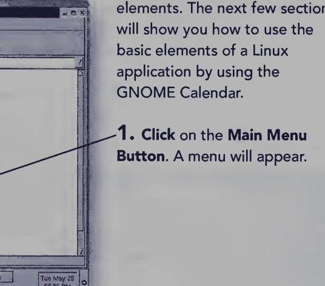

1. 点击主菜单按钮。将出现一个菜单。
2. 点击你想使用的应用程序。应用程序窗口将显示在你的屏幕上。

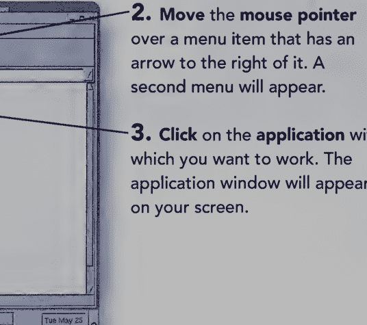

# 使用按钮、菜单和对话框

你已经成功打开了一个 Linux 应用程序，现在准备好查看它是如何运行的。程序窗口包含如菜单、命令按钮、调整大小按钮以及许多其他元素。花些时间探索不同的菜单，看看哪些可用。本节将向你展示如何使用按钮和菜单来执行命令。

1. 将鼠标指针悬停在工具栏上的按钮上。该按钮将高亮，并出现一个提示告知该按钮执行的功能。
2. 点击按钮。将执行与按钮关联的命令。该命令可能会自动执行，或者弹出一个对话框允许你对要执行的命令做出选择。

> 注意：如果你打开了对话框，请点击“关闭”按钮。对话框将关闭，并且你在对话框中做的任何选择都将被忽略。

3. 点击菜单项打开菜单。将出现一个菜单命令列表。
4. 点击一个命令。将打开一个对话框。对话框允许你执行各种功能。

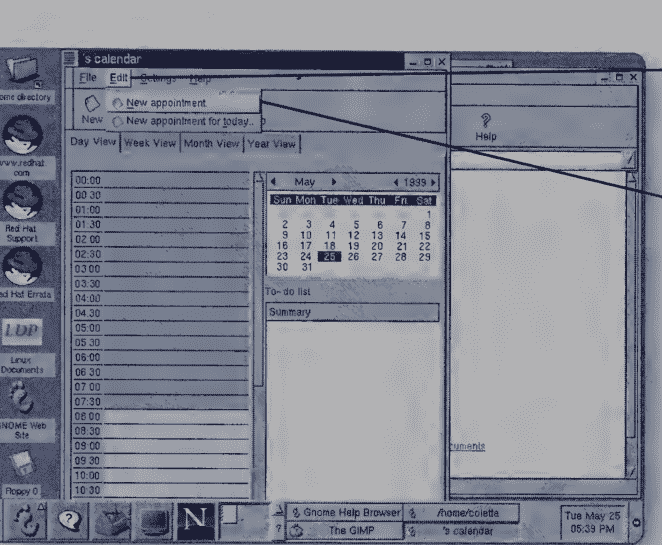

对话框包含显示次级对话框的按钮（允许你选择选项）、让你选择若干个预定义选项的列表，以及将多个对话框分组为一个的页签。

通过点击对话框内的向下箭头并点击小组件元素做出选择，可以打开小组件并从中执行任务或做出选择。你所做的选择将出现在向下箭头旁文本框中。

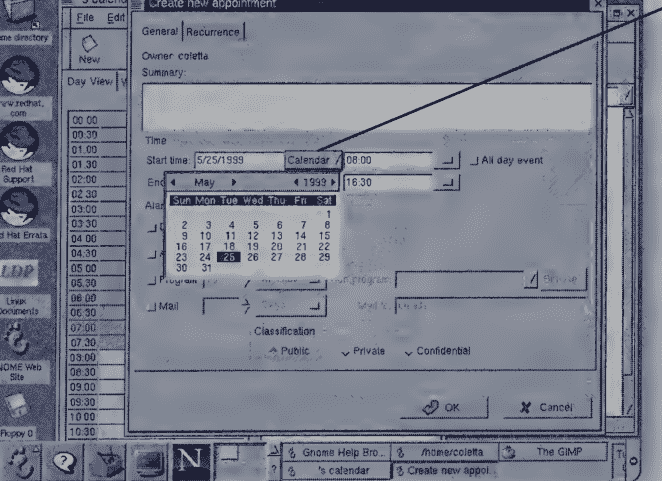

# 第一章：发现 Linux

通过点击列表按钮打开下拉列表以显示选项列表，然后点击你想要的选项。你所做的选择将出现在文本框中。

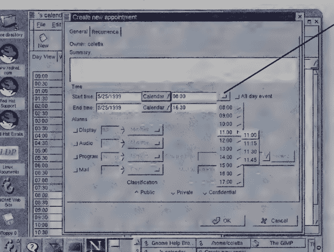

通过点击功能名称旁边的选择框开启或关闭功能。当功能开启时，选择框将变为凹陷状态。当功能关闭时，选择框为凸起状态。

通过点击向上和向下箭头来调整数字。向上箭头将增加文本框中的数字。向下箭头将减小文本框中的数字。

通过点击选项按钮选择一组选项中的一个。当选中选项时，选项按钮将变为凹陷状态。处于凸起状态的选项按钮未被选中。

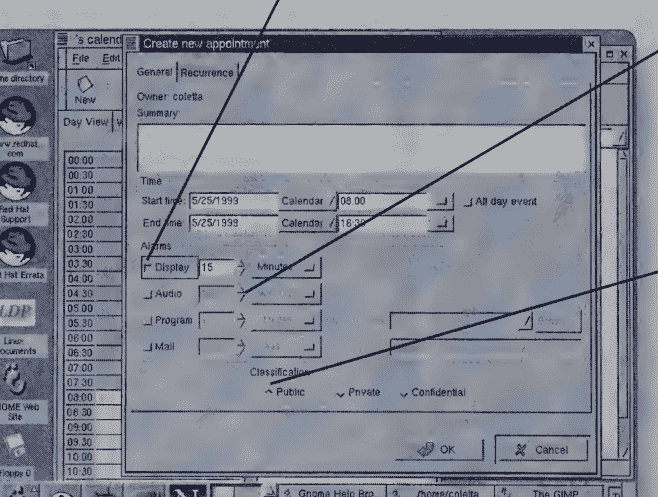

# 探索 GNOME

通过点击页签查找更多选项。

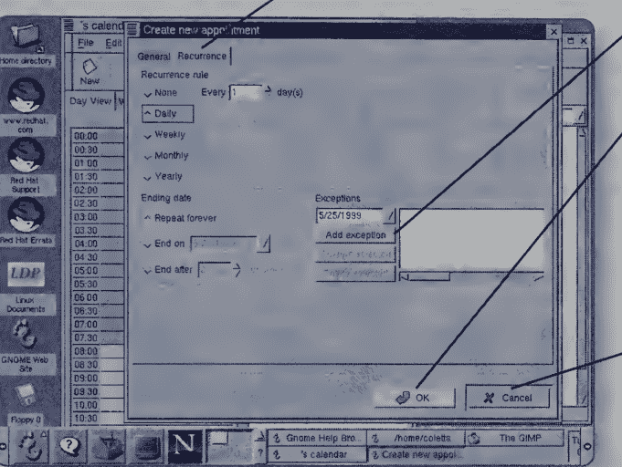

通过点击按钮访问次级对话框。

5. 点击“确定”。对话框将关闭，选项将被应用，你将返回程序窗口。

> 提示：如果你不想应用对对话框所做的任何更改，或者决定不再执行该命令，请点击“取消”。

6. 当完成对应用程序的操作时，点击程序右上角的“杀死”（Kill）按钮。应用程序将关闭，你将返回 GNOME 界面。

如果窗口拒绝关闭，右键点击“杀死”按钮。应用程序将会被转储（dump），你可以继续。你甚至可以重新打开同一个应用程序并开始工作。

# 获取帮助

读完这本书后，你将习惯使用带有 GNOME 界面的 Linux。但这仅仅是你旅程的开始。随着你深入参与这个新的 Linux 操作系统，你将发现目前所学功能的某些新用途，并发现一些你想要探索的新功能。

## 使用鼠标获取帮助

当你想要快速查找某个按钮执行的功能或如何操作窗口的快速答案时，只需将鼠标指针悬停在元素上，如果出现了工具提示，即可获得信息。

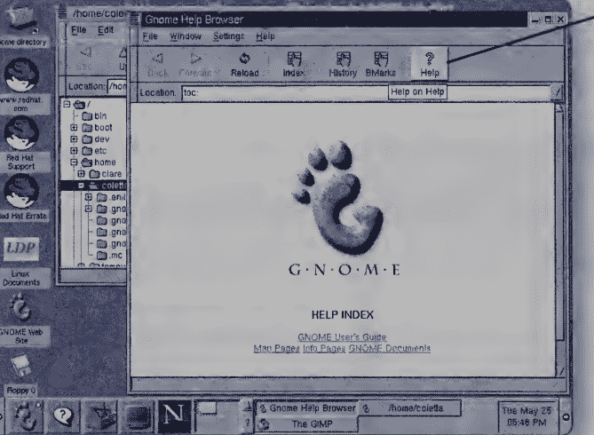

1. 将鼠标指针悬停在屏幕或窗口元素上。将出现一个工具提示，提供关于该元素功能的更多信息。

## 获取帮助

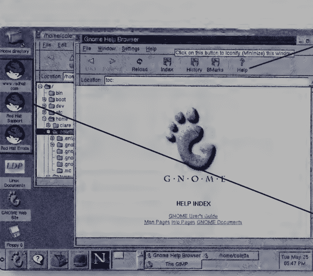

2. 将鼠标指针悬停在窗口元素上。将出现一个工具提示，提供可以应用于该窗口元素的建议功能，并提供关于执行任务的进一步说明。

> 注意：桌面左侧的图标是 Red Hat 网站的链接，你可以在那里找到额外的帮助。

GNOME 帮助浏览器是你获取所有 Linux 和 GNOME 帮助文件的一站之地。该系统不包含搜索功能。你需要阅读目录并点击你想阅读的帮助主题。本节将向你展示如何访问和使用 GNOME 用户指南。

# 浏览帮助文件

## 第一章：发现 Linux

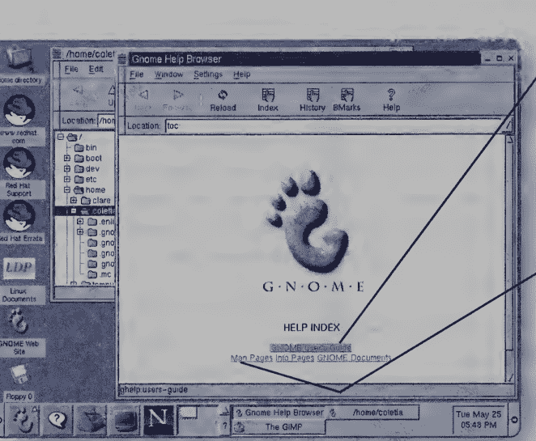

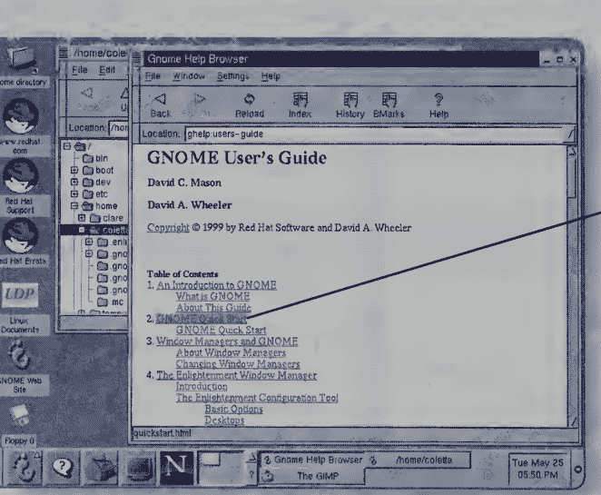

3. 阅读目录直到找到匹配的主题。
4. 点击你想阅读的帮助主题。如果你想从头到尾阅读指南，点击“简介”。该页面将出现在浏览器中。
5. 点击“上一页”按钮返回你之前查看的页面。你最后查看的页面将出现在浏览器中。
6. 点击“索引”按钮返回用户指南的主页。GNOME 用户指南的标题页将出现。

# 设置书签

1. 在浏览器窗口打开你想设置书签的页面。该页面将出现在浏览器中。
2. 点击“文件”。将出现一个菜单。
3. 点击您想要阅读的帮助主题。帮助主题将出现在浏览器窗口中。
4. 要关闭书签窗口，点击“关闭”（Kill）按钮。对话框将关闭。

## 查找以前查看过的帮助文件

1. 点击“历史”（History）按钮。将打开 GNOME 帮助历史对话框。

## 第 7 章节：GNOME 文件管理器

## 第 1 章节：探索 Linux

3. 当完成帮助列表操作后，点击“关闭”（Kill）按钮。GNOME 帮助历史对话框将关闭。

## 在应用程序中查找帮助

1. 点击“帮助”（Help）。将出现“帮助”菜单。

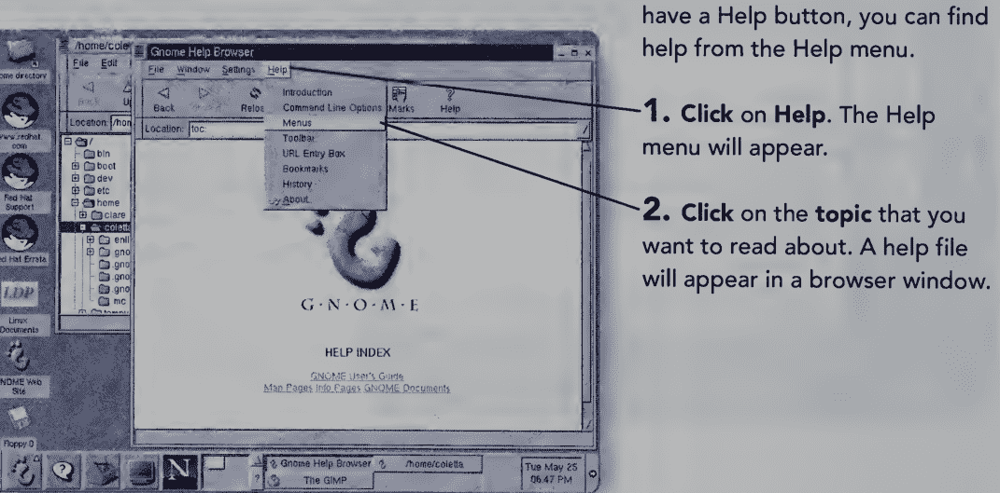

2. 阅读完帮助文件后，点击“关闭”（Kill）按钮。浏览器窗口将关闭。

当你完成 Linux 工作后，你可能想要注销用户账户，这样使用同一台电脑的人就无法访问你的用户文件和目录。你还可以确保所做的任何设置在下次登录用户账户时仍保持你离开时的状态。

1. 点击“主菜单”（Main Menu）按钮。将出现主菜单。
2. 点击“注销”（Logout）选项按钮。该选项将被选中。
3. 点击“是”（Yes）。GNOME 将关闭，你将返回 Linux 操作系统中的用户提示符。
4. 输入`logout`并按下回车键。登录屏幕将出现，下一个用户可以登录，而无法访问你的用户账户。

```text
waiting for X server to shut down

tempuser@localhost tempuser$ logout
```

# 操作程序窗口

- 打开窗口并更改它在屏幕上的打开方式
- 更改窗口大小
- 关闭窗口

## 第 2 章节：操作程序窗口

### 打开程序窗口

当你启动一个应用程序时，会 way一个窗口，其中包含应用程序以及若干控制窗口大小的元素。花些时间学习如何操作单个屏幕。这将使你操作窗口内的应用程序和数据变得更加容易。当你开始处理多个窗口时，这些技能也会有所帮助。

### 显示程序窗口

只需几次鼠标点击即可打开窗口。在本节中，你将学习通过打开 Gnumeric 电子表格来进行窗口操作。

1. 点击“主菜单”（Main Menu）按钮。将出现主菜单。
2. 将鼠标指针移动到“应用程序”（Applications）。将出现第二个菜单。
3. 点击“Gnumeric 电子表格”。Gnumeric 电子表格应用程序将打开并显示空白工作区。


### 打开程序窗口

大多数窗口共享一些共同元素，方便你移动和调整窗口大小。

- 窗口边界（Window Border）菜单包含所有控制单个窗口执行的操作的命令。
- 拖动条（Drag bar）告诉你你正在操作哪个应用程序，并提供了在屏幕上移动窗口的最简单方法。
- 窗口边界是外边缘的一圈，你可以用它来调整窗口大小。
- 最小化（Minimize）、最大化（Maximize）和关闭（Kill）按钮将把窗口变为 GNOME 页面器（Pager）上的图标、更改窗口大小并关闭窗口。

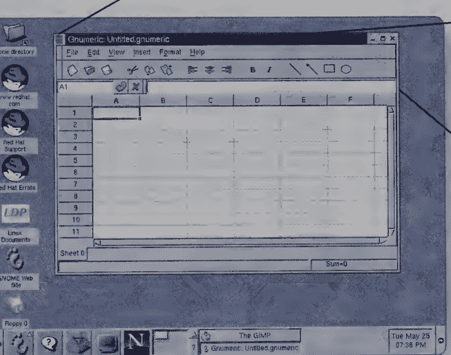

> 注意：默认情况下，当执行程序或文件时，窗口会直接在屏幕上弹出。如果你希望看到窗口在打开时逐渐变大，请尝试不同的滑动方法。如果你有一台处理器较慢的旧电脑，此功能可能会导致你的系统反应变得更慢。

1. 点击 GNOME 面板上的“GNOME 配置工具”（GNOME Configuration Tool）图标。将出现控制中心。

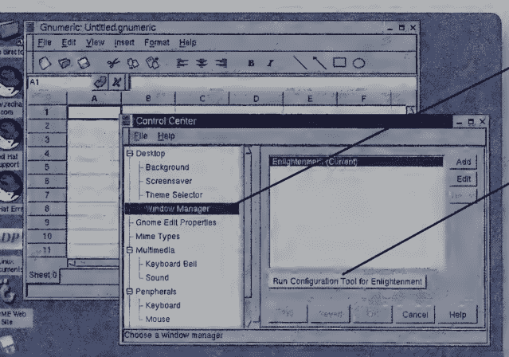

2. 点击“运行 Enlightenment 配置”（Run Configuration for Enlightenment）。将出现 Enlightenment 配置编辑器。

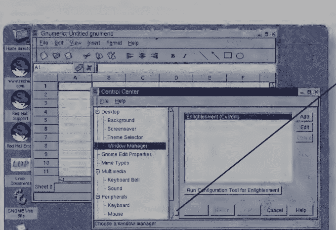

要更改控制中心两个面板的大小，点击并按住两个面板之间的调整柄，向你想要调整的方向拖动。

3. 点击“特殊特效”（Special FX）。将出现滑动方法面板。
4. 点击你希望窗口在屏幕上打开时的滑动图标。该图标将被选中。

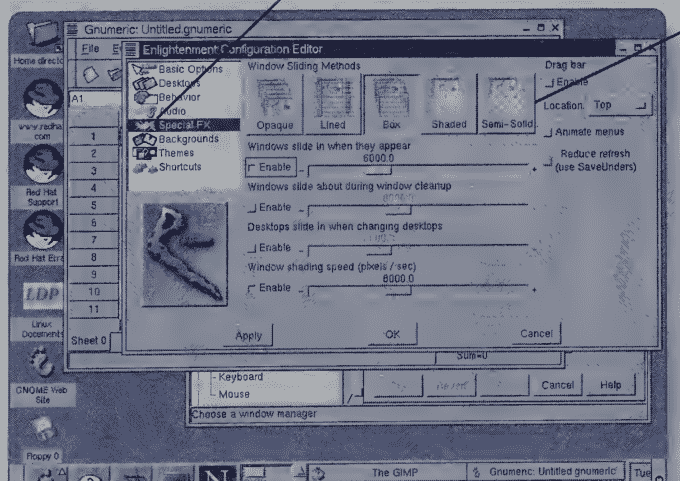

5. 点击“窗口出现时滑动”（Windows slide when they appear）复选框。
6. 点击并拖动滑动块更改窗口完全打开所需的时间。将滑动块向右移动会增加打开的时间。将滑动块向左移动会缩短时间。

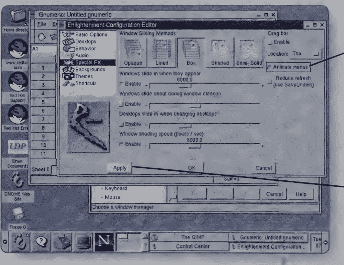

## 注意

如果你想更改菜单打开时在屏幕上的显示方式，点击“动画菜单”（Animate menus）按钮。

7. 点击“应用”（Apply）。你的更改将生效。

### 打开程序窗口

> 提示

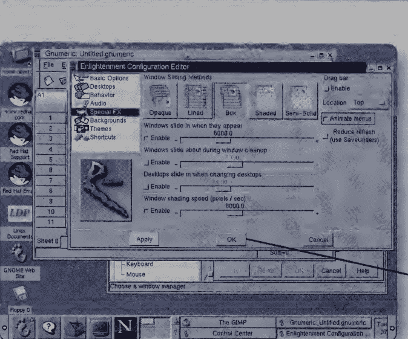

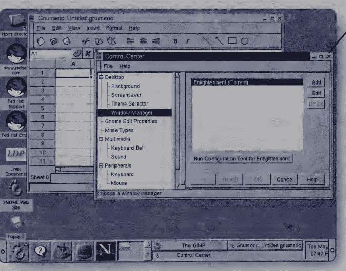

控制中心将关闭。

## 第二章：操作程序窗口

## 调整窗口大小

当一个程序窗口出现在你的屏幕上时，它的尺寸可能并不适合你进行工作。在这种情况下，你需要调整窗口的大小。你有几种选择方法。

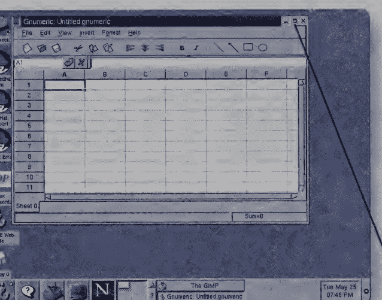

## 使用最大化按钮

更改窗口大小最简单的方法是使用最大化按钮。最大化按钮用于将窗口从较小尺寸更改为填满整个屏幕。当你再次点击最大化按钮时，窗口将恢复到原始大小。

1. 点击小于屏幕区域的窗口上的最大化按钮。窗口将充满整个屏幕。
2. 点击充满整个屏幕的窗口上的最大化按钮。窗口将恢复到较小的默认尺寸。

## 使用鼠标

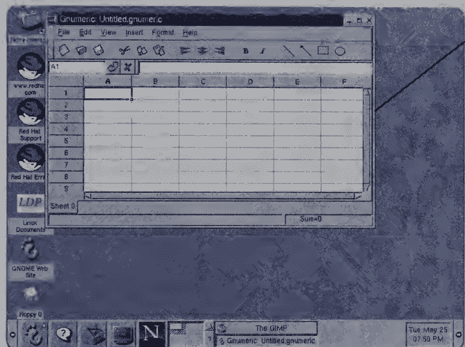

- 点击并拖动底部边界。将鼠标指针指向窗口以使窗口变短。将鼠标指针远离窗口以使窗口变长。窗口的轮廓将出现。
- 当窗口达到所需尺寸时，释放鼠标按钮。窗口将重新调整大小。
- 点击并拖动底部边界。将鼠标指针指向窗口以使窗口变短。将鼠标指针远离窗口以使窗口变长。窗口的轮廓将出现。
- 当窗口达到所需尺寸时，释放鼠标按钮。窗口将重新调整大小。
- 当窗口达到所需尺寸时，释放鼠标按钮。窗口将重新调整大小。

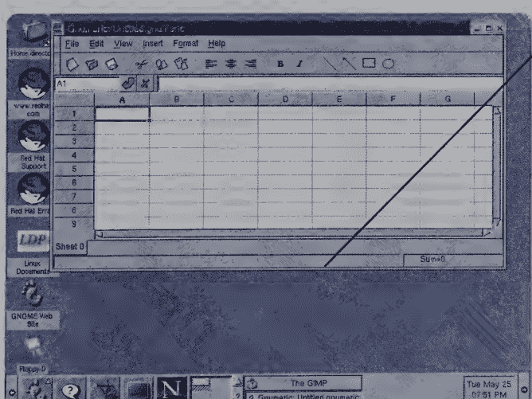

## 更改窗口调整大小的显示

当你调整窗口大时，在拖动窗口边界时你会看到窗口的轮廓。你可以从控制中心更改轮廓。

1. 点击 GNOME 面板上的 GNOME 配置工具图标。控制中心将出现。

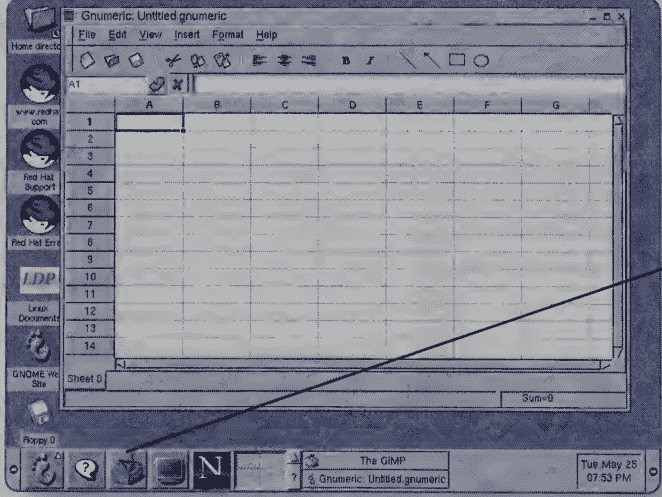

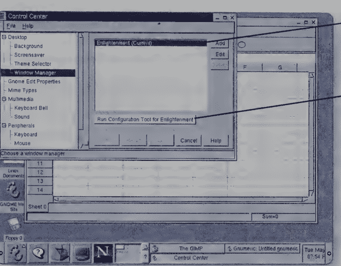

2. 点击窗口管理器。窗口管理器面板将出现。
3. 点击针对 Enlightenment 的运行配置工具。Enlightenment 配置编辑器将出现。
4. 点击基本选项。基本选项面板将出现在窗口右侧。
5. 点击与你想要调整大小的方法匹配的调整方法图标。该图标将变为凹陷。
6. 点击并拖动 Enlightenment 配置编辑器窗口的角来查看你的更改。

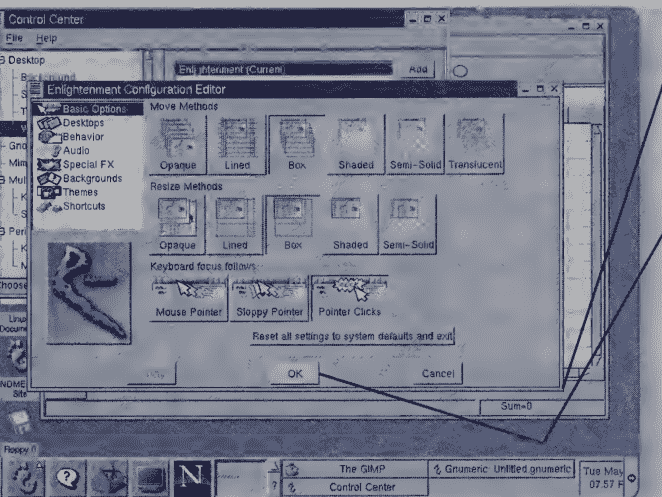

7. 对你的更改满意时，点击确定。Enlightenment 配置编辑器将关闭，控制中心将出现。

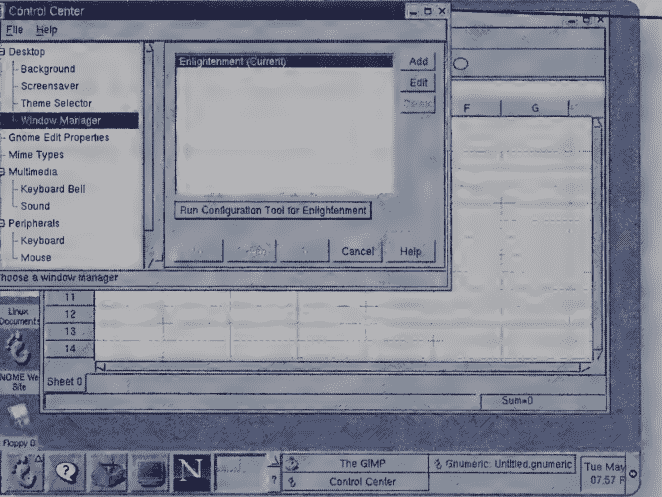

8. 点击关闭按钮。控制中心将关闭。

## 将窗口变为栏和图标

## 将窗口变为栏和图标

你可以在不关闭程序或窗口的情况下隐藏屏幕上的窗口。

1. 点击拖动栏右侧的最小化按钮。窗口将成为 GNOME 查看器上的一个图标。

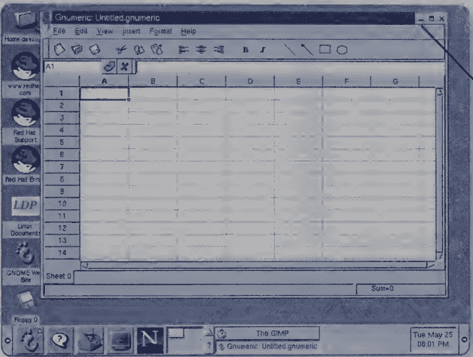

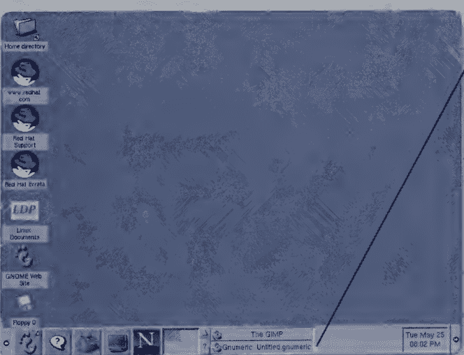

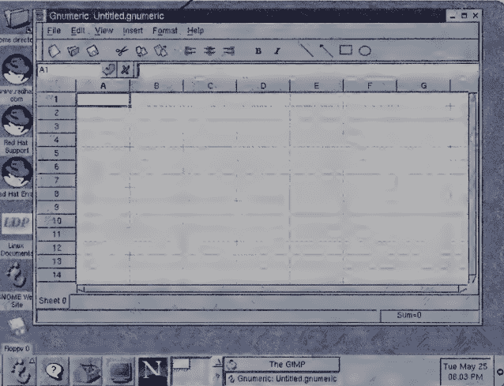

> 注意：你可以点击并拖动阴影的拖动栏到屏幕上的任何位置。


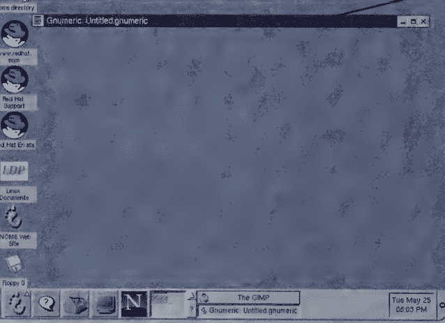

- 5. 点击位于拖动栏左侧的窗口选项菜单。将一个窗口功能菜单。

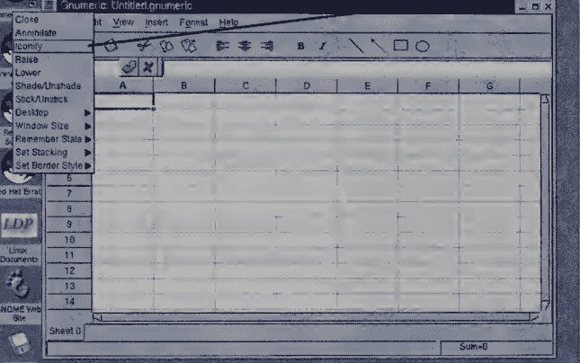

- 7. 点击图标。程序窗口将变为。

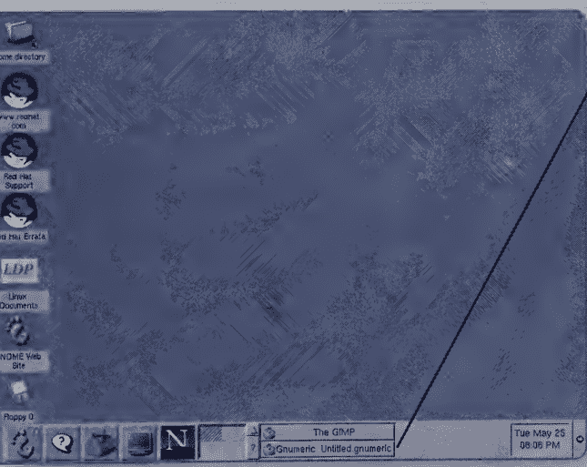

## 在屏幕上移动窗口

你可能需要在屏幕上移动窗口以为另一个窗口留出空间。Linux 的强项在于多任务处理能力。就像一个显示器。

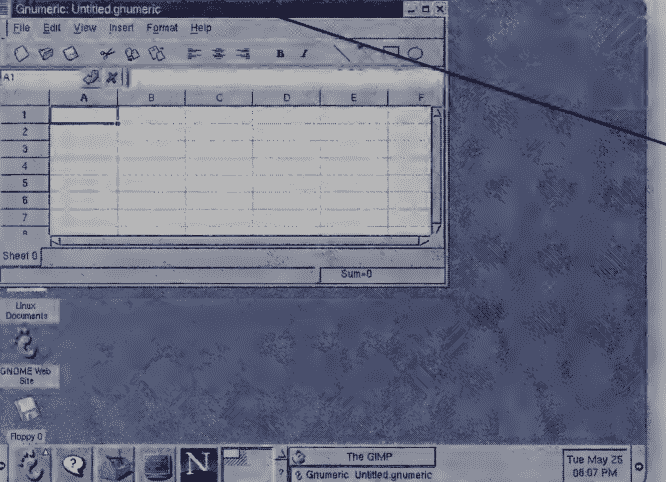

- 1. 点击并按住拖动栏。窗口将。

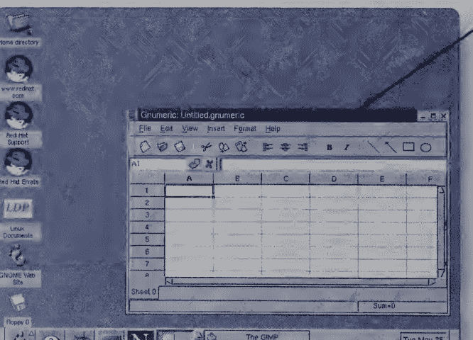

- 3. 当窗口处于所需位置时，释放鼠标按钮。

## 关闭窗口

> **提示**
>
> 你可以更改拖动窗口边界时出现的轮廓。

当你完成对窗口的操作时，可以关闭它。如果你一直在程序中工作（你将在第十章“文件”中学习），你需要先保存你的工作。

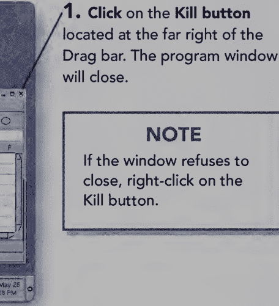

> 如果窗口拒绝关闭，右键点击关闭按钮。

## 浏览桌面

在上一节中，你学习了如何在桌面上打开并移动窗口，并尝试了更改窗口的外观和行为。Linux 的强项在于多任务处理能力。你可以处理多个应用程序、多个窗口，甚至是多个屏幕。这就像你的桌上有多个显示器。在本章中，你将学习如何：

- 在桌面上安排多个屏幕
- 更改桌面上可用的桌面区域数量

## 处理多个窗口

打开许多应用程序是一项简单任务，但请注意你计算机的能力。它可能不像你的 Linux 那样强大。多个窗口会堆叠在一起，直到难以找到特定的应用程序窗口。

## 找到一些要打开的应用程序

你的 Linux 系统令人兴奋的功能之一是多任务处理。你不仅可以同时处理多个应用程序，还可以将它们分在不同的桌面区域。在你的桌面上打开几个窗口并尝试本章中的示例。

- 1. 点击主菜单按钮。主菜单将出现。
- 3. 点击一个应用程序。应用程序的默认程序窗口将在你的桌面区域打开。

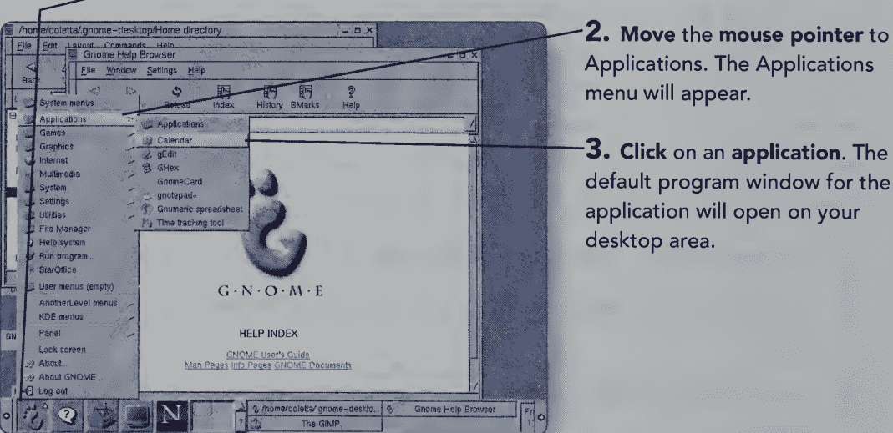

# 使用多窗口操作

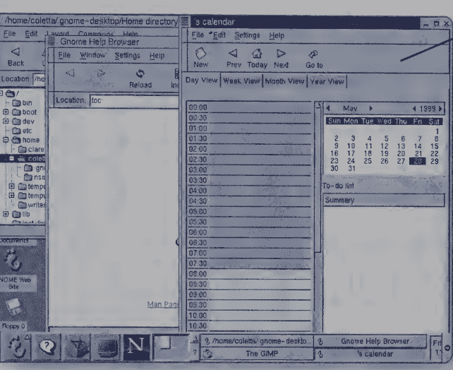

4. 重复步骤 1 到 3，直到你的桌面区域上有六个打开的窗口。桌面看起来可能很杂乱且无序。

在例示例中，可能很难看清，但实际上有七个打开的窗口。

- 默认情况下，当你启动 GNOME 时，文件管理器和 GNOME 帮助浏览器窗口将会打开。
- 在应用程序菜单中可以找到日历和跟踪工具。这些都是你可能会觉得非常有用的生产力工具。

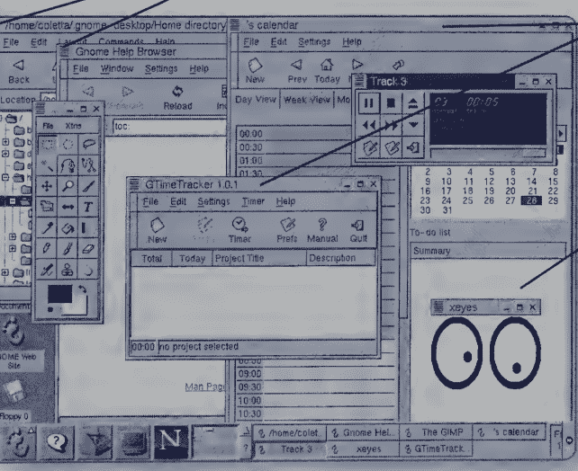

- 在游戏菜单中有很多有趣的游戏，可以帮助你消磨一点时间（当然，也可以练习你的鼠标技巧）。

# 46 页 第 3 章：在桌面上移动

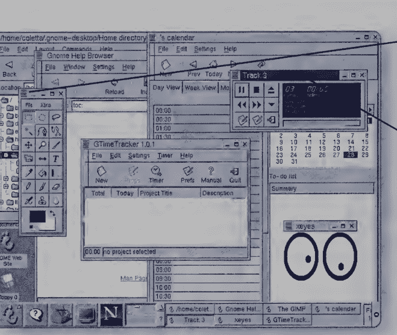

- 如果你很有艺术细胞或想要增强图像，请在图形菜单中查找 GIMP。
- 当只有音乐能陪你度过艰难的工作时光时，插上 CD 播放器听音乐。你可以在多媒体菜单中找到 CD 播放器。

## 清理桌面

GNOME 可以整理打开的窗口。它会尝试放置打开的窗口，使得每个窗口的部分在你的屏幕上可见。

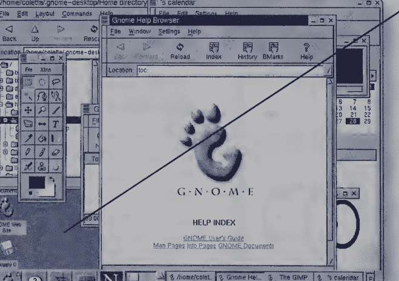

1. 找到桌面上的空白区域并同时点击鼠标左键和右键。将会出现菜单。

> **注意**

# 使用多窗口操作

3. 点击“清理桌面”（Cleanup Desktop）。你杂乱的桌面将得到整理。

你将看到大多数打开的窗口上有拖动条。

# 48 页 第 3 章：在桌面上移动

自动窗口排列可能没有你希望的那么友好。你仍然有太多的应用程序窗口，无法高效管理或快速找到你想要的那个。

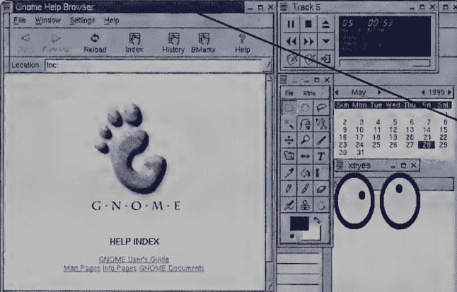

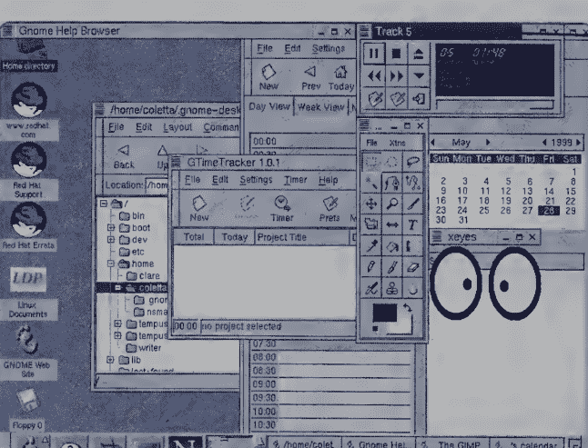

# 使用多窗口操作

3. 在桌面的空白区域同时点击鼠标左键和右键。将会出现菜单。

5. 点击“清理桌面”（Cleanup desktop）。阴影应用程序窗口将被整理成一个列表。

6. 双击你想操作的应用程序的拖动条。该应用程序窗口将打开。

> 当你需要桌面空间工作时，这是一个临时存储窗口的有用方法，但真正的解决方案是获取更多的桌面区域。

# 使用多个桌面区域

Linux 能够充分利用你的视频硬件性能，因为它支持远大于你实际显示器尺寸的虚拟屏幕大小。这个巨大的虚拟屏幕可以分成不同的桌面区域。GNOME 面板上的 GNOME 页器（Pager）可以在桌面区域之间切换并跟踪你的应用程序。

## 理解 GNOME 页器

GNOME 页器是一个运行在 GNOME 面板内部的小程序。GNOME 页器显示所有的桌面区域以及它们上的应用程序。

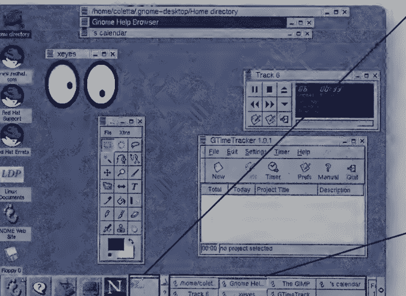

- 桌面视图。此视图显示桌面上可用的桌面区域数量（就像有独立的显示器屏幕）。桌面视图中的每个框都是一个桌面区域。桌面视图还显示桌面区域内窗口的排列情况。
- 应用程序视图。应用程序视图显示所有代表文件和应用程序的图标。如果你找不到应用程序窗口，查看图标并点击你需要的那个。相关的窗口将带到屏幕前景。

# 使用多个桌面区域

- 任务列表。任务列表显示所有打开的应用程序。当在多个桌面区域上处理多个应用程序时，这个列表会非常有用。
- GNOME 页器设置。通过这些设置，你可以更改在桌面上显示的页器数量以及任务列表的设置。

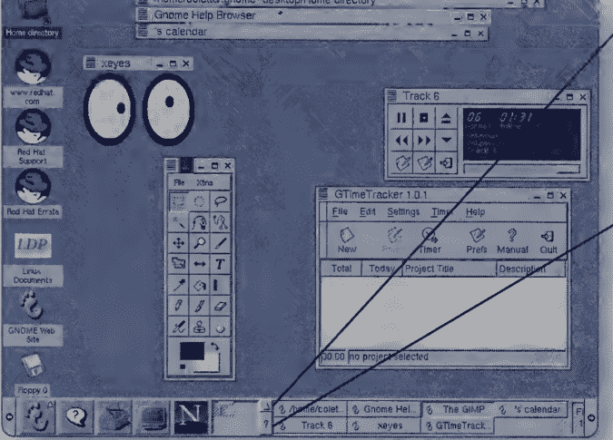

## 将窗口推出桌面

有些人通过将杂乱桌面的东西推到其他桌面区域来处理问题，尝试将一个窗口推出桌面。

- 点击并按住桌面某个打开窗口的拖动条。该窗口会被选中。
- 拖动窗口到屏幕边缘，它会进入另一个桌面区域。该窗口将出现在另一个桌面区域，而不是它在原始桌面，但你将其移出视线。

# 52 页 第 3 章：在桌面上移动

> **注意**
>
> 如果你查看桌面区域的 GNOME 页器，你会看到其中一个矩形被高亮显示。

3. 点击 GNOME 页器中的左上桌面区域以返回原始桌面。你拖入右上桌面区域的窗口将留在那里。

# 使用多个桌面区域

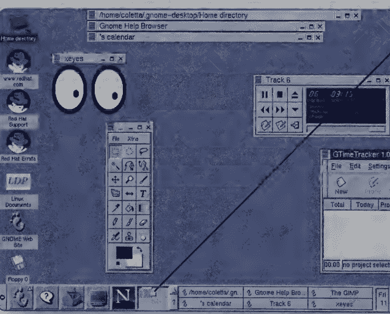

4. 点击并拖动应用程序窗口，使其完全显示在第二个桌面区域。该窗口将出现在第二个桌面区域。

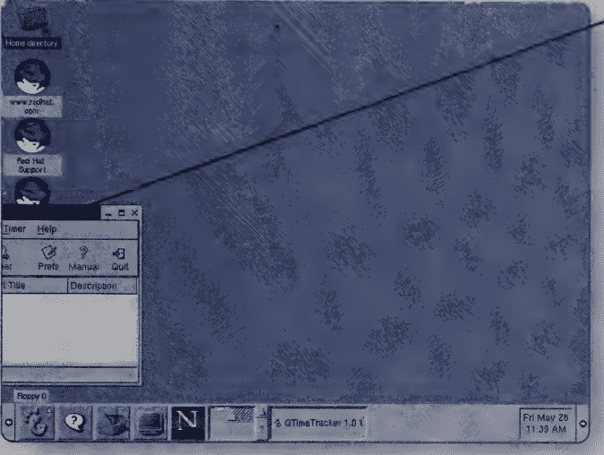

## 在桌面区域之间移动

如果你查看面板上的 GNOME 页器，你会发现桌面视图中的一个矩形被高亮显示，表示活动桌面区域。高亮矩形内部的小框代表你拖动的窗口。

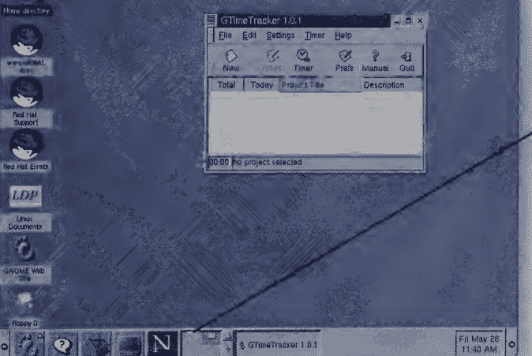

# 54 页 第 3 章：在桌面上移动

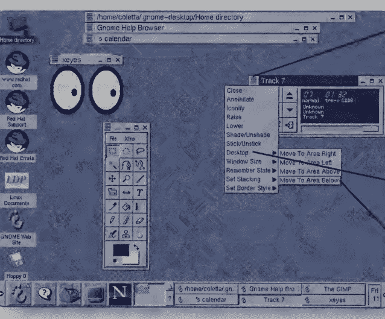

1. 点击你想移动到不同桌面区域的窗口拖动条左侧的“窗口选项”按钮。窗口选项菜单将会出现。
2. 将鼠标指针移动到“桌面”。第二个菜单将会出现。
3. 点击移动选项之一。窗口将被移动到所选的桌面区域。

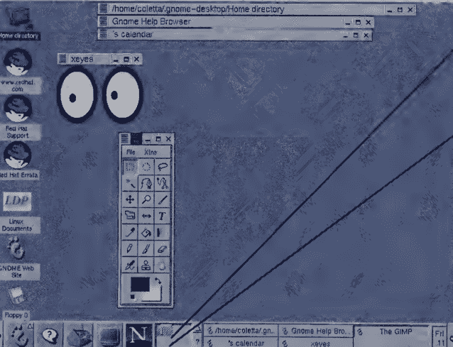

你会注意到窗口将出现在所选桌面区域的视图中。

5. 点击你刚刚移动应用程序窗口的桌面区域。你将操作显示的应用程序窗口。

## 寻找丢失的应用程序

你可能只是随意地将杂乱桌面的东西推到其他桌面区域，直到找到它们，GNOME 页器可以轻松地帮你整理这些。

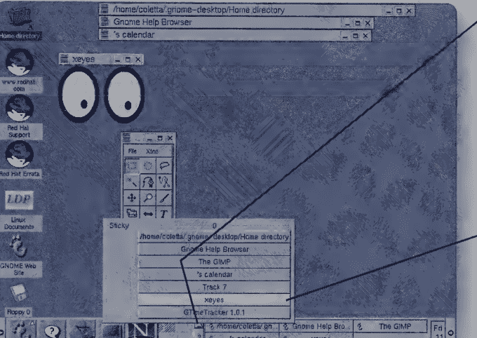

- 点击位于 GNOME 页器两个面板中间的“任务列表”按钮。将会出现一个菜单，显示所有桌面区域上所有打开应用程序的标题。


> **注意**
>
> 如果丢失的应用程序窗口位于另一个桌面区域，你将切换到该桌面区域。

## 创建多个桌面区域

现在你已经熟悉了在 GNOME 默认提供的四个桌面区域中穿梭的感觉。你还花了一些时间在桌面区域之间移动应用程序窗口，所以现在是时候学习如何创建更多的桌面区域了，或者也许你想要一个更简单的桌面。


- 1. 点击面板上的 GNOME 配置工具图标。GNOME 控制中心将打开。


- 2. 点击控制中心左侧的“窗口管理器”选项。右侧面板将显示可用的窗口管理器。
- 3. 点击“运行 Enlightenment 配置工具”按钮。Enlightenment 配置编辑器将打开。
- 4. 点击配置编辑器窗口左上角的“桌面”选项。将出现桌面窗格。


- 5. 点击并按住虚拟屏幕左侧的垂直滑块并向下拖动。图形会随着滑块的移动而变化；随着滑块向上移动，显示的行数会越少。


> **提示**
>
> 你还可以创建额外的桌面。这是为了更高级的用户和网络管理员配置多个离散的桌面。

- 6. 点击并按住水平滑块并向右拖动。图形中桌面区域的列数会增加。移动滑块会减少列数。
- 7. 点击“应用”按钮。GNOME 翻页器将记录你的桌面区域设置。
- 8. 当你对更改满意时，点击“确定”。你将返回控制中心。

翻转阻力滑块控制在使用鼠标将窗口从一个桌面区域移动到另一个时，切换到新桌面区域的延迟时间。


> 任务桌面区域的一种方法是将每个任务分配到它选择的桌面区域，并只需点击你所在的空白桌面区域即可。如果你忘记了把东西放在哪里了，只需查看翻页器上的应用程序列表即可。


如果你想让你的桌面更有吸引力，可以进行一些外观上的更改。为了增加变化，可以更改用于桌面背景的图片或图案。为了防止在你不工作时屏幕长时间停留在一个地方，可以使用屏幕保护程序。有很多屏幕保护程序可以选择，如果你需要减慢动作，还可以更改设置。你还可以更改窗口边框、鼠标指针和对话框的外。在本章，你将学习：

- 寻找一些有趣的屏幕保护程序
- 使用主题更改窗口边框、鼠标指针和对话框的外观。

## 更改桌面背景


纯色是最容易创建且对眼睛最友好的背景。

- 2. 点击“背景”选项。背景窗格将出现在控制中心的右侧。
- 3. 点击“纯色”选项按钮。该选项将被选中。
- 4. 点击“颜色 1”按钮。调色对话框将打开。


- 5. 在色轮上点击匹配你想要作为背景的颜色。该颜色将出现在色轮右侧的条中。
- 6. 点击并拖动红色滑块线。向上拖动滑块会让颜色变亮。向下拖动滑块会让颜色变深。颜色平衡将改变。
- 7. 点击“确定”。你将返回控制中心，你选择的颜色将出现在背景窗格顶部的屏幕预览中。


- 8. 点击“尝试”。你将返回控制中心，你选择的颜色将出现在桌面预览中。
- 9. 如果你不喜欢这种颜色，点击“还原”。桌面背景将恢复原来的颜色。


- 10. 当你对颜色满意时，点击“杀死”。背景将应用。

### 创建渐变背景

渐变是两种颜色的组合，一种颜色由深变亮，并与另一种颜色混合。如果你正在寻找一种对眼睛更好的效果。


- 1. 点击 GNOME 配置工具图标。控制中心将出现。
- 1. 控制将出现。
- 3. 点击“渐变”选项按钮。该选项将被选中。
- 4. 点击“颜色 1”按钮。调色对话框将打开。
- 6. 点击并拖动红色滑块线。向上拖动滑块会让颜色变亮。向下拖动滑块会让颜色变深。颜色平衡将改变。
- 7. 点击“确定”。你将返回控制中心，你选择的颜色将出现在背景窗格顶部的屏幕预览中。
- 8. 点击“颜色 2”按钮。调色对话框将打开。
- 9. 在色轮上点击匹配你想要作为背景的第二种颜色。该颜色将出现在色轮右侧的条中。
- 10. 点击“确定”。返回控制中心。
- 11a. 如果你想从左到右渐变，点击“垂直”选项。
- 11b. 如果你想从上到下渐变，点击“水平”选项。
- 13. 如果你不喜欢这种颜色，点击“还原”。桌面背景将恢复原来的颜色。
- 14. 当你对颜色满意时，点击“杀死”。背景将应用。
- 15. 点击“杀死”。控制中心将关闭。


Linux 预装了许多图像，你可以通过各种方式排列它们创建桌面壁纸。


- 3. 点击一个“壁纸”选项按钮。该选项将被选中。
- 平铺：此选项在屏幕上以行和列的形式铺若干图像副本。
- 居中：此选项将一个图像放置在桌面中心。未使用的区域将显示所使用的背景颜色。


## 更改桌面背景 67


- 缩放（保持比例）。此选项会拉伸图像，使其占据桌面大部分区域，但保持其原始的高宽比例。
- 缩放。缩放将图像填满整个桌面。图像可能会出现失真。
- 4. 点击“浏览”（Browse）按钮。将打开“壁纸选择”（Wallpaper Selection）对话框。


该目录下的文件列表将出现在“文件”列表框中。


6. 点击一个文件。背景的预览将出现在“预览”窗格中，文件名将出现在“选择”（Selection:）文本框中。

7. 如果你不喜欢第一个选择，请点击另一个文件。

8. 双击 .. 返回上一个目录。

将出现壁纸目录的主列表。

## 更改桌面背景

9. 如果你想尝试另一组壁纸，请双击目录。


10. 当你选好喜欢的壁纸后，点击“确定”（OK）。你将返回控制中心（Control Center）。


## 第 4 章：自定义屏幕显示

11. 点击“尝试”（Try）按钮。你将在控制中心顶部的预览屏幕上看到壁纸的预览。
12. 如果你不满意，请点击“浏览”按钮来尝试其他壁纸。
13. 点击“确定”（OK）。你的更改将被应用，“背景”面板将消失。


14. 点击“退出”（Kill）按钮。控制中心将关闭。

> **提示**


使用屏幕保护程序始终是一个好主意。你不希望单张静态图像在屏幕上显示长时间。一段时间后，图像将会“烧”在显示器上。无论你在看什么，这个烧毁的图像都会在那里。屏幕保护程序以固定的速度更改显示器上的图像。屏幕保护程序还允许对桌面进行密码保护，这样当你离开时，别人无法使用电脑。

- 1. 点击 GNOME 配置工具图标。控制中心将出现。
- 2. 点击“屏幕保护程序”（Screensaver）。屏幕保护程序面板将出现在控制中心的右侧。

## 72 第 4 章：自定义屏幕显示


6. 点击“确定”（OK）。屏幕保护程序设置将被应用，你将返回控制中心。

> **提示**
>
> 你可以通过点击“预览”（Preview）按钮查看屏幕保护程序的运行效果。要离开屏幕保护程序返回控制中心，请按键盘上的 Esc（Escape）键。

## 设置屏幕保护程序 73

7. 在“屏幕保护程序设置”文本框中双击。将选择默认时间设置。


8. 输入在电脑空闲多少分钟后启动屏幕保护程序。

9. 如果你希望屏幕保护程序受保护，点击“需要密码”（Require Password）复选框。该选项将被选中。


## 注意

你的屏幕保护程序使用你的用户账户密码。

10. 点击“确定”（OK）。现在将使用新的屏幕保护程序。


## 第 4 章：自定义屏幕显示

11. 点击“退出”（Kill）按钮。

控制中心将关闭。

## 使用主题

### 选择窗口主题

你可以使用 Enlightenment 配置工具中的许多已安装主题更改更改边框和装饰的外观。这些主题不会更改边框内的任何内容。


4. 点击“主题”（Themes）选项。主题选择面板将出现。

5. 点击一个主题。该主题将被选中。

6. 点击“应用”（Apply）。主题将应用于所有窗口。

## 第 4 章：自定义屏幕显示

7. 当你选好喜欢的主题后，点击“确定”（OK）。你将返回控制中心。


8. 点击“退出”（Kill）按钮。


### 选择界面

如果你觉得对话框难以操作，请使用界面主题。界面主题会更改滚动条和按钮的外观。


1. 点击 GNOME 配置工具图标。控制中心将出现。

3. 点击一个主题。该主题将被选中，你将在“主题演示”部分看到预览。


> **提示**
>
> 如果你没看到预览部分，请点击“自动”（Auto）按钮。

4. 点击一个元素测试不同元素的功能。

5. 当你找到喜欢的主题时，点击“确定”（OK）。你的更改将被应用。

# 第 5 章：管理你的桌面

Enlightenment 窗口管理器控制窗口的外观、行为、背景和用户交互。正如你之前学的，管理虚拟屏幕、配置多个桌面以及选择主题和背景非常复杂。GNOME 界面提供了更多的控制和实用程序。GNOME 允许你创建方便的快捷方式来启动应用程序。GNOME 还帮助你管理任务和工具。在本章中，你将学习如何：

- 在 GNOME 面板上放置小程序
- 使用启动器打开应用程序和文件
- 创建抽屉存储频繁访问的程序

## 在 GNOME 面板使用小程序

GNOME 面板上已经有很多小程序。GNOME 分页器是一个小程序，时钟也是。这些小程序是用于协助执行各种任务或显示重要信息的小型应用程序。有很多小程序供你选择。你会发现从提供视觉娱乐的娱乐到处理外设的工具应有尽。

### GNOME 面板娱乐

有两个可以一直保持在 GNOME 面板上的有趣游戏。它们很小且不显眼，也许你不会觉得它们分心。

1. 在 GNOME 面板上的空白区域点击右键。面板菜单将出现。
2. 将鼠标指针移动到“添加小程序”（Add applet）。小程序菜单将出现。
3. 将鼠标指针移动到“娱乐”（Amusements）。娱乐菜单将出现。


## 在 GNOME 面板上使用 Applet

6. 点击“打乱碎片”（Scramble pieces）。数字拼图碎片将被打乱，你可以尝试重新排列各个方格，使其恢复顺序。

### 播放你的 CD

1. 右键点击 GNOME 面板上的空白区域。面板菜单将出现。
2. 将鼠标指针移动到“添加 applet”（Add applet）。Applet 菜单将出现。
3. 点击“CD 播放器”（CD Player）。CD 播放器的图标将出现在 GNOME 面板上。


5. 将音乐 CD 放入电脑的 CD-ROM 驱动器中。
6. 点击 CD 播放器上的播放按钮。你应该开始听到音乐。


> **提示**
>
> 如果你没有从声器中听到声音，Linux 可能需要对你的声卡进行配置。如需帮助，请将浏览器指向 Red Hat 网站。你可能也想查看`www.opensound.com`。

8. 点击“运行 `gtcdcd`”。一个更复杂的 CD 播放器将出现在你的屏幕上。

## 在 GNOME 面板上使用 Applet

> **提示**
>
> 你可以打开和关闭此 CD 播放器，而不影响从电脑扬声器听到的声音。

### 在 GNOME 面板上移动 Applet

你可能不喜欢 applet 在 GNOME 面板上的默认位置。你可以将任何 applet 移动到 GNOME 面板上的任何地方。


1. 右键点击你想移动的 applet。将出现菜单。
2. 当 applet 在你想要的位置时，点击鼠标按钮。applet 将定位在新的位置。

## 从 GNOME 面板上移除 Applet

1. 右键点击你想从 GNOME 面板移除的 applet。将出现菜单。
2. 点击“从面板移除”（Remove from panel）。applet 将不再出现在 GNOME 面板上。


## 使用应用程序启动器


> **注意**

## 使用应用程序启动器


如果你想从 GNOME 面板启动的应用程序或实用程序列在 GNOME 菜单中，请使用此快速方法在 GNOME 面板上放置启动器。

2. 显示包含你想放置在 GNOME 面板上的应用程序的菜单。菜单将出现。
3. 右键点击你想从 GNOME 面板启动的应用程序或实用程序。将出现菜单。


> **注意**
>
> 如果你不喜欢启动器所在，可以将其移动到 GNOME 面板上的不同位置。

## 使用应用程序启动器

### 更改启动器图标

每个应用程序都有默认的启动器图标。如果你想要不同的，有许多不同的图标可供选择。


1. 右键点击你想更改的启动器图标。将出现菜单。
2. 点击“属性”（Properties）。启动器属性对话框将出现。

> **提示**
>
> 要更改鼠标悬停在启动器上时显示的工具提示，请编辑注释（comment）。

> **提示**
>
> 如果你的电脑上存有一张想要使用的图片，点击浏览按钮。


### 删除启动器

只需几次点击即可删除启动器。

1. 右键点击你想删除的启动器。将出现菜单。


## 向 GNOME 面板添加抽屉

抽屉（Drawers）是位于面板的小弹出菜单。你可以使用它们将特定任务整合在一起，甚至放置整个菜单。

1. 右键点击 GNOME 面板上的空白区域。面板菜单将出现。
2. 点击“添加抽屉”（Add drawer）。抽屉图标出现在 GNOME 面板上。


> **注意**

3. 右键点击图标。将出现菜单。
4. 点击“属性”（Properties）。面板属性对话框将打开，抽屉标签位于顶部。


5. 点击“工具提示/名称”（Tooltip/Name）文本框。
7. 点击“确定”（OK）。对话框将关闭。当你将光标悬停在新抽屉上时，会显示工具提示。

> **注意**


### 填充抽屉

1. 点击“主菜单按钮”（Main Menu Button）。主菜单将出现。
2. 显示包含你想添加到抽屉的应用程序的菜单。菜单将出现。


4. 移动鼠标指针，使其悬停在已打开的抽屉上。抽屉将高亮显示。

> **注意**
>
> 如果主菜单或其任何子菜单覆盖了抽屉标签，你必须先移动抽屉，才能将应用程序放入抽屉中。

6. 从菜单中拖动更多应用程序到抽屉中，观察图标如何对齐。

你可以将 GNOME 菜单中的整个子菜单转换为一个抽屉。


3. 右键点击菜单标题栏。将出现一个菜单。


菜单内容将成为抽屉标签上的图标。

> 要从抽屉中删除项目，请右键点击你想要删除的图标，并在出现的菜单中选择“从面板中移除”。


## 更改启动器和抽屉图标背景

你会注意到 GNOME 面板上的每个图标顶部都有一张带有灰色纹理背景的图片。你可以更改此背景。

1. 右键点击 GNOME 面板上的空白区域。将出现一个菜单。
2. 点击“全局属性”。全局面板配置对话框将打开。


3. 点击“启动器图标”或“抽屉图标”标签。该标签将置于堆栈顶端。
4. 点击“文件名（向上）”按钮。浏览对话框将打开。


5. 点击列表中的瓷砖图标。该瓷砖将被选中。
6. 点击“确定”。你将返回全局面板配置对话框，并在“文件名（向上）”按钮中看到你刚刚选择的瓷砖。


## 更改启动器和抽屉图标背景


7. “文件名（图标）”按钮的瓷砖。瓷砖颜色将发生改变。
8. 点击“确定”。图标背景将发生改变。


注意不同的背景。为不同的图标尝试背景，直到你想出一个你喜欢的方案。


> **提示**
>
> 如果你发现 GNOME 面板空间快用完了，可以随时添加另一个面板。右键点击 GNOME 面板上的空白区域，并在出现的菜单中选择“添加新面板”。

- 1. 为什么创建用户账户而不是在`root`账户中工作如此重要？参阅第 1 章的“初次启动 Linux”。
- 3. 如何在 GNOME 中打开应用程序？参阅第 2 章的“打开程序窗口”。
- 5. GNOME 能自动为你安排桌面上的多个打开的窗口吗？参阅第 3 章的“处理多个窗口”。
- 7. 你可以在桌面上放置什么种类型的背景？参阅第 4 章的“更改桌面背景”。
- 9. 如何将小组件添加到 GNOME 面板？参阅第 5 章的“在 GNOME 面板上使用小组件”。

## 第二部分

| 章节 | 标题 |
| :--- | :--- |
| 第7 章组织文件系统 | 121 |
| 第8 章 在多用户环境中管理 | 139 |
| 第9 章 维护你的 Linux | 159 |

# 探索文件系统

你需要花时间查看一下你安装 Linux 时设置的目录。如果你从未用过 Linux，这个地方与其他操作系统不同。在本章中，你将学习：

- 导航文件系统
- 排序文件

在开始处理文件之前，花点时间熟悉该目录。GNOME 界面为你访问其中的许多程序。


## 查看文件系统

> **提示**
>
> 要从抽屉中删除项目，请右键点击你想要删除的图标，并在出现的菜单中选择“从面板中移除”。


## 第 6 章：探索文件系统

超级用户或`root`账户的主目录是`/root`。

`/bin`目录包含许多用于系统管理的任务工具。

`/tmp`目录是所有用户可以临时存储文件的地方。如果系统重启，`tmp`目录中的所有文件都将丢失。

`/usr`目录包含许多并非 Linux 操作系统部分的命令和实用程序、文档文件、一些实用程序以及 Linux 游戏集合。

## 浏览文件系统

文件管理器使用的图形界面可以让你轻松地在各个目录之间移动并查看其内容。由于你的用户账户中没有创建任何目录，因此在文件系统中操作最安全的地方是`/usr`目录。

1. 点击树状视图中的`/usr`目录。目录视图将显示`/usr`目录包含的子目录和文件列表。
2. 点击`/usr`目录旁边的加号。树状视图中的`/usr`目录下将显示子目录列表。
3. 点击`/usr/man`旁边的加号。树状视图将展开，目录视图将显示`/usr/man`包含的目录和文件。

> **注意**
>
> 要移动到所选目录的上一级目录，请点击工具栏上的“向上”按钮。

> **注意**
>
> 要返回之前查看过的目录，请点击工具栏上的“后退”按钮。

5. 点击每个视图切换按钮。你将可以通过三种方式查看目录内容。

图标视图（Icons view）显示代表文件类型的图片，下方是文件名。这对于想要快速确定文件类型的人非常有用。

简要视图（Brief view）提供了目录中存储的文件简单列表。

> **提示**
>
> 详细视图（Detailed view）提供了有关文件大小和使用时间的信息。此视图允许你以多种方式对列表进行排序。

在对文件执行操作（如复制或重命名）之前，你需要在文件管理器中选择该文件。你可以通过鼠标点击文件来手动选择，也可以告诉文件管理器你想选择的文件类型，它将搜索目录并为你选择这些。

- 要选择单个文件，请点击该文件。
- 要选择不相邻的文件，在按住 Ctrl 键的同时点击你想选择的每个文件。

### 使用选择标准

1. 点击“编辑”（Edit）。将出现编辑菜单。
2. 点击“选择文件”（Select Files）。将打开选择对话框。
4. 点击“确定”（OK）。过滤器将搜索符合你输入的标准的文件。

所有匹配的文件将在文件管理器窗口中被选中。你可能需要向下滚动目录视图以查看显示的文件。

> **提示**
>
> 当你查看完`/usr`目录并想返回你的用户账户时，点击“主页”（Home）按钮。

### 重新排序文件列表

2. 点击“大小”（Size）列标题。文件列表将按从到到大的顺序排序。

> **注意**
>
> 你也可以通过点击 Mtime（修改时间）列标题按最后使用日期对文件进行排序。

### 过滤文件列表

你可能决定只想在目录视图中查看某些文件。以下是隐藏不需要查看的文件的方法。

1. 点击“布局”（Layout）。将出现布局菜单。
2. 点击“过滤视图”（Filter View）。将打开过滤对话框。
3. 点击文本框并输入你想在文件列表中显示的文件标准。

如果你过滤了文件列表并想查看全部内容，将需要移除过滤器。

6. 点击“过滤视图”（Filter View）。过滤对话框将打开。
7. 点击文本右侧的向下箭头。将出现下拉列表。
8. 点击“显示所有文件”（Show all files）。该选项将被选中。
9. 点击“确定”（OK）。目录中包含的整个列表将出现在目录视图中。

# 7 组织文件系统

在 Linux 安装过程中，你在 Linux 系统内部设置了一个超级用户（或`root`）账户，并在此过程中创建了一个或多个用户账户。当你登录用户账户并打开文件管理器时，你账户的主目录已经处于被选中状态。这是 Linux 系统上唯一一个你有权限存储自己文件的目录。一旦你建立了个人文件系统，就可以开始移动你的文件了。在本章中，你将学习如何：

- 创建新目录
- 重命名和删除文件及目录
- 在主目录中搜索丢失的文件
- 将经常使用的文件移动到桌面

## 创建目录

当你在应用程序中创建文件时，你需要将其保存到 Linux 文件系统。你可以将所有文件放在主目录中，但随着时间的推移，那里可能会变得混乱。首要任务是创建几个目录对你的工作进行分类。例如，为每种类型的文档创建一个文件夹——文字处理、电子表格、图形——或者对于小型企业，为每个客户或项目设置一个单独文件夹。

1. 双击“主目录”（Home）按钮。树状视图将选中你用户账户的主目录。


- 4. 在“输入目录名称”（Enter directory name）文本框中输入目录名称。


- 6. 点击“确定”（OK）。新目录将出现在目录视图中。


- 6. 双击目录视图中的新目录。该文件夹将添加到树状视图中的用户账户中，且目录视图将为空。

- 7. 创建你可能需要的其他目录。你可以在主目录下创建更多目录，也可以在目录内部创建子目录以进一步组织你的文件。

## 复制和移动文件


使用鼠标复制和移动文件的最简单方法。

- 2. 点击并按住想要复制的文件。该文件将被选中。


- 3. 将鼠标指针移动到想要复制文件的目录。该目录将被选中。

- 4. 松开鼠标键。文件将被复制到目标目录。

> 提示
>
> 你可以复制或移动多个文件。选择所有你想要复制或移动的文件，然后点击并拖动组中的其中一个文件到目标目录。
>
> 你也可以使用拖放方法将文件移动到另一个目录。

- 5. 在树状视图中显示目标目录。文件的目标目录将被显示。


- 6. 按住 Shift 键并点击一个文件。该文件将被选中。


## 使用右键点击

- 1. 打开包含想要移动或复制的文件的目录。目录包含的文件列表将出现在目录视图中。

- 2. 在想要复制或移动的文件上点击右键。将出现菜单。

- 3a. 如果你想创建文件的副本并放在另一个目录，请点击“复制”（Copy）。“复制”对话框将打开，“目标”（Destination）标签页将位于栈顶端。

- 或者

- 3b. 如果你想将文件移动到不同的目录，请点击“移动”（Move）。“移动”对话框将打开，“目标”（Destination）标签页将位于栈顶端。


> 注意

- 4. 点击“浏览”（Browse）。“目标”框将打开。

- 5. 双击你的主目录。你用户账户中的目录列表将出现。

- 6. 点击想要移动或复制的目录。该目录将被选中。

- 7. 点击路径。将出现“目标”框。


- 8. 点击“确定”（OK）。文件将被复制或移动。

## 重命名文件

你可能决定重命名文件。你可以轻松地更改它的名称。

- 1. 在想要重命名的文件上点击右键。将出现菜单。

- 2. 点击“属性”（Properties）。“属性”框将打开。

- 3. 点击“名称”（Name）框并输入新名称。

- 4. 点击“确定”（OK）。文件将被重命名。

> 提示
>
> 你可以通过双击文件来更改名称。

## 删除文件和目录

- 1. 在想要删除的文件上点击右键。将出现菜单。

- 2. 点击“删除”（Delete）。一个对话框将打开。


删除文件时，确认框会询问你是否要执行该操作。你可以更改文件管理器使其不再出现对话框。你可能想在熟悉 Linux 之后这样做。

- 2. 点击“偏好”（Preferences）。“偏好”对话框将打开。


## 在主目录下查找文件

在主目录下到处移动和复制文件后，你尝试查找特定文件时可能会遇到困难。

- 1. 点击“命令”（Commands）。菜单将出现。

- 2. 点击“查找文件”（Find File）。“查找文件”对话框将打开。

- 3. 点击“文件名”（Filename）文本框并输入文件名称。

> 如果你知道文件名的一部分，请输入该部分并包含一个通配符。

- 4. 点击“确定”（OK）。查找对话框将打开并显示所有可以找到文件的目录。


- 5. 点击包含想要文件的目录。该目录将被选中。

你将在目录视图中看到你正在查找的文件。

## 在你的桌面上操作文件

## 将文件移动到桌面

- 1. 调整文件管理器的大小，以便在窗口后面可以看到桌面区域。文件管理器窗口将被调整大小。

- 2. 打开包含你想放置在桌面上的文件的目录。该目录包含的文件列表将显示在视图中。

- 4. 将文件拖动到桌面上的空白区域。

- 5. 释放鼠标按钮。桌面上会出现该文件的图标。

> 要将图标移动到桌面的其他位置，请点击并拖动图标到新位置。

## 打开文件

在打开文件之前，并不总是需要打开 Linux 应用程序。打开文件并选择你想要在其中工作的应用程序。例如，你可能有一张在简单的计算机绘画程序（如 XPaint）中创建的图片，现在你想在更复杂的图像编辑程序（如 GIMP）中编辑这张图片。

- 1. 右键点击要打开的文件。将出现一个菜单。

> 提示
>
> 你也可以使用这种方法从文件管理器窗口打开文件。

- 3. 点击位于应用程序所在系统菜单旁边的加号。该菜单中包含的程序列表将出现。

- 4. 点击你想要使用的应用程序。该程序将被选中。

- 5. 点击“确定”（OK）。你将在应用程序窗口中看到该文件。

> 注意
>
> 第一次使用 The GIMP 时，系统会要求你安装一些文件以便程序能够正常运行。程序会完成所有工作；你只需要点击几个按钮确认安装即可。

Linux 让几个人共享一台计算机变得轻而易举。每个人都被分配一个账户和一个密码。然后，当每个人单独登录 Linux 时，该用户将拥有一个自定义的桌面和文件系统。每个人的更改都不会影响计算机上的其他用户。尽管每个用户在 Linux 中都有一个私人区域，但所有用户都可以相互共享文件。在本章中，将学习如何：

- 修改你的账户密码
- 为文件共享创建组
- 为文件共享设置文件权限

## 操作用户账户

当你第一次启动 Linux 时，你为你创建了一个用户账户。系统向你显示了一个设置账户的简单命令。你也可以设置账户，以便系统上的每个用户都能与其他用户共享文件和目录。在开始操作用户账户之前，你必须以超级用户或 root 的身份登录。

> 注意
>
> 如果你需要复习登录 root 账户，请参见第 1 章。

每个使用 Linux 计算机的人都应该有一个账户和密码。

- 2. 将鼠标指针移动到“系统”（System）。系统菜单将出现。

- 3. 点击“LinuxConf”。gnome-linuxconf 窗口将出现。

- 4. 向滚动左侧面板中的配置（Config）列表，直到你看到“用户账户”（User accounts）类别。用户账户的配置选项列表将显示。

- 6. 点击用户账户面板中的“添加”（Add）按钮。用户账户创建面板将出现。

- 7. 如果“启用账户”复选框未被选中（它应该是凹陷的），请点击勾选按钮。该勾选按钮将被选中。

- 8. 点击“登录名”（Login name）框，并为该人员输入一个用户名。

- 10. 点击“接受”（Accept）按钮。修改密码面板将出现。

- 11. 在“新 UNIX 密码”（New UNIX password:）文本框中输入不同的密码。

- 12. 点击“接受”（Accept）按钮。确认面板将出现。

- 14. 点击“接受”（Accept）按钮。新用户将被添加到用户账户列表中。

- 15. 点击“退出”（Quit）按钮。gnome-linuxconf 窗口将关闭。

- 16. 点击系统状态（Status of the system）。

## 编辑用户账户

有时你需要更改某人的姓名或密码。以下是你可以更改任何所需的方法。

- 1. 点击主菜单按钮（Main Menu Button）。主菜单将出现。

- 2. 将鼠标指针移动到“系统”（System）。系统菜单将出现。

- 3. 点击“LinuxConf”。gnome-linuxconf 窗口将出现。

- 5. 点击“普通”（Normal）选项下的“用户账户”。右侧面板将出现，显示系统中当前设置的所有用户账户。

## 修改用户信息

- 1. 点击“用户”（Users）面板中你想要更改的用户账户。用户信息将出现。

- 2. 点击“全名”（Full name）框并输入用户的姓和名。如果你使用第 1 章“发现 Linux”中的方法设置了用户账户，此字段将是空的。

- 3. 点击“接受”（Accept）。你将返回用户账户界面，并在用户账户列表中看到更改。

## 修改密码

如果有多个人使用同一台计算机，让每个人定期更改密码是一个好主意。

- 1. 点击“用户账户”（Users accounts）面板中你想要更改密码的用户账户。用户信息面板将出现。

- 2. 点击“密码”（Passwd）按钮。修改密码面板将出现。

## 用户账户操作

- 6. 点击“接受 (Accept)”按钮。

您将返回用户账户列表。

如果您需要限制用户的访问权限，可以轻松保留用户的账户，但拒绝该用户访问系统。

- 2. 点击“账户已启用 (The account is enabled)”复选框。该选项将被取消选中，任何尝试使用此登录名和密码的人都无法获得系统访问权限。

- 3. 点击“接受 (Accept)您将返回用户列表。

## 删除用户账户

- 1. 在“用户账户 (Users accounts)”面板中，点击您想要移除的账户。将显示用户信息窗格。

- 2. 点击“删除 (Del)”按钮。将出现删除账户的提示。

  - 归档账户数据。此选项将用户主目录中包含的文件压缩成单个文件。该文件被放置在`/home`目录下，与您所有用户账户的目录一起存放在名为`/accounts`的目录中。
  - 删除账户数据。此选项将移除用户主目录的所有内容。
  - 保留账户数据。此选项将把用户从用户列表中移除，但保留用户的用户目录及其内容。

您将返回用户列表，该用户账户将不再出现在列表中。

## 允许用户更改密码

单个用户可以从 GNOME 界面更改访问其用户账户所需的密码。在为自己的用户账户执行此操作之前，请注销 root 账户并以用户身份重新登录。

- 点击主菜单按钮 (Main Menu Button)。将出现主菜单。
- 点击“更改密码 (Change Password)”。将打开输入对话框。
- 4. 在“(当前) UNIX 密码 (current UNIX password)”框中输入该账户使用的当前密码。
- 5. 点击“确定 (OK)”。将出现另一个输入对话框。
- 7. 点击“确定 (OK)”。用户账户的密码将被更改。

## 组

分组（Forming Groups）允许您在用户之间共享文件。当用户属于同一个组时，他们可以共享组成员创建的文件。创建文件的人可以指定组内其他成员可使用的访问类型。

- 1. 点击主菜单按钮 (Main Menu Button)。将出现主菜单。
- 3. 点击“LinuxConf”。将打开 GNOME-linuxconf 窗口。
- 4. 向下滚动左面板中的配置列表，直到看到“用户 (Users)”账户类别。将显示用户账户的配置选项列表。
- 5. 点击“普通 (Normal)”选项下的“组定义 (Group definitions)”。右侧面板将出现，显示系统当前设置的所有用户组。

## 创建组

为了在 Linux 系统上的用户之间创建文件访问权限，第一步是创建一个组。系统上的每个用户都需要属于一个组——只有那些需要共享文件（作为基础）的人。某些用户可能属于多个组。

- 1. 点击“添加 (Add)”按钮。将出现组规范窗格。
- 2. 在“组名 (Group name)”文本框中点击并为组命名。
- 3. 点击“接受 (Accept)”按钮。

## 将用户分配到组

- 1. 点击您想要分配用户的组。将出现组规范窗格。
- 2. 在“备用成员 (Alternate members)”文本框中点击并输入您想要加入组的第一个人的用户名。
- 4. 根据需要添加更多用户名。
- 5. 点击“接受 (Accept)”按钮。将出现用户组 (User groups)面板。

> 提示：您可以在编辑时为用户分配一个组。

## 与组共享文件

- 1. 双击桌面上的“主目录 (Home)”图标。文件管理器出现并显示您的主目录。
- 2. 点击包含您想与组内其他人共享文件的目录。将显示目录内容。
- 4. 点击“属性 (Properties)”。将出现所选文件的属性对话框。

> 提示：您可以同时为多个文件设置权限。选择所有需要相同权限的文件。

- 5. 点击“权限 (Permissions)”选项卡。“文件权限”选项卡将置于栈顶部。
- 7. 如果文件所有者希望组内成员能够更改文件，请点击“组 (Group)”区域的“写入 (Write)”复选框。该复选框将被选中。

- 10. 如果你对选择感到满意，请点击 OK。对话框将关闭并设置文件权限。

## 9 维护 Linux

你唯一需要以超级用户身份登录 Linux 的时候就是当你对整个 Linux 系统进行更改时，而不仅仅是单个用户账户。你可以做几件事来跟进你的 Linux 系统。最重要的之一是准备好启动磁盘和恢复磁盘。当你遇到问题时，这两个磁盘将提供巨大的帮助。在本章中，你将学习：

- 查找有关你的计算机系统的信息
- 创建恢复磁盘集
- 检查可用磁盘空间
- 修改你计算机时钟的时间

# 第 9 章：维护 Linux

## 查找系统信息

如果你需要查找有关运行你计算机的系统某些信息，有一个简单的方法。你可以查出你运行的是哪种 Linux 发行版以及操作系统版本和内核。你不需要超级用户账户就能找到这些信息，因为如果你登录了用户账户也可以找到它们。


- 1. 点击主菜单按钮（Main Menu Button）。主菜单将出现。
- 2. 将鼠标指针移动到工具（Utilities）。工具菜单将出现。
- 3. 点击系统信息（System Info）。系统信息窗口将打开。


在窗口底部，你将看到 Linux 发行版名称和内核以及关于你的计算机及其当前使用情况的信息。

- 4. 点击详细信息（Detailed Information）按钮。详细系统信息对话框将打开，磁盘信息（Disk Information）标签页位于栈的最顶部。

## 查找系统信息 161

## 系统信息

注意总硬盘空间和可用空间量。

- 5. 点击内存信息（Memory Information）标签页。内存信息标签页将位于栈的最顶部。


## 系统信息

总内存（Total Memory）是你系统上安装的 RAM 数量。你还会注意到当前正在使用多少内存。

- 6. 点击 CPU 信息（CPU Information）标签页。CPU 信息标签页将位于栈的最顶部。


## 162 第 9 章：维护 Linux


所有与你的计算机处理器芯片的信息都位于此对话框中。

- 7. 点击关闭（Close）按钮。系统信息对话框将关闭，你返回系统信息窗口。


> 提示
>
> 如果你想打印信息，请点击保存信息到文件（Save Information to File）按钮。你可以将信息保存为文本文件后打印。

## 挂载软驱驱动器

在将文件从 Linux 文件系统复制到软盘之前，你需要挂载你计算机的软驱驱动器。通过挂载驱动器，你是在告诉 Linux 驱动器所在的位置以及它使用什么类型的文件系统。你有两种文件系统可供。你可以使用 Linux 格式的磁盘在其他 Linux 机器上使用，也可以创建一个 DOS 文件系统，以便你可以在 Linux 计算机和 DOS 或 Windows 计算机之间传输文件。你必须以超级用户或 root 身份登录才能挂载驱动器。

- 1. 点击主菜单按钮（Main Menu Button）。主菜单将出现。
- 3. 点击 LinuxConf。gnome-linuxconf 窗口将打开。

# 第 9 章：维护 Linux

- 4. 滚动到文件系统（File systems）类别并点击访问本地驱动器（Access local drive）选项。
  
  本地卷（Local volume）面板将出现在窗口右侧。

- 5. 点击`/dev/fd0`。
  
  卷规格（Volume specification）面板将出现。

- 6. 点击选项（Options）标签页。
  
  选项标签页将位于栈的最顶部。

- 7. 点击用户可挂载（User mountable）选项按钮。
  
  该选项将将被选中。

挂载文件系统（Mount file system）面板将出现。

## 挂载软驱驱动器 165


- 9. 点击是（Yes）按钮。请注意出现的面板。


- 10. 点击 OK 按钮。你将返回卷规格面板。


# 第 9 章：维护 Linux


11. 点击接受（Accept）按钮。你将返回本地卷面板。


你会看到状态（Status）列显示软驱已挂载。

## 挂载软驱驱动器

### 创建 DOS 软驱

如果你想将文件复制到软盘并在使用 DOS 或 Windows 的计算机上使用，你可能将软驱的文件系统设置为 MS-DOS 格式。


1. 点击主菜单按钮（Main Menu Button）。主菜单将出现。
2. 移动鼠标指针到系统（System）。系统菜单将出现。
3. 点击 LinuxConf。gnome-linuxconf 窗口将打开。


4. 滚动到文件系统类别并点击访问本地驱动器选项。
5. 点击添加（Add）按钮。卷规格面板将出现。
13. 点击“是”按钮。

将出现“注意”窗格。


14. 点击“确定”按钮。


在用户能够从账户访问软驱之前，需要先挂载软驱。

1. 在 GNOME 面板的空白区域点击右键。将出现一个菜单。
2. 将鼠标指针移动到“添加应用程序”。将出现一个菜单。
4. 点击“驱动器挂载”。GNOME 面板上将添加软驱图标。

## 挂载软驱器 171


5. 右点击软驱图标。将出现一个菜单。
6. 点击“属性”。将打开“驱动器挂载设置”对话框。


7a. 如果你想挂载 Linux 软驱，点击“挂载点”文本框并输入`/mnt/floppy`。

OR

7b. 如果你想挂载 MS-DOS 软驱，点击“挂载点”文本框并输入`/mnt/dosflop`。

8. 点击“确定”。“驱动器挂载设置”对话框将关闭，如果你将鼠标悬停在 GNOME 面板上的软驱图标上，你将看到显示软驱已挂载的工具提示。

## 准备恢复盘集

在你的 Linux 发生故障（尽管这可能不太可能），你需要一个启动盘和一个恢复盘来帮助你解决困难。

### 创建启动盘

当你安装 Linux 时，你曾有机会创建一个启动盘。如果你在当时没有创建，现在仍然可以通过创建一个启动盘来让自己更加安心。

1. 将一张软盘插入计算机的软驱器中。你可能想将此磁盘标记为“启动镜像磁盘”。


2. 点击 GNOME 面板上的 GNOME Terminal 图标。终端窗口将会在你的屏幕上打开。

## 准备恢复盘集 173

3. 输入`cd /lib/modules`并按回车。目录将更改为 modules 目录，启动盘所需的文件位于其中。
4. 输入`ls`并按回车。将显示你的 Linux 操作系统的内核版本号，你将知道应该复制哪个内核到启动盘。


5. 输入`mkbootdisk --device /dev/fd0 2.2.5-15`并按回车。将出现一个确认提示。
6. 按回车。启动信息将被复制到磁盘。进程完成后，你将返回命令提示符。
7. 输入`cd`并按回车。你将返回根提示符。
8. 点击“退出”按钮。终端窗口将关闭。


### 创建恢复盘

恢复盘将帮助你执行系统诊断，以确定为什么你的 Linux 没有按预期运行。

1. 将第一张红帽 Linux CD 插入计算机的 CD-ROM 驱动器。
2. 点击 GNOME Terminal。终端窗口将在你的屏幕上打开。


3. 输入`mkdir /mnt/cdrom`并按回车。将创建目录。如果你收到文件已存在的消息，一切仍然正常。
4. 输入`mount /dev/cdrom /mnt/cdrom`并按回车。你会看到消息说 CD 是写保护。


> 注意：如果你的 Linux 系统不识别`/dev/cdrom`，你需要将命令中的`/dev/cdrom`替换为适用于你 CD-ROM 的设备名称。

## 准备恢复盘集 175


5. 输入`cd /mnt/cdrom/images`并按回车。当前目录将更改为 images 目录。
6. 输入`ls`。将进入软驱。
7. 将此磁盘标记为“recovery.img”。


8. 输入`dd if=recovery.img of=/dev/fd0`并按回车。启动信息将被复制到软盘。
9. 输入`cd`并按回车。你将返回根提示符。
10. 输入`umount /mnt/cdrom`并按回车。你将卸载 CD。

### 在用户账户中挂载软驱

软驱在用户能够从其账户访问软驱之前，需要被挂载。


1. 在 GNOME 面板的空白区域点击右键。将出现一个菜单。
3. 将鼠标指针移动到“工具”。将出现另一个菜单。
4. 点击“驱动器挂载”。GNOME 面板上将添加软驱图标。


6. 点击“属性”。将打开“驱动器挂载设置”对话框。
7a. 如果你想挂载 Linux 软驱，点击“挂载点”文本框并输入`/mnt/floppy`。
7b. 如果你想挂载 MS-DOS 软驱，点击“挂载点”文本框并输入`/mnt/dosflop`。

## 准备恢复盘集

### 创建启动盘

1. 将一张软盘插入计算机的软驱器中。你可能想将此磁盘标记为“启动镜像磁盘”。
2. 点击 GNOME 面板上的 GNOME Terminal 图标。终端窗口将会在你的屏幕上打开。
3. 输入`cd /lib/modules`并按回车。目录将更改为 modules 目录，启动盘所需的文件位于其中。


6. 按回车。启动信息将被复制到磁盘。进程完成后，你将返回命令提示符。
8. 点击“退出”按钮。终端窗口将关闭。

### 创建恢复盘

1. 将第一张红帽 Linux CD 插入计算机的 CD-ROM 驱动器。


4. 输入`mount /dev/cdrom /mnt/cdrom`并按回车。你会看到消息说 CD 是写保护。

> 注意：如果你的 Linux 系统不识别`/dev/cdrom`，你需要将命令中的`/dev/cdrom`替换为适用于你 CD-ROM 的设备名称。


6. 输入`ls`。将进入软驱。


9. 输入`cd`并按回车。你将返回根提示符。

### 在用户账户中挂载软驱


2. 将鼠标指针移动到“添加应用程序”。将出现一个菜单。
3. 将鼠标指针移动到“工具”。将出现另一个菜单。
4. 点击“驱动器挂载”。GNOME 面板上将添加软驱图标。

## 检查可用空间

DiskFree 是一个小工具，可以显示你的分区和硬盘上有多少可用空间。

1. 点击主菜单按钮。将出现一个菜单。
2. 将鼠标指针移动到“系统”。将出现一个菜单。
3. 点击 DiskFree。DiskFree 工具将打开。

 查看每个分区和硬盘。


## 重置时钟

你可能会发现 GNOME 面板上的时慢了几分钟。以下是你可以做的以保持时间准确。


1. 点击主菜单按钮。将出现一个菜单。
2. 将鼠标指针移动到“系统”。将出现一个菜单。
3. 点击“时间”。Time 工具将打开。


4. 点击你想更改小时、分钟或日期。小时、分钟或日期将被选中。
6. 修改其他时间或日期元素。
7. 点击退出按钮。Time 工具将关闭，你的系统钟将更新。

# 第二部分复习题

1. 用户文件在 Linux 文件系统的哪里？参见“打开文件系统”第 6 章
3. 你创建的文件存储在 Linux 文件系统的哪个目录中？参见“创建目录”第 7 章
4. 如何复制文件并移动到另一个目录？参见“复制和移动文件”第 7 章
5. 哪种 Linux 工具允许创建和编辑用户账户？参见“处理用户账户”第 8 章
7. 如何将用户添加到组以便他们共享文件？参见“形成组”第 8 章
8. 你可以获得关于计算机和 Linux 系统的哪些信息？参见“查找系统信息”第 9 章
9. 列出用于挂载软驱的两种文件系统。参见“挂载软驱器”第 9 章

# 第三部分

# 让 Linux 为你工作

| 章 | 页码 |
| :--- | :--- |
| 第 10 章 处理文件 | 181 |
| 第 11 章 使用 XPaint 画图 | 191 |
| 第 12 章 使用 Linux 整理 | 207 |
| 第 13 章 打印文件 | 229 |


| 第 14 章 让电脑发出声音 | 237 |
```


# 10 操作文件

既然你已经体验过了玩耍 Linux 操作系统和 GNOME 用户界面的乐趣，现在是时候尝试一下随 Linux 一起安装的一些应用程序了。所有的软件应用程序都允许你创建一个新文件，并将该文件保存到计算机的硬盘硬盘上。在之前的章节中，你已经学习了 Linux 文件系统以及如何在文件系统中移动。现在是时候使用应用程序来查看 Linux 应用程序是如何与文件系统交互的了。在本章中，你将学习如何：

- 打开 `gnotepad+` 并创建一个新文件
- 执行基础的文本选择和编辑命令
- 保存文件
- 关闭并重新打开文件

## 创建新文件

你首先需要打开一个 Linux 应用程序并创建一个新文件。某些应用程序在打开时会显示空白页，而另一些应用程序则要求你自己创建一个空白页。

你将学习如何使用 `gnotepad+` 在 Linux 中执行基础的文件任务。

1. 点击主菜单按钮。主菜单将会出现。
2. 将鼠标指针移动到“应用程序”（Applications）。应用程序菜单将会出现。
3. 点击 `gnotepad+`。`gnotepad` 应用程序将打开，并出现一个准备好让你开始打字的空白页。


某些 Linux 应用程序不显示空白页。如果是此类情况，你需要打开一个新文档。

4. 点击“文件”（File）。文件菜单将会出现。
5. 点击“新建”（New）。应用程序窗口中将出现一个空白页。


## 处理文本


某些应用程序显示一个工具栏，其中包含许多常用命令的按钮。将鼠标指针悬停在工具栏按钮上，将显示解释该命令按钮的提示框。

6. 点击“新建文件”按钮。应用程序窗口中将出现一个空白页。

## 处理文本

当你打开一个空白页时，注意页面左上角有一个垂直条。这是插入点，是你打字时文本出现的地方。为了遵循接后的指令，请在记事本窗口中输入几个段落。


## 选择文本

在许多应用程序中开始编辑文本之前，你需要知道如何选择。

1. 点击并按住鼠标指针在你想要开始选择的地方。插入条将出现在选择的位置。
2. 将鼠标拖到选择的末尾。被选文本将被高亮显示。
3. 尝试这些选择文本的快捷方法。
   - 选择一个单词，双击该单词。
   - 选择一个段落，三击该段落。


## 复制和删除文本

当你重新排列文本时，将用到复制和删除功能。你还将练习使用工具栏按钮。

1. 选择你想复制的文本。文本将被选中。
2. 点击“复制”（Copy）按钮。文本将被复制到剪贴板。


3. 点击你想放置文本副本的地方。插入条将出现在选择的位置。
4. 点击“粘贴”（Paste）按钮。文本将粘贴到新位置。


5. 选择你想删除的文本。文本将被删除。
6. 按 `Delete` 键。文本将被删除。

## 提示

如果你犯了错误并想撤销上一次的操作，请点击“撤销”（Undo）按钮。你可以撤销多一次操作。


## 保存文件

保存工作的重要性无论如何强调都不为过。任何使用计算机的人都曾在某个时候丢失过宝贵的工作。定期保存你的工作；只需几次点击就能保存几个小时的工作。


1. 点击“保存文件”（Save File）按钮。打开“另存为”（Save As）对话框。

> 提示  
> 如果你想获取文件的另一个副本，打开“文件”菜单并选择“另存为”。然后你可以使用不同的名称保存文档。


2. 在“目录”（Directories）中双击你想保存文件的目录。列表将打开，显示目录中的子目录以及在文件列表中包含的文件。


3. 点击“选择名称”（Selection:）文本框。插入点将位于文本框中。
4. 为文件输入名称。名称将出现在文本框中。


> 提示  
> 如果你想回到之前打开目录，点击列表框并从列表中选择一个目录。

5. 点击“确定”（OK）。文件将保存到你指定的目录。


## 关闭文件

当你完成文档工作后，可以关闭该文件。关闭文件很容易，但仍然保持你的应用程序开启。

1. 点击“文件”（File）。文件菜单将会出现。
2. 点击“关闭”（Close）。文件将关闭，但你的应用程序保持开启。


## 打开现有文件

你可以打开任何已保存的文档。你需要回到文件系统找到文件的位置。

1. 点击“打开”（Open）按钮。打开“打开”对话框。


2. 双击你想打开文件的目录。该目录的文件列表将打开。
3. 点击你想打开的文件。该文件将被选中。
4. 点击“确定”（OK）。文件将出现在应用程序窗口。

# 11 使用 XPaint 绘图

`XPaint` 是一个随 Linux 的彩色图像编辑工具。它具有许多与其他程序类似的功能，同时也包含一些复杂的应用程序功能。在本章中，你将学习如何：

- 在 `XPaint` 中创建新绘画
- 绘制基本形状
- 在图片中添加文本
- 保存绘画

## 开始使用 XPaint

`XPaint` 是一个简单易学的绘图程序，但包含了复杂的图形功能。从计算机的技术方面抽离一些时间，画一些可以挂在冰箱上的画。

## 打开 XPaint

1. 点击主菜单按钮。主菜单将会出现。
2. 将鼠标指针移动到“其他级别”（AnotherLevel）。其他级别菜单列表将会出现。
3. 将鼠标指针移动到“图形”（Graphics）。图形菜单将会出现。
4. 点击 `xPaint`。`XPaint` 工具箱将会出现。


`XPaint` 工具箱是创建各种艺术作品的工具控制中心和仓库。你在这里设置适用于绘画窗口的选项。

## 熟悉 XPaint 工具箱

`XPaint` 工具箱的顶部有一个包含四个选项的菜单：

- 文件（File）菜单。你在这里通过加载图像文件或创建空白画布来创建一个工作区。
- 线条（Line）菜单。线条菜单控制任何绘制线条的宽度设置。
- 字体菜单。使用此菜单选择应用于绘图中文本的字体。
- 帮助菜单。选择此项将打开 `XPaint` 帮助浏览器。你可以在帮助菜单中找到有关程序工具和特性的详细信息。一些非常有用的信息将以交互式 HTML 格式提供。

工具箱的其他部分包含用于多种绘制对象和效果的按钮。

1. 在工具箱按钮上点击右键。将出现一个菜单，菜单顶部显示按钮的名称，随后是可以使用来更改工具工作方式的命令。

## 创建新的空白画布

是时候在屏幕上打开一个工作空间来开始你的艺术创作了。

1. 点击并按住文件（File）菜单。文件菜单将出现。
2. 将鼠标指针移动到“指定大小新建（New With Size）”并释放鼠标按钮。将打开“尺寸（Size）”选择对话框。
3. 在“宽度（Width）”文本框中双击，输入你想要的新图片的像素宽度。
4. 在“高度（Height）”文本框中双击，输入你想要的新图片的像素高度。

> 注意  
> 像素是显示器上可以显示的最小尺寸点。像素大小由你的显示器的点间距决定。

5. 点击“确定（OK）”。绘画窗口将出现一个空白画布，你可以在上面开始创作。

## 理解绘画窗口

当你从工具箱文件菜单中选择“新建画布（New Canvas）”时，`XPaint` 会在桌面上打开一个窗口，其中将显示你的图像或绘画，并可以使用工具箱中的工具。你会注意到许多不同的工具。花一点时间探索一下绘画窗口。

绘画窗口的顶部是菜单栏，包含了你在使用 `XPaint` 时使用的命令。

- 文件（File）菜单。此菜单包含在当前绘画窗口中保存图像文件的命令。
- 编辑（Edit）菜单。此菜单包含常用的剪切、粘贴、复制、重做和撤销选项。
- 区域（Region）菜单。此菜单应用了一些与编辑菜单相同的运算符，并提供了对所选区域（而非整个图像）进行裁剪的能力。
- 滤（Filter）菜单。此菜单包含可以应用于当前所选区域的图像处理操作。
- 图像（Image）菜单。此菜单允许你创建捕捉和网格线，这些线可以应用于当前图像或整个画布以辅助编辑。
- 帮助（Help）菜单。此菜单将打开 `XPaint` 帮助浏览器，对应 `XPaint` 帮助系统的绘画窗口部分。

绘画窗口的底部有两个用于颜色的调色板。

- 主调色板（Primary Palette）。此调色板设置绘制任何线条的颜色。
- 次调色板（Secondary Palette）。你可以为使用此调色板绘制的任何对象（如正方形和圆形）设置填充颜色。
- 添加图案（Add Pattern）、添加纯色（Add Solid）和选择颜色范围（Select Color Range）。这三个瓦片允许你向主调色板和次调色板添加纯色、图案或颜色范围。

你可能会发现，调色板中包含的少数颜色和图案并不适用于你脑海中的图片。

- “添加图案”瓦片会打开图案编辑器，允许你用各种颜色创建自己的图案。

## 使用 XPaint 添加文本

2. 点击“字体族”（Font Family）类别下的字体名称。“重量/样式”（Weight/Style）和“字号”（Point Size）列将发生变化以反映剩余选项。
3. 点击“重量/样式”（Weight/Style）类别中的字体样式。该字体样式将被选中。
4. 点击“字号”（Point Size）类别中的字体大小。字体大小将被选中，所选字体和样式的信息将出现在“选择”（Selection）文本框中，下方将显示该字体的预览。
5. 点击类别中的空白区域以查看选项列表。你可以进行另一个选择。
6. 点击你的新选择。新选择将出现在“选择”文本框中。
7. 当你对字体选择满意时，点击“确定（OK）”。字体浏览器将关闭，当鼠标指针悬停在画布上时，将变为插入光标。
8. 点击画布上你想插入文本的位置。文本插入点将出现一个闪烁的光标。
9. 输入文本。文本将显示在画布上。

> 注意  
> `XPaint` 不使用自动换行，因此你需要在每行末尾按 `Enter` 键。这是一个图形元素，普通的文本编辑工具无效。如果你想删除文本，请使用擦除工具。

> 注意  
> `XPaint` 提供了多种保存图像的方法。该程序可以多种格式保存文件，供其他程序或网页使用。要保存文件，请打开“文件”菜单并点击“保存”。如果需要帮助保存文件，请参阅第 10 章“文件操作”。

# 组织工作

## 使用 Linux

Linux 安装时自带几个应用程序，可以帮助你保持个人和业务生活的井井有条。似乎总有需要平衡的支票、需要统计的发票、需要记住的重要日期或需要安排的预约。计算器和日历会非常有用。为了记录朋友、家人和商务往来，你需要一个通讯录，将宝贵的个人和业务信息存储在一个地方。在本章中，你将学习如何：

- 使用计算器
- 维护重要事件的日历
- 在通讯录中维护姓名和地址

## 使用计算器进行求和

计算器是日常生活的一部分。在需要平衡支票、计算每月支出预算、编制报销报告等时候，你将需要它们。

### 开启计算器

计算器隐藏在多个菜单层之下。如果你经常使用计算器，可能希望在 GNOME 面板上添加图标，以便快速方便地找到计算器。如果你需要帮助添加图标，请返回第 5 章“管理你的桌面”。

1. 点击主菜单按钮。主菜单将出现。
2. 将鼠标指针移动到 `AnotherLevel` 菜单。`AnotherLevel` 菜单将出现。
3. 将鼠标指针移动到“工具”（Utilities）。`AnotherLevel` 工具将出现。
4. 点击“计算器”（Calculator）。计算器将出现在你的桌面上。

### 使用计算器添加

这个计算器功能比你普通的桌面计算器更强大。它可以执行高级数学计算，例如代数记法、对数函数、财务函数和其他复数。你可以使用此计算器代替那个坏掉的桌面计算器。你甚至可以使用坏掉的计算器随附的说明书，并将许多指令应用到这个方便的 Linux 计算器上。

### 执行简单的数学计算

1. 点击与计算中第一个数字对应的数字键。数字将出现在计算器顶部的显示区域。
2. 如果你想从第一个数字中减去下一个数字，点击 `-` 键。
3. 如果你想将下一个数字加到第一个数字上，点击 `+` 键。
4. 如果你想将第一个数字乘以你即将输入的下一个数字，点击 `/` 键。
5. 如果你想将第一个数字除以你即将输入的下一个数字，点击 `*` 键。
6. 点击与计算中下一个数字对应的数字键。数字将出现在计算器顶部的显示区域。
7. 加、减、乘、除计算中剩余的任何数字。这些数字将在计算中得出结果。
8. 点击 `=` 键。你的计算总和将出现在计算器显示器上。

## 注意

你也可以使用键盘上的数字小键盘。

这里有一些帮助你使用计算器的小提示：

- 如果你输入了错误的数字并想在不清除计算的情况下清除数字，请按 `CE/C` 键。
- 如果你想清除显示以开始新的计算，请按 `AC` 键。

## 跟踪重要日期

某些日子，实在很难记住所有需要做的事情、要去的地方以及需要见到的人。维护日历是组织所有重要事件的第一步。

### 启动日历

与本书中看到的其他 Linux 程序一样，可以在主菜单中找到日历。如果你频繁使用日历，可能希望在 GNOME 面板上创建一个图标，或者你可以将其与其他重要的应用程序和文件一起放在抽屉中。

1. 点击主菜单按钮。主菜单将出现。
2. 将鼠标指针移动到“应用程序”（Applications）。应用程序将出现。
3. 点击“日历”（Calendar）。日历将出现。

### 更改时间视图

当你打开日历时，会发现它使用的是 24 小时制。以下是将其改为 12 小时制的方法。你还可以更改日历上显示的小时。

1. 点击“设置”（Settings）。设置菜单将出现。
2. 点击“偏好”（Preferences）。偏好对话框将打开。
3. 点击“12 小时制（AM/PM）”选项按钮。该选项将被选中。
4. 如果你想更改每周开始的日期，点击“周一”选项按钮。该选项将被选中。
5. 点击“应用”（Apply）。你将看到日历变为 12 小时格式。
6. 点击“天开始”（Day start）列表框按钮，并选择你希望日历开始的时间。时间将出现在列表框中。
7. 点击“天结束”（Day end）列表框按钮，并选择你希望日历结束的时间。时间将出现在列表框中。
8. 点击“确定”（OK）。你的日历已准备就绪，等待你填入预约、提醒和待办事项。

### 添加预约

如果你在特定日期的某个时间有理由去某个地点，请在日历中跟踪它。

1. 点击“新建”（New）按钮。创建新预约的对话框将打开。
2. 点击“摘要（Summary）”文本框，并输入预约的描述、参加预约的情况或预约所需的备注。
3. 点击“开始时间（Start time）”文本框，输入预约计划开始的日期。使用斜杠 `/`，例如 `mm/dd/yy`。
4. 点击第二个“开始时间”文本框，输入预约计划的时间。
5. 如果你需要为预约留出整天时间，请点击“全天事件（All day event）”复选按钮。
6. 点击“结束时间（End time）”文本框，输入预约计划结束的日期时间。
7. 如果你想在预约即将到来前收到自动通知，请从通知选项中选择。
   - 如果你希望弹出菜单提醒你预约即将到来，请点击“显示（Display）”复选按钮。
   - 如果希望播放声音来提醒你参加预约，请点击“音频（Audio）”复选按钮。
8. 点击“分钟（Minutes）”列表框按钮。将出现一个时间间隔列表。
9. 点击你想要用于通知的时间间隔。该间隔将出现在列表框中。
10. 点击向上和向下箭头，选择你希望提前提醒预约的间隔数量。
11. 点击“确定”。预约将添加到你的日历中。

> 提示  
> 如果此预约将定期发生，请点击“重复（Recurrence）”选项卡并设置预约，使其在日历中重复出现。

你的预约将显示在日历“日视图（Day View）”的框中。如果你为预约添加了通知闹钟，预约框右侧将有一个铃铛图标。

> 提示  
> 你可以编辑或删除预约。右键点击预约框，并从出现的菜单中选择相应的命令。

## 维护通讯录

GNOME 通讯录是卡片文件或你放在钱包里的小笔记本的电子版本。但它要复杂得多。除了能够存储朋友、家人和业务伙伴的信息外，你还可以以多种方式对地址排序和查看。

### 打开通讯录

使用 GNOME 通讯录跟踪你的联系人。现在花时间学习通讯录的功能将使维护它的工作变得轻而易举。

1. 点击“主菜单（Main Menu）”按钮。主菜单将出现。
2. 将鼠标指针移动到“应用程序（Applications）”。应用程序菜单将出现。
3. 点击 `GNOMECard`。GNOME 通讯录将出现。

### 添加地址

向通讯录添加新姓名和地址只需点击按钮并在对话框中输入信息。

1. 点击“添加（Add）”按钮。`gnomecard` 对话框将打开。
2. 在“名（First）”、“中间名（Middle）”和“姓（Last）”文本框中输入联系人的全名。
3. 点击“从姓名获取（Take from Name）”按钮。联系人的姓名将出现在“存为（File As）”文本框中。
4. 在“电子邮件地址（Email Address）”文本框中输入联系人的电子邮箱地址。
5. 根据需要填好所有其他字段。
6. 点击“地址（Addresses）”选项卡。
7. 在“选择地址（Select address）”部分，点击与你想要为联系人输入的地址类型相对应的选项按钮。
8. 在相应的文本框中输入联系人的街道和城市信息。
9. 点击不同的选项按钮以在“选择地址”部分添加另一个地址。
10. 点击“电话（Phone）”选项卡。
11. 在“电话”部分点击与你将为联系人添加的电话类型对应的选项按钮。
12. 在“电话号码（Phone Number）”文本框中输入电话号码。
13. 点击“确定”。联系人将添加到通讯录中。
14. 根据需要添加其他联系人。联系人将出现在列表中。

### 更新地址信息

如果你需要更改某人的地址列表，请按照以下简单步骤操作：

1. 点击你想更改的联系人。该联系人将被选中。
2. 点击“修改（Modify）”按钮。带有联系人信息的 `gnomecard` 对话框将打开。
3. 进行所需更改。
4. 点击保存按钮。你的通讯录将被保存，你可以安全地关闭 GNOME 通讯录。

# 13 打印文件

由于 Linux 是一个多用户、多任务操作系统，它为用户提供了许多单用户操作系统不具备的优势。最大的优势之一就是打印系统。Linux 的打印比 DOS 或 Windows 环境下的打印更丰富、灵活且不同。Linux 使用易于配置的打印子系统控制打印。该系统允许打印到任何可用打印机，包括本地打印机、连接到另一台 Linux 机器的打印机、网络打印机，甚至是 Windows 95/98/NT 网络打印机。在本章中，你将学习如何：

- 设置连接到你计算机的打印机
- 使用拖放法打印文件

## 配置本地打印机

`Red Hat Printer Tool`（红帽打印工具）为 Linux `PrintTool` 应用程序提供了图形前端，并将帮助你设置打印机。要访问 Red Hat Linux 打印管理器，必须先以超级用户或 `root` 身份登录。

> 提示  
> 记住在 `root` 身份下要小心。

### 设置打印机

1. 点击主菜单按钮。主菜单将出现。
2. 将鼠标指针移动到 `AnotherLevel` 菜单。`AnotherLevel` 列表将出现。
3. 点击“管理（Administration）”。管理菜单将出现。
4. 点击“打印工具（Printer Tool）”。Red Hat Linux 打印管理器将出现。
5. 点击“添加（Add）”。打印机条目对话框将打开。
6. 点击“本地打印机（Local Printer）”按钮。该选项将被选中。
7. 点击 `OK`。打开一个信息对话框，显示自动检测的打印机端口列表。
8. 点击 `OK`。编辑本地打印机条目对话框将打开。
9. 点击 `File Limit in Kb`（文件限制，Kb）旁边的文本框，限制用户账户发送到打印机的文件大小，然后输入 Kb 数。
10. 点击“选择（Select）”按钮。配置过滤器对话框将打开。
11. 点击“打印机类型（Printer Type）”列表中的打印机。打印机将被选中，右侧面板将显示打印机程序的详细信息。
12. 点击默认打印机分辨率之一。该分辨率将被选中。
13. 点击你最常用的纸张大小。纸张大小将被选中。
14. 点击 `OK`。你将回到编辑本地打印机对话框。
15. 点击 `OK`。对话框将关闭，你将返回打印管理器。

### 测试打印机

1. 点击你刚刚添加的打印机。打印机将被选中。
2. 点击“测试（Tests）”菜单。测试菜单将出现。
3. 点击“打印 PostScript 测试页（Print Postscript test page）”。测试页将发送到打印机队列。
4. 点击 `OK`。信息对话框将关闭，你将返回打印管理器。

> 提示  
> 检查测试页并确认它看起来是否正确。如果不正确，点击“编辑（Edit）”按钮并尝试不同的打印机。

5. 对结果满意后，点击 `PrintTool` 菜单。`PrintTool` 菜单将出现。
6. 点击“退出（Quit）”。`PrintTool` 工具将关闭。现在，你的账户已准备好使用打印机。

### 打印文件

现在系统知道你有一台打印机，所有用户都可以访问它。在访问打印机之前，他们需要向 GNOME 面板添加一个打印机小组件。一旦有了小组件，只需拖放文件即可打印。

1. 点击主菜单按钮。主菜单将出现。
2. 将鼠标指针移动到“面板（Panel）”。面板菜单将出现。
3. 将鼠标指针移动到“添加小组件（Add Applet）”。添加小组件菜单将出现。
4. 将鼠标指针移动到“工具（Utility）”。工具菜单将出现。
5. 点击“打印机小组件（Printer Applet）”。GNOME 面板上将出现打印机图标。

你的打印机现在已准备就绪。要打印，打开文件管理器，将你想打印的文件拖到图标上方并放开文件。片刻之后，它就会开始打印。

# 14 让你的电脑发出声音

如果你有一台多媒体电脑，即带有扬声器、CD-ROM 驱动器和声卡的电脑，你可以让你的电脑播放各种声音。你可以设置闹钟和警告铃，让你知道执行了某个操作或犯了错误。如果你有音乐 CD 收藏，可以在电脑工作时听音乐。在本章中，你将学习如何：

- 为键盘蜂设置不同的声音
- 设置系统事件声音
- 在 CD 播放器上播放音乐

## 设置系统声音

你可能听过电脑发出多次哔哔、当当声、嗡嗡声和啪啪声。这些声音告诉你执行了某个操作，或者犯了错误。根据电脑所在的位置和个人偏好，你可能想更改电脑发出的声音。

### 修改键盘蜂

键盘蜂实际上是输入错误的警告。尝试调整铃声的音调，直到找到你喜欢的声音。你可以将键盘蜂设置为男高音或男低音。

1. 点击 GNOME 面板上的 GNOME 控制中心（Control Center）图标。控制中心窗口将打开。
2. 点击“键盘蜂（Keyboard Bell）”。键盘蜂面板将出现在控制中心窗口的右侧。
3. 点击并拖动音量（Volume）滑块以更改发生键盘错误时蜂声的音量。
4. 点击并拖动音调（Pitch）滑块以更改播放的音符。
5. 点击并拖动持续时间（Duration）滑块以更改听到键盘声音的时间。
6. 点击“测试（Test）”按钮。你将听到更改如何影响键盘蜂的声音。
7. 点击 `OK`。你的更改将被应用。

## 更改声音事件

你可以更改电脑在执行诸如执行菜单命令或退出 GNOME 等任务时发出的声音。还有与各种 Linux 命令相关的声音事件。如果这些噪音让你感到很困扰，你可以完全关闭声音。如果你听不到任何声音，可能是因为你的声卡不兼容 Red Hat Linux。你可以通过阅读声卡兼容性网页 `www.redhat.com/corp/support/hardware/intel/60/rh6.0-hcl-i.ld-13.html` 来了解信息。

1. 点击“声音”。声音面板将出现在控制中心窗口的右侧。
2. 点击“检查 GNOME 声音支持”选项按钮。该选项将被选中。
3. 点击“声音事件”选项卡。声音事件选项卡将置于最顶层。
4. 点击你想更改的声音事件。该声音事件将被高亮显示。
5. 点击“浏览”按钮。“选择文件”对话框将打开。
6. 点击目录列表中的 `../`，以切换到包含可用 WAV 声音的不同目录。
7. 点击你想用于声音事件的文件。该文件将被选中。
8. 点击“确定”。新声音将出现在你所选事件的旁边。
9. 点击“播放”按钮。你将听到你选择的声音。
10. 点击“确定”。你的更改将会被采用。

## 使用 CD 播放器

如果你的电脑有 CD-ROM 驱动器、声卡和扬声器，你可以在工作时播放音乐 CD。你不仅可以按照 CD 上的轨道顺序听 CD，还可以在轨道之间切换。

### 启动 CD 播放器

1. 点击主菜单按钮。主菜单将出现。
2. 将鼠标指针移动到“多媒体”。多媒体菜单将出现。
3. 点击“CD 播放器”。CD 播放器将出现在你的桌面上。

> 注意  
> 你也可以使用扬声器上的音量控制来设置 CD 播放器的音量。

4. 点击“后跳”按钮。正在播放的歌曲将停止，CD 播放列表中的下一首歌将开始播放。
5. 点击“前跳”按钮。正在播放的歌曲将停止，CD 播放列表中的上一首歌将开始播放。
6. 点击“暂停”按钮。音乐将停止播放，但 CD 播放器会记住它停止的地方。
7. 点击“播放”按钮。CD 将从暂停的地方开始播放。
8. 点击“轨道选择”按钮。将出现 CD 轨道编号列表。
9. 点击你想听的轨道。所选轨道将开始播放。
10. 听完 CD 后点击“停止”按钮。音乐将停止。

### 为喜爱的 CD 保留播放列表

CD 播放器将保存 CD 上出现的歌曲列表。你需要提供这些信息，但每次当你把该 CD 放入 CD 播放器时，你都能看到它们。

1. 点击“打开轨道”按钮。“轨道编辑器”对话框将打开。
2. 双击“艺术家/标题”框中的第一个 `Unknown` 单词。该单词将被选中。
3. 输入 CD 上出现的歌手或乐队名称。
4. 双击“艺术家/标题”框中的第二个 `Unknown` 单词。该单词将被选中。
5. 输入 CD 标题。
6. 点击轨道列表中的你想添加歌曲标题的轨道编号。该轨道编号将被选中。
7. 输入对应该轨道的歌曲标题。
8. 点击你想添加歌曲标题的下一个轨道。该轨道编号将被选中。
9. 清除“轨道信息”框中可能出现的任何文本，并输入该轨道的歌曲标题。
10. 为 CD 上的其他轨道添加歌曲标题。
11. 检查播放列表并确保没有出现任何拼写错误。
12. 完成后点击“确定”。轨道编辑器将关闭。

> 提示  
> 如果你连接了互联网，可能不需要输入所有这些信息。连接到互联网服务并点击 `CDDB` 按钮。如果专辑在数据库中，所有信息将为你填充。

13. 点击启动区域的“启动播放”选项按钮。该选项将被选中。
14. 点击“确定”。下次你将 CD 放入 CD-ROM 驱动器时，CD 播放器将开始播放第一首歌。

### 更改 CD 播放器的外观

CD 播放器显示当前正在播放的 CD 的艺术家、专辑、歌曲标题和轨道编号。默认的字体样式和颜色难以阅读，你可以更改 CD 播放器的外观。

1. 点击“偏好”按钮。“偏好”对话框将打开。
2. 点击“轨道/标题颜色”按钮。“选择颜色”对话框将打开。
3. 点击色轮中的小圆并绕色轮移动，或点击色轮的任何部分。
4. 点击“确定”。颜色将出现在“轨道/标题颜色”按钮上。
5. 点击“轨道/标题字体”按钮。“字体”对话框将打开。
6. 点击字体列表中你想在 CD 显示上使用的字体。
7. 在“字体样式”列表中点击你想应用到字体上的样式。
8. 点击你想使用的字体大小。

> 注意  
> 你将在“预览”区域看到字体的预览。

9. 点击“确定”。字体对话框将关闭，你将返回“偏好”对话框。
10. 点击“确定”。你的更改将应用到 CD 显示器。

> 提示  
> 你可以通过点击“显示工具提示（Show tooltips）”复选框来开启或关闭 CD 播放器的工具提示。

显示将使用你选择的新字体颜色显示艺术家、专辑标题和当前播放的歌曲。

11. 播放 CD 播放器完成后，点击“退出（Exit）”按钮。CD 播放器将关闭。

# 第三部分复习题

1. 应用程序中的哪个菜单通常包含保存文件的命令？参见第 10 章的“创建新文件”。
2. 选择文本的三种不同方法是什么？参见第 10 章的“处理文本”。
3. 如何在 `XPaint` 中创建一个新画布以便放置你的图画？参见第 11 章的“开始使用 XPaint”。
4. 在工具箱中使用哪种工具来移动你在 `XPaint` 画布上创建的对象？参见第 11 章的“使用 XPaint 创建精美图形”。
5. 你可以在哪里找到帮助你整理预约安排的 Linux 程序？参见第 12 章的“跟踪重要日期”。
6. 如何向 GNOME 地址簿添加新的地址列表条目？参见第 12 章的“维护地址簿”。
7. 在哪里可以找到可以为你配置打印机的打印工具？参见第 13 章的“配置本地打印机”。
8. 如何在 GNOME 面板上放置图标以便你可以方便地打印文件？参见第 13 章的“打印文件”。
9. 你可以为电脑更改哪两种类型的系统声音？参见第 14 章的“设置系统声音”。
10. 如何在 CD 播放器中保存播放列表？参见第 14 章的“调整 CD 播放器”。

# 第四部分

## 调整你的 Linux

| 章节 | 页码 |
| :--- | :--- |
| 第 15 章 管理磁盘驱动器 | 257 |
| 第 16 章 为你的 Linux 添加应用程序 | 273 |
| 第 17 章 上网 | 293 |
| 第 18 章 浏览网页 | 303 |

# 15 管理磁盘驱动器

在第 9 章“维护你的 Linux”中，你学习了如何挂载软磁盘以便创建恢复磁盘集。这些恢复磁盘是每个 Linux 修复工具包的必备。你的 CD-ROM 驱动器可能已经挂载了。Linux 应该在安装期间自动完成此操作。如果你想对 CD 执行一些播放音乐以外的操作，你需要确保 CD-ROM 驱动器已挂载，然后就可以浏览 CD 内容。你可能还想了解更多关于处理软磁盘，而不仅仅是挂载它们。在本章中，你将学习：

- 为你的 Linux 系统设置 CD-ROM 驱动器
- 赋予系统用户读取 CD 的权限
- 格式化软磁盘
- 从软磁盘读取和向软磁盘写入

## 配置 CD-ROM 驱动器

很可能当你安装 Linux 时，安装程序检测到了你的 CD-ROM 驱动器。如果你在使用 CD-ROM 驱动器时遇到问题，请执行以下步骤以确保所有设置正确，以便系统上的所有用户都能访问 CD-ROM 驱动器。你必须以超级用户或 `root` 身份登录才能挂载 CD-ROM 驱动器。

1. 点击主菜单按钮。主菜单将出现。
2. 将鼠标指针移动到“系统”。系统菜单将出现。
3. 点击 `LinuxConf`。`LinuxConf` 配置工具将打开。
4. 向下滚动列表直到显示文件系统部分。文件系统配置选项列表将出现。
5. 点击“访问本地驱动器（Access local drive）”。卷面板将出现。
6. 如果在源（Source）列中有该项，请点击 `/dev/cdrom`。卷规范面板将出现。
7. 如果在源列中没有该项，请点击“添加（Add）”按钮。卷规范面板将出现。
8. 点击“分区（Partition）”。
9. 输入 `/dev/cdrom`。
10. 点击“类型（Type）”旁边的箭头。
11. 点击 `iso`。
12. 在挂载点框中输入 `/mnt/`。
13. 点击“选项（Options）”。选项选项卡将出现在顶部。
14. 点击“挂载（Mount）”旁边的复选框。
15. 点击“挂载（Mount）”按钮。
16. 点击“是（Yes）”。
17. 点击“确定（OK）”。你将返回卷面板。
18. 点击“接受（Accept）”。更改将应用到系统。
19. 点击“退出（Quit）”。卷面板将关闭。

## 浏览 CD 内容

你已经在 CD-ROM 驱动器中放入了 CD 且驱动器已挂载。现在你准备好查看 CD 上的内容。

1. 双击主目录（Home）图标。文件管理器将打开并显示你的用户主目录。

> 注意  
> 如果你的桌面上没有此图标，请打开主菜单并点击文件管理器。

2. 双击 `/mnt` 目录。系统上可用设备的列表将出现。
3. 双击 `/cdrom` 目录。CD 中包含的文件和目录列表将出现。
4. 双击 CD 上的子目录。该目录包含的文件列表将出现。
5. 双击子目录直到看到你正在寻找的文件。该目录包含的文件将出现。

### 在光盘上读取文件

现在你已经显示了想要读取的文件，你可能需要告诉 Linux 你想使用哪个应用程序来打开该文件。

1. 双击你想要打开的文件。文件可能在关联的程序中打开，或者会打开 `gmc` 对话框，你可以在其中选择用于读取文件的应用程序。
2. 点击 `gmc` 对话框中包含你想要打开文件的应用程序的菜单旁边的加号。
3. 点击该应用程序。该应用程序将被选中，程序名称将显示在“要运行的程序”文本框中。
4. 点击“确定”。该文件将在选定的应用程序中打开。

### 弹出光驱

在从光驱驱动器中移除光盘之前，请先卸载驱动器。

1. 点击“主菜单”按钮。主菜单将出现。
2. 将鼠标指针移动到“系统”。系统菜单将出现。
3. 点击“磁盘管理”。用户挂载工具程序将打开。
4. 点击 `/mnt/cdrom` 目录的“卸载”按钮。光驱驱动器将被卸载，按钮将变为“挂载”。
5. 点击“退出”。光驱驱动器将被卸载。
6. 按下光驱驱动器上的弹出键。你将能够从驱动器中取出光盘。

## 使用软磁盘

软磁盘仍然是这个高科技世界的重要组成部分。尽管有电子邮件、高容量备份介质和网络文件共享，文件仍然通过软磁盘传输。

### 格式化软磁盘

在 Linux 文件系统上使用软磁盘之前，需要对其进行格式化。Linux 可以读取 DOS 格式的软磁盘，也可以以 DOS 格式格式化磁盘。

1. 点击“主菜单”按钮。主菜单将出现。
2. 将鼠标指针移动到“系统”。系统菜单将出现。
3. 点击“磁盘管理”。用户管理工具程序将打开。
4. 将软磁盘插入计算机的软磁盘驱动器中。
5. 如果磁盘已挂载，根据你想执行的格式类型，点击 `msdos`（DOS 和 Windows）或 `ext2`（Linux 文件系统）磁盘的“卸载”按钮。
6. 点击“格式化”按钮。“确认”对话框将打开。
7. 点击“是”。Linux 将开始按所选类型格式化磁盘。格式化完成后，你就可以将文件复制到磁盘了。
8. 格式完成后点击“退出”按钮。用户挂载工具程序将关闭。

### 将文件复制到软磁盘

你可以使用拖放技术将文件从主目录复制到软磁盘驱动器。在开始之前，将软磁盘插入软磁盘驱动器并挂载驱动器。

1. 点击“主目录”图标。文件管理器将打开并显示你的主目录。
2. 选择你想要复制到软磁盘驱动器的文件。这些文件将被选中。
3. 右键点击选中的文件并点击“复制”。“复制”对话框将打开。
4. 在“复制文件到”文本框中输入目标路径。
   - 如果你将复制到 DOS 格式，请输入 `/mnt/dosflap`。
   - 如果你要复制到 Linux 格式，请输入 `/mnt/extflap`。
5. 点击“确定”。文件将在目标目录中复制。

> 注意  
> 在取出磁盘之前，请卸载磁盘。

复制完成后，文件将位于软磁盘中。

# 16 为 Linux 添加应用程序

一旦你已经安装好了 Linux，你就可以开始享受它的功能。

## 启动 GNOME RPM

`GNOME RPM` 是 Red Hat 软件包的图形界面。对于不熟悉 Red Hat 软件包的用户来说，这个工具可以安装、升级或卸载应用程序。

1. 将 Red Hat Linux 安装盘放入你的计算机光驱中。
2. 点击“主菜单”按钮。主菜单将出现。
3. 将鼠标指针移动到“系统”。系统菜单将出现。
4. 点击 `GnoRPM`。`GNOME RPM` 窗口将打开。

花时间熟悉 `GNOME RPM` 窗口。

- 软件包面板：此面板将功能相似的软件包分类。
- 显示窗口：此窗口显示所选类别中的可用应用程序。
- 状态栏：此栏显示已选择了多少个软件包。

## 验证已安装的软件包

如果你怀疑某个应用程序工作不正常，`GNOME RPM` 就是验证所需的工具。它是一个验证应用程序是否完整且正常的图形工具。如果需要，你可以替换文件和整个软件包，并确定安装时提供的所有软件包是否已安装。

1. 点击软件包面板中包含你想验证的类别。该类别包含的软件包列表将出现。
2. 点击一个软件包。该软件包将被选中。
3. 点击“查询”按钮。软件包信息对话框将打开。
4. 点击“验证”按钮。验证软件包对话框将打开。
5. 点击“关闭”按钮。你将返回软件包信息对话框。
6. 点击“关闭”按钮。软件包信息对话框将关闭，你将返回 `GNOME RPM`。

## 安装软件包

软件包管理系统提供了获取新应用程序和升级的路径与方法，还提供了旧应用程序的修复，以及向 Linux 内核添加和移除模块的功能。在本节中，你将从 Red Hat 6.0 应用程序 CD 加载应用程序并将其安装到你的系统中。

### 加载 StarOffice 应用程序套件

`StarOffice` 是一套应用程序，提供了文字处理、电子表格操作和数据库工具。它的输出可以与 Microsoft Office 应用程序配合使用。你将从随盒版 Red Hat 6.0 Linux 附带的应用程序 CD 安装 `StarOffice`。

1. 点击“升级（Upgrade）”按钮。升级对话框将打开。
2. 点击“添加（Add）”按钮。添加软件包对话框将打开。
3. 点击 `/root` 旁的目录下拉列表按钮。目录列表将出现。
4. 点击 `/`。这将带你到系统根目录。
5. 在目录列表中双击 `mnt/`。`mnt` 目录的内容将显示。
6. 双击 `cdrom/` 目录。CD-ROM 的内容将显示。
7. 向下滚动目录列表并双击 `RPMS/` 目录。该目录的内容将显示。
8. 向下滚动文件列表并点击一个文件。你选择的 RPM 将被选中。
9. 点击“添加（Add）”。你的选择将被添加到软件包升级列表中。
10. 如果你想安装另一个软件包，请从文件列表中选择该软件包，并点击“添加（Add）”按钮。
11. 点击“关闭（Close）”按钮。添加软件包对话框将关闭，你将返回升级对话框。
12. 点击“安装（Install）”按钮。升级状态框将打开。
13. 点击“关闭（Close）”按钮。升级对话框将关闭，你将返回 `GNOME RPM`。
14. 滚动到软件包面板底部，点击位于 `X11` 左侧的加号。列表将展开。
15. 点击“应用程序（Applications）”。你将在显示窗口看到 `StarOffice`。
16. 点击 `StarOffice` 图标。`StarOffice` 软件包将被选中。
17. 点击“验证（Verify）”按钮。验证软件包对话框将打开，并将检查安装过程中是否存在任何问题。
18. 验证完成后点击“关闭（Close）”按钮。
19. 完成后点击“软件包（Packages）”。软件包菜单将出现。
20. 点击“退出（Quit）”。`GNOME RPM` 将关闭。

### 将 StarOffice 添加到桌面

现在 `StarOffice` 已安装在你的 Linux 上，是时候让用户在桌面上放置 `StarOffice` 图标了。

1. 点击“主菜单（Main Menu）”。主菜单将出现。
2. 将鼠标指针指向“系统（System）”。系统菜单将出现。
3. 点击 `GNOME RPM`。`GNOME RPM` 将打开。
4. 点击 `X11` 左侧的加号。列表将展开。
5. 点击“应用程序（Applications）”。你将在显示窗口看到可以添加到桌面的应用程序。
6. 点击 `StarOffice` 图标。`StarOffice` 软件包将被选中。
7. 点击“软件包（Packages）”。软件包菜单将出现。
8. 点击“创建桌面快捷方式（Create desktop entry）”。桌面项对话框将打开。
9. 将 `Command:` 框中的文本更改为 `/opt/office0/bin/soffice`。
10. 点击“图标（Icon）”。选择图标的对话框将打开。
11. 点击你想用于 `StarOffice` 的图标。图标将被选中。
12. 点击 `OK`。你将在桌面项的图标框中看到该图标。
13. 点击“保存（Save）”。桌面项对话框将打开。
14. 在选择框（Selection）中为桌面快捷方式输入名称，例如 `StarOffice`。
15. 点击 `OK`。你将返回桌面项。
16. 点击“关闭（Close）”按钮。
17. 点击“软件包（Packages）”。软件包菜单将出现。
18. 点击“退出（Quit）”。`GNOME RPM` 将关闭。

要打开 `StarOffice`，你只需要点击图标。用户第一次尝试打开 `StarOffice` 时，需要按照向导将一些文件安装到其用户账户。

# 17 接入互联网

在进入 Web 之前，你需要与互联网服务提供商（ISP）建立账户。随后，ISP 将为你提供在你的计算机上设置拨号连接所需的重要信息。你需要用户名或 ID、密码、访问电话号码、IP 地址以及邮件和新闻服务器名称。在配置好连接后，你可以使用 `UserNet` 拨号器程序进行连接。在本章中，你将学习如何：

- 设置你的拨号连接
- 连接到互联网

## 创建连接

一旦在互联网服务提供商（ISP）处建立了账户，并且你拥有了创建拨号连接所需的所有信息，就可以以超级用户或 `root` 身份登录 Linux 并建立拨号连接了。本节将介绍最常用的连接——PPP（点对点协议）。

## 设置 PPP 连接

你首先必须登录 `root`。如果你使用的是外部调制解调器，请确保调制解调器已开启。Linux 将自动检测调制解调器的位置。在开始之前，你可能想查看 `www.redhat.com/corp/support/hardware/intel/60/6.0-hcl-i-ld-15.html` 上的调制解调器兼容列表。

1. 点击主菜单按钮。主菜单将出现。
2. 将鼠标指针移动到系统菜单。系统菜单将出现。
3. 点击 `LinuxConf`。`gnome-linuxconf` 窗口将打开。
4. 在 `Config` 列表中寻找 `Networking` 部分的 `Client` 任务类别。
5. 点击 `PPP/SLIP/PLIP`。右侧面板将出现。
6. 点击 `Add` 按钮。
7. 点击 `PPP` 选项按钮。该选项将被选中。
8. 点击 `Add` 按钮。PPP 面板将出现。
9. 点击电话号码文本框并输入访问互联网服务商的电话号码。不要使用任何空格、括号或连线，只输入数字。
10. 点击登录名文本框并输入 ISP 给你的登录名。
11. 点击密码文本框并输入访问 ISP 所需的密码。
12. 点击 `Accept` 按钮。你将返回 PPP/SLIP 配置面板，并在列表中看到你的连接。
13. 点击 `Name server specification (DNS)` 选项。解析器（Resolver）配置面板将出现。
14. 点击默认域文本框并输入 ISP 的域名。
15. 点击 `name server 1` 文本框并输入 ISP 提供的 DNS。
16. 点击 `name server 2 (opt)` 文本框并输入备用 DNS。
17. 点击 `Accept` 按钮。你将返回 PPP/SLIP/PLIP 配置面板。
18. 点击 `Quit` 按钮。你已完成 `Linuxconf` 使用，互联网连接已就绪。

> 注意  
> 你需要记下此连接名称，以便在设置拨号器时使用。如果你配置了额外的账户，下一个添加的账户将命名为 `ppp1`。

## 为用户提供互联网访问

你现在为整个系统配置了拨号连接，但只有超级用户可以访问它。如果你想让系统用户访问拨号连接，请按照以下步骤操作。

1. 使用 PPP/SLIP/PLIP 工具点击 PPP/SLIP/PLIP 选项。配置面板将出现。
2. 点击你刚刚创建的互联网连接。PPP 界面将出现。
3. 点击 `Allow any user to (de)activate the interface` 旁边的复选框。该选项将被选中。
4. 点击 `Accept`。`Linuxconf` 工具将允许你的用户通过自己的用户账户连接互联网。

## 连接到你的 ISP

拨号连接配置完成后，你可以使用 `UserNet` 工具拨号你的 ISP 并建立互联网连接。`UserNet` 工具是一个简单的拨号器，只需几次鼠标点击即可让你连接上。

1. 点击主菜单按钮。主菜单将出现。
2. 将鼠标指针移动到系统菜单。系统菜单将出现。
3. 点击 `UserNet`。`UserNet` 窗口将打开。
4. 选择已配置的连接。
5. 点击连接按钮。拨号器将连接到 ISP。

# 18 浏览网络

如果你之前在“位置（Location）”框中输入过 Web 地址，Navigator 会在“位置”下拉列表中跟踪这些 Web 地址。

1. 点击“位置”框右侧的向下箭头。将出现你之前在位置框中输入过的 URL 列表。
2. 点击一个 URL。关联的网页将在浏览器窗口中显示。

> 提示  
> 如果你正在搜索信息，且访问的页面与你的目标接近但并非你要找的内容，请点击“相关内容（What's Related）”按钮。将出现与当前浏览器窗口中显示的页面类似的网站列表。

## 使用 Netscape Navigator Web 浏览器

### 更改你的主页

主页是你打开 Navigator 浏览器时看到的第一个 Web 页面。第一次使用 Navigator 时，Red Hat 会为你创建一个主页。你可以将其更改为对你更有用或更有趣的内容。

1. 打开你想要作为主页的 Web 页面。
2. 点击“编辑（Edit）”。编辑菜单将出现。
3. 点击“偏好设置（Preferences）”。偏好设置对话框将打开。
4. 点击 `Navigator` 类别。将出现“指定主页位置”面板。
5. 点击“使用当前页面（Use Current Page）”按钮。“位置”文本框中的 URL 将更改为与浏览器窗口中显示的页面 URL 一致。
6. 点击“确定（OK）”。偏好设置对话框将关闭。

### 留经常访问的网站列表

如果你经常访问许多网站，你可能想保留这些网站的列表以备后参考。一个名为“书签（Bookmarks）”的工具可以将所有网页整理在一个地方。如果你不想要一个巨大的书签列表，可以创建文件夹来存放书签。

1. 打开你想要添加到书签列表的 Web 页面。
2. 点击“书签（Bookmarks）”按钮。书签菜单将出现。
3. 点击“编辑书签（Edit Bookmarks）”。书签对话框将打开。
4. 点击“文件（File）”。文件菜单将出现。
5. 点击“新建文件夹（New Folder）”。书签属性对话框将打开。
6. 选择“名称（Name）”文本框中的文本，并为文件夹输入名称。
7. 点击“确定（OK）”。文件夹将被创建。
8. 点击“关闭（Close）”按钮。书签对话框将关闭。
9. 点击“书签（Bookmarks）”按钮。书签菜单将出现。
10. 点击“文件书签（File Bookmarks）”。将出现第二个菜单。
11. 点击你想放置该书签的文件夹。书签将存储在所选的文件夹中。
12. 点击“书签（Bookmarks）”按钮以访问书签。
13. 点击包含你想查看的书签的文件夹。网站列表将出现。
14. 点击该网站。该网站将在浏览器窗口中显示。

### 设置电子邮件和新闻组账户

当你设置互联网账户时，会获得用于访问其服务的用户名和密码。他们还会给你邮件服务器和新闻组服务器地址。当你设置 `Communicator` 与电子邮件和新闻组配合时，将需要这些信息。

1. 点击“编辑（Edit）”。编辑菜单将出现。
2. 点击“偏好设置（Preferences）”。偏好设置对话框将打开。
3. 点击“邮件与新闻组（Mail & Newsgroups）”类别旁边的箭头。类别列表将展开。
4. 点击“身份（Identity）”子类别。身份面板将出现。
5. 选择“您的名称（Your name）”文本框中的文本并输入你的名字。
6. 选择“电子邮件地址（Email address）”文本框中的文本并输入你的电子邮件地址。
7. 点击“邮件服务器（Mail Servers）”类别。邮件服务器面板将出现。
8. 点击传入服务器列表中的服务器。该服务器将被选中。
9. 点击“编辑（Edit）”按钮。`Netscape` 对话框将打开。
10. 选择“服务器名称（Server Name）”文本框中的文本并输入 ISP 的邮件服务器地址。
11. 点击“用户名（User Name）”框并输入 ISP 分配给你的 ID。
12. 如果你想让 `Communicator` 记住密码，点击“记住（Remember）”旁边的复选框。
13. 点击“确定（OK）”。你将返回偏好设置对话框。
14. 选择“发件邮件（SMTP）服务器”文本框中的文本并输入 ISP 的邮件服务器地址。
15. 如果你的 ISP 在发送发件邮件时需要用户名进行验证，在“发件邮件用户名”框中输入用户名。
16. 点击“新闻组服务器（Newsgroups Servers）”子类别。新闻组服务器面板将出现。
17. 点击“添加（Add）”按钮。`Netscape` 对话框将打开。
18. 在“服务器（Server）”文本框中输入新闻服务器名称。
19. 点击“确定（OK）”。新的新闻服务器将被添加到服务器列表中。
20. 点击“确定”。你现在已准备好发送和接收电子邮件以及浏览新闻组了。

## 管理电子邮件

现在你已经为电子邮件和新闻设置好了 `Communicator`，是时候上线检查一下是否有任何正在等待你的消息了。

1. 点击 `Communicator`。`Communicator` 菜单将出现。
2. 点击 `Messenger`。`Netscape Mail & Newsgroups` 窗口将打开。

### 接收消息

1. 点击 `Get Msg` 按钮。密码对话框将弹出。
2. 输入你的 ISP 分配给你的密码。
3. 点击“确定”。新消息将被下载。
4. 点击你想阅读的消息。消息正文将显示出来。
5. 通读消息并决定采取什么行动。

> 注意  
> 如果是垃圾邮件，点击 `Delete` 按钮。

### 发送消息

1. 点击 `New Msg` 按钮。`Compose` 窗口将出现。
2. 在 `To:` 文本框中输入你想发送消息的个人电子邮件地址。
3. 在 `Subject:` 文本区域输入消息的主题。
4. 在消息面板中输入你的消息内容。
5. 点击 `Send` 按钮。你的消息将发往目标收件人。

## 订阅新闻组

在参与新闻组讨论之前，你需要订阅感兴趣的新闻组。

1. 从你想下载新闻组列表的服务器点击右键。菜单将出现。
2. 点击 `Subscribe to Newsgroups`。`Netscape` 对话框将打开，新闻组列表将从服务器加载。
3. 点击 `Search` 标签。
4. 在 `Search For:` 文本框中输入描述你感兴趣的新闻组类型的关键词。
5. 点击 `Search Now` 按钮。包含匹配词的新闻组将出现在新闻组列表中。
6. 点击你想订阅的新闻组。该新闻组将被高亮。
7. 点击 `Subscribe` 按钮。新闻组名称右侧将出现一个标记。
8. 点击“确定”。新闻组将出现在 `Netscape Mail & Newsgroups` 窗口的对应服务器下方。

## 阅读新闻组消息

1. 点击已订阅新闻组的名称。新闻组头部将开始下载到你的计算机。
2. 点击你想阅读的新闻组消息。消息将在预览面板中打开。

# 第四部分复习题

1. 你使用什么实用程序来配置 CD-ROM 使 Linux 可以访问它？参见第 15 章的“配置 CD-ROM 驱动器”。
2. 挂载 CD-ROM 驱动器的目的是什么？参见第 15 章的“使用 CD”。
3. 是否可以使用 Linux 格式化可以在 DOS 或 Windows 系统上使用的软盘？参见第 15 章的“使用软盘”。
4. 你如何检查应用程序是否安装正确？参见第 16 章的“验证已安装的软件包”。
5. 你可以在哪里找到可以安装在你的 Linux 上的应用程序？参见第 16 章的“安装软件包”。
6. Linux 系统上的哪个用户有创建 Internet 连接的能力？参见第 17 章的“创建连接”。
7. 你可以用来连接到 ISP 的最简单拨号器是什么？参见第 17 章的“连接到你的 ISP”。
8. 你如何保存经常访问的网站列表？参见第 18 章的“使用 Netscape Navigator Web 浏览器”。
9. 为了设置邮件和新闻账户，你需要从 ISP 获取哪些信息？参见第 18 章的“设置电子邮件和新闻账户”。
10. 你如何回复发送给你的电子邮件消息？参见第 18 章的“管理电子邮件”。

# 第五部分

## 附录

| 主题 | 页码 |
| :--- | :--- |
| 安装 Linux | 325 |

# 安装 Linux

自 Linux 诞生以来的许多发行版中，人们已经付出了巨大努力简化安装过程。过去，漫长而复杂的安装过程是阻止许多人安装和尝试 Linux 的障碍。现在情况好多了，甚至在某种程度上实现了自动化，这降低了任务的难度。然而，即使有了改进的安装，你仍然应该花时间了解你计算机的配置，并对 Linux 安装期间会发生什么获得一些知识。在开始之前请阅读所有文档。本附录将向你展示如何执行最简单的 Linux 安装——将 Linux 作为你计算机上唯一的操作系统运行。在本附录中，你将学习如何：

- 确定你想要的安装方法
- 为安装过程做准备
- 安装 Red Hat Linux 操作系统

## 理解你的安装选项

Linux 是一个非常灵活的操作系统，可以很容易地进行配置以满足你的特定需求。安装过程中做出的选择将引导设置程序选择要加载和配置的软件。Linux 探测你的计算机并对其某些问题提供答案的能力增强了安装过程。

安装过程简化的另一种方式是引入安装类。对于你可以执行的安装类型，你有三个选择：

- `Workstation`（工作站）选项适用于 Linux 初学者，以及希望进行简单且自动化安装的人士。
- 如果你将使用你的 Linux 计算机运行网络，你将希望使用 `Server`（服务器）选项。
- 如果你的需求不符合这两个选项之一，你可以选择使用 `Custom`（自定义）选项安装 Linux。

本附录展示了将 Linux 作为唯一操作系统的简单 `Workstation` 安装。如果你有一台性能不佳的老电脑，这是一个尝试 Linux 的绝佳机会，并为旧电脑增加一些实用的寿命。

## 准备工作

> 提示  
> 如果你想在一台计算机上运行多个操作系统，你可能希望考虑在单独硬盘上安装 Linux。你还可以使用名为 `LILO` 的 Linux 引导加载器程序在 Linux 和另一个操作系统之间进行切换。

在开始之前，请花时间计划并组织 Linux 安装。如果你来自 Windows 或 Mac 背景，你将发现自己正面临着一段学习曲线。请阅读 Red Hat 提供的《安装》和《准备工作》手册，并查看 Linux 新闻组和 Red Hat 网站上的相关资源。

你可能想考虑保留一份 Linux 日记。找一个笔记本或活页夹来记录笔记。记录关于计算机配置的所有可能信息，写下安装 Linux 过程中遵循的步骤。即使在安装完成后也要维护你的 Linux 日记，记录对系统所做的更改、连接到系统的外设、用户账户、遇到的问题以及任何解决方案。

## 确定你的系统设备

为了帮助 Linux 正确配置自身，并帮助你避免意外，你需要收集有关计算机上安装的硬件的一些基本信息。这些信息可以在计算机或特定外设附带的手册中找到，也可以从制造商或供应商处获得。如果你的计算机上安装了 Microsoft Windows，可以在“系统属性”中查看。

1. 点击“开始”。菜单将出现。
2. 将鼠标指针移动到“设置”。设置菜单将出现。
3. 点击“控制面板”。控制面板将出现。
4. 双击“系统”图标。系统属性对话框将打开。
5. 点击“设备管理器”选项卡。
6. 点击设备旁边的加号。设备类型将展开。
7. 点击你需要硬件信息的设备。
8. 点击“属性”按钮。所选设备的属性对话框将打开。

你需要了解许多设备的某些信息。请为每个设备记录以下信息：

- CD-ROM 驱动器：接口类型、制造商和型号。
- 显示适配器：品牌、型号以及显存大小。
- 硬盘：数量、编号方式、大小，以及驱动器是 IDE 还是 SCSI。
- 调制解调器：品牌、型号和通信端口。
- 鼠标：类型、按钮数量。
- 网络适配器：品牌和型号。
- SCSI 控制器：品牌和型号。
- 音频、视频和游戏控制器：制造商名称和型号。
- 显示器：品牌、型号以及垂直和水平刷新率参数。

现在你已经有了这些信息，需要根据 Red Hat Linux 硬件兼容性列表检查计算机硬件。你可以在 `www.redhat.com/corp/support/hardware/index.html` 找到它。如果有不兼容的硬件，请在开始之前尝试确定如何安装。

## 格式化 Linux 驱动器

如果你将使用 Linux 作为唯一的操作系统，需要在驱动器上运行 MS-DOS `fdisk` 工具来为安装做准备。如果驱动器之前被格式化或分区过，需要删除旧分区。要删除 DOS 分区，最好使用 MS-DOS `fdisk` 工具。

1. 格式化软磁盘。
2. 将系统文件拷贝到磁盘。
3. 找到 `fdisk.exe` 文件。
4. 将 `fdisk.exe` 文件拷贝到软磁盘。
5. 插入磁盘并重启计算机。
6. 输入 `fdisk` 并按回车。
7. 输入 `N` 以禁用大硬盘支持并按回车。
8. 输入 `3` 并按回车。
9. 输入 `1` 并按回车。
10. 输入你想要删除的主 DOS 分区编号并按回车。
11. 输入卷标。
12. 输入 `Y` 并按回车。
13. 一直按 `Escape` 键直到返回 DOS 提示符。

## 加载 Linux 操作系统

将 Red Hat Linux 6.0 第 1 号 CD-ROM 插入计算机的 CD-ROM 驱动器，并将 Linux 启动盘插入软磁盘驱动器。关闭计算机电源，等待 15 秒，然后打开电源。计算机将重启。

当计算机重启时，将出现欢迎屏幕。按下回车键，等待软件驱动程序加载。完成后，将出现另一个欢迎屏幕。按下回车键。

随后你将看到一系列对话框，在安装过程开始之前需要一些基本信息。你需要选择 Linux 文件的语言、键盘布局和位置。

将出现“安装路径”屏幕。此屏幕询问你是在升级该机器上早先安装的 Linux，还是进行原始的全量安装。如果是第一次安装 Linux，请选择 `Install`（安装）选项。

在“安装类型”屏幕中，从列表中选择 `Workstation`（工作站）并按回车。将出现两个警告屏幕。分别选择 `OK` 和 `Yes`。安装将开始。

由于你选择了 `Workstation` 类安装，安装将从 Linux 在硬盘上创建自己的分区并安装所需的软件包、工具和实用程序开始。根据计算机速度，这可能需要 15–20 分钟。

安装完成后，将出现“探测结果”（Probing Result）屏幕。当 Linux 系统发现鼠标或显示器等设备时，会出现此界面。选择与设备类型最匹配的选项。

如果你将此机器配置为独立工作站并通过拨号连接互联网，请在网络配置屏幕上选择 `No`。随后设置所在地的时区，并选择是否配置打印机。

你需要设置一个根密码。选择一个你记得且不易被破解的密码非常重要，因为根密码允许用户进入整个系统。输入两次密码，并记住此密码以便登录 Linux。

系统会询问你是否要创建启动盘片。选择 `Yes`，在软驱中插入一张空白软盘。将为 Linux 系统创建一个应急启动磁盘。

在运行 Linux 时，控制电脑显示器和显卡操作的系统是 X Window 系统。与 Linux 操作系统一起安装的 X Window 版本称为 `XFree86`，需要修改配置文件，让 Linux 知道加载哪个 X 服务器。

## 注意

> 在为电脑配置 X Window 时，输入错误信息可能会永久损坏你的显示器和/或显卡！如果你对配置显卡和操作系统并不真正了解，现在不是尝试猜测答案的时候。

Red Hat 安装程序能够探测系统并自动检测所有或大部分所需信息。你只需要从列表中选择几项内容，整个过程就会顺利进行。

安装程序将探测硬件以确定安装了什么视频设备。大多数情况下，探测将返回显卡和显示器所需的信息。如果需要，系统会展示一系列引导屏幕。

系统会要求你从列表中选择显示器。如果找不到你的显示器，系统将要求你从显示器描述列表中选择一个通用显示器。你收集的关于显示器水平和垂直同步率的信息将在此时派上用场。

请做出保守的选择并给自己留出安全余量。如果显示器数据显示垂直扫描率范围为 50Hz 到 90Hz，那么选择的范围需要匹配该范围或处于该范围内。

一旦选择了显示器或完成了 X Window 安装的该部分，系统将询问是否希望测试你的选择。

如果安装程序没有收集到关于显卡的所有信息，系统会要求你从列表中选择显卡，并可能添加一些未自动检测的信息。

在配置向导结束时，程序会返回关于加载了哪个 X 服务器以及可以使用哪些屏幕分辨率的信息。你可以选择几个可以来回切换的分辨率和色彩。

> 提示  
> 如果你输入了错误的显示器或显卡信息，可能无法启动 X Window。要返回 `Xconfig` 修复错误，请按 `Ctrl+Alt+Backspace`。

# 术语表

- 绝对路径（absolute path）：指定目录树中存储文件或子目录的精确目录。绝对路径包含访问该文件所需的完整路径，并从根目录开始。
- 访问权限（access permissions）：也称为文件权限，定义哪些用户可以访问系统中的文件、目录和外设，以及每个用户允许的访问类型。
- 归档（archive）：将数据文件存放在防止丢失的地方。
- 活动窗口（active window）：运行应用程序或执行任务的窗口。
- 后台进程（background process）：不需要与用户交互的函数，例如打印作业或自动保存。
- 匿名 FTP（anonymous FTP）：任何人都可以访问 FTP 站点公共区域以传输数据文件。要访问这些公共区域，请使用 `anonymous` 作为用户名，并将电子邮件地址作为密码。
- 备份（backup）：将计算机硬盘上的文件复制到另一种介质上，例如软盘、磁带或 CD-ROM。
- 应用程序（application）：执行特定任务或功能的软件程序。
- 守护进程（daemon）：在后台运行并等待某些事件激活它的进程。
- 启动镜像（boot image）：用于启动电脑并加载小型 Linux 操作系统的软盘。
- 碎片整理（defragment）：通过重新组织文件系统，使程序高效运行且文件能够快速定位和显示。
- 缓存内存（cache memory）：在计算机 RAM 和处理器芯片之间移动的数据存储区域。
- 桌面（desktop）：显示 Linux 操作系统中所有不同屏幕元素的背景。
- 命令行（command line）：一种文本模式显示，在其中输入 Linux 命令并按回车键执行。
- 设备驱动（device drivers）：提供访问系统设备和资源的小型程序。
- 拨号网络（dial-up networking）：通过拨号调制解调器连接到互联网或其他计算机的方法。
- 目录（directory）：计算机文件系统中存储文件的唯一地址。
- FDISK（DOS）：一种 DOS 实用程序，允许在硬盘驱动器上创建和管理分区。
- 发行版（distribution）：由供应商提供的一组预装 Linux 软件。
- FDISK（Linux）：一种 Linux 磁盘管理工具，用于管理 Linux 驱动器。
- 动态 IP 地址（dynamic IP address）：在拨号连接时分配的网络协议地址。
- 文件（file）：数据的集合，存储在硬盘或其他存储介质上。
- 加密（encryption）：将文本转换为密文，以防止预期接收者以外的任何人读取信息。
- 文件权限（file permissions）：保护文件免受计算机或网络上其他用户篡改的方法。
- 可执行文件（executable file）：用于打开程序的单个文件。
- 文件服务器（file server）：维护数据文件并允许网络中的用户和其他计算机访问文件的计算机。
- 文件系统（file system）：Linux 操作系统用于存储文件的方法和数据结构。
- GNU 项目（GNU project）：旨在提供免费分发的 UNIX 替代品的项目。
- 前台进程（foreground process）：用户当前工作的应用程序。
- GUI（图形用户界面）：运行在 Linux 操作系统上的 shell，允许用户通过窗口、对话框、图标和图形操作系统。
- 自由软件基金会（Free Software Foundation）：开发和分发用于 UNIX 操作系统的软件的组织。
- 主目录（home directory）：Linux 文件系统内用户存储和保存文件与目录的地方。
- GNOME（GNU 网络对象环境）：一种使操作 Linux 操作系统更加容易的图形用户界面。
- 图标（icon）：代表应用程序、外设、文件或目录的小图片。
- GNOME 面板（GNOME Panel）：屏幕底部包含主菜单按钮、可自定义面板小工具和 GNOME 翻页器的栏。
- 内核（kernel）：Linux 操作系统的核心。
- LILO（Linux 加载器）：存在于硬盘引导扇区的程序，用于启动 Linux 操作系统。
- 挂载（mount）：使设备可以通过 Linux 文件系统访问的任务。
- 操作系统（operating system）：在用户和运行中的应用程序之间共享处理器、内存和磁盘空间等资源的软件。
- 登录/注销（log on/log off）：连接或断开网络，也可以访问或退出 Linux 系统中的用户账户。
- 分区（partition）：磁盘的物理部分，分配用于存放不同的文件系统。
- 主菜单按钮（Main Menu button）：位于 GNOME 面板上的按钮，用于显示应用程序、工具、文件管理器、帮助和注销菜单。
- 帮助页（Man pages）：Linux 中包含系统命令、资源、配置文件和其他实用程序文档的信息页。
- 密码（password）：用于登录互联网、访问网络账户或处理受保护文件的秘密单词或数字组合。
- 主引导记录（Master Boot Record）：用于启动计算机操作系统并配置外设设备和工具的文件。
- 路径（path）：作为目录序列给出的文件名，指向特定文件。
- 虚拟内存（virtual memory）：使用硬盘的一部分来扩展计算机可用内存的机制。
- 根目录（root directory）：所有其他子目录由此产生的基础目录。
- 静态 IP 地址（static IP address）：不变的 IP 地址，通常用于永久连接互联网的设备。
- 超级用户（superuser）：能够访问整个 Linux 系统和用户账户的 `root` 或管理员账户。
- 窗口（window）：应用程序在屏幕上运行时显示的矩形区域。
- 交换空间（swap space）：计算机硬盘上作为虚拟内存使用的预留位置。
- 窗口管理器（window manager）：控制窗口外观、功能以及位置的软件。
- 卸载（unmount）：移除之前挂载的文件系统。
- X Window：Linux 和 UNIX 操作系统使用的图形系统。
- 用户（user）：使用 Linux 系统并被分配用户账户的人。

# 索引

## A

- 通讯录：添加地址、编辑信息、电子邮件地址、姓名、电话号码、排序地址、更新信息。
- `AnotherLevel` 菜单。
- 应用程序：在 GNOME 面板上、打开、帮助文件、查找和验证。
- 日历：添加预约、删除预约、移动预约、预约通知、启动和时间视图。
- 归档用户账户数据。
- 自动预览按钮。

## B

- 返回按钮。
- 背景：居中图像、渐变背景、恢复原始、缩放图像、纯色背景、平铺图像和壁纸。
- `bin` 目录。
- 书签：GNOME 帮助书签和 `Netscape Navigator` 站点书签。
- 启动磁盘：创建。
- 浏览按钮和浏览对话框。
- 字体：更改。
- 音乐 CD：播放、暂停、播放列表、跳过歌曲、开始播放和轨道编辑器。

## C

- 计算器：清除条目、清除显示、使用数字键盘、执行简单计算和启动。
- CD-ROM：浏览内容、配置驱动器、设备名称、弹出和 `gmc` 对话框。
- 日历：预约、确认按钮、通知选项、周期性预约、时间视图和用户挂载工具。
- 桌面：额外桌面、目录、文件、组织桌面和 `StarOffice`。
- 复制：文件、软盘、`gnotepad+` 文本、多个文件和复制命令。
- CPU 信息：查找。
- 自定义安装选项。

## D

- 用户账户数据。
- 日期和时间。
- 删除：书签、日历预约、目录、抽屉项目和文件。
- 桌面视图。
- 目录：浏览、创建、删除、移动、重命名和查看。
- 驱动器：可用空间、Linux 驱动器、启动磁盘、格式化磁盘、硬盘、挂载驱动器和恢复磁盘。

## G

- GIMP。
- `GNOME`：桌面元素、帮助、翻页器、面板、`GNOME RPM`、终端图标和用户指南。
- `GNOME RPM`：显示窗口、软件包信息对话框、软件包面板、验证应用程序、启动和状态栏。
- `gnotepad+`：关闭文件、复制文本、删除文本、另存文件、打开现有文件、粘贴文本、保存文件、选择文本和撤销错误。
- Gnumeric 电子表格。
- 图形菜单。
- 组：创建、删除、命名、分配用户和设置文件权限。

## H

- 硬盘：可用磁盘空间、安装 Linux 信息。
- 帮助：应用程序帮助文件、书签、历史按钮、GNOME 用户指南和 `XPaint` 帮助菜单。
- 主目录：删除文件、桌面图标和查找文件。
- 安装 Linux：安装路径、加载操作系统、监视器信息、网络配置、密码、准备、探测结果、服务器、视频设备和工作站选项。
- 互联网：拨号连接、密码、访问电话号码、PPP 连接、`UserNet` 和用户访问。
- 键盘铃声：持续时间、音调、测试和音量。

## I

- 图标：桌面图标、移动图标、图片和网站链接。
- ISP：连接、电话号码和 `UserNet` 工具。

## L

- 启动器：添加到 GNOME 面板、背景、图标、删除和平铺背景。
- `lib` 目录和库文件。
- `LILO` 实用程序。
- `LinuxConf` 配置工具。
- `lost+found` 目录。

## M

- 主菜单：创建抽屉、启动程序、调整窗口大小、文件管理器、移动文件和退出。
- 多媒体菜单。
- 多任务处理。
- 音乐：播放。
- 调制解调器：检查连接和安装 Linux 信息。

## N

- 地址簿：添加地址、查找文件和管理组。
- 名称服务器（DNS）选项。
- `Netscape Navigator`：访问页面、书签、主页和新闻组。
- 网络适配器。
- 新文件按钮。
- 新闻组：查找、订阅和阅读消息。

## P

- 软件包管理、验证和安装。
- 密码。
- 粘贴文本按钮。
- 选择颜色。
- 像素大小。
- 打开文件对话框。
- 主调色板。
- PPP 连接。
- 打印机：编辑本地条目、仿真、分辨率、配置和测试。

## R

- 内存（RAM）信息。
- 恢复磁盘。
- `Red Hat` 网站。
- `XPaint` 区域。
- 重命名文件。
- 调整窗口大小。
- `root` 用户。
- 声卡。
- 声音事件。
- 系统声音。

## S

- 另存为、保存设置、保存文件。
- 系统信息。
- SCSI 控制器。
- 次调色板。
- 服务器安装选项。
- 快捷键。
- 显示和隐藏窗口。
- `StarOffice`：软件包、桌面、加载、打开、安装问题和验证。
- 平铺背景。
- 壁纸。

## T

- 任务列表。
- 临时文件。
- 工具提示。
- 工具栏。
- 文件管理器树形视图。
- 主题选择器。

## U

- `UNIX` 密码提示。
- 升级对话框。
- URL。
- 用户账户：创建、编辑、删除、禁用、密码、主目录和数据。
- `User Mount` 工具。
- `UserNet` 工具。
- `usr` 目录。

## W

- 窗口：最小化、最大化、移动、调整大小、多个窗口、主题和窗口管理器。
- 工作站选项。

## X

- `XPaint`：图案、形状、工具箱、文本和帮助。
- `X Window` 系统。
- X 服务器。

## 在周末内

《在一个周末内学会 HTML》，修订版  
`0-7615-1802-2`  
$19.99（加币 $27.95）

《在一个周末内学习数字摄影》  
`0-7615-5332-1`  
$19.99（加币 $27.95）

《在一个周末内学习互联网》  
`0-7615-1295-0`  
$19.99（加币 $27.95）

## 还有其他可选

- 使用 Microsoft Liquid Motion 在周末内创建网页动画
- 在周末内让你的家人上网
- 在周末内学习 Windows 98
- 在周末内升级你的电脑，修订版
- 在周末内使用 TurboTax 准备你的税收

《在一个周末内创建你的第一个网页》，修订版  
`0-7615-1388-4` · CD-ROM  
$24.99（加币 $34.95）

《在一个周末内创建 FrontPage 2000 网页》  
`0-7615-1929-7` · CD-ROM  
$24.99（加币 $34.95）

好消息！你可以在一个周末内掌握实现目标所需的技能！PRIMA TECH 独特的“在周末内”（In WEEKEND）系列提供了快速通道指南，专门演示如何在周末或更短的时间内完成你的项目！

## 立即拨打 `（800）632-8676` 分机 `4444`

Prima Publishing 部门：`www.prima-tech.com`

Prima Publishing 和 In a Weekend 是 Prima Communications, Inc. 的注册商标。所有其他产品和公司名称均为其各自所有者的商标。

## 使用 PRIMA TECH 畅销的快速简易指南，学习 Microsoft Office 2000 将轻而易举

FAST & EASY 系列以实惠的价格提供非凡价值，专注于一个理念：帮助尽可能快速、轻松地完成任务。你无需翻阅无尽的枯燥文本。独特且精心开发的教学方法、教程，以及数百个所见即所得（WYSIWYG）屏幕，极大地提高了学习速度和对材料的记忆。

| 产品 | ISBN | 价格 |
| :--- | :--- | :--- |
| Microsoft Office 2000 | `07615-1762-6` | 16.99 |
| Microsoft Word 2000 | `07615-1402-3` | 16.99 |
| Microsoft Excel 2000 | `07615-1761-8` | 16.99 |
| Microsoft Outlook 2000 | `07615-1927-0` | 16.99 |
| Microsoft PowerPoint 2000 | `07615-1763-4` | 16.99 |
| Microsoft Publisher 2000 | `07615-20633-3` | 16.99 |
| Microsoft FrontPage 2000 | `07615-1931-9` | 16.99 |
| Microsoft Access 2000 | `07615-1404-X` | 16.99 |
| Microsoft PhotoDraw 2000 | `07615-2034-1` | 16.99 |
| Microsoft Internet Explorer 5 | `07615-1742-1` | 16.99 |
| Microsoft Office 2000 专业版“六件装”版 | `07615-2032-5` | 29.99 |

立即致电订购：  
`（800）632-8676`  
分机 `4444`

Prima Publishing 和 Fast & Easy 是 Prima Communications, Inc. 的商标。所有其他产品和公司名称均为各自公司的商标。

## 现在学习 Red Hat Linux 6 变得简单、快速且有趣

- 想要自定义你的屏幕显示？参见第 4 章。
- 想要创建一个新用户账户？前往第 8 章。
- 需要设置个人日历？在第 12 章学习。
- 想要安装新软件？请看第 16 章。
- 需要 Red Hat Linux 6 安装帮助？参见附录。

## 包含综合术语表

放松吧。学习 Red Hat Linux 6 现在变得轻而易举。你手拿的这本书专注于一个简单的理念：帮助你尽可能快速、轻松地解决问题并开始工作。无需翻阅无尽的枯燥文本。有了 PRIMA 畅销的 `fast & easy™` 系列，你只需看并学。

PRIMA TECH  
Prima Publishing 部门  
`www.prima-tech.com`

类别：Linux/操作系统  
美元 $16.99 · 加币 $23.95 · 英镑 £15.49
