# Red Hat Linux 6 视觉快速专业指南


## 关于作者
哈罗德·戴维斯是一名专注于Web和电子商务领域的软件开发人员。他最近担任Vignette公司的技术总监，该公司的产品常用于实现互联网客户关系管理。他还曾在Informix软件的Web与电子商务部门担任首席顾问，专门为财富500强企业开发企业级Web解决方案。

哈罗德·戴维斯著有多本编程与软件开发相关的书籍，包括*畅销*的*Visual Basic Secrets*系列、《Web开发者秘笈》和《Delphi强大工具包》。他还著有多本关于摄影、艺术与出版的书籍。

他拥有纽约大学计算机科学与数学学士学位，以及罗格斯法学院法学博士学位。他与妻子菲莉丝、儿子朱利安居住在美国加利福尼亚州伯克利。在不编程、写作或进行技术架构评审时，他喜欢在花园里消磨时光。

## 献辞
本书献给林纳斯和朱利安：一个创造了Linux，另一个就是朱利安。

## 特别致谢
特别感谢科尔宾·柯林斯，他是我遇到过的最优秀的项目编辑。我还要感谢南希·奥德里希-鲁恩策尔、米米·赫夫特、莫琳·福里斯、查尔斯·塞特，以及Peachpit出版社的优秀团队。
感谢南希·戴维斯向我推荐了本书的编写工作。
感谢马丁·戴维斯对第10章提供的帮助。
感谢诺曼·夏皮罗对第12章提供的帮助。
感谢马特·瓦格纳。
一如既往，感谢菲莉丝。
还有那些喊“尼！”的骑士们。

## 引言

我真羡慕你即将开启的全新精彩冒险！红帽Linux 6绝非你父辈用的Unix：它的界面直观友好，且能完全根据你的使用习惯定制。红帽Linux 6自带多款强大的个人生产力应用，比如Gnomecard、Gnotepad+以及Gnumeric电子表格，开箱即可直接使用。你熟悉的网景通信家（Netscape Communicator）套件、Corel WordPerfect等程序可以用来浏览网页、收发邮件、制作文字处理文档。它的功能远不止这些！举个例子，GNU图像处理程序（大家昵称为“Gimp”）就预装在红帽Linux 6中。这款Gimp的功能完全不输Adobe家昂贵的Photoshop，性价比极高。不过这些都只是开始：红帽Linux 6是一款强大的服务器操作系统，既可以作为家庭或小型办公室的文件、打印共享服务器，胜任日常生产工作，也可以用来管理大型企业级网络。搭配全球使用最广泛的Web服务器软件Apache，它还能用来搭建世界级的万维网站点。哪怕完全不考虑成本，红帽Linux 6也几乎是各类应用场景下的绝佳操作系统选择，它的价格显然也非常亲民。难怪越来越多的人选择Linux作为自己的操作系统，它也由此成为全球增长最快的主流操作系统。红帽Linux 6绝对是最优选择！

### 什么是Linux？
Linux最初由当时年仅二十出头的芬兰大学生林纳斯·托瓦兹（Linus Torvalds）创建。它是类Unix操作系统，可运行在英特尔x86微架构（通常被称为个人电脑，或Windows电脑）上。“Linux”这个术语实际上有两种用法：
- 指代操作系统的核心——Linux内核。
- 更宽泛地指代运行在Linux内核之上的各类应用程序合集，这也被称为“发行版”。红帽Linux 6就是主流发行版的代表之一。
虽然Linux内核的创意所有权仍归林纳斯·托瓦兹所有，但如今我们所熟知的Linux，是在全球各地程序员的协作下开发而成的。与其他桌面操作系统不同，也和其他Unix变种类似，Linux是一款真正的多任务、多用户操作系统。

### 了解通用公共许可证
Linux内核遵循自由软件基金会（Free Software Foundation）开发的通用公共许可证（GPL）进行自由分发。（GPL全文可参阅附录B，该许可证也被称为GNU通用公共许可证。）GPL的宗旨是推动软件的自由分发与开放开发。自由软件基金会特意强调，GPL中的“自由”并不等同于“免费”。事实上，你完全可以销售获得GPL授权的软件，但不能限制你购买的买家再次转售该软件。正如Linux布道者所说，这里的“free”指的是“自由言论”，而非“免费啤酒”。因此，这里的“自由”本质上是政治或理念层面的概念，指的是摆脱许可证限制，以及思想层面的自由。这也符合自由软件基金会的愿景：其目标是打造一款包含所有必要应用与工具的完整操作系统，且这款系统可以不受任何限制地分发。

### 什么是GNOME？
GNOME是GNU网络对象模型环境（GNU Network Object Model Environment）的缩写。GNOME项目打造了一套完整的、用户友好的可视化桌面，包含各类大型应用和小型工具。这套可视化桌面被称为GNOME桌面环境。GNOME项目开发的应用程序大多以字母“G”开头，比如Gimp和Gnotepad+。GNOME和GNU相关应用程序的发音都是硬音G，比如“Gnotepad+”读作“guh-notepad”。GNOME应用程序和GNOME桌面环境拥有统一的视觉风格与交互体验。GNOME桌面环境及相关应用均为自由软件，遵循GPL授权发布。

### 什么是红帽Linux 6？
红帽公司推出的Linux发行版是当前最受欢迎、知名度最高的Linux发行版之一。除Linux内核外，红帽Linux 6还包含红帽自行开发的安装程序、GNOME桌面环境，以及海量应用程序和工具。


与之前的Linux发行版（包括红帽自家的产品）相比，红帽Linux 6革命性的地方在于无缝集成了世界一流的图形桌面环境Gnome。从旧版Linux的迁移过程，完全可以类比从DOS到微软Windows的过渡。

## 谁适合阅读本书？
如果你购买了*《红帽Linux 6可视化快速进阶指南》*，那么基本可以默认你手头有一份红帽Linux 6（出版社版）——因为它就附在本书末尾。如果你只是对Linux感兴趣，想了解它和微软Windows的差异，本书可以满足你的好奇心。如果你是首次安装Linux或是红帽Linux 6，那么本书非常适合你。它能帮你快速上手Gnome应用、网景通信器套件，以及Corel WordPerfect Linux版等程序。如果你已经用熟了Linux，本书也包含大量进阶主题的内容。比如你可能想了解如何使用红帽Linux 6自带的SQL数据库服务器，或是如何使用Bash shell与Linux命令行，又或是快速搭建Linux网络服务器或Web服务器——这些内容本书都有涵盖。

## 本书结构
《红帽Linux 6：可视化快速进阶指南》共分为四个部分：
- **第一部分 安装红帽Linux 6**，涵盖红帽Linux 6的安装、Gnome桌面配置、电子邮件与网络浏览的基础操作，以及文档查找方法。
- **第二部分 在红帽Linux 6中替代Windows操作**，讲解如何使用Gnome个人效率应用，以及Corel WordPerfect Linux版、PostgreSQL数据库等程序。
- **第三部分 使用Linux命令行操作**，讲解Bash shell的使用，涵盖大量Linux命令，并介绍shell脚本的入门方法。
- **第四部分 网络与Web服务**，涵盖将红帽Linux 6配置为服务器的方法，同时讲解如何使用全球使用最广泛的Web服务器Apache。

## 如何使用本书
《红帽Linux 6可视化快速进阶指南》用简单易懂的步骤说明和插图，帮助你安装、配置并使用红帽Linux 6。如果你是Linux新手，建议先阅读第一、二部分，再跟着步骤说明快速上手。经验丰富的用户可以将《红帽Linux 6：可视化快速进阶指南》作为参考手册，帮助你完成特定任务。你可能会注意到，文中部分位置（大多是要求你输入的Linux命令示例）用到了特殊字符`_`来表示换行续接。看到这个换行符时，意味着对应的文本需要输入（或阅读）为同一行内容。

## 联系作者
我已尽力确保内容准确，但疏漏在所难免，欢迎各位指出错误。你可以通过邮箱`harold@bearhome.com`联系我。本书的官方页面将在出版社网站发布：`http://www.peachpit.com/vqp/linux/`

## 再接再厉，更进一步
红帽Linux 6凭借其用户友好、高度集成的Gnome桌面，为新手和资深用户 alike 开启了一个全新的世界。红帽Linux 6允许你按照自己的偏好控制和定制操作系统。还在等什么？现在就开始上手吧——欢迎来到精彩的红帽Linux 6世界！

## 第一部分 安装红帽Linux 6
第一部分涵盖红帽Linux 6与Gnome桌面环境的安装。你可以在本部分找到足够的信息，快速上手并熟悉桌面操作！你还会学到如何安装软件、浏览网页等更多内容。事实上，你*真正*需要的红帽Linux 6使用信息都在这里。

### 第1章：快速入门
讲解如何在一台独立的机器上运行红帽Linux 6，你会发现这一步出乎意料地简单。

### 第2章：详细安装说明
讲解如何在已安装微软Windows的机器上安装红帽Linux 6，同时提供部分高级配置与安装故障排查相关内容。

### 第3章：配置Gnome
讲解如何根据个人喜好定制Gnome桌面，充分发挥这一强大环境的作用。

### 第4章：电子邮件与Web
讲解如何快速接入互联网，并使用网景通信器套件。

### 第5章：Linux文档
讲解如何查找更多你需要的资料。够了！是时候开始使用红帽Linux 6了！

#### 快速入门 ......................... 3
- 信息收集
- 安全配置
- 制作Linux启动盘
- 安装Linux
- 首次启动
- 小结

#### 详细安装说明 ......................... 17
- 同一系统安装Linux与Windows
- 使用FIPS工具
- DOS下的fdisk工具
- Linux下的fdisk工具
- Disk Druid工具
- 引导进入Windows与Linux
- 不同类型的安装方式
- 配置显卡与显示器
- 配置打印机
- 小结

#### 配置Gnome ......................... 39
- 使用Gnome控制中心
- 使用窗口管理器
- 操作虚拟桌面
- 使用多媒体功能
- 使用外围设备
- 使用会话管理器
- 切换桌面环境
- 配置重启与关机
- 使用菜单编辑器
- 配置文件管理器
- 选择编辑器
- 设置面板属性
- 使用GnoRPM工具
- 小结

#### 电子邮件与Web ......................... 65
- 获取root权限
- 使用控制面板配置系统
- 配置调制解调器
- 配置直连网络
- 配置与使用网景通信器套件
- 小结

#### Linux文档 ......................... 77
- 应用程序与帮助
- Gnome帮助浏览器
- 在网络上查找信息
- Linux文档项目
- 小结

#### 快速安装入门
Linux是一款功能非常强大的操作系统，支持多种安装配置：比如可作为独立桌面系统、文件与打印服务器，或是自定义组件组合使用。Linux既可以安装后占用整台计算机的文件系统，也可以与其他操作系统（如微软Windows）共存。

本章“快速入门”默认你会将整台计算机完全交给Linux系统使用。想必你也很清楚，运行在Intel平台上的Windows计算机拥有海量的硬件外围设备、组件和配置选项。虽然现在购买预装Linux的Intel兼容设备已经越来越普遍，但大多数情况下，你还是会在已安装Windows的机器上安装Linux。

灵活强大的操作系统加上可适配海量硬件的特性，也导致了复杂的安装问题。如引言所述，Linux本身是免费分发的软件。红帽及其他部分Linux厂商主要的附加价值，就在于他们为Linux操作系统及运行在Linux上的软件添加了诸多工具，让安装流程更加简便。

本章“快速入门”旨在教你如何使用本书附赠的CD安装Linux，内容覆盖典型安装流程，不会涉及所有可能问题的故障排查。（你可以在《红帽Linux 6：可视化快速进阶指南》第一部分的其余章节中找到大量Linux定制相关信息。）换句话说，本章的目标是让你毫无痛感、快速上手Linux系统。

#### 信息收集
在开始安装Linux前，你需要先收集当前硬件的信息。假设你当前正在使用Windows系统，那么最好的信息获取来源之一就是Windows本身。（稍后我会教你如何获取这些信息。）其他信息来源包括：
- 硬件的纸质文档（即说明书）
- 硬件本身（你可能需要打开机箱查看）
- 系统厂商：比如戴尔（Dell）
- 特定硬件的制造商：比如3Com


> **图1.1** 你可以通过系统属性对话框了解你的硬件信息。

#### **从Windows获取当前硬件信息的方法：**

> **图1.2** Windows设备管理器会列出硬件分类，可展开分类查看单个硬件组件。

#### **信息收集**
1. 右键点击桌面上的“我的电脑”图标，弹出右键菜单。
2. 在弹出菜单中选择“属性”，系统属性对话框将打开（见图1.1）。
3. 选择“设备管理器”选项卡（见图1.2），该选项卡会按分类列出你计算机中的所有硬件。分类左侧的加号表示该分类可展开以显示更多信息。
4. 选中单个硬件组件，点击“属性”按钮即可查看该特定硬件的更多信息（见图1.3）。


> **图1.2** Windows设备管理器会列出硬件分类，可展开分类查看单个硬件组件。


<function>
<parameter=todos>[{"content": "读取并解析原始OCR文本", "status": "已完成", "activeForm": "正在读取并解析原始OCR文本"}, {"content": "分析文档结构（页面、标题、列表、表格、段落）", "status": "已完成", "activeForm": "正在分析文档结构"}, {"content": "识别并纠正OCR错误", "status": "已完成", "activeForm": "正在识别并纠正OCR错误"}, {"content": "合并跨页连续段落并移除页面标记", "status": "进行中", "activeForm": "正在合并跨页连续段落并移除页面标记"}, {"content": "使用合适的Markdown标题、列表和段落进行格式化", "status": "待处理", "activeForm": "正在使用合适的Markdown标题、列表和段落格式化"}, {"content": "最终审核并输出结果", "status": "待处理", "activeForm": "正在执行最终审核并输出结果"}]</parameter>
</function>


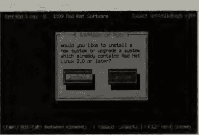
**图1.10** 您可以使用安装程序进行升级，该方式会保留您当前的系统和配置；也可以选择进行全新安装。
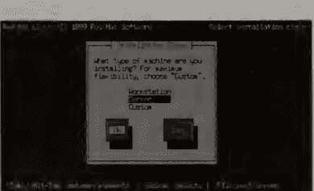
**图1.11** 安装分为三类：工作站类、服务器类和自定义类。
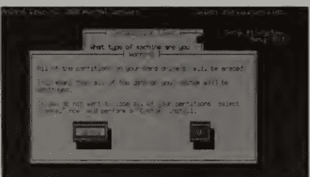
**图1.12** 服务器类安装会删除硬盘上的所有分区。
- 3. 按Tab键定位到“确定”按钮，然后按Enter键选中。
- 4. 在下一个对话框中，选择键盘类型。如果您的键盘不在列表中，最佳选择是美式键盘。
- 5. 系统会提示您选择安装方式（图1.9）。选择本地光盘，然后点击确定。
- 6. 安装程序会提示您确认光盘已正确放入光驱。按下键盘上的Enter键确认即可。如果安装程序找不到您的光盘驱动器，请确保光盘在光驱中后重启计算机，再重新运行安装程序。
- 7. 程序会探测您的系统以查找并识别光盘驱动器。如果您的光盘驱动器由SCSI控制器控制，系统会询问您的计算机中是否有其他SCSI控制器。除非您有其他SCSI控制器，否则请选择“否”。
- 8. 选择您是要升级还是进行全新安装（图1.10）。升级会保留应用程序、数据文件以及现有配置文件（这些文件会被重命名为带.rpmsave扩展名的版本）。仅当您的系统已经运行Red Hat Linux 2.2或更高版本时，才应选择“升级”选项。
- 9. 在下一个对话框中，系统会要求您选择安装类别（图1.11）。共有三个选项：工作站类、服务器类和自定义类。工作站类安装会删除您系统中所有当前的Linux分区。服务器类安装会删除您系统中的所有分区。自定义类安装可以让您完全控制分区设置以及安装的组件。有关自定义类安装的更多信息，请参阅第2章。按Tab键定位到“服务器”复选框，然后按空格键选中它。

##### 创建Linux启动盘
- 10. 按下F12键进入下一个对话框。
- 11. 系统会发出警告，提示您即将删除硬盘上的所有分区，这意味着您的所有数据都将丢失（**图1.12**）。按Tab键定位到“确定”按钮，然后按Enter键继续。
- 12. 使用Tab键、方向键和空格键选择您的鼠标类型和连接方式。
- 13. 如果安装程序检测到了网卡，系统会提示您配置网络（**图1.13**）。更多信息请参阅第3章和第4章。
- 14. 输入root用户的密码（**图1.14**），root用户也称为超级用户。root密码长度至少为6个字符，它拥有整个系统的访问权限，因此您要注意保管好它，不要与任何安全风险较高的人共享。
- 15. 系统将为您提供为新系统创建自定义启动盘的机会（**图1.15**）。请选择“是”。

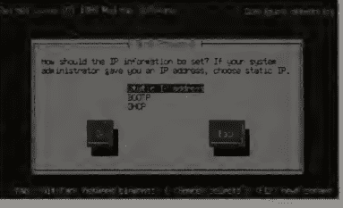
> **图1.13** 您可以在安装过程中配置网络。
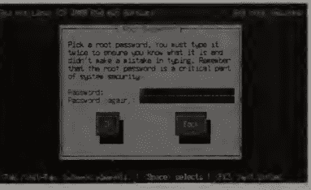
> **图1.14** 您必须设置root密码，需要注意保护且不要遗忘。
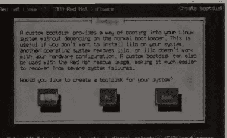
> **图1.15** 您将有机会创建自定义启动盘。

#### 快速安装
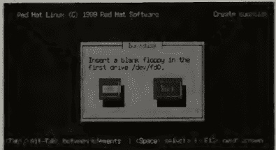
**图1.16** 如果您决定创建启动盘，需要将一张空白软盘插入驱动器（Windows中的A盘在Linux中对应/dev/fd0）。
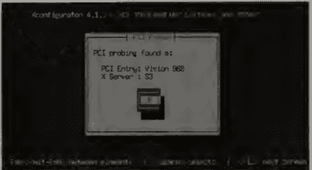
**图1.17** 安装程序会尝试识别您的视频子系统。
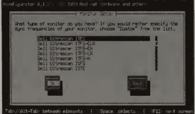
**图1.18** 为了使显示器正常工作，您需要指定您的显示器型号。
- 16. 按照提示，插入一张空白软盘（图1.16）。
- 17. 系统会询问您是否要在启动时自动开启X-Windows。请选择“是”。安装程序会尝试识别您的显卡（图1.17）。
- 18. 使用Tab键、方向键和空格键从列表中选择您的显示器（图1.18）。如果您的显示器不在列表中，您可以直接指定水平刷新率和垂直刷新率。该操作流程在第2章中有更详细的说明。
- 19. 从驱动器中取出软盘，以便系统可以重启。

###### 提示
- 如果您的显示器未在列表中，且您没有刷新率信息，可以尝试选择尺寸匹配的戴尔显示器。

#### 首次启动时...
如果您选择了自动启动X-Windows，那么安装程序在启动流程完成后重启时，您会看到Red Hat登录界面（图1.19）。使用安装时设置的密码以root用户登录。恭喜！您已成功安装Red Hat Linux。
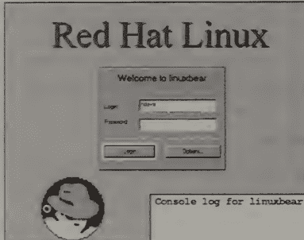
**图1.19** 安装完成后，您的系统会重启；之后您就可以首次登录系统了。

以root用户身份运行系统是个不明智的做法。系统启动后，您的第一步应该是添加一个新用户。您还需要了解如何重启和关闭您的新系统。

##### 添加用户：
- 1. 点击Gnome面板上的终端图标，或者从Gnome实用工具菜单中选择GNOME终端，打开终端窗口。
- 2. 点击终端窗口，使其获得键盘输入焦点。
- 3. 在提示符后输入**useradd jpublic**，其中*jpublic*是您的用户名。

#### 设置用户密码：
- 1. 您需要为新用户设置密码。可以使用passwd命令为*jpublic*设置密码，在提示符后输入：
``` [root@linuxbear /root]# passwd jpublic ```
- 2. 系统会提示您输入密码：New UNIX password:
- 3. 系统会提示您再次输入密码：
``` Retype New UNIX password: passwd: all authentication tokens updated successfully [root@linuxbear /root]# ```
注意，输入新密码时，密码不会在屏幕上显示。

#### 重启系统：
保持终端窗口开启，输入``` shutdown -r now ```

#### 关闭系统：
在终端窗口中输入``` shutdown -h now ```
系统会开始关机。当屏幕上出现“Power Down”提示时，就可以安全关闭计算机电源了。

#### 总结
在本章中，您学会了如何：
- 收集Windows硬件的信息。
- 创建并测试Windows启动盘。
- 使用Windows计算机制作Linux启动盘。
- 使用Linux计算机制作Linux启动盘。
- 安装Linux。
- 添加用户。
- 设置用户密码。
- 重启系统。
- 关闭系统。

#### 详细安装说明
## 第2章
在第1章“快速安装”中，我向您展示了如何在最理想的环境下安装Red Hat Linux 6。然而，最理想的环境并不是真实世界。在现实世界中，可能出错的事情大概率真的会出错。另外，套用列夫·托尔斯泰的话就是：简单的安装都是相似的，困难的安装则各有各的不同。

本章旨在让这些“特殊”的安装过程就算不算简单，至少也更便于操作。

首先非常重要的一点是，第1章的“快速安装”默认您愿意将整台计算机完全交给Linux使用（即删除硬盘上的所有现有数据）。如果实际情况并非如此，您就需要对硬盘进行*分区*，让Linux和DOS/Windows可以共存。本章会向您展示如何完成这一操作。

我还会讲解*自定义*安装方式，以及如何为您的系统选择单独的组件。

事实上，许多第一次安装Linux的Windows用户都将这个过程当作一种实验。通常的做法是，把旧的不用的“破”电脑从门垫上挪开，给上面装个Linux系统。

一旦Linux正常运行，这样做没有任何问题，因为Linux和Gnome在性能较低的硬件上的表现优于DOS和Windows 98。不过这也意味着，Linux很可能会被安装在硬件较老的旧系统上，这就会导致安装过程中出现问题，尤其是视频子系统方面的问题。

我会提供一些配置显卡和显示器的注意事项。

最后，本章会讲解如何添加和配置打印机。


## 第2章
#### 同一系统上的 Linux 和 Windows
很多人希望在同一台系统上同时运行 Linux 和 Windows。原因是什么呢？如果你只有一台电脑，在尝试过 Linux 下可用的应用之前还不想放弃 Windows 应用，那你可能就会想这么操作。或者你可能只是希望能在同一台机器上同时运行 Linux 和 Windows，这种想法非常合理。
> **这种“双系统”安装方式涉及诸多变量，存在一定难度，还可能危及你系统内的所有数据。**
开始操作前，**务必**备份所有你重视的数据。在进行重新分区操作之前，你还需要对这个流程有清晰的概念认知，接下来会介绍该流程。
**注意：** 以下路线图仅为概念性概述，具体完成步骤将在本章后续详细说明。
##### 安装 Linux 并保留 Windows：
- 1. 确保硬盘有足够的空间存放 Linux 以及你当前的 Windows 文件。如果可用空间不足 750MB，你可能无法顺利安装 Red Hat Linux 6。
- 2. 对 Windows 硬盘进行碎片整理，将所有数据移到硬盘开头位置，为 Linux 分区腾出空间。
- 3. 退出 Windows 前，记下你的硬件设置（本书末尾、索引后专门预留了一页供你记录这些信息）。
- 4. 重新规划 Windows 硬盘分区，添加 Linux 分区。
- 5. 运行安装程序，将 Linux 安装到对应分区上。
- 6. 将 LILO 引导加载程序复制到硬盘的某个分区中。如果由于某些原因，LILO 无法实现系统的多重引导，你就需要准备另一种启动 Linux 的方式：例如通过启动软盘。
###### 提示
- 如果你有多余的机器，强烈建议在单独这台机器上单独安装 Linux，让它有专属的运行环境。
- 如果每个操作系统都有独立的物理硬盘，那么在带 Windows 的系统上安装 Linux 会更简单。
- 你可能只有一块*物理*硬盘，但在 Windows 下可以有多个*逻辑*硬盘。如果是这种情况，你可以考虑将其中一个 Windows 逻辑驱动器重新格式化为 Linux 驱动器，而不是从 Windows 逻辑驱动器中划出一部分分区给 Linux。
- 使用启动软盘的意思是，想要以 Linux 启动电脑时，就把 Linux 软盘插在 A 驱动器中；想要以 Windows 启动时，就把软盘从驱动器中取出。这实际上是非常合理且几乎不会出错的操作方式（后续会进一步介绍）。
##### 对 Windows 驱动器进行碎片整理：
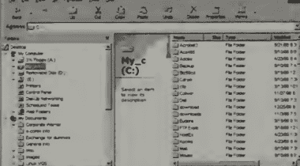
图 2.1 对驱动器进行碎片整理（会将驱动器内所有数据移到开头位置），首先需要在 Windows 资源管理器中选中该驱动器。
- 1. 右键点击 Windows 桌面上的“我的电脑”图标，在弹出的菜单中选择“资源管理器”，Windows 资源管理器窗口就会打开（见图 2.1）。
- 2. 找到并选中你想要进行碎片整理的驱动器。
- 3. 右键点击该驱动器，在弹出的菜单中选择“属性”，驱动器的属性对话框会打开。
- 4. 选择属性对话框中的“工具”选项卡（见图 2.2）。
- 5. 点击“立即碎片整理”，会打开一个包含显示碎片整理进度的滑动条的对话框（见图 2.3）。
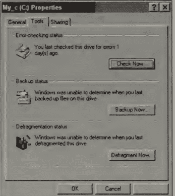
图 2.2 在驱动器的属性对话框的“工具”选项卡中选择“立即碎片整理”，即可打开碎片整理工具。
###### 提示
- 如果你想查看碎片整理工具正在移动的磁盘数据的实时图形展示，点击“显示详细信息”。
- 碎片整理工具可能会发现你硬盘上的错误，需要先修复这些错误才能继续进行碎片整理（见下一节）。
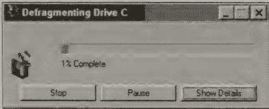
图 2.3 点击“显示详细信息”即可查看正在移动的磁盘数据展示。
##### 修复硬盘错误：
- 1. 打开 Windows 资源管理器，选中你想要进行碎片整理的驱动器。
- 2. 右键点击该驱动器，在弹出的菜单中选择“属性”，驱动器的属性对话框会打开。
- 3. 选择属性对话框中的“工具”选项卡。
- 4. 在“错误检查状态”区域，选择“现在检查”，会打开 ScanDisk 对话框（见图 2.4）。
- 5. 勾选“自动修复错误”复选框。
- 6. 点击“开始”。
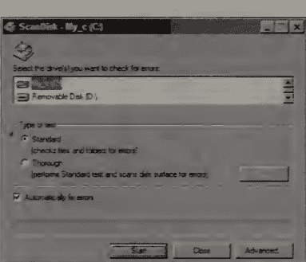
> 图 2.4 运行 ScanDisk 修复碎片整理工具发现的驱动器上的所有错误。
##### 使用 FIPS 工具
FIPS 是一个 DOS 工具，用于从你现有的硬盘中划分出 Linux 分区。它操作简单，如果你希望即将安装 Linux 的电脑保留 Windows 系统，它应该是你的首选工具。
##### 使用 FIPS 重新分区：
- 1. 将一张空白软盘插入你的驱动器。
- 2. 打开 Windows 资源管理器，选中软盘驱动器（通常是 A 盘）。
- 3. 右键点击该驱动器，在弹出的菜单中选择“格式化”，会打开格式化对话框（见图 2.5）。
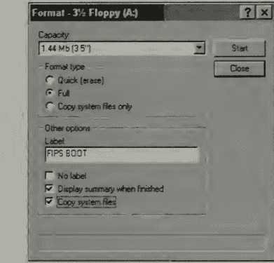
**图 2.5** 勾选“复制系统文件”可使软盘变为可引导盘。
- 4. 勾选“复制系统文件”，让软盘可引导。
- 5. 点击“开始”。
- 6. 磁盘格式化完成后，通过 Windows 资源管理器将 Red Hat Linux 6 光盘上 `\\dosutils\\fips20` 目录下的 `fips.exe` 和 `restorrb.exe` 文件复制到软盘中。
- 7. 关闭 Windows 并重启电脑，启动后会进入 A:> 命令提示符界面。
- 8. 在命令提示符下输入 `fips` 并按回车，你会看到一条版权声明页面，附带一些提示，以及标注 FIPS 附带“无任何担保”的内容。
- 9. 按任意键继续。
> > **警告！** 正如其他地方提到的，本书附带光盘中的 Linux 版本*并未*获得 Red Hat 或 Peachpit Press 的支持。我们已尽最大努力确保这些说明尽可能准确完整，但安装方式和配置实在太多，无法在这里完全涵盖。你可以查看 Red Hat 官方网站（http://www.redhat.com）和光盘自带的文档。你也可以拨打 1-888-REDHAT1 购买该软件的技术支持服务。
- 10. 你会看到多个包含信息和警告的页面，持续按任意键进入下一页，直到出现询问你是否要备份扇区的页面。如果此时你犹豫了，输入 n 退出 FIPS 且不进行任何修改；否则输入 y 保存新的分区更改。
- 11. 输入 y 表示确认。系统会提示你在 A 驱动器中插入软盘（你可以直接用正在运行 FIPS 的那张）。扇区备份完成后，FIPS 的主要操作就开始了。会弹出一个包含三列的页面：旧分区、柱面和新建分区。旧分区就是你硬盘上的 DOS/Windows 分区，新建分区则是你要创建的 Linux 分区。如果要执行完整的 Red Hat Linux 6 安装，新建分区需要至少有 750MB 可用空间。
- 12. 使用左右方向键调整旧分区和新建分区的容量。如果要执行完整的 Red Hat Linux 6 安装，新建分区需要至少有 750MB 可用空间。
- 13. 确认分区设置无误后，按回车键，FIPS 会显示已创建的新分区大小。
- 14. 如果你*不*满意新旧分区的大小，输入 r 重新编辑分区；如果满意，输入 c 继续。
- 15. 如果你输入了 c，你会看到一些关于你硬盘的提示信息，随后会出现一条消息提示 FIPS 已准备好保存新的分区方案。
- 16. 如果你输入了 y，等 FIPS 运行完成后，取出软盘并重启电脑，这就是所谓的*关键时刻*！
- 17. Windows 重启完成后，按照之前“修复硬盘错误”部分介绍的步骤运行 ScanDisk，确保你的磁盘和文件系统状态良好。
###### 提示
- 不要从 Windows 内的 DOS 窗口中运行 FIPS。
- 你可以在 Red Hat Linux 6 光盘、本书末尾的 `\dosutils\fipsdocs` 目录中找到大量关于 FIPS 工具的有用文档。


## DOS fdisk > **警告！** 我强烈不建议使用DOS fdisk，除非万不得已。
要使用DOS fdisk进行破坏性重新分区，请按以下步骤操作：
- 1. 按备份软件文档中的说明，备份你的Windows系统。
- 2. 按照“使用FIPS重新分区”步骤1至5的说明，创建启动软盘。
- 3. 将`Fdisk.exe`和`Format.com`文件复制到软盘上。这些文件位于`\Windows\Command`文件夹中。
- 4. 将启动备份所需的任何文件复制到软盘上。（如需更多信息，请查看备份软件文档。）
- 5. 将刚刚创建的磁盘放入A驱动器，重启电脑。
- 6. 在`A:>`提示符下输入`fdisk`并按Enter键。
- 7. 使用fdisk菜单选项删除分区，为新的Linux和DOS分区腾出空间（选项3）。你可能需要删除所有现有分区。不要选择“大磁盘支持”。
- 8. 使用fdisk菜单选项创建DOS分区（选项1）。
- 9. 输入DOS分区的大小（以MB为单位）。
- 10. 按Esc键继续。fdisk菜单屏幕将重新打开。
- 11. 将活动分区设置为你新创建的DOS分区（选项2）。这和将分区设置为可启动是一样的。
- 12. 按Esc键返回fdisk菜单屏幕。
- 13. 按Esc键退出fdisk。
- 14. 输入`format /s C:`来格式化新的DOS分区，然后将系统文件复制到其中。
- 15. 按照备份软件附带的操作说明，恢复你之前备份的Windows系统。
> ✓ **提示** > - 正如“破坏性”一词所暗示的，DOS fdisk会删除你硬盘上的所有数据。


## 第2章
#### Linux fdisk
如果你的计划是将逻辑（或物理）DOS驱动器移交给Linux，你可能需要删除分区。分区删除后，你可以添加新的Linux分区。Linux fdisk是一个功能强大的程序，既可以用于破坏性重新分区，也可以用于创建新的Linux分区。

##### 使用Linux fdisk删除分区：
- 1. 使用本书封面的Linux安装软盘和CD启动Linux安装程序，如第1章所述。
- 2. 当提示时，选择“安装”选项，而不是“升级”选项。
- 3. 当提示时，选择“自定义安装”，而不是“工作站”或“服务器”。有关这些选项的更多信息，请参阅本章后面的“工作站、服务器和自定义安装”。
- 4. 当提示选择磁盘分区工具时（图2.6），选择fdisk。将显示命令提示符和可能操作的列表（图2.7）。
- 5. 输入`p`列出当前分区和设备（图2.8）。
- 6. 记下要删除的分区编号，从上往下计数。第一个分区的设备名很可能是`hda1`（如果是IDE驱动器）或`sda1`（如果是SCSI驱动器）。更多信息请参阅侧边栏“Linux设备名称和分区”。
- 7. 输入`d`删除分区。
- 8. 输入要删除的分区编号。
> 图2.6 你可以使用Disk Druid或Linux fdisk作为分区工具。
> 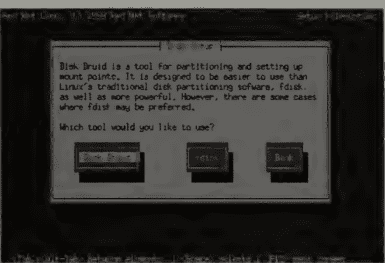
> 图2.7 fdisk程序会显示带有可能命令操作列表的提示符。
> 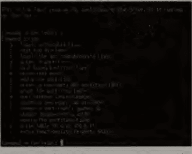
> 图2.8 使用p选项在将更改写入磁盘前进行验证。
> 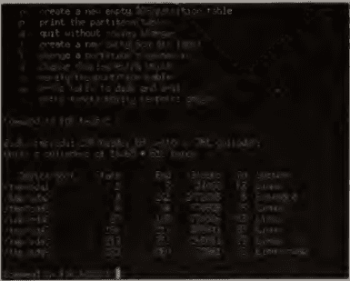
- 9. 输入`p`显示新的分区表以验证更改。
- 10. 输入`w`保存更改并退出Linux fdisk。
- 11. 如果系统提示你重启，请执行此操作。

###### ✔ **使用技巧**
- 输入`m`会显示fdisk命令操作的列表。
- 你可能需要同时使用Linux fdisk和Disk Druid（本章后面会解释）来正确完成分区。如果是这样，你可以使用“返回”选项在两个实用程序之间导航。

##### 使用fdisk添加Linux分区：
- 1. 按照前面部分所述启动Linux fdisk。
- 2. 输入`p`查看分区表，并记下要创建的分区之前的分区的最后一个柱面。
- 3. 输入`n`表示新建分区。
- 4. 输入`p`表示主分区。你也可以输入`e`表示扩展分区；更多信息请参阅侧边栏“Linux设备名称和分区”。
- 5. 输入要创建的分区编号。对于第一个Linux分区，这很可能是2。
- 6. 输入分区的第一个柱面编号。通常，你会接受默认值。如果你正在创建分区2，提供的默认值将比分区1的结束柱面大1个柱面。
- 7. 输入分区的大小或结束柱面。分区大小可以用字节、千字节或MB指定——或者可以指定结束柱面的编号。
- 8. 输入`p`显示分区表。
- 9. 你可以添加更多分区，或修改现有分区。要修改分区，输入`d`。要更改启动分区，输入`a`。
- 10. 完成更改后，输入`w`保存并退出fdisk。
- 11. 如果系统提示你重启，请执行此操作。

##### **Linux设备名称与分区**
Linux与其他Unix版本一样，将所有内容都视为文件。这意味着硬盘的名称是其驱动程序的设备文件标识符。例如，`/dev/hda`是系统上第一个IDE驱动器的名称，`/dev/sdc`是系统上第三个SCSI驱动器的名称。你可以轻松解读这个命名规则：`hd`代表硬盘，`sd`是SCSI驱动器的缩写。与驱动器不同，分区用数字而非字母表示。例如，`/dev/sda2`是第一个SCSI驱动器上的第二个主分区。Linux最多支持四个主分区，编号为1到4。此外，一个主分区可以设为扩展分区，它本身包含逻辑分区。逻辑分区的编号为5或更大。


#### Disk Druid
Disk Druid是Red Hat安装程序的一部分。它具有用户友好的界面，因此如果它能满足你的所有分区需求，完全可以代替Linux fdisk使用。

##### 使用Disk Druid添加或编辑Linux分区：
- 1. 按照前面所述启动Linux安装程序。
- 2. 当提示选择磁盘分区工具时，选择Disk Druid。将显示Disk Druid界面（图2.9）。
- 3. 使用Tab键选择“添加”、“编辑”或“删除”来添加、修改或删除分区。
- 4. 完成后，使用Tab键选择“确定”，然后按Enter键。

至少你需要一个根分区来安装Linux内核。根分区用`/`（斜杠）表示。当程序要求你输入挂载点时，输入你所创建分区的挂载点名称（见下方分区示例）。此外，如果你的系统内存少于128MB，你应该创建一个交换分区。（交换分区用作虚拟内存。）对于简单系统来说，这样的配置可能已经足够。但大多数用户会为不同功能创建独立的分区，包括：
- 根分区，即`/`（根）分区
- `/home`分区，用于存储用户的主目录
- `/tmp`分区，用于在大型服务器安装中存储临时文件
- `/usr`分区，用于安装Linux软件包
- `/usr/src`分区，用于存储Linux源代码

> 图2.9 你可以使用Disk Druid添加、编辑或删除分区。
> 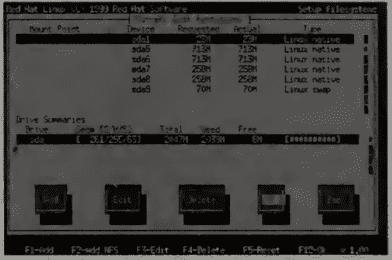

##### 分区策略
磁盘分区与其说是一门精确的科学，不如说是一门艺术。有许多可行的分区方案。请参阅Red Hat Linux 6 CD-ROM附带的文档以及Red Hat官网（www.redhat.com）上的文档，特别是以下链接：
``` http://www.redhat.com/corp/support/manuals/RHL-6.0-Manual/install-guide/manual/doc037.html ```
和
``` http://www.redhat.com/corp/support/manuals/RHL-6.0-Manual/install-guide/manual/doc021.html ```


#### 启动至 Windows 和 Linux
最后一步是对你的计算机进行配置，使其可以启动至 Linux 或 Windows。有多种不同的方法可以实现这一目标。如果可行的话，最简单的做法是配置 LILO，即实际启动 Linux 内核的 Linux 引导加载程序。LILO 配置完成后，重启系统时会出现 LILO 提示符：
``` LILO boot: ```
如果按下 Tab 键，就会显示可启动的不同操作系统的名称：例如 DOS 和 Linux。输入你想要将计算机启动至的对应操作系统名称即可。另一种非常实用的方法是使用启动软盘加载 Linux。另外，如果你是从 DOS 启动，你可以编写一个 DOS 批处理文件来加载 Linux 内核。

##### 配置 LILO：
1. 当你进入 LILO 安装对话框时，首先会被询问是将 LILO 放在主引导记录（MBR）还是根分区的第一个扇区。除非你正在使用 OS/2 自带的其他引导加载程序，否则请选择 MBR。
2. 使用 Tab 键选中“确定”，然后按下回车键。
3. 接下来，你将被要求提供特殊选项以向 Linux 标识你的硬件。请将此字段留空。（待续……）
4. 除非你使用 LBA 模式访问 SCSI 驱动器，否则也请将 LBA 模式字段留空。（你知道我在说谁😉）
5. 使用 Tab 键选中“确定”，然后按下回车键。
6. 此时会弹出一个对话框，列出你系统中的不同分区、分区对应的文件系统类型、该分区是否为默认启动分区，以及 LILO 将使用的分区标签。使用 Tab 键和方向键选择要编辑的分区。
7. 如果需要，你可以更改默认启动分区，也可以更改分区的 LILO 标签（即 LILO 启动时输入以选择特定分区的文本）。
8. 编辑完成后，使用 Tab 键选中“确定”，然后按下回车键。

**图 2.10** 从关机对话框中选择“以 MS-DOS 模式重新启动”。

###### ✓ 提示
Linux 运行后，你可以手动编辑位于 `/etc/` 目录下的 `lilo.conf` 文件，修改 LILO 的配置方式。保存该文件的修改后，你必须运行 `/sbin/lilo` 程序才能使修改生效。

##### 使用 Loadlin 从 DOS 启动 Linux：
1. 在 Windows 桌面，选择 Windows 开始菜单中的“关机”。
2. 在“关闭 Windows”对话框中选择“以 MS-DOS 模式重新启动”（**图 2.10**）。
3. 选择“确定”。你的计算机会退出到全屏 DOS 窗口，你的命令提示符大概会显示为 `C:\WINDOWS`。注意，DOS 模式与在 Windows 中运行 DOS 窗口是不同的。
4. 要切换到 C 盘根目录，输入 `cd\` 然后按下回车键。
5. 输入 `md loadlin` 然后按下回车键，为 Loadlin 工具创建一个目录。
6. 输入 `md vmlinux` 然后按下回车键，为 Linux 内核镜像创建一个目录。
7. 将 Red Hat Linux VQS 6 光盘放入你的光驱中。
8. 输入 `cd loadlin` 然后按下回车键，切换到 loadlin 子目录。
9. 输入以下内容将 Loadlin.exe 复制到 loadlin 子目录：
```copy d:\dosutils\loadlin.exe```
其中 *d* 是指代你光驱的驱动器盘符。然后按下回车键，会弹出一条提示，显示已复制 1 个文件。
10. 输入 `cd\` 然后按下回车键，切换到你之前创建的 vmlinux 目录。再次输入 `cd vmlinux` 然后按下回车键。
11. 输入以下内容将 Linux 内核复制到 vmlinux 子目录：
```copy d:\dosutils\autoboot-vmlinux```
其中 *d* 是指代你光驱的驱动器盘符。然后按下回车键，会弹出一条提示，显示已复制 1 个文件。
12. 输入 `cd \loadlin` 然后按下回车键，返回 loadlin 目录。
13. 输入：
```loadlin c:\vmlinux\vmlinux -root=/dev/hda2 ro```
然后按下回车键。本示例中，在磁盘 Druid 中创建的 Linux 根分区为 /dev/hda2。计算机将开始启动至 Linux。

> 启动至 Windows 和 Linux ## 第 2 章
###### 提示
- 如果你在运行磁盘 Druid 时没有记录 Linux 根分区的标识符，你可以重新运行安装程序至磁盘 Druid 步骤来获取该信息。获取到所需信息后，只需重新启动计算机并取出光盘即可。
- 如果你计划使用 Loadlin 从 DOS 定期启动 Linux，你可以做一些操作来简化这一流程：你可以设置 Windows 启动至 DOS 命令提示符而非 Windows 图形界面；也可以编写一个批处理文件来自动调用 Linux。完成这些设置后，开机时计算机将启动至 DOS 的 C:> 命令提示符。要启动 Windows，输入 win 后按下回车键；要启动 Linux，输入 linux 后按下回车键。
> > **图 2.11** 要能够保存文件的修改，你需要在属性对话框中取消勾选“只读”选项。

##### 设置 Windows 启动至 DOS 命令提示符：
1. 打开 Windows 资源管理器，找到 C: 文件夹。
2. 选中名为 Msdos.sys 的文件，然后单击鼠标右键。
3. 从弹出菜单中选择“属性”，此时会打开 Msdos.sys 的属性对话框（图 2.11）。
4. 在属性对话框底部的“属性”区域中，取消勾选“只读”属性。
5. 选择“确定”以应用更改并关闭属性对话框。

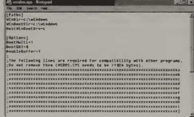

#### 详细安装说明
6. 打开 Windows 记事本，你可以通过 Windows 程序菜单中的“附件”展开项启动它。
7. 在“文件”菜单中选择“打开”。
8. 在“打开”对话框的“文件名”输入框中输入 `c:\msdos.sys`，然后按下回车键。
9. 编辑 Msdos.sys 文件的 [Options] 部分，使其包含以下行：
```BootGUI=0```
（如需帮助，请参阅**图 2.12**。）
10. 在“文件”菜单中选择“保存”。下次重启计算机时，它将直接启动至 DOS 命令提示符。

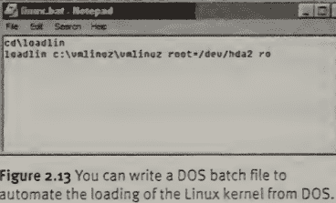

##### 创建调用 Linux 的批处理文件：
1. 在记事本中打开一个新文档，在文档中输入以下两行内容：
```cd\loadlin
loadlin c:\vmlinuz\vmlinuz -root=/dev/hda2 ro```
（如需帮助，请参阅**图 2.13**。）
2. 在“文件”菜单中选择“另存为”。
3. 在“另存为”类型下拉列表中选择“所有文件”。
4. 在“文件名”输入框中输入 `c:\linux.bat`。
5. 选择“保存”。下次启动至 C: 命令提示符时，你可以在提示符后输入 **linux** 然后按下回车键，即可启动 Linux。

##### 启动至 Windows 和 Linux 30


#### 不同类型的安装方式
你可能在第1章已经注意到，Linux有三种基本的安装方式：
- 工作站安装：这是适用于桌面用户的默认安装
- 服务器安装：这是适用于互联网服务器、网络文件及打印服务器的默认安装
- 自定义安装：该方式允许你自行决定要安装的内容以及安装位置

重点在于，工作站和服务器安装方式不允许你指定Linux的安装分区，换句话说，这类安装会清空磁盘上的所有现有数据。在不删除Windows的前提下将Linux安装到磁盘的唯一方法是执行自定义安装。此外，自定义安装还允许你自主选择需要安装的Linux组件。

#### 安装选定组件
1. 完成分区的格式化与配置后，安装程序会弹出“要安装的组件”对话框。你可以使用方向键和空格键选择需要安装的组件。
2. 选完所需组件后，使用Tab键选中“确定”按钮，之后按下Enter键。
> **提示**：若要选择所有组件，请使用向下方向键滚动到组件列表底部，选中“全选”选项后按下空格键即可。

#### 配置显卡与显示器
Linux安装过程中最大的难题之一，就是正确配置显卡与显示器的适配。这个问题出现的原因是市面上在用的视频系统种类极多，加上Linux常常被安装在较老的硬件上。你会在Linux安装流程中被要求配置视频系统，但该配置流程也可以在安装完成后，随时通过Linux命令行提示符执行，无需重新运行安装程序。（关于Linux命令行提示符的使用方法，请参阅第3章和第6章。）

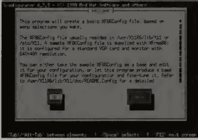
*图2.14 使用Xconfigurator工具配置Linux以适配你的显卡与显示器。*

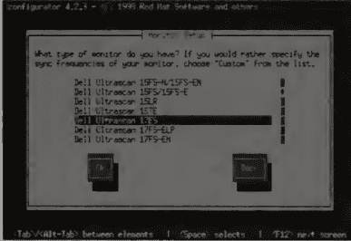
*图2.15 如果你的显示器在列表中，请选择对应的型号；否则可以选择“自定义”选项手动输入显示器参数。*

##### 使用Xconfigurator工具
1. 在Linux提示符界面（无论是全屏模式还是终端模式），输入`Xconfigurator`，视频配置程序会先弹出信息页（见图2.14）。
2. 使用Tab键选中“确定”按钮，按下Enter键后会弹出“选择显卡”对话框。
3. 使用方向键和空格键选择你的显卡。如果找不到对应的显卡型号，选择通用VGA是合理的选择。下一节会介绍SuperProbe的相关信息，你也可以参考第1章中关于从Windows获取当前硬件信息的内容，或许会对你有帮助。
4. 确认选择无误后，选中“确定”按钮并按下Enter键。
5. 接下来会要求你输入显示器类型（见图2.15）。如果你的显示器不在列表中，可以选择“自定义”选项手动选择刷新率（后续会介绍），或者选择通用显示器类型。
6. 根据你的显卡类型，以及其是否支持自动探测，你可能会被要求指定显卡的显存容量和使用的RAMDAC芯片组。
7. 如果选择了自定义显示器，你需要输入其水平同步范围（见图2.16）。
8. 接下来，你需要指定显示器的垂直同步范围（见图2.17）。
9. 最后，你需要确认色彩深度与分辨率设置（见图2.18）。如果不满意默认设置，可以选择“让我选择”选项，输入你偏好的分辨率与色彩深度。
10. 确认所有设置无误后，点击“确定”。Xconfigurator会多次关闭再打开你的显示器，之后会要求你点击“是”来确认视频功能仍正常工作。
11. 系统会询问你是否希望Linux启动时自动进入X-Windows界面。如果你对显卡和显示器的选择有足够的信心，可以选择“是”。

###### 提示
- 无论该程序是通过命令行运行，还是作为安装流程的一部分运行，界面和选项的排列顺序都是一致的。
- 运行Xconfigurator之前，你可以通过运行SuperProbe（本章后续会介绍）获取一些关于你的显卡的信息。
- 如果X-Windows（GNOME）未设置为自动启动，你可以在命令行提示符中输入`startx`并按下Enter键来启动它。

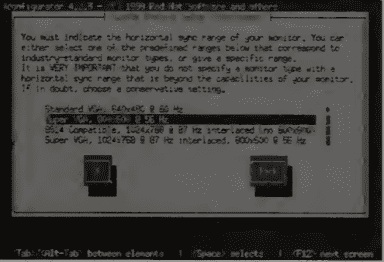
*图2.16 如果你正在输入自定义显示器设置，必须选择水平同步频率。*

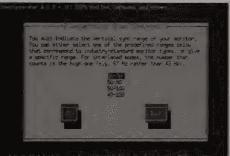
*图2.17 如果你正在输入自定义显示器设置，必须选择垂直同步频率。*

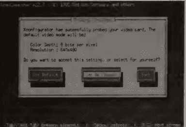
*图2.18 如果你不满意Xconfigurator选定的默认色彩深度和分辨率设置，可以自行输入你想要的参数。*

#### 详细安装说明
- 如果以上方法都没有用，可以打开网页搜索引擎，在搜索框中输入你的显卡名称和“Linux”关键词，你很可能会找到解决你特定问题的实用技巧。（图2.19展示了在Alta Vista上搜索Voodoo显卡和Linux的结果。）

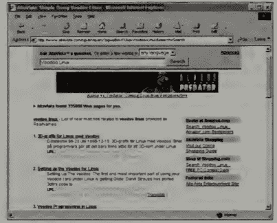
*图2.19 你可以通过网页搜索引擎查找为Linux配置特定图形硬件的相关信息。*

SuperProbe用于获取显卡的相关信息，但它并非完美。它不仅不总能提供有用的信息，还有可能导致系统崩溃。但如果你用其他方法无法查到显卡芯片组的信息，使用它一试也是值得的。

##### 运行SuperProbe
1. 以root用户登录，或使用su命令切换到root用户。
2. 在命令行提示符中输入`cd /usr/bin/X11`
3. 输入`./SuperProbe`。SuperProbe有希望会显示你系统的相关信息（见图2.20）。


*图2.20 SuperProbe可提供显卡的相关信息。*

#### 配置打印机
你可以在安装过程中配置打印机，也可以随时通过Linux控制面板中的“打印机配置”小程序来配置，两种方式的流程是相同的。

##### 使用“打印机配置”小程序添加打印机
1. 打开终端窗口，你可以点击GNOME面板上的终端图标，也可以在GNOME工具菜单中选择“GNOME终端”来打开。
2. 点击终端窗口，使其获得键盘输入焦点。
3. 在终端窗口打开、处于提示符状态时，输入`su root`。
4. 在提示符处输入root密码，下一个提示符出现时，你就会发现你已经成功登录为root用户了。
5. 在终端窗口中输入`control-panel`，Linux控制面板会弹出（见图2.21）。
6. 点击“打印机”小程序的图标（位于图2.21中从左数第三个位置）来选中它，随后会弹出红帽打印系统管理器（见图2.22）。

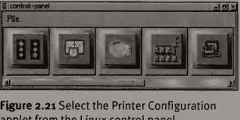
*图2.21 从Linux控制面板中选择“打印机配置”小程序。*

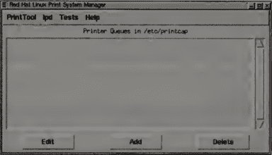
*图2.22 打印系统管理器用于添加、编辑和监控打印机。*

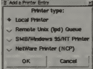
*图2.23 如果你的打印机直接连接到你的Linux系统，应选择“本地打印机”。*

7. 要添加打印机，请选择“添加”，会弹出“添加打印机条目”对话框（见图2.23）。
8. 选择你的打印机类型，如果打印机直接连接到Linux系统，请选择“本地打印机”。关于使用Samba配置Windows打印机的信息，请参阅第8章。
9. 点击“确定”，会弹出“编辑本地打印机条目”对话框（见图2.24）。
10. 如果默认设置正确，请点击“确定”。现在你应该能在打印系统管理器中看到你新添加的打印机了（见图2.25）。

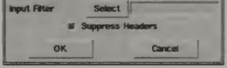
*图2.24 你可能不需要编辑默认的打印机条目。*
*图2.25 打印机添加完成后，你会看到它出现在打印系统管理器的列表中。*


#### 概述
在本章中，你将学习如何：
- 在同一系统上运行Linux和Windows。
- 对Windows驱动器进行碎片整理。
- 修复Windows驱动器上的错误。
- 使用FIPS重新分区。
- 使用DOS fdisk重新分区。
- 使用Linux fdisk删除分区。
- 使用Linux fdisk添加分区。
- 使用Disk Druid添加和编辑分区。
- 配置LILO引导加载程序。
- 使用Loadlin从DOS引导Linux。
- 安装独立组件。
- 为显卡和显示器配置Linux。
- 配置打印机。

#### 配置GNOME

红帽Linux 6.0版本是首款开箱即用集成可视化外壳（称为*桌面环境*）的红帽Linux产品。事实上，它预装了多种可在之间切换的桌面环境。默认且最完整的桌面环境是GNOME（发音为硬G：“Guh-nome”）。GNOME并非你唯一可用的桌面环境：有关K桌面环境和其他Level桌面环境的信息，请参阅第6章。但如果你接受了红帽安装程序的建议，你的计算机启动时会自动进入GNOME。
GNOME是非常完整且功能强大的图形化桌面。从外观和使用感受来看，它可能更接近Mac OS而非Windows 98，但也融合了两者的设计思路。它的用户自定义程度可能高于这两款商用操作系统。随着红帽Linux 6和GNOME的推出，完全可以实现Linux的图形化操作——也就是说，你永远不需要接触Linux命令行。（事实上，即使是Windows用户也会发现有些任务在旧版DOS提示符下操作更简单。这一点对GNOME和Linux来说可能也是如此。）GNOME是与其他任何可用桌面环境相当的可视化桌面环境。本章将介绍如何配置你的GNOME环境，以便你能最大程度地发挥它的作用。

## 第3章
#### 使用GNOME控制中心
GNOME控制中心允许你配置GNOME桌面的绝大多数方面。GNOME控制中心在配置GNOME时的作用，就像Windows中的显示属性对话框用于配置Windows显示一样。你可以对桌面进行的设置涵盖从细枝末节的调整到核心功能的配置，换句话说，部分设置仅涉及外观层面的影响，另一些则会改变你的工作方式。

##### 打开GNOME控制中心：
从GNOME主菜单的「设置」菜单中选择「GNOME控制中心」。
✓ 提示
- GNOME主菜单的激活方式是点击GNOME面板最左侧的小程序按钮，该按钮默认带有脚印样式的图标。
- 你也可以通过点击GNOME面板上从左数第三个小程序按钮打开GNOME控制中心，其图标看起来类似电子计算器。

##### 设置桌面背景：
1. 打开GNOME控制中心后，选择「背景」（图3.1）。
2. 点击「背景」面板左侧的「颜色」按钮，将打开「选取颜色」对话框（图3.2）。
3. 你可以通过点击色轮，或者使用滑块来选择颜色。
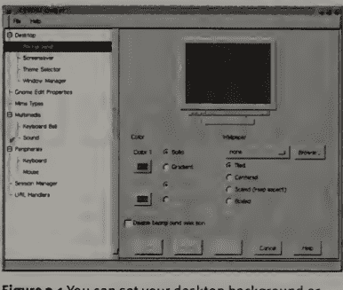
**图3.1** 你可以通过GNOME控制中心设置桌面背景或壁纸。
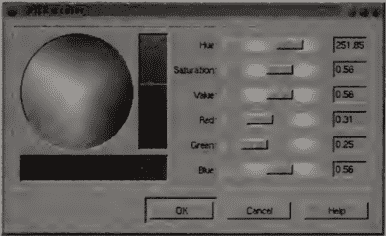
**图3.2** 你可以通过点击色轮选择颜色。
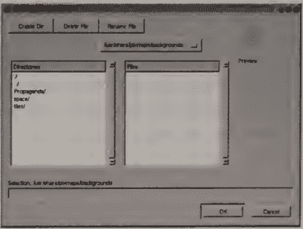
**图3.3** 「壁纸选择」对话框允许你浏览查找用作壁纸的图形文件。
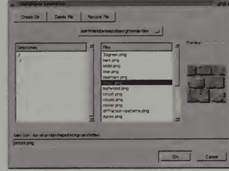
**图3.4** 图形文件按功能分类整理；例如所有适合平铺的图片都在同一个目录中。
4. 在「选取颜色」对话框中点击「确定」，新颜色会在「背景」面板的窗口中预览。
5. 要保存新的桌面颜色，在「背景」面板中点击「确定」。

#### 壁纸
你可能更愿意将背景设置为壁纸。GNOME自带了大量图形文件，既可以单独用作桌面背景，也可以通过平铺形成独特的纹理效果。

##### 设置壁纸为背景：
1. 在「背景」面板（图3.1）的右侧，选择一种壁纸模式。选择「平铺」可在桌面上重复显示小图形成图案，「居中」可将图片以原始尺寸放在桌面中央，「等比缩放」可将图片垂直放大至桌面高度同时保持横向比例，「缩放」可将单张图片放大以填满整个桌面。
2. 点击「浏览」按钮查找图片文件，将打开「壁纸选择」对话框（图3.3）。该对话框默认打开的路径是 /usr/share/pixmaps/backgrounds。
3. 使用鼠标在左侧目录中导航，找到合适的图形。例如，tiles子目录包含大量适合平铺的图片（图3.4）。
4. 选择一张图片后点击「确定」，新图案会在预览窗口中显示（图3.5）。
5. 点击「确定」，将新的平铺图片用作桌面壁纸（图3.6）。
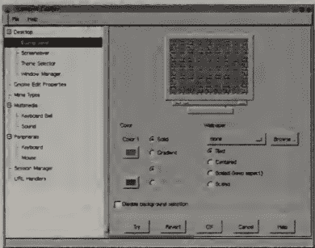
**图3.5** 你选择的图片会在预览窗口中显示。

**图3.6** 点击「确定」后，你的选择就会被设置为桌面壁纸。

##### 选择屏幕保护程序：
1. 打开GNOME控制中心，在左侧面板的层级列表中选择「屏幕保护程序」（**图3.7**）。
2. 从面板中间的「屏幕保护程序」列表中选择一个屏幕保护程序，你选择的屏幕保护程序会在控制中心的预览框中显示。（图3.7中选择了Deco。）
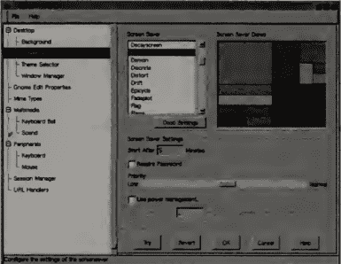
> *图3.7* 你可以从GNOME预装的众多屏幕保护程序中选择。
3. 要配置屏幕保护程序，点击「设置」按钮，将弹出针对你选择的屏幕保护程序的专属配置对话框（**图3.8**）。
4. 进行你想要的屏幕保护程序配置修改，完成后点击「确定」。
5. 在控制中心中，你可以修改屏幕保护程序的全局运行设置。例如，输入屏幕保护程序启动前的无操作分钟数，或者设置是否需要密码（**图3.7**）。
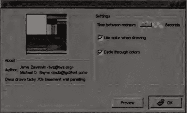
> *图3.8* 每个屏幕保护程序都有专属的配置对话框，用于设置该屏幕保护程序特有的属性。
6. 点击「确定」保存修改并激活屏幕保护程序。

#### 桌面主题
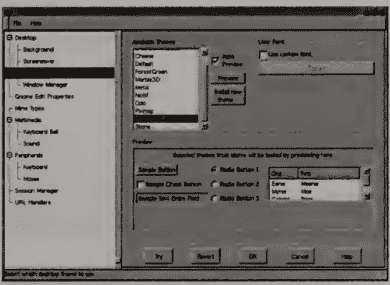
**图3.9** 桌面主题控制窗口组件（如复选框和按钮）的外观。
桌面主题是协调的配色方案，决定了复选框、滚动条等标准窗口元素的外观。

##### 选择桌面主题：
1. 打开GNOME控制中心，在左侧面板的层级列表中选择「主题选择器」（**图3.9**）。
2. 从面板中间的「可用主题」列表中选择一个主题。如果「自动预览」复选框被勾选，你的选择结果会在控制中心面板的右下角预览。（图3.9中选择的是Redmond95。）
3. 点击「确定」启用桌面主题。
✓ **提示：** 诚然这可能不是你的初衷，但如果你想尽可能让Linux桌面看起来和使用方式都贴近Windows，可以选择Redmond95作为桌面主题。

#### 使用窗口管理器
在GNOME下，你并不一定要受限于单一的窗口行为控制方式。可以编写程序来控制GNOME桌面窗口行为的绝大多数方面。你可以同时加载多个这类程序，它们被称为窗口管理器。每个窗口管理器都自带配置工具，让你可以控制窗口行为的重要方面。你应该结合桌面主题选择来使用窗口管理器的配置工具，这样就能按照你的偏好设置Linux和GNOME了。
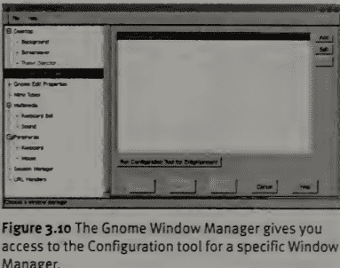
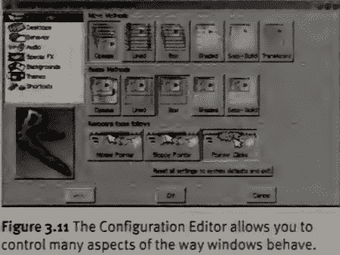

##### 运行配置工具：
1. 打开GNOME控制中心，在左侧面板的层级列表中选择「窗口管理器」（**图3.10**）。
2. 选中当前的窗口管理器，点击「运行配置工具」按钮，将打开「配置编辑器」（**图3.11**）。
3. 在配置编辑器中进行你想要的修改，完成后点击「确定」。


## 第3章
#### 配置GNOME
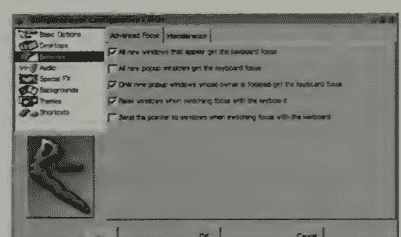
###### 为窗口设置焦点
如果某个窗口能接收并处理键盘指令和鼠标点击（而非桌面上的其他窗口），就称该窗口获得了*焦点*。默认情况下，新打开的GNOME窗口需要你点击后才会获得焦点，这和微软Windows用户习惯的操作逻辑不同，可能会有点烦人。
###### 让新窗口自动获得焦点
1. 打开配置编辑器后，在左上角的列表中选择「行为」（**图 3.12**）。
2. 切换到「高级焦点」选项卡，勾选“所有新出现的窗口获取键盘焦点”旁的复选框（**图 3.12**）。
3. 点击「确定」。
**图 3.12** 「高级焦点」选项卡可用于控制窗口获得焦点的方式。
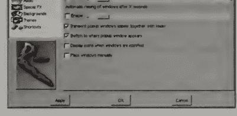
###### 工具提示
工具提示是鼠标悬停在对象上时，屏幕会显示的帮助性提示信息。
###### 开启（或关闭）工具提示
1. 打开配置编辑器后，在左上角的列表中选择「行为」。
2. 切换到「杂项」选项卡，勾选（或取消勾选）「工具提示开关」（**图 3.13**）。
3. 点击「确定」。
**图 3.13** 你可以根据自己的使用习惯开启或关闭工具提示。
###### 恢复窗口默认设置
1. 打开配置编辑器后，在左上角的列表中选择「基本选项」。
2. 点击「将所有设置重置为系统默认值并退出」按钮。

使用窗口管理器 45
#### 使用虚拟桌面
GNOME 引入了*virtual desktops*的概念，即*虚拟桌面*。虚拟桌面是一种低成本的扩展可用屏幕空间的方式，每个虚拟桌面都可以打开大量窗口，数量远超单张桌面能容纳的上限。
###### 在虚拟桌面间切换
1. 在GNOME面板上找到「虚拟桌面控制台」（图 3.14），该控制台会以缩略图形式展示每个桌面及其上打开的窗口。
2. 点击对应桌面的缩略图即可打开该虚拟桌面，也可以移动鼠标滑出当前屏幕来切换到下一个虚拟桌面。
###### 移除虚拟桌面
如果你觉得虚拟桌面干扰操作，可以只保留1个，移除其余所有。
> **注意：** 运行多个虚拟桌面时，会出现轻微但可感知的性能下降。
###### 仅保留1个虚拟桌面
1. 通过GNOME控制面板打开窗口管理器面板中的配置编辑器。
2. 打开配置编辑器后，在左上角的列表中选择「桌面」。
3. 拖动滑块上的调节柄，设置为1×1×1的桌面布局（图 3.15）。
4. 点击「确定」。
###### 启用多个虚拟桌面
1. 打开配置编辑器后，在左上角的列表中选择「桌面」。
2. 拖动滑块上的调节柄，设置你想要的多虚拟桌面的数量和排布方式（图 3.16）。
3. 点击「确定」。
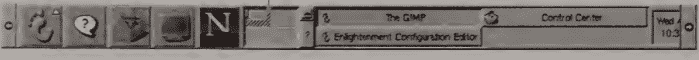
**图 3.14** 你可以通过GNOME面板上的虚拟桌面控制台在多个虚拟桌面之间切换。
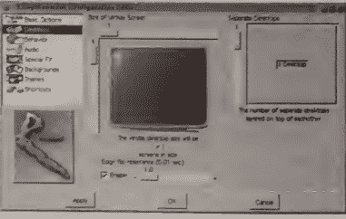
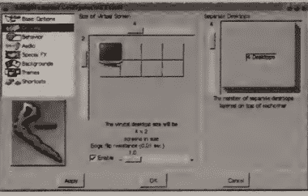
**图 3.15** 使用滑块即可移除多余的虚拟桌面。
**图 3.16** 你可以通过滑块设置虚拟桌面的数量和排布方式。
#### 使用虚拟桌面
#### 使用多媒体
你可以通过GNOME控制中心启用并配置多媒体支持功能。
###### 启用声音支持
1. 在GNOME控制中心中，双击左侧列表中的「多媒体」，展开该分类。
2. 选择「多媒体」下的「声音」，此时会弹出声音面板（图 3.17）。
3. 勾选「GNOME声音支持」以启用声音功能。
4. 点击「确定」。
###### 为事件关联声音
1. 在GNOME控制中心中，双击左侧列表中的「多媒体」，展开该分类。
2. 选择「多媒体」下的「声音」，此时会弹出声音面板（图 3.17）。
3. 选择「事件声音」。
4. 切换到「声音事件」选项卡，会弹出列有所有事件及对应声音的窗口（图 3.18）。
5. 若要为事件关联声音，先选中该事件。
6. 点击「浏览」按钮查找目标声音文件。
7. 点击「播放」按钮即可试听该声音。
8. 确认设置无误后，点击「确定」。
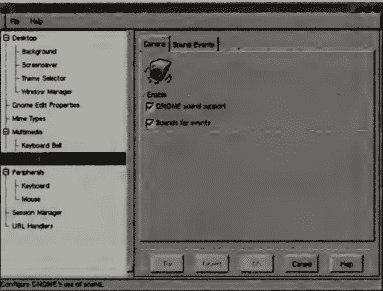
**图 3.17** 勾选「GNOME声音支持」即可启用声音功能。
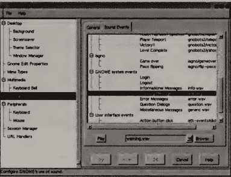
**图 3.18** 你可以通过GNOME控制中心为事件关联对应的声音。

使用多媒体
#### 使用外部设备
你可以通过GNOME控制中心轻松修改键盘和鼠标的设置。
###### 修改键盘设置
1. 在GNOME控制中心中，双击左侧列表中的「外部设备」，展开该分类。
2. 选择「外部设备」下的「键盘」，此时会弹出键盘设置面板（**图 3.19**）。
3. 根据需求调整键盘设置。
4. 点击「确定」保存配置。
###### 修改鼠标设置
1. 在GNOME控制中心中，双击左侧列表中的「外部设备」，展开该分类。
2. 选择「外部设备」下的「鼠标」，此时会弹出鼠标设置面板（**图 3.20**）。
3. 根据需求调整鼠标设置。
4. 点击「确定」保存配置。
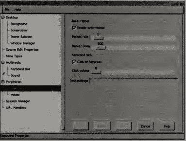
**图 3.19** 你可以通过GNOME控制中心轻松修改键盘配置。
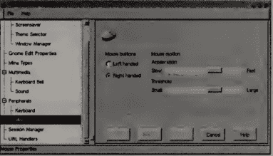
**图 3.20** 你可以通过GNOME控制中心轻松修改鼠标配置。

使用外部设备
#### 使用会话管理器
通过会话管理器，你可以控制GNOME处理登录和注销的部分逻辑，尤其是指定GNOME在启动会话时自动运行特定程序。
###### 打开会话管理器
在GNOME控制中心的左侧列表中选择「会话管理器」，右侧会弹出会话管理器面板（**图 3.21**）。
###### 设置程序在GNOME启动时自动运行
1. 在会话管理器面板中点击「添加」按钮，会弹出「添加启动程序」窗口（**图 3.22**）。
2. 在「启动命令」输入框中输入可执行指令，*或*点击「浏览」按钮查找并选择可执行程序文件。例如，你可以在「启动命令」输入框中输入`gnote`指令（如图 3.22 所示）来启动gnotepad+应用程序。
3. 通过「优先级」输入框旁的上下箭头为程序设置优先级，优先级数值越低，程序在启动流程中越早运行。

4. 点击「确定」关闭「添加启动程序」对话框，关闭后你添加的程序会出现在会话管理器面板中（**图 3.23**）。
5. 点击「确定」，即可设置该程序在启动时自动运行。
**图 3.23** 你添加到启动列表中的程序会以「非会话托管」状态显示在会话管理器面板中，这意味着这些程序是由你而非GNOME设置自动启动的。

**图 3.21** 你可以通过会话管理器面板修改会话设置。

使用会话管理器
###### 查看正在运行程序的优先级
打开会话管理器面板后，点击「浏览当前运行程序」按钮，会弹出「会话管理器属性」对话框（图 3.24）。
> **提示：** 你可以通过「会话管理器属性」对话框修改程序优先级，或关闭当前正在运行的程序。

> **图 3.24** 你可以通过「会话属性」对话框查看和编辑程序的启动优先级。

使用会话管理器


图3.25 桌面切换工具可以用来切换到新的桌面环境。
#### 切换桌面环境
Red Hat Linux 6除了Gnome之外，还内置了多种桌面环境（也被称为X-Window Shells）。这些桌面环境实际上是为在更早的命令行版Linux之上运行而编写的程序，会在Linux启动时自动加载。通常情况下，你不会意识到Shell下正在运行Linux，就像Microsoft Windows用户不知道DOS正在运行一样。此外，随着Red Hat Linux 6的发布，Gnome桌面环境中集成了如此多的功能，你甚至可能完全不需要离开图形化环境。Gnome是默认的桌面环境，也是Red Hat Linux 6自动启用的桌面环境，它显然是一个非常丰富且稳定的可视化环境。不过，你也可以尝试Red Hat Linux 6预装的其他桌面环境：K桌面环境（KDE）和Another Level。你也可能误切换到其他环境，之后想要回到Gnome。本节将介绍如何在桌面环境之间切换。
#### 切换桌面：
1. 从Gnome主菜单的“系统”菜单中选择“桌面切换”工具，此时会打开桌面切换器窗口（**图3.25**）。
2. 选择你要切换到的桌面，例如KDE。
3. 如果你希望更改永久生效（例如希望每次启动Red Hat Linux 6时都使用该桌面），请取消勾选“更改仅对当前显示生效”复选框。如果只想在当前会话中更换桌面，请勾选该复选框。
4. 点击“确定”，你的桌面环境就会切换为你选择的桌面。
#### 切换回Gnome：
1. 注销当前Shell会话，或重启计算机。
2. 在Red Hat主登录界面（**图3.26**）中，点击“选项”按钮。
3. 从“会话”菜单中选择Gnome。
4. 正常登录即可。
###### 提示
- 如果默认桌面设置被更改过，你可以使用桌面切换工具将Gnome设为默认桌面环境。

图3.26 你可以通过点击Red Hat登录界面的“选项”按钮，在“会话”菜单中选择对应桌面环境来启动桌面环境。
#### 启动到命令行
当然，我们中有人不喜欢可视化桌面。在Red Hat Linux 6中，你可以将系统配置为直接启动到命令提示符。
#### 直接启动到命令提示符：
1. 在Red Hat Linux 6登录界面输入登录ID为root、输入root密码以root身份登录；或者打开终端窗口，在命令提示符输入**su root**，然后输入root密码。
2. 如果你已经以root身份登录，就从Gnome主菜单的“系统”菜单中选择“控制面板”；或者在打开的终端窗口中输入**control-panel**，此时会打开控制面板（**图3.27**）。
3. 点击显示有管弦乐队指挥图标的按钮（即**图3.27**中从左数第四个按钮），打开“系统配置”小应用程序，此时会打开Gnome Linux配置小应用程序（**图3.28**）。
4. 在左侧列表中向下滚动到“杂项服务”。
5. 双击“杂项服务”以展开该分类。
6. 选择“初始系统服务”。

图3.27 可以从控制面板中点击带有指挥图标的按钮来启动“系统配置”小应用程序。

**图3.28** 要将系统设置为仅启动到命令行，需将初始默认运行级别设置为运行级别3。
7. 在右侧，将初始默认运行级别从运行级别5更改为运行级别3。
8. 点击“接受”按钮。
9. 点击“保存更改”。
10. 点击“退出”。
11. 重启计算机，之后系统就会启动到Linux命令提示符。
#### 从命令提示符启动Gnome：
在命令提示符中输入`startx`即可。
#### 恢复启动到可视化环境：
启动Gnome后，按照“直接启动到命令提示符”中描述的步骤操作，将初始默认运行级别设置为运行级别5即可。
#### Linux运行级别
Linux运行级别用于确定系统可以或应当执行哪些活动，具体说明如下：
- **运行级别0**
当系统进入该运行级别时，会启动系统关机流程，该流程包括终止所有进程、关闭虚拟内存、清理交换文件以及卸载文件系统。
- **运行级别1**
单用户管理状态，用于执行低级维护操作。除管理员外，其他人无法登录或注销。
- **运行级别2**
简易多用户状态，支持网络功能，但禁用文件系统。
- **运行级别3**
默认命令行运行状态，所有服务（包括远程文件共享）均已启用。
- **运行级别4**
用户可配置的运行级别，理论上你可以将其设置为有选择地停止或启动进程。
- **运行级别5**
Red Hat Linux 6的默认运行状态，除运行级别3的所有服务外，还启用了X Window服务器。
#### 重启与关机
你可以通过多种方式关机或重启系统，每个人都应当掌握至少一种关闭（或重启）计算机的方法。
##### 通过“注销”重启或关机：
1. 从Gnome主菜单中选择“注销”，此时会打开Red Hat Linux登录界面。
2. 点击“选项”按钮。
3. 从“系统”菜单中选择“重启”或“关机”。
###### 提示
- 无论你使用哪种方式关机，都要在关机流程完成后再切断电源。当屏幕上显示“Power down”提示时，说明关机流程已经完成。
###### 提示
- 如果你没有以root权限登录，重启或关机前会提示你输入root密码。
- shutdown命令被认为是最安全、最规范的Unix关机或重启方式，下次启动Linux时出现问题的概率最低。不过它的操作流程比较为简单粗暴的halt或reboot命令更长、更复杂。
- 有关shutdown命令选项的更多信息，请参阅附录A。
##### 通过终端窗口重启：
1. 打开终端窗口。
2. 在Linux命令提示符中输入`shutdown -r now`，或者输入`reboot`。
#### 通过终端窗口关机：
1. 打开终端窗口。
2. 在Linux命令提示符中输入`shutdown -h now`，或者输入`halt`。
#### 使用菜单编辑器

Gnome菜单编辑器可以让你向Gnome主菜单中添加文件夹和菜单项。
**图3.29** Gnome菜单编辑器用于向主菜单中添加文件夹和项目。
##### 向主菜单添加文件夹：
1. 从Gnome主菜单的“设置”菜单中选择“菜单编辑器”，此时会打开菜单编辑器窗口（图3.29）。
2. 在左侧面板中选中“用户菜单”。
3. 点击工具栏上的“新建子菜单”按钮。
4. 在“名称”输入框中输入新文件夹的名称。
5. 点击“保存”。
###### 提示
- 除非你以root身份登录，否则你只能编辑适用于当前会话的用户菜单，这些菜单位于左侧面板的“用户菜单”下方。除此之外，root用户可以添加或修改系统菜单，即左侧目录树中“系统菜单”下方的菜单。

**图3.30** 创建文件夹后，你可以点击“新建项目”按钮在其中添加新项目。
##### 向菜单添加项目：
1. 在菜单编辑器的左侧面板中选中目标菜单文件夹后，点击工具栏上的“新建项目”按钮（图3.30）。
2. 在“名称”输入框中输入项目名称。
3. 点击“保存”，新菜单项就会出现在你的Gnome主菜单中（图3.31）。

**图3.31** 你添加的文件夹和项目会显示在Gnome主菜单中。
```if (condVar > someVal) {console.log("xxx")}
```


## 第3章 配置文件管理器
##### 打开文件管理器：
- 从Gnome主菜单中选择“文件管理器”。将打开Midnight Commander文件管理器。

##### 编辑文件管理器首选项：
- 打开文件管理器后，从“编辑”菜单中选择“首选项”。将打开“文件显示”选项卡（图3.32）。
- 进行所需的更改，然后单击“应用”或“确定”。

##### 更改文件管理器中显示的列：
- 打开“首选项”对话框后，选择“自定义视图”选项卡。该选项卡左侧显示可用列，右侧显示已显示列（图3.33）。
- 通过选择某一列并单击“添加”或“删除”按钮，更改显示的列。
- 单击“应用”或“确定”保存更改。


图 3.32 使用文件管理器首选项对话框设置文件查看方式。


图 3.33 “自定义视图”选项卡用于控制文件管理器中显示的列。


图 3.34 要创建新文件夹，请右键单击并选择“新建文件夹”。

##### 添加新文件夹：
- 打开文件管理器，选择要添加新文件夹的目标文件夹（图3.34）。
- 右键单击右侧面板，从弹出菜单中选择“新建文件夹”。
- 在提示时输入新文件夹的名称。
- 单击“确定”。
- 要设置文件夹属性，请右键单击新文件夹，从弹出菜单中选择“属性”。

> **提示** 文件夹和目录是同一个东西。

#### 选择编辑器
Gnome为默认编辑器提供了大量选项。开箱即用的默认设置是Emacs，其他热门选择包括：
- xEmacs，是Emacs的X-Windows版本
- vi，因为几乎所有Unix变体都自带该编辑器，所以使用频率很高

##### 设置Gnome编辑器：
- 从Gnome主菜单的“设置”菜单中选择“Gnome编辑属性”。将打开“Gnome编辑器”面板（图3.35）。
- 从下拉列表中选择要使用的编辑器。
- 单击“确定”。


**图 3.35** 使用Gnome编辑器面板选择要使用的默认编辑器。

#### 设置面板属性
Gnome面板（图3.36）在很大程度上是Red Hat Linux Gnome桌面环境的核心控制区。Gnome面板用于启动Gnome主菜单、控制虚拟桌面、启动网景浏览器等，功能非常丰富。正如你所料，它的可配置性极强。
首先，面板的显示位置没有限制。它可以放在屏幕顶部、底部或左右两侧。此外，可以将其设置为沿屏幕整个长度延伸（*边缘面板*），也可以将其设置为贴在屏幕角落（*角落面板*）。
部分面板属性仅更改特定面板，而另一些属性则会更改用户的所有面板。

##### 设置当前面板的属性：
- 右键单击面板。
- 从弹出菜单中选择“此面板属性”。将打开“面板属性”对话框（图3.37）。
- 进行所需的更改。
- 单击“确定”。

图 3.36 Gnome面板（角落模式）。

图 3.37 “面板属性”对话框。


##### 设置所有面板的属性：
- 右键单击面板。
- 从弹出菜单中选择“全局属性”。将打开“面板属性”对话框（图3.38）。
- 进行所需的更改。
- 单击“确定”。

> **提示** 更改全局属性会更改所有会话中的面板，而不仅仅是当前用户的会话。当然，这需要相应的权限。

##### 将角落面板更改为边缘面板：
- 右键单击面板。
- 从弹出菜单中选择“转换为边缘面板”。

##### 将边缘面板更改为角落面板：
- 右键单击面板。
- 从弹出菜单中选择“转换为角落面板”。

| 类别 | 选项 | 设置 |
|----------------|-----------------------------------------------------------------------|---------|
| 工具包 | 启用工具包 | [x] |
| 菜单 | 显示小图标 | [x] |
| 菜单 | 显示按钮 | [ ] |
| 菜单 | 在面板外显示弹出菜单 | [x] |
| 菜单 | 将菜单保存在内存中 | [ ] |
| 移动 | 切换移动 | [x] |
| 移动 | 自由移动（不影响其他面板） | [x] |
| 杂项 | 注销前提示 | [x] |
| 杂项 | 鼠标悬停时抬起面板（仅非GNOME兼容的窗口管理器！） | [x] |
| 杂项 | 将面板置于窗口下方（仅GNOME兼容的窗口管理器） | [ ] |
| 杂项 | 按下抽屉内的启动器时关闭抽屉 | [x] |
| 小程序内边距 | - | 3 [滑块] |


> **图 3.38** “全局面板属性”对话框。

#### 使用GnoRPM
Red Hat Linux 6区别于其他搭载Linux 2.2内核的Linux版本的主要特性之一，是内置了Red Hat软件包管理器（RPM）。Red Hat开发RPM的目的是为Linux软件（即*软件包*）的分发、安装和升级提供标准化方案。GnoRPM是运行在Gnome桌面环境下的RPM版本。如果你计划安装原始CD中未包含的程序，或升级任何已有程序，你都会用到GnoRPM。

> **提示** 可用软件包指已就绪可安装的软件包。软件包可用不代表它已经被安装。此外，软件包文件与其包含的二进制文件不同，二进制文件解包后可能有自身的安装脚本。

###### 列出可用软件包：
- 从Gnome主菜单的“系统”菜单中选择GnoRPM。
- 选择左侧面板中的文件夹。该文件夹内的软件包会显示在右侧面板中（图3.39）。


图 3.39 GnoRPM会显示所有可用软件包。

##### 查询软件包
要查看软件包内的内容，需要查询该软件包。

###### 查询软件包：
- 在GnoRPM的右侧面板中选择一个软件包。
- 单击GnoRPM工具栏上的“查询”按钮。将打开“软件包信息”窗口，显示该软件包的内容信息（图3.40）。


> **图 3.40** “软件包信息”通常包含软件包的描述及其他实用信息。

##### 验证软件包
你可能需要检查软件包内的文件是否损坏，以及该软件包是否包含所有必需的依赖项。要进行此项检查，你需要验证该软件包。

###### 验证软件包：
在GnoRPM中选中一个软件包后，单击“验证”按钮；或者在“软件包信息”窗口打开的状态下，单击“验证”按钮。将打开“验证软件包”窗口扫描该软件包（图3.41）。如果窗口中没有错误信息或警告，说明该软件包已验证通过。

| 软件包 | 文件 | 问题 |
|---------|------|---------|


> **图 3.41** 如果“验证软件包”对话框中没有出现错误信息或警告，说明软件包已验证通过。

###### 从CD安装软件包：
- 打开Linux telnet窗口或进入Linux命令行提示符。如果你没有root（或超级用户）权限，请输入`su root`切换到root用户。
- 在提示时输入root密码。
- 将CD放入光驱，在提示符下输入`mount /dev/cdrom /mnt`挂载光盘。


- 打开GnoRPM后，单击“安装”按钮。将打开“安装”对话框。
- 单击“添加”按钮。将打开“添加软件包”对话框（图3.42）。
- 查找并选择要安装的软件包（图3.43）。
- 单击“添加”按钮。该软件包将被添加到“添加软件包”对话框中。

**图 3.43** 已添加且就绪可安装的软件包会显示在安装对话框中。


> ✔ 提示 Red Hat发行的CD上软件包的默认位置是/mnt/Redhat/RPMS。

##### 从网络安装软件包：
**图 3.44** RPMfind支持通过互联网安装软件包。


- 打开GnoRPM后，单击“网络查找”按钮。将打开内容为空的RPMfind对话框（图3.44）。
- 将鼠标移到URL标签右侧的区域，直到出现按钮。
- 单击该按钮。将显示Red Hat通过互联网提供的可用软件包列表。
- 选择一个软件包以查看其相关信息（图3.45）。
- 要安装该软件包，单击“安装”按钮。

**图 3.45** 从网络上选择可用软件包时，会显示该软件包的信息。

> ✔ 提示 没有宽带（即极快）网络连接时不要尝试此操作。否则，这个过程可能会花费很长时间！


#### 摘要
在本章中，你将学习如何：
- 使用 GNOME 控制中心
- 使用虚拟桌面
- 为窗口事件添加提示音
- 设置程序自动启动
- 切换桌面环境
- 切换为命令行启动
- 重启及关闭 Linux 和 GNOME 系统
- 使用菜单编辑器向 GNOME 主菜单添加文件夹和项目
- 配置文件管理器
- 设置默认编辑器
- 设置 GNOME 面板属性
- 使用 GnoRPM 查询并安装软件包

## 第4章：电子邮件与网页浏览
如果你和我一样，拿到新的 Linux 系统并完成启动后，第一件想做的事就是上网冲浪，第二件事就是收发电子邮件。在 GNOME 桌面环境下，你可以运行网景 Messenger 收发邮件，也可以使用适用于 Linux 的网景 Communicator 或 Navigator 4.51 浏览网页。这些产品和其他可视化操作系统（比如 Windows）上的同类产品操作逻辑一致，界面和交互体验也完全相同，且会作为标准红帽安装的一部分自动预装。但你要想用这些程序完成上述操作，首先得配置系统，确保你已经连接到互联网。

在本章中，我会教你如何配置拨号连接。如果你已经通过局域网（或功能等效的有线调制解调器）直接接入互联网，可能在红帽安装过程中就已经配置好了对应的网络设置。但如果你在红帽安装时跳过了这一步，或者需要修改已经输入的设置，我也会教你如何配置网络设置以实现直接联网。之后你会启动网景产品套件，配置 Messenger 的收件服务器（指定 POP 服务器）和发件服务器（指定 SMTP 服务器）。

### 切换为 root 用户
修改调制解调器、网络配置这类系统设置通常需要 root 权限。root 是对 Linux 全能超级用户的称呼。（有关 Linux 用户和权限的更多信息，请参阅第12章。）如果你当前未以 root 身份登录，可以退出当前账号后重新以 root 身份登录，也可以使用 su 命令切换有效用户身份为 root。

切换为 root 用户的步骤如下：
1. 打开终端窗口：你可以点击 GNOME 面板上的终端图标，也可以从 GNOME 工具菜单选择「GNOME 终端」（见图4.1）。
2. 点击终端窗口，使其获得键盘输入焦点。
3. 终端窗口打开后，在提示符处输入 `su root`。
4. 在提示符处输入 root 密码。你会在下一个提示符处看到你已经实际以 root 身份登录（见图4.1）。
> **提示**
> - 即使你是这台 Linux 机器的唯一用户，也更推荐用个人账号登录，再通过 su 切换到 root 身份，而非直接以 root 身份登录。（创建个人账号的步骤可参阅第1章的初始安装说明。）
> 养成用个人账号登录、必要时通过 su 获取 root 权限的习惯，主要是为了避免你自己犯错——以个人账号操作时，你不太可能不小心修改系统设置导致后续追悔莫及。此外，这种方式在安全性上更优，尤其是当你远程登录时。


*图4.1 使用终端窗口通过 su 切换为 root 用户，获取系统管理员权限。*

### 使用控制面板配置系统
GNOME 控制面板可用于配置系统的大部分功能。面板上的每个按钮都对应打开不同的配置工具小程序（见图4.2），该控制面板的运作方式和 Windows 控制面板非常相似。配置工具小程序包括以下几类：
- 打印机配置工具
- 网络配置工具
- 调制解调器配置工具
- 系统配置工具

要打开控制面板，请保持终端窗口开启，并以 root 身份登录（见图4.2），在终端提示符处输入 `control-panel`。
> **提示**
> - 系统配置工具小程序（见图4.3）呈现的是分层窗口，支持修改包括网络和调制解调器配置工具所能修改的在内的多项设置，但单独的配置工具小程序操作起来更方便。


*图4.2 GNOME 控制面板可用于配置大部分系统设置。*


*图4.3 系统配置工具小程序可编辑大部分设置，但操作复杂度高于单独的配置工具小程序。*

### 配置调制解调器
如果你要通过电话线连接的调制解调器（也常被称为拨号适配器）接入互联网，就需要告诉 Linux 你的调制解调器连接到了哪个串口，同时还要设置多项网络配置参数，这些参数都应该由你的互联网服务提供商（ISP）提供。建议你在 Linux 中输入设置前，先确认你已经拿到 ISP 提供的全部配置信息。

选择串口的步骤如下：
1. 打开调制解调器配置工具小程序（见图4.4）。
2. 选择你的调制解调器所连接的串口。
3. 点击「确定」关闭对话框。
> **提示**
> - 如果你需要在安装 Linux 前用 Windows 确认硬件设置，相关信息请参阅第1章。
> - 调制解调器的默认（也是最常用）串口是 com 2，Linux 下 com 2 的设备名为 ttyS1。
> - 如果以上方法都不行，可以尝试逐个排查，毕竟总共只有4种可选设置。
> - 当你输入完其他网络设置后，如果开启网络时能听到拨号音、调制解调器开始拨号，就说明你选对了串口。本章后续我会说明这一点，并教你如何测试互联网连接。


*图4.4 使用调制解调器配置工具小程序，告知系统你的调制解调器连接到了哪个串口。*

输入 DNS 信息的步骤如下：
1. 打开网络配置工具小程序。
2. 选择「名称」选项卡（见图4.5）。


*图4.5 在名称服务器输入框中填入你的 ISP 提供的 DNS 信息。*

添加 PPP 接口的步骤如下：
1. 点击对应选项卡，打开网络配置工具对话框的「接口」页面（见图4.6）。
2. 点击接口页面左下角的「添加」按钮，会弹出「接口类型」对话框（见图4.7）。


*图4.6 网络配置工具对话框的「接口」选项卡用于添加和修改网络连接。*


*图4.7 使用「接口类型」对话框选择网络接口类型。*

3. 在名称服务器输入框中填入你的 ISP 提供的一组数字（即地址组）。
4. 点击「保存」关闭对话框。
> **提示**
> - 域名服务器（DNS）的作用是根据输入的网址文本查询互联网上的对应位置。互联网上的位置由一组共4个数字表示，称为地址组。例如，www.bearhome.com 解析后的地址为 204.0.134.135。
> - 在网络配置工具小程序的「名称」选项卡中输入的地址组，用于告知系统去哪里进行 DNS 解析，也就是将文本网址转换为对应的物理地址组。
> - 通常情况下，你的 ISP 会提供主、备两个 DNS 地址组，输入时请将主 DNS 地址组填入上方的名称服务器输入框，备地址组填入下方的输入框。
> - 如果这些信息已经输入在 Windows 电脑上，你可以通过以下方式查找：右键点击「网上邻居」图标，选择「属性」，在「配置」选项卡中选择你用来访问互联网的 TCP/IP 组件，点击「属性」，然后在 TCP/IP 属性对话框中选择「DNS 配置」选项卡即可读取相关信息。（待续...）

## 调制解调器配置
- 3. 选择PPP并点击“确定”，此时会打开“创建PPP接口”对话框（**图4.8**）。
- 4. 在该对话框中输入你的ISP的电话号码、用户名和密码。
- 5. 点击“完成”。新的PPP接口现在会出现在“接口”页面（**图4.9**）上。
- 6. 使用鼠标选中该接口（标记为PPP0），然后点击“编辑”按钮。
- 7. 启用*允许任意用户停用接口*设置（**图4.10**）。该设置允许所有用户（而不仅仅是root用户）拨号和挂断。
- 8. 点击“完成”。
- 9. 在“接口”页面点击“保存”（**图4.9**）。
### 拨号连接ISP：
- 1. 打开终端窗口（**图4.11**）。
- 2. 在提示符后输入以下内容：
```bash
/sbin/ifup ppp0
```
如果一切正常，你会听到调制解调器拨号的声音，随后是连接提示音。
### 检查连接：
保持终端窗口打开（**图4.11**），输入以下命令尝试与康柏电脑的一个重要域通信：
```bash
ping gatekeeper.dec.com
```
你应该会收到一系列回复消息，其中包含到你正在ping的计算机的往返时间（**图4.11**）。如果收到回复，说明两台计算机可以正常通信。
**图4.8** 应在“创建PPP接口”对话框中输入你的ISP的电话号码和身份验证信息。
**图4.9** 添加新接口后，你可以使用“接口”选项卡编辑其属性。
**图4.10** 允许任意用户（而不仅仅是root用户）启用和停用网络连接是个好主意。
**图4.11** 使用终端窗口输入命令来拨号连接ISP、测试连接和断开连接。
> **提示** 你可以ping任意计算机来测试连接性。例如，输入：
> ```bash
> ping informix.com
> ```
### 断开连接：
- 1. 在终端窗口（**图4.11**）中输入`/sbin/ifdown ppp0`。

## 第4章
#### 配置直连网络
如果你拥有直连（即**宽带**）互联网连接，有一些配置项和拨号连接不同，需要单独设置。宽带连接通常意味着你通过局域网或电缆调制解调器接入互联网。你没有理由不能拥有多个连接：例如，一个拨号连接和一个局域网连接。
##### 添加以太网接口：
- 1. 打开网络配置工具小程序的“接口”页面（**图4.12**）。
- 2. 点击“添加”来新建接口。
- 3. 在“接口类型”对话框（**图4.13**）中选择“以太网”。
- 4. 点击“确定”。此时会打开“编辑以太网/总线接口”对话框（**图4.14**）。
- 5. 输入你机器的IP地址和需要使用的子网掩码。如果你希望在启动计算机时自动可用互联网，请启用*启动时启用接口*选项。
- 6. 点击“完成”。
- 7. 在网络配置工具小程序的“接口”页面点击“保存”。
- 8. 选择“名称”选项卡，打开网络配置工具的“名称”页面（**图4.15**）。
- 9. 输入你的主机名、域名和域名服务器。
- 10. 点击“保存”。
- 11. 选择接口配置工具的“路由”页面。输入默认网关（**图4.16**）。
- 12. 点击“保存”。
- 13. 关闭接口配置工具，然后在终端窗口的命令提示符后输入以下内容重启系统：`shutdown -r now`。
**图4.15** 在配置工具的“名称”页面输入你的主机名、域名以及域名服务器的IP地址。
> **提示**
> - 尽管你可能认为电缆调制解调器是调制解调器类型的连接，但实际上电缆调制解调器是你的计算机和连接到互联网的网络之间的网关。电缆调制解调器连接到计算机中的网卡。因此，电缆调制解调器连接应该设置为以太网接口。
> - 你需要输入你机器的互联网协议（IP）地址和子网掩码，因为在直连网络中，你的计算机是TCP/IP网络上的一个节点。你的系统管理员或电缆调制解调器提供商应该提供这些信息。
> - 你的系统管理员或电缆调制解调器提供商还应该提供域名服务器的IP地址、主机名、域名和默认网关。
> - 如果你需要为不同的接口指定不同的网关（而不是仅一个默认网关），你可以使用网络配置工具的“路由器”页面来完成该操作。
**图4.16** 在配置工具的“路由器”页面输入你的默认网关。
#### 配置和使用Netscape Communicator
从这里开始，配置和启动Netscape套件来浏览网页、收发邮件的流程和任何环境中的流程都是一致的。
##### 启动Netscape浏览器：
- 1. 选择Gnome面板上的Netscape图标，或者在Gnome开始菜单的“互联网”文件夹中选择Netscape Communicator。
- 2. 现在你可以打开任意你想要的网站。例如，输入`www.peachpit.com`即可访问该网站（**图4.17**）。
**图4.17** 你可以在Netscape Navigator中打开任意你喜欢的网站进行浏览。
##### 配置Netscape产品：
- 1. 打开Netscape浏览器，在“编辑”菜单中选择*偏好设置*。你会看到可配置的选项层级（**图4.18**）。
- 2. 例如，要配置Navigator的主页，在左侧列表中选择Navigator，然后在右侧输入主页地址（**图4.18**）。
**图4.18** Netscape偏好设置对话框用于配置Netscape产品套件。
##### 配置Messenger收发邮件：
- 1. 保持Netscape偏好设置对话框打开，展开*邮件和新闻组*。
- 2. 向下滚动，在左侧菜单中选择*身份信息*（**图4.19**）。
- 3. 在右侧输入你的姓名和电子邮件地址。
- 4. 在左侧选择*邮件服务器*（**图4.20**）。
- 5. 输入你的入站邮件服务器名称（通常是POP服务器）和出站（SMTP）邮件服务器名称。
- 6. 点击“确定”。
**图4.19** 配置Messenger时需输入你的身份信息。
#### 电子邮件与网页
##### 接收电子邮件：
- 1. 在浏览器的Communicator菜单中选择Messenger。Netscape Messenger会打开（**图4.21**）。
- 2. 点击“获取邮件”按钮（**图4.21**）。
- 3. 出现提示时输入你的电子邮件密码（**图4.22**）。
##### 发送电子邮件：
- 1. 打开Messenger主窗口，选择*新邮件*（**图4.21**）。此时会打开“撰写”对话框（**图4.23**）。
- 2. 填写收件人地址并撰写邮件内容。
- 3. 点击“发送”按钮。
**图4.20** 你需要指定你的入站（POP）邮件服务器和出站（SMTP）邮件服务器。
**图4.22** 获取邮件时，系统会提示你输入电子邮件密码。
**图4.21** Netscape Messenger主窗口用于整理你的电子邮件。
**图4.23** Messenger撰写窗口用于创建和发送电子邮件。
配置NETSCAPE COMMUNICATOR

#### 概述
在本章中，你将学习如何：
- 将有效身份更改为root用户（使用su命令）
- 使用Gnome控制面板
- 配置调制解调器
- 添加PPP接口
- 配置直接连接
- 添加以太网接口
- 配置Netscape Communicator
- 使用Netscape Messenger收发电子邮件

# 第5章
## Linux文档
Red Hat Linux 6与Gnome桌面环境相结合，打造了一个极其丰富、强大且复杂的操作系统环境。尽管它的许多功能都非常直观易用，但毫无疑问，你总会在某个时候需要查阅文档。关于Gnome和Linux的文档，有好消息也有坏消息。好消息是，有海量的信息档案可供查阅，几乎涵盖了所有你可能需要帮助的主题。坏消息是，这些文档没有进行系统化整理。这些文档由世界各地的许多人编写，其中大多数人是志愿者。它的形式与内容都没有统一标准，也没有统一的集中访问机制来获取所有这些文档。本章将对你可用的各类文档进行概述，我还将向你展示一些快速查找所需具体信息的方法。

#### 应用程序与帮助
通常情况下，你会在使用特定应用程序时需要帮助。你需要的帮助可能涵盖从想了解应用程序背后的概念，到想知道如何使用某个特定功能的各类需求。大多数在Gnome桌面上运行的应用程序都提供HTML格式的帮助文件，可通过Netscape浏览器窗口打开。

##### 访问应用程序内的帮助：
- 打开应用程序：例如GnoRPM。
- 从帮助菜单中选择除“关于”以外的任意选项。该应用程序的帮助文件将在Netscape窗口中打开（**图5.1**）。

图5.1 要打开应用程序的帮助系统，请从帮助菜单中选择一个选项。

#### Gnome帮助浏览器
图5.2 索引页用于导航Gnome帮助浏览器。

Gnome帮助浏览器与应用程序附带的单个帮助文件不同，它包含大量关于Gnome的信息。Gnome帮助浏览器本身也是一款应用程序；你可以将其视为连接你电脑和网络上各类文档的接口。

##### 打开Gnome用户指南：
- 点击Gnome面板上的Gnome帮助浏览器按钮（它是从左数第二个按钮，图标是一个问号）。Gnome帮助浏览器将打开并加载其索引页（**图5.2**）。
- 使用鼠标选择Gnome用户指南链接，Gnome用户指南的目录将打开（**图5.3**）。

图5.3 Gnome用户指南提供了配置Gnome的详细说明。

图5.4 除了使用命令行，你还可以通过Gnome帮助浏览器查找命令的手册页。

#### 手册页
手册页是用于描述特定Linux命令的手动页面。

##### 打开手册页：
- 点击面板上的Gnome帮助浏览器按钮，Gnome帮助浏览器将打开并加载其索引页。
- 选择“手册页”链接，手册页的目录将打开（**图5.4**）。

#### 信息页
信息页包含的内容比手册页更通用、更具概念性。

##### 打开信息页：
- 点击面板上的Gnome帮助浏览器按钮，Gnome帮助浏览器将打开并加载其索引页。
- 选择“信息页”链接，信息页的目录将打开。
- 选择一个具体条目，例如bash，该条目的信息页将打开（图5.5）。

图5.5 信息页包含关于特定主题的概念性信息。

#### Gnome文档
Gnome文档通常是对整个应用程序相当全面的讨论，有时它们就是应用程序帮助系统中使用的文本。

##### 打开Gnome文档：
- 点击面板上的Gnome帮助浏览器按钮，Gnome帮助浏览器将打开并加载其索引页。
- 选择“Gnome文档”链接，Gnome文档的目录将打开。

#### 在命令行中打开手册页
你会发现通过命令行查看手册页比在Gnome帮助浏览器中查看更便捷。在命令行中，你可以直接获取所需信息，无需逐层浏览目录。要打开手册页，在Linux提示符后输入`man`，然后输入命令名称即可。例如，要查看shutdown命令的语法，请输入`man shutdown`。当然，你也可以使用man命令了解更多关于man的使用方法：`man man`。要退出man命令行文档界面并返回提示符，请输入`q`。

#### 在网络上查找信息
互联网上有许多关于Linux和Gnome的优质信息来源，其中部分由Red Hat和Gnome项目赞助。当然，难点在于找到*你*需要的信息。

##### 打开Gnome常见问题（FAQ）：
- 打开你的Netscape浏览器。
- 在地址栏中输入`http://www.gnome.org/`
- 按下Enter键。
- 如果你已连接网络，Gnome网站将打开。
- 选择FAQ链接，关于FAQ格式的选项菜单将打开（图5.6）。
- 选择HTML链接即可在浏览器中查看FAQ，FAQ页面将在你的浏览器中打开（图5.7）。
- ✔ 提示：默认的Gnome安装程序会在桌面上放置一个链接到Gnome网站的图标，点击该图标即可打开浏览器并加载Gnome网站。

##### 打开Red Hat知识库：
- 打开你的Netscape浏览器。
- 在地址栏中输入http://www.redhat.com
- 按下Enter键。
- 如果你已连接网络，Red Hat网站将打开。
- 选择网页左侧的“知识库”链接（图5.8）。
- ✔ 提示：默认的Gnome安装程序会在桌面上放置一个链接到Red Hat网站的图标，点击该图标即可打开浏览器并加载Red Hat网站。

##### 搜索特定主题：
- 打开Red Hat网站后，在网站左下角的搜索框中输入主题（图5.9）。
- 选择搜索范围：仅搜索Red Hat网站或所有Linux站点。
- 点击“执行”按钮，与你输入的主题相关的内容将显示在你的浏览器中（图5.10）。

##### 访问Red Hat支持站点：
- 打开你的Netscape浏览器。
- 在地址栏中输入http://support.redhat.com
- 按下Enter键。
- 如果你已连接网络，Red Hat网站将打开。
- ✔ 提示：默认的Gnome安装程序会在桌面上放置一个链接到Red Hat支持网站的图标，点击该图标即可打开浏览器并加载Red Hat支持网站。

图5.8 Red Hat知识库是非常有用的资源。

图5.9 Red Hat网站包含搜索引擎。

#### Red Hat勘误表
勘误表是指程序发布后曝光的程序或其文档中已知错误的相关信息。

##### 查看Red Hat勘误表：
打开Red Hat主支持页面后，选择“产品更新、修复与勘误”链接，勘误页面将打开（图5.11）。

图5.10 搜索引擎会返回Red Hat网站上或所有Linux站点上的相关主题。

图5.11 Red Hat勘误页面会说明产品发布后被发现的问题及修复方案。


#### Linux文档项目
Linux文档项目旨在提供全面的Linux相关文档，其内容托管在全球各地的镜像站点上。
##### 打开Linux文档项目站点：
1. 打开你的Netscape浏览器。
2. 在地址栏中输入 *http://www.redhat.com/mirrors/LDP/*
3. 按下Enter键。如果你已连接到网络，红帽官网将会打开。
> **✓ 提示** - 默认的Gnome安装会在你的桌面上放置一个链接到Linux文档项目的图标。
##### 打开Linux HOWTO索引：
1. 在Linux文档项目主窗口打开的状态下，点击HOWTO链接。下一页将会列出HOWTO资料的所有可用格式。
2. 选择HTML链接。HOWTO索引页面将会打开（**图5.12**）。

图5.12 Linux HOWTO索引页面为获取大量问题的实用解答提供了便捷途径。
#### 总结
在本章中，你学会了如何：
- 在应用程序中获取帮助。
- 打开Gnome用户指南。
- 打开手册页（Man pages）。
- 打开Info页面。
- 打开Gnome文档。
- 访问Gnome常见问题解答（FAQ）。
- 打开红帽知识库。
- 搜索红帽及其他Linux站点获取信息。
- 访问红帽支持站点。
- 访问红帽勘误页面。
- 访问Linux文档项目站点。
- 打开Linux HOWTO索引。
## **第2部分 在红帽Linux 6中实现窗口操作**
红帽Linux 6支持窗口操作——注意这里是小写的'w'。Gnome桌面环境是一流的世界级窗口环境。使用Gnome，你可以自由定制窗口的外观——如果你喜欢，甚至可以模拟Windows 98的观感和操作体验。而且Gnome并非红帽Linux 6搭载的唯一桌面环境。如今诸如Corel旗下Linux版WordPerfect这类顶尖应用已经面世，完全没有理由不将红帽Linux作为你个人的首选平台。
### **第6章：桌面环境** 将介绍多重窗口环境的概念，以及如何在它们之间切换。你还将学习如何使用初始登录屏幕的相关选项。
### **第7章：Gnome应用程序** 将带你全面了解Gnome桌面搭载的强大的应用程序套件。
### **第8章：Linux版WordPerfect** 将告诉你如何获取并安装WordPerfect，以及如何使用它的一些高级功能。
### **第9章：数据库操作入门** 将介绍如何使用红帽Linux 6搭载的PostgreSQL数据库服务器。
| 章节 | 页码 |
| --- | --- |
| 桌面环境 | 89 |
| Gnome应用程序 | 107 |
| Linux版WordPerfect | 135 |
| 数据库操作入门 | 149 |
**桌面环境**
- 备用桌面环境
- 登录屏幕选项
- 使用Another Level（Fvwm）
- 使用K桌面环境（KDE）
- 设置用户和组
- 总结
**Gnome应用程序**
- 使用Gnome日历
- 使用GnomeCard
- 使用Gnotepad+
- 使用Gnumeric电子表格
- 使用GTimeTracker
- 使用Gimp
- 使用xPDF查看器
- 使用Lynx
- 使用Netscape Communicator
- 总结
**Linux版WordPerfect**
- 安装WordPerfect
- WordPerfect控制窗口
- 处理WordPerfect文档
- 总结
**数据库操作入门**
- PostgreSQL
- Informix动态服务器，Linux版
- 总结
## 桌面环境
第3章《配置Gnome》介绍了如何根据个人偏好配置Gnome桌面环境。在本章中，你将了解红帽Linux 6搭载的另外两款备用桌面环境：
- Another Level
- K桌面环境（KDE）
本章首先将讨论红帽Linux登录屏幕的选项，随后你将学习如何根据需求配置备用桌面环境。接着我会向你展示如何使用这些环境搭载的部分应用程序，以及如何在默认环境Gnome中通过菜单访问备用环境。最后，我会向你展示如何在图形化环境中使用Gnome控制面板完成一些重要的管理任务——包括配置用户、组和权限。
### 备用桌面环境
为什么会出现这些备用桌面环境？你为什么会想使用它们？KDE中的“K”又代表什么？
第一个问题的答案是：与微软Windows的世界不同，Linux世界是自由开放的环境。备用桌面环境的出现，是因为有人或一群开发者决定创建它们，而它们的维护方式也与此类似。要了解更多关于KDE的信息，你可以访问K桌面环境官网http://www.kde.org。读完本章后，你可以自行判断是否对使用KDE或Another Level感兴趣。我认为你会找到尝试这些替代方案的充足理由，尤其是在你了解KOffice套件之后。使用KDE的另一个原因是，它是旧版本Linux搭载的默认图形界面，因此部分用户可能已经习惯使用它。当然，生活中很多事情都可以用一句谚语解释：“因为它在那里。”至于KDE中的“K”，它实际上没有任何含义。这一点似乎和克莱斯勒汽车公司曾推出过的K-Car这款精简车型有异曲同工之处。因此你可以把KDE看作一个精简但功能非常完善的桌面环境。

**图6.1** 你可以在登录屏幕上点击“选项”按钮，以选择会话、语言或系统选项。
### 登录屏幕选项
在红帽Linux的默认配置中，系统会启动到图形化桌面环境。（关于此配置的详细信息，请参阅第1至第3章。）如果你保持系统的这项默认配置，那么开机完成各项处理步骤后，红帽Linux 6的登录屏幕就会出现。顾名思义，你可以通过这个屏幕输入登录凭证和密码。此外，当你点击“选项”按钮时会出现弹出菜单，通过该菜单你可以进行以下操作：
- 选择*会话*，即选择桌面环境，或是类似终端的Failsafe命令行模式。
- 使用*系统*菜单重启或关机。
- 选择多数桌面环境菜单和对象（例如按钮）所使用的*语言*。
你还需要知道，当你从桌面环境注销时，红帽Linux 6的登录屏幕会再次出现。
### 会话选项
会话选项用于确定红帽Linux 6启动时使用的图形界面。
### 选择会话：
1. 当红帽Linux 6的登录屏幕出现时，点击“选项”按钮。会出现一个包含“会话”“语言”“系统”选项的弹出菜单（**图6.1**）。
2. 要访问会话菜单项，请将鼠标移到“会话”选项上。此时会弹出一个包含五个选项的新菜单（**图6.1**）。
3. 点击你想要的会话选项。
4. 输入你的登录ID。
5. 按下Tab键移动到密码输入框。
6. 输入你的密码。
7. 点击“确定”。
###### ✓ 提示
- 你可以在选择“选项”菜单中的项目之前或之后输入登录ID和密码。
- 你输入密码时，密码不会显示在屏幕上。
- 如果你选择了Failsafe模式，将会打开命令行界面（详见下文段落）。
- 默认环境为Gnome桌面环境。（更改默认登录会话的步骤，请参阅本章后文的“更改默认桌面”部分。）
### Failsafe模式
Failsafe模式是登录屏幕右下角出现的文本界面（无登录框）。它允许你在提示符后直接输入Linux命令。由于Failsafe模式无需X-Windows服务器运行即可工作，因此如果你的系统能启动到登录屏幕，几乎肯定可以进入Failsafe模式。因此，如果你的电脑无法启动到窗口环境，但可以到达登录屏幕，就可以使用Failsafe模式来排查问题。当然，你可能永远用不到Failsafe模式。但如果你需要用到，关于直接使用Linux命令的相关信息，请参阅第9至第12章以及附录A。
### 从Failsafe模式返回登录屏幕：
在提示符后输入**exit**。登录屏幕会重新出现。
### 更改默认桌面：
1. 启动Gnome桌面环境。
2. 打开Gnome主菜单。
3. 从“系统”弹出菜单中选择“Gnome桌面切换器”。“桌面切换器”对话框将会打开（图6.2）。
4. 使用单选按钮，从“可用桌面”列表中选择你想要的桌面。
5. 确保“仅对当前显示器应用更改”选项未被选中。
6. 点击“确定”。
###### ✓ 提示
- 关于使用桌面切换器的更多信息，请参阅第3章。
### 添加桌面切换器
如果你在系统菜单中找不到桌面切换器，不代表该工具未安装在你的系统中。如果你的系统中安装了该工具，你可以按照以下步骤将其添加到系统菜单中：
- 找到桌面切换器的命令行调用方式。
- 使用菜单编辑器将桌面切换器的命令行调用添加为系统菜单中的项目。


## 如果菜单中没有桌面切换器选项，验证其是否已安装：

**图 6.2** 你可以使用桌面切换器设置默认桌面，只需确保未选中“仅对当前显示器应用更改”即可。
- 1. 打开 Gnome 主菜单。
- 2. 从系统飞出菜单中选择 Gnome RPM 选项，Gnome RPM 窗口将会打开。
- 3. 展开 Gnome RPM 左侧的软件包层级面板，选中“用户界面”下的“桌面”选项（**图 6.3**），右侧面板将列出已安装的桌面软件包。
- 4. 选中名为 switchdesk-gnome 的软件包。
- 5. 点击 Gnome RPM 工具栏上的“查询”按钮，将打开软件包信息窗口（**图 6.4**）。如果桌面切换器已安装，该窗口会显示应用的描述以及应用的命令行调用路径。
- 6. 记下桌面切换器的路径：`/usr/bin/switchdesk-gnome`。
- 7. 点击“关闭”按钮关闭软件包信息窗口。
- 8. 从 Gnome RPM 的“软件包”菜单中选择“退出”，以关闭 Gnome RPM。
###### 提示
- ✓ 通过桌面切换器的命令行调用方式，你可以在终端窗口、Gnome 文件管理器中启动它，也可以按照下一节的说明将其添加到 Gnome 主菜单中。
- ✓ 有关使用 Gnome RPM 的更多信息，请参阅第 3 章。
## 登出屏幕选项

**图 6.3** 你可以使用 Gnome RPM 查看特定软件包是否已安装。

**图 6.4** 软件包信息窗口会告诉你应用的命令路径。
## 登录屏幕选项
## 将桌面切换器添加到 Gnome 系统菜单：
- 1. 确保你以 root 用户身份登录。
- 2. 从 Gnome 主菜单的“设置”飞出菜单中选择“菜单编辑器”，将打开 Gnome 菜单编辑器窗口。
- 3. 在左侧面板中选择“系统”文件夹。
- 4. 点击“新建项”按钮，系统文件夹中会新增一个无标题项，右侧面板将显示属性对话框（图 6.5）。
- 5. 在“基本”选项卡的“名称”框中输入“Gnome 桌面切换器”。
- 6. 在“命令”框中输入你在 Gnome RPM 中找到的命令行：`/usr/bin/switchdesk-gnome`
- 7. 点击“保存”。
- 8. 关闭菜单编辑器窗口，Gnome 桌面切换器现在已经添加到你的系统飞出菜单中。
- ✓ 有关使用 Gnome 菜单编辑器的更多信息，请参阅第 3 章。

**图 6.5** 如果你知道某个程序的命令路径，就可以使用菜单编辑器将其作为项添加到 Gnome 菜单中。
## 系统选项
登录屏幕的系统飞出菜单项用于重启和关闭你的系统。
## 重启你的系统：
- 1. 当 Red Hat Linux 6 的登录屏幕出现时，点击“选项”按钮，将弹出包含“会话”“语言”“系统”选项的飞出菜单。
- 2. 将鼠标移至“系统”选项上以访问系统菜单项，将弹出包含两个选项的飞出菜单。
- 3. 点击“重启”，将弹出对话框询问你是否真的要重启计算机。
- 4. 点击“是”。
- ✓ 这等同于在命令提示符中输入 `shutdown -r now`。
## 关闭你的系统：
- 1. 当 Red Hat Linux 6 的登录屏幕出现时，点击“选项”按钮，将弹出包含“会话”“语言”“系统”选项的飞出菜单。
- 2. 将鼠标移至“系统”选项上以访问系统菜单项，将弹出包含两个选项的飞出菜单。
- 3. 点击“停止”，将弹出对话框询问你是否真的要停止计算机。
- 4. 点击“是”。
- ✓ 这等同于在命令提示符中输入 `shutdown -h now`。
## 语言选项
你可以在“语言”飞出菜单的详尽列表中选择一种语言，所选语言将用于生成菜单项、对话框和窗口栏的文本。但无论选择何种语言，部分桌面环境元素仍会以英文显示。
## 以法语显示桌面：
- 1. 当 Red Hat Linux 6 登录屏幕出现时，点击“选项”按钮，将弹出包含“会话”“语言”“系统”选项的飞出菜单。
- 2. 将鼠标移至“语言”选项上以访问语言菜单项，将弹出包含长语言列表的新飞出菜单。
- 3. 点击“法语”。
- 4. 输入你的登录 ID。
- 5. 按 Tab 键切换到“密码”输入框。
- 6. 输入你的密码。
- 7. 点击“确定”，桌面环境将在多处以法语而非英文显示（**图 6.6**）。
###### 提示
- 一旦选定某种语言，它将成为默认语言，直到你选择其他语言为止。

**图 6.6** 你所选择的语言将用于构建你的桌面环境。
# 第 6 章
#### 使用 Another Level（Fvwm）
Another Level（也被称为 *Fvwm*）是 Red Hat Linux 6 附带的桌面环境中最简单、最简洁的。它在旧的、性能较弱的机器上可能最有用。在这样的硬件上，它的性能会比功能更全的 X-Windows 图形界面（Gnome 和 KDE——当然，即使在 486 机器上，Gnome 的运行速度也比 Windows 98 快得多）更好。Fvwm 的一个实用功能是可以通过菜单直接访问多种配置工具。
## 使用 ANOTHER LEVEL（FVWM）
##### 启动 Fvwm：
- 1. 确保你的系统已设置为自动启动 X-Windows，具体说明请参阅第 1 章和第 2 章。
- 2. 在 Red Hat Linux 登录屏幕，点击“选项”，从“会话”飞出菜单中选择“Another Level”。
- 3. 输入你的 ID 和密码。
- 4. 点击“确定”，Fvwm 桌面环境将启动（**图 6.7**）。

**图 6.7** Another Level（也被称为 Fvwm）是 Red Hat Linux 6 附带的桌面环境中最基础的。

**图 6.8** 在桌面空白处单击鼠标右键即可打开 Fvwm 的“程序”菜单。
##### 访问 Fvwm 的“程序”菜单：
在 Fvwm 桌面的任意空白处单击鼠标右键，或者在 Fvwm 桌面任意位置单击鼠标左键，然后从 Fvwm 开始菜单中选择“程序”，“Fvwm 程序”菜单便会弹出（图 6.8）。
###### 提示
- 要访问配置和管理小程序，请在 Fvwm 的“程序”菜单中选择“管理”选项。
- 图 6.8 中显示的背景（展示了位于地球中心的红帽软件办公室）是通过选择 Fvwm“娱乐”菜单中的 xearth 启动的。
##### 退出 Fvwm：
- 1. 点击 Fvwm 窗口左下角的“开始”按钮，或者在 Fvwm 桌面上单击鼠标左键。
- 2. 从 Fvwm 开始菜单中选择“退出 Fvwm”，将弹出“真的要退出 Fvwm？”的飞出菜单。
- 3. 选择“是，真的退出”。
# 第 6 章
#### 使用 K 桌面环境
K 桌面环境（简称 KDE）的功能定位介于 Fvwm 和 Gnome 之间：它没有前者那么精简，功能也不如后者全面。使用过旧版本 Red Hat Linux 的用户应该对 KDE 很熟悉，因为在 6 版本之前，它是默认的 X-Windows 图形界面。如果你探索 KDE，会发现很多其他桌面环境中没有的有趣且实用的应用程序和工具。
##### 启动 KDE：
- 1. 确保你的系统已设置为自动启动 X-Windows，具体说明请参阅第 1 章和第 2 章。
- 2. 在 Red Hat Linux 登录屏幕，点击“选项”，在“会话”飞出菜单中选择 KDE。
- 3. 输入你的 ID 和密码。
- 4. 点击“确定”，K 桌面环境将启动（图 6.9）。

**图 6.9** KDE 是全功能的窗口化管理环境。
#### KDE 控制中心
KDE 的众多方面都可以通过 KDE 控制中心进行配置。
##### 打开 KDE 控制中心：
- 1. 点击 KDE 窗口左下角的 K 图标，将打开 K 开始菜单。
- 2. 选择 KDE 控制中心，将打开 KDE 控制中心窗口（图 6.10）。
- 3. 从左侧面板的可展开列表中选择你想要配置的功能。

**图 6.10** KDE 的众多方面都可以通过 KDE 控制中心进行配置。
#### 使用 K 桌面环境


> **图 6.11** KDE 文件窗口兼具 Web 浏览器的功能。
#### KOffice 办公套件
KOffice 是一套功能完整的办公软件应用，基于 GNU 开源许可协议作为自由软件开发。KOffice 目前仍在持续开发中，这意味着部分功能和组件可能尚未完全完工。KOffice 套件包含的应用有：
- KSpread：一款类似 Excel 的电子表格程序
- KPresenter：一款类似 PowerPoint 的幻灯片演示程序
- KIllustrator：一款类似 CorelDraw 的绘图程序
- KWord：文字处理程序
- KDiagramm：图表与绘图程序
- KFormula：科学公式编辑器
##### 安装 KOffice：
1. 打开 KDE 文件窗口。KDE 文件窗口兼具文件管理器和 Web 浏览器的功能。打开文件窗口的简便方式是双击 KDE 桌面默认放置的「模板」文件夹，双击该文件夹后将打开文件窗口，显示文件夹内的内容（**图 6.11**）。
2. 确保你的电脑已连接互联网。
3. 在「位置」文本框中输入 `http://koffice.kde.org`
#### 使用 K 桌面环境
4. 按下 Enter 键。此时将打开 KOffice 主页（图 6.12）。

5. 按照 KOffice 站点的链接指引，通过 FTP 下载包含 KOffice 应用源代码的安装包。
6. 按照位于 ``` http://koffice.kde.org/install-source.html ``` 的说明编译源码包
#### 退出 KDE：
1. 点击 KDE 窗口左下角的 K 图标，将打开 K 开始菜单。
2. 选择「退出登录」，此时会打开退出登录窗口。
3. 点击「退出登录」。
> **图 6.12** 你可以从 KOffice 站点下载 KOffice 办公套件。
#### 从 Gnome 使用 Another Level 和 KDE 菜单
Gnome 桌面环境下可以访问大部分 KDE 和 Another Level 菜单系统：
- 要打开 Another Level 菜单，从 Gnome 主菜单中选择「Another Level 菜单」。
- 要打开 KDE 菜单，从 Gnome 主菜单中选择「KDE 菜单」。
#### 设置用户和用户组
在 Unix 系统（包括 Linux）中，每个文件和进程（*进程*是由程序启动的活动）都有*所属者*。文件或进程的所属者拥有控制它的首要权限，这些权限仅能被名为 root 的超级用户覆盖。每个文件都同时拥有一个所属者和一个*用户组所属者*。这些所属者可以设置文件的*权限*，使其他人无法访问该文件。
你可能会对你的 Linux 系统中存在非人类用户（和用户组）这一点感兴趣，这些用户包括：
- *daemon*：既是系统软件进程的所属者，也是所属者用户组
- *bin*：通常拥有存放系统命令和可执行文件的目录
- *sys*：其组成员拥有交换文件、内存镜像等资源
- *nobody*：拥有不需要特殊权限、也不应拥有特殊权限的软件
通常的配置方式是在这些非人类用户的账户密码字段中填入星号，使其无法被登录。
将人类用户按组组织，有助于确保用户有规整的存储空间存放数据、拥有自己的初始化文件，并获得合适的访问权限等级。用户可以手动编辑对应的配置文件来配置用户和用户组，相关内容我将在第 11 章介绍。好在 Gnome 桌面环境下，你可以通过 Linux 桌面配置工具添加和编辑用户与用户组信息。
##### 添加用户：
1. 以 root 身份登录，或按照第 1 章的说明使用 su 命令切换至 root 用户。
2. 从 Gnome 主菜单的「系统」下拉菜单中选择「控制面板」，打开控制台。
3. 点击「系统配置」按钮，打开 Linux 配置工具。
4. 在左侧的层级列表中向下滚动，直到看到「用户账户」选项。
5. 点击「用户」，展开左侧面板。
6. 选择「普通」下的「用户账户」，右侧将打开「用户账户」选项卡（图 6.13）。
7. 点击「添加」，将打开「用户账户创建」选项卡（图 6.14）。
8. 你至少需要输入登录 ID 和全名。
9. 右键点击用户组文本框旁的下拉箭头，从可用用户组列表中选择新用户所属的用户组。
10. 点击「权限」选项卡，查看将授予新用户的权限列表（图 6.15）。
11. 选择你需要的权限。
12. 点击「确定」确认添加新用户。

**图 6.13** 「用户账户」选项卡用于添加或编辑用户。

**图 6.14** 「用户账户创建」选项卡用于为新用户配置相关信息。

**图 6.15** 你可以在「权限」选项卡中设置新用户可获得的权限。

**图 6.16** 你必须为每个新用户设置密码。
13. 点击「确定」，将打开「修改密码」选项卡（**图 6.16**）。
14. 在「新 UNIX 密码」文本框中输入新用户的密码。
15. 点击「确定」，新用户将出现在用户账户列表中（**图 6.17**）。
16. 打开文件管理器，确认已为新用户创建主目录（**图 6.18**）。
###### 提示
- 在多用户系统中授予 root 等效权限时要格外谨慎。
- 你可以通过点击用户账户列表中的用户 ID 来编辑用户信息。
- 你可以指定新用户主目录的位置，也可以基于用户所属的用户组自动设置主目录（见下一节）。

**图 6.17** 成功添加的新用户会显示在用户账户列表中。

**图 6.18** 新用户的主目录位置可以按用户或用户组分别设置。
##### 添加用户组：
1. 在 Linux 桌面配置工具中打开「用户账户」页面，选择「用户组」选项卡（图 6.19）。
2. 点击「添加」，将打开「用户组配置」选项卡（图 6.20）。
3. 在「用户组名称」文本框中输入用户组名称。
4. 点击「目录」，将打开「目录」选项卡（图 6.21）。
5. 若要为每个用户设置基于其用户名的个人主目录，勾选「每个成员使用不同目录」。
6. 输入该用户组的用户主目录路径。
7. 点击「接受」，如果你指定的主目录不存在，系统会询问你是否要创建它。
###### 提示
- 你可以通过点击用户组列表中的用户 ID 来编辑用户组信息。
- 编辑或删除非人类用户或用户组时要格外小心，这些用户/组可能是系统配置的重要组成部分。


**图 6.22** 选择「修改 root 密码」来更改你的 root 密码。
##### 修改 root 密码：
1. 在 Linux 桌面配置工具中打开「用户账户」页面，选择「修改 root 密码」（图 6.22）。
2. 在密码文本框中输入新密码。
3. 密码长度至少为 6 个字符。如果你的密码包含字典中的单词，系统会弹出提示，告知该密码不是良好的 Unix 密码，你可以选择继续使用该密码。再次输入密码以确认。
#### 本章小结
在本章中，你学会了如何：
- 登录和退出 Another Level 与 KDE 桌面环境
- 使用桌面切换器设置默认桌面环境
- 安装桌面切换器
- 使用 Red Hat Linux 会话菜单
- 使用 Red Hat Linux 系统菜单
- 使用 Red Hat Linux 语言菜单
- 安装 KOffice
- 在 Gnome 中添加和编辑用户，并将其分配到用户组
- 在 Gnome 中添加和编辑用户组
- 修改 root 密码


## 第7章 GNOME应用程序
Red Hat Linux 6自带的GNOME桌面配套有一整套预装的个人生产力应用程序。这些应用包括：
- 日历，个人日程安排工具
- GnomeCard，联系人管理工具
- Gnotepad+，文本编辑器
- Gnumeric，电子表格程序
- GTimeTracker，项目管理工具

本章将介绍这些应用程序的使用方法。请注意：尽管这些应用功能强大且免费，十分优秀，但它们并非商业开发、也不提供商业支持。因此，这些应用虽然稳定性不错，但并非所有组件都完全可用。

Red Hat Linux 6自带大量桌面应用程序，本章将重点介绍以下实用工具：
- GIMP，图像处理工具
- xPDF，Acrobat文件查看器

此外，本书还会介绍基于文本的网页浏览器Lynx的使用方法，并概述适用于Linux的Netscape Communicator套件。

本章涉及的所有应用程序都会作为Workstation和Server默认安装的组成部分被安装。但如果当时你选择的是自定义安装，这些应用可能未安装在你的系统中。这种情况下，你可以使用GnoRPM工具，从本书附带的内置Red Hat Linux 6 VQS光盘中安装所需的应用。（安装步骤可参考第1章和第2章。）

#### 使用Gnome日历
Gnome日历由Miguel de Icaza、Federico Mena和Arturo Espinosa开发，可用于安排日程、设置自动重复项和闹钟。你可以按日、周、月视图查看日程，也可以在一个屏幕中浏览全年日程。

Linux是多用户系统，系统中每个用户都拥有独立的文件、配置和应用程序。遵循这一设计理念，每个用户都有专属日历。默认情况下，日历会以用户添加到系统时输入的全名命名，例如用户Harold Davis的日历会命名为「Harold Davis的日历」。（添加用户的相关说明可参考Red Hat Linux控制面板的使用指南，详见第6章。）

除了默认日历外，你还可以保存多个自定义日历。

**打开Gnome日历：**
1. 在GNOME桌面运行状态下，点击GNOME主菜单的「应用程序」下拉菜单，选择「日历」，即可打开日历应用（**图7.1**）。

**图7.1** Gnome日历可用于管理日程和任务。

**将Gnome日历切换为12小时制格式：**
1. 打开Gnome日历后，点击「设置」菜单中的「偏好设置」，打开偏好设置对话框（**图7.2**）。
2. 点击「确定」或「应用」，随后关闭该对话框。

**图7.2** 你可以通过Gnome日历的偏好设置对话框配置日历页面的显示样式。

**创建新日程：**
1. 点击日历工具栏的「新建」按钮，打开「创建新日程」对话框（**图7.3**）。
2. 在「摘要」输入框中输入该日程的描述信息，该信息会显示在你的日历中。
3. 在「时间范围」区域输入日程的开始和结束日期、时间。你可以通过键盘输入，也可以通过点击「日历」和「时间」按钮选择。
4. 如果要创建全天日程，勾选「全天事件」复选框。
5. 如果要给日程设置闹钟提醒，勾选你需要的提醒类型对应的复选框：选择「显示」可弹出提示消息，选择「音频」可播放提示音，选择「程序」可运行指定程序，选择「邮件」可向指定地址发送邮件。
6. 点击「确定」。如果设置了提醒，系统会在你指定的时间触发提醒。
**图7.4** 展示了显示提醒运行的效果。

**图7.3** 「创建新日程」对话框用于录入日程信息。

**图7.4** 你可以配置日程的提醒方式，如图中所示为显示提醒（其他提醒方式还包括播放声音、运行程序或自动发送邮件）。

**删除日程：**
1. 打开显示目标日程的日历页面，右键点击要删除的日程。
2. 在弹出的下拉菜单中选择「删除此日程」。
> **✓ 提示** 如果要删除的是重复日程，系统会询问你是删除所有该日程的实例，还是仅删除当前这一条。

###### 重复日程
*重复*日程是指会自动在设定时间添加到日历中的日程。例如你可能需要每日更换备份磁带。

**创建重复日程：**
1. 打开「创建新日程」对话框，在「常规」选项卡中录入日程的基本信息（**图7.5**）。
2. 点击「重复」按钮，打开「重复规则」选项卡（**图7.6**）。
3. 通过「重复规则」选项卡的设置项，配置日程的重复频率、停止添加的日期，以及是否有例外规则。例如设置每日添加任务，*但*2月14日除外。
4. 点击「确定」。

**图7.5** 创建重复日程前，需要先创建该日程的单次实例。

**跳转至指定日期：**
1. 点击日历工具栏的「跳转」按钮，打开「跳转至日期」对话框（**图7.7**）。
2. 选择年、月、日，点击对应日期后，就会跳转至该日期的日历页面。

**图7.6** 你可以通过「重复规则」选项卡设置日程的出现时间以及持续时长。
> **✓ 提示** - 要跳转至当前日期，点击「跳转至今天」按钮即可。

**图7.7** 你可以通过「跳转至日期」对话框打开日历中的指定日期。

**查看整周日程：**
选择Gnome日历主窗口中的「周视图」选项卡，即可打开周视图（**图7.8**）。
> **✓ 提示** - 你也可以选择「月视图」或「年视图」打开对应的视图页面。

**图7.8** 你可以通过视图选项卡选择日视图、周视图、月视图或年视图。

**保存日历：**
点击Gnome日历主菜单中的「保存」选项即可。
> **✓ 提示** - 如果要保存与默认日历不同的日历，点击「文件」菜单中的「另存为」，为新日历命名即可（**图7.9**）。

**图7.9** 你可以保存多个日历，但默认会打开对应你的用户ID创建的日历。

**新建日历：**
点击Gnome日历「文件」菜单中的「新建」选项即可（**图7.10**）。

**图7.10** 要新建日历，点击「文件」菜单中的「新建」选项即可。

#### 使用GnomeCard
GnomeCard集成了通讯录/联系人管理程序和电子名片管理器的功能。GnomeCard的信息以vCard格式存储，该格式是用于在电子邮件、个人信息管理（PIM）工具、个人数字助理（PDA）、数字无线电话等应用中自动交换信息的标准格式。

vCard标准由互联网邮件联盟（Internet Mail Consortium）负责制定和推广。本质上，vCard是基于文本的标准，多数应用都可以轻松读取和保存该格式的文件。更多相关信息可访问互联网邮件联盟的官网：http://www.imc.org/pdi/。

**打开GnomeCard：**
1. 在GNOME桌面运行状态下，点击GNOME主菜单的「应用程序」下拉菜单，选择「GnomeCard」，即可打开GnomeCard（**图7.11**）。
> **✓ 提示** - GnomeCard的右侧始终显示当前激活名片的完整信息，左侧显示名片列表的摘要视图。你可以自行设置列表视图中要显示的列（相关内容将在本章后续说明）。- 首次打开GnomeCard时，没有任何已录入的名片条目。

**图7.11** GnomeCard右侧显示当前激活的名片，左侧列出所有名片。

**图7.12** 你可以通过选项卡式对话框添加或编辑名片信息。


## 第7章 提示
- 如果你在“说明”选项卡的“备注”字段中输入文本，它会以备忘录的形式显示在当前卡片视图中。
- 如果你在列表视图中保留默认的列标题，“卡片名称”（取自“归档为”字段）是主要排序字段。（要更改默认设置，请参阅后续章节。）这意味着如果你创建卡片时将“归档为”字段留空，该卡片在按字母排序的卡片名称列表中会显示为无名称。

##### 添加卡片：

图7.13 “地址”选项卡用于输入多个地址的信息。

图7.14 你可以在“选择地址”框中使用选项在一张卡片中输入多个地址。

图7.15 你输入的完整卡片信息会显示在右侧，左侧是信息摘要列表。
- 1. 打开GnomeCard，点击GnomeCard工具栏上的“添加”按钮。“身份”选项卡将会打开（图7.12）。
- 2. 暂时将“归档为”输入框留空。（列表视图中的“归档为”字段会变为“卡片名称”字段。）
- 3. 输入名字、姓氏、组织、电子邮件以及任何你想要添加的其他信息。你可以点击“从姓名获取”按钮，使用你在“归档为”字段中输入的名字和姓氏。
- 4. 点击“应用”保存信息。
- 5. 点击“地址”打开“地址”选项卡（图7.13）。
- 6. 输入家庭住址信息。
- 7. 在右侧的“地址选择”框中选择“工作”。你输入的家庭住址信息将不再可见，此时你可以输入工作地址信息（图7.14）。
- 8. 完成地址输入后，点击“应用”。
- 9. 在剩余选项卡中输入其他信息。每完成一个选项卡的内容，就点击“应用”保存信息。
- 10. 全部完成后，点击“关闭”。你输入的完整卡片信息会显示在右侧，左侧为摘要（图7.15）。

##### 搜索卡片：

图7.16 你可以通过打开“查找卡片”对话框来搜索卡片。
- 1. 点击GnomeCard工具栏上的“查找”按钮。“查找卡片”对话框将会打开（图7.16）。
- 2. 输入你想要查找的姓名。
- 3. 点击“查找”。

##### 删除卡片：
- 1. 在列表视图中右键点击一张卡片。
- 2. 从弹出的菜单中选择“删除此项目”。

###### 提示
删除卡片前你不会收到确认提示。一旦删除，卡片将无法恢复。

##### 编辑卡片：
- 1. 在列表视图中右键点击一张卡片。
- 2. 从弹出的菜单中选择“编辑此项目”。“身份”选项卡会打开，其中预置了该卡片的当前信息。
- 3. 修改各个选项卡中的信息。
- 4. 点击“应用”或“确定”保存你的修改。

##### 更改列表视图中的主要排序字段：
点击你想用作新主要排序字段的列标题。列表视图中的项目会重新排列，按照新列中的条目按字母排序。

##### 更改列表视图中显示的列：

图7.17 “布局”对话框用于选择要在列表视图中显示的列。
- 1. 从“设置”菜单中选择“偏好设置”。“布局”对话框将会打开（图7.17）。
- 2. 使用对话框中的按钮选择并排列你希望在列表视图中显示的列。

#### 使用Gnotepad+
Gnotepad+是一款旨在易于使用、同时功能相当丰富的简易文本编辑器，它出色地实现了这些目标。这款应用更接近“轻量文字处理”工具，而非Windows记事本这类基础工具。Gnotepad+拥有活泼的多文档界面，你可以轻松控制字体和格式的大部分属性。此外，Gnotepad+还可用于编辑文本文件——尽管它显然不是专业的程序员编辑器。最后但同样重要的是，Gnotepad+是一款相当多功能的HTML编辑器（虽不支持即见即所得），提供了多种查看HTML编写文件的方式。尽管Gnotepad+是一款优秀的轻量应用，但如果你需要功能完备的文字处理程序，可以考虑使用Corel WordPerfect for Linux。（有关获取、安装和使用Corel WordPerfect for Linux的更多信息，请参阅第8章。）你可以访问http://ack.netpedia.net/gnp/ 了解这款主要由Andy Kahn开发的Gnotepad+的更多信息。由于Gnotepad+的大部分功能（如打开和保存文档、设置字体）都直观易用，在此不再赘述。

###### 打开Gnotepad+
运行Gnome桌面环境时，在Gnome主菜单的应用程序弹出菜单中选择Gnotepad+，即可打开该程序。

###### 创建HTML文档：
- 1. 打开Gnotepad+，从“选项”菜单中选择“工具栏”弹出项（图7.18）。
- 2. 使用HTML工具栏上的按钮在文档中创建格式规范的HTML标签。HTML工具栏是图7.19中从上往下数的第二个工具栏。
- 3. 要查看HTML文档的最终呈现效果，请在“文件”菜单中选择“查看HTML”。
- 4. 你可以选择在专用HTML查看器（图7.20）中、以Gnotepad+文档形式或在Netscape浏览器中查看文档。

> **图7.18** 启用HTML工具栏后，你可以轻松创建HTML文件。

> **图7.19** 你可以点击HTML工具栏上的按钮，为文档添加开头和结尾的HTML标签。

> **图7.20** 你可以在专用查看器（如图中所示）或Netscape浏览器中查看用Gnotepad+创建的HTML文档。

#### 使用Gnumeric电子表格

图7.21 Gnumeric电子表格打开后会有一个空白工作表可供使用。
Gnumeric电子表格是一款世界级的电子表格程序，同时也是一款尚在开发中的软件。换句话说，它目前的表现非常出色——但尚未完全成熟。其核心亮点包括强大且丰富的函数库、支持插件的可扩展架构，以及原生XML格式。Excel导入导出模块正在开发中。Gnumeric电子表格的文档非常完善，这款程序主要由Miguel de Icaza开发。你可以通过以下地址了解更多相关信息：
``` http://ack.netpedia.net/gnp/ ```

###### 打开Gnumeric电子表格

图7.22 要在单元格中使用函数，请先选中该单元格，然后在输入框中输入函数。
运行Gnome桌面环境时，在Gnome主菜单的应用程序弹出菜单中选择Gnumeric电子表格，程序会打开一个新的空白工作表（图7.21）。

###### 在单元格中使用函数：
- 1. 打开工作表后，选中你要使用函数的单元格（图7.22）。
- 2. 在输入框中输入等号，后跟函数及其参数。例如，要让C1单元格的内容等于A1和B1单元格内容的总和，你需要输入`=sum(A1,B1)`。
- 3. 点击输入框左侧带弯曲箭头的“确认”按钮。计算出的总和会显示在单元格中。

图7.23 要自动填充整列，请使用单元格右下角的控制柄将该单元格向下拖动到目标列。

###### 自动填充
自动填充是通过拖动单元格右下角的控制柄来实现的。Gnumeric电子表格会尽可能判断新单元格应填充的内容。例如，如果原单元格填充的是函数（如前文示例），新单元格会自动使用相同的函数填充。

###### 自动填充整列：
- 1. 使用起始单元格右下角的控制柄，向下拖动到你想要自动填充的列（图7.23）。
- 2. 松开鼠标。该列会根据原单元格的公式自动填充（图7.24）。

###### 提示
■ 请注意，C8单元格的输入框内容已自动设置为`=sum(A8,B8)`（图7.24）。这是原单元格C1的公式，将行号按需替换后的结果。其他行也会对应生成合适的公式：例如C5单元格的输入框会显示`=sum(A5,B5)`。

###### 获取Gnumeric电子表格函数的更多信息：
- 1. 从Gnumeric的“帮助”菜单中选择“Gnumeric函数参考”。Gnumeric函数参考会在Netscape窗口中打开（图7.25）。
- 2. 要了解特定函数的详细信息，点击对应函数的链接即可。


## **提示** 函数说明往往不够清晰。例如，如果你点击KURT函数，只会知道它是*峰度*函数，并且在某些情况下使用它会触发除零错误，不会对峰度作出解释。幸运的是，通常你可以通过常用的网络搜索引擎查询到相关信息。（补充一下，峰度函数本质上是一种衡量统计随机分布中异常值数量的指标——换句话说，就是衡量统计“偏态”的指标。）
#### 使用Gnumeric电子表格
#### 使用GTimeTracker时间追踪工具
GTimeTracker是Gnu出品的时间追踪工具，不要将其与Microsoft Project这类成熟的项目管理系统混淆。它是一款便捷实用的小工具，可用于追踪已消耗时间及时间用途。你可以用GTimeTracker更好地了解自己的时间分配情况，也可以用它来记录特定工作的计费工时，还可以配置GTimeTracker在每次启动Gnome会话时自动打开（见后续段落）。你可以将计算机使用时间分配给工作和休闲，生成的结果可用于向美国国税局（IRS）申报抵扣。GTimeTracker由Eckehard Berns开发，会将关联项目分组到配置中，你可以创建任意数量的配置。当打开某个配置并启动计时器后，时间会自动计入选中的项目，还会统计该配置下所有项目的总耗时。
###### 打开GTimeTracker：
在Gnome桌面运行时，从Gnome主菜单的应用程序下拉菜单中选择「时间追踪工具」，即可打开GTimeTracker。**提示：** 总耗时会显示在左下方的标题栏中。

图7.26 Gnome时间追踪工具会追踪归类到同一配置中的关联项目（称为项目）。
###### 切换计时器：
点击工具栏中的计时器按钮，即可在计时器关闭时启动、在计时器开启时停止计时。**提示：** 判断计时器是否开启的最佳方式（除了观察是否显示耗时外），是打开「计时器」菜单：如果计时器处于开启状态，「计时器运行中」复选框会被勾选（图7.27）。你也可以使用计时器菜单项来停止或启动计时器。

图7.27 计时器菜单中的「计时器运行中」选项会显示计时器是否处于开启状态。
###### 向配置中添加新项目：

图7.28 项目属性页可用于创建新项目。
1. 在时间追踪器中打开某个配置，点击工具栏中的「新建」按钮，或从「文件」菜单中选择「新建项目」，即可打开项目属性页。
2. 输入项目标题和描述。
3. 如果该项目之前已消耗过时间，你可以在「今日项目耗时」和「项目总耗时」字段中输入对应时间。
4. 点击「确定」。
**提示：** 如果通过项目属性页编辑现有项目，「今日项目耗时」和「项目总耗时」字段会显示该项目已累计的耗时。

图7.29 你可以通过「偏好设置」对话框设置日志文件，用于追踪项目耗时。
###### 更改选中的项目：
在时间追踪器中打开某个配置，选择你要设为活跃状态的项目即可。
###### 将时间追踪信息记录到日志文件中：
1. 从「设置」菜单中选择「偏好设置」，即可打开GTimeTracker偏好设置对话框的「杂项」选项卡（图7.29）。
2. 勾选「使用日志文件」。
3. 输入文件名和路径。
4. 点击「确定」。
###### 提示
你可以使用「浏览」按钮找到要用于记录耗时的日志文件。
###### 让GTimeTracker随Gnome桌面会话自动启动：
1. 从Gnome主菜单的「设置」下拉菜单中选择「会话管理器」，即可打开会话管理器对话框（图7.30）。
2. 点击「添加」，打开「添加启动程序」对话框（图7.31）。
3. 在「启动命令」框中输入gtt。
4. 点击「确定」，GTimeTracker就会被添加到「非会话管理的启动程序」列表中（图7.32）。
5. 点击「确定」。下次登录时，时间追踪工具就会自动启动。

图7.30 你可以使用Gnome会话管理器，设置Gnome启动时自动运行程序。

图7.31 你可以直接输入启动命令，也可以浏览并选择要激活的程序。

图7.32 你选择激活的程序会显示在「非会话管理的启动程序」列表中。
## 第7章
#### 使用GIMP
本书附带的Red Hat Linux 6光盘中内置了一款强大的图形工具——GIMP。GIMP（GNU图像处理程序）是一款功能完善的应用，定位类似于Adobe Photoshop。你可以用它创作图像、修图，还能完成更多操作。GIMP由Peter Mattis和Spencer Kimball开发，功能强大程度不亚于任何平台上的同类程序，和Photoshop一样，深受视觉创作者的喜爱。你可以在GIMP官网（http://www.gimp.org）上找到艺术家用其创作的作品，以及下载资源和实用信息。
当你自主探索GIMP时，会发现它的功能远不止《Red Hat Linux 6：视觉快速精通指南》能覆盖的范围。（事实上，GIMP完全值得单独出一本书来介绍！）其功能包括：
- 全套绘画工具，包括画笔、铅笔、喷枪、仿制工具
- 基于图块的内存管理，图像尺寸仅受可用磁盘空间限制
- 抗锯齿支持，可呈现最高质量的渲染效果
- 完整alpha通道支持
- 图层和通道
- 支持编写可在GIMP中调用的脚本，也支持从外部脚本（称为Script-Fu）调用GIMP的对象和方法
##### GIMP是否已安装？
###### 启动GIMP
GIMP是否已安装取决于你在通过本书光盘安装Red Hat Linux 6时的选择。此外，Gnome主菜单的「图形」下拉菜单中可能有也可能没有GIMP的菜单项：
- 如果已创建GIMP的菜单项，选择该项即可启动GIMP，启动前会跳转到几个最终安装界面，之后GIMP就会打开。
- 如果没有GIMP的菜单项，可以使用文件管理器检查/usr/bin目录下是否存在名为gimp的文件，如果存在，双击即可启动。这会完成GIMP的安装，并自动在「图形」菜单中添加GIMP的菜单项，方便你下次启动时使用。
- 如果既没有GIMP的菜单项，/usr/bin目录下也没有gimp文件，说明GIMP大概率未安装。你可以运行GnoRPM检查GIMP软件包是否存在，它应该会列在「应用程序」层级下的「多媒体」软件包分类中。（更多关于GnoRPM的信息，请参阅第2章和第3章。）
- 如果GnoRPM中也没有列出GIMP，你需要按照第2章和第3章的说明，从Red Hat Linux 6光盘中安装它。
- 如果以上方法都不行，你可以从http://www.gimp.org下载最新版的GIMP。
- 多级撤销和重做功能（仅受可用磁盘空间限制）
- 支持同时打开数量近乎无限的图像
- 功能极其强大的渐变编辑器与混合工具
- 支持以「帧即图层」的便捷格式加载和保存动画
- 变换工具，包括旋转、缩放、切变和翻转工具
- 支持多种文件格式，包括.gif、.jpg、.png、.xpm、.tiff、.tga、.mpeg、.ps、.pdf、.pcx和.bmp
- 支持加载、显示、转换和保存多种文件格式的图像
- 选择工具，包括矩形、椭圆、自由、模糊、贝塞尔和智能选择工具
- 丰富的滤镜效果
- 大量插件，支持轻松添加新文件格式和新特效滤镜
- 支持自定义画笔和图案
下面我会介绍GIMP的部分功能，让你初步了解GIMP的运作方式。
###### 启动GIMP：
在Gnome桌面运行时，从Gnome主菜单的「图形」下拉菜单中选择GIMP，即可打开GIMP工具箱（**图7.33**）。**提示：** 如果「图形」菜单中没有GIMP的菜单项，请参考上一则边栏「GIMP是否已安装？启动GIMP」中的说明。GIMP的大部分功能都可以通过右键打开的图像调出菜单来访问。

图7.33 GIMP的功能既可以通过首次启动GIMP时打开的工具箱访问，也可以通过右键点击打开的图像，使用调出菜单来访问。


图 7.34 你可以使用“截图”对话框来捕获特定窗口或整个桌面的图像。

## 第7章
#### 获取图像
###### 抓取屏幕截图
- 1. 确保你想要捕获的图像在桌面上处于打开状态，例如在网页浏览器中打开。
- 2. 从GIMP工具箱的“Xtns”（“扩展”的缩写）菜单中选择“屏幕工具”。“截图”对话框将会弹出（见图7.34）。
- 3. 确保已选中“捕获单个窗口”选项。
- 4. 点击“确定”按钮，“截图”对话框会消失，此时会出现十字光标。
- 5. 用十字光标点击你想要捕获的窗口，选中的部分会以GIMP窗口的形式打开，可对其进行编辑（见图7.35）。
> **提示 ✓** 如果你想要捕获菜单，或者在截图生效前调整界面元素的排列，可以将“截图”对话框设置为“带延时的全屏捕获”。全屏捕获完成后，你可以通过裁剪来选择你需要的部分（见下一节）。

###### 裁剪图像
- 1. 在GIMP窗口中打开需要处理的图像，在图像任意位置单击鼠标右键，GIMP菜单将会弹出。
- 2. 从“工具”下拉菜单中选择“裁剪”（见图7.36），此时图像上会出现十字光标。
- 3. 拖动十字光标，框选出你想要从图像中裁剪出的区域，你选中的区域边界会显示为黑色的控制框。
- 4. 松开鼠标，“裁剪信息”对话框将会弹出（见图7.37）。
- 5. 点击“裁剪”按钮，原有（更大）的图像会被替换为裁剪后的新图像。

###### 为图像添加滤镜
- 1. 在GIMP窗口中打开需要处理的图像，在图像任意位置单击鼠标右键，GIMP菜单将会弹出。
- 2. 选择“滤镜”，“滤镜”下拉菜单将会弹出（见图7.38）。
- 3. 选择你想要的滤镜效果，你选中的滤镜会应用到图像上。图7.39展示了“玻璃透镜”滤镜的效果。

图 7.39 你可以选择多种滤镜效果，其中包括图中展示的“玻璃透镜”滤镜。
###### 提示
- 要撤销滤镜效果（或其他效果），你可以按住Control键并按z键，或者从“编辑”下拉菜单中选择“撤销”选项。
> 
> 
> #### GIMP 实操
> #### 使用Script-Fu创建球体
> - 1. 从GIMP的“Xtns”菜单中选择“Script-Fu”下拉菜单。
> - 2. 从“杂项”下拉菜单中选择“球体”，“球体Script-Fu参数”对话框将会弹出（见图7.40）。
> - 3. 输入球体的半径（单位为像素）、光照角度（单位为度），然后点击相应按钮选择前景色和背景色。
> - 4. 点击“确定”按钮，符合你输入参数的球体会在GIMP窗口中打开（见图7.41）。

图 7.40 “Script-Fu参数”对话框用于为脚本提供输入参数。

图 7.41 根据你输入的内容，球体会在GIMP窗口中打开。
#### 使用xPDF查看器
xPDF用于查看（和打印）可移植文档文件（即.pdf文件），这类文件可以通过Adobe的Acrobat Distiller，由包含文本、图形或两者兼具的文档生成。
###### 打开xPDF查看器
在GNOME桌面运行时，从GNOME主菜单的“应用程序”下拉菜单中选择xPDF，xPDF查看器就会打开。
###### 打开.pdf文件
- 1. 打开xPDF查看器后，在查看器窗口内单击鼠标右键。
- 2. 从xPDF菜单中选择“打开”，文件选择对话框会弹出。
- 3. 输入你想要查看的.pdf文件的名称，你可以手动输入，也可以点击“浏览”按钮选择文件，选中的.pdf文件会在查看器窗口中显示（见图7.42）。

> **图 7.42** 你可以使用xPDF查看包含文本和图形的Acrobat文件。
#### 使用Lynx浏览器
Lynx是一款基于文本的网页浏览器，也就是说它不会显示图片。它支持框架、表格和大多数其他HTML标签。Lynx最大的优势就是速度快，它能闪电般地打开和关闭网页。此外，如果你厌倦了花里胡哨的图片，只想快速获取信息，Lynx是非常好的选择。还有一个优点：Lynx不会在你未明确同意的情况下接受Cookie（Cookie是部分网站存储在您硬盘上的、记录您网页浏览活动信息的小文件）。想要了解更多关于Lynx的信息以及获取有用的Lynx相关链接，可以访问http://lynx.browser.org。
###### 打开Lynx
- 1. 打开终端窗口。
- 2. 在提示符后输入`xterm -e lynx &`，Lynx就会打开。
###### 提示
- 你可以按照第3章的说明添加Lynx的菜单项，该菜单项的命令和刚才展示的一致，为`xterm -e lynx &`。
- 在默认的Red Hat安装中，Lynx启动时会加载Red Hat文档页面（Navigator也是如此）。如果想要修改Lynx的默认启动页，可以参考接下来的段落。
###### 打开指定位置
- 1. 打开Lynx后，输入G（代表Go），此时会提示你输入要打开的网址。
- 2. 输入网址，例如`www.peachpit.com`。
- 3. 选择接受或拒绝网站提供的Cookie，之后网站就会在Lynx中打开（见图7.43）。

**图 7.43** Lynx只会显示网站的纯文本版本。
###### 修改Lynx的默认启动页
- 1. 编辑lynx.cfg文件，在当前STARTFILE行的开头加上井号（#）来注释掉该行（见图7.44）。
- 2. 添加新的启动页，例如输入`STARTFILE:http://www.bearhome.com/cub/1999/`。
- 3. 保存lynx.cfg文件，下次启动Lynx时，新的地址就会被打开（见图7.45）。
> $\checkmark$ **提示** 除非网站有专门的纯文本版本，否则即使是你熟悉的网站，初次看到其纯文本界面时也可能感到困惑。

**图 7.44** 修改lynx.cfg中的STARTFILE行，就可以更改Lynx的默认启动页。
> $\checkmark$ **提示**
> - 默认情况下，Red Hat安装包会将lynx.cfg文件放在/etc目录下。
> - lynx.cfg文件可能被设置为只读模式，要修改该设置，你需要以root用户身份登录，然后在终端窗口中进入/etc目录，输入命令`chmod a+w lynx.cfg`。想要了解更多修改文件属性的信息，可以参考第11章。
> - 编辑文本文件有很多种方式，想要了解更多信息可以参考第10章。

**图 7.45** 下次启动Lynx时，新的启动页就会被打开。
#### 使用Netscape Communicator
随Red Hat Linux 6附带的Netscape Communicator 4.51套件和Lynx的差距，简直可以说是两款浏览器能有的最大差距了！Communicator应用程序套件包含多个知名程序，你很可能在其他操作系统中使用过它们。重要的是要意识到，这些程序在Linux下的功能和在Windows或其他操作系统中一样强大，此外，它们在不同平台上的运行逻辑完全一致。用Netscape的话来说：“只要用过一种操作系统，就等于用过所有操作系统了！”

**图 7.46** Linux版的Netscape Communicator和你之前在其他操作系统中使用的功能强大的套件是同一个。
###### 打开Netscape Communicator
点击GNOME控制台上的Netscape按钮，或者从GNOME主菜单的“互联网”下拉菜单中选择Netscape Communicator，Netscape Communicator就会打开，并弹出Navigator窗口（见图7.46）。
###### 修改Communicator（和Navigator）的默认启动页
- 1. 打开Navigator窗口后，从“编辑”菜单中选择“偏好设置”，Netscape偏好设置对话框会弹出。
- 2. 点击左侧面板中的“Navigator”，右侧会弹出Navigator偏好设置对话框（见图7.47）。
- 3. 在“位置”输入框中输入你的新主页地址。
- 4. 点击“确定”按钮，下次打开Communicator（或新的Navigator窗口）时，就会打开你设置的页面。
> **✓ 提示**
> - “主页”按钮也会带你进入你设置的页面。

**图 7.47** 要修改Navigator和Communicator的启动页，可以打开Navigator偏好设置对话框。
#### Netscape Communicator 实操

#### 通信器菜单
通信器是该软件套件中海量应用的控制中心（它本身也是一个浏览器窗口）。通信器的「通信器」菜单用于打开各类应用程序。通过通信器菜单，你可以打开以下应用程序：
- 导航器：用于打开新的导航器窗口。
- 信使：用于打开Netscape邮件管理器（图7.48）。如需了解更多关于配置Netscape信使收发邮件的相关内容，请参阅第4章。
- 网页编辑器：可用于创建和编辑HTML。
- 新闻组：可用作新闻组阅读器。
- 通讯录：这是一款功能完善的联系人管理工具，可与信使配合使用。
此处无需列出Netscape的全部功能细节——那几乎不可能做到！需要说明的是，只要你安装了Red Hat Linux 6，就能使用所有这些功能。
> **图7.48** Netscape信使是一款功能强大的邮件管理程序。
#### 使用Netscape通信器
#### 本章小结
在本章中，你学会了如何使用以下工具：
- 使用Gnome日历
- 使用GnomeCard联系人管理器
- 使用Gnotepad+，一款轻量级文字处理工具
- 使用Gnumeric电子表格
- 使用GNU时间追踪工具GTimeTracker记录时间
- 使用GIMP，一款世界级的图像处理程序
- 在xPDF查看器中查看Acrobat文件
- 使用Lynx进行纯文本方式的网页浏览
- 在Linux系统中使用Netscape通信器套件的强大功能
# 第8章
#### Linux版WordPerfect
早在Corel公司收购WordPerfect之前——事实上如果你还记得更早的时期，在Novell公司收购WordPerfect之前，WordPerfect就被公认为是当时功能最全面、最出色的文字处理程序。
当然，在Windows平台上，WordPerfect至今仍是Microsoft Word的有力竞争对手。WordPerfect的部分功能——例如表格处理能力——远胜于Word在同一领域的能力。不过，在Windows系统下，你觉得哪款文字处理程序更好，归根结底是个人偏好问题。
好消息是，这款世界级的文字处理程序Corel WordPerfect 8已支持Red Hat Linux 6系统。只要你安装了WordPerfect，就能拥有所有你可能会用到的文字处理功能。你会发现Linux平台上的WordPerfect非常好用。首先，你可以打开和保存Microsoft Word格式的文档，也支持大多数常见文字处理程序创建的文档。（如需了解更多相关信息，请参阅侧边栏《导入与导出文档》。）
在本章中，你将学习如何获取并安装Corel WordPerfect。此外，我将向你展示如何使用WordPerfect的部分高级功能。
你需要知道的是，与Linux、Gnome或KDE不同，Corel WordPerfect并非开源软件，也不遵循GNU通用公共许可协议发布。相反，Corel公司决定推出免费的WordPerfect「个人版」，但前提是你需要完成WordPerfect的注册。在本章中，我将向你演示如何完成注册。
你需要注意，Linux版的WordPerfect个人版缺少商业版的部分功能，主要是大型字体库和在线帮助访问功能。请注意，Linux版Corel WordPerfect在KDE和Gnome环境下的运行表现同样出色。
Corel WordPerfect的获取渠道有很多，包括：
- Corel官方网站，可免费下载
- Red Hat官方网站
- 如果你从Red Hat软件公司购买Red Hat Linux 6商业版，包装内会附赠包含该软件的光盘
- 可从Corel公司及其分销商处订购的商用光盘
在本章中，我将指导你完成Corel免费下载版的安装。（毕竟，能免费获得的就没必要花钱，而且直接从官方渠道获取不是更好吗？）
#### 下载Linux版Corel WordPerfect 8的方法：
1. 在浏览器中访问**http://linux.corel.com**，即可打开Corel的Linux官方站点（图8.1）。
2. 点击页面右侧的「免费下载」链接，即可打开「立即下载」页面。该页面提供了安装说明链接，如果你不想花时间下载，也可以选择购买WordPerfect。此外，页面还提供了多个下载站点的入口可供选择。
3. 点击「CNET下载」按钮跳转至Download.com网站，会打开一个新的浏览器窗口，其中显示Corel WordPerfect for Linux的相关页面。
4. 点击「立即下载」，会弹出显示Corel WordPerfect for Linux用户协议的新窗口。
5. 点击左下角的「是，我接受」，会弹出显示完整包和分卷下载选项的新窗口（图8.2）。
> **图8.1** Corel的Linux官方网站地址为http://linux.corel.com。
> **图8.2** 你可以选择下载完整的WordPerfect大文件，也可以选择分卷下载。
6. 点击对应按钮即可下载完整文件，或者依次点击按钮分7次下载各个分卷文件。
###### 提示
- 完整文件大小约为24MB，仅当你使用宽带网络时才建议一次性下载。如果使用的是拨号调制解调器，建议下载7个分卷文件，每个分卷的大小均小于4MB。
- 完整的WordPerfect安装需要约70MB的可用硬盘空间。
#### 安装WordPerfect的方法：
1. 使用Linux文件管理器或终端窗口创建一个新目录，该目录将用作解压已下载的WordPerfect文件的临时目录。
2. 将下载的文件（或多个文件）复制到你新建的临时目录中。如果下载的是单个文件，文件名为guilg.gz；如果下载的是7个分卷文件，文件名依次为gui00.gz至gui06.gz。
3. 对于你下载的每个文件，在临时目录中打开的终端窗口内，执行以下格式的命令：
```gunzip gui00.gz ; tar -xvf gui00```
如果只下载了单个大文件，则执行以下命令：
```gunzip guilg.gz ; tar -xvf guilg```
4. 在命令行提示符处输入`./Runme`启动安装程序，程序会首先要求你指定安装路径，启动后还会要求你提供注册号码（详见后续章节）。
#### 启动WordPerfect的方法：
1. 在终端窗口中，切换到WordPerfect安装目录下的wpbin子目录。
2. 输入**xwp**。
> **✓ 提示** 你可以使用第3章介绍的菜单编辑器为WordPerfect添加菜单项，对应的命令为`path/wpbin/xwp`，其中*path*指代WordPerfect的安装路径。
每次打开WordPerfect时，程序都会提示你输入许可证号码。如果你在90天内未提供该号码，当前安装的WordPerfect将无法继续使用，你需要重新下载并安装。获取许可证号码无需付费，但你必须注册你的软件副本。
#### 注册WordPerfect的方法：
1. 打开Corel Linux官方页面`http://linux.corel.com`
2. 点击页面右侧的「免费下载」链接，即可打开Corel的「立即下载」页面（图8.3）
3. 向下滚动页面，直到在右侧看到「立即注册」链接。
4. 点击「立即注册」链接。
5. 填写表单。
6. 点击「提交」，下一页将显示你的许可证号码。
7. 记下你的许可证号码。
8. 下次打开Corel WordPerfect时，在启动弹出的输入框中输入该许可证号码。
> **图8.3** 点击「立即注册」链接即可获取Corel Linux许可证号码。


**图8.4** 启动WordPerfect时会打开WordPerfect控制窗口。

#### WordPerfect控制窗口
WordPerfect控制窗口（图8.4）是一个独立窗口，在启动WordPerfect时自动打开。该窗口用于打开文档窗口、操作文件、设置偏好项，以及执行其他类似的相关任务。

##### 打开新的空白文档：
在WordPerfect控制窗口打开的状态下，从“程序”菜单中选择“新建窗口”（图8.5）。此时会打开一个带有空白文档的WordPerfect文档窗口（图8.6）。


**图8.5** 要打开空白文档，请从WordPerfect控制窗口的“程序”菜单中选择“新建窗口”。

#### 导入和导出文件
你可以以多种格式导入和导出WordPerfect文件，支持的格式包括：
- AmiPro（多个版本）
- FrameMaker（多个版本）
- Interleaf（多个版本）
- Microsoft Word 2.0
- Microsoft Word 6.0/7.0
- Postscript
- 富文本格式（RTF）

要以可用格式导出文件，请在“另存为”对话框的“保存选项”区域中选择对应的文件格式类型。导入WordPerfect可识别的格式的文件时无需进行特殊操作，打开文件时会自动完成格式转换。

WordPerfect也具备完善的网络功能。你可以在“文件”菜单中选择“Internet发布工具”，再点击“格式化为网页文档”，即可将WordPerfect文档设置为HTML格式。

##### 使用WordPerfect的文件管理器创建目录：
1. 在WordPerfect控制窗口打开的状态下，从“程序”菜单中选择“文件管理器”，即可打开WordPerfect文件管理器（图8.7）。
2. 通过目录列表定位你要创建的新目录的位置。
3. 从“文件”菜单中选择“创建目录”，系统会提示你输入目录名称（图8.8）。
4. 输入新目录的名称。
5. 点击“确定”，新目录就会出现在文件管理器的目录列表中（图8.9）。

##### 修改WordPerfect偏好项：
1. 在WordPerfect控制窗口打开的状态下，从菜单栏选择“偏好项”，即可打开偏好项导航器（图8.11）。
2. 点击对应你想要修改的偏好区域的按钮。例如，点击“环境”即可修改WordPerfect的用户名，此时会打开“环境偏好项”对话框（图8.12）。
3. 输入你希望WordPerfect显示的新用户名。
4. 点击“确定”。

##### 保存文件：
1. 打开文档窗口后，从“文件”菜单选择“保存”或“另存为”，即可打开“另存为”对话框（图8.10）。


**图8.6** 新的WordPerfect窗口会显示空白文档。


**图8.7** WordPerfect文件管理器可用于复制、移动和保存文件。


**图8.8** 你可以使用WordPerfect文件管理器在你指定的位置创建指定名称的目录。


**图8.11** 你可以使用偏好项导航器选择要修改的偏好区域。


**图8.9** 新目录会出现在WordPerfect文件管理器的目录列表中。


**图8.12** 你可以通过“环境偏好项”对话框自定义WordPerfect的众多功能。


**图8.10** “文件另存为”对话框的操作方式与WordPerfect文件管理器一致。

## 第8章
#### 使用WordPerfect处理文档
WordPerfect拥有许多实用且强大的功能。如果你不熟悉这款软件，在使用过程中就能轻松了解这些功能。当然，不可能在一本关于红帽Linux的书中涵盖WordPerfect的所有功能。如果你之前从未使用过WordPerfect，甚至如果你已经用过它，希望你在读完本章后能意识到：Linux平台上的文字处理功能已经发展成熟。

##### 阴影光标

> **图8.13** 你可以使用阴影光标在文档的任意位置开始输入。

##### 在页面任意位置输入文本
你是否曾经想过，在页面中间某处开始输入Word文档，却不想反复按回车和Tab键去定位？使用WordPerfect的**阴影光标**——一种跟随鼠标指针的直线型光标，你就能轻松实现这一点。（如果你用过Microsoft Word，你会知道在Word中无法做到这一点：光标只能放在通过键盘首次访问过的区域。）

##### 在页面任意位置输入文本：
1. 打开新的WordPerfect文档，你会看到插入点位于文档左上角。当你用鼠标移动指针时，还会看到阴影光标——一条两端带箭头的蓝色线条（图8.13）。
2. 用鼠标将阴影光标移动到你想要输入文本的位置。
3. 单击鼠标，然后开始输入。


**图8.14** 为你正在录制的宏设置一个能提醒你其功能的名称。

#### 宏
宏用于自动化重复性任务。你可以录制宏、使用WordPerfect的宏语言创建宏，也可以先录制宏再进行编辑。一个常见的简单宏示例是：创建你在信件中常用的标准结尾敬语。


**图8.15** 如果你处于宏录制模式，状态栏会显示“正在录制宏”的提示信息。

##### 录制用于关闭信件的宏：
1. 打开WordPerfect文档后，从“工具”菜单的“宏”下拉菜单中选择“录制”，即可打开“录制宏”对话框（**图8.14**）。
2. 在“宏名称”输入框中输入宏的名称，你还可以指定存储宏文件的位置（即路径）。
3. 如果你打算在宏录制完成后编辑其代码，请确保勾选“录制完成后编辑宏”选项。
4. 点击“录制”开始录制，此时“录制宏”对话框会关闭，你将回到已打开的WordPerfect文档界面。
5. 查看左下角的状态栏，确保其显示“正在录制宏”（**图8.15**），然后输入你想要录制的按键操作。例如输入以下内容：
**您忠实的，**
**弗罗多·巴金斯**
6. 再次从“宏”下拉菜单中选择“录制”，即可停止录制。
7. 要测试你录制的宏，请打开一个新的空白文档。
8. 从“宏”下拉菜单中选择“播放”，即可打开“播放宏”对话框（图8.16）。
9. 输入宏的名称（如有需要可同时输入路径）。
10. 点击“播放”，你录制的宏生成的按键操作就会被添加到空白文档中（图8.17）。


> **图8.16** 要播放宏，请在“播放宏”输入框中输入宏的名称。

###### 提示
- 每当你录制一个宏，WordPerfect就会在“宏”下拉菜单中添加一个对应的菜单项。你可以直接使用该菜单项启动宏，无需再打开“播放宏”对话框。

#### 水印
*水印*是添加到文档中的灰色背景字符或文字，用于突出文档属性或传递特定信息，例如“机密”。在WordPerfect中创建和添加水印非常简单。

##### 插入水印：
1. 创建你想要添加水印的文档。
2. 从“插入”菜单中选择“水印”，即可打开“水印”对话框。
3. 点击“创建”，即可打开水印设计窗口，你可以在该窗口中制作水印（图8.18）。


> **图8.17** 播放宏时，你录制的文本和按键操作会被添加到当前文档中。


> **图8.18** 会打开一个供你制作水印的窗口。

使用WordPerfect处理文档 144


+ 4. 使用提供的工具创建水印。如果你愿意，可以使用排版符号，也可以使用“字体”对话框将所选符号放大（图 8.19）。
5. 关闭水印设计窗口。水印将被添加到你的文档中（图 8.20）。
#### 隐藏代码
**隐藏代码**是控制WordPerfect格式及WordPerfect文档外观的后台标签。如果你想成为WordPerfect的高级用户，就需要了解隐藏代码以及如何使用它们。

##### 显示隐藏代码
从“视图”菜单中选择“显示代码”。隐藏代码将出现在WordPerfect文档底部的新窗格中（图 8.21）。
##### 关闭隐藏代码窗格
再次从“视图”菜单中选择“显示代码”。“隐藏代码”窗格将关闭。
**图 8.19** 你可以使用“字体”对话框，轻松获得想要的水印效果。
**图 8.20** 你创建的水印将出现在文档背景中。

**图 8.21** 隐藏代码控制WordPerfect文档的格式和外观。
> **操作 WordPerfect 文档**
#### 表格
WordPerfect的表格格式化功能非常出色。你可以轻松创建精美的表格，并单独格式化单元格。
##### 创建表格
+ 1. 打开WordPerfect文档，从“插入”菜单中选择“表格”。“创建表格”对话框将打开（图 8.22）。
2. 输入表格的行数和列数。
3. 要对表格进行预格式化，请单击“快速格式”。“表格快速格式”对话框将打开（图 8.23）。
4. 从左侧列表中选择一种样式，右侧会显示该样式的预览。
5. 单击“应用”。你的新表格将被创建。

**图 8.22** 使用“创建表格”对话框插入表格。

**图 8.23** “表格快速格式”对话框用于按照指定方式对表格进行预格式化。


##### 单独编辑单元格
WordPerfect的单元格可以单独编辑，这为创建表格提供了极大的灵活性。
##### 为表格单元格添加填充
+ 1. 右键单击表格单元格。
2. 从弹出菜单中选择“边框/填充”。“表格线条/填充”对话框将打开（图 8.24）。
3. 在“填充选项”框架中，单击“填充样式”右侧所示纹理，将打开“纹理”弹出窗口（图 8.25）。
4. 选择要使用的纹理。
5. 在“表格线条/填充”对话框中，单击“确定”。
6. 选择另一个单元格并重复上述步骤，直到所有表格单元格都符合你的要求（图 8.26）。
#### 总结
在本章中，你学习了以下操作：
- 下载适用于 Linux 的 Corel WordPerfect 8。
- 安装 WordPerfect。
- 注册供个人使用的 WordPerfect。
- 打开新的 WordPerfect 文档。
- 使用 WordPerfect 控制窗口。
- 使用 WordPerfect 文件管理器。
- 保存文档。
- 更改用户首选项。
- 使用阴影光标在页面任意位置输入文本。
- 录制宏。
- 回放宏。
- 创建水印。
- 在文档中插入水印。
- 查看隐藏代码。
- 格式化和单元格。
## 数据库操作入门
#### 9 数据库
数据库是任何应用的核心业务——或许可以类比为消化系统。它们既不性感也不光鲜亮丽，但至关重要。所有有条理的组织信息都会以某种形式使用数据库：例如文件系统中的文件和目录。即使是最普通的任务——比如跟踪网站用户及其偏好——也需要使用数据库。（有关使用 Linux 和 Apache Web 服务器的信息，请参阅第 14 章。）
当你在 Linux 这类服务器操作系统上考虑数据库时，需要明白数据库本身也是客户端/服务器架构的产物。数据库要正常运行，这两个部分必须保持通信，这会带来一些有趣的问题。首先，数据库服务器几乎就像一个小型操作系统：它需要管理用户、访问权限和进程，通常还会提供专属的命令行提示符。其次，你需要考虑客户端与服务器之间的交互。一般来说，数据库服务器会提供一个客户端程序，用于管理操作或对数据库执行临时查询。该客户端程序会连接到数据库服务器实例，允许你列出其包含的表，更重要的是，它允许你执行创建和填充关系型数据库的 SQL 语句，并对其中的数据执行临时查询。后面章节会介绍的 PostgreSQL 交互式 SQL 监控工具就是这类工具的一个例子，Informix 的 DB-Access 也是如此。
但外部用户——例如通过提交 Web 表单触发的程序向数据库发起查询的用户——需要使用由数据库服务器支持的编程语言定制的接口，这是有经验的程序员的工作。程序员选择哪种语言取决于多种因素，但数据库服务器必须能够提供对应语言的客户端连接。常见的语言选择包括 C、C++，以及 Web 领域常用的 Perl 和 Java。
Red Hat Linux 6 VQS 光盘中包含一款功能强大的数据库服务器 PostgreSQL，它在 Linux 上运行表现优异。安装 Red Hat Linux 和 Gnome 时，你的系统很可能已经预装了 PostgreSQL。你可以免费使用它（但它不在 Gnu 许可证范围内，我稍后会解释）。本章将介绍如何配置和运行 PostgreSQL，还会概述如何下载并安装 Informix Dynamic Server（IDS）Linux 版。IDS 是商业软件，提供 30 天免费试用。如果你需要 Linux 平台上最好的企业级数据库服务器，Informix Dynamic Server 或许能满足你的需求。
## SQL（结构化查询语言）是关系型数据库通用的通用语。说到语言，数据库服务器（也称为 DBMS，数据库管理系统）使用什么语言呢？SQL（结构化查询语言）是关系型数据库通用的通用语。尽管不同数据库管理系统的 SQL 语言存在细微差异，但大多数标准 SQL 语句都可以在任何声称符合 SQL 标准的数据库上运行。从概念上讲，SQL 本身分为三个组成部分：
- 数据定义语言（DDL）：负责创建表和表之间的关系
- 数据操作语言：负责对数据库实体中包含的数据执行操作
- 数据控制语言（DCL）：负责事务管理，以及控制用户和权限
## 数据库操作入门
#### PostgreSQL
PostgreSQL 是 Postgres 的后代，Postgres 由加州大学伯克利分校的迈克尔·斯通布雷克领导开发。安装 Red Hat Linux 6 时，你的系统很可能已经预装了 PostgreSQL 6.4.2 版本（详见下一节）。如前所述，PostgreSQL 不是公共领域软件，其版权归加州大学校董会所有。校董会已授予公众免费“使用、复制、修改和分发”PostgreSQL 及其文档的通用许可，前提是所有副本中都必须包含其版权声明以及两段特定的法律条款。有关 PostgreSQL 许可证的更多信息，以及 PostgreSQL 的相关信息，请访问：
```
http://www.postgresql.org/
```
需要了解的是，有多种不同的编程语言可以用于发起对 PostgreSQL 服务器的客户端访问，这种访问方式被称为接口，你可以将其理解为编程“钩子”。如果你需要编写程序与数据库服务器通信，就需要确保该数据库支持程序所用语言的接口。目前可用的 PostgreSQL 接口包括：
- C
- C++
- Java
- Perl
- ODBC
- Python
- Tcl


如需了解有关使用Red Hat Linux 6随附的编程语言的更多信息，请参阅第12章。
###### 检查PostgreSQL是否已安装：
1. 从Gnome主菜单的“系统”弹出菜单中选择“GNOME RPM”，该程序将会打开。
2. 在软件包列表中，点击“应用程序”右侧的加号，“应用程序”分类列表便会展开。
3. 选择“数据库”。在软件包面板中，你应该能看到两个软件包：postgresql和postgresql-client（图9.1）。
4. 依次右键单击每个软件包，然后在弹出菜单中选择“查询”。你将看到有关PostgreSQL（图9.2）和PostgreSQL客户端（图9.3）软件包的信息，以及已安装文件的列表。
###### 提示
- 根据你安装时的选择，PostgreSQL可能并未安装。如果系统中的GNOME RPM里没有PostgreSQL软件包，你可以按照第3章介绍的步骤，从Red Hat Linux 6 VQS光盘中使用GNOME RPM添加这些软件包。
- 或者，你可以从`http://www.postgresql.org`下载PostgreSQL。如果选择该方式，请务必遵循《*PostgreSQL管理员指南*》第4章中详述的安装流程，该指南也可在PostgreSQL官方网站上获取。

图9.1 如果PostgreSQL已安装，GNOME RPM中会包含PostgreSQL服务器和客户端的软件包。

图9.2 “软件包信息”窗口会显示有关PostgreSQL及已安装文件的信息。

图9.3 要使用PostgreSQL，你还需要安装客户端软件包。
###### postgres用户
PostgreSQL服务器必须由名为postgres的用户运行。出于安全原因，该用户*绝不能*被赋予root权限（如果你授予postgres用户root权限，整个服务器的安全将完全丧失）。postgres用户有时也被称为*postgres超级用户*。换句话说，postgres之于PostgreSQL，就如同root之于你的Linux系统。Red Hat安装流程可能已经自动添加了postgres用户——如果属于这种情况，你仍然需要检查确认，并修改该用户的密码。如果不存在postgres用户，你应该按照**图9.5**中的设置添加该用户。如需了解有关在GNOME中添加和编辑用户的信息，请参阅第6章。
###### 配置postgres用户：
1. 以root用户身份登录时，打开控制面板的Linux配置工具。
2. 向下滚动左侧的列表，直到看到“用户账户”。
3. 展开“用户账户”分类。
4. 展开“用户账户”下方的“普通”分类。
5. 单击“用户账户”。右侧面板中会打开用户账户列表（**图9.4**）。
6. 向下滚动列表，直到看到postgres用户。
7. 双击postgres。
8. “用户信息”对话框将会打开（**图9.5**）。
9. 记下postgres用户的主目录/var/lib/pgsql。


（续）
10. 单击“Passwd”。“修改密码”选项卡将会打开（图9.6）。
11. 在“新Unix密码”输入框中输入postgres用户的新密码，例如postgres。（虽然测试该软件时postgres是便于记忆的密码，但在生产环境中，你显然应使用难以猜测的密码。）
12. 记下你设置的密码。
13. 再次输入密码进行确认，然后接受更改。
14. 关闭配置工具。
15. 在Gnome主菜单中选择“文件管理器”以打开GNOME文件管理器。
16. 找到包含local1_template1.bki.source文件的目录，该目录很可能是/usr/lib/pgsql。
17. 使用文件管理器将你找到的目录中的内容复制到postgres用户的主目录/var/lib/pgsql中。
18. 在文件管理器的“编辑”菜单中选择“首选项”。“文件管理器首选项”对话框将会打开（图9.7）。
19. 勾选“显示隐藏文件”选项。
20. 单击“确定”。
21. 查看postgres用户主目录/var/lib/pgsql中的内容（图9.8）。

图9.6 你必须修改postgres用户的密码，确保自己知晓该密码。

图9.7 要确认postgres用户是否已有配置文件，你需要确保可以查看隐藏文件。

图9.8 如果存在.bash_profile文件，你需要编辑它；如果不存在，你需要新建该文件。
22. 检查是否存在名为.bash_profile的文件。该文件是Bash Shell下postgres用户的配置文件，这意味着postgres用户登录时会加载该文件以设置环境变量。（如需了解有关Bash和配置文件的更多信息，请参阅第10章。）文件名开头的句点表示这是一个系统文件，处于隐藏状态。
23. 如果.bash_profile已存在，右键单击该文件，然后在弹出菜单中选择“打开方式”。gmc窗口将会打开（图9.9）。
24. 如果.bash_profile不存在，请打开Gnotepad+，按照接下来的几个步骤创建该文件。
A. 在“要运行的程序”输入框中输入gnp。
B. 单击“确定”打开Gnotepad+（图9.10）。
C. 输入以下内容：
``` PATH=$PATH:/var/lib/pgsql MANPATH=$MANPATH:/var/lib/pgsql PGLIB=/var/lib/pgsql PGDATA=/var/lib/pgsql export PATH MANPATH PGLIB PGDATA ```
D. 在“文件”菜单中单击“保存”。
25. 关闭所有打开的应用程序并注销。
26. 以postgres用户身份重新登录，使用你之前设置的密码。
27. 单击Gnome桌面上的终端图标，打开终端窗口。
28. 输入env命令，检查你在postgres用户配置文件中输入的环境变量是否正常显示。如果所有变量都已正确显示，你就可以启动数据库服务器了。

图9.9 你可以在Gnotepad+（gnp）中打开配置文件进行编辑。

图9.10 需要将PostgreSQL的环境变量添加到postgres用户的配置文件中。
###### 提示
- 各配置的细节可能因多种变量而产生较大差异。
- 你可以根据自身需求更改文件位置，例如postgres用户的主目录位置，前提是已配置好相应的权限。
- /usr/bin目录必须位于系统路径中。你可以通过输入`env`或`$PATH`命令检查这一点。
- 进一步配置信息的最佳来源是《*PostgreSQL管理员指南*》，该指南可从`http://www.postgresql.org/`获取。
###### 初始化数据库服务器：
1. 打开终端窗口，在提示符后输入`initdb`命令。
2. 按Enter键。
###### Postmaster守护进程
Postmaster守护进程是后端进程，客户端要连接到数据库服务器，必须运行该进程。
###### 启动Postmaster：
1. 打开终端窗口，在提示符后输入`postmaster -I`命令。
2. 按Enter键。只要Postmaster处于运行状态，终端窗口就不会返回提示符（**图9.11**）。
###### 提示
在生产环境中，你可能需要让Postmaster守护进程自动启动（该操作必须由postgres用户执行）。实现该操作有多种方式，具体可参阅《*PostgreSQL管理员指南*》第4章。

**图9.11** 客户端要连接服务器，必须运行Postmaster守护进程。

**图9.12** PostgreSQL交互式SQL监视器提供了一种直接输入由服务器处理的SQL命令的方式。


###### 测试连接：
- 1. 在一个终端窗口中启动Postmaster守护进程，然后打开一个新的终端窗口。
- 2. 在提示符后输入`createdb hobbits`，创建名为hobbits的新数据库。
- 3. 按下Enter键。
- 4. 在提示符后输入`psql hobbits`连接新数据库。此时会打开PostgreSQL交互式SQL监视器（图9.12）。
- 5. 在交互式SQL监视器的提示符处（提示符会显示你当前连接的数据库名称）输入`\?`，即可查看可用命令列表（图9.13）。
- 6. 输入`\q`退出菜单界面。
- 7. 在监视器提示符处，输入一个不依赖任何表数据的SQL查询语句：
```sql
SELECT datetime 'now';
```
- 8. 按下Enter键，即可显示当前日期和时间（图9.14）。

图9.13 在提示符处输入`\?`即可列出交互式SQL监视器的所有可用命令。

图9.14 你可以执行一条简单的SQL语句来确认客户端与服务器的连接是否正常工作。
###### 提示
- 通常建议（但非强制要求）将SQL关键字全部大写输入。SQL语句不区分大小写。
- 在监视器中输入的每条SQL语句必须以分号结尾。

###### 删除数据库：
在终端窗口的shell提示符处，输入`dropdb databasename`。
例如，输入以下内容即可删除hobbits数据库：
```bash
bash$ dropdb hobbits
```

## 第9章
##### 创建表
表由列（也称为字段）和行组成，是关系型数据库的基本构建单元。
###### 创建表的步骤：
- 1. 在已连接数据库的交互式SQL监视器中（例如已连接myfundb数据库），输入以下内容创建名为hobbits的表：
```sql
CREATE TABLE hobbits(
    fname varchar (20),
    lname varchar (20),
    ssn int);
```
- 2. 按下Enter键。
- 3. 在监视器提示符处输入`\dt`验证表是否创建成功，你创建的表会显示在结果中（图9.15）。
###### 提示
如需了解SQL语法、数据类型和保留字的相关信息，请参阅SQL与数据库设计相关的书籍。

###### 向表中插入数据：
- 1. 在仍连接myfundb数据库的交互式SQL监视器中，输入以下内容向hobbits表插入数据：
```sql
INSERT INTO hobbits VALUES ('Frodo', 'Baggins', 12345678);
```
- 2. 按下Enter键。
- 3. 对于要插入数据库的每一行，重复执行步骤1和2。
- 4. 在监视器提示符处输入以下内容，即可查看数据库中所有已插入的行：
```sql
SELECT * FROM hobbits;
```
- 5. 按下Enter键，即可显示所有行和列（图9.16）。


###### 提示
如果需要向表中插入大量数据，常规做法是从另一张表中选择数据插入，或从带分隔符的ASCII文件中加载数据。数据量较大时，逐行执行插入语句的方式并不现实。

###### 查询表：
- 1. 在仍连接myfundb数据库的交互式SQL监视器中，输入以下内容查询hobbits表：
```sql
SELECT lname FROM hobbits WHERE ssn < 100000000;
```
- 2. 按下Enter键，符合条件的结果就会显示出来（图9.17）。
```sql
myfundb=> SELECT lname FROM hobbits where ssn < 100000000;
    lname    
-------------
  Gamgee
  Baggins
(2 rows)
```
> 图9.17 使用带FROM子句和WHERE子句的SELECT语句时，只会返回符合条件的数据。

###### 更新表：
- 1. 在仍连接myfundb数据库的交互式SQL监视器中，输入以下内容更新hobbits表，将Sam Gamgee的名字改为Samwise Gamgee：
```sql
UPDATE hobbits SET fname = 'Samwise' WHERE lname = 'Gamgee';
```
- 2. 按下Enter键。
- 3. 输入以下内容显示表内容，验证修改是否生效：
```sql
SELECT * FROM hobbits;
```
- 4. 按下Enter键，即可看到字段已更新（图9.18）。
```sql
myfundb=> select * from hobbits
```
| fname   | lname      | ssn        |
|---------|------------|------------|
| Frodo   | Baggins    | 12345678   |
| Meriadoc| Brandybuck | 123456798  |
| Peregrin| Took       | 1987654328 |
| Samwise | Gamgee     | 12345678   |
```sql
myfundb->
```
> 图9.18 你可以使用自定义条件更新单个字段。

PostgreSQL

## 第9章
##### 表继承
可以创建一张表，使其*继承*另一张表的所有列（字段）。除了从原表继承的列之外，新表还可以包含额外的列。PostgreSQL将这种表关系称为*类*，这在讨论继承机制时是合理的。
###### 创建继承自现有表的步骤：
- 1. 在仍连接myfundb数据库的交互式SQL监视器中，输入以下内容创建继承自hobbits表的新表hobbitsplus：
```sql
CREATE TABLE hobbitsplus (alias varchar(20)) INHERITS hobbits;
```
- 2. 按下Enter键。
###### 提示
- 新表hobbitsplus包含一个hobbits表中没有的新列alias。

###### 将霍比特人相关行插入hobbitsplus表：
- 1. 在仍连接myfundb数据库的交互式SQL监视器中，输入以下内容：
```sql
INSERT INTO hobbitsplus SELECT * FROM hobbits;
```
- 2. 按下Enter键。如果对hobbitsplus表执行SELECT *查询，你会看到hobbits表中的行已经插入成功（图9.19）。
```sql
myfundb=> INSERT INTO hobbitsplus SELECT * FROM HOBBITS;
INSERT 0 4
myfundb=> SELECT * FROM hobbitsplus;
```
| fname   | lname      | ssn        | alias |
|---------|------------|------------|-------|
| Frodo   | Baggins    | 12345678   |       |
| Meriadoc| Brandybuck | 123456798  |       |
| Peregrin| Took       | 1987654328 |       |
| Samwise | Gamgee     | 12345678   |       |
> 图9.19 使用表继承功能，你可以将字段和行从一张表移动到另一张表。

# 160
你可以输入以下类似的SQL命令来填充新字段：
```sql
UPDATE hobbitsplus SET alias = 'Underhill' WHERE lname = 'Baggins';
```
如果之后对比hobbits和hobbitsplus表的内容，你会发现新表的新字段中已经存有数据（图9.20）。

> 图9.20 之后你可以向新表的字段中插入数据。

> 图9.21 createuser工具用于添加可以连接数据库服务器的PostgreSQL用户。

##### 添加用户
如果用户需要访问PostgreSQL服务器，必须以postgres超级用户身份，或你创建的新用户身份登录。此处的“创建”与Linux访问权限无关，它授予用户访问数据库服务器的权限。
###### 添加新用户的步骤：
- 1. 在终端窗口的shell提示符处，输入`createuser`加上用户名，例如`createuser hdavis`
- 2. 根据提示输入ID号并指定用户的PostgreSQL权限（图9.21）。回答完所有问题后，新用户即创建完成。
###### 提示
- 现有Linux用户的默认ID号即为该用户的Linux ID。


##### Informix Dynamic Server, Linux Edition
Informix软件是领先的数据库厂商，是最早将工业级软件移植到Linux平台的企业软件公司之一。Linux版Informix动态服务器（IDS）与运行在Solaris等商业Unix操作系统上的旗舰版本的差异仅存在于一些较为冷门的领域。但需要提前提醒：Informix动态服务器的安装和维护并不简单，同时价格也不便宜。这是一款功能齐全的商业软件。你可以下载30天免费试用版（如果你愿意，也可以直接从Informix订购试用版光盘）。试用期结束后，IDS通常按用户数授权，每用户99美元，但在实际生产环境中，你需要联系Informix协商授权条款。安装和运行Informix动态服务器的许多概念与本章前面PostgreSQL部分讨论的内容类似。但与PostgreSQL不同，Informix动态服务器是商业支持产品。如果配置正确，它具备世界级的性能特征。如果你有此类需求，IDS可能是合适的选择。本节将概述安装Linux版IDS所需的步骤。更多信息请阅读*安装指南*，该指南PDF版本可通过以下链接获取：
```html
http://www.informix.com/informix/products/linux/5274.pdf
```
试用版下载由Intraware负责，下载地址为：
```html
http://www.intraware.com
```

###### 下载IDS的步骤：
- 1. 打开Intraware的IDS Linux版“试用与购买”页面：http://www.intraware.com/membership/index.html?source=83
- 2. 填写页面上的表单。
- 3. 点击提交会员信息，你会通过电子邮件收到Intraware的登录ID和密码。
- 4. 使用你的登录ID和密码访问下载页面：http://member.intraware.com/shop/trybuy/images.html?PLNE=000200
- 5. 点击提交以接受许可条款。
- 6. 选择文件下载方式（例如FTP），你会获得详细的下载指南，以及序列号和密钥。
###### 提示
- 请务必记下序列号和密钥，安装IDS时需要用到。
- 压缩安装文件大小约为19MB，你可以一次性下载完整文件，也可以分段落下载。安装包包含三款产品：
  - Informix服务器
  - Informix-Connect，用于实现客户端对服务器的访问
  - Informix客户端软件开发工具包（SDK），包含服务器的编程接口

除非你计划为数据库创建编程接口，否则无需安装客户端SDK。顺便说一下，Informix最常用的接口是ESQL/C，这是一个特殊的C库，可与用GNU C编写的程序一起编译。
###### 创建Informix用户：
1. 以root用户身份登录。
2. 使用本章前面介绍的步骤创建名为**informix**的Informix超级用户（参见“配置Postgres用户”部分）。
3. 确保informix用户归属于你创建的名为**Informix**的用户组。
###### 创建安装目录：
在命令行或GNOME文件管理器中使用**mkdir**命令，为你即将安装的Informix产品创建一个顶级目录。默认情况下该目录为/opt/informix，如果你愿意也可以更改位置。
###### 设置环境变量：
请将PATH和INFORMIXDIR环境变量的配置添加到informix用户以及其他任何会连接到数据库服务器的用户的.bash_profile文件中。你需要添加以下配置行：
``` INFORMIXDIR=/opt/informix export INFORMIXDIR PATH=$PATH:$INFORMIXDIR/bin export PATH ```
###### 安装Informix软件：
Informix软件以Red Hat的RPM软件包格式提供。以root身份运行，使用GNOME RPM工具安装软件包，具体方法见第3章。
###### 运行Informix安装脚本：
1. 以root用户身份登录。
2. 验证informix用户和informix用户组均已存在。
3. 在命令行提示符处输入`$INFORMIXDIR`，验证INFORMIXDIR是否已设置为安装目录。
4. 输入`./installconn -o`运行脚本，安装客户端连接和Informix动态服务器模块。
5. 按下Enter键。
6. 当出现提示时，输入你在Intraware站点记录的序列号和密钥。
7. 按下Enter键。
屏幕上会显示一系列安装信息。如果没有出现错误信息，说明安装成功。
###### 初始化IDS
安装完Informix动态服务器后，需要执行若干步骤来初始化Informix动态服务器以供使用。这些步骤会在下一节中简要说明。如需更详细的信息，请阅读*Informix动态服务器7.3管理员指南*，该指南的PDF版本可在以下网址获取：http://www.informix.com/answers/ 
## 第9章
##### 初始化IDS（通用步骤）：
1. 设置所需的环境变量（除INFORMIXDIR和PATH外，还包括ONCONFIG和INFORMIXSERVER）。这些变量通常放置在用户的配置文件中。
2. 创建sqlhosts文件，该文件用于指定数据库服务器名称、连接类型和服务名称。
3. 编辑INFORMIXDIR/etc目录下的onconfig文件，设置数据库引擎的参数。
4. 输入`oninit -i`启动数据库引擎。
现在你应该能够使用客户端访问工具（例如DB-Access）连接到数据库服务器、创建表并执行查询。
Informix动态服务器 Linux版
##### Linux版Oracle
Oracle是领先的企业数据库软件供应商。如今多款Oracle产品可在Red Hat Linux上稳定运行。通常可获取免费试用版本。如需更多信息，请访问http://platforms.oracle.com/linux/
Oracle 8i是一款专为Web开发设计的数据库产品，现已移植到Linux平台。其高级功能包括：
- 集成的企业资源规划（ERP）套件：Linux版Oracle Applications
- 基于向导的开发环境，可用于构建、部署和管理Web数据库应用以及内容驱动的网站：Linux版Oracle WebDB
- 用于构建和部署互联网数据库应用的工具：Linux版Oracle Developer和Oracle Developer Server
#### 总结
在本章中，你学会了以下操作：
- 检查PostgreSQL是否已安装。
- 配置postgres用户。
- 在Bash shell中创建用户配置文件。
- 启动Postmaster服务。
- 测试数据库连接。
- 创建数据库。
- 使用交互式SQL监视器。
- 删除数据库。
- 创建数据表。
- 向数据表中填充数据。
- 查询数据表。
- 使用表继承功能。
- 添加数据库用户。
- 下载Linux版Informix动态服务器。
- 安装Linux版Informix动态服务器。
## 第3部分 通过命令行使用Linux
如果你使用Red Hat Linux 6自带的GNOME办公套件和Corel WordPerfect，那么你可能完全不需要使用Linux命令行。但如果你是高级用户，或者只是想了解系统背后的运行原理，那么本部分非常适合你。
**第10章：Bash Shell**介绍了Linux shell的概念，并提供了关于使用bash shell的相关信息。
**第11章：文件、进程与权限**涵盖了文件操作的相关内容。阅读完本章后，你将理解所有权和权限的概念。
**第12章：Shell脚本与编程**介绍了如何开始编写bash shell脚本。你还将学习Red Hat Linux 6自带的其他优秀开发工具。
### Bash Shell .................................. 169
- 进入命令行提示符
- Shell概述
- Bash Shell
- 更多Bash特性
- 文本编辑器与电子邮件
- 总结
### 文件、进程与权限 ................... 192
- 了解你的系统
- 这是我的进程，我想怎么操作就怎么操作
- 文件系统
- 所有权与权限
- 总结
### Shell脚本与编程 ...................... 211
- 计划任务
- 创建Shell脚本：基础知识
- 脚本语法
- 迭代与条件语法
- 使用Awk
- 使用Perl
- 探索Linux源代码
- 总结
## 10 Bash Shell
本章与第11章将解答你关于Linux命令行操作的大部分疑问——那些你一直想知道却不好意思问的问题。
当你在命令行与Linux交互时，你实际上是在与Linux *shell*交互，就像在使用DOS提示符时与DOS shell Command.com交互一样。
第11章和第12章主要讲解Linux默认的bash shell。
如果你是Linux新手，你完全可以借助GNOME以及Netscape、WordPerfect等应用舒适地完成发送电子邮件、浏览网页、撰写文档等任务，甚至都不用看到命令行。
但即便是普通用户，也会有想要深入了解系统的时候。
你会发现有些操作*必须*在命令行完成。
而且，有些操作在命令行下完成起来会更加简单。
此外，有些用户就是不喜欢图形用户界面，更偏爱命令行操作。
最后，了解Linux命令shell的运行原理本身也很有趣！
本章涵盖的主题如下：
- 如何访问命令行
- 可用的Shell
- Bash Shell
- 配置文件、路径与环境变量
- 如何定位：会话历史、当前位置与身份信息
- 如何编辑文本文件与发送电子邮件
#### 进入命令行提示符
要直接与命令行shell交互，你必须先进入命令行（即*prompt*）。
你可以通过多种方式访问命令行：
- 如果GNOME（或其他桌面环境）正在运行，你可以打开终端窗口。
- 你可以使用telnet应用远程访问你的Linux服务器。
- 你可以在Red Hat登录界面进入故障安全模式（这类似于Windows 95/98的安全模式）。
- 你可以设置系统直接启动到命令行提示符。
在bash shell中，交互式提示符以美元符号（$）标识。换句话说，在`$`后输入你的命令并按Enter键即可，例如：
``` $ logout ```
#### 在终端窗口中进入命令行提示符：
点击GNOME面板上的终端图标（图标外观为显示器，位于Netscape图标左侧），或从GNOME主菜单的“实用工具”下拉菜单中选择“GNOME终端”，即可打开终端窗口（见图10.1）。
###### 提示
- 你可以同时打开多个终端窗口。事实上，这样做通常非常有用且有必要。例如，你可以在一个窗口中以普通用户身份登录，在另一个窗口中以root身份操作；或者借用第9章的示例，你可以在一个终端窗口中启动数据库服务器引擎，在另一个窗口中作为客户端与其交互。
- 如果你以root用户身份登录，交互式提示符将以#而非$标识。

**图10.1** 要打开终端窗口，请选择GNOME面板上的终端图标。


##### 从Microsoft Windows系统使用telnet：
1. 在Windows开始菜单中选择「运行」，「运行程序」对话框将会打开（图10.2）。
2. 在「打开」输入框中输入`telnet`。
3. 点击「确定」。一个空的Telnet窗口——即*Telnet会话*——将会打开（图10.3）。
4. 在「连接」菜单中选择「远程系统」，「连接」对话框将会打开（图10.4）。
5. 在「主机名」输入框中输入你想要连接的远程计算机的IP地址或完全限定主机名。
6. 点击「连接」，你将会连接到远程系统的登录界面（图10.5）。
7. 输入你的登录ID和密码，命令行提示符将会出现。
###### 提示
- 你可以在「运行程序」对话框中输入远程主机名作为启动Telnet窗口的命令的一部分，例如：`telnet linuxbear.bearhome.com`
- 和终端窗口一样，你可以（也经常需要）同时打开多个Telnet会话。当然，你也可以同时混合使用Telnet窗口和终端窗口，每种都可以打开多个。
- 除Microsoft Windows自带的实用工具外，互联网上还有大量作为共享软件或商业软件提供的Windows Telnet应用。
- 要了解更多从Microsoft Windows远程连接Linux服务器的相关信息，请参阅第13章。

**图10.2** 要在Windows中打开Telnet客户端，请在Windows「运行程序」对话框中输入telnet。

**图10.3** 未连接的Telnet会话的标题栏会显示None。

**图10.4** 「连接」对话框用于指定远程计算机的连接。

**图10.5** 当你通过Telnet会话连接时，系统会要求你登录。
#### 进入命令行提示符
##### 启动安全模式：
1. 在Red Hat登录界面，点击「选项」按钮。
2. 从弹出的「会话」菜单中选择「安全模式」。
###### 提示
要了解更多Red Hat登录界面「会话」选项的相关信息，请参阅第6章。
##### 设置默认启动到命令行提示符：
1. 以root用户身份登录。
2. 打开Linux配置工具小程序。
3. 将「初始系统服务」设置为运行级别3（图10.6）。
4. 点击「接受」。
###### 提示
要了解更多关于设置默认启动到命令行提示符、各运行级别含义以及撤销该操作流程的相关信息，请参阅第3章。

**图10.6** 如果将系统运行级别设置为3，系统将会启动到命令行界面。
#### Shell
简而言之，如果没有*Shell*，你无法和Linux的核心功能——即*内核*——进行交互。正如本章前面提到的，Shell对于Linux内核的作用，就如同DOS系统中的Command.com对于DOS内核的作用——只不过Linux下你可以选择不止一种Shell。
Linux Shell是一个在用户和内核之间提供命令行界面的程序。内核包含了所有输入输出、文件管理以及其他核心功能所需的例程。Shell使用户能够通过其提供的命令行提示符访问这些例程。此外，Shell还包含一种用于编程的语言，在Shell的语境下，这种语言被称为Shell脚本。（要了解更多关于Shell脚本的相关信息，请参阅第12章。）
通常，Shell有以下三种使用场景：
- 交互式使用，即用户输入命令时
- 用于定制Linux会话
- 用于Shell编程（要了解更多关于Shell编程的相关信息，请参阅第12章）
##### 查看当前使用的Shell：
1. 在命令行提示符处输入`echo $SHELL`
2. 按下回车键。大概率你会收到`/bin/bash`的返回结果，这表示你正在使用的是bash Shell，也就是Linux的默认Shell。
## 第10章 Shell
> ✓ **提示**
- SHELL环境变量的内容是Shell的路径和名称。如果你去掉路径部分，就能得到Shell的名称。在上面的例子中，如果去掉路径`/bin/`，就能得到Shell的名称：**bash**。
- 你也可以使用`finger`命令查看你或其他用户正在使用的Shell。例如，执行`finger hdavis`会显示我的Shell，以及大量其他信息，包括用户hdavis的主目录和上次登录时间。
- 请记住，和DOS系统不同，任何Unix Shell中的命令和文件名都区分大小写。

**图10.7** 你可以使用`cat`命令显示`/etc/shells`文件中包含的Shell列表。
##### 查看可用的Shell：
1. 在命令行提示符处输入```cat /etc/shells```
2. 按下回车键，将会显示所有可用Shell的列表（图10.7）。
##### 表10.1 常用Shell
| 程序名称 | Shell名称 | 说明 |
| :--- | :--- | :--- |
| /bin/sh | Bourne Shell | 这是Unix Shell的鼻祖，但缺失了大量功能 |
| /bin/bash | Bourne Again Shell | 这是Linux的默认Shell |
| /bin/csh | C Shell | 该Shell的语法和结构类似于C编程语言 |
| /bin/tcsh | 增强版C Shell | 这是C Shell的增强版本 |
| /bin/ksh | Korn Shell | 这是最流行的Unix Shell之一，但通常不是Linux的默认Shell |
##### 更改你的Shell
我想就算是海龟和陆龟，应该也会时不时想换换壳吧！你可以非常轻松地更换Shell。
##### 使用临时Shell：
在提示符处输入你想要使用的Shell的可执行路径和程序名称。例如，要临时使用C Shell，请输入`/bin/csh`。
> ✓ **提示**
- 你可以把临时Shell理解为Shell内的Shell，也就是子Shell。

**图10.8** 管理员可以通过编辑`/etc/passwd`文件来更改用户的Shell。
##### 返回原始Shell：
在提示符处输入**exit**。
##### 永久更改Shell：
1. 在命令行提示符处输入**chsh**。
2. 在出现提示时输入你的密码。
3. 在新Shell的提示符处输入你想要使用的新Shell的路径，例如`/bin/tcsh`。
4. 要激活新的Shell，请先注销再重新登录。另外，如果你拥有root权限，可以通过编辑`/etc/passwd`文件中每个用户的条目来更改每个用户的默认Shell。
`/etc/passwd`中的信息每一行对应一个用户。
##### 编辑`/etc/passwd`文件：
1. 以root用户身份登录。
2. 用文本编辑器打开`/etc/passwd`文件（图10.8）。
3. 每个用户条目的最后一项是该用户的Shell。根据需要编辑用户条目以更新为新的Shell选择。
4. 保存文件。用户下次登录时，你设置的新Shell就会被激活。
#### Bash Shell
Bash是Bourne Again Shell的缩写。该Shell是以GNU许可证发布的免费软件。它的名称反映了Bash Shell作为Bourne Shell增强版本的起源，也体现了Linux自由软件命名时常见的诙谐（有些人可能会觉得傻气）风格。Bash是Red Hat Linux的默认Shell，通常使用起来非常简单。根据自由软件基金会的描述，“bash是一个兼容sh的Shell，它整合了Korn Shell（ksh）和C Shell（csh）的实用功能。”除非你已经习惯了其他Shell，否则建议你继续使用bash Shell。
##### 使用环境变量
环境变量用于向Shell以及在Shell提示符下启动的程序暴露信息。换句话说，环境变量中包含的信息用于确定用户、Shell、系统以及程序之间的交互。按照惯例，环境变量全部使用大写命名。此外，你需要知道`$`是特殊字符，代表变量的内容，而非变量名的字面字符串。环境变量通常用于存储路径信息。例如，HOME环境变量用于存储用户的主目录。部分环境变量用于告知特定程序其所需文件的位置。例如，要启动PostgreSQL的Postmaster服务，第9章中提到的postgres用户必须将PGLIB环境变量设置为PostgreSQL数据文件的所在路径。大量环境变量在全局或默认配置文件中设置。（配置文件将在本章后续部分说明。）在针对特定用户修改这些环境变量之前，所有用户的环境变量设置都是相同的。另一些环境变量则仅针对特定用户，比如我刚才提到的postgres用户。这种情况通常发生在环境变量被交互式临时设置，或者仅被添加到用户专属的配置文件中的时候。`echo`命令用于显示一行文本。
##### 查看环境变量的当前值：
1. 在命令行提示符处输入`echo`并跟上你要查看的环境变量，示例如下：
`echo $HOME`（用户主目录）
`echo $LOGNAME`（用户登录ID）
`echo $SHELL`（当前Shell）
`echo $PATH`（路径）
2. 按下回车键。
###### 提示
- 如果你尝试回显的环境变量不存在，返回的行将是空的。
- 如果你漏掉了`$`，例如输入`echo HOME`，返回的结果将是字面字符串HOME。
##### 列出所有当前环境变量：
1. 在命令行提示符处输入`set`。
2. 按下回车键，将会显示所有环境变量（图10.9）。


**图10.9** 要显示环境变量，请输入`set`。

**图10.10** 要逐屏查看目录列表，请使用通过管道传递给more命令的`ls`命令。


## 第10章
#### 管道输出至more
当你使用set命令查看环境变量时，输出内容可能会占满多个终端或远程登录屏幕，因此你无法查看开头的变量。Linux的more命令会逐屏显示文件内容。查看完当前屏幕的内容后，按空格键即可切换到下一屏。对命令进行*管道*操作，指的是将一条Linux命令的输出传递给另一条命令。表示管道操作的符号是`|`。

###### 逐屏查看环境变量
- 在命令提示符后输入`set | more`
- 按下回车键
> **✓ 提示**
> 管道符号（`|`）通常位于键盘的反斜杠键上方，大多显示为两条虚线竖线，而非实线竖线。“管道输出至more”非常实用，也可用于查看目录列表。

###### 逐屏查看目录列表
- 在命令提示符后输入`ls -a -l | more`
- 按下回车键
目录列表将逐屏显示（**图10.10**）。more命令还可用于读取文件内容。

###### 使用more命令查看文件内容
- 在命令提示符后输入`more`和文件名，例如`more .bash_profile`
- 按下回车键
文件内容将逐屏显示。

#### 设置环境变量
你可以在命令行中交互式地设置环境变量，无论是临时自定义的变量、程序所需的变量，还是预配置的变量都适用——不过编辑shell自动设置的变量时最好谨慎一些。需要注意的是，临时设置的环境变量仅在创建它的会话期间有效。这在调试配置问题时有时会派上用场，但如果你希望下次登录时该环境变量的值仍然生效，就需要在配置文件中进行设置。我将在本章后续部分讲解具体操作方法。
设置环境变量分为两步：
- 赋值变量
- 导出变量，使其对当前会话中运行的所有程序和脚本可用

###### 临时设置环境变量
- 在命令提示符后输入环境变量的名称，再跟上你要赋给它的值
> 这个值通常是文件名或路径，也可以是文本字符串或数字：例如，`MYENV ah-goo!` 会将文本字符串 `ah-goo!` 赋值给环境变量MYENV
- 按下回车键
- 在提示符后导出该环境变量，例如`export MYENV`
- 按下回车键
- 在提示符后输入`echo $MYENV`验证变量是否赋值成功，变量值将在下一行显示（图10.11）

**图10.11** 环境变量必须经过导出，才能在脚本和程序中使用。

###### **✓ 提示**
> 赋值和导出这两个步骤可以合并为一步，例如`export NEXTENV=42`。

###### 设置PATH环境变量
PATH是一个非常重要的环境变量，用于存储路径值——也就是shell在查找被调用的文件时，无需提供完整路径即可搜索的目录。例如，如果*myprogram*位于`/harold/bin`目录下，只要`/harold/bin`在路径中（即`/harold/bin`被包含在PATH环境变量中），我只需输入*myprogram*即可运行该程序。反之，如果`/harold/bin`不在路径中，要调用myprogram就需要加上它的完整路径：`/harold/bin/myprogram`
在PATH变量中，所有路径中的目录（即无需完整路径即可访问的目录）用冒号（:）分隔，示例如下：
```
/bin:/usr/bin:/usr/X11R6/bin:/harold:/harold/bin
```
如果你想向路径中添加新目录，一定不要删除PATH变量的现有内容。否则很多功能很可能会出现异常。幸运的是，可以使用**$**运算符引用当前PATH变量的内容。这样一来，PATH变量的新增内容就可以和原有值拼接在一起。

###### 向PATH变量添加目录
在命令提示符后输入
```
export PATH=$PATH:新目录路径
```
例如，输入
```
export PATH=$PATH:/harold/bin
```

###### **✓ 提示**
- 如果PATH字符串包含空格，需要使用引号包裹。例如
```
export PATH="$PATH:/harold/my wpdocs"
```

###### 编辑配置文件
在命令提示符下编辑或添加环境变量很方便，但这些修改无法持久保存，也就是说下次登录时修改就会消失。如果你想要创建环境变量（或修改现有变量），并让修改在会话间持久生效，就需要编辑配置文件。
如果你使用的是Red Hat Linux 6系统和bash shell，共有4个相关的配置文件，详见表10.2。查看表10.2时你会发现一个特殊字符：波浪号（~），该字符表示用户的主目录。

###### 进入主目录
- 在命令提示符后输入以下内容：`cd ~`
- 按下回车键
查看表10.2你会发现，用户主目录中的文件都以英文句点开头，例如`.bash_profile`，这个句点表示它们是隐藏文件。如果以默认设置打开GNOME文件管理器，隐藏文件不会被显示。

| 表10.2 |  |  |  |
| --- | --- | --- | --- |
| **位置与文件** | **处理顺序** | **内容** | 
| /etc/profile | 第一 | 系统级环境变量和启动程序 | 
| /etc/bashrc | 第二 | 理论上包含系统级函数和别名；实际通常仅配置提示符 | 
| ~/.bash_profile（位于用户主目录） | 若存在则为第三 | 用户专属环境变量和启动程序 | 
| ~/.bashrc（位于用户主目录） | 若存在则为最后处理的文件 | 用户专属函数和别名；由`.bash_profile`调用 |

**图10.12** 要在GNOME文件管理器中查看隐藏文件，请在偏好设置对话框中勾选“显示隐藏文件”。

###### 在GNOME文件管理器中查看隐藏文件
- 打开GNOME文件管理器
- 在编辑菜单中选择“偏好设置”，偏好设置对话框的文件显示选项卡将打开（图10.12）
- 选中“显示隐藏文件”选项，使其前方出现勾选标记
- 点击“确定”

###### **✓ 提示**
> ■ 有关如何使用命令行显示隐藏文件的信息，请参阅第11章

**图10.13** 主目录位于`/home`下的用户，会自动将`/etc/skel`中的模板配置文件复制到其主目录中。
从系统管理员的角度来看，如果你使用GNOME/Linux配置工具创建用户（见图10.13），且设置的主目录位于`/home`目录下，那么`/etc/skel`中存储的配置文件会自动复制到用户的新主目录中。此处的*skel*是skeleton的缩写，意为模板。
作为管理员，如果你想修改所有新用户的配置文件，只需编辑`/etc/skel`中的文件即可。当然，管理员也可以选择手动修改特定用户的配置文件，甚至可以选择添加不包含任何配置文件的用户。
有关使用GNOME/Linux配置工具添加用户和分组的更多信息，请参阅第6章。有关通过命令行管理用户的信息，请参阅第11章。

#### Bash Shell


##### 为用户添加环境变量：
- 1. 在GNOME/Linux桌面上，打开GNOME文件管理器。
- 2. 找到位于用户主目录下的.bash_profile文件（图10.14）。

图10.14 你可以使用GNOME文件管理器定位用户的.bash_profile文件。
- 3. 右键点击.bash_profile，从弹出的菜单中选择“打开方式”。GNOME对话框将会打开（图10.15）。
- 4. 在“运行程序”输入框中输入gnp。
- 5. 点击“确定”。.bash_profile文件将在Gnotepad+中打开（图10.16）。

图10.15 要在Gnotepad+中编辑文件，在“运行程序”输入框中输入gnp即可。
- 6. 使用本章前面“临时设置环境变量”部分介绍的方法，添加并导出一个环境变量，例如：
```
MYENV="Lions, and tigers, and bears, Oh my!"
export MYENV
```
- 7. 从Gnotepad+的“文件”菜单中选择“保存”，然后关闭Gnotepad+。
- 8. 以修改了配置文件的用户身份登录。
- 9. 在命令行提示符处输入echo $MYENV。新的环境变量将会被显示（图10.17）。

###### 提示
- 你可以使用命令行可用的文本编辑器来编辑配置文件，而不用Gnotepad+。本章后面会介绍一些更流行的命令行文本编辑工具。
- 如果要添加全局环境变量（而非仅对单个用户生效），请编辑/etc/profile文件，而非用户的.bash_profile文件。

图10.16 在Gnotepad+中编辑文本文件（比如用户的.bash_profile配置文件）非常简单。

#### 全局添加到PATH变量

图10.17 对用户配置文件的修改会在用户下次登录时生效。
- 1. 使用“为用户添加环境变量”部分介绍的方法，在Gnotepad+中打开/etc/profile文件（图10.18）。
- 2. 使用“将目录添加到PATH变量”部分介绍的方法，向PATH中添加一个目录。例如，输入：
```
PATH="$PATH:/home/hdavis/linuxvqs"
```
- 3. 确保PATH变量已被导出。
- 4. 保存文件。
- 5. 要验证添加是否成功，请重新登录。
- 6. 在命令行提示符处输入echo $PATH。
- 7. 按下Enter键。新的目录将会显示在PATH中（图10.19）。


###### 提示
- 如果你不知道PATH中目录的作用就删除它们，很可能会导致部分功能无法正常使用。
- 如果要修改单个用户的PATH（而非全局PATH），请编辑该用户的.bash_profile文件，而非/etc/profile。

图10.18 通过编辑/etc/profile文件，你可以修改所有用户的PATH。
图10.19 对PATH的修改会在你下次登录时生效。

## 第10章
#### 自定义bash命令行提示符
你可以轻松配置命令行提示符，在其中添加各类实用信息。要修改系统级提示符，请编辑/etc/bashrc文件。要修改单个用户的提示符，请编辑该用户主目录下的.bashrc文件。无论哪种情况，你都需要编辑以**PS1**开头的行，这通常是这些文件中唯一不是注释的行。你可以添加的各类信息放在方括号内，用代码字母表示（见表10.3）。如果你愿意，也可以添加普通文本。

##### 向提示符中添加完整目录、日期和时间信息：
- 1. 用文本编辑器打开/etc/bashrc（如图10.20所示使用的是Gnotepad+）。
- 2. 在当前提示符行（以**PS1**开头）前面加上井号（#）。这会将该行设为注释，禁用该提示符但同时保留它，方便你之后恢复。
- 3. 添加新的PS1行。例如，输入：
```
PS1="[\u working in \w Date: \n \d Time: \t]\\$ "
```
- 4. 保存文件。
- 5. 要验证效果，请重新登录。
- 6. 新的提示符将会出现（图10.21）。
> 图10.20 要修改提示符的外观，请编辑/etc/bashrc中的PS1行。
> 图10.21 你可以在提示符中添加各类信息。

#### 表10.3 提示符代码
| 代码 | 含义 |
|------|------|
| \u | 显示当前用户的用户ID |
| \w | 显示当前路径和目录；用户的主目录用 ~ 字符表示 |
| \W | 显示当前目录，不包含路径 |
| \t | 显示当前时间 |
| \d | 显示当前日期 |
| \n | 在提示符内强制换行，使提示符分为两行 |
| \h | 显示Linux服务器的主机名 |

###### 提示
建议在进行全局修改前，先通过修改PS1环境变量交互式测试拟用的提示符，看是否符合你的需求。

图10.22 你可以输入`pwd`来查看你当前所在的位置。

#### 更多Bash功能
##### 定位，定位，定位
首先，如果你因为修改了提示符而不知道自己当前的位置，你可以轻松找到！

##### 查看当前所在位置：
- 1. 在命令行提示符处输入`pwd`。
- 2. 按下Enter键。你当前的位置将会被显示（**图10.22**）。

图10.23 要列出当前目录中的文件，输入`ls`。

##### 列出当前目录中的文件：
- 1. 在命令行提示符处输入`ls`。
- 2. 按下Enter键。当前目录中所有未隐藏的文件都会被列出（**图10.23**）。

图10.24 要列出当前目录中的所有文件（包括隐藏文件），输入`ls -a`。

##### 列出当前目录中的所有文件（包括隐藏文件）：
- 1. 在命令行提示符处输入`ls -a`。
- 2. 按下Enter键。所有文件（包括隐藏文件）都会被列出（**图10.24**）。

> 更多Bash功能

##### 使用命令自动补全
bash Shell中的命令自动补全功能是指，当你输入部分命令后，按下Tab键就会自动补全剩余内容。当然，自动补全功能只有在存在合法的补全方式时才会生效。该功能可用于补全Shell命令、文件和目录名，等等。

##### 使用命令自动补全：
- 1. 在命令行提示符处输入部分命令。例如，要查看test文件的内容，对于`more test`命令，你可以先输入`more te`。
- 2. 按下`Tab`键。Bash会自动补全你的命令，使其变为`more test`。
- 3. 按下`Enter`键，即可查看`more`命令的输出内容（图10.25）。

**图10.25** 如果你按下Tab键时输入的命令不完整，Bash会尽力“猜”出你想要输入的内容。

##### 使用会话历史
在**bash** Shell中，`Up`方向键可以让你浏览当前会话中输入的历史命令列表。按下`Down`方向键可以回到当前正在输入的命令。

##### 访问之前使用过的命令：
按下Up方向键，直到找到你需要的命令。

##### 查看带编号的会话命令列表：
- 1. 在命令行提示符处输入`history`。
- 2. 按下`Enter`键。你当前会话的命令将会以编号列表的形式显示（图10.26）。

**图10.26** 使用history命令可以显示带编号的会话命令列表。

> > ✓ **提示**
> 如果在`history`命令后跟一个数字*n*，该命令会显示最近的*n*条命令。例如，`history 12`会显示你最近输入的12条命令。

##### 重复使用带编号的会话命令：
- 1. 在命令行提示符处输入`!`加上对应的命令编号。例如，输入`!144`。
- 2. 按下`Enter`键。对应的命令就会被执行。


#### 文本编辑器和电子邮件
> 文本编辑器和电子邮件
截至目前本书的内容，我一直假设文本编辑和电子邮件操作都将在Gnome窗口中完成。在Gnome环境下，你可以使用GUI桌面环境的编辑器来编辑文本，例如Gnotepad+。可用Netscape Messenger处理电子邮件。
不过，如果你不喜欢类似Windows的桌面环境怎么办？没关系。如果你喜欢使用非窗口化应用编辑文本，也有许多不错的选择。在本节中，我将简要介绍两款流行的文本编辑器：vi和Pico，同时也会简单提及emacs。当然，选择使用哪款（或者是否使用）完全由你决定。
你可能希望使用基于文本的工具的一个原因是，你正在通过远程连接操作，无法使用需要X11服务器的程序（例如Gnome桌面上的那些程序）。
##### 使用vi
vi文本编辑器功能非常强大，但学习难度较高。如果你已经是vi的高级用户，那你肯定已经了解它的功能，也知道如何让它实现这些功能。其他人可能不太愿意花时间学习vi。学习vi的最佳理由或许是，几乎所有Unix发行版都会预装vi编辑器，因此只要学会了vi，你几乎可以在任何地方编辑文本。
Red Hat Linux 6自带的vi版本是*vim（vi的改进版）*，它可免费分发，主要由Bram Moolenaar开发。你可以在附录A中找到一些常用的vi命令。
###### 启动vim：
1. 在命令提示符中输入`vi`。
2. 按下`Enter`键，vim编辑器就会打开（图10.27）。
###### ✓ 提示
- 你可以在命令中加入文件名来打开已经加载了文件的vi，例如：`vi test`。
- 你可以使用通配符指定来打开多个文件，例如：`vi *.html`。按下Esc键后再输入`:n`（代表next，下一个），就可以在你打开的文件之间切换。

**图10.27** 要使用vim，在命令提示符中输入vi即可。
###### 向vi文件中添加文本：
1. 打开vim后，输入`i`，此时你就进入了插入模式。
2. 输入一些文本。如果你使用的是终端或telnet窗口，可能需要滚动到窗口顶部才能看到你输入的内容（图10.28）。
3. 输入完文本后，按下Esc键切换到命令模式。
4. 输入`a`，即可在光标后添加文本。

**图10.28** 插入模式用于在vi中添加文本。
###### 保存vi文件：
1. 按下Esc键进入命令模式。
2. 输入`:w`（代表write，写入）加上文件名，例如：`:w vitest`。
###### ✓ 提示
- 要保存已经命名过的文件，你只需要输入`:w`即可，无需再加文件名。
###### 不保存退出vi：
1. 按下Esc键进入命令模式。
2. 输入`:q!`
**图10.29** Pico拥有直观的操作界面。
##### 使用Pico
Pico比vi友好得多，因为它采用菜单驱动模式。你不需要记忆晦涩的按键命令，也不用记自己当前处于什么模式。
###### 启动Pico：
1. 在命令提示符中输入`pico`。
2. 按下Enter键，Pico就会打开。
###### 在Pico窗口中输入文本：
直接开始输入即可，你输入的内容会显示在Pico窗口中（图10.29）。
###### ✓ 提示
- 如果你在编辑配置文件，可以使用`-w`参数禁用自动换行来启动Pico：`pico -w 文件名`。
###### 保存Pico文件：
1. 按住Control键。
2. 按下O键（代表write out，写出）。
###### 退出Pico：
1. 按住Control键。
2. 按下X键。
##### Emacs文本编辑器
另一个热门选择是emacs，Red Hat Linux 6自带这款强大程序的版本：GNU Emacs。emacs编辑器的可定制性极强，功能非常多，甚至本身可以单独成为一本《Visual QuickPro Guide》的主题。值得一提的是，emacs是一款优秀的编程编辑器。emacs同样功能强大，甚至可以说比vi有了很大的改进。首先，它不需要像vi那样区分多种模式。
##### 使用Linux mail发送电子邮件：
1. 在bash命令行中输入`mail`加上收件人地址，例如：`mail harold@bearhome.com`。
2. 按下Enter键。
3. 在主题行输入邮件主题。
4. 输入邮件正文内容。
5. 要结束邮件输入，单独在一行输入一个句号（图10.30）。
6. 按下Enter键。
7. 系统会提示你输入抄送（CC）收件人，如果没有就按下Enter键。
###### ✓ 提示
- 除了通过在单独一行输入句号来发送邮件外，按住Control键并输入**D**也可以发送邮件。

**图10.30** 在Unix中，只需在邮件的最后一行单独输入一个句号，即可完成并发送邮件。
##### Pine电子邮件
Red Hat Linux 6自带多款基于文本的电子邮件程序，其中Pine尤为突出。这款采用菜单驱动的程序既直观又功能强大。Pine由华盛顿大学开发，完整的官方文档可以在线获取。要启动Pine，只需在命令提示符中输入`pine`即可。
#### 总结
在本章中，你学会了以下操作：
- 找到命令提示符
- 判断当前使用的Shell类型
- 查看可用的Shell有哪些
- 使用临时Shell
- 切换Shell
- 查看环境变量的内容
- 列出所有环境变量
- 通过管道将内容传递给more命令
- 使用more命令查看文件内容
- 即时设置环境变量
- 将目录添加到PATH变量中
- 进入主目录
- 查看隐藏文件
- 为用户添加环境变量
- 添加到全局路径中
- 修改bash命令提示符
- 查看当前所在路径
- 使用命令补全功能
- 使用会话历史记录
- 在vi和Pico中打开并保存文件
- 使用Linux邮件工具发送电子邮件

## 11 文件、进程与权限
第11章紧接着第10章“Bash Shell”的内容展开。换句话说，本章大部分内容都是在命令行中完成的。例外的是关于如何挂载设备、如何为组设置默认权限的讨论，这两项任务既可以通过命令行完成，也可以使用Gnome图形界面完成。本章将介绍这两种挂载设备的方式，以及如何通过Gnome设置默认权限。
本章将解答以下问题：
- 如何获取系统相关信息？
- 如何查看磁盘空间和目录信息？
- 如何查找文件以及文件内的文本？
本章还会介绍如何查看和监控进程。如果要终止某个进程，你将学会如何操作。最后，本章会讲解文件所有权与权限的相关知识：什么是文件所有权？一个文件怎么会有多个所有者？什么是权限？如何修改权限？
本章涵盖的主题如下：
- 获取系统信息
- 进程
- 文件系统
- 权限与所有权
#### 了解你的系统
知识就是力量，因此想要更了解自己的系统——或者至少知道当前可用的工具——是非常合理的。如果存在软件兼容性问题，了解你正在运行的内核确切版本会很有帮助。
###### 查看系统和操作系统信息：
1. 在命令提示符中输入`uname -a`。
2. 按下Enter键，计算机会返回如下格式的文本：
``` Linux linuxbear 2.2.5-15 #1 Mon Apr 19 23:00:46 EDT 1999 i686 unknown ```
`uname -a`命令的返回结果包含以下信息：
- Linux：操作系统名称（-s参数）
- linuxbear：主机名（-n参数）
- 2.2.5-15 #1：内核版本号（-r参数）
- Mon Apr 19 23:00:46 EDT 1999：内核编译信息（-v参数）
- i686：机器架构（-m参数）
- unknown：处理器（-p参数）
#### 查看可用磁盘空间
在Linux中，文件系统是一种人工构造，整体呈树形结构，从根目录（用/表示）开始。目录在这棵人工树中的位置，并不代表该目录实际存在某个特定的硬盘上。已挂载的文件系统正在系统中被使用。作为已挂载文件系统与整体树形结构连接点的目录被称为挂载点。你可以通过df命令查看哪些文件系统已挂载、各有多少空间以及对应的挂载点。
###### 查看可用磁盘空间：
1. 在命令提示符中输入`df`。
2. 按下Enter键，你会看到类似下方代码的返回结果，其中列出了每个已挂载的文件系统、已用和可用空间，以及对应的挂载点。你可以使用df命令查看文件系统的挂载位置和可用空间（见下表11.1）。
> ✓ 提示
> 你可以像上面列表中所示的那样，为uname命令指定特定参数，而不是使用-a参数返回所有信息。
###### 表11.1
| 文件系统 | 1k块数 | 已用 | 可用 | 使用率 | 挂载点 |
|------------|-----------|------|-----------|------|------------|
| /dev/hda2 | 2208347 | 1182338 | 911853 | 56% | / |
| /dev/hdc | 556054 | 556054 | 0 | 100% | /mnt |


**图 11.1.** 你可以使用`du`命令列出当前目录的磁盘使用情况。
###### 查看目录的磁盘使用情况：
1. 在命令提示符下输入`du`。
2. 按回车键。系统将显示当前目录及子目录的磁盘使用信息，单位为千字节（**图 11.1**）。
###### ✓ **提示**
- 如果给`du`命令指定路径，例如`du /home/hdavis/linuxvqs`，系统将显示该目录及其子目录的磁盘使用情况。
- 如果`du`的输出内容多到占满多个屏幕，你可以通过输入`du | more`将其输出传递给`more`命令，方便阅读。
#### 确定文件类型
在Windows系统中，通常可以通过文件扩展名推断文件类型；而在Linux系统中，文件通常不会添加扩展名，也无法通过文件名判断文件类型。
1. 在命令提示符下输入`file`命令，后面跟上文件路径和文件名。例如输入`file /home/hdavis/wpdocs/testwp`
2. 按回车键。系统将返回关于该文件的信息，例如：`WordPerfect document`
## 第11章
#### 了解你的系统
###### ✓ **提示**
- `file`命令并非对所有文件都能返回有效结果。该命令会首先检测文件包含的数据类型，随后从所谓的魔数文件（即magic文件，若想查看通常位于`/etc/magic`）中读取文件对应表。例如，WordPerfect文件可被识别，是因为WordPerfect安装程序向magic文件中添加了相关信息。
#### 查看系统用户
要查看有哪些用户登录了你的系统，以及这些用户的相关信息，可以使用`finger`命令。
1. 在命令提示符下输入`finger`。
2. 按回车键。系统将显示已登录用户及其主目录的列表（**图 11.2**）。
###### ✓ **提示**
- 查询指定用户的信息时，例如输入`finger hdavis`，会返回该用户的额外信息，包括用户的Shell、登录后经过的时间以及登录后的空闲时间。
- 如果你已经知道自己是谁，似乎没必要再查询用户身份——这更像是法国存在主义电影的主题，而非Linux系统管理的问题。但如果你用多个身份登录系统，且没有自定义提示符来显示用户ID，就可能会混淆。这种情况下，`whoami`命令会告诉你当前登录所使用的用户ID。

**图 11.2.**
###
196
#### 这是我的进程，我想怎么操作就怎么操作
或许你在使用微软Windows时遇到过无法停止运行的异常程序，或卡在屏幕打开状态无法关闭的窗口。关闭这类程序或窗口的唯一方法是按下Ctrl+Alt+Del（这有时被称为“三指礼”）。在Windows系统中，按下Ctrl+Alt+Del会打开“关闭程序”对话框，该对话框通常会提示异常程序无响应。要停止该程序，只需选中它并点击“结束任务”即可。（确实还有一种方法：直接关机。）
作为Linux管理员或开发者，你可能需要执行类似的操作。在Linux中，该操作不叫“结束任务”，而是称为“终止进程”。在Linux中，*进程*是管理运行程序所需内存、CPU及输入输出资源的抽象概念的简称。尽管Linux给人一种多个任务同时运行的印象，但实际上在任何时刻，单个CPU上只能执行一个进程。多进程同时运行的假象是通过*时间片轮转*实现的，即操作系统每隔极短的固定时间切换一次正在运行的进程。
> 这是我的进程，我想怎么操作就怎么操作
#### 查看与终端关联的所有进程：
1. 以root用户登录。
2. 在命令提示符下输入`ps -a`。
3. 按回车键。系统将显示一个表格（**图 11.3**），包含进程ID（PID）、启动该进程的终端（TTY）、进程已消耗的CPU时间（TIME）以及启动进程的命令（COMMAND）。

**图 11.3**
要查看与终端关联的所有正在运行的进程，输入`ps -a`即可。

**图 11.4**
要监控所有进程，可将`ps -aux`的输出传递给`more`命令。
#### 监控所有进程：
1. 以root用户登录。
2. 在命令提示符下输入`ps -aux | more`
3. 按回车键。系统将分屏显示内容（**图 11.4**），各列的含义说明请参阅表11.2。
4. 使用空格键翻页浏览内容。
**表 11.2**
| 字段 | 含义 |
| --- | --- |
| USER | 进程所有者的用户名 |
| PID | 进程ID |
| %CPU | 该进程使用的CPU百分比 |
| %MEM | 该进程使用的内存百分比 |
| VSZ | 进程的虚拟大小，单位为千字节 |
| RSS | 进程占用的物理内存量 |
| TTY | 关联的终端 |
| STAT | 进程状态，常见取值如下：<br>R（可运行）<br>D（磁盘等待状态）<br>I（睡眠不足20秒）<br>S（睡眠超过20秒）<br>T（已停止）<br>Z（僵尸进程，原本应由其他进程终止的孤立进程）<br>W（已换出到交换空间的进程）<br>N（Nice值，用于调整进程执行优先级） |
| START | 进程启动时间 |
| TIME | 进程已消耗的CPU时间 |
| COMMAND | 启动进程的命令名称（及其参数） |
#### 文件、进程与权限

**图 11.5.** 输入`killall -v`可按名称终止进程并接收确认提示。
##### 终止进程：
1. 以root用户（或进程所有者）身份登录。
2. 在命令提示符下输入`kill`命令，后面跟上进程ID（PID）。例如输入`kill 856`。
3. 按回车键。
###### ✓ **提示**
- 只有root用户或进程所有者可以终止进程。
- 同一程序的进程ID在不同会话中会变化，终止进程时请务必确认目标！
##### 按名称终止进程并接收确认：
1. 以root用户（或进程所有者）身份登录。
2. 在提示符下输入`killall -v 进程名`，例如输入`killall -v postmaster`
3. 按回车键。系统将返回进程已终止的消息（**图 11.5**）。
> 这是我的进程，我想怎么操作就怎么操作
##### 文件系统
Linux文件系统可被视为一个单一的抽象“树”。当你在可移动设备（如软盘驱动器或CD-ROM）或远程系统上添加文件时，这些附属文件系统会“挂载”到原文件系统的挂载点上。挂载点通常是空目录，挂载点乃至整个抽象文件树都与物理现实没有关联。这一行为与微软Windows不同，Windows中驱动器E上的文件和目录都位于逻辑或物理驱动器E中。
事实上，*文件系统*一词有两种含义：
- 整个Linux抽象文件系统
- 文件系统树的子部分或“分支”，即可能包含子目录的目录
通常从上下文就能明确具体指哪种含义。Linux文件系统没有要求必须以特定方式组织，但久而久之形成了一种组织规范。根文件系统包含根目录、Linux内核、存放设备文件的`/dev`目录、存放关键系统文件的`/etc`目录，以及存放重要实用工具的`/bin`目录。
其他标准目录及其内容在表11.3中列出。同时需要了解，每个Linux文件都有一个*模式*，文件的模式控制着谁能读取、写入和执行文件内容，也被称为文件的*权限*。通常只有文件所有者或root超级用户可以修改文件权限。
##### 挂载设备
通过挂载CD-ROM、软盘驱动器或可移动硬盘等设备，可以扩展文件系统。
###### 挂载与卸载文件系统：
挂载文件系统的通用语法为：
```
mount special-device directory
```
其中`special-device`参数表示设备驱动文件，例如第一个软盘驱动器对应`/dev/fd0`，CD-ROM驱动器对应`/dev/cdrom`。
`directory`参数可以是任意目录，你可以自行创建，但通常按规范会设置为`/mnt`的子目录。
卸载文件系统的通用语法为：
```
umount name
```
其中`name`可以是设备驱动文件，也可以是其挂载点。
**表 11.3**
| 路径名称 | 内容 |
| --- | --- |
| / | 根目录 |
| /bin、/sbin | 系统正常运行所需的重要实用工具 |
| /dev | 终端、磁盘、调制解调器等设备文件 |
| /etc | 关键系统文件 |
| /tmp | 重启后会消失的临时文件 |
| /usr/bin | 可执行文件 |
| /usr/lib | 标准Linux程序的支撑文件 |
| /usr/man | 手册页 |
| /usr/src | 源代码 |
| /var/log | 日志文件 |
| /var/spool | 打印机、邮件等的假脱机目录 |
| /var/tmp | 临时存储空间（重启后不会消失的文件） |

#### 文件、进程与权限

图 11.6 你可以通过 GNOME 控制面板挂载和卸载文件系统。

图 11.7 系统会提示你确认是否进行挂载或卸载操作。
##### 文件系统
###### 挂载 CD-ROM：
- 1. 在提示符后输入 `mount /dev/cdrom /mnt/cdrom`。
- 2. 按下 Enter 键。
###### 卸载 CD-ROM：
- 1. 在提示符后输入 `umount /dev/cdrom` 或 `umount /mnt/cdrom`。
- 2. 按下 Enter 键。
###### 挂载软盘驱动器：
- 1. 在提示符后输入 `mount /dev/fd0 /mnt/floppy`。
- 2. 按下 Enter 键。
###### 卸载软盘驱动器：
- 1. 在提示符后输入 `umount /dev/fd0` 或 `umount /mnt/floppy`。
- 2. 按下 Enter 键。
###### 使用 GNOME 挂载设备：
- 1. 以 root 用户身份登录。
- 2. 在 GNOME 桌面上，打开控制面板中的 Linux 配置小程序。
- 3. 向下滚动左侧列表，直到看到「挂载/卸载文件系统」选项（图 11.6）。
- 4. 选择要挂载的设备，例如 /dev/cdrom。
- 5. 当系统提示你确认挂载时，按需做出回应（图 11.7）。
###### 提示
- 你也可以通过控制面板卸载设备。
## 第 11 章
#### 创建目录
目录是存放其他 Linux 目录和文件的容器。绝大多数情况下，每当你开启一个新项目，或是想要将相关文件归拢在一起时，你都需要创建一个目录。
###### 创建新目录：
- 1. 移动到目录树中你想要创建新目录的位置。
- 2. 在命令提示符后输入 `mkdir mynewdir`。
- 3. 按下 Enter 键。
- 4. 输入 `ls -l` 列出当前目录下的内容。你会看到 mynewdir 出现在列表中，其最左侧列有字符「d」，表明它是一个目录（图 11.8）。

**图 11.8** 当你列出当前目录的内容时，目录会在最左侧列显示字符「d」。
###### 提示
- 如果你尝试使用容器目录中已存在的名称创建目录，系统会返回该名称的文件已存在的提示，这再次证明在 Linux 中目录也是文件。
- 以下字符在 Linux 文件和目录名中属于非法字符：`<> {} [] () "" * ? | / \`
- 除非法字符外，也要避免使用空格和短横线（-），部分 Linux 程序无法处理这些字符。
###### 删除目录：
- 1. 使用 `cd` 命令切换到你要删除的目录的父目录。
- 2. 在提示符后使用 `rmdir` 命令删除目录，例如输入 `rmdir mynewdir`。
- 3. 按下 Enter 键。
#### 文件、进程与权限

##### 创建文件
如果说目录是文件系统，那么文件就是其中的内容。
###### 列出目录中的所有文件：
- 1. 在提示符后输入 `ls -al`。
- 2. 按下 Enter 键。当前目录下的所有文件都会显示出来（图 11.9）。
###### ✓ 提示
- `-l` 参数会显示文件的完整信息；`-a` 参数会显示所有文件，包括隐藏文件。关于 ls 参数的更多信息，请参见附录 A。
##### 文件系统
###### 创建文件：
- 1. 在提示符后输入 `touch` 命令，后面跟上新文件名。例如输入 `touch happy.file`。
- 2. 按下 Enter 键。
###### ✓ 提示
- 创建文件有很多种方式，其中一种方法是使用 vi 等文本编辑器。
###### 复制文件（或目录）：
要复制文件（或目录），请使用 `cp` 命令，例如输入：
```bash
cp myfileordir yourfileordir
```
###### 移动文件（或目录）：
要移动文件或目录，请使用 `mv` 命令，例如输入：
```bash
mv thefileordir /newloc/thefileordir
```
###### 删除文件：
- 1. 在提示符后输入 `rm` 命令，后面跟上要删除的文件名。例如输入 `rm this.file.is.history`。
- 2. 按下 Enter 键。
###### 提示
- `rm` 命令的危险程度取决于你使用的参数，以及你是否以 root 用户身份登录，可能会极其危险。例如，`-f` 参数会在不提示的情况下删除写保护文件，`-r` 参数会递归删除文件和目录。这意味着如果 root 用户执行 `rm -rf` 命令，整个文件系统都可能被删除。切勿在家中的个人电脑上尝试此操作！
###### 查找文件：
`find` 命令是非常灵活的查找文件工具。（关于 find 命令的更多信息，请参见附录 A。）例如，要查找 /home/hdavis/ch11 目录下所有名称包含 fig 的文件，请使用以下语法：
```bash
find /home/hdavis/ch11 -name '*fig*' -print
```
该命令会显示所有符合条件的结果（图 11.10）。

**图 11.10** 你可以使用 find 命令显示名称符合指定条件的文件。

**图 11.11** grep 命令用于查找文件中匹配指定表达式的文本。
###### 在文件（或多个文件）中查找文本：
使用 `grep` 命令搜索一个或多个文件中的指定文本，或是匹配正则表达式的文本。例如，以下 grep 命令（见图 11.11）会在当前目录的所有文件中搜索字符串 elephant，打印 elephant 出现位置前后的各 3 行内容，同时输出行号（由 `-n` 参数实现）：
```bash
grep -n -3 elephant *
```
###### 查看文件开头内容：
- 1. 输入 `head myfile`。
- 2. 按下 Enter 键。文件的前 10 行内容会显示出来。
###### 提示
- 你可以使用 head 命令查看任意多行的内容：例如 `head -42 myfile` 会显示 myfile 文件的前 42 行内容。
- 你可以通过管道将多个文件的内容传递给 more 命令来查看它们开头的内容：例如 `head -5 my* | more`。
###### 查看文件末尾内容：
- 1. 输入 `tail myfile`。
- 2. 按下 Enter 键。文件的后 10 行内容会显示出来。
###### 提示
- 与 head 命令类似，你可以通过 tail 命令自定义显示的行数，还可以在单条 tail 命令中查看多个文件的内容。
- tail 命令很适合用来跟踪日志文件的最新变更，当你排查或调试持续写入日志文件的程序（例如数据库引擎）的运行问题时非常有用。
#### 所有权与权限
每个 Linux 文件（和目录）都有*所属所有者*，以及一组关联的权限——用于指明哪些用户可以对该文件执行何种操作——这些权限统称为*mode（模式）*。共有三类所有者：
- **用户（User）**：指单个用户 ID，代表对该文件负主要责任的用户。你创建的所有文件都会自动归你所有。
- **组（Group）**：指文件所属用户所在的用户组。（关于通过 GNOME 桌面控制面板管理关联用户和用户组的信息，请参见第 6 章。）同一个用户组内的所有用户对同一文件的权限是相同的。
- **其他用户（Other）**：指既不是文件所有者、也不属于文件所属用户组的任何用户。需要再次说明的是，Linux 中的所有者不一定是人类。诸如第 9 章讨论的 PostgreSQL 之类的程序，通常会以特定用户的身份运行。如果这些程序创建了文件，那么这些文件就“属于”该程序对应的用户。
权限分为三类：
- **读（Read）**：表示用户可以查看文件内容，但无法修改。在 `ls -l` 的输出结果中，该权限用字符「r」表示。
- **写（Write）**：表示用户可以编辑（或删除）文件。在 `ls -l` 的输出结果中，该权限用字符「w」表示。
- **执行（Execute）**：表示用户可以运行该文件（如果它是程序或脚本），也可以查看目录内容。在 `ls -l` 的输出结果中，该权限用字符「x」表示。
##### 查看所有权与权限：

- 1. 在命令提示符后输入 `ls -l`。
- 2. 按下 Enter 键。当前目录下的所有文件和目录都会显示出来（图 11.12）。你需要解读图 11.12 中的各列内容，才能确定所有权和权限信息。
- 最左侧的一列由 10 个单字符组成，用于表示不同类别用户的权限。
- 短横线（-）表示用户不具备对应等级的权限。
- 如果对象是目录，第一个字符为「d」；否则为短横线（-）。
- 接下来的三个字符表示用户拥有的读、写、执行权限。
- 再接下来的三个字符表示用户组拥有的读、写、执行权限。
- 最后三个字符表示其他用户和用户组拥有的读、写、执行权限。
- 例如，`-rw-rw-r-` 表示该文件的所属用户和用户组拥有读、写权限，其他用户仅拥有读权限。
- 用户和组名会显示在每一行的中间位置。例如在图 11.12 中，用户 `fbaggins` 属于 Hobbits 组。
**图 11.12** 你可以通过输入 `ls -l` 命令确定文件的所有权和权限。


#### 所有权与权限
### 第11章
##### 更改文件或目录的所有权：
- 1. 在命令提示符中输入`chown`，后面跟上新的所有者和文件名。例如，输入`chown fbaggins ring.o.power`
- 2. 按下Enter键。
- **提示**：你可以将`-R`参数与`chown`命令搭配使用，例如`chown -R`，这样就能递归更改所有子目录的所有者。

##### 更改文件关联的组：
- 1. 在命令提示符中输入`chgrp`，后面跟上新的组名和文件名。例如，输入`chgrp hobbits ring.o.power`
- 2. 按下Enter键。

##### 更改文件或目录的权限：
在命令提示符中输入`chmod`，后面跟上用逗号分隔的三组权限，然后是文件名。例如，`chmod u=rw,g=rx,o=r rin*`会为当前目录下所有以`rin`开头的文件和目录授予用户读写权限、组读执行权限、其他用户仅读权限。等号（=）表示这些权限会覆盖而非叠加之前的权限。

###### 提示
- 使用`chmod`命令设置权限有多种可行方式。
- 如需递归应用权限，请使用`-R`参数。
- 如需在现有权限集上添加权限，请使用加号（+）。例如，`chmod u+x,g+w ring.of.power`会为`ring.of.power`文件授予用户执行权限和组写入权限。
- 如需撤销权限，请使用减号（-）。例如，`chmod go-rwx ring.o.power`会移除除用户权限外的所有权限。你也可以使用数字等效值来设置权限。

表11.4列出了我所讲解的权限助记符对应的数字等效值。例如，`chmod 777 ring.o.power`会为文件的所有者、所属组以及其他用户授予读、写、执行全部权限。顺便一提，人们常提到数字666（被一些人称为“野兽印记”）代表所有人拥有读和写的全部权限。不幸的是，数字等效值的信息并非晦涩的命理学内容。数字等效值用于设置特定组创建文件的默认权限。

###### 表11.4 权限助记符的数字等效值
| 助记符权限 | 数字等效值 |
| --- | --- |
| --- | 0 |
| --x | 1 |
| -w- | 2 |
| -wx | 3 |
| r-- | 4 |
| r-x | 5 |
| rw- | 6 |
| rwx | 7 |


**图11.13** 使用Gnome可以编辑组默认设置。

##### 使用Gnome为组设置默认创建权限：
- 1. 以root用户登录。
- 2. 在Gnome桌面上，打开控制面板中的Linux配置小程序。
- 3. 向下滚动列表并点击“组定义”，“用户组”标签页将会打开（**图11.13**）。
- 4. 选择你要编辑的组：例如霍比特人（Hobbits）组，“组规范”对话框将会打开。
- 5. 点击“目录”标签页（**图11.14**）。


- 6. 在“创建权限”输入框中，输入你想应用于该组成员所创建文件的默认权限对应的数字等效值。
- 7. 点击“确定”。

**图11.14** 组成员创建文件的默认权限必须使用数字等效格式输入。

- **提示**：出于安全原因，Linux不允许你将执行权限设置为默认值，所有文件的执行权限都需要手动设置。因此，如果你输入了要求默认执行权限的设置（例如7 4 2），其中的7会被当作6处理。

#### 总结
本章你学习了以下内容：
- 查看关于你的计算机和操作系统的信息。
- 确定可用磁盘空间大小。
- 确定目录的磁盘使用情况。
- 查找文件的类型。
- 查看当前登录的用户。
- 查看和监控进程。
- 终止进程。
- 在命令行和Gnome中挂载和卸载驱动器。
- 创建和删除目录。
- 创建、复制、移动和删除文件。
- 使用`find`命令定位文件。
- 使用`grep`命令在文件中查找文本。
- 使用`head`和`tail`命令查看文件的开头和结尾。
- 确定文件和目录的所有权及权限。
- 更改所有权。
- 更改权限。
- 在Gnome中为组设置默认权限。

## Shell脚本与编程
### 第12章
第10章和第11章讲解了如何在命令提示符下与Linux交互。这种交互一次执行一条命令，按下Enter键后命令就会立即被执行。本章将介绍下一步内容：如何安排命令在未来执行，以及如何将命令批量组合到脚本中处理。这些命令被称为*shell脚本*，因为它们使用了Linux内置bash shell的语法和语言。在Microsoft Windows系统中对应的概念是DOS批处理文件——但shell脚本功能更强大，也更易编写。你可以将shell脚本视为一种与操作系统协作的扩展宏语言。在本章中，我将讲解安排未来执行命令的基础知识，随后会展示如何创建和运行简单的shell脚本。如果shell脚本无法满足你需要的功能，你可以使用Red Hat 6 Linux自带的多种开发语言。我将简要介绍最受欢迎的一些语言：Awk、Perl、Python和Tcl。Linux用户的最后一个额外福利当然是，Linux源代码是包含在内的。我会告诉你一个消磨漫长无聊空闲时间的绝妙方式：查看Linux内核的源代码！

#### 安排任务
使用`at`命令，你可以安排命令在指定时间执行。如果需要安排命令重复执行，你可以将该命令添加到用户的cron配置文件中。

##### 使用at命令发送邮件：
- 1. 在命令提示符中输入`at`，后面跟上一个时间表达式（见侧边栏）。例如，输入`at teatime + 5 minutes`
- 2. 没错，**teatime**是`at`命令支持的有效时间表达式（它表示下午4:00），因此`teatime + 5 minutes`表示下午4:05。
- 3. 按下Enter键。在新行中，shell提示符会被替换为at提示符`at>`（图12.1）。你在`at>`提示符后输入的每一条有效命令都将在指定时间执行。
- 4. 为你的邮件设置主题和收件人：例如，`at> mail -s "Lemon cake!" harold@bearhome.com`
- 5. 按下Enter键。下一行的`at>`提示符将会出现。
- 6. 根据需要在多行中输入邮件正文。

##### at命令中的时间表达式
时间的输入方式有很多种。默认使用24小时制，分钟部分可以省略。如果使用*am*或*pm*标识，则使用12小时制。如果使用*zulu*关键字，则时间表示格林尼治标准时间，而非本地时间。此外，还可以使用以下关键字替代数字时间：midnight（午夜）、noon（中午）、teatime（下午茶时间）、now（现在）。**teatime**关键字对应下午4:00；**now**关键字后面必须跟上时间增量。除了数字时间，还可以使用月份（可以用1到12的数字表示，也可以用月份名称的前三个字母表示），年份需要用四位数字指定。星期可以用全拼或前三个字母的缩写表示。*today*（今天）和*tomorrow*（明天）关键字可以替代当前日期。时间增量用于指定相对于当前时间的时间，格式为加号后跟数字，再跟`minute`（分钟）、`hour`（小时）、`day`（天）、`week`（周）或`year`（年）（这些关键字也可以用复数形式）。**next**（下一个）关键字与**+ 1**含义相同。

以下是at命令时间表达式的示例（前两个表达式含义相同）：
``` 
at 1412 January 9 
at 2:12pm Jan 9 
at 1 am Sat 
at now + 5 minutes 
at teatime next day 
```


#### Shell脚本编程

图12.1 在`at>`提示符下输入的命令将在你指定的时间执行。
- 7. 输入完最后一行文本后，按Enter键在`at>`提示符下开启新的一行。
- 8. 按住Ctrl键并按D键完成at命令。at任务中指定的邮件将在下午4:05发送（**图12.2**）。

###### 提示
- 上述邮件示例仅使用了一条命令，但你也可以用at命令安排多个任务，每个任务均在`at>`提示符下输入，你输入的所有命令都会在指定时间执行。
- 你可以使用以下语法将文件内容发送为邮件：
``` mail harold@bearhome.com < ~/filename ```


图12.2 你可以输入at来发送邮件或执行顺序命令。

##### 删除通过at安排的任务：
- 1. 在提示符下输入`atq`列出所有当前任务。
- 2. 按Enter键，队列中用户的所有当前任务将显示出来（**图12.3**）。如果用户是root，则会显示所有任务。显示内容的第一列是任务编号；第二列表示任务的预定执行时间。
- 3. 要删除任务，输入`atrm`后接任务编号，例如：`atrm 2`。
- 4. 按Enter键。
- 5. 要确认任务已被删除，再次输入`atq`（**图12.4**）。


图12.3 输入atq可显示任务队列。

#### 任务调度
##### 使用cron文件
用户cron文件的用途是启动定期执行的命令。例如，该文件可用于每天发送一封邮件提醒管理员备份系统，也可用于每周运行一次会计程序（当然是每周一次）。将命令编写为脚本，再从cron文件中调用该脚本，而不是在cron文件中逐个调用大量独立命令，是更合理的做法。超级用户root可以使用crontab命令访问每个用户的cron文件，我稍后会说明。包括crontab在内，root有以下三种添加或编辑cron配置的方式：
- 使用控制面板中的Linux配置小工具
- 直接编辑cron文件
- 使用`crontab -e`命令

我将在接下来的段落中分别说明这些选项。请记住，在多用户环境中，可能会采取安全措施防止单个用户修改其cron文件。如果你需要修改自己的cron文件，且你不是系统管理员，请务必联系你的系统管理员。

##### 使用Linux控制面板为root设置cron命令：
- 1. 以root身份登录。
- 2. 打开Linux配置小工具。
- 3. 向下滚动左侧列表，直到看到“配置超级用户计划任务”（图12.5）。


图12.4 输入atrm即可从队列中删除任务。


图12.5 你可以使用Linux控制面板为root用户添加计划命令。


- 4. 在“为root账户安排任务”选项卡中，点击“添加”。“安排任务定义”对话框将打开（图12.6）。
- 5. 勾选“此条目已启用”。
- 6. 在“命令”框中输入你想要执行的命令。图12.6中显示的命令用于发送邮件：
``` mail -s "It's time to eat cake!" harold@bearhome.com ```
- 7. 在“时间”框中输入你的计划参数（有关cron时间的解读方法，请参阅侧边栏）。图12.6中显示的设置“0-59/2分钟”，其余时间项为星号，表示每分钟执行两次该命令。
- 8. 点击“接受”。


图12.6 root用户的“安排任务定义”对话框。

###### ✓ 提示
编写发送邮件的cron任务很容易被滥用。请在操作前思考，是否真的需要安排邮件功能。

##### 现在开始了解cron时间……
在cron文件中，每个命令前会添加数字来指定执行时间。这些数字分为五个字段，以逗号分隔，连字符表示范围，星号表示所有值。（如果“月份中的日期”字段设置为*，则表示该命令每天执行。）以下是五个字段及其取值范围：
| 字段 | 取值范围 |
|-------|-------|
| 分钟 | 0-59 |
| 小时 | 0-23 |
| 月份中的日期 | 1-31 |
| 月份 | 1-12 |
| 星期中的日期 | 0-6，0代表星期日 |

##### 直接编辑cron文件：
每个用户的cron文件都位于该用户的`/var/spool/cron`目录中。你可以直接打开该文件，使用你喜欢的文本编辑器添加、编辑或删除cron命令（图12.7）。（图12.7中打开的root用户的cron文件是通过Linux控制面板创建的。）如果某个用户还没有对应的cron文件，你可以创建一个，命名为该用户的登录ID，并将其放在`/var/spool/cron`目录中。

##### 使用crontab添加cron命令：
- 1. 在命令提示符下输入`crontab -e`，与你登录ID对应的cron文件将在默认文本编辑器中打开（**图12.8**），图中显示的是vi编辑器。


- 2. 使用文本编辑器的命令添加、编辑或删除cron命令（有关命令行文本编辑器的更多信息，请参阅第10章）。

###### 提示
- 如果cron文件尚不存在，输入`crontab -e`就会创建一个。
- root可以使用`crontab -e -u`编辑任何用户的cron文件，例如：`crontab -e -u hdavis`
- 这些邮件确实会越积越多（**图12.9**）。


#### 创建Shell脚本：基础

图12.10 Shell脚本可以使用任何文本编辑器创建（图中显示的是Gnotepad+）。


图12.11 脚本可以作为shell命令的参数运行。

创建Shell脚本只需编写一个包含有效命令的文本文件并保存该文件即可。之后，脚本可以作为shell命令的参数运行，也可以作为独立的可执行文件运行。通常，你会希望让脚本可以独立执行。

##### 创建Shell脚本：
- 1. 打开文本编辑器，例如Gnotepad+（图12.10）。
- 2. 在脚本的第一行输入以下内容：
``` #!/bin/bash ```
这是运行脚本所需的shell的完整路径。
- 3. 根据惯例，在脚本的下一行输入一个井号（表示注释行），后接脚本的描述：
``` # A baby script ```
- 4. 输入实现脚本功能的行（该行会将文本输出到屏幕并触发电脑响铃）：
``` echo -e "Ring that bell! \a" ```
- 5. 将文件保存为`myscript`。

##### 使用shell运行脚本：
在命令提示符下，输入shell的名称后接脚本名称：
``` bash myscript ```
文本将输出到屏幕，同时会触发响铃（图12.11）。

#### 创建Shell脚本：基础
##### 设置脚本为可执行：
- 1. 使用`chmod`命令修改脚本文件的权限使其可执行，具体方法如第11章所述，例如：`chmod u+x myscript`
- 2. 通过对比`pwd`和`echo $PATH`命令的输出，确认脚本的位置是否在路径中。如果脚本不在路径中，请使用第10章介绍的方法将其添加到路径中。
- 3. 在提示符下输入脚本名称`myscript`，文本将输出到屏幕，同时会触发响铃。

###### 提示
- 你可以使用第10章中介绍的历史文件内容，将最近的命令转换为Shell脚本，方法是将历史文件的最后`$n$`行重定向到脚本文件中，使用的命令如下：`history 10 > myscript`。该命令的功能类似于宏录制工具。
- 如果你的脚本不在路径中，且已经设置了执行权限，你可以使用点运算符启动脚本，例如：`. myscript`。


#### 脚本语法
Shell 变量是无类型的，这意味着你不需要指定变量是字符串、数字（或是其他类型）。变量可以在一条语句中通过等号声明并赋值，例如：
``` counter = 0 custname = "Harold Davis" ```
如果字符串中没有嵌入空格，则无需使用引号。`$` 用于将一个变量的内容赋值给另一个变量，例如：
``` counter = $myvar ```

##### 使用命令行参数
你可以向 shell 脚本传递命令行参数，并在脚本内部获取这些参数。第一个命令行参数被引用为 `$1`，第二个为 `$2`，以此类推。以下脚本演示了其工作方式：
``` # 显示命令行参数 if [ $# -eq 0 ] then echo "Please provide a command line name!" else echo "Hello " $1 fi ```
如果你将这个脚本保存为 `invoke`，且运行时没有传递命令行参数，shell 脚本会提示 `"Please provide a command line name!"`；否则，命令行中输入的名字会被回显出来（图 12.12）。

*图 12.12 位置参数可以在 shell 程序内使用。*
顺便一提，fi 不是拼写错误——它是 if 的倒写，代表 if 语句的结束。类似地，esac 是 case 语句的结束标识。在该脚本中，`$#` 是一个内置变量，存储的是命令行参数的数量（见表 12.1）。其中 `-eq` 用于将 `$#` 与 0 进行比较（见表 12.2）。`$1` 代表第一个命令行参数。

*图 12.13 若要在脚本中接收交互式用户输入，需使用 read 命令。*

##### 接收交互式用户输入
1. 打开文本编辑器。
2. 输入以下脚本：
```bash #!/bin/bash # 交互式用户输入 echo "Enter your name:" read yrname echo "Is it time for tea, $yrname?" ```
3. 将文件保存为 `yrname`。
4. 在命令行中修改文件权限，使其可执行：
```bash chmod +x yrname ```
5. 在命令行中输入 `yrname` 运行脚本。脚本会提示输入姓名，随后回显输入的内容（图 12.13）。

###### 提示
- 通过将 `read` 语句放置在无限循环中，你可以创建菜单以及由菜单驱动的应用程序。
- 除了非常简单的任务，其他任务用 Perl 这类语言编程都比用 shell 脚本更合适。过长的 shell 脚本非常难以阅读和调试。

###### 表 12.1 内置变量
| 表示方式 | 含义 |
|----------------|---------|
| $# | 传递给 shell 的命令行参数数量 |
| $0 | shell 程序的名称 |
| $* | 由所有命令行参数组成的单个字符串 |

###### 表 12.2 比较运算符
| 运算符 | 含义 |
|----------|--------|
| = | 字符串相等 |
| != | 字符串不等 |
| -eq | 算术相等 |
| -ge | 算术大于等于 |
| -le | 算术小于等于 |
| -ne | 算术不等 |
| -gt | 算术大于 |
| -lt | 算术小于 |

##### 迭代与条件语法
迭代与条件语句包括以下类型：
- for...do...done 语句
- while...do...done 语句
- until...do...done 语句
- select item in itemlist...do...done 语句
- if...elif...else...fi 语句
- case 语句
这些命令的具体语法可以参考在线 bash2 文档（见“打开命令文档”部分）。下面是一个使用交互式用户输入和无限 while 循环的 bash 脚本，可以对用户输入的任意数量整数求和：
```bash #!/bin/bash # 交互式用户输入 sum=0 while : do echo -n "Add another number (y/n): " read onward if [ $onward = n ] ; then break fi if [ $onward != y ] ; then echo '"y" or "n" please!'; continue fi echo -n "Enter a number to add to the sum: " read newnum sum=$(($sum + $newnum)) echo "Sum so far is $sum" done echo -e "Your sum is $sum" echo "Bye" ```

##### 运行整数求和脚本
1. 将脚本保存为名为 `sum` 的文件。
2. 为 `sum` 文件授予执行权限：`chmod +x sum`
3. 在提示符后输入 `sum`。
4. 按下回车键。脚本会开始交互式提示输入数字（图 12.14）。

*图 12.14 脚本提示输入待求和的数字。*

###### 提示
- `while :` 后面的冒号为 `while` 提供了一个始终为真的参数，意味着脚本会无限循环。当用户输入 `n` 时，if 语句会打破这个无限循环。
- 该脚本没有对用户输入做错误校验。如果输入的内容不是整数，脚本会以语法错误终止。

*图 12.15 Gnome 帮助索引是查找语法文档的起点。*

*图 12.16 Info 页面目录有助于整理 Linux 和 Gnome 文档。*

##### 打开命令文档
1. 点击控制面板上的问号图标。Gnome 帮助浏览器将打开其索引页（图 12.17）。
2. 点击 Info Pages 链接。Info 页面目录将会打开（图 12.16）。
3. 点击 bash2 链接打开 bash 专属文档。Bash 特性页将会打开（图 12.17）。
4. 向下滚动页面直到找到目录（图 12.18）。
5. 点击保留字索引链接。保留 shell 字列表将会打开（图 12.19）。
6. 点击特定命令的链接（比如 `if` 命令，见图 12.20）以查看其语法。

*图 12.17 可通过 bash2 链接访问 bash 专属文档。*

*图 12.18 可通过 bash2 目录中的链接学习 bash shell 编程。*

*图 12.19 你可以使用保留 shell 字列表来确定特定命令的语法。*

*图 12.20 每个命令及其相关构造都会被列出。*

##### 使用 Awk
GNU awk（即 gawk）是一款文本处理与模式匹配语言，最初由 Alfred V. Aho、Peter J. Weinberger 和 Brian W. Kernighan 开发（*awk* 这个名字来源于他们姓氏的首字母）。Awk 最适合处理文本文件，因为它以字段和记录（通常是单词和行）为处理单元。因此，它并不擅长处理二进制文件。awk 的典型应用场景是将数据转换为格式化形式。你可以在 `/usr/doc/gawk-3.0.3` 目录中找到大量关于 gawk 编程的信息。
gawk 可以在命令行中交互式使用，这种情况下需要将 gawk 命令用单引号括起来，以告知 shell 不要处理这些命令。长度超过一两条命令的 gawk 程序应当写入文件中。

*图 12.21 gawk 最适合用于操作结构化文本文件。*
在 gawk 中，NF 是预定义变量，存储每条记录中的字段数量（即一行中的单词数）；`$0` 存储记录（整行）；`$1` 存储行中的第一个字段（第一个单词）；`$2` 存储行中的第二个字段（第二个单词），以此类推。

###### 显示文本文件中每行单词数的列表
1. 创建一个文本文件（图 12.21）。
2. 将文件保存为 **barn.txt**。
3. 在命令提示符后输入 `cat barn.txt | gawk '{print NF ": " $0}'`。这行命令使用 `cat` 命令将文本文件通过管道传输给 gawk 命令。
4. 按下回车键。文件每行的单词数以及每行的完整文本都会被显示出来（图 12.22）。

*图 12.22 你可以交互式使用 gawk，也可以在文件中运行 gawk 命令。此处使用 gawk 显示了文件中每行的单词数。*
- 提示：该 gawk 脚本的完整内容为 `{print NF ": " $0}`


##### 使用 Perl
Perl 是一种高级编程语言，源自 C 语言、awk 等脚本语言以及 shell 脚本。尽管存在 Perl 编译器，但 Perl 通常在运行时动态编译。Perl 可移植性极强，几乎在所有操作系统上都能运行 Perl 代码，且无需进行大幅改动。Perl 擅长处理进程、文件和文本，通常用于处理 Web 表单用户输入的通用网关接口（CGI）结果。由于 Perl 在 Web 领域应用广泛，是一门非常值得学习的编程语言。此外，Perl 还常被用于自动化管理功能，因为它可以调用 shell 命令。
Perl 变量是无类型的，不过该语言拥有多种不同的变量类型：
- 标量变量：根据上下文不同，可以是数字或字符串。
- 数组：可通过索引访问。
- 关联数组：可通过键值访问。
如需了解 Perl 的更多相关信息，可阅读 Peachpit Press 出版的*Perl 与 CGI：可视化快速入门指南*。还可访问 Perl 社区官网 http://www.perl.com。
###### 使用 Perl 显示用户 ID 号
1. 在文本文件中输入以下代码：
```perl
#!/usr/bin/perl
print "Hello, your user ID is $<\n";
print "Have a nice day!\n";
```
2. 将文件保存为**testperl**（图 12.23）。

**图 12.23** 输入 `#!/usr/bin/perl` 是告诉 shell 使用 Perl 处理该代码文件。
3. 在命令行提示符下，将文件设置为可执行：
```bash
chmod +x testperl
```
4. 输入 ```testperl``` 运行该文件。
运行后将显示你的数字用户 ID（0 是 root 用户的数字 ID，如图 12.24 所示）。

**图 12.24** Perl 包含许多内置变量，例如用于存储用户 ID 号的**$<**。
> ✓ 提示
> Perl 中有大量内置变量，包括**$<**（用户 ID）和**$$**（进程 ID）。
##### Python 与 Tcl
Red Hat Linux 6 内置了多种其他开发语言、系统和库，其中比较有代表性的便是 Python 和 Tcl。Python 是一门面向对象语言，既支持交互式运行，也支持通过解释代码模块文件来运行。Python 属于公共领域软件，由吉多·范罗苏姆创建，命名源自英国喜剧团体蒙提·派森的成员。Python 的功能特性包括模块、类、异常处理和动态数据类型。你可以用 Python 编写可在 X11 系统中显示的程序，例如 GNOME 桌面环境下的程序。Python 的官方文档位于 `/usr/docs/python-docs-1.5.1` 目录下。
Tcl 是*工具控制语言*的缩写，是一门简单的脚本语言，设计初衷是被嵌入到其他语言中使用。换句话说，Tcl 最初由约翰·奥斯特豪特创建，目的是作为粘合层，将更强大的语言和库整合在一起。Tk 是配套的控件集，让 Tcl 能够以窗口化的方式使用。完整的 Tcl 文档可访问 http://www.scriptics.com 获取。
##### 探索 Linux 源代码

**图 12.25** 你可以查看用于编译 Linux 内核的 Makefile 文件。
你可以查看用于编译 Linux 内核的 Makefile 文件。
如果你想研究 Linux 操作系统的运作机制，这将会是一次非常有趣的探索！Linux 的源代码位于 `/usr/src/linux-2.2.5` 的子目录下。Linux 内核的源代码位于 `/usr/src/linux-2.2.5/kernel` 目录下。

**图 12.26** 像 sched.c 这样的内核代码模块注释详尽，读起来也很有趣。
*Makefile* 用于设置编译选项，并告诉编译器需要将哪些模块和库一起编译。
###### 查看 Linux 内核 Makefile 的方法：
使用文本编辑器打开 `/usr/src/linux-2.2.5/kernel` 目录下的 `makefile` 文件（见图 12.25）。
> ✓ 提示
> - 通过查看 Makefile 文件，你可以确定实现内核功能的代码模块。内核的核心文件是 sched.c，如果用文本编辑器打开它，你会看到文件开头是林纳斯·托瓦兹的版权声明，之后是修改过该文件的人员列表（见图 12.26）。浏览 sched.c 的代码时你会发现，它主要涉及任务的调度与排队。该代码注释详尽，可读性很高。
#### 本章小结
在本章中，你学会了以下操作：
- 使用 `at` 命令计划任务。
- 使用 `at` 命令发送邮件。
- 删除已计划的任务。
- 在 Linux 控制面板中为 root 用户设置 `cron` 命令。
- 使用 `crontab` 添加 `cron` 命令。
- 创建 shell 脚本。
- 运行 shell 脚本。
- 将 shell 脚本设置为可执行。
- 在 shell 脚本中接收交互式用户输入。
- 查找 `bash` shell 命令的文档。
- 编写简单的 `awk` 脚本。
- 编写简单的 Perl 脚本。
- 查找 Python 和 Tcl 的相关资源。
- 查看 Linux 内核的源代码。
## 第四部分：网络与 Web
Linux 是网络服务器领域的真正中流砥柱。Red Hat Linux 6 内置了众多网络服务器功能，若在商业操作系统领域实现同等功能，成本将高达数千美元。本部分将介绍如何使用 Red Hat Linux 6 内置的诸多重要服务器功能。在 Red Hat Linux 6 中，这些功能大多可以通过桌面图形界面配置，无需编辑配置文件。对于支持图形化工具配置的服务器功能，本书将优先介绍图形化配置方法，而非命令行配置文件方法。如果你需要搭建网络服务器或 Web 服务器，Red Hat Linux 6 是不二之选。
**第 13 章：Linux 服务器**将介绍如何配置涵盖 FTP、NFS、DHCP、SAMBA 等在内的各类重要服务器功能（堪称字母缩写大杂烩）。
**第 14 章：Apache Web 服务器**将介绍如何使用 Red Hat Linux 6 自带的全球普及度最高的 Web 服务器——Apache。
- Linux 服务器 ........................ 231
- 理解 TCP/IP
- 使用 Ping
- 远程登录到你的服务器
- 使用 FTP
- 使用 NFS
- 使用 DHCP
- 使用 SAMBA
- 使用 SMB 客户端
- 邮件服务
- 安全
- 小结
- Apache Web 服务器 ....................... 261
- Web 基础概念
- 安装 Apache
- 显示 Apache 默认启动页
- 配置 Apache
- 使用虚拟主机
- 使用 Apache 配置指令
- 使用 Apache 日志
- 小结
230
### 13 Linux 服务器
对许多人来说，Red Hat Linux 6 的主要用途是作为*服务器*。服务器有很多种类型，其通俗定义可以是：“服务器允许多个远程用户共享或使用相同的资源。”按照这一定义，服务器可以允许用户共享文件和文件系统。进一步延伸，服务器还可用于共享数据库引擎、“提供”Web 页面服务。Linux 是非常优秀的服务器平台，在许多关键业务场景中都是首选操作系统。众所周知，大量互联网服务提供商（ISP）都将 Linux 作为首选操作系统，这类公司提供互联网接入、网站托管等服务。在日常场景中，Linux 在小型家庭和办公环境中作为文件和打印共享服务器也有出色表现。
本章将介绍与将 Linux 系统用作服务器相关的各类主题，包括以下内容：
- 远程登录到你的服务器
- 将 Linux 配置为 FTP 服务器
- 网络文件系统（NFS）服务器
- 动态主机配置协议（DHCP）
- 使用 SAMBA 将微软 Windows 客户端连接到你的 Linux 服务器
- 使用 `smbclient` 连接到微软 Windows 系统
- 将 Linux 用作邮件服务器
- 安全指南
需要提醒的是，网络配置既是科学也是黑魔法，这一点非常重要。此外，每个网络环境都各不相同。本书所提供的内容足以让你入门，但也仅止于此。


## 第13章
#### 理解TCP/IP
TCP/IP是Linux世界中网络使用的标准协议。如你所知，它也是大多数Unix网络使用的协议，更是互联网所基于的协议。协议是机器用来通信的语言，它与计算机之间的物理连接无关，物理连接大多基于各种（主要是）以太网技术。换句话说，计算机之间的布线可以使用带RJ-45插孔的10-Base-T线缆连接网卡，也可以使用高速光纤电缆连接。从线缆上运行的协议角度看，这完全无关紧要。这个软件抽象层——TCP/IP协议——让我们无需过多关注底层硬件就能理解网络，这和不用关注运行程序的硬件就能思考Java编程的原理是一样的。

###### TCP/IP协议
TCP是*传输控制协议*的缩写，IP代表*互联网协议*。该组合协议中TCP部分的作用是封装信息包，称为*数据包*。IP负责TCP数据包的传输和路由。IP还负责引导UDP（用户数据报协议）组成的数据包，UDP是和TCP类似的协议。IP对它引导的数据包内容一无所知。反过来，TCP数据包也不知道自己要前往何处、如何抵达目的地。可以把这个结构想象成䲟鱼引导盲护士鲨——䲟鱼的作用就是带着护士鲨抵达目的地。

###### 配置TCP/IP
如果你需要配置TCP/IP网络，或是配置连接到TCP/IP网络的计算机（称为*节点*），就需要了解一些重要的TCP/IP概念。你会发现，理解这些术语和概念的含义，会让联网操作变得简单很多。这些概念包括：
- IP地址
- 子网划分与子网掩码
- 广播地址
- 网关地址
- 名称服务器

###### IP地址与子网掩码
IP地址（简称IP）是由四部分组成的数字，用于唯一标识一台称为*主机*的计算机。这四个被称为*元组*的数字用句点分隔。所有能直接访问网络的主机都必须有唯一的IP地址。组成IP地址的四个数字每个的取值范围是1到255，总共约有42亿个可用IP地址。这40亿个地址以组的形式分配给需要IP地址的组织，这些组被称为*网络*。网络分为三类：
- A类，由IP地址的第一个元组标识，一个A类网络最多可分配16777216个IP地址。
- B类，由IP地址的前两个元组标识，一个B类网络最多可分配65536个IP地址。
- C类，由IP地址的最后一个元组标识，一个C类网络最多可分配256个IP地址。

例如，IP地址24.16.108.142可以是C类网络上的主机142、B类网络上的主机108.142，或是A类网络上的主机16.108.142。计算机怎么知道自己在什么类型的网络上？这时候**子网掩码**——也被称为*网络掩码*或*子网掩码*——就派上用场了。子网掩码通过对元组进行逻辑与运算来确定网络类别。

**表13.1**
| 子网掩码 | 含义 |
|---------------|------------------|
| 255.0.0.0 | A类网络 |
| 255.255.0.0 | B类网络 |
| 255.255.255.0 | C类网络 |

注意，将IP地址24.16.108.142和C类子网掩码255.255.255.0进行逻辑与运算时，最后一个元组的结果为0，即得到24.16.108.0。这个地址称为网络地址，不能用于网络上的实际主机。

###### 广播地址
另一个特殊的IP地址是*广播地址*。广播地址用于向网络上的所有主机发送信息。使用广播地址时，不会把数据包发送给单个主机，而是广播给所有主机。广播地址是将网络IP的主机部分替换为255得到的地址。对于C类网络24.16.108.0，其广播地址是24.16.108.255。广播地址不能用于实际主机。这意味着，减去网络地址和广播地址后，C类网络实际上最多只能为254台主机分配IP地址。

###### 网关地址
*网关地址*属于能提供通往外部网络路由的计算机，这类计算机通常被称为*网关*。大多数网关都有两个网络接口：一个连接到本地网络，一个连接到外部网络（即整个互联网）。主机要连接到外部网络，需要知道至少一个网关的IP地址。

###### 名称服务器
域名系统（DNS）是存储在*名称服务器*上的分布式数据库，用于将IP地址转换为域名。如果你知道要连接的主机的IP地址，就不需要DNS或名称服务器。不过通常大多数应用程序和网络都默认用户更偏好记忆域名，比如**www.bearhome.com**，而不是对应的IP地址204.0.134.135。每个注册的域名至少有两台DNS服务器，负责响应针对该域名的查询请求。所有需要将域名转换为IP地址的主机，都需要至少一台DNS服务器的IP地址，以便在需要时联系其他DNS服务器完成名称查询。配置**TCP/IP**时通常需要提供名称服务器信息。

##### 使用Ping命令
Ping是Red Hat Linux 6和Microsoft Windows都提供的实用工具，用于测试基础底层网络功能。如果能ping通某台主机，就说明与该主机的基础网络通信是正常的（虽然你无法确定该主机上提供哪些更高级的服务）。反过来，如果ping命令显示无法与该主机通信，基本可以确定你遇到了基础网络问题。

从Linux系统ping主机的步骤如下：
1. 在命令提示符后输入`ping`，加上你要ping的主机的域名或IP地址。例如，输入`ping www.bearhome.com`
2. 按下回车键。如果没有问题，你会收到响应，显示到该主机的往返数据包传输情况**（图13.1）**。

> **✓ 提示**
> Linux的ping实用工具会一直ping下去。要停止持续ping，并获取**图13.1**中显示的汇总信息，请按Ctrl+C。

从Microsoft Windows ping Linux主机的步骤如下：
1. 点击Windows开始按钮。
2. 在程序菜单中选择“MS-DOS提示符”，会打开一个DOS窗口。
3. 在DOS提示符后输入`ping`，加上你要ping的Linux主机的域名或IP地址。例如，输入`ping 204.0.134.135`。如果一切正常，你会看到多个数据包的往返传输信息**（图13.2）**。


**图13.1**
如果Ping显示与某台主机的数据包往返通信正常，说明基础网络连接已经建立。


**图13.2**
你可以通过DOS窗口ping Linux主机。

##### 使用Telnet登录你的服务器
Telnet是使用Linux系统作为服务器的基础且简便的方式之一，在Telnet中服务器被称为主机。本质上，这种方法会将你的客户端计算机变为哑终端。大多数在Unix和NT混合的大型环境中工作过的人都熟悉用Windows计算机telnet到Unix服务器的操作。一旦你的Linux服务器启动运行，操作流程当然也是一样的。

使用Windows telnet客户端登录你的服务器的步骤如下：
1. 在Microsoft Windows开始菜单中选择“运行”，会打开运行对话框**（图13.3）**。
2. 输入`telnet`。
3. 点击确定，会打开一个空的Telnet窗口**（图13.4）**。
4. 在Telnet窗口的“连接”菜单中选择“远程系统”，会打开连接对话框**（图13.5）**。
5. 在“主机名”输入框中输入服务器名称，这是Linux服务器的主机名，设置方法如第3章和第4章所述：例如，输入`linuxbear`。根据你和服务器之间的网络连接情况，你可能只需要输入服务器名称，也可能需要输入其完全限定域名，例如`linuxbear.bearhome.com`


**图13.3**
要运行Microsoft Windows的telnet客户端，首先需要打开运行对话框。


**图13.4**
如果不指定连接就启动telnet客户端，会打开一个空的Telnet窗口。


**图13.5**
连接对话框用于指定服务器连接。

> 登录你的服务器（续...）

## 第13章
在某些情况下，使用纯IP地址比使用主机名效果更好。
- 6. 点击“连接”。系统会提示你输入登录ID（**图13.6**）。
- 7. 输入你的登录ID。
- 8. 按下回车键。
- 9. 输入你的密码。
- 10. 按下回车键。此时你会连接到Linux服务器，进入你用户ID的主目录，并停留在Shell命令行提示符界面。你可以使用第10至12章介绍的技巧和工具，通过命令行继续使用该服务器。

###### 提示
- 你可以在启动Telnet客户端的同时，在“运行”对话框中输入主机名：例如可以输入**telnet linuxbear**，这样可以省去一步操作。
- Telnet客户端会在其“连接”菜单中保存最近使用（MRU）的主机名列表，你可以直接选择列表中的主机访问，无需重新输入信息。
- 市面上有大量比微软Windows自带Telnet客户端好用的Telnet程序，其中很多是共享软件或免费软件。例如，在[CNet网站](**http://www.download.com**)搜索**telnet**，就能找到至少60款可供下载的程序。


**图13.6** 连接到主机时，系统会提示你输入登录ID和密码。

##### 通过Telnet连接服务器
#### Linux服务器

图13.7 你可以通过“偏好设置”对话框自定义Telnet客户端。

##### 配置Windows Telnet客户端
- 1. 打开Telnet客户端的“终端”菜单，选择“偏好设置”，即可打开“偏好设置”对话框（见图13.7）。
2. 进行你需要的更改。
3. 点击“确定”。


**图13.8** 当你退出Telnet会话时，与主机的连接会断开。

###### ✓ 提示
“偏好设置”对话框中最常见的更改是增大缓冲区大小（默认为25），这样你可以查看更多从服务器返回的滚动代码行。你也可以更改字体和颜色以提升可读性。

##### 关闭连接
- 1. 在Telnet窗口的Shell命令行提示符后输入`logout`或`exit`。
2. 按下回车键，你会收到提示信息，告知你与主机的连接已断开（见图13.8）。

##### 使用FTP
文件传输协议（FTP）是系统间传输文件最常用且速度最快的方式之一。由于所有操作系统都有对应的FTP客户端程序，它几乎是最接近通用文件传输机制的方案。
Red Hat Linux 6默认搭载名为Wu-ftpd的FTP服务器。如果你需要为Linux服务器提供远程FTP访问权限，Wu-ftpd可以满足该需求。该服务器大概率已经默认安装在你的系统中，但具体取决于你选择的安装类型和安装包（Wu-ftpd属于默认服务器安装组件的一部分）。如果系统中未安装该服务，可以参考第2和第3章介绍的步骤，使用Gnome RPM工具从Red Hat Linux 6 VQS光盘中安装它。
如果服务器已安装Wu-ftpd，那么只要有客户端连接FTP端口（FTP客户端程序可能会提示你输入该端口信息，你需要知道FTP默认端口为21），FTP服务就会自动启动。
通常，FTP服务器允许两类用户访问：
- 拥有账户和密码的用户
- 匿名（访客）用户
此处的*账户*指拥有Shell账户的登录ID，也就是说你必须为所有需要FTP访问权限的用户分配/etc/passwd文件中列出的Shell账户。
*匿名*FTP适用于你需要向所有人开放服务器上特定文件访问权限的场景。虽然你可以记录匿名FTP服务器的访问日志（通常要求访客提供邮箱地址），但你无法控制是谁在使用该服务。因此你需要谨慎设置匿名FTP用户可访问的内容，同时需要注意任何匿名FTP服务都会带来一定的安全风险（详见本章后续的“安全”部分）。

##### 使用Linux配置工具配置Wu-ftpd
- 1. 以root用户身份登录。
2. 在Gnome主菜单的“系统”下拉菜单中选择LinuxConf，即可打开Linux配置工具。
3. 在左侧面板中向下滚动，在“FTP服务器（wu-ftpd）”下选择“基础配置”，右侧会打开FTP服务器配置对话框的“杂项”选项卡（见图13.9）。
4. 在“杂项”选项卡中确认你的邮箱地址。
5. 如果你希望在用户登录前显示提示信息，可以在“横幅文件”框中输入对应文件名，消息内容会存放在你引用的文件中，此处适合列出可用文件或说明安全流程。
6. 同理，在“关闭消息”框中指定用于存放退出提示信息的文件。
7. 点击“控制”选项卡，控制面板可以设置真实用户（指拥有登录ID和Shell账户的用户，见图13.10）、访客用户和匿名用户（见图13.11）在多个区域的权限。
8. 为各类用户选择你希望授予的权限。
9. 点击“接受”。


图13.9 你可以通过Linux配置工具配置Wu-ftpd FTP服务器。


图13.10 默认情况下，拥有Shell账户和登录ID的真实用户拥有最高权限。


图13.11 默认情况下，访客用户和匿名用户的权限较低。

###### 提示
- 匿名和访客FTP用户的访问权限被限制在/home/ftp目录及其子目录内。
- 你可以通过直接修改Wu-ftpd的配置文件来控制更多设置，配置文件路径如下：
  - /etc/ftpaccess
  - /etc/ftpconversions
  - /etc/ftphosts

##### 以真实用户身份登录FTP服务器
- 1. 打开Gnome终端窗口。
2. 在命令行提示符后输入ftp，再加上FTP主机的域名或IP地址。
3. 按下回车键，此时会显示横幅消息。
4. 在提示符处输入你的用户名（见图13.12）。
5. 按下回车键。
6. 在提示符处输入你的密码。
7. 按下回车键，此时你会看到FTP命令行提示符：ftp>

##### 查看FTP命令列表
- 1. 在FTP提示符后输入`?`
2. 按下回车键，即可查看所有可用的FTP命令。


图13.13 要列出当前FTP服务器目录中的可用文件，请输入`ls`命令。

##### 列出FTP服务器上的可用文件
- 1. 在FTP提示符后输入`ls`。
2. 按下回车键，即可列出当前目录下的所有文件（见图13.13）。

###### 提示
可用的FTP命令是Linux文件操作命令的子集，相关内容在第10和11章中介绍。更多FTP命令可参阅附录A。

##### 下载文件
- 1. 在FTP提示符后输入`cd`命令，切换到你要下载的文件所在目录。
2. 输入`lcd`命令，切换到本地目录，选择你要保存下载文件的路径。
3. 输入`binary`，启用二进制文件传输模式。
4. 按下回车键。
5. 输入`hash`，启用文件下载时的哈希标记显示。
6. 按下回车键。
7. 输入`get filename`，其中`filename`是你要下载的文件名称。
8. 按下回车键。

##### 退出FTP命令行客户端
- 1. 在FTP提示符后输入`quit`。
2. 按下回车键。

##### 以匿名身份登录
- 1. 输入**ftp**，再加上服务器名称。
2. 按下回车键。
3. 当提示输入用户名时，输入**anonymous**。
4. 按下回车键。
5. 当提示输入密码时，输入你的邮箱地址。

##### 使用Gnome FTP
Gnome FTP（即gFTP）是Red Hat Linux 6默认搭载的图形化FTP客户端（**见图13.14**）。图形化FTP客户端将连接FTP服务器、传输文件的流程简化为菜单操作和拖拽操作，对于很多人来说，这种方式比掌握命令行FTP的晦涩用法更友好。


> **图13.14** Gnome FTP（gFTP）无需掌握FTP命令语法即可完成各类FTP操作。

###### 打开gFTP
- 1. 在Gnome主菜单中选择“文件管理器”。
2. 打开文件管理器后，向下滚动找到/usr/bin目录。
3. 点击/usr/bin，展开右侧面板中的文件列表。
4. 在右侧面板中向下滚动，直到找到gftp文件。
5. 双击gftp文件，即可打开Gnome FTP。


#### 使用Windows FTP客户端
使用Microsoft Windows FTP客户端可以非常轻松地连接到你的Linux FTP服务器。Windows命令行FTP工具和Linux版本的命令完全兼容。

##### **图 13.15** Windows FTP命令行客户端的运作方式和Linux下的对应工具一致。
#### 使用Windows命令行客户端登录FTP服务器的方法：
- 1. 在Microsoft Windows桌面，点击“开始”。
- 2. 从“程序”菜单中选择“MS-DOS提示符”，此时会打开一个DOS窗口。
- 3. 在DOS提示符后输入`ftp`，再跟上你的FTP服务器的名称或IP地址。
- 4. 按下Enter键。

##### **图 13.16** FTP Explorer是Microsoft Windows下的可视化FTP客户端。
##### 提示 - Microsoft Windows下有非常多优秀可视化FTP客户端可选。**图 13.16**展示的是FTPx公司的FTP Explorer。
#### 使用NFS
NFS（网络文件系统）支持你在TCP/IP网络上的Linux（以及Unix）计算机之间共享文件。从概念上来说，NFS的运作方式和将CD-ROM、软驱等设备添加到文件系统的逻辑非常相似。换句话说，客户端要访问远程NFS文件系统，必须先将其挂载。挂载后，它会成为你可见的文件树结构的一部分，接入点就是挂载点。反过来，要让客户端访问NFS服务器上的文件系统，服务器必须将该文件系统开放为可挂载状态。（顺带一提，这存在明显的安全隐患，本节以及本章后续的“安全”部分会提及相关内容。）
当你将文件系统开放为可挂载时，你可以自行决定可挂载的部分。如果你开放从根目录开始的所有内容，那么整个文件系统都将可被访问。更常见的做法是仅开放文件系统的某一个分支用于挂载，这样只有该分支下的文件可被访问。你可以将文件系统的NFS挂载开放给任何人（至少是能够访问你主机的人），但更常见的做法是将挂载开放给指定的一个或多个主机。一旦你导出的NFS挂载被远程挂载，从远程主机的视角来看，它会成为该主机文件树的一部分，其使用和操作方式和远程主机的本地文件系统完全一致。

##### **图 13.17** “NFS卷”选项卡用于添加远程已导出NFS文件系统的挂载。
#### 挂载远程NFS文件系统
你可以使用`mount`命令挂载已导出的远程NFS文件系统，也可以通过编辑`/etc/fstab`文件的内容实现开机自动挂载。不过在Red Hat Linux 6系统中，使用GNOME的可视化工具完成上述操作会更加简便。
#### 挂载远程文件系统的方法：
- 1. 以root用户登录。
- 2. 打开Linux配置工具。
- 3. 在左侧面板中向下滚动找到“文件系统”选项。
- 4. 在“文件系统”下点击“访问NFS卷”，“NFS卷”选项卡会打开（见图13.17）。
- 5. 点击“添加”，“卷规格”对话框会打开（见图13.18）。
- 6. 输入导出该文件系统的服务器名称，以及本地挂载点。
- 7. 若要设置选项，点击“选项”选项卡（见图13.19）。例如，你可能需要禁止文件执行。另外，如果你勾选了“开机时不挂载”，远程文件系统将不会在开机时自动挂载。
- 8. 若要挂载远程文件系统，点击“挂载”。
- 9. 若要将该文件系统添加到开机自动挂载的远程文件系统列表中，点击“接受”。挂载项会显示在NFS卷选项卡中（见图13.20）。


如果要通过传统方式导出文件系统的某个分支（或者将`/`指定为起始位置来导出整个文件系统），你可以编辑`/etc/exports`文件。当然，让可视化配置工具自动完成这项工作会便捷得多。
#### 导出文件系统的方法：
- 1. 以root用户登录。
- 2. 打开Linux配置工具。
- 3. 在左侧面板中向下滚动找到“服务器任务”选项。
- 4. 点击“已导出文件系统（NFS）”，“已导出文件系统”选项卡会打开（见图13.21）。
- 5. 点击“添加”，“单个已导出文件系统”选项卡会打开（见图13.22）。
- 6. 输入你要导出的路径：例如`/exports`或`/home/hdavis`。当然，`/`代表根目录，也就是你的整个文件树。
- 7. 输入客户端名称。顺带一提，**客户端名称**指的是客户端主机的名称，不是用户名。如果你留空客户端名称，那么任何客户端主机都可以挂载该导出的文件系统。
- 8. 选择相应的选项（见下方提示）。
- 9. 点击**添加**。你导出的文件系统现在会出现在可通过NFS访问的系统列表中（见图13.23）。
##### **导出文件系统**


###### **提示**
- 你在“单个已导出文件系统”选项卡中的选择会带来明显的安全影响。
- 允许访问你的根文件结构存在潜在风险。允许远程用户获得root权限相当于把钥匙拱手让人，因此只有在必要的情况下才应该这么做。
- 允许写权限也存在潜在的安全问题——远程用户可以删除关键文件，甚至通过海量写入攻击你的文件系统。
- 要求从安全端口发起访问是合理的预防措施。
#### 使用DHCP
DHCP（动态主机配置协议）支持为网络上的主机自动分配*动态*IP地址。如果你需要管理C类（或更大规模）的网络，动态分配IP地址会大大简化你的工作。
##### **图 13.24** “DHCP配置”选项卡用于为网络上的主机动态分配IP地址。
如果要使用DHCP为你的网络中的主机分配IP地址，你需要有一台DHCP服务器。你的Linux系统可以配置为承担这一功能，但你需要记住，不能随意编造要分配的IP池地址。你动态分配的C类IP地址必须是你有权分配的。此外，这种配置并非易事。通常的配置建议“向你的系统管理员询问正确的设置”在这里可能不适用，因为如果你要搭建DHCP服务，那你很可能*就是*系统和网络管理员。这种情况下，你需要和提供你C类网络的服务商协调，以获取正确的DHCP配置参数。

#### 在你的Linux系统上配置DHCP服务器的方法：
- 1. 以root用户登录。
- 2. 打开Linux配置工具。
- 3. 在左侧面板中向下滚动，直到找到“引导服务”选项。
- 4. 点击DHCP/BOOTP服务器，“DHCP配置”选项卡会打开（见图13.24）。
- 5. 点击AddNet，“单个子网定义”选项卡会打开（见图13.25）。
- 6. 在“网络号”字段中输入对应网络的IP地址。
- 7. 在“子网掩码”字段中输入子网掩码。
##### **图 13.25** 每个子网都可以配置为分配一段IP地址范围。

- 8. 在“IP范围起始”和“IP范围结束”字段中，输入要分配的起止IP地址。
- 9. 在“默认租期”字段中输入**86400**，该数值的单位是秒，因此86400代表1天，表示主机在需要向服务器续约之前，可以持有该IP地址的最长时间。
- 10. 在“最大租期”字段中输入**259200**，这是主机可以持有IP地址的最长时长。
- 11. 输入至少一个默认网关和子网掩码。
- 12. 点击“接受”。

##### **图 13.26** 使用Microsoft Windows的“网络属性”对话框可以配置Windows客户端兼容DHCP。
###### **提示**
- 你可以通过编辑`/etc/dhcpd.conf`文件修改DHCP设置。
- 如果你选择手动编辑`dhcpd.conf`文件，你需要创建一个名为`/etc/dhcp/dhcpd.leases`的空文件。
- 若要手动启动DHCP服务，使用以下命令：
``` /etc/rc.d/init.d/dhcpd restart ```
#### 配置Microsoft Windows客户端兼容DHCP的方法：
- 1. 右键点击“网络邻居”图标，在弹出菜单中选择“属性”，“网络属性”对话框会打开（**图 13.26**）。
- 2. 在已安装组件列表中向下滚动，找到指向你网卡的TCP/IP协议条目。
- 3. 选中该TCP/IP协议条目。


## 第13章
4. 点击“属性”。“TCP/IP 属性”对话框将打开（图 13.27）。
5. 在“IP 地址”选项卡上，选择“自动获取 IP 地址”。
6. 在“WINS 配置”选项卡上，启用“使用 DHCP 解析 WINS”（图 13.28）。
7. 在“网关”选项卡上，确保未定义任何网关。
8. 在“DNS 配置”选项卡上，禁用 DNS（DNS 值由 DHCP 提供）。
9. 点击“确定”返回“网络属性”对话框。
10. 点击“确定”以接受新设置。
11. 出现提示时，点击“是”以重启客户端计算机。
**提示**
- 根据计算机上的文件情况，计算机重启时您可能需要 Windows 安装光盘。

图 13.27 选择“自动获取 IP 地址”。

图 13.28 应启用“使用 DHCP 解析 WINS”。

#### 使用 DHCP

#### 使用 SAMBA
Microsoft Windows 使用的网络协议称为 SMB，即服务器消息块协议。虽然微软将这类网络称为 Windows 网络，但实际上许多操作系统都使用该协议。运行基于 SMB 的网络架构的 Microsoft Windows 客户端，可以通过 Linux 的 SMB 实现——SAMBA，与您的 Linux 服务器通信。您可以在 http://www.samba.org 获取更多关于 SAMBA 的信息。需要特别说明的是，SAMBA 与 NFS 并不相同。如果您拥有混合网络，包含 Windows 客户端和 Unix 客户端，您可以允许 Unix 客户端通过 NFS 挂载，Windows 客户端连接 SAMBA 服务器——但两者的配置需要分开进行。

##### 配置 SAMBA 服务器：
- 1. 以 root 用户登录。
- 2. 打开“Linux 配置”小程序。
- 3. 在左侧面板中向下滚动到 SAMBA 文件服务器部分。
- 4. 点击“默认值”。“共享设置”选项卡将打开（图 13.29）。
- 5. 在“工作组”输入框中，输入您的 Microsoft Windows 客户端所属的 Windows 工作组名称：例如 MYNET。
- 6. 点击“接受”。
- 7. 点击“磁盘共享”。“磁盘共享”选项卡将打开（图 13.30）。

图 13.29 在“共享设置”选项卡上输入 Windows 工作组名称。

图 13.30 您可以使用“磁盘共享”选项卡输入多个 Windows 共享。
- 8. 点击“添加”以添加新共享。“共享设置”选项卡将打开（图 13.31）。
- 9. 输入共享名称：例如 *tmp*。
- 10. 输入要导出的目录：例如 */tmp*。
- 11. 选择“启用此共享”。
- 12. 选择“可浏览”。
- 13. 点击“接受”。
- 14. 出现提示时，激活更改。
- 15. 打开终端窗口。
- 16. 在命令提示符处输入 `/etc/rc.d/init.d/smb restart`。SAMBA 服务器将启动（图 13.32）。由于服务器是首次启动，会先出现“关闭失败”的提示，随后成功启动。

**图 13.31** 使用“共享设置”可列出您要共享的特定目录。

**图 13.32** SAMBA 服务器已启动。

###### 提示
- 您可以通过编辑 `/etc/smb.conf` 文件，在命令行中配置 SAMBA。该配置文件注释非常详尽，且包含示例配置项。

##### 配置 Windows 客户端：
- 1. 右键点击“网上邻居”，从弹出菜单中选择“属性”。“网络”对话框将打开。
- 2. 如果 SAMBA 服务器使用 DHCP，请按照“配置 Microsoft Windows 客户端以配合 DHCP 工作”中的说明启用动态 DHCP。
- 3. 在组件配置列表中，选择“Microsoft 网络客户端”。
- 4. 点击“属性”。“Microsoft 网络客户端属性”对话框将打开（图 13.33）。

图 13.33 Windows NT 域信息在“Microsoft 网络客户端属性”选项卡上设置。
- 5. 选择“登录到 Windows NT 域”。从 Windows 客户端的角度来看，Linux SAMBA 服务器看起来是一台 Windows NT 计算机。
- 6. 确保域名与 SAMBA 配置中输入的工作组名称一致：例如 MYNET。
- 7. 点击“确定”。
- 8. 在“网络”对话框中，确保“主要网络登录”设置为“Microsoft 网络客户端”（图 13.34）。
- 9. 点击“确定”。
- 10. 出现提示时，点击“是”以重启客户端计算机。
- 11. 使用在 Linux 服务器上有效的用户 ID 和密码登录 Windows 计算机。

图 13.34 确保主要登录方式为“Microsoft 网络客户端”。

###### **✓ 提示**
- 根据计算机上的文件情况，计算机重启时您可能需要 Windows 光盘。
- 如需获取由 Linux SAMBA 软件原作者 Andrew Triggell 撰写的 SAMBA 服务器配置问题诊断分步指南，请访问 SAMBA 网站的 /samba/docs/DIAGNOSIS.html 文件：http://www.samba.org

#### 使用 SMB 客户端
SMB 客户端程序——smbclient——用于将您的 Linux 机器连接到网络中的 SMB 服务器：例如运行 Windows NT 的服务器。Smbclient 是一个功能丰富的命令行程序。

##### 显示 smbclient 语法：
- 1. 打开终端窗口。
- 2. 在命令提示符处输入 `/usr/bin/smbclient | more`。可能的命令和标志将通过管道传递给 more 命令，每次显示一屏（图 13.35）。

##### 建立典型连接：
在命令提示符处输入 `smbclient \\theserver\tmp passwd`，其中 *passwd* 是当前用户的密码，*tmp* 是 *theserver* 上的资源。

###### 提示
- 表 13.2 列出了部分常用的 smbclient 命令标志。
- 连接到文件资源后，您可以使用大量命令操作文件和目录。这些命令与命令行 FTP 命令非常相似（参见本章前文的“使用 FTP”）。部分常用的文件操作命令列于表 13.3 中。

图 13.35 Smbclient 在命令行中运行，拥有众多选项。

#### 表 13.2
| 标志 | 说明 |
|------|------|
| -L host | 显示主机上可用资源的列表 |
| -I IP 地址 | 使 smbclient 使用 IP 地址而非主机名查找 |
| -N | 在不需要密码时使用 |
| -U Username | 使用指定的用户名，而非 Linux 登录 ID。密码通过百分号指定。例如，如果您以 root 用户登录，可以执行以下命令以用户身份连接：<br>`smbclient \\theserver\tmp -U juser%passwd` |
| -W Workgroup | 指定远程 SMB 服务器上的工作组 |

#### 表 13.3
| 命令 | 说明 |
|------|------|
| cd | 更改目录 |
| del | 删除文件 |
| dir | 列出目录内容 |
| get | 获取远程文件并保存到本地系统 |
| lcd | 更改本地目录 |
| mkdir | 在远程资源上创建目录 |
| put | 将本地文件上传到远程资源 |
| quit | 退出 smbclient |


#### 邮件服务
您可能习惯于在 Eudora、Netscape Messenger 或 Outlook 等程序中撰写电子邮件。这些程序是邮件客户端——它们要正常工作，需要有运行在网络上的服务器程序向它们提供邮件服务，这类服务器程序统称为邮件传输代理（MTA）。Sendmail 是最广泛使用的 Unix MTA，实际上它可能是所有平台上使用最广泛的 MTA。sendmail 程序随 Red Hat Linux 6 一起捆绑提供。如果在安装 Red Hat Linux 6 时选择了安装服务器组件，那么您的系统中很可能已经预装了该程序。否则，您可以按照第 2 章和第 3 章的说明，使用 GnoRPM 从光盘安装它。本节将向您展示如何配置 sendmail 的基本选项（配置内容并不多）。如需了解 sendmail 的大量高级选项，请访问 http://www.sendmail.org。

##### 创建基础 sendmail 配置：
- 1. 以 root 用户登录。
- 2. 打开“Linux 配置”小程序。
- 3. 在左侧面板中向下滚动到“邮件投递系统（Sendmail）”部分。
- 4. 点击“基本信息”。“基础 Sendmail 配置”选项卡将打开（图 13.36）。
- 5. 输入邮件展示名称。您组织的所有电子邮件都将使用该名称发送，通常就是您的域名，无论邮件源自哪台主机。
- 6. 选择“为域接收邮件”。


## 第13章
7. 提供邮件服务器的名称，该服务器用于为用户存储邮件，同时提供邮件网关（通常与邮件服务器为同一设备）。
8. 设置邮件网关协议，默认使用SMTP。
9. 点击“接受”。
10. 当出现提示时，激活更改。
###### 提示
- 帮助文件包含完整的配置步骤说明，你可以通过在“基本Sendmail配置”选项卡中点击“帮助”按钮打开该文件。（这与大多数Linux配置小程序帮助文件形成对比，后者大多尚未编写完成。）
- 你可能需要启用中继控制功能，该功能可防止垃圾邮件发送者“盗用”你的SMTP服务器（例如sendmail），进而用庞氏骗局广告、快速致富连锁信等内容欺骗他人。
#### 邮件服务
#### 安全性
通常来说，Unix和Linux系统在设计时并未将安全性作为首要考量，这是一个公认的事实。事实上，Linux的设计初衷是为了便于在网络化、多用户环境中对数据和文件进行操作。从定义上说，这类系统天然存在漏洞，一旦接入外部互联网时尤其明显。此外：
- Linux的安全性只有“开”和“关”两种状态：要么你是权限至高无上的超级用户root，要么你不是。
- 许多重要的管理功能是在内核之外执行的，例如通过编辑配置文件完成，这些操作很容易被篡改。
因此，要牢记Linux服务器本质上是不安全的。此外，安全防护等级设置得越高，系统的使用体验就会越差、越不方便。
鉴于这些限制和现实条件，采取哪些安全措施才是合理的？尤其是在中小规模系统的场景下？
遵循一些常识性规则是个不错的起点：
- 不要将可能引起黑客或商业竞争对手兴趣的文件存放在接入互联网的系统中。如果必须存储这类文件，建议采用不易察觉的名称命名，并对其进行加密。
- 学习了解安全工具的相关知识。特别是可以使用http://www.cern.org上免费提供的工具，例如tripwire、crack和COPS（参见“安全工具”侧边栏），来设置针对入侵者的基础陷阱。
- 调查任何异常活动。
- 确保每个用户都拥有独立的登录ID，且登录ID不会共享给他人。
- 要求用户设置密码。
- 妥善保管root密码，并定期更换。
- 确保/etc/passwd和/etc/group文件的所有者为root，且不向所有用户开放写入权限。
##### 安全工具
Tripwire由Gene Kim和Gene Spafford开发，它会监控关键系统文件的权限和校验和，帮助你轻松判断重要文件是否被替换、损坏或篡改。
Crack由Alec D. E. Muffett开发，可用于检测出强度较弱的密码。
COPS由Dan Farmer开发，可监控各类潜在安全风险，并发送包含详细警告的邮件报告。
#### 本章总结
在本章中，你学会了以下操作：
- 定义TCP/IP相关概念。
- 对主机执行ping操作。
- 通过Telnet连接服务器。
- 配置Wu-ftpd。
- 使用FTP客户端。
- 挂载远程NFS文件系统。
- 导出NFS文件系统。
- 配置DHCP。
- 配置SAMBA。
- 使用smbclient工具。
- 创建基础sendmail配置。
## 14 **Apache Web服务器**
Apache基于美国伊利诺伊大学国家超级计算应用中心（NCSA）开发的公有域HTTP守护程序。到1995年初，这款公有域软件已成为互联网上最受欢迎的服务器，但亟需修复和更新。一群志愿网站管理员于1995年4月发布了Apache的第一个版本。Apache首个正式版本（0.6.2版）基于NCSA httpd 1.3开发，包含大量错误修复和功能增强。*阿帕奇*这个名字指代对NCSA服务器应用的众多补丁：因此被称为“补丁服务器”，即Apache。
Apache由Apache项目开发维护，这是一个协作型的软件开发项目，旨在打造一款功能全面、稳定可靠、商业级且开源免费的Web服务器。该项目由全球各地的志愿者共同管理，他们通过互联网和万维网进行沟通、规划，并开发服务器及相关文档。这些志愿者统称为Apache小组。此外，还有数百名用户为该项目贡献了想法、代码和文档。Apache项目的官方网址为http://www.apache.org。
如今，Apache是应用最广泛的企业级Web服务器。它支撑着无数网络应用场景，从个人“家庭”Web服务器到大型Web“集群”运营都有它的身影。尤其是，Apache几乎垄断了独立互联网服务提供商（ISP）市场。毫无疑问，Apache的价格优势非常明显。然而，就算它的定价与同类产品（网景企业服务器、微软互联网信息服务器（IIS））相当，它在Web服务领域也毫无疑问会占据重要地位。
红帽Linux 6自带Apache 1.3.6版本。（你可以查看是否有更新版本，如果有，可从Apache官网下载。）
与商业竞品不同，Apache不附带可视化配置界面。迄今为止，配置Apache都需要编辑配置文件。但在红帽Linux 6中，大多数Apache配置任务都可以通过Linux配置小程序以可视化方式完成。现在搭建Apache网站确实已经成为一个非常简单的流程。
#### Web相关概念
毫无疑问，你对万维网并不陌生。无论是出于娱乐还是工作目的上网冲浪，你应该都对Web浏览器、网页和网站的概念有一定了解。但在开始使用Apache之前，明确一些关键概念非常重要。
URL即统一资源定位符，是Web上的地址，例如：
```
www.apache.org
```
HTML即超文本标记语言，网页是由带标签的ASCII内容组成的集合。这些标签用尖括号标注，例如<I am a tag>。结束标签用斜杠标识，例如：
```
<I am a tag>
I am content
</I am a tag>
```
HTML标签用于标注其附属内容的格式指令。通常，标签会包含一些被称为属性的参数。此外，随着Web开发变得越来越复杂，标签越来越多地被用于界定脚本内容（例如JavaScript和VBScript），以及存放可执行对象的引用（例如Java小程序和ActiveX控件）。
HTML中有一个非常重要的标签用于表单。表单数据由<form></form>标签包裹，用于收集用户输入并发送到服务器进行处理。格式规范的HTML页面以<html>标签开头，以</html>标签结尾。
Web浏览器是客户端软件，用于解析HTML页面，并按照格式指令展示内容。现代Web浏览器还需要执行嵌入的脚本命令，并实例化引用的对象（即创建对象的本地副本）。
HTTP即超文本传输协议，是运行在TCP/IP网络上的高层协议。它是Web客户端和服务器用于通信的底层语言。本质上，浏览器通过HTTP向服务器发送文本流，这种文本流就是HTTP请求。
HTTP客户端请求包含三个部分：
- 请求的第一行指定客户端查询或请求的*方法*和URL。
- 请求的第二部分包含与客户端及其发送数据相关的标头信息。
- 请求的第三部分是请求体：即文本数据流。
最常见的三种HTTP方法如下：
- **获取**，用于获取指定的URL。例如，点击HTML链接会触发针对该链接对应URL的HTTP GET命令。
- **头部请求**，用于获取服务器上文档的相关信息，而不会实际获取该文档的内容。
- **提交**，用于向服务器发送数据，由服务器端对其进行处理。
Web服务器是监听TCP/IP端口（或多个端口）上的HTTP请求，并返回HTML页面作为响应的软件。Web服务器的默认端口是80。
> Web相关概念

## 第14章
通用网关接口（CGI）脚本或程序用于服务器端，处理客户端浏览器通过HTTP发送的数据。这些数据通常收集于HTML表单中，随后最常作为`POST`命令的一部分传输。（若作为`GET`命令的一部分传输，则会以附加到`URL`后的参数形式出现。）从服务器端程序的视角来看，CGI数据以键值对的形式存在，即给定名称对应一个取值。CGI服务器程序的输出通常（并非总是）可以回传给浏览器的HTML页面。要激活CGI服务器程序处理，Red Hat Linux 6自带的默认Apache发行版需要按照Apache官网http://www.apache.org的说明，携带相应模块重新编译。

#### 服务器端包含（SSI）
服务器端包含（SSI）是嵌入在HTML注释中的指令，它会通知Web服务器在返回给浏览器的HTML页面中添加特定内容。通常，服务器端包含有两个用途：
- 消除重复的HTML文本输入：所有使用标准化HTML代码块的HTML页面都可以调用同一个`SSI`
- 在Web页面回传给浏览器前，启用服务器端处理

例如，要在网站所有页面底部显示当前日期，你可以输入如下格式的服务器端包含：
``` Date: <!--#config timefmt="%m/%d/%Y"--> ```
这样会以`mm/dd/yyyy`的格式显示日期。要让`SSI`生效，你需要用正确的模块`mod_include.o`重新编译Apache。此外，你还需要通过编辑`httpd.conf`文件，或者使用Linux配置小程序，在每个虚拟域名基础上启用`SSI`。

#### 安装Apache
如果你选择了Red Hat Linux 6服务器版安装，那么很可能已经安装了Apache。如果已经安装，它会在80端口上静候HTTP请求。如果未安装，可以轻松安装Red Hat Linux 6 VQS光盘中提供的Apache RPM包。

##### 判断Apache是否已安装：
1. 以root身份登录。
2. 在GNOME主菜单的“系统”下拉菜单中选择“LinuxConf”，Linux配置小程序会打开。
3. 确认Apache Web服务器的条目存在（图14.1）；或者使用GNOME文件管理器检查/etc/httpd/conf目录下是否已创建httpd.conf文件（图14.2）；或者在Linux服务器上打开网景导航者浏览器，访问http://localhost/，确认默认Apache页面出现（详见本章后续“显示Apache默认启动页面”部分）。


> **图14.1** 若Linux配置小程序中存在Apache Web服务器的条目，说明Apache已安装。


> **图14.2** 若/etc/httpd/conf目录下已创建httpd.conf文件，说明Apache已安装。

##### 安装Apache步骤：
1. 将Red Hat Linux 6 VQS光盘放入CD-ROM驱动器。
2. 打开Linux配置小程序，在“控制面板”部分的“挂载/卸载文件系统”中选择“控制已配置的本地驱动器”，“本地卷”选项卡会打开（图14.3）。


> **图14.3** Linux配置小程序中的“本地卷”选项卡用于挂载Red Hat Linux 6 VQS光盘。

3. 在文件系统列表中点击`/dev/cdrom`，系统会询问你是否要挂载该文件系统（图14.4）。
4. 点击“是”，你会收到“请注意挂载成功”的提示消息。
5. 点击“确定”，检查文件系统列表中`/dev/cdrom`的状态是否显示为“已挂载”。


> **图14.4** 系统会要求你确认文件系统挂载操作。

6. 在GNOME主菜单的“系统”下拉菜单中选择“GNOME RPM”，GNOME RPM程序会打开（图14.5）。


> **图14.5** GNOME RPM用于安装Apache软件包。

7. 点击GNOME RPM工具栏上的“安装”，“安装”对话框会打开（图14.6）。


> **图14.6** 打开“安装”对话框以添加新软件包。

8. 点击“添加”，“添加软件包”对话框会打开，默认配置为Red Hat Linux VQS光盘的`/mnt/cdrom/RedHat/RPMS`路径（图14.7）。
9. 在文件列表中选择`apache-1.3.6-7.i386.rpm`软件包。
10. 点击“添加”。
11. 点击“关闭”，Apache软件包会出现在“安装”对话框中（图14.8）。
12. 点击“安装”，Apache就会被安装。
13. 安装完成后，要卸载光盘，可以在Linux配置小程序的文件系统列表中选择它。


> **图14.7** “添加”对话框会默认配置为Red Hat Linux 6 VQS光盘路径。

###### 提示
- Red Hat Linux 6 VQS中的Apache软件包是二进制格式，意味着已经预先编译完成。如果你需要安装更新版本的Apache，或者使用Red Hat二进制包未包含的任何Apache模块（详见本章“Apache模块”侧边栏），你可能需要重新编译Apache。相关操作说明可前往Apache官网`http://www.apache.org`查看。
- Apache安装完成后，httpd（即Apache的HTTP守护进程）通常会在Red Hat Linux 6中以独立模式配置为自动启动。


> **图14.8** Apache软件包已添加，准备安装。

#### 显示Apache默认启动页面
Apache安装完成后，你可以通过检查Apache默认启动页面是否出现，轻松测试其是否正常工作。

##### 显示Apache默认启动页面步骤：
1. 在本地Linux服务器上打开网景导航者浏览器。
2. 访问`http://localhost/`，Apache默认启动页面就会打开（图14.9）。


> **图14.9** 如果Apache默认启动页面正常出现，说明一切运转正常。

###### 提示
- 你可以通过Apache默认启动页面查看Apache的官方文档。
- 若要从Linux服务器外部的浏览器访问Apache默认启动页面，请使用服务器的主机IP地址或域名（当然，前提是服务器和浏览器已连接）。
- 你可以自由使用Apache默认启动页面上的“Powered by Apache”标识，在你搭建的任何由Apache驱动的网站上使用。Apache默认启动页面是`/home/httpd/html/index.html`文件。如果你想快速搭建Apache网站，可以暂时忽略Apache的配置，只需将index.html替换为你自己的首页，再随意添加HTML页面、图形和链接即可。这是上手Apache最简单的方法！

#### 配置Apache
如本节所述，使用Red Hat Linux 6的Linux配置小程序配置Apache是最简单的方式。不过有些时候你可能需要直接编辑Apache配置文件`/etc/httpd/conf/httpd.conf`。关于直接编辑Apache配置文件的相关信息，请参阅本章后续“使用Apache配置指令”部分。


> **图14.10** 可以通过Linux配置小程序的“Apache默认设置”选项卡配置Apache。

##### 设置Apache默认值步骤：
1. 以root身份登录。
2. 打开Linux配置小程序。
3. 在Apache Web服务器部分选择**默认值**，“Apache默认值”选项卡会打开（**图14.10**）。
4. 输入服务器名称，默认名称为localhost。
5. 如果你想修改默认Apache文档根目录（即用于存储站点HTML文件的基础目录），请输入新的文档根路径。如果此字段留空，你站点的文档会以默认目录`/home/httpd/html`为根目录。
6. 如果你要使用CGI脚本，需要输入脚本别名。脚本不应与HTML文档放在同一目录下，否则存在被读取的安全风险。


#### 配置Apache
对于Script Alias（脚本别名）条目，首先需要指定脚本的访问名称，然后是物理路径的映射。例如，如果你输入
``` /cgi-bin/ /www/king/public/bin/ ```
那么在网站HTML中，通过`http://www.kingdomofsierras.com/cgi-bin/script.pl`调用的脚本，实际会存储在/www/king/public/bin/目录下。
注意默认配置是监听80端口。
- 7. 向下滚动直到出现“功能”复选框区域（图14.11）。
- 8. 如果你希望在Apache日志中显示访问网站的用户的域名而非对应的IP地址，请勾选“主机名查找”。正如Apache官方文档所述，这是一个为了互联网整体利益本应启用的选项——因此默认状态下它是关闭的。
- 9. 如果你计划使用服务器端包含（SSI），请勾选“服务器端包含”（更多信息可参考本章前面的侧边栏《服务器端包含》）。
- 10. 如果你计划运行CGI脚本，请勾选“允许执行CGI”。
- 11. 点击“接受”。
- 12. 出现提示时，激活更改。

> 图14.11 可使用“功能”复选框启用重要选项。

#### Apache Web 服务器 > 提示
- 如果HTTP GET命令中指定的是目录而非特定的HTML文件，那么Apache会自动打开该目录下名为index.html的文件。例如，针对请求http://www.kingdomofsierras.com返回的文件，就是适用于www.kingdomofsierras.com的文档根目录下的index.html。
- 如果你只是想试用Apache，不需要它响应特定命名主机的请求，那么无需修改默认配置。你只需从/home/httpd/html目录开始搭建站点，通过http://localhost/或对应IP地址访问即可。

## 第14章
#### 使用虚拟主机
你的Red Hat Linux 6 Apache Web服务器可以轻松托管多个站点，这种技术被称为*虚拟主机*。访问量极大的网站需要专属服务器，事实上通常会有大量Web服务器组成的集群专门服务于Top 100的网站。但普通网站——哪怕它在创建者眼中弥足珍贵——情况却大不相同：普通网站很少会产生足够的流量，甚至用不到单台Linux服务器的大量资源。正因如此，负责托管多个网站的主体（比如众多互联网服务提供商）通常会选择使用虚拟主机。

##### 添加虚拟主机：
- 1. 以root用户身份登录。
- 2. 打开Linux配置工具小程序。
- 3. 在Apache Web服务器板块中，点击“虚拟域”，将打开“虚拟域”选项卡（图14.12）。
- 4. 点击“添加”，将打开“虚拟主机设置”选项卡（图14.13）。
- 5. 输入IP地址作为虚拟主机名称。
- 6. 输入服务器名称（即虚拟站点的域名）。
- 7. 输入虚拟站点的文档根目录。（文档根目录是用于存储构成虚拟站点的页面文件的操作系统位置。）每个虚拟站点都必须有独立的文档根目录，这一点非常重要，否则会出现杂乱混乱的问题。
- 8. 如果虚拟站点包含脚本，请输入脚本别名。
- 9. 输入你希望使用的其他选项。
- 10. 点击“接受”。
- 11. 出现提示时，激活更改。
> **✓ 提示** - 当然，添加虚拟域并不会赋予你对该域名的所有权。关于获取域名及相关主题的信息，请访问http://www.internic.net


#### 使用虚拟主机
##### 使用开发用虚拟主机
假设你处于一种略有不同的情况：你不需要（也可能不愿意）托管多个站点，但你确实想要开发多个站点原型，每个原型都使用独立的文档根目录。未来某个时间点，这些网站中的每一个都可能被转移到主机上：比如将文件传输到互联网服务提供商，或委托开发网站的企业客户处。无论如何，只要你的Linux主机有一个可用的IP地址，你就可以轻松搭建这种多开发环境。该方法是为每个虚拟站点使用不同的端口。
假设你的IP地址是24.6.255.24，你可以用这个IP作为Apache默认站点（在你修改它之前会显示Apache默认启动页面的站点）的地址。你可以从主机本地通过http://localhost/访问该站点，外部则可以通过http://24.6.255.24/访问，如果有可用的合法域名的话也可以使用域名访问，例如`http://linuxbear.bearhome.com`。该站点响应默认的80端口。之后你可以添加响应其他端口的虚拟站点，例如某个站点可以响应8080端口，且使用与默认站点完全不同的文档根目录。访问该站点需要URL中包含对应端口，例如`http://24.6.255.24:8080/`或`http://linuxbear.bearhome.com:8080/`。

##### 添加响应非默认端口的虚拟站点：
- 1. 以root用户身份登录。
- 2. 打开Linux配置工具小程序。
- 3. 在Apache Web服务器板块中，点击**虚拟域**，将打开“虚拟域”选项卡。
- 4. 点击**添加**，将打开“虚拟主机设置”选项卡（*图14.14*）。
- 5. 输入虚拟主机IP地址，后接冒号和非标准端口号；例如**24.6.255.24:8080**
- 6. 输入服务器名称为IP地址后接冒号和非标准端口号；例如**24.6.255.24:8080**
- 7. 输入该特定虚拟站点的独立文档根目录；例如**/www/linuxbear**
- 8. 输入你希望使用的其他选项。
- 9. 点击**接受**。
- 10. 出现提示时，激活更改。
- 11. 在文本编辑器中打开Apache配置文件`/etc/httpd/conf/httpd.conf`（*图14.15*）。
- 12. 在配置文件中添加一行指令，让Apache监听8080端口：
`Listen 24.6.255.24:8080`
这行代码应该放在文件中其他Listen指令的正下方。关于Apache配置文件的更多信息，可参考本章后面的《使用Apache配置指令》。
- 13. 保存对`httpd.conf`的更改。

> 图14.14 你可以添加响应非默认端口的虚拟站点，以便于多站点的开发。

> 图14.15 要添加使用非标准端口的虚拟站点，必须确保Apache正在监听该端口。

> ### **✓ 提示** 端口号可以是0到65535之间的任意数字。不过所有低于1024的端口都已分配给FTP、Telnet、Web等知名服务。你可以在/etc/services文件中查看端口与服务的对应列表。选择8000以上的端口作为非标准端口是最安全的。

现在你可以测试虚拟站点了。首先，创建一个名为index.html的文件，包含如下基础HTML代码：
```html
<html>
<head>
<title>Kingdom of the Sierras</title>
</head>
<body background="harold.gif" link="white">
<h1>
<center><font size=7> Kingdom of the Sierras</font>
</center>
</h1><BR>
<table cellpadding=80 cellspacing=4>
<tr>
<td><font size=5>
<a href="">Maps of the High Country</a><br>
<a href="">Lakes like jewels</a><br>
<a href="">Freedom of the hills!</a><br>
<a href=""> Stars like diamonds in the night sky!</a><br>
<a href="mailto:harold@bearhome.com"> Contact the Bears </a>
</font>
</td><td></td>
<td><br></td>
</tr>
</table>
</body>
</html>
```

#### 使用虚拟主机
##### 测试虚拟站点：
- 1. 将你刚刚创建的`index.html`文件及所需的所有图形文件，复制到虚拟主机的文档根目录`/www/linuxbear`中。
- 2. 在Web浏览器中输入包含端口的虚拟站点URL：`http://24.6.255.24:8080/`，你刚刚创建的测试页面就会显示出来（图14.16）。
- 3. 确认使用标准端口的IP地址`http://24.6.255.24/`仍然显示Apache默认启动页面。

#### 使用虚拟主机

> 图14.16 通过在URL中添加非标准端口号，即可访问对应的虚拟主机。


#### 使用Apache配置指令
Apache *指令* 是Apache *配置* 文件中的一条命令。Apache的主配置文件是 `httpd.conf`，位于 `/etc/httpd/conf` 目录中。通过Apache *配置* 文件中的指令，你可以控制Apache Web服务器的行为。尽管你可以使用Linux配置小程序来控制基础的Apache配置，但大多数Apache管理员更习惯使用指令和 `httpd.conf` 工作，而非可视化管理工具。幸运的是，该文件有完善的注释，因此很容易理解每个部分的用途。配置文件中行首的井号（#）表示注释。用井号注释掉的指令可以通过删除井号来启用。本节将按照指令在文件中出现的顺序，介绍 `httpd.conf` 中一些较为重要的核心Apache指令。有关编辑该文件的更多信息，你可以查阅 **http://www.apache.org** 上的官方文档。模块相关信息请参阅侧边栏「Apache模块」。
### 设置服务器类型
服务器类型可以设置为独立模式（standalone）或inetd模式。以下是配置文件中的相关行：
``` 
# ServerType is either inetd, or standalone. 
ServerType standalone 
```
Red Hat Linux 6中Apache的默认设置为独立模式，这也是Apache的通用默认设置，你通常不需要修改此项。但你仍需了解该设置的存在。在独立模式下，Apache会监听特定端口（或多个端口）以接收连接请求。当Web客户端向该端口发起请求时，Apache会启动一个子Web服务器进程来处理该请求。这本质上是一种连接池配置。另一种方法是inetd模式，inetd是负责监听所有端口号小于1024的连接请求的 Internet 守护进程。在inetd模式下，当inetd拦截到Web服务器连接请求时，会启动一个Apache实例来处理该请求。请求处理完成后，该Web服务器实例会退出。
### 设置端口
Port设置指定Apache监听的端口，默认值为80端口。另外两个指令Listen和BindAddress可以添加额外端口。
``` 
# Port: The port the standalone listens to. 
# For ports < 1023, you will need httpd to be run as root initially. 
Port 80 
```
##### 调优引擎
接下来的一组指令用于调整Apache的运行方式。这些设置会影响可创建的Apache子进程数量、可同时登录的最大客户端数量等参数。详细的说明请查看 `httpd.conf` 中的注释。以下是Red Hat Linux 6中的默认指令设置：
``` 
StartServers 10 
... 
MinSpareServers 8 
MaxSpareServers 20 
... 
KeepAlive 0 
... 
KeepAliveTimeout 15 
... 
MaxClients 150 
... 
MaxRequestsPerChild 100 
```
##### 设置服务器根目录
ServerRoot设置用于指定Apache配置文件、错误日志和访问日志的存储目录。以下是Red Hat Linux 6/Apache的默认设置：
``` 
ServerRoot /etc/httpd 
```
##### 设置主机名查找
如果将HostnameLookups指令设置为on，Apache会对客户端浏览器的IP地址执行查找，并将域名写入服务器日志。例如，IP地址204.0.134.135会被解析为 **www.bearhome.com** 。默认设置为off：
``` 
HostnameLookups off 
```
##### 使用Listen指令
Listen指令让Apache响应特定IP地址、IP地址与端口的组合，或是单独端口的请求，示例如下：
``` 
Listen 24.6.255.24:80 
```
``` 
Listen 24.6.255.24:8080 
```
##### 设置虚拟主机指令
虚拟主机在 `httpd.conf` 中使用尖括号和类似HTML的语法指定。（使用这种语法的指令称为容器指令。）以下是一个示例（本章前文「使用开发虚拟主机」部分展示了生成该虚拟主机指令的Linux配置小程序设置）：
``` 
<VirtualHost 24.6.255.24:8080> 
ServerAdmin harold@bearhome.com 
ServerName 24.6.255.24:8080 
DocumentRoot /www/linuxbear 
</VirtualHost> 
```
以下另一个示例：
``` 
<VirtualHost 201.12.34.34> 
ServerName www.snakesrus.com 
DocumentRoot /www/serpents 
</VirtualHost> 
```
> **使用Apache配置指令**
>
> ### Apache模块
> > Apache由模块组成，模块是编译在一起以生成可用Apache版本的代码库。模块拥有自己的指令，功能从极其实用到实验性不等。你可以灵活选择要包含在Apache中的模块，但除默认选项外的任何选择都需要重新编译。
>
> > 许多重要模块——例如支持服务器端包含（SSI）和CGI执行的模块——并未包含在默认的Red Hat二进制发行版中。你可以在命令行中输入 `/etc/bin/httpd -l` 来查看Apache加载了哪些模块。如果你想自行决定编译时包含哪些模块，可以从 **http://www.apache.org/dist/** 下载Apache源代码。
#### 使用Apache日志
对日志文件进行适当监控是Web服务器维护的重要部分。Apache提供了多种可配置的日志，以及多种日志组织方式。不过，网站日志维护可被视为一门「玄学」：没有唯一正确的做法。需注意，你针对日志做出的决策可能会产生意想不到的后果。举个例子，未做维护的Web服务器日志可能会膨胀到占满所有可用磁盘空间。监控日志文件的一个实用技巧是使用带 `-f` 参数的 `tail` 命令，在终端或telnet窗口中跟踪日志文件的末尾内容，随文件增长实时更新。有关 `tail` 命令的更多信息，请参阅第11章。默认情况下，Red Hat Linux 6仅初始化错误日志。

图14.17 通过「跟踪」错误日志文件，你可以在错误写入日志时实时追踪它们。
##### 查看错误日志
1. 打开终端或telnet窗口。
2. 在命令行中输入以下内容：`tail -f /etc/httpd/logs/error_log`
3. 按下Enter键。
错误日志文件将显示在终端窗口中（见图14.17），日志写入的新行会实时显示在窗口中。
###### ✓ 提示
- 要结束错误日志显示并返回命令行提示符，请按下Ctrl+C。
- 如果一切正常，错误日志文件中不会有太多内容。
##### 启用并查看访问日志
1. 在文本编辑器中打开 `httpd.conf` 文件。
2. 删除行首的井号来取消访问日志指令的注释，修改后内容应如下所示：
``` 
CustomLog logs/access_log combined 
```
3. 保存修改后的 `httpd.conf` 文件。
4. 打开终端或telnet窗口。
5. 在命令行中输入以下内容：`tail -f /etc/httpd/logs/access_log`
6. 按下Enter键。
访问日志文件将显示在终端窗口中（见图14.18），日志写入的新行会实时显示在窗口中。
###### 提示
> 与错误日志不同，如果你的网站流量较高，访问日志的增长速度会非常快。

图14.18 你可以使用访问日志来分析网站访客及其请求的资源。
## 第14章
#### 总结
在本章中，你学习了以下内容：
- 描述Apache、Apache团队及Apache项目。
- 定义基础Web概念。
- 安装Red Hat Linux 6的Apache二进制包。
- 显示Apache默认启动页。
- 使用Linux配置小程序配置Apache。
- 添加Apache虚拟主机。
- 使用Apache配置指令。


## 附录
- 实用命令 .................................................................................... 289
- GNU 通用公共许可证 .............................................................................. 291

## A. 实用命令
本附录旨在作为快速参考，涵盖*《Red Hat Linux 6 可视化快速进阶指南》*正文中提到的部分重要命令的详细信息。下文将讨论以下命令：
- find
- ftp
- ls
- ps
- vi
如果你要在 Linux 命令行中进行大量工作，我推荐以下两本书：
- *《Linux 技术手册（第2版）》*，作者 Ellen Siever（加利福尼亚州塞巴斯托波尔：O'Reilly & Associates 出版社，1999年）。这是一本“Nutshell 风格”的著作，内容简洁但覆盖面广。
- *《UNIX：可视化快速入门指南》*，作者 Deborah S. Ray 和 Eric J. Ray（加利福尼亚州伯克利：Peachpit Press 出版社，1998年）。本书对 Unix 命令的使用方法讲解得非常出色。

#### find
`find` 命令提供了多种用于搜索文件的选项。该命令的语法为：
``` find [pathnames] [conditions] ```
条件可以用转义括号分组：
``` \(...conditions...\) ```
条件还可以用感叹号（! —— 在 Unix 术语中称为 bang）进行否定，也可以用 `-o` 指定为备选条件。

##### 表 A.1
| 条件 | 说明 |
|-----------|-------------|
| `-atime [+n \| -n \| n]` | 查找访问时间在 n 天以前（+n）、不到 n 天（-n）或恰好 n 天前的文件 |
| `-ctime [+n \| -n \| n]` | 查找更改时间在 n 天以前（+n）、不到 n 天（-n）或恰好 n 天前的文件 |
| `-group group` | 查找属于指定组名或组 ID 的文件 |
| `-mount` | 查找与路径名挂载在同一文件系统上的文件 |
| `-name pattern` | 查找名称匹配 pattern 的文件。例如，`find -name 'my*'` 会返回所有以 my 开头的文件 |
| `-print` | 这是默认条件。它会使用完整路径名显示匹配的文件和目录 |
| `-user user` | 查找属于指定用户（用户名或用户 ID）的文件 |

#### ftp
`ftp` 工具会在用户连接到主机后提示用户输入命令。**表 A.2** 列出了一些实用的 ftp 命令。
##### 表 A.2
| 命令 | 含义 |
|---------|---------|
| `ascii` | 将文件传输类型设置为 ASCII（在 Linux 和 Windows 系统之间传输 HTML 文件时使用） |
| `binary` | 将文件传输类型设置为二进制 |
| `bye` | 结束 FTP 会话并关闭 ftp 工具 |
| `cd remote-directory` | 更改远程机器上的工作目录 |
| `cdup` | 切换到远程目录的上一级目录 |
| `delete remote-file` | 删除远程文件 |
| `get remote-file` | 获取远程文件 |
| `help command` | 显示指定命令的帮助信息；如果未指定命令，则显示所有命令的帮助信息 |
| `lcd directory` | 更改本地机器上的目录 |
| `ls remote-directory` | 显示远程目录的内容 |
| `mget remote-files` | 根据通配符表达式获取远程文件 |
| `mkdir dir-name` | 在远程机器上创建目录 |
| `mput local-files` | 根据通配符规范上传本地文件 |
| `open host` | 打开到指定主机的 FTP 连接 |
| `put local-file` | 将文件上传到远程机器 |
| `pwd` | 显示远程机器上的当前目录 |
| `system` | 显示远程机器上运行的操作系统 |
| `user username [password]` | 如果需要切换到新的用户 ID，请向远程 FTP 服务器标识自己的身份 |

#### ls
##### `ls`
`ls` 命令用于列出目录的内容。其通用格式为：
``` ls [options] [directory-names] ```
如果未指定目录名，则会列出当前目录中的文件。表 A.3 展示了可与 `ls` 配合使用的一些选项（注意这些选项区分大小写）。
##### 表 A.3
| 选项 | 含义 |
|--------|---------|
| `-a` | 列出所有文件，包括隐藏文件 |
| `-d` | 仅报告目录本身的信息，而非其内容 |
| `-F` | 按当前顺序显示目录内容，不尝试排序 |
| `-l` | 显示长格式列表，包含权限、所有者、大小和修改时间 |
| `-n` | 与 -l 类似，但显示组 ID 和用户 ID 而非名称 |
| `-t` | 按修改时间排序（最新的排在前面） |
| `-x` | 按行格式化，横向跨屏显示 |
| `-I` | 忽略备份文件（以 ~ 结尾的文件） |
| `-R` | 递归列出子目录以及当前目录 |
| `-X` | 按文件扩展名排序 |

#### ps
##### `ps`
`ps` 命令显示当前活跃进程的信息。**表 A.4** 展示了一些常用的 `ps` 选项。注意 `ps` 的选项不需要用连字符（-）分隔。
##### 表 A.4
| 选项 | 含义 |
|--------|----------|
| `pids` | 仅显示指定进程的信息，进程 ID 以逗号分隔的列表形式给出 |
| `a` | 列出所有进程 |
| `l` | 生成详细列表 |
| `r` | 排除未运行的进程 |
| `tty` | 仅显示运行在指定终端（tty）上的进程 |
| `u` | 包含用户名和启动时间 |
| `x` | 包含没有关联终端的进程 |
| `S` | 包含子进程的相关信息 |

#### vi
##### `vi`
`vi` 是 Unix 中无处不在、普遍使用的晦涩难懂的命令行文本编辑器。vi 有两种模式：命令模式和插入模式。表 A.5 展示了调用插入模式的命令。进入插入模式后，按 Escape 键即可返回命令模式。
##### 表 A.5
| 插入命令 | 含义 |
|----------------|---------|
| `a` | 在光标后追加内容 |
| `A` | 在行尾追加内容 |
| `c` | 开始更改操作 |
| `C` | 更改从光标位置到行尾的内容 |
| `i` | 在光标前插入内容 |
| `I` | 在行首插入内容 |
| `o` | 在当前行下方开启一个空行 |
| `O` | 在当前行上方开启一个空行 |
| `R` | 开始覆盖文本 |
| `s` | 替换一个字符 |
| `S` | 替换整行内容 |

vi 中不会使用常规光标键移动。表 A.6 展示了一些 vi 移动命令。
##### 表 A.6
| 移动命令 | 说明 |
|------------------|-------------|
| `h,j,k,l` | 向左、向下、向上、向右移动（vi 的光标键） |
| 空格键 | 向右移动 |
| `w,W,b,B` | 按单词向前或向后移动 |
| `e,E` | 跳转到单词末尾 |
| `)` | 跳转到下一句的开头 |
| `(` | 跳转到当前句子的开头 |
| `o` | 跳转到当前行的第一个位置 |
| `$` | 跳转到当前行的末尾 |
| `/text` | 向前搜索文本 |
| `?text` | 向后搜索文本 |

表 A.7 展示了一些 vi 文本编辑命令。
##### 表 A.7
| 命令 | 含义 |
|---------|---------|
| `cw` | 更改单词 |
| `cc` | 更改整行 |
| `C` | 更改从光标位置到行尾的文本 |
| `dd` | 删除当前行 |
| `D` | 删除行剩余的文本 |
| `dw` | 删除单词 |
| `x` | 删除当前字符 |
| `X` | 删除前一个字符 |


## GNU 通用公共许可证
以下是 GNU 通用公共许可证（简称 GPL，或 *著佐权*），Linux 就是在该许可协议下授权的。此处转载该协议是为了澄清关于 Linux 版权状态的一些误解——Linux 不是共享软件，也不属于公共领域。Linux 内核的大部分版权 ©1993 归 Linus Torvalds 所有，其他软件及内核部分的版权归其各自作者所有。因此，Linux *是* 受版权保护的，但你可以按照下方所印的 GPL 条款再分发该软件。
版权所有 ©1989、1991 自由软件基金会（Free Software Foundation, Inc.）
675 Mass Ave, Cambridge, MA 02139, USA
所有人都可以复制和分发本许可文档的完整副本，但不允许修改本许可。
大多数软件的许可协议都旨在剥夺你分享和修改软件的自由。相比之下，GNU 通用公共许可证旨在保障你分享和修改自由软件的自由——确保所有用户都能自由使用该软件。
本通用公共许可证适用于自由软件基金会的大部分软件，以及任何其他作者承诺使用本许可证的程序。（自由软件基金会的其他部分软件由 GNU 库通用公共许可证覆盖。）你也可以将本许可证用于你自己的程序。
我们所说的自由软件，指的是自由，而非价格。我们的通用公共许可证旨在确保你有分发自由软件副本的自由（如果你愿意，也可以为此服务收费），你有权获得源代码，或在你需要时能够获取源代码，你可以修改软件，或将其中的部分代码用于新的自由程序；并且你知道你可以实施这些操作。
为了保护你的权利，我们需要制定限制条款，禁止任何人剥夺你的这些权利，或要求你放弃这些权利。如果你分发软件的副本，或修改软件，这些限制就会转化为你必须承担的一些责任。

GNU 通用公共许可证

例如，如果你分发此类程序的副本，无论是免费还是收费，都必须赋予收件人你所拥有的全部权利。你必须确保他们也能收到或能够获取源代码。你必须向他们出示这些条款，以便他们知晓自己的权益。
我们通过两个步骤保护你的权利：（1）为软件设立版权，（2）向你提供本许可证，赋予你复制、分发和/或修改该软件的法律许可。
同时，为了保护每一位作者及我们自身的权益，我们希望所有人明确知晓：本自由软件不提供任何担保。
如果软件被他人修改后继续传播，我们希望其收件人知晓他们所获得的并非原始版本，以免他人引入的问题损害原作者的名誉。
最后，任何自由程序都持续面临软件专利的威胁。我们希望避免出现这样的情况：自由程序的分发者单独获取专利授权，实际上使该程序变成专有软件。为避免这种情况，我们明确规定：任何专利都必须授权所有人免费使用，否则就不应予以授权。
以下为复制、分发和修改的具体条款与条件。
0. 本许可证适用于任何包含版权持有人声明的程序或其他作品，该声明说明该程序可依据本通用公共许可证的条款分发。下文中的“程序”指任何此类程序或作品；“基于程序的作品”指程序本身或版权法意义上的任何衍生作品：即包含程序或其任何部分、无论是逐字复制还是经过修改和/或翻译成其他语言的作品。（下文所述“修改”包含但不限于翻译。）每一位获许可者均被称为“你”。复制、分发和修改之外的其他活动不受本许可证约束，不在本许可证的适用范围之内。运行程序的行为不受限制，程序的输出仅在输出内容构成基于程序的作品（无论该输出是否由运行程序产生）时才受本许可证约束。是否符合上述情况取决于程序的具体功能。
1. 你可以复制和分发你收到的程序源代码的逐字副本，媒介不限，但前提是你在每一份副本上显著且恰当地标注适当的版权声明和担保免责声明；保留所有提及本许可证及无担保声明的完整内容；并向程序的其他所有收件人提供随程序附带的本许可证副本。你可以就转移副本的物理行为收取费用，也可以选择提供收费的担保服务。
### GNU 通用公共许可证 2.
2. 你可以修改你持有的程序副本或其任何部分，从而形成基于程序的作品，并依据上述第1条的条款复制和分发此类修改内容或作品，但前提是你同时满足以下所有条件：
A. 你必须确保修改后的文件附带显著声明，标明你对文件进行了修改以及任何变更的日期。
B. 你必须确保你分发或发布的、全部或部分包含或衍生自程序或其任何部分的任何作品，整体依据本许可证的条款免费向所有第三方授权。
C. 如果修改后的程序在运行时通常以交互方式读取命令，那么当你以最普通的方式启动该程序进行此类交互使用时，你必须使其打印或显示一份公告，包含适当的版权声明、无担保声明（或说明你提供担保的声明）、用户可依据这些条件再分发该程序的说明，以及告知用户如何查阅本许可证副本。（例外情况：如果程序本身是交互式的，但通常不会打印此类公告，则你所做的基于程序的作品无需打印公告。）
上述要求适用于修改后的整个作品。如果该作品中可识别的部分并非衍生自程序，且可被合理视为独立的单独作品，那么当你将这些部分作为单独作品分发时，本许可证及其条款不适用于这些部分。但当你将同一部分作为基于程序的作品整体的一部分进行分发时，整个作品的分发必须遵循本许可证的条款，本许可证对其他获许可者的授权涵盖整个整体，因此也涵盖每一部分，无论其由谁撰写。因此，本条并非意图主张或争夺你对完全由你撰写的作品的权利，而是意图行使控制基于程序的衍生作品或合集的分发的权利。
此外，将并非基于程序的其他作品与程序（或基于程序的作品）单纯存储或分发在同一存储/分发介质上，并不导致该其他作品落入本许可证的适用范围。
C. 随作品附上你所收到的、关于提供相应源代码分发意愿的相关信息。（该替代方案仅适用于非商业性分发，且仅当你依据上述b小节的规定，收到附带此类意愿声明的目标代码或可执行形式的程序时方可使用。）
作品的源代码指修改该作品的最佳形式。对于可执行作品，完整的源代码指其包含的所有模块的所有源代码，加上所有相关的接口定义文件，加上用于控制可执行文件编译和安装的脚本。
然而，作为特殊例外，分发的源代码无需包含可执行程序所在操作系统的主要组件（编译器、内核等）通常附带的内容（无论是源代码还是二进制形式），除非该组件本身随可执行程序一同分发。
如果通过提供从指定地点复制的方式分发可执行或目标代码，那么提供从同一地点复制源代码的等效访问权限即视为源代码的分发，即使第三方没有被强制要求随目标代码一同复制源代码。
4. 除本许可证明确允许的情况外，你不得复制、修改、再许可或分发程序。任何违反上述规定的复制、修改、再许可或分发程序的尝试均属无效，并将自动终止你依据本许可证享有的权利。然而，依据本许可证从你处收到副本或权利的各方，只要完全遵守相关要求，其获许可的授权就不会被终止。
5. 你无需接受本许可证，因为你尚未签署本许可证。然而，除本许可证外，没有任何其他授权允许你修改或分发程序或其衍生作品。如果你不接受本许可证，上述行为将受到法律的禁止。因此，一旦你修改或分发程序（或任何基于程序的作品），即表明你接受本许可证，以及本许可证中关于复制、分发或修改程序或其作品的所有条款与条件。
6. 每次你重新分发程序（或任何基于程序的作品）时，收件人将自动获得原始许可方授予的、依据这些条款与条件复制、分发或修改程序的许可。你不得对收件人行使本许可授予的权利附加任何进一步限制。你无需负责确保第三方遵守本许可证的要求。
7. 如果因法院判决、专利侵权指控或其他任何原因（不限于专利问题），你被施加（无论是通过法院命令、协议还是其他方式）与本许可证条款相冲突的条件，这些条件不能成为你不遵守本许可证条款的借口。如果你无法在分发时同时满足本许可证规定的义务和其他相关义务，那么由此你就不得再分发程序。例如，如果某专利许可不允许所有直接或间接通过你收到副本的人免费再分发程序，那么你唯一能够同时满足两种义务的方式是
 若你选择以不符合本许可条款的方式分发本程序，那么完全停止传播本程序将是你唯一的选择。若本节的任何部分在特定情况下被认定为无效或不可执行，本节剩余部分在其他情况下仍应适用，且本节整体在其他情形下也应生效。本节的制定目的并非诱导你侵犯任何专利或其他产权主张，也非让你质疑此类主张的合法性；本节唯一目的是保护自由软件分发体系的完整性，该体系通过公共许可实践得以落实。许多人在信赖该体系一致应用的前提下，为该体系下分发的各类软件做出了慷慨贡献；作者/捐赠者可自行决定是否愿意通过其他体系分发软件，被许可人不得强制对方做出该选择。本节旨在充分阐明本许可其余部分的法律后果是什么。
8. 若本程序的传播和/或使用因专利或版权保护的接口而在某些国家受到限制，将本程序置于本许可下的原始版权持有人可增加明确的地域传播限制，排除上述国家，从而仅允许在未被排除的国家内或这些国家之间传播本程序。这种情况下，本许可将纳入该限制，如同该限制已写入本许可正文中一般。
9. 自由软件基金会会不时发布通用公共许可证的修订版和/或新版。新版许可将保留当前版本的精神，但可能在细节上有所差异，以应对新的问题或关切。每个版本都会有专属的版本号。若本程序指定了适用于它的本许可版本号以及“任何后续版本”，你可以选择遵守该版本或自由软件基金会发布的任何后续版本的条款和条件。若本程序未指定本许可的版本号，你可以选择自由软件基金会曾发布的任意版本。
10. 若你希望将本程序的部分内容整合到分发条件不同的其他自由程序中，请联系作者申请授权。若软件版权归自由软件基金会所有，请写信联系自由软件基金会；我们有时会对此类情况做出例外处理。我们的决定将围绕两个目标展开：一是保护我们所有自由软件衍生作品的自由属性，二是促进软件的共享与广泛复用。
### 附录B
#### GNU通用公共许可证
11. 因本程序为免费许可分发，在适用法律允许的范围内，本程序不提供任何担保。除非另有书面声明，版权持有人和/或其他相关方将按“原样”提供本程序，不附带任何类型的担保，无论是明示还是默示的，包括但不仅限于对适销性、特定用途适用性的默示担保。本程序的质量和性能所涉的全部风险由你自行承担。若本程序出现缺陷，你需承担所有必要的维护、修复或更正费用。
12. 除非适用法律要求或另有书面约定，任何版权持有人，或任何经上述许可修改和/或再分发本程序的其他方，均不对你承担任何损害赔偿责任，包括因使用或无法使用本程序而产生的任何一般性、特殊性、附带性或后果性损害（包括但不限于数据丢失、数据失准、你或第三方遭受的损失，或本程序无法与其他程序协同运行的情况），即使该版权持有人或其他方已被告知此类损害发生的可能性。
若你开发了一个新程序，且希望其能尽可能地造福公众，实现这一目标的最佳方式是将其做成自由软件，让所有人都能遵循本条款进行再分发和修改。要达到这一目的，请将以下声明附加到你的程序中。最稳妥的做法是将这些声明附在每个源文件的头部，以最有效地传达免责声明；每个文件至少应包含“版权”行，以及指向完整声明位置的指引。
> 一行内容说明程序名称及其基本功能。
> 版权所有 "©19yy 作者姓名"
> 本程序为自由软件；你可以遵循自由软件基金会发布的GNU通用公共许可证的条款再分发和/或修改它，你可以选择遵守许可证的第2版，或（由你自行选择）任何后续版本。
> 本程序的发布旨在希望其有所裨益，但不附带任何担保；甚至不包含对适销性或特定用途适用性的默示担保。更多详情请参阅GNU通用公共许可证。
> 你应该随本程序收到了一份GNU通用公共许可证的副本；如果没有，请写信给自由软件基金会，地址为：美国马萨诸塞州剑桥市马萨诸塞大道675号，邮编02139。同时请添加你的电子和纸质邮件联系方式。
若本程序为交互式程序，请在程序以交互模式启动时输出如下简短声明：
> 假设命令'show w'和'show c'将显示通用公共许可证的相关内容。当然，你使用的命令名称可能不是'show w'和'show c'；它们甚至可以是鼠标点击或菜单项——任何适合你程序的方式即可。如有需要，你还应让你的雇主（如果你从事编程工作）或学校（如果有）为程序签署“版权免责声明”。以下是一个示例，你可以修改相关名称：
#### GNU公共许可证
#### GNU通用公共许可证
> Yoyodyne公司特此放弃由James Hacker编写的名为'Gnomovision'（该程序会尝试编译代码）的程序的全部版权权益。
> *1989年4月1日，Ty Coon的签名*
> Ty Coon，副总裁
本通用公共许可证不允许你将你的程序整合到专有程序中。如果你的程序是子例程库，你可能认为允许专有应用程序与该库链接更有用。如果你希望这样做，请使用GNU库通用公共许可证替代本许可。
#### 索引
- （冒号），用于while语句，222
- （句号）
  - 用于文件名开头，155、180
  - 用于Pico邮件消息末尾，190
- <>（尖括号），278
- *（星号）
  - 用于账户密码字段，101
  - 用于cron文件字段，215
- \? 命令，157
- != 不等于比较运算符，220
- $（美元符号）
  - 用于bash shell提示符，170
  - 用于echo命令，176
  - 用于PATH变量，179
  - 用于Perl变量，226
  - 用于shell脚本，219、220
- =（等号），用于shell脚本，219、220
- !（感叹号），186
- _（行续接字符），xiii
- -（减号）
  - 用于比较运算符，220
  - 用于撤销权限，208
- |（管道符号），177、195
- +（加号）
  - 用于添加权限，208
  - 用于时间表达式，212
- #（井号），130、184、275
- /（斜杠）
  - 用于HTML标签，261
  - 分区，26
- $# 变量，220
- $$ 变量，226
- $* 变量，220
- $< 变量，226
- $0 变量，220
- ~（波浪号），180
- 12小时制时钟，108
- 24小时制时钟，212
- A
  - 访问日志，280
  - 访问权限，9、66、101、102、103
  - 账户
    - FTP，238
    - Linux用户，101-103
  - Acrobat文件，107、128
  - ActiveX，261
  - “添加启动程序”对话框，49
  - 地址簿，132，另见GNOMECard
  - 管理员指南
    - 入侵检测系统（IDS），163
    - PostgreSQL，152、156
  - Adobe Acrobat，107、128
  - Adobe Photoshop，xi、123
  - 高级对焦选项卡，45
  - Aho, Alfred V.，224
  - 喷枪工具，123
  - 别名，267
  - AmiPro，139
  - 匿名FTP，238-239、240、242
  - Another Level（另一层级）
    - 从GNOME访问菜单，100
    - 与GNOME/KDE对比，39、51、96
    - 启动/退出，96-97
  - 抗锯齿，123
  - Apache
    - 配置，260、267-269、275-278
    - 与商业程序对比，260
    - 控制行为，275
    - 指令，275-278
    - 显示启动页，266
    - 下载，260、265、278
    - 历史，259
    - 安装，263-265
    - 日志文件，279-280
    - 模块，278

#### 索引
#### **A**
- Apache - 名称起源，259
- 端口，271–273
- 重新编译，265
- 源代码，278
- 测试，266、273–274
- 虚拟主机，270–274、278
- 官方网站，262、265、275、278
- Apache 组织，259
- Apache 项目，259
- 小程序 - 配置，67
- Java，261
- 日程安排器。参见 Gnome 日历
- 算术运算符，220
- 数组，225
- ASCII 文件，159
- 关联数组，225
- 星号（*）- 在账户密码栏，101
- 在 cron 文件字段，215
- at 命令，212
- at> 提示符，212、213
- atq 命令，213
- atm 命令，213、214
- 属性，261
- 作者，联系方式，xiv
- autoexec.bat，7
- “可用”软件包，61
- Awk，211、224
#### **B**
- 背景，桌面，40–41
- 备份，5、18
- 10Base-T 布线，232
- bash shell - 命令补全功能，185–186
- 配置文件，180–183
- 文档，223
- 环境变量，176–179、182–183
- 名称起源，176
- 提示符，170、184
- 用途，173
- 保留字，223
- 会话历史功能，186
- .bash_profile，155、180、182、183
- .bashrc，180、184
- 批处理文件 - Linux 与 DOS 对比，211
- 使用其启动 Linux，31
- Berns, Eckehard，120
- bin，101
- /bin 目录，200
- 二进制文件传输，241
- BIOS 冲突，27
- 混合工具，124
- 引导盘 - Linux，8–9、10、12–13、18、27
- Windows，6–7
- 引导服务，248
- BOOTP 服务器，248
- 引导加载程序，18、27
- Bourne Again Shell。参见 bash shell。
- Bourne shell，174
- 宽带连接，互联网，72–73
- 广播地址，232、233
- 浏览器。参见 Web 浏览器。
- 画笔工具，123
- 缺陷修复，Red Hat，83
- 内置变量 - Perl，226
- shell 脚本，220
- 名片管理器。参见 GnomeCard。
#### **C**
- C shell，174、176
- 电缆调制解调器，65、72、73
- 日历程序。参见 Gnome 日历。
- case 语句，220、221
- cat 命令，174、224
- C/C++，150、151、163、225
- cd 命令，180、254
- CD-ROM 驱动器 - 可引导与非可引导，9
- 挂载/卸载，9、201
- SCSI 控制器，5、11
- CGI，225、262、267–268
- 图表绘制程序，99
- 校验和，257
- chgrp 命令，208
- chmod 命令，130、208、218
- 选择卡片对话框，33
- chown 命令，208
- A 类网络，232
- B 类网络，232
- C 类网络，232、248
- 类 - Linux 安装，11–12
- 网络类，232–233
- 客户端名称，246
- 克隆工具，123
- 关闭程序对话框，197
- CNet 下载，136、236
- 冒号（:），在 while 语句中，222
- 颜色，桌面，40–41
- com2 端口，68
- 命令模式，vi，290
- Command.com，173
- 命令补全功能，bash shell，185–186
- 命令行界面，39、52–53、92、169–172、285
- 命令 - 命令，157
- 命令，调度，211–216
- 通用网关接口。参见 CGI。
- Communicator。参见 Netscape Communicator。
- 比较运算符，220
- 安装组件对话框，32
- Composer，132
- 条件语句，221–223
- 导体图标，52
- config.sys，7
- 配置 - 小程序，67。另见具体小程序。
- 配置编辑器，44
- 配置文件，bash shell，180–183
- 配置，项目，120
- 配置 - Apache，267–269
- DHCP 客户端/服务器，248–250
- Gnome，39
- 键盘，48
- 鼠标，48、67
- Netscape Communicator，74–75
- 网络，67、68–71、72–73、232
- 打印机，36–37
- SAMBA 客户端/服务器，251–253
- 屏幕保护程序，42
- sendmail，255–256
- 显卡/显示器，33–35
- 窗口行为，44
- Windows telnet 客户端，237
- Wu-ftpd，239–240
- 联系人管理器。参见 GnomeCard。
- 容器指令，278
- 控制中心 - Gnome，40–43、47–48
- KDE，98
- 控制面板，36、67
- Cookie，129
- COPS，257
- 复制目录/文件，203
- Corel 公司，136
- Corel WordPerfect。参见 WordPerfect。
- CorelDraw，99
- 角落面板，59、60
- cp 命令，203
- %CPU，198
- 破解程序，257
- CREATE TABLE 命令，158、160
- createdb 命令，157
- createuser 命令，161
- cron 命令，214–216
- cron 文件，212、214–216
- crontab -e 命令，214、216
- 裁剪工具，126
- csh。参见 C shell。
- Ctrl+Alt+Del，197
- 自定义安装，11–12、17、32、107
#### **D**
- 守护进程 - 定义，101
- HTTP，259、265
- Postmaster，156–157
- 数据控制语言，150
- 数据定义语言，150
- 数据操作语言，150
- 数据库。另见 PostgreSQL。
- 客户端/服务器交互，149–150
- 删除，157
- 示例，149
- 服务器，149、150、156
- 日期提示符代码，184
- DB-Access，149
- DBMS，150
- DHCP，248–250、252
- dhcpd.conf，249
- **图表绘制程序**，99
- **拨号适配器**，68
- **数字无线电话**，112
- **dir 命令**，254
- **互联网直连**，72–73
- **Apache 指令**，275
- ### **目录**
  - 添加到主菜单，55
  - 操作命令，254
  - 复制/移动，203
  - 创建，57、202
  - 删除，202
  - 主目录，103、104、180、181、184
  - 标准 Linux 目录列表，200
  - 命名规范/非法字符，202
  - 所有权/权限，101、200、206–209
- **目录参数（mount/umount 命令）**，200
- **磁盘驱动器**。*参见* 硬盘。
- **Disk Druid**，24、26、30
- **磁盘镜像**，9
- **磁盘分区工具**。*参见* 重新分区。
- **磁盘共享**，251
- **DML**，150
- **DNS**，68–69、73、233
- ### **文档**
  - FIPS 工具，22
  - Linux/Gnome，77–84
  - Python，226
  - sendmail，256
  - 语法，222
  - Tcl，226
- ### **美元符号（$）**
  - 在 bash shell 提示符中，170
  - 在 echo 命令中，176
  - 在 PATH 变量中，179
  - 在 Perl 变量中，226
  - 在 shell 脚本中，219、220
- **域名获取**，270
- **域名服务器**。*参见* DNS。
- **域名系统**。*参见* DNS。
- ### **DOS**
  - 从 DOS 启动 Linux，28–30
  - fdisk 命令，23
  - 模式，28
  - 工具（*参见* 工具）
- **“双系统”安装**，18
- **绘图程序**，99
- **命令**，158
- **du 命令**，195
- **哑终端**，235
- **动态主机配置协议**，248–250
- **动态 IP 地址**，248
#### **E**
- **echo 命令**，173、176、178、218
- **边缘面板**，59、60
- **编辑器**。*参见* 文本编辑器。
- **Emacs 文本编辑器**，58、189
- ### **电子邮件**
  - 配置 Messenger 收发，74–75
  - 调度，212–213、214
  - 使用 Linux mail 命令发送，190
  - 软件，65、190、255
- **加密**，257
- **结束任务**，197
- **Netscape 企业服务器**，260
- ### **环境变量**
  - 定义，176
  - 显示当前值/列表，176–178
  - 设置，163、178–179
  - 语法，176
  - 一次查看一屏，177–178
- **-eq 比较运算符**，220
- **等号（=）**，在 shell 脚本中，219、220
- **Red Hat 勘误页面**，83
- **错误检查**，222
- **错误日志**，279
- **硬盘错误**，20、22
- **Espinosa, Arturo**，108
- **ESQL/C**，163
- **/etc 目录**，200
- **/etc/bashrc**，180、184
- **/etc/profile**，180、183
- **以太网**，72–73、232
- **Eudora**，255
- **Excel**，99、117
- **感叹号（!）**，186
- **可执行文件**，200
- **执行权限**，206、209、218
- **export 命令**，178、179
- **导出文件**，139、246
- **扩展分区**，25
- **文件扩展名**，195
- **扩展菜单**，125、127
#### **F**
- **-f 开关**，279
- **安全模式**，92、170、172
- **Gnome 常见问题解答**，81
- **Web 服务器集群**，259、270
- **Farmer, Dan**，257
- **fdisk**，23、24–25
- **光纤**，232
- **file 命令**，195–196
- **文件扩展名**，195
- **Gnome 文件管理器**，56–57
 # **文件共享**, xi, 244 # **文件系统** - 定义，200 - 导出，246 - 挂载点，194、200 - 挂载，244–245 - 替换与共存，3、5、17 - 标准目录，200 - 结构，194、200 # **文件传输协议**。参见FTP。 # **文件查看器** - Adobe Acrobat（.pdf格式），107、128 - HTML，115、116 # **文件** - 另见具体文件类型 - 操作命令，254 - 复制/移动，203 - 创建，203 - 删除，203–204 - 确定类型，195–196 - 查找，204 - 隐藏文件，155、180–181 - 导入/导出，139、246 - 模式，200、206 - 命名规范/非法字符，202 - 所有权/权限，101、200、206–209 - 共享，xi、244 - 查看，205 过滤器，126、127 find命令，204、286 finger命令，174、196 FIPS实用工具，21–22、27 fips.exe, 21 # **标志** - 权限，208 - smbclient，254 软盘驱动器，挂载/卸载，201 焦点，窗口，45 文件夹。参见目录。 for...do...done语句，221 表单标签，261 format命令，23 公式编辑器，99 FrameMaker, 139. 自由软件，xii 自由软件基金会，xii、176 常见问题，Gnome/Linux，81、84 FROM子句，159、160 # **FTP** - 匿名，238–239、242 - 命令，240–241、287 - 用以下载文件，241 - 登录服务器，240 - Red Hat Linux 6附带的程序，238 - 用途，238 - 可视化客户端与命令行客户端，242、243 # **FTP Explorer**, 243 # **FTPx公司**, 243 **函数**，在Gnumeric电子表格中，117、118–119 # **Fvwm**, 96–97。参见Another Level。 # **G** - **网关**，73、232、233 - **gawk**，224 - **-ge比较运算符**，220 - **通用公共许可证**，xii、291–297 - **get命令**，241、254、261、262、269 - **gFTP**，242 # **Gimp** - 应用滤镜，126、127 - 与Adobe Photoshop对比，xi - 开发者，123 - 裁剪图像，126 - 下载最新版本，123 - 安装/运行，123、124 - 主要功能，123–124 - 用途，107、123 - 支持的文件格式，124 - 工具箱，124 - 网站，123 全局面板属性对话框，60 # **Gnome** - 从其中访问Another Level/KDE菜单，100 - 替代品，89–90、96 - 配置，40–43 - 与Mac/Windows对比，39、96 - 控制中心，40–43、46–48 - 控制面板，67 - 与Corel WordPerfect的兼容性，135 - 默认编辑器，58 - 文档，77、79–83 - 文件管理器，56–57 - 帮助浏览器，79–80 - 菜单编辑器，55、94 - 面板属性，59–60 - 个人生产力应用，xi、107 - 发音，39 - 与虚拟桌面，46 - 窗口管理器，44–45 # **GNOME日历** - 添加/删除日程，109 - 切换为12小时制，108 - 开发者，108 - 命名规范，108 - 与重复日程，110 - 保存，111 - 查看日程，111 # 索引 - **GNOME桌面环境**，xii - **GNOME文档**，80 - **GNOME常见问题**，81 - **GNOME FTP**，242 - **GNOME面板**，59 - **GNOME RPM**。参见GnoRPM。 - **GnomeCard** - 用途，107、112 - 与vCard格式，112 - 使用联系人卡，113–114 - **GnoRPM**，61–63、93、107 - **Gnotepad+** - 用它创建HTML文档，116 - 开发者，115 - 用它编辑配置文件，182 - 发音，xii - 用途，107、115 - **gnp命令**，182 - **GNU应用**，xii - **GNU awk**，224 - **GNU Emacs**，58、189 - **GNU通用公共许可证**，xii、99、135、291–297 - **GNU图像处理程序**。参见Gimp。 - **GNU许可证**，xii、99、135 - **GNU网络对象模型环境**，xii。另见Gnome。 - **GNU时间追踪工具**。参见GTimeTracker。 - **Gnumeric函数参考**，118 - **Gnumeric电子表格** - 自动填充，117、118 - 开发者，117 - 用途，107、117 - 使用其中的函数，117、118–119 - **GPL**，xii、291–297 - 渐变编辑器，124 - 图形用户界面。参见GUI。 - 显卡，33 - 格林尼治标准时间，212 - grep命令，204 - **用户组** - 与文件所有权/权限，206 - 人工用户组与非人工用户组，201、206 - 设置，101、104–105 - **-gt比较运算符**，220 - **GTimeTracker** - 与Microsoft Project对比，120 - 开发者，120 - 用途，107、120 - 自动启动，122 - 使用，121–122 - 访客用户，FTP，240 - **GUI**，169、187 - gunzip命令，137 # **H** - **黑客**，257 - **halt命令**，54 - **硬盘** - 碎片整理，18、19–20 - 检测/修复错误，19–20、22 - 确定可用空间，194–195 - 最低要求，5、18 - 分区，11–12、17、18、21–26 - 物理与逻辑，18、200 - **硬件** - 收集相关信息，4–5 - 最低要求，5、18 - 在旧硬件上运行Linux，17、33、96 - **hash命令**，241 - **哈希符号（#）**，130、184、275 - **head命令**，205、261 - **GNOME帮助浏览器**，79–80 - **帮助菜单/文件**，78、256 - **隐藏代码**，145 - **隐藏文件**，155、180–181 - **history命令**，186、218 - **主目录**，103、104、180、181、184 - **/home分区**，26 - **水平同步范围**，34 - **主机**，73、232、235 - **主机名查找**，277 - **主机名提示符代码**，184 - **Linux HOWTO索引**，84 - **HTML** - 定义，261 - 编辑器，115–116、132 - **HTTP** - 守护进程，259、265 - GET命令，261、262、269 - HEAD命令，261 - POST命令，261、262 - 协议，261 - **httpd.conf**，263、267、275 - **超文本标记语言**，261 - **超文本传输协议**，261 # **I** - **米格尔·德·伊卡萨**，108、117 - **IDS** - *《管理员指南》*，163 - 与PostgreSQL对比，162 - 下载/安装，162–163 - 初始化，163–164 - *《安装指南》*，162 - 许可协议，162 - **if语句**，219–221 - **IIS**，260 - 图像处理工具。参见Gimp。 - 导入文件，139 - index.html，266、269、273、274 - inetd服务器，276 - Info页面，80、222、223 - Informix客户端软件开发工具包，162 - Informix动态服务器。参见IDS。 - **Informix动态服务器7.3管理员指南**，163 - Informix服务器，162 - Informix软件，149、162 - Informix-Connect，162 - 继承，表，160 - initdb命令，156 - INSERT INTO命令，158、160 - 插入模式，vi，290 - **安装类型/类别**，11–12、32 - 导航快捷键，10 - 准备，4–9 - 快速安装与自定义安装，3、17 - 运行程序，10–13 - 升级与全新安装，11 - 整数求和脚本，222 - Intel，3 - 交互式SQL监视器，149、156、157–161 - 交互式用户输入，221–222 - 界面，151 - 接口类型对话框，69、72 - Interleaf，139 - 互联网连接，65、68–73、231 - 微软互联网信息服务器，260 - 互联网邮件协会，112 - 互联网协议，232 - 互联网发布器，139 - 互联网服务提供商。参见ISP。 - InterNIC，270 - Intraware，162 - IP，73、232 - IP地址，232、248 - ISP，68、70、231、259 - 迭代语句，221–223 # **J** - Java，150、151、261 - JavaScript，261 - 作业调度，212–216 # **K** - K桌面环境。参见KDE。 - Andy Kahn，115 - **KDE** - 从Gnome访问菜单，100 - 与Another Level/Gnome对比，51、96、98 - 控制中心，98 - 与Corel WordPerfect的兼容性，135 - 使用理由，90、98 - 启动/退出，98、100 - 网站，90 - KDiagramm，99 - KeepAlive，277 - **内核** - 为其创建根分区，26 - 定义，xiii - 显示构建信息，194 - 交互，173 - 与shell，173 - 源代码，227 - 启动，27、31 - Brian W. Kernighan，224 - 键盘配置，48 - KFormula，99 - 终止进程，197、199 - kill/killall命令，199 - KIllustrator，99 - Gene Kim，257 - Spencer Kimball，123 - Red Hat知识库，82 - KOffice套件，90、99–100 - Korn shell，174、176 - KPresenter，99 - ksh。参见Korn shell。 - KSpread，99 - KURT（峰度）函数，119 - KWord，99 # **L** - -L主机标志，254 - -l IP地址标志，254 - 局域网，65、72 - 语言选项，登录屏幕，95 - LBA模式，28 - lcd命令，254 - -le比较运算符，220 - 租约时间，249 - LILO引导加载程序，18、27 - lilo.conf，28 - 行延续字符（_），xiii - **Linux** - 与其他Unix版本对比，xiii - 开发者，xiii - 桌面配置工具，101、102、104–105 - 文档项目，84 - fdisk，24–25 - 与自由软件基金会，xiii - HOWTO索引，84 
## 索引 ## M
**《Linux技术大全（第2版）》**, 285
**监听指令**, 278
**Loadlin工具**, 27, 28–30
**本地打印机**, 37
**日志文件**, 200, 205, 279–280
**逻辑驱动器**, 18, 24, 200
**逻辑分区**, 25
**登录屏幕**
- 首次访问
- 选择选项，91–95
- 从登录屏幕启动桌面环境，52
**循环**, 220, 221, 222
**ls命令**, 177, 185, 203, 207, 288
**-lt比较运算符**, 220
**山猫**, 107, 129–130
**lynx.cfg**, 130
**Telnet客户端**, 235, 236, 237
- 与文字处理程序，135
**Microsoft Word**, 135, 139
**午夜指挥官**, 56
**midnight关键词**, 212
**MinSpareServers**, 277
**减号（-）**
- 用于比较运算符，220
- 用于撤销权限，208
**mkdir命令**, 202, 254
**助记权限的数值对应形式**, 208
**助记权限的数值对应形式**, 208
**文件模式**, 200, 206
**调制解调器配置工具**, 67, 68–71
**Apache模块**, 278
**显示器**
- 配置，33–35
- 刷新率，13
**蒙提·派森**, 226
**布兰登·穆伦纳**, 187
**more命令**, 178, 186, 195
**mount命令**, 9, 200–201, 245
**挂载点**, 194, 200
**鼠标配置**, 48
**vi移动命令**, 290
**移动目录/文件**, 203
**最近使用的主机名**, 236
**MS-DOS模式**, 28
**Msdos.sys**, 30
**邮件传输代理（MTA）**, 255
**亚历克·D·E·马费特**, 257
**多重启动系统**, 18, 27
**多媒体支持**, 47
**多任务处理**, xii
**多用户系统**, xii
**mv命令**, 203
#### N
**-N参数**, 254
**域名服务器**, 232, 233
**设备名称**, 25
**美国国家超级计算应用中心**, 259
**Navigator**, *参见* **网景导航者**
**NCSA**, 259
**-ne比较运算符**, 220
**子网掩码**, 73, 232–233
**网景通信家**
- 应用程序套件，132
- 更改默认起始页，131
- 配置，74–75
- 与Linux，65, 131
**网景企业服务器**, 260
**网景信使**, 65, 74–75, 255
**网景导航者**
- 更改默认起始页，131
- 与Linux，65, 131
**网络地址**, 233
**网络配置工具**, 67, 68–71, 72–73
**网络文件系统**, 244–247
**网络属性对话框**, 249
**网络协议**, 232
**网络设置**, 65
**网络**
- 配置，67, 68–71, 72–73, 232
- 术语，232–233
- 测试功能，234
- 类型/类别，232–233
- Windows网络，251
**换行提示符代码**, 184
**新闻组阅读器**, 132
**新用户名称/密码**, 14, 66, 103
**next关键词**, 212
**网络文件系统（NFS）**, 244–247, 251
**nobody**, 101
**非人类系统用户**, 101, 206
**noon关键词**, 212
**Windows记事本**, 115
**Novell**, 135
**now关键词**, 212
**助记权限的数值对应形式**, 208
#### O
**面向对象语言**, 226
**ODBC**, 151
**办公软件套件**, *参见* KOffice套件
**oninit命令**, 164
**操作系统**
- 与GNOME桌面环境，39
- 与其他系统共同运行Linux，3, 18
**Oracle 8i**, 164
**乐队指挥图标**, 52
**OS/2**, 27
**约翰·奥斯特豪特**, 226
**Outlook**, 255
**文件/进程所有权**, 101, 200, 206–209
#### P
**Linux软件包**, 61–63
**数据包**, 232
**绘图工具**, 123
**面板属性对话框**, 59–60
**分区**
- 添加，21–23, 25–26
- 删除，11–12, 24–25, 26
- 扩展分区，25
- 标识系统，25
- Linux安装注意事项，17, 18, 32
- 逻辑分区，25
- 根分区，26
- 特定功能分区，26
- 交换分区，26
**passwd命令**, 14
**密码**
- 新用户密码，14, 66, 103
- postgres用户密码，154
- root用户密码，9, 12, 14, 54, 66, 105
**PATH变量**, 178–179, 183
**个人数字助理（PDA）**, 112
**PDF文件**, 107, 128
*Peachpit Press网站*, xiv
**铅笔工具**, 123
**句点（.）**
- 在文件名开头，155, 180
- 用于结束Pico邮件消息，190
*外设配置*, 48
**Perl**, 150, 151, 211, 220, 225–226
*《Perl与CGI可视化快速入门指南》*, 225
**权限**, 101, 200, 206–209, 257
**（环境变量的）持久性**, 180
**个人数字助理**, 112
**个人信息管理器**, 112
**个人生产力应用**, xi, 107
*Photoshop*, xi, 123
**物理驱动器**, 18, 24, 200
**拾色对话框**, 40–41
**Pico文本编辑器**, 189–190
**进程标识符（PID）**, 198
**个人信息管理器（PIM）**, 112
**Pine邮件程序**, 190
**ping命令**, 70–71, 234
**管道符号（|）**, 177, 195
**加号（+）**
- 用于添加权限，208
- 在时间表达式中，212
**POP服务器**, 65, 74, 75
**80端口**, 271, 276
**端口号**, 273
**端口设置**, 276
**POST命令**, 261, 262
**Postgres**, 151, 153–156
**PostgreSQL（续）**
- 添加用户，161
- 《管理员指南》，152, 156
- 客户端/服务器交互，149
- 配置postgres用户，153–156
- 版权/许可协议，151
- 下载/安装，152
- 交互式SQL监视器，149, 156, 157–161
- 接口，151
- Postmaster守护进程，156–157
- 表，158–159
- 移动字段/行，160
- 更新，159, 161
- 网站，151, 152
**restorebr.exe**, 21
**富文本格式**, 139
**RJ-45接口**, 232
**rm命令**, 203–204
**rmdir命令**, 202
**root**
- 定义，66
- 登录为，66
- 授予权限，103, 247, 257
- 根目录，200
- 根分区，26
- root密码，9, 12, 14, 54, 66, 257
**吉多·范罗苏姆**, 226
**RPM**, *参见* GnoRPM
**RPMfind**, 63
**.rpmsave文件**, 11
**RSS**, 198
**富文本格式（RTF）**, 139
**运行级别**, 53, 172
#### S
**Samba**, 251–253
**/sbin目录**, 200
**标量变量**, 225
**缩放图像**, 41
**ScanDisk**, 20, 22
**sched.c**, 227
**屏幕截图**, 125
**屏幕保护程序**, 42

#### 屏幕截图工具，125
#### 脚本别名，267–268
#### 脚本语言Script-Fu，123、127 脚本。参见shell脚本。
#### SCSI控制器，5, 11
#### 搜索引擎，35
#### 辅助DNS，69
#### 安全性，12、66、153、244、247、257
#### SELECT命令，157、158、159、160
#### itemlist中选中条目…do…done语句，221
#### 分号（SQL语句中），157
#### sendmail程序，255–256
#### 串行端口，68
#### 服务器 另请参阅具体服务器类型
- 定义，231
- 安全注意事项，257
- 通过telnet连接至，235–237
- 将其作为Linux使用，231
#### 服务器消息块协议，251
#### 服务器类型，Apache，276
#### 服务器级安装，11、32、107
#### ServerName（服务器名），278
#### ServerRoot（服务器根目录），277
#### 服务器端包含（SSI），262、268
#### 会话管理器，49–50
#### 会话选项，登录屏幕，91–92
#### 会话历史功能，bash shell，186、218
#### set命令，176、177
#### 阴影光标，142
#### 共享设置，252
#### 共享（文件/打印机），xi、244
#### shell脚本
- 内置变量，220
- 与DOS批处理文件对比，211
- 与Perl对比，220
- 创建/运行，217–218
- 定义，173
- 错误检查，222
- 示例，221–222
- 迭代与条件语句，221–223
- 保留字，223
- 语法，219–223
#### shell 另请参阅bash shell
- 切换，174–175
- 命令语法，174
- 判定当前激活的shell，173–174
- Linux默认shell，176
- 常用shell列表，174
- 使用原因，169
- 访问方式，177–172
- X-Windows，51、96
#### shutdown命令，14、54
#### 艾伦·西弗（Ellen Siever），285
#### skel（骨架目录），181
#### 斜杠（/）
- 用于HTML标签中，261
- 分区中，26
#### SMB（服务器消息块）协议，251、254
#### smbclient客户端工具，254
#### SMTP（简单邮件传输协议）服务器，65、74、75、256
#### Solaris，162
#### 声音事件选项卡，47
#### 源代码
- Apache，278
- Linux，200、227
#### 吉恩·斯帕福德（Gene Spafford），257
#### 垃圾电子邮件，256
#### 特殊设备参数（mount/umount命令），200
#### SpeedFormat（快速格式化），146
#### 假脱机目录，200
#### 电子表格程序，99、107、117–119
#### SQL（结构化查询语言），149、150、157、158
#### SSI（服务器端包含），262、268
#### 独立服务器，276
#### StartServers（启动服务器进程数），277
#### 程序启动列表，49
#### startx命令，34
#### STAT值（进程状态值），198
#### 迈克尔·斯通布雷克（Michael Stonebraker），151
#### strings（字符串查看）命令，220 结构化查询语言。参见SQL。
#### su root命令，66
## 子网掩码，233 ## 网络掩码，233
#### 子网划分，232
#### sum命令，222
#### SuperProbe（显卡探测工具），35
#### 超级用户
- Linux，9、12、66
- PostgreSQL，153
#### 交换空间
- 文件形式，101
- 分区形式，26
#### 同步范围，显示器，34
#### 语法 另请参阅具体命令
- 文档，222–223
- 环境变量，176
- 错误检查，222
- shell命令，174
- shell脚本，219–223
- SQL，157、158
#### sys（系统信息）目录，101
#### 系统配置工具，52、67
#### 系统文件，155
#### 系统菜单，55
#### 系统选项，登录屏幕，94
#### 系统属性对话框，4
#### T - 内置变量，220
- 常用ps选项，289
- 常用shell，174
- 常用smbclient命令标志，254
- 比较运算符，220
- 判定剩余磁盘空间，194
- 文件操作命令，254
- 子网掩码及其含义，233
- 助记符权限的数字对应值，208
- 提示符代码，184
- ps -aux输出列，198
- 部分ls选项，288
- 标准Linux目录及其内容，200
- 典型Red Hat Linux 6配置文件，180
- 有用的find条件，286
- 有用的ftp命令，287
- vi命令，290
#### 表继承，160
#### 表格
- PostgreSQL，158–161
- WordPerfect，146–147
#### 标签，HTML，261
#### tail命令，205、279–280
#### 终端（Tel），151、211、226
#### TCP/IP协议，69、232、233、244、261
#### teatime关键字，212
#### 技术支持，82–83
#### telnet，171、235–237
#### 临时文件，200
#### 终端窗口，170
#### 文本编辑器，58、107、115–116、187–190、290
#### 文本搜索，204
#### 主题，桌面，43
#### 三指敬礼（三键重启快捷键），197
#### 波浪号（~），180
#### 平铺图像，41
#### 时间表达式（at命令中），212
#### touch命令，203
#### 传输控制协议，232
#### 入侵者陷阱，257
#### 树形结构，文件系统，194、200
#### 安德鲁·特里格尔（Andrew Tridgell），253
#### tripwire（入侵检测系统），257
#### 故障排除
- 启动/重启问题，27、92
- SAMBA服务器，253
#### TTY（终端设备），198
#### ttyS1（串行终端1），68
#### 元组，69、232
#### U
#### -U 用户名标志，254
#### UDP（用户数据报协议），232
#### umount命令，9、200–201
#### uname命令，194
#### 统一资源定位符，261
#### Unix
- 邮件传输代理，255
- 网络客户端，251
- 推荐读物，285
- 安全注意事项，257
- shell，174
#### 《UNIX：Visual QuickStart Guide》，285
#### until…do…done语句，221
#### UPDATE命令，159、161
#### 更新，Red Hat，83
#### 升级安装，11
#### URL（统一资源定位符），261
#### 用户账户，101–103
#### 用户数据报协议，232
#### 用户身份/密码，14、66、103
#### 用户菜单，55
#### useradd命令，14
#### 用户ID提示符代码，184
#### 用户
- 与文件所有权/权限，206
- 人类用户与非人类用户，101、206
- 配置，101–103
#### Gnome用户指南，79
#### /usr目录，200
#### /usr分区，26
#### 实用工具
- 磁盘碎片整理，19–20
- FIPS（硬盘分区调整工具），21–22、27
- GIMP，107、123–127
- Loadlin，27、28–30
- ping，70–71、234
- 屏幕截图，125
- 安全，257
- telnet，171、235–237
- xPDF，107、128
#### V
#### 变量 另请参阅环境变量
- Perl，225–226
- 标量，225
- shell脚本，220
#### /var/log目录，200
#### /var/spool目录，200
#### /var/tmp目录，200
#### VBScript，261
#### vCard（电子名片），112
#### 软件包验证，62
#### 垂直同步范围，34
#### VGA显卡，33
#### vi文本编辑器，58、187–188、290
#### 显卡，33–35
#### 视频子系统 另请参阅显示器
- 配置，33–35
- 安装注意事项，17、33
- 刷新率，13
#### vim文本编辑器，187–188
#### 虚拟桌面，46
#### 虚拟主机，270–274、278
#### 虚拟内存，26
#### 可视化shell，39 另请参阅Gnome
#### 卷指定对话框，245
#### VSZ（虚拟内存大小），198
#### W
#### -W 工作组标志，254
#### 壁纸，41
#### 水印，144–145
#### Web
- 概念/术语，261–262
- 配置Linux的Web功能，65
- 查找Linux/Gnome相关信息，81–83
- 相关软件，65、259
#### Web浏览器
- 配置，74–75
- 定义，261
- 功能，65
- 文本模式，107、129–130
#### Web托管，231
#### Web搜索引擎，35
#### Web服务器，259–260、270 另请参阅Apache
#### 彼得·J·韦恩伯格（Peter J. Weinberger），224
#### WHERE子句，159、161
#### while…do…done语句，221、222
#### 窗口管理器，44–45
#### Windows 参见Microsoft Windows
#### 窗口
- 控制其行为，44
- 赋予焦点，45
#### Windows设备管理器，4
#### Windows记事本，115
#### 无线电话，112
#### Microsoft Word，135、139
#### 文字处理程序，99、115
#### WordPerfect
- 更改首选项，140–141
- 与Microsoft Word对比，135、142
- 控制窗口，139–141
- 文档
  - 输入文本，142
  - 格式化，139、145
  - 插入水印，144–145
  - 新建，139
  - 录制宏，143–144
  - 保存，140
  - 显示/隐藏格式代码，145
- 下载，136–137
- 文件管理器，140
- 硬盘空间要求，137
- 支持HTML/Web文档，139
- 导入/导出文件，139
- 安装，137
- 支持KDE，135
- 许可证号，138
- “个人”版，135
- 注册，138
- 阴影光标，142
- 表格，146–147
- 用户协议，136
#### 工作站级安装，11、32、107
#### 万维网 参见Web
#### 写入权限，206、247、257
#### Wu-ftpd，238、239–240
#### X
#### X11，226
#### Xconfigurator（X配置工具），33–35
#### xEmacs，58
#### xPDF，107、128
#### xterm命令，129
#### Xtns（扩展）菜单，125、127
#### X-Windows
- 编辑器，58
- shell，96
- 自动启动，13、14、34
#### Z
#### zulu（协调世界时）关键字，212
#### CD-ROM包含内容
- Red Hat Linux 6.0出版商版（Linux内核版本2.22–15）
- GNOME • KDE 1.1 • Netscape Communicator 4.5.1
- GIMP（GNU图像处理程序）1.0.4
- 附带游戏、定制应用程序、实用工具等更多内容！

#### 书籍难度等级
- 入门
- 中级
- 高级
#### RED HAT LINUX 6
#### 需要快速安装并学习Linux？
#### 试试Visual QuickPro系列！
- **采用可视化、任务驱动式方法**，引导你逐步熟悉操作系统，明确每一步操作。
- **像参考书一样实用**——你可以按需查找内容，然后直接上手操作。
- **简洁明了的步骤和说明**提供了学习任务与概念的最快路径。
- **定价亲民**，因为购买计算机书籍本身就不该是一项需要慎重考虑的投资。
- **配套网站**：www.peachpit.com/vqp/linux/
哈罗德·戴维斯是一名专注于Web与电子商务领域的软件开发人员，著有多本编程与软件开发相关书籍。他拥有纽约大学计算机科学及数学学士学位、罗格斯法学院法学博士学位，目前与妻子菲利斯、儿子朱利安同住于美国加利福尼亚州伯克利市。
