# Red Hat Linux 7.0：官方 Red Hat Linux 安装指南


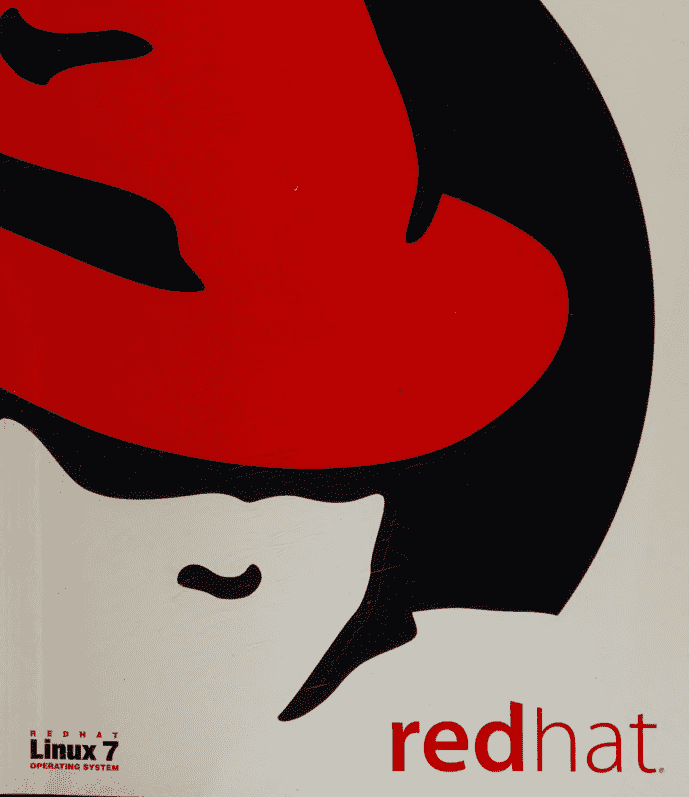


# 附录 1: 建议的 M&A 尽职调查指标列表

# 附录 2: 完成尽职调查报告（包括财务尽职调查）所需的参考文件列表

附录 3: 识别主要审计风险的建议文件和信息列表

附录 4: 指南

## 1 引言

欢迎来到*官方 Red Hat Linux 安装指南*。本手册将指导你完成 Red Hat Linux 的典型工作站级¹安装。一旦你按照本手册所述完成安装，你将拥有一个完全功能正常的 Red Hat Linux 桌面系统。

在本手册中，你将发现以下符号：

**提示**

有关安装选项和安装后配置的建议。

**请注意**

你可能在安装过程中发现有用的额外信息。

**警告**

指出某些选择或配置可能会导致系统设置出现问题。请在继续安装之前仔细阅读正文。

¹ 工作站级安装是家用或桌面机器的完美解决方案。它将为你提供一个图形化工作环境以及你开始工作所需的所有基本应用程序。

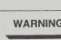

解释将发生的变化会对你的当前系统产生影响，例如删除现有数据。请仔细阅读以确定你做出的选择是否符合你的最佳利益。

## 1.1 如何使用本手册

本手册侧重于工作站级安装，非常适合 Red Hat Linux 的新用户，以及希望快速简单安装解决方案的用户。它将帮助你为系统安装做准备，引导你完成安装，并协助你配置 Red Hat Linux 系统。

对于需要执行*服务器*级²或*自定义*级³安装的用户，请参考文档 CD 上的*官方 Red Hat Linux 参考指南*。

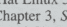

如果你目前使用 Red Hat Linux 3.0.3（或更高版本），你可以执行升级。浏览第 3 章 *七步助你入门* 以复习基础知识，然后阅读第 5 章 *从头到尾安装 Red Hat Linux*，并按照指示进行操作。一旦你在安装程序中选择了执行升级，请参阅附录 A *升级你的当前系统*。

如果你是一个经验丰富的用户，想要执行工作站级安装，但不需要复习基础知识，你可以跳过直接到第 5 章 *从头到尾安装 Red Hat Linux* 开始安装过程。

2 服务器级安装设置典型的服务器环境。请注意，服务器级安装期间不安装图形环境。

3 自定义级安装允许你选择和配置系统的每个选项。虽然这允许最灵活的安装，但不建议新用户尝试这种安装类型。


> **提示**
> 有关安装前、安装过程中或安装后可能遇到的问题及故障的解答，请参阅**红帽常见问题解答（FAQ）**。您可以在以下网址在线找到该 FAQ：www.redhat.com/support/docs/faqs/rhl_general_faq/FAQ.html

### 1.1.1 我们需要反馈！

如果您在安装指南中发现错别字，或者想到了让本手册变得更好的方法，我们非常乐意听取您的意见！请务必提及手册的标识符：

```
Inst (EN)-7.0-Print-RHL (2000-07-18T15:39-0400)
```

这样我们就能确切知道您持有的是哪一版本的指南。

请致信至：docs@redhat.com

如果您有改善文档的建议，在描述时请尽量具体。如果您发现了错误，请包含章节编号和部分周边文本，以便我们轻松定位。我们可能无法回复每一封来信，但请放心，我们一定会阅读所有来信！

如果您有技术支持方面的问题（例如，您需要帮助配置 X，或者不确定如何分区硬盘[盘]），请在 www.redhat.com/how 注册您的产品，并使用在线支持系统提出此类请求。

## 2 Red Hat Linux 7.0 的新功能

本章介绍 Red Hat Linux 7.0 中新增的安装功能。要了解与安装无关的新功能，请参阅文档光盘或在线（http://www.redhat.com/support/manuals）上的*《Red Hat Linux 官方参考指南》*。

### 2.1 安装相关增强功能

使安装过程更加简便的 Red Hat Linux 7.0 改进包括：

- **新的多光盘安装**
  随着安装程序不断扩展，红帽开发了一种能够从多张光盘安装 Red Hat Linux 的安装程序。

- **XFree 4.0**
  在安装期间配置 X 窗口系统从未如此全面。从选择监视器及其正确设置，到视频卡探测，再到测试您期望的 X 设置，Xconfigurator 将帮助您将所有设置调整至最佳状态。

- **USB 支持**
  Red Hat Linux 7.0 现在支持 USB 设备（鼠标和键盘）。有了 USB 支持，当添加新设备时无需重新启动——只需连接设备即可使用。

- **文本模式安装中可用的帮助文本**
  在文本模式安装程序中增加了帮助文本，以进一步协助您安装 Red Hat Linux 7.0。按[F1]即可启用该特定屏幕的帮助文本。按[Enter]关闭帮助文本屏幕。

- **新的 GNOME 默认窗口管理器**
  Sawfish 窗口管理器已被添加为 GNOME 桌面界面的新默认管理器。

- **LDAP 和 Kerberos 配置**
  通过在 Red Hat Linux 7.0 中增加 LDAP 和 Kerberos，网络安全得到了增强。有关这些程序的更多信息，请参阅*《Red Hat Linux 官方参考指南》*。

## 3 起步的七个步骤

在安装 Red Hat Linux 之前，您应执行以下七个步骤：

### 3.1 步骤 1 - 您是否拥有正确的 Red Hat Linux 组件？

如果您购买的是官方 Red Hat Linux 盒装套装，那就准备就绪了！不过，偶尔也会出错，所以现在是一个再次检查盒装套装内容的好时机。

在您的 Red Hat Linux 包装盒中，有一张红白相间的**注册卡**。该卡背面列出了您盒装套装版本的内容清单。请阅读此清单并检查，确保您拥有该版本附带的所有软盘和手册。

如果您是从 Red Hat, Inc.（或其分销商）处购买官方 Red Hat Linux 盒装套装，并且缺少清单中的一件或多件物品，请告知我们！联系信息也可在注册卡上找到。

*如何识别我们的官方盒装套装：* 我们包装盒底部有一个 ISBN 号码，位于其中一个条形码旁边。该 ISBN 号码应呈以下格式：

```
1-58569-xx-y
```

（xx 和 y 将是唯一的数字。）

红帽与各类公司（国际和国内）合作，以便以最便捷的形式向您提供 Red Hat Linux。由于这些合作伙伴关系，您可能会发现您的 Red Hat Linux 盒装套装实际上并非由红帽生产。

如果您的包装盒有不同的 ISBN 号码（或根本没有），您需要联系生产该盒装套装的公司。通常，第三方生产商会在包装盒外部包含其商标和/或联系信息；官方 Red Hat Linux 盒装套装仅列出我们的名称和联系信息。

#### 3.1.1 为什么应该注册您的 Red Hat Linux 盒装套装

如果您购买了官方的 Red Hat Linux 7.0 盒装套装，就应该注册您的产品。注册为您提供许多有用的服务，例如安装帮助支持、优先 FTP 访问等。

要注册您的产品，请访问 http://www.redhat.com/now。您将在官方 Red Hat Linux 盒装套装中的红白注册卡上找到您的个人产品 ID。一旦注册，您即可享受红帽为注册用户提供的各项额外服务。

有关注册及红帽技术支持服务范围的更多信息，请参阅附录 D，获取技术支持。

#### 3.1.2 没有盒装套装？没问题！

当然，并非每个人都购买 Red Hat Linux 盒装套装。使用其他公司创建的光盘甚至通过 FTP 安装 Red Hat Linux 也是完全可行的。在这些情况下，您可能需要创建一张或多张软盘才能开始。

有关通过 FTP 下载和安装 Red Hat Linux 的信息，请参阅 http://www.redhat.com/download/howto_download.html。

对于使用非红帽出品的光盘安装 Red Hat Linux 的用户，您可能需要一张启动盘，或者如果在安装期间使用 PCMCIA 设备（例如笔记本电脑），则需要一张 PCMCIA 启动盘。也有可能直接从光盘启动安装。当我们概述各种安装方法时，将会详细讨论这一点。

有关制作软盘的信息，请参阅 3.5.2 节，制作安装软盘。

### 3.2 步骤 2 - 您的硬件兼容吗？

如果您拥有旧系统或自行组装的系统，硬件兼容性尤为重要。Red Hat Linux 7.0 应与近两年内出厂组装的大多数系统中的硬件兼容。然而，鉴于硬件规格几乎每天都在变化，很难保证您的硬件能实现 100% 兼容。

首先，收集尽可能多的系统硬件信息；文档光盘上的《Red Hat Linux 官方参考指南》在“安装相关参考”部分（包括面向 Windows 用户的说明）提供了相关指导。在第 4 章，*系统要求表格*中，提供了一个可供您在安装期间填写和参考的表格。

其次，使用红帽的在线资源以确保您的硬件兼容和/或受支持。硬件兼容性列表位于：`http://www.redhat.com/hardware`。

### 3.3 步骤 3 - 您需要勘误表吗？

偶尔我们会发现安装可能会失败，需要修订的软盘镜像才能使安装正常工作。在这种情况下，我们会通过 Red Hat Linux 勘误表列提供特殊的镜像。鉴于这种情况相对罕见，如果您首先尝试使用标准软盘镜像，可以节省时间。只有在完成安装时遇到问题时，才需查看勘误表。

虽然大多数时候在安装前无需检查勘误表，但这也不失为一个好主意。

为方便您，红帽提供更新的软盘镜像、文档和其他勘误下载。

查看勘误表有两种方式：

- 1. 在线 -- `http://www.redhat.com/support/errata`；提供可供在线阅读的勘误信息，并且您可以轻松下载软盘镜像。
- 2. 电子邮件 -- 通过向 `errata@redhat.com` 发送一封空邮件，您将收到一封包含安装程序及相关软件完整勘误列表（如果当时存在勘误）的电子邮件。其中还包括每个更新包和勘误中软盘镜像的 URL。使用这些 URL，您可以下载任何必要的软盘镜像。请注意：传输软盘镜像时请使用二进制模式。

如果您遇到问题，请关注包含新软盘镜像的条目（文件名始终以 `.img` 结尾）。如果您找到适用于您问题的条目，请获取软盘镜像副本，并使用 3.5.2 节*制作安装软盘*中的说明进行创建。

也可提供文档勘误。当手册发生重大更改时，我们也会确保更新在线版本。文档更新可在 `http://www.redhat.com/support/errata/doc_errata` 找到。


## 3.4 步骤 4 - 您的磁盘空间是否足够？

几乎每个现代操作系统都使用磁盘分区，Red Hat Linux 也不例外。在安装 Red Hat Linux 时，可能需要处理磁盘分区。如果您以前没有处理过磁盘分区（或者希望快速复习基本概念），请在继续之前阅读文档光盘上《Red Hat Linux 官方参考指南》附录中的*磁盘分区简介*。

如果 Red Hat Linux 将与另一个操作系统共享您的系统，您需要确保硬盘上有足够的可用磁盘空间用于此次安装。

这些磁盘空间必须与您系统中安装的其他操作系统（如 Windows、OS/2 或甚至不同版本的 Linux）所使用的磁盘空间分开。这是通过将一个或多个分区专门用于 Red Hat Linux 来实现的。

在开始安装过程之前，必须满足以下其中一个条件：

-   您的计算机必须有足够的未分区磁盘空间。
-   您必须拥有一个或多个可以删除的分区，从而释放足够的磁盘空间来安装 Red Hat Linux。
-   您必须有一个预先存在且已格式化的 FAT（DOS）分区，具有足够的磁盘空间，并使用无分区安装方法（附录 B，*无分区安装*）进行安装。

> **请注意**
> 要执行无分区安装，您还必须选择要执行的安装类别。然而，与典型安装不同，您不必担心丢失系统上的任何信息。无分区安装不会删除现有分区。有关更多信息，请参见附录 B，*无分区安装*。

工作站级安装至少需要 900MB 的空闲空间。此安装大小要求与无分区安装相同。

> **请注意**
> 要使用 Red Hat Linux 的自动分区功能，您必须有足够的可用空闲磁盘空间（900MB 或更多），否则该选项在安装过程中不会出现。

如果您不确定是否满足这些条件，或者想知道如何为 Red Hat Linux 安装释放更多空间，请参见文档光盘上《Red Hat Linux 官方参考指南》中的分区附录。

## 3.5 步骤 5 - 您可以使用 Red Hat Linux CD-ROM 进行安装吗？

虽然有多种方法可以安装 Red Hat Linux，但本手册仅重点介绍从 CD-ROM 进行安装。有关替代安装方法的说明，请参见文档光盘上的《Red Hat Linux 官方参考指南》。

从 CD 安装要求您已购买 Red Hat Linux 7.0 盒装套装（或拥有 Red Hat Linux CD-ROM）并拥有 CD-ROM 驱动器。大多数新计算机都允许从 CD-ROM 启动。使用此方法，您可以轻松使用 Red Hat Linux CD-ROM 启动安装程序并执行本地 CD-ROM 安装。

### 3.5.1 替代启动方法

如果无法从 CD-ROM 驱动器启动，可以使用替代启动方法。

#### 本地启动盘

-   如果无法从 CD-ROM 驱动器启动，您可能需要一个**本地启动盘**或**PCMCIA 启动盘**。
-   您的*Red Hat Linux 7.0 官方*盒装套装中附带了一个本地启动盘。然而，如果您没有本地启动盘（例如，您下载了 Red Hat Linux 而不是购买官方盒装套装），您可以自行制作一个。有关说明，请参见第 3.5.2 节，*制作安装软盘*。

#### PCMCIA 启动盘

如果您使用 PCMCIA 设备安装 Red Hat Linux，则可能需要 PCMCIA 启动盘。如果需要 PCMCIA 启动盘，您必须创建一个。有关说明，请参见第 3.5.2 节，*制作安装软盘*。

以下是一个检查清单，可帮助您确定是否需要创建 PCMCIA 启动盘：

-   您将从 CD-ROM 安装 Red Hat Linux，并且您的 CD-ROM 驱动器通过 PCMCIA 卡连接到计算机。
-   您将在安装过程中使用 PCMCIA 网络适配器。

PCMCIA 启动盘的镜像文件是**pcmcia.img**，位于您的 Red Hat Linux/Intel CD 上的**images**目录中。有关更多信息，请参见第 3.5.2 节，*制作安装软盘*。

> **请注意**
> 虽然启动安装程序不要求必须有驱动程序盘，但您偶尔可能会发现需要驱动程序盘才能继续安装。《Red Hat Linux 官方参考指南》（位于文档光盘上）中的**驱动程序盘**附录解释了为什么安装可能需要驱动程序盘，以及如果需要如何获取。

### 3.5.2 制作安装软盘

有时需要从**镜像文件**创建软盘；例如，您可能需要使用从 Red Hat Linux 勘误页获得的更新镜像文件，或者可能需要创建启动盘。

镜像文件包含软盘内容的精确副本（或镜像）。由于软盘除了文件中的数据外还包含文件系统信息，因此镜像文件在写入软盘之前是不可用的。

首先，您需要一张空白、已格式化的高密度（1.44MB）3.5 英寸软盘。您需要访问一台具有 3.5 英寸软盘驱动器并且能够运行 MS-DOS 程序或大多数基于 Linux 的操作系统中找到的**dd**工具的计算机。

您的 Red Hat Linux CD 上的**images**目录包含 Red Hat Linux/Intel 的启动镜像。选择正确的镜像后，将镜像文件传输到软盘上。

#### 在 MS-DOS 下制作软盘

要在 MS-DOS 下制作软盘，请使用 Red Hat Linux CD 中 `dosutils` 目录里包含的 `rawrite` 工具。首先，适当地标记一张空白、已格式化的 3.5 英寸软盘（如“Boot Disk”或“Updates Disk”）。将其插入软盘驱动器。然后，使用以下命令（假设您的 CD 是 d: 驱动器）：

```text
C:\> d:
D:\> cd \dosutils
D:\dosutils> rawrite
Enter disk image source file name: ..\images\boot.img
Enter target diskette drive: a:
Please insert a formatted diskette into drive A: and
press --ENTER-- : [Enter]
D:\dosutils>
```

首先，`rawrite` 询问软盘镜像的`文件名`；输入您要写入的镜像的目录和名称（例如，`..\images\boot.img`）。然后 `rawrite` 询问要写入镜像的软盘驱动器；输入 `a:`。最后，`rawrite` 要求确认所选驱动器中是否有一张已格式化的软盘。按[Enter]确认 after，`rawrite` 将镜像文件复制到软盘上。如果需要制作另一张软盘，标记该软盘，并再次运行 `rawrite`，指定相应的镜像文件。

#### 在 Linux 类操作系统下制作软盘

要在 Linux（或任何其他 Linux 类操作系统）下制作软盘，您必须具有写入代表 3.5 英寸软盘驱动器（在 Linux 下称为 `/dev/fd0`）的设备权限。

首先，适当地标记一张空白、已格式化的软盘（如“Boot Disk”或“Updates Disk”）。将其插入软盘驱动器（但不要发出 `mount` 命令）。挂载 Red Hat Linux CD 后，更改目录至包含所需镜像文件的目录，并使用以下命令（根据情况更改镜像文件名称和软盘设备）：

```bash
# dd if=boot.img of=/dev/fd0 bs=1440k
```

要制作另一张软盘，标记该软盘，并再次运行 `dd`，指定相应的镜像文件。

## 3.6 步骤 6 - 工作站级安装最适合您吗？

虽然 Red Hat Linux 包含四种不同的安装类别或类型，但本手册仅讨论工作站级安装。

### 3.6.1 工作站级安装将执行的操作

在选择自动分区时，工作站级安装将删除所有已安装硬盘上所有与 Linux 相关的分区（并使用所有空闲的未分区磁盘空间）来创建以下分区：

-   一个 64MB 的交换分区。
-   一个可变大小的根分区（挂载为 /），其中存储所有其他文件（此分区的确切大小取决于您的可用磁盘空间）。
-   一个 16MB 的分区（挂载为 /boot），其中存放 Linux 内核和相关文件。

> **请注意**
> 要执行工作站级安装，您需要至少 900MB 的空闲磁盘空间。

此安装将删除系统中*所有*硬盘上*所有*现有的 Linux 分区；非 Linux 分区将不会被删除。

工作站级安装将安装您选择的 GNOME 或 KDE（或两者）桌面环境，以及 X 窗口系统。

### 3.6.2 工作站级安装将不执行的操作

工作站级安装不会清除您的 Windows 3.1/95/98 配置。相反，它会自动配置您的系统使用 LILO（Linux 加载器）进行双启动。

工作站级安装不允许您自定义组包选择。如果您不希望安装程序为您选择软件包，请选择自定义类安装并参见文档光盘上的《Red Hat Linux 官方参考指南》。


如果您计划创建以 Windows NT 为第二操作系统的双启动系统，则工作站级别的安装无法正确完成。如果您与 Windows NT 共享系统，您将无法启动 Windows NT。LILO 会覆盖 NT 的引导加载程序，导致您无法启动 NT。您必须执行自定义级别安装，并配置 LILO，使其不安装到主引导记录（MBR）上。

## 请注意

与早期工作站级别的安装不同，执行 Red Hat Linux 7.0 工作站级别的安装时，不会安装网络守护进程 xinetd（inet 服务）。保留 xinetd 可获得更安全的安装；但是，入站¹与网络相关的服务，如 finger、telnet、talk 和 FTP 将无法正常工作。如果您需要这些类型的服务，请选择服务器级别或自定义级别安装。

¹ 入站服务意味着，例如，您可以 telnet 到其他系统，但其他系统无法 telnet 到您的系统。

请使用提供的空间填写您的系统设置和需求。这将有助于您记录当前系统信息，并使安装过程更加顺利。

| 项目 | 描述 | 编号 |
| :--- | :--- | :--- |
| 硬盘：类型、标签、大小；例如：IDE hda=1.2G | | 1) |
| 分区：分区图和挂载点；例如：/dev/hda1= /home, /dev/hda2= /（在您知道它们位于何处后填写此项）。 | | 2) |
| 内存：系统中安装的 RAM 数量；例如：64MB, 128MB | | 3) |
| CD-ROM：接口类型；例如：SCSI, IDE (ATAPI) | | 4) |
| SCSI 适配器：如果存在，制造商和型号；例如：BusLogic SCSI 适配器, Adaptec 2940UW | | 5) |
| 网卡：如果存在，制造商和型号；例如：Tulip, 3COM 3C590 | | 6) |
| *鼠标：* 类型、协议和按钮数量；例如：通用 3 键 PS/2 鼠标，MouseMan 2 键串口鼠标 | | 7) |
| *显示器：* 制造商、型号和规格；例如：Optiquest Q53, ViewSonic G773 | | 8) |
| *显卡：* 制造商、型号和 VRAM 大小；例如：Creative Labs Graphics Blaster 3D, 8MB | | 9) |
| *声卡：* 制造商、芯片组和型号；例如：S3 SonicVibes, Sound Blaster 32/64 AWE | | 10) |
| *IP、DHCP 和 BOOTP 地址：* 四个由点分隔的数字；例如：10.0.2.15 *（请联系您的网络管理员寻求帮助）* | | 11) |
| *子网掩码：* 通常是四个由点分隔的数字；例如：255.255.248.0 *（请联系您的网络管理员寻求帮助）* | | 12) |
| 网关 IP 地址：四个由点分隔的数字；例如：10.0.2.245（请联系您的网络管理员寻求帮助） | | 13) |
| 一个或多个名称服务器 IP 地址（DNS）：通常是一个或多个由点分隔的数字组；例如：10.0.2.1（请联系您的网络管理员寻求帮助） | | 14) |
| 域名：分配给贵组织的名称；例如：Red Hat 的域名是 redhat.com（请联系您的网络管理员寻求帮助） | | 15) |
| 主机名：您的计算机名称；您个人选择的名称，例如：cookie, southpark（请联系您的网络管理员寻求帮助） | | 16) |

# 5 从头到尾安装 Red Hat Linux

本章讨论了 Red Hat Linux 工作站级别安装的所有步骤。我们将涵盖以下领域：

- 熟悉安装程序的图形用户界面
- 启动安装程序
- 选择安装方法
- 安装过程中的配置步骤（语言、键盘、鼠标等）
- 完成安装

到本章结束时，您的系统上将安装好 Red Hat Linux 7.0。

## 5.1 安装程序图形用户界面

如果您之前使用过**图形用户界面 (GUI)**，您就会熟悉这个过程。如果没有，只需使用鼠标导航屏幕，“点击”按钮或输入文本字段。您也可以使用 [Tab] 键和 [Enter] 键在安装过程中进行导航。

如果您不希望使用 GUI 安装程序，也可以使用文本模式安装程序。要进入文本模式，请输入以下引导命令：

```
boot: text
```

### 5.1.1 未检测到鼠标？

如果出现 **Mouse Not Detected**（未检测到鼠标）屏幕（见图 5-1，*未检测到鼠标*），则说明安装程序无法正确识别您的鼠标。

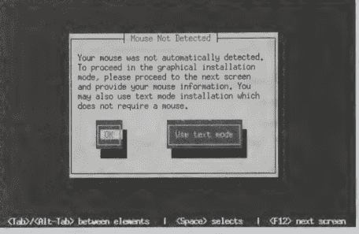

*图 5–1 未检测到鼠标*

您可以选择继续 GUI 安装或使用文本模式安装，后者不需要使用鼠标。如果您选择继续 GUI 安装，您将需要提供安装程序您的鼠标配置信息（见图 5-4，*鼠标配置*）。

有关文本模式工作站级别安装的说明，请参阅第 6 章 *文本模式安装一览*。

有关文本模式自定义安装的说明，请参阅文档光盘上的《*Red Hat Linux 官方参考指南*》。

### 5.1.2 关于虚拟控制台的说明

Red Hat Linux 安装程序提供的不仅仅是安装过程的对话框。您可以获取多种类型的诊断消息，此外，我们还为您提供了一种从 shell 提示符输入命令的方式。此信息在五个**虚拟控制台**上显示，您可以通过单个按键在它们之间切换。

如果在安装 Red Hat Linux 时遇到问题，这些虚拟控制台非常有用。在安装控制台或系统控制台上显示的消息可以帮助定位问题。请参阅表 5–1 *控制台、按键和内容*，查看虚拟控制台、切换到它们的按键及其内容的列表。

通常，除非您正在尝试诊断安装问题，否则没有理由离开默认控制台（虚拟控制台 #7）。但如果您感到好奇，请随意查看。

### 表 5–1 控制台、按键和内容

| 控制台 | 按键 | 内容 |
| :--- | :--- | :--- |
| 1 | [Ctrl]+[Alt]+[F1] | 安装对话框 |
| 2 | [Ctrl]+[Alt]+[F2] | shell 提示符 |
| 3 | [Ctrl]+[Alt]+[F3] | 安装日志（来自安装程序的消息） |
| 4 | [Ctrl]+[Alt]+[F4] | 系统相关消息 |
| 5 | [Ctrl]+[Alt]+[F5] | 其他消息 |
| 7 | [Ctrl]+[Alt]+[F7] | X 图形显示 |

## 5.2 启动安装程序

现在是时候开始安装 Red Hat Linux 了。要启动安装，您必须先引导安装程序。请确保您拥有安装所需的所有资源。如果您已经阅读过第 3 章 *七步快速入门* 并按照说明操作，您应该已准备就绪。

> **请注意**
> 
> 偶尔，某些硬件组件在安装期间需要**驱动磁盘**。驱动磁盘可以由 Red Hat 制作，也可以是您自己制作的磁盘，或者是硬件供应商随硬件附带的磁盘。查找驱动磁盘的另一个来源是 http://www.redhat.com/support/errata/。
> 
> 如果出现提示您插入驱动磁盘的屏幕，请照做。有关驱动磁盘的更多信息，请参阅文档光盘上的《*Red Hat Linux 官方参考指南*》中的 *附录 C，驱动磁盘*。

### 5.2.1 引导安装程序

**请注意**

如果您需要制作启动磁盘，请参阅 3.5.2 节 *制作安装软盘*。

将启动磁盘插入计算机的第一个软盘驱动器并重新启动（如果您的计算机支持此功能，也可以从 CD-ROM 启动）。

您可能需要更改 BIOS 设置，以允许您从软盘或 CD-ROM 启动。

**提示**

要更改 BIOS，请注意计算机首次开始启动时给出的说明。通常您会看到一行文字，告诉您要按 [Del] 键或 [F1] 键进入 BIOS 设置。

接下来，找到可以更改启动顺序的部分。默认值通常是 C, A 或 A, C（具体取决于您是从硬盘 [C] 还是软盘驱动器 [A] 启动）。更改此顺序，使 CD-ROM 成为启动顺序中的第一项，而 C 或 A（无论是您的典型启动默认值）成为第二项。这将指示计算机首先查找 CD-ROM 驱动器中的可启动介质；如果在那里找不到，它将接下来查找您的硬盘或软盘。

退出 BIOS 前请保存您的更改。有关更多信息，请参阅随系统提供的文档。

工作站级别的启动方法有三种：

- *可启动 CD-ROM* -- 您的机器支持可启动 CD-ROM 驱动器，并且您希望执行本地 CD-ROM 安装。
- *本地启动磁盘* -- 您的机器不支持可启动 CD-ROM，并且您希望从本地 CD-ROM 或硬盘安装。


#### PCMCIA 启动盘
在您需要 PCMCIA 支持，但您的机器不支持从 CD-ROM 驱动器启动，*或者*您需要在系统中使用 PCMCIA 支持才能使用 CD-ROM 驱动器的情况下使用。此启动盘提供所有安装方法（CD-ROM、硬盘、NFS、FTP 和 HTTP）。

短暂的延迟后，屏幕上应会出现 *boot :* 提示符。屏幕包含各种启动选项的信息。每个启动选项还关联有一个或多个帮助屏幕。要访问帮助屏幕，请按下屏幕底部列出的相应功能键。

您应该牢记两点：

- 如果您在一分钟内不采取任何操作，初始屏幕将自动启动安装程序。要禁用此功能，请按下其中一个帮助屏幕功能键。
- 如果您按下帮助屏幕功能键，当从安装介质读取帮助屏幕时，会有轻微的延迟。

通常，您只需按 `Enter` 即可启动。查看启动信息，以了解 *Linux* 内核是否检测到您的硬件。如果未能正确检测硬件，您可能需要以“专家”模式重新启动安装。如果硬件被正确检测到，请继续下一节。有关“专家”模式的更多信息，请参见文档 CD 中《*官方 Red Hat Linux 参考指南*》中*通过 GUI 安装 Red Hat Linux* 一章的*启动安装程序*部分。

## 不使用软盘启动

另一种不使用启动盘开始安装的方法取决于您的系统上是否有 *MS-DOS*。以下方法仅适用于基于 Intel 的计算机。

假设您的 CD-ROM 是驱动器 *a*:，请使用以下命令：

```
C:\>  *a*:
D:\>  *cd \dosutils*
D:\dosutils> *autoboot.bat*
```

如果在 DOS 窗口中运行，此方法将不起作用——*autoboot.bat* 文件必须执行，且 DOS 是唯一的操作系统。换句话说，您应该重新启动系统并选择“在 MS-DOS 模式下重新启动”。

如果您的计算机无法直接从 CD-ROM 启动（且您不能使用基于 DOS 的自动启动），则必须使用启动软盘来启动。

### 5.3 选择安装方法

接下来，系统将要求您选择希望使用的安装方法类型。就我们的目的而言，请选择 **CD-ROM**。然而，您可以通过以下基本方法之一安装 Red Hat Linux：

- **CD-ROM**
  - 如果您有 CD-ROM 驱动器和 Red Hat Linux CD-ROM。需要启动盘、可引导 CD-ROM 或 PCMCIA 启动盘。有关进一步说明，请参阅*5.4 开始安装*部分。
- **硬盘**
  - 如果您已将 Red Hat Linux 文件复制到本地硬盘。有关硬盘安装说明，请参阅文档 CD 上的《*官方 Red Hat Linux 参考指南*》。需要启动盘或 PCMCIA 启动盘。
- **NFS 映像**
  - 如果您正在从导出 Red Hat Linux CD-ROM 或 Red Hat Linux 镜像映像的 NFS 映像服务器进行安装。需要网络或 PCMCIA 启动盘。有关网络安装说明，请参阅文档 CD 上的《*官方 Red Hat Linux 参考指南*》。请注意：NFS 安装也可以在 GUI 模式下进行。
- **FTP**
  - 如果您正在直接从 FTP 服务器安装。需要网络或 PCMCIA 启动盘。有关 FTP 安装说明，请参阅文档 CD 上的《*官方 Red Hat Linux 参考指南*》。
- **HTTP**
  - 如果您正在直接从 HTTP Web 服务器安装。需要网络或 PCMCIA 启动盘。有关 HTTP 安装说明，请参阅文档 CD 上的《*官方 Red Hat Linux 参考指南*》。

### 5.4 开始安装

如果您计划通过图形界面使用 CD-ROM 进行安装，请继续阅读。

**请注意**

如果您更喜欢执行文本模式自定义类安装，请重新启动系统，并在 **boot** : 提示符处键入 **text**。有关进一步说明，请参阅文档 CD 上的《*官方 Red Hat Linux 参考指南*》。文本模式工作站类安装说明可在第 6 章*文本模式安装概览*中找到。

#### 5.4.1 从 CD-ROM 安装

要从 CD-ROM 安装 Red Hat Linux，请选择 **CD-ROM** 并选择 **确定**。当提示时，将 Red Hat Linux CD 插入您的 CD-ROM 驱动器（如果您没有从 CD-ROM 启动）。选择 **确定**，然后按 [Enter]。

安装程序随后将探测您的系统并尝试识别您的 CD-ROM 驱动器。它将首先查找 IDE（也称为 ATAPI）CD-ROM 驱动器。如果找到，您将继续安装过程的下一阶段（参见第 5.5 节，*语言选择*）。

如果未检测到驱动器，系统会询问您拥有哪种类型的 CD-ROM 驱动器。从以下类型中选择：

- SCSI
  - 如果您的 CD-ROM 驱动器连接到受支持的 SCSI 适配器，请选择此项；安装程序随后将要求您选择一个 SCSI 驱动器。选择与您的适配器最相似的驱动器。如有必要，您可以指定驱动器的选项；然而，大多数驱动器会自动检测您的 SCSI 适配器。
- 其他
  - 如果您的 CD-ROM 驱动器既不是 IDE 也不是 SCSI，那么它是“其他”。具有专有 CD-ROM 接口的声卡是这种 CD-ROM 类型的良好示例。安装程序会列出受支持的 CD-ROM 驱动器的驱动器列表——选择驱动器并，如有必要，指定任何驱动器选项。


CD-ROM 驱动器的可选参数部分列表可在《官方 Red Hat Linux 参考指南》的通用参数和模块附录中找到。

### 如果未找到 IDE CD-ROM 怎么办？

如果安装程序未能找到您的 IDE（ATAPI）CD-ROM（它会询问您拥有哪种类型的 CD-ROM 驱动器），请重新启动安装，并在 boot: 提示符处输入 `linux hdx=cdrom`。根据单元连接的接口以及它是配置为主设备还是从设备，用以下字母之一替换 x：

- a - 第一个 IDE 控制器，主设备
- b - 第一个 IDE 控制器，从设备
- c - 第二个 IDE 控制器，主设备
- d - 第二个 IDE 控制器，从设备

（如果您有第三和/或第四个控制器，只需继续按字母顺序分配字母，从控制器到控制器，从主设备到从设备。）

一旦识别出来，系统将要求您将 Red Hat Linux CD 插入您的 CD-ROM 驱动器。完成后选择确定。短暂延迟后，下一个对话框将出现。


如果要在此时中止安装过程，请重新启动机器并弹出启动盘或 CD-ROM。您可以在“即将安装”屏幕（参见第 5.17 节，准备安装）之前的任何安全点中止安装。

### 5.5 语言选择

使用鼠标选择您希望在安装过程中使用的语言以及系统默认语言（参见图 5-2，*语言选择*）。

选择合适的语言还有助于稍后在安装过程中定位您的时区配置。安装程序将尝试根据您的指定定义适当的时区。

**图 5–2 语言选择**

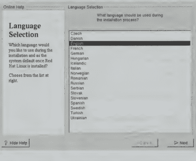

### 5.6 键盘配置

选择最适合您系统的模型（参见图 5–3，*键盘配置*）。如果您找不到完全匹配项，请选择适合您的键盘类型的最佳 **通用** 匹配项（例如，**通用 101 键 PC**）。

接下来，选择您键盘的正确布局类型（例如，美国英语）。

使用多击按键创建特殊字符（如 N, Ö, 和 Ç）是通过“死键”（也称为组合键序列）完成的。死键默认启用。如果您不希望使用它们，请选择 **禁用死键**。

要测试您的键盘配置，请使用屏幕底部的空白文本字段输入文本。


### 提示

安装完成后更改键盘类型的方法：请成为 root 用户，然后使用 `/usr/sbin/kbdconfig` 命令，或者在 root 提示符（显示为 `[root@localhost root]#`）下输入 `setup`。

要成为 root 用户，请在终端窗口的 shell 提示符下输入 `su`，然后按 [Enter]。接着，输入 root 密码并按 [Enter]。

### 图 5–3 键盘配置

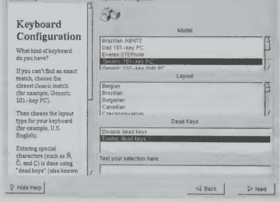

### 5.7 鼠标配置

请选择适合您系统的正确鼠标类型。如果找不到完全匹配的选项，请选择一个您确信与您的系统兼容的鼠标类型（见图 5–4，鼠标配置）。

要确定您的鼠标接口，请沿着鼠标线追踪到它插入系统的位置。如果鼠标线末端的连接器插入的是矩形接口，那么您使用的是串行鼠标；如果连接器是圆形的，那么您使用的是 PS/2 鼠标。如果您正在笔记本电脑上安装 Red Hat Linux，在大多数情况下，指点设备将与 PS/2 兼容。

如果您找不到确信与系统兼容的鼠标，请根据您的鼠标按钮数量及其接口，选择其中一个 *Generic*（通用）选项。

### 图 5–4 鼠标配置

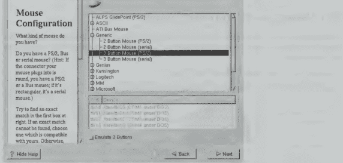

如果您使用的是 PS/2 或 Bus（总线）鼠标，则不需要选择端口和设备。如果您使用的是串行鼠标，则应选择您的串行鼠标所在的正确端口和设备。

*Emulate 3 Buttons*（模拟 3 个按钮）复选框允许您将双按钮鼠标当作三按钮鼠标使用。如果选中此复选框，您可以同时按下两个鼠标按钮来模拟第三个“中”按钮。通常，如果您拥有三按钮鼠标，使用 X Window System 会更容易。

### 提示

安装完成后更改鼠标配置的方法：请成为 root 用户。然后，您可以从 shell 提示符使用 `/usr/sbin/mouseconfig` 命令。

要将鼠标配置为左手鼠标，您可以重置鼠标按钮的顺序。这可以在启动您的 Red Hat Linux 系统后完成，方法是成为 root 用户并在 shell 提示符下输入 `gpm -B 321`。

### 5.8 欢迎使用 Red Hat Linux

欢迎屏幕（见图 5-5，*欢迎使用 Red Hat Linux*）不会提示您输入任何安装信息。请阅读左侧面板中的帮助文本以获取更多说明和信息。

### 图 5-5 欢迎使用 Red Hat Linux

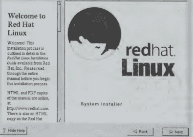

**帮助屏幕** 默认是打开的，但如果您不想查看帮助信息，请点击 **Hide Help**（隐藏帮助）按钮以最小化该屏幕。

点击 **Next**（下一步）按钮以继续。

### 5.9 安装选项

> **请注意**
> 功能：Red Hat Linux 7.0 具有一种称为“无分区”的安装方法。如果您的系统有一个具有足够可用空间的 FAT (DOS/Windows) 分区，您可以在不重新分区硬盘的情况下安装 Red Hat Linux。这种方法非常适合 Linux 初学者，他们希望以最小的干扰来尝试 Red Hat Linux。要了解有关此方法的更多信息，请参阅附录 B，*无分区安装*。

Red Hat Linux 允许您选择最适合您需求的安装类型。您的选项包括：**工作站**、**服务器**、**自定义** 或 **升级**。

> **警告**
> 在另一个 Linux 安装（包括 Red Hat Linux）之上安装 Red Hat Linux *不会* 保留任何先前安装的信息（文件或数据）。请务必保存任何重要文件！如果您担心保存现有系统上的当前数据（而不自行进行备份），应考虑执行升级（见附录 A，*升级您的当前系统*）。

### 图 5-6 选择安装或升级

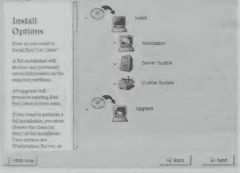

选择特定的安装类型也决定了您应该去哪里查找关于该选择的文档。

- * 图形工作站安装 -- 官方 Red Hat Linux 安装指南（本章，请继续阅读）
- * 图形服务器安装 -- 文档 CD 上的官方 Red Hat Linux 参考指南；章节：*通过 GUI 安装 Red Hat Linux*
- * 图形自定义安装 -- 文档 CD 上的官方 Red Hat Linux 参考指南；章节：*通过 GUI 安装 Red Hat Linux*
- * 文本模式工作站安装 -- 官方 Red Hat Linux 安装指南；章节 *以文本模式安装*
- * 文本模式服务器安装 -- 文档 CD 上的官方 Red Hat Linux 参考指南；章节：*通过文本模式安装 Red Hat Linux*
- * 文本模式自定义安装 -- 文档 CD 上的官方 Red Hat Linux 参考指南；章节：*通过文本模式安装 Red Hat Linux*

### 5.9.1 选择工作站安装

> **警告**
>
> 工作站类安装将擦除 *您计算机所有硬盘中所有 Linux 相关分区中的所有信息*。

您通常将 Red Hat Linux 安装在干净的磁盘分区或分区组上，或者覆盖在另一个 Linux 安装之上。

> **警告**
>
> 如果您与 Windows NT 共享磁盘，请勿选择工作站类安装；如果这样做，您将无法引导 Windows NT。LILO 会覆盖 NT 的引导加载程序，您将无法引导 NT。您必须执行自定义类安装，并配置 LILO，使其不安装在主引导记录（MBR）上。
>
> 要在当前装有 NT 的系统上创建双引导环境，您必须将 LILO 安装在根分区的第一扇区，而不是 MBR。请务必创建一张启动磁盘。在这种情况下，您要么使用启动磁盘，要么配置 NT 系统加载程序从根分区的第一扇区引导 LILO。请务必查阅 http://www.linux-doc.org/HOWTO/mini/Linux+NT-Loader.html 以获取更多关于设置 LILO 和 NT 的信息。

### 5.10 自动分区

自动分区允许您在不自行分区硬盘的情况下执行安装。如果您对于手动分区系统感到不舒服，选择自动分区是最佳解决方案。

**自动分区** 屏幕仅在执行工作站或服务器类安装时才会显示。

如果您选择手动分区，请参阅文档 CD 上的 *官方 Red Hat Linux 参考指南*；参见章节 *通过 GUI 安装 Red Hat Linux*。

### 请注意

如果未出现 **自动分区** 屏幕，则说明此安装选项没有足够的可用空间。您可以退出安装程序以腾出空间，或者手动分区。

### 图 5-7 自动分区

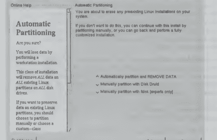

在此屏幕上，您可以选择继续此安装，使用 **Disk Druid** 进行**手动**分区，使用 **fdisk** 进行手动分区，或者使用 **Back**（后退）按钮选择其他安装方法（见 *图 5-7，自动分区*）。

### 请注意

使用 Disk Druid 或 fdisk 进行手动分区超出了本手册的范围。虽然会简要讨论 Disk Druid，但关于 Disk Druid 和 fdisk 的详细信息可在文档 CD 上的 *官方 Red Hat Linux 参考指南* 中找到。

在工作站类安装中，自动分区会在您硬盘的可用空间中为您创建 /（根）、<swap> 和 /boot 分区。

如果您*不想*丢失部分或全部数据，则应手动分区或选择其他安装类别。

### 注意

*工作站类安装将删除当前所有现有 Linux 分区上的所有数据*。

如果不想将 Red Hat Linux 安装在主引导记录（MBR）上，或者想使用除 LILO 以外的引导管理器，请勿选择此安装方法。

如果您不确定系统应如何分区，请阅读文档 CD 上 *官方 Red Hat Linux 参考指南* 中关于分区的章节。

### 5.11 手动分区您的系统

如果您选择了 *自动分区*，请跳到第 5.12 节，*网络配置*。

有关 fdisk 的信息，请参阅文档 CD 上的 *官方 Red Hat Linux 参考指南*。

现在需要告知安装程序应该在何处安装 Red Hat Linux。这是通过为安装 Red Hat Linux 的一个或多个磁盘分区定义 *挂载点* 来完成的。

*脚注 1：挂载点定义为目录，例如 /（根），文件系统挂载后通过该目录变得可访问。*


将安装 Linux。此时您可能还需要创建和/或删除分区（参见图 5–8，使用 Disk Druid 进行分区）。

## 请注意

如果您尚未规划好如何设置分区，请参阅《*红帽 Linux 官方参考指南*》中的分区附录。至少需要 900M 的根分区和 16 MB 的交换分区。

## 图 5–8 使用 Disk Druid 进行分区

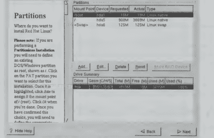

Red Hat Linux 7.0 中使用的分区工具是 Disk Druid。除了某些特殊的情况外，Disk Druid 可以处理典型 Red Hat Linux 安装的分区需求。

除非您有特定的理由，否则我们建议您创建以下分区：

### 第 5.11 节：手动对系统进行分区

- 交换分区（至少 16MB）—— 交换分区用于支持虚拟内存。换句话说，当 RAM 不足以存储系统正在处理的数据时，数据会被写入交换分区。如果您的计算机拥有 16MB 或更少的 RAM，您*必须创建*交换分区。即使您拥有更多的内存，仍建议使用交换分区。您的交换分区的最小尺寸应等于系统中的 RAM 量或 16MB（取两者中较大的值）。在 Disk Druid 中，*swap* 的分区字段应类似于：` <Swap>  hda2  125M  125M  Linux  swap`
- */boot* 分区（最大 16MB）—— 挂载在 */boot* 上的分区包含操作系统内核（允许系统启动 Red Hat Linux），以及引导过程中使用的文件。由于大多数 PC BIOS 的限制，创建一个小分区来容纳这些文件是个好主意。该分区不应超过 16MB。在 Disk Druid 中，*/boot* 的分区字段应类似于：` /boot  hda1  16M  19M  Linux  native`
- 根分区（900MB-1.7GB）—— 这是 "/"（根目录）所在的位置。在此配置中，除了存储在 */boot* 中的文件外，所有文件都位于根分区上。900MB 的根分区将允许进行工作站级别的安装（剩余空间极少），而 1.7GB 的根分区则允许您安装 Red Hat Linux 中的每个软件包。在 Disk Druid 中，*/ 的分区字段应类似于：` /  hda2  900M  3669M  Linux  native`

#### 5.11.1 添加分区时的问题

如果您尝试添加分区，但 Disk Druid 无法执行您的请求，您将看到一个对话框，列出了当前**未分配**的分区以及无法分配的原因。未分配的分区也会显示在 Disk Druid 的主屏幕上（您可能需要滚动浏览“分区”部分才能看到它们）。

要修复请求中未分配的分区，您必须将该分区移动到另一个有空闲空间的驱动器，调整分区大小以适应当前驱动器，或完全删除该分区。通过选择某个分区并使用**编辑**按钮或双击该分区来进行更改。

#### 5.11.2 选择要格式化的分区

选择您想要格式化的分区。所有新创建的分区都应进行格式化。包含您不再需要的数据的现有分区也应进行格式化（参见图 5–9，*选择要格式化的分区*）。

## 图 5–9 选择要格式化的分区

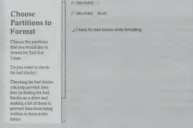

检查坏块可以通过定位驱动器上的坏块并列出它们以防止将来使用，从而帮助防止数据丢失。如果您希望在格式化每个文件系统时检查坏块，请务必选中**检查坏块**选项。

## 请注意

> 选中**检查坏块**可能会显著增加您的总安装时间。由于大多数较新的硬盘体积相当大，根据硬盘的大小，检查坏块可能需要一些时间。

### 5.12 网络配置

如果没有网卡，您将看不到此屏幕。请跳至下一节，第 5.13 节，时区配置。

如果您有网卡，现在您可以配置网络（如图 5–10，网络配置所示）。

选择您的设备类型以及是否希望使用 DHCP（动态主机配置协议）进行配置。如果您有多个以太网设备，每个设备将保留您提供的信息。您可以在设备之间切换，例如 eth0 和 eth1，您提供的信息将特定于每个设备。如果您选中**开机时激活**，您的网络接口将在启动时启动。如果您没有 DHCP 客户端访问权限或不确定正确的配置，请联系您的网络管理员。

接下来，在适用的情况下，输入**IP 地址**、**子网掩码**、**网络**和**广播**地址。如果您对其中任何一项不确定，请联系您的网络管理员。

## 图 5–10 网络配置

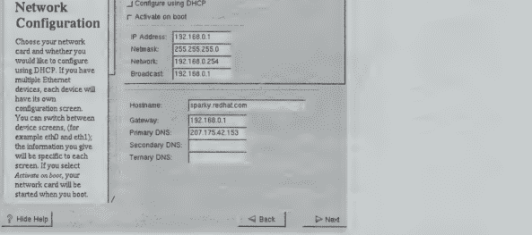

如果您有网卡，请按照以下格式输入完全限定域名：*host-name.domain.name*

> **提示**
> 
> 即使您的计算机不是网络的一部分，您也可以为系统输入一个主机名。利用这个机会输入一个*名称*；如果您没有输入，您的系统将被称为 `localhost`。

最后，输入**网关**和**主 DNS**（以及如果适用的**辅助 DNS**和**第三 DNS**）地址。

### 5.13 时区配置

您可以通过选择计算机的物理位置，或根据时区相对于协调世界时（也称为 UTC）的偏移来设置时区。

## 图 5-11 配置时区

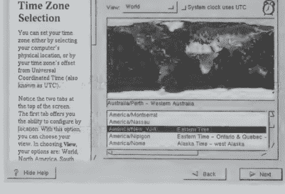

注意屏幕顶部的两个选项卡（见图 5-11，配置时区）。第一个选项卡允许您按位置进行配置。使用此选项，您可以选择您的视图。在选择视图时，您的选项有：**世界**、**北美**、**南美**、**太平洋沿岸**、**欧洲**、**非洲**和**亚洲**。

从交互式地图中，您还可以单击特定城市，如黄色点所示；红色的**X**将出现以表示您的选择。您也可以滚动浏览列表并选择您想要的时区。

第二个选项卡允许您使用 UTC 偏移。UTC 为您提供偏移列表供选择，以及设置夏令时的选项。

对于两个选项卡，都有选择**系统时钟使用 UTC**的选项。如果您知道您的系统已设置为 UTC，请选择此项。

## 提示

如果您希望在启动 Red Hat Linux 系统后更改时区配置，请成为 root 并使用 */usr/sbin/timeconfig* 命令。

### 5.14 账户配置

**账户配置**屏幕允许您设置 root 密码。此外，安装完成后，您可以设置用户账户以便登录（见图 5-12，*创建账户*）。

#### 5.14.1 设置 root 密码

安装程序将提示您为系统设置**root 密码**。输入 root 密码是必需的。如果不输入 root 密码，安装程序将不允许您继续到下一节。

root 密码必须至少六个字符长；您输入的密码不会在屏幕上回显。您必须两次输入密码；如果两个密码不匹配，安装程序将要求您重新输入。

root 密码是您的 Red Hat Linux 系统的管理密码。您应该只在需要系统维护时以 root 身份登录。以 root 身份登录时所做的更改将影响系统以及在系统上创建的所有用户。

您应该将 root 密码设置为您能记住但别人不易猜到的内容。您的姓名、电话号码、**qwerty, password, root, 123456**以及**ant eater**都是糟糕的密码示例。好的密码混合了数字和大写字母与小写字母，并且不包含词典中的单词：例如 **Aard387vark** 或 **429BkIIKT**。请记住密码区分大小写。写下此密码并将其保存在安全的地方。

## 请注意

不要使用本手册中提供的示例密码。使用这些密码中的任何一个可能被视为安全风险。

## 图 5-12 创建账户

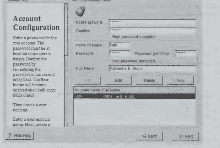


# 5.14.2 设置用户账户

用户账户允许您安全且方便地登录计算机，而无需以 root 身份创建其他账户。

输入账户名称。然后为该用户账户输入并确认密码。输入账户用户的完整姓名，按 [Enter] 键。您的账户信息将被添加到账户列表中，并清除用户账户字段，以便您可以添加另一个用户。

您还可以选择 **New** 来添加新用户。输入用户信息，并使用 **Add** 按钮将用户添加到账户列表中。

您还可以 **Edit** 或 **Delete** 您已创建或不再需要的用户账户。

> **root** 用户（也称为 **superuser**）对整个系统具有完全访问权限；因此，最好*仅*以 root 用户登录以执行系统维护或管理。

### 5.15 选择软件包组

虽然工作站级安装会自动为您选择大多数软件包，但您必须选择 GNOME 或 KDE（或两者兼选）。您还可以选择是否安装 **Games** 软件包。

此外，如果您想选择单个软件包，请勾选 **Select Individual Packages** 并点击 **Next**。

### 图 5–13 软件包选择

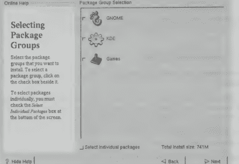

GNOME 和 KDE 都是图形化的**桌面环境**³，负责处理系统的整体外观和感觉。您必须选择其中一个才能获得默认的图形化配置，但您也可以同时安装两者，以便自行决定更喜欢哪一个。

如果您没有足够的空间（至少 1.7G）来安装两者，以下部分将有助于使选择变得稍微容易一些。

> ³ Linux 中的桌面环境类似于您可能在其他操作系统中看到的环境。然而，环境在外观和感觉上有所不同，并且可以轻松定制以满足您的个人需求。

### **图 5–14** 单个软件包选择

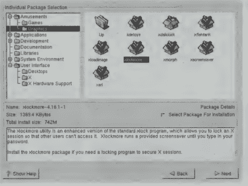

### 5.15.1 GNOME 简介

GNOME 是一个强大的以图形为主导的环境。GNOME 包括一个面板（用于启动应用程序和显示状态）、一个桌面（可放置数据和应用程序）、多个窗口管理器（控制桌面的外观和感觉）以及一组标准的桌面工具和应用。

GNOME 允许您按自己喜欢的方式设置桌面的外观和“感觉”。GNOME 的会话管理器会记住设置和当前运行的程序，因此一旦您按喜欢的方式设置好，它们就会保持不变。

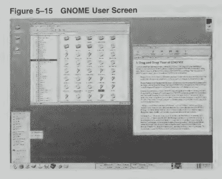

### 5.15.2 KDE 简介

KDE 提供了一个完整的桌面环境，包括文件管理器、窗口管理器、集成的帮助系统、配置系统、众多工具和实用程序，以及数量不断增加的应用程序。

KDE 提供当代桌面、可搜索的帮助系统（方便访问 KDE 桌面及其应用程序的使用帮助）、标准化的菜单和工具栏、键盘绑定、颜色方案等。

### 图 5-16 KDE 用户屏幕

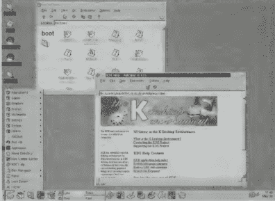

### 5.15.3 选中功能图表

表 5-2，*GNOME 和 KDE 的可用功能*，为您提供了一个自行探索 GNOME 和 KDE 的机会。两个桌面环境的关键功能已被突出显示，涵盖了广泛的应用和工具。

| 功能 | GNOME | KDE |
| --- | --- | --- |
| 高度可配置 | 是 | 是 |
| 多个窗口管理器 | 是 | 否 |
| 互联网应用程序 | 是 | 是 |
| 可更换的桌面主题 | 是 | 是 |
| 面板应用程序 | 是 | 是 |
| 添加/编辑面板应用程序的能力 | 是 | 是 |
| 文件管理器 | 是 | 是 |
| 拖放功能 | 是 | 是 |
| 在线帮助 | 是 | 是 |
| 多个桌面 | 是 | 是 |
| 字体管理器 | 是 | 是 |
| 多媒体应用程序 | 是 | 是 |
| 文本编辑器 | 是 | 是 |
| 图形应用程序 | 是 | 是 |
| 游戏 | 是 | 是 |
| 网络应用程序 | 是 | 是 |
| 实用程序 | 是 | 是 |
| 电子表格 | 是 | 是 |
| 用于临时文件删除的“回收站” | 是 | 是 |

*表 5-2 GNOME 和 KDE 的可用功能*

### 5.15.4 未解决的依赖项

**Unresolved Dependencies** 屏幕仅当您缺少所选软件包所需的某些软件包时才会显示。

许多软件包为了正常工作，依赖于必须安装在您系统中的其他软件包。例如，许多图形化的 Red Hat 系统管理工具需要 **python** 和 **pythonlib** 软件包。为了确保您的系统拥有使其完全正常运行所需的所有软件包，Red Hat Linux 在每次安装或移除软件包时都会检查这些软件包**依赖项**。

如果某个软件包需要另一个您未选择安装的软件包，程序将显示这些**未解决的依赖项**列表，并给您提供解决它们的机会（见图 5–17，*Unresolved Dependencies*）。

在缺失软件包列表下方，屏幕底部有一个 **Install packages to satisfy dependencies** 复选框，默认已选中。如果您保留此选中状态，安装程序将通过将所有必需软件包添加到所选软件包列表来自动解决软件包依赖项。

### 图 5–17 未解决的依赖项

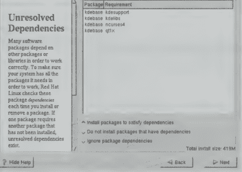

### 5.16 GUI X 配置工具

如果您决定安装 X Window System 软件包，那么现在您有机会为系统配置一个 X 服务器。如果您没有选择安装 X Window System 软件包，请跳过至第 5.18 节，*Installing Packages*。

## 5.16.1 配置您的显示器

*Xconfigurator*，即 X Window System 配置工具，首先会显示一个显示器列表供您选择。在列表中，您可以使用为您自动检测到的显示器，或选择另一个显示器。

### 图 5–18 显示器选择

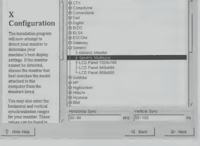

如果您的显示器未出现在列表中，请选择最合适的 **Generic** 型号。如果您选择了 *Generic* 显示器，*Xconfigurator* 将建议水平同步和垂直同步范围。这些值通常可在随显示器提供的文档或从您的显示器供应商或制造商处获取；请检查您的文档以确保这些值设置正确。

> **CAUTION**
> 除非您确定所选显示器不超过您显示器的能力，否则不要选择与您显示器*相似*的显示器。这样做可能会使您的显示器超频，从而损坏或毁坏它。

同时也显示了 *Xconfigurator* 建议的水平同步和垂直同步范围。配置完显示器后，点击 **Next**。

## 5.16.2 显卡配置

Xconfigurator 现在将显示一个显卡列表供您选择。

如果您的显卡未出现在列表中 [见图 5–19，Video Card Setup]，X 可能不支持它。但是，如果您对您的显卡有技术知识，您可以选择 Unlisted Card，并尝试通过将您的显卡视频芯片组与可用的 X 服务器之一匹配来配置它。

### 图 5–19 显卡设置

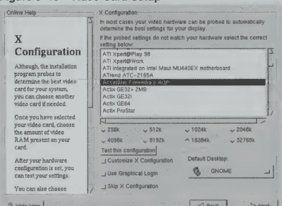

接下来，输入安装在您的显卡上的显存量。如果您不确定，请参阅随显卡提供的文档。选择比实际可用内存更多的内存不会损坏您的显卡，但如果您这样做，X 服务器可能无法正确启动。

一旦识别出您的硬件，您就可以测试配置设置。我们建议测试您的配置，以确保分辨率和颜色设置可用。

如果您想自定义 X 配置，请确保选中 Customize X Configuration 按钮。如果您选择自定义，您将看到另一个屏幕，该屏幕


允许你选择分辨率（参见图 5-20，X 自定义）。同样，你也有测试该配置的选项。

如果你安装了 GNOME 或 KDE 中的任何一个或两者，请务必选择其中之一作为你的桌面默认环境。

### 图 5-20 X 自定义

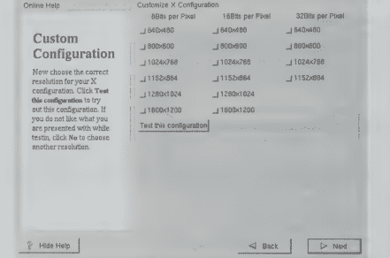

如果你宁愿在安装完成后配置 X 或者根本不想配置，也可以选择**跳过 X 配置**。

### 5.17 安装准备

现在你会看到一个准备安装 Red Hat Linux 的屏幕（参见图 5-21，安装准备）。

**警告**

如果由于某种原因，你不想继续进行安装过程，这是你最后的机会安全地取消该过程并重启你的机器。一旦按下**下一步**按钮，分区将被写入（覆盖其他 Linux 分区上存在的数据），并且软件包将被安装。如果你希望中止安装，你应该在硬盘被重写之前立即重启。

### 图 5–21 安装准备

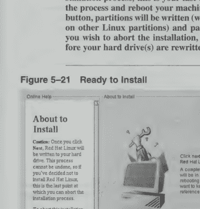

### 5.18 安装软件包

此时，直到所有软件包安装完成（参见图 5–22，安装软件包），你无事可做。安装速度取决于你选择的软件包数量、你的计算机速度以及你的硬盘大小（用于格式化和坏块检查）。

### 图 5-22 安装软件包

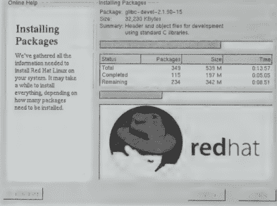

此外，为了继续软件包安装，你可能需要被要求插入另一张 Red Hat Linux CD-ROM。如果你选择了工作站级安装，并且没有单独选择软件包，则不需要插入第二张 CD-ROM。

### 5.19 创建启动盘

启动盘在多种情况下非常有用，包括：

- 当另一个操作系统覆盖了 LILO⁴ 时使用 -- 其他操作系统在支持启动方法方面可能不如 Red Hat Linux 灵活。通常，安装或更新另一个操作系统会导致主引导记录（原本包含 LILO）被覆盖，使得无法启动你的 Red Hat Linux 安装。此时，可以使用启动盘来启动 Red Hat Linux，以便重新安装 LILO。

⁴ LILO（Linux LOader）在工作站安装期间会自动设置。LILO 使你在不使用软盘的情况下即可启动 Red Hat Linux。

要创建启动盘，你现在应该将一张空白且已格式化的软盘插入你的软驱（参见图 5-23，*创建你的启动盘*）。

经过短暂延迟后，你的启动盘将创建完成；请将其从软驱中取出并明确标注。请注意，如果你想在安装后创建启动盘，你也可以做到。有关更多信息，请在 shell 提示符下键入 `man mkbootdisk` 查看 mkbootdisk 的手册页。

如果你更改了内核，并使用启动盘（而不是 LILO）启动系统，请确保你创建了一个新的启动盘。

### 图 5-23 创建你的启动盘

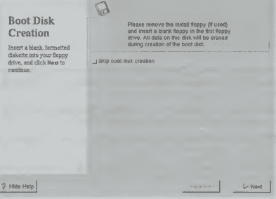

### 5.20 安装完成

恭喜！你的 Red Hat Linux 7.0 安装现已完成！

### 图 5-24 安装完成

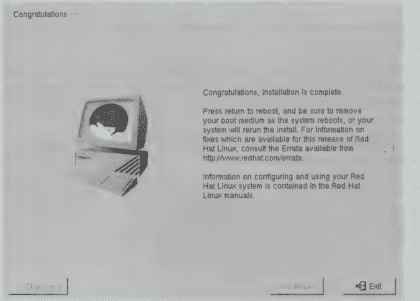

安装程序将提示你准备系统以重启（参见图 5-24，安装完成）。别忘了移除软驱中的软盘或光驱中的 CD。

在你的计算机完成正常的开机序列后，你应该看到 LILO 的图形提示符，此时你可以执行以下任何操作：

- 按 [Enter] -- 启动 LILO 的默认启动项（无论哪个操作系统被列为默认）。
- 选择一个启动标签，然后按 [Enter] -- 使 LILO 启动与该启动标签对应的操作系统。（在 LILO 文本 boot: 提示符处按 [?] 可查看有效启动标签列表。）
- 不执行任何操作 -- 在 LILO 的超时期间（默认为五秒）后，LILO 将自动启动默认启动项。

请执行适当的操作以启动 Red Hat Linux。你应该看到一个或多个消息屏幕滚动显示。最终，你应该看到一个 `login:` 提示符或一个 GUI 登录屏幕（如果你安装了 X Window 系统并选择自动启动 X）。

**提示**

如果由于某种原因你需要禁用图形启动屏幕，你可以通过编辑 `lilo.conf` 文件然后重新运行 LILO 来实现。

为此，在 `lilo.conf` 文件中注释掉（或删除）读取 `message=/boot/message` 的那一行。要注释掉一行，在该行开头插入 `#` 字符。完成此操作后，重新运行 LILO。要重新运行 LILO，键入 `/sbin/lilo -v`，这还将保存你所做的更改。下次启动时，你将看到文本 `LILO:` 提示符，正如在以前的 Red Hat Linux 发行版中所见。

你还可以通过将上述行重新添加回 `lilo.conf` 文件并重新运行 LILO 来重新启用图形启动屏幕。

**提示**

如果你不确定接下来该做什么，我们建议你从《*官方 Red Hat Linux 入门指南*》开始（如果未包含在你的套装中，可在线访问 http://www.redhat.com/support/manuals），该指南涵盖了与系统基础相关的话题，作为使用 Red Hat Linux 的入门介绍。

如果你是一位寻找系统配置或管理主题信息的更经验丰富的用户，你可能会发现文档 CD 上的《*官方 Red Hat Linux 参考指南*》更有帮助。

## 6 文本模式安装概览

本章介绍了 CD-ROM 文本模式工作站级安装的基础知识。如果由于某种原因你无法启动 GUI 安装程序，或者你更喜欢基于文本模式的安装，这些说明旨在作为快速参考，帮助你完成基本的工作站级安装。

### 请注意

服务器级和自定义级安装不在本章范围内。有关这些说明，请参阅包含《*官方 Red Hat Linux 参考指南*》的文档 CD。本章仅是对安装程序的快速回顾，可能不包含你所需的所有信息。强烈建议你在执行 Red Hat Linux 的文本模式安装之前阅读本章以及文档 CD 上的内容。

### 6.1 使用键盘导航

通过安装对话框的导航是通过一组简单的按键操作完成的。要移动光标，请使用 [左]、[右]、[上] 和 [下] 方向键。使用 [Tab] 和 [Alt]-[Tab] 在屏幕上的每个小部件之间向前或向后循环切换。在大多数屏幕的底部，会显示可用光标定位键的摘要。

要“按下”按钮，将光标定位在按钮上（例如使用 [Tab]）并按下 [Space] 或 [Enter]。要从列表中选择一项，将光标移动到你希望选择的项并按下 [Enter]。要选择带有复选框的项，将光标移动到复选框并按下 [Space] 以选择该项。要取消选择，再次按下 [Space]。

按下 [F12] 接受当前值并进入下一个对话框；这相当于选择 OK 按钮。

### 6.2 文本模式启动选项

要启动此处介绍的文本模式安装程序，在启动提示符处按下 [Enter] 之前，键入：

```
boot: text
```

如果安装程序未能正确检测你的硬件，你可能需要以“专家”模式重新启动安装。要启动专家模式安装，键入：

```
boot: text expert
```

专家模式禁用了大多数硬件探测，并提供在加载安装期间驱动程序选项的功能。

> **请注意**
>
> 初始启动消息不会包含任何关于 SCSI 或网卡的引用。这是正常的；这些设备由在安装过程中加载的模块支持。

注意，启动串行安装的命令已更改。如果你必须在串行模式下执行安装，请键入：

```
boot: linux console=<device>
```

其中 `<device>` 应该是你正在使用的设备（例如 ttyS0 或 ttyS1）。

### 6.3 在文本模式下安装

既然你已经启动到文本模式，你就可以在系统上安装 Red Hat Linux 了。下一节已分解为基本步骤，将逐屏带你完成安装并帮助你在安装过程中做出正确的选择。

本章仅提供执行文本模式安装所需的基本信息。文档 CD 上《*官方 Red Hat Linux 参考指南*》的内容更详尽和完整。我们建议你仅将本章作为《*官方 Red Hat Linux 参考指南*》中所示内容的快速参考使用。

### 6.4 语言选择

使用方向键，选择要在安装期间以及作为系统默认使用的适当语言，然后按下 [Enter]。


### 6.5 键盘配置

使用方向键，选择安装过程中和作为系统默认设置所需的键盘类型，然后按 [Enter] 键。

### 图 6-2 键盘配置

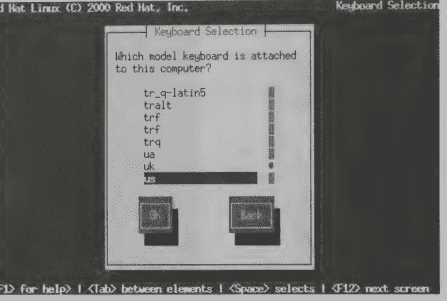

### 6.6 选择安装方法

如果您直接通过 Red Hat Linux CD-ROM 启动，您将看到 **欢迎** 对话框：请转到第 6.7 节，_欢迎使用 Red Hat Linux_。

### 图 6-3 安装方法

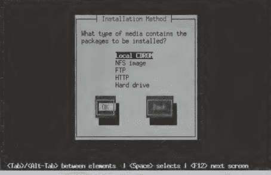

如果您通过本地启动盘或 PCMCIA 启动盘启动，请插入 Red Hat Linux CD-ROM，然后选择本地 CDROM（见图 6-3，安装方法）并按 [Enter] 键。

### 6.7 欢迎使用 Red Hat Linux

### 图 6-4 欢迎屏幕

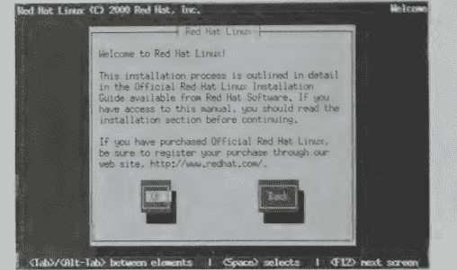

选择“确定”并按 [Enter] 键继续安装。

### 6.8 选择安装类型

选择工作站（见图 6-5，安装类型）并按 [Enter] 键，继续工作站级别的安装说明。

### 图 6-5 安装类型

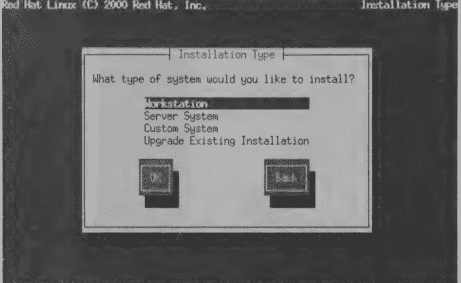

其他安装类型的说明请参阅文档 CD 上的《Red Hat Linux 官方参考指南》。

### 6.9 自动分区

在工作站级别安装过程中，会出现自动分区屏幕（图 6-6，自动分区）。

> **请注意**
>
> 如果没有出现自动分区屏幕，可能意味着您的可用磁盘空间不足以进行此安装。您可以重新启动系统并尝试分配更多磁盘空间，或者选择手动分区。

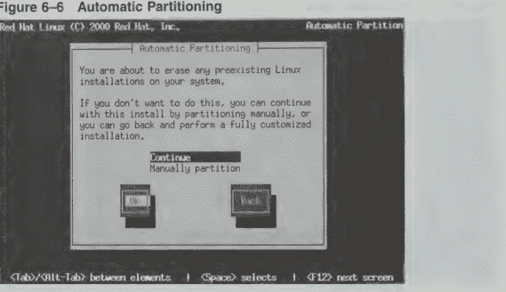

在工作站级别安装中，**自动分区** 会在您硬盘上的可用空间中为您创建 /（根）、<swap> 和 /boot 分区。

如果您希望自行对系统进行分区，请选择 **使用 Disk Druid 手动分区** 或 **使用 fdisk 手动分区**。

### 6.10 使用 Disk Druid 进行分区

如果您正在进行工作站级别安装并选择了 **自动分区**，请跳至第 6.12 节，*网络配置*。

> **请注意**
>
> 手动分区不在本章讨论范围内。虽然会对 **Disk Druid** 进行简要介绍，但不会讨论 `fdisk`。有关使用 **Disk Druid** 或 `fdisk` 的完整说明，请参阅文档 CD 上的 *Red Hat Linux 官方参考指南*。

在此时，有必要让安装程序知道应将 Red Hat Linux 安装在哪里。这是通过为将安装 Red Hat Linux 的一个或多个磁盘分区定义挂载点来实现的。您可能还需要在此时创建和/或删除分区（参见图 6–7，*使用 Disk Druid 进行分区*）。

### 图 6–7 **使用 Disk Druid 进行分区**

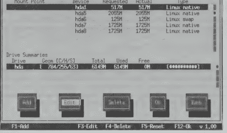

> **请注意**
>
> 如果您尚未规划如何设置分区，请参阅文档 CD 上 *Red Hat Linux 官方参考指南* 中的分区附录。至少，您需要一个大小适当的¹根分区，以及至少 16 MB 的交换分区。

Red Hat Linux 7.0 中使用的分区工具是 *Disk Druid*。除了某些罕见情况外，Disk Druid 可以处理典型 Red Hat Linux 安装的分区需求。

除非您有其他原因，否则我们建议您创建以下分区：

- 交换分区（至少 16MB）-- 交换分区用于支持 **虚拟内存**。换句话说，当系统正在处理的数据无法容纳在 RAM 中时，数据会被写入交换分区。如果您的计算机 RAM 为 16MB 或更少，您 *必须* 创建一个交换分区。即使您拥有更多内存，仍然建议创建交换分区。交换分区的最小大小应等于您计算机的 RAM，或者 16MB（取两者中较大的值）。在 Disk Druid 中，交换分区的字段应类似于：

  `<swap> hda2 125M 125M Linux swap`

- /boot 分区（最大 16MB）-- 挂载在 /boot 上的分区包含操作系统内核（允许您的系统启动 Red Hat Linux），以及引导过程中使用的文件。由于大多数 PC BIOS 的限制，创建一个小的分区来容纳这些文件是一个好主意。此分区不应超过 16MB。在 Disk Druid 中，/boot 分区的字段应类似于：

  `/boot hda1 16M 19M Linux native`

- 根分区（900MB-1.7GB）-- 这是 "/"（根目录）所在的位置。在此配置中，所有文件（除存储在 /boot 中的文件外）都位于根分区上。850MB 的根分区允许进行相当于工作站级别的安装（剩余空间很少），而 1.7GB 的根分区则允许您安装所有软件包。在 **Disk Druid** 中，/ 分区的字段应类似于：

  `/ hda2 900M 3669M Linux native`

### 6.10.1 添加分区时的问题

如果您尝试添加一个分区而 **Disk Druid** 无法执行您的请求，您将看到一个对话框，列出了当前未分配的分区，以及它们无法分配的原因。未分配的分区也会显示在 **Disk Druid** 的主屏幕上（您可能需要滚动查看“分区”部分才能看到它们）。

要修复请求但未分配的分区，您必须将该分区移动到具有可用空间的其他驱动器上，调整该分区的大小以适应当前驱动器，或者完全删除该分区。使用“编辑”按钮或双击该分区来进行更改。

### 6.10.2 格式化分区

接下来，选择您要格式化的分区（见图 6–8，格式化分区）。您必须格式化所有新创建的分区。包含您希望保留的数据（如 /home 或 /usr）的分区不应被格式化。

### 图 6–8 格式化分区

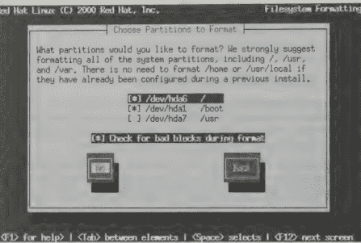

选择好要格式化的分区后，按 [Space] 键。如果您希望在格式化每个文件系统时检查 **坏块**（推荐用于较旧的磁盘驱动器），请选择“格式化时检查坏块”。选择“确定”，然后按 [Space] 键。

> **请注意**
> 选择检查坏块可能会大幅增加您的总安装时间。由于大多数新型硬盘容量较大，检查坏块可能需要一段时间，具体取决于您硬盘的大小。

### 6.11 主机名配置

如果您的计算机中有网卡，请在此处输入一个 *完全合格的域名*，格式为：`hostname.domain.name`

### 图 6–9 输入主机名

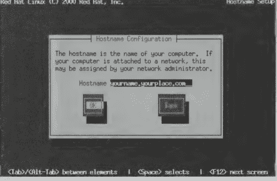

如果您的计算机不是网络的一部分，您可以为系统输入一个主机名。请借此机会输入一个名称；如果不输入，您的系统将被称为 localhost。

### 6.12 网络配置

如果您从 CD-ROM 安装且已安装网卡，现在可以配置您的网络信息了。

### 图 6–10 输入网络信息

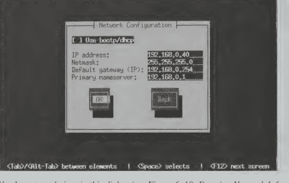

在此对话框中您有两个选择（见图 6–10，输入网络信息）：

- 选择使用 bootp/dhcp。在这种情况下，您局域网中现有的服务器将在连接时动态提供将系统添加到网络所需的网络相关信息。（请注意，如果您这样做，此对话框中其余的字段将被禁用，因为 DHCP 和 BOOTP 基本上会为您“填空”。）
- 在提供的字段中输入静态网络信息。在这种情况下，您提供的网络信息将被分配给此系统。

### 6.13 鼠标配置

接下来，安装程序将探测鼠标。使用 [Up] 和 [Down] 方向键根据需要确认或更改选择。

[^1]: “大小适当”最好由您专门用于 Red Hat Linux 的可用空间量、您准备进行的安装大小以及您物理上专门用于 Red Hat Linux 的空间来定义。我们建议最小的根分区大小为 900M。


### 6.13 鼠标配置

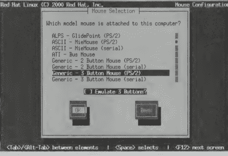

如果鼠标只有两个按钮，请勾选*模拟三按钮*以模拟三键鼠标。

### 6.14 时区

在**时区**配置屏幕（图 6–12，*时区配置*）中选择适当的时区。

如果希望将硬件（CMOS）时钟设置为 GMT（格林尼治标准时间，也称为 UTC 或协调世界时），请选择**硬件时钟设置为 GMT**。将其设置为 GMT 意味着如果你的时区使用夏令时，系统将正确处理夏令时。

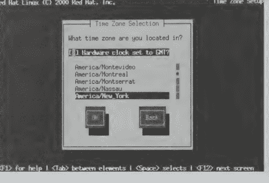

### 6.15 根密码

输入根密码。密码长度必须至少为六个字符；你输入的密码不会在屏幕上显示。你必须输入两次密码；如果两次输入的密码不匹配，安装程序将提示你重新输入。

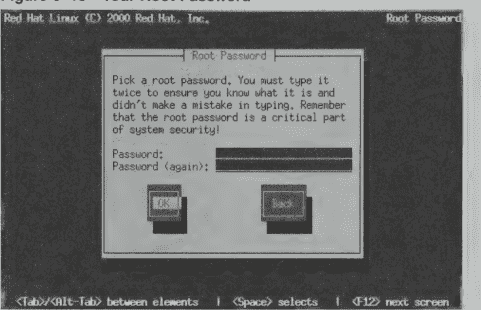

### 6.16 创建用户账户

接下来，为自己创建一个用于日常使用的用户账户。用户账户允许你安全、轻松地登录计算机，而无需使用 root 权限。你输入的密码长度必须至少为六个字符，且不会在屏幕上显示。输入两次密码；如果两次输入的密码不匹配，安装程序将提示你重新输入。

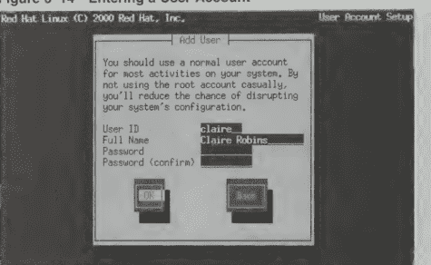

### 6.16.1 创建额外的用户账户

若要创建额外的用户账户，请在**用户账户设置**对话框中选择**添加**（参见图 6–15，*输入额外的用户账户*），或选择**确定**以继续安装。

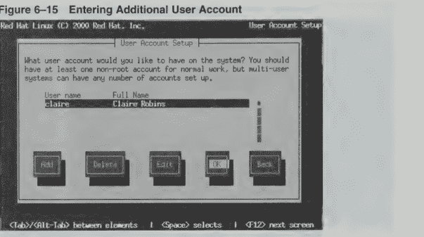

### 6.17 包选择

选择你想要安装的桌面环境（GNOME、KDE 或两者）。你还可以选择是否在系统中安装游戏。通过执行工作站级别安装，其他所有必要的包将自动安装。

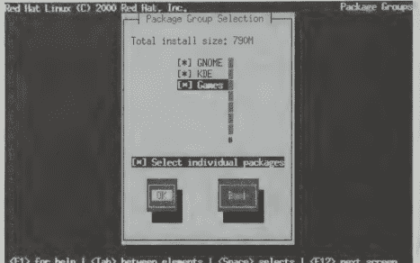

如果你不确定想要安装哪个桌面环境，请阅读第 5.15 节，*选择包组*，以获取更多信息。

勾选**选择单个包**复选框以选择单个包。

### 6.17.1 单个包选择

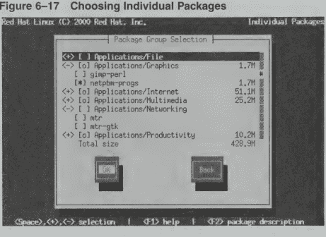

若要查看包列表，请使用箭头键选择组并按[Enter]或[Space]。当选中列表时，**+** 号（关闭）会变为 - 号（打开），并显示该类别的包列表。当前选中的包旁边会出现一个 ***。按[Enter]或[Space]键以选择或取消选择包。

若要查看特定包的描述，请确保该包被高亮显示，然后按[F1]。

### 6.17.2 未解析的依赖项

如果任何包都需要你未选择安装的其他包，程序将显示这些**未解析的依赖项**列表，并给你解决它们的机会。如果你直接按**确定**，程序将通过将所有必需的包添加到已选包列表中自动解决它们。

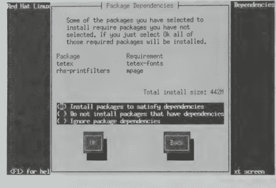

### 6.18 配置你的视频适配器

然后，安装程序将探测你的显卡。如果检测到显卡，点击**确定**继续。

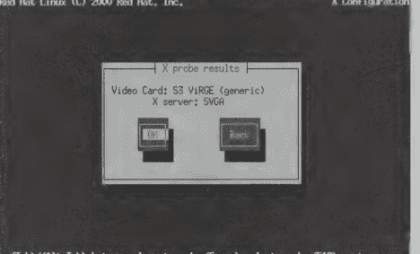

如果安装程序无法检测到你的视频适配器，你将看到一个显卡列表，如图 6–20，*显卡选择对话框*所示。使用箭头键和[Space]从列表中选择合适的显卡。如果列表中未列出你的显卡，请选择**未列出的显卡**并按[Space]。

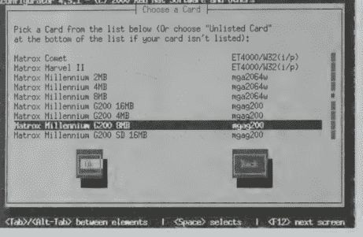

### 6.19 包安装

当安装程序准备格式化分区并加载软件包时，会出现类似图 6-21 的对话框，**安装即将开始对话框**。安装程序将此次 Red Hat Linux 安装的日志文件命名为 */tmp/install.log*。选择**确定**并按[Space]继续。

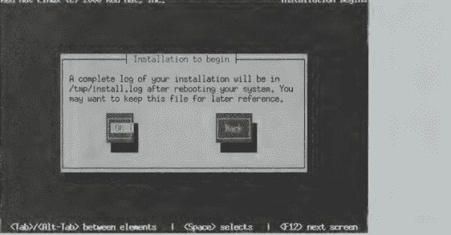

在软件包安装过程中，将出现类似图 6–22 的进度屏幕，*包安装状态对话框*。

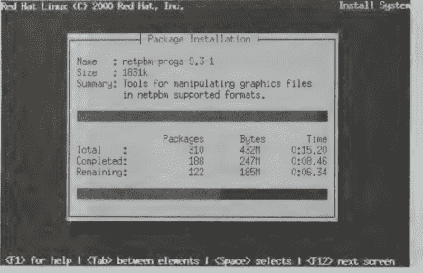

### 6.20 启动磁盘

包安装完成后，系统会提示你创建**启动磁盘**。

若要创建启动磁盘，请选择**是**并按[Space]。若不需要，请选择**跳过**并按[Space]。

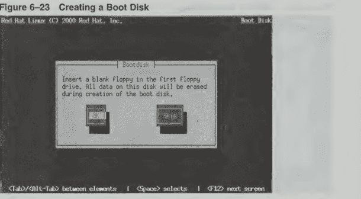

如果你选择了**是**，请在提示时插入一张空白且已格式化的软盘。准备好后，选择**确定**并按[Space]。

经过短暂延迟，你的启动磁盘将被创建；请将其从软驱中取出并清楚地贴上标签。请注意，如果你希望在安装后创建启动磁盘，你仍然可以做到。欲知更多信息，请在 shell 提示符下输入 `man mkbootdisk` 查看 `mkbootdisk` 的 man 页面。

### 6.21 配置 X 窗口系统

`Xconfigurator` 工具让你有机会为系统配置 X 服务器。

首先，`Xconfigurator` 会显示一个监视器列表（参见图 6-24，*监视器设置对话框*）。如果列表中列出了你的监视器，请选择它并按[Enter]。否则，请选择**自定义**。

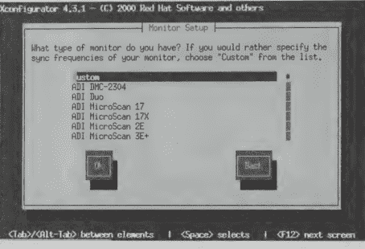

如果你从列表中选择了监视器，接下来将输入你的视频内存，如图 6–29，*视频内存*所示。

如果你选择自定义，Xconfigurator 将提示你选择监视器的水平同步范围和垂直同步范围（这些值通常可在随监视器提供的文档中找到，或从你的监视器供应商或制造商处获得）。


> **警告**
>
> 不要选择任何超出监视器容量的范围。如果你这样做，可能会超频监视器并导致其损坏或毁坏。

为你的监视器选择一个水平同步范围（参见图 6–26，*自定义监视器设置 - 水平同步*）。请务必不要选择超出监视器容量范围的值。对于自定义设置，请参考图 6–28，*自定义监视器信息*。


接下来，选择一个垂直同步范围。


如果你选择输入自定义监视器设置，请为你的监视器输入水平和垂直同步范围（参见图 6-28，*自定义监视器信息*）。


选定监视器（及其设置）后，你必须选择显卡上存在的内存量（参见图 6-29，*视频内存*）。


如果你不确定显卡有多少内存，请咨询随显卡提供的文档。选择比显卡实际存在的内存更多不会损坏显卡，但可能导致 XFree86 服务器启动不正确。

接下来，如果你的显卡支持（即拥有）时钟芯片设置，请选择一个时钟芯片设置。对于大多数显卡，推荐的选择是 No Clockchip Setting，因为在大多数情况下，XFree86 可以自动检测正确的时钟芯片。


## 图 6-30 时钟芯片配置对话框


探测时钟屏幕（见图 6-31，探测时钟）会提示你允许安装程序检测你的显卡和显示器支持的视频模式。

为了获得最佳效果，你应该选择探测。但是，如果之前探测视频模式的尝试导致了不好的结果（例如需要重新启动系统），你应该选择跳过，然后选择你首选的视频模式（见图 6-32，选择视频模式）。

## 图 6-31 探测时钟


要选择你首选的显示模式（见图 6-32，选择视频模式），请通过按 [空格] 键选择一个或多个模式。

## 图 6-32 选择视频模式


不要选择超出你显示器容量的模式。

**提示**

大多数应用推荐最低视频模式设置为 16 位色深，分辨率为 1024x768（设置为高于 16 位的视频模式通常运行速度较慢）。

一旦你选择了默认视频模式或指定了其他模式，**启动 X** 对话框将允许你测试你的 *X* 配置。

## 图 6-33 测试你的 X 配置


如果你选择 **确定**，如果有错误，你将有机会返回并输入不同的配置值。如果没有错误，X 将启动，并出现一个小显示窗口，询问你是否能清楚地阅读其内容；使用鼠标在十秒钟内点击 **是**。然后系统将询问你是否希望 X 在系统启动时自动启动。

在大多数情况下，此时 X 配置已完成，你将看到完成屏幕。*Xconfigurator* 随后会将你的所有选择保存到配置文件 `/etc/X11/XF86Config`。要在安装后修改你的 X 配置，请以 root 身份执行 *Xconfigurator* 命令。

### 6.22 恭喜！安装已完成


如果系统是从 CD-ROM 启动的，请从软盘驱动器中取出软盘或取出 Red Hat Linux CD。

若要重新启动你新安装的 Red Hat Linux 系统，请按 [回车] 键。

在计算机正常的开机过程完成后，你应该看到 LILO 的图形提示，此时你可以执行以下任何操作：

- 按 [回车] -- 引导 LILO 的默认启动项（即列表中列为默认的操作系统）。
- 选择启动标签，然后按 [回车] -- 引导与启动标签对应的操作系统。（在 LILO 文本 boot: 提示符处按 [?] 可获取有效启动标签列表。
- 什么都不做 -- 在 LILO 的超时期间（默认为五秒）之后，LILO 将自动引导默认启动项。

请执行适当的操作以引导 Red Hat Linux。你应该看到一个或多个信息屏幕滚动显示。最终，你应该看到一个 login: 提示符或一个图形用户界面登录屏幕（如果你安装了 X Window System 并选择自动启动 X）。

**提示**

如果出于某种原因你需要禁用图形引导屏幕，你可以通过编辑 lilo.conf 文件然后重新运行 LILO 来实现。

为此，请在 lilo.conf 文件中注释掉（或删除）读取 `message=/boot/message` 的那一行。要注释一行，请在该行开头插入 [#] 字符。完成此操作后，重新运行 LILO。下次启动时，你将看到文本 LILO: 提示符，就像在之前的 Red Hat Linux 版本中看到的那样。

你还可以通过将上述行加回 lilo.conf 文件并重新运行 LILO 来重新启用图形引导屏幕。

**提示**

如果你不确定接下来该做什么，我们建议你从《官方 Red Hat Linux 入门指南》开始，该指南涵盖了与系统基础知识相关的主题，作为使用 Red Hat Linux 的入门介绍。

如果你是寻求系统配置或管理主题信息的更有经验的用户，你可能会发现文档 CD 上的《官方 Red Hat Linux 参考指南》更有帮助。

# 附录 A 升级你的当前系统

本附录指导你完成一次典型的 Red Hat Linux 7.0 升级。

## A.1 升级的含义

Red Hat Linux 7.0 的安装过程包括从基于 RPM 技术的先前版本的 Red Hat Linux（3.0.3 及更高版本）进行升级的功能。

升级你的系统将安装模块化 2.2.x 内核以及你系统当前已安装的软件包版本的更新版。

升级过程通过重命名来保留现有配置文件，使用 `.rpm-save 扩展名`（例如 `sendmail.cf.rpm save`），并在 `/tmp/upgrade.log` 中留下其所采取行动的记录。随着软件的发展，配置文件格式可能会改变，因此你在集成更改之前应仔细比较原始配置文件和新文件。

> **请注意**
>
> 某些升级的软件包可能需要同时安装其他软件包才能正常运行。如果你选择自定义要升级的软件包，你可能需要解决任何 *依赖项* 问题。否则，升级程序会处理这些依赖项，但它可能需要安装你现有系统中不存在的额外软件包。

## A.2 升级你的系统

此时，你应该已经选择 **升级** 作为你首选的安装类型（见图 A-1，*选择升级*）。


## A.3 自定义你的升级

你想选择要升级的软件包，还是让安装程序执行自动安装（见图 A-2，*升级自定义*）？

若要让安装程序为你开始升级过程，请确保未选中 **自定义要升级的软件包** 并点击 **下一步**（参见 A.6 节，*升级软件包*）。

若要自定义你的升级软件包，请选择此选项然后点击 **下一步**。


## A.4 选择要升级的软件包

在这里，你将有机会选择你想要升级哪些软件包（见图 A-3，单个软件包选择）。

在屏幕左侧，你将看到各种软件包组的目录列表。当你展开此列表（双击选择）并双击单个目录时，可安装软件包的列表将出现在右侧。

要选择单个软件包，请双击它，或单击一次以突出显示它，然后点击下方的“选择安装软件包”按钮。在你选择安装的任何软件包上都会出现红色对号。

要在选择安装某个软件包之前阅读关于该特定软件包的信息，请左键单击一次以突出显示它，相关信息将出现在屏幕底部，并附带软件包的名称和大小。

某些软件包（如内核和某些库）是每个 Red Hat Linux 系统所必需的，不可选择或取消选择。这些 **基础软件包** 默认已被选中。

## 图 A-3 单个软件包选择


### A.4.1 未解决的依赖项

如果任何软件包都需要你未选择安装的其他软件包，程序将显示这些 **未解决依赖项** 的列表，并给你机会解决它们（见图 A-4，*未解决依赖项*）。

**未解决依赖项** 屏幕只会在你缺少自定义软件包选择所需的某些软件包时出现。在缺失软件包列表下方，屏幕底部有一个 **安装软件包以满足依赖项** 复选框，默认已选中。如果你保留选中状态，安装程序将通过将所有必需软件包添加到已选软件包列表来自动解决软件包依赖项。


## 图 A-4 未解析的依赖项


### A.5 安装 LILO

为了能够启动您的 Red Hat Linux 系统，通常需要安装 LILO（Linux LOader，Linux 加载器）。您可以将 LILO 安装到以下两个位置之一：

-   主引导记录（MBR）

    这是推荐将 LILO 安装到的位置，除非 MBR 已经启动了另一个操作系统加载器，例如 System Commander 或 OS/2 的引导管理器。主引导记录是硬盘上的一个特殊区域，由计算机的 BIOS 自动加载，是 LILO 可以接管启动过程的最早时间点。如果您将 LILO 安装到 MBR，当机器启动时，LILO 将显示 `boot:` 提示符。然后您可以启动 Red Hat Linux 或任何您配置 LILO 以启动的其他操作系统。

-   根分区的第一扇区

    如果您已经在系统上使用了另一个引导加载器（例如 OS/2 的 Boot Manager），则推荐此选项。在这种情况下，您的其他引导加载器将首先获得控制权。然后您可以配置该引导加载器以启动 LILO（进而启动 Red Hat Linux）。

### 图 A-5 LILO 配置


如果您选择安装 LILO，请选择希望 LILO 在您的系统上安装到的位置（参见图 A-5，*LILO 配置*）。如果系统仅使用 Red Hat Linux，您应该选择主引导记录（MBR）。对于具有 Win95/98 的系统，您也应该将 LILO 安装到 MBR，以便 LILO 可以启动两个操作系统。

如果您有 Windows NT（并且希望安装 LILO），您应该选择将 LILO 安装到根分区的第一扇区，而不是 MBR。请务必创建一个启动磁盘。在这种情况下，您将需要使用启动磁盘，或者配置 NT 系统加载器从根分区的第一扇区启动 LILO。更多信息请参见 <http://www.linuxdoc.org/HOWTO/mini/Linux+NT-Loader.html>，了解有关设置 LILO 和 NT 的更多详细信息。

#### 注意

如果您出于任何原因选择不安装 LILO，您将无法直接启动 Red Hat Linux 系统，并且需要使用另一种启动方法（如启动软盘）。只有当您确信有其他方式启动 Red Hat Linux 系统时，才使用此选项！

`Use linear mode`（使用线性模式）按钮默认被选中。在大多数情况下，应该启用线性模式；如果您的计算机无法使用线性模式访问硬盘，请取消选中此选项。

如果您希望向 LILO 启动命令添加默认选项，请将其输入 `kernel parameters`（内核参数）字段。您输入的任何选项都将在每次 Linux 内核启动时传递给内核。

**可启动分区** -- 列出了每个可启动分区，包括由其他操作系统使用的分区。“Boot label”（启动标签）列将在持有您的 Red Hat Linux 系统根文件系统的分区中填充为 `linux`。其他分区也可能具有启动标签。如果您希望为其他分区添加启动标签（或更改现有的启动标签），单击一次该分区以将其选中。选中后，您可以更改启动标签。

#### 请注意

“Boot label”（启动标签）列列出了您在 LILO 的 `boot:` 提示符处需要输入的内容，以便启动所需的操作系统。但是，如果您忘记了系统上定义的启动标签，始终可以在 LILO 的 `boot:` 提示符处按 [Tab] 键以显示已定义的启动标签列表。

### A.5.1 配置 LILO

-   **创建启动磁盘** -- **Create boot disk**（创建启动磁盘）选项默认被选中。如果您不想创建启动磁盘，应取消选中此选项。然而，我们强烈建议您创建启动磁盘。由于多种原因，启动磁盘可能非常有用：
    -   **用它代替 LILO** -- 您可以使用启动磁盘代替 LILO。如果您第一次尝试 Red Hat Linux，并且希望保持其他操作系统的启动过程不变会让您更安心，这会很有用。有了启动磁盘，回到您的其他操作系统只需取出启动磁盘并重启即可。如果您宁愿使用启动磁盘代替 LILO，请确保启用“Do not install LILO”（不安装 LILO）选项。
    -   **如果另一个操作系统覆盖了 LILO 则使用它** -- 在支持的启动方法方面，其他操作系统可能不像 Red Hat Linux 那样灵活。安装或更新另一个操作系统通常会覆盖主引导记录（最初包含 LILO），导致无法启动您的 Red Hat Linux 安装。此时可以使用启动磁盘来启动 Red Hat Linux，以便重新安装 LILO。
    -   **不安装 LILO** -- 如果您的系统上安装了 Windows NT，您可能不想安装 LILO。如果您因此选择不安装 LILO，请确保您已选择创建启动磁盘；否则您将无法启动 Linux。如果您不想将 LILO 写入硬盘，也可以选择不安装 LILO。

#### 提示

要在救援模式下使用启动磁盘，您有几种选择：

-   使用 CD-ROM 启动时，在 `boot:` 提示符下输入 `linux rescue`。
-   使用网络启动磁盘时，在 `boot:` 提示符下输入 `linux rescue`。然后您将被提示从网络拉取救援映像。
-   使用 Red Hat Linux 盒装附带的启动磁盘时，在 `boot:` 提示符下输入 `linux rescue`。然后选择一种安装方法，并选择一个有效的安装树来加载。

有关救援模式的更多信息，请参阅《官方 Red Hat Linux 参考指南》中的系统管理章节。

### A.5.2 LILO 的替代方案

如果您不希望使用 LILO 来启动您的 Red Hat Linux 系统，有几种替代方案：

-   **启动磁盘**

    如前所述，您可以使用安装程序创建的启动磁盘（如果您选择创建了一个）。

-   **LOADLIN**

    您可以从 MS-DOS 加载 Linux。不幸的是，这要求 Linux 内核（如果有 SCSI 适配器，还需要初始 RAM 磁盘）在 MS-DOS 分区上可用。实现这一点的唯一方法是使用其他方式（例如从软盘上的 LILO）启动您的 Red Hat Linux 系统，然后将内核复制到 MS-DOS 分区。LOADLIN 可从 ftp://metalab.unc.edu/pub/Linux/system/boot/dualboot/ 及相关镜像站点获取。

-   **SYSLINUX**

    一个与 LOADLIN 非常类似的 MS-DOS 程序。它也可从 ftp://metalab.unc.edu/pub/Linux/system/boot/loaders/ 及相关镜像站点获取。

-   **一些商业引导加载器**

    例如 System Commander 和 Partition Magic，它们能够启动 Linux（但仍需要在您的 Linux 根分区中安装 LILO）。

### A.5.3 SMP 主板与 LILO

本节仅适用于 SMP 主板。如果安装程序检测到您的系统上有 SMP 主板，它将自动创建两个 `lilo.conf` 条目，而不是通常的单个条目。

一个条目将称为 `linux`，另一个将称为 `linux-up`。默认情况下将启动 `linux`。但是，如果您遇到 SMP 内核的问题，可以选择改为启动 `linux-up` 条目。您将保留之前所有的功能，但将仅使用单个处理器运行。

## A.6 升级软件包

此时，在所有软件包升级或安装完成之前，您无需执行任何其他操作（参见图 A-6，*安装软件包*）。

### 图 A-6 安装软件包


## A.7 升级完成

恭喜！您的 Red Hat Linux 7.0 升级现已完成！

接下来系统将提示您为重启做准备。请记得取出软盘驱动器中的软盘或 CD-ROM 驱动器中的光盘。如果您没有安装 LILO，现在将需要使用您的启动磁盘。

#### 提示

如果您需要快速回顾 Red Hat Linux 的一些基本概念，请参阅 *《官方 Red Hat Linux 快速入门指南》*。

有关系统配置和管理的详细信息，请参阅文档 CD-ROM 上的 *《官方 Red Hat Linux 参考指南》*。

### 图 A-7 升级完成


本章介绍如何在不创建 Linux 分区的情况下安装 Red Hat Linux 7.0。

### 请注意

虽然这是在无需在系统上创建 Linux 分区的情况下探索 Red Hat Linux 世界的一种绝佳方式，但请注意，您仍需要按照本手册中的说明执行完整的 Red Hat Linux 安装。

### 请注意

要执行此类型的安装，您必须当前拥有一个格式化的 DOS (FAT) 文件系统。使用 Win95/98 的用户在使用此类型安装时不应有任何问题。拥有 NTFS 分区（例如使用 Windows NT 的用户）的用户在此安装之前必须创建并格式化一个 DOS (FAT) 文件系统。除非在开始 Red Hat Linux 安装之前已格式化 DOS (FAT) 文件系统，否则此安装将无法工作。

## B.1 无分区安装的优缺点

您可能有一些理由想要执行无分区安装，但也存在一些缺点（取决于您的看法）。我们将在下文讨论这些潜在缺点。

在这里，我们将介绍此类安装期间及安装结果将发生的基本事件，以及您的系统将受到的影响。

### 基本安装

您将执行基本的 Red Hat Linux 安装。但是，您不会向系统添加 Linux 分区，而是会编辑一个现有的、已格式化的 DOS (FAT) 分区（该分区必须有足够的可用空间）并将其命名为根 (/)。

与典型的 Red Hat Linux 安装不同，您无需格式化任何分区，因为您不会向系统添加任何分区。

### LILO (Linux 加载程序) 和启动盘

在无分区安装中，您将不会配置 LILO（Linux 加载程序）。在典型安装中，您可以选择将 LILO 安装在哪里——要么在主引导记录 (MBR) 上，要么在根分区的第一扇区上——或者您可以选择完全不安装 LILO。

为了访问无分区安装的 Red Hat Linux，您必须创建一个启动盘，并且在安装结束时，系统会提示您创建启动盘。

### 请注意

为了使用启动盘从无分区安装中启动 Red Hat Linux，您必须正确配置 BIOS。BIOS 必须设置为从软盘驱动器 (A) 启动，才能使用启动盘。

要更改 BIOS 设置，您需要记下计算机首次启动时给出的说明。通常您会看到一行文字，告诉您按 [Del] 或 [F1] 键进入 BIOS 设置。

接下来，您必须找到允许更改启动顺序的部分。默认设置通常是 C, A 或 A, C（取决于您是使用硬盘驱动器 [C] 还是软盘驱动器 [A] 启动）。请更改此顺序，使软盘驱动器 (A) 排在启动顺序的第一位，而硬盘驱动器 (C) 排在第二位。这指示计算机首先查找软盘驱动器中的可启动介质，如果找不到，则接着查找硬盘驱动器。

务必在退出 BIOS 之前保存您的更改。更多信息请参阅随系统提供的文档。

### 性能影响

Red Hat Linux 的性能将比拥有专用分区时更慢。但是，对于那些不关心速度的人来说，无分区安装是查看 Red Hat Linux 能提供什么的一种绝佳方式，而无需处理系统分区。

### B.2 执行无分区安装

如果您拥有 DOS (FAT) 文件系统，您必须首先确保拥有一个具有足够可用空间专门用于此安装的 DOS (FAT) 分区。

### B.2.1 我需要多少空间？

与典型安装一样，您需要有足够的可用空间才能在系统上安装 Red Hat Linux。为了给您一个概念，以下是安装方法及其*最低*空间要求的列表。

有关这些安装类的更多信息，请参见第 3.6 节，*步骤 6 - 工作站类安装是否最适合您？*

- 工作站 - 900MB
- 服务器 - 1.7GB
- 自定义（选择*所有*） - 1.7GB

### B.2.2 使用 Disk Druid

由于您不会添加分区或创建新分区，实际上您需要使用 **Disk Druid**（一种 GUI 分区工具）操作的内容相对较少。

当 **Disk Druid** 主屏幕出现时，您应该会看到您的 DOS (FAT) 分区列表（参见图 B-1，*选择要定义为 / 的 DOS (FAT) 分区*）。选择一个具有足够可用空间来安装您选择的安装类的 DOS (FAT) 分区。通过用鼠标单击分区或使用 [Tab]、[Up] 和 [Down] 键来突出显示该分区。

#### 图 B-1 选择要定义为 / 的 DOS (FAT) 分区


突出显示所需分区后，选择**编辑**。将出现一个新窗口，允许您为该分区命名（参见图 B-2，*编辑 DOS (FAT) 分区*）。在**挂载点**字段中，将该分区标记为 /（即根），并单击**输入**。

接下来将出现一个确认窗口（参见图 B-3，*确认*），询问您是否确认要继续此安装。它还解释了您不能在任何 DOS 分区（标记为 /）之外的系统上拥有任何 Linux 分区。单击**是**以继续。

#### 图 B-2 编辑 DOS (FAT) 分区


接下来，您将能够确定此 `/` 分区的根文件系统大小和交换空间大小。

安装程序将确定根文件系统的最大大小（图 B-4，*文件系统配置*）。只要不超过建议的最大大小，您可以将根文件系统设置为您喜欢的任何大小。

您为根文件系统创建的大小即为整个文件系统可用的磁盘空间（这意味着您不仅需要考虑安装类的大小，还需要考虑用于写入和保存数据的空间）。

交换空间就像虚拟内存。换句话说，当没有足够的 RAM 来存储系统正在处理的数据时，数据会被写入交换分区。安装程序将交换空间默认设置为 32MB。如果您愿意，可以选择增加交换大小，但没有必要创建大于 256MB 的交换空间。

#### 图 B-3 确认


从这里开始，您可以继续按照主安装章节（参见第 5.12 节，*网络配置*）进行进一步安装说明。您从这一点开始看到的唯一不同是一个提示您创建启动盘的屏幕。一旦您制作了启动盘并遵循其他说明，您的安装就完成了。

为了访问 Red Hat Linux，请确保您在安装期间创建的启动盘在您的软盘驱动器中。当您重新启动系统时，它将进入 Red Hat Linux 而不是您的其他操作系统。为了访问您的其他操作系统，请取出启动盘并重新启动系统。

#### 图 B–4 文件系统配置


### B.2.3 如何从系统中删除无分区安装

要删除此无分区安装，您需要从 DOS/Windows 分区中删除以下文件：

```
redhat.img
rh-swap.img
```

这些文件可以在分区根目录中找到（在 DOS/Windows 中已知为 \）。一旦删除了这些文件，Red Hat Linux 将不再在您的系统上启动。您的系统将恢复到以前的状态，您将能够像往常一样访问 Red Hat Linux 使用的空间。

## C 卸载 Red Hat Linux

要从系统中卸载 Red Hat Linux，您需要从主引导记录 (MBR) 中删除 LILO 信息。

有几种方法可以从机器的主引导记录中删除 LILO。在 Linux 内部，您可以使用 /sbin/lilo 命令用先前保存的 MBR 版本替换 MBR：

```
/sbin/lilo -u
```

在 DOS、NT 和 Windows 95 中，您可以使用 fdisk 和“未记录的”标志 /mbr 创建新的 MBR。这将**仅**重写 MBR 以引导主 DOS 分区。该命令应如下所示：

```
fdisk /mbr
```

如果您需要从硬盘驱动器中删除 Linux，并尝试使用默认的 DOS fdisk 来执行此操作，您会遇到“分区存在但它们不存在”的问题。删除非 DOS 分区的最佳方法是使用理解除 DOS 以外其他分区的工具。

您可以通过在 boot: 提示符下输入 "linux expert"（不包括引号）来使用安装软盘执行此操作。

```
boot: linux expert
```

选择安装（而非升级），当到达分区驱动器时，选择 fdisk。在 fdisk 中输入 [p] 以打印分区号，并使用 [d] 命令删除 Linux 分区。当您对所做的更改感到满意时，您可以按 [w] 退出，更改将保存到磁盘。如果您删除了太多内容，请输入 [q]，则不会发生任何更改。

一旦您删除了 Linux 分区，您可以通过按 [Control]+[Alt]+[Delete] 来重新启动计算机，而不是继续安装。


## D 获取技术支持

### D.1 记得注册

如果您拥有红帽 Linux 7.0 官方版本，请记得注册，以获取您作为红帽客户应享有的权益。

根据您购买的官方红帽 Linux 产品，您将有资格享受以下部分或全部权益：

-   官方红帽支持 -- 从红帽公司（Red Hat, Inc.）的支持团队获得安装问题的帮助。
-   优先 FTP 访问权 -- 无需再在深夜访问拥挤的镜像站点。红帽 Linux 7.0 的所有者可以免费访问 priority.redhat.com，这是红帽为优选客户提供的 FTP 服务，全天候提供高带宽连接。
-   红帽更新代理 -- 一旦有更新的 RPM 包可用，即可直接从红帽接收电子邮件通知。使用更新代理过滤器，您可以选择仅接收您感兴趣的主题的通知。
-   满载而出：官方红帽电子通讯 -- 每月直接从红帽获取最新新闻和产品信息。

要注册，请访问 [http://www.redhat.com/now](http://www.redhat.com/now)。您可以在官方红帽 Linux 盒装套装中的红白卡片上找到您的 **个人产品 ID**。

### D.2 红帽支持概览

红帽为官方红帽 Linux 盒装套装产品提供安装协助，并覆盖单台计算机的安装。此协助旨在帮助客户成功安装红帽 Linux。安装协助通过电话和 Web 提供。

红帽支持将尝试在安装过程开始之前回答您可能拥有的任何问题。包括以下内容：

-   硬件兼容性问题
-   基本的硬盘分区策略

红帽公司支持也可以在安装过程中提供协助：

-   使受支持的硬件被红帽 Linux 操作系统识别
-   驱动器分区协助
-   使用 Linux 启动加载器 LILO 配置红帽 Linux 和最多一个其他操作系统（仅限 Intel 平台）以实现双启动。请注意，第三方启动加载器和分区软件不受支持。

我们还可以协助您完成基本的安装后任务，例如：

-   使用 XF86Setup 或 Xconfigurator 成功配置 X 窗口系统
-   配置本地并口打印机以打印文本
-   配置鼠标

我们的安装协助服务旨在让您能够尽可能快速、简便地启动并使用红帽 Linux。但是，还有许多其他您可能希望对红帽 Linux 系统做的事情（从编译自定义内核到设置 Web 服务器），这些都不在覆盖范围内。

对于这些任务的协助，有大量在线信息可供使用，形式包括 HOWTO 文档、Linux 相关网站和商业出版物。红帽 Linux 操作系统在安装 CD 的 `/doc/HOWTO` 目录中包含各种 Linux HOWTO 文档，作为纯文本文件，可以很容易地从红帽 Linux 和其他操作系统中读取。

有大量 Linux 相关网站可用。查找红帽 Linux 信息的最佳起点是红帽公司网站：

`http://www.redhat.com/`

有许多 Linux 相关书籍可用。如果您是 Linux 新手，一本涵盖 Linux 基础知识的书将极具价值。我们可以推荐几本：Bill Ball 的《使用 Linux》（Using Linux）；Bryan Pfaffenberger 的《Linux 清晰讲解》（Linux Clearly Explained）；Jon "maddog" Hall 的《Linux 傻瓜指南》（Linux for Dummies）；以及 Mark G. Sobell 的《实用 Linux 指南》（A Practical Guide to Linux）。

### D.3 红帽支持的范围

红帽公司只能向购买了官方红帽 Linux 盒装套装的客户提安装协助。如果您从其他任何公司获取了 Linux，您必须联系那家公司以获取支持。此类公司的例子如下：

-   Macmillan
-   Sams/Que
-   Linux Systems Labs (LSL)
-   Mandrake
-   CheapBytes

此外，通过以下任何方式获取的红帽 Linux 均不符合红帽支持的资格：

-   红帽 Linux PowerTools 存档
-   通过互联网上的 FTP 下载
-   包含在 Motif 或 Applixware 等软件包中
-   从另一位用户的 CD 复制或安装

### D.4 红帽支持系统

截至 1999 年 10 月，红帽公司已实施新的技术支持系统。如果您过去曾与红帽注册了技术支持，您可能需要再次注册。新系统将实施统一的登录名和密码，该凭证在整个红帽网站范围内有效。支持系统还将自动路由和跟踪服务请求。

如果您尚未注册，那么您应该注册。下面 D.5 节 *如何获取技术支持* 中提供了注册的说明。

### D.5 如何获取技术支持

为了获得您的官方红帽产品的技术支持，您首先需要注册。

每个官方红帽产品都附带一个个人产品识别码：一个 16 位字母数字字符串。红帽 Linux 7.0 的个人产品 ID 位于盒子内部的一张红白卡片上。您的个人产品 ID 印在一张可撕下的卡片上，您可以将其撕下并保存在安全的地方。您需要这个代码，所以不要弄丢卡片！

> **请注意**
> 不要丢弃带有您个人产品 ID 的卡片。您需要个人产品 ID 来获取技术支持。如果您丢失了证书，您可能无法获得支持。

个人产品 ID 是使您能够获取技术支持以及您从红帽购买的其他任何权益或服务的代码，具体取决于您购买的红帽产品。根据您购买的产品，个人产品 ID 也可能在有限时间内启用优先 FTP 访问权。

#### D.5.1 注册技术支持

您需要：

1.  在 [http://www.redhat.com/now](http://www.redhat.com/now) 创建客户档案。您可能已经完成了这一步；如果是，请继续下一步。如果您尚未在红帽网站上拥有客户档案，请创建一个新的。
2.  使用您的登录名和密码，请在位于 [http://www.redhat.com/support](http://www.redhat.com/support) 的红帽支持网站登录。
3.  如有必要，更新您的联系信息。

> **请注意**
> 如果您的电子邮件地址不正确，关于您技术支持请求的通信将无法送达给您，并且您将无法通过电子邮件找回您的登录名和密码。请确保您提供给我们正确的电子邮件地址。

如果您担心隐私问题，请参阅位于 [http://www.redhat.com/legal/privacy_statement.html](http://www.redhat.com/legal/privacy_statement.html) 的红帽隐私声明。

4.  将产品添加到您的档案中。请输入以下信息：
    -   盒装套装产品的个人产品 ID
    -   将安装红帽 Linux 产品的硬件描述
    -   如果产品是合约，则输入支持证书编号或授权编号
5.  设置您的客户偏好。
6.  回答可选的客户问卷。
7.  提交表格。

如果上述步骤成功完成，现在您可以在 http://www.redhat.com/support 登录并打开一个新的技术服务请求。但是，为了通过电话获得技术支持（如果您购买的产品附带电话支持），您仍然必须使用您的个人产品 ID。请不要弄丢您的个人产品 ID，否则您可能无法获得支持。

### D.6 技术支持问题

技术支持既是一门科学，也是一种神秘的技艺。在大多数情况下，支持技术人员必须依赖客户的观察以及与客户的沟通来诊断和解决问题。因此，在陈述问题和报告故障时，尽可能详细和清晰是极其重要的。您应该包含的内容示例如下：

-   问题的症状（例如：“Linux 无法访问我的 CD-ROM 驱动器。当它尝试时，我得到超时错误。”）
-   问题开始的时间（例如：“我的系统运行正常，直到昨天，当时我所在区域发生了一场雷暴。”）
-   您对系统所做的任何更改（例如：“我添加了一个新硬盘，并使用 'Partition Wizzo' 添加了 Linux 分区。”）
-   可能与您情况相关的其他信息，例如安装方法（CD-ROM、NFS、HTTP）

#### D.6.1 如何发送支持问题

请登录 http://www.redhat.com/support 并打开一个新的服务请求，或者拨打支持电话号码。如果您的产品附带电话支持，或者您购买了一个


电话支持服务合同，您需要拨打的电话号码将在注册过程中提供给您。

## D.7 支持常见问题（FAQ）

### D.7.1 问：发送至 support@redhat.com 的电子邮件被退回

我发送电子邮件至 support@redhat.com，但邮件被退回给我。这是什么问题？

### D.7.2 答：当前不再使用 support@redhat.com

为了更好地服务客户，红帽正在重新构建我们的电子邮件支持流程。目前，support@redhat.com 地址不可用。在此期间，请通过 Web 或电话获取支持。

### D.7.3 问：系统不允许登录

我知道我已经注册了，但系统不让我登录。

### D.7.4 答：旧的用户名和密码无法使用

您可能正在尝试使用旧的用户名和密码，或者只是输错了用户名或密码。

## E 排查 Red Hat Linux 安装故障

本附录讨论了一些您可能遇到的常见安装问题及其解决方案。

### E.1 Red Hat Linux 启动故障

#### E.1.1 从 CD-ROM 启动遇到问题？

如果您无法从 Red Hat Linux CD-ROM 启动，您有两个选择：

1.  您可以修改 BIOS 设置，使系统优先从 CD-ROM 启动，或者
2.  从盒装套装中附带的启动软盘启动。

要修改 BIOS，请参考您的系统手册以找到正确的键盘组合键来访问 BIOS，或者在系统开始启动时阅读所需的按键序列。

要从盒装套装中的 Red Hat Linux 启动盘启动，请将软盘插入软驱，然后启动/重启您的计算机。

#### E.1.2 从 Red Hat Linux 启动盘启动遇到问题？

如果您在使 Red Hat Linux 启动盘正确启动系统时遇到困难，您可能需要一个更新版本的启动盘。

请检查在线勘误表以获取更新的软盘映像，并按照提供的说明为系统制作一个新的启动盘。

#### E.1.3 从 PCMCIA 启动盘启动遇到问题？

如果您在使您制作的 PCMCIA 启动盘正确启动系统时遇到困难，您可能需要一个更新版本的启动盘。

请检查在线勘误表以获取更新的软盘映像，并按照提供的说明为系统制作一个新的启动盘。

#### E.1.4 从网络启动盘启动遇到问题？

如果您在使您制作网络启动盘正确启动系统时遇到困难，您可能需要一个更新版本的启动盘。

请检查在线勘误表以获取更新的软盘映像，并按照提供的说明为系统制作一个新的启动盘。

### E.2 开始安装时遇到问题

#### E.2.1 使用 PCMCIA 启动盘所需的选项遇到问题？

如果您使用 PCMCIA 启动盘启动并希望通过 FTP（或 NFS 或 HTTP）进行安装，但看不到这些安装选项，则您的网卡可能存在问题。

如果网卡在启动过程中未初始化，Red Hat Linux 安装程序将*不会*允许您配置系统的网络（无论是在启动时还是在安装过程中）。

请检查硬件兼容列表（http://www.redhat.com/support/hardware），查看您的网卡是否兼容和/或受支持。如果您的网卡未列出，那么它很可能与 Red Hat Linux 不兼容。

### E.3 安装过程中遇到问题

#### E.3.1 无法进入自动分区屏幕？

如果在安装过程中未出现**自动分区**屏幕，您可能没有足够的可用空间来安装 Red Hat Linux。

如果您不想手动分区，应该退出安装。您可以通过在移除所有软盘或 CD-ROM 后重启系统来完成此操作，然后您可以重新分配空间以进行安装。

#### E.3.2 创建分区遇到问题？

如果您在创建分区（例如根分区 (/)）时遇到困难，有几件事您应该注意。

请确保您将其设置为 Linux 原生分区类型。

除非您的 BIOS 支持其他设置，否则请确保您不超过 1023 个柱面，否则您将无法创建 /boot 或 / 分区。一些新系统允许您超过 1023 的限制（使用可用的新版 LILO），但大多数使用旧 BIOS 的机器则不允许。

#### E.3.3 完成分区遇到问题？

如果您使用 Disk Druid 创建分区，但无法进入下一个屏幕，您可能尚未创建满足 Disk Druid 依赖关系所需的所有分区。

您至少必须拥有以下分区：

- / (根) 分区，Linux 原生类型
- <swap> 分区，Linux 交换类型


如果您的系统将是使用 LILO 的双启动系统，那么您还必须创建：

- /boot 分区，Linux 原生类型

#### E.3.4 安装包遇到问题？

如果您在安装包时遇到困难（例如安装程序在读取包时停滞或您收到错误消息），您可能存在磁盘或驱动器问题。

### E.4 安装后遇到问题

#### E.4.1 图形化 LILO 屏幕遇到问题？

如果由于某种原因您需要禁用图形化启动屏幕，您可以通过编辑 lilo.conf 文件并重新运行 LILO 来实现。

要做到这一点，请注释掉（或删除）lilo.conf 文件中读取为 message=/boot/message 的那一行。完成此操作后，重新运行 LILO。下次启动时，您将看到文本 LILO: 提示符，这与之前 Red Hat Linux 版本中看到的相同。

您也可以将上述行重新添加回 `lilo.conf` 文件并重新运行 LILO，从而重新启用图形化启动屏幕。

#### E.4.2 服务器安装和 X 遇到问题？

如果您执行了服务器安装并且遇到困难无法启动 X，这是因为在服务器类安装期间未安装 X 窗口系统。

您可以通过在选择安装后进行升级时选择升级选项来在服务器类安装中运行 X 窗口系统接口。在升级过程中，选择 X 窗口系统软件包，并选择 GNOME 或 KDE（或两者都选）。

#### E.4.3 登录遇到问题？

如果您在安装期间未创建用户帐户，您需要以 *root* 身份登录并使用分配给 root 的密码。

如果您不记得 root 密码，您需要以 `linux single` 模式在 LILO `boot:` 提示符处启动您的系统。然后在 `#` 提示符处，您需要输入 `passwd root`，这将允许您为 root 输入一个新密码。此时，您可以输入 `shutdown -r now`，系统将使用新密码重启。

如果您不记得用户帐户密码，您必须先成为 root，然后输入 `passwd <username>`。这允许您为指定的用户帐户输入一个新密码。

如果您选择了自定义类或工作站类安装，并且找不到图形化登录屏幕，请检查您的硬件是否存在兼容性问题。硬件兼容列表可在 http://www.redhat.com/support 找到。

## 索引

A
自动启动 . . . . . . . . . . . . . . . . . . . . . . . . . . 31
自动分区 . . . . . . . . . . . . . . . . . . . . . . . . . . 41, 73
    服务器 . . . . . . . . . . . . . . . . . . . . . . . . . . . . . . . . 41
    工作站 . . . . . . . . . . . . . . . . . . . . . . . . . . . . . . . . 41

B
/boot . . . . . . . . . . . . . . . . . . . . . . . . . . . . . . . . 45, 76
启动盘 . . . . . . . . . . . . . . . . . . . . . . . . . . . . . . . . 113
启动方法
    本地启动盘 . . . . . . . . . . . . . . . . . . . . . . . . . . . . . . 17
    PCMCIA 启动盘 . . . . . . . . . . . . . . . . . . . . . . . . . . . 17
可启动 CD-ROM . . . . . . . . . . . . . . . . . . . . . . . . . . 31
启动安装程序 . . . . . . . . . . . . . . . . . . . . . . . . . . . 30

C
取消安装 . . . . . . . . . . . . . . . . . . . . . . . . . . . . . . . . 34
CD-ROM
    ATAPI . . . . . . . . . . . . . . . . . . . . . . . . . . . . . . . . . 33
    ATAPI，未识别，相关问题 . . . . . . . . . . . . . . . . . 34
    可启动 . . . . . . . . . . . . . . . . . . . . . . . . . . . . . . . . . . . 31
    IDE . . . . . . . . . . . . . . . . . . . . . . . . . . . . . . . . . . . . . 33
    IDE，未识别，相关问题 . . . . . . . . . . . . . . . . . . . . 34
    安装 . . . . . . . . . . . . . . . . . . . . . . . . . . . . . . . . . . . . 33
    其他 . . . . . . . . . . . . . . . . . . . . . . . . . . . . . . . . . . . . . 33
    SCSI . . . . . . . . . . . . . . . . . . . . . . . . . . . . . . . . . . . . 33
类别
    安装 . . . . . . . . . . . . . . . . . . . . . . . . . . . . . . . . . . . . 39
控制台，虚拟 . . . . . . . . . . . . . . . . . . . . . . . . . . . . 28

D
dd，使用它创建安装软盘 . . . . . . . . . . . . . . . . . . 19

依赖项
    安装包 . . . . . . . . . . . . . . . . . . . . . . . . . . . . . . . . . 56
    升级软件包 . . . . . . . . . . . . . . . . . . . . . . . . . . . . . 110
磁盘
    启动 . . . . . . . . . . . . . . . . . . . . . . . . . . . . . . . . . . . 113
Disk Druid . . . . . . . . . . . . . . . . . . . . . . . . . . . . . . . . 43, 75
    分区 . . . . . . . . . . . . . . . . . . . . . . . . . . . . . . . . . . . . 43
    添加分区的问题 . . . . . . . . . . . . . . . . . . . . . . . . . . 45, 77
软盘
    启动，创建 . . . . . . . . . . . . . . . . . . . . . . . . . . . . . . . 18
    在类 Linux 操作系统下制作 . . . . . . . . . . . . . . . . . . 19
    在 MS-DOS 下制作 . . . . . . . . . . . . . . . . . . . . . . . . 19
    网络启动，创建 . . . . . . . . . . . . . . . . . . . . . . . . . . 18
    PCMCIA 支持，创建 . . . . . . . . . . . . . . . . . . . . . . . . 18
驱动盘 . . . . . . . . . . . . . . . . . . . . . . . . . . . . . . . . . . 18
（另请参阅文档 CD 上的官方 Red Hat Linux 参考指南）

E
勘误表，如何检查 . . . . . . . . . . . . . . . . . . . . . . . . . 15
专家模式，安装 . . . . . . . . . . . . . . . . . . . . . . . . . . . . 68

F
7.0 版新特性
    （参见新特性）
反馈
    本手册的联系方式 . . . . . . . . . . . . . . . . . . . . 9
格式化分区 . . . . . . . . . . . . . . . . . . . . . . . . . . . . . . 46, 77
fsck . . . . . . . . . . . . . . . . . . . . . . . . . . . . . . . . . . . . . . 46

G
GNOME，简要介绍 . . . . . . . . . . . . . . . . . . . . . . . . . . 53


## H

- 硬件兼容性 . . . 14
- 主机名配置 . . . 47, 78
- 如何本手册 . . . . . 8

## I

- 安装
  - CD-ROM . . . . . . . . . . . . . . . . 32
  - FTP . . . . . . . . . . . . . . . . . . 32
  - 硬盘 . . . . . . . . . . . . . . . . . . 32
  - HTTP . . . . . . . . . . . . . . . . . . 32
  - NFS 映像 . . . . . . . . . . . . . . . . . . 32

- 安装 . . . . . . . . . . . . . . . 27
  - 中止 . . . . . . . . . . . . . . . . 34
  - 启动选项，文本模式 . . . . . 67
  - 你能用 CD 安装吗 . . . . . 17
  - CD-ROM . . . . . . . . . . . . . . . . 33
  - 磁盘空间 . . . . . . . . . . . . . . 16
  - FTP
    （参见文档 CD 上的官方 Red Hat Linux 参考指南）
  - 获取 Red Hat Linux . . . . . . 13
  - 硬盘
    （参见文档 CD 上的官方 Red Hat Linux 参考指南）
  - HTTP
    （参见文档 CD 上的官方 Red Hat Linux 参考指南）
  - 不分区安装 . 119
  - 键盘导航 . . . . . . 67
  - 无盒装版 . . . . . . . . . . . . 14
  - 注册你的产品 . . . . . 14
  - 启动 . . . . . . . . . . . . . . . . 32
  - 文本模式
    （参见文档 CD 上的官方 Red Hat Linux 参考指南）
  - 快速回顾 . . . . . . . . . . . . 67
  - 通过网络
    （参见文档 CD 上的官方 Red Hat Linux 参考指南）
  - 工作站级 . . . . . . . . 20
- 安装类 . . . . . . . . . . . . . . 39
- 安装方法
  - 选择 . . . . . . . . . . . . . . 32, 70
- 安装模式
  - 专家 . . . . . . . . . . . . . . . . 68
  - 串行 . . . . . . . . . . . . . . . . 68
- 安装分区 . . . . . . . . 43
- 安装程序
  - 启动 . . . . . . . . . . . . . . . . 30
  - 无软盘启动 . . . . . . . . 31
  - 启动 . . . . . . . . . . . . . . . . 29
  - 用户界面 . . . . . . . . . . . . 27
  - 虚拟控制台 . . . . . . . . . . 28

## K

- KDE 简介 . . . . 54
- 键盘
  - 配置 . . . . . . . . . . 35, 69
- 键盘导航，安装程序 . . . . . . . . . . . . . . 67

## L

- 语言
  - 选择 . . . . . . . . . . . . . . 34, 68
- Lilo
  - 替代方案 . . . . . . . . . . 115
  - 启动盘 . . . . . . . . . . . . . . 115
  - 商业产品 . . . . . . . . 115
  - LOADLIN . . . . . . . . . . . . . . 115
  - SYSLINUX . . . . . . . . . . . . . . 115
  - 选择不安装 . . . . . . . . 114
  - 配置 . . . . . . . . . . . . . . 111
  - MBR . . . . . . . . . . . . . . . . . . 111
  - 覆盖 . . . . . . . . . . . . . . . . 114
  - 移除 . . . . . . . . . . . . . . . . 127
  - 根分区，安装于 . 112
  - SMP 主板 . . . . . . . . 115
  - 使用启动盘替代 . 114
- Linux 类操作系统
  - 创建安装软盘 . . . . . . . . . . . . . . . . . . . . 19
  - LOADLIN . . . . . . . . . . . . . . 115

## M

- 主引导记录
  - 参见 MBR . . . . . . . . . . . . 111
- MBR
  - 安装 LILO 到 . . . . . . . . 111
- 鼠标
  - 配置 . . . . . . . . . . . . . . 36
  - 选择 . . . . . . . . . . . . . . 36
- MS-DOS
  - 创建安装软盘 . . . . . . . . . . . . . . . . . . . . 19

## N

- 网络配置 . . . . . . 47, 79
- 新特性 . . . . . . . . . . . . . . . . 11
  - 与安装相关的 . . . . . . . . . . 11
  - kerberos . . . . . . . . . . . . . . 11
  - LDAP . . . . . . . . . . . . . . . . 11
  - 多 CD 安装 . . . . . . . . . 11
  - sawfish，窗口管理器 . 11
  - 文本模式帮助文本 . . . . . . 11
  - USB 支持 . . . . . . . . . . . 11
  - X 配置 . . . . . . . . . 11

## O

- OS/2 . . . . . . . . . . . . . . . . . . 111

## P

- 软件包
  - 组选择 . . . . . . . . . . 51, 85
  - 安装屏幕 . . . . . . . . 90
- Partition Magic . . . . . . . . . . . 115
- 分区问题 . . . . . . . . . 45, 77
- 分区 . . . . . . . . . . . . . . . . . . . . 43
  - 自动 . . . . . . . . . . . . . . . . . 41
- 无分区安装 . . . . . . . . 119
  - 幕后详情 . . . . . . . . . . . . . 119
  - 安装类选项 . . . . . . . . . 16
  - LILO . . . . . . . . . . . . . . . . . 120
  - 性能 . . . . . . . . . . . . . . . 121
  - 执行 . . . . . . . . . . . . . . . . 121
  - 空间需求 . . . . . . . . . . . . 122
- 密码
  - 设置 root . . . . . . . . . . . . 49

## R

- rawrite，创建安装软盘 . . . . . . . . . . . . . . . . . . . . 19
- 递归
  - （参见 递归）
- Red Hat FAQ . . . . . . . . . . . . . . 9
- 注册你的产品 . . . . . . . . . . . . . . 14
- 移除
  - LILO . . . . . . . . . . . . . . . . . 127
  - Red Hat Linux . . . . . . . . . . 127
- 救援模式 . . . . . . . . . . . . . . . . 114
- 根 "/" 分区 . . . . . . . . . . . . . . 45, 76
- root 密码 . . . . . . . . . . . . . . . . . 49

## S

- 串行模式，安装 . . . . . . . . . . . . 68
- SMP 主板
  - LILO . . . . . . . . . . . . . . . . . 115
- 技术支持
  - （参见 技术支持）
- swap . . . . . . . . . . . . . . . . . . 45, 76
  - 手动分区 . . . . . . . . . . . . 44, 76
  - 工作站自动分区 . 20
- SYSLINUX . . . . . . . . . . . . . . 115
- System Commander . . . . . . . . 115
- 技术支持 . . . . . . . . . . . . . . . 129
  - FAQ . . . . . . . . . . . . . . . . . 134
  - 如何发送问题 . . 133
  - 如何陈述问题 . . . 133
  - 不为其他公司产品提供 . . . . . . . . . . . . . . . . . . . . 131
  - 政策概览 . . . . . . . . . . . . 129
  - 在线注册 . . . . . . . . . . . . 132
  - 订阅 . . . . . . . . . . . . . . . . 131
- 文本模式 . . . . . . . . . . . . . . . . 32
  - （另见文档 CD 上的官方 Red Hat Linux 参考指南）
  - 启动选项 . . . . . . . . . . . . 67
  - 安装 . . . . . . . . . . . . . . . . 68
- 时区配置 . . . . . . . . . . . . . . 48
- 故障排除 . . . . . . . . . . . . . . . 135
  - 安装后 . . . . . . . . . . . 137
  - 自动分区 . . . . . . . . . . . 136
  - 开始安装 . . . . . . . . . . . 136
  - 启动 . . . . . . . . . . . . . . . . 135
  - 从 CD 启动 . . . . . . . . . . . 135
  - 从本地启动盘启动 . 135
  - 从网络启动盘启动 . . . . . . . . . . . . . . . . . . . . . . . . . . . . . . 136
  - 从 PCMCIA 盘启动 . . . 135
  - 创建分区 . . . . . . . . . . . . 136
  - 安装期间 . . . . . . . . . . . . 136
  - 图形化 LILO . . . . . . . . . . 137
  - 登录
    - 作为 root . . . . . . . . . . . . . . 138
    - 用户账户 . . . . . . . . . . 138
  - 软件包安装 . . . . . . . . . . 137
  - 完成分区 . . . . . . . . . . . 137
  - PCMCIA 启动盘 . . . . . . . . . . 136
  - 服务器安装和 X . . . 138
  - 为什么可能看不到图形化安装 . . . . . . . . . . . . . . . . . . . . . . . . . . . . . . 27

## T

## U

- 未分配分区 . . . . . . . . . . . . 45, 77
- 卸载 . . . . . . . . . . . . . . . . . 127
- 未解析的依赖关系
  - 完整安装 . . . . . . . . . . . 56
  - 升级 . . . . . . . . . . . . . . . . 110
- 升级 . . . . . . . . . . . . . . . . . . . . 107
  - 自定义 . . . . . . . . . . . . . . 108-109
  - 描述 . . . . . . . . . . . . . . . . 107
  - 软件包选择 . . . . . . . . . . . . 109
  - 软件包 . . . . . . . . . . . . . . . . 108
  - 开始 . . . . . . . . . . . . . . . . 107
  - 未解析的依赖关系 . . . . 110

## V

- 用户账户创建 . . . . . . . . . . 51, 83
- 用户账户
  - 设置 . . . . . . . . . . . . . . . . 51
- 用户界面，安装程序 . . . . . . . . . . . . . . . . . . . . 27
- 虚拟控制台 . . . . . . . . . . . . . . 28

## W

## X

- X 窗口系统 . . . . . . . . . . . 57, 93
- X，配置 . . . . . . . . . . . . . . . 57
- Xconfigurator . . . . . . . . . . . . 57, 93
  - 显示器设置 . . . . . . . . . . . 57
  - 显卡设置 . . . . . . . . . . . 59

---

# 《Red Hat Linux 安装指南》将引导您完成安装过程，并提供有用的截图和重要提示。

# 使用本指南来：

- 确保你拥有开始所需的一切
- 帮助你决定如何安装 Red Hat Linux
- 帮助你决定安装什么
- 如何分区你的系统

随附的文档 CD¹ 还包含额外资源，帮助你更多地了解你的新 Red Hat Linux 系统


Red Hat, Inc. www.redhat.com 919-547-0012 或 888-redhat-1

¹ 文档 CD 仅包含在官方 Red Hat 产品中，如 Red Hat Linux 7、Red Hat Deluxe Workstation 和 Red Hat Professional Server。


Copyright © 2000 Red Hat, Inc. All rights reserved. “Red Hat” 和 Red Hat “Shadow Man” logo 是注册商标，而 “RPM” 是 Red Hat, Inc. 在美国和其他国家的商标。Linux 是 Linus Torvalds 的注册商标。所有其他商标均归其各自持有者所有。
