# Red Hat Linux 7.2 周末快速教程

# 作者简介

Naba Barkakati 是一位专家级程序员和成功的计算机书籍作者，拥有广泛的系统经验，从 MS-DOS 和 Windows 到 UNIX 和 X Window System。在过去 12 年里，Naba 撰写了 25 本计算机书籍，主题涵盖从 C++ 编程到 Linux 等多个领域。他创作了多部畅销书，如 *The Waite Group’s Turbo C++ Bible*（《威特集团 Turbo C++ 圣经》）、*Object-Oriented Programming in C++*（《C++ 面向对象编程》）、*X Window System Programming*（《X 窗口系统编程》）、*Visual C++ Developer’s Guide*（《Visual C++ 开发人员指南》）和 *Borland C++ 4 Developer’s Guide*（《Borland C++ 4 开发人员指南》）。Naba 最近的一本书是畅销书 *Red Hat Linux 7.1 Secrets*（《红帽 Linux 7.1 秘籍》），同样由 Hungry Minds 出版。

Naba 居住于马里兰州北波托马克，与妻子 Leha 及女儿 Ivy、Emily 和 Ashley 同住。

Kurt Wall 自 1993 年起开始使用并编写 Linux 和 UNIX 程序。Kurt 是两版 *Linux Programming Unleashed*（《Linux 编程详解》）和 *Linux Programming by Example*（《Linux 编程实例》）的作者。此外，他还为 *The Informix Handbook*（《Informix 手册》）、*The Linux Bible*（《Linux 圣经》）以及即将出版的关于 Linux 集群、Linux 性能调优与容量规划以及 Microsoft Access 数据库开发的书籍撰写章节。Kurt 是众多 Linux 书籍的技术编辑。

*Naba Barkakati*

我将这本书献给我的妻子 Leha 和女儿们 Ivy、Emily 和 Ashley。

*Kurt Wall*

我谦逊地将这本书献给我生命中的光芒，M.M.J. 殿下。

# 致谢

**Naba Barkakati**

感谢 Terri Varveris 给我机会撰写 *Red Hat Linux Weekend Crash Course*（《红帽 Linux 周末速成教程》）——这本指导用户在一个周末内掌握红帽 Linux 的书籍。

感谢 Hungry Minds, Inc. 的每一位成员，是你们将粗糙的初稿变成了这本编辑精美、包装考究的书籍。

当然，如果没有 Linux，这本书就没有存在的理由。对此，我要感谢 Linus Torvalds 以及全球各地的 Linux 开发者大军。还要感谢 Red Hat 为本 书提供了 *Red Hat Linux* 的副本。

最后，也一如既往，我最深的感谢献给我的妻子 Leha 和我们的女儿们 Ivy、Emily 和 Ashley——正是她们的爱与支持让我坚持下去。感谢你们一直都在！

**Kurt Wall**

和 Naba 一样，我非常感激 Terri Varveris 对我撰写本书能力的信任。多亏了 Valerie Haynes Perry，整个过程运行得非常顺利。Hungry Minds, Inc. 的整个团队都值得感谢——将标记过的原稿变成一本包含文字、图形、索引和封面的真书绝非易事。

我与 Naba 共同感谢 Linus Torvalds 和他周围的开发社区。Linux 是一种非凡的现象，我很自豪能与之联系在一起。

很荣幸能与 Naba 合作。我是从他的其中一本书——作为课程教材——学来的 C++。能与一位曾向我传授知识的人合作，这是多么的特权，又是多么令人满足！谢谢，Naba！

提到她她会感到难为情，但在本书制作期间，有人进入了我的生活，并在不知不觉中支持着我。M.M.J.，我将用余生向你展示我有多爱你。

如果没有读者，Naba 和我都无法做到这一切。感谢你们所有人！

最后，最感谢上帝赋予我写作的愿望、能力以及机会。


# 引言

随着 Linux 日益普及，许多计算机用户希望快速掌握它。Red Hat Linux 是大型企业和小型企业中使用的主流 Linux 发行版。如果您就职于对 Red Hat Linux 感兴趣的机构，就需要快速掌握如何安装、配置、使用和管理 Red Hat Linux 系统。最好的方法是安装 Red Hat Linux 并交互式地学习其命令和应用。无论是初学者还是高级用户，潜在的 Linux 爱好者们需要的是一个组织良好的课程组，让他们在一个周末内学习 Red Hat Linux。这本*Red Hat Linux 7.2 周末速成课程*就是这样一份教学指南。它提供了 30 个易于使用的课程，每个半小时，逐步提升您的 Linux 技能。这些课程设计为在一个周末内完成。它们从周五晚上的 Red Hat Linux 安装开始，到周日下午的多个系统管理主题结束。

速成课程节奏较快。每个课程以“课程检查清单”开始，这是一份简短的主题列表，您可以通过实际操作练习在课程内学习这些主题。每个课程以“自测”部分结束，通过回答一些问题来测试您的新技能。每个主要部分对应周末的某个时间段，书中还包含部分复习题，涵盖该部分课程中教授的内容。您可以尝试回答部分复习题，并在附录 A 中核对答案。

本书附带包含最新 Red Hat Linux 版本的 CD-ROM。您可以按照课程 1 到课程 3 中的说明安装 Red Hat Linux，然后在书的其余部分使用该程序。

# 开始之前您需要的条件

要开始课程，您台能够安装 Red Hat Linux 的 PC。PC 的最低系统要求包括：Intel 486 或 Pentium 兼容处理器、32 MB 内存、1 GB 磁盘空间、3.5 英寸软驱和 CD-ROM 驱动器。对于其他一些课程，您需要以太网网卡、调制解调器和互联网访问。您还需要一个空闲的周末来完成所有课程。

# 本书组织结构

Red Hat Linux 7.2 速成课程共有 30 个课程，分为六个部分。此外还有两个附录。

- 第一部分：周五晚上将引导您完成从本书配套 CD-ROM 安装 Red Hat Linux 所需步骤，并带您完成对新安装系统的第一次登录。假设安装程序识别了大多数硬件，您应该能在大约一小时内完成安装。
- 第二部分：周六上午侧重于快速试用 Red Hat Linux，自定义 GNOME 和 KDE 图形环境，探索文件和目录，学习一些 Linux 命令和文本编辑器，并执行一些基本的系统管理任务。
- 第三部分：周六下午展示如何设置网络（假设 PC 有以太网卡）以及将 Linux PC 连接到互联网（拨号 PPP，但也简要讨论了 xDSL 和电缆调制解调器）。其中一些课程展示如何在联网环境中使用 Linux 系统作为互联网服务器（Web、电子邮件）或使用 Samba 的 Windows 文件服务器。
- 第四部分：周六晚上教您如何使用 GNOME 和 KDE 桌面以及随 Red Hat Linux 捆绑的一些应用程序。
- 第五部分：周日上午介绍各种系统管理任务，例如配置 X、学习 Linux 引导序列、从 RPM 和 tar 文件安装新软件包、构建新内核、安排特定时间运行的任务以及执行系统备份。
- 第六部分：周日下午专注于 Linux 系统管理员应具备的技能。下午从如何编写使用编程工具编译和构建新软件包的课程开始。然后涵盖系统性能监控、安全以及获取进一步帮助。

附录 A：部分复习答案提供了每六部分后出现的部分复习题的答案。

附录 B：CD-ROM 上有什么？描述了随附 CD-ROM 的内容。

如果您是新手，应从第一部分开始，其中涵盖从 CD-ROM 安装 Red Hat Linux。然后您可以按顺序继续完成各个课程。如果您已经安装了 Red Hat Linux，请跳到周六早上的第二部分。

# 本书使用的约定

Red Hat Linux 7.2 周末速成课程使用简单的符号风格。所有列表、文件名、函数名、变量名、关键字和网址均采用等宽字体排版，以便于阅读。新术语和概念首次出现时用*斜体*。指示您输入的文本采用**粗体且等宽字体组合**。

# 边栏

偶尔，我们会使用边栏来突出有趣（但非关键）的信息。边栏解释您可能尚未遇到的概念，或对相关主题提供一些见解。如果您赶时间，可以安全地跳过边栏。另一方面，如果您发现自己在翻阅书籍寻找有趣信息，我们鼓励您阅读边栏。

以下图标帮助您快速定位有用信息：


**注释图标**标记一般性的有趣事实——一些我们认为您会想知道的事情。


**提示图标**标记您可以遵循的快捷方式或方法，以减轻您的工作负担。


**切勿图标**突出显示潜在的陷阱。使用此图标时，我们是在告诉您：“小心！这可能损害我的系统！”


**交叉引用图标**指出书中讨论特定主题的*其他课程*——或 CD-ROM 上可用的特定程序。

每个课程还包含四个基于时间的图标，让您了解进度：


# 联系我们

出版商和作者希望得到您的反馈。在您有机会使用本书之后，请花一点时间在 http://my2cents.idgbbooks.com 网站上登记这本书。

另外，请随时通过以下地址直接联系我们：

naba@ieee.org
kwal@kurtwerks.com

# Red Hat® Linux® 7.2

# 周末速成课程™

# 第一部分——周五晚上

- **课程 1**：*安装 Red Hat Linux*
- **课程 2**：*排除 Red Hat Linux 安装故障*
- **课程 3**：*试用 Red Hat Linux*
- **课程 4**：*自定义 GNOME 和 KDE 桌面*

# 第一部分：周五晚上

- **课程 1**：安装 Red Hat Linux
- **课程 2**：排除 Red Hat Linux 安装故障
- **课程 3**：试用 Red Hat Linux
- **课程 4**：自定义 GNOME 和 KDE 桌面


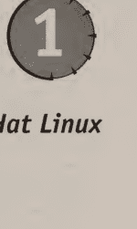

## 安装 Red Hat Linux

## 课程检查清单

- 清点您的 PC 组件
- 创建 Red Hat 启动盘
- 安装 Red Hat Linux

今晚的课程将引导您使用本书配套 CD-ROM 安装 Red Hat Linux；排除一些常见的安装问题；并进行第一次 Red Hat Linux 试用。假设安装程序识别了您 PC 的大多数硬件，您应该能在大约一小时内完成安装。到第三节课结束时，您将在 PC 上安装好 Red Hat Linux，并开始熟悉 GNOME 和 KDE 桌面。

本课程强调标准 Red Hat 安装过程的关键点和概念，帮助您入门。关于详细的逐步安装过程，我们参考该领域的权威指南，*Red Hat Linux 官方安装指南*，可在线访问 http://www.redhat.com/support/manuals/。

## 检查 Red Hat Linux 是否支持您的 PC 硬件

在安装之前，请确保 Red Hat Linux 支持您的 PC 硬件。至少，您必须拥有 Linux 兼容的 CPU，但也要确保类型、磁盘驱动器、视频卡、显示器、键盘、鼠标和 CD-ROM 驱动器以从配套 CD-ROM 安装 Red Hat Linux。如果您想运行 X Window 系统和图形桌面（如 GNOME 或 KDE），还必须确保 XFree86（Linux 的 X Window 系统）支持您的鼠标、视频卡和显示器。执行以下步骤以确认 Red Hat Linux 支持您的 PC 硬件：


1. 收集您计算机上安装的所有硬件的品牌、型号及其他技术细节。这就是您的硬件清单。如果您使用的是 Windows 95/98，请双击“控制面板”中的“系统”图标，然后选择“设备管理器”选项卡来收集部分此信息。
2. 手握硬件清单，请访问红帽公司的网站 http://www.redhat.com/hardware。该网站包含最新版本的 Red Hat Linux 支持的硬件列表。请将该列表与您的 PC 硬件进行核对，确保 Red Hat Linux 支持关键的硬件组件。

如果您有一块网卡，且您的 Linux PC 是或将是局域网（LAN）的一部分，您还应该收集配置网络所需的以下信息：
- 该 PC 的主机名和网络的域名
- 该 PC 的互联网协议（IP）地址；或者，如果 IP 地址是由动态主机配置协议（DHCP）服务器提供的，则是该服务器的地址
- 网关、广播和子网掩码地址
- 网络名称服务器的地址

> 如果您计划在家中一台独立的 PC 上使用 Linux，您可以通过拨号连接经由互联网服务提供商（ISP）使用点对点协议（PPP）连接到互联网。

## 创建 Red Hat 启动盘

假设您拥有兼容的硬件，下一步是如果您的 PC 不支持通过 CD-ROM 启动，则创建一个 Red Hat 启动盘。Red Hat Linux 安装 CD 是可启动的，因此如果您的 PC 可以从 CD-ROM 启动，请跳过本章，直接进入下一节“使用 FIPS 重新划分硬盘”。否则，请继续阅读。安装 Red Hat Linux 后，您将不再需要 Red Hat 软盘。

> 如果您可以在 MS-DOS 下启动 PC，则不需要启动盘。请从 DOS 命令行提示符访问 CD-ROM。

创建 Red Hat 启动盘涉及使用一个名为 RAWRITE.EXE 的工具程序，将名为 Red Hat Linux 启动映像的特殊文件复制到磁盘上。

要在 Windows 下创建 Red Hat 启动盘，请遵循以下步骤：
1. 打开一个 MS-DOS 窗口（选择开始 > 程序 > MS-DOS 提示符）。
2. 在 MS-DOS 窗口中，在 MS-DOS 提示符下输入以下命令。请将 `d:` 替换为您 CD-ROM 的驱动器号。您的输入以粗体文本显示：
```
d:
cd \dosutils
rwrite
```
输入磁盘映像源文件名：\images\boot.img
输入目标软盘驱动器：a
请将一张格式化的软盘插入 A: 驱动器，然后按 <ENTER>：

3. 按照指示，您应该将一张格式化的软盘放入 PC 的 A: 驱动器，然后按 Enter。`RWRITE.EXE` 会将启动映像文件复制到磁盘。

当再次看到 DOS 提示符时，您可以将 Red Hat 启动盘从 A: 驱动器中取出并（如果您尚未这样做）对其进行适当的标记。

## 使用 FIPS 重新划分硬盘

一旦您拥有了 Red Hat 启动盘（如有必要），您的下一个任务是通过划分硬盘为 Red Hat Linux 腾出空间。重新划分硬盘有两种方法：
- 销毁*现有分区*并创建两个较小的新分区——一个用于 Windows，另一个用于 Red Hat Linux。这需要您备份并恢复*现有的 Windows* 文件。这是重新划分硬盘的困难方式。
- 使用*FIPS（首次非破坏性交互分区拆分）*工具程序（包含在随附的 CD-ROM 上）来调整*现有分区*的大小，从而为第二个分区腾出空间，您可以在其中安装 Red Hat Linux 而无需销毁您的*现有数据*。您也可以使用商业磁盘分区软件，例如 PowerQuest 的 PartitionMagic（http://www.powerquest.com/partition-magic/index.html）。

> 无论您采取哪种方法来重新划分硬盘，在备份当前硬盘内容之前，请勿执行此步骤。

在本节中，我将向您展示如何使用 FIPS 重新划分硬盘，以创建空间用于 Linux 分区。在安装 Red Hat Linux 期间，您需要将预留给 Linux 的分区进一步划分为至少两个部分：一部分用于 Linux 根文件系统，另一部分用于交换空间。

> *Linux* 目录树也被称为*文件系统*。

FIPS.EXE 程序及相关文件位于随附 CD-ROM 的 \DOSUTIL 子目录中。要使用 FIPS，请遵循以下步骤：
1. 使用 SCANDISK.EXE 或其他磁盘修复工具确保磁盘上没有错误。
2. 对磁盘进行碎片整理。如何整理硬盘碎片取决于您当前的操作系统。例如，在 Windows 95/98 中，选择*开始* → *程序* → *附件* → *系统工具* → *磁盘碎片整理程序*。
3. 在 MS-DOS 6.0 或更高版本中，使用命令 `FORMAT A: /S` 创建一个可启动磁盘。在 Windows 95/98 中，使用控制面板中的“添加/删除程序”选项创建一个启动盘，然后按照“启动盘”选项卡中的说明操作。
4. 将以下文件从 CD-ROM 复制到指示的磁盘。（以下示例假设 D: 是 CD-ROM 驱动器。）
   ```
   COPY D:\DOSUTILS\FIPS.EXE A:
   COPY D:\DOSUTILS\RESTORR8.EXE A:
   COPY D:\DOSUTILS\FIPSDOCS\ERRORS.TXT A:
   ```
   FIPS.EXE 是用于拆分分区的程序。ERRORS.TXT 是 FIPS 错误消息的列表。您可以查阅此列表以了解 FIPS 显示的任何错误消息的解释。RESTORR8.EXE 是一个程序，允许您从由 FIPS 创建的备份中恢复硬盘的某些重要部分。
5. 将可启动磁盘留在 A: 驱动器中，并重启 PC。PC 从 A: 启动并显示 A:> 提示符。
6. 输入 FIPS。FIPS 程序运行并显示关于您硬盘的信息。FIPS 提供在继续之前保存重要磁盘区域备份副本的机会。之后，FIPS 显示新分区可以开始使用的第一空闲柱面（以及分区的兆字节大小）。
7. 使用左箭头和右箭头键调整新分区（由拆分现有分区产生的分区）的起始柱面以更改分区大小。按右箭头可增加起始柱面编号。这会在现有分区中留出更多空间并减小您创建的新分区的大小。请尝试创建一个 1GB 或更大的新分区。
8. 当您对新分区的大小感到满意时，按 Enter。FIPS 显示修改后的分区表，并提示您输入 C 继续或 R 重做分区表。
9. 按 C 继续。FIPS 显示一些关于磁盘的信息，并询问您是否要将新的分区信息写入磁盘。
10. 按 Y。FIPS 将新的分区表写入硬盘，然后退出。
11. 将磁盘从 A: 驱动器中取出并重启 PC。

当系统启动时，硬盘中的所有数据都应完好无损——但 C: 驱动器的空间会变小。您已从旧 C: 驱动器的未使用部分创建了一个新的、未格式化的分区。在安装 Red Hat Linux 时，您将对其进行格式化并设置为供 Linux 使用。

## 启动 Red Hat Linux 安装

要启动 Red Hat Linux 安装，请将第一张 CD-ROM 放入光驱盘托，如果需要，将 Red Hat 启动盘放入 A: 驱动器，然后重启计算机。重启时，您的 PC 从启动盘加载 Red Hat Linux 并启动 Red Hat 安装程序，称为 Anaconda。

## 会话 1——安装 Red Hat Linux

! 如果重启时 CD-ROM 不在驱动器中，安装程序将以文本模式启动，并提示您插入 CD-ROM。只有在那时它才会启动 X 窗口系统并切换到图形安装屏幕。

片刻之后，屏幕显示欢迎消息，并以 boot: 提示符结束。欢迎消息告诉您，按 F1 到 F5 中的任意一个功能键可以获取更多信息。要立即开始安装 Red Hat Linux，请按 Enter。

在快速（200MHz 或更快）的 Pentium PC 上从随附的 CD-ROM 安装 Red Hat Linux 应该不到一个小时，即使您安装了几乎所有软件包。例如，在一台配备 128MB 内存和 2GB 专门用于 Red Hat Linux 的硬盘分区的 266MHz Pentium PC 上，安装大约需要 45 分钟。在较旧的 PC 或内存较少或 Linux 分区较大的 PC 上，安装过程会花费稍长的时间。这些时间估算也不包括检查安装磁盘上的坏块，这会使安装过程显著延长。

## 为 Red Hat Linux 划分硬盘

在您可以安装任何软件之前，必须为您使用 FIPS 创建的用于 Red Hat Linux 的空分区做准备。这涉及将空分区细分为至少两个部分，并将其中一个部分格式化为 Linux 文件系统，称为 ext2。您可以让安装程序自动完成此操作，或者您可以手动执行此任务，使用 Disk Druid——一个允许您划分磁盘并同时指定您希望将 Linux 文件系统的哪些部分加载到哪个分区的工具程序。我们的示例使用最简单的配置：一个小的交换分区（有关更多信息，请参阅本会话后面的“理解交换分区”）和一个包含所有文件的大分区。

在您开始使用 Disk Druid 划分磁盘之前，您需要了解如何在 Linux 中引用磁盘驱动器和分区。此外，您应该理解挂载点和交换分区这些术语。在接下来的三个部分中，您将学习这些术语和概念，然后继续学习如何使用 Disk Druid。

### 命名进程和设备

划分硬盘的第一步是理解 Red Hat Linux 如何引用各种磁盘。Linux 将所有设备视为文件，并拥有代表每个设备的实际文件。在 Red Hat Linux 中，这些设备文件位于 /dev 目录中。由于 Linux 将 /dev 目录中的设备视为文件，因此硬盘名称以 /dev 开头。表 1-1 列出了您可能需要使用的硬盘和软驱名称。

**表 1-1**  
**硬盘和软驱名称**

| 名称 | 描述 |
| :--- | :--- |
| /dev/hda | 第一个集成驱动电子设备（IDE）硬盘（DOS 和 Windows 中的 C: 驱动器） |

（续）


## 表 1-1（续）

| 名称 | 描述 |
| :--- | :--- |
| /dev/hdb | 第二个 IDE 硬盘（在 DOS 和 Windows 中的 D: 驱动器） |
| /dev/sda | 第一个小型计算机系统接口（SCSI）驱动器 |
| /dev/sdb | 第二个 SCSI 驱动器 |
| /dev/fd0 | 第一个软盘驱动器（在 DOS 中的 A: 驱动器） |
| /dev/fd1 | 第二个软盘驱动器（在 DOS 中的 B: 驱动器） |

> 当 Disk Druid 显示分区列表时，分区名称的形式为 hda1、hda2 等。Linux 通过向磁盘名称后添加分区编号来构建每个分区名称——对于硬盘上的四个主分区，编号为 1 到 4。因此，如果你的 PC 的单个 IDE 硬盘有两个分区，请注意安装程序使用 hda1 和 hda2 作为这些分区的名称。

### 将文件系统挂载到设备

在 Red Hat Linux 中，通过将物理磁盘分区与文件系统的特定部分关联来使用它。这是一种被称为*目录树*的目录层次结构。如果你有多个磁盘分区（你可能有一个带有 Linux 分区的第二个磁盘），你可以在 Red Hat Linux 中的单个目录树下使用所有分区。你只需决定 Linux 目录树的哪一部分应位于每个分区上——这一过程在 Linux 中称为*将文件系统挂载到设备*。（磁盘分区即*设备*。）

> *挂载点*是与磁盘分区关联的目录。

假设你的 PC 上有两个磁盘，并且你在两个磁盘上都创建了 Linux 分区。图 1-1 展示了如何将这些 Linux 目录树（文件系统）的不同部分挂载到这两个分区上。

为了简单起见，我们的安装示例使用了一个分区，这是一种并非理想的配置，你将在第 5 课中了解到这一点。

### 理解交换分区

Linux 使用*虚拟内存*系统，这意味着它可以将系统硬盘的一部分用作物理内存（RAM）的扩展。当 Linux 的物理内存用尽时，它可以将当前不需要的 RAM 部分移动出去（或*交换出去*），以为需要更多内存的程序腾出空间。如果 Linux 需要访问交换出去的数据中的任何内容，它会找到其他内容交换出去，然后从磁盘中将所需数据交换进来。这种在 RAM 和磁盘之间来回交换数据的过程也被称为*分页*。

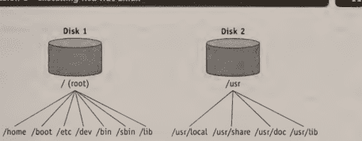

**图 1-1 将 Red Hat Linux 文件系统挂载到两个磁盘分区的示例**

在 Red Hat Linux 安装过程中，你将使用 Disk Druid 创建一个交换分区。请遵循屏幕提示，将分区类型标记为交换设备，Disk Druid 将执行必要的任务。

### 为 Red Hat Linux 准备磁盘分区

当安装程序提示你选择想要使用的磁盘分区方法时，请选择 Disk Druid 并点击“下一步”按钮。此时你应该会看到 Disk Druid 屏幕（如图 1-2 所示）。

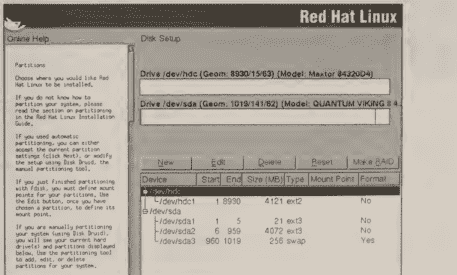

**图 1-2 Red Hat Linux 安装程序中的 Disk Druid 屏幕**

Disk Druid 的界面起初可能让人有点望而生畏，但它提供了充足的上下文敏感帮助，并防止你犯可能导致销毁磁盘上所有数据的愚蠢错误。创建一个大小最多为已安装 RAM 容量两倍的交换分区，然后将剩余的可用空间用作 Linux 根分区。

在你完成 Disk Druid 中的分区指定后，Red Hat 安装程序会显示一个屏幕，列出你可能需要格式化以便在 Linux 中使用的分区。该列表仅显示 Linux 分区；你不格式化交换分区。

要格式化分区，请点击分区名称旁边的按钮。你还应该点击标记为“在格式化时检查坏块”的项目旁边的按钮，以便格式化过程标记磁盘上可能存在物理缺陷的区域。如果你启用了坏块检查，安装时间将比本会话前文给出的估计值长得多。

## 配置 Red Hat Linux


完成分区和格式化后，你几乎可以开始安装软件了。首先，安装程序提示你设置几个关键的系统参数：安装引导装载程序的位置，提供网络信息（如果适用），定义你的时区，以及设置身份验证（登录）信息。

### 安装 LILO

LILO，即 *Linux Loader*（Linux 引导装载程序），是一个*引导装载程序*，它在 PC 硬件启动后启动操作系统。如果已安装 Windows 95/98，LILO 可以加载它。对于 Windows 95/98 和 Red Hat Linux 驻留在单个硬盘上的系统，Red Hat 建议将 LILO 安装在主引导记录中。

第 24 课将更详细地介绍 LILO。


### 配置网络

假设 Linux 内核检测到了网卡，Red Hat 安装程序将显示网络配置屏幕，该屏幕使你能够配置 Linux 系统的局域网参数。这一步*不是*用于配置拨号网络。

### 设置时区

完成网络配置后，选择你的时区，确保勾选屏幕底部的复选框，该框说明你的 PC 时钟使用本地时间。

### 设置 root 密码并添加用户账户

你接下来看到的屏幕是账户配置屏幕。你必须为 root 用户选择一个密码，并添加至少一个普通用户账户。root 用户是 Linux 中的超级用户，几乎可以在系统上执行任何操作。分配一个你能够记住但他人难以轻易猜出的密码。密码长度至少应为八个字符，包含大写和小写字母及数字的混合，以及至少一个特殊字符，例如 + 或 *。密码区分大小写。

要添加用户账户，请填写账户名称、密码和全名字段，然后点击“添加”按钮。新的账户信息随后会出现在“添加”按钮下方的表格中。你不必此时添加所有用户账户。


第 10 课解释了如何添加用户账户。

### 配置密码身份验证

安装程序显示一个屏幕，你可以从中配置密码身份验证选项。有几个你可以启用或禁用的选项。为了提高系统安全性，应使用默认设置。点击“下一步”按钮以进入下一个配置步骤。

### 选择要安装的软件包组

完成关键配置步骤后，安装程序将显示一个屏幕，你可以从中选择要安装的 Red Hat Linux 软件包组。选择软件包组后，在 Anaconda 安装 Red Hat Linux 期间请喝杯咖啡休息一下。你可能需要插入第二张 CD-ROM，因此请偶尔回来检查。

### 完成安装

在所有软件安装完毕，一些最终配置任务处理完成，并且创建了紧急启动磁盘后，安装程序将提示你重新启动系统。点击“确定”按钮后，请将 CD-ROM 和软盘从各自的驱动器中取出。

## 复习

本会话涵盖了验证你的硬件与 Red Hat Linux 的兼容性，创建启动磁盘，对硬盘进行分区，并简要解释了 Linux 如何使用磁盘分区。最后，本会话描述了实际 Red Hat Linux 安装的主要里程碑。


## 自我测试

1. 你可以在哪里找到 Red Hat Linux 支持的硬件列表？（参见“检查 Red Hat Linux 是否支持你的 PC 硬件。”）
2. 如果你的 PC 有网卡，你需要配置哪些参数来设置网络？（参见“检查 Red Hat Linux 是否支持你的 PC 硬件。”）
3. Red Hat 启动磁盘是用来做什么的？（参见“创建 Red Hat 启动磁盘。”）
4. 什么是 FIPS，你可以用它做什么？（参见“使用 FIPS 重新分区你的硬盘。”）
5. 什么是 Disk Druid，你应该用它做什么？（参见“为 Red Hat Linux 对硬盘进行分区。”）


## 排除 Red Hat Linux 安装故障

**会话检查清单**

- ✓ 以文本模式安装 Red Hat Linux
- ✓ 以专家模式安装 Red Hat Linux
- ✓ 配置 X 窗口系统
- ✓ 配置打印机
- ✓ 获取 Red Hat Linux 安装帮助

**本** 课讨论解决最常见安装和配置问题的方法。在大多数情况下，Red Hat Linux 安装程序 Anaconda 工作正常，能够正确检测并配置关键的硬件组件，如 SCSI 控制器和网络卡。然而，如果 Anaconda 无法正确检测或配置某个组件，它将跳过该步骤。例如，如果 Anaconda 未能正确检测网络卡，它将跳过网络配置步骤。安装程序还试图通过跳过某些系统配置步骤（如设置打印机）来简化安装过程。由于可以通过其他方式配置这些任务，因此你可以从大多数安装和配置问题中恢复。本课还列出了遇到无法解决的安装问题时的一些可用资源。

**剩余 30 分钟**

### 以文本模式安装 Red Hat Linux

Red Hat 安装程序试图使用最小化的 X 窗口系统来显示图形用户安装界面。如果该程序未能检测显卡，X 将不会启动。如果由于任何原因 X 启动失败，你始终可以退回到旧的文本模式安装程序，手动配置显卡。如果你熟悉旧的文本模式安装程序，也可以使用文本模式安装。

要使用文本模式安装，请在启动 Red Hat Linux 安装光盘后在 `boot:` 提示符下键入 `text`。此后，基本安装过程与第 1 课中描述的图形安装类似，但存在一些细微差别。特别是，你不能使用鼠标，并且需要手动输入一些在图形安装中由 Anaconda 自动处理的配置值。如果你已经按照第 1 课中“检查 Red Hat Linux 是否支持你的 PC 硬件”部分收集了硬件信息，那么你在响应提示并完成安装时应该不会有麻烦。

在文本模式下，当安装程序未能检测显卡时，它会显示一个显卡列表。请从列表中选择一个显卡。由于你的帮助选择了显卡，在文本模式下安装时 X 可能会正常工作。如果不行，你可以使用本课程稍后“配置 X 窗口系统”部分中的信息来配置 X。


在某些情况下，使用文本模式安装允许你在包含 Red Hat 硬件兼容性列表中未明确列出的硬件的系统上安装 Red Hat Linux。有时，为不支持的硬件选择类似的硬件选项甚至可能有效。然而，这些选项既不受支持也不推荐，且并非总是有效。

要查看 Red Hat 安装程序如何检测某些设备，你还可以查看安装程序的内核在启动时显示的消息。要查看这些启动消息，请按 Ctrl+Alt+F4 切换到文本模式虚拟控制台，消息将在此处显示。虚拟控制台是存储在内存中的一屏文本或图形信息，你可以通过按适当的键序列在物理屏幕上查看（Shift+PageUp 向上滚动，Shift+PageDown 向下滚动）。查找与相关设备有关的消息。如果所有方法都失败，你可以通过运行专家模式安装（将在下文讨论）手动指定某些设备。

### 以专家模式安装 Red Hat Linux

专家模式安装使你可以控制几乎整个安装过程。其他安装模式会隐藏一些安装步骤，并使用自动检测和硬件配置的默认值。

要以专家模式运行安装，请遵循以下步骤：

1. 在 Red Hat Linux 安装过程中出现的初始文本屏幕的 `boot:` 提示符下键入 `expert`。然后，安装程序将显示另一个文本屏幕，询问是否有驱动盘。
2. 你的硬件供应商可能会提供包含 Linux 驱动程序的软盘。如果你有，请按 Enter，对话框会提示你将软盘插入 A: 驱动器。之后，按 Enter，安装程序将加载驱动程序并引导你完成安装驱动程序所需的步骤。
3. 如果你没有驱动盘，请选择 None（无）。然后，安装程序将经过另外两个屏幕，让你选择语言和键盘布局。接着，安装程序将提示提供包含要安装的介质的软件包。
4. 接下来，安装程序显示一个对话框，给你另一个添加设备的机会。按 Tab 键突出显示“Add Device”按钮，然后按 Enter。安装程序将显示一个对话框，提示设备类型（SCSI 或网络）。
5. 如果你有任何 SCSI 设备，如 SCSI 硬盘，请选择 SCSI 并按 Enter。然后，安装程序将显示一个 SCSI 控制器列表，你应该选择系统中的那个并按 Enter。然后，安装程序将加载该驱动程序模块。

SCSI 驱动程序会自动探测并确定 SCSI 控制器的设置，如中断请求 (IRQ) 和 I/O 端口地址。如果驱动程序在检测 SCSI 控制器设置时遇到问题，你可以手动指定这些参数。为此，请选择标有“Specify module parameters”的复选框并按 Enter。然后，安装程序将提示你输入模块参数。

6. 你可以输入一行如 `aha152x=0x340, 11,7` 来指定驱动程序模块的参数。（有关这些设置的更多信息，请参阅本课程稍后的侧边栏“指定 SCSI 控制器设置”。）
7. 添加任何 SCSI 控制器后，你将回到可以选择设备类型的对话框。你也可以从这个对话框添加网卡。在对话框中，从列表中选择 Network 并按 Enter。然后，安装程序将显示一个网卡列表，你可以从中选择你的网卡。

当你按 Enter 时，安装程序将加载所选网卡的驱动程序模块。该驱动程序将探测并确定网卡设置。

8. 一旦你回到选择 SCSI 或网络设备的屏幕，请选择 Back 并按 Enter。这将带你到询问是否添加设备的对话框。选择 Done 并按 Enter。然后，安装程序将切换到图形模式，并引导你完成剩余的以下步骤，如第 1 课中所述。

### 指定 SCSI 控制器设置

如果你的系统中有一个 SCSI 控制器，Red Hat 安装程序将加载该控制器的 SCSI 驱动程序模块。你需要识别 SCSI 控制器的类型（如 Adaptec 1542 或 Adaptec 2940）。安装程序试图通过探测各种 I/O 端口地址来确定控制器设置，如 IRQ 和 I/O 端口地址。然而，如果安装程序未能确定 SCSI 控制器设置，你必须将这些参数——IRQ 和 I/O 地址——作为驱动程序模块的选项来指定。这些选项的确切格式因模块而异。例如，Adaptec AHA 152x 卡的驱动程序接受以下格式的选项：

```
aha152x=IOPORT,IRQ,SCSI_ID[,Reconnect,Parity]
```

其中 `IOPORT` 是 I/O 端口地址。`IRQ` 是中断请求号，`SCSI_ID` 是 SCSI 控制器的 SCSI ID。最后两项是可选的。aha152x 模块的典型模块选项可能是：

```
aha152x=0x340, 11,7
```


## 配置 X 窗口系统

如果在 X 配置步骤期间安装程序无法检测到您的视频卡，您可以跳过该步骤，并在完成安装的其他部分后再配置 X。完成安装后，请使用以下步骤配置 X：

1.  安装完成并重启电脑后，您将看到一个文本登录屏幕。以 root 身份登录，并输入 `Xconfigurator` 以运行该名称的工具程序。`Xconfigurator` 工具可让您创建 X 服务器所需的配置文件。
2.  `Xconfigurator` 程序启动时会显示一个欢迎对话框，其中包含关于 X 配置文件的消息。阅读完消息后，按 Enter 键继续配置过程。

`Xconfigurator` 会自动检测您的视频卡使用的芯片组，并显示一条摘要消息，如图 2-1 所示。

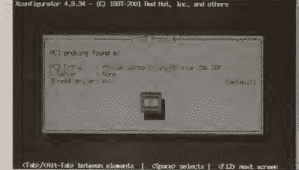

**图 2-1** Xconfigurator 探测视频卡后生成的消息

在这种情况下，Xconfigurator 发现了一块基于 nVidia GeForce 256 DDR 芯片组的视频卡，并建议使用 nv XFree4 驱动。图 2-1 中的对话框仅是一个示例，因此您看到的对话框可能不同。确保 Xconfigurator 识别了正确的显卡，然后按 Enter 继续其余配置。您看到的下一个对话框可让您从列表中选择监视器。

按上箭头和下箭头键浏览列表。如果您在列表中找到了您的监视器型号，请将光标定位到该监视器上，然后按 Enter。否则，选择 Custom（自定义）并按 Enter。如果您选择 Custom，Xconfigurator 将显示另一个对话框，您必须为监视器提供两个关键参数：

- **水平同步频率** 是监视器每秒绘制水平线的次数，单位为千赫兹（kHz）。
- **垂直同步速率** 或垂直刷新率是监视器每秒绘制整个屏幕的次数。

您可以在监视器手册中找到这些频率参数，或者在许多情况下，在制造商的网站上找到。按 Enter 继续。Xconfigurator 将显示预定义的水平同步范围列表。

监视器同步速率的值应与您的监视器规格相匹配。不要猜测！如果您指定的速率超出了监视器的实际能力，可能会损坏它。

例如，如果您的监视器手册说它可以以 60Hz 显示 1,280 × 1,024 分辨率，那么您应该选择与此规格匹配的项目。选择完水平同步能力后，按 Enter。

Xconfigurator 接下来提示您输入监视器的垂直同步速率。选择最接近监视器规格的垂直同步范围并按 Enter。

如果 Xconfigurator 无法检测视频卡上的显存容量，它将显示一个对话框，提示您从列表中选择一个显存容量。选择最接近视频卡内存容量的数值并按 Enter。

Xconfigurator 提示您识别时钟芯片——视频卡上的一个定时设备。您可以放心地按 Enter 接受默认选择，该选择标记为 No Clockchip Setting (recommended)（无时钟芯片设置（推荐））。

然后，Xconfigurator 显示一个“选择视频模式”对话框，其中包含视频模式列表，即像素分辨率和颜色深度的组合，例如 800 × 600 像素或 1,280 × 1,024 以及每像素 16 位或 24 位，如图 2-2 所示。您的显卡或监视器仅支持某些视频模式，因此如有必要，请再次参考监视器手册。

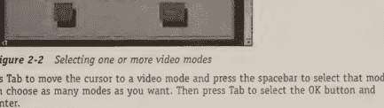

按 Tab 键将光标移动到视频模式上，然后按空格键选择该模式。您可以选择任意数量的模式。然后按 Tab 键选择 OK（确定）按钮并按 Enter。

接下来，Xconfigurator 为您提供启动 X 以测试配置的机会。您应该按 Enter。会出现图形 X 屏幕，Xconfigurator 显示一个对话框，询问您是否能看到文本。用鼠标单击关闭对话框。

最后，Xconfigurator 会在 /etc/X11 目录中写入 XF86Config-4 文件并退出。这完成了 X 配置。下次重启电脑时，X 应该启动，并且您应该能看到一个图形登录屏幕。

## 配置打印机

Red Hat 安装程序不包含打印机配置步骤。但是，只要 Linux 内核能够检测到电脑的并行端口，您就可以从 X 工具程序中配置打印机。要查看 Red Hat Linux 是否检测到并行端口，请在终端窗口中输入 `dmesg | grep par`。以下是该命令的典型输出：

```text
dmesg | grep par
parport0: PC-style at 0x378 [SPP,PS2]
parport0: no IEEE-1284 device present.
lpd: using parport0 (polling)
```

第一行以 `parport0` 开头，表明 Linux 检测到了并行端口。文本 `parport0` 是“Linux 术语”，指并行端口零，即第一个并行端口（在 DOS 和 Windows 中称为 LPT1）。

要设置打印机，您必须正在运行 X。从图形登录屏幕登录为 root，并从 GNOME 桌面选择 Programs->System->Printer Configuration（程序->系统->打印机配置）。打印机配置工具名为 `printconf-gui`。图 2-3 说明了其主要窗口。

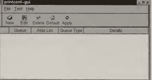

**图 2-3** *printconf-gui 使您可以管理打印机。*

单击 New（新建）按钮以配置新打印机，这将启动 Red Hat 的新打印机配置向导。单击 Next（下一步）按钮开始配置打印机，首先选择打印机类型并为其命名，如图 2-4 所示。如果打印机连接到您的电脑，请单击 Local Printer（本地打印机），然后单击 Next 继续。

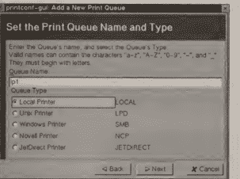

**图 2-4** 在 printconf-gui 中配置打印机

在图 2-4 中，已选择了本地打印机，并且队列，即打印机名称，已设置为 lp1。下一步是指定如何访问打印机（见图 2-5）。

> lp1 代表 Line Printer 1（行打印机 1）。Linux 使用命名的打印机队列来区分打印机。队列还作为打印作业和发送到特定打印机的相关文件的临时存储区域。

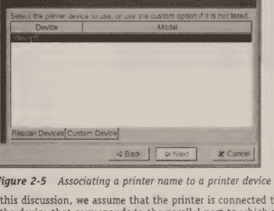

**图 2-5** 在 printconf-gui 中将打印机名称关联到打印机设备

在本文档中，我们假设打印机连接到电脑的并行端口。选择与打印机所连接的并行端口对应的设备——在大多数情况下，这将是 /dev/lp0，即 DOS/Windows LPT1 打印机端口的 Linux 等效项。单击 Next 继续。

第 10 课解释了 Linux 打印模型以及如何自定义 Red Hat Linux 以获得打印机的最佳效果。

在下一个对话框“选择打印驱动”中，如图 2-6 所示，向下滚动列表直到找到打印机的制造商，单击名称，然后选择您的打印机及相应的驱动文件。单击 Next 继续。最后一个对话框总结了您所做出的打印机配置（见图 2-7）。检查以确保其正确，然后单击 Finish（完成）以完成配置过程。

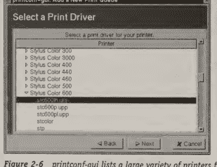

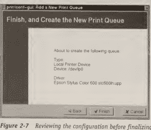

如果一切运行正常，您应该在 printconf-gui 的显示中看到您的打印机，如图 2-8 所示。

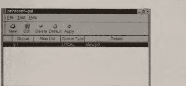

*图 2-8* *新配置的打印机出现在 printconf-gui 的主对话框中。*

最后一步是打印测试页以确认打印机已正确配置。首先，从菜单栏中选择 Test→Print ASCII Test Page（测试→打印 ASCII 测试页）以确保简单文本正确打印，然后选择 Test→Print Postscript Test Page（测试→打印 Postscript 测试页）以确认图像和其他图形元素正确打印。

## 获取 Red Hat Linux 安装帮助

Red Hat Linux 在大多数具有受支持硬件的电脑上都能顺利安装。但是，如果您遇到文本模式或专家模式安装都无法解决的困难，经验丰富的帮助只需几次点击即可得到。实际上，即使您的安装运行完美无缺，您可能会发现以下一些链接和资源很有价值且信息丰富。

Red Hat 在网络上提供了完整的 manuals（手册）集合。对于这些前两课未解决的安装和初始配置问题，请务必查看以下一个或两个链接：

- [官方 Red Hat Linux x86 安装指南](http://www.redhat.com/support/manu...)：`http://www.redhat.com/support/manu...`
- [官方 Red Hat Linux 入门指南](http://www.redhat.com/support/manu...)：`http://www.redhat.com/support/manu...`

这两份指南是安装 Red Hat Linux 和基本自定义的权威参考。

位于 `http://www.redhat.com/apps/support/` 的 Red Hat 知识库是另一个丰富的信息来源。如果您遇到了问题，其他人很可能也遇到了，因此请使用知识库搜索解决方案。

第三个可能的信息来源是产品勘误和更新，位于 `http://www.redhat.com/apps/support/updates.html`。

最后，其他 Red Hat Linux 用户有时是最好的信息来源。Red Hat 邮件列表的存档包含大量有用信息（以及一些不太有用的信息）。


息，等等）。你可以搜索 http://www.redhat.com/apps/support/updates.html 上的归档，或者更直接的，自己订阅其中一个邮件列表。在之前的 URL 中可以找到完整的列表和描述。

简而言之，万一你在安装 Red Hat Linux 时遇到任何问题，利用大量可用的信息，你只需点击几次即可找到解决方案。

## 回顾

在本节中，通过以不同模式运行安装程序，向你展示了如何克服一些常见的安装问题。你学习了如何使用文本模式安装，以及如何利用专家模式安装安装程序未能检测到的设备。最后，你学习了如何配置 X 窗口系统和打印机。

## 自测

- 1. 如何以文本模式启动安装？（参见“以文本模式安装 Red Hat Linux”。）
- 2. 如果 Red Hat 安装程序未检测到你的网卡，你应该怎么做？（参见“以专家模式安装 Red Hat Linux”。）
- 3. 什么时候需要手动配置 X 窗口系统？（参见“配置 X 窗口系统”。）
- 4. 如何启动允许你配置打印机的实用程序？（参见“配置打印机”。）
- 5. “修复阶梯状文本”是什么意思？（参见“配置打印机”。）

## 演示


# 试用 Red Hat Linux

## 演示检查清单

- 首次启动 Red Hat Linux
- 登录
- 注销
- 理解窗口管理器
- 探索 GNOME
- 探索 KDE
- 关闭 Red Hat Linux
- 故障排除

## 首次启动 Red Hat Linux

安装完成后，Red Hat Linux 安装程序会自动重新启动系统。PC 会执行正常的开机序列，从 C: 盘加载 LILO，然后出现一个屏幕，显示 LILO 可以启动的分区名称。如果你不做任何操作，LILO 将从你在演示 1 中配置 LILO 时指定的默认分区启动。如果你按 Ctrl+X，会出现以下提示：

```
LILO boot:
```

## 从其他分区启动

如果你想从另一个分区（例如 Windows）启动，请按 Tab 键。LILO 会显示可用可启动分区的名称。例如，典型的显示可能是：

```
linux dos
```

然后你可以输入想要启动的分区名称（在此例中为 linux 或 dos），或者按 Enter 键从第一个分区（也称为默认分区）启动。

当你安装 LILO 时，如果指定 Linux 分区为默认项，你只需简单等待；几秒钟后，LILO 就会启动 Linux。

LILO 启动 Linux 后，你应该会看到一长串启动信息——其中包括 Linux 检测到的设备名称。在所有信息的末尾，你会看到一个图形登录屏幕，如图 3-1 所示。

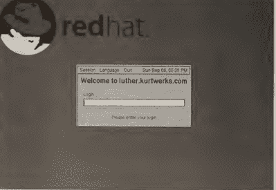

图 3-1 Red Hat Linux 中的图形登录屏幕

屏幕中间的窗口显示欢迎信息，包含你的系统主机名——即你在配置网络时分配给系统的名称。如果未配置网络，则使用 localhost.localdomain 作为主机名。现在，你可以首次登录你新的 Red Hat Linux 系统了。

## 登录

你可以使用安装期间定义的任何账户进行登录，包括 root。例如，要以用户 bubba 的身份登录，请在文本字段中输入 bubba（在开始输入前，将鼠标移动到登录窗口上），然后按 Enter 键。接着输入你在安装期间提供的 bubba 的密码（如果你除了 root 账户外还添加了其他账户），最终你会看到一个类似图 3-2 中显示的屏幕。

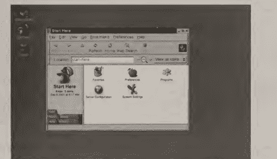

图 3-2 *以普通（非 root）用户身份登录后的初始 GNOME 桌面*

稍后我们将探索 GNOME 桌面。现在，我想向你展示如何注销并关闭 Linux 系统。

## 注销

在探索 GNOME GUI 之前，你应该学习如何注销。为此，请选择主菜单——GNOME 桌面中位于 GNOME 面板左边缘的风格化水果图标（见图 3-2）——然后从菜单中选择“注销”。（GNOME 面板将在本节的“探索 GNOME”部分进一步讨论。）屏幕会变灰，并弹出一个对话框，询问你是否确实想要注销，同时提供停止或重启 PC 的选项。点击“是”按钮即可注销。片刻之后，图形登录屏幕（图 3-1）会出现，以便其他用户（或再次由你）登录并使用系统。

## 理解窗口管理器

X 窗口系统与其他操作系统 GUI（如 OS/2 或 Windows）不同，它依赖窗口管理器来装饰窗口。也就是说，X 处理绘制窗口以及 X 客户端（在 X 中运行的应用程序）与 X 服务器或其他 X 客户端之间通信的机制。X 并不做任何事情来为窗口添加漂亮的标题栏、滚动条，也不解释鼠标移动、按键输入等。X 所做的仅仅是提供一个**协议**，这是一套窗口管理器必须遵循的规则或通用框架。因此，**窗口管理器**遵循基本的 X 协议，在 X 创建的未装饰窗口上创建标题栏、滚动条、菜单等。

为什么要这样分离功能？其中一个好处是，这样做使 X 能够独立于设备、操作系统和网络协议。另一个优点是，系统的某个特定部分，比如窗口管理器，可以通过替换相关组件进行修改，而不会使系统不稳定或以其他方式影响系统的其余部分。


## 探索 GNOME

既然你已经知道如何登录和注销，请重新登录。由于它是默认设置，你应该再次看到 GNOME 桌面。在本节中，你将花几分钟时间探索 GNOME 桌面。


GNOME 显示的具体外观取决于当前会话。*会话*不过是一组应用程序（包括一个*窗口管理器*）以及这些应用程序的状态。GNOME 将会话信息存储在你主目录下的 `.gnome` 子目录中一个名为*会话文件*的文件中。这是一个文本文件；如果你好奇，可以用命令 `more ~/.gnome/session` 浏览该文件。


现在不要担心会话文件的语法。你将在演示 6、7 和 8 中更多地学习**Linux 命令**。

默认会话描述生成的初始 GNOME 桌面（见图 3-2）与 Windows 95/98/NT/2000 桌面非常相似。它包括 GNOME 面板，或者简称为*面板*（类似于 Windows 任务栏）以及 Sawfish 窗口管理器，生成的桌面类似图 3-2 所示。

### 什么是 GNOME？

GNOME 代表 **GNU 网络对象模型环境**。 **GNU** 代表“GNU 即非 UNIX”（GNU's Not UNIX）。GNOME 是一个图形用户界面（GUI）和一个编程环境。从用户的角度来看，GNOME 类似于基于 motif 的 *通用桌面环境*（CDE）或 Microsoft Windows。在幕后，GNOME 具有许多功能，使程序员能够编写协同工作良好的图形应用程序。在本节中，我们将指出 GNOME GUI 的一些关键功能，并留待你自己探索细节。

你始终可以通过访问 `http://www.gnome.org` 上的 GNOME 主页获取有关 GNOME 的最新信息。

GNOME 面板是 GNOME 桌面的一个关键功能。面板是一个独立的 GNOME 应用程序。如图 3-3 所示，它为菜单和小型面板小工具提供了显示区域。每个面板小工具都是一个设计用于在面板内运行的小型程序。例如，面板最右侧的时钟小工具显示当前时间。

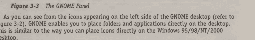

正如你在 GNOME 桌面左侧出现的图标所见（参考图 3-2），GNOME 允许你直接将文件夹和应用程序放置在桌面上。这类似于你可以直接在 Windows 95/98/NT/2000 桌面上放置图标的方式。

你可以像在 Microsoft Windows 中那样移动和调整窗口大小。此外，与 Microsoft Windows 95/98/NT/2000 中的窗口边框一样，标题栏的右侧包含三个按钮。最左边的按钮将窗口缩小为图标，中间的按钮将窗口最大化以占满整个屏幕，最右边的按钮关闭窗口。


请注意面板左右两端向外指的箭头。点击箭头，你会看到面板滑开，将其显示区域缩小为屏幕边缘的一小部分。这为窗口腾出了更多的桌面空间。再次点击箭头，面板会重新出现。

面板还包括其他几个小工具：

- GNOME 分页器小工具：这提供了一个虚拟桌面，其尺寸大于系统屏幕的物理尺寸。在图 3-3 中，分页器在一个小显示区域内显示四个页面。每个页面代表一个与 X 显示屏幕大小相等的区域。要转到特定页面，请在分页器窗口中点击该页面。GNOME 分页器小工具还显示每个出现在当前虚拟页中的窗口的按钮。
- 启动器小工具：这些是脚形图标右侧的按钮。每个小工具显示一个带有该按钮启动的应用程序图标的按钮。点击按钮即可启动（launch）该应用程序。尝试点击这些按钮中的每一个，看看会发生什么。问号（?）按钮启动 GNOME 帮助浏览器；工具箱按钮启动 GNOME 控制中心；终端图标启动一个终端窗口；地球图标启动 Netscape Communicator。锁图标启动屏幕保护程序，并要求你输入密码才能返回桌面。
- 主菜单按钮：GNOME 面板还显示主菜单按钮，其行为类似于 Windows 开始菜单。这是面板左侧（见图 3-3）带有风格化脚印图像（即 GNOME 标志）的按钮。那个脚印就是主菜单按钮。与 Windows 95/98/NT/2000 中的“开始”按钮一样，你可以从当你左键点击脚印时弹出的菜单中启动应用程序。通常，这个弹出菜单列出了启动应用程序的项。一些菜单项带有箭头。当你将鼠标指针悬停在带有箭头的项上时，会出现另一个弹出菜单。


如果时间允许，你应该探索主菜单中的所有项目，以查看你可以从该菜单执行的所有任务。此时，请选择 主菜单（根目录）\ 注销，以便你可以开始一个 KDE 会话。

## 探索 KDE

若要试用 KDE 图形界面，你必须已在会话 1 中将 KDE 包作为红帽 Linux 的一部分安装好。通常，安装程序会将 GNOME 设置为默认的图形界面。暂时，你可以通过在图形登录窗口中选择 会话 \ KDE 来更改下一个会话的图形界面。

- **注意**
  不要将登录窗口中使用的*会话*一词与本书中使用的*会话*一词混淆。登录窗口中的*会话*指的是你登录期间的时间段，而本书中的*会话*指的是 30 个课时或章节。

- **交叉引用**
  在会话 17 中，你将学习如何将默认图形界面从 GNOME 更改为 KDE，以及反之亦然。

当你登录时，你应该看到当前会话的 KDE 桌面。下一次登录时，系统将恢复为 GNOME（假设那是你的默认图形界面）。

选择 KDE 作为该会话的图形界面并登录后，你会看到一个类似于图 3-4 所示的初始 KDE 桌面。

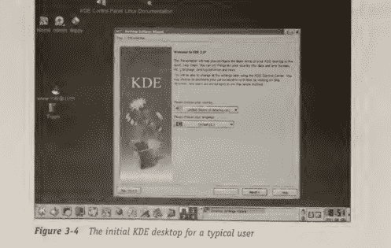

## 什么是 KDE？

KDE 是 K 桌面环境（K Desktop Environment）的缩写。KDE 项目始于 1996 年 10 月，旨在开发一种用于使用 X 窗口系统的 UNIX 系统的通用图形界面。KDE 的第一个 beta 版本于次年（1997 年 10 月）发布，KDE 1.0 版本于 1998 年 7 月发布。

从用户角度来看，KDE 提供图形桌面环境，包括窗口管理器（kwm）、文件管理器（kfm）、用于启动应用程序的面板（kpanel）、帮助系统、配置工具以及许多应用程序，包括图像查看器、PostScript 查看器，以及邮件和新闻组程序。

从开发人员角度来看，KDE 拥有类库和对象模型，便于使用 C++ 进行应用程序开发。KDE 本身就是一个庞大的开发项目。

你可以通过访问 [KDE 主页](http://www.kde.org/) 随时获取关于 KDE 的最新信息。

KDE 易于使用，并与 Windows 95/98/NT/2000 图形界面有许多相似之处。你可以从一个类似于 Windows 中“开始”菜单的菜单中启动应用程序。KDE 还允许你直接将文件夹和应用程序放在桌面上。

出现在屏幕底边的 KDE 面板用于启动应用程序。面板的左端和右端显示向外指的箭头。你可以点击这些箭头来隐藏面板，从而为桌面上的应用程序腾出更多空间。当面板隐藏时，仍会显示一个带有箭头的小条。要再次查看完整面板，点击该箭头，面板便会滑出。

以下是 KDE 面板上最重要的按钮列表。如果你不知道某个按钮的功能，只需将鼠标悬停在按钮上，就会弹出一个包含关于该按钮简要信息的小窗口。

第 4、17 和 19 节介绍了 KDE 桌面的其他功能，包括自定义其外观以及使用一些 KDE 小部件。

- **开始按钮/主菜单**：面板最重要的组件是位于面板左侧的 K 按钮。该按钮类似于 Windows 95/98/NT/2000 中的“开始”按钮。点击 K 按钮时，会出现一个弹出菜单。通过这个菜单，你可以将鼠标悬停在带有向右箭头的条目上来访问其他菜单。你可以从此菜单中启动应用程序。这就是为什么 KDE 文档将 K 按钮称为“应用程序启动器”的原因。
- **KDE 桌面**：最小化所有窗口并仅显示桌面。
- **终端仿真**：KDE 面板还包括一个带有终端被 shell 覆盖图标的按钮。点击此按钮可运行终端仿真程序并获取一个终端窗口。你可以在终端窗口的 shell 提示符下输入 Linux 命令。
- **KDE 控制中心**：点击带有终端被电路板覆盖图标的按钮以启动 KDE 控制中心。控制中心允许你配置 KDE 桌面的各个方面。
- **在线帮助**：要阅读关于 KDE 的在线帮助，请点击带有书本图标的按钮。
- **文件管理器**：要查看你的主目录内容，请点击带有文件夹和房子图标的按钮。
- **虚拟桌面**：KDE 支持虚拟桌面。默认情况下，你有四个虚拟桌面。你可以点击标记为 1、2、3、4 或 5 的按钮之一来切换到特定的桌面。你可以使用这些桌面来组织你的应用程序窗口。你不需要让许多打开的窗口杂乱地堆在单个桌面上。当一个桌面变得拥挤时，只需切换到另一个桌面并在那里打开应用程序。

要注销 KDE，请选择 K-C 注销，然后点击生成的对话框中的注销按钮。下一节将展示如何关闭红帽 Linux 并关闭你的 PC 电源。


**剩余 10 分钟**

## 关闭红帽 Linux

当你准备关闭红帽 Linux 时，必须以有序的方式执行此操作。即使你是 Linux 系统的唯一用户，通常也有几个其他程序在后台运行。此外，像 Linux 这样的操作系统会尝试优化它们将数据写入磁盘的方式。由于磁盘访问相对较慢（与访问内存位置所需的时间相比），数据通常保存在内存中并以大块形式写入磁盘。因此，如果你只是简单地切断电源，就会冒着某些文件无法正常更新的风险。

任何用户（你不一定需要登录）都可以从桌面或图形登录界面关闭系统。登录对话框中的 **系统** 菜单提供了重新启动或停止系统的菜单选项。要关闭系统，只需在图 3-1 的图形登录界面中选择 系统-C 停止。

另一个对话框会询问你是否确实要停止系统。点击 **是** 按钮。然后系统将以有序的方式关闭。

当系统关闭时，你会看到关于进程正在关闭的消息。你可能会惊讶于即使没有人明确在系统上运行任何程序，系统中却有这么多进程。如果系统关闭时不会自动断电，你可以手动关闭电源。

## 故障排除

安装红帽 Linux 时最常见的问题之一是安装后的重启后无法登录。如果你在安装期间没有创建用户账户，你必须以 root 身份登录，并按照会话 10 中所述创建用户账户。同样，如果你忘记了安装期间创建的用户账户密码，请以 root 用户身份登录，然后使用会话 10 中描述的技术来更改该用户账户的密码。

如果你忘记了 root 密码，请重启并执行以下步骤：

1. 在 LILO boot: 提示符下，输入 `linux single` 并按 Enter。
2. 在 `#` 提示符下，输入 `passwd root`，并根据提示重置 root 的密码。
3. 最后，输入 `shutdown -r now`，系统将重启并识别新密码。

有时，安装后你的声卡可能无法工作。如果发生这种情况，请运行声卡配置实用程序。以 root 身份登录，并在终端窗口中输入 `sndconfig`。根据提示配置你的声卡。

## 复习

你通过登录你的 Linux 系统开始了这个会话。你学习了如何注销和关闭系统。在学习了一些不同的 X 窗口窗口管理器后，你再次登录并探索了 GNOME 桌面的关键功能。接下来，你学习了如何选择一个会话中的 KDE 作为你的图形界面，并探索了 KDE 的关键功能。对于这两种图形界面，你都发现了如何启动应用程序。最后，你学习了关闭红帽 Linux 系统的正确方法。

## 自测

1. 在红帽 Linux 启动并呈现图形登录提示后，如何登录？（参见“登录”。）
2. GNOME 中的“root”是什么？（参见“探索 GNOME”。）
3. 如何将你的图形界面切换为 KDE？（参见“探索 KDE”。）
4. 如何在 KDE 中打开终端窗口？（参见“探索 KDE”。）
5. 为什么必须以有序的方式关闭 Linux 系统？（参见“关闭红帽 Linux”。）


## 课程


# 自定义 GNOME 和 KDE 桌面

### 课程检查清单

-   ✓ 自定义 GNOME 桌面
-   ✓ 更改默认桌面
-   ✓ 自定义 KDE 桌面


**剩余时间：30 分钟**

今晚的最后一个课程重点在于使用 GNOME 和 KDE 图形化桌面，以及 Red Hat Linux 附带的一些应用程序和实用工具。本部分还展示了如何自定义 GNOME 和 KDE 桌面，并教你如何将默认桌面从 GNOME 切换到 KDE，反之亦然。

## 自定义 GNOME 桌面

如第 3 课所述，GNOME 图形桌面的默认外观和风格与 Windows 95/98/2000 相似，因此你不需要自定义任何内容即可开始使用 Red Hat Linux。但是，如果愿意，你可以像自定义 Windows 95/98/NT/2000 一样自定义 GNOME 桌面。例如，你可以选择不同的背景、更改窗口边框的外观，或选择并配置屏幕保护程序。

为了尝试自定义 GNOME 桌面，请从图形登录屏幕登录。我假设 GNOME 是你默认的桌面环境，因为安装 Red Hat Linux 时通常得到的就是 GNOME。


如果 GNOME 不是你的默认桌面，请在输入用户名和密码之前，从登录窗口中选择 **Session → GNOME**。

你可以通过选择 **主菜单 → 程序 → 设置 → 桌面** 或 **主菜单 → 程序 → 设置 → Sawfish 窗口管理器** 并选择其子菜单中的某个项（例如“外观”或“声音”）来配置 GNOME 桌面外观和风格（即视觉与行为表现）的大多数方面。这些配置项中的每一项被称为“小工具”（capplets，configuration applets 的缩写），允许你配置桌面外观和风格的某一方面。用户界面通常是一个包含可更改设置的对话框。在接下来的章节中，你将尝试进行一些自定义操作。

### 更改背景

为了尝试简单的自定义操作，从树状列表中选择 **桌面 → 背景**，以运行背景属性小工具，该工具会在工作区中显示一个对话框（如图 4-1 所示）。

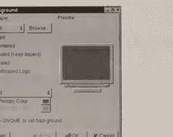

**图 4-1** 自定义 GNOME 桌面背景

如你所见，此对话框看起来类似于 Windows 95/98/NT 中的显示属性对话框。它允许你选择纯色或颜色渐变背景，或选择*壁纸*（用作背景的图片）。*颜色渐变*是指一种双色背景，从一种颜色开始逐渐变为另一种颜色。渐变可以沿垂直方向（从上到下）或水平方向（从左到右）开始。

继续操作，点击“颜色”下拉菜单选择“垂直渐变”，然后点击“主色”和“副色”按钮来为渐变选择颜色。你可以在对话框中出现的显示器图像预览更改效果。

如果你想使用图片作为壁纸，点击对话框“壁纸”部分的“浏览”按钮。壁纸选择对话框将显示 /usr/share/nautilus 目录的内容，因此请浏览 /usr/share/pixmaps/backgrounds 目录以获取更多背景图片。例如，尝试 /usr/share/pixmaps/backgrounds/space 目录，其中包含一组从太空看地球的图片。你可以选择任何联合图像专家组 (JPEG) 或可移植网络图形 (PNG) 格式的图片文件作为壁纸。

要在桌面上试用这些更改中的任意一种，点击“应用”按钮。你可以点击“取消”按钮恢复到原始设置。完成更改后，点击“确定”按钮关闭对话框并应用更改。

### 选择主题

另一种更令人兴奋的自定义操作是为整个用户界面选择新主题。*主题*指的是一组在外观和风格上相似的用户界面组件，例如按钮、复选框、滚动条等。在某些情况下，主题的整体效果可能非常令人惊叹。要试用一些新主题，请从树状菜单中选择 **桌面->主题选择器**。在主题选择器对话框中，你可以试用不同的主题并选择一个你喜欢的。当你选择一个主题时，你可以在预览区域看到其外观。例如，从可用主题列表中选择 MockMachine 主题，然后点击“试用”按钮。这将使 GNOME 桌面（包括控制窗口）的外观和风格类似于苹果麦金塔计算机。

如果你喜欢某个主题，点击“确定”按钮使用该主题。否则，点击 **“恢复按钮”** 返回默认主题。

### 自定义窗口管理器

GNOME 不依赖于任何特定的窗口管理器。默认的窗口管理器称为 *Sawfish*，但如果你愿意，也可以选择其他窗口管理器。要选择窗口管理器，请从控制中心树状菜单中选择 **桌面->窗口管理器**。你应该会看到系统中可用的窗口管理器列表，如图 4-2 所示。

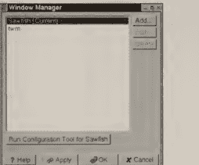

**图 4-2** 选择或自定义窗口管理器

在这种情况下，列表显示了两个窗口管理器：Sawfish 和 twm。如你所见，括号内的注释显示 Sawfish 是当前使用的窗口管理器。如果愿意，你可以通过选择 twm 窗口管理器然后点击“试用”按钮来尝试它。稍后，点击 **恢复** 返回到 Sawfish 窗口管理器。

与其他任何窗口管理器一样，Sawfish 控制每个窗口周围的标题栏、框架和其他装饰。这些功能允许用户通过点击和拖动窗口来更改其位置或调整其大小。（请想一想；如果没有框架或标题栏，你就无法移动或调整窗口大小。）

Sawfish 包含一个配置工具，用于更改窗口框架和标题栏的外观和风格。你可以点击标记为“运行 Sawfish 配置工具”的按钮来激活配置工具（参见图 4-2）。这将启动 Sawfish 配置器，它提供了一个配置选项的树状菜单。通过此菜单，Sawfish 配置器允许你更改 Sawfish 窗口管理器如何装饰窗口、添加特殊的视觉效果和声音，以及对鼠标点击和按键的行为。你可以在 Sawfish 配置器中试用一些配置项。

## 更改默认桌面

GNOME 和 KDE 都是功能强大的图形化桌面环境。Red Hat Linux 附带这两个 GUI，但 GNOME 是默认桌面。在你通过图形登录屏幕登录之前，你始终可以从登录窗口的“课程”菜单中选择特定的桌面。然而，Red Hat 还包含一个桌面切换器实用工具，允许你将默认桌面从 GNOME 切换到 KDE，反之亦然。要从 GNOME 切换到 KDE，请遵循以下步骤：

1. 在你的 GNOME 桌面上，选择 **主菜单:: 程序:: 系统:: 桌面切换工具**。桌面切换器对话框出现，如图 4-3 所示。

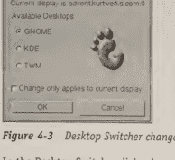

2. 在桌面切换器对话框中，点击 KDE 单选按钮以选中它。然后点击“确定”按钮。一个名为桌面切换器的确认对话框会出现。

3. 新对话框中的消息告诉你桌面配置已更改，但你必须重启 X。点击“确定”按钮关闭对话框。

尽管第 3 步中的消息说你必须重启 X，但你只需要注销会话然后重新登录即可。要注销，选择 **主菜单:: 注销**。当你再次登录时，你应该会看到 KDE 桌面。


要将默认桌面从 KDE 切换回 GNOME，请登录系统并从 KDE 桌面选择“K 系统桌面切换工具”。在桌面切换器对话框中，选择 GNOME 作为桌面。注销 KDE 并重新登录后，桌面应该会变成 GNOME。

## 自定义 KDE 桌面

现在，既然你知道了如何从 GNOME 更改为 KDE 桌面以及如何反向操作，请选择 KDE 桌面并以用户身份登录。与 GNOME 类似，KDE 还包含一个名为 KDE 控制中心的图形应用程序，你可以使用它来自定义 KDE 的各个方面，包括桌面背景、图标和字体。要启动 KDE 控制中心，请选择“K 控制中心”；或者在面板上，点击带有电路板和显示器图标的按钮。

KDE 控制中心启动时，它会显示主窗口，左侧有一个树状菜单，右侧工作区显示有关你系统的一些摘要信息（参见图 4-4）。

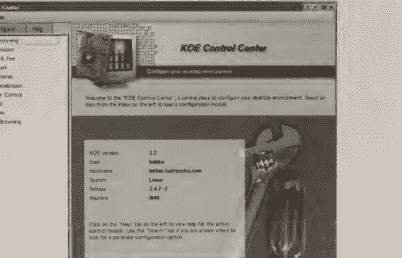

图 4-4 KDE 控制中心

KDE 控制中心的树状菜单显示了你可以用此工具控制的条目。树状菜单分为八个类别，包括应用程序、桌面、信息、输入设备、键盘快捷键、网络、声音和窗口行为。点击条目左侧的加号（ + ）以查看该条目的子类别。要更改某个条目，请通过树状菜单找到该条目，然后点击它。该条目的配置选项会出现在窗口右侧的一个选项卡对话框中。

## 更改背景和主题

要自定义桌面背景，请从树状菜单中选择“外观与感受 背景”。背景选项卡出现（参见图 4-5），提供自定义桌面背景的选项。

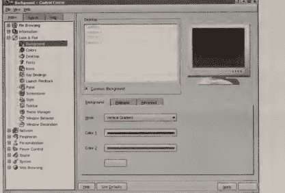

图 4-5 使用 KDE 控制中心自定义桌面背景

你可以选择单色或双色背景，也可以选择壁纸。例如，如果你想使用壁纸作为背景，请点击壁纸选项卡，然后点击壁纸选项卡上的浏览按钮。这会弹出一个打开对话框，显示 /usr/share/wallpapers 目录中的 JPEG 文件。你可以选择其中一张图片并点击确定。然后在 KDE 控制中心点击应用按钮，将此壁纸应用到桌面。如果你喜欢这个外观，点击确定。否则，点击默认，然后再次点击应用，以恢复原始背景。

从外观与感受类别中的菜单项（图 4-5）可以看出，你可以自定义背景的许多方面，从边框和颜色到菜单语言。我在这里不会逐一介绍所有条目，但你应该尝试一些这些自定义设置。例如，选择主题管理器来试用几种主题之一，就像 GNOME 控制中心提供的主题一样。图 4-6 展示了选择和预览主题的结果。

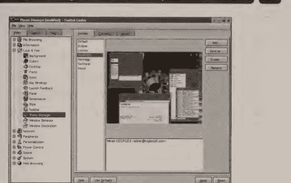

图 4-6 在 KDE 控制中心中选择和预览主题

### 选择颜色方案

如果你想为桌面颜色选择一个颜色方案，就像 Windows 95/98/NT/2000 中的颜色方案一样，请在 KDE 控制中心的树状菜单中选择“外观与感受 > 颜色”。颜色选项卡会出现。然后你可以向下滚动颜色方案列表，并选择一个进行预览。当你选择一个颜色方案时，选项卡中的预览区域会显示该颜色方案的外观。要将颜色方案应用到桌面，请点击应用按钮。如果你不喜欢该方案，点击使用默认，然后再次点击应用，以恢复默认颜色方案。

### 执行其他任务

除了桌面自定义之外，KDE 控制中心中的信息条目还允许你执行许多其他任务，包括将声音文件与事件（如打开或关闭窗口）关联、定义键盘快捷键以及查看系统信息。你应该利用本节的剩余时间探索 KDE 控制中心树状菜单中的其他条目。

## 回顾

本节向你展示了如何自定义 GNOME 图形桌面的外观和感受行为。你使用 GNOME 控制中心更改了桌面外观和感受的各个方面。你学会了如何将默认桌面从 GNOME 更改为 KDE 图形桌面，以及反向操作。最后，你还使用了 KDE 控制中心来自定义 KDE 的外观和感受。

## 自测

- 1. 你使用什么图形应用程序来定制 GNOME 桌面？（参见“自定义 GNOME 桌面”。）
- 2. 如何定制 Sawfish 窗口管理器？（参见“自定义窗口管理器”。）
- 3. 如何将你的默认桌面从 GNOME 更改为 KDE，以及反向操作？（参见“更改默认桌面”。）
- 4. 你使用什么工具来定制 KDE 桌面？（参见“自定义 KDE 桌面”。）
- 5. 如何为 KDE 桌面选择颜色方案？（参见“自定义 KDE 桌面”。）


# 周五晚上

- 1. 为什么审查 Red Hat Linux 硬件兼容性列表很重要？
- 2. 是否总是需要创建和使用 Red Hat Linux 启动软盘？
- 3. 为什么在安装 Red Hat Linux 之前必须对硬盘进行分区？
- 4. Linux `fdisk` 实用工具做什么？
- 5. 交换分区的目的是什么？
- 6. 如何在 Red Hat Linux 安装过程中添加用户帐户？
- 7. 什么是包组？
- 8. 说出另外两个安装选项，并描述你何时可能使用它们。
- 9. 第 2 节中描述的 X Window 配置工具叫什么名字？
- 10. 两个最重要的显示器配置参数是什么，为什么它们很重要？
- 11. 如何判断 Red Hat Linux 内核是否已检测到你的计算机上的并口？
- 12. 有哪些信息来源可用于排除 Red Hat Linux 安装过程中的故障？
- 13. Red Hat Linux 窗口管理器与其他操作系统的 GUI 系统之间有哪些主要区别？
- 14. 如何注销 GNOME 会话？KDE 会话呢？
- 15. 如果你忘记了 root 密码，你能更改它吗？如果能，怎么做？
- 16. 在 GNOME 和 KDE 之间切换的小工具叫什么名字？
- 17. 使用 GNOME 控制中心时，如何取消更改？
- 18. 什么是桌面主题？
- 19. 说出并描述至少五个你可以使用 KDE 控制中心配置的 KDE 桌面功能。
- 20. 说出并描述至少五个你可以使用 GNOME 控制中心配置的 GNOME 桌面功能。

☑ 周五
☑ 周六
☐ 周日

## 第一部分 – 周五晚上部分回顾

- **第 5 节** *探索 Linux 文件和目录*
- **第 6 节** *了解 Shell*
- **第 7 节** *学习 Linux 命令*
- **第 8 节** *在 Red Hat Linux 中编辑文本文件*
- **第 9 节** *学习更多 Linux 和 Bash 命令*
- **第 10 节** *执行基本系统管理任务*

## 第二部分 – 周六上午

- **第 11 节** *在 Red Hat Linux 中使用调制解调器*
- **第 12 节** *为你的 Red Hat Linux 电脑组网*
- **第 13 节** *将你的 Red Hat Linux 电脑连接到互联网*
- **第 14 节** *设置互联网服务*
- **第 15 节** *将 Red Hat Linux 用作工作组服务器*
- **第 16 节** *从 Red Hat Linux 访问 Windows 和 DOS 文件*

## 第三部分 – 周六下午

- **第 17 节** *使用屏幕保护程序并玩游戏*
- **第 18 节** *使用多媒体应用程序*
- **第 19 节** *在 Red Hat Linux 中使用办公工具*
- **第 20 节** *使用 Red Hat 网络*


# II

# 周六上午


- 第 5 节：探索 Linux 文件和目录
- 第 6 节：了解 Shell
- 第 7 节：学习 Linux 命令
- 第 8 节：在 Red Hat Linux 中编辑文本文件
- 第 9 节：学习更多 Linux 和 Bash 命令
- 第 10 节：执行基本系统管理任务


## 第 5 课


### 探索 Linux 文件和目录

### 课程检查清单

- 理解 Linux 文件系统
- 使用 Nautilus 文件管理器
- 使用 Linux 命令导航和操作文件和目录

在周五晚上的课程中，你安装了 Red Hat Linux，学习了如何登录、注销、如何关机以及如何进行基本的桌面自定义。今天上午的课程将更深入地探索 Linux，首先介绍 Linux 文件系统，然后解释如何使用 Nautilus 文件管理器。本课还将教你几个用于处理文件和目录的 Linux 命令。

## 理解 Linux 文件系统

与其他操作系统一样，Linux 将信息组织在包含于目录中的文件中。在 Linux 中，目录只是一个可以包含其他文件和目录的特殊文件，从而形成层次结构。这种文件的层次组织被称为文件系统。

Linux 文件系统为系统中的所有存储提供了一个统一的模型。文件系统有一个根目录，用斜杠 (/) 表示。文件和目录的层次结构从根目录开始扩展。文件系统的部分可以驻留在不同的物理介质上，例如硬盘、软盘和 CD-ROM。图 5-1 说明了 Linux 文件系统的概念及其如何跨越多个物理设备。


与 MS-DOS 和 Windows 95/98/ME/NT/2000 不同，Unix 没有驱动器字母的概念。还要注意，Linux 文件名并不受严格的 8.3 名称-扩展名格式限制。术语“8.3 文件名”源于 MS-DOS 使用八字符名称和三字符扩展名。

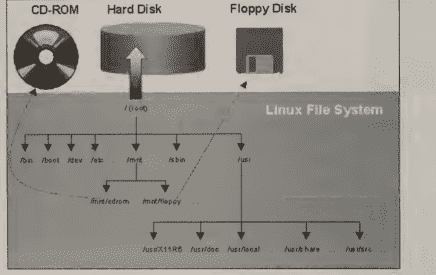

图 5-1 Linux 文件系统提供存储的统一视图，可能跨越多个驱动器。

在 Linux 中，你可以拥有长文件名（最多 256 个字符），并且文件名是区分大小写的。通常，UNIX 文件名有多个扩展名，例如 sample.tar.Z。以下是一些 UNIX 文件名的示例：Index.html、Makefile、kernel-2.2.15-2-5.0.1686.rpm、.bash_profile 和 httpd.src.tar.gz。

要定位文件，你不仅需要文件的名称，还需要关于目录层次结构的信息。术语“路径名”指的是定位文件所需的完整规范——即通到该文件的完整目录层次结构——其中包括文件名。图 5-2 显示了一个典型的 Linux 文件路径名。

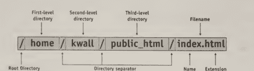

图 5-2 典型的 Linux 路径名

从图 5-2 中可以看出，完整的 Linux 路径名由以下部分组成：

- 根目录，用斜杠 (/) 字符表示。
- 目录层次结构，每个目录名称与前一个目录名称之间用斜杠 (/) 字符分隔。最后一个目录名称后出现 /。
- 文件名，包括名称和一个或多个可选扩展名。

现在你已经了解了 Linux 文件系统的基础知识，你可以通过以下两种方法访问文件和目录：

- 在 GNOME 或 KDE 桌面中使用图形文件管理器。
- 在终端窗口或文本控制台中输入适当的 Linux 命令。

图形文件管理器类似于 Windows 资源管理器，且易于使用。由于 GNOME 和 KDE 的文件管理器非常相似，我们只在本课中介绍前者。

## 使用 Nautilus 文件管理器

当你从图形登录屏幕登录 Red Hat Linux 系统后，可以通过双击桌面上的房子图标使用 Nautilus 文件管理器查看你的主目录。图 5-3 显示了示例主目录的初始显示。你的主目录外观应与之相似。

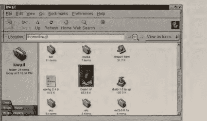

### 使用 Nautilus 文件管理器查看文件

Nautilus 文件管理器窗口的右侧以图标形式显示当前选定目录中的文件和目录。如你在图 5-3 中看到的，Nautilus 显示了 /home/kwall 目录的内容。位置栏显示了当前选定目录的名称。要查看整个文件系统的树视图，请点击 Nautilus 窗口左侧小面板中的“树”选项卡。结果显示应与图 5-4 类似。

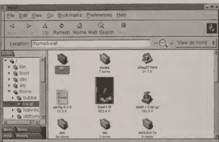

*图 5-4 Nautilus 显示整个文件系统的树视图，类似于 Windows 资源管理器。*

如果你使用过 Windows 资源管理器，你会发现 Nautilus 文件管理器很熟悉。要查看另一个目录的内容，首先在树视图中定位该目录。例如，要查看 `/etc/X11` 目录，请点击 `etc` 目录旁边的箭头。这将使 Nautilus 显示 `etc` 中的子目录，并将该加号变为减号。然后点击 X11 目录。窗口的右侧现在显示 `/etc/X11` 目录的内容。不同的文件有不同的图标。普通文件显示为一张纸。目录显示为文件夹。

Nautilus 文件管理器窗口具有通常的菜单栏和工具栏。请注意，在图 5-3 中，工具栏下拉菜单中标有“以图标显示”的按钮被按下。这意味着目录内容使用大图标显示。你可以从此下拉框中选择“以列表显示”选项，使 Nautilus 以列表格式使用较小的图标显示内容。

### 使用 Nautilus 文件管理器执行任务

除了导航文件系统和查看目录内容外，你还可以使用文件管理器执行任务，例如将文件从一个目录重新定位到另一个目录以及删除文件。我们不会展示每一步，但你可以花点时间尝试以下任务。

- **将文件移动到不同的目录：** 左键点击其图标，然后将其拖放到你希望放置该文件的目录中。
- **将文件复制到新位置：** 选择文件图标，然后选择“文件 复制”。你也可以右键点击文件图标，并从弹出菜单中选择“复制”。对话框会提示你输入文件应复制到的目录名称。

还需 20 分钟

- **删除文件或目录：** 右键点击图标，并从弹出菜单中选择“删除”。对话框会要求你确认是否确实要删除该文件或目录。你可以点击“是”删除选定项目，或点击“否”取消操作。
- **重命名文件或目录：** 点击图标视图中（参见图 5-3）的名称。然后你可以输入新名称或编辑名称。
- **创建新目录：** 在右侧窗口的空白区域右键点击，并从弹出菜单中选择“新建目录”。对话框会提示你输入新目录的名称。
- **查找文件：** 从菜单栏选择“命令 > 查找文件”。对话框会提示你输入要查找的内容以及开始搜索的位置。输入此信息后，点击“确定”开始搜索。搜索结果将出现在一个新窗口中。

## 使用 Linux 命令导航和操作文件和目录

虽然图形文件管理器易于使用，但你只有在 X Window 正在运行时才能使用它们。有时你可能没有运行图形文件管理器的图形环境。例如，你可能通过文本终端登录，或者 X 在你的系统上无法工作。在这些情况下，你必须依靠 Linux 命令来处理文件和目录。好的部分是，你总是可以使用 Linux 命令——即使在图形环境中也是如此。你所要做的只是打开一个终端窗口并输入 Linux 命令。点击 GNOME 面板中的终端图标以启动终端仿真程序，该程序显示一个终端窗口。

### 目录导航

在 Linux 中，当你以 root 身份登录时，你的主目录是 /root。对于其他用户，主目录通常是 /home 目录。示例主目录（当用户以 kwall 身份登录时）是 /home/kwall。此信息存储在 /etc/passwd 文件中。默认情况下，除了超级用户外，你是唯一拥有权限在你的主目录中保存文件并在你的主目录中创建子目录以进一步组织文件的用户。

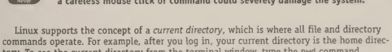

Linux 支持当前目录的概念，这是所有文件和目录命令操作的地方。例如，登录之后，你的当前目录是主目录。要从终端窗口查看当前目录，请输入 pwd 命令。要更改当前目录，请使用 cd 命令。要将当前目录更改为 /usr/share/doc，请输入以下内容：

```
cd /usr/share/doc
```


然后，要将目录更改为 `/usr/share/doc` 中的 `bash-2.04` 子目录，请输入以下命令：

```
cd bash-2.04
```

现在，如果你使用 `pwd` 命令，它会显示当前目录为 `/usr/share/doc/bash-2.04`。因此，你可以用两种方式来引用目录名称：

- *绝对路径名*（如 `/usr/share/doc`），指定目录树中确切的目录。
- *相对目录名*（如 `bash-2.04`），代表当前目录下的 `bash-2.04` 子目录。

如果在 `/usr/share/doc` 中输入 `cd bash-2.04`，当前目录将更改为 `/usr/share/doc/bash-2.04`。然而，在 `/home/naba` 中输入相同的命令会试图将当前目录更改为 `/home/naba/bash-2.04`，该目录可能不存在。顺便说一下，输入不带任何参数的 `cd` 命令会将当前目录更改为你的主目录。

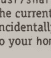

> 你可以使用快捷键来引用任何用户的主目录。在用户的登录名前加一个波浪号（~）来引用该用户的主目录。因此，`~kwil` 指的是用户 `kwil1` 的主目录，而 `~root` 指的是 root 用户的主目录。如果你的系统中有一个登录名为 `emily` 的用户，你可以输入 `cd ~emily` 来切换到 Emily 的主目录。

目录名 `.` 和 `..` 具有特殊含义。单个句点（`.`）指代当前目录，而两个句点（`..`）指代父目录。例如，如果当前目录是 `/usr/share/doc`，你可以通过输入以下命令将当前目录更改为 `/usr/share`：

```
cd ..
```

此命令将你在目录层级中向上移动一级。

# **目录列表和权限**

当你在 Linux 目录中移动时，你可能想知道其内容。你可以通过输入 `ls` 命令来获取目录列表。默认情况下，不带任何选项的 `ls` 命令以紧凑的多列格式显示当前目录的内容。例如，输入以下命令以查看 `/etc/X11` 目录的内容。（输入粗体文本中显示的命令；列表中包含的命令提示符未包含在内。）

```
**cd /etc/X11**
ls
```

applink      lbxproxy     rstart    xdm      XftcConfig    Xmodmap
fs           pprefdm      twm       XF86Config xinit       xserver
gdm         proxyngmr    X         XF86Config X kbxy      xsm

从这个列表中，你无法判断某个条目是文件还是目录。为了区分目录和文件，请如下使用 `ls` 命令的 `-F` 选项：

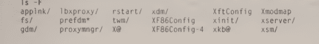

`-F` 选项会导致 `ls` 在特定文件的末尾添加一个字符，以指示其类型。例如，目录名称末尾会添加一个斜杠（`/`）。普通文件名保持原样显示。艾特符号（`@`）表示某个文件（如列表中的 `xkb`）实际上是另一个文件的链接。


链接是一个指向另一个文件的文件名。它就像 Windows 中的快捷方式。

星号（`*`）会附加在可执行文件后面（例如列表中的 `prefdm` 文件）。


你看到的具体文件可能因你在周五晚上进行的安装类型略有不同。

你可以使用 `-l` 选项查看有关文件和目录的更详细信息：

```
ls -l
```

对于 `/etc/X11` 目录，`ls -l` 的典型输出如下所示：

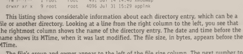

此列表显示了每个目录条目的大量信息，这些条目可以是文件或另一个目录。从右列向左看，你会看到最右边的列显示目录条目的名称。名称之前的日期和时间显示其 MTime（最后修改时间）。文件大小（以字节为单位）显示在 MTime 之前。

文件的组（group）和所有者（owner）显示在文件大小列的左侧。再往左的一个数字表示指向该文件的链接数，或者如果条目是目录，则包含的文件数量（包括 `.` 和 `..`）。最后，最左列显示文件的权限设置，它控制谁可以读取、写入或执行该文件。权限设置的最左侧字母具有以下特殊含义之一：

- 如果第一个字母是 `l`，该文件是指向另一个文件的符号链接。
- 如果第一个字母是 `d`，该文件是一个目录。
- 如果第一个字母是短横线（`-`），该文件是一个普通文件。
- 如果第一个字母是 `b`，该文件表示块设备，如磁盘驱动器。
- 如果第一个字母是 `c`，该文件表示字符设备，如串行端口或终端。

在第一个字母之后，最左列显示一组九个字符，当每个字母都存在时，显示为 `rwxrwxrwx`。每个字母表示特定的权限：读取（`r`）、写入（`w`）和执行（`x`）。用短横线（`-`）代替字母表示对文件的特定操作没有权限。因此，字符串 `rw-` 表示所有者具有读取和写入权限，但没有执行权限。将这九个字母视为三组三个字母（`rwx`），解释如下：

- 最左边的一组 `rwx` 控制文件所有者的读取、写入和执行权限。
- 中间的三个 `rwx` 字母控制属于该文件组的所有用户的读取、写入和执行权限。
- 最右边的一组 `rwx` 字母控制所有其他用户（统称为 world）的读取、写入和执行权限。

因此，权限设置为 `rwx-------` 的文件仅对文件的所有者可访问。同时，权限设置 `rwxr-r---` 使该文件对所有人都可读。

> 注意：通常，可执行程序（包括 shell 程序）具有执行权限。然而，对于目录，执行权限相当于使用权限——用户必须对目录具有执行权限才能列出其内容。

`ls` 命令的一个有趣特性是，它不列出任何以句点开头的文件。由于这些文件的名称以句点（`.`）开头，因此被称为*隐藏文件*或*点文件*。要查看这些文件，你必须如下使用带 `-a` 选项的 `ls` 命令：

```
ls -a
```

## 文件操作

你可能想要将文件从一个目录复制到另一个目录。为此，使用 `cp` 命令来执行此任务。`cp` 命令创建文件的*新副本*，而保留原文件不变。要将文件 `/usr/X11R6/lib/X11/xinit/Xclients` 复制到当前目录（如你的主目录）中的 `Xclients.sample` 文件，请输入以下内容：

```
cp /usr/X11R6/lib/X11/xinit/Xclients Xclients.sample
```

如果你想要将文件复制到当前目录并保持相同的名称，请使用句点（`.`）作为 `cp` 命令的第二个参数。因此，以下命令将 `/etc/X11` 目录中的 `XF86Config` 文件复制到当前目录（由单个句点表示）：

```
cp /etc/X11/XF86Config .
```

另一个 Linux 命令 `mv` 将文件移动到新位置。原始副本消失，一个新的副本出现在指定的目的地。你可以使用 `mv` 来重命名文件。如果你要将 `today.list` 的名称更改为 `old.list`，请如下使用 `mv` 命令：

```
mv today.list old.list
```

另一方面，你可以使用以下命令将 `today.list` 文件移动到名为 `saved` 的子目录中：

```
mv today.list saved
```

另一个常见的文件操作是删除文件。例如，使用 `rm` 命令删除名为 `old.list` 的文件，通过输入以下命令：

```
rm old.list
```


> 使用 `rm` 命令时要小心，特别是当你以 root 身份登录时。
> 使用 `rm` 意外删除重要文件非常容易。

除了复制、重命名和删除文件外，你可能还想查看文件的内容。使用 `more` 命令逐页查看文本文件。例如，要查看文件 `/etc/X11/XF86Config-4`，请使用此命令：

```
more /etc/X11/XF86Config-4
```

`more` 命令在每一页后暂停，因此你必须按空格键才能转到下一页。按 Enter 键可以逐行前进。要转到上一页，请按 `b`。

用于查看文件的另一个有用的 Linux 命令是 `less`。这个名字是一个双关，因为 `less` 的功能比 `more` 多，即 `less` 拥有一套比 `more` 更丰富的查看文件的功能。

## 目录操作

为了整理你主目录中的文件，你必须创建新的目录或子目录。使用 `mkdir` 命令来创建目录。例如，要在当前目录中创建一个名为 `images` 的目录，请输入以下内容：

```
mkdir images
```

创建目录后，你可以使用 `cd images` 命令切换到该目录。

当你不再需要某个目录时，使用 `rmdir` 命令将其删除。只有当目录为空时，你才能删除该目录。


> 要同时删除目录及其文件，请使用 `rm` 命令的递归选项 `-r`。因此，要用一条命令删除 `images` 目录及其所有文件，请输入 `rm -r images`。


## 文件和目录查找器

最后，你应该了解 `find` 命令，因为它对于定位符合特定搜索标准的文件（和目录）非常有用。Linux 版本的 `find` 命令源自 GNU，其选项比标准 UNIX 版本更为丰富。然而，我们展示的是标准 UNIX `find` 命令的语法，因为该语法在 Linux 中有效，并且你可以在其他 UNIX 系统上使用相同的格式。

假设你想查找名称以 `gnome` 开头的任何文件或目录。你可以使用 `find` 执行此搜索，如下所示：

```
find / -name *gnome* -print
```

该命令指示 `find` 从根目录 (/) 开始，查找匹配 `gnome*` 的文件名，并显示任何匹配文件的完整路径名。

你可以使用此简单形式 `find` 的变体来定位任何目录（以及该目录中包含的子目录）中的文件。如果你忘记了主目录中存储的所有以字符串 `report*` 开头的文件在哪里，可以使用以下命令搜索这些文件：

```
find ~ -name *report* -print
```

当你熟悉 `find` 的语法后，可以使用它的其他选项。例如，要仅查找特定类型的文件（如目录），请使用 `-type` 选项。以下命令显示你的 Linux 系统中的所有顶级目录名称：

```
find / -type d -maxdepth 1 -print
```

前面的示例使用了 `find` 命令的简单形式。你通常不需要在典型的 Linux 系统上使用 `find` 的复杂形式，但你可以通过使用以下命令查看其余的 `find` 选项：

```
man find
```

## 故障排除

如果你无法移动、重命名或删除文件，请使用 `ls -l` 命令验证你是否拥有相应的权限。

如果使用 `rmdir` 删除目录时收到类似 `rmdir: ‘dirname’; directory not empty` 的错误消息，请在重试 `rmdir` 命令之前先删除目录中的文件，或者使用 `rm -r` 删除目录及其内容。例如：

```
$ rmdir images
rmdir: 'images': directory not empty
$ rm -r images
```

一个常见的问题是：如何删除文件名以短划线 (-) 开头的文件。例如，假设你主目录中有一个名为 `-foo` 的文件。命令 `rm -foo` 会失败并产生以下错误：

```
$ rm -foo
rm: invalid option - o
```

出现这个问题是因为大多数 Linux 命令将短划线后跟字母解释为命令选项，而将其后的所有内容视为命令参数。因此，`rm` 命令的参数 `-foo` 看起来像是无效的语法，而不是文件名。解决方案是在 `rm` 和 `-foo` 之间使用两个短划线 (--)。大多数 Linux 命令将单独的两个短划线解释为所有选项的结束；其后的所有内容均被解释为参数。因此，要删除名为 `-foo` 的文件，请尝试 `rm -- -foo`，如下所示：

```
$ rm -- -foo
```

## 复习

本会话简要介绍了 Linux 文件系统，并讨论了文件的命名方式。随后演示了如何使用 Nautilus 文件管理器导航文件系统并查看目录的不同视图。你还执行了一些基本操作，如复制文件、删除文件和创建新目录。接下来，你学习了一些用于导航文件系统以及操纵文件和目录的 Linux 命令。最后，你学习了一些故障排除技巧。

## 自我测试

- 1. 什么是路径名？（参见“理解 Linux 文件系统”。）
- 2. 在 Nautilus 文件管理器中，如何按名称字母顺序对文件和目录列表进行排序？（参见“使用 Nautilus 文件管理器”。）
- 3. 使用哪个 Linux 命令可以快速从当前目录切换到你的主目录？（参见“目录导航”。）
- 4. 使用 `ls` 命令时，可以使用什么选项来查看所有文件，并看到带 / 后缀的目录名称列表？（参见“目录列表和权限”。）
- 5. 哪个 Linux 命令查找从 `/usr/doc` 目录开始的所有名为 COPYING 的文件？（参见“文件和目录查找器”。）


# 会话


## 理解 Shell（外壳/Shell）


## 会话清单

- 开始使用 Bash shell
- 使用 Bash shell


如第 5 节所述，不幸的是，你无法通过 GNOME 或 KDE 等图形环境完成所有任务。在这种情况下，你必须使用 Linux 命令来完成特定任务。第 5 节向你介绍了一些你可以从文本终端使用的 Linux 命令，以操纵文件和目录。本节向你介绍 **Bash** shell —— Linux 中的默认命令解释器。在这里，你将学习 shell *执行* 命令的一些重要特性。

## 开始使用 Bash Shell

如果你使用过 MS-DOS，你可能会熟悉 DOS 命令解释器。该程序（名为 **COMMAND.COM**）显示臭名昭著的 **C:\>** 提示符。在 Windows 中，你可以在 MS-DOS 命令窗口中看到此提示符。Linux 提供了一种命令解释器，称为 **shell（外壳）**，它类似于 MS-DOS 命令解释器。然而，正如你可能预期的那样，shell 的功能比 MS-DOS 命令解释器多得多。

> 尽管本节涵盖了 Bash shell，但 Red Hat Linux 允许你使用其他 shell。其中包括 **ash**，一个小型但功能强大的 shell，以及 **tcsh**，一个功能齐全的 shell，其语法与 C 编程语言相似。

默认的 Linux shell 称为 **Bash**，其程序名为 **/bin/bash**（位于 **/bin** 目录中）。当你从 GNOME 或 KDE 桌面打开终端窗口，或在文本控制台登录时，Bash shell 会提示你输入命令。当你输入命令时，shell 会执行它。

## 使用 Bash Shell

由于 shell 解释你输入的内容，了解 shell 如何*解释*（或处理）你输入的文本非常重要。大多数 shell 命令具有这种通用格式：

```
command option1 option2 ... optionN
```

单行命令通常被称为*命令行*。在命令行中，你输入一个命令，后跟一个或多个称为*命令行选项*的选项。这些选项控制命令的操作或行为方式。此外，命令本身和命令行选项可以接受一个或多个参数，二者都（有些令人困惑地）被称为*命令行参数*。命令行选项控制命令的行为，而命令行参数则为选项或命令提供额外信息，例如要操作的文件名。例如，考虑以下命令行：

```
grep -A 1 -i naba /etc/passwd
```

在这种情况下，*grep* 是命令，*-A* 和 *-i* 是选项，数字 1 是 *-A* 选项的参数，而 *naba* 和 */etc/passwd* 是 *grep* 的参数。

一个基本规则是，你必须使用空格或制表符将命令与选项分隔开。你还必须使用空格或制表符将选项分隔开。如果你想使用包含内嵌空格的选项，必须将该选项放在引号 (“”) 内。例如，要在密码文件中搜索名字 *Kurt*，输入以下 *grep* 命令（*grep* 用于在文件中搜索文本）：

```
grep “Kurt Wall” /etc/passwd
```

当 *grep* 打印包含名字 *Kurt* 的行时，它看起来像这样：

```
kwall:x:500:500:Kurt Wall:/home/kwall:/bin/bash
```

如果你创建了一个以你名字命名的用户账户，请继续输入 *grep* 命令，并将你的名字作为第一个参数。

> 在 grep 命令的输出中，你可以在最后一个冒号 (:) 后面看到 shell 的名称 (/bin/bash)。


命令行选项的数量和格式当然取决于具体的命令。随着您学习更多命令，您会发现大多数命令行选项采用 -X 的形式，其中 *X* 是一个单个字符。


由于各种 GNU 工具和实用程序实现了大多数 Linux 命令，您应该知道 GNU 命令支持包括所谓的长选项。这些是命令行选项，以两个破折号开头，后面跟随一个或多个描述性单词。因此，GNU 选项采用 --xxxx 的形式，其中 xxxx 是一个表示该选项的单词。例如，`ls --all` 命令显示所有目录项，包括那些以句点（.）*开头*的项。这等同于所有 UNIX 系统中的 `ls -a` 命令。

如果命令过长无法放在一行中，您可以按反斜杠（\）键，然后按 Enter 键。然后，在下一行继续输入命令。例如，输入以下命令（每行后按 Enter）：

```
cat \
/etc/passwd
```

然后 `cat` 命令会显示 /etc/passwd 文件的内容。

您可以在单行上连接几个较短的命令；只需在每条命令之间使用分号（;）作为分隔符（也称为命令*终止符*）。例如，以下命令

```
cd ; ls -F
```

将当前目录更改为您的主目录，然后列出该目录的内容。

## 获取 Bash 帮助

Bash 附带了许多内置命令，其中一些模仿或复制了您的 Red Hat Linux 系统上其他程序的功能。要查看这些被称为 Bash 内置命令的完整列表，请在 Bash 命令提示符下输入 `help` 并按 Enter 键。要获取特定 Bash 内置命令的帮助，请输入 `help *command*`，其中 *command* 是想要了解的 Bash 命令。例如，输入以下命令，然后按 Enter：

```
help pwd
```

简短的帮助文本显示了 Bash 内置命令 `pwd` 的语法，简要描述了它的功能，并提供了对 pwd 的命令行选项的解释：

```
pwd [-P|-L]
Print the current working directory.  With the -P option,
pwd prints the physical directory, without any symbolic
links; the -L option makes pwd follow symbolic links.
```

由于此处显示的输出经过编辑以适应本书的格式要求，因此在您的系统上的具体外观会有所不同。

## 组合命令

Linux 遵循 UNIX 哲学，即向用户提供许多简单命令的工具箱，这些命令可以以无数种方式组合，以创建更复杂的命令。假设您想知道系统 `/dev` 目录中是否存在名为 `smpcd` 的设备文件，因为某些文档告诉您，对于 Sound Blaster Pro CD-ROM 驱动器，您需要该设备文件。您可以使用命令 `ls /dev` 获取 `/dev` 目录的目录列表，查看列表中是否出现了包含 `smpcd` 的内容。不幸的是，`/dev` 目录有很多条目，可能很难找到名称中包含 `smpcd` 的任何项。但是，您可以将 `ls` 命令与 `grep` 结合，得出一个完全符合您需求的命令，如下所示：

```
ls /dev | grep smpcd
```

shell 将 `ls` 命令的输出（*目录列表*）发送给 `grep` 命令，后者搜索字符串 `smpcd`。该垂直线（`|`）被称为*管道*，因为它充当两个程序之间的通道；第一个命令的输出成为第二个命令的输入。

> 大多数 Linux 命令都设计成允许一个命令的输出输入到另一个命令的输入中。为此，只需将命令连接起来并在它们之间放置管道即可。

## 重定向命令输入和输出

设计用于协同工作的 Linux 命令具有共同特征——*它们始终从* ***标准输入*** *（通常是键盘）读取，并写入* ***标准输出*** *（通常是屏幕）。* ***错误*** *消息发送到* ***标准错误*** *（通常是屏幕）。这三个设备通常分别称为* ***stdin***、***stdout*** *和* ***stderr***。如果您希望命令从文件读取，您可以重定向* ***stdin*** *使其来自该文件。同样，要在文件中保存命令的输出，请将* ***stdout*** *重定向到文件。shell 的这些特性称为* ***输入*** *和* ***输出重定向***，*或者更一般地，称为* ***I/O 重定向***。

例如，输入 `cd` 切换到您的主目录，然后输入以下命令：

```
grep typeoff /usr/include/* > typeoff.out
```

暂时忽略类似 `grep: /usr/include/org` 的消息：is a directory；这些是 `grep` 命令的错误消息。此命令搜索 `/usr/include` 目录中所有文件中字符串 `typeoff` 的出现情况，然后将输出保存在名为 `typeoff.out` 的文件中。正如该命令所示，大于号（`>`）将 `stdout` 重定向到文件。

此命令还说明了 Bash 的另一个特性。当您使用星号（*）时，Bash 会用指定目录中所有文件名的列表替换星号。因此，`/usr/include/*` 意味着“显示 `/usr/include` 目录中的所有文件”。

您还可以重定向 `stdin`，以便命令从文件而不是键盘读取。例如，输入以下命令：

```
sort < /etc/passwd
```

这将显示 `/etc/passwd` 文件中行的排序列表。在这种情况下，小于号（<）将 stdin 重定向，使 sort 命令从 `/etc/passwd` 文件读取其输入。

## 让 Bash 自动补全您的命令

许多命令接受文件名作为参数。例如，要浏览名为 `/etc/X11/XF86Config` 的文件，请输入以下命令：

```
more /etc/X11/XF86Config
```

此命令每次显示一页屏幕的 `/etc/X11/XF86Config` 文件。对于接受文件名作为参数的命令，Bash 包含一个允许您输入短文件名的功能。您只需输入最少内容——仅前几个字符——即可在其目录中唯一地识别该文件。

要查看示例，请输入 more `/etc/X11/XF`，但不要按 Enter；而是按 Tab 键。Bash 会自动补全文件名，使命令变为 more `/etc/X11/XF86Config`。然后按 Enter 运行命令。

## 使用通配符

避免输入过多文件名的另一种方法是使用通配符——特殊字符，如星号 (*) 和问号 (?)，用于匹配字符串中的字符。如果您熟悉 MS-DOS，可能已经使用过诸如 `COPY *.* A:` 之类的命令，将当前目录中的所有文件复制到 A: 驱动器。Bash 接受文件名中类似的通配符。事实上，Bash 提供了比 MS-DOS 更多的通配符选项。

Bash 支持三种类型的通配符：

- 星号 (*) 字符匹配文件名中的零个或多个字符。因此，`*` 表示目录中的所有文件。
- 问号 (?) 匹配任何单个字符。
- 方括号中的字符集匹配该集合中的任意单个字符。例如，字符串 `[xx]*` 匹配任何以 x 或 x 开头的文件名。

当您需要对一组文件执行任务时，通配符非常方便。例如，要将名为 `/mnt/cdrom` 的目录中的所有文件复制到当前目录，请输入以下命令：

```
cp /mnt/cdrom/* .
```

Bash 用 `/mnt/cdrom` 目录中所有文件的名称替换通配符 `*`。命令末尾的句点代表当前目录。

您可以将星号与文件名的其他部分组合使用，以选择更具体的文件组。假设您想使用 `grep` 命令在满足以下条件的 `/usr/include` 目录中的所有文件中搜索字符串 `typed` 或 `struct`：

- 文件名以 s 开头。
- 文件名以 .h 结尾。


通配符规格 `s.*s*` 表示所有满足这些条件的文件名。因此，你可以使用以下命令执行搜索：

```
grep "*typeef struct*" /usr/include/s*.h
```

该字符串中包含空格（你希望 grep 命令能够找到），因此你必须用引号（`"`）将该字符串括起来。这种方法确保 Bash 不会试图将字符串中的每个单词解释为独立的命令行参数。

尽管星号（*）匹配任意数量的字符，但问号（?）仅匹配单个字符。假设当前目录中有四个文件：`image1.pcx`、`image2.pcx`、`image3.pcx` 和 `image4.pcx`。要将这些文件复制到 `/mnt/floppy` 目录中，请使用以下命令：

```
cp image?.pcx /mnt/floppy
```

Bash 会将单个问号替换为任意单个字符，并将这四个文件复制到 `/mnt`。

第三种通配符格式（`[...]`）匹配特定集合中的单个字符。你可能希望将此格式与其他通配符结合使用，以将匹配的文件名缩小到更小的集合。要查看 `/etc/X11/Xdm` 目录中以 `x` 或 `X` 开头的所有文件名的列表，请输入以下命令：

```
ls /etc/X11/Xdm/[xX]*
```


> 如果 Bash 在展开 `[...]` 通配符格式时未找到匹配的文件名，Bash 将保留通配符规格原样不变。

## 查看命令历史

为了方便你重复执行长命令，Bash 会存储多达 500 条（默认值）之前执行的命令。此功能称为**命令历史**（旧命令列表）。要查看命令历史，请输入 `history`。Bash 会显示旧命令的编号列表，包括你之前登录期间输入的命令。该列表可能类似于以下内容：

```
1  cd
2  ls -a
3  more /etc/X11/XF86Config
4  history
```

如果命令列表过长，你可以选择仅查看最后几条命令。要仅查看最后 10 条命令，请输入此命令：

```
history 10
```

要重复 `history` 命令显示的列表中的某条命令，只需输入一个感叹号（`!`），后跟该命令的编号。要重复第 3 号命令，请输入 `!3`。

你还可以在不知道命令编号的情况下重复旧命令。假设你*之前输入过* `more /usr/lib/X11/xdm-config`，现在你又想查看该文件。要重复上一条 `more` 命令，请输入以下内容：

```
lmore
```

通常，你可能想要重复最后输入的命令——也许只是稍作修改。例如，假设你使用 `ls -l` 命令显示了目录内容。要重复该命令，请按照以下方式输入两个感叹号：

```
!!
```

有时，你可能想要重复上一条命令，但为其添加额外的参数。假设 `ls -l` 显示了太多的文件。只需重复该命令，但通过 `more` 命令管道传输输出，如下所示：

```
!! | more
```

Bash 会将两个感叹号替换为上一条命令，然后在该命令后追加 `| more`。

> 调用前一条命令的一个简便方法是按向上箭头键，这会使**Bash**在命令列表中向前移动。要在命令历史中向后移动，请按向下箭头键。

## 使用命令别名

要查看别名的优势，请输入以下命令：

```
alias gobot='"cd /usr/src/linux/arch/i386/boot"'
```

这将 `gobot` 定义为*别名*——即单引号（`'`）内出现的文本的另一个名称。该文本是一条将*当前目录*更改为 `/usr/src/linux/arch/i386/boot` 的命令。

既然你已经定义了别名，请在 Bash 提示符处输入以下内容：

```
gobot
```

输入 `pwd` 以确认*当前目录*确实是 `/usr/src/linux/arch/i386/boot`。

如你所见，*别名*只不过是冗长命令的替代（通常更短）名称。Bash 将别名替换为其定义并执行等效命令。

如果你不再需要某个别名，请使用 `unalias` 命令删除该*别名*。例如，如果你不再希望使用 `gobot` 别名，请输入：

```
unalias gobot
```

在此步骤之后，输入 `gobot` 会导致出现类似以下的错误消息：

```
gobot
bash: gobot: command not found
```

## 重新定义危险命令

使用别名的另一个好用途是重新定义危险命令，例如 `rm`，使其更安全。默认情况下，`rm` 命令删除一个或多个指定的文件。如果你不小心输入了 `rm *`，`rm` 将删除你当前目录中的所有文件。有一位用户曾经有一次惨痛地学到了这一点，当时他想删除所有以 `.xwd` 结尾的文件。（这些文件包含他不再需要的旧屏幕图像。）他本意是想输入 `rm *.xwd`，但不知何故最终输入了 `rm * .xwd`。他收到了以下消息：

```
rm: .xwd: No such file or directory
```

被这条消息弄得困惑不解，他输入了 `ls` 再次查看目录内容。当列表显示为空时，他意识到自己在 `*` 和 `.xwd` 之间多打了一个空格。当然，该目录中的所有文件都永远消失了。

`rm` 命令提供了 `-i` 选项，该选项在删除文件前要求确认。要使该选项成为默认设置，请将以下别名定义添加到你主目录中的 `.bash_profile` 文件：

```
alias rm='rm -i'
```

从现在开始，当你使用 `rm` 删除文件时，命令会首先要求确认，如下所示：

```
rm .bash_profile
rm: remove '.bash_profile'? n
```

按 `y` 删除文件；否则，按 `n`。

许多用户利用别名功能为常用命令指定更熟悉的名称，并为经常输入的长命令创建快捷方式。如果你是 DOS 用户并且你发出 `md` 命令来创建目录，你可以简单地将 `md` 定义为 `mkdir`（创建新目录的 Linux 命令）的别名。你可以这样操作：

```
alias md='mkdir'
```

现在，你可以输入 `md dirname` 来创建一个名为 `dirname` 的新目录。

## 在后台运行命令

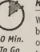

使用 MS-DOS 时，你不得不等待每个命令完成才能输入下一个命令。你可以稍微提前输入，但 MS-DOS 系统只能在其内部缓冲区中保存少量字符。然而，Linux 可以同时处理多个任务。你唯一可能遇到的问题是，终端或控制台会被占用，直到命令完成。

如果你在终端窗口中工作，而某个命令完成所需的时间太长，你可以打开另一个终端窗口并继续输入其他命令。但是，如果你在文本模式下工作，而某个命令似乎耗时过长，则需要另一种方法来访问你的系统。

Linux 允许你在*后台*执行耗时较长的命令，这意味着 shell 启动与命令对应的进程并立即返回以接受更多命令。shell 不会等待命令完成；命令作为后台中的独立进程运行。要在后台启动进程，只需在命令行末尾放置一个**与号**（`&`）即可。

例如，当你想使用 `find` 命令在整个文件系统中搜索文件时，你可以在后台运行该命令并将输出发送到文件。要尝试在后台运行 `find` 命令，请输入 `cd` 更改到你的主目录，然后输入以下命令：

```
find / -name "README.*" -print > all.readme &
```

你应该*立即*得到一个 Bash 提示符。现在你可以继续执行其他命令。当 `find` 命令完成时，搜索结果应出现在你主目录中的 `all.readme` 文件中。


如果未在后台运行的某个命令似乎耗时很长，请按 **Ctrl+Z** 停止它。然后输入 `bg` 将该进程放入后台。

## 使用虚拟控制台

Red Hat Linux 附带多个*虚拟控制台*。显示器和键盘的组合被称为*终端*或*控制台*。尽管你的 Red Hat Linux 系统只有一个物理终端或控制台，但它给人一种拥有多个控制台的外观。从图形 X 屏幕（GNOME 或 KDE 桌面）开始，按 **Ctrl+Alt+F1** 进入第一个虚拟控制台，按 **Ctrl+Alt+F2** 进入第二个，以此类推。这些虚拟控制台中的每一个都是一个文本屏幕，你可以在其中登录并输入 Linux 命令以执行各种任务。

请按下 **Ctrl+Alt+F2** 切换到第二个虚拟控制台。然后登录并尝试一些 Linux 命令。你可以通过在 Bash 提示符处输入 `exit` 来注销。要返回图形 X 显示，请按下 **Ctrl+Alt+F7**（或者可能是 **Alt+F7**）。

## 故障排除

如果你向命令传递由多个单词组成的参数，并收到部分内容为*没有该文件或目录*的错误消息，请尝试用弱引号（`"`）将该参数括起来并重新输入。请记住，Bash 使用空格和制表符字符来区分命令、选项和参数。例如，以下命令 `grep "Kurt Wall" /etc/passwd` 在显示其结果之前会产生错误消息：

```
grep: Wall: No such file or directory
cut/passwd:kwall: x:500:500:/Kurt Wall:/home/kwall:/bin/bash
```

将 `Kurt Wall` 括在弱引号内可解决此问题。


## 复习

在本节中，你尝试了 Bash shell 的许多关键功能——即 Linux 命令解释器。除此之外，你还学习了命令的语法、如何组合命令、如何在后台运行命令，以及如何使用别名。

## 自测

- 1. 什么是 shell，它的作用是什么？（参见“使用 Bash shell”部分。）
- 2. 如何在多行中继续输入一个长命令？（参见“组合命令”部分。）
- 3. 如何将 Linux 命令的输出保存到文件中？（参见“重定向命令的输入和输出”部分。）
- 4. 什么是别名，为什么要使用它们？（参见“使用命令别名”部分。）
- 5. 按哪些键可以进入第二个虚拟控制台？（参见“使用虚拟控制台”部分。）

## 第 7 节

## 学习 Linux 命令

### 本节清单

- 复习你到目前为止所学到的命令
- 用于管理进程的命令
- 有用的日期和时间命令
- 用于处理文本文件的命令
- 文件系统维护命令

在本节中，你将复习在之前几节中学到的命令，并介绍几个类别的若干 Linux 命令。然而，由于 Linux 命令数量众多，你无法在半小时内的小节中真正探索每一个命令。你将在后续的小节中尝试更多的命令。为了开始本节，请在图形登录界面登录并打开一个终端窗口。然后，你可以在该登录界面中键入这些命令。

## 复习你已学过的命令

你在之前的几个小节中已经尝试过相当多的 Linux 命令。浏览表 7-1 以刷新你对这些命令的记忆。为了方便你查阅，我们将它们按类别进行了组织。

### 表 7-1 你在之前小节中学过的 Linux 命令

| 命令类别和名称 | 描述 |
|---------------------------|------------|
| **获取在线帮助** | |
| help | 显示 Bash 内置命令的列表。在 Bash 提示符处键入 `help`。 |
| help *command* | 显示名为 *command* 的 Bash 内置命令的帮助文本。输入 `help cd` 以获取 Bash 内置 cd 命令的帮助。 |
| man | 显示在线帮助信息。输入 `man ls` 以获取 `ls` 命令的帮助。 |
| **让命令更简单** | |
| alias | 为长命令定义缩写（快捷方式）。单独输入 `alias` 以查看当前定义的所有别名。输入 `alias topdir="~"`，然后输入 `topdir` 以将目录更改为根目录（`/`）。 |
| unalias | 删除使用 `alias` 定义的缩写。输入 `unalias topdir` 以取消定义 `topdir` 缩写。 |
| **管理文件和目录** | |
| cd | 更改当前目录。输入 `cd /usr` 以切换到 `/usr` 目录。 |
| chmod | 更改文件权限。输入 `chmod +x filename` 以该文件可执行（用现有文件的名称替换 *filename*）。 |
| cp | 复制文件。输入 `cp` 以将目录更改为你的主目录。然后输入 `cp /etc/X11/XF86Config .` 以将文件复制到你的主目录。 |
| ls | 显示目录的内容。输入 `ls -F` 以查看当前目录的内容。 |
| mkdir | 创建一个目录。输入 `cd` 以切换到你的主目录，然后输入 `mkdir temp` 以创建一个名为 *temp* 的目录。 |
| mv | 重命名文件或将其从一个目录移动到另一个目录。输入 `mv filename1 filename2` 以更改文件名；对 *filename1* 使用现有文件的名称。 |
| rm | 删除文件。语法是 `rm filename`。（请谨慎使用，因为文件会被删除。） |
| rm dir | 删除目录。输入 `rm dir -temp` 以从你的主目录中删除名为 *temp* 的目录（参见本表中前面的 `mkdir` 命令）。 |
| pwd | 显示当前目录。输入 `pwd` 以查看当前目录名称。 |

## 查找文件

find：根据指定的条件（如名称、大小等）查找文件。输入 `find /usr -name "README*" -print` 以尝试此命令。

## 处理文件

cat：在标准输出上显示文件（可以将多个文件连接成一个大的文件）。输入 `cd` 以进入你的主目录，然后输入 `cat .bash_profile` 以查看该文件的内容。

grep：在文本文件中搜索正则表达式。输入 `cd` 以进入你的主目录，然后输入 `grep BASH .b*` 以查看在指定文件中搜索字符串 BASH 的结果。

more：一次显示一页文本文件。输入 `more /etc/inittab` 以分页查看内容。（按空格键前进或输入 `q` 退出。）

## 管理用户

passwd：更改密码。输入 `passwd` 并按照提示更改你的密码。

su：在没有参数调用的情况下，变为另一个用户或 root。输入 `su`，并在提示时输入 root 密码。请小心你做什么，因为你现在是超级用户。输入 `exit` 以返回普通用户。

以下部分按类别介绍了未在之前小节中涵盖的新命令。

## 管理进程的命令

每次 shell 响应你键入的命令时，它都会启动一个进程，即运行中程序的一个实例。shell 本身就是一个进程，它执行的任何脚本或应用程序也是如此。你可以使用 `ps` 命令查看进程列表。例如，当你输入 `ps -x` 时，Bash 会显示当前的进程集合。以下是该命令的部分输出。我还包含了 `-cols 132` 选项，以确保你能完整地看到每个命令：

```text
ps -x --cols 132
  PID TTY  STAT TIME COMMAND
  1  ?    S     0:05 init [5]
  325 ?  S     0:00 syslogd -m 0
```

```text
335 ? S 0:00 *clockd
480 ? S 0:00 crond
511 ? S 0:00 xinetd reuse pidfile /var/run/xinetd.pid
580 ? S 0:00 sendmail: accepting connections
596 ? S 0:00 gpm -t imp2
849 ? S 0:01 /usr/bin/gnome-session
853 ? S 0:00 gnome-apropos --sm-client-id default0
901 ? S 0:02 sawfish --sm-client-id=default0
967 ? S 8:36 magic --sm-client-id=default12
985 ? S 0:00 gnome-name-service
994 ? S 0:01 panel --sm-client-id default1
1001 ? S 0:00 gmc --nomindows --sm-client-id default8
2143 ? S 0:00 gnome-terminal --use-factory --start-factory-server
21433 ? S 0:00 gnome-pty-helper
21444 pts/5 S 0:00 bash
21455 pts/0 R 0:00 ps x --cols 132
```

在上面的输出中，**COMMAND** 列显示了创建进程的命今。此列表显示 Bash shell 和 `ps` 命令作为进程。其他进程包括 shell 在你在图形登录界面登录并启动 GNOME 会话时启动的所有程序。特别是，该列表包括 `sawfish`（窗口管理器）进程和 `gnome-terminal`（终端窗口）进程。请注意，`ps` 甚至将其自身的进程显示在列表的最后一个。

默认的 `ps x` 命令并不提供 Linux 系统上运行的所有进程。`ps x` 显示的是你直接通过 shell 脚本或当登录时自动运行的脚本间接启动的命令。要查看完整的进程集合，请配合使用 `ps` 命令的 `a` 选项和 `x` 选项，如下所示：

```text
ps -ax
```

如果你研究 `ps` 命令的输出，你会发现第一列标题为 PID，并且它为每个进程显示一个数字。PID 代表进程 ID（识别），它是 Linux 内核分配的顺序号。如果你查看 `ps ax` 命令的输出，你应该看到 `init` 命令是第一个进程；它的 PID 或进程号为 1。这就是为什么 `init` 被称为所有进程的“母亲”。

## 日期和时间命令

你可以使用 `date` 命令来显示当前的日期和时间或设置新的日期和时间。在 shell 提示符处输入 `date`，你会得到类似以下结果：

```text
date
Wed Jun 13 19:46:31 MDT 2001
```

你还可以格式化你希望日期或时间显示的方式。例如，要仅查看日期（不带当前时间），请尝试以下命令：

```text
date "+%A %B %d %Y"
Wednesday June 13 2001
```


格式规范是以包含带百分号（%）前缀的单个字母的文本字符串形式给出的。这与 C 和 C++ 编程语言中指定格式的方式类似。在此示例中，格式字符的含义如下：

- **%A** 显示星期的完整名称。
- **%B** 显示月份的完整名称。
- **%d** 显示日期（每月的第几天）。
- **%Y** 使用全部四位数字显示年份。

要设置日期，请以 root 身份登录，然后使用 **date -s** 后跟任意常见日期/时间格式中的日期和时间。例如，要将日期和时间设置为 2002 年 12 月 31 日 晚上 10:30，请输入：

```
date -s "December 31, 2002 10:30 p.m."
```

以下是该命令在我的系统上的运行情况：

```
## date -s "December 31, 2002 10:30 p.m."
Tue Dec 31 22:30:00 MST 2002
## date
Tue Dec 31 22:30:00 MST 2002
```

在使用 **date -s** 设置时间后，一个简单的 **date** 命令会显示新的时间。


**要将系统时间恢复为正确值，请以 root 用户身份执行命令 `hwclock --hctosys`。**

另一个有趣的与日期相关的命令是 **cal**。如果键入 **cal** 而不带任何选项，它会打印当前月份的日历。如果键入 **cal** 后跟一个数字，**cal** 会将该数字视为年份并打印该年的日历。要查看特定年份特定月份的日历，请提供月份编号（1 = 一月，2 = 二月，依此类推）后跟年份。因此，要查看 2001 年 1 月的日历，请键入以下内容：

```
cal 1 2001
      January 2001
Su Mo Tu We Th Fr Sa
        1  2  3  4  5  6
 7  8  9 10 11 12 13
14 15 16 17 18 19 20
21 22 23 24 25 26 27
28 29 30 31
```

## 文件处理命令

您已经了解了如何使用 **grep** 命令搜索文本文件以及如何使用 **more** 命令逐屏查看文本文件。Red Hat Linux 包含许多更多用于处理文件的实用工具——主要是文本文件——但有些命令也可以用于任何文件。

### 统计文本文件中的字符、单词和行数

您可以使用 `wc` 命令来显示文本文件的行数、单词数和字符数。请尝试以下操作：

```
wc /etc/inittab
57   244  1756 /etc/inittab
```

这使 `wc` 显示 `/etc/inittab` 文件的行数（57）、单词数（244）和字节数（在大多数情况下是字符数）（1756）。如果您只想查看文件中的行数，请像这样使用 `-l` 选项：

```
wc -l /etc/inittab
57 /etc/inittab
```

在这种情况下，`wc` 仅显示行数。使用 `-c` 选项仅统计字符数，使用 `-w` 选项仅统计单词数。`-w` 选项将单词定义为至少在一侧或文件开头或结尾处由至少一个空格分隔的连续字符或数字序列。

如果未指定文件名，`wc` 命令预期从标准输入获取数据。您可以使用 shell 的管道（`|`）功能将另一个命令的输出提供给 `wc`。这有时很方便。例如，假设您想粗略统计系统上正在运行的进程数。您可以使用 `ps ax` 命令获取所有进程的列表；但与其手动计算行数，不如将 `ps` 的输出通过管道传递给 `wc` 以获得粗略的统计，如下所示：

```
ps ax | wc -l
61
```

这意味着 `ps` 命令产生了 61 行输出。由于第一行仅显示表格列的标题，您可以估计系统上大约正在运行 60 个进程。

### 对文本文件进行排序

您可以使用 `sort` 命令对文本文件中的行进行排序。要了解此命令如何工作，首先键入 `more /etc/passwd` 以查看 `/etc/passwd` 文件的当前内容。现在键入 `sort /etc/passwd` 以查看按字母顺序排列的行。如果要对文件进行排序并将排序后的版本保存在另一个文件中，您必须使用 Bash shell 的输出重定向功能，如下所示：

```
sort /etc/passwd > ~/sorted.text
```

此命令对 `/etc/passwd` 文件中的行进行排序，并将输出保存在主目录中名为 `sorted.text` 的文件中。

默认情况下，`sort` 会显示所有行，包括重复的行。使用 `sort` 的 `-u` 选项仅显示唯一行（即抑制重复项）。例如，假设您有一个名为 `names.txt` 的文件，其中包含以下四行：

```
Kurt Wall
Naba Barkakati
Kurt Wall
Naba Barkakati
```

`sort names.txt` 命令显示以下内容：

```
Kurt Wall
Kurt Wall
Naba Barkakati
Naba Barkakati
```

如果使用 `sort -u names.txt`，输出更加合理：

```
sort -u names.txt
Kurt Wall
Naba Barkakati
```

`Kurt Wall` 和 `Naba Barkakati` 的重复出现没有显示。

### 将任何文件分割成几个较小的文件

`split` 命令在那些想要将文件复制到软盘但文件太大无法放入单张软盘的情况下非常方便。然后您可以使用 `split` 命令将文件分割成较小的文件，每个文件都可以放入软盘中。

默认情况下，`split` 将 1,000 行放入每个文件中。文件以字母组合命名，例如 `aa`、`ab`、`ac` 等。您可以指定文件名的前缀。例如，要将名为 `hugefile.tar` 的大文件分割成可放入高密度 3.5 英寸软盘的较小文件，请像这样使用 `split`：

```
split -b 1440K hugefile.tar part.
```

此命令将 `hugefile.tar` 文件分割成 1,440K 的块，以便每个块都可以放入软盘中。该命令创建名为 `part.aa`、`part.ab`、`part.ac` 等的文件。

要将 `split` 文件重新组合为一个文件，请像这样使用 `cat` 命令：

```
cat part.?? > hugefile.tar
```

在此命令中，每个问号（`?`）匹配单个字符。因此，`Bash` shell 将 `part.??` 扩展为文件名，例如 `part.aa`、`part.ab`、`part.ac` 等。

## 文件系统维护命令

假设您想访问本书附带光盘中的文件。为此，您必须先将 CD-ROM 驱动器的文件系统挂载到 `Red Hat Linux` 文件系统中的特定目录上。

### 挂载和卸载

要尝试 `mount` 命令，请以 `root` 身份登录，在 CD-ROM 驱动器中插入 CD-ROM，然后键入以下命令：

```
mount /dev/cdrom /mnt/cdrom
```

`mount`: 块设备 `/dev/cdrom` 已写保护，以 `read only`（只读）方式挂载

此命令将名为 `/dev/cdrom`（即 CD-ROM）的设备上的文件系统挂载到 Linux 文件系统中的 `/mnt/cdrom` 目录（也称为 *挂载点*）。`mount` 命令的响应表明 CD-ROM 已挂载为只读文件系统。在 `mount` 命令成功完成任务后，您可以通过将 `/mnt/cdrom` 目录作为 CD-ROM 的顶级目录来访问 CD-ROM 中的文件。换句话说，要查看 CD-ROM 中 `Red Hat` 目录的内容，请键入：

```
ls -F /mnt/cdrom/RedHat
RPM/  TRANS_TBL  base/
```

实际上，您可以将设备挂载到 Linux 文件系统中的任何目录。本质上，挂载点不需要是 `/mnt/cdrom`；它可以是任何空目录。例如，如果您喜欢将 CD-ROM 驱动器称为 `/cd`，请先使用 `mkdir /cd` 命令创建 `/cd` 目录，然后使用以下 `mount` 命令：

```
mount /dev/cdrom /cd
```

在尝试此命令之前，您必须使用以下 `umount` 命令“卸载” CD-ROM：

```
umount /dev/cdrom
```

只有这样做后，您才能再次将 CD-ROM 挂载到 Linux 文件系统中的另一个目录。我向您展示了 `mount` 命令的较长语法，其中显式指定了设备名称和挂载点，但 Red Hat Linux 在 `/etc/fstab` 文件中包含一行内容，允许您通过以下命令之一挂载 CD-ROM：

```
mount /mnt/cdrom
mount /dev/cdrom
```

习惯上，将设备挂载在 `/mnt` 目录中的目录上。Red Hat Linux 带有两个预定义目录：`/mnt/cdrom` 用于挂载 CD-ROM，`/mnt/floppy` 用于挂载软盘。

### df 和 du

除了 `mount` 和 `umount`，您还应该知道另外两个命令——`df` 和 `du`——它们使您可以检查磁盘空间使用情况。这些命令使用简单。`df` 命令显示所有已挂载设备的磁盘空间使用情况摘要，如本例所示：

| 文件系统 | 1k 块 | 已用 | 可用 | 使用% | 挂载点 |
|------------|-----------|------|-----------|------|------------|
| /dev/hda7  | 711508    | 218494 | 456880   | 33%  | /          |
| /dev/hda1  | 15522     | 3485   | 11236    | 24%  | /boot      |
| /dev/hda6  | 1011928   | 267804 | 692720   | 28%  | /home      |
| /dev/hda5  | 302680    | 166837.2 | 1805688 | 38%  | /usr       |

输出是一个表格，显示设备、总存储千字节数、已使用多少、可用多少、使用百分比以及挂载点。例如，在示例系统中，`/dev/hda7` 设备（一个磁盘分区）挂载在 Linux


文件系统的根目录（/）。它拥有大约 695MB 的空间，其中 214MB（即 33%）已被使用，446MB 可用。同样，你可以从最后一行看到，位于 `/dev/hda5` 上的 `/usr` 文件系统大约使用了 1.1GB 的存储空间。

如果你想以更熟悉的单位（如兆字节和吉字节）查看空间使用情况，请在 `df` 命令中使用 `-h`（human readable，人类可读格式）选项：

```
df -h
Filesystem   Size  Used Avail Use% Mounted on
/dev/hda7      695M  214M  446M  33% /
/dev/hda1       15M   3.5M   10M  24% /boot
/dev/hda6      988M  262M  676M  28% /home
/dev/hda5      2.9G   1.1G   1.7G  38% /usr
```

现在信息更容易阅读了。后缀 M 代表兆字节（megabytes），后缀 G 代表吉字节（gigabytes）。

另一个命令 `du` 对于查找目录占用了多少空间非常有用。例如，输入以下命令以查看 `/var/log` 目录中所有目录的内容（其中包含各种错误日志）：

```
du /var/log
4     /var/log/httpd
4     /var/log/news/OLD
8     /var/log/news
4     /var/log/vbox
4     /var/log/samba
4     /var/log/sa
120   /var/log
```

每个目录名前面都有一个数字。该数字表示该目录使用的磁盘空间大小（以千字节为单位）。因此，`/var/log` 目录整体使用了 120K 的磁盘空间，而 `/var/log/old` 子目录使用了 4K。如果你只想查看某个目录（包括该目录中包含的所有文件和子目录）使用的总磁盘空间，请使用如下所示的 `-s` 选项：

```
du -s /var/log
120   /var/log
```

注意，`-s` 选项使 `du` 仅打印 `/var/log` 目录的汇总信息。

> `-h` 选项既适用于 `du` 也适用于 `df`。

## 故障排除

如果某个命令未按预期工作，可能是因为执行的命令是 Bash 内置命令，而不是普通的 Linux 程序。例如，有两个可用的 `pwd` 命令：Bash 的 `pwd` 命令和程序 `/bin/pwd`。如果你不想使用 Bash 内置命令，必须输入命令的完整路径名，例如 `/bin/pwd`。如果 `ps` 命令的输出在屏幕上滚动得太快以至于无法阅读，你可以将其输出重定向到文件（`ps ax > ps.out`），或者通过 `more` 命令管道传输其输出（`ps ax | more`）。

如果 `df` 或 `du` 命令的输出看起来不正确，请尝试以 root 用户身份执行它们。某些目录或它们包含的文件普通用户无法读取。

## 复习

你从这个会话开始复习在之前会话中遇到的 Linux 命令。然后你尝试了多个重要类别中的许多 Linux 命令——进程管理、日期和时间，以及文件系统维护。

## 自测

- 如何查看所有当前定义的别名或快捷方式？（参见“回顾你迄今为止学到的命令”。）
- 如何查找进程的进程 ID（PID）？（参见“用于管理进程的命令”。）
- 你使用什么命令打印 2001 年 8 月的日历？（参见“日期和时间命令”。）
- 如何查看当前在你的 Linux 系统上有多少个进程正在运行？（参见“统计文本文件中的字符、单词和行数”。）
- 为了访问本书配套光盘上的文件，你需要做什么？（参见“用于维护文件系统的命令”。）


## 在 Red Hat Linux 中编辑文本文件

### 本课时清单

- 使用 GNOME 和 KDE 中的 GUI 文本编辑器
- 使用 ed 和 vi 文本模式文本编辑器

在本课时中，你将学习如何使用 GUI 编辑器以及 ed 和 vi 文本模式编辑器。文本编辑是所有操作系统的重要组成部分，包括 Red Hat Linux，因为许多系统配置文件都是文本文件。在 Red Hat Linux 中，你可能需要创建和编辑各种文本文件，例如：系统配置文件，包括 `/etc/fstab`、`/etc/hosts`、`/etc/inittab` 和 `/etc/X11/XF86Config`；用户文件，包括 `.newsrc` 和 `.bash_profile`；邮件消息和新闻文章；Shell 脚本文件；Perl 和 Tcl/Tk 脚本；以及 C 或 C++ 程序。

## 使用 GUI 文本编辑器进行文本编辑

Linux 的两个图形桌面——GNOME 和 KDE——都附带了 GUI 文本编辑器（具有图形用户界面的文本编辑器）。要试用 GNOME 文本编辑器 gEdit，请在 GNOME 桌面中选择主菜单 ➔ 程序 ➔ 应用程序 ➔ gEdit。你可以通过点击工具栏上的“打开”按钮来打开文件。这会弹出“打开文件”对话框。然后你可以更改目录，并通过点击“确定”按钮选择要编辑的文件。随后 gEdit 编辑器会在其窗口中加载该文件。你可以打开多个文件，并在编辑这些文件时在它们之间切换。图 8-1 显示了使用 gEdit 进行的一个典型编辑会话。

在这种情况下，编辑器打开了三个文件——fstab、hosts 和 inittab（均来自 `/etc` 目录）——用于编辑。文件名作为选项卡显示在工具栏和编辑窗口之间。你可以通过点击带有文件名的选项卡在这些文件之间切换。其余的文本编辑步骤按预期工作。要输入新文本，点击以定位光标并开始输入。你可以使用文本编辑区域上方工具栏上的按钮来选择文本、复制、剪切和粘贴。

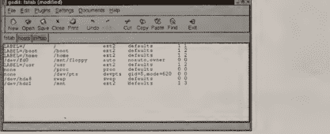

**图 8-1** *使用 gEdit 编辑三个文本文件*

从 KDE 桌面，你可以通过选择 K 编辑器 ➔ 高级编辑器 来启动 Kwrite（一个 KDE 文本编辑器）。要打开文本文件，请从菜单中选择 文件 ➔ 打开。会出现一个对话框。从这个对话框，你可以转到正确的目录，选择要打开的文件，并点击“确定”按钮。随后 KDE 文本编辑器会打开 `/etc/fstab` 文件，并在窗口中显示其内容。图 8-2 显示了 Kwrite 编辑 `/etc/fstab` 文件。

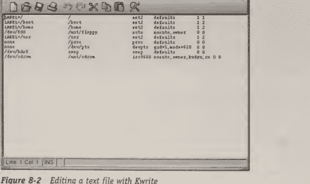

**图 8-2** *使用 Kwrite 编辑文本文件*

## 使用 ed 和 vi 进行文本编辑

所有 UNIX 系统，包括 Linux，都自带两个文本模式文本编辑器：

- ed，一个面向行的文本编辑器
- vi，一个支持早期名为 ex 的编辑器命令集的全屏幕文本编辑器

虽然图形文本编辑器易于使用，但 ed 和 vi 可能比其他更图形的文本编辑器更难理解。你应该学习 ed 和 vi 的基本编辑命令，因为有时这两个可能是唯一可用的编辑器。例如，当你遇到系统问题且 Linux 拒绝从硬盘引导时，你可能需要从软盘引导。在这种情况下，你必须使用 ed 编辑器来编辑系统文件，因为该编辑器足够小，可以装入软盘。正如下面两部分所演示的，学习 ed 和 vi 的基本文本编辑命令并不难。

### 使用 ed

ed 文本编辑器使用 *缓冲区* 工作——这是一个内存存储区域，实际文本在此处驻留，直到你明确将文本保存到文件。通常，你只有在引导极简版本的 Linux（例如从引导软盘）且系统不支持全屏模式时才需要使用 ed。在所有其他情况下，你可以使用 vi 编辑器，它在文本模式全屏下工作。

如你将在以下使用 ed 编辑器的示例中看到，你在命令模式或文本输入模式下工作，定义如下：

- *命令* 模式是默认模式。在此模式下，你输入的任何内容都被解释为命令。ed 文本编辑器有一个简单的命令集，其中每个命令由一个或多个字符组成。
- *文本输入* 模式允许你将文本输入到缓冲区。你可以使用命令 a（追加）、c（更改）或 i（插入）进入输入模式。在输入几行文本后，你可以在单独的一行上输入一个句点（. ）来退出输入模式。

为了练习编辑文件，请使用以下命令将 `/etc/fstab` 文件复制到你的主目录：

```
cd
cp /etc/fstab .
```

现在你的主目录中应该有一个名为 fstab 的文件。输入以下命令以开始使用 ed 编辑文件：

```
ed -p: fstab
608
:
```

此示例使用 *-p*（*prompt*，提示符）选项将提示符设置为冒号字符（: ），然后打开当前目录中的 fstab 文件进行编辑，该目录应该是你的主目录。ed 编辑器打开文件，报告文件中的字符数（690），显示提示符（: ），然后等待命令输入。


使用 `ed` 进行编辑时，您可能会发现使用 `-p` 选项开启提示字符很有帮助。没有提示符时，很难判断 `ed` 是处于输入模式还是命令模式。

当 `ed` 打开文件进行编辑后，当前行是文件的最后一行。*当前行* 是指 `ed` 对其应用您命令的那一行。要查看当前行号，请使用 `.` 命令：

```
:.
8
```

此输出告诉您 fstab 文件有八行。（您的系统上的 /etc/fstab 文件可能具有不同行数的行数，在这种情况下，您将看到不同的数字。）

您可以使用 `1,$p` 命令查看文件中的所有行，如下例所示：

```
:1,$p
LABEL=/
						/  				ext2  defaults  1 1
LABEL=/boot
						/boot  			ext2  defaults  1 2
LABEL=/home
						/home  			ext2  defaults  1 2
/dev/fd0
						/mnt/floppy  auto  noauto,owner  0 0
LABEL=usr
						/usr  			ext2  defaults  1 2
none
						/proc  			proc  defaults  0 0
none
						/dev/pts  devpts gid=5,mode=620  0 0
/dev/hda8
						swap  			swap  defaults  0 0
```

要转到特定行，请输入行号：

```
:5
LABEL=usr
						/usr  			ext2  defaults  1 2
```

编辑器会通过显示该行来响应。

假设您要删除包含 fd0 的行。要搜索字符串，请输入正斜杠 (/) 后跟您要定位的字符串：

```
/fd0
/dev/fd0
						/mnt/floppy  auto  noauto,owner  0 0
```

编辑器定位包含该字符串的行，然后显示它。该行变为当前行。

要删除当前行，请使用 `d` 命令，如下所示：

```
:d
```

如果您怀疑该行是否已被删除，请重新输入 `1,$p` 命令以重新显示文件：

```
:1,$p
LABEL=/
						/  				ext2  defaults  1 1
LABEL=/boot
						/boot  			ext2  defaults  1 2
LABEL=/home
						/home  			ext2  defaults  1 2
LABEL=/usr
						/usr  			ext2  defaults  1 2
none
						/proc  			proc  defaults  0 0
none
						/dev/pts  devpts gid=5,mode=620  0 0
/dev/hda8
						swap  			swap  defaults  0 0
```

包含 fd0 的行（搜索命令后的当前行）已从缓冲区的文件副本中删除。由于您尚未保存文件，磁盘上的副本未发生更改；只有内存中的副本已被修改。

要在当前行上用一个字符串替换另一个字符串，请使用 `s` 命令。例如，要将 fd0 替换为字符串 floppy，请使用此命令：

```
:s/fd0/floppy/
```

在您对 `ed` 感到满意之前，请使用 `1.p` 确认 `ed` 实际上执行了您请求的更改。

要在当前行之前插入一行，请使用 **i** 命令：

```
:i

（输入您要插入的行）

（输入单个句点表示您已完成）
```

您可以输入任意数量的行。在最后一行之后，单独在一行上输入一个句点（**.**）。该句点标志着文本输入模式的结束，编辑器切换到命令模式。在这种情况下，您可以判断 `ed` 已切换到命令模式，因为您看到了提示符（**:**）。

当您对更改满意时，可以使用 **w** 命令将它们写入文件。如果您想要保存更改并退出，请输入 **wq** 同时执行这两个步骤：

```
:wq
632
```

`ed` 编辑器保存文件中的更改，显示保存的字符数，并退出。如果您想在不保存任何更改的情况下退出编辑器，请使用 **q** 命令。

这个示例编辑会话向您展示了如何使用 `ed` 命令执行编辑文本文件的基本任务。表 8-1 列出了一些常用的 `ed` 命令。

## 表 8-1 常用 ed 命令

| 命令 | 含义 |
| :-- | :-- |
| !*command* | 执行 shell 命令（例如，!pwd 显示当前目录）。 |
| $ | 转到缓冲区中的最后一行。 |
| 1. | 将 1. 后面的命令应用于缓冲区中的所有行（例如，1.p 打印所有行）。 |
| + | 转到下一行。 |
| +n | 转到下一个 n 行（n 是一个数字）。 |
| . | 将 . 后面的命令应用于缓冲区中的所有行（例如，.p 打印所有行）；类似于 $ |
| - | 转到前一行。 |
| -n | 转到前 n 行（n 是一个数字）。 |
| . | 指缓冲区中的当前行。 |
| /text/ | 向前搜索指定的文本。 |
| ; | 指从当前行到缓冲区最后一行的行范围。 |
| . | 打印当前行号。 |
| ?text? | 向后搜索指定的文本。 |
| ^ | 转到前一行；另见本表中较早的 - 命令。 |
| ^n | 转到前 n 行（其中 n 是一个数字）；另见本表中较早的 -n 命令。 |
| A | 在当前行后添加文本。 |
| C | 更改指定行。 |
| D | 删除指定行。 |
| I | 在当前行前插入文本。 |
| N | 转到第 n 行。 |
| NewLine | 显示下一行并将其设为当前行。 |
| Q | 退出编辑器。 |
| Q | 不保存更改即退出编辑器。 |
| r file | 读取并插入文件内容到当前行之后。 |
| s/old/new/ | 用新字符串替换旧字符串。 |
| U | 撤销上一个命令。 |
| W file | 将缓冲区内容追加到指定文件的末尾。 |
| w file | 在指定文件中保存编辑缓冲区。如果没有命名文件，则将编辑缓冲区的内容保存在默认文件中——即 `ed` 当前正在编辑其内容的文件。 |

20分钟入门

## 使用 vi

*vi* 编辑器是一个全屏文本编辑器，允许您一次查看文件的几行。没有 *vi* 或行为类似 *vi* 的其他编辑器的 Linux 或 UNIX 系统极其罕见。由于 *vi* 如此普遍，学习 *vi* 的基本功能使您几乎可以在任何 UNIX 系统上编辑文本文件。

> 将 *vi* 发音为“*i-v*”，而不是“*v*”。

与 *ed* 编辑器一样，*vi* 使用缓冲区。当 *vi* 编辑文件时，它将文件读取到*缓冲区*中，这是一个内存块。所有更改仅存在于缓冲区中。虽然 *vi* 在编辑过程中使用临时文件，但在您使用特定的 *vi* 命令保存更改之前，原始文件不会被修改。

## 设置终端类型

在您启动像 *vi* 这样的全屏文本编辑器之前，您可能需要将 *TERM* 环境变量设置为终端类型（例如 *vt100* 或 *xterm*）。例如，输入 `export TERM=vt100` 将终端类型设置为 *VT100*。*vi* 编辑器使用终端类型在全屏模式下控制终端。在 Red Hat Linux 系统上，这一步骤通常是不必要的。

当运行 X 和 GNOME 或 KDE 等图形用户界面时，您可以在终端窗口中使用 *vi*。终端窗口的终端类型是 *xterm*。要验证这一点，请在命令提示符下输入 `echo $TERM`。当您启动终端窗口时，它会自动将 *TERM* 环境变量设置为 *xterm*。因此，您应该能够在 xterm 窗口中使用 *vi* 而无需显式设置 *TERM* 变量。

## 启动编辑器

要启动编辑器，请使用 *vi* 命令名称后跟可选的文件名。除了文件名，您还可以提供其他参数。然而，大多数时候 *vi* 仅以文件名作为唯一参数启动，如下所示：

```
vi /etc/hosts
```

启动 *vi* 的另一种常见方式是在启动时直接跳转到特定行号。为此，在 *vi* 命令和文件名之间添加 *+n*，其中 *n* 是行号。例如，要从文件 */etc/X11/XF86Config* 的第 296 行开始编辑，请使用此命令：

```
vi +296 /etc/X11/XF86Config
```

当您根据编译器报告的特定行号错误编辑源文件时，这种启动 *vi* 的方式非常有用。

当您使用 *vi* 编辑文件时，编辑器将文件加载到缓冲区中，在全屏窗口中显示文件的前几行，并将光标定位在第一行。最后一行显示有关文件的信息，包括文件中的行数及字符数，如图 8-3 所示。


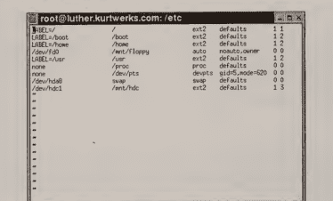

### 图 8-3 vi 编辑器正在编辑 /etc/fstab

之后，最后一行作为命令输入和状态行。其余行显示文件内容。如果文件的行数少于窗口行数，*vi* 会在第一列用波浪号（^）显示空行。

当前行由光标标记，光标显示为一个小的黑色矩形。光标位于字符上方。

### vi 模式

在 *vi* 中，你在三种模式之一中工作：

- *可视命令模式* 是默认模式。在此模式下，你输入的任何内容都被解释为应用于光标所在行的命令。*vi* 命令类似于 *ed* 命令。
- *冒号命令模式* 允许你读取或写入文件，设置 *vi* 选项，并退出 *vi* 编辑会话。所有冒号命令都以冒号 (:) 开头。当你输入冒号时，*vi* 将光标定位在最后一行，允许你输入命令。按 Enter 键时命令生效。
- *文本输入模式* 允许你向缓冲区输入文本。你可以使用命令 *a* （在光标后*追加*）、*A* （在行*末尾追加*）或 *i* （在光标前*插入*）进入输入模式。输入几行文本后，你必须按 *Esc* 键退出输入模式并重新进入 *可视命令* 模式。

所有这些模式的一个问题是你很难判断 *vi* 当前的模式。开始打字，结果发现 *vi* 不在输入模式，这令人沮丧。相反的情况也很常见——你想输入命令时却可能在输入文本。确保 *vi* 处于 *命令* 模式，只需按几次 *Esc* 键。（多按 *Esc* 键没有坏处。）

> 要在 *vi* 中查看在线帮助，在 *命令* 模式下输入 **:help**。输入 **:q** 退出帮助屏幕并返回到你正在编辑的文件。

### 移动光标

vi 编辑器最初将光标定位在第一个字符上。你需要学习的第一件事之一就是如何移动光标。尝试以下命令。只需输入字母（在可视命令模式下），vi 就会响应。

- b 将光标向后移动一个单词。
- h 将光标向左移动一个字符。
- j 将光标向下移动一行。
- k 将光标向上移动一行。
- l 将光标向右移动一个字符。
- w 将光标向前移动一个单词。
- Ctrl+D 向下滚动半屏。
- Ctrl+U 向上滚动半屏。

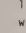

幸运的是，你也可以使用箭头键移动光标。如果你不记得 hjkl 字符的含义，只需使用箭头键在文件中移动。

你可以随时跳转到特定的行号。这时就需要使用冒号命令了。例如，要跳转到第 1 行，输入以下内容并按 Enter 键：

```
:1
```

当你输入冒号时，vi 在屏幕最后一行显示冒号。从此之后，vi 将你输入的文本作为命令。你必须按 Enter 键将命令提交给 vi。在冒号命令模式下，vi 接受 ed 编辑器接受的所有命令——甚至更多。

### 搜索字符串

要搜索字符串，首先输入斜杠 (/)。vi 编辑器在屏幕最后一行显示斜杠。输入搜索字符串，然后按 Enter 键。vi 编辑器定位该字符串，并将光标置于该字符串的开头。因此，要在文件 /etc/fstab 中定位字符串 cdrom，输入：

```
/cdrom
```

### 删除行

要删除包含光标的行，输入 dd（两个小写 d）。vi 编辑器删除该行文本，并使下一行成为当前行。

### 在光标前输入文本

要在光标前开始输入文本，输入 i（单独一个小写 i）。vi 编辑器切换到文本输入模式。现在你可以输入文本。完成输入后，按 Esc 键返回可视命令模式。

### 保存更改

编辑文件完成后，你可以使用 :w 命令保存文件中的更改。若要退出不保存任何更改，请使用 :q! 命令。如果你想保存更改并退出，可以输入 :wq 同时执行这两个步骤。vi 编辑器保存文件中的更改并退出。你还可以通过按 Shift-zz（按住 Shift 键并按两次 z）来保存更改并退出编辑器。

### 命令

除了你刚学到的少数命令外，vi 还接受大量命令。表 8-2 列出了一些常用的 vi 命令，按任务分类。

**表 8-2 常用的 vi 命令**

| 任务和命令 | 含义 |
| :--- | :--- |
| **插入文本** | |
| a | 在光标后插入文本。 |
| A | 在当前行末尾插入文本。 |
| I | 在当前行开头插入文本。 |
| i | 在光标前插入文本。 |
| o | 在当前行下方插入新行。 |
| O | 在当前行上方插入新行。 |
| **删除文本** | |
| D | 删除从光标到当前行末尾的内容。 |
| dd | 删除当前行。 |
| dl | 删除光标所在的字符。 |
| dh | 删除光标前面的字符。 |
| dw | 从光标删除到下一个单词末尾。 |
| x | 删除光标所在的字符。 |
| **更改文本** | |
| C | 更改从光标到当前行末尾的内容。 |
| cc | 更改当前行。 |
| s | 删除光标下的字符并进入插入模式。 |
| J | 将当前行与下一行合并。 |
| rx | 将光标下的字符替换为 *x* （*x* 是任何字符）。 |
| **移动光标** | |
| h | 向左移动一个字符。 |
| j | 向下移动一行。 |
| k | 向上移动一行。 |
| L | 将光标移动到屏幕末尾。 |
| l | 向右移动一个字符。 |
| w | 移动到下一个单词的开头。 |
| **滚动文本** | |
| Ctrl-b | 向后滚动一整屏。 |
| Ctrl-d | 向前滚动半屏。 |
| Ctrl-f | 向前滚动一整屏。 |
| Ctrl-u | 向后滚动半屏。 |
| **剪切和粘贴文本** | |
| P | 将剪贴的（复制的）行放在当前行上方。 |
| p | 将剪贴的行放在当前行下方。 |
| yy | 将当前行剪贴到未命名缓冲区。 |
| **冒号命令** | |
| :command | 执行 shell *command* 。 |
| :q | 退出编辑器。 |
| :q! | 退出不保存更改。 |
| :r *filename* | 读取文件并在当前行后插入文本。 |
| :w *filename* | 将缓冲区写入文件。 |
| :wq | 保存更改并退出编辑器。 |
| **搜索文本** | |
| /string | 向前搜索 *string* ，即一个或多个字符的序列。 |
| ?string | 向后搜索 *string* ，即一个或多个字符的序列。 |
| **其他** | |
| u | 撤销最后一个命令。 |
| Esc | 结束输入模式并进入可视命令模式。 |
| U | 撤销对当前行的近期更改。 |

要尝试这些命令，请将 /etc/X11/XF86Config 等文件复制到你的主目录，并使用以下命令用 vi 编辑该文件：

```bash
cd
cp /etc/X11/XF86Config .
vi XF86Config
```

在编辑文件时，尝试表 8-2 中所示的命令。由于良好的 vi 技能在所有 UNIX 系统中（包括 Red Hat Linux）都有用，你应该花几分钟熟悉表 8-2 中的一些命令。

## 故障排除

如果在启动 vi 时出现类似“TERM 变量未设置”的错误消息，请使用 export 命令设置 TERM 环境变量。例如，

```bash
export TERM=linux
```

同样，如果你的 vi 会话滚动异常或屏幕底部行似乎混乱，且已设置 TERM 环境变量，尝试将 TERM 设置为 vt100（export TERM=vt100），这是一种非常通用、基本的终端类型设置。

如果你在使用 vi 时难以记住你当前所在的模式（可视命令模式、冒号命令模式或插入模式），请执行冒号命令 :set showmode。这将导致 vi 窗口的最后一行持续显示当前模式，除非你正在执行冒号命令或搜索。

如果你完全搞砸了一个文件并希望放弃所有更改，请使用冒号命令 :q!，在不保存任何更改的情况下退出。


## 复习

本会话向你展示了如何使用 GNOME 和 KDE 中的图形化文本编辑器来编辑文件。图形化文本编辑器使用直观，但有时你可能需要在没有图形登录的情况下编辑文本文件。对于这些情况，你练习了使用文本模式编辑器 ed 和 vi 编辑文本文件。

## 自我测验

1. 如何启动 GNOME 文本编辑器？（参见“使用 GUI 文本编辑器进行文本编辑”。）
2. 使用 ed 编辑器编辑时，如何查看文件的所有行？（参见“使用 ed”。）
3. 使用 ed 编辑器编辑文件时，你使用什么命令来定位包含字符串 monitor 的行？（参见“使用 ed”。）
4. vi 编辑器的三种模式是什么？（参见“使用 vi”。）
5. 如何在不保存任何更改的情况下退出 vi 编辑器？（参见“使用 vi”。）


## 第 9 课：学习更多 Linux 和 Bash 命令

- **本课检查清单**
  - 更改 Bash 提示符
  - 格式化文本文件
  - 修改文件中的文本
  - 压缩和解压缩文件

本课将帮助你更熟悉 Linux 和 Bash 命令。首先，你将学习如何自定义 Bash 提示符。然后，由于许多 Linux 操作都涉及文本文件，你将学习如何使用几个简单命令来格式化它们，以及如何对文本文件进行批量修改。本课的最后一个主题将教你如何处理压缩文件。

### 更改 Bash 提示符

Red Hat Linux 最令人愉悦的特性之一在于你可以对其进行高度自定义和个性化。Bash 在这方面并不比在视觉上更具主导地位的 GNOME 和 KDE 窗口管理器逊色。在本节中，你将学习如何按自己的喜好更改 Bash 命令提示符。

在继续之前，请记住 Bash 维护了四个级别的提示符，分别为 PS1、PS2、PS3 和 PS4。PS1 是主要命令提示符，也是你将学习如何更改的提示符。PS2 是当 Bash 需要更多输入以完成命令时显示的提示符。PS3 和 PS4 使用频率较低，因此本书不会对此进行讨论。

Bash 允许你使用超过 20 种不同的标记（tokens）来定义其命令提示符，其中最常用的标记如表 9-1 所示。每个标记都是一个由反斜杠（\）引导的单个字母或符号，代表特定的信息元素。你还可以在提示符字符串中使用诸如数字和字母等文字文本。要查看提示符是如何定义的，请输入 `echo $PS1` 并按下回车键。

**表 9-1：常见的 Bash 命令提示符标记**

| 标记 | 描述 |
| :--- | :--- |
| \h | 主机名，直到第一个点。 |
| \H | 完整主机名 |
| \t | 当前时间，24 小时制 HH:MM:SS 格式 |
| \T | 当前时间，12 小时制 HH:MM:SS 格式 |
| \@ | 当前时间，12 小时制 a.m./p.m. 格式 |
| \u | 当前用户的用户名 |
| \w | 当前工作目录 |
| \W | 当前工作目录的 basename |
| \! | 当前命令的历史记录编号 |
| \# | 当前命令的命令编号 |

例如，Red Hat Linux 中 Bash 的默认命令提示符是 `[\u@\h \W]$`。如表 9-1 所示，这对应于 `用户名@主机名 当前目录$` 形式的提示符。在一个示例系统中，当用户在他的主目录中时，这看起来像 `[kwal@luther kwal]$`。


Bash 会将标记 `$` 替换为普通用户的字面量 `$`。对于 root 用户，字面量 `#` 表示你正在以 root 用户身份工作。

假设你不想看到你的用户名或主机名。相反，你想看到上午/下午格式的时间。要将你的 Bash 提示符更改为以这种方式显示时间，请输入 `export PS1='"\@"'` 并按下回车键。更改会立即生效，如下面的示例所示：

```
[kwal@luther kwal]$ export PS1='\@ '
05:59pm $
```

提示符中显示的时间将在你每次按下回车键时更新。

在第 6 课中，你学习了如何使用 Bash 的命令历史记录。表 9-1 列出了两个在提示符中显示历史记录信息的标记：\! 和 \#。\! 标记显示当前命令的累积历史记录编号。\# 标记仅显示当前会话中当前命令的命令编号。（*累积*指存储在 Bash 历史记录文件中的所有命令加上在当前会话中执行的所有命令。）为了说明这两个标记之间的区别，以下命令将提示符设置为显示历史记录编号：

```
[kwal@luther kwal]$ export PS1='\! '
1019 $
```

左侧 $ 旁边的数字表示，接下来输入的命令将是第 1019 个命令。然而，通过设置提示符以显示命令编号，显示的值会小得多，因为它仅计算在当前会话中执行的命令：

```
1019 $ export PS1='\# '
21 $
```

在这种情况下，$ 左侧的数字表明，接下来执行的命令将是本次会话中的第 21 个命令。你能在提示符中看到的命令值使使用和操纵 Bash 的命令历史记录特性变得更加容易。你可以尝试其他提示符格式，直到找到你最喜欢的那个。

### 格式化文本文件

回想一下，许多 Linux 操作都涉及处理文本文件。随着 Linux 和 Unix 的发展，许多程序和实用工具已被开发出来用于处理和操作文本文件。你将在本课中学习如何使用其中两个工具：`cut` 和 `fmt`。这两个命令减少了消除操作和格式化文本文件时的许多繁琐和重复工作。

#### 使用 cut 选择文本

`cut` 命令选择文件中每行用户指定的部分，并将这些部分存储到标准输出（stdout）。`cut` 命令的一般格式为：

```
cut option file
```

`option` 告诉 `cut` 要选取什么信息，`file` 告诉 `cut` 要使用的文件。表 9-2 列出了最常见的选项。

**表 9-2：常见的 cut 选项**

| 选项 | 描述 |
| :--- | :--- |
| -c columns | 显示由 columns 指定的列。 |
| -f fields | 选择由 fields 指定的字段编号。 |
| -d delim | 使用字符 delim 作为字段分隔符（默认是制表符）。 |

你可以使用 `-c` 选项从每行中选择特定的列（或字符）。字段由编号指定，从 1 开始。默认情况下，字段由制表符分隔，但 `-d` 选项允许你声明不同的字段定界符，或分隔符。

假设你有一个名为 `phnlst.txt` 的文件，包含你朋友的名字和电话号码，如下所示：

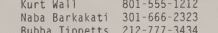

制表符将名字与电话号码分开。假设你只想显示文件中的名字。由于制表符字符分隔了名字和电话号码，请使用 `cut` 的 `-f` 选项配合数字 1 来告诉 `cut` 只显示第一个字段。执行命令 `cut -f 1 phnlst.txt` 将只显示文件中的名字（你输入以下加粗文本）：

```
cut -f 1 phnlst.txt
Kurt Wall
Naba Barkakat!
Bubba Tippets
```

另一方面，如果你只想看到你朋友的名字（first names），请结合 `-f` 选项和 `-d` 选项来定义空格字符作为字段定界符：

```
cut -f 1 -d " " phnlst.txt
Kurt
Naba
Bubba
```

注意，为了让命令正常工作，空格字符必须嵌入在双引号中 (" ")。如果你只想查看每个电话号码的前缀，可以使用命令 `cut -f 2 -d " " phnlst.txt`。

要显示一个或多个列，使用 `cut` 的 `-c` 选项，后跟要显示的列列表。使用逗号 (,) 来列出非连续字符，使用减号 (-) 来标识连续字符的范围。例如，命令 `cut -c 1,5 phnlst.txt` 将显示每行的第一个和第五个字符，而命令 `cut -c 6-8 phnlst.txt` 将显示每行的第 6、7 和 8 列。

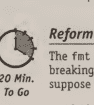

#### 使用 fmt 重新格式化段落

`fmt` 命令在重新格式化段落方面卓有成效。它特别适用于将长文本行拆分为较短的行，并去除多余的空格。例如，假设你有一个名为 `fmtme.txt` 的文本文件，其内容如下所示：

```
fmt* prefers breaking lines at the end of a sentence, and tries to avoid line breaks after the first word of a sentence or before the last word of a sentence. A “sentence break” is defined as either the end of a paragraph or a word ending in either a period (.), a question mark (?), or an exclamation point (!), followed by two spaces or the end of a line, ignoring any intervening parentheses or quotes.
```

虽然在打印文本中看不到，但该文本中并没有嵌入的换行符或回车符，因此如果你用 vi 编辑器查看此文件，它将如图 9-1 所示。


## 图 9-1
*在 vi 编辑器中查看的一个格式怪异的文本文件*

fmt 命令将重新格式化此文本，在最接近第 75 列的单词断点处添加新行。输入 `fmt formatme.txt` 并按下回车键，如下例所示，查看 `fmt` 命令如何重新格式化文本文件：

```
fmt formatme.txt
```

`fmt` 偏好于在句末换行，并试图避免在句子第一个单词之后或最后一个单词之前换行。“句子断点”定义为段落末尾，或者以句号 (.)、问号 (?) 或感叹号 (!) 结尾的单词，其后跟随两个空格或行尾，忽略任何插入的括号或引号。

请注意 `fmt` 如何插入新行字符而没有将单词从中间断开。你可以使用 `fmt` 的 `-w` 选项后跟字符宽度来指定不同的宽度。例如，命令 `fmt -w 50 formatme.txt` 将在最接近第 50 列的单词断点处断开每一行。

> HTML 格式的电子邮件消息通常在单词之间包含多余的空格，这使得它们难以阅读。为了减少此类消息中的杂乱，使用 `fmt` 的 `-u` 选项，该选项在单词之间放置一个空格，在句子结束后放置两个空格。

## 更改文件中的文本

另一个有用的 Linux 命令是 `tr`（用于翻译）命令，你可以使用它来将一个字符更改为另一个字符，或删除某些字符，而无需使用 `vi` 或 `gedit` 等编辑器编辑文件。

### 删除文本

假设你想将 `phnlist.txt` 文件中的制表符替换为单个空格。为此，执行命令 `tr "\t" " " < phnlist.txt`。此命令指示 `tr` 将其遇到的每个制表符字符（由 `"\t"` 表示）替换为单个空格字符（由 `" "` 表示）。使用“Selecting text with cut”部分中显示的 `phnlist.txt` 文件，输出应类似于以下内容：

```
Kurt Wall 801-555-1212
Naba Barkakati 301-666-2323
Bubba Tippets 212-777-3434
```

请注意，该命令使用 `<` 将 stdin 重定向到文件。这是因为 `tr` 默认读取 stdin。`"\t"` 表示制表符字符。

要保存 `tr` 的输出，使用 `>` 将输出重定向到另一个文件。

### 更改文本

另一个巧妙的方法使用了一种特殊的表示法，用于引用字符集。要将 `fnlist.txt` 中的所有小写字符转换为大写字符，使用 `[:lower:]` 和 `[:upper:]` 代替 `"\t"` 和 `" "`。以下是该命令及其结果的样子：

```
tr [:lower:] [:upper:] < fnlist.txt
KURT WALL 801-555-1212
NABA BARKAKATI 301-666-2323
BUBBA TIPPETS 212-777-3434
```

如输出所示，`[:lower:]` 指所有小写字符，而 `[:upper:]` 指所有大写字符。除了 `[:lower:]` 和 `[:upper:]` 之外，表 9-3 列出了一些你可以使用的特殊符号，用于在使用 `tr` 命令时引用特定的字符集。

| 符号 | 描述 |
| :--- | :--- |
| [:alnum:] | 所有字母和数字 |
| [:alpha:] | 所有字母 |
| [:blank:] | 任意空白字符（空格和制表符） |
| [:digit:] | 所有数字 (0-9) |
| [:punct:] | 所有标点字符 |

你可以使用 `tr` 命令通过单个命令对文件进行批量编辑，而不是使用标准文本编辑器手动进行编辑。

### 压缩和解压缩文件

使用 Linux 时的常见任务是压缩和解压缩文件。本节的最后几分钟将向你展示如何使用 `gzip` 和 `gunzip` 命令来压缩和解压缩文件。压缩文件可以减少它们在系统上占用的磁盘空间。压缩还使通过电子邮件、使用 FTP 或 HTTP 协议在互联网上发送文件的速度大大加快。

## 压缩文件

要压缩文件，使用命令 `gzip fileName`，其中 *fileName* 是你想要压缩的文件名。`gzip` 命令将压缩 *fileName*，并用一个带有 `.gz` 扩展名的文件替换它，表明它已使用 `gzip` 进行了压缩（这通常被称为 `gzipped` 文件。）

例如，假设你想压缩一个名为 `important.txt` 的大文件，你想将其电子邮件发送给朋友。为此，执行命令 `gzip important.txt`。以下命令显示了文件压缩前的大小、用于压缩的 `gzip` 命令以及压缩后的文件大小：

```
ls -1 important.txt
-rw-r--r--  1 kwall kwall  2514760 Jun 17 21:21 important.txt
gzip important.txt
ls -1 important.txt.gz
-rw-r--r--  1 kwall kwall   204228 Jun 17 21:22 important.txt.gz
```

请注意，gzipped 文件的大小不到其原始大小的 10%。根据文件类型不同，文件大小的减少程度也会有所不同。如示例所示，`gzip` 是一个易于使用的命令。

如果你想知道压缩文件包含什么，使用带有 `-1` 选项的 `gzip`。`-t` 选项测试 gzip 文件是否可能损坏。由于大文件可能需要很长时间才能压缩，你可以使用 `-1` 选项指示 `gzip` 快速操作，但压缩不如通常那么完整。相反，为了获得最佳可能的压缩，使用 `-9` 选项，但它压缩文件所需的时间会明显更长。使用 `-1` 和 `-9` 选项的结果如下例所示：

```
gzip -1 important.txt
ls -1 important.txt.gz
-rw-r--r--  1 kwall kwall 304827 Jun 17 21:29 important.txt.gz
```

请注意，使用 `-1` 选项后的压缩文件不如在没有 `-1` 选项的情况下使用 `gzip` 时那么小：

```
gzip -9 important.txt
ls -1 important.txt.gz
-rw-r--r--  1 kwall kwall 191489 Jun 17 21:32 important.txt.gz
```

使用 `gzip` 的 `-9` 选项，生成的文件比普通情况稍微小一些，但并没有显著缩小。

## 解压缩文件

要解压缩 gzipped 文件，要使用的命令是 `gunzip fileName`，其中 *fileName* 是你想要解压缩的文件名。`gunzip` 命令将解压缩文件，并用一个去除了 `.gz` 扩展名的文件替换它。因此，要解压缩 `important.txt.gz`，使用命令 `gunzip important.txt.gz`。

命令 `gzip -d` 也可以解压缩 gzipped 文件。

## 故障排除

如果你在设置 Bash 命令提示符时遇到困难，请确保你将提示符包裹在撇号 (`'`) 或双引号 (`"`) 中，并且每个标记前都跟有一个反斜杠 (`\`)。

要恢复 Red Hat Linux 的 Bash 提示符为其默认值，执行命令 `export PS1="[\u@\h \W]\$ "`。

如果 `tr` 命令抱怨你使用了太多参数，请确保你使用 `<` 将 stdin 从文件重定向。记住，`tr` 默认读取 stdin，而不是磁盘文件。

如果 `gunzip` 无法解压缩文件，使用命令 `gzip -t` 测试 gzipped 文件是否可能损坏。如果文件损坏，你将不得不获取它的新副本。

## 复习

本节向你展示了如何通过使用特殊标记来设置定义提示符外观的 `PS1` 变量，从而更改 Bash 命令提示符。接下来，你学习了如何使用 `cut`、`fmt` 和 `tr` 命令在没有编辑器的情况下编辑文本文件。最后，你学习了如何使用 `gzip` 和 `gunzip` 命令来压缩和解压缩文件。

## 自测

- 1. 在 Bash 命令提示符中插入当前日期的标记是什么？（参见“更改 Bash 提示符”。）
- 2. 当使用 `cut` 命令时，选择行中第二个字段的选项是什么？（参见“使用 cut 选择文本”。）
- 3. 你应该使用 `fmt` 的什么命令选项来更改段落中行的宽度？（参见“使用 fmt 重新格式化段落”。）
- 4. `tr` 命令使用什么选项从文件中删除字符？（参见“删除文本”。）
- 5. 如何列出使用 `gzip` 压缩的文件内容？（参见“压缩文件”。）

## 执行基本系统管理任务

### 会话检查清单

- ✓ 了解 Linux 系统和网络管理
- ✓ 使用 Linuxconf 添加用户帐户
- ✓ 探索其他 Linuxconf 功能

这个最后的周六上午会话将向你介绍 Linux 系统和网络管理。然后你将学习如何使用 *Linuxconf* 执行一些系统管理任务，Linuxconf 是随 Red Hat Linux 提供的一个图形化系统管理工具。具体而言，你将学习如何添加用户帐户，然后探索 Linuxconf 使你能够执行的其他任务。这个 Linuxconf 概述应有助于你在需要时执行其他系统管理任务。

### 了解 Linux 系统和网络管理

*系统管理*指的是为了保持计算机系统正常运行而必须执行的任务。由于几乎所有计算机现在都联网了，还需要另一组任务来保持网络正常运行。这些任务统称为 *网络管理*。拥有多台计算机的网站通常有一名全职 *系统管理员*，负责所有系统和网络管理任务。非常大的网站可能有单独的 *系统管理* 和 *网络管理* 人员。如果你在家用 PC 或小型公司的几台系统上运行 Red Hat Linux，你很可能同时执行 *系统管理员* 和 *网络管理员* 的职责。

正如以下系统和网络管理任务描述所示，你可以使用 *Linuxconf* 工具执行这些任务——它是一个 X Window 应用程序，使你能够执行大多数系统和网络管理任务，而无需手动编辑配置文件或输入晦涩难懂的命令。在概述系统和网络管理之后，你将学习如何使用 *Linuxconf*。


## 系统管理任务

系统管理员的典型任务包括以下内容：

- 安装、配置和升级操作系统及各种实用工具。你在第 1 节中学过如何安装 Red Hat Linux。本节将向你展示如何配置 Red Hat Linux 的各种功能，第 23 节和第 27 节将向你展示如何使用 Red Hat 包管理器升级应用程序。

- 添加和删除用户。在本节的稍后部分，你将学习如何使用 Red Hat 的图形化 Linuxconf 工具添加新的用户账户。如果用户忘记了密码，你也可以使用 Linuxconf 更改密码。

- 安装新软件。对于以源代码形式获得的典型 Linux 软件，此任务涉及使用诸如 gunzip（用于解压缩软件）、tar（用于解包存档）和 make（用于构建可执行程序）等工具。对于通过 Red Hat 包管理器 (RPM) 文件分发的软件，你必须使用 rpm 命令来安装软件。


第 23 节将向你展示如何安装 RPM 包。在第 27 节中，你将学习如何使用 tar 和 make 等工具构建软件包。

- 进行备份。你可以使用 tar 或 cpio 程序将一个或多个目录归档，并将归档复制到软盘（如果归档足够小）或磁带（如果你有磁带机）。


在第 26 节中，你将学习如何备份和还原文件。

- 挂载和卸载文件系统。例如，当你想要访问 CD-ROM 上的文件时，你必须将该 CD-ROM 的文件系统挂载到 Linux 文件系统目录之一上。你必须使用 mount 命令来完成此任务。你也可以使用 Linuxconf 来挂载文件系统。（本节稍后会出现一个示例。）


挂载在第 7 节中有介绍。

- 监控系统性能。你必须使用一些实用工具，例如 top（查看处理器花费最多时间的地方）和 free（查看系统中的空闲和已用内存量）。


你将在第 28 节中学习如何使用实用工具监控系统性能。

启动和关闭系统。你必须始终使用 shutdown 命令正确关闭你的 Linux 系统，在关闭 PC 电源开关之前停止所有程序。

## 网络管理任务

使用 Linuxconf 可执行的典型网络管理任务包括以下内容：

- *编辑网络配置文件。* 在 Linux（以及其他 UNIX 系统）中，TCP/IP 网络是通过几个文本文件进行配置的，你可能需要编辑这些文件才能使网络工作。Linuxconf 允许你配置网络。

你将在第 12 节和第 13 节中学习关于 TCP/IP 配置文件的内容。

- *设置 PPP 和 SLIP。* 你可以使用 Linuxconf 设置点对点协议 (PPP) 和串行线路互联网协议 (SLIP) 连接。

你将在第 13 节中学习如何使用调制解调器连接到互联网。

- *监控网络状态。* 你必须使用诸如 netstat（查看活动网络连接的信息）、/sbin/ifconfig（检查各种网络接口的状态）和 ping（确保连接正常工作）等工具。

## 使用 Linuxconf 添加用户账户

当你在周五晚上安装 Red Hat Linux 时，其中一个步骤让你有机会设置除 root 以外的其他用户账户。如果你在安装期间没有添加其他用户账户，你现在可以这样做。如果你希望其他用户访问和使用系统，你也必须执行此步骤。

创建除 root 以外的其他用户账户是一个好主意。即使你是系统唯一的用户，以权限较低的用户身份登录也是一个好习惯；这样，你就不会无意中损坏任何重要的系统文件。必要时，你可以以 root 身份登录并执行任何系统管理任务。

要在 Red Hat Linux 的 GNOME 主菜单中启动 Linuxconf，请选择主菜单 (Foot) 程序 系统 LinuxConf。

初始的 Linuxconf 窗口显示三个选项卡——配置、控制和状态（见图 10-1）。每个选项卡都包含树形列表，你可以展开这些列表以使用 Linuxconf 执行各种系统和网络管理任务。当你选择特定的列表项时，它会展开以显示额外的选项。你可以继续以这种方式选择列表项，直到到达与你想要执行配置任务对应的项。

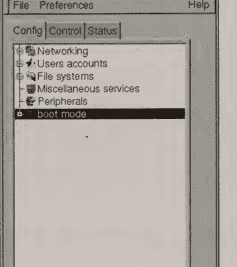

**图 10-1 初始 Linuxconf 窗口**

要添加新用户，请遵循以下步骤：

- 选择**用户账户**项，然后在 Normal 选项卡中选择**用户账户**项。这将使 Linuxconf 显示**用户账户**对话框，如图 10-2 所示。

- 在图 10-2 的**用户账户**对话框中，单击**添加**按钮。这将调出**用户账户创建**对话框。

- 填写所需的信息。特别是，你必须输入**登录名**和**主目录**。例如，创建一个登录名为**gnuser**、主目录为**/home/gnuser**的账户。填写完所有字段后，单击**接受**按钮。如果**/home/gnuser**目录不存在，Linuxconf 将创建该目录。

- **Linuxconf**工具显示**更改密码**对话框，在其中你输入新账户的**密码**。输入**密码**，单击**接受**按钮，然后重新输入**密码**以确认。请注意，如果密码是可以从字典中找到的单词组合，**Linuxconf**会警告你。输入密码后，在**用户账户**对话框中单击**关闭**按钮。

- 要**退出** Linuxconf，请从主窗口的菜单中单击**文件** ⋄ **退出**。**Linuxconf**工具显示**系统状态**对话框，询问你是否要激活更改。单击**执行**按钮以完成任务并退出**Linuxconf**。

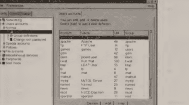

图 10-2 Linuxconf 中的用户账户对话框

## 探索其他 Linuxconf 功能

在这里，你探索 Linuxconf 可以执行的任务类型的选项卡和按钮。然而，本节对 Linuxconf 的介绍远未完成。要彻底涵盖 Linuxconf 的功能并解释它可以执行的每个任务，还需要更多的篇幅。

Linuxconf 在网络上有自己的主页，位于 http://www.solucorp.qc.ca/linuxconf/。访问主页以了解关于 Linuxconf 的最新消息并阅读在线文档。

### 帮助按钮

Linuxconf 在主 Linuxconf 窗口中包含一个帮助按钮。此帮助按钮提供 Linuxconf 的概述。当你单击帮助按钮时，会出现一个帮助窗口。

大多数 Linuxconf 窗口也包含提供上下文敏感帮助（即与你正在执行的任务相关的信息）的帮助按钮。按最近的帮助按钮阅读有关当前任务的相关信息。在少数情况下，Linuxconf 可能会显示一条消息，说明该项的帮助文件尚未编写。

### 配置、控制和状态按钮

在初始的 Linuxconf 窗口中（参见图 10-1），你应该注意到有三个选项卡：配置、控制和状态。配置选项卡允许你配置各种系统服务，控制选项卡允许你启动和停止服务并控制各种 Linuxconf 功能。状态选项卡允许你查看各种消息日志，例如在 Red Hat Linux 系统引导时由 Linux 内核显示的消息。

要探索配置、控制和状态选项，请单击每个选项卡，然后深入查看每个可用选项以了解它们的功能。你应该花几分钟时间探索 Linuxconf 中的所有三个选项卡，以了解你可以使用此工具执行的系统和网络管理任务的类型。

## 故障排除

如果 Linuxconf 未按本节开头所述列在系统菜单中，请确保你已登录为 root 用户。普通用户在他们的 GNOME 或 KDE 菜单中没有 Linuxconf。

如果你已登录为 root 且菜单中不可用 Linuxconf，你可以在终端窗口中输入 `linuxconf` 并按回车键在命令提示符下启动它。

如果 Linuxconf 无法启动，请确保安装了以下三个 RPM，并安装缺失的任何 RPM：

- gnome-libs-xfce
- linuxconf
- linuxconf-devel

## 复习

本节从概述 Linux 系统管理和网络管理任务开始。然后你使用 Linuxconf 添加了一个或多个用户账户。最后，你探索了 Linuxconf 中的选项卡，以了解你可以使用 Linuxconf 执行的系统管理和网络管理任务的类型。

## 自我测试

1. 一些典型的 Linux 系统管理任务是什么？（参见“理解 Linux 系统和网络管理”。）

2. 在 Linuxconf 中，你单击哪个按钮来添加新的用户账户？（参见“使用 Linuxconf 添加用户账户”。）

3. 你可以在哪里获取关于 Linuxconf 的最新信息？（参见“探索其他 Linuxconf 功能”。）

4. Linuxconf 主窗口中的三个选项卡是什么？（参见“探索其他 Linuxconf 功能”。）

5. 你能从 Linuxconf 查看消息日志吗？如果可以，哪个选项卡允许你执行此任务？（参见“探索其他 Linuxconf 功能”。）


## 第二部分

### 周六上午部分复习

- 什么是 Linux 文件系统？你能将文件系统的不同部分放置在不同的磁盘或磁盘分区上吗？
- 假设当前目录为 `/tmp`，列出三个可以将当前目录切换为家庭目录（例如 `/home/naba`）的命令。
- 哪个命令可以按最后修改时间顺序详细列出当前目录中的文件？
- 切换最近使用的工作目录的命令是什么？
- 列举两个用于在文件系统中查找文件的命令，并给出使用其中一个命令查找名为 `book.txt` 的文件的示例。
- 如何在单行中键入多个 Linux 命令？在多行中继续一条命令的语法是什么？
- 展示一个示例，将一个命令的输出作为另一个命令的输入。
- 什么是 Shell 的“I/O 重定向”功能？
- 展示你要使用的 Linux 命令行，以查找名称中包含 gnome 的所有进程。
- 你想终止 `gpm` 进程。请解释执行此任务所遵循的步骤。
- 展示一个命令，根据第三个字段的值对输入文件进行排序，并仅显示唯一的结果。
- 给出一个示例命令，该命令以易于理解的格式（如兆字节或千兆字节）显示已使用的磁盘空间。
- 解释如何使用 `vi` 编辑器编辑 `/etc/initab` 文件。要跳转到第 16 行并输入新文本，你需要按哪些键？如何保存文件并退出？
- 编写一个 Shell 函数，该函数接受两个参数，交换它们的值，并显示原始值和交换后的值。
- 展示一个命令，该命令在名为 myfile.txt 的文本文件中查找字面字符 `"*"`，并显示包含该字符的行数。
- 编写一个示例命令，该命令交换字母的大小写，并将任何两个或更多连续的空格转换为单个空格。源文件应命名为 swapme.txt。
- 展示三种不同的方式，使用相同的命令名来解压名为 unpckme.gz 的压缩文件。
- 列举两个命令，它们允许你直接处理压缩文件的内容，而无需先解压文件。
- 列举三个常见的系统管理任务及执行这些任务的命令名称。
- 列举三个常见的网络管理任务及执行这些任务的命令名称。
- 当你在 Linuxconf 中添加一个新的用户账户时，需要提供哪些信息？Linuxconf 是否检查密码中是否包含容易被猜到的单词？
- 展示如何编辑 `/etc/passwd` 文件以禁用用户登录账户。

## 第三部分
## 周六下午

- 第 11 课
  - 在 Red Hat Linux 中使用调制解调器
- 第 12 课
  - 为 Red Hat Linux PC 配置网络
- 第 13 课
  - 将 Red Hat Linux PC 连接到 Internet
- 第 14 课
  - 设置 Internet 服务
- 第 15 课
  - 将 Red Hat Linux 用作工作组服务器
- 第 16 课
  - 从 Red Hat Linux 访问 Windows 和 DOS 文件


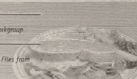


## 在 Red Hat Linux 中使用调制解调器

## 课程清单

- 将调制解调器连接到你的 PC
- 使用 Minicom 拨号

今天下午的课程重点介绍使用调制解调器或以太网局域网（LAN）进行数据通信。第一节课涵盖基础知识：使用调制解调器和串行端口与其他系统建立拨号连接。如果你在家或办公室使用 Red Hat Linux，你可能出于以下原因之一想要使用调制解调器：使用点对点协议（PPP）进行拨号网络以通过互联网服务提供商（ISP）连接到 Internet；拨号到另一台计算机（如公告板系统）或另一个 UNIX 系统；或者允许其他人拨入并使用你的 Linux 系统。


第 13 课涵盖使用 PPP 进行拨号网络。

### 将调制解调器连接到你的 PC

当你从本书附带的 CD-ROM 安装 Red Hat Linux 时，你会自动安装一些工具，可以使用这些工具通过调制解调器从你的 Linux 系统拨号。然而，在拨号之前，你必须确保调制解调器已正确连接到 PC 的某个串行端口，并且串行端口的 Linux 设备设置正确。确保调制解调器已正确连接到电源，并且调制解调器也已连接到电话线。

如果你使用的是外置调制解调器，请购买正确类型的电缆将调制解调器连接到 PC。你需要一条直通串行电缆将调制解调器连接到 PC。电缆两端的连接器取决于你 PC 上的串行连接器类型。调制解调器端的电缆需要一个公头 25 针连接器。PC 端的电缆通常是母头 9 针连接器。你可以在大多数电脑商店购买调制解调器电缆。9 针母头和 25 针公头的调制解调器电缆通常标有“AT Modem Cable”（AT 调制解调器电缆）。

> 如果你的 PC 有一个内置调制解调器，你只需将电话线连接到内置调制解调器卡背面的电话插座即可。

#### 了解串行端口设备名称

PC 通常有两个串行端口，在 MS-DOS 术语中称为 COM1 和 COM2。许多带有通用串行总线（USB）的新 PC 只有一个串行端口。PC 还可以支持另外两个串行端口：COM3 和 COM4。由于这些端口名称，串行端口通常被称为 COM 端口。

与其他设备一样，串行端口需要中断请求（IRQ）号和 I/O 端口地址。四个 COM 端口共享两个 IRQ——3 和 4。表 11-1 列出了分配给四个串行端口的 IRQ 和 I/O 端口地址。与 Linux 中的其他设备一样，/dev 目录中的设备文件代表串行端口设备。表 11-1 显示了与 PC 的 COM 端口相对应的串行设备名称。

| COM 端口 | 设备名称 | IRQ | I/O 地址 |
| :------- | :---------- | :-: | :---------: |
| COM1     | /dev/ttyS0  | 4   | 0x3f8       |
| COM2     | /dev/ttyS1  | 3   | 0x2f8       |
| COM3     | /dev/ttyS2  | 4   | 0x3e8       |
| COM4*    | /dev/ttyS3  | 3   | 0x2e8       |

当你从本书附带的 CD-ROM 安装 Red Hat Linux 时，这些设备应该已经在你的系统中。如果你检查 /dev 目录，你应该能找到 /dev/ttyS* 设备，其中 * 为 0、1、2 和 3。从终端窗口中，键入 `ls -1 /dev/ttyS*` 以查看这些设备文件的列表。

#### 检查 Red Hat Linux 是否检测到了串行设备

当你按照第 1 至 3 课的说明从本书的 CD-ROM 安装 Red Hat Linux 时，必要的 Linux 串行设备会自动为你创建。你应该拥有用于通过调制解调器拨入和拨出的 /dev/ttyS* 设备。

为了验证 Linux 是否正确检测到系统的串行端口，请使用 dmesg 命令检查启动消息：

```
dmesg | grep ttyS*
```

如果你看到类似以下的消息，则 Linux 检测到了你 PC 中的一个串行端口：

```
ttyS00 at 0x03f8 (irq = 4) is a 16550A
```

在这种情况下，消息表示 Linux 检测到了第一个串行端口（COM1）。它显示了串行端口的 I/O 地址（十六进制），0x3f8，以及 IRQ 4。消息的最后一部分——16550A——指的是通用异步收发器（UART）芯片的识别编号，该芯片位于所有串行通信硬件的核心。UART 将每个字节转换为 1 和 0 的流，然后在需要时再转换回字节。

启动消息还存储在 /var/log/messages 文件中。因此，你可以使用 grep 命令在 /var/log/messages 文件中搜索串行端口的名称，如下所示：

```
grep ttys /var/log/messages
```

你也可以使用 setserial 命令检查串行端口。键入以下命令以查看有关串行端口的详细信息：

```
setserial -g /dev/ttyS*
```

### 使用 Minicom 拨号

在完成调制解调器的物理安装并验证必要的 Linux 设备文件存在后，你可以尝试通过调制解调器拨号。最佳方法是使用包含在本书 CD-ROM 上的 Red Hat Linux 发行版中并安装在 /usr/bin 目录中的 Minicom 串行通信程序。Minicom 是一个具有基于文本界面的串行通信程序，它模拟 VT102 终端。Minicom 类似于其他通信软件，如 Procomm 或 Crossstalk，你可能在 MS-DOS 或 Windows 下使用过。

#### 以 root 用户身份运行 Minicom

要运行 Minicom，请在终端窗口或虚拟控制台的 Shell 提示符下键入 `minicom`。如果你以普通用户（非 root）身份运行 Minicom，Minicom 将显示以下错误消息并退出（除非系统管理员已为普通用户设置了 Minicom）：

```
minicom
minicom: there is no global configuration file /etc/minirc.dfl
Ask your sysadm to create one (with minicom -s).
```

以 root 身份登录，然后键入

```
minicom -s
```

Minicom 启动并显示一个对话框（见图 11-1），其中包含一个设置菜单，允许你配置 Minicom 的各个方面，包括串行端口以及调制解调器和拨号命令。要输入调制解调器初始化命令，请使用箭头键高亮显示 Modem and Dialing（调制解调器和拨号）项，如图 11-1 所示。


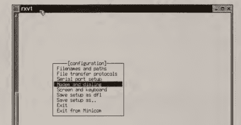

### **图 11-1** *Minicom 的设置菜单*

选中 **Modem and Dialing（调制解调器和拨号）** 条目后，按 Enter 键。Minicom 将显示另一个菜单（见图 11-2），其中列出了您可以更改的设置。Minicom 将光标定位在第一行，如图 11-2 所示。按 A 键以更改调制解调器初始化字符串。

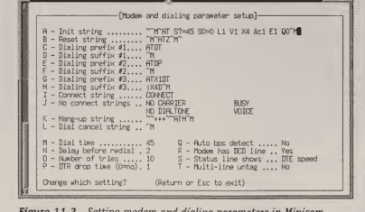

### **图 11-2** *在 Minicom 中设置调制解调器和拨号参数。*

然后，您可以使用退格键编辑该行，并输入初始化调制解调器所需的 AT 命令。例如，考虑用户通过以下 AT 命令初始化 56K 调制解调器（请查阅您的调制解调器手册以获取适当的初始化字符串）：

AT &F1 E1 V1

输入调制解调器初始化字符串后，按 Enter 键返回顶级菜单。

## 第 11 课——在 Red Hat Linux 中使用调制解调器

AT 命令是您可以用来控制调制解拨号号并执行任务的命令，例如拨号、打开或关闭调制解调器扬声器，以及设置调制解调器应答来电。这些命令以两个字符 AT（表示注意）开头。您可以将 AT 命令用于通信软件较原始、软件仅发送您输入的内容的场景。

进行更改（如有）后，使用上下箭头键高亮显示标记为 **Save as dfl（保存为默认）** 的条目，然后按 Enter 键。Minicom 将设置保存到 `/etc/minirc.dfl` 文件——其默认配置文件。您可以选择从 Minicom 中 **Exit（退出）** 并按 Enter 键来退出 Minicom。

### 以普通用户身份运行 Minicom

在任何用户运行 Minicom 之前，您还需要执行以下操作：

- 在文本编辑器中打开文本文件 `/etc/minicom.users`，并验证其中是否有一行包含单词 **ALL**。（这将允许所有用户访问 Minicom 的默认配置文件。）如果没有，请添加一行包含单词 **ALL**。
- 假设您希望所有用户都能使用调制解调器拨号，请允许任何用户读取和写入调制解调器连接的串行端口。例如，如果调制解调器在 COM1 (`/dev/ttyS0`) 上，请输入 `chmod o+rw /dev/ttyS0` 以授予所有用户该设备的写入权限。
- 在 `/dev/modem` 和调制解调器连接的串行端口设备之间建立链接。如果调制解调器在 COM1 (`/dev/ttyS0`) 上，您应该输入以下命令：
  `ln -s /dev/ttyS0 /dev/modem`

之后，您可以以普通用户身份运行 Minicom。Minicom 首次运行时，它会重置调制解调器。图 11-3 展示了在终端窗口中运行 Minicom 的结果。

```txt
Welcome to minicom 1.83.1
OPTIONS: Icrtity,Buffer, Fkey Macros, Search History,Buffer, I18n
Compiled on Feb 23 2001, 07:31:40
Press CTRL-\n 2 for help on special keys
ST, #F1, EV V1
```


按 Ctrl+A 以引起 Minicom 程序的注意。然后，如果您按 Z，帮助屏幕将以文本窗口的形式出现（如图 11-4 所示）。

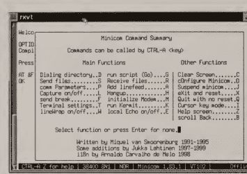

### 图 11-4 Minicom 帮助屏幕

在帮助屏幕中，您可以获取有关其他 Minicom 命令的信息。从帮助屏幕，按 Enter 键或 Esc 键返回在线模式。在在线模式下，您可以使用调制解调器的 AT 命令进行拨号。特别是，您可以使用 ATDT 命令拨打另一个调制解调器的电话号码，例如您的互联网服务提供商（ISP）的计算机或您工作的系统（见图 11-5）。一旦出现登录提示，您可以像往常一样登录并使用远程系统。

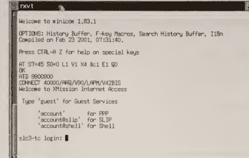

### 图 11-5 使用 Minicom 连接到远程系统

当您注销其他系统并希望退出 Minicom 时，按 Ctrl+A，然后输入 X 以退出程序。在响应 Minicom 提示时再次按 Enter 键。

## 故障排除

如果 `setserial` 显示 UART 为未知，如您在下例中所见，内核未能检测到您的串行端口或连接到该端口的调制解调器：

```
/dev/ttyS2, UART: unknown, Port: 0x03f8, IRQ: 10
```

这通常发生因为您的 PC 的 BIOS 被设置为期望一个即插即用（PnP）操作系统。为了解决这个问题，重新启动 PC，并在其通电时按下允许您访问系统 BIOS 的键。通常，这是一个功能键，如 F2，但具体按键取决于您的 PC 的 BIOS。在设置屏幕上，找到 PnP 操作系统（通常标记为“Plug & Play O/S”）的选项并关闭该选项。然后保存 BIOS 设置并退出。这会导致 PC 重新启动。这次，当 Red Hat Linux 启动时，内核应该能够正确检测到 PC 的串行端口。

如果您的串行端口被正确检测到但调制解调器没有响应，请确保 `/dev/modem` 链接到 `/dev` 中的正确设备文件。这在 PCI 调制解调器卡中尤其常见，它们通常默认不使用 COM1 (`/dev/ttyS0`) 或 COM2 (`/dev/ttyS1`)。例如，`sudo dmesg | grep ttyS` 显示以下内容：

```
ttyS2 at port 0x6800 (irq = 10) is a 16550A
```

在这种情况下，执行以下命令以确保 `/dev/modem` 链接到正确的设备文件：

```
ln -sf /dev/ttyS2 /dev/modem
```

如果似乎没有检测到您的调制解调器，请使用 Windows 设备管理器获取其 IRQ 和 I/O 地址，并将这些值与 `setserial` 命令报告的该端口的值进行比较。

目前，一些调制解调器根本不能与 Linux 一起工作。这些是所谓的“WinModems”，它们依赖 Windows 操作系统和特殊的 Windows 特定设备驱动程序才能工作。WinModem，也称为软件调制解调器，依赖设备端口而不是硬件来工作。在这种情况下，您唯一的补救措施是用硬件调制解调器更换调制解调器。

## 复习

您通过了解 Red Hat Linux 中串行端口的设备名称开始了本课。您使用 Minicom 串行通信程序通过调制解调器进行拨号。在拨号过程中，您学习了几个用于控制调制解调器的 AT 命令。

## 自测题

- 第二个串行端口 (COM2) 的设备名称是什么？（参见“了解串行端口设备名称。”）
- 如何检查 Linux 是否检测到您 PC 中的任何串行端口？（参见“检查 Red Hat Linux 是否检测到串行设备。”）
- 您可以使用哪个程序通过调制解调器拨号？（参见“使用 Minicom 拨号。”）
- 您使用哪个 AT 命令让调制解调器拨电话号码？（参见“以普通用户身份运行 Minicom。”）
- 您需要做什么来在 /dev/modem 和调制解调器连接的串行端口设备之间建立链接？（参见“以普通用户身份运行 Minicom。”）

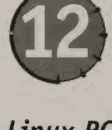

## 为您的 Red Hat Linux PC 组网

**本课时检查表**

- 设置以太网 LAN
- 在 Linux 中配置 TCP/IP 网络
- 在 Linux 中使用 TCP/IP 诊断命令
- 检查 TCP/IP 网络配置文件


**R**ed Hat Linux 包含广泛的内置网络功能。特别是，Red Hat Linux 支持通过多个物理接口的 TCP/IP（传输控制协议/互联网协议）网络，包括以太网卡、串行端口和并行端口。您通常使用以太网网络作为您的局域网 (LAN)。通过串行端口的 TCP/IP 网络允许您通过调制解调器拨号连接到其他网络。

本课时专注于以太网 LAN。您将学习如何设置、配置和监控以太网 TCP/IP 网络。您学到的许多内容也适用于下一课时讨论的通过拨号连接的 TCP/IP 网络。

### 设置以太网 LAN

以太网是一种在连接到单一电缆的两台或更多计算机之间移动数据包的标准方式。要设置以太网 LAN，您每台 PC 都需要一块以太网卡。Linux 支持 PC 的各种以太网卡。

以太网是物理数据传输机制的一个良好选择，因为它是一种经过验证的低成本技术，提供了良好的数据传输速率——通常为 1000 万位每秒 (10 Mbps)，尽管现在已有 100 Mbps 甚至千兆 (1000 Mbps) 以太网。

在以太网 LAN 中，计算机通过电缆连接到网络。如今，有两种流行的以太网电缆形式。第一个选项是 10Base2，有时


称为 *ThinNet*，它使用一种细而柔韧的同轴电缆。10Base2 电缆的外观与通过有线电视服务传输信号所用的电缆几乎完全相同。另一种更新且更受欢迎的替代方案是通过 *非屏蔽双绞线 (UTP)* 电缆连接的以太网，被称为 *10BaseT*。10BaseT 电缆类似于标准电话线，但线径稍粗，连接器也更宽。

要设置 10BaseT 以太网，你需要一个集线器——一个带有 RJ-45 插孔的硬件盒。你通过将 *双绞线* 从每台 PC 的以太网卡连接到该集线器来构建网络。（这些双绞线通常是 *5 类*，即 *Cat5*，电缆。）目前，你可以以大约 50 美元的价格买到一个 8 端口的 10BaseT 集线器。图 12-1 展示了一个典型的、你可以在小型办公室或家中设置的 10BaseT 以太网局域网。

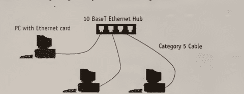

**图 12-1** 一个带有集线器的 *10BaseT 以太网局域网*

ThinNet 以太网不需要集线器，这使得它对于拥有多台 PC 的小型办公室或家庭办公室非常有吸引力。你可以简单地将 ThinWire 电缆从一台 PC 串联到另一台，从而构建一个小型以太网局域网，如图 12-2 所示。

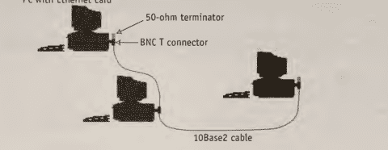

**图 12-2** 一个 *小型 ThinNet 以太网局域网*

如图 12-2 所示，你需要在 PC 中安装以太网卡。这些卡应配备 ThinNet 连接器，即 BNC 连接器（因此你需要一段 ThinNet 电缆（技术上称为 RG-58 细同轴电缆，阻抗为 50 欧姆）。对于每个以太网卡的 BNC 连接器，你需要一个 BNC T 型连接器（之所以这样称呼是因为该连接器看起来像字母 T）。你还需要两个 50 欧姆终端器用于以太网的两端。然后，你只需要按照图 12-2 所示的方式连接各个部件即可完成自己的以太网局域网。你可以采用这种方法来连接家庭办公室中的几台 PC 和一台工作站。


> 你不能简单地将两个 10Base2 以太网卡通过一根电缆连接起来让两台 PC 组网。即使你只连接 10Base2 局域网中的两台 PC，也必须使用 BNC T 型连接器和 50 欧姆终端器。

ThinNet 设置起来很容易，但这样连接许多 PC 很不方便。其中一个问题是，电缆的任何断裂都会导致整个网络崩溃。同样，如果电缆上的某台 PC 的网络配置出现问题，整个网络都可能受到影响。

你还可以通过使用带有 10Base2 端口和多个 10BaseT 端口的集线器来连接 10Base2 局域网和 10BaseT 局域网。

当你在连接到以太网局域网的 PC 上从本书附带的 CD-ROM 安装 Red Hat Linux 时，如果安装程序成功检测到以太网卡，安装程序应该会安装该卡的相应驱动程序。否则，你可以按照第 2 课中描述的方法以专家模式安装 Linux。

一旦正确安装，Linux 应该在每次启动时都加载以太网卡的驱动程序。要验证以太网驱动程序是否已加载，请按如下方式使用 dmesg 命令：

```
dmesg | grep eth0
```

此命令搜索启动消息中包含字符串 eth0 的任何行。（如下节“配置 TCP/IP 网络”中所述，eth0 是你的 Linux 系统中第一张以太网卡的设备名称。）一台样本 PC 安装了 3Com 3C503 以太网卡。当用户在该系统上输入 `dmesg | grep eth0` 时，该系统得到以下输出：

```
eth0: 3c503 at I/O base 0x300, node 02.60.8c.8e.6c.89, using internal xcvr.  
eth0: 3c503-P10, 16KB RAM, using programmed I/O (REQUIRED for SHARED MEMORY).
```

你应该看到类似的内容，显示以太网卡的名称和其他相关参数。如果 dmesg 命令没有显示任何以太网设备，请输入 `grep eth0 /var/log/messages` 以在存储在 /var/log/messages 文件中的启动消息中查找 eth0 设备名称。

## 配置 TCP/IP 网络

与 Red Hat Linux 中的几乎所有其他事项一样，TCP/IP 设置涉及准备一堆配置文件，这些是你可以用任何文本编辑器编辑的文本文件。这些配置文件中大多数位于 */etc* 目录中。Red Hat Linux 包含一个网络配置工具，你可以使用它来配置网络。首先，你需要学习如何引用网络设备。

### 了解网络设备名称

对于大多数设备，Linux 使用 */dev* 目录中的文件。然而，网络设备具有在内部内核中定义的名称；这些设备在 */dev* 目录中（或者说在任何目录中）没有文件。以下是 Linux 中常见的网络设备名称：

- *lo* — 回环设备。该设备高效地处理从你的系统发送到自身的网络数据包（例如，当 X 客户端与同一系统上的 X 服务器通信时）。
- *eth0* — 第一张以太网卡。如果你有更多的以太网卡，它们将获得设备名称 *eth1*、*eth2*，依此类推。
- *ppp0* — 第一个配置为使用点对点协议 (PPP) 与其他计算机建立点对点链接的串行端口。如果你有配置用于 PPP 网络的其他串行端口，它们将被分配设备名称 *ppp1*、*ppp2*，依此类推。
- *sl0* — 第一个配置为使用串行线路互联网协议 (SLIP) 进行网络通信的串行端口。SLIP 建立到 TCP/IP 网络的点对点链接。如果你使用第二个串行端口进行 SLIP 通信，它将获得设备名称 *sl1*。


无论你是否安装并配置了另一个网络设备（如以太网卡或调制解调器），回环设备 (lo) 总是存在的。回环设备将数据从一个程序传递给另一个程序，而无需访问外部网络。（这一过程被称为进程间通信，或 IPC。）事实上，只要应用程序仅使用本地系统，回环设备就允许任何需要功能正常的网络的应用程序正常运行。

### 运行 Red Hat 网络配置工具

当你在安装 Red Hat Linux 时设置 TCP/IP 网络，安装程序会使用你提供的信息准备所有适当的配置文件。然而，Red Hat Linux 附带一个图形化网络配置工具，你可以使用它来添加新的网络接口或修改信息，如名称服务器和主机名。

要启动网络配置工具，以 root 身份登录并选择 菜单 → 系统 → 网络配置。网络配置器会显示图 12-3 中的对话框。

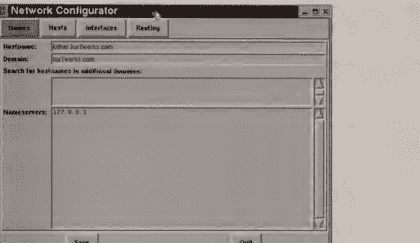

**图 12-3** 使用网络配置器配置 TCP/IP 网络

你可以通过对话框顶部的四个按钮配置网络的各个方面。点击每个按钮以探索你可以添加或编辑哪些条目。具体而言，这些按钮使你可以执行以下操作：

- **名称 (Names)**。允许你输入系统的主机名，并输入名称服务器的 IP 地址。名称服务器地址存储在 /etc/resolv.conf 文件中。主机名存储在 /etc/sysconfig/network 文件中的一个变量中。
- **主机 (Hosts)**。向你显示 /etc/hosts 文件当前的内容，并允许你添加、删除或编辑条目。该文件包含每个主机的主机名和相应的 IP 地址。
- **接口 (Interfaces)**。允许你添加新的网络接口，指定接口的 IP 地址，并激活该接口。这些信息存储在 /etc/sysconfig 目录中的各种文件中。
- **路由 (Routing)**。允许你添加静态路由。每条路由列出用于到达指定网络的网关。

要配置网络接口，你需要为每个接口分配 IP 地址。如果你正在运行私有网络，你可以使用 192.168.0.0 到 192.168.255.255 范围内的 IP 地址。还有其他保留用于私有网络的地址范围，但这个范围对于大多数需求应该足够了。例如，你可以使用 192.168.1.0 地址作为小型私有网络。

### 使用 TCP/IP 诊断命令

配置或重新配置 TCP/IP 网络后，你应该验证配置。当然，你可以使用 TELNET 或 FTP 等网络应用程序来验证


网络已启动并运行，但 Red Hat Linux 包含许多实用程序，可帮助您监控和诊断问题。

## 检查网络接口

输入 `/sbin/ifconfig` 命令以查看当前配置的网络接口。`ifconfig` 命令还在系统启动时配置网络接口（将 IP 地址与网络设备关联）。但是，如果在不带任何命令行参数的情况下运行 `ifconfig`，该命令将显示当前网络接口的信息。以下是典型的 `ifconfig` 调用的结果：

```
 /sbin/ifconfig
 eth0 Link encap:Ethernet HWaddr 02:60:8C:BE:C6:A9
 INET addr:192.168.1.200 Bcast:192.168.1.255 Mask:255.255.255.0
 UP BROADCAST RUNNING MULTICAST MTU:1500 Metric:1
 RX packets:3007 errors:0 dropped:0 overruns:0 frame:0
 TX packets:1140 errors:0 dropped:0 overruns:0 carrier:0
 collisions:0 txqueuelen:100
 Interrupt:5 Base address:0x300
 lo Link encap:Local Loopback
 INET addr:127.0.0.1 Mask:255.0.0.0
 UP LOOPBACK RUNNING MTU:3924 Metric:1
 RX packets:54 errors:0 dropped:0 overruns:0 frame:0
 TX packets:54 errors:0 dropped:0 overruns:0 carrier:0
 collisions:0 txqueuelen:0
```

此输出表明当前系统上有两个接口处于活动状态——回环接口（`lo`）和一张以太网卡（`eth0`）。对于每个接口，`ifconfig` 会显示 IP 地址以及关于该接口网络活动的统计摘要。对于以太网设备，`ifconfig` 还会报告 IRQ（显示为 `Interrupt: 5`）和基础 I/O 端口地址（`0x300`）。如果 Red Hat Linux 系统有一个拨号 PPP 连接处于活动状态，您还会在输出中看到 `ppp0` 接口的一项内容。

## 检查 IP 路由表

另一个网络配置命令 `/sbin/route` 在不带任何命令行参数运行时提供状态信息。如果您在连接到另一台主机时遇到问题，即使您使用的是其 IP 地址，也要检查 IP 路由表，看是否指定了默认网关。IP 路由表是一个 IP 地址列表，它标识了一个网络中的数据包为了到达另一个网络应该走的路径。然后，检查网关的路由表，以确保通往外部网络的路径出现在该路由表中。

`/sbin/route` 的输出通常类似于以下内容：

```
 /sbin/route
 Kernel IP routing table
 Destination Gateway Genmask Flags Metric Ref Use Iface
 192.168.1.200 * 255.255.255.255 UH 0 0 0 eth0
 192.168.1.0 * 255.255.255.0 U 0 0 0 eth0
 127.0.0.0 * 255.0.0.0 U 0 0 0 lo
 default 192.168.1.1 0.0.0.0 UG 0 0 0 eth0
```

此路由表显示本地网络使用 `eth0` 以太网接口，默认网关也是该以太网接口。默认网关处理寻址到除 Linux 系统所在的网络之外的任何网络的数据包。在此示例中，寻址到任何不以 `192.168.1` 开头的网络地址的数据包都会被发送到网关，该网关的 IP 地址为 `192.168.1.1`。网关会将这些数据包转发到其他网络，当然前提是网关连接到另一个网络。

## 检查与主机的连通性

要检查是否可以连接到特定主机，请使用 `ping` 命令。`ping` 命令是一个广泛使用的 TCP/IP 工具，它使用一系列互联网控制消息协议（ICMP，通常发音为 eye-com-p）消息。ICMP 提供回显消息，每台主机都会对此进行响应。利用 ICMP 消息和回复，`ping` 可以确定其他系统是否在线，然后计算往返延迟——即数据包从源系统传输到目标系统再返回该系统所需的时间。

以下示例展示了用户如何运行 `ping` 来查看其网络上的某个系统是否在线：

```
ping -c 4 192.168.1.50
PING 192.168.1.50 (192.168.1.50): 56 data bytes
64 bytes from 192.168.1.50: icmp_seq=0 ttl=32 time=2.2 ms
64 bytes from 192.168.1.50: icmp_seq=1 ttl=32 time=1.8 ms
64 bytes from 192.168.1.50: icmp_seq=2 ttl=32 time=1.2 ms
64 bytes from 192.168.1.50: icmp_seq=3 ttl=32 time=0.8 ms
--- 192.168.1.50 ping statistics ---
4 packets transmitted, 4 packets received, 0% packet loss
round-trip min/avg/max = 0.8/1.3/2.2 ms
```

`ping` 命令显示在两个系统之间发送数据包所需时间的统计数据，随后是一份简短的摘要报告。默认情况下，Red Hat Linux 的 `ping` 会持续运行，直到您按下 `Ctrl+C` 停止它，因此示例使用了 `-c 4` 选项将发送的数据包数量限制为 4。在某些系统中，`ping` 仅报告远程主机是否在线。但是，您仍然可以通过适当的命令行参数获取计时信息。

## 检查 TCP/IP 配置文件

在安装期间配置网络或运行 Red Hat 网络配置工具可能就足以在系统上配置 TCP/IP。但是，您也应该熟悉这些配置文件，以便在必要时对其进行编辑。例如，您可以通过网络配置工具指定名称服务器，但假设您想添加一个备用名称服务器。为此，您可以直接将这些名称添加到 `/etc/resolv.conf` 文件中——这是存储名称服务器 IP 地址的配置文件。

在本课程的其余部分中，您将熟悉基本的 TCP/IP 配置文件。这些配置文件中的每一个都是文本文件，您可以使用 `cat` 或 `more` 命令查看，并使用任何文本编辑器进行编辑。


## /etc/hosts

`/etc/hosts` 配置文件包含本地网络上所有系统的 IP 地址和主机名列表。在没有名称服务器的情况下，系统中需要访问其他系统的程序会查询此文件以确定其 IP 地址。输入 `cat /etc/hosts` 命令以查看此文件的内容。

以下是来自示例系统的 `/etc/hosts` 文件，显示了用户 LAN 上其他主机的 IP 地址和名称：

```
127.0.0.1       localhost       localhost.localdomain
# Other hosts on the LAN
192.168.1.100   inb486
192.168.1.50    inbp133
192.168.1.200   inbp200
192.168.1.233   inbp233
192.168.1.40    inbp400
192.168.1.60    inbp600
192.168.1.25    mac   inbmac
192.168.1.1     inbp75
```

文件中的每一行都以 IP 地址开头，后面跟着该 IP 地址的主机名。对于给定的 IP 地址，您可以拥有多个主机名。

## /etc/host.conf

`/etc/host.conf` 配置文本文件指定 Linux 如何获取对应于主机名的 IP 地址。输入 `cat /etc/host.conf` 以查看此文件的内容。通常，此文件包含以下行：

```
order hosts, bind
multi on
```

`/etc/host.conf` 文件中的条目告诉解析器库使用哪些服务以及按什么顺序将主机名转换为 IP 地址。`order` 选项指示服务的顺序。示例条目指定解析器库应首先查询 `/etc/hosts` 文件，然后检查名称服务器以解析名称。名称服务器列在 `/etc/resolv.conf` 文件中，您将在下一节中查看该文件。


> `multi on` 选项指定列在 `/etc/hosts` 文件中的主机可以有多个 IP 地址。具有多个 IP 地址的主机被称为多宿主，因为多个 IP 地址的存在意味着该主机拥有多个网络接口。换句话说，该主机同时“居住”在几个网络中。

## /etc/resolv.conf

`/etc/resolv.conf` 配置文件是解析器使用的另一个文本文件。此文件是一个确定对应于主机名的 IP 地址的库。输入 `cat /etc/resolv.conf` 以查看此文件的内容。

以下是一个示例 `/etc/resolv.conf` 文件：

```
search xyz.com
nameserver 164.109.1.3
nameserver 164.109.10.23
```

`search` 行指定解析器用于搜索主机名的系统名称。`nameserver` 行提供您域的名称服务器的 IP 地址。如果您有多个名称服务器，应在单独的行列出它们。它们将按照在文件中出现的顺序被查询。通常，您在 `/etc/resolv.conf` 文件中列出由您的互联网服务提供商（ISP）提供的名称服务器。

## /etc/hosts.allow

`/etc/hosts.allow` 配置文件标识允许使用可能正在您的系统上运行的互联网服务（如 Telnet 和 FTP）的系统。启动某些（但并非所有）互联网服务的程序在启动前会查询 `/etc/hosts.allow` 文件，并且仅当 `hosts.allow` 文件中的条目允许请求主机使用该特定服务时，才开始服务。

`/etc/hosts.allow` 中的条目采用 `server:IP address` 格式，其中 `server` 指提供特定互联网服务的程序名称。`IP address` 标识允许使用该服务的主机。例如，如果您希望本地网络（地址为 `192.168.1.0`）中的所有主机都能访问 FTP 服务（由 `in.ftpd` 程序提供），请在 `/etc/hosts.allow` 文件中添加以下行：

```
in.ftpd:192.168.1.
```

如果您希望允许所有本地主机访问所有互联网服务，请使用 `ALL` 关键字并改写该行如下：

```
ALL:192.168.1.
```

最后，要将所有互联网服务对所有主机开放，您可以将 IP 地址替换为 `ALL`，如下所示：

```
ALL:ALL
```

您也可以使用主机名代替 IP 地址。

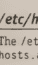

安全专家强烈且明确地反对允许所有主机访问您系统上的所有服务。为了获得更安全的系统，您应该拒绝所有主机的访问，然后允许选定的主机访问您的系统。这意味着您首先应该使用 `/etc/hosts.deny` 中的 `ALL:ALL` 指令拒绝所有主机访问您的系统（在下一节中介绍）。然后，您应该在 `/etc/hosts.allow` 中列出允许访问您系统的每个系统或系统组。

## /etc/hosts.deny

`/etc/hosts.deny` 配置文件与 `/etc/hosts.allow` 正好相反。`hosts.allow` 指定哪些主机可以访问互联网服务（如 Telnet 和 FTP）


在你的系统中，`hosts.deny` 文件标识了必须拒绝其服务的主机。启动 Internet 服务的程序如果未在 `/etc/hosts.allow` 文件中找到适用于请求主机的任何规则，就会查阅 `/etc/hosts.deny` 文件。如果该程序在 `hosts.deny` 文件中找到了适用于该主机的规则，它就会拒绝提供服务。

`/etc/hosts.deny` 文件中的条目遵循与 `/etc/hosts.allow` 文件相同的格式。它们的格式为 `server: IP address`，其中 `server` 指提供特定 Internet 服务的程序名称，而 `IP address` 标识允许使用该服务的主机。

假设你已经在 `/etc/hosts.allow` 文件中设置了条目以允许特定主机访问，你可以将以下行放入 `/etc/hosts.deny` 以拒绝所有其他主机访问你系统上的任何服务：

```
ALL:ALL
```

### 故障排查

如果你无法访问网络上的主机，请确保 `/etc/resolv.conf` 中至少列出了一个名称服务器。

如果外部系统无法连接到你的系统，请记住 `hosts.allow` 和 `hosts.deny` 文件被读取和应用的顺序。启动 Internet 服务的程序首先查阅 `/etc/hosts.allow`。如果 TCP Wrappers 没有找到匹配的规则，它会应用 `/etc/hosts.deny` 中的第一个匹配规则（如果有）。如果两个文件都不包含匹配项，则允许访问。

## 复习

本会话展示了如何使用 10Base2 或 10BaseT 电缆设置以太网局域网（LAN）。你探索了 Red Hat 的网络配置工具，可以使用该工具配置网络接口。你使用了一系列实用程序，如 `ping` 和 `route`，来监控你的 TCP/IP 网络状态。最后，你检查了若干 TCP/IP 配置文件，这些文件指定了诸如主机名、名称服务器，以及哪些主机可以访问运行在你系统上的服务等项目。

## 自我测试

1. 什么是“ThinNet”？（参见“设置以太网局域网。”）
2. Linux 系统中第一个以太网设备的名称是什么？（参见“了解网络设备名称。”）
3. 如何启动 Red Hat 网络配置工具？（参见“运行 Red Hat 网络配置工具。”）
4. 你使用什么网络实用程序来检查与网络中另一个系统的连接性？（参见“检查到主机的连接性。”）
5. 哪个配置文件允许你拒绝访问本地 Internet 服务？（参见“/etc/hosts.deny。”）

## 将你的 Red Hat Linux 计算机连接到 Internet

会话检查清单

- 学习拨号网络基础知识
- 使用 PPP 连接到 Internet
- 使用 IP 伪装共享 Internet 连接

安装 Red Hat Linux 后，你很可能希望将你的 Red Hat Linux 计算机（以及可能的局域网）连接到 Internet。对于将小型办公室或家庭办公室连接到 Internet，你有以下流行的选项：数字用户线路（DSL）、电缆调制解调器和拨号网络。DSL 和电缆调制解调器选项基本上涉及将特殊调制解调器连接到你 Linux 系统上的以太网卡。在这些情况下，设置程序与第 12 节中讨论的程序相同。本会话重点讨论第三个选项，即拨号访问，这涉及从你的 Red Hat Linux 计算机到你的 ISP 系统设置 PPP 连接。你还将学习如何使用 IP 伪装将 Red Hat Linux 系统的 Internet 连接与局域网上的其他系统共享。

## 学习拨号网络基础知识

拨号网络是指使用调制解调器和诸如 PPP（点对点协议）等通信协议将计算机连接到远程网络（如 Internet）。拨号网络和标准串行连接之间存在显著差异。虽然这两种方法都使用调制解调器连接两台计算机并建立通信路径，但串行连接使你的计算机表现得像连接到远程计算机的终端。PPP 连接使你的计算机看起来像是 Internet 上独立的、独立的系统。PPP 和拨号连接共同使你的 Red Hat Linux 系统成为远程计算机所属网络的一部分。你可以同时运行任何数量的网络应用程序，如 Web 浏览器、Usenet 新闻客户端、电子邮件客户端、Telnet 或 FTP 客户端等。所有这些应用程序都可以共享拨号 PPP 连接的物理数据传输能力。

拨号网络涉及通过拨号连接进行 TCP/IP 数据传输。与标准网络连接上的 TCP/IP 网络一样，通过拨号链路进行 TCP/IP 网络的关键在于指定协议和约定——即在通信链路上打包和发送数据包（一种数据单元）的方式。PPP 和 SLIP 是通过拨号连接进行 TCP/IP 网络的两个最流行的协议。

- *SLIP* 是串行线路 Internet 协议，一种简单的协议，它指定如何在串行线上对 IP 数据包进行封装。
- *PPP* 是点对点协议，一种更高级的协议，用于在任何点对点链路上建立 TCP/IP 连接，包括拨号串行链路。

PPP 是通过拨号连接进行 TCP/IP 网络的最流行方法。下一节将展示如何使用 PPP 设置到远程系统的网络连接。

## 使用 PPP 连接到 Internet

大多数 Internet 服务提供商（ISP）提供通过 PPP 访问 Internet 的服务。当你注册此类服务时，ISP 应向你提供连接远程系统所需的 PPP 信息。通常，这些信息包括以下内容：

- 连接到远程系统的电话号码。
- 登录远程系统时必须使用的用户名和密码。
- ISP 邮件和新闻服务器的名称，可能还包括其 IP 地址。
- ISP 域名服务器（DNS）的 IP 地址。通常，ISP 提供两个 IP 地址，一个用于*主* DNS 服务器，一个用于*辅助* DNS 服务器。

某些 ISP 可能会为你提供连接另一端的 IP 地址。不过，通常你的 IP 地址是动态分配的，并且每次连接 ISP 时都会改变。大多数 ISP 还提供邮件和新闻服务器的 IP 地址。然而，这些地址对于设置 PPP 连接的机制并不重要。

在设置 PPP 连接之前，你必须已在系统上安装了内部或外部调制解调器。调制解调器应连接到电话线。你可以使用 Minicom（如第 11 节所述）拨打你 ISP 的电话号码，确保调制解调器成功建立连接。当你看到登录提示符后，你可以挂断调制解调器并开始设置 PPP。

请按照以下步骤使用 Red Hat 的图形拨号配置工具设置 PPP 连接：

1. 以 root 身份登录，并从 GNOME 桌面选择 *主菜单* `->` *程序* `->` *设置* `->` *Internet 配置向导*。拨号配置工具显示“选择设备”类型对话框，如图 13-1 所示。单击你要配置的设备（调制解调器），然后单击“下一步”按钮继续。

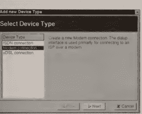

图 13-1 使用 Red Hat Internet 配置向导创建新的 Internet 连接

2. 在“选择提供商”对话框中（见图 13-2），在相应的文本框中输入连接信息（电话号码、你的 ISP 名称、登录名和密码）。除非必须输入区号才能访问你的 ISP，否则不要输入区号。单击“下一步”继续。

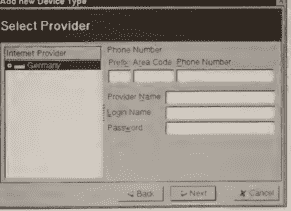

图 13-2 提供连接信息以连接到你的 ISP

3. 单击“完成”以保存拨号配置信息并关闭 Internet 配置向导。

4. 单击“主菜单 `<` 小工具 `<` 网络 `<` 调制解调器指示灯”以打开 PPP 拨号应用程序。这样做时，GNOME 桌面会将该应用程序放置在面板上，如图 13-3 所示。


5. 右键单击 Modem Lights 小部件，然后选择“属性”以打开 Modem Lights 设置对话框（参见图 13-4）。

6. 在“常规”选项卡上，按照图 13-4 中的显示编辑“连接命令”和“断开连接命令”文本框。`ifup ppp0` 和 `ifdown ppp0` 是启动和停止与 ISP 连接的命令。


图 13-4 编辑 Modem Lights 小部件使用的连接和断开连接命令。

7. 在图 13-5 所示的“高级”选项卡上，更改“调制解调器锁文件”文本框中的名称，使其反映调制解调器的设备名称。例如，在一个示例系统中，调制解调器设备名称为 /dev/ttyS4，如下面的命令所示：

```
ls -l /dev/modem
lrwxrwxrwx 1 root root 10 Sep 6 08:18 /dev/modem -> /dev/ttyS4
```

因此，锁文件名的最后一部分被更改为 ttyS4。


**图 13-5** *编辑锁文件，以便 Modem Lights 小部件可以跟踪您的连接状态。*

8. 单击“应用”，然后单击“确定”以保存您的更改。

9. 要建立 PPP 连接，请单击 Modem Lights 小部件左侧的大按钮，然后在图 13-6 所示的对话框中单击“是”。


**图 13-6** *使用 Red Hat 的 PPP 拨号器连接到互联网*

图 13-7 显示了 PPP 拨号器的连接监视器。左侧的小窗口显示您的总连接时间（以小时和分钟计），右侧的窗口以图形显示当前活动。


**图 13-7** *连接监视器以图形方式显示当前流量。*


## 验证 PPP 连接是否已建立

使用 Linuxconf 连接后，您可以输入 `/sbin/ifconfig` 命令来验证 PPP 连接是否已建立，这将显示如下列表：

```
/sbin/ifconfig

eth0    Link encap:Ethernet  HWaddr 02:60:8C:0F:C5:69
    inet addr:192.168.1.200  Bcast:192.168.1.255  Mask:255.255.255.0
    UP BROADCAST RUNNING MULTICAST  MTU:1500  Metric:1
    RX packets:4363 errors:0 dropped:0 overruns:0 frame:0
    TX packets:2111 errors:0 dropped:0 overruns:0 carrier:0
    collisions:0 txqueuelen:100
    Interrupt:5 Base address:0x300

lo      Link encap:Local Loopback
    inet addr:127.0.0.1  Mask:255.0.0.0
    UP LOOPBACK RUNNING  MTU:3924  Metric:1
    RX packets:50 errors:0 dropped:0 overruns:0 frame:0
    TX packets:50 errors:0 dropped:0 overruns:0 carrier:0
    collisions:0 txqueuelen:100

ppp0    Link encap:Point-to-Point Protocol
    inet addr:209.100.18.220  P-t-P:21209.100.18.4  Mask:255.255.255.255
    UP POINTOPOINT RUNNING NOARP MULTICAST  MTU:1500  Metric:1
    RX packets:132 errors:2 dropped:0 overruns:0 frame:0
    TX packets:146 errors:0 dropped:0 overruns:0 carrier:0
    collisions:0 txqueuelen:10
```

在输出中找到列出的 ppp0 设备。ifconfig 输出还显示了 PPP 连接本地端和远程端的 IP 地址。此输出确认 PPP 设备已启动并正在运行。

## 验证路由表设置是否正确

要验证路由表是否设置正确，请不带任何参数使用 `/sbin/route` 命令，如下所示：

```
/sbin/route

Kernel IP routing table
Destination     Gateway         Genmask         Flags Metric Ref Use Iface
209.100.18.4    *                   255.255.255.255 UH       0      0     0    ppp0
192.168.1.200   *                   255.255.255.255 UH       0      0     0    eth0
192.168.1.0     *                   255.255.255.0   U        0      0     0    eth0
127.0.0.0       *                   255.0.0.0       U        0      0     0    lo
default         209.100.18.4      0.0.0.0         UG       0      0     0    ppp0
```

在路由表中，第一行显示到 PPP 连接远程端的路由；这应该设置为 ppp0 设备。此外，默认路由应设置为使 PPP 连接的远程端充当系统的网关（如路由表的最后一行所示）。

## 验证互联网主机是否可达

在检查接口配置（使用 ifconfig 命令）和路由表（使用 route 命令）后，验证您是否可以到达一些知名主机。如果您的 ISP 提供了名称服务器或邮件服务器的 IP 地址，您可以尝试 ping 这些地址。否则，尝试 ping 您工作单位或大学中某系统的 IP 地址。

以下示例显示了如果使用 ping 命令会看到什么：

```
ping 140.90.23.100
PING 140.90.23.100 (140.90.23.100): 56 data bytes
64 bytes from 140.90.23.100: icmp_seq=0 ttl=243 time=143.2 ms
64 bytes from 140.90.23.100: icmp_seq=1 ttl=243 time=220.2 ms
64 bytes from 140.90.23.100: icmp_seq=2 ttl=243 time=140.2 ms
64 bytes from 140.90.23.100: icmp_seq=3 ttl=243 time=130.3 ms

140.90.23.100 ping statistics
4 packets transmitted, 4 packets received, 0% packet loss
round-trip min/avg/max = 130.3/158.4/220.2 ms
```

每行的末尾显示了一个从您的系统发出的数据包到达指定 IP 地址（在本例中为 140.90.23.100）并返回到系统的往返时间。对于通过拨号线的 PPP 连接，您可能会看到数百毫秒的时间。

您不需要在系统上拥有账户就可以 ping 其 IP 地址。虽然某些系统可能会禁用对 ping 消息的自动响应，但大多数系统会对 ping 做出响应。

> 要查看您的连接速度，请输入 `tail -100 /var/log/messages | grep V42BIS`。这将显示如下的行，其中包含调制解调器报告的连接速度：
>
> ```
> Mar 19 17:31:27 Imlb200 chat[1553]: 42666/ARQ/V90/LAPM/V42BIS*M
> Mar 19 17:32:24 Imlb200 chat[1579]: 33333/ARQ/V90/LAPM/V42BIS*M
> ```

## 关闭 PPP 连接

若要使用 PPP 拨号器关闭您的拨号连接，请单击 Modem Lights 小部件中心带有绿灯的按钮（参见图 13-7）。然后单击“是”按钮（参见图 13-8）以确认此决定。


图 13-8 使用 PPP 拨号器关闭 PPP 连接

片刻之后，连接关闭，PPP 拨号器的主屏幕变黑。这是 PPP 连接已关闭且调制解调器已挂断的电话的视觉证据。

## 使用 IP 伪装共享互联网连接

Linux 支持一项称为 **IP 伪装**（**IP masquerading**）的功能，它允许您将具有私有 IP 地址的以太网 LAN 连接到互联网。这是通过一台拥有正式分配 IP 地址且已连接到互联网的 Linux PC 实现的。该 Linux PC 可以通过拨号 PPP 或 DSL 或电缆调制解调器等其他方式连接到互联网。

启用 IP 伪装后，您的 Red Hat Linux PC 充当以太网 LAN 上所有其他系统的替代代表。与路由器设置类似，Red Hat Linux PC 被指定为以太网 LAN 的网关。然而，伪装不仅仅是在 LAN 和互联网之间简单转发 IP 数据包。

当 Red Hat Linux PC 冒充 LAN 上的其他系统时，它会修改出站数据包，使它们始终看起来像是源自 Red Hat Linux PC。当收到对其中一个出站数据包的响应时，Red Hat Linux PC 执行反向任务——它修改数据包，使它们看起来像是直接从互联网发送到发送出站数据包的系统。最终结果是，尽管以太网 LAN 使用非唯一的私有 IP 地址，但以太网 LAN 上的每个系统似乎都能完全访问互联网。

若要启用和使用 IP 伪装，请执行以下步骤：

- 确保 Linux 内核——核心操作系统——支持 IP 防火墙链。这应该适用于您从附带 CD-ROM 安装的 Red Hat Linux 版本。如果文件 `/proc/net/ip_fwchains` 存在，则内核支持 IP 防火墙链。（输入 `ls /proc/net/ip_fwchains` 以验证该文件是否存在。）
- 确保 Red Hat Linux PC 具有互联网连接以及到您 LAN 的网络连接。用于 IP 伪装的 Red Hat Linux PC 需要两个网络接口——一个用于连接和通信到 LAN 的以太网卡，以及一个通过 ISP 到互联网的拨号 PPP 连接。
- 确保您 LAN 上的所有其他系统使用 Linux PC 作为 TCP/IP 网络的默认网关。在所有系统上使用相同的 ISP 提供的 DNS 地址。
- 通过输入以下命令在内核中启用 IP 转发：
  `echo "1" > /proc/sys/net/ipv4/ip_forward`
  这是必要的，因为 IP 转发默认是禁用的。为确保重启系统时 IP 转发已启用，请将该命令放置在 `/etc/rc.d/rc.local` 文件中。在 Red Hat Linux 中，您可以通过将 `/etc/sysconfig/network` 文件中的行 `FORWARD_IPV4=false` 更改为 `FORWARD_IPV4=true` 来实现相同的结果。
- 运行 `/sbin/ipchains`——IPCHAINS 防火墙管理程序——以设置规则，使 Linux PC 能够为您 的 LAN 进行伪装。例如，要启用通过 Linux PC 的 ppp0 网络接口的 LAN 伪装，可以使用以下命令：
  `/sbin/ipchains -P forward DENY`
  `/sbin/ipchains -A forward -f ppp0 -J MASQ`
  如果您希望在系统启动时设置 IP 伪装，应将这些命令放置在 `/etc/rc.d/rc.local` 文件中。


你可能会发现，IP 伪装（IP masquerading）是为主机或办公室中的小型局域网（LAN）提供互联网访问的一种便捷方式。在家时，你可以使用 IP 伪装将以太网局域网通过 Linux 系统连接到互联网。该 Linux 计算机拥有一张用于局域网连接的以太网卡和一条通过 ISP（互联网服务提供商）拨号连接到互联网的调制解调器。（你需要从 ISP 获取一个有效的 IP 地址。）通过在 Linux 计算机上启用 IP 伪装，你的家人或小型企业中的任何人都可以通过局域网上的其他计算机访问互联网。

## 故障排除

如果你在使用 PPP 拨号程序连接 ISP 时遇到困难，请确保调制解调器设备文件的权限允许访问。例如，假设你的调制解调器位于 /dev/ttyS1。如果 `ls -l /dev/ttyS1` 没有显示如下所示的所有用户和组权限：

```
crw-rw---- 1 root uucp 4, 65 Mar 23 21:38 /dev/ttyS1
```

那么，除非你是 root 用户，否则你将无法使用调制解调器。

使用以下 `chmod` 命令（作为 root 用户）确保普通用户对调制解调器具有读写访问权限：

```
chmod o+rw /dev/ttyS1
ls -l /dev/ttyS1
crw-rw-rw- 1 root uucp 4, 65 Mar 23 21:38 /dev/ttyS1
```


## 复习

本节向你介绍了拨号上网，这是一种通过拨号调制解调器在 Linux 计算机和互联网之间建立网络连接的方法。你学会了使用 Red Hat 拨号配置工具来设置 PPP 连接。最后，本节展示了如何使用 IPCop（IPCHAINS）防火墙管理程序的 IP 伪装功能来共享单个互联网连接。

## 自我测验

- 1. 什么是拨号上网和 PPP？（参见“学习拨号上网的基础知识。”）
- 2. ISP 通常提供哪些信息以便你设置拨号 PPP 连接？（参见“使用 PPP 连接互联网。”）
- 3. 你使用什么工具来设置 PPP 连接？（参见"使用 PPP 连接互联网。"）
- 4. 你会使用什么程序来开启和关闭 PPP 连接？（参见"使用 PPP 连接互联网。"）
- 5. 什么是 IP 伪装？（参见"使用 IP 伪装共享互联网连接。"）


## 第 24 节
## 设置互联网服务

### 本节清单

- ✓ 理解互联网服务
- ✓ 使用邮件服务器
- ✓ 设置 Apache Web 服务器
- ✓ 设置 FTP 服务器

如果 Red Hat Linux 计算机连接到互联网或内部网络（私有 TCP/IP 网络），你可以将其用作服务器。互联网和内部网络都依赖于互联网服务。每项互联网服务都涉及在 Red Hat Linux 系统上配置和运行一个或多个服务器。本节向你介绍常用的互联网服务。然后重点介绍实现邮件、Web 和文件传输互联网服务的服务器：分别是邮件服务器、Apache Web 服务器和 FTP 服务器。

### 理解互联网服务

术语 *Internet service*（互联网服务）指通常在网络服务器上运行的多个应用程序，这些应用程序采用 *client/server*（客户端/服务器）架构来执行特定任务。*客户端/服务器架构*使用两个独立的程序——一个提供信息的服务器，以及一个或多个请求信息以实现服务的客户端。

许多互联网服务专门设计用于在一个系统之间传递信息。这些信息可以是邮件消息、新闻项目或数据文件的形式。作为用户，你期望从典型的互联网主机访问以下常见互联网服务：

- 电子邮件（*e-mail*）。从互联网主机，你可以使用诸如 president@whitehouse.gov 之类的地址向互联网上的任何其他用户发送电子邮件。
- 万维网（World Wide Web）。你可以使用 Web 浏览器使用统一资源定位符（URL）地址（例如 http://www.whitehouse.gov/）下载和查看 Web 页面。Web 页面通常是格式化为超文本标记语言（HTML）的文档。
- 新闻组（Newsgroups）。你可以阅读新闻组，并使用诸如 news://comp.os.linux.networking 或 news://comp.os.linux.setup 等名称向新闻组发布新闻项目。
- 信息检索（Information retrieval）。你可以使用诸如万维网浏览器等工具搜索信息。你还可以使用文件传输协议（FTP）下载文件。反过来，其他系统的用户通常也可以通过一种称为匿名 FTP 的功能从你的系统下载文件。

所有互联网服务都依赖于客户端和服务器软件。例如，当你使用电子邮件客户端软件阅读电子邮件时，邮件服务器负责将邮件从一个系统传输到另一个系统。类似地，你使用 Web 浏览器客户端从 Web 服务器下载和查看 Web 页面。

实现互联网服务的客户端和服务器使用 TCP/IP 协议进行通信。你已经熟悉用于标识 TCP/IP 网络中主机的 IP 地址。然而，仅靠 IP 地址不足以区分在同一系统上运行的许多服务。端口号（或简称为端口）的概念被用于使各种互联网服务器能够与客户端通信。端口不是一个物理实体；它只是一个介于 1 和 65,535 之间的数字，用于唯一标识两个进程（通常是一个服务器和一个客户端）之间 TCP/IP 通信链路的每个端点。因此，IP 地址和端口号的组合唯一地标识了互联网上每个主机上运行的每个服务。

所有知名的互联网服务都有预分配的端口号。例如，以下是一些常用的互联网协议及其分配的端口号：

- FTP（File Transfer Protocol，文件传输协议）允许在互联网上的计算机之间传输文件。FTP 使用两个端口；数据在端口 20 上传输，而控制信息在端口 21 上交换。FTP 是文件传输的基础协议。
- HTTP（Hypertext Protocol，超文本协议）是一种较新的协议，用于将一个系统中的 HTML 文档发送到另一个系统。HTTP 是 Web 的基础协议。默认情况下，Web 服务器和客户端在端口 80 上进行通信。
- SMTP（Simple Mail Transfer Protocol，简单邮件传输协议）在系统之间交换电子邮件消息。SMTP 使用端口 25 进行信息交换。SMTP 是电子邮件服务的基础协议。
- NNTP（Network News Transfer Protocol，网络新闻传输协议）以存储和转发的方式在互联网上传递新闻文章。NNTP 使用端口 119。NNTP 是新闻组服务的基础协议。
- Telnet 允许一个系统上的用户登录到互联网上的另一个系统。用户必须提供有效的用户 ID 和密码才能成功登录远程系统。Telnet 默认使用端口 23。但是，Telnet 客户端可以连接到任何指定的端口。Telnet 是远程访问的基础协议。
- SSH（Secure Shell，安全外壳协议）是一种较新的、安全的协议，旨在取代 Telnet 协议。它使用端口 22。
- NFS（Network File System，网络文件系统）在计算机之间共享文件。NFS 使用 Sun 的远程过程调用（RPC）机制，该机制通过端口 111 交换信息。

/etc/services 文本配置文件存储了互联网服务与端口号以及基础数据通信协议之间的关联。要查看此文件的内容，请按照以下方式使用 more 命令：

```
more /etc/services
```

以下是 Linux 系统的 /etc/services 文件中的一个小条目子集：

| 服务名称 | 端口/协议 | 别名/注释 |
| :--- | :--- | :--- |
| ftp data | 20/tcp | |
| ftp | 21/tcp | |
| fsp | 21/udp | fspsd |
| ssh | 22/tcp | # SSH Remote Login Protocol |
| ssh | 22/udp | # SSH Remote Login Protocol |
| telnet | 23/tcp | |
| sntp | 25/tcp | mail |
| time | 37/tcp | timeserver |
| time | 37/udp | timeserver |
| rlp | 39/udp | resource # resource location |
| nameserver | 42/udp | name # ICN 116 |
| whois | 43/tcp | nicname |

每行以服务名称开头，后跟端口号和数据通信协议（tcp 或 udp）。行的其余部分显示服务的另一个名称（如果有的话），也称为别名。井号（#）后面的任何内容都被解释为注释。

> 浏览 /etc/services 文件中的条目是有启发性的，因为它们展示了 TCP/IP 下可用的网络服务的广度。

在使用本书随附的 CD-ROM 安装 Red Hat Linux 期间，你可以选择安装邮件、Web 和新闻所需的软件包。你只需在显示软件包组的安装屏幕上选择“Mail/WWW/News Tools”软件包组即可。Mail 指的是电子邮件互联网服务；WWW 指的是万维网互联网服务；News 指的是新闻组互联网服务。

如果你在 Red Hat Linux 安装过程中安装了邮件和新闻软件，你不需要做更多事情即可开始使用邮件、Web 和新闻服务。否则，你可以使用 Red Hat 软件包管理器（RPM）安装单个软件包。

第 23 节描述了如何使用 rpm 程序安装新软件。

## 使用邮件服务器

电子邮件是互联网上最受欢迎的服务之一。电子邮件最初是一种简单的机制，其中消息被复制到用户的邮箱文件中。在 Red Hat Linux 中，你的邮件消息存储在 /var/spool/mail 目录中，文件名与你的用户名相同。


## 邮件用户代理与邮件传输代理

要在你的 Red Hat Linux 电脑上配置用户电子邮件，你需要两种类型的邮件软件：

- **邮件用户代理**软件（有时用缩写 MUA 表示）允许你读取用户邮件消息、撰写回复以及创建新消息。通常，邮件用户代理使用 POP3 或 IMAP4 协议从邮件服务器检索消息。POP3 是邮政协议第 3 版，而 IMAP4 是互联网消息访问协议第 4 版。Red Hat Linux 光盘包含了几个流行的邮件用户代理，例如 *pine* 和 *elm*。
- **邮件传输代理**（MTA）软件实际负责发送和接收邮件消息文本。用于邮件传输的具体方法取决于底层网络。在 TCP/IP 网络中，邮件传输代理使用简单邮件传输协议 (SMTP) 来投递邮件。本书的 Red Hat Linux 光盘包含了 *sendmail*，这是 TCP/IP 网络中功能强大且流行的邮件传输代理。

大多数邮件传输代理以 *守护进程*（后台进程）的形式运行，只要你的系统处于开启状态，它们就会一直运行。因为系统中你或其他用户可以随时发送邮件，所以传输代理必须随时待命，以便将邮件投递到其目的地。邮件用户代理仅在用户希望读取来信、撰写和发送去信或检查新邮件时运行。


通常，邮件传输代理在系统启动后开始运行。Red Hat Linux 的系统启动文件设置为当 Linux 系统处于 *多用户模式* 时启动 *sendmail* 邮件传输代理。Shell 脚本文件 */etc/rc.d/init.d/sendmail* 负责启动 *sendmail*。

## sendmail

由于系统已设置为在启动时自动运行 *sendmail*，你只需使用适当的 *sendmail* 配置文件即可在 Linux 系统上启用电子邮件。在正确配置 *sendmail* 邮件传输代理之前，你无法发送或接收电子邮件。*sendmail* 传输代理以其复杂但完整的邮件投递系统而闻名。如果你快速查看 *sendmail* 的配置文件 */etc/sendmail.cf*，你会发现 *sendmail* 确实很复杂。幸运的是，你不需要成为 *sendmail* 配置文件的专家。你只需要使用本书配套光盘中的预定义配置文件即可。

如果在安装 Red Hat Linux 期间安装了邮件/新闻工具组件，你的系统应该具有可用的 *sendmail* 配置文件 */etc/sendmail.cf*。默认文件假设存在互联网连接和名称服务器。只要你拥有互联网连接，一旦将 Linux 电脑连接到互联网，你应该就能发送和接收电子邮件。然后，你可以使用 *elm* 等邮件用户代理来撰写和发送邮件消息。

## 设置 Apache Web 服务器

你可能已经知道使用 Web 是什么感觉。然而，你可能不知道如何设置 Web 服务器，以便通过网页向全世界提供信息。要成为 Web 上的信息提供者，你必须在互联网上的 Red Hat Linux 电脑上运行 Web 服务器。

Web 服务器使用超文本传输协议 (HTTP) 提供信息。由于它们是持续运行的服务器，Web 服务器也被称为 HTTP 守护进程。本章节介绍的 Web 服务器通常名为 *httpd*。

在可自由获得的 Web 服务器中，Apache Web 服务器最受欢迎。Apache 可以通过互联网免费获取，并随本书的配套光盘一起提供给 Red Hat Linux。

当你从本书的配套光盘安装 Red Hat Linux 时，你也可以选择安装 Apache Web 服务器。如果在 Red Hat Linux 安装过程中安装了 Mail/WWW/News Tools 软件包，Red Hat Linux 将在系统启动时自动启动 Apache Web 服务器。

执行以下步骤以验证 Apache Web 服务器软件是否已安装并在你的系统上运行：

1. 输入以下命令以检查是否安装了 Apache Web 服务器：
   ```bash
   rpm -q apache
   apache-1.3.19-5
   ```
   如果输出显示 *apache* 包名称，则表示你的系统上已安装 Apache 软件。

2. 输入以下命令以检查 *httpd* 进程是否在运行：Apache Web 服务器程序的名称是 *httpd*：
   ```bash
   ps ax | grep httpd
   ```
   输出应该显示多个 *httpd* 进程。通常运行一个父进程和几个子 Web 服务器进程是很常见的，以便通过为每个 HTTP 请求分配一个 *httpd* 进程来高效地处理请求。

3. 在你的 Linux 系统上使用 *telnet* 程序，执行 HTTP HEAD 命令以查询 Web 服务器，如下所示：
   ```bash
   telnet localhost 80
   Trying 127.0.0.1...
   Connected to localhost.
   Escape character is '^]'.
   HEAD / HTTP/1.0
   ... Press Enter once more to type a blank line
   HTTP/1.1 200 OK
   Date: Sat, 19 Aug 2000 23:57:14 GMT
   Server: Apache/1.3.12 (Unix) (Red Hat/Linux)
   Last-Modified: Mon, 07 Aug 2000 10:21:07 GMT
   ETag: "328fe-b4a-398e8d93"
   Accept-Ranges: bytes
   Content-Length: 2890
   Connection: close
   Content-Type: text/html

   Connection closed by foreign host.
   ```
   如果你得到如上所示的响应，则说明你的系统已经正确安装并设置了 Apache Web 服务器。你只需要理解配置，以便将 HTML 文档放在正确的目录中即可。

4. 使用 Web 浏览器加载你系统的主页。通过点击 GNOME 面板上的大 "N" 图标启动 Netscape Navigator；查看 URL `http://localhost/`，然后看看会发生什么。你应该会看到标题为 "Red Hat Linux 上 Apache Web 服务器的测试页面" 的网页。

Apache Web 服务器被设置为从 */var/www/html* 目录提供 HTML 文档。因此，你应该将网页放在该目录中。特别是，你应该编辑或替换 */var/www/html/index.html* 文件，使其成为你自己的主页。

除了 HTML 文件，Apache Web 服务器还支持通用网关接口 (CGI) 程序，Web 服务器可以调用这些程序来访问其他文件和数据库。你应该将任何 CGI 程序放在 */var/www/cgi-bin* 目录中。请注意以下关于 Apache Web 服务器的有用信息：

- Apache Web 服务器配置文件位于 */etc/httpd/conf* 目录中。配置文件 *httpd.conf* 控制服务器的运行方式、提供哪些文档以及谁可以访问这些文档。
- */var/log/httpd* 目录是 Apache Web 服务器的访问日志和错误日志文件所在的位置。
- */etc/rc.d/init.d/httpd* 脚本在你的 Red Hat Linux 系统启动时启动 *httpd* 进程。

## 设置 FTP 服务器

除了电子邮件和 Web 服务外，匿名 FTP 是互联网主机上的常见服务。你可能熟悉 FTP，你可以使用它在互联网上将文件从一个系统传输到另一个系统。当你使用 FTP 传输文件到远程系统或从远程系统传输文件时，你必须先登录到远程系统才能使用 FTP。

如果你从本书的配套光盘安装 Red Hat Linux，你的系统应该已经设置了匿名 FTP，并且 FTP 服务器已配置为在需要时运行。默认设置还采用了必要的安全预防措施。


输入以下命令以检查是否安装了 FTP 服务器：

```bash
rpm -q wu-ftpd
wu-ftpd-2.6.1-16
```

如果输出显示 *wu-ftpd* 包名称，则表示你的系统上已安装 FTP 服务器软件。

匿名 FTP 指的是用户名为 *anonymous*，任何人都可以使用该名称通过 FTP 从系统传输文件。匿名 FTP 是在互联网上共享文件的常见方式。许多企业使用匿名 FTP 来支持其客户。

输入以下命令以检查你的系统是否安装了匿名 FTP 支持：

```bash
rpm -q anonftp
anonftp-4.0-7
```

如果输出显示 *anonftp* 包名称，则表示你的系统支持入站匿名 FTP。

如果你曾使用匿名 FTP 从各种互联网站点下载文件，你已经知道该服务的便利性。匿名 FTP 使你能够将信息提供给互联网上的任何人。即使你没有明确使用匿名 FTP，你的 Web 浏览器也经常使用匿名 FTP 来下载文件。（你只需点击一个链接；Web 浏览器完成其余部分。）

要查看匿名 FTP 的运行情况，你可以尝试使用 FTP 客户端访问你的系统。例如，以下是某个用户从局域网上的另一台电脑访问其系统时的示例会话（他的输入以粗体显示）：

```text
ftp Inbp200
Connected to Inbp200
220 Inbp200.InbpSoft.com FTP server (Version wu 2.6.1.0(1)) Fri Feb 4 23:37:48 EST 2000) ready.
220 Inbp200 FTP server (Version wu 2.6.1(l)) Wed Aug 9 0:54:50 EDT 2000) ready.
Name (Inbp200:): anonymous
331 Guest login ok, send your complete e-mail address as password.
Password:
230 Guest login ok, access restrictions apply.
Remote system type is UNIX.
Using binary mode to transfer files.
ftp> bye
221 You have transferred 0 bytes in 0 files.
221 Total traffic for this session was 299 bytes in 0 transfers.
221 Thank you for using the FTP service on Inbp200.
221 Goodbye.
```

当你成功通过匿名 FTP 登录时，你将访问名为 *ftp* 的用户的家庭目录（默认目录为 */var/ftp*）。你应该将可公开访问的文件放在 */var/ftp/pub* 目录中。


## 故障排除

如果您的系统上未安装 Apache Web 服务器，请使用以下说明进行安装：

- 以 root 用户身份登录。
- 挂载 Red Hat Linux 安装光盘 (CD-ROM，第 1 张)。
- 输入以下命令以安装 Apache 及其支持包（如果 CD-ROM 驱动器的挂载点不同，请将 `/mnt/cdrom` 替换为您的 CD-ROM 驱动器的挂载点）：

```
## rpm -ivh /mnt/cdrom/RedHat/RPMS/apache\*.rpm
```

如果 Apache Web 服务器未运行，请以 root 身份输入以下命令以启动它：

```
/etc/rc.d/init.d/httpd start
```

如果您的系统上未安装 FTP 服务器，请使用以下说明进行安装：

- 以 root 用户身份登录。
- 挂载 Red Hat Linux 安装光盘 (CD-ROM，第 1 张)。
- 输入以下命令以安装 FTP 服务器及其支持包（如果 CD-ROM 驱动器的挂载点不同，请将 `/mnt/cdrom` 替换为您的 CD-ROM 驱动器的挂载点）：

```
## rpm -ivh /mnt/cdrom/RedHat/RPMS/wu-ftpd*.rpm
```

如果您的系统上未安装匿名 FTP 支持，请使用以下说明进行安装：

- 以 root 用户身份登录。
- 挂载 Red Hat Linux 安装光盘 (CD-ROM，第 1 张)。
- 输入以下命令以安装匿名 FTP 及其支持包（如果 CD-ROM 驱动器的挂载点不同，请将 `/mnt/cdrom` 替换为您的 CD-ROM 驱动器的挂载点）：

```
## rpm -ivh /mnt/cdrom/RedHat/RPMS/anonftp*.rpm
```

## 复习

本节课向您介绍了互联网服务。您学习了如何使用邮件服务器 (sendmail) 与互联网上的其他系统交换电子邮件。我们还研究了 Apache Web 服务器的设置，以及放置 HTML 文档的位置和查找日志文件的位置。最后，您探索了在 Red Hat Linux 系统上如何设置匿名 FTP。

## 自我测验

- 哪个配置文件存储了互联网服务与端口号之间的关联？（参见“理解互联网服务”。）
- 什么是邮件传输代理？（参见“使用电子邮件服务器”。）
- Apache Web 服务器从哪个目录提供 Web 页面 (HTML 文件)？（参见“设置 Apache Web 服务器”。）
- Web 服务器的配置文件存储在哪里？（参见“设置 Apache Web 服务器”。）
- 您应该在哪个目录中放置希望其他人通过匿名 FTP 下载的文件？（参见“设置 FTP 服务器”。）

## 第 15 课

# 将 Red Hat Linux 用作工作组服务器

**会话检查清单**

- 使用 NFS 共享文件
- 使用 Samba 将 Red Hat Linux 电脑设置为 Windows 服务器


配置了 Red Hat Linux（来自本书配套 CD-ROM）的低端 Pentium PC（甚至是 486）可以成为一个功能强大的工作组或办公室服务器。工作组是一个小型局域网 (LAN)，可能包含大约十几台 PC。您可以将 Red Hat Linux 电脑配置为文件和打印服务器，并将其他电脑配置为客户端。客户端电脑可以运行 Windows 而不是 Linux。

本节课向您介绍 Samba 软件包，它随 Red Hat Linux 一起提供，并提供了将 Red Hat Linux 电脑设置为 Windows 网络服务器所需的一切。但是，首先您将通过网络文件共享 (NFS) 了解文件共享，这提供了除 Samba 之外的另一种文件共享方式。

### 使用 NFS 共享文件

使用 NFS 共享文件很简单，涉及两个基本步骤：

- 在 Red Hat Linux 服务器上，通过在 `/etc/exports` 文件中列出一个或多个目录来导出这些目录，从而使客户端系统能够访问它们。
- 在每个客户端系统上，使用 mount 命令挂载 Red Hat Linux 服务器导出的目录。

使用 NFS 进行文件共享的唯一问题是每个客户端系统必须支持 NFS。大多数 PC 都不附带 NFS。这意味着如果您想使用 NFS 共享文件，必须单独购买 NFS 软件。如果您的局域网 (LAN) 上的所有系统都运行 Linux 或具有内置 NFS 支持的其他 UNIX 变体，则使用 NFS 是有意义的。本节课通过示例向您展示了如何在局域网中的两台 Red Hat Linux 电脑上设置 NFS。

### 使用 NFS 导出文件系统

在服务器上，您必须运行 NFS 服务，并指定一个或多个文件系统以供*导出*，即供客户端系统使用。您可以使用 Linuxconf 图形化系统管理工具执行这两项任务。

执行以下步骤以启动 Linuxconf：

1. 以 root 身份登录，并从 GNOME 菜单中选择主菜单 **程序 系统 Linuxconf**。或者，再次以 root 身份打开终端窗口，并在命令提示符处输入 `linuxconf`。
2. 点击“配置”选项卡，然后选择**网络 服务器任务 导出文件系统** (NFS)。Linuxconf 随后显示“导出文件系统”选项卡，其中显示 `/etc/exports` 文件的当前内容。如果 `/etc/exports` 为空，显示效果应与图 15-1 相似。


**图 15-1 空的“导出文件系统”对话框**

3. 点击**添加**按钮。这会在显示界面中添加“单个导出文件系统”选项卡，允许您定义导出文件系统的详细信息。您需要使用完整路径名指定文件系统，如图 15-2 所示。
4. 在此对话框中，您还应输入可以挂载此导出文件系统的客户端系统名称。在图 15-2 所示的示例中，正在导出 `/home/public` 目录，名为 *katie* 的主机可以挂载此文件系统以进行读和写操作。
5. 输入信息后，点击**接受**按钮。Linuxconf 返回到图 15-1 中显示的对话框，但现在显示关于导出文件系统的摘要信息。
6. 点击**取消**按钮以完成导出文件系统的定义。


作为此会话的结果，Linuxconf 向 `/etc/exports` 文件添加了以下条目：`/home/public katie(rw)`

若要验证导出的目录是否列在 `/etc/exports` 文件中，请在终端窗口中输入 `cat /etc/exports`。

现在您应该打开 NFS 服务器。为此，点击“控制”选项卡，然后选择“控制面板 控制 服务状态”。Linuxconf 显示服务控制屏幕，其中列出所有服务及其状态，如图 15-3 所示。


**图 15-3 在 Linuxconf 的服务控制屏幕中查看服务及其状态**

每一行有三个字段：一个提供服务名称，另一个指示服务是启用自动运行还是手动运行，最后一个揭示服务是否已在运行。向下滚动列表，找到名为 nfs 的 NFS 服务条目。在这种情况下，NFS 服务尚未运行。点击该条目。这将使 Linuxconf 显示“Service nfs”选项卡，如图 15-4 所示。


**图 15-4 通过 Linuxconf“Service nfs”选项卡启动 NFS 服务**

此选项卡中的按钮允许您启动、停止或重启服务。在这种情况下，点击“启动”按钮以启动 NFS 服务。然后点击“接受”返回到上一个对话框（图 15-3）。现在，服务控制屏幕应显示 nfs 条目的状态为“运行中”。点击“取消”退出此对话框。

如果您 ever 对 `/etc/exports` 文件中列出的导出文件系统进行了任何更改，请记住重启 NFS 服务。点击图 15-3 所示对话框中的“重启”按钮。（注意：原文引用了图 15-6，可能是 OCR 或上下文错误，此处保留原文引用逻辑，但根据上下文，该按钮通常位于服务选项卡中。）

*更正说明：步骤 4 合并*：原文有“4. 输入信息...”和一个子项目符号“在此对话框中...”。为了流程更顺畅，我将其合并为步骤 4，因为它描述的是在同一对话框内的同一操作。

如果您更喜欢使用命令启动 NFS 服务，请以 root 身份登录，并在终端窗口中输入以下命令：

```
/etc/rc.d/init.d/nfs start
```

这样就设置好了 NFS 的服务器端。现在您可以尝试从客户端系统挂载导出的文件系统。

### 挂载 NFS 文件系统

您可以使用客户端系统上的 Linuxconf 来挂载导出的 NFS 文件系统。然而，执行挂载操作最简单的方法是以 root 身份登录并使用 mount 命令。例如，要在名为 katie 的客户端系统的 `/mnt/luther` 目录上挂载 luther 系统的 `/home/public` 文件系统，请输入：

```
mount luther:/home/public /mnt/luther
```

若要确认 NFS 文件系统确实已挂载，请在客户端系统上以 root 身份登录，并在终端窗口中输入 `mount`。您应该会看到一行关于 NFS 文件系统的类似内容：

```
luther:/home/public on /mnt/luther type nfs (rw,addr=192.168.1.200)
```

## 使用 Samba 将您的 Linux PC 设置为 Windows 服务器

如果您的业务依赖 Windows 进行文件和打印共享，您可能在服务器和客户端中都使用 Windows。您可以将 Red Hat Linux 电脑用作服务器，而不会失去 Windows 文件和打印共享功能，因为您可以将 Linux 电脑设置为 Windows 服务器。当您从本书的配套 CD-ROM 安装 Red Hat Linux 时，您也有机会安装 Samba 软件包，该包执行此任务。您只需在安装期间选择 DOS/Windows 连接包组即可。


在安装和配置 Red Hat Linux PC 上的 Samba 之后，运行 Windows 95/98/NT/2000 的客户端 PC 可以通过使用服务器消息块 (SMB) 协议访问 Red Hat Linux PC 上的磁盘和打印机，该协议是 Windows 文件和打印共享的基础协议。

安装了 Samba 软件包后，您还可以将 Red Hat Linux PC 设置为 Windows 客户端。这意味着 Red Hat Linux PC 可以访问由 Windows 服务器管理的磁盘和打印机。Samba 软件包由以下主要组件组成：

- `smb` 是 SMB 服务器，接受来自 Windows 客户端的连接并提供文件和打印共享服务。
- `nmbd` 是客户端用于查找服务器的 NetBIOS 名称服务器。NetBIOS 代表网络基本输入/输出系统。NetBIOS 是应用程序用于与网络传输（如 TCP/IP）通信的接口。
- `/etc/samba/smb.conf` 是 SMB 服务器使用的 Samba 配置文件。
- `testparm` 是一个确保 Samba 配置文件正确的程序。
- `smbclient` 是运行在 Red Hat Linux 上的 Windows 客户端，允许 Red Hat Linux 访问任何 Windows 服务器上的文件和打印机。
- `smbprint` 是一个脚本，用于启用在 SMB 服务器上的打印机上打印。
- `smbadduser` 是一个将用户添加到 SMB 密码文件的程序。
- `smbpasswd` 是一个更改 SMB 用户密码的程序。
- `smbstatus` 是一个列出当前本地主机 SMB 连接的命令。


以下章节介绍如何从随书光盘安装 Samba。它们还讨论了在 Red Hat Linux 计算机上设置打印机以通过 Windows 进行打印的过程。

## 检查是否已安装 Samba 以及安装 Samba

在安装 Samba 之前，首先在终端窗口中输入以下命令，检查 Samba 是否已安装：

```
rpm -qa | grep samba
samba-common-2.0.7-36
samba-client-2.0.7-36
samba-2.0.7-36
samba-swat-2.0.7-36
```

如果 rpm 命令显示以 samba 开头的软件包名称，则表示您的系统上已安装 Samba，您应跳过本节其余部分。否则，请按照以下步骤从本书的随书光盘安装 Samba：

- 以 root 身份登录，并确保随书光盘已插入驱动器并已挂载。如果没有，请使用 `umount /mnt/cdrom` 命令卸载当前光盘，将其更换为随书光盘，然后使用 `mount /mnt/cdrom` 命令进行挂载。
- 使用以下命令将目录更改到存放 Red Hat Package Manager (RPM) 软件包的光盘位置：
  ```
  cd /mnt/cdrom/Redhat/RPMS
  ```
- 使用以下 rpm 命令安装 Samba：
  ```
  rpm -ivh samba*
  ```

如果 Samba 已安装，该命令会给出错误信息。否则，rpm 命令会将各种文件复制到适当的位置，从而在您的系统上安装 Samba。

这些步骤完成了 Samba 软件的解包和安装。现在，要使用 Samba，只需对其进行配置即可。

## 配置 Samba

为了设置 Windows 文件和打印共享服务，您需要提供名为 /etc/samba/smb.conf 的配置文件。该配置文件是一个文本文件，看起来像 Microsoft Windows 3.1 的 INI 文件。

与 Windows INI 文件类似，/etc/samba/smb.conf 文件由若干部分组成，每部分包含一组参数。smb.conf 文件的每一部分都以括号（[]）中的部分名称开始。该部分一直持续到下一部分开始或文件结束。

每一部分中的每一行使用以下语法指定一个参数的值：

```
name = value
```

与 Windows INI 文件一样，注释行以分号 (;) 开头。在 /etc/samba/smb.conf 文件中，注释也可以以井号（也称为数字符号）# 开头。

> 文本编辑器在第 9 节中有介绍。

Samba 软件附带一个配置文件，您可以编辑它以开始使用。为了准备配置文件，请以 root 身份登录，并使用您喜欢的文本编辑器编辑文件 /etc/samba/smb.conf。以下是一个没有任何注释的示例配置文件：

```
[global]
workgroup = KurtWerks
server string = Samba Server
hosts allow = 192.168.127.
guest account = kwail
log file = /var/log/samba/%m.log
max log size = 0
security = user
smb passwd file = /etc/samba/smbpasswd
encrypt passwords = yes
unix password sync = no
socket options = TCP_NODELAY SO_RCVBUF=8192 SO_SNDBUF=8192
remote browse sync = 192.168.0.255
remote announce = 192.168.0.255
local master = yes
os level = 33
name resolve order = 1mhosts bcast
dns proxy = no
ssl CA certFile = /usr/share/ssl/certs/ca-bundle.crt

[printers]
comment = All Printers
path = /var/spool/samba
browseable = yes
guest ok = yes
writable = no

[homes]
comment = Home Directories
browseable = yes
writable = yes
printable = yes

[tmp]
comment = Temporary file space
path = /tmp
read only = no
public = yes

[public]
comment = Public Stuff
path = /home/samba
browseable = yes
public = yes
guest ok = yes
writable = yes
printable = no
available = yes
guest only = no
user = kwall
only user = yes
```

将工作组名称更改为您选择的名称。将用户和来宾账户条目从 kwall 更改为您的用户名。还请确保配置文件中提到的所有目录实际存在。例如，使用命令 `mkdir /home/samba` 创建 /home/samba 目录。

编辑 Samba 配置文件后，向 Samba 密码文件添加两个用户。首先添加您的用户名。以下是某用户如何添加自己的示例：

```
smbadduser kwall:kwall

---------------------------------------------------
ENTER password for kwall
New SMB password:       输入密码
Retype new SMB password:       再次输入密码
Added user kwall.
```

接下来使用命令 `smbadduser root:root` 添加 root 用户，然后提供密码。（这不会更改您的 Red Hat Linux 系统的 root 用户的密码。）

对 /etc/samba/smb.conf 文件进行修改后，输入 `testparm` 以验证该文件是否正常。testparm 命令检查 /etc/samba/smb.conf 文件并报告文件是否正常。之后，使用以下命令重启 SMB 服务：

```
/etc/rc.d/init.d/smb restart
Shutting down SMB services: [ OK ]
Shutting down NMB services: [ OK ]
Starting SMB services: [ OK ]
Starting NMB services: [ OK ]
```

如果 SMB 服务之前未运行，前两行可能会显示 [FAIL]。您可以忽略此错误信息。

## 访问 Samba 服务器

现在您可以尝试从局域网中的某个 Windows 系统访问 Red Hat Linux 系统上的 Samba 服务器。执行以下步骤：

- 双击 Windows 桌面上的“网上邻居”图标。这将打开“网上邻居”窗口（见图 15-5），显示局域网上的所有其他 Windows 系统。


- 点击 Red Hat Linux Samba 服务器的图标以查看其服务器字符串。注意，从图 15-5 左下角的注释中可以看出，luther 实际上是一个 Linux 系统，如 Samba 配置文件中指定的一样。
- 如果在 Windows 的“网上邻居”屏幕中看不到 Red Hat Linux Samba 服务器，请选择 开始-> 查找-> 计算机。然后输入 Linux 系统的主机名（见图 15-6）并点击“立即查找”按钮。此时，Red Hat Linux Samba 服务器应该会显示在屏幕上。


看到 Linux Samba 服务器后，您可以通过双击图标来打开它。这应该会显示 Linux Samba 服务器中每个共享目录的文件夹。然后您可以打开这些文件夹以进一步浏览目录内容。浏览完 Samba 服务器后，您可以关闭“网上邻居”。

## 使用 smbclient 访问 Windows 资源

您可以使用 smbclient 程序访问局域网中 Windows 系统上的共享目录和打印机，以及检查您的 Linux Samba 服务器是否正常工作。快速检查的一种方法是使用 `smbclient -L` 命令查看 Linux Samba 服务器本身上的服务列表。

如果局域网上有其他 Windows 服务器，您可以使用 smbclient 程序查看它们的服务。以下是某用户输入用于查看运行 Windows 98 的 Pentium II PC 上服务的 smbclient 命令：

```
smbclient -L phillip
```

您还可以使用 smbclient 访问 Windows 服务器上的磁盘，以及向 Windows 打印机发送文件。smbclient 程序类似于 ftp，即您连接到 Windows 服务器，然后使用命令交换文件并向打印机发送文件。

以下示例展示了某用户如何使用 smbclient 访问其 Windows 98 PC 上的磁盘并查看其目录（他在终端窗口中输入命令）：

```
smbclient //phillip/c kwall
added interface ip-192.168.0.1 bcast-192.168.0.255 mask-255.255.255.0
Got a positive name query response from 192.168.0.2 ( 192.168.0.2 )smb: \> dir *.txt
BOOTLOG.TXT AH 13754 Wed Jul 18 01:14:06 2001
FRUNLOG.TXT A 1012 Wed Jul 18 00:59:32 2001
SETUPLOG.TXT AH 14646 Wed Jul 18 01:07:06 2001
NETLOG.TXT A 16076 Wed Jul 18 01:07:06 2001
DELOG.TXT ARS 69973 Wed Jul 18 01:01:58 2001

34728 blocks of size 131072. 26814 blocks available
smb: \> quit
```

若要查看 smbclient 命令列表，请在 `smb: \>` 提示符下输入 `help`。为了熟悉 smbclient，您可能需要尝试其中一些命令。请注意，smbclient 命令类似于 MS-DOS 命令。

## 复习

本节向您展示了如何使用 NFS 在 Red Hat Linux 系统与其他 Linux 或 UNIX 系统之间共享文件。然后，您学习了如何使用 Samba 软件包将您的 Red Hat Linux 系统配置为 Windows 服务器。

[/content]
</think>

[content]
以下章节介绍如何从随书光盘安装 Samba。它们还讨论了在 Red Hat Linux 计算机上设置打印机以通过 Windows 进行打印的过程。

## 检查是否已安装 Samba 以及安装 Samba

在安装 Samba 之前，首先在终端窗口中输入以下命令，检查 Samba 是否已安装：

```
rpm -qa | grep samba
samba-common-2.0.7-36
samba-client-2.0.7-36
samba-2.0.7-36
samba-swat-2.0.7-36
```

如果 rpm 命令显示以 samba 开头的软件包名称，则表示您的系统上已安装 Samba，您应跳过本节其余部分。否则，请按照以下步骤从本书的随书光盘安装 Samba：

- 以 root 身份登录，并确保随书光盘已插入驱动器并已挂载。如果没有，请使用 `umount /mnt/cdrom` 命令卸载当前光盘，将其更换为随书光盘，然后使用 `mount /mnt/cdrom` 命令进行挂载。
- 使用以下命令将目录更改到存放 Red Hat Package Manager (RPM) 软件包的光盘位置：
  ```
  cd /mnt/cdrom/Redhat/RPMS
  ```
- 使用以下 rpm 命令安装 Samba：
  ```
  rpm -ivh samba*
  ```

如果 Samba 已安装，该命令会给出错误信息。否则，rpm 命令会将各种文件复制到适当的位置，从而在您的系统上安装 Samba。

这些步骤完成了 Samba 软件的解包和安装。现在，要使用 Samba，只需对其进行配置即可。

## 配置 Samba

为了设置 Windows 文件和打印共享服务，您需要提供名为 /etc/samba/smb.conf 的配置文件。该配置文件是一个文本文件，看起来像 Microsoft Windows 3.1 的 INI 文件。

与 Windows INI 文件类似，/etc/samba/smb.conf 文件由若干部分组成，每部分包含一组参数。smb.conf 文件的每一部分都以括号（[]）中的部分名称开始。该部分一直持续到下一部分开始或文件结束。

每一部分中的每一行使用以下语法指定一个参数的值：

```
name = value
```

与 Windows INI 文件一样，注释行以分号 (;) 开头。在 /etc/samba/smb.conf 文件中，注释也可以以井号（也称为数字符号）# 开头。

> 文本编辑器在第 9 节中有介绍。

Samba 软件附带一个配置文件，您可以编辑它以开始使用。为了准备配置文件，请以 root 身份登录，并使用您喜欢的文本编辑器编辑文件 /etc/samba/smb.conf。以下是一个没有任何注释的示例配置文件：

```
[global]
workgroup = KurtWerks
server string = Samba Server
hosts allow = 192.168.127.
guest account = kwail
log file = /var/log/samba/%m.log
max log size = 0
security = user
smb passwd file = /etc/samba/smbpasswd
encrypt passwords = yes
unix password sync = no
socket options = TCP_NODELAY SO_RCVBUF=8192 SO_SNDBUF=8192
remote browse sync = 192.168.0.255
remote announce = 192.168.0.255
local master = yes
os level = 33
name resolve order = 1mhosts bcast
dns proxy = no
ssl CA certFile = /usr/share/ssl/certs/ca-bundle.crt

[printers]
comment = All Printers
path = /var/spool/samba
browseable = yes
guest ok = yes
writable = no

[homes]
comment = Home Directories
browseable = yes
writable = yes
printable = yes

[tmp]
comment = Temporary file space
path = /tmp
read only = no
public = yes

[public]
comment = Public Stuff
path = /home/samba
browseable = yes
public = yes
guest ok = yes
writable = yes
printable = no
available = yes
guest only = no
user = kwall
only user = yes
```

将工作组名称更改为您选择的名称。将用户和来宾账户条目从 kwall 更改为您的用户名。还请确保配置文件中提到的所有目录实际存在。例如，使用命令 `mkdir /home/samba` 创建 /home/samba 目录。

编辑 Samba 配置文件后，向 Samba 密码文件添加两个用户。首先添加您的用户名。以下是某用户如何添加自己的示例：

```
smbadduser kwall:kwall

---------------------------------------------------
ENTER password for kwall
New SMB password:       输入密码
Retype new SMB password:       再次输入密码
Added user kwall.
```

接下来使用命令 `smbadduser root:root` 添加 root 用户，然后提供密码。（这不会更改您的 Red Hat Linux 系统的 root 用户的密码。）

对 /etc/samba/smb.conf 文件进行修改后，输入 `testparm` 以验证该文件是否正常。testparm 命令检查 /etc/samba/smb.conf 文件并报告文件是否正常。之后，使用以下命令重启 SMB 服务：

```
/etc/rc.d/init.d/smb restart
Shutting down SMB services: [ OK ]
Shutting down NMB services: [ OK ]
Starting SMB services: [ OK ]
Starting NMB services: [ OK ]
```

如果 SMB 服务之前未运行，前两行可能会显示 [FAIL]。您可以忽略此错误信息。

## 访问 Samba 服务器

现在您可以尝试从局域网中的某个 Windows 系统访问 Red Hat Linux 系统上的 Samba 服务器。执行以下步骤：

- 双击 Windows 桌面上的“网上邻居”图标。这将打开“网上邻居”窗口（见图 15-5），显示局域网上的所有其他 Windows 系统。


- 点击 Red Hat Linux Samba 服务器的图标以查看其服务器字符串。注意，从图 15-5 左下角的注释中可以看出，luther 实际上是一个 Linux 系统，如 Samba 配置文件中指定的一样。
- 如果在 Windows 的“网上邻居”屏幕中看不到 Red Hat Linux Samba 服务器，请选择 开始-> 查找-> 计算机。然后输入 Linux 系统的主机名（见图 15-6）并点击“立即查找”按钮。此时，Red Hat Linux Samba 服务器应该会显示在屏幕上。


看到 Linux Samba 服务器后，您可以通过双击图标来打开它。这应该会显示 Linux Samba 服务器中每个共享目录的文件夹。然后您可以打开这些文件夹以进一步浏览目录内容。浏览完 Samba 服务器后，您可以关闭“网上邻居”。

## 使用 smbclient 访问 Windows 资源

您可以使用 smbclient 程序访问局域网中 Windows 系统上的共享目录和打印机，以及检查您的 Linux Samba 服务器是否正常工作。快速检查的一种方法是使用 `smbclient -L` 命令查看 Linux Samba 服务器本身上的服务列表。

如果局域网上有其他 Windows 服务器，您可以使用 smbclient 程序查看它们的服务。以下是某用户输入用于查看运行 Windows 98 的 Pentium II PC 上服务的 smbclient 命令：

```
smbclient -L phillip
```

您还可以使用 smbclient 访问 Windows 服务器上的磁盘，以及向 Windows 打印机发送文件。smbclient 程序类似于 ftp，即您连接到 Windows 服务器，然后使用命令交换文件并向打印机发送文件。

以下示例展示了某用户如何使用 smbclient 访问其 Windows 98 PC 上的磁盘并查看其目录（他在终端窗口中输入命令）：

```
smbclient //phillip/c kwall
added interface ip-192.168.0.1 bcast-192.168.0.255 mask-255.255.255.0
Got a positive name query response from 192.168.0.2 ( 192.168.0.2 )smb: \> dir *.txt
BOOTLOG.TXT AH 13754 Wed Jul 18 01:14:06 2001
FRUNLOG.TXT A 1012 Wed Jul 18 00:59:32 2001
SETUPLOG.TXT AH 14646 Wed Jul 18 01:07:06 2001
NETLOG.TXT A 16076 Wed Jul 18 01:07:06 2001
DELOG.TXT ARS 69973 Wed Jul 18 01:01:58 2001

34728 blocks of size 131072. 26814 blocks available
smb: \> quit
```

若要查看 smbclient 命令列表，请在 `smb: \>` 提示符下输入 `help`。为了熟悉 smbclient，您可能需要尝试其中一些命令。请注意，smbclient 命令类似于 MS-DOS 命令。

## 复习

本节向您展示了如何使用 NFS 在 Red Hat Linux 系统与其他 Linux 或 UNIX 系统之间共享文件。然后，您学习了如何使用 Samba 软件包将您的 Red Hat Linux 系统配置为 Windows 服务器。


## 自我测试

- 通过 NFS 共享文件的基本步骤是什么？（参见“使用 NFS 共享文件”。）
- 如何使用 NFS 导出文件系统？（参见“使用 NFS 导出文件系统”。）
- 如何检查系统上是否安装了 Samba？（参见“检查是否安装了 Samba 以及安装 Samba”。）
- 如何配置 Linux 系统以提供 Windows 文件共享服务？（参见“配置 Samba”。）
- 如何从 Linux 系统访问 Windows 资源？（参见“使用 smbclient 访问 Windows 资源”。）


## 从 Red Hat Linux 访问 Windows 和 DOS 文件

## 会话检查清单

- 从 Red Hat Linux 挂载和访问 DOS/Windows 分区
- ✓ 从 Red Hat Linux 挂载和访问 DOS/Windows 软盘
- ✓ 使用 mtools 实用程序访问和使用 DOS 软盘

通常，您会在之前安装过 Microsoft Windows 的 PC 上安装 Linux。如果您既在 Windows 环境中工作，又在 Red Hat Linux 环境中工作，您可能希望从 Red Hat Linux 访问 DOS/Windows 文件。本节将向您展示如何做到这一点，以及如何挂载和访问 MS-DOS/Windows 软盘。您还将了解一个名为 mtools 的软件包，它使您能够在 Red Hat Linux 中访问和使用软盘上的 MS-DOS/Windows 文件。

## 挂载和访问 DOS/Windows 文件系统

Red Hat Linux 内置对 MS-DOS 文件的支持。正如第 5 节所解释的，Red Hat Linux 文件系统从根目录开始，并由单个斜杠 (/) 表示。即使您在单个磁盘上拥有多个分区或一块独立的硬盘，它们的内容在逻辑上都位于 Red Hat Linux 文件系统的某处。挂载（如第 7 节所述）使得物理存储设备（如硬盘分区或 CD-ROM）成为 Red Hat Linux 文件系统的一部分。

### 安装期间挂载 DOS/Windows 文件系统

在安装过程中，Red Hat 安装程序运行 Disk Druid 程序。该程序通过检查硬盘的分区表来查找任何 DOS/Windows 分区。例如，您可能将第一个 DOS 分区挂载为 /dos/c，第二个挂载为 /dos/d，以此类推。您可以使用 Disk Druid 来指定要挂载每个 DOS 分区的位置。

这些挂载点可以命名为您想要的任何名字。如果您指定了它们，Disk Druid 将执行必要的步骤，确保每次启动 Linux 时都自动挂载 DOS 分区。

要查看您的 DOS/Windows 硬盘分区是否被自动挂载，请遵循以下步骤：

1. 使用 `grep` 命令在文件 `/etc/fstab` 中查找字符串 **vfat**。注意您在特定 Linux PC 上执行 `grep` 时得到的结果：
   - `grep vfat /etc/fstab`
   - `/dev/hda1 /dos/c vfat defaults 0 0`
2. 如果输出显示一行或多行包含 **vfat**，则您的 Linux 系统会自动挂载 DOS/Windows 硬盘分区。在此示例中，输出显示了一行匹配的日志，其第一个字段是分区名称 `/dev/hda1`（第一块 IDE 磁盘上的第一个分区）；第二个字段 `/dos` 显示该分区挂载的位置。
3. 如果 `grep` 命令在 `/etc/fstab` 中没有显示任何包含字符串 **vfat** 的行，则您的系统不会自动挂载任何 DOS/Windows 硬盘分区。当然，对此的一个解释可能是您的硬盘没有任何 DOS 分区。

> 注意：执行上述步骤时，您不需要是 root 用户。

另一种快速查找已挂载设备的方法是在 shell 提示符下输入 `mount`（不带任何参数）。以下是示例系统上 `mount` 命令的输出：

```
/dev/ids3 on / type ext2 (rw)
none on /proc type proc (rw)
/dev/hda1 on /dos/c type vfat (rw)(Windows 分区挂载在 /dos/c)
none on /dev/pts type devpts (rw,mode=0622)
```

如果在输出中的任何地方看到 **vfat**，这些行指示 Red Hat Linux 上挂载的 MS-DOS 文件系统。在这种情况下，一个 MS-DOS 分区被挂载在 Linux 目录 `/dos` 上。

> 提示：即使您的硬盘上没有任何 DOS/Windows 分区，您也应该学习如何从 Red Hat Linux 访问 DOS/Windows 文件系统，因为您可能需要在 Red Hat Linux 下访问 DOS/Windows 软盘。理解挂载的概念是在 Red Hat Linux 中使用 DOS 文件系统的关键。

### 使用 mount 命令挂载 DOS/Windows 文件系统

如第 7 节所述，您可以使用 `mount` 命令将设备手动挂载到 Linux 文件系统中的指定目录。该目录被称为 `mount` 点（挂载点）。您可以将任何目录用作挂载点。但是，如果您将设备挂载到一个非空目录，您将失去访问该目录中原有文件的能力，直到您使用 umount 命令卸载该设备。因此，您应始终使用一个空目录（如 /mnt/cdrom）作为挂载点。

如果您的 DOS/Windows 分区是您 IDE 驱动器上的第一个分区，并且您希望将其挂载到 /dos，请使用以下 mount 命令：

```
mount -t vfat /dev/hda1 /dos
```

mount 命令中的 -t vfat 部分指定您要挂载的设备 /dev/hda1 具有 MS-DOS 文件系统。Linux 内置了对 MS-DOS 文件的支持。图 16-1 说明了该 mount 命令的效果。


**图 16-1 将 DOS/Windows 分区挂载到 /dos 目录**

图 16-1 还展示了 DOS 分区中的目录如何映射到 Linux 文件系统。曾经是在 DOS 下的 C:\DOS 目录，现在在 Linux 下变为 /dos/c/dos。同样，C:\WINDOWS 现在是 /dos/c/windows。您可能已经看到了规律。要将 DOS 文件名转换为 Linux 格式（对于此特定情况，即您将 DOS 分区挂载到 /dos 时），请执行以下步骤：

1. 将 DOS 名称转换为小写。
2. 将 C:\ 更改为 /dos/c/。
3. 将所有反斜杠 (\\) 更改为斜杠 (/)。

## 挂载和访问 DOS/Windows 软盘


正如您可以挂载 Linux 下的 DOS/Windows 硬盘分区一样，您也可以挂载 DOS/Windows 软盘。通常，您需要以 root 身份登录才能挂载软盘，但您可以遵循本节稍后介绍的步骤设置系统，使任何用户都可以挂载 DOS/Windows 软盘。您还需要知道软盘驱动器的设备名称。默认情况下，Linux 定义了两个通用软盘设备名称：

- /dev/fd0，即 A: 驱动器（第一个软驱）
- /dev/fd1，即 B: 驱动器（第二个软驱，如果您有的话）

至于挂载点，一个现有的名为 /mnt/floppy 的目录是专门用于这种临时挂载操作的。因此，您可以使用以下命令将 DOS 软盘挂载到 /mnt/floppy 目录：

```
mount -t vfat /dev/fd0 /mnt/floppy
```

软盘挂载后，您可以使用 Linux 的复制命令 (cp) 将文件复制到软盘或从软盘复制文件。要将当前目录中的文件 gnome1.pcx 复制到软盘，输入以下内容：

```
cp gnome1.pcx /mnt/floppy
```

类似地，要查看软盘的内容，输入以下内容：

```
ls /mnt/floppy
gnome1.pcx
```

当您想要从驱动器中取出软盘时，请先卸载软盘驱动器。此操作将断开软盘文件系统与其在 Linux 文件系统中的挂载点之间的连接。使用 umount 命令卸载设备，如下所示：

```
umount /dev/fd0
```

> 您也可以输入 umount /mnt/floppy 来卸载软盘。

您可以设置您的 Linux 系统，使任何用户都可以挂载 DOS 软盘。您只需以 root 身份登录，并在 /etc/fstab 文件中添加一行。例如，要允许用户将 A: 驱动器中的 DOS 软盘挂载到 /a 目录，请执行以下步骤：

1. 以 root 身份登录。
2. 使用以下命令创建 /a 目录：
   - `mkdir /a`
3. 在文本编辑器（如 vi 或 Emacs）中编辑 /etc/fstab 文件并插入以下代码：
   - `/dev/fd0     /a     vfat     noauto,user     0     0`


然后保存文件并退出编辑器。用户选项允许所有用户挂载 DOS 软盘。第一个字段标识设备（/dev/fd0），第二个是挂载点（/.），第三个字段显示文件系统类型（vfat）。

4.  注销，然后以普通（非 root）用户身份重新登录。

5.  为了测试您在非 root 用户下能否挂载 DOS 软盘，请将一张 DOS 软盘插入 A: 驱动器，然后输入以下命令：
    mount /a
    请注意，您使用 mount 目录作为 mount 命令的参数。挂载操作应成功，并且当您输入命令 `ls /` 时，您应该能看到 DOS 软盘的目录列表。

6.  若要卸载 DOS 软盘，请输入 `umount /a`。

> 在您移除已挂载的软盘之前，无论其文件系统类型如何，都必须先将其卸载。否则，您将无法将该软盘设备用于另一张软盘。此外，由于 Linux 会对磁盘读写进行缓存，简单地移除软盘可能会导致您丢失数据；执行 mount 命令会促使 Linux 将任何未写入的数据写入磁盘。

## 使用 mtools 访问和使用 DOS/Windows 软盘

到目前为止，您已学会了一种访问 MS-DOS 文件系统的方法：使用 mount 命令挂载 DOS 硬盘或软盘，然后使用常规的 Linux 命令，例如 `ls` 和 `cp`。这种挂载 DOS 文件系统的方法适用于硬盘。Linux 可以在启动时自动挂载 DOS 分区，并且您可以随时访问硬盘上的 DOS 目录。

但是，如果您想快速获取 DOS 软盘的目录列表，可能会觉得 mtools 包是多余的。这时 mtools 包就派上用场了。mtools 包是一组实用程序的集合，为 Linux 系统实现了大多数常见的 DOS 命令。这些命令的名称与 DOS 中的名称相同，只是每个命令前都加了一个 m 前缀。因此，例如，`mdir` 获取目录列表，`mcopy` 复制文件。mtools 最好的地方在于，您无需挂载软盘即可使用 mtools 命令。

由于 mtools 命令会向物理设备（软盘）写入和读取数据，因此您必须登录为 root 才能执行这些命令。如果您希望任何用户都能访问 mtools 命令，则必须更改软盘驱动设备的权限设置。执行以下命令（作为 root）以允许任何人从第一个软盘驱动器读取和写入：
```
chmod o+rw /dev/fd0
```

## 验证 mtools 是否已安装

mtools 包随本书配套光盘中的 Red Hat Linux 发行版提供。当您安装 Red Hat Linux 时，mtools 会作为基础 Linux 的一部分自动安装。mtools 可执行文件位于 /usr/bin 目录中。若要查看是否安装了 mtools，请在 shell 提示符下输入 `ls /usr/bin/mdir`。如果 `ls` 命令显示该文件存在，则您的系统上应该可以使用 mtools。

您还可以输入以下 rpm 命令来验证系统上是否安装了 mtools：

```
rpm -q mtools
```
mtools-3.9.7-4

如果已安装 mtools，输出将显示 mtools 包的完整名称。示例输出表明系统上安装了 mtools 版本 3.9.7-4。

要尝试使用 mtools，请遵循以下步骤：

1.  登录为 root，或输入 `su` 然后输入 root 密码。
2.  将一张 MS-DOS 软盘放入系统的 A: 驱动器。
3.  输入 `mdir`。您应该看到软盘的目录，采用标准的 DOS 目录列表格式。

## 检查 /etc/mtools.conf 文件

mtools 包应能在默认设置下正常工作；但如果您遇到任何错误，应检查 /etc/mtools.conf 文件。此文件包含 mtools 实用程序可见的驱动器定义（如 A:、B: 和 C:）。以下是典型的 /etc/mtools.conf 文件中的几行：

```
drive a: file="/dev/fd0" exclusive 1.44m mformat_only
drive b: file="/dev/fd1" exclusive 1.44m mformat_only

# First SCSI hard disk partition
#drive c: file="/dev/sda1"

# First IDE hard disk partition
drive c: file="/dev/hda1"

# IDE Zip drive
drive X: file="/dev/hdd4" exclusive
```

井号（#）表示注释的开始。每一行定义一个驱动器字母、关联的 Linux 设备名称以及指示如何访问该设备的某些关键字。在此示例中，前两行定义了驱动器 A: 和 B:。第三个非注释行将驱动器 C: 定义为第一个 IDE（集成驱动器电子电路）硬盘（/dev/hda1）上的第一个分区。如果您有其他 DOS 驱动器（例如 D:），您可以添加另一行来定义驱动器 D: 为相应的磁盘分区。


如果您的系统的 A: 驱动器是高密度 3.5 英寸驱动器，则无需更改默认 /etc/mtools.conf 文件中的任何内容。

## 理解 mtools 命令

回顾本章前面部分，mtools 包是一组实用程序。到目前为止，您已经见过 `mdir` 命令，它是 DOS 中 DIR 命令的 mtools 对应项。


如果您熟悉 MS-DOS 命令，使用 mtools 命令非常容易。请输入小写形式的 DOS 命令，并在每个命令前加上 m。由于 Linux 命令和文件名区分大小写，因此输入 mtools 命令时请使用全小写字母。

表 16-1 总结了各种 mtools 实用程序及其在 mtools 版本 3.9.6 中可用的某些对应命令。

### 表 16-1 常见的 mtools 命令

| mtools 实用程序 | MS-DOS 命令 | 操作 |
| :--- | :--- | :--- |
| mattr | ATTRIB | 更改 MS-DOS 文件属性标志 |
| mcd | CD | 更改 MS-DOS 目录 |
| mcopy | COPY | 在 MS-DOS 和 Linux 之间复制文件 |
| mdel | DEL 或 ERASE | 删除 MS-DOS 文件 |
| mdeltree | DELTREE | 递归删除 MS-DOS 目录 |
| mdir | DIR | 显示 MS-DOS 目录列表 |
| mformat | FORMAT | 在低级格式化的软盘上放置 MS-DOS 文件系统；使用 fdformat 在 Linux 中对软盘执行低级格式化 |
| mlabel | LABEL | 初始化 MS-DOS 卷标 |
| mmkdir | MD 或 MKDIR | 创建 MS-DOS 目录 |
| mmove | MOVE | 移动或重命名 MS-DOS 文件或子目录 |
| mrmdir | RD 或 RMDIR | 删除 MS-DOS 目录 |
| mren | REN 或 RENAME | 重命名现有的 MS-DOS 文件 |
| mtype | TYPE | 显示 MS-DOS 文件的内容 |
| xcopy | XCOPY | 递归复制 DOS 目录到另一个目录 |

您可以像使用对应的 DOS 命令一样使用 mtools 命令。例如，`mdir` 命令的工作方式类似于 DOS 中的 DIR 命令。表 16-1 中显示的所有其他 mtools 命令也适用同样的规则。

## 格式化 DOS/Windows 软盘

假设您需要将一些文件复制到 MS-DOS/Windows 软盘上。如果您已经有一张格式化的 MS-DOS/Windows 软盘，只需挂载该软盘并使用 Linux `cp` 命令将文件复制到软盘即可。如果您没有格式化的 DOS 软盘怎么办？mtools 包再次提供帮助。

mtools 包提供了 `mformat` 实用程序，它可以格式化软盘以在 MS-DOS 下使用。与 DOS format 命令一步完成软盘格式化不同，`mformat` 命令要求您遵循一个三步过程：

1.  使用 `mformat` Linux 命令对软盘执行低级格式化。`mformat` 命令期望软盘设备名称作为参数；设备名称包含格式化软盘所需的所有参数。要在系统 A: 驱动器中格式化一张 3.5 英寸高密度软盘，请输入 `mformat /dev/fd0H1440`。
2.  使用 `mformat` 命令在已低级格式化的软盘上放置 MS-DOS 文件系统。如果软盘在 A: 驱动器中，请输入以下命令：
    `mformat a:`
3.  使用 `mcopy` 命令将文件复制到软盘。例如：
    `mcopy *.pcx a:`

## 故障排除

如果您在使用 mount 命令挂载 DOS/Windows 软盘时收到错误消息，称 VFAT（虚拟文件分配表）文件系统（即 Windows 文件系统）不受支持，请以 root 用户身份登录并执行以下命令：
`/sbin/mdprobe vfat`
此命令将加载 Red Hat Linux 提供对 DOS/Windows 文件系统支持所需的相关模块。

如果您在尝试使用 `umount` 命令卸载软盘时收到“设备忙”错误消息，请确保当前目录不位于软盘上（使用 `pwd` 命令）。如果某个进程正在使用文件系统或磁盘，Red Hat Linux 无法卸载任何类型的文件系统或磁盘，这包括当前工作目录位于文件系统上的任何位置。

如果您意外地将软盘从已挂载的驱动器中移除而没有先卸载它，在许多情况下，您可以简单地重新插入软盘并执行相应的 `umount` 命令来正确卸载驱动器。

## 复习

本节向您展示了如何从 Red Hat Linux 访问和挂载 DOS/Windows 文件系统，以及如何使用 mount 命令挂载 DOS/Windows 文件系统。您还学习了如何使用 mtools 实用程序直接格式化并访问 DOS/Windows 软盘，而无需先挂载软盘。


## 自我测验

- 如何检查您的 Red Hat Linux 系统是否已设置为自动挂载任何 DOS 磁盘分区？（参见“挂载和访问 DOS/Windows 文件系统”。）
- 使用什么 mount 命令将设备名为 `/dev/hda1` 的 DOS 分区挂载到挂载点 `/dosc`？（参见“使用 mount 命令挂载 DOS/Windows 文件系统”。）
- mtools 是什么？（参见“使用 mtools 访问和使用 DOS/Windows 软盘”。）
- mtools 命令有哪些？（参见“了解 mtools 命令”。）
- 如何在 Red Hat Linux 中格式化 DOS/Windows 软盘？（参见“格式化 DOS/Windows 软盘”。）

## 第三部分


## 周六下午

- 串行端口 COM1 和 COM2 的 Linux 设备名称是什么？COM1 的 IRQ 和 I/O 端口地址是多少？
- 描述如何使用 Minicom 程序拨打远程系统。
- 在使用 Minicom 作为普通（非 root）用户之前，必须采取哪些步骤？
- 可以使用哪些命令来确定 Linux 内核是否检测到您的串行端口？
- 连接 Red Hat Linux 系统到以太网局域网需要哪些外设？10Base2 和 10BaseT 有什么区别？
- 可以使用什么诊断命令来查看网络接口是否正常工作？如何确定您的 Linux 系统能否向另一台主机发送网络数据包？
- 与互联网主机的 PPP 连接和与另一台系统的普通串行连接有什么区别？
- 为了从您的系统建立 PPP 连接，您需要从 ISP 获取哪些信息？
- 可以使用哪些程序来设置和建立 PPP 连接？
- 假设您有一个可以通过 PPP 或 DSL 连接互联网的 Linux 系统。如何允许您局域网上的其他计算机使用该连接？其他计算机需要如何配置才能使用共享连接？

## 第三部分——周六下午部分复习

- 列举一些常见的互联网服务以及将这些服务连接到端口的首要配置文件。什么是端口？
- 提供或使用电子邮件服务所需的两个软件组件是什么？
- Apache Web 服务器配置文件和日志文件的默认位置在哪里？
- 必须执行哪个脚本才能启用和禁用 Apache Web 服务器？
- 如何使用匿名 FTP 下载文件？
- 概述如何配置服务器以使用网络文件系统 (NFS) 提供文件系统访问。
- 在客户端系统上必须做什么才能启用它使用 NFS 服务器提供的文件系统？
- Samba 是什么？简要描述如何将 Red Hat Linux 系统设置为 Samba 服务器。
- 在 Linux 文件系统的挂载点 /mnt/dosc 挂载名为 /dev/hda4 的 Windows VFAT 硬盘分区的命令是什么？*
- 如何在不挂载软盘的情况下，将文件从主目录复制到格式化为 DOS 的软盘？

## 第四部分


## 周六晚上

- **第 17 章**
  *使用屏幕保护程序和玩游戏*
  
- **第 18 章**
  *使用多媒体应用程序*
  
- **第 19 章**
  *使用 Red Hat Linux 中的办公工具*
  
- **第 20 章**
  *使用 Red Hat 网络*


## 第 17 章
### 使用屏幕保护程序和玩游戏

**本章检查清单**

- *** 激活屏幕保护程序
- *** 在 GNOME 中玩游戏
- *** 在 KDE 中玩游戏

既然您已经知道如何定制 GNOME 和 KDE 图形桌面以及如何在它们之间切换，那么您可以享受一些乐趣了。假设您在第 1 章通过本书附带的 CD-ROM 安装 Red Hat Linux 时选择了游戏包组，您的系统上应该已经安装了游戏。

Red Hat Linux 中的 GNOME 和 KDE 桌面都自带相当多的游戏和屏幕保护程序。在本章中，您将学习如何设置和激活屏幕保护程序，并探索一些游戏。

### 激活屏幕保护程序

默认情况下，您的 Red Hat Linux 系统使用随机选择的屏幕保护程序。每当您一段时间（通常是 20 分钟）没有任何操作时，屏幕保护程序就会启动。屏幕保护程序还可以充当*屏幕锁定程序*，这意味着您必须输入密码才能返回到图形桌面。

### 在 GNOME 中设置屏幕保护程序

要从 GNOME 桌面选择并尝试屏幕保护程序，请单击 GNOME 面板上的工具箱图标启动 GNOME 控制中心。然后从控制中心的树形菜单中选择 *桌面\*\*\* 屏幕保护程序*。控制中心的工作区中会出现一个对话框，您可以从中选择屏幕保护程序。对话框右上角的小屏幕显示了所选屏幕保护程序的外观，如图 17-1 所示。


**图 17-1 在 GNOME 控制中心中选择和预览屏幕保护程序**

除了图 17-1 中的对话框，您还可以选择其他几个屏幕保护程序设置。例如，您可以设置无操作多少分钟后启动屏幕保护程序。如果您单击“要求密码”按钮，屏幕保护程序将锁定屏幕，并在您返回桌面之前强制您输入密码。

标记为“优先级”的滚动条允许您指定屏幕保护程序的优先级。您应该将其保留在默认设置（即“低”和“正常”之间的中点）或设为低；这确保其他进程具有更高的优先级。毕竟，没有鼠标或键盘活动并不意味着您的 Linux 系统处于空闲状态。当屏幕保护程序激活时，您可能正在编译一个大型程序。在这种情况下，您不希望屏幕保护程序占用处理器的太多时间。

标记为“使用电源管理”的按钮适用于支持电源管理功能的 PC。如果您单击此按钮，屏幕保护程序将使系统和监视器进入“睡眠”模式，其功耗低于正常运行状态。

### 在 KDE 中设置屏幕保护程序

如果您使用 KDE 桌面，可以从 KDE 控制中心选择和测试屏幕保护程序。通过单击 KDE 面板上的监视器和电路板图标或选择 K 控制中心来启动它。然后从 KDE 控制中心的树形菜单中选择“外观与感受 屏幕保护程序”。控制中心的工作区中会出现“屏幕保护程序”选项卡，您可以从中选择和预览屏幕保护程序（见图 17-2）。

许多屏幕保护程序具有自己的设置。要设置所选的屏幕保护程序，请单击 KDE 控制中心的“屏幕保护程序”选项卡中的“设置”按钮。（如果“设置”按钮未启用，则该屏幕保护程序不可配置。）这将调出屏幕保护程序的“设置”对话框，您可以从中设置该屏幕保护程序的可配置参数。


**图 17-2 在 KDE 控制中心中选择和预览屏幕保护程序**

您也可以轻松地测试 KDE 控制面板的“屏幕保护程序”选项卡中的屏幕保护程序。只需单击屏幕保护程序列表下方出现的“测试”按钮。这将使屏幕保护程序以全屏方式激活。您可以通过按下按键或移动（或单击）鼠标返回到桌面。“测试”按钮使得测试 KDE 屏幕保护程序非常方便。

KDE 控制中心的“屏幕保护程序”选项卡还允许您设置控制屏幕保护程序的其他参数。具体来说，您可以在“等待”框中设置无操作多少分钟后屏幕保护程序应该启动。您还可以单击标记为“要求密码”的复选框，使屏幕保护程序在返回桌面前要求输入密码。此外，您可以设置屏幕保护程序的进程优先级。

### 在 GNOME 中玩游戏

现在，尝试一些随 Red Hat Linux 附带的一些游戏。您可以从 GNOME 或 KDE 桌面访问它们。首先看看一些 GNOME 游戏。为此，选择“主菜单\(Foot\)(+ 程序)(+ 游戏”以查看可用游戏的菜单。图 17-3 显示了 GNOME 中典型的游戏菜单。如您所见，GNOME 桌面的游戏菜单在主菜单中提供了近 30 款游戏，此外，在游戏菜单底部的“x-puzzles”选择项下还有更多游戏。选择“主菜单\(Foot\)(+ 游戏)(+ x-puzzles”以查看可用的谜题。

除了这些游戏，您还可以从 GNOME 桌面玩所有 KDE 游戏。只需选择“主菜单\(Foot\)(+ KDE 菜单)(+ 游戏”以查看 KDE 游戏菜单。本节其余部分描述了某些流行的 GNOME 游戏。


图 17-3 GNOME 中的游戏菜单

## 纸牌游戏

如果你喜欢纸牌游戏，例如空当接龙，那么你会喜欢 AisleRiot 游戏。AisleRiot 是一个纸牌程序，可以玩 30 种不同的纸牌游戏，包括像 FreeCell（自由之丘）和 Klondike（空当接龙）这样著名的游戏。

要启动 AisleRiot，请选择 主菜单 > Foot > 程序 > 游戏 > AisleRiot。AisleRiot 的默认游戏是空当接龙。

如果你想在 AisleRiot 中玩另一种纸牌游戏，请从菜单中选择 游戏 > 新游戏。这会使 AisleRiot 显示一长串纸牌游戏列表。

现在你可以从这个列表中另选一款纸牌游戏。如果你需要帮助，请选择 帮助 > AisleRiot。这会在 GNOME 帮助浏览器中显示 AisleRiot 的帮助文档。

GNOME 还附带了一个独立的 FreeCell 纸牌游戏。你可以通过选择 主菜单 > 程序 > 游戏 > FreeCell 来玩该游戏。主窗口出现后，点击工具栏上的“新游戏”按钮开始新游戏。现在你可以开始玩游戏了。

## Gnome-Stones

Gnome-Stones 是一款游戏，你需要在一个洞穴中四处奔跑收集钻石，同时避免被落石砸中。选择 主菜单 > 程序 > 游戏 > Gnome-Stones 开始游戏。你可以选择 设置 > 首选项 来选择你想探索的洞穴类型。然后选择 游戏 > 新游戏 开始一局游戏。使用方向键移动小人并收集钻石。

## GNOME 麻将

选择 主菜单 > 程序 > 游戏 > 麻将 启动 GNOME 麻将游戏。在这个版本的麻将中，你的目标是找到并点击配对的大块牌，然后这些牌会从游戏板上移除。

如果你在寻找配对牌时遇到困难，请点击工具栏上的“提示”按钮。游戏程序会短暂闪烁显示两张配对的牌。然后你可以依次点击这些牌。当然，游戏的要点在于你自己想出该移除哪些牌，因此你应该谨慎使用提示按钮。

## 国际象棋

选择 主菜单 > 程序 > 游戏 > 国际象棋 启动国际象棋游戏。默认情况下，电脑执黑棋，你执白棋。你先手。要进行移动，请单击并拖动一枚白棋到新位置。象棋程序会检查并阻止你进行任何非法移动。

一旦你移动棋子，电脑就会回应它的移动。起初，电脑回应很快，但随着游戏进行，移动的响应时间会变长。一个计时器会倒计时当前持子方的时间。

## 在 KDE 中玩游戏

要尝试 KDE 桌面上的可用游戏，请在选择 KDE 作为当前桌面后登录。（记得在登录窗口选择 会话 > KDE。）从 KDE 桌面，选择 K > 游戏 以查看可用游戏的菜单。图 17-4 展示了 KDE 中典型的游戏菜单。

如菜单所示，KDE 在游戏菜单中包含了超过 30 款游戏。你可以从该菜单中选择一款来尝试其中许多游戏。

KDE 包含其自己版本的麻将，与本会话前面介绍的 GNOME 麻将版本类似。

既然你已经知道在哪里找到游戏以及如何启动它们，你可以随时尝试它们。在本会话的剩余部分，你可以玩几款 KDE 游戏。

## 扫雷

扫雷是一款你可能在 PC 上玩过的流行游戏（因为它随 Microsoft Windows 附带）。在扫雷中，你的目标是在由网格排列的方格表示的雷区中定位所有的雷。你应揭开所有不含雷的方格，并标记含有雷的方格。

要运行 KDE 版本的扫雷，请选择 K > 游戏 > 扫雷。要玩，点击方格以清除它们。当你揭开一个周围没有任何雷的方格时，扫雷会清除所有其他相邻且也未触及任何有雷方格的方格。未揭开方格上的数字告诉你相邻方格中有多少颗雷。要标记你怀疑有雷的方格，请在那個方格上点击鼠标右键。当你右键点击标记一个方格时，该方格上会出现一面红旗。


**图 17-4** _KDE 中的游戏菜单_

GNOME 中的游戏菜单也包含一款名为 Gnome Mines 的扫雷游戏。

## Patience

Patience 是另一款空当接龙纸牌游戏，类似于 GNOME 的 AisleRiot。在 Patience 中，你可以玩多种纸牌游戏，包括空当接龙和自由之丘。要运行 Patience，请选择 K → 游戏 → Patience。默认情况下，Patience 启动空当接龙纸牌游戏。要玩另一种纸牌游戏，请选择 游戏 → 选择新游戏，并从生成的菜单中选择一个游戏。

## Shisen-Sho

Shisen-Sho 是一款类似麻将的游戏。要开始游戏，请选择 K → 游戏 → Shisen-Sho。要玩游戏，请选择可以通过水平或垂直线连接而不穿过其他任何牌的配对牌。

## 故障排除

如果你选择了屏幕保护程序但无法测试它；或者，它运行得像冬天的糖浆一样慢，或者干脆拒绝启动，你可能没有合适的视频硬件。尝试选择一个要求较低的屏幕保护程序。在 GNOME 和 KDE 中，除非你拥有一张受 XFree86 支持的硬件加速显卡，否则 3D 和 OpenGL 屏幕保护程序的性能都很差，甚至根本无法运行。

如果你确实损坏了屏幕保护程序的配置并希望恢复其默认设置，你可以删除或，更好的是，重命名主目录中的以下文件：

- `.xscreensaver`（可能不存在）
- `.gnome/Screensaver`
- `.kde/share/config/kdesktoprc`

第二个条目是 GNOME 专用的。第三个文件用于 KDE。请注意，kdesktoprc 还控制你的 KDE 桌面的其他元素，因此你可能只想编辑它（这是一个文本文件）并移除以标题 `[ScreenSaver]` 开头的部分中的所有条目。

## 复习

在本会话中，你学习了如何在 GNOME 和 KDE 桌面中选择、配置和预览屏幕保护程序。然后你探索了 GNOME 桌面中的一些游戏。最后，你花了一些时间尝试了几款 KDE 游戏。

## 自我测试

- 1. 你如何在 GNOME 中选择一个屏幕保护程序并尝试它？（参见“在 GNOME 中设置屏幕保护程序”。）
- 2. 你如何在 KDE 中配置屏幕保护程序？（参见“在 KDE 中设置屏幕保护程序”。）
- 3. 你如何确保 GNOME 屏幕保护程序“锁定屏幕”？（参见“在 GNOME 中设置屏幕保护程序”。）
- 4. 你如何访问并启动 GNOME 中可用的游戏？（参见“在 GNOME 中玩游戏”。）
- 5. KDE 中有哪些游戏，你如何启动它们？（参见“在 KDE 中玩游戏”。）

## 使用多媒体应用程序

### 会话检查表

- 配置声卡
- 播放音频 CD
- 处理图形和图像

Red Hat Linux 附带了许多多媒体应用程序，使你能够播放音频 CD 并处理图形和图像。在本会话中，你将试用几个多媒体应用程序，并学习如何处理图形和图像。你将通过配置 Red Hat Linux 中 PC 的声卡来开始本会话，因为你需要一个可用的声卡来收听音频 CD。

### 配置声卡

你的 PC 必须具有声卡和扬声器，以便按照 PC 制造商的说明播放音频 CD。Red Hat Linux 需要一个声卡驱动程序来访问和控制声卡。声卡驱动程序以模块形式提供，你可以在启动 Red Hat Linux 后加载它们。你可以通过运行 /usr/sbin/sndconfig 实用程序来配置声卡。这是一个文本模式配置程序，因此你应该从文本控制台使用以下过程运行它：

- 1. 以 root 身份登录。
- 2. 在终端窗口或其中一个虚拟控制台中，输入 /usr/sbin/sndconfig。
- 3. 一条消息告知你该实用程序将探测声卡。按 Enter 继续探测。
- 4. 该实用程序显示探测声卡的结果。按 Enter 继续配置。


4.  该工具随后会显示一个或多个对话框，提示现有配置文件将被替换。在每一步中按回车键继续。
5.  一个对话框会告知你 sndconfig 将播放一段声音样本。按回车键。
6.  如果一切顺利，你应该能听到 Linux Tordvals 以正确的方式（当然是他的方式）念出“Linux”。对话框会询问你是否听到了声音。如果听到了，按回车键选择“是”。否则，按 Tab 键选择“否”，然后按回车键。
7.  如果你在步骤 6 中选择了“否”，sndconfig 会显示一个对话框，你可以从中手动选择中断请求号（IRQ）、I/O 端口地址和直接内存访问（DMA）通道。
8.  该工具随后会播放 MIDI（乐器数字接口）声音样本。你现在应该能听到 MIDI 声音样本。你同样可以逐步确认这一部分。


9.  退出 sndconfig 后，输入 exit 以注销。

一旦你为 Red Hat Linux 配置好声卡，你就可以在 Red Hat Linux 系统上播放音频 CD 和其他声音文件了。

### 播放音频 CD

在 Red Hat Linux 中播放音频 CD 需要特殊的应用程序。Red Hat Linux 附带了几种 CD 播放应用程序，包括 xplaycd，这是一个提供图形化控制面板以播放音频 CD 的 X 应用程序。此外，GNOME 和 KDE 也都自带 CD 播放器。


要试用 xplaycd 程序，请在 GNOME 或 KDE 桌面上的终端窗口中输入 xplaycd。xplaycd 的图形用户界面（GUI）易于理解，因为它类似于硬件 CD 播放器的界面。试用一下按钮，看看它们是如何工作的。点击“退出”按钮以结束程序。

如果你使用的是 GNOME 桌面，可以使用 GNOME CD 播放器应用程序来播放音频 CD。要启动 GNOME CD 播放器，请选择主菜单 -> 程序 -> 多媒体 -> CD 播放器。图 18-1 展示了该 CD 播放器正在播放音频 CD 中的音轨。


如你所见，GNOME CD 播放器会显示 CD 的标题和当前音轨的名称。GNOME CD 播放器从 FreeDB（一个基于互联网的 CD 数据库）获取歌曲标题。这意味着你需要一个活跃的互联网连接，以便 CD 播放器从 CD 数据库下载歌曲信息。即使没有互联网连接，GNOME CD 播放器仍然可以工作；只是不会显示 CD 的标题和音轨信息。

一旦 CD 播放器下载了关于某个特定 CD 的信息，它会将其缓存到本地数据库中以供将来使用。CD 播放器的用户界面很容易上手；如果你不知道某个按钮的作用，可以将鼠标悬停在按钮上片刻，以查看简要描述该按钮用途的弹出式气球帮助。GNOME CD 播放器的一个不错的特性是允许你通过标题选择音轨。

要了解有关 CDBD 的更多信息，请阅读 http://www.cddb.com/FAQs.html 上的关于 CDBD 的常见问题。

如果你想以普通用户身份登录并在 CD-ROM 驱动器上播放音频 CD，你应该首先以 root 身份登录并设置 CD-ROM 设备的权限，以允许任何人读取它。请按照以下步骤操作：

- 1. 以 root 身份登录。如果你已经登录，可以输入 su 命令并输入超级用户密码来假设 root 身份。
- 2. 使用 chmod 命令使 CD-ROM 设备对所有用户可读，如下所示（示例假设 /dev/hdc 是你的 CD-ROM 设备）：
  ```
  chmod o+r /dev/hdc
  ```

现在，任何有权访问你的 Red Hat Linux 电脑的人都可以播放音频 CD 并访问 CD-ROM 驱动器了。

如果你使用 KDE 作为你的桌面，你可以在 KDE 中找到类似的音频 CD 播放器。通过选择 K ► 多媒体 ► CD 播放器来启动 KDE CD 播放器。然后你可以使用 KDE CD 播放器播放音频 CD 中的音轨。

## 图形与图像处理

此类别中的应用程序使你能够准备、查看、修改和打印图形和图像。在本会话的剩余部分，你将试用几个图形和图像处理应用程序。

### GIMP

GIMP（GNU 图像处理程序）是由 Peter Mattis 和 Spencer Kimball 编写的图像处理程序，并基于 GNU 通用公共许可证（GPL）发布。

如果在从本书附带的 CD-ROM 安装 Red Hat Linux 时选择了“图形处理”软件包，则它已被安装。
请按照以下步骤试用 GIMP：

- 1. 从 GNOME 桌面选择主菜单 -> 程序 -> 图形 -> The GIMP。
  （从 KDE 桌面，选择 K -> Red Hat -> 图形 -> The GIMP。）GIMP 启动并显示一个包含许可证信息的窗口。点击“继续”按钮以继续。
- 2. 下一个屏幕预览 GIMP 将为完成个人安装而执行的操作。个人安装涉及在你的主目录中创建一个名为 .gimp-1.2 的目录，并将若干文件和子目录放置在该目录中。该目录基本上保存了你可能会对 GIMP 所做的用户首选项变更信息。点击“继续”按钮以继续。
- 3. 下一个对话框显示一个日志，解释安装过程执行的操作。点击“继续”按钮以继续。
- 4. 在下一个对话框“GIMP 性能调优”中，点击“继续”按钮以接受默认设置。
- 5. 选中“从窗口系统获取分辨率”旁边的复选框，然后点击“继续”按钮。此步骤完成安装并打开初始 GIMP 窗口，即图 18-2 中所示的工具箱。


从现在开始，GIMP 将直接启动。你只需在首次运行 GIMP 时执行工作站或个人安装。

然后，GIMP 将加载任何现有的*插件*，这些是增强其功能的外部模块。完成启动后，GIMP 会在窗口中显示“每日提示”。你可以浏览这些提示，然后点击“关闭”按钮退出提示窗口。在显示“每日提示”窗口的同时，GIMP 会显示图 18-2 中所示的工具箱，并可能还显示其他几个窗口。为了本会话的目的，请点击其他每个窗口上的“关闭”按钮，使得唯一打开的 GIMP 窗口是图 18-2 中所示的那个。

工具箱的菜单栏上有三个菜单项：文件、Xtns（扩展）和帮助。文件菜单包括创建新图像、打开现有图像和退出 GIMP 的选项。Xtns 菜单为你提供访问大量 GIMP 扩展的途径。Xtns 菜单的具体内容取决于你的系统上安装了哪些扩展。帮助菜单项使你能够获得帮助。

### 工具箱

图 18-2 中的工具箱还有许多带有图标的按钮，每个按钮代表你用于编辑图像和应用特殊效果的工具。通过将鼠标指针放在按钮上，你可以获取每个工具按钮的弹出式帮助。你可以通过点击工具按钮来选择工具，然后可以在图像上应用该工具的效果。

要在 GIMP 中打开图像文件，请选择“文件 打开”。这会弹出“加载图像”对话框，使你可以选择图像文件。你可以更改目录并选择要打开的图像文件。GIMP 可以读取大多数常见的图像文件格式，如 GIF、JPEG、TIFF、PCX、BMP、PNG 和 PostScript。选择文件并点击“确定”按钮后，GIMP 将图像加载到一个新窗口中。图 18-3 显示了 GIMP 打开的一张图像。


为了方便起见，当你在图像窗口上右击鼠标时，GIMP 会显示一个弹出菜单。该弹出菜单包含工具箱中文件和 Xtns 菜单的大部分选项。你还可以选择一些额外的选项，如打印或发送邮件图像。然后你可以从这些弹出菜单中选择特定操作。

使用 GIMP 你可以做的远不止加载和查看图像，但你必须花相当多的时间来学习它的所有功能。要了解有关 GIMP 的更多信息，请选择 Xtns: Web Browser: GIMP.ORG: Documentation。这会用 Web 浏览器打开 GIMP 的在线文档。当然，你需要一个活跃的互联网连接才能正常工作。


# Ghostscript（幽灵脚本）


10 分钟  
阅读时间

Ghostscript 是一种用于预览和打印 PostScript 文档的工具。Ghostscript 使您能够使用许多非 PostScript 设备打印 PostScript 文档。其核心在于它是 PostScript 语言的一个实现。Ghostscript 包含一个解释器，用于处理 PostScript 输入并在输出设备上生成输出。Ghostscript 的输出设备可以是打印机、显示屏，也可以是图像文件格式（如 BMP 或 PCX）。

Ghostscript 遵循 GNU GPL 协议分发，但版权归 Aladdin Enterprises 所有，并由其维护。部分 Ghostscript 文档安装在 `/usr/doc` 目录中。若要切换到相应的目录，请输入 `cd /usr/doc/ghostscript*`。（具体的目录名称取决于系统上安装的 Ghostscript 版本。您可以在该目录下的 README 文件中找到最新的联系信息。该目录还包含其他一些 Ghostscript 文档。所有这些文档文件都是文本文件，您可以使用 `more` 命令查看。）

您通常使用 Ghostscript 来加载和查看 PostScript 文件。若要查看 Ghostscript 如何渲染 PostScript 文档，您可以使用任何现有的 PostScript 文档。一个好的解决方案是使用 `/usr/share/ghostscript/5.50/examples` 目录中的示例 PostScript 文件之一，并配合 `gs` 命令使用。（请将 5.50 替换为您系统上安装的 Ghostscript 版本。）例如，在终端窗口中输入以下命令：

```bash
gs /usr/share/ghostscript/5.50/examples/golfer.ps
```

Ghostscript 会打开该文件，处理其内容，并在另一个窗口中显示输出（如 18-4 图所示）。

在这种情况下，输出是一幅高尔夫球手的图片。显示完输出后，Ghostscript 会生成以下消息：

```
>>showpage, press <return> to continue<<
```

按 Enter 键继续。对于多页的 PostScript 文档，Ghostscript 随后会显示下一页。显示完所有页面后，您将回到 Ghostscript 提示符。输入 `quit` 退出 Ghostscript。

# Ghostview

Ghostview 是一个基于 X 的图形化前端，用于 Ghostscript 解释器。Ghostview 非常适合查看和打印 PostScript 文档。对于长文档，您甚至可以打印选定的页面。您还可以通过放大或缩小功能，以不同的放大级别查看文档。

要运行 Ghostview，请选择主菜单 » 图形 » Ghostview（如果您正在运行 GNOME），或在终端窗口中输入 `ghostview &`。这两种方法都会打开一个 Ghostview 窗口。该窗口分为三个部分：

- 沿着窗口顶部边缘，您会看到八个按钮。前六个按钮是菜单按钮。
- 沿着窗口左侧，您会看到更多按钮、用于信息显示的文本框，以及用于滚动图像的滚动条。


18-4 图 Ghostscript 显示一个 PostScript 文件

- 占据 Ghostview 窗口大部分区域的大面积区域是工作区，Ghostview 在此处显示 PostScript 文档。

要在 Ghostview 中加载并查看 PostScript 文档，请选择文件 » 打开，或点击 Ghostview 窗口左侧的“打开”按钮。此操作会触发 Ghostview 显示一个文件选择对话框。您可以选择随 Ghostscript 附带的一个 PostScript 文件。例如，选择 `/usr/share/ghostscript/5.50/examples` 目录中的 `tiger.ps` 文件。如果您的系统拥有比 5.50 更新的 Ghostscript 版本，则必须使用新的版本号代替 5.50。

要打开选定的文件，请在文件选择对话框中点击“打开文件”按钮。Ghostview 会打开选定的文件，处理其内容，并将其窗口中显示的输出生成出来，如 18-5 图所示。

在窗口右上角的最后两个按钮中，Ghostview 显示当前文件名和文件创建日期。当您将鼠标移到图像上方时，Ghostview 会在窗口左上角的一个按钮中显示鼠标指针的坐标，这对于希望选择图像的特定区域进行编辑、复制或删除的情况非常有用。


**18-5 图** Ghostview 显示一个 PostScript 文件

Ghostview 对于查看以 PostScript 格式提供的文档非常有用，这种格式通常使用 `.ps` 文件扩展名。该格式也用于查看以 Adobe PDF（便携式文档格式）保存的文件，这是一种在互联网和万维网上日益流行的文件格式。拥有一个能够同时读取这两种文件格式的程序非常方便。例如，您可以使用 Ghostview 查看 CVS 程序的文档，该文档由几个 PostScript 文件组成，您可以在 `/usr/share/doc/cvs*` 目录中找到它们。在 Ghostview 中查看此类文档时，请使用放大按钮，该按钮在 18-5 图中标记为 1.000。如果您点击该按钮并按住鼠标，会出现一个菜单，提供从 0.1 到 10.0 的多个放大倍数。您可能需要选择 2.000 或更高的放大倍数才能在屏幕上清晰阅读文档。

## 故障排除

如果您在让 `xplayercd` 播放 CD 时遇到困难，您可能需要赋予自己使用 CD-ROM 设备的权限。为此，请以 root 身份登录并执行以下命令：

```bash
chmod 666 /dev/cdrom
```

此命令授予所有用户对 CD-ROM 驱动器的读写权限。

如果上述提示未能带来听觉上的愉悦，请尝试使用实际的 CD-ROM 设备，而不是仅作为符号链接的 `/dev/cdrom`。例如，在某个示例系统中，`/dev/cdrom` 是 `/dev/hdc` 的符号链接，因此需要执行以下命令：

```bash
chmod 666 /dev/hdc
```

如果您的系统内存少于 64MB 且您想使用 GIMP，将其平铺缓存（tile cache，即用于图像存储的内存量）设置为较低的值（如 16MB）将提高系统速度。然而，这种提升是以牺牲 GIMP 的性能为代价的，尤其是如果您打算处理大型图像。要更改平铺缓存大小，请遵循以下步骤：

- 从 GIMP 工具栏中选择“文件” » “偏好”。
- 在类别树菜单中点击“环境”项。
- 为平铺缓存大小（Tile Cache Size）输入一个新值。
- 启用“保守内存使用”（Conservative Memory Usage）复选框。
- 点击“确定”以保存更改并关闭对话框。

## 复习

本节向您展示了如何配置声卡以及使用几个 CD 播放器应用程序在 Red Hat Linux 系统上收听 CD。您还熟悉了 GIMP、Xpaint、Ghostscript 和 Ghostview 应用程序，用于处理各种格式的图像文件。

## 自我测验

- 您如何使用 `/usr/sbin/sndconfig` 实用工具在 Red Hat Linux 中配置声卡？（参见“配置声卡”。）
- 您需要执行哪些步骤才能让任何用户都能播放 CD-ROM 驱动器中的音频 CD？（参见“播放音频 CD”。）
- “The GIMP”是什么？您可以用它做什么？（参见“The GIMP”。）
- 您如何使用 Ghostscript 查看 PostScript 文件？（参见“Ghostscript”。）
- Ghostview 与 Ghostscript 有什么关系？（参见“Ghostview”。）

## 第 19 节：在 Red Hat Linux 中处理办公工具

- 使用 Gnumeric 电子表格
- 探索 KOffice 应用程序
- 维护日历
- 使用计算器
- 利用拼写检查器

本节聚焦于日常办公工作所需的应用程序。本书附带的 CD-ROM 包含了本节讨论的所有 Red Hat Linux 办公工具：日历、计算器和拼写检查器。我还向您介绍了几款流行的商用 Linux 办公应用程序，这些应用程序未包含在附带的 CD-ROM 中。

## 使用 Gnumeric 电子表格

GNOME 桌面附带 Gnumeric，这是一个基于 X 的图形化电子表格程序。要试用 Gnumeric，请从 GNOME 面板中选择主菜单 » 应用程序 » Gnumeric 电子表格。Gnumeric 程序会显示其主窗口，其外观类似于基于 Windows 的电子表格（如 Microsoft Excel）。事实上，Gnumeric 可以读取和写入 Excel 95 电子表格文件。

您使用 Gnumeric 的方式与 Microsoft Excel 相同。您可以在单元格中输入条目、使用公式以及格式化单元格，指定值类型和小数点后的位数。

您可能需要输入一个示例电子表格来熟悉 Gnumeric。尝试一些您在 Microsoft Excel 中通常使用的公式。例如，使用公式 `SUM(D2:D6)` 将 D2 到 D6 单元格中的条目相加。要将 D2 单元格设置为 A2 和 C2 条目的乘积，请在 D2 单元格中输入 `=A2*C2`。


要了解 Gnumeric 中可用的功能，请从菜单中选择“帮助 > Gnumeric 功能参考”。这会调出 GNOME 帮助浏览器，其中包含有关 Gnumeric 功能的信息。您可以浏览功能列表并单击某一项以阅读有关该功能的更多信息。图 19-1 展示了使用 Gnumeric 创建的一个小型电子表格。


完成电子表格的准备后，请选择“文件 > 另存为”进行保存。此时会弹出一个对话框，您可以从中指定文件格式、目录位置和文件名。Gnumeric 可以以多种格式保存文件，包括 XML（可扩展标记语言）、Excel 95、纯文本文件以及 Adobe 的可移植文档格式（PDF）文件。除非将文件保存为 XML 或 Excel 95 文件，否则无法将其读回 Gnumeric。Gnumeric 的默认文件格式是 XML，这是一种基于文本的格式。然而，Gnumeric 使用 GNU Zip (gzip) 压缩程序对生成的 XML 文件进行压缩。Gnumeric 会为以压缩 XML 格式存储的文件分配 .gnumeric 扩展名。

将电子表格保存为 Excel 95 格式。然后将该文件传输到 Windows 系统，并尝试使用 Microsoft Excel 打开它。请注意，在转换过程中，文件会丢失一些文本样式（如粗体和对齐方式）。然而，当您将电子表格保存为 Excel 95 格式时，基本元素（如数字和公式）会保持完整。

## 探索 Koffice 应用程序

Red Hat Linux 包含 Koffice，这是一套完整的办公生产力应用套件，包括以下内容：

- 用于文字处理的 KWord
- 用于电子表格的 KSpread
- 用于创建图表的 KChart
- 用于演示文稿的 KPresenter
- 用于绘制矢量图形的 KIllustrator

我们没有足够的时间讨论所有 KOffice 应用程序，因此我们只向您介绍 KSpread 和 KWord。图 19-2 展示了 KSpread，其中包含与图 19-1 中相同的工作表。要从 KDE 启动 KSpread，请选择 K -> Office -> KSpread。


*图 19-2 KSpread 电子表格*

如图 19-2 所示，KSpread 的界面与 Microsoft Excel 类似，且在默认配置下，您需要的大部分功能已经可用。KSpread 可以打开大约十几种电子表格格式，包括 Excel 97，但仅能以自己的格式 .ksp 或 CSV（逗号分隔值）数据保存新工作表。


尽管 KOffice 是为 KDE 编写的，但它在 GNOME 下运行也很好。要在 GNOME 桌面环境中启动 KOffice 应用程序，请选择“主菜单 -> KDE 菜单 -> Office”，然后选择要运行的应用程序。

图 19-3 展示了一个 KWord 文档，其中嵌入了图 19-2 中工作表的一部分。事实上，要在 KSpread 中编辑该工作表，只需单击工作表即可激活 KSpread。


*图 19-3 KWord 允许您嵌入其他 KOffice 应用程序的对象。*

要从 KDE 启动 KWord，请选择 K Office > KWord。您可以试验 KOffice 套件的各个组件，并发现其所有功能。

- 20 分钟。出发

## 维护日历

随附的 CD-ROM 中包含几个日历程序。GNOME 桌面自带其自己的日历程序。此外，按照第 1 节中的步骤安装 X Window System 时，您还将安装 ical，这是一个基于 X Window System 的日历程序。您可以从 GNOME 面板的主菜单按钮或 KDE 主菜单启动这两个日历。

### ical 日历

要启动 ical，请在 GNOME 桌面中选择“主菜单 > 程序 > 应用程序 > ical”。（您也可以直接在终端窗口中输入 ical。）该程序显示一个全屏窗口，您可以单击日期查看当天的日程。要为特定时间添加预约，请单击时间并输入预约的简短描述。

您可以通过单击月份和年份旁边的箭头切换到不同的月份或年份。完成添加事件和预约后，请选择“文件 > 保存”以保存日历。

### GNOME 日历

要启动 GNOME 日历程序，请从 GNOME 面板中选择“主菜单 > 程序 > 应用程序 > 日历”。GNOME 日历的主窗口将出现。GNOME 日历具有比 ical 程序不同的、更直观的用户界面。图 19-4 展示了 GNOME 日历的默认“日视图”。


图 19-4 GNOME 日历显示每日、每周、每月和每年日历视图。

待办事项列表中包含一个任务项目，即今天完成撰写本章的工作。要创建新任务，请单击“添加”按钮。使用“编辑”按钮修改现有任务。您可以单击“删除”按钮移除选中的任务。

GNOME 日历的工具栏按钮为您提供对最常使用功能的快速访问，例如跳转到不同日期或添加新预约。在工具栏下方，几个标签页以四种不同视图显示预约：日视图、周视图、月视图和年视图。如果您不确定某个按钮的作用，只需将鼠标指针悬停在按钮上，就会弹出一个小型帮助消息，提供一些信息。

要添加预约，您可以双击窗口右侧的日期，然后单击工具栏上的“新建”按钮。这将弹出一个对话框，您可以在其中输入有关预约的信息。选择“文件 > 保存”以将预约存储到磁盘。

## 使用计算器

您可以选择三种适用于 Red Hat Linux 的计算器：

- xcalc，随 X Window System 提供的 X 计算器
- GNOME 计算器
- KDE 计算器

所有这些计算器都是科学计算器，能够执行典型功能（如平方根和倒数）以及三角函数（如正弦、余弦和正切）。

### xcalc 计算器

xcalc 计算器仿照 Texas Instruments TI-30 型号设计。要使用 xcalc 计算器，请在终端窗口中输入 `xcalc &`。图 19-5 展示了生成的计算器。您可以通过单击其按钮或在键盘上输入数字来使用它。


**图 19-5** TI-30 样式的 xcalc 计算器

如果您更喜欢 Hewlett-Packard 计算器的逆波兰表示法（RPN），可以通过输入 `xcalc -rpn &` 命令获取一款仿照 HP-10C 设计的计算器。在 RPN 中，操作数位于操作之前。例如，要在 HP-10C 计算器上计算 9.95 加 2.25，按键顺序如下：2.25 ENTER 9.95 +。

### GNOME 计算器

GNOME 计算器基于 xcalc，但用户界面更友好。要运行 GNOME 计算器，请在 GNOME 面板中选择“主菜单 > 程序 > 简易计算器”。图 19-6 展示了 GNOME 计算器的显示效果。


图 19-6 GNOME 计算器

如果将图 19-5 与图 19-6 进行比较，您会发现 xcalc 和 GNOME 计算器拥有相同的一组按钮，只是 GNOME 计算器的按钮更容易阅读。

### KDE 计算器

KDE 还包含一个功能比 xcalc 和 GNOME 计算器更丰富的科学计算器。例如，它可以执行十六进制、十进制、八进制和二进制格式的计算。从 KDE 桌面，您可以通过选择 K -> 实用工具 -> 计算器（或从 GNOME 面板选择“主菜单 -> KDE 菜单 -> 实用工具 -> 计算器”）来启动 KDE 计算器。

使用 KDE 计算器，您只需选中其中一个进制按钮并输入数字，然后单击目标进制，即可将数字从一个进制转换为另一个进制。例如，要将十六进制值 FF 转换为十进制，请单击 Hex 按钮并输入 FF。然后单击 Dec 按钮查看结果，结果应为 255。

## 利用拼写检查器

aspell 实用工具是一个交互式拼写检查器。当您从随附的 CD-ROM 安装 Red Hat Linux 时，您有机会安装 aspell。

使用 aspell 检查文本文件中的单词拼写很简单。要执行此操作，只需输入 aspell check filename。要试用 aspell，请输入一些笔记并将其保存为名为 notes.txt 的文本文件。要对该文件运行拼写检查器，请在终端窗口中输入以下命令：

```
aspell check notes.txt
This note describes the *conensus* reached during the August 16 meeting.
1) conensus
2) con census
3) con-census
4) concensus
5) concerns
) Ignore
r) Replace
a) Add
?
6) conensus's
7) consensus
8) consistencies
9) concern
0) consensual
i) Ignore all
R) Replace all
x) Exit
```

当 aspell 启动时，它会扫描名为 notes.txt 的文件，直到找到一个拼写错误的单词（即任何未出现在 aspell 字典中的单词）。如输出所示，aspell 显示包含拼写错误单词（conensus）的句子，并通过


用一对星号（*）将其包围。在该句子下方，aspell 会列出可能的纠正选项，并按顺序从 1 开始编号。在这种情况下，该工具将共识（consensus）——即正确的选择——列为针对 consensus 的第一个纠正项。列表中还包含几个带有字母标签的项，这些字母代表特定的操作，例如忽略拼写错误或接受该拼写错误的词在文件剩余部分的使用。

在选项列表的末尾，aspell 会显示一个问号（?）提示符。你应该按下 aspell 输出中列表里显示的数字或字母之一，以指示你希望 aspell 执行的操作。如果你按下一个数字，aspell 将使用对应的单词替换拼写错误的单词。选择 i 或 I 以忽略拼写错误；r 以仅替换当前出现的这个拼写错误；R 以替换该拼写错误的所有实例；a 以将该词添加到你的私人词典中；或者 x 以退出 aspell。


要阅读 aspell 手册，请启动 Web 浏览器，选择 *File:: Open Page* 并点击 **Open Page** 对话框中的 **Choose File** 按钮。进入 */usr/share/doc* 目录，寻找一个以 aspell 开头的目录名；完整的名称取决于 aspell 的版本号。从该目录的 *man_html* 子目录中打开 *1\_Introduction.html* 文件。


## 回顾

本会话向你介绍了 Linux 的办公应用程序。你试用了一些随 Red Hat Linux 附带的一些常见办公工具——电子表格、日历、计算器和拼写检查器。你还学习了几个可供商业购买的 Linux 办公应用套件——适用于 Linux 的 WordPerfect Office 2000、Appliware Office 和 StarOffice。这些商业应用程序并非 Red Hat Linux 的一部分，但你学习了如何获取更多关于每个产品的信息，以便在家庭或业务中需要 Linux 办公套件时使用。

## 自测

- 1. Gnumeric 电子表格的默认文件格式和文件扩展名是什么？（参见“使用 Gnumeric 电子表格”。）
- 2. 如何在 GNOME 日历中添加一个预约？（参见“GNOME 日历”。）
- 3. 在 Red Hat Linux 中，你有哪些计算器可选？（参见“使用计算器”。）
- 4. 你使用什么工具来检查文本文件中的拼写？（参见“利用拼写检查器”。）
- 5. 有哪些可供商业购买的 Linux 办公应用程序？（参见“探索 Koffice 应用程序”。）

## 会话


## 使用 Red Hat 网络

- **会话清单**
  - 注册 Red Hat 网络
  - 运行软件管理器
  - 使用更新代理

维护 Red Hat Linux 系统最大的挑战之一是跟上软件更新的步伐，这些更新会添加新功能、修复错误，并且最重要的是，应对实际和潜在的security风险。在本会话中，你将学习如何使用 Red Hat 网络来保持 Red Hat Linux 系统最新且安全。

### 注册 Red Hat 网络

Red Hat 网络是由 Red Hat 为 Red Hat Linux 系统开发和管理的一个系统管理工具。目前，它唯一的服务是软件管理器。软件管理器由几个服务组成，包括软件更新订阅服务、自动 Red Hat 包管理器（RPM）更新，以及电子邮件形式的 bug 和安全警报通知。

当然，Red Hat 网络是一项收费服务，而非免费服务。购买 6.2 版和 7.x 版的 Red Hat Linux 用户允许免费订阅一套系统的软件管理器。其他系统的额外订阅费用为每月每系统 19.95 美元。

> 关于订阅 Red Hat 网络的完整信息，请访问其网站 [http://www.redhat.com/network/](s0103.jpg)。

为了使用 Red Hat 网络，你必须创建一个系统配置文件，然后将其注册到 Red Hat 网络。*系统配置文件* 是一个包含软件和硬件信息的数据库，Red Hat 网络使用它来定制你收到的更新和通知。然后，在快速访问 Red Hat 网络激活你的软件管理器订阅之后，你可以运行更新代理来获取系统的最新更新。要创建系统配置文件并注册 Red Hat 网络，请遵循以下程序：

- 1. 使用 GNOME 桌面，选择 **主菜单** > **程序** > **系统** > **Red Hat 网络**。这将打开 Red Hat 注册屏幕，如图 20-1 所示。


*图 20-1 Red Hat 网络隐私政策*

- 2. 阅读隐私政策后，点击 **下一步** 按钮。
- 3. 填写图 20-2 中显示的表单以注册你的系统，然后点击 **下一步** 按钮。

> **注意**
>
> 在为你创建的账户选择密码时，*不要使用你已知的任何账户的密码。* 如果 somehow 你的 Red Hat 网络账户信息遭到泄露，使用不同的密码将保持你系统的安全性——使用相同的密码会使拥有你 Red Hat 网络密码的人能够访问你的 Red Hat Linux 系统。

- 4. 如果你愿意，可以在下一个对话框中提供所需的额外信息。不过这属于可选操作。点击 **下一步** 按钮继续。
- 5. 下一个对话框允许你为系统配置文件命名。默认名称是你的系统的主机名。该对话框还显示将存储在配置文件中的硬件信息。图 20-3 显示了一个示例系统的配置文件。点击 **下一步** 按钮继续。


**图 20-2** 填写注册表单为你创建一个账户。


**图 20-3** 硬件配置文件和配置文件名称因你的系统而异。

- 6. 短暂暂停后，下一个屏幕将显示安装在你系统上的软件包列表（参见图 20-4）。你应该勾选对话框顶部的复选框，以便软件管理器可以在此配置文件中存储此信息，并使用它来更新安装在你系统上的软件包。点击“下一步”按钮继续。


**图 20-4** *软件配置文件使软件管理器能够更新 RPM。*

- 7. 在下一个对话框中，点击 **下一步** 将配置信息发送到 Red Hat 并注册到 Red Hat 网络（参见图 20-5）。你可以点击 **取消** 按钮以取消注册。


**图 20-5** *将系统配置文件发送到 Red Hat 网络进行注册。*

8. 根据你的网络连接速度，你可能会看到如图 20-6 所示的进度对话框。当过程完成时，你将看到图 20-7 所示的屏幕。点击 **完成** 按钮以完成注册过程。


*图 20-6 进度对话框监控注册过程。*


*图 20-7 点击“完成”按钮完成注册过程。*

### 运行软件管理器

注册到 Red Hat 网络后，遵循以下程序订阅软件管理器：

- 1. 在 http://rhn.redhat.com/ 打开 Red Hat 网络主页。输入你注册 Red Hat 网络时创建的用户名和密码（参见上一节第 3 步）。然后点击 **登录** 按钮。
- 2. 点击屏幕左侧“Your RHN”类别下的 **权限** 按钮。权限管理器会告诉你还剩下多少权限（参见图 20-8）。


*图 20-8 Red Hat 网络权限管理器*

- 3. 如果你还有一个或多个权限剩余，请在你刚注册的 systems 名称旁边的复选框中打上勾。
- 4. 点击页面底部的“更新权限”按钮。剩余权限数量将减少，你的系统现在已准备好使用 Red Hat 更新代理和软件管理器。
- 5. 更新账户后，点击页面左上角的“注销”按钮以注销 Red Hat 网络。

现在你已准备好使用下一节中描述的更新代理来更新你的 Red Hat Linux 系统的软件包。


## 使用红帽更新代理

一旦您激活了软件管理器订阅，就可以使用更新代理下载并安装最新的更新和安全补丁。以 root 身份登录，并在 GNOME 桌面环境中选择“主菜单”→“程序”→“系统”→“更新代理”来启动更新代理。在提示时，单击“是”以导入 Red Hat PGP 密钥（参见图 20-9）。


当看到欢迎屏幕时，单击“下一步”按钮继续。如果已连接到互联网，更新代理将把已安装的包与最新可用的补丁进行比较。片刻之后，您将会看到一个类似于图 20-11 的屏幕。它显示了基于当前系统已安装内容的所有可用软件更新。

您可以勾选“全选包”复选框以安装所有新包，或者滚动列表并单独选择包。做出选择后，单击“下一步”按钮开始下载。对话框将显示每个选定包的下载进度以及更新的总体进度。

更新代理下载选定的包后，单击“下一步”按钮进行安装。安装完成后，单击“下一步”按钮以显示列出刚刚安装的包的对话框（参见图 20-11）。查看列表后，单击“完成”按钮关闭对话框并结束更新代理会话。


图 20-10 *更新代理列出了可供您系统使用的升级。*

## 故障排除

当您单击“是”以导入 Red Hat 公钥时，更新代理可能不会继续。只需在导入公钥后重新启动更新代理，即可重新开始更新过程。

如果更新代理启动但显示配置不当的错误消息，请登录 Red Hat 网络并激活您的软件管理器订阅。更新代理需要有效的软件管理器订阅才能正常工作。

如果更新代理未显示系统上安装的所有 RPM，请以 root 身份登录，打开一个终端窗口，并执行命令 `up2date -p` 以使系统配置文件与 RPM 数据库安装和维护的包列表同步。


图 20-11 更新代理列出了它已安装的包。

## 复习

本节向您介绍了 Red Hat 网络。在了解了如何创建系统配置文件并在 Red Hat 网络中注册后，您学习了如何激活软件管理器订阅。然后，您使用 Red Hat 更新代理下载并安装了软件包更新。

### 自测题

- 1. 什么是系统配置文件？它是做什么的？（参见“在 Red Hat 网络中注册”。）
- 2. Red Hat 网络网站的 URL 是什么？（参见“在 Red Hat 网络中注册”。）
- 3. 如何激活您的软件管理器订阅？（参见“运行软件管理器”。）
- 4. 什么是更新代理？（参见“使用 Red Hat 更新代理”。）
- 5. 如何下载所有可用更新？（参见“使用 Red Hat 更新代理”。）

## 第四部分

## 周六晚上

- 1. 列举一些可以配置的 GNOME 桌面环境功能。你可以使用哪个应用程序来执行这些配置？
- 2. 什么是 Sawfish？它与 GNOME 有什么关系？
- 3. 如何将默认桌面环境从 GNOME 更改为 KDE，反之亦然？
- 4. 列举一些可以配置的 KDE 桌面环境功能。你可以使用哪个应用程序来执行这些配置？
- 5. 解释如何在 GNOME 桌面环境中选择和配置屏幕保护程序。
- 6. 描述如何选择和自定义 KDE 屏幕保护程序。
- 7. 如何在 GNOME 桌面环境中玩游戏？你可以玩哪些游戏？
- 8. 列举一些使用 KDE 桌面环境时可以玩的游戏，并描述如何从 KDE 启动它们。
- 9. 在运行 GNOME 桌面环境时，如何访问 KDE 游戏？
- 10. 用于配置声卡的命令名称是什么？
- 11. 列举三个可用于播放音频 CD-ROM 的应用程序。
- 12. 必须采取哪些步骤才能让普通用户使用 CD-ROM 播放音频 CD？
- 13. 什么是 CDDB？哪些多媒体应用程序（如果有）使用它？
- 14. 列出至少两个可用于查看或处理图形程序的名称。
- 15. 什么是 Ghostscript？
- 16. GNOME 桌面环境附带的电子表格应用程序的名称是什么？它生成的文件与 Microsoft Excel 兼容吗？
- 17. 如何检查名为 report.txt 的文本文件的拼写？
- 18. 什么是 Red Hat 网络？
- 19. 概述如何在 Red Hat 网络中注册。
- 20. 简要解释如何使用 Red Hat 网络通过最新软件更新来更新系统。

- ☐ 周五
- ☐ 周六
- ✅ 周日

## 第五部分 — 周日早上

- **会话 21**  
  配置 *X 窗口系统*
- **会话 22**  
  了解 Red Hat Linux 如何启动
- **会话 23**  
  安装软件包
- **会话 24**  
  构建新内核
- **会话 25**  
  在 Red Hat Linux 中安排任务
- **会话 26**  
  备份和还原文件

## 第六部分 — 周日下午

- **会话 27**  
  从源文件构建软件包
- **会话 28**  
  监控系统性能
- **会话 29**  
  维护系统安全
- **会话 30**  
  从可用资源中获取帮助

## 第五部分
## 周日早上


- 会话 21 配置 X 窗口系统
- 会话 22 了解 Red Hat Linux 如何启动
- 会话 23 安装软件包
- 会话 24 构建新内核
- 会话 25 在 Red Hat Linux 中安排任务
- 会话 26 备份和还原文件

## 会话 21


## 配置 X 窗口系统

### 会话检查表

- ✓ 设置 X 窗口系统
- ✓ 控制 X 服务器
- ✓ 更改默认颜色深度


今早的会话重点关注各种系统管理任务，例如配置 X、了解 Red Hat Linux 启动顺序、从 RPM 和 tar 文件安装新的软件包、构建新内核、安排任务在特定时间运行以及执行系统备份。本会话展示了配置 X 窗口系统（简称 X）所涉及步骤。学习如何配置 X 很重要，因为像 GNOME 和 KDE 这样的图形桌面环境需要 X 才能工作。

### 设置 X 窗口系统

X 窗口系统，简称 X，指的是促进 Red Hat Linux 图形界面工作的各个组件。虽然它们的两个 GUI 可能乍看之下相似，但 X 和 Microsoft Windows 在两个根本方面存在不同。Microsoft Windows 图形系统的很大一部分紧密集成在操作系统中。而 X 只不过是运行在 Linux 内核之上的另一个程序。这一区别在本会话的背景下并不重要，但它有助于解释为什么 Linux 比 Windows 稳定得多：Linux 内核不受行为异常的 X 应用程序的影响，而编写不良的 Windows 应用程序很容易导致 Windows 操作系统崩溃。

另一个关键区别在于，X 窗口系统符合客户端/服务器模型，而 Windows 是单体式的；也就是说，整个显示子系统是一个单一的、复杂的、庞大的应用程序。X 窗口系统的功能被划分为一个服务器组件和一个或多个客户端组件。本会话专门讨论 X 服务器部分。其他会话侧重于 X 客户端，即使用 X 服务器提供服务的游戏、文字处理器、屏幕保护程序和附加应用程序。


Red Hat Linux 中的 X 窗口系统源自 XFree86 项目；请访问 `http://www.xfree86.org/~` 查看 XFree86 主页。XFree86 项目由一组维护基于 Intel 的 PC 上 X 窗口系统自由版本的程序员组成。因此，Linux 版本的 X 被称为 XFree86。

### 了解 X 服务器

X 的核心是 X 服务器，它是一个进程或程序，就像 vi 编辑器或日历程序一样。然而，X 服务器应用程序不是编辑文本或告诉你日期，而是提供创建和管理图形界面所需的基本服务。这些服务包括控制视频适配器；解释来自键盘、鼠标和其他输入设备的输入；绘制窗口；移动窗口、在其中涂鸦；以及响应来自 X 客户端的请求。

X 客户端是典型的应用程序，如文字处理器、Web 浏览器或在 X 服务器维护的图形环境中运行的电子邮件程序。当 X 客户端需要显示输出或显示对话框时，它们通过通信 X 服务器来实现，而 X 服务器专门负责在屏幕上绘制内容。X 客户端依赖 X 服务器进行屏幕输出，因为它们本身没有独立实现此功能的能力。

最后，X 服务器在你的计算机上运行，并控制显示器、键盘和鼠标。另一方面，X 客户端可以本地运行，也可以在远程系统上运行。

配置 X 需要你创建服务器配置文件，如 `/etc/X11/XF86Config` 或类似文件。该文件包含有关你的视频卡、显示器、键盘、鼠标和其他输入设备的信息。Red Hat Linux 附带 XFree86 版本 4.0.3，其中包含一个名为 `xf86cfg` 的配置实用程序，可简化创建可用的配置文件。

在第 2 节中，你学习了如何使用 Xconfigurator 实用程序创建 X 配置文件。

本节的下一部分将引导你使用 xf86cfg 程序完成 X 配置过程，以便你可以详细查看配置选项，并了解配置文件的格式和用途。如果 X 服务器安装的 X 配置不正确，或者你想尝试调整 X 配置，你可以使用 `xf86cfg` 和本节下一部分中的信息，通过新的 XFree86 配置工具 `xf86cfg` 重新配置 X。

## 使用 xf86cfg

要运行 `xf86cfg`，请以 `root` 身份登录，并在 shell 命令提示符或终端窗口中输入 `xf86cfg`（如果 X 已经在运行）。（本节其余部分假设你在运行 X 时使用 `xf86cfg`。）初始屏幕应与图 21-1 类似。


图 21-1 xf86cfg 中的按钮和图标允许你配置相应的项目。

你可以使用窗口顶部的按钮将鼠标、键盘、视频卡或显示器添加到配置中。你可以使用主窗口中的图标重新配置当前配置中的组件。图标在你的系统中排列方式可能不同。请注意，在图 21-1 中，将鼠标光标悬停在某个图标上（此处为键盘图标）会弹出气泡帮助，显示该项目的当前配置值。

以下步骤展示了如何使用 xf86cfg 重新配置 X。

- 1. 右键单击键盘图标，然后选择**配置**。
- 2. 从滚动框中选择合适的键盘语言和布局。
- 3. 如果需要，你可以对话框顶部的标识符文本框中输入一个新名称，但此步骤是可选的。
- 4. 如果**应用更改**按钮处于启用状态，请点击它，然后点击**确定**以返回 xf86cfg 的主屏幕。
- 5. 右键单击鼠标图标并选择**配置**。由此产生的对话框应与图 21-2 类似。
- 6. 在对话框的滚动框中选择合适的鼠标设备和鼠标协议。例如，图 21-2 显示 /dev/ttyS0 是鼠标设备（在此情况下为串行鼠标），并且它使用标准的 Microsoft Mouse 协议。
- 7. 如果你没有三键鼠标，请勾选对话框底部的**模拟三键**复选框。这将允许你在双键鼠标上*和弦*操作（即同时按下），即同时按下左侧和右侧按钮来模拟第三个（中间）鼠标按钮。
- 8. 如果需要，你可以对话框顶部的标识符文本框中输入一个新名称，但此步骤是可选的。
- 9. 如果**应用更改**按钮处于启用状态，请点击它，然后点击**确定**按钮返回 xf86cfg 的主屏幕。


图 21-2 *xf86cfg* 的鼠标配置对话框

- 10. 右键单击视频适配器图标并选择配置。由此产生的对话框应与图 21-3 类似。


图 21-3 xf86cfg 视频适配器的配置对话框

- 11. 对话框中间的滚动框包含 700 多种视频卡型号。为了减少显示条目数量，你可以通过在卡型号筛选列表框中输入你卡名称的前几个字母，然后按 Enter 键来筛选列表。例如，你可以输入 ati，按 Enter，然后选择图 21-4 中突出的卡，这是一张 ATI Xpert@Play 98。选择此视频卡会导致“ATI Mach64”文本出现在标识符文本框中——标识符文本描述了所选卡使用的芯片组。


如果你的视频卡厂商和型号未出现在列表中，但你知道视频芯片组，请尝试选择与芯片组对应的条目，而不是具体的卡型号。


图 21-4 xf86cfg 显示器的配置对话框

- 12. 如果需要，你可以对话框顶部的标识符文本框中输入一个新名称，但此步骤是可选的。图 21-3 中出现的“ATI Mach64”文本是当你选择基于 Mach64 图形芯片组的卡时 xf86cfg 插入的默认文本。
- 13. 点击**确定**按钮返回 xf86cfg 的主屏幕。
- 14. 右键单击显示器图标并选择配置。由此产生的对话框应与图 21-4 类似。
- 15. 对话框中间的滚动框列出了大约十几个标准显示器频率。你可以选择其中一个，或在水平同步和垂直同步文本框中输入特定于你的显示器的值。你的显示器手册包含这些信息，或者你可以从制造商的 Web 网站获取。

> 不要指定超出显示器能力范围的水平同步频率范围。错误的值可能会损坏显示器。

- 16. 如果你的系统使用多个视频适配器，你可以从屏幕底部的下拉列表框中为当前显示器配置选择卡。否则，xf86cfg 将使用你在步骤 10–13 中配置的卡。请注意，此框中出现的名称是标识符值。
- 17. 如果需要，你可以对话框顶部的标识符文本框中输入一个新名称，但此步骤是可选的。
- 18. 点击**确定**按钮返回 xf86cfg 的主屏幕。
- 19. 配置现已完成，你的更改已保存，因此点击**退出**按钮以关闭 xf86cfg。

要测试新配置，你必须重启 X 服务器。如果你使用图形登录，可以通过两种方式之一重启 X 服务器。首先，注销。然后，你可以按照第 4 节中学到的方法重启系统，或者按 Ctrl+Alt+Backspace 重启 X 服务器。下一节“控制 X 服务器”解释了 Ctrl+Alt+Backspace 的作用。如果你不使用图形登录，只需如第 4 节所示退出 X，然后输入 startx 以重启 X。在所有情况下，X 服务器都将使用新配置重启。

## 控制 X 服务器

有一些特殊的键击操作可用于控制 X 服务器。你可以强制服务器立即终止，或者在不重启服务器的情况下从一个分辨率切换到另一个分辨率。

### 中止 X

中止操作意味着立即终止或杀死该操作，而不经过有序的正常关闭过程。有时，由于进程不响应正常关闭请求，有必要中止该进程。例如，如果你新配置的 X 服务器不允许你正常登录，你可以通过按 Ctrl+Alt+Backspace 中止它。如果你的系统未设置为图形登录屏幕，你将返回文本显示。

但是，如果你选择了图形登录选项，X 服务器会立即重启。在这种情况下，按 Ctrl+Alt+R 可能会禁用图形登录屏幕并返回文本模式屏幕。如果没有，请使用以下程序中止 X：

- 1. 按 Ctrl+Alt+F1 以获取文本模式登录屏幕。
- 2. 以 root 身份登录并执行命令 telinit 3 以终止 X 服务器。

> 如果在执行 telinit 3 后似乎无法在控制台输入，请按 Alt+F1 返回你使用的文本模式屏幕。有时，在图形模式和文本模式之间切换运行级别会导致控制台终端从默认值改变。

- 3. 使用 xf86cfg 重新配置 X 服务器，如前一节所述。xf86cfg 程序将启动一个通用的 X 会话，以便启用配置过程。
- 4. 配置完成后，执行命令 telinit 5 以使用新的（希望已修正的）配置选项重启图形登录。

### 切换屏幕模式

如果你的视频适配器和显示器支持，你可以使用 Ctrl+Alt+Keypad+ 和 Ctrl+Alt+Keypad- 即时切换屏幕分辨率（而不是颜色深度）。（Keypad + 和 Keypad - 指的是数字小键盘上的加号和减号键。）你现在可以试一试。如果完全不起作用，说明当前颜色深度只定义了一种分辨率。如果起作用，但结果屏幕偏离中心或尺寸异常，请运行 xf86cfg，并确保你选择了正确的视频适配器，并为你的显示器提供了正确的频率。


颜色深度将在本讲后续部分讨论。

要了解屏幕模式切换的工作原理，请使用 `more` 命令查看 `/etc/X11/XF86Config-4` 文件，操作如下：

```
more /etc/X11/XF86Config-4
```

然后滚动查看显示内容，直到找到以 `Section "Screen"` 开头的部分。例如，清单 21-1 展示了本讲前面配置系统中 `/etc/X11/XF86Config-4` 文件的一个摘录。

## 清单 21-1 /etc/X11/XF86Config-4 中的 Screen 部分

```
Section "Screen"
        Identifier      "Screen0"
        Device          "ATI Mach64"
        Monitor         "Monitor0"
        SubSection      "Display"
                Depth   24
                Modes   "800x600" "1024x768" "1280x1024"
        EndSubSection
        SubSection      "Display"
                Depth   16
                Modes   "800x600" "1024x768" "1280x1024"
        EndSubSection
EndSection
```

注意 Display 子部分，特别是以 `Modes` 开头的条目。每个 Display 子部分描述了你特定的显卡和显示器组合在特定颜色深度下支持的显示模式（或分辨率）。例如，在清单 21-1 中，你可以看到该显示器和显卡可以在 16 位和 24 位颜色深度下显示 800 × 600、1024 × 768 和 1280 × 1024 dpi（每英寸点数）的分辨率。

当 X 服务器启动时，它会选择 Display 子部分中可用的最高颜色深度，以及对应 Modes 行中列出的第一个分辨率。在这种情况下，这就是 24 bpp 下的 800 × 600 dpi。当你按下 `Ctrl+Alt+小键盘减号` 时，X 服务器会切换到列表中的下一个模式，在本例中为 1024 × 768。再次按下 `Ctrl+Alt+小键盘加号` 会切换到 1280 × 1024 模式。第三次按下将返回到原始模式。按下 `Ctrl+Alt+小键盘减号` 会让 X 服务器向后循环切换 Modes 条目中列出的模式。

你可以让 X 服务器以受支持的任意模式启动。如果希望 X 服务器以最高分辨率模式启动，请编辑 Modes 条目，使期望的分辨率出现在首位。在这种情况下，Modes 条目应更改为：

```
Modes "1280x1024" "800x600" "1024x768"
```

此更改使 X 以 1280 × 1024 dpi 启动。

## 更改默认颜色深度

某些应用程序仅在特定的颜色深度（屏幕上显示的颜色数量）下才能正常工作。降低颜色深度（或分辨率）通常会使大多数系统运行得更快。默认情况下，X 服务器将以你的系统支持的最高可能颜色深度和分辨率启动，具体取决于 `/etc/X11/XF86Config-4` 中定义的配置。本节向你展示如何更改这种默认行为。要让 X 服务器以特定的颜色深度启动，请遵循以下步骤：

1.  使用你喜欢的文本编辑器编辑 `/etc/X11/XF86Config-4` 文件。
2.  找到 `Screen` 部分。在第一个 `Display` 子部分上方插入或更改以下行：
    `DefaultDepth N`
    此行设置 X 服务器使用的默认颜色深度为 *N* 位每像素。*N* 可以是 8、16 或 24。例如，回顾清单 21-1，如果希望默认颜色深度为 24bpp，你需要在第一个 `Display` 子部分上方添加 `DefaultDepth 24`。清单 21-2 说明了此修改（更改部分以粗体显示）。


> 关键词 `DefaultDepth` 也可以是 `DefaultColorDepth`，以便向后兼容旧版本的 XFree86，但对旧配置关键词的支持可能会消失。

3.  保存更改并退出编辑器。
4.  使用本讲前面“控制 X 服务器”中描述的方法之一重启 X，服务器将使用指定的颜色深度启动。

**清单 21-2** 将默认颜色深度设置为 24bpp

```
Section "Screen"
        Identifier      "Screen0"
        Device          "ATI  Mach64"
        Monitor         "Monitor0"
        DefaultDepth    24
        SubSection  "Display"
                Depth   24
                Modes   "800x600" "1024x768" "1280x1024"
        EndSubSection
        SubSection  "Display"
                Depth   16
                Modes   "800x600" "1024x768" "1280x1024"
        EndSubSection
EndSection
```

## 故障排除

如果 `xf86cfg` 无法启动或未安装，你可以使用旧的基于文本的程序 `xf86config` 来配置 X 服务器。保存配置文件时，务必使用文件名 `/etc/X11/XF86Config-4`。

如果你在创建工作配置文件方面仍有困难，请尝试命令 `Xfree86 -configure`。这将使 X 服务器检测视频硬件，在你的主目录下创建一个基本配置文件，然后使用该配置文件启动 X 服务器。

如果你不知道显卡的确切规格，例如芯片组或视频内存容量，请运行命令 `SuperProbe` 或 `SuperProbe -v`。`SuperProbe` 程序会探测已安装的硬件并显示一份报告，指示其发现的内容。这些信息将帮助你创建一个基本的配置，使 X 能够启动。你可能希望将 `SuperProbe` 的输出通过管道传输到文件以保存它，例如：

```
SuperProbe > SuperProbe.report
```

在排除 X 的问题时，请禁用图形登录并从命令行工作。（参考第 22 讲了解如何禁用图形登录。）此外，保存 X 的启动消息会很有用，因为它们提供了有助于定位和修复你想要解决的问题的宝贵信息。要保存此信息，请使用以下命令：

```
startx > log 2> err
```

此命令将正常输出重定向到名为 `log` 的文件，并将错误消息发送到名为 `err` 的文件（这两个文件都将在当前目录中）。使用 `more` 命令浏览这些文件。

## 复习

本讲向你展示了如何配置 X 窗口系统。你学习了如何使用 `xf86cfg` 程序重新配置 X，如何使用 `Ctrl+Alt+Backspace` 终止 X 服务器，以及如何使用 `Ctrl+Alt+小键盘加号` 和 `Ctrl+Alt+小键盘减号` 循环切换可用的屏幕分辨率。最后，你阅读了关于如何更改 X 服务器默认颜色深度的内容。

## 自测

1.  X 服务器是什么？它是做什么的？（参见“理解 X 服务器”。）
2.  `xf86cfg` 是什么？如何启动它？（参见“使用 `xf86cfg`”。）
3.  如何终止 X 服务器？（参见“中止 X”。）
4.  哪个按键组合使 X 服务器使用下一个可用的屏幕分辨率？（参见“切换屏幕模式”。）
5.  如何让 X 服务器以特定的颜色深度启动？（参见“更改默认颜色深度”。）

## 理解 Red Hat Linux 的启动过程

### 本讲检查清单

-   理解 init 进程
-   理解 Red Hat Linux 启动脚本

了解 Red Hat Linux 在启动时进程开始的顺序很重要。你可以利用这些知识来启动和停止服务，例如 Web 服务器和网络文件系统（NFS），并排查与启动相关的问题。本讲提供了 Red Hat Linux 启动并启动初始进程集合过程的概述。你还将熟悉启动各种服务的 shell 脚本以及如何控制 Red Hat Linux 运行的服务。

### 理解 init 进程

当 Red Hat Linux 启动时，它会从硬盘加载并运行 *内核*。内核是操作系统的核心。然而，内核旨在运行其他程序。一个名为 *init* 的进程启动了你 Linux 系统中的初始进程集合。

要查看当前在系统上运行的进程，请输入命令 `ps ax | more`。输出的第一列标题为 PID，该列显示每个进程的一个数字。PID 代表进程 ID（标识），这是 Linux 内核在进程（程序）启动时分配给每个进程的顺序编号。在进程列表的开头，你会注意到一个 PID 为 1 的进程：

```
  PID TTY          TIME CMD
    1 ?           0:05 init [5]
```

正如你所见，init 是第一个进程，其 PID 为 1。此外，init 启动了你 Linux 系统中所有其他进程。这就是为什么 init 被称为所有进程的母体。


## *init* 进程启动哪些内容取决于以下因素：

-   *运行级别*，它指定了一种系统配置，在这种配置中只存在选定的进程组。
-   `/etc/inittab` 文本文件的内容，该文件指定了在相同不同运行级别下要启动的进程。
-   一些 shell 脚本（位于 `/etc/rc.d` 目录及其子目录中），这些脚本会在特定的运行级别下执行。

当前的运行级别连同 `/etc/inittab` 文件的内容共同控制 *init* 启动哪些进程。例如，Linux 有七个运行级别：0, 1, 2, 3, 4, 5 和 6。按照惯例，其中某些级别指示在该级别下运行的特定进程。运行级别 1 表示单用户、独立系统。运行级别 0 表示系统已停机，运行级别 6 表示系统正在重启。运行级别 2 到 5 是具有不同能力级别的多用户模式。

初始默认运行级别对于文本模式登录界面是 3，对于图形登录界面是 5。如下文所述，你可以通过编辑 `/etc/inittab` 文件中的一行来更改默认运行级别。

要检查当前运行级别，请键入以下命令：`/sbin/runlevel`。输出将显示当前和之前的运行级别：

```
/sbin/runlevel
N 5
```

*runlevel* 命令输出两个字母数字字符。输出的第一个字符显示之前的运行级别（N 表示没有之前的运行级别），第二个字符显示当前级别（5）。

# 检查 `/etc/inittab` 文件

`/etc/inittab` 文件是理解 *init* 在各种运行级别下启动的进程的关键。你可以使用 *more* 命令查看文件的内容，如下所示：

```
more /etc/inittab
```


> 使用 *more* 命令查看 `/etc/inittab` 文件的内容时，你不需要登录为 *root*。

以下是一个示例 Red Hat Linux 系统的 `/etc/inittab` 文件列表，该系统已配置为图形登录界面：

```
#
# inittab     This file describes how the INIT process should set up
#             the system in a certain run level.
#
# Author:    Miguel van Smoorenburg, <miguel@dsd-inrnl.nl.nugent.org>
# Modified for RHS Linux by Marc Ewing and Donnie Barnes

# Default runlevel. The runlevels used by RH are:
# 0 - halt (Do NOT set initdefault to this)
# 1 - Single user mode
# 2 - Multiuser, without NFS (The same as 3, if you do not have networking)
# 3 - Full multiuser mode
# 4 - unused
# 5 - X11
# 6 - reboot (Do NOT set initdefault to this)
#
id:5:initdefault:

# System initialization.
si::sysinit:/etc/rc.d/rc.sysinit

# Things to run in every runlevel.
ur:12345:respawn:/usr/bin/upstart-udev-bridge
wb::wait:/sbin/udevd

# Things to run while exiting.
rx::restart:/sbin/rpm --rebuilddb
rm::restart:/sbin/realpath /etc/mtab > /tmp/.mountlist
re::restart:/sbin/rpm --rebuilddb
rs::respawn:/sbin/sshd
rt::respawn:/sbin/realpath /etc/mtab > /tmp/.mountlist
ru::respawn:/usr/bin/udisks2-daemon --no-reparent
rj::respawn:/usr/bin/rj
ro::respawn:/usr/bin/rpmbuild
rm::respawn:/usr/bin/rm -f /tmp/.mountlist
rh::respawn:/usr/bin/rh
```

感到困惑？不要担心。一旦你熟悉了 `/etc/inittab` 文件的格式，它就很容易理解。`/etc/inittab` 中的每一行都指定了 *init* 在切换到给定运行级别时应采取的操作。inittab 文件中的每个条目有四个字段，用冒号 (:) 分隔，格式如下：
`id:runlevel:action:process`

各字段的含义如下：

-   *id* 是一个唯一的、一个或两个字符的标识符。init 进程内部使用此字段。你可以使用任何想要的标识符。但是，你 cannot 在一行以上的地方使用相同的标识符。例如，s1, x 和 1 都是有效的标识符。
-   *runlevels* 是零个或多个字符的序列，每个字符表示一个运行级别。例如，标识符为 1 的那一行适用于运行级别 1 到 5。因此，此条目的 *runlevels* 字段是 12345。如果 *action* 字段设置为 sysinit, boot 或 bootwait，则忽略此字段。
-   *action* 告诉 init 进程如何处理该特定条目。例如，如果此字段是 *initdefault*，init 将 *runlevels* 字段解释为默认运行级别。如果此字段设置为 *wait*，init 启动 *process* 字段中指定的进程，并等待该进程退出。表 22-1 总结了你可以在 *action* 字段中使用的有效 *action* 值。
-   *process* 指定 init 必须启动的进程。当然，*action* 字段的某些设置不需要 *process* 字段。例如，当 *action* 设置为 *initdefault* 时，*process* 字段是不必要的。

| 操作 (Action) | 描述 |
| :--- | :--- |
| respawn | 每当进程终止时，重新启动该进程。 |
| boot | 系统启动时执行该进程，无论运行级别如何；忽略 *runlevels* 字段。 |
| bootwait | 系统启动时执行该进程，且 init 等待该进程退出；忽略 *runlevels* 字段。 |
| initdefault | 启动后在此运行级别下启动系统。此操作忽略 *process* 字段。 |
| sysinit | 系统启动时，在任何具有 *boot* 或 *bootwait* 操作的条目之前执行该进程；忽略 *runlevels* 字段。 |
| ctrlaltdel | 当 init 接收到 SIGINT 信号时执行该进程，该信号在你按下 Ctrl+Alt+Del 时发生。通常，*process* 字段应指定带 -r 选项的 */sbin/shutdown* 命令以重启 PC。 |
| kbdrestart | 当 init 接收到来自键盘驱动器的信号（表示已按下特殊按键组合）时执行该进程。该按键组合应在 keymap 文件中映射为 KeyboardSignal。 |

以井号 (#) 开头的行是注释。`/etc/inittab` 中的第一个非注释行如下：

```
id:5:initdefault:
```

因此，默认运行级别是 5，这对应于你在本书中一直使用的图形登录。如果你希望系统在启动后运行在级别 3（用于纯文本模式登录界面），只需将 5 改为 3 即可。

**键入 man inittab 以查看 inittab 文件中条目的详细语法。**

你可以在 *action* 字段中指定多种值。表 22-1 列出了有效的 *actions* 并简要描述了每个 *action* 的作用。

*process* 字段通常以 shell 脚本的形式指定，而这些 shell 脚本又可以启动多个进程。例如，15 条目指定如下：

```
15:5:wait:/etc/rc.d/rc 5
```

此条目表示 *init* 应以 5 作为参数执行文件 /etc/rc.d/rc。如果你查看文件 /etc/rc.d/rc，你会发现它是一个 shell 脚本文件。你可以研究文件 /etc/rc.d/rc，查看它如何为运行级别 1 到 5 启动各种进程。

回到图形登录界面的主题，/etc/inittab 文件的最后一行通过以下条目启动图形登录进程：

```
x:5:respawn:/etc/X11/prefdm -nodaeom
```

此命令运行 /etc/X11/prefdm，它是一个指向特定显示管理器的符号链接。对于 GNOME 图形桌面（Red Hat Linux 的默认选项），/etc/X11/prefdm 是 /usr/bin/gdm（GNOME 显示管理器）的符号链接。如果你使用 KDE 桌面作为默认选项，/etc/X11/prefdm 是 /usr/bin/kdm（KDE 显示管理器）的符号链接。这意味着无论你的 GUI 选择如何，*init* 都会在运行级别 5 启动显示管理器。显示管理器反过来显示图形登录对话框并使你能够登录到系统。

**如果你未在 Red Hat 安装过程中启用图形登录界面（见第 1 节），你现在可以通过编辑 /etc/inittab 文件来启用。找到包含 *in*default 的行，并确保其内容如下（两个冒号之间出现的运行级别应为 5）：**

```
id:5:initdefault:
```

在编辑 /etc/inittab 文件之前，你应该知道该文件中的任何错误都可能阻止 Red Hat Linux 启动到可以登录的阶段。如果你无法登录，你就无法使用你的系统。如下节所述，在你实际更改 /etc/inittab 文件中的默认运行级别之前，你始终可以使用 *init* 命令尝试特定的运行级别。

**切勿将 *in*default 设置为 0 或 6！如果你将 *default* 运行级别设置为 0，你的 Red Hat Linux 系统将启动，然后关机并停机。同样，将 *in*default 设置为 6 将导致系统每次启动时都重启。**


## 使用 init 命令试用新的运行级别

若要试用新的运行级别，您不一定非要更改 /etc/inittab 文件中的默认运行级别。如果您以 root 用户登录，可以使用 init 命令更改运行级别（从而更改 Linux 中运行的进程集合）。其格式如下：

```
init runlevel
```

在这里，runlevel 必须是单个字符，表示您想要达到的运行级别。例如，若要将系统置于单用户模式，请输入以下命令：

```
init 1
```

假设您的系统尚未设置为图形登录界面，如果您想在更改 /etc/inittab 文件的情况下试用运行级别 5，请在 shell 提示符下输入以下命令：

```
init 5
```

系统应该会终止所有当前进程并进入运行级别 5。默认情况下，init 命令在停止所有当前进程并启动运行级别 5 的新进程之前，会等待 20 秒。


若要立即切换到运行级别 5，请输入命令 `init -t 5`。`-t` 选项后的数字表示 init 在更改运行级别前等待的秒数。

您还可以使用 telinit 命令，它只是 init 的一个符号链接。如果您对 /etc/inittab 文件进行了修改并希望 init 重新加载其配置文件，请使用命令 `telinit q`。

## 理解 Red Hat Linux 启动脚本

init 进程在系统启动时运行许多脚本。请注意 /etc/inittab 文件开头附近的以下行：

```
# System initialization.
si::sysinit:/etc/rc.d/rc.sysinit
```

如第一行注释所示，第二行使 init 运行 /etc/rc.d/rc.sysinit 脚本，这是 init 运行的第一个 Red Hat Linux 启动脚本。rc.sysinit 脚本执行许多初始化任务，例如挂载文件系统、设置时钟、配置键盘布局、启动网络以及加载许多其他驱动模块。rc.sysinit 脚本通过调用许多其他脚本并读取位于 /etc/sysconfig 目录中的配置文件来执行这些初始化任务。

在执行完 /etc/rc.d/rc.sysinit 脚本后，init 进程将使用运行级别作为参数运行 /etc/rc.d/rc 脚本。例如，对于运行级别 5，/etc/inittab 中的以下行指定了 init 必须执行的内容：

```
::5:wait:/etc/rc.d/rc 5
```

这意味着 init 应该执行命令 `/etc/rc.d/rc 5`，并等待该命令完成。

/etc/rc.d/rc 脚本有点复杂。它是这样工作的：

- 它更改到与运行级别对应的目录。例如，要切换到运行级别 5，脚本会更改到 /etc/rc.d/rc5.d 目录。
- 在与运行级别对应的目录中，它查找所有以 K 开头的文件，并使用 stop 参数执行每一个文件。这会终止当前正在运行的进程。然后它查找所有以 S 开头的文件，并使用 start 参数执行每个文件。这将启动指定运行级别所需的进程。

若要查看在运行级别 5 下执行了哪些内容，请输入命令 `ls -l /etc/rc.d/rc5.d`。输出如下所示，由于具有重复性，此处进行了截断：

```
ls -l /etc/rc.d/rc5.d
total 0
lrwxwxwxwx    1 root     root    15 Aug 14 16:24 K01pppoe -> ../init.d/pppoe
lrwxwxwxwx    1 root     root    14 Aug 14 16:08 K05snd -> ../init.d/sound
lrwxwxwxwx    1 root     root    13 Aug 19 22:18 K20nfs -> ../init.d/nfs
lrwxwxwxwx    1 root     root    16 Aug 14 16:24 K20rstatd -> ../init.d/rstatd
lrwxwxwxwx    1 root     root    17 Aug 14 16:24 K20ruserd -> ../init.d/ruserd
lrwxwxwxwx    1 root     root    16 Aug 14 16:24 K20rwalld -> ../init.d/rwalld
lrwxwxwxwx    1 root     root    16 Aug 14 16:24 K20rwhod -> ../init.d/rwhod
...part of listing deleted...
...
.
.
.
lrwxwxwxwx    1 root     root    14 Aug 14 16:24 S80sendmail -> ../init.d/sendmail
lrwxwxwxwx    1 root     root    13 Aug 14 16:07 S85gpm -> ../init.d/gpm
lrwxwxwxwx    1 root     root    15 Aug 14 15:58 S85httpd -> ../init.d/httpd
lrwxwxwxwx    1 root     root    13 Aug 14 15:58 S90x -> ../init.d/xfs
lrwxwxwxwx    1 root     root    17 Aug 14 15:55 S95anacron -> ../init.d/anacron
lrwxwxwxwx    1 root     root    19 Aug 14 16:16 S99initscripts -> ../init.d/initscripts
lrwxwxwxwx    1 root     root    11 Aug 14 15:56 S99local -> ../rc.local
```

输出显示，所有以 K 和 S 开头的文件都是指向位于 /etc/rc.d 和 /etc/init.d 目录中的脚本的符号链接。实际上，/etc/rc.d/rc 脚本严格按照目录列表中出现的顺序执行这些文件。

> 请注意，目录列表中的最后一个文件是指向 ../rc.local 脚本的符号链接。这意味着 /etc/rc.d/rc.local 在所有其他脚本之后执行。因此，您可以在此脚本中放置任何希望在 Linux 系统每次启动时执行的命令。

大多数启动脚本位于 `/etc/rc.d/init.d` 目录中。您可以手动调用此目录中的脚本来启动、停止或重启特定进程——通常是服务器。例如，若要停止 Web 服务器，请输入以下命令：

```
/etc/rc.d/init.d/httpd stop
Shutting down httpd: [  OK  ]
```

您可以通过熟悉 `/etc/rc.d/init.d` 目录中的脚本来提高系统管理技能。若要查看列表，请输入以下命令：

```
ls /etc/rc.d/init.d
anacron    halt      keytable    netfs     pppe      sendmail   ypbind
apmd       httpd     killall     network   random    single
yppasswdd
arptwatch  ident     kudzu       nfs       rawdevices smb      ypserv
atd        inss      linux-conf nfslock   restart     snmpd
crond      ipchains  lpd         poncia    rsyslog   syslog
functions   isdn     mars-nwe    portmap   rwalid    xfs
gpm        kdcrotate named       postgresql rhwrod    xinetd
```

脚本名称为您提供了一些关于该脚本可以启动和停止哪些服务器的线索。例如，nfs 脚本启动和停止 NFS 服务所需的进程。您有空时可以研究其中的一些脚本，以了解每个脚本的作用。您不必理解所有的 shell 编程；注释应该有助于您了解每个脚本的用途。

## 启用和禁用启动脚本

随着您的 Linux 管理技能的发展，您可能希望修改默认的 Red Hat Linux 启动顺序，以更改您运行的服务集合。您可以禁用启动脚本，阻止它们执行，或者您可以进行更细粒度的控制，在特定级别启用和禁用脚本。

### 在所有运行级别中禁用和启用启动脚本

在上一节中，您看到特定于运行级别的目录，如 `/etc/rc.d/rc5.d`，包含指向 `/etc/rc.d/init.d` 中脚本的符号链接。例如，`/etc/rc.d/rc5.d/S05sendmail` 是指向 `/etc/rc.d/init.d/sendmail` 的链接。若要禁用所有运行级别中的启动脚本，请使用 chmod 命令移除其执行权限。因此，若要禁用 sendmail 启动脚本，请以 root 用户登录并执行命令 `chmod a-x /etc/rc.d/init.d/sendmail`。类似地，如果您后来决定启用某个脚本，请使用 chmod 命令恢复执行权限。您可以使用以下命令恢复 sendmail 脚本的执行权限：

```
chmod a+x /etc/rc.d/init.d/sendmail
```

您可以使用这种方法禁用 `/etc/rc.d/init.d` 目录中的任何启动脚本。

### 在特定运行级别中禁用和启用启动脚本

如果您希望启动脚本在某些运行级别中执行，但在其他运行级别中不执行，请使用 Red Hat Linux 的 `chkconfig` 命令。`chkconfig` 是一个易于使用的工具，用于维护 /etc/rc.d 目录中的脚本。

例如，假设您想了解 `sendmail` 启动脚本在哪些运行级别中执行。您可以使用命令 `chkconfig --list sendmail` 获取此信息，如下例所示：

```
chkconfig --list sendmail

sendmail        0:off  1:off  2:on  3:on  4:on  5:on  6:off
```

输出显示脚本名称 `sendmail`，后跟运行级别，以及 off 或 on 以指示 `sendmail` 是否在该运行级别中运行。如您所见，当系统进入运行级别 2、3、4 和 5 时，会执行 `sendmail` 启动脚本。

若要更改启动脚本在给定运行级别上的行为，您可以使用以下 `chkconfig` 命令：

```
chkconfig --level runlevels scriptname on|off|reset
```

*scriptname* 条目是您想要修改的启动脚本的名称（如 nfs 或 sendmail）。*runlevels* 数字表示您想要更改的级别。on 和 off 条目为指定的运行级别开启或关闭服务。reset 条目恢复脚本的默认配置。您只能使用 on、off 或 reset 选项中的一个。例如，以下命令在运行级别 2 中禁用 `sendmail` 启动脚本；使用 `--list` 选项确认 `sendmail` 脚本已按指示禁用；恢复原始配置；然后使用 `--list` 选项确认更改：

```
chkconfig --level 2 sendmail off

chkconfig --list sendmail

sendmail        0:off  1:off  2:off  3:on  4:on  5:on  6:off

chkconfig sendmail reset

chkconfig --list sendmail

sendmail        0:off  1:off  2:on  3:on  4:on  5:on  6:off
```


`chkconfig` 实用程序通过在后台操纵符号链接来工作，为您节省了手动更新这些链接的繁琐且易出错的流程。若要扩展您对 `chkconfig` 命令的了解，您可以阅读其手册页（man chkconfig）。

## 故障排除

某些启动脚本，尤其是那些假设网络正常工作的脚本，可能会在启动期间看似挂起。（`/etc/rc.d/init.d/sendmail` 脚本就是这种情况的常见例子。）如果您遇到这种情况，请使用 `chkconfig` 实用程序禁用似乎存在问题的脚本


导致问题发生。这将使你无需等待长时间即可排查故障。问题解决后，别忘了重新启用该脚本！

如果你的系统设置为在运行级别 5 下启动，但 X 窗口系统初始化出现问题，请在排查故障时将 `/etc/inittab` 中的 *initdefault* 改为 3，并使用 *init 5* 命令测试你的修复方案。一旦问题解决，请将 *initdefault* 改回 5，以恢复系统启动时的图形化登录界面。

如果你忘记了 *chkconfig* 命令的语法，输入 *chkconfig* 并按下 Enter 键，即可查看简短的使用说明。


## 回顾

本节概述了如何使用 *init* 进程。你学习了控制 *init* 的文件 `/etc/inittab`。你还学习了位于 `/etc/rc.d` 目录及其子目录中的 Red Hat Linux 启动脚本。最后，你学习了如何使用 *chkconfig* 实用程序来控制启动序列。

## 自测题

- 为什么称 *init* 为“所有进程的母体”？（参见“理解 *init* 进程”。）
- 如何确定你的 Linux 系统当前的运行级别？（参见“理解 *init* 进程”。）
- 你如何操作才能使 Linux 系统在重启时进入运行级别 3？（参见“检查 `/etc/inittab` 文件”。）
- 如何找出 *init* 为运行级别 5 执行哪些脚本？（参见“理解 Red Hat Linux 启动脚本”。）
- 你想在 Linux 系统每次启动时执行的命令应该放在哪个脚本中？（参见“理解 Red Hat Linux 启动脚本”。）


## 第 23 课

### 安装软件包

#### 本课清单

- 使用 Gnome RPM 安装和删除软件包
- 使用 rpm 命令安装和删除软件包


作为 Linux 系统的管理员，你应该知道如何安装或移除以 Red Hat 包管理器（RPM）文件形式分发的软件包。在本课中，你将学习如何使用 Gnome RPM 图形工具以及 RPM 命令来安装或移除 RPM 包。

### 使用 Gnome RPM 安装和删除软件包

Red Hat 对 Linux 系统管理最重要的贡献之一是 Red Hat 包管理器（RPM）。RPM 是一种使用单个被称为 RPM 的文件来安装、维护、移除和升级软件产品的系统，该文件包含了安装该产品所需的所有文件。

Red Hat Linux 以大量 RPM 包的形式分发。所有 RPM 文件（即软件包）都位于随书附带的前两张 CD-ROM 光盘的 /mnt/cdrom/RedHat/RPMS 目录中。（这假设你已将 CD-ROM 挂载到 /mnt/cdrom 目录。）Gnome RPM 是 RPM 的图形前端，作为处理 RPM 包的界面。你可以使用 Gnome RPM 执行的操作与在命令行使用 rpm 命令所做的类似。你将在本课稍后学习 rpm 命令。

要启动 Gnome RPM，请以 root 身份登录，然后选择“主菜单 >> 程序 >> 系统 >> GnoRPM”。图 23-1 显示了初始的 Gnome RPM 窗口。Gnome RPM 具有标准的 GNOME 用户界面，包括菜单栏和工具栏。工具栏上有用于常见 RPM 操作的按钮：安装新包、查询包和卸载包。窗口左侧的树形菜单显示了当前已安装的软件包，按软件包组的层级组织。一个软件包组包含多个 RPM。你可以点击加号查看层级结构。如果你点击某个特定的软件包组，Gnome RPM 会在树形菜单右侧的区域显示该组中的所有软件包。例如，图 23-1 显示了名为 Desktops（桌面）的软件包组中的软件包。如图 23-1 所示，Desktops 软件包组包含组成 GNOME 和 KDE 桌面的软件包，以及 FVWM 和 WindowMaker 窗口管理器。


通常，你会选择一个或多个软件包，然后执行诸如安装或卸载软件包；查询软件包以查看其安装时间并找出其包含哪些文件；或验证软件包以确认文件未发生更改等任务。要执行这些操作，请打开软件包组并通过点击软件包图标来选择软件包。然后点击“安装”、“卸载”、“查询”或“验证”按钮以启动相应操作。这些操作中的每一个都会弹出一个窗口，其中 Gnome RPM 显示相关信息，并提供按钮供你启动进一步操作。例如，当你查询一个软件包时，Gnome RPM 会在一个窗口中显示关于该软件包的信息。从这些信息中，你可以查看软件包的安装时间、构建时间、字节大小、简要描述以及组成该软件的包的文件（包括每个文件的完整路径名）。图 23-2 显示了 Gnome RPM 为 db3-utils RPM 显示的查询结果。

如图 23-2 所示，显示中包括一个有效 URL，你可以在此找到关于 db3-utils 软件的更多详细信息。Gnome RPM 将该 URL 显示为链接，你可以点击它在网络浏览器中查看该网页。通过浏览查询结果中的信息，你可以了解关于该软件包的很多内容。

要卸载或移除一个软件包，请从 Gnome RPM 窗口中选择该软件包，然后点击工具栏上的“卸载”按钮（见图 23-1）。Gnome RPM 随后会显示一个对话框，询问你是否确认要移除该软件包。点击“是”按钮以移除该软件包。


图 23-2 Gnome RPM 显示查询 db3-utils RPM 的结果

要从本书随附的任何一张 CD-ROM 光盘中安装新软件包，请在终端窗口中键入 mount /mnt/cdrom 以挂载 CD-ROM，然后点击 Gnome RPM 工具栏上的“安装”按钮。将出现一个空的安装对话框。点击安装对话框上的“添加”按钮。Gnome RPM 将显示一个添加软件包对话框，其中列出了 /mnt/cdrom/RedHat/RPMS 目录的内容（所有 RPM 文件均位于此目录中），如图 23-3 所示。

从该对话框中，你可以逐个选择软件包并点击“添加”按钮，将它们添加到待安装软件包列表中。每次点击“添加”按钮，所选软件包都会被添加到安装对话框中的列表中。完成软件包选择后，点击“关闭”以退出添加软件包对话框。所选软件包将显示在安装对话框中。

要完成所选软件包的安装，请点击安装对话框中的“安装”按钮。Gnome RPM 将安装软件包并显示遇到的任何错误。例如，如果软件包已安装，Gnome RPM 将显示说明此情况的相应消息。

Gnome RPM 是一个实用工具，可用于安装、移除和升级 Red Hat Linux 的各种软件包。如果你想了解更多关于 Gnome RPM 的信息，请从 Gnome RPM 的“帮助”菜单中选择相应项阅读在线帮助文本。


### 使用 rpm 命令安装和删除软件包

当你从随附 CD-ROM 安装 Red Hat Linux 时，安装程序使用 rpm 命令解包 RPM 文件并将其内容复制到磁盘上的适当位置。

虽然你不需要了解 RPM 文件的内部结构，但你应该知道如何使用 rpm 命令来处理 RPM 文件。具体来说，你可能希望使用 RPM 执行以下一项或多项任务：

- 查询 RPM 数据库以获取已安装在你系统上的 RPM 的版本号及其他信息。
- 从 RPM 安装新的软件包。例如，在重新构建内核之前，你必须安装 Linux 内核的源文件。
- 移除（卸载）你之前从 RPM 安装的不再需要的软件。如果你发现某个软件包从未被使用，可以卸载它以回收磁盘空间。卸载 RPM 的另一个原因是从系统中移除有缺陷或有 bug 的软件。
- 使用更新版本的 RPM 升级旧版本的 RPM。你可以从 Red Hat 的 FTP 服务器下载软件包的新版本后进行升级。
- 验证 RPM 是否正常工作。你可以验证软件包以确保 RPM 安装的所有文件都位于正确的位置，具有适当的权限和所有者，并检查它们是否已被篡改。


你可以通过使用不同的选项，使用 **rpm 命令** 来执行所有这些任务。接下来的几个部分将向你简要介绍 *rpm* 命令。

> 如果你忘记了 **rpm 选项**，请输入 **rpm --help | more** 命令以查看其命令行选项列表。**选项的数量** 可能会让你惊叹不已！

## 理解 *RPM* 文件名

**RPM** 是一种 **归档** —— 一个包含许多其他文件的文件。尽管一个 **RPM** 包含多个文件，但在你的 Red Hat Linux 系统上它看起来是一个单独的文件。**RPM 构建者**（将软件打包为 **RPM** 的人）通常遵循一种标准，或者更准确地说，一种定义 **RPM** 文件名结构的约定。要查看随附 CD-ROM 上的 **RPM** 文件的名称，请按照以下步骤操作：

1. 将 **CD-ROM** 放入 **CD-ROM** 驱动器，并使用以下命令将其挂载（你必须以 **root** 身份登录）：
   
   ```
   mount /mnt/cdrom
   ```
   
   这个 **mount** 命令之所以有效，是因为在 **/etc/fstab** 文件中有一个针对此 **挂载点** 的条目。

   > 如果 **amd** 和 **nfs** 守护进程正在运行，当你关闭 **CD-ROM** 驱动器门时，**CD-ROM** 可能会 **自动** **挂载**，并且会弹出一个对话框询问你是否想要 **运行 /mnt/cdrom/autorun**。点击 **否**，然后继续执行 **步骤 2**。

2. 转到 **RPM** 所在的 **目录** 并查看此列表（为了 **节省空间**，删除了列表中的大部分内容）：
   
   ```
   cd /mnt/cdrom/RedHat/RPMS
   ls *.rpm | more
   4Suite-0.10.1-1.1386.rpm
   a2ps-4.13b-13.1386.rpm
   alchemst-0.16-3.1386.rpm
   anacron-2.3-16.1386.rpm
   anofftp-4.0-4.1386.rpm
   apache-1.3.19-5.1386.rpm
   apacheconf-0.7-2.noarch.rpm
   (some lines deleted)
   xchat-1.6.3-4.1386.rpm
   Xconfigurator-4.9.27-1.1386.rpm
   XFree86-100dpi-fonts-4.0.3.5.1386.rpm
   Xfree86-4.0.3-5.1386.rpm
   XFree86-75dpi-fonts-4.0.3-5.i386.rpm
   (rest of the listing deleted)
   ```

你可以从列表中猜到，所有 RPM 文件都以 .rpm 扩展名结尾。为了了解文件名的各个部分，请考虑以下 RPM：

```
XFree86-4.0.3-5.i386.rpm
```

该文件名由破折号 (-) 分隔了以下部分：

- 包名称：XFree86
- 版本号：4.0.3
- 发行版号：5（Red Hat 分配的发行版号）
- 架构：i386（适用于 Intel 80386 兼容处理器）

通常，包名称的描述性足以让你猜测 RPM 的内容。RPM 的版本号几乎总是与软件包的当前版本号相同，即使它以其他形式分发，例如 tar 文件。Red Hat 分配发行版号以跟踪变更。在这种情况下，发行版号是 5，这意味着它是为 XFree86 包的 4.0.3 版本创建的第 5 个 RPM 版本。对于想要在配备 Intel x86 兼容处理器的 PC 上安装的 RPM，架构应该是 i386、i486、i586、i686 或 noarch。


在第 26 节中，你将学习如何使用 tar 来备份和还原文件。

## 使用 rpm 命令查询 RPM

在安装、升级和删除 RPM 时，rpm 命令会更新已安装 RPM 的数据库。你可以使用 `rpm -q` 命令来查询此数据库，以了解系统中已安装包的信息。例如，要找出系统中安装的 Linux 内核版本号，请输入以下 `rpm -q` 命令：

```
rpm -q kernel
kernel-2.4.2-2
```

响应是内核 RPM 的名称——内核的可执行版本；而不是源文件。名称与 RPM 文件名相同，除了最后一部分 `.i386.rpm` 没有显示。在这种情况下，RPM 的版本部分告诉你内核是 2.4.2。

你可以通过输入以下命令查看所有已安装 RPM 的列表：

```
rpm -qa | more
```

如果你想搜索特定的包，请将 `rpm -qa` 的输出传递给 `grep` 命令。例如，要查看所有名称中包含 `kernel` 的包，请输入：

```
rpm -qa | grep kernel
kernel-headers-2.4.2-2
kernel-2.4.2-2
kernel-source-2.4.2-2
kernel-doc-2.4.2-2
kernel-pcmcia-cs-3.1.24-2
```

你可以使用 `rpm -q` 命令查询比包的版本号更多的信息。通过添加各种单字母选项，你可以了解有关包的其他有用信息。结合使用 `rpm -ql` 可以列出给定 RPM 中的所有文件。例如，尝试以下命令查看内核包中的文件：

```
rpm -ql kernel
/boot/System.map-2.4.2-2
/boot/module-info-2.4.2-2
/boot/vmlinuz-2.4.2-2
/boot/vmlinuz-2.4.2-2
/dev/shm
/lib/modules
/lib/modules/2.4.2-2
/lib/modules/2.4.2-2/build
/lib/modules/2.4.2-2/kernel
/lib/modules/2.4.2-2/kernel/arch
(rest of the listing deleted)
```

表 23-1 列出了几种用于查询包信息的常用 `rpm -q` 命令形式。要使用这些 `rpm -q` 命令中的任何一个，请输入命令后跟包名称。

**表 23-1 `rpm -q` 命令的常见形式**

| 命令 | 描述 |
| :--- | :--- |
| `rpm -qa` | 列出所有已安装的 RPM。 |
| `rpm -qc` | 列出包中的所有配置文件。 |
| `rpm -qd` | 列出包中的所有文档文件。这些通常是在线手册页（也称为 man 页面），但也可能包括 GNU 文本用户页面、HTML 页面以及放置在 `/usr/share/doc` 中的文档。 |
| `rpm -qi` | 显示关于包的详细信息，包括版本号、大小、安装日期、简要描述以及包功能的摘要。 |
| `rpm -ql` | 列出包中的所有文件。对于某些包，这可能是一个很长的列表。 |
| `rpm -qs` | 列出包中所有文件的状态。 |

## 使用 rpm 命令安装 RPM

要安装 RPM，你必须使用 `rpm -i` 命令。你必须提供 RPM 文件的名称作为参数。一个典型的例子是安装本书随附 CD-ROM 中包含 Red Hat Linux RPM 中的一个。通常，你必须先挂载 CD-ROM，然后切换到 RPM 所在的目录。然后，使用 `rpm -i` 命令后跟 RPM 名称来安装 RPM。

例如，要从 CD-ROM 安装 `kernel-source` RPM（包含 Linux 操作系统的源文件），你会输入以下命令：

```
mount /mnt/cdrom
cd /mnt/cdrom/RedHat/RPMS
rpm -i kernel-source*
```


你不必输入完整的 RPM 文件名；你可以使用名称开头的几个字符后跟一个星号 (*)。确保你输入足够的名称以唯一地识别你想要安装的 RPM 文件或文件。

如果你尝试安装已经安装的 RPM，rpm 命令会显示错误消息，例如在尝试在示例系统上安装 Emacs 编辑器后得到的以下消息：

```
rpm -i emacs-20*
package emacs-20.7-34 is already installed
```

如果要强制 rpm 命令安装包，即使有错误，只需将 `--force` 添加到 `rpm -i` 命令中，如下所示：

```
rpm -i --force emacs-20*
```

如果你将 `v` 选项与 `-i` 结合使用，rpm 命令将在安装 RPM 时显示有关 rpm 正在做什么的更多信息。如果你使用 `h` 选项，rpm 命令将打印井号 (#) 以显示安装 RPM 时的进度。以下是将 `v` 和 `h` 选项与 `-i` 结合使用安装 `zsh` RPM 时 RPM 安装的样子：

```
rpm -ivh zsh-3.0.8-8.i386.rpm
Preparing...                          ###########################################
[100%]
1:zsh                                    ###########################################
[100%]
```

## 使用 rpm 命令删除 RPM

如果你意识到你实际上不需要该软件，或者它正在给你的系统带来麻烦，你可以删除或卸载一个包。例如，如果你安装了 X Window System 开发包，但不想编写任何 X 应用程序，你可以使用 `rpm -e` 命令轻松删除该包。


在删除软件包之前，你需要知道该包的名字。查找包名的一个良好方法是将 `rpm -qa` 与 `grep` 结合使用，以搜索相应的 RPM 文件。例如，若要定位 X 窗口系统开发 RPM，你可以尝试以下操作：

```
rpm -qa | grep Xfree
XFree86-75dpi-fonts-4.0.1-0.43
XFree86-twm-4.0.1-0.43
XFree86-libs-4.0.1-0.43
XFree86-xfs-4.0.1-0.43
XFree86-4.0.1-0.43
XFree86-devel-4.0.1-0.43
XFree86-tools-4.0.1-0.43
XFree86-xdm-4.0.1-0.43
XFree86-SVGA-3.3.6-32
```

在这种情况下，`XFree86-devel` 是你所需的包名。要删除该软件包，请输入：

```
rpm -e XFree86-devel
```


`rpm -e` 命令不会删除其他软件包所需的软件包。例如，当你尝试删除 `kernel-headers` 软件包时，你可能会看到以下错误信息：

```
rpm -e kernel-headers
error: removing these packages would break dependencies:
kernel-headers      is needed by glibc-devel-2.1.92-5
kernel-headers      >= 2.2.1 is needed by glibc-devel-2.1.92-5
```

如 `rpm -e` 命令的输出所示，`glibc-devel` 软件包需要 `kernel-headers` 软件包才能正常工作。用 RPM 的说法，`glibc-devel` 依赖于 `kernel-headers`。

### 使用 rpm 命令升级 RPM

当使用 `rpm -U` 命令升级 RPM 时，你必须提供包含新软件的 RPM 文件的名称。例如，假设你的系统上安装了版本 4.74 的 Netscape Communicator，但你希望升级到版本 4.76。你需要从 Red Hat 的 FTP 服务器（`ftp://ftp.redhat.com/pub/redhat/update/`，或列于 `http://www.redhat.com/mirrors.html` 上的某个镜像站点）下载 RPM 文件 `netscape-communicator-4.76-11.i386.rpm`，然后使用以下命令：

```
rpm -U netscape-communicator-4.76-11.i386.rpm
```

`rpm` 命令通过先删除旧版本的 Netscape Communicator 软件包，然后安装新的 RPM 来完成升级。

在可能的情况下，你应该使用 `rpm -U` 来升级软件，而不是手动删除旧软件包（`rpm -e`）然后安装新版本（使用 `rpm -i`）。为什么？让 RPM 使用 `rpm -U` 执行升级会自动保存旧配置文件，这为你省去了重新安装后配置软件的麻烦。如果你手动输入 `rpm -e` 后接 `rpm -i` 来擦除旧 RPM 并安装其替代版本，擦除操作*同时*也会删除旧的配置文件。`rpm` 升级命令包含保存旧配置文件的逻辑。


> 当你升级包含可直接运行的 Linux 内核的内核和内核模块软件包时，不要使用 `rpm -U` 命令。相反，请使用 `rpm -i` 命令安装它。使用 `rpm -i` 可以确保你不会覆盖当前内核正在使用的文件。

### 使用 `rpm` 命令验证 RPM

你可能不会经常这样做，但如果你怀疑某个软件包没有正确安装，请使用 `rpm -V` 命令来验证该软件包。例如，要验证内核软件包，请输入以下内容：

```
rpm -V kernel
```

这会导致 `rpm` 将包中每个文件的大小和其他属性与原始文件进行比较。如果一切验证正确，`rpm -V` 命令不会打印任何内容。如果检测到任何不一致，`rpm` 会显示不一致的报告。例如，假设你修改了 Apache Web 服务器的配置文件。以下是你验证 Apache 软件包时可能看到的内容：

```
rpm -V apache
S,5....T c /etc/httpd/conf/httpd.conf
```

在这种情况下，`rpm -V` 的输出显示一个配置文件已更改。此命令输出的每一行由三部分组成：

- 该行以八个字符开头；每个字符指示发现的差异类型。例如，S 表示自文件最初安装以来大小已更改。T 表示最后修改时间已更改。一个点 (.) 表示特定属性与原始属性匹配。
- 对于配置文件，旁边会出现一个 `c`；否则，该字段为空白。这就是你如何判断一个文件是否是配置文件。通常，如果配置文件有更改，你不需要担心，因为更改很可能是你自己做出的。
- 该行的最后一部分是文件的完整路径名。从这部分，你可以知道文件的准确位置。

## 故障排除

如果你在使用 `rpm` 命令安装、升级或删除 RPM 时收到错误信息，请确保你是 root 用户。任何用户都可以使用 `rpm` 命令（或 Gnome RPM）来查询和验证 RPM，但只有 root 用户可以添加、删除或升级 RPM。

如果你收到类似于“Package foo Is Already Installed”的错误信息，并且仍然想重新安装 foo RPM，请在 `rpm -i` 中使用 `--force` 选项。RPM 不重新安装已安装的 RPM 的原因是为了尝试最大限度地降低覆盖配置文件或以其他方式更改运行系统配置的机会。

类似地，如果你正在使用 `rpm -e` 删除 RPM 并遇到类似于“Error: Removing These Packages Would Break Dependencies”的错误信息，你可以在 `rpm -e` 中使用 `--nodeps` 选项（rpm `-e --nodeps`）来告诉 RPM 忽略依赖关系并无论如何删除该软件包。但是，在使用 `--nodeps` 之前，请确保你不会损害系统的完整性和稳定性，并确保你有方法引导系统并恢复原始配置。

### 回顾

本会话向你介绍了 Red Hat 包管理器 (RPM) 及其相关的 rpm 命令。你学会了使用 Gnome RPM 图形实用工具来安装和卸载 RPM。你还学习了一些用于查询、安装、升级、删除和验证 RPM 的 rpm 命令语法。

## 自测

1. 什么是 RPM？（参见“使用 Gnome RPM 安装和删除软件包”。）
2. 你可以用 Gnome RPM 做什么，以及如何运行它？（参见“使用 Gnome RPM 安装和删除软件包”。）
3. 用于查找 `rpm` 命令所有命令行选项的 `rpm` 命令语法是什么？（参见“使用 rpm 命令安装和删除软件包”。）
4. 你使用哪个 rpm 命令来查看所有已安装 RPM 的列表？（参见“使用 rpm 命令查询 RPM”。）
5. 如何从包含 Red Hat Linux RPM 的本书配套 CD-ROM 安装一个新的 RPM？（参见“使用 rpm 命令安装 RPM”。）


## 第 24 章

## 构建新内核

### 会话检查清单

- 安装源文件并重建内核
- 配置内核
- 构建并安装内核和模块
- 使用重建的内核重启系统

在某个时候，你可能希望或需要从初始状态（即从源代码）重建内核——操作系统的核心。例如，你可能想要利用 Red Hat Linux CD-ROM 中随附的内核版本中不可用的新驱动程序。本会话向你展示了如何安装内核的源文件；如何配置内核；以及如何构建和安装新的内核和模块。最后，你将学习如何使用新构建和安装的内核重启系统。

*还剩 10 分钟*

### 重建内核

重建内核是指创建构成 Linux 操作系统核心的二进制文件的新版本。你可能出于各种原因需要（或想要）重建内核，包括以下几点：

- 你可以重新编译内核以支持你的特定 CPU，特别是那些提高性能的特性。默认的 Red Hat Linux 安装使用配置为在尽可能广泛的 Intel CPU 上运行的内核，一直追溯到 386 和 486。因此，它没有充分利用最新 CPU 中可用的所有特性和改进。
- 你可能希望创建一个仅包含系统实际安装的硬件支持的新内核。默认内核支持最通用的各种硬件，但没有任何单个系统需要所有这些支持。


如果你在安装 Red Hat Linux 时系统中有硬件不受支持，或者当时仅有实验性支持，一旦后续获得支持，你可以重新编译内核以包含对该硬件的支持。


在重新编译内核之前，请确保你拥有在安装 Red Hat Linux 时准备的紧急启动软盘（详见会话 1）。如果重新编译内核后系统无法启动，你可以使用该紧急启动软盘配合一个已知良好的内核来启动系统。


在没有首先确认拥有紧急启动软盘的情况下，切勿重新编译并安装新内核。如果你在 Red Hat Linux 安装过程中未创建启动软盘，请使用 `/sbin/mkbootdisk` 命令创建启动软盘。输入 `man mkbootdisk` 以了解该命令的语法。

重新编译内核包括以下步骤：

1. 安装内核源代码。
2. 配置内核。
3. 构建内核。
4. 构建并安装内核模块（如果存在）。
5. 安装内核并设置 LILO。

本会话的其余部分将更详细地描述这些步骤。

## 安装内核源代码

要重新编译 Linux 内核，你需要内核源代码，通常它并未安装。因此，请按照以下步骤在你的系统上安装它：

1. 以 root 身份登录并将 Red Hat Linux CD-ROM（磁盘 2）插入 CD-ROM 驱动器。
2. 使用 `mount` 命令将 CD-ROM 驱动器挂载到文件系统中的一个目录，如下所示：
   ```
   mount /mnt/cdrom
   ```
3. 将目录更改为 CD-ROM 上的 RedHat/RPMS 目录，并使用以下命令安装内核源文件：
   ```
   cd /mnt/cdrom/RedHat/RPMS
   rpm -ivh kernel-source*
   ```
   正在准备...
   ######################################## [ 100%]
   1: kernel-source
   ######################################## [100%]

安装过程可能看起来进行得较慢，因为内核源代码 RPM 包的大小超过 20MB。在 RPM 完成内核源软件包的安装后，所需的源文件将出现在 `/usr/src/linux-2.4` 目录中。

对于 Linux 中支持各种硬件设备所需的设备驱动程序，你有两种选择：

- **链接支持。** 你可以将系统中所有硬件的驱动程序编译进内核。可以想象，随着设备驱动程序代码被整合进内核，内核的体积会变大。包含所有必要支持代码的内核称为**单体内核**（monolithic kernel）。
- **使用模块。** 你可以以模块的形式创建必要的设备驱动程序。**模块**是一组内核在开始运行后可以加载的代码块。通常使用模块来为设备添加支持，而无需为每个新设备重新编译内核。模块不一定是设备驱动程序；你可以使用它们为内核添加新功能。使用模块的内核称为**模块化内核**（modular kernel）。

你不必创建一个完全单体或完全模块化的内核。事实上，将一些支持直接链接到内核中是很常见的做法。反之，你可以将不经常使用的设备驱动程序构建成模块。对于 Red Hat 这样的公司来说，分发模块化内核是有意义的。Red Hat 提供一个通用内核以及大量模块，以支持许多不同类型的硬件。安装程序会配置系统以仅加载支持用户系统中所安装硬件所需的模块。

## 配置内核

重新编译内核的第一个阶段是配置内核。要配置内核，请以 **root** 身份登录。然后使用 `cd` 命令将目录更改为 `/usr/src/linux`，操作如下：

```
cd /usr/src/linux-2.4
```

Red Hat Linux 提供了三种配置内核的方法：

- 输入 **make xconfig** 以使用基于 X Window System 的配置程序来配置内核。你需要运行 **X** 才能使用此工具。
- 输入 **make menuconfig** 以通过基于文本的菜单界面输入内核配置参数。
- 输入 **make config** 以使用一个基于文本的程序，它会逐个提示你每个配置选项。使用此选项时，你需要经历一个漫长的问答过程来指定配置参数。

配置内核时，你需要选择想要在 Red Hat Linux 系统中包含的功能和设备驱动程序。本质上，你构建了一个混合搭配你所希望功能的 Linux 副本。

在配置内核时，你必须选择如何包含对特定设备的支持。对于大多数配置选项，你必须输入以下选择之一：

- y 表示将支持编译进内核
- m 表示使用模块
- n 表示跳过对该特定设备的支持
- ? 表示获取有关该内核配置选项的帮助

如果设备没有模块化设备驱动程序，你将看不到 m 选项。对于某些配置选项，你可能必须输入特定答案。例如，在响应处理器类型时，输入 Pentium 以表示你拥有一台 Pentium PC。

make menuconfig、make xconfig 和 make config 命令达到相同的最终结果——每个都将你的选择存储在位于 /usr/src/linux 目录中名为 .config 的文本文件中。由于文件名以点（.）开头，当你单独使用 `ls` 命令列出目录时，你看不到它。相反，输入 `ls -a` 以在目录列表中查看 .config 文件。


> 内核配置步骤所做的仅仅是将你的选择捕获在 .config 文件中。内核文件本身不会改变，直到你实际使用 make 命令编译它。这意味着你可以按照需要多次通过内核配置选项。

如前一部分所述，你可以使用任何配置工具（make xconfig、make menuconfig 或 make config）来执行内核配置。最简单的方法是输入 make xconfig。这会构建并运行一个基于 X Window System 的配置工具。初始窗口显示一组按钮，每个代表一类内核配置选项（如图 24-1 所示）。


图 24-1 xconfig 中的按钮显示内核配置选项的类别。

窗口右下角聚组的四个按钮使你能够执行特定操作，如保存配置和退出。要更改配置选项，请单击某个按钮。例如，如果你单击左上角标记为 Processor Type and Features 的按钮，配置程序将显示一个包含所有可设置选项的新窗口。从新窗口中，你可以设置特定选项。在该窗口中每个选项旁边都有一个 Help 按钮。每当你对某个选项有疑问时，单击对应的上下文相关 Help 按钮以查看该选项的帮助信息。

你可以遵循这种方法——选择一个类别按钮，定位选项，并单击 Help——来指定选项并完成配置步骤。当你完成指定选项后，在主窗口中单击 Save and Exit 按钮（参见图 24-1）。

## 构建和安装内核及模块

本节描述重新编译内核的另外三个关键阶段：构建内核、构建并安装模块，以及设置 LILO 以便在重启系统时加载新内核。

### 构建内核

你应该通过输入一条由多个分号分隔的命令组成的单行命令线来启动接下来的三个任务。这样，你可以输入该行，按 Enter 键，然后休息一下，因为构建内核需要一段时间。根据你的系统不同，制作一个新内核可能需要从几分钟到超过一小时不等。

在单行中输入以下内容以启动构建过程：

```
make dep; make clean; make bzImage
```

make dep 命令识别已更改且必须重新编译的文件。make clean 命令删除旧的、不再需要的文件，如内核的旧副本。最后，make bzImage 创建一个压缩文件形式的新内核，并将其放置在特定目录中。

随着内核的构建，你会在屏幕上看到大量消息。当过程完成时，一个名为 bzImage 的压缩文件形式的新内核出现在 /usr/src/1/linux/arch/i386/boot 目录中。

要使用新内核，你必须将其复制到 /boot 目录下的特定名称下，并编辑 /etc/lilo.conf 文件以设置 LILO（Linux 加载器）。你将在本会话后面的“安装新内核并设置 LILO”部分了解这些步骤。成功重新编译内核后，你必须构建并安装模块。

### 构建和安装模块

如果你在配置内核期间选择了任何模块，你必须构建并安装它们。请按照这些步骤执行这些任务：

1. 目录中的当前模块集以其系统运行的 Linux 内核版本命名。例如，如果你的系统运行内核版本 2.4.2-2，模块位于以下目录中：
   ```
   /lib/modules/2.4.2-2
   ```


按照以下命令将模块目录移动到新位置：

`mv /lib/modules/2.4.2-2 /lib/modules/2.4.2-2-old`

2. 键入以下命令以构建模块：

   `cd /usr/src/linux`
   `make modules`

3. 使用以下命令安装新模块：

   `make modules_install`

现在，您可以安装内核并使其可供 LILO 启动。

10 分钟即可搞定

## 安装新内核并配置 LILO

Red Hat Linux 使用 LILO 从磁盘加载新构建的 Linux 内核。若要使用内核，必须配置并安装 LILO。配置文件 /etc/lilo.conf 列出了 LILO 运行的内核二进制文件。您可以键入以下命令查看 LILO 配置文件的内容：

`cat /etc/lilo.conf`

在仅包含 IDE 磁盘的示例系统上，发出此命令后出现的内容如下：

```
boot=/dev/hda
map=/boot/map
install=/boot/boot.b
prompt
timeout=50
message=/boot/message
default=linux

image=/boot/vmlinuz-2.4.2-2
label=linux
root=/dev/hda2
initrd=/boot/initrd-2.4.2-2.img
read-only

other=/dev/hda3
label=win
table=/dev/hda
```

最后三行用于启动安装在 VFAT 分区上的 Microsoft Windows。从 image=/boot/vmlinuz-2.4.2-2 开始的五行（称为一个存根/stanza）描述了 LILO 启动 PC 时使用特定内核所需知道的信息。稍后，您将通过在配置文件中添加一个类似的新部分来启用 LILO 启动新内核。以下列表解释了以 image: 开头的部分中每一项的含义和用途，该部分在 LILO 术语中称为存根（stanza）。

## 第 24 课——构建新内核

- `image=/boot/vmlinuz-2.4.2` 行标识了 LILO 加载的内核。在这种情况下，内核文件通常称为*内核映像*，即 `vmlinuz-2.4.2`，您可以在 `/boot` 目录中找到它。
- `label=linux` 行为内核赋予一个名称。这是您在 `boot:` 提示符处键入的名称（`linux`），用于让 LILO 启动这个特定的内核。
- `root=/dev/hda3` 行指定了根 Linux 文件系统所在的磁盘分区。这在您的系统上可能有所不同。
- LILO 将 `read-only` 语句传递给内核，这告诉内核以只读挂载方式挂载根文件系统。
- `initrd=/boot/initrd-2.4.2.img` 行指定了一个包含初始 RAM 磁盘*映像*的文件——一块用作磁盘的内存——其中包含内核在磁盘可用之前需要加载的文件系统和关键驱动程序。

通常，只有当您的系统具有小型计算机系统接口 (SCSI) 适配器且内核使用模块化 SCSI 驱动程序时，您才会看到 `initrd` 行。原因何在？当系统从 SCSI 磁盘启动 Red Hat Linux 并使用模块化 SCSI 磁盘驱动程序时，内核面临一个经典的鸡生蛋、蛋生鸡的困境。为了启动，内核必须从磁盘读取 SCSI 模块，但为了读取磁盘，它必须加载 SCSI 模块。RAM 磁盘解决了这个难题。SCSI 驱动程序存储在 RAM 磁盘映像中，该映像被放置在内核无需加载磁盘驱动程序即可访问的位置。内核读取 RAM 磁盘映像，加载其中包含的驱动程序，然后继续使用 SCSI 硬盘进行启动过程。如果您创建的内核将 SCSI 适配器支持内置于内核中，则不需要 `initrd` 行。


在具有 MS-DOS 分区的系统上，LILO 配置文件可以包含另一个部分，详细说明该分区上的操作系统（可能是 Windows 95、98 或 2000）。

要配置 LILO 以启动您刚刚构建的内核，请遵循以下步骤：

1. 将新的内核二进制文件复制到 `/boot` 目录。新的压缩内核文件位于 `/usr/src/linux/arch/i386/boot` 目录中。您只需将新的内核二进制文件以相同的名称复制到 `/boot` 目录即可：

   `cp /usr/src/linux/arch/i386/boot/bzImage /boot`

   当构建内核时，如果键入命令 `make bzImage`，内核文件名为 `zImage`。只要您在第 3 步的 `/etc/lilo.conf` 文件中引用内核时使用相同的文件名，就可以使用任何其他文件名。

2. 重命名 `/boot` 目录中的旧 `System.map` 文件并复制新的映射文件。假设您在更改某些配置选项后将重新构建内核版本 `2.4.2-2`，请执行以下命令以重命名映射文件：

   `mv /boot/System.map-2.4.2 /boot/System.map-2.4.2-2`
   `cp /usr/src/linux-2.4.2/System.map /boot/System.map-2.4.2-2`
   `cd /boot`
   `ln -sf System.map-2.2.16-21 System.map`

3. 使用您最喜欢的文本编辑器编辑 `/etc/lilo.conf` 并在文件中的 `timeout` 行后立即添加以下行：
   `image=/boot/bzImage`
   `label=new`
   `root=/dev/hda2`
   `read-only`

   在您的系统上，您应确保 root 行是正确的；不要使用 `/dev/hda2`，而是列出 Linux 根目录 (/) 所在正确的磁盘分区。此外，请使用与内核映像文件匹配的文件名（例如，如果内核文件名为 `/boot/nkernel`，则使用 `/boot/nkernel`）。

   

4. 保存 lilo.conf 文件并退出编辑器。
5. 通过发出以下命令再次安装 LILO：
   `/sbin/lilo`

现在您可以重新启动系统并试用新内核了。

## 重启系统

在完成 LILO 的配置和安装后，像您在第 3 课中学到的那样关闭并重启系统。当您看到 LILO boot: 提示符时，键入您在 `/etc/lilo.conf` 文件中为新内核指定的名称。如果您将新内核描述作为 LILO 配置文件中的第一个条目添加，则无需键入任何内容。

系统重启后，您应该会看到熟悉的图形登录屏幕。为了证明您确实在运行新内核，以用户身份登录，打开终端窗口，并键入 `uname -srv`。此命令显示内核版本以及构建此内核的日期和时间。如果您升级了内核源代码，您应该能看到新内核的版本号。如果您只是为同一个旧内核版本重新构建了内核，则日期和时间应与重新构建内核的时间匹配。这就是系统正在运行新内核的证明。

## 故障排除

在构建内核时，您可能会遇到如下错误：

```
System is too big. Try using bzImage or modules.
```

如果您使用了 `make bzImage` 并遇到此错误，请重新执行配置过程，配置内核以使用模块，尽可能将设备驱动程序构建为模块，通过回答 No 来消除不必要的功能，或者使用这三种选项的组合。

您遇到的问题在于，内核文件（最初是压缩的）在 PC 引导过程中解压后太大，无法装入 640KB 的内存中。存在 640KB 限制是因为 Intel x86 处理器以所谓的*实模式*启动，只能访问 1MB 内存；其中 640KB 可供程序使用。这种限制是旧 MS-DOS 时代的遗留问题，仅在 PC 启动时初始加载 Linux 内核时适用。

如果系统似乎*挂起*，即没有屏幕输出且几乎没有或没有磁盘活动，您可能在重新构建内核时跳过了某个步骤。循环电源以再次重启，这次在 LILO boot: 提示符处输入 `linux`（旧可用内核的名称）。

如果您甚至无法启动旧版本的 Red Hat Linux，请使用紧急启动盘（包含较早但可用的 *Linux* 版本）启动系统。然后，您可以正确执行所有步骤，重新进行内核重新构建和安装过程。

如果 LILO 未能完全加载且您无法到达 boot: 提示符，请使用紧急启动盘重新启动，在 prompt 行下方立即在 `/etc/lilo.conf` 中添加单词 `linear`，执行 `lilo`，然后重新启动。

如果 LILO 仅部分加载，它停止的位置表明特定类型的问题。请使用表 24-1 中的以下列表来选择解决方案。

表 24-1 LILO 启动诊断消息

| 消息 | 描述 |
| :--- | :--- |
| LIL: | 使用紧急启动盘重新启动并重新运行 /sbin/lilo。 |
| LIL? | 使用紧急启动盘重新启动并重新运行 /sbin/lilo。 |
| LIL | 确保您的硬盘在系统 BIOS 中正确配置。 |
| LI: | 确认硬盘在系统 BIOS 中正确配置，然后使用紧急启动盘重新启动并重新运行 /sbin/lilo。 |
| L: | 确保您的硬盘在系统 BIOS 中正确配置。 |
| (nothing): | 确保您的硬盘在系统 BIOS 中正确配置，并且安装了 LILO 的分区设置为活动分区。 |

## 复习

在本课中，您学习了如何安装内核源文件并使用 make config 命令配置内核。然后，您学习了构建新内核和新驱动程序模块的命令。您还学习了安装新内核的程序，以便您可以启动系统并开始使用新构建的内核。


## 自测题

- 1. “重建内核”是什么意思，执行此任务的关键阶段有哪些？（参见“重建内核”部分。）
- 2. 配置内核的三种方法是什么？（参见“配置内核”部分。）
- 3. 构建内核时输入什么命令行？（参见“构建和安装内核及模块”部分。）
- 4. 如何构建和安装模块？（参见“构建和安装内核及模块”部分。）
- 5. 如何安装新内核？（参见“安装新内核并设置 LILO”部分。）

## 第 25 课

## 在 Red Hat Linux 中安排任务


### 本课清单

- ✓ 安排一次性任务
- ✓ 安排定期任务


作为系统管理员，您可能需要定期自动运行某些程序，或在未来的指定时间执行一条或多条命令。您的 Red Hat Linux 系统包含相应的功能，您可以安排任务在任意未来的日期或时间运行。您可以设置系统定期执行某项任务，或在未来的某个日期仅执行一次。以下是您通过在 Red Hat Linux 系统上安排任务可以执行的一些典型任务：

- 在深夜备份文件。
- 在系统不繁忙的清晨下载大型文件。
- 发送消息给自己以提醒会议。
- 定期分析系统日志并查找任何异常活动。

您可以使用 `at` 命令以一次性方式执行这些任务，或者使用 Red Hat Linux 的 `crond` 守护进程和 `crontab` 命令以定期方式执行。本课将向您介绍 Red Hat Linux 的这些任务调度功能。

### 安排一次性任务

要安排仅在未来某个时间运行一次且稍后执行的程序，可以使用 `at` 命令。`atd` 守护进程会在指定时间执行命令，并将输出通过邮件发送给您。

以下配置文件控制哪些用户可以使用 `at` 命令安排任务：

- `/etc/at.allow` 包含允许使用 `at` 命令提交作业的用户名。
- `/etc/at.deny` 包含不允许使用 `at` 命令提交作业的用户名。

如果这些文件不存在，或者存在一个空的 `/etc/at.deny` 文件，则任何用户都可以使用 `at` 命令提交作业。Red Hat Linux 的默认设置是一个空的 `/etc/at.deny` 文件，因此任何人都可以使用 `at` 命令。如果您不希望某些用户使用 `at`，只需将这些用户名列在 `/etc/at.deny` 文件中即可。

#### 提交一次性任务

若要在未来日期使用 `at` 安排一次性任务以供执行，请遵循以下步骤：

1. **运行** `at` 命令，并输入您希望执行命令的日期或时间。按下回车键后，会出现如下所示的 `at>` 提示符：

   > at 14:45
   > 警告：命令将按以下顺序执行 a) $SHELL b) 登录 shell c) /bin/sh
   > at>

   这是指定您希望执行一条或多条命令的最简单方式；只需指定 24 小时制的时间即可。在这种情况下，您希望在下午 2:45 执行命令。（注：原文此处存在逻辑不一致，示例显示为 14:45，但描述文字中可能提及了 9:30 PM。根据上下文和示例命令，此处保留原文意图，即 14:45 代表下午 2:45。）

2. 在 `at>` 提示符处，像在 shell 提示符处一样输入您希望执行的命令。每条命令后按回车键，然后继续输入下一条命令。当您完成所有要执行的命令输入后，按 Ctrl+D 结束此步骤。以下是一个显示单条命令的示例：

   > at> ps
   > at> <EOF>
   > 警告：命令将使用 /bin/sh 执行
   > 任务 2 将于 2001-07-08 14:45 执行

   按下 Ctrl+D 后，`at` 命令会显示任务编号以及任务执行的时间。

**表 25-1 使用 `at` 命令指定执行时间**

| 命令 | 任务执行时间 |
| :--- | :--- |
| `at now` | 立即 |
| `at now + 15 minutes` | 从现在起 15 分钟后 |
| `at now + 4 hours` | 从现在起 4 小时后 |
| `at now + 7 days` | 从现在起 7 天后 |
| `at noon` | 今天中午，如果已过了中午则为明天中午 |
| `at now next hour` | 从现在起整整 60 分钟后 |
| `at now next day` | 明天同一时间 |
| `at 17:00 tomorrow` | 明天下午 5:00 |
| `at 4:45 pm` | 今天下午 4:45，如果已过了下午 4:45 则为明天 |
| `at 3:00 Aug 16, 00` | 2000 年 8 月 16 日凌晨 3:00 |

#### 验证已安排的一次性任务

输入一个或多个任务后，可以使用 `atq` 命令查看当前已安排任务的列表，如下所示：

```bash
atq
1 2001-07-08 14:45 a kwall
2 2001-07-09 14:45 a kwall
3 2001-08-06 01:00 a kwall
4 2001-07-08 17:00 a kwall
6 2001-07-08 14:46 a kwall
```

每行的第一个字段显示任务编号，这与 `at` 命令在提交任务时显示的编号相同。下一个字段显示执行的年、月、日和小时。最后两个字段显示这些任务在 `a` 队列中处于等待状态，以及提交这些任务的用户。root 用户可以查看所有用户提交的 `at` 任务，但普通用户只能查看自己的任务。

#### 取消一次性任务及接收输出

如果要取消某个任务，请使用 `atrm` 命令将该任务从队列中移除。使用 `atrm` 命令移除任务时，请按任务编号引用该任务，如下所示：

```bash
atrm 3
```

这将删除编号为 3 的任务，该任务原定于 2001 年 8 月 6 日凌晨 1:00 执行。

当任务执行时，输出结果会通过邮件发送给您。您可以输入 `mail` 来阅读邮件并查看任务的输出。

### 安排定期任务

虽然 `at` 命令适合在特定时间运行命令，但它对于按重复间隔自动运行程序并不适用。若要安排此类定期任务，需要使用 `crond` 守护进程和 `crontab` 命令。例如，如果您希望每天午夜将文件备份到磁带上，就需要这样做。

您可以通过两种方式使用 `crontab` 命令安排定期任务。您可以将作业信息放入具有特定格式的文件中，并将此文件提交给 `crond`；或者您可以以交互模式使用 `crontab`。两者的结果相同。（本课使用文件来存储作业信息。）`crond` 守护进程每分钟检查一次作业信息，并在指定时间执行定期任务。由于 `crond` 守护进程处理定期任务，因此这些任务也称为 cron 任务。

任务产生的任何输出都会通过邮件发送给提交该任务的用户。在提交的作业信息文件中，您可以指定邮件输出的不同接收者。

与 `at` 命令一样，两个文件控制谁可以使用 `crontab` 安排 cron 任务：

- `/etc/cron.allow` 包含允许使用 `crontab` 命令提交作业的用户名。
- `/etc/cron.deny` 包含不允许使用 `crontab` 命令提交作业的用户名。

如果存在 `/etc/cron.allow` 文件，则只有列在此文件中的用户才能安排 cron 任务。如果仅存在 `/etc/cron.deny` 文件，则列在此文件中的用户不能安排 cron 任务。如果这两个文件都不存在，Red Hat Linux 的默认设置允许任何用户提交 cron 任务。

#### 提交 cron 任务

若要提交 cron 任务，请执行以下步骤：

- 准备一个 shell 脚本（或任何编程语言的执行程序），用于执行您希望定期完成的任务。如果您希望定期执行现有程序，可以跳过此步骤。
- 准备一个包含您希望 shell 脚本或程序（第 1 步）执行时间的信息的文本文件。这就是您使用 `crontab` 提交的文件。您可以通过单个文件提交多个定期任务。每行包含任务计时信息的行都有标准格式，至少包含六个字段。前五个字段指定任务运行的时间，第六个及后续字段构成要实际运行的命令。例如，以下这行将在每天午夜过五分在用户主目录中执行 `myjob` shell 脚本：

  ```bash
  5 0 * * *  $HOME/myjob
  ```

表 25-2 显示了前五个字段的含义。此外，前五个字段中的任意条目可以是单个数字、逗号分隔的数字列表、由短横线分隔的一对数字（表示数字范围），或者星号（`*`）。星号表示该字段的所有可能值。


3. 使用以下命令将信息提交给 crontab：

```
crontab jobinfo
```

在这种情况下，文本文件 jobinfo（位于当前目录）包含作业信息。

**表 25-2 在 crontab 文件中指定执行时间**

| 字段编号 | 字段含义 | 可接受的值范围* |
| :----------- | :--------------- | :--------------------------- |
| 1            | 分钟           | 0-59                        |
| 2            | 一天中的小时  | 0-23                        |
| 3            | 月份中的日期   | 0-31                        |
| 4            | 月份            | 1-12（1 表示一月，2 表示二月，以此类推）或使用月份名称的前几个字母（Jan, Feb, Mar, Apr, May, Jun, Jul, Aug, Sep, Oct, Nov, Dec） |
| 5            | 星期几          | 0-7（0 和 7 均表示星期日，1 表示星期一，以此类推）或使用星期的三字母缩写（Sun, Mon, Tue, Wed, Thu, Fri, Sat） |

就这样了！你的 cron 作业已经配置完毕。从此以后，如果你提交的文件中没有错误，cron 作业将按照定期间隔（如作业信息文件中指定的那样）运行，并且你应该会收到包含作业输出的邮件消息。

## 验证 cron 作业已计划好

要验证该作业确实已计划好，请键入以下命令：

```
crontab -l
# DO NOT EDIT THIS FILE - edit the master and reinstall.
# /jobs/info installed on Tue May 16 20:44:23 2000
# (Cron version   $Id: crontab.c,v 2.13 1994/01/17 03:20:37 vixie Exp $)
SHELL=/bin/sh
5 0 * * * $HOME/myjob
```

`crontab -l` 命令的输出显示当前以你的名义安装的 cron 作业。若要删除你的 cron 作业，请键入 `crontab -r`。

# 为任意用户设置 cron 作业

如果你以 root 身份登录，也可以为任何用户设置、检查和删除 cron 作业。要为某个用户设置 cron 作业，请使用此命令：

```
crontab -u username filename
```

这里，*username* 是你正在安装 cron 作业的用户，*filename* 是包含作业信息的文件。

使用以下 crontab 命令查看某用户的 cron 作业：

```
crontab -u username -l
```

要删除某用户的 cron 作业，请使用以下命令：

```
crontab -u username -r
```


> 在 root 创建用户的 cron 作业后，用户可以使用命令 `crontab -e` 自由编辑它。

cron 守护程序还执行位于系统范围 cron 作业文件 /etc/crontab 中列出的 cron 作业。以下是 Red Hat Linux 中默认的 /etc/crontab 文件（键入 `cat /etc/crontab` 以查看该文件）：

```
SHELL=/bin/bash
PATH=/sbin:/bin:/usr/sbin:/usr/bin
MAILTO=root
HOME=/

# run-parts
01 * * * * root run-parts /etc/cron.hourly
02 4 * * * root run-parts /etc/cron.daily
22 4 * * * root run-parts /etc/cron.weekly
42 4 * * * root run-parts /etc/cron.monthly
```

前四行为此文件中列出的作业设置了几个环境变量。MAILTO 环境变量指定了接收此文件中 cron 作业输出邮件消息的用户。

以井号（#）开头的行是注释行。最后四行在不同的时间执行 run-parts shell 脚本（位于 /usr/bin 目录中），并将特定目录的名称作为参数。run-parts 的每个参数——/etc/cron.hourly、/etc/cron.daily、/etc/cron.weekly 和 /etc/cron.monthly——都是目录。基本上，run-parts 执行作为参数提供的目录中的所有脚本。


> /etc/crontab 文件具有特殊格式。你可以在最后一个时间字段和命令字段之间放置一个用户名。cron 守护程序将使用那个用户名运行命令或脚本。

表 25-3 列出了这些目录中包含的内容。

**表 25-3 系统 CronTab 目录**

| 目录名称 | 内容 |
| --- | --- |
| /etc/cron.hourly | 每小时执行的脚本 |
| /etc/cron.daily | 每天凌晨 4:02 执行的脚本 |
| /etc/cron.weekly | 每周日凌晨 4:22 执行的脚本 |
| /etc/cron.monthly | 每月凌晨 4:42 执行的脚本 |

你必须查看这些目录中的脚本，才能了解在周期性间隔时执行了什么。例如，/etc/cron.daily 包含（除其他外）表 25-4 中列出的脚本。

**表 25-4 系统 Cron 作业**

| 脚本名称 | 描述 |
| --- | --- |
| logrotate | 根据 /etc/logrotate.conf 文件中的配置信息自动轮换、压缩并发送日志文件。 |
| tmpwatch | 从临时目录（如 /tmp 和 /var/tmp）中删除旧文件。 |
| tetex.cron | 删除由名为 TeX 的排版程序创建和使用的旧字体文件和其他临时文件。 |
| slocate.cron | 更新 slocate 命令查询的文件名数据库。例如，尝试键入 `locate slocate` 以显示名称中包含 slocate 的所有文件。 |

## 故障排除

如果你使用 at 命令计划或通过使用 crontab 使用但程序未执行，请确保它们在你的路径中。或者，你可以指定命令的完整路径名（例如 /home/kwall/bin/myjob.sh），以确保 atd 和 crond 守护程序能够找到它。

一个常见的问题，特别是在家庭使用的独立 Red Hat Linux 系统上，是 crond 或 atd 守护程序没有运行。为确保它们正在运行，请以 root 用户登录并键入以下命令：

```
/etc/rc.d/init.d/atd restart
/etc/rc.d/init.d/crond restart
```

如果 cron 作业中的命令包含嵌入的 $ 符号（例如，date 命令使用 $ 符号来格式化其输出），则必须用反斜杠（\）进行转义。否则，crond 会将 $ 解释为新行，这可能导致命令无法执行，或者至少改变其含义。

## 复习

在本节课中，你学习了如何在未来的时间执行命令并提交重复性作业。你学会了如何使用 at 命令在未来一次性执行一个或多个命令，并将输出通过邮件发送给你。接下来，你使用 crontab 功能设置了定期作业，称为 cron 作业，使其以重复间隔执行，并将输出通过邮件发送给你。

## 自测

1. 通过计划作业可以执行哪些任务？（参见课程简介。）
2. 你使用什么命令来计划一次性作业？（参见“计划一次性作业”。）
3. 你使用 Red Hat 的什么功能来设置重复性作业？（参见“计划重复性作业”。）
4. 你如何控制哪些用户被允许在你的系统上提交重复性作业？（参见“计划重复性作业”。）
5. 你如何指定重复性作业的执行时间？（参见“计划重复性作业”。）


## 备份和恢复文件

## 课程清单

- 选择备份策略和存储介质
- 使用 tar 备份和恢复文件
- 在磁带上进行备份


**到目前为止，你已经学习了许多系统管理任务，从配置 X 到构建新的内核。本课将向你介绍另一个重要的系统管理任务——从备份存储介质中备份和恢复文件。在本课中，你将学习如何使用 Red Hat Linux 自带的磁带归档器（tar）程序来备份和恢复文件。你还将学习如何对磁带执行增量和自动备份。**

## 选择备份策略和存储介质

你的 Red Hat Linux 系统的硬盘包含使系统运行所需的一切，以及其他如文档和数据库等文件，这些是你保持业务运行所必需的。你必须备份这些文件，以便在硬盘崩溃时能够快速恢复数据并使系统恢复正常。你应该严格遵守定期备份的计划，因为你永远无法预知硬盘何时可能发生故障或文件系统何时可能损坏。为了实施这样的计划，你需要决定备份哪些文件、多久备份一次以及使用什么备份存储介质。这涉及选择备份策略和备份介质。

你对备份策略和备份介质的选择取决于你对因硬盘故障导致业务中断风险的评估。根据你如何使用 Red Hat Linux 系统，磁盘故障对你可能会有也可能没有很大影响。

例如，如果你使用 Red Hat Linux 系统作为学习工具来了解 Linux 或编程，你可能只需要备份一些运行系统所需的文件副本即可


## 配置 Red Hat Linux 备份

配置 Red Hat Linux。在这种情况下，你的备份策略可能是在每次更改系统配置时，将重要的系统配置文件保存到一个或多个软盘上。

另一方面，如果你将 Red Hat Linux 系统用作办公服务器，为许多用户提供共享文件存储，那么由于磁盘故障导致的业务中断风险和相关成本要高得多。在这种情况下，你必须每周备份所有文件，并每天备份任何新增或已更改的文件。你应该以自动化的方式执行这些备份（使用你在第 25 节中学到的作业调度功能）。此外，你可能需要一种备份存储介质，能够在单个磁带上存储大量（数吉字节）的数据。换句话说，在高风险或业务关键的情况下，你的备份策略更为复杂，因此需要额外的组件，如磁带机。

备份介质的选择取决于你需要备份的数据量。对于少量数据，例如系统配置文件，你可以使用软盘作为备份介质。如果你的 PC 有 Zip 驱动器，你可以使用 Zip 磁盘作为备份介质，它们特别适合备份单个用户目录。要备份服务器，你应该使用磁带机——通常是一个连接到 SCSI（小型计算机系统接口）控制器的 4mm 或 8mm 磁带机。这种磁带机可以在每盘磁带上存储数吉字节的数据，你可以使用它们将整个文件系统备份到单个磁带上。

在使用 tar 命令将文件备份到这些备份存储介质时，你必须通过名称引用备份设备。表 26-1 列出了某些常见备份设备的设备名称。

### 表 26-1 常见备份设备的设备名称

| 备份设备 | Linux 设备名称 |
| :--- | :--- |
| 软盘 | /dev/fd0 |
| IDE Zip 驱动器 | /dev/hdc4 或 /dev/hdd4 |
| SCSI Zip 驱动器 | /dev/sda（假设它是第一个 SCSI 驱动器）；否则，设备名称取决于 SCSI ID |
| SCSI 磁带机 | /dev/st0 或 /dev/nst0（前缀 n 表示文件复制到磁带后磁带不会自动倒带） |

尽管本会话专注于使用 Red Hat Linux 自带的磁带归档程序（tar）来备份和恢复文件，但也有其他免费软件包，如 Amanda，以及针对 Red Hat Linux 的商业实用工具来执行备份。请参考即将到来的侧边栏以获取一些知名商业实用工具的信息。

### Red Hat Linux 的商业备份实用工具

虽然你可以使用 tar 管理备份，但许多商业备份实用工具都带有图形用户界面（GUI）和 Red Hat 功能，以简化备份操作。以下是一些知名的 Red Hat Linux 备份实用工具：

- LONE-TAR：Lone Star Software Corporation 提供的磁带备份软件包（参见 http://www.cactus.com/）
- Arkeia：Knox Software 提供的异构网络备份和恢复软件（参见 http://www.knox-software.com/）
- CTAR：UniTrends Software Corporation 提供的 UNIX 系统备份和恢复软件（参见 http://www.unitrends.com/）

## 使用 tar 程序备份和恢复文件

你可以使用磁带归档程序（tar）将文件归档到软盘或磁带等设备。tar 程序创建包含这些目录和文件的归档文件，并可选择压缩归档以进行高效存储。然后，归档文件会被写入指定的设备或其他文件。实际上，许多软件包都是以压缩的 tar 文件形式分发的。

tar 程序的命令语法如下：

```
tar options destination source
```

选项通常由一系列单个字母指定，每个字母指定 tar 应执行的操作。目标项识别归档文件的名称，或者如果是备份到设备，则是备份设备。源项是一个文件或目录名称列表，表示要备份的文件。

### 备份和恢复单卷归档

假设你想将 /etc/X11 目录的内容备份到单个软盘上。以 root 身份登录，将磁盘放入软盘驱动器，然后键入以下命令：

```
tar zcvf /dev/fd0 /etc/X11
```

tar 程序会在每个文件被复制到软盘上的压缩 tar 归档时显示文件名列表。在这种情况下，选项是 zcvf，目标是 /dev/fd0（软盘），源是 /etc/X11 目录（这隐含着其所有子目录及其内容）。你可以使用类似的 tar 命令将文件备份到磁带上。只需将 /dev/fd0 替换为磁带设备，例如 SCSI 磁带机的 /dev/st0。表 26-2 列出了几个常见的 tar 选项。

### 表 26-2 常见的 tar 选项

| 选项 | 定义 |
| :--- | :--- |
| z | 使用 gzip 压缩 tar 归档。 |
| j | 使用 bzip2 压缩 tar 归档。 |
| c | 创建归档。 |
| v | 显示详细消息。 |
| x | 从归档中提取文件。 |
| t | 列出归档的内容。 |
| M | 指定多卷归档（在下一节中讨论）。 |
| f | 指定命令行中下一个字段处的归档文件或设备名称。 |

要查看你在软盘上创建的 tar 归档的内容，键入以下命令：

```
tar ztf /dev/fd0
```

你应该会看到一个文件名列表（每个文件名都以 /etc/X11 开头），指示备份的内容。在这个 tar 命令中，t 选项列出 tar 归档的内容。

要了解如何从 tar 备份中提取文件，请以 root 身份登录并尝试以下步骤：

1.  通过键入命令 `cd /tmp` 将目录更改为 /tmp。这就是你从 tar 备份中提取文件的位置。
2.  键入以下命令：`tar zxvf /dev/fd0`。这个 tar 命令使用 x 选项从存储在 /dev/fd0（软盘）上的归档中提取文件。

如果你检查 /tmp 目录的内容，你会发现 tar 命令在 /tmp 中创建了一个 etc/X11 目录树，并将 tar 归档中的所有文件恢复到该目录中。tar 命令会去除归档文件名中的前导 /，并将文件恢复到当前目录。如果你想从软盘上的归档中恢复 /etc/X11 目录，请使用以下命令：

```
tar zxvf /dev/fd0 /
```

命令末尾的 / 表示你希望恢复备份文件的目录。

如图所示，tar 命令允许你创建、查看和恢复归档。你可以将归档存储在文件或任何你通过设备名称指定的设备中。

### 备份和恢复多卷归档

有时，单个存储介质的容量小于存储归档所需的总存储空间。在这种情况下，你可以使用多卷归档的 M 选项，这意味着归档可以跨越多个磁带或软盘。

> 你无法创建压缩的多卷归档。这意味着你不能使用 z 选项。

要了解多卷归档是如何工作的，请以 root 身份登录，将一个磁盘放入软盘驱动器，并键入以下 tar 命令：

```
tar cvMf /dev/fd0 /usr/doc/ghostscript/*
```

注意 M 选项，它告诉 tar 创建一个多卷归档。当第一张软盘填满容量时，tar 命令会提示你放入第二张软盘。当你看到以下提示时，取出第一张软盘并插入另一张软盘：

```
Prepare volume #2 for `/dev/fd0'` and hit return:
```

当你按下 Enter 时，tar 程序将继续使用第二张软盘。在此示例中，你只需要两张软盘来存储归档。对于较大的归档，tar 程序将继续提示插入软盘，以防需要更多软盘。

要从这个多卷归档中恢复，请键入 `cd /tmp` 将目录更改为 /tmp，然后键入：

```
tar xvMf /dev/fd0
```

tar 程序将提示你根据需要插入软盘。

使用 du -s 命令来确定归档一个目录所需的存储量。例如，这是获取 /etc 目录总大小（以千字节为单位）的方法：

```
du -s /etc
8040    /etc
```

输出结果表明，/etc 目录包含 8,040 个块（块通常为 1,024 字节），备份至少需要 8,040K 的存储空间。如果你计划在多个高密度软盘上进行备份，你需要大约 8,040/1,200，即大约 7 张双面、高密度、3.5" 软盘。

### 在磁带上备份

虽然使用正确的设备名称在 tar 命令中备份到磁带非常简单，但你确实需要了解磁带设备的一些细微之处才能良好地使用它。当你使用 tar 备份到名为 /dev/st0 的设备（第一个 SCSI 磁带机）时，tape 设备会在 tar 程序完成将归档复制到磁带后自动倒带。/dev/st0 设备被称为*倒带磁带设备*，因为它默认会倒带。


如果你的磁带可以容纳数 GB 的数据，你可能会希望向同一盘磁带上依次写入多个 tar 归档文件。否则，磁带的很大一部分将是空的。然而，你不希望磁带设备在 tar 程序完成后将磁带卷回。为此，某些 Red Hat Linux 磁带设备是非卷回设备。非卷回的 SCSI 磁带设备被称为 `/dev/nst0`。如果你想在一盘磁带上一个接一个地写入归档文件，请使用此设备名称。

在每个归档文件之后，非卷回磁带设备会写入一个文件结束（EOF）标记，以将一个归档文件与下一个分隔开。你可以使用 `mt` 命令来控制磁带。本质上，它从一个标记移动到下一个标记，或者将磁带卷回。例如，在你使用 `/dev/nst0` 设备名称向磁带上写入多个归档文件后，你可以使用以下命令将磁带卷回：

```bash
mt -f /dev/nst0 rewind
```

卷回磁带后，你可以使用以下命令从第一个归档文件中提取文件到当前磁盘目录：

```bash
tar xvf /dev/nst0
```

之后，你必须越过 EOF 标记移动到下一个归档文件。为此，请使用以下 `mt` 命令：

```bash
mt -f /dev/nst0 fsf 1
```

这将磁带定位在下一个归档文件的开头。现在你可以再次使用 `tar xvf` 命令来读取此归档文件。


> 如果你在磁带上保存了多个归档文件，你必须自行记录这些归档文件。

## 执行增量备份

假设你使用 `tar` 命令将系统的硬盘备份到了磁带上。由于这种全量备份可能需要相当长的时间，你并不希望每晚都重复这项任务。此外，一天中可能只有少数文件发生了变化。你可以使用 `find` 命令列出过去 24 小时内发生变化的文件，如下所示：

```bash
find / -mtime -1 -type f -print
```

此命令会打印出过去一天内发生变化的文件列表。`-mtime -1` 选项意味着你希望查找修改时间少于一天的文件。现在，你可以将 `find` 命令与 `tar` 命令结合使用，只备份过去一天内发生变化的文件，如下所示：

```bash
tar cvf /dev/st0 `find / -mtime -1 -type f -print`
```

当你将命令放在单个反引号（`)）之间时，shell 会执行该命令，并将其输出放置在命令行中的该位置。最终结果是，`tar` 程序仅将发生变化的文件保存到归档文件中。因此，你得到一个增量备份，其中包含自前一天以来发生变化的文件。

## 自动化备份

在第 25 节中，你学习了如何使用 `crontab` 设置名为 cron 作业的循环任务，这些任务是 Linux 系统定期执行的操作。备份系统是 cron 功能的一个很好的用途。假设你的备份策略如下：

- 每周日早上 1:15，将整个磁盘备份到新的磁带上。
- 在一周的其他日子（周一到周六），通过在早上 3:10 仅保存过去 24 小时内发生变化的文件来执行增量备份。增量备份存储在与全量备份不同的磁带上，但所有增量备份都会按顺序追加到此磁带上，以节省磁带。

为了设置此自动化备份计划，请以 root 身份登录，并在名为 `backups` 的文件中输入以下行（此示例假设你正在使用 SCSI 磁带驱动器）：

```text
15 1 * * * tar zcvf /dev/nst0 t1
0 3 * * 1-6 tar zcvf /dev/nst0 `find / -mtime -1 -type f -print`
```

接下来，使用以下 `crontab` 命令提交此作业计划：

```bash
crontab backups
```

现在你应该已经设置好了自动化备份。你只需要在周日放入新磁带进行全量备份，并在周一放入磁带以存储该周的增量备份。你还应该适当地标记每盘磁带。

## 故障排除

如果从备份磁带中恢复的文件损坏，请尝试使用 `tar` 的 `-W` 或 `--verify` 选项在写入时验证 tar 归档文件。

在使用全新磁带之前，应对其进行重新张紧，以均衡磁带上的张力并防止拉伸。执行此操作的命令是 `mt -f /dev/nst0 retn`。

如果你似乎正在丢失备份，请确保你的备份命令（例如本节中讨论的 `tar` 命令）正在使用非卷回设备（例如 /dev/nst0）。请记住，在磁带操作完成后，卷回设备会自动将磁带卷回到开头，因此第二次备份操作的结果将部分或完全覆盖先前操作的结果。

## 复习

在本节中，你学习了备份文件的重要性。本节重点介绍了根据你的需求以及对硬盘故障导致业务中断风险的容忍程度来选择备份策略和备份介质。你还学习了如何使用磁带归档程序 `tar` 来备份和恢复文件。最后，本节向你展示了如何执行增量磁带备份并设置 cron 作业以进行自动化的全量和增量磁带备份。

## 自我测验

1. 你如何决定备份什么以及备份频率？（参见“选择备份策略和存储介质”）。
2. Red Hat Linux 有哪些商业备份工具？（参见侧边栏“Red Hat Linux 商业备份工具”）。
3. 如果文件总大小超过单个备份介质的容量，你如何使用 `tar` 程序备份文件？（参见“备份和恢复多卷归档文件”）。
4. 你使用哪些命令仅备份前一天发生变化的文件？（参见“执行增量备份”）。
5. 你如何自动执行将文件备份到磁带的任务？（参见“自动化备份”）。

## 第五部分

## 周日上午

1. X 服务器做什么？
2. 说出配置 X 服务器的文件名称，并指出你可以用于创建或修改该文件的实用工具。
3. 如果 X 无法正常启动且你引导至运行级别 5，你可以采取哪些步骤来解决这个问题？
4. 简要解释 `init` 进程，并指出控制其行为名称的文件。
5. 你如何确定或更改系统的默认运行级别？
6. `init` 进程运行时执行的脚本在哪里？
7. `RPM` 是什么？
8. 你如何确定特定的 `RPM` 是否已安装在你的 Red Hat Linux 系统上？
9. 展示一种安装名为 `fortune-mod-1.3.4-59.1386.rpm` 的 `RPM` 的方法。
10. 说出两种删除已安装的 `RPM` 的方法。
11. 你为什么想要重新构建 Linux 内核？
12. 简要描述重新构建内核所涉及的步骤。
13. 你使用什么命令在四小时后运行 `at` 实用程序？
14. 哪个 Linux 程序允许你在常规计划的时间间隔运行程序？
15. 展示一条命令行，该命令行安排名为 `$HOME/backup.sh` 的作业在每周每天晚上 11:30 运行。
16. 哪个文件控制谁可以安排常规、非监管执行的作业？
17. 你可以使用哪些备份介质来创建系统的备份？
18. 假设你有一个 SCSI 磁带驱动器。你会使用什么实用工具将文件备份到该设备？展示执行此操作的命令行。
19. 你如何将单个大文件复制或备份到多个软盘上？
20. 解释如何在单个磁带上存储多个备份。展示卷回磁带和跳过归档文件的命令。


## 第六部分

## 周日下午

- **第 27 节**
  - *从源代码构建软件包*
  
- **第 28 节**
  - *监控系统性能*
  
- **第 29 节**
  - *维护系统安全*
  
- **第 30 节**
  - *从可用资源获取帮助*


## 从源文件构建软件包

### 课程检查清单
- 1. 下载和解压软件
- 2. 从源文件构建并安装软件


在第 23 课中，你学习了如何安装以红帽包管理器（Red Hat Package Manager，RPM）格式分发的软件包。RPM 文件打包了安装软件包所需的所有可执行二进制文件和配置文件。然而，许多开源软件包是以源代码形式分发的，不包含任何可执行二进制文件。要使用此类软件，你必须先构建可执行二进制文件，然后按照说明安装该包。本课将向你展示如何下载和解压源文件。接着，它将向你展示如何从源文件构建软件包并将其安装。

## 下载和解压软件

源文件通常以压缩 tar 归档形式分发。如你在第 26 课中学到的，`tar` 程序创建这些归档，然后 `gzip` 程序对它们进行压缩。分发形式是一个带有 `.tar.gz` 或 `.tar.Z` 扩展名的大型单个文件，通常被称为压缩或 gzip 过的 tar 球（tarball）。如果你想要该软件，你就必须下载压缩的 tar 球并解压它。

你使用匿名文件传输协议（FTP）或 Web 浏览器下载压缩的 tar 文件。通常，这个操作除了点击链接并将文件保存在系统的适当目录外，不需要你花费更多精力。

为了尝试下载和构建软件包，你可以对 X 多媒体系统（XMS）进行练习，它是一个用于播放 MP3 文件和其他多媒体文件的图形化 X 应用程序。XMS 随红帽 Linux 捆绑提供，并在你安装红帽 Linux 期间选择多媒体支持包组时安装在你的系统上。但是，再次下载并重新构建 XMS 包并无害处。

你可以从 http://www.xms.org/download.html 访问 XMMS 的源文件，其形式为压缩 tar 归档。你也可以从匿名 FTP 服务器（ftp.xms.org）的 xms1.0 目录下载这些文件。

**请尝试从匿名 FTP 服务器下载 XMMS 源文件，以便你知道如何手动访问文件。**

在尝试从 FTP 服务器下载文件之前，请确保你的 Linux 系统已连接到互联网。你还应该将目录更改为你想要存储下载文件的位置（尽管你总可以在下载后移动文件）。你可能希望以 root 身份登录并在输入 ftp 命令之前将目录更改为 `/usr/local`。如果你使用 GNOME 或 KDE 桌面，请在终端窗口中键入这些命令。

## 下载软件

下面是一个示例会话，当你从匿名 FTP 服务器下载 XMMS 的压缩 tar 文件时，可以将其作为指南。键入的行以粗体文本显示。

```
ftp ftp.xms.org
Connected to ftp.xms.org.
220 ProFTP 1.2.0r610 Server (FTP server for awpti.org) [awpti.org]
Name (ftp.xms.org:nbab): anonymous
331 Anonymous login ok, send your complete e-mail address as password.
Password: (Type your e-mail address and press Enter)
230 Anonymous access granted, restrictions apply.
Remote system type is UNIX.
Using binary mode to transfer files.
ftp> cd xms1/1.0
250 CWD command successful.
ftp> ls
200 PORT command successful.
150 Opening ASCII mode data connection for file list.
drwxr-x-x 6 xms xms 4096 Jan 30 15:20 rpm
-rw-r--r- 1 xms xms 709009 Jan 30 15:22 xms-1.0.0.tar.gz
-rw-r--r- 1 xms xms 715574 Jan 30 15:15 xms-1.0.1.tar.gz
226 Transfer complete.
ftp> binary
200 Type set to I.
ftp> get xms-1.0.1.tar.gz
200 PORT command successful.
150 Opening BINARY mode data connection for xms-1.0.1.tar.gz (715574 bytes).
226 Transfer complete.
715574 bytes received in 383 secs (1.8 Kbytes/sec)
ftp> bye
ftp ftp.xms.org
Connected to ftp.xms.org (194.236.124.44).
220 f3d2 FTP server (version 6.00<rba41.0.8) ready.
Name (ftp.xms.org:kwali): anonymous
331 Guest login ok, type your name as password.
Password: (Type your e-mail address and press Enter)
```

```
230 Guest login ok, access restrictions apply.
Remote system type is UNIX.
Using binary mode to transfer files.
ftp> cd xms-1.2.x
250 CWD command successful.
ftp> ls
227 Entering Passive mode (194,236,124,44,187,21)
150 Opening ASCII mode data connection for ‘.'
-rw-r--r-- 1 1136 xms 194572 May 11 01:16 xms-1.2.4.tar.gz
-rw-r--r-- 1 1136 xms 148604 Jun 19 21:39 xms-1.2.5.tar.bz2
-rw-r--r-- 1 1136 xms 241840 Jun 19 21:37 xms-1.2.5.tar.gz
226 Transfer complete.
ftp> binary
200 Type set to 1.
ftp> get xms-1.2.5.tar.gz
150 Opening xms-1.2.5.tar.gz Remote: xms-1.2.5.tar.gz
227 Entering Passive mode (194,236,124,44,187,51)
150 Opening BINARY mode data connection for ‘xms-1.2.5.tar.gz’ (241840 bytes).
226 Transfer complete.
241840 bytes received in 634 secs (3.7 Kbytes/sec)
ftp> bye
221 Goodbye.
```

请注意，你必须使用用户名 `anonymous` 登录，这是匿名 FTP 的标准登录名。匿名 FTP 允许没有服务器用户账户的人登录并检索文件。然而，匿名账户受到严重限制，仅用于从 FTP 服务器发送和检索文件。对于密码，你应该键入你的电子邮件地址，然后按 Enter。要更改目录，使用 `cd` 命令。要获取目录列表，使用 `ls` 命令。

你需要键入 `binary` 命令，以确保数据传输发生在二进制模式，因为 `.tar.gz` 文件是二进制文件。然后你可以使用 `get` 命令下载文件，在本例中为 `xms-1.0.1.tar.gz`。请记住，`.tar.gz` 扩展名告诉你这是一个压缩 tar 归档。下载完成后，键入 `bye` 或 `quit` 以结束匿名 FTP 会话。

下载压缩 tar 文件后，你应该首先使用以下命令检查内容（为了节省空间，并非显示所有输出）：

```
tar ztf xms.tar.gz | more
xms-1.2.5/
xms-1.2.5/Makefile.in
xms-1.2.5/README
xms-1.2.5/stamp-h1.in
xms-1.2.5/ABOUT-NLS
xms-1.2.5/AUTHORS
xms-1.2.5/COPYING
xms-1.2.5/ChangeLog
xms-1.2.5/INSTALL
xms-1.2.5/Makefile.am
xms-1.2.5/NEWS
xms-1.2.5/TODO
xms-1.2.5/accconfig.h
xms-1.2.5/aclinclude_m4
xms-1.2.5/aclonly_m4
```

```
xsms-1.2.5/config.guess
xsms-1.2.5/config.h.in
xsms-1.2.5/config.sub
xsms-1.2.5/configure
```

此命令的输出显示了归档的内容，并让你了解解压归档后将创建哪些目录。在这种情况下，当前目录（在本例中为 `/usr/local/`）中创建了一个名为 `xms-1.2.5` 的目录。从列表中，你还可以了解到编写该包使用的编程语言。如果你看到 `.c` 和 `.h` 文件，那意味着源文件是 C 编程语言，许多开源软件包都使用 C 语言编写。

## 解压软件

要提取（或解压）tar 归档的内容，键入以下 tar 命令：

```
tar zxvf xms*.gz
```

再次，你会看到从归档中提取并复制到硬盘上相应目录的文件长列表。

如果你下载的归档结尾是 `.bz2` 而不是 `.gz`，这意味着该归档是使用 `bzip2` 实用程序压缩的。为了解压这种归档，在 tar 命令中将 `z` 替换为 `j`。即，键入 `tar xjvf xms*.bz2`。

现在你准备好构建软件了。

## 从源文件构建软件并安装它

解压压缩 tar 归档后，所有源文件都位于一个目录中，其名称通常是软件包名称加上版本号后缀。例如，XMS 版本 1.2.5 的源文件提取在 `xms-1.2.5` 目录中。要开始构建软件的过程，使用以下命令更改目录：

```
cd xms*
```

你不必键入整个名称。shell 可以扩展目录名称并将其更改为 `xms-1.2.5` 目录。

几乎所有软件包都附带一个或多个 `README` 或 `INSTALL` 文件，或类似名称的文件。这些是包含有关如何构建和安装包的说明的文本文件。XMS 也不例外；它附带一个 `README` 文件，你应该通过键入 `more README` 来阅读。还有一个包含构建和安装 XMS 说明的 `INSTALL` 文件。


大多数开源软件包（包括**XMMS**）都附带一个名为**COPYING**的文件。该文件包含*GNU通用公共许可证*（*GPL*）的全文，其中规定了您可以使用和重新分发软件的条件。如果您不熟悉*GNU GPL*，应该阅读此文件，并将许可证提交给您的法律顾问进行完整解释以及评估其在您的业务中的适用性。包含许可证的文件也可能有其他名称，例如**LICENCE**。

对于**XMMS**软件包，**README**文件列出了部分先决条件，例如您需要的库，然后告诉您应该输入哪些命令来构建和安装该软件包。就**XMMS**而言，说明指导您使用以下命令：

1.  输入`./configure`以运行一个shell脚本，该脚本检查您的系统配置并创建一个*Makefile*，**make**命令将使用该文件来构建和安装软件包。`configure` shell脚本会猜测系统相关变量，并创建一个包含构建和安装软件所需命令的*Makefile*。
2.  输入**make**以构建软件。此步骤将编译所有子目录中的源文件。
3.  输入**make install**以安装软件。此步骤将库和可执行二进制文件复制到系统中的适当目录。

虽然这些步骤特定于**XMMS**，但大多数其他软件包都遵循此流程：configure、make，然后install。

通常，您只需要*输入命令来构建软件*；但是，您必须在系统上安装*软件开发工具*。这意味着您在安装**Red Hat Linux**时必须安装**Development**软件包。要构建和运行**XMMS**，您还必须安装**X Window System**软件包，因为它是一个**X**应用程序。

## 构建软件

要开始构建**XMMS**，请在`xms-1.2.5`目录中输入以下命令以运行*configure*脚本：

```bash
./configure
```

*configure*脚本开始运行，并在检查系统的各种特性时打印大量消息，从C编译器的存在到构建**XMMS**所需的各个库。最后，*configure*脚本会创建一个*Makefile*，您可以使用它来构建软件。

如果*configure脚本*显示**错误消息**并失败，请再次阅读**INSTALL**和**README**文件，以寻找解决问题的线索。您可能可以通过向*configure*脚本提供命令行参数来绕过此问题。

configure脚本完成后，输入以下命令以构建软件：

```bash
make
```

此命令运行GNU make实用程序，根据系统速度的不同，完成该操作可能需要10到15分钟。make实用程序读取Makefile，其中包含编译器根据您下载的源代码创建XMS程序所需的信息。make命令遍历源目录，编译源文件，并创建运行XMS所需的可执行文件和库。随着每个文件的编译，您会看到大量消息滚动而过。这些消息显示了用于编译和链接文件的命令。

## 安装软件

make命令完成后，您可以使用以下命令安装XMS软件：

```bash
make install
```

此命令也运行GNU make，但install参数指示GNU make执行Makefile中特定的一组命令。这些说明基本上搜索子目录并将各种文件复制到其最终位置。例如，二进制可执行文件xmms、gnome-xmms、wm-xmms和xmms-config会被复制到/usr/bin目录。

## 运行软件

既然您已安装XMS，请尝试在GNOME或KDE桌面的终端窗口中输入xmms来运行它。从XMS窗口，您可以打开一个MP3文件并尝试播放它。请注意，您的PC必须有声卡，并且必须正确配置。（Session 18讨论了声卡配置。）图27-1显示了XMS播放MP3音乐片段的典型视图。


图 27-1 使用XMS播放MP3音乐

## 回顾基本构建步骤

现在您知道了如何下载、解压、构建和安装典型的软件包。以下是完成这些任务所遵循步骤的概述：

1.  从匿名FTP站点或网站下载源代码，通常以`_tar.gz`文件的形式。使用Web浏览器或手动从匿名FTP服务器下载源代码。
2.  使用`tar zxvf filename`命令解压文件。
3.  使用类似以下命令更改到软件解压后的新子目录：

    ```bash
    cd software_dir
    ```

4.  阅读任何`README`或`INSTALL`文件，以识别软件的要求并了解构建和安装软件时必须遵循的任何特定说明。
5.  软件构建的细节可能因软件包而异，但通常，您输入以下命令来构建和安装软件：

    ```bash
    ./configure
    make
    make install
    ```

6.  阅读随软件提供的其他文档，以了解如何配置和使用它。

## 故障排除

如果您使用匿名FTP下载诸如压缩`tar`归档之类的文件，并且它似乎已损坏，请确保在下载文件之前已切换到二进制模式。在文本模式（也称为`ASCII`模式）下下载二进制文件会破坏下载的文件。以下两条消息是这种情况的症状：

```bash
$ tar zxvf mytarball.tar.gz

gzip: stdin: not in gzip format
tar: Child returned status 1
tar: Error exit delayed from previous errors
$ gunzip mytarball.tar.gz

gunzip: mytarball.tar.gz: not in gzip format
```

您在构建软件时可能会遇到问题，例如收到投诉缺少程序的错误消息，或者特别是消息`Installation or configuration problem: compiler cannot create executables`。最可能的解释是您没有安装完整的开发环境。为了解决这个问题，请按照Session 23中的说明，从Red Hat Linux安装CDs中安装以下列表中至少包含的`RPMs`：

- bzip2
- fileutils
- gcc
- gcc-c++
- glibc-devel
- gzip
- kernel-headers
- kernel-source
- make
- ncompress
- tar

您正在构建的特定软件包可能有额外的要求，但在许多情况下，此列表中的RPMs就足够了。

## 复习

本session向您展示了如何下载和解压以压缩tar归档形式分发的开源软件。以X多媒体系统（XMMS）软件包为例，您学习了如何构建和安装软件。

## 自我测试

1.  什么是“压缩tarball”？（参见“下载和解压软件”。）
2.  您使用什么命令来解压压缩tarball？（参见“下载和解压软件”。）
3.  提供有关软件包构建和安装信息的一些典型文件是什么？（参见“从源文件构建软件并安装它”。）
4.  通常包含GNU通用公共许可证全文的文件名称是什么？（参见“从源文件构建软件并安装它”。）
5.  构建和安装XMMS软件包需要输入哪三个命令？（参见“从源文件构建软件并安装它”。）


## 监控系统性能

### 会话检查表

- 使用top实用程序
- 使用GNOME系统监视器
- 使用vmstat实用程序
- 检查磁盘性能和使用情况
- 探索/proc文件系统


**A**关键的系统管理任务是跟踪您的Red Hat Linux系统的运行状况。您可以通过收集诸如中央处理器（CPU）使用率、物理内存使用率、虚拟内存（交换空间）使用率和硬盘使用率等信息来监控该系统的整体性能。Red Hat Linux附带了许多您可以用来监控一个或多个这些性能参数的实用程序。本session向您介绍了其中的一些实用程序，并解释了这些实用程序呈现的信息。

## 使用top实用程序

要查看top，即最常使用的CPU进程，您可以使用top程序。要启动该程序，请在终端窗口或文本控制台中输入top。然后，top程序显示一个文本屏幕，按CPU使用率的降序列出当前进程。该程序还显示其他信息，如内存和交换空间使用情况。图28-1显示了top程序的典型输出。


# 图 28-1 查看 CPU 占用率最高的进程


top 实用程序每五秒更新一次显示内容。您可以让 top 在一个窗口中持续运行，从而持续监控 Red Hat Linux 系统的状态。按 q 键或关闭终端窗口即可退出 top。

输出屏幕的前五行提供了关于系统的概要信息。这五行显示的内容如下：

-   第一行显示当前时间、系统已运行时长、登录的用户数量以及三个负载平均值（即过去 1、5 和 15 分钟内处于就绪状态等待运行的进程的平均数量）。
-   第二行列出进程的总数以及这些进程的状态。
-   第三行显示 CPU 使用情况——用户进程占用的 CPU 时间百分比、系统（内核）进程使用的百分比，以及 CPU 空闲时间的百分比。
-   第四行显示物理内存的使用情况。这包括内存总量、已用内存量、空闲内存量、共享内存量，以及分配给缓冲区（例如用于从磁盘读取数据）的内存量。
-   第五行显示虚拟内存或交换空间的使用情况。这包括交换空间的总量、已用量、空闲量以及缓存量。

在 top 的输出屏幕中（参见图 28-1），概要信息下方的表格列出了当前进程的信息，并按 CPU 时间使用量从高到低排序。在终端窗口中输入 `man top` 以了解 top 显示表格中各列标题的含义。

> 如果某进程的 RSS 字段远小于其 SIZE 字段，这意味着该进程使用的物理内存远低于其实际需求。这表明该进程在运行过程中进行了大量的交换操作。您可以使用 vmstat 实用程序（本会话稍后会将尝试该工具）来查看系统的交换程度。

# 使用 GNOME 系统监视器

与文本模式的 top 实用程序类似，**GNOME 系统监视器（GNOME System Monitor）** 工具也允许您通过查看当前运行的进程数量、其内存使用量以及系统上的可用磁盘空间来查看系统负载。要运行该工具，请选择 *主菜单* *程序* *系统* *系统监视器*。您也可以在终端窗口中输入 gtop 来启动该工具。该工具启动后，会在其主窗口的“进程”选项卡中显示输出结果，如图 28-2 所示。


此输出类似于在文本模式控制台或终端窗口中输入 top 时看到的内容。实际上，表格中的列标题与 top 实用程序在其输出中使用的列标题一致。与文本模式的 top 实用程序一样，显示内容会不断刷新以反映系统的当前状态。您可以看到按 CPU 使用率降序排列的当前进程。

**GNOME 系统监视器（GNOME System Monitor）** 窗口还有另外两个选项卡，用于显示内存使用情况以及文件系统上的可用空间。要查看这些信息，请单击相应的选项卡。例如，要查看各个进程如何占用内存，请单击 **内存使用情况（Memory Usage）** 选项卡。

窗口底部显示 CPU 使用率概要、系统运行时间（系统持续运行的时长）以及负载平均值（过去 1、5 和 15 分钟内处于就绪状态等待运行的进程的平均数量）。

负载平均值可以指示系统的繁忙程度。除了 top 和 GNOME 系统监视器程序外，您还可以使用 *uptime* 命令获取负载平均值，方法如下：

```
uptime
11:40am up 2 days,  57 min,   3 users,  load average:  0.13,  0.23,  0.21
```

输出显示当前时间、系统已运行时长、用户数量以及三个负载平均值。大于 1 的负载平均值意味着多个进程正在同时竞争 CPU 时间。

# 使用 vmstat 实用程序

您可以使用 vmstat 实用程序获取关于整体系统使用情况的概要信息。要查看按五秒间隔平均计算的系统使用信息，请输入以下命令（第二个参数表示 vmstat 应显示的输出总行数）：

```
vmstat 5 8
```

| proc | | | memory | | | | swap | | io | | | | system | | | cpu | | |
|---|---|---|---|---|---|---|---|---|---|---|---|---|---|---|---|---|---|---|
| r | b | w | swpd | free | buff | cache | si | so | bi | bo | in | cs | us | sy | id |
| 1 | 0 | 0 | 4724 | 1620 | 3420 | 18244 | 0 | 2 | 0 | 129 | 736 | 27 | 5 | 68 |
| 3 | 0 | 0 | 4724 | 2052 | 3420 | 18244 | 0 | 0 | 2 | 124 | 179 | 3 | 3 | 89 |
| 0 | 0 | 0 | 4724 | 2124 | 3420 | 18232 | 0 | 0 | 2 | 125 | 301 | 57 | 13 | 30 |
| 0 | 0 | 0 | 4724 | 1980 | 3416 | 18064 | 0 | 0 | 4 | 182 | 363 | 54 | 15 | 51 |
| 2 | 0 | 0 | 4724 | 1950 | 3416 | 18064 | 0 | 0 | 4 | 142 | 126 | 13 | 7 | 80 |
| 0 | 0 | 0 | 4724 | 1950 | 3416 | 18064 | 0 | 0 | 3 | 132 | 183 | 7 | 9 | 84 |
| 0 | 0 | 0 | 4724 | 1948 | 3416 | 18076 | 0 | 0 | 1 | 112 | 90 | 7 | 8 | 85 |

表格形式的输出分为六类信息，如输出第一行中的字段所示。第二行显示了这六个主要字段各自的类别。表 28-1 解释了这六个字段及其类别。

### 表 28-1 vmstat 中显示的字段

| 字段名称 | 描述 |
| --- | --- |
| proc | 进程数量及其类型：r = 等待运行的进程；b = 处于不可中断睡眠状态的进程；w = 已交换出但准备运行的进程。 |
| memory | 关于物理内存和交换空间使用的信息（所有数值单位为千字节）：swpd = 已使用的虚拟内存；free = 空闲物理内存；buff = 用作缓冲区的内存；cache = 缓存的虚拟内存。 |
| swap | 交换量（所有数值单位为每秒千字节）：si = 从磁盘交换入内存的量；so = 交换到磁盘的内存量。 |
| i/o | 关于输入和输出的信息（所有数值单位为每秒块数，其中块大小取决于磁盘设备）：bi = 发送到磁盘的块速率；bo = 从磁盘接收的块速率。 |
| system | 关于系统的信息：in = 每秒中断次数（包括时钟中断）；cs = 每秒上下文切换次数——即内核改变正在运行的进程的次数。 |
| cpu | CPU 时间使用百分比：us = 用户进程使用的 CPU 时间百分比；sy = 系统进程使用的 CPU 时间百分比；id = CPU 空闲时间的百分比。 |

两个标题行之后的第一行输出显示自上次重启以来的平均值。之后，vmstat 在接下来的 35 秒内多次显示五秒平均数据。在 vmstat 实用程序的输出中，si 和 so 字段的高数值表明交换操作过多。bi 和 bo 字段的高数值表明磁盘活动过多。

到目前为止，您看到的所有系统性能监控工具——top、gtop 和 vmstat——在运行时都会带来性能损耗，这意味着实际性能略高于这些实用程序报告的数值。

## 检查磁盘性能和磁盘使用情况

Red Hat Linux 附带 /sbin/hdparm 程序，您可以使用它来检查磁盘性能和使用情况。它控制大多数 PC 上常见的集成驱动电子设备（IDE）或高级技术附加包接口（ATAPI）硬盘。hdparm 程序的一个特性是，-t 选项允许您确定数据从磁盘读取到内存缓冲区中的速率。要查看结果，以下是该命令在一个示例系统上的执行结果：

```
/sbin/hdparm -t /dev/hda
/dev/hda:
  Timing buffered disk reads: 64 MB in 15.18 seconds = 4.22 MB/sec
```

如您所见，该命令需要 IDE 驱动器的设备名称（/dev/hda）作为参数。如果您有 IDE 硬盘，可以试用此命令，查看从系统磁盘驱动器读取数据的速度。

要显示当前挂载的文件系统中可用的空间，请使用 df 命令。如果您希望从 df 获得更易读的输出，请输入以下命令：

```
df -h
Filesystem     Size  Used Avail Use% Mounted on
/dev/hda2        1.9G  1.1G  765M  59% /
/dev/ldal        2.0G  1.8G 256M  88% /dos
```

如本例所示，-h 选项使 df 命令以千兆字节（G）和兆字节（M）显示大小。

要检查特定目录使用的磁盘空间，请使用 du 命令。您可以指定 -h 选项以千字节（K）和兆字节（M）查看输出，如下例所示：

```
du -h /var/log
12k  /var/log/httpd
4.0K /var/log/news/OLD
8.0K /var/log/news
4.0K /var/log/vbox
20k  /var/log/samba
4.0K /var/log/sa
576k /var/log
```


`du` 命令显示每个目录所使用的磁盘空间，最后一行显示该目录使用的磁盘空间总计。如果您只想查看目录使用的总空间，请键入 `-s` 选项，格式如下：

```
du -sh /home
16M     /home
```

### 探索 /proc 文件系统

通过查阅一个名为 `/proc`（也称为*进程文件系统*）的特殊文件系统的，您可以了解有关您的 Red Hat Linux 系统的诸多信息。它可以帮您监控有关系统的广泛信息。实际上，您甚至可以通过 `/proc` 文件系统更改内核参数，从而修改系统的行为。

`/proc` 文件系统并不是磁盘上的真实目录，而是由 Linux 内核管理并存储在内存中的一些数据结构。`/proc` 文件系统被视为*虚拟文件系统*，因为它并不真正存在于磁盘上，而仅存在于内存中，只是向用户呈现为一组目录和文件。

您可以像访问其他目录一样访问并浏览 `/proc` 文件系统，但您必须了解各个文件的含义才能解读其中的信息。通常，您可以使用 `cat` 或 `more` 命令查看 `/proc` 中文件的内容；文件内容提供有关系统某方面的信息。

与任何其他目录一样，您可能想首先查看 `/proc` 的详细目录列表。为此，请输入 `ls -l /proc`。在输出中，第一组目录（由行首的字母 d 表示）代表当前正在您的系统上运行的进程。每个对应于进程的目录都以进程 ID 号作为名称。

您还应该注意到列表中有一个名为 `/proc/kcore` 的非常大的文件，它代表了您系统的整个物理内存。硬盘上没有占据这么多空间的物理文件，因此不要尝试删除该文件以回收磁盘空间。


`/proc` 中的 `/proc/cpuinfo` 文件列出了系统 CPU 的主要特性，例如其类型、速度以及（在 Intel CPU 上）是否存在几个已知的 CPU 缺陷之一。您可以键入 `cat /proc/cpuinfo` 来查看处理器信息。例如，以下是某示例系统上键入该命令后的结果：

```
cat /proc/cpuinfo
processor   : 0
vendor_id   : GenuineIntel
cpu family  : 5
model       : 4
model name  : Pentium MMX
stepping    : 3
cpu MHz     : 199.616468
fdiv_bug    : no
ht_bug      : no
sep_bug     : no
fdo_bug     : yes
fpu         : yes
fpu_exception : yes
cpuid level : 1
wp          : yes
flags       : fpu vme de pse tsc msr mce cx8 mmm
bogomips    : 398.13
```

此输出来自一台 200MHz Pentium MMX 系统。列表显示了处理器许多有趣特性。请注意以 `fdiv_bug` 开头的那一行。还记得 Intel 臭名昭著的 Pentium 浮点除法缺陷吗！该缺陷位于一条名为 `fdiv`（浮点除法）的指令中。因此，`fdiv_bug` 行指示这台特定 Pentium 是否存在该缺陷。幸运的是，它没有。

`/proc/cpuinfo` 文件中的最后一行显示了该处理器的 BogoMips，该值由 Linux 内核在启动时计算得出。BogoMips 值是 Linux 内部用于校准时间延迟循环的 CPU 速度度量，但在不同速度或不同系统之间的 CPU 比较中没有实际意义。

表 28-2 总结了 `/proc` 文件系统中的某些文件，您可以从中获取有关 Red Hat Linux 系统的信息。您可以在系统上查看其中一些文件，以了解其内容。

> 表 28-2 中显示的所有文件并不一定都存在于您的系统中。`/proc` 文件系统的内容取决于内核配置和加载的驱动程序模块（而这些又取决于您的 PC 硬件配置）。

表 28-2 *`/proc` 中的某些文件和目录*

| 文件名 | 内容 |
|---|---|
| /proc/apm | 高级电源管理 (APM) 信息。 |
| /proc/bus | 包含每种总线类型（如 PCI）的特定总线信息的目录。 |
| /proc/cmdline | 用于启动 Linux 内核的命令行（例如，auto BOOT_IMAGE=linux no root=303）。 |
| /proc/cpuinfo | 关于 CPU（微处理器）的信息。 |
| /proc/devices | 系统中可用的块设备和字符设备。 |
| /proc/dma | 关于正在使用的 DMA（直接内存访问）通道的信息。 |
| /proc/filsystems | 支持的文件系统列表。 |
| /proc/ide | 包含 IDE 设备信息的目录。 |
| /proc/interrupts | 关于中断请求 (IRQ) 编号及其用途的信息。 |
| /proc/ioports | 关于输入/输出 (I/O) 端口地址及其用途的信息。 |
| /proc/kcore | 物理内存的映像。 |
| /proc/kmsg | 内核消息。 |
| /proc/ksyms | 内核符号表。 |
| /proc/loadavg | 负载平均值（过去 1、5 和 15 分钟内等待运行的进程的平均数量）。 |
| /proc/locks | 当前内核锁，用于确保多个进程不同时向文件写入。 |
| /proc/meminfo | 关于物理内存和交换空间使用情况的详细信息。 |
| /proc/misc | 杂项信息。 |
| /proc/modules | 已加载的驱动程序模块列表。 |
| /proc/mounts | 已挂载的文件系统列表。 |
| /proc/net | 包含许多子目录的目录，其中包含有关网络的信息。 |
| /proc/partitions | Linux 内核已知分区列表。 |
| /proc/pci | 关于在系统上发现的 PCI（外围部件互连）设备的信息。 |
| /proc/rtc | 关于 PC 实时时钟 (RTC) 的信息。 |
| /proc/scsi | 包含在系统上发现的 SCSI（小型计算机系统接口）设备信息的目录。 |
| /proc/sound | 关于声卡驱动程序模块的信息（如果有的话）。 |
| /proc/stat | 关于系统的整体统计数据。 |
| /proc/swaps | 关于交换空间及其使用量的详细信息。 |
| /proc/sys | 包含系统信息的目录。您可以通过向该目录中的文件写入来更改内核参数。这是调整系统性能的一种方式，但需要专业知识才能正确执行。 |
| /proc/uptime | 关于系统正常运行时长的详细信息。 |
| /proc/version | 内核版本号。 |

## 故障排除

在极少数情况下，`top`、`gtop` 或 `vmstat` 可能无法正常工作。这通常发生在 `/proc` 文件系统未挂载时，因为这三个实用程序都使用 `/proc` 中的一些文件来显示其报告。如果发生这种情况，请务必在正常关闭系统后重启您的系统。如果您在查看 `/proc` 中的文件时遇到困难，可能是因为您对该文件没有读取权限。`/proc` 文件系统中的所有文件并非都对所有人可读，因此在查看文件之前，请使用 `su` 切换为 root 用户。

同样，来自 `du` 命令的磁盘使用统计信息需要对文件具有读取访问权限，以及对目录具有执行权限。如果您试图对没有访问权限的目录或文件使用 `du`，您将收到一条错误消息，且其显示的报告将不准确。同样，使用 `su` 命令切换为 root 用户来解决此问题。

最后，如果 `hphram` 似乎无法正常工作，请记住它需要 root 访问权限，因为它直接访问硬件。


## 复习

本章节向您展示了如何监控 Red Hat Linux 系统的性能。您学习了如何使用和解释由 `top`、GNOME 系统监视器、`vmstat` 以及 `uptime` 命令产生的显示内容。您还学习了一些命令来检查可用磁盘空间以及硬盘的性能。最后，您探索了包含大量系统信息的 `/proc` 文件系统。

## 自测

- 1. `top` 实用程序的功能是什么？（参见“使用 top 实用程序”。）
- 2. 如何启动 GNOME 系统监视器？（参见“使用 GNOME 系统监视器”。）
- 3. `vmstat` 实用程序提供哪些信息？（参见“使用 vmstat 实用程序”。）
- 4. 您可以运行哪个程序来检查从 IDE 硬盘读取数据的速度？（参见“检查磁盘性能和磁盘使用情况”。）
- 5. 您使用什么命令来查看来自 `/proc` 文件系统的中断请求（IRQ）信息？（参见“探索 /proc 文件系统”。）


## 第 29 课


## 维护系统安全

**课程检查清单**

- 建立安全策略
- 保护系统安全
- 监控系统安全


作为系统管理员，你必须关注你的 Linux 系统的安全性。对于独立系统或用于隔离局域网 (LAN) 的系统，你必须确保用户不会故意或无意中修改、删除或破坏系统文件。如果你的 Linux 系统连接到互联网，你还必须保护系统免受未授权访问。入侵者，也被称为 *crackers*（黑客），通常会冒充用户、窃取或破坏信息，甚至拒绝你访问你自己的系统（即*拒绝服务*）。本课时仅简要介绍保护 Linux 系统安全性的几个关键方面。如你所见，Red Hat Linux 已经包含了你需要用来维护系统安全的工具。

> 若要了解有关 Linux 安全的更多信息，请参阅位于 http://metalab.unc.edu/pub/linux/docs/HOWTO/Security-HOWTO 的 *Linux Security HOWTO*（Linux 安全 HOWTO）。另一个良好的资源是 *Linux Administrator’s Security Guide*（Linux 管理员安全指南），你可以在线通过 http://www.securityportal.com/lasg 阅读。

## 建立安全策略

保护 Linux 系统的第一步是制定一项安全策略。*安全策略* 确定了准许用户（以及通过互联网的访客）在 Linux 系统上执行操作的原则和规则。安全级别取决于你如何使用 Linux 系统，以及如果某人未经授权访问系统，风险有多大。

如果你是某个机构的 Linux 系统管理员，你很可能希望让管理层和用户共同参与安全策略的制定。显然，你不能制定一项如此严苛的策略，以至于没有人能在系统上完成任何工作。另一方面，如果用户正在创建或使用对机构有价值的数据，你必须制定一项旨在保护数据不向外部泄露的策略。换句话说，安全策略应在用户需求与保护系统的必要性之间取得平衡。

对于独立的 Linux 系统或偶尔连接到互联网的家庭系统，安全策略可能仅仅是列出你希望在该系统上运行的互联网服务以及你计划在系统上设置的用户账户清单。对于任何大型机构，你很可能有一个或多个通过*防火墙*连接到互联网的位于局域网上的 Linux 系统，防火墙是一种控制局域网与互联网之间互联网协议 (IP) 数据包流动的设备。如今，随着面向家庭用户的宽带互联网接入日益普及（通常通过 DSL 或有线电视服务），家庭用户也应考虑使用防火墙。在这些情况下，安全策略通常涉及以下领域：

- **认证：** 谁有权访问系统？密码的最小长度和复杂度是多少？必须多久更改一次密码？用户闲置多长时间后会自动注销？
- **授权：** 不同类别的用户在系统上能做什么？谁可以拥有 root 密码？
- **数据保护：** 哪些数据需要保护？谁可以访问这些数据？
- **互联网访问：** 用户（从局域网）访问互联网的限制是什么？用户可以访问哪些互联网服务（如访问 Web、互联网中继聊天 (IRC) 等）？是否扫描传入电子邮件和附件中的病毒？是否有网络防火墙？
- **互联网服务：** 每个 Linux 系统允许哪些互联网服务？是否有文件服务器？邮件服务器？Web 服务器？每种类型的服务器运行哪些服务？如果将 Linux 系统用作桌面工作站，它们是否运行任何服务？
- **责任：** 谁负责维护安全？谁监控日志文件和任何审计跟踪以寻找未授权访问的迹象？如果发生任何安全漏洞，必须通知谁？
- **安全审计：** 什么测试可以判断安全是否足够？多久测试一次安全？如何处理安全测试中发现的问题？

本课时其余部分向你展示了增强和维护 Red Hat Linux 系统安全性的一些方法。

## 保护系统

一旦定义了安全策略，你就可以根据策略开始保护系统。具体步骤取决于你对系统的用途，它是服务器还是工作站，以及多少用户必须访问系统。保护系统和维护安全性的一般步骤如下：

- 在安装 Red Hat Linux 时，只选择你的系统所需的软件包组。不要安装任何不必要的软件。例如，如果你的系统是工作站，则不需要安装大多数服务器软件包，如 Web 服务器、新闻服务器、邮件服务器等。
- 创建初始用户账户，并确保所有密码都是强密码，密码破解程序无法猜测。正如你将在下一节“保护密码”中学到的，Red Hat Linux 包含了强制使用强密码的工具。
- 仅启用系统所需的互联网服务。特别是，不要启用未正确配置的服务。在本课时的后面部分，“保护互联网服务”一节中，你将学习启用和禁用互联网服务。
- 定期查看各种日志文件，寻找任何闯入或试图闯入的迹象。这些日志文件位于系统的 /var/log 目录中。
- 通过定期访问并安装 Red Hat 发布的更新来关注安全新闻，一旦有修复程序可用即进行安装。

## 保护密码

历史上，UNIX 密码存储在任何用户都可读的 /etc/passwd 文件中。例如，典型的旧式 /etc/passwd 文件中 root 用户的条目看起来像这样：

```
root:t6T7NWDLK1K8u:0:0:root:/root:/bin/bash
```

字段由冒号 (:) 分隔，第二个字段包含加密形式的密码。为了检查密码是否有效，登录程序会加密用户输入的明文密码，并将其与 /etc/passwd 文件的内容进行比较。如果匹配，用户即可登录。

密码破解程序的工作原理与登录程序类似，只是这些程序从字典中逐个选择单词，加密该单词，并将加密后的单词与 /etc/passwd 文件中的加密密码进行匹配。为了破解密码，入侵者需要 /etc/passwd 文件。通常，crackers 利用各种互联网服务器（如邮件和 FTP）的弱点来获取 /etc/passwd 文件的副本。

最近，对 UNIX 密码进行了一些改进，使其更加安全。这些改进包括影子密码和可插拔认证模块，将在接下来的两节中描述。


### 影子密码

密码不再存储在任何用户都可读的 /etc/passwd 文件中，而是存储在影子密码文件中。在 Red Hat Linux 中，影子密码位于 /etc/shadow 文件中。只有超级用户 (root) 可以读取此文件。例如，新式 /etc/passwd 文件中 root 的条目如下：

```
root:x:0:0:root:/root:/bin/bash
```

如你所见，第二个字段包含的是 x，而不是加密的密码。加密的密码现在存储在 /etc/shadow 文件中，其中 root 的条目如下所示：

```
root:$1$AAAAAr/ybW5tE8HbzUp9cf0olPf810S0:1077:0:99999:7:-1:13454340356
```

/etc/shadow 条目的格式控制密码何时过期。你不需要解释或修改 /etc/shadow 文件中的这些条目。相反，你应该使用 chage 命令来更改密码过期信息。首先，你可以使用带有 -l 选项的 chage 命令来查看用户的密码过期信息，如下所示（在这种情况下，你必须以 root 身份登录）：

```
chage -l root
   Minimum: 0 
   Maximum: 99999 
   Warning: 7 
   Last Change: -1 
   Password Expires: Never 
   Password Inactive: Never 
   Account Expires: Never
```

在这种情况下，输出显示了各种过期信息：你可以随时更改 root 密码——这就是最小时间为零的含义。root 密码有效 99,999 天，并且 root 用户在密码过期前 7 天会收到警告。

如果你希望确保密码每 90 天更改一次，你可以使用 chage 的 -M 选项来设置密码有效天数的最大值。例如，为了确保用户 kwall 在 90 天后被提示更改密码，你需要以 root 身份登录并输入以下命令：

```
chage -M 90 kwall
```

你可以为每个用户账户执行此操作，以确保所有密码过期且所有用户都必须选择新密码。

### 可插拔认证模块

除了通过使用影子密码来提高密码文件的安全性之外，Red Hat Linux 还增强了存储在 /etc/shadow 文件中的密码的实际加密方式。密码加密现在使用 MD5 消息摘要算法进行转换


## 保护 Internet 服务

对于连接到 Internet 的 Linux 系统（甚至位于 TCP/IP 局域网中的系统），一个重大的威胁是有人可能会利用众多 Internet 服务之一来获取你系统的访问权限。每项服务——例如邮件、Web 访问或 FTP——都需要运行一个服务器程序来响应通过 TCP/IP 网络到达的客户端请求。其中一些服务器程序存在弱点，允许外部人员登录你的系统——甚至可能以 root 权限登录。幸运的是，Red Hat Linux 配备了新的功能，你可以使用这些功能使这些 Internet 服务更加安全。

潜在入侵者通常使用端口扫描器来识别潜在的弱点。端口扫描器是一种工具，它尝试在特定端口上建立 TCP/IP 连接并查找响应。在给定端口上的响应表明你的系统上正在运行一个 Internet 服务器。然后，入侵者可以尝试攻击该服务器任何已知的弱点，以获取对你系统的访问权限。

### 禁用 Internet 服务

为了避免开放不必要的进入你系统的入口并关闭现有入口，请确保你只运行所需的 Internet 服务。你可以通过更改 `/etc/rc.d/init.d` 目录中文件的权限直接启用和禁用服务。

要禁用一项服务，首先确保当前没有运行，然后从脚本中移除执行权限。例如，假设你要禁用 Web 服务器，它由 `/etc/rc.d/init.d/httpd` 脚本控制。首先，输入 `cd /etc/rc.d/init.d` 并按 Enter 将 `/etc/rc.d/init.d` 设置为你的当前目录。接下来，通过调用脚本并传入参数 stop 来停止服务。因此，要关闭 httpd 服务，请执行以下命令：

```bash
./httpd stop
```

最后，使用 `chmod` 命令移除执行权限。这一步将防止脚本在系统启动时执行。要禁用 Web 服务器，请执行以下命令：

```bash
chmod a-x httpd
```

你可以对其他不必要的服务执行类似的程序。

### xinetd 服务器

除了像 Web 服务器（`httpd`）、邮件（`sendmail`）和域名服务器或 DNS（`named`）这样独立的服务器外，你还必须单独配置另一个服务器。那个其他服务器，`xinetd`，被称为 Internet 超级服务器，它启动许多其他 Internet 服务，如 FTP、Telnet 等。这里，我们将简要查看 `xinetd` 服务器的安全方面。

`xinetd` 服务器在启动时读取名为 `/etc/xinetd.conf` 的配置文件。该文件反过来引用存储在 `/etc/xinetd.d` 目录中的配置文件。`/etc/xinetd.d` 中的配置文件告诉 `xinetd` 监听哪些端口以及为每个端口启动哪个服务器。你可以浏览系统中 `/etc/xinetd.d` 目录中的文件，以了解 `xinetd` 被设置启动的服务类型。其中一些服务提供信息，入侵者可能会利用这些信息入侵你的系统。你应该通过将 `disable = yes` 行放入该服务的配置文件中来关闭这些服务。


> 要了解有关 `xinetd` 配置文件的更多信息，请在终端窗口的 shell 提示符下输入 `man xinetd.conf`。

根据你在系统上需要的内容，你可能希望禁用除了 `ftp` 和 `telnet` 服务之外的所有内容。在对 `xinetd` 配置文件进行任何更改后，你必须通过输入以下命令重新启动 `xinetd` 服务器：

```bash
/etc/rc.d/init.d/xinetd restart
Stopping xinetd: [ OK ]
Starting xinetd: [ OK ]
```

`xinetd` 的另一个安全特性是它使用 TCP 包装器功能来启动各种服务。TCP 包装器为 Internet 服务提供了访问控制功能。TCP 包装器可以启动其他服务，如 FTP 和 Telnet；但在启动服务之前，它会查阅 `/etc/hosts.allow` 文件，查看请求服务的主机是否被允许访问。如果 `/etc/hosts.allow` 中没有关于该主机的信息，TCP 包装器会检查 `/etc/hosts.deny` 文件，看是否应拒绝服务。如果两个文件都为空，TCP 包装器允许该主机访问请求的服务。

`ftp` 和 `telnet` 服务是潜在的安全漏洞。它们以明文、未加密的文本传输密码，因此使用正确工具的人可以拦截通过网络传输的密码。因此，切勿使用 `ftp` 或 `telnet` 以 `root` 用户身份登录系统。

你可以将 `ALL:ALL` 行放入 `/etc/hosts.deny` 文件，以拒绝所有主机访问你系统上的任何 Internet 服务。然后，你可以将那些可以访问你系统上服务的主机名称添加到 `/etc/hosts.allow` 中。例如，要仅允许来自 `192.168.1.0` 网络的主机访问你系统上的服务，请将在 `/etc/hosts.allow` 文件中放置以下行：

```bash
ALL:192.168.1.0/255.255.255.0
```

如果你希望允许特定的远程主机访问特定的 Internet 服务，你可以使用以下行语法来实现：

```bash
server_program_name: hosts
```

这里 `server_program_name` 是服务器程序的名称（例如，Telnet 的 `in.telnetd` 和 FTP 的 `in.ftpd`），`hosts` 是允许访问服务的逗号分隔的主机列表。`hosts` 列表也可以采用网络地址或整个域名（如 `mycompany.com`）的形式。例如，以下是如何允许 `mycompany.com` 域中的所有系统进行 Telnet 访问：

```bash
in.telnetd:mycompany.com
```

## 监控系统安全性

设置好系统的安全之后，你必须定期检查日志文件以寻找任何入侵迹象。你还应定期检查安全新闻，以了解你系统组件中最近发现的弱点（如邮件服务器或 Web 服务器）。如果 Red Hat 提供升级以修复安全问题，请下载新的 RPM 文件并在你的系统上安装它们。

遵循第 23 课中介绍的步骤来下载新的 RPM 文件并安装它们。如果你选择使用第 20 课中讨论的 Red Hat Network，当安全和系统更新可用时，你将自动收到通知。

### 日志文件

许多 Linux 系统应用程序，包括一些服务器，使用 `syslogd` 的日志记录功能写入日志信息。在 Red Hat Linux 系统中，由 `syslogd` 写入的日志文件位于 `/var/log` 目录中。确保只有 `root` 用户可以读写这些文件。

## 密码加密

MD5 算法将纯文本密码压缩成 128 位的 `指纹` 或 `摘要`。MD5 算法，描述在 RFC1321（[http://www.faqs.org/rfcs/rfc1321.html](http://www.faqs.org/rfcs/rfc1321.html)）中，以安全方式压缩大文件，因此你可以通过使用私钥加密进行数字签名。它作为密码加密也效果相当好。

MD5 相较于旧式密码加密的另一个优势是，旧密码长度限制为最多八个字符；新密码（使用 MD5 加密）可以更长，目前最长可达 255 个字符。即使 `/etc/shadow` 文件落入坏人之手，更长的密码也更难被猜测。

在 `/etc/shadow` 文件中使用 MD5 加密的一个线索是加密密码长度的增加以及 `$1$` 前缀，如下面示例条目的第二行所示：

```text
root:$1$$AaH/yu$0oSHbzUp9cGfo0t60f05:1107:0:99999:7::1:/c134540356
```

可插拔身份验证模块（PAM）执行实际的 MD5 加密。PAM 提供了一种在 Linux 系统上验证用户身份的方法。通过配置文件中的设置，你可以随时更改身份验证方法，而无需修改诸如 `login` 和 `passwd` 等验证用户身份的程序。

Red Hat Linux 广泛使用 PAM，配置文件位于你系统的 `/etc/pam.d` 目录中。查看你系统中该目录的内容。


您应该定期监控以下日志文件：

- */var/log/messages* 包含从用户登录到由 TCP 包装器启动的服务消息等大量日志信息。
- */var/log/secure* 包含由 TCP 包装器启动的服务（如 *in.telnetd* 和 *in.ftpd*）的报告。
- */var/log/mailog* 包含 *sendmail* 的报告。
- */var/log/xferlog* 包含所有 FTP 文件传输的日志。

不幸的是，目前没有便捷的工具来查看这些日志文件。最佳方法是使用 *less* 或 *more* 等文本文件查看器定期浏览它们，以防止意外覆盖任何日志文件。使用 *less* 或 *more* 时，您可以搜索感兴趣的日期，并从该点开始浏览文件。

由于许多潜在入侵者使用端口扫描工具试图与系统上的已知端口建立 TCP/IP 连接，因此您应查找表明来自未知主机（通过名称或 IP 地址指示）的连接尝试的消息。对于此类网络访问尝试，您应浏览 */var/log/secure* 文件。例如，这是从局域网中的某台 PC 连接到示例 Linux 系统时，*/var/log/secure* 文件中显示的一行内容：

```
Aug 16 20:18:19 lnbp200 xinetd[511]: START: ftp pid=23824 from=192.168.1.40
```

注意出现在 *ftp* 单词旁边的文本 *pid=23824*。这是由 *xinetd* 启动的 FTP 服务器程序的进程 ID。您可以使用此数字查看 */var/log/messages* 文件中相应的消息，以查看此尝试是否成功。以下是如何检查的示例：

```
grep "*[23824]*" messages
Aug 16 20:30:01 lnbp200 ftpd[23824]: FTP LOGIN FROM lnbp400 [192.168.1.40], naba
Aug 16 20:30:22 ftpd[23824]: FTP session closed
```

结果输出告诉您，用户 *naba* 成功登录，并在稍后关闭了 FTP 会话。

要识别与地址关联的主机名，请使用命令 *dig -x ipaddress*，其中 *ipaddress* 是您感兴趣的 IP 地址。

类似地，您应该分析在这些日志文件中发现的任何可疑消息。外界人士试图访问您系统的尝试数量可能会让您感到惊讶。

## 安全新闻和更新

为了掌握最新的安全警报，您可能希望每天访问以下站点之一或多者：

- 位于 *http://www.cert.org/* 的 CERT 协调中心
- 位于 *http://www.ciac.org/* 的计算机事件建议能力（CIAC）
- 位于 http://www.nipc.gov/ 的国家基础设施保护中心

如果您可以访问互联网新闻组，您可以定期浏览以下新闻组：

- news://comp.security.announce 是一个受管理的新闻组，包含关于安全的 CERT 公告。
- news://comp.security.unix 包含对 UNIX 安全问题的讨论，包括与 Red Hat Linux 相关的条目。

如果您希望通过电子邮件接收定期安全更新，您还可以注册或订阅各种邮件列表：

- redhead-watch-list@redhat.com：发送电子邮件消息到 redhead-watch-list-reg@redhat.com，并在主题行中写上 subscribe。
- linux-security@redhat.com：发送电子邮件消息到 linux-security-subscribe@redhat.com，并在主题行中写上 subscribe。
- FOCUS-LINUX：填写位于 https://www.securityfocus.com/forums/linux/list/subscribe.html 的表格，以订阅这个专注于 Linux 安全问题的邮件列表。
- Cert Advisory 邮件列表：发送电子邮件消息到 cert-advisory-request@cert.org，在主题行中写上 SUBSCRIBE myname@myisp.com。将 myname@myisp.com 替换为您的电子邮件地址。

最后，您应该检查 Red Hat 位于 http://www.redhat.com/support/errata/ 的网站，查找可能修复 Red Hat Linux 已知安全问题的更新。

## 故障排除

如果由 xinetd 控制的服务在您禁用后未停止，请尝试使用 /etc/rc.d/init.d/xinetd reload 命令强制 xinetd 重新读取其配置文件并检测任何更改。

如果您直接编辑密码文件 /etc/passwd 以添加新的用户账户，影子密码系统不会检测到该更改。要将新账户更新到影子密码文件，请执行 pwconv 和 pwck 命令。pwconv 将 /etc/passwd 文件转换为 /etc/shadow，而 pwck 确保 /etc/passwd 中的所有帐户在 /etc/shadow 中都有相应的条目。

如果，天哪，您发现有人通过破解获得了您系统的未经授权的访问权限，请立即通过断开网络电缆将其从互联网或局域网（视情况而定）中断开连接。然后，使用上一节中列出的网站上的信息来确定受影响的范围并修复造成的任何损害。在对您已解决问题之前，不要重新连接到网络。

## 复习

本节向您介绍了 Red Hat Linux 系统的安全问题。您学习了为中大型组织建立安全策略的重要性。接下来，本节展示了如何在您的 Linux 系统上保护两个关键元素——密码和网络服务。最后，本节讨论了如何审查日志文件以查找入侵迹象以及如何跟踪突发安全新闻。由于本节无法涵盖许多安全主题，因此它为您提供了一些额外的在线资源，您可以从中了解更多关于保护您的 Red Hat Linux 系统的知识。

## 自测

1. 为什么应该建立安全策略？（参见“建立安全策略”。）
2. 影子密码是什么？（参见“影子密码”。）
3. MD5 指什么？（参见“可插入身份验证模块”。）
4. 为什么应该保护互联网服务？（参见“保护互联网服务”。）
5. 应该定期审查哪些日志文件以查找入侵迹象？（参见“监控系统安全”。）

## 第 30 课


## 从可用资源获取帮助

**课程检查清单**

- 使用帮助查看器
- 使用命令
- 查找在线 HOWTO 文件
- 访问其他 Linux 资源

到目前为止，您已学到了很多关于 Red Hat Linux 的知识，但由于时间限制，这本书无法涵盖更多内容。为了确保在您需要帮助时能够找到帮助，本周末的最后这一课程向您介绍了多种 Linux 资源，如果您在特定主题或与 Red Hat Linux 整体相关的问题上遇到问题，这些资源会提供更多详细信息。一些帮助直接就在您的系统上，但您可以在互联网上找到更多资源。

## 使用帮助查看器

GNOME 和 KDE 桌面都带有帮助查看器——GNOME 帮助浏览器和 KDE 帮助——它们使您能够查看在线帮助信息。

### GNOME 帮助浏览器

从 GNOME 桌面选择 主菜单→程序→帮助系统，或单击 GNOME 面板上的问号图标以启动 GNOME 帮助浏览器。GNOME 帮助浏览器提供类似 Web 浏览器的图形界面。它允许您访问 Red Hat Linux 系统和互联网上可用的各种文档形式。GNOME 帮助浏览器的初始屏幕将帮助信息组织为几个类别：

- GNOME 用户指南 是一个指向如何使用 GNOME 桌面的帮助信息的超链接。
- GNOME 文档 是一个提供访问某些 GNOME 应用程序和游戏文档的链接。
- 手册页链接 指的是在线手册页（简称 man 页）。
- 信息页链接 指的是 GNU 实用程序（主要是软件开发工具）的在线文档。

通常，您在手册页中查找帮助。要查看可用手册页的目录，请单击“手册页”链接。目录按类别组织，并在每个类别内按字母顺序排列。您可以单击页面开头的类别列表中的链接跳转到一个类别。例如，单击“管理”会带您到系统管理命令。然后，您可以向下滚动该类别并单击您想获取更多帮助的命令。您应该探索手册页的目录并查看其他感兴趣的手册页。

您还可以通过单击 GNOME 桌面上的 Red Hat 图标来访问 Red Hat 的网站。该图标标记为 www.redhat.com。这很可能为您提供了一条线索，表明这是指向 Red Hat 网站的一个链接。单击该图标会启动 Netscape Communicator 并跳转到 URL http://www.redhat.com。

### KDE 帮助

从 KDE 桌面，您可以通过选择 K > KDE 帮助或单击显示书本上灯泡的图标来启动 KDE 帮助。KDE 帮助应用程序使用 Konqueror（一种 Web 浏览器）作为用户界面，通过它可以查看在线帮助信息。启动时，KDE 帮助显示按多个类别组织的链接。有链接用于了解 KDE 和获取关于 KDE 项目的信息。另一组链接提供有关如何最大程度利用 KDE 的信息。第三组链接提供访问手册页和 GNU 信息页的途径，正如 GNOME 帮助浏览器所做的那样。第三组中的一个链接使您能够使用一个或多个关键字搜索在线帮助。

要查找手册页，请单击标记为“系统手册页目录”的链接。这会显示在线手册页的目录，按用户命令、文件格式和系统管理等部分组织。单击章节标题以查看该部分的条目列表。您可以单击特定条目以阅读该条目对应的手册页。例如，要了解有关 xinetd 配置文件的更多信息，请选择标记为“文件格式”的部分。然后单击标记为 xinetd.conf 的链接。KDE 帮助随后显示关于 xinetd 配置文件的信息手册页。

您也可以直接从 KDE 桌面访问 Red Hat 的网站，方法是单击三个 Red Hat 图标之一，标记为：www.redhat.com、Red Hat Errata 和 Red Hat Support。每个图标都是指向特定 Red Hat 网站的链接。例如，单击“Red Hat Support”会将您带到 support.redhat.com 网站。


## 使用 Linux 命令获取帮助

尽管通过图形化帮助浏览器浏览帮助信息很方便，但你通常需要在终端窗口中输入 Linux 命令时获取帮助。

你需要知道的另一个技巧是，大多数 Linux 命令都有一个帮助选项。通常，如果你使用 `--help` 选项调用该命令，该命令会打印一些帮助信息。至少，这些信息包括该命令接受命令行选项。帮助信息通常跨度超过一屏，因此你应该将输出通过 `more` 管道传输，如以下示例所示：

```
ls --help | more
```

你或许能模糊地记得某个命令的名称，但无法记住应该输入的确切语法。在这种情况下，`man` 命令可以帮你一臂之力。使用 `man` 命令，你可以查看 Linux 命令的 `man` 页面，然后正确地使用该命令。

你确实需要记住使用 `man` 命令来查找在线帮助。例如，要查看 `modprobe` 命令的 `man` 页面，请在终端窗口中输入以下命令：

```
man modprobe
```

然后 `man` 命令会逐页显示帮助信息。按空格键转到下一页。按 `b` 键向前回退一页。要在 `man` 页面中查找特定单词，按正斜杠 (`/`)，输入该单词，然后按回车键。例如，要搜索单词 debug，请键入 `/debug` 然后按回车键。当阅读完 `man` 页面后，按 `q` 键返回到 Linux 命令提示符。

如果你不想阅读完整的 `man` 页面，可以使用 `whatis` 来阅读命令的单行摘要。要使用 `whatis`，请键入 `whatis` *command*，其中 *command* 是你想要概括的命令。例如，以下是如何使用 `whatis` 来查看 `modprobe` 命令的简短描述：

```
whatis modprobe
modprobe (8) - high level handling of loadable module
```

括号中的数字 (8) 表示列出 `modprobe` 命令的 `man` 页面章节。你应该尝试使用 `whatis` 命令查看其他几个命令的单行描述。

你可以使用 shell 的通配符功能和 `whatis` 命令来探索诸如 `/bin`、`/sbin`、`/usr/bin`、`/usr/sbin` 等各种系统目录中的文件。只需将目录更改为感兴趣的目录，然后键入 `whatis *` 来查看该目录中程序的单行描述。（`whatis` 命令会显示具有此类信息的程序的信息。）例如，以下是如何探索 `/sbin` 目录（列表已缩短以节省空间）：

```
cd /sbin; whatis * | more
arp (8) Linux ARP kernel module
 (7) manipulate the system ARP cache
askrunelevel: nothing appropriate
badblocks (8) - search a device for bad blocks
cardctl        (8) - PCMCIA card control utility
cardmgr        (8) - PCMCIA device manager
```

如图所示，输出是当前目录中所有程序的字母顺序列表，以及在可用时提供的单行描述。如果某个程序没有可用信息，`whatis` 命令将显示一条“nothing appropriate”的消息。

## apropos 命令

当你知道命令名称时，`man` 和 `whatis` 命令很有用。如果你不知道命令的确切名称，可以使用 `apropos` 命令通过关键字（甚至是一个单词的一部分）搜索命令。例如，如果你记得该命令包含单词 probe，请键入以下 `apropos` 命令进行搜索：

```
apropos probe
```

```
modprobe        (8) - high level handling of loadable modules
pnpprobe        (8) - scan ISA bus for PnP sound cards
SuperProbe      (1x) - probe for and Identify Installed video hardware
```

在这种情况下，搜索结果显示了三个候选命令，每个都附有简短描述。然后你可以选择执行你所期望功能的命令。

如果 `apropos` 显示了一个太长的命令列表，滚动速度太快而无法阅读，你可以键入 `apropos keyword | more` 以逐屏查看输出。

## 查找在线 HOWTO 文件

另一种可以参考的在线文档形式是 HOWTO 文件列表，你可以通过在 Netscape Communicator 中打开 URL `http://www.redhat.com/mirrors/LDP/` 来访问它。该 URL 中的 LDP 指的是该网页上的 *Linux Documentation Project*。你可以找到指向常见问题解答（FAQs）和 HOWTOs 的链接。你可以点击 HOWTOs 链接并下载（或阅读）多种格式（包括文本和 HTML 格式）的 HOWTO 文档。例如，如果你点击查看文本格式的 HOWTOs，Web 浏览器将显示 170 多个 HOWTO 文件的列表（见图 30-1）。


**图 30-1** 通过 GNOME 桌面的 LDP 图标访问的 HOWTO 文件的部分列表

每个 HOWTO 文件都包含有关 Linux 某个领域的信息，例如如何在 Linux 中配置硬件或如何创建启动磁盘。要查看这些任何 HOWTO 文件，请单击名称，Web 浏览器将加载完整的文本文件。例如，图 30-2 显示了点击 CD-Writing HOWTO 的结果，该文档解释了如何使用安装在 Linux 系统中的光盘可记录设备（CD-R）录制 CD。

你应该浏览 HOWTO 文件列表（见图 30-1）并查看一两个你感兴趣的文件。

在 HOWTO 文件列表的末尾，你会看到一个名为 mini 的文件夹。点击该链接查看 mini-HOWTOs 的列表，这些内容涵盖了更多更聚焦的主题。


## 会话 30——从可用资源中获取帮助

### 访问其他 Linux 资源

除了上述在线帮助外，还有其他一些资源可以提供有关特定主题的更多信息。大多数资源都在互联网上，因为那是你可以获取有关 Red Hat Linux 和一般 Linux 的最新信息的地方。本会话的其余部分将向你介绍这些 Linux 资源中的一些。没有提供冗长的 URL 列表，剩余部分包括一些关键网站，你可以将它们作为搜索的起点。

### Web 页面

如果你浏览互联网，你可能会注意到有相当多的包含与 Linux 相关信息的网页。一个好的起点是 `http://www.linux.org/` 上的以下 Linux 页面。此页面提供了查找有关 Linux 信息的起点。你可以单击按钮以访问由该按钮标签标识的主题的更多信息。在此页面上，你还会找到整理好的链接集合，指向与 Linux 相关的网站。

要浏览有关 Linux 的最新新闻，请访问 `http://www.linux-resources.com/` 上的 Linux Resources 页面。Linux Journal 的出版商 Specialized Systems Consultants (SSC) 维护此页面。你可以扫描 Linux Journal 最新一期中的文章，并查找其他信息，如内核的最新版本和其他 Linux 资源的链接。

另一个流行且权威的 Linux 信息来源是 Linux 文档项目 (LDP) 的主页，位于以下 URL：http://www.linuxdoc.org/。在此网站上，你可以找到许多指向互联网上其他 Linux 资源的指针。特别是，你可以浏览并从 http://metalab.unc.edu/pub/Linux/docs/HOWTO/ 下载最新的 HOWTO 文档。

对于特定于 Red Hat Linux 的问题，你可以访问 Red Hat 的支持网站 http://www.redhat.com/apps/support/。此网站提供了诸如产品更新和勘误表、硬件兼容性列表以及安装指南和手册等链接。特别是，你可以在 http://www.redhat.com/support/docs/howto/ 找到手册和常见问题解答。

### 互联网新闻组

为了跟上 Linux 的发展，你需要访问互联网，尤其是新闻组。你可以在表 30-1 中列出的新闻组中找到关于特定 Linux 相关主题的讨论。

**表 30-1 互联网上的 Linux 新闻组**

| 新闻组 | 主题 |
| :--- | :--- |
| comp.os.linux.admin | 关于 Linux 系统管理的信息。 |
| comp.os.linux.advocacy | 关于推广 Linux 的讨论。 |
| comp.os.linux.announce | 关于 Linux 的重要公告。这是一个有监管的新闻组，这意味着你必须将文章邮寄给监管者，然后由他将其发布到新闻组。 |
| comp.os.linux.answers | 关于 Linux 的问答。所有 Linux HOWTOs 都发布在这个有监管的新闻组中。 |
| comp.os.linux.development | 当前的 Linux 开发工作。 |
| comp.os.linux.development.apps | Linux 应用程序开发。 |
| comp.os.linux.development.system | Linux 操作系统开发。 |
| comp.os.linux.hardware | 关于 Linux 和各种硬件的讨论。 |
| comp.os.linux.help | 关于 Linux 各个方面的帮助。 |
| comp.os.linux.misc | 有关 Linux 的杂项主题。 |
| comp.os.linux.networking | Linux 下的网络。 |
| comp.os.linux.setup | Linux 设置和安装。 |
| comp.os.linux.x | 关于在 Linux 下设置和运行 X Window 系统的讨论。 |


您可以使用 Netscape Communicator 阅读新闻组。对于某个新闻组，请使用形式为 `news://newsserver/newsgroup` 的 URL，其中 `newsserver` 是您的新闻服务器的完全限定域名（FQDN）（您的互联网服务提供商应提供此名称），而 `newsgroup` 是您可能要阅读的新闻组的名称。例如，假设您的新闻服务器是 `news.mysp.net`，您可以在 Netscape Web 浏览器的“位置”字段中输入以下 URL 来浏览 `comp.os.linux.setup` 新闻组：

`news://news.mysp.net/comp.os.linux.setup`

## FTP 存档站点

您可以从全球几个 FTP 站点下载 Red Hat Linux 和其他 Linux 发行版。除了 Linux 发行版本身，这些站点还包含许多其他可以在 Linux 下运行的软件包。

要获取最新的全球 Red Hat Linux FTP 站点列表，请访问 Red Hat 维护的网页 `http://www.redhat.com/mirrors.html`。此页面显示了一个包含维护 Red Hat 发行版供下载的站点 URL 的表格。在该表格中，**Updates**（更新）列列出了用于下载特定 Red Hat 软件包管理器（RPM）文件的 URL，这些文件对应于最新的 Red Hat Linux 版本（适用于基于 Intel 的 PC）。

Red Hat 通过从 Red Hat FTP 服务器分发的 Red Hat 软件包形式提供许多更新，作为修复和改进。请尝试访问 `ftp://ftp.redhat.com/pub/redhat/updates`；如果服务器繁忙，请咨询 `http://www.redhat.com/mirrors.html` 以查找离您最近的镜像站点。要安装这些软件包，您必须使用 Red Hat 软件包管理器（RPM）。

请参阅第 20 节，了解如何使用 Red Hat 网络使您的 Red Hat Linux 系统保持最新状态，以获取最新的更新和安全补丁。


## 杂志

*Linux Journal*（Linux 期刊）是一本完全专注于 Linux 的月刊杂志。在互联网上，该杂志的主页位于 `http://www.linuxjournal.com`。在那里，您可以找到有关如何订阅该杂志的信息。

*Linux Magazine*（Linux 杂志）是另一本涵盖所有 Linux 内容的月刊杂志。访问其主页 `http://www.linux-mag.com/` 以了解有关 *Linux Magazine* 的更多信息并订阅它。

## 复习

本节展示了如何获取有关 Red Hat Linux 各个方面的帮助。您学习了如何使用 GNOME 帮助浏览器，以及如何使用诸如 `man`、`whatis` 和 `apropos` 等几个有用的命令。最后，您熟悉了多种基于互联网的 Linux 资源，从网页到 FTP 存档，再到两本流行的 Linux 杂志。


第 30 节——从可用资源获取帮助

311

## 自我测验

- 您可以使用 GNOME 帮助浏览器查看哪些类型的帮助信息？（参见“使用帮助查看器”。）
- `man` 是什么？您可以用它做什么？（参见“使用帮助查看器”。）
- 如何查看命令的简要描述？（参见“使用 Linux 命令获取帮助”。）
- 如何访问 HOWTO 文件？（参见“查找在线 HOWTO 文件”。）
- 有哪些 Linux 新闻组？（参见“互联网新闻组”。）

## 第六部分

## 周日下午

1. 为什么你应该学习如何从源代码构建软件？
2. 在互联网上分发的源代码最常见的格式是什么？您如何下载和解压它？
3. 从互联网下载源代码包后，接下来应该做什么？
4. 请简要概述解压、配置、构建和安装典型源代码包的步骤，无需给出具体的命令行。
5. XMMS 软件包是什么？在下载和解压后，您将如何构建和安装它？
6. 列出在监控系统性能时应关注的一些因素。
7. 列举两个可用于监控系统性能的工具。
8. 简要定义“系统负载平均值”。
9. 显示以 60 秒为间隔显示其输出 10 次的 `vmstat` 命令行。
10. `/proc` 文件系统的用途是什么？
11. 安全策略的用途是什么？安全策略应涉及哪些领域？
12. 简要描述保护系统的步骤。
13. 指出 Red Hat Linux 帮助您使系统更安全的两种方式。
14. 哪条命令行强制名为 `marys` 的用户每 30 天更改一次密码？
15. `xinetd` 是什么？它的作用是什么？
16. 哪个软件包使 `xinetd` 更加安全？
17. 指出 GNOME 和 KDE 桌面的帮助系统查看器，并解释如何启动它们。
18. 如何查看 `tr` 命令功能的一行描述？您将如何查看 `tr` 命令的完整在线帮助？
19. 您可以使用哪个命令来搜索与关键词匹配的命令？
20. HOWTO 文件是什么？您如何从 GNOME 桌面访问它们？


## 附录 A

## 部分复习题答案

本附录包含本书各部分末尾部分复习题的答案。请将这些复习题视为小测试，旨在帮助您为最终考试——光盘上的技能评估测试做准备。

### 星期五晚间复习答案

1. 查看 Red Hat Linux 兼容性列表非常重要，以确保您的 PC 硬件可以与其协同工作。至少，您需要拥有兼容 Linux 的 CPU、总线类型、磁盘驱动器、视频适配器、显示器、键盘、鼠标和 CD-ROM 驱动器才能从配套光盘安装 Red Hat Linux。如果您想运行 X Window 系统以及 GNOME 或 KDE 等图形化桌面，您还必须确保 XFree86（Linux 的 X Window 系统）支持鼠标、视频卡和显示器。

2. 如果您的系统能够从 CD-ROM 启动，则没有必要创建 Red Hat 启动软盘，因为安装 CD-ROM 上包含可启动的文件系统。

3. 通常，PC 的硬盘有一个分区，用于 Windows 95/98。如果您决定在 PC 上保留 Windows，您必须重新划分硬盘以创建 Linux 文件系统的空间。可以通过两种方式重新划分分区：使用 `FDISK` 命令备份所有内容并破坏性地重新划分磁盘，或者使用 `FIPS` 程序非破坏性地创建新分区的空间。您可能希望使用 `FIPS` 程序，因为它比破坏性重新划分分区更容易。您也可以使用 PartitionMagic 等工具非破坏性地为 Linux 创建新分区。

4. Linux `fdisk` 实用程序是一个文本模式磁盘分区实用程序，允许您在 Red Hat Linux 安装程序运行期间及之后对硬盘进行分区或重新分区。

5. Linux 将交换分区或空间用作虚拟内存，其中磁盘存储用作物理内存（RAM）的扩展。当 Linux 内核在运行程序时物理内存耗尽时，它可以移动（或换出）当前不需要的 RAM 部分的内容，以为需要更多内存的程序腾出空间。一旦到达访问换出数据中任何内容的时候，Linux 内核必须找到其他要换出的内容，然后将所需数据从磁盘换入物理内存。如果可能，您应该预留至少两倍于 PC 中 RAM 数量的空间。

6. 您可以在安装 Red Hat Linux 期间添加一个或多个普通用户。要添加用户账户，请在 **Account Configuration**（账户配置）屏幕中输入用户信息，并单击 **Add**（添加）按钮以添加该用户。

7. *软件包组*是几个 Red Hat 软件包的集合。您可以通过选择 **Package Group Selection**（软件包组选择）屏幕中软件包组列表下方出现的标记为 **Select individual packages**（选择个别软件包）的项目，从软件包组中选择单独的软件包。

8. Red Hat Linux 安装程序支持 NFS 安装和 Kickstart 安装。NFS 安装非常适合允许网络上的计算机在没有 CD-ROM 的情况下安装 Red Hat Linux。Kickstart 安装使得在多台机器上安装相同的配置变得容易，无需干预或监控安装过程。

9. 第 2 节中描述的 X Window 配置工具名为 **Xconfigtool**。

10. 显示器的垂直和水平刷新率，或*同步频率*，很重要，因为它们定义了显示器的最大性能能力。*水平刷新率*是显示器每秒可以显示水平光栅线的次数，通常以千赫兹（kHz）表示。*垂直刷新率*指定显示器每秒可以显示整个屏幕的次数。您可以在显示器手册中找到这些参数的值。

11. 您可以输入 `dmesg | grep par` 并在输出中查找任何并行端口信息的指示。

12. 安装帮助可以在*The Official Red Hat Linux x86 Installation Guide*（官方 Red Hat Linux x86 安装指南）、*The Official Red Hat Linux Getting Started Guide*（官方 Red Hat Linux 入门指南）、x86 知识库（<http://www.redhat.com/apps/support/>）以及 Red Hat 邮件列表存档（<http://www.redhat.com/apps/support/updates.html>）中找到。

13. X Window 处理绘制窗口以及 X 客户端与 X 服务器或其他 X 客户端之间通信的机械操作。它不为窗口装饰漂亮的标题栏、滚动条、解释鼠标移动、按键等操作。然而，X Window 确实提供了一种*协议*，即窗口管理器必须遵循的规则或一般框架。*窗口管理器*在 X 创建的未装饰窗口上创建标题栏、滚动条、菜单等。

14. 要注销 GNOME 会话，请选择 **Main Menu**（主菜单） > **System**（系统） > **Log Out**（注销）。要注销 KDE 会话，请选择 **K** > **Log Out**（注销），然后单击结果对话框中的 **Log Out**（注销）按钮。

15. 如果您忘记了 root 密码，请重新启动系统，然后在 **LILo** 引导：提示符下输入 `1`，然后输入 `s` `n` `l` 并按 **Enter**（回车）。然后，在 `#` 提示符下，输入 `passwd root`，并按照提示重置 root 的密码。最后，输入 `shutdown -r now`，系统将重新启动并识别新密码。

16. 用于在 GNOME 和 KDE 桌面之间切换的 applet 称为 **Desktop Switcher**（桌面切换器）或 `switchdesks`。

17. 要在 GNOME 控制中心中撤销更改，请单击 **Revert**（恢复）或 **Cancel**（取消）按钮。


### 复习答案（续）

18. *桌面主题*是一组用户界面组件，包括背景、屏幕保护程序、鼠标指针、声音、按钮、复选框、滚动条等，它们在外观和感觉上都非常相似。

19. KDE 控制中心允许你自定义背景壁纸、窗口颜色、虚拟桌面的布局和数量、图标外观、键盘绑定、面板行为、屏幕保护程序、窗口样式、系统通知、更改主题以及任务栏。

20. GNOME 控制中心允许你自定义桌面壁纸、面板行为、屏幕保护程序、主题；选择你想要使用的窗口管理器，定义和重新定义 MIMETYPE；以及配置音频 CD 播放器、键盘、鼠标的属性以及 Sawfish 窗口管理器本身的行为。

## 周六上午复习答案

1. Linux 文件系统为系统中所有存储提供了统一的模型。文件系统有一个根目录，由一个正斜杠（`/`）表示。然后是文件和目录的层级结构。文件系统的部分可以驻留在不同的硬盘或硬盘的不同分区中。

2. 要切换到你的主目录，你可以输入 `cd`、`cd ~` 或 `cd /home/kwall`。

3. `ls -l` 命令按最后修改时间顺序提供当前目录中文件的详细列表。

4. 命令 `cd ~` 切换到最近的工作目录。

5. 你可以使用 `find` 和 `locate` 命令在文件系统中查找文件。如果使用 `find` 命令查找名为 `book.txt` 的文件，你可以输入命令 `find / -name book.txt -print`。

6. 使用分号（`;`）在同一行上分隔多个命令，例如，`cd /usr/doc; ls ~/a`。要在多行中继续一个命令，输入一个反斜杠（`\`），然后在每行后按回车键。

7. `ls ~ -l > /usr/doc | more` 命令将一个命令的输出作为另一个命令的输入。

8. Shell 的 I/O 重定向功能允许你重定向命令或程序的标准输出、标准输入或标准错误。

9. `ps ax | grep gnome` 命令查找名称中包含 `gnome` 的所有进程。

10. 首先，输入 `ps ax | grep gpm` 以找到 `gpm` 进程的过程 ID。然后，输入 `kill -9 N`，其中 *N* 是过程 ID。

11. 如果输入文件是 `books.txt`，使用命令 `sort -3 ~ u < books.txt`。

12. `df -h` shell 功能以易于理解的格式显示已用磁盘空间，例如以兆字节或吉字节为单位。

13. 输入 `vi /etc/init/tab` 开始编辑文件。然后，输入 `:16 go` 到第 `16` 行，按 `i`，并开始键入文件。要保存并退出文件，按 `Esc`，然后输入 `:wq` 以保存文件并退出。

14. `tr -s ' ' <swapme.txt | tr [:lower:][:upper:]` 命令交换字母的大小写，并将任何两个或更多空格组成的序列转换为单个空格。源文件名为 `swapme.txt`。

15. 以下是解开名为 `unpackme.gz` 的文件的三种方式：
    - `gunzip unpackme.gz`
    - `gunzip < unpackme.gz`
    - `gzip -d unpackme.gz`

请记住，`gunzip` 和 `gzip` 是相同的命令。

16. 文件 `zcat`、`zless`、`zgrep`、`zmore` 和 `zdff` 让你能够处理压缩文件的内容，而不需要先解压这些文件。

17. 你可以使用 `mount` 命令挂载文件系统。`rpm` 命令安装新的软件包。你可以使用 `tar` 命令创建备份。

18. 你可以使用 `netstat` 查看有关活动网络连接的信息，使用 `ifconfig` 检查各种网络接口的状态，并使用 `ping` 确保连接正常工作。

19. 你必须输入登录名、用户的主目录和密码。Linuxconf 检查密码中是否包含容易被猜到的单词。

20. 使用 `vi` 这样的文本编辑器编辑 `/etc/passwd` 文件。将第二个字段（字段由 `:` 分隔）更改为 `*` 或将最后一个字段，即登录 shell，更改为 `/bin/false`。

## 周六下午复习答案

1. COM1 的 Linux 设备名称是 `/dev/ttyS0`，COM2 的是 `/dev/ttyS1`。COM1 使用 IRQ 4 和 I/O 端口 `0x3F8`，而 COM2 使用 IRQ 3 和 I/O 端口 `0x2F8`。

2. 在终端窗口中输入 `minicom` 以启动程序。然后输入调制解调器拨号命令 `ATDT`，后跟要使用 Minicom 拨出的电话号码。

3. 为了能够以普通用户身份运行 Minicom，请以 root 身份登录，假设调制解调器位于 COM1 上，输入 `chmod o+rw /dev/ttyS0` 以授予每个人对该设备的写权限。

4. 输入 `dmesg | grep ttyS*` 或 `grep ttyS /var/log/messages` 以在命令输出中查找串行数据消息 `ttyS0` 或 `ttyS1`。

5. 你需要一块以太网卡和一条电缆将 PC 连接到以太网局域网。10Base2 指的是使用细、柔性同轴电缆作为数据传输介质的以太网。10BaseT 是通过非屏蔽双绞线（UTP）电缆的以太网，这些电缆看起来像普通的电话线。

6. 常用的 TCP/IP 诊断命令是 `/sbin/ifconfig`、`/sbin/route`、`ping` 和 `netstat`。使用 `/sbin/ifconfig` 命令查看网络接口是否正在运行，并使用 `ping` 查看你的 Linux 系统是否有到另一台主机的网络路径。

7. PPP 连接将你的 PC 连接到互联网，使 PC 上的任何应用程序，如 Web 浏览器或电子邮件程序，都能通过拨号连接进行通信。普通的串行通信程序，如 Minicom，独占使用拨号连接。例如，你可能无法运行另一个 Minicom 副本并使用相同的调制解调器连接。

8. 要设置 PPP 连接，你需要一个电话号码、一个用户名和密码，以及来自你的 ISP 的域名服务器（DNS）的 IP 地址。

9. 在你的 Linux 系统上，你可以运行 `pppd`、`if up`、`if down` 或 PPP 拨号器来设置 PPP 连接。

10. 你必须使用 Linux IP 伪装功能与其他 LAN 上的系统共享单一互联网连接。使用 IPCHAINS 软件（`/sbin/ipchains`）设置 IP 伪装。其他计算机必须使用 Linux 系统以太网卡的 IP 地址作为其网关设备，并使用 Linux 系统中 `/etc/resolv.conf` 文件中列出的名称服务器地址。

11. Telnet、FTP、电子邮件和万维网是一些常见的互联网服务。端口是介于 1 和 65,535 之间的一个数字，它唯一标识两个进程之间 TCP/IP 通信链路的每个端点。`/etc/services` 文件包含关于互联网服务和相应端口号的信息。

12. 要提供或电子邮件服务，你需要一个邮件传输代理（MTA）和一个邮件用户代理（MUA）。简单邮件传输协议（SMTP）是在系统间传输电子邮件的 TCP/IP 协议。

13. Apache Web 服务器的配置文件位于 `/etc/httpd/conf` 目录。`/var/log/httpd` 目录是 Apache Web 服务器的访问日志和错误日志所在的位置。

14. `/etc/rc.d/init.d/httpd` 脚本启动和停止 `httpd` 进程，该进程控制 Apache Web 服务器。

15. 要使用匿名 FTP 将文件传输到远程系统或从远程系统传输文件，请使用用户名 `anonymous` 登录。任何人都可以使用此用户名通过 FTP 从系统传输文件，并提供你的电子邮件地址作为密码。

16. 要使用网络文件系统（NFS）设置文件服务器，首先在 `/etc/exports` 文件中列出以导出一个或多个目录。然后，使用 Linuxconf 启动 NFS 服务器。

17. 要在客户端系统上使用 NFS 导出目录，请使用 `mount` 命令挂载服务器导出的目录。

18. Samba 是一种软件，它允许你的 Red Hat Linux 系统作为 Windows 文件和打印服务器运行。要配置 Samba 软件使你的 Linux 系统作为 Windows 服务器运行，请编辑 Samba 配置文件 `/etc/smb.conf`，然后使用以下命令重启 Samba 软件：

```bash
/etc/rc.d/init.d/smb restart
```

19. 以下命令在挂载点 `/mnt/dos` 挂载 `/dev/hda2` 文件系统：

```bash
mount -t vfat /dev/hda4 /mnt/dos
```

为了确保 Linux 在系统每次启动时自动挂载 `/dev/hda2`，你将以下行添加到 `/etc/fstab` 文件中：

```text
/dev/hda2 /mnt/dos vfat defaults 0 0
```


20. 以下命令将所有具有 `.doc` 扩展名的文件从 DOS 软盘复制到硬盘上的当前目录：

    `mcopy "a:\*\*.doc"`

## **周六晚间复习答案**

1. 你可以使用 **GNOME 控制中心** 来自定义 GNOME 桌面的外观和感觉。

2. Sawfish 是一个窗口管理器。它是 GNOME 的默认窗口管理器。要配置 Sawfish，请从 **GNOME 控制中心** 菜单中选择 **桌面** `↔` **窗口管理器**。

3. 要将默认桌面从 GNOME 更改为 KDE，请选择 **主菜单** `↔` **系统** `↔` **桌面切换工具**，然后选择 **KDE** 作为桌面。要将默认桌面从 KDE 更改回 GNOME，请使用相同的桌面切换工具。

4. 使用 **KDE 控制中心** 来自定义 KDE 桌面的各个方面。你可以自定义背景、窗口管理器，或为用户界面 (UI) 选择主题。

5. 要从 GNOME 桌面选择并试用屏幕保护程序，请点击 **GNOME 面板** 上的工具箱图标启动 **GNOME 控制中心**，然后从 **控制中心** 的树形菜单中选择 **桌面** `↔` **屏幕保护程序**。

6. 选择 **K** `↔` **KDE 控制中心**。然后从 **KDE 控制中心** 的树形菜单中选择 **桌面** `↔` **屏幕保护程序**。在那里，你可以选择并配置屏幕保护程序。

7. 要播放 GNOME 游戏，请使用 GNOME 桌面时选择 **主菜单** `↔` **程序** `↔` **游戏**。AisleRioit、Gnome-Stones 和 GNOME 麻将（GNOME Mahjongg）是 GNOME 中的一些游戏。AisleRioit 是一个纸牌程序，可以玩 30 种不同的纸牌游戏，包括众所周知的如 FreeCell（自由单元格）和 Klondike（克朗代克）。

8. Minesweeper（扫雷）、Patience（纸牌游戏）和 Shisen-Sho（四神）是 KDE 中的一些游戏。要使用它们，请使用 KDE 桌面时选择 **K** `↔` **游戏**。

9. 选择 **主菜单** `↔` **KDE 菜单** `↔` **游戏**。

10. 使用 `/usr/sbin/sndconfig` 启动声卡配置程序，然后根据程序的提示配置声卡。

11. 要在 Red Hat Linux 中播放音频 CD，你可以使用 `xmcd` 或 GNOME 或 KDE CD 播放器。

12. 要允许普通用户播放音频 CD，请以 root 身份登录并输入 `chmod 666 /dev/cdrom`。

13. CDDB 是互联网上的一个 CD 数据库。如果 Red Hat Linux 系统具有活动的互联网连接，GNOME CD 播放器将从 CDDB 获取歌曲标题。

14. GIMP 和 Xpaint 是两个随 Red Hat Linux 附带的光栅图像处理程序。GIMP 是一个用于查看图像并执行诸如照片修饰、图像合成和图像创建等任务的程序。Xpaint 是一个以 MacPaint 为原型的位图绘图程序。

15. Ghostscript 是 PostScript 语言的几乎完整的实现，它允许你在许多非 PostScript 设备上打印 PostScript 文档。

16. 电子表格应用程序的名称是 Gnumeric。Gnumeric 的默认文件格式是 XML（可扩展标记语言）。Gnumeric 可以与 Microsoft Excel 交换文件。

17. 你可以使用命令 `aspell check report.txt` 来检查名为 `report.txt` 的文本文件的拼写。

18. Red Hat Network 是一个由软件管理器组成的系统管理工具。软件管理器提供多项服务，包括软件更新订阅服务、自动 RPM 更新以及关于错误和安全警报的电子邮件通知。

19. 首先，你必须创建一个系统配置文件，然后通过将文件发送到 Red Hat 将其注册到 Red Hat Network。接下来，你必须登录 Red Hat Network 并激活你的软件管理器订阅。

20. 以 root 身份登录，并从 GNOME 桌面选择主菜单 `↔` 程序 `↔` 系统 `↔` 更新代理。然后选择你希望安装到系统中的更新（如果有可用的更新）。遵循更新代理的提示开始下载和安装过程。

## 周日早晨复习答案

1. X 服务器是一个管理位图显示器、键盘和鼠标进程。X 服务器代表使用这些设备请求某种输入或输出活动的 X 客户端控制监视器、键盘和鼠标，例如请求打开一个窗口。

2. X 配置文件是 `/etc/X11/XF86Config-4`。你可以使用 `xf86config`、`X86cfg` 或 `Kconfigurator` 创建一个新的 X 配置文件。

3. 如果 X 图形屏幕部分工作，请按下 `Ctrl+Alt+F1` 切换到文本控制台，并在文本登录提示符下以 root 身份登录。然后输入 `telinit 3` 终止正在运行的 X 服务器。接下来，创建一个新的 X 配置文件，并输入 `telinit 5` 重新启动图形显示管理器。最后，输入 `Ctrl+Alt+Backspace` 终止 X 服务器并使用新的配置文件运行以重启它。

4. init 运行系统上的所有其他进程。它在启动时开始，主要负责启动提供基本服务的系统守护进程以及挂载文件系统。`/etc/inittab` 文件的内容控制 init 的行为。

5. 在 `/etc/inittab` 文件的第三个字段中查找包含关键字 `initdefault` 的行；字段由冒号 (:) 分隔。此行的第二个字段指定默认运行级别。

6. init 进程运行 `/etc/rc.d/rc.sysinit` 脚本。该脚本进而运行 `/etc/rc.d` 子目录中的许多其他脚本，特别是 `/etc/rc.d/init.d`。

7. RPM 指 Red Hat 软件包管理器，它将软件产品所需的所有文件打包到一个称为 RPM 文件（或简称 RPM）的单个文件中。Red Hat Linux 和捆绑的应用程序以大量 RPM 的形式分发。

8. 要查看特定 RPM 是否安装在你的系统上，请输入命令 `rpm -q package_name`，其中 `package_name` 是 RPM 的名称。例如，要查看 `samba` RPM 是否已安装，请输入 `rpm -q samba`。

9. 假设 RPM 位于当前工作目录中，请输入命令 `rpm -ivh fortune-mod-1.3.4-59.i386.rpm`。

10. 使用 `rpm -e <package>` 命令或 `GnoRPM`（GNOME 图形化 RPM 工具）来删除已安装的 RPM。

11. 重新构建 Linux 内核的几个原因是：在修补内核源代码后更新编译版本，将 SCSI 支持直接添加到内核中，以及添加对你最初安装 Red Hat Linux 时不支持的硬件的支持。

12. 首先，安装内核源代码。接下来，配置内核，编译内核，编译模块，并安装模块、内核和其他一些文件。

13. 使用 `at` 命令提交要在未来时间执行的命令。在某些情况下，可以使用 `crontab` 设施以固定间隔自动运行程序。

14. 使用 `cron` 和 `crontab` 命令以固定间隔安排作业运行。

15. `30 23 * * * $HOME/backup.sh` 命令安排名为 `$HOME/backup.sh` 的作业在每周的每天晚上 11:30 运行。

16. `/etc/cron.allow` 文件列出了允许使用 `cron` 的用户名称。`/etc/cron.deny` 列出了禁止使用 `cron` 的用户。

17. 你可以将文件备份到软盘、Zip 盘和 SCSI 磁带驱动器。

18. 要使用 `tar` 实用程序将 `/home` 文件系统备份到 SCSI 磁带驱动器，你可以输入：`tar cvf /dev/st0 /home`

19. 要将 `/home/share` 目录中的多个大文件备份到多个软盘上，请使用 `tar` 的 `-M` 选项，该选项会创建多卷归档，如下面命令所示：`tar -cMvf /dev/fd0 /home/share`

20. 要在单盘磁带上存储多个备份归档，请使用非倒带磁带设备，并使用诸如 `tar cvf /dev/nst0 /home` 这样的命令，并使用类似的 `tar` 命令一个接一个地创建归档。使用以下命令倒带磁带：`mt -f /dev/nst0 rewind`。使用以下命令跳过归档：`mt -f /dev/nst0 fsf 1`

## 周日下午复习答案

1. 许多开源软件包以源代码形式分发，不含任何可执行二进制文件。在你可以使用此类软件之前，必须构建可执行二进制文件。这就是学习如何从源文件构建软件很重要的原因。

2. 开源软件通常以压缩 tar 归档形式分发，也称为压缩 tarball。你可以使用匿名 FTP 或通过 Web 浏览器下载文件。要解包它，请使用形式为 `tar zxvf tarball_name` 的命令，其中 `tarball_name` 是你下载的文件名称。

3. 下载并解包源文件后，查找名称类似于 `README` 或 `INSTALL` 的文件，以获取有关如何构建和安装软件的说明。

4. 首先使用匿名 FTP 下载文件。然后使用 `tar zxvf` 命令解包文件。接下来，检查 `README` 或 `INSTALL` 文件（如果有），查看说明。在大多数情况下，输入 `./configure` 以配置软件；`make` 以构建软件；以及 `make install` 以安装它。

5. `Xmms` 软件包是 X 多媒体系统，是一个用于播放 MP3 和其他多媒体文件的图形 X 应用程序。使用命令 `./configure; make; make install` 构建并安装 `Xmms`。

6. 为了监视系统的性能，请查找诸如 CPU 使用率、物理内存和交换空间使用率以及硬盘使用率等信息。

7. Red Hat Linux 包含用于监视系统性能的工具，如 `Gnome 系统监视器`，以及 `top` 和 `vmstat` 命令。

8. **系统平均负载**是过去 1、5 和 15 分钟内准备运行的进程的数目平均。

9. `vmstat 60 10` 命令行显示 60 秒平均值，并打印总共 10 行输出。`vmstat` 输出的第一行显示自上次重新启动以来的平均值。

10. `/proc` 的目的是允许用户访问有关 Linux 内核和当前在系统上运行的进程的信息。

11. **安全策略**提供了你在设置 Red Hat Linux 系统的安全时使用的规则。安全策略应解决诸如如何验证用户、各种用户可以做什么、哪些数据必须受保护、允许运行哪些互联网服务以及谁负责维护和审计安全等领域。

12. 一般步骤是只安装你需要的软件包，创建具有强密码的用户账户，仅启用必要的互联网服务，并定期检查日志文件以寻找入侵迹象。你还应关注安全新闻并安装来自 Red Hat 的升级补丁。

13. Shadow 密码和使用 MD5 加密是 Red Hat Linux 中使密码更安全两种方法。

14. `chage -M 30 marys` 命令行强制名为 *marys* 的用户每 30 天更改一次密码。


15. `xinetd` 服务器使用 TCP 封装程序启动 Internet 服务。根据 `/etc/xinetd.conf` 文件中的指定，`/usr/sbin/tcpd` 程序会启动其他服务，例如 FTP 和 Telnet。

16. TCP 封装程序为 `xinetd` 启动的 Internet 服务提供访问控制功能。在使用 `xinetd` 启动服务之前，TCP 封装程序会查阅 `/etc/hosts.allow` 文件，以查看请求服务的本机是否被允许使用该服务。如果 `/etc/hosts.allow` 中关于该本机的信息为空，TCP 封装程序会检查 `/etc/hosts.deny` 文件，以查看是否应拒绝该服务。如果这两个文件均为空，TCP 封装程序将允许该本机访问所请求的服务。

17. `GNOME 帮助浏览器` 和 `KDE 帮助` 是两个帮助查看器，可用于查看 Red Hat Linux 图形桌面中的在线帮助信息。

18. 输入 `whatis tr` 可以阅读 `tr` 命令的单行描述。若要查看 `tr` 命令的手册页，请使用命令 `man tr`。

19. 使用 `apropos` 命令通过关键字搜索其他命令。

20. 每个 `HOWTO` 文件都包含关于 Linux 某个领域的一些信息，例如如何在 Linux 中配置硬件或如何创建启动盘。如果您的系统连接到 Internet，您可以通过点击 `GNOME` 桌面上的 `LDP` 图标，然后点击指向 `HOWTO` 文档的链接来访问这些 `HOWTO` 文件。

## 附录


## CD-ROM 上有什么内容？

本附录为您提供关于随书附赠的 CD-ROM 内容的详细信息。

CD 中包含两个组件：

- Red Hat Linux 7.2
- Red Hat Linux 7.2 周末速成课程评估测试

此外，还包含该书的电子版，该版本可搜索，并可通过 Adobe Acrobat Reader 进行查看。

## 系统要求

请确保您的计算机满足本节列出的最低系统要求。如果您的计算机不满足这些要求中的大多数，使用 CD 上的内容时可能会遇到问题。

- 配备 Pentium 处理器，运行速度为 90 MHz 或更快的 PC
- 至少 32MB RAM，如果使用 X 窗口系统则需 64MB 或更多
- 根据安装选项不同，需要 300MB 到 2.4GB 的空闲磁盘空间（建议 1.2GB 或更多）
- 以太网网络接口卡（NIC）或速度至少为 28,800 bps 的调制解调器
- CD-ROM 驱动器——双速（2x）或更快
- 3.5 英寸软盘驱动器，用于创建启动软盘（可选）

若要安装此 CD 上的所有软件，至少需要 2.4GB 的硬盘空间。

## CD 上有什么内容

CD-ROM 包含源代码示例、应用程序以及该书的电子版。以下是按类别排列的 CD-ROM 内容摘要。

## Red Hat Linux 7.2

CD-ROM 包含所有 Red Hat Linux 7.2 二进制文件以及 Linux 2.4.7 内核，这是截稿时（2001 年 9 月）可用的最新 Linux 内核版本。除了 Linux 内核外，Red Hat Linux 还包含大量 Linux 应用程序。以下是 Red Hat Linux 7.2 CD-ROM 上一些重要的软件包：

- Linux 2.4.7 内核，包含适用于所有主要 PC 硬件配置的驱动程序模块，包括 IDE/EIDE、ATA 和 SCSI 驱动器、PCMCIA 设备、许多 USB 设备以及 CD-ROM 驱动器。
- 一套完整的安装和配置工具，用于设置硬件设备（如磁盘驱动器、视频硬件、键盘和鼠标）和服务。
- 基于 XFree86 包、带有 GNOME 和 KDE 桌面的图形用户界面（GUI）。
- 适用于 Internet、局域网和内部网的完整 TCP/IP 网络支持。
- 用于通过专用连接（如 xDSL）、PPP 和拨号串行通信程序将您的 PC 连接到互联网服务提供商（ISP）的工具。
- 完整的 Internet 应用程序套件，包括电子邮件（sendmail, mutt, pine, elm, mail）、新闻组（fnn, tin, srn, trn）、Internet 中继聊天（ircII）、Telnet、FTP 和 NFS。
- Apache Web 服务器 1.3.19（用于将您的 PC 变为 Web 服务器），Netscape Communicator 4.77，以及 Mozilla 0.9（用于浏览网络）。
- Samba 2.0.7 局域网管理器软件，用于 Microsoft Windows 互操作性。
- 多个文本编辑器（GNU Emacs 20.7, vim）。
- 图形和图像处理软件，如 The GIMP、XPaint、Ghostscript、Ghostview 和 ImageMagick。
- 用于播放音频 CD、MP3 和其他音频格式的多媒体应用程序（xplay、XMMS 1.2、KSCD 1.3、GTCD 1.2）、混音器、录音机和音频电平表。
- 编程语言（GNU C 和 C++ 2.96、Perl 5.6.0、Tcl/Tk 8.3.1、Python 1.5.2、GNU AWK 3.0.6）和软件开发工具（GNU Debugger 5.0、CVS 1.11、RCS 5.7、GNU Bison 1.28、flex 2.5.4、TIFF 和 JPEG 库）。
- 完整的标准 UNIX 实用程序套件。
- 访问和使用 DOS 文件和应用程序的工具（mtools 3.9.7）。
- 游戏，如 GNU Chess、Mahjongg、Reversi、Minesweeper、Freecell、Gnobots、AisleRiot。

## Red Hat Linux 7.2 周末速成课程评估测试

CD-ROM 包含 60 道带答案的多项选择题。这些测试题有两个用途。您可以使用它们来评估自己对 Red Hat Linux 的了解程度，从而确定可以跳过哪些课程。在阅读本书的特定章节后，您也可以浏览这些题目以评估自己学到了多少。题目按课程组织；因此，它们遵循本书讨论主题的顺序。每道题目旁边都注明了其所对应的课程。

## Red Hat Linux 7.2 周末速成课程电子版

本书的完整（且可搜索的）文本以 Adobe 可移植文档格式（PDF）形式存储在 CD-ROM 上，可通过 Adobe Acrobat Reader（亦包含在内）阅读。

## Adobe Acrobat Reader 5.0

CD-ROM 包含 Adobe Systems 最新版的 Acrobat Reader，使您能够阅读流行的 Adobe 可移植文档格式（PDF）文档。有关 Adobe Acrobat Reader 的更多信息，请访问 http://www.adobe.com/。

## 安装 Red Hat Linux

由于本简短附录篇幅有限，无法解释如何从 CD 安装 Red Hat Linux。请遵循书中第 1 至第 3 课的说明，在您的系统上安装 Red Hat Linux。

## 故障排除

如果您在安装或使用 CD-ROM 程序时遇到困难，请尝试以下解决方案：

- 确保您的 PC BIOS 已正确配置。随附的 CD-ROM 支持启动，但 PC 必须要在 BIOS 中启用从 CD-ROM 启动功能才能正常工作。
- 创建可启动软盘以安装软件。如果您无法从 CD-ROM 启动，请使用第 1 课中的说明创建可启动软盘以安装软件。

如果您仍然无法解决 CD 相关的问题，请致电 Hungry Minds 客户服务热线：(800) 762-2974。在美国境外，请致电 (317) 572-3993。Hungry Minds 仅针对安装和其他一般质量控制问题提供技术支持；有关应用程序本身的技术支持，请咨询程序供应商或作者。

## 索引

## 符号和数字

- `!!`（感叹号）用于重复上一条命令，67
- `"`（引号）用于选项中嵌入空格，62, 66, 69
- `&`（和号）用于后台执行命令，68–69
- `*`（星号），可执行文件，55
- `*`（星号）用于匹配零个或多个字符，64, 65, 66
- `-`（减号）和 Linux 文件系统，59
- `-`（破折号）用于长选项，63
- `.`（点）文件（隐藏文件），56
- `.`（单点），Linux 文件系统，54
- `..`（两个点），Linux 文件系统，54
- `/`（根目录），49, 50
- `/bin/` 目录，61
- `/dev/`, 11, 112, 122
- `/dev/`, 115
- `/dev/fb0`, 163
- `/dev/fb1`, 163
- `/etc/` 目录，122
- `/etc/at.allow` 文件，256
- `/etc/at.deny` 文件，256
- `/etc/cron.allow` 文件，258
- `/etc/cron.deny` 文件，258
- `/etc/crontab` 文件，260–261
- `/etc/exports` 文件，149, 151
- `/etc/hosts` 文件，126
- `/etc/hosts.allow` 文件，127, 128, 298, 299
- `/etc/hosts.conf` 文件，126
- `/etc/hosts.deny` 文件，127–128, 298, 299
- `/etc/httpd/conf` 目录，144
- `/etc/initdb` 文件，224–227, 228
- `/etc/mtools.conf` 文件，166
- `/etc/pam.d` 目录，297
- `/etc/passwd` 文件，295, 301
- `/etc/rc.d` 目录，224
- `/etc/rc.d/rc.script`, 228–229
- `/etc/rc.d/rc.local` 脚本，229
- `/etc/rc.d/rc.sysinit` 脚本，228
- `/etc/resolv.conf` 文件，126–127, 128, 137
- `/etc/samba/smb.conf` 文件，153, 154–156
- `/etc/services` 文件，141
- `/etc/shadow` 文件，296, 297, 301
- `/mnt/cdom/RedHat` 目录，233
- `proc`（进程文件系统），288–291
- `sbin/hpnam`（磁盘性能和磁盘使用情况程序），287, 291
- `sbin/ifconfig`（接口检查），124, 134
- `sbin/route`（路由表检查），124–125, 134
- `sbin/runlevel`（当前运行级别），224
- `usr/bin/sendconfig` 实用程序，181–182
- `var/ftp/pub` 目录，145
- `var/log` 目录，295, 299–300
- `var/log/messages` 文件，113
- `var/spool/mail` 目录，141
- `var/www/html` 目录，144
- `:`（冒号）用于组合命令，64
- `;`（分号）用于连接命令，63, 64
- `<`（小于号）用于 I/O 重定向，64–65
- `>`（大于号）用于 I/O 重定向，64–65
- `?`（问号）用于匹配单个字符，65, 66, 77
- `@`（at 符号），链接，55
- `[...]`（括号）用于匹配字符集，65, 66
- `\\`（反斜杠，回车）用于多行命令，63
- `\\`（反斜杠）用于特殊字符搜索，70
- DOSUTIL 子目录（在 CD-ROM 上），7
- `|`（管道符）用于组合命令，64
- 10Base2（细网）电缆，119–120, 121
- 10BaseT（非屏蔽双绞线，UTP）电缆，120, 121


# **A**

- 中止 X 窗口系统（Ctrl+Alt+Backspace），218
- 绝对路径名，54
- 访问文件，51
- 账户配置界面，13
- 音频字段，226, 227
- Adobe Acrobat Reader 5.0（在 CD-ROM 上），327
- 高级技术附件包接口（ATAPI），287
- 别名（short）游戏，GNOME，176
- 别名（快捷键）命令，67–68, 72
- 用于命令后台执行的 &（与号），88–93
- Anaconda 程序，8–9, 13
- 匿名文件传输协议（FTP），144–145, 146, 275, 277, 281
- 部分复习答案，316–324
- Apache Web 服务器（在 CD-ROM 上），143–144, 146
- 应用程序启动器（开始按钮），KDE，31
- apropos（按关键词搜索命令），306
- 归档文件，237
- Arktel（Knox Software），265–198
- ash shell，61
- aspell 拼写检查器，197–198
- 用于匹配零个或多个字符的 *（星号），64, 65, 66
- *（星号）（可执行文件），55
- at, atd（一次性作业调度），255–257
- at 命令，115, 116
- AT 调制解调器电缆，112
- @（at 符号）（链接），55
- ATAPI。参见 高级技术附件包接口
- atq（当前计划任务列表），257
- atrm（取消一次性作业），257
- 音频 CD，182–183
- 审计，安全性，294
- 身份验证，294
- 授权，294
- 自动化备份（cron, crontab），269
- 命令的后台执行（&），88–93
- 桌面背景，36, 40
- 备份与恢复文件，263–270。另见 作业调度
  - 自动化备份（cron, crontab），269
  - 商业实用程序，265
  - 损坏的文件，269
  - 文件结束（EOF）标记，268
  - 从 tar 备份中提取文件，266, 267, 268
  - 软盘，264–267
  - 增量备份，268–269
  - 丢失的软件包，269
  - 介质选择，264
  - 多卷归档，267
  - 非卷绕设备，268, 269
  - 重新分区，1–8
  - 从 tar 备份中恢复文件，266, 267, 268
  - 重新装入新磁带，269
  - 卷绕磁带设备，267
  - 风险，263–264
  - 单卷归档，265–266
  - 策略选择，263–264
  - 磁带备份，264, 267–269
  - 磁带（磁带归档程序），264–269
  - 故障排除，268
  - 查看 tar 备份中的文件，266
- 用于多行命令的反斜杠（\，Enter），63
- 用于特殊字符搜索的反斜杠（\），70
- 备份，自动化（cron, crontab），269
- Bash shell，61–70
- bash（bash），目录，61
- 别名（快捷键）命令，67–68, 72
- 后壳（backshell），63
- 命令的后台执行（&），68–69
- 内建命令，63
- cat（目录/拼接），63, 73
- csh（可用的 shell），62
- 组合命令（|），64
- 命令历史记录（history），66–67
- 命令历史令牌（$*），95–95
- 命令行，62
- 命令行选项，62–63
- 使用文件名补全命令，65
- 链接命令（|），63, 64
- cp（复制），56, 65, 66, 72
- 累积命令历史，94
- 选项中的嵌入空格（*），62, 66, 69
- 用于补全命令的文件名，65
- grep（在文件中搜索文本），62, 64, 65–66, 69–70, 73, 113, 162
- 帮助，63, 72
- I/O 重定向（<, >），64–65
- 长选项（-），63
- ls（列表），54–56, 58, 66, 72, 78, 230
- 与 MS-DOS 命令解释器的关系，61, 65
- 多行命令（\，Enter），63
- 提示符，更改，53–55, 100
- 重新定义危险命令，68
- 重定向命令输入和输出（>, <），64–65
- 重复上一命令（!!），67
- 返回图形显示（Alt+F7），（Ctrl+Alt+F7），69
- shell 脚本，62, 224
- 特殊字符搜索（!），70
- 标准 I/O，64
- 停止命令（Ctrl+Z），69
- tcsh shell，61
- 终端窗口，61, 62
- 故障排除，69–70, 100
- unalias（删除别名），67, 72
- 虚拟控制台（Ctrl+Alt+F1），69
- 通配符，65
- 二进制（数据传输的二进制模式），277
- BNC 连接器，121
- BNC T 型连接器，121
- 书本图标（帮助），KDE，32, 304
- 创建启动盘（紧急），6–7, 246
- 引导加载程序，12
- 引导消息（dmesg | grep），20, 112–113, 121
- 查看引导消息，16
- 从另一个分区启动，26
- 引导 Red Hat Linux，25–26。另见 初始化进程（所有进程的选择）；启动脚本
- 用于匹配字符集的括号（{...}），65, 86
- 缓冲区，文本编辑器，83, 87
- 构建。参见 内核构建；软件包构建
- 内建命令，63
- C++ 应用程序开发与 KDE，31
- 电缆调制解调器连接。参见 以太网局域网（LANs）
- 电缆，111–112, 119–120
- cal（日历），75
- 计算器，196–197
- 日历（cal），75
- 日历程序，194–195
- 取消一次性作业（atrit），257
- 小工具（配置小部件），36
- 纸牌游戏，GNOME，176
- 卡片，以太网，120, 121
- cat（连接/目录），63, 73
- cd（更改当前目录），53–54, 57, 72
- CD 播放器，182–183
- CD-ROM，325–327。另见 安装 Red Hat Linux
  - Adobe Acrobat Reader 5.0，327
  - Red Hat Linux 7.1 Webpack 快速课程评估，326
  - Red Hat Linux 7.2，326
  - Red Hat Linux 7.2 Webpack 快速课程电子版，327
  - 系统要求，325
  - 故障排除，327
- CDDB，183
- CDE。参见 公共桌面环境
- 中央处理单元（CPU）使用率，284, 285, 286
- 中央处理单元（CPU）优化与内核构建，245
- Cert Advisary 邮件列表，301
- CERN 协调中心，300
- CGI。参见 通用网关接口
- 更改（密码过期更改），296
- 更改当前目录（cd），53–54, 57, 72
- 更改 passwd 命令（passwd），73
- 使用 tty 命令更改字符集，98
- 国际象棋游戏，GNOME，177
- chfconvif（场景之间链接的操作），231, 232
- chmko（文件权限），72, 117, 183, 189, 230, 238
- chsn（可用的 shell），62
- CIAC。参见 计算机事件顾问能力
- 客户端/服务器架构，139, 140
- 客户端/服务器模型，X 窗口系统，213
- 时钟芯片，19
- 关闭窗口，GNOME，29
- 用于组合命令的冒号（:），64
- 冒号命令模式，vi 文本编辑器，88
- 颜色深度，X 窗口系统，218, 219, 220
- COM 端口，112
- 组合命令（!），64
- 命令历史记录（history），66–67
- 命令历史令牌，94–95
- 命令行，62
- 命令行选项，62–63
- 命令模式，vi 文本编辑器，88
- 按关键词搜索命令（apropos），306
- 用于备份的商业实用程序，265
- 公共桌面环境（CDE），28
- 通用网关接口（CGI），144
- 使用文件名补全命令，65
- 压缩文件（cri），98–99, 100
- 压缩 tarball，275
- 计算机事件顾问能力（CIAC），300
- 链接命令（r），63, 64
- Config 选项卡（配置系统服务），Linuxconf，103, 104, 105–106
- 配置小工具（applets），36
- 配置文件（TCPIP），125–128
- configure 脚本，279–280
- 配置
  - 内核，247–249
  - Red Hat Linux，12–13
  - manba for Windows Server，154–156
- 连接性检查（ping），125, 135, 137
- 控制中心（带电路板图标的终端），KDE，32, 39
- 控制中心（工具箱图标），GNOME，29
- Control 选项卡（启动/停止服务），Linuxconf，103, 104, 105–106
- 控制哪些用户可以调度作业，256, 258
- 控制 X 服务器，218–219
- 复制（cp），56, 65, 66, 72
- COPYING 文件，279
- 损坏的文件，269, 281
- cp（复制），56, 65, 66, 72
- CPU。参见 中央处理单元
- ctrackers，293, 301
- 创建新目录（mkdir），57, 72
- 创建新目录，53
- cron, crontab（定期作业调度），258–262, 269
- CTAR（Unitrends Software Corporation），265
- 累积命令历史，94
- 当前目录（pwd），53, 54, 73, 79–80
- 当前行，文本编辑器，84
- 当前行，文本编辑器，88
- 当前计划任务列表（atq），257
- 当前运行级别（fsbin/runlevel），224
- 光标移动，文本编辑器，89
- 自定义桌面，35–41
- cut（选择文本），95–96

# **D**

- 守护进程，互联网服务，142
- 危险命令，重新定义，68
- 用于长选项的短划线（-），63
- 数据保护，294
- 数据传输速率，以太网，119
- date（日期和时间），74–75
- 默认颜色深度，X 窗口系统，220
- 默认网关，124–125
- 删除运行级别，更改，227
- 删除目录（rmdir），57, 58–59, 73
- 删除文件（rm），57, 59, 68, 72
- 删除
  - 文件或目录，53
  - 行，文本编辑器，89
  - 使用 tr 命令删除文本，97–98
- 服务描述，293
- 命令描述（whatis），305–306
- 桌面默认值，更改，30, 38–39
- 用于软件包构建的开发环境，279, 281–282
- 设备忙错误，168
- 设备文件，9
- Linux 文件系统的设备，49–50
- df（已挂载文件系统磁盘空间摘要），78–79, 80, 887
- DHCP。参见 动态主机配置协议
- 诊断命令，TCP/IP，123–125
- 拨号上网，129–130
- 使用 Minitcom 拨号，113–117
- Dialog 配置工具，130–133
- 数字用户线（DSL）。参见 以太网局域网（LANs）
- 直接内存访问（DMA），182
- 目录
  - 定义，49, 50
  - 列出目录，54–56
  - 操作命令，57
  - 导航命令，53–54
  - 目录树，10
- 禁用互联网服务，297–298
- 禁用脚本，230–231, 232
- 磁盘德鲁伊（Disk Druid），9–12
- 磁盘命名，9–10
- 磁盘性能和磁盘使用程序（sbin/hdparm），287, 291
- 目录磁盘空间（du），79, 80, 287–288, 291
- 已挂载设备磁盘空间摘要（df），78–79, 80, 287
- 软盘。参见 软磁盘
- DMA。参见 直接内存访问
- dmesg（grep 引导消息），20, 112–113, 121
- 域名服务器（DNS），130
- DOS/Windows 配置文件，161–169
  - do /tmools.config 文件，166
  - 设备忙错误，168
  - floppys，软磁盘格式），167–168
  - 软磁盘，163–165, 167–168
  - grep（在文件中搜索文本），62, 64, 65–66, 69–70, 73, 113, 162
  - 格式化实用程序（格式化软磁盘，167–168
  - mount（挂载文件系统），77–78, 153, 162–163, 164, 168


## D
- 点文件（. 开头的隐藏文件），56
- 软件下载，275–278
- DGA。参见 数字用户线路
- du（目录磁盘空间），79, 80, 287–288, 291
- 动态主机配置协议 (DHCP)，6

## E
- GNOME 的地球图标（Netscape 通讯器），29
- ed 文本编辑器，83–86
  - 缓冲区，83
  - 命令模式，83
  - 命令，84–86
  - 当前行，84
  - 退出，83
  - 概览，83
  - p 选项（提示字符），83–84
  - 启动编辑器，83
  - 文本输入模式，83
- 电子邮件 (email)，139, 141–143
- 选项中的嵌入空格，62, 66, 69
- 紧急启动数据创建，6–7, 246
- 启用脚本，230–231
- 密码加密，296–297
- 文件结束 (EOF) 标记，268
- Red Hat Network 的热情管理器，203–204
- EOF。参见 文件结束
- eth0（第一块以太网卡），122, 124
- 以太网局域网 (LANs)，119–128。另见 传输控制协议/互联网协议 (TCP/IP)
  - 10BASET（双绞）电缆，119–120, 121
  - 10BASET（非屏蔽双绞线，UTP）电缆，120, 121
  - BNC 连接器，121
  - BNC T 型连接器，121
  - 网卡，119–120
  - 数据传输速率，119
  - dmesg | grep（启动信息），121
  - 集线器，120
  - IP 伪装，136–137
  - 设置，119–121
  - 共享互联网连接，136–137
  - 双绞线（五类线缆），120
- 感叹号 (!) 用于重复上一条命令，67
- 可执行文件 (.)，55
- 任务的执行时间，256–257, 259
- 退出文本编辑器，83
- 退出 vi 文本编辑器，92
- 导出模式，16–17
- 使用 Linuoxp 导出文件，150–152
- ext2 文件系统，9
- extensions_files，50
- 外部调制解调器，111–112
- 从 tar 备份中提取文件，266, 267, 268
- 解包软件，275, 278

## F
- 格式化（软盘格式化），167–168
- 文件管理器 (kfm)，31
- 文件操作命令，56–57, 72–73
- 文件权限 (chmod)，72–73, 183, 189, 230, 298
- 文件处理命令，275–277
- 文件共享。参见 网络文件共享 (NFS)
- 文件系统，7。另见 Linux 文件系统
- 文件系统维护命令，77–79
- 文件传输协议 (FTP)，140, 144–145, 146, 275, 276, 298, 299
- 文件名
  - 使用其补全命令，65
  - Red Hat 包管理器 (RPMs) 文件，237
- find（查找），53, 58, 73, 268
- FIPS。参见 首次非破坏性交互式分区拆分
- 防火墙，294
- 第一块以太网卡 (eth0)，122, 124
- 首次非破坏性交互式分区拆分 (FIPS) 实用程序（在 CD-ROM 上），7–8
- 用于点对点链接的第一个串行端口 (ppp0)，122
- 用于串行线路互联网协议 (silo) 的第一个串行端口，122
- 软盘格式化 (fdformat)，167–168
- 软盘 (disksites)
  - 访问 DOS/Windows 文件，163–165, 167–168
  - 使用其进行备份，264–267
  - 命名，9–10
- fmt（重新格式化段落），96–97
- FOCUS-LINUX，301
- KDE 的文件夹/主目录图标（主目录），32
- GNOME 的脚图标（主菜单），29–30, 36
- 格式化软盘（非正式实用程序），167–168
- 格式化分区，12
- 格式化文本，File 命令，95–97
- FQDN，参见 完全限定域名
- FTP，参见 文件传输协议
- FTP 归档站点，310
- 完全限定域名 (FQDN)，142

## G
- 游戏，175–178
- Gedit，81–82
- get（下载），277
- Ghostscript，186, 187
- Ghostview，186–188
- GNOME，参见 GNU 网络对象模型环境
- Gappslets（配置小工具），36
- 日历程序，195
- 纸牌游戏，176
- CD 播放器应用程序，182–183
- 国际象棋游戏，177
- 关闭窗口，29
- 控制中心（工具箱图标），29
- 自定义，35–39
- 文档，304
- 地球图标（Netscape 通讯器），29
- 脚图标（主菜单），29–30, 36
- 游戏，175–177
- Gedit，81–82
- Gnome 扫雷游戏，178
- GNOME 面板，28–29
- 用于安装软件包的 GNOME RPM，233–236
- Gnome-Stones 游戏，176
- GNU 图像编辑程序 (GIMP)（在 CD-ROM 上），183–185, 189
- Imageric 电子表格，191–192
- 帮助浏览器（Help Browser），29, 303–304

### GNOME
- 参见 GNU 网络对象模型环境
- GNU 通用公共许可证 (GPL)，279
- GNU 网络对象模型环境 (GNOME)（在 CD-ROM 上）。另见 X 窗口系统 (X)
- /mnt/cdrom/RedHat/RPMS 目录，233
- AisleRiot 游戏，176
- 背景，更改，36
- 计算器，196–197
- 用于安装软件包的 GNOME RPM，233–236
- Gnome-Stones 游戏，176
- GNU 图像编辑程序 (GIMP)（在 CD-ROM 上），183–185, 189
- Imageric 电子表格，191–192
- 帮助浏览器（Help Browser），29, 303–304
- 隐藏 GNOME 面板，29
- 房屋图标（Nautilus 文件管理器），51–53
- 用于壁纸的图像，36
- 信息页面，304
- 用于壁纸的联合摄影专家组 (JPEG) 图像，36
- 启动器小工具，29
- 锁图标（屏幕保护程序），29, 173–174, 178–179
- 麻将游戏，177
- 主菜单（脚图标），29–30, 36
- 手册页，304
- 最大化窗口，29
- more ~/, gnome/session 命令，28
- 移动窗口（鼠标图标），51–53
- Netscape 通讯器（地球图标），29
- 概览，28–30
- 分页器小工具，29
- 用于壁纸的便携式网络图形 (PNG)，36
- 问号图标（帮助浏览器），29, 303–304
- 要求密码按钮（锁定屏幕），174
- 调整窗口大小，29
- Sawfish，37–38
- 屏幕保护程序（锁图标），29, 173–174, 178–179
- 切换到 KDE，30, 38–39
- 系统监视器工具，285
- 终端窗口，29
- 主题，选择，37
- 工具箱图标（控制中心），29
- 故障排除，178–179
- 使用密码按钮，174
- 用户指南，304
- 用作背景的图片，36–37
- 窗口管理器，自定义，35–38

### GPL
- 参见 GNU 通用公共许可证

### 图形登录屏幕
- 227

### 图形用户界面 (GUIs)
- 6, 25。另见 GNU 网络对象模型环境 (GNOME)；K 桌面环境 (KDE)；X 窗口系统 (X)

### 图形和图像编辑
- 183–188

### 大于号 (>) 用于 I/O 重定向
- 64–65

### grep
- （在文件中搜索文本），62, 64, 65–66, 69–70, 73, 112, 162

### gUIs
- 参见 图形用户界面

### gunzip
- （解压文件），98, 99, 100

### gzip
- （压缩文件），98–99, 100

### gripped tarball
- 275

## H
- 挂起脚本，231–232
- 硬件报告 (SuperProbe)，221
- 硬件支持和内核构建，245–246
- 支持 Red Hat Linux 安装的硬件，6
- hdaux（磁盘性能和磁盘使用率程序），287, 291
- 帮助资源，303–311
  - apropos（按关键字搜索命令），306
  - Bash shell，63, 72
  - FTP 归档站点，310
  - GNOME 帮助浏览器，29, 303–304
  - 帮助查看器，303–304
  - HOWTO 文件，306–308
  - 互联网新闻组，309–310
  - KDE 帮助，32, 304
  - Linux 命令帮助，63, 72, 305–306
  - 杂志，310
  - man（帮助），72, 305
  - 手册页，72, 304, 305
  - 新闻组（互联网），309–310
  - 安装故障排除，23–24
  - 用户账户和 Linuxconf，104
  - vi 文本编辑器，88
  - 网站，308–309
  - whatis（命令描述），305–306
- 隐藏文件（点文件），56
- 隐藏桌面面板，29, 31
- 历史记录（命令历史），66–67
- 主目录，64
- 水平同步频率，18, 19
- 主机连接性 (ping)，125, 135, 137
- 网络配置工具中的 hosts 按钮，123
- GNOME 的房屋图标（Nautilus 文件管理器），51–53
- HOWTO 文件，306–308
- HTTP。参见 超文本标记语言
- HTTP。参见 超文本传输协议
- 集线器，120
- Hungry Minds 客户服务，327
- hunlock（恢复系统时间），75
- 超文本标记语言 (HTML)，140
- 超文本传输协议 (HTTP)，140, 12

## I
- I/O 端口地址，112
- I/O 重定向 (>, >>)，64–65
- iCal 日历，194–195
- ICMP。参见 互联网控制消息协议
- id 字段，226
- IDE。参见 集成驱动器电子学
- IDE Zip 驱动器，264
- iicfont（接口检查），124, 134
- GNOME 中用于壁纸的图像，36
- 增量备份，268–269
- GNOME 的信息页面，304
- 信息检索互联网服务，140
- init 进程（所有进程之母），223–228。另见 启动脚本
- init/inittab 文件，224–227, 228
  - /etc/rc.d/ 目录，224
  - /sbin/runlevel（当前运行级别），224
  - action 字段，226, 227
  - 更改默认运行级别，227
  - 图形登录屏幕，227
  - id 字段，226
  - init 命令，228
  - initdefault，227
  - 内核，223
  - more（更多文件内容），57, 73, 141, 224
  - 进程 (ID)，226, 227
  - 进程 ID (PID)，74, 223
  - ps（进程列表），73–74, 76, 80, 223
  - 运行级别，224, 226, 227, 228
  - runlevels 字段，226
  - shell 脚本，62, 224
  - telinit 命令，228
  - 故障排除，232
- 安装，227
- INSTALL 文件，278
- 安装/移除软件包 (rpm)，236–242, 243
- 安装互联网服务，141
- 安装内核，246–247, 250–252
- 安装 Red Hat Linux，6–14。另见
  - CD-ROM：网络管理；
  - 软件包安装；系统
  - 管理；测试 Red Hat Linux；安装故障排除；用户
  - 账户和 Linuxconf
- IP 目录，9–10
- 子目录（在 CD-ROM 上），7
- 账户配置屏幕，13
- Anaconda 程序，8–9, 13
- 启动磁盘（紧急）创建，6–7, 246
- 引导加载器，12
- CD-ROM 功能及与此相关，6
- 完成，13
- 配置 Red Hat Linux，12–13
- 设备文件，9
- 目录树，10
- Disk Druid，9–12
- 磁盘命名，9–10
- DOSUTIL 子目录（在 CD-ROM 上），7


## 安装 Red Hat Linux（续）
- 创建紧急启动盘，6–7，246
- ext2 文件系统，9
- 文件系统，7
- 首次无损交互式分区拆分（FPS）实用工具（位于 CD-ROM 上），7–8
- 软盘分区，9–10
- 格式化分区，12
- 图形化桌面，6
- 支持的硬件，6
- 互联网协议（IP）地址，6
- Linux 引导加载器（LILO），12，25–26，250–252，253
- 与局域网（LAN）相关，6，12
- 挂载点，10，11，78
- 与 MS-DOS 相关，6
- 网络配置，6，12
- 为...选择软件包组，13
- 分页，10
- 硬盘分区，7–8，9–12
- 密码，13，295–297，301
- RAMBrite.EXE，6，7
- 重新划分硬盘分区，7–8
- 根用户（超级用户），13，53，106，243
- 开始 Red Hat Linux 安装，8–9
- 交换分区，9，10–11
- 系统要求（位于 CD-ROM 上），325
- 耗时估计，9
- 时区设置，12
- 虚拟内存系统，10
- Windows，创建启动盘，6–7
- X 窗口系统（X 以及...），6，15，16，18–20，27–29

## 为 Windows 服务器安装 Samba
- 为 Windows 服务器安装 Samba，154

## 安装软件
- 安装软件，280。另见：软件包安装
- 使用 Gnome RPM 安装软件包，233–236

## I
- 集成驱动电子电路（IDE），287
- 接口检查（/sbin/ifconfig），124，134
- 网络配置工具中的“接口”按钮，123
- 内置调制解调器，112

### 互联网连接
- 互联网连接，139–139。另见：互联网服务；点对点协议（PPP）；安全监控；传输控制协议/互联网协议（TCP/IP）
- 拨号上网，129–130
- IP 伪装，136–137
- netcfg 工具，137
- 安全性，294
- 串行连接，129
- 串行线路互联网协议（SLIP），103，122，130
- 共享互联网连接，136–137
- 故障排除，137

- 互联网控制报文协议（ICMP），125
- 互联网新闻组，140，301，309–310
- 互联网协议（IP）地址，6，123，130，140
- 互联网服务提供商（ISPs），130

### 互联网服务
- 互联网服务，139–147。另见：互联网连接；安全监控
- /etc/chroot/conf 目录，144
- /var/lib/ip 目录，145
- /var/spool/mail 目录，141
- /var/www/html 目录，144
- 匿名文件传输协议（FTP），144–145，146
- Apache Web 服务器（位于 CD-ROM 上），143–144，146
- 客户端/服务器架构，139，140
- 通用网关接口（CGI），144
- 守护进程，142
- 电子邮件（e-mail），139，141–143
- 文件传输协议（FTP），144，145，146，275，276，298，299
- 超文本标记语言（HTML），140
- 超文本传输协议（HTTP），140，143
- 信息检索，140
- 安装，141
- 互联网协议（IP）地址，140
- 与内部网相关，139
- 邮件传输代理（MTA）（位于 CD-ROM 上），142
- 邮件用户代理软件（MUA）（位于 CD-ROM 上），142
- 邮件/Web/新闻工具包（位于 CD-ROM 上），141，142，143
- 网络文件系统（NFS），140
- 网络新闻传输协议（NNTP），140
- 新闻组，140
- 端口号，140–141
- 远程过程调用（RPC），140
- 安全外壳（SSH），140
- 安全性，294，295，297–299
- sendmail，142–143
- 简单邮件传输协议（SMTP），140，142
- telnet，140，298，299
- 故障排除，146
- 统一资源定位符（URL），140
- Web 服务器，143–144，146
- 万维网，146

- 进程间通信（IPC），122
- 中断请求号（IRQ），112，182
- 内部网，139
- IP 地址。另见：互联网协议
- IP 伪装，136–137
- IPC。另见：进程间通信
- IRQ。另见：中断请求号
- ISPs。另见：互联网服务提供商

## J
- 任务调度。另见：调度任务
- 联合图像专家组（JPEG），36

## K
- K 桌面环境（KDE）（位于 CD-ROM 上），24
- 背景，40
- 书籍图标（帮助），32，304
- 与 C++ 应用程序开发相关，31
- 计算器，197
- CD 播放器，183
- 桌面配色方案，41
- 控制中心（带有电路板图标的终端），32，39
- 自定义，39–41
- 文件管理器（Kfm），31
- 文件夹和主目录图标（主目录），32
- 游戏，177–178
- 帮助（书籍图标），32，304
- 隐藏 KDE 面板，31
- 主目录（文件夹和主目录图标），32
- KDE 面板，31–32
- KOffice，192–194
- KSpread，193
- KWord，193–194
- KWrite，82
- 麻将游戏，177
- Man 手册页，304
- 扫雷游戏，177
- 概述，30–32
- 纸牌游戏，178
- 屏幕保护程序，174–175，178–179
- Shell 提示符，31
- 四君子游戏，178
- 显示桌面，31
- 开始按钮（应用程序菜单），31
- 切换到 GNOME，30，38–39
- 终端仿真，31
- 带有电路板图标的终端（控制中心），32，39
- 主题，选择，40–41
- 树形菜单，39
- 故障排除，178–179
- 虚拟桌面，32
- 背景墙纸，40
- 窗口管理器（Kwm），31
- KDE。另见：K 桌面环境

内核构建，245–254
- 构建内核和模块，249–250，252–253
- 构建模块，249–250，252–253
- 配置内核，247–249
- CPU 优化，245
- 硬件支持，245–246
- init 进程（所有进程之母），223
- 安装内核，246–247，250–252
- 链接内置支持，设备驱动程序选项，247
- Linux 引导加载器（LILO），12，25–26，250–252，253
- make（配置内核命令），247，248–249，253
- 模块化内核，247
- 模块，249–250，252–253
- 单体式内核，247
- 命名系统，253
- 实模式，253
- 重启系统，252
- 重新构建内核，245–246
- 小型计算机系统接口（SCSI）控制器设置，17，251
- 源代码，安装，246–247
- 配置段，250
- 故障排除，252–253
- 使用模块，设备驱动程序选项，247

键盘配置，X 窗口系统，215
Kimbally, Spencer，183
- KOffice，192–194
- KSpread，193
- KWord，193–194
- KWrite，82

## L
- LANs。另见：局域网
- 启动器小部件，GNOME，29
- LDP。另见：Linux 文档项目
- less（查看较少文件内容），57
- 小于号（-）用于 I/O 重定向，64–65
- LILO。另见：Linux 引导加载器
- 链接内置支持，设备驱动程序选项，247
- 场景间链接操作（chckconfg），231，232
- 指向其他文件的链接（@），55
- Linux 管理员安全指南，293
- Linux 命令，71–80
- aliases（别名）命令，67–68，72
- apropos（按关键字搜索命令），306
- cal（日历），75
- cat（目录），63，73
- cd（更改当前目录），53–54，57，72
- Linux 命令（续）
- 更改文件中的文本，96–98
- chmod（文件权限），72，137，183，189，230，298
- cp（复制），56，65，66，72
- cut（选择文本），95–96
- date（日期和时间），74–75
- df（挂载设备的磁盘空间摘要），78–79，80，287
- dmesg | grep（启动消息），20，112–113，121
- du（目录的磁盘空间），79，80，287–288，291
- format（软盘格式化），167–168
- 文件操作命令，56–57，72–73
- 文件处理命令，75–77
- 文件系统，53–58
- 文件系统维护命令，77–79
- find（查找），53，58，73，268
- fmt（格式化段落），96–97
- 格式化文本文件命令，95–97
- grep（在文件中搜索文本），62，64，65–66，69–70，73，113，162
- gunzip（解压缩文件），98，99，100
- gzip（压缩文件），98–99，100
- help，63，72，305–306
- hwclock（恢复系统时间），75
- ls（列表），54–56，58，66，72，78，230
- man（帮助），72，305
- mkdir（创建新目录），53
- more（更多文件内容），57，73，141，224
- mount（挂载文件系统），77–78，153，162–163，164，168
- mv（移动文件），57，72
- passwd（更改密码），73
- 进程管理命令，73–74
- ps（进程列表），73–74，76，80，223
- pwd（当前目录），53，54，73，79–80
- rm（删除文件），57，59，68，72
- rmdir（删除目录），57，58–59，73
- setserial（串行端口），113，117
- shutdown 命令，103
- sort（排序文本文件），76–77
- split（将文件拆分为较小的文件），77
- su（超级用户），73，291
- 文本文件格式化命令，95–97
- tr（翻译），97–98，100
- 故障排除，79–80
- unalias（删除别名），67，72
- umount（卸载文件系统），78–79，164，165，168
- 用户管理命令，73
- wc（行、单词、字符计数），76
- whatis（命令描述），305–306
- Linux 文档项目（LDP），309

## Linux 文件系统
- Linux 文件系统，49–59
- 绝对路径名，54
- 访问文件，51
- cd（更改当前目录），53–54，57，72
- 相关命令，53–58
- 复制文件到新位置，52
- cp（复制），56，65，66，72
- 创建新目录，53
- 删除文件或目录，53
- 相关设备，49–50
- 目录，49，50
- 目录列表命令，54–56
- 目录操作命令，57
- 目录导航命令，53–54
- 可执行文件（*），55
- 扩展名，50
- 文件操作命令，56–57，72–73
- 文件名，49，50
- find（查找），53，58，73，268
- 隐藏文件（点文件），56
- 主目录，54
- less（查看较少文件内容），57
- 指向其他文件的链接（@），55
- ls（列表），54–56，58，66，72，78，230
- 主要符号（.）和（..）59
- mkdir（创建新目录），53，72
- more（更多文件内容），57，73，141，242
- 将文件移动到不同目录，52
- mv（移动文件），57，72
- Nautilus 文件管理器，51–53
- 父目录，54，56
- 路径名，50
- 权限设置，55–56，58
- pwd（当前目录），53，54，73，79–80
- 可读取的目录文件，54
- 重命名文件或目录，53
- rm（删除文件），57，59，68，72
- rmdir（删除目录），57，58–59，73
- 根目录（./），49
- 根用户（超级用户），13，53，106，243
- 单点号（.），54，56
- 故障排除，58–59
- 两点号（..），54

## Linux 杂志
- Linux 杂志（Specialized Systems Consultants, Inc. (SSC)），308，310

## Linux 引导加载器
- Linux 引导加载器（LILO），12，25–26，250–252，253

## Linux 杂志
- Linux 杂志，310
- Linux 资源简介，308
- Linux 安全 HOWTO，293
- linux-security@redhat.com，301
- Linux 网站，308

## Lindows
- Lindows
- 使用其导出文件，150–152
- 用户账户相关，103–106


## 索引

**L**
- lilo (LILO 回环设备), 122, 124
- 平均负载, 284, 285
- 局域网 (LANs), 6, 12. 另见 以太网, 局域网 (LANs)
- 锁定屏幕 (需要密码按钮), GNOME, 174
- 日志文件, 295, 299–300
- 登录, 27, 32–33
- 注销, 27
- LONE-TAR (Lone Star 软件公司), 265
- 长选项 (--), 63
- 丢失的备份, 269
- ls (列出), 54–56, 58, 66, 72, 78, 230

**M**
- 杂志作为帮助资源, 310
- 麻将游戏, 177
- 邮件传输代理 (MTA) (光盘上), 142
- 邮件用户代理 (MUA) (光盘上), 142
- Mail/MIME/MetaTool 软件包 (光盘上), 141, 142, 143
- 用于安全更新的邮件列表, 301
- GNOME 的邮件菜单 (图标), 29–30, 36
- make bzimage (配置内核), 253
- make config (配置内核), 247, 248
- make menuconfig (配置内核), 247, 248
- make (软件构建工具), 280
- make xconfig (配置内核), 247, 248–249
- Makefile, 279
- man (帮助), 72, 305
- 手册页 (Man Pages), 72, 304, 305
- 彼得·马蒂斯 (Mattis, Peter), 183
- 最大化窗口, GNOME, 29
- 用于加密的 MDS 算法, 297
- 备份的介质选择, 264
- 内存使用, 284, 285, 286
- mkinitrd 工具 (格式化软盘), 167–168
- MIDI. 见 乐器数字接口
- 扫雷游戏, 177, 178
- Minicom 程序 (光盘上), 113–117
- 减号 (-) 和 Linux 系统, 59
- mkdir (创建新目录), 57, 72
- 调制解调器, 111–118
    - /dev/目录, 112
    - /dev/modem, 115
    - /var/log/messages 文件, 113
    - 电缆, 111–112
    - COM 端口, 112
    - AT 命令, 115, 116
    - 将调制解调器连接到 PC, 111–113
    - 检测串行驱动程序, 112–113
    - 使用 Minicom 拨出, 113–117
    - dmesg | grep (linux 消息), 112–113
    - 外置调制解调器, 111–112
    - I/O 端口地址, 112
    - 内置调制解调器, 112
    - 中断请求号 (IRQ), 112, 182
    - Minicom 程序 (光盘上), 113–117
    - AT 调制解调器电缆, 112
    - 串行端口 (设备名称), 112
    - setserial (串行端口), 113
    - 故障排除, 117
    - 通用异步收发器 (UART) 芯片, 113
    - 通用串行总线 (USB), 112
    - WinModems (软件调制解调器), 117
- 模块化内核, 247
- 余数, 内核, 249–250, 252–253
- 显示器配置, X 窗口系统, 216–217
- 监控. 见 性能监控, 安全监控
- 安全监控, 299–301
- 显示器, 18–19
- 垄断性链路, 247
- 单片式系统, 213
- more --no-newline (解释命令), 28
- more (查看文件内容), 57, 73, 141, 242
- 所有进程的母体. 见 init 进程
- mount (挂载文件系统), 77–78, 153, 162–163, 164, 168
- 挂载时间, 10, 11, 78
- 安装期间挂载, DOS/Windows 文件, 161–162
- 鼠标配置, X 窗口系统, 215–216
- 移动文件 (mv), 57, 72
- 将文件移动到不同目录, 52
- 移动窗口, GNOME, 29
- MS-DOS 和 Red Hat Linux, 6. 另见 DOS/Windows 文件访问
- MS-DOS 命令解释器和 Bash shell, 61, 65
- MTA. 见 邮件传输代理
- mtools 软件包 (光盘上), 165–168
- MUA. 见 邮件用户代理
- 多卷归档, 287
- 多媒体应用程序, 181–189
    - Ghostscript 工具, 186, 187
    - Ghostview, 186–188
    - GNU 图像处理程序 (GIMP) (光盘上), 183–185, 189
    - 图形和图像处理, 183–188
    - 中断请求号 (IRQ), 112, 182
    - 乐器数字接口 (MIDI), 182
    - PostScript 文档, 186–188
    - 为此配置声卡, 181–182
    - 标题电缆, 189
    - 故障排除, 189
    - xplaycd 程序, 182, 189
    - /usr/sbin/sendmail 工具, 181–182
    - 音频 CD, 182–183
    - CD 播放器, 182–183
    - 直接内存访问 (DMA), 182
- 多行命令 (\, Enter), 63
- 乐器数字接口 (MIDI), 182
- mv (移动文件), 57, 72

**N**
- 网络配置工具的名称按钮, 123
- 国家基础设施保护中心, 301
- Nautilus 文件管理器 (房屋图标), GNOME, 51–53
- NetBIOS. 见 网络基本输入/输出系统
- netcfg 工具, 137
- GNOME 的 Netscape Communicator (地球图标), 29
- 网络管理, 103. 另见 以太网 局域网 (LANs); 互联网连接; 互联网服务; 调制解调器; 网络文件共享 (NFS); 用于 Windows 服务器的 Samba
- 网络基本输入/输出系统 (NetBIOS), 153
- 网络卡, 未检测到, 15, 17
- 网络配置, 6, 12
- 网络配置工具, 122–123
- 网络设备名称, 122
- 网络文件共享 (NFS), 149–153
    - /etc/exports 文件, 149, 151
    - 使用 Linuxconf 导出文件, 150–152
    - mount (挂载文件系统), 77–78, 153, 162–163, 164
    - Linuxconf 的服务控制, 151–152
    - 启动, 152
- 网络文件系统 (NFS), 140
- 网络新闻传输协议 (NNTP), 140
- 新闻和更新, 安全, 295, 300–301
- 新闻组 (互联网), 140, 301, 309–310
- NFS. 见 网络文件共享; 网络文件系统
- nmbd NetBIOS 服务器, 153
- NNTP. 见 网络新闻传输协议
- 非倒带设备, 268, 269

**O**
- 办公工具 (光盘上), 191–198
    - 计算器, 196–197
    - 日历程序, 194–195
    - Gnumeric 电子表格, 191–192
    - KPI 日历, 194–195
    - KOffice, 192–194
    - KSpread, 193
    - KWord, 193–194
    - 拼写检查器, 197–198
    - cCalc 计算器, 196
    - 拼写检查, 195–198
- 《官方 Red Hat Linux 入门指南》, 23
- 《官方 Red Hat Linux 安装指南》, 6
- 《官方 Red Hat Linux X86 安装指南》, 23
- 一次性任务调度 (at, atd), 255–257

**P**
- 软件包组, 233–234
- 安装时选择软件包组, 13
- 分页器小工具, GNOME, 29
- 分页, 10
- PAM. 见 可插拔认证模块
- 并口, 20
- 父目录, 54
- 部分复习答案, 316–324
- 硬盘分区, 7–8, 9–12
- PartitionMagic (PowerQuest), 7
- passwd (更改密码), 73
- 密码, 13, 295–297, 301
- 路径名, 50
- 耐心游戏, KDE, 178
- 性能监控, 283–291
    - proc (进程文件系统), 288–291
    - /sbin/hdimage (磁盘性能和磁盘使用程序), 287, 291
    - 高级技术附件包接口 (ATAPI), 287
    - 中央处理 (CPU) 使用率, 284, 285, 286
    - 已挂载设备的磁盘使用摘要, 78–79, 80, 287
    - du (目录的磁盘空间), 79, 80, 287–288, 291
    - GNOME 系统监视器工具, 285
    - 集成驱动器电子器件 (IDE), 287
    - 平均负载, 284, 285
    - 内存使用, 284, 285, 286
    - 其惩罚, 287
    - 物理内存使用, 284, 285, 286
    - su (超级用户), 73, 291
    - 交换空间使用, 284, 286
    - 系统运行时间, 285
    - top (中央处理器, CPU 工具), 283–284
    - 故障排除, 291
    - 虚拟内存使用, 284, 286
    - vmstat (系统使用工具), 284, 286–287
- 权限设置, 55–56, 58
- 物理内存使用, 284, 285, 286
- PID. 见 进程 ID
- ping (主机连接性), 125, 135, 137
- 用于组合命令的管道符 (|), 64
- 可插拔认证模块 (PAM), 296–297
- PNG. 见 便携式网络图形
- 点对点协议 (PPP), 130–135. 另见 互联网; 调制解调器
    - /sbin/ifconfig (接口检查), 124, 134
    - /sbin/route (路由表), 124–125, 134
    - 关闭连接, 135
    - 连接速度, 135
    - 连接验证, 134
    - 拨号配置工具, 130–133
    - 域名服务器 (DNS), 130
    - 互联网协议 (IP) 地址, 131
    - 互联网服务提供商 (ISPs) 及其相关内容, 130
    - 概述, 6, 122, 129
    - ping (主机连接性), 125, 135, 137
    - 路由表验证, 134
    - 设置, 130–133
- 安全策略, 293–294
- 端口号, 140–141
- 端口扫描器, 297, 300
- 便携式网络图形 (PNG), 36
- PostScript 文档, 186–188
- PPP. 见 点对点协议
- ppp0 (用于点对点链路的第一个串行端口), 122
- printer-conf 工具, 20–23
- 打印机配置, 20–23
- 进程字段, 226, 272
- 进程 ID (PID), 74, 76
- 进程状态 (ps), 73–74, 76, 80
- 进程管理命令, 73–74
- 更改 Bash shell 提示符, 93–95, 100
- ps (进程列表), 73–74, 76, 80, 223
- pwck, 262
- pwconv. 见 /etc/passwd (到 /etc/shadow), 301
- pwd (当前目录), 53, 54, 73, 79–80

**Q**
- 使用 rpm 命令查询 Red Hat 软件包管理器 (RPM) 文件, 238–239
- 用于匹配单个字符的问号 (?), 65, 66, 67
- 问号图标 (帮助浏览器), GNOME, 29, 303–304
- 队列 (打印机名称), 21
- 用于选项中的嵌入空格的引号 ("" ), 62, 66, 69

**R**
- RAMRIDE.EXE, 6, 7
- README 文件, 278, 279
- 实模式, 内核, 253
- 重建内核, 245–246
- 重复任务调度 (crond, crontab), 258–262, 269
- Red Hat 知识库, 23
- Red Hat Linux 7.1 周末速成课程评估测试 (光盘上), 326
- Red Hat Linux 7.2 (光盘上), 326. 另见 Bash shell; DOS/Windows 文件访问; GNU 网络模型环境 (GNOME); 帮助资源; init 进程 (所有进程的母体); 安装 Red Hat Linux; X 桌面环境 (XDE); 内核构建; Linux 命令; Linux 文件系统; 多媒体应用程序; 网络管理; 办公工具; Red Hat Linux (RHN); 软件包构建; 软件安装; 启动脚本; 系统管理; 文本文件编辑; X 窗口系统 (X)
- Red Hat Linux 7.2 周末速成课程电子版 (光盘上), 327
- Red Hat Linux 网站, 6, 23–24, 301, 309, 310
- Red Hat 网络 (RHN), 199–207
    - 授权管理器, 203–204
    - 注册, 199–203
    - 软件管理器, 199, 200, 203–204
    - 系统配置文件, 199–203
    - 故障排除, 206
    - 更新代理, 200, 204–206, 207
    - 下载更新, 204–206
    - 网站, 199
- Red Hat 软件包管理器 (RPM) 文件 (光盘上), 141, 199


## S

### 适用于 Windows 用户的 Samba，153–158

- 访问，154–158
  - 安装，154
  - 网络基本输入/输出系统（NetBIOS），153
  - nmbd NetBIOS 服务器，153
- 重新定义危险命令，68
- redhat-watch-list(5)，301
- 重定向命令输入和输出 (>, <<)，64–65
- 重新格式化段落 (fmt)，96–97
- 注册到 Red Hat Network，199–203
- 重新安装 Red Hat 包管理器 (RPM)
  - 使用 rpm 命令处理文件，148
- 相对目录名，54
- 远程过程调用 (RPC)，140
- 移除别名 (unalias)，67, 72
- 重命名文件或目录，53
- 重新分区硬盘，7–8
- 重复上一条命令 (↵)，67
- 需要密码按钮（锁定屏幕），GNOME，174
- 调整窗口大小，GNOME，29
- 安全方面的职责，294
- 恢复系统时间 (rmclock)，75
- 从 tar 备份中恢复文件，266, 267, 268
- 重新缠绕新磁带，269
- 返回图形显示 (Alt+F7, Ctrl+Alt+F7)，69
- 倒带磁带设备，267
- 风险和备份策略，263–264
- rm (删除文件)，57, 59, 68, 72
- rmdir (删除目录)，58, 59–60
- 根路径遍历 (\r)，49, 50
- 根用户 (超级用户)，13, 53, 106, 243
- 往返延迟，125
- route (路由表工具)，124–125, 134
- 网络配置工具的路由表，125
- 路由表 (/sbin/route)，124–125, 134
- RPC。参见 远程过程调用
- RPM。参见 Red Hat 包管理器
- rpm (安装/移除软件包)，236–242, 243
- rpm (安装检查)，154, 165
- 运行级别，224, 226, 227, 228
- runlevel (当前运行级别)，224
- runlevels 字段，226
- 运行软件，280

## S

- rpm (安装检查)，154
- 服务器消息块 (SMB) 协议，153
- smbfsd 程序，153
- smbclient Windows 客户端，153, 158
- smbd SMB 服务器，153
- smbpasswd 程序，153
- smbprint 脚本，153
- smbstatus 命令，153
- testparm 程序，153, 156
- 用途。添加，156
- SoftHw，57–58

### 调度作业，255–262

- /etc/at.allow 文件，256
- /etc/at.deny 文件，256
- /etc/cron.allow 文件，258
- /etc/cron.deny 文件，258
- at/cron 作业，260–261
- at, atd (一次性作业调度)，255–257
- atd (当前已调度的作业列表)，257
- 备份，自动化 (cron, crontab)，269
- 控制哪些用户可以调度作业，256, 258
- cron
  - cron (周期性作业调度)，258–262, 269
  - 执行时间，255–257, 259
  - 一次性作业调度 (at, atd)，255–257
  - 周期性作业调度 (cron, crontab)，258–262, 269
  - /etc/crontab 目录中的脚本，261
  - 保存，255
  - 执行时间，256–257, 259
  - 故障排除，261–262
- 屏幕锁定（需要密码按钮），GNOME，174
- 屏幕模式切换 (Ctrl+Alt+小键盘 + 和 Ctrl+Alt+小键盘 -)，218–219
- 屏幕保护程序，173–175, 178–179
- /etc/cron 目录中的脚本，261
- OSGI。参见 小型计算机系统接口
- 在文件中搜索文本 (grep)，62, 64, 65–66, 69–70, 73, 113, 162
- 安全 Shell (SSH)，140

### 安全监控，293–302

- /etc/hosts.allow 文件，127, 128, 298, 299
- /etc/hosts.deny 文件，127–128, 298, 299
- /etc/passwd，295, 301
- /etc/rc/.etc/init/.etc/system，229, 230, 297
- /etc/shadow 文件，296, 297, 301
- /var/log 目录，295, 299–300
- 审计，294
- 身份验证，294
- 授权，294

## 索引

### c

- chage (密码过期时间修改)，296
- chmod (文件权限)，72, 137, 183, 189, 230, 298

### s

- 追踪器，293, 301
- 数据保护，294
- 禁用互联网服务，297–298
- 密码加密，296–297
- 文件传输协议 (FTP)，140, 144–145, 146, 275, 276, 298, 299
- 防火墙，294
- 互联网访问，294
- 互联网服务，294, 295, 297–299
- 日志文件，295, 299–300
- 用于更新的邮件列表，301
- 用于加密的 MD5 算法，297
- 监控安全，299–301
- 新闻和更新，295, 300–301
- 用于更新的新闻组，301
- 密码，13, 295–297, 301
- 可插拔认证模块 (PAM)，296–297
- 相关策略，293–294
- 端口扫描器，297, 300
- pwck, pwconv, pwcopt (/etc/passwd 或 /etc/shadow)，301
- 职责，294
- 系统安全加固，294–299
- shadow 密码，296, 301
- 软件（不必要的），295
- TCP wrapper，298
- telnet，140, 298, 299
- 传输控制协议/互联网协议 (TCP/IP)，127
- 故障排除，301
- 用户账户，295
- 用于更新的网站，300
- xinetd 服务器，298–299
- 选择文本 (ctrl.)，95–96
- 分号 ( ; ) 用于连接命令，63, 64
- sendmail，142–143
- 串行连接，129
- 串行线路互联网协议 (SLIP)，103, 122, 130
- 串行端口设备名称，112
- 串行端口（外部），113, 117
- 服务器消息块 (SMB)，协议，153
- Linuxconf 的服务控制，151–152
- 会话，Red Hat Linux，28, 30
- 设置，( ) (串行端口)，113, 117
- 设置，另见 安装
  - 以太网，119–121
  - 点对点协议 (PPP)，130–133
  - X 窗口系统，213–218

- shadow 密码，296, 301
- 文件共享 参见 网络文件共享 (NFS)
- 共享互联网连接，136–137
- shell 提示符，31
- shell 脚本，62, 224
- 可用的 shell (csh)，62
- Shisen-Sho 游戏，KDE，178
- 快捷方式(s) (alias) 命令，67–68, 72
- 显示桌面，KDE，31
- 关机命令，103
- 关闭 Red Hat Linux，32
- 简单邮件传输协议 (SMTP)，140, 142
- sinfo (第一个 (.) Linux 文件系统，54
- 单卷归档，265–266
- slip (串行，用于串行线路互联网协议的串行端口)，122
- SLIP。参见 串行线路互联网协议
- 小型计算机系统接口 (SCSI) 控制器设置，17, 251
- 小型计算机系统接口 (SCSI) 磁带驱动器，264
- 小型计算机系统接口 (SCSI) Zip 驱动器，264
- SMB。参见 服务器消息块
- smartboard 程序，153
- smbclient Windows 客户端，153, 158
- smbd SMB 服务器，153
- smbpasswd 程序，153
- smbprint 脚本，153
- smbstatus 命令，153
- SMTP。参见 简单邮件传输协议
- 声音配置 (声卡配置)，33
- 软件管理器，Red Hat Network，199, 200, 203–204

### 软件包构建，275–282。另见 软件包安装

- 匿名文件传输协议 (FTP)，275, 277, 281
- 二进制（二进制模式用于数据传输），277
- 从源代码构建软件，278–281
- 压缩的 tarball，276
- conf 文件脚本，279–280
- COPYING 文件，279
- 损坏的文件，281
- 开发环境，279, 281–282
- 下载软件，275–276
- 解压软件，275, 278
- 文件传输协议 (FTP)，140, 144–145, 146, 275, 276, 298, 299
- get (下载)，277
- GNU 通用公共许可证 (GPL)，279
- gzipped tarball，275
- INSTALL 文件，278
- 安装软件，280
- make (软件构建实用工具)，280
- Makefile，279
- README 文件，278, 280
- 运行软件，280
- 源文件，从之构建，278–281
- 故障排除，281–282
- 解包软件，275, 278
- X 多媒体系统 (XMMS) 示例，275, 276, 279

### 软件包安装，233–243。另见 软件包构建

- 归档文件，237
- Red Hat 包管理器 (RPM) 文件的文件名，237
- 用于安装的 Gnome RPM，233–236
- 使用 Gnome RPM 安装，233–236
- 软件包组，233–234
- 使用 rpm 命令查询 Red Hat 包管理器 (RPM)，238–239
- Red Hat 包管理器 (RPM) 文件（在 CD-ROM 上），141, 199
- 使用 rpm 命令重新安装 Red Hat 包管理器 (RPM)，243
- 根用户 (超级用户)，13, 53, 106, 243
- rpm (安装/移除软件包)，236–242, 243
- 故障排除，243
- 使用 Gnome RPM 卸载 (移除) 软件包，234
- 使用 rpm 命令卸载 (移除) 软件包，240–241, 243
- 使用 rpm 命令升级 Red Hat 包管理器 (RPM) 文件，241–242
- 使用 rpm 命令验证 Red Hat 包管理器 (RPM) 文件，242

- 用于安全的软件（不必要的），295
- sort (排序文本文件)，76–77
- 多媒体的声卡配置，181–182
- 声卡配置 (sndconfig)，33
- 源代码 (内核)，安装，246–247
- 源文件，从之构建软件，278–281
- 特殊字符搜索 (.)，70
- 拼写检查器，197–198
- split (将文件拆分为较小的文件)，77
- SSH。参见 安全 Shell
- tarance，250
- 开始按钮 (应用程序启动器)，KDE，31

### 启动

- 消息保存 (startx)，221
- 脚本，228–231
  - /etc/rc/d/init.d 目录，229, 230, 297
  - /etc/rc/d/rcscr，228–229
  - /etc/rc/d/rc.local 脚本，229
  - /etc/rc/d/rc.sysinit 脚本，228
  - chkconfig (服务之间的链接操作)，231, 232
  - chmb (文件权限)，72, 137, 183, 189, 230, 298
  - 禁用脚本，230–231, 232
  - 启用脚本，230–231
  - 挂起脚本，231–232
  - 故障排除，231–232
- startx (启动消息保存)，221

- 状态选项卡 (查看消息日志)，Linxcon/f，103, 104, 105–106
- stderr (标准错误)，64
- stdin (标准输入)，64
- stdout (标准输出)，64
- 停止命令 (Ctrl+Z)，69
- 备份策略，263–264
- 字符串搜索，vi 文本编辑器，89
- su (超级用户)，73, 291
- 超级用户命令 (su)，73, 291
- 超级用户 (根用户)，13, 53, 106, 243
- SuperProbe (硬件报告)，221
- 交换分区，9, 10–11
- 交换空间使用，284, 286
- 切换桌面，30, 38–39
- 切换屏幕模式 (Ctrl+Alt+小键盘+ Ctrl+Alt+小键盘)，218–219
- 系统管理，102–105。另见
  - 备份和恢复文件
  - 安装 Red Hat Linux
  - 网络管理
  - 性能监控
  - Red Hat Network
  - 调度作业
  - 安全监控
  - 软件包构建
  - 软件包安装
- 系统监视器工具，GNOME，285
- Red Hat Network 的系统配置文件，199–203
- 系统要求（在 CD-ROM 上），325
- 系统运行时间 (uptime)
- 使用率实用工具 (vmstat)，284, 286–287

### 磁带

- 归档程序 (tar)，264–269
- 备份，264, 267–268
- tar (磁带归档程序)，264–269
- TCP/IP。参见 传输控制协议/互联网协议


## 索引

- TCP 守护程序（TCP wrapper），298
- tcsh 壳（tcsh shell），61
- tcsh 命令（tcsh command），228
- 远程终端（Telnet），140, 298, 299
- 10Base-T（非屏蔽双绞线，UTP）电缆，120, 121
- 10Base-T（ThinNet）电缆，119–120, 121
- 终端仿真，KDE，31
- 终端类型，vi 文本编辑器，87, 92
- Bash 壳的终端窗口，61, 62
- 终端窗口，GNOME，29
- 带有电路板图标的终端（控制中心），KDE，32, 39
- 测试 Red Hat Linux，25–33。另见 GNU 网络对象模型环境（GNOME）；K 桌面环境（KDE）
  - 从其他分区启动，26
  - 启动 Red Hat Linux，25–26
  - 更改桌面默认设置，30, 38–39
  - 图形用户界面（GUI），25
  - Linux 引导加载程序（LILO），12, 25–26, 250–252, 253
  - 登录，27, 32–33
  - 注销，27
  - 会话，28, 30
  - 关机，32
  - sndcfg（声卡配置），33
  - 首次启动 Red Hat Linux，25–26
  - 切换桌面，30, 38–39
  - 故障排除，32–33
  - 窗口管理器，27–28
  - X 窗口系统，27, 28
- testcar 程序，153, 156
- 文本文件编辑，81–90。另见 d 文本编辑器；vi 文本编辑器
  - gEdit 用于此，81–82
  - kWrite 用于此，82
  - 文本文件格式化 Linux 命令，95–97
- 文本输入模式，ed 文本编辑器，83
- 文本输入模式，ed 文本编辑器，88
- 文本模式，Red Hat Linux 安装，15–16
- 桌面主题，37, 40–41
- 时间（日期），74–75
- 安装时间估算，9
- 计划作业执行时间，256–257, 259
- 时区设置，12
- 波浪号缓存（tilde cache），189
- 工具箱图标（控制中心），GNOME，29
- top（中央处理器，CPU 工具），283–284
- tr（转换），97–98, 100
- 传输控制协议/互联网协议（TCP/IP），121–128。另见 以太网局域网（LAN）；点对点协议（PPP）
  - /dev 目录，122
  - /etc/hosts 文件，126
  - /etc/hosts 文件，127, 128, 298, 299
  - /etc/hosts.conf 文件，126
  - /etc/hosts deny 文件，126–128, 298, 299
  - /etc/resolv.conf 文件，126–127, 128, 137
  - /sbin/ifconfig（接口检查），124, 134
  - /sbin/route（路由表检查），124–125, 134
  - 检查配置文件，125–128
  - 默认网关，124–125
  - 诊断命令，123–125
  - eth0（第一块以太网卡），122, 124
  - 第一块以太网卡（eth0），122, 124
  - 用于点对点链路的第一串行口（ppp0），122
  - 用于串行线路互联网协议（SLIP）的第一串行口，122
  - 互联网控制报文协议（ICMP），125
  - 互联网协议（IP）地址，123
  - 进程间通信（IPC），122
  - lo（回环设备），122, 124
  - 网络配置工具（Network Configurator tool），122–123
  - 网络设备名称，122
  - ppp（主机连接检查），125, 135, 137
  - ppp0（用于点对点链路的第一串行口），122
  - 往返时延，125
  - 安全问题，127
  - 串行线路互联网协议（SLIP），103, 122, 130
  - s10（用于串行线路互联网协议的第一串行口），122
  - 故障排除，128
- tree 目录，122
- true 菜单，KDE，39
- 故障排除
  - 备份，269
  - Bash 壳，69–70, 100
  - CD-ROM，327
  - DOS/Windows 文件访问，168
  - GNU 网络对象模型环境（GNOME），178–179
  - init 进程（所有进程之母），232
  - 互联网连接，137
  - 互联网服务，146
  - K 桌面环境（KDE）（在 CD-ROM 上），178–179
  - 内核构建，252–253
  - Linux 命令，79–80
  - Linux 文件系统，58–59
  - 模式，117
  - 多媒体应用程序，189
  - 性能监控，291
  - Red Hat Network（RHN），206
  - 作业调度，261–262
  - 安全监控，301
  - 软件包构建，281–282
  - 软件包安装，243
  - 启动脚本，231–232
  - 测试 Red Hat Linux，32–33
  - 传输控制协议/互联网协议（TCP/IP），128
  - 用户账户和 Linuxconf，106
  - vi 文本编辑器，92
  - X 窗口系统（X），221
- 安装故障排除，15–24。另见 安装 Red Hat Linux
  - 查看引导消息，16
  - 时钟芯片，19
  - dmesg | grep（引导消息），20, 112–113, 121
  - 导出模式，16–17
  - 帮助，23–24
  - 水平同步频率，18, 19
  - 显示器，18–19
  - 网卡，未检测到，15, 17
  - 并行端口相关，20
  - printconf-gui 工具，20–23
  - 打印机配置，20–23
  - 队列（打印机名称），21
  - 小型计算机系统接口（SCSI）控制器设置，17, 251
  - 测试模式，15–16
  - 垂直同步，18, 19
  - 显卡相关，15, 16, 18
  - 视频模式，19
  - 虚拟控制台（Ctrl+Alt+F4），16
  - X 窗口系统（X），4, 6, 15, 16, 18–20, 27–28
  - Xconfigurator 程序，18–20, 214
- 双绞线（5 类电缆），120
- 两个点号（..），Linux 文件系统，54
- 使用 rpm 命令卸载（删除）软件包，240–241, 243
- 通用异步收发传输器（UART）芯片，113
- 通用串行总线（USB），113
- 卸载（卸载文件系统），78–79, 164, 165, 168
- 解包软件，275, 278
- 非屏蔽双绞线（UTP），120, 121
- 更新代理（Update Agent），Red Hat Network，200, 204–206, 207
- 更新，从 Red Hat Network 下载，204–206
- 使用 rpm 命令升级 Red Hat 包管理器（RPMs）文件，241–242
- URL。见 统一资源定位符
- USB。见 通用串行总线
- 使用模块，设备驱动程序选项，247
- 使用电源管理按钮（Use Power Management button），GNOME，174
- 用户账户和 Linuxconf，103–106
  - 添加新用户，104–105
  - Config 选项卡（配置系统服务），103, 104, 105–106
  - 上下文敏感帮助，104
  - Control 选项卡（启动/停止服务），103, 104, 105–106
  - Help 按钮，104
  - root 用户（超级用户），13, 53, 106, 243
  - 安全性相关，295
  - 启动，102, 106
  - Status 选项卡（查看消息日志），103, 104, 105–106
  - 故障排除，106
- 使用管理命令，73
- 用户，使用 Samba 添加，156
- 用户指南（User’s Guide），GNOME，304
- UTP。见 非屏蔽双绞线

## V

- 使用 rpm 命令验证 Red Hat 包管理器（RPMs）文件，242
- 垂直同步，18, 19
- VFat。见 虚拟文件分配表
- vi 文本编辑器，87–92
  - 缓冲区，87
  - 冒号命令模式，88
  - 命令，90–92
  - 当前行，88
  - 光标移动，89
  - 删除行，89
  - 在光标前输入文本，90
  - 退出，92
  - 帮助，88
  - 模式，88, 92
  - 移动光标，89
  - 概述，83
  - 保存更改，90
  - 启动编辑器，87–88
  - 字符串搜索，89
  - 设置终端类型，87, 92
  - 文本输入模式，92
  - 故障排除，92
  - 可视命令模式，88
- 视频适配器配置，X 窗口系统，216–217, 221
- 显卡，15, 16, 18
- 视频模式，19
- 虚拟控制台（Ctrl+Alt+F1），69
- 虚拟控制台（Ctrl+Alt+F4），16
- 虚拟桌面，KDE，32
- 虚拟文件分配表（VFAT），168
- 虚拟内存系统，10
- 虚拟内存使用，284, 286
- 可视命令模式，vi 文本编辑器，88
- vmsstat（系统使用工具），284, 286–287
- 桌面壁纸，36–37, 40
- wc（行、词、字符计数），76
- Web 服务器，143–144, 146
- 作为帮助资源的 Web 站点，308–309
- 用于安全更新的 Web 站点，300
- whatis（命令描述），305–306
- 通配符字符，Bash 壳，65
- 窗口管理器自定义，GNOME，37–38
- 窗口管理器（kwm），31
- 窗口管理器，27–28
- Windows（微软），45
  - 见 DOS/Windows 文件访问
  - 创建启动磁盘，6–7
  - 访问资源，158
  - 与 X 窗口系统相关，213
- Windows 服务器。见 Samba 用于 Windows 服务器
- WinModems（软件调制解调器），117
- 工作组服务器。见 网络文件共享（NFS）：Samba 用于 Windows 服务器
- 万维网（World Wide Web），140

## X

- X。见 X 窗口系统
- X 多媒体系统（XMS），275, 276, 279
- X 窗口系统（X），213–221
  - 中止 X（Ctrl+Alt+Backspace），218
  - 客户机/服务器模型，213
  - 颜色深度，218, 219, 220
  - 控制 X 服务器，218–219
  - 默认颜色深度，220
  - 安装 Red Hat Linux 相关，15, 16, 18–20, 27–28
  - 键盘配置，215
  - 监视器配置，216–217
  - 单体系统，213
  - 鼠标配置，215–216
  - 屏幕模式切换（Ctrl+Alt+数字小键盘+ 和 Ctrl+Alt+数字小键盘–），218–219
  - 设置，213–218
  - startx（保存启动消息），221
  - SuperProbe（硬件报告），221
  - 故障排除，221
  - 视频适配器配置，216–217, 221
  - 与 Windows（微软）相关，213
    - X 客户端，214
    - X 服务器，214–219
  - Xconfigurator 程序，18–20, 214
  - xfc86cfg 程序，214–218, 221
  - XFree86–configure 命令，221
  - XFree86 项目，214
  - xcalc 计算器，195
  - xinetd 服务器，298–299, 301
  - XMS。见 X 多媒体系统
  - xplacyd 程序，182, 189


## 红帽

www.redhat.com

版权所有 1999 年 红帽公司

## 饥饿思维公司
## 最终用户许可协议

请阅读此内容。在打开随附的软件包（以下简称“本书”所附软件包）之前，您应仔细阅读本条款和条件。这是您与饥饿思维公司（以下简称“HMI”）之间的许可协议（以下简称“本协议”）。通过打开随附的软件包，您即表示已阅读并接受以下条款和条件。如果您不同意且不愿受这些条款和条件约束，请立即将本书及未开封的软件包退回至购买处，以获得全额退款。

1. **许可授予。** HMI 授予您（个人或实体）一项非独占许可，允许您在一台计算机（无论是标准计算机还是多用户网络中的工作站组件）上，仅出于您个人或使用目的使用一个随附的计算机程序副本（统称“软件”）。当软件被加载到临时内存（RAM）或安装到永久存储器（硬盘、CD-ROM 或其他存储设备）时，即视为该软件正在计算机上运行。HMI 保留此处未明确授予的所有权利。

2. **所有权。** HMI 拥有记录在磁盘或 CD-ROM（“软件介质”）上的软件汇编的所有权利、所有权和利益，包括版权。软件介质上记录的各项个人程序的版权归各程序作者或其他经授权的版权所有者所有。软件及所有相关专有权利的所有权归 HMI 及其被许可方所有。

3. **使用和转让限制。**
    (a) 您只能 (i) 制作一份软件副本用于备份或存档目的，或 (ii) 将软件传输到单一硬盘，前提是您保留原始副本用于备份或存档目的。您不得 (i) 出租或租赁软件，(ii) 通过局域网或其他网络系统或通过任何计算机订阅系统或公告板系统复制或再现软件，或 (iii) 修改、改编或基于软件创建衍生作品。
    
    (b) 您不得对软件进行逆向工程、反编译或反汇编。您可以永久转让软件及用户文档，前提条件是受让人同意接受本协议的条款和条件，且您不保留任何副本。如果软件是更新版本或已修订版，任何转让必须包括最新更新及所有先前版本。

4. **对个别程序的使用限制。** 您必须遵守本书附录 B 中为每个个别程序规定的要求和限制。这些限制也包含在记录于软件介质上的个别许可协议中。这些限制可能包括要求用户在经过指定时间使用程序后，必须支付注册费或停止使用。通过打开软件包，即表示您同意遵守附录 B 和软件介质中详述的这些个别程序的许可和限制。软件介质上的任何材料或本书中列出的任何内容，永远不得以原始或修改形式重新分发用于商业目的。

5. **有限保修。**
    (a) HMI 保修软件及软件介质在正常使用下，自购买本书之日起六十 (60) 天内材料和工艺无缺陷。如果 HMI 在保修期内收到关于材料或工艺缺陷的通知，HMI 将更换有缺陷的软件介质。

    (b) **HMI 及本书作者否认所有其他明示或暗示的保修，包括但不限于对软件、程序、其中包含的源代码和/或本书中描述的技术的适销性及特定用途适用性的暗示保修。HMI 不保修软件中包含的功能将满足您的要求，或软件的操作不会出错。**

    (c) 本有限保修赋予您特定的法律权利，您可能还享有因管辖区域不同而异的其他权利。

6. **救济。**
    (a) 对于材料和工艺缺陷，HMI 的全部责任及您排他的救济仅限于更换软件介质，您可以将软件介质连同收据副本退回至 HMI，地址为：软件介质履约部门，收件人：红帽 Linux 7.2 周末速成课程，饥饿思维公司，10475 Crosspoint Blvd., Indianapolis, IN 46256，或致电 1-800-762-2974。请预留四至六周时间用于配送。如果软件介质的故障是由意外、滥用或误用造成的，本有限保修无效。任何更换的软件介质将在原保修期剩余时间内或三十 (30) 天内有效，以较长者为准。

    (b) 在任何情况下，HMI 或作者均不对任何损害（包括但不限于业务利润损失、业务中断、业务信息损失或其他金钱损失）负责，即使 HMI 已被告知此类损害的可能性。

    (c) 由于某些管辖区域不允许排除或限制间接损害或附带损害的责任，上述限制或排除可能不适用于您。

7. **美国政府限制权利。** 为或代表美国、其机构及/或工具（“美国政府”）使用、复制或披露软件，需遵守 DFARS 252.227-7013 技术数据和计算机软件条款第 (c)(1)(ii) 段中规定的限制，或 FAR 52.227-19 计算机软件 - 限制权利条款的子段 (c)(1) 和 (2) 中规定的限制，以及 NASA FAR 补充中类似条款的规定（如适用）。

8. **总则。** 本协议构成各方的完整理解，并撤销和取代他们之间先前的所有口头或书面协议，除非经双方签署并具体提及本协议的书面文件，否则不得修改或修订。本协议优先于任何与之冲突的其他文件。如果本协议中的任何一条或多条规定被任何法院或法庭判定为无效、非法或不可执行，其他每一规定仍应完全有效。

## GNU 通用公共许可证

版本 2，1991 年 6 月

版权所有 © 1989, 1991 自由软件基金会，Inc.  
美国马萨诸塞州波士顿 59 Temple Place, Suite 330, Boston, MA 02111-1307

允许任何人逐字复制和分发此许可文件，但不得对其进行更改。

## 序言

大多数软件的许可证旨在剥夺您分享和修改自由软件的自由。本通用公共许可证旨在保证您分享和修改自由软件的自由——确保该软件对所有用户都是自由的。本通用公共许可证适用于自由软件基金会的大多数软件，以及任何作者承诺使用它的所有其他程序。（自由软件基金会的其他一些软件由 GNU 库通用公共许可证覆盖。）您也可以将其应用于您的程序。

当我们谈论自由软件时，我们指的是自由，而非价格。我们的通用公共许可证旨在确保您拥有分发自由软件副本的自由（如果您愿意，可以为这项服务收费），确保您能够获得源代码，如果您想要的话；确保您可以修改软件或将其部分用于新的自由程序中；并确保您知道您可以做这些事情。

为了保护您的权利，我们需要制定限制，禁止任何人否认您这些权利或要求您放弃这些权利。如果您分发软件的副本，或者修改软件，这些限制就转化为您承担某些责任。

例如，如果您分发此类程序的副本，无论是免费还是收费，您必须赋予接收者您所拥有的所有权利。您必须确保他们也能获得源代码。您必须向他们展示这些条款，以便他们了解其权利。您必须确保他们也能获得源代码。您必须确保他们也能获得源代码。

我们通过两个步骤来保护您的权利：(1) 对软件进行版权保护，以及 (2) 向您提供本许可证，该许可证给予您复制、分发和/或修改软件的合法许可。

此外，为了保护每位作者以及用户利益，我们希望确保每个人都明白，此自由软件没有保修。如果软件被他人修改并传递，我们希望他们的接收者知道他们拥有的并非原始软件，这样他人引入的问题就不会反映在原始作者的声誉上。

最后，任何自由程序都始终受到软件专利的威胁。我们希望避免一种危险，即自由程序的重新分发者分别谈判专利许可，从而实际上使该程序成为专有软件。为防止这种情况，我们已经明确说明，任何专利必须许可给所有人免费使用，或者完全不许可。

复制、分发和修改的具体条款和条件如下。


## 复制、分发和修改条款与条件

0. 本许可证适用于任何包含版权声明的程序或其他作品，该声明由版权持有者放置，指明其可依据本通用公共许可证的条款进行分发。下文中的“程序”是指任何此类程序或作品，“基于程序的作品”是指该程序本身，或依据版权法的任何衍生作品：也就是说，包含该程序或其部分的作品，无论是逐字复制还是经过修改，以及/或翻译成其他语言的作品。（在此后文中，翻译在不受限制的情况下包含在“修改”一词中。）每个被许可人被称为“你”。

除复制、分发和修改之外的其他活动不在本许可证的覆盖范围内；它们超出了其范围。运行程序的行为不受限制，且程序产生的输出仅当其内容构成基于程序的作品时才受保护（与是否通过运行程序产生无关）。这种情况是否成立取决于程序的功能。

1. 你可以逐字复制并分发你收到的程序源代码，使用任何介质，条件是你在每份副本上显著且适当地发布适当的版权声明和免责声明；保留所有提及本许可证和不存在任何保证的声明完整无损；并随着程序向其他任何接收者提供本许可证的副本。

你可以对物理转移副本的行为收取费用，并且你可以选择以收取费用为交换提供保证保护。

2. 你可以修改你的程序副本或程序的副本或任何部分，从而形成基于程序的作品，并依据上文第 1 节的条款复制和分发此类修改或作品，前提是你也满足以下所有条件：

- a) 你必须使修改过的文件携带显著的通知，说明你更改了文件以及任何更改的日期。
- b) 你必须使你分发或发布的任何作品，该作品在全部或部分包含或源自程序或其任何部分，作为整体免费许可给所有第三方，依据本许可证的条款。
- c) 如果修改后的程序在正常运行时通常以交互方式读取命令，你必须在以最普通的方式启动此类交互使用时，使其打印或显示公告，包括适当的版权声明，以及没有保证（或者说明你提供保证）的通知，以及用户可以在此条件下重新分发程序的通知，并告知用户如何查看本许可证的副本。（例外：如果程序本身是交互式的，但通常不打印此类公告，则基于程序的作品不要求打印此类公告。）

这些要求适用于修改后的作品作为整体。如果该作品中可识别的部分并非源自程序，并且可以合理地视为独立和分开的作品本身，那么当你将这些部分作为单独的作品分发时，本许可证及其条款不适用于这些部分。但是，当你将它们作为基于程序的作品的整体的一部分进行分发时，整体的分发必须依据本许可证的条款，该条款对其他被许可人的许可范围延伸至整个整体，因此延伸至每一个部分，无论它是由谁编写的。

因此，本节的目的并非主张权利或质疑你完全由你自己编写的作品的权利；相反，目的是行使控制基于程序的衍生或集体作品分发的权利。

此外，将未基于程序的另一作品与程序（或基于程序的作品）在存储或分发介质的同一卷上简单聚合，不会使另一作品处于本许可证的范围内。

3. 你可以依据上文第 1 节和第 2 节的条款，以目标代码或可执行形式复制和分发程序（或依据第 2 节基于程序的作品），前提是你也执行以下操作之一：

- a) 随附完整的对应机器可读源代码，必须依据上文第 1 节和第 2 节的条款在通常用于软件交换的介质上进行分发；或者，
- b) 随附一份书面要约，有效期至少三年，允许任何第三方以不超过你物理执行源代码分发成本的费用，获取对应源代码的完整机器可读副本，依据上文第 1 节和第 2 节的条款在通常用于软件交换的介质上进行分发；或者，
- c) 随附你收到的关于分发对应源代码要约的信息。（此替代方案仅允许非商业分发，且仅当你在上述 b 小节的规定下以目标代码或可执行形式收到程序并附有此类要约时。）

作品的源代码是指为进行修改而首选的作品形式。对于可执行作品，完整的源代码意味着其所包含的所有模块的所有源代码，加上任何相关的接口定义文件，加上用于控制可执行文件编译和安装的脚本。然而，作为特殊例外，分发的源代码无需包含通常随可执行文件运行的操作系统主要组件（编译器、内核等）分发的任何内容（无论是源代码还是二进制形式），除非该组件本身随可执行文件一同分发。

如果通过提供从指定位置复制的访问权限来分发可执行文件或目标代码，那么提供从相同位置复制源代码的等效访问权限即被视为源代码的分发，即使第三方并非被迫将源代码与目标代码一起复制。

4. 除本许可证明确规定外，你不得复制、修改、重新许可或分发程序。任何试图否则复制、修改、重新许可或分发程序的行为均无效，并自动终止你依据本许可证的权利。然而，那些依据本许可证从你那里收到副本或权利的各方，只要它们仍保持完全合规，其许可证就不会被终止。

5. 由于你未签署本许可证，你无需接受本许可证。然而，其他任何内容均未授予你修改或分发程序或其衍生作品的许可。如果你不接受本许可证，这些行为在法律上是禁止的。因此，通过修改或分发程序（或任何基于程序的作品），你表明你接受本许可证以执行此操作，并接受其所有关于复制、分发或修改程序或基于程序的作品的条款和条件。

6. 每次你重新分发程序（或任何基于程序的作品）时，接收者自动获得来自原始许可人的许可，以在此条款和条件下复制、分发或修改程序。你不得对接收者行使本许可证授予的权利施加任何额外限制。你无需负责强制第三方遵守本许可证。

7. 如果由于法院判决或专利侵权指控或其他任何原因（不仅限于专利问题），对你施加的条件（无论是通过法院命令、协议或其他方式）与本许可证的条件相矛盾，它们并不免除你遵守本许可证的条件的义务。如果你无法同时满足本许可证下的义务和其他相关义务进行分发，那么结果是你可能完全不能分发程序。例如，如果专利许可不允许所有直接或间接从你那里收到副本的人免费重新分发程序，那么你唯一能同时满足该许可和本许可证的方式就是完全停止分发程序。

如果本节的任何部分在特定情况下被裁定为无效或不可执行，该节的其余部分旨在继续适用，且该节整体旨在在其他情况下适用。

本节的目的并非诱导你侵犯任何专利或其他财产权利主张，或质疑此类主张的有效性；本节的唯一目的是保护自由软件分发系统的完整性，该系统通过公共许可实践实现。许多人依赖于该系统的一致应用，通过该系统分发的广泛软件做出了慷慨的贡献；是否愿意通过其他系统分发软件由作者/捐赠者决定，被许可人不能强加此选择。

本节旨在彻底阐明被认为是本许可证其余部分的结果。

8. 如果程序的分发和/或使用在某些国家受到专利或受版权保护的接口的限制，将程序置于本许可证下的原始版权持有者可以添加明确的地理限制，排除那些国家，从而只允许在未如此排除的国家内或国家间进行分发。在此情况下，本许可证纳入该限制，如同将其写在本许可证正文中一样。

9. 自由软件基金会可能会不时发布通用公共许可证的修订版和/或新版本。这些新版本在精神上与当前版本相似，但可能在细节上有所不同，以解决新问题或关切。

每个版本都赋予一个区分的版本号。如果程序指定了适用于它的许可证版本号和“任何后续版本”，你有权选择遵循该版本或自由软件基金会发布的任何后续版本的条款和条件。如果程序未指定本许可证的版本号，你可以选择自由软件基金会发布的任何版本。

10. 如果你希望将程序的部分整合到其他自由程序中，而它们的分发条件不同，请写信给作者请求许可。对于由自由软件基金会拥有版权的软件，请写信给自由软件基金会；我们偶尔会对此做出例外。我们的决定将受两个目标的指导：保护我们所有自由软件衍生品的自由状态，以及促进软件的一般共享和重用。


## 免责声明

由于该程序是免费授权的，因此在适用法律允许的范围内，该程序不提供任何保修。除非另有书面说明，版权持有人和/或其他各方按“原样”提供该程序，不提供任何形式的明示或暗示保修，包括但不限于适销性和特定用途适用性的暗示保修。有关该程序质量和性能的所有风险均由您承担。如果该程序证明有缺陷，您将承担所有必要的服务、维修或更正的费用。

在任何情况下，除非适用法律要求或书面协议另有约定，任何版权持有人，或任何可能按照上述规定修改和/或重新分发该程序的其他方，均不对您造成的任何损害承担责任，包括但不限于因使用或无法使用程序（包括但不限于数据丢失或数据不准确，或您或第三方遭受的损失，或程序无法与其他程序协同工作）而产生的任何一般、特殊、偶然或后果性损害，即使该持有人或其他方已被告知此类损害的可能性。

## 条款与条件结束

## CD-ROM 安装说明

随书附赠的 CD-ROM 中包含 Red Hat Linux 8.0 出版者版（Publisher's Edition）的副本。

最常见的安装方法是将安装 CD-ROM 插入 CD-ROM 驱动器并重启计算机。计算机重启后，CD-ROM 将启动安装过程。

请按照说明安装 Red Hat Linux 8.0。

祝您使用愉快！


通过破坏本软件封条，您即接受随本产品附带的《最终用户许可协议》和/或 GNU 通用公共许可证的条款和条件。

“本书包含 Red Hat, Inc. 提供的 Red Hat Linux 出版者版的副本，您可以按照随软件附带的许可协议使用。您可从 Red Hat 购买的官方 Red Hat Linux 包含完整的官方 Red Hat Linux 发行版、Red Hat 的文档，并可能包含官方 Red Hat Linux 的技术支持。您还可以从 Red Hat 购买技术支持。您可以通过 Red Hat 的网站 (www.redhat.com) 或其免费电话号码 1.888.REDHAT1 从 Red Hat 购买官方 Red Hat Linux 和技术支持。”


## 在一个周末内快速掌握 Red Hat Linux 7.2！

周一是大日子，是你展示自己对 Red Hat Linux 了解的日 子。问题是，你并没有真正跟上节奏。也许你有一段时间没有使用 Linux 了。或者也许你只是喜欢挑战。无论如何，我们为你提供了一个解决方案——《Red Hat Linux 7.2 周末速成课程》。周五晚上打开书，到周日下午，在完成 30 个快速、专注的课时后，你就能立即上手，安装、使用和管理 Red Hat Linux。就是这么简单。

### 课程大纲

- **周五**
  - *晚上：4 个课时，2 小时*
    - 安装 Red Hat Linux
    - 排查 Red Hat Linux 安装问题
    - 试用 Red Hat Linux
    - 定制 GNOME 和 KDE 桌面

- **周六，继续**
  - *上午：6 个课时，3 小时*
    - 探索 Linux 文件和目录
    - 理解 Shell
    - 学习 Linux 命令
    - 在 Red Hat Linux 中编辑文本文件
    - 学习更多 Linux 和 Bash 命令
    - 执行基本的系统管理任务

- **周六，继续**
  - *下午：6 个课时，3 小时*
    - 在 Red Hat Linux 中使用调制解调器
    - 将您的 Red Hat Linux PC 联网
    - 将您的 Red Hat Linux PC 连接到互联网
    - 设置 Internet 服务
    - 将 Red Hat Linux 用作工作组服务器
    - 从 Red Hat Linux 访问 Windows 和 DOS 文件

- **周日晚**
  - *晚上：4 个课时，2 小时*
    - 使用屏幕保护程序和玩游戏
    - 使用多媒体应用程序
    - 使用 Red Hat Linux 中的办公工具
    - 使用 Red Hat Network

- **周日**
  - *上午：6 个课时，3 小时*
    - 配置 X 窗口系统
    - 了解 Red Hat Linux 的启动方式
    - 安装软件包
    - 构建新内核
    - 在 Red Hat Linux 中安排任务
    - 备份和还原文件

- **周日**
  - *下午：4 个课时，2 小时*
    - 从源文件构建软件包
    - 监控系统性能
    - 维护系统安全
    - 从可用资源中获取帮助

- **2 张额外 CD-ROM**
  - Red Hat® Linux® 7.2 出版者版，特点包括：
    - GNOME 和 KDE
    - Linux 内核，外加 Apache、Samba 和 Netscape
    - 评估测试软件，有助于衡量您的进度
    - 以及更多！

**系统要求：** Intel 486 兼容或更高版本的 PC，配有 CD-ROM 驱动器。至少需要 800MB 的硬盘可用空间和 128MB 内存。有关详细信息和完整的系统要求，请参阅“CD-ROM 上有什么”附录。

**类别：** 操作系统/Linux

如需有关 Hungry Minds 的更多信息，请访问 www.hungryminds.com

$24.99 美元
$37.99 加元
£19.99 英镑（含增值税）

ISBN 0-7645-3496-5

