# 红帽 Linux 8 服务器


## WILEY 的优势

尊敬的客户：

我们深知您是日程繁忙、需赶工完成任务的专业人士。无论您的目标是学习新技术还是解决关键问题，我们都希望能为您提供帮助。我们的首要目标是为您提供所需的洞察与知识，助您在竞争激烈、瞬息万变的技术行业中保持领先。

Wiley 出版公司提供涵盖各类主题的图书，包括安全、数据仓库、软件开发工具和网络——满足您提升技能所需的一切。无论您的专业水平如何，Wiley 系列图书都能为您提供支持。

-   For Dummies® — *有趣*且*轻松*的学习方式®
-   The Weekend Crash Course® — 学习新工具或新技术的*最快*途径
-   Visual — 适合那些偏好通过*视觉*方式学习新主题的读者
-   The Bible — *100%全面*的教程与参考手册
-   The Wiley Professional 系列 — 面向IT专业人士的*实用*且*可靠*资源

您手中这本《Red Hat Linux 8 服务器》是部署 Red Hat® Linux® 8 版服务器的完整指南。如果您是 Red Hat Linux 或服务器技术新手，《Red Hat Linux 8 服务器》将是您运行高性能 Red Hat 服务器所需的一切。本书从安装开始，由 Mohammed Kabir 引导您逐步完成安全实施、性能调优以及经实际验证的 Red Hat 服务器运行挑战解决方案。

我们对您的承诺不止于本书的最后一页。我们希望与您展开对话，探讨我们能提供哪些其他解决方案。请务必访问 www.wiley.com/compbooks 查看我们的完整书目并探索我们提供的其他资源。如果您有任何意见、建议或其他查询，请访问 www.wiley.com 的“联系我们”链接。

最后，我们鼓励您查阅后续页面，了解 Wiley 出版的相关主题图书列表。感谢您的支持，我们期待未来能再次为您服务。

此致，

Richard K. Swadley
副总裁兼执行集团出版人
Wiley 技术出版部

Wiley 出版公司。

## Linux® 图书的新高度

## 由 Wiley 出版公司提供

0-7645-4788-7
提供使用 Red Hat Linux 操作系统设置互联网服务器的分步指导。

0-7645-2463-1
构建防火墙以保护网络免受攻击和入侵所需的一切。

0-7645-1695-7
目前最全面的资料——重点介绍 Red Hat Linux 8 的配置与管理。

0-7645-3632-X
提供设置和管理最先进的 Linux 网络所需的全部知识。

0-7645-3635-4
已更新，涵盖所有最新的 Red Hat 8 功能，包括新的 Linux 内核 2.5 增强功能。

Wiley 出版公司。

在您喜爱的书店有售，或访问
www.wiley.com/compbooks

Wiley、For Dummies、Weekend Crash Course、Visual 及相关标识、商标和商业外观是 Wiley 的商标。Red Hat 是 Red Hat, Inc. 的商标。Linux 是 Linus Torvalds 在美国和其他国家的商标。所有其他商标均为其各自所有者的财产。

## 文学图书的社会效益

文学图书作为经时间考验的知识与娱乐源泉，始终深受各年龄段人士的喜爱。以下是文学图书为整个社会带来的一些主要益处。

| 益处 | 描述 |
|------|------|
| 文化传承与代际联系 | 文学图书将我们与根源紧密相连。老一代人通过这些书籍将他们的智慧传递给年轻一代。 |
| 读写能力与语言技能 | 文学图书是提高读写能力和提升语言技能的绝佳途径。 |
| 同理心与社会意识 | 阅读不同的文学图书使人们能够理解各种生活经历和文化。 |

总之，文学图书看似只是印有文字的简单纸张堆叠，但它们是真正的宝藏，以多种方式使我们的社会受益。

不要错过这些益处！从您当地的图书馆或书店借一本文学图书，今天就沉浸到一个新世界中去吧！


## 关于作者

穆罕默德·J·卡比尔是EVOKNOW公司的首席执行官兼创始人。他的公司（www.evoknow.com）使用Linux作为首选平台开发定制软件。在忙于管理软件项目或撰写书籍之余，卡比尔喜欢骑山地自行车和观看科幻电影。卡比尔曾在加州州立大学萨克拉门托分校学习计算机工程，并且也是*Apache Server 2圣经*、*Apache Server管理员手册*和*Windows CGI入门教程*的作者。你可以通过电子邮件kabir@evoknow.com联系卡比尔，或访问他的个人网站www.evoknow.com/kabir.php。

## 致谢

**组稿编辑**
黛布拉·威廉姆斯·考利

**执行主编**
玛丽·贝德纳雷克

**项目编辑**
莎伦·纳什

**项目协调员**
戴尔·怀特

**技术编辑**
约翰·C·肯尼迪

**图形与制作专家**
贝丝·布鲁克斯
阿曼达·卡特
梅拉妮·德雅尔丹
凯莉·福斯特
乔伊斯·豪伊
克里斯汀·麦克马伦
杰里米·昂格

**文字编辑**
凯瑟琳·默里

**编辑经理**
玛丽·贝丝·韦克菲尔德

**副总裁兼执行出版人**
理查德·斯瓦德利

**质量控制技术员**
劳拉·艾伯特
约翰·泰勒·康诺利
约翰·格里诺
安迪·霍兰贝克

**副总裁兼执行出版人**
鲍勃·伊普森

**校对与索引**
TECHBOOKS制作服务

献给我已故的母亲，纳兹玛·巴森。

## 前言

欢迎阅读*Red Hat Linux 8服务器*。Linux已有十年历史，而Red Hat Linux是领先的Linux“品牌”发行版。感谢Red Hat和全球数百万Linux用户，Linux无处不在：在大型企业、中小型企业以及小型办公室/家庭办公室中。毫无疑问，Linux是一个成熟、可靠且可扩展的服务器平台。同样毫无疑问的是，Red Hat Linux是全球使用最广泛的Linux发行版。Red Hat努力不断提升其对Linux及相关服务的支持。Red Hat，继续保持出色的工作！

## 本书适合你吗？

有许多Linux和Red Hat Linux相关的书籍供你选择。有些很好，有些则不那么好。许多书籍侧重于将Linux作为个人操作系统，并讨论如何在你的台式机上使用Linux的细节。有些书籍涵盖了Linux作为工作站和服务器平台，但忽略了重要细节。我写这本书是为了帮助那些有兴趣构建Linux服务器的人。在本书中，你将找到关于如何管理用户、磁盘配额、进程和网络，以及如何设置DNS服务器、SMTP/POP3电子邮件服务器、Web服务器、FTP服务器、NFS服务器、基于Samba的文件和打印服务器、MySQL服务器等的实用信息。你将学习如何使用各种工具和技术来增强服务器和网络安全性，并学习如何自定义编译Linux内核以优化服务器性能。

尽管有许多Linux发行版可用，但Red Hat Linux发行版已成为我的最爱。因此，使用Red Hat Linux来撰写本书是完全合理的。Red Hat在赋予Linux所需的专业外观方面做得非常出色，从而赢得了全球IT专业人士的青睐。

本书不是关于如何将Linux用作桌面操作系统的。它涉及的是利用本千年技术奇迹之一来保持组织服务器持续运行的严肃工作。本书假设你对Linux或任何其他UNIX或类UNIX操作系统没有先验知识。然而，它确实假设你希望拥有一个稳定、可以连续运行数月甚至无需重启一次的服务器操作系统。感兴趣吗？欢迎加入。

## 本书结构

我将本书组织为八个部分。

### 第一部分：入门

第一部分全部关于Red Hat Linux入门。这部分的目的是让你的Red Hat Linux服务器安装并运行起来。由于Red Hat Linux在安装方面表现卓越，你很可能在很短的时间内就能实现这一目标。你还将了解Red Hat Network，它帮助单个Red Hat Linux用户和公司轻松跟上变化的步伐。

### 第二部分：作为超级用户工作

因为你正在阅读这本书，我假设你也是你的Red Hat Linux服务器的超级用户（管理员）。在第二部分，我讨论了Red Hat Linux服务器启动和关闭过程的各种细节。我还解释了文件和目录权限的细节，这是任何严肃的系统管理员必须了解的主题。

### 第三部分：管理用户、进程和网络

第三部分涉及用户管理、进程管理以及TCP/IP网络基础和配置。关于用户管理的章节涉及用户和组账户管理，并解释了如何实现磁盘配额。你会发现有一个专门的章节讲解进程管理，帮助你了解进程的创建方式、理解如何向正在运行的进程发送信号、控制进程优先级、使用各种实用程序监控进程、使用`cron`设施自动化进程执行，以及使用`syslog`设施记录进程信息。网络管理章节涉及TCP/IP网络的基础知识，并解释了如何分类IP网络、配置服务器的网络接口、创建子网等。

### 第四部分：设置内部网/互联网服务

第四部分是本书最重要的部分。它详细介绍了常见的网络服务。

域名服务（DNS）章节向你展示DNS的工作原理，并教你配置BIND作为DNS服务器、使用DNS执行负载均衡等。

电子邮件服务章节向你展示简单邮件传输协议（SMTP）邮件服务的工作原理，并解释如何为SMTP邮件服务设置DNS、配置sendmail以实现SMTP邮件服务，以及启用反垃圾邮件措施。它还展示了如何设置邮局协议3（POP3）邮件服务器和客户端。

Web服务章节展示了如何编译、配置和安装著名的Apache Web服务器，以支持PHP、CGI脚本、服务器端包含（SSI）、虚拟主机、代理服务、安全交易等。根据我的经验，我知道Web服务是许多人决定使用Red Hat Linux的主要原因之一；因此，我特别准备了这一章节，为你提供创建优雅Web解决方案所需的所有信息。

FTP服务章节向你展示如何配置wu-ftpd文件传输协议（FTP）服务器以提供标准、匿名和访客FTP服务。对这个广泛使用的FTP服务器的深入介绍为你提供了宝贵的配置选项，这些选项既能增强安全性，也能为你的FTP用户提供定制的外观和体验。

Squid代理服务章节向你展示如何为你的网络配置流行的Squid缓存代理服务器。它还讨论了如何自定义代理，并解释了如何在不需要配置客户端工作站计算机的情况下将其用作透明代理。

Samba服务章节向你展示如何将你的Red Hat Linux服务器配置为局域网中Windows计算机的文件和打印服务器。你还学习使用Samba来访问其他Windows计算机上的文件和打印机。

MySQL数据库服务章节展示了如何在你的Linux系统上创建SQL数据库服务器。它还提供了如何使用Perl脚本（作为命令行脚本和CGI脚本运行）来创建和访问简单数据库的有用示例。

第四部分的最后一章是关于网络文件系统（NFS），它向你展示如何将Red Hat Linux配置为NFS服务器，该服务器可以提供可通过网络挂载的文件系统。本章还向你介绍了`rdist`工具，它允许你将文件分发到其他计算机。

### 第五部分：保护服务器安全

在第五部分，你将学习保护Red Hat Linux服务器安全的各种技术。关于服务器安全性的章节讨论了诸如影子密码、可插拔认证模块（PAM）、文件/目录完整性检查工具、TCP包装器、COPS等问题。

“实现内核级安全”章节介绍了一种称为Linux入侵检测系统（LIDS）的内核级安全技术，它可以增强你的整体系统安全性。

“部署防火墙”章节涵盖将你的Linux系统转变为各种类型的包过滤防火墙，以实现你的安全策略并保护你的网络。

“限制用户访问”章节涵盖用户级安全问题，包括如何保护用户的终端或控制台访问、使用影子密码、使用可插拔认证模块（PAM）、保护基于`xinetd`的服务以及使用密码破解程序。


## Part VI: 运行 X Windows

在本部分中，您将学习配置 X Windows 和 X 桌面。不过，本部分涵盖的内容有意保持精简，因为专用的互联网或内联网服务器（Red Hat Linux 服务器）不应运行 X Windows；这些服务器是本书的重点。

“设置 X Windows 系统”章节将向您展示如何配置 X Windows 以供使用。

“使用 X 桌面”章节将向您介绍 X Windows 系统下通用的桌面环境。

## Part VII：解决服务器故障

本书的这一部分专注于讨论常见的文件系统问题和网络问题，并探讨如何使用各种工具来识别和尽可能克服这些问题。

“处理常见的文件系统问题”章节将向您介绍各种文件系统工具，这些工具将帮助您识别和解决作为系统管理员在日常工作中可能遇到的常见问题。

“排查您的网络”章节将向您展示如何解决与网络接口相关连接问题。它将向您介绍一些非常实用的网络调试工具，从长远来看，这些工具将有助于您作为系统管理员的生活。

## Part VIII：附录

Part VIII 中的三个附录提供了对本书网站内容的详细描述（http://www.wiley.com/compbooks/kabir）；为新接触 Red Hat Linux 的人提供的简明日常命令参考；以及各种 Linux 资源。该命令参考比典型的手册页面更可能帮助您，因为它包含大量示例。

## 请告诉我们您是怎么想的

Wiley 出版社和我都很想知道您对本书的看法。请随时在 Wiley 出版社网站上注册本书（www.wiley.com），并向我们提供反馈。如果您有兴趣直接与我联系，请发送邮件至 rhar@evoknow.com。我会尽最大努力尽快回复。

## 致谢

我想感谢 Debra Williams Cauley、Sharon Nash 和 John Kennedy 与我合作更新本书。最后，我也想感谢 Wiley 团队使本书得以问世。他们是那些将几份文件变成一本美丽且精致的书籍的人。

## 第一部分

## 入门

### 第1章
为何选择红帽Linux？
### 第2章
安装与基本配置
### 第3章
红帽网络

## 第1章

#### 为何选择红帽Linux？

**本章内容**

- Linux简史
- 关于各种Linux发行版的信息
- 为何红帽Linux是最佳的Linux发行版
- 为何将红帽Linux用作服务器操作系统
- 如何获取红帽Linux

当谈及服务器操作系统时，你需要考虑两个阵营：UNIX和Windows。还有其他服务器级操作系统存在，但这两个占据了市场主导地位。每当有人谈论服务器时，UNIX与Windows的比较总会出现在对话中。UNIX这个总称涵盖了众多操作系统，Linux也在其中，尽管Linux严格来说并非UNIX的一种形式。选择UNIX而非Windows NT，反之亦然，往往受到诸如买家背景、组织的IT能力及其政策与政治等因素的影响。

因为你正在阅读本书，我假设你或你的组织已经做出了选择UNIX路径的决定，这要么是经过快速而明智的思考周期，要么是经历了UNIX与Windows之间的漫长博弈。无论如何，你现在正在阅读一本关于红帽Linux的书。在本章中，我将说服你，红帽Linux是你的服务器系统的正确选择。在我进一步展开之前，先简要回顾一下Linux的历史。

#### Linux的第一个十年

1991年10月5日，芬兰赫尔辛基大学的研究生Linus Benedict Torvalds在一个新闻组（comp.os.minix）中宣布，他创建了一个名为Linux的小型类UNIX操作系统。这个新操作系统受到了Andy Tanenbaum开发的另一个名为Minix的小型UNIX操作系统的启发。尽管你可能会猜测这个公告是关于Linux 0.01版本的，但事实并非如此！实际上，Linux 0.01从未被宣布，因为0.01版本是不可执行的；Torvalds仅在第一个Linux FTP站点（ftp://nic.funet.fi）提供了这个版本的源代码。

Torvalds在10月5日的公告中提到的是0.02版本，该版本能够运行GNU Bourne Again Shell（bash）、GNU C编译器（gcc），除此之外能运行的并不多。Torvalds从未预料到，他设想的为内核爱好者和黑客打造的操作系统，会演变成如今所知的Linux。

Linux从0.02版本开始，发展到0.03版本，然后跳跃到0.10版本。随着世界各地越来越多的程序员开始开发Linux，它达到了0.95版本。这表明1.0版本的正式发布已近在咫尺。官方1.0版本于1992年3月发布。截至撰写本文时，Linux内核的最新稳定版本是2.4.19。

如今，Linux已作为一个完整的类UNIX操作系统崭露头角。最近，Linux获得了大量的媒体报道。它已成为操作系统领域的一股清新空气，不再仅仅是Torvalds最初创建的微小爱好者项目。Linux不仅仅是其他所谓主流操作系统的挑战者；它已成为需要被超越的对象。

Linux几乎可以运行所有由GNU等组织制作的优秀自由软件，并且性能优于许多昂贵的商业操作系统。尽管Intel x86机器是主要的目标平台，但Linux已被移植到各种其他硬件平台，包括Sparc、Alpha和Macintosh。简而言之，Linux不再仅仅被视为那些喜欢破解内核代码、希望拥有一个低成本、开源操作系统用于家庭破解的程序员们的美妙梦想。这一切都已改变。Linux现在无处不在。

事实上，大多数大型组织已经拥有了异构的服务器环境。由于Linux的低成本和开源特性，将其添加到这样的环境中变得轻而易举。

至今，许多公司和个人已经获取了Linux内核，并捆绑了自由和商业软件，创建了有用的Linux发行版。这些发行版都共享相同的内核代码，但在安装、配置和应用领域提供了增值功能。让我们看看一些常见的Linux发行版。

#### 其他主要Linux发行版

除了红帽之外，还有许多其他Linux发行版可供选择。红帽Linux显然我的最爱，或许也是你的最爱。不同发行版之间的差异主要体现在以下几个方面：

- **安装**：安装流程从完全手动到半自动不等。一个发行版可能要求用户创建启动盘，而另一个如红帽则可能提供启动盘或允许直接从CD-ROM启动。一个可能只有最小化的安装程序，而另一个如红帽可能拥有用户友好的菜单驱动安装界面。
- **配置简便性**：一些Linux发行版不提供配置工具，期望你手动编辑配置文件来配置系统。其他发行版提供基于图形用户界面（GUI）的工具以简化配置任务。
- **捆绑软件**：一个发行版可能在主发行版中捆绑数百个软件包，而另一个可能只捆绑一套可控的软件，其余通过FTP或其他方式提供。
- **X Window系统**：一个发行版可能提供对视频硬件的自动检测以简化X Window系统配置，而另一个可能要求你修改X Window系统配置文件。
- **支持**：对于商业用户来说，支持是一个大问题。如果你想为某个发行版获得商业支持，你会发现可用的选择已缩减至非常少数。

尽管本书是关于红帽Linux的，但我认为了解其他Linux发行版与红帽Linux的差异对你很重要。在下一节中，我将从这一角度简要讨论一些流行的Linux发行版。

#### Caldera OpenLinux

如果我在没有红帽Linux的情况下必须选择一个Linux发行版，那将是Caldera的OpenLinux。我认为它是新用户和企业的第二大最佳Linux发行版。最初的Caldera发行版由德国的Linux Support Team（LST）创建，后来成为Caldera的一部分。

此发行版旨在为企业服务，提供了各种商业软件包，如安全的Web服务器和StarOffice办公套件（文字处理程序、电子表格程序、绘图程序等）、DR-DOS（一种可通过DOSEMU模拟器程序运行的类DOS操作系统）、NetWare 3.x和4.x管理工具等。在许多方面，这是一个非常商业化的Linux版本。

由于Caldera的目标客户是主流企业，它提供了出色的支持套餐，并且拥有最强大的经销商计划之一。Caldera现在采用按席位许可模式，并使用由红帽开发的RPM打包技术。你可以在互联网上找到关于此发行版的更多信息：www.caldersystems.com/products/openlinux。

#### Slackware Linux

Slackware是最古老的Linux发行版之一。尽管我在Linux早期就使用Slackware发行版开始了我的Linux体验，但我并不推荐这个发行版给新的Linux用户，因为它比红帽Linux更需要动手实践和基于文本的配置。

Slackware对于那些想成为内核黑客或喜欢亲自动手的人来说可能是一个很棒的发行版。简而言之，它不适合胆小者。Slack是其追随者给这个发行版起的可爱简称，它不使用任何打包方案，所有软件包都以`tar`文件形式提供。这个系统对新用户来说可能是个相当大的问题，在升级操作系统或发行版的其他部分时也会带来很大麻烦。不过，你可以使用一个名为`pkgtool`的程序来跟踪`tar`、`tar.gz`和相关文件。

Slackware由Walnut Creek CDROM发行。你可以在互联网上找到关于它的更多信息：`www.slackware.com`。

#### Debian GNU/Linux

与作为自由Linux商业发行版的红帽Linux不同，Debian GNU/Linux发行版也是自由的。尽管Linux主要由世界各地的程序员开发，但大多数Linux发行版是由一个紧密联系的群体创建的。例如，红帽有自己的员工处理发行问题。然而，Debian GNU/Linux发行版完全依赖志愿者团队。Debian GNU/Linux的主发行版比红帽的大，因为它包含了红帽认为是贡献软件而未纳入官方红帽发行版的软件包。

Debian GNU/Linux发行版使用自己的打包方案。它附带了用于`.deb`格式软件包的`dpkg`软件包管理器，以及`dselect`和`apt`作为软件包管理工具。尽管由红帽开发的RPM（红帽软件包管理）技术已成为许多Linux发行版和其他UNIX软件的主流打包解决方案，但Debian打包方案确实具有一些有趣的功能，例如能够自动下载Debian GNU/Linux软件包、升级发行版以及保持软件包最新。个人而言，我认为这个发行版是最放松且意识形态驱动的Linux发行版。由于所有开发者都是志愿者，在真正完成之前发布版本没有商业压力。只有当团队设定的每个里程碑都已达成时，才会公开发布新版本。这也意味着如果某个志愿者卷入其他现实生活中的事务，版本发布可能会被延迟。然而，当Debian GNU/Linux的新版本发布时，它往往很少有问题，甚至没有问题。

非营利性Debian组织不提供官方支持。你可以在互联网上找到关于此发行版的更多信息：`www.debian.org`。

#### SuSE

SuSE是一个总部位于德国的发行版，附带了一个精巧的瑞士军刀式的中央管理和安装工具，称为YaST（Yet another Setup Tool）。主发行版中包含了一整套广泛的软件包。许多这样的软件包也作为贡献软件在`ftp://contrib.redhat.com`提供给红帽用户。同时请注意，此发行版包含加密软件，如`ssh`、Apache-SSL等，

PGP在美国有法律上的出口限制。这意味着在美国可用的SuSE发行版与非美国版本并不相同。该发行版也使用RPM打包方案。

你可以在互联网上 www.suse.com 找到关于此发行版的更多信息。

#### 其他Linux发行版

其他主流Linux发行版包括Eonova Linux、Mandrake Linux、Stampede GNU/Linux、TurboLinux和Xi Graphics maXimum cde/OS。还有一些专门的迷你Linux发行版，专注于非常低端的硬件，以提供有价值的单一用途服务。我个人觉得这些非常有趣，因为它们通常提供快速而简便的方法来完成大部分系统管理工作。在下面的章节中，我将简要讨论其中一些优秀发行版。

#### TRINUX

Trinux从几张（两到三张）磁盘（或MS-DOS/Windows 9x分区）启动，并完全在RAM中运行。它附带了许多网络安全工具的最新版本，如NETWATCH、tcpdump和netmon，这些工具对于TCP/IP端口扫描和网络监控非常有用。这样的Linux发行版可以将一台旧的x86 PC变成一台强大的网络安全管理工作站。如需了解更多关于Trinux的信息，请访问以下网址：www.trinux.org。

#### 软盘上的Linux（LOAF）

LOAF可以装入一张高密度（1.44MB）软盘中，充当简单的网络客户端系统。关于此发行版的更多信息，可在以下网址找到：www.ecks.org/loaf/。

#### LINUX路由器项目

Linux路由器项目是另一个单张软盘（1.44MB）的Linux发行版；它利用gated守护程序将一台普通的旧x86系统变成路由器。你可以在以下FTP站点找到该发行版：ftp://sunsite.unc.edu/pub/Linux/distributions/linux-router/。

Linux发行版适用于多种不同的处理器架构。事实上，Red Hat Linux支持Alpha架构，Debian GNU/Linux有适用于Alpha和Motorola 68K架构的稳定移植版本。适用于PowerPC机器（如PowerMacs）的Linux版本可从MkLinux和LinuxPPC获取。适用于UltraSPARC机器的Linux可从UltraPenguin获取。

如果你有兴趣了解更多关于所有可用Linux发行版的信息，请尝试以下网址：

- www.linuxhq.com/dist-index.html
- www.linux.org/dist/index.html

#### 为什么Red Hat是最好的

如果你非要问"你怎么知道Red Hat是最好的？"，答案是："因为Linus Torvalds本人就用它！"虽然Linus现在确实使用Red Hat Linux，但这个问题的真正答案应该从以下讨论中清楚地得出。

正如你可能从对各种发行版的讨论中了解到的，它们基本上都使用相同的Linux内核代码。区分主流发行版的是安装的便捷性、配置的简便性和用户级应用程序的丰富程度。Red Hat在这些方面的卓越表现使其成为最受欢迎的Linux发行版。

Red Hat致力于让Linux为大众所用。为了让Linux被大量计算机用户接受，它必须具备一定程度的用户友好性。Red Hat正在快速努力地使Linux在操作系统领域变得普及。到目前为止，所有迹象都表明它正在朝着这一目标取得巨大进展。

#### 挑战关于易用性的负面观点

如果你问一个不使用Red Hat Linux的资深Linux用户为什么她更喜欢其他发行版（如Slackware），她很可能会说Red Hat试图在安装和配置方面做得过于简单。这种易用性显然让一些所谓的专家远离了Red Hat Linux。这很遗憾。如果Linux要成为一个成功的操作系统，它必须对用户友好，并且让每个人都能使用——从初学者到最高级的用户。Red Hat Linux在这方面做得非常好。如果你渴望完全控制并想手动配置一切，尽管去做！Red Hat Linux不会阻止你在安装之后做任何这类事情。Red Hat对编译内核或手动配置网络没有任何限制。因此，认为Red Hat对用户隐藏配置的误解是没有根据的。安装足够简单，任何人都可以完成。一旦安装了Red Hat，你可以选择使用GUI工具或手动配置任何你想要的内容。

Red Hat公司发明的打包方案——Red Hat包管理（RPM），无疑是目前软件分发中最有趣的打包方案之一。正如你可能知道的，许多其他发行版也使用RPM来管理包。

通过提供简单而优雅的安装方法，Red Hat将每个人都视为潜在的Linux用户，而其他发行版则专注于特定类别的用户。例如，Caldera OpenLinux显然面向从小型企业到大型企业，Slackware Linux面向UNIX或类UNIX操作系统方面的资深专家，而Red Hat则同时面向消费者和企业。

Red Hat成功地为Linux创造了巨大的推动力。由于其安装简便、配置简单以及商业支持选项，许多人正在运行Linux或将其视为一种选择。即使是Red Hat最大的批评者也会肯定该公司在这一方面的成就。

#### 巩固Red Hat Linux的地位

目前正在进行各方面的工作以巩固Red Hat Linux的地位。Red Hat已将其官方网站（www.redhat.com）转变为一个Linux门户网站，将互联网上所有Linux相关的动态集中到一个基于网络的来源。由于其他热门Linux网站也在做类似的事情，它肯定会成为全球数百万Linux用户获取Linux信息和软件的唯一来源。

这些努力得益于IBM、HP、Informix公司、Oracle、Corel公司、SAP AG、Computer Associates International, Inc.和Intel等众多软件和硬件巨头的参与。事实上，Compaq、IBM、Novell和Oracle已在Red Hat公司持有股权，以帮助将Red Hat Linux推向他们的客户。这应该能让你清楚地了解Red Hat的发展方向。

现在考虑一下Red Hat Linux发行版的优势。你可以获得最稳定的Linux内核版本，以及许多GNU应用程序。Red Hat本身提供了用于X Window系统和基于字符显示的各种配置工具。官方Red Hat光盘还包括各种商业应用程序，个人使用可免费获取，商业使用可获取演示版本。

技术支持一直是企业关注的重大问题。了解这一点后，Red Hat提供了Response Link，这是一个位于公司总部的7×24小时技术支持设施。可用的支持套餐包括从美国任何地方拨打的免费电话和优先支持服务。

正如你所看到的，Red Hat确实在认真且大规模地参与Linux的竞争。它显然提供了目前市场上最强大、最可行的发行版。

#### Red Hat Linux作为服务器操作系统

在理想的世界里，最好的操作系统会赢得所有服务器客户。不幸的是，我们并不生活在这样的世界里。相反，我们生活在一个营销往往比实际产品更重要的世界里。我们许多人购买的是我们听说过的或从媒体及其他途径了解到的东西。大多数人在关系到自身工作时，对于尝试新想法或支持某一想法是不确定的。这一现实使得少数操作系统巨头（你知道他们是谁）能够控制整个服务器市场。

大多数IT经理默认是规避风险的，即使风险很小。如果Linux要在服务器操作系统市场成为巨头，就必须克服这种不愿尝试未知事物的障碍。然而，多亏了Red Hat，这种态度正在迅速改变。由于许多计算机巨头对Red Hat Linux表现出了浓厚的兴趣，各地的IT专业人员在提案中加入Linux并尝试使用它变得越来越容易。

#### 可靠的服务器平台

那些敢于尝试将Linux用作服务器的人都知道它是理想的服务器平台。和许多人一样，我已经运行Linux服务器多年，表现得非常


#### 计算成本

你也可以运用经济学来简化服务器平台的决策。通过网络和新闻组作为研究工具，查找人们（而非供应商）推荐的、用于部署采用非Linux系统以外任何操作系统的服务器所需的硬件类型。Windows XP/2000的硬件推荐可能会吓到一些人。你会发现其内存要求以MB为单位达到三位数。推荐CPU的时钟速度可能高达数百MHz。

有些人可能会争辩说硬件价格已经变得如此低廉，这些数字不会吓到许多公司。但这种情况仅在你投资单台服务器时成立。如果你需要部署多台这样的“巨兽”来构建IT基础设施，这些数字会迅速累积，总成本可能会相当可观。同时，不要忘记许多所谓的商业服务器操作系统对于使用许可证可服务的用户数（甚至是网络连接数）都有严格限制。也不要忽视所需的维护成本和昂贵的支持服务包。当你把所有这些加起来，Red Hat Linux看起来就非常出色了。

购买Red Hat Linux能让你在硬件投资上获得巨大回报。由于Linux主要由世界各地的人们开发，这些人并不总是拥有最好、最新的硬件，因此即使在非常低端的系统上它也能运行得非常好。这意味着你的硬件不会像硬件供应商期望的那样过时。通过这种方式，你花在硬件上的每一分钱都能获得巨大的价值。

希望你现在明白了为什么Red Hat Linux可以成为一个出色的服务器平台，并且渴望亲自尝试。作为未来的Red Hat Linux系统管理员，你必须做的最重要事情之一就是时刻关注Linux前沿的发展动态。在附录C中，你可以找到互联网上许多最常用的Linux资源。

下一步是获取Red Hat Linux发行版。

#### 如何获取Red Hat Linux

你可以通过多种方式获取Red Hat Linux。例如，你可以直接从Red Hat Linux的官方FTP服务器或其任何镜像FTP站点下载Red Hat Linux。

> 我经常无法访问Red Hat的FTP服务器 (ftp://ftp.redhat.com)，因为它似乎一直都非常繁忙。如果你也遇到同样的问题，请尝试访问 www.redhat.com/mirrors.html 获取你附近的镜像FTP站点列表。

如果你有高速互联网连接（即非调制解调器连接），你可能希望通过这种方式下载最新版本的Red Hat Linux。

本书配套网站包含一个指向Red Hat Linux 8.0的链接。如果这仍然是最新版本，请继续使用它。如果你发现这不是最新版本，并且你没有高速互联网连接，你可以通过网络、电话或传真订购官方的Red Hat光盘。查看Red Hat网站了解如何下单的详细信息。你也可以从 www.cheapbytes.com 或 linuxmall.com 购买廉价版本的Red Hat Linux。

当你拿到Red Hat Linux发行版后，就可以准备进行安装了，这是下一章的主题。

#### 总结

根据我的个人经验，Red Hat Linux就像一股清流，因为它是开源的、高度可配置的且非常稳定。许多用户发现基于Red Hat Linux的服务器可以连续运行数年而无需重启一次！这与NT环境截然不同，在那里日常或（如果你运气好）每周或（如果你运气非常好）每月重启是家常便饭。

我希望你现在确信自己做出了正确的决定，并想要继续探索和部署最伟大的服务器——Red Hat Linux服务器。从下一章开始安装Red Hat Linux，踏上这段旅程吧。祝你好运。

# 第2章

## 安装与基本配置

#### 本章内容

- 了解Red Hat Linux的硬件要求
- 如何为安装做准备
- 如何安装Red Hat Linux

在本章中，你将学习如何在你的计算机上安装Red Hat Linux。尽管Red Hat Linux可以在许多硬件平台上运行，例如x86 PC兼容机、Alpha和Sparc，但我将重点介绍基于x86的安装，因为它是主流的Linux平台。其他平台上的安装任务略有不同；你应该查阅Red Hat网站了解详情 (http://www.redhat.com)。

#### 检查你的硬件要求

Linux从诞生起就对硬件有最低要求，这一点至今未变。但仅仅能够运行Linux与将其用于创建服务器级操作是不同的。要了解你的硬件是否被Red Hat Linux支持，请查阅以下网站：http://www.redhat.com/support/docs/rhl。

显然，硬件越好，你从Red Hat Linux系统中获得的性能就越好。然而，请注意，并非所有新硬件都能立即得到支持。例如，如果一款功能最花哨的显卡昨天才发布，不要指望Red Hat Linux明天就能支持它。有时硬件制造商使得Linux开发人员难以获取编写驱动程序模块所需的具体信息，这意味着开发人员需要时间来支持最新功能。毕竟，Linux仍然是由全球松散组织的人员群体开发的，并非每个人都有时间或资金支持去尝试最新的硬件玩意儿。Red Hat公司尽最大努力支持最新的小玩意儿，但这仍然需要时间。所以经验法则是了解其他人正在使用哪些硬件运行Linux，以及其运行效果如何。要了解特定硬件与Red Hat Linux的兼容性，你可以查阅前述URL中的硬件兼容性页面，也可以将你的查询发布到合适的Usenet Linux新闻组。描述你计划使用的主要硬件，并看看是否有人分享糟糕的经历。由于本书是关于创建服务器级Red Hat Linux系统的，以下是我经常用于创建此类系统的一些指南：

-   **CPU**：越快越好。然而，购买目前可用的最快处理器并非总是必要。例如，如果你只是想在Red Hat Linux上创建一个运行Apache的Web服务器，你可能可以考虑一款中端的Pentium Pro或低端的Pentium II处理器。没有必要去买那个运行在2GHz的Pentium IV。当然，如果你计划通过CGI或其他方式在Web服务器上运行CPU密集型应用程序，请考虑使用非常快速的CPU；对于大多数安装来说，中端处理器是最佳选择。

-   **RAM**：越多越好。这是你可以尽情投入的硬件之一，尽可能多地配备。RAM是性能等式中最关键的变量之一。话虽如此，以下是我决定，比如，一台Web服务器需要多少RAM时的做法。首先决定你每秒希望服务多少个请求。有时很难知道这个每秒请求数。也许你对每天希望服务多少请求有个概念。假设你希望Web服务器能够服务每天3,456,000个请求。现在你可以按如下方式计算每秒请求数：3,456,000请求/天 × 1天/24小时 × 1小时/3,600秒。

    这得出每秒40个请求。现在你知道了每秒请求数，你也知道你需要40个Apache守护进程才能同时服务40个请求。在这种情况下，仅Apache本身的内存需求就是Apache进程内存占用量的40倍。

    这个内存需求可能大约是40MB或更多，这取决于你如何配置Apache。例如，如果你将Perl解释器放入Apache (mod_perl)、添加FastCGI支持 (mod_fastcgi) 或添加额外模块，每个Apache进程可能需要更多内存。你对自身内存需求了解得越多，你的内存配置就能越智能。对于大多数典型的Web服务器部署任务，我个人为较新的电脑推荐使用512MB的快速133MHz SDRAM模块。

-   **硬盘**：服务器所需的硬盘空间量取决于你打算用它做什么。如果你想让服务器为你的Web或局域网托管大量文件，请确定数据大小需求并购买相应容量的硬盘。容量本身并不是大问题，因为大容量硬盘的成本持续下降；重要的是你为服务器选择的硬盘类型。


#### 准备安装 Red Hat Linux

首先，确定你的系统将使用哪个版本的 Red Hat Linux。本书是基于 Red Hat Linux 8.0 版本编写的。如果你有兴趣安装最新版本的 Red Hat，请查看 Red Hat 网站。如果随书网站链接的版本仍然是最新的，你可以直接使用它进行安装。

你可以通过 FTP、NFS 或 SMB (Samba) 服务安装 Red Hat Linux，其中 Red Hat CD-ROM 位于远程计算机上。这些方法非常容易出错。我强烈建议你使用本地 CD-ROM 驱动器并在本地执行所有安装任务，以节省时间和精力。

如果你必须通过 FTP、NFS、HTTP 或 SMB 服务安装 Red Hat Linux，请确保你已设置一台本地计算机来提供所需的服务，并且 Red Hat CD-ROM 已挂载并导出到目标 Red Hat 服务器计算机。你也可以将整个 Red Hat CD-ROM 复制到硬盘上，以进行更快的安装。

另外请注意，你可以从本地硬盘的 DOS 分区安装 Red Hat。如果你的本地系统无法使用 CD-ROM，即使是临时的安装任务也不行，我推荐这种安装方式。假设你可以通过 NFS、SMB、FTP 或其他方式访问局域网上的远程计算机，请执行以下操作：

1.  在你不会用于 Red Hat Linux 安装的分区中创建一个 RedHat 目录。换句话说，如果你想保留一个 MS-DOS 分区原样不动，请将其用于此目的。

2.  在 RedHat 目录下创建一个名为 base 的子目录，并将远程计算机上 Red Hat CD-ROM 中 RedHat/base 目录的内容复制过来。

3.  在 RedHat 目录下创建另一个名为 RPMS 的子目录，并将远程计算机上 Red Hat CD-ROM 中 RedHat/RPMS 目录的内容复制过来。

因为进行简单的基于本地 CD-ROM 的安装可以省去很多麻烦，本章的其余部分假设你选择了这种安装方法。

准备安装 Red Hat Linux 的下一步是确定是否需要启动盘。

如果你有一块较新的主板，其 BIOS 支持从 CD-ROM 启动系统，则不需要使用启动盘。在这种情况下，你必须重新配置 BIOS 设置，以便从 CD-ROM 启动系统。请注意，安装完成后，你需要将此设置（即从 CD-ROM 启动）改回从硬盘启动。大多数较新的 BIOS 版本允许你选择一串设备来尝试启动。例如，BIOS 可能允许你选择诸如 CD-ROM、C、A 的顺序，这意味着它首先尝试从 CD-ROM 启动系统，然后是硬盘，最后是 A: 软盘驱动器。这样的选项允许你保持设置不变，因为要从硬盘启动，你只需从 CD-ROM 驱动器中取出所有 CD-ROM 即可。

另一方面，如果你使用随本书附带的 CD-ROM 作为你的发行版，则需要从头开始制作启动盘。下一节将解释如何操作。

#### 在 Microsoft Windows 9x/2000 下创建启动盘

你可以在 Microsoft Windows 操作系统下按如下方式创建启动盘：

1.  假设你的 CD-ROM 驱动器名为 D:，并且你已将 Red Hat CD-ROM 挂载到该驱动器中，请从 MS-DOS 外壳窗口运行以下命令：

   `d:/dosutils/rawrite`

2.  `rawrite` 实用程序将显示以下提示：

   `Enter disk image source file name:`
   `Please insert a formatted diskette into drive A: and press the enter key`

3.  输入 `\images\boot.img` 作为镜像源文件。现在 `rawrite` 显示以下提示：

   `Enter target diskette drive:`

4.  输入相应的驱动器字母。例如，如果你的软盘在 A: 驱动器中，请输入 `a:` 作为目标驱动器。

5.  现在你应该将一张空白、已格式化的软盘放入软盘驱动器，然后按 Enter 键继续。

6.  `rawrite` 实用程序会将 `boot.img` 镜像写入磁盘，操作即告完成。

如果你需要使用基于 PCMCIA 的 CD-ROM 来安装 Red Hat Linux，你还需要使用刚才描述的技术创建一个补充软盘。在第 3 步中，输入 `\images\supp.img` 作为镜像源文件名。

#### 在 Linux 下创建启动盘

如果你没有 Microsoft Windows 系统，并希望使用另一个 Linux 系统来创建启动盘，请执行以下操作：

1.  像往常一样挂载你的 Red Hat CD-ROM。我假设你已将其挂载到 `/mnt/cdrom` 目录。现在将当前目录更改为 `/mnt/cdrom/images` 目录，该目录存放启动镜像。

2.  假设你的软盘驱动器是 `/dev/fd0`（默认软盘设备），并且你使用的是 1.44MB（3.5 英寸，高密度）软盘，请运行以下命令：

   `dd if=boot.img of=/dev/fd0 bs=1440K`

这应该能创建必要的启动盘。你也可以通过将上述命令中的 `if=boot.img` 参数替换为 `if=supp.img` 来创建补充软盘镜像。只有基于 PCMCIA 的设备才需要补充镜像，这些设备通常仅在笔记本电脑上使用。

创建启动盘后，你就可以准备从 CD-ROM 安装 Red Hat Linux 了。

#### 安装 Red Hat Linux

如果你从 CD-ROM 启动系统，请将 Red Hat CD 放入驱动器并启动（或重启）你的目标服务器计算机。如果你使用启动软盘，请将其放入可启动的软盘驱动器中并启动（或重启）系统。

系统启动后，你将看到一个安装类型选择屏幕，如图 2-1 所示。

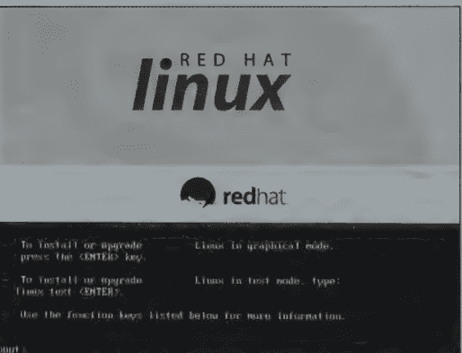

你将看到类似这样的提示：

`boot:`

你有以下选择。

-   你可以直接按 Enter 键开始正常安装或升级。
-   第二种选择是在启动提示符下输入单词 `linux text` 或仅输入 `text`，以便在安装或升级期间使用基于文本的菜单。


如果你计划执行无需用户交互的无人值守安装，也可以在 `boot:` 提示符下输入 `linux ks`。这允许安装程序使用一种名为 Kickstart 模式的安装方式。这是一种非常高级的模式，要求你创建一个名为 `ks` 的自定义配置文件并保存到启动软盘上，或者在 bootp 服务器中保留一个名为 `<被安装机器的IP地址>-kickstart` 的文件。

当你按回车键开始默认安装时，Red Hat 将使用基于 X Windows 系统的安装过程。由于此安装过程的成功在很大程度上取决于你用于服务器系统的显卡和显示器的质量，我不推荐将此方法用于服务器安装或升级任务。据我所知，大多数人在通常被锁定在机架或服务器机房中的服务器系统上，并不会使用高端显卡或显示器。此外，在许多我测试过的服务器上，多次默认安装都检测到了非常低、无法使用的分辨率。

假设这是你第一次安装 Red Hat Linux 服务器，推荐的选项是在引导提示符下输入 `text` 来启动安装过程。本章将使用文本模式。请注意，图形模式和文本模式之间的区别在于易用性，而非功能性。在文本模式下你可以完成在图形模式下能做的所有工作。

#### 理解安装程序的工作原理

安装程序使用简单的按键进行导航。你可以使用向上箭头、向下箭头、Tab 键、空格键和回车键来完成几乎所有工作。你还可以访问四个虚拟控制台，可以通过 Alt+F1 到 Alt+F4 键进行选择。默认的虚拟控制台（Alt+F1）显示实际的安装对话框窗口，第二个控制台（Alt+F2）提供一个 shell 提示符，你可以在此输入命令，第三个控制台（Alt+F3）显示持续进行的安装日志消息，第四个控制台（Alt+F4）显示内核消息。

#### 安装程序入门

一旦你选择了文本模式进行安装，你将看到一个媒体测试屏幕。你将被要求测试你的 Red Hat CD 是否存在介质错误。通过在安装前预先测试介质，你在漫长的安装过程中遇到介质错误的机会会减少。所以我建议你至少进行一次介质测试，以确保你的 CD 状况良好。只需选择“确定”开始测试，或点击“跳过”以避免测试你的介质。接下来你将看到一个欢迎屏幕；点击“确定”开始安装过程。

##### 选择语言、键盘、鼠标和安装方法

当你过了初始问候页面后，你将被要求选择用于安装的语言，如图 2-2 所示。默认是英语。

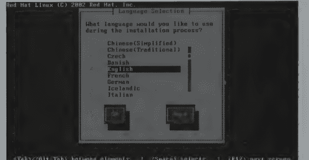

图 2-2：语言选择屏幕

选择合适的语言并按回车键继续。下一个屏幕，如图 2-3 所示，要求你选择键盘类型。

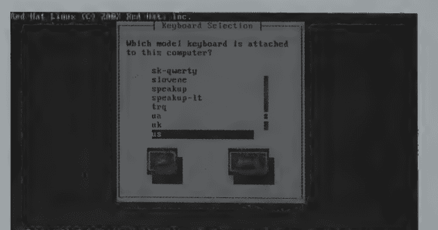

图 2-3：键盘选择屏幕

默认是英语。你可以按回车键或选择合适的键盘类型并继续。再次按回车键继续。

如果你计划在系统中使用鼠标，你可以选择一种鼠标类型，如图 2-4 所示，然后继续。

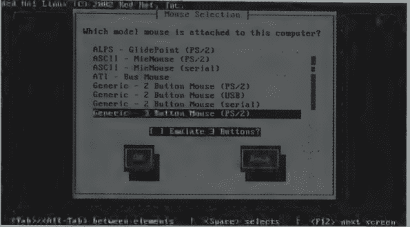

图 2-4：鼠标配置屏幕

##### 选择安装类型

接下来，安装程序为你提供几个安装选项：个人桌面、工作站、服务器系统、笔记本电脑、自定义系统和升级现有安装，如图 2-5 所示。

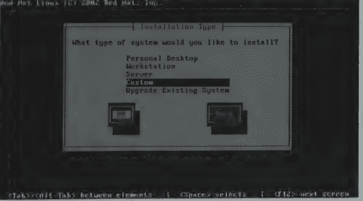

图 2-5：安装选项屏幕

如果你计划将 Red Hat Linux 系统用作个人工作站计算机，可以选择工作站类别。此选项允许安装程序删除你所有现有的 Linux 分区，并使用整个未分区的磁盘空间来创建一个预配置的系统。工作站类别系统通常有一个较小的交换分区（32MB）和一个名为 `/boot` 的 16MB 分区，用于存放内核和相关文件。其余的未分区磁盘空间用于创建一个单一的 `/`（根）分区。通常，工作站类别安装至少需要 600MB 的磁盘空间。

第二个选项是服务器类别。此选项适用于创建服务器系统。它使用 64MB 的交换分区、一个 16MB 的 `/boot` 分区（用于内核和相关文件）、一个 256MB 的 `/`（根）分区、一个 512MB 或更大的 `/usr` 分区（用于存储常用应用程序和实用程序）、一个 512MB 或更大的 `/home` 分区（用于用户主目录）和一个 256MB 的 `/var` 分区（用于系统日志和队列）。这样的系统大约需要 1.6GB 的磁盘空间。

第三个选择是自定义类别。此选项使你能够使用分区工具选择任何你想要的分区方案，因此此选项最为灵活。我在这里使用此选项。

选择自定义类别选项后，安装程序将要求你设置磁盘。

#### 对磁盘进行分区

对磁盘进行分区是一个非常重要的步骤，因为你无法在不丢失数据的情况下安全地更改磁盘分区。所以请非常小心此步骤。安装程序显示如图 2-6 所示的屏幕。

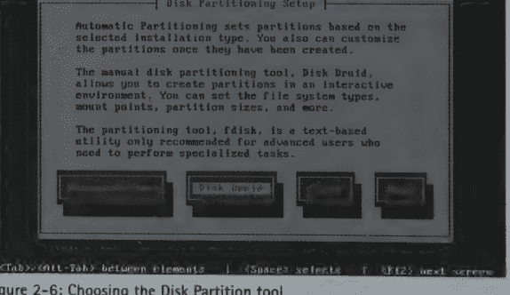

这里你被要求选择一个磁盘分区工具。你有三个选择：你可以选择 Disk Druid、老牌的 fdisk 程序，或者允许安装程序自动进行必要的分区。

Disk Druid 分区工具比 fdisk 程序更用户友好，所以我向初学者推荐它。一旦你选择了此工具，你当前的磁盘分区将被显示。图 2-7 显示了当前我系统磁盘分区的示例屏幕。

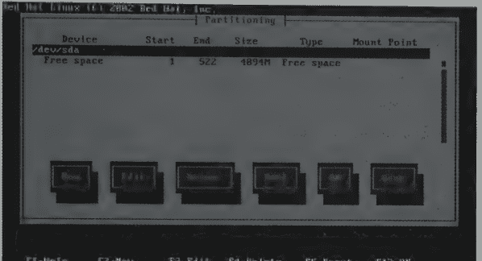

图 2-7：Disk Druid 屏幕

如果你有之前操作系统（如 Microsoft Windows XP/2002/NT）的分区，你可以在此删除这些分区，或者你可以使用未使用的分区来创建双启动的 Red Hat Linux 系统。因为本书以服务器安装为例，假设你只想拥有 Linux 分区。

Red Hat Linux 允许你对每个磁盘进行分区，每个分区使用 `hd[a-z][N]` 方案（针对 IDE 硬盘）和 `sd[a-z][N]` 方案（针对 SCSI 磁盘）进行标记。这里 *N* 是分区号。例如，`hda1` 是第一个 IDE 硬盘 `hda` 上的分区 1，`sda1` 是第一个 SCSI 磁盘的第一个分区。你必须决定如何对你的磁盘进行分区。以下是一些要点。

你需要一个 `/`（根）分区来存储你的内核和相关文件。此分区不需要很大。事实上，根据前面讨论的 Red Hat 服务器类别规范，你可以将其设置得小至 256MB。确保你为根分区选择 Linux native 作为分区类型。

一旦你决定了 `/`（根）分区的大小，你需要决定 `/usr` 分区的大小。这是你所有应用程序所在的位置，因此请确保此分区相当大。你的 `/usr` 分区应至少占用 512MB。确保你为 `/usr` 分区选择 Linux native 作为分区类型。

接下来，你需要为用户主目录创建一个 `/home` 分区。如果你有很多用户，你应该决定你想为每个用户分配多少空间，乘以你预期的用户总数，并创建一个合适的分区。请注意，你可以在以后通过添加磁盘配额支持来强制执行用户的磁盘使用限制。详见第 6 章。请注意，与 `/` 目录或 `/usr` 目录不同，你可以选择将你的用户主分区命名为任何你想要的名字。例如，如果你正在创建一个 Web 服务器，你想为一个名为 `/www` 的分区存放所有用户网站，你也可以将用户主目录放在同一个分区下。换句话说，你并不局限于将分区命名为 `/home`。如果你为用户主分区使用了 `/home` 以外的名称，请确保你更新了

useradd、userdel、usermod 及相关程序所需的配置文件（详见第 6 章）。请确保你为 home 目录分区选择了 Linux native 作为分区类型。

接下来，创建一个交换分区（分区类型为 Linux swap），使其大小不超过物理内存的两倍或 128MB，以较小者为准。例如，如果你的内存为 32MB，可以创建一个 64MB 的交换分区。

如果你还有剩余的磁盘或磁盘空间，可以随意添加任意数量的额外分区。完成分区创建和挂载点分配后，你可以单击"确定"继续下一步。

虽然我不推荐初学者使用 fdisk 程序，但如果你选择了 fdisk 而不是 Disk Druid，你会看到一个显示系统中所有可用硬盘的屏幕，如图 2-8 所示。

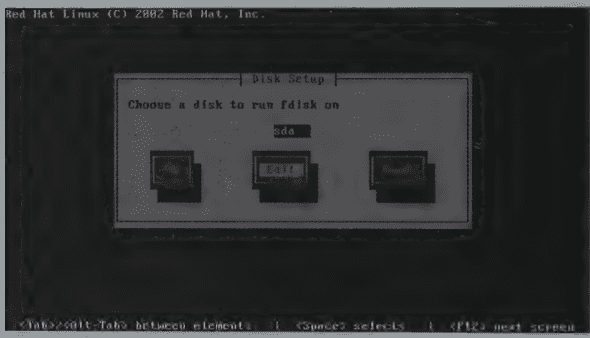

在这里，你可以选择要使用 fdisk 程序进行分区的硬盘。当你选择一个硬盘并单击"编辑"后，你会看到如图 2-9 所示的屏幕。

fdisk 程序一次只能处理一个磁盘，虽然它提供的用户界面简单而不花哨，但实际上它比 Disk Druid 工具灵活得多。虽然我不推荐初学者使用 fdisk，但了解 fdisk 的工作方式是值得的，以便你在日后能够使用它。这里我讨论一些 fdisk 基础知识；如果你现在更关心完成安装而不是学习 fdisk，可以跳过本节的剩余部分，直接进入下一节。

如图 2-9 所示，fdisk 具有简单的、面向命令行提示符的界面。它也是安装 Red Hat Linux 后默认的分区工具。你可以在命令行中使用以下语法运行 fdisk：

## 第 2 章：安装与基本配置


```
fdisk 硬盘设备
```

例如：

```
fdisk /dev/sda
```

此命令告诉 fdisk 你要对第一个 SCSI 磁盘的分区进行操作。输入命令后，fdisk 会显示其命令提示符 `Command (m for help):`，你可以输入 `m` 来获取如下帮助屏幕：

+   命令操作
- **a** 切换可引导标志
- **b** 编辑 bsd 磁盘标签
- **c** 切换 dos 兼容性标志
- **d** 删除分区
- **l** 列出已知分区类型
- **m** 打印此菜单
- **n** 添加新分区
- **o** 创建新的空 DOS 分区表
- **p** 打印分区表
- **q** 不保存更改退出
- **t** 更改分区的系统 ID
- **u** 更改显示/输入单位
- **v** 验证分区表
- **w** 将表写入磁盘并退出
- **x** 附加功能（仅限专家使用）

要查看所选磁盘上的现有分区，请输入 `p`，它将以如下表格格式显示你所有当前分区：

```
Disk /dev/sda: 33 heads, 63 sectors, 1014 cylinders
Units = cylinders of 2079 * 512 bytes

   Device Boot      Start        End   Blocks   Id  System
/dev/sda1               1        505   524916   83  Linux native
/dev/sda2             506       1014   529105+   5  Extended
/dev/sda5             506        886   396018   83  Linux native
/dev/sda6             887       1011   129906   82  Linux swap
```

如上所示，/dev/sda 磁盘已被分为四个分区，其中第一个分区是 /dev/sda1，它从块 1 开始，到块 505 结束。每个块为 1,024 字节，即 1KB。因此，第一个分区 /dev/sda1 包含 524,916 个块，即 524,916KB，大约为 512MB。

要逐个删除所有现有分区，请使用 `d` 命令并输入要删除的分区编号。删除一个或多个分区后，你可以按照以下步骤创建新分区。

首先，如下所示输入 `n` 来添加新分区：

```
Command (m for help): n
Command action
   e   extended
   p   primary partition (1-4)
```

然后你会得到如代码所示的两个选择。你可以创建扩展分区或主分区。只有当你需要创建超过四个分区时才需要扩展分区。因为在 Linux 下启动只需要 /、/usr、/home 和一个交换分区，所以你不需要创建扩展分区。因此，在提示符处输入 `p` 来创建主分区。下一个提示要求你选择分区编号：

```
Partition number (1-4): 1
```

输入 1 表示第一个分区，2 表示第二个分区，依此类推。下一个提示要求你选择起始块编号。括号中显示的范围是可用于分区的总块数。如果这是第一个分区，你可以选择 1 作为起始块，如下所示：

```
First cylinder (1-1014): 1
```

要创建一个 512MB 的分区，你可以输入字节、千字节或兆字节的大小。因为以兆字节为单位的值比较容易处理，所以我选择了 +512M 作为最后一个柱面，如下所示：

```
Last cylinder or +size or +sizeM or +sizeK ([1]-1014): +512M
```

现在，要查看分区是否已按要求创建，请使用 `p` 命令查看分区信息：

```
Disk /dev/sda: 33 heads, 63 sectors, 1014 cylinders
Units = cylinders of 2079 * 512 bytes

   Device Boot      Start     End   Blocks  Id System
/dev/sda1               1     505   524916  83 Linux native
```

如上所示，第一个分区已按要求创建。默认分区类型为 Linux native；如果你想更改此设置，请使用 `t` 命令来切换分区的系统 ID 标志。例如，要将分区的系统 ID 标志切换为 Linux swap，你可以使用以下命令：

```
Command (m for help): t
Partition number (1-4): 1
Hex code (type L to list codes): 82
Changed system type of partition 1 to 82 (Linux swap)
```

```
Command (m for help): p
```

```
Disk /dev/sda: 33 heads, 63 sectors, 1014 cylinders
Units = cylinders of 2079 * 512 bytes

   Device Boot      Start     End   Blocks  Id System
/dev/sda1               1     505   524916  82 Linux swap
```

如上所示，在这段代码中，我首先输入 `t` 命令来切换分区的系统 ID，然后选择了分区并输入 82 作为交换分区类型。你可以使用 `l` 命令列出所有可用的分区类型。

请注意，如果你使用 fdisk 创建分区，必须将一个 Linux native 分区设置为可引导。例如，要将 /dev/sda1 设置为可引导分区，你需要切换引导标志。在提示符处，你可以输入以下内容：

```
Command (m for help): a
Partition number (1-6): 1
```

现在，如果你使用 `p` 命令显示现有分区表，你会看到以下内容：

```
Disk /dev/sda: 33 heads, 63 sectors, 1014 cylinders
Units = cylinders of 2079 * 512 bytes

Device    Boot    Start    End    Blocks    Id    System
/dev/sda1    *        1    505    524916    83    Linux native
/dev/sda2            506   1014   529105+    5    Extended
/dev/sda5            506    886   396018    83    Linux native
/dev/sda6            887   1011   129906    82    Linux swap
```

如上所示，/dev/sda1 在 Boot 列中显示 `*`，表明该分区是可引导的。

创建必要的分区后，使用 `v` 命令验证分区方案，并使用 `w` 命令将分区写入磁盘，然后你可以在下一个屏幕中为这些分区分配挂载点，并选择文件系统类型和格式化选项（参见图 2-10）。

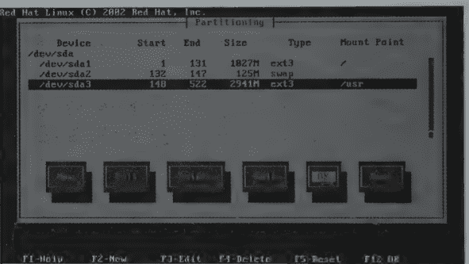

#### 选择引导加载程序配置选项

如图 2-11 所示，你可以安装 LILO 或 GRUB 作为引导加载程序。在没有双操作系统的系统上，你不需要引导加载程序。但我强烈建议你使用 GRUB 作为引导加载程序，因为它更易于配置，并且可以让你非常方便地试用较新的内核。本书中我使用的就是这个引导加载程序。


#### 图 2-11：选择引导加载程序

接下来，您将看到一个类似于图 2-12 的屏幕。

#### 图 2-12：为内核选择引导参数

如果您的系统有特殊硬件，需要在启动时传递特殊的内核参数，您可以在此处输入它们。大多数系统不需要这样的引导参数，因此您可以直接点击“确定”按钮，无需输入任何内容。

您可以保护 GRUB 引导加载程序配置，使其在启动过程中无法被更改以加载不同的操作系统或提供额外的内核引导参数。如果您希望在启动时具有这种保护，需要在图 2-13 所示的下一个屏幕中提供密码。

#### 图 2-13：保护 GRUB

接下来，您需要选择希望由引导加载程序管理的可引导分区。默认的可引导 Red Hat Linux 分区用一个特殊字符标记，如图 2-14 所示。

#### 图 2-14：默认操作系统

此分区被赋予默认引导标签 Red Hat Linux。换句话说，当引导加载程序 GRUB 在启动过程中启动时，它会在 `boot:` 提示符处允许您选择 Red Hat Linux 来启动 Red Hat Linux。如果您的系统上有另一个操作系统，您可以选择其所在分区并为其创建引导标签。选择相关分区并选择编辑条目。

输入适当的引导标签名称，以便轻松识别操作系统。完成编辑引导标签后，选择“确定”按钮继续。

引导加载程序位于主引导记录或引导分区的第一个扇区中，如图 2-15 所示。

#### 图 2-15：引导加载程序配置

如果您没有安装其他操作系统，可以选择主引导记录。另一方面，如果您安装了 Windows NT 操作系统并希望保持其运行，则必须选择引导分区的第一个扇区。

#### 配置服务器的网络身份

接下来，安装程序要求您配置以太网接口设备，例如 eth0（如果有的话）。因为您在本书中配置的是服务器，我假设您至少有一个名为 eth0 的网络接口。

由于服务器通常使用静态 IP 地址并分配主机名运行，您应该取消选中“使用 DHCP 配置”选项，并保持“启动时激活”选项启用，如图 2-16 所示。

#### 图 2-16：配置网络接口卡

输入 IP 地址、网络掩码、网络地址、广播地址、主机名、网关名称或 IP 地址、DNS 域名服务器 IP 地址，以正确设置网络接口。

接下来，您将被要求输入系统的主机名，如图 2-17 所示。

#### 图 2-17：配置主机名

#### 选择防火墙配置

接下来，程序要求您配置防火墙支持，如图 2-18 所示。选择“自定义”选项。

#### 图 2-18：配置防火墙配置

仅选择您希望服务器允许提供服务的服务。图 2-19 显示示例服务器将允许 SSH、HTTP 和 FTP 流量。

#### 图 2-19：配置防火墙配置（续）

#### 配置语言支持

接下来，您被要求配置默认语言以及您希望在系统中保留的任何其他附加语言支持，如图 2-20 所示。

#### 图 2-20：配置语言支持选项

#### 配置时区

接下来，您被要求配置时区，如图 2-21 所示。

如果您的（CMOS）硬件时钟具有内置 UTC 支持，请选中该选项。然后，通过单击地图或从列表中选择最近的城市，为您的服务器选择适当的时区区域。

#### 图 2-21：配置时区

#### 设置 root 密码

root 帐户是 Red Hat Linux 系统上的默认超级用户帐户。您使用此帐户登录到您的新系统。图 2-22 显示了 root 密码输入对话框。

#### 图 2-22：设置 root 用户密码

为此帐户选择一个密码。出于安全原因，您必须输入此密码两次，并且屏幕上不会显示密码。因此，请确保您知道自己输入的密码是什么！此外，不要忘记选择一个好密码。好密码是不容易被猜测或破解的密码。切勿在密码中使用字典单词；始终在密码中使用一个或多个标点字符和数字。同时确保您使用一个长密码——通常，五个到八个字符的长度都是可以接受的。

您也可以在下一步中创建可选的用户帐户，如图 2-23 所示。

#### 图 2-23：设置用户帐户

您可以在此处创建一个或多个用户。因为您始终可以稍后使用 `useradd` 程序创建用户帐户，所以您也可以跳过此步骤。单击“确定”继续。

#### 配置用户认证方法

默认情况下，Red Hat 使用 MD5 和 shadow 密码进行用户身份验证。通常，除非您运行网络信息系统（NIS）、轻量级目录访问协议（LDAP）服务器或 Kerberos 身份验证服务器，否则您不需要更改此方法。如果您的网络上运行这些类型的外部身份验证服务器系统，请选择相应的选项以使 Red Hat Linux 能够通过首选方法对用户进行身份验证。在大多数情况下，您可以使用默认选择，如图 2-24 所示，然后进入下一步。

#### 选择要安装的软件

接下来，安装程序要求您选择软件包，如图 2-25 所示。

#### 图 2-25：选择要安装的软件包

对于服务器安装，请选择与服务器相关的组件；将所有内容都安装在服务器上不是一个好主意，因为服务器上的程序越多，它们可能创建的安全漏洞就越多。我建议仅安装您需要在服务器上运行的组件。您可以随时使用 `rpm` 命令或基于 X Windows 的包管理器工具 `/usr/bin/redhat-config-packages`（参见第 22 章）添加或删除组件。

> **注意**
> 服务器不需要运行 X Windows 系统，因此您不应安装任何 X Windows 软件，除非您好奇并只想看看它是如何工作的。在此示例安装过程中，我假设您不安装 X Windows。有关如何稍后安装 X Windows 系统的详细信息，请参见第 21 章。

如果您希望选择组件类别中的单个软件包，请选择“选择单个软件包”选项。当您单击“下一步”按钮时，您将看到另一个屏幕，如图 2-26 所示。

#### 图 2-26：选择要安装的单个软件包

要选择某个组件（如“应用程序/互联网”）内的软件包，请选择该组件类别并按 Enter 键，这将打开前面图中所示的“选择软件包”对话框。使用空格键选择适当的应用程序。图 2-27 显示我选择了 lynx 工具以包含在“应用程序/互联网”软件包中。

#### 图 2-27：选择要安装的应用程序

在选择所有需要的软件包并取消选择不需要的软件包后，通过单击“确定”继续。如果您选择的一个或多个软件包具有默认情况下未安装的依赖项，您将看到一个依赖冲突通知屏幕，如图 2-28 所示。

#### 图 2-28：依赖冲突通知

您必须选择安装额外的软件包以满足您的选择所施加的依赖要求，或者您可以选择忽略（这不是个好主意）或不安装您选择的软件包。

一旦您做出决定并单击“确定”按钮，安装程序将显示一个类似于图 2-29 所示的屏幕。


#### 2.29：开始安装过程

此屏幕告知你，完整的安装日志将创建在 `/tmp/install.log` 文件中。点击“确定”继续安装。

安装程序会显示一个状态屏幕，如图 2-30 所示。

如果这个状态屏幕不能满足你的好奇心，你可以使用 `Alt+F1` 到 `Alt+F4` 键，通过切换到虚拟控制台来确切查看安装程序正在做什么。所有软件包安装完毕后，安装程序会探测你的系统以查找鼠标。

#### 2.30：安装进行中

#### 跳过 X Windows 系统特定配置

接下来的几个屏幕会询问你关于显示器、显卡、屏幕分辨率等问题，这些是 X Windows 系统的特定配置。我建议你接受默认设置，并跳过安装程序的任何探测请求。

#### 创建自定义启动盘

安装程序会询问你是否要创建自定义启动盘，如图 2-31 所示。

#### 2.31：启动盘提示

创建启动盘应该是强制性的，因为自定义启动盘是必备的。它使你即使在启动加载程序（如 LILO）无法启动系统时，也能启动系统。你不应该犹豫是否创建此磁盘。请使用全新的空白软盘来创建启动盘。此启动盘可与你使用 `rescue.img` 镜像创建的救援磁盘配合使用。请注意，如果你因为手头没有软盘而决定不创建自定义启动盘，请确保稍后使用 `mkbootdisk` 程序创建它。如果一切顺利，安装程序将以祝贺消息结束，如图 2-32 所示。

现在你准备好第一次重启系统了。从驱动器中取出 CD-ROM 和任何软盘，然后点击“确定”重启。

#### 第一次启动 Red Hat Linux

如果你安装了 GRUB 或 LILO 作为启动加载程序，系统将重启并显示启动提示符。图 2-33 显示了一个以 GRUB 作为启动加载程序的系统。

在此情况下，系统上只安装了一个操作系统，因此你可以通过按回车键或等待提示符超时自动启动来立即启动它。

如果你安装了 LILO 作为启动加载程序，你可以输入 `linux` 或按回车键来第一次启动 Red Hat Linux（如果它是你的默认操作系统）。当然，如果你忘记执行任何操作，也没关系！LILO 很快会超时并启动默认操作系统——就是那个经典的 Linux！

如果你使用了基于 X Windows 的安装并在安装过程中选择了启动 X Windows（图形启动选项），你的系统将启动到 X Windows，一旦你登录，你会被要求设置一些系统配置，例如系统时间、时区等。

一旦 Linux 内核开始启动，你会看到大量的信息快速掠过。如果信息滚动太快而无法阅读，请不要绝望。你很快就能访问所有这些信息。请耐心等待，让系统在控制台上显示登录提示符。

一旦显示登录提示符，使用你在安装过程中输入的密码以 `root` 用户身份登录。你应该以 root 身份登录系统。恭喜！你刚刚成为了自己 Red Hat Linux 服务器的超级用户。你的 Linux 系统正等待你的指令。

如果你想看看启动过程中飞速掠过的是什么，可以运行 `dmesg` 命令查看启动消息。如果屏幕滚动太快，请使用 `dmesg | more` 来一次查看一页。

现在是确保内核正确检测到你硬件的好时机。阅读 `dmesg` 程序的输出以了解情况。现在，你已准备好将你的新 Red Hat Linux 系统转变为一个功能完备的互联网服务器。

#### 总结

在本章中，你学习了如何在你的计算机上安装 Red Hat Linux。我提供了分步指南，以帮助你尽可能轻松地安装这个优秀的操作系统。安装 Red Hat Linux 系统的方法有很多，但最轻松的方法是使用本地 CD-ROM 和启动盘。我建议你尝试简单的方法，因为在安装操作系统时卡住并不有趣。希望你现在已准备好并可以继续阅读本书的其余部分。

## 第三章：Red Hat 网络

**本章内容：**

-   成为 Red Hat 网络的注册用户
-   登录 Red Hat 网络
-   配置 Red Hat 更新代理
-   运行 Red Hat 更新代理

Red Hat 网络是 Red Hat Linux 的支持和管理服务。它主要向付费客户（那些购买了 CD-ROM 版 Red Hat Linux 软件包的用户）提供这些服务，他们希望更新软件并付费从 Red Hat 获得支持。Red Hat 为每位客户提供对单台机器的软件管理器服务的免费访问。

#### 使用 Red Hat 更新代理进行更新

Red Hat 更新代理是一个使用 Red Hat 网络来查找系统中哪些软件包需要更新，然后自动更新它们的工具。要使用 Red Hat 更新代理，你首先需要成为 Red Hat 网络的注册用户，这个过程我将在下一节中描述。

> 你可以使用基于文本的工具与 Red Hat 网络交互。然而，我使用的最新版 Red Hat 8 中，Red Hat 网络更新代理工具的文本版本无法正常工作，因此我决定使用基于 X Windows 的 Red Hat 网络工具来讨论 Red Hat 网络。这两种版本（基于文本、基于 X Windows）的工具实现相同的功能。

#### 成为 Red Hat 网络的注册用户

要注册单机免费试用会员，请按照以下步骤操作：

1.  在 GUI 环境中从 xterm 运行 `rhn_register` 命令，或从命令 shell 运行。（在本节中，我假设你使用的是 GNOME 桌面环境。）图 3-1 显示了此程序在 GNOME 中显示的第一个窗口。

    ## 3-1：介绍屏幕

2.  点击“下一步”按钮继续。你需要查阅 Red Hat 隐私声明，如图 3-2 所示。阅读该政策。如果你同意该政策，请再次点击“下一步”按钮继续。

3.  接下来会询问你是注册还是更新现有的 Red Hat 网络账户，如图 3-3 所示。按要求输入信息，然后点击“下一步”继续。

4.  然后你会被问到更多问题，如图 3-4 所示。填写此信息并点击“下一步”继续。

    ## 3-2：Red Hat 隐私声明
    ## 3-3：注册或更新用户账户（第 1 步）
    ## 3-4：注册或更新用户账户（第 2 步）

5.  接下来你会被要求注册你的系统硬件配置文件。如果你不想向 Red Hat 提供此信息，请取消选中“包含硬件和网络信息”复选框。如果你想包含已安装软件包信息，请保持“包含 RPM 软件包”复选框选中状态，如图 3-5 所示。点击“下一步”继续。

    ## 3-5：注册或更新用户账户（第 3 步）

6.  如果你想将系统配置文件（硬件和已安装软件包信息）发送到 Red Hat 网络，请在确认屏幕上点击“下一步”按钮。成功注册后，你将看到如图 3-6 所示的状态消息。

    ## 3-6：成功注册确认

#### 登录 Red Hat 网络

在你能做任何事情（例如检查系统的更新软件包）之前，你必须登录 Red Hat 网络。
方法如下：

1.  使用你注册的 Red Hat 网络用户账户信息登录 `https://rhn.redhat.com`。

2.  检查你的系统是否已添加到系统列表中。如果你的系统不在列表中，请通过可用的添加系统链接添加它。如果它已经在列表中，你就可以使用 RHN 了。

#### 配置 Red Hat 更新代理

从 GNOME 主菜单中，选择“系统工具” → “Red Hat 网络”选项来配置 Red Hat 更新代理。将出现一个类似图 3-7 的窗口。


**图 3-7：配置常规信息**

你可以在“常规”选项卡上配置网络设置。如果需要通过 HTTP 代理访问红帽网络，可以在此指定代理服务器的名称和端口号。选中“使用身份验证”复选框，并输入你注册的用户名和密码，以便代理程序能够向红帽网络服务器进行身份验证。

点击“检索/安装”选项卡，你将看到如图 3-8 所示的界面。

**图 3-8：配置检索和安装**

如果你不希望在检索软件包后自动安装它们，可以在此禁用该功能。同样，如果你希望在可用时随二进制软件包一起检索源 RPM 软件包，也可以在此启用该选项。

默认情况下，二进制 RPM 软件包文件安装后不会被保存；如果你想保留它们，请在“软件包安装选项”部分启用此选项。请确保保持 GNU 隐私保护（GPG/GnuPG）软件包验证选项处于开启状态。你还可以指定用于存放软件包的目录名称。对于大多数用户来说，默认设置应该没问题。

点击“软件包例外”选项卡，查看如图 3-9 所示的界面。

**图 3-9：配置软件包例外**

如果你担心自动更新某些可能非常敏感的软件包，或者你只是觉得让更新代理自动更新某些东西不太放心，你可以将特定的软件包添加到例外列表中。默认情况下，任何内核软件包都被视为例外。毕竟，如果内核更新后开始表现异常，你可能无法访问你的系统。

#### 运行红帽更新代理

要从 GNOME 环境运行红帽更新代理，请点击主菜单按钮并选择系统工具 → 红帽网络。

当你首次运行更新代理时，它会提示你的 GPG 密钥环中没有红帽公共密钥，因此需要添加。你可以点击“是”立即添加。接下来你会看到一个欢迎屏幕，如图 3-10 所示。

**图 3-10：更新代理欢迎屏幕**

点击“下一步”继续。更新代理会显示可供你使用的频道，如图 3-11 所示。

**图 3-11：可用的频道**

点击“下一步”按钮后，更新代理将下载所选频道的软件包头信息，以便你选择并安装可用的更新软件包。你已排除在自动更新之外的软件包将显示在类似图 3-12 的界面中。

**图 3-12：更新代理显示已排除的软件包**

你可以点击“下一步”按钮查看可供更新的软件包。如果你想查看显示的任何软件包的公告，请选择该软件包并点击“查看公告”按钮。一个公告示例如图 3-13 所示。

根据公告的严重程度，你可能决定更新该软件包，或者选择跳过它。你还可以通过选中“选择所有软件包”复选框来决定将所有软件包都包含在例外列表中。安装程序会检索需要更新的软件包，如图 3-14 所示。

更新完成后，你会看到“全部完成”的消息，如图 3-15 所示。

**图 3-13：更新代理显示软件包的公告**

**图 3-14：更新代理正在检索软件包**

**图 3-15：全部完成！**

#### 总结

在本章中，你学习了如何为红帽网络配置你的系统。红帽网络允许订阅者自动更新系统组件，这为忙碌的系统管理员节省了大量时间和麻烦。

红帽网络仅对单个系统免费。拥有大量红帽 Linux 服务器的组织通过订阅它将受益匪浅。

# 第二部分

# 以超级用户身份工作

# 第 4 章

# 启动和关闭流程

#### 本章内容

- 如何配置 init
- 如何启动 Linux
- 如何关闭 Linux
- 如何管理 init 文件

当我最初开始使用 Linux（那时还没有红帽 Linux）时，我最喜欢 Linux 的第一件事就是启动过程。我厌倦了等待我的 Windows 电脑经历那些彩色的 logo 屏幕和令人畏惧的蓝屏，却不知道发生了什么。当 Windows 电脑启动失败时，你必须戴上你的福尔摩斯帽子，从头开始调查原因。然而，当 Linux 电脑启动失败时，你很可能知道它卡在哪里了，因为操作系统在启动时几乎会在控制台上显示它执行的所有任务。关闭过程也是如此。在第 2 章中，你学习了 Linux 内核如何从软盘或硬盘启动。在这里，你将学习如何自定义启动和关闭流程。

一个红帽 Linux 内核（即核心操作系统）通常存储在一个压缩文件中。当内核由 GRUB 或 LILO 等引导加载程序启动时，它会解压自身，初始化显示设备，并开始检查连接到你计算机的其他硬件。当它找到你的硬盘、软盘驱动器、网卡等时，会加载相应的设备驱动程序模块。在此过程中，它会在你的控制台屏幕上打印文本消息。清单 4-1 显示了我的红帽 8.0 系统在启动期间显示的内容的简化版本。

**清单 4-1：启动过程中的控制台消息**

```
Linux version 2.5.2 (bhcompile@stripples.redhat.com) (gcc version 2.96 20020731
(Red Hat Linux 8.0)) #1 Thu Feb 7 17:27:27 EDT 2002
Kernel command line: ro root=/dev/hda1
Initializing CPU#0
Detected 733.365 MHz processor.
Console: colour VGA+ 80x25
Calibrating delay loop... 1464.72 BogoMIPS
Memory: 125264k/131072k available (1269k kernel code, 4524k reserved, 90k data, 220k init, 0k highmem)
Dentry-cache hash table entries: 16384 (order: 5, 131072 bytes)
Inode-cache hash table entries: 8192 (order: 4, 65536 bytes)
Mount-cache hash table entries: 2048 (order: 2, 16384 bytes)
Buffer-cache hash table entries: 8192 (order: 3, 32768 bytes)
Page-cache hash table entries: 32768 (order: 6, 262144 bytes)
CPU: Before vendor init, caps: 0387f9ff 00000000 00000000, vendor = 0
CPU: L1 I cache: 16K, L1 D cache: 16K
CPU: L2 cache: 256K
Intel machine check architecture supported.
Intel machine check reporting enabled on CPU#0.
CPU: Intel Pentium III (Coppermine) stepping 06
Enabling fast FPU save and restore... done.
Enabling unmasked SIMD FPU exception support... done.
Checking 'hlt' instruction... OK.
POSIX conformance testing by UNIFIX
mtrr: v1.40 (20010327) Richard Gooch (rgooch@atnf.csiro.au)
mtrr: detected mtrr type: Intel
PCI: Probing PCI hardware
Unknown bridge resource 2: assuming transparent
PCI: Using IRQ router PIIX [8086/7110] at 00:07.0
Limiting direct PCI/PCI transfers.
isapnp: Scanning for PnP cards...
Linux NET4.0 for Linux 2.4
Based upon Swansea University Computer Society NET3.039
Initializing RT netlink socket
VFS: Diskquotas version dquot_6.5.0 initialized
Detected PS/2 Mouse Port.
pty: 2048 Unix98 ptys configured
Serial driver version 5.05c (2001-07-08) with MANY_PORTS MULTIPORT SHARE_IRQ
SERIAL_PCI ISAPNP enabled
ttyS00 at 0x03f8 (irq = 4) is a 16550A
ttyS01 at 0x02f8 (irq = 3) is a 16550A
Real Time Clock Driver v1.10d
block: queued sectors max/low 83130kB/27710kB, 256 slots per queue
RAMDISK driver initialized: 16 RAM disks of 4096K size 1024 blocksize
Uniform Multi-Platform E-IDE driver Revision: 6.31
ide: Assuming 33MHz PCI bus speed for PIO modes; override with idebus=xx
PIIX4: IDE controller on PCI bus 00 dev 39
PIIX4: chipset revision 1
```


#### 配置 init

如前所述，init 是内核在启动序列结束时运行的第一个程序。init 程序有两种风格：一种是 UNIX System V 风格的 init，另一种是 BSD 风格的 init。Red Hat 发行版使用的是 UNIX System V 风格的 init。两种风格的区别在于 System V 风格的 init 使用运行级别（本节稍后讨论），而 BSD 风格的 init 不使用。因此，所有关于 init 的讨论将仅限于 UNIX System V 风格的 init。

由于 init 是内核运行的第一个程序，其进程 ID（PID）为 1。启动时，init 会读取一个名为 `/etc/inittab` 的配置文件。典型的 Red Hat Linux 系统中的 `/etc/inittab` 文件如清单 4-2 所示。

#### 清单 4-2：典型的 /etc/inittab 文件

```
#
# inittab - This file describes how the INIT process should
#           set up the system in a certain run-level.
#
# Author: Miquel van Smoorenburg,
#         <miquels@drinkel.nl.mugnet.org>
#
# Modified for RHS Linux by Marc Ewing and Donnie Barnes
#

# Default runlevel. The runlevels used by RHS are:
#   0 - halt (Do NOT set initdefault to this)
#   1 - Single-user mode
#   2 - Multi-user, without NFS (The same as 3, if you
#                               do not have networking)
#   3 - Full multi-user mode
#   4 - unused
#   5 - X11
#   6 - reboot (Do NOT set initdefault to this)
#
id:3:initdefault:

# System initialization.
si::sysinit:/etc/rc.d/rc.sysinit

l0:0:wait:/etc/rc.d/rc 0
l1:1:wait:/etc/rc.d/rc 1
l2:2:wait:/etc/rc.d/rc 2
l3:3:wait:/etc/rc.d/rc 3
l4:4:wait:/etc/rc.d/rc 4
l5:5:wait:/etc/rc.d/rc 5
l6:6:wait:/etc/rc.d/rc 6

# Things to run in every runlevel.
ud::once:/sbin/update

# Trap CTRL-ALT-DELETE
ca::ctrlaltdel:/sbin/shutdown -t3 -r now

# When our UPS tells us power has failed, assume we have
# a few minutes of power left. Schedule a shutdown for
# 2 minutes from now.
#
# This does, of course, assume you have powerd installed and your
# UPS connected and working correctly.
#
pf::powerfail:/sbin/shutdown -f -h +2 \
"Power Failure; System Shutting Down"

# If power was restored before the shutdown kicked in, cancel it.
pr:12345:powerokwait:/sbin/shutdown -c \
 "Power Restored; Shutdown Cancelled"

# Run gettys in standard runlevels
1:2345:respawn:/sbin/mingetty tty1
2:2345:respawn:/sbin/mingetty tty2
3:2345:respawn:/sbin/mingetty tty3
4:2345:respawn:/sbin/mingetty tty4
5:2345:respawn:/sbin/mingetty tty5
6:2345:respawn:/sbin/mingetty tty6

# Run xdm in runlevel 5
# xdm is now a separate service
x:5:respawn:/usr/bin/X11/prefdm -nodaemon
```

此文件定义了 init 在服务器启动或关闭事件期间的行为方式。让我们仔细看看这个文件。

init 程序会忽略 `/etc/inittab` 文件中的所有空行和注释行（即以 "#" 号开头的行）。包含冒号分隔字段的行是 init 配置行。此类行的语法如下：

```
id:runlevels:action:process [arguments]
```

第一个字段是唯一的标签字段，用于标识文件中的条目。id 可以是两到四个字符长。第二个字段（runlevels）定义此行适用于哪些运行级别。第三个字段定义要执行的操作，最后一个字段（process）定义要运行的进程。你还可以选择性地在第四个字段中为进程指定命令行参数。

如前所述，运行级别指定了系统的状态。九个运行级别如表 4-1 所示。

#### 表 4-1 INIT 的运行级别

| 运行级别 | 描述 |
|-----------|-------------|
| 0 | 停机 — 用于停止系统 |
| 1 | 单用户 — 用于将系统设置为适合单用户的最小配置 |
| 2 | 未使用 |
| 3 | 多用户 — 用于将系统设置为支持多用户的配置 |
| 4 | 未使用 |
| 5 | 用于通过 `/etc/X11/prefdm` 脚本启动 X Windows 系统和 xdm、kdm 或 gdm 程序 |
| 6 | 重启 — 用于重启系统 |
| S 或 s | 在运行级别 1 中运行的脚本内部使用 |
| a、b、c | 按需运行级别 — 通常不使用 |

请注意，你可以在单个 init 配置行中指定多个运行级别。例如，如果你想让 init 在单用户和多用户模式下都运行某个进程，可以指定如下行：

```
id:13:action:process [arguments]
```

表 4-2 显示了可能的操作。

#### 表 4-2 特定运行级别的可能操作

| 操作 | 描述 |
|--------|-------------|
| Respawn | 进程终止后会立即重新启动。 |
| Wait | 进程运行一次，init 将等待其终止。 |
| Once | 进程运行一次。 |
| Boot | 进程在系统启动期间运行，init 忽略运行级别字段。 |


#### /etc/rc.d/rc 脚本

当 init 被告知要切换到七个常用运行级别中的某个级别时，它会运行 `/etc/inittab` 文件中以下某行指定的脚本：

```
10:0:wait:/etc/rc.d/rc 0
11:1:wait:/etc/rc.d/rc 1
12:2:wait:/etc/rc.d/rc 2
13:3:wait:/etc/rc.d/rc 3
14:4:wait:/etc/rc.d/rc 4
15:5:wait:/etc/rc.d/rc 5
16:6:wait:/etc/rc.d/rc 6
```

如你所见，对于每个运行级别（0-6），都会运行一个名为 `/etc/rc.d/rc` 的脚本，并将运行级别作为该脚本的参数。此脚本负责启动和停止所需运行级别的所有服务。例如，假设 init 被告知将运行级别切换到 3。它会在类似以下的命令行中运行 `/etc/rc.d/rc` 脚本，参数为 3：

```
/etc/rc.d/rc 3
```

`/etc/rc.d/rc` 脚本如清单 4-3 所示。

清单 4-3：脚本 /etc/rc.d/rc

```bash
#!/bin/bash
#
# rc		This file is responsible for starting/stopping
#			services when the runlevel changes. It is also
#			responsible for the very first setup of basic
#			things, such as setting the hostname.
#
# Original Author:
#			Miquel van Smoorenburg,
#			<miquels@drinkel.nl.mugnet.org>
#

# Source function library.
. /etc/init.d/functions

# Now find out what the current and what the
# previous runlevel are.
argvl="$1"
set `/sbin/runlevel`
runlevel=$2
previous=$1
export runlevel previous
```

```
# See if we want to be in user confirmation mode
if [ "$previous" = "N" ]; then
    if grep -i confirm /proc/cmdline >/dev/null || [ -f
/var/run/confirm ] ; then
        rm -f /var/run/confirm
        CONFIRM=yes
        echo "Entering interactive startup"
    else
        CONFIRM=
        echo "Entering non-interactive startup"
    fi
fi

# Get first argument. Set new runlevel to this argument.
[ -n "$argv1" ] && runlevel="$argv1"

# Tell linuxconf what runlevel we are in
[ -d /var/run ] && echo "/etc/rc$runlevel.d" > /var/run/runlevel.dir

# Is there an rc directory for this new runlevel?
if [ -d /etc/rc$runlevel.d ]; then
    # First, run the KILL scripts.
    for i in /etc/rc$runlevel.d/K*; do
        # Check if the script is there.
        [ ! -f $i ] && continue

        # Don't run [KS]??foo.{rpmsave,rpmorig} scripts
        [ "${i%.rpmsave}" != "${i}" ] && continue
        [ "${i%.rpmorig}" != "${i}" ] && continue
        [ "${i%.rpmnew}" != "${i}" ] && continue

        # Check if the subsystem is already up.
        subsys=${i#/etc/rc$runlevel.d/K??}
        [ ! -f /var/lock/subsys/$subsys ] && \
            [ ! -f /var/lock/subsys/${subsys}.init ] && continue

        # Bring the subsystem down.
        if egrep -q "(killproc |action )" $i ; then
            $i stop
        else
            action "Stopping $subsys: " $i stop
        fi
    done
```

```
# Now run the START scripts.
for i in /etc/rc$runlevel.d/S*; do
    # Check if the script is there.
    [ ! -f $i ] && continue

    # Don't run [KS]??foo.{rpmsave,rpmorig} scripts
    [ "${i%.rpmsave}" != "${i}" ] && continue
    [ "${i%.rpmorig}" != "${i}" ] && continue
    [ "${i%.rpmnew}" != "${i}" ] && continue

    # Check if the subsystem is already up.
    subsys=${i#/etc/rc$runlevel.d/S??}
    [ -f /var/lock/subsys/$subsys ] || \
        [ -f /var/lock/subsys/${subsys}.init ] && continue

    # If we're in confirmation mode, get user confirmation
    [ -n "$CONFIRM" ] &&
    {
        confirm $subsys
        case $? in
            0)
                :
                ;;
            2)
                CONFIRM=
                ;;
            *)
                continue
                ;;
        esac
    }

    # Bring the subsystem up.
    if egrep -q "(daemon |action )" $i ; then
        $i start
    else
        if [ "$subsys" = "halt" -o "$subsys" = "reboot" -o "$subsys" = "single" -o "$subsys" = "local" ]; then
            $i start
        else
            action "Starting $subsys: " $i start
        fi
    fi
done
fi
```

此脚本主要做三件事：

1.  它检查是否存在与参数中指定的运行级别对应的子目录。换句话说，如果脚本以参数 3 运行，它会检查 `/etc/rc.d/rc3.d/` 目录是否存在。如果存在，脚本将继续执行下一步。

2.  在此步骤中，脚本确定新运行级别中应运行的程序（通常称为服务）是否有任何已经运行。如果服务已在运行，脚本会终止该服务，以便在下一步重启它。要终止正在运行的服务，脚本会运行必要的 K 脚本，并带有 `stop` 参数。

3.  在最后一步，`rc` 脚本运行所有 S 脚本，并带有 `start` 参数。

#### /etc/rc.d/rc[0-6].d 目录

rc0.d 到 rc6.d 子目录用于运行级别 0 到 6。这些目录包含指向 `/etc/rc.d/init.d` 目录中脚本的符号链接。查看我 Red Hat Linux 8.0 系统中的 rc3.d 目录。此目录列出了清单 4-4 所示的符号链接。

清单 4-4：我 Red Hat Linux 系统上 /etc/rc.d/rc3.d 的目录列表

```
lrwxrwxrwx 15 Aug 17 06:18 K01pppoe -> ../init.d/pppoe
lrwxrwxrwx 13 Aug 17 06:15 K20nfs -> ../init.d/nfs
lrwxrwxrwx 15 Aug 17 06:18 K20rwhod -> ../init.d/rwhod
lrwxrwxrwx 13 Aug 22 21:04 K35smb -> ../init.d/smb
lrwxrwxrwx 18 Aug 17 06:03 K45arpwatch -> ../init.d/arpwatch
lrwxrwxrwx 15 Aug 17 06:12 S05kudzu -> ../init.d/kudzu
lrwxrwxrwx 18 Aug 17 06:09 S08ipchains -> ../init.d/ipchains
lrwxrwxrwx 17 Aug 17 06:03 S10network -> ../init.d/network
lrwxrwxrwx 16 Aug 17 06:02 S12syslog -> ../init.d/syslog
lrwxrwxrwx 17 Aug 17 06:16 S13portmap -> ../init.d/portmap
lrwxrwxrwx 17 Aug 17 06:15 S14nfslock -> ../init.d/nfslock
lrwxrwxrwx 14 Aug 17 06:02 S16apmd -> ../init.d/apmd
lrwxrwxrwx 16 Aug 17 06:03 S20random -> ../init.d/random
lrwxrwxrwx 15 Aug 17 06:03 S25netfs -> ../init.d/netfs
lrwxrwxrwx 16 Aug 17 06:16 S35identd -> ../init.d/identd
lrwxrwxrwx 13 Aug 17 06:03 S40atd -> ../init.d/atd
lrwxrwxrwx 15 Aug 17 06:02 S40crond -> ../init.d/crond
lrwxrwxrwx 16 Aug 17 06:12 S45pcmcia -> ../init.d/pcmcia
lrwxrwxrwx 16 Aug 22 20:52 S50xinetd -> ../init.d/xinetd
lrwxrwxrwx 20 Aug 17 06:03 S56rawdevices -> ../init.d/rawdevices
lrwxrwxrwx 13 Aug 17 06:14 S60lpd -> ../init.d/lpd
lrwxrwxrwx 18 Aug 17 06:03 S75keytable -> ../init.d/keytable
```

#### 表 4-2 特定运行级别可能的操作（续）

| 操作 | 描述 |
| --- | --- |
| Bootwait | 该进程在系统启动期间运行，init 等待该进程终止。 |
| Off | 不采取任何操作。你可以使用 `off` 来禁用配置行而不删除它。但是，你也可以直接用 `#` 字符注释掉该行。 |
| Ondemand | 仅当运行级别为 a、b 或 c 时有用。只要 init 被调用并传入这三个按需运行级别中的任何一个，该进程就会运行。通常不使用。 |
| initdefault | 设置系统的默认运行级别。进程字段被忽略。 |
| sysinit | 该进程在系统启动期间运行一次。`sysinit` 操作优先于 `boot` 或 `bootwait` 操作。 |
| powerwait | 当 init 收到 SIGPWR 信号时，该进程运行。通常，不间断电源 (UPS) 监控软件检测到电源问题并向 init 发出此类信号。在这种情况下，init 会等待该进程终止。 |
| powerfail | 与 `powerwait` 相同，但 init 不等待进程完成。 |
| powerokwait | 当 init 收到 SIGPWR 信号且名为 `/etc/powerstatus` 的文本文件包含 "OK" 字符串时，该进程运行。通常，UPS 监控程序创建此文件并向 init 发送 SIGPWR 信号以指示电源问题已修复。 |
| ctrlaltdel | 当 init 收到 SIGINT 信号时，该进程运行。 |
| kbrequest | 当 init 从键盘处理程序收到 KeyboardSignal 时，该进程运行。 |

System V 风格的 init（即 Red Hat Linux 包含的版本）使用以下目录结构：

```
/etc
+-rc.d
  +-init.d (dir)
  +-rc0.d (dir)
  +-rc1.d (dir)
  +-rc2.d (dir)
  +-rc3.d (dir)
  +-rc4.d (dir)
  +-rc5.d (dir)
  +-rc6.d (dir)
  +-rc.sysinit (script)
  +-rc.local (optional script, supplied with Red Hat Linux)
  +-rc.serial (optional script)
  +-rc (script)
```

#### /etc/rc.d/rc.sysinit 脚本

你已经知道，当 Red Hat Linux 系统启动时，内核会运行 init，而 init 随后会在处理所需运行级别的任何其他脚本之前运行 `/etc/rc.d/rc.sysinit` 脚本。它之所以先运行此脚本，是因为 `/etc/inittab` 文件中的以下行：

```
si::sysinit:/etc/rc.d/rc.sysinit
```

请注意，运行级别字段为空，因为 init 识别 `sysinit` 作为系统初始化操作。`rc.sysinit` 脚本完成许多事情，包括设置主机名、启用交换分区、检查文件系统、加载内核模块等。通常，你不需要修改此脚本。

#### /etc/rc.d/init.d 目录

`init.d` 子目录存储所有运行级别所需的所有脚本。将所有脚本保存在一个位置可以更轻松地管理它们。每个脚本启动/停止特定服务——域名服务 (DNS)、Web 服务或类似服务。所有这些脚本都遵循特殊的命令行参数语法。例如，要启动网络文件系统 (NFS) 服务，你可以运行以下脚本：

```
/etc/rc.d/init.d/nfs start
```

要停止同一服务，你可以按如下方式运行相同的脚本：

```
/etc/rc.d/init.d/nfs stop
```


清单 4-4（续）

```
lrwxrwxrwx  14 Aug 17 06:09 S80isdn -> ../init.d/isdn
lrwxrwxrwx  18 Aug 17 06:19 S80sendmail -> ../init.d/sendmail
lrwxrwxrwx  13 Aug 17 06:09 S85gpm -> ../init.d/gpm
lrwxrwxrwx  23 Aug 22 19:53 S90vmware -> /etc/rc.d/init.d/vmware
lrwxrwxrwx  13 Aug 17 06:03 S90xfs -> ../init.d/xfs
lrwxrwxrwx  17 Aug 17 06:02 S95anacron -> ./init.d/anacron
lrwxrwxrwx  19 Aug 17 06:14 S99linuxconf -> /etc/rc.d/linuxconf
lrwxrwxrwx  11 Aug 17 06:03 S99local -> ../rc.local
```

注意，来自 /etc/rc.d/init.d 目录的脚本通过两种方式链接。部分脚本链接为：

```
K{两位数字}{脚本名称}
```

其他脚本链接为：

```
S{两位数字}{脚本名称}
```

所有以字母 K 开头的脚本都以 "stop" 参数运行，而另一种则以 "start" 参数运行。两位数字用于设置执行顺序。因此，名为 S01foo 的脚本会在 S10bar 之前运行。/etc/rc.d/rc 脚本负责运行 S 和 K 脚本。一旦 rc 脚本执行完毕，init 所做的处理也随之完成，系统便在新的运行级别中就绪。

#### /etc/rc.d/rc.local 脚本

rc.local 脚本通常在运行级别 2、3 和 5 的末尾执行一次。你可以将任何需要在每次启动时运行一次的内容添加到此文件中。

#### /etc/rc.d/rc.serial 脚本

与 rc.local 脚本类似，rc.serial 通常在运行级别 1 或 3 的末尾执行一次，用于初始化串行端口。现在让我们看看 init 在系统启动时做了什么。

#### 启动系统

在启动过程中，init 首先运行 rc.sysinit 脚本，然后运行对应默认运行级别的脚本。在 /etc/inittab 中使用如下一行来设置默认运行级别：

```
id:3:initdefault:
```

这里默认运行级别设置为 3。这意味着 init 运行将系统置于多用户模式所需的脚本。

如果你再看一下清单 4-2，你会注意到以下行指定了 `rc` 脚本在运行级别 3 时需要执行的内容。

```
13:3:wait:/etc/rc.d/rc 3
```

`rc` 脚本以参数 3 运行。如前所述，该脚本会运行 `/etc/rc.d/rc3.d` 目录中所有以 "S" 开头的脚本。它还为每个以 "S" 开头的脚本提供 "start" 作为参数。当所有 "S" 脚本运行完毕后，`rc` 脚本结束，系统在默认运行级别中就绪。

**提示** 你可以在 LILO 提示符处覆盖默认运行级别。例如，如果你希望以单用户模式启动系统，请指定 `linux single` 以单用户模式启动。如果你使用的是 `linux` 以外的标签来启动 Linux，则需要指定 `yourlabel single`，其中 `yourlabel` 是相应标签的名称。

现在让我们看看 init 在系统关闭事件期间是如何工作的。

#### 关闭系统

你可以手动运行 init，并通过在命令行中提供所需的运行级别来告诉它更改系统运行级别。例如，

```
init 0
```

告诉 init 将当前运行级别更改为 0。换句话说，这条指令会停止系统。如果你正在多用户模式（运行级别 3）下运行，上面的命令并不理想，因为它不会通知系统上的用户系统即将停止。

通常，`shutdown` 命令用于关闭系统。它会向所有已登录的用户广播一条警告消息，告知系统正在切换运行级别。它还为你提供了安排关闭事件的选项。

`shutdown` 命令通过告诉 init 将系统的当前运行级别更改为停止（0）或重启（6）来工作。例如，

```
shutdown -h now
```

此命令通知立即将运行级别更改为 0（停止）。

#### 取消关闭

`shutdown` 命令允许你安排稍后执行的关闭事件。以下是一个示例：

```
shutdown +10
```

此命令安排在输入命令后恰好 10 分钟执行关闭。如果需要取消关闭事件，你可以使用带 `-c` 选项的另一个 `shutdown` 命令，如下所示：

```
shutdown -c
```

此命令取消任何已安排的关闭事件。

#### 重启服务器

你也可以手动运行 init 来重启服务器。例如：

```
init 6
```

如果你正在多用户模式（运行级别 3）下运行，此命令并非最佳做法，因为它不会通知系统上的用户系统即将重启。相反，你可以使用 `shutdown` 命令来重启服务器。例如：

```
shutdown -r +10
```

此命令在 10 分钟后重启服务器。所有用户都会收到一条消息，告知系统即将重启。这让他们有时间完成工作并保存。

当你使用延迟关闭命令（如上面描述的）时，已登录的用户会看到它广播的警告消息，但在关闭倒计时期间，shutdown 并不会阻止任何人登录。为了防止新的登录，你可以创建一个名为 `/etc/nologin` 的文本文件，其中包含适当的消息，说明已经安排了关闭，应稍后再尝试登录。重启后不要忘记重命名或删除该文件。如果你正在远程重启服务器，请务必在实际关闭之前删除或重命名此文件。当此文件存在时，任何普通用户账户都无法登录。事实上，你可能需要在 `/etc/rc.local` 脚本末尾添加 `rm -f /etc/nologin`，并确保 init 在运行级别 3 结束时执行它。

要立即重启，你可以运行：

```
shutdown -r now
```

#### 使用 Ctrl+Alt+Delete 重启

如果你在系统控制台上，可以使用传统的 Ctrl+Alt+Del 组合键来重启服务器。这是因为 /etc/inittab 中有以下一行：

```
ca::ctrlaltdel:/sbin/shutdown -t3 -r now
```

此行允许 init 捕获 Ctrl+Alt+Del 组合键并调用 shutdown 脚本以立即重启。

任何能够物理访问你系统控制台的人都可以通过按 Ctrl+Alt+Delete 来关闭系统。为了防止此类关闭，你可以创建一个名为 /etc/shutdown.allow 的文件，其中包含允许关闭系统的用户列表（每行一个用户名）。root 账户无需列在此文件中。

#### 断电时自动关闭

如果你使用 UPS 为系统提供备用电源，你可以在 UPS 电量即将耗尽时使用 init 来优雅地关闭系统。默认的 /etc/inittab 包含以下行：

```
pf::powerfail:/sbin/shutdown -Linker -f -h +2 "Power Failure; \
System Shutting Down"
```

此行告诉 init 在断电时运行 shutdown。当 UPS 程序或 powerd（一个电源监控守护进程）向 init 发送 SIGPWR 信号时，powerfail 动作被激活。默认设置允许系统在 UPS 电源上运行两分钟后再停止。如果你的 UPS 能够维持更长或更短的供电时间，你应该修改此值。

因为电力完全有可能在 UPS 电量合理耗尽之前恢复，init 可以被调用来取消之前安排的关闭事件。通过在 /etc/inittab 中添加以下行来实现：

```
pr:12345:powerokwait:/sbin/shutdown -c "Power Restored; \
Shutdown Cancelled"
```

当 init 收到 SIGPWR 信号且名为 /etc/powerstatus 的文件包含 "OK" 字符串时，powerokwait 动作被激活。

#### 管理 init 文件

正如你已经了解的，System V 风格的 init 使用了许多文件、符号链接和目录。为了简化 init 文件的管理，有一些可用的工具。本节讨论两种常用的工具。

#### 使用 chkconfig 管理运行级别

chkconfig 工具使你能够维护在运行级别中启动/停止服务所需的各种符号链接。此工具可以管理 /etc/rc.d/init.d 目录中所有脚本的运行级别配置。以下是它的工作原理。

### 列出可管理的服务

要查看哪些服务将启动或停止并查看它们的运行级别，请运行以下命令：

```
chkconfig --list
```

此命令列出所有 chkconfig 可管理的服务，并告诉你每个运行级别中哪些服务将被启动（on）或停止（off）。你也可以通过在命令行中指定服务名称（即 /etc/rc.d/init.d 中的脚本名称）来检查特定服务的运行级别配置。例如：

```
chkconfig --list httpd
```

上面的命令在我的 Red Hat Linux 服务器上显示以下输出：

```
httpd 0:off 1:off 2:off 3:on 4:on 5:on 6:off
```

如你所见，httpd 服务在运行级别 2、3、4 和 5 上为开启状态，在 0、1 和 6 上为关闭状态。

### 添加新服务

如果你刚刚在 /etc/rc.d/init.d 目录中添加了一个新脚本，并希望使其提供的服务在特定运行级别中可用，你可以按如下方式运行 chkconfig 命令：

chkconfig --add service_name [--level runlevel]

例如：

chkconfig --add named

此命令将名为 `named` 的服务添加到当前运行级别。换句话说，它会在当前运行级别目录中创建一个以 S {两位数字} 为前缀的符号链接，该链接指向 `/etc/rc.d/init.d/named` 脚本。如果你想将服务添加到与当前运行级别不同的级别，可以使用 `--level` 选项指定运行级别。例如：

chkconfig --level 4 --add named

此命令将 `named` 服务添加到运行级别 4。

## 删除现有服务

要从某个运行级别移除现有服务，请使用以下命令：

chkconfig --del service_name [--level runlevel]

例如：

chkconfig --del named

此命令从当前运行级别移除 `named` 服务。要从与当前运行级别不同的级别移除服务，请使用 `--level` 选项。例如：

chkconfig --del named --level 5

此命令从运行级别 5 移除 `named` 服务。

#### 使用 ntsysv 管理运行级别

`ntsysv` 实用工具使你能够通过一个简单的菜单界面，在任何运行级别上开启或关闭各种服务。当你不带任何参数运行该命令时，它会显示一个类似于图 4-1 所示的屏幕。

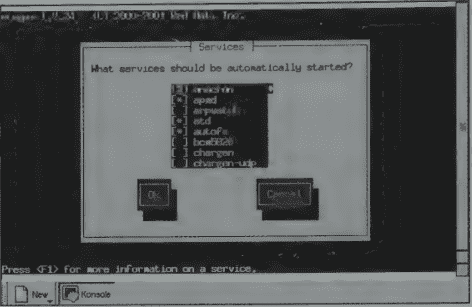

图 4-1：ntsysv 屏幕

这个可滚动的屏幕显示了当前运行级别中所有服务的状态。要开启一个服务，你需要选中它；要关闭一个服务，只需取消选中它。一旦完成所有更改，你可以点击"OK"按钮保存更改，或者点击"Cancel"按钮放弃更改。如果你想处理不同的运行级别配置，只需使用 `--level` 选项提供运行级别即可。例如：

ntsysv --level 1

此命令让你处理运行级别 1 的配置。

#### 为运行级别创建新服务

如果你从知名供应商安装服务器软件包，他们很可能会提供一个优秀的 RPM 包，其中也包含了必要的服务脚本，该脚本会放置在 `/etc/rc.d/init.d` 目录中。然而，有时你会发现一些有用的软件，它并没有提供所有便利功能，你最终需要对其进行定制化，或者至少修改其在系统上的运行方式。在这种情况下，你可能需要为你的新软件创建一个服务脚本。这里我将向你展示如何轻松地创建一个新的服务脚本，并将其放入 `/etc/rc.d/init.d` 目录。

首先，让我们查看 `/etc/rc.d/init.d` 目录中的一个现有服务脚本。清单 4-5 展示了这样一个名为 `httpd` 的脚本。该脚本用于启动/停止 Apache Web 服务器。

清单 4-5：/etc/rc.d/init.d/httpd

```bash
#!/bin/bash
#
# Startup script for the Apache Web Server
#
# chkconfig: - 85 15
#
# description: Apache is a World Wide Web server.
# It is used to serve HTML files and CGI.
#
# processname: httpd
# config: /etc/httpd/conf/httpd.conf
# pidfile: /var/run/httpd.pid

# Source function library.
. /etc/rc.d/init.d/functions

# Source networking configuration.
. /etc/sysconfig/network

# Check that networking is up.
[ ${NETWORKING} = "no" ] && exit 0

# See how we were called.
case "$1" in
  start)
	echo -n $"Starting $prog: "
	daemon $httpd $OPTIONS
	RETVAL=$?
	echo
	[ $RETVAL = 0 ] && touch /var/lock/subsys/httpd
	;;
  stop)
	echo -n $"Stopping $prog: "
	killproc $httpd
	RETVAL=$?
	echo
	[ $RETVAL = 0 ] && rm -f /var/lock/subsys/httpd /var/run/httpd.pid
	;;
  restart)
	$0 stop
	$0 start
	;;
  reload)
	echo -n $"Reloading $prog: "
	killproc $httpd -HUP
	RETVAL=$?
	echo
	;;
  status)
	status $httpd
	;;
  *)
	echo $"Usage: $0 {start|stop|restart|reload|status|help}"
	exit 1
esac

exit $RETVAL
```

如你所见，这个 shell 脚本实际上是一个简单的 case（条件）语句。现在，我给你展示一个如何从现有服务脚本创建新服务脚本的例子。假设你的新服务名为 `webmonitor`，可执行文件存储在 `/usr/sbin/webmonitor`。

> 按照惯例，脚本和可执行程序使用相同的名称。

以下是你创建 `/etc/rc.d/init.d/webmonitor` 脚本的方法：

- 1. 从 `/etc/rc.d/init.d` 复制一个现有脚本作为 `/etc/rc.d/init.d/webmonitor`。为了简单易懂，我假设你复制了清单 4-5 中所示的 `/etc/rc.d/init.d/httpd` 脚本。
- 2. 使用你喜欢的文本编辑器（如 `vi`），搜索并替换所有 "httpd" 实例为字符串 "webmonitor"。
- 3. 如果你将可执行文件保存在除 `/sbin`、`/usr/sbin`、`/bin` 或 `/usr/bin` 之外的任何目录中，你必须更改 `daemon webmonitor` 这一行以反映 `webmonitor` 可执行文件的路径。例如，如果你将可执行文件保存在 `/usr/local/web/bin` 目录中，你必须将 `daemon webmonitor` 这一行更改为 `daemon /usr/local/web/bin/webmonitor`。
- 4. 如果 `/usr/sbin/webmonitor` 不创建 PID 文件（`/var/run/webmonitor.pid`），那么你必须将 `kill 'cat /var/run/webmonitor.pid'` 这一行替换为 `killproc webmonitor`，并删除 `rm -f /var/run/webmonitor.pid` 这一行。
- 5. 运行 `chmod 750 /etc/rc.d/init.d/webmonitor` 以更改文件权限，使 root 用户能够读取、写入和执行该脚本。

这就是创建新的 `webmonitor` 服务所需的全部操作。你现在可以使用 `chkconfig`、`ntsysv` 或 `linuxconf` 实用工具将此新服务添加到所需的运行级别。

#### 总结

在本章中，你学习了 Red Hat Linux 系统如何启动和关闭。你了解了 `init`，它由内核启动，然后又启动默认运行级别中的所有进程。此外，你还学习了如何控制不同的运行级别，以从单用户模式切换到多用户模式，或者关闭或重启系统。

# 第五章：使用文件系统

本章内容

- 如何管理文件、目录和链接的权限与所有权
- 如何为多用户系统建立权限策略
- 如何在系统中使用逻辑卷管理（LVM）
- 如何使用基于 RAM 的文件系统

许多人不喜欢 UNIX 或类 UNIX 操作系统的一个最主要原因是它们处理文件和目录的方式。许多人只是觉得与 UNIX 文件和目录相关的概念不直观。在担任系统管理员期间，我了解到几乎 90% 的用户问题都与文件和目录权限以及所有权问题有关。许多用户根本不理解文件所有权和访问权限的基本概念。

这并不是他们的错——这些人中的大多数来自 Microsoft Windows 3.x/95/98（或某些类似系统）背景，在那些系统中，文件所有权或访问权限的概念是闻所未闻的（Windows 2000 和 XP 是例外）。因此，作为 Internet 服务器的系统管理员，你很可能会遇到许多与文件相关的用户问题。这意味着你别无选择，只能成为文件和目录的专家。本章将向你展示如何达到这样的精通程度。

#### 理解文件/目录权限

像所有 UNIX 和类 UNIX 操作系统一样，Linux 将文件或目录与一个用户和一个组关联起来。考虑一个例子：

```
-rw-rw-r-- 1 sheila intranet 512 Jul 3 21:11 milkyweb.txt
```

上面这一行是我的 Red Hat Linux 系统上 `ls -l milkyweb.txt` 命令的输出。你可能已经知道 `ls` 程序用于列出文件和目录。`-l` 选项显示了 `milkyweb.txt` 文件的完整列表。现在，请看表 5-1 中相同信息的表格格式。

## 表 5-1  输出说明

| 信息类型 | ls 输出 |
|---|---|
| 文件访问权限 | -rw-rw-r? |
| 链接数 | 1 |
| 用户（文件所有者） | sheila |
| 组 | intranet |
| 文件大小（字节） | 512 |
| 最后修改日期 | Jul 3 |
| 最后修改时间 | 21:11 |
| 文件名 | milkyweb.txt |

此处，`milkyweb.txt` 文件的所有者是名为 `sheila` 的用户。她是唯一能够更改此文件访问权限的普通用户。唯一其他能更改权限的用户是超级用户。此文件的组是 intranet。任何属于 intranet 组的用户都可以根据当前的组权限设置（由所有者建立）访问（读取、写入或执行）该文件。

要成为文件所有者，用户必须创建该文件。在 Red Hat Linux 下，当用户创建文件或目录时，其组也会被设置为该用户的默认组，该组恰好是与用户名相同的私有组。为了更清楚地说明这一点，假设我以 `kabir` 身份登录到我的 Red Hat Linux 系统，并使用像 `vi` 这样的文本编辑器创建了一个名为 `todo.txt` 的文件。如果我执行 `ls -l todo.txt` 命令，将显示以下输出：

```
-rw-rw-r?  1 kabir   kabir    4848 Jul 3 21:37 todo.txt
```

如你所见，文件所有者和组名是相同的。这是因为在 Red Hat Linux 下，用户 `kabir` 的默认（私有）组也叫做 `kabir`。这可能会有点令人困惑，但这样做是为了让你省心一些，当然你可以很容易地改变这种行为。这里的重点是，当创建新文件时，文件所有者就是文件创建者，而组是所有者的默认组。

作为普通用户，你不能将文件或目录的所有权重新分配给其他人。例如，我不能以用户 `kabir` 的身份创建一个文件，然后将其所有权重新分配给名为 `sheila` 的用户。想知道为什么会这样吗？当然是出于安全考虑。如果允许普通用户将文件所有权重新分配给其他人，有人可能会创建一个删除文件的恶意程序，将其所有权更改为超级用户，然后销毁整个文件系统。只有超级用户才能重新分配文件或目录的所有权。

#### 使用 chown 更改文件/目录的所有权

作为超级用户，你可以使用 chown 命令更改文件/目录的所有权。要更改文件或目录的所有权，请运行如下命令：

```
chown newuser file_or_directory
```

例如：

```
chown sheila kabirs_plans.txt
```

此命令使 sheila 用户成为 kabirs_plans.txt 文件的新所有者。如果超级用户还想更改文件或目录的组，她可以如下使用 chown 命令：

```
chown newuser.newgroup file_or_directory
```

例如：

```
chown sheila.admin kabirs_plans.txt
```

前面的命令不仅使 sheila 成为新所有者，还将文件的组重置为 admin。

如果超级用户希望更改给定目录下所有文件或目录的用户和/或组所有权，她可以使用 `-R` 选项以递归模式运行 chown 命令。例如：

```
chown -R sheila.admin /home/kabir/plans/
```

前面的命令将更改 /home/kabir/plans/ 目录及其内部所有文件和子目录的用户和组所有权。

虽然你必须是超级用户才能更改文件的所有权，但作为普通用户，你仍然可以使用 chgrp 命令更改文件或目录的组。

#### 使用 chgrp 更改文件/目录的组

chgrp 命令允许你在也是新组的一部分的情况下，更改文件或目录的组所有权。换句话说，你只能在同时属于旧组和新组时才能更改组。例如：

```
chgrp httpd *.html
```

如果我运行前面的命令来更改目录中所有 HTML 文件的组，我也必须属于 `httpd` 组。你可以通过使用不带任何参数的 `groups` 命令来查看你属于哪些组。与 `chown` 命令类似，`chgrp` 也使用 `-R` 递归地更改一个或多个文件或目录的组名。

既然你了解了用户如何与文件和目录关联，现在来看看访问权限如何与文件和目录一起工作。查看文件/目录权限有两种方式：基于八进制数的文件权限，或基于访问字符串的文件权限。这两种方法将在以下章节中讨论。

#### 使用八进制数理解访问权限

虽然使用八进制数是我理解文件/目录访问权限最喜欢的方法，但我必须警告你，这涉及到位。如果你觉得自己在数学方面有困难，可以跳过本节，转到下一节，该节使用更简单的访问字符串解释相同的权限。

因为我将使用一个不那么常用的编号系统，称为 *八进制系统* 来解释访问权限，这里先小小复习一下八进制数。八进制系统使用八个数字，而不是十进制系统常用的十个数字。八进制数字是 0-7，每个数字可以用三位（在二进制系统中）表示。表 5-2 显示了每个八进制数字的二进制等效值。

| 八进制 | 二进制 |
|-------|--------|
| 0     | 000    |
| 1     | 001    |
| 2     | 010    |
| 3     | 011    |
| 4     | 100    |
| 5     | 101    |
| 6     | 110    |
| 7     | 111    |

此表将有助于理解文件/目录权限。图 5-1 展示了你可以如何将权限视为四个八进制数字。这里的第一个八进制数字是最左边也是最重要的一个。


如图所示，第一个八进制数字用于特殊权限设置，第二个数字用于设置文件所有者的权限，第三个数字用于设置组的权限，最后，第四个数字用于设置其他所有人的权限。当省略一个数字时，它被视为零。表 5-3 显示了一些示例权限值。

| 权限值 | 说明 |
| --- | --- |
| 0400 | 仅文件所有者拥有读取（r）权限。这相当于 400，其中缺失的八进制数字被视为前导零。 |
| 0440 | 文件所有者和组中的用户都拥有读取（r）权限。这相当于 440。 |
| 0444 | 所有人都拥有读取（r）权限。这相当于 444。 |
| 0644 | 文件所有者拥有读取（r）和写入（w）权限。其他所有人都对文件具有只读访问权限。这相当于 644；数字 6 由 4（r）和 2（w）相加得出。 |
| 0755 | 文件所有者拥有读取（r）、写入（w）和执行（x）权限，其他所有人拥有对文件的读取（r）和执行（x）权限。这相当于 755；数字 7 由 4（r）+ 2（w）+ 1（x）相加得出。 |
| 4755 | 与上例中的 755 相同，但此文件设置了 set-UID。当具有 set-UID 权限的可执行文件运行时，该进程以文件所有者的身份运行。换句话说，如果一个文件设置了 set-UID 并且由用户 gunchy 所有，那么每次运行它时，运行的程序都将享有用户 gunchy 的权限。因此，如果一个文件由 root 所有并且也设置了 set-UID，那么任何能运行该文件的人实际上都拥有超级用户的权限。如果一个 set-UID 的 root 文件可以被 root 以外的任何人修改，那将是一个主要的安全漏洞。设置 set-UID 位时请务必非常小心。 |
| 2755 | 类似于 755，但也设置了 set-GID 位。当这样的文件被执行时，它实际上拥有该文件所属组的所有权限。 |
| 1755 | 类似于 755，但也设置了粘着位。粘着位正式名称为保存文本模式。这是一个不常用的功能，它告诉操作系统即使在可执行程序退出后，也要将其映像保留在内存中。这是一种外部尝试，旨在减少大型程序的启动时间。与其设置粘着位，你应该尝试在可能的情况下重新编码应用程序以获得更好的性能。 |

要制定合适的权限设置，你需要确定用户、组和其他所有人应具有的访问类型，并考虑是否需要 set-UID、set-GID 或粘着位。在确定需求后，你可以使用 4（读取）、2（写入）和 1（执行）或通过这三个值中的任意值相加得出的自定义值来构建每个八进制数字。虽然基于八进制数的权限起初可能看起来有点难，但通过练习，它们的使用可以成为第二天性。

#### 使用访问字符串理解访问权限

现在我们将查看使用访问字符串方法的权限，这种方法比上一节讨论的数字方法（某种程度上）更简单。图 5-2 显示了权限图的访问字符串版本。


[第 118 页]


每种权限类型用一个字符（括号中）表示。要创建权限字符串，你需要指定以下内容：

- 影响谁？你的选择有：u（用户）、g（组）、o（其他）或 a（所有人）。
- 需要设置哪种类型的权限？你的选择有：r（读）、w（写）、x（执行）、s（设置用户 ID 或设置组 ID）或 t（粘滞位）。
- 操作类型是什么？换句话说，你是要设置权限还是移除权限？设置权限时，你需要使用加号（+）表示添加，使用问号（?）表示移除。

例如，要允许文件所有者读取文件的权限，你需要指定像 u+r 这样的权限字符串；或者要允许所有人读取和执行文件，你需要像 a+rx 这样的权限字符串。同样，要设置文件的设置用户 ID，你需要 u+s；要设置为设置组 ID，你需要 g+s。

现在你已经了解了多种操作文件和目录权限的方法，让我们来看看如何使用你新学到的管理技能配合 chmod 命令。

#### 使用 chmod 更改文件/目录的访问权限

chmod 实用工具允许你更改（权限）模式，这就是它被称为 chmod 的原因。你可以在此实用工具中使用八进制或字符串方法。例如：

```
chmod 755 *.pl
```

[第 119 页]

上面的命令更改了扩展名为 .pl 的文件的权限。每个 .pl 文件被设置为所有者可读、可写和可执行（7 = 4 [读] + 2 [写] + 1 [执行]）。文件还被设置为组和其他人可读和可执行（5 = 4 [读] + 1 [执行]）。

你可以使用字符串方法实现相同的结果，如下所示：

```
chmod a+rx,u+w *.pl
```

这里 a+rx 用于允许所有人（a）读取（r）和执行（x）权限，u+w 用于允许文件所有者（u）写入（w）文件。请注意，使用多个访问字符串时，需要用逗号分隔每对字符串。还要注意，权限字符串之间不允许有空格。

如果你想更改目录中所有文件和子目录的权限，可以使用 -R 选项执行递归权限操作。例如：

```
chmod -R 750 /www/mysite
```

这里八进制权限 750 被应用于 /www/mysite 目录下的所有文件和子目录。

#### 关于目录权限的特别说明

目录的权限设置与常规文件相似但并不完全相同。以下是关于目录权限的一些特别说明：

- 仅读取目录的权限不会允许你 cd 进入该目录；要进入目录，你需要执行权限。
- 仅执行权限允许你访问目录内的文件，前提是你知道文件名并且被允许读取这些文件。
- 要能够使用 ls 等程序列出目录内容以及能够 cd 进入目录，你需要同时具有读取和执行权限。
- 如果你对目录拥有写权限，你可以在该目录内创建、删除或修改任何文件或子目录，即使该文件或子目录属于其他用户。

现在让我们来考虑一种特殊类型的文件——符号链接，以及它带来的权限问题。

[第 120 页]

#### 管理链接的权限

除了常规文件和目录之外，你还会经常遇到另一种类型的文件：链接。

链接是指向其他文件的指针文件。链接允许你为单个文件或目录创建多个名称。链接有两种类型：硬链接和软链接（符号链接）。你将在下一章中了解更多关于链接的信息。在本节中，我将讨论由链接使用引起的特殊权限问题。

### 更改硬链接的权限或所有权

如果你更改硬链接的权限或所有权，原始文件的权限也会被更改。例如，查看以下 `ls -l` 输出：

```
-rw-r--r-- 1 root 21 Feb 7 11:41 todo.txt
```

现在，如果 root 用户为 `todo.txt` 创建一个名为 `plan` 的硬链接（使用命令行 `ln todo.txt plan`），`ls -l` 输出将如下所示：

```
-rw-r--r-- 2 root 21 Feb 7 11:41 plan
-rw-r--r-- 2 root 21 Feb 7 11:41 todo.txt
```

如你所见，硬链接 `plan` 和原始文件 `todo.txt` 具有相同的文件大小（显示在第四列），并且共享相同的权限和所有权设置。现在假设 root 用户运行以下命令：

```
chown sheila plan
```

这将硬链接的所有权赋予了名为 `sheila` 的用户。它会照常工作吗？查看上面命令执行后的 `ls -l` 输出：

```
-rw-r--r-- 2 Sheila root 21 Feb 7 11:41 plan
-rw-r--r-- 2 Sheila root 21 Feb 7 11:41 todo.txt
```

如你所见，`chown` 命令更改了 `plan` 的所有权，但 `todo.txt`（原始文件）的所有权也随之更改了。因此，当你更改硬链接的所有权或权限时，请记住该效果同样适用于原始文件。

[第 121 页]

### 更改软链接的权限或所有权

更改符号链接或软链接的所有权方式有所不同。例如，`ln -s todo.txt plan` 命令产生以下 `ls -l` 输出：

```
lrwxrwxrwx  1 sheila  root     8 Feb  7 11:49 plan -> todo.txt
-rw-r--r--  1 sheila  root    21 Feb  7 11:41 todo.txt
```

这里你可以看到 plan 文件是 `todo.txt` 的符号（软）链接。现在假设 root 用户如下更改符号链接的所有权：

```
chown kabir plan
```

`ls -l` 输出显示

```
lrwxrwxrwx  1 kabir   root     8 Feb  7 11:49 plan -> todo.txt
-rw-r--r--  1 sheila  root    21 Feb  7 11:41 todo.txt
```

现在问题是：用户 **kabir** 能否通过符号链接（plan）写入 **todo.txt**？答案是否定的，除非存储这些文件的目录属于 **kabir**。因此，更改软链接的所有权不像硬链接那样以相同的方式生效。但是，如果你更改软链接的权限设置，它所指向的文件会获得新的设置。例如：

```
chmod 666 plan
```

这会更改 todo.txt 文件的权限，如下面的 `ls -l` 列表所示：

```
lrwxrwxrwx  1 kabir   root     8 Feb  7 11:49 plan -> todo.txt
-rw-rw-rw-  1 sheila  root    21 Feb  7 11:41 todo.txt
```

因此，对链接要谨慎，因为这些特殊文件的权限和所有权设置有些违反直觉。另外，请记住删除软链接并不会删除它所指向的文件。

#### 为多用户服务器创建权限策略

如前所述，UNIX 和类 UNIX 系统上的大多数用户问题都与文件权限有关。如果昨天和前天都正常运行的东西今天突然不能用了，你应该首先怀疑权限

[第 122 页]

问题。权限问题最常见的原因之一是 root 账户。许多缺乏经验的系统管理员经常通过超级用户（root）账户访问文件和程序。当使用 root 用户账户运行程序时，该程序创建的文件通常会被设置为 root 所有权。在本节中，我将讨论一些权限策略，如果你的单个系统上有许多用户，你可能想要实施这些策略。

### 设置用户配置文件权限

每个用户的主目录中存放着一些以句点（或点）开头的半隐藏文件。这些文件通常用于在用户登录时执行命令。例如，用户可用的所有 shell（csh、tcsh、bash 等）都从 .cshrc 或 .bashrc 等点文件中读取其设置。如果用户不注意正确设置文件权限，其他不太友善的用户可能会给该用户造成麻烦。例如，如果某个用户的 .cshrc 文件对第二个用户可写，后者就可以搞一个恶作剧，比如在 .cshrc 文件的开头放一个 logout 命令，这样第一个用户一登录就会被登出。当然，这种恶作剧可能会演变成其他侵犯用户文件隐私的行为。因此，你可能需要在多用户系统上留意这种情况。你可以运行第 18 章讨论的 COPS 程序来检测许多权限问题。如果你只有少数几个用户，你也可以快速执行如下简单检查：

```
find /home -type f -name ".*rc" -exec ls -l {} \;
```

此命令显示 /home 目录层次结构中所有点文件（以 rc 结尾，仅列出 .cshrc、.bashrc 等）的权限。如果你的用户主目录保存在 /home 中，这将快速显示哪些用户可能存在权限问题。

### 设置用户的默认文件权限

作为系统管理员，你可以定义系统上所有用户文件的默认权限设置。要设置新文件的默认权限，你可以使用 umask 命令，如下所示：

```
umask mask
```

要理解 umask 的工作原理，请看一个例子。假设 umask 设置为 022。当创建新文件时，通常文件创建函数请求的权限设置为 0666。然而，在这种情况下，文件的最终权限设置由系统推导得出，如图 5-3 所示。


## 第二部分：作为超级用户工作

如图所示，请求的权限 0666 与当前掩码的补码进行按位与运算（即 022 变为 755），结果为 0644，这允许文件所有者进行读写访问，但仅授予其他人读取权限。

要为文件权限创建默认掩码，你可以在 `/etc` 下的全局 shell 资源文件中嵌入 `umask` 命令，这样当用户登录并运行 shell 时，该 shell 的全局资源文件将被执行。这反过来会执行 `umask` 命令并为用户会话提供默认掩码。例如，如果你的用户使用 `/bin/csh` 或 `/bin/tcsh` shell，你可以将所需的 umask 命令放入 `/etc/csh.cshrc` 文件中。

Red Hat Linux 的默认 umask 为 002，设置在 `/etc/profile` 文件中。由于 Red Hat Linux 为每个新用户创建一个同名的私有组，默认的 002 umask 允许用户及其私有组访问她创建的文件或目录。

#### 设置可执行文件权限

只有所有者才应该对普通用户运行的程序文件拥有写权限。例如，`/usr/bin` 中的程序文件的权限设置应该使只有 root 可以读、写和执行；其他人的设置应仅包含读取和执行。允许除所有者以外的其他人在程序文件中写入可能会产生严重的安全漏洞。例如，如果除 root 以外的其他人可以写入像 `/usr/bin/zip` 这样的程序，恶意用户可以用特洛伊木马程序替换真正的 zip 程序，从而危害系统安全，随意破坏文件和目录。因此，你应该持续检查系统上的程序文件，确保它们具有正确的权限。经常运行 COPS 来检测与权限相关的问题。有关 COPS 的详细信息，请参阅第 18 章。

#### 设置 FTP 的默认文件权限

如果你的许多用户通过 FTP 在服务器上传文件，你可以控制 FTP 服务器的默认 `umask`，使一个用户的文件不能被另一个用户访问。例如，如果你想设置权限，使只有用户及其组可以读取通过 FTP 上传到 Web 服务器上的文件，你可以修改 `/etc/xinetd.d/wu-ftp` 文件中的 `in.ftpd` 行。该行默认如下所示：

```
/usr/sbin/in.ftpd -l -a
```

要为所有通过 FTP 上传的文件设置默认 `umask`，你需要添加带有适当 `umask` 值的 `-u` 参数。例如，要为每个上传的文件设置 640（`rw-r--`）权限，你可以将值设置为 026。为此，按如下方式更改上述行：

```
/usr/sbin/in.ftpd -l -a -u026
```

重启 xinetd 服务器（`killall -HUP xinetd`）并通过用户帐户 FTP 一个文件，查看权限是否按预期设置。

此功能对于作为许多不同客户端的 Web 服务器的系统非常方便。如果你不想让一个客户端看到另一个客户端的文件，请使用此选项以及特殊的权限设置。例如，假设你将所有 Web 客户端文件保存在 `/www` 分区或目录中，每个客户端站点都有自己的目录（例如 `/www/myclient1`、`/www/myclient2` 等）。现在你可能已经为每个客户端提供了一个 FTP 帐户来上传这些目录中的文件。要阻止一个客户端看到另一个客户端的文件，请使用此功能（如 FTP 服务器部分所述），并按如下方式重置每个客户端站点的所有权：

```
chown -R client.Web server user /www/client dir
```

例如，如果你以 `httpd` 运行 Web 服务器，并且有一个名为 `myclient` 的客户端用户，上述命令将如下所示：

```
chown -R myclient.httpd /www/myclient
```

这将把 `/www/myclient` 目录及其所有子目录和文件的所有权更改为 `myclient`（用户）和 `httpd`（组）。这样做是为了允许客户端用户拥有、修改和删除她的文件，同时也允许 Web 服务器读取目录中的文件。但是，要禁止所有其他人，你必须按如下方式更改权限：

```
chmod -R 2770 /www/client dir
```

对于当前示例，实际命令如下：

```
chmod -R 2770 /www/myclient
```

此命令将 `/www/myclient` 的所有文件和子目录权限设置为 2770，这允许所有者（`myclient`）和 Web 服务器用户（`httpd`）对文件和目录进行读、写和执行操作。它还确保当创建新文件时，其权限设置为允许 Web 服务器用户读取文件。通过 set-GID（2）数字实现此功能。

#### 操作文件和目录

在本节中，我将向你展示如何使用 Red Hat Linux 系统上可用的各种实用程序来操作文件。

## 查看文件和目录

你可能已经熟悉 `ls`。这可能是任何 UNIX 或类 UNIX 平台上使用最广泛的程序。`ls` 最常用的选项有 `-l`（长格式列出）、`-a`（所有文件，包括以句点开头的文件名）、`-1`（单列仅显示文件名的列表）和 `-R`（递归列出）。

## 导航目录

你可能也知道 `cd` 命令，它实际上是一个内置的 shell 命令。如果你不提供任何目录名作为参数，`cd` 命令会将你返回到当前使用的用户帐户的主目录。任何时候你不确定自己在文件系统中的位置时，可以使用 `pwd` 命令，它会显示你当前的目录名称。

## 确定文件类型

与 Microsoft Windows 操作系统不同，Linux 不依赖文件扩展名来确定文件类型。你可以使用 `file` 实用工具来确定文件的类型。例如：

```
file /usr/bin/file
```

此命令显示文件 `/usr/bin/file`（即自身）的类型。以下是输出示例：

```
/usr/bin/file: ELF 32-bit LSB executable, Intel 80386, \
version 1, dynamically linked, not stripped
```

## 查看文件或目录的访问统计信息

`stat` 程序可以提供文件或目录的统计信息。例如：

```
stat /tmp
```

此命令显示 `/tmp` 目录的统计信息。以下是输出示例：

```
File: ?/tmp? Size: 2048  Filetype: Directory
Access: (1777/drwxrwxrwt)  Uid: (0/ root)   Gid: (0/root)
Device: 3,0   Inode: 16321     Links: 22
Access: Sun Feb  7 02:00:35 1999(00000.00:01:11)
Modify: Sun Feb  7 02:01:01 1999(00000.00:00:45)
Change: Sun Feb  7 02:01:01 1999(00000.00:00:45)
```

## 复制文件和目录

使用 `cp` 命令将文件从一个位置复制到另一个位置。例如：

```
cp /some/important.txt /new/place/
```

此命令将名为 `important.txt` 的文件从 `/some` 目录复制到 `/new/place` 目录。你也可以指定新的目标文件名。`cp` 的常用选项包括 `-f`，它允许你强制将文件复制到已存在同名文件的位置。例如：

```
cp -f /some/important.txt /new/place/
```

此命令会复制 `important.txt` 文件，即使 `/new/place` 目录中已经存在同名文件。
要复制一个目录及其所有文件和子目录，请使用：

```
cp -r source-directory destination-directory
```

例如：

```
cp -r /tmp/foo /zoo/foo
```

## 移动文件和目录

要移动文件或目录，请使用 `mv` 命令。例如：

```
mv /file1 /tmp/file2
```

此命令将 `/file1` 移动到 `/tmp/file2`。同样，你也可以移动一个目录及其所有内容。请注意，`mv` 不会跨不同的文件系统移动目录。要实现这一点，请使用带 `-r` 选项的 `cp` 将目录复制到新文件系统，然后从当前位置删除目录（参见下一节）。

## 删除文件和目录

要删除文件或目录，请使用 `rm` 命令。例如：

```
rm filename
```

此命令删除文件。如果你使用的是 `/bin/tcsh` shell，你可能设置了一个名为 `rm` 的别名，如下所示：

```
alias rm rm -i
```

在这种情况下，`-i` 提示会在实际删除任何内容之前提示你确认。因此，如果你希望被提示确认，可以使用 `-i` 选项。另一方面，你可以使用 `-f` 选项来强制删除。

要删除目录，你需要指定 `-r` 选项。例如：

```
rm -rf directory
```

此命令删除指定目录中的所有文件和子目录。

## 查找文件

你可以使用各种命令来定位文件。要定位程序的确切路径，可以使用 `which` 命令。例如：

```
which httpd
```

如果 `httpd` 程序在 `$PATH` 环境变量列出的任何路径中可用，此命令将显示其完整路径名。某些 shell 有内置命令，而其他 shell 使用 `/usr/sbin/which` 代替。

你可以使用 `locate` 程序通过部分或完整名称来定位文件或目录。例如：


#### 覆盖默认文件权限掩码

系统管理员可以在你所使用的 shell 的全局资源文件中设置默认权限掩码。例如，如果你使用的是 `/bin/tcsh` shell，系统管理员可以在 `/etc/csh.cshrc` 文件中使用 `umask` 命令为你设置默认文件权限。但如果你想覆盖默认权限掩码，可以在命令行中运行 `umask` 来更改默认掩码。例如：

```
umask 222
```

这会将默认权限掩码设置为所有人只读、只读、只读。换句话说，它会关闭用户、组和其他人的写权限。这同样会覆盖你的 shell 的系统默认设置。然而，这种更改是临时的；当你注销并重新登录时，系统默认设置将再次生效。如果你基本不喜欢系统的权限掩码，可以向系统管理员提出你的意见，并在 shell 的资源文件中放入适当的 `umask` 命令。例如，如果你希望掩码始终为 `222` 并且使用 `/bin/tcsh` 作为 shell，可以将此命令放入你的 `~/.cshrc` 文件中，这样每次登录时，`umask` 就会覆盖系统默认值。

#### 管理逻辑卷

逻辑卷管理（LVM）及其日志文件系统确保了 Linux 在企业计算领域中的重要地位。你不需要大型企业的预算就能获得基于 LVM 的磁盘子系统的高可靠性和灵活性。以下是你可以立即使用 LVM 的方法。

传统上，安装 Linux 意味着将硬盘分区为 `/`（`root`）、`/usr`、`/home` 和 `swap` 空间。如果其中某个分区的磁盘空间用完，就会出现问题。在大多数情况下，系统管理员会创建一个 `/usr2`（或 `/home2`）分区并调整脚本，或创建符号链接来欺骗程序使其使用新空间。虽然这种做法产生了不必要的繁琐工作并使系统更加定制化，但在中小型系统的管理场景中一直是可接受的。然而，更大的企业级环境设定了不同的标准；这种磁盘管理方式浪费了太多资源，这就需要一种不同的解决方案——通过添加新的磁盘介质来扩展所需的分区（如 `/usr` 和 `/home`），而不更改挂载点。这可以通过一个叫做*逻辑卷*的概念来实现，现在任何使用 Linux 的人都可以使用它。

将逻辑卷视为一个高级存储层，它封装了底层的物理存储层。一个*逻辑卷*可以由至少一个物理磁盘组成——有时是多个——以单一挂载点的形式提供，如 `/usr`、`/home` 或 `/whatever`。好处是管理更简单。向逻辑卷添加存储只需将物理磁盘添加到卷的定义中。缩减存储区域则是从逻辑卷中移除物理磁盘。

**提示**
你可以在 http://sistina.com/lvm/ 了解更多关于 LVM 的信息。

## 为内核编译和安装 LVM 模块

最新的 Linux 内核 2.4.19（或更高版本）源代码发行版附带了 LVM 源代码。如果你在磁盘分区期间未启用 LVM 支持，可以通过编译和安装新内核来启用 LVM 支持，步骤如下：

1. 切换到 root 用户并将目录更改为内核源代码的顶级目录（例如 `/usr/src/linux-2.4.19`）。运行 `make menuconfig` 来配置内核。

2. 选择 `Multi-device support (RAID and LVM)` 支持子菜单。按一次空格键将 Multiple devices driver support (RAID and LVM) 支持包含在内核中；然后选择 `Logical volume manager (LVM)` 支持作为内核模块。按照通常的方式保存内核配置。

3. 根据内核源代码发行版中的 `README` 文件编译和安装内核，通常需要按以下顺序运行以下命令：

```
make clean;
make dep;
make bzImage;
make modules;
make modules_install;
make install;
```

如果你使用的是 LILO 引导加载程序，编辑 `/etc/lilo.conf` 文件以包含新的配置，如下所示：

```
image=/boot/vmlinuz-2.4.19
        label=linux2_4_19
        read-only
        root=/dev/hda1
```

运行 `/sbin/lilo` 命令重新配置 LILO 并重新启动系统。在 lilo 提示符处，输入 `linux2_4_19` 并引导新内核。如果遇到任何问题，你应该能够重新启动到标准 Linux 内核，该内核应自动成为默认选项。

如果你使用的是 GRUB 引导加载程序，编辑 `/etc/grub.conf` 文件以包含新的配置，例如：

```
title Red Hat Linux (2.4.19)
        root (hd0,0)
        kernel /boot/vmlinuz-2.4.19 ro root=/dev/hda1
        initrd /boot/initrd-2.4.19.img
```

4. 运行 `/sbin/modprobe lvm-mod` 来加载 LVM 内核模块。要验证此模块是否正确加载，运行 `/sbin/lsmod` 命令，你应该会看到该模块列为已加载内核模块之一。在 `/etc/modules.conf` 中添加以下行，以便将来在需要时自动加载 `lvm-mod` 模块。

```
alias block-major-58         lvm-mod
alias char-major-109         lvm-mod
```

## 创建逻辑卷

在此示例中，假设你有两个硬盘，分别称为 `/dev/hda` 和 `/dev/hdc`，每个硬盘都有一个可用分区：`/dev/hda7`（用于 `/dev/hda`）和 `/dev/hdc1`（用于 `/dev/hdb`）。你想使用这两个分区创建一个 LVM。具体步骤如下：

1. 运行 `/sbin/fdisk /dev/hda` 命令。使用 fdisk 命令，将相应分区的 ID 切换为 `8e`（Linux LVM）。以下列表展示了用于将名为 `/dev/hda7` 的分区 ID 更改为 `8e` 的 fdisk 会话示例。为简洁起见，示例经过编辑，必要的用户输入以粗体字母显示。

```
Command (m for help): p

Disk /dev/hda: 255 heads, 63 sectors, 2494 cylinders
Units = cylinders of 16065 * 512 bytes

   Device Boot Start   End    Blocks  Id System
/dev/hda1  *      1   131   1052226  83 Linux
/dev/hda2       262  2494  17936572+  f Win95
/dev/hda5       262   784   4200934+ 83 Linux
/dev/hda6       785   817    265041  82 Linux swap
/dev/hda7       818  2494  13470471  83 Linux
```

```
Command (m for help): t
Partition number (1-7): 7
Hex code (type L to list codes): 8e
Changed system type of partition 7 to 8e (Linux LVM)

Command (m for help): p
```

```
Disk /dev/hda: 255 heads, 63 sectors, 2494 cylinders
Units = cylinders of 16065 * 512 bytes

   Device Boot Start   End    Blocks  Id System
/dev/hda1  *      1   131   1052226  83 Linux
/dev/hda2       262  2494  17936572+  f Win95
/dev/hda5       262   784   4200934+ 83 Linux
/dev/hda6       785   817    265041  82 Linux swap
/dev/hda7       818  2494  13470471- 8e Linux LVM
```

```
Command (m for help): w
The partition table has been altered!
```

**对 `/dev/hdc1` 分区重复此步骤。**

2. 运行 `/sbin/pvcreate /dev/hda7 /dev/hdc1` 命令来创建两个物理卷。

3. 运行 `/sbin/vgcreate big_disk /dev/hda7 /dev/hdc1` 命令来创建一个名为 `big_disk` 的新卷组。该命令显示以下输出：

```
vgcreate -- INFO: using default physical extent size 4 MB

vgcreate -- INFO: maximum logical volume size is 255.99 Gigabyte

vgcreate -- doing automatic backup of volume group "big_disk"

vgcreate -- volume group "big_disk" successfully created and activated
```


## 4. 要确认使用 `/dev/hda7` 物理卷创建的卷组，请运行 `/sbin/pvdisplay /dev/hda7` 命令来显示如下统计信息：

```
--- Physical volume ---
PV Name              /dev/hda7
VG Name              big_disk
PV Size              12.85 GB / NOT usable 2.76 MB [LVM: 133 KB]
PV#                  1
PV Status            available
Allocatable          yes
Cur LV               0
PE Size (KByte)      4096
Total PE             3288
Free PE              3288
Allocated PE         0
PV UUID              2IKjJh-MBys-FI6R-JZgl-80ul-uLrc-PTah0a
```

如你所见，`/dev/hda7` 的 VG Name（卷组名称）是 `big_disk`，这正是你想要的。你可以对 `/dev/hdc1` 运行相同的命令，如下所示：

```
--- Physical volume ---
PV Name              /dev/hdc1
VG Name              big_disk
PV Size              3.91 GB / NOT usable 543 KB [LVM: 124 KB]
PV#                  2
PV Status            available
Allocatable          yes
Cur LV               0
PE Size (KByte)      4096
Total PE             1000
Free PE              1000
Allocated PE         0
PV UUID              RmxH4b-BSfX-ypNl-cfwO-pZHq-obMz-JKkNK5
```

## 5. 你也可以通过使用 `/sbin/vgdisplay` 命令来显示卷组信息，其输出如下：

```
--- Volume group ---
VG Name              big_disk
VG Access            read/write
VG Status            available/resizable
VG #                 0
MAX LV               256
Cur LV               0
Open LV              0
MAX LV Size          255.99 GB
Max PV               256
Cur PV               2
Act PV               2
VG Size              16.75 GB
PE Size              4 MB
Total PE             4288
Alloc PE / Size      0 / 0
Free PE / Size       4288 / 16.75 GB
VG UUID              VMttR1-T10e-I4js-oXmi-uEle-hprD-iqhCIX
```

在上面的报告中，卷组总大小（`VG Size`）大致等于添加到其中的两个物理卷大小之和。

## 6. 运行 `/sbin/lvcreate --L10G -nvol1 big_disk` 命令，使用 `big_disk` 卷组创建一个名为 `/dev/big_disk/vol1` 的 10GB 逻辑卷。

> **提示**
>
> 你可以使用磁盘条带化，然后使用 `-i` 选项指定要分散逻辑卷的物理卷数量，使用 `-I` 选项指定条带粒度的千字节数。条带大小必须是 2^n（n = 0 到 7）。例如，要创建逻辑卷的条带化版本（使用你之前添加到卷组的两个物理卷），你可以运行 `/sbin/lvcreate -i2 -I4 -L10G -nvol1 big_disk` 命令。我不推荐使用条带化，因为目前你无法向条带化的逻辑卷添加新的物理卷，这在某种程度上违背了使用 LVM 的初衷。

## 7. 决定是使用日志文件系统（如 ext3）还是 ext2 用于新创建的名为 `vol1` 的逻辑卷。要创建 ext3 文件系统，请运行 `/sbin/mke2fs -j -b 4096 /dev/big_disk/vol1` 命令；要创建 ext2 文件系统，请运行 `/sbin/mke2fs -b 4096 /dev/big_disk/vol1` 命令。如果你想使用不同的块大小，请将 4096 更改为 1024 或 2048（或根据需要更改为你自定义的块大小）。当使用逻辑卷时，我更倾向于创建 ext3 文件系统。

## 8. 使用 `mkdir /vol1` 命令创建名为 `/vol1` 的挂载点。然后，使用 `mount /dev/big_disk/vol1 /vol1` 命令挂载文件系统。挂载 ext3 文件系统时，你可能需要添加 `-t ext3` 选项。运行 `df` 命令以在输出中查看该卷。以下是示例输出：

| 文件系统 | 1k-块 | 已用 | 可用 | 使用率% | 挂载点 |
|---|---|---|---|---|---|
| /dev/hda1 | 1035660 | 243792 | 739260 | 25% | / |
| /dev/hda5 | 4134868 | 2574004 | 1350820 | 66% | /usr |
| /dev/big_disk/vol1 | 10485436 | 32840 | 10452596 | 1% | /vol1 |

至此，一个名为 `vol1` 的新逻辑卷已准备就绪。LVM 软件包包含一组工具来帮助你管理你的卷。

# 使用物理卷管理工具

你可以使用多种工具来管理用于逻辑卷的物理卷。

- `/sbin/pvscan` 工具使你能够列出系统中的所有物理卷。
- `/sbin/pvchange` 工具使你能够更改物理卷的属性。`/sbin/pvcreate` 工具使你能够创建新的物理卷。
- `/sbin/pvdata` 工具使你能够查看物理卷的调试信息。
- `/sbin/pvdisplay` 工具使你能够查看物理卷的属性信息。
- `/sbin/pvmove` 工具使你能够将数据从一个物理卷移动到卷组内的另一个物理卷。

例如，假设你有一个名为 `vol1` 的逻辑卷组，它由一个名为 `big_disk` 的单个卷组组成，该卷组有两个物理卷（`/dev/hda7` 和 `/dev/hdc1`）。你希望将数据从 `/dev/hda7` 移动到 `/dev/hdc1`，并将 `/dev/hda7` 移动到新磁盘（或分区）。在这种情况下，首先确保 `/dev/hdc1` 有足够的空间来容纳来自 `/dev/hda7` 的所有数据。然后运行 `/sbin/pvmove /dev/hda8 /dev/hdc1` 命令。


> 此操作需要相当长的时间（取决于数据量），并且不应被中断。

# 使用卷组管理工具

要管理一个由至少一个物理卷组成的卷组，你可以使用以下工具：

- `vgscan` 工具使你能够列出系统中的所有卷组。
- `/sbin/vgcfgbackup` 工具备份卷组描述符区域。
- `/sbin/vgcfgrestore` 工具恢复卷组描述符区域。
- `/sbin/vgchange` 工具更改卷组的属性。例如，你可以使用 `-a y` 选项激活卷组，使用 `-a n` 选项停用它。
- `/sbin/vgck` 工具检查卷组描述符区域的一致性。
- `/sbin/vgcreate` 工具使你能够创建新的卷组。
- `/sbin/vgdisplay` 工具显示卷组信息。
- `/sbin/vgexport` 工具使一个非活动的卷组对系统不可知，以便你可以从中移除物理卷。
- `/sbin/vgextend` 工具使你能够向卷组添加物理卷。
- `/sbin/vgimport` 工具使你能够导入之前使用 `vgexport` 工具导出的卷组。
- `/sbin/vgmerge` 工具使你能够合并两个卷组。
- `/sbin/vgmknodes` 工具使你能够创建卷组目录和特殊文件。
- `/sbin/vgreduce` 工具使你能够通过从组中移除至少一个未使用的物理卷来缩小卷组。
- `/sbin/vgremove` 工具使你能够移除一个没有任何逻辑卷且处于非活动状态的卷组。如果你有一个至少包含一个逻辑卷的卷组，你必须先停用并移除它。
- `/sbin/vgrename` 工具使你能够重命名一个卷组。
- `/sbin/vgscan` 工具扫描所有磁盘以查找卷组，并构建 LVM 模块使用的 `/etc/lvmtab` 和 `/etc/lvmtab.d` 目录中的其他文件。
- `/sbin/vgsplit` 工具使你能够拆分一个卷组。

# 使用逻辑卷管理工具

以下工具使你能够管理逻辑卷：

- `/sbin/lvchange` 工具使你能够更改逻辑卷的属性。例如，你可以使用 `-a y` 选项激活一个逻辑卷组，使用 `-a n` 选项停用它。一旦它被停用，你可能需要在重新激活该卷组之前使用 `vmchange` 命令。
- `/sbin/lvcreate` 工具使你能够使用现有的卷组创建新的逻辑卷。
- `/sbin/lvdisplay` 工具使你能够显示逻辑卷的属性。
- `/sbin/lvextend` 工具使你能够扩展逻辑卷的大小。
- `/sbin/lvreduce` 工具使你能够更改现有活动逻辑卷的大小。
- `/sbin/lvremove` 工具使你能够移除非活动的逻辑卷。
- `/sbin/lvrename` 工具使你能够重命名现有的逻辑卷。
- `/sbin/lvscan` 工具使你能够定位系统上的所有逻辑卷。

# 使用逻辑卷管理器工具

以下工具使你能够控制逻辑卷管理器模块本身。

- `/sbin/lvmchange` 工具使你能够更改逻辑卷管理器的属性。在正常操作中，你不需要使用此工具。
- `/sbin/lvmcreate_initrd` 工具使你能够使用逻辑卷创建可引导的初始 RAM 磁盘。
- `/sbin/lvmdiskscan` 工具使你能够扫描系统中所有可用于逻辑卷的存储设备。
- `/sbin/lvmsadc` 工具使你能够收集逻辑卷的读/写统计信息。
- `/sbin/lvmsar` 工具使你能够将读/写统计信息报告到日志文件。

以下部分将告诉你如何使用所有这些工具来解决实际的磁盘管理问题。

# 向逻辑卷添加新磁盘或分区

在使用逻辑卷一段时间后，最终你可能需要向其添加新磁盘，因为你的系统需要更多空间。在本节中，我将向你展示如何将一个新的磁盘分区（`/dev/hdc2`）添加到已创建的名为 `/dev/big_disk/vol1` 的逻辑卷。

1. 切换到 root 用户并运行 `/sbin/pvscan` 以查看所有物理卷的状态。以下是示例输出：

pvscan -- 正在读取所有物理卷（这可能需要一段时间……）
pvscan -- 活动 PV "/dev/hda7"，属于卷组 "big_disk" [12.84 GB / 2.84 GB 空闲]
pvscan -- 活动 PV "/dev/hdc1"，属于卷组 "big_disk" [3.91 GB / 3.91 GB 空闲]
pvscan -- 总计：2 [16.75 GB] / 已使用：2 [16.75 GB] / 不在卷组中：0 [0]

2.  运行 /sbin/vgdisplay big_disk 以了解 big_disk 卷组的当前设置。以下是示例输出：

```
--- Volume group ---
VG Name                      big_disk
VG Access                    read/write
VG Status                    available/resizable
VG #                         0
MAX LV                       256
Cur LV                       0
Open LV                      0
MAX LV Size                  255.99 GB
Max PV                       256
Cur PV                       2
Act PV                       2
VG Size                      16.75 GB
PE Size                      4 MB
Total PE                     4288
Alloc PE / Size              0 / 0
Free  PE / Size              4288 / 16.75 GB
VG UUID                      p3N102-z7nM-xH86-DWw8-yn2J-Mw3Y-1shq62
```

如你所见，卷组的总大小约为 16GB。

3.  使用 fdisk 工具，将新分区的系统 ID 更改为 8e（Linux LVM）。以下是在我的系统上执行此操作的示例 /sbin/fdisk /dev/hdc 会话：

```
Command (m for help): p

Disk /dev/hdc: 255 heads, 63 sectors, 1583 cylinders
Units = cylinders of 16065 * 512 bytes
```

```
   Device Boot      Start        End    Blocks   Id  System
/dev/hdc1               1        510   4096543+  8e  Linux LVM
/dev/hdc2             511       1583   8618872+  83  Linux
```

```
Command (m for help): t
Partition number (1-4): 2
Hex code (type L to list codes): 8e
Changed system type of partition 2 to 8e (Linux LVM)
```

```
Command (m for help): p

Disk /dev/hdc: 255 heads, 63 sectors, 1583 cylinders
Units = cylinders of 16065 * 512 bytes

   Device Boot    Start     End   Blocks  Id System
/dev/hdc1             1     510  4096543+ 8e Linux LVM
/dev/hdc2           511    1583  8618872+ 8e Linux LVM
```

```
Command (m for help): v
62 unallocated sectors
```

```
Command (m for help): w
The partition table has been altered!
```

4.  运行 /sbin/mkreiserfs /dev/hdc2 以创建 reiserfs 文件系统，但如果你一直在逻辑卷上使用 ext3 文件系统，请改用 /sbin/mke2fs -j /dev/hdc2 命令。

5.  运行 /sbin/pvcreate /dev/hdc2 以使用 /dev/hdc2 分区创建新的物理卷。

6.  运行 /sbin/vgextend big_disk /dev/hdc2 将该分区添加到 big_disk 卷组。要验证磁盘分区是否已添加到卷组，请运行 /sbin/vgdisplay /dev/big_disk 命令。你应该会看到类似以下的输出：

```
--- Volume group ---
VG Name          big_disk
VG Access        read/write
VG Status        available/resizable
VG #             0
MAX LV           256
Cur LV           1
Open LV          0
MAX LV Size      255.99 GB
Max PV           256
Cur PV           3
Act PV           3
VG Size          24.97 GB
PE Size          4 MB
Total PE         6392
```

| Alloc PE / Size | 4608 / 18 GB |
| Free PE / Size | 1784 / 6.97 GB |
| VG UUID | VMttR1-T10e-I4js-oXmi-uE1e-hpD-iqhCIX |

在此报告中，卷组大小已增加到约 25GB，因为你在现有 16GB 卷空间的基础上添加了大约 8GB。

7.  你必须卸载使用该卷组的逻辑卷。对于当前示例，你可以运行 `umount /dev/big_disk/vol1` 来卸载使用 `big_disk` 卷组的逻辑卷。

> 如果在尝试卸载文件系统时收到设备忙的错误消息，说明你可能正处于文件系统的挂载点内部，或者至少有一个用户（或程序）当前正在使用该文件系统。解决此类问题的最佳方法是从系统控制台将系统切换到单用户模式，使用 `/etc/rc.d/rc 1` 命令，并且不要进入你要卸载的挂载点。

8.  要增加逻辑卷的大小：如果新磁盘分区为 8GB，而你想将逻辑卷扩展 8GB，请使用 `/sbin/lvextend -L +8G /dev/big_disk/vol1` 命令。你应该会看到类似以下的输出：

```
lvextend -- extending logical volume "/dev/big_disk/vol1" to 18 GB
lvextend -- doing automatic backup of volume group "big_disk"
lvextend -- logical volume "/dev/big_disk/vol1" successfully extended
```

9.  逻辑卷成功扩展后，根据需要调整文件系统大小：

- 如果你使用 `ext3` 或 `ext2` 文件系统，可以使用以下命令同时调整文件系统和卷本身的大小：
  `/sbin/e2fsadm -L +8G /dev/big_disk/vol1`
- 如果你使用 `reiserfs` 文件系统，可以运行
  `/sbin/resize_reiserfs -f /dev/big_disk/vol1`
  如果文件系统已经挂载，请运行不带 `-f` 选项的相同命令。

10.  你可以像往常一样挂载逻辑卷。

例如，如果你对磁盘使用 `ext3` 文件系统，以下命令将逻辑卷挂载为 `ext3` 文件系统：

```
mount /dev/big_disk/vol1 /vol1 -t ext3
```

如果你使用 `ext2` 文件系统，请改用 `-t ext2`。

## 从卷组中移除磁盘或分区

在从逻辑卷移除磁盘之前，请备份所有文件。假设你有一个名为 `/dev/big_disk/vol1` 的逻辑卷，它由 `/dev/hda7`、`/dev/hdc1` 和 `/dev/hdc2` 组成。现在你想移除 `/dev/hda7`，因为它太慢（或其他原因）。以下是操作方法。

> 每次我将逻辑卷缩小到更小的大小时，都必须重新创建文件系统。所有数据都丢失了。教训是什么？始终先备份逻辑卷。

1.  将物理卷 `/dev/hda7` 上的数据移动到同一卷组中的另一个磁盘或分区。如果 `/dev/hdc1` 有足够的空间保存数据，你可以简单地运行 `/sbin/pvmove /dev/hda7 /dev/hdc1` 命令来移动数据。如果两个位置都没有足够的空间，你必须添加一个磁盘来替换 `/dev/hda7`，才能保存数据。

2.  使用以下命令从卷组中移除物理卷 `/dev/hda7`：

```
/sbin/vgreduce big_disk /dev/hda7
```

3.  缩小逻辑卷 `/dev/big_disk/vol1` 的大小。要将其缩小 2GB，首先缩小文件系统大小：

- 如果你使用 `reiserfs` 文件系统，运行以下命令：

```
/sbin/resize_reiserfs -s -2G /dev/big_disk/vol1
```

然后运行此命令：

```
/sbin/lvreduce -L -1G /dev/big_disk/vol1
```

- 如果你对逻辑卷使用 `ext3` 文件系统，运行以下命令：

```
/sbin/e2fsadm -L -2G /dev/big_disk/vol1
```

当 LVM 趋于成熟并作为 Linux 下的主流磁盘管理解决方案获得支持时，它将提高存储可靠性并简化 Linux 能力范围内的存储管理，在企业计算领域取得良好进展。由于企业 IT 经理已经在关注 Linux，出于商业利益考虑，他们所需的技术很可能会被快速推进。支持企业级 Linux 在未来将成为一大热门业务，这意味着 LVM 等技术将很快成熟起来。现在就掌握此类技术，可以确保你的技能组合广受欢迎。因此，不要仅仅因为 LVM 尚未成为 Linux 的主流就推迟学习它；它很快就会出现在你身边的工作中。

#### 使用 RAID、SAN 或存储设备

任何存储管理讨论，如果不谈论**廉价磁盘冗余阵列**（RAID）、**存储区域网络**（SAN）或当今可用的存储设备解决方案，都是不完整的。其中大多数解决方案涉及特定厂商的硬件，并非 Linux 专有，因此我不会深入探讨这些问题。

## 使用 Linux 软件 RAID

我从未有机会使用 Linux 的软件 RAID 功能，因为软件 RAID 让我有所顾虑。我无法说服自己去尝试软件 RAID，因为我曾广泛使用硬件 RAID 设备，发现它们是非常可靠的解决方案。

软件 RAID 需要一个内核模块来执行确保数据完整性和在相关磁盘间进行数据分布所需的功能。在几乎所有 RAID 作为解决方案的场景中，都有人愿意为硬件付费。因此，我无法像信赖硬件 RAID 那样充满信心地推荐软件 RAID 作为经过验证的解决方案。

## 使用硬件 RAID

硬件 RAID 已经存在了足够长的时间，变得非常可靠，并且有许多适用于 Linux 的硬件 RAID 解决方案。我最喜欢的解决方案之一是 IBM 的 ServerRAID 控制器，它可以与 IBM 的外部磁盘存储设备（如 EXP 15 和 EXP 200）进行接口连接。其他厂商也提供类似的解决方案。

硬件 RAID 解决方案通常使用超宽 SCSI 磁盘和内置 RAID 控制卡来支持 Linux。（大多数 RAID 厂商现在都支持原生 Linux 驱动程序。）

无论你使用哪种 RAID（硬件或软件），都必须选择适合你需求的 RAID 级别。最常见的 RAID 级别是 1 和 5。


RAID 1 是纯粹的磁盘镜像。要使用总容量为100GB的RAID 1磁盘镜像，你需要200GB的磁盘空间。

RAID 5 几乎总是最佳选择。如果你使用N个设备，其中最小的容量为S，那么整个阵列的容量就是 (N-1)*S。这“缺失”的空间用于存储奇偶校验（冗余）信息。（使用相同大小的媒体以确保你的磁盘空间不会被浪费。）

然而，如果你的Linux系统托管在知名数据中心，比如由Exodus、Global Center和Globix等大型ISP提供的数据中心，你很可能会发现SAN（存储区域网络）是作为一项增值服务提供的。这或许是避免购买昂贵的SAN硬件却仍能使用它的一种方式。我知道在主要的ISP站点就有提供此类服务的存储网络。它们在美国全境还拥有光纤环网，这意味着你可以让你在纽约的磁盘出现在加州，且延迟可以忽略不计。

## 使用存储设备

存储设备对网络/系统管理员来说并不陌生。如今，你可以购买专用的存储设备，它们可以连接到你的10Mbps、100Mbps或1000Mbps（1Gbps）以太网，并提供RAID存储服务。这些设备通常可以通过Web进行远程管理。它们非常适合中小型组织，并且通常非常易于配置和管理。

最后，我将介绍一个使用RAM作为存储介质的小型文件系统，它可以为你提供高速的磁盘I/O和无文件访问。

#### 使用基于RAM的文件系统

如果你正在为一个小型系统创建存储空间，一个在RAM中的临时小型文件系统——简称 *ramfs*——可以提供高速访问。这个文件系统相对较小，因为（默认情况下）ramfs可以使用的最大RAM量是你系统总RAM的一半。所以如果你有2GB RAM，ramfs只能使用1GB。由于我还没有看到内存超过4GB的系统，所以即使2GB的ramfs与今天基于磁盘的大型文件系统相比也确实很小。ramfs非常适合许多必须快速访问的小文件。例如，我用ramfs来存储一个高访问量网站使用的一组小图片。

要使用ramfs，你必须在内核中启用ramfs支持：

1.  从 www.kernel.org 获取最新的Linux内核源代码，然后（以root身份）将其解压到 /usr/src/linux-version 目录（其中version是当前的内核版本）。这里我假设版本是2.4.19。运行 `make menuconfig`，你将看到一个基于菜单的界面来配置Linux内核。

2.  选择 `File systems` 子菜单。使用空格键，选择 `Simple RAM-based file system support` 作为内核模块包含，然后退出子菜单。

3.  确保你使用的所有其他内核功能也像往常一样被选中（详情请参阅“调整内核”部分）。

4.  退出主菜单并保存内核配置。

5.  运行：

```
make dep;
make modules;
make modules_install;
make install;
```

6.  如果你使用LILO引导加载程序，编辑 `/etc/lilo.conf` 文件以包含一个新的配置，例如：

```
image=/boot/vmlinuz-2.4.19
	label=linux2_4_19
	read-only
	root=/dev/hda1
```

运行 `/sbin/lilo` 命令重新配置LILO并重启你的系统。在 `lilo` 提示符处，输入 `linux2_4_19` 并引导新内核。如果遇到任何问题，你应该能够重启到标准的Linux内核，它应该是默认选项。

7.  如果你使用GRUB引导加载程序，编辑 `/etc/grub.conf` 文件以包含一个新的配置，例如：

```
title Red Hat Linux (2.4.19)
	root (hd0,0)
	kernel /boot/vmlinuz-2.4.19 ro root=/dev/hda1
	initrd /boot/initrd-2.4.19.img
```

引导新内核后，你现在就可以使用ramfs功能了。使用 `mkdir /ramdrive` 命令创建一个名为 `ramdrive` 的目录。

使用 `mount -t ramfs none /ramdrive` 命令挂载ramfs文件系统。

现在你可以像往常一样将文件写入 `/ramdrive`。


> 当系统重启或你卸载文件系统时，所有内容都会丢失。这就是为什么它应该是用于高速访问的临时空间。因为ramfs实际上不是块设备，所以像 `df` 和 `du` 这样的程序无法看到它。你可以通过运行 `cat /proc/mounts` 命令并查找如下条目来验证你确实在使用RAM：

```
none /ram ramfs rw 0 0
```


> 你可以在挂载文件系统时使用 `-o` 选项指定选项，就像挂载常规的基于磁盘的文件系统一样。例如，要将ramfs文件系统以只读方式挂载，你可以使用 `-o ro` 选项。你也可以指定特殊选项，例如 `maxsize=n`，其中 *n* 是为文件系统分配的RAM千字节数；`maxfiles=n`，其中 *n* 是文件系统中允许的所有文件数量；`maxinodes=n`，其中 *n* 是最大inode数量（默认值为 `0` = `无限制`）。

如果你运行Web服务器，你应该会发现基于RAM的文件系统有许多用途。例如常见的图像和不太大的网站文件等元素可以保存在ramfs文件系统中。你可以编写一个简单的shell脚本，在每次重启时从原始位置复制这些内容。清单5-1展示了一个简单的脚本。

**清单5-1: make_ramfs.sh**

```
#!/bin/sh
#
# Simply script to create a ramfs filesystem
# on $MOUNTPOINT (which must exists).
#
# It copies files from $ORIG_DIR to $MOUNTPOINT
# and changes ownership of $MOUNTPOINT to
# $USER and $GROUP
#
# Change values for these variables to suit
# your needs.

MOUNTPOINT=/ram
ORIG_DIR=/www/commonfiles

USER=httpd
GROUP=httpd

MOUNTCMD=/bin/mount
CHOWN=/bin/chown
CP=/bin/cp

echo -n "Creating ramfs filesystem in $MOUNTPOINT ";
$MOUNTCMD -t ramfs none $MOUNTPOINT
echo "done.";

echo -n "Copying $ORIG_DIR to $MOUNTPOINT ... ";
$CP -r $ORIG_DIR $MOUNTPOINT
echo "done.";
echo -n "Changing ownership to $USER:$GROUP for $MOUNTPOINT ...";
$CHOWN -R $USER:$GROUP $MOUNTPOINT
echo "done.";
```

要在你的系统上使用此脚本，请执行以下操作：

1.  在 /usr/local/scripts 目录中创建此脚本 make_ramfs.sh。如果不存在 /usr/local/scripts 目录，请创建它。

2.  编辑 /etc/rc.d/rc.local 文件，并在末尾添加以下行：
   /usr/local/scripts/make_ramfs.sh

3.  使用 mkdir /ram 命令创建一个名为 ram 的目录。如果你希望加载到RAM中的文件位于 /www/commonfiles 以外的任何位置，请修改脚本中 ORIG_DIR 变量的值。例如，如果你的文件位于 /www/mydomain/htdocs/common 目录，请将该变量设置为该目录。

4.  如果你使用除 httpd 之外的任何用户名和组来运行Web服务器，请相应地更改 USER 和 GROUP 变量值。例如，如果你以 nobody（用户和组）身份运行Apache，请设置 USER=nobody 和 GROUP=nobody。

5.  假设你使用Apache Web服务器，在你的 httpd.conf 文件中创建一个别名，如下所示：

```
Alias /commonfiles/ "/ram/commonfiles/"
```

每当Apache Web服务器需要访问 /commonfiles/* 时，它现在使用RAM中的版本，这应该比存储在原始位置的文件快得多。请记住，基于RAM的版本在你重启或卸载文件系统时会消失。所以除非你也将内容复制回基于磁盘的目录，否则永远不要在RAM中更新任何内容。


> 如果你已经使用了像 mount -t ramfs none /ram 这样的命令挂载了ramfs文件系统，并将内容复制到其中；那么稍后重新运行相同的mount命令，它会清除内容并重新挂载文件系统。/proc/mounts 文件会显示同一挂载点的多个条目，这会在卸载设备时导致问题。如果你必须将内存用于其他用途，你必须重新启动。请留意此问题在后续Linux版本中得到修复。

#### 总结

在本章中，你学习了文件和目录权限。你学习了如何使用数字和字符串方法确定权限，并了解了如何使用各种实用程序来设置和删除文件和目录权限。你还学习了使用各种实用程序来操作文件和目录。最后，你学习了使用逻辑卷管理（LVM），这对于有大量磁盘空间需求的组织非常有用。


## 第三部分

## 管理用户、进程与网络

**第6章**
用户管理

**第7章**
进程管理

**第8章**
网络管理

# 第6章

## 用户管理

**本章内容**

- 如何创建超级用户或特权账户
- 如何使用命令行工具添加、修改和删除用户及组
- 如何为用户实施磁盘配额

用户管理是系统管理员日常工作的重要组成部分。在本章中，你将了解用户管理的各个方面。

#### 成为超级用户

你已经知道，在任何UNIX系统中，root账户就是超级用户账户。实际上，如果你自己安装了Red Hat Linux，你肯定已经使用这个账户首次登录了系统。你可能也知道，由于root账户是超级用户，它可以访问系统上的所有内容。root用户可以随意启动和停止任何程序，也可以创建和删除任何文件（这可不是什么好事）。那么，关于超级用户账户还有什么需要了解的呢？好，让我们一探究竟。

首先，许多初级系统管理员认为只有用户名为root的才是超级用户。这并不正确。用户名“root”本身并不会使一个账户成为超级用户。请看下面摘自一个/etc/passwd文件示例的几行。

```
root:x:0:0:root:/root:/bin/bash
bin:x:1:1:bin:/bin:
daemon:x:2:2:daemon:/sbin:
adm:x:3:4:adm:/var/adm:
lp:x:4:7:lp:/var/spool/lpd:
sync:x:5:0:sync:/sbin:/bin/sync
shutdown:x:6:0:shutdown:/sbin:/sbin/shutdown
halt:x:7:0:halt:/sbin:/sbin/halt
mail:x:8:12:mail:/var/spool/mail:
news:x:9:13:news:/var/spool/news:
uucp:x:10:14:uucp:/var/spool/uucp:
operator:x:11:0:operator:/root:
games:x:12:100:games:/usr/games:
gopher:x:13:30:gopher:/usr/lib/gopher-data:
ftp:x:14:50:FTP User:/var/ftp:
nobody:x:99:99:Nobody:/:
nscd:x:28:28:NSCD Daemon:/:/bin/false
mailnull:x:47:47::/var/spool/mqueue:/dev/null
ident:x:98:98:pident user:/:/bin/false
rpc:x:32:32:Portmapper RPC user:/:/bin/false
rpcuser:x:29:29:RPC Service User:/var/lib/nfs:/bin/false
xfs:x:43:43:X Font Server:/etc/X11/fs:/bin/false
gdm:x:42:42::/var/gdm:/sbin/nologin
kabir:x:0:0::/home/kabir:/bin/bash
postgres:x:26:26:PostgreSQL Server:/var/lib/pgsql:/bin/bash
apache:x:48:48:Apache:/var/www:/bin/false
named:x:25:25:Named:/var/named:/bin/false
```

你能猜出这个密码文件中有多少个超级用户账户吗？答案是两个：root和kabir。要了解上述密码文件中有多少个超级用户账户，你必须记住/etc/passwd文件的格式如下：

```
username:x:UID:GID:fullname:home-dir:shell
```

现在请注意root账户的UID（用户ID）和GID（组ID）字段。它们都被设置为0。如果你回头看那个看起来像普通用户的kabir那一行，你会发现他的UID和GID也设置为0。这就是将用户变成超级用户的关键。换句话说，任何UID和GID为0的用户都等同于root。

如你所见，你可以将任何普通用户账户变成超级用户账户。在大多数情况下，你不希望这样做，因为拥有多个超级用户账户可能意味着额外的安全风险。但我见过一些组织使用多个超级用户账户，由多个系统管理员在同一系统上工作。他们这样做是为了确保在这种环境中能有更多的问责。

例如，如果上述密码文件中的kabir和root账户分别属于两个不同的系统管理员，那么通过查看各种日志文件来判断哪个超级用户做了什么，会比两个系统管理员共享默认的root账户时稍微容易一些。我还在另一种不那么理想的情况下见过使用多个超级用户账户——当有人入侵系统时。在这种情况下，黑客通过将UID和GID值设置为0来创建一个看起来像普通用户的超级用户账户。这允许黑客无需知道root用户的密码就能重新登录并成为超级用户。这种伎俩在系统管理员是新手或太忙无暇顾及此类事情的系统上是有效的。

让我们面对现实吧：在真正以营利为目的的组织环境中，没有系统管理员有时间（在现实工作中）每天监视黑客，所以你可能需要借助一些脚本来帮助你。例如：

```
COUNT=`$WC -1 $TMP_FILE | $AWK '{print $1}'`
if [ $COUNT -gt 1 ] ; then
    $MUA -s "[WARNING] $COUNT Root users on $HOSTNAME [$TODAY]" root < $TMP_FILE
fi
```

这是一个小脚本，它使用几个标准命令来检查/etc/passwd文件中UID值设置为0的用户。它会在检测到有多个root用户时向root账户发送一封电子邮件。如果你通过cron将这个脚本放在/etc/cron.daily目录下的一个文件中运行，它会在有多于一个超级用户时向你发送一封警告电子邮件。当然，聪明的黑客可能会发现这一点并修改脚本，给你发送虚假信息。但我的个人经验表明，大多数黑客是寻求刺激的人，他们几乎不会花时间自己去调查事情。根据我的经验，大多数所谓的黑客只是从互联网上找到一个漏洞利用程序，然后编译并运行它以获取访问权限；他们往往缺乏智慧去进行谨慎的系统管理员可能会设置的那些检查。

既然你知道可以将任何用户账户变成超级用户账户，你可能认为任何用户都可以相当轻松地登录到Red Hat Linux系统；事实并非如此。Red Hat Linux系统默认使用可插拔认证模块进行登录认证。PAM要求你只允许从被认为是安全的终端访问超级用户。默认情况下，用于登录的PAM配置文件/etc/pam.d/login包含如下一行：

```
auth        required    /lib/security/pam_securetty.so
```

这一行表明，在模块允许登录之前，必须满足pam_securetty.so模块强制执行的安全限制。这个特定的模块只有在超级用户尝试从/etc/securetty文件中列出的TTY登录时，才会认为超级用户登录尝试是满意的。这意味着，如果你决定将一个普通用户变成超级用户，并尝试通过Telnet（使用伪TTY设备）登录，你无法登录。但你可以通过在/etc/securetty文件中添加伪TTY设备（通常是ttyp1到ttyp12）来轻松更改这一点。这不被推荐，因为它会带来安全风险。相反，如果你必须使用多个超级用户账户，出于管理和问责原因，你应该做以下事情：

- 创建多个超级用户账户
- 为每个超级用户创建一个普通用户账户
- 指示每个超级用户以普通用户身份登录系统，然后使用su命令（接下来讨论）切换到超级用户账户

你可以使用su命令来替换UID和GID。例如，你可以以普通用户身份登录，然后通过不带任何参数运行su来切换到root账户。系统会提示你输入root密码；如果你知道root密码，su会启动一个新的shell并将你作为root用户登录。

请记住，超级用户（UID = 0，GID = 0）可以完全访问所有内容，因此这些是非常敏感的账户。在下一节中，我将向你展示如何在不将普通用户账户变成完全超级用户的情况下，将超级用户权限委派给它们。

#### 向普通用户分配权限

使用sudo命令，你可以允许普通用户执行超级用户通常运行的命令。假设你是所在组织的首席系统管理员，你刚刚有了两位新的助理系统管理员。你想把一些日常管理任务分给他们。那么，你应该创建两个UID和GID设置为0的超级用户账户，让这两位管理员像你一样拥有完全访问权限吗？这取决于你对他们能力的信心，即他们在作为最终用户工作时是否能像你一样谨慎。因为信心需要时间来建立，我建议你只允许他们访问他们需要的内容。如果你同意，你需要配置sudo，允许这些新助理以普通用户身份运行特权命令。方法如下。

sudo命令允许/etc/sudoers文件中指定的用户运行超级用户命令。你可以从Red Hat CD-ROM获取sudo RPM包，或者从www.rpmfind.net下载最新版本。要安装该包，你可以以root身份运行rpm -ivh sudo-version.i386rpm命令。

例如，被允许通过sudo运行超级用户命令的普通用户可以运行：

```
sudo vi /etc/passwd
```

这允许该用户修改/etc/passwd文件。sudo程序具有很强的可配置性，因此你可以自定义/etc/sudoers中列出的普通用户可以或不可以执行的操作。/etc/sudoers文件包含以下类型的行：

- 空行和以#字符开头的注释行会被忽略。
- 可选的主别名行用于为主机列表创建短名称。主机别名行必须以Host_Alias关键字开头，并且主机列表中的主机必须用逗号分隔。例如：

```
Host_Alias REDHAT=wormhole,blackhole
```


这里 wormhole 和 blackhole 是两台我们可以称作 REDHAT 的主机。

#### 用户别名

-   可选的用户别名行用于为用户列表创建简短的名称。用户别名行必须以 `User_Alias` 关键字开头，并且列表中的用户必须用逗号分隔。例如：

  ```
  User_Alias ASSISTANTS=mike,brian
  ```

-   可选的命令别名行用于为命令列表创建简短的名称。命令别名必须以以下内容开头：

  ```
  Cmnd_Alias CMDS=/bin/rm,/bin/chmod,/bin/chown
  ```

-   可选的 run-as 别名用于为用户列表创建简短的名称。你可以使用这样的别名来告诉 sudo 以别名中的某个用户身份运行命令。例如：

  ```
  Runas_Alias OP=root,operator
  ```

-   必需的用户访问规范行。用户访问规范的语法如下：

  ```
  user  host=[run as user]  command list
  ```

你可以指定一个真实的用户名作为 user，或者使用 `User_Alias` 来指定一个列表。同样，你可以使用真实的主机名或 `Host_Alias` 来指定 host。默认情况下，所有通过 sudo 执行的命令都以 root 身份运行。如果你想以不同的用户身份运行命令，可以指定用户名（或 `Runas_Alias`）。你可以像这样指定一个命令（或 `Cmnd_Alias`）：

```
kabir  wormhole= /sbin/shutdown
```

这里，用户 kabir 被允许在名为 wormhole 的主机上运行 `/sbin/shutdown` 命令。请注意，你可以在命令或命令别名前加上感叹号（`!`）来拒绝该命令或命令别名的执行权限。

你也可以在单行中定义多个别名，例如：

```
User_Alias ASSISTANTS=mike,brian:INTERNS=monika,paula,jones
```

这一行在单行中定义了两个别名（`ASSISTANTS` 和 `INTERNS`），用冒号字符分隔别名定义。此语法也适用于其他别名类型。

有两个特殊关键字：`ALL` 和 `NOPASSWD`。`ALL` 关键字表示"所有"，`NOPASSWD` 用于声明不需要密码。清单 6-1 展示了一个示例 `/etc/sudoers` 文件。

#### 清单 6-1：一个示例 /etc/sudoers 文件

```
# sudoers file.
#
# This file MUST be edited with the 'visudo'
# command as root.
#
# See the man page for the details on how to
# write a sudoers file.
#

# Host alias specification

# User alias specification
User_Alias SENIORADMIN=kabir
User_Alias ASSISTANTS=mike,john
# User privilege specification

SENIORADMIN ALL=ALL
ASSISTANTS  ALL=ALL
```

这个 `/etc/sudoers` 文件定义了两个用户别名：`SENIORADMIN` 和 `ASSISTANTS`。第一个别名只有一个用户（kabir），第二个别名有两个用户（mike 和 john）。上面所示的示例 `/etc/sudoers` 文件可以解释如下：

-   用户别名 `SENIORADMIN` 中的用户可以在所有主机上以 root 身份（默认）运行 sudo，并且这些用户可以运行所有命令。由于用户 kabir 是此组中唯一的用户，这实际上表示 kabir 可以通过 sudo 运行所有命令。换句话说，用户 kabir 可以做 root 用户能做的任何事情。

-   第二个用户规范表明，用户别名 `ASSISTANTS` 中的用户被授予与第一个规范中的用户相同的访问权限。

现在让我们回到第一个示例，你有两个还不需要完全超级用户权限的助手。假设你（用户 ID = yourid）希望这两个用户（sysad1、sysad2）仅拥有运行 shutdown 命令的权限。在这种情况下，你的 `/etc/sudoers` 文件可能如下所示：

```
# User alias specification
User_Alias SENIORADMIN=yourid
User_Alias ASSISTANTS=sysad1,sysad2

# User privilege specification
SENIORADMIN ALL=ALL
ASSISTANTS  ALL=/sbin/shutdown
```

现在假设过了一段时间，你确信这两个用户能够负责任地处理其他超级用户权限，因此你想授予他们完全的访问权限，除了运行 `su` 命令的权限之外。此时 `/etc/sudoers` 文件如下所示：

```
# User alias specification
User_Alias  SENIORADMIN=yourid
User_Alias  ASSISTANTS=sysad1,sysad2

# User privilege specification
SENIORADMIN ALL=ALL
ASSISTANTS  ALL=ALL,!/bin/su
```

正如你从 `ASSISTANTS` 的用户规范中看到的，他们被允许通过 sudo 运行所有命令，但 `/bin/su` 命令除外。如你所见，sudo 命令在创建具有部分超级用户权限的用户时非常有用。既然你已经了解了大量关于如何创建和管理超级用户账户的知识，接下来让我们考虑与普通用户相关的管理问题。

在创建、修改和删除用户账户方面，你有一组命令行工具，我将在下一节中进行讨论。

#### 使用命令行工具管理用户

随着 Linux 变得比以往任何时候都更受欢迎，Red Hat 公司和 Linux 社区正在使 Linux 的使用变得非常容易。例如，你可以使用基于 X Windows 的用户管理工具来管理用户和组。由于这是一本 Red Hat Linux 服务器书籍，而 X Windows 系统通常安装在 Linux 桌面系统上，我将向你展示传统的命令行方式来管理用户和组。

### 创建新用户账户

创建新用户账户相当容易。要从命令行创建用户，你可以运行 `useradd` 命令。例如，要创建一个名为 newuser 的用户，你可以按如下方式运行该命令：

```
useradd newuser
```

这会在 `/etc/passwd` 中添加一个新条目（如果使用影子密码，还会在 `/etc/shadow` 中添加条目：详见第 18 章），使用系统默认值。例如，当我在 Red Hat 系统上运行前面的命令时，`/etc/passwd` 显示以下新行：

```
newuser:x:506:506::/home/newuser:/bin/bash
```

如果你还记得前面讨论的 `/etc/passwd` 字段，你会看到密码字段（第二个字段）被设置为 `x`。这意味着密码没有在 `/etc/passwd` 文件中设置，用户还无法登录。你需要通过运行 `passwd` 命令为该用户创建密码，如下所示：

```
passwd newuser
```

程序会要求你输入两次密码。一旦你输入的密码被接受，它将被加密并添加到用户的 `/etc/shadow` 文件条目中。

`useradd` 会自动选择 UID 和 GID 值。基本上，它只是将 `/etc/passwd` 中最后一个用户的 UID 加一，将 `/etc/group` 中最后一个 GID 加一，分别为新用户创建 UID 和 GID。你在默认的顶级主目录中创建主目录。同样，你从系统默认值中选择登录 shell。（你将在后面的章节中学习如何设置这些默认值。）如果你想覆盖系统默认值，可以指定命令行选项。要覆盖默认主目录，请使用 `-d newdirectory` 选项（其中 *newdirectory* 是你的目录名称）。例如：

```
useradd newuser -d /www/newuser
```

这会创建新用户（`newuser`）并将该用户的主目录设置为 `/www/newuser`。请注意，`useradd` 只创建最终目录，而不是整个路径。例如，如果你指定 `-d /some/new/dir/myuser` 作为选项，只有当 `/some/new/dir/` 存在时，`useradd` 才会创建 `myuser`。

当你创建新的主目录时，你会将 `/etc/skel` 目录中的文件复制到新主目录。这些文件通常是默认 shell 的点配置文件。例如，如果默认 shell 是 `/bin/bash`，你应该在 `/etc/skel` 目录中有 `.bashrc`、`.bash_profile` 和 `.bash_login` 的默认版本，以便你可以自动使用这些文件设置新用户的主目录。你将在本章后面的章节中了解更多相关信息。

Red Hat Linux 附带的 `useradd` 会为用户创建一个与用户名同名的私有组。例如，如果你运行 `useradd kabir`，你会在 `/etc/passwd` 文件中创建一个名为 `kabir` 的新用户，并在 `/etc/group` 文件中创建一个名为 `kabir` 的新组。这种方法允许新用户与其他用户完全隔离，从而确保用户享有更大的隐私。每当新用户创建文件时，借助此私有组，只有该新用户可以访问该文件。用户必须显式更改文件权限才能允许其他人查看该文件。


然而，如果你的用户账户理念与此私有组概念相冲突，可以使用 `-g group` 选项（其中 *group* 是你的组名）来覆盖它。例如：

```
useradd mjkabir -g users
```

此处，`useradd` 创建新用户（`mjkabir`）并将其默认组设置为 users。


你可以使用 `groups username` 命令来查看用户所属的组。

如果你想让新用户成为系统上其他组的成员，可以使用 `-G group_list` 选项。例如：

```
useradd mjkabir -G wheel,admins
```

此处，你将新用户（`mjkabir`）添加到 `/etc/group` 文件中的 `wheel` 和 `admins` 组。

## 创建新组

要创建新组，请使用 `groupadd` 命令。例如：

```
groupadd mygroup
```

这将在 `/etc/group` 和（如果你使用影子密码）`/etc/gshadow` 文件中添加一个名为 `mygroup` 的新组。默认情况下，`groupadd` 程序会创建 GID 大于 499 的组，因为 0 到 499 的范围（某种程度上）保留给系统级账户，如 `root`、`bin` 和 `mail`。因此，如果你的 `/etc/group` 文件中最后一个组的 GID 设置为 511，那么你用此程序创建的新组的 GID 将是 512，依此类推。如果你想特别指定新组的 GID，请使用 `-g GID` 选项。

另外，如果你想创建一个 GID 在 0 到 499 范围内的组，请使用 `-r` 选项与 `-g GID` 选项结合，强制 `groupadd` 将新组创建为系统组。请注意，如果你尝试使用的组或 GID 已经存在于 `/etc/group` 中，你将收到一条错误消息。

## 修改现有用户账户

处理被遗忘的用户密码是系统管理员最常见的任务之一。在这里，你将学习如何更改用户账户的各种细节。

## 更改密码

要更改或设置用户密码，请使用 `passwd` 命令。例如：

```
passwd kabir
```

这允许你更改用户 `kabir` 的密码。系统会要求你输入两次密码以进行确认。请确保为用户选择好的密码。不要使用容易记住的密码，例如常见的字典单词。请注意，用户也可以运行 `passwd` 程序来更改他们自己的密码。当普通用户运行 `passwd` 程序时，不需要用户名参数，因为该程序只允许他们更改自己的密码。

## 更改 shell

如果默认 shell 不适合某个用户，你可以将其更改为 `/etc/shells` 中的任何 shell。使用 `chsh` 命令来更改用户的 shell。例如：

```
chsh brian
```

此命令允许你更改用户 `brian` 的当前 shell。如果你指定的 shell 或程序名不在 `/etc/shells` 中，用户将无法登录。请注意，用户也可以使用此命令更改他们自己的 shell。普通用户不需要指定用户名作为参数，因为他们只能更改自己的 shell。

请注意，你也可以使用 `usermod` 命令来修改 shell 信息，如下所示：

```
usermod -s new shell path username
```

在此命令中，*new shell path* 和 *username* 是正确的值。

## 更改主目录

要更改现有用户的主目录，请按如下方式运行 `usermod` 命令：

```
usermod -d new home directory username
```

在此命令中，*new home directory* 和 *username* 是正确的值。例如，如果一个名为 `keller` 的用户的主目录是 `/home/keller`，而你想将其移动到 `/home2/keller`，你可以按如下方式运行命令：

```
usermod -d /home2/keller keller
```

这将新目录设置为她的主目录。但是，如果你想将她的主目录内容移动到新位置，请使用 `-m` 选项，如下所示：

```
usermod -d -m /home2/keller keller
```

## 更改 UID

要更改用户的 UID，请使用 `usermod` 命令，如下所示：

```
usermod -u UID username
```

在此命令中，*UID* 和 *username* 是正确的值。例如：

```
usermod -u 500 mrfrog
```

此命令将用户 `mrfrog` 的 UID 更改为 500。请注意，用户在其主目录中拥有的所有文件和目录会自动反映 UID 的更改。但是，如果用户在其自身主目录之外拥有文件，则必须使用 `chown` 命令手动更改所有权。（有关如何使用 `chsh` 命令的详细信息，请参阅第 5 章。）

## 更改默认组

要更改用户的默认组，请使用 `usermod` 命令，如下所示：

```
usermod -g group name or GID username
```

在此行中，*group name* 或 *GID* 和 *username* 是正确的值。例如：

```
usermod -g 777 myfrog
```

此命令将用户 `mrfrog` 的默认组更改为 777。

## 更改账户过期日期

如果你使用影子密码，可以使用 `usermod` 命令来更改用户账户的过期日期，如下所示：

```
usermod -e YYYY-MM-DD username
```

在此命令中，*YYYY-MM-DD* 和 *username* 是正确的值。例如：

```
usermod -e 2005/12/31 kabir
```

此命令将用户 `kabir` 的账户过期日期重置为 12/31/2005。

## 更改 finger 信息

如果你运行了 finger 守护进程，你还可以更改 finger 信息，例如全名和电话号码。运行 `chfn` 命令来更改用户的 finger 信息。例如：

```
chfn jennifer
```

这允许你更改用户 `jennifer` 的 finger 信息，该信息存储在 `/etc/passwd` 文件中。用户也可以使用此程序更改他们自己的 finger 信息。用户还可以在其主目录中创建一个 plan 文件，该文件会附加到 finger 程序显示的信息之后。

## 修改现有组

要修改现有组名或 GID，请使用 `groupmod` 命令。要将组重命名为新名称，请使用以下语法：

```
groupmod -n new_group current_group
```

例如：

```
groupmod -n experts novices
```

此处，现有的 `novices` 组被重命名为 `experts`。要更改 GID，请使用 `-g` 新 GID 选项。例如：

```
groupmod -g 666 troublemakers
```

此命令将 `troublemakers` 组的当前 GID 更改为 666。

## 删除或禁用用户账户

要删除现有用户，请使用 `userdel` 命令。例如：

```
userdel snake
```

这将删除名为 `snake` 的用户。如果你想删除用户的主目录及其中的所有内容，请使用 `-r` 选项。请注意，如果用户当前已登录，`userdel` 不会删除该用户。请通过发送 write 消息（`write username`）要求用户注销；如果要求不是一个选项，请使用 `killall` 命令终止与该用户相关的所有进程，然后运行 `userdel` 命令。

如果你想临时禁用用户账户，可以执行以下操作之一：

- 使用 `usermod -s new shell username` 命令将 shell 更改为 `/bin/false`（确保它在你的 `/etc/shells` 中）。这将禁止用户登录系统。
- 如果你使用影子密码，可以使用 `usermod -e YYYY-MM-DD username` 命令使用户账户过期。

如果你想临时禁用所有用户账户的访问，可以创建一个名为 `/etc/nologin` 的文件，其中包含一条消息，说明不允许访问的原因。只要此文件存在，登录程序就不允许任何非 root 账户登录。


> 如果你通过 Telnet 或任何其他方式（如安全 shell (ssh) 访问）管理服务器，请不要创建 `/etc/nologin`；否则你将无法登录到你的系统。默认情况下，root 或超级用户账户不允许从非安全的 TTY（即，任何未在 `/etc/securetty` 中指定的 TTY）直接登录，这意味着你不能以普通用户身份登录然后 `su` 到特权用户账户。

## 创建默认用户设置

使用 `useradd` 命令创建新用户的默认设置来自 `/etc/default/useradd`。该文件的示例如清单 6-2 所示。

清单 6-2：`/etc/default/useradd` 文件示例

```
# useradd defaults file
GROUP=100
HOME=/home
INACTIVE=-1
EXPIRE=
SHELL=/bin/bash
SKEL=/etc/skel
```

`GROUP=100` 行指定默认组 ID 为 100。仅当禁用默认私有组（即，与新用户同名的组）时（使用 `-n` 选项）才使用此值。你也可以指定组名代替数值。你在此行中指定的值必须存在于 `/etc/group` 中。你可以按如下方式更改此值：

```
useradd -D -g newsgroup name or GID
```

在此命令中，*newsgroup name* 和 *GID* 是正确的值。


`HOME=/home` 这一行指定了新用户的默认顶级主目录。例如，当你创建一个名为 `joe` 的新用户时，默认主目录就是 `/home/joe`。你可以根据需要更改此设置。请确保该目录已经存在。你可以按如下方式更改此值：

```
useradd -D -d directory
```

`INACTIVE=-1` 这一行指定了（以天为单位）密码过期后账户变为非活动状态的时间。这仅在使用影子密码时有用。默认值 `-1` 表示账户永远不会变为非活动状态。你可以按如下方式更改此值：

```
useradd -D -f number of days
```

`EXPIRE=` 这一行指定了账户应被禁用的时间。这仅在使用影子密码时有用。默认情况下，账户永远不会被禁用。你可以按如下方式更改此值：

```
useradd -D -e  YYYY-MM-DD
```

`SHELL=/bin/bash` 这一行指定了默认登录 shell 的路径。你可以按如下方式更改此值：

```
useradd -D -s /bin/tcsh
```

请注意，`useradd` 程序不会检查你指定的路径是否是有效的 shell，甚至不会检查它是否存在。请确保你指定的路径是一个有效的 shell，并且位于 `/etc/shells` 文件中。

`SKEL=/etc/skel` 这一行指定了存放各种用户配置文件的目录，例如 shell、X Windows 等的点文件。你会将此目录中的文件复制到新用户账户的新主目录中。通常，你不想将此路径更改为其他目录。另一方面，如果你确实想更改，必须使用编辑器修改 `/etc/default/useradd` 文件，或者你可以创建一个指向所需目录的符号链接 `/etc/skel`。

如果你使用影子密码，你会使用另一个名为 `/etc/login.defs` 的默认配置文件来创建用户账户。列表 6-3 显示了该文件的示例。

#### 列表 6-3：/etc/login.defs 文件示例

```
# *REQUIRED*
#   Directory where mailboxes reside, _or_ name
#   of file, relative to the home directory.
#   If you _do_ define both, MAIL_DIR takes precedence.
#   QMAIL_DIR is for Qmail
#
#QMAIL_DIR   Maildir
MAIL_DIR /var/spool/mail

#MAIL_FILE   .mail
# Password aging controls:
#
#  PASS_MAX_DAYS Maximum number of days a
#                password may be used.
#
#  PASS_MIN_DAYS Minimum number of days allowed
#                between password changes.
#
#  PASS_MIN_LEN  Minimum acceptable password length.
#
#  PASS_WARN_AGE Number of days warning given before
#                a password expires.
#
PASS_MAX_DAYS 99999
PASS_MIN_DAYS 0
PASS_MIN_LEN  5
PASS_WARN_AGE 7

#
# Min/max values for automatic uid
# selection in useradd
#
UID_MIN 500
UID_MAX 60000

#
# Min/max values for automatic gid
# selection in groupadd
#
GID_MIN 500
GID_MAX 60000

#
# Require password before chfn/chsh can make
# any changes.
#
# CHFN_AUTH yes
#
# Don't allow users to change their "real name"
# using chfn.
#
# CHFN_RESTRICT  yes
#
# If defined, this command is run when removing a user.
# It should remove any at/cron/print jobs etc. owned by
# the user to be removed (passed as the first argument).
#
#USERDEL_CMD  /usr/sbin/userdel_local
#
# If useradd should create home directories for
# users by default On RH systems, we do. This option is
# ORed with the -m flag on useradd command line.
#
CREATE_HOME   yes
```

由于该文件中的注释（即以 `#` 字符开头的行）足以解释配置细节，因此此处不再讨论这些细节。

现在你知道了如何添加、修改和删除用户账户，接下来看看如何控制每个用户的磁盘使用情况。

#### 为用户使用磁盘配额

多用户系统上的磁盘空间可能非常稀缺。经验表明，只要你接入一个大容量的新驱动器，用户往往会迅速将其用完。因此，你添加得越多，需要的就越多。确保系统有足够磁盘空间的最佳方法是实施磁盘配额。具体方法如下。

### 安装磁盘配额软件

官方 Red Hat CD-ROM 附带了配额软件。例如，要为 x86 机器安装配额软件，我可以从 CD-ROM 的 `/RedHat/RPMS` 目录运行以下命令：

```
rpm -ivh quota-version.i386.rpm
```

安装配额软件后，就可以开始配置了。

### 配置系统以支持磁盘配额

首先，决定要对哪些分区实施磁盘配额。通常是用户主目录和 Web 空间所在的分区。同时，决定是按用户、按组还是两者都实施配额。此处假设你想对 `/home` 和 `/www` 分区启用磁盘配额，并且只想对 `/home` 分区实施按用户磁盘配额，对 `/www` 分区实施按组磁盘配额。另外，假设你的 `/etc/fstab` 文件如下所示：

```
/dev/sda1    /home  ext3   defaults  1 2
/dev/sda5    /www   ext3   defaults  1 2
```

要对 `/home` 实施用户级磁盘配额，必须按如下方式修改第一行：

```
/dev/sda1    /home  ext3   defaults,usrquota  1 2
```

类似地，要对 `/www` 启用组级磁盘配额，必须按如下方式修改 fstab 的第二行：

```
/dev/sda5    /www   ext3   defaults,grpquota  1 2
```

> 如果你打算同时对用户和组实施配额，也可以对单个分区同时使用 `usrquota` 和 `grpquota`。

完成这些修改后，需要按如下方式修改 `/etc/rc.d/rc.local` 脚本：

```
# Check quota and then turn quota on.
if [ -x /sbin/quotacheck ]; then
    echo "Checking quotas. This may take some time..."
    /sbin/quotacheck -avug
    echo " Done."
fi
if [ -x /sbin/quotaon ]; then
    echo "Enabling disk quota .."
    /sbin/quotaon -avug
    echo " Done."
fi
```

在加载文件系统后运行此脚本，即可启用配额检查，然后打开磁盘配额功能。

现在需要为置于配额控制下的每个文件系统创建配额文件。按如下方式创建配额文件：

```
touch /home/quota.user
touch /www/quota.group
```

确保这两个文件仅对 root 用户具有读写权限。现在已完成系统级配额配置；在继续为用户和组分配配额之前，应重新启动系统。这会运行 `quotacheck` 程序，该程序会在配额文件中创建磁盘使用信息。

### 为用户分配磁盘配额

用新的配额配置重新启动系统后，就可以为每个用户分配磁盘配额了。要按用户分配磁盘配额，请使用 `edquota` 命令。例如，要为名为 `kabir` 的用户分配磁盘配额，运行：

```
edquota -u kabir
```

这将打开默认文本编辑器（如 `vi` 或 `$EDITOR` 环境变量中设置的编辑器），内容类似于此处所示：

```
Quotas for user kabir:
/dev/sda5: blocks in use: 0, limits (soft = 0, hard = 0)
         inodes in use: 0, limits (soft = 0, hard = 0)
```

这里用户 `kabir` 在磁盘分区 `/dev/sda5`（在 `usrquota` 控制下）上使用了 0 个块（以 KB 为单位），并且限制（软限制或硬限制）尚未设置。同样，该用户尚未拥有任何文件（inode），也未设置任何限制（软限制或硬限制）。

如你所见，你可以设置用户可使用空间量（以块为单位）的限制，同时控制用户可以拥有的文件数量。软限制指定了用户在文件系统上可以拥有的最大磁盘空间量（块）或文件数（inode）。硬限制是用户可以拥有的磁盘空间量（以块为单位）或文件数（inode）的绝对上限。

例如，假设你想允许用户 `kabir` 的磁盘空间软限制为 1MB（1,024KB），硬限制为 4MB（4,096KB）。同时，假设你想允许该用户的文件/目录（inode）软限制为 128，硬限制为 512。你可以使用 `edquota -u kabir` 按如下方式设置配额限制：

```
Quotas for user kabir:
/dev/sda5: blocks in use: 0, limits (soft = 1024, hard = 4096)
         inodes in use: 0, limits (soft = 128, hard = 512)
```

保存配置后，用户将无法超过硬性限制。如果用户尝试超出任何一项限制（磁盘空间和inode数量），系统将显示错误信息。例如：

```
[kabir@picaso /home]$ mkdir eat_space
mkdir: cannot make directory `eat_space': Disc quota exceeded
```

此处，用户kabir尝试在/home目录下创建新目录；由于他已超出配额限制，系统显示了前述错误信息。

如果需要为大量用户分配配额，上述方法可能非常耗时。为简化此流程，`edquota`程序提供了`-p`原型用户选项，允许您将原型用户的磁盘配额配置复制给其他用户。例如，假设您希望将刚为用户kabir创建的配额配置应用到其他三位用户（sheila、jennifer和mrfrog）。您可以运行：

```
edquota -p kabir  -u sheila jennifer mrfrog
```

现在这三位用户都将拥有与kabir相同的配额配置。

对组实施磁盘配额控制的操作非常相似。使用`edquota`配置组配额要求的语法如下：

```
edquota -g group name
```

要强制执行用户或组配额的软性限制，您需要通过`edquota -t`命令配置宽限期。执行此命令时，编辑器将显示类似以下内容：

```
Time units may be: days, hours, minutes, or seconds
Grace period before enforcing soft limits for users:
/dev/sda5: block grace period: 0 days, file grace period: 0 days
```

您可以按天、小时、分钟甚至秒指定宽限期。例如：

```
Time units may be: days, hours, minutes, or seconds
Grace period before enforcing soft limits for users:
/dev/sda5: block grace period: 7 days, file grace period: 5 hours
```

此处，磁盘空间限制（以块为单位）的宽限期为七天，而文件数量（inode）限制的宽限期仅为五小时。

#### 监控磁盘使用情况

要查看用户使用的磁盘空间量，您可以运行`quota`命令：

```
quota -u username
```

例如：

```
quota -u kabir
Disk quotas for user kabir (uid 500):
Filesystem blocks quota limit grace files quota limit  grace
/dev/sda5 0  1024 4096     1   128  512
```

您也可以使用相同命令监控组的磁盘使用情况。语法如下：

```
quota -g group
```

当发现用户或组超出限制时，您可以向其发送电子邮件，要求将磁盘使用量降至可接受范围。

#### 总结

本章您学习了关于超级用户账户的大量知识。您了解到超级用户执行工作时并不一定需要访问root账户。您学会了使用`sudo`创建定制化的超级用户访问权限，从而将系统管理权限委派给助手或初级系统管理员。您还学会了管理普通用户账户和组，并掌握了创建、修改和删除它们的各种方法。最后，您了解了使用磁盘配额作为用户资源管理工具的选项。

# 第7章

## 进程管理

本章内容

-   进程如何启动
-   如何向运行中的进程发送各种信号
-   如何在前台和后台运行进程
-   如何使用`nice`设置进程优先级
-   如何监控系统中的进程
-   如何使用`syslog`记录进程生成的消息
-   如何使用`at`和`cron`自动化进程执行

您的RED HAT LINUX系统本质上是各种类型程序的集合，包括系统守护进程、用户应用程序和实用工具。当您运行其中任何程序时，该程序的实例通常会加载到计算机内存中。此时，它就成为系统中的一个运行进程。进程利用计算机的CPU、物理内存、虚拟内存和磁盘来执行有用的任务。由于进程会消耗系统资源，因此它们是系统性能的重要组成部分。运行的进程越多，需要的资源就越多。管理进程是系统管理的重要技能。本章将学习如何控制、监控和自动化进程。

#### 进程如何启动

根据第2章的知识，计算机启动时，固件（BIOS）会运行一个引导程序（通常位于可引导磁盘上）。引导程序随后加载内核。内核接着运行`init`程序。因此，系统中的第一个进程就是`init`程序的实例。它根据系统运行级别（在`/etc/rc.d/rc.sysinit`文件中指定）启动其他进程。由于我们为每个进程分配进程标识符（PID），`init`进程的PID为1。我们使用PID号来管理系统中的进程。`init`进程通常运行一次系统初始化程序（如`swapon`、`mount`和`setserial`），然后启动一个或多个守护进程。*守护进程*是通常永久运行或仅在收到信号时退出的程序实例。例如，`sendmail` SMTP邮件服务器作为守护进程运行。通常它会永久运行并处理邮件请求；理论上，它应仅在收到内核信号时退出。

当您将Red Hat Linux计算机配置为服务器时，`init`进程通常会启动一个名为`xinetd`的守护进程。该进程负责提供许多广泛使用的网络服务（如Telnet和FTP）。这个进程被称为*互联网超级服务器*，它运行并监听`/etc/services`中指定的各个端口上的连接请求。当进程收到某个服务的请求时，它会启动`/etc/xinetd.d`目录中对应服务的守护进程。例如，当您从远程计算机请求连接到Red Hat Linux服务器时，`xinetd`进程会在TCP端口23上收到请求。然后它会启动Telnet守护进程（`/usr/sbin/in.telnetd`）。Telnet守护进程启动`/bin/login`进程，并使用伪终端设备在登录进程和远程Telnet客户端之间交换信息。用户成功认证后，登录进程运行一个shell进程（如`/bin/bash`、`/bin/tcsh`、`/bin/csh`或`/bin/sh`）。shell进程随后允许用户运行其他进程。正如您所见，这完全关乎进程。事实上，系统在特定时刻运行的进程定义了其状态。因此，系统管理员必须掌握如何控制进程。在下一节中，您将学习相关操作。

#### 控制和监控进程

如前所述，`init`进程通常在启动时启动守护进程。您可以通过重新配置`init`配置文件和脚本来控制哪些守护进程在启动时运行（详见第4章）。除了守护进程外，您运行的进程都是用户进程或交互式进程。您通过shell运行交互式进程。每个标准shell都提供一个命令行，用户在此输入程序名称。当用户在命令行中输入有效的程序名时，shell会创建自身的副本作为新进程，并将新进程替换为命令行中指定的程序。换句话说，shell将指定的程序作为另一个进程运行。

要获取系统中所有运行进程的信息，需要运行名为`ps`的实用工具。

### 使用ps获取进程状态

这个实用工具会生成系统中所有进程的报告。例如，当我从登录shell运行`ps`时，会显示以下输出：

```
PID   TTY STAT TIME COMMAND
31795 p7  S    0:00 -tcsh
31811 p7  R    0:00 ps
```

如您所见，ps提供了表格化报告。此处ps显示我正在运行两个进程：-tcsh shell（实际上是作为登录shell运行的/bin/tcsh shell）和ps进程本身。表7-1解释了ps常见输出字段的含义。

#### 表7-1 PS的输出字段

| 字段 | 解释 |
|-------|-------------|
| USER或UID | 进程所有者的用户名 |
| PID | 进程ID |
| %CPU | 进程的CPU使用率。由于计算基准时间不同，此值可能超过100%。 |
| %MEM | 进程使用的内存百分比（以千字节为单位） |
| SIZE | 进程使用的虚拟内存大小（以千字节为单位） |
| RSS | 常驻内存集大小或实际使用的内存大小（以千字节为单位） |
| TTY | 与进程关联的终端（tty）。通常tty名称会被缩写。例如，/dev/ttyp7显示为p7。 |
| STAT | 进程状态。进程状态用字符表示，例如R（运行或就绪）、S（休眠）、I（空闲）、Z（僵尸）、D（磁盘等待）、P（页面等待）、W（已换出）、N（因nice降低优先级）、T（已终止）、<（被超级用户提高执行优先级）等。 |
| START | 进程启动时间或日期 |
| TIME | 进程使用的总CPU时间 |
| COMMAND | 正在执行的命令行 |
| NI | nice优先级号 |
| PRI | 进程优先级号 |
| PPID | 父进程的进程ID（PID） |
| WCHAN | 进程休眠的内核函数名称。函数名从/boot/System.map文件获取。 |
| FLAGS | 与进程关联的数字标志 |


`ps`实用程序也接受多个命令行参数。表7-2显示了常用选项。

| 选项 | 描述 |
|---------|-------------|
| a | 显示属于所有用户的进程 |
| e | 在执行命令行之后显示进程环境变量 |
| l | 以长格式显示输出 |
| u | 显示用户名和进程启动时间 |
| w | 以宽格式显示输出。通常，如果输出无法放入一行则会被截断。使用此选项可以防止截断。 |
| txx | 显示与xx tty设备相关的进程 |
| x | 显示无控制tty的进程 |

现在让我们看几个例子。

要查看您在任何时间运行的所有进程，请运行以下命令：

```
ps u
```

上述命令的输出示例如下：

```
USER  PID %CPU %MEM SIZE  RSS  TTY STAT START TIME COMMAND
kabir  18 0.0  0.8  1556 1040 p5  S    08:41 0:00 -tcsh
kabir 135 0.0  0.8  1560 1040 p7  S    09:03 0:00 -tcsh
kabir 852 53.8 0.6  1604 788  p5  R    09:33 0:04 perl ./eatcpu.pl
kabir 855 0.0  0.3  848  484  p7  R    09:34 0:00 ps u
```

这显示了为名为kabir的用户运行的所有进程。前两行显示kabir正在运行两个tcsh shell会话。第三行非常有趣——它显示一个名为eatcpu.pl的Perl脚本占用了大约53.8%的CPU。注意STAT标志。Perl脚本和ps是此处唯一处于运行中（或可运行）状态的进程。通过查看TTY字段，您可以判断哪个进程连接到哪个tty终端设备。

现在让我们看另一个例子：

```
ps au
```

这里的`au`选项告诉`ps`显示所有进程（不包括与任何控制tty无关的进程）。要找出特定用户拥有的所有进程，可以运行：

```
ps au | grep username
```

其中*username*是实际用户的名称。

例如，`ps au | grep sheila`显示名为`sheila`的用户运行的所有交互式进程（即与tty关联的进程）。通常，普通用户不允许运行守护进程或与tty无关的进程。但是，如果您只想查找任何用户是否存在此类进程，可以运行以下命令：

```
ps aux
```

`x`选项告诉`ps`列出与终端分离的进程。您可以通过查看`TTY`字段来识别这些进程，该字段显示的是字符而不是缩短的tty设备名称（如`p7`（`/dev/ttyp7`））。

要查找进程父进程的PID，可以运行：

```
ps l
```

在这种情况下，PID是进程的PID。

例如，如果您想查找PID为123的进程的父进程，可以运行`ps l 123`，父进程的PID列在报告的`PPID`字段中。

要确定进程可用的初始环境变量，可以运行以下命令：

```
ps e
```

这会将环境信息附加到`COMMAND`字段。


普通（非超级用户或root）用户无法使用`e`选项查看其他用户进程的环境信息。这是一个安全特性。只有root或超级用户等效用户才能查看所有进程的环境信息。

如您所见，`ps`允许您查找系统中进程的各种信息。现在您可以使用它提供的信息来控制它们。

## 向运行中的进程发送信号

Linux和所有类UNIX操作系统都提供向进程发送各种信号的方式。信号是一种异常，通常用于告知进程执行非规范操作。例如，如果您需要终止一个进程，可以向其发送终止信号。向进程发送信号的命令称为`kill`。这个名字容易引起混淆，因为您可以使用`kill`发送任何有效信号，而不仅仅是发送杀死进程的信号。

### 使用KILL

`kill`命令可以是许多流行shell（如`csh`和`tcsh`）的内置shell命令。您也可以使用外部kill程序，通常位于`/bin`目录中。两种版本的工作方式相同。要找出可以通过`kill`发送给进程的信号，可以运行：

```
kill -l
```

您应该会看到类似以下的列表：

1) SIGHUP
2) SIGINT
3) SIGQUIT
4) SIGILL
5) SIGTRAP
6) SIGABRT
7) SIGBUS
8) SIGFPE
9) SIGKILL
10) SIGUSR1
11) SIGSEGV
12) SIGUSR2
13) SIGPIPE
14) SIGALRM
15) SIGTERM
17) SIGCHLD
18) SIGCONT
19) SIGSTOP
20) SIGTSTP
21) SIGTTIN
22) SIGTTOU
23) SIGURG
24) SIGXCPU
25) SIGXFSZ
26) SIGVTALRM
27) SIGPROF
28) SIGWINCH
29) SIGIO
30) SIGPWR
31) SIGSYS
32) SIGRTMIN
33) SIGRTMIN+1
34) SIGRTMIN+2
35) SIGRTMIN+3
36) SIGRTMIN+4
37) SIGRTMIN+5
38) SIGRTMIN+6
39) SIGRTMIN+7
40) SIGRTMIN+8
41) SIGRTMIN+9
42) SIGRTMIN+10
43) SIGRTMIN+11
44) SIGRTMIN+12
45) SIGRTMIN+13
46) SIGRTMIN+14
47) SIGRTMIN+15
48) SIGRTMAX-15
49) SIGRTMAX-14
50) SIGRTMAX-13
51) SIGRTMAX-12
52) SIGRTMAX-11
53) SIGRTMAX-10
54) SIGRTMAX-9
55) SIGRTMAX-8
56) SIGRTMAX-7
57) SIGRTMAX-6
58) SIGRTMAX-5
59) SIGRTMAX-4
60) SIGRTMAX-3
61) SIGRTMAX-2
62) SIGRTMAX-1
63) SIGRTMAX

GNU Bourne-Again Shell (`/bin/bash`)中的内置`kill`命令产生上述输出。其他shell或`/bin/kill`的输出可能略有不同。例如，`/bin/kill -l`产生以下输出：

```
HUP INT QUIT ILL ABRT FPE KILL SEGV PIPE ALRM TERM USR1 USR2 CHLD CONT
STOP TSTP TTIN TTOU TRAP IOT BUS SYS STKFLT URG IO POLL CLD XCPU XFSZ
VTALRM PROF PWR WINCH UNUSED
```

如果您仔细阅读，会注意到这两个`kill`命令产生的`-l`输出不同。事实上，如果您使用`/bin/csh`（C shell）或`/bin/tcsh`（增强型C shell）并运行内置`kill`命令的`-l`选项，会得到另一个与这两个都不匹配的列表。假设我想知道在Red Hat Linux下真正可用的信号。因为我也想为您提供一个交互式演示，展示如何使用`kill`向进程发送各种信号，所以我编写了一个名为`gen_signal_demo.pl`的Perl脚本（如清单7-1所示），用于识别我的Red Hat Linux系统上可用的信号。

### 清单7-1: gen_signal_demo.pl

```
#!/usr/bin/perl
#
# Chapter 7
#
# Written by kabir@evoknow.com
#
# Purpose: to generate a Perl script that installs
#          signal handlers for all possible signals.
#          This script is used to demonstrate in an
#          interactive way how signals are caught.
#
# Notes: I don't attempt to stop the script from not
#        installing useless signal handlers for
#        uninterruptible signals (KILL, STOP).
#
#        This script is strictly for demonstration use.
#
# Syntax: gen_signal_demo.pl > signal_demo.pl
#
# First generate the #!/usr/bin/perl line for the
#
print <<SBANG;
#!/usr/bin/perl

SBANG

foreach $signal (keys %SIG){

print <<SIG;
   \$SIG{$signal} = sub { print "Caught a $signal signal.\\n"; };

SIG

}
```

### 清单7-1（续）

```
print <<MAIN;

print "Hello, my PID is \$\$.\\n";
print "Use kill -signal \$\$ command to experiment on me.\\n";

# Set a 10 sec. alarm event.
alarm(10);

# Loop forever.
while(1){
  sleep(1);  # Sleep for a second.
  }

MAIN
```

这个相对较小的Perl脚本生成另一个Perl脚本。运行脚本如下：

```
gen_signal_demo.pl > signal_demo.pl
```

生成的脚本为您系统中所有可用信号设置了信号处理程序。如果您查看生成的脚本，会注意到它使用以下构造来定义信号处理程序：

```
$SIG{缩写信号名称}   = sub { # 处理程序代码 };
```

例如：

```
$SIG{INT} = sub { print "Caught a INT signal.\n" };
```

这里定义了SIGINT处理程序。当您向脚本发送SIGINT信号时，它会打印"Caught a INT signal.\n"。运行signal_demo.pl脚本如下：

```
./signal_demo.pl
```

输出类似于以下内容：

```
Hello, my PID is XXXX
Use kill --signal XXXX command to experiment on me.
```

进程的实际PID替换了XXXX字符串。在使用kill命令向此程序发送各种信号之前，请浏览表7-3以获取一些知名信号的更多信息。


#### 表 7-3 常见信号

| # | 名称（简称） | 描述 |
|---|---|---|
| 1 | SIGHUP（HUP） | 挂起。此信号常用于指示进程重新加载配置文件。 |
| 2 | SIGINT（INT） | 中断 |
| 3 | SIGQUIT（QUIT） | 退出 |
| 4 | SIGILL（ILL） | 非法指令 |
| 5 | SIGTRAP（TRAP） | 跟踪陷阱 |
| 6 | SIGIOT（IOT） | IOT 指令 |
| 7 | SIGBUS（BUS） | 总线错误 |
| 8 | SIGFPE（FPE） | 浮点异常 |
| 9 | SIGKILL（KILL） | 终止。此信号无法被捕获（即在进程中处理）、阻止或忽略。 |
| 10 | SIGUSR1（USR1） | 用户自定义信号 1 |
| 11 | SIGSEGV（SEGV） | 段错误 |
| 12 | SIGUSR2（USR2） | 用户自定义信号 2 |
| 13 | SIGPIPE（PIPE） | 向无人读取的管道写入数据 |
| 14 | SIGALRM（ALRM） | 闹钟 |
| 15 | SIGTERM（TERM） | 软件终止信号。通常在发送 KILL 信号之前发送此信号，以便进程捕获该信号并准备退出。 |
| 16 | SIGSTKFLT | 协处理器栈错误 |
| 17 | SIGCHLD（CHLD） | 子进程状态已改变 |
| 18 | SIGCONT（CONT） | 在 STOP 信号之后继续执行。此信号无法被阻止。 |
| 19 | SIGSTOP（STOP） | 停止。此信号无法被捕获（即在进程中处理）、阻止或忽略。 |
| 20 | SIGTSTP（TSTP） | 由键盘生成的停止信号，通常使用 Ctrl+Z。 |
| 21 | SIGTTIN | 从控制终端尝试后台读取 |
| 22 | SIGTTOU | 向控制终端尝试后台写入 |
| 23 | SIGURG | 套接字上存在紧急条件 |
| 24 | SIGXCPU | CPU 时间限制超限。参见 `man setrlimit(2)`。 |
| 25 | SIGXFSZ | 文件大小限制超限。参见 `man setrlimit(2)`。 |
| 26 | SIGVTALRM | 虚拟时间闹钟。参见 `man setitimer(2)`。 |
| 27 | SIGPROF | 性能分析定时器闹钟。参见 `man setitimer(2)`。 |
| 28 | SIGWINCH | 窗口大小改变 |
| 29 | SIGIO | 描述符上可以进行 I/O。参见 `man fcntl(2)`。 |
| 30 | SIGPWR | 电源故障 |
| 31 | UNUSED | 未使用 |

在你让 `signal_demo.pl` 脚本运行起来之后，使用另一个虚拟控制台、登录 shell 或 xterm（如果你在 X Windows 下）向该进程发送信号。当你运行该脚本时，它会显示 PID，因此无需使用 `ps` 来查找该进程的 PID。将上述任意一个信号发送给该进程，并阅读它打印的消息。例如，如果该进程的 PID 为 `12345`，你运行：

```
kill -HUP 12345
```

结果显示：

```
Caught a HUP signal.
```

请注意，该脚本会调度一个闹钟事件（使用 `alarm` 函数），在执行 10 秒后触发。这将打印以下内容：

```
Caught a ALRM signal.
```

当你使用 `kill -KILL 12345` 发送 KILL 信号时，进程会退出，因为信号处理器无法捕获此信号。类似地，如果你向进程发送 STOP 信号，它会被挂起。当进程被挂起时，你会看到如下消息：

# Suspended (signal)

你可以运行 `ps` 来查看 `STAT` 字段是否显示 `T` 标志，这意味着进程已终止。这有点容易引起误解，因为进程并没有真正终止，而是被挂起。要将进程恢复到运行模式，你可以向其发送 `CONT` 信号。关于挂起模式有一个有趣的特点：进程仍然能够接收在其挂起阶段发送的任何待处理信号。换句话说，如果你使用 `STOP` 信号挂起了该进程，然后在进程仍处于挂起状态时发送 `HUP` 信号，内核会在进程收到 `CONT` 信号重新运行时将 `HUP` 信号传递给该进程。

除了系统程序之外，你很少使用表 7-3 中的大多数信号。作为系统管理员，你可能只会用到 `HUP`、`INT`、`TERM`、`STOP` 和 `KILL`。如果你不喜欢打字或偏好数字而非字母，你也可以将信号编号与 `kill` 一起使用。例如，要发送 `KILL` 信号，你可以使用 `kill -KILL PID` 或 `kill -9 PID`。更好的方式是，你可以使用 `killall` 工具按名称终止进程。

#### 使用 KILLALL

这个实用工具可以让你按名称终止进程。例如，如果你有一个名为 `signal_demo.pl` 的进程，希望在不输入其 PID 的情况下终止它，可以运行以下命令：

```
killall -KILL signal_demo.pl
```

当你未提供信号名称时，`killall` 会自动发送 `SIGTERM` 信号。然而，使用 `killall` 时要小心；它会终止同名命令的所有实例。有时候，无需知道 PID 的便利性可能会带来问题。例如，看一下以下 `ps` 输出：

| PID | TTY | STAT | TIME | COMMAND |
|-----|-----|------|------|---------|
| 1246 | p8 | S | 0:00 | -tcsh |
| 2160 | p6 | S | 0:00 | -tcsh |
| 2365 | p1 | S | 0:00 | -bash |
| 2459 | p6 | S | 0:00 | vi bar.txt |
| 2460 | p8 | S | 0:00 | vi foo.txt |
| 2463 | p1 | R | 0:00 | ps |

该输出表明，出于某种原因，你想要终止用于编辑 `foo.txt` 文件的 `vi` 进程。如果你运行 `killall vi foo.txt`，期望它只终止这个 `vi` 实例，你会惊讶地发现所有 `vi` 会话都被终止了。这是因为 `killall` 将命令名称作为参数，并向同名程序的所有实例发送信号。

以超级用户身份运行 `killall` 命令时要格外谨慎，因为它会从整个系统中移除同名命令的所有实例，这包括所有用户的实例。

现在你已经知道如何向正在运行的进程发送信号，让我们来看看如何控制进程优先级。

#### 控制进程优先级

Linux 为每个进程关联两个优先级数字。例如，如果你运行 `ps -l`，你会看到两个字段：`PRI` 和 `NI`。`PRI` 字段显示操作系统动态计算的实际进程优先级。在计算和更新 `PRI` 数字时，操作系统会考虑 `NI` 数字以及其他因素。我们将 `NI` 数字称为*nice 数字*或*请求的进程执行优先级数字*。所有者或超级用户可以设置此数字以影响实际的执行优先级数字（PRI）。你可以使用 `/bin/nice` 工具来更改 `NI` 数字。此工具的功能通常已内置于常见的 shell 中，如 `/bin/csh`、`/bin/tcsh` 等。

## 使用 NICE 更改进程优先级

默认情况下，shell 内置版本的 `nice` 或 `/bin/nice` 工具只允许用户降低进程优先级。只有超级用户才可以提高进程的优先级。进程优先级的有效范围是 -20 到 20，其中数字越小，优先级越高。换句话说，-20 是最高的 `NI` 优先级，20 是最低的。在设置进程优先级之前，运行 `which nice` 来确定你将使用 shell 内置版本的 `nice` 还是 `/bin/nice` 工具。这是必要的，因为这两个版本的语法不同。例如，假设你想以最低优先级（20）运行一个名为 `/tmp/foo.pl` 的 Perl 脚本，shell 版本的 `nice` 命令如下：

```
nice +20 /tmp/foo.pl
```

而 `/bin/nice` 版本的相同命令如下：

```
/bin/nice -20 /tmp/foo.pl
```

如果你是超级用户，想将 `foo.pl` 脚本的优先级提高到 -10，shell 内置版本的命令如下：

```
nice -10 /tmp/foo.pl
```

而 `/bin/nice` 版本的相同命令如下：

```
/bin/nice -10 /tmp/foo.pl
```

如果这让你感到困惑，你可以使用另一个名为 `snice` 的工具来处理进程优先级的升级或降级。方法如下：

- 使用 `ps` 找到你想要更改优先级的进程的 PID。
- 要提高优先级，运行 `snice -n PID`，其中 n 是新的优先级数字。例如，`snice -5 1234` 将进程 1234（PID）的优先级提高 5。请注意，与 `nice` 一样，只有超级用户才能提高优先级。
- 要降低优先级，运行 `snice +n PID`，其中 n 是新的优先级数字。例如，`snice +5 1234` 将进程 1234（PID）的优先级降低 5。与 `nice` 一样，任何用户都可以降低其拥有的进程的优先级。

与 `snice` 类似，你可以使用 `renice` 工具来更改进程的优先级。上述适用于 `snice` 的步骤同样适用于 `renice`。

要确保优先级更改生效，你可以运行 `ps -l` 来确定 NI 字段的值。

#### 在前台或后台运行进程

在大多数情况下，当你从控制台、shell 或 xterm 运行进程时，你是在前台运行程序。当进程在前台运行时，你必须等待它完成。然而，你可以通过在命令行末尾添加与号（&）字符在后台运行进程，而不必等待它完成。这在你运行一个需要较长时间才能完成的进程，并且希望在它运行期间做些其他有用的事情时非常方便。例如，假设你想使用 `du` 命令来了解系统中哪些文件占用最多磁盘空间。你可以在后台运行它，如下所示：

```
du > /tmp/du.out &
```

这里，输出被重定向到文件 `/tmp/du.out`，因为你不想让 `du` 的输出在你处理其他事情时打扰你。

> 如果你希望在退出 shell 会话后让程序继续在后台运行，可以使用 `nohup` 程序。它可以使命令免受 SIGHUP 和 SIGTERM 信号的影响，并允许进程在没有 tty 的情况下继续运行。详见手册页。


#### 监控进程与系统负载

能够随时监控系统中进程的状态，对于系统管理至关重要。作为 Red Hat Linux 系统管理员，你有一些工具可以帮助你监控进程。我将在本文中逐一介绍。

## 使用 top

**top** 工具是我最喜欢的进程监控工具之一。使用 **top**，你可以实时监控进程活动。图 7-1 展示了一个在 X 终端窗口中运行的 **top** 会话。

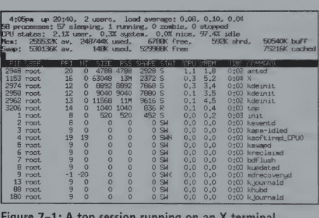

图 7-1：在 X 终端上运行的 top 会话

屏幕会自动刷新，为你提供系统运行状态的最新视图。第一行是运行时间行，显示系统当前时间、自上次重启以来的运行时长、系统上的用户数量以及三个负载平均值。负载平均值是过去 1、5 和 15 分钟内等待运行的进程的平均数量。第二行是进程统计行，显示上次 **top** 屏幕更新时运行的进程总数。该行还显示了处于睡眠、运行、僵尸和停止状态的进程数量。第三行显示 CPU 统计信息（包括用户使用的 CPU 时间百分比）以及 **system**、**nice** 和 **idle** 进程的占比。第四行提供内存统计信息，包括总可用内存、空闲内存、已用内存、共享内存和用于缓冲区的内存。第五行提供虚拟内存或交换空间统计信息，包括总可用交换空间、已用交换空间、空闲交换空间和已缓存的交换空间。其余行与 **ps** 生成的报告类似。

使用 `top`，你可以识别哪些进程占用了最多的资源。你只需查看类似 `ps` 输出中的条目即可。例如，图 7-1 显示一个名为 `artsd` 的进程占用了 0.5% 的 CPU 时间和 1.8% 的内存，使其成为进程列表中资源占用排名第一的进程。资源消耗排名第三的进程竟然是 `top` 工具本身！当你运行 `top` 来监控其他进程时，`top` 自身也会占用一定的资源来运行。不过，你仍然能很好地了解每个进程的资源消耗百分比。

## 使用 vmstat

`vmstat` 工具也能提供关于进程、内存、I/O 和 CPU 活动的有用信息。当你不带任何参数运行该工具时，输出大致如下：

```
 procs    memory    swap  io system  cpu
 r b w  swpd  free buff cache si so bi bo in cs us sy id
 0 0 0     8  8412 45956 52820 0  0   0  0 104 11 66 0  33 0
```

以下是各输出字段的含义：

- `procs` 字段显示等待运行时间的进程数（`r`）、被阻塞的进程数（`b`）以及被换出的进程数（`w`）。
- `memory` 字段显示交换空间、空闲内存、缓冲区内存和缓存内存的数量（单位为 KB）。
- `swap` 字段显示从磁盘换入的内存量（`si`）和换出到磁盘的内存量（`so`）（单位为 KB/秒）。
- `io` 字段显示每秒发送到块设备（`bi`）和从块设备接收（`bo`）的块数。
- `system` 字段显示每秒的中断次数（`in`）和上下文切换次数（`cs`）。
- `cpu` 字段显示总 CPU 时间中用户时间（`us`）、系统时间（`sy`）和空闲时间（`id`）的百分比。

如果你希望 `vmstat` 自动更新信息，可以使用 `vmstat nsec` 的方式运行，其中 `nsec` 是你希望它在两次更新之间等待的秒数。

## 使用 uptime

要快速获取系统因进程负载而产生的状态统计信息，可以运行 `uptime` 工具。该工具显示系统当前时间、自上次重启以来的运行时长、系统上的用户数量以及三个负载平均值。负载平均值是过去 1、5 和 15 分钟内等待运行的进程的平均数量。

#### 记录进程日志

进程日志是系统管理员的得力助手。日志文件通常能为系统管理员提供大量关于某个进程运行状况的线索。几乎所有广泛使用的服务器软件包——sendmail、Apache、named 等——都会写入日志。在日志写入方面有两种趋势。一些服务器程序写入自定义日志文件，另一些则使用一种名为 syslog 的功能，这是 syslogd 守护进程提供的日志记录机制。通常，init 会在运行级别 3（多用户模式）启动 syslogd。syslog 功能为设计用于记录日志的进程提供了集中式的日志记录环境。

通常，大多数系统上已经预配置了 syslog。默认的 Red Hat 安装会安装 syslogd 及其配置文件 `/etc/syslog.conf`，如清单 7-2 所示。

**清单 7-2：syslogd 配置文件 /etc/syslog.conf**

```
# Log all kernel messages to the console.
# Logging much else clutters up the screen.
kern.*   /dev/console

# Log anything (except mail) of level info or higher.
# Don't log private authentication messages!
*.info;mail.none;authpriv.none  /var/log/messages

# The authpriv file has restricted access.
authpriv.*  /var/log/secure

# Log all the mail messages in one place.
mail.* /var/log/maillog

# Everybody gets emergence messages.
*.emerg *

# Save mail and news errors of level err and
# higher in a special file.
uucp,news.crit  /var/log/spooler

# Save boot messages also to boot.log
local7.*        /var/log/boot.log
```

配置文件非常简单。空行和以 # 开头的行会被忽略。`syslogd` 配置行的结构如下：

```
facility.priority  destination
```

其中，`facility` 可以是以下关键字之一：`auth`、`authpriv`、`cron`、`daemon`、`kern`、`lpr`、`mail`、`news`、`syslog`、`user`、`uucp` 和 `local0-local7`。`priority` 可以是以下按严重程度升序排列的关键字之一：`debug`、`info`、`notice`、`warning`、`err`、`crit`、`alert`、`emerg`、`none`。你还可以使用星号（`*`）作为 `facility` 或 `priority` 部分的通配符，分别表示所有设施或所有优先级。你可以使用逗号分隔的列表在同一行中指定多个具有相同优先级的设施。例如：

```
uucp,news.crit  /var/log/spooler
```

此处，来自 `uucp` 和 `news` 设施（即 `uucp` 和 `news` 服务器程序）的严重（`crit`）级别日志条目会被写入 `/var/log/spooler` 文件。

你还可以使用分号分隔的多个 `facility.priority` 对列表，将它们分配到同一个目标。例如：

```
*.info;mail.none;authpriv.none  /var/log/messages
```

此处，所有设施的信息性（`info`）日志条目都会被写入 `/var/log/messages` 文件，但来自 `mail` 和 `authpriv` 设施的信息性消息除外。

默认的 `syslogd` 配置会将日志文件写入 `/var/log` 目录。

#### 使用 tail 监控日志

如果你在服务器进程方面遇到问题，首先确认它是否写入日志文件。如果它写入自己的日志文件或使用了 `syslog` 功能，你可以在进程运行时使用 `tail` 工具来监控日志文件。该工具允许你通过查看文件的末尾部分来监控不断增长的日志文件。例如，要监控 `/var/log/messages` 文件，你可以运行：

```
tail -f  /var/log/messages
```

这样你就可以在新条目写入文件时实时查看。如果你想限制显示的行数，请使用 `--line` 数字选项。例如，要只查看与上一个示例相同的文件的最后三行，你可以运行 `tail -f -n 3 /var/log/messages`。当日志文件添加新行时，你会看到超过三行的内容。


请注意，在非常活跃的系统中，由 `syslogd` 生成的日志文件可能会变得非常大。因此，使用 `logrotate` 工具轮转日志文件非常重要。事实上，默认情况下，`syslogd` 的 RPM 包会在 `/etc/logrotate.d` 目录下安装一个名为 `syslog` 的 `logrotate` 配置文件。该 `logrotate` 设置每周轮转一次日志文件，并保留压缩的历史日志备份。

现在，让我们看看如何安排进程以实现无人值守执行。

#### 进程调度

像所有其他形式的 UNIX 和类 UNIX 操作系统一样，Red Hat Linux 为你提供了两种流行的进程调度工具。在本节中，你将学习如何使用这两种服务。

#### 使用 at

`at` 实用程序允许你将命令排队以在稍后时间执行。例如，要运行名为 `du` 的磁盘使用情况摘要生成器工具，时间定在晚上 8:40，你可以按如下方式运行 `at`：

```
at 20:40
```

`at` 命令会显示一个类似 `at>` 的提示符，你可以按如下方式输入 `du` 命令：

```
at> du -a > /tmp/du.out
```

这里，`du` 的输出被重定向到一个文件。输入命令（本例中是 `du` 命令）后，`at` 会再次显示提示符。你可以按 Ctrl+D 退出。你会看到类似这样的消息：

```
at> <EOT>
warning: commands will be executed using /bin/sh
job 1 at 2003-12-06 20:40
```

这意味着 `at` 已安排 `at` 守护进程 (`atd`) 在 2003年12月6日晚上 8:40 运行 `du -a > /tmp/du.out` 作业。请注意，你可以使用多种时间格式来指定执行时间。例如，除了说 `at 20:40`，你也可以说 `at 8:40 P.M.`。你还可以同时指定日期和时间。例如，`8:40 p.m. Feb 23` 或 `10 a.m.` 或 `+ 5 days` 或 `12:30 P.M.` 或 `tomorrow` 或 `midnight` 或 `noon` 都是有效的时间规范。

要验证你的作业是否在作业队列中，请运行 `atq` 命令。它会显示队列中当前已安排的作业。所有已安排的作业都存储在 `/var/spool/at` 目录中。

如果你是系统上的 root 用户，你可以通过检查 `/var/spool/at` 后台目录中的文件来查看将要运行的命令。

如果你想停止已安排的作业，可以运行 `atrm` 命令来删除你的作业。你需要知道作业序列号才能使用 `atrm` 删除作业。要查找你安排了哪些作业，请运行 `atrm job#` 命令并使用 `atrm job#` 删除任何作业。例如，要删除作业 #1，请运行 `atrm 1`。

已安排的作业通过 `atd` 守护进程运行，`init` 会为运行级别 3（多用户模式）启动该进程。如果你想限制 `at` 工具的使用，可以创建一个 `/etc/at.allow` 文件，并列出所有允许运行它的用户。请记住每行输入一个用户名。任何不在 `allow` 文件中的用户都无法访问 `at` 工具。另一方面，如果你想只拒绝少数用户但允许其他用户，可以创建一个类似的文件 `/etc/at.deny`。此文件中的所有用户名都将被拒绝访问 `at`。

虽然 `at` 为你提供了进程调度能力，但另一个名为 `cron` 的工具比 `at` 使用更广泛，因为它为重复任务提供了更结构化的方式来创建无人值守的进程执行计划。`at` 命令只运行一次命令，而 `cron` 则重复运行命令。

#### 使用 cron

你需要在 Linux 系统中安排许多任务（进程），以便定期无人值守地执行。例如，要轮转 `syslogd` 创建的日志文件，或从 `/tmp` 目录中删除旧文件，你需要每天或每周运行一个进程。`cron` 工具允许你创建一个周期性任务计划。事实上，不久前还没有 `atd` 守护进程，所有 `at` 作业都是通过一个名为 `atrun` 的程序运行的，而 `atrun` 又是通过 `cron` 工具运行的。

`cron` 工具包括 `crond` 守护进程，该进程由 `init` 进程启动。`crond` 守护进程从 `/etc/crontab` 和 `/var/spool/cron` 目录中的文件读取任务计划。后者为允许运行 `cron` 作业的普通用户存储计划文件（通常称为 crontab 或 cron 表）。作为超级用户，你可以在 `/etc/cron.allow` 文件中指定允许运行 `cron` 作业的用户列表。同样，你可以通过在 `/etc/cron.deny` 文件中指定用户名来明确拒绝用户访问 `cron`。这两个文件都使用简单的每行一个用户名的格式。如果你允许用户运行 `cron` 作业，他们可以使用 `crontab` 实用程序来创建作业计划。例如，如果你允许用户运行 `cron` 作业，他们可以运行 `crontab -e` 来创建和编辑他们的 cron 作业条目。`cron` 作业规范具有以下格式：

```
minute(s) hour(s) day(s) month weekday username command argument(s)
```

#### 表 7-4 CRON 时间规范字段

表 7-4 描述了前五个时间规范字段。

| 字段 | 描述 | 范围 |
| --- | --- | --- |
| 分钟(s) | 一小时中的一分钟或多分钟。你可以指定以逗号分隔的分钟列表。 | 0–59 |
| 小时(s) | 一天中的一小时或多小时。你可以指定以逗号分隔的小时列表。 | 0–23，其中 0 是午夜 |
| 天(s) | 一个月中的一天或多天。你可以指定以逗号分隔的天数列表。 | 1–31 |
| 月(s) | 一年中的一月或多月。你可以指定以逗号分隔的月份列表。 | 1–12 |
| 星期(s) | 一周中的一天或多天。你可以指定以逗号分隔的天数列表。 | 1–7，其中 1 是星期一 |

对于表 7-4 中的任何字段，你可以使用星号 (*) 作为通配符。现在让我们看一个例子：

```
01 * * * * root /some/script
```

这表示 /some/script 在每小时、每天、每月和每个工作日的第一分钟运行。该脚本以 root 用户身份运行。要每 10 分钟运行此脚本一次，你可以按如下方式定义一个 cron 作业：

```
*/10 * * * * root /some/script
```

要每月只运行一次相同的脚本，你可以按如下方式安排 cron 作业：

```
01 1 1 * * root /some/script
```

这里，脚本在每月第一天的凌晨 1:01 运行。

系统的默认 cron 作业是 /etc/crontab，其中包括一些有趣的 cron 作业条目，如下所示：

```
SHELL=/bin/bash
PATH=/sbin:/bin:/usr/sbin:/usr/bin
MAILTO=root
```

```
# run-parts
01 * * * * root run-parts /etc/cron.hourly
02 4 * * * root run-parts /etc/cron.daily
22 4 * * 0 root run-parts /etc/cron.weekly
42 4 1 * * root run-parts /etc/cron.monthly
```

你使用这些 cron 作业来运行 /usr/bin 目录中的 run-parts 脚本。该脚本使用前面列表中的四个 cron 作业规范，每小时、每天、每周和每月运行一次。它接受一个目录名作为参数，并运行该目录中的所有脚本或程序。例如，考虑前面列表中的第一个 cron 条目。它表示 run-parts 脚本应该在每小时的第一分钟运行。该脚本接收参数 /etc/cron.hourly。由于该脚本运行此目录中的所有文件，整个过程实际上就像将 /etc/cron.hourly 目录中的所有文件都设置为 cron 作业一样工作。这个技巧允许你将新文件放入 /etc/cron.hourly 目录，并自动将其安排为每小时运行一次。同样，其他三个 cron 条目允许你通过将程序放入 /etc/cron.daily、/etc/cron.weekly 或 /etc/cron.monthly 目录，来每天、每周或每月运行任何程序。这使得几乎可以为所有内容创建 cron 作业，而无需配置 cron 条目。

例如，假设你想每天将系统时间与远程时间服务器同步。你决定使用 rdate 实用程序通过互联网设置时间。要运行的命令如下：

```
/usr/bin/rdate -s time.server.host.tld
```

因为默认的 /etc/crontab 包含一个 cron 条目，允许你通过简单地将脚本或程序放入 /etc/cron.daily 目录来安排每日 cron 作业，所以你可以创建一个简单的 shell 脚本，如下所示，并将其放入 /etc/cron.daily 目录：

```
#!/bin/sh
/usr/bin/rdate -s time.server.host.tld
```

你的工作就完成了。每天凌晨 4:02，你的脚本会与 /etc/cron.daily 目录中的所有其他脚本和程序一起运行。

如你所见，设置 cron 作业比使用 at 命令来排队任务要系统得多，因此，cron 比 at 更受欢迎。事实上，我建议你通过从 /etc/rc.d/rc3.d 目录中删除 atd 条目来禁用 at 工具。


#### 总结

在本章中，你学习了进程是如何创建的；如何使用信号来控制它们；如何使用各种实用程序（如 `ps`、`top`、`vmstat` 和 `uptime`）来监控进程；如何通过 `syslog` 工具记录来自服务器进程的消息；以及如何使用 `at` 和 `cron` 服务来自动化无人值守的进程执行。

## 第8章

#### 网络管理

本章内容

- TCP/IP 网络的基础知识
- 如何对 IP 网络进行分类
- 如何配置服务器的网络接口
- 如何将你的网络划分为子网

没有 TCP/IP 网络的红帽 Linux 服务器有什么用？在本章中，你将学习 TCP/IP 网络的基础知识，并学习如何为你的红帽 Linux 系统配置此类网络。

### TCP/IP 网络基础

如果你对 TCP/IP 网络已经很熟悉，可以跳过或快速浏览本节。

TCP/IP 是网络计算机应用最广泛的通信协议。TCP/IP 网络中的每台计算机都有一个或多个网络接口。每个网络接口都有一个唯一的地址——IP 地址。图 8-1 展示了两个非常简单的 TCP/IP 网络。

请注意，图中第一个网络连接了两台计算机。每台计算机通过一个网络接口连接到网络。在这个例子中，每台计算机都通过一个网络接口卡（NIC）连接。请注意，每个 NIC 都有一个唯一的 IP 地址。同一图中的第二个示例网络显示了两台计算机，每台都有多个网络接口。这些接口中的每一个都有自己唯一的 IP 地址。因此，这里的要点是每个网络接口必须有一个唯一的 IP 然而，由于每台主机可能有多个网络接口，多个 IP 地址可以指向同一台主机。

IP 地址是一个四字节的数字，通常以特殊的点分格式书写：每对字节之间用一个点（即句号）分隔。例如：

```
192.168.10.1
```

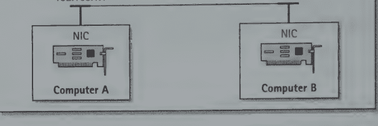

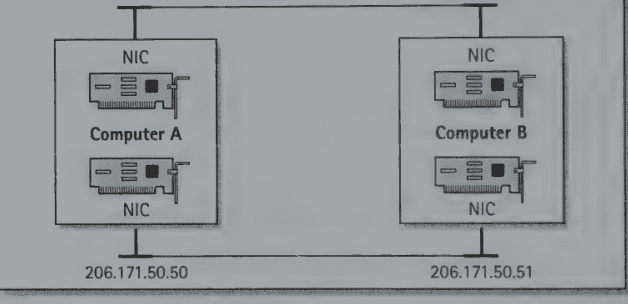

图 8-1：两个简单 TCP/IP 网络的示例

图 8-2 展示了此 IP 地址的十六进制、二进制和十进制格式。

如图所示，每个字节（八位）可以是 0 到 255 之间的任何数字。因此，可能的 IP 地址总数为 2^32，即 4,294,967,296。这是一个相当大的数字，因此在最初设计 TCP/IP 时，开发者认为我们永远不会耗尽 IP 地址。唉！照互联网革命的这种发展趋势，似乎很快我们的家用电器就需要 IP 地址来与中央家庭计算机通信。想象一个拥有 IP 地址的微波炉与互联网服务器交换食谱，这是否太牵强了？其实不然。无论如何，当前的 IP 编号方案，称为 IPv4，已经不再足够，一种新的编号方案 IPv6（或称 IP 下一代或 IPng）可能很快就会成为现实。IPng 是 IP 的一个新版本，旨在作为从 IPv4 演进的一步。IPng 地址长度为 16 字节（128 位）。

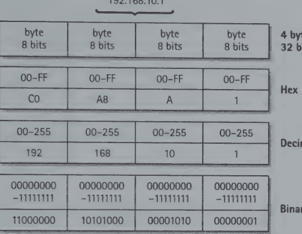

使用 IPng 的可能地址总数为 2^128，即 340,282,366,920,938,463,463,374,607,431,768,211,456。如你所见，IPng 肯定能为我们服务许多个世纪。然而，由于 Linux 内核对 IPng 的支持仍处于实验阶段，我建议你未来对此保持关注。目前，你只需要关心当前的 IPv4 方案。当前的 IP 编号方案允许你创建 IP 网络类别。我将在下一节讨论这些类别。

#### IP 网络分类

如前所述，IP 地址用于标识主机上的网络接口。这些数字不是随机分配的。每个 IP 地址都携带两种类型的信息。要理解这些信息是什么，可以类比电话号码中的区号。例如，(916) 555-5555 是一个美国电话号码，其中 916 是加利福尼亚州萨克拉门托市的区号。当纽约市的某人拨打前面的号码时，电话公司的计算机会将呼叫路由到加利福尼亚州萨克拉门托市的电话。这种呼叫路由使用号码的区号来确定连接路径。IP 地址的工作原理相同。你可以这样理解 IP 地址：

```
IP = { 网络地址 } + { 主机的接口地址 }
```

例如，192.168.2.10 是 192.168.2.0 网络中的一个 IP 地址，接口地址（通常称为*主机地址*）是 .10。换句话说，此 IP 地址指向 192.168.2.0 网络中的网络接口 .10。用于标识网络的 IP 地址部分取决于网络的类别。请注意，当你书写网络地址时，接口标识符字节写为零。

如你所知，32 位 IP 地址覆盖了从 0.0.0.0 到 255.255.255.255（2^32）的地址范围。它们被（有例外地）分类如下：

- A 类网络
- B 类网络
- C 类网络

接下来的部分将解释每种网络分类。

### A 类网络

任何 IP 地址范围从 0.0.0.0 到 127.255.255.255 的都是 A 类 IP 网络。图 8-3 展示了此类别中可能的 IP 地址范围。

在此类别中，IP 地址的最左边字节决定网络地址。你使用其余三个字节来标识主机上的网络接口。这意味着你可以将此类别视为 *n.x.x.x*，其中 *n* 是 0 到 127，而 *x.x.x* 可以是 0.0.0 到 255.255.255 之间的任何三字节数字。换句话说，每个 A 类网络有 2^24（16,777,216）个 IP 地址。请注意，第一个网络是 0.0.0.0。有两个特殊的 A 类网络。

0.0.0.0 网络被保留，用于表示网络的默认路由；127.0.0.0 网络用作回环网络。每台计算机都应使用 127.0.0.1 作为回环接口 IP 地址。你使用此地址在没有物理网络的情况下测试网络软件。例如，你可以运行 Telnet 127.0.0.1 在一台非联网的单机上测试 Telnet 客户端。在这种情况下，Telnet 客户端程序会连接到本地主机。你还会注意到，`/etc/hosts` 文件包含一个条目，将此 IP 地址分配给一个名为 `localhost` 的主机名——回环网络中唯一的主机名。因为这些特殊的 A 类网络具有特殊含义，并不用于标识任何物理 A 类网络，所以从技术上讲，只有 126 个 A 类网络。另请注意，10.0.0.0 网络也是保留的。

图 8-3：A 类 IP 网络

| 网络 | 总地址空间 | 可用地址空间 |
|---------|---------------------|----------------------|
| 0.0.0.0 | 0.0.0.0 – 0.255.255.255 | 0.0.0.1 到 0.255.255.254 |
| 1.0.0.0 | 1.0.0.0 – 1.255.255.255 | 1.0.0.1 到 1.255.255.254 |
| 2.0.0.0 | 2.0.0.0 – 2.255.255.255 | 2.0.0.1 到 2.255.255.254 |
| 3.0.0.0 | 3.0.0.0 – 3.255.255.255 | 3.0.0.1 到 3.255.255.254 |
| ... | ... | ... |
| 126.0.0.0 | 126.0.0.0 – 126.255.255.255 | 126.0.0.1 到 126.255.255.254 |
| 127.0.0.0 | 127.0.0.0 – 127.255.255.255 | 127.0.0.1 到 127.255.255.254 |

### B 类网络

任何 IP 地址范围从 128.0.0.0 到 191.255.255.255 的都是 B 类网络。图 8-4 展示了此类别中可能的 IP 地址范围。

图 8-4：B 类 IP 网络

| 网络 | 总地址空间 | 可用地址空间 |
|---------|---------------------|----------------------|
| 128.0.0.0 | 128.0.0.0 – 128.0.255.255 | 128.0.0.1 到 128.0.255.254 |
| 128.1.0.0 | 128.1.0.0 – 128.1.255.255 | 128.1.0.1 到 128.1.255.254 |
| ... | ... | ... |
| 128.255.0.0 | 128.255.0.0 – 128.255.255.255 | 128.255.0.1 到 128.255.255.254 |
| ... | ... | ... |
| 191.255.0.0 | 191.255.0.0 – 191.255.255.255 | 191.255.0.1 到 191.255.255.254 |


在该类别中，最左侧的两个字节决定网络。这意味着你可以将此类别视为 *n1.n2.x.x* 的形式，其中 *n1* 的范围是 128 到 191，*n2* 的范围是 0 到 255，*x.x* 可以是 0.0 到 255.255 之间的任意两个字节的数。每个 B 类网络有 $2^{16}$（65,536）个 IP 地址。从 128.0.0.0 到 191.255.0.0 之间，共有 $2^{14}$（16,384）个 B 类网络。请注意，172.16.0.0 到 172.31.0.0 的 B 类网络是保留的。

#### C 类网络

任何从 192.0.0.0 到 223.255.255.255 的 IP 地址都是一个 C 类 IP 网络。图 8-5 显示了此类别中 IP 地址的可能范围。

| 网络 | 总地址空间 | 可用地址空间 |
|---|---|---|
| 192.0.0.0 | 192.0.0.0 – 192.0.0.255 | 192.0.0.1 到 192.0.0.254 |
| 192.0.1.0 | 192.0.1.0 – 192.0.1.255 | 192.0.1.1 到 192.0.1.254 |
| ... | ... | ... |
| 192.0.255.0 | 192.0.255.0 – 192.0.255.255 | 192.0.255.1 到 192.0.255.254 |
| 192.1.0.0 | 192.1.0.0 – 192.1.0.255 | 192.1.0.1 到 192.1.0.254 |
| ... | ... | ... |
| 192.255.255.0 | 192.255.255.0 – 192.255.255.255 | 192.255.255.1 到 192.255.255.254 |
| 193.0.0.0 | 193.0.0.0 – 193.0.0.255 | 193.0.0.1 到 193.0.0.254 |
| ... | ... | ... |
| 223.255.255.0 | 223.255.255.0 – 223.255.255.255 | 223.255.255.1 到 223.255.255.254 |

**图 8-5：C 类网络地址**

在该类别中，最左侧的三个字节决定网络。因此，你可以将此类别视为 *n1.n2.n3.x* 的形式，其中 *n1* 的范围是 192 到 223，*n2* 的范围是 0 到 255，*n3* 的范围是 0 到 255，*x* 可以是 0 到 255 之间的单个字节的数。每个 C 类网络有 $2^8$（256）个 IP 地址。从 192.0.0.0 到 223.255.255.0 之间，共有 $2^{21}$（2,097,152）个 C 类网络。请注意，小于 223.255.255.255 的地址（即 224.0.0.0 到 255.255.255.255）是保留的。

图 8-6 展示了快速判断一个 IP 地址属于哪个网络的最简便方法之一。

#### IP 地址的最左侧字节

| 二进制 | 十六进制 | 十进制 |
|---|---|---|
| 0000 0000 | 00 | 0 |
| 0111 1110 | 7F | 126 |

A 类

| 二进制 | 十六进制 | 十进制 |
|---|---|---|
| 1000 0000 | 80 | 128 |
| 1011 1111 | BF | 191 |

B 类

| 二进制 | 十六进制 | 十进制 |
|---|---|---|
| 1100 0000 | C0 | 192 |
| 1101 1111 | DF | 223 |

C 类

图 8-6：识别 IP 网络的速查表

你只需查看 IP 地址的最左侧字节，就能确定其所属的网络类别。例如，A 类网络中的 IP 地址，其最左侧字节的值始终在 0 到 126 之间（127 是环回网络）。同样，B 类网络中的 IP 地址，其最左侧字节的值在 128 到 191 之间。最后，C 类网络中的 IP 地址，其最左侧字节的值在 192 到 223 之间。

你还应该知道，在任何网络（A、B 或 C 类）中，第一个和最后一个 IP 地址都不能用作网络接口的 IP 地址。例如，206.171.50.0 是一个 C 类网络，其范围是 206.171.50.0 到 206.171.50.255。然而，206.171.50.0 地址是网络地址，而 206.171.50.255 地址是该网络的广播地址；因此，你不应该将这两个 IP 地址分配给任何网络接口。

至此，你已经了解了大量关于 IP 地址的知识；你应该能够相当轻松地判断一个 IP 地址属于哪个类别。现在，让我们看看如何配置你的 Red Hat Linux 服务器上的网络接口。

#### 配置网络接口

由于本书主要涉及 Red Hat Linux 操作系统的服务器方面，我可以有把握地猜测你将会把 Red Hat Linux 计算机连接到以太网。这个以太网可以是你自己的局域网（LAN），也可以是 ISP 的局域网（例如，托管服务器）。我还将假设你已经安装了一个与 Red Hat Linux 兼容的以太网适配器卡（即网卡，或 NIC）。要了解哪些网卡与你的 Red Hat Linux 版本兼容，请参阅 Red Hat 网站的硬件兼容性部分（http://hardware.redhat.com/hcl/）。通常，大多数流行的网卡都能在 Red Hat Linux 上正常工作。

> 你可能在 Red Hat Linux 安装阶段已经配置了网络，但我仍然建议你阅读本节，因为你将来可能需要更改网络配置。

你可以通过几种方式配置网络。首先，我将讨论命令行方法，因为它是最强大的（在你只需要依赖你最喜欢的文本编辑器，而无需依赖任何特殊工具的意义上）。

## 使用传统方法配置网卡

传统方法是我进行所有类型配置的首选方法，因为它迫使我确切地知道配置某事物需要什么。我的座右铭是：一旦你知道如何用“老式”方法做事，你就可以用你喜欢的任何方式去做。

## 配置新的网络接口

在你做任何事情之前，运行 dmesg 程序（或查看 /var/log/dmesg 文件）以确定当前的 Linux 内核是否识别你的网卡。如果内核不识别你的网卡，你可能有一个不兼容的设备。如果 Linux 内核识别你的网卡，你应该在 dmesg 输出中看到一些与内核发现你的网络设备相关的行。例如，假设我在一个装有通用（NE2000 兼容）以太网卡的 Red Hat Linux 系统上运行以下命令：

```
dmesg | grep --i eth
```

此命令输出以下结果：

```
NE*000 ethercard probe at 0x340: 00 c0 f6 98 37 37
eth0: NE2000 found at 0x340, using IRQ 5.
```

这告诉我内核已找到我的 NE2000 兼容网卡，并且正在使用中断请求线（IRQ）5，以及从 0x340 开始的 I/O 地址空间。还需注意，此设备名为 eth0（即以太网设备 0）。一旦确认内核识别了你的网络设备，你就可以开始配置它了。在此示例中，我假设你想要配置第一个以太网设备 eth0，并且你想要一个持久配置。

我所说的持久配置是指你每次启动计算机时都使用的配置。你可以借助 /etc/rc.d/init.d/network 脚本来完成此操作。当此脚本链接（链接名称为 Sxxnetwork；*xx* 是任意数字）到默认运行级别目录（可能是 /etc/rc.d/rc3.d）时，/etc/rc.d/init.d/network 脚本会在启动时运行。此脚本通过使用存储在 /etc/sysconfig 目录中的文件来加载网络接口。现在让我们看看如何配置 eth0 使其在启动时自动启动。

你需要修改的第一个文件是 /etc/sysconfig/network。清单 8-1 展示了该文件的一个示例。

#### 清单 8-1：/etc/sysconfig/network 文件

```
NETWORKING=yes
FORWARD_IPV4=yes
HOSTNAME=picaso.nitec.com
DOMAINNAME=nitec.com
GATEWAY=206.171.50.49
GATEWAYDEV=eth0
```

NETWORKING=yes 这一行表明你想要启用网络支持。

如果你想允许 IP 数据包在你的 Red Hat Linux 服务器之间转发，FORWARD_IPV4=yes 应设置为 yes。这仅当 Red Hat Linux 计算机将充当网络的网关或路由器（在后面的部分讨论）时才需要。例如，如果你计划在计算机上安装代理服务器软件以允许你局域网上的其他计算机访问 Web，你应该将 FORWARD_IPV4 选项设置为 yes。另一方面，如果你只是打算将此计算机用作 ISP 网络上的托管 Web 服务器，你可以通过将此选项设置为 no 来关闭 IP 转发。

接下来的两行指定了计算机的主机名和网络的域名。你在此处指定的主机名必须包含在 DOMAINNAME 行中指定的域名。换句话说，不要指定一个与你在 DOMAINNAME 行中声明的域名不同的主机名。

接下来的两行指定了确定计算机默认网关所需的信息。*默认网关* 是传输数据包到你的计算机和从你的计算机传出的计算机（或路由器）。例如，如果你打算将 Red Hat Linux 计算机连接到你的局域网，其中有一个 ISDN 路由器将局域网连接到互联网，则将 ISDN 路由器的网络接口的 IP 地址指定为默认网关。GATEWAYDEV 在你有多个网络接口时很重要。如果你只有一个以太网设备，你应该始终将其设置为 eth0。如果你有多个以太网设备（eth0、eth1 等），你必须使用连接到默认网关的接口名称。

一旦你配置了 /etc/sysconfig/network 文件，你就可以在 /etc/sysconfig/network-scripts 目录中创建网络接口文件了。网络接口文件使用 ifcfg-interface 作为命名约定。例如，eth0 的网络接口文件名是 ifcfg-eth0。清单 8-2 给出了此文件的一个示例。


#### 清单 8-2：/etc/sysconfig/network-scripts/ifcfg-eth0 文件

```
DEVICE=eth0
IPADDR=206.171.50.50
NETMASK=255.255.255.240
NETWORK=206.171.50.48
BROADCAST=206.171.50.63
ONBOOT=yes
```

在配置此文件中的信息之前，您必须从互联网服务提供商处获取网络地址、网络掩码、主机上网络接口的 IP 地址以及广播地址。您将在后续章节中了解更多关于网络掩码和广播地址的信息。

此文件的第一行指定了设备名称。第二行指定了网络掩码 (netmask) 号。第三行指定了网络的 IP 地址。第五行指定了广播地址。设置第六行所示的 ONBOOT 选项为 yes，如果您希望网络接口在启动后处于活动状态（即已启动）。

一旦您配置了这两个文件，就可以启动网络了。启动您刚刚配置的接口的最简单方法是运行：

```
/etc/sysconfig/network-scripts/ifup eth0
```

ifup 脚本以设备名称作为参数并启动它。它还会为网络创建一条默认路由。运行此命令后，您可以使用 ifconfig 程序查看接口是否已启动并正在运行。要查看设备 eth0 是否已启动，请运行以下命令：

```
ifconfig eth0
```

您应该会看到类似于此的输出：

```
eth0 Link encap:Ethernet HWaddr 00:C0:F6:98:37:37
inet addr:206.171.50.50 Bcast:206.171.50.63 Mask:255.255.255.240
UP BROADCAST RUNNING MULTICAST MTU:1500 Metric:1
RX packets:9470 errors:0 dropped:0 overruns:0 frame:0
TX packets:7578 errors:0 dropped:0 overruns:0 carrier:0 collisions:0
Interrupt:5 Base address:0x340
```

此处 ifconfig 报告称网络接口设备 eth0 具有互联网地址 (inet addr) 206.171.50.50、广播地址 (Bcast) 206.171.50.63 和网络掩码 (Mask) 255.255.255.240。其余信息显示如下：此接口到目前为止接收了多少数据包 (RX packets)；此接口到目前为止传输了多少数据包 (TX packets)；到目前为止发生了多少不同类型的错误；此设备正在使用哪个中断地址线；正在使用哪个 I/O 基地址；等等。

您可以不带任何参数运行 `ifconfig`，以获取所有已启动网络设备的完整列表。请注意，`ifup` 脚本使用 `ifconfig` 来启动接口。例如：

```
ifconfig eth0 206.171.50.50 netmask 255.255.255.240 \
broadcast 206.171.50.63
```

上述命令以 IP 地址 206.171.50.50 启动 `eth0`。您也可以使用 `ifconfig` 命令快速关闭接口。例如：

```
ifconfig eth0 down
```

此命令会关闭 `eth0` 接口。一旦您的接口启动并正在运行，您应该尝试联系网络中的计算机。您可以使用 `ping` IP 地址命令来查看是否可以使用新接口联系同一网络中的主机。

如果在安装期间未正确设置 `/etc/resolv.conf` 文件，您将无法使用主机名 ping 主机。`/etc/resolv.conf` 文件内容如下所示：

```
search nitec.com
nameserver 206.171.50.50
```

此文件在 Red Hat Linux 安装过程中设置。如果您为名称服务器指定了无效的 IP 地址，您的计算机将无法联系名称服务器。因此，如果您的网络接口已启动，但无法使用主机名 ping 主机，请尝试使用主机的 IP 地址（实际上是网络接口地址）。如果您能 ping 通网络中的另一台主机，则您的接口设置正确：只需更正 `nameserver` 行，修正名称服务器的 IP 地址即可。

然而，如果您既不能通过 IP 地址也不能通过主机名 ping 通主机，您可能存在路由问题。如果您没有使用前面所示的 `ifup` 脚本，而是使用了 `ifconfig` 来启动接口，则需要手动创建指向网络的默认路由和默认网关。要为您的网络创建默认路由，请使用 `route` 命令，如下所示：

```
route add --net *network_address* netmask *netmask* dev *device*
```

例如，要为 206.171.50.48 网络（网络掩码为 255.255.255.240，接口为 `eth0`）创建默认路由，我可以运行：

```
route add -net 206.171.50.48 netmask 255.255.255.240 dev eth0
```

要设置默认网关，您可以运行 `route` 命令，如下所示：

```
route add default gw *gateway_address* dev *device*
```

例如，要将默认网关地址设置为 206.171.50.49，我可以运行以下命令：

```
route add default gw 206.171.50.49 dev eth0
```

您可以使用以下命令验证您的网络路由和默认网关是否在路由表中正确设置：

```
route -n
```

以下是上述命令输出的示例：

```
Kernel IP routing table
Destination   Gateway         Genmask         Flags Metric Ref  Use Iface
206.171.50.48 0.0.0.0   255.255.255.240 U     0      0     6 eth0
127.0.0.0     0.0.0.0   255.0.0.0       U     0      0     5 lo
0.0.0.0       206.171.50.49   0.0.0.0         UG    0      0    17 eth0
```

此时，您应该使用 ping 程序来 ping 您网络内部和外部的主机。如果成功，则您的网络已启动。如果您仍然没有从 ping 尝试中得到任何回复，则应返回本节开头，并确保您已按照建议的所有步骤操作。

在此，您了解了如何配置网络接口，以便将单个 IP 地址与其关联。我之前告诉过您，每个接口必须具有其唯一的 IP 地址，但您是否曾想过是否可以将多个 IP 地址与单个接口关联？是的，您可以，使用 Linux 内核的 IP 别名模块。方法如下。

#### 使用单个网络接口别名化多个 IP 地址

创建 IP 别名的第一步是确定您是否已加载 IP 别名模块到内核中。检查此问题的最简单方法是运行 `lsmod` 命令，并查看输出中是否列出了 `ip_alias.o`。如果您没有看到此模块，并且您没有自定义编译内核以将此模块包含为内核的一部分，您可以尝试使用以下命令加载该模块：

```
/sbin/insmod /path/to/ip_alias.o
```

在此命令中，*/path/to/ip.alias.o* 是 `ip_alias.o` 模块的实际路径。您可以使用 `locate ip_alias.o` 来定位其在您系统中的路径。通常，路径是 `/lib/modules/kernel version number/ipv4/ip_alias.o`。一旦您加载了 `ip_alias.o` 模块，请运行 `lsmod` 以确保它已加载。现在，要为 eth0 设备创建一个别名，请执行以下操作：

- 将您现有的 /etc/sysconfig/network-scripts/ifcfg-eth0 文件复制到 /etc/sysconfig/network-scripts/ifcfg-eth0:0，以创建一个名为 eth0:0 的别名设备。
- 修改该文件，使内容与清单 8-3 中的行相似。当然，您的网络、netmask 和 IP 地址会有所不同。确保只更改 DEVICE 和 IPADDR 行。您应将 DEVICE 行设置为 eth0:0，并将 IPADDR 设置为您希望用作 eth0 已分配地址别名的 IP 地址。

#### 清单 8-3：/etc/sysconfig/network-scripts/ifcfg-eth0:0 文件

```
DEVICE=eth0:0
USERCTL=no
ONBOOT=yes
BOOTPROTO=
BROADCAST=206.171.50.63
NETWORK=206.171.50.48
NETMASK=255.255.255.240
IPADDR=206.171.50.58
```

- 要启动别名设备，运行 `ifconfig eth0:0 up`，您应该会看到类似于此处所示的输出：

```
lo Link encap:Local Loopback
    inet addr:127.0.0.1 Bcast:127.255.255.255 Mask:255.0.0.0
    UP BROADCAST LOOPBACK RUNNING MTU:3584 Metric:1
    RX packets:501 errors:0 dropped:0 overruns:0 frame:0
    TX packets:501 errors:0 dropped:0 overruns:0 carrier:0
    collisions:0

eth0 Link encap:Ethernet HWaddr 00:C0:F6:98:37:37
    inet addr:206.171.50.50 Bcast:206.171.50.63
Mask:255.255.255.240
    UP BROADCAST RUNNING MULTICAST MTU:1500 Metric:1
    RX packets:2 errors:0 dropped:0 overruns:0 frame:0
    TX packets:2 errors:0 dropped:0 overruns:0 carrier:0
    collisions:4
    Interrupt:5 Base address:0x340

eth0:0 Link encap:Ethernet HWaddr 00:C0:F6:98:37:37
    inet addr:206.171.50.58 Bcast:206.171.50.63
Mask:255.255.255.240
    UP BROADCAST RUNNING MTU:1500 Metric:1
```


```
RX packets:9 errors:0 dropped:0 overruns:0 frame:0
TX packets:9 errors:0 dropped:0 overruns:0 carrier:0
collisions:0
```

如你所见，eth0:0设备已启动并运行。你可以用同样的方式为其他任何以太网设备创建别名。那么，IP别名有什么用呢？以下是几个实际用途：

-   假设你有两台提供Web服务的机器，突然其中一台因为某些问题变得不可用。或者，你可能需要将某台机器停机几天进行升级工作。在这种情况下，你可以使用IP别名来接管那台不可用机器的IP地址。你只需添加虚拟Web站点，来为那台故障或不可用系统上托管的网站提供服务，直到它恢复正常为止。
-   许多较旧的Web浏览器不使用基于名称的虚拟主机功能。在这种情况下，你可以使用IP别名来创建基于IP的虚拟网站。

现在，让我们看看如何避免传统的配置过程，用更简便的方法来完成。


> 尽管以下方法与传统方法的步骤相比可能非常简单，但我强烈推荐后者，因为网络管理员必须了解事物从内到外的工作原理。我建议你只有在掌握了传统的操作方法之后，才使用以下方法。

#### 使用X Windows网络配置工具

Red Hat Linux 8自带了一个新的基于X Windows的网络配置工具，名为redhat-config-network。你可以从GNOME菜单中点击System Settings->Network菜单来运行这个程序。或者，你可以在“运行程序”菜单中输入/usr/bin/redhat-config-network，也可以从X终端窗口运行此命令。一旦你启动这个程序，它会显示一个类似图8-7的屏幕。

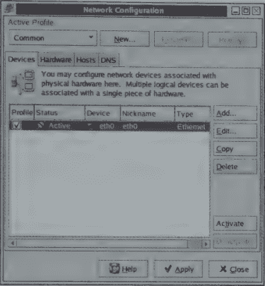

图8-7：Red Hat Linux网络配置工具

从这个屏幕，你可以配置网络设备、添加/修改/删除网络接口硬件、设置主机名、IP地址、DNS信息等。屏幕显示一个名为eth0（昵称）的网络设备是活动的。要查看系统中安装了多少块网络接口卡，只需点击Hardware标签页，它会显示一个类似图8-8的屏幕。

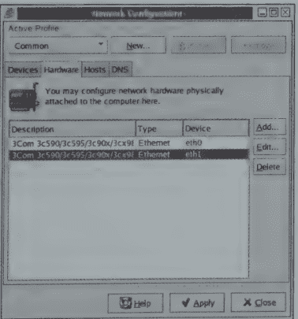

图8-8：Red Hat Linux检测到的网络设备列表

正如你在屏幕上看到的，我有两张3COM网卡，但如果你还记得前一个屏幕，只有一张被配置并激活了。要激活第二张网卡，我需要返回到Devices标签页窗口，使用Add按钮将其添加。使用类似向导的界面添加新网卡变得非常简单。

接下来看看Hosts标签页，它显示一个类似图8-9的屏幕。

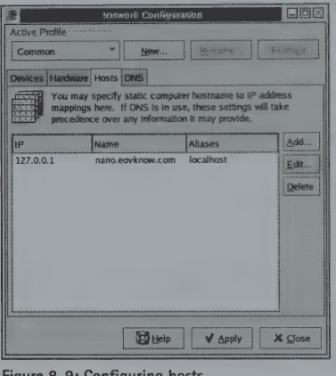

图8-9：配置主机

默认情况下，它显示与本地回环接口IP（127.0.0.1）关联的主机名。请注意，127.0.0.1使用了一个名为localhost的别名，这是回环IP的标准主机名。你可以根据需要添加、修改或删除主机名。进行更改时，请确保点击Apply按钮使更改生效。更改存储在/etc/hosts文件中。

接下来看看DNS标签页，它显示一个类似图8-10的屏幕。

你可以为系统指定主DNS、次DNS，甚至第三DNS服务器的IP地址。切勿为DNS服务器使用主机名，因为DNS服务器的目的是将主机名解析为IP地址；如果DNS服务器的名称本身需要被解析，那么系统就无法联系到DNS服务器了！

最后，你应该看看这个工具的内置帮助文档。主帮助屏幕可以通过点击Help按钮访问，如图8-11所示。

帮助信息使用名为yelp的GNOME帮助浏览器显示。

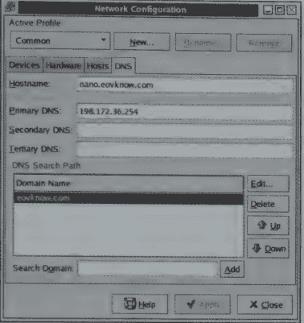

**图8-10：配置DNS**

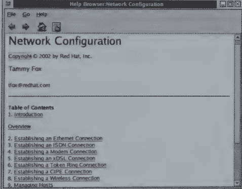

**图8-11：帮助信息**

#### 为什么使用默认网关？

看看图8-12。它显示了两个网络：网络A（192.168.1.0）和网络B（192.168.2.0）。

#### 网络A 192.168.1.0

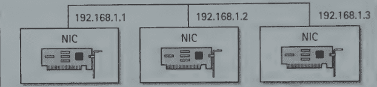

#### 网络B 192.168.2.0

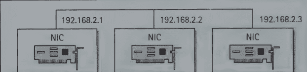

图8-12：两个独立的IP网络

这两个网络是完全分开的。任一网络中的计算机都可以正常看到同一网络中的主机。网络A中使用192.168.1.1计算机的用户可以通过使用其他两台计算机的网络接口IP地址来ping它们。然而，该用户无法访问网络B上的任何主机计算机。为什么？网络A中的数据包无法到达网络B。如何将这两个网络连接起来？简单——通过使用网关计算机或路由器。图8-13展示了如何操作。

网络中的新计算机就是网关计算机。它有两个网络接口。连接到A网络的网络接口的IP地址是192.168.1.100。

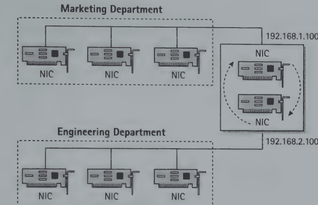

只有当你想与两个不同的网络通信时，才需要网关计算机。请注意，网关计算机不一定是PC或工作站；它可以是专门的计算机硬件，比如路由器。

既然你知道了如何使用网关连接两个不同的网络，接下来看看如何通过创建子网络或子网来划分网络。

#### 将网络划分为子网络

当你将一个大网络划分为较小的网络（子网）时，它在管理上会更简单，性能上也会更好。看看图8-14中的网络。

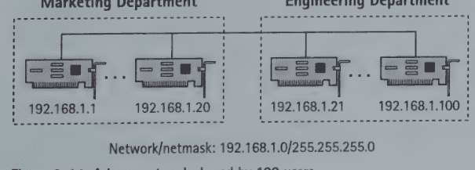

这个网络有100台主机计算机连接到同一个网络192.168.1.0。因为所有计算机共享同一根物理网络电缆，在高峰时段流量负载可能会相当重。例如，如果所有营销人员与工程部门的工程师同时开始使用网络，情况会变得非常缓慢，因为每台主机都必须共享网络带宽。那么解决方案是什么？子网络。看看图8-15。

网络/子网掩码：192.168.1.0/255.255.255.128

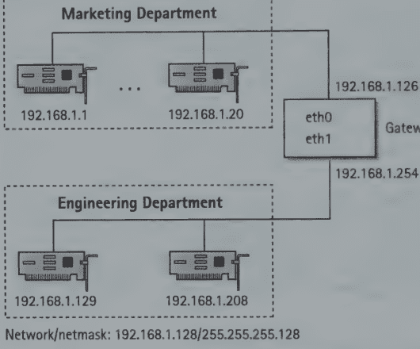

图8-15：将一个大网络划分为子网络

这里你将192.168.1.0网络划分为两个网络——192.168.1.0和192.168.1.128。这两个子网通过一个具有两个网络接口的网关（或路由器）连接。当你正确配置这两个网络上的每台主机计算机时，你就分离了网络之间的流量。例如，当营销部门的一名用户想要与同一部门的另一台计算机通信时，这两台计算机之间的网络流量仍然保持在其网络内。工程部门的情况也是如此。但是，当来自不同部门的用户想要相互通信时，这是允许的。网关计算机在这些网络之间转发这种跨网络流量。结果是一个更快的网络，因为并非所有用户都在竞争相同的带宽。

当你需要将像192.168.1.0这样的完整网络划分为子网时，你需要一种方法让计算机判断哪个IP地址属于哪个网络。

例如，营销部门中网络接口为192.168.1.1的计算机需要知道192.168.1.129是否在同一网络中，或者它是否应该将目标为192.168.1.129的数据包发送到网关计算机进行进一步的转发任务。它判断一个IP地址是否属于其自身子网的方法是使用一个称为*网络掩码*或*netmask*的掩码。

在从一个网络创建子网之前，你需要了解如何创建netmask。例如，假设你想为网络192.168.1.0确定网络掩码。这个地址的二进制格式如下所示：

```
11000000.10101000.00000001.00000000
```

因为这是一个C类地址，网络位是前24位（三个字节）。要创建掩码，你必须将这些位设置为1，将剩余的（主机接口）位设置为0。所以netmask看起来如下：

```
11111111.11111111.11111111.00000000
```

以十进制格式表示，这是255.255.255.0。创建netmask时，你只需要记住网络位全是1，主机位全是0。例如，A类网络10.0.0.0的netmask是255.0.0.0，类似地，B类网络129.1.0.0的netmask是255.255.0.0。

在TCP/IP网络中，当一台计算机想要向一个IP地址发送数据包时，它通过执行按位与操作来判断该IP地址是否为本地地址。例如，要判断192.168.1.1是否在子网掩码为255.255.255.0的网络中是本地的，主机会进行以下操作：

```
           二进制                           十进制
    11000000.10101000.00000001.00000001 => 192.168.1.1
AND 11111111.11111111.11111111.00000000 => 255.255.255.0
    -----------------------------------------------
    11000000.10101000.00000001.00000000 => 192.168.1.0
```

如你所见，按位与操作返回了IP地址192.168.1.1的网络地址（192.168.1.0）。因为主机会知道它属于哪个网络，所以它很容易就能判断如何处理发往此IP地址的数据包。

因为你很可能会经常处理C类网络，我在本节的所有示例中都使用这个类别。

当C类网络完整保留时，netmask是255.255.255.0。要将网络划分为子网，你需要创建一个新的netmask。你通过将默认C类netmask（255.255.255.0）中主机接口部分的一个或多个位设置为1来完成此操作。考虑当前示例的C类网络192.168.1.0。通过将地址中主机接口编号部分的最高有效位设置为1，你得到以下结果：
```


11111111.11111111.11111111.10000000 => 255.255.255.128

这是一个将网络一分为二的新子网掩码。所有从 192.168.1.0 到 192.168.1.127 的 IP 地址属于 192.168.1.0 网络，其余的 IP 地址 192.168.1.128 到 192.168.1.255 属于 192.168.1.128 网络。两个网络都使用 255.255.255.128 子网掩码。例如，要确定名为 192.168.1.10 的 IP 地址属于哪个网络，可以执行以下按位与运算：

```
         Binary                                    Decimal
    11000000.10101000.00000001.00001010 => 192.168.1.10
AND 11111111.11111111.11111111.10000000 => 255.255.255.128
    ------------------------------------    -----------------
    11000000.10101000.00000001.00000000 => 192.168.1.0
```

如你所见，子网掩码 255.255.255.128 告诉你给定的 IP 地址属于 192.168.1.0 网络。现在看看名为 192.168.1.200 的 IP 地址属于哪个网络：

```
         Binary                                    Decimal
    11000000.10101000.00000001.11001000 => 192.168.1.200
AND 11111111.11111111.11111111.10000000 => 255.255.255.128
    ------------------------------------    -----------------
    11000000.10101000.00000001.10000000 => 192.168.1.128
```

此输出表明，相同的子网掩码为给定的 IP 地址给出了不同的网络地址（192.168.1.128）。使用此子网掩码，你有效地将 192.168.1.0 网络划分为两个子网：192.168.1.0 和 192.168.1.128。

由于一个完整的 C 类网络有 256 个可能的 IP 地址，因此各个子网拥有 128 个 IP 地址。但并非所有地址都可用作主机（接口）IP 地址。在一个完整的 C 类网络（如 192.168.1.0，子网掩码为 255.255.255.0）中，你将 192.168.1.0 用作网络地址，将 192.168.1.255 用作广播地址。广播地址用于与网络中的所有主机通信，因此这两个地址在某种意义上是保留的。因此，在一个完整的 C 类网络中，你有 254 个（255 - 网络 IP 地址 - 广播 IP 地址）可用的 IP 地址。类似地，当网络被细分时，每个子网都会获得一个网络地址和一个广播地址；因此，当一个 C 类网络被划分为两个子网时，四个 IP 地址变得无法用于主机寻址。在本例中，情况如下所示：

```
Network: 192.168.1.0
Netmask: 255.255.255.128
First usable host IP address: 192.168.1.1
Last usable host IP address: 192.168.1.126
Broadcast address: 192.168.1.127

Network: 192.168.1.128
Netmask: 255.255.255.128
First usable host IP address: 192.168.1.129
Last usable host IP address: 192.168.1.254
Broadcast address: 192.168.1.255
```

你可能想知道可以从一个完整的 A 类、B 类或 C 类网络中创建多少个子网。公式如下：

```
number of subnets = 2^(host bits - 1)
```

例如，C 类网络中的主机位数为 8（最后一个字节），这意味着从技术上讲，你可以从单个 C 类网络中创建 2^7（128）个等大小的子网。然而，由于 IP 地址的损失（作为网络地址和广播地址），大多数网络管理员不会从 C 类网络中创建超过 16 个子网。

如果你是子网划分概念的新手，你可能会发现 ipcalc 工具非常有用。例如，假设你想确保子网计算的结果符合预期。你可以使用该工具来确认你的数字是正确的。假设你想确认图 8-15 中使用的子网是否正确。你可以向 ipcalc 提供 192.168.1.1-254 范围内的任何 IP 以及子网掩码，来确定该 IP 地址属于哪个网络。以下是两个示例：

```
ipcalc --broadcast --network 192.168.1.1 255.255.255.128
BROADCAST=192.168.1.127
NETWORK=192.168.1.0

ipcalc --broadcast --network 192.168.1.129 255.255.255.128
BROADCAST=192.168.1.255
NETWORK=192.168.1.128
```

在第一个示例中，ipcalc 程序被要求使用 255.255.255.128 子网掩码显示 IP 地址 192.168.1.1 的广播地址（使用 `--broadcast` 参数）和网络地址（使用 `--network` 参数）。它返回的广播地址为 192.168.1.127，网络地址为 192.168.1.0。这是正确的。在第二个示例中，该程序被要求显示属于网络另一半的 IP 的相同信息，并且它显示了正确的地址。

既然你已经了解了大量关于如何创建子网的知识，接下来让我们看看创建图 8-15 中示例子网所涉及的内容。

#### 网关计算机配置

图 8-15 中的网关计算机必须有两个网络接口。其中一个接口必须连接到每个子网。该计算机的 /etc/sysconfig/network 文件如清单 8-4 所示。

**清单 8-4：/etc/sysconfig/network 文件**

```
NETWORKING=yes
FORWARD_IPV4=yes
HOSTNAME=gateway.nitec.com
DOMAINNAME=nitec.com
```

其中最重要的设置是 `FORWARD_IPV4=yes`，它在内核中启用 IP 转发。

> **提示**
>
> 你必须在内核中编译 IP 转发支持。你可以使用 `cat /proc/sys/net/ipv4/ip_forward` 命令来查看运行中的内核是否启用了 IP 转发。如果输出为 1，则 IP 转发已开启；值为 0 表示 IP 转发已关闭。你也可以通过使用 `echo n > /proc/sys/net/ipv4/ip_forward` 命令推送值 1 或 0 来开启或关闭它，其中 *n* 为 1 或 0。

清单 8-5 和 8-6 显示了两个接口（eth0 和 eth1）文件。

**清单 8-5：/etc/sysconfig/network-scripts/ifcfg-eth0 文件**

```
DEVICE=eth0
IPADDR=192.168.1.126
NETMASK=255.255.255.128
NETWORK=192.168.1.0
BROADCAST=192.168.1.127
ONBOOT=yes
```

**清单 8-6：/etc/sysconfig/network-scripts/ifcfg-eth1 文件**

```
DEVICE=eth1
IPADDR=192.168.1.254
NETMASK=255.255.255.128
NETWORK=192.168.1.128
BROADCAST=192.168.1.255
ONBOOT=yes
```

设置好这些文件并使接口启动运行（通过重启或使用 ifup 命令）后，你需要使用以下 route 命令为两个网络创建两个默认路由：

```
route add -net 192.168.1.0   netmask 255.255.255.128 dev eth0
route add -net 192.168.1.128 netmask 255.255.255.128 dev eth1
```

每个上述 route 命令都确保发往指定网络的数据包通过指定的接口设备传输。你可以将这些 route 命令添加到 /etc/rc.d/rc.local 文件中，以便在系统重启时始终添加这些路由。

#### 主机计算机配置

你必须配置每个子网上的每台主机计算机，使每台计算机都知道网络地址、本地子网掩码和网关信息。例如，假设所有主机计算机也是 Linux 工作站，每台都有一个以太网接口设备（eth0），则 192.168.1.0 网络上任何主机计算机的 /etc/sysconfig/network 文件如清单 8-7 所示。

**清单 8-7：/etc/sysconfig/network 文件**

```
NETWORKING=yes
FORWARD_IPV4=yes
HOSTNAME=marketing-1.nitec.com
DOMAINNAME=nitec.com
GATEWAY=192.168.1.126
GATEWAYDEV=eth0
```

该计算机上的接口文件如清单 8-8 所示。

**清单 8-8：/etc/sysconfig/network-scripts/ifcfg-eth0 文件**

```
DEVICE=eth0
IPADDR=192.168.1.1
NETMASK=255.255.255.128
NETWORK=192.168.1.0
BROADCAST=192.168.1.127
ONBOOT=yes
```

类似地，你需要设置 192.168.1.128 网络中的计算机。该网络中的每台计算机在 /etc/sysconfig/network 文件中使用 GATEWAY=192.168.1.254 行，并在其 /etc/sysconfig/network-scripts/ifcfg-eth0 文件中使用 NETWORK=192.168.1.128 和 BROADCAST=192.168.1.255。

当然，如果这些计算机中有非 Linux 系统（如 Windows 9x/2000 或 NT 系统），你必须使用相应的网络配置工具来设置这些值。

在你设置好网关计算机并在每个网络中至少设置好一台主机后，就可以测试子网了。测试子网最简单的方法是使用 ping 程序。以下是简单的测试和故障排除指南。

为了排除所有与 DNS 相关的问题，我建议你在网络测试期间仅使用 IP 地址，如下所示：

1. 首先，使用 ping 程序 ping 同一子网中的一台主机计算机。例如，从 192.168.1.1 计算机运行 ping 192.168.1.2。如果没有收到 ping 回复，请检查网络配置文件（/etc/sysconfig/network 和 /etc/sysconfig/network-scripts/ifcfg-eth0）。更正你发现的任何问题，然后通过先使用 ifconfig eth0 down 将其关闭，再使用 /etc/sysconfig/network-scripts/ifup eth0 将其启动来重启接口。一旦你能够 ping 通同一子网中的主机，请继续下一步。

2. 在确保你可以从两个子网中的计算机 ping 通同一子网的另一台主机后，从每个子网 ping 网关计算机。如果无法执行此操作，请检查网关计算机的网络配置文件，并更正任何错误或拼写错误。当你能从每个子网 ping 通网关计算机时，请继续下一步。

3. 现在尝试 ping 另一个子网中的一台主机。如果你无法 ping 通另一个子网中的主机，请尝试使用 traceroute IP 地址来确定数据包是否到达了网关机器。如果 traceroute 显示数据包已到达网关但未被转发到目标，则问题出在网关上。你应该确保 IP 转发已开启。在网关计算机上运行 cat /proc/sys/net/ipv4/ip_forward 以查看返回的值是 1 还是 0。如果不是 1，则 IP 转发在 /etc/sysconfig/network 文件中已关闭，或者在内核中未启用。在这种情况下，修复此问题并重试。

此时，你应该能够从两个子网中的任意一个发送 ping 请求。当这成立时，你就拥有了两个可工作的子网。


#### 总结

在本章中，你学习了 TCP/IP 网络的基础知识以及各类 IP 地址的详细信息。你还学会了如何设置网络接口、IP 别名和功能子网，这些都有助于提升网络性能。使用划分子网的网络可以极大地帮助你管理大型组织，并显著提升网络性能，因为本地网络流量被隔离在其自身的网段中。这使得用户体验更加愉快，而这正是一名严肃系统管理员的终极目标。

# 第四部分

## 设置内网/互联网服务

- 第 9 章 — DNS 服务器
- 第 10 章 — 设置电子邮件服务
- 第 11 章 — 设置 Web 服务
- 第 12 章 — FTP 服务器
- 第 13 章 — Squid 代理服务器
- 第 14 章 — Samba 服务器
- 第 15 章 — 设置 MySQL 数据库服务器
- 第 16 章 — NFS 服务器

## 第 9 章 — DNS 服务器

**本章内容**

- 域名服务的工作原理
- 如何配置 DNS 客户端
- 如何使用 BIND 设置 DNS 服务器
- 如何管理虚拟域名的 DNS
- 如何使用轮询 DNS 进行负载均衡
- 如何使用事务签名（TSIG）保护区域传输安全
- 如何通过以非 root 用户身份运行来保护 BIND
- 如何为 BIND 服务器配置 chroot 监狱
- 如何使用 DNS 安全扩展（DNSSEC）认证来保护 BIND

域名服务（DNS）是互联网的核心。理解 DNS 的工作原理以及如何将你的 Red Hat Linux 系统转变为 DNS 服务器，对系统管理员来说至关重要。在单章中讨论 DNS 的所有细节是不可能的。在本章中，我仅涵盖 DNS 的基本和实用方面。本章的目标是帮助你理解 DNS 的工作原理，并向你展示如何在 Red Hat Linux 系统上实现 DNS 服务器。

#### DNS 是如何工作的？

你可能已经知道互联网使用的是互联网协议（IP）。换句话说，互联网上的每台计算机（即资源）都有一个唯一的 IP 地址，所有进出每台计算机的通信都通过 IP 进行。一个非常类似的类比可以在公共电话网络中找到。每个拥有电话的人都有一个唯一的电话号码。要拨打电话，你需要知道对方的电话号码。同样地，在互联网上通信，你需要一个 IP 号码。但一般来说，人们不喜欢记住长串的数字，而且大多数人的记忆力有限。一种更简单的通信方式变得很有必要。DNS 填补了这个空白。

理解 DNS 工作原理的最简单方式是看一个例子。假设你想要访问 www.evoknow.com/ 网站，查看 Integration Logic, Inc. 提供的产品和服务。显然，你启动你最喜欢的 Web 浏览器，并在 URL 中输入 www.evoknow.com/。如果这是你第一次请求该网站，DNS 就会参与进来。图 9-1 展示了这一过程的简单示意图。

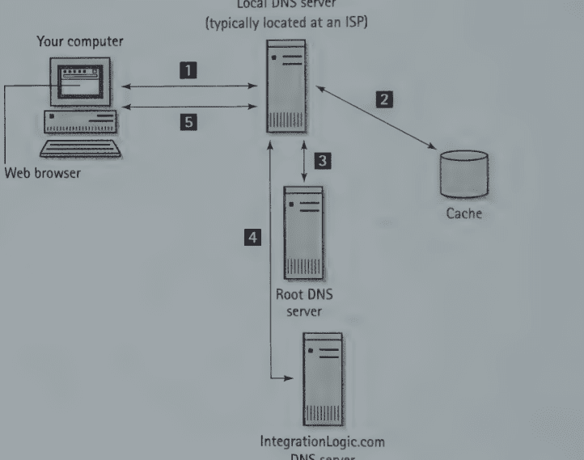

**图 9-1：展示 DNS 工作原理的简单示意图**

你的 Web 浏览器联系本地 DNS 服务器（通常是你 ISP 的 DNS 服务器）来定位 www.evoknow.com 的 IP 地址（图 9-1 中的第 1 步）。本地 DNS 服务器检查其缓存以查找该网站的 IP 地址（图 9-1 中的第 2 步）。如果该 DNS 服务器之前从未收到过对 www.evoknow.com 的请求，缓存中就没有相关信息。在这种情况下，本地 DNS 服务器会联系另一个 DNS 服务器（通常是根 DNS 服务器）来定位负责 evoknow.com 域的 DNS 服务器的 IP 地址（图 9-1 中的第 3 步）。如果 www.evoknow.com 确实存在，根 DNS 服务器会返回该域的 DNS 权威服务器的地址。然后本地 DNS 服务器向 evoknow.com 域的 DNS 服务器请求返回 www.evoknow.com 网站的 IP 地址（图 9-1 中的第 4 步）。因为 www.evoknow.com 网站确实存在，evoknow.com 域的 DNS 服务器返回该网站的 IP 地址。本地 DNS 服务器最终将 IP 地址返回给 Web 浏览器，并缓存该 IP 以供将来使用（图 9-1 中的第 5 步）。

整个过程可能看起来有些令人困惑，但对最终用户来说它其实非常简单且透明。普通用户通常对这个过程一无所知，这也是理所当然的。正如你现在所看到的，DNS 实际上是一个将互联网主机（计算机）名称解析为 IP 地址的系统。但当你知道一个系统的 IP 地址而想了解其主机名时会发生什么？这就是 DNS 被设计的原因——用于双向解析 IP 地址和主机名。实际上，DNS 的功能不仅仅限于 IP 到主机名或主机名到 IP 的解析；在本章的后续部分，你将了解到许多 DNS 的常用和实用用途。

说到 DNS，你必须做出一个决定：你需要运行 DNS 服务器，还是可以将你的系统配置为远程（通常是 ISP 的）DNS 服务器的 DNS 客户端？答案取决于以下问题：

- 你是否想为一个或多个互联网域名提供 DNS 服务？
- 你是否想提高对频繁请求的互联网资源的 DNS 服务性能？

如果上述任一问题的答案是肯定的，你应该考虑运行一个本地 DNS 服务器。然而，无论你是否决定在 Red Hat Linux 系统上运行 DNS 服务器，你仍然需要将其配置为本地或远程 DNS 服务器的 DNS 客户端。

现在来看如何将你的 Red Hat Linux 系统配置为 DNS 客户端计算机。

#### 配置 DNS 客户端（解析器）

如果你计划从 Red Hat Linux 系统访问其他互联网主机计算机，你需要将其配置为 DNS 客户端系统。DNS 的客户端部分称为**解析器**。它是 C 库中的一组例程，允许任何程序执行 DNS 查询。Red Hat Linux 标配了解析器。在本节中，你将学习如何配置解析器。

通常，Red Hat 安装程序会询问你的 DNS 服务器信息，并自动配置必要的解析器配置文件。但是，当 DNS 服务器发生变化时，通常需要修改解析器配置以反映这些更改。例如，如果你在 Red Hat 安装期间配置了解析器，后来更换了 ISP，则需要重新手动配置。以下是具体方法。

如果你计划使用 ISP 的 DNS 服务器来解析名称和 IP 地址，请向 ISP 索取其 DNS 服务器的主机名和 IP 地址。获取所需信息后，你就可以配置解析器了。

首先，你需要修改名为 `/etc/resolv.conf` 的解析器配置文件。清单 9-1 展示了一个典型的 `/etc/resolv.conf` 文件，对应名为 evoknow.com 的域。

### 清单 9-1：解析器配置文件 /etc/resolv.conf

```
# Default Domain
domain evoknow.com

# Default search list
search evoknow.com

# First name server
nameserver 206.171.50.50

# Second name server
nameserver 206.171.50.55
```

与许多其他常见的 Linux 配置文件一样，该文件格式非常简单。任何空行或以 `#` 开头的行都会被忽略。唯一有意义的行是包含 `domain`、`search` 或 `nameserver` 指令的行。

`domain` 指令允许你为系统指定默认域名。如果你没有将此行设置为系统的域名，系统会自动从主机名中提取默认域名。

`search` 指令用于影响解析器如何搜索不完全限定的主机名。例如，如果我想在使用上述解析器配置文件的系统中输入 `ping www` 命令，ping 程序会要求解析器解析 `www`。因为 `www` 是一个部分主机名，解析器会使用搜索列表创建一个完整的主机名（例如 `www.evoknow.com`），并尝试解析该主机的 IP。例如，如果我在上面的清单中将 `search` 指令设置为 `evoknow.com` 并发出相同的 ping 请求，解析器将返回 `www.evoknow.com` 的 IP 地址。如果你没有提供 `search` 指令，当需要解析部分主机名时会自动应用默认域名。

`nameserver` 指令指定解析器应使用哪个域名服务器进行查询。你可以在配置文件中指定多个 `nameserver` 指令（也应该这样做）。每个域名服务器按其在配置文件中出现的顺序依次查询。例如，如果某个程序请求解析器解析名为 `www.mobidac.com` 的主机名，解析器首先尝试使用 206.171.50.50 域名服务器将名称解析为 IP。如果 206.171.50.50 域名服务器未能返回响应（即查询超时），则会联系第二个域名服务器 206.171.50.55。目前，配置文件中最多允许列出三个 `nameserver` 指令。通常最好至少设置两个 `nameserver` 指令，指向两个不同的域名服务器。


#### 设置 DNS 服务器

Red Hat Linux 预装了伯克利互联网域名（BIND）服务器软件。如果在操作系统安装阶段未安装它，你可以安装该软件的 RPM 版本。例如，要为 Intel x86 平台安装 9.2.0-1 版本的 BIND 软件，我在 Red Hat Linux 光盘的 RPMS 目录中找到了 `bind-9.2.0-1.i386.rpm` 包，并运行以下命令：

```
rpm -ivh bind-9.2.0-1.i386.rpm
```

BIND 软件的 RPM 包会安装表 9-1 中列出的重要文件。

#### 表 9-1 BIND RPM 包安装的文件简表

| 文件 | 描述 |
|-------|-------------|
| /usr/sbin/named | 域名服务器守护进程软件。安装期间，RPM 工具会创建 `/var/run/named` 目录来存储 `named.pid`（PID 文件）以及管理域名服务器所需的以下脚本：`/etc/sysconfig/named`、`/etc/rc.d/init.d/named`、`/etc/logrotate.d/named` |
| /usr/sbin/named-bootconf | 域名服务器启动配置脚本。 |
| /usr/sbin/named-checkconf | 域名服务器配置语法验证工具。 |
| /usr/sbin/named-checkzone | 域名服务器区域配置文件检查工具。 |
| /usr/sbin/rndc | 域名服务器控制工具。此控制工具可以使用 `/etc/rndc.conf` 配置文件来加载默认服务器、安全密钥数据等。 |
| /usr/sbin/lwresd | 轻量级解析器服务器，可以充当使用轻量级解析器库的客户端的纯缓存域名服务器。 |
| /usr/sbin/dns-keygen | DNS 加密密钥生成工具。 |
| /usr/sbin/dnssec-keygen | DNSSEC 加密密钥生成工具。 |
| /usr/sbin/dnssec-makekeyset | DNSSEC 密钥集生成工具。 |
| /usr/sbin/dnssec-signkey | DNSSEC 密钥集签名工具。 |
| /usr/sbin/dnssec-signzone | DNSSEC 区域签名工具。 |
| /usr/share/doc/bind-9.2.0/* | 各种文本格式的 BIND 信息文件存储在此处。 |

### 理解 DNS 配置的基础知识

BIND 域名服务器 `named` 的主配置文件是 `/etc/named.conf`。启动时，`named` 服务器会读取此配置文件以确定其运行方式。

## /etc/named.conf 文件

此文件由注释、语句和空行组成。注释和空行用于提高可读性，而语句则是实际的配置。在接下来的部分中，我将讨论详细内容。

**注释** 注释行可以是单行，以两个正斜杠字符开头。
例如：

```
// This is a comment line in named.conf
```

或者可以是以下列 `#` 字符开头的行：

```
# This is a comment line in named.conf
```

或者可以是多行注释，以 `/*` 开头，以 `*/` 结尾。例如：

```
/*
  This is a multiline comment in named.conf
*/
```

除了被 `named` 忽略的注释和空行之外，真正的配置行被称为*语句*，它们具有以下语法：

```
keyword {
        // details of the statement
        };
```

`named` 可以使用多种类型的语句。我将在以下部分仅讨论最常用的语句。

**OPTIONS 语句** `options` 语句使你能够为域名服务器设置全局选项。在 `named.conf` 文件中应该只使用一个 `options` 语句。如果未指定 `options` 语句，则使用一个每个选项都设置为其默认值的默认 `options` 语句。许多选项可以放在 `options` 语句块中，用 `{}` 括起来。常用选项如下：

```
options {
  directory path_name;
  statistics-interval number;
  forwarders { [ in_addr ; [ in_addr ; ... ] ] };
  forward ( only | first );
  // query-source address * port 53
};
```

`directory` 选项使你能够指定域名服务器的工作目录路径。如果未指定目录，则工作目录默认为 `.`（点），即服务器启动时所在的目录。指定的目录应该是绝对路径。同时请注意，当在另一个语句块中指定相对目录时，该相对目录被假定为相对于工作目录。

`statistics-interval` 选项允许你控制域名服务器生成统计数据的频率。默认情况下，域名服务器每小时将统计数据写入默认日志（使用 `/var/messages` 中的 syslogd）。如果你想更改此默认行为，请添加此选项并指定以分钟为单位的所需统计日志记录间隔。如果你发现统计数据不足以定期报告，并希望减小日志文件大小，请将数字设置为零以禁用此功能。

如果你希望你的域名服务器将 DNS 查询转发给其他域名服务器，可以使用 `forwarders` 选项设置远程域名服务器的 IP 地址列表。例如：

```
forwarders { 206.171.50.10; 206.177.175.10; };
```

这里列出了两个不同域名服务器的两个 IP 地址。每对 IP 地址需要用分号分隔。默认的转发器列表为空，因此不执行转发；所有查询都由域名服务器本身应答。

`forward` 选项仅在转发器列表不为空时才有用。此选项控制域名服务器的行为。如果将此选项设置为 `first`（默认值），域名服务器会将所有查询发送到转发器。如果转发器超时或无法回答查询，域名服务器然后会尝试自行进行查找。

如果将 `forward` 选项设置为 `only`，域名服务器仅查询转发器，而不会尝试自行查找答案。

如果你的域名服务器和域名服务器用户之间存在防火墙，则可能需要取消注释上述选项配置中显示的 `query-source` 行。这是由于许多防火墙仅允许通过端口 53 进行 DNS 流量。

对于大多数站点，`options`` 语句将如下所示：

```
options {
  directory "/var/named"
};
```

换句话说，`options` 语句最常见的用法只是指定服务器的工作目录。工作目录是你存放所有特定于域或区域文件的地方。

**ZONE 语句** 除了 `options` 语句之外，`zone` 语句是你在几乎所有站点的 `named.conf` 配置中都会发现的唯一另一种语句类型。要为互联网域名设置名称服务，你需要在 `/etc/named.conf` 文件中创建一个 `zone` 语句。三个常用的 `zone` 语句如下：

```
zone domain_name {
  type master;
  file path_name;
};
```

```
zone domain_name {
  type slave;
  masters { ip_addr; [ ip_addr; ... ] };
```


## 针对特定域或区域的配置

对于每个互联网域或区域，你需要两个配置文件。一个配置文件用于设置正向DNS（主机名到IP）解析，另一个用于设置反向DNS（IP到主机名）解析。例如：

```
zone "mobidac.com" {
    type master;
    file "mobidac.db";
};
```

```
zone "50.171.206.in-addr.arpa" {
    type master;
    file "db.206.171.50";
};
```

我在 `/etc/named.conf` 文件中包含了上述两个区域声明。这两个区域声明将我的域名服务器设置为 mobidac.com 域的权威主（primary）域名服务器。换句话说，mobidac.com 的所有主机名到IP的解析（也称为正向DNS）都由该域名服务器处理。第二个区域声明则将域名服务器设置为 206.171.50.0 网络的主（primary）域名服务器。换句话说，该网络的所有IP到主机名的解析（也称为反向DNS）同样由该域名服务器处理。第一个区域声明指出，mobidac.com 域的正向区域配置信息保存在 mobidac.db 文件中；第二个区域声明指出，206.171.50.0 网络的反向DNS配置存储在名为 db.206.171.50 的文件中。

这两个文件都由DNS资源记录和可选的注释行组成。DNS资源记录的语法如下：

```
{name}   {TTL}   addr-class   record-type   record-specific-data
```

`name` 字段始终是域记录的名称，并且必须始终从第一列开始。传统上，只有第一个DNS资源记录会设置名称字段。对于区域文件中的所有其他资源记录，名称字段可以留空；在这种情况下，它将沿用前一个资源记录的名称。第二个字段 `TTL` 是一个可选的生存时间字段。它指定了此数据在数据库中的保存时长。留空此字段意味着使用起始授权机构资源记录（SOA）中指定的默认生存时间（见下一节）。第三个字段 `addr-class` 是地址类别。唯一广泛使用的地址类别是 `IN`，用于互联网地址和其他信息。第四个字段 `record-type` 指明资源记录的类型。第五个字段，*record-specific-data*，是对应于第四个字段中记录类型的具体数据。常用的资源记录将在下文讨论。

### SOA：起始授权机构

SOA 或起始授权机构记录用于标识一个区域的开始。SOA 记录的语法如下：

```
@   IN   SOA   nameserver.  contact-email-address (
             serial_number      ; Serial
             refresh_number     ; Refresh
             retry_number       ; Retry
             expire_number      ; Expire
             minimum_number )   ; Minimum
```

`name` 字段是第一个字段。此字段始终设置为 `@`，并且在该文件的任何其他资源记录中无需重复。`nameserver` 字段用于指定当前域名服务器的主机名，`contact-email-address` 字段用于指定域的系统管理员的电子邮件地址。SOA 记录其余的特定数据用于设置序列号和各种默认值。

*serial_number* 是此区域文件的版本号。虽然你可以使用任何正数作为序列号，但通常的做法是使用 YYYYMMDDNNN 格式的数字。这里 YYYY 是四位数年份，MM 是两位数月份，DD 是两位数日期，NNN 是一个三位数。因此，像 19990215001 这样的序列号表示该区域文件最后修改于 02/15/1999，并且当天有两次修订（000-001）。

> 每次更新区域文件时，都必须递增序列号；否则，更改不会生效。

*refresh_number* 指示从域名服务器每隔多少秒检查一次主域名服务器以确认是否需要更新。请注意，如果你在主域名服务器上更新了主（或primary）区域文件，但未更新序列号，从域名服务器将不会更新其区域信息副本。*retry_number* 指示由于外部问题导致区域传输失败后，从服务器应等待多少秒再重试。*expire_number* 是一个上限，以秒为单位，指定从域名服务器在区域数据过期前可以使用该数据多长时间。*minimum_number* 是对区域文件中未指定生存时间的资源记录使用的时间限制（以秒为单位）。如果某些资源记录指定了生存时间，它也强制成为该生存时间的最小值。每个区域必须有且仅有一个 SOA 记录。以下是名为 `mobidac.com` 的域的 SOA 记录示例：

```
@   IN   SOA   ns.mobidac.com. kabir.mobidac.com. (
              1999020100  ; Serial
              7200        ; Refresh - 2 hours
              3600        ; Retry   - 1 hour
              43200       ; Expire  - 12 hours
              3600 )      ; Minimum - 1 hour
```

这里 mobidac.com 的域名服务器主机名是 ns.mobidac.com，联系电子邮件地址是 kabir@mobidac.com。注意，在 SOA 记录中，电子邮件地址的 `@` 部分被替换成了 `.`（点）字符。

刷新率设置为 7,200 秒（两小时）。因此，mobidac.com 的从域名服务器将每两小时轮询一次主服务器，检查该区域的序列号是否增加。常用值范围是 2 到 12 小时，具体取决于你更改区域配置的频率。重试率设置为 3,600 秒（一小时）。如果网络故障导致从服务器在刷新周期结束时（在本例中是每两小时后）无法联系到主服务器，从服务器应再等待一小时后再重试与主服务器通信。过期时间设置为 43,200 秒（12 小时）。这允许从服务器在无法联系到主服务器的情况下，在 12 小时内将自己持有的区域数据副本视为有效。如果你在不同的网络上设置了从DNS服务器，这个值就特别重要。你应该将此值设置得足够高，以便在主域名服务器或其网络发生故障的情况下，从服务器能够在最长的中断期内继续提供DNS服务。

在这个示例中，从域名服务器将在无法与主服务器通信后继续提供 DNS 服务 12 小时，并在指定时间后停止为该区域提供 DNS 服务。但是，它仍会定期尝试与主域名服务器通信。最小生存时间是资源记录的默认 TTL 值。它指定了资源记录在域名服务器缓存中的有效期。例如，当域名服务器向 mobidac.com 域名服务器查询某个 DNS 记录时，它会将查询答案在其缓存中保存 3,600 秒（1 小时）。如果你的 DNS 信息变更频繁，应将此值设得较低；否则，可以设得较高。

### NS：域名服务器

域名服务器记录用于指定负责某个域的域名服务器。语法如下：

```
IN   NS   name-server-hostname.
```

注意，资源记录的名称和 TTL 字段没有指定，因为名称只需在 SOA 记录中使用 `@` 字符指定，而 TTL 值也在 SOA 记录中使用最小值指定。例如：

```
IN   NS   ns.mobidac.com.
```


此资源记录指定 `ns.mobidac.com` 是当前区域文件的名称服务器。您可以指定多个 NS 记录。实际上，您应该至少有两个 NS 记录（一个用于主名称服务器，一个用于从属名称服务器）。还要注意名称服务器主机名末尾的句点。在区域文件中，所有完全限定主机名后都必须插入一个句点。

## A：地址
地址记录为特定主机名指定一个 IP 地址。A 记录将主机名转换为 IP 地址。语法如下：

```
hostname  IN  A  IP-address
```

例如：

```
www.mobidac.com.   IN  A   206.171.50.51
```

每个主机至少应有一个 A 记录。您也可以使用主机名的缩写形式。例如：

```
www  IN  A   206.171.50.51
```

如果区域是 `mobidac.com`，这与前一个 A 记录相同。换句话说，如果您不指定完整的主机名，域名会附加到短名称后面。因此 `www` 会变成 `www.mobidac.com`。

## PTR：域名指针
域名指针记录用于将 IP 地址转换为主机名。这也称为*反向域名服务*。PTR 记录的语法如下：

```
IP-address   IN  PTR   hostname.
```

例如：

```
206.171.50.51  IN  PTR  www.mobidac.com.
```

这里 IP 地址 `206.171.50.51` 与主机 `www.mobidac.com` 相关联。您可以使用缩写形式，如下：

```
51  IN  PTR  www
```

通常，ISP 为网络执行主要的反向 DNS。本章稍后将介绍反向 DNS。

## CNAME：规范名称
规范名称记录，即 CNAME，为规范（官方）主机名指定一个别名（主机名）。语法如下：

```
Alias   IN  CNAME  Canonical-hostname.
```

例如：

```
webserver.mobidac.com. IN CNAME www.mobidac.com.
```

这里 `webserver.mobidac.com` 是 `www.mobidac.com` 的别名。缩写形式如下：

```
webserver IN CNAME www
```

请注意，当 `webserver.mobidac.com` 需要解析为 IP 地址时，会返回 `www.mobidac.com` 的 IP 地址。因此，您必须确保规范主机名至少存在一个 A 记录。

## MX：邮件交换
邮件交换记录用于指定配置为域 SMTP 邮件服务器的主机名。语法如下：

```
IN MX preference-value mail-server-hostname.
```

例如：

```
IN MX 0 mail.mobidac.com.
```

只有当您有多个邮件服务器时，首选项编号才有用。例如：

```
IN MX 10 fast-mail-server.mobidac.com.
IN MX 20 slow-mail-server.mobidac.com.
```

这里较低的首选项编号表示较高的优先级。

既然您已经了解了 DNS 资源记录的基础知识，就可以创建主要、次要和仅缓存的 DNS 服务器了。

#### 主/主要 DNS 服务器

假设我在 `ns.evoknow.com` 上运行名称服务器。并假设我刚刚在 Internic 注册了名为 `classifiedworks.com` 的域名，并希望在 `ns.evoknow.com` 上为此域名设置主要 DNS 服务。具体步骤如下。

首先，我需要在 `/etc/named.conf` 文件中创建以下区域声明：

```
zone "classifiedworks.com" {
  type master;
  file "classifiedworks.db";
};
```

此声明指出我的名称服务器是 `classifiedworks.com` 域的主名称服务器。现在我需要在名称服务器的工作目录中创建一个名为 `classifiedworks.db` 的区域文件（由 `options {directory path_name};` 语句指定）。清单 9-2 是 `classifiedworks.com` 域的一个此类区域文件示例。

#### 清单 9-2：classifiedworks.com 域的区域文件

```
@    IN SOA  ns.evoknow.com. kabir.evoknow.com. (
              1999020100  ; Serial
              7200        ; Refresh -  2 hours
              3600        ; Retry    -  1 hour
              43200       ; Expire   -  12 hours
              3600 )      ; Minimum  -  1 hour

      IN  NS   ns.evoknow.com.
      IN  MX   10 mail.evoknow.com.

      www IN CNAME www.evoknow.com.
      ftp IN A   206.171.50.55
```

在此，我设置了 SOA 和 NS 记录，声明 `ns.evoknow.com` 是 `classifiedworks.com` 域的名称服务器。因为我想在 `mail.evoknow.com` 主机上接收此域的邮件，所以我设置了一个 MX 记录来实现这一点。我为 `www.evoknow.com` 设置了一个名为 `www.classifiedworks.com` 的别名。最后，我为 `ftp.classifiedworks.com` 设置了一个 A 记录，指向 `206.171.50.55`。

使用各种资源记录，您可以根据需要配置区域文件。区域文件配置并存储在 DNS 服务器的工作目录后，该域名的主要名称服务器配置就完成了。

#### 从/次要 DNS 服务器

配置从属或次要 DNS 服务器非常简单。您唯一需要手动更新的文件是 `/etc/named.conf` 文件。例如，假设我想使用一个名为 `ns2.evoknow.com` 的 DNS 服务器作为 `classifiedworks.com` 域的次要名称服务器。我需要做的第一件事是在 `ns2.evoknow.com` 名称服务器的 `/etc/named.conf` 文件中创建如下区域声明：

```
zone "classifiedworks.com" {
  type slave;
  file "classifiedworks.db";
};
```

因为这是从属或次要服务器，所以我不需要手动创建 `classifiedworks.db` 文件。只需重新启动名称服务，次要名称服务器将自动获取 DNS 记录。

#### 反向 DNS 服务器

如果您拥有自己的网络 IP 地址，您就必须为它们执行反向 DNS。例如，如果您拥有一个名为 `206.171.50.0` 的 IP 网络，并将其用于名为 `evoknow.com` 的域的正向 DNS 配置中，则必须为此网络设置一个反向 DNS 区域。具体步骤如下。

首先，修改 `/etc/named.conf` 文件以包含一个新的区域，如下所示：

```
zone "50.171.206.in-addr.arpa" {
  type master;
  file "db.206.171.50";
};
```

注意前面区域配置中使用的特殊区域名称 `50.171.206.in-addr.arpa`。要创建反向 DNS 区域名称，您必须反转您的网络编号，并在名称末尾附加 `.in-addr.arpa`。

现在您需要在名称服务器的工作目录中创建 `db.206.171.50`。请注意，反向 DNS 区域的文件名可以是任何名称，但习惯上使用 `db.网络地址` 的名称。此文件与我到目前为止展示的其他区域文件类似；唯一的区别是它将包含 PTR 记录而不是 A、CNAME 等记录。清单 9-3 显示了 `db.206.171.50` 文件的一个示例。

#### 清单 9-3：反向 DNS 区域文件示例（db.206.171.50）

```
@    IN SOA  ns.evoknow.com. kabir.evoknow.com. (
            1999020100  ; Serial
            7200        ; Refresh - 2 hours
            3600        ; Retry   - 1 hour
            43200       ; Expire  - 12 hours
            3600 )      ; Minimum - 1 hour

     IN NS   ns.evoknow.com.

51.50.171.206.in-addr.arpa.   IN PTR ns.evoknow.com.
52.50.171.206.in-addr.arpa.   IN PTR mail.evoknow.com.
53.50.171.206.in-addr.arpa.   IN PTR www.evoknow.com.
```

这里提供了 PTR 记录，将三个不同的 IP 地址映射到三个不同的主机名。您也可以使用缩写形式指定前面的 PTR 记录，如下：

```
51	IN	PTR	ns.evoknow.com
52	IN	PTR	mail.evoknow.com
53	IN	PTR	www.evoknow.com
```

在大多数情况下，您的 ISP 将拥有您网络的 IP 地址，并应准备好提供主要的反向 DNS 服务。但是，有一个特殊网络您必须提供反向名称服务。这个特殊网络是 `127.0.0`，用于本地环回接口 IP (`127.0.0.1`)。因为没有人拥有此环回网络的权限，所以每个人都必须自己提供反向 DNS 服务。这就是为什么您总是需要在 `/etc/named.conf` 文件中有一个如下所示的特殊区域声明：

```
zone "0.0.127.in-addr.arpa" {
  type master;
  file "named.local";
};
```

您还需要在名称服务器的工作目录中拥有 `named.local` 区域文件。此文件如清单 9-4 所示。

#### 清单 9-4：named.local 文件

```
$TTL 86400

@	IN	SOA	localhost. root.localhost. (
			1999020100	; Serial
			7200		; Refresh - 2 hours
			3600		; Retry   - 1 hour
			43200		; Expire  - 12 hours
			3600 )		; Minimum - 1 hour

	IN	NS	localhost.

1	IN	PTR	localhost.
```

#### 仅缓存/从属 DNS 服务器

从技术上讲，所有 DNS 服务器都启用了缓存，或者换句话说，DNS 服务器默认使用缓存。但是，如果您不想为任何互联网域提供 DNS 服务，而只想提高网络的 DNS 查询性能，您可以运行一个仅缓存的 DNS 服务器。这样的服务器将有一个 `/etc/named.conf` 文件，如清单 9-5 所示。


## 第九章：DNS 服务器

清单 9-5：仅缓存 DNS 服务器的 /etc/named.conf

```
zone "." {
  type hint;
  file "named.ca";
};

zone "0.0.127.in-addr.arpa" {
  type master;
  file "named.local";
};
```

第一个 zone 语句指定名称服务器在启动时使用 named.ca 文件来确定根名称服务器的名称。第二个 zone 语句为本地回环网络提供反向名称服务。这就是创建仅缓存名称服务器所需的全部配置。

到目前为止，你已经学习了创建各种名称服务器配置；现在来看看如何控制 named 名称服务器。

#### 控制 DNS 服务器

named 发行版附带了一个名为 rndc 的实用程序，它提供了一个简单的命令行接口来控制名称服务器。

## 启动名称服务器

你的名称服务器应该在启动时自动运行。如果没有自动启动，你需要执行以下步骤：

1.  以 root 身份登录到你的名称服务器系统，并切换到 /etc/rc.d/init.d 目录。确保该目录中有一个名为 named 的脚本。如果缺少此脚本，你应该从 Red Hat CD-ROM 重新安装 BIND 发行版 RPM。
2.  确认你拥有 /etc/rc.d/init.d/named 脚本后，切换到你默认的系统运行级别（参见 /etc/inittab 文件）对应的 rc 目录。对于大多数系统，默认运行级别是 3；如果你的系统也是如此，请切换到 /etc/rc.d/rc3.d/。
3.  创建一个名为 SXXnamed 的符号链接，指向 /etc/rc.d/init.d/named 脚本。将 SXXnamed 中的 XX 替换为一个较大的数字，如 55 或 85，以确保系统不会在网络接口正确设置之前尝试启动名称服务器。例如，要创建一个名为 S55named 的符号链接指向 named 脚本，你可以运行：

```
ln -s /etc/rc.d/init.d/named S55named
```

创建此链接后，你的系统将在每次启动时自动启动名称服务器。但是，如果你倾向于手动运行名称服务器，可以使用 rndc 程序，如下所示：

```
rndc start
```

## 重新加载新的名称服务器配置

修改任何区域文件或 /etc/boot.conf 文件后，你必须重启名称服务器才能使更改生效。你可以强制名称服务器重新加载新配置，如下所示：

```
rndc reload
```

不要忘记为你修改的任何区域文件修改 SOA 记录中的序列号；否则，名称服务器将不会加载新配置。要先终止名称服务器再重启，你可以在上面的命令中使用 restart 代替 reload。

## 停止名称服务器

如果因任何原因需要停止名称服务器，只需运行 rndc 命令，如下所示：

```
rndc stop
```

## 查看名称服务器统计信息

你可以使用 rndc 程序在名称服务器的工作目录中生成各种统计信息。运行以下命令：

```
rndc stats
```

此命令会在名称服务器的工作目录中创建一个名为 named.stats 的文件。该统计文件将显示各种信息，包括每种资源记录的查询次数。

每次修改 DNS 信息时，务必使用名称服务器查询工具测试配置。在下一节中，我将讨论如何测试名称服务器配置。

#### 测试你的 DNS 服务器

有许多工具可用于手动查询名称服务器。如果你想安装一些常用的查询工具，请从 Red Hat CD-ROM 安装 bind-utils-version.i386.rpm RPM 发行版。bind-utils 发行版包含 dig、host、nslookup 等工具。我最喜欢且使用最广泛的是 nslookup 实用程序，因此我将演示用它来测试 DNS 配置。

假设你刚刚在 Internic 注册了一个新域名，并且已经在名称服务器上设置了必要的 DNS 配置。

重启名称服务器后，你想通过 nslookup 测试配置。

当你从命令行运行 nslookup 时，它会显示将要使用的名称服务器的主机名和 IP 地址。如果你在名称服务器系统上运行 nslookup，你应该能看到名称服务器的名称和 IP。如果没有看到名称服务器的信息，请确保你的 /etc/resolv.conf 文件配置正确。另一方面，如果你在名称服务器以外的计算机上运行 nslookup，你需要告诉程序使用你要测试的名称服务器。只有在 Internic 尚未将新域名的名称服务器信息发布到根名称服务器时，才需要这样做。要告诉 nslookup 使用不同于默认值的名称服务器，请在 nslookup 命令提示符下输入 server hostname（其中 hostname 是你要测试的服务器的主机名）。输入此命令后，nslookup 将对所有查询使用指定的名称服务器主机。

nslookup 实用程序允许你使用简单的语法执行任何类型的 DNS 查询。例如，要查找某个域名的名称服务器，你可以在 nslookup 程序中运行以下命令：

```
set query=ns
domain.tld
```

第一行告诉 nslookup 对下一个域名（domain.tld）执行 NS（名称服务器记录）查询。同样，你可以对 A、MX、CNAME 等进行查询。如果收到的响应看起来不正确，请回到区域文件，确保没有拼写错误。一个常见的错误是在完整主机名末尾漏掉了句点。

你也可以使用 bind-utils 发行版中的 dig 实用程序来查询名称服务器。dig 的基本查询语法如下：

```
dig @name_server    target    record_type
```

其中 @name_server 是用于查询的名称服务器；target 是你希望查找 record_type 相关信息的主机或域名。例如：

```
dig @localhost    evoknow.com    mx
```

这里是在询问运行在 localhost 上的 DNS 服务器查找 evoknow.com 域名的 MX 记录。如果省略 @name_server，dig 将使用 /etc/resolv.conf 文件中的名称服务器信息。

#### DNS 服务器的性能测试

要对 BIND 服务器进行性能测试，你需要一个名为 `queryperf` 的查询工具，它是随 BIND 源代码发行版一起提供的贡献软件。你可以下载 BIND 源代码发行版并从 `contrib` 目录编译此软件，步骤如下：

- 运行 `sh configure` 配置 `queryperf` 源代码。
- 运行 `make` 编译 `queryperf` 源代码并创建 `queryperf` 二进制文件。

创建 `queryperf` 工具后，你需要创建一个测试数据文件。该文件的格式如下：

```
name_or_IP resource_type
```

其中 *name* 是主机名或 IP 地址，*resource_type* 是你想要查询的 DNS 资源类型。以下是软件附带的名为 `sample.1` 的示例数据文件。

```
: Sample input data file
:#server ns.sector93.ie
:#port 53
:#maxwait 10

1-host.com ANY
1-linknet.com A
1.0-127.35.195.200.in-addr.arpa PTR
1.0-63.236.210.200.in-addr.arpa PTR
1.0.0.0.0.0.0.0.0.0.0.0.0.0.0.0.0.0.0.0.0.0.0.0.0.0.0.0.0.ip6.int PTR
1.0.0.0.in-addr.arpa PTR
1.0.0.10.in-addr.arpa PTR
```

以分号开头的行被视为注释；其他非空行指定不同的主机或 IP 以及要执行的 DNS 查询。要执行性能测试，你可以按如下方式运行 `queryperf`：

```
queryperf -d test_data_filename -s name_server
```

例如，要使用 `sample.1` 测试数据对运行在 `localhost` 上的本地名称服务器进行性能测试，你可以执行以下命令：

```
queryperf  -d sample.1 -s localhost
```

这种性能测试的结果如下所示：

```
DNS Query Performance Testing Tool
Version: $Id: queryperf.c,v 1.1.1.2.2.1 2001/09/27 00:44:26 marka
Exp $

[Status] Processing input data
[Status] Sending queries
[Timeout] Query timed out: msg id 2
[Timeout] Query timed out: msg id 3
[Timeout] Query timed out: msg id 4
[Timeout] Query timed out: msg id 5
[Timeout] Query timed out: msg id 6
[Status] Testing complete

Statistics:

  Parse input file:     once
  Ended due to:         reaching end of file

  Queries sent:         7 queries
  Queries completed:    2 queries
  Queries lost:         5 queries

  Percentage completed: 28.57%
  Percentage lost:      71.43%

  Started at:           Sun Dec 16 17:52:57 2001
  Finished at:          Sun Dec 16 17:53:02 2001
  Ran for:              5.002568 seconds

  Queries per second:   0.399795 qps
```

请注意，每秒查询数（qps）非常低。现在再次运行测试，你会注意到 qps 大幅提升。

#### 管理虚拟域名的 DNS

单个名称服务器可以为多个域名提供名称服务。此功能允许单个系统托管大量 Internet 域名。事实上，大多数互联网服务提供商（ISP）公司就是这样为其客户提供网站托管服务的。因为这样的域名托管在另一个域名上（例如，ISP 的


#### 清单 9-6：makesite 脚本

```perl
#!/usr/local/bin/perl -w

use strict;

#
# 目的：makesite 用于创建虚拟站点。
# 它使用一组模板来创建 DNS 和 HTTPD 配置文件。
#
# 注意：这是一个非常*简单*的脚本。
#
####################################################

use Time::localtime;

my $site             = $ARGV[0] or &syntax;
my $MAKESITE_DIR     = "/scratch/dns/makesite";
my $USER             = "httpd";
my $GROUP            = "httpd";
my $PERMISSION       = "2770";
my $BASE_DIR         = "/tmp";
my $HTDOCS           = "htdocs";
my $CGIBIN           = "cgi-bin";
my $NAMED_PATH       = "/var/named";
my $NAMED_FILE_EXT   = ".db";
my $NAMED_TEMPLATE   = "$MAKESITE_DIR/named.template";
my $NAMED_CONF       = "/etc/named.conf";
my $HTTPD_CONF       = "/usr/local/apache/etc/httpd.conf";
my $VHOST_TEMPLATE   = "$MAKESITE_DIR/httpd.template";
my $LOG_FILE         = "$BASE_DIR/makesite.log";

my $dir = $site;
my @domain_types = qw(com net org edu);
my ($domain_ext, $thesite_dir, $public_dir,
    $htdocs_dir, $cgibin_dir, $named_file,
    $dir_len, $temp_len);

my $tm = localtime(time);
my $date = sprintf("%s-%02s-%02s-%02d-%02d", $tm->year+1900,
                                                      $tm->mon+1,
                                                      $tm->mday,
                                                      $tm->hour,
                                                      $tm->min);

my $serial = sprintf("%s%02d%02d000",
                                          $tm->year+1900,
                                          $tm->mon+1,
                                          $tm->mday);

$site =~ y/[A-Z]/[a-z]/;

# 获取包含扩展名的长度
$dir_len = length($dir);

foreach $domain_ext (@domain_types){ $dir =~ s/\.$domain_ext//g; }

# 获取去除扩展名后的新长度
$temp_len = length($dir);

# 如果用户未输入扩展名，则显示语法说明。
&syntax if($temp_len == $dir_len);

$named_file = $NAMED_PATH . "/" . $dir . $NAMED_FILE_EXT ;
$thesite_dir = $BASE_DIR . "/" . $dir;
$htdocs_dir = $BASE_DIR . "/" . $dir . "/" . $HTDOCS;
$cgibin_dir = $BASE_DIR . "/" . $dir . "/" . $CGIBIN;

die "$thesite_dir already exist! Aborted!\n" if(-e $thesite_dir);

system("mkdir $thesite_dir");
system("mkdir $htdocs_dir");
system("mkdir $cgibin_dir");

&createNamedFile($named_file,$site,"$dir$NAMED_FILE_EXT");
&createIndexFile($htdocs_dir,$site);
&createVirtualHostConf( domain=>$site,
                        website=>"www.$site",
                        cgibin=>$cgibin_dir,
                        htdocs=>$htdocs_dir);

system("chown -R $USER.$GROUP $thesite_dir");
system("chmod -R $PERMISSION $thesite_dir");

open(FP,">$LOG_FILE") || die "Can't write to log file.\n";
print FP "$date created www.$site [$htdocs_dir] site.\n";
close(FP);

exit 0;

sub createNamedFile{
  my $file = shift;
  my $domain = shift;
  my $database = shift;
  my $line;

  open(OUT,">$file") || die "Can't write $file\n";
  open(FP,$NAMED_TEMPLATE) || die "Can't open $NAMED_TEMPLATE\n";
  while($line=<FP>){
    $line =~ s/<DOMAIN>/$domain/g;
    $line =~ s/<SERIAL>/$serial/g;
    print OUT $line;
    }
  close(FP);
  close(OUT);

  open(FP,">$NAMED_CONF") || die "Can't open $NAMED_CONF\n";
  print FP <<ZONE;

// $domain 创建于 $date
zone "$domain" {
	type master;
	file "$database";
};

ZONE
  close(FP);
  }

sub createIndexFile{
  my $htdocs = shift;
  my $domain = shift;

  open(FP,">$htdocs/index.html") || die "Can't write index.html \n";
  print FP <<INDEX_PAGE;
<HTML>
<HEAD> <TITLE> $domain </TITLE> </HEAD>
<BODY BGCOLOR="white">
<CENTER>
  这是 $domain 网站
  <p> 创建于 $date </p>
</CENTER>
</BODY>
</HTML>
INDEX_PAGE

  close(FP);
}

sub createVirtualHostConf{

  my %params = @_;
  my $line;
  open(OUT,">$HTTPD_CONF") || die "Can't open $HTTPD_CONF $!\n";

  open(FP,$VHOST_TEMPLATE) || die "Can't open $VHOST_TEMPLATE $!\n";
  while($line=<FP>){
    $line =~ s/<DOMAIN>/$params{domain}/g;
    $line =~ s/<CGI-BIN-DIR>/$params{cgibin}/g;
    $line =~ s/<HTDOCS-DIR>/$params{htdocs}/g;
    $line =~ s/<WWW-SITE>/$params{website}/g;
    print OUT $line;

  }
  close(FP);
  close(OUT);
}

sub syntax{
  print <<SYNTAX;

  makesite <虚拟互联网域名>
  示例：makesite evoknow.com

SYNTAX
  exit 0;
}
```

这个 Perl 脚本的目的是让我能够创建一个具有正确 DNS 和 Apache Web 服务器配置的虚拟网站，而无需进行大量的文件编辑任务。例如，假设我想创建一个名为 www.newdomain.com 的新网站。如果我要手动完成所有操作，我将必须执行以下步骤：

1.  在 `/etc/named.conf` 文件中为 `newdomain.com` 添加一个新的区域声明。
2.  在名称服务器的工作目录中为 `newdomain.com` 添加一个新的区域文件。我必须从头开始创建这个文件，或者复制并修改一个现有的域名文件。
3.  在服务器上适当的 Web 空间中，为该域名创建网站文档根目录和 CGI 脚本目录。
4.  修改 Apache 服务器配置文件，以便 Apache 将 `www.newdomain.com` 视为一个新网站。

因为手动配置这些重要的文件会增加出错的可能性，所以我决定编写 `makesite` 脚本来完成所有这些步骤。例如，要使用正确的 DNS 和 Apache 配置创建 `www.newdomain.com` 网站，我可以运行：

```
makesite newdomain.com
```

此命令会在 `/etc/named.conf` 文件中添加如下区域声明：

```
// newdomain.com 创建于 1999-02-03-13-30
zone "newdomain.com" {
  type master;
  file "newdomain.db";
};
```

此语句会在 `/var/named`（我的名称服务器的工作目录）中创建一个 `newdomain.db` 文件，如清单 9-7 所示。

#### 清单 9-7：/var/named/newdomain.db 文件

```
@  IN  SOA  newdomain.com. hostmaster.newdomain.com. (
           19990206000  ; 序列号 YYYYMMDDXXX
           7200         ; 刷新间隔
           3600         ; (1 小时) 重试间隔
           1728000      ; (20 天) 过期时间
           3600)        ; (1 小时) 最小 TTL

; 名称服务器
   IN  NS  ns.evoknow.com.
   IN  MX  10 mail.evoknow.com.

; CNAME 记录
www IN CNAME www.evoknow.com.
```

然后，该脚本会将以下几行内容追加到 Apache 服务器配置（`httpd.conf`）文件的末尾：

```
#
# www.newdomain.com 的域名配置
#

<VirtualHost www.newdomain.com>
  ServerName www.newdomain.com
  ServerAdmin webmaster@newdomain.com

  DocumentRoot /tmp/newdomain/htdocs
  ScriptAlias /cgi-bin/ /tmp/newdomain/cgi-bin/

  ErrorLog logs/www.newdomain.com.error.log
  TransferLog logs/www.newdomain.com.access.log

</VirtualHost>

#
# www.newdomain.com 域名配置结束
#
```

最后，该脚本会创建以下目录结构和网站的 `index.html` 页面：

```
/www/newdomain
/www/newdomain/htdocs - 网站的文档根目录
/www/newdomain/cgi-bin - cgi-bin 目录
```

`index.html` 页面存储在 `/www/newdomain/htdocs/` 目录中。该脚本还会设置网站目录的权限，使得只有指定的用户和组才具有读/写权限。

因为这个脚本完成了所有繁琐的工作，我可以创建许多虚拟站点，而无需不断担心配置问题。最后，当我完成网站的创建后，我可以重启名称服务器和 Web 服务器，让所有站点上线。这确实是一个简单但有用的工具。你会发现这个工具使用起来很容易。`makesite` 脚本接受域名作为参数，并使用两个文本模板文件来创建名称服务器和 Web 服务器的配置信息。清单 9-8 展示了用于创建名称服务器配置的 `named.template` 文件。


#### 清单 9-8：named.template 文件

```
@    IN SOA <DOMAIN>.  hostmaster.<DOMAIN>. (
                     <SERIAL>   ; serial YYYYMMDDXX
                     7200       ; refresh
                     3600       ; (1 hour) retry
                     1728000    ; (20 days) expire
                     3600)      ; (1 hour) minimal TTL

; Name Servers
     IN  NS   ns.evoknow.com.
     IN  MX   10 mail.evoknow.com.

; CNAME records
www  IN  CNAME   www.evoknow.com.
```

仔细观察，你会看到这个模板文件中有两个特殊标签（`<DOMAIN>` 和 `<SERIAL>`）。`makesite` 脚本会读取此模板，并将这些标签替换为适当的信息。由于目的是创建一个具有正确 DNS 配置的虚拟网站，因此你无需创建任何 A 记录。例如，前面的配置表明 `www.<DOMAIN>`（例如，`www.new-domain.com`）是 `www.evoknow.com` 的别名。如果需要更改 IP 地址，使用 A 记录会使维护许多虚拟网站变得非常耗时。我使用 CNAME 记录，这样如果需要更改 `www.evoknow.com` 的 IP 地址，我根本无需修改虚拟域的配置文件。

#### 清单 9-9：httpd.template 文件

```
#
# Domain Configuration for <WWW-SITE>
#

<VirtualHost <WWW-SITE>>
  ServerName <WWW-SITE>
  ServerAdmin webmaster@<DOMAIN>

  DocumentRoot <HTDOCS-DIR>
  ScriptAlias /cgi-bin/ <CGI-BIN-DIR>/

  ErrorLog logs/<WWW-SITE>.error.log
  TransferLog logs/<WWW-SITE>.access.log

</VirtualHost>

#
# End of Domain Configuration for <WWW-SITE>
#
```

与之前的模板一样，你会注意到此文件中使用了一些自定义标签。这些标签同样会被替换为适当的信息。

要在你自己的环境中使用此 Perl 脚本，首先如下面所示，修改脚本开头的以下几行：

```
my $MAKESITE_DIR = "/usr/local/src/makesite";
```

将目录路径更改为 `makesite` 文件所在的位置。

```
my $USER	= "httpd";
```

如果你使用另一个用户 ID（如 `nobody` 或其他用户）运行 Apache Web 服务器，则更改用户名。

```
my $GROUP	= "httpd";
```

如果你使用另一个组（如 `nobody` 或其他组）运行 Apache Web 服务器，则更改组名。

```
my $PERMISSION	= "2770";
```

根据你的需要更改权限值。此值仅允许 `$USER` 和 `$GROUP` 在网站目录中拥有完全访问权限。

```
my $BASE_DIR	= "/www";
```

将 `$BASE_DIR` 变量的值更改为你所有网站的基本目录。

```
my $HTDOCS	= "htdocs";
```

将 `$HTDOCS` 变量的值更改为 `httpd.conf` 文件的文档根目录的相对名称。当前设置创建 `$BASE_DIR/<sitename>/htdocs`（默认为：`/www/<sitename>/htdocs`）作为网站的文档根目录。

```
my $CGIBIN	= "cgi-bin";
```

如果你不希望 Apache ScriptAlias 指令设置为 `$BASE_DIR/<sitename>/$CGIBIN`（默认为：`/www/<sitename>/cgi-bin`），则将 `$CGIBIN` 变量的值更改为相对目录名称。

```
my $NAMED_PATH  = "/var/named";
```

将 `$NAMED_PATH` 变量的值更改为你的名称服务器的工作目录。

```
my $LOG_FILE  = "$BASE_DIR/makesite.log";
```

如果你不希望将 `makesite` 日志文件写入基本目录，请将 `$LOG_FILE` 变量的值更改为指向其他位置。例如，你可以将其设置为 `/tmp/makesite.log` 以写入 `/tmp` 目录。

```
my $HTTPD_CONF  = "/usr/local/apache/etc/httpd.conf";
```

将 `$HTTPD_CONF` 变量的值更改为指向你的 Web 服务器的 `httpd.conf` 文件。

完成上述更改后，你应该根据需要修改 `named.template` 和 `httpd.template` 文件，并将这两个文件存储在你保存 `makesite` 脚本的目录中。最后，确保脚本具有可执行权限，并且 Perl 解释器行（`#!` bang 行）设置正确。

希望这能为你节省一些工作。如果你懂 Perl 编程，你可以根据你的环境尽可能地对脚本进行微调。

管理多个虚拟域的组织通常拥有多个服务器。在下一节中，你将学习如何使用 DNS 技巧在多个服务器之间平衡负载。

#### 使用 DNS 服务器平衡负载

其思想是在多个同类型服务器之间共享负载。这种共享通常用于在多个 Web 服务器之间平衡 Web 负载。此技巧称为轮询域名服务。

假设你有两个 Web 服务器：`www1.yourdomain.com`（192.168.1.10）和 `www2.yourdomain.com`（192.168.1.20），并且你希望使用轮询 DNS 技巧在 `www.yourdomain.com` 上的这两个服务器之间平衡负载。在你的 `yourdomain.com` 区域文件中，添加以下行：

```
www1  IN  A  192.168.1.10
www2  IN  A  192.168.1.20

www   IN  CNAME  www1
www   IN  CNAME  www2
```

重新启动你的名称服务器并 ping `www.yourdomain.com` 主机。你将在 ping 输出中看到 `192.168.1.10` 地址。停止并重新开始 ping 同一个主机，现在你将看到正在 ping 第二个 IP 地址。这是由于前面的配置告诉名称服务器循环处理 `www` 的 CNAME 记录。换句话说，`www.yourdomain.com` 主机既是 `www1.yourdomain.com` 也是 `www2.yourdomain.com`。

现在，当有人输入 `www.yourdomain.com` 时，名称服务器将先给出第一个地址，然后对于下一个请求，它将给出第二个地址。服务器将不断循环使用这些地址。

轮询 DNS 技巧的缺点之一是，名称服务器无法知道哪个系统负载重，哪个系统负载轻；它只是盲目地循环。如果其中一个服务器崩溃或因某种原因不可用，轮询 DNS 仍会定期返回故障服务器的 IP 地址。这可能会造成相当大的混乱，因为有些人可以访问这些网站，而有些人则不能。

如果你的负载需要更好的管理，并且检查服务器健康状况非常重要，那么你最好的选择是使用新的 Director 产品（如 Web Director (www.radware.com/)、Ace Director (www.alteon.com/) 或 Local Director (www.cisco.com/)）获取硬件解决方案。我使用 Web Director 取得了巨大成功。

#### 理解 DNS 欺骗

DNS *欺骗*（通过伪造信息进行的攻击）是一个常见的 DNS 安全问题。当 DNS 服务器被诱骗接受——并随后使用——来自恶意 DNS 服务器的不正确、非权威信息时，第一个 DNS 服务器就被欺骗了。欺骗攻击可能会给存在漏洞的 DNS 服务器带来严重的安全问题——例如将用户引导至错误的网站或将电子邮件路由到未经授权的邮件服务器。

黑客采用多种方法欺骗 DNS 服务器，包括以下两种常用方法：

-   **缓存中毒**。恶意黑客操纵 DNS 查询，将数据插入未受保护的 DNS 服务器的缓存中。这些被“投毒”的数据随后会在响应客户端查询时发出。此类数据可能会将客户端引导至运行着特洛伊木马 Web 服务器或邮件服务器的主机，黑客可能从中获取用户的有价值信息。
-   **DNS ID 预测方案**。每个 DNS 数据包都有一个与之关联的 16 位 ID 号，DNS 服务器使用它来确定原始查询是什么。恶意黑客通过发出递归查询来攻击 DNS 服务器 A，使服务器 A 在远程 DNS 服务器（例如 B）上执行查询，而服务器 B 的信息将被伪造。通过执行拒绝服务（DoS）攻击并预测 DNS ID 序列，黑客可以在真正的服务器 B 响应之前向 A 发送查询响应。这种攻击很难做到，但并非不可能，因为 ID 空间只有 16 位，而且 DoS 攻击工具在当今已是常见的黑客软件。

如何保护你的 DNS 服务器免受欺骗攻击？首先遵循以下两个原则：

-   确保你正在运行最新发布的 DNS 服务器软件版本。
-   保持你的 DNS 配置安全且正确。

> **提示** 运行最新的稳定版 DNS 服务器软件就像从服务器供应商获取软件的源代码或二进制分发版并进行安装一样简单。大多数人运行 Berkeley Internet Name Domain (BIND) 服务器。BIND 的最新版本可在 www.isc.org/products/BIND 获取。保持你的 DNS 配置正确且安全才是挑战。

#### 使用 Dlint 检查 DNS 配置

配置不当的 DNS 服务器是巨大的安全风险，因为它们很容易被利用。然而，一个名为 Dlint 的免费工具可以帮助你分析任何 DNS 区域，并针对以下清单中显示的许多常见配置问题生成报告：

-   具有 A 记录的主机名也必须有 PTR 记录。具有 A 记录但没有相应 PTR 记录的 DNS 配置无法被想要执行主机反向 DNS 查找的服务器验证。Dlint 会检查你的配置中为 A 记录找到的缺失 PTR 记录。
-   对于 `in-addr.arpa` 区域中的每个 PTR 记录，都应该有一个等效的 A 记录。Dlint 会报告 PTR 记录缺失的 A 记录。
-   Dlint 递归遍历子域（子区域），并寻找其中的配置问题。
-   常见的拼写错误或错误放置的注释可能会导致配置不正确；`Dlint` 试图捕捉此类错误。


## 获取 Dlint

以下是在你的系统上安装 Dlint 的方法。

你可以从 www.domtools.com/dns/dlint.shtml 下载 Dlint。在撰写本文时，Dlint 的最新版本为 1.4.0。你也可以在 www.domtools.com/cgi-bin/dlint/nph-dlint.cgi 使用 Dlint 的在线版本。在线版本有时间限制，因此我建议仅将其用于试用该工具。

## 安装 Dlint

Dlint 需要 dig 和 Perl 5。dig 是一个 DNS 查询工具，包含在 BIND 发行版中。你的系统上很可能已经安装了它。运行 `dig localhost any` 命令来确认。如果没有安装，你可以从 www.isc.org/bind.html 获取 dig。在本节中，我假设你的 Linux 系统上已安装了 dig 和 Perl 5。

要安装 Dlint，请执行以下步骤：

-   1. 切换到 root 用户。
-   2. 使用合适的目录解压 Dlint 源码包。

我在 `/usr/src/redhat/SOURCES` 目录中使用 `tar xvf dlint1.4.0.tar` 命令解压了 `dlint1.4.0.tar` 包。解压源码发行版时会创建一个新的子目录。

> **注意**
>
> 将当前目录切换到新目录，在我的例子中是 `dlint1.4.0`。请确保在下面的所有说明中替换为你下载的源码发行版对应的 Dlint 版本号。

-   3. 运行 `which perl` 命令，查看 Perl 解释器的安装位置。
-   4. 运行 `head -1 digparse` 命令，查看 Dlint 使用的 `digparse` Perl 脚本的第一行。如果 `#!` 后面显示的路径与 `which perl` 命令显示的路径一致，则无需修改。如果不一致，请使用文本编辑器修改该文件，将 `#!` 后面的路径替换为你的 Perl 解释器路径。
-   5. 运行 `make install` 命令安装 Dlint，它会将 `dlint` 和 `digparse` 脚本安装到 `/usr/local/bin`。

现在你可以运行 Dlint 了。

## 运行 Dlint

Dlint 包中的主脚本名为 dlint。你可以使用以下命令运行该脚本：

```
/usr/local/bin/dlint  domain |  in-addr.arpa-domain
```

例如，要对名为 intevo.com 的域运行 dlint，你可以执行 /usr/local/bin/dlint intevo.com。清单 9-10 显示了示例输出。

#### 清单 9-10：dlint 的示例输出

```
;; dlint version 1.4.0, Copyright (C) 1998 Paul A. Balyoz <pab@domtools.com>
;;     Dlint comes with ABSOLUTELY NO WARRANTY.
;;     This is free software, and you are welcome to redistribute it
;;     under certain conditions. Type 'man dlint' for details.
;; command line: /usr/local/bin/dlint domain.com
;; flags: normal-domain recursive.
;; using dig version 8.2
;; run starting: Fri Dec 29 13:34:07 EST 2000
;; =====================================================
;; Now linting domain.com
;; Checking serial numbers per nameserver
;;    1997022700 ns2.domain.com.
;;    1997022700 ns1.domain.com.
;; All nameservers agree on the serial number.
;; Now caching whole zone (this could take a minute)
;; trying nameserver ns1.domain.com.
;; 3 A records found.
ERROR: "ns1.domain.com. A 172.20.15.1", but the PTR record for
       1.15.20.172.in-addr.arpa. is "k2.domain.com."
       One of the above two records are wrong unless the host is a name server
       or mail server.
       To have 2 names for 1 address on any other hosts, replace the A record
       with a CNAME record:
       ns1.domain.com. IN    CNAME   k2.domain.com.
ERROR: "ns2.domain.com. A 172.20.15.1", but the PTR record for
       1.15.20.172.in-addr.arpa. is "k2.domain.com."
       One of the above two records are wrong unless the host is a name server
       or mail server.
       To have 2 names for 1 address on any other hosts, replace the A record
       with a CNAME record:
       ns2.domain.com. IN    CNAME   k2.domain.com.
;; =====================================================
;; Now linting domain.com.
;; Checking serial numbers per nameserver
;;     1997022700 ns1.domain.com.
;;     1997022700 ns2.domain.com.
;; All nameservers agree on the serial number.
;; Now caching whole zone (this could take a minute)
;; trying nameserver ns1.domain.com.
;; 3 A records found.
ERROR: "ns1.domain.com. A 172.20.15.1", but the PTR record for
       1.15.20.172.in-addr.arpa. is "k2.domain.com."
       One of the above two records are wrong unless the host is a name
       server or mail server.
       To have 2 names for 1 address on any other hosts, replace the A record
       with a CNAME record:
       ns1.domain.com. IN    CNAME   k2.domain.com.
ERROR: "ns2.domain.com. A 172.20.15.1", but the PTR record for
       1.15.20.172.in-addr.arpa. is "k2.domain.com."
       One of the above two records are wrong unless the host is a name
       server or mail server.
       To have 2 names for 1 address on any other hosts, replace the A record
       with a CNAME record:
       ns2.domain.com. IN    CNAME   k2.domain.com.
;; no subzones found below domain.com., so no recursion will take place.
;; ================================================================
;; dlint of domain.com. run ending with errors.
;; run ending: Fri Dec 29 13:34:09 EST 2000
;; ================================================================
;; dlint of domain.com run ending with errors.
;; run ending: Fri Dec 29 13:34:09 EST 2000
```

如你所见，`dlint` 的输出很详细。以分号开头的行是注释。其余所有行都是警告或错误。这里 `domain.com` 存在一系列问题。`ns1.domain.com` 有一条 `A` 记录，但 PTR 记录却指向了 `k2.domain.com`。同样，`ns2.domain.com` 主机也有相同的问题。这意味着 `domain.com` 的配置中有以下几行：

```
ns1        IN      A       172.20.15.1
ns2        IN      A       172.20.15.1
k2         IN      A       172.20.15.1
```

配置中还有以下 PTR 记录：

```
1     IN     PTR     k2.domain.com.
```

`dlint` 程序建议使用 CNAME 记录来解决此问题。这意味着配置应修改为如下形式：

```
ns1	IN	A	172.20.15.1
ns2	IN	CNAME	ns1
k2	IN	CNAME	ns1
```

PTR 记录应为：

```
1	IN	PTR	ns1.domain.com.
```

在修复了 domain.com 相应 DNS 配置文件中的错误后，执行 /usr/local/bin/dlint domain.com 命令将产生以下输出：

```
;; dlint version 1.4.0, Copyright (C) 1998 Paul A. Balyoz <pab@domtools.com>
;;     Dlint comes with ABSOLUTELY NO WARRANTY.
;;     This is free software, and you are welcome to redistribute it
;;     under certain conditions.  Type 'man dlint' for details.
;; command line: /usr/local/bin/dlint domain.com
;; flags: normal-domain recursive.
;; using dig version 8.2
;; run starting: Fri Dec 29 13:38:00 EST 2000
;; =========================================================
;; Now linting domain.com
;; Checking serial numbers per nameserver
;;    1997022700 ns2.domain.com.
;;    1997022700 ns1.domain.com.
;; All nameservers agree on the serial number.
;; Now caching whole zone (this could take a minute)
;; trying nameserver ns1.domain.com.
;; 1 A records found.
;; =========================================================
;; Now linting domain.com.
;; Checking serial numbers per nameserver
;;    1997022700 ns1.domain.com.
;;    1997022700 ns2.domain.com.
;; All nameservers agree on the serial number.
;; Now caching whole zone (this could take a minute)
;; trying nameserver ns1.domain.com.
;; 1 A records found.
;; no subzones found below domain.com., so no recursion will take place.
;; =========================================================
;; dlint of domain.com. run ending normally.
;; run ending: Fri Dec 29 13:38:01 EST 2000
;; =========================================================
;; dlint of domain.com run ending normally.
;; run ending: Fri Dec 29 13:38:01 EST 2000
```

如图所示，没有报告任何错误消息。当然，Dlint（`dlint`）无法捕获配置中的所有错误，但它是在创建、更新或删除 DNS 配置信息时进行质量控制的优秀工具。

#### 保护 BIND

BIND 近期经过了全面改造，以提高可扩展性和健壮性。许多 DNS 专家认为早期版本的 BIND（9.x 之前的版本）大多是拼凑而成的。

幸运的是，BIND 9.0 由一支大型专业软件开发团队编写，以支持下一代 DNS 协议的演进。新的 BIND 支持后端数据库、授权和事务安全功能、基于 SNMP 的管理以及 IPv6 功能。新的 BIND 代码库经过审计，并以支持任何感兴趣的人进行定期审计的方式编写。

新的 BIND 现在支持 DNSSEC 和 TSIG 标准。

## 使用事务签名（TSIG）进行区域传输

事务签名（TSIG）可以对 DNS 数据交换进行身份认证和验证。这意味着你可以使用 TSIG 来控制你所管理的域的区域传输。

通常，区域传输是从主名称服务器到辅助名称服务器。在以下主名称服务器的 `named.conf` 配置片段中，访问控制列表（`acl`）`dns-ip-list` 中列出的 IP 地址只能传输 `yourdomain.com` 域的区域信息：

```
acl "dns-ip-list" {
	172.20.15.100;
	172.20.15.123;
};
```

```
zone "yourdomain.com" {
  type master;
  file "mydomain.dns";
  allow-query    { any; };
  allow-update   { none; };
  allow-transfer { dns-ip-list; };
};
```

不幸的是，恶意黑客可以使用 IP 欺骗技巧诱使 DNS 服务器执行区域传输。通过使用事务签名可以避免这种情况。假设你想要将名为 `yourdomain.com` 的域的区域传输限制为两个 IP 地址分别为 172.20.15.100（`ns1.yourdomain.com`）

以及 172.20.15.123 (ns2.yourdomain.com)。以下是您如何使用 TSIG 来确保 IP 欺骗手段无法在 DNS 服务器与黑客 DNS 服务器之间强制进行区域传送：

确保参与基于 TSIG 的区域传送身份验证的 DNS 服务器保持相同的系统时间。您可以创建一个 cron 任务条目，使用 rdate 或 ntp 工具将每台机器与远程时间服务器同步。

1.  生成一个用于身份验证区域传送的共享密钥。
2.  将目录更改为 /var/named。
3.  使用 `/usr/sbin/dnssec-keygen` 命令生成一组公钥和私钥，如下所示：

```
dnssec-keygen -a hmac-md5 -b 128 -n HOST zone-xfr-key
```

公钥文件名为 Kzone-xfr-key.+157+08825.key，私钥文件为 Kzone-xfr-key.+157+08825.private。如果您查看私钥文件的内容，会看到类似以下的内容：

```
Private-key-format: v1.2
Algorithm: 157 (HMAC_MD5)
Key: YH80nz5x0/twQnvYPyh1qg==
```

4.  使用上一步显示的密钥字符串，在 `ns1.yourdomain.com` 和 `ns2.yourdomain.com` 的 `named.conf` 文件中创建以下语句。

```
key zone-xfr-key {
    algorithm hmac-md5;
    secret "YH80nz5x0/twQnvYPyh1qg==";
};
```

请使用您生成的文件中找到的实际密钥字符串，不要使用此示例中的密钥。

5.  在 `ns1.yourdomain.com` 服务器的 `/etc/named.conf` 文件中添加以下语句：

```
server 172.20.15.123 {
    keys { zone-xfr-key; };
};
```

6.  在 `ns2.yourdomain.com` 服务器的 `/etc/named.conf` 文件中添加以下语句：

```
server 172.20.15.100 {
    keys { zone-xfr-key; };
};
```

7.  主 DNS 服务器 `ns1.yourdomain.com` 的 `yourdomain.com` 区域的完整 `/etc/named.conf` 配置段如清单 9-11 所示。

#### 清单 9-11：主 DNS 服务器的 yourdomain.com 配置

```
acl "dns-ip-list" {
    172.20.15.100;
    172.20.15.123;
};
key zone-xfr-key {
    algorithm hmac-md5;
    secret "YH80nz5x0/twQnvYPyh1qg==";
};
server 172.20.15.123 {
    keys { zone-xfr-key; };
};
zone "yourdomain.com" {
    type master;
    file "mydomain.dns";
    allow-query    { any; };
    allow-update   { none; };
    allow-transfer { dns-ip-list; };
};
```

8.  辅助 DNS 服务器 `ns2.yourdomain.com` 的 `yourdomain.com` 区域的完整 `/etc/named.conf` 配置段如清单 9-12 所示。

#### 清单 9-12：辅助 DNS 服务器的 yourdomain.com 配置

```
acl "dns-ip-list" {
    172.20.15.100;
    172.20.15.123;
};

key zone-xfr-key {
  algorithm hmac-md5;
  secret "YH80nz5x0/tw0nvYPyhlqg==";
};

server 172.20.15.100 {
  keys { zone-xfr-key; };
};

zone "yourdomain.com" {
  type master;
  file "mydomain.dns";
  allow-query    { any; };
  allow-update   { none; };
  allow-transfer { dns-ip-list; };
};
```

9.  在两台系统上都重启 named。

上述步骤确保了给定主机之间的区域传送以安全的方式进行。要测试是否使用共享的 TSIG 密钥进行区域传送身份验证，您可以执行以下操作：

-   在辅助 DNS 服务器 (`ns2.yourdomain.com`) 上删除 `yourdomain.com` 域的区域文件。
-   重新启动辅助名称服务器。
-   辅助 DNS 服务器应从主 DNS 服务器传输缺失的区域文件。您应该能在相应目录中看到创建的区域文件。如果由于某些原因该文件未被创建，请查看 `/var/log/messages` 中的错误，修复错误，然后重新执行此验证过程。

请注意以下问题：

-   如果您在其中一台主机上更改了共享的 TSIG 密钥（哪怕只改了一个字符），区域传送将无法进行。您会在 `/var/log/messages` 中收到一条错误消息，指出由于密钥错误导致 TSIG 验证失败。
-   由于两台机器上的 `named.conf` 文件现在都包含密钥，请确保普通用户无法读取该文件。

> 如果您想对 DNS 配置进行动态更新，并且请求使用 TSIG 密钥签名，那么您可以使用 `allow-update { key keyname; };` 语句。例如，`allow-update { key zone-xfr-key; };` 语句允许此处讨论的主机之间进行动态更新。如果名为 `zone-xfr-key` 的密钥的公钥和私钥文件位于 `/var/named/keys` 目录中，您可以运行 `/usr/local/bin/nsupdate -k /var/named/keys:zone-xfr-key` 来更新 `yourdomain.com` 域的 DNS 区域信息。

## 以非 root 用户运行 BIND

在 Linux 内核 2.4.x 上，您可以使用 `-u` 选项以非 root 用户身份运行 BIND。例如，命令 `/usr/sbin/named -u nobody` 以 `nobody` 用户身份启动 BIND。

## 隐藏 BIND 版本号

由于软件缺陷与特定版本相关，版本信息对于恶意黑客来说变得非常有价值。通过查找您运行的 BIND 版本，黑客可以找出该版本是否存在任何可利用的漏洞并尝试入侵。因此，明智的做法是不要轻易泄露您的版本号。您可以通过在 `options` 部分添加 `version` 语句来简单地覆盖 BIND 给出的版本信息。例如，以下配置段告诉 named 在请求版本信息时显示 `Unsupported on this platform`：

```
options {
    # other global options go here
    version "Unsupported on this platform";
};
```

> 与版本号类似，您也不希望泄露主机信息。本着让潜在攻击者工作更困难的精神，我建议您不要在 DNS 配置文件中使用 HINFO 或 TXT 资源记录。

## 限制查询

任何人都可以使用互联网上的大多数 DNS 服务器执行查询。对于安全环境来说，这是绝对不可接受的。DNS 欺骗攻击通常利用了这一事实，攻击者可以要求您的 DNS 服务器解析一个它无法给出权威答案的查询。欺骗可能会要求您的服务器解析一个需要它从黑客自己的 DNS 服务器获取数据的查询。例如，假设黑客运行一个用于 `id10t.com` 域的 DNS 服务器，而您的 DNS 服务器是 `yourdomain.com` 域的权威服务器。现在，如果您允许任何人向您的服务器查询任何内容，黑客就可以要求您的服务器解析 `gotcha.id10t.com`。您的 DNS 服务器从黑客的机器获取数据，黑客则利用他的欺骗手段毒化您的 DNS 缓存。

现在假设您的网络地址是 168.192.1.0。以下语句确保网络外的任何人都无法查询您的 DNS 服务器，除了它所管理的域：

```
options {
    allow-query { 168.192.1.0/24; };
};
```

`allow-query` 指令确保 168.192.1.0 网络中的所有主机都可以查询 DNS 服务器。如果您的 DNS 服务器是 `yourdomain.com` 区域的权威服务器，您可以拥有以下 `/etc/named.conf` 段：

```
options {
  allow-query { 168.192.1.0/24; };
};
zone "yourdomain.com" {
      type master;
      file "yourdomain.com";
      allow-query { any; };
};
zone "1.168.192.in-addr.arpa" {
      type master;
      file "db.192.168.1";
      allow-query { any; };
};
```

这确保了任何地方的任何人都可以查询 DNS 服务器的 `yourdomain.com`，但只有 168.192.1.0 网络中的用户才能查询 DNS 服务器的任何内容。

您也可以通过在全局选项部分使用以下选项，为所有人完全禁用递归：

```
recursion no;
```

> 如果其他名称服务器用作转发器，则不能在该名称服务器上禁用递归。

理想情况下，您应该将权威名称服务器设置为不执行递归。只有负责为内部网络解析 DNS 查询的名称服务器才应执行递归。这种设置类型称为 *split DNS 配置*。

例如，假设您有两个名称服务器——`ns1.yourdomain.com`（主）和 `ns2.yourdomain.com`（辅）——负责一个名为 `yourdomain.com` 的域。同时，您有一个名为 `ns3.yourdomain.com` 的 DNS 服务器，负责为您的 192.168.1.0 网络解析 DNS 查询。在 split DNS 配置中，您可以设置 `ns1` 和 `ns2` 服务器对除 `yourdomain.com` 以外的任何域都不使用递归，并使用前面讨论的 `allow-recursion` 语句允许 `ns3` 进行递归。

## 关闭胶水记录获取

当 DNS 服务器为某个域返回名称服务器记录，但没有该名称服务器记录的 A 记录时，它会尝试检索一个。这称为 *胶水记录获取*，欺骗攻击者可以滥用这一点。关闭胶水记录获取就像在 `/etc/named.conf` 的全局选项部分添加以下语句一样简单：

```
options no-fetch-glue
```

## 为 DNS 服务器配置 chroot jail

BIND 的 9.x 版本简化了为 DNS 服务器创建 chroot jail 的过程。以下是为 BIND 创建 chroot jail 的方法。

1.  切换到 root 用户。
2.  使用 `useradd named -d /home/named` 命令创建一个名为 `named` 的新用户。
3.  运行 `mkdir -p /home/named/var/log /home/dns/var/run /home/named/var/named /home/named/etc` 命令创建所有必要的目录。
4.  使用 `cp /etc/named.conf /home/named/etc/` 命令复制 `/etc/named.conf` 文件。


## 使用 DNSSEC（签名区域）

DNS 安全扩展（DNSSEC）是一种基于公钥密码学的认证模型。它引入了两种新的资源记录类型：KEY 和 SIG，允许解析器和名称服务器对任何 DNS 数据的来源进行密码学认证。这意味着 DNS 客户端现在可以证明它从 DNS 服务器收到的响应是真实的。不幸的是，在 DNSSEC 广泛普及之前，其优势无法完全实现。下面我将向你展示如何为一个名为 `domain.com` 的域名创建必要的 DNSSEC 配置：

1.  为 `domain.com` 域创建一对公钥和私钥。在 `/var/named` 目录下，运行 `/usr/sbin/dnssec-keygen -a DSA -b 768 -n ZONE domain.com` 命令。

    该命令创建一个基于 768 位 DSA 算法的私钥和公钥对。它会创建一个名为 `Kdomain.com.+003+29462.key` 的公钥文件和一个名为 `Kdomain.com.+003+29462.private` 的私钥文件。

    数字 29462 称为密钥标签，它是可变的。将公钥插入区域文件（`domain.com.db`）的开头，添加如下一行：

    ```
    $INCLUDE /var/named/Kdomain.com.+003+29462.key
    ```

2.  使用 `/usr/sbin/dnssec-makekeyset -t 3600 -e now+30 Kdomain.com.+003+29462` 命令创建密钥集。

    该命令创建一个生存时间（TTL）值为 3600 秒（1 小时）且在 30 天后过期的密钥集。该命令会创建一个名为 `domain.com.keyset` 的文件。

3.  使用 `/usr/sbin/dnssec-signkey domain.com.keyset Kdomain.com.+003+29462` 命令对密钥集进行签名。

    该命令会创建一个名为 `domain.com.signedkey` 的已签名密钥文件。

4.  使用 `/usr/sbin/dnssec-signzone -o domain.com domain.db` 命令对区域文件进行签名，其中 `domain.db` 是 `/var/named` 目录中区域文件的名称。

    该命令会创建一个名为 `domain.db.signed` 的已签名区域文件。

5.  在 `/etc/named.conf` 文件中替换 `domain.com` 的区域文件名。

    例如，以下代码中的 `/etc/named.conf` 配置片段显示了 `domain.com` 的区域声明：

    ```
    zone "domain.com" IN {
    	type master;
    	file "domain.db.signed";
    	allow-update { none; };
    };
    ```

#### 总结

在本章中，你学习了域名服务（DNS）的基础知识，并了解了如何在你的 Red Hat Linux 系统上设置 Berkeley Internet 名称域（BIND）服务器。你学习了各种资源记录，并了解了如何创建主/主服务器、次/从服务器、仅缓存服务器和反向 DNS 服务器。你还学习了如何自动创建多个虚拟域，并学习了启用轮询 DNS 的技巧，该技巧可在涉及多个服务器时创建一个某种程度的负载均衡解决方案。最后，你学习了如何通过以普通（非 root）用户身份运行、创建 chroot 监狱以及使用 DNSSEC 加密技术来保护 DNS 服务器。

# 第 10 章

# 设置电子邮件服务

**本章内容**

-   为电子邮件服务配置 DNS 记录
-   使用 sendmail 创建 SMTP 邮件服务
-   测试 sendmail 配置
-   保护 sendmail 邮件服务器
-   创建 POP 邮件服务
-   设置 SMTP 和 POP 邮件客户端

**电子邮件是现代通信的前提**。每天，数百万封电子邮件在人们之间发送。在本章中，我将讨论如何使用 SMTP 和 POP 邮件服务器设置电子邮件服务。

#### 为电子邮件服务设置 DNS

在你的 Red Hat Linux 服务器上运行自己的简单邮件传输协议（SMTP）服务器之前，你需要为电子邮件投递创建适当的 DNS 配置。方法如下。

你可以在域的 DNS 配置中使用邮件交换（MX）记录来标识 SMTP 邮件服务器资源。

假设你希望将一个名为 `mail.yourdomain.com` 的主机指定为域 `yourdomain.com` 的 SMTP 邮件服务器。`yourdomain.com` 的授权起始（SOA）记录必须包含类似这样的一行：

```
IN  MX  preference_value mail_server_hostname.
```

在上面，*preference_value* 是一个正整数，仅在拥有多个 SMTP 邮件服务器时才有用。如果你只有一个 SMTP 邮件服务器，这个数字可以是任何值。例如：

```
IN  MX  5  mail.yourdomain.com.
```

这里，单个 SMTP 邮件服务器 `mail.yourdomain.com` 被设置为优先级 5。以下是多服务器场景的示例：

```
IN  MX  10  fast-mail-server.evoknow.com.
IN  MX  20  slow-mail-server.evoknow.com.
```

在此示例中，优先级数字起着至关重要的作用。当互联网上的任何 SMTP 邮件服务器想要向 someone@evoknow.com 发送邮件时，它会首先执行 DNS 查询以定位 evoknow.com 的 MX 记录。返回给 SMTP 邮件服务器的 MX 记录将与前面代码中显示的类似。然后，SMTP 邮件服务器会选择 `fast-mail-server.evoknow.com` 作为投递的首选邮件服务器，因为它在两个可用服务器中具有更高的优先级（即更低的优先级数字）。然后，SMTP 邮件服务器尝试使用端口 25 与 `fast-mail-server.evoknow.com` 计算机建立 SMTP 连接。如果 `fast-mail-server.evoknow.com` 服务器因任何原因不可用，则会选择 `slow-mail-server.evoknow.com` 服务器进行投递。拥有多个 MX 记录为你的邮件投递系统提供了冗余性，如果电子邮件是组织的关键部分，这非常重要。


> 始终在 MX 记录中使用拥有自己 A 记录的主机名。换句话说，不要在 MX 记录中使用主机别名。详情请参阅 RFC 1123。

设置好具有适当 MX 记录的 DNS 后，可以通过 `nslookup -q=mx yourdomain` 命令测试配置。如果 DNS 配置正确，你将看到刚刚创建的 MX 记录。完成此操作后，你就可以设置 SMTP 邮件服务了。

#### 设置 SMTP 邮件服务

设置 SMTP 服务的第一步是决定要在你的 Red Hat Linux 系统上使用哪个 SMTP 邮件服务器。有许多可用的 SMTP 邮件服务器产品。然而，sendmail 因其在世界范围内部署的悠久历史而脱颖而出。sendmail 也是 Red Hat Linux 的默认 SMTP 邮件服务器，因此我在本章中使用 sendmail 作为 SMTP 服务器。你可以从你的 Linux 系统运行 `telnet localhost 25` 命令，以查看你是否已经在端口 25 上安装了 sendmail 服务器。如果使用最后一条命令可以连接到邮件服务器，你可以按 Ctrl+C 断开连接，然后跳过下面讨论的安装部分。

## 安装 sendmail

就像在 Red Hat 系统上安装的任何其他服务器软件一样，sendmail 也以 RPM 包的形式提供。你确实需要安装以下 RPM 包：

-   `sendmail-version.architecture.rpm` 是**主**发行包。
-   `sendmail-cf-version.architecture.rpm` 是邮件 sendmail 配置文件发行包。
-   `sendmail-config-version.architecture.rpm` 是辅助配置文件发行包。
-   `sendmail-doc-version.architecture.rpm` 是文档发行包。

前三个 RPM 包可以在官方的 Red Hat CD-ROM 1 和 2 上找到。最后一个文档包可以从 www.rpmfind.net 下载。安装这些包相当简单；只需运行 `rpm -ivh package_name` 即可安装每个包。

> 如果你在 Red Hat Linux 安装过程中安装了以前版本的 sendmail，请在安装新版本之前移除 sendmail 包；它们可能不兼容。要卸载 RPM 包，请使用 `rpm -e package_name` 命令。你也可以使用 `rpm -q partial_package_name` 命令查找 RPM 包的确切包名。

安装完软件包后，你就可以配置 sendmail 了。sendmail 的主要配置文件是 `/etc/mail/sendmail.cf`。

## 配置 sendmail 监听网络接口

默认情况下，sendmail 仅监听 127.0.0.1 接口（即回环接口），这意味着你无法在本地邮件服务器系统之外发送或接收邮件。对于大多数场景来说，这并不理想，因为你希望与其他机器相互发送和接收邮件——这正是电子邮件的全部意义所在。在这种情况下，请按照以下步骤启用 sendmail 以接受来自所有主机的连接：

1.  以 root 用户身份，从 `/etc/mail/sendmail.mc` 文件中删除以下行：

    ```
    DAEMON_OPTIONS(`Port=smtp,Addr=127.0.0.1, Name=MTA')
    ```


如果你希望将某行作为注释保留，只需在行首添加 `dnl`，这样该行就会变成如下形式：

`dnl DAEMON_OPTIONS(\`Port=smtp,Addr=127.0.0.1, Name=MTA')`

2.  将你的 `/etc/mail/sendmail.cf` 文件备份到 `/etc/mail/sendmail.cf.good`。

3.  运行 `m4 /etc/mail/sendmail.mc > /etc/mail/sendmail.cf` 来创建一个新的 `/etc/mail/sendmail.cf` 文件，该文件已移除了网络接口限制或将其注释掉。

4.  使用 `/etc/rc.d/init.d/sendmail restart` 命令重启 `sendmail`。

现在，sendmail 将同时监听你的非回环网络接口和回环接口。

## 启动和停止 sendmail

尽管你尚未配置 sendmail 服务器，你仍然可以运行它。要手动启动 sendmail，可以运行以下命令：

```
/usr/sbin/sendmail -q<queue_processing_interval>
```

你需要用一个时间值来替换队列处理间隔。通常，时间以分钟或小时为单位指定。例如，要让 sendmail 每 15 分钟处理一次邮件队列，你可以使用 `-q15m`；或者，作为另一个例子，要每小时处理一次队列，你可以使用 `-q1h`。你也可以指定秒 (s)、天 (d) 或周 (w)。例如，你可以指定 `-q1h30m`，这样 sendmail 就会每半小时处理一次队列。

> 如果你没有全天候的互联网连接，你可以使用 `/usr/sbin/sendmail -bd -o DeliveryMode=d` 以延迟模式启动 sendmail，这可以避免使用 DNS，直到你通过 `/usr/sbin/sendmail -q` 再次运行它。如果你是定期连接，你可以将 `/usr/sbin/sendmail -q` 放入 cron 作业中，这样当你的连接建立时，队列就会被自动处理。

如果你希望 sendmail 在每次启动后自动启动，请确保你从默认的运行级别目录到 `/etc/rc.d/init.d/sendmail` 脚本创建一个符号链接（以 *Sxx* 开头，其中 *xx* 是一个数字）。例如，要为一个多用户系统（运行级别 3）在每次启动后运行 sendmail，我可以创建以下符号链接：

```
ln -s /etc/rc.d/init.d/sendmail /etc/rc.d/rc3.d/S85sendmail
```

这个符号链接确保了 sendmail 在每次启动后自动启动。如果你查看这个脚本，你会看到 sendmail 是使用 `-bd` 选项启动的，该选项将其作为守护进程（一个后台进程）启动。你可能需要修改 `/etc/rc.d/init.d/sendmail` 脚本以反映你站点的队列间隔要求。你还可能希望在脚本中的 `daemon /usr/sbin/sendmail -bd` 这一行之前添加以下代码，以便在启动时自动运行 `newaliases` 和 `makemap` 来处理配置文件：

```
newaliases
for i in virtusertable access domaintable mailertable
do
  if [ -f /etc/mail/$i ] ; then
    echo "Making $i database for sendmail..."
    makemap hash /etc/mail/$i < /etc/mail/$i
    sleep 1
  fi
done
sleep 1
```

这确保了每次启动服务器进程时，所有配置数据库都会被重建。

你也可以相当容易地使用 `/etc/rc.d/init.d/sendmail` 脚本来启动、停止和重启 sendmail。要停止 sendmail，运行以下命令：

```
/etc/rc.d/init.d/sendmail stop
```

要重启 sendmail，运行以下命令：

```
/etc/rc.d/init.d/sendmail restart
```

你也可以使用 `-q` 选项强制 sendmail 立即处理其队列。例如：

```
/usr/sbin/sendmail -q
```

此命令强制立即处理整个队列。如果你更喜欢部分处理队列，可以使用 `-qSstring` 选项来处理那些发件人地址中包含指定字符串的消息队列。

例如，以下命令强制 sendmail 处理发件人为 kabir 的所有排队邮件：

```
/usr/sbin/sendmail -qSkabir
```

当你有大量的邮件在队列中等待时，这个功能会很方便。你也可以使用 `-qRstring` 来强制 sendmail 处理那些收件人地址中包含指定字符串的消息。

你可以运行 `mqueue` 命令来识别当前队列中的消息。

#### 理解并配置 /etc/mail/sendmail.cf

`/etc/mail/sendmail.cf` 文件实际上不是为人类设计的。它是为 sendmail 守护进程设计的，因此其语法也针对守护进程进行了优化。如果你是 sendmail 新手，这个配置文件可能会吓到你，因为它已经经过了许多管理员多年的修改。`/etc/mail/sendmail.cf` 配置文件被认为是 UNIX 管理员在其职业生涯中必须处理的最复杂的配置文件之一。我同意这一点。

可以写一本完整的书（而且已经有人写过）来讨论 `/etc/mail/sendmail.cf` 中的配置。然而，并非每个管理员都需要了解 `/etc/mail/sendmail.cf` 配置的所有繁琐细节；事实上，在大多数情况下，你甚至不需要修改这个配置文件，因为它已经配备了通常所需的配置。

在本节中，我将简要概述 `/etc/mail/sendmail.cf` 配置文件，以帮助你了解文件中的各项设置是如何配置的，并使你能够按照 sendmail 网站 (www.sendmail.org) 上找到的说明，根据需要实现某些功能。你在本章中找到的信息足以让你开始使用 sendmail，并为你提供足够的专业知识来遵循清晰的说明来实施配置更改。你在这里不会学到的是如何创建自己的配置规则；这个过程需要深入理解 sendmail 配置的内部工作原理。

`sendmail.cf` 文件包含以下类型的配置信息：

-   空行会被忽略。
-   以 # 号开头的注释行也会被忽略。
-   以 C、D、F、H、O、P、V、K、M、S 或 R 开头的行是配置行。
-   以空格字符开头的行是续行。

在接下来的几节中，我将简要讨论各种配置，以便你了解哪个配置是做什么的。

### S 和 R：地址重写规则

**S** 行用于标记一个新的重写规则集的开始。这种行的语法是 `Srule`，其中 *rule* 是规则名称或编号。例如，`S3` 标记了规则集 3 的开始。

**R** 行定义了一个地址重写规则。你可以将重写规则简单地理解为一个语句，例如下面的这个：

```
If (当前电子邮件地址匹配规则的左侧模式) then
    用规则的右侧模式替换当前地址
end
```

它具有以下语法：

```
R<LHS>  <RHS>  <optional comments>
```

这里，*LHS* 是左侧模式，*RHS* 是规则的右侧模式。例如：

```
R$* < $* > $* <@>        $: $1 < $2 > $3
```

这里，左侧模式是 `$* < $* > $* <@>`，右侧模式是 `$: $1 < $2 > $3`。左侧和右侧模式都由各种元符号组成，例如 `$*`、`$+`、`$-`、`$=x` 和 `$~x`。

重写规则相当复杂，在大多数情况下你不需要做任何更改。但是，如果你计划编写自己的重写规则，你应该阅读随 sendmail 文档一起打包的 *Sendmail 安装和操作指南*，你可以使用 `info sendmail` 命令来阅读它。

### D：定义宏

**D** 行定义了一个宏。语法如下：

```
D<macro name> <string>
```

### C 和 F：定义类

C 行类似于 D 行。这种行的语法如下：

```
C<class_name> <string> <string> ...
```

例如：

F 行与 C 行相同，区别在于 F 行用于指定一个从文件中读取的类。例如：

```
Fw/etc/mail/sendmail.cw
```

这里，w 类是 `/etc/mail/sendmail.cw` 文件中所有域名的列表。此文件必须每行包含一个条目。你在 `sendmail.cf` 文件中会注意到的另一个 F 行是这一个：

```
FR-o /etc/mail/relay-domains
```

这里，R 类是 `/etc/mail/relay-domains` 中所有域名的列表。注意 -o 选项，它使得该行变为可选。换句话说，如果此文件为空，sendmail 不会报错。通常，你不需要在这里做任何更改。但是，如果你希望 sendmail 在未定义中继域时发出警告，你可以从前面的 FR 行中删除 -o 选项。

### M：定义邮件发送程序

M 行用于创建邮件发送程序定义。这种行的语法如下：

```
Mmailer name field = value, field = value, ...
```

例如，在以下示例中定义了 SMTP 邮件发送程序：

```
Msmtp,  P=[IPC], F=mDFMuX, S=11/31, R=21/31, E=\r\n, L=990,
        T=DNS/RFC822/SMTP
```

通常，你不需要对标准邮件发送程序定义进行任何更改。

### H：定义头

H 行用于创建头定义。这种行的语法如下：

```
H[?flags?]<header name>: <header template>
```

例如，以下每个 H 行都定义了一个邮件头：


## O: 设置选项

O行用于设置sendmail的全局选项。此类行的语法如下：

```
O option name = value
```

表10-1展示了最新版本（8.11.x）sendmail中所有可用的选项。

#### 表10-1 SENDMAIL选项

| 选项 | 说明 |
| --- | --- |
| AliasFile=/etc/mail/aliases | 设置别名数据库文件的名称。仅当您将别名数据库保存在`/etc/mail/aliases`以外的位置时才更改此项。 |
| AliasWait=30m | 设置启动时加载别名的默认超时时间（以分钟为单位）。请勿更改。 |
| AutoRebuildAliases=True | 如果设置为True，sendmail将在必要且可能时尝试重建别名数据库。请勿更改。 |
| BlankSub=. | 设置空白替换字符。请勿更改。 |
| CheckAliases=False | 如果设置为True，将检查别名数据库中别名的右侧部分是否有效。默认设置为False。不建议更改。 |
| ClassFactor=1800 | 用于计算邮件的优先级。请勿更改。 |
| ConnectionCacheSize=2 | 任何时间缓存的最大打开连接数。 |
| ConnectionCacheTimeout=5m | 在空闲期间保持缓存连接打开的最长时间（以分钟为单位）。 |
| ConnectionRateThrottle=20 | 每秒允许的传入连接守护进程数量不超过指定数量。将此设置为0将允许无限制（即系统资源允许的）守护进程数量。 |
| DefaultUser=8:12 | 邮件程序的默认用户和组。UID 8是`/etc/passwd`中用户`mail`的默认值，GID 12是`/etc/group`文件中组`mail`的默认值。不建议更改。 |
| DeliveryMode=background | 在后台运行sendmail。无需更改。 |
| EightBitMode=pass8 | 设置如何处理8位数据。保持默认设置。 |
| ForkEachJob=FALSE | 如果为TRUE，则会为队列中的每条消息分叉一个单独的进程。无需更改。 |
| ForwardPath=$z/.forward.$w+$h: $z/.forward+$h:$z/.forward.$w: $z/.forward | 设置为每个用户搜索.forward文件的路径。无需更改。 |
| HelpFile=/usr/lib/sendmail.hf | 设置帮助文件的位置。 |
| HoldExpensive=False | 当设置为True时，昂贵的邮件程序（在邮件程序的M行中使用F=e标志标记）不允许立即连接。保持默认设置。 |
| HostStatusDirectory=.hoststat | 设置主机状态信息的目录名。默认值将目录设置为`/var/spool/mqueue/.hoststat`。无需更改。 |
| HostsFile=/etc/hosts | 设置主机文件的名称。无需更改。 |
| LogLevel=8 | 设置默认日志级别。无需更改。 |
| MatchGECOS=False | 当设置为True时，sendmail将在`/etc/passwd`文件中执行模糊搜索，以在每个密码条目的GECOS字段中找到类似的用户名。建议使用默认设置。 |
| MaxDaemonChildren=40 | 任何时间分叉的最大子进程数。 |
| MaxHopCount=30 | 消息在被拒绝前可处理的最大次数。 |
| MaxMessageSize=5000000 | 消息的最大大小（以字节为单位）。大于此大小的消息将不会被接受。 |
| MeToo=False | 当别名包含发件人自己的电子邮件地址时，sendmail会自动从扩展中删除发件人。如果此选项设置为True，发件人将收到邮件。您可能希望将其设置为True，因为这可以减少一些技术支持电话，这些用户即使邮件源自他们自己也想接收邮件。 |
| MinFreeBlocks=100 | sendmail接受消息前必须存在的最小空闲块数。这确保了有人无法通过邮件轰炸（即发送多个大型邮件消息的副本）来清除您的磁盘空间。您可能希望将此数字增加到高于默认值的数字。 |
| MinQueueAge=10m | 消息必须在队列中至少指定分钟数才能被处理。 |
| NoRecipientAction=add-to-undisclosed | 当消息不包含适当的收件人标头时，将采取指定的操作。默认值创建一个`To: undisclosed-recipients`标头。 |
| OldStyleHeaders=True | 切换旧/新标头格式。无需更改。 |
| OperatorChars=.:%@!^/[]+ | 令牌分隔符字符列表。无需更改。 |
| PrivacyOptions=needvrfyhelo, restrictmailq, restrictqrun, goaway | 有关确保隐私的详细信息，请参阅“保护sendmail”部分。 |
| QueueDirectory=/var/spool/mqueue | 队列目录的完全限定路径名。 |
| QueueLA=8 | 当系统负载平均值超过指定数字时，消息排队而不是发送。 |
| QueueSortOrder=Host | 设置队列排序顺序。默认值允许sendmail使用收件人的主机名对队列进行排序。您可以将其更改为`Priority`以使用`priority`标头对邮件进行排序，或者将其设置为`Time`以按提交时间排序。 |
| RecipientFactor=30000 | 此值用于惩罚具有大量收件人的邮件的优先级。 |
| RefuseLA=12 | 当系统负载平均值超过指定值时拒绝传入连接。 |
| RetryFactor=90000 | 此值用于降低邮件重试优先级。不建议更改。 |
| RunAsUser=mail | 此值设置sendmail对其所有子进程使用的用户名。换句话说，为处理实际请求而分叉的sendmail子进程不以超级用户身份运行；因此增强了安全性。不建议更改。 |
| SendMimeErrors=True | 设置为True时，错误消息使用MIME格式设置。无需更改。 |
| SevenBitInput=False | 设置为True时，消息将转换为七位数据。请勿更改默认值。 |
| SmtpGreetingMessage=$j Sendmail $v/$Z; $b | 设置sendmail在建立连接时发出的问候消息。如果您不想告诉全世界您使用的sendmail版本，请从此行中删除`$v/$Z`变量。这可能为试图利用任何安全漏洞的人提供更少的线索。 |
| StatusFile=/var/log/sendmail.st | 状态文件的完全限定路径名。 |
| SuperSafe=True | 切换超级安全模式。建议使用默认设置。 |
| TempFileMode=0600 | 设置队列中临时文件的默认模式。 |
| Timeout.command=30m | SMTP命令的默认超时值。 |
| Timeout.connect=3m | 连接的默认超时值。 |
| Timeout.datablock=1h | 数据块的默认超时值。 |
| Timeout.datafinal=1h | 数据中最终`.`的默认超时值。 |
| Timeout.datainit=5m | DATA命令的默认超时值。 |
| Timeout.fileopen=60s | 打开.forward和:include:文件的默认超时值。 |
| Timeout.helo=5m | HELO命令的默认超时值。 |
| Timeout.hoststatus=10m | 指定超时时间后，主机变为陈旧。 |
| Timeout.initial=5m | 初始问候消息的默认超时值。 |
| Timeout.mail=10m | MAIL命令的默认超时值。 |
| Timeout.misc=2m | NOOP或VERB命令的默认超时值。 |
| Timeout.queuereturn.non-urgent=7d | 值指定非紧急消息返回给发件人前经过的时间。 |
| Timeout.queuereturn.normal=5d | 值指定正常消息返回给发件人前经过的时间。 |
| Timeout.queuereturn.urgent=2d | 值指定紧急消息返回给发件人前经过的时间。 |
| Timeout.queuereturn=5d | 值指定消息返回给发件人前经过的时间。 |
| Timeout.queuewarn.non-urgent=12h | 值指定在向发件人发送有关尚未投递的非紧急消息的警告之前经过的时间。 |


| 选项 | 说明 |
| --- | --- |
| `Timeout.queuewarn.normal=6h` | 该值指定在向发件人发送关于尚未投递的普通邮件的警告之前所需经过的时间。 |
| `Timeout.queuewarn.urgent=2h` | 该值指定在向发件人发送关于尚未投递的紧急邮件的警告之前所需经过的时间。 |
| `Timeout.queuewarn=6h` | 该值指定在向发件人发送关于尚未投递邮件的警告之前所需经过的时间。 |
| `Timeout.quit=2m` | QUIT 命令的默认超时值。 |
| `Timeout.rcpt=30m` | RCPT 命令的默认超时值。 |
| `Timeout.rset=5m` | RSET 命令的默认超时值。 |
| `UnixFromLine=From $g $d` | 定义用于 UNIX 风格 From 行的格式。请勿更改默认设置。 |
| `UnsafeGroupWrites=True` | 设置为 True 时，如果 `.forward` 和 `:include:` 等文件可被组写入，则这些文件将被视为不安全。请勿更改默认设置。 |
| `UseErrorsTo=False` | 设置为 True 时，如果发生错误，sendmail 将使用 ErrorsTo 头（如果可用）来报告错误。请勿更改默认设置。 |

## P: 优先级定义

`P` 行用于设置 `Precedence:` 头字段的值。此类行的语法如下：

```
P字段名 = 值
```

例如：

```
Pfirst-class=0
```

## V: 配置版本级别

`V` 行用于与旧版本的配置兼容。你无需对此类行进行任何更改。

## K: 密钥文件声明

**K** 行用于定义一个映射。此类行的语法如下：

```
K映射名 映射类 参数
```

例如：

```
Kaccess hash -o /etc/mail/access.db
```

#### 配置 /etc/mail/* 文件

本节我将讨论 `/etc/mail` 目录中的 sendmail 配置文件。

#### 使用 /ETC/MAIL/ACCESS 限制对你的 SENDMAIL 服务器的访问

此配置文件可用于为你的 sendmail 服务器创建访问限制数据库。你可以基于每个域、子域、IP 地址或网络来控制对 sendmail 服务器的访问。此文件中的配置行具有以下格式：

```
主机或用户  访问控制选项
```

此处，主机或用户可以是完全限定或部分限定的主机名、域名、IP 地址、网络地址或电子邮件地址，例如 `wormhole.evoknow.com`、`.com`、`192.168.1.10`、`192.168.1.0`、`spammer@somewhere.com` 等。可用的配置选项如表 10-2 所示。

**表 10-2 /ETC/MAIL/ACCESS 数据库的配置选项**

| 选项 | 描述 |
|--------|-------------|
| OK | 即使其他配置规则可能希望拒绝来自指定主机或用户的邮件，也接受该邮件。 |
| RELAY | 作为指定主机的 SMTP 邮件中继。换句话说，接受发往指定域上用户的邮件，并允许指定域上的用户通过服务器发送邮件。即使其他规则希望你拒绝，也不要拒绝来自指定域的邮件。 |
| REJECT | 拒绝所有针对指定域的（传入/传出）邮件。 |
| DISCARD | 使用 `$#discard` 邮件程序完全丢弃该消息。被丢弃的消息会被接受但静默地保持未投递状态，这样发件人会认为它们已被投递。 |
| 501 <消息> | 如果发件人地址部分或完全匹配指定的 user@host，则不接受邮件。 |
| 553 <消息> | 如果发件人地址不包含主机名，则不接受邮件。 |
| 550 <消息> | 不接受发往指定域名的邮件。 |

以下是一个 /etc/mail/access 配置示例：

```
Any-spam-maker.com    REJECT
client-domain.com     RELAY
annoying-company.com  DISCARD
dumbguy@dumb-net.com  501 You can't use this mail server.
```

此处，来自 any-spam-maker.com 的所有邮件将被拒绝；发往和来自 client-domain.com 的所有传入和传出邮件将被中继；来自 annoying-company.com 的所有邮件将被接受但静默丢弃，并且来自 dumbguy@dumb-net.com 的任何邮件将被拒绝，并附带消息 "You can't use this mail server"。

请注意，sendmail 并不直接使用 /etc/mail/access 配置文件。它使用该文件的 DBM 数据库版本。要为你的 /etc/mail/access 文件创建必要的 DBM 文件，请运行以下命令：

```
makemap hash /etc/mail/access < /etc/mail/access
```

此命令在相同目录中创建必要的 DBM 数据库文件（例如 /etc/mail/access.db）。修改此文件时无需重启 sendmail 守护进程。

#### 使用 /ETC/MAIL/ALIASES 为用户创建别名

此配置文件使你能够为用户创建别名数据库。例如，假设你想为一个名为 carol 的用户创建一个名为 carol.godsave 的别名。你可以使用此配置文件来完成，其格式如下：

```
别名名: 逗号分隔的用户列表
```

要创建 carol.godsave 别名，你可以在此配置文件中添加如下一行：

```
carol.godsave: carol
```

当 sendmail 接收到发往 carol.godsave@yourdomain.com 的邮件时，它将被投递到你邮件服务器上的 carol 账户。别名的常用功能之一是创建本地组。例如：

```
web-developers: keith, cynthea, jason
```

前面的行定义了一个别名 web-developers，可用于向指定用户发送电子邮件消息。

默认的 /etc/mail/aliases 文件已包含一组默认别名。请确保根据需要进行更改。另请注意，如果你有一个与别名同名的用户，电子邮件仍将发送到别名中指定的用户。例如：

```
root: kabir
```

当邮件发送到 root@evoknow.com 时，即使邮件服务器上存在一个名为 root 的用户账户，邮件仍将发送给用户 kabir。你还可以链接别名。例如：

```
root: kabir
kabir: mohammed
```

此处，名为 root 的别名解析为名为 kabir 的别名，而该别名又解析为名为 mohammed 的用户名。因此，在具有上述别名配置的系统上发送到 root@localhost 的邮件可以进入名为 mohammed 的用户的邮箱。

请注意，sendmail 并不直接使用 /etc/mail/aliases 配置文件。它使用该文件的 DBM 数据库版本。要为你的 /etc/mail/aliases 文件创建必要的 DBM 文件，请运行以下命令：

```
newaliases
```

此命令在相同目录中创建必要的 DBM 数据库文件（例如 /etc/mail/aliases.db）。同样，修改此文件时无需重启 sendmail 守护进程。

> 运行 newaliases 等同于运行 sendmail -bi 命令。

#### 使用 /ETC/MAIL/DOMAINTABLE 映射域

此配置文件可用于创建域名映射数据库，例如：

```
yet-another-domain.com yourdomain.com
```

此处，yet-another-domain.com 已映射到 yourdomain.com。因此，当接收到发往 user@yet-another-domain.com 的邮件时，它会被转换为 user@yourdomain.com。请注意，目标域（yourdomain.com）必须是完全限定域名。另请注意，域表中的域名映射会反映在头部中；也就是说，这在规则集 3 中完成。

默认情况下，你的 /etc/mail/sendmail.cf 可能未启用此功能。要验证你是否已启用此功能，请执行以下操作：

- 在 /etc/mail/sendmail.cf 中搜索以下行
  `Kdomaintable hash -o /etc/mail/domaintable.db`
- 如果在 /etc/mail/sendmail.cf 中找不到此行，请编辑你的 /etc/mail/sendmail.mc 文件以添加以下行：
  `FEATURE(`domaintable',`hash -o /etc/mail/domaintable.db')dnl`
- 在你的 /etc/mail/sendmail.mc 中添加上述行后，备份你的 /etc/mail/sendmail.cf 并运行：
  `m4 /etc/mail/sendmail.mc > /etc/mail/sendmail.cf`
- 上述命令将创建一个新的 sendmail.cf 文件，其中将启用 domaintable 功能。
- 现在使用以下命令重启 sendmail：
  `/etc/rc.d/init.d/sendmail restart`

请注意，sendmail 并不直接使用 /etc/mail/domaintable 配置文件。它使用该文件的 DBM 数据库版本。要为你的 /etc/mail/domaintable 文件创建必要的 DBM 文件，请运行以下命令：

```
makemap hash /etc/mail/domaintable < /etc/mail/domaintable
```

此命令在相同目录中创建必要的 DBM 数据库文件（例如 /etc/mail/domaintable.db）。修改此文件时无需重启 sendmail 守护进程。

#### 使用 /ETC/MAIL/MAILERTABLE 重新路由域的邮件

此配置文件可用于创建一个数据库，以覆盖某些域的默认邮件路由。此文件的格式如下：

例如：

```
visitor-01.mydomain.com  local:visitor1
```

当发送给 `visitor-01.mydomain.com` 的邮件到达时，它会被重定向到本地用户 `visitor1`。请注意，您只能使用在 `/etc/mail/sendmail.cf` 文件中通过 `M` 行指定的邮件程序。快速浏览 `/etc/mail/sendmail.cf` 文件可以看到 qsmtp、procmail、smtp、esmtp、smtp8、relay、usenet、uucp、uucp-o1、suucp、uucp-new、uucp-om、uucp-uuom、local 和 prog 被定义为邮件程序。

请注意，您也可以指定部分域名作为源域名。例如：

```
.mydomain.com  smtp:mail-hub.mydomain.com
```

此处，发送给 `*.mydomain.com` 主机的所有邮件将通过 SMTP 邮件程序转发到 `mail-hub.mydomain.com` 服务器。

> 您必须为源域名设置适当的 MX 记录，否则邮件将永远不会被投递。

考虑另一个例子：

```
evoknow.com smtp:kabir@integrationlogic.com
```

此处，只要 `evoknow.com` 列在 `/etc/mail/sendmail.cw` 文件中，所有发送给 `evoknow.com` 的邮件都将通过 **SMTP 邮件程序**投递到用户 `kabir@integrationlogic.com`。

请注意，sendmail 并不直接使用 `/etc/mail/mailertable` 配置文件。它使用该文件的 DBM 数据库版本。要为您的 `/etc/mail/mailertable` 文件创建必要的 DBM 文件，请运行以下命令：

```
makemap hash /etc/mail/mailertable < /etc/mail/mailertable
```

此命令在同一目录中创建必要的 DBM 数据库文件（例如 `/etc/mail/mailertable.db`）。修改此文件时，您无需重新启动 sendmail 守护进程。

#### 使用 /ETC/MAIL/RELAY-DOMAINS 设置邮件中继

最新版本的 sendmail（v 8.11.x）默认情况下会拒绝未经授权的邮件中继。换句话说，如果 sendmail 没有被明确告知接受发往另一个域名的邮件，它将拒绝这样做。例如，假设您在名为 `mail.mydomain.com` 的主机上运行最新版本的 sendmail。如果有人从任何地方尝试使用 `mail.mydomain.com` 将邮件发送到另一个 SMTP 服务器，您的 sendmail 服务器在默认情况下将拒绝此类请求。这是为了消除发送未经请求电子邮件的人对邮件中继的滥用。

为了允许合法域名使用您的 sendmail 服务器作为中继，您需要在 `/etc/mail/relay-domains` 中指定它们。您应该添加您自己的域名以及您希望允许中继操作的任何其他友好域名。例如：

```
evoknow.com
integrationlogic.com
evoknow.com
```

您也可以使用网络地址或完整 IP 形式的 IP 地址。

#### 设置本地投递目标：/ETC/MAIL/SENDMAIL.CW

您可以使用此文件指定 sendmail 服务器将接收其电子邮件的主机和域名的名称。此处显示了此文件的示例：

```
evoknow.com
evoknow.com
classifiedworks.com
```

此处，每一行指定了一个 sendmail 服务器提供服务的域名。

#### 使用 /ETC/MAIL/VIRTUALTABLE 创建虚拟邮件服务器

如果您希望为多个域名提供邮件支持，可以使用 sendmail 设置虚拟邮件服务。例如，假设您希望为名为 `yourclient.com` 的域名提供虚拟邮件服务。操作方法如下：

1.  在 `/etc/mail/sendmail.cw` 文件中添加该域名 (`yourclient.com`)，以便 `sendmail` 将接受发送给此主机的邮件。
2.  在 `/etc/mail/relay-domains` 文件中添加该域名 (`yourclient.com`)，以便 `sendmail` 将中继此域名的消息。

要将虚拟域名用户映射到一个或多个本地帐户，请按如下方式使用 `/etc/mail/virtusertable` 文件：

```
virtual_e-mail_address  real_e-mail_address
```

### 以下是一些示例：

```
webmaster@yourclient.com  mike
mike@yourclient.com       mike
info@yourclient.com       jason
jason@yourclient.com      jason
```

在前面的代码中，发送给虚拟电子邮件地址（如 `webmaster@yourclient.com` 和 `mike@yourclient.com`）的邮件会传递给本地用户 mike，类似地，发送给 `info@yourclient.com` 和 `jason@yourclient.com` 的邮件会传递给另一个本地用户 jason。这为 yourclient.com 提供了一个他们原本没有的邮件服务器。对于外界而言，看起来 yourclient.com 拥有一个邮件服务器。如果您还为此域名提供 yourclient.com 域名的 DNS 服务，您可以通过执行以下操作使整个过程看起来非常专业：

- 在 yourclient.com 域名的 DNS 中添加一条指向您的 sendmail 服务器的 A 记录。例如，如果您的 sendmail 服务器主机的 IP 地址是 192.168.1.10，您可以在 yourclient.com 域名的 DNS 配置文件中添加以下行：

  ```
  mail.yourclient.com.  IN  A  192.168.1.10
  ```

- 在 yourclient.com 域名的 SOA 记录中添加一条指向 `mail.yourclient.com` 的 MX 记录。例如：

  ```
  IN  MX  5  mail.yourclient.com.
  ```

这使得其他（不知情的）世界认为 yourclient.com 拥有一个真正的邮件服务器，前提是您已按照前面讨论的虚拟配置设置好了 sendmail。

ISP 的网站客户通常会请求虚拟邮件服务。换句话说，为 ISP 支付网站托管费用（`www.client-domain.com`）的个人或公司通常也会请求虚拟邮件服务。在这种情况下，创建一个单一的 `/etc/mail/virtusertable` 通常难以管理。例如，如果您托管了数百个域名，每次您或您的助理管理员修改文件时，`/etc/mail/virtusertable` 都可能成为人为错误点。在这种情况下，您可以创建一个更易于管理的解决方案。例如，假设您需要为名为 client-a.com 和 client-b.com 的两个客户提供两个虚拟邮件服务。您需要执行以下操作：

- 为每个域名创建一个单独的虚拟电子邮件映射文件。使用如下命名约定：`.ftr`（.ftr 是 fake-to-real 的缩写）。

- 创建一个 `/etc/mail/client-a.ftr` 文件，其中包含通常应放在 `/etc/mail/virtusertable` 中该域名的内容。例如，该文件可能如下所示：

```
user1@client-1.com client1
webmaster@client-1.com unix@home-town-isp.com
@client-1.com client1
```

在此示例文件中，`user1@client-1.com` 地址已映射到本地帐户 client1，`webmaster@client-1.com` 已映射到远程 ISP 帐户，该域名所有其他可能的电子邮件地址都已映射到本地帐户。最后一个条目非常有用且经常被要求。它允许 client-1.com 域名在其网站或其他商业出版物和广告中使用任何他们想要的电子邮件地址，并且仍能将邮件正确送达。例如，如果 `www.client-1.com` 公布了一个名为 `info@client-1.com` 的电子邮件地址，任何发送到该帐户的邮件都将由 client1 用户愉快地处理。

- 现在为第二个客户创建 `/etc/mail/client-b.ftr` 文件。此文件可能与前面的示例相似，但假设 client-b.com 的所有者希望将所有电子邮件地址自动映射到您本地 ISP 邮件服务器中的现有帐户。在这种情况下，此映射文件将如下所示：

```
@client-b.com %1@home-town-isp.com
```

- 既然您有两个虚拟用户映射文件，您可以使用以下命令创建最终的 `/etc/mail/virtusertable` 文件：

```
touch /etc/mail/virtusertable
cat *.ftr > /etc/mail/virtusertable
```

此处，第一个命令在 `/etc/mail/virtusertable` 文件不存在时创建它。第二个命令将所有 `.ftr` 文件连接到 `/etc/mail/virtusertable`。这有效地创建了最终的 `/etc/mail/virtusertable`。

- 现在您可以运行 makemap 程序来创建文件的数据库版本，如下所示：

```
makemap hash /etc/mail/virtusertable < /etc/mail/virtusertable
```

正如您在前面的示例中看到的，创建多个虚拟用户映射文件可以帮助您轻松跟踪各个域名。任何时候您想更改特定域名的映射，只需修改该域名的 `.ftr` 文件，并使用此处讨论的技术创建最终的 `/etc/mail/virtusertable` 文件即可。

由于大多数邮件客户端程序允许用户将传出的 From: 行设置为任何他们想要的内容，您可能不需要做任何事情来映射虚拟站点的传出流量。但是，如果您希望确保虚拟邮件站点用户的传出邮件转换为其虚拟域，您可以使用 `/etc/mail/generics` 表文件。

例如，考虑一个名为 `classifiedworks.com` 的虚拟邮件站点，其对应的 `.ftr` 文件位于 `/etc/mail/classifiedworks.ftr`，该文件包含以下行：

```
sales@classifiedworks.com  sheila
```

此处，`sales@classifiedworks.com` 地址被映射到名为 `sheila` 的本地用户。现在，当 `sheila` 通过 sendmail 服务器发送邮件时，你希望她的邮件显示为 `sheila@classifiedworks.com` 而非 `sheila@yourdomain.com`。在这种情况下，请创建 `/etc/mail/genericstable` 文件，内容如下：

```
sheila  sales@classifiedworks.com
```

如你所见，我们反转了 `virtusertable` 文件的内容。遵循将域特定信息分开存放的原则，你可能需要为每个域创建单独的反向映射文件。假设这些文件的扩展名为 `.rtf`。在为每个提供虚拟邮件服务的域创建了此类文件后，你可以按如下方式创建合并的 `/etc/mail/genericstable` 文件：

```
touch /etc/mail/genericstable
cat *.rtf > /etc/mail/genericstable
```

现在运行 `makemap` 程序以创建此文件的数据库版本：

```
makemap hash /etc/mail/genericstable < /etc/mail/genericstable
```

总而言之，对于每个虚拟邮件域，创建一个 `.ftr` 文件，将虚假电子邮件地址映射到真实地址，并创建另一个文件，将真实地址映射到虚假电子邮件地址。创建这些文件后，将它们合并以创建 `/etc/mail/virtusertable`（对应 `*.ftr`）和 `/etc/mail/genericstable`（对应 `*.rtf`）。然后如上所示运行 `makemap` 以创建这些文件的数据库版本。只要每个虚拟域都列在 `/etc/mail/sendmail.cw` 和 `/etc/mail/relay-domains` 文件中，此过程即告完成。

#### 测试你的 sendmail 配置

如你所见，要让 sendmail 按照你的方式工作，需要处理相当多的配置文件。由于配置项繁多，很可能某些配置无法完全按预期工作。因此我建议你执行以下操作：

-   在进行任何更改之前，始终备份你的配置。
-   每次对 sendmail 配置进行更改后，在深入进行之前先对其进行测试。

在以下部分中，我将向你展示一些如何测试典型配置问题的示例。

#### 测试 sendmail 地址重写规则

你可以测试 sendmail 规则的行为方式。要执行此类测试，请按如下方式运行 sendmail：

```
sendmail -bt
```

此命令在地址模式下运行 sendmail，并为你提供一个交互式提示符。在提示符下，你可以输入如下测试命令：

```
rewrite_rule_#s  test_address
```

例如，要查看 sendmail 的重写规则 0 如何处理 `kabir@evoknow.com`，请运行以下命令：

```
0 kabir@evoknow.com
```

我的 sendmail 系统上的输出显示如下：

```
ADDRESS TEST MODE (ruleset 3 NOT automatically invoked)
Enter <ruleset> <address>
> 0 kabir@evoknow.com
rewrite: ruleset   0   input: kabir @ evoknow . com
rewrite: ruleset 199   input: kabir @ evoknow . com
rewrite: ruleset 199 returns: kabir @ evoknow . com
rewrite: ruleset  98   input: kabir @ evoknow . com
rewrite: ruleset  98 returns: kabir @ evoknow . com
rewrite: ruleset 198   input: kabir @ evoknow . com
rewrite: ruleset 198 returns: $# local $: kabir @ evoknow . com
rewrite: ruleset   0 returns: $# local $: kabir @ evoknow . com
```

如你所见，`kabir@evoknow.com` 地址是使用本地邮件程序进行投递的。考虑另一个例子。假设你有以下 `/etc/mail/domaintable` 映射：

```
roimail.com evoknow.com
```

任何发往 `roimail.com` 的邮件都应被重定向到 `evoknow.com`。下面是一个测试：

```
ADDRESS TEST MODE (ruleset 3 NOT automatically invoked)
Enter <ruleset> <address>
> 3,0 kabir@roimail.com
canonify         input: kabir @ roimail . com
Canonify2        input: kabir < @ roimail . com >
Canonify2        returns: kabir < @ evoknow . com . >
canonify         returns: kabir < @ evoknow . com . >
parse            input: kabir < @ evoknow . com . >
Parse0           input: kabir < @ evoknow . com . >
Parse0           returns: kabir < @ evoknow . com . >
ParseLocal       input: kabir < @ evoknow . com . >
ParseLocal       returns: kabir < @ evoknow . com . >
Parse1           input: kabir < @ evoknow . com . >
Mailertable      input: < evoknow . com > kabir < @ evoknow . com . >
Mailertable      input: evoknow . < com > kabir < @ evoknow . com . >
Mailertable      returns: kabir < @ evoknow . com . >
Mailertable      returns: kabir < @ evoknow . com . >
MailerToTriple   input: < > kabir < @ evoknow . com . >
MailerToTriple returns: kabir < @ evoknow . com . >
Parse1           returns: $# esmtp $@ evoknow . com . $: kabir < @ evoknow . com . >
parse            returns: kabir < @ evoknow . com . >
>
> /quit
```

此处，地址 `kabir@roimail.com` 被重写为 `kabir@evoknow.com`，sendmail 显示它将通过 ESMTP（昂贵的 SMTP）邮件程序进行投递，因为 `evoknow.com` 未列在 `/etc/mail/sendmail.cw` 中。如果列出了，前述测试将显示以下输出：

```
ADDRESS TEST MODE (ruleset 3 NOT automatically invoked)
Enter <ruleset> <address>
> 3,0 kabir@evoknow.com
rewrite: ruleset   3   input: kabir @ evoknow . com
rewrite: ruleset  96   input: kabir < @ evoknow . com >
rewrite: ruleset  96   returns: kabir < @ evoknow . com . >
rewrite: ruleset   3   returns: kabir < @ evoknow . com . >
rewrite: ruleset   0   input: kabir < @ evoknow . com . >
rewrite: ruleset 199   input: kabir < @ evoknow . com . >
rewrite: ruleset 199   returns: kabir < @ evoknow . com . >
rewrite: ruleset  98   input: kabir < @ evoknow . com . >
rewrite: ruleset  98   returns: kabir < @ evoknow . com . >
rewrite: ruleset 198   input: kabir < @ evoknow . com . >
rewrite: ruleset 198   returns: $# local $: kabir
rewrite: ruleset   0   returns: $# local $: kabir
```

请注意，我使用了 `3,0` 作为规则集，因为规则集 3 涉及域表转换，而规则集 0 涉及地址解析。

#### 测试 /etc/mail/* 数据库文件

任何时候你修改了文件 `/etc/mail/access`、`/etc/mail/aliases`、`/etc/mail/domaintable`、`/etc/mail/mailertable`、`/etc/mail/virtusertable` 等，你都应该确保 sendmail 能够正确执行查询。例如，假设你刚刚在 `/etc/mail/aliases` 文件中创建了以下别名：

```
root: kabir
```

运行 `newaliases` 命令后，你想确认 sendmail 是否能进行适当的别名查询。要测试数据库查询，请运行 `sendmail -bt`，并在地址测试模式提示符下输入以下内容：

```
/map database name key
```

例如，要测试 `/etc/mail/aliases` 数据库中的别名 `root`，我可以运行以下命令：

```
/map aliases root
```

此命令显示以下输出：

```
map_lookup: aliases (root) returns kabir
```

#### 使用 sendmail 详细查看 SMTP 事务

你也可以使用 sendmail 来查看它如何将消息投递到目的地。例如：

```
sendmail -vt
```

这里的 `-vt` 选项告诉 sendmail 要详细输出，并在输入中扫描 `To:`、`From:`、`Cc:` 和 `Bcc:` 头信息。运行前述命令后，它会等待用户输入。此时，你可以输入类似以下的内容：

```
To: kabir@integrationlogic.com
From: someone@somewhere.com
Subject: Testing sendmail

This is a test.
```

在输入如上所示的简短消息后，按 Ctrl+D 退出消息输入模式。sendmail 随后将显示一个 SMTP 事务，类似于以下所示：

```
kabir@integrationlogic.com... Connecting to mail.integrationlogic.com. via esmtp...
220 wormhole.integrationlogic.com ESMTP Sendmail 8.12.5/8.12.5; Mon, 30 Sep 2002 19:57:00 -0500
>> EHLO picaso.nitec.com
250-wormhole.integrationlogic.com Hello picaso.evoknow.com [206.171.50.50], pleased to meet you
250-EXPN
250-VERB
250-8BITMIME
250-SIZE
250-DSN
250-ONEX
250-ETRN
250-XUSR
250 HELP
>> MAIL From:<kabir@picaso.evoknow.com> SIZE=77
250 <kabir@picaso.evoknow.com>... Sender ok
>> RCPT To:<kabir@integrationlogic.com>
250 <kabir@integrationlogic.com>... Recipient ok
>> DATA
354 Enter mail, end with "." on a line by itself
>> .
250 TAA16439 Message accepted for delivery
kabir@integrationlogic.com... Sent
(TAA16439 Message accepted for delivery)
Closing connection to mail.integrationlogic.com.
>> QUIT
221 wormhole.integrationlogic.com closing connection
```

以 `>>` 开头的行是由本地 sendmail 服务器（picaso.nitec.com）发送到远程 sendmail 服务器（mail.integrationlogic.com）的。

#### 使用 sendmail 调试标志

你可以使用 `-dX` 选项（其中 X 是调试级别）配合 `-bv` 来查看 sendmail 对特定地址采取的操作。例如：

```
sendmail -bv -d0 kabir@evoknow.com
```

这在我的 sendmail 服务器上产生以下输出：

```
Version 8.12.5
 Compiled with: MAP_REGEX LOG MATCHGECOS MIMETO8 MIMEBTO7 NAMED_BIND NETINET
NETUNIX NEWDB NIS QUEUE SCANF SMTP USERDB XDEBUG
```


#### 使用测试配置文件

在试用 `sendmail.cf` 时，建议创建 `/etc/mail/sendmail.cf` 文件的测试版本，并只修改测试副本。这样，你不会丢失任何有效的配置。以下是如何测试新配置的方法：

-   创建 `/etc/mail/sendmail.cf` 的副本，并赋予新名称。这里我假设你将测试配置命名为 `/etc/mail/sendmail-test.cf`。
-   要使用新的测试配置文件运行 sendmail，请使用 `-C` 选项。例如，`/usr/sbin/sendmail -Csendmail-test.cf` 使用 `/etc/mail/sendmail-test.cf`。
-   如果你想为测试配置使用不同的队列（即除 `/var/spool/mqueue` 之外的队列），请使用 `-oQ` 选项。例如，`/usr/sbin/sendmail -Csendmail-test.cf -oQ/var/spool/test-mqueue` 将为测试配置使用 `/var/spool/test-mqueue` 目录。

至此，你应该已经按照要求配置好了 sendmail。以下部分将讨论与你的 sendmail 配置相关的一些安全问题。

#### 确保 sendmail 的安全

作为最古老的邮件服务器之一，sendmail 曾存在一些安全漏洞并因此受到指责。最新的 sendmail 版本在发布时已考虑了严格的安全性。

#### 确保配置文件的安全

从 8.11.x 版本开始，sendmail 收紧了对配置文件权限的限制。例如，如果我运行 `chmod -R 664 /etc/mail/*` 来更改配置文件的文件权限，然后尝试重启 sendmail，我会得到以下错误消息：

```
Starting sendmail: /etc/mail/sendmail.cf: line 93: fileclass: cannot open
/etc/mail/sendmail.cw: Group writable directory

WARNING: Group writable directory /etc/mail
/etc/mail/virtusertable.db: could not create: Permission denied

WARNING: Group writable directory /etc/mail
/etc/mail/access.db: could not create: Permission denied

WARNING: Group writable directory /etc/mail
/etc/mail/domaintable.db: could not create: Permission denied

WARNING: Group writable directory /etc/mail
/etc/mail/mailertable.db: could not create: Permission denied
```

通常，你应该执行以下操作以确保 sendmail 在你的系统中安全运行：

-   确保 `/etc/mail/sendmail.cf` 和 `/etc/mail/*` 的文件和目录仅 root 用户或你在 `/etc/mail/sendmail.cf` 文件 `RunAsUser` 行中指定的用户名可读。所有这些文件和目录应仅 root（或另一个超级用户）可写。
-   不要为任何配置文件、目录或 sendmail 需要读取的任何其他文件启用组写权限。

在任何情况下，你都不应为任何配置文件启用组写访问权限。尽管 sendmail 允许你使用 `DontBlameSendmail` 选项禁用与文件权限和所有权相关的安全功能，但我强烈建议你修复权限/所有权问题，而不是禁用 sendmail 中的检查。如果你想保持安全检查不变，请确保存放 `.forward` 文件的用户主目录不可被任何组写入。`.forward` 文件本身应具有 `644` (`rw-r--r--`) 权限设置。你还应该确保 sendmail 读取的文件路径中的任何目录都禁用了组写访问权限。如果你必须使用 `DontBlameSendmail` 选项来引入安全漏洞，请阅读 sendmail 附带的文档以了解如何使用此功能。

在你确保文件/目录级别的权限设置正确，并且 sendmail 不会因文件和目录的权限/所有权问题而输出任何警告或错误消息后，你还应确保日志记录已正确启用。默认情况下，sendmail 将通过 syslogd 写入日志，因此你应该在 `/etc/syslog.conf` 文件中写入以下行。

```
mail.*               /var/log/maillog
```

你可以根据自己的喜好更改日志文件名；通常该文件名为 `maillog` 或 `mail.log`。同时确保你在 `/etc/logrotate.d/syslog` 文件中有如下条目：

```
/var/log/maillog {
    postrotate
        /usr/bin/killall -HUP syslogd
    endscript
}
```

此命令在 logrotate 处理 `/var/log/maillog` 文件后重启 syslogd。

#### 确保更严格的运行模式和隐私性

你可以强制 sendmail 在客户端连接到你的服务器时更严格地遵循 SMTP 协议，还可以控制用户如何与 sendmail 交互。这通过如下所示的选项行完成：

```
O PrivacyOptions=needvrfyhelo,restrictmailq,restrictqrun,goaway
```

`PrivacyOptions` 的值如表 10-3 所示。

| 选项 | 解释 |
| --- | --- |
| Public | 允许开放访问。 |
| needmailhelo | 客户端必须在发出 `MAIL` 命令之前使用 `HELO` 或 `EHELO`。 |
| needexpnhelo | 客户端必须在发出 `EXPN` 命令之前使用 `HELO` 或 `EHELO`。 |
| Noexpn | 客户端不能使用 `EXPN` 命令。 |
| needvrfyhelo | 客户端必须在发出 `VRFY` 命令之前使用 `HELO` 或 `EHELO`。 |
| Novrfy | 客户端不能使用 `VRFY` 命令。 |
| Notrn | 客户端不能使用 `ETRN` 命令。 |
| Noverb | 客户端不能使用 `VERB` 命令。 |
| Restrictmailq | 限制 `mailq` 命令的使用。设置此选项后，只有 root 用户以及队列目录的所有者和组用户可以运行 `mailq` 命令。 |
| Restrictqrun | 限制 `-q` 选项。设置此选项后，只有 root 用户和队列目录的所有者可以使用此选项。 |
| Noreceipts | 成功时不返回成功代码。 |
| Goaway | 不允许 SMTP 状态查询。 |
| authwarnings | 在消息中插入 `X-Authentication-Warning:` 头。 |

#### 设置 POP 邮件服务

邮局协议 (POP) 被广泛用于检索 SMTP 服务器存储的邮件。与 SMTP 一样，该协议也非常简单。

#### 它是如何工作的？

考虑一个 POP 客户端如何从 POP 服务器检索邮件。我将像演示 SMTP 那样，使用一个 Telnet 客户端来演示这一点，如下所示：

1.  因为 POP 服务器监听 TCP 端口 110，所以我可以通过如下方式 Telnet 到我的 POP 服务器 `blackhole.evoknow.com`：

    ```
    telnet blackhole.evoknow.com 110
    ```

    我收到 POP 服务器的以下问候消息：

    ```
    +OK POP3 blackhole.evoknow.com v4.47 server ready
    ```

2.  然后我输入以下 POP 命令，告诉服务器我想打开哪个用户的邮箱：

    ```
    USER kabir
    ```

    它响应以下消息：

    ```
    +OK User name accepted, password please
    ```

3.  然后我使用以下 POP 命令输入用户 `kabir` 的密码：

    ```
    PASS mypwd1
    ```

    POP 服务器响应以下消息：

    ```
    +OK Mailbox open, 3 messages
    ```

    如你所见，我在服务器上有三封邮件。

4.  接下来，我使用以下 POP 命令生成邮件列表：

    ```
    LIST
    ```

    POP 服务器回复如下：

    ```
    +OK Mailbox scan listing follows
    1 1387
    2 588
    3 590
    ```

5.  要检索其中一封邮件（#3），我输入以下 POP 命令：

    ```
    RETR 3
    ```

    服务器返回邮件及以下响应代码：

    ```
    +OK 590 octets
    Return-Path: <kabir@evoknow.com>
    Received: from evoknow.com (picaso.evoknow.com [206.171.50.51])
            by blackhole.evoknow.com (8.12.5/8.12.5) with ESMTP id KAA01647
            for <sales@evoknow.com>; Wed, 30 Sep 2002 10:05:39 -0800
    Message-ID: <36019B4D.969597E6@evoknow.com>
    Date: Mon, 30 Sep 2002 10:00:45 -0800
    From: Mohammed Kabir <kabir@evoknow.com>
    X-Mailer: ROI Mail PE 1.0 [en]
    X-Accept-Language: en
    MIME-Version: 1.0
    To: sales@evoknow.com
    Subject: TEST 2
    Content-Type: text/plain; charset=us-ascii
    Content-Transfer-Encoding: 7bit
    Status:

    THIS IS TEST 2
    .
    ```

    如你所见，整个 POP 事务非常简单。在下一节中，我将向你展示如何为你的系统设置 POP 支持。

> 阅读《请求评论》(RFC) 1939 文档以了解更多关于 POP3 的信息。你可以在 http://rfc.net/rfc1939.html 访问 RFC 文档。


#### 安装 POP3 服务器

POP 协议的最新版本是第 3 版，因此你需要安装一个 POP3 服务器。你的 Red Hat 光盘中附带的 IMAP 软件包包含一个 POP3 服务器。要安装 POP3，只需使用通常的 `rpm -ivh package_name` 命令安装 IMAP 软件包即可。

#### 配置 POP3 服务

安装服务器后，你需要创建或修改 `/etc/xinetd.d/pop3` 文件，使其包含如下内容：

```
service pop3
{
		socket_type				= stream
		wait						= no
		user						= root
		server					= /usr/sbin/ipop3d
		log_on_success			+= USERID
		log_on_failure			+= USERID
		disable					= no
}
```

在 `/etc/xinetd.d/pop3` 中设置好上述内容后，你需要检查 `/etc/services` 文件，确保其中包含以下行：

```
pop-3	110/tcp	# PostOffice V.3
pop		110/tcp	# PostOffice V.3
```

检查完这两个文件后，你可以使用 `/etc/rc.d/init.d/xinetd restart` 命令重启 `xinetd` 守护进程，使其监听 TCP 端口 110 上的 POP3 请求。当系统收到 POP3 连接请求时，`xinetd` 守护进程将启动 `ipop3d` 守护进程来处理这些请求。你的 POP3 服务器现在已准备好处理请求了。

#### 配置 SMTP/POP 邮件客户端

配置好 SMTP 和 POP3 服务器后，你需要为用户设置邮件客户端软件。如果用户通过 Telnet 登录邮件服务器来访问邮件，你需要安装一个或多个邮件客户端软件包，如 `mail`、`pine` 和 `procmail`。使用 Telnet 访问邮件的用户可以很方便地使用邮件转发功能。

例如，如果一个用户想将她的邮件发送到另一个账户或另一台邮件服务器，她可以在主目录中添加一个 `.forward` 文件，使 sendmail 将邮件投递到指定的地址。`.forward` 文件的格式非常简单。

要将用户 `mrfrog` 的所有邮件转发到 `mrfrog@freemail-domain.net`，你编辑 `~mrfrog/.forward` 文件，使 `mrfrog@freemail-domain.net` 地址单独占一行。同时确保 `.forward` 的文件权限仅允许所有者读写该文件；其他用户应只有只读权限。

然而，在大多数情况下，用户通过运行 POP3 客户端的 Windows 机器访问邮件。要让用户能够配置典型的 Windows POP3/SMTP 邮件客户端，你只需为每个用户提供以下信息：

- 用户名
- 密码
- 接收 POP3 邮件服务器的 IP 地址或主机名
- 发送 SMTP 邮件服务器的 IP 地址或主机名

注意，你必须允许此类客户端使用你的 sendmail 服务器作为中继；否则，客户端将无法发送邮件。例如，如果你的邮件服务器通过 America Online 访问，你需要将 `aol.com` 添加到你的 `/etc/mail/relay-domains` 文件中。

#### 总结

在本章中，你学习了如何配置 SMTP 和 POP 邮件服务器。sendmail 服务器被广泛使用，但由于其复杂的配置语法，同时也非常难以配置。不过，一旦配置完成，它对大多数站点都能很好地工作。它支持各种现代功能，如电子邮件地址别名、虚拟邮件域和中继控制。你还学习了如何为用户配置 POP3 服务器。POP3 邮件服务器通常被人们用来访问由 SMTP 服务器投递到邮箱中的邮件。

# 第 11 章

## 设置 Web 服务

本章内容

- Apache 系统要求
- 如何安装和配置 Apache
- 如何管理 Apache 日志
- 如何对用户进行身份验证和授权
- 如何配置 Apache 的虚拟主机
- 如何配置 Apache 的服务器端包含
- 如何配置 Apache 的 CGI 脚本
- 如何配置 Apache 的 PHP 脚本

在过去几年里，全球大约 60% 的网站一直运行在 Apache Web 服务器上。自 1996 年以来，Apache 一直是排名第一的 Web 服务器。根据一家名为 Netcraft（www.netcraft.com/）的知名公司进行的调查，Apache 及其衍生的 Web 服务器在市场份额上明显领先于来自 Microsoft 和 Netscape 等公司的商业 Web 服务器。因此，Red Hat 在其官方光盘发行版中将 Apache 作为默认的 Web 服务器也就不足为奇了。在本章中，你将学习如何配置和管理 Apache Web 服务器。

由于篇幅限制，在单独一章中涵盖 Apache 的所有方面几乎是不可能的。因此，我在这里只讨论与 Apache 相关的主要配置和管理问题。如果你需要更深入地了解 Apache Web 服务器，请参阅 *The Apache Server 2 Bible* 或 *Apache Server Administrator's Handbook*。这两本书的作者正是本人！

#### Apache 的系统要求

Apache 可以在几乎所有能够运行较新版本 Red Hat Linux 操作系统的计算机上运行。仅仅能够运行 Apache 可能不是一个实际的目标，特别是如果你计划运行一个高性能的 Web 服务器。为了创建一个稳定的 Apache 平台，你应该注意以下系统要求。

### ANSI C 编译器

你需要一个 ANSI C 编译器。我推荐使用自由软件基金会（FSF）的 GNU C 编译器（gcc），它已经包含在你的 Red Hat 发行版中。另一方面，如果你只打算安装预编译的二进制文件，你不需要在目标系统上安装 C 编译器。我强烈建议你自己编译 Apache，因为这样你可以根据需要进行定制。

### 充足的磁盘空间

标准的 Apache 源代码发行版大约为 5-6 兆字节（MB）。Apache Group 建议你拥有 12MB 的临时磁盘空间用于编译。但是，如果你只打算安装预编译的二进制发行版，则不需要源代码。二进制发行版的大小因操作系统而异，但不太可能超过 5-6MB 的限制。因此，无论哪种方式，仅 Apache 软件本身大约需要 5-6MB 的磁盘空间。

如果你计划安装其他第三方模块，如 `mod_perl` 或 `mod_php`，你将需要额外的磁盘空间。

尽管 Apache 本身可能占用很少的磁盘空间，但如果你在高流量站点上安装 Apache，你可能需要仔细考虑日志空间的需求。高流量站点可能会产生大量的服务器日志条目，这些日志可能需要大量的磁盘空间。例如，一条典型的日志条目大约需要 80 字节的磁盘空间。如果你预计每 24 小时有十万次访问，你的 Apache 访问日志文件每天可能会增长八百万字节。因此请提前规划，为 Apache 分配足够的日志空间。

### 充足的内存

充足的内存可能是安装前最重要的需求。Apache 以"服务器池"模式运行，这意味着多个 Apache 服务器进程（httpd）实例同时运行来处理请求。每个服务器进程使用的内存量大致相同。系统中运行的服务器进程数量可以通过 Apache 指令（如 **MinSpareServers**、**MaxSpareServers**、**StartServers** 等）进行配置。你需要通过将任何给定时间要运行的最大服务器进程数乘以每个服务器进程所需的内存量来计算你需要多少内存。公式如下：

```
RAM for Apache = Maximum number of Apache processes allowed
                 x
                 RAM required by a single Apache process
```

这可以让你粗略但相当好地了解你需要多少内存。我的运行标准 Apache 服务器（即直接从源代码发行版构建）的 Red Hat 8.0 Linux 系统，每个 Apache 服务器进程大约需要 1.5MB。因此，如果我最多想运行 10 个 Apache 进程（通过 `MaxSpareServers` 指令设置），我仅 Apache 就需要 15MB 内存，再加上操作系统和系统上运行的其他服务器进程所需的内存。

请记住，每个 Apache 服务器进程的内存需求因平台而异，而且当你将第三方模块添加到 Apache 进程中时，内存需求也可能会增加。例如，`mod_perl` 肯定会使你的 Apache 进程变大。事实上，每个启用了 `mod_perl` 的 Apache 进程都包含你的 Perl CGI 脚本的副本，这增加了内存需求。因此，如果你计划在 Apache 中使用 `mod_perl`，请确保你有足够的内存。在这种情况下，不要忘记计算你计划与 `mod_perl` 一起使用的 CGI 脚本所需的内存量。

### 其他要求

一些支持脚本，如 `dbmmanage` 和 `apxs`，使用 Perl 5 解释器。我建议你从以下网站下载最新的 Perl 解释器：www.perl.com/。

Apache 2.0 还可以利用动态共享对象（DSO）机制在运行时加载和卸载模块。虽然 Linux 支持 DSO，但我个人在编译 Apache 时不使用 DSO 选项，因为 DSO 支持显然会使服务器的执行速度降低大约百分之五左右。

#### 安装 Apache

你可以通过使用 RPM 二进制发行版或从源代码发行版编译来安装 Apache 2.0。在下面的章节中，我将讨论如何使用这两种方法安装 Apache。

### 使用 RPM 二进制包安装

你的官方 Red Hat Linux 发行版附带了 Apache 服务器 RPM 软件包。你可以使用以下命令安装它：

```
rpm -ivh apache-version.i386.rpm
```

安装后，你可以从 `/usr/local/apache` 目录访问它。

### 从源代码构建自定义 Apache

尽管官方的 Red Hat Linux 发行版附带了预编译的 Apache Web 服务器的 RPM 包版本，你可能仍然想从 Apache 官方网站下载最新版本，网址如下：www.apache.org/。


如果您不在美国，从附近的 Apache 镜像站点获取 Apache 源代码和二进制文件可能会更快。使用 URL www.apache.org/dyn/closer.cgi 来定位您附近的一个好的镜像站点。在此我假设您是从 Apache 官方网站获取软件。软件（包括源代码和二进制文件）可以在 www.apache.org/dist/httpd/ 找到。

您会看到许多使用各种压缩程序归档的 Apache 最新发行版本。例如：

```
Apache_2.0.42.tar.gz
Apache_2.0.42.tar.Z
```

这些都是 Apache 2.0.42 版本的源代码发行版。它们的区别在于大小，这是由于压缩技术不同造成的。下载其中一个文件。无论您选择下载哪种格式，您都需要 `tar` 工具和 `gnuzip` 或 `gzip` 工具来解压缩文件。例如，要在我的 Red Hat 8.0 系统上解压缩 Apache 2.0.42.tar.gz 文件，我使用以下命令：

```
tar xvzf apache_2.0.42.tar.gz
```

或者我可以使用：

```
gzip -d apache_2.0.42.tar.gz
tar xvf apache_2.0.42.tar
```

这些命令会解压缩并将所有文件提取到一个子目录中，同时保持每个文件的相对路径完整。

在本章中，我假设您希望编译自己的副本。我将在以下部分讨论创建自定义 Apache 服务器涉及的过程。

## 配置源代码

一旦您将源代码提取到您选择的目录中，就可以开始配置和编译您的自定义 Apache 副本了。您可以手动配置 Apache，也可以使用名为 APACI 的新的 Autoconf 风格接口。我更喜欢 APACI 方法，因为它更快，并且需要更少的 Apache 配置细节知识；换句话说，您需要阅读更少的 README 和 INSTALL 文件就能完成任务。

在源代码发行版的顶级目录中，您会找到一个名为 `configure` 的脚本，这就是您使用 APACI 配置 Apache 所需要的。您可以按如下方式运行此脚本：

```
./configure --help
```

这将使您能够看到所有可用的选项。

```
./configure --prefix=/usr/local/apache
```

配置 Apache 的第一步是确定您希望将其安装在哪里。例如，要将 Apache 安装在名为 `/usr/local/apache` 的目录中，您可以按如下方式运行配置脚本：

Apache 2.0 在 Linux 下提供了三种不同的多处理模块，如表 11-1 所述。

| MPM | 描述 |
|-----|------|
| prefork | 这使得 Apache 2.0 的行为非常类似于 Apache 1.3。一个父 Apache 服务器启动一定数量的初始子进程。每个子进程处理单个请求。因此，可以同时处理的最大请求数受 `MaxClients` 指令值的限制。当单个子进程因错误而死亡时，只会丢失一个请求。 |
| worker | 此 MPM 允许 Apache 以比 `prefork` 模型更少的资源实现更好的性能。在此 MPM 模型中，Apache 启动一组子进程，其中每个子进程运行 `ThreadsPerChild` 数量的线程。最大同时客户端数 = MaxClients x ThreadsPerChild。这比 `prefork` 模型更具可扩展性。但是，当单个子进程中的一个线程死亡时，该子进程中所有由线程处理的请求也会随之死亡。这意味着如果一个子进程死亡，多个请求将丢失。 |
| perchild | 在此模型中，Apache 启动一定数量的进程，每个进程具有一定数量的线程。最大同时客户端数 = NumServer x MaxThreadsPerChild。启动的子进程数量取决于为 `NumServer` 指令设置的值。每个子进程根据 `StartThreads` 指令中的指定创建线程。每个子进程维护一个空闲线程池，准备处理请求。每个子进程的空闲线程数量由 `MinSpareThreads` 和 `MaxSpareThreads` 控制。 |

我推荐使用 worker 模型，因为 `perchild` MPM 仍在测试中。您可以使用 `configure` 脚本的 `--with-mpm=worker` 选项来使用 worker MPM。

## 编译和安装 Apache

一旦运行了 `configure` 脚本，编译和安装 Apache 非常简单。只需从 Apache 源代码发行版的顶级目录运行 `make` 命令即可。如果一切顺利，您将不会看到任何错误消息。在这种情况下，您可以通过运行 `make install` 命令来安装 Apache。如果在运行 `make` 时遇到错误，请记下错误消息并重新执行配置步骤。

如果仍然有问题，请访问 Apache 网站并阅读 FAQ，以找出是否需要执行某些操作才能使 Apache 运行。根据我的经验，标准的 Apache 源代码发行版在 Red Hat 上编译没有任何问题。因此，如果 Apache 此时无法工作，请在寻求 Usenet 新闻组（如 `comp.infosystems.www.servers.unix` 和 `linux.redhat`）帮助之前，仔细检查您的步骤。

一旦编译并安装了 Apache，您可以运行 `make clean` 来删除在编译过程中创建的所有目标文件。

## 编译和安装 Apache 支持工具

当您使用 `configure`（或 `config.status`）脚本配置 Apache 时，它会自动安装一组支持工具。您不需要做任何额外的事情来安装任何支持工具。唯一的例外是 `logresolve.pl` 脚本。您需要手动安装此 Perl 脚本。在以下部分中，您将了解更多关于这些支持工具的信息。

### APACHECTL

使用此脚本，您现在可以控制 Apache。要了解它接受的命令行选项，只需运行它而不带任何命令行选项，或使用帮助选项，如下所示：

```
/usr/local/apache/bin/apachectl help
```

要启动服务器，请按如下方式运行脚本：

```
/usr/local/apache/bin/apachectl start
```

要停止服务器，请运行此处显示的脚本：

```
/usr/local/apache/bin/apachectl stop
```

要重启服务器，请运行以下命令：

```
/usr/local/apache/bin/apachectl restart
```

要执行优雅重启，请按如下方式运行脚本：

```
/usr/local/apache/bin/apachectl graceful
```

对于好奇的人，第一条命令发送 SIGHUP 信号，第二条命令向 Apache 发送 SIGUSR1 信号。由于后者是用户定义的（即由 Apache 开发人员定义），它对运行中的服务器更加友好。

要获取运行中服务器的完整状态，请按如下方式运行脚本：

```
/usr/local/apache/bin/apachectl fullstatus
```

您将获得一个满是信息的页面，显示各种服务器状态数据。将状态信息重定向到文件可能是个好主意，因为它很可能超过一个屏幕。以下是如何将数据重定向到名为 /tmp/status 的文件：

```
/usr/local/apache/bin/apachectl fullstatus > /tmp/status
```

要测试服务器配置文件是否存在语法错误，您可以按如下方式运行 apachectl 脚本：

```
/usr/local/apache/bin/apachectl configtest
```

### AB

此实用程序使您能够在 Web 服务器上运行基准测试。只需运行该程序而不带任何选项，即可了解它接受的命令行选项。

### APXS2

此实用程序有助于编译用于动态加载的模块。除非您的 Apache 服务器启用了动态模块支持 (DSO)，并且您的操作系统支持 DSO，否则它没有用处。

### LOGRESOLVE.PL

此 Perl 脚本不会自动安装，但您可以从 Apache 源代码发行版的 `src/support` 目录中手动将其复制到适当的位置。此脚本将 Apache 日志文件中发现的 IP 地址解析为主机名。此脚本还生成子进程，并使用父进程提供缓存支持以加速 DNS 查找，这些查找通常非常慢。

### LOGRESOLVE

此实用程序的工作方式与 `logresolve.pl` 脚本几乎相同。但是，此可执行程序默认安装。要了解命令行语法，只需使用 `-h` 选项运行它即可。

### HTPASSWD

此实用程序使您能够为基于目录的身份验证方案创建用户名/密码对。要查看用法语法，请运行程序而不带任何参数。与前面提到的支持工具不同，此实用程序安装在 Apache 服务器安装目录的 `bin` 目录中。

### DBMMANAGE

此实用程序使您能够管理基于 DBM 的用户名/密码对，用于基于 DBM 的身份验证方案。要查看用法语法，请运行程序而不带任何参数。此实用程序也安装在 Apache 服务器安装目录的 `bin` 目录中。

### HTDIGEST

此实用程序使您能够为基于 MD5 摘要的身份验证方案创建用户名/密码对。要查看用法语法，请运行程序而不带任何参数。此实用程序也安装在 Apache 服务器安装目录的 `bin` 目录中。

#### 配置 Apache

默认情况下，Apache 读取一个名为 `httpd.conf` 的单一配置文件。每个 Apache 源代码发行版都附带一组示例配置文件。


标准的 Apache 源代码发行版中，你会发现一个名为 `conf` 的目录，其中包含带有 `-dist` 扩展名的示例配置文件。

在修改此文件之前，你需要采取的第一步是创建原始文件的备份副本。`httpd.conf` 文件包含两类信息：注释和服务器指令。以 `#` 字符开头的行被视为注释行；这些注释对服务器软件本身没有作用，但它们作为服务器管理员的一种文档形式。你可以添加任意多的注释；服务器在解析文件时会简单地忽略所有注释。

除了注释和空行外，服务器将所有其他行视为完整或部分的指令。一个*指令*就像给服务器的命令。它告诉服务器以特定方式执行某项任务。在编辑 `httpd.conf` 文件时，你需要就希望服务器如何运行做出某些决定。在接下来的章节中，你将学习这些指令的含义以及如何使用它们来定制你的服务器。

清单 11-1 显示了在你的 Apache 安装目录的 `conf` 目录中创建的默认 `httpd.conf`。为了简洁起见，大部分注释已被移除，代码也经过了略微编辑。

#### 清单 11-1：从 httpd.conf-dist 创建的默认 httpd.conf

```
ServerRoot "/usr/local/apache"

<IfModule !mpm_netware.c>
PidFile logs/httpd.pid
</IfModule>

Timeout 300
KeepAlive On
MaxKeepAliveRequests 100
KeepAliveTimeout 15

<IfModule prefork.c>
StartServers      5
MinSpareServers   5
MaxSpareServers   10
MaxClients        150
MaxRequestsPerChild 0
ServerLimit       256
</IfModule>

<IfModule worker.c>
StartServers      2
MaxClients        150
MinSpareThreads   25
MaxSpareThreads   75
ThreadsPerChild   25
MaxRequestsPerChild 0
ServerLimit       16
</IfModule>

<IfModule perchild.c>
NumServers        5
StartThreads      5
MinSpareThreads   5
MaxSpareThreads   10
MaxThreadsPerChild 20
MaxRequestsPerChild 0
ServerLimit       16
</IfModule>

Listen 80

<IfModule !mpm_winnt.c>
<IfModule !mpm_netware.c>
User nobody
Group #-1
</IfModule>
</IfModule>

ServerAdmin you@your.address

UseCanonicalName Off

DocumentRoot "/usr/local/apache/htdocs"

<Directory />
    Options FollowSymLinks
    AllowOverride None
</Directory>

<Directory "/usr/local/apache/htdocs">
    Options Indexes FollowSymLinks
    AllowOverride None
    Order allow,deny
    Allow from all
</Directory>

UserDir public_html
DirectoryIndex index.html index.html.var
AccessFileName .htaccess

<Files ~ "^\.ht">
    Order allow,deny
    Deny from all
</Files>

TypesConfig conf/mime.types
DefaultType text/plain

<IfModule mod_mime_magic.c>
    MIMEMagicFile conf/magic
</IfModule>

HostnameLookups Off
ErrorLog logs/error_log
LogLevel warn
LogFormat "%h %l %u %t \"%r\" %>s %b \"%{Referer}i\" \"%{User-Agent}i\"" combined
LogFormat "%h %l %u %t \"%r\" %>s %b" common
LogFormat "%{Referer}i -> %U" referer
LogFormat "%{User-agent}i" agent
CustomLog logs/access_log combined
ServerSignature On
Alias /icons/ "/usr/local/apache/icons/"

<Directory "/usr/local/apache/icons">
    Options Indexes MultiViews
    AllowOverride None
    Order allow,deny
    Allow from all
</Directory>

Alias /manual "/usr/local/apache/manual"

<Directory "/usr/local/apache/manual">
    Options Indexes FollowSymLinks MultiViews IncludesNoExec
    AddOutputFilter Includes html
    AllowOverride None
    Order allow,deny
    Allow from all
</Directory>

ScriptAlias /cgi-bin/ "/usr/local/apache/cgi-bin/"

<IfModule mod_cgid.c>
</IfModule>

<Directory "/usr/local/apache/cgi-bin">
    AllowOverride None
    Options None
    Order allow,deny
    Allow from all
</Directory>

IndexOptions FancyIndexing VersionSort

AddIconByEncoding (CMP,/icons/compressed.gif) x-compress x-gzip
AddIconByType (TXT,/icons/text.gif) text/*
AddIconByType (IMG,/icons/image2.gif) image/*

AddIcon /icons/binary.gif .bin .exe
AddIcon /icons/binhex.gif .hqx
# 许多 AddIcon 指令已被移除
# 以保持列表简短

DefaultIcon /icons/unknown.gif
ReadmeName README.html
HeaderName HEADER.html

IndexIgnore .??* *~ *# HEADER* README* RCS CVS *,v *,t

AddEncoding x-compress Z
AddEncoding x-gzip gz tgz

AddLanguage en .en
AddLanguage fr .fr
AddLanguage de .de
# 其他 AddLanguage 指令已被移除
# 以保持列表简短

LanguagePriority en da nl et fr de el it ja ko no pl pt pt-br ltz ca es sv tw
ForceLanguagePriority Prefer Fallback

AddDefaultCharset ISO-8859-1
AddCharset ISO-8859-1  .iso8859-1  .latin1
AddCharset ISO-8859-2  .iso8859-2  .latin2 .cen
# 其他 AddCharset 已被移除以减小
# 此列表的大小

AddType application/x-tar .tgz
AddHandler type-map var

<IfModule mod_negotiation.c>
<IfModule mod_include.c>
    Alias /error/ "/usr/local/apache/error/"

    <Directory "/usr/local/apache/error">
        AllowOverride None
        Options IncludesNoExec
        AddOutputFilter Includes html
        AddHandler type-map var
        Order allow,deny
        Allow from all
        LanguagePriority en es de fr
        ForceLanguagePriority Prefer Fallback
    </Directory>

    ErrorDocument 400 /error/HTTP_BAD_REQUEST.html.var
    ErrorDocument 401 /error/HTTP_UNAUTHORIZED.html.var
    ErrorDocument 403 /error/HTTP_FORBIDDEN.html.var
    ErrorDocument 404 /error/HTTP_NOT_FOUND.html.var
    # 其他 ErrorDocument 指令已被移除
    # 以保持列表简短。

</IfModule>
</IfModule>

BrowserMatch "Mozilla/2" nokeepalive
BrowserMatch "MSIE 4\.0b2;" nokeepalive downgrade-1.0 force-response-1.0
BrowserMatch "RealPlayer 4\.0" force-response-1.0
# 其他 BrowserMatch 指令已被移除
# 以保持列表简短。

<IfModule mod_ssl.c>
    Include conf/ssl.conf
</IfModule>
```

#### 为 Apache 配置全局环境

本节讨论的指令为 Apache 服务器创建了全局环境。指令按照它们在 `httpd.conf` 文件中出现的顺序进行讨论。第一个指令是 `ServerRoot`，其形式如下：

```
ServerRoot "/usr/local/apache"
```

> **注意**
> 每当我提到 %directive% 时，我指的是在配置文件中设置的该指令的值。例如，如果一个名为 ServerAdmin 的指令被设置为 kabir@domain.com，那么对 %ServerAdmin% 的引用就意味着 "kabir@domain.com"。所以，如果我告诉你更改 %ServerAdmin%，我是在要求你更改相应的电子邮件地址。

此指令指定了 Web 服务器的顶级目录。指定的目录不是你存放 Web 内容的地方。它实际上是一个通常具有以下子目录的目录：

```
{ServerRoot Directory}

|---bin
|---conf
|---htdocs
|
+---manual
|       |---developer
|       |---howto
|       |---images
|       |---misc
|       |---mod
|       |---platform
|       |---programs
|       |---search
|       +---vhosts
|
|---icons
|       |
|       +---small
|
|---logs
|---cgi-bin
+---include
```

`/usr/local/apache` 是所有服务器相关文件的父目录。`ServerRoot` 的默认值是在使用 `configure` 脚本进行源代码配置期间你为 `--prefix` 选项选择的任何值。默认情况下，在服务器安装期间执行的 `make install` 命令会将所有服务器二进制文件复制到 `%ServerRoot%/bin`，服务器配置文件复制到 `%ServerRoot%/conf`，依此类推。

> 仅当你手动将整个目录从安装位置移动到另一个位置时，才应更改此指令的值。例如，如果你只是运行了 `cp -r /usr/local/apache /home/apache` 并且想要配置 Apache 服务器从新位置工作，你需要将此指令更改为 `ServerRoot /home/apache`。请注意，在这种情况下，你还需要将其他所有对 `/usr/local/apache` 的直接引用更改为 `/home/apache`。

另请注意，Apache 会将 `%ServerRoot%` 作为前缀添加到路径中以构建实际路径。你将在下一节的指令中看到一个示例。

### PidFile

`PidFile` 指令通过使用 `<IfModule ...>` 容器被封装在一个 if 条件中，如下所示：

```
<IfModule !mpm_netware.c>
PidFile logs/httpd.pid
</IfModule>
```

这告诉 Apache，仅当你选择了 `mpm_netware.c` 以外的多处理模块（MPM）时，才将 `PidFile` 设置为 `%ServerRoot%/logs/httpd.pid` 文件。

`PidFile` 指令设置 PID（进程 ID）文件路径。默认情况下，它被设置为 `logs/httpd.pid`，这相当于 `%ServerRoot%/logs/httpd.pid`（即 `/usr/local/apache/logs/httpd.pid`）。每当你想要查找作为 root 运行并生成子进程的主 Apache 进程的 PID 时，你可以运行 `cat %ServerRoot%/logs/httpd.pid` 命令。不要忘记将 `%ServerRoot%` 替换为适当的值。

> 如果你将 `%PidFile%` 的值更改为指向不同的位置，请确保出于安全原因，`httpd.pid` 文件所在的目录除了 root 用户外不可被任何人写入。


## 超时、KeepAlive、MaxKeepAliveRequests 和 KeepAliveTimeout

`Timeout` 以秒为单位设置服务器超时时间。默认值通常无需更改。接下来的三个指令 `KeepAlive`、`MaxKeepAliveRequests` 和 `KeepAliveTimeout` 用于控制服务器的 keep-alive 行为。您通常不需要修改它们。

## IfModule 容器

Apache 将根据您选择的 MPM（多处理模块）使用接下来三个 `<IfModule ...>` 容器中的一个。例如，如果您在配置 Apache 时使用了 `--with-mpm=worker`（多线程 MPM，即 worker），则将使用以下 `<IfModule ...>` 容器：

```
<IfModule worker.c>
StartServers        2
MaxClients        150
MinSpareThreads    25
MaxSpareThreads    75
ThreadsPerChild    25
MaxRequestsPerChild 0
ServerLimit        16
</IfModule>
```

另一方面，如果您在源码配置期间通过 `configure` 脚本保留了默认的 prefork MPM，则将使用以下 `<IfModule ...>` 容器：

```
<IfModule prefork.c>
StartServers        5
MinSpareServers     5
MaxSpareServers    10
MaxClients        150
MaxRequestsPerChild 0
ServerLimit        16

</IfModule>
```

类似地，`--with-mpm=perchild` 选项会强制 Apache 使用最后一个 `<IfModule ...>` 容器。

由于我在此推荐使用 worker MPM，我将讨论用于该 MPM 的指令。

### StartServers

`StartServers` 指令告诉 Apache 在启动时创建两个子服务器进程。您可以启动更多进程，但 Apache 在根据负载需要增加子进程数量方面表现良好。因此，通常无需更改此指令。

### MaxClients

在 threaded (worker) MPM 中，此指令表示可以同时处理请求的最大线程数。在 prefork MPM 中，它表示可以同时处理请求的最大进程数。在 worker MPM 中，当 `MaxClients` 设置为 150 且 `ThreadsPerChild` 设置为 25 时，意味着需要 6 个进程来服务 150 个并发请求。如果您希望提高此限制，请相应地设置 `ServerLimit`。例如，您希望在 worker MPM 中每秒服务 400 个并发请求，每个进程有 25 个线程；在这种情况下，您需要将 `MaxClients` 设置为 400，`ThreadsPerChild` 设置为 25，并且 `ServerLimit` = `MaxClients` / `ThreadsPerChild` = 16。

### MinSpareThreads

`MinSpareThreads` 指令指定最小空闲线程数。这些备用线程用于处理请求，并且会创建新的备用线程以维持最小的空闲线程池大小。您可以保留默认设置。

### MaxSpareThreads

`MaxSpareThreads` 指令指定最大空闲线程数；请保留默认值。在默认的 threaded 模式下，Apache 通过终止子进程来控制最小和最大线程数。

### ThreadsPerChild

此指令定义每个子进程创建的线程数量。

### MaxRequestsPerChild

全局环境的最后一个指令是 `MaxRequestsPerChild`，它设置一个子进程在被终止前可以处理的请求数量。默认值零表示子进程将无限期地处理请求。我不喜欢使用默认值，因为它可能在出现故障的 `mod_perl` 脚本或第三方 Apache 模块发生内存泄漏时，导致 Apache 进程缓慢消耗大量内存。因此，我更倾向于将其设置为 30。

**提示** 如果您不打算运行任何第三方 Apache 模块或 `mod_perl` 脚本，您可以保留默认值或设置为一个合理的数字。设置为 30 可确保子进程在处理 30 个请求后被终止。当然，会根据需要创建新的子进程。

#### 配置主服务器

主服务器配置适用于 Apache 提供的默认网站。这是当您运行 Apache 并在 Web 浏览器中使用服务器的 IP 地址或主机名时访问的站点。

### Listen

本节的第一个指令是 `Listen` 指令，它设置 Apache 监听连接的 TCP 端口。默认值 80 是标准的 HTTP 端口。如果您将其更改为其他数字，例如 8080，则只能通过类似 `http://hostname:8080/` 的 URL 访问服务器。如果服务器在非标准端口上运行，则必须在 URL 中指定端口号。

在非标准端口上运行 Apache 有很多原因，但我能想到的唯一合理原因是您没有权限在标准 HTTP 端口上运行 Apache。作为非 root 用户，您只能在高于 1024 的端口上运行 Apache。

在决定使用某个端口运行 Apache 后，您需要告诉 Apache 其用户和组名称是什么。

### User 和 Group 指令

`User` 和 `Group` 指令告诉 Apache 使用的用户（UID）和组（GID）名称。出于安全原因，这两个指令非常重要。当父 Web 服务器进程启动子服务器进程以处理请求时，它会根据为这些指令设置的值更改子进程的 UID 和 GID。

如果子进程以 root 用户进程运行，将为黑客攻击打开一个潜在的安全漏洞。启用与 root 用户进程交互的能力会最大化系统潜在的安全漏洞；因此，不建议这样做。相反，我强烈建议您选择以属于非常低权限组的非常低权限用户身份运行子服务器进程。在大多数 UNIX 系统中，名为 `nobody` 的用户（通常 `UID = -1`）和名为 `nogroup` 的组（通常 `GID = -1`）都是低权限的。您应该查阅您的 `/etc/group` 和 `/etc/passwd` 文件来确定这些设置。

如果您计划以非 root（普通）用户身份运行父 Web 服务器，它将无法更改子进程的 UID 和 GID，因为只有 root 用户进程才能更改其他进程的 UID 或 GID。因此，如果您以名为 `ironsheik` 的用户身份运行父服务器，所有子进程将具有与 `ironsheik` 相同的权限。同样，您拥有的任何组 ID 也将成为子进程的组 ID。


如果您计划使用数字格式的用户和/或组 ID，则需要在数值前插入 `#` 符号，该数值可在 `/etc/passwd` 和 `/etc/group` 文件中找到。

### ServerAdmin

`ServerAdmin` 定义了服务器生成错误页面时显示的电子邮件地址。请将其设置为您的电子邮件地址。

## ServerName

现在您需要使用 `ServerName` 指令为服务器设置主机名。此指令在默认情况下是被注释掉的，因为 Apache 安装无法猜测您的系统使用什么主机名。因此，如果主机名为 `www.domain.com`，请相应地设置 `ServerName` 指令。


但是，请确保您在此处输入的主机名具有正确的域名服务器记录，将其指向您的服务器机器。

## UseCanonicalName

下一个指令是 `UseCanonicalName`，它被设置为 `On`。它告诉 Apache 使用 `%ServerName%:%Port%` 格式创建所有自引用 URL。保持其开启状态是个好主意。

## DocumentRoot

与所有其他 Web 服务器一样，Apache 需要知道将要存放网页的顶层目录的路径。这个目录通常称为*文档根目录*。Apache 提供了一个名为 `DocumentRoot` 的指令，可用于指定顶层 Web 目录的路径。

此指令指示服务器将提供的目录作为所有文档的根目录。这是一个非常重要的决定。例如，如果指令设置如下：

```
DocumentRoot /
```

那么系统上的每个文件都将可以通过 Web 服务器访问。当然，您可以通过提供适当的文件权限设置来保护文件，但将文档根目录设置为系统的物理根目录绝对是一个重大的安全风险。相反，您应该将文档根目录指向文件系统的特定子目录。如果您在配置 Apache 源码时使用了 `--prefix=/usr/local/apache` 选项，此指令将如下所示：

```
DocumentRoot "/usr/local/apache/htdocs"
```

请注意，仅仅因为您的文档根目录指向特定目录，并不意味着 Web 服务器无法访问文档树之外的目录。您可以通过使用符号链接（具有适当的文件权限）或使用别名轻松启用此功能。

> 从组织和安全的角度来看，我不建议使用大量符号链接或别名来访问文档树之外的文件和目录。尽管如此，有时确实有必要将某些类型的信息保存在文档树之外，即使你需要让服务器定期访问该目录的内容。如果你必须在文档树之外添加指向其他目录位置的符号链接，请确保在备份文件时，备份程序能正确处理这些符号链接。

## 目录容器指令

下一组指令包含在 `<Directory ...>` 容器中，如下所示：

```
<Directory />
    Options FollowSymLinks
    AllowOverride None
</Directory>
```

包含指令的作用范围仅限于指定的目录（包括其所有子目录）；但是，你只能使用在目录上下文中允许的指令。

此处的 `Options` 和 `AllowOverride` 指令应用于 `%DocumentRoot%`，即主网站的顶层目录。由于目录容器内的指令应用于指定目录下的所有子目录，因此这些指令适用于 `%DocumentRoot%` 内的所有目录。

`Options` 指令被设置为 `FollowSymLinks`，这告诉 Apache 允许自己遍历 `%DocumentRoot%` 内的任何符号链接。由于 `Options` 指令设置为仅跟随符号链接，因此 `%DocumentRoot%` 内的任何目录都没有其他可用选项。实际上，`Options` 指令如下所示：

```
Options FollowSymLinks -ExecCGI -Includes -Indexes -MultiViews
```

这里的主要目的是创建一个非常封闭的服务器。因为只允许遍历符号链接，所以你必须根据需要显式地在每个目录基础上启用其他选项。从安全角度来看，这是一个非常好的做法。下一个目录容器打开了 `%DocumentRoot%` 目录，如下所示：

```
<Directory "/usr/local/apache/htdocs">
    Options Indexes FollowSymLinks MultiViews
    AllowOverride None
    Order allow,deny
    Allow from all
</Directory>
```

如果你的 `%DocumentRoot%` 不同，请更改指定的目录路径。以下是对 Apache 的上述配置含义的说明：

- 指定的目录及其子目录可以被索引。如果有索引文件，它将被显示；如果没有索引文件，服务器将为该目录创建一个动态索引。`Options` 指令指定了这一点。
- 指定的目录及其下的所有子目录可以有服务器可以跟随（即用作路径）以访问信息的符号链接。`Options` 指令也指定了这一点。
- 指定的目录及其下的所有子目录可以成为内容协商的一部分。`Options` 指令的 `MultiViews` 选项设置了这一点。我并不是这个选项的粉丝，但也没有讨厌到要移除它。例如，当 `Options` 指令在 `%DocumentRoot%` 目录中如前所述启用时，对 `www.domain.com/ratecard.html` 的请求可以由名为 `ratecard.html.bak`、`ratecard.bak`、`ratecard.old` 等文件来响应（如果 `ratecard.html` 缺失）。这可能是可取的，也可能是不可取的。
- 此处指定的选项不能被本地访问控制文件（由 `httpd.conf` 中的 `AccessFileName` 指令指定；默认是 `.htaccess`）覆盖。这通过 `AllowOverride` 指令来指定。
- `Allow` 指令在 `Deny` 指令之前进行评估。默认情况下，访问被拒绝。任何不匹配 `Allow` 指令或匹配 `Deny` 指令的客户端都将被拒绝访问服务器。
- 允许所有访问。

默认设置应该就足够了。

> 如果你的服务器要放在互联网上，你可能想从 `Options` 指令行中移除 `FollowSymLinks` 选项。保留此选项会带来潜在的安全风险。例如，如果你的网站中的某个目录没有索引页，服务器会显示一个自动索引，其中会显示该目录中可能存在的任何符号链接。这可能导致敏感信息被显示，甚至可能允许任何人运行驻留在随意链接的目录中的可执行文件。

## UserDir

`UserDir` 指令告诉 Apache 将 `%UserDir%` 视为每个用户网站的文档根目录（`~username/%UserDir%`）。这仅在你系统上有多个用户并希望允许每个用户拥有自己的 Web 目录时才有意义。默认设置如下所示：

```
UserDir public_html
```

此命令意味着，如果你将 Web 服务器的名称设置为 `www.yourcompany.com`，并且有两个用户（`joe` 和 `jenny`），他们的个人网站 URL 将如下所示：

```
http://www.yourcompany.com/~joe   物理目录：
~joe/public_html
http://www.yourcompany.com/~jenny 物理目录：
~jenny/public_html
```

请注意，在 Red Hat Linux 系统上，`~`（波浪号）会扩展为用户的主目录。`UserDir` 指令指定的目录位于每个用户的主目录中，并且 Apache 必须具有读取和执行权限才能读取 `public_html` 目录中的文件和目录。这可以通过在系统上使用以下命令来实现：

```
chown -R <user>.<Apache 服务器的组名>
  ~<user>/<UserDir 中分配的目录>
chmod -R 2770 ~<user>/<UserDir 中分配的目录>
```

例如，如果用户名是 `joe`，Apache 的组名为 `httpd`，并且在 `UserDir` 指令中分配了 `public_html`，则前面的命令将如下所示：

```
chown -R joe.httpd  ~joe/public_html
chmod -R 2770 ~joe/public_html
```

第一个命令 `chown` 将 `~joe/public_html` 目录（该目录及其下的所有文件和子目录）的所有权更改为 `joe.httpd`。换句话说，它授予用户 `joe` 和组 `httpd` 对 `public_html` 目录中所有文件和目录的完全所有权。下一个命令 `chmod` 将访问权限设置为 `2770`，这意味着只有用户（`joe`）和组（`httpd`）在 `public_html` 及其下的所有文件和子目录中拥有完全的读、写和执行权限。它还确保当在 `public_html` 目录中创建新文件或子目录时，新创建的文件会设置组 ID。这使 Web 服务器能够在没有用户干预的情况下访问新文件。

如果你使用脚本（例如 Linux 系统上的 `/usr/sbin/adduser` 脚本）在系统上创建用户帐户，你可能希望将网站创建过程合并到该脚本中。只需添加一个 `mkdir` 命令来创建一个默认的 `public_html` 目录（如果你将其分配给 `UserDir` 指令）即可创建 Web 目录。添加 `chmod` 和 `chown` 命令以授予 Web 服务器用户读取和执行此公共目录下文件和目录的权限。

## DirectoryIndex

接下来，你需要配置 `DirectoryIndex` 指令，其语法如下：

```
DirectoryIndex [filename1, filename2, filename3, ...]
```

此指令指定 Apache 服务器应将哪个文件视为所请求目录的索引。例如，当请求像 `www.yourcompany.com/` 这样的 URL 时，Apache 服务器确定这是对网站的 `/`（文档根目录）目录的请求。如果 `DocumentRoot` 指令设置如下：

```
DocumentRoot "/www/www.yourcompany.com/public/htdocs"
```

那么 Apache 服务器会查找名为 `/www/www.yourcompany.com/public/htdocs/index.html` 的文件；如果找到该文件，Apache 会通过将文件内容返回给请求的 Web 浏览器来响应请求。但是，如果 `DirectoryIndex` 被分配为 `welcome.html` 而不是默认的 `index.html`，Web 服务器将查找 `/www/www.yourcompany.com/public/htdocs/welcome.html`。如果文件不存在，Apache 将通过创建动态 HTML 页面来返回目录列表。

你可以在 `DirectoryIndex` 指令中指定多个索引文件名。考虑一下这个：

```
DirectoryIndex index.html index.htm welcome.htm
```

此命令告诉 Web 服务器它应该检查这三个文件中是否存在任何一个，如果找到任何一个文件，就应该将其返回给请求的 Web 客户端。

将许多文件列为索引可能会产生两个问题。首先，服务器现在必须检查每个目录请求中多个文件的存在；这可能会使其比通常更慢。其次，拥有多个文件作为索引可能会使您的网站从组织角度难以管理。但是，如果您的网站内容开发人员使用各种系统创建文件，那么保留 `index.html` 和 `index.htm` 作为索引文件可能是一个实用的解决方案。例如，较旧的 Windows 机器无法创建扩展名超过三个字符的文件名，因此在此类机器上工作的用户可能需要手动更新 Web 服务器上所有用户的 `index.htm` 文件。使用推荐的索引文件名消除了这个麻烦。

## AccessFileName

`AccessFileName` 指令定义每目录访问控制配置文件的名称。默认名称 `.htaccess` 以句点开头，以便在 UNIX 系统下隐藏文件，使其不在正常目录列表中显示。将其名称更改为其他内容的唯一原因是为了通过晦涩来提高安全性，这算不上什么理由。但是，如果您确实将文件名更改为其他内容，请确保将正则表达式 `"^\.ht"` 更改为 `"^\.whatever"`，其中 `.whatever` 是您为 `AccessFileName` 设置的值的前几个字符。

## Files 容器

以下 `<Files . . .>` 容器告诉 Apache 禁止访问任何以 `.ht` 开头的文件（即 `.htaccess` 或 `.htpasswd`）。这与默认的 `%AccessFileName%` 相对应：

```
<Files ~ "^\.ht">
    Order allow,deny
    Deny from all
</Files>
```

## TypesConfig

`TypesConfig` 指令指向位于默认 `conf` 目录中的 MIME 配置文件 `mime.types`。除非您已重新定位此文件，否则不需要更改它。

## DefaultType

`DefaultType` 指令为无法从文件扩展名确定 MIME 类型的文件设置 `Content-Type` 头。例如，如果您有一个文件 `%DocumentRoot%/myfile`，Apache 将使用设置为 `text/plain` 的 `%DefaultType%` 作为该文件的内容类型。这意味着当 Web 浏览器请求并接收此类文件作为响应时，它将像显示纯文本文件一样显示内容。如果您认为大多数未知文件内容应被视为 HTML，请使用 `text/html` 代替 `text/plain`。

## IfModule 容器

下一个 `<IfModule . . .>` 容器告诉 Apache 启用 MIME 魔术模块（`mod_mime_magic`）（如果存在），并使用 `%MIMEMagicFile%` 作为识别 MIME 类型文件所需的魔术信息（字节模式）。除非您想更改魔术文件的路径，否则应保持默认设置。以下是一个示例：

```
<IfModule mod_mime_magic.c>
    MIMEMagicFile conf/magic
</IfModule>
```

## HostnameLookups

如果 `HostnameLookups` 指令设置为 `On`，则告诉 Apache 为每个请求启用 DNS 查找。但是，默认设置为 `Off`，因此不会执行 DNS 查找来处理请求，这加快了响应时间。执行 DNS 查找以将 IP 地址解析为主机名对于繁忙的服务器来说是一个耗时的步骤，应仅使用 `logresolve` 实用程序执行。请保持默认设置。

## ErrorLog

`ErrorLog` 指令非常重要。它指向专门用于记录服务器错误的日志文件。默认值 `logs/errors` 转换为 `%ServerRoot%/logs/error_log`，这应该适合您，除非您想将日志写在其他地方。通常，创建一个日志分区来保存日志是个好主意。最好将您的日志分区放在一个或多个专用日志磁盘上。如果您有这样的硬件配置，您可能需要更改指令以指向新的日志路径。

## LogLevel

`LogLevel` 指令设置将进行的日志记录级别。默认值 `warn` 足以满足入门需求。`LogFormat` 指令规定记录什么以及以什么格式记录。在大多数情况下，您应该可以使用默认值。

## CustomLog

CustomLog 指令设置访问日志的路径，该日志存储您的服务器点击记录。默认情况下，它使用通用日志格式（CLF），该格式在前面的 LogFormat 指令中定义。请考虑将日志保存在其自己的磁盘和分区上的建议，并在必要时更改路径。

> **提示**
>
> 对于所有日志，无论您将日志保存在哪个目录，一个很好的建议是确保只有父服务器进程在该目录中具有写入权限。这是一个主要的安全问题，因为允许其他用户或进程写入日志目录可能意味着未经授权的人员可能能够接管您的父 Web 服务器进程 UID（通常是 root 帐户）。

## ServerSignature

下一个指令是 ServerSignature，它显示服务器名称和版本号，是服务器生成的页面，如动态目录索引页、错误页等。如果您觉得如此轻易地向每个人显示服务器信息感到不安，请将其设置为 Off。我会。

## Alias

Alias 指令定义了一个新的目录别名 `/icons/`，指向 `/usr/local/apache/icons/`（即 `%ServerRoot%/icons/`）。存储在此目录中的图标图像用于在未找到 `%DirectoryIndex%` 指定的文件时显示动态目录列表。除非您更改了图标目录的路径，否则应保留别名不变。紧随别名定义之后的目录容器设置了此图标目录的权限。我不喜欢它通过将 Options 设置为 Indexes 来启用目录浏览（即动态目录索引）的想法。您应该将 Options Indexes 更改为 Options -Indexes，并且不要担心 MultiViews 选项。

## ScriptAlias

ScriptAlias 指令用于将广泛使用的 CGI 脚本别名目录 `/cgi-bin/` 设置为指向 `/usr/local/apache/cgi-bin/`（即 `%ServerRoot%/cgi-bin/`）。如果您计划从主服务器使用 CGI 脚本，请保留它；否则，请删除此指令。或者，如果您想将 CGI 脚本目录更改为其他位置，请更改指令中给出的物理路径以匹配您的路径。


> 切勿将 CGI 脚本路径设置为文档根目录内的目录——即 `%DocumentRoot%/somepath`——因为将 CGI 脚本保留在文档根目录中会使其面临各种安全问题。将您的 CGI 脚本路径和 DocumentRoot 设置在同一级别。换句话说，如果您将 DocumentRoot 设置为 `/a/b/c/htdocs`，则将 ScriptAlias 设置为指向 `/a/b/c/cgi-bin`，而不是 `/a/b/c/htdocs/cgi-bin` 或 `/a/b/c/htdocs/d/cgi-bin`。

接下来，一个目录容器对 `%ScriptAlias%` 目录施加限制，以确保不允许任何目录级选项。这里 Options 指令设置为 None，这意味着 `%ScriptAlias%` 的内容不可浏览，并且不遵循 `%ScriptAlias%` 目录内的符号链接。

## 其余指令

其余的指令——IndexOptions、AddIconByEncoding、AddIconByType、AddIcon、DefaultIcon、ReadmeName、HeaderName、IndexIgnore、AddEncoding、AddLanguage、AddCharset、BrowserMatch 和 AddType——对于启动和运行并不重要，因此目前忽略它们。有两个指令，如果需要，您可能想考虑更改：LanguagePriority 和 AddDefaultCharset。

## LanguagePriority

默认情况下，LanguagePriority 指令将默认语言设置为英语，这对世界上每个人可能都不适用。因此，如果支持，您可能希望将默认语言更改为您的母语。

## AddDefaultCharset

AddDefaultCharset 应设置为最适合您本地需求的字符集。如果您不知道应该使用哪个字符集，可以保持默认设置，找出应该使用哪个字符集，然后再更改默认值。

#### 启动和停止 Apache

在自定义 `httpd.conf` 之后，您就可以运行服务器了。在本节中，我假设您已将 Apache 安装在 `/usr/local/apache`。如果没有，请确保在以下讨论中将所有对 `/usr/local/apache` 的引用替换为适合您系统的路径。


## 启动 Apache

运行 `/usr/local/apache/bin/apachectl start` 命令来启动 Apache Web 服务器。如果 apachectl 报告语法错误，请修复 httpd.conf 文件中的错误并重试。

同时检查 `%ErrorLog%` 日志文件（即 `/usr/local/apache/logs/error_log`）中是否有错误消息（如果有）。如果日志文件中出现错误，你需要先修复它们。以下是最常见的错误：

-   未以 root 用户身份运行服务器。你必须以 root 用户身份启动 Apache。Apache 启动后，会派生子进程，这些子进程将使用 `User` 和 `Group` 指令指定的 UID 和 GID。很多人对此感到困惑，尝试使用 `User` 指令中指定的用户账户来启动服务器。

-   Apache 报告无法"绑定"到某个地址。可能是另一个进程已经在使用你为 Apache 配置的端口，或者你以普通用户身份运行 httpd 但试图使用低于 1024 的端口（例如默认端口 80）。

-   缺少日志文件路径。确保 `%ErrorLog%` 和 `%CustomLog%` 路径都存在，且除了 Apache 服务器外任何人都不可写。

-   配置拼写错误。每次更改 httpd.conf 配置文件后，运行 `/usr/local/apache/apachectl configtest` 来验证配置文件中是否存在语法错误。

检查服务器是否正在运行的最快方法是尝试以下命令：

```
ps auxw | grep httpd
```

此命令使用 ps 工具列出进程队列中的所有进程，然后将输出通过管道传递给 grep 程序。grep 在输出中搜索匹配关键字 httpd 的行，然后显示每个匹配的行。如果你看到一行中包含 root 字样，那就是你的 Apache 父服务器进程。

请注意，当服务器启动时，它会创建多个子进程来处理请求。如果你以 root 用户身份启动 Apache，父进程将继续以 root 身份运行，而子进程则按照 httpd.conf 文件中的指示切换到相应的用户。如果你在 Linux 上运行 Apache，可以创建清单 11-2 所示的脚本并将其放在 `/etc/rc.d/init.d/` 目录中。此脚本允许你在系统重启时自动启动和停止 Apache。

#### 清单 11-2：httpd 脚本

```
#!/bin/sh
#
# httpd  This shell script starts and stops the Apache server
# It takes an argument 'start' or 'stop' to receptively start and
# stop the server process.
#
# Notes: You might have to change the path information used
# in the script to reflect your system's configuration.
#

APACHECTL=/usr/local/apache/bin/apachectl

[ -f $APACHECTL ] || exit 0

# See how the script was called.
case "$1" in
  start)
	# Start daemons.
	echo -n "Starting httpd: "
	$APACHECTL start
	touch /var/lock/subsys/httpd
	echo
	;;
  stop)
	# Stop daemons.
	echo -n "Shutting down httpd: "
	$APACHECTL stop

	echo "done"
	rm -f /var/lock/subsys/httpd
	;;
  *)
	echo "Usage: httpd {start|stop}"
	exit 1
esac
exit 0
```

要让系统启动时自动启动 Apache，只需运行一次此命令：

```
ln -s /etc/rc.d/init.d/httpd /etc/rc.d/rc3.d/S99httpd
```

此命令在 `/etc/rc.d/rc3.d`（运行级别 3）目录中创建一个名为 S99httpd 的特殊链接，指向 `/etc/rc.d/init.d/httpd` 脚本。当系统启动时，此脚本将携带 start 参数被执行，Apache 将自动启动。

## 重启 Apache

要重启 Apache 服务器，运行 `/usr/local/apache/bin/apachectl restart` 命令。你也可以使用 kill 命令，如下所示：

```
kill -HUP `cat /usr/local/apache/logs/httpd.pid`
```

通过 `apachectl restart` 或使用 kill 命令发送 HUP 信号来重启时，Apache 父进程（以 root 用户身份运行）会终止所有子进程，读取配置文件，然后根据需要重新启动新一代子进程。

这种重启方式对那些由已终止的子进程提供服务的 Web 客户端来说是突然的。因此，你可能需要考虑使用 `apachectl` 的 `graceful` 选项代替 `restart` 选项，以及使用 kill 命令的 `WINCH` 信号代替 `HUP` 信号。在这两种情况下，Apache 父进程都会通知其子进程完成当前请求然后终止，以便它可以重新读取配置文件并重启新的一批子进程。在繁忙的站点上，这可能需要一些时间。

## 停止 Apache

你可以在系统重启时自动停止 Apache，也可以随时手动停止。以下各节将讨论这两种停止 Apache 的方法。

### 自动停止 Apache

要在系统重启时自动终止 Apache，只需运行一次此命令：

```
ln -s /etc/rc.d/init.d/httpd /etc/rc.d/rc3.d/K99httpd
```

此命令确保系统关闭时 `httpd` 脚本携带 `stop` 参数运行。

### 手动停止 Apache 服务器

要停止 Apache 服务器，运行 `/usr/local/apache/bin/apachectl stop` 命令。

Apache 服务器还为你提供了方便的方式来查找根 Web 服务器进程的 PID。PID 被写入分配给 `PidFile` 指令的文件中。此 PID 对应于父 `httpd` 进程。不要尝试逐个手动终止子进程，因为父进程会根据需要重新创建它们。另一种停止 Apache 服务器的方法是运行以下命令：

```
kill -TERM 'cat /usr/local/apache/logs/httpd.pid'
```

此命令使用 `-TERM` 信号（即 -9）对 `cat /usr/local/apache/logs/httpd.pid`（即 `cat %PidFile%`）命令返回的进程 ID 执行 `kill` 命令。

#### 测试 Apache

启动 Apache 服务器后，通过 Web 浏览器使用相应的主机名访问它。例如，如果你在服务器本身上运行 Web 浏览器，使用 `http://localhost/` 来访问服务器。但如果你想从远程主机访问服务器，请使用服务器的完全限定主机名。例如，要访问名为 `apache.pcnltd.com` 的服务器，请使用 `http://apache.pcnltd.com`。如果你将 `Port` 指令设置为非标准端口（即 80 以外的端口），请记住在 URL 中包含 `:port`。例如，`http://localhost:8080` 将访问端口 8080 上的 Apache 服务器。

最后，你需要确保日志文件已正确更新。要检查日志文件，请进入 `log` 目录并运行以下命令：

```
tail -f path_to_access_log
```

命令中的 `tail` 部分是一个 UNIX 工具，用于查看不断增长的文件（当指定 `-f` 选项时）。请确保将 `path_to_access_log` 更改为访问日志的完全限定路径名。现在，使用 Web 浏览器访问该站点；如果你已经在该站点上，只需重新加载浏览器中当前的页面。你应该会在屏幕上看到新增的条目。再点击几次重新按钮以确保访问文件已适当更新。如果你看到更新的记录，说明你的访问日志文件工作正常。按 Ctrl+C 退出 `tail` 命令会话。如果你在文件中没有看到任何新记录，应该检查日志文件及其所在目录的权限设置。另一个需要检查的日志是错误日志文件。使用以下命令：

```
tail -f path_to_error_log
```

这允许你实时查看错误日志条目。只需在 Web 浏览器中请求不存在的资源（例如一个你没有的文件），你就会看到条目被添加。如果你观察到条目被添加，说明错误日志文件配置正确。

如果所有这些测试都成功了，说明你已成功配置了 Apache 服务器。恭喜！

## 记录请求

默认情况下，标准 Apache 发行版包含一个名为 mod_log_config 的模块，它既负责基本日志记录，也默认负责写入 CLF 日志文件。你可以使用 `LogFormat` 指令来更改此行为。然而，CLF 涵盖了大多数环境中的日志记录需求。CLF 日志文件中每行内容的说明如下所述。

CLF 日志文件为每个请求包含单独的一行。每行由以空格分隔的多个标记组成：

```
host ident authuser date request status bytes
```

如果某个标记没有值，则用连字符（-）表示。各标记含义如下：

-   authuser：如果请求的 URL 需要成功的基本 HTTP 身份验证，则用户名是此标记的值。
-   bytes：返回给客户端的对象中的字节数，不包括所有 HTTP 头。
-   date：请求的日期和时间。
-   host：客户端的完全限定域名或其 IP 地址。
-   ident：如果 `IdentityCheck` 指令已启用且客户端计算机运行 identd，则这是客户端报告的身份信息。
-   request：来自客户端的请求行，用双引号（"）括起来。
-   status：返回给客户端的三位数 HTTP 状态码。

日期字段可以使用以下格式：

```
date = [day/month/year:hour:minute:second zone]
```

日期字段的大小如表 11-2 所示。


| 字段 | 值 |
|--------|-------|
| 日 | 2位数字 |
| 月 | 3个字母 |
| 年 | 4位数字 |
| 时 | 2位数字 |
| 分 | 2位数字 |
| 秒 | 2位数字 |
| 时区 | ('+'|'-') 4*数字 |

接下来的部分将介绍可以与 `mod_log_config` 一起使用的指令。此模块中提供了四个指令。

## LogFormat 指令

`LogFormat` 设置由 `CustomLog` 指令命名的默认日志文件的格式。如果在指令行上为格式包含了一个昵称，则可以在其他 `LogFormat` 和 `CustomLog` 指令中使用它，而无需重复整个格式字符串。定义昵称的 `LogFormat` 指令不执行其他操作；也就是说，它只定义昵称，实际上并不应用该格式。

**语法：** `LogFormat` *格式* [*昵称*]

**默认设置：** `LogFormat "%h %l %u %t \"%r\" %>s %b"`

**上下文：** 服务器配置，虚拟主机

有关可用格式选项的详细信息，请参阅本章后面的“自定义日志文件”部分。

## CustomLog 指令

此指令允许您将日志信息发送到日志文件或外部程序。它允许您使用可以作为参数指定的自定义日志格式。

**语法：** `CustomLog` 文件 | 管道 [格式 | 昵称] [env=[!]环境变量]

**默认设置：** 无

**上下文：** 服务器配置，虚拟主机

例如，在下面的示例中，`access.log` 文件中的每一行都将使用给定的格式说明符写入。该格式为日志文件的每一行指定一个格式：

```
CustomLog logs/access.log "%h %l %u %t \"%r\" %>s %b"
```

格式的可用选项与 `LogFormat` 指令的参数完全相同。如果格式包含任何空格（在几乎所有情况下都会），则应将其括在双引号中。您可以使用通过 `LogFormat` 指令定义的格式**昵称**来代替实际的格式字符串。例如：

```
LogFormat "%h %t \"%r\" %>s" myrecfmt
CustomLog logs/access.log myrecfmt
```

这里的 `access.log` 将包含 `myrecfmt` 格式的行。

`CustomLog` 指令可以在每个服务器中使用多次，以使每个请求都记录到多个文件中。例如：

```
CustomLog logs/access1.log common
CustomLog logs/access2.log common
```

这里服务器将为每个请求创建两个日志条目，并将每个条目存储在 `access1.log` 和 `access2.log` 中。除非您对每个日志使用不同的格式，并且需要每个格式用于不同的原因，否则这实际上没有用。

最后，如果您使用 `mod_setenvif`（默认安装）或 URL 重写模块（`mod_rewrite`，默认未安装）根据请求的 URL 设置环境变量，则可以使用 `CustomLog` 指令的 `env=[!]环境变量` 选项创建条件日志。例如，假设您允许人们下载 PDF 白皮书，并希望将所有下载记录到您通常日志目录中名为 `whitepaper.log` 的日志文件中。以下是必要的配置：

```
SetEnvIf Request_URI \\.pdf$ whitepaper
CustomLog logs/whitepaper.log common env=whitepaper
CustomLog logs/access.log common env=!whitepaper
```

第一行在请求的 URL 以 `.pdf` 扩展名结尾时设置环境变量 `whitepaper`。当日志条目被记录时，Apache 使用第一个 `CommonLog` 指令的 `env=whitepaper` 设置来确定它是否已设置。如果已设置，则使用公共格式记录日志条目到 `logs/whitepaper.log` 文件。当 `whitepaper` 环境变量未设置时，日志条目将照常记录到 `logs/access.log` 文件中。

## 自定义日志文件

虽然默认的 CLF 格式满足大多数日志要求，但有时能够自定义日志数据是有用的。例如，您可能希望记录访问您网站的浏览器类型，以便您的 Web 设计团队确定应避免或使用哪种特定于浏览器的 HTML。或者，您可能想知道哪些网站正在向您的网站发送（即引用）访问者。所有这些在 Apache 中都可以轻松实现。默认日志模块 `mod_log_config` 支持自定义日志。

自定义格式通过模块的 `LogFormat` 和 `CustomLog` 指令设置。字符串是 `LogFormat` 和 `CustomLog` 的格式参数。此格式字符串可以包含字面字符和特殊的 `%` 格式说明符。当在此字符串中使用字面值时，它们将被复制到每个请求的日志文件中。但是，`%` 说明符将被相应的值替换。特殊的 `%` 说明符如表 11-3 所示。

#### 表 11-3 日志条目的特殊 % 说明符

| % 说明符 | 描述 |
|-------------|-------------|
| `%a` | 客户端 IP 地址 |
| `%A` | 服务器 IP 地址 |
| `%B` | 发送的字节数，不包括 HTTP 头；如果没有发送字节，则为 0 |
| `%b` | 发送的字节数，不包括 HTTP 头；如果没有发送字节，则为 - |
| `%c` | 响应完成时的连接状态。如果客户端在响应完成之前中止了连接，则写入 X 字符。如果客户端使用 keep-alive 协议，则写入 + 以表示连接在响应后保持活动状态直到超时。写入 - 表示连接在响应后关闭。 |
| `%{mycookie}C` | 名为 mycookie 的 Cookie 的内容 |
| `%D` | 完成响应所花费的时间（以微秒为单位） |
| `%{myenv}e` | 名为 myenv 的环境变量的内容 |

#### 表 11-3 日志条目的特殊 % 说明符（续）

| % 说明符 | 描述 |
|-------------|-------------|
| %f | 请求的文件名 |
| %h | 发出请求的远程主机 |
| %H | 请求协议（例如，HTTP 1/1） |
| %{ IncomingHeader }i | `IncomingHeader` 的内容；即发送到服务器的请求中的头行。末尾的 `i` 字符表示这是客户端（传入）头。 |
| %l | 如果 `IdentityCheck` 指令已启用且客户端机器运行 `identd`，则这是客户端报告的身份信息。 |
| %m | 请求方法（`GET`、`POST`、`PUT` 等） |
| %{ ModuleNote }n | 来自另一个模块的注释 `ModuleNote` 的内容 |
| %{ OutgoingHeader }o | `OutgoingHeader` 的内容；即响应中的头行。末尾的 `o` 字符表示这是服务器（传出）头。 |
| %p | 请求被服务的端口 |
| %P | 服务请求的子进程的进程 ID |
| %q | 查询字符串 |
| %r | 请求的第一行 |
| %s | 服务器响应请求返回的状态。请注意，当请求被重定向时，此格式说明符的值仍是原始请求状态。如果您想存储重定向的请求状态，请改用 `%>s`。 |
| %t | 请求时间。时间格式与 CLF 格式相同。 |
| %{format}t | 时间，以 `format` 给出的形式。（您也可以查看 UNIX 系统上 `strftime` 的手册页。） |
| %T | 服务请求所花费的时间，以秒为单位 |
| %u | 如果请求的 URL 需要成功的基本 HTTP 身份验证，则用户名是此格式说明符的值。如果服务器在身份验证尝试后返回 401 状态（需要身份验证），则该值可能是虚假的。 |
| %U | 请求的 URL 路径 |
| %v | 接收请求的服务器或虚拟主机的名称 |
| %V | 根据 UseCanonicalName 指令的服务器名称 |

可以在前面的每个说明符中包含条件信息。条件可以是某些 HTTP 状态代码的存在（或不存在）。例如，假设您想记录所有将用户指向不存在页面的引用 URL。在这种情况下，服务器会生成 404 状态（未找到）头。因此，要记录引用 URL，您可以使用以下格式说明符：

```
'%404{Referer}i'
```

同样，要记录导致异常状态的引用 URL，您可以使用：

```
'%!200,304,302{Referer}i'
```

请注意使用 ! 字符来表示服务器状态列表的不存在。

同样，要在 CLF 格式说明符的末尾包含其他信息，您可以扩展 CLF 格式，该格式由以下格式字符串定义：

```
"%h %l %u %t \"%r\" %s %b"
```

例如：

```
"%h %l %u %t \"%r\" %s %b \"%{Referer}i\" \"%{User-agent}i\"".
```

此格式规范记录 CLF 格式数据，并在每个日志条目中添加在客户端提供的头中找到的 Referer 和 User-agent 信息。

您已经了解了如何向日志文件添加自定义字段，但如果您需要将这些数据存储在多个日志文件中怎么办？下一节将讨论如何使用多个日志文件。


## 创建多个日志文件

有时需要创建多个日志文件。例如，如果你使用的是无法处理非CLF数据的日志分析程序，你可能希望将非CLF数据写入不同的文件。你可以使用`mod_log_config`模块的`CustomLog`指令非常轻松地创建多个日志文件。只需重复这些指令即可创建多个日志文件。

例如，如果你想创建一个标准CLF访问日志和一个记录所有引用URL的自定义日志，可以使用类似以下的内容：

```
CustomLog   logs/referrer_log      "%{Referer}i"
```

当你在主服务器配置中定义了`CustomLog`，并且定义了一个虚拟主机时，与虚拟主机相关的日志记录也会在这些日志中进行。例如：

```
CustomLog   logs/agents_log      "%{User-agent}i"

<VirtualHost 206.171.50.51>
     ServerName reboot.nitec.com
     DocumentRoot   "./www/reboot/public/htdocs"
     ScriptAlias /cgi-bin/  "/www/reboot/public/cgi-bin/"
</VirtualHost>
```

这里，虚拟主机`reboot.nitec.com`没有在虚拟主机容器标签内定义`CustomLog`指令。所有日志信息将存储在`logs/access_log`和`logs/agents_log`中。现在，如果在虚拟主机容器内添加以下行：

```
CustomLog vhost_logs/reboot_access_log
```

那么虚拟主机`reboot.nitec.com`的所有日志记录都将写入`vhost_logs/reboot_access_log`文件。`logs/access_log`和`logs/agents_log`文件将不会被名为`reboot.nitec.com`的虚拟主机使用。

#### 身份验证与授权

`mod_auth`模块是Apache的默认身份验证模块。该模块使你能够对凭据存储在文本文件中的用户进行身份验证。通常使用包含用户名和加密密码的文本文件。你也可以使用文本文件创建用户组，这些用户组可用于创建授权规则。建议对于少量用户使用基于`mod_auth`的身份验证。通常，当文本文件中的用户名仅达到几千个时，查找性能就会显著下降。因此，如果你拥有非常庞大的用户群，不建议使用此模块。然而，对于几百个用户左右的情况，此模块非常适用。

你可以使用`/usr/local/apache/bin/httpd -l`来验证此模块是否已编译到你的Apache二进制文件中。如果没有，你必须在configure脚本中使用`--enable-module=auth`选项，并重新编译和重新安装你的Apache发行版。

## 理解mod_auth指令

`mod_auth`模块提供了Apache指令`AuthUserFile`、`AuthGroupFile`和`AuthAuthoritative`。让我们来看看这些指令，并考虑一些使用此模块的示例。

### AUTHUSERFILE 指令

此指令设置包含用于基本HTTP身份验证的用户名和密码的文本文件的名称。此指令要求你提供要使用的文件的完整路径。

**语法：** `AuthUserFile 文件名`

**上下文：** 目录，每目录访问控制文件（.htaccess）

**覆盖：** AuthConfig

例如，以下指令将`/www/mobidac/secrets/.htpasswd`设置为用户名和密码文件：

```
AuthUserFile /www/mobidac/secrets/.htpasswd
```

用户名和密码文件通常使用名为`htpasswd`的实用程序创建，该实用程序作为支持程序包含在标准Apache发行版中。此文件的格式非常简单。每行包含一个用户名和一个加密密码。密码使用标准的`crypt()`函数加密。

> AuthUserFile指定的文件必须位于网站的文档树之外，这一点很重要。将其放在可通过Web访问的目录中可能会让人能够下载它。

### AUTHGROUPFILE 指令

此指令指定一个文本文件用作基本HTTP身份验证的用户组列表。文件名是组文件的绝对路径。你可以使用任何文本编辑器创建此文件。

**语法：** `AuthGroupFile 文件名`

**上下文：** 目录，每目录访问控制文件（.htaccess）

**覆盖：** AuthConfig

此文件的格式如下：

```
组名: 用户名 用户名 用户名 [...]
```

例如：

```
startrek: kirk spock picard data
```

这将创建一个名为`startrek`的组，该组有四个用户：`kirk`、`spock`、`picard`和`data`。上一节中的注意事项也适用于此指令。

### AUTHAUTHORITATIVE 指令

如果你对同一目录使用多个身份验证方案，可以将此指令设置为`Off`，这样当用户名/密码对在第一个方案中失败时，它将被传递给下一个（更低级别）的方案。

**语法：** `AuthAuthoritative On | Off`

**默认值：** `AuthAuthoritative On`

**上下文：** 目录，每目录访问控制文件（.htaccess）

**覆盖：** AuthConfig

例如，如果你使用`mod_auth_mysql`（本章后面讨论）和标准的`mod_auth`模块来提供身份验证服务，并且一个用户名/密码对在其中一个模块中失败，下一个模块将用于验证该用户（如果可能的话）。当用户名/密码对在所有模块中都失败时，服务器会重新发出401状态头并发送WWW-Authenticate响应头以进行重新身份验证。但是，如果某个特定模块成功验证了用户名/密码对，则较低级别的模块永远不会收到该用户名/密码对。

我建议你保持默认值不变，因为你不应该设计一个级联的身份验证方案，其中用户可能在一个测试中失败而在另一个测试中通过。

## 在网站中创建会员专区

通过使用`mod_auth`指令，你可以在网站上创建一个需要基于用户名/密码身份验证的会员专区。例如，假设你想创建一个名为`http://your_server_name/memberonly`的会员专区。操作步骤如下：

确定你希望限制访问的物理目录。大多数人使用DocumentRoot指定目录内的目录，但你可以使用任何你想要的目录，只要Apache用户（由User指令设置）有权读取该目录的内容即可。这里，我假设你的DocumentRoot设置为`/www/mysite/htdocs`，并且你希望限制对名为`/www/mysite/htdocs/memberonly`的目录的访问。

修改httpd.conf文件以创建一个名为`/memberonly/`的新别名，如下所示：

```
Alias /memberonly/ "/www/mysite/htdocs/memberonly/"
```

接下来，将以下指令添加到httpd.conf文件中，将`/memberonly/`设置为需要用户身份验证的受限部分：

```
<Location /memberonly/>
    AuthName "会员专区访问"
    AuthType Basic
    AuthUserFile /www/secrets/.members
    require valid-user
</Location>
```

这里，`AuthName`指令只是创建一个标签，由Web浏览器显示给用户。这个标签应该是有意义的，这样用户才知道正在请求什么。确保使用如前所述的双引号。`AuthType`始终设置为`Basic`，因为HTTP默认只支持基本身份验证。`AuthUserFile`指向一个名为`.members`的密码文件。`Require`指令表示只允许有效用户访问。

现在使用`htpasswd`实用程序创建密码文件。假设你已将Apache安装在`/usr/local/apache`，`htpasswd`命令应如下运行，且仅在首次创建时：

```
/usr/local/apache/bin/htpasswd -c 密码文件路径 用户名
```

`-c`选项仅用于创建文件，且应只使用一次。例如，要为`/memberonly/`配置创建第一个名为`mrbert`的用户，请运行：

```
/usr/local/apache/bin/htpasswd -c /www/secrets/.members mrbert
```

为确保用户已创建在密码文件中，可使用文本编辑器查看其内容。同时确保只有Apache用户（使用User指令设置）可以访问此文件。例如，如果你以`httpd`用户运行Apache，可以运行`chown httpd:httpd /www/secrets/.members`。


## 使用 .htaccess 文件创建受限区域

对于互联网服务提供商（ISP）和在同一 Web 服务器上运行多个虚拟网站的大型公司等组织而言，在 `httpd.conf` 中添加仅限会员访问的配置可能不是一个可管理的方案，因为你不得不在不同用户（在 ISP 环境中）提出此类请求时快速添加或移除配置。然而，通过使用基于 `.htaccess` 的身份验证，你可以允许用户或部门在无需你参与的情况下创建任意数量的仅限会员访问的区域，这对于繁忙的系统管理员来说无疑是一大福音。

要使用基于 `.htaccess` 的身份验证来实现仅限会员访问，请按照以下步骤操作。

1. 在 `httpd.conf` 文件中添加以下指令：

```
AccessFileName .htaccess
```

> 如果你只想为特定虚拟主机启用基于 .htaccess 的身份验证，请将此指令添加到相应的 `<VirtualHost>` 容器中。

2. 将以下默认配置：

```
<Directory />
    Options FollowSymLinks
    AllowOverride None
</Directory>
```

修改为：

```
<Directory />
    Options FollowSymLinks
    AllowOverride AuthConfig
</Directory>
```

此设置允许在 .htaccess 文件中使用授权指令（AuthDBMGroupFile、AuthDBMUserFile、AuthGroupFile、AuthName、AuthType、AuthUserFile、Require 等）。

3. 使用 /usr/local/apache/bin/apachectl restart 命令重启 Apache 服务器。

4. 现在你可以在任何 Web 可访问的目录中创建 .htaccess 文件并控制对其的访问。你需要在 .htaccess 文件中包含以下指令：

```
AuthName "Enter Appropriate Label Here"
AuthType Basic
AuthUserFile path_to_user_password_file
Require valid-user
```

例如，假设你有一个名为 /www/mysite/htdocs/asb 的目录，并且只想允许在 /www/mysite/secrets/users.pwd 中列出的用户访问该目录。为此，你需要使用以下配置：

```
AuthName "ASB Member Only Access"
AuthType Basic
AuthUserFile /www/mysite/secrets/users.pwd
Require valid-user
```

> 请确保 .htaccess 文件仅对 Apache 用户可读（通过 User 指令进行设置）。例如，如果你以 httpd 身份运行 Apache，你需要在存放该文件的目录中执行 chown httpd:httpd .htaccess && chmod 750 .htaccess 命令。另外请注意，创建或修改 .htaccess 文件不需要重启 Apache 服务器，因此你可以测试网站的受限区域以确定身份验证过程是否正常工作。

## 对用户进行分组以实现受限访问

如果不同的用户需要访问网站的不同部分，你有多种选择。你可以使用特定的用户名，而不是简单地使用 require valid-user 配置（该配置会为所有有效用户开放受限区域）。例如：

```
<Location /financial>
AuthName "Members Only"
AuthType Basic
AuthUserFile /www/mysite/secrets/.users.pwd
require cgodsave jolson
</Location>
<Location /sales>
AuthName "Members Only"
AuthType Basic
AuthUserFile /www/mysite/secrets/.users.pwd
require esmith jkirk
</Location>
```

这里**只有** cgodsave 和 jolson 可以访问 `/financial` 部分，而 esmith 和 jkirk 可以访问 `/sales` 部分。然而，在配置中逐一列出所有用户名是一项繁琐且往往难以管理的工作。一种方法是创建单独的密码文件，使上述配置段变为如下形式：

```
<Location /financial>
AuthName "Members Only"
AuthType Basic
AuthUserFile /www/mysite/secrets/.financial-team.pwd
require valid-user
 </Location>

<Location /sales>
AuthName "Members Only"
AuthType Basic
AuthUserFile /www/mysite/secrets/.sales-team.pwd
require valid-user
 </Location>
```

现在，只需将应添加到 `/www/mysite/secrets/.financial-team.pwd` 的用户（在本例中为 cgodsave 和 jolson）添加到该文件中，以及将应添加到 `/www/mysite/secrets/.sales-team.pwd` 的用户（在本例中为 esmith 和 jkirk）添加到相应文件中即可。

然而，如果你觉得维护多个密码文件不太方便，可以采用另一种方法。例如，看看以下配置段：

```
<Location /financial>
AuthName "Members Only"
AuthType Basic
AuthUserFile /www/mysite/secrets/.members.pwd
AuthGroupFile /www/mysite/secrets/.groups
require group financial
</Location>

<Location /sales>
AuthName "Members Only"
AuthType Basic
AuthUserFile /www/mysite/secrets/.members.pwd
AuthGroupFile /www/mysite/secrets/.groups
require group sales
 </Location>
```

这里两个位置使用相同的密码文件 `.members.pwd`，但每个位置使用不同的组。组文件是通用的，因为一个组文件可以包含多个组。组文件 `/www/mysite/secrets/.groups` 是一个简单的文本文件，对于上述示例，其内容如下：

```
financial: cgodsave jolson
sales: esmith jkirk
```

现在，向组中添加新用户无需更改 `httpd.conf` 文件（或者如果你使用的是 `.htaccess` 文件，则无需更改 `<Location>` 容器）。你只需在使用 `htpasswd` 命令创建用户账户后，将用户添加到组文件中相应的组即可。

## 通过主机名或 IP 地址授权访问

在这种授权方案中，主机名或主机的 IP 地址控制访问权限。当某个资源收到访问请求时，Web 服务器会检查请求主机是否被允许访问该资源，并根据检查结果采取相应操作。

标准 Apache 发行版包含一个名为 `mod_access` 的模块，该模块支持基于 Web 客户端的 Internet 主机名进行访问控制。主机名可以是完全限定域名（FQDN），如 `blackhole.mobidac.com`，也可以是 IP 地址，如 `192.168.1.100`。该模块通过使用以下 Apache 指令来提供访问控制支持：`allow`、`deny`、`order`、`allow from env=variable` 和 `deny from env=variable`。

### ALLOW 指令

此指令允许你定义一个允许访问特定目录的主机列表（包含一个或多个主机或 IP 地址）。当指定多个主机或 IP 地址时，它们之间应使用空格分隔。表 11-4 显示了该指令的可能值。

语法：Allow from host1 host2 host3 ?

上下文：Directory、location、per-directory access control file（.htaccess）

覆盖：`Limit`

#### 表 11-4 ALLOW 指令的可能值

| 值 | 示例 | 说明 |
|-------|---------|-------------|
| All | `allow from all` | 此保留字允许所有主机的完全访问。示例展示了如何使用此选项。 |
| 主机的 FQDN | `allow from wormhole.mobidac.com` | 仅允许具有指定域名（FQDN）的主机访问。示例中的 `allow` 指令仅允许 `wormhole.mobidac.com` 访问。请注意，此比较针对完整域名组件；`toys.com` 不会匹配 `etoys.com`。 |
| 部分域名 | `allow from .mainoffice.mobidac.com` | 仅允许匹配部分主机名的主机访问。此示例允许 `.mainoffice.mobidac.com` 网络中的所有主机访问该站点。例如，`developer1.mainoffice.mobidac.com` 和 `developer2.mainoffice.mobidac.com` 可以访问该站点，但 `developer3.baoffice.mobidac.com` 不允许访问。 |


## DENY 指令

此指令是允许（allow）指令的完全相反。它使你能够定义一个拒绝访问特定目录的主机列表。与允许指令一样，它可以接受表 11-4 中所示的所有值。

| 值 | 示例 | 描述 |
|-------|---------|-------------|
| 主机的完整 IP 地址 | allow from 192.168.1.100 | 仅允许指定的 IP 地址访问。示例显示了允许访问的完整 IP 地址（IP 的所有四个八位组都存在），192.168.1.100。 |
| 部分 IP 地址 | 示例 1：allow from 192.168.1<br>示例 2：allow from 130.86 | 当允许指令中 IP 地址的八位组少于四个时，部分 IP 地址从左到右匹配，并且具有匹配 IP 地址模式（即，它是同一子网的一部分）的主机将被允许访问。在第一个示例中，所有 IP 地址在 192.168.1.1 到 192.168.1.255 范围内的主机都有访问权限。在第二个示例中，来自该网络的所有主机都被允许访问。 |
| 网络/子网掩码对 | allow from 192.168.1.0/255.255.255.0 | 这使你可以使用网络地址和子网掩码地址来指定一个 IP 地址范围。该示例仅允许 IP 地址在 192.168.1.1 到 192.168.1.255 范围内的主机访问。 |
| 网络/nnn | allow 206.171.50.0/24 | 与前一项类似；CIDR 规范，但子网掩码由 nnn 个高位 1 位组成。该示例等同于允许访问 IP 地址从 206.171.50.0/255.255.255.0 的主机。 |

### 语法、上下文和覆盖

```
Syntax: deny from host1 host2 host3 [...]

Context: Directory, location, per-directory access control file (.htaccess)

Override: Limit
```

## ORDER 指令

此指令控制 Apache 如何评估允许和拒绝指令。

### 语法、上下文和覆盖

```
Syntax: order deny, allow | allow, deny | mutual-failure

Default: order deny, allow

Context: Directory, location, per-directory access control file

Override: Limit
```

例如，以下指令拒绝主机 myboss.mycompany.com 的访问，同时允许所有其他主机访问该目录。order 指令的值是一个逗号分隔的列表，指示哪个指令具有优先级：

```
<Directory /mysite/myboss/rants>
    order deny, allow
    deny from myboss.mycompany.com
    allow from all
</Directory>
```

通常，影响所有主机的指令被赋予最低优先级。在前面的示例中，因为 allow 指令影响所有主机，所以它被赋予较低的优先级。

虽然 allow, deny 和 deny, allow 是 order 指令最常用的值，但你可以使用另一个值 mutual-failure，它表示只有那些出现在允许列表但不在拒绝列表中的主机才被授予访问权限。在所有情况下，每个允许和拒绝指令都会被评估。

## ALLOW FROM ENV=VARIABLE 指令

此指令是允许指令的一个变体，当指定的环境变量被设置时，允许访问。

### 语法、上下文和覆盖

```
Syntax: allow from env=variable

Context: Directory, location, per-directory access control file (.htaccess)

Override: Limit
```

这仅在你使用其他指令（例如 BrowserMatch）设置环境变量时才有用。例如，假设你希望允许 Microsoft Internet Explorer 6（Internet Explorer 的最新版本）访问你存储了一些嵌入 VBScript 的 HTML 文件的目录。由于另一个主要的 Web 浏览器 Netscape Navigator 不直接支持 VBScript，你宁愿不要让 Navigator 用户进入该目录。在这种情况下，你可以使用 BrowserMatch 指令在检测到 Internet Explorer 5.5 时设置一个环境变量。该指令如下所示：

```
BrowserMatch "MSIE 5.5" ms_browser
```

现在你可以使用 `<Directory>` 容器来指定允许指令，如下所示：

```
<Directory /path/to/Vbscript_directory >
  order deny,allow
  deny from all
  allow from env=ms_browser
</Directory>
```

这里，Apache 服务器将为所有将“MSIE 5.5”字符串作为用户代理标识符一部分的浏览器设置 ms_browser 环境变量。allow 指令将仅允许为设置了 ms_browser 变量的浏览器访问。

## DENY FROM ENV=VARIABLE

此指令是拒绝指令的一个变体，拒绝为所有设置了指定环境变量的主机提供访问能力。

**语法：** deny from env=variable

**上下文：** Directory, location, per-directory access control file (.htaccess)

**覆盖：** Limit

例如，如果你想拒绝所有使用 Microsoft Internet Explorer 的主机访问，你可以使用 BrowserMatch 指令，在浏览器向服务器标识自己时带有“MSIE”字符串时设置一个名为 ms_browser 的变量。

```
BrowserMatch "MSIE" ms_browser
```

现在你可以使用 `<Directory>` 容器来指定拒绝指令，如下所示：

```
<Directory /path/to/Vbscript_directory >
  order deny,allow
  allow from all
  deny from env=ms_browser
</Directory>
```

如果你有兴趣阻止对特定 HTTP 请求方法的访问，例如 GET、POST 或 PUT，你可以使用 `<Limit>` 容器来完成。例如：

```
<Location /cgi-bin>
  <Limit POST>
    order deny,allow
    deny from all
    allow from yourdomain.com
  </Limit>
</Location>
```

此示例仅当请求来自 `yourdomain.com` 域中的主机时，才允许 **POST** 请求访问 `cgi-bin` 目录。换句话说，如果该站点有一些通过 HTTP POST 方法发送用户输入数据的 HTML 表单，则只有 `yourdomain.com` 中的用户才能有效使用这些表单。通常，CGI 应用程序存储在 `cgi-bin` 目录中，并且许多站点都具有使用 **POST** 方法将数据转储到 CGI 应用程序的 HTML 表单。使用前面的基于主机的访问控制配置，站点可以允许任何人运行 CGI 脚本，但仅允许某个站点（在本例中为 `yourdomain.com`）实际向一个或多个 CGI 脚本发布数据。这使得该站点中的 CGI 访问具有只读特性。每个人都可以运行生成输出而不接受任何用户输入的应用程序，但只有某个域的用户可以提供输入。

## 结合身份验证和授权

`mod_auth` 中的基本 HTTP 用户身份验证支持和 `mod_access` 中的访问授权支持可以结合起来，以实现实际的访问控制问题。例如，假设你希望仅当用户通过 AOL 连接浏览网站时，才允许一组用户访问网站的 `/aolbuddies/` 部分。以下是你可以在替换路径和文件名后添加到 `httpd.conf` 的配置：

```
Alias /aolbuddies/  "/path/to/web/directory/for/aolbuddies/"

<Location /aolbuddies/>
  Deny from all
  Allow from .aol.com

  AuthName "AOL Buddies Only"
  AuthType  Basic
  AuthUserFile /path/to/.myusers.pwd
  AuthGroupFile /path/to/.mygroups
  require group aolbuddies

  Satisfy all
</Location>
```

Satisfy all 指令告诉 Apache 仅允许通过身份验证和授权测试的用户访问。当 AOL 用户通过 AOL 连接到 http://your_server/aolbuddies/ 时，系统会提示用户输入用户名和密码。如果用户输入属于 aolbuddies 组的用户名并且用户密码正确，则该用户将被允许访问。

> 你必须将你所有的 AOL 好友作为用户添加到 /path/to/.myusers.pwd 中，并在 /path/to/.mygroups 中创建一个名为 aolbuddies 的组，该组包括所有 AOL 好友（你之前添加的 /path/to/.aol 中的用户）。


#### 创建虚拟主机

每个 Web 服务器提供多个网站服务实际上是高端 Web 服务器的必备功能。Apache 支持两种类型的虚拟主机：基于 IP 的虚拟主机和基于名称的虚拟主机。无论你选择实现哪种类型的虚拟主机，正确的域名服务（DNS）配置都是先决条件。基于 IP 的虚拟主机配置需要为每个虚拟主机提供唯一的 IP 地址，而基于名称的虚拟主机是使用 CNAME 记录创建的。由于第 9 章详细介绍了 DNS，因此我不在此讨论 DNS 的具体细节。我假设你知道如何在 DNS 数据库中创建 A 或 CNAME 记录。

## 虚拟主机的 APACHE 配置

你可以通过两种方式配置 Apache 以使其支持多个主机（主服务器和虚拟服务器）。你可以运行多个守护程序，使每个主机都有一个单独的 httpd 守护程序，或者你可以运行一个支持所有虚拟主机和父服务器主机的单个守护程序。第二种方法被广泛使用，并且在大多数情况下更可取。因此，在下一节中我仅讨论这种方法。

单个 httpd 守护程序启动子进程以服务于父网站和所有虚拟站点的请求；默认情况下，Apache 在本地机器的所有 IP 地址上监听端口 80，这通常就足够了。如果你有更复杂的要求，例如监听不同的端口号或仅监听特定的 IP 地址，你可以使用 BindAddress 或 Listen 指令。

Apache 在 httpd.conf 文件中使用特殊的 `<VirtualHost>` 容器来处理所有特定于虚拟主机的配置。最小虚拟主机配置的示例如下所示：

```
<VirtualHost "192.168.0.50">
  DocumentRoot "/www/apachehandbook/public/htdocs"
  ServerName   www.apachehandbook.com
</VirtualHost>
```


第一行标记了一个虚拟主机（www.apachehandbook.com）配置的开始。其中包含的IP地址必须是www.apachehandbook.com的有效IP。如果需要使用非标准（即非80）端口，可以按如下方式指定：

`<VirtualHost IP_address[:port]>`

例如：

`<VirtualHost 192.168.0.50:8080>`

`<VirtualHost>` 容器内的任何指令仅适用于该虚拟主机。任何在 `<VirtualHost>` 指令之外使用的指令，则适用于父服务器的配置。每个虚拟主机都会继承父服务器的配置，除非存在冲突。如果同一条指令在主服务器配置和虚拟主机配置（即在 `<VirtualHost>` 容器内）中都使用了，那么虚拟主机配置中的指令将仅覆盖该特定虚拟主机的父服务器设置。例如，如果你在父服务器配置（即在任何 `<VirtualHost>` 容器之外）中将 ServerName 设置为 www.yourcompany.com，并且在某个 `<VirtualHost>` 容器内将 ServerName 指令设置为 www.yourclient.com，那么显然你希望虚拟主机响应 www.yourclient.com，对吧？这正是发生的情况；虚拟主机部分内的指令覆盖了主服务器的相应指令。或许更容易将主服务器配置视为你使用 `<VirtualHost>` 创建的所有虚拟主机的全局默认配置。因此，在配置虚拟主机时，你需要决定在每个虚拟主机配置中更改什么。

这些指令是覆盖还是补充父服务器的配置，取决于具体指令。例如，`<VirtualHost>` 部分中的 DocumentRoot 指令会覆盖父服务器的 DocumentRoot，而 AddType 则补充主服务器的 MIME 类型。

现在，当请求到达时，Apache 使用其到达的 IP 地址和端口来查找匹配的虚拟主机配置。如果没有虚拟主机匹配该地址和端口，请求将由父服务器配置处理。如果确实匹配了某个虚拟主机地址，Apache 将使用该虚拟服务器的配置来处理请求。

在前面的示例中，使用的虚拟主机配置与父服务器相同，只是对于该虚拟主机，DocumentRoot 设置为 /www/apachehandbook/public/htdocs，ServerName 设置为 www.apachehandbook.com。通常在 `<VirtualHost>` 容器中设置的指令包括 DocumentRoot、ServerName、ErrorLog 和 TransferLog。

你几乎可以在 VirtualHost 指令中放入任何配置指令，但 ServerType、StartServers、MaxSpareServers、MinSpareServers、MaxRequestsPerChild、BindAddress、Listen、PidFile、TypesConfig、ServerRoot 和 NameVirtualHost 除外。如果使用了 suEXEC 包装器，你可以在 VirtualHost 容器内放置 User 和 Group 指令。

你可以根据需要创建任意数量的 `<VirtualHost>` 容器。父服务器可以处理你的一个或多个虚拟主机，或者你可以为每个可用的地址和端口创建一个 `<VirtualHost>`，而让父服务器不处理任何请求。

## 基于 IP 的 Apache 虚拟主机配置

在单个父 Apache 服务器配置中设置基于 IP 的虚拟主机非常简单。你需要做的就是为每个虚拟 IP 地址创建一个 `<VirtualHost>` 容器。例如，要创建一个名为 vhost1.domain.com (192.168.0.50) 的虚拟主机，并将 DocumentRoot 目录设置为 /www/vhost1/，你需要在 httpd.conf 文件中添加以下几行：

```
<VirtualHost 192.168.0.50>
  DocumentRoot "/www/vhost1"
  ServerName vhost1.domain.com
</VirtualHost>
```

## 基于名称的 Apache 虚拟主机配置

设置基于名称的虚拟主机也非常容易。第一步是将 NameVirtualHost 指令设置为基于名称的虚拟主机的 IP 地址。此指令指定一个 IP 地址，你将其用作基于名称的虚拟主机的目标。例如，假设你想在监听 IP 地址 192.168.0.50 的 Apache 服务器上设置两个虚拟主机，如 www.client1.com 和 www.client2.com。以下是此类设置的配置示例：

```
NameVirtualHost 192.168.0.50

<VirtualHost 192.168.0.50>
  ServerName www.client1.com
  DocumentRoot "/www/client1"
</VirtualHost>

<VirtualHost 192.168.0.50>
  ServerName www.client2.com
  DocumentRoot "/www/client2"
</VirtualHost>
```

对于使用该 IP 地址的所有基于名称的虚拟主机，你只需为每个 IP 地址指定一个 NameVirtualHost 指令。当来自兼容 HTTP/1.1 浏览器的请求访问这些虚拟主机之一时，Apache 会将 ServerName 与请求的 Host 头中提供的主机名进行匹配。由此 Apache 确定请求的是哪个虚拟主机。

一旦你为 Apache 创建了虚拟主机配置，你就可以启动（或重启）Apache 服务器以使配置生效。同时，在重启 Apache 服务器之前，别忘了创建你可能在虚拟主机配置中使用的任何目录。

> 你可以通过运行 `apachectl -t -D DUMP_VHOSTS` 命令来验证你的虚拟主机配置。

#### 运行服务器端包含（SSI）脚本

CGI 脚本不是创建动态内容的唯一方式：服务器端包含（SSI）为你提供了另一种选择。同样，Apache 使得为你的网站添加 SSI 支持变得简单。

在你将 SSI 与 Apache 一起使用之前，需要确保 SSI 支持已启用。要查明你当前的 Apache 二进制文件是否内置了 `mod_include`，请从 `/usr/local/apache/bin` 目录或你安装 Apache 二进制文件的任何地方运行 `httpd -l | grep include` 命令。这使你能够看到构建 Apache 可执行文件时使用的所有模块列表。默认情况下，你应该已编译此模块；如果没有，你需要使用 `--enable-include` 选项配置 Apache 源代码，然后重新编译并重新安装 Apache。

虽然 `mod_include` 模块在标准 Apache 发行版中默认是编译的，但 HTML 页面的解析默认并未启用。你可以在整个目录或单个文件类型上启用 SSI，这将在下一节中讨论。

## 为整个目录启用 SSI

要为名为 `/www/mysite/htdocs/parsed` 的目录启用 SSI，请将以下配置添加到 `httpd.conf`：

```
<Directory "/www/mysite/htdocs/parsed">
    Options +Includes
    SetOutputFilter INCLUDES
</Directory>
```

此处 `Options` 指令设置为 `+Includes`，这会在该目录中启用 SSI 解析。`SetOutputFilter` 指令告诉 Apache 解析来自此目录的所有页面中的 SSI 命令。这意味着此目录中具有任何扩展名的文件都将被服务器解析。

例如，假设你有以下虚拟主机配置：

```
<VirtualHost 192.168.1.100>
  ServerName vh1.domain.com
  DocumentRoot "/www/mysite/htdocs"
  ScriptAlias /cgi-bin/ "/www/mysite/htdocs/cgi-bin/"

  <Directory "/www/mysite/htdocs/parsed">
    Options +Includes
    SetOutputFilter INCLUDES
  </Directory>
</VirtualHost>
```

现在，如果 `/www/mysite/htdocs/parsed` 目录中有任何 `any.txt`、`any.html` 或 `any.shtml` 文件，以下 URL 请求将被解析：

```
http://vh1.domain.com/parsed/any.txt
http://vh1.domain.com/parsed/any.html
http://vh1.domain.com/parsed/any.shtml
```

在大多数情况下，解析文本文件（`.txt`）或 HTML 文件（`.html`）是不必要的，因为这些文件通常不用于 SSI 命令。因此，上述配置将使 Apache 做额外的工作，除非你确实希望解析所有类型的文件。现在让我们看看如何将 SSI 解析限制为特定的文件类型。

## 为特定文件类型启用 SSI

要限制目录中 SSI 解析的范围，只需使用 `AddType` 指令为启用 SSI 的文件类型设置所需的内容类型头，然后将 `INCLUDES` 过滤器包装在 `FilesMatch` 容器中。例如：

```
Options +Include
AddType text/html .shtml

<FilesMatch "\\.shtml[.$]">
  SetOutputFilter INCLUDES
</FilesMatch>
```

此处 `Options` 指令设置为 `+Includes`，这启用了 SSI 解析。`AddType` 指令用于将名为 `.shtml` 的文件类型的内容类型头设置为 `text/html`。然后，使用 `FilesMatch` 指令和正则表达式 `"\\.shtml[.$]"`，将 `SetOutputFilter` 指令设置为针对 `.shtml` 文件的 `INCLUDES`。


现在再次查看上一节中的虚拟主机示例。这次我们添加`FilesMatch`容器，如下所示：

```
<VirtualHost 192.168.1.100>

    ServerName vh1.domain.com
    DocumentRoot "/www/mysite/htdocs"
    ScriptAlias /cgi-bin/ "/www/mysite/htdocs/cgi-bin/"

    <Directory "/www/mysite/htdocs/parsed">
        Options +Includes

        AddType text/html .shtml

        <FilesMatch "\.shtml[.$]">
            SetOutputFilter INCLUDES
        </FilesMatch>

    </Directory>

</VirtualHost>
```

现在，如果在parsed子目录中存在`any.txt`、`any.html`或任何`.shtml`文件，只有以下URL请求才会让Apache解析`.shtml`文件的输出。

```
http://vh1.domain.com/parsed/any.shtml
```

服务器将不会为SSI命令解析其他两个URL，`http://vh1.domain.com/parsed/any.txt`和`http://vh1.domain.com/parsed/any.html`。这是大多数网站的首选配置，因为出于性能和网站组织的目的，您希望将服务器解析限制为特定类型的文件。


> 如果您计划通过SSI命令禁用外部程序的执行，可以将`IncludesNOEXEC`选项与`Options`指令一起使用。这会禁用外部程序的执行。但是，它也会禁用通过SSI命令`Include`加载外部文件。

## 使用XBitHack处理.htm或.html文件

如前所述，为整个目录启用SSI解析会降低服务器性能。您应尽力避免将`.html`或`.htm`扩展名用于SSI；如果必须使用它们，请使用`mod_include`模块中的`XbitHack`指令。`XBitHack`指令控制与MIME类型`text/html`关联的文件的服务器解析。

**语法：** `XBitHack On | Off | Full`

**默认值：** `XBitHack Off`

**上下文：** 服务器配置、虚拟主机、目录、每目录访问控制文件（.htaccess）

**覆盖：** `Options`

通常，只有.html和.htm文件与`text/html`关联。默认值`off`告诉服务器不要解析这些文件。当设置为`on`时，任何具有文件所有者执行权限的HTML文件都被视为SSI文件并被解析。当指令设置为`full`时，它会检查文件权限设置的所有者和组执行位。如果设置了组执行位，Apache会将返回文件的最后修改日期设置为文件的最后修改时间。如果未设置，则不会发送最后修改日期。设置此位允许客户端和代理缓存请求的结果。不建议对解析和处理时产生不同输出的SSI页面使用`full`值。


> 使用`XBitHack`指令启用SSI支持时，仍必须使用`Options +Includes`。

如果您使用每目录访问控制文件（.htaccess）启用SSI支持，请确保该目录所属网站的`AllowOverride`指令允许此操作。此类网站的`AllowOverride`指令必须允许覆盖`Includes`选项。例如，如果网站的`AllowOverride`设置为`None`，则不会发生SSI解析。


> 如果您在上例中的`Options`行中不使用`+`号，则除`Includes`外的所有选项都将被禁用。

既然您知道如何在Apache中启用SSI支持，下一节将详细讨论SSI命令。

## 使用SSI命令

SSI命令以注释的形式嵌入HTML页面中。基本命令结构如下所示：

```
<!--#command argument1=value argument2=value argument3=value -->
```

值通常用双引号括起来；许多命令只允许单个属性值对。请注意，注释终止符（--）前面应有一个空格，以确保它不被视为SSI命令的一部分。

现在，让我们检查config、echo、exec、fcgi、flastmod、include、printenv和set SSI命令。

```
config [errmsg="error message"] [sizefmt="bytes" | "abbrev"] [timefmt=format string]
```

config命令使您可以配置错误消息和输出格式。例如：

```
<!--#config errmsg="This is a custom SSI error message." -->
<!--#config errmsg_typo="This is a custom error message." -->
```

第一行是有效的config errmsg命令，将错误消息设置为字符串"This is a custom SSI error message."。第二行是无效的SSI命令，会导致解析错误；结果显示错误消息"This is a custom SSI error message"。消息出现在找到无效命令的位置。可以在错误消息字符串中输入HTML标签甚至插入客户端脚本。

要配置文件大小的输出格式，请使用`config sizefmt="bytes" | "abbrev"`命令。可接受的格式说明符是"bytes"或"abbrev"。例如：

```
<!--#config sizefmt="bytes" -->
```

这将以字节为单位显示文件大小。要以千字节或兆字节显示文件，请使用：

```
<!--#config sizefmt="abbrev" -->
```

要配置时间的显示格式，请使用`config timefmt=format string`命令。格式字符串的常用值可以由以下标识符组成：

- %a：根据当前区域设置的缩写星期几名称
- %A：根据当前区域设置的完整星期几名称
- %b：根据当前区域设置的缩写月份名称
- %B：根据当前区域设置的完整月份名称
- %c：当前区域设置的首选日期和时间表示
- %d：月份中的日期，十进制数字（范围01到31）
- %H：使用24小时制的小时，十进制数字（范围00到23）
- %I：使用12小时制的小时，十进制数字（范围01到12）
- %j：年中的天数，十进制数字（范围001到366）
- %m：月份，十进制数字（范围01到12）
- %M：分钟，十进制数字
- %p：根据给定的时间值或区域设置为a.m.或p.m.
- %S：秒，十进制数字
- %w：星期几，十进制数字，星期日为0
- %x：当前区域设置的首选日期表示，不含时间
- %X：当前区域设置的首选时间表示，不含日期
- %y：不带世纪的年份，十进制数字（范围00到99）
- %Y：带世纪的年份，十进制数字
- %z：时区名称或缩写
- %%：字面%字符

例如：

```
<!--#config timefmt="%m/%d/%Y" -->
```

此指令将时间显示为05/20/1998。

```
echo var="variable name"
```

echo命令打印Include变量之一或任何CGI环境变量。如果变量的值不可用，则打印(none)作为值。任何打印的日期都遵循当前配置的timefmt。例如：

```
<!--#config timefmt="%m/%d/%Y" -->
<!--#echo var="DATE_LOCAL" -->
```

由于指定的`timefmt`字符串，这些命令打印的日期类似于05/20/2003。

```
exec [cgi="path/to/cgi/program"] [cmd="path/to/other/program"]
```

`exec`命令使您可以执行外部程序。外部程序可以是CGI程序或任何其他类型的可执行文件，如shell脚本或本机二进制文件。如果您为`Options`指令使用了`IncludesNOEXEC`值，则`exec`命令被禁用。`exec cgi`命令将命名程序作为CGI脚本运行，而`exec cmd`命令使用`sh`（`/bin/sh`）shell作为外部程序运行命名程序。

```
fsize [file="path"] [virtual="URL"]
```

此命令打印指定文件的大小。当使用第一种语法（`file="path"`）时，路径假定相对于包含当前正在解析的SSI文档的目录。不能在路径中使用`../`，也不能使用绝对路径。不能以这种方式访问CGI脚本。但是，可以访问另一个已解析的文档。例如：

```
<!--#fsize file="download.zip"-->
```

如果使用第二种语法，虚拟路径假定为（百分比编码的）URL路径。如果路径不以斜杠（`/`）开头，则被视为相对于当前文档。必须以这种方式访问普通文件，但不能以这种方式访问CGI脚本。

```
flastmod [file="path"] [virtual="URL"]
```

`flastmod`命令打印指定文件的最后修改日期。输出受`timefmt`格式规范约束。例如：

```
<!--#flastmod file="free_software.zip"-->
<!--#flastmod virtual="/download/free_software.zip"-->
```

如果您不清楚语法差异，请参阅上一节中的`fsize`命令作为示例。要控制修改日期的打印方式，请参阅本章前面的`config`命令。

```
include [file="path"] [virtual="URL"]
```

`include`指令将文档的文本插入正在处理的SSI文档中。有关file和virtual模式之间的区别，请参阅`fsize`命令。


任何被包含的文件都要遵循通常的访问控制规则。如果被解析文件所在的目录设置了 `IncludesNOEXEC` 选项，并且包含该文档会导致程序执行，那么它就不会被包含。这个选项可以防止 CGI 脚本的执行。否则，CGI 脚本会像往常一样被调用，使用命令中给出的完整 URL，包括任何查询字符串。例如：

这个指令将 `copyrights.html` 文件包含在当前文档中。递归包含会被检测到，并在第一遍处理后生成错误信息。

## printenv

`printenv` 命令会打印出所有现有变量及其值的列表。例如：

```
<!--#printenv -->
```

这个命令会打印所有可用的 Include 和 CGI 环境变量。使用 `<PRE>` 标签对可以使输出更易于阅读。另外请注意，在公开可访问的页面中显示此命令的输出可能会泄露关于你系统的某些敏感信息。因此，此命令仅用于调试目的。

## set var="name" value="something"

`set` 命令设置用户定义变量的值。例如：

请注意，使用上述命令设置的任何变量都不是持久的。换句话说，每次加载使用 set 命令的页面时，所有变量都会被重新设置。

## 使用 SSI 变量

除了 CGI 环境变量外，SSI 模块还提供了一组可供所有 SSI 文件使用的变量。这些变量称为 include 变量。它们可以被 SSI 命令（echo、if、elif 等）以及任何由 SSI 命令调用的程序使用。include 变量如下：

- **DATE_GMT**：格林尼治标准时间的当前日期
- **DATE_LOCAL**：本地时区的当前日期
- **DOCUMENT_NAME**：当前 SSI 文件名
- **DOCUMENT_URI**：文档的（经过 %-解码的）URL 路径
- **LAST_MODIFIED**：当前文件的最后修改日期 - 日期格式遵循 `config` 命令的 `timefmt` 设置

include 变量和 CGI 变量是预设的，可以随时使用。任何预设变量都可以用作其他命令的参数。使用已定义变量的语法如下：

```
<!--#command argument1="$variable1" argument2="$variable2" ... -->
```

如你所见，变量名前缀为 `$` 符号。这里是另一个例子：

```
<!--#config errmsg="An error occurred in $DOCUMENT_NAME page." -->
```

在 `var="variable"` 字段中使用变量时，不需要 `$` 符号。例如：

```
<!--#echo var="DOCUMENT_NAME" -->
```

如果需要在变量值中插入一个字面美元符号，可以使用反斜杠转义来插入美元符号。例如：

```
<!--#set var="password" value="\$cheese" -->
<!--#echo var="password" -->
```

此指令将 `$cheese` 打印为变量 "password" 的值。此外，如果需要在可能本身被视为有效标识符的字符序列中间引用变量名，请在变量名周围使用一对花括号。例如：

```
<!--#set var="uniqueid" value="${DATE_LOCAL}_${REMOTE_HOST}" -->
```

此命令将 `uniqueid` 设置为类似 `Tue May 20 06:47:48 1998_206.171.50.51` 的值，具体取决于 `timefmt` 设置。

## 使用 SSI 流程控制命令

与编程语言一样，SSI 模块中也提供流程控制。使用流程控制命令，你可以有条件地创建不同的输出。最简单的流程控制（即条件）语句如下：

```
<!--#if expr="test_expression" -->
<!--#endif -->
```

这些指令会计算测试表达式，如果测试结果为真，那么从开始到 `endif` 命令之间的所有文本都会被包含在输出中。`test_expression` 可以是一个字符串（如果字符串非空，则测试结果为真），或者可以是一个涉及两个字符串和一个比较运算符（如 `=`（等于）、`!=`（不等于）、`<`（小于）、`>`（大于）、`<=`（小于等于）或 `>=`（大于等于）的比较表达式。让我们看一个独立字符串的例子：

```
<!--#if expr="foobar" -->
  此测试成功。
<!--#endif -->
```

此指令总是显示"此测试成功"，因为当 `test_expression` 是非空字符串时，表达式为真。但是，如果将 `expr="foobar"` 更改为 `expr=""`，那么 if-endif 块内的文本将永远不会成为输出的一部分。现在让我们看一个字符串相等性测试的例子：

```
<!--#set var="quicksearch" value="yes" -->
<!--#if expr="$quicksearch = yes" -->

  已请求快速搜索。

<!--#endif -->
```

这里，名为 `quicksearch` 的变量被设置为值 `yes`，并且稍后与 `yes` 进行比较。由于设置值和比较值相等，因此输出为"已请求快速搜索"。如果你需要更复杂的流程控制构造，可以使用以下形式：

```
<!--#if expr="test_condition1" -->

<!--#elif expr="test_condition2" -->

<!--#else -->

<!--#endif -->
```

`elif` 允许你创建一个 else-if 条件。例如：

```
<!--#if expr="${HTTP_USER_AGENT} = /MSIE/" -->

  <!--#set var="browser" value="IE" -->
  <!--#include file="vbscript.html" -->

<!--#elif expr="${HTTP_USER_AGENT} = /Lynx/" -->

  <!--#set var="browser" value="Lynx" -->
  <!--#include file="simple-html.html" -->

<!--#else -->

  <!--#set var="browser" value="Navigator" -->
  <!--#include file="javascript.html" -->

<!--#endif -->
```

这里，检查 `HTTP_USER_AGENT` 变量是否包含字符串 `MSIE`（Microsoft Internet Explorer 浏览器使用的字符串）。如果确实包含此字符串，则将 `browser` 变量设置为 "IE"，并将名为 `vbscript.html` 的文件插入当前文档。

如果 `HTTP_USER_AGENT` 包含 `Lynx`（一个非常棒的文本浏览器），则将 `simple-html.html` 文件插入当前文档。

另一方面，如果 `HTTP_USER_AGENT` 不包含 `MSIE` 字符串，则假定它是其他主流浏览器（Netscape Navigator），因此将 `browser` 变量设置为 "Navigator"，并将 `javascript.html` 文件插入当前文档。通过使用 if-then-else 构造，此示例代码为同一变量设置不同的值并加载不同的文件。

#### 运行 Perl CGI 脚本

本节讨论如何配置 Apache 来处理 CGI 请求。配置过程包括告诉 Apache 你存储 CGI 程序的位置，为特定文件扩展名设置 CGI 处理程序，并指出哪些文件扩展名应被视为 CGI 程序。将你的 CGI 程序集中存放在一个目录中是一个好主意。这可以让你更好地控制 CGI 程序。将 CGI 程序分散在 Web 空间各处可能会使这样的网站难以管理，并且还可能产生难以追踪的安全漏洞。

## 为你的 CGI 程序目录设置别名

创建一个中央 CGI 程序目录是建立安全 CGI 环境的第一步。最好将这个中央 CGI 程序目录放在 `DocumentRoot` 目录之外，这样 Web 客户端（如 Web 浏览器）就不能直接访问 CGI 程序。为什么？因为当涉及到 CGI 程序时，你想尽可能少地向外界提供信息。这将确保你的网站具有更好的安全性。黑客对你 CGI 程序物理位置的了解越少，他能造成的危害就越小。

首先你需要在 `DocumentRoot` 目录之外创建一个目录。例如，如果 `/www/mycompany/public/htdocs` 是某个网站的 `DocumentRoot` 目录，那么 `/www/mycompany/public/cgi-bin` 就是 CGI 程序目录的一个很好的候选位置。要为你的 CGI 程程序目录创建别名，可以使用 `ScriptAlias` 指令。

如果你为主 Web 服务器设置 CGI 支持，请编辑 `httpd.conf` 文件并插入一行具有以下语法的 `ScriptAlias`：

```
ScriptAlias  /alias/ "/fully/qualified/path/to/cgi/scripts/dir/"
```

例如：

```
ScriptAlias /cgi-bin/ "/www/mycompany/public/cgi-bin/"
```

如果你为虚拟站点设置 CGI 支持，请在定义虚拟主机的 `<VirtualHost ...>` 容器中添加一行 `ScriptAlias`。例如：

```
NameVirtualHost 192.168.1.100
<VirtualHost 192.168.1.100>

    ServerName blackhole.domain.com
    DocumentRoot "/www/blackhole/public/htdocs"
    ScriptAlias /apps/ "/www/blackhole/public/cgi-bin/"

</VirtualHost>
```

这里 `/apps/` 别名被用来创建 CGI 程序目录别名。如果在 `/www/blackhole/public/cgi-bin` 目录中有一个名为 `feedback.cgi` 的 CGI 程序，它只能通过以下 URL 访问：

```
http://blackhole.domain.com/apps/feedback.cgi
```

在设置好 `ScriptAlias` 指令后，确保目录权限允许 Apache 读取和执行在该目录中找到的文件。

`ScriptAlias` 指向的目录应该具有非常严格的权限设置。除了 CGI 程序开发者或服务器管理员之外，任何人都不应该拥有该目录的完全（读、写和执行）权限。出于安全原因，你可以定义多个 CGI 程序目录别名，这样 `ScriptAlias` 指定的目录默认不可浏览。

当收到请求时，Apache 将尝试运行在 `ScriptAlias` 目录中找到的任何可执行（从文件权限角度）文件。例如：

```
http://blackhole.domain.com/apps/foo.cgi
http://blackhole.domain.com/apps/foo.pl
http://blackhole.domain.com/apps/foo.bak
http://blackhole.domain.com/apps/foo.dat
```

以上所有 URL 请求都会提示 Apache 尝试运行各种 foo 文件。

## 选择特定的 CGI 文件扩展名

我并不特别喜欢 ScriptAlias 指定目录中的任何文件都可以作为 CGI 程序运行这一做法。我更倾向于一种能够限制 CGI 程序名称的方案，使得只有具有特定扩展名的文件才被当作 CGI 程序来处理。接下来的章节将讨论如何使用 `mod_cgi` 模块中提供的 Apache 处理程序来实现这一点。本节包含一个示例配置，其中我通过使用 `AddHandler` 处理程序启用了选定的一组文件扩展名来作为 CGI 程序处理。

在本示例中，假设 Apache 服务器名称为 www.domain.com，其 `DocumentRoot` 目录设置为 /www/mysite/public/htdocs。CGI 程序目录为 /www/nitec/public/cgi-bin。请注意，CGI 程序目录被有意设置在 `DocumentRoot` 指定目录之外。这确保了任何人都无法浏览该目录，因为 Apache 只能通过别名来访问它。

请按照以下步骤设置 Apache 以从某个目录运行具有给定扩展名的 CGI 脚本：

1.  通过从 httpd.conf 中完全删除现有的 `ScriptAlias` 指令，或者在该行开头插入井号（#）使其成为注释行，来禁用该指令。

3.  通过为这个特殊目录定义一个 `<Directory>` 容器，来指示 Apache 从该目录执行 CGI 程序。实现这一目标（即把该目录转变为 CGI 程序目录）所需的目录容器定义如下所示：

```
<Directory "/path/to/cgi/dir/outside/doc/root">
  Options ExecCGI -Indexes
  AddHandler cgi-script extension-list
</Directory>
```

`Options` 指令为 /path/to/cgi/dir/outside/doc/root 目录设置了两个选项。首先，设置了 `ExecCGI` 选项，它告诉 Apache 允许从该目录内执行 CGI 程序。其次，`-Indexes` 选项告诉 Apache 禁止目录列表，因为允许访客查看你的 CGI 脚本目录内容并不是一个好主意。接下来，`AddHandler` 指令为该目录中找到的一组文件扩展名设置 CGI-script 处理程序。列表中任何具有指定扩展名的文件都会被当作 CGI 程序来处理。当 Web 客户端请求此类文件时，程序会被运行，并将输出返回给 Web 客户端。当前示例的实际指令如下所示：

```
<Directory "/www/mysite/public/cgi-bin">
    Options ExecCGI -Indexes
    AddHandler cgi-script .cgi .pl
</Directory>
```

在这里，你已将 `.cgi` 和 `.pl` 启用为 CGI 程序扩展名，因此，当发出如下请求时：

```
http://www.domain.com/cgi-bin/anything.cgi
http://www.domain.com/cgi-bin/anything.pl
```

Apache 将尝试把这些文件作为 CGI 程序来执行。当然，如果这些文件并非真正的可执行文件或不存在，Apache 将显示并记录错误消息。

前面提到的 CGI 程序目录权限设置仍然适用于此配置。相同的配置也适用于虚拟主机站点。例如，在下面的示例中，`www.client01.com` 的 `/cgi-bin/` 别名被设置为在 `/www/client01/public/cgi-bin` 目录中执行 CGI 程序：

```
<VirtualHost 192.168.2.100>

    ServerName www.client01.com
    DocumentRoot "/www/client01/public/htdocs"

    CustomLog logs/www.client01.com.access.log
    ErrorLog  logs/www.client01.com.errors.log

    Alias /cgi-bin/ "/www/client01/public/cgi-bin/"

    <Directory "/www/client01/public/cgi-bin">
        Options ExecCGI -Indexes
        AddHandler cgi-script .cgi .pl
    </Directory>

</VirtualHost>
```

这里，`www.client01.com` 的 `/cgi-bin/` 别名被设置为在 `/www/client01/public/cgi-bin` 目录中执行 CGI 程序。

#### 在 Apache 中使用 PHP

大多数使用 PHP 的网站同时也使用 MySQL 作为数据库。如果你打算使用 MySQL，你应该从 www.mysql.com/downloads/index.html 下载 MySQL 的源码或二进制发行版。阅读安装文档以了解如何在你的系统上安装 MySQL。你还需要 MySQL 开发包。详见第 15 章（搭建 MySQL 数据库服务器）。

在我运行 Apache 的 Linux 系统上，我安装了以下内容：

-   适用于 i386 系统的 MySQL 服务器 RPM 包
-   适用于 i386 系统的 MySQL 客户端程序 RPM 包
-   适用于 i386 系统的 MySQL 头文件和开发库 RPM 包
-   适用于 i386 系统的 MySQL 共享库 RPM 包

如果你希望编译 PHP 时包含 MySQL 支持，则需要这些头文件和库。

## 编译和安装 PHP

在将 PHP 作为 DSO 模块使用之前，你必须在 Apache 中启用 DSO 支持。要使用 DSO 支持重新编译 Apache，请执行以下操作：

1.  从 Apache 源码发行版目录中，以 root 身份运行以下命令：

```
./configure --prefix=/usr/local/apache --enable-so
```

你也可以根据需要添加其他选项。

2.  你可以使用 make && make install 命令来编译和安装 Apache。

1.  从 PHP 源码发行版目录中，以 root 身份运行以下命令：

```
./configure --with-apxs2=/usr/local/apache/bin/apxs2 \
            --enable-track-vars \
            --with-zlib \
            --with-mysql=/usr
```

这里 `--with-mysql` 选项设置为 /usr，因为 MySQL RPM 包将头文件安装在 /usr/include/mysql 目录中。如果你的系统的 MySQL 头文件位于不同的位置，你应该使用不同的目录名称。你可以使用 `locate mysql.h` 命令来查找 MySQL 头文件的位置，该命令在大多数具有 locate 数据库功能的 UNIX 系统上都可用。

2.  现在运行 `make && make install` 来编译和安装适用于 Apache 的 DSO 版本 PHP 模块。

3.  运行 `/usr/local/apache/bin/apachectl restart` 命令来重启（或启动）Apache。

## 为 PHP 配置 Apache

在为 Apache 安装了 `mod_php` 模块之后，你就可以按照以下步骤为 PHP 配置 Apache：

1.  在 `httpd.conf` 文件中添加以下行，它告诉 Apache 加载 PHP DSO 模块。

```
LoadModule php4_module modules/libphp4.so
```

2.  在 `httpd.conf` 文件中添加以下行：

```
AddType application/x-httpd-php .php
```

这告诉 Apache 任何具有 `.php` 扩展名的文件都必须被当作 `application/x-httpd-php` 应用程序来处理，并由 `mod_php` 模块进行处理。

> **提示**
>
> 没有理由为 PHP 脚本使用不同的扩展名。例如，你可以将上面的 `AddType` 指令设置为 `AddType application/x-httpd-php .html`，这样你所有的 HTML 页面都会被当作 PHP 脚本来处理。我不建议使用 .html 扩展名，因为你的许多 HTML 页面很可能不是 PHP 脚本，而你只是不想因为让 Web 服务器逐页解析 PHP 脚本而拖慢速度。

3.  保存 `httpd.conf` 文件，并像往常一样重启 Apache Web 服务器。

现在你就可以为你的网站创建 PHP 脚本了。你可以创建 PHP 脚本并将它们存储在网站文档树中的任何位置，Apache 会自动将它们作为 PHP 脚本来处理。

## 通过 php.ini 配置 PHP

PHP 的配置文件名为 php.ini，它存储在 /usr/local/lib 目录中。当 PHP 模块被加载时，它会读取 php.ini 文件。该模块会在当前工作目录、环境变量 PHPRC 指定的路径以及 /usr/local/lib 目录中查找 php.ini。

## 创建简单的 PHP 网页

为你的网站创建 PHP 脚本就像上一节中的示例一样简单。清单 11-3 展示了一个名为 hello.php 的简单脚本。

**清单 11-3：hello.php**

```
<html>
    <head><title>Hello World Script</title>
<body>

<?php echo "Hello World from PHP"; ?>

</body>
</html>
```

当你将此脚本保存在 Web 服务器文档树内的某个目录中时，你可以通过 http://your_web_server/path/to/hello.php 来访问它。如果你已经按照本章前面"为 PHP 配置 Apache"一节中的指导使用了诸如 `AddType application/x-httpd-php .php` 这样的指令，那么 PHP 模块将会解析并执行这一行 PHP 脚本，输出 Hello World from PHP。请注意，PHP 会自动打印出适当的 Content-Type 头（text/html）。

现在让我们创建一个更有用的脚本，如清单 11-4 所示，它显示了安装在你 Web 服务器上的 PHP 相关信息。

**清单 11-4：info.php**

```
<html>
    <head><title>Simple PHP Script</title>
<body>

<?php
  phpinfo();
?>

</body>
</html>
```


## 使用 PHP 页面作为目录索引

如果你如之前"配置 Apache 支持 PHP"一节所述，在 `httpd.conf` 中启用了 PHP 支持，那么你也可以使用 PHP 脚本作为目录索引页面。例如：

```
DirectoryIndex index.html index.php
```

此指令将 `index.html` 设为目录的首选索引页面，但如果 `index.html` 不存在，则会改用 `index.php`。不过，如果你想使用 PHP 脚本作为默认索引，请调整文件名顺序，使 `index.php` 排在其他文件之前。例如：

```
DirectoryIndex index.php index.html
```

现在 Apache 会首先查找 `index.php` 脚本。

#### 小结

在本章中，你学习了如何安装和配置世界上最流行的 Web 服务器——Apache。你还学习了如何创建虚拟主机、如何对用户访问进行认证和授权、如何启用服务器端包含（SSI）、PHP 和 Perl 脚本来提供动态 Web 内容。

## 第 12 章

## FTP 服务器

#### 本章内容

- 如何配置 vsftpd 以提供标准 FTP 服务
- 如何配置 wu-ftpd 以提供标准 FTP 服务
- 如何配置 wu-ftpd 以提供匿名 FTP 服务
- 如何配置 wu-ftpd 以提供访客 FTP 服务
- 如何配置 wu-ftpd 以提供虚拟 FTP 服务
- 加强 wu-ftpd 的安全性
- 按用户名限制 FTP 访问
- 限制对敏感文件和目录的访问
- 使用并加固 ProFTPD

将文件从一台计算机传输到另一台计算机是几乎所有网络上的常见操作。尽管在 TCP/IP 网络（如互联网）上存在多种文件传输方法，但最常用的方法是文件传输协议（FTP）。在本章中，你将学习如何将 Red Hat Linux 服务器转变为 FTP 服务器。

#### 使用 vsftpd FTP 服务器

这是 Red Hat Linux 8.0 的默认 FTP 服务器。如果你在安装 Red Hat Linux 时选择了安装 FTP 服务，它将被默认安装。不过，你也可以随时使用以下命令从 RPM 文件安装：

```
rpm -ivh vsftpd-version.i386.rpm
```

其中 *version* 应为 www.rpmfind.net 上可用的最新版本。例如：

```
rpm -ivh vsftpd-1.1.0-1.i386.rpm
```

安装完成后，你需要按照以下各节的说明进行配置。

## 在 xinetd 中启用 vsftpd 服务

当你从 RPM 安装 vsftpd 时，它会创建一个名为 `/etc/xinetd.d/vsftpd` 的文件，需要修改该文件以启用 FTP 服务。该文件的默认版本如下所示：

```
# default: off
# description: The vsftpd FTP server serves FTP connections.
#		It uses normal, unencrypted usernames and
#		passwords for authentication.
service ftp
{
	disable			= yes
	socket_type		= stream
	wait			= no
	user			= root
	server			= /usr/sbin/vsftpd
	nice			= 10
}
```

要启用服务，请将 `disable=yes` 行改为 `disable=no`。这将启用该配置。你需要使用以下命令重启 xinetd 守护进程：

```
kill -HUP `pidof xinetd`
```

运行上述命令强制 xinetd 重新加载配置后，你的 vsftpd FTP 服务将使用默认配置启用，你应该按以下说明进行更改。

#### 为你的站点设置 vsftpd

vsftpd 的主配置文件为 `/etc/vsftpd.conf`。该文件的默认版本包含以下配置行：

```
anonymous_enable=YES
local_enable=YES
write_enable=YES
local_umask=022
dirmessage_enable=YES
xferlog_enable=YES
connect_from_port_20=YES
xferlog_std_format=YES
pam_service_name=vsftpd
```

第一行（`anonymous_enable`）启用或禁用匿名 FTP 支持。除非你希望任何人都能在没有有效用户名和密码的情况下访问你的 FTP 站点，否则应将其设为 NO 以禁用此功能。

下一行允许本地用户访问你的 FTP 站点。"本地"指的是可以在你的 Linux 服务器上运行 shell 的用户。

`write_enable` 指令行允许合法用户向你的 FTP 站点上传文件。通常不建议为公共 FTP 服务器启用此功能。如果可能，请将其设为 NO。

`local_umask` 指令设置用于为本地用户设置默认文件 umask。默认值 022 是最常用的，应保持不变。

`dirmessage_enable` 指令激活目录消息，当用户在你的 FTP 站点内切换目录时会显示这些消息。

`xferlog_enable` 指令启用对上传和下载传输的日志记录。这是必须启用的，因此请保持不变。

`connect_from_port_20` 指令应设为 YES（默认值），以确保所有 PORT 传输连接都从端口 20 发起。请保持不变。

`xferlog_std_format` 指令应设为 YES（默认值），如果你希望上传/下载传输日志文件采用标准格式。

`pam_service_name` 指令定义用于 PAM 认证的当前 FTP 服务名称。请保持不变。

除了这些默认指令外，你可以使用表 12-1 中所示的指令来配置你的 FTP 服务器。

### 表 12-1 /etc/vsftpd.conf 的附加指令

| 指令 | 含义 |
|-----------|---------|
| `anon_upload_enable=YES` | 启用匿名用户上传文件。仅在你已创建具有全局写权限（666）的目录并且将 `write_enable` 设为 YES 时才有效。 |
| `anon_mkdir_write_enable=YES` | 设为 YES 时，此指令允许匿名用户通过 FTP 创建目录。仅在你同时将 `write_enable` 指令设为 YES 时才有效。 |
| `chown_uploads=YES` | 仅当你希望自动将匿名上传文件的所有权更改为 `chown_username` 指令中指定的用户名时，才需要启用（YES）此指令。 |
| `chown_username=whoever` | 将此指令设为将成为匿名上传文件所有者的用户名。 |
| `xferlog_file=/var/log/vsftpd.log` | 将此设为传输日志文件的完整路径名。请确保 xferlog_enable 指令设为 YES 才能进行日志记录。 |
| `idle_session_timeout=600` | FTP 会话因空闲而终止前的秒数。 |
| `data_connection_timeout=120` | 数据连接在终止前建立的秒数。 |
| `nopriv_user=ftpsecure` | 此指令设置 vsftpd 用于保持高度安全性的用户名。该用户名不应在任何其他服务中使用，因此不要使用 'nobody'。请创建一个如 Privileged 之类的用户名并在其中使用。 |
| `async_abor_enable=YES` | 启用或禁用异步 FTP ABOR（中止）请求。禁用此项可提高安全性，但可能不适用于非常旧的 FTP 客户端。 |
| `ascii_upload_enable=YES` | 启用或禁用 ASCII 文件上传。仅在 write_enable 指令设为 YES 时有效。 |
| `ascii_download_enable=YES` | 启用或禁用 ASCII 文件下载。 |
| `ftpd_banner=Welcome to blah FTP service` | 设置用户成功登录 FTP 后显示的横幅消息。 |
| `deny_email_enable=YES` | 启用或禁用 banned_email_file 指令的使用。 |
| `banned_email_file=/etc/vsftpd.banned_emails` | 此指令设置一个列出被禁止电子邮件地址的文件名，这些地址不能用于通过匿名 FTP 登录。deny_email_enable 必须设为 YES 才能生效。 |
| `chroot_local_user=YES` | 启用或禁用对本地用户的 chroot 监狱功能。请注意，如果 chroot_list_enable 也设为 YES，则 chroot_list_file 中的用户将不会被自动 chroot 到其主目录。 |
| `chroot_list_enable=YES` | 如果 chroot_local_user 未设为 YES，则此指令为 chroot_list_file 中列出的用户启用 chroot 监狱功能。 |


| 指令 | 含义 |
| --- | --- |
| chroot_list_file=/etc/vsftpd.chroot_list | 根据 `chroot_local_user` 设置为 `YES` 或 `NO`，此列表将分别成为启用或禁用 chroot 功能的用户列表。 |

#### 控制用户访问你的 vsftpd FTP 站点

禁用一组标准账户的 FTP 权限通常是一个非常好的做法。使用 vsftpd，你可以在 `/etc/vsftpd.ftpusers` 文件中定义一个用户名列表（每行一个），这些用户将被禁止通过 FTP 连接。以下是默认列表：

- root
- bin
- daemon
- adm
- lp
- sync
- shutdown
- halt
- mail
- news
- uucp
- operator
- games
- nobody

你也可以使用 `/etc/vsftpd.user_list` 文件显式控制哪些用户可以登录你的 FTP 服务。如果你在 `/etc/vsftpd.conf` 中将 `userlist_deny` 指令设置为 `YES`，那么 `/etc/vsftpd.user_list` 文件将用于拒绝所有指定用户的 FTP 访问。同样，如果你在 `/etc/vsftpd.conf` 中将 `userlist_deny` 指令设置为 `NO`，那么 `/etc/vsftpd.user_list` 文件将用于仅允许指定用户访问你的 FTP 服务器。

vsftpd 的另一个强大功能是你可以基于用户定制配置。例如，假设你想根据用户名显示不同的欢迎消息。在这种情况下，你可以在 `/etc/vsftpd.conf` 中添加以下配置：

```
user_config_dir=/etc/vsftpd/user_conf
```

然后创建指定的目录，并放置每个用户的配置文件，例如为用户 kabir 创建 `/etc/vsftpd/user_conf/kabir`，为用户 kellerman 创建 `/etc/vsftpd/user_conf/kellerman`，依此类推。

在每个用户配置文件中，你可以指定 vsftpd 指令来控制用户的 FTP 体验。在此示例中，`/etc/vsftpd/user_conf/kabir` 文件可能包含如下所示的欢迎消息指令：

```
banner_file=/etc/vsftpd/user_conf/kabir.banner
```

这将通过 FTP 连接时显示特定于该用户的欢迎消息。

#### 使用 wu-ftpd FTP 服务器

Wuarchive-ftpd，更亲切地称为 wu-ftpd，是华盛顿大学开发的一个 FTP 服务器。作为互联网上最流行的 FTP 服务器，wu-ftpd 在全球成千上万的 FTP 站点上使用。

> 提示：尽管广泛使用，wu-ftpd 并不是世界上最好的 FTP 服务器。它缺乏性能，并且过去存在许多安全问题。如果你有兴趣安装非 Red Hat 推荐的 FTP 服务器，可以跳过 wu-FTP 部分，直接阅读“使用 ProFTPd”部分。

如果你在 Red Hat Linux 安装过程中选择安装 FTP 服务，则默认会安装 wu-ftpd 服务器。但是，如果你不确定是否已经安装了 wu-ftpd 服务器，可以按以下方式查询已安装软件包的 RPM 数据库：

```
rpm -qa | grep wu-ftpd
```

`rpm -qa` 命令列出所有已安装的 RPM 包，而通过管道连接的 `grep wu-ftpd` 命令在 `rpm` 命令输出的包名中匹配 wu-ftpd 模式，从而让你查看是否有任何包名中包含 wu-ftpd 字符串模式。例如，上述命令在我的 Red Hat 机器上显示 wu-ftpd-2.6.2-1。你系统上的版本号可能会有所不同，因为较新版本的 wu-ftpd 可能随 Red Hat Linux 的后续版本一起提供。

如果你对上述命令没有任何输出，说明你当前没有安装 wu-ftpd 服务器，需要按照下一节的描述继续安装。另一方面，如果你看到已经安装了 wu-ftpd 的某个版本，可以跳过安装部分，直接转到本章后面的“配置 FTP 服务”部分。

## 安装 wu-ftpd 服务器

在安装 wu-ftpd 服务器时，你有两个选择：安装预编译的 RPM 包版本的 wu-ftpd，或者从 www.wu-ftpd.org 获取源代码并自行编译。由于 Red Hat 提供的 wu-ftpd RPM 包非常适合大多数人，我不描述需要自行编译的第二个过程。除非你有非常特殊的理由需要从源代码编译和安装，否则我强烈建议你使用 wu-ftpd RPM 包。如果是后者，请确保仔细阅读附带的文档。

以下部分描述了如何安装 wu-ftpd RPM 包。

### 从你的 Red Hat CD-ROM 安装

要从你的 Red Hat CD-ROM 安装 wu-ftpd：

1. 使用 `su` 命令以 root 身份登录到你的 Red Hat 服务器。

2. 挂载你的 Red Hat CD-ROM 并切换到 `RedHat/RPMS` 目录。运行以下命令：

   `ls | grep wu-ftpd`

   这将定位 wu-ftpd 服务器的 RPM 包。

3. 找到 wu-ftpd 的 RPM 包文件名后，你可以运行以下命令来安装该软件包：

   `rpm -ivh wu-ftpd 包的名称`

   例如：

   `rpm -ivh wu-ftpd-2.6.2-1.i386.rpm`

   此命令安装适用于 x86 计算机的 2.6.2-1 版本的 wu-ftpd。你的版本号和系统架构可能有所不同。

### 从 Red Hat FTP 服务器安装

如果你没有 Red Hat CD-ROM 或希望通过互联网安装最新版本，可以运行以下命令：

```
rpm -ivh URL
```

例如，当我希望从名为 `ftp://ftp.redhat.com/` 的匿名 FTP 服务器安装 `wu-ftpd-2.6.2-1.i386.rpm` 包时，该服务器包含 Red Hat 发行版，我运行以下命令：

```
rpm -ivh ftp://ftp.redhat.com/pub/redhat/linux/8.0/en/os/i386/RedHat/RPMS/wu-ftpd-2.6.2-1.i386.rpm
```

如果你想从这样的服务器安装，请务必首先通过 Web 浏览器浏览站点以确定正确的 URL。URL 将因你的系统架构（i386、Alpha、Sparc 或其他）以及 Red Hat Linux 和 wu-ftpd 软件的版本而异。

另请注意，如果你试图在保留旧版本的同时安装新版本的 wu-ftpd，则必须在 rpm 命令行中提供 `--force` 选项。

安装 wu-ftpd 或确认你作为 Red Hat 安装的一部分已经安装了它之后，你就准备好配置新的 FTP 服务器了。

#### 配置 FTP 服务

你的 FTP 服务器配置包含以下文件：

- /etc/services
- /etc/xinetd.d/wu-ftpd
- /etc/ftpaccess
- /etc/ftpconversions
- /etc/ftpgroups
- /etc/ftphosts
- /etc/ftpusers
- /etc/ftpservers

wu-ftpd 服务器与许多其他基于 TCP/IP 的服务器一样，通过名为 xinetd 的互联网超级服务器运行，它监听端口 21 上的 FTP 连接。当检测到此类连接请求时，它将启动 wu-ftpd 服务器。在启动时，xinetd 查看两个文件以确定哪个服务（端口）与服务器关联。这两个文件是 `/etc/services` 和 `/etc/xinetd.d/wu-ftpd`。

### 网络服务文件（/etc/services）

正如你可能已经知道的，`/etc/services` 文件描述了你的 Linux 服务器上可用的 TCP/IP 服务。以下是与 FTP 服务器配置相关的行：

```
ftp-data    20/tcp
ftp         21/tcp
```

这两行分别告诉 xinetd 用于 FTP 服务的数据和命令功能的端口。默认端口声明是标准的，不应更改。

> FTP 规范（RFC 765）指定 FTP 数据端口（20）比命令端口（21）小 1。数据端口值实际上并非源自 `/etc/services` 中的声明。但是，在 `/etc/services` 文件中包含数据端口声明可以防止它被意外用于其他用途。

上述行告诉 xinetd 哪些端口属于 FTP 服务，但它仍然需要知道哪个服务器软件负责该服务。这在 `/etc/xinetd.d` 目录中保存的文件中定义。FTP 服务在 `/etc/xinetd.d/wu-ftpd` 文件中定义。

### wu-ftpd 的 xinetd 配置文件（/etc/xinetd.d/wu-ftpd）

此文件的默认版本如下所示：

```
# default: on
# description: The wu-ftpd FTP server serves FTP connections.
# It uses normal, unencrypted usernames and passwords
# for authentication.

service ftp
{
        socket_type              = stream
        wait                     = no
        user                     = root
        server                   = /usr/sbin/in.ftpd
        server_args              = -l -a
        log_on_success           += DURATION USERID
        log_on_failure           += USERID
        nice                     = 10
        disable                  = no
}
```

这里，服务 `ftp` 与名为 `in.ftpd` 的服务器软件相关联，它是 wu-ftpd 可执行文件的名称。


默认指定 -l 和 -a 服务器参数。-l 选项指定通过 syslog 工具记录每个 FTP 会话，-a 选项指定启用 /etc/ftpaccess 中指定的访问控制配置。这两个参数非常有用，不应移除。其他选项请参阅 ftpd 手册页。

> 当 /etc/xinetd.d/wu-ftpd 文件中存在 disable = yes 行时，服务会被禁用。如果看到这样的行，请将 yes 改为 no 以启用服务。Red Hat 安装程序使用的默认设置是 disable = yes。

如果您对 /etc/xinetd.d/wu-ftpd 或 /etc/services 进行了任何更改，请确保通过发送 SIGUSR1 信号告诉 xinetd 重新加载配置，如下所示：

```
kill -USR1 PID of xinetd
```

或者

```
killall -USR1 xinetd
```

#### FTP 访问控制文件（/etc/ftpaccess）

此文件是 FTP 服务器的主配置文件，包含以下格式的配置信息：

```
keyword one or more options
```

默认的 /etc/ftpaccess 文件（不含注释）如代码清单 12-1 所示。

代码清单 12-1：默认的 /etc/ftpaccess 文件

```
deny-uid %-99 %65534-
deny-gid %-99 %65534-
allow-uid ftp
allow-gid ftp

guestgroup ftpchroot

class  all  real,guest,anonymous  *

email root@localhost
loginfails 5

readme  README*      login
readme  README*      cwd=*

message /welcome.msg            login
message .message                cwd=*

compress          yes           all
tar               yes           all

chmod             no            guest,anonymous
delete            no            anonymous
overwrite         no            anonymous
rename            no            anonymous

log transfers anonymous,guest,real  inbound,outbound

shutdown /etc/shutmsg

passwd--check rfc822 warn
```

因为此文件是服务器最重要的配置文件，所以我将详细讨论它。您可以在此文件中指定五种类型的配置信息。我将在以下部分讨论这些类型。

## 访问配置

您可以使用 deny-uid、deny-gid、allow-uid、allow-gid、class、deny、limit、noretrieve、login-fails、private、autogroup 和 guestgroup 关键字指定访问配置。本节介绍各种关键字，并给出每个关键字的语法、默认值和简要说明。

### deny-gid
```
语法：deny-gid [gid-range]
默认值：deny-gid %-99 %65534-
```

### guestgroup
```
语法：guestgroup groupname groupname ...
默认值：guestgroup ftpchroot
```

### class
```
语法：class  classname  typelist  addrglob
默认值：class  all  real,guest,anonymous  *
```

class 关键字用于定义类名并指定属于该类的用户类型。它还指定类成员可以从中访问 FTP 服务器的 IP 地址或域名。参数如下：

- classname 是类的任意名称。

- typelist 是以逗号分隔的用户类型列表。有三种可用的用户类型：real（真实用户）、anonymous（匿名用户）和 guest（访客用户）。真实用户是在 /etc/passwd 或 /etc/shadow 文件中具有有效用户名和密码的用户。匿名和访客账户将在本章后面详细讨论。

- addrglob 可以是主机的 IP 地址、带有通配符的部分 IP 地址（例如 206.171.50.*）、主机名（例如 blackhole.nitec.com）或带有通配符的部分域名（例如 *.nitec.com）。

默认的 /etc/ftpaccess 文件包含一个名为 all 的类定义，它指定 real、guest 和 anonymous 类型的用户可以从任何地方访问 FTP 服务器。通配符字符 * 表示任何地方。现在考虑以下示例：

```
class  all  real 206.171.50.*
```

此处，FTP 访问仅授予从 206.171.50.0 网络访问服务器的真实用户。请注意，您也可以使用域名代替 IP 地址。例如：

```
class  all  real *.nitec.com *.ad-engine.com
```

前面的类定义允许真实用户从 nitec.com 和 ad-engine.com 域中的任何机器登录。

请注意，如果您不打算在 FTP 服务器上允许匿名或访客账户，可以从 all 类的默认 typelist 中移除 guest 和 anonymous 关键字。

### deny
```
语法：deny addrglob message_file
默认值：无
```

此关键字用于拒绝与指定的 IP 地址或域名匹配的主机的 FTP 服务。例如：

```
deny *.edu
```

此指令告诉 FTP 服务器拒绝来自美国大学的任何人的访问。另一个示例：

```
deny  *.com  /etc/goaway.msg
```

此配置拒绝来自 .com 域的任何人的 FTP 访问，并显示 /etc/goaway.msg 文件。

### limit
```
语法：limit class n times message_file
默认值：无
```

此关键字限制指定类的用户同时登录的数量。参数如下：

- n 是允许访问的用户数量。
- times 是限制适用的时间。时间可以指定为 24 小时制格式。例如，0700-1700 是覆盖上午 7 点到下午 5 点的范围。时间格式也可以包括天数，如表 12-2 所示。

#### 表 12-2 LIMIT 的时间格式

| 关键字 | 含义 |
|---------|---------|
| Any | 任何时间 |
| Wk | 任何工作日 |
| Sa | 周六 |
| Su | 周日 |
| Mo | 周一 |
| Tu | 周二 |
| We | 周三 |
| Th | 周四 |
| Fr | 周五 |

您也可以组合天数。例如，SaSu07-17 涵盖周末上午 7 点到下午 5 点。以下是设置访问限制的示例配置：

```
class   local   real           *.nitec.com
class   remote  anonymous      *
limit local  200  Any /etc/msgs/msg.toomany
limit remote 100  Any /etc/msgs/msg.toomany
```

前面的配置允许 nitec.com 域中最多 200 个用户在任何时间登录。同时，它仅允许 100 个匿名用户在任何时间访问系统。

### noretrieve
```
语法：noretrieve filename filename ...
默认值：无
```

此关键字拒绝 FTP 用户检索指定文件的能力。例如：

```
noretrieve /etc/passwd
```

前面的行禁止任何人检索 /etc/passwd 文件。会显示类似 "?/etc/passwd is marked unretrievable?" 的消息。请注意，如果文件名不包括完全限定的路径名，则所有具有此类名称的文件都被标记为不可检索。例如：

```
noretrieve passwd core
```

此行阻止任何人从任何目录检索任何名为 passwd 或 core 的文件。请注意，您不能在文件名中使用通配符。

### loginfails
```
语法：loginfails number
默认值：loginfails 5
```

此关键字定义用户在断开连接之前可以尝试登录的次数。当用户在指定次数内未能输入有效的用户名/密码对时，将记录错误消息并断开用户连接。

### private
```
语法：private yes or no
默认值：无
```

wu-ftpd 服务器提供了一组非标准的扩展 FTP 命令。其中一个命令称为 SITE。该命令被认为存在安全风险，因此也不建议使用 private 关键字。实际上，在 Red Hat 附带的默认版本的 wu-ftpd 中，SITE 命令是禁用的。您必须自己编译 wu-ftpd 才能启用它，这是不推荐的。

### autogroup
```
语法：autogroup groupname class [class ...]
默认值：无
```

此关键字允许您更改匿名用户的有效组 ID（如果她属于指定的一个或多个类）。

## 信息配置

您可以使用 `banner`、`email`、`message` 和 `readme` 关键字指定信息配置。本节概述这些关键字。

### banner
```
语法：banner filename
默认值：无
```

您可以使用此关键字显示指定文件的内容。通常，许多系统使用横幅来标识系统，并提供用户策略和联系信息。

请注意，如果您在登录前使用 banner 关键字显示文件，某些非标准的 FTP 客户端可能无法登录，因为它们无法处理来自服务器的多行响应。

### email
```
语法：email user@host
默认值：email root@localhost
```

此指令设置 FTP 站点管理员的电子邮件地址。

### message
```
语法：message path {when {class ...}}
默认值：message /welcome.msg    login
         message .message        cwd=*
```

使用此关键字设置文件名，以便在用户登录系统或使用 `change directory` 命令更改目录时显示。例如，前面代码中的第一个默认设置在用户成功登录时显示 `/welcome.msg` 文件的内容。第二个默认设置在用户更改目录时显示 `.message` 文件的内容。如果要显示的文件缺失，则不显示任何内容。

要显示的文件可以包含表 12-3 中所示的一个或多个魔法 cookie 字符串。


#### 表 12-3 消息文件的魔术 Cookie 字符串

| Cookie | 替换文本 |
|---------|------------------|
| %C | 当前工作目录 |
| %E | 在 ftpaccess 中定义的维护者电子邮件地址 |
| %F | CWD 所在分区的可用空间（千字节） |
| %L | 本地主机名 |
| %M | 此类别允许的最大用户数 |
| %N | 此类别当前的用户数 |
| %R | 远程主机名 |
| %T | 本地时间（格式为 "Thu Nov 15 17:12:42 2000"） |
| %u | 通过 RFC 931 认证确定的用户名 |
| %U | 登录时提供的用户名 |

清单 12-2 展示了我在 Red Hat 系统中使用的 /welcome.msg 文件。

#### 清单 12-2：/welcome.msg 文件示例

```
Hello %U

Welcome to %L. You are user %N of possible %M users.
You are logging in from %R.

Local time is %T

Feel free to email (%E) if you have
any questions or comments.

Your current directory is %C (Free %F KB)
```

请注意，消息文件每个目录仅显示一次。还请注意，如果您计划为匿名访问显示消息文件，应使用相对于匿名 FTP 目录树根目录的路径。

```
readme
Syntax: readme path {when {class ...} }
Default: readme README* login
        readme README* cwd=*
```

此关键字与前面讨论的 message 关键字类似。不过，它不是显示指定文件的内容，而是让 FTP 服务器通知用户该文件的存在，并告知用户文件的修改日期和时间。

### 日志配置

您可以使用 `log commands` 和 `log transfers` 关键字指定日志配置。本节将介绍这些关键字。

### log commands

语法：`log commands typelist`

默认值：`none`

此关键字允许您为一种或多种类型的用户记录 FTP 命令。例如：

```
log commands anonymous
```

此指令记录所有匿名用户执行的所有 FTP 命令。

### log transfers

语法：`log transfers typelist directions`

默认值：`log transfers anonymous,real inbound,outbound`

此关键字允许您记录进出系统的文件传输。默认设置使服务器记录匿名用户和真实用户的入站和出站文件传输。

### 权限配置

以下关键字允许您控制用户的文件/目录权限设置。

#### chmod

语法：`chmod yes/no typelist`

默认值：`chmod no    guest,anonymous`

此关键字为列表中指定的用户类型启用或禁用 `chmod` 命令（`site chmod`）。例如，默认设置禁用了 guest 和 anonymous 用户的此命令。

请注意，`chmod` 命令默认不可用。

### delete

语法：`delete yes/no typelist`

默认值：`delete no    anonymous`

此关键字为类型列表中指定的用户启用或禁用删除（del）命令。例如，默认设置禁用了匿名用户的删除命令。

### overwrite

语法：`overwrite yes/no typelist`

默认值：`overwrite no    anonymous`

此关键字为 typelist 中指定的用户启用或禁用文件覆盖功能。例如，默认设置禁用了匿名用户的文件覆盖功能。

### rename

语法：`rename yes/no typelist`

默认值：`rename no    anonymous`

此关键字为 typelist 中指定的用户启用或禁用重命名命令。例如，默认设置禁用了匿名用户的重命名命令。

#### umask

语法：`umask yes/no typelist`

默认值：`none`

此关键字为 typelist 中指定的用户启用或禁用 umask 命令（`site umask`）。
请注意，umask 命令默认不可用。

### passwd-check

语法：`passwd-check none/trivial/rfc822 (enforce/warn)`

默认值：`passwd-check rfc822 warn`

此关键字定义匿名用户所需的密码类型。默认设置要求匿名访问的密码必须是电子邮件地址，但如果用户未输入有效的电子邮件地址，服务器不会强制执行此规则，只会警告用户密码无效。当您不想进行密码检查时，请按如下方式设置 passwd-check 关键字：

```
passwd-check none
```

如果将检查级别设置为 trivial，服务器仅检查密码中是否包含 @ 字符。

### path-filter

语法：`path-filter typelist mesg allowed_charset (disallowed regexp ...)`

默认值：`none`

此关键字允许您限制某些文件名，特别是 typelist 中指定的用户在文件上传时使用的文件名。

### upload

语法：`upload root-dir dirglob yes/no owner group`

默认值：`none`

此关键字允许您启用或禁用上传目录。例如：

```
upload /var/ftp /dropbox yes root ftp 0600
```

此指令将 /dropbox 目录设为上传目录，其中文件的所有者为 root，组所有权设置为 ftp。上传文件的权限设置为 0600。请注意，/var/ftp 必须是用户 ftp 的主目录。如果上传者不应被允许在 /dropbox 目录下创建新的子目录，请将前面的 upload 行更改为：

```
upload /var/ftp /dropbox yes root ftp 0600 nodirs
```

另一方面，如果允许上传者创建子目录，请将 nodirs 替换为 dirs。

## 杂项配置

以下关键字允许您控制杂项设置。

#### alias

语法：`alias string dir`

默认值：`none`

此关键字允许您为目录创建别名。例如：

```
alias redhat '/pub/linux/distributions/redhat'
```

此关键字允许用户输入 `cd redhat` 命令切换到 /pub/linux/distributions/redhat 目录。

### cdpath

语法：`cdpath dir`

默认值：`none`

此关键字将指定目录添加到切换目录（`cd`）命令的搜索路径中。例如：

```
cdpath /pub/linux/redhat
```

现在，如果用户输入命令 `cd RPMS`，服务器首先在用户的当前目录中查找名为 RPMS 的目录。如果未找到，则查找名为 RPMS 的别名。如果仍未找到 RPMS 别名，则尝试将目录切换到 /pub/linux/redhat/RPMS。

#### compress

语法：`compress yes/no class [class . . .]`

默认值：`compress yes all`

此关键字为指定类别启用或禁用压缩功能。默认设置为名为 `all` 的类别启用压缩功能，该类别默认涵盖所有真实用户、匿名用户和 guest 用户。在保持默认设置且未修改 `ftpconversions` 文件的情况下，所有使用 FTP 服务的用户都可以实时压缩文件。例如，想要将整个目录内容作为压缩文件获取的用户可以输入命令 `get directoryname.tar.gz`，即可下载压缩的 tar 文件。

#### tar

语法：`tar yes/no class [class . . .]`

默认值：`tar yes all`

此关键字为指定类别启用或禁用 tar（磁带归档文件）功能。默认设置为名为 `all` 的类别启用 tar 功能，该类别默认涵盖所有真实用户、匿名用户和 guest 用户。在保持默认设置且未修改 `ftpconversions` 文件的情况下，所有使用 FTP 服务的用户都可以实时打包文件。例如，想要将整个目录内容作为打包文件获取的用户可以输入命令 `get directoryname.tar`，即可下载 tar 文件。

#### shutdown

语法：`shutdown path`

默认值：`shutdown /etc/shutmsg`

此关键字指定 FTP 服务器定期监控的文件，用于检测关机事件。您可以使用 `ftpshut` 命令创建此文件。例如，要立即关闭服务器，请运行以下命令：

```
ftpshut now
```

不过，您可以安排关机时间，使已登录的用户在关机开始前有一定的时间。例如，假设当前日期为 1999 年 12 月 13 日星期一，时间为 1600（24 小时制）。要在一小时后关闭系统，可以执行：

ftpshut -d 30 1700

这会创建 /etc/shutmsg 文件，内容如下：

```
1999 11 13 17 00 0010 0030
System shutdown at %s
```

第一行的格式如下：

```
YYYY MM DD HH MM  HHMM HHMM
```

其中 *YYYY* 是年份，*MM* 是月份（0-11），*DD* 是日期（1-31），*HH* 是小时（0-23），*MM* 是分钟（0-59）。第一组 *HHMM* 是拒绝新连接的时间偏移量，第二组 *HHMM* 是断开当前连接的时间偏移量。可以看到，-d 30 选项将示例文件中的最后一组 *HHMM* 设置为 0030。拒绝新连接的默认偏移量为 10 分钟，但你可以使用 -l 选项更改此设置。还需注意，你可以提供自定义警告消息来替代默认的 `System shutdown at %s`，使用表 12-4 中显示的一个或多个魔法字符串。

| 魔法字符串 | 替换文本 |
|---|---|
| %s | 系统即将关闭的时间 |
| %r | 拒绝新连接的时间 |
| %d | 断开当前连接的时间 |

除了这些魔法字符串之外，你还可以使用表 18-2 中显示的所有魔法字符串。要创建这样的消息，请按如下方式运行 `ftpshut` 命令：

```
ftpshut -d MM -l MM HHMM "Shutdown at %s. Be done by %d."
```

不要忘记将 *MM*、*HHMM* 等替换为适当的值。还需注意，当你准备重新启动 FTP 服务时，必须删除 /etc/shutmsg 文件。

```
virtual
Syntax: virtual address root|banner|logfile path
Default: none
```

如果你的 Linux 系统有多个 IP 地址，并且希望提供虚拟 FTP 服务，可以使用此关键字。详情请参阅本章后面的"创建虚拟 FTP 站点"部分。

## FTP 服务器转换数据库（/etc/ftpconversions）

`/etc/ftpconversions` 文件存储 FTP 服务器的转换数据库。该文件的默认配置对几乎所有安装来说都已足够。如需更多信息，请参阅 `ftpconversions` 的手册页。

## SITE 命令组（/etc/ftpgroups）

`/etc/ftpgroups` 文件仅在你允许非标准 `SITE` 命令时才重要。Red Hat 发布的 `wu-ftpd` 包默认禁用了 `SITE` 命令。这样做是为了增强安全性，因为已知 `SITE` 命令在服务器的早期版本中存在安全漏洞。为了完整起见，我描述了此文件的用途，但强烈不建议使用它。

当一位安全意识不够强的 FTP 管理员启用 `SITE` 命令时，她需要按如下方式设置 `/etc/ftpgroups` 文件：

```
groupname:encrypted password:realgroup
```

通常，`SITE GROUP` 和 `SITE GPASS` 命令用于允许已登录的 FTP 用户提升其组权限。`/etc/ftpgroups` 文件提供了必要的映射，使得 `groupname` 的用户在使用 `SITE GPASS` 命令输入有效密码后可以被提升到 `realgroup`。还需注意，`realgroup` 必须是 `/etc/group` 文件中的一个组。

## 主机控制文件（/etc/ftphosts）

`/etc/ftphosts` 文件用于控制特定帐户从不同主机访问 FTP。要允许用户从一个或多个主机登录，请使用如下行：

```
allow  username  addrglob [addrglob ...]
```

此命令允许指定用户从指定主机登录。例如：

```
allow  joegunchy  *.nitec.com
```

此处用户 `joegunchy` 被允许从 `nitec.com` 域中的任何机器登录。要拒绝用户从一个或多个主机登录到服务器，你可以使用以下行：

```
deny username  addrglob [addrglob ...]
```

例如，要阻止 joegunchy 从 206.171.50.0 网络登录到服务器，你可以使用：

```
deny joegunchy 206.171.50.*
```

## 禁止用户列表文件（/etc/ftpusers）

/etc/ftpusers 文件指定了不允许访问 FTP 服务器的用户列表。默认的 /etc/ftpusers 文件包含以下用户：

- root
- bin
- daemon
- adm
- lp
- sync
- shutdown
- halt
- mail
- news
- uucp
- operator
- games
- nobody

这些帐户不允许登录，因为它们不是真正的用户帐户。如果你需要阻止某个真实用户通过 FTP 访问服务器，可以将该用户名放入此文件中。

> 你可以使用前面讨论的 /etc/ftpaccess 文件中的 deny-uid、deny-gid、allow-uid、allow-gid 选项来控制哪些用户或组有（或没有）访问 FTP 服务器的权限。因为这些指令允许你基于 UID 和 GID 定义范围，所以更易于维护。不建议使用 /etc/ftpusers 文件。

至此，你已经了解了运行 FTP 服务器所需的所有配置文件。在接下来的几节中，我将讨论一些常见的 FTP 服务器配置问题。

> 由于正确配置 FTP 服务需要大量配置，你可能希望有一种方式能够不时验证你的配置文件。你可以使用一个名为 **ftpck** 的工具来完成此操作，可以从以下 FTP 站点下载：ftp://ftp.landfield.com/wu_ftpd/ftpck/。

#### 创建匿名 FTP 站点

拥有匿名 FTP 站点可能是一把双刃剑。它可以作为分发需要广泛传播的文件的绝佳媒介。事实上，你可以从互联网上下载的所有免费软件包（包括 Red Hat Linux 发行版）都存储在全球各地的许多匿名 FTP 站点上。试想一下，如果你需要在互联网上的每个 FTP 服务器上都拥有帐户才能访问免费软件，那将是一场噩梦。这根本不切实际。这个问题通过匿名 FTP 服务得到了解决。然而，匿名 FTP 服务也是黑客入侵系统的常见途径。因此，在决定创建匿名 FTP 服务器之前，请三思而后行。

假设你确实需要并已决定创建一个匿名 FTP 服务器，让我们来看看创建一个需要什么。

幸运的是，Red Hat 使创建匿名 FTP 服务器变得非常简单。你只需要 anonftp RPM 包。首先，查询你的 RPM 数据库以查看是否已安装 anonftp 包。为此，请运行以下命令：

```
rpm -qa | grep anonftp
```

如果你的 Red Hat Linux 安装中已包含 anonftp 包，此命令将显示包名，如 `anonftp-2.8-1`。但是，如果你尚未安装，则上述命令将没有输出。在这种情况下，从你的 Red Hat CD-ROM 中获取最新的 anonftp 包并运行：

```
rpm -ivh anonftp-4.0-10.i386.rpm
```

如果你想从 Red Hat 镜像站点安装最新版本，请运行以下命令：

```
rpm -ivh ftp://ftp.redhat.com/pub/redhat/linux/8.0/en/os/i386/RedHat/RPMS/anonftp-4.0-10.i386.rpm
```

请注意，anonftp 包名会因你的系统架构和 anonftp 版本而异。还需注意，如果你尚未安装 FTP 服务器（如 wu-ftpd），则 anonftp 包无法安装。

## 第 12 章：FTP 服务器

安装 anonftp 包后，你就有了一个可以运行的匿名 FTP 服务器。

> **注意：** 在使用匿名 FTP 服务之前，你需要确保在 `/etc/passwd` 文件中有一个名为 `ftp` 且没有密码的用户帐户。你的 `/etc/passwd` 中的 FTP 用户帐户行应类似于：`ftp:*:14:50:FTP User:/var/ftp:/bin/true.`

如果你想查看安装内容，请运行：

```
rpm -qlp anonftp-4.0-10.i386.rpm
```

你应该会看到该包安装的文件。注意，它已将所有文件安装在 ~ftp 目录下（即 ftp 帐户的主目录——参见 /etc/passwd 文件）。现在详细查看这些文件。切换到 ~ftp 目录并输入 `ls -l`。你将看到以下目录：

```
[kabir@picaso ~ftp]# ls -l
total 16
d--x--x--x  2 root root  4096 Oct 30 20:20 bin
d--x--x--x  2 root root  4096 Oct 30 20:02 etc
drwxr-xr-x  2 root root  4096 Oct 30 20:02 lib
drwxr-sr-x  2 root ftp   4096 Aug 22 05:20 pub
```

现在切换到 bin 子目录并像之前一样运行 `ls -l`；你将看到类似以下内容：

```
[kabir@picaso ~ftp/bin]# ls -l
total 328
-r-------- 1 root root  313 Oct 30 20:20 bin.md5
-rwxr-xr-x  1 root root 17276 Oct 30 20:20 compress
-rwxr-xr-x  2 root root 48796 Jun 26  2001 cpio
-rwxr-xr-x  4 root root 51228 Aug 23 20:02 gzip
-rwxr-xr-x  2 root root 45948 Aug  9  2001 ls
-rwxr-xr-x  2 root root 150796 Aug 27 06:55 tar
lrwxrwxrwx  1 root root     4 Oct 30 20:02 zcat -> gzip
```

这些是提供匿名 FTP 服务所需的实用程序。`ls` 实用程序用于提供目录列表，压缩实用程序用于提供即时压缩/解压缩功能。你是否想知道为什么这些文件会出现在这里？当有人访问匿名 FTP 服务器时，服务器会执行 chroot 到 ~ftp 目录。chroot 程序是一种允许服务器将 ~ftp 目录视为根目录的


## 第四部分：设置内网/互联网服务

系统。换句话说，当一个匿名FTP用户登录服务器时，服务器会执行 `chroot` 到 `~ftp` 目录，从而隐藏真实的文件系统，只显示 `~ftp` 目录下的内容。这就是为什么你需要一份包含绝对最少文件数量的 `etc`、`bin` 和 `lib` 目录副本。`lib` 目录包含 `bin` 目录中程序所需的系统库文件。`~ftp/pub` 目录是你存放公开分发文件的位置。

如果你需要一个匿名用户可以上传文件的 `incoming` 或 `dropbox` 目录，请执行以下操作：

1.  在 `~ftp` 目录中创建一个用于上传的子目录。该目录通常名为 `incoming`，因此我在此使用这个名称。
2.  在你的 `/etc/ftpaccess` 文件中添加以下行：
    `upload /var/ftp /incoming yes root ftp 0600 nodirs`
3.  确保将 `/var/ftp` 更改为适当的目录。例如，如果你的 `~ftp` 实际是 `/data/ftp`，请在上一行中将 `/var/ftp` 改为 `/data/ftp`。另外，如果你想允许匿名用户能够在 `~ftp/incoming` 下创建子目录，请删除上一行中的 `nodirs` 选项。
4.  运行以下命令：
    `chown -R root.ftp ~ftp/incoming`
    `chmod -R 1733 ~ftp/incoming`

`chown` 命令将 `incoming` 目录的所有者设置为 `root`，组设置为 `ftp`。`chmod` 命令更改 `incoming` 目录的权限，使 `root` 拥有读、写和执行（`rwx`）权限，而组和其他用户拥有写和执行（`wx`）权限。它还为该目录及其所有文件设置了粘滞位（sticky bit）。粘滞位可以保护文件不被普通用户删除。通常，当一个目录为所有人设置了写和执行权限时，该系统的任何用户都可以删除该目录中的文件。粘滞位通过只允许文件的创建者删除文件来阻止这一行为。因为FTP服务器写入文件并将 `root` 设为所有者，所以除 `root` 外，没有人可以删除上传的文件。

5.  最后，确保至少在你的 `/etc/ftpaccess` 文件的一个类定义中列出了匿名用户类型。默认情况下，`real`、`guest` 和 `anonymous` 都包含在默认的 `all` 类中，因此除非你更改了默认类定义，否则你无需进行任何操作。

完成这些步骤后，你应该以匿名用户身份通过FTP连接到服务器，并确保你只能在指定目录中上传文件。由于你对 `~ftp/incoming` 目录没有读取权限，因此使用 `ls` 命令时不应该能看到你上传的文件。但是，如果你提供了正确的文件名，你仍然可以下载上传的文件。

创建一个匿名FTP站点本身就是一个安全风险，增加一个可上传目录会进一步增加风险。然而，许多组织多年来一直成功运行匿名FTP服务器，因此不要气馁；只需保持谨慎。以下是一些增强匿名FTP服务器安全性的指南：

-   确保 `/etc/passwd` 中的 `ftp` 帐户使用的是无效密码。例如，你在 `passwd` 文件中的 `ftp` 帐户条目应类似如下：
    `ftp:*:14:50:FTP User:/var/ftp:/bin/true`
-   `~ftp/bin` 目录应由 `root` 拥有，而不是 `ftp` 帐户。`~ftp/bin` 目录中的二进制文件（如 `ls`、`compress` 和 `tar`）也必须由 `root` 用户拥有。`~ftp/bin` 目录及其内容应仅为可执行文件。你可以运行：
    `chown -R root.root ~ftp/bin; chmod -R 111 ~ftp/bin`
    这确保了 `~ftp/bin` 目录中的所有文件都是可执行的。
-   `~ftp/etc` 目录应由 `root` 用户拥有，并且必须仅为可执行。你可以使用以下命令将其设置为可执行：
    `chown -R root.root ~ftp/etc; chmod 111 ~ftp/etc`
-   `~ftp/etc` 目录的内容必须仅为可读且由 `root` 拥有。为此，请运行以下命令以确保权限设置正确：
    `chown -R root.root ~ftp/etc; cd ~ftp/etc; chmod 444 *`
-   切勿将你的 `/etc/passwd` 或 `/etc/group` 文件复制到 `~ftp/etc` 目录中。`~ftp/etc/passwd` 和 `~ftp/etc/group` 文件是**虚拟的**文件，用于满足那些在 `~ftp` 作为根目录下运行（由于服务器的 `chroot` 到 `~ftp`）时查找这些文件的程序。
-   最后，作为一项通用安全规则，确保 `~ftp` 中没有任何文件或目录由 `ftp` 用户拥有。

#### 创建访客FTP帐户

访客FTP帐户是一个具有真实用户名和密码的真实帐户。然而，访客和真实FTP的唯一区别在于，当访客用户访问FTP服务器时，她只能看到自己的主目录。换句话说，当访客用户登录FTP服务器时，服务器会执行 `chroot` 操作到该访客用户的主目录，从而使访客用户的主目录看起来就像整个文件系统。这样做的巨大优势是用户无法看到系统上的任何其他内容，例如系统文件和其他用户目录。这一安全功能值得花时间去配置访客用户帐户。

除了配置访客帐户所需的额外工作外，另一个牺牲是磁盘空间的冗余使用。与匿名FTP用户一样，每个访客用户都必须拥有自己的一套用于 `ls`、`gzip` 和 `tar` 等简单操作的二进制文件。然而，考虑到磁盘空间成本每天都在降低，对于大多数人来说，磁盘空间可能不是问题。现在来了解如何设置访客帐户。

设置访客帐户最简单的方法是使用 `anonftp` 软件包，即使你不打算提供匿名FTP服务。可以暂时安装该软件包以创建单个访客帐户。以下是轻松创建访客帐户的步骤。

### 步骤 1：创建访客用户帐户

获取 `root` 权限并创建访客用户帐户，就像创建真实用户帐户一样。我假设这个访客用户帐户名为 `mrfrog`，并使用通常的 `useradd` 命令创建：

```
useradd mrfrog
```

现在使用以下命令为 `mrfrog` 设置所需的密码：

```
passwd mrfrog
```

### 步骤 2：停止 TELNET 访问

现在使用以下命令将 `mrfrog` 的默认 shell 更改为 `/bin/true`：

```
chsh mrfrog
```

当提示输入新的 shell 路径时，输入 `/bin/true`。此命令禁止 `mrfrog` 通过 Telnet 登录系统。请注意，采取此步骤是为了确保 `mrfrog` 不能使用 Telnet 访问服务器并浏览其他用户文件或系统文件。毕竟，我们禁止该用户通过FTP服务器访问系统时的所有这些行为。

现在编辑 `/etc/passwd` 文件，在现有的主目录路径后附加 `/.`。例如，在 `/etc/passwd` 文件中查找类似以下的一行：

```
mrfrog:x:516:519::/home/mrfrog:/bin/true
```

将其更改为：

```
mrfrog:x:516:519::/home/mrfrog/.:/bin/true
```

`./` 序列决定了 `chroot()` 函数执行的位置。现在编辑 `/etc/shells` 文件，并在文件末尾添加 `/bin/true`。此更改使 `/bin/true` 程序成为一个有效的 shell 选项。请注意，`/bin/true` 程序不执行任何操作，运行后立即退出。此特性使其成为需要验证但拒绝用户执行任何操作然后退出的 shell 的良好候选者。因为从 shell 退出会注销用户，所以用户在尝试 Telnet 连接时永远没有机会做任何事情。

> 要使用 `/bin/true` 作为 shell，你必须首先在 `/etc/shells` 中添加它。

### 步骤 3：安装 ANONFTP 软件包

如果你的系统上已经安装了 anonftp 软件包，请跳过此步骤并转到步骤 4。如果没有安装，请获取最新的 anonftp 软件包并通过运行 `rpm` 命令安装，如下所示：

```
rpm -ivh anonftp-4.0-10.i386.rpm
```

你的 `anonftp` 软件包名称会因系统架构和 anonftp 版本而异。另请注意，如果你没有预先安装 FTP 服务器（如 `wu-ftpd`），则 `anonftp` 软件包无法安装。

### 步骤 4：将 ANONFTP 软件包文件复制到访客用户的主目录

切换到 `~ftp` 目录，并使用以下命令将所有文件和目录复制到例如 `~mrfrog`：

```
tar cvf - * | ( cd ~mrfrog ; tar xvf -)
```

`mrfrog` 实际需要的只是 `~ftp/bin`、`~ftp/etc` 和 `~ftp/lib` 目录。你可以从你的 `~ftp` 目录中删除 `~ftp/pub` 目录或任何其他目录。

### 步骤 5：更新 ~MRFROG/ETC/PASSWD 和 ~MRFROG/ETC/GROUP 文件

现在编辑 `~mrfrog/etc/passwd` 文件，并删除 `ftp` 用户的行。从 `/etc/passwd` 文件中附加 `mrfrog` 的确切密码行。然后删除 `mrfrog` 的密码并将其替换为 `*` 使其无效。例如：

```
mrfrog:*:516:519::/home/mrfrog/.:/bin/true
```


将这一行复制到 `~mrfrog/etc/passwd`，并替换密码使该行如下所示：

```
mrfrog:*:516:519::/home/mrfrog/.:/bin/true
```

现在修改 `~mrfrog/etc/group` 文件，并添加在 `/etc/group` 中找到的 mrfrog 行。当你使用 useradd 程序创建用户时，它会自动为该用户创建一个同名的私有组。因此，当你创建 mrfrog 时，你应该也在 `/etc/group` 中自动创建了一个名为 mrfrog 的组。如果你更改了 useradd 程序的默认行为或手动创建了用户，请确保为此用户创建一个组并将其添加到 `~mrfrog/etc/group` 文件中。同时从 `~ftp/etc/group` 文件中删除 ftp 组。

## 第 6 步：设置目录和文件权限

按以下方式更改目录/文件权限：

```
chown mrfrog.mrfrog ~mrfrog
chmod 750 ~mrfrog
```

`chown` 命令将用户和组所有权设置为 mrfrog 的用户和组。第二条命令使 `~mrfrog` 目录仅对 mrfrog 的**用户**和**组**可访问。

```
chown -R root.root ~mrfrog/etc  ~mrfrog/bin ~mrfrog/lib
```

此命令将 `~mrfrog` 下的 `etc`、`bin` 和 `lib` **子目录**的所有权更改为 root 用户和组。

```
cd ~mrfrog
chmod -R 111 *
```

第一条命令切换到 `~mrfrog` 目录，第二条命令使所有文件和目录对每个人仅具有可执行权限。

```
cd etc; chmod  444 *
```

这些命令切换到 `~mrfrog/etc` 目录并将文件权限更改为对每个人只读。

## 第 7 步：在 /ETC/FTPACCESS 中设置 GUESTGROUP

因为你要让真正的用户 mrfrog 成为访客用户，所以需要将 mrfrog 的组（也叫做 mrfrog）添加到 guestgroup 组列表中。例如：

```
guestgroup mrfrog
```

此行允许 `mrfrog` 组（在 `/etc/group` 中找到）的任何成员成为访客用户。换言之，FTP 服务器会执行 `chroot` 操作。对于 `mrfrog` 用户，FTP 服务器会将根目录更改为 `/home/mrfrog`。

## 第 8 步：测试账户

现在 FTP 到服务器并以 `mrfrog` 身份登录。如果一切设置正确，你只能看到该用户的主目录。尝试上传文件或创建目录。你应该被允许执行这些操作。但 `mrfrog` 是否被允许删除、覆盖或重命名文件，取决于 `/etc/ftpaccess` 中对这些操作的设置。例如，默认的 `/etc/ftpaccess` 包含以下几行：

```
chmod     no guest, anonymous
delete    no anonymous
overwrite no anonymous
rename    no anonymous
```

这几行禁止访客账户执行 `chmod` 命令，但不禁止 `delete`、`overwrite` 或 `rename` 操作。如果你想禁止访客账户执行这些操作，需要添加 `guest`，如下所示：

```
chmod     no guest, anonymous
delete    no guest, anonymous
overwrite no guest, anonymous
rename    no guest, anonymous
```

最后，如果你不想保留 `anonftp` 软件包，或者不想在 FTP 服务器上具有 `anonftp` 功能，你可以从相应的（~ftp）目录中删除这些软件包文件，或者直接运行：

```
rpm -e anonftp-4.0-10.i386.rpm
```

不要忘记使用正确的文件名，因为你的版本或架构可能与本行中的描述不同。

#### 创建虚拟 FTP 站点

如果你有多个域名并需要支持独立的 FTP 服务器（ftp.domain-1.com、ftp.domain-2.com 等），你可以使用虚拟 FTP 服务。虚拟 FTP 服务使你能够为多个域共享单个服务器系统。你可以至少通过两种方式配置 `wu-ftpd` 服务器以支持虚拟 FTP 服务。这里我将讨论这两种方法。由于这两种方法都需要在你的系统上设置 IP 地址别名，我们首先来看 IP 别名问题。

## 创建 IP 别名

为了拥有虚拟 FTP 服务器，你首先需要为每个 FTP 主机设置适当的 DNS 记录。你需要多个 IP 地址（每个 FTP 服务器主机一个）路由到你的 FTP 服务器机器。使用第 8 章讨论的 IP 别名技术，你必须为所有 IP 地址创建虚拟以太网接口。例如，假设我必须在名为 ftp.nitec.com 的 FTP 服务器上创建两个虚拟 FTP 服务器（ftp.client-01.com 和 ftp.client-02.com）。同时假设我已经为每个域名设置了 DNS 记录，使得以下各行成立：

```
; In client-01.com DNS database
ftp.client-01.com.    IN    A    206.171.50.51

; In client-02.com DNS database
ftp.client-02.com.    IN    A    206.171.50.52

; In nitec.com DNS database
ftp.nitec.com.    IN    A    206.171.50.50
```

按照第 8 章给出的说明在 ftp.nitec.com 机器上设置好 IP 别名和路由后，我可以运行：

```
cat /proc/net/aliases
```

这将显示以下 IP 别名：

| 设备 | family | 地址 |
|--------|--------|---------|
| eth0:0 | 2      | 206.171.50.51 |
| eth0:1 | 2      | 206.171.50.52 |

现在来看创建虚拟主机的最简单方式。

## 创建受限的虚拟 FTP 服务

这种方法比另一种更容易，但也相当有限。虽然你将拥有虚拟 FTP 服务，但你无法对其进行太多自定义。如果你想要完全可自定义的服务（类似于主 FTP 服务器），请跳转到本章后面的"创建完整的虚拟 FTP 服务"部分。

要创建这种受限版本的虚拟 FTP 服务，你需要制作 anon-ftp 软件包创建的文件/目录结构的多个副本。只需安装 anonftp 软件包并为每个虚拟主机制作副本。对于前面的示例，我创建了两个虚拟 FTP 站点目录——/home/client1/ftp 和 /home/client2/ftp——并将 /var/ftp 的所有文件和目录的内容复制过去。

制作 /var/ftp 的完整副本最简单的方法之一是运行以下命令：

```
cd /home/client1/ ; cp -a /var/ftp .
cd /home/client2/ ; cp -a /var/ftp .
```

这些命令将 /var/ftp 文件/目录结构复制到虚拟站点目录中。现在编辑 /etc/ftpaccess 文件以添加 virtual 关键字，如下所示：

```
virtual 206.171.50.51 root    /home/client1/ftp
virtual 206.171.50.51 banner  /home/client1/ftp/banner.msg
virtual 206.171.50.51 logfile /home/client1/ftp/xferlog

virtual 206.171.50.52 root    /home/client2/ftp
virtual 206.171.50.52 banner  /home/client2/ftp/banner.msg
virtual 206.171.50.52 logfile /home/client2/ftp/xferlog
```

不要忘记将 IP 地址和目录路径替换为你之前选择的值。你现在应该修改每个主机的 `banner.msg` 文件，以反映你想显示的站点特定信息。另外，你的虚拟 FTP 站点不需要 `pub` 子目录，因此你可以从每个站点中删除它。

创建上述配置后，你的虚拟 FTP 服务器就可以进行测试了。FTP 到每个虚拟 IP 地址，注意每个主机的横幅文件是如何不同的。虽然创建起来相当容易，但这种虚拟设置缺乏完全自定义服务器外观和风格的能力。例如，你无法使用 `/etc/ftpaccess` 中的 e-mail 关键字指向适合不同虚拟站点的不同电子邮件地址。

请注意，标准 wu-ftpd 附带的 `ftpshut` 命令不支持关闭虚拟站点，因为它只将关闭消息文件写入 `/etc/ftpaccess` 文件中 `shutdown` 关键字指定的单一位置。此外，当需要重启服务器时，你需要手动删除关闭消息文件。为了克服这个麻烦，你可能需要从以下网站获取替代的 `ftpshut/ftprestart` 工具：`http://www.landfield.com/wu-ftpd/restart`。你需要自行编译和构建这些工具。

现在来看托管虚拟 FTP 服务器的更完整方法。

## 创建完整的虚拟 FTP 服务

wu-FTPd 支持使用 `/etc/ftpservers` 文件进行更强大的虚拟 FTP 配置。但是，此功能存在问题，在 2.6.2 版本中目前无法正常工作。它可能会在未来的版本中修复。

此文件的语法如下：

```
virtual_host_ip   virtual_host_configuration_dir

192.168.0.30     /var/ftp/virtual/30
                  /var/ftp/virtual/40
```


logfile *虚拟服务器日志文件的完全限定路径*

例如，*/var/ftp/virtual/30/ftpaccess* 文件可以包含：

root /home/client01/ftp
logfile /home/client01/logs/xferlog

虚拟配置目录中的 *ftpaccess* 文件必须包含与主 */etc/ftpaccess* 文件相同的所有选项。你应该根据需要更改这些选项，以反映你的虚拟站点的要求。

#### 监控传输日志

日志记录对于FTP服务非常重要，因为你需要知道谁在对你的文件进行什么操作。*wu-ftpd* 服务器将FTP事务记录在 *xferlog* 文件中，该文件通常位于 */var/log* 目录下。你可以使用前面讨论的 **log commands** 和 **log transfers** 关键字来自定义日志记录。

如果你有兴趣定期监控 *xferlog*，可以尝试使用 Dumpxfer。你可以从以下FTP地址下载此软件包：
ftp://ftp.microimages.com/tools/dumpxfer.1.2.tar.gz.

#### 保护 WU-FTPD

*wu-ftpd* 的二进制RPM版本支持许多功能——例如虚拟服务器、匿名FTP、文件上传等——而对安全敏感的FTP站点可能不需要所有这些功能。在这种情况下，最好从 www.wu-ftpd.org 获取最新的稳定源代码发行版，并自行编译 *wu-ftpd*。以下是我将向你展示的方法：

1.  从 www.wu-ftpd.org 下载最新的源代码发行版。
2.  以 root 身份，解压源代码 tar 包（这是一个名为 *wu-ftpd-version.tar.gz* 的文件，例如 *wu-ftpd-2.6.2.tar.gz*）到 */usr/src/redhat/SOURCES* 目录。将当前目录切换到此目录。
3.  使用 *tar xvzf filename* 命令解压 *.tar* 文件。文件将解压到一个以文件名命名的新子目录中（例如，根据步骤2中的文件名，目录将被命名为 *wu-ftpd-2.6.2*）。
4.  使用 *cd directory_name* 命令，切换到在步骤3中创建的新子目录。
5.  考虑使用 *configure* 脚本的安全相关命令行选项，我将在表12-5中描述。为此，运行 */configure* `--option1 --option2` 命令，其中 `--option1` 是第一个要使用的选项；`--option2` 是第二个选项（以此类推；你可以根据需要添加任意数量的选项）。

例如，如果你只想使用 `--enable-paranoid` 选项（是的，这是一个真实的选项）配置 wu-ftpd，请运行 `./configure --enable-paranoid` 命令。

6.  配置源代码后，通过运行 `make` 和 `make install` 命令来安装二进制文件。

#### 表 12-5 CONFIGURE 脚本的安全特定命令行选项

| 选项 | 功能 | 为何使用？ |
|---|---|---|
| `--enable-paranoid` | 启用偏执模式，禁用被认为具有潜在安全风险的功能，例如非标准的SITE命令、文件覆盖和删除。 | 这是运行FTP服务器最严格的方式，因为用户无法覆盖或删除任何文件。 |
| `--disable-upload` | 禁用文件上传功能。 | 如果你确定不需要向FTP服务器上传文件，此选项是合适的。 |
| `--disable-overwrite` | 禁用文件覆盖功能。 | 使用此选项可能会给你的用户带来痛苦的FTP体验，但它可能适合于那些告知用户可以上传但不能覆盖其已上传内容的环境。 |
| `--disable-anonymous` | 禁用匿名FTP服务器功能。 | 除非你绝对需要运行匿名FTP服务器，否则请使用此选项。如果你只有少量小文件要提供，请考虑通过Web服务器提供这些文件。 |
| `--disable-virtual` | 禁用虚拟FTP站点支持。 | 虚拟FTP服务应仅由必须为客户提供单独“虚拟”FTP区域的组织或ISP使用。 |
| `--disable-private` | 禁用允许已登录的FTP用户提升其组权限的 SITE GROUP 和 SITE GPASS 命令。 | 允许用户在FTP会话中更改权限级别会增加滥用风险。因此请考虑使用此选项。 |

## 通过用户名限制FTP访问

wu-ftpd服务器是一个PAM感知的FTP服务（有关PAM的详细信息，请参见第19章）。这意味着每当用户连接到FTP服务器时，认证过程由PAM使用 `/etc/pam.d/ftp` 文件处理。该文件如清单12-3所示。

```
清单 12-3: /etc/pam.d/ftp

auth    required  /lib/security/pam_listfile.so item=user \
                        sense=deny file=/etc/ftpusers onerr=succeed
auth    required  /lib/security/pam_stack.so service=system-auth
auth    required  /lib/security/pam_shells.so
account required  /lib/security/pam_stack.so service=system-auth
session required  /lib/security/pam_stack.so service=system-auth
```

清单12-3中的第一行指示PAM加载 `pam_listfile` 模块并读取 `/etc/ftpusers` 文件。如果 `/etc/ftpusers` 文件中包含与FTP认证中提供的用户名匹配的行，PAM将使用 `sense` 参数来决定如何处理用户的访问请求。因为此参数设置为 `deny`，所以如果在 `/etc/ftpusers` 文件中找到该用户名，用户将被拒绝访问。

### 拒绝用户FTP访问

要拒绝特定用户对你的服务器的FTP访问，请执行以下操作：

如果你拒绝访问的用户尝试访问FTP服务器，`/var/log/messages` 文件将输出如下错误消息：

```
Dec 12 15:21:16 k2 ftpd[1744]: PAM-listfile: Refused user kabir for service ftp
```

### 为选定用户组允许FTP访问

与其在 `/etc/ftpusers` 中保留所有被明确拒绝访问的用户列表，你可能需要考虑拒绝除特定文件中列出的某些用户之外的所有人的访问。首选此方法，因为它遵循众所周知的重大安全方案：默认情况下拒绝所有人，只允许你必须允许的人。这种方法优于在 `/etc/ftpaccess` 中列出所有不良用户，因为你可能会忘记包含某人。相反，你可以反过来，在 `/etc/ftpaccess` 中仅存储授权的FTP用户名。这样，默认情况下未提及的每个人都会被拒绝。以下是实现此方案的方法：

1.  在你的 `/etc/pam.d/ftp` 配置文件中，在 `pam_listfile` 行（清单12-3中显示的第一行）前放置一个 `#`。这样做会注释掉该配置。
2.  将以下配置行作为文件的第一行添加：
auth required /lib/security/pam_listfile.so item=user \
sense=allow file=/etc/userlist.ftp onerr=fail

3.  创建一个名为 `/etc/userlist.ftp` 的文件，其中每行包含一个用户名。只有此文件中命名的用户才具有FTP访问权限。

> **提示：** 如果你想从 `/etc/passwd` 文件创建 `/etc/userlist.ftp` 文件的初始版本，可以运行 `awk -F: '{print $1}' /etc/passwd > /etc/userlist.ftp` 命令，然后你可以稍后编辑该文件以删除所有你不想给予FTP访问权限的用户。

> **警告：** 不要允许 root 用户或 wheel 组中的任何人访问你的FTP服务器。

## 为FTP设置默认文件权限

在多用户环境中，如果权限设置过于开放，一个用户创建的文件可能会被另一个用户访问。设置默认文件权限对于充当许多不同客户端的Web和FTP服务器的系统来说非常方便。如果你的许多用户在FTP服务器上传输他们的文件，你可以控制FTP服务器的默认umask，以便一个用户的文件不会被另一个用户访问。

> 你可以在第5章中详细了解umask和文件权限。

例如，如果你想创建权限，使得只有创建特定文件的用户及其组可以读取上传到FTP服务器的文件，你可以修改 `/etc/xinetd.d/wu-ftpd` 文件中的 `server_args` 行。默认情况下，此行如下所示：

`server_args = -l -a`

以下步骤为通过FTP上传的所有文件设置默认umask：

1.  将 `-u` 参数和适当的umask值添加到 `server_args` 行。例如，要为上传的文件设置 640 (rw-r-----) 权限...


## 使用 `/etc/ftpaccess` 中的选项保护 WU-FTPD

默认的 `/etc/ftpaccess` 文件在安全增强方面有很大的修改空间。在本节中，我将向您展示如何通过修改此文件来增强 wu-ftpd 的安全性。

## 记录所有信息

wu-ftpd 记录的网络流量越多，您能追溯到服务器的信息就越多。默认情况下，wu-ftpd 仅为所有定义的用户类别（`anonymous`、`real` 和 `guest`）记录进出服务器的文件传输（分别对应入站和出站）。以下是可以添加到 `/etc/ftpaccess` 文件中的所有日志指令：

- **文件传输：** 如果您想查看哪些用户正在向服务器上传文件或从服务器下载哪些文件，请记录文件传输。在 `/etc/ftpaccess` 文件中使用以下指令：

    `log transfers anonymous,real,guest inbound,outbound`

- **安全信息：** 通过将以下指令放入 `/etc/ftpaccess` 文件中，启用记录匿名用户、访客用户和 `real` 用户的安全违规行为：

    `log security anonymous,guest,real`
    `log commands anonymous,guest,real`

第一个日志指令告诉 wu-ftpd 为所有默认用户类别启用记录安全违规行为。第二个日志指令确保 wu-ftpd 记录所有默认用户类别运行的所有命令。

## 限制对敏感文件和目录的访问

如果您已决定不为用户账户使用 `chroot` 隔离，您可能需要考虑通过 `/etc/ftpaccess` 文件中的 `noretrieve` 指令来限制对敏感文件和目录的访问。以下是 `noretrieve` 指令的一些示例用法：

- 要禁止检索文件，命令语法如下：

    `noretrieve file | dir [class=anonymous | real | guest]`

- 要禁止任何人从敏感的 `/etc` 目录检索任何文件，您可以在 `/etc/ftpaccess` 中添加以下行：

    `noretrieve /etc`

- 如果您在同一系统上运行 Apache Web 服务器和 wu-ftpd 服务器，您可以在 `/etc/ftpaccess` 中添加以下行，以确保目录特定的 Apache 配置文件（位于用户的 Web 目录中）不会被任何人下载：

    ```
    noretrieve .htaccess .htpasswd
    ```

- 如果您决定仅拒绝匿名用户的此类权限，可以使用以下修改后的指令：

    ```
    noretrieve .htaccess .htpasswd class=anonymous
    ```

- 如果您已为某个目录设置了 `noretrieve`，但希望允许用户从该目录下载文件，请使用 `allow-retrieve file_extension` 指令。例如，`allow-retrieve /etc/hosts` 允许用户下载 `/etc/hosts` 文件，即使 `noretrieve /etc` 生效也是如此。

## 限制匿名 FTP 用户的上传权限

许多允许上传的匿名 FTP 服务器很快就会变成盗版软件的交换集散地。如果您必须允许匿名 wu-ftpd 服务的文件上传，请考虑让匿名用户难以利用您的服务。为此类匿名服务器加强安全，您可以通过遵循以下步骤来使用 `noretrieve` 和 `upload` 指令：

1.  使用 `upload` 指令禁用您匿名 FTP 账户内所有目录的上传功能，如下所示：

    `upload /var/ftp * no`

2.  在 `/var/ftp` 中创建一个目录（将其名称替换此处显示的 *directory*），并明确开放此目录的上传权限，如下所示：

    `upload /var/ftp/directory yes nobody ftp 0440 nodirs`

    例如，我可以创建一个名为 `/var/ftp/incoming` 的子目录，并在 `/etc/ftpaccess` 中添加以下行：

    `upload /var/ftp/incoming yes nobody ftp 0440 nodirs`

    此处，`/var/ftp/incoming` 目录中所有上传的文件将由名为 `ftp` 的组中的用户 `nobody` 拥有。文件的权限设置为 0440（`-r--r-----`），因此，在此目录中上传文件的匿名 FTP 用户无法创建任何子目录。

3.  使用以下指令使 `/var/ftp/directory` 中的所有文件不可检索：

    `noretrieve /var/ftp/directory`

    对于上一步讨论的示例，此指令设置如下：

    ```
    noretrieve /var/ftp/incoming
    ```

## 通过 IP/网络地址限制访问

如果您经常监控 `/var/log/secure` 日志，并注意到有来自陌生 IP 地址的 FTP 连接尝试，请考虑将这些尝试调查为潜在的安全风险。您可以使用 `/usr/bin/host IP_address` 命令解析您怀疑的 IP 地址。或者，您可以执行 `/usr/sbin/traceroute IP_address` 命令来追踪该 IP 地址的网络路径。例如，如果您在俄罗斯没有用户，而您的 Traceroute 输出显示来自俄罗斯的 IP 地址，您可能希望简单地阻止该 IP 地址未来的 FTP 访问尝试。在这种情况下，您可以简单地拒绝 FTP 访问——甚至拒绝整个网络的访问——使用 deny 指令。deny 指令的语法如下：

```
deny IP_address[/network mask] [fully_qualified_filename]
```

例如，要拒绝 192.168.1.0/24（一个 C 类网络）中的所有主机，您可以在 `/etc/ftpaccess` 文件中添加以下行：

```
deny 192.168.1.0/24
```

> 要拒绝来自多个网络的不同 IP 地址，只需用单个空格分隔列出这些 IP 地址。您还可以指定一个完全限定的文件名——其中列出了您要拒绝的所有 IP 地址——如本例所示：

```
deny /etc/ftphosts.bad
```

此文件中的每一行可以列出一个 IP 地址或 CIDR 格式的网络（例如，192.168.1.0/24）。使用外部文件使维护您的 `/etc/ftpaccess` 配置文件更容易，因为它不会被大量 IP 地址弄乱。

> 要暂时关闭 FTP 服务，请在 `/etc/ftphosts.bad` 文件中添加一个条目，例如 0.0.0.0/0，以禁止整个 IP 空间中的每个 IP 地址。准备好重新启用服务后，请记住删除该条目。


在大多数情况下，用户不需要拒绝访问的理由，但如果你的策略要求这种礼貌行为，可以在拒绝访问时显示一个消息文件的内容。例如，以下命令会向所有人显示 `/etc/ftphosts.bad.msg` 文件的内容来拒绝他们的访问：

```
deny /etc/ftphosts.bad /etc/ftphosts.bad.msg
```

#### 使用 ProFTPD

ProFTPD FTP 服务器不是 Red Hat 发行版的一部分，但它比 Wu-FTPD 更好。以下是 ProFTPD 的一些优点：

- ProFTPD 使用一个类似 Apache 的配置文件，如果你以前配置过 Apache，会很容易上手。

> ProFTPD 也可以使用类似 Apache 的可选功能，该功能可以设置每个目录的配置文件，从而为特定目录创建特定的配置。

- ProFTPD 支持易于配置的虚拟 FTP 站点。
- ProFTPD 可以控制资源，例如在任何给定时间运行多少个服务器实例来同时处理连接。

## 下载、编译和安装 ProFTPD

在使用 ProFTPD 之前，你必须下载并安装该软件。

> 可以在 `www.rpmfind.net` 找到 ProFTPD 的二进制 RPM 版本。请在那里搜索。如果你想安装二进制 RPM 版本，请确保先使用 `rpm -e anonftp-version` 和 `rpm -e wu-ftp-version` 命令卸载 `anonftp` 和 `wu-ftp` 包。另请注意，你必须在 `/etc/xinet.d/wu-ftpd` 或 `/etc/xinet.d/wu-ftpd.rpmsave` 中禁用 wu-ftp 配置，方法是添加 `disable = yes` 选项行，并使用 `/etc/rc.d/init.d/xinetd restart` 命令重启 `xinetd` 守护进程。

以下是获取并运行 ProFTPD 的步骤：

1.  下载最新的稳定版 ProFTPD 源代码发行包（文件名应为 proftpd-version_number.tar.gz 或类似名称，其中 version_number 是文件名中的版本号，例如 1.2.4）。你可以从 www.proftpd.net 下载 ProFTPD 源代码。
2.  切换到 root 用户（使用 su 命令）。
3.  通过运行以下命令解压源代码发行包：`tar xvzf proftpd-version_number.tar.gz` 这将在 `/usr/src/redhat/SOURCES` 目录下创建一个名为 proftpd-version_number（例如 proftpd-1.2.2）的子目录。将你的当前目录更改为这个新子目录。
4.  运行 `./configure --sysconfdir=/etc` 命令，为你的系统配置源代码发行包。
5.  运行 `make` 和 `make install` 命令来编译并安装二进制文件和默认配置文件。

## 配置 ProFTPD

ProFTPD 的配置文件是 `/etc/proftpd.conf`。该文件的默认副本（不含任何注释行）如清单 12-4 所示。

**清单 12-4：`/etc/proftpd.conf` 的默认副本**

```
ServerIdent             on "FTP Server ready."
ServerAdmin             root@localhost
ServerType              standalone
DefaultServer           on
AccessGrantMsg          "User %u logged in."
AuthPAMAuthoritative    on
IdentLookups            off
Port                    21
Umask                   022
AllowChmod              on
LsDefaultOptions        "-a"
MaxInstances            30
User                    nobody
Group                   nobody

<Directory *>  
    AllowOverwrite       on
</Directory>

<Anonymous ~ftp>
    AllowChmod    off
    User          ftp
    Group         ftp
    AccessGrantMsg "Anonymous login ok, restrictions apply."
    UserAlias     anonymous ftp
    MaxClients    10
    DisplayLogin  welcome.msg
    DisplayFirstChdir .message
    DisplayReadme README*

    <Limit WRITE>
        DenyAll
    </Limit>

</Anonymous>
```

如果你熟悉 Apache Web 服务器的配置，你会看到这里有一些相似之处：

- 单行指令，如 **ServerIdent** 和 **ServerType**
- 多行容器指令，如 `<Directory>` 和 `<Limit>`

然而，在配置 ProFTPD 之前，请了解配置文件中每个指令的含义。关于 ProFTPD 指令及其用法的完整列表，请阅读 ProFTPD 网站 `http://www.proftpd.net` 上的在线用户指南。这里我只讨论默认 proftpd.conf 文件中显示的指令，以及那些具有安全和访问控制含义的指令。它们如下：

- **ServerIdent**：允许你选择显示服务器标识信息。它接受两个值：第一个是 on 或 off，第二个是标识服务器的字符串。如果你不想显示服务器标识，请将第一个值设置为 off，如下所示：

```
ServerName      off "Not shown"
```

如果必须显示标识，我建议你将默认值 **ProFTPD Default Installation** 替换为不说明 FTP 服务器类型的内容。例如，你可以使用类似这样的内容：

```
ServerName      on "FTP Server"
```

- **ServerAdmin**：此指令设置 FTP 管理员的电子邮件地址。根据需要更改。
- **ServerType**：ProFTPD 可以有两种运行方式：
  - 作为独立服务
    默认情况下，`ServerType` 指令设置为 `standalone`，这意味着 ProFTPD 作为独立服务运行。
  - 作为由 `xinetd` 运行（`inetd`）的服务
    由于 ProFTPD 使用自己的一组指令高度可配置，因此在 `xinetd` 下运行没有优势。那些无法控制其资源使用的服务更适合在 `xinetd` 下运行，所以我建议你保留默认设置。如果你无论如何都想在 `xinetd` 下运行它，请参阅本章后面的“将 ProFTPD 作为 `xinetd` 运行的服务”部分。
- **DefaultServer**：ProFTPD 支持虚拟 FTP 服务器，这意味着你有一个主服务器（称为*默认服务器*）和一个或多个虚拟 FTP 服务器。默认情况下，主服务器使用 `DefaultServer` 指令启用。如果你计划只使用一组虚拟 FTP 服务器，并且不希望任何 FTP 请求默认转到主服务器，请将 `DefaultServer` 指令设置为 `off` 将其关闭。

> 至少在完全熟悉所有指令并熟悉使用 ProFTPD 创建虚拟 FTP 服务器之前，请保留 DefaultServer 的默认设置。

- **AccessGrantMsg**：此指令设置用户被授予访问 FTP 服务器权限时显示的消息。对于大多数情况，默认值应该没问题。
- **AuthPAMAuthoritative**：此指令设置（或取消设置）PAM 是否是权威的认证方案。请保留默认值。
- **IdentLookups**：此指令允许你启用或禁用当客户端连接到服务器时进行 `ident` 协议（RFC1413）查找。由于 `ident` 查找通常很慢且不可靠，因此建议使用默认设置（`off`）。
- **Port**：指定 ProFTPD 监听传入连接的端口。应保留默认值 `21`，否则你必须指示你的 FTP 用户更改其 FTP 客户端软件以连接到 FTP 服务器上的其他端口。
- **Umask**：指定默认的文件和目录创建 `umask` 设置。默认值 `022` 会创建具有 `755` 权限的文件或目录，这过于宽松。建议使用 `027`，这确保只有所有者和组才能访问文件或目录。
- **AllowChmod**：此指令允许你启用或禁用用户运行 FTP `chmod` 命令的能力。在大多数情况下，不应允许用户通过 FTP 运行 `chmod` 命令，因此将其设置为 off。
- **LsDefaultOptions**：此指令设置 `ls` 类输出的默认目录列表命令参数。默认值 `-a` 允许用户看到以句点开头的文件（即点文件）。如果你不想显示这些文件，请删除 `-a` 并替换为适当的内容，例如 `-l`，它显示长格式的目录列表。
- **MaxInstances**：指定在拒绝连接之前同时运行多少个 ProFTPD 实例。此指令仅对独立运行模式有效。
- **User**：虽然初始的 ProFTPD 守护进程必须以 `root` 身份运行，但出于安全考虑，当 FTP 服务与客户端交互时，ProFTPD 会切换到普通用户和组，从而降低允许客户端进程与特权进程交互的风险。此指令只是告诉 ProFTPD 要切换到哪个用户。
- **Group**：与 `User` 指令一样，`Group` 指令指定运行 ProFTPD 服务器的用户和组。与 `User` 指令一样，初始的 ProFTPD 守护进程必须以 `root` 身份运行。

> **提示：** 虽然 `User` 指令的默认值（`nobody`）适用于大多数 Linux 安装，但 `Group` 值（`nogroup`）则不然。在 Red Hat Linux 的默认 `/etc/group` 文件中没有 `nogroup` 组。为了解决这个问题，你可以将 `Group` 值设置为 `nobody`（因为 `/etc/group` 中有一个名为 `nobody` 的组，默认情况下没有任何成员）。如果你出于某种原因想保留 `Group` 指令的默认值，可以运行 `groupadd nogroup` 命令来添加一个名为 `nogroup` 的新组。

- **`<Directory /*>`**：允许一组应用于特定目录路径的指令。默认目录指令应用于 `/*`，这是一个通配符路径（意味着 ProFTPD 可见的所有目录中的每个文件）。包含在目录容器中的 `AllowOverwrite` 指令允许 FTP 客户端覆盖任何他们想要的文件。这是一个


## 将 PROFTPD 作为独立服务运行

如前所述，您可以通过将 `ServerType` 设置为 `standalone`，将 ProFTPD 作为独立服务运行。

> 如果您使用二进制 RPM 包安装了 ProFTPD，则可以忽略本节。您可以使用 `/etc/rc.d/init.d/proftpd start` 或 `/etc/rc.d/init.d/proftpd stop` 命令来启动和停止 ProFTPD。

设置此指令后，您只需以 root 用户身份登录，使用 `/usr/local/sbin/proftpd` 命令即可启动 ProFTPD 服务器。然而，以这种手动方式启动 ProFTPD 不是合理的系统管理实践，因此请执行以下操作：

1.  使用 `su` 命令成为 root 用户。
2.  将本书配套网站（http://www.wiley.com/compbooks/kabir）上的 `proftpd` 脚本安装到您的 `/etc/rc.d/init.d` 目录中。
3.  使用 `groupadd nogroup` 命令添加一个名为 `nogroup` 的新组。
4.  执行以下命令：
    ```
    ln -s /etc/rc.d/init.d/proftpd /etc/rc.d/rc3.d/S95proftpd
    ```
    这会创建一个指向 `/etc/rc.d/init.d/proftpd` 脚本的符号链接。每次启动系统并切换到运行级别 3 时，ProFTPD 服务将自动启动。
5.  运行以下命令：
    ```
    ln -s /etc/rc.d/init.d/proftpd /etc/rc.d/rc3.d/K95proftpd
    ```
    这样会创建一个指向 `/etc/rc.d/init.d/proftpd` 脚本的符号链接。每次从运行级别 3 重新启动或关闭系统时，ProFTPD 服务将自动停止。

您可以随时（以 `root` 身份）运行 `/etc/rc.d/init.d/proftpd start` 命令来启动 ProFTPD 服务。如果在 `/etc/proftpd.conf` 中进行了任何配置更改，请使用 `/etc/rc.d/init.d/proftpd reload` 命令重新加载配置。同样，`/etc/rc.d/init.d/proftpd stop` 命令可以停止服务。

> 要执行 FTP 服务的计划关闭，您也可以使用 `/usr/local/sbin/ftpshut HHMM` 命令。例如，`/usr/local/sbin/ftpshut 0930` 命令将在上午 9:30 停止 FTP 服务。要在计划关闭前的某个时间阻止任何连接，您可以使用 `-l minute` 选项。默认情况下，ProFTPD 在计划关闭前 10 分钟不允许任何新连接。请记住，当您希望再次启用 FTP 服务时，需要删除 `/etc/shutmsg` 文件。

## 将 PROFTPD 作为 XINETD 服务运行

尽管建议在独立模式下运行 ProFTPD，但您也可以选择使用 `xinetd` 运行它。例如，如果您没有大量用户账户需要频繁连接到您的 FTP 服务器，使用 `xinetd` 运行 ProFTPD 是合理的。

> 在将 ProFTPD 配置为 `xinetd` 运行的服务之前，请首先确保您没有以独立模式运行 ProFTPD。运行 `ps auxww | grep proftpd` 命令检查是否有任何 ProFTPD 实例正在运行。如有必要，在执行以下步骤之前，`kill` 任何正在运行的实例。

1.  在 `/etc/xinetd.d/wu-ftpd` 文件中添加 `disable = yes`，这可确保当新的 FTP 请求到来时，您的 wu-ftpd 服务器不会被 `xinetd` 启动。
2.  使用 `killall -USR1 xinetd` 命令重新加载 `xinetd` 配置。
3.  修改 `/etc/proftpd.conf` 文件，将 `ServerType` 指令设置为 `inetd` 而不是 `standalone`。
4.  使用 `groupadd nogroup` 命令添加一个名为 `nogroup` 的新组。
5.  创建一个名为 `/etc/xinetd.d/proftpd` 的新 `xinetd` 配置文件，包含以下行：
    ```
    service ftp
    {
            flags           = REUSE
            socket_type     = stream
            instances       = 30
            wait            = no
            user            = root
            server          = /usr/local/sbin/proftpd

            log_on_success  = HOST PID
            log_on_failure  = HOST RECORD
            disable         = no
    }
    ```
6.  使用 `killall -USR1 xinetd` 命令重新加载 `xinetd` 配置。
7.  使用 `ftp localhost` 命令从本地主机连接到服务器。如果连接被拒绝，请运行 `tail -f /var/log/messages` 命令并重试。注意 ProFTPD 输出的错误消息并相应地纠正问题。

## 保护 PROFTPD

ProFTPD 有许多指令，您可以在 `/etc/proftpd.conf` 文件中使用它们来创建一个安全且受限的 FTP 服务。在本节中，我将向您展示如何使用这些指令来限制远程 IP 地址的 FTP 连接、启用基于 PAM 的用户身份验证，或为 FTP 用户创建 `chroot` 监狱。

## 按 IP 地址限制 FTP 连接

要按 IP 地址限制对 FTP 服务器的访问，请在主服务器或虚拟服务器（在 `<VirtualHost>` 容器内）或匿名 FTP 服务器（在 `<Anonymous>` 容器内）中使用以下配置段：

```
<Limit LOGIN>
    Order Allow, Deny
    Allow from goodIPaddr1, goodIPaddr2
    Deny from all
</Limit>
```

例如，要允许名为 `myhost.domain.com` 的主机访问您的主 FTP 服务器，您首先可以使用 `host myhost.domain.com` 命令（或简单地运行 `ping myhost.domain.com` 命令）查找 `myhost.domain.com` 的 IP 地址。对于 IP 地址 `192.168.0.10`，您在 `/etc/proftpd.conf` 文件中创建以下配置：

```
<Limit LOGIN>
    Order Allow, Deny
    Allow from 192.168.0.10
    Deny from all
</Limit>
```

这样允许 `myhost.domain.com` 连接到您的 FTP 服务器。但是，如果 `myhost.domain.com` 没有静态 IP 地址，该主机上的用户在下次从 ISP 获得不同的 IP 地址时可能无法连接。在这种情况下，您可能必须授予她整个网络的 FTP 访问权限。例如，您可以使用：

`Allow from 192.168.0.`

> 提示：我不建议在 `Allow` 指令中使用主机名，因为主机名查找速度慢，并且会降低服务器性能。此外，主机名比 IP 地址更容易被欺骗。

## 使用 PAM 作为权威用户身份验证方法

ProFTPD 是一个支持 PAM 的应用程序。（PAM 在第 19 章中有详细介绍。）ProFTPD 可以使用 PAM 执行用户身份验证以及 PAM 模块可以提供的任何其他类型的访问控制。要将 PAM 与 ProFTPD 一起使用（即应用 PAM 进行身份验证），您只需创建一个名为 `/etc/pam.d/ftp` 的文件，包含以下行：

```
%PAM-1.0
auth       required   /lib/security/pam_listfile.so item=user \
                       sense=deny file=/etc/ftpusers onerr=succeed
auth        required    /lib/security/pam_stack.so service=system-auth
auth        required    /lib/security/pam_shells.so
account     required    /lib/security/pam_stack.so service=system-auth
session     required    /lib/security/pam_stack.so service=system-auth
```

默认情况下，ProFTPD 启用基于 PAM 的身份验证，但它并不将 PAM 视为用户身份验证的最终权威。像 `AuthUserFile` 和 `AuthGroupFile` 这样的指令可以覆盖 PAM 报告的身份验证失败。由于 Red Hat Linux 将基于 PAM 的身份验证用于几乎所有类型的用户访问，因此 PAM 作为 ProFTPD 的权威身份验证方案是有意义的。要将其确立为权威方案，请在 `/etc/proftpd.conf` 文件的主服务器配置中添加以下指令：

```
AuthPAMAuthoritative on
AuthPAMConfig ftp
```

这确保了 ProFTPD 遵从 PAM 作为最终的用户身份验证和授权中间件；它还告诉 ProFTPD 使用 `/etc/pam.d/ftp` 配置进行用户身份验证。

> 如果您希望不同的虚拟 FTP 站点进行不同的身份验证，可以在 `<VirtualHost>` 配置中使用上述指令。

## 为 FTP 用户使用 CHROOT 监狱

ProFTPD 使得为 FTP 用户使用 `chroot` 监狱变得容易。要在用户的主目录中为其创建 `chroot` 监狱，您可以在主服务器配置或虚拟主机配置中添加以下指令：

```
DefaultRoot "~"
```

此指令告诉 ProFTPD 将用户 `chroot` 到其主目录（因为 `~` 扩展为用户的主目录）。要将监狱限制为主目录的子目录，您可以改用 `DefaultRoot "~/directory"`。与 wu-ftpd（本章前面讨论过）相比，您不必复制大量文件来支持每个用户的 `chroot` 监狱。您也不需要 ProFTPD 的 `chrootusers.pl` 脚本。


你可以将 chroot 监牢限制在特定用户组中，如以下示例所示：
`DefaultRoot "~" untrusted`
此例中，只有 `/etc/group` 文件中 `untrusted` 组的用户会被监禁。类似地，如果你想监禁 `everyone` 组中的所有用户，但要排除 `buddies` 这个较小组中的用户，可以使用如下指令：
`DefaultRoot "~" everyone, !buddies`
第二个组名前的 `!`（感叹号）告诉 ProFTPD 将该组的用户排除在 chroot 监禁之外。

## 限制 FTP 命令权限

如果你的服务器上有大量通过 FTP 提供访问的目录，你可能对其中一些目录有不同的访问控制需求。你可能想阻止用户在某个特定目录中创建或删除文件和目录，或者你想为用户指定一个专门的上传目录。本节使用 `<Limit>` 容器指令演示此类配置。

> 将所有指令保持在 `/etc/proftpd.conf` 文件内。

### 禁用目录创建和删除权限

要阻止所有用户通过 FTP 创建新目录（或删除现有目录），使用以下配置：

```
<Directory /*>
  <Limit MKD RMD>
    DenyAll
  </Limit>
</Directory>
```

如果你想仅允许名为 `staff` 的特定组拥有目录创建和删除权限，可以使用前一配置的修改版本，如下所示：

```
<Directory /*>
  <Limit MKD RMD>
    DenyAll
    AllowGroup staff
  </Limit>
</Directory>
```

类似地，你可以使用 `AllowUser` 指令来指定允许创建和删除目录的用户。如果你想仅拒绝少数用户拥有这些权限，可以在 `/etc/group` 中创建一个组（例如 `badusers`），并使用以下配置，允许除该组用户之外的所有人进行创建和删除操作：

```
<Directory /*>
  <Limit MKD RMD>
    Order deny,allow
    DenyGroup badusers
    AllowAll
  </Limit>
</Directory>
```

### 建立仅允许上传的 FTP 服务器

要仅允许向 FTP 服务器上传文件，可以在主服务器或虚拟主机容器中使用以下配置：

```
<Directory /*>
  <Limit RETR>
    DenyAll
  </Limit>
</Directory>
```

### 限制对单个目录的访问

要防止用户浏览不应进入的目录，可以通过以下配置将所有 FTP 用户限制在某个特定目录中：

```
<Directory /*>
  <Limit CWD>
    DenyAll
  </Limit>
</Directory>
```

启用此配置后，FTP 连接到服务器的用户将无法更改目录。你可以使用 `DenyGroup groupname` 代替 `DenyAll`，将配置的限制范围缩小到 `/etc/group` 文件中定义的某个用户组（`groupname`）。

### 为新手用户简化文件传输

许多用户在看到太多目录或可用选项时会感到迷茫。大多数用户不会在意，也不知道你简化了他们的计算机交互操作。因此，如果你有一群需要定期从 FTP 服务器下载或存储文件的用户，你可以考虑将他们的访问锁定在一个目录中。例如，假设你在 `/etc/group` 中定义了一个名为 `novices` 的组，你希望允许该组的用户从名为 `/files/download` 的目录下载文件，并将文件上传到名为 `/files/upload` 的目录中。你需要添加到 `/etc/proftpd.conf` 文件中的配置如下：

```
<Directory /files/download>
    <Limit READ>
        AllowGroup novices
    </Limit>
    <Limit WRITE>
        DenyGroup novices
    </Limit>
</Directory>

<Directory /files/upload>
    <Limit READ>
        DenyGroup novices
    </Limit>
    <Limit WRITE>
        AllowGroup novices
    </Limit>
</Directory>
```

### 限制目录浏览权限

要限制一组用户的目录浏览权限，可以使用以下配置：

```
<Directory path>
    <Limit DIRS>
        DenyGroup group_name
    </Limit>
</Directory>
```

要限制名为 `novices` 的组在 `/my/mp3s` 目录中的目录浏览权限，请使用以下配置。这将阻止 `novices` 组的用户获取 `/my/mp3s` 目录的文件列表：

```
<Directory /my/mp3s>
    <Limit DIRS>
        DenyGroup novices
    </Limit>
</Directory>
```

### 控制命令缓冲区大小

许多"脚本小子"（初级黑客）会通过向服务器发送极长的命令来试图攻击服务器。他们希望造成某种缓冲区溢出，然后加以利用。你可以使用 `CommandBufferSize` 指令来控制客户端发送的命令长度。将缓冲区大小设置为 512 在大多数场景下已足够。请在主服务器配置中进行设置。

### 防止用户互相窥探

当你通过 ISP 访问 FTP 服务器时，通常能看到比预期更多的文件。能够窥探和浏览会给心怀不轨的人提供攻击系统的灵感，因此请尽量隐藏不必要的文件。看看以下配置片段：

```
DefaultRoot "/www"

<Directory /www>
    HideNoAccess on
    <Limit ALL>
        IgnoreHidden on
    </Limit>
</Directory>
```

此配置允许用户仅看到你允许的内容。当用户使用上述配置连接系统时，他只能看到 `/www` 中他拥有访问权限的文件和目录。每个连接到此系统的用户都是如此。`HideNoAccess` 指令隐藏了 `/www` 目录中用户无法访问的所有条目。`IgnoreHidden` 指令告诉 ProFTPD 忽略用户发出的任何属于隐藏命令的命令。

### 创建最小化的匿名 FTP 站点

如果人们只需要从你的 FTP 服务器获取少量小文件（比如几千字节或几兆字节），请考虑使用 Web 服务器而非匿名 FTP 站点。如果你有许多文件供下载，并希望通过匿名账户允许上传，请创建匿名 FTP 服务器。以下 `/etc/proftpd.conf` 配置展示了一个匿名 FTP 服务器，其 `incoming` 目录允许用户上传文件：

```
<Anonymous ~ftp>
    User ftp
    Group ftp
    RequireValidShell off
    UserAlias anonymous ftp
    MaxClients 20

    <Directory *>
        <Limit WRITE>
            DenyAll
        </Limit>
    </Directory>

    <Directory incoming>
        <Limit WRITE>
            AllowAll
        </Limit>
        <Limit READ>
            DenyAll
        </Limit>
    </Directory>
</Anonymous>
```

ProFTPD 会自动为登录匿名 FTP 站点的任何用户创建 chroot 监牢。`ftp` 用户的主目录被用作站点的根目录。

以下列表解释了前面匿名 FTP 站点配置中各指令的用途：

- **User 和 Group：** 这两个指令确保所有匿名会话都归属于 `User ftp` 和 `Group ftp`。
- **RequireValidShell：** 由于内置的 FTP 用户在 `/etc/passwd` 中没有有效的 shell，此指令告诉 ProFTPD 仍然允许 `User ftp` 的匿名会话。
- **UserAlias：** 此指令将 `anonymous` 分配给 FTP 账户，这样任何人都可以使用 `ftp` 或 `anonymous` 作为用户名登录匿名 FTP 站点。
- **MaxClients：** 前面的代码示例将匿名连接数限制为 20。你可能需要根据系统的负载承受能力调整此设置。
- **`<Directory>` 容器：** 这些容器为指定的目录分配各种限制，如下所示：
    - 第一个目录容器拒绝所有人对所有目录的写入权限（上传、删除、修改）。
    - 下一个目录容器授予 `incoming` 子目录所有人的写入权限。
    - 最后的 `Limit` 指令确保在 `incoming` 目录中上传文件的用户无法查看或获取该目录中的文件。

#### 使用 Trivial 文件传输协议服务器

你可能已经安装了 TFTP 服务器。它被称为 *tftpd* 服务器。严格来说它并非 FTP 服务器，因为它使用的是 Trivial 文件传输协议而非文件传输协议。TFTP 使用基于 IP 的 UDP，这是一种不可靠的、面向数据包的传输方法。FTP 使用基于 IP 的 TCP，这是一种可靠的、面向流的传输方法。TFTP 没有提供安全机制，而 FTP 具有用户身份验证的安全机制。

不过，TFTP 服务器的工作方式与 FTP 服务器非常相似。唯一的主要区别是，它仅用于类似匿名 FTP 的文件传输，不使用身份验证。

那为什么要使用它呢？许多人主要将 TFTP 与 **bootp** 协议配合使用，来加载无盘工作站，如 X Windows 终端。可以通过在 `/etc/xinetd.d` 目录中创建名为 *tftpd* 的文件来启用 TFTP 服务：

```
service tftp
{
    flags                   = REUSE NAMEINARGS
    socket_type             = stream
    wait                    = no
    user                    = root
    server                  = /usr/sbin/in.tftpd
    server_args             = /tftpboot
    log_on_success          += DURATION USERID
    log_on_failure          += USERID
    nice                    = 10
    disable                 = no
}
```

创建此文件后，使用 `killall USR1 xinetd` 命令重启 **xinetd** 服务器以使更改生效。

请注意，`/tftpboot` 是 TFTP 客户端可以访问的目录。请确保此目录中不包含任何你不想与他人共享的文件。请记住，访问此文件不需要身份验证，因此任何能访问你的服务器的人都可以访问此目录。你可能还希望仅允许对此目录中的文件进行只读访问。

#### 总结

在本章中，你学习了如何配置三种不同的 FTP 服务器：vsftpd、Wu-ftpd 和 ProFTPD。vsftpd 是 Red Hat Linux 的默认 FTP 服务器，以在高负载下速度快、可扩展性强而著称。然而，它是一个较新的版本


## 第13章

## Squid 代理服务器

本章内容

- 如何安装 Squid 缓存代理服务器
- 如何根据站点需求自定义 Squid
- 如何将 Squid 作为透明代理服务器运行

现有的应用程序代理多种多样。最常见的代理是 HTTP 代理。通过为 Web 流量使用代理，你可以获得两方面的好处：一是可以控制客户端可以访问的网站，二是可以利用被动缓存。在普通的办公环境中，两个人或多个人在短时间内访问同一个网站是很常见的。因为所有的 Web 请求都通过 Web 代理转发，代理可以在数据传输过程中将每个网页或图片保存下来。当之后有人请求相同的页面时，代理服务器可以将本地副本直接发送给她，而无需再次通过互联网去获取。这可以节省你对外链路的带宽。据估计，在一个中等规模的网络中（超过 75 个活跃用户），你最多可以节省 60% 的 Web 流量带宽。在大型网络中，这可能是一个相当可观的数字。

Squid 是一个实现了 HTTP、FTP 和 Gopher 协议缓存功能的代理服务器。Squid 使用访问控制列表来允许或拒绝访问特定位置。由于 Squid 具有高度可配置性和健壮性，将其调整到适合你的使用场景需要一些时间，但你可能会发现它很容易上手。最重要的是，Squid 可以被配置成让用户甚至察觉不到它的存在。

#### 获取和安装 Squid

Squid 2.4 是最新版本，可以从 www.rpmfind.net 以 RPM 软件包的形式获取。你也可以从 Squid 的官方网站 www.squid-cache.org 下载源代码或二进制格式。

如果你计划使用 Squid 来维护缓存，你需要考虑硬盘和内存的限制。Web 缓存的本质是拥有成千上万的小文件，需要同时且高效地提供给客户端。如果你的网络中只有少量用户，可以使用任何廉价的标准硬件，例如 P3 处理器板上的 IDE 磁盘。然而，对于高性能要求，你应该考虑使用大容量内存（512MB 或以上）、多个超宽 SCSI 磁盘和 GHz 级处理器。

从上述位置之一下载 RPM 二进制包，并使用 `rpm -ivh package` 命令进行安装。

如果你想让 Squid 在进入 `runlevel 3` 时自动启动，可以创建一个 `S99squid` 链接，如下所示：

```
ln -s /etc/rc.d/init.d/squid /etc/rc.d/rc3.d/S99squid
```

#### 首次启动 Squid

默认情况下，`/etc/squid/squid.conf` 中的 Squid 配置文件不允许任何来自其他主机的代理连接。这意味着你需要进行以下配置更改：

1. 为你的局域网添加一个访问控制列表（例如，192.168.0.0/255.255.255）如下：

   `acl local_net src 192.168.1.0/255.255.255.0`

   当然，如果你的网络 IP 不同，你应该在这里使用相应的网络号和掩码。

2. 接下来，找到 `http_access deny all` 这一行，并在其前面添加以下行：

   `http_access allow local_net`

3. 使用 `/etc/rc.d/init.d/squid start` 命令首次启动 Squid，它将在 `/var/spool/squid` 目录中创建缓存目录结构。

   你可以通过多种方式验证 Squid 是否正常工作：

   - Squid 出现在 `ps -x` 的列表中。
   - 运行 `client www.yahoo.com` 会将网页文本输出到你的终端。

   `/var/log/squid` 目录中的 `cache.log` 和 `store.log` 文件显示 Squid 正在工作。

现在进行真正的测试：如果你将客户端机器上的 Web 浏览器配置为使用 Squid 代理，你应该能看到结果。默认代理端口是 3128，所以除非你在 `squid.conf` 文件中更改了它，否则请在端口字段中填入该数字。

现在你应该能够像没有代理一样浏览任何网站。你可以通过检查代理服务器上的日志文件 `/var/log/squid/access.log`，并确认你正在浏览的网站确实在其中，来再次验证 Squid 是否正常工作。

#### 调整 Squid 以满足你的需求

既然 Squid 已经启动并运行，你可以对其进行自定义以满足你的需求。此时，Squid 并未限制你的用户访问任何站点。你可以在 squid.conf 文件中定义规则来设置访问控制列表，并根据这些列表允许或拒绝访问。考虑以下示例：

```
acl BadWords url_regex foo bar
```

通过添加上面这一行，你定义了一个名为 BadWords 的 ACL 规则，它匹配任何包含 foo 或 bar 这些词的 URL。这适用于 http://foo.evoknow.com/pictures 和 http://www.thekennedycompound.com/ourbar.jpg，因为它们都包含属于 BadWords 的词。

再看一个例子：

```
http_access deny BadWords
```

通过将这一行添加到 squid.conf，你可以阻止用户访问任何匹配此规则的 URL。


> 几乎每个使用基于词汇的 ACL 的管理员都有一个关于未考虑到词汇所有用法的故事。要知道，如果你禁止用户访问包含 sex 这个词的网站，你同时也禁止了他们访问 www.buildersexchange.com 以及任何可能落入此类的其他网站。

如果你想屏蔽大量网站，可以创建一个包含词汇或完整站点地址（每行一个）的列表，并在 /etc/squid/squid.conf 中按如下方式引用：

```
# Block bad site access
acl badsites url_regex "/etc/squid/badsites.txt"
http_access deny badsites
```

这里假设不良站点列表文件为 /etc/squid/badsites.txt。每当匹配到此文件中提到的任何词汇或站点名称时，Squid 将拒绝用户访问该站点。

第408部分：设置内网/互联网服务

> 如果你发现自己在 squid.conf 文件中管理着大量"黑名单"站点，你应该考虑使用一种叫做*重定向器*（redirector）的程序。大量的 ACL 规则可能会开始拖慢高负载 Squid 代理的速度。通过使用重定向器来完成同样的工作，你可以提高 Squid 基于过滤规则允许或拒绝 URL 的效率。你可以从 http://www.senet.com.au/squirm/ 获取更多关于 Squirm 的信息，这是一个专为配合 Squid 工作而开发的全功能重定向器。

由于 Squid 运作的各个方面都在 squid.conf 文件中进行控制，你可以根据需要进行调整。例如，你可以添加以下行来允许 Squid 使用 16MB 内存来存储网页：

```
cache_mem  16 MB
```

通过反复试验，你可能会发现你需要不同的数值。

> `cache_mem` 并不是 Squid 消耗的内存总量；它仅设置 Squid 用于保存网页、图片等的最大内存量。Squid 文档指出，Squid 实际消耗的内存可能高达此值的三倍。

你可以使用以下行来确保 /var/log/squid 中的文件以类似于 Web 服务器日志文件的形式写入：

```
emulate_httpd_log on
```

这种设置允许你使用 Web 统计程序（如 Analog 或 Webtrends）来分析日志并查看用户正在浏览的站点。

某些 FTP 服务器要求在匿名登录时使用电子邮件地址。通过将 `ftp_user` 设置为有效的电子邮件地址，如下所示，你可以为 FTP 会话另一端的服务器提供它所期望的数据：

```
ftp_user squid@deepwell.com
```

你可能希望使用你的代理防火墙管理员的地址。这将为外部 FTP 管理员在出现问题时提供一个联系人。

如果你输入一个 URL 并发现该页面不存在，那么该页面在近期内很可能也不会存在。通过在下一个示例中将 `negative_ttl` 设置为你想要的分钟数，你可以控制


#### 将 Squid 设置为透明代理

归根结底，像 Squid 这样的工具对用户来说应该是完全透明的。这种透明性将用户从复杂的管理工作中解放出来，让他们可以像没有 Web 代理服务器一样浏览网页。

要将 Squid 用作透明代理服务器，你的内核需要支持 netfilter（IPTABLES），并具备完整的 NAT 支持和 REDIRECT 目标支持。此外，内核必须允许 IP 转发。

要启用透明代理服务，请在 `/etc/rc.d/rc.local` 文件中添加以下几行：

```
echo 1 > /proc/sys/net/ipv4/ip_forward
iptables -t nat -A PREROUTING -i eth0 -p tcp --dport 80 -j REDIRECT --to-port 3128
```

第一行启用 IP 转发，下一行在 PREROUTING 链中追加一条规则，告诉 Linux 内核将所有目标端口为 80 的 TCP 数据包重定向到端口 3128，即 Squid 的默认端口。这样 Squid 就能截获所有的 Web 请求，并代表客户端透明地执行这些请求。客户端无需配置其 Web 浏览器来使用代理。

#### 总结

在本章中，你学习了如何安装、配置和使用 Squid 缓存代理服务器。你学习了如何使用 Squid 控制对互联网资源的访问。这是一项非常实用的功能，可以在学校和其他教育机构中广泛使用，以防止年轻用户接触不良内容。当透明 Squid 代理运行在互联网网关本身上时，它可以帮助消除客户端的代理配置任务。仅此一项就能为管理员节省大量工作。

## 第 14 章：Samba 服务器

**本章内容**

- 如何安装 Samba
- 如何配置 Samba
- 如何将 Linux 用作 Windows XP/2000/NT 的文件服务器
- 如何从 Linux 访问 Windows XP/2000/NT 的文件
- 如何在 Linux 和 Windows XP/2000/NT 之间共享打印机
- 如何增强 Samba 服务器的安全性

微软和英特尔最初开发了一种称为服务器消息块（SMB）的协议，用于允许 Windows 系统共享磁盘和打印机等资源。该协议现已在许多平台上可用，包括 Linux。Linux 使用一组称为 Samba 的程序来实现该协议。通过使用 Samba，你可以将你的 Red Hat Linux 系统转变为 SMB 服务器和/或客户端。换句话说，你可以让你的 Linux 磁盘和打印机对 SMB 客户端（如 Windows XP/2000/NT 和 OS/2 系统）上的用户可用。同样，你也可以让这些 SMB 服务器上的磁盘和打印机对你的 Linux 用户可用。在本章中，你将学习如何安装、配置和使用 Samba。

#### 安装 Samba

如果你在安装 Red Hat Linux 时选择了 DOS/Windows 兼容性选项，Samba RPM 包会自动安装。但是，如果在安装过程中没有安装 Samba 包，你随时可以使用 `rpm` 命令来安装。例如，要为 x86 Red Hat Linux 系统安装 Samba 客户端/服务器包，我从官方 Red Hat CD-ROM 的 `/RedHat/RPMS` 目录运行以下命令：

```
rpm -ivh samba-version.i386.rpm
rpm -ivh samba-client-version.i386.rpm
rpm -ivh samba-common-version.i386.rpm
```

请确保将 *version* 替换为 CD-ROM 中软件包的相应版本号。如你所见，安装 Samba 非常简单。现在让我们来配置 Samba，以充分利用这个优秀的软件包。

#### 配置 Samba

当你安装 Samba RPM 包时，一个名为 `smb.conf` 的配置文件会被安装到你的 `/etc` 目录中。细心的读者会注意到，`/etc/samba/smb.conf` 文件有四种类型的行，如下所示：

-   以 `#`（井号）字符开头的行：这些行被视为注释，会被 Samba 忽略。通常，这种类型的注释行仅用于说明。
-   以 `;`（分号）字符开头的行：这些行同样被视为注释，会被 Samba 忽略。通常，这些行用于禁用某条配置行。但你也可以随时使用 `#` 代替 `;` 来达到同样的效果。为什么要使用两种不同类型的注释行呢？因为 `#` 风格的注释在 UNIX 配置文件中很常见，而 `;` 风格的注释在 Windows 环境中很常见。我的理论是，由于 Samba 是这两个平台之间的桥梁，Samba 开发者选择允许并使用这两种注释风格。
-   使用一对方括号定义节的行：节之后的行属于该命名节，直到定义另一个节名为止。例如：

```
[global]
workgroup = MYGROUP

[homes]
comment = Home Directories
```

这里定义了两个节：`global` 和 `homes`。`workgroup = MYGROUP` 这一行属于 `global` 节，而 `comment = Home Directories` 这一行属于 `homes` 节。注意，节名不区分大小写。换句话说，`[Global]` 与 `[global]` 或同一单词的任何其他大小写变体是相同的。每个节描述一个特定的服务。服务有两种类型：文件服务和打印服务。有三个特殊的节：`[global]`、`[homes]` 和 `[printers]`。
-   使用 `name = value` 格式定义配置参数的行。例如：

```
workgroup = MYGROUP
```

这里参数 `workgroup` 被设置为值 `MYGROUP`。注意，参数名（左侧）同样不区分大小写。

现在让我们看看默认配置。如果你从默认的 `/etc/samba/smb.conf` 文件中删除所有注释行，你会注意到文件中只定义了三个特殊的配置节。接下来我将逐一讨论。

#### [global] 配置

`[global]` 节定义了适用于所有其他配置节（即它们所定义的服务）的 Samba 参数。默认的 `[global]` 配置如下：

```
[global]
    workgroup = MYGROUP
    server string = Samba Server
    printcap name = /etc/printcap
    load printers = yes
    printing = lprng
    log file = /var/log/samba/%m.log
    max log size = 0
    security = user
    encrypt passwords = yes
    smb passwd file = /etc/samba/smbpasswd
    socket options = TCP_NODELAY SO_RCVBUF=8192 SO_SNDBUF=8192
    dns proxy = no
    passwd program = /usr/bin/passwd %u
    passwd chat = *New*password* %n\n *Retype*new*password* %n\n *passwd:*all*authentication*tokens*updated*successfully*
    pam password change = yes
    obey pam restrictions = yes
```

第一个参数 `workgroup` 用于设置 Windows 工作组或 Windows XP/2000/NT 域名，你希望 Samba 作为节点加入其中。例如，我使用 EVOKNOW 作为 Windows XP/2000/NT 域名，因此我可以将 `workgroup` 设置为 EVOKNOW。当我网络上的 Windows 9x 或 Windows XP/2000/NT 系统浏览网上邻居时，它会在 EVOKNOW Windows XP/2000/NT 域下看到 Samba 服务器。请将此设置为适合你局域网的工作组或域名。`server string` 参数用于提供 Samba 服务器的描述信息。

`printcap name` 参数用于设置 printcap 文件路径。默认值 `/etc/printcap` 应该适用于你的情况。使用 `/etc/printcap` 文件来描述你的打印机功能。如果你的 Linux 服务器上连接了一台或多台打印机，并且你希望让你所有的打印机都对


对于您局域网上的Windows系统，您需要将此参数与以下参数一起设置。`load printers`参数用于告知Samba自动使网络上的任何SMB客户端计算机可以使用本地打印机。如果您希望启用此功能，可以将其设置为`yes`；或者如果您更愿意在各个配置节中指定打印机配置，则可以将其设置为`no`。`printing`参数用于设置`print command`。默认值`lprng`告诉Samba使用`lpr`命令。

`log file`参数设置Samba日志文件的文件名。默认设置为每个客户端写入一个日志文件。这是通过使用`%m`宏来实现的，该宏会扩展为客户端名称。例如，如果您保持日志文件设置不变，并从名为`r2d2`的Windows计算机访问Samba服务器，将会创建一个名为`/var/log/samba/r2d2.log`的日志文件。`max log size`用于控制最大日志文件大小（以KB为单位）。默认值0表示大小无限制。

`security`参数是所有全局参数中最重要的一个。Samba服务器使用此参数来确定其如何执行客户端身份验证。三个可能的值是`user`、`share`和`server`。

当您将`security`参数设置为`user`时，Samba服务器会告知客户端提供用户名/密码对进行身份验证。如果您在Windows和Linux系统上使用相同的用户名/密码对，应将安全参数设置为`user`。例如，如果您在NT服务器上有一个名为`joe`的用户，并且在Samba服务器上也有相同用户且密码相同，则应将此参数设置为`user`。

如果您的Windows系统和Linux Samba服务器没有相同的用户名/密码对集合，则应将此参数设置为`share`。当此参数设置为`share`时，Samba服务器会在每次请求服务时需要密码，而不需要用户名。

如果您将`security`参数设置为`server`，Samba服务器会像设置为`user`时一样，告知客户端提供用户名/密码对进行身份验证。唯一的区别是Samba服务器本身不会验证用户名/密码对；而是使用另一个SMB服务器来认证用户。因此，当您将`security`设置为`server`时，还必须设置`password server`参数。`password server`参数用于指定负责身份验证的SMB服务器。如果您想将SMB活动的用户名/密码集中在一个Windows XP/2000/NT服务器上，可以将`password server`设置为指向该Windows XP/2000/NT服务器。

您也可以将`security`参数设置为`domain`，只要您同时将`password server`设置为包含您Windows 2000/NT域中用户账户的服务器。将`security`参数设置为`domain`相对于`server`的好处在于，您的Samba服务器将仅根据需要使用与`password server`的连接。

如果您使用Windows NT服务器作为密码服务器来为Samba执行身份验证，请确保您没有在Windows NT系统上启用来宾账户。如果来宾账户已启用，每当由于密码不正确导致用户名/密码对验证失败时，Windows NT仍会向Samba服务器提供有效的响应。这是因为Windows NT只是将来宾权限分配给失败的身份验证尝试，并向Samba服务器返回成功响应。

如果您保持`security`选项的默认设置`user`，也应如前面全局配置段中所示，保持`encrypt passwords`和`smb passwd file`选项。这两个选项用于告知Samba使用加密密码，您可以按照本章后面*“在您的Samba服务器上使用加密密码”*部分给出的说明来创建密码。

默认情况下，全局配置部分中的`socket options`设置为`TCP_NODELAY SO_RCVBUF=8192 SO_SNDBUF=8192`，这在某些平台上可以增强Samba性能。您应该保持此参数不变。全局配置中的最后一个默认参数是`dns proxy`，设置为`no`。此参数影响当Windows系统名称（NETBIOS名称）无法解析为IP地址时，Samba套件内置的Windows Internet名称服务器（`nmbd`）的行为。在这种情况下，如果此参数设置为`yes`，`nmbd`服务器会将NETBIOS名称视为Internet域名，并尝试使用DNS协议解析它。我建议您保持默认设置不变。

现在让我们来看一下默认配置中的`[homes]`节。

#### [homes] 配置

`[homes]`节也是一个特殊的配置节。它使您能够设置从Windows系统访问主目录。换句话说，在Red Hat系统上拥有有效用户名/密码的用户，可以从Windows系统访问其在Linux系统上的主目录。

```
    [homes]
      comment = Home Directories
      browseable = no
      writable = yes
      valid users = %S
      create mode = 0664
      directory mode = 0775
```

第一个参数`comment`正如其名。第二个参数`browseable`控制主目录是否在浏览器列表（如“网上邻居”）中可见，或在Windows命令提示符下使用`NET VIEW`命令时是否可见。`writable`参数控制用户是否可以写入其主目录。对于大多数实际用途，这需要设置为`yes`。如果您将其设置为`no`，用户对其自己的主目录将只有只读访问权限。最后，`/etc/smb.conf`文件中默认启用的最后一个配置节是`[printers]`节。

#### [printers] 配置

`[printers]`节仅在您将一台或多台打印机连接到Red Hat Linux系统时才有用。默认的打印机节如下所示：

```
[printers]
    comment = All Printers
    path = /var/spool/samba
    browseable = no
    guest ok = no
    writable = no
    printable = yes
```

`comment`参数正如其名。`path`参数用于设置打印机数据文件假脱机的目录。`browseable`参数使您能够使打印机在浏览器（如“网上邻居”）或`NET VIEW`命令输出中出现（或不出现）。`guest ok`参数允许任何人无需密码即可使用打印机。最后一个参数`printable`非常重要。必须将其设置为`yes`才能进行打印。默认配置包含许多被注释掉的配置参数和额外的节。您应该仔细研究这些选项，并启用您想使用的任何功能。但是，如果您是第一次使用Samba，我建议您首先使用默认配置使其工作。在后面的章节中，我将讨论一些常见的配置细节，以帮助您为许多常见场景创建实用的Samba配置。现在是时候准备好测试您的配置了。

#### 使用GUI配置工具

如果您发现`/etc/samba/smb.conf`文件难以手动管理，您并不孤单。许多人发现这个文件很难管理，因为要考虑的选项太多了。由于对比文本编辑器更好的界面来管理`/etc/samba/smb.conf`文件的需求，现在有许多图形用户界面（GUI）工具可用于管理此文件。如果您感兴趣，可以尝试表14-1中列出的一些工具。

| 工具 | 评论/URL |
| :--- | :--- |
| SWAT (Samba Web管理工具) | 这是Samba的官方GUI，因为它将随下一个主要版本的Samba一起打包。它是一个基于Web的配置工具。`http://anu.samba.org/cgi-bin/swat/` |
| SMBEdit | 这是一个基于Windows的smb.conf编辑器。`http://us2.samba.org/samba/smbedit/intro.htm` |
| SMB2WWW | SMB2WWW是一个基于perl的、用于从Web浏览器访问SMB的网关。`http://us2.samba.org/samba/smb2www/index.html` |
| Smbconftool | 这是一个基于Java的smb.conf编辑工具。`www.eatonweb.com/samba/` |

在这些GUI选项中，我只喜欢官方的SWAT工具。然而，在它准备好用于生产环境之前，我更喜欢我最喜欢的vi编辑器来完成所有编辑工作。

#### 测试 /etc/samba/smb.conf 配置

每当您更改Samba配置文件时，请确保运行Samba软件包中捆绑的`testparm`实用程序。当您从命令行运行这个精巧的实用程序时，它会检查`/etc/samba/smb.conf`文件的语法，并为您提供有用的警告和错误消息。因为配置错误的`/etc/samba/smb.conf`可能是一个安全漏洞，所以强烈建议在每次修改此文件时都使用此实用程序。

#### 启动、停止和重启Samba服务

在确认您的`/etc/samba/smb.conf`文件无误后，就可以启动Samba了。Samba软件包附带两个守护进程。`smbd`守护进程是Samba服务器，`nmbd`守护进程是NETBIOS名称服务器。要启动这些守护进程，请以root身份运行以下命令：

```
/etc/rc.d/init.d/smb start
```


此命令将启动守护进程，之后你就可以从 Windows 计算机访问 Samba 服务器了。要停止 Samba 服务器，可以使用相同命令并添加 `stop` 参数。你也可以使用 `restart` 参数重启守护进程。

如果你希望 Samba 服务在启动时自动运行，请创建如下符号链接：

```
ln -s /etc/rc.d/init.d/smb /etc/rc.d/rc3.d/S91smb
```

此命令会在你的 Red Hat Linux 服务器进入运行级别 3 时启动 Samba 服务，这是所有多用户系统的默认运行级别。请注意，如果你使用基于 X Window 系统的登录界面（如 XDM）并希望自动启动 Samba，则需要创建另一个链接：

```
ln -s /etc/rc.d/init.d/smb /etc/rc.d/rc5.d/S91smb
```

现在来看看你刚刚在服务器上配置并启动的 Samba 服务的一些实际应用。

#### Samba 的实际应用

Samba 是连接 Microsoft 和 Linux 世界的绝佳方式。本节将展示一些如何通过 Samba 实现有趣功能的实际示例。

#### 在 Windows 上使用 Linux 文件服务器

在 Linux/Windows 混合环境中，Linux 管理员考虑使用 Samba 的最常见原因可能是让 Windows 用户能够访问其 Linux 服务器。例如，假设你想让局域网上的一组 Windows 用户（jennifer、chad 和 phil）可以访问名为 `/intranet` 的 Linux 分区（或目录）。你需要执行以下操作：

1.  如果你在 `[global]` 配置节中将 `security` 参数设置为 `user` 或 `share`，则需要在你的 Linux 系统上创建三个用户账户（jennifer、chad 和 phil）。这些用户账户的密码需要设置为与对应的 Windows 密码一致。例如，如果 Jennifer 在 Windows 系统上的密码设置为 `tsk#tsk`，你必须将她的 Linux 账户密码设置为相同。同时，在 `/etc/group` 中创建一个名为 `intranet` 的组，并确保用户 jennifer、chad 和 phil 是该组的唯一成员。

2.  现在修改 /etc/samba/smb.conf 文件，添加以下内容：

```
[Intranet]
    comment = Intranet Directory
    path = /intranet
    public = no
    writable = yes
    write list = @intranet
    printable = no
```

前面的配置节 [Intranet] 指定 /intranet 目录不公开访问，并将写权限授予 intranet 组。运行 testparm 确保 /etc/samba/smb.conf 文件没有语法错误后，你可以重启 Samba 服务。

现在你可以让 Jennifer、Chad 和 Phil 从他们的 Windows 机器访问 /intranet 分区或目录。如果你想创建一个只读文件服务器，可以将 writable 参数设置为 no，并从前面的配置中移除 write list 参数。要强制此共享分区（或目录）中的文件权限保持不变，可以使用 force create mode 参数。例如：

```
force create mode 0750
```

此命令确保在共享空间中创建的所有文件对所有者具有完全访问权限（读、写和执行），对组内成员具有读和执行权限。组外的任何人都无法访问这些文件。

#### 在你的 Linux 系统上使用 Windows 文件服务器

如果你有一个 Windows 文件服务器，并希望让 Linux 用户可以访问，你可以使用 smbfs（SMB 文件系统）将 Windows 磁盘和目录挂载到你的 Linux 系统上。例如，要将名为 PLUTO 的 Windows XP/2000/NT 服务器的默认驱动器（C: 盘）挂载到 Linux Samba 服务器上，请执行以下步骤：

1.  在 Windows XP/2000/NT 系统上，双击“我的电脑”图标打开“我的电脑”窗口。单击 C 驱动器图标一次，然后单击鼠标右键，从列表中选择“共享”选项，此时会弹出一个对话窗口。

2.  选择“共享”选项卡。单击“共享为”单选按钮，并从“共享名”下拉列表中选择一个共享名称。在此示例中，共享名称为 C。编写一段注释行，以便在其他计算机浏览时识别该共享。

3.  单击“应用”并退出窗口。

## 第四部分：设置内部网/互联网服务

你刚刚为 C 驱动器启用了 SMB 共享。现在你需要做的是将此共享挂载到你的 Linux 系统上。要将 Windows 共享挂载到你的 Linux 系统，请运行：

```
mount -t smbfs -o \
    username=WinUsr,password=WinPwd \
    //WINDOWS-SERVER/PATH \
    /mount_point
```

请注意，上面命令行中的 `\` 字符仅在命令被分成多行时才需要。如果你在一行中输入上述命令并使用适当的服务器和路径名称，则不需要使用 `\` 字符。这里 `//WINDOWS-SERVER` 是拥有共享（`PATH`）的 Windows 系统，`/mount-point` 是 Linux 系统上的挂载目录，`WinUsr` 是 Windows 系统上至少对共享具有读取权限的用户，`WinPwd` 是该用户的密码。如果你的 Windows XP/2000/NT 系统设置正确，应该只有 Administrator 用户（或等效用户）才对整个驱动器具有完全访问权限。因此在本示例中，我们使用 Administrator 用户来挂载 C 驱动器。以下是从 `PLUTO` 挂载 C 驱动器的示例：

```
mount -t smbfs -o username=Administrator,password=gowent \
    //PLUTO/c /mnt/pluto-c
```

如果在运行你的版本的上述命令时收到错误消息，请确保输入了正确的密码。此外，你可能想尝试使用 `-I` 选项来指定 Windows XP/2000/NT 服务器的 IP 地址，以防它未广播其 IP 地址。当命令成功执行时，你会在 `df` 列表中看到 `/mnt/pluto-c`，并且你可以访问 Windows 系统 C 驱动器上的所有文件。如果你希望挂载 C 驱动器时只允许 Linux 系统上的特定用户和组访问该驱动器，可以使用 `-u UID` 和 `-g GID` 选项。例如：

```
mount -t smbfs -o \
    username=Administrator,password=gowent,uid=root,gid=admin \
    //PLUTO/c /mnt/pluto-c
```

这里只有用户 root 和 admin 组中的成员才能访问挂载在 Linux 系统 `/mnt/pluto-c` 下的 `PLUTO` 的 C 驱动器。

要从 Linux 系统卸载或移除 SMB 文件系统，你需要运行 `umount` 命令。例如：

```
umount /mnt/pluto-c
```

此命令将从 Linux 系统移除 `//PLUTO/c` 共享。

#### 在 Linux 和 Windows 之间共享打印机

共享打印机是局域网环境的常见优势。使用 Samba，你现在可以在 Linux 和 Windows 之间共享打印机。让我们首先看看如何在 Linux 系统上共享 Windows 打印机。

#### 与 Linux 共享 Windows 打印机

在连接到打印机的 Windows 系统上，创建一个可以使用该打印机且不需要密码的账户。例如，在 Windows XP/2000/NT 工作站或服务器上，按照以下步骤创建这样一个账户：

1.  使用“用户管理员”程序创建一个名为 `printeruser` 的账户。不要为此用户分配任何密码，并仅将该用户分配到普通用户组。

2.  从“我的电脑”文件夹中选择你的打印机，右键单击以打开“打印机属性”窗口。选择“安全”选项卡并单击“权限”。

如果你看到“所有人”都具有打印权限，则无需执行任何操作。如果你的设置中“所有人”没有打印权限，则必须将 `printeruser` 添加到列表中，并授予其对选定打印机的打印权限。一旦你配置了 Windows XP/2000/NT 账户以允许打印，就可以进行测试了：

1.  从 Linux 系统，使用 `smbclient` 程序连接到打印机，如下所示：
    `smbclient //WINDOWS-SYSTEM/SharedPrinter -U printeruser -N -P`
    不要忘记将 `WINDOWS-SYSTEM` 替换为你的 Windows 系统名称，将 `SharedPrinter` 替换为打印机名称。`-N` 和 `-P` 选项用于指示 `smbclient` 程序使用空密码进行连接。

2.  连接成功并看到 `smbclient` 程序提示符后，你可以输入 `printmode text` 将打印模式设置为文本，然后输入类似 `print /path/to/a/linux/textfile` 的命令来打印文件。如果你的打印机打印出了文件，说明已经完成了一半。

3.  现在你需要配置 Linux 端。配置基于 SMB 的打印机的最简单方法是使用 Red Hat 自带的基于 X Windows 的 `printconf-gui` 工具。从 X Windows 终端程序（`xterm`）运行 `printconf-gui`，然后单击“新建”按钮。你将看到一个对话窗口，开始添加新打印队列的过程。单击“下一步”开始。

4.  接下来，输入新队列的名称，选择“Windows 打印机 (SMB)”，然后单击“下一步”继续。输入 Windows 打印机共享名称（

例如，\\WINPC\hplaser），用户名、密码、主机或IP地址，以及Windows工作组（或域）名，然后单击“下一步”继续。

5.  接下来，从可用驱动程序列表中选择合适的打印机驱动程序，然后单击“下一步”继续。
6.  最后，确认信息，Windows打印机将在Linux中可用。
7.  现在你可以测试打印机了。从Red Hat Linux打印系统管理器屏幕，通过单击一次来选择新创建的打印机，然后单击“测试”菜单并选择一个测试选项来测试你的打印机。如果打印机输出了内容，则说明配置正常。如果输出是乱码，则可以通过编辑打印机并进行更改来返回输入过滤器配置对话框，以获得更好或合适的输出。

一旦成功完成测试打印，打印机配置就完成了。现在你可以从Linux应用程序中使用打印机。例如，要使用打印机从命令行打印文本文件，可以使用`lpr`命令，如下所示：

```
lpr -Pprintername /path/to/file
```

如果打印机（队列）名称是`HPlaser`，并且你想打印`/etc/samba/smb.conf`文件，则命令如下：

```
lpr -PHPlaser /etc/samba/smb.conf
```

你可以使用`lpq`命令查看打印队列，使用`lprm`命令从队列中删除打印作业。请注意，当正在打印的文件传输到Windows打印后台处理程序后，其状态将不再可用。

现在，让我们看看如何在Windows系统上共享Linux打印机。

#### 在Windows上共享Linux打印机
按如下方式修改你的`/etc/samba/smb.conf`文件：

1.  在`[global]`配置部分，设置以下内容：
2.  在`[printers]`配置部分，设置以下内容：

```
printcap name = /etc/printcap
load printers = yes
```

```
comments = All Printers
path = /var/spool/lpd
writable = no
printable = yes
```

如果你希望打印机列表出现在浏览列表中，请在上述配置中将`browseable`参数设置为`yes`。同样，如果你希望允许来宾账户使用打印机，请在上述配置中设置`guest ok = yes`。这就是设置所有打印机的全部内容。但是，如果你希望将一个或多个打印机私下提供给一个或多个用户，则可以为每个用户指定一个单独的部分。例如，如果我想为名为`bigboss`的用户创建一个私有打印机（`fancyjet`）访问权限，我可以创建如下配置：

```
[fancyjet]
comment = Big Boss Only Printer
valid users = bigboss
path = /home/bigboss/fancyjet
guest ok = no
browseable = no
writable = no
printable = yes
```

`valid users`参数允许你指定一个以空格分隔的用户列表，这些用户有权访问该打印机。

一旦修改并测试了`/etc/samba/smb.conf`文件，请重启Samba服务，你应该就能从Windows计算机访问Linux打印机了。

#### 使用交互式Samba客户端
Samba软件包附带一个名为`smbclient`的程序，它使你能够以交互方式访问Samba资源。例如，假设你想从Linux系统访问Windows系统上的磁盘共享。你可以使用`smbclient`程序按如下方式访问它：

```
smbclient //WINDOWS-SERVER/resource -U username -P password
```

例如：

```
smbclient //PLUTO/c -U kabir -P mypass
```

这里`smbclient`被用来以用户`kabir`身份访问`PLUTO`上的C驱动器。如果认证成功——换句话说，如果`PLUTO`允许连接——`smbclient`将显示一个类似FTP客户端的提示符，并使你能够执行许多FTP客户端命令。你可以随时输入`help`或问号(?)来了解更多关于这些命令的信息。

你可以使用`smbclient`列出名为“reboot”的远程Windows计算机上可用的Samba资源。例如：

```
smbclient -L reboot -U kabir
```

这里-L选项指定要查询的Samba服务器，-U指定用户名kabir。示例输出如清单14-1所示。

**清单14-1：smbclient示例输出**

```
Server time is Sun Jul 21 10:48:03 2002
Timezone is UTC-8.0
Password:
Domain=[EVOKNOW] OS=[Windows 2000] Server=[NT LAN Manager 4.0]
security=user

Server=[REBOOT] User=[] Workgroup=[EVOKNOW] Domain=[]
```

| 共享名 | 类型 | 注释 |
| --- | --- | --- |
| ????- ?? | ???- | |
| ADMIN$ | 磁盘 | 远程管理 |
| C | 磁盘 | PLUTO上的C驱动器 |
| C$ | 磁盘 | 默认共享 |
| F | 磁盘 | |
| home | 磁盘 | |
| IPC$ | IPC | 远程IPC |
| Okidata0 | 打印机 | Okidata OL-600e |
| print$ | 磁盘 | 打印机驱动程序 |
| sheila | 磁盘 | |
| TEMP | 磁盘 | |

此计算机有一个浏览列表：

| 服务器 | 注释 |
| --- | --- |
| ????- | ???- |
| PICASO | Picaso Samba服务器 |
| PLUTO | |
| R2D2 | EVOKNOW笔记本电脑 (r2d2) |
| REBOOT | |

此计算机有一个工作组列表：

| 工作组 | 主控 |
| --- | --- |
| ????- | ???- |
| EVOKNOW | PLUTO |

如你所见，你可以使用`smbclient`程序来确定从其他兼容Samba的系统共享的资源。

`smbclient`程序还允许你向启用了此服务的Windows计算机发送Windows弹出消息。例如：

`smbclient -M reboot`

当你运行此命令时，`smbclient`使你能够从键盘输入文本消息，这些消息将作为弹出消息显示在目标Windows计算机上。

#### 保护你的Samba服务器
Samba非常棒。如果使用正确，它可以将混合环境（Linux/Windows）转变为流畅的计算环境。然而，与任何其他有用的服务一样，如果配置不当，Samba可能成为潜在的安全漏洞来源。如果你的Samba服务器以任何方式连接到互联网，这一点尤为重要。我不建议你将Samba服务器连接到互联网或在互联网上启用Samba服务。这里我讨论一些你可以采取的安全措施，以减少涉及Samba的风险。

SMB协议允许的基于加密密码的认证在Samba客户端和服务器之间从不传输任何密码。这确保了更高的安全性，因此在安全性和机密性至关重要的高风险场景中非常可取。你可以通过两种方式使用加密密码。

#### 使用WINDOWS XP/2000/NT服务器作为密码服务器
Windows XP/2000/NT服务器默认可以提供加密密码服务。因此，如果你的网络上有Windows XP/2000/NT服务器，可以考虑将其用作密码服务器。你可以在Windows XP/2000/NT服务器上集中所有用户账户，以便使用加密密码启用Samba服务。要将Windows XP/2000/NT服务器用作加密密码服务器，请执行以下操作：

1.  为每个需要Samba访问权限的用户创建一个Windows XP/2000/NT服务器账户。
2.  修改`/etc/samba/smb.conf`文件，将`password server`参数设置为Windows XP/2000/NT服务器的名称。同时将`security`参数设置为`server`。
3.  运行`testparm`命令，确保`/etc/samba/smb.conf`文件中的所有配置行在语法上正确。
4.  重启Samba服务。

要测试你的新配置，请使用Windows XP/2000/NT服务器的用户账户之一来访问Samba服务器。

## 在你的SAMA服务器上使用加密密码
Red Hat附带的Samba软件包在编译时已预置了加密密码支持，因此无需下载Samba源代码并编译以支持加密密码。要启用加密密码，你只需执行以下步骤：

1.  使用Samba软件包附带的`mksmbpasswd.sh`脚本为`/etc/passwd`创建密码文件。运行以下命令：

```
cat /etc/passwd | /usr/bin/mksmbpasswd.sh > /etc/samba/smbpasswd
```

此命令行创建一个特殊的密码文件，其中包含如下行：

```
root:0:XXXXXXXXXXXXXX:XXXXXXXXXXXX -:[U]:LCT-00000000:root
```

2.  现在使用`smbpasswd`程序为每个用户创建加密的Samba密码。例如，要为名为`sheila`的用户创建加密的Samba密码，我可以运行：

```
smbpasswd sheila
```

3.  创建密码后，修改`/etc/samba/smb.conf`文件，使其在`[global]`配置文件中包含以下行：

```
encrypt passwords = yes
smb passwd file = /etc/samba/smbpasswd
```

4.  使用`testparm`测试你的新配置，如果测试成功，请重启Samba服务。

现在你可以从Windows系统测试Samba服务了。请注意，如果你已修改Windows注册表以使用明文密码，则必须删除你创建的注册表项，以便可以使用加密密码。

#### 总结
在本章中，你学习了如何使用Samba服务允许MS Windows客户端访问Red Hat Linux服务器。你学习了如何使Linux系统上的磁盘和打印机资源对你的MS Windows用户可用。你还学习了如何在Red Hat Linux系统上通过Samba服务访问Windows资源。


## 第15章

## 搭建MySQL数据库服务器

本章内容

- 如何安装和配置SQL数据库服务器
- 如何使用命令行SQL客户端访问SQL服务器
- 如何从Web访问你的SQL数据库

每个人都需要存储和整理数据，无论你是需要管理一个大型商店的库存，还是仅仅想找一种简单的方式来记录电话留言。Red Hat具备快速便捷地访问多种数据库的能力，从简单的平面文件到完整的关系数据库均可。你可以编写简单的CGI程序为网站添加数据库访问功能，也可以使用简单的命令来查询数据库中的所需信息。结构化查询语言（SQL）是一种与关系数据库系统交互的语言。本章将带你了解如何安装SQL数据库并在其中操作数据，同时提供几个简单的程序示例，助你快速上手。

#### 什么是SQL？

结构化查询语言（Structured Query Language）正如其名——它是一种语言。它是一种向数据库服务器发送请求以存储或检索所需数据的沟通方式。SQL中的“查询”（query）一词常常让人困惑，因为它其实名不副实。使用SQL，你可以创建数据表、操作数据、提取信息，并基于查询结果进行计算。SQL不仅仅是向静态数据库提问。

SQL模型由数据库、表、行、字段和元素构成。一整套数据称为一个数据库。你系统中的每个用户都可以拥有一个独立于他人的数据库。数据库包含表。可以将表想象成由数据类型组成的列和数据组成的行，如表15-1所示，且没有两行是完全相同的。

427

| 姓名 | 地址 | 电话 | ID |
|------|---------|-----------|-----|
| Brian Smith | 321 Lincoln Ln. | 555-4444 | 1 |
| Mary Morris | 433 Washington St. | 555-7777 | 2 |
| Linda Chadwick | 776 Monroe Dr. | 555-8833 | 3 |
| Brian Smith | 931 Jefferson Pl. | 555-9090 | 4 |

如果你仔细观察，会发现有两行的名字是*Brian Smith*。我们说行不能相同，指的是整行的所有数据，而不仅仅是单个单元格。两个人可以拥有相同的名字、相同的地址，甚至相同的电话号码。这就是我们创建ID字段的原因。通过在ID列中使用唯一的ID号码，我们可以确保没有两行会完全相同。

学习从数据库中查找和显示数据的简单命令非常容易。很快，你就能从SQL数据库中提取所需的数据。使用类似这样的简单命令：

```
select name, address, telephone from friends where birthyear > 1950;
```

你可以得到一个简单的数据表，如下所示：

```
+--------+---------------+------------+
| name   | address       | telephone  |
+--------+---------------+------------+
| Kabir  | 123 Any Street| 555-3547   |
| Terry  | 77 Lucky Lane | 555-3133   |
| Ian    | 444 Monkey Ave| 555-6302   |
+--------+---------------+------------+
3 rows in set (0.02 sec)
```

你不仅得到了易于阅读格式的数据，而且速度很快。我承认我朋友的数据库没有它可能达到的那么大，但在0.02秒内，数据库就以漂亮的表格形式给了我请求的信息。

SQL是一种关系数据库模型。这意味着它不仅存储信息表，还建立了表之间的关系。理解这一点最简单的方法是思考一个简单的例子。

想象你有一个简单的邮购商店。你有以下数据表：

- ◆ **Products** 包含我们所有产品的名称、描述和价格，以及每个产品的唯一产品ID号。
- ◆ **Customers** 包含所有向我们订购过产品的客户的姓名、地址和电话号码，以及每个客户的唯一ID号。
- ◆ **Invoices** 包含一个发票号码、订购客户的客户ID号，以及客户订购的每个产品的ID号。

关系方面的关键是**Invoices**表。你实际上并不存储打印在发票上的所有信息；你只保存ID号码，以便在其他表中查找信息。否则，你最终会一遍又一遍地存储相同的信息。

显然，SQL并非解决一切问题的答案。除非你的购物清单相当长，否则没有理由停止把它写在垃圾邮件的背面。SQL并非总是最佳或最明智的解决方案。如果你的数据量很小，你可能会发现一个文本文件最适合你的需求。如果你有一个简单的数据集，你可以考虑使用DBM文件。

#### 安装和配置SQL服务器：MySQL

Red Hat有许多可用的SQL服务器，其中最受欢迎的很快会想到Oracle、DB2、Postgres和MySQL。我选择研究MySQL有以下几个原因：

- ◆ MySQL在大多数用途下是免费的。只要你不出售MySQL、不出售捆绑了MySQL的产品，也不在客户站点安装和维护MySQL，MySQL就是免费的。如果你不确定自己是否符合许可参数，请参阅网站http://www.mysql.com/。
- ◆ MySQL支持多种编程接口，包括C、C++、Java、Perl和Python。你根据自身需求定制程序的能力是无限的。
- ◆ MySQL使用非常快速的方法来关联信息表。通过一种称为“一次扫描多连接”（one-sweep multijoin）的方法，MySQL能够高效地从多个不同表中一次性收集你请求的信息。
- ◆ MySQL被广泛使用。很可能许多人已经做过与你正在做的类似的事情。如果你有问题或困难，你可以咨询广泛的人群。你可以从他人那里获得解决问题的建议，但最重要的是，你可以了解哪些事情不该做。这可以让你避免犯别人犯过的同样的错误。

#### 从哪里获取MySQL

MySQL在互联网上随处可见。获取MySQL的最佳方式是访问www.mysql.com/并找到一个离你较近的镜像站点。

在你的Red Hat服务器安装过程中，你可以选择安装MySQL。但是，如果你错过了这个机会，你有两个选择：你可以从源代码RPM包编译一个自定义的MySQL副本，或者你也可以简单地下载二进制分发包。在本章中，我假设你将使用二进制分发包。你需要获取包含MySQL服务器程序的RPM包和包含客户端程序的RPM包。要使用本章中的示例程序，你还需要包含头文件和库的RPM包、Perl DBI模块以及Perl DBD::mysql驱动模块，这些都可以在www.mysql.org/download.html找到。

#### 安装MySQL RPM包

安装MySQL RPM包很简单。只需运行`rpm -i mysql-version.rpm`，其中`mysql-version.rpm`是包含MySQL服务器的RPM包的名称。接着，再次运行`rpm -i mysql-client-version.rpm`，替换为你拥有的RPM包的名称。对包含`include`文件和库二进制文件的RPM包执行同样的操作。

你需要在成功安装MySQL服务器之后再安装Perl模块，因为`DBD::msql`驱动安装通常会运行连接性测试。如果你安装的是Linux系统中随附CPAN模块的标准Perl，安装DBI和DBD:mysql就非常简单。只需运行以下命令：

```
perl -MCPAN -e shell
```

在CPAN shell中使用`install DBI`和`install DBD::mysql`命令来安装模块。

#### 访问SQL服务器

安装MySQL服务器RPM包后，每次启动系统时服务器都会自动启动。你会在`/etc/rc.d/init.d`中找到一个名为`mysql`的文件，你可以使用以下命令来启动和停止MySQL服务器：

```
/etc/rc.d/init.d/mysqld start
/etc/rc.d/init.d/mysqld stop
```

RPM安装会自动为你启动服务器。要确保MySQL服务器正在运行，你可以使用以下命令来ping它：

```
/usr/bin/mysqladmin ping
```

当服务器启动并运行时，你应该会收到类似`mysqld is alive`的响应。如果没有收到这样的响应，请使用`/etc/rc.d/init.d/mysql start`命令来启动服务器。

服务器启动后，你需要运行以下命令来创建一些必需的表：

```
/usr/bin/mysql_install_db
```

默认情况下，服务器的管理账户（root）的密码未设置，因此请使用以下命令设置密码：

```
/usr/bin/mysqladmin -u root password newpassword
```

现在你已经准备好运行MySQL客户端了。

#### 首次启动MySQL客户端

你可以通过输入以下命令来启动MySQL客户端程序：

```
mysql -u username -p
```

在这个例子中，`username`是你用于访问SQL服务器的用户名。如果需要密码，系统会提示你输入。现在你应该会看到类似下面的内容：

```
Welcome to the MySQL monitor. Commands end with ; or \g.
Your MySQL connection id is 3 to server version: 3.22.15
Type 'help' for help.
mysql>
```

现在你已经准备好开始搭建数据库的框架了。

#### 创建数据库

至此，你已经安装了软件，但还没有数据。事实上，你甚至还没有定义一个数据库！这应该是我们的下一步。我们首先创建一个名为`store`的数据库。语法很简单：

```
create database store;
```

你应该会得到如下响应：

```
Query OK, 1 row affected (0.02 sec)
```

这个通用响应表明你的命令已成功执行。你可以通过执行以下命令来确认：

```
show databases;
```

如果这是你创建的第一个数据库，你会看到以下内容：

```
+-----------+
| Database  |
+-----------+
| mysql     |
| test      |
| store     |
+-----------+
1 row in set (0.00 sec)
```

> 请确保每个 SQL 查询都以分号结尾。如果没有分号，你会看到另一个提示符，而查询不会被执行。

就是这样。你现在有了一个名为 `store` 的空数据库，其中不包含任何数据。接下来，你需要创建存储数据的表。你需要定义所有列的名称以及它们存储的数据类型。首先，通过执行以下命令来确定你要使用的数据库：

```
Use store
```

然后执行以下命令来创建第一个表：

```
create table customers (
    name CHAR(40) NOT NULL,
    address CHAR(80),
    telephone CHAR(13),
    id INT AUTO_INCREMENT PRIMARY KEY);
```

让我们逐行查看这些代码，了解它们的功能。

```
create table customers (
```

这一行告诉 SQL 服务器你正在尝试创建一个名为 `customers` 的表。

```
name CHAR(40) NOT NULL,
```

这一行创建了一个名为 `name` 的列，每个条目可包含 40 个字符的数据。此列不能为空。

```
address CHAR(80),
```

这一行创建了一个名为 `address` 的列，可容纳 80 个字符的数据。

```
telephone CHAR(13),
```

这一行创建了一个名为 `telephone` 的列，可容纳 13 个字符。你可能会好奇为什么这一列设置为字符字段而不是数字字段。因为你很少（如果有的话）需要对电话号码进行加法运算或数学函数处理，所以你可以像处理任何其他字符数据一样处理电话号码。此外，这使得处理人们在电话号码中加入的破折号变得更容易。

```
id INT AUTO_INCREMENT PRIMARY KEY);
```

这一行是表的核心。你创建了一个名为 `id` 的列，用于存储整数（`int` 代表 `integer`）。此外，此列是主键，这意味着你存储在此列中的信息决定了数据库存储数据的顺序。当你从数据库中读取数据时，ID 数字较小的记录会排在数字较大的记录之前，除非你指定了其他排序方式。

现在你已经了解了在 MySQL 服务器上创建简单 SQL 数据库的基础知识，你已准备好通过 MySQL 客户端以外的方式与数据库进行交互。

#### 使用脚本与 SQL 服务器交互

Linux 的强大之处在你看到编写小型脚本与 SQL 数据库交互是多么容易时便显现无疑。你在 MySQL 命令行上输入的任何命令，也可以通过程序或脚本来输入。这使你可以编写程序来查询、更新、删除或插入数据库中的项目。你甚至可以编写程序来为你创建表！在本节中，我将向你展示一些简单脚本的示例，用于从表中读取、向表中写入以及修改表中的数据。这不是一本编程书籍，也不是关于 SQL 语言的书籍，因此示例都很简单。如果你不是程序员，别担心；这一节也是为你准备的。

这些程序是用 Perl 脚本语言编写的。Perl 是 SQL 任务的绝佳选择，因为它既简单又高效。所有脚本都使用 DBI 模块来处理数据库交互。

DBI 模块是一个抽象层。如图 15-1 所示，这意味着你向 DBI 请求数据，而 DBI 模块处理所有特定于数据库引擎的事务。这省去了你学习不同 SQL 实现之间微妙差异的需要。使用 DBI，迁移到不同的数据库也很容易。如果你需要超出 MySQL 能力的功能或性能，你可以安装新的数据库，然后只需更改 Perl 脚本中的一个词；突然间，你就处于一个全新的环境中了。Dan Bunce 编写了 DBI，你可以从 http://cpan.perl.org/ 下载它。

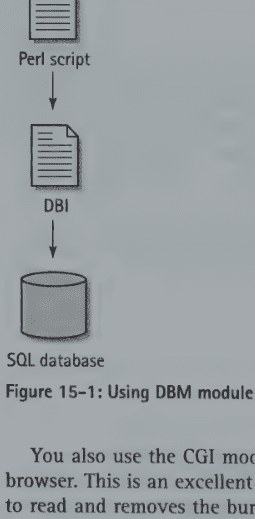

图 15-1：使用 DBI 模块作为抽象层

你还使用 CGI 模块 (CGI.pm) 通过 Web 浏览器与用户交互。这是编写 CGI 脚本的绝佳工具；它使你的代码更易于阅读，并免去了从头开始编写所有内容的负担。Lincoln Stein 编写了它，你可以从 http://cpan.perl.org/ 下载。

现在让我们看一些使用上述模块与 MySQL 服务器交互的脚本。

#### 从命令提示符进行 SQL 交互

让我们创建一个名为 `test` 的简单数据库，其中包含一个名为 `friends` 的表，用于存储联系信息：姓名、电话号码、地址和年龄。要创建此数据库和表，请执行以下操作：

1. 使用 `mysql -u username -p` 命令启动 MySQL 客户端。
2. 在 `mysql` 提示符下，输入 `create database test;` 来创建 test 数据库。然后输入 `use test;` 开始使用此数据库。
3. 现在输入以下行来创建一个名为 `friends` 的表：

```
create table friends (
    name CHAR(40) NOT NULL,
    phone CHAR(13),
    address CHAR(80),
    age INT,
    id INT AUTO_INCREMENT PRIMARY KEY);
```

4. 输入这些行后，输入 `describe friends;` 来查看表的描述，应显示如下输出：

```
+-----------+----------+------+-----+---------+----------------+
| Field     | Type     | Null | Key | Default | Extra          |
+-----------+----------+------+-----+---------+----------------+
| name      | char(40) | YES  |     | NULL    |                |
| phone     | char(13) | YES  |     | NULL    |                |
| address   | char(80) | YES  |     | NULL    |                |
| age       | int(11)  | YES  |     | NULL    |                |
| id        | int(11)  |      | PRI | 0       | auto_increment |
+-----------+----------+------+-----+---------+----------------+
5 rows in set (0.01 sec)
```

5. 现在你已准备好向数据库中插入一些示例数据。以下是 SQL `insert` 命令的示例：

```
insert into friends (id, name, phone, address, age) values ('0', 'Joe Gunchy', '555-5555', '1234 University Ave, Sacramento, CA 95555', '21');
```

6. 一旦你使用 `insert` 命令输入了一些记录，你可以通过输入 `exit;` 命令退出客户端。

清单 15-1 显示了一个相对简单的脚本，用于检索和打印存储在数据库中的数据。该程序假设你有一个名为 `terry`、密码为 `asecret1` 的用户。你需要更改定义部分以匹配具有数据库访问权限的账户。

#### 清单 15-1：cmdline.select.pl 文件

```
#!/usr/bin/perl
# 命令行脚本，用于从 SQL 数据库中查询

use DBI;

# 定义 - 你需要更改这些
my $table = 'friends';
my $db = 'test';
my $user = 'terry';
my $password = 'asecret1';

# 定义结束

# 告诉脚本我们将使用
# MySQL 数据库
my $drh = DBI->install_driver('mysql' );

# 建立与数据库的连接
my $dbh = $drh->connect($db, $user, $password);

# 一个简单的检查，看看我们是否连接成功
die '无法连接: $DBI::errstr\n' unless $dbh;

# 从用户获取输入
print '姓名: ';
my $name = <STDIN>;
chomp($name);
print '\n';

# 构建并执行 SQL 语句
my $SQLstatement = 'select name, phone, address, age from $table
where name = \'$name\'';
my $sth = $dbh->prepare($SQLstatement);
my $howmany = $sth->execute;

die '无法在数据库中匹配 $name\n' if $howmany eq '0E0';

print '在数据库中找到 $howmany 条匹配记录\n\n';
printf ('%17.14s %13.9s %15.12s   %s \n',
        '姓名', '电话', '地址', '年龄');

# 循环遍历所有匹配项并打印它们
for (my $i = 0; $i < $howmany; $i++) {
    my ($SQLname, $SQLphone, $SQLaddress, $SQLage) =
        $sth->fetchrow_array;
    printf ('%17.14s %13.9s %15.12s   %2d \n',
            $SQLname, $SQLphone, $SQLaddress, $SQLage);

}
```

此程序显示一个提示，让你输入姓名，并使用以下 SQL select 语句查询 test 数据库中的 friends 表：

```
select name, phone, address, age from $table where name =
\'$name\'';
```

**$name** 变量保存你在命令提示符下输入的姓名。例如，当此程序运行如下时：

```
./cmdline.select.pl
Name: brian smith
```

它会显示以下输出：

```
在数据库中找到 1 条匹配记录
              姓名          电话          地址   年龄
           Brian Smith    555-2453     1915 11th St    23
```

此程序非常简单。你需要提供朋友的全名，它才能在数据库中找到记录。唯一能找到多条匹配记录的情况是你有多条名为 Brian Smith 的记录。这帮助不大。清单 15-2 提供了更大的灵活性。你可以使用部分姓名而不是完整姓名来定位所有匹配的记录。

#### 清单 15-2：cmdline.select.revised.pl 文件

```
#!/usr/bin/perl
# 命令行脚本，用于从 SQL 数据库中查询
# 修订为匹配子字符串
use DBI;
```


## 清单 15-2（续）

```perl
# 定义 - 你需要修改这些
my $table = 'friends';
my $db = 'test';
my $user = 'terry';
my $password = 'asecret1';

# 定义结束

# 告诉脚本我们将使用
# MySQL 数据库
my $drh = DBI->install_driver('mysql');

# 与数据库建立连接
my $dbh = $drh->connect($db, $user, $password);

# 一个简单的检查，确认是否连接成功
die '无法连接: $DBI::errstr\n' unless $dbh;

# 从用户获取输入
print '姓名: ';
my $name = <STDIN>;
chomp($name);
print '\n';

# 构建并执行 SQL 语句
my $SQLstatement = 'select name, phone, address, age from $table
where name like \'%$name%\' ';
my $sth = $dbh->prepare($SQLstatement);
my $howmany = $sth->execute;

die '无法在数据库中匹配 $name\n' if $howmany eq '0E0';

print "在数据库中找到 $howmany 条匹配记录\n\n";
printf ('%17.14s %13.9s %15.12s   %s \n',
        'NAME', 'PHONE', 'ADDRESS', 'AGE');

# 循环遍历所有匹配项并打印
for (my $i = 0; $i < $howmany; $i++) {
    my ($SQLname, $SQLphone, $SQLaddress, $SQLage) =
        $sth->fetchrow_array;
    printf ('%17.14s %13.9s %15.12s   %2d \n',
            $SQLname, $SQLphone, $SQLaddress, $SQLage);
}
```

现在运行程序时，你不再需要输入全名：

```
./cmdline.select.revised.pl
姓名: brian

在数据库中找到 2 条匹配记录
```

| NAME | PHONE | ADDRESS | AGE |
|------|-------|---------|-----|
| Brian | 555-9999 | 433 M St. | 29 |
| Brian Smith | 555-2453 | 1915 11th St | 23 |

这一切之所以发生，是因为你修改了以下这行代码：

```perl
$SQLstatement = 'select name, phone, address, age from $table
             where name like \'%$name%\'';
```

作为副作用，如果你在不输入姓名的情况下运行程序，你会看到数据库中的每条记录。如果你发现数据库里少了某人怎么办？你需要一个脚本，它询问每个字段的内容，然后将新的数据行放入数据库中。清单 15-3 正是做这个的。

#### 清单 15-3：cmdline.insert.pl 文件

```perl
#!/usr/bin/perl
# 从 SQL 数据库中进行选择的命令行脚本
# 修订为匹配子字符串

use DBI;

# 定义 - 你需要修改这些
my $table = 'friends';
my $db = 'test';
my $user = 'terry';
my $password = 'asecret1';

# 定义结束

# 告诉脚本我们将使用
# MySQL 数据库
my $drh = DBI->install_driver('mysql');

# 与数据库建立连接
my $dbh = $drh->connect($db, $user, $password);

# 一个简单的检查，确认是否连接成功
die '无法连接: $DBI::errstr\n' unless $dbh;

# 从用户获取输入
print '姓名: ';
my $name = <STDIN>;
chomp($name);
print '\n';

print '电话: ';
my $phone = <STDIN>;
chomp($phone);
print '\n';

print '地址: ';
my $address = <STDIN>;
chomp($address);
print '\n';

print '年龄: ';
my $age = <STDIN>;
chomp($age);
print '\n';

# 构建并执行 SQL 语句
my $SQLstatement = 'insert into $table (id, name, phone, address, age)
  values (\'0\', \'$name\', \'$phone\', \'$address\', \'$age\') ';
my $sth = $dbh->do($SQLstatement);
```

这个脚本只是创建以下 SQL 插入语句，并请求 MySQL 服务器执行它：

```sql
insert into $table (id, name, phone, address, age) values ('0', '$name', '$phone', '$address', '$age')
```

请注意，前面的插入语句中的字段是从命令行获取值的 Perl 变量。让我们看看这个脚本的实际运行：

```
./cmdline.insert.pl
姓名: Scott Ramshaw
电话: 555-5828
地址: 1311 26th Ave.
年龄: 23
```

这将插入一条带有给定信息的新记录，你可以使用 cmdline.select.revised.pl 脚本来搜索它。
如果我的朋友 Brian 搬到了旧金山怎么办？我需要一种方法来在人们搬家或更换电话号码时更改数据。清单 15-4 展示了一个正好做这个的 Perl 脚本。它从用户那里获取一个名字，找到与名字完全匹配的所有数据行，然后为每行数据询问用户的新信息。它允许用户只需按回车键即可保留现有数据。

#### 清单 15-4：cmdline.update.pl 文件

```perl
#!/usr/local/bin/perl
# 更新 SQL 数据库中行的命令行脚本

use DBI;

# 定义 - 你需要修改这些
my $table = 'friends';
my $db = 'test';
my $user = 'terry';
my $password = 'asecret1';

# 定义结束

# 告诉脚本我们将使用
# MySQL 数据库
my $drh = DBI->install_driver('mysql');

# 与数据库建立连接
my $dbh = $drh->connect($db, $user, $password);

# 一个简单的检查，确认是否连接成功
die '无法连接: $DBI::errstr\n' unless $dbh;

# 从用户获取输入
print '姓名: ';
my $name = <STDIN>;
chomp($name);

# 构建并执行 SQL 语句
my $SQLstatement = 'select id, name, phone, address, age from $table
                    where name like \'$name\'';
my $sth = $dbh->prepare($SQLstatement);
my $howmany = $sth->execute;

die '无法在数据库中匹配 $name\n' if $howmany eq '0E0';
print "在数据库中找到 $howmany 条匹配记录\n\n";

# 定义局部变量
my ($i, $input, $SQLid, $SQLname, $SQLphone, $SQLaddress, $SQLage,
$updatestatement);
# 循环遍历所有匹配的行，
# 询问用户新数据，然后更新
# 行以反映所做的更改
for ($i = 0; $i < $howmany; $i++) {
    ($SQLid, $SQLname, $SQLphone, $SQLaddress, $SQLage) =
        $sth->fetchrow_array;

    printf ('%17.14s %13.9s %15.12s   %s \n',
            'NAME', 'PHONE', 'ADDRESS', 'AGE');
    printf ('%17.14s %13.9s %15.12s   %2d \n',
            $SQLname, $SQLphone, $SQLaddress, $SQLage);

    print "姓名 [$SQLname]: ";
    $input = <STDIN>;
    chomp($input);
    $SQLname = $input || $SQLname;

    print "电话 [$SQLphone]: ";
    $input = <STDIN>;
    chomp($input);
    $SQLphone = $input || $SQLphone;

    print "地址 [$SQLaddress]: ";
    $input = <STDIN>;
    chomp($input);
    $SQLaddress = $input || $SQLaddress;

    print "年龄 [$SQLage]: ";
    $input = <STDIN>;
    chomp($input);
    $SQLage = $input || $SQLage;

    $updatestatement = "update $table set name = \'$SQLname\',
        address = \'$SQLaddress\',
        phone = \'$SQLphone\',
        age = $SQLage
        where id = $SQLid";

    $dbh->do($updatestatement);
}
```

此脚本使用以下 SQL 更新语句来执行其更新现有记录的工作：

```sql
update $table set name = '$SQLname', address = '$SQLaddress', phone = '$SQLphone', age = $SQLage where id = $SQLid
```

以下是此脚本工作方式的示例：

```
./cmdline.update.pl
姓名: brian smith
在数据库中找到 1 条匹配记录
NAME            PHONE           ADDRESS         AGE
Brian Smith     555-2453        1915 11th St    23
姓名 [Brian Smith]:
电话 [555-2453]: 415-555-9242
地址 [1915 11th St.]: 132 Market St. #100
年龄 [23]:

瞧！Brian 的新信息现在已经在数据库中了。
```

#### 使用 CGI 脚本通过 Web 浏览器访问 SQL 数据库

到目前为止，我向你展示的脚本相当乏味。当在 Red Hat 上将 SQL 融入 CGI 脚本并在 Web 浏览器中显示输出时，它才真正大放异彩。突然间，你的网站可以向访问者展示你想要的有用数据！你可以允许你的网站用户搜索数据、输入他们自己的数据等等。SQL 和 CGI 真正像花生酱和果冻一样相得益彰。

清单 15-5 展示了一个示例 CGI 脚本，它使用了你在本章中学习的一些命令行脚本的核心功能。一旦你将此脚本安装到 Web 服务器的 cgi-bin 目录中，你就可以使用 Web 浏览器来运行这个 CGI 脚本。首先，它显示一个 HTML 表单。这个 HTML 界面比之前构建的命令行脚本中的界面灵活得多。此脚本允许你根据之前创建的 test 数据库中 friends 表的任何字段来检索信息。你可以按地址查找人员，

#### 清单 15-5：select.cgi

```perl
#!/usr/bin/perl
# CGI to select data from a SQL database
use CGI;
use DBI;
my $q = new CGI;

# Definitions - You will need to change these
my $table = 'friends';
my $db = 'test';
my $user = 'terry';
my $password = 'asecret1';
# End of definitions

# This is the main branch. The first time through
# display the form to the user, when the user submits
# the form then we process the input
if ($q->param('field') eq '') {&printform()} else {&results()}

sub printform {

    print $q->header;
    print $q->start_html(-title=>'Friend Database',
                         -BGCOLOR=>'black',
                         -TEXT=>'white');
    print '<CENTER><H1>Friend Database</H1></CENTER><HR>';
    print $q->startform;
    print 'Find all my friends whose ';
    print $q->popup_menu(-name     => field,
                         -values   => [('name', 'address',
                                        'phone', 'age')],
                         -default  => 'name');
    print $q->popup_menu(-name     => searchtype,
                         -values   => [('is', 'contains')],
                         -default  => 'is');
    print $q->textfield(-name => text,
                        -size => 16), '<BR>';
    print $q->submit;
    print $q->endform;
    print $q->end_html;
}

sub results {

    my $field = $q->param('field');
    my $searchtype = $q->param('searchtype');
    my $text = $q->param('text');
    my @table=();
    print $q->header;
    print $q->start_html(-title=>'Database Results',
    -BGCOLOR=>'black',
    -TEXT=>'white');

    # Tell the script that we will be using
    # a MySQL database
    my $drh = DBI->install_driver('mysql' );

    # Establish a connection with the database
    my $dbh = $drh->connect($db, $user, $password);

    # A simple check to see if we connected
    if (!$dbh) {
        print 'Cannot connect: $DBI::errstr<BR>';
        print $q->end_html;
        die;
    }

    # Build and execute the SQL statement
    my ($SQLstatement);
    if ($searchtype eq 'contains') {
        $SQLstatement = 'select name, phone, address, age from $table
                        where $field like \'%\$text%\'';
    } else {
        $SQLstatement = 'select name, phone, address, age from $table
                        where $field = \'\$text\'';
    }
    my $sth = $dbh->prepare($SQLstatement);
    my $howmany = $sth->execute;

    # Display an error message if we can't find
    # any matches
    if ($howmany eq '0E0') {
        print $q->h3('<font color=red>Couldn\'t match $text in '.
                    'database</font>');
        die;
    }

    print "$howmany matches found in database<br><br>";
    push (@table,$q->th(['Name', 'Phone', 'Address', 'Age']));

    # loop through all the matches and store
    # them in @table
    for (my $i = 0; $i < $howmany; $i++) {
        my ($SQLname, $SQLphone, $SQLaddress, $SQLage) =
            $sth->fetchrow_array;
        push (@table,$q->td([$SQLname, $SQLphone,
                        $SQLaddress, $SQLage]));
    }

    # print the table of data we got from the
    # SQL database
    print $q->table({-border => 1, -align => center},$q->Tr(\@table));
    print $q->end_html;
}
```

图 15-2 展示了 Web 浏览器中的 HTML 表单界面。

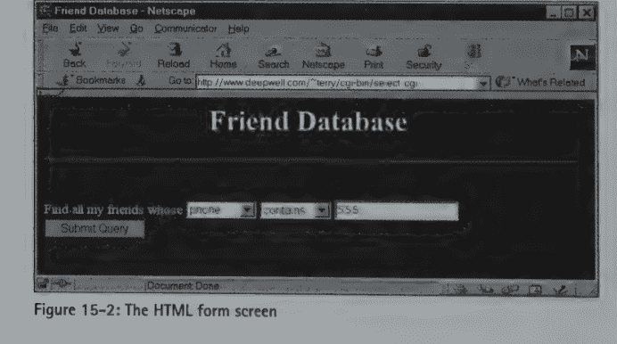

#### 图 15-2：HTML 表单界面

当你提交带有搜索条件的 HTML 表单后，CGI 脚本会再次运行，并从 SQL 数据库中检索请求的数据。然后，它将数据格式化为 HTML 表格，并将其发送回 Web 浏览器进行显示。图 15-3 展示了一个输出结果页面的示例。

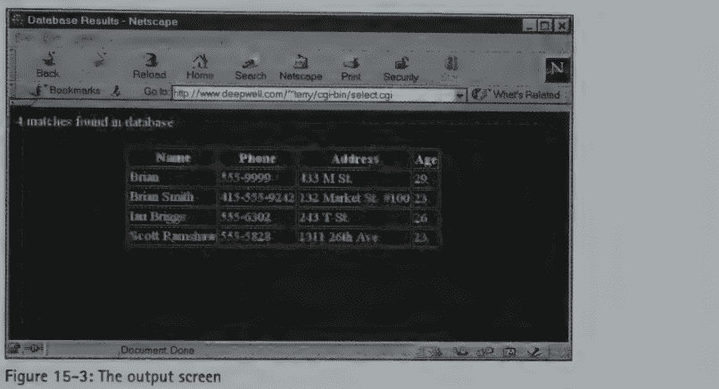

你还可以创建执行其他功能的 CGI 脚本，例如向数据库插入、更新和删除数据。我将之前讨论的 `cmdline.insert.pl` 脚本修改为了一个 CGI 脚本，如清单 15-6 所示。它为用户提供一个 HTML 表单来输入新数据，当新数据被提交后，它会显示一条状态消息，告知用户数据已被添加到数据库中。

#### 清单 15-6：insert.cgi 文件

```perl
#!/usr/bin/perl
#  CGI to insert data into a SQL database
use CGI;
use DBI;
my $q = new CGI;

# Definitions - You will need to change these
my $table = "friends";
my $db = "test";
my $user = "terry";
my $password = "asecret1";
# End of definitions

if ($q->param("name") eq "") {&printform()} else {&results()}

sub printform {

    print $q->header;
    print $q->start_html(-title=>"Friend Database",
                         -BGCOLOR=>"black",
                         -TEXT=>"white");

    print "<CENTER><H1>Friend Database</H1></CENTER><HR>";
    print $q->startform;
    print "Name: ", $q->textfield(-name => name, -size => 16), "<BR>";
    print "Phone: ", $q->textfield(-name => phone, -size => 16), "<BR>";
    print "Address: ", $q->textfield(-name => address,-size => 16), "<BR>";
    print "Age: ", $q->textfield(-name => age, -size => 16), "<BR>";
    print $q->submit;
    print $q->endform;
    print $q->end_html;
}

sub results {

    my ($name, $phone, $address, $age);
    $name = $q->param("name");
    $phone = $q->param("phone");
    $address = $q->param("address");
    $age = $q->param("age");

    print $q->header;
    print $q->start_html(-title=>"Database Results", -BGCOLOR=>"black",
                         -TEXT=>"white");

    # Tell the script that we will be using
    # a MySQL database
    my ($drh, $dbh);
    $drh = DBI->install_driver( "mysql" );

    # Establish a connection with the database
    $dbh = $drh->connect($db, $user, $password);

    # A simple check to see if we connected
    if (!$dbh) {
        print "Cannot connect: $DBI::errstr<BR>";
        print $q->end_html;
        die;
    }

    # Build and do the SQL statement
    my $SQLstatement = "insert into $table (name, phone, address, age)
	values (\"$name\", \"$phone\", \"$address\", \"$age\")";
    $dbh->do($SQLstatement);

    print "$name added to database<br><br>";
    print $q->end_html;
}
```

我们仅仅触及了 CGI 脚本中 SQL 功能的皮毛。许多大型在线商店在其购物车、订单跟踪和库存跟踪应用中同时使用了 SQL 和 CGI。如今你可以在网上购买任何东西，而 SQL 数据库是其中的重要组成部分。无论你是在寻找书籍、CD 还是汽车，只要你通过网站搜索商品，很可能就在使用 SQL 数据库。

本章中的 Perl 脚本仅用于向你介绍程序与 SQL 数据库之间的交互。我们还有很多未涉及的内容，例如基于搜索结果进行计算或根据数据构建图表。可能性是无限的。希望你对用户与数据库之间的交互有了初步的了解，也希望你能获得在 Red Hat 服务器上进一步使用 SQL 的灵感。

#### 小结

在本章中，你学习了如何安装和配置 MySQL——一个在 Linux 上非常流行的 SQL 服务器。你学习了如何创建包含简单表的简单数据库。最后，你学习了如何通过命令行或 CGI 脚本等方式访问数据库中的数据。请将本章视为该主题的入门介绍。

# 第 16 章

#### NFS 服务器

**本章内容**

-   如何安装和配置 NFS 服务器
-   如何安装和配置 NFS 客户端
-   如何使用 rdist 在多台计算机之间分发文件

**在上一章中**，你学习了如何在符合 SMB 协议的系统之间共享文件，例如你的 Red Hat Linux 和各种 Windows 操作系统。网络文件系统（NFS）解决了同样的文件共享问题，但它从早期就被设计用来处理 UNIX 语义。尽管 NFS 从头开始设计，但 SMB 却是先实现后文档化的。在我看来，SMB 更像是一种自然演进的架构，而不是从一开始就精心设计的东西。由于 SMB 与微软的紧密联系，一旦微软做出更改，问题随时可能出现。例如，Windows 2000 的服务包（版本 3 或更高版本）因为微软对 SMB 安全性的理念发生变化而破坏了 Samba 服务。而另一方面，NFS 已经存在了很长时间，并且几乎在所有 UNIX 平台上都得到了实现。简而言之，如果你想在 Red Hat Linux 和 Windows 系统之间共享磁盘和其他资源，请使用 SMB；如果你打算在多台 UNIX 系统之间共享磁盘，NFS 可能是你的最佳选择。在本章中，你将学习如何使用 NFS。

#### 安装 NFS 服务器和客户端软件

你可以从 Red Hat CD-ROM 附带的 RPM 包中安装 NFS 服务器和客户端软件。例如，要在 x86 Red Hat Linux 系统上安装 NFS 服务器包，你可以在 CD-ROM 的 /RedHat/RPMS 目录下运行以下命令：

```bash
rpm -ivh nfs-utils-1.0.1-2.i386.rpm
```

NFS 服务器包包含了将 Red Hat Linux 系统转变为 NFS 服务器所需的 NFS 守护进程和配置文件。然而，由于 NFS 基于远程过程调用（RPC），你需要另一个名为


配置 NFS 服务器

NFS 服务器需要运行一个名为 `portmap`（也称为 `rpc.portmap`）的程序，该程序通常在启动时通过 `init` 启动。使用以下命令检查 portmapper 是否已经在运行：

```
ps auxw | grep portmap
```

安装 `portmap` 软件包时，它还会在 `/etc/rc.d/init.d` 中安装一个名为 `portmap` 的 `init` 脚本。该脚本也应该自动链接到你的默认运行级别（通常多用户系统的运行级别为 3）`rc` 目录中。如果没有这样的符号链接，你需要手动运行 `portmap`。在这种情况下，我建议你运行：

```
ln -s /etc/rc.d/init.d/portmap    /etc/rc.d/rc3.d/S11portmap
```

这将创建一个符号链接，使 Red Hat Linux 能够在启动时自动运行 `portmap` 程序。同样，你的 `/etc/rc.d/init.d` 目录中应该有另一个名为 `nfs` 的脚本。使用此脚本在启动时启动 NFS 守护进程（`rpc.mountd`、`rpc.nfsd`）。该脚本也应该从你的默认运行级别目录中链接；否则，你必须手动运行这些守护进程。

下一步是创建 `/etc/exports` 文件，以告知系统哪些文件系统或目录需要导出给 NFS 客户端。此文件的语法如下：

```
/directory nfs-client-host-ip-or-name (access options)
```

以下是 `/etc/exports` 文件的示例：

```
/www        www1.evoknow.com(ro) www2.evoknow.com(ro)
/www-data   cgi.evoknow.com(rw)  fastcgi.evoknow.com(rw)
```

此处，NFS 服务器上的 `/www` 目录被导出给 `www1.evoknow.com` 和 `www2.evoknow.com` NFS 客户端。这两台机器都被授予对导出目录的只读（`ro`）访问权限。第二行用于将 `/www-data` 目录导出给 `cgi.evoknow.com` 和 `fastcgi.evoknow.com` 客户端系统。这两个系统对导出目录都具有读写（`rw`）访问权限。你也可以使用以下任何常用方式来指定 NFS 客户端。

NFS 客户端可以在 `/etc/exports` 文件中指定为 IP 地址。例如：

```
/www        192.168.1.254(ro)
```

此处，IP 地址为 192.168.1.254 的机器被授予对 `/www` 目录的只读 NFS 访问权限。你也可以指定整个 IP 网段，如以下示例所示：

```
/       192.168.1.0/255.255.255.0 (rw)
```

此处，整个 192.168.1.0 网络（范围在 192.168.1.1–192.168.1.254 内的 254 个 IP 地址）已被授予对 NFS 服务器根文件系统的读写权限。你也可以使用通配符来指定一组主机。例如：

```
/pc        *.evoknow.com (rw)
```

此处，evoknow.com 域中的所有主机都可以访问 NFS 服务器上的 `/pc` 目录。你还可以使用 `?` 字符作为单字符通配符。

如果你想将文件系统或目录导出给全球所有 NFS 客户端，可以省略用于导出它的行中的 NFS 客户端列表。例如：

```
/pub        (ro)
```

此处，`/pub` 目录被导出给任何 NFS 客户端。现在你可以了解一下常用的访问选项。

## 授予对导出目录的只读访问权限

如果你想仅允许对从 NFS 服务器导出给客户端的任何目录或文件系统进行只读访问，可以使用 `ro` 作为访问选项。例如：

```
/master-data   production.evoknow.com(ro)
```

在此示例中，`production.evoknow.com` 客户端系统对 `/master-data` 目录具有只读访问权限。

> Linux NFS 的默认访问模式为 `ro`（只读）。但是，尽可能显式将访问模式设置为 `ro` 是一个非常好的实践。另请注意，`ro` 和 `rw` 模式都允许对导出的文件系统执行文件执行权限。

## 授予对导出目录的读写访问权限

如果你想允许对从 NFS 服务器导出给客户端的任何目录或文件系统进行读写访问，可以使用 `rw` 作为访问选项。例如：

```
/intranet  *.evoknow.com(rw)
```

此处，`evoknow.com` 域上的所有 NFS 客户端对 `/intranet` 目录都具有读写访问权限。

## 禁止访问特定目录

当你导出整个文件系统或目录时，导出目录下的子目录会自动使用相同的访问选项进行访问。然而，这并不总是理想的。例如，你可能希望允许访问名为 `/pub` 的目录，但不允许访问名为 `/pub/staff-only` 的目录。在这种情况下，你需要使用 `noaccess` 访问选项，如下所示：

```
/pub    weblab-??.evoknow.com (ro)
/pub/staff-only    weblab-??.evoknow.com (noaccess)
```

此处，所有 `weblab-??.evoknow.com`（其中 `??` 为任意两个字符）计算机对 `/pub` 目录具有只读访问权限，但由于下一行中的 `noaccess` 选项，它们不允许访问 `/pub/staff-only` 目录。

## 在 NFS 服务器和客户端之间映射用户

设置 NFS 服务器后很快会出现的问题之一是 NFS 服务器和客户端之间的用户映射。例如，假设你正在导出一个名为 `/www` 的目录，该目录分别由名为 `webguru` 的用户和名为 `webdev` 的组拥有。能够挂载此目录的 NFS 客户端必须有一个名为 `webguru` 的用户或 `webdev` 组才能访问它。这通常并不理想。特别是，你不想让 NFS 客户端 root 帐户在 NFS 挂载的目录上拥有 root 权限。这就是 NFS 服务器默认强制执行名为 `root_squash` 的选项的原因。此选项通常将 root 用户（UID = 0）和 root 组（GID = 0）映射到客户端系统上的 nobody 用户。你可以通过在定义导出行时添加 `no_root_squash` 来禁用 root 用户和组到 nobody 的默认映射，但我不建议这样做，除非你有 NFS 客户端和服务器都在隔离、受信任的环境中的特殊情况。

如果你想将 root UID/GID 对映射到特定的 UID/GID，可以使用 `anonuid` 和 `anongid` 访问选项。例如：

```
/proj    *.evoknow.com (anonuid=500 anongid=666)
```

此处指定了 `anonuid` 和 `anongid`，允许将 root 压缩映射到 UID 500 和 GID 666。

如果你希望将所有 UID/GID 对压缩映射到匿名 UID/GID 对，可以使用 `all_squash` 选项。例如：

```
/proj    *.evoknow.com (anonuid=500 anongid=666 all_squash)
```

此处，`/proj` 目录被导出给 `evoknow.com` 域中的所有主机，但所有访问都以 UID 500 和 GID 666 进行。

如果你想指定需要使用匿名 UID/GID 对进行压缩映射的 UID 和 GID 列表，可以使用 `squash_uids` 和 `squash_gids` 选项。例如：

```
/proj    *.evoknow.com (anonuid=500 anongid=666 \
squash_uids=0-100 squash_gids=0-100)
```

此处，范围在 0–100 内的所有 UID 和 GID 都使用匿名 UID 500 和 GID 666 进行压缩映射。

你也可以指定一个外部映射文件，将 NFS 客户端提供的 UID 和 GID 映射为你所需的任何值。映射使用 `map_static` 选项指定。例如：

```
/proj    *.evoknow.com (map_static=/etc/nfs.map)
```

此处，`/proj` 目录被导出给所有 `evoknow.com` 主机，但所有 NFS 客户端提供的 UID 和 GID 都使用 `/etc/nfs.map` 文件进行映射。以下是此映射文件的示例：

```
uid  0-100  -  # squash all remote uids in the 0-100 range
gid  0-100  -  # squash all remote gids in the 0-100 range
uid  500   666 # map remote uid 500 to local uid 666
gid  500   777 # map remote gid 500 to local gid 777
```


现在你已经了解了创建 `/etc/exports` 文件的所有常用选项。但是，每当对 `/etc/exports` 文件进行更改时，都需要将此更改通知 NFS 守护进程。你可以使用一个名为 `exportfs` 的脚本来重启这些守护进程，如下所示：

```
/usr/sbin/exportfs
```

现在，为了确保 `rpc.mountd` 和 `rpc.nfsd` 都正常运行，请运行一个名为 `rpcinfo` 的程序，如下所示：

```
rpcinfo -p
```

输出结果如下所示：

| program | vers | proto | port | |
|---------|------|-------|------|---|
| 100000 | 2 | tcp | 111 | portmapper |
| 100000 | 2 | udp | 111 | portmapper |
| 100021 | 1 | udp | 1024 | nlockmgr |
| 100021 | 3 | udp | 1024 | nlockmgr |
| 100024 | 1 | udp | 1025 | status |
| 100024 | 1 | tcp | 1024 | status |
| 100011 | 1 | udp | 728 | rquotad |
| 100011 | 2 | udp | 728 | rquotad |
| 100005 | 1 | udp | 1026 | mountd |
| 100005 | 1 | tcp | 1025 | mountd |
| 100005 | 2 | udp | 1026 | mountd |
| 100005 | 2 | tcp | 1025 | mountd |
| 100003 | 2 | udp | 2049 | nfs |

此输出表明 `mountd` 和 `nfsd` 已经宣告了它们的服务并且运行正常。至此，NFS 服务器已设置完成，接下来你需要设置 NFS 客户端主机。

## 配置 NFS 客户端

NFS 客户端软件包附带一个名为 `showmount` 的程序，它可以为你提供关于 NFS 服务器上已导出的文件系统或目录的信息。你可以使用 NFS 服务器的主机名或 IP 地址作为参数来运行此命令，以查看哪些主机被允许访问导出的文件系统或目录。例如：

```
showmount nfs-server.evoknow.com
```

此命令显示被允许从 `nfs-server.evoknow.com` 导入文件的 NFS 客户端列表。要查看 NFS 服务器的导出列表，请使用 -e 选项运行此命令。要查看哪个客户端被允许导入哪些文件系统或目录，请使用 -a 选项运行此命令。

如果 showmount 命令显示你当前正在配置的 NFS 客户端被允许导入某个文件系统或目录，那么你就可以继续进行客户端配置。如果它没有显示你当前 NFS 客户端的主机名或 IP 地址，你必须重新配置 NFS 服务器上的 /etc/exports 文件，以允许此客户端访问你想要导入的任何目录或文件系统。

要从 NFS 服务器导入目录或文件系统，你需要使用标准的 mount 命令进行挂载。例如，要将名为 nfs-server.evoknow.com 的 NFS 服务器上的 /www 目录挂载到本地，你可以使用以下 mount 命令：

```
mount -t nfs nfs-server.evoknow.com:/www /www
```

此命令将 nfs-server.evoknow.com 系统上的 /www 目录挂载到本地的 /www 目录，作为通过 -t 选项指定的 NFS 文件系统。但是，如果你计划定期挂载 NFS 文件系统或目录，并且希望在启动时自动挂载，你必须在客户端系统的 /etc/fstab 文件中添加一行新内容。例如，要在启动时挂载 nfs-server.evoknow.com 上的 /www 目录，请在 /etc/fstab 文件中添加以下行：

```
nfs-server.evoknow.com:/www /www nfs 0 0
```

为了确保你的 NFS 客户端在启动时自动挂载 NFS 文件系统和目录，你应该检查默认运行级别 rc 目录中是否有指向 /etc/rc.d/init.d/netfs 脚本的符号链接（以 Sxx 开头，其中 xx 是一个两位数）。卸载 NFS 文件系统与卸载本地文件系统完全相同。

在你将 NFS 服务器导出的文件挂载到 NFS 客户端系统后，你的用户可以立即开始使用已挂载的文件系统或目录。但是，在允许用户访问你的 NFS 导出之前，请考虑下一节中讨论的安全问题。

## 保护你的 NFS 服务器

portmap 与 rpc.nfsd 结合使用时可能会被欺骗，从而有可能在没有任何权限的情况下访问 NFS 服务器上的文件。幸运的是，Linux 使用的 portmap 相对来说对攻击有较好的防护，你可以通过在 /etc/hosts.deny 文件中添加以下行来进一步提高其安全性：

```
portmap: ALL
```

这样系统就会拒绝所有人对 portmap 的访问。现在需要修改 /etc/hosts.allow 文件，如下所示：

```
portmap: 192.168.1.0/255.255.255.0
```

此指令允许来自 192.168.1.0 网络的所有主机访问由 portmap 管理的程序，例如 nfsd 和 mountd。

> 永远不要在 /etc/hosts.allow 文件中的 portmap 行中使用主机名，因为使用主机名查找可能会间接导致 portmap 活动，从而触发主机名查找的循环。

服务器端的另一个安全问题是是否允许客户端的 root 账户在服务器上被视为 root。默认情况下，Linux 禁止 NFS 客户端的 root 在服务器端被视为 root。换句话说，服务器上由 root 拥有的已导出文件无法被客户端 root 用户修改。要显式执行此规则，你可以按如下方式修改 /etc/exports 文件：

```
/www www1.evoknow.com(rw, root_squash)
```

现在，如果客户端上 UID 为 0（即 root 用户）的用户尝试访问（读取、写入或删除）该文件系统，服务器会将其替换为服务器 nobody 账户的 UID。这意味着客户端上的 root 用户无法访问或更改只有服务器上的 root 才能访问或更改的文件。要授予 root 对 NFS 文件系统的访问权限，请改用 no_root_squash 选项。

请注意，你还可以通过不过度信任 NFS 服务器来增强 NFS 客户端的安全性。例如，你可以使用 nosuid 选项来禁用 suid 程序在 NFS 文件系统上的运行。这意味着服务器上的 root 用户无法创建 suid-root 程序放在文件系统上，然后以普通用户身份登录客户端，再利用该 suid-root 程序在客户端上获得 root 权限。你还可以使用 noexec 选项来禁止在已挂载的文件系统上执行文件。你可以在 /etc/fstab 文件中描述你的 NFS 挂载点的那一行的选项列中输入这些选项。

现在你已经学会了如何使用 NFS 在多个主机之间共享文件，接下来你需要了解在哪些情况下 NFS 并不是最佳解决方案。例如，假设你想将一组文件和目录分发到一个或多个 Linux 系统，使每个系统都有自己的文件副本。在这种情况下 NFS 并无帮助，因为当你通过 NFS 提供这些文件时，整个客户端系统共享的是同一份副本。这种场景在大学计算机实验室等地方非常常见。在大多数情况下，你希望学生在实验室使用文件时拥有自己的副本，同时在下一批学生到来时将修改过的文件替换为主服务器上的原始文件。SMB 和 NFS 协议在这种场景下都不太有用。这时候你就需要一个名为 rdist 的程序。

#### 使用 rdist 分发文件

`rdist` 程序使你能够在多台主机上维护相同的文件副本。该程序使用 `rcmd` 函数调用或远程 shell（`rsh`）来访问每台目标主机计算机。

让 `rdist` 开始工作的最简单方法是在所有相关机器上创建一个公共账户，并为每个目标（即客户端）系统创建 `.rhosts` 文件，以便主主机上的公共用户被允许运行 `rsh` 会话。因为用一个例子更容易理解，假设你想创建一个文件分发环境，其中一台名为 `master.an-university.edu` 的主计算机包含文件的主副本，两台名为 `student1.an-university.edu` 和 `student2.an-university.edu` 的主机需要每天从主计算机获取文件的新副本。我还假设这三台计算机都共享一个名为 `updater` 的公共用户账户。以下是如何设置这样的环境。

在每台学生计算机上，在 `updater` 用户的主目录中添加 `.rhosts` 文件。该文件包含一行内容：

```
master.an-university.edu
```

此文件必须由 root 用户拥有，其他所有人只能读取。这允许 `master.an-university.edu` 上名为 `updater` 的用户在每台学生系统上运行远程 shell 会话。下一步是为 `rdist` 创建文件分发配置文件。此文件通常称为 `distfile`。`distfile` 是一个文本文件，包含 `rdist` 要执行的文件分发任务的指令。清单 16-1 展示了一个名为 `rdist_distfile` 的 `distfile` 示例。

#### 清单 16-1：`rdist_distfile` 文件

```
#
# Distfile for rdist
#
# This file is used to distribute files from
# master.an-university.edu to student[12].an-university.edu
# systems.
#
# $Author$ (kabir@evoknow.com)

# $Version$
# $Date$
# $Id$
```


## 第四部分：设置内部网/互联网服务

清单 16-1（续）

```
# 列出所有需要更新的主机。
# 列表使用 user@hostname 条目创建，每个条目由空白字符分隔。
#
HOSTS = (updater@student1.an-university.edu \
         updater@student2.an-university.edu)

# 列出需要更新的目录。
#
FILES = ( /csc101)

# 列出需要从更新过程中排除的目录。
EXCLUDE_DIR = (/csc101/instructor /csc101/secret)

# 以下是命令：
# 为 HOSTS 中列出的所有主机安装 FILES 中列出的所有目录，
# 但排除 EXCLUDE_DIR 中列出的目录。
#
$(FILES) -> $(HOSTS)
    install ;
    except $(EXCLUDE_DIR);
```

这确实是一个非常简单的分发文件。它定义了一个名为 HOSTS 的变量，其值包含两个条目：updater@student1.an-university.edu 和 updater@student2.an-university.edu。此分发文件告诉 rdist 使用 student1.an-university.edu 和 student2.an-university.edu 上的 updater 用户账户进行连接。下一个变量 FILES 定义了 rdist 要分发的目录。这里只分发 /csc101 目录。
第三个变量是 EXCLUDE_DIR。该变量设置为列出我们希望排除在分发之外的所有文件和目录。示例中看到的值是 /csc101/instructors（此变量可能包含只有讲师才能访问的文件）和 /csc101/secret（一个学生不应访问的目录）。
文件的其余部分描述了一个简单的命令：

```
$(FILES) -> $(HOSTS)
    install ;
    except $(EXCLUDE_DIR);
```

此命令获取 FILES 变量指向的所有文件和目录，并将它们安装到 HOSTS 变量指示的主机上。它还告诉 rdist 排除 EXCLUDE_DIR 变量指定的文件和目录。要以 updater 身份从命令行运行 rdist，请执行以下操作：

1.  以 updater 身份登录。（如果你是主系统上的 root 用户，也可以使用 su 将 UID 更改为 updater。）
2.  以 updater 身份运行以下命令：

```
/usr/bin/rdist -p /usr/sbin/rdistd -oremove,quiet \
-f /usr/local/rdist/rdist_distfile
```

`-p` 选项指定 rdist 所需的 rdistd 程序的位置；`-o` 选项指定后跟一个或多个选项——在本例中是 `remove` 和 `quiet`。`remove` 选项告诉 rdist 删除在目标系统目标目录中发现的任何多余文件。这提供了一种简单的方法，可以在每个学生系统上维护文件的相同副本。`quiet` 选项告诉 rdist 在操作过程中尽可能保持安静。最后一个选项 `-f` 指定分发文件的位置。

为减少运行此命令时的人为错误，请创建一个名为 rdistribute.sh 的 sh 脚本，如清单 16-2 所示。

#### 清单 16-2：rdistribute.sh 脚本

```
#!/bin/sh
#
# 此脚本通过不可路由的局域网 an-university.edu 运行 rdist 来更新 Web 服务器。
# 脚本由 cron 以固定间隔运行。
#
# /etc/rc.d/rc.local 在启动时启动该脚本，以清理关机时可能留下的
# 临时文件。此过程还会删除日志文件。
#
# $Author$ (kabir@evoknow.com)
# $Version$
# $Id$
# $Date$
# $Status
################################################################

# 如果脚本被调用时带有
# 参数，则

case "$1" in

boot)

    # 由于参数是 "boot"，脚本在系统启动时被调用，
    # 因此删除所有旧的锁文件和日志。
    echo -n "Cleaning up rdistribute.sh tmp files: "
        rm -f /tmp/rdist.lck
            rm -f /tmp/rdist.log
    echo "complete."
    exit 0;
    ;;

    # 由于参数是 "restart"，脚本需要像系统刚启动一样
    # 进行清理。

restart)
    $0 boot
    ;;

esac

# 如果锁文件存在，则不执行任何操作。
if [ -f /tmp/rdist.lck ]; then
    exit 0
fi

# 否则，使用 /bin/touch 创建锁文件
/bin/touch  /tmp/rdist.lck

# 运行 rdist。
/usr/bin/rdist -p /usr/sbin/rdistd -omemove,nochkgroup,nochkmode,nochkowner,quiet -f
/usr/local/rdist/rdist_distfile

# 删除锁文件。
rm -f /tmp/rdist.lck

# 将时间和日期写入日志文件。
echo `date` > /tmp/rdist.log

# 退出脚本。
exit 0
```

此脚本足够智能，可以通过使用锁文件来检测正在进行中的 `rdistribute.sh` 进程，它可以判断之前的 `rdistribute.sh` 是否已在运行并持续中。当通过多个服务器更新大量文件时，可能会发生这种情况。该脚本还接受一个名为 `boot` 的参数，可用于清理锁文件及其在启动过程中创建的日志文件。应从 `/etc/rc.d/rc.local` 如下调用该脚本：

```
/usr/local/rdistribute.sh boot
```

此脚本可以通过 `/etc/crontab` 中的 `cron` 条目安排运行。例如，要每小时运行一次此脚本，请在 `/etc/crontab` 中添加以下 `cron` 条目：

```
01 * * * * updater /usr/local/rdistribute.sh > /dev/null
```

`cron` 守护程序以 `updater` 身份运行脚本。或者，你可以根据需要从 `/etc/cron.hourly`（或 `/etc/cron.daily`、`/etc/cron.monthly` 等）创建一个指向 `rdistribute.sh` 的链接。

#### 总结

在本章中，你学习了使用 NFS。我向你展示了如何将你的 Red Hat Linux 系统变成 NFS 服务器和客户端。你还学习了使用 `rdist` 将相同文件和目录的多个副本分发到客户端系统。

## 第五部分

## 保护服务器

- **第 17 章**
  实现内核级安全
- **第 18 章**
  部署防火墙
- **第 19 章**
  限制用户访问
- **第 20 章**
  保护文件

第 17 章

#### 实现内核级安全

**本章内容**

- 如何安装启用 Linux 入侵检测系统（LIDS）的内核
- 如何保护系统服务免受 root 攻击
- 如何使你的进程对窥探者不可见
- 如何利用启用 LIDS 的 ext2/ext3 文件系统特性
- 如何在内核内部检测端口扫描请求

本章介绍了一种名为 Linux 入侵检测系统（LIDS）的内核级安全技术，它增强了你的整体系统安全性。

#### 使用 Linux 入侵检测系统（LIDS）

root 是万恶之源。也许这个陈述只有 UNIX/Linux 系统管理员才能理解。在确认发生未经授权的 root 访问后，损害控制似乎非常无望，或者至少看起来只能任由入侵者摆布。
在默认的 Red Hat Linux 系统中，通常有几个子系统未受保护：

- 文件系统。系统中有许多重要文件，例如 /bin/login，黑客经常利用这些文件，因为它们未受保护。如果黑客入侵，他可以通过上传修改后的登录程序（例如 /bin/login）在未来访问系统。事实上，像 /bin/login 这样的文件（即程序）不应该频繁更改（如果有的话）——因此它们绝不能处于未受保护的状态。
- 运行中的进程。许多进程以 root 权限运行，这意味着当它们通过诸如缓冲区溢出（在“使用 libsafe”部分解释）之类的技巧被利用时，入侵者就获得了对系统的完全 root 访问权限。

LIDS 通过减少 root 用户的权限来增强系统安全性。LIDS 还在内核中实现了一个底层安全模型，目的如下：

- 安全防护
- 事件检测
- 事件响应能力

例如，LIDS 可以提供以下保护：

- 保护硬盘上的重要文件和目录免受未经授权的访问，无论它们位于哪个本地文件系统上。
- 保护选定的文件和目录免受 root 用户的修改，这样未经授权的 root 访问不会让入侵者变成超级反派。
- 保护重要进程不被任何人（包括 root 用户）终止。（同样，这减少了 root 用户的能力。）
- 防止未经授权的程序进行原始 I/O 操作。
- 保护硬盘的主引导记录（MBR）。

LIDS 可以检测到有人使用端口扫描器扫描你的系统——并通过电子邮件通知系统管理员。LIDS 还可以在注意到任何违反所实施规则的行为时通知系统管理员——并记录有关违规行为的详细信息（在受 LIDS 保护、防篡改的日志文件中）。LIDS 不仅可以记录和发送有关检测到的违规行为的电子邮件，还可以立即关闭入侵者的交互式会话。

#### 构建基于 LIDS 的 Linux 系统

Linux 入侵检测系统（LIDS）是一个内核补丁和一套管理工具，从 Linux 操作系统内核内部增强安全性。LIDS 使用*参考监视器*安全模型，将其引用的所有内容——主体、客体和访问类型——都置于内核中。如果你想了解更多关于这种方法的信息，请访问 LIDS 项目网站 www.lids.org/about.html。

一个启用 LIDS 的 Linux 系统运行一个定制的内核，这意味着你必须从可靠的内核站点（如 www.kernel.org）获取最新的内核源代码。下载并解压内核到 `/usr/src/linux` 后，下载适用于你所需特定内核的 LIDS 补丁。例如，如果你使用内核 2.4.18，请确保从 LIDS 项目网站下载 LIDS 补丁。通常，LIDS 补丁和管理工具包称为 `lids-x.x.x-y.y.y.tar.gz`，其中 `x.x.x` 代表 LIDS 版本号，`y.y.y` 代表内核版本（例如 `lids-1.1.1-2.4.18`）。


#### 使用 LIDS 为内核打补丁、编译及安装

在系统中使用 LIDS 之前，你需要为内核源代码打补丁，然后编译并安装更新后的内款。以下是具体操作步骤：

以下说明中我将使用针对 2.4.18 内核的 LIDS 1.1.1 版本。请务必根据需要更改版本号。在 `/usr/local/src` 目录下使用 `tar xvzf lids-1.1.1r2-2.4.18.tar.gz` 命令解压 LIDS 源代码包。现在你可以为内核打补丁了。

请确保 `/usr/src/linux` 指向你下载的最新内核源代码目录。你可以运行 `ls -l /usr/src/linux` 查看该符号链接指向哪个目录。如果它指向较旧的内核源代码，请使用 `rm -f /usr/src/linux` 删除该链接，然后使用 `ln -s /usr/src/linux-version /usr/src/linux` 重新创建链接，其中 `version` 是你下载的内核版本。例如，`ln -s /usr/src/linux-2.4.18 /usr/src/linux` 会将最新的 2.4.18 内核源代码链接到 `/usr/src/linux`。

1.  以 `root` 用户身份，将 LIDS 补丁包解压到你选择的合适目录中。我通常将本地编译软件的源代码保存在 `/usr/local/src` 目录。我假设你也会这样做。因此，从 `/usr/local/src` 目录运行 `tar xvzf lids-1.1.1r2-2.4.18.tar.gz` 命令。这会创建一个名为 `lids-1.1.1r2-2.4.18` 的新子目录。
2.  切换到 `/usr/src/linux` 目录，运行 `patch -p1 < /usr/local/src/lids-1.1.1r2-2.4.18.patch` 命令为内核源代码打补丁。
3.  从 `/usr/src/linux` 目录运行 `make menuconfig` 命令，启动基于菜单的内核配置程序。

> 你也可以使用 `make config` 命令来配置内核，代替 `make menuconfig` 命令。

4.  从主菜单中，选择 **Code maturity level options** 子菜单，通过按空格键选择 `Prompt for development and/or incomplete code/drivers` 选项；然后退出此子菜单。
5.  从 **General setup** 子菜单中选择 `Sysctl support`；然后退出子菜单。
6.  从主菜单中，选择 **Linux Intrusion Detection System** 子菜单。

> 仅当你完成步骤 4 和 5 后，此子菜单才会出现。它位于主菜单底部；你可能需要向下滚动一点。

7.  从 LIDS 子菜单中，选择 **Linux Intrusion Detection System support (EXPERIMENTAL)** 选项。

你会看到一个选项列表：

```
(256)   Maximum protected objects to manage
(256)   Maximum ACL subjects to manage
(256)   Maximum ACL objects to manage
[  ]    Hang up console when raising a security alert
[  ]    Security alert when executing unprotected programs
        before sealing LIDS
[  ]    Attempt not to flood logs
(60)    authorised time between two identic logcs (seconds)
[  ]    Allow switching LIDS protections
[  ]    Restrict mode switching to specified terminals
(3)     Number of attempts to submit password
(3)     Time to wait after a fail (seconds)
[  ]    Allow any program to switch LIDS protections
[ ]    Allow reloading config. file
[  ]    Port Scanner Detector in kernel
[  ]    Send security alerts through network
[  ]      LIDS Debug
```

> **提示**
>
> 对于受管理的受保护对象、ACL 主体和对象，默认限制对于大多数系统应该足够。你可以保持原样。

- 如果你希望 LIDS 在用户违反安全规则时断开控制台连接，请选择 `Hang up console when raising a security alert` 选项。
- 如果你希望在 LIDS 保护启用之前执行程序时发出安全警报，请选择 `Security alert when executing unprotected programs before sealing LIDS` 选项。

> **注意**
>
> LIDS 在启动过程中启用（如本章后文所述），因此你很可能在运行 LIDS 之前运行其他程序。但是，选择此选项后，你还可以使用 `Do not execute unprotected programs before sealing LIDS` 选项完全禁用未受保护程序的执行。我不建议你在启动期间完全禁用未受保护的程序，除非你绝对确定启动期间想要运行的所有内容（例如实用程序和守护程序）都受到保护并且不会阻止正常的启动过程。

8.  启用 `Attempt not to flood logs` 选项。

> **提示**
>
> 保持两个相同条目之间记录的默认 60 秒延迟。这样做通过限制日志文件的大小来帮助保持你的理智。延迟将确保不会太快写入太多日志条目。

9.  如果你希望启用 LIDS 保护的切换，请选择 `Allow switching LIDS protections` 选项。如果启用，你可以通过选择以下选项的值来进一步自定义：

- 提交密码的尝试次数
- 失败后等待的时间（秒）
- 限制切换到指定终端
- 允许任何程序切换 LIDS 保护
- 允许重新加载配置文件

以下是我的首选设置：

```
[*] Allow switching LIDS protections
[*] Restrict mode switching to specified terminals
(3) Number of attempts to submit password
(3) Time to wait after a fail (seconds)
[ ] Allow any program to switch LIDS protection
[*] Allow reloading config. file
```

10. 选择 Port Scanner Detector in kernel 选项和 Send security alerts through network 选项。
11. 保存内核配置并运行以下命令编译新内核及其模块（如果有的话）：

```
make depend
make bzImage
make modules
make modules_install
```

> 如果你编译的内核版本不是比系统当前运行的版本更新，请备份 `/lib/modules/current-version` 目录（其中 `current-version` 是当前内核版本）。例如，如果你正在编译 2.4.18 并且系统已经运行 2.4.18，请运行 `cp -r /lib/modules/2.4.18 /lib/modules/2.4.18.bak` 命令备份当前模块。如果新内核出现问题，你可以删除损坏内核的模块，并将此目录重命名为其原始名称。

12. 使用 `cp /usr/src/linux/arch/i386/boot/bzImage /boot/vmlinuz-lids-1.1.1-2.4.18` 命令将新创建的 `/usr/src/linux/arch/i386/boot/bzImage` 内核映像复制到 `/boot/vmlinuz-lids-1.1.1-2.4.18`。
13. 如果你使用 GRUB 作为引导加载程序，请在 `/etc/grub.conf` 中添加以下行。

```
title Red Hat Linux (2.4.18 with LIDS)
    root (hd0,2)
    kernel /boot/vmlinuz-lids-1.1.1-2.4.18 ro root=/dev/hda1
    initrd /boot/initrd-2.4.18.img
```

以上配置假设你使用 `/dev/hda1`（IDE 磁盘 #1，分区 1）作为根设备，并且你已使用 `mkinitrd /boot/initrd-2.4.18.img /boot/vmlinuz-lids-1.1.1-2.4.18` 命令创建了 initrd 映像。理想情况下，你应该复制现有的 Red Hat grub 配置，仅更改内核和 initrd 行以反映新内核和新的 initrd 映像。

如果你使用 LILO 作为引导加载程序，请在 `/etc/lilo.conf` 文件中添加以下行：

```
image=/boot/vmlinuz-lids-1.1.1-2.4.18
    label=lids
    read-only
    root=/dev/hda1
```

如果 `/dev/hda1` 不是根设备，请确保相应地更改它。运行 `/sbin/lilo` 重新配置 LILO。当 LILO 重新配置完成后，内核配置即告完成。

#### 编译、安装和配置 LIDS

配置内核后，你可以继续进行其余的 LIDS 配置。以下是编译和安装 LIDS 管理程序 `lidsadm` 的步骤：

1.  假设你已将 LIDS 源代码安装在 `/usr/local/src` 目录中，切换到 `/usr/local/src/lids-1.1.1r2-2.4.18/`。
2.  运行 `./configure` 脚本配置 LIDS 源代码，然后运行 `make` 命令，接着运行 `make install` 命令。这些命令执行以下操作：
    - 将 `lidsadm` 和 `lidsconf` 程序安装到 `/sbin`。
    - 在 `/etc/lids` 中创建必要的配置文件（`lids.cap`、`lids.conf`、`lids.net`、`lids.pw`）。
3.  运行 `/sbin/lidsconf -P` 命令并为 LIDS 系统设置密码。此密码以 RipeMD-160 加密格式存储在 `/etc/lids/lids.pw` 文件中。
4.  运行 `/sbin/lidsconf -U` 命令更新 inode/dev 编号。
5.  配置 `/etc/lids/lids.net` 文件。一个简化的默认 `/etc/lids/lids.net` 文件如清单 17-1 所示。


清单 17-1：/etc/lids/lids.net

```
MAIL_SWITCH=1
MAIL_RELAY=127.0.0.1:25
MAIL_SOURCE=lids.sinocluster.com
MAIL_FROM=LIDS_ALERT@lids.sinocluster.com
MAIL_TO=root@localhost
MAIL_SUBJECT=LIDS Alert
```

- **MAIL_SWITCH** 选项可以是 1 或 0（1 启用电子邮件警报功能，0 关闭它）。保持默认值（1）不变。
- 将 **MAIL_RELAY** 选项设置为 LIDS 用于发送警报消息的邮件服务器的 IP 地址。
  
  如果你在为 LIDS 配置的同一台机器上运行邮件服务器，请保持默认值不变。端口号 25 是默认的 SMTP 端口，除非你的邮件服务器运行在不同的端口上，否则应保持不变。
- 将 **MAIL_SOURCE** 选项设置为正在配置的计算机的主机名。将默认值更改为你系统适当的主机名。
- 将 **MAIL_FROM** 选项设置为一个能告诉你警报来自哪个系统的地址。将默认值更改为反映你系统主机名的地址。

> **提示**

你不需要为 MAIL_FROM 地址提供一个真实的邮件账户。MAIL_TO 选项应设置为正在配置的系统管理员的电子邮件地址。因为 root 地址，root@localhost，是默认的管理员账户，你可以保持它不变。MAIL_SUBJECT 选项是显而易见的，应根据需要进行更改。

6. 运行 `/sbin/lidsconf -L` 命令，其输出应如下所示：

| 主体 | 访问权限(继承) | 对象 |
|---------|-----------------|--------|
| 任意文件 | 只读(域): | /sbin |
| 任意文件 | 只读(域): | /bin |
| 任意文件 | 只读(域): | /boot |
| 任意文件 | 只读(域): | /lib |
| 任意文件 | 只读(域): | /usr |
| 任意文件 | 只读(域): | /etc |
| 任意文件 | 拒绝(域): | /etc/lids |
| 任意文件 | 拒绝(域): | /etc/shadow |
| 任意文件 | 追加(域): | /var/log |
| 任意文件 | 写入(域): | /var/log/wtmp |
| /bin/login | 只读(域): | /etc/shadow |
| /bin/su | 只读(域): | /etc/shadow |
| /bin/login | 写入(域): | /var/log/lastlog |
| /etc/rc.d/rc | 授予(域): | CAP_KILL_PROTECTED |
| /etc/rc.d/rc | 授予(域): | CAP_NET_ADMIN |
| /etc/rc.d/rc | 授予(域): | CAP_SYS_ADMIN |
| /etc/rc.d/init.d/halt | 授予(域): | CAP_KILL_PROTECTED |
| /etc/rc.d/init.d/halt | 授予(域): | CAP_SYS_ADMIN |
| /etc/rc.d/init.d/halt | 授予(域): | CAP_SYS_RAWIO |
| /etc/rc.d/init.d/halt | 授予(域): | CAP_NET_ADMIN |
| /usr/sbin/sshd | 只读(域): | /etc/shadow |
| 任意文件 | 只读(域): | /root |
| /usr/sbin/sshd | 授予(域): | CAP_NET_BIND_SERVICE 22-22 |
| /usr/sbin/sshd | 授予(域): | CAP_PROTECTED |
| /usr/X11R6/bin/XF86_SVGA | 授予(域): | CAP_SYS_RAWIO |
| /usr/bin/ssh | 授予(域): | CAP_NET_BIND_SERVICE 0-1024 |

为了简洁起见，我已从上述输出中移除了时间列。此步骤揭示了默认情况下哪些内容受到保护。你可以保持一切原样，然后根据需要稍后进行更改。

7. 将以下行添加到 `/etc/rc.d/rc.local` 文件中，以在启动周期结束时封闭内核：

```
/sbin/lidsadm -I
```

8. 现在使用 `shutdown -r now` 命令重启系统。从你的 GRUB 或 LILO 菜单中选择适当的引导标签，以加载你之前安装的启用 LIDS 的内核。

当系统启动并从 `/etc/rc.d/rc.local` 脚本运行 `/sbin/lidsadm -I` 命令时，它会封闭内核，系统就受到 LIDS 的保护。

#### 管理 LIDS

在你的启用 LIDS 的 Linux 系统就位后，你可以根据组织需求的变化修改初始设置。除了 `/etc/lids/lids.net` 文件，你必须使用 /sbin/lidsadm 程序来修改以下 LIDS 配置文件：

- `/etc/lids/lids.conf` 文件存储访问控制列表（ACL）信息。
- `/etc/lids/lids.cap` 文件包含系统的所有能力规则。

你可以通过编辑此文件，使用 `/sbin/lidsadm` 命令来启用或禁用系统上的特定能力。在能力名称前加一个加号（+）以启用它；使用减号（-）来禁用它。

- `/etc/lids/lids.net` 文件配置发送安全警报所需的邮件设置。你可以使用常规文本编辑器（如 vi、emacs 或 pico）来编辑此文件。

当 LIDS 必须因系统管理任务而停止时，请执行以下操作：

- 使用 `/sbin/lidsadm -S -- -LIDS` 或 `/sbin/lidsadm -S -- -LIDS_GLOBAL` 命令。
- 提供 LIDS 密码以关闭 LIDS。

在 LIDS 配置文件中进行更改后（使用 `lidsconf` 命令），通过运行 `/sbin/lidsadm -S -- + RELOAD_CONF` 命令将更新的配置重新加载到内核中。

要在 `/etc/lids/lids.conf` 文件中添加新的 ACL，请使用如下所示的 `/sbin/lidsadm` 命令：

```
/sbin/lidsconf -A [-s subject] [-t | -d | -i] -o object -j TARGET
```

在上面的代码行中

- `-A` 选项告诉 `/sbin/lidsconf` 程序添加一个新的 ACL。
- `-s *subject*` 选项指定 ACL 的主体。

主体可以是任何程序（例如，`/bin/cat`）。

> **提示** 当你不指定主体时，ACL 适用于所有程序。

#### 保护文件和目录

你可以使用 `lidsconf` 来保护重要的文件和目录。LIDS 为文件和目录提供以下类型的保护：

- **READ**：使文件或目录只读
- **WRITE**：允许修改文件或目录
- **IGNORE**：忽略可能为文件或目录设置的所有其他保护
- **APPEND**：允许向文件追加内容
- **DENY**：拒绝所有对文件或目录的访问

**使文件或目录只读** 要使名为 `/path/filename` 的文件只读，以便没有人可以更改它，请运行以下命令：

```
/sbin/lidsconf -A -o /path/filename -j READ
```

要使名为 `/mypath` 的目录只读，请运行以下命令：

```
/sbin/lidsconf -A -o /mypath -j READ
```

> 任何程序都无法写入该文件或目录。由于你在前面的命令中没有指定主体，因此 ACL 适用于所有程序。

**拒绝访问文件或目录** 要拒绝访问名为 `/etc/shadow` 的文件，请运行以下命令：

```
/sbin/lidsconf -A -o /etc/shadow -j DENY
```

在你运行前面的命令并重新加载 LIDS 配置后，你可以运行诸如 `ls -l /etc/shadow` 和 `cat /etc/shadow` 之类的命令来检查是否可以访问该文件。这些程序都无法看到该文件，因为你隐式地将主体指定为系统中的所有程序。但是，如果像 `/bin/login` 这样的程序应该访问 `/etc/shadow` 文件，你可以通过创建一个新的 ACL 来允许它具有读取访问权限，如以下命令所示：

```
/sbin/lidsconf -A -s /bin/login -o /etc/shadow -j READ
```

**启用仅追加访问** 通常，程序只需要对关键系统日志（如 `/var/log/messages` 或 `/var/log/secure`）进行仅追加访问。你可以使用以下命令为这两个文件启用仅追加模式：

```
/sbin/lidsconf -A -o /var/log/messages -j APPEND
/sbin/lidsconf -A -o /var/log/secure -j APPEND
```

**允许仅写入访问** 要允许名为 `/usr/local/apache/bin/httpd` 的程序写入名为 `/home/httpd` 的受保护目录，请运行以下命令：

```
/sbin/lidsconf -A -o /home/httpd -j DENY
/sbin/lidsconf -A -s /usr/local/apache/bin/httpd -o /home/httpd -j READONLY
```

**删除 ACL** 要删除所有 ACL 规则，请运行 `/sbin/lidsconf -Z` 命令。要删除单个 ACL 规则，只需指定主体（如果有）和/或对象。例如，如果你运行 `/sbin/lidsconf -D -o /bin` 命令，则所有以 `/bin` 为对象的 ACL 规则都将被删除。但是，如果你运行 `/sbin/lidsadm -D -s /bin/login -o /bin`，则只有指定 `/bin/login` 为主体且 `/bin` 为对象的 ACL 才会被删除。

#### 使用我首选的文件和目录保护方案

以下是我首选的文件和目录保护方案：

```
# 使 /boot 目录或分区只读
/sbin/lidsconf -A -o /boot -j READONLY
# 使系统库目录只读
# 这也保护了 lib/modules
/sbin/lidsconf -A -o /lib -j READONLY
# 使 root 用户的主目录只读
/sbin/lidsconf -A -o /root -j READONLY
# 使系统配置目录只读
/sbin/lidsconf -A -o /etc -j READONLY
# 使守护进程二进制目录只读
/sbin/lidsconf -A -o /sbin -j READONLY
# 使其他守护进程二进制目录只读
/sbin/lidsconf -A -o /usr/sbin -j READONLY
# 使通用二进制目录只读
/sbin/lidsconf -A -o /bin -j READONLY
# 使其他通用二进制目录只读
/sbin/lidsconf -A -o /usr/bin -j READONLY
# 使通用库目录只读
/sbin/lidsconf -A -o /usr/lib -j READONLY
# 使系统日志目录仅可追加
/sbin/lidsconf -A -o /var/log -j APPEND
# 使 X Windows 二进制目录只读
/sbin/lidsconf -A -o /usr/X11R6/bin -j READONLY
```

除了使用上述技术保护文件和目录外，LIDS 还可以使用 Linux 能力来限制正在运行的程序（即进程）的能力。在传统的 Linux 系统中，root 用户（即 UID 和 GID 设置为 0 的用户）具有通过运行任何进程执行任何任务的所有能力。LIDS 使用 Linux 能力将 root（或由 root 用户运行的进程）的所有权力分解成小块，以便你可以微调特定

进程。要了解更多关于可用的 Linux 能力的信息，请参阅 /usr/include/linux/capability.h 头文件。表 17-1 列出了所有 Linux 能力及其在默认 LIDS 能力配置文件 /etc/lids/lids.cap 中的状态（开启或关闭）。

#### 表 17-1 Linux 能力列表

| # | 能力名称 | 含义 | 在 /etc/lids/lids.cap 中的状态 |
|---|---|---|---|
| 0 | CAP_CHOWN | 允许/禁止更改文件所有权 | 允许 |
| 1 | CAP_DAC_OVERRIDE | 允许/禁止覆盖所有 DAC 访问限制 | 允许 |
| 2 | CAP_DAC_READ_SEARCH | 允许/禁止覆盖所有与读取和搜索相关的 DAC 限制 | 允许 |
| 3 | CAP_FOWNER | 允许/禁止以下限制：(1) 在设置文件的 S_ISUID 和 S_ISGID 位时，有效用户 ID 必须与文件所有者 ID 匹配；(2) 在设置文件的该位时，有效组 ID 必须与文件所有者 ID 匹配 | 允许 |
| 4 | CAP_FSETID | 允许/禁止在有效用户 ID 与所有者 ID 不相等时访问 | 允许 |
| 5 | CAP_KILL | 允许/禁止向属于其他进程的进程发送信号 | 允许 |
| 6 | CAP_SETGID | 允许/禁止更改 GID | 允许 |
| 7 | CAP_SETUID | 允许/禁止更改 UID | 允许 |
| 8 | CAP_SETPCAP | 允许/禁止向任何 PID 转移和移除当前集合 | 允许 |
| 9 | CAP_LINUX_IMMUTABLE | 允许/禁止修改不可变文件和仅追加文件 | 禁止 |
| 10 | CAP_NET_BIND_SERVICE | 允许/禁止绑定到 1024 以下的端口 | 禁止 |
| 11 | CAP_NET_BROADCAST | 允许/禁止广播/监听多播 | 允许 |
| 12 | CAP_NET_ADMIN | 允许/禁止执行以下网络管理任务：(1) 接口配置；(2) IP 防火墙管理；(3) 伪装和计费；(4) 在套接字上设置调试选项；(5) 修改路由表；(6) 在套接字上设置任意进程/进程组所有权；(7) 绑定到任意地址以进行透明代理；(8) 设置服务类型 (TOS)；(9) 设置混杂模式；(10) 清除驱动程序统计信息；(11) 多播；(12) 读写设备特定寄存器 | 禁止 |
| 13 | CAP_NET_RAW | 允许/禁止使用原始套接字 | 禁止 |
| 14 | CAP_IPC_LOCK | 允许/禁止锁定共享内存段 | 允许 |
| 15 | CAP_IPC_OWNER | 允许/禁止 IPC 所有权检查 | 允许 |
| 16 | CAP_SYS_MODULE | 允许/禁止加载和卸载内核模块 | 禁止 |
| 17 | CAP_SYS_RAWIO | 允许 ioperm(2)/iopl(2) 访问 CAP_SYS_CHROOT chroot(2) | 禁止 |
| 18 | CAP_SYS_CHROOT | 允许/禁止 chroot 系统调用 | 禁止 |
| 19 | CAP_SYS_PTRACE | 允许/禁止 ptrace | 允许 |
| 20 | CAP_SYS_PACCT | 允许/禁止配置进程记账 | 允许 |
| 21 | CAP_SYS_ADMIN | 允许/禁止执行各种系统管理任务 | 允许 |
| 22 | CAP_SYS_BOOT | 允许/禁止重启 | 允许 |
| 23 | CAP_SYS_NICE | 允许/禁止使用 nice 命令更改进程优先级。 | 允许 |
| 24 | CAP_SYS_RESOURCE | 允许/禁止设置系统资源限制 | 允许 |
| 25 | CAP_SYS_TIME | 允许/禁止设置系统时间 | 允许 |
| 26 | CAP_SYS_TTY_CONFIG | 允许/禁止伪终端 (TTY) 配置 | 允许 |
| 27 | CAP_MKNOD | 允许/禁止 mknod() 系统调用的特权操作 | 允许 |
| 28 | CAP_LEASE | 允许/禁止获取文件租约 | 允许 |
| 29 | CAP_HIDDEN | 允许/禁止对系统其他部分隐藏进程 | 允许 |
| 30 | CAP_INIT_KILL | 允许/禁止程序杀死 init 进程 (PID = 1) 创建的子进程的能力 | 允许 |

表 17-1 中所示的 Linux 能力的默认设置存储在 /etc/lids/lids.cap 文件中，如清单 17-2 所示。

#### 清单 17-2：/etc/lids/lids.cap

```
+0:CAP_CHOWN
+1:CAP_DAC_OVERRIDE
+2:CAP_DAC_READ_SEARCH
+3:CAP_FOWNER
+4:CAP_FSETID
+5:CAP_KILL
+6:CAP_SETGID
+7:CAP_SETUID
+8:CAP_SETPCAP
-9:CAP_LINUX_IMMUTABLE
-10:CAP_NET_BIND_SERVICE
+11:CAP_NET_BROADCAST
-12:CAP_NET_ADMIN
-13:CAP_NET_RAW
+14:CAP_IPC_LOCK
+15:CAP_IPC_OWNER
-16:CAP_SYS_MODULE
-17:CAP_SYS_RAWIO
-18:CAP_SYS_CHROOT
+19:CAP_SYS_PTRACE
+20:CAP_SYS_PACCT
-21:CAP_SYS_ADMIN
+22:CAP_SYS_BOOT
+23:CAP_SYS_NICE
+24:CAP_SYS_RESOURCE
+25:CAP_SYS_TIME
+26:CAP_SYS_TTY_CONFIG
+27:CAP_MKNOD
+28:CAP_LEASE
+29:CAP_HIDDEN
+30:CAP_INIT_KILL
+31:CAP_PROTECTED
```

+ 号表示启用该能力；- 号表示禁用该能力。例如，在上面的清单中，最后一个名为 CAP_INIT_KILL 的 Linux 能力处于启用状态，这意味着 root 拥有的进程可以杀死 init 进程创建的任何子进程（通常是守护进程）。使用文本编辑器启用或禁用你所需的 Linux 能力。

#### 使用 LIDS 管理的 Linux 能力保护你的系统

你可以使用 LIDS 提供的能力来保护你的系统。在这里你将学习如何使用 LIDS 管理的 Linux 能力。

## 第五部分：保护服务器

**保护守护进程不被 root 杀死** 通常，`init` 进程会启动守护进程，如 Sendmail 邮件传输代理和 Apache Web 服务器。如果你想保护它们不被 root 用户杀死，请将 `/etc/lids/lids.cap` 中的 `CAP_INIT_KILL` 设置修改为以下内容：

```
-30:CAP_INIT_KILL
```

在重新加载 LIDS 配置（使用 `/sbin/lidsadm -S -- + RELOAD_CONF` 命令）或重启系统并密封内核（在 `/etc/rc.d/rc.local` 脚本中使用 `/sbin/lidsadm -I` 命令）之后，你（作为 root）将无法杀死 init 的子进程。这确保了即使你的系统被入侵且攻击者获得了 root 权限，他也无法杀死守护进程并用木马版本替换它们。

**对所有人隐藏进程** 默认情况下，`CAP_HIDDEN` 能力在 `/etc/lids/lids.cap` 配置文件中是开启的。这可以使用以下命令对所有人隐藏一个进程（`/path/to/binary` 是你要隐藏的可执行文件的完整路径）：

```
lidsconf -A -s /path/to/binary -t -o CAP_HIDDEN -j INHERIT
```

例如，要隐藏运行时的 Apache 服务器进程 `/usr/local/apache/bin/httpd`，只需运行以下命令：

```
lidsconf -A -s /usr/local/apache/bin/httpd -t -o CAP_HIDDEN -j INHERIT
```

这会在内核中将该进程标记为隐藏状态，使用任何用户态工具（如 `ps`、`top`，甚至通过浏览 `/proc` 文件系统中的文件）都无法找到它。

**禁止进程访问原始设备** 通常，只有特殊进程才需要访问原始设备。因此，禁用对原始设备的访问并仅在需要时启用是一个好主意，这符合 *关闭所有功能，只打开你需要的* 这一总体安全概念。

原始设备的访问由 `CAP_SYS_RAWIO` 能力控制，该能力在 `/etc/lids/lids.cap` 配置文件中默认是禁用的。如果启用它，进程就可以访问 `ioperm/ioport`、`/dev/port`、`/dev/mem`、`/dev/kmem` 和其他原始块设备。例如，当此能力关闭时（如默认设置），`/sbin/lilo` 程序将无法正常运行，因为它需要对硬盘进行原始设备级别的访问。

但某些特殊程序可能需要此能力才能正常运行，例如 `XF86_SVGA`。在这种情况下，你可以将该程序添加到例外列表中，如下所示：

```
lidsconf -A -s /usr/X11R6/bin/XF86_SVGA -t -o CAP_SYS_RAWIO -j INHERIT
```

这将赋予 XF86_SVGA CAP_SYS_RAWIO 能力，而其他程序则无法获取 CAP_SYS_RAWIO。

**禁止网络管理任务** 默认情况下，CAP_NET_ADMIN 能力是关闭的，这意味着网络管理员（通常是 root 用户）将无法执行以下网络管理任务：

- 配置以太网接口
- 管理 IP 防火墙、伪装和计费
- 在套接字上设置调试选项
- 修改路由表
- 在套接字上设置任意进程或进程组所有权
- 绑定到任意地址以进行透明代理
- 设置服务类型 (TOS)
- 设置混杂模式
- 清除驱动程序统计信息
- 多播
- 读写设备特定寄存器

强烈建议保持默认设置（关闭）。对于上述某项任务，只需使用 `/sbin/lidsadm -S -- -LIDS` 命令临时关闭 LIDS 即可。

**保护文件的 Linux 不可变标志** ext2/ext3 文件系统具有一个扩展功能，可以将文件标记为不可变。这通过 `chattr` 命令来完成。例如，`chattr +i /path/to/myfile` 会将 `/path/to/myfile` 变为不可变文件。具有不可变属性的文件不能被修改、删除或重命名，也不能创建符号链接。但是，root 用户可以使用 `chattr -i /path/to/myfile` 命令更改该标志。现在，你可以通过禁用 CAP_LINUX_IMMUTABLE 能力来保护不可变文件不被超级用户 (root) 修改。

> CAP_LINUX_IMMUTABLE 能力在 /etc/lids/lids.cap 中默认是禁用的。

**检测端口扫描器** 如果你按照"打补丁、编译和安装"部分的建议在内核编译期间启用了内置端口扫描器，


## 第五部分：保护服务器

在“使用LIDS的内核”部分中，你可以检测端口扫描器。这种扫描器可以检测半开扫描、SYN隐蔽端口扫描、隐蔽FIN、Xmas扫描、空扫描等。探测器能够识别诸如Nmap和Satan这样的工具——当原始套接字（`CAP_NET_RAW`）被禁用时，它非常有用。

> 注意：当`CAP_NET_RAW`被关闭时，一些用户常用的常见扫描器（大多数基于嗅探）无法正常工作。但LIDS提供的基于内核的扫描器本身就更安全——它不使用任何套接字。你可能需要考虑将LIDS提供的扫描器与关闭原始套接字结合使用（或替代它）。

#### 应对入侵者

当LIDS检测到违反任何ACL规则时，它可以通过以下方法做出响应：

- 记录消息。当有人违反ACL规则时，LIDS使用内核日志守护进程（`klogd`）记录一条消息。
- 向相关负责人发送电子邮件。LIDS可以在发生违规时发送电子邮件。此功能由`/etc/lids/lids.net`文件控制，该文件在“编译、安装和配置LIDS”部分的步骤5中有讨论。
- 挂起控制台。如果你在为LIDS打补丁的内核补丁期间启用了此选项（在名为“使用LIDS打补丁、编译和安装内核”部分的步骤9中讨论），当用户违反ACL规则时，控制台将被断开。

另一个与LIDS类似的系统是OpenWall项目（www.openwall.com/linux/）。OpenWall项目具有一些与LIDS不同的安全特性；例如，OpenWall的一个补丁使进程的堆栈区域不可执行。请务必关注这个进行中的项目。

#### 总结

在本章中，你学习了如何设置Linux入侵检测系统（LIDS），该系统确保你的系统对root攻击和其他与权限相关的安全漏洞具有高度抵抗力。LIDS使你能够保护系统服务（守护进程）免受root攻击，允许你使你的进程对窥探的眼睛不可见，并为你提供基于内核的端口扫描设施。对于每个运行Red Hat Linux的互联网服务器来说，这简直是必备的。

## 第18章：部署防火墙

**本章内容**

- 使用包过滤防火墙
- 使用Squid作为防火墙
- 使用FreeS/Wan

防火墙是一种通过将你的网络与外部威胁隔离开来实现安全策略的设备。该设备可以采取多种形式——从你从供应商那里购买的专用商业硬件到带有特殊软件的Linux系统。本章介绍将你的Linux系统转变为各种类型的防火墙，以实现你的安全策略并保护你的网络。

因为网络安全是大生意，所以存在许多防火墙分类。多亏了商业计算机安全供应商，许多防火墙系统实际上是执行不同功能的混合体。这里我重点介绍两种类型的防火墙：包过滤和代理防火墙。两种类型都可以帮助你实现对系统的安全访问。

#### 包过滤防火墙

包过滤器（有时称为过滤网关或屏蔽路由器）是一种分析流经它的所有IP数据包并根据你创建的规则确定每个数据包命运的防火墙。包过滤器在TCP/IP协议栈的网络层和传输层运行。它检查进入协议栈的每个数据包。数据包的网络和传输报头被检查以获取以下项目的信息：

- 使用的协议
- 源地址和目标地址
- 源端口和目标端口
- 连接状态

你可以设置包过滤器使用IP数据包的某些特性作为允许或拒绝访问的标准：

## 第五部分：保护服务器（续）

- 协议。典型的过滤器可以识别TCP、UDP和ICMP协议，这意味着你可以允许或拒绝在这些协议下运行的数据包。
- 源/目标。你可以允许或拒绝来自特定源和/或发送到特定目标（IP地址或端口）的数据包。
- 状态信息。你可以指定字段设置，这些设置要么使数据包符合进入系统的条件，要么使其不符合。例如，如果一个TCP数据包的`ACK`字段设置为0，你可以根据不允许传入网络连接请求的策略拒绝该数据包。

幸运的是，Linux内核2.4.x附带了一个高度可配置的包过滤基础设施，称为`netfilter`。`netfilter`网站是http://netfilter.filewatcher.org。

Linux内核2.4的`netfilter`子系统允许你在内核本身中设置、维护和检查包过滤规则。它是一个全新的包过滤解决方案，比Linux内核2.4.x之前的可用方案更先进；`netfilter`提供了许多改进，现在已成为保护企业网络的更成熟、更强大的解决方案。

然而，不要认为`netfilter`仅仅是一个新的包过滤器实现。它是在数据包穿越内核各部分时操作数据包的完整框架。`netfilter`包括以下内容：

- 包过滤、IP伪装和网络地址转换（NAT）
- 支持数据包的*有状态检查*（内核跟踪数据包的状态和上下文）
- 支持开发执行特定功能的自定义模块

`netfilter`在内核中包含称为*表*的数据结构以提供包过滤。每个表包含称为*链*的规则列表。有三个表：

- `filter`
- `nat`
- `mangle`

每个规则包含一组条件和一个目标。当条件满足时，目标应用于数据包。例如，`filter`表（这是默认表）包含`INPUT`、`FORWARD`和`OUTPUT`链。这些链的功能如下：

- `filter`表中的`INPUT`链包含用于检查数据包的系统所接收的数据包的规则。
- `FORWARD`链包含用于通过检查数据包的系统传输的数据包的规则。
- `OUTPUT`链包含用于系统本身创建的数据包（也检查这些数据包）的规则。

以下列表显示了一种可视化表、链和规则之间关系的方法。例如，过滤器表有INPUT、FORWARD和OUTPUT链，其中每个链可以有1到N条规则。

```
filter table
|
+---INPUT
|   |
|   +---input rule 1
|   +---input rule 2
|   +---input rule 3
|   |   ...
|   +---input rule N
|
+---FORWARD
|   |
|   +---forward rule 1
|   +---forward rule 2
|   +---forward rule 3
|   |   ...
|   +---forward rule N
|
+---OUTPUT
    |
    +---output rule 1
    +---output rule 2
    +---output rule 3
    |   ...
    +---output rule N

nat table
|
+---PREROUTING
|   |
|   +---pre routing rule 1
|   +---pre routing rule 2
|   +---pre routing rule 3
|   |   ...
|   +---pre routing rule N
|
+---OUTPUT
|   |
|   +---output rule 1
|   +---output rule 2
|   +---output rule 3
|   |   ...
|   +---output rule N
|
+---POSTROUTING
    |
    +---post routing rule 1
    +---post routing rule 2
    +---post routing rule 3
    |   ...
    +---post routing rule N

mangle table
|
+---PREROUTING
|   |
|   +---pre routing rule 1
|   +---pre routing rule 2
|   +---pre routing rule 3
|   |   ...
|   +---pre routing rule N
|
+---INPUT
|   |
|   +---input rule 1
|   +---input rule 2
|   +---input rule 3
|   |   ...
|   +---input rule N
|
+---FORWARD
|   |
|   +---forward rule 1
|   +---forward rule 2
|   +---forward rule 3
|   |   ...
|   +---forward rule N
|
|
+---POSTROUTING
|   |
|   +---post routing rule 1
|   +---post routing rule 2
|   +---post routing rule 3
|   |   ...
|   +---post routing rule N
|
+---OUTPUT
    |
    +---output rule 1
    +---output rule 2
    +---output rule 3
    |
    ...
    +---output rule N
```

当一个数据包进入包过滤和防火墙系统时，netfilter的包过滤子系统确定该数据包是发给它自己（INPUT），还是仅仅通过它转发（FORWARD），或者是由它自己生成（OUTPUT）。在输入数据包的情况下，INPUT链中的规则按顺序应用。第一个匹配数据包条件的规则获胜。匹配规则的目标随后成为数据包的操作。

mangle表用于处理数据包，即能够在路由之前和之后更改或修改数据包的能力。mangle表有五个链：PREROUTING、OUTPUT、INPUT、FORWARD和POSTROUTING，分别存储在路由之前和之后应用的规则。

第三个表nat用于网络地址转换（NAT），这是一个用（通常是）私有地址替换IP数据包中可Internet路由IP地址的过程。这也称为*IP伪装*。

规则的目标可以根据其所在的表——甚至链——而变化。表18-1提供了每个表中可用的目标列表。

**表18-1** 过滤器、Mangle和Nat表中规则的各种目标

| 目标 | filter | mangle | nat | 描述 |
|---|---|---|---|---|
| REJECT | 是 | 是 | 是 | 当此目标用于匹配的数据包时，会向创建该数据包的系统发回错误响应。 |
| DENY | 是 | 是 | 是 | 当此为目标时，匹配的数据包将被丢弃。与REJECT不同，不会向生成数据包的系统发送错误响应。 |
| ACCEPT | 是 | 是 | 是 | 当使用此目标时，匹配的数据包被接受。 |


#### 表 18-1：FILTER、MANGLE 和 NAT 表中规则的各种目标（续）

| 目标 | filter | mangle | nat | 描述 |
| :--- | :--- | :--- | :--- | :--- |
| TOS | 否 | 是 | 否 | 此目标允许您设置数据包 IP 头中的服务类型（TOS）字节（8 位）字段。 |
| MIRROR | 是 | 是 | 是 | 使用此目标时，匹配数据包的源地址和目标地址将被反转，并且数据包将被重新发送。 |
| MARK | 否 | 是 | 否 | 此目标用于设置数据包的标记字段值。数据包的标记可用于路由器更改此类数据包的路由行为。 |
| MASQUERADE | 否 | 否 | 是 | 此目标用于更改匹配数据包的源地址。源地址将替换为数据包将从中发出的数据包过滤器的接口 IP 地址。此目标用于使用动态 IP 地址连接到另一个网络（例如互联网）并且充当网络之间网关的数据包过滤系统。<br><br>如果您用于连接外部网络的接口具有静态 IP 地址，请改用 SNAT 目标。 |
| DNAT | 否 | 否 | 是 | 此目标指定应修改数据包的目标地址。 |
| SNAT | 否 | 否 | 是 | 此目标指定应修改数据包的源地址，包括此连接中的所有后续数据包。 |
| REDIRECT | 否 | 否 | 是 | 重定向是 NAT 的另一种特殊类型。所有传入连接都被映射到传入接口的地址，导致数据包到达本地机器而不是通过。这对于透明代理非常有用。 |
| LOG | 是 | 是 | 是 | 此目标允许您记录有关匹配的 IP 数据包的信息。 |
| TTL | 否 | 是 | 否 | 此目标用于修改匹配的 IP 数据包的生存时间（TTL）字段 |

iptables 扩展数据包匹配模块以共享库附加组件和小型内核模块的形式提供额外功能，这些模块提供额外功能。


> 旧的 ipchains 和 ipfwadm 模块确实存在以向后兼容。但您一次只能加载这两个模块中的一个。此外，您不能同时拥有 ipchains 和 iptables 规则。我强烈建议升级到最新的稳定内核，以便您可以使用 netfilter 子系统的 iptables。

#### 在内核中启用 netfilter

要启用 netfilter 支持，您必须确保已在内核本身中启用 netfilter 支持。以下是操作方法：

1.  我假设您已从 www.kernel.org 或地理上更近的镜像站点下载并解压了最新的稳定 Linux 内核。以 root 身份，从 /usr/src/linux 目录运行 menu config 命令。
2.  从主菜单中，选择 Networking options 子菜单。从 Networking options 子菜单中，选择 Network packet filtering (replaces ipchains) 选项以启用 netfilter 支持。
3.  输入完成步骤 2 后出现的 IP: Netfilter Configuration 子菜单。现在使用 <M> 选择以下选项作为模块包含，如下所示：
<M> 连接跟踪（masq/NAT 必需）
<M> FTP 协议支持（新）
<M> 通过 NETLINK 的用户空间队列（实验性）
<M> IP 表支持（过滤/masq/NAT 必需）
<M> limit 匹配支持（新）
<M> MAC 地址匹配支持（新）
<M> netfilter MARK 匹配支持（新）
<M> 多端口匹配支持（新）
<M> TOS 匹配支持（新）
<M> 连接状态匹配支持（新）
<M> Unclean 匹配支持（实验性）（新）
<M> 所有者匹配支持（实验性）（新）
<M> 数据包过滤（新）
<M> REJECT 目标支持（新）
<M> MIRROR 目标支持（实验性）（新）
<M> 完整 NAT（新）
<M> MASQUERADE 目标支持（新）
<M> REDIRECT 目标支持（新）
<M> 数据包篡改（新）
<M> TOS 目标支持（新）
<M> MARK 目标支持（新）
<M> LOG 目标支持（新）
< > ipchains（2.2 风格）支持
< > ipfwadm（2.0 风格）支持

请注意，我不建议使用 `ipchains` 和 `ipfwadm` 支持。它们是 Linux 过去的一部分，因此，让它们留在过去吧！

> **注意：** 不要选择 Fast switching 选项；它与数据包过滤支持不兼容。

4.  编译、安装并启动新内核。

内核安装并编译后，您可以开始创建数据包过滤规则。下一节将展示如何使用 `iptables` 进行操作。

#### 使用 iptables 创建数据包过滤规则

`iptables` 程序用于在 netfilter 基础架构下管理数据包过滤规则。这里我为您提供使用此工具的基础知识，但我强烈建议您在阅读本节后阅读 `iptables` 的手册页。阅读手册页的另一个原因是 `iptables` 程序有许多命令行开关，但这里只讨论常见的开关。

## 创建默认策略

您可以使用以下语法为给定链创建默认策略：

```
/sbin/iptables -P chain_name target
```

例如：

```
/sbin/iptables -P input DENY
/sbin/iptables -P output REJECT
/sbin/iptables -P forward REJECT
```

这通常被认为是 filter 表的首选默认策略。这里默认情况下拒绝或丢弃所有数据包。所有输入到防火墙系统的数据包都被拒绝；所有由防火墙系统本身生成的数据包都被丢弃；所有要通过系统转发的数据包也被丢弃。这被称为“默认拒绝一切”策略。安全专家倾向于将所有门窗锁上然后打开所需门窗的概念。此默认数据包过滤策略具有相同的目的，我推荐它。此策略由这三条规则的组合创建，应始终是您的数据包过滤防火墙策略的一部分。

## 追加规则

要向特定链追加新规则，请使用以下语法：

```
/sbin/iptables -A chain_name rule_parameters -j target
```

例如：

```
/sbin/iptables -A input -s 192.168.1.254 -j ACCEPT
/sbin/iptables -A input -s 192.168.1.0/24 -j DROP
```

这里两条规则都追加到默认表（filter）的 input 链。您可以使用 -t table_name 选项显式指定 filter 表。例如，以下代码行与前面提到的两条规则完全等效：

```
/sbin/iptables -A input -t filter -s 192.168.1.254 -j ACCEPT
/sbin/iptables -A input -t filter -s 192.168.1.0/24 -j DROP
```

第一条规则指定系统接受来自 IP 地址为 192.168.1.254 的另一个主机的任何发往系统的数据包。第二条规则指定丢弃来自整个 192.168.1.0/24 网络中任何主机的所有 IP 数据包。细心的读者会注意到第一个 IP 地址 192.168.1.254 在 192.168.1.0/24 网络内。所以第二条规则丢弃它！但是，由于第一条匹配的规则获胜，即使下一条规则说它们应该被丢弃，所有来自 192.168.1.254 主机的数据包都会被接受。

因此规则的顺序至关重要。“第一条匹配的规则获胜”想法的一个例外是默认策略规则——任何默认策略规则，如本例所示：

```
/sbin/iptables -P input DENY
/sbin/iptables -A input -t filter -s 192.168.1.254 -j ACCEPT
/sbin/iptables -A input -t filter -s 192.168.1.0/24 -j DROP
```

这里第一条规则拒绝所有数据包，但因为它是默认策略（由 `-P` 选项表示），它仍然允许检查其他规则。换句话说，策略规则的位置并不妨碍其他规则被评估。

> 您可以用大写或小写书写链名称。例如，`INPUT` 和 `input` 都是可以接受的。

## 列出规则

要列出链中的所有规则，只需运行 `/sbin/iptables -L chain_name`。例如，`/sbin/iptables -L input` 列出默认 filter 表 input 链中的所有规则。

## 删除规则

要从链中删除规则，运行 `/sbin/iptables -D chain_name rule_number`。例如，`/sbin/iptables -D input 1` 删除默认 filter 表 input 链中的第一条规则。

要从给定链中删除所有规则，运行 `/sbin/iptables -F chain_name`。例如，`/sbin/iptables -F input` 刷新（即清空）input 链中的所有规则。

您也可以通过在规则规范中将 `-A`（追加）选项替换为 `-D`（删除）选项来删除规则。例如，假设您已添加了以下规则：

```
/sbin/iptables -A input -t filter -s 192.168.1.0/24 -j DROP
```

现在，如果您想删除它而无需列出所有规则并如前所述确定规则编号，只需执行以下操作：

```
/sbin/iptables -D input -t filter -s 192.168.1.0/24 -j DROP
```

这将删除此规则。


## 在链中插入新规则

要在特定链的特定位置插入新规则，语法如下：

```
/sbin/iptables -I *chain_name* *rule_number* *rule_parameters* -j target
```

例如：

```
/sbin/iptables -I input 1 -s 192.168.1.254 -j ACCEPT
```

此命令会在默认过滤表的 `input` 链的第一个位置插入规则。

## 替换链中的规则

要在特定链的特定位置替换一条现有规则，语法如下：

```
/sbin/iptables -R *chain_name* *rule_number* *rule_parameters* -j target
```

例如：

```
/sbin/iptables -R input 1 -s 192.168.1.254 -j ACCEPT
```

此命令会将默认过滤表 `input` 链中第一条规则替换为新规则。

你可以使用 `iptables` 程序在包过滤防火墙中创建、修改和删除规则及策略。

#### 创建 SOHO 包过滤防火墙

小型办公/家庭办公（SOHO）是当今工作世界中的一个普遍现象，因为现在的小企业主和远程办公者比以往任何时候都多。近年来，数字用户线路（DSL）和基于有线电视的互联网连接的出现，使得即使是规模最小的家庭办公室也能实现全天候互联网连接。PC 硬件价格的下降让许多 SOHO 所有者真正有机会组建多节点网络。在本节中，我将讨论 SOHO 如何创建一个简单的防火墙系统，以对外部那些有太多时间进行黑客活动的人采取保护措施。在此示例中，我假设 SOHO 网络如图 18-1 所示。

## 第五部分：保护服务器

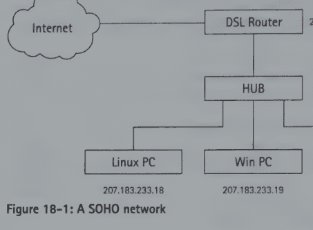

假设网络中有三台机器，并且它们都拥有如图所示的真实、静态 IP 地址。这里每台机器都有一个可在互联网上路由的 IP 地址。同时假设你——作为 SOHO 管理员——决定将 Linux 机器变成防火墙，如图 18-2 所示。

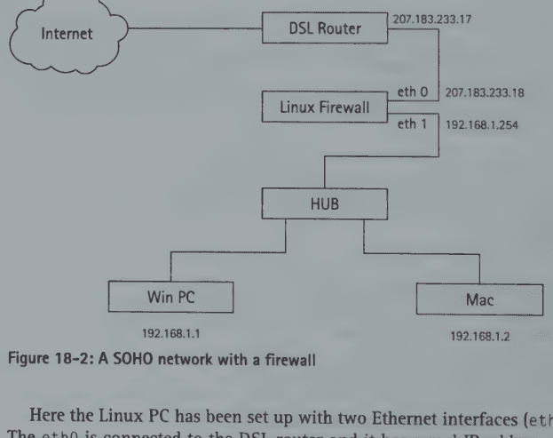

这里，这台 Linux PC 已经设置了两个以太网接口（`eth0` 和 `eth1`）。`eth0` 连接到 DSL 路由器，并拥有一个真实 IP 地址。Linux PC 的内部私有局域网接口（`eth1`）拥有一个私有 IP 地址（192.168.1.254），并且该局域网中的另外两个系统也拥有私有 IP 地址。

在此配置下，来自私有网络的所有出站数据包都通过 Linux 防火墙机器流向外部世界；同样，来自互联网的所有入站数据包也都通过防火墙机器到达私有网络。这台 Linux PC 必须实现以下功能：

-   IP 转发，以实现 `eth0` 和 `eth1` 之间的数据包传输。
-   IP 伪装，以动态地将私有局域网的私有 IP 地址转换为其自身外部接口（`eth0`）的地址，从而让外部世界能够识别。
-   包过滤规则，以保护对私有局域网的访问。

启用 IP 转发相当简单。你只需在 `/etc/rc.d/rc.local` 脚本中添加以下命令，即可在启动 Linux 系统时启用 IP 转发：

```
/sbin/sysctl -w net.ipv4.conf.all.forwarding=1
```

你也可以随时从 shell 中执行此命令来开启 IP 转发。由于你已经在内核中启用了 `netfilter` 支持（如前面章节所述），因此你可以使用 `iptables` 来启用伪装和包过滤，如清单 18-1 中所示的名为 `soho-firewall.sh` 的脚本。

```
清单 18-1: soho-firewall.sh
#!/bin/sh
# iptables 程序的路径
IPTABLES=/sbin/iptables
# 如图 18-2 所示的私有局域网地址
INTERNAL_LAN="192.168.1.0/24"
# 如图 18-2 所示的私有局域网接口
INTERNAL_LAN_INTERFACE="eth1"
# 如图 18-2 所示的私有局域网接口地址
INTERNAL_LAN_INTERFACE_ADDR="192.168.1.254"
# 如图 18-2 所示的外部局域网接口
EXTERNAL_LAN_INTERFACE="eth0"
# 如图 18-2 所示的外部局域网接口地址
EXTERNAL_LAN_INTERFACE_ADDR="207.183.233.18"
# 清除所有当前包过滤规则
$IPTABLES -F
# 将默认策略设置为拒绝所有
$IPTABLES -P input DENY
$IPTABLES -P output REJECT
$IPTABLES -P forward REJECT
# 启用本地（回环）接口
$IPTABLES -A input -i lo -j ACCEPT
$IPTABLES -A output -i lo -j ACCEPT
# 允许内部局域网访问防火墙的内部接口
$IPTABLES -A input -i $INTERNAL_LAN_INTERFACE \
         -s $INTERNAL_LAN -j ACCEPT
# 允许防火墙生成的、发往内部局域网的数据包
$IPTABLES -A output -i $INTERNAL_LAN_INTERFACE \
          -d $INTERNAL_LAN -j ACCEPT
# 为所有不发往内部局域网的数据包设置伪装
$IPTABLES -t nat -A POSTROUTING -o $EXTERNAL_LAN_INTERFACE \
          -d ! $INTERNAL_LAN \
          -j MASQUERADE
# 仅转发来自内部局域网的数据包
$IPTABLES -A FORWARD -s $INTERNAL_LAN -j ACCEPT
$IPTABLES -A FORWARD -d $INTERNAL_LAN -j ACCEPT
```

此脚本允许你更改必要的变量，以便在类似的现实世界环境中运行。当脚本按清单 18-1 所示执行时，它会有效地创建以下包过滤规则：

```
/sbin/iptables -F
/sbin/iptables -P input DENY
/sbin/iptables -P output REJECT
/sbin/iptables -P forward REJECT
/sbin/iptables -A input -i lo -j ACCEPT
/sbin/iptables -A output -i lo -j ACCEPT
/sbin/iptables -A input -i eth1 -s 192.168.1.0/24 -j ACCEPT
/sbin/iptables -A output -i eth1 -d 192.168.1.0/24 -j ACCEPT
/sbin/iptables -t nat -A POSTROUTING -o eth0 -d ! 192.168.1.0/24 -j MASQUERADE
/sbin/iptables -A FORWARD -s 192.168.1.0/24 -j ACCEPT
/sbin/iptables -A FORWARD -d 192.168.1.0/24 -j ACCEPT
```

现在我们来看一下这个脚本中的规则：

-   第一条规则清除了过滤表中的所有现有规则。
-   接下来的三条规则你应该很熟悉，因为它们是默认策略规则。这些规则表明，没有数据包可以进入、离开或被转发到或来自此系统。基本上，这三条规则完全锁定了 IP 流量。
-   接下来的两条规则启用了与本地回环接口（lo）的进出流量，以便你在登录到防火墙机器本身时可以访问其他系统。
-   下一条规则指定，任何源 IP 位于 192.168.1.0/24 网络的数据包都将在 eth1 接口上被接受。请记住，图 18-2 中的 eth1 接口是防火墙系统的内部私有网络接口。我们希望此接口接受来自私有网络中其他节点（即主机）的数据包。
-   下一条规则指定，防火墙自身为 192.168.1.0/24 网络生成（即输出）的数据包将被允许。
-   下一条规则是伪装规则，它使用 `nat` 表和 `POSTROUTING` 链。此规则表明，所有不发往 192.168.1.0/24 网络的数据包都将被伪装。例如，如果防火墙机器检测到来自 Windows PC 系统（192.168.1.1）的、发往外部系统（IP 地址为 207.183.233.200）的数据包，它会更改此数据包的源地址，使得 207.183.233.200 看到的源地址是 207.183.233.18（eth0）。当来自 207.183.233.200 的响应数据包到达 207.183.233.18 时，NAT 表会将目标地址重新转换为 192.168.1.1。

至此，你拥有一个将伪装的 IP 流量转发到外部接口（eth0）的防火墙系统，但内部私有网络无法被外部世界看到任何入站数据包。现在你可以明确地打开从外部接口到内部网络的连接。

## 允许私有网络用户访问外部 Web 服务器

在这种情况下，你需要执行以下操作：

-   出站流量规则。创建一条规则，允许防火墙的外部接口使用标准端口 80 发送（即输出）HTTP 请求。
-   入站流量规则。创建一条规则，允许防火墙的外部接口接收（即输入）来自外部 Web 服务器的 HTTP 响应。

以下是你可以在 `soho-firewall.sh` 脚本中添加以实现出站流量规则的规则：

```
$IPTABLES -A output -i $EXTERNAL_LAN_INTERFACE -p tcp \
           -s $EXTERNAL_LAN_INTERFACE_ADDR 1024-65535 \
           -d 0/0 80 -j ACCEPT
```

当 shell 脚本变量替换为适当的值后，此规则如下所示：

/sbin/iptables -A output -i eth0 -p tcp \
    -s 207.183.233.18 1024-65535 \
    -d 0/0 80 -j ACCEPT

此规则允许防火墙通过外部接口向任何 IP 地址的 80 端口输出 HTTP 数据包。1024-65535 范围指定 Web 浏览器在连接中可以使用任何非特权端口（即大于 0-1023 的端口）。因此防火墙不会阻止具有此类源端口号的数据包。

类似地，你需要在脚本中添加以下行来接受发往外部接口的 HTTP 响应流量：

```
$IPTABLES -A input -i $EXTERNAL_LAN_INTERFACE -p tcp ! -y \
    -s 0/0 80 \
    -d $EXTERNAL_LAN_INTERFACE_ADDR 1024-65535 \
    -j ACCEPT
```

这里，从外部 Web 服务器发往防火墙外部接口的数据包（以防火墙的外部 IP 地址作为目标地址）会被接受，只要源端口是 HTTP（80），且目标端口为任意非特权端口。

如你所见，建立双向连接需要了解特定服务运行在哪个端口上。例如，假设你希望允许外部网络访问你私有网络中的 Web 服务器。

## 允许外部 Web 浏览器访问防火墙上的 Web 服务器

在防火墙上运行 Web 服务器不是一个好主意，但对于家庭办公/小型办公（SOHO）环境来说，这可能是必要的（出于资源方面的考虑）。在这种情况下，你需要执行以下操作：

- 创建一条规则，允许任何 IP 地址连接到防火墙机器外部接口的 HTTP 端口（80）。
- 创建一条规则，允许防火墙/Web 服务器在源 IP 地址为任意 IP 且源端口为 HTTP（80）时，响应非特权端口（Web 客户端用于客户端连接的端口）。

你可以在 `soho-firewall.sh` 脚本中添加以下行来实现这些规则：

```
# Allow any IP to connect to firewall's external
# interface to send a HTTP request for the
# internal network
$IPTABLES -A input -i $EXTERNAL_LAN_INTERFACE \
    -p tcp ! -y \
    -s 0/0 1024-65535 \
    -d $EXTERNAL_LAN_INTERFACE_ADDR 80 \
    -j ACCEPT
# Allow internal HTTP response to go out to the
# world via the external interface of the firewall
$IPTABLES -A output -i $EXTERNAL_LAN_INTERFACE \
    -p tcp \
    -s $EXTERNAL_LAN_INTERFACE_ADDR 80  \
    -d 0/0 1024-65535 \
    -j ACCEPT
```

> 如果你想启用 HTTPS（安全 HTTP）连接，请添加以下行：

```
# Enable incoming HTTPS connections
$IPTABLES -A input -i $EXTERNAL_LAN_INTERFACE \
    -p tcp ! -y \
    -s 0/0 443  \
    -d $EXTERNAL_LAN_INTERFACE_ADDR 1024-65535 \
    -j ACCEPT
# Enable outgoing HTTPS connections
$IPTABLES -A output -i $EXTERNAL_LAN_INTERFACE \
    -p tcp \
    -s $EXTERNAL_LAN_INTERFACE_ADDR 1024-65535 \
    -d 0/0 443 \
    -j ACCEPT
```

为了与互联网交互，你很可能还需要启用其他一些服务，如 DNS、SMTP、POP3 和 SSH 等。在以下章节中，我将向你展示如何使用这些服务。

#### DNS 客户端和仅缓存服务

在 SOHO 环境中，你可能会使用 ISP 的域名服务器来解析 DNS 查询，或者你可以使用仅缓存的本地域名服务器来提升与 DNS 相关的整体性能。首先，假设你只想启用对 ISP 网络中远程 DNS 服务器的访问。假设你已在 `soho-firewall.sh` 脚本中设置了以下变量，指向域名服务器的 IP 地址：

```
NAMED_ADDR="207.183.233.100"
```

现在，要允许你的私有网络访问域名服务器，你应该在脚本中添加以下行：

```
# Allow packets from external interface of the
# firewall to access an outside named server
$IPTABLES -A output -i $EXTERNAL_LAN_INTERFACE \
    -p udp \
    -s $EXTERNAL_LAN_INTERFACE_ADDR 1024-65535 \
    -d $NAMED_ADDR 53 \
    -j ACCEPT
```

```
# Allow an external named to respond to internal
# request by delivering query response packets
# to external interface of the firewall
$IPTABLES -A input -i $EXTERNAL_LAN_INTERFACE \
    -p udp \
    -s $NAMED_ADDR 53 \
    -d $EXTERNAL_LAN_INTERFACE_ADDR 1024-65535 \
    -j ACCEPT
```

第一条规则确保防火墙允许通过 UDP 协议在端口 53 上输出 DNS 查询数据包。第二条规则确保防火墙接受来自域名服务器的 DNS 查询响应数据包。

**注意：** 当 DNS 响应过大而无法放入 UDP 数据包时，域名服务器有时会使用 TCP 数据包进行响应。这种情况很少发生，除非你内部网络中有系统需要执行 DNS 区域传输，而这些传输通常数据量较大。如果你想确保罕见的大型 DNS 响应得到正确处理，请再添加两条与前面相同的规则，但将 `-p udp` 协议替换为 `-p tcp`。同时，对于输入规则请使用 `! -y` 选项。

现在，如果你在私有局域网内部甚至在防火墙机器上运行 DNS 服务器（不推荐），你需要允许缓存服务器在无法从缓存中解析内部请求时，向 ISP 的 DNS 服务器执行 DNS 查询。在这种情况下，请在同一脚本中添加以下行：

```
# Allow DNS resolver to connect to external
# name server on port 53
$IPTABLES -A output -i $EXTERNAL_LAN_INTERFACE \
    -p udp \
    -s $EXTERNAL_LAN_INTERFACE_ADDR 53 \
    -d $NAMED_ADDR 53 \
    -j ACCEPT
```

```
# Allow external name server to connect to firewall
# system's external interface in response to a
# resolver query
$IPTABLES -A input -i $EXTERNAL_LAN_INTERFACE \
    -p udp \
    -s $NAMED_ADDR 53 \
    -d $EXTERNAL_LAN_INTERFACE_ADDR 53 \
    -j ACCEPT
```

#### SMTP 客户端服务

要从内部网络访问 SMTP 邮件服务器，请在 `soho-firewall.sh` 脚本中添加以下行：

```
# Change the SMTP server IP address as needed
SMTP_SERVER_ADDR="1.2.3.4"
# Enable outgoing SMTP connections
$IPTABLES -A output -i $EXTERNAL_LAN_INTERFACE \
    -p tcp \
    -s $EXTERNAL_LAN_INTERFACE_ADDR 1024-65535 \
    -d $SMTP_SERVER_ADDR 25 \
    -j ACCEPT
# Enable incoming SMTP responses from external SMTP
# server
$IPTABLES -A input -i $EXTERNAL_LAN_INTERFACE \
    -p tcp ! -y \
    -s $SMTP_SERVER_ADDR 25 \
    -d $EXTERNAL_LAN_INTERFACE_ADDR 1024-65535 \
    -j ACCEPT
```

#### POP3 客户端服务

要从内部网络访问 POP3 邮件服务器，请在 `soho-firewall.sh` 脚本中添加以下行：

```
# Change the POP3 server IP address as needed
POP_SERVER_ADDR="1.2.3.4"
# Enable outgoing POP3 connections
$IPTABLES -A output -i $EXTERNAL_LAN_INTERFACE \
    -p tcp ! -y \
    -s $EXTERNAL_LAN_INTERFACE_ADDR 1024-65535 \
    -d $POP_SERVER_ADDR 110 \
    -j ACCEPT
# Enable incoming POP3 responses from external POP3
# server
$IPTABLES -A input -i $EXTERNAL_LAN_INTERFACE \
    -p tcp ! -y \
    -s $POP_SERVER_ADDR 110 \
    -d $EXTERNAL_LAN_INTERFACE_ADDR 1024-65535 \
    -j ACCEPT
```

#### 被动模式 FTP 客户端服务

要从内部网络访问 FTP 服务器，请在 `soho-firewall.sh` 脚本中添加以下行：

```
# Change the FTP server IP address as needed
FTP_SERVER_ADDR="1.2.3.4"
# Enable outgoing FTP connections
$IPTABLES -A output -i $EXTERNAL_LAN_INTERFACE \
    -p tcp ! -y \
    -s $EXTERNAL_LAN_INTERFACE_ADDR 1024-65535 \
    -d $FTP_SERVER_ADDR 21 \
    -j ACCEPT
# Enable incoming FTP command responses from
# external FTP server
$IPTABLES -A input -i $EXTERNAL_LAN_INTERFACE \
    -p tcp ! -y \
    -s $FTP_SERVER_ADDR 21 \
    -d $EXTERNAL_LAN_INTERFACE_ADDR 1024-65535 \
    -j ACCEPT
# Enable passive mode data connections
$IPTABLES -A output -i $EXTERNAL_LAN_INTERFACE \
    -p tcp ! -y \
    -s $EXTERNAL_LAN_INTERFACE_ADDR 1024-65535 \
    -d $FTP_SERVER_ADDR 1024-65535 \
    -j ACCEPT
# Enable passive mode data response
$IPTABLES -A input -i $EXTERNAL_LAN_INTERFACE \
    -p tcp ! -y \
    -s $FTP_SERVER_ADDR 1024-65535 \
    -d $EXTERNAL_LAN_INTERFACE_ADDR 1024-65535 \
    -j ACCEPT
```

#### SSH 客户端服务

如果你想允许 SSH 客户端连接到外部 SSH 服务器，请在 `soho-firewall.sh` 脚本中添加以下行：

```
# Set the IP address of your external SSH server
# here. A random IP address is used in this example
#
EXTERNAL_SSH_SERVER_ADDR="207.177.175.60"
# Allow the firewall to connect to SSH server
# for the masquerading nodes behind it that want
# to connect to the SSH server
$IPTABLES -A output -i $EXTERNAL_LAN_INTERFACE
```


纠正明显的OCR错误（如形近字混淆、标点错误、数字/字母误判）。
将跨页的连续段落正确合并，不要保留分页标记。
根据语义和缩进/编号特征，识别标题（用## 表示一级标题，### 表示二级标题）、列表项（用- 开头）。
恢复正常的段落缩进（首行空两格不是必须，但请用空行分隔不同段落）。
如果出现表格样式的文本，请将其转换为Markdown表格。

输出要求：
只输出处理后的最终文本，不要包含解释或额外注释，不要包含 [PAGE X] 标记。
保留原文的语言和所有信息，不要删减或总结。

#### 原始OCR文本：

[content]

```
    -p tcp \
    -s $EXTERNAL_LAN_INTERFACE_ADDR 1020-65535  \
    -d $ EXTERNAL_SSH_SERVER_ADDR 22 \
    -j ACCEPT
# 允许外部SSH服务器将SSH数据包
# 发送到防火墙的外部接口
$IPTABLES  -A input -i $EXTERNAL_LAN_INTERFACE
        -p tcp ! -y \
        -s $EXTERNAL_SSH_SERVER_ADDR 22 \
        -d $EXTERNAL_LAN_INTERFACE_ADDR 1020-65535  \
        -j ACCEPT
```

请注意，SSH客户端使用1020或更高的端口，因此您需要使用1020-65535范围。

#### 其他新的客户端服务

一旦您确定了要使用防火墙控制的新服务，请执行以下操作：

+   1. 确定您要从内部网络访问哪个服务器（`SERVER_ADDR`）。
2. 确定此类连接中将使用哪些端口。很可能，该服务使用在 `/etc/services` 文件中定义的端口。找到该端口（`ASSIGNED_PORT`）。
3. 确定客户端软件在连接的客户端使用哪些端口。通常使用未分配的端口（1024-65535）。
4. 确定正在使用哪种协议（TCP或UDP）：
    - 对于TCP协议，使用 `-t tcp` 和 `! -y` 选项。
    - 对于UDP，使用 `-t udp` 选项。
5. 创建一条输出规则，允许防火墙的外部接口向服务器发送数据包。

内部客户端可以访问防火墙的内部接口，它们对外部服务的请求会自动转发到外部接口。这就是为什么您要为外部接口创建输出规则。该规则如下所示：

```
/sbin/iptables -A output -i external_interface \
               -p protocol_name \
               -s external_interface_address UNASSIGNED_PORTS \
               -d external_server_address ASSIGNED_PORT \
               -j ACCEPT
```

6. 创建一条输入规则，允许外部服务器进行数据包响应。该规则如下所示：

```
/sbin/iptables -A input -i external_interface \
	-p protocol_name [ ! -y ] \
	-s external_server_address ASSIGNED_PORT \
	-d external_interface_address UNASSIGNED_PORTS \
	-j ACCEPT
```

## 创建一个简单的防火墙

有时我会被要求创建一个简单的防火墙。是的，确实有人问这样的问题。他们想要安全，同时也想要一切都有完全的灵活性，这让我想起了一句俗语“鱼与熊掌不可兼得”。在这种情况下，我只需在名为 `/etc/rc.d/firewall-dummy.sh` 的脚本中创建以下规则：

```
#!/bin/sh
#
# 面向初学者的包过滤防火墙
#
IPTABLES=/sbin/iptables
# 删除过滤表中的所有规则
$IPTABLES -F FORWARD
$IPTABLES -F INPUT
$IPTABLES -F OUTPUT
# 创建默认的拒绝/丢弃所有策略
$IPTABLES -P input DENY
$IPTABLES -P output REJECT
$IPTABLES -P forward REJECT
# 启用回环接口
$IPTABLES -A INPUT -i lo -p all -j ACCEPT
# 启用ICMP。是的，即使是初学者
# 如今也知道如何使用ping了！
$IPTABLES -A INPUT -p icmp -j ACCEPT
# 启用DNS缓存
$IPTABLES -A INPUT -p tcp --dport 53 -j ACCEPT
$IPTABLES -A INPUT -p udp --dport 53 -j ACCEPT
# 我们不希望允许新的连接，所以
# 只接受那些没有设置SYN标志的传入数据包。
# 换句话说，
# 这些数据包不是新的连接请求
```

```
$IPTABLES -A INPUT -p tcp ! --syn \
    --dport :1023 -j ACCEPT \
    -- syn -- dport :1023 -j ACCEPT
# 大多数互联网初学者的行为都需要
# 非特权端口的TCP和UDP访问权限
# 所以启用它们
$IPTABLES -A INPUT -p tcp --dport 1024: -j ACCEPT
$IPTABLES -A INPUT -p udp --dport 1024: -j ACCEPT
```

现在让我们来看看一个透明的、基于代理ARP的防火墙。

#### 创建一个透明的、代理ARP的防火墙

假设您有一个小型办公室，几台Linux/Windows 9x/2000/NT机器通过调制解调器或DSL/电缆/ISDN路由器连接到互联网。您希望允许世界访问您网络中的Web服务器，同时也实现一些您之前学到的包过滤规则。

假设您的ISP通过网络 X.Y.Z.32/27 为您提供了互联网连接。

您可以让网络上的每台机器使用 X.Y.Z.35 地址作为其互联网网关地址——这允许每台机器向外界发送和接收数据包。现在您对防火墙有两个选择：

+   ♦ 在您的局域网和互联网接入之间设置一台防火墙机器（这是防火墙的典型位置）。

> 防火墙典型位置的问题是，如果防火墙机器宕机，整个局域网就会与互联网断开连接。如果互联网访问是您业务的重要组成部分，这就意味着麻烦，尤其是对于小公司而言。

+   ♦ 使用透明的代理ARP防火墙。

在另一种情况下，防火墙机器对您公司的互联网连接来说，不太会成为一个潜在的障碍。如果防火墙机器宕机，您只需拔下连接到防火墙 eth0 的网线，将其重新连接到另一侧（eth1侧）的集线器上，应该就能恢复完整的互联网连接。您可能需要让您的ISP刷新ARP缓存和/或重新启动您的某些机器。但您的网络能在很短的时间内恢复互联网访问。

## 第五部分：保护服务器

这种设置背后的想法如下：Linux防火墙机器有两个网络接口（`eth0`和`eth1`），它们被设置为相同的IP地址（`X.Y.Z.50`），并启用了ARP代理和IP转发。这使该机器能够看到所有源自您的局域网或通过ISP接入从外部到达您的局域网的数据包。因此，您可以像使用常规防火墙系统一样对这些数据包使用包过滤。

唯一真正的优势是，如果防火墙宕机（由于升级或其他不可控的原因），您可以比拥有常规防火墙配置（其中您的局域网使用私有IP地址，并且所有主机都指向防火墙作为其通往互联网的网关）快得多地恢复连接。在此配置中，主机甚至不知道它们的数据包正在被这种中间人类型的透明 `proxy-arp` 防火墙系统扫描和转发。假设您有一台安装了两个以太网网卡（`eth0`、`eth1`）的Linux系统，以下是创建此类设置的方法。

1.  以root身份，您需要创建一个支持netfilter的自定义内核。
    您可以从 `/usr/src/linux` 目录使用 `make menuconfig` 命令来设置此选项。从主菜单的“网络选项”子菜单中选择 [ ] 网络包过滤（取代ipchains），然后编译、安装和测试您的新内核。
2.  使用RPM下载并安装 `iproute` 软件包。
    例如，我安装了 `iproute-2.2.4-10` rpm软件包，这是从名为www.rpmfind.net的RPM镜像站点下载的。
3.  将 `/etc/sysconfig/network-scripts/ifcfg-eth0` 和 `/etc/sysconfig/network-scripts/ifcfg-eth1` 都设置为相同：
    +   - IP地址
    - 网络地址
    - 网络掩码
4.  在您的 `/etc/rc.d/rc.local` 脚本中添加以下行，为您的两个Linux网络接口启用代理ARP功能：

```
/sbin/ip route add X.Y.Z.35 dev eth0
/sbin/ip route add X.Y.Z.32/27 dev eth1
```

这告诉内核，发往 X.Y.Z.35 地址（即路由器的地址）的数据包在eth0上路由，其余网络在eth1上可用。因为您在接口之间启用了IP转发，任何发往内部局域网主机的外部数据包都会被eth0看到并转发到eth1。

此时，您可以等待一段时间让ARP缓存过期，或者重新启动您的路由器。之后，您应该能够在路由器和网络上的其他服务器之间来回通信。如果您在服务器上查看ARP缓存，它会显示路由器的MAC地址作为您Linux防火墙eth1的MAC地址。在您让这一层工作之后，就可以添加您的规则了。

#### 创建企业防火墙

一家每天都有大量互联网交互的公司可能会在构建安全基础设施上花费相当多的精力。在这里，我探讨一个您可以使用一组基于Linux的包过滤防火墙构建的此类基础设施。请注意，包过滤防火墙只是高级安全解决方案中的一个关键组件。根据经验，多个（且冗余的）安全措施可以确保更高程度的安全性。本节仅关注解决方案的包过滤方面；后续章节将介绍您可以与包过滤集成以构建强大、安全的组织环境的其他安全组件。

一个称为非军事区（DMZ）的多防火墙环境将企业公共服务器（如Web服务器（Apache服务器）、FTP服务器、邮件服务器和DNS服务器（如果有））置于主防火墙之后。内部网络（由员工工作站和可能的仅限内部服务器组成）位于另一个独立的防火墙之后。每个防火墙都有一个独特的目的，我将在以下章节中解释。

#### 内部防火墙的目的

内部防火墙保护内部网络免受外部访问。它将非本地流量转发到DMZ，并限制传入流量。此防火墙应配置为执行以下操作：

+   - 实施默认的丢弃所有数据包策略。
- 对发送到DMZ服务或外部世界的内部流量进行伪装。


## 第五部分：保障服务器安全

- 仅允许对内部请求作出响应而产生的入站流量。到达此防火墙的数据包不得设置SYN位。
- 限制内部网络对外部服务的访问。

#### 主防火墙的用途

外部（主）防火墙保护整个企业网络，但其主要任务如下：

- 实施默认丢弃所有数据包的策略。
- 允许外部世界访问DMZ服务器。
- 对内部防火墙（代表内部节点）生成的到外部世界的数据包进行伪装，使其看起来像是来自主防火墙的外部接口。

当防火墙正常工作时，一个典型场景如下：

1. 内部局域网工作站上的用户通过她的Web浏览器发起对外部域名的HTTP请求。
2. 内部防火墙将其请求伪装到其自身的外部接口（DMZ站点）。
3. 主防火墙看到此出站数据包，对其进行伪装，并将其转发到外部世界。
4. 外部的Web服务器只知道主防火墙的外部IP地址请求访问外部域名。因此，Web服务器将响应数据包发送到DMZ站点，这确保了外部系统不知道真正的用户是谁，并且（更重要的是）无法获取用户帐户信息用于未授权使用。

请注意，您可以选择不对内部防火墙上的出站数据包进行伪装——反正外部防火墙会对它们进行伪装——但如果您在内部防火墙上伪装出站数据包，就可以在外部（主）防火墙上使用更简单的数据包过滤规则。如果一致地实施，这样的安排可以在不损害安全性的情况下提高性能。因为主防火墙将来自内部网络的所有数据包都视为来自一个地址——即内部防火墙的外部接口地址——所以在主防火墙上创建访问规则时，您只需处理这一个IP地址。

> 在这个例子中，我使用了一个DMZ网络（192.168.1.0/24，实际上是一个私有网络），但在现实世界中，您无法从互联网访问不可路由的私有网络。您必须为现实世界的DMZ使用一个可互联网路由的非私有网络。请您的ISP为您的公司分配一个子网，并将所有寻址到该子网的数据包路由到您防火墙的外部接口地址。然后为DMZ中的每个服务器分配一个真实的IP地址，使其可以通过防火墙从外部世界访问。另请注意，主防火墙的外部网络地址由您的ISP分配；本例中使用了一个在互联网上可路由的随机数。

为给定场景实施这些防火墙是一个独立的过程。请注意，当您遵循接下来两个小节中的说明时，必须更改IP地址以匹配您自己的网络环境中的地址。

#### 设置内部防火墙

要设置您的内部防火墙，请按照以下步骤操作：

1. 创建一个`sh`脚本（称为`internal-firewall.sh`），定义内部网络的设置，如下所示：

```sh
#!/bin/sh
IPTABLES=/sbin/iptables
INTERNAL_LAN="192.168.2.0/24"
INTERNAL_LAN_INTERFACE="eth1"
INTERNAL_LAN_INTERFACE_ADDR="192.168.2.254"
EXTERNAL_INTERFACE="eth0"
EXTERNAL_INTERFACE_ADDR="192.168.1.1"
```

2. 通过在脚本中追加以下行，清除`filter`表中的所有规则：

```sh
# 清除filter表中的所有规则
$IPTABLES -F FORWARD
$IPTABLES -F INPUT
$IPTABLES -F OUTPUT
```

3. 通过在脚本中追加以下行来实施默认策略：

```sh
# 创建默认丢弃并拒绝所有策略
$IPTABLES -P FORWARD DROP
$IPTABLES -P OUTPUT ACCEPT
$IPTABLES -P INPUT DROP
```

4. 启用本地回送接口，添加以下行：

```sh
# 启用回环
$IPTABLES -A INPUT -i lo -p all -j ACCEPT
```

5. 启用由ping和其他服务使用的Internet控制消息协议（ICMP）数据包：

```sh
$IPTABLES -A INPUT -p icmp -j ACCEPT
```

6. 允许内部局域网访问防火墙的内部接口，添加以下行：

```sh
$IPTABLES -A INPUT -i $INTERNAL_LAN_INTERFACE \
          -s $INTERNAL_LAN -j ACCEPT
```

7. 允许访问发往内部局域网的防火墙生成的数据包：

```sh
$IPTABLES -A OUTPUT -i $INTERNAL_LAN_INTERFACE \
          -d $INTERNAL_LAN -j ACCEPT
```

8. 为所有非发往内部局域网的流量设置伪装：

```sh
$IPTABLES -t nat -A POSTROUTING -o $EXTERNAL_LAN_INTERFACE \
          -d ! $INTERNAL_LAN \
          -j MASQUERADE
```

9. 仅转发来自内部局域网的数据包，添加以下行：

```sh
$IPTABLES -A FORWARD -s $INTERNAL_LAN -j ACCEPT
$IPTABLES -A FORWARD -d $INTERNAL_LAN -j ACCEPT
```

此时，您拥有一个可以伪装内部流量发往外服务器的防火墙。现在您必须决定内部用户可以访问哪些类型的服务——例如，HTTP、SMTP、POP3、DNS和AUTH（identd的一部分）——并为每个服务创建特定的防火墙规则。在确定要允许的内容后，请阅读“创建SOHO数据包过滤防火墙”部分中的以下小节，以了解如何启用许多流行服务：

| 允许内部网络用户访问... | 参见... |
|---|---|
| 通过HTTP访问外部Web服务器（DMZ或外部世界） | “允许私有网络用户访问外部Web服务器” |
| 外部FTP服务器 | “启用被动模式FTP客户端服务” |
| 外部DNS服务器 | “启用DNS客户端和仅缓存服务” |
| 外部POP3服务器 | “启用POP3客户端服务” |
| 外部SMTP服务器 | “启用SMTP客户端服务” |

通过这些示例，您应该能够创建许多其他访问规则；对于大多数服务，规则的概念工作方式相同。

#### 设置主防火墙

要设置您的外部（主）防火墙，请创建一个名为`firewall-primary.sh`的`sh`脚本，如清单18-2所示。

#### 清单18-2：Firewall-primary.sh

```sh
#!/bin/sh

IPTABLES=/sbin/iptables

DMZ_LAN="192.168.1.0/24"

DMZ_INTERFACE="eth1"
DMZ_INTERFACE_ADDR="192.168.1.254"

WORLD_INTERFACE="eth0"
WORLD_INTERFACE_ADDR="207.177.175.66"

INTERNAL_LAN="192.168.2.0/24"

DMZ_FTP_SERVER_ADDR="192.168.1.10"
DMZ_APACHE_SERVER_ADDR="192.168.1.20"
DMZ_MAIL_SERVER_ADDR="192.168.1.30"
DMZ_DNS_SERVER_ADDR="192.168.1.40"

# 清除filter表中的所有规则
$IPTABLES -F FORWARD
$IPTABLES -F INPUT
$IPTABLES -F OUTPUT

# 创建默认丢弃并拒绝所有策略
$IPTABLES -P FORWARD DROP
$IPTABLES -P OUTPUT ACCEPT
$IPTABLES -P INPUT DROP

# 启用回环
$IPTABLES -A INPUT -i lo -p all -j ACCEPT
```

续...

```sh
# 启用由ping和其他服务使用的
# Internet控制消息协议（ICMP）数据包
$IPTABLES -A INPUT -p icmp -j ACCEPT

# 启用DMZ局域网访问防火墙的内部接口
$IPTABLES -A INPUT -i $DMZ_LAN_INTERFACE \
          -s $DMZ_LAN -j ACCEPT
```

```sh
# 启用来自外部世界的
# 入站FTP数据通道连接
$IPTABLES -A INPUT -i $WORLD_INTERFACE \
          -p tcp \
          -s 0/0 1024-65535 \
          -d $DMZ_FTP_SERVER_ADDR 1024-65535 \
          -j ACCEPT

# 启用出站FTP数据连接
$IPTABLES -A OUTPUT -i $WORLD_INTERFACE \
          -p tcp ! -y \
          -s $DMZ_FTP_SERVER_ADDR 1024-65535 \
          -d 0/0 1024-65535 \
          -j ACCEPT
```

## 访问DMZ中的Apache服务器

假设您想允许从外部世界访问Apache服务器。以下是脚本：

```sh
# 启用来自外部世界的
# 入站HTTP请求
$IPTABLES -A INPUT -i $WORLD_INTERFACE \
          -p tcp \
          -s 0/0 1024-65535 \
          -d $DMZ_APACHE_SERVER_ADDR 80 \
          -j ACCEPT

# 启用出站HTTP响应
$IPTABLES -A OUTPUT -i $WORLD_INTERFACE \
          -p tcp ! -y \
          -s $DMZ_APACHE_SERVER_ADDR 80 \
          -d 0/0 1024-65535 \
          -j ACCEPT
```

## 访问DMZ中的DNS服务器

您想允许从外部世界访问DNS服务器。以下是脚本：

```sh
# 启用来自外部世界的
# 入站客户端/服务器DNS请求
$IPTABLES -A INPUT -i $WORLD_INTERFACE \
          -p udp \
          -s 0/0 1024-65535 \
          -d $DMZ_DNS_SERVER_ADDR 53 \
          -j ACCEPT
```

## 启用向外客户端/服务器DNS响应
$IPTABLES -A output -i $WORLD_INTERFACE \
    -p udp \
    -s $DMZ_DNS_SERVER_ADDR 53 \
    -d 0/0 1024-65535 \
    -j ACCEPT

## 启用来自外部世界的入站服务器/服务器DNS请求
$IPTABLES -A input -i $WORLD_INTERFACE \
    -p udp \
    -s 0/0 53 \
    -d $DMZ_DNS_SERVER_ADDR 53 \
    -j ACCEPT

## 启用向外服务器/服务器DNS响应
$IPTABLES -A output -i $WORLD_INTERFACE \
    -p udp \
    -s $DMZ_DNS_SERVER_ADDR 53 \
    -d 0/0 53 \
    -j ACCEPT

# 访问DMZ中的IDENTD（认证）服务器

你需要允许来自外部世界的identd服务器访问。identd服务器通常在邮件服务器上运行，以提供用户认证服务。我假设你正在DMZ_MAIL_SERVER上运行identd。以下是脚本：

```
# 启用来自外部世界的入站认证请求
$IPTABLES -A input -i $WORLD_INTERFACE \
    -p tcp \
    -s 0/0 1024-65535 \
    -d $DMZ_MAIL_SERVER_ADDR 113 \
    -j ACCEPT
```

```
# 启用向外认证响应
$IPTABLES -A output -i $WORLD_INTERFACE \
    -p tcp ! -y \
    -s $DMZ_MAIL_SERVER_ADDR 113 \
    -d 0/0 1024-65535 \
    -j ACCEPT
```

现在，使用以下脚本为你的邮件服务器也启用认证客户端服务：

```
# 启用来自外部世界的入站认证响应
$IPTABLES -A input -i $WORLD_INTERFACE \
    -p tcp \
    -s 0/0 113 \
    -d $DMZ_MAIL_SERVER_ADDR 1024-65535 \
    -j ACCEPT

# 启用来自邮件服务器的向外认证请求
$IPTABLES -A output -i $WORLD_INTERFACE \
    -p tcp \
    -s $DMZ_MAIL_SERVER_ADDR 113 \
    -d 0/0 1024-65535 \
    -j ACCEPT
```

# 访问DMZ中的邮件服务器

你需要允许来自外部世界的邮件服务器访问。以下是脚本：

```
# 启用来自外部世界的入站SMTP请求
$IPTABLES -A input -i $WORLD_INTERFACE \
    -p tcp \
    -s 0/0 1024-65535 \
    -d $DMZ_MAIL_SERVER_ADDR 25 \
    -j ACCEPT

# 启用向外SMTP请求/响应
$IPTABLES -A output -i $WORLD_INTERFACE \
    -p tcp ! -y \
    -s $DMZ_MAIL_SERVER_ADDR 25 \
    -d 0/0 1024-65535 \
    -j ACCEPT
```

# 重定向数据包

假设你要将所有来自内部网络（192.168.2.0/24）发往特定网站（IP地址为193.1.1.193，端口为80）的数据包重定向到位于IP地址193.1.1.195的Web服务器。你可以在主防火墙规则文件中添加以下规则：

```
$IPTABLES -t nat -A POSTROUTING -s 192.168.2.0/24 \
    -d 193.1.1.193 \
    -p tcp --dport 80 \
    -j SNAT --to 193.1.1.195
```

# 记录数据包信息

你可以使用netfilter的内置日志记录支持（/var/log/messages）来排除规则错误和监控流量。例如，

```
/sbin/iptables -A input -s 193.1.1.193 -j LOG
```

每当来自193.1.1.193机器的数据包进入防火墙时，它都会被记录。要控制日志条目数量，你可以使用 `-m limit --limit rate` 选项。例如：

```
/sbin/iptables -A input -s 193.1.1.193 -m limit \
    --limit 10/second -j LOG
```

前面的规则将最多记录10个来自193.1.1.193主机的数据包。你还可以使用 `--log-prefix prefix` 选项来添加前缀以标识特定的IP地址。例如，

```
/sbin/iptables -A input -s 193.1.1.193 -m limit \
    --limit 10/second \
    --log-prefix 'BAD GUY' -j LOG
```

前面的规则将为193.1.1.193的日志条目添加前缀 "BAD GUY"。

# 设置IP数据包中的服务类型（TOS）

你可以通过设置IP数据包头中的TOS值来将一种流量优先于另一种。TOS值可以是以下之一：

- 最小延迟（Minimize-Delay）
- 最大吞吐量（Maximize-Throughput）
- 最大可靠性（Maximize-Reliability）
- 最小成本（Minimize-Cost）
- 常规服务（Normal-Service）

例如，在同时使用FTP时为Telnet提供交互性能：

```
/sbin/iptables -A PREROUTING -t mangle -p tcp \
    -sport telnet -j TOS \
    --set-tos Minimize-Delay
/sbin/iptables -A PREROUTING -t mangle -p tcp \
    -sport ftp -j TOS \
    --set-tos Minimize-Delay
/sbin/iptables -A PREROUTING -t mangle -p tcp \
    -sport ftp-data -j TOS \
    --set-tos Maximize-Throughput
```

#### 状态检测

Netfilter提供了将特定连接的所有数据包相互关联的能力；不被视为现有连接一部分的数据包可以被拒绝或丢弃。现在可以创建数据包过滤规则，其目标基于以下状态之一：

- **NEW**: 此数据包正尝试创建一个新连接。
- **RELATED**: 此数据包与现有连接相关，并且正沿原始方向传输。
- **INVALID**: 此数据包与任何现有连接都不匹配。
- **ESTABLISHED**: 此数据包是现有连接的一部分。
- **RELATED+REPLY**: 此数据包不是现有连接的一部分，但与某个连接相关。例如，如果存在到主机的FTP命令连接（通过端口21），则到同一主机的ftp-data连接（通过端口1024或更高）与另一个连接相关。

例如，要接受属于已建立连接的数据包，你可以定义一条规则，如：

```
/sbin/iptables -A input -m state \
    --state ESTABLISHED -j ACCEPT
```

或者，如果数据包是相关或已建立连接的一部分，你可以使用以下规则将其从一个接口转发到另一个接口：

```
/sbin/iptables -A forward -m state \
    --state ESTABLISHED, RELATED -j ACCEPT
```

#### 网络地址转换（NAT）规则

netfilter实现中的NAT表允许你对数据包进行伪装、重定向，甚至负载均衡。具体来说，当前可用的NAT目标选项如下：

- **DNAT**: 此目标指定应修改数据包的目标地址。
- **SNAT**: 此目标指定应修改数据包的源地址，包括此连接中的所有后续数据包。
- **REDIRECT**: 这是DNAT的一个特例，它将目标IP地址修改为数据包发往机器本身。

当数据包因匹配规则而导致其源地址或目标地址被转换时，这些数据包在返回路径上会被重新转换回正常的源地址和/或目标地址，以便数据包能被传送回相应的主机。

使用 `NAT` 表中的 `POSTROUTING` 链，你可以创建一个简单的轮询式负载均衡环境。例如，要为192.168.1.1到192.168.1.20、192.168.1.21、192.168.1.22的 `HTTP` 流量进行负载均衡，你可以创建如下规则：

```
/sbin/iptables -t nat -A POSTROUTING \
    -s 192.168.1.1 \
    --to 192.168.1.20-192.168.1.22 \
    -j DNAT
```

#### 测试数据包过滤规则

首先，你应该使用 `/sbin/iptables -L chain_name [-t table_name]` 命令列出每个链的所有规则。例如，要列出默认filter表中input链的所有规则，请运行 `/sbin/iptables -L input` 命令。

要测试现有规则，只需将 `-A`（如果你是追加规则）或 `-I`（如果你是插入规则）替换为 `-C`，并插入源和目标IP地址的值。例如，假设你有一条如下规则：

```
/sbin/iptables -A input -i eth1 -p tcp \
    -s 0/0 \
    -d 192.168.1.100 \
    --dport 80 \
    -j REJECT
```

此规则表示，来自任何IP地址（`-s 0/0`）且目标为以太网接口 `eth1` 上IP地址192.168.1.100的80端口的数据包将被拒绝。要测试此规则，你可以运行以下代码：

```
/sbin/iptables -C input -i eth1 -p tcp \
    -s 207.177.175.66 \
    -d 192.168.1.100 \
    --dport 80 \
    -j REJECT
```

你应该看到输出声明数据包被拒绝。如果你的规则涉及地址转换，你应该看到一条消息声明数据包已被伪装；同样，如果你的规则涉及丢弃数据包，你应该看到相应的消息。

#### 点对点服务

互联网上（以及几乎其他任何地方）的大多数人都听说过Napster。我起初很喜欢Napster——但后来，当我注意到Napster客户端在

## 第 18 章：部署防火墙

办公网络时，我不得不克制对它的热爱（至少在办公室里）。我不能允许用户运行 Napster（甚至在其法律纠纷之前），因为它的点对点文件共享软件可能会在我们的企业网络中打开一个安全漏洞，暴露大量敏感数据、知识产权和客户数据库。因此，我们必须在（通常非常灵活的）用户策略中增加一条附录，禁止在办公环境中使用所有点对点软件。然而，这条附录也需要具体的执行措施（初级工程师会自己想办法绕过限制）。

点对点（P2P）网络并不新鲜，但家庭端高速网络（如 DSL 和有线宽带）的普及使 P2P 迅速流行起来。在 myThe request was rejected because it was considered high risk

#### 限制物理访问

当一个能够物理接触到你计算机的人决定对你的计算机或其提供的服务和数据造成损害时，所有的安全措施都会失效。几乎没有任何简单的方法可以保护你的计算机免受此类恶意者的侵害。这类恶意者可以拔掉电源插头使你的计算机骤然停机，用软盘启动计算机并窃取或破坏你的数据，或者为所欲为。

确保系统物理安全的唯一方法是限制谁能够物理接触你的计算机。了解哪些人能够接触到你的计算机。我建议将你的服务器远离公共场所，因为在这些地方很难时刻掌握人员的进出情况。如果你无法限制陌生人物理靠近你的计算机，我建议你采取以下措施：

- 为计算机 BIOS 设置密码保护。你应该在首次获得计算机时就执行此操作。如果你的计算机将放置在公共场所，请注意如果有人在你之前进入了 BIOS，他们可以通过添加密码将你锁在外面。解决此类问题可能需要你联系计算机供应商，或者打开计算机并通过短时间拔掉电池来重置 BIOS。因此，请通过设置密码来保护你的 BIOS。除了你自己，任何人都不应访问你的计算机 BIOS。
- 如果你的 BIOS 允许你 `disable floppy seek at boot`，请启用该禁用选项。一些较新形式的 BIOS 允许从 CD-ROM 驱动器启动；如果你的计算机支持此功能，也请禁用该选项。不要允许你的计算机从硬盘以外的任何设备启动。
- 创建或修改 `/etc/shutdown.allow` 文件，仅列出允许关闭你计算机的用户。如果你只允许 root 用户执行此任务，则创建一个空的 `/etc/shutdown.allow` 文件。当任何人按下控制台上的 Ctrl+Alt+Del 键来重启计算机时，计算机会检查该文件，以确保在关机前指定的用户已登录控制台。当未被允许关机的人按下这些键时，计算机会忽略该请求并在控制台上打印警告信息。当然，这一预防措施无法阻止任何人按下重置按钮（如果你的计算机有的话）或关闭电源来强行关机。因此，请确保你有某种方式保护这些开关。
- 为了阻止或延缓计算机设备被盗，你还应该以与自行车锁在车架上相同的方式，将你的计算机锁定在某个大型家具上。

一旦你实施了一种或多种限制物理接触计算机的方法，你就可以继续实施对用户访问的其他限制，如以下各节所述。

#### 限制普通用户访问

有两类用户使用 Red Hat Linux 系统：普通用户和超级用户。当普通用户账户被用来非法获取超级用户权限时，计算机就会开始出现问题。这意味着你（超级用户）需要确保用户账户拥有完成工作所需的最少权限。例如，如果你创建了一个 Red Hat Linux 服务器来为用户提供电子邮件和 Web 服务，你不需要允许他们通过 Telnet 访问你的服务器。为了限制不需要此类服务的用户的 Telnet（shell）访问，请执行以下操作：

1. 编辑 `/etc/shells` 文件，将 `/bin/false` 作为有效 shell 插入。
2. 使用 `usermod` 修改每个用户账户，将登录 shell 设置为 `/bin/false`。

完成这些步骤后，修改后的账户将无法用于 Telnet 访问。你还可以使用 `wu-ftpd` 服务器中的访客账户功能为仅限 FTP 的用户创建更受限制的用户账户。访客 FTP 账户是一个拥有真实用户名和密码的真实账户。两者的唯一区别在于，当访客用户访问 FTP 服务器时，她只能看到自己的主目录。换句话说，当访客用户登录 FTP 服务器时，服务器会对访客用户的主目录执行 `chroot` 操作，从而使访客用户的主目录呈现为整个文件系统。其最大的优势是用户无法看到其主目录以外的任何内容，例如系统文件和其他用户目录。有关详细信息，请参阅第 12 章中的"创建访客 FTP 账户"一节。

#### 限制超级用户访问

许多人错误地将超级用户访问仅与 root 账户联系在一起。他们认为如果你不是 root 用户，你就不是超级用户。事实上，使 root 账户成为超级用户的不是名称，而是其用户 ID 和组 ID。root 账户的用户 ID 和组 ID 被设置为 0（零），这使其成为超级用户。这意味着可以通过为多个账户分配上述用户和组 ID 值来创建多个超级用户账户。超级用户账户非常强大，人们很容易滥用它们。因此，超级用户账户应少用；也就是说，只在必要时并且极其谨慎地使用。拥有超级用户权限并不意味着应该一直使用它们。作为超级用户，你可能希望遵循以下准则：

- 仅在必要时使用超级用户账户。换句话说，当你在配置系统或安装系统级软件时——例如安装 Web 服务器软件的新版本、为整个系统编译和安装 Perl，或执行某些类似任务——使用超级用户账户。然而，你应该避免使用 root 账户或任何超级用户等效账户来执行日常任务，如发送电子邮件、浏览网页、运行 IRC 客户端与朋友或同事聊天、通过 FTP 传输文件等。

> 有时新系统管理员想知道为什么他们不能以 root 用户身份 Telnet 到系统。这是因为 `/etc/securetty` 文件指定了哪些 `tty` 设备可以用于 root 登录。通常，`/etc/securetty` 列出了 `tty[0-8]` 作为允许的设备。由于 Telnet 访问使用伪 tty 设备 `ttyp[0-f]`，root 无法通过 Telnet 登录。你应该保持 `/etc/securetty` 不变。这是一件好事。

- 不要从任何地方以 root 或等效超级用户身份登录。执行管理任务的首选方法是以普通用户身份登录，然后使用 `su` 命令成为超级用户（如 root）。这种方法可以减少意外损坏系统的可能性。

> 使用 `-` 作为参数运行 `su` 命令，使其成为一个登录 shell，这反过来使 shell 读取 shell 启动文件（如 `.bashrc`）。此参数还使 `su` 切换到用户的主目录。

- 如果你遇到其他人需要超级用户权限来完成工作的情况，请考虑使用 `sudo` 而不是给每个人一个超级用户账户。如果其他人需要运行一些需要超级用户权限的程序，你可以在 `/etc/sudoers` 文件中指定这些用户，使他们能够在不是超级用户的情况下运行这些程序。`sudo` 命令允许普通用户仅以超级用户身份运行特定的命令（由超级用户指定）。这种限制是一种良好的机制，因为它比给予某人完全的超级用户权限风险更小。`sudo` 命令本身以 `setuid` root 身份运行。这意味着当 `sudo` 运行时，它以 root 用户进程运行，从而允许它运行其他需要超级用户权限的程序。Red Hat Linux 不附带 `sudo` 软件包，但你可以从 `ftp://contrib.redhat.com/` 站点获取它。我通常很难访问 Red Hat 繁忙的 FTP 服务器，所以如果你无法连接他们的服务器，可以尝试 `www.courtesan.com/sudo/` 站点。这是 `sudo` 的官方网站，提供了大量关于 `sudo` 的信息，包括 FTP 站点列表。

所有这些建议的核心思想是：尽可能减少超级用户权限。


#### 在紧急或攻击情况下限制所有访问

在许多情况下，当系统管理员检测到攻击或紧急情况（如磁盘问题）时，首要任务是禁止用户登录，直到问题解决或系统离线。根据我的经验，有时需要稍加思考才能关闭系统。在这种情况下，禁止新的登录变得尤为重要。要快速禁止新的登录，只需创建一个名为`/etc/nologin`的文件，并附上适当的消息，让用户知道你为何阻止他们以及预计系统何时恢复在线。此文件的存在会禁止任何普通用户登录。由于超级用户只能从控制台登录，请确保你有对系统的物理控制台访问权限；否则，你可能会意外注销当前的shell会话并将自己锁在系统之外。

#### 保护用户认证过程

传统上，所有UNIX系统都使用基本的用户认证方案。通常，所有用户信息，如用户名、加密密码、用户ID、用户的组ID和默认shell，都存储在`/etc/passwd`文件中。需要用户信息的程序会查阅此文件。它被保持为普遍可读的文件，以便任何程序都可以访问。例如，如果你更改`/etc/passwd`的文件权限，使其不再是世界可读的，你会注意到像`ls`这样的简单程序在使用`-l`选项运行时无法显示用户名。这是由于`ls`像许多其他程序一样，需要查阅`/etc/passwd`文件以获取用户信息。在这个特定情况下，`ls`需要将用户的用户ID（例如500）映射为用户名（kabir），其依据是如下所示的`/etc/passwd`行：

```
kabir:Pt xWphZQAyH3x:500:500:Mohammed Kabir:/home/kabir:/bin/tcsh
```

> 程序会查阅`/etc/group`文件以确定组名。如果`/etc/group`不是世界可读的，像`ls`这样需要用户组信息的程序将无法正常工作。

那么，保持`/etc/passwd`世界可读有什么问题呢？嗯，因为任何程序都可以访问世界可读的文件，许多黑客会花费大量精力来诱骗编写不良的程序，使其获得对该文件的访问权限。例如，坏人诱骗了许多编写不良的CGI脚本，甚至将系统的`/etc/passwd`文件发送到他们自己的邮箱！此外，任何在你的系统上拥有账户的人都可以访问此文件。简而言之，`/etc/passwd`文件通常非常容易获得。一旦该文件落入坏人手中，他们就可以运行密码破解程序来检测文件中的弱密码。由于用户经常选择可爱或易于记忆的密码，这些密码通常是字典单词，破解变得相当容易。计算机技术的进步，如更快的CPU和更便宜的硬盘，使得密码破解成为许多误入歧途者的负担得起的爱好。例如，存储一个8字符密码的所有可能（每个密码4,096种）组合需要52千字节，该密码内部存储为13字符的加密字符串。如你所见，不需要非常大的硬盘就能存储几十万个加密密码来与窃取的`/etc/passwd`文件进行比较。

那么，你能做些什么来应对这种情况呢？你可以使用影子密码。这项技术将在下一节中描述。

#### 使用影子密码

事实证明，只有少数程序，包括`login`、`passwd`等，真正需要`/etc/passwd`文件中的加密密码字段。所有其他程序只需要用户信息，如用户名、用户ID、组ID和shell。但是，如果你能将加密密码从`/etc/passwd`重新定位到另一个文件，并修改需要访问加密密码的程序，使它们能够读取这个文件呢？这个文件不是世界可读的，因为允许访问的程序是以`setuid` root程序运行的。换句话说，这些程序以root用户身份运行来读取新的密码文件；一个名为Shadow Utils的包为我们完成了所有这些工作。

影子密码支持可以在Shadow Utils包中找到，该包默认未安装。安装后，此包提供的实用程序允许你将`/etc/passwd`文件转换为无密码文件。加密密码被重新定位到`/etc/shadow`，该文件只有root用户和任何以`setuid` root运行的程序可读。这种设置意味着，利用弱程序获得`/etc/passwd`访问权限的坏人可能仍然可以获得它，但该文件不提供任何密码信息。影子实用程序包还提供了其他有趣的功能，如密码老化、账户过期和锁定功能。在下一节中，你将学习如何在系统上使用影子密码。

## 安装SHADOW UTILITY包

在安装Red Hat Linux服务器期间，你将有机会安装shadow包，但如果你错过了，可以按照以下说明操作。

从你的Red Hat CD-ROM或Red Hat FTP站点获取文件`shadow-utils-version-release-architecture.rpm`（例如，`shadow-utils-980403-4.i386.rpm`）。使用`rpm`实用程序进行安装，如下所示：

```
rpm -ivh shadow utility rpm file
```

安装包后，你需要将现有的`/etc/passwd`文件转换为基于影子密码的`/etc/passwd`文件。

## 将/ETC/PASSWD和/ETC/GROUP转换为SHADOW格式

传统的/etc/passwd文件具有以下格式：

```
username:passwd:UID:GID:full_name:directory:shell
```

将/etc/passwd和/etc/group文件转换为shadow格式非常简单。只需运行以下命令：

```
/usr/sbin/pwconv
```

这会将你原始的/etc/passwd转换为shadow /etc/passwd格式。转换/etc/passwd后，它具有以下格式：

```
username:x:UID:GID:full_name:directory:shell
```

第二个字段现在是一个x，而不是加密密码。你还有另一个名为/etc/shadow的文件，其格式如下：

```
username:passwd:last:may:must:warn:expire:disable:reserved
```

如你所见，加密密码字段（passwd）现在在此文件中。/etc/shadow文件中的所有字段如表19-1所述。

| 字段 | 描述 |
|---|---|
| username | 用户名 |
| passwd | 加密的字符密码 |
| last | 上次密码更改日期 |
| may | 当前密码可以更改的最少天数 |
| must | 当前密码必须更改的最多天数 |
| warn | 用户被警告当前密码即将过期的天数 |
| expire | 当前密码过期且账户被禁用的天数 |
| disable | 账户已过期的天数 |

新字段（除`username`和`passwd`之外的所有字段）可用于提供用户记账功能，如账户过期和密码老化。`/usr/sbin/pwconv`实用程序使用`/etc/login.defs`文件中的`PASS_MAX_DAYS`（当前密码必须更改的最大天数）、`PASS_MIN_DAYS`（当前密码可以更改的最小天数）和`PASS_WARN_AGE`（用户被警告当前密码过期的天数）值。修改`/etc/login.defs`文件以设置这些字段的所需值。

#### 管理用户账户

影子实用程序包安装了用于管理用户账户的实用程序（如`useradd`、`userdel`、`usermod`、`groupadd`、`groupdel`和`groupmod`）的替代品。你可以运行以下`rpm`命令来查看安装此包时安装的文件：

```
rpm -q -l shadow-utils-version-release
```

你可能想知道，像`chsh`、`chfn`、`ftp`、`imap`、`rlogin`、`rexec`、`rsh`、`su`、`login`和`passwd`这样的程序如何突然理解影子密码方案并使用`/etc/shadow`密码文件进行认证。Red Hat分发的这些程序具有影子密码功能。实际上，Red Hat发布这些程序时采用了一个更宏大的认证支持方案，称为*可插拔认证模块*（PAM）。这些支持PAM的程序不仅能够使用影子密码方案，还能使用几乎任何其他你希望实现的认证方案来增强系统安全性。在下一节中，我将讨论PAM。

#### 理解PAM

传统上，认证方案被内置于授予用户权限的程序中。像`login`或`passwd`这样的程序过去常常内置于必要的代码来处理认证。随着时间的推移，这种方法被证明是不可扩展的，因为引入新的认证方案需要重新编写和重新编译权限授予程序。PAM的开发是为了使权限授予软件开发人员免于编写安全认证代码。图19-1显示了PAM如何与权限授予应用程序协同工作。


## 第19章：限制用户访问

当像 `/bin/login` 这样的特权授予应用被构建成一个 PAM 感知应用时，它通常按照图 19-1 所示的方式工作。首先，用户调用该应用来访问其提供的服务（步骤 1）。PAM 感知应用随后调用底层的 PAM 库来执行认证（步骤 2）。PAM 库随后在 `/etc/pam.d/` 目录中查找特定于该应用的配置文件（步骤 3）。该文件告诉 PAM 为此应用需要什么类型的认证。然后，PAM 库加载所需的认证模块（步骤 4）。这些模块随后可以使 PAM 与应用中可用的会话函数进行通信（步骤 5）。会话函数可用于从用户请求信息（步骤 6）。例如，可以要求用户输入密码或查看视网膜扫描仪。用户通过提供所需信息来响应请求（步骤 7）。然后，PAM 认证模块通过 PAM 库向应用提供认证状态消息（步骤 8）。如果认证过程成功，应用会将请求的权限授予用户，或通知用户失败（步骤 9）。

将 PAM 视为一种设施，它将认证的负担从应用中移除，并允许您为单个应用叠加多种认证方案。例如，`rlogin` 应用的 PAM 配置文件如清单 19-1 所示。

**清单 19-1：/etc/pam.d/rlogin 文件**

```
#%PAM-1.0
# For root login to succeed here with pam_securetty, "rlogin" must be
# listed in /etc/securetty.
auth        required    /lib/security/pam_nologin.so
auth        required    /lib/security/pam_securetty.so
auth        required    /lib/security/pam_env.so
auth        sufficient  /lib/security/pam_rhosts_auth.so
auth        required    /lib/security/pam_stack.so service=system-auth
account     required    /lib/security/pam_stack.so service=system-auth
password    required    /lib/security/pam_stack.so service=system-auth
session     required    /lib/security/pam_stack.so service=system-auth
```

这里使用了来自 `/lib/security` 的多个认证模块来对用户进行身份验证。我将在下一节讨论配置文件的详细信息。

#### 使用 PAM 配置文件

在清单 19-1 中，您看到了一个特定于应用的 PAM 配置文件的样式。以 `#` 开头的行和空行会被忽略。配置行包含以下字段：

```
module-type control-flag module-path module-args
```

目前有四种模块类型，如表 19-2 所述。

#### 表 19-2 PAM 模块类型

| 模块类型 | 描述 |
|---|---|
| auth | 此类型的模块执行实际的身份验证。通常，auth 模块要求用户输入密码或提供其他证明来证明她是她所声称的那个人。 |
| account | 此类型的模块处理身份验证请求的所有记账方面。通常，account 模块检查用户访问是否满足所有访问准则。例如，它可以检查用户是否从安全主机访问服务，或者用户是否在指定时间访问系统。 |
| password | 此类型的模块管理在用户获得所请求服务的访问权限之前和之后需要执行的功能。 |
| session | 此类型的模块用于管理会话任务，例如刷新会话令牌。 |

控制标志用于定义 PAM 库如何处理模块的响应。当前允许的四种控制标志如表 19-3 所述。

#### 表 19-3 PAM 模块控制标志

| 控制标志 | 描述 |
|---|---|
| required | 此标志表示指定的模块必须返回成功值作为响应代码。当模块返回指示失败的响应时，认证肯定失败，但 PAM 仍会继续处理其他模块（如果有）。这样做是为了确保用户无法检测到认证过程的哪个部分失败，因为知道这一点可能会帮助潜在的攻击者。 |
| requisite | 使用此控制标志会使 PAM 库一收到失败响应就立即中止认证过程。 |
| sufficient | 当您使用此控制标志时，如果 PAM 收到成功响应，它就认为认证过程完成。换句话说，无需继续处理配置文件中的其他模块。 |
| optional | 此控制标志很少使用。它不强调模块的成功或失败响应。 |

模块路径是可插拔身份验证模块的路径。Red Hat Linux 将所有 PAM 模块存储在 `/lib/security` 目录中。您也可以为每个模块提供可选参数。

现在，如果您回顾清单 19-1，请注意 PAM 库调用 `pam_securetty.so` 模块，该模块必须返回指示成功的响应，认证才能成功。如果模块的响应指示失败，PAM 仍会继续处理其他模块，这样用户（可能是潜在攻击者）就不会意识到失败发生在哪里。如果下一个模块 (`pam_rhosts_auth.so`) 返回成功，则认证过程完成，因为控制标志被设置为 sufficient。但是，如果上一个模块 (`pam_securetty.so`) 没有失败，但这个模块失败了，则认证过程继续，并且失败不会影响最终结果。同样，其余的模块由 PAM 库按顺序处理。执行顺序完全遵循模块在配置文件中出现的顺序。但是，每种类型的模块（`auth`、`account`、`password` 和 `session`）是按堆栈处理的。换句话说，对于清单 19-1 中的示例，所有 `auth` 模块都被堆叠并按照它们在配置文件中出现的顺序进行处理。其余模块也以类似方式处理。

#### 使用 PAM 微调认证过程

既然您已经了解了 PAM 如何工作的大量知识，请考虑一个示例，说明如何使用 PAM 为某些服务微调身份验证过程。您应该采取的第一步是阅读所有可用 PAM 认证模块的文档。所有可用的 PAM 模块都存储在 `/lib/security` 目录中，您可以在 `/usr/doc/pam-X.XX` 目录中找到每个模块的文档，其中 X.XX 是您的 PAM 版本。阅读每个模块的文档，并确定您想要使用哪些模块来为系统构建更具限制性的身份验证方案。在本节中，我将向您展示如何为服务器创建基于时间的访问限制。

一个名为 `pam_time` (`/lib/security/pam_time.so`) 的模块使您能够根据时间控制对服务的访问。您可以配置此模块以根据用户的名称、一天中的时间、一周中的几天、他们申请的服务以及他们发出请求的终端来拒绝（个人）用户的访问。该模块的操作由 `/etc/security/time.conf` 配置文件决定。

因为您想要控制登录访问，所以您需要修改 `/etc/pam.d/login` PAM 配置文件。您必须添加以下行：

```
account required /lib/security/pam_time.so
```

将此行添加到 `/etc/pam.d/login` 文件后，您需要为登录服务制定访问策略。换句话说，确定您希望用户何时能够登录。在示例中，我假设您希望允许用户在早上 6 点之后和晚上 8 点之前登录。现在您需要配置 `/etc/security/time.conf` 文件。该文件中的配置行具有以下语法：

```
services;ttys;users;times
```

您可以在每个字段中使用一些特殊字符。表 19-4 显示了您可以在配置字段中使用的特殊字符的含义。

#### 表 19-4 /etc/security/time.conf 配置字段中的特殊字符

| 字符 | 含义 |
| :--- | :--- |
| ! | NOT（非）。例如，`!login` 表示 *不是 login* 或 *除了 login*。 |
| &#124; | OR（或）。例如，`kabir&#124;ronak` 表示 *kabir 或 ronak*。 |
| & | AND（与）。例如，`login&su` 表示 *login 和 su 都*。 |
| * | 通配符。例如，`foo*` 表示 *以 foo 开头的所有内容*。 |


表19-5描述了这种配置行中的字段。

#### 表19-5：/etc/security/time.conf 文件的字段

| 字段 | 描述 |
|---|---|
| services | 受时间限制影响的服务列表。例如，要使用单条规则同时控制登录和su，你可以在配置行中指定服务为login&su。 |
| ttys | 受时间限制影响的终端列表。例如，要仅控制伪终端而不控制控制台终端，你可以指定ttysp*\|tty*，其中ttysp*列出所有通过Telnet等服务远程登录使用的伪终端，tty*列出所有控制台终端。 |
| users | 受时间限制影响的用户列表。例如，要指定所有用户，你只需在配置行中使用通配符字符*。 |
| time | 限制适用的时间列表。你可以使用24小时时钟格式的时间范围来指定时间。例如，要指定晚上8点到早上6点的时间范围，你可以指定2000-0600（例如，HHMM格式，其中HH为00-23，MM为00-59）。你还可以使用双字符代码指定日期，例如Mo（周一）、Tu（周二）、We（周三）、Th（周四）、Fr（周五）、Sa（周六）和Su（周日）。你还可以使用特殊代码，例如Wk表示所有工作日，Wd表示周末，Al表示所有七天。例如，要每天限制从晚上8点到早上6点对某服务的访问，你可以指定时间范围为Al2000-0600。 |

对于当前示例，你可以创建一条基于时间的规则，禁止所有用户在每天晚上8点到早上6点通过远程方式（如Telnet）访问系统时进行登录，方法是在/etc/security/time.conf文件中添加以下行：

```
login;ttyp*;*;!Al2000-0600
```

这行可以解释如下：

```
如果 (请求的服务是login) 并且
  (访问来自伪ttyp类型设备) 并且
  (当前时间在晚上8点到早上6点之间) 则

不允许访问请求的服务。

否则
允许访问请求的服务。

结束
```

现在，如果你想允许一个名为`kabir`的用户在任何时间访问系统，但又希望其他所有人都遵循上述规则，你可以按如下方式修改规则：

```
login;ttyp*;*!kabir;!A12000-0600
```

这只是一个如何使用PAM来微调用户认证过程的示例。再次强调，请阅读模块文档并尝试各种设置，以找出最适合你系统的认证方案。

既然你已经了解了许多控制用户访问系统的方法，接下来让我们看看如何增强你系统所提供服务的安全性。

#### 保护服务

很多时候，坏人之所以能破坏系统的安全，是因为系统管理员没有花时间去除不必要的服务。请记住，你系统上的程序越多，黑客入侵的途径就越多。所以从最开始就要开始去除过程。

## 在操作系统安装期间移除不必要的服务

在你的计算机上安装Red Hat Linux之前，请决定你希望在系统上运行什么。写下你需要用来实现目标的服务。例如，如果你正在创建一个Web服务器系统，你很可能不需要POP服务器、Gopher服务器或NNTP新闻服务器。列出你想要安装的服务器软件清单。Red Hat Linux安装程序允许你在安装前选择各个软件包。请花时间浏览所有列表，只选择必要的软件包。有时安装程序会安装一个或多个作为你所选软件包前提条件的软件包。实际上，一旦你在安装过程中完成软件包选择，程序会向你显示这些前提软件包的名称。请写下这些软件包的名称。

在你安装了所有必要的软件包并首次启动系统后，你可以查看存储在`/tmp`中的安装日志，或者运行以下`rpm`命令来获取所有已安装软件包的完整列表：

```
rpm ?qa > /tmp/all.packages
```

仔细检查`/tmp/all.packages`文件，找出任何你不记得批准安装的软件包。如果该软件包不在你的前提软件包列表中，你可能需要使用以下命令了解更多信息：

```
rpm -qi package_name
```

如果该软件包似乎不必要，请使用以下命令将其移除：

```
rpm -e package_name
```

`rpm`命令会检查`package_name`是否被其他软件包所依赖。如果是，你会收到警告消息，并且除非使用`-e -force`选项，否则该软件包不会被移除。请仔细阅读警告内容并据此决定。如果该软件包不是任何其他软件包的依赖项，它将从你的系统中被彻底移除。

我建议不要在用作互联网服务器的计算机上安装以下类型的软件包：

- 与X Windows相关的任何内容以及X Windows本身。
- 任何多媒体应用程序，除非你打算提供音频/视频服务，否则不要安装音频/视频服务器软件包。
- 除必需之外的任何解释器。我个人仅使用Perl进行脚本编写，因此不安装其他脚本语言。
- 任何你不需要的服务器软件——例如NFS、NIS、INN、POP2或3或Samba。
- 任何你不使用的文件编辑器。我只使用vi，因此不安装像emacs这样的复杂编辑器。当然，如果你是emacs类型的用户，你会选择这个大工具而不是vi。我也不安装各种较新的vi克隆品。
- 任何你不需要的客户端程序。例如，不要安装你或你的用户不会使用的电子邮件客户端。

如你所见，主题始终相同——你安装得越少，需要担心的就越少。

现在，让我们来看看如何增强各种网络服务的安全性。

## 保护由xinetd运行的服务

`xinetd`守护进程被称为互联网“超级服务器”，因为它被用于提供许多流行的互联网服务，如FTP、Telnet、POP2/3和finger。`xinetd`守护进程通常在多用户引导过程的某个时刻启动。启动时，xinetd守护进程读取/etc/xinetd.conf配置，并监听/etc/services中列出的所有标准端口上的请求。当在某个端口上接收到请求时，它会启动相应的服务来处理该请求。清单19-2显示了一个典型的/etc/xinetd.conf文件。

### 清单19-2：一个/etc/xinetd.conf文件

```
#
# xinetd 的简单配置文件
#
# 一些默认值，并包含 /etc/xinetd.d/

defaults
{
    instances           = 60
    log_type            = SYSLOG authpriv
    log_on_success      = HOST PID
    log_on_failure      = HOST
    cps                 = 25 30
}

includedir /etc/xinetd.d
```

与许多其他UNIX配置文件一样，以#字符开头的行被视为注释而被忽略，空行也是如此。此文件为xinetd设置了一些默认值，并使其读取/etc/xinetd.d目录中的服务文件。通过xinetd管理的每个互联网服务在/etc/xinetd.d目录中必须有一个服务文件。例如，FTP服务文件/etc/xinetd.d/vsftpd如下所示：

```
# 默认值：关闭
# 描述：vsftpd FTP服务器提供FTP连接服务。
# 它使用普通的、未加密的用户名和密码进行
# 认证。
service ftp
{
    disable             = no
    socket_type         = stream
    wait                = no
    user                = root
    server              = /usr/sbin/vsftpd
    nice                = 10
}
```

这里定义了ftp服务，这样当xinetd检测到FTP端口（在/etc/services中列出）上有FTP服务的连接请求时，它就会运行/usr/sbin/vsftpd FTP守护进程。


既然你已经理解了 `xinetd` 的工作原理，现在可以着手移除不必要的服务了。

## 移除不必要的网络服务

如果你安装了许多网络服务，例如 FTP、Telnet、Gopher、远程shell（`rsh`）、远程登录（`rlogin`）、远程执行（`rexec`）、talk、ntalk、POP3 和 finger 等，并且发现你不想运行其中的一个或多个，只需编辑 `/etc/xinetd.d` 目录下相应的服务文件，并添加如下一行：

```
disable = yes
```

这一行会禁用由 `xinetd` 运行的相应服务。然而，要让 `xinetd` 知道此更改，你必须通过运行以下命令来重新加载 `xinetd` 配置：

```
killall USR1 xinetd
```

如果你确定永远不想运行某个网络服务，你可能需要从 `/etc/xinet.d` 目录中完全移除相应的服务文件，并如前所述重新加载 `xinetd` 配置。这样，你就能确保该服务被永久禁用。

另一方面，如果你想部分而非完全禁用某个服务，你可以通过在服务定义文件中添加以下内容来控制访问，使其仅对一组受限的 IP 地址或网络可用：

```
only_from <IP address or network>
```

你也可以使用 TCP wrapper 来达到相同的目的，接下来你会了解到这一点。

## 使用 TCP Wrapper 保护 Xinetd 运行的服务

如前所述，你可以使用 TCP wrapper 程序来控制对 `xinetd` 运行的服务的访问。你可以通过修改 `/etc/xinetd.d` 目录下的相应服务文件，让任何 `xinetd` 运行的服务通过 TCP wrapper 运行。需要添加或修改的行如下：

```
flags             = REUSE NAMEINARGS
server            = /usr/sbin/tcpd
server_args       = /path/to/service_daemon
```

`server_args` 行需要设置为服务守护进程的路径。例如，要通过 TCP wrapper 运行 FTP 服务，`/etc/xinetd.d/vsftpd` 服务定义文件可能如下所示：

```
service ftp
{
    flags                   = REUSE NAMEINARGS
    socket_type             = stream
    wait                    = no
    user                    = root
    server                  = /usr/sbin/tcpd
    server_args             = /usr/sbin/vsftpd
    log_on_success         += DURATION USERID
    log_on_failure         += USERID
    nice                    = 10
}
```

TCP wrapper 程序通过提供以下服务来增强安全性：

-   日志服务：它可以使用 `syslog` 工具记录有关请求的信息。
-   基于主机的访问控制：它可以使用模式匹配提供基于主机的访问控制。
-   主机名和地址验证服务：当主机伪装成其他主机时，它可以检测主机名或地址的欺骗行为。

你可以猜到 TCP wrapper 有多重要，因为它作为默认 Red Hat Linux 安装的一部分。绝对没有理由不使用 TCP wrapper 来包装你的每个 `xinetd` 服务。

现在让我们看看如何通过 TCP wrapper 限制主机访问。

## 通过 TCP Wrapper 限制主机访问

如前所述，TCP wrapper 在控制 Internet 主机（或 IP 地址）级别的访问方面提供了极大的灵活性。这种灵活性在配置安全的服务器系统时会非常方便。这里我将讨论一个基于我日常使用的系统的严格控制的配置示例。

首先，确定示例控制配置的目标。假设你想要创建一个允许只运行 Telnet、FTP、POP3 和 HTTP 服务的 Internet Web 服务器系统。因为 Web 服务（HTTP）通常是高需求服务，它不是通过 `xinetd` 运行的。我们假设 Web 服务器是 Apache，并且它作为独立服务运行（有关 Web 服务的更多信息，请参见第 11 章）。那么在这个例子中，`xinetd` 管理其余的服务。我们还假设我们希望将 Telnet、FTP 和 POP3 的访问限制在单个网络地址为 206.171.50.0 的网络。

清单 19-3 显示了每个服务的 `flags`、`server` 和 `server_args` 行：

#### 清单 19-3：Telnet、FTP 和 POP3 的 flags, server 和 server_args 行

```
# Telnet (in /etc/xinetd.d/telnet)
    flags       = REUSE NAMEINARGS
    server      = /usr/sbin/tcpd
    server_args = /usr/sbin/in.telnetd

# FTP (in /etc/xinetd.d/vsftpd)
    flags       = REUSE NAMEINARGS
    server      = /usr/sbin/tcpd
    server_args = /usr/sbin/vsftpd

# POP3 (in /etc/xinetd.d/ipop3)
    flags       = REUSE NAMEINARGS
    server      = /usr/sbin/tcpd
    server_args = /usr/sbin/in.ipop3d
```

现在你需要通过 `/etc/hosts.allow` 和 `/etc/hosts.deny` 文件来限制对这些服务的访问。`/etc/hosts.allow` 文件用于指定允许哪些主机访问 xinetd 服务，而 `/etc/hosts.deny` 文件用于指定不允许哪些主机访问 xinetd 服务。这两个文件都使用如下所示的相同配置格式：

```
daemon list : client list [ : shell command ]
```

守护进程列表是一个或多个服务进程名称的列表。例如，对于本例，`in.ftpd`、`in.telnetd` 和 `ipop3d` 是守护进程名称。客户端列表由一个或多个主机名或 IP 地址组成。你可以在守护进程和客户端列表中使用表 19-6 中所示的通配符。

#### 表 19-6：/etc/hosts.[allow | deny] 文件中用于守护进程和客户端列表的通配符

| 通配符 | 含义 |
|---|---|
| ALL | 始终匹配 |
| LOCAL | 匹配像 `wormhole` 这样的本地主机名，但不匹配 `wormhole.evoknow.com` |
| UNKNOWN | 当由于问题导致主机名或 IP 地址未知时匹配 |
| KNOWN | 当主机或 IP 地址已知时匹配 |
| PARANOID | 匹配与其 IP 地址不匹配的主机。这仅在 tcpd 包装器程序编译时未使用 `-DPARANOID` 选项时有效。 |

你还可以使用如下模式：

`.evoknow.com` 匹配像 `wormhole.evoknow.com` 或 `picaso.evoknow.com` 这样的主机名。换句话说，当模式中使用前导点时，可以从主机名的右侧进行匹配。

`206.171.50.` 匹配地址在 206.171.50.0 到 206.171.50.255 范围内的任何主机。换句话说，当模式中使用尾随点时，匹配从左侧进行。

`206.171.50.0/255.255.255.0` 匹配地址在 206.171.50.0 到 206.171.50.255 范围内的任何主机。该模式被视为网络/网络掩码定义。

此外，如果你计划使用 shell 命令执行某些操作，你可以利用表 19-7 中显示的字符扩展。

#### 表 19-7：用于 shell 命令的字符扩展

| 字符 | 扩展含义 |
|---|---|
| `%a` | 尝试访问服务的客户端的 IP 地址 |
| `%A` | 服务器的 IP 地址 |
| `%c` | 客户端信息，例如主机名或 IP 地址，或 `user@host` 或 `user@ip_address` 等 |
| `%d` | 守护进程或服务的名称 |
| `%h` | 尝试访问服务的客户端的主机名 |
| `%H` | 服务器的主机名 |
| `%p` | 守护进程或服务的进程 ID (PID) |
| `%s` | 服务器信息，例如主机名或 IP 地址，或 `user@host` 或 `user@ip_address` 等 |
| `%u` | 如果已知则为客户端用户名，否则设置为未知 |
| `%%` | `%` 字符 |

因为这里的目标是拒绝除属于 206.171.50.0 网络之外的所有主机，你可以创建一个如清单 19-4 所示的 `/etc/hosts.deny` 文件。

#### 清单 19-4：/etc/hosts.deny 文件

```
#
# hosts.deny    This file describes the names of the
# hosts that are not allowed to use the local INET
# services, as decided by the /usr/sbin/tcpd program.
#

# Deny all daemon access to all hosts.
#
ALL : ALL
```

如你所见，`/etc/hosts.deny` 文件被设置为拒绝所有主机。单个配置行 `ALL : ALL` 告诉 TCP wrapper (`tcpd`) 拒绝所有守护进程对所有主机的访问。如果保持原样且系统中没有 `/etc/hosts.allow` 文件，那么任何主机都无法访问这三个 xinetd 运行的服务（Telnet、FTP 和 POP3）。这意味着你必须在 `/etc/hosts.allow` 文件中允许特定的主机，特别是 206.171.50.0 网络，访问这些服务。清单 19-5 完成了这项工作。

#### 清单 19-5：/etc/hosts.allow 文件

```
#
# hosts.allow  This file describes the names of the
# hosts that are allowed to use the local INET
# services, as decided by the /usr/sbin/tcpd program.
#

# Deny all daemon access to all hosts.
#
ALL : 206.171.50.0/255.255.255.0
```

这里，单个配置行 `ALL : 206.171.50.0/255.255.255.0` 表明 TCP wrapper (`tcpd`) 允许指定的 206.171.50.0 网络访问所有守护进程。换句话说，IP 范围在 206.171.50.0 到 206.171.50.255 之间的所有主机都应该能够访问 Telnet、FTP 和 POP3 服务。

这就是配置 TCP wrapper 的全部内容。现在，如果你想允许另一个网络 208.233.7.48/255.255.255.240 访问这些服务，唯一需要更改的是 `/etc/hosts.allow`。你只需在客户端列表中添加此网络，如下所示：

```
ALL : 206.171.50.0/255.255.255.0 208.233.7.48/255.255.255.240
```

如你所见，使用 `/etc/hosts.allow` 和 `/etc/hosts.deny` 配置 `tcpd` 相当简单。现在再看几个 `tcpd` 配置示例。

**示例 1：在 /etc/hosts.allow 中使用主机和域名**

假设你想要允许来自 `classifiedworks.com` 域的所有主机访问所有 xinetd 服务，但 `msql.classifiedworks.com` 主机除外。`/etc/hosts.deny` 文件有一行像 `ALL: ALL` 这样的单行，用于拒绝所有服务


## 第五部分：服务器安全

所有未在 `/etc/hosts.allow` 中指定的用户。`/etc/hosts.allow` 文件中有一行如下：

```
ALL: .classifiedworks.com EXCEPT msql.classifiedworks.com
```

**示例 2：阻止特定主机的某项服务**

在这个示例中，我将向你展示如何在 `evoknow.com` 域中所有其他主机都可以访问所有服务的情况下，阻止名为 `reboot.evoknow.com` 的单个主机使用 FTP 服务。`/etc/hosts.deny` 文件有一行，如 `ALL: ALL`，用于拒绝所有未在 `/etc/hosts.allow` 中指定的用户的所有服务。`/etc/hosts.allow` 文件包含如下行：

```
vsftpd: .evoknow.com EXCEPT reboot.evoknow.com
ALL EXCEPT vsftpd: .evoknow.com
```

第一行表示 `in.ftpd` 守护进程被允许为 `evoknow.com` 域中的所有主机提供服务，但 `reboot.evoknow.com` 除外。下一行表示除 FTP 服务（`vsftpd`）之外的所有守护进程（即服务）都被允许为 `evoknow.com` 域中的所有主机提供服务。

TCP 包装器还可以使用扩展的主机访问控制语言进行配置，其语法如下：

```
daemon list : client list : option : option : . . .
```

选项可以是表 19-8 中显示的任何关键字。

| 关键字 | 描述 |
| :--- | :--- |
| ALLOW client list | 用于允许一个或多个主机的访问。示例：<br>ALL : .your-domain.com : ALLOW<br>此处 `your-domain.com` 中的所有主机都被允许访问所有 xinetd 运行的服务。 |
| DENY client list | 用于限制一个或多个主机的访问。示例：<br>ALL: .bad-guy-domain.com: DENY<br>此处 `bad-guy-domain.com` 中的所有主机都被拒绝访问所有 xinetd 运行的服务。 |
| `SPAWN shell command` | 用于执行一个 shell 命令。该命令运行时 STDIN、STDOUT 和 STDERR 都被重定向到 `/dev/null`。这确保了该命令不会干扰尝试访问服务的主机上的客户端软件。前面讨论的字符扩展在命令被调用之前生效。 |
| `TWIST shell command` | 用于执行一个 shell 命令。该命令运行时 STDIN、STDOUT 和 STDERR 都被重定向到客户端。前面讨论的字符扩展在命令被调用之前生效。你应该在配置行中将 `TWIST` 作为最后一个选项使用。我建议仅对基于 TCP 的服务使用 `TWIST`。 |
| `LINGER seconds` | 用于使内核在指定的秒数内重试数据传输。 |
| `RFC931 seconds` | 用于在客户端运行符合 RFC 931 标准的 IDENT 服务器时，在客户端查找用户信息。指定的秒数用于在 IDENT 服务器无响应时超时。此关键字仅适用于基于 TCP 的服务。 |
| `BANNERS directory` | 用于向客户端显示一个文本文件。该文本文件或横幅在指定目录中查找。文件名必须与守护进程名称相同。此命令仅适用于面向连接的基于 TCP 的服务，如 Telnet。 |
| `NICE number` | 用于更改守护进程的优先级。数字越大，优先级越低。 |
| `SETENV name value` | 在守护进程的环境进程中设置 `name=value`。此关键字并不总是有效，因为许多守护进程在使用子进程处理请求时会重置其环境。 |
| `UMASK mask` | 用于以与传统 `umask` shell 命令相同的方式设置文件权限策略。 |
| `USER username.group` | 用于指定守护进程的用户和组。 |

现在让我们来看一个使用扩展访问控制语言的示例。

#### 示例 3：在 /etc/hosts.allow 中使用 shell 命令

假设你想阻止名为 `spooky.badguy-domain.com` 的主机使用 Telnet 服务。但是，你还想让该主机知道你不欢迎它。在这种情况下，你可以创建如下 `/etc/hosts.allow` 配置：

```
# Everyone but spooky is allowed telnet access.
In.telnetd: ALL EXCEPT spooky.badguy-domain.com
```

```
# spooky.badguy-domain.com is made to understand that it is
# not welcome on this server.
in.telnetd: spooky.badguy-domain.com: twist /bin/echo \
You are not welcome here!
```

或者，如果你想在 `spooky` 主机尝试 Telnet 时立即通过电子邮件收到通知，可以使用 `/bin/mail` 程序给自己发送消息。在这种情况下，你需要如下 `/etc/hosts.allow` 配置：

```
# Everyone but spooky is allowed telnet access.
In.telnetd: ALL EXCEPT spooky.badguy-domain.com
```

```
# spooky.badguy-domain.com is made to understand that it is
# not welcome on this server.
in.telnetd: spooky.badguy-domain.com: linger 5: twist /bin/mail \
-s ?%a (%c) tried to access %d (%p)? your@emailaddress <
/etc/badguy-came.txt
```

当 `spooky` 尝试通过 Telnet 登入时，`/bin/mail` 程序将被调用。该邮件程序使用 `-s` 选项设置主题行，即 `?%a (%c) tried to access %d (%p)?`，它会展开为 `?x.x.x.x (spooky.badguy-domain.com) tried to access in.telnetd (xyz)?`，其中 `x.x.x.x` 是主机的 IP 地址，`xyz` 是守护进程的 PID。

#### 用安全外壳（SSH）替换 R* 命令

首先，如果你不使用 r* 命令——包括 `rlogin`、`rsh`、`rexec` 等——请考虑将它们从系统中完全移除。你已经学过如何在 `/etc/xinetd.d` 目录中禁用此类服务。这些服务一直容易受到攻击。如果你使用这些服务来访问系统，考虑用一种名为安全外壳（Secure Shell，即 ssh）的安全解决方案来替代它们。ssh 解决方案不仅提供了 r* 命令的所有优点，还有更多功能。例如，使用 ssh 你可以通过安全的加密连接登录远程系统或在远程系统上执行命令。它提供广泛的日志记录功能，并与 syslog 配合良好。使用 ssh，你还可以创建安全的远程 X 会话。它可以防止 IP 欺骗、DNS 欺骗、基于 X 认证协议弱点的攻击等。你可以从以下网站获取可立即运行的 ssh RPM 包：www.replay.com/redhat/ssh.html。

你需要基础 ssh 包、ssh 客户端包和 ssh 服务器包。由于美国对加密软件的出口管制法律，ssh 可能存在一些法律限制。SSH 适用于美国版本的 Red Hat Linux。请确保阅读网站上提供的文档。

## 唱反调

到目前为止，我已经讨论了你可以用来增强系统安全性的各种方法。其中大多数方法可以被视为良好的、预防性的攻击防护措施。许多经验丰富的管理员认为，仅仅采取这些措施并期望坏事永远不会发生，纯粹是一厢情愿的想法。他们认为，为了获得真正的安全性，系统应该接受实际测试。换句话说，何不在坏人攻击你之前，你自己先攻击你的安全基础设施？通过伪装成潜在的攻击者，你可以在不友善的人发现漏洞之前自己揭示它们。幸运的是，在如今这个年代，你不必太费力就能成为"坏人"。有一些工具可以帮助你轻松扮演黑客的角色。在本节中，我将讨论一些常用的工具。

#### 破解你自己的密码

弱密码通常是所有攻击者的轻松目标。在坏人设法获取了你的 `/etc/passwd` 文件（如果你还没有使用影子密码的话）之后，它会被输入到密码破解程序中，以揭示你的秘密——弱密码。你可以想象，如果能在别人之前破解自己的密码，那该有多酷。继续阅读，以简要了解密码破解软件的工作原理。

#### 密码是如何被破解的

一个示例是解释此密码学细节的最佳方式。如果你在系统上创建一个新用户，用户名为 `bob`，并给他密码 `umbrella`，你会在 `/etc/passwd` 文件中看到一行如下所示的内容：

```
bob:x:555:556:XoAlxlaiwepBs:Red Hat Linux User:/home/bob:/bin/bash
```

如果你使用影子密码，这一行可能看起来与你的有所不同，但关键在于你有一行包含 Bob 加密密码的内容。加密密码是一个 13 个字符长的字符串，由名为 `crypt()` 的函数创建，如下所示：

```
Encrypted Password (XoAlxlaiwepBs) = crypt("umbrella", salt)
```

盐值是从 `[a-zA-Z0-9]` 集合中选择的两个字符的字符串。此字符串以 4,096 种不同方式中的一种来影响加密算法。盐值作为前两个字符存储在加密密码中。对于

例如，如果 `XoAlXlaiwepBs` 是 "umbrella" 的加密密码，则使用的盐值为 `Xo`。目前没有已知的方法可以从加密版本中检索原始密码，因为所使用的加密算法是单向的。然而，如果知道加密密码，就可以编写一个程序，使用这两个字符的盐值来加密一个大型词典中的所有单词。现在，如果密码恰好是词典中的一个单词（如此例所示），它就会被加盐处理并找到匹配项。换句话说，当你知道 Bob 密码的盐值是 `Xo` 时，你可以使用这个盐值编写一个程序来执行以下操作：

```
Encrypted Password = crypt(each dictionary_word, Xo)
```

现在，当程序选择 "umbrella" 这个词时，其加密密码与 `/etc/passwd` 中存储的密码相同。糟了，Bob 的密码就这样被破解了！于是程序就知道了用于创建密码的单词（umbrella）。这是破解软件工作原理的简化说明。但请记住，如今的破解软件要先进得多，并且随着计算机硬件变得越来越强大，破解密码变得越来越容易和快捷。

现在，让我们看看如何在坏人有机会破解你之前，先破解自己的密码。

#### 安装 Crack

为了破解系统的密码，你需要一个密码破解程序。Crack 就是这样一个广泛使用的免费软件包。你可以从许多保留用户贡献软件的 Red Hat 镜像站点下载 Crack 的 RPM 包版本。

你可以下载 `crack-X.xx-x.(architecture).rpm`，其中 `X.xx-x` 是版本号，`(architecture)` 是你的系统架构。例如，对于 x86 或基于 Intel 的系统，你会下载 `crack-4.1f-1.i386.rpm`。版本号可能会有所不同，因为新版本会随时间上传。

上传 RPM 包后，按如下方式安装：

```
rpm -ivh crack_package_name.rpm
```

安装软件包后，可以通过运行以下命令来查看安装了哪些文件：

```
rpm -qi crack_package_name
```

通常，Crack 会安装在 `/root/Crack-X.xx/` 目录中。

#### 运行 Crack

安装到系统后，你可以从安装目录使用以下命令运行 Crack 程序：

```
Crack /etc/passwd
```

> 如果你使用影子密码并且想运行 Crack，你需要使用一个名为 `shadmrg` 的支持脚本（位于 `Scripts` 目录中）来合并 `/etc/passwd` 和 `/etc/shadow` 文件。合并后的输出通常发送到 `STDOUT`，这意味着你必须将其重定向到一个文件，然后你可以将该文件用作 Crack 的输入密码文件。

Crack 开始破解你的密码。如果你的密码文件中有大量用户账户，Crack 可能需要很长时间才能完成任务。这就是为什么 Crack 会自动在后台运行。你还可以指定一些命令行选项来告诉 Crack 控制其一些行为。只需不带任何参数运行 Crack 即可查看命令行选项列表。

#### 获取 Crack 的输出

运行 Crack 后，它会在两个文件中创建输出：`out.PID` 和 `out.(hostname)PID`。例如，输出文件可能是 `out.5678` 和 `out.picaso.evoknow.com5699`，其中 `picaso.evoknow.com` 是运行 Crack 的主机名。列表 19-6 显示了一个 Crack 输出文件的示例。

**列表 19-6：Crack 输出示例**

```
Join: User apache (in /etc/passwd) has a locked password:- !!
Join: User uucp (in /etc/passwd) has a locked password:- *
Join: User operator (in /etc/passwd) has a locked password:- *
Join: User ftp (in /etc/passwd) has a locked password:- *
Join: User bin (in /etc/passwd) has a locked password:- *
Join: User daemon (in /etc/passwd) has a locked password:- *
Join: User adm (in /etc/passwd) has a locked password:- *
Join: User lp (in /etc/passwd) has a locked password:- *
Join: User sync (in /etc/passwd) has a locked password:- *
Join: User shutdown (in /etc/passwd) has a locked password:- *
Join: User halt (in /etc/passwd) has a locked password:- *
Join: User mail (in /etc/passwd) has a locked password:- *
Join: User nobody (in /etc/passwd) has a locked password:- *
Join: User news (in /etc/passwd) has a locked password:- *
Join: Guessed pikeb (/bin/tics in /etc/passwd) [book] NssDRm.TU/EFc
```

我删除了 `Join:` 后面出现的日期戳字段以减少行宽。当 Crack 报告密码被锁定时，这意味着密码被设置为 `*`，换句话说，该用户账户不能用于登录。最后一行是最有趣的一行。它说 Crack 已经猜出了用户 pikeb 的密码（book）！

一旦你知道哪些用户密码是可破解的，你应该立即通过使用 `*` 作为密码来锁定该账户；然后亲自联系用户讨论安全问题。如果做不到这一点，请通知用户立即更改密码。如果用户在给定的时间框架内没有更改密码，你肯定应该锁定该账户并就此事项通知你的上级。

正如我们持续讨论中所知，密码并不是系统中唯一的薄弱环节。要发现许多其他潜在的安全漏洞，你需要 COPS。在下一节中，我将讨论这个安全工具。

#### 使用 COPS

COPS 是一组旨在定位系统中潜在安全漏洞的工具。除其他外，这些工具侧重于检测可能因文件/目录/设备权限、密码、/etc/rc.d 目录中的初始化文件、cron 配置和匿名 FTP 设置而出现的安全问题。基本上，COPS 的目的是检测潜在的安全问题并向你发出警告。它不会修复它检测到的任何问题。

#### 安装 COPS

我还没有看到 COPS 的 RPM 打包版本。因此，要下载通用的 COPS 发行版，你必须访问以下 FTP 站点：ftp://ftp.cert.org/pub/tools/cops/。

下载最新的 COPS 发行版，并将文件提取到系统上的适当目录。

COPS 发行版包括同一软件的两个版本。一个版本主要用 C 编写，另一个主要用 Perl 编写。只要你有 Perl 或 C 编译器，你就可以运行其中一个版本，这两者在 Red Hat Linux 中基本上都是标准的。这里我向你展示如何使用 C 版本。如果你对运行软件的 Perl 版本感兴趣，请阅读 Perl 版本附带的 README 文件。你还可以在安装目录的 perl 子目录中找到该软件的 Perl 版本。

要配置 COPS 的 C 版本，首先从安装目录运行以下脚本：`./reconfig`。

此命令会调整一些脚本中二进制文件（如 `awk`）的路径以匹配你的系统。现在你必须修改 `docs` 目录中的 makefile 以从 `ROFFFLAGS = -ms` 行中删除 `-ms`。如果你为 `nroff` 安装了 `-ms` 包，则无需执行此操作。然后从安装目录运行以下命令：`./make all`。

现在编辑 COPS shell 脚本并修改以下几行：

```
SECURE=/usr/foobar
SECURE_USERS="foo@bar.edu"
```

你应该更改第一行，使目录成为安装路径的完全限定目录名。例如，如果你已将 COPS 安装在 `/usr/local/security/cops` 目录中，则将 `SECURE` 设置为该目录。第二行应设置为你的电子邮件地址，COPS 输出将发送到该地址。如果你不想以电子邮件格式接收报告，可以修改 `MMAIL=NO` 或将该行更改为 `MMAIL=YES` 以通过电子邮件接收报告。如果你决定不接收电子邮件报告，可以在 `$SECURE/(短主机名)` 目录中找到报告文件。例如，如果你的系统主机名是 `picoaso.evoknow.com`，并且 `SECURE` 设置为 `/usr/local/security/cops`，则报告文件存储在 `/usr/local/security/cops/picaso/` 目录中。报告文件名使用 `year_month_day` 格式创建（例如，`1999_Feb_25`）。

如果你计划使用 Crack 程序作为密码破解软件，你可以注释掉以 `$SECURE/pass.chk` 开头的行（在该行前面插入 `#` 字符），最后，如果你运行匿名 FTP 站点，你可以修改以 `$SECURE/ftp.chk` 开头的行，使其读取 `$SECURE/ftp.chk a`。

现在你已准备好运行 COPS。

#### 运行 COPS

运行 COPS 很简单；你可以从安装目录运行它，如下所示：

```
./cops.
```

列表 19-7 显示了一个 COPS 报告示例。

**列表 19-7：COPS 报告示例**

```
ATTENTION:
Security Report for Thu Jan 29 10:35:44 PST 1998
from host picoaso.evoknow.com

Warning! /dev/fd0 is _World_ readable!
Warning! /etc/security is _World_ readable!
Warning! /etc/crontab is _World_ readable!

ATTENTION:
CRC Security Report for Thu Jan 29 10:34:39 PST 1998
from host picoaso.evoknow.com

replaced -rw-r?r? root   root   Jan 28 23:22:01 1998 /etc/passwd
removed  -r???? root   root   Dec 20 13:31:36 1998 /etc/shadow
```

如前所述，COPS 只发现问题；调查和修复它们是你的责任。你应该通过将 COPS 设置为 cron 作业来定期运行它，以便在坏人利用之前获得关于潜在问题的定期报告。


#### 备份与回溯所有内容

任何人能给你的最重要的安全建议就是定期备份所有文件。为你的系统制定一个可维护的备份计划。例如，你可以在工作日进行增量备份，并安排在周末进行全量备份。我也更倾向于使用基于可移动介质的备份设备，例如8毫米磁带驱动器或DAT驱动器。拥有可移动备份介质使你能够将备份带离存放地点，并存储在安全的异地位置。定期检查你的备份机制是否按预期运行。确保你能够从随机选择的备份介质中恢复文件。你可以循环使用备份介质，但要确保你了解介质制造商声称的使用限制。

保护你的系统不仅仅是将坏人挡在门外。你还需要保护你的数据免受其他类型的灾难，而良好、定期的备份能为你提供这种保护。

你应该习惯做的另一种“备份”是回溯你作为系统管理员的工作。记录你所做的每一件事，尤其是你以超级用户身份做的工作。这些文档使你能够追踪在解决另一个问题时经常出现的问题。我在执行系统管理工作时喜欢采取的安全措施之一是保持一个较大的历史记录设置（一个记住最近*N*条命令的shell功能），我经常将历史记录打印到文件或纸上。你也可以使用`script`命令来记录你使用特权账户时所做的一切。

#### 获取最新的安全新闻

了解世界上存在的安全问题，有助于你领先于那些可能想要攻击你的系统的坏人一步。一旦你得知可能影响你系统的安全问题，就要立即采取行动，以免为时已晚。你应该订阅互联网上可用的信誉良好的安全警报资源。以下是两个这样的出版物。

### CERT

计算机应急响应小组（CERT）定期发布有关计算机安全事项的建议。你应该尽快订阅他们的邮件列表。访问他们的网站`www.cert.org/`获取详情。

#### BUGTRAQ

BUGTRAQ是另一个你可以订阅的邮件列表，它每天提供有关安全问题的报告。访问他们的网站`www.securityfocus.com/`获取详情。

#### 总结

在本章中，你已经了解了用户和主机级别安全问题的基础知识，并探讨了如何采取预防措施。我讨论了如何通过运用各种技术来限制用户访问，以及使用影子密码、可插拔认证模块等来改进认证机制，从而保护系统。你学会了如何使用TCP包装器配置由xinetd运行的服务，以实现对谁可以访问网络服务的更严格控制。我讨论了如何使用COPS和Crack等工具来定位潜在的安全漏洞，以便你在发生任何不良事件之前解决这些问题。总的来说，本章的主题是让你思考用户和主机安全问题。

## 第20章

## 保护文件

本章内容

- 如何以只读方式挂载文件系统
- 如何利用特殊的ext3/ext2文件系统特性
- 如何使用名为Tripwire的文件完整性检查器

文件和文件系统是计算机系统保护中最重要的组成部分。就像本章中的其他一切一样，其理念是尽可能给予他人最少的权限。如果可以只授予读取权限就能满足需求，那么就不要仅仅因为能够就授予写入或执行权限。在以下部分，我将讨论几个此类问题。

#### 以只读方式挂载文件系统

尽可能将某些文件系统以只读方式挂载。例如，如果你必须维护一个公共FTP服务器，其中公共文件存储在单独的分区中，你可以将该分区以只读方式挂载。假设公共文件存储在`/dev/sda5`（一个SCSI磁盘的分区）中，并通过`/etc/fstab`文件中的一行自动挂载到`/public`，如下所示：

```
/dev/sda5  /public  ext3  defaults  1 2
```

该分区的挂载选项是`defaults`，这意味着：

- 以读/写方式挂载文件系统（`rw`）。
- 允许`set-UID`或`set-GID`位生效（`suid`）。
- 解释文件系统上的字符/块设备（`dev`）。
- 允许程序执行（`exec`）。
- 在系统启动或使用`-a`选项运行mount命令时挂载文件系统（`auto`）。

#### 利用ext3/ext2文件系统的特性

许多新的系统管理员以root身份做所有事情。这个习惯是危险的，如果不够小心，可能会付出非常大的代价。最好的建议是不要以root身份做所有事情：我怎么强调都不为过。即使你很少成为root，代价仍然可能很高。例如，如果你错误地执行了`rm`命令，许多文件和目录可能会永远丢失。我个人曾经犯过这样一个严重的错误。起初我不相信，但它确实发生了。事情是这样的：几年前，我的工作要求我作为远程系统管理员管理多个Linux系统。有一天，我以普通用户身份登录到其中一个系统，并使用`su`命令成为root，以进行一些软件安装。由于上游ISP位置的某个路由问题，连接几乎无法忍受。我输入命令的速度比回显字符到我屏幕上的终端速度还要快。有一次，我决定放弃软件安装并删除源代码。我使用`cd`命令返回到顶级目录，但由于连接缓慢，我一个接一个地输入`cd`命令，却看不到屏幕上的结果。在某个时刻，我以为我输入了`rm -rf partial_name_of_the_package*`命令。但不幸的是，由于我无法看到自己输入的内容，我实际输入的命令是`rm -rf partial_name_of_the_package *`，这意味着当前目录中的所有文件都被擦除了。我备份了被删除的文件，但从异地取回备份磁带、在磁带中找到文件并恢复它们花费了我剩下的那个星期。如果我当初更有耐心一点，这场灾难本可以轻松避免。

所以这个故事的寓意是要非常小心使用root。事实上，我建议利用Linux ext3/ext2文件系统的某些特性来防止此类灾难。例如，你可以使用chattr命令来防止root用户意外修改和删除文件。以下示例展示了如何操作。

用于Red Hat Linux的ext3/ext2文件系统提供了一些独特的功能。其中一个功能允许文件即使对root用户也是不可变的。例如：

```
chattr +i filename
```

此命令在ext2文件系统中设置文件的i属性。设置此属性后，任何人都无法修改、删除或重命名该文件。也无法添加指向此文件的链接。此属性只能由root用户设置或清除。因此，你可以使用此属性来防止文件意外损坏。当你需要清除该属性时，可以运行以下命令：

```
chattr -i filename
```

ext3/ext2系统的其他一些有趣功能，例如undelete属性，尚未实现，但将在未来的ext3/ext2文件系统版本中可用。当你开始使用chattr命令时，有时你会发现即使你有权限也无法修改或删除文件。这发生在你忘记了之前使用chattr设置了文件的不可变属性，并且由于此属性不会在ls输出中显示，可能会让人感到困惑。要查看哪些文件具有哪些ext2属性，你可以使用lsattr程序。

不幸的是，你现在所知道的文件和文件系统安全知识，那些消息灵通的坏人可能也知道。使用像chattr这样的工具可能只会让坏人稍微难一些，但并不会让他们完全无法损害你的文件或文件系统。事实上，如果坏人获得了root级别的权限，ext3/ext2属性提供的只是一个简单的捉迷藏游戏。入侵后的一个主要问题是确定你是否可以信任你的文件。你可能会想知道坏人是否安装了木马应用程序或嵌入了病毒感染新文件，并可能为你使用的其他计算机提供访问权限。我谈到的处理安全问题的这方面内容的方法都不够。嗯，解决方案是运行一个文件完整性检查程序，比如Tripwire。

#### 使用Tripwire确保文件完整性

简单地说，Tripwire是一个文件和目录完整性检查器，它为所有文件和目录创建签名数据库，并将它们存储在单个文件中。


## 安装 Tripwire

Red Hat 销售的官方发行版（盒装版本）包含一个开源版本的 Tripwire。该软件以两个独立的 RPM 包形式提供——一个包含二进制发行版，另一个包含源代码发行版。除非您有兴趣自己编译，否则可以使用二进制发行版。通常，我能在可能的情况下编译安全软件，但由于 Red Hat 将此软件打包在其产品中，并且我对他们的专业性有一定信任，这里我将讨论二进制安装。

和往常一样，二进制安装相当简单；您只需运行 `rpm` 命令，如下所示：

```
rpm -ivh tripwire_package.rpm
```

别忘了将 `tripwire_package.rpm` 替换为适合您系统架构的 RPM 包。一旦安装了 Tripwire，您可以运行 `rpm -ql tripwire_package.rpm` 来查找文件的安装位置。对于 Tripwire 1.3 版本，默认安装目录是 `/usr/local/bin/tw`。

我注意到包含 Tripwire 二进制发行版的 RPM 包中没有任何 man 手册页。不过，我在源代码发行版中找到了这些 man 手册页。因此，您应该安装 Tripwire 的源 RPM 发行版，该发行版也包含在 Red Hat 附带的应用程序 CD 中。使用 rpm 安装源发行版后，您可以将 `/usr/src/redhat/SOURCES` 目录中的源代码提取到适当位置以访问 man 手册页。如果您想安装 man 手册页，请按照以下步骤操作：

- 1. 在目录中提取源代码发行版 tar 文件，然后切换到 man 子目录。
- 2. 编辑 man 目录中的 Makefile，并在顶部注释行之后的一行添加 `MANDIR = /usr/man`。
- 3. 运行 `make` 将 man 手册页安装到系统中适当的位置。

完成这些步骤后，您就可以访问 `siggen(8)`、`tripwire(8)` 和 `tw.config(5)` 的 man 手册页，在进一步使用 Tripwire 之前，您应该阅读这些手册页。

现在让我们看看如何为您的系统配置 Tripwire。

## 创建 Tripwire 数据库

使 Tripwire 工作的首要任务是为您希望它比较的所有文件和目录创建一个签名数据库。为此，您必须在名为 `tw.config` 的配置文件中指定文件和目录名，该文件也存储在 `/usr/local/bin/tw` 目录中。清单 20-1 显示了 `tw.config` 文件。

配置文件的 RPM 包版本是专门为 Linux 系统定制的。在您阅读了 `tw.config` 的 man 手册页并理解所使用的语法后，您应该对其进行修改。清单 20-1 显示了我用于 Red Hat Web 服务器系统的 `tw.config`。

**清单 20-1：一个 tw.config 文件示例**

```
# 适用于 Linux 机器的 tripwire.config
# 首先，root 的 'home'
/root                          R
/                              R
# 关键的引导资源
/boot                       R

# 关键目录和文件
#           后面会提到一些例外情况
/etc                         R
/etc/xinetd.conf            R
/etc/rc.d                    R
/etc/exports                 R
/etc/mtab                    L
/etc/motd                    L
/etc/group                   R       # 变化应该不频繁
/etc/passwd                  L

# 其他常见的文件系统
/usr                         R
/usr/local                   R
/dev                         L-am
/usr/etc                     R

# 截断 home
=/home                       R

# var 树
=/var/spool                  L
/var/log                     L
/var/spool/cron              L
/var/spool/mqueue            L
/var/spool/mail              L
!/var/lock
!/var/tripwire

# GENE: /sbin 包含单用户模式下关键的二进制文件
/sbin                        R

# 其他关键目录
/usr/etc                     R

# 非常规目录
=/proc                       E
=/tmp
```

由于此类配置文件的语法在 `tw.config` 手册页中有详细说明，我在这里不讨论文件语法。

在您继续创建数据库文件之前，请确保您绝对确定当前系统上的文件尚未被恶意修改。这就是为什么创建此数据库的最佳时机是您的新系统尚未连接到互联网或任何其他网络时。一旦您确定文件未被更改，请切换到 `/usr/local/bin/tw` 目录并运行 Tripwire，如下所示：

```
./tripwire -initialize
```

创建数据库后，如果可能，请立即将其移动到只读介质（如 CD-ROM）上。您也可以打印整个数据库内容，以便在需要时手动验证信息。创建数据库后，您还需要保护 Tripwire 文件。

#### 保护 TRIPWIRE

恶意攻击者可以修改 Tripwire 二进制文件 (`tripwire`) 或配置文件 (`tw.config`) 以隐藏其活动痕迹。因此，您可以运行 `siggen` 实用程序为这些文件创建一组签名。要生成 tripwire 二进制文件的签名，您可以从 `/usr/local/bin/tw` 目录运行以下命令：

```
./siggen tripwire
```

您会在屏幕上看到类似以下的内容：

```
sig0: nullsig : 0
sig1: md5 : 0f17oytjSfosJBXXCBZxuo
sig2: snefru : 2U0lnsPiKYtb5K2DJ0Z06G
sig3: crc32 : 08arMS
sig4: crc16 : 000DFd
sig5: md4 : 2DDym8m3JGRry.Y5WuPzX4
sig6: md2 : 3N7KP0m:A5ynvixPGLCW.0
sig7: sha : 4AZqq5nq16DM7D6pbaRtMk49wGX
sig8: haval : 07QMyy6T4EERZw1pMyzZkw
sig9: nullsig : 0
```

您可以通过将其重定向到文件来将签名保存在文件中。确保也要打印签名。别忘了也为 `siggen` 实用程序生成一个签名。如果您任何时候感到怀疑并认为 Tripwire 运行不正常，请对这些文件中的每一个运行 `siggen` 实用程序并比较签名。如果其中任何一个不匹配，您就不应该信任这些文件，而应该用全新的副本替换它们，并调查发生差异的原因。

#### 运行 TRIPWIRE 检测完整性问题

您可以通过两种方式运行 Tripwire：

- ◆ 在交互模式下，每当 Tripwire 遇到已添加、删除或更改的文件或目录时，系统会询问您是否要更新数据库。
- ◆ 您也可以通过创建一个像清单 20-2 所示的小脚本，将 Tripwire 作为 cron 作业运行。

**清单 20-2：tripwire.sh 文件**

```
#!/bin/sh
/usr/local/bin/tw/tripwire -q | /bin/mail -s "Security report by Tripwire" your@email
```

`-q` 允许 tripwire 静默运行，并将报告通过邮件发送到您的@email地址。您可以将这样的脚本放在 `/etc/cron.daily` 目录中，每天运行一次。您的文件的任何更改每天都会向您报告。

#### 更新 Tripwire 数据库

要更新整个 Tripwire 数据库，您可以运行：

```
./tripwire -update
```

或者，如果您想添加一个新目录及其下的所有文件和子目录，您可以运行：

```
./tripwire -update /some/dir
```

当您更新现有的、已修改的目录或其文件时，此命令同样适用。如果您只想添加或更新单个文件，您可以使用以下语法：

```
./tripwire -update newfile
```

**权衡速度与更高安全级别** Tripwire 采用多种签名算法，例如空签名、来自 RSA Data Security, Inc. 的消息摘要算法 (MD5)、来自 Xerox 的名为 Snefru 的安全散列函数、循环冗余校验 (CRC-32)、CRC-16、MD4、MD2、安全散列算法 (SHA) 和 Haval。

在大型文件系统上对每个文件执行所有这些算法需要大量的 CPU 资源和很长时间。为了减少系统负载或加快检查过程，您可以告诉 Tripwire 忽略其中一个或多个算法。例如：

```
./tripwire -i 1
```


此处指示Tripwire忽略第一个算法，即MD5。你可以使用`-i`命令行选项来忽略任何算法，只要你知道该算法对应的编号。编号与算法的对应关系如表20-1所示。

**表20-1 Tripwire算法**

| -i 选项 | 签名算法 |
|---|---|
| -i 0 | 空签名 |
| -i 1 | MD5 |
| -i 2 | Snefru |
| -i 3 | CRC-32 |
| -i 4 | CRC-16 |
| -i 5 | MD4 |
| -i 6 | MD2 |
| -i 7 | SHA |
| -i 8 | Haval |
| -i 9 | 空签名（保留供未来使用） |

要在不进行任何签名完整性检查的情况下查找新的或丢失的文件，请运行：

```
./tripwire -i all
```

#### 总结

在本章中，你学习了如何使用`ext3/ext2`文件系统的原生文件系统功能以及Tripwire等第三方工具来保护你的文件和文件系统。你了解了文件完整性检查工具Tripwire如何被用于定期监控文件的变化。

# 第六部分

# 运行X窗口系统

- **第21章**
    - 设置X窗口系统
- **第22章**
    - 使用X桌面

# 第21章

# 设置X窗口系统

**本章内容**

- 如何安装和配置XFree86
- 如何自定义你的X窗口系统管理器
- 如何在Microsoft Windows XP/2000/NT/9x上使用X窗口系统

我并非Microsoft Windows的忠实粉丝，但在许多场合，我都曾听到新手系统管理员不公正地将性能不佳归咎于Microsoft Windows。我确实同意，在相似的硬件配置下，任何一款优秀的Linux发行版，如Red Hat Linux，都能轻松超越任何Windows操作系统。然而，许多新手系统管理员未能意识到，当一台计算机既要作为网络用户的服务器，又要作为管理员的桌面计算机时，无论使用何种操作系统，其桌面端的运行速度都可能稍慢一些。这里的要点是，如果你想将一台计算机用作你的桌面计算机，就只把它当作桌面计算机来用。不要期望一台既要扮演桌面机又要扮演服务器角色的计算机能提供出色的服务器性能。因此，除非你非常清楚系统负载将非常小——即你很少将其用作桌面机，或者服务器负载相当低——否则我强烈建议你不要在Red Hat Linux服务器上安装X窗口系统。当然，你随时可以在Red Hat Linux系统上安装X窗口系统，并将其用作仅作桌面用途的计算机。话虽如此，我现在将讨论如何将你的Red Hat Linux系统转变为一个X窗口系统桌面计算机。

X窗口系统是一个与硬件无关的、基于客户端/服务器模式的窗口系统，它为所有类型的应用程序和实用工具提供了图形用户界面（GUI）的基础平台。你甚至可以使用WINE等软件模拟器在X窗口系统下运行Microsoft Windows应用程序。

X窗口系统是许多知名计算机研究机构（如斯坦福大学、施乐公司和麻省理工学院（MIT））研发工作的最终成果。MIT于1984年发布了X窗口系统的一个版本，作为名为Athena的项目的一部分。X窗口系统目前由开放组织开发和分发。X窗口系统通常被称为X Windows，这也是我在本章中使用的名称。

#### 什么是XFree86？

XFree86是X窗口系统的自由可分发实现版本。它由非营利组织Xfree86 Project, Inc.开发。尽管它基于开放组织的X窗口系统，但它有自己独特的开发目标。传统上，Xfree86是为Intel x86平台开发的，但它现在也能在其他平台上运行，并支持Compaq/Digital Alpha处理器。Xfree86的官方网站位于 http://www.xfree86.org/。
官方的Red Hat Linux附带了最新的XFree86发行版。本章也将以此实现版本为主题进行讨论。

#### XFree86的准备工作

XFree86 X窗口软件包需要大量的系统资源才能舒适地使用。虽然你可以在配备4MB RAM的Intel 486上运行XFree86，但你有效使用该系统的能力将受到限制。在任何系统上安装XFree86之前，应考虑以下系统要求。

### 内存要求

内存是你永远不嫌多的资源。拥有充足的内存几乎有助于你在像Red Hat Linux这样的多用户系统上进行的所有操作。我个人的经验表明，在运行Red Hat Linux并经常使用XFree86的系统上，配备256MB RAM以及充足（RAM容量的两到三倍）的交换空间能提供非常舒适的用户体验。然而，如果你想在运行Apache Web服务器提供网页服务以及提供NFS或Samba文件共享服务的同时运行XFree86，那么你需要的内存量取决于你的服务器在高峰时段的负载情况。在最低端，我建议你安装128MB RAM和128MB交换空间；随着负载的增加，你总是可以添加越来越多的RAM来提高服务器性能。

### 显卡要求

并非所有显卡都受XFree86支持，因此请务必查看XFree86网站以获取支持的显卡列表。我推荐使用至少配备4MB显存的名牌PCI显卡。在当今时代，这种显卡实际上是最低配置了。显存越大越好。

> 出于获取最新硬件的考虑，你可能会考虑购买最新的显卡。请不要这样做。由于XFree86的开发者可能没有机会在最新的、最强大的显卡上市后立即对其进行调试，因此强烈建议你坚持使用比昨天发布的显卡稍旧一些的、基于S3或ATI芯片的显卡。

在安装XFree86之前，你应该记下显卡上的显存量、所使用的芯片组。你还需要品牌和型号信息。

### 显示器要求

一台好的显示器和一张好的显卡可以使你的XFree86用户体验非常出色。我推荐使用大屏幕、名牌、高分辨率的显示器。虽然大显示器——19到21英寸或更大——相当昂贵，但它们能极大地增强你日常的X窗口系统体验。屏幕显示面积越大越好。不幸的是，名牌大显示器的价格通常比一台高端PC还要贵。

### 磁盘空间要求

预计完整的XFree86安装及其附带的所有好东西（应用程序、实用工具、游戏等等）将占用大约400MB到半吉字节的磁盘空间。

既然你已经了解了先决条件，让我们开始安装吧。

#### 安装XFree86

当你从官方CD-ROM安装Red Hat Linux时，你有机会安装和配置XFree86。如果你之前没有这样做，你可以很容易地使用CD-ROM上的RPM包来安装XFree86。要从CD-ROM的RPMS目录安装XFree86，请运行以下命令：

```
rpm -ivh XFree86*.rpm
```

这将从CD-ROM安装所有XFree86包。现在继续配置XFree86。

#### 配置XFree86

在为你的系统配置XFree86之前，你需要知道以下信息：

- 你拥有多少显存
- 你的显卡使用什么类型的芯片组
- 你的显示器的最大分辨率
- 你的显示器的水平和垂直刷新率，以及品牌和型号

你可以手动创建一个XF86配置文件。`XF86Config`文件是在XFree86中创建可用X窗口环境所需的主要配置文件。`XF86Config`文件通常位于`/etc/X11`目录，并且通常有一个符号链接（`/usr/X11R6/lib/X11/XF86Config`）指回`/etc/X11/XF86Config`。

### 理解XF86Config文件

像任何典型的UNIX配置文件一样，`XF86Config`文件忽略空行以及任何以#字符开头的行，这些行被视为注释。`XF86Config`文件被分为多个部分。每个部分向X服务器提供特定类型的信息。此外，每个部分都以`Section "<section name>"`行开始，并以`EndSection`行结束。

#### SERVER LAYOUT 部分

此部分规划你的X窗口服务器布局。例如：

```
Section "ServerLayout"
    Identifier      "Anaconda Configured"
    Screen          0 "Screen0" 0 0
    InputDevice     "Mouse0" "CorePointer"
    InputDevice     "Mouse1" "SendCoreEvents"
    InputDevice     "Keyboard0" "CoreKeyboard"
EndSection
```

这里的Identifier是标识当前布局的字符串。Screen标识在screen部分中定义的屏幕，InputDevice部分标识在稍后讨论的InputDevice部分中定义的各种输入设备。

#### FILES 部分

此部分用于指定字体和颜色数据库路径。以下是一个此类部分的示例：

## "文件"部分

RgbPath    "/usr/X11R6/lib/X11/rgb"
FontPath   "/usr/X11R6/lib/X11/fonts/TrueType"
FontPath   "unix/:7100"

如果您向系统添加了新字体，可以使用 FontPath 选项来指定所安装字体的目录。

# 模块部分

此部分用于定义要加载的各种模块。默认值为：

```
Section "Module"
        Load "dbe"
        Load "extmod"
        Load "fbdevhw"
        Load "dri"
        Load "glx"
        Load "record"
        Load "freetype"
        Load "type1"
EndSection
```

您很可能不需要在此处更改任何内容。

# 输入设备部分

对于每种输入设备类型，如键盘、鼠标等，您都需要定义一个 InputDevice 部分。例如：

```
Section "InputDevice"
        Identifier "Keyboard0"
        Driver     "keyboard"
        Option "XkbRules"      "xfree86"
        Option "XkbModel"      "pc105"
        Option "XkbLayout"     "us"
EndSection
```

上述部分设置了一个键盘，这是一种输入设备。该设备使用标识符 "Keyboard0"（第一个键盘）进行识别，并使用名为 "keyboard" 的驱动程序。选项设置用于配置键盘选项。例如，如果您使用的是非美国标准的102键键盘，可以使用 XkbModel 选项设置为 pc102。类似地，如果您使用的是微软自然键盘，可以将 XkbModel 设置为 Microsoft。

如果您使用的是美国英语以外的任何语言，可以使用 XkbLayout 选项设置两位语言代码来指定语言。例如，要将键盘语言设置为法语，您可以将 XkbLayout 选项设置为 fr。默认值为 us。

如果您习惯使用 Sun Microsystems 的键盘，其 Ctrl 键位于普通键盘 Caps Lock 键的位置，您可以使用 XkbOptions 选项交换这些键（即，将 Caps Lock 变为 Ctrl）。例如：

```
Option "XkbOptions" "ctrl:swapcaps"
```

此命令交换 Caps Lock 与 Ctrl 键。默认保持按键原样。您可以指定 XkbRules 选项来指定规则文件。默认规则文件是 xfree86。您可以在此部分添加的其他常用选项列于表 21-1。

#### 表 21–1 XF86CONFIG 键盘部分的选项

| 选项 | 说明 |
| :--- | :--- |
| XkbTypes | 设置键盘类型。默认值为 default；其他可能的值包括 basic、cancel、complete、iso9995、mousekeys、nocancel、pc。 |
| XkbCompat | 设置键盘兼容性。默认值为 default；其他可能的值包括 accessx、basic、complete、group_led、iso9995、japan、keypad、misc、mousekeys、norepeat、pc、pc98、xtest。 |
| XkbSymbols | 设置键盘符号。默认值为 us；其他可能的值包括 amiga、ataritt、be、bg、ca、cs、ctrl、czsk、de、de_CH、digital、dk、dvorak、en_US、es、fi、fr、fr_CH、fujitsu、gb、group、hu、iso9995-3、it、jp、keypad、lock、nec、no、pc104、pl、pt、ru、se、sgi、sony、sun、th。 |
| XkbGeometry | 设置键盘几何参数。默认值为 pc；其他可能的值包括 amiga、ataritt、dell、digital、everex、fujitsu、keytronic、kinesis、Microsoft、nec、northgate、sgi、sony、sun、winbook。 |
| XkbKeycodes | 设置键盘的键码。默认值为 xfree86；其他可能的值包括 amiga、ataritt、digital、fujitsu、hp、ibm、sgi、sony、sun。 |

您可以使用另一个 InputDevice 部分来设置鼠标。例如：

```
Section "InputDevice"
    Identifier "Mouse0"
    Driver "mouse"
    Option "Protocol" "PS/2"
    Option "Device" "/dev/psaux"
    Option "ZAxisMapping" "4 5"
    Option "Emulate3Buttons" "yes"
EndSection

Section "InputDevice"
    Identifier "Mouse1"
    Driver "mouse"
    Option "Device" "/dev/input/mice"
    Option "Protocol" "IMPS/2"
    Option "Emulate3Buttons" "no"
    Option "ZAxisMapping" "4 5"
EndSection
```

Protocol 选项设置指针设备的协议。协议可以是 Auto、BusMouse、GlidePoint、GlidePointPS/2、IntelliMouse、IMPS/2、Logitech、Microsoft、MMHitTab、MMSeries、Mouseman、MouseManPlusPS/2、MouseSystems、NetMousePS/2、NetScrollPS/2、OSMouse、PS/2、SysMouse、ThinkingMouse、ThinkingMousePS/2 或 Xqueue。

如果您不确定哪种协议适合您的新型指针设备，可以尝试将协议设置为 Auto。

Device 选项指定设备路径。如果您使用鼠标作为指针设备，并将其连接到串口1 (cua0) 或串口2 (cua1)，您可以分别指定 /dev/cua0 或 /dev/cua1。然而，最佳方法是创建一个名为 /dev/mouse 的符号链接，该链接指向您的串口设备 (cua0 或 cua1)，并将设备设置为 /dev/mouse。这样，如果您更换了端口，只需重新调整链接，而无需修改配置文件。

您可以添加的其他常用选项列于表 21-2。

#### 表 21-2 XF86CONFIG 指针部分的选项

| 选项 | 说明 |
| :--- | :--- |
| BaudRate | 设置指针设备的波特率。 |
| Port | 与 Device 选项相同。 |
| Button | 设置按钮数量。 |
| Emulate3Buttons | 用两键鼠标模拟三键鼠标。当您同时按下两个按钮时，您将获得按下第三个按钮的效果。 |
| Emulate3Timeout | 设置三键模拟的超时时间（毫秒）。X 服务器会等待指定的毫秒数，以确定当您同时按下两个按钮时是否按下了第三个按钮。 |

# 显示器部分

显示器部分是最常被修改的。使用此部分描述您的显示器。以下是此部分的示例：

```
Section "Monitor"
        Identifier "Monitor0"
        VendorName "Monitor Vendor"
        ModelName "Monitor Model"
        HorizSync 30-95
        VertRefresh 50-180
        Option "dpms"
EndSection
```

使用 Identifier 选项为显示器设置唯一标识符。每个显示器都需要一个唯一标识符，该标识符可在 Screen 部分中被引用。
使用 VendorName 和 ModelName 选项指定显示器的厂商名称和型号。
使用 HorizSync 选项以 KHz 为单位设置水平刷新（同步）速率。如果您希望以兆赫兹或赫兹为单位指定此速率，请在行末使用 MHz 或 Hz。
使用 VertRefresh 选项以 Hz 为单位设置垂直刷新（同步）速率。如果您希望以兆赫兹或千赫兹为单位指定此速率，请在行末使用 MHz 或 KHz。

# 图形设备部分

此部分用于设置显卡选项。以下是示例部分：

```
Section "Device"
        # no known options
        Identifier "ATI Rage 128"
        Driver "r128"
        VendorName "ATI Rage 128"
        BoardName "ATI Rage 128"
        #BusID
EndSection
```

使用 `Identifier` 选项为显示器设置唯一标识符。每个显示器都需要一个唯一标识符，该标识符可在 `Screen` 部分中被引用。
使用 `VendorName` 和 `BoardName` 选项指定显卡的厂商名称和型号。
通常，X 服务器会检测安装在您显卡上的特性，包括 RAM 量、芯片组等。

# 屏幕部分

使用屏幕部分指定 X 服务器应如何使用视频硬件（显示器和显卡）。以下是此部分的示例：

```
Section "Screen"
    Identifier  "Screen0"
    Device      "ATI Rage 128"
    Monitor     "Monitor0"
    DefaultDepth    24

    Subsection "Display"
        Depth       24
        Modes       "1024x768" "800x600" "640x480"
    EndSubsection
EndSection
```

`Device` 选项设置要使用的显卡名称。`Monitor` 选项设置要使用的显示器名称。
显示子部分为特定显示类型指定一组参数。`Depth` 选项设置色深；`Modes` 选项设置视频模式或分辨率；可选的 `ViewPort` 选项设置初始显示的左上角；可选的 `Virtual` 选项指定虚拟视频分辨率。一个屏幕部分可以包含多个显示部分。
您可以使用 Ctrl+Alt+小键盘加号 和 Ctrl+Alt+小键盘减号 键来选择或取消选择显示部分中 `Modes` 选项参数指定的视频分辨率。

# 直接渲染部分

使用 DRI 部分限制对直接渲染的访问。以下是此部分的示例：

```
Section "DRI"
    Mode 0666
EndSection
```


如果你想限制直接渲染功能仅限某些用户使用，可以通过编辑系统中的 `/etc/group` 文件来为这些用户创建一个用户组。例如，你可能想创建一个名为 xf86dri 的用户组，并将两个用户（例如 fred 和 jane）加入该组。要实现这一点，你可以在 `/etc/group` 中添加如下一行：

```
drigroup:x:555:fred, jane
```

然后使用以下 DRI 配置段：

```
Section "DRI"
    Group "drigroup"
    Mode 0660
EndSection
```

这将直接渲染功能限制为 drigroup 组中的用户。

#### 使用 X Windows

你可以通过多种方式启动 X Windows。可以运行 `xinit`，它会启动 X Windows 服务器并同时运行第一个 X 客户端应用程序。它运行的客户端应用程序取决于用户主目录中的 `.xinitrc` 脚本。例如，如果你以 root 身份运行 `xinit`，则会使用 `~root/.xinitrc` 脚本来确定 X Windows 服务器启动后需要运行哪个 X 客户端应用程序。如果命令行中未指定客户端应用程序，或者 `~<用户主目录>/.xinitrc` 文件不存在，`xinit` 将使用以下命令作为默认值：

```
xterm -geometry +1+1 -n login -display :0
```

换句话说，它会启动一个 `xterm` 会话作为唯一的客户端应用程序。当该客户端应用程序退出时，X Windows 服务器也会终止。

为了提供更好的用户控制，系统提供了一个名为 `startx` 的 `sh` 脚本。你可以不带任何参数运行 `startx` 来启动 X Windows 服务器。该脚本实际上是 `xinit` 程序的前端。

默认情况下，`startx` 脚本会在用户主目录中查找 `.xserverrc`，如果未找到，则会在 `/usr/X11R6/lib/X11/xinit` 目录中查找全局的 `xserverrc` 文件。`~<用户主目录>/.xserverrc` 文件或 `/usr/X11R6/lib/X11/xinit/xserverrc` 文件用于确定需要启动哪个 X Windows 服务器。该脚本还会在用户主目录中查找 `.xinitrc`，如果未找到，则会在 `/usr/X11R6/lib/X11/xinit` 目录中查找全局的 `xinitrc` 文件。`~<用户主目录>/.xinitrc` 或 `/usr/X11R6/lib/X11/xinit/xinitrc` 文件用于确定 X Windows 服务器启动后将运行哪些客户端应用程序。注意，你可以通过命令行参数来更改这些文件中的默认设置。不过，如果你经常覆盖默认设置，不如直接将你选择的设置写入这些文件中，这样就不必每次运行脚本时都输入它们了。

如果你愿意，可以通过在命令行中指定颜色模式来以不同的颜色模式启动 X Windows。例如：

```
startx -- -bbp 8
```

这将以 256 色模式启动 X Windows。要以真彩色模式启动 X Windows，请使用以下命令：

```
startx -- -bbp 32
```

注意，双破折号是必需的，用于将参数直接传递给 xinit 程序。

当你第一次运行 startx 时，你的主目录中不太可能已有预装的 .xinitrc，因此系统会使用全局的 xinitrc 文件。要创建你自己的 .xinitrc 文件，请运行 locate xinitrc 命令来查找 /usr/X11R6/lib/X11/xinit 或 /etc/X11/xinit 中的文件副本。将该文件复制到你的主目录中，并将文件名以句点开头重命名，使最终文件名为 .xinitrc。现在你就可以配置此文件来自定义你的 X Windows 环境。

#### 配置 .xinitrc

如前所述，.xinitrc 脚本用于根据用户的偏好启动客户端应用程序。当在用户主目录中找到此脚本时，startx 会运行它；当 .xinitrc 脚本退出时，它会终止 X Windows 服务器。因此，你必须在脚本中调用一个客户端应用程序，这样在你终止该客户端应用程序之前，控制权不会掉到脚本底部（导致脚本退出）。通常，你可以通过将除最后一个客户端程序外的所有程序放在后台运行来实现这一点。最后一个客户端程序通常是一个 X Windows 窗口管理器。清单 21-1 展示了一个 .xinitrc 文件的示例。

清单 21-1：一个 .xinitrc 文件示例

```
#
# Example .xinitrc
#

# start xclock (in the background)
xclock -geometry 50x50-1+1 &

# start two xterms (in the background)
xterm -geometry 80x50+494+51 &
xterm -geometry 80x20+494-0 &

#
# now start a window manager in
# the foreground
#

# If my favorite GNOME is there, start it
if [ -f /usr/bin/gnome-session ]; then
    exec gnome-session

# Ok, no GNOME, try KDE
elif [ -f /usr/bin/startkde ]; then
    exec startkde

# Ok, no GNOME or KDE, try just twm
else
    exec twm
fi
```

## 第六部分：运行 X Windows

如你所见，X 应用程序的实例（如 `xclock` 和 `xterm`）通过 & 运算符在后台执行。只有 X Windows 窗口管理器应用程序在前台运行。你应该从一个简单的 `.xinitrc` 文件（如上例所示）开始，并修改它以包含你默认需要启动的 X 应用程序。

你可以选择通过直接运行 `xinit` 来在没有窗口管理器的情况下运行 X Windows；然而，大多数人会发现窗口管理器是 X Windows 下工作的必备工具。流行的 X Windows 窗口管理器有 fvwm2、fvwm、afterstep、twm、wmaker 和 wmx 等。每个窗口管理器都有自己独特的外观和感觉，因此为不同的用户提供了不同的体验。我建议你安装这些流行的窗口管理器并逐一试用。

由于窗口管理器数量众多，要充分利用它们需要了解每个软件包，这反过来又需要你花费大量的时间。看起来你几乎需要一个窗口管理器的管理器。

#### 自定义客户端应用程序的外观和感觉

当你运行一个 X 客户端应用程序（如 `xterm` 或计算器 `xcalc`）时，该应用程序的默认外观和感觉通常来自 `/usr/X11R6/lib/X11/app-defaults` 目录中的一个文件。例如，`xcalc`（计算器）的默认外观和感觉来自 `/usr/X11R6/lib/X11/app-defaults/XCalc` 文件。你可以修改这些默认设置，为你和/或你的用户提供自定义的外观和感觉。请务必备份你要修改的每个文件。

如果你只想为自己更改少数几个应用程序的外观和感觉，可以在主目录中创建一个 .Xresources 文件，并使用以下语法添加行：

```
<application><resource key>: <resource value>
```

例如：

```
XCalc*bevel.Background: red
```

这里我通过将这行放在我的 .Xresources 文件中，更改了 xcalc 程序数字显示屏的默认背景颜色（黑色）。为了确定哪个资源负责更改这个特定颜色，我首先查看了 /usr/X11R6/lib/X11/app-defaults/XCalc 文件。找到该资源后，我将其复制到我的 .Xresources 文件中，并在行首加上应用程序名称（XCalc）。如果你在主目录中使用 .xinitrc 文件，应该在加载任何客户端应用程序之前在其中添加 `xrdb -merge $HOME/.Xresources`。每次你在 .Xresources 文件中添加或修改资源时，都可以从命令行运行此命令，将资源更改集成到当前的 X 环境中。

你已经学会了如何从命令行使用 xinit 和 startx 来启动 X Windows，但如果你想让系统直接启动到 X Windows 呢？答案是 xdm，即 X 显示管理器。

#### 使用 xdm，X 显示管理器

如果你想提供基于图形界面的用户认证界面，X 显示管理器（即 xdm）就是你的解决方案。使用 xdm，你可以通过图形化登录界面来验证用户身份，并直接带他们进入 X Windows 环境。该程序的目的是提供类似于 getty 和 login 的服务。你可以按如下方式启动显示管理器：

```
xdm &
```

xdm 的配置文件位于 /usr/X11R6/lib/X11/xdm 目录中。xdm-config 文件用于配置登录界面对用户显示的方式，Xsetup_0 用于告诉 xdm 在 X 启动时应该启动哪些程序。默认的 Xsetup_0 如下所示：

```
#!/bin/sh
# Xsetup for Red Hat Linux
# Copyright (c) 1999, 2000, 2001 Red Hat, Inc.
sysresources=/etc/X11/Xresources
```


# 合并默认配置
if [ -f "$sysresources" ]; then
    xrdb -merge "$sysresources"
fi

/usr/X11R6/bin/xsetroot -solid "#5477A0"

if [ -z "$RUNNING_UNDER_GDM" ] ; then
    /sbin/pidof -s kdm &> /dev/null && [ $? -eq 0 -a -x /usr/bin/kdm ] && /usr/bin/kdm && sleep 1s

    # 仅在 xsri 程序已安装时设置背景
    if [ -x /usr/bin/xsri -a -f /etc/X11/xsriirc ]; then
        /usr/bin/xsri --redhat-login --set
    fi
fi

当用户通过身份验证时，此文件会启动 xconsole 和 xbanner 程序。由于这些程序对大多数用户来说几乎没有用处，您应该将其修改为适合您需求的内容。例如，您可能希望使用 xv 程序将 X 环境的背景设置为适合您组织的内容。或者，也许您可以启动一些大多数用户通常运行的应用程序，例如 xmailbox。

您可以通过将默认运行级别更改为 5，在启动后自动运行 xdm。要将系统的运行级别更改为 5，请修改 `/etc/inittab` 文件中的以下行：

```
id:3:initdefault:
```

将 `3` 替换为 `5`。并确保您在同一文件中包含以下行：

```
# 在运行级别 5 运行 xdm
# xdm 现在是一个独立的服务
x:5:respawn:/etc/X11/prefdm -nodaemon
```

由于大多数系统管理员在包含 Linux、MS Windows 9x/2000 和其他操作系统的异构网络环境中工作，您很可能需要在某个时候将 Linux 和 MS Windows 9x/2000 集成起来。在下一节中，我将讨论如何在 MS Windows 9x/2000 环境中整合 X Windows。

#### 在 Windows 9x/2000 中使用 XFree86

与大多数 UNIX 系统管理员一样，大多数 Linux 管理员并不喜欢使用 Microsoft 平台工作；有些人有正当理由，有些人只是效仿他们的 UNIX 导师。然而，现实情况是，在大多数中型和大型组织中，Microsoft Windows 系统的数量多于 Linux 系统。在这种情况下，聪明的 Linux 管理员会停止与体制对抗，并开始间接地将用户转化为 Linux 用户。例如，如果您能够让 Microsoft Windows 用户从他们的系统使用 X Windows，那会怎样？这无疑可以让这些用户在无需在自己系统上安装 Linux 的情况下，探索 Linux 的强大世界。以下是具体方法。

要在 Microsoft Windows 9x/2000 上运行 X Windows 应用程序，您需要在该平台上运行 X Windows 服务器。有许多商业 X Windows 服务器软件包可用于 Microsoft Windows 9x/2000。这里我将使用 Micro X-Win32，我已经使用了一年多，发现它非常易于安装和支持。

#### 获取 X-Win32

您可以从 StarNet Communications Corporation 网站 www.starnet.com/ 下载 X-Win32 的评估副本。该产品的评估版本与产品版本的功能完全相同；唯一的限制是您每个会话只能使用评估版本两个小时。每两个小时后，您必须在 Microsoft Windows 端重启 X Windows 服务器。由于评估版本没有削弱任何功能，这个限制并不构成太大问题。毕竟，如果您使用它，就应该为它付费。

一旦您下载了评估副本（通常是一个自解压的可执行文件），只需单击该可执行文件即可解压文件；它将自动开始安装。系统将要求您选择安装的目标目录。程序安装完成后，您就可以在 Microsoft Windows 上使用 X Windows 服务器了。您将能够通过 X-Win32 服务器运行 X Windows 应用程序。

在您可以从 Red Hat Linux X 安装运行 X 客户端之前，您需要使用随发行版提供的 X-Util32 程序来配置 Micro X-Win32。请执行以下操作：

-   1. 运行 X-Util32 程序。从菜单中，选择 `Sessions` → `Edit sessions`。从该菜单中，选择一个现有的会话条目，例如 `sun`。这将显示一个包含当前会话信息的对话框屏幕。
-   2. 首先，您需要在“会话名称”字段中键入新名称来重命名会话条目。这可以是任何名称。接下来，您必须选择连接方法。您有三个选择：rsh（远程 shell）、rexec（远程执行）和 XDMCP（用于与 xdm 一起使用）。您应该选择最适合您的 Red Hat Linux X Windows 环境的那个。例如，如果您在 Linux 端运行 xdm，请选择 XDMCP。

    如果您选择使用远程 shell 选项，您必须在 Linux 用户的主目录中有一个 `.rhosts` 文件。此文件必须包含 Microsoft Windows 系统的主机名或 IP 地址。

    您还必须确保没有在 `/etc/xinetd.d/rsh` 和 `/etc/xinetd.d/rexec` 中禁用 rsh 或 rexec 行。为了安全起见，您可以通过在这两个文件中的每一个文件中添加如下一行来指定主机名或 IP 地址，从而限制哪些主机可以访问这些服务：

    `only_from = winpc1.domain.com 192.168.1.1 192.168.1.2`

    如果您希望在每次启动 X-Win32 时自动启动此会话，您可以单击“自动启动”选项。同时确保 Windows 设置已设置为“切换到多窗口”选项。
-   3. 输入 X 应用程序所在的 Red Hat Linux 服务器的主机名。
-   4. 在“登录”字段中输入用户名。如果您选择了远程执行（rexec）选项，每次想要连接会话时，系统都会要求您输入密码。如果您希望只输入一次密码，可以在密码字段中输入，该字段仅在您选择 rexec 选项时出现。
-   5. 在“命令”字段中，输入您要运行的命令。通常，您希望在此处运行 xterm。因此，您可以将此字段设置为以下值：

    `/usr/bin/X11/xterm -ls -display $DISPLAY`。
-   6. 保存修改后的会话并退出 X-Util32 应用程序。

现在您已准备好运行新会话。单击任务栏中的 X-Win32 图标，然后选择“会话”菜单。从“会话”菜单中，选择修改后的会话名称。如果通过 rexec 连接，系统将要求您输入密码。身份验证成功后，一个 xterm（或您在 X-Util32 中编辑此条目时在“命令”字段中输入的任何应用程序）将出现在您的 Microsoft Windows 系统上。但是，如果几秒钟后您没有看到该应用程序，请返回任务栏上的 X-Win32 图标，单击“显示消息”选项，然后尝试再次运行您的应用程序。请注意消息窗口中的任何权限错误。如果您确实遇到权限错误，可能是您忘记了在 `/etc/inetd.conf` 中启用 rexec 或 rsh 服务，或者在修改 `/etc/inetd.conf` 文件后忘记了重启 inetd 服务器，或者您尚未为仅限 `rsh` 的会话设置 `.rhosts` 文件。确保您的 `.rhosts` 文件仅所有者可写；其他人应只有对该文件的读取权限。

此时，您应该有一个在 Micro X-Win32 服务器下运行的 X Windows 应用程序。如果您更喜欢启动一个 X Windows 管理器，例如 `fvwm2` 或 `openstep`，并像往常一样运行所有 X Windows 应用程序（即，就好像您在 Red Hat Linux 系统上一样），您应该执行以下操作：

-   1. 使用 XUtil32，创建或编辑一个会话。像以前一样输入主机名、登录用户名和连接方法（`rsh`、`rexec`）。选择“切换到单窗口”选项，并将以下行作为命令输入：

    `fvwm2 -display $DISPLAY`

-   2. 不要忘记将 `fvwm2` 替换为您喜欢的 X Windows 管理器。保存新的（或编辑后的）会话。

```
fvwm2 -display $DISPLAY
```

现在关闭您已启动的任何 X Windows 客户端会话，并且一旦所有 X 连接都关闭，就启动新会话。您应该会看到一个大的单窗口，其中加载了您喜欢的 X Windows 管理器。现在，您可以像在 Red Hat Linux 系统的控制台上运行一样使用 X Windows。如果遇到问题，请阅读在线故障排除信息以获取详细信息。

#### 总结

在本章中，您学习了如何在 Red Hat Linux 系统上设置 X Windows。我讨论了如何安装和配置 XFree86 X Windows 系统。您还学习了如何使用各种工具自定义和个性化您的 X Windows 环境，并了解了如何在异构网络环境中使用商业 X Windows 服务器将 X Windows 引入 Microsoft Windows。


## 第22章：使用X桌面

**本章内容**

- 如何为GNOME桌面更改系统设置
- 如何从GNOME切换到KDE
- 如何更改root密码
- 如何配置网络设备
- 如何管理用户和组
- 如何设置安全级别
- 如何设置内核配置参数

在上一章中，你学习了如何启动和运行X窗口系统。本章将讨论如何使用X窗口。
X窗口系统为你提供了灵活选择自己桌面环境的自由。GNOME和KDE是适用于Red Hat Linux的领先桌面环境。由于GNOME是Red Hat的默认环境，因此本章仅讨论此环境。

#### 更改你的系统设置

从桌面单击"Start Here"图标，或者从GNOME菜单单击"Server Settings → Preference → Control Center"菜单，将显示一个与图22-1类似的屏幕。

你可以单击"System Settings"、"Sever Settings"、"Preferences"或"Applications"图标来更改各种配置选项。例如，要更改显示选项等系统设置，你可以双击"System Setting"图标，这将显示一个与图22-2类似的屏幕。

现在，要更改显示选项，你可以单击"display"图标，这将弹出一个与图22-3类似的屏幕。

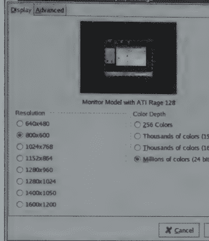

图22-3：更改显示选项

如你所见，如果您的显示器和视频硬件允许，您可以从640x480切换到1600x1200的屏幕分辨率。

#### 从GNOME切换到KDE

如果您不喜欢GNOME并希望切换到KDE，请执行以下操作：

1. 单击"Extras → System Settings → Desktop Switching Tool"菜单。或者，您可以单击"Start Here"图标，并在"Location"区域输入"system-settings://Extras"以访问桌面切换工具。您将看到一个与图22-4类似的屏幕。
2. 选择"KDE"并单击"OK"按钮。您将收到通知，表明更改已在相应的配置文件中完成。
3. 重启X窗口以使用您首选的桌面。

请注意，本章我将始终使用GNOME，因为它是Red Hat Linux的默认环境。


图22-4：将桌面从GNOME切换到KDE

#### 使用X窗口进行系统管理

### 更改Root密码

您可以通过执行以下任一操作来更改root密码：

- 从X终端窗口或"Run Program"菜单运行`/usr/bin/redhat-config-rootpassword`。
- 单击"System Settings -> Root Password"菜单选项。

无论哪种方式，您都将运行相同的程序，并显示一个与图22-5类似的屏幕。

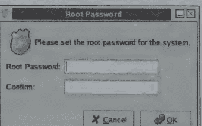

图22-5：更改root密码

根据您的意愿更改root密码，更改将立即生效。

### 设置内核参数

要调整各种内核参数，请运行`/usr/bin/redhat-config-proc`，该命令将显示一个类似于图22-6的应用程序。此应用程序生成的配置存储在`/etc/sysctl.conf`中。

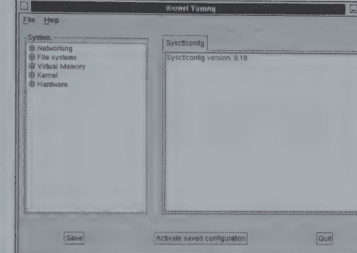

图22-6：调整内核参数

例如，要在内核崩溃后自动重新启动，您可以从该应用程序配置内核，如下所示：

- 从树形菜单中，选择"Kernel → Logging"，这将显示一个与图22-7类似的屏幕。
- 输入内核崩溃后重新启动的值。在示例屏幕中，我使用了60秒。
- 单击"Save"按钮保存设置，`/etc/sysctl.conf`文件将自动更新。

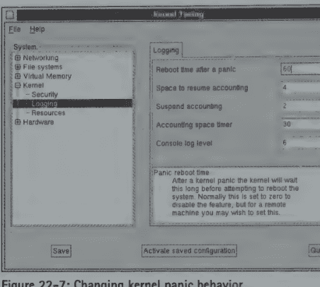

### 管理用户和组

要从X窗口管理用户和组帐户，请执行以下任一操作：

- 从X Windows终端或主菜单中的"Run Program"选项运行`/usr/bin/redhat-config-users`。
- 或者，单击"System Settings -> Users and Groups"菜单选项。

无论哪种方式，您都将运行相同的程序，该程序将显示如图22-8所示的屏幕。

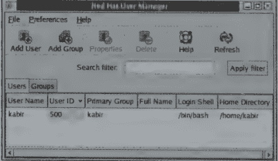

> **提示**
> 如果屏幕在您的桌面上显得太大而无法移动，请按住Alt键并单击右键以选择窗口的移动选项。然后移动窗口，以便您可以找到窗口的右下角，这允许您将应用程序调整为合理的大小。

根据需要添加新用户或组，修改现有用户或组或删除它们。如果您需要对内置用户和组进行操作，请转到此应用程序的"Preference"菜单，并取消选中"Filter system's users and groups"设置。这将显示所有内置系统用户和组，以便您可以执行所需的操作。

### 设置时间和日期

要更改系统的时间和/或日期，请执行以下任一操作：

- 从X Windows终端运行`/usr/bin/redhat-config-date`。或者，通过"Run Program"选项运行它。
- 或者，单击"System Settings -> Date & Time"菜单选项。

您将看到如图22-9所示的屏幕。

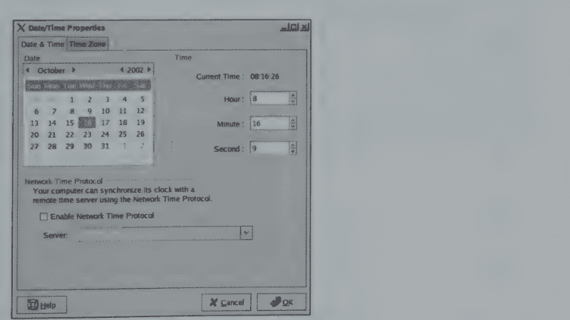

窗口上的"Time Zone"选项卡允许您为系统选择时区。根据需要进行更改，然后单击"OK"按钮立即应用更改。

### 设置安全级别

要更改系统的安全级别，请执行以下任一操作：

- 从X Windows终端运行`/usr/bin/redhat-config-securitylevel`。或者，通过"Run Program"选项运行它。
- 或者，单击"System Settings → Security Level"菜单选项。

您将看到如图22-10所示的屏幕。您可以使用默认的防火墙规则，也可以根据需要进行自定义。

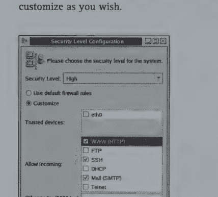

图22-10：更改安全级别

如果您根据每个网络设备进行自定义，可以启用/禁用服务WWW (HTTP)、FTP、SSH、DHCP、Mail (SMTP)或Telnet。如果您在非标准端口（大于1024）上运行服务，也可以在此处列出。
完成配置更改后，单击"OK"按钮应用更改。

### 管理RPM包

要管理系统中的RPM包，请执行以下任一操作：

- 从X Windows终端运行`/usr/bin/redhat-config-packages`。
- 或者，通过"Run Program"选项运行它。
- 或者，单击"System Settings → Packages"菜单选项。

您将看到如图22-11所示的屏幕。

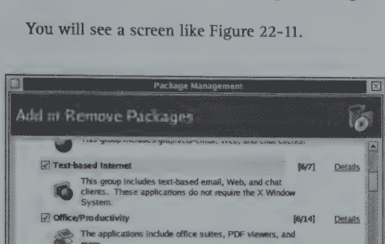

包管理器程序将搜索您的系统中已安装的包，并显示可用的选项，如上图所示。
选择要添加或删除的包，然后单击"Update"按钮进行更改。打包程序将确定所需的包，并确定这些包的依赖关系。您可以通过单击下一个屏幕上的"Show Details"按钮查看详细信息，如图22-12所示。

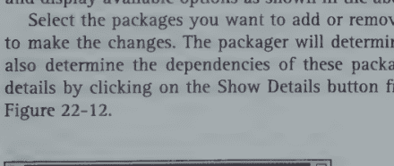

单击"Show Details"按钮显示将从系统添加和/或删除的信息，如图22-13所示。

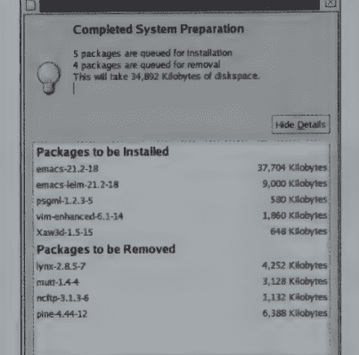

图22-13：将从系统添加和/或删除的包的详细信息

单击"Continue"按钮执行更新后，您将被要求将一张Red Hat Linux CD-ROM放入光驱。插入相应的CD并单击"OK"按钮执行更新。

### 配置网络

要管理系统的网络配置，请执行以下任一操作：

- 从X Windows终端运行`/usr/bin/redhat-config-network`。或者，通过"Run Program"选项运行它。
- 或者，单击"System Settings → Network"菜单选项。

您将看到如图22-14所示的屏幕。


## 第 22 章：使用 X 桌面 599

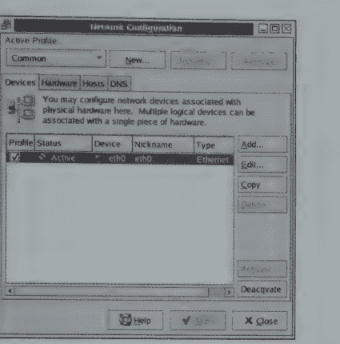

图 22-14：配置网络

使用设备、硬件、主机和 DNS 选项卡来配置网络设备、网络接口卡、主机参数和 DNS 配置。例如，要更改系统的 DNS 服务器 IP 地址，请单击 DNS 选项卡，这将显示一个与图 22-15 类似的屏幕。

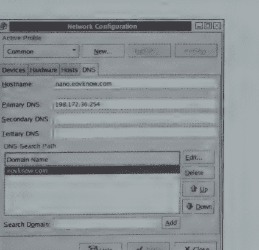

图 22-15：配置 DNS

在这里，你可以更改主机名，设置主要、次要或第三 DNS 服务器 IP 地址，并根据需要配置 DNS 搜索路径。

请注意，Red Hat 8 附带了另一个程序 `/usr/bin/redhat-config-network-druid`，它使得设置新的网络连接变得非常容易。当你从 X Windows 终端或运行程序菜单选项运行此命令时，它会显示一个如图 22-16 所示的屏幕。

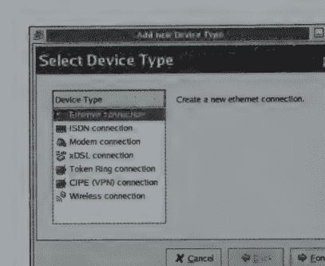

图 22-16：使用简单的网络连接配置工具

例如，要配置以太网连接，请从菜单中单击以太网连接选项，然后单击前进按钮继续。你将看到系统上的以太网设备列表，如图 22-17 所示。

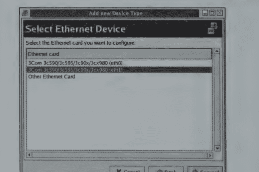

图 22-17：创建以太网网络连接

一旦你选择了一个设备（如我在图 22-17 中所做的那样），请单击前进按钮继续。你将看到一个连接配置屏幕。现在你必须选择使用基于 DHCP 的 IP 还是静态 IP 配置。如果你的 ISP 提供了静态 IP，请选择“静态设置 IP 地址”选项，并手动输入 IP 地址设置，例如 IP 地址、子网掩码和默认网关地址。另一方面，如果你知道你的 ISP 使用的是 DHCP，你可以选择“使用 dhcp 自动获取 IP 地址设置”选项。对于服务器（本书的目标读者），应该始终使用静态 IP 地址。

当你单击前进按钮继续时，你将看到你的选择并被要求确认。确认设置后，它们将被添加到你的网络配置中。你将被带回图 14 的屏幕。

必须通过选择设备并单击激活按钮来激活该设备。你可以随时通过选择相应的设备并单击编辑按钮来编辑你的配置。

#### 使用进程/系统监控器

如你所知，我不建议在生产级服务器系统上使用 X Windows，因为存在负载和安全问题。但是，如果你必须使用 X Windows，你可以利用可以安装在其上的花哨的进程/系统监控工具。其中一个工具是默认安装的。你可以通过单击 GNOME 菜单中的 系统工具 → 系统监视器 来运行它。

此工具的外观如图 22-18 所示。

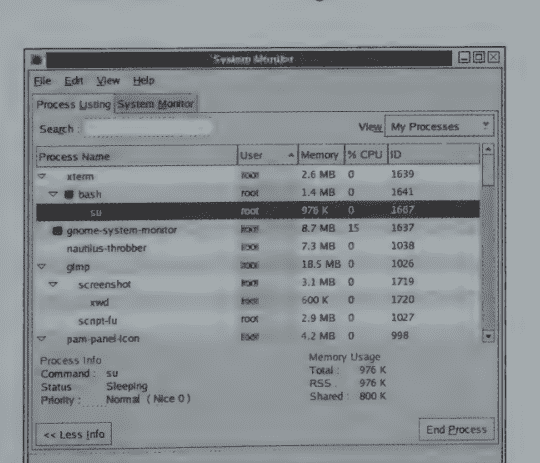

此工具允许你监控所有进程、你自己的用户进程或所有活动进程。你甚至可以将进程分组到各自的子树下。你可以选择进程并使用编辑菜单中的选项来终止它们或根据需要更改优先级。编辑→首选项选项允许你更精细地配置进程列表。
系统监视选项卡显示有关 CPU、内存和磁盘空间使用情况的大量信息，如图 22-19 所示。

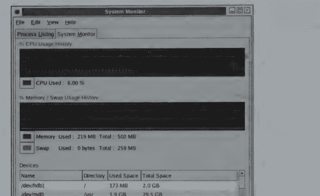

图 22-19：监控 CPU、RAM 和磁盘等系统资源

对于能够在服务器上运行 X Windows 的管理员来说，这是一个很棒的工具。

#### 总结

在本章中，你学习了如何在 X Windows 系统下使用 GNOME 桌面环境来管理 Linux 服务器（或更好的桌面）系统的各个方面。本章向你展示了如何运行基于新 X Windows 的 Red Hat 配置工具（`/usr/bin/redhat-config-*`）来帮助你进行系统管理。尽管基于 X Windows 的工具对初学者管理员来说更容易，但我强烈建议你在桌面 Linux 系统上使用 X Windows，并尽可能让服务器不使用 X Windows。

# 第七部分

## 故障排除服务器

**第 23 章**
处理常见文件系统问题

**第 24 章**
网络故障排除

## 第 23 章

#### 处理常见文件系统问题

- 如何使用第一个工具修复文件
- 如何解决典型的磁盘空间问题
- 如何解决典型的磁盘访问问题

在大多数情况下，你可以学习使用工具来帮助你解决典型的文件系统问题。首先，检查最常出现的文件系统问题是什么。本章是关于文件系统问题的，即使它不是最常见的，但也是最常见的。

### 查找文件
作为系统管理员，你经常会寻找项目或磁盘空间中的某个文件或文件类型。检查文件是否有正确的内容或位置，或者你是否想解决你的文件系统问题。如果你想解决你的文件系统问题，本章可以在这方面帮助你。

### 重命名当前目录中的特定文件类型
假设你想重命名你自己的目录中的某个特定文件或文件类型。如果你想重命名某个文件或文件类型，你就会想重命名你的文件系统问题。如果你想解决你的文件系统问题，本章可以在这方面帮助你。如果你想解决你的文件系统问题，本章可以在这方面帮助你。

此命令使用 `find` 实用程序查找所有扩展名为 `.conf` 的文件（`-name "*.conf"`），并将输出通过管道传递给 awk 脚本语言解释器。`find` 的输出如下所示：

```
./dists/tutos/apache.conf
./php/logout/logout.conf
./php/taf/apps/taf.conf
./php/eis/apps/eis.conf
```

`find` 的输出由 awk 读取，并使用 `.conf` 作为字段分隔符来分隔输出。使用 awk 的 `printf()` 函数来打印一行，例如：

```
mv filename.conf filename.ini
```

示例输出如下所示：

```
mv ./dists/tutos/apache.conf ./dists/tutos/apache.ini
mv ./php/logout/logout.conf ./php/logout/logout.ini
mv ./php/taf/apps/taf.conf ./php/taf/apps/taf.ini
mv ./php/eis/apps/eis.conf ./php/eis/apps/eis.ini
```

当此输出被重定向到 `move.sh` 文件以创建 shell 脚本时，生成的 shell 脚本可以使用 `sh move.sh` 命令执行。

### 将特定文件类型移动到新位置

假设你需要将特定文件类型移动到新目录。你可以运行以下命令：

```
find . -type f -name "*.ext" -exec mv {} dest_dir \;
```

例如，要将 `*.conf` 文件移动到 `/a/b/conf`，请运行：

```
find . -type f -name "*.conf" -exec mv {} /a/b/conf \;
```

### 从目录中删除特定文件类型

现在你需要从目录中删除特定文件类型。你可以运行以下命令：

```
find directory -type f -name "*.ext" -exec rm {} \;
```

例如，要从 `/tmp` 删除 `*.bak` 文件，请运行：

```
find /tmp -type f -name "*.bak" -exec rm {} \;
```

### 删除旧文件

要按最后修改日期删除文件，你可以运行以下命令：

```
find directory -type f -mtime +days \;
```

例如，要定位 `~kabir` 目录中所有超过 30 天未访问的 gzip 压缩 tar 文件，你可以运行：

```
find ~kabir -type f -name "*.tar.gz" -mtime +30 \;
```

### 创建长目录路径

如果你需要创建像 `/dir1/dir2/dir3/dir4/dir5` 这样的长目录路径，通常你会创建第一个目录，然后创建下一个，依此类推。这里有一个更好的解决方案：

```
mkdir -p path
```

此命令创建创建完整路径所需的所有必要目录。例如，以下命令创建创建 `dir5` 所需的所有目录：

```
mkdir -p /dir1/dir2/dir3/dir4/dir5
```

#### 解决磁盘空间问题

无论你有多少磁盘空间，你都会用完。不，这不是著名的墨菲定律适用于磁盘空间，但这是非常真实的，并且可以由许多执业系统管理员证明。在这里，我向你展示如何使用一些工具来调查和/或解决日常的磁盘空间问题。

#### 查找磁盘空间使用大户

要识别你的磁盘空间被用在何处，你可以从 `/` 目录运行以下命令：

```
du -a | sort -n > /tmp/sorted.du.out.txt &
```

此命令将运行 `du` 实用程序，该程序报告每个文件和目录的磁盘空间，然后按数字顺序对此命令的输出进行排序，并将其存储在 `/tmp/sorted.du.out.txt` 文件中。最后的 `&` 符号允许命令在后台运行，因为根据文件数量和你的 `/` 目录大小，它可能需要很长时间才能完成。


#### 清空正在运行的服务日志

你经常会发现日志文件太大而无法处理。如果创建日志文件的服务正在运行，则无法直接删除日志文件，除非先停止该服务。如果你想清空正在运行的服务的日志文件，请运行以下命令：

```
echo > log_path
```

例如，要清空 Apache 服务器运行期间存储在 `/usr/local/apache/logs/error_log` 中的错误日志，你可以运行：

```
echo > /usr/local/apache/logs/error_log
```

这会清空日志文件，而无需停止和重启服务。

#### 解决文件访问问题

文件访问问题在 Linux 初学者或 Unix 用户中非常常见。当涉及多个用户组时，这类问题会大量出现。下面我将讨论几个常见的文件和目录访问问题。

#### 共享目录的组访问权限

当多个用户组的用户需要访问一个共享目录时，任何用户在该目录中写入的文件都会对其他用户不可用，因为默认情况下，Linux 会使用由 `/etc/profile` 或系统级脚本配置文件（如 `/etc/bashrc`）控制的默认 UMASK 来写入文件。

要允许用户及其所属组对某个目录拥有读、写和执行权限，请运行：

```
chown -R :group_name directory
chmod -R 2770 directory
```

`2770` 权限掩码表示文件所有者和所属组对由其创建的每个文件都拥有完全的访问权限（读取、写入、执行）。

#### 卸载已挂载的文件系统

假设你因某些原因想要卸载一个已挂载的文件系统，但每次运行 `umount /mount_point` 时都会收到一条错误消息，提示文件系统正忙。在这种情况下，你应该执行以下操作：

1. 检查是否有任何程序正在使用 `mount_point` 中的文件或目录。要确定哪些程序正在访问指定的文件系统，请运行以下命令：

	`lsof | grep /mount_point`

2. 一旦确定了当前正在使用该文件系统的程序，你可以像平常一样停止这些程序，然后再次尝试 `umount` 命令。

3. 如果你打开了一个 shell 窗口，且其当前目录位于 `/mount_point` 内，文件系统同样会处于忙碌状态。请确保关闭这些 shell 窗口，或将当前目录切换到 `mount_point` 之外的其他目录。

4. 现在你可以按照之前所述的方法对该目录执行 `umount` 操作了。

#### 总结

在本章中，你学习了如何使用各种工具来处理典型的文件和磁盘管理问题，这些工具应成为每位系统管理员工具箱中的必备之物。本章讨论的 `find` 工具在使用各种选项查找文件时极为方便。你应该通过手册页进一步学习 `find` 的用法。你还学习了磁盘空间相关工具和文件访问管理工具。通过不断练习使用这些工具，你将成为一名高效的系统管理员。

# 第 24 章

## 网络故障排除

#### 本章内容

- 如何排除网络接口故障
- 如何调试网络连接问题
- 如何排除网络服务故障
- 如何排除 DNS 故障
- 如何排除 Samba 故障

在本章中，我将讨论如何使用标准 Red Hat Linux 服务器系统上自带的工具来排除常见的网络配置问题。

#### 排除网络接口故障

如果你的网络接口卡（NIC）无法正常工作，那么在网络方面你几乎无法做太多事情。下面我将讨论如何处理与网卡相关的常见问题。

#### 检测网卡

如果你的系统无法通过 telnet、ssh 或 Web 浏览器连接到远程主机，很有可能是你的网卡配置不正确，或者操作系统未能检测到它。

要查明操作系统在启动期间是否检测到了你的网卡，请运行以下命令：

```
dmesg | grep eth
```

`dmesg` 命令的输出（即启动日志）被传递给 `grep` 命令，后者过滤掉所有不包含 `eth` 字符串的行。因为 Linux 使用 `eth{number}`（例如 `eth0`、`eth1` 等）来表示网卡，你应该能看到类似以下内容的行：

612  **第七部分：服务器故障排除**

```
eth0: RealTek RTL8139 Fast Ethernet at 0xc886d000, 00:30:4f:11:b0:ef, IRQ 10
eth0:  Identified 8139 chip type 'RTL-8139C'
eth1: RealTek RTL8139 Fast Ethernet at 0xc886f000, 00:30:4f:11:bd:39, IRQ 11
eth1:  Identified 8139 chip type 'RTL-8139C'
eth0: Setting 100Mbps full-duplex based on auto-negotiated partner ability 45e1.
eth1: Setting half-duplex based on auto-negotiated partner ability 0000.
```

这里，内核检测到了两块网卡（eth0 和 eth1）。如果你的网卡未被检测到，很可能是因为正确的网卡驱动程序没有被加载。在这种情况下，你可以运行以下命令来查看是否已加载正确的驱动程序：

```
lsmod
```

例如，该命令可能输出类似以下的内容：

| 模块 | 大小 | 使用者 |
|---|---|---|
| iptable_filter | 2256 | 0 (autoclean) (unused) |
| ipt_REDIRECT | 1312 | 3 (autoclean) |
| ipt_MASQUERADE | 1824 | 1 (autoclean) |
| iptable_nat | 18224 | 0 (autoclean) [ipt_REDIRECT ipt_MASQUERADE] |
| ip_conntrack | 16944 | 1 (autoclean) [ipt_REDIRECT ipt_MASQUERADE iptable_nat] |
| ip_tables | 11392 | 6 [iptable_filter ipt_REDIRECT ipt_MASQUERADE iptable_nat] |
| autofs | 11520 | 0 (autoclean) (unused) |
| 8139too | 12832 | 2 |
| usb-uhci | 21536 | 0 (unused) |
| usbcore | 51712 | 1 [usb-uhci] |
| ext3 | 64624 | 6 |
| jbd | 40992 | 6 [ext3] |

请注意上面加粗的行（8139too），它就是前一个示例中所示的 RealTek RTL8139 Fast Ethernet 的驱动程序。网卡驱动模块存储在 /lib/modules/kernel_version/kernel/drivers/net/ 目录中。例如，在 2.4.18 内核上，8139too 位于 /lib/modules/2.4.18/kernel/drivers/net/8139too。


> **/etc/modules.conf** 文件应包含网卡驱动模块的名称。

如果你的网卡模块未在 `lsmod` 中显示，或未在驱动程序位置中找到，则需要重新编译内核并添加网卡支持。

#### 访问网卡的硬件配置

中断请求线（IRQ）是 PC 系统中的稀缺资源，多设备系统经常因 IRQ 设置而产生冲突。要查明你的 PCI 设备正在使用哪些 IRQ，可以运行以下命令：

```
cat /proc/pci
```

输出将显示设备列表及其 IRQ 和 I/O 地址设置，以及其他有用信息。要查明哪块以太网卡使用了什么 IRQ 和 I/O 地址，上述命令非常有用。以下命令的示例输出显示有两块以太网卡：一块使用 IRQ 10，另一块使用 IRQ 11。它们分别使用 I/O 地址 0xe400 和 0xe800。

```
Bus 0, device 15, function 0:
  Ethernet controller: Realtek Semiconductor Co., Ltd. RTL-8139 (rev 16).
  IRQ 10.
  Master Capable. Latency=32. Min Gnt=32.Max Lat=64.
  I/O at 0xe400 [0xe4ff].
  Non-prefetchable 32 bit memory at 0xdc000000 [0xdc0000ff].
Bus 0, device 20, function 0:
  Ethernet controller: Realtek Semiconductor Co., Ltd. RTL-8139 (#2) (rev 16).
  IRQ 11.
  Master Capable. Latency=32. Min Gnt=32.Max Lat=64.
  I/O at 0xe800 [0xe8ff].
  Non-prefetchable 32 bit memory at 0xdc001000 [0xdc0010ff].
```

#### 访问和控制网卡配置

当你确认网卡已被内核检测到，但仍无法执行任何网络操作（如 `ping`、连接远程主机或浏览网站）时，就需要检查网卡配置。以下命令显示当前已配置的每块网卡的配置信息。

```
ifconfig
```


## 第七部分：服务器故障排除

此处显示示例输出：

```
eth0 Link encap:Ethernet HWaddr 00:30:4F:11:B0:EF
inet addr:192.168.1.254 Bcast:192.168.1.255 Mask:255.255.255.0
UP BROADCAST RUNNING MULTICAST MTU:1500 Metric:1
RX packets:377380 errors:0 dropped:0 overruns:0 frame:0
TX packets:462247 errors:0 dropped:0 overruns:0 carrier:0
collisions:0 txqueuelen:100
RX bytes:80761001 (77.0 Mb) TX bytes:453784591 (432.7 Mb)
Interrupt:10 Base address:0xd000

eth1 Link encap:Ethernet HWaddr 00:30:4F:11:BD:39
inet addr:203.82.193.26 Bcast:203.82.193.255 Mask:255.255.255.0
UP BROADCAST RUNNING MULTICAST MTU:1500 Metric:1
RX packets:214064 errors:1 dropped:0 overruns:0 frame:0
TX packets:110355 errors:0 dropped:0 overruns:0 carrier:0
collisions:6 txqueuelen:100
RX bytes:113485681 (108.2 Mb) TX bytes:12386229 (11.8 Mb)
Interrupt:11 Base address:0xf000

lo Link encap:Local Loopback
inet addr:127.0.0.1 Mask:255.0.0.0
UP LOOPBACK RUNNING MTU:16436 Metric:1
RX packets:10570 errors:0 dropped:0 overruns:0 frame:0
TX packets:10570 errors:0 dropped:0 overruns:0 carrier:0
collisions:0 txqueuelen:0
RX bytes:1370339 (1.3 Mb) TX bytes:1370339 (1.3 Mb)
```

这里显示了三个网络接口：`eth0`、`eth1` 和 `lo`。`lo` 接口是回环接口。`eth0` 和 `eth1` 是真实的网络接口。

如果你没有看到 `ethnumber` 接口，则说明以下某个文件中存在配置问题：

```
/etc/sysconfig/network
/etc/sysconfig/network-scripts/ifcfg-ethnumber
```

例如，如果你的 `eth0` 网卡没有出现在 `ifconfig` 配置中，请检查：

```
/etc/sysconfig/network
/etc/sysconfig/network-scripts/ifcfg-eth0
```

如果 `/etc/sysconfig/network-scripts/ifcfg-eth0` 文件中的 `ONBOOT` 选项设置为 `off`，则网卡在启动时不会被配置。你应该确保此文件中设置了 `ONBOOT=yes`。

#### 如何调试路由问题

当你确定网卡配置正确，但仍然无法向互联网或局域网内发送或接收数据包时，你需要调查你的路由规则。运行以下命令：

```
route -n
```

你应该会看到类似以下的输出：

```
Kernel IP routing table
Destination     Gateway         Genmask         Flags Metric Ref    Use Iface
192.168.1.0     0.0.0.0         255.255.255.0   U     0      0        0 eth0
203.82.193.0    0.0.0.0         255.255.255.0   U     0      0        0 eth1
127.0.0.0       0.0.0.0         255.0.0.0       U     0      0        0 lo
0.0.0.0         203.82.193.1    0.0.0.0         UG    0      0        0 eth1
```

这里显示了路由规则。所有目的地（0.0.0.0）的默认路由是 203.82.193.1，使用 eth1 接口。192.168.1.0 网络流量通过 eth0 接口路由。203.82.193.0 网络的流量通过 eth1 接口路由，而本地回环网络 127.0.0.0 的流量通过 lo（回环）接口路由。

如果你的默认路由配置不正确，你可以使用以下命令删除默认路由：

```
/sbin/route del default
```

删除默认路由后，你可以使用以下命令添加一个新的：

```
/sbin/route add default gw default_route_ip dev nic_device
```

例如，要将所有流量（默认情况下，从 0 到 203.82.193.1）通过 eth1 接口路由，请运行：

```
/sbin/route add default gw 203.82.193.1 dev eth1
```

现在你可以 ping 默认路由器，查看数据包是否能够来回传输。如果可以，你可以将上述默认路由命令（带有适当的 IP 和设备名称）添加到 /etc/rc.d/rc.local 文件中，以便在启动过程中自动添加路由。

#### 故障排除连接问题

如果你的网络配置正确但仍然存在连接问题，可能有很多原因。可能是你的网络物理布线、远程路由器，或者你试图访问的目标主机或 IP 地址有问题。在本节中，我将讨论如何使用各种工具来调查并可能解决你的网络连接问题。

#### 使用 ping 调查连接问题

IP 协议包含一种称为 *Internet Control Message (ICMP)* 的数据包。ICMP 支持一种回显功能，它向目标发送一个数据包，目标主机必须通过回显回复数据包进行响应。ping 工具使用 ICMP 回显功能，传输一系列 ICMP 回显数据包，测量平均往返时间并计算丢包百分比。要查明网络主机是否可用，你可以运行以下命令：

```
ping hostname
```

例如：

```
ping www.evoknow.com
```

这将显示类似以下的输出：

```
PING www.evoknow.com (140.186.45.2) from 203.82.193.26 : 56(84) bytes of data.
64 bytes from www.evoknow.com (140.186.45.2): icmp_seq=1 ttl=237 time=749.964 msec
64 bytes from www.evoknow.com (140.186.45.2): icmp_seq=2 ttl=237 time=729.975 msec
64 bytes from www.evoknow.com (140.186.45.2): icmp_seq=3 ttl=237 time=699.976 msec
64 bytes from www.evoknow.com (140.186.45.2): icmp_seq=4 ttl=237 time=729.976 msec
64 bytes from www.evoknow.com (140.186.45.2): icmp_seq=5 ttl=237 time=739.970 msec
64 bytes from www.evoknow.com (140.186.45.2): icmp_seq=6 ttl=237 time=759.975 msec
64 bytes from www.evoknow.com (140.186.45.2): icmp_seq=7 ttl=237 time=759.976 msec
64 bytes from www.evoknow.com (140.186.45.2): icmp_seq=9 ttl=237 time=749.976 msec
64 bytes from www.evoknow.com (140.186.45.2): icmp_seq=10 ttl=237 time=739.976 msec
64 bytes from www.evoknow.com (140.186.45.2): icmp_seq=11 ttl=237 time=709.968 msec
```

```
--- www.evoknow.com ping statistics ---
13 packets transmitted, 10 packets received, 23% packet loss
round-trip min/avg/max/mdev = 699.976/736.973/759.976/19.007 ms
```

这个 ping 会话显示了 www.evoknow.com 和用户机器之间的 13 个数据包交换。

每收到一个回复就打印一行。请注意，对于每个序列号，只收到一个回复，并且它们都按顺序到达。报告了 IP TTL 值以及往返时间。在会话结束时，报告了统计数据。这里远程主机 www.evoknow.com 的响应如下：

- 最快响应（最小值）为 699.976 毫秒
- 平均响应（平均值）为 736.973 毫秒
- 最大响应（最大值）为 759.976 毫秒

除非远程服务器位于地球另一端并通过卫星链路访问（本例正是如此），否则这被认为是相当慢的。请注意，13 个数据包传输的丢包率为 23%，这是很高的。

要向主机发送固定数量的数据包，请使用 `-c` 选项。例如，向 `localhost`（在同一系统上）发送十个数据包，运行以下命令：

```
ping -c10 localhost
```

以下是示例输出：

```
PING localhost.evoknow.com (127.0.0.1) from 127.0.0.1 : 56(84) bytes of data.
Warning: time of day goes back, taking countermeasures.
64 bytes from localhost.evoknow.com (127.0.0.1): icmp_seq=0 ttl=255 time=148 usec
64 bytes from localhost.evoknow.com (127.0.0.1): icmp_seq=1 ttl=255 time=69 usec
64 bytes from localhost.evoknow.com (127.0.0.1): icmp_seq=2 ttl=255 time=82 usec
64 bytes from localhost.evoknow.com (127.0.0.1): icmp_seq=3 ttl=255 time=80 usec
64 bytes from localhost.evoknow.com (127.0.0.1): icmp_seq=4 ttl=255 time=85 usec
64 bytes from localhost.evoknow.com (127.0.0.1): icmp_seq=5 ttl=255 time=84 usec
64 bytes from localhost.evoknow.com (127.0.0.1): icmp_seq=6 ttl=255 time=85 usec
64 bytes from localhost.evoknow.com (127.0.0.1): icmp_seq=7 ttl=255 time=82 usec
64 bytes from localhost.evoknow.com (127.0.0.1): icmp_seq=8 ttl=255 time=85 usec
64 bytes from localhost.evoknow.com (127.0.0.1): icmp_seq=9 ttl=255 time=84 usec
```

```
--- localhost.evoknow.com ping statistics ---
10 packets transmitted, 10 packets received, 0% packet loss
round-trip min/avg/max/mdev = 0.069/0.088/0.148/0.022 ms
```

Ping 回环接口是测试机器基本网络配置的好方法，因为没有数据包被物理传输。在此类测试中出现的任何问题都应引起警觉。

你可以使用 ping 来评估网络连接的健康状况。例如，假设你想确定通过 128Kbps 连接链接的两台主机之间的理想传输时间。以下是确定理想传输速率的方法：

1. 通常，ping 发送 56 字节数据和 8 字节的 ICMP 头，这些数据封装在具有 20 字节头的 IP 数据包中。这意味着每个数据包总共传输 84 字节。
2. 以每秒 128 千比特计算，传输 84 字节应需要 84 × (8/128,000) 毫秒，大约为 6 毫秒。
3. 由于这是往返时间，你可以预期 ping 请求大约需要 10 到 15 毫秒。

你可以使用类似的计算来确定网络中是否存在拥塞。

#### 使用 traceroute

如果你确定网络连接存在拥塞，可以使用 traceroute 工具来调查和定位问题源。例如：

```
traceroute www.evoknow.com
```

此处显示示例输出：

```
traceroute to www.your-site.com (140.186.45.2), 30 hops max, 38 byte packets
 1  203.82.193.1 (203.82.193.1)       23.853 ms  26.352 ms  28.723 ms
 2  203.82.192.1 (203.82.192.1)       29.357 ms  28.155 ms  141.194 ms
 3  202.161.128.225 (202.161.128.225)  559.505 ms  561.002 ms  652.216 ms
 4  202.161.130.1 (202.161.130.1)     598.160 ms  642.150 ms  572.933 ms
 5  202.161.130.33 (202.161.130.33)   644.319 ms  645.099 ms  659.736 ms
 6  12.119.139.17 (122.119.139.17)    643.373 ms  697.563 ms  757.312 ms
 7  gip.axtt.net (122.123.195.197)    658.720 ms  635.122 ms  694.173 ms
 8  gbp.axtt.net (122.123.13.150)     636.651 ms  679.722 ms  648.790 ms
 9  ip.axtt.net (12.122.11.77)        721.600 ms  681.535 ms  683.556 ms
10  x.attx.net (12.122.11.218)        660.366 ms  697.736 ms  663.161 ms
```

11 cal.ywest.net (201.171.1.165) 737.057 ms 711.545 ms 723.141 ms
12 ca2.ywest.net (201.171.14.162) 628.044 ms 867.475 ms 633.854 ms
13 dnvr0702.ywest.net (201.171.8.249) 744.186 ms 719.723 ms 812.756 ms
14 dnvr0701.ywest.net (201.171.142.1) 1003.380 ms 734.537 ms 861.646 ms
15 ksca0101.ywest.net (201.171.8.138) 1012.634 ms 1026.625 ms 700.288 ms
16 wash0201.ywest.net (201.171.8.165) 745.621 ms 790.393 ms 764.998 ms
17 wash04.ywest.net (201.171.9.158) 687.226 ms 746.592 ms *
18 wax1.net (65.123.21.202) 786.259 ms 895.866 ms 803.478 ms
19 wax2.net (199.232.131.1) 985.929 ms 716.193 ms 735.298 ms
20 lnx1.cent.net (199.232.74.102) 710.215 ms 727.271 ms 735.775 ms
21 140.186.45.17 (140.186.45.17) 787.274 ms 780.095 ms 805.352 ms

虽然 `ping` 可以提供两个主机之间的网络性能（健康状态）信息，但 `traceroute` 工具能向你展示数据包在任意两个指定主机之间传输时所经过的**实际路径**。该工具会尝试列出你的数据包在前往特定目的地途中所经过的一系列主机。

在典型的 `traceroute` 会话中，会先发送生存时间（TTL）值为1的数据包，第一个路由器会对此做出响应。第一组数据包处理完毕后，会发送TTL值为2的第二组数据包，整个过程会不断重复，直到到达目标主机或检测到不可达状态。

使用 `traceroute`，你通常可以判断网络问题是出在你的本地网络、你的互联网服务提供商（ISP）网络，还是在他们的上游提供商等。然而，在你想要追踪的路径中可能存在防火墙，出于安全原因会拒绝 traceroute 数据包。在这种情况下，traceroute 将无法生效。

#### 使用 netstat 检测活跃连接

在调试网络连接问题时，你经常会需要知道当前有哪些活跃的连接。`netstat` 工具可以列出当前活跃的网络连接、转储系统路由表、显示接口统计信息以及列出伪装的连接。例如：

```
netstat -t
```

以下是示例输出：

```
Active Internet connections (w/o servers)
Proto Recv-Q Send-Q Local Address               Foreign Address             State
tcp        0      0 diablo.evoknow.co:squid       tank.evoknow.com:1271       TIME_WAIT
tcp        0      0 diablo.evoknow.co:squid       tank.evoknow.com:1269       TIME_WAIT
tcp        0      0 diablo.evoknow.co:squid       tank.evoknow.com:1268       TIME_WAIT
tcp        0      0 diablo.evoknow.com:ssh        bluebird.evoknow.c:1184     ESTABLISHED
tcp        0      0 diablo.evok:netbios-ssn        nsx.evoknow.com:1077        ESTABLISHED
tcp        0      0 diablo.evok:netbios-ssn        hummer.evoknow.com:1130     ESTABLISHED
tcp        0      0 diablo.evoknow.co:squid       tank.evoknow.com:1275       ESTABLISHED
tcp        0      0 diablo.evoknow.co:squid       tank.evoknow.com:1274       ESTABLISHED
tcp        0      0 diablo.evoknow.co:squid       tank.evoknow.com:1273       ESTABLISHED
tcp        0      0 diablo.evok:nbios-ssn         bluebird.evoknow.c:1034     ESTABLISHED
tcp        0      0 203.82.193.26:4836            flres.java.Sun.COM:http     TIME_WAIT
tcp        0      0 203.82.193.26:4838            flres.java.Sun.COM:http     TIME_WAIT
tcp        0      0 203.82.193.26:4839            flres.java.Sun.COM:http     TIME_WAIT
tcp        0      0 203.82.193.26:4834            flres.java.Sun.COM:http     TIME_WAIT
tcp        0      0 203.82.193.26:4835            flres.java.Sun.COM:http     TIME_WAIT
tcp        0      0 203.82.193.26:4840            flres.java.Sun.COM:http     TIME_WAIT
tcp        0      0 203.82.193.26:4828            flres.java.Sun.COM:http     TIME_WAIT
tcp        0      0 203.82.193.26:4829            flres.java.Sun.COM:http     TIME_WAIT
tcp        0      0 203.82.193.26:4830            flres.java.Sun.COM:http     TIME_WAIT
tcp        0      0 203.82.193.26:4831            flres.java.Sun.COM:http     TIME_WAIT
tcp        0      0 diablo.evoknow.co:squid       tank.evoknow.com:1272       ESTABLISHED
tcp        0      0 diablo.evok:nbios-ssn         mclaren.evoknow.co:1069     ESTABLISHED
```

要持续显示活跃连接，可以运行以下命令：

```
netstat -t -c
```

要持续显示活跃连接且不进行DNS解析，可以运行：

```
netstat -t -c -n
```

要查看与某个连接关联的应用程序，请使用 -p 选项。

```
netstat -tl -p
```

以下是示例输出：

```
Active Internet connections (only servers)
Proto Recv-Q Send-Q Local Address               Foreign Address             State       PID/Program name
tcp        0      0 *:1024                      *:*                         LISTEN      817/rpc.statd
tcp        0      0 *:cvspserver                *:*                         LISTEN      1037/xinetd
tcp        0      0 *:rsync                     *:*                         LISTEN      1037/xinetd
tcp        0      0 *:mysql                     *:*                         LISTEN      1115/mysqld
tcp        0      0 *:netbios-ssn               *:*                         LISTEN      1195/smbd
tcp        0      0 *:sunrpc                    *:*                         LISTEN      789/portmap
tcp        0      0 *:http                      *:*                         LISTEN      1130/httpd
tcp        0      0 203.82.193.26:domain        *:*                         LISTEN      3668/named
tcp        0      0 diablo.t2.c:domain          *:*                         LISTEN      3668/named
tcp        0      0 localhost.t2-domain         *:*                         LISTEN      3668/named
tcp        0      0 *:ftp                       *:*                         LISTEN      1037/xinetd
tcp        0      0 *:ssh                       *:*                         LISTEN      1004/sshd
tcp        0      0 *:squid                     *:*                         LISTEN      1234/(squid)
tcp        0      0 *:smtp                      *:*                         LISTEN      1315/master
```

## 第24章：网络故障排除

#### 使用 telnet 检查 SMTP 或 HTTP 服务

你可以使用 telnet 客户端连接到任何 TCP/IP 服务，以查看其是否存活。例如：

```
telnet localhost 80
```

这将连接到本地主机的默认 HTTP 端口（80）。如果连接成功，你就知道有一个服务器正在监听这个端口。要断开连接，你需要按 Ctrl + ]，然后输入 `quit` 来退出。

类似地，你可以连接到默认的 SMTP（25）端口，以查看是否有邮件服务器在监听该端口。你可以在 `/etc/services` 文件中找到端口号。对于 `/etc/services` 中已发布的端口，你也可以使用协议名称。例如：

```
telnet localhost http
```

这与在命令行中使用端口号（80）效果相同。

#### 使用 tcpdump 实时嗅探数据包

你可以使用 `tcpdump` 工具实时查看数据包。它能从网络接口捕获数据包并为你解析。它可以处理所有基本的互联网协议，也可以用于保存完整的数据包以供后续检查。以下是一个例子：

```
tcpdump ip host bluebird and not diablo
```

这里的 `tcpdump` 被指示嗅探所有在 `bluebird` 和除 `diablo` 外的任何其他主机之间传输的数据包。以下是示例输出：

```
tcpdump: listening on eth0
16:33:39.854905 bluebird.evoknow.com.1138 > ns.evoknow.com.squid: S
2840530126:2840530126(0) win 16384 <mss 1436,nop,nop,sack0K> (DF)
16:33:39.854905 linux.com.http > bluebird.evoknow.com.1138: S
600285914:600285914(0) ack 2840530127 win 5840 <mss 1460,nop,nop,sack0K> (DF)
16:33:39.854905 bluebird.evoknow.com.1138 > ns.evoknow.com.squid: . ack
600285915 win 17232 (DF)
16:33:39.854905 bluebird.evoknow.com.1138 > ns.evoknow.com.squid: P 0:404(404)
ack 1 win 17232 (DF)
16:33:39.854905 linux.com.http > bluebird.evoknow.com.1138: . ack 405 win 6432 (DF)
16:33:41.574905 linux.com.http > bluebird.evoknow.com.1138: . 1:1437(1436) ack 405 win 6432 (DF)
```

你可以看到 `bluebird.evoknow.com` 正**连接**到 `ns.evoknow.com`，并使用 Squid 代理服务器通过 HTTP 连接到 `linux.com`。`linux.com` 服务器则连接到 `bluebird`。这类监控工具可以帮助你相当轻松地识别网络问题。

#### 网络服务故障排除

了解哪些服务在哪个运行级别启用，可以帮助你更好地识别网络服务问题。你可以运行以下命令来查看各种运行级别下当前启用或禁用的网络服务：

```
chkconfig --list
```

以下是示例输出：

| 服务     | 0    | 1   | 2   | 3   | 4   | 5   | 6   |
|----------|------|-----|-----|-----|-----|-----|-----|
| dhcpd    | off  | off | off | off | off | off | off |
| atd      | off  | off | off | on  | on  | on  | off |
| nscd     | off  | off | off | off | off | off | off |
| ntpd     | off  | off | off | off | off | off | off |
| rwchod   | off  | off | off | off | off | off | off |
| keytable | off  | on  | on  | on  | on  | on  | off |
| syslog   | off  | off | on  | on  | on  | on  | off |
| httpd    | off  | off | off | off | off | off | off |
| named    | off  | off | off | on  | off | off | off |
| tux      | off  | off | off | off | off | off | off |
| gpm      | off  | off | on  | off | on  | on  | off |
| kudzu    | off  | off | off | on  | on  | on  | off |
| kdcrotate| off  | off | off | off | off | off | off |
| autofs   | off  | off | off | on  | on  | on  | off |
| sendmail | off  | off | on  | off | on  | on  | off |
| snmpd    | off  | off | off | off | off | off | off |
| rhnsd    | off  | off | off | off | off | off | off |
| netfs    | off  | off | off | on  | on  | on  | off |
| network  | off  | off | on  | on  | on  | on  | off |
| random   | off  | off | on  | on  | on  | on  | off |
| rawdevices| off | off | off | on  | on  | on  | off |
| apmd     | off  | off | on  | on  | on  | on  | off |
| arpwatch | off  | off | off | off | off | off | off |


ipchains      0:关闭   1:关闭   2:开启    3:开启    4:开启    5:开启    6:关闭

iptables      0:关闭   1:关闭   2:关闭    3:关闭    4:关闭    5:关闭    6:关闭

sshd          0:关闭   1:关闭   2:开启    3:开启    4:开启    5:开启    6:关闭

identd        0:关闭   1:关闭   2:关闭    3:关闭    4:关闭    5:关闭    6:关闭

portmap       0:关闭   1:关闭   2:关闭    3:开启    4:关闭    5:关闭    6:关闭

nfs           0:关闭   1:关闭   2:关闭    3:关闭    4:关闭    5:关闭    6:关闭

nfslock       0:关闭   1:关闭   2:关闭    3:开启    4:开启    5:关闭    6:关闭

mysql         0:关闭   1:关闭   2:开启    3:开启    4:开启    5:开启    6:关闭

rstatd        0:关闭   1:关闭   2:关闭    3:关闭    4:关闭    5:关闭    6:关闭

rusersd       0:关闭   1:关闭   2:关闭    3:关闭    4:关闭    5:关闭    6:关闭

rwalld        0:关闭   1:关闭   2:关闭    3:关闭    4:关闭    5:关闭    6:关闭

crond         0:关闭   1:关闭   2:开启    3:开启    4:开启    5:开启    6:关闭

anacron       0:关闭   1:关闭   2:开启    3:开启    4:开启    5:开启    6:关闭

xinetd        0:关闭   1:关闭   2:关闭    3:开启    4:开启    5:开启    6:关闭

squid         0:关闭   1:关闭   2:关闭    3:开启    4:关闭    5:关闭    6:关闭

isdn          0:关闭   1:关闭   2:开启    3:开启    4:开启    5:开启    6:关闭

smb           0:关闭   1:关闭   2:关闭    3:关闭    4:关闭    5:关闭    6:关闭

基于 xinetd 的服务：

- rsync: 开启
- rexec: 关闭
- rlogin: 关闭
- rsh: 关闭
- chargen: 关闭
- chargen-udp: 关闭
- daytime: 关闭
- daytime-udp: 关闭
- echo: 关闭
- echo-udp: 关闭
- time: 关闭
- time-udp: 关闭
- finger: 关闭
- imap: 关闭
- imaps: 关闭
- ipop2: 关闭
- ipop3: 关闭
- pop3s: 关闭
- ntalk: 关闭
- talk: 关闭
- telnet: 关闭
- ftp: 开启
- cvs: 开启
- wu-ftpd: 关闭

要启用或禁用服务，您可以使用 `ntsysv` 命令。该命令会显示一个菜单界面，允许您启用或禁用网络服务。

#### 故障排除：名称服务

DNS 配置不当常常是系统管理员许多网络问题的根源。为确保您的 DNS 客户端配置正确，请首先检查您的 `/etc/resolve.conf` 文件，并确保它指向正确的 DNS 服务器。

#### 使用 dig 检查 DNS 记录

`dig` 工具可用于向 DNS 服务器查询记录。本节列出了您需要执行的典型查询。要查找地址（A）记录，您可以运行：

```
dig hostname A
```

例如：

```
dig www.evoknow A
```

响应可能如下所示：

```
<<<>> DiG 9.1.3 <<<>> www.evoknow.com A
;; global options:  printcmd
;; Got answer:
;; ->>HEADER<<- opcode: QUERY, status: NOERROR, id: 8562
;; flags: qr aa rd ra; QUERY: 1, ANSWER: 2, AUTHORITY: 3, ADDITIONAL: 0

;; QUESTION SECTION:
;www.evoknow.com.               IN      A

;; ANSWER SECTION:
www.evoknow.com.        3600    IN      CNAME   www.your-site.com.
www.your-site.com.      33171   IN      A       140.186.45.2

;; AUTHORITY SECTION:
your-site.com.          80168   IN      NS      ns3.your-site.com.
your-site.com.          80168   IN      NS      ns1.your-site.com.
your-site.com.          80168   IN      NS      ns2.your-site.com.

;; Query time: 34 msec
;; SERVER: 192.168.1.254#53(192.168.1.254)
;; WHEN: Wed Aug 14 17:06:26 2002
;; MSG SIZE  rcvd: 131
```

要减少注释，您可以在命令行中使用 `+nocomments`。

要查找主机的 CNAME 记录，请运行：

```
dig hostname CNAME
```

例如：

```
dig +nocomments +noadditional www.evoknow.com CNAME
```

此命令显示以下输出：

```
;; global options:  printcmd
;www.evoknow.com.       IN CNAME

www.evoknow.com.  3600 IN CNAME     www.your-site.com.
evoknow.com.      3600 IN NS        ns.evoknow.com.

;; Query time: 1 msec
;; SERVER: 192.168.1.254#53(192.168.1.254)
;; WHEN: Wed Aug 14 17:11:16 2002
;; MSG SIZE  rcvd: 94
```

要查找邮件交换记录（MX），您可以运行：

```
dig hostname MX
```

例如：

```
dig +short aminews.com MX
```

此命令显示以下内容：

```
0 mail.aminews.com.
20 mail.carpium.net.
```

如果您运行本地 DNS 服务器，可以使用 `/etc/rc.d/init.d/named status` 命令来查看服务器的状态。

#### 故障排除：Samba 服务

`smbclient` 程序可以帮助您调查 Samba 服务问题。本节列出一些典型问题。

#### 查找特定用户的可用 SMB 服务

当您有一个无法访问某个 Samba 或 Windows 共享打印机的用户帐户时，您可以使用以下命令来确定该用户在目标系统上可以访问什么：

```
smbclient -L hostname -U username
```

例如：

```
smbclient -L hummer -U kabir
```

此命令显示以下内容：

```
added interface ip=192.168.1.254 bcast=192.168.1.255 nmask=255.255.255.0
added interface ip=203.82.193.26 bcast=203.82.193.255 nmask=255.255.255.0
Password:
Domain=[EVOKNOW] OS=[Windows 5.0] Server=[Windows 2000 LAN Manager]

Sharename  Type    Comment
---------  ----    -------

graphics_cd  Disk
IPC$         IPC     Remote IPC
ADMIN$       Disk    Remote Admin
C$           Disk    Default share
roimail      Disk

Server           Comment
--------         -------

Workgroup
----------
```

此处，用户 (kabir) 可以访问 `hummer.evoknow.com` 服务器上的共享资源列表。

#### 总结

在本章中，您学习了如何对网络连接、网络服务、DNS 问题和 Samba 问题进行故障排除。然而，许多方面的讲解仍属基础。这更像是一个网络故障排除的入门介绍。一旦您掌握了本章提到的工具，就可以通过组合使用这些工具以及您将在互联网上找到的其他更复杂的工具，来培养更多的故障排除技能。

# 第八部分

# 附录

- **附录 A**：网站内容
- **附录 B**：日常命令
- **附录 C**：Linux 资源

### 附录 A

#### 网站内容

本附录提供有关本书网站内容的信息，您可以在该网站上找到有关本书的最新信息。要访问本书网站，您需要一个标准的 Web 浏览器。

本书网站位于 http://www.wiley.com/compbooks/kabir。在此网站上，您将找到有关脚本、勘误以及本书讨论的 Red Hat Linux 和其他工具的最新信息。

#### 下载 Red Hat Linux

如果您有兴趣下载最新版本的 Red Hat Linux，您可以访问 http://www.redhat.com/download/mirror.html 以找到离您最近的 Red Hat Linux 镜像站点。本书网站也提供了指向其他 Red Hat Linux Web 资源的链接。以下是 Red Hat Linux 下载站点的简短列表：

- Red Hat Linux 镜像定位器：http://www.redhat.com/download/mirror.html
- Planet Mirror：http://public.www.planetmirror.com/
- Cheap Bytes：http://www.cheapbytes.com/

#### 下载 RPM 软件包

如果您想下载本书讨论的各种 RPM 软件包，可以从 http://rpmfind.net/linux/RPM 下载。您也可以在 http://www.tuxfinder.com 上搜索最新的 Linux 工具。本书网站提供了指向书中讨论的所有工具的链接。

#### Red Hat Linux 8 讨论板

本书网站有一个指向讨论板的链接，该讨论板由作者运营，用于分享现实生活中的系统管理员所需的技巧和诀窍。您可以直接从 http://www.evoknow.com/redhat 访问此论坛，也可以通过本书网站中的讨论板链接访问。

### 附录 B

#### 日常命令

Linux，像任何其他 UNIX 操作系统一样，拥有数百个命令。实际上不可能记住每个命令的所有细节；因此，手册页（也称为 *man pages*）被创建出来。您可以在手册页中查找命令的详细信息。然而，手册页通常非常晦涩且冗长。大多数手册页没有提供很好的示例。有时，细节的量可能会让人难以置信。此外，如果您不知道命令的名称，您就无法找到关于它的信息，对吧？这就是我创建本附录的原因。在这里，您将找到您可能每天都会使用的常用命令。我已将本附录组织成不同的部分，以便您可以在一个通用标题下找到相关命令。例如，如果您正在寻找一个处理文件或目录的命令，您只需转到“通用文件和目录命令”，或者如果您正在寻找一个压缩文件的命令，您只需查看“文件压缩和归档特定命令”下的命令即可。

#### 理解 Linux 命令行

您在 Linux 上的大部分工作将由逐个输入命令组成。这些命令遵循通常称为 *命令行语法* 的既定规则。如果您没有正确遵循语法，命令可能会执行错误，并可能导致问题。

当您输入命令时，整个行称为命令行。最常见的情况是，您一次使用一个命令。然而，如果命令用分号分隔，命令行可以包含多个命令。例如，您可以通过输入以下命令，在一个命令行中先清屏然后列出当前目录的内容：

```
clear; ls
```

当你输入一条命令时，你会键入该命令的名称，后面可能还会跟上其他信息。程序名后面的项目被称为**参数**。例如，考虑以下命令行：

`wc -l doc.txt`

此示例包含两个参数：`-l` 和 `doc.txt`。如何使用这些参数取决于程序本身。

参数有两种类型：**选项**和**参数**。选项紧跟在程序名后面，通常以短横线（减号字符）开头。参数则出现在选项之后。从前面的例子看，`-l` 是一个选项，告诉 `wc` 命令计算行数；`doc.txt` 是一个参数，指明要使用哪个文件。

当你在命令行输入命令时，请记住参数是区分大小写的，类似于 UNIX 中的文件名。总的来说，UNIX 命令的通用语法如下：

`命令名 选项 参数`

#### 通配符基础

当你使用目录和文件命令时，可以使用称为**通配符**的特殊字符来指定文件名的模式。例如，要列出当前目录中所有以 .c 结尾的文件，请使用：

`ls *.c`

星号就是一个通配符。Shell 会解释该模式，并将其替换为所有以 .c 结尾的文件名。表 B-1 展示了常用的通配符。

#### 表 B-1 常用通配符

| 通配符 | 含义 |
|---|---|
| * | 匹配任意一个或多个字符序列 |
| ? | 匹配任意单个字符 |
| [ ] | 匹配方括号内的任意一个字符或字符范围 |

表 B-2 展示了一些通配符用法的示例，以便你了解通配符是如何工作的。

#### 表 B-2 通配符用法示例

| 示例 | 含义 |
| :--- | :--- |
| Jo* | 以 Jo 开头的文件 |
| Jo*y | 以 Jo 开头且以 y 结尾的文件 |
| Ut*l*.c | 以 Ut 开头、包含 l 且以 .c 结尾的文件 |
| ?.h | 以单个字符开头后跟 .h 的文件 |
| Doc[0-9].txt | 名为 Doc0.txt, Doc1.txt, ..., Doc9.txt 的文件 |
| Doc[A-Z].txt | 名为 DocA.txt, DocB.txt, ..., DocZ.txt 的文件 |

如你所见，使用通配符可以轻松选择多个项目。

#### 正则表达式基础

多种 UNIX 命令都使用正则表达式。它们提供了一种方便且一致的方式来指定要匹配的模式。正则表达式类似于通配符，但功能强大得多。它们提供了更广泛的模式选择范围。包括 `ed`、`sed`、`awk`、`grep`，以及在一定程度上的 `vi` 和 `emacs` 在内的几种不同 UNIX 命令都使用正则表达式。

表 B-3 中的特殊字符是正则表达式的典型特征。理解这些特殊字符后，你只需在它们出现时学习少数几个变体即可。

#### 表 B-3 正则表达式特殊字符

| 符号 | 含义 |
| :--- | :--- |
| . | 匹配除换行符以外的任意单个字符 |
| * | 匹配前面的字符零次或多次 |
| ^ | 匹配行的开始 |
| $ | 匹配行的末尾 |
| \< | 匹配单词的开始 |
| \> | 匹配单词的末尾 |
| [ ] | 匹配方括号内的任意一个字符或字符范围 |
| [^] | 匹配方括号外的任意字符 |
| \ | 取后面符号的字面意思 |

首先，在正则表达式中，任何没有特殊含义的字符都代表其自身。例如，要在文件 `data.txt` 中搜索包含 `foo` 的行，请使用：

```
grep foo data.txt
```

要仅搜索 `data.txt` 中以单词 `foo` 开头的行，请使用：

```
grep '^foo' data.txt
```

使用单引号告诉 Shell 保留这些字符原样，并将其传递给程序。每当使用任何特殊字符时，单引号都是必要的。

美元符号表示你希望匹配行末的模式：

```
grep 'hello$' data.txt
```

任何以 `hello` 结尾的行都会使用前面的正则表达式匹配成功。要查找位于单词开头的模式，请使用 `\<`。

```
grep '\<ki' data.txt
```

前面的表达式在文件 `data.txt` 中搜索以 `ki` 开头的单词。要查找模式 `wee`，但仅限于单词末尾，请使用：

```
grep 'wee\>' data.txt
```

从表 B-3 可知，句点匹配除换行符以外的任意单个字符。这在搜索所有包含字母 `C` 后跟两个字母并以 `s` 结尾的行时非常方便；此时，正则表达式如下：

```
grep 'C..s' data.txt
```

如果文件 `data.txt` 中存在，此表达式匹配如 Cats、Cars 和 Cris 这样的模式。

如果你想指定一个字符范围，请使用连字符分隔范围的开始和结束。指定范围时，顺序必须与 ASCII 码中的一致。例如，要搜索所有包含一个 B 后跟任意单个小写字母的行，请使用：

```
grep 'B[a-z]' data.txt
```

也可以在同一个模式中指定多个字符范围，如下所示：

```
grep 'B[A-Za-z]' data.txt
```

前面的示例选择所有包含字母 B 后跟大写或小写字母的行。

#### 如何使用在线手册页

在线手册（manual 的缩写）页分为八个主要部分，如表 B-4 所示。其他部分可能随你使用的 UNIX 版本而异，但大多数（如果不是全部）UNIX 版本都包含八个主要部分。第 1 节包含大部分 UNIX 命令的描述。大多数用户仅使用手册的这一部分就足够了。UNIX 手册的第 2、3、4 和 5 节仅对程序员有意义。第 8 节仅供系统管理员使用。

#### 表 B-4

| 章节 | 主题 |
| :--- | :--- |
| 1 | 可执行程序或 Shell 命令 |
| 2 | 系统调用（内核提供的函数） |
| 3 | 库调用（系统库中的函数） |
| 4 | 特殊文件（通常在 /dev 中） |
| 5 | 文件格式（即，/etc/passwd） |
| 6 | 游戏 |
| 7 | 杂项信息 |
| 8 | 维护命令 |

## 第八部分：附录

现代的 UNIX 系统比其前身涵盖的细节要多得多。通常可以看到章节被分解为小节。例如，第 6 节是游戏的参考手册；然而，你可能会发现第 6a 节（用于冒险游戏）、第 6c 节（用于经典游戏）等等。

`man` 命令允许你查看在线手册。该命令的语法如下：

```
man [-k] [章节] 关键字
```

关键字通常是程序、实用程序或函数的名称。默认操作是按照预定义的顺序在所有可用章节中搜索，并仅显示找到的第一页，即使该关键字存在于多个章节中。

由于命令可能出现在多个章节中，找到的第一页可能不是你想要的手册页。命令 `printf` 就是一个很好的例子。

假设你正在编写一个程序，并想了解更多关于 ANSI C 库函数 `printf()` 的信息。以下命令将为你提供关于 `printf` 的信息：

```
man printf
```

然而，这个 `printf` 的手册页是针对 Shell 命令 `printf` 的。显然，这是错误的信息。一个合理的解决方案是列出所有包含 `printf` 的章节（如果它存在于多个章节中），然后选择正确的一个。你可以使用 `-f` 选项搜索手册页的关键词：

```
man -k printf
fprintf         printf (3b)      - 格式化输出转换
fprintf         printf (3s)      - 打印格式化输出
printf          printf (1)       - 写入格式化输出
printf          printf (3b)      - 格式化输出转换
printf          printf (3s)      - 打印格式化输出
```

你感兴趣的 `printf` 是一个库函数。它位于第 3 节（来自表 B-4），或者更具体地说，从输出看位于第 3b 或 3s 节。要指定手册页的特定章节，你可以在命令行将其传递给 `man`，如下所示：

```
man 3b printf
```

现在这就是你正在寻找的正确信息了！


#### 通用文件与目录命令

在本节中，你将学习日常工作中可能经常使用的特定于文件和目录的命令。

#### cat

语法：

```
cat file [>|>] [destination file]
```

`cat` 命令将文件的内容显示到 `stdout`。使用 `cat` 命令查看文件内容通常很有帮助。你传递给 `cat` 的参数是你想要查看的文件。要查看文件名的全部内容，请使用此命令：

```
cat name
Kiwee
Joe
Ricardo
Charmaine
```

`cat` 还可以将现有的多个文件合并为一个：

```
cat name1 name2 name3 > allnames
```

此示例将文件 `name1`、`name2` 和 `name3` 组合起来生成最终文件 `allnames`。你通过在命令行中输入文件的顺序来确定合并的顺序。

使用 `cat`，你可以将一个文件追加到另一个文件。例如，如果你在之前的命令中忘记了添加 `name4`，你仍然可以通过执行以下操作来产生相同的结果：

```
cat name4 >> allnames
```

#### chmod

语法：

```
chmod [-R] permission-mode file or directory
```

你使用此命令来更改文件或目录的权限模式。权限模式指定为三位或四位八进制数。例如：

```
chmod 755 myscript.pl
```

前面的命令将 `myscript.pl` 脚本的权限更改为 755 (`rwxr-xr-x`)，这允许文件所有者读、写和执行，并且只允许其他所有人拥有读取和执行权限。以下是另一个示例：

```
chmod -R 744 public_html
```

前面的命令将 `public_html` 目录及其所有内容（文件和子目录）的权限更改为 744 (`rwxr-r--`)，这是在 Apache 服务器下使用 `http://server/~username` URL 访问的个人 Web 目录的典型权限设置。`-R` 选项告诉 `chmod` 递归地更改指定目录下所有文件和目录的权限。

#### chown

语法：

```
chown [ -fhR ] Owner [ :Group ] { File . . . | Directory . . . }
```

`chown` 命令更改文件或目录的所有者。`Owner` 参数的值可以是用户 ID 或 `/etc/passwd` 文件中的登录名。你也可以选择指定一个组。`Group` 参数的值可以是组 ID 或 `/etc/group` 文件中的组名。

只有 root 用户才能更改文件的所有者。只有你是 root 用户或你拥有该文件时，你才能更改文件的组。如果你拥有该文件但不是 root 用户，你只能将组更改为你是其成员的组。表 B-5 讨论了 `chown` 选项的详细信息。

#### 表 B-5 CHOWN 选项

| 选项 | 描述 |
|--------|-------------|
| -f | 除用法消息外，禁止显示所有错误消息 |
| -h | 更改遇到的符号链接的所有权，但不更改符号链接指向的文件或目录的所有权 |
| -R | 递归地进入目录，为每个文件更改所有权。当遇到符号链接且该链接指向一个目录时，将更改该目录的所有权，但不会进一步遍历该目录。 |

以下示例将文件的所有者更改为另一个用户：

```
chown bert hisfile.txt
```

#### clear

语法：

```
clear
```

`clear` 命令清除你的终端，并将命令行提示符返回到屏幕顶部。

#### cmp

语法：

```
cmp [-ls] file1 file2
```

此命令比较两个文件的内容。如果两个文件中没有发现差异，`cmp` 默认不产生任何输出。为演示，`file1.txt` 包含：

```
this is file 1
the quick brown fox jumps over the lazy dog.
```

而 `file2.txt` 包含：

```
this is file 2
the quick brown fox jumps over the lazy dog.
```

两个文件之间唯一的区别是第一行的最后一个字符。一个文件中该字符是 1，另一个文件中是 2：

```
cmp file1.txt file2.txt
file1.txt file2.txt differ: char 14, line 1
```

`cmp` 的结果正确地识别出第 14 个字符，第 1 行是两个文件之间不等的字符。`-l` 选项打印每个文件的字节数和不同的字节值。

```
cmp -l file1.txt file2.txt
14 61 62
```

前面示例的结果显示第 14 个字节不同，第一个文件的八进制值为 61，第二个文件的八进制值为 62。

最后，`-s` 选项不显示任何内容。`-s` 选项仅返回一个退出状态，指示文件之间的相似性。如果文件相同，它返回 0（零），如果文件不同，它返回 1。最后，当发生错误时，`-s` 选项返回一个大于 1 的数字。

#### cp

语法：

```
cp [-r] source file or directory file or directory
```

使用 cp 命令创建文件的精确副本。cp 命令至少需要两个参数。第一个参数是你想要复制的文件，第二个参数是新文件的位置或文件名。如果第二个参数是现有目录，cp 会将源文件复制到该目录中。`-r` 参数递归地复制目录。

```
cp main.c main.c.bak
```

前面的示例将复制现有文件 main.c 并在同一目录中创建一个名为 main.c.bak 的新文件。这两个文件是逐位相同的。

#### cut

语法：

```
cut [-cdf list] file
```

cut 命令提取数据列。数据可以是字节、字符或文件中每行的字段。例如，一个名为 names 的文件包含有关一组人员的信息。每行包含与一个人相关的数据：

```
Fast  Freddy:Sacramento:CA:111-111-1111
Joe  Smoe:Los Angeles:CA:222-222-2222
Drake Snake:San Francisco:CA:333-333-3333
Bill  Steal:New York:NY:444-444-4444
```

要列出文件中所有个人的姓名和电话号码，选项 -f 和 -d 应该足够：

```
cut -f 1,4 -d : names
Fast  Freddy:111-111-1111
Joe  Smoe:222-222-2222
Drake Snake:333-333-3333
Bill  Steal:444-444-4444
```

`-f` 列表选项指定你选择显示的字段。`-d` 选项定义每个字段。在前面的示例中，`-d :` 表示冒号分隔每个字段。使用 `:` 作为字段分隔符使得字段 1 和 4 成为姓名和电话号码字段。

要显示特定列的内容，请使用 `-c` 列表选项：

```
cut -c 1-5 names
Fast
Joe
Drake
Bill
```

前面的示例展示了如何列出文件名 names 的第 1 列到第 5 列，而不显示其他任何内容。

#### diff

语法：

```
diff [-iqb] file1 file2
```

你使用 `diff` 命令来确定文件和/或目录之间的差异。默认情况下，如果文件相同，`diff` 不会产生任何输出。

`diff` 命令与 `cmp` 命令在比较文件的方式上不同。`diff` 命令用于逐行报告两个文件之间的差异。`cmp` 命令逐字符报告两个文件之间的差异，而不是逐行。因此，对于比较二进制文件，它比 `diff` 更有用。对于文本文件，`cmp` 主要在你只想知道两个文件是否相同时才有用。

为了说明逐字符考虑变化与逐行考虑变化之间的区别，想想如果你在文件开头添加一个单独的 `换行` 字符会发生什么。如果你将该文件与一个其他方面完全相同但开头没有 `换行` 的文件进行比较，`diff` 会报告文件中添加了一个空行，而 `cmp` 会报告两个文件几乎在每个字符上都不同。

正常输出格式由一个或多个差异块组成；每个块显示文件之间存在差异的一个区域。正常的块看起来像这样：

```
change-command
< from-file-line
< from-file-line. . .
---
> to-file-line
> to-file-line. . .
```

有三种类型的更改命令。每种都由第一个文件中的行号或逗号分隔的行范围、表示要进行的更改类型的单个字符，以及第二个文件中的行号或逗号分隔的行范围组成。所有行号都是每个文件中的原始行号。更改命令的类型是：

- **lar**：在第一个文件的第 l 行之后添加第二个文件中范围 r 的行。
  例如，8a12,15 表示在文件 1 的第 8 行之后追加文件 2 的第 12-15 行；或者，如果将文件 2 更改为文件 1，则删除文件 2 的第 12-15 行。
- **fct**：用第二个文件中范围 t 的行替换第一个文件中范围 f 的行。这类似于组合添加和删除，但更紧凑。
  例如，5,7c8,10 表示将文件 1 的第 5-7 行更改为文件 2 的第 8-10 行的内容；或者，如果将文件 2 更改为文件 1，则将文件 2 的第 8-10 行更改为文件 1 的第 5-7 行的内容。
- **rdl**：从第一个文件中删除范围 r 的行；第 l 行是它们在未被删除的情况下在第二个文件中将出现的位置。
  例如，5,7d3 表示删除文件 1 的第 5-7 行；或者，如果将文件 2 更改为文件 1，则在文件 2 的第 3 行之后追加文件 1 的第 5-7 行。

例如，a.txt 包含

```
a
b
c
d
e
```

而 b.txt 包含

```
c
d
e
f
g
```

diff 命令产生以下输出：

```
1,2d0
< a
< b
5a4,5
> f
> g
```

#### diff

`diff` 命令产生的输出会显示文件之间的差异，以及你需要执行哪些操作才能使文件变得相同。首先，请注意 `c` 是两个文件之间的第一个共同字符。第一行读作 `1,2d0`。这被解释为删除第一个文件的第 1 和第 2 行，即行 `a` 和 `b`。接着，第三行读作 `5a4,6`。`a` 表示附加操作。如果你将第二个文件的第 4 到第 6 行附加到第一个文件的第 5 行之后，那么这两个文件就完全相同了。

`diff` 命令有一些常用选项。`-i` 选项忽略大小写差异。`diff` 认为大写和小写字符是等效的。`-q` 选项提供信息摘要。简单来说，`-q` 选项报告文件是否有任何不同：

```
diff -q a.txt b.txt
Files a.txt and b.txt differ
```

`-b` 选项忽略空白字符的变化。使用 `-b` 选项时，短语 `the foo` 与 `the  foo` 是等效的。

#### du

语法：

```
du [-ask] filenames
```

此命令汇总磁盘使用情况。如果你指定了一个目录，`du` 会报告该目录及其包含的所有目录的磁盘使用情况。如果你没有指定文件名或目录，`du` 默认使用当前目录。`du -a` 会分解总量，并显示每个目录和文件的大小。`-s` 选项则只打印总量。另一个有用的选项是 `-k` 选项。此选项以千字节为单位打印所有文件大小。以下是一些使用不同选项的示例：

```
du -a
247    ./util-linux_3.4.5.rpm
130    ./libncurses5_5.6.1.rom
114    ./slang1-1.5.9.rpm
492    .

du -s
492    .
```

#### emacs

`emacs` 程序是一个全屏可视化编辑器，是现有最好的编辑器之一。它以其灵活性和强大功能而闻名，但也因资源消耗大而著称。`emacs` 的强大功能并非轻易可得。它有一个陡峭的学习曲线，需要你无比的耐心。执行某些操作时，你可能需要多达四个连续的按键组合。

然而，`emacs` 几乎无所不能。除了基本的编辑功能外，`emacs` 还支持以下特性：语法高亮、宏、同时编辑多个文件、拼写检查、邮件、FTP 以及许多其他功能。

阅读关于 `emacs` 的资料时，你经常会看到诸如 *meta-Key* 和 `C-x` 这样的词。`meta` 键是键盘上的元键（如果你有），或者通常就是 `Esc` 键。`C-x` 是 `Ctrl` 键加 `X` 键的语法表示。任何 `C-` 组合都指 `Ctrl` 键。

对于新的 `emacs` 用户来说，两个最重要的按键组合是 `C-x C-c` 和 `C-h C-h`。第一个组合退出 `emacs`。你会惊讶地发现，有多少人只是因为第一次使用时无法退出程序而放弃了 `emacs`。另外，`C-h C-h` 显示在线帮助，你可以在那里学习教程或获取关于某个命令的详细信息。表 B-6 列出了 `emacs` 最常用的命令：

#### 表 B-6 常用的 EMACS 命令

| 命令 | 功能 |
| :--- | :--- |
| C-v | 向前移动一屏 |
| M-v | 向后移动一屏 |
| C-p | 将光标移到上一行 |
| C-n | 将光标移到下一行 |
| C-f | 将光标向右移动一个位置 |
| C-b | 将光标向左移动一个位置 |
| M-f | 向前移动一个单词 |
| M-b | 向后移动一个单词 |
| C-a | 移动到行首 |
| C-e | 移动到行尾 |
| M-a | 向后移动到句首 |
| M-e | 向前移动到句尾 |
| \<Delete\> | 删除光标前的一个字符 |
| C-d | 删除光标后的一个字符 |
| M-\<Delete\> | 删除紧接光标前的一个单词 |
| M-d | 删除光标后的一个单词 |
| C-k | 从光标位置删除到行尾 |
| M-k | 删除到当前句尾 |
| C-x | 撤消上一个命令 |
| C-x C-f | 打开另一个文件 |
| C-x C-s | 保存当前文件 |
| C-x C-w | 将当前文件另存为其他名称 |
| C-x s | 保存所有最近更改过的缓冲区 |
| C-x C-c | 退出 emacs |

# 附录 B：日常命令

#### fgrep

`fgrep` 命令被设计为一个更快的搜索程序（相对于 `grep`）。然而，它只能搜索精确字符，不能用于通用规范搜索。`fgrep` 的名称代表 *fixed character grep*。如今，计算机和内存速度如此之快，已经很少需要使用 `fgrep` 了。

#### file

语法：

`file filename`

`file` 命令确定文件的类型。如果文件不是常规文件，此命令会标识其文件类型。它会将目录、FIFO、块特殊文件和字符特殊文件标识为相应的类型。如果文件是常规文件且长度为零，此命令会将其标识为空文件。

如果文件看起来是一个文本文件，`file` 会检查前 512 个字节，并尝试确定其编程语言。如果文件是可执行的 `a.out`，`file` 会打印其版本戳（如果大于 0）。

```
file main.C
main.C:          c program text
```

#### find

语法：

`find [path] [-type fd] [-name pattern] [-atime [+-]number of days] [-exec command {} \;] [-empty]`

`find` 命令用于查找文件和目录。例如：

```
find . -type d
```

`find` 命令返回当前目录下的所有子目录名。`-type` 选项通常设置为 `d`（表示目录）、`f`（表示文件）或 `l`（表示链接）：

```
find . -type f -name "*.txt"
```

此命令查找当前目录（包括所有子目录）中所有文本文件（以 `.txt` 扩展名结尾）。

```
find . -type f -name "*.txt" -exec grep -l "magic" {} \;
```

此命令在当前目录（包括所有子目录）中的所有文本文件（以 `.txt` 扩展名结尾）中搜索关键词 `magic`，并返回它们的名称（因为使用了 `-l` 与 `grep` 配合）：

```
find . -name ?*.gif? -atime -1 -exec ls -l {} \;
```

此命令查找过去 24 小时（一天）内访问过的所有 GIF 文件，并使用 `ls -l` 命令显示其详细信息。

```
find . -type f -empty
```

这会显示当前目录层次结构中的所有空文件。

#### grep

语法：

```
grep [-viw] pattern file(s)
```

`grep` 命令允许你在一个或多个文件中搜索特定的字符模式。包含该模式的每个文件的每一行都会显示在终端上。当你有许多文件，并想找出哪些文件包含特定的单词或短语时，`grep` 命令非常有用。

使用 `-v` 选项，你可以显示模式的反向匹配。也许你想选择 `data.txt` 中不包含单词 `the` 的行：

```
grep -vw 'the' data.txt
```

如果你没有指定 `-w` 选项，任何包含 `the` 的单词都会匹配，例如 `toge[the]r`。`-w` 选项指定模式必须是一个完整的单词。

最后，`-i` 选项在搜索模式时忽略大写和小写字母的区别。

`grep` 的大部分灵活性来自于这样一个事实：你不仅可以指定精确字符，还可以指定更通用的搜索模式。为此，你可以使用我们所描述的*正则表达式*。

#### head

语法：

```
head [-count | -n number] filename
```

此命令显示文件的前几行。默认情况下，它显示文件的前 10 行。但是，你可以使用前面的选项来指定不同的行数，如下所示：

```
head -2 doc.txt
# Outline of future projects
# Last modified:  02/02/99
```

前面的示例说明了如何查看文本文件 `doc.txt` 的前两行。

#### ln

语法：

```
ln [-s] sourcefile target
```

`ln` 创建两种类型的链接：硬链接和软链接。可以将链接想象为同一个文件的两个名称。一旦创建了链接，你就无法将其与原始文件区分开来。在移除所有链接之前，你不能从硬盘上删除具有硬链接的文件。你可以使用不带 `-s` 选项的命令创建硬链接：

```
ln ./www ./public_html
```

然而，硬链接确实有局限性。硬链接不能链接到另一个目录，也不能链接到另一个文件系统上的文件。使用 `-s` 选项，你可以创建软链接，它消除了这些限制：

```
ln -s /dev/fs02/jack/www /dev/fs01/foo/public_html
```

这里你在文件系统 2 上的 `www` 目录和文件系统 1 上新创建的 `public_html` 文件之间创建了一个软链接。


#### locate

语法：

```
locate keyword
```

`locate` 命令用于查找特定文件或命令的路径。`locate` 可以进行精确匹配或子字符串匹配。例如：

```
locate foo
/usr/lib/texmf/tex/latex/misc/footnpag.sty
/usr/share/automake/footer.am
/usr/share/games/fortunes/food
/usr/share/games/fortunes/food.dat
/usr/share/gimp/patterns/moonfoot.pat
```

`locate` 输出的结果在绝对路径中包含关键字 `foo`，否则没有任何输出。

#### ls

语法：

```
ls [-laRl] file or directory
```

`ls` 命令用于列出目录中的文件（和子目录）。它是最常用的命令之一。使用 `-1` 选项时，仅显示当前目录中的文件和目录名称；使用 `-l` 选项时，显示包含文件/目录权限信息、大小、修改日期等的详细列表；`-a` 选项允许你查看当前目录中的所有文件和目录（包括名称以句点开头的文件）；`-R` 选项允许命令递归显示子目录的内容（如果存在）。

#### mkdir

语法：

```
mkdir directory . . .
```

要创建目录，请使用 `mkdir` 命令。选择目录名称时只有两个限制：(1) 文件名最长可达 255 个字符，(2) 目录名可以包含除斜杠（/）以外的任何字符。例如，

```
mkdir dir1 dir2 dir3
```

上述示例在当前目录中创建三个子目录。

#### mv

语法：

```
mv [-if] sourcefile targetfile
```

使用 `mv` 命令来移动或重命名目录和文件。该命令根据 `targetfile` 是否为现有目录来执行移动或重命名操作。例如，我们想将一个名为 `foo` 的目录重命名为 `foobar`。

```
mv foo foobar
```

因为 `foobar` 作为目录尚不存在，所以 `foo` 变成了 `foobar`。如果你执行以下命令，

```
mv doc.txt foobar
```

而 `foobar` 是一个现有目录，则执行的是移动操作。文件 `doc.txt` 现在位于 `foobar` 目录中。

`-f` 选项会删除已存在的目标文件，且不会提示用户。`-i` 选项会在覆盖每个已存在的目标文件之前提示用户。如果响应不是以 `y` 或 `Y` 开头，则跳过该文件。

#### pico

语法：

```
pico [filename]
```

这个全屏文本编辑器非常易于使用，非常适合从 Windows 或 DOS 环境迁移过来的用户。

#### pwd

语法：

```
pwd
```

此命令打印当前工作目录。显示的目录为绝对路径。显示的目录都不是硬链接或软符号链接。

```
pwd
/home/usr/charmaine
```

#### rm

语法：

```
rm [-rif] directory/file
```

要删除文件或目录，请使用 `rm` 命令。以下是一些示例：

```
rm doc.txt
rm ~/doc.txt
rm /tmp/foobar.txt
```

要使用 `rm` 删除多个文件，可以使用通配符或逐个输入文件名。例如，

```
rm doc1.txt doc2.txt doc3.txt
```

等同于：

```
rm doc[1-3].txt
```

`rm` 是一个功能强大的命令，如果使用不当可能会造成混乱。例如，假设你有一篇已经写了六个月的论文。你决定 `rm` 掉所有文档，以为自己在另一个目录中。在发现备份文件不存在（并且你不再自欺欺人）之后，你不禁想知道是否有办法可以避免这种情况。

`rm` 命令有一个 `-i` 选项，允许 `rm` 进行交互式操作。这会要求 `rm` 在删除每个文件之前征求你的许可。例如，如果你输入：

```
rm -i *.doc
rm: remove thesis.doc (yes/no)? n
```

`-i` 选项给你提供了一把降落伞。是拉绳跳伞（回答 no）还是承受后果（回答 yes），取决于你自己。`-f` 选项则完全相反。`-f`（强制）选项告诉 `rm` 无论文件权限如何，都删除你指定的所有文件。只有在 100% 确定要删除正确的文件时才使用 `-f` 选项。

要删除一个目录及其包含的所有文件和子目录，请使用 `-r` 选项。`rm -r` 将删除整个子目录树，如下所示：

```
rm -r documents
```

如果不确定自己在做什么，请将 `-r` 选项与 `-i` 选项结合使用：

```
rm -ri documents
```

上述示例会在删除每个文件和目录之前征求你的许可。

#### sort

语法：

```
sort [-rndu] [-o outfile] [infile/sortedfile]
```

此命令显而易见的功能是排序。然而，`sort` 还可以合并文件。`sort` 命令读取包含已排序数据的文件，并将它们合并为一个大的已排序文件。

使用 `sort` 最简单的方法是对单个文件进行排序并将结果显示在屏幕上。例如，假设 `a.txt` 包含以下内容：

```
b
c
a
d
```

要对 `a.txt` 进行排序并将结果显示在屏幕上，请使用：

```
sort a.txt
a
b
c
d
```

要保存排序结果，请使用 `-o` 选项：`sort -o sorted.txt a.txt` 将已排序的 `a.txt` 文件保存到 `sorted.txt` 中。要使用 `sort` 合并现有的已排序文件并将输出保存到 `sorted.txt` 中，请使用：

```
sort -o sorted.txt a.txt b.txt c.txt
```

此命令的 `-r` 选项可以反转排序顺序。因此，包含字母表中字母的文件在使用 `-r` 选项时会按从 z 到 a 的顺序排列。

`-d` 选项按字典顺序排序文件。`sort` 命令仅考虑字母、数字和空格，忽略其他字符。

`-u` 选项查找相同的行，并仅保留一行，抑制其余重复行。因此，`sort` 只生成唯一的行。

#### stat

语法：

```
stat file
```

此程序显示文件或目录的各种统计信息。例如：

```
stat foo.txt
```

此命令显示以下输出：

```
File: 'foo.txt'
Size: 4447232      Filetype: Regular File
Mode: (0644/-rw-r--r--)   Uid: (  0/root)  Gid: (0/root)
Device:  3,0   Inode: 16332    Links: 1
Access: Fri Aug  2 21:39:43 2002(00000.02:32:30)
Modify: Fri Aug  2 22:14:26 2002(00000.01:57:47)
Change: Fri Aug  2 22:14:26 2002(00000.01:57:47)
```

你可以看到以下显示信息：文件访问时间；修改时间；变更时间；大小；所有者和组信息；权限模式；等等。

#### strings

语法：

```
strings filename
```

*strings* 命令打印至少四个字符长的字符序列。你主要使用此工具来描述非文本文件的内容。

#### tail

语法：

```
tail [-count | -fr] filename
```

*tail* 命令显示文件的末尾部分。默认情况下，*tail* 显示文件的最后 10 行。要显示文件 *doc.txt* 的最后 50 行，请执行以下命令：

```
tail -50 doc.txt
```

*-r* 选项以逆序显示输出。默认情况下，*-r* 显示文件中的所有行，而不仅仅是 10 行。例如，要以逆序显示文件 *doc.txt* 的全部内容，请使用：

```
tail -r doc.txt
```

要以逆序显示文件 *doc.txt* 的最后 10 行，请使用：

```
tail -10r doc.txt
```

最后，`-f` 选项在监控文件时非常有用。使用此选项时，`tail` 会等待其他程序将新数据写入文件。当其他程序向文件添加新数据时，`tail` 会将数据显示在屏幕上。要停止 `tail` 监控文件，请按 Ctrl+C（中断键），因为 `tail` 命令不会自行停止。

#### touch

语法：

```
touch file or directory
```

此命令更新文件或目录的时间戳。如果指定的文件不存在，此命令会将其创建为空文件。

#### umask

请参见第 5 章中关于用户默认文件权限的部分。

#### uniq

语法：

```
uniq [-c] *filename*
```

`uniq` 命令比较相邻的行，仅显示唯一的行。与 `-c` 选项一起使用时，`uniq` 会统计出现次数。例如，一个包含以下内容的文件：

```
a
a
a
b
a
```

与 `uniq` 一起使用时产生以下结果：

```
uniq test.txt
a
b
a
```

请注意，它移除的是相邻的重复字母 a，而不是文件中所有的 a。这是使用 `uniq` 时需要记住的一个重要细节。如果你想查找名为 `test.txt` 的文件中的所有唯一行，可以运行以下命令：

## 第八部分：附录

```
sort  test.txt  |  uniq
```

此命令对 `test.txt` 文件进行排序，并将所有相同的行放置在一起，以便 `uniq` 命令能够仅显示唯一行。例如，假设你想快速统计网站有多少独立访客；你可以运行以下命令：

```
awk '{print $1}' access.log | sort | uniq
```

这将显示 CLF 日志文件中的唯一 IP 地址，而 CLF 是 Apache Web 服务器使用的格式。

#### vi

vi 程序是一个强大的全屏文本编辑器，由于其小巧的体积和强大的功能，你几乎可以在所有 UNIX 系统上找到它。vi 编辑器不需要太多资源就能利用其功能。除了基本的编辑功能外，vi 还可以搜索、替换和拼接文件，它拥有自己的宏语言以及许多其他功能。

vi 有两种模式。学习和理解这些模式很重要；掌握了它们会让你的工作轻松很多。

第一种模式是输入模式。在输入模式下，文本被输入到文档中。你可以插入或追加文本。

第二种模式是命令模式。当 vi 处于命令模式时，你可以在文档中移动、合并行、搜索等等。除了输入文本，你可以从命令模式执行所有 vi 功能。你只能在输入模式下输入文本。

典型的 vi 新手会假设自己处于输入模式，然后开始键入文档。他期望看到自己新输入的文本，但实际上看到的是当前文档因为处于命令模式而变得一团糟。

当 vi 启动时，它处于命令模式。你可以使用以下命令之一从命令模式进入输入模式：`aAiIoOcCsSR`。要返回命令模式，按 `Esc` 键正常退出，或按中断键（`Ctrl+C` 键序列）异常结束。

表 B-7 显示了常用 vi 命令及其在命令模式下效果的摘要。

#### 表 B-7 常用 VI 命令摘要

| 命令 | 效果 |
| --- | --- |
| Ctrl+D | 窗口向下移动半屏 |
| Ctrl+U | 窗口向上移动半屏 |
| Ctrl+F | 窗口向前移动一屏 |
| Ctrl+B | 窗口向后移动一屏 |
| k 或 向上箭头 | 光标向上移动一行 |
| j 或 向下箭头 | 光标向下移动一行 |
| l 或 向右箭头 | 光标向右移动一个字符 |
| h 或 向左箭头 | 光标向左移动一个字符 |
| 回车键 | 光标移动到下一行的开头 |
| - (减号) | 光标移动到上一行的开头 |
| W | 光标移动到下一个单词的开头 |
| B | 光标移动到上一个单词的开头 |
| ^ 或 0 | 光标移动到当前行的开头 |
| $ | 光标移动到当前行的末尾 |
| A | 在光标后立即插入文本 |
| o | 在当前行后立即打开新行 |
| O | 在当前行前立即打开新行。注意这是大写字母 O，不是数字零。 |
| X | 删除光标下的字符 |
| Dw | 删除一个单词（包括其后的空格） |
| D 或 d | 从光标处删除到行尾 |
| d^ | (d 脱字符) 从行首删除到光标左侧的空格或字符。 |
| Dd | 删除当前行 |
| U | 撤销上次更改。注意两次撤销会撤销撤销操作（什么也不改变）。 |
| :w | 写入当前文件的更改并继续编辑 |
| :q! | 不保存任何更改退出 vi |
| :ZZ | 保存当前文件并退出 vi |

#### wc

语法：

```
wc [-lwc] *filename*
```

`wc`（字数统计）命令计算行数、字符数和单词数。如果你不带任何选项使用 `wc` 命令，输出将显示文件的所有统计数据。文件 `test.txt` 包含以下文本：

```
the quick brown fox jumps over the lazy dog
wc test.txt
       1       9      44 test.txt
```

结果告诉你文件 `test.txt` 中有一行，包含九个单词和44个字符。要仅显示行数，请使用 `-l` 选项。`-w` 选项仅显示单词数。最后，`-c` 选项仅显示总字符数。

#### whatis

语法：

```
whatis keyword
```

此命令显示在命令行中输入的关键词的一行描述。`whatis` 命令等同于输入 `man -f`。例如，如果你想显示时间但不确定是使用 `time` 还是 `date` 命令，请输入：

```
whatis time date
time                time (1)    - time a simple command
date                date (1)    - print the date and time
```

查看结果，你可以看到你需要的命令是 `date`。`time` 命令实际上是测量程序或命令执行所需的时间。

#### whereis

`whereis` 命令定位指定文件的源文件/二进制文件和手册页部分。该命令首先去除提供的名称中的前导路径名组件和任何（单个）字符文件扩展名，如 `.c`、`.h` 等。使用源代码控制产生的 `s.` 前缀也包括在内：

```
whereis ls
ls: /bin/ls /usr/man/man1/ls.1.gz
```

前面的示例指出了相关命令的位置。`ls` 命令位于 `/bin` 目录，其对应的手册页位于 `/usr/man/man1/ls.1.gz`。

#### which

**语法：**

```
which command
```

`which` 命令显示任何有效的可执行命令的路径和别名。

```
which df
/usr/bin/df
```

前面的示例显示 `df` 命令位于 `/usr/bin` 目录。`which` 也显示有关 shell 命令的信息。

```
which setenv
setenv: shell built-in command.
```

#### 文件压缩和归档专用命令

本节中的命令用于压缩、归档和打包文件。

#### compress

**语法：**

```
compress [-v] file(s)
```

`compress` 命令尝试使用自适应 Lempel-Ziv 编码算法减小文件的大小。扩展名为 `.Z` 的文件会替换压缩文件。使用任何类型的文件压缩都很重要，因为更小的文件大小会增加可用的磁盘空间量。此外，通过网络传输更小的文件可以减少网络拥塞。

`-v`（详细）选项显示你压缩的每个文件的缩减百分比，并告诉你新文件的名称。以下是使用 `compress` 命令的示例：

```
ls -alF inbox
-rw-------  1 username cscstd  194261 Feb 23 20:12 inbox
compress -v inbox
inbox: Compression: 37.20% ? replaced with inbox.Z
ls -alF inbox.Z
-rw------- 1 username cscstd 121983 Feb 23 20:12 inbox.Z
```

#### gunzip

语法：

```
gunzip [-v] file(s)
```

要将文件解压缩回原始形式，请使用 gunzip 命令。gunzip 尝试解压缩以下扩展名结尾的文件：.gz、-gz、.z、-z、_z、.Z 或 tgz。
`-v` 选项在解压缩文件时显示详细输出。

```
gunzip -v README.txt.gz
README.txt.gz:          65.0% -- replaced with README.txt
```

#### gzip

语法：

```
gzip [-rv9] file(s)
```

gzip 命令是另一个压缩程序。它以拥有最佳压缩比之一而闻名，但代价是速度可能相当慢。使用 gzip 压缩的文件会被扩展名为 .gz 的文件替换。
`-9` 选项以牺牲速度为代价获得最佳压缩效果。`-v` 选项是详细选项。它会列出每个文件的大小、总计和压缩比。此外，`-r` 选项递归遍历每个目录，压缩沿途的所有文件。这是一个示例：

```
ls -alF README.txt
-rw-r--r-- 1 root root 16213 Oct 14 13:55 README.txt
gzip -9v README.txt
README.txt:             65.0% -- replaced with README.txt.gz
ls -alF README.txt.gz
-rw-r--r-- 1 root root 5691 Oct 14 13:55 README.txt.gz
```

#### rpm

语法：

```
rpm -[ivhqladefUV] [-force] [-nodeps] [-oldpackage] package list
```

这是 Red Hat 软件包管理器程序。它允许你管理 RPM 软件包，使安装和卸载软件变得非常容易。
要安装一个名为 `precious-software-1.0.i386.rpm` 的新 RPM 软件包，请运行：

```
rpm -i precious-software-1.0.i386.rpm
```

你可以使用 `-ivh` 而不仅仅是 `-i` 选项，使 `rpm` 的输出更详细一些。如果你已经安装了该软件包，并且由于某种原因想再次安装它，你需要使用 `--force` 选项来强制 `rpm` 执行。
如果你正在升级软件包，你应该使用 `-U` 选项。例如：

```
rpm -Uvh precious-software-2.0.i386.rpm
```

此命令将 precious-software 软件包的先前版本升级到 2.0 版本。但是，如果你安装了较新版本并希望恢复到先前版本，`rpm` 会检测到这种情况并显示错误消息，说明已安装版本比你尝试安装的版本更新。在这种情况下，如果你决定继续进行，请将 `--oldpackage` 选项与 `-U` 选项一起使用，以强制 `rpm` 降级你的软件。
要查找系统上所有已安装软件包的列表，请运行：

```
rpm -qa
```

要找出像 `sendmail` 这样的程序属于哪个软件包，请运行：

```
rpm -q sendmail
```

这将返回你用于安装 `sendmail` 的 RPM 软件包名称。要找出特定文件（如 `/bin/tcsh`）属于哪个软件包，请运行：

```
rpm -qf /bin/tcsh
```

这将显示该文件的软件包名称。如果你对查找文件随附的文档感兴趣，请使用 `-d` 选项以及 `-qf` 选项。要列出与程序或软件包（如 `sendmail`）关联的所有文件，请使用 `-l` 选项，如下所示：

```
rpm -ql sendmail
```


为了确保已安装的软件包未被修改，您可以使用 `-V` 选项。例如，要验证所有已安装的软件包是否处于原始状态，请运行以下命令：

```
rpm -Va
```

如果您得知自己或其他人可能损坏了一个或多个软件包，此选项会变得非常有用。
要卸载像 `sendmail` 这样的软件包，请运行：

```
rpm -e sendmail
```

如果您发现删除一个软件包或程序会破坏其他程序，因为它们依赖于该软件包或其文件，您必须决定是否愿意破坏这些程序。如果您决定删除该软件包或程序，可以将 `--nodeps` 选项与 `-e` 选项一起使用，以强制 `rpm` 卸载该软件包。

#### tar

语法：

```
tar [c] [x] [v] [z] [f filename] file or directory names
```

`tar` 命令允许您将多个文件和目录归档为单个 .tar 文件。它还允许您从这样的归档文件中提取文件和目录。例如：

```
tar cf source.tar *.c
```

此命令创建一个名为 `source.tar` 的 tar 文件，其中包含当前目录中所有 C 源文件（以 .c 扩展名结尾）。

```
tar cvf source.tar *.c
```

此处 `v` 选项允许您查看 tar 正在归档哪些文件。

```
tar cvzf backup.tar.gz important_dir
```

此处，目录 `important_dir` 中的所有文件和子目录都被归档到名为 `backup.tar.gz` 的文件中。注意 `z` 选项正在压缩此文件；因此，您应该为生成的文件添加 .gz 扩展名。通常，.tar.gz 扩展名也被许多用户简写为 .tgz。
要提取归档文件 `backup.tar`，您可以运行：

```
tar xf backup.tar
```

要提取压缩的 tar 文件（如 `backup.tgz` 或 `backup.tar.gz`），您可以运行：

```
tar xzf backup.tgz
```

#### uncompress

语法：

```
uncompress [-v] file(s)
```

当您使用 `compress` 命令压缩文件时，该文件不再是其原始形式。要将压缩文件恢复为其原始形式，请使用 `uncompress` 命令。

`uncompress` 命令期望找到具有 .Z 扩展名的文件，因此命令行 `uncompress inbox` 等同于 `uncompress inbox.Z`。

`-v` 选项产生详细输出。

```
uncompress -v inbox.Z
inbox.Z: -- replaced with inbox
```

#### unzip

语法：

```
unzip file(s)
```

此命令解压缩具有 .zip 扩展名的文件。您可以使用 `zip` 命令、Phil Katz 的 PKZIP 或任何其他与 PKZIP 兼容的程序来压缩这些文件。

#### uudecode

语法：

```
uudecode file
```

`uudecode` 命令将 uuencoded 文件转换为其原始形式。`uudecode` 使用 `uuencode` 命令指定的 `target_name` 创建文件，您也可以在 uuencoded 文件的第一行中识别它。

要将以下条目中的 uuencoded 文件转换回其原始形式：

```
uudecode a.out.txt
```

结果，您从文本文件 `a.out.txt` 创建了可执行文件 `a.out`。

#### uuencode

语法：

```
uuencode in_file target_name
```

`uuencode` 命令将二进制文件转换为可读形式。您通过将二进制文件转换为 ASCII 可打印字符来实现这一点。`uuencode` 的众多用途之一是通过电子邮件传输二进制文件。您 uuencode 的文件会显示为一个大的电子邮件消息。然后收件人可以保存该消息，并使用 `uudecode` 命令检索其二进制形式。
`target_name` 是您使用 `uuencode` 时创建的二进制文件的名称。
此示例对可执行程序 `a.out` 进行 uuencode。`uudecode` 创建的目标名称是 `b.out`。您将 `a.out` 的 uuencode 版本保存在文件 `a.out.txt` 中，如下所示：

```
uuencode a.out b.out > a.out.txt
```

#### zip

语法：

```
zip [-ACDe9] file(s)
```

此压缩工具以更流行的格式压缩文件，从而与 VMS、MS-DOS、OS/2、Windows NT、Minix、Atari、Macintosh、Amiga 和 Acorn RISC OS 等系统兼容。这主要是因为 zip 与 Phil Katz 的 PKZIP 程序兼容。使用 zip 压缩的文件具有 `.zip` 扩展名。
`zip` 命令有一系列选项，通过其开关进行切换。此命令可以创建自解压缩文件、向 ZIP 文件添加注释、从归档文件中删除文件以及为归档文件设置密码保护。
这些只是 zip 支持的部分功能。更详细的描述，请参阅您当地的 man 手册页。

#### 文件系统特定命令

本节中的命令处理文件系统。

#### dd

语法：

```
dd if=input_file [conv=conversion_type] of=output_file [obs=output_block_size]
```

此程序允许您转换文件格式。例如：

```
dd if=/tmp/uppercase.txt conv=lcase of=/tmp/lowercase.txt
```

此命令获取 `/tmp/uppercase.txt` 文件，并写入一个名为 `/tmp/lowercase.txt` 的新文件，并将所有字符转换为小写 (`lcase`)。要进行相反操作，您可以使用 `conv=ucase` 选项。然而，`dd` 最广泛用于将启动镜像文件写入已经由 `mkfs` 创建了文件系统的软盘。例如：

```
dd if=/some/boot.img conv=lcase of=/dev/fd0 obs=16k
```

此命令以 16KB 块将 `/some/boot.img` 文件写入第一张软盘 (`/dev/fd0`)。

#### df

语法：

```
df [-k] FileSystem | File
```

`df` 命令总结挂载在系统上的驱动器的可用磁盘空间。硬盘空间是计算机中的重要资源，您应仔细监控。硬盘空间管理不当可能导致计算机运行缓慢，并可能引起一些用户的不满。以下是一个示例：

```
df
Filesystem    512-blocks      Free %Used  Iused %Iused Mounted on
/dev/hd4           49152     25872   48%   2257    19% /
/dev/hd2         1351680    243936   82%  19091    12% /usr
/dev/hd9var        49152     12224   76%   2917    48% /var
/dev/hd3           57344     52272    9%    125     2% /tmp
/dev/lv00          57344     55176    4%     19     1% /tftpboot
/dev/hd1          163840     16976   90%   1140     6% /home
/dev/fs01        8192000   6381920   23%  20963     3% /home/fs01
/dev/fs02        8192000   1873432   78%     72     1% /home/fs02
```

要查看当前文件系统的磁盘空间摘要：

```
df
Filesystem    512-blocks      Free %Used  Iused %Iused Mounted on
/dev/fs01        8192000   6381920   23%  20963     3% /home/fs01
```

注意 `df` 输出是以 512 字节块打印的。如果您习惯于 1K 块或更精确的 1024 字节块，考虑这种大小的块可能看起来很奇怪。`-k` 选项以 1024 字节块显示摘要：

```
df -k .
Filesystem    1024-blocks      Free %Used  Iused %Iused Mounted on
/dev/fs01         4096000   3190960  23%   20963    3% /home/fs01
```

考虑到 `-k` 选项，结果非常不同。如果您错误地解释输出，您可能会比预期更快地耗尽磁盘空间。

#### edquota

有关详细信息，请参阅第 6 章中关于为用户分配磁盘配额的部分。

#### fdformat

语法：

```
fdformat floppy_device
```

此程序对软盘设备进行低级格式化。例如：

```
fdformat /dev/fd0H1440
```

这将第一张软盘 (`/dev/fd0`) 格式化为高密度 1.44MB 磁盘。

#### fdisk

有关详细信息，请参阅第 2 章。

#### mkfs

语法：

```
mkfs [-t fstype] [-cv] device_or_mount_point [blocks]
```

此命令允许您创建新的文件系统。例如：

```
mkfs -t ext2 /dev/hda3
```

前面的命令在第一个 IDE 硬盘的 `/dev/hda3` 分区上创建一个 ext2 类型的文件系统。`-c` 选项允许您指示 `mkfs` 在构建文件系统之前检查坏块；`-v` 选项产生详细输出。

#### mount

语法：

```
mount -a [-t fstype] [-o options] device directory
```

此命令挂载文件系统。通常，常用文件系统的挂载选项存储在 `/etc/fstab` 中。例如：

```
/dev/hda6   /intranet   ext2   defaults 1 2
```

如果 `/etc/fstab` 中包含前面的行，您可以按如下方式挂载存储在分区 `/dev/hda6` 中的文件系统：

```
mount  /intranet
```

您也可以按如下方式挂载相同的文件系统：

```
mount  -t ext2 /dev/hda6 /intranet
```

我们使用 `-t` 选项指定文件系统类型。要挂载 `/etc/fstab` 中指定的所有文件系统，请使用 `-a` 选项。例如：

```
mount  -a -t ext2
```

前面的命令挂载所有 ext2 文件系统。`-o` 选项的常用选项是 `ro`（只读）和 `rw`（读/写）。例如：

```
mount  -t ext2 -o ro /dev/hda6 /secured
```

前面的命令将 `/dev/hda6` 以只读文件系统形式挂载在 `/secured` 上。

#### quota

有关详细信息，请参阅第 6 章中关于监控磁盘使用情况的部分。

#### quotaon

有关详细信息，请参阅第 6 章中关于配置系统以支持磁盘配额的部分。

#### swapoff

语法：

```
swapoff  -a
```

此命令允许您禁用交换设备。`-a` 选项允许您禁用 `/etc/fstab` 中指定的所有交换分区。


#### swapon

语法:

```
swapon -a
```

此命令允许你启用交换设备。`-a` 选项允许你启用 `/etc/fstab` 中指定的所有交换分区。

#### umount

语法:

```
umount -a [-t fstype]
```

此命令从当前系统卸载文件系统。例如:

```
umount /cdrom
```

前面的命令会卸载挂载点为 `/cdrom` 的文件系统，其挂载点的详细信息在 `/etc/fstab` 中指定。
`-a` 选项允许你卸载 `/etc/fstab` 文件中指定的所有文件系统（`proc` 文件系统除外）。你还可以使用 `-t` 选项指定要卸载的特定文件系统类型。例如:

```
umount -a -t iso9660
```

此命令会卸载所有 `iso9660` 类型的文件系统，这通常是光盘。

#### MSDOS 兼容命令

如果你需要从 Linux 系统访问 MS-DOS 文件，你需要安装 Mtools 软件包。Mtools 作为 RPM 软件包随 Red Hat 一起发行，因此安装非常简单。请参阅 `rpm` 命令了解如何安装 RPM 软件包的详情。
Mtools 是一组实用工具，允许你读取、写入和操作 MS-DOS 文件。它还支持 Windows 95 风格的长文件名、OS/2 Xdf 磁盘和 2m 磁盘。以下部分介绍 Mtools 软件包中的常用工具。

## 附录 B: 日常命令

#### mcopy

语法:

```
mcopy [-tm] 源文件或目录 目标文件或目录
```

你使用 mcopy 工具在 Linux 和 MS-DOS 之间复制文件。例如:

```
mcopy /tmp/readme.txt b:
```

前面的命令将 readme.txt 文件从 /tmp 目录复制到 b: 驱动器。`-t` 选项允许你自动将 MS-DOS 文本文件中的回车/换行对转换为新的换行符。`-m` 选项允许你保留文件的修改时间。

#### mdel

语法:

```
mdel msdosfile
```

此工具允许你删除 MS-DOS 文件系统上的文件。

#### mdir

语法:

```
mdir [-/] msdos-file-or-directory
```

此工具允许你查看 MS-DOS 目录。`-/` 选项允许你同时查看所有子目录。

#### mformat

语法:

```
mformat [-t cylinders] [-h heads] [-s sectors]
```

此工具允许你将软盘格式化为包含最小 MS-DOS 文件系统的磁盘。我发现使用 MS-DOS 机器格式化磁盘比指定柱面、磁头、扇区等参数要容易得多。

#### mlabel

语法:

```
mlabel [-vcs] 驱动器:[新标签]
```

此工具显示指定驱动器的当前卷标签（如果有），如果你没有在命令行中驱动器标识符（:）后输入新标签，它会提示你输入新标签。`-v` 选项以十六进制转储形式打印指定驱动器的引导扇区；`-c` 选项清除现有的卷标签，`-s` 选项显示驱动器的现有标签。

#### 系统状态特定命令

本节讨论的命令涉及系统资源的状态信息。

#### dmesg

语法:

```
dmesg
```

此程序打印内核在启动过程中显示的状态消息。

#### free

语法:

```
free
```

此程序显示内存使用统计信息。输出示例如下:

```
              total    used    free  shared  buffers  cached
Mem:       127776  124596    3180   30740    2904   107504
-/+ buffers/cache:  14188  113588
Swap:       129900      84  129816
```

#### shutdown

语法:

```
shutdown [-r] [-h] [-c] [-k] [-t seconds] time [message]
```

此命令允许超级用户或 `/etc/shutdown.allow` 文件中列出的普通用户关闭系统以进行重启或停机。要立即重启计算机，请运行:

```
shutdown -r now
```

要让系统在关机后停机（而不是重启），请将 `-r` 替换为 `-h`。`-k` 选项允许你模拟关机事件。例如:

```
shutdown -r -k now System going down for maintenance
```

此命令向所有用户发送一条虚假的关机消息。`-t` 选项允许你指定警告消息和实际关机事件之间的延迟秒数。在这种情况下，如果你决定中止关机，请再次运行带有 `-c` 选项的 `shutdown` 命令来取消它。

请注意，你可以使用 HH:MM 格式指定时间。例如:

```
shutdown -r 12:55
```

这将在 12:55 重启系统。你也可以使用 `+分钟数` 来指定时间。例如:

```
shutdown -r +5
```

这将在你发出警告消息五分钟后开始关机过程。

#### uname

语法:

```
uname [-m] [-n] [-r] [-s] [-v] [-a]
```

此命令显示有关当前系统的信息。例如:

```
uname -a
```

此命令显示如下内容:

```
Linux picaso.evoknow.com 2.4.18 #1 Fri Aug 02 22:17:11 EDT 2002 i686 unknown
```

`-m` 选项显示系统架构（例如，`i686`）；`-n` 选项显示主机名（例如，`picaso.evoknow.com`）；`-r` 选项显示操作系统的发行版本（例如，`2.4.18`）；`-s` 选项显示操作系统名称（例如，`Linux`）；`-v` 选项显示操作系统的本地构建版本（例如，`#1 Fri Aug 02 22:17:11 EDT 2002`）。

#### uptime

语法:

```
uptime
```

此命令显示当前时间、系统自上次重启以来已运行的时间、连接到服务器的用户数量，以及过去 1、5 和 15 分钟的系统负载。

#### 用户管理命令

本节中的命令涉及用户管理。

#### chfn

请参阅第 6 章中关于修改现有用户账户的部分。

#### chsh

请参阅第 6 章中关于修改现有用户账户的部分。

#### groupadd

请参阅第 6 章中关于创建新组的部分。

#### groupmod

请参阅第 6 章中关于修改现有组的部分。

#### groups

语法:

```
groups [username]
```

此命令显示指定用户当前所属的组列表。如果未指定用户名，此命令显示当前用户的组。

#### last

语法:

```
last [-number] [username] [reboot]
```

此命令显示自 `/var/log/wtmp` 创建以来已登录的用户列表。例如:

```
last julie
```

此命令显示用户 julie 自上次 `/var/log/wtmp` 创建以来登录的次数:

```
last -10 julie
```

此命令仅显示 julie 最近的 10 次登录。

#### passwd

语法:

```
passwd username
```

此命令允许你更改用户的密码。只有超级用户可以指定用户名；其他所有人必须在没有任何参数的情况下输入 `passwd`，这允许用户更改自己的密码。超级用户可以使用此程序更改任何人的密码。

#### su

语法:

```
su [-] [username]
```

你可以使用 `su` 命令切换到另一个用户。例如:

```
su john
```

此命令允许你成为用户 john，前提是知道 John 的密码且该账户存在于你使用的服务器上。
此命令最常见的用途是成为 root 用户。例如，如果你在没有任何用户名参数的情况下运行此命令，它会假设你想要成为 root 用户，并提示你输入 root 密码。如果输入正确的 root 密码，`su` 将使用 root 的 UID (0) 和 GID (0) 运行一个 shell。这使你能够有效地成为 root 用户并执行管理任务。如果你只能通过 Telnet 访问服务器，此命令非常有用。你可以以普通用户身份 Telnet 到服务器，然后使用它成为 root 用户来执行系统管理任务。如果提供 `-`（连字符）选项，新 shell 将被标记为登录 shell。成为 root 用户后，你可以切换到其他用户而无需输入任何密码。

#### useradd

请参阅第 6 章中关于创建新用户账户的部分。

#### userdel

请参阅第 6 章中关于删除或禁用用户账户的部分。

#### usermod

请参阅第 6 章中关于修改现有用户账户的部分。

#### who

语法:

```
who
```

此命令显示有关当前登录到系统的用户的信息。你也可以使用 `w` 命令达到相同目的。

#### whoami

语法:

```
whoami
```

此命令显示你当前的用户名。

#### 用于访问网络服务的用户命令

本节讨论的命令允许你访问各种网络服务。

#### finger

语法:

```
finger user@host
```

此程序允许你查询指定主机上的 finger 守护进程。例如:

```
finger kabir@blackhole.evoknow.com
```

此命令请求连接到运行在 `blackhole.evoknow.com` 服务器上的 finger 守护进程。如果指定的主机不允许 finger 连接，则此尝试失败。成功时，finger 请求会显示有关指定用户的信息。如果用户的 home 目录中存在 `.plan` 文件，大多数传统的 finger 守护进程会显示此文件。由于 finger 曾被黑客用于引发安全问题，大多数系统管理员会在其域外禁用 finger 服务。


#### ftp

语法：

```
ftp ftp 主机名或IP地址
```

这是默认的 FTP 客户端程序。你可以用它连接到 FTP 服务器。例如：

```
ftp ftp.cdrom.com
```

此命令会打开一个到 ftp.cdrom.com 的 FTP 连接，并提示你输入用户名和密码。如果你知道用户名和密码，就可以登录到 FTP 服务器并上传或下载文件。一旦你处于 FTP 提示符下，可以输入 `help` 来获取 FTP 命令的帮助。

#### lynx

语法：

```
lynx [-dump] [-head] [URL]
```

这是最流行的交互式基于文本的 Web 浏览器。例如：

```
lynx http://www.evoknow.com/
```

此命令会显示该网站的首页。它是一个非常方便的程序。例如，假设你想快速了解该网站使用的是哪种 Web 服务器，而无需询问网站管理员。你可以运行以下命令：

```
lynx -head http://www.evoknow.com/
```

这会显示 lynx 浏览器从 Web 服务器接收到的 HTTP 头部信息。输出示例如下：

```
HTTP/1.1 302 Moved
Date: Mon, 30 Sep 2002 06:47:27 GMT
Server: Apache/2.0.41 (Unix)
Location: http://www.evoknow.com/index.shtml
Connection: close
Content-Type: text/html
```

如你所见，这个头部信息显示 www.evoknow.com 运行在 UNIX 平台上的 Apache 2.0.39 Web 服务器上。请注意，并非所有网站都会提供其 Web 服务器平台信息，但大多数会。如果你想避免交互模式，可以使用 `-dump` 选项将页面内容转储（输出）到屏幕（标准输出 STDOUT）。例如，

```
lynx -dump -head http://www.evoknow.com/
```

这会将头部信息转储到标准输出。`-dump` 功能非常实用。例如：

```
lynx -dump -head http://webserver/new.gif > new.gif
```

这允许你将 Web 服务器主机上的 `new.gif` 文件保存为本地名为 `new.gif` 的文件。交互模式让你能以相当不错的方式浏览对文本浏览器友好的网站。

#### mail

语法：

```
mail 用户@主机 [-s 主题] [< 文件名]
```

这是默认的 SMTP 邮件客户端程序。你可以使用这个程序在你的系统上发送或接收邮件。例如，如果你不带任何参数运行此程序，它会显示一个 `&` 提示符，并通过数字列表显示你当前未读的邮件消息。要阅读某条消息，输入对应的索引编号，邮件内容就会显示。要了解更多关于 mail 的信息，在 `&` 提示符下输入 `?` 命令。

要向名为 `kabir@evoknow.com` 的用户发送一封主题为 "About your Red Hat book" 的邮件，你可以运行以下命令：

```
mail kabir@evoknow.com -s 'About your Red Hat book'
```

然后你可以输入你的邮件内容，并按 `Ctrl+D` 结束输入。在撰写模式下，你可以在行首输入 `~v` 来切换到你默认的文本编辑器。

如果你已经将邮件内容准备好存放在一个文件中，你可以使用如下命令发送：

```
mail kabir@evoknow.com -s 'About your Red Hat book' < feedback.txt
```

这将发送一条带有给定主题行的邮件；邮件内容由 `feedback.txt` 文件的内容组成。

#### pine

语法：

```
pine
```

这是一个全屏的 SMTP 邮件客户端，非常用户友好。如果你通常通过 Telnet 使用邮件客户端，你绝对应该试试这个程序。由于其用户友好的界面，它非常适合那些尚未熟悉 Linux 的 Linux 用户。

#### rlogin

语法：

```
rlogin [-l 用户名] 主机
```

此命令允许你远程登录到一台主机。例如，要登录到名为 `shell.myhost.com` 的主机，你可以运行：

```
rlogin shell.myhost.com
```

因为 `rlogin` 不安全，我建议你仅在封闭的局域网环境中使用它。`-l` 选项允许你指定用于认证的用户名。如果你想远程登录到主机而无需输入密码，可以在用户的主目录中创建一个 `.rhosts` 文件。将发出 `rlogin` 请求的计算机的主机名或 IP 地址添加进去。同样，由于许多人认为这存在安全风险，我不建议广泛使用 `rlogin`。

#### talk

语法：

```
talk 用户名 tty
```

如果你需要给另一个用户发消息，电子邮件就很好用。但如果你需要与另一个用户实时交流，就像打电话一样，请使用 `talk` 命令。

要与另一个已登录的用户交谈，使用此命令：

```
talk ronak@csus.edu
```

你请求的用户必须接受你的 `talk` 请求。一旦用户接受，你们就可以开始交谈（或打字）。当任何一方执行 `Ctrl+C`（中断键）时，`talk` 程序将终止。

#### telnet

语法：

```
telnet 主机名或IP地址   [端口]
```

这是默认的 Telnet 客户端程序。你可以使用此程序连接到一个 Telnet 服务器。例如：

```
telnet shell.myportal.com
```

如果指定的主机运行了 Telnet 服务器，此命令将打开一个到 `shell.myportal.com` 系统的 Telnet 连接。连接建立后，命令会提示你输入用户名和密码，登录成功后，允许你访问 Telnet 服务器上的本地用户账户。

#### wall

语法：

```
wall
```

此命令允许你向所有人的终端发送文本消息，只要他们没有通过 `mesg n` 命令禁用写入 tty 的权限。输入 `wall` 后，你可以输入单行或多行消息，然后按 `Ctrl+D` 发送。

#### 网络管理员命令

本节讨论的命令允许你收集有关网络服务和网络本身的信息。

#### host

语法：

```
host  [-a] 主机 IP地址
```

默认情况下，此程序允许你快速检查一台主机的 IP 地址。如果你使用 `-a` 选项，它会返回关于指定主机或 IP 地址的各种 DNS 信息。

#### hostname

语法：

```
hostname
```

此程序显示系统的主机名。

#### ifconfig

语法：

```
ifconfig [接口] [up | down] [netmask 掩码]
```

此程序允许你配置网络接口。你也可以使用此程序查看接口的状态。例如，如果你已为网络配置了你的 Red Hat Linux，并且有一个预配置的网络接口设备 eth0，你可以运行：

```
ifconfig eth0
```

你应该会看到类似以下的输出：

```
eth0 Link encap:Ethernet HWaddr 00:C0:F6:98:37:37
inet addr:206.171.50.50 Bcast:206.171.50.63 Mask:255.255.255.240
UP BROADCAST RUNNING MULTICAST MTU:1500 Metric:1
RX packets:9470 errors:0 dropped:0 overruns:0 frame:0
TX packets:7578 errors:0 dropped:0 overruns:0 carrier:0 collisions:0
Interrupt:5 Base address:0x340
```

这里 ifconfig 报告说网络接口设备 eth0 有一个互联网地址 (inet addr) 206.171.50.50，一个广播地址 (Bcast) 206.171.50.63，以及网络掩码 (255.255.255.240)。其余信息显示如下：此接口已接收的数据包数量 (RX packets)，已发送的数据包数量 (TX packets)，已发生的不同类型的错误数量，此设备使用的中断地址线，正在使用的 I/O 基地址，等等。

你可以不带任何参数运行 `ifconfig` 来获取所有已启动网络设备的完整列表。

你也可以使用 `ifconfig` 来启动一个接口。例如：

```
ifconfig eth0 206.171.50.50 netmask 255.255.255.240 \
broadcast 206.171.50.63
```

前面的命令使用 IP 地址 206.171.50.50 启动 `eth0`。你也可以使用 `ifconfig` 命令快速关闭一个接口。例如：

```
ifconfig eth0 down
```

此命令会关闭 `eth0` 接口。

#### netstat

语法：

```
netstat [-r] [-a] [-c] [-i]
```

此程序显示本地系统到外部和来自外部的网络连接状态。例如：

```
netstat -a
```

此命令显示本地系统上的所有网络连接。要显示路由表，请使用 `-r` 选项。要连续显示网络连接状态，请使用 `-c` 选项。要显示所有网络接口的信息，请使用 `-i` 选项。

#### nslookup

语法：

```
nslookup [-query=DNS记录类型] [主机名或IP] [名称服务器]
```

此命令允许你执行 DNS 查询。你可以选择以交互方式查询 DNS 服务器，或者直接查询信息。例如：

```
nslookup -query=mx evoknow.com
```

此命令会立即返回 `evoknow.com` 域的 MX 记录。

```
nslookup -query=mx evoknow.com ns.evoknow.com
```

此命令执行相同的操作，但它不是使用 `/etc/resolv.conf` 文件中指定的默认名称服务器，而是使用 `ns.evoknow.com` 作为名称服务器。你也可以使用 `-q` 代替 `-query`。例如：

```
nslookup -q=a  www.formtrack.com
```

此命令返回指定主机名的 IP 地址（地址记录）。你也可以以交互模式运行 `nslookup`。只需运行不带任何参数的命令，即可看到 `nslookup` 提示符。在 `nslookup` 提示符下，你可以输入 `?` 获取帮助。如果你计划同时执行多个 DNS 查询，交互模式会非常有用。例如，要查询 `ad-engine.com` 和 `classifiedworks.com` 等多个域的 NS 记录，你可以直接输入以下命令：

```
set query=ns
```

设置查询类型为 `ns` 后，你只需输入 `ad-engine.com` 并等待回复；收到回复后，你可以尝试下一个域名，依此类推。如果你想在 `nslookup` 提示符下更改域名服务器，请使用 `server` 命令。例如：

```
server ns.ad-engine.com
```

这将使 `nslookup` 使用 `ns.ad-engine.com` 作为域名服务器。要退出交互模式并返回到你的 shell 提示符，请在 `nslookup` 提示符下输入 `exit`。

#### ping

语法：

```
ping [-c count] [-s packet size] [-I interface]
```

这是网络管理员最广泛使用的程序之一，用于查看远程计算机是否通过 TCP/IP 协议可达。从技术上讲，此程序向远程主机发送一个 Internet 控制消息协议（ICMP）回送请求。由于该协议要求对回送请求进行响应，远程主机必定会发送回送响应。这使得 ping 程序可以计算出向远程主机发送一个数据包所需的时间。例如：

```
ping blackhole.evoknow.com
```

此命令持续向 `blackhole.evoknow.com` 主机发送 ping 消息。要停止 ping 程序，你需要按 Ctrl+C，这会导致程序显示一组统计数据。以下是前述命令生成的 ping 请求输出示例：

```
PING blackhole.evoknow.com (209.63.178.15): 56 data bytes
64 bytes from 209.63.178.15: icmp_seq=0 ttl=53 time=141.5 ms
64 bytes from 209.63.178.15: icmp_seq=1 ttl=53 time=162.6 ms
64 bytes from 209.63.178.15: icmp_seq=2 ttl=53 time=121.4 ms
64 bytes from 209.63.178.15: icmp_seq=3 ttl=53 time=156.0 ms
64 bytes from 209.63.178.15: icmp_seq=4 ttl=53 time=126.4 ms
64 bytes from 209.63.178.15: icmp_seq=5 ttl=53 time=101.5 ms
64 bytes from 209.63.178.15: icmp_seq=6 ttl=53 time=98.7 ms
64 bytes from 209.63.178.15: icmp_seq=7 ttl=53 time=180.9 ms
64 bytes from 209.63.178.15: icmp_seq=8 ttl=53 time=126.2 ms
64 bytes from 209.63.178.15: icmp_seq=9 ttl=53 time=122.3 ms
64 bytes from 209.63.178.15: icmp_seq=10 ttl=53 time=127.1 ms
--- blackhole.evoknow.com ping statistics ---
11 packets transmitted, 11 packets received, 0% packet loss
round-trip min/avg/max = 98.7/133.1/180.9 ms
```

上述输出显示了对 `blackhole.evoknow.com` 主机的 10 次 ping 请求。由于程序在第 11 次请求后被中断，统计数据显示 ping 已传输 11 个数据包并且也接收了所有数据包，因此没有发生丢包。这很好，因为丢包是 ping 请求方和 ping 响应方之间网络状况不佳的迹象。另一个有趣的统计数据是往返最小（min）时间、平均（avg）时间和最大（max）时间。这些数字越低，涉及主机之间的路由就越好。例如，如果你 ping 同一局域网（LAN）上的一台主机，你应该会看到毫秒级别的往返数字。

如果你想让 ping 在传输一定数量的数据包后自动停止，请使用 `-c` 选项。例如：

```
ping -c 10 blackhole.evoknow.com
```

这会向指定主机发送 10 个 ping 请求。默认情况下，ping 发送一个 64 字节（56 数据字节 + 8 头字节）的数据包。如果你还想控制发送数据包的大小，请使用 `-s` 选项。例如：

```
ping -c 1024 -s 1016 reboot.evoknow.com
```

此命令向远程主机发送一个长度为 1,024（1016 + 8）字节的数据包。

通过向运行着较弱操作系统的远程主机发送大型数据包（你懂的），你可能会导致该主机对远程主机上的用户不可用。这可能会被许多系统管理员视为攻击，因此在世界上大多数地方极有可能是非法的。所以，在你开始尝试使用 ping 和其他人的计算机时要非常小心。

#### route

语法：

```
route add -net network address netmask dev device
route add -host *hostname or IP* dev device
route add default gw *hostname or IP*
```

此命令允许你控制进出你计算机的路由。例如，要为你的网络创建默认路由，请按如下方式使用 `route` 命令：

```
route add -net network address netmask device
```

例如，要为 206.171.50.48 网络创建一个默认路由，其子网掩码为 255.255.255.240，接口为 eth0，你可以运行：

```
route add -net 206.171.50.48 255.255.255.240 eth0
```

要设置默认网关，你可以按如下方式运行 `route` 命令：

```
route add default gw gateway address device
```

例如，要将默认网关地址设置为 206.171.50.49，你可以运行以下命令：

```
route add default gw 206.171.50.49 eth0
```

你可以使用以下命令验证你的网络路由和默认网关是否已在路由表中正确设置：

```
route -n
```

以下是上述命令的输出示例：

```
Kernel IP routing table
Destination     Gateway         Genmask         Flags Metric Ref    Use Iface
206.171.50.48   0.0.0.0         255.255.255.240 U     0      0        6 eth0
127.0.0.0       0.0.0.0         255.0.0.0       U     0      0        5 lo
0.0.0.0         206.171.50.49   0.0.0.0         UG    0      0       17 eth0
```

确保你在 /etc/sysconfig/network 以及内核中都开启了 IP 转发，以允许在两个不同网络接口之间路由数据包。

#### tcpdump

**语法：**

```
tcpdump expression
```

这是一个很棒的网络调试工具。例如，要跟踪 `brat.evoknow.com` 和 `reboot.evoknow.com` 这两台主机之间的所有数据包，你可以使用以下命令：

```
tcpdump host brat.evoknow.com and reboot.evoknow.com
```

此命令使 `tcpdump` 监听这两台计算机之间的数据包。如果 `reboot.evoknow.com` 开始向 `brat.evoknow.com` 发送 ping 请求，输出将类似于以下内容：

```
tcpdump: listening on eth0
09:21:14.720000 reboot.evoknow.com> brat.evoknow.com: icmp: echo request
09:21:14.720000 brat.evoknow.com> reboot.evoknow.com: icmp: echo reply
09:21:15.720000 reboot.evoknow.com> brat.evoknow.com: icmp: echo request
09:21:15.720000 brat.evoknow.com> reboot.evoknow.com: icmp: echo reply
09:21:16.720000 reboot.evoknow.com> brat.evoknow.com: icmp: echo request
09:21:16.720000 brat.evoknow.com> reboot.evoknow.com: icmp: echo reply
09:21:17.730000 reboot.evoknow.com> brat.evoknow.com: icmp: echo request
09:21:17.730000 brat.evoknow.com> reboot.evoknow.com: icmp: echo reply
```

如果你在连接 FTP 服务器时遇到问题，可以在你的局域网网关系统上使用 `tcpdump` 来查看发生了什么。例如：

```
tcpdump port ftp or ftp-data
```

这将显示源自你的网络并到达你网络的 FTP 相关数据包。如你所见，这允许你在底层调试网络问题。如果你在使用两台主机之间的服务时遇到问题，可以使用 `tcpdump` 来识别问题。

#### traceroute

语法：

```
traceroute host or IP address
```

此程序允许你定位网络路由问题。它通过欺骗主机之间的网关响应 ICMP TIME_EXCEEDED 请求来显示两个主机之间的路由。以下是从我的本地系统到 blackhole.evoknow.com 主机的 traceroute 示例：

```
traceroute to blackhole.evoknow.com (209.63.178.15), 30 hops max, 40 byte packets
 1  router (206.171.50.49)  4.137 ms  3.995 ms  4.738 ms
 2  PM3-001.v1.NET (206.171.48.10) 32.683 ms  33.295 ms  33.255 ms
 3  HQ-CS001.v1.NET (206.171.48.1) 42.263 ms  44.237 ms  36.784 ms
 4  ix.pxbi.net (206.13.15.97) 106.785 ms  63.585 ms  101.277 ms
 5  ix.pxbi.net (206.13.31.8) 86.283 ms  64.246 ms  69.749 ms
 6  ca.us.ixbm.net (165.87.22.10) 71.415 ms  72.319 ms  85.183 ms
 7  mae.elxi.net (198.32.136.128) 101.863 ms  80.257 ms  67.323 ms
 8  y.exli.net (207.173.113.146) 71.323 ms  104.685 ms  110.935 ms
 9  z.exli.net (207.173.113.217) 69.964 ms  137.858 ms  85.326 ms
10  z1.exli.net (207.173.112.251) 81.257 ms  107.575 ms  78.453 ms
11  209.210.249.50 (209.210.249.50) 90.701 ms  91.116 ms  109.491 ms
12  209.63.178.15 (209.63.178.15)  83.052 ms  76.604 ms  85.406 ms
```

每一行代表一跳；跳数通常越多，路由越差。换句话说，如果源主机和目标主机之间只有少数几个网关，那么这两个主机之间的数据包很可能会以相当快的速度传输。然而，这并非总是如此，因为只需要一个缓慢的网关就可能弄乱传输时间。使用 traceroute，你可以定位你的数据包正在去哪里以及它们可能在哪里卡住了。一旦定位到问题点，你可以联系相应的管理机构来解决路由问题。

#### 进程管理命令

本节讨论的命令向你展示如何管理进程；即在你的系统中运行程序。


#### bg

语法：

```
bg
```

这个内置于 Shell 的命令存在于许多流行的 Shell 中。该命令允许你将一个挂起的进程转入后台。例如，假设你决定运行 `du -a / | sort -rn > /tmp/du.sorted` 来列出系统中所有文件和目录（按磁盘占用量排序），并将结果存入 `/tmp/du.sorted` 文件。根据系统中的文件数量，这可能需要一些时间。在这种情况下，你可以使用 Ctrl+Z 简单地挂起命令行，然后输入 `bg` 将命令行中涉及的所有命令发送到后台，从而将你的 Shell 提示符返回，以便进行其他操作。

> 提示：如果你想从一开始就让一个命令在后台运行，只需在命令行末尾加上 & 即可。

要找出哪些命令正在后台运行，输入 `jobs` 即可看到后台命令行的列表。要将一个命令从后台调出，使用 `fg` 命令。

#### fg

语法：

```
fg [%job-number]
```

这个内置于 Shell 的命令存在于许多流行的 Shell 中。该命令允许你将一个后台进程调到前台。如果你运行此命令时不带任何参数，它会调出你上次放入后台的命令。如果你有多个命令在后台运行，可以使用 `jobs` 命令查找作业号，然后将该作业号作为 `fg` 的参数，以将其调到前台。例如，如果 `jobs` 显示你有两个命令在后台，你可以使用以下命令将第一个放入后台的命令调出：

```
fg %1
```

#### jobs

语法：

```
jobs
```

这个内置于 Shell 的命令存在于许多流行的 Shell 中。该命令允许你查看在后台运行或当前挂起的进程列表。

#### kill

参见第 7 章中关于向运行中的进程发送信号的部分。

#### killall

参见第 7 章中关于向运行中的进程发送信号的部分。

#### ps

参见第 7 章中关于使用 `ps` 获取进程状态的部分。

#### top

参见第 7 章中关于监控进程和系统负载的部分。

#### 任务自动化命令

本节讨论的命令将向你展示如何运行无需人工值守的任务。

#### at

参见第 7 章中关于调度进程的部分。

#### atq

参见第 7 章中关于调度进程的部分。

#### atrm

参见第 7 章中关于调度进程的部分。

#### crontab

参见第 7 章中关于调度进程的部分。

#### 效率提升命令

本节讨论的命令将帮助你提升工作效率。

#### bc

语法：

```
bc
```

这是一个交互式计算器，同时也实现了一种计算器专用语言。就个人而言，我对学习这种语言兴趣不大，但我发现这个工具在快速计算方面非常有用。当你运行此命令而不带任何参数时，它会接受你的输入并将其解释为计算器编程语句。例如，要计算 1,024 乘以 4，你只需输入 `1024*4`，结果就会显示出来。你可以使用句点字符来重复使用当前结果。

#### cal

语法：

```
cal [month] [year]
```

这个精巧的程序可以显示指定月份或年份的格式化日历。如果你没有指定任何参数，则会显示当前月份的日历。要查看整年的日历，请输入 1-9999 范围内的年份。例如：

```
cal 2003
```

此命令显示 2003 年的日历如下：

```
                           2003

    January               February               March
Su Mo Tu We Th Fr Sa  Su Mo Tu We Th Fr Sa  Su Mo Tu We Th Fr Sa
          1  2  3  4                     1                     1
 5  6  7  8  9 10 11   2  3  4  5  6  7  8   2  3  4  5  6  7  8
12 13 14 15 16 17 18   9 10 11 12 13 14 15   9 10 11 12 13 14 15
19 20 21 22 23 24 25  16 17 18 19 20 21 22  16 17 18 19 20 21 22
26 27 28 29 30 31  23 24 25 26 27 28  23 24 25 26 27 28 29
                                          30 31

       April                  May                   June
Su Mo Tu We Th Fr Sa  Su Mo Tu We Th Fr Sa  Su Mo Tu We Th Fr Sa
    1  2  3  4  5  6            1  2  3  4   1  2  3  4  5  6  7
 7  8  9 10 11 12 13   5  6  7  8  9 10 11   8  9 10 11 12 13 14
14 15 16 17 18 19 20  12 13 14 15 16 17 18  15 16 17 18 19 20 21
21 22 23 24 25 26 27  19 20 21 22 23 24 25  22 23 24 25 26 27 28
28 29 30              26 27 28 29 30 31     29 30

        July                 August              September
Su Mo Tu We Th Fr Sa  Su Mo Tu We Th Fr Sa  Su Mo Tu We Th Fr Sa
    1  2  3  4  5  6               1  2  3   1  2  3  4  5  6  7
 7  8  9 10 11 12 13   4  5  6  7  8  9 10   8  9 10 11 12 13 14
14 15 16 17 18 19 20  11 12 13 14 15 16 17  15 16 17 18 19 20 21
21 22 23 24 25 26 27  18 19 20 21 22 23 24  22 23 24 25 26 27 28
28 29 30 31           25 26 27 28 29 30 31  29 30

      October               November              December
Su Mo Tu We Th Fr Sa  Su Mo Tu We Th Fr Sa  Su Mo Tu We Th Fr Sa
       1  2  3  4  5                  1  2   1  2  3  4  5  6  7
 6  7  8  9 10 11 12   3  4  5  6  7  8  9   8  9 10 11 12 13 14
13 14 15 16 17 18 19  10 11 12 13 14 15 16  15 16 17 18 19 20 21
20 21 22 23 24 25 26  17 18 19 20 21 22 23  22 23 24 25 26 27 28
27 28 29 30 31        24 25 26 27 28 29 30  29 30 31
```

#### ispell

语法：

```
ispell filename
```

此程序允许你以交互方式更正文本文件中的拼写错误。如果文件中存在拼写错误，程序会建议一个拼写，并为你提供用正确拼写单词替换它的选项。这是文本文件的拼写检查器。

#### mesg

语法：

```
mesg [y | n]
```

此程序允许你启用或禁用公共对终端的写访问。例如：

```
mesg y
```

前面的命令启用了对你终端的写访问，这样同一系统上的另一个用户就可以使用 `write` 命令向你发送文本消息。`n` 选项允许你禁用写访问。如果你不想在任何时候被任何人打扰，可以将 `mesg n` 添加到你的登录脚本（`.login`）文件中。

#### write

语法：

```
write username tty
```

此程序允许你向指定用户发送文本消息，前提是该用户未禁用对其终端的写访问。例如：

```
write shoeman
```

此命令允许你在屏幕上输入文本消息，当你按 Ctrl+D 完成消息后，消息将显示在用户 `shoeman` 的终端上。如果用户登录了多次，你还必须指定终端名称。例如：

```
write shoeman ttyp0
```

这允许你向 `shoeman` 写入消息，并将消息显示在终端 `ttyp0` 上。如果某人打开了多个终端，你可能需要运行 `w` 或 `who` 命令，以查看哪个终端最合适。

#### Shell 命令

在本节中，你将找到一些非常基础的 Shell 命令。

#### alias

语法：

```
alias 别名名称 = 命令
```

这是大多数流行 Shell 中都可用的内置 Shell 命令。此命令允许你为命令创建别名。例如：

```
alias dir ls -l
```

此命令为 `ls -l` 命令创建一个名为 `dir` 的别名。要查看完整的别名列表，请运行不带任何参数的 `alias`。


#### history（历史命令）

语法：

```
history
```

这是一个在大多数流行 Shell 中都可用的内置命令。该命令会显示你最近在命令行输入的命令列表。`history` 显示的命令数量由一个名为 `history` 的环境变量限制。例如，如果你在 `.login` 文件中添加 `set history = 100`，那么每次登录时，你都允许 `history` 命令记住最多 100 条命令行。你可以通过输入命令的索引号并在前面加上 `!` 符号来轻松重新运行历史记录中的命令。例如，假设你输入 `history` 命令时看到以下列表：

```
1  10:25   vi irc-bot.h
2  10:25   vi irc-bot.c
3  10:26   which make
```

要再次运行 `vi irc-bot.c` 命令，你只需在命令行输入 `!2` 即可。

#### set（设置）

语法：

```
set *var = value*
```

这是一个在大多数流行 Shell 中都可用的内置命令。它允许你为环境变量设置特定的值。例如：

```
set foo = bar
```

这里将一个新的环境变量 `foo` 的值设置为 `bar`。要查看所有环境变量的列表，可以单独运行 `set`。要查看特定环境变量（如 `path`）的值，可以运行：

```
echo $path
```

这会显示你所指定的环境变量的值。如果你经常使用此命令来设置一些特殊的环境变量，可以将其添加到 `.login`、`.profile` 或你的 Shell 的配置文件中，这样在你登录时这些特殊的环境变量就会自动设置。

#### source（源文件）

语法：

```
source *filename*
```

这是一个在大多数流行 Shell 中都可用的内置命令。此命令允许你在当前 Shell 环境中读取并执行指定文件中的命令。

#### unalias（取消别名）

语法：

```
unalias *name of the alias*
```

这是一个在大多数流行 Shell 中都可用的内置命令。此命令允许你删除一个命令的别名。例如：

```
unalias dir
```

此命令会删除一个名为 `dir` 的别名。要删除所有别名，请使用 `*` 作为参数。

#### 特定打印命令

本节讨论帮助你从 Linux 系统进行打印的命令。

#### lpq（打印队列查询）

语法：

```
lpq [-al] [-P printer]
```

`lpq` 命令列出打印机的状态。如果你输入不带任何参数的 `lpq`，则会显示关于默认打印机的信息。

```
lpq
Printer: lp@rembrandt ?Generic dot-matrix printer entry?
Queue: no printable jobs in queue
Status: server finished at 21:11:33
```

`-P` 选项指定关于特定打印机的信息。`-a` 选项返回所有打印机的状态。使用 `-l` 选项时，`lpq` 会报告作业 ID、请求打印作业的用户名、发起主机、队列中的排名、作业描述以及作业大小。

#### lpr（打印）

语法：

```
lpr [-i indentcols] [-P printer] [filename]
```

此命令将文件发送到打印假脱机程序以进行打印。如果你没有给出文件名，则假定使用标准输入的数据。`-i` 选项允许你选择从特定列开始打印。要指定特定的打印机，你可以使用 `-P printer` 选项。

```
lpr main.c
```

上面的示例尝试打印文件 `main.c`。

#### lprm（删除打印作业）

语法：

```
lprm [-a] [jobid] [all]
```

`lprm` 命令向 `lpd` 发送请求，以从打印队列中移除一个项目。我们可以通过作业 ID 或用户名指定要删除的打印作业，或者可以包含所有项目。要删除所有打印队列中的所有作业：

```
lprm -a all
```

以下命令会删除打印机 `p1` 上用户 `kiwee` 的所有作业：

```
lprm -Pp1 kiwee
```

附录 C

#### Linux 资源

本附录为你提供一份 Linux 资源列表。互联网上有许多面向 Linux 的新闻组、邮件列表和网站。尽管随着时间的推移和 Linux 人气的增长，你可能会发现更多新的 Linux 资源，但以下资源很可能一直保持良好的状态。我几乎每天都在使用这些资源。

#### Usenet 新闻组

以下 Usenet 新闻组是了解 Linux 进展、参与 Linux 专题讨论以及找到你可能遇到的问题答案的绝佳场所。

#### comp.os.linux 层级

Linux 有其自己的 Usenet 新闻组层级。这些组严格仅限于 Linux。在你向这些新闻组（或任何 Usenet 新闻组）发布文章或问题之前，请确保你了解该组的章程。特别是在你寻找问题的答案或解决方案时，请确保你已经阅读了可用的常见问题解答（FAQ）、man 页面和操作指南文档。如果你发布了一个在 FAQ 或操作指南文档中已有答案的问题，那么参与该组的一些人可能不会对此表示赞赏。此外，当你在多个新闻组中发布相同的问题（称为 *交叉发布*）时要小心，不要以为这样会增加你得到答案的机会。只要你的帖子与该组相关，那就没问题。

**COMP.OS.LINUX.ADVOCACY（非审核组）**
此新闻组旨在讨论 Linux 相对于其他操作系统的优势。

**COMP.OS.LINUX.ANNOUNCE（审核组）**
此新闻组用于所有 Linux 专属公告。你可以在这里找到有关新 Linux 软件、错误和安全警报以及用户组的信息。

**COMP.OS.LINUX.ANSWERS（审核组）**
Linux 的 FAQ、操作指南、readme 和其他文档会发布在此新闻组中。如果你有关于 Linux 的问题，请在你向任何 Linux 新闻组发布问题之前查看此新闻组。

**COMP.OS.LINUX.DEVELOPMENT.APPS（非审核组）**
此新闻组旨在为希望与他人讨论开发问题的 Linux 开发者服务。

**COMP.OS.LINUX.HARDWARE（非审核组）**
此新闻组旨在进行硬件相关的讨论。如果你有一个关于你正尝试在 Linux 上使用的硬件问题，请在此处寻求帮助。

**COMP.OS.LINUX.M68K（非审核组）**
此新闻组旨在进行针对 Motorola 68K 架构的 Linux 开发。

**COMP.OS.LINUX.ALPHA（非审核组）**
此新闻组旨在进行针对 Compaq/Digital Alpha 架构的讨论。

**COMP.OS.LINUX.NETWORKING（非审核组）**
此新闻组旨在进行网络相关的讨论。

**COMP.OS.LINUX.X（非审核组）**
此新闻组旨在讨论与 X Windows 系统第 11 版相关的软件，以及在 Linux 下运行的兼容软件，如服务器、客户端、库和字体。

**COMP.OS.LINUX.DEVELOPMENT.SYSTEM（非审核组）**
此新闻组旨在为内核黑客和模块开发者服务。在这里，你会发现关于 Linux 操作系统本身（内核、设备驱动程序、可加载模块等）开发的持续讨论。

**COMP.OS.LINUX.SETUP（非审核组）**
此新闻组旨在讨论安装和系统管理问题。

**COMP.OS.LINUX.MISC（非审核组）**
这是 `comp.os.linux` 层级的杂物箱。任何不适合该层级中其他新闻组的主题都在此讨论。

#### 其他 Linux 新闻组

以下新闻组是主流的 Linux 新闻组。这些组大多数是地理定向的，通常用于本地 Linux 用户组会议和活动的本地公告：

- alt.uu.comp.os.linux.questions
- alt.fan.linus-torvalds
- aus.computers.linux
- dc.org.linux-users
- de.alt.sources.linux.patches
- de.comp.os.linux.hardware
- de.comp.os.linux.misc
- de.comp.os.linux.networking
- de.comp.os.x
- ed.linux
- fido.linux-ger
- fj.os.linux
- fr.comp.os.linux
- han.sys.linux
- hannet.ml.linux.680x0
- it.comp.linux.pluto
- maus.os.linux
- maus.os.linux68k
- no.linux
- okinawa.os.linux
- tn.linux
- tw.bbs.comp.linux
- ucb.os.linux
- uiuc.sw.linux
- umich.linux

#### 邮件列表

邮件列表提供了一种将信息直接发送到您电子邮件账户的好方式。如果您对 Linux 新闻、公告和其他讨论感兴趣，邮件列表会非常有帮助。尤其是那些提供摘要选项的邮件列表更是如此。此类邮件列表会将每日或每周的所有消息摘要发送到您的电子邮件地址。

#### 综合列表

以下 Linux 邮件列表是综合性的。它们提供了关于 Linux 新闻的良好综合讨论，以及对 Linux 初学者有用的信息。

#### LINUX-ANNOUNCE

要订阅 Linux-Announce，请向 `linux-announce-request@redhat.com` 发送电子邮件，并在邮件主题行中包含单词 *subscribe*。

#### LINUX-LIST

要订阅，请向 `linux-list-request@ssc.com` 发送电子邮件，并在邮件正文中包含单词 *subscribe*。

#### LINUX-NEWBIE

要订阅，请向 `majordomo@vger.rutgers.edu` 发送电子邮件，并在邮件正文中包含短语 *subscribe linux-newbie*。

#### LINUXUSERS

要订阅，请向 `majordomo@dmu.ac.uk` 发送电子邮件，并在邮件正文中包含短语 *subscribe linux users*。

#### 安全警报列表

以下邮件列表涉及 Linux 和计算机安全问题。我强烈建议您立即订阅 `bugtraq` 邮件列表。

#### BUGTRAQ

尽管 BugTraq 并非 Linux 专有，但它是一个极好的漏洞警报资源。要订阅，请向 `listserv@netspace.org` 发送电子邮件，并在邮件正文中包含以下内容：`SUBSCRIBE bugtraq your-firstname your-lastname`。

#### LINUX-SECURITY

此邮件列表由 Red Hat Software, Inc. 托管。要订阅，请向 `linux-security-request@redhat.com` 发送电子邮件，并在邮件主题行中包含短语 *subscribe linux-security*。

#### 专项列表

以下邮件列表涉及两个问题：Linux 作为服务器平台和 Linux 作为桌面平台。

#### SERVER-LINUX

要订阅，请向 `listserv@netspace.org` 发送电子邮件，并在邮件主题行中包含短语 *subscribe SERVER-LINUX*。

#### WORKSTATION-LINUX

要订阅，请向 `listserv@netspace.org` 发送电子邮件，并在邮件主题行中包含短语 *subscribe WORKSTATION-LINUX*。

#### 网站

许多网站提供面向 Linux 的信息。以下是几个优秀的网站。

#### 综合资源

以下网站是综合性的。其中大多数网站充当门户站点：

- www.redhat.com/
- www.linux.com/
- www.linuxresources.com/
- http://linuxcentral.com/
- www.linuxcare.com/

#### 出版物

以下网站是各种 Linux 出版物的官方网站：

- www.linuxworld.com/
- www.linuxgazette.com/
- www.linuxjournal.com/

#### 软件商店

以下网站提供商业 Linux 软件：

- www.linuxmall.com/
- www.cheapbytes.com/
- www.lsl.com/

#### 安全资源

以下网站涉及计算机安全：

- www.cert.org/
- www.rootshell.com/
- www.replay.com/redhat/

#### 用户组

一个本地的 Linux 用户组可能正是您需要的，可以帮助您找到有关 Linux 的信息。您可以使用以下 URL 定位甚至注册您所在地区的新用户组：www.linuxresources.com/glue/index.html。

#### 索引

#### 符号和数字

& (和号)

- du 命令组件, 607
- 进程命令行后缀, 151
- time.conf 文件 AND 操作符, 538
- .xinitrc 文件操作符, 582

* (星号)

- 正则表达式特殊字符, 633
- 通配符, 155, 356, 538, 632, 633

*/ (星号, 斜杠) 注释后缀, 198

\ (反斜杠)

- 正则表达式特殊字符, 634
- 变量转义字符, 334

\> (反斜杠, 大于号) 正则表达式特殊字符, 633

\< (反斜杠, 小于号) 正则表达式特殊字符, 633

| (竖线) time.conf 文件 OR 操作符, 538

[] (方括号)

- 正则表达式特殊字符, 634
- Samba 命名区段分隔符, 412
- 通配符分隔符, 632, 633

^ (脱字符) 正则表达式特殊字符, 633

: (冒号) 字段前缀, 62

$ (美元符号)

- 正则表达式特殊字符, 633
- 变量前缀, 334

$* (美元符号, 星号) sendmail 服务器地址重写元符号, 245

= (等号) SSI 比较操作符, 335

! (感叹号) time.conf 文件 NOT 操作符, 538

!= (感叹号, 等号) SSI 比较操作符, 335

> (大于号)

- sendmail 服务器地址重写元符号, 245
- SSI 比较操作符, 335

>= (大于号, 等号) SSI 比较操作符, 335

- (连字符) CLF 空白标记指示符, 304

-- (连字符) startx 脚本参数前缀, 581

--> (连字符, 大于号) 注释终止符, 330

< (小于号)

- sendmail 服务器地址重写元符号, 245
- SSI 比较操作符, 335

<= (小于号, 等号) SSI 比较操作符, 335

- (减号) Capability 规则前缀, 476, 483

#### (井号) 注释前缀, 62

{ } (花括号) 语句块分隔符, 198

% (百分号)

- 日志条目标识符前缀, 307–309
- Shell 命令扩展字符前缀, 546
- SSI 格式字符串前缀, 330–331

. (句点)

- 正则表达式特殊字符, 633
- 半隐藏文件前缀, 91

+ (加号) Capability 规则前缀, 476, 483

? (问号) 通配符, 632, 633

; (分号)

- 注释前缀, 412
- DNS 转发器列表分隔符, 199
- SQL 查询后缀, 432

/* (斜杠, 星号) 注释前缀, 198

/. / (斜杠, 空格, 句点, 斜杠) wu-ftpd FTP 服务器主目录路径后缀, 372, 373

// (斜杠) 注释前缀, 197

~ (波浪号) 主目录指示符, 294

#### A

A (地址) 记录, 204, 224, 227, 240, 624

AB 实用程序, 280

access 文件, 253–254, 264

AccessFileName 指令, 296

AccessGrantMsg 指令, 390

access.log 文件, 306–307

account PAM 模块类型, 536. 另见 PAM (可插拔认证模块)

Ace Director 程序, 223

acl 语句, 229

AddDefaultCharset 指令, 299

AddHandler 处理器, 338, 339

AddIcon 指令, 299

AddIconByEncoding 指令, 299

AddIconByType 指令, 299

AddType 指令, 299, 327, 341

adduser 脚本, 295

afterstep X Windows 管理器, 582

alias

- Apache Web 服务器指令, 298
- 命令, 688
- wu-ftpd FTP 服务器关键字, 363

aliases 文件, 254–255, 264

aliasing

- Apache Web 服务器, 291–292, 298–299, 313, 336–338
- 命令, 123, 657, 688
- 目录, 336–338, 363, 364
- 主机, 115, 122–123, 124
- IP 地址, 172–174, 376
- ProFTPD FTP 服务器, 401
- 移除别名, 690
- run-as 别名, 123
- 脚本, 221, 298–299, 337
- sendmail 服务器, 247, 249, 254–255, 264
- 用户别名, 123, 124, 401
- wu-ftpd FTP 服务器, 363, 376

ALL

- hosts 文件通配符, 545, 547
- sudoers 文件关键字, 124

Allow 指令, 293, 317–319, 320–321, 395

ALLOW TCP wrapper 关键字, 548

AllowChmod 指令, 391

allow-gid wu-ftpd FTP 服务器关键字, 355, 367

AllowOverride 指令, 292, 293

AllowOverride 指令, 391–392

allow-query 语句, 234

allow-retrieve 指令, 385

allow-uid wu-ftpd FTP 服务器关键字, 355, 367

allow-update 语句, 233

all.packages 文件, 541

Alteon Ace Director 程序, 223

alt.fan.linus-torvalds 新闻组, 695

alt.uu.comp.os.linux.questions 新闻组, 695

& (和号)

- du 命令组件, 607
- 进程命令行后缀, 151
- time.conf 文件 AND 操作符, 538
- .xinitrc 文件操作符, 582

anonftp 软件包, 368, 373, 375, 376

anon_mkdir_write_enable 指令, 347

anon_upload_enable 指令, 347

Anonymous 指令, 392

anonymous_enable 指令, 347

AOL (美国在线)

- Apache Web 服务器通过好友列表进行访问控制, 322–323
- 即时消息, 在防火墙处阻止, 524

apache 目录, 277

*Apache Server Administrator's Handbook* (Kabir), 273

*The Apache Server 2 Bible* (Kabir), 273

Apache Web 服务器

- 对目录的访问控制, 296, 311, 312–317, 320–321
- 对会员专用区的访问控制, 312–315
- 通过 AOL 好友列表进行访问控制, 322–323
- 通过浏览器类型进行访问控制, 320–321
- 通过环境变量值进行访问控制, 320–322
- 通过主机名进行访问控制, 317–322
- 通过 IP 地址进行访问控制, 317–322
- 通过请求方法进行访问控制, 322
- 通过 TCP wrapper 进行访问控制, 544
- 通过用户组进行访问控制, 316–317
- 地址绑定, 300
- 别名, 291–292, 298–299, 313, 336–338
- ANSI C 编译器, 274
- APACI 接口, 276
- 认证, 与授权结合, 322–323

认证，基于 DBM，280
认证，基于 MD5 摘要，280
认证，仅限会员区域，312-315
认证模块，默认，310
认证方案，使用多种，312
认证，逐级传递，312
认证，虚拟主机，314
性能基准测试，280
CGI 支持，启用，336-339
字符集默认值，指定，299
客户端，指定最大数量，277，289
编译，278
配置文件，280-285
配置语法错误，检查，279
内容协商，293
指令，281
目录访问控制，296，311，312-317，320-321
目录，应用特定于目录的指令，292-293
Directory 容器，292-293，338
目录，文档根目录，291-292，294-295，324，336
目录，在目录中启用 SSI 支持，326-327
目录，服务器根目录，286-287
磁盘空间要求，274
在 DMZ 中，访问，517
DNS 查询，启用，297
DSO 支持，275
管理员电子邮件地址，指定，290
加密，311
Files 容器，296
FilesMatch 容器，328
GID，指定，290
全局选项，286-289
用户分组，311-312，316-317
主目录，使用文档根目录作为，294-295
.ht_ 文件访问控制，296
HTML 解析，启用，326
图标目录，298
IfModule 容器，287，288，297
索引，293，295-296，338-339，343
安装，275-278，287
语言默认值，指定，299
链接，符号链接，291-292，293
Location 容器，317
日志记录，274，280，297-298，300，303-310
仅限会员区域，312-315
内存要求，274-275
MIME（多用途互联网邮件扩展）参数，296-297
MPM，277-278，280，288，326
命名，291
密码，280，311，313
Perl 解释器要求，275
PHP 支持，340-343
PID 文件路径，指定，287
流行度，273
监听端口，290
进程控制，277-278，280，288-289
请求日志记录，304-310
请求，指定最大数量，277，289
脚本别名，221，298-299，337
安全，287，290，292，293，298
关闭，76-79，279，302-303
签名页选项，298
源代码，从源代码构建，275-276
SSI 支持，启用，326-328
启动，76-79，279，300-302
状态，检查，300
模板文件，使用模板文件配置，220-222
测试，303-304
线程控制，277-278，288-289
超时，288
UID，指定，290
URL，自引用，291
用户基数对性能的影响，310
用户名文件，311
用户名，生成，280
虚拟主机支持，218-221，314，323-326，327，337
VirtualHost 容器，323-324，325，337
Apache 网站，275-276
APACHCTL 程序，279，300，302-303，326
APACI 接口，276
APXS2 工具，280
参数，命令行，632
ascii_download_enable 指令，348
ascii_upload_enable 指令，348
*（星号）
    - 正则表达式特殊字符，633
    - 通配符字符，155，356，538，632，633
*/（星号，斜杠）注释后缀，198
async_abor_enable 指令，348
at 工具，156-157，159
atd 守护进程，157，159
Athena 项目，571
atq 命令，156
atrm 命令，157
aus.computers.linux 新闻组，695
auth PAM 模块类型，536。另请参阅 PAM（可插拔认证模块）
AuthAuthoritative 指令，312
认证。另请参阅 PAM（可插拔认证模块）；密码
    - Apache Web 服务器授权，与其结合，322-323
    - Apache Web 服务器，基于 DBM，280
    - Apache Web 服务器，基于 MD5 摘要，280
    - Apache Web 服务器，仅限会员区域，312-315
    - Apache Web 服务器模块，默认，310
    - Apache Web 服务器，逐级传递，312
    - Apache Web 服务器，使用多种方案，312
    - Apache Web 服务器，虚拟主机，314
    - 安装过程中选择方法，35-36
    - Kerberos 服务器，使用时的注意事项，35
    - LDAP 服务器，使用时的注意事项，35
    - NIS，使用时的注意事项，35
    - 超级用户，121
    - vsftpd FTP 服务器，指定当前 FTP 服务的名称，347
AuthGroupFile 指令，311-312，396
AuthPAMAuthoritative 指令，390，396
AuthPAMConfig 指令，396
AuthType 指令，313
authuser 令牌，304
AuthUserFile 指令，311，396
autogroup wu-ftpd FTP 服务器关键字，359
awk 脚本语言解释器，606

#### B

\（反斜杠）
    - 正则表达式特殊字符，634
    - 变量转义字符，334
\|>（反斜杠，大于号）正则表达式特殊字符，633
\|<（反斜杠，小于号）正则表达式特殊字符，633
备份
    - httpd.conf 文件，281
    - 使用的介质，556
    - 异地备份，556
    - 备份计划，556
    - sendmail.cf 文件，242
    - 系统管理文档，556
    - vgcfgbackup 工具，使用，103
    - 卷，逻辑卷，103-104，109
banned_email_file 指令，348
banner wu-ftpd FTP 服务器关键字，359
BANNERS TCP wrapper 关键字，549
|（竖线）time.conf 文件 OR 运算符，538
基础目录，16
$BASE_DIR 变量，221
bc 命令，686
bg 命令，684
bin 目录，370，371
BIND（伯克利互联网名称域）服务器
    - 软件，196-197，212，224，229-237
BindAddress 指令，324
bind-utils 发行版，210-211
启动周期
    - Apache Web 服务器，启动，302
    - 双启动系统，23，28
    - 文件系统，挂载，60，457
    - 首次启动，41-42
    - 软驱寻道，禁用，528
    - 硬件检查，57
    - init 程序配置，60-65
    - IP 数据包转发，启用，499-501
    - 内核启动配置，29，475，593
    - 内核，在启动结束时封装，475
    - 内核状态消息，打印，668
    - LIDS，启用，471
    - MBR，468
    - 消息显示，42，57-60
    - 多用户模式，63
    - MySQL 数据库服务器，启动，430
    - NFS 服务器，启动，452
    - 网卡，启动，170
    - rc 脚本的作用，65，69-71
    - 重新启动，72-73，482
    - 重新启动次数，显示自 wtmp 文件创建以来的次数，671
    - Samba 服务器，启动，418
    - 启动期间运行的脚本，65-69，70，169
    - sendmail 服务器，启动，242-243
    - 单用户模式，63，71
    - X Windows 系统模式，63
    - xdm X Windows 显示管理器，启动，584

#### 启动盘
- 在 Red Hat Linux 安装过程中创建，40
- 从 Red Hat Linux 光盘创建，16-18
- RAM 可启动盘，使用逻辑卷创建，105

#### 启动加载程序
请参阅 GRUB 启动加载程序；LILO 启动加载程序

- 启动分区，22，27-28，30-31
- boot.img 文件，17

#### []（方括号）
- 正则表达式特殊字符，634
- Samba 命名段分隔符，412
- 通配符分隔符，632，633

#### 浏览器
- Apache Web 服务器通过浏览器类型进行访问控制，320-321
- 通过浏览器访问数据库，使用 CGI 脚本启用，443-449
- SSI，在浏览器中检查，336
- BUGTRAQ 邮件列表，556，696
- bytes 令牌，304
- bzImage 内核映像，472

#### C

- 缓存名称服务器，200
- 缓存投毒，223
- cache_mem 指令，408
- cal 命令，686-687
- 计算器工具，582-583，686-687
- Caldera OpenLinux，5，8
- 日历工具，686-687
- 规范名称记录。请参阅 CNAME
- 使用 LIDS 进行能力管理，476，479-486
- CAP_CHOWN 能力，480
- CAP_DAC_OVERRIDE 能力，480
- CAP_DAC_READ_SEARCH 能力，480
- CAP_FOWNER 能力，480
- CAP_FSETID 能力，480
- CAP_HIDDEN 能力，482，484
- CAP_INIT_KILL 能力，482，483，484
- CAP_IPC_LOCK 能力，481
- CAP_IPC_OWNER 能力，481
- CAP_KILL 能力，480
- CAP_LEASE 能力，482
- CAP_LINUX_IMMUTABLE 能力，481，485
- CAP_MKNOD 能力，482
- CAP_NET_ADMIN 能力，481，485
- CAP_NET_BIND_SERVICE 能力，481
- CAP_NET_BROADCAST 能力，481
- CAP_NET_RAW 能力，481，486
- CAP_SETGID 能力，480
- CAP_SETPCAP 能力，480
- CAP_SETUID 能力，480
- CAP_SYS_ADMIN 能力，482
- CAP_SYS_BOOT 能力，482
- CAP_SYS_CHROOT 能力，482
- CAP_SYS_MODULE 能力，481
- CAP_SYS_NICE 能力，482
- CAP_SYS_PACCT 能力，482
- CAP_SYS_PTRACE 能力，482
- CAP_SYS_RAWIO 能力，481，484-485
- CAP_SYS_RESOURCE 能力，482
- CAP_SYS_TIME 能力，482
- CAP_SYS_TTY_CONFIG 能力，482
- ^（脱字符）正则表达式特殊字符，633

+   - 大小写转换，文本，663
- cat 命令，637
- cd 命令，94，377
- cdpath wu-ftpd FTP 服务器关键字，363–364
- 光盘，购买 Red Hat Linux 光盘，11
- CERT（计算机应急响应小组），554，556
- CGI（通用网关接口）脚本
    - Apache Web 服务器 CGI 脚本别名目录，298–299
    - Apache Web 服务器支持，启用，336–339
    - 通过浏览器访问数据库，使用 CGI 脚本启用，443–449
    - FastCGI，14
    - 处理程序，设置，338–339
    - POST 方法，使用 POST 方法转储数据，322
    - 程序目录，322
    - 程序目录，别名，336–338
    - 程序目录权限，337，339
    - 安全，336，338–339
    - SSI，使用 SSI 执行外部 CGI 程序，332，333
- CGI 模块，434
- cgi-bin 目录，322，336–337，338，339
- $CGIBIN 变量，221
- chattr 命令，561
- CheapBytes 网站，11，629
- chfn 命令，130
- chgrp 命令，83–84
- chkconfig 命令，74–75，622–623
- chmod 命令
    - 描述，87–88，637–638
    - 目录共享，608
    - ProFTPD FTP 服务器，启用/禁用访问，391
    - wu-ftpd FTP 服务器，启用/禁用访问，361，375
- chmod wu-ftpd FTP 服务器关键字，361，375
- chown 命令，83，294，370，608，638–639
- chown_uploads 指令，347
- chown_username 指令，347
- chroot() 函数，373
- chroot 监狱
    - 能力，使用能力保护，481–482
    - DNS 服务器，235–236
    - FTP 服务器，348–349，369–370，371–372，396–397，401
    - 使用的安全优势，529
- chroot_list_enable 指令，348
- chroot_list_file 指令，349
- chroot_local_user 指令，348
- chsh 命令，128
- Cisco LocalDirector 程序，223
- class wu-ftpd FTP 服务器关键字，355–356
- clear 命令，639
- CLF（通用日志格式），298，304，309
- Cmnd_Alias sudoers 文件关键字，123
- cmp 命令，639–640
- CNAME（规范名称）记录，204–205，223，625
- :（冒号）字段前缀，62
- 颜色配置，X Windows 系统，574–575，581，583
- 命令。*另请参阅特定命令*
    - 别名，123，657，688
    - 历史记录，显示，556，689
    - 路径，显示，657
    - shell 环境，从当前环境中的文件执行，690
    - 语法，631–635
- CommandBufferSize 指令，400
- 注释代码
    - httpd.conf 文件，281
    - inittab 文件，62
    - named.conf 文件，197–198
    - sendmail.cf 文件，242，244
    - smb.conf 文件，412，416
    - SSI 命令，嵌入注释中，330
    - xinetd.conf 文件，542
- 通用网关接口。*请参阅 CGI 脚本*
- 通用日志格式。*请参阅 CLF*
- CommonLog 指令，306
- comp.infosystems.www.servers.unix 新闻组，278
- COMP.OS 新闻组，693–694
- 压缩
    - 文件，657–662
    - 内核，57
    - Lempel-Ziv 编码算法，657
    - 工具，657–662

索引 705

+   计算机应急响应团队。
    参见 CERT
    conf 目录，281
    config 命令，330-331
    config.status 脚本，278
    configure 脚本，278，378-380，473
    connect_from_port_20 指令，347
    控制台
        访问，限制物理访问，528
        入侵检测，检测时断开连接，471，486
        重启，73
    COPS 程序，91，554-555
    成本，10-11
    Courtesan Consulting 网站，530
    cp 命令，95，640
    CPAN 网站，434
    Crack 程序，552-554
    create 命令，432，435
    cron 命令。另请参见调度
        访问，限制，157
        与 at 比较，159
        命令语法，157-158
        COPS，使用其运行，555
        文件分发，使用其进行，463
        超级用户，使用其检查未授权账户，121
        时间同步，使用其进行，159，230
        Tripwire 工具，使用其运行，562
        updatedb 工具，使用其运行，97
    cron 目录，157
    crond 守护进程，157
    crontab
        命令，157
        文件，157，158-159
    crypt() 函数，311，551
    CustomLog 指令，298，305-307，310
    cut 命令，640-641
+   日期
    显示格式，使用 SSI 指定，330-331
    系统日期，使用 X Windows 系统更改，595-596
    日期令牌，304
    DATE_GMT 变量，333
    DATE_LOCAL 变量，333
    DBI 模块，434
    DBMMANAGE 工具，280
    dc.org.linux-users 新闻组，695
    dd 命令，662-663
    de.alt.sources.linux.patches 新闻组，695
    Debian GNU/Linux，6
    de.comp.os 新闻组，695
    DefaultIcon 指令，299
    DefaultRoot 指令，396-397
    DefaultServer 指令，390
    DefaultType 指令，297
    delete wu-ftpd FTP 服务器关键字，361-362
    非军事区。参见 DMZ
    deny 指令，293，319-320，356-357，386
    DENY TCP wrapper 关键字，548
    deny_email_enable 指令，348
    deny-gid wu-ftpd FTP 服务器关键字，355，367
    deny-uid wu-ftpd FTP 服务器关键字，355，367，381
    describe 命令，435
    桌面环境，571，589-592。另请参见 X Windows 系统
    设备忙错误消息，108
    df 命令，663-664
    DHCP（动态主机配置协议），31，601
    diff 命令，641-643
    dig 工具，624-625
    目录。另请参见特定目录
        别名，336-338，363，364
        Apache Web 服务器目录访问控制，296，311，312-317，320-321
        Apache Web 服务器目录，在其中启用 SSI 支持，326-327
        Apache Web 服务器目录特定指令，292–293
        比较两个目录的内容，641–643
        复制，95
        创建，113，648–649
        打印当前目录，94，649
        删除，96，650–651
        返回使用的磁盘空间，643
        分发，458–463
        指定 DNS 服务器目录路径，198，222
        从文件中删除，96，606，650–651
        列出目录中的文件，81–82，94，648
        查找，96–97，645–646
        FTP 上传目录，363，370，385，400–401
        `ftpaccess` 文件目录更改参数，363–364
        LIDS 保护，477–479
        列出，81–82，88，94
        移动，96，649
        显示 MS-DOS 目录，667
        导航，94
        NFS 目录，从服务器导出到客户端，452–454，456–457
        NFS 目录，挂载，457
        更改所有权，82–84，94，638–639
        显示所有权，82
        长路径，607
        权限，81–88，453–454，608，637–638
        从目录中删除子目录，96，650–651
        重命名，649
        运行级别目录测试，69
        共享，608
        签名，561–562，566–567
        SSI 支持，在目录中启用，326–327
        统计信息，95，651–652
        时间戳，653
        vsftpd FTP 服务器目录消息，347
        vsftpd FTP 服务器用户，允许/禁止创建目录，347
        wu-ftp FTP 服务器用户，允许/禁止更改目录，363–364
    Directory 容器，292–293，338，391–392，397–399，401
    `DirectoryIndex` 指令，295，343
    `dirmessage_enable` 指令，347
    Discussion Board 网站，629
    磁盘
        目录，返回使用的空间，643
        文件，返回使用的空间，151，643
        格式化软盘设备，664，667
        LILO 引导加载程序访问，需要设备级访问，484
        镜像，111
        配额管理，134–138
        汇总可用空间，663–664
        条带化，102
        使用情况，监控，137–138，602，607–608
    Disk Druid 程序，22–24
    `distfile` 文件，459–460
    Linux 发行版，4–7
    `Dlint` 工具，224–229
    `dmesg` 命令，42，60，168，611–612，667
    DMZ（非军事区），511–513，516–519。*另请参见* 防火墙
    DNS（域名服务）客户端
        配置文件，194
        描述，193
        指定默认域名，194
        指定主机名 IP 地址，195，204
        主机名解析过程，194
        指定发送查询的服务器，194–195，212，624
        search 指令，194
    DNS（域名服务）服务器
        A 记录，204，224，227，240，624
        访问控制，229
        地址类配置，201
        启用 Apache Web 服务器 DNS 查找，297
        权威服务器，200
        BIND 软件，196–197，212，224，229–237
        启动配置脚本，196
        缓存中毒，223
        仅缓存，208–209，503–505
        `chroot` 监狱，235–236
        CNAME 记录，204–205，223
        允许动态更新配置，233
        使用 Dlint 工具测试配置，224-229
        指定目录路径，198，222
        在 DMZ 中，访问，517-518
        DNS 客户端，指定查询的 DNS 服务器，194-195，212，624
        电子邮件服务，为其配置，205，239-240，256
        加密，197，230，236-237
        防火墙，为其配置，199，503-505，517-518
        正向解析，201
        转发器列表，199
        全局选项，198-199
        关闭粘合记录获取，235
        ID 预测方案，223-224
        执行的 IP 地址/名称解析，191-193，201
        ISP（互联网服务提供商）的，192，193
        轻量级解析器库，197
        使用其进行负载均衡，222-223
        本地，195
        回环网络，208，209
        主/主要，200，205-206
        单个域多个服务器，200
        MX 记录，205，239-240，257，625
        命名，176
        PTR 记录，204，207-208，224，227-228
        查询，194
        通过查询进行缓存中毒，223
        查询转发，199
        限制查询，234-235
        手动查询，210-211，212，678-679
        指定查询处理顺序，195
        递归查询，223-224
        使用 dig 工具查询，624-625
        禁用递归，234-235
        指定刷新率，202，203
        重新加载，210
        远程，195
        指定重试尝试次数，202
        反向，201，204，207-208，209
        根，192
        轮询服务，222-223
        RR 配置，201-202，233
        安全性，197，223-224，229-237
        关闭，210
        从/辅助，200，202-203，206-207，208-209
        SMTP 服务器，为其配置，205，239-240
        SOA 记录，202-203，210，239
        分割配置，235
        欺骗，223-224，229-230，234，544
        启动，209-210
        统计信息，198，210
        语法验证工具，196
        测试，210-213
        故障排除，624-625
        TSIG，229-233
        TTL（生存时间）设置，201，202，203，236
        虚拟域处理，213-222，323
        使用 X Windows 系统配置，599
        区域语句，199-201，205-207，208，209，218
        使用 TSIG 进行区域传输，229-233
    dns-ip-list 文件，229
    dns-keygen 文件，197
    DNSSEC（DNS 安全扩展），236-237
    dnssec-keygen 文件，197
    dnssec-makekeyset 文件，197
    dnssec-signkey 文件，197
    dnssec-signzone 文件，197
    记录系统管理，556
    DOCUMENT_NAME 变量，334
    DocumentRoot 指令，291，324
    DOCUMENT_URI 变量，334
    $（美元符号）
        正则表达式特殊字符，633
        变量前缀，334
    $*（美元符号，星号）sendmail 服务器地址重写元符号，245
    域名指针记录。参见 PTR 记录
    域名服务客户端。参见 DNS 客户端
    域名服务服务器。参见 DNS 服务器
    域，虚拟，213-222，258-261，323-326
    domain.com.keyset 文件，236
    domain.com.signedkey 文件，236
    domain.db.signed 文件，237
    domaintable 文件，256，264
    DOMTOOLS.COM 网站，225
    点文件，91
    下载
        LIDS，468
        MySQL 数据库服务器，340，430
        本书讨论的软件包，629
        ProFTPD FTP 服务器，387–388
        Red Hat Linux，11，629
        Squid 代理服务器，405
        wu-ftpd FTP 服务器源代码发行版，378
    druid 程序，600
    DSO（动态共享对象）支持，275
    du 命令，151，156，607–608，643
    双启动系统，23，28
    动态主机配置协议。参见 DHCP
    动态共享对象。参见 DSO 支持
    电子邮件。另请参见 sendmail 服务器；SMTP 客户端；SMTP 服务器
        指定 Apache Web 服务器管理员地址，290
        默认客户端，674
        为其配置 DNS，205，239–240，256
        为其配置防火墙，505，518–519
        LIDS 电子邮件入侵检测警报，468，474，476，486
        POP3，269–272，505，544–545
        指定 ProFTPD FTP 服务器管理员地址，390
        指定 Squid 代理服务器管理员地址，409
        指定 Squid 代理服务器匿名 FTP 地址，408
        通过 Telnet 访问电子邮件，271–272
        禁止地址访问 vsftpd FTP 服务器，348
        指定 wu-ftpd FTP 服务器管理员地址，359
    email wu-ftpd FTP 服务器关键字，359
    加密
        DNS 服务器，197，230，236–237
        密码，使用的算法，551–552
        密码，使用的函数，311，551
        密码，Samba 服务器，415，426
        密码，shadow，126，532
        盐值，551–552
    环境变量
        Apache Web 服务器访问控制，使用环境变量，320–322
        列出所有环境变量，333
        进程，返回可用的环境变量，142，143
        设置值，306–307，320–321，689
    =（等号）SSI 比较运算符，335
    ErrorLog 指令，297，324
    ESMTP（扩展 SMTP），263
    etc 目录，371
    以太网网络，167，168–169，172–174，498–499，600
    ETRN 命令，268
    EVOKNOW 网站，629
    !（感叹号）time.conf 文件 NOT 运算符，538
    !=（感叹号，等号）SSI 比较运算符，335
    exec 命令，332，560
    exit 命令，436
    EXPN 命令，268
    exportfs 脚本，456
    exports 文件，452–453，456，457，458
    正则表达式，633–635
    ext2 文件系统，102，108–109，485，560–561
    ext3 文件系统，102，107，108–109，485，560–561
    Extras → 系统设置 → 桌面切换工具，591

#### E

Eatonweb 网站，417
echo 命令，331–332，608
$EDITOR 变量，136
ed.linux 新闻组，695
edquota 命令，136–137
EHLO 命令，268
elif 命令，335–336
else-if 结构，335–336
emacs 工具，643–645

#### F

伪造到真实文件。参见 .ftr 文件

FastCGI 支持，14

fdformat 实用工具，664

fdisk 实用工具，24–28，99，106

fg 命令，684

fgrep 命令，645

fido.linux-ger 新闻组，695

file 命令，94–95，645

文件系统。另见 目录；文件；NFS 客户端；NFS 服务器

-   检查程序，运行检查，60
-   创建，113–115，664
-   ext2，102，108–109，485，560–561
-   ext3，102，107，108–109，485，560–561
-   I/O（输入/输出）模式，异步，560
-   日志文件系统，102
-   mkreiserfs 文件系统，107，108
-   挂载，102–103，109，115，457，664–665
-   以只读方式挂载，113，559–560
-   在启动周期中挂载，60，457
-   挂载 ext2 系统，109
-   挂载 ext3 系统，102，109
-   挂载 ramfs 系统，113
-   挂载，限制为超级用户，560
-   MS-DOS，666–667
-   脱机，启用，609
-   基于 RAM，111–115
-   安全性，467
-   大小调整，108，109，113
-   smbfs，419
-   卸载，108，113，115，609，666

文件传输协议。参见 FTP

#### 文件

-   应用文本大小写转换，663
-   搜索字符模式，300，326，350，646–647
-   查找字符序列，646–647
-   打印字符序列，652
-   压缩/解压缩，657–662
-   比较内容，639–640，641–643，653–654
-   显示内容，637，647，652–653
-   排序内容，651
-   复制，95，640
-   删除，96，650–651，667
-   从目录中移除，96，606，650–651
-   返回使用的磁盘空间，151
-   分发，458–463
-   查找，96–97，605–607，645–647，656–657
-   GID 位，86
-   不可变标志，485，560，561
-   检查完整性，561–567
-   使用 LIDS 保护，477–479，480，481，482，485
-   列出，81–82，94，648
-   合并，651
-   检查恶意修改，562
-   使用 SSI 打印修改日期，332
-   按修改日期删除文件，607
-   移动，96，606，649
-   复制 MS-DOS 文件到/从 Linux，666–667
-   创建时分配所有权，82
-   更改所有权，82–84，638–639
-   显示所有权，82
-   定位路径，96，648
-   权限，81–88，91–94，97，637–638
-   重命名，605–606，649
-   签名，561–562，565，566–567
-   使用 SSI 打印大小，330，332
-   统计信息，95，651–652
-   粘滞位，86
-   时间戳，653
-   确定类型，94–95，645
-   对特定类型文件执行全局操作，605–606
-   UID 位，86
-   返回字数，656

Files 容器，296

FilesMatch 容器，328

filter netfilter 表，488–489，491–493，513

过滤网关。参见防火墙

find 命令，605–607，645–646

finger 命令，672

finger 信息，更改，130

#### 防火墙

-   为客户端服务配置，503–508
-   企业部署，511
-   描述，487
-   DMZ，511–513，516–519
-   为 DNS 配置，199，503–505，517–518
-   为电子邮件服务配置，505，518–519
-   外部，512–513，515–525
-   通过 P2P 阻止文件共享，522–524，525
-   为 FTP 配置，506，516–517，520
-   启用 HTTPS 连接，503
-   启用 ICMP，514
-   为 identd 服务器配置，518–519
-   阻止即时消息，524–525
-   内部，511–512，513–515
-   阻止连接到 IP 地址，524
-   IP 伪装，491–493，499，501，512
-   IP 数据包过滤，487
-   按目标进行 IP 数据包过滤，488
-   按网络协议进行 IP 数据包过滤，488
-   按端口进行 IP 数据包过滤，502
-   按源进行 IP 数据包过滤，488，501
-   通过状态检查进行 IP 数据包过滤，488，521
-   按状态进行 IP 数据包过滤，488
-   IP 数据包过滤链，488，495–496，497
-   测试 IP 数据包过滤配置，522
-   IP 数据包过滤与快速交换不兼容，494
-   IP 数据包过滤规则，488，495–497
-   IP 数据包过滤规则，入站流量，501–502
-   IP 数据包过滤规则，出站流量，501–502
-   IP 数据包过滤表，488，495，500
-   使用 ipchains 进行 IP 数据包过滤，493
-   使用 ipfwadm 进行 IP 数据包过滤，493
-   使用 iptables 进行 IP 数据包过滤，493，494–497
-   使用 netfilter 进行 IP 数据包过滤，488–494
-   IP 数据包转发，499–501
-   防火墙生成 IP 数据包，501
-   IP 数据包篡改，491–493
-   IP 数据包重定向，519
-   设置 IP 数据包 TOS 值，520
-   允许局域网（LAN）访问内部接口，514
-   负载平衡，522
-   日志记录，492，519–520
-   启用来自回环接口的流量，500，513–514
-   NAT 规则，491–493，521–522
-   阻止 OpenNap 服务器，524
-   部署位置，509
-   为 POP3 配置，505
-   主要，512–513，515–525
-   代理 ARP 防火墙，509–511
-   阻止 P2P 服务，522–524，525
-   在 Red Hat Linux 安装期间配置，32–33
-   创建基本防火墙的脚本，508–509
-   为 SMTP 配置，505
-   SOHO（小型办公室/家庭办公室）部署，497–499
-   为 SSH 客户端服务配置，506–507
-   状态检查，488，521
-   为 Telnet 配置，520
-   透明，509–511
-   启用外部 Web 服务器访问，501–503
-   在其上运行 Web 服务器，502–503
-   为 X Windows 系统配置，596

fj.os.linux 新闻组，695

fj.os.linux 新闻组，695

flastmod 命令，332

格式化软盘设备，664，667

.forward 文件，248，267，272

FORWARD netfilter 链，489，491

fr.comp.os.linux 新闻组，695

free 命令，668

fsck.ext2 实用工具，60

FSF（自由软件基金会），274

fsize 命令，332

fstab 文件，135，457，458，559–560

FTP（文件传输协议）。另见特定的 FTP 服务器

-   客户端，默认，673
-   为防火墙配置，506，516–517，520
-   分区只读访问，559
-   通过 FTP 安装 Red Hat Linux，15–16

ftp 命令，673

ftpaccess 文件

-   访问参数，355–359
-   别名参数，363
-   压缩参数，364
-   默认，354–355
-   更改目录参数，363–364
-   信息参数，359–361
-   日志记录参数，361
-   权限参数，361–363
-   安全参数，384–387
-   关机参数，364–365

ftpck 实用工具，368

ftpconversions 文件，352，364

ftpd_banner 指令，348

ftpgroups 文件，352，366

ftphosts 文件，352，366

ftprestart 实用工具，377

ftpservers 文件，352

ftpshut 实用工具，364–365，377，393

ftpusers 文件，352，367，381

.ftr（伪造到真实）文件，259–261

fvwm X Windows 管理器，582

fvwm2 X Windows 管理器，582

#### G

网关

-   默认，169，171–172，178–179，681
-   IP 转发支持，169，184
-   网络文件参数，169，184
-   为子网配置，184–185

过滤网关。参见防火墙

gcc（GNU C 编译器），274

generictable 文件，261

GID（组 ID）。另见组管理

-   Apache Web 服务器，290
-   分配，126，127，129
-   使用 Capability 保护，480
-   更改，130，359
-   文件位，86
-   LIDS 匹配限制，480
-   passwd 文件 GID 分配，120，126，127
-   超级用户，120
-   wu-ftpd FTP 服务器用户，359

获取粘合记录，235

GNOME 桌面，176–177，591–592。另见 X Windows 系统

GnuPG（GNU 隐私卫士），49

Gnutella 文件共享，在防火墙处阻止，524

GPG（GNU 隐私卫士），49

>（大于号）

-   sendmail 服务器地址重写元符号，245
-   SSI 比较运算符，335

>=（大于号，等号）SSI 比较运算符，335

grep 命令，611，634–635，646–647

组管理。另见 GID（组 ID）

-   Apache Web 服务器，311–312，316–317
-   创建，127
-   更改默认组，129
-   指定默认组，131
-   访问共享目录，608
-   分配磁盘配额，135–136，137
-   文件/目录组所有权，82–84
-   返回成员列表，127，670
-   更改名称，130
-   nogroup 组，290，391，392
-   私有，126–127
-   ProFTPD FTP 服务器，391，392，396，397–399，401
-   TCP 包装器，在其中指定守护进程组，549
-   将用户分配到组，126–127
-   wu-ftpd FTP 服务器，366，370，371，373–375，381–382
-   X Windows 系统，使用，594–595

Group 指令，290，300，325，391，401

group 文件，127，371，373–374，533–534

groupadd 命令，127

groupmod 命令，130

groups 命令，127，670

grpquota fstab 文件关键字，135

GRUB 引导加载程序，28–31，41–42，99，112，472–473

gshadow 文件，127

guestgroup wu-ftpd FTP 服务器关键字，355，374–375

gunzip 命令，658

gzip 命令，658

#### H

- hannet.ml.linux.680x0 新闻组，695
- han.sys.linux 新闻组，695
- 硬盘。请参阅 disk
- 硬件要求
    - Apache Web 服务器，274–275
    - Red Hat Linux 安装，13–15、22、168
    - Squid 代理服务器，405
    - X Windows 系统，572–573
    - XFree86，572–573
- Haval 签名算法，566
- head 命令，647
- HeaderName 指令，299
- HELO 命令，251、268
- HideNoAccess 指令，400
- 提示域名服务器，200
- history 命令，556、689
- Linux 历史，3–4
- 主目录。另请参阅 chroot 监狱
    - 用作 Apache Web 服务器文档根目录，294–295
    - 分配，126、132
    - 更改，128–129
    - 覆盖默认值，126
    - 指定默认值，132
    - 磁盘配额，135
    - 更改所有权，294
    - 引用，294
    - Samba 服务器，415–416
    - wu-ftpd FTP 服务器访客，371–372
- 主分区，22、23–24
- host
    - 命令，676
    - 令牌，304
- Host_Alias sudoers 文件关键字，122
- host.conf 文件，195
- hostname 命令，677
- HostnameLookups 指令，297
- hosts 文件，195
- hosts.allow 文件，457–458、545、547–548、550
- hosts.deny 文件，457、545、546–547
- .htaccess 文件，296、311、312、314–315
- HTDIGEST 实用工具，280
- $HTDOCS 变量，221
- .htm/.html 文件扩展名，用于 SSI 脚本，328–329
- HTML（超文本标记语言）
    - 启用 Apache Web 服务器解析，326
    - 在其中嵌入 SSI 命令，330
- .htpasswd 文件，296
- htpasswd 实用工具，280、311、313
- http_access 指令，406
- httpd 脚本，76–79
- httpd.conf 文件
    - 备份，281
    - CGI 参数，337
    - 添加注释，281
    - 默认值，281–285
    - 指令，281
    - 引用 httpd.template 文件，221、222
    - 仅会员区域参数，313、314
    - PHP 参数，341
    - SSI 参数，326
    - 检查语法错误，300
    - 虚拟主机参数，323–325
- $HTTPD_CONF 变量，222
- httpd.pid 文件，287
- httpd.template 文件，220–221
- HTTPS（安全 HTTP）连接，在防火墙处启用，503
- HTTP_USER_AGENT 变量，336
- 超文本标记语言。请参阅 HTML
- -（连字符）CLF 空白令牌指示符，304
- --（双连字符）startx 脚本参数前缀，581
- -->（双连字符、大于号）注释终止符，330

#### I

- ICMP（Internet 控制消息协议），514、616
- 图标目录，298
- IDENT 服务器，549
- ident 令牌，304
- identd 服务器，304、308、518–519
- IdentLookups 指令，390
- idle_session_timeout 指令，348
- ifcfg-eth0 文件，169–170、173、184、185、510
- ifcfg-eth1 文件，184–185、510
- ifconfig 命令，170–171、173、186、613–614、677–678
- if/endif 结构，334–335
- IfModule 容器，287、288、297
- ifup 脚本，170、171
- IgnoreHidden 指令，400
- 不可变文件标志，485、560、561
- include
    - 指令，332–333
    - 变量，333–334
- IndexOptions 指令，299
- in.ftpd 守护进程，353、548
- init 程序。另请参阅启动周期
    - BSD 风格，60–61
    - 配置文件，61–62
    - PID，61
    - 由其启动的进程，139–140
    - 从其重启服务器，72
    - 运行级别，61、62
    - System V 风格，60–61、64–65
- init.d 目录，65、75、76、209
- inittab 文件，61–62、65、66、70–71、73–74
- INPUT netfilter 链，488、491
- insert 命令，435–436、439–441
- 安装，Apache Web 服务器，275–278、287
- 安装，内核，98–99、468–469
- 安装，LIDS（Linux 入侵检测系统），468–469、473–475
- 安装，MySQL 数据库服务器，430
- 安装，NFS 客户端，451–452
- 安装，NFS 服务器，451–452
- 安装，ProFTPD FTP 服务器，387–388
- 安装，Red Hat Linux
    - 认证方式配置，35–36
    - 安装期间创建启动盘，40
    - 引导加载程序配置，28–31
    - 自定义级，22
    - 默认，19
    - DHCP 选项，31
    - 从本地硬盘 DOS 分区安装，16
    - 双启动系统，23、28
    - 通过 FTP 安装，15–16
    - 硬件要求，13–15、22、168
    - 简介，4
    - 选择键盘类型，20
    - 使用 Kickstart 模式，19
    - 语言选项，20、33
    - 安装位置，16
    - 介质测试，19
    - 选择鼠标类型，21
    - 浏览安装屏幕，19
    - 网络配置，31–32
    - 分区，22–28
    - root 密码，34–35
    - 从远程计算机安装，15–16
    - RPM 软件包选择，36–39
    - 服务器级，22、31–32、36–37
    - 移除不必要的服务，540–541
    - 选择软件，36–39
    - 时区配置，33–34
    - 选择类型，21–22
    - 无人值守安装，19
    - 使用 Red Hat 更新代理进行更新，43、47–53
    - 安装期间创建用户账户，35
    - 显卡注意事项，19
    - 工作站级，21–22
    - 安装期间跳过 X Windows 系统配置，37、40、541
    - 基于 x86，13
- 安装，Samba 服务器，411
- 安装，sendmail 服务器，241
- 安装，Squid 代理服务器，405–406
- 安装，vsftpd FTP 服务器，345
- 安装，wu-ftpd FTP 服务器，350–352
- 安装，X Windows 系统，541、571
- 即时消息。请参阅 messaging
- Integration Logic 网站，192
- in.telnetd 守护进程，140
- Internet 控制消息协议。请参阅 ICMP
- Internet Software Consortium 网站，224
- Internet 超级服务器。请参阅 xinetd 守护进程
- 进程间通信，481
- 中断请求。请参阅 IRQ 信息
- 入侵检测系统。请参阅 LIDS
- io_perm 设备，481、484
- iopl 设备，481、484
- IP（Internet 协议）。另请参阅 TCP/IP
    - 伪装，491–493、499、501、512
    - 数据包过滤，487
    - 按目标进行数据包过滤，488
    - 按网络协议进行数据包过滤，488
    - 按端口进行数据包过滤，502
    - 按源进行数据包过滤，488、501
    - 按状态检测进行数据包过滤，488、521
    - 按状态进行数据包过滤，488
    - 数据包过滤链，488、495–496、497
    - 数据包过滤配置测试，522
    - 数据包过滤与快速交换不兼容，494
    - 数据包过滤规则，488、495–497
    - 数据包过滤规则，入站流量，501–502
    - 数据包过滤规则，出站流量，501–502
    - 数据包过滤表，488、495、500
    - 使用 ipchains 进行数据包过滤，493
    - 使用 ipfwadm 进行数据包过滤，493
    - 使用 iptables 进行数据包过滤，493、494–497
    - 使用 netfilter 进行数据包过滤，488–494
    - 数据包转发，169、184、499–501
    - 数据包修改，491–493
    - 数据包嗅探，621–622
    - 数据包追踪，186、618–619、682–683
- IP（Internet 协议）地址
    - 别名，172–174、376
    - 将 Apache 日志文件地址解析为主机名，280
    - Apache Web 服务器按 IP 地址进行访问控制，317–322
    - 二进制格式，162–163
    - 在防火墙处阻止连接，524
    - 广播地址，170、182
    - 组成部分，163–164
    - 十进制格式，162–163
    - 基于 DHCP，601
    - DNS 服务器执行名称解析，191–193、201
    - 4 字节，162–163
    - 十六进制格式，162–163
    - 主机地址，164
    - 返回主机地址，676
    - 为主机地址指定主机名，195、204
    - 名称服务器，171
    - 子网掩码，181–182
    - 网络配置期间设置，170
    - 网络接口部分，164–167
    - 指定 NFS 客户端地址，453
    - 为网卡分配地址，162、170
    - 返回网卡地址，170
    - 为网卡设置多个地址别名，172–174
    - 网卡 I/O（输入/输出）地址空间
        - 返回信息，168
        - 编号方案，163
    - 16 字节，163
    - 欺骗，223–224、229–230、234、544
    - 静态，601
- IPC（进程间通信），481
- ipcalc 实用工具，183
- ipchains 模块，493
- ip_forward 命令，184
- ipfwadm 模块，493
- IPng（下一代 IP），163
- iproute 软件包，510
- iptables 实用工具，493、494–497
- IRQ（中断请求）信息，返回，168、613
- ISC（Internet Software Consortium）网站，224
- ispell 命令，687
- it.comp.linux.pluto 新闻组，695

#### J

- jobs 命令，685

#### K

- KDE 桌面，589、591–592。另请参阅 X Windows 系统
- KeepAlive 指令，288
- KeepAliveTimeout 指令，288
- Kerberos 服务器，35
- 内核
    - 引导配置，29、475、593
    - 启动周期期间挂载文件系统，60
    - 在启动周期结束时密封，475
    - 打印启动周期状态消息，668
    - bzImage 映像，472
    - 编译，98–99、472
    - 压缩，57
    - 从桌面进行配置，593–594
    - 安装，98–99
    - 确定 IP 别名模块状态，172
    - IP 转发支持，184
    - IPTABLES 支持，409
    - 重新加载 LIDS 配置更新，476
    - 为 LIDS 进行配置，469–473
    - 安装 LIDS 补丁，468–469
    - 使用 LIDS 进行保护，475、481
    - 日志记录，486、593
    - 加载 LVM 内核模块，99
    - 使用 Capability 进行模块保护，481
    - netfilter 子系统，409、488–494、519–521
    - NFS 支持，452
    - 确定网卡识别，168
    - 内核恐慌，593–594
    - 为内核分区，23
    - 启用 ramfs 文件系统支持，112
    - 在 Red Hat 更新代理安装期间跳过内核软件包，49
    - REDIRECT 目标支持，409
    - 源代码发行版，112、469
    - 为 Squid 代理服务器进行配置，409–410
    - 使用内核管理 X Windows 系统，593–594
- 键盘
    - 在 Red Hat Linux 安装期间选择类型，20
    - 为 X Windows 系统进行配置，575–576
- Kickstart 模式，19
- kill 命令，144–149
- killall 命令，130、149–150
- klogd 守护进程，486
- hosts 文件中的 KNOWN 主机通配符，545
- ks 文件，19

#### L

- Landfield Group FTP 站点，368
- 语言
    - 指定 Apache Web 服务器默认语言，299
    - 在安装期间指定，20、33
- LanguagePriority 指令，299
- last 命令，670–671
- LAST_MODIFIED 变量，334
- LDAP（轻量级目录访问协议）服务器，35
- Lempel-Ziv 编码算法，657
- <（小于号）
    - sendmail 服务器地址重写元符号，245
    - SSI 比较运算符，335
- <=（小于号加等号）
    - SSI 比较运算符，335
- lids 文件，473
- LIDS（Linux 入侵检测系统）
    - ACL（访问控制列表），476–477、478–479
    - 管理程序，473
    - 为引导加载程序进行配置，472–473
    - 在启动期间启用，471
    - 广播保护，481
    - 使用 LIDS 进行 Capability 管理，476、479–486
    - chroot 保护，481–482
    - 编译，473–475
    - 显示配置，474–475
    - 配置文件，473、476

#### 716 索引

LIDS（Linux 入侵检测系统）*（续）*
- 控制台，因违反安全规则而断开连接，471、486
- DAC（自主访问控制）限制，480
- 守护进程保护，484
- 设备访问，禁用原始设备，481-482、484-485
- 目录保护，477-479
- 下载，468
- 检测到违规时发送电子邮件警报，468、474、476、486
- 文件保护，477-479、480、481、482、485
- GID 匹配限制，480
- inode 编号，473
- 安装，473-475
- IPC 所有权检查，允许/禁止，481
- 内核，配置，469-473
- 内核补丁，安装，468-469
- 内核保护，475、481
- 内核，将配置更新重新加载到，476
- 使用 LIDS 保护日志文件，478
- 记录 LIDS 活动，468、471、486
- MBR 保护，468
- 内存段，允许/禁止锁定共享内存段，481
- mknod() 系统调用保护，482
- 网络管理保护，481、485
- nice 工具访问，允许/禁止，482
- 密码，473
- 端口绑定保护，481
- 端口扫描检测，468、472、485-486
- 进程记账保护，482
- 进程能力，限制，479-486
- 启用前的程序执行，禁止，471
- 启用前的程序执行，发出警报，471
- ptrace 保护，482
- 重启，允许/禁止，482
- 使用的安全模型，468
- 关机，476
- 套接字，禁止原始套接字，481、486
- 切换 LIDS 保护，允许/禁止，471-472
- 系统保护，482、483-486
- UID 匹配限制，480
- 版本编号，468-469
- LIDS 项目网站，468
- lidsadm 工具，473、476
- lids.cap 文件，473、476、480-483
- lids.conf 文件，473、476
- lidsconf 工具，473、474-475、477-479、484
- LIDS_GLOBAL 命令，476
- lids.net 文件，473-474、476、486
- lids.pw 文件，473

轻量级目录访问协议（LDAP）服务器，35

LILO 引导加载程序
- CAP_SYS_RAWIO 能力注意事项，484
- 硬盘访问，需要设备级访问，484
- LIDS 配置，473
- LVM 模块，配置，99
- 基于 RAM 的文件系统，配置，112
- Red Hat 安装，安装期间配置，28
- Red Hat 启动过程，42、57

Limit 容器，389、395、397
- limit 指令，357-358、395

LINGER TCP 包装器关键字，549

符号链接
- Apache Web 服务器，291-292、293
- 硬链接，89、647
- 使用 chkconfig 命令维护，74
- 权限，89-90
- 软链接，90、647

linux central 网站，697
Linux Gazette 网站，697
Linux 入侵检测系统。请参阅 LIDS
Linux Journal 网站，697
Linux 内核档案网站，112、468
Linux on a floppy（LOAF），7
Linux Online 网站（www.linux.org），7
Linux 资源网站，697
Linux Router 项目，7
Linux System Labs 网站（www.lsl.com），698
Linux-Announce 邮件列表，696
LINUXCARE 网站，697
LinuxHQ 网站，7
LINUX-LIST 邮件列表，696
LinuxMall.com 网站，11、698
LINUX-NEWBIE 邮件列表，696
linux-router FTP 站点，7
LINUX-SECURITY 邮件列表，696
LINUXUSERS 邮件列表，696
LinuxWorld 网站，697

LIST 命令，270
Listen 指令，290、324
ln 命令，89、90、392-393、647

负载均衡
- DNS 服务器，使用，222-223
- 防火墙，配置，522

LoadModule 指令，341
LOAF（Linux on a floppy），7
Local Director 程序，223
LOCAL hosts 文件通配符，545
local_umask 指令，347
locate 命令，96-97、648
Location 容器，317
log commands 指令，361、378、384
log security 指令，384
log transfers 指令，361、378、384
$LOG_FILE 变量，222
LogFormat 指令，297-298、304、305、307

日志记录
- Apache Web 服务器，274、280、297-298、300、303-310
- CLF，298、304、309
- 日期字段，304-305
- 清空运行中的日志，608
- 防火墙，492、519-520
- 内核，486、593
- LIDS 活动，468、471、486
- LIDS，使用 LIDS 保护日志文件，478
- 监控日志，155-156
- 进程，154-156
- 日志轮转，156、157
- Samba 服务器，414
- sendmail 服务器，249、267-268
- 使用 TCP 包装器的服务，544
- Squid 代理服务器，407
- 标记代码，304
- vsftpd FTP 服务器，347、348
- wu-ftpd FTP 服务器，354、361、377-378、384

逻辑卷管理。请参阅 LVM

登录
- 紧急情况下，限制登录，531
- 列出当前已登录的用户，672
- 列出自 wtmp 文件创建以来已登录的用户，670-671
- PAM，使用 PAM 进行访问控制，538
- 进程，140、467
- 远程登录，535-536、550、675
- shell 登录，126、132、140-141、530
- 关机时，禁止登录，72-73
- 按时间限制登录，357、538-540
- X Windows 系统会话，586

login 文件，538
login.defs 文件，132-134、534
login-fails wu-ftpd FTP 服务器关键字，355
LogLevel 指令，297-298
LOGRESOLVE 工具，280
logresolve.pl 脚本，278、280
logrotate 工具，156、157、268

回环接口
- DNS 服务，208、209
- 防火墙，配置，500、513-514
- sendmail 服务器监听，208-209
- Telnet 客户端，使用回环接口测试，164

lpq 命令，422、690-691
lpr 命令，414、422、691
lprm 命令，422、691
ls 命令，81-82、94、369、648
LsDefaultOptions 指令，391
lsmod 命令，172、612-613
lvchange 工具，104
lvcreate
- 命令，102
- 工具，104
lvdisplay 工具，105
lvextend 工具，105

LVM（逻辑卷管理）
- 属性，更改，104、105
- 属性，显示，105
- 备份，103-104、109
- 创建逻辑卷，99-103、104
- 可用作逻辑卷的设备，扫描，105
- 磁盘，添加到逻辑卷，105-109
- 磁盘，从逻辑卷移除，109-110
- 磁盘条带化，102
- 扩展逻辑卷，105、108
- 卷组管理，103-104、106、107-110
- 简介，97-98
- 日志文件系统，分配给卷，102
- 内核模块，加载，98-99
- 列出逻辑卷，103、105
- 挂载/卸载逻辑卷，102、108、109
- 在逻辑卷之间移动数据，103、109
- 分区，添加到逻辑卷，105-109
- 分区，从逻辑卷移除，109-110
- RAM 可引导磁盘，使用逻辑卷创建，105
- 移除非活动逻辑卷，105
- 重命名逻辑卷，105
- 逻辑卷大小，更改，105、108、109
- 统计信息，显示，101、105
- 支持，启用，98-99
- 使用的工具，103

lvmchange 工具，105
lvmcreate_initrd 工具，105
lvmdiskscan_initrd 工具，105
lvmsadc_initrd 工具，105
lvmsar_initrd 工具，105
lvreduce 工具，105
lvremove 工具，105
lvrename 工具，105
lvscan 工具，105

lwresd 文件，197
lynx 命令，673-674

#### M

%m 宏，414

mail
- 命令，550、674
- 目录，253-261、266-267

邮件炸弹，249
Mail Exchange 记录。请参阅 MX 记录
mailertable 文件，257、264
邮件列表，556、696-697
maillog 文件，268
mail.log 文件，268
mailq 命令，268
make 命令，225
makemap 工具，261
makesite 脚本，214-222
手册页，635-636
mangle netfilter 表，488、491-493
maus.os 新闻组，695
MaxClients 指令，277、289、401
MaxInstances 指令，391
MaxKeepAliveRequests 指令，288
MaxRequestsPerChild 指令，289、324
MaxSpareServers 指令，324
MaxSpareThreads 指令，278、289
MBR（主引导记录），468
mcopy 命令，666-667
MD5（消息摘要）算法，35、280、566、567
mdel 命令，667
mdir 命令，667

内存
- Apache Web 服务器需求，274-275
- 缓冲区溢出，467
- 缓存投毒，223
- 共享内存段锁定，允许/禁止，481
- 进程内存，141、152、153
- ProFTPD FTP 服务器命令缓冲区大小，400
- Red Hat Linux 需求，14
- Squid 代理服务器缓存大小，408
- 统计信息，141、152、153、668
- X Windows 系统需求，572
- XFree86 需求，572-573

menuconfig 命令，112
mesg 命令，687-688
消息摘要算法。请参阅 MD5 算法
message wu-ftpd FTP 服务器关键字，359-360
messages 文件，381

消息通信
- 在防火墙处阻止，524-525
- 广播消息，676
- 使用 talk 命令，675
- 使用 write 命令，688

mformat 命令，667
Micro X-Win32 程序，585-587
MIME magic 模块，297
mime.types 文件，296
Minix 操作系统，3
MinSpareServers 指令，324
MinSpareThreads 指令，278、289
-（减号）能力规则前缀，476、483
Mirror Locator 网站，629
磁盘镜像，111
mkbootdisk 工具，40
mkdir 命令，102、607、648-649
mkfs 命令，664
mknod() 系统调用，482
mkreiserfs 工具，107
mksmbpasswd.sh 脚本，426
mlabel 命令，667
mod_access 模块，322
mod_auth 模块，310-314
mod_auth_mysql 模块，312
mod_cgi 模块，338
mod_include 模块，326
mod_log_config 模块，304、305、307
mod_perl 模块，275、289
mod_php 模块，341
mod_rewrite 模块，306
mod_setenvif 模块，306
modules.conf 文件，99、612

监控。请*另见*统计信息
- 磁盘使用情况，137-138、602、607-608
- 日志，155-156
- 进程，152-154、601-602
- 使用 X Windows System Monitor 工具，601-602

mount 命令，102、420、457、664-665
mountd 守护进程，452、456
mounts 文件，115

鼠标
- 类型，在 Red Hat Linux 安装过程中选择，21
- X Windows 系统，配置，576-578

move.sh 文件，606
MPM（多处理模块），277-278、280、288、326
mqueue 命令，244
MS-DOS 文件系统，666-667
Mtools 工具，666-667
mv 命令，96、606、649
MX（邮件交换）记录，205、239-240、257、625

myenv 环境变量，307
MySQL 客户端，431
mysql 命令，435

MySQL 数据库服务器
- 抽象层，434
- 浏览器访问数据库，使用 CGI 启用，443-449
- CGI 模块，434
- 列，创建，433
- 数据库，创建，431-433、435
- DBI 模块，434
- 下载，340、430
- ID 编号，433
- 从命令行进行插入操作，435-436
- 使用脚本进行插入操作，439-441、447-449
- 安装，430
- 许可证，429
- 多表连接，一次扫描完成，429
- *（续）*

#### MySQL 数据库服务器
* 密码，431，436
* PHP 支持，340–341
* 流行度，429–430
* 使用脚本打印数据，436–437
* 编程接口支持，429
* 查询，使用脚本执行，436–440，443–447
* 关闭，430–431
* 启动，430–431
* 状态，检查，431
* 表，创建，432–433，435
* 使用脚本执行更新操作，441–443

MySQL 网站，429，430

#### N

驱动器卷标名称，显示，667
命名文件，196，209
NAMED_ADDR 变量，503
named-bootconf 文件，196
named-checkconf 文件，196
named-checkzone 文件，196

#### named.conf 文件
* acl 语句，229
* allow-query 语句，234
* allow-update 语句，233
* 仅缓存 DNS 服务器，208–209
* 注释，197–198
* 描述，197
* key 字符串，230
* options 语句，198–199，233，234–235
* TSIG 相关语句，230–233
* type master 语句，200
* zone 语句，199–201，205–207，208，209，218

named.local 文件，208
$NAMED_PATH 变量，222
named.stats 文件，210
named.template 文件，219–220
NameVirtualHost 指令，325
NAPTOR 网站，524
类似 Napster 的文件共享，在防火墙处阻止，523–525

NAT（网络地址转换），491–493，521–522
nat netfilter 表，488，491–493
Netcraft 网站，273
netfilter 内核子系统，409，488–494，519–521
子网掩码，170，181–182
netmon 实用程序，7
netstat 命令，523，524，619–621，678
NETWATCH 实用程序，7

#### 网络管理
另见 NIC；路由
* 激活接口，171，186，677–678
* A 类 IP 网络，164–165
* B 类 IP 网络，165–166
* C 类 IP 网络，166–167
* 连接，检测活动连接，619–621
* 连接故障排除，616–622
* 网络域名，指定，169
* 启用，169
* 以太网配置，167，168–169，172–174，498–499，600
* 主机可用性，检查，616
* 语言支持，33
* LIDS，使用其保护网络管理访问，481，485
* 环回接口配置，显示，614
* 环回接口，配置防火墙，500，513–514
* 环回接口，DNS 服务，208，209
* 环回接口，ping 测试，618
* 环回接口，sendmail 服务器监听，208–209
* 环回接口，使用其测试 Telnet 客户端，164
* 子网掩码，170，181–182
* NIC，15，162
* 数据包追踪，186，618–619，682–683
* ping 测试，616–618，679–680
* Red Hat 更新代理，48
* 响应统计，617
* 路由，创建默认路由，681
* 服务器标识，31–32
* 状态，显示，170–171，677，678
* 子网，划分网络，179–186
* 停用接口，171
* 时区，33–34
* 理想传输速率，确定，618
* X 窗口系统，使用其管理，174–177，598–601

network 文件，169，184，185
网络信息系统 (NIS)，35
网络接口卡。见 NIC
network-scripts 目录，169
newaliases 命令，255，264
新闻组，278，693–695

#### NFS 客户端
* 目录，从服务器导入，452–454，456–457
* 目录，挂载，457
* 文件系统，从服务器导入，452–453，456–457
* 安装，451–452
* IP 地址，指定，453
* root 访问权限，458
* 用户映射，454–456

nfs 命令，65
nfs 脚本，452

#### NFS 服务器
* 访问控制，454，457–458
* 守护进程，452，456
* 目录，导出给客户端，452–454，456–457
* 分发文件/目录，458–463
* 文件系统，导出给客户端，452–453，456–457
* 主机名查找循环，458
* 安装，451–452
* 内核支持，452
* 权限，453–454，458
* portmap 实用程序，使用，452，458
* 特权，455
* root 访问权限，455，458
* RPC，451，456
* 安全，457–458
* 关闭，65
* 启动，65
* 状态，检查，456
* 用户映射，454–456
* Windows/Linux 桥接，作为，451

nfsd 守护进程，452，456
nfs.map 文件，455
nfs.o 模块，452

#### NIC（网络接口卡）
另见网络管理
* 激活/停用，170–171
* 兼容性列表，168
* 配置，显示，613–614
* 配置，持久化，168–169
* 操作系统检测，检查，611–613
* 设备名称，返回，168
* 驱动模块，612
* 以太网配置，167，168–169，172–174
* 主机名设置，169
* I/O（输入/输出）地址空间信息，返回，168
* IP 地址，分配，162，170
* IP 地址，返回，170
* IP 地址，为多个 IP 设置别名，172–174
* IRQ 信息，返回，168，613
* 内核识别，确定，168
* PNP，禁用，15
* 状态，检查，170
* 子网主机，配置，185–186
* 故障排除，611–614
* X 窗口系统网络配置工具，使用其设置，174–177

NICE TCP 包装器关键字，549
nice 实用程序，141，150–151，482
NIS（网络信息系统），35
nmbd 守护进程，417
nohup 实用程序，151
no.linux 新闻组，695
nologin 文件，72，131，531
NOPASSWD sudoers 文件关键字，124
nopriv_user 指令，348
noretrieve 指令，358，384–385
nslookup 命令，210–211，524，678–679

ntp 实用程序，230

ntsysv 命令，75–76，623

#（井号）注释前缀，62

NumServer 指令，278

pam_rhosts_auth.so 模块，537

pam_securetty.so 模块，537

pam_service_name 模块，347

pam_time.so 模块，538

PARANOID 主机文件通配符，545

{}（花括号）语句块定界符，198

#### O

八进制数字系统，84–86

okinawa.os.linux 新闻组，695

Open Group（X 窗口系统开发者/分销商），571

OpenNap 服务器，在防火墙处阻止，524

OpenWall 项目，486

可选 PAM 标志，537

Options 指令，292–293，326，327，328

options named.conf 文件语句，198–199，206，233，234–235

Order 指令，320

out 文件，553

OUTPUT netfilter 链，489，491

覆盖 wu-ftpd FTP 服务器关键字，362

#### 分区
另见 LVM
* 应用分区，23
* 引导分区，22，27–28，30–31
* 默认，27
* 删除分区，26
* 使用 Disk Druid 程序，22–24
* 扩展分区，26
* 使用 fdisk 实用程序，24–28，99，106
* 主分区，22，23–24
* 分区信息，显示，25–26，27
* Red Hat Linux 安装期间，22–28
* 内核分区，23
* 逻辑卷组，向其添加分区，105–109
* 逻辑卷组，从其移除分区，109–110
* 原生分区，23，24
* 只读，559–560
* 根分区，22，23
* 交换分区，22，24，27，665–666
* 系统 ID，更改，106
* usr 分区，22，23
* var 分区，22
* 工作站，21–22
* www 分区，23，135

#### P

#### PAM（可插拔认证模块）
另见认证
* account 模块类型，536
* auth 模块类型，536
* 配置文件，536–537
* 描述，534–537
* 存储目录，538
* 文档，538
* FTP 服务器支持，347，380–381，390，395–396
* 登录访问控制，538
* optional 标志，537
* password 模块类型，536
* 路径，537
* required 标志，537
* requisite 标志，537
* session 模块类型，536
* sufficient 标志，537
* 超级用户处理，121
* 时间，基于时间限制登录，538–540

pam_listfile 模块，381

PASS 命令，269
PASS_MAX_DAYS pwconv 实用程序关键字，534
PASS_MIN_DAYS pwconv 实用程序关键字，534
PASS_WARN_AGE pwconv 实用程序关键字，534
passwd 命令，126，128，671

#### passwd 文件
另见密码
* 编辑，122
* GID 字段，120，126
* 存储的信息，531
* 程序访问，531
* 安全，531–532
* sendmail 服务器，249
* shadow 格式，转换为，533–534
* 超级用户定义，119–120
* 超级用户定义，检查未授权更改，121
* wu-ftpd FTP 服务器，371，372，373

passwd-check wu-ftpd FTP 服务器关键字，362

#### 密码
另见 passwd 文件
* Apache Web 服务器，280，311，313
* 分配，126
* BIOS，528
* 更改，128，671
* 选择，35
* 破解，532，551–554
* 加密，使用的算法，551–552
* 加密，使用的函数，311，551
* 加密，Samba 服务器密码，415，426
* 加密，shadow 密码，126，532
* 过期，132，534
* GRUB 引导加载程序，29–30
* LIDS，473
* MySQL 数据库服务器，431，436
* NOPASSWD 选项，124
* root，34–35，592
* Samba 服务器，414–415，418，420，421，425–426
* shadow，35，126，132，532–534，553
* Windows 密码服务器，使用，425
* wu-ftpd FTP 服务器，362，369，371，372，373–374
* X 窗口系统，使用其管理，592
* X 窗口系统会话，586

password PAM 模块类型，536。另见 PAM

#### 路径
* Apache Web 服务器 PID 文件路径，指定，287
* 命令路径，显示，657
* 目录路径，长格式，607
* DNS 服务器目录路径，指定，198，222
* 文件路径，定位，96，648
* 登录 shell 路径，指定默认路径，132
* PAM 模块，537
* sendmail 服务器状态文件路径，指定，251
* 服务守护进程，543
* SSI 脚本路径，引用，332
* X 窗口系统颜色数据库路径，574–575
* X 窗口系统设备路径，577
* X 窗口系统字体路径，574–575
* $PATH 变量，96

path-filter wu-ftpd FTP 服务器关键字，362–363
对等网络服务。见 P2P 服务
%（百分号）
* 日志条目指定符前缀，307–309
* shell 命令扩展字符前缀，546
* SSI 格式字符串前缀，330–331

perchild 多处理模块，277–278
perfork 多处理模块，277
.（句点）
* 正则表达式特殊字符，633
* 半隐藏文件前缀，91

Perl CGI 脚本。见 CGI 脚本
Perl 解释器，14，275
Perl 网站，275

#### 权限
另见 umask 命令
* 访问字符串描述，86–87
* CGI 程序目录，337，339
* 更改，82，87–88，89，637–638
* 默认，设置，91–92，93–94
* 目录，81–88，453–454，608，637–638
* 显示，82
* 点文件，91
* 可执行，权限设置，85–86，92–93，458
* 文件，81–88，91–94，97，637–638
* FTP 服务器，93–94，361–363，370，374，382–383
* GID 位，用于设置，86

续

#### 索引

权限 *续*
- 链接权限，89-90
- 掩码，创建默认，92
- 掩码，覆盖默认，97
- 多用户服务器，90-94
- NFS服务器，453-454, 458
- 八进制编号，84-86
- 策略，90-94
- 读，85, 453-454, 477-478
- 读/写，85, 453-454, 477
- 读/写/执行，85-86, 93
- root账户，91
- Samba服务器主目录，416
- sendmail配置文件，266-267
- 粘滞位，86
- UID位，用于设置，86

PHP脚本，340-343
phpinfo()函数，343
php.ini文件，342
PHPRC环境变量，342
物理卷，100-101, 102, 103-104, 107, 109
pico实用程序，649

PID（进程标识）
- Apache Web服务器的，287
- init程序的，61
- 简介，139
- 父进程的，141, 143
- 返回，141, 143

PidFile指令，287, 324
pine SMTP邮件客户端，675
ping命令，616-618, 679-680
Planet Mirror网站，629
可插拔认证模块。参见PAM
+（加号）能力规则前缀，476, 483
PNP（即插即用）支持，15
pop3文件，271
POP3服务，269-272, 505, 544-545。另见电子邮件
Port指令，390
端口扫描检测，468, 472, 485-486
portmap实用程序，452, 458
POST方法，322
POSTROUTING netfilter链，491, 522
电源故障，自动关机，73-74
powerd守护进程，73
powerfail inittab文件关键字，73
PREROUTING netfilter链，491
print命令，414
printconf-gui实用程序，421
printenv命令，333

打印机
- Linux与Windows之间共享，421-423
- 状态，检查，690-691

printf
- 命令，636
- 函数，606

打印
- 启动周期内核状态消息，668
- 文件中的字符序列，652
- 目录，当前，94, 649
- 使用SSI打印文件修改日期，332
- 使用SSI打印文件大小，330, 332
- 打印作业信息，显示，691
- 使用脚本打印MySQL数据，436-437
- 队列，显示，422, 691
- 队列，从队列中删除作业，422, 691
- 使用SSI打印变量值，331-332, 333

printmode命令，421
private wu-ftpd FTP服务器关键字，358

权限
- 分配，122-125
- FTP服务器，349, 366, 380, 385-386, 397-399
- NFS服务器，455
- 进程优先级，需要增加，150

进程标识。参见PID

进程
- Apache Web服务器进程控制，277-278, 280, 288-289
- 后台，在后台运行，151, 684
- 能力，使用LIDS限制，479-486
- 正在执行的命令行，返回，141
- CPU（中央处理器）使用率，返回，141, 142, 152, 153, 602
- 守护进程，139-140
- 描述，139-140
- 设备访问，禁用原始访问，481, 484
- 可用的环境变量，返回，142, 143
- 关联的标志，返回，141
- 前台，在前台运行，151, 684
- 隐藏，482, 484
- init程序，由init启动，139-140
- 交互式，140, 143
- 中断，返回中断数，153
- IPC所有权检查，允许/禁止，481
- 终止，144-150, 482, 602
- 列表，142, 685
- 日志记录，154-156
- 登录进程，140, 467
- 监控，152-154, 601-602
- 正在运行的数量，返回，152
- 已停止的数量，返回，152
- 僵尸进程数量，返回，152
- 输出格式，设置，142
- 所有权，返回，141, 142, 143
- 优先级，控制，150-151, 482, 549, 602
- 优先级数字，返回，141
- 调度，156-159
- 安全，467, 479-486
- sendmail服务器，248, 249, 250
- 服务管理，66, 74-80
- shell进程，140
- 发送信号，144-150, 480
- 睡眠，141, 152
- 启动时间/日期，返回，141, 142
- 状态，返回，141
- 统计信息，141, 152, 153
- 状态，返回，140-143
- 被换出，141
- TTY信息，返回，141, 142, 143
- 运行时间，返回，153-154
- 用户名，返回，142
- 用户进程，140
- X Windows系统，使用进程管理，602
- 僵尸进程，141, 152

profile文件，92

ProFTPD FTP服务器
- 访问控制，391, 394-395, 397-400
- 别名，401
- 匿名访问，392, 400-401
- chmod命令访问，启用/禁用，391
- chroot监狱，396-397, 401
- 命令缓冲区大小，400
- 编译，387-388
- 默认服务器，390
- 下载，387-388
- 管理员电子邮件地址，指定，390
- 组参数，391, 392, 396, 397-399, 401
- ident查找，启用/禁用，390
- 标识信息，显示，389
- 安装，387-388
- 实例，指定最大并发数，391
- 消息，向用户显示，390
- 覆盖能力，启用/禁用，391-392
- PAM认证支持，390, 395-396
- 权限，391
- 监听端口，390
- 安全，391-392, 394-401
- 关闭，393
- 独立服务，390, 392-393
- 启动，392-393
- 状态，检查，393
- 上传目录，提供，400-401
- 仅上传，398
- 虚拟FTP服务，390, 394
- xinetd服务，作为xinetd服务运行，390, 393-394

proftpd脚本，392
ProFTPD网站，388, 389
proftpd.conf文件，388-392, 397
proxy-arp防火墙，509-511
ps命令，140-143, 150, 300
PTR（域名指针）记录，204, 207-208, 224, 227-228
ptrace特性，482
P2P（点对点）服务，在防火墙处阻止，522-524, 525
public_html目录，294-295
pvchange实用程序，103
pvcreate实用程序，100, 103, 107
pvdata实用程序，103
pvdisplay命令，101, 103
pvmove实用程序，103, 109
pvscan实用程序，103
pwconv实用程序，534
pwd命令，94, 649

Red Hat网站
- 硬件支持信息，13, 168
- 镜像定位器，629
- 门户网站，9

#### Q

queryperf实用程序，212-213
?（问号）通配符，632, 633
QUIT命令，252
quota命令，137-138
quota.group文件，136
quotaon命令，435
quota.user文件，136
redhat-config-date程序，595
redhat-config-network程序，598
redhat-config-network-druid程序，600
redhat-config-packages程序，597
redhat-config-proc程序，593
redhat-config-rootpassword程序，592
redhat-config-securitylevel程序，596
redhat-config-users程序，594

#### R

廉价磁盘冗余阵列（RAID），110-111
relay-domains文件，246, 258, 261, 272
可靠性，9-10
远程登录，535-536, 550, 675
远程过程调用。参见RPC
rename命令，362
请求令牌，304
required PAM标志，537
RequireValidShell指令，401
requisite PAM标志，537
救援盘，创建，40
rescue.img文件，40
resize_reiserfs命令，109
resolv.conf文件，171, 194, 211
resolve.conf文件，624
解析器。参见DNS客户端
资源记录。参见RR
Response Link，9
restart命令，242, 243
RETR命令，270

reexec
- 命令，550-551
- X-Util32程序参数，586

RFC931 TCP包装程序关键字，549
rhn_register命令，44
rhosts文件，459, 587

rlogin
- 命令，535-536, 550-551, 675
- 文件，536

Radware网站，223
RAID（廉价磁盘冗余阵列），110-111
ramfs文件系统，111-115
rawrite实用程序，17
rc脚本，66-69, 71
rc[0-6].d目录，69-70
rc.local脚本，70
rcmd函数，459
RCPT命令，252
rc.serial脚本，70
rc.sysinit脚本，65, 70
rdate实用程序，159, 230
rdist实用程序，458-463
rdist_distfile文件，459-460
distribute.sh脚本，461-463
readme wu-ftpd FTP服务器关键字，360-361
ReadmeName指令，299
重启，72-73
Red Hat FTP站点，11, 351-352
Red Hat Linux 8讨论板，629
Red Hat Linux 8服务器网站，392, 629

Red Hat Network
- 登录，47
- 注册，44-47
- 更新代理，43, 47-53

Red Hat包管理。参见RPM
rm命令，96, 550-551, 560, 606, 650-651
rndc实用程序，197, 209, 210
根分区，22, 23
root用户，119-120, 529, 530, 560-561
轮询域名服务，222-223
route命令，171-172, 185, 615, 681

路由器，屏蔽。参见防火墙

路由。另见网络管理
- 配置，显示，615
- 默认路由，更改，615
- 网络路由默认值，创建，681
- 数据包跟踪，186, 618-619, 682-683
- Red Hat Linux计算机作为路由器，169
- sendmail服务器路由数据库，257, 264
- 表，681
- 故障排除，615

RPC（远程过程调用），451, 456
rpcinfo实用程序，456
rpc.mountd守护进程，452, 456
rpc.nfsd守护进程，452, 456
RPM（Red Hat包管理），8, 540-541, 596-598, 659-660
rpm命令，540-541, 659-660
Rpmfind.Net网站，122, 241, 629
RPMS目录，16
RR（资源记录），201-202, 233
RSET命令，252

rsh
- 命令，459, 550-551
- X-Util32程序参数，586, 587

运行级别
- 动作参数，63-64
- 默认，覆盖，71
- 默认，设置，70
- 目录测试，69
- 停机模式，63
- inittab文件中的定义，61, 62-63, 66, 70-71
- 使用chkconfig命令管理，74-75
- 使用ntsysv命令管理，75-76
- 多用户模式，63
- 按需级别，63
- rc脚本在配置中的作用，66, 69, 70
- 重启模式，63
- 服务，添加到/从运行级别删除，75
- 服务，为运行级别创建，76-80
- 服务，显示运行级别，74
- 运行级别中的服务，显示，622-623
- 单用户模式，63, 71
- X Windows系统，63, 584
- xdm X Windows显示管理器，584

Runas_Alias sudoers文件关键字，123

#### S

salt（加密算法组件），551-552

Samba客户端，421, 423-425, 625

Samba服务器
- 守护进程，417
- 全局参数，413-415, 422, 426
- 访客账户，415
- 主目录访问，415-416
- 安装，411
- 内网，419
- 日志记录，414
- 管理实用程序，416-417
- 密码，414-415, 418, 420, 421, 425-426
- 权限，416
- 打印机，413-414, 416, 421-423
- 安全，414, 417, 425-426
- 关闭，418
- 套接字，415
- 启动，417-418
- 故障排除，625-626
- 用户，确定可用服务，626
- 用户名，414
- Windows计算机Samba资源，列出，423-425
- Windows域名设置，413
- Windows工作组设置，413
- Windows/Linux桥接，418-423, 425, 451

Samba Web管理工具（SWAT），417
SAN（存储区域网络），111
Satisfy指令，323

#### 索引

调度。*另请参见* `cron` 命令

- 访问，限制，157
- 命令，排队，156
- 删除已调度的任务，157
- 文件分发，463
- 进程，156–159
- ProFTPD FTP 服务器关闭，393
- 队列，显示，156
- 周期性任务，157–159
- 停止已调度的任务，157
- 时间同步，159，230
- `updatedb` 实用工具操作，97
- `wu-ftpd` FTP 服务器关闭，364–365

筛选路由器。*请参见* 防火墙

脚本。*另请参见* CGI 脚本；SSI 脚本

- Apache Web 服务器脚本别名，221，298–299，337
- `awk` 脚本语言解释器，606
- 启动，运行于启动期间，65–69，70，169
- 位置，65
- 命名，79
- PHP，340–343
- 服务脚本，76–79
- 使用脚本执行 SQL 插入操作，439–441，447–449
- 使用脚本执行 SQL 打印操作，436–437
- 使用脚本执行 SQL 查询，436–440，443–447
- 使用脚本执行 SQL 更新操作，441–443
- SSI，使用脚本执行外部脚本，332，333
- 支持，移除不必要的支持，541
- 语法，65
- 使用脚本创建网页，214–218

`ScriptAlias` 指令，221，298–299，337

安全哈希算法 (SHA)，566

安全 HTTP。*请参见* HTTPS 连接

安全 Shell。*请参见* SSH

`securetty` 文件，530

安全性。*另请参见* 身份验证；防火墙；LIDS

- 访问，物理，528
- 账户过期，129，132，534
- 警报邮件列表，696
- Apache Web 服务器，287，290，292，293，298
- 攻击，限制登录以防攻击，531
- BIOS，528
- 缓冲区溢出，467
- CGI，336，338–339
- `chroot` 监狱，使用的优势，529
- 控制台，471，486，528
- DNS 服务器，197，223–224，229–237
- 点文件，91
- 紧急情况，限制登录，531
- 文件完整性，检查，561–567
- 文件系统，467
- 启动时软驱寻道，禁用，528
- 主机访问，457–458，544–550
- `httpd.pid` 文件，287
- IP 伪装，491–493，499，501，512
- 邮件炸弹，249
- 新闻来源，556
- NFS 服务器，457–458
- `passwd` 文件，531–532
- 端口扫描检测，468，472，485–486
- 进程，467，479–486
- ProFTPD FTP 服务器，391–392，394–401
- 引用监视器模型，468
- 远程登录，675
- root 访问，467，479
- Samba 服务器，414，417，425–426
- 调度，限制访问，157
- 脚本语言支持，移除不必要的支持，541
- sendmail 服务器，249，250，251，252，266–269
- 服务，移除不必要的服务，540–541，543
- 服务，使用 TCP wrapper 程序加固，543–550
- shell 访问，529
- 关机访问，528
- 欺骗，223–224，229–230，234，544
- 超级用户，120–122，529–530
- Telnet，529
- 测试，551–555
- 时间，基于时间限制登录，538–540
- Tripwire 程序，防止修改，565
- TTY 设备，121，482，530
- vsftpd FTP 服务器，348
- 工作站，528
- wu-ftpd FTP 服务器，358，366，371，378–387，529
- X Windows 系统，541，550，586，596
- xinetd 守护进程，541–550

*security* 目录，538

SecurityFocus 网站，556

*select* 命令，437

选择软件包对话框，37–38

;（分号）

- 注释前缀，412
- DNS 转发器列表分隔符，199
- SQL 查询后缀，432

*sendmail* 脚本，243

*sendmail* 服务器。*另请参见* 电子邮件

- 访问限制数据库，253–254，264
- 地址重写，245，262–263
- 别名，247，249，254–255，264
- 后台运行，248
- 空白替换字符，指定，247
- 空闲块，指定接受邮件所需的最小值，249
- 类，定义，246
- 配置文件，241，244，266–267
- 连接，240
- 连接，超过指定负载时拒绝，250
- 连接超时，248，251
- 连接，指定最大连接数，248
- 守护进程，作为守护进程运行，140
- 调试标志，265–266
- 延迟模式，242
- 分隔符字符列表，249
- 文档，241，245
- 域，为虚拟域配置，258–261
- 域名映射数据库，256，264
- 域，拒绝来自该域的消息，253
- 域，指定为本地域，258
- 8 位数据，248
- 错误消息格式，指定，250
- 转发，248，267，272
- From 行默认格式，指定，252
- 全局选项，247–252
- 问候消息，指定，250
- 头部，定义，246–247
- 帮助文件位置，指定，248
- 主机文件，指定，248
- 主机状态目录，指定，248
- 安装，241
- 密钥文件，声明，253
- 监听，208–209，241–242
- 日志，249，267–268
- 宏，定义，245
- 邮件程序，246，248
- 消息，丢弃/拒绝，253–254
- 消息头格式，切换旧版/新版，249
- 消息头问题，指定触发的操作，249
- 消息优先级，248，250
- 消息处理尝试次数，指定最大值，249
- 消息队列，243–244，249，250，251，268
- 消息大小上限（字节），指定，249
- passwd 文件搜索，249
- 端口号，240
- 优先级，定义，252
- 隐私，250，268–269
- 进程，248，249，250
- 中继，253，258，272
- 路由数据库，257，264
- 安全性，249，250，251，252，266–269
- 7 位数据，250
- 关闭，243
- 垃圾邮件，拒绝，253–254
- 启动，242–244
- 状态，检查，240
- 状态文件路径，指定，251
- 状态查询，禁止，269
- 超级安全模式，251
- 测试，261–266
- 超时，248，251–252
- 事务显示，详细模式，264–265
- 版本级别参数，252
- 虚拟邮件，258–261
- 警告消息，251–252，269

sendmail.cf 文件

- 访问限制数据库参数，253–254
- 备份，242
- C 行，246
- 注释，242，244
- D 行，245
- 投递目标参数，258
- 域名映射数据库参数，256
- F 行，246
- H 行，246–247
- 介绍，241
- K 行，253
- 行前缀，244
- M 行，246，257
- 邮件路由数据库参数，257
- O 行，247–252
- P 行，252
- R 行，245
- 中继域参数，258
- S 行，245
- 测试副本，266
- 用户别名数据库参数，254–255
- V 行，252
- 虚拟邮件参数，258–261

sendmail.cw 文件，258

sendmail.mc 文件，241–242

服务器消息块 (SMB)，411。*另请参见* Samba 服务器

服务器设置 -> 首选项 -> 控制中心，589

ServerAdmin 指令，290，390

ServerIdent 指令，389

SERVER-LINUX 邮件列表，697

ServerName 指令，291，324

ServerRoot 指令，286–287，325

ServerSignature 指令，298

ServerType 指令，324，390，392，394

服务管理。*另请参见* 运行级别；特定守护进程和服务

- 添加服务，75
- 使用 chkconfig 命令，74–75，622–623
- 主机访问，457–458，544–550
- 日志，544
- 路径，服务守护进程，543
- 移除不必要的服务，540–541，543
- 运行级别，将服务添加到运行级别，75
- 运行级别，为运行级别创建服务，76–80
- 运行级别，从运行级别删除服务，75
- 运行级别，显示运行级别中的服务，622–623
- 服务的运行级别，显示，74
- 启动/停止服务，65，66，75–76
- TCP wrapper 程序，使用 TCP wrapper 加固服务，543–550

services 文件，271，352–353

会话 PAM 模块类型，536。*另请参见* PAM

会话 -> 编辑会话，585

set 命令，333，689

SETENV TCP wrapper 关键字，549

SetOutputFilter 指令，326，327

sh 命令，606

SHA（安全哈希算法），566

shadmrg 脚本，553

shadow 文件，126，478

Shadow Utils 软件包，532，534

shell

- 访问，限制，529
- 默认，更改，128
- 从当前 shell 中的文件执行命令，690
- kill 命令特定于 shell，144–145
- 登录 shell，126，132，140–141，530
- 进程，140
- 安全性，529
- SSH，506–507，550–551
- TCP wrapper，在 TCP wrapper 中执行 shell 命令，549
- umask 命令，嵌入 shell 资源文件中，92

shells 文件，373

show 命令，432

showmount 实用工具，456–457

关闭

- Apache Web 服务器，76–79，279，302–303
- 命令，71–72，73，364，668–669
- DNS 服务器，210
- LIDS，476
- Linux，71–74，668–669
- 登录，关闭时禁止登录，72–73
- MySQL 数据库服务器，430–431
- NFS 服务器，65
- 断电，自动关机，73–74
- ProFTPD FTP 服务器，393
- Samba 服务器，418
- sendmail 服务器，243
- wu-ftpd FTP 服务器，364–365，377，386
- wu-ftpd FTP 服务器关键字，364
- X Windows 系统，580，581

SITE 命令，358，366，380

skel 目录，126

Slackware Linux，5–6，8

/*（斜杠，星号）注释前缀，198

/.（斜杠，句点，斜杠）wu-ftpd FTP 服务器主目录路径后缀，372，373

//（双斜杠）注释前缀，197

SMB（服务器消息块），411。*另请参见* Samba 服务器

SMB2WWW 实用工具，417

shutdown.allow 文件，528

smbclient 实用工具，421，423–425，625–626

shutmsg 文件，365

smb.conf 文件，412–417，419，425，426

SIGALRM 信号，147

Smbconftool 实用工具，417

SIGBUS 信号，147

smbd 守护进程，417

SIGCHLD 信号，147

SMBEdit 实用工具，417

SIGCONT 信号，147

smbfs 文件系统，419

SIGFPE 信号，147

smbpasswd 实用工具，426

SIGHUP 信号，147，151，279

SMTP（简单邮件传输协议）客户端，271–272，674–675

SIGILL 信号，147

SIGINT 信号，64，146，147

SMTP（简单邮件传输协议）服务器。*另请参见* 电子邮件；sendmail 服务器

- 连接，240
- 连接，使用 Telnet 客户端检查，621
- DNS 服务器，为 SMTP 服务器配置，205，239–240
- ESMTP，263
- 防火墙，为 SMTP 服务器配置，505
- 多个服务器，配置，239
- 端口号，240

SIGIO 信号，148

SIGIOT 信号，147

SIGKILL 信号，147

签名算法，561–562，565，566–567

Snefru 安全哈希函数，566

SIGPIPE 信号，147

SOA（授权起始）记录，202–203，210，239

SIGPROF 信号，148

SIGPWR 信号，64，73–74，148

SONICblue 网站 (www.replay.com)，550，698

SIGQUIT 信号，147

SIGSEGV 信号，147

sort 命令，651

SIGSTKFLT 信号，147

source 命令，690

SIGSTOP 信号，147

SOURCES 目录，563

SIGTERM 信号，147，149，151

SPAWN TCP wrapper 关键字，549

SIGTRAP 信号，147

拼写检查实用工具，687

SIGTSTP 信号，147

欺骗，223–224，229–230，234，544


#### 索引

**SQL (结构化查询语言)** *续*
介绍，427–429
使用脚本执行打印操作，436–437
使用脚本执行查询，436–440，443–447
使用脚本执行更新操作，441–443

**Squid 代理服务器**
访问控制，406，407–408
阻止站点，407–408
指定最大缓存大小，408
下载，405
指定匿名 FTP 的电子邮件地址，408
指定管理员的电子邮件地址，409
硬件要求，405
安装，405–406
内核配置，409–410
日志记录，407
页面缓存，405，408–409
监听端口，406
配合重定向程序使用，408
启动，406
统计信息，408
状态检查，406–407
配置透明代理，409–410
TTL (生存时间) 设置，408–409

**Squid Web Proxy Cache 网站**，405

**squid.conf** 文件，407

**Squirm** 重定向程序，408

**src** 目录，469

**SSH (安全外壳)**，506–507，550–551

**SSI (服务器端包含) 脚本**
访问控制，333
启用 Apache Web 服务器支持，326–328
浏览器检查，336
在 HTML 中嵌入命令，330
比较运算符，335
条件语句，334–336
指定日期显示格式，330–331
在目录中启用 SSI 支持，326–328
else-if 结构，335–336
创建错误消息，330
打印文件修改日期，332
使用它打印文件大小，330，332
指定要解析的文件类型，327–328
流程控制，334–336
使用 .html/.shtml 文件扩展名，328–329
if/endif 结构，334–335
引用路径，332
执行外部程序，328，332，333
在正在处理的文档中插入文本文件，332–333，336
时间处理，330–331，333
使用变量列表打印，333
引用变量名，334
使用它打印变量值，331–332，333
使用它设置变量值，333，335
包含变量，333–334

**StarNet Communications Corporation**，585

**授权起始记录**。参见 SOA 记录

**StartServers** 指令，288，324

**启动**。参见 启动周期

**startx** 脚本，580，581

**stat** 命令，95，651–652

语句，198

**统计信息**。另见 监控
目录，95，651–652
DNS 服务器，198，210
文件，95，651–652
内存，141，152，153，668
网络响应，617
进程，141，152，153
Squid 代理服务器，408
卷，逻辑，101，105

**状态** 令牌，304

**粘滞** 位，86

**存储** 设备，111

**存储区域网络 (SAN)**，111

**strings** 命令，652

**结构化查询语言**。参见 SQL

**su** 命令，121–122，530，671

**sudo** 命令，122–123，530

**sudoers** 文件，122–125

**sufficient PAM** 标志，537

**suid** 实用程序，458，560

**超级用户**
认证，121
创建，119–122
GID，120
与 root 用户的比较，119–120，529，560
安全，120–122，529–530
UID，120
使用脚本检查未经授权的用户，121

supp.img 文件，17

SuSE Linux，6–7

swapoff 命令，665
swapon 命令，666
SWAT (Samba Web 管理工具)，417
符号链接。参见 链接，符号

sysctl.conf 文件，593
syslog.conf 文件，154–155，267–268
syslogd 守护进程，154–155，157

系统管理
文档化，556
使用 X Windows 系统，592–602

显示系统信息，669
使用 X Windows 监控工具进行系统监控，601–602
使用 LIDS 进行系统保护，482，483–486

系统设置→日期和时间，595
系统设置→网络，598
系统设置→软件包，597
系统设置→Root 密码，592
系统设置→安全级别，596
系统设置→用户和组，594

系统工具→红帽网络，47

#### T

tail 命令，155–156，652–653
talk 命令，675

tar
命令，660–661
wu-ftpd FTP 服务器关键字，364

.tar 文件，660–661

TCP 包装程序，543–550

tcpdump 命令，7，621–622，682

TCP/IP (传输控制协议/网际协议)
连接，使用 Telnet 客户端检查，621
基于此的网络概述，161–163

技术支持，9

电传打字机设备。参见 TTY 设备

Telnet
通过 TCP 包装程序进行访问控制，544–545，550
客户端，默认，676
客户端，使用环回网络地址测试，164
客户端，用于测试 TCP/IP 服务，621
守护进程，140
防火墙配置，520
登录过程，140
通过它进行邮件访问，271–272
连接到 POP 服务器，269
以 root 用户身份连接，530
安全性，529
禁止访问 wu-ftpd FTP 服务器，372–373

telnet 命令，676

终端
清空，639
启用/禁用写访问，687–688

testparm 实用程序，426
TFTP (普通文件传输协议) 服务器，402
ThreadsPerChild 指令，277，289
~ (波浪号) 主目录指示符，294

时间
文件/目录时间戳，653
登录时间限制，357，538–540
基于时间的 PAM 访问控制，538
SSI 中的时间处理，330–331，333
同步时间，计划任务，159，230
允许/禁止使用 Capability 设置系统时间，482
使用 X Windows 系统更改系统时间，595–596
时区配置，33–34

生存时间。参见 TTL

time.conf 文件，538–540
Timeout 指令，288

tn.linux 新闻组，695

top 实用程序，152–153

Torvalds, Linus Benedict (Linux 创始人)，3，8
TOS (服务类型)，520

touch 命令，653

traceroute 命令，186，618–619，683
TransferLog 指令，324

传输控制协议/网际协议。参见 TCP/IP

Trinux Linux，7

Tripwire 程序，561–567
tripwire_package.rpm 文件，562–563
tripwire.sh 文件，566

普通文件传输协议服务器，402

TSIG (事务签名)，229–233

TTL (生存时间)
DNS 服务器设置，201，202，203，236
Squid 代理服务器设置，408–409

TTY (电传打字机) 设备
返回进程信息，141，142，143
安全性，121，482，530

TuxFinder 网站，629

tw 目录，563

tw.bbs.comp.linux 新闻组，695

tw.config 文件，563–564

TWIST TCP 包装程序关键字，549

twm X Windows 窗口管理器，582

type master 语句，200

服务类型 (TOS)，520

TypesConfig 指令，296，324

#### U

umich.linux 新闻组，695

umount 命令，108，420，609，666

unalias 命令，690

uname 命令，669

uncompress 命令，661

uniq 命令，653–654

UNKNOWN 主机文件通配符，545

UNUSED 信号，148

unzip 命令，661

更新代理，43，47–53

updatedb 实用程序，97

upload 指令，363，385

UPS (不间断电源)，73–74

uptime 命令，153–154，669

URL (统一资源定位符)，自引用，291

Use 命令，432

UseCanonicalName 指令，291

Usenet 新闻组，278，693–695

USER
命令，269
TCP 包装程序关键字，549

用户管理
账户，更改，121–122，671
账户，在红帽安装期间创建，35
账户，从命令行创建，125–127
账户，创建超级用户，119–122
账户，删除，130
账户，禁用，130–131，132
账户，显示当前用户，672
账户过期时间，129，132，534
为用户创建别名，123，124
Apache Web 服务器，280，310，311
指定配置文件位置，132
创建默认用户设置，131–134
磁盘配额，134–138
监控磁盘使用情况，137–138
更改 finger 信息，130
允许/禁止 LIDS 用户 ID 限制，480
列出当前登录的用户，672
列出自 wtmp 文件创建以来登录的用户，670–671
NFS 用户映射，454–456
nobody 用户，290
显示请求打印作业的用户，691
权限分配，122–125
root 账户，119
Samba 服务器，414
确定用户可用的 Samba 服务，626
更改 shell，128
vsftpd FTP 服务器，348，349
使用 X Windows 系统，594–595

ucb.os.linux 新闻组，695

UID (用户 ID)。另见 用户管理
Apache Web 服务器，290
分配，126
使用 Capability 保护，480
更改，129
文件位，86
超级用户，120

uiuc.sw.linux 新闻组，695

umask 命令。另见 权限
默认值，92
描述，91–92，653
FTP 服务器配置中的值，93，347，362，382–383，391
覆盖默认值，97
嵌入 shell 资源文件中，92

UMASK TCP 包装程序关键字，549

User 指令，290，300，325，391，401

用户组，698

用户 ID。参见 UID (用户 ID)

用户权限。参见 权限

useradd
命令，125–127，131
文件，131–134

UserAlias 指令，401

User_Alias sudoers 文件关键字，123

userdel 命令，130

UserDir 指令，294–295

userlist_deny 指令，349

userlist.ftp 文件，382

usermod 命令，128–129

usr 分区，22，23

usrquota fstab 文件关键字，135，136

uudecode 命令，661

uuencode 命令，662

#### V

var 分区，22

在 SSI 中处理变量
包含变量，333–334
列出所有变量，333
引用变量名，334
打印值，331–332，333
设置值，333，335

VERB 命令，268

vgcfgbackup 实用程序，103
vgcfgrestore 实用程序，104
vgchange 实用程序，104
vgck 实用程序，104
vgcreate 实用程序，100，104
vgdisplay 实用程序，101–102，104，106
vgexport 实用程序，104
vgextend 实用程序，104，107
vgimport 实用程序，104
vgmerge 实用程序，104
vgmknodes 实用程序，104
vgreduce 实用程序，104，109
vgremove 实用程序，104
vgrename 实用程序，104
vgscan 实用程序，103，104
vgsplit 实用程序，104

vi 实用程序，654–655

显卡，19，572–573，578–579

虚拟域，213–222，258–261，323–326
虚拟主机，218–221，314，323–326，327，337
virtual wu-ftpd FTP 服务器关键字，365

VirtualHost 容器
Apache Web 服务器，323–324，325，337
ProFTPD FTP 服务器，394，396

virtualusertable 文件，258–261，264

vmstat 实用程序，153

卷。另见 LVM (逻辑卷管理)
逻辑卷，98
显示驱动器卷标签的卷名，667
物理卷，100–101，102，103–104，107，109

VRFY 命令，268

vsftpd 文件，346，542，543–544

vsftpd FTP 服务器
中止请求，启用/禁用异步，348
访问控制，349–350，544–545，548
匿名访问，347，348
启用/禁用 ASCII 文件传输，348
认证，指定当前 FTP 服务名称，347
指定横幅消息，348，350
chroot 监狱，348–349
配置文件，346–349
连接，启用/禁用匿名，347

#### 索引

vsftpd FTP 服务器 *续*
- 连接，启用/禁用本地连接，347
- 目录创建，允许/禁止，347
- 目录消息，347
- 电子邮件地址，禁止，348
- 主目录，将用户 chroot 到此，348–349
- 安装，345
- 日志记录，347，348
- 上传文件的所有权，更改，347
- 端口默认值，347
- 安全性，348
- TCP wrapper，通过它运行，543–544
- 超时，348
- umask 默认值，设置，93–94，347
- 上传，启用/禁用，347，348
- 安全连接的用户名，指定，348
- 用户名列表，349
- xinetd 服务，346，542
- vsftpd.conf 文件，346–349

#### W

- wall 命令，676
- wc 命令，656
- Web Director 程序，223
- Web 服务器。*参见* Apache Web 服务器
- whatis 命令，656
- whereis 命令，656–657
- which 命令，96，657
- who 命令，672
- whoami 命令，672
- 通配符，155，356，538，545，632–633
- Windows 密码服务器，425
- Windows/Linux 混合环境
  - 通过它简化 NFS 服务器，451
  - 通过它简化 Samba 服务器，418–423，425，451
  - 将 X Windows 系统整合其中，585–587
- wmaker X Windows 管理器，582
- wmx X Windows 管理器，582
- 文件的字数统计，返回，656
- worker 多处理模块，277
- 工作站安装，21–22
- WORKSTATION-LINUX 邮件列表，697
- write 命令，688
- write_enable 指令，347
- wtmp 文件，670
- Wuarchive-ftpd。*参见* wu-ftpd FTP 服务器
- wu-ftpd 文件，93
- wu-ftpd 文件，353–354
- wu-ftpd FTP 服务器
  - 访问控制，354–359，366–367，380–382，384–387
  - 别名，363，376
  - 匿名访问，356，358，360，361–362，368–371
  - 限制匿名访问，356，380，385–386
  - 横幅显示，359，377
  - bin 目录，370，371
  - 启用/禁用 chmod 命令访问，361，375
  - chroot 监牢，369–370，371–372
  - 类，定义，355–356
  - 压缩，364
  - 转换数据库，366
  - 守护进程，353
  - 启用/禁用删除能力，362，375
  - 启用/禁用目录更改能力，363–364
  - 管理员的电子邮件地址，指定，359
  - 更改用户的 GID，359
  - 组参数，366，370，371，373–375，381–382
  - 访客访问，355，356，371–375，529
  - 安装，350–352
  - 日志记录，354，361，377–378，384
  - 魔法字符串，359–360，360，365
  - 向用户显示消息，359–361，365，377，387
  - 启用/禁用覆盖能力，362，375，379
  - PAM 认证支持，347，380–381
  - 偏执模式，379
  - 密码，362，369，371，372，373–374
  - 权限，361–363，370，374，382–383
  - 流行度，350
  - 端口配置，352–353
  - 启用/禁用重命名能力，362，375
  - 安全性，358，366，371，378–387，529
  - 关闭，364–365，377，386
  - SITE 命令注意事项，358，366，380
  - 下载源代码发行版，378
  - 状态，检查，350
  - 禁止 Telnet 访问，372–373
  - 启用/禁用上传能力，363，379，385–386
  - 提供上传目录，363，370，385
  - 虚拟 FTP 服务，375–378，380
  - 与 xinetd 守护进程交互，352–353，354
- www 分区，23，135

#### X

X Windows 系统
- 背景，指定，584
- 计算器应用程序，582–583
- 客户端应用程序，自定义，582–583
- 客户端应用程序，在后台运行，582
- 客户端应用程序，启动，580，581–582
- 颜色配置，574–575，581，583
- 连接方法，586
- 描述，571
- 桌面环境，571，589–592
- 设备路径，指定，577
- 直接渲染配置，579–580
- 显示管理器，583–584
- 发行版支持，非 Red Hat，5
- DNS 服务器，使用它配置，599
- 以太网，使用它配置，600
- 防火墙，为其配置，596
- 字体路径，指定，574–575
- GNOME 桌面，176–177，591–592
- 使用它进行组管理，594–595
- 硬件要求，572–573
- 输入设备配置，575–578
- 安装 Red Hat Linux 时跳过 X 配置，37，40，541
- Internet 服务器，在其上安装，541
- KDE 桌面，589，591–592
- 内核，使用它配置，593–594
- 键盘，为其配置，575–576
- 负载考虑，571
- 登录，586
- 内存要求，572
- 模块加载，575
- 显示器配置，573，578
- 鼠标，为其配置，576–578
- 网络，使用它配置，174–177，598–601
- 使用它进行密码管理，592
- 会话密码，586
- 指针设备配置，576–578
- 使用它进行进程管理，602
- Red Hat Linux 服务器，在其上安装，571
- 远程会话，550，586，587
- 使用它进行 RPM 包管理，596–598
- 运行级别，63，584
- 屏幕配置，574，579
- 安全性，541，550，586，596
- 服务器布局配置，574
- 会话配置，585–586
- 关闭，580，581
- 启动，580–581
- 系统管理，使用它，592–602
- 系统日期/时间，使用它更改，595–596
- 系统监控工具，601–602
- 使用它进行用户管理，594–595
- 显卡配置，572–573，578–579
- 窗口管理器，582
- Windows/Linux 混合环境，将其整合其中，585–587
- xterm 应用程序，580，582
- X11 目录，574
- 基于 x86 的安装，13
- XFree86 实现，572–580，585–587
- xbanner 程序，584
- XbitHack 指令，328–329
- xcalc 应用程序，582–583
- xconsole 程序，584
- xdm X Windows 显示管理器，583–584，586
- xinit
  - 目录，580
  - 程序，580，581
- XF86Config 文件，574–580
- .xinitrc 文件，580–582
- xferlog_enable 指令，347
- xmailbox 程序，584
- xferlog_file 指令，348
- .Xresources 文件，583
- xferlog_std_format 指令，347
- xserverrc 文件，580
- XFree86 X Windows 实现，572–580，585–587
- xterm 应用程序，580，582
- xinetd 守护进程
  - 使用 TCP wrapper 工具进行访问控制，543–550
  - 描述，140
  - POP3 服务，271
  - 监听的端口，542
  - ProFTPD 服务，390，393–394
  - 请求处理，542
  - 安全性，541–550
  - TFTP 服务，402
  - vsftpd 服务，346，542
  - wu-ftp 服务，352–353，354
- X-Util32 程序，585–586
- xv 程序，584
- X-Win32 程序，585–587

#### Y

- Yahoo! Messenger，在防火墙阻止，525
- YaST (又一个设置工具)，6
- yelp GNOME 帮助浏览器，176–177

#### Z

- .Z 文件，661
- .zip 文件，661，662
- zone 语句，199–201，205–207，208，209，218
- xinetd.conf 文件，542，586–587
- xinetd.d 目录，140，353，402，542，543

MAR 2 8 2003

您深入指南，用于安装、配置和管理最新版本的 Red Hat Linux 服务器

Red Hat Linux 8 Server 提供了您期望从领先开源操作系统获得的一切：革命性的功能，如带有 Tux Web 服务器和 ext3 日志文件系统的新 Linux 2.5 内核。现在，Red Hat Linux 权威及畅销书作者 Mohammed Kabir 将通过这本实用指南，帮助您掌握所有新进展。

您将找到大量示例和清晰的说明，用于安装和配置 Red Hat Linux 8 Server、设置 GRUB 引导加载程序、保护服务器安全、提高用户便利性等等。本书帮助您充分利用 Red Hat Linux 8 Server 提供的所有功能。

**MOHAMMED J. KABIR** 是 EVOKNOW（一家软件开发公司）的创始人，也是多服务器 Web 网络方面的专家。他是许多书籍的作者，包括 *Red Hat Security and Optimization*、*Apache 2 Server Bible*、*Red Hat Linux Administrator's Handbook* 和 *Red Hat Survival Guide*，以及本书的前两个版本 *Red Hat Linux Server*。

您将学习如何：

- 以 root 用户身份工作，通过控制、监控和自动化程序
- 设置 BIND、Apache、MySQL、Sendmail/Postfix 和 Wu-FTPD/Pro-FTPD
- 为内网和互联网建立服务器
- 使用透明 Squid 代理服务器提升用户体验
- 使用 Samba 服务器在 Linux 和 Windows 系统之间设置文件和打印机共享
- 使用 netfilter、防火墙、OpenSSL、OpenSSH 等保护服务器安全

该网站提供以下内容的链接：

- Apache、Perl、PHP、OpenSSL、OpenSSH 和 MySQL 数据库 + 开发 的源代码发行版
- ProFTPD 源代码和/或 RPM 发行版
- qmail 发行版
- Tripwire 的开源版本发行版
- Squid 代理服务器
- 其他开源实用程序和安全工具

Wiley Technology Publishing **及时。实用。可靠。**

访问配套网站 **www.wiley.com/compbooks/Kabir**

ISBN: 0-7645-3635-4
