# Red Hat Linux 8：开源系统的视觉蓝图

作者：Paul Whitehead

+ 1 0 9 8 7 6 5 4 3 2 1

IV/SQ/RB/IS

## 商标说明

Wiley Publishing 标志、Visual 标志、Visual Linux、Simplified、Master VISUALLY、Teach Yourself VISUALLY、Blueprint、Learn - More 以及相关的商业装潢均为 Wiley Publishing, Inc. 在美国及其他国家的商标或注册商标，除非经许可使用。maranGraphics 标志是 maranGraphics, Inc. 的商标或注册商标。Red Hat 是 Red Hat, Inc. 的注册商标，经许可使用。Linux 是美国及其他国家 Linux Tools 的商标或注册商标，其所有归其各自所有者的财产。Wiley Publishing, Inc. 和 maranGraphics, Inc. 与此书中提到的任何产品或供应商均无关联。

责任限制/保证免责声明。出版商和作者在编写本书时已尽力最大努力。他们对书中所含内容的准确性或完整性不作任何陈述或保证。对于任何的销销性或适用于特定用途的暗示保证均予放弃。除销售、代表或书面销售提供的明示保证外，书中的建议和做法可能不适用于你的情况。在采取行动之前，你应该咨询专业人士。作者均对任何利润损失或任何间接损失（但不限于特殊、意外或损害性损失）不负责。

为了说明书中描述的概念和技术，作者创建了各种名称、邮寄、电子邮件和互联网地址、电话和传真号码，此处所有信息均为虚构。这些虚构名称、地址、电话和传真号码以及类似信息与任何个人、公司或组织的相似之处均非本意，纯属巧合。

## 重要电话

美国订单请拨打 maranGraphics `800-669-6616` 或传真 `805-9434`。

美国以外的通用信息及获取技术支持，请联系我们在美国的客户部门：`800-772-2974`，或通过 `317-572-3993` 或 `317-572-4092`。

## 许可

某些文本和插图来自 maranGraphics, Inc.，经 maranGraphics 许可使用。

## Red Hat

Red Hat 是 Red Hat, Inc. 的注册商标，经许可使用。

## 利兹城堡

经许可重制的英国肯特郡利兹城堡，它已有千年历史。它的围墙曾停纳过诺曼堡垒、许多中世纪国王的皇宫、亨利三世的宫殿，以及利兹城堡的权力和其他历史奇观。无论在何处销售均见 `www.frowmers.com`。`(img/0fb3b9489380ca1b87c2aa7ab52f3066_3_0)`

作者：Paul Whitehead

Ottawa, Ontario, K1A 2

ISBN: `0-7654-7193-7`

美国制造

+ 1 0 9 8 7 6 5 4 3 2 1

IV/SQ/RB/IS

## 如何使用本书

《红帽 Linux 8: 您的开源操作系统视觉化蓝图》通过易懂的示例教你如何安装和配置红帽 Linux 8 操作系统，以及已安装的应用程序和实用程序。

为了充分利用本书的价值，你应该从头到尾顺序阅读每一章。每一章都引入了新概念，并在之前章节所学的知识的基础上进行构建。在熟悉红帽 Linux 之后，这本书可以作为一份信息丰富的桌面参考资料。

**Courier 字体**

表示使用了 HTML 代码（如标签或属性）、脚本语言代码（如语句、操作符或函数）以及 ASP 代码（如对象、方法或属性）。

**粗体**

表示必须由你输入的信息。

*斜体*

表示引入的新术语。

## 本书目标读者

如果你正在寻找一种可以帮助你学习使用世界上最流行的 Linux 操作系统的资源，那么《红帽 Linux 8: 您的开源操作系统视觉化蓝图》是必要的，但熟悉 UNIX 或 Microsoft Windows 将是一项加分项。

不需要先的操作系统经验。

## 动手实践 (Apply It)

“Apply It”部分通常包含一段代码，可以让你刚刚学到的课程更进一步。“Apply It”部分提供了内部信息和提示，用于增强你代码的功能。

## 使用本书所需的条件

## 补充 (Extra)

要完成书中的任务，你需要一台运行带有红帽 8.0 的 Linux 操作系统的计算机。运行 Microsoft Windows 操作系统的计算机也可以与红帽 8.0 配合使用。

“补充”部分提供了关于你完成的任务的额外信息。这些部分通常包含有趣的提示和实用的技巧，让使用 ASP 变得更加简单高效。

## 本书的约定

## 本书的结构

第 2 章“配置硬件”展示了如何配置或更改常用计算机硬件设备的设置。

第 13 章“处理软件包”向你展示了如何导入、删除和安装 Linux 应用程序。

第 3 章“登录 Linux 操作系统”详细介绍了你访问红帽 Linux 8 系统的多种不同方法。

第 14 章“在终端窗口中工作”展示了如何使用文本界面利用你的 Linux 系统。

第 4 章“使用图形桌面工作”向你展示了如何使用和配置默认桌面环境 GNOME 2.0。

第 15 章“使用 vi 文本编辑器”详细介绍了 vi，这是在几乎所有 Linux 系统上可用的文本编辑器。

第 16 章“处理文件和目录”展示了文件创建和组织涉及的流程。

第 5 章“使用 KDE”为你提供了关于使用 KDE 的信息，KDE 是流行的替代桌面环境。

第 6 章“处理存储介质”展示了如何对软盘等介质执行常见任务。

第 18 章“处理用户账户”展示了如何将你的 Linux 系统转换为多用户环境。

第 7 章“处理音频”展示了你如何使用你的 Linux 系统录制和播放音频。

最后一章“建立文件和目录权限”揭示了复杂的文件访问和创建规则。

第 8 章“配置 Internet 连接”详细介绍了如何将你的 Linux 系统连接到互联网。

第 9 章“处理 Internet ”让你看到可以在 Linux 上使用的各种 Internet 应用程序。

书中附带的 CD-ROM 光盘包含了红帽 Linux 8.0 发行版。

第 10 章“处理应用程序”展示了应用程序在红帽 Linux 系统上是如何运行的。

第 11 章“使用 OpenOffice.org 套件”详细介绍了 OpenOffice.productivity 办公套件中的组件。

第 12 章“使用 GIMP”让你能够使用最流行的 Linux 应用程序之一来创建和处理图像。

你可以使用红帽 Linux CD 安装光盘在你的计算机上安装红帽 Linux 8。你也可以从红帽以外的许多来源获取 Linux。然而，红帽 Linux 安装过程的简单性非常吸引许多用户。

过去，许多人发现与其他操作系统相比，红帽 Linux 8 过于复杂的安装方法令他们困惑。红帽 Linux 8 现在使用一种可以自动完成安装的安装过程。红帽 Linux 8 的安装非常直观，以至于无需查看手册或教科即可安装红帽 Linux。

红帽 Linux 安装光集的第 1 张盘是可启动的，它要求你的 CD 驱动器允许计算机从 CD 盘启动。要启用从 CD 驱动器启动，请参考你计算机的文档。

一旦你从第 1 张盘启动计算机，红帽 Linux 安装程序将提供两种安装模式的选择：图形或文本。尽管某些计算机仅允许使用图形模式安装 Linux，但图形模式安装会在图形环境中显示安装过程菜单和提示。

一旦安装过程开始，就会出现提示，要求你选择 Linux 在安装期间和之后使用的语言。默认设置为英语。在你选择语言后，提示会要求你为计算机选择键盘配置。默认选择的“美国英语布局”是最常见的。

- 1 启动计算机并立即插入安装集的第 1 张盘。
- 2 出现安装选项屏幕。
- 2 按回车开始图形模式安装过程。
- 3 出现 CD 介质测试窗口。
- 3 选择 Skip（跳过）按钮并按回车。

注意：确保你的计算机已设置为从 CD 盘盘启动。

过去，许多人发现与其他操作系统相比，红帽 Linux 8 过于复杂的安装方法令他们困惑。红帽 Linux 8 现在使用一种可以自动完成安装的安装过程。红帽 Linux 8 的安装非常直观，以至于无需查看手册或教科即可安装红帽 Linux。

根据你所在地，你可以从以下语言中选择：

- 中文（简体）
- 中文（繁体）
- 丹麦语
- 英语
- 法语
- 冰岛语
- 意大利语
- 日语
- 韩语
- 葡萄牙语
- 罗马尼亚语
- 俄语
- 瑞典语
- 德语

- 3 出现欢迎屏幕。
- 4 出现语言选择屏幕。
- 5 选择你想在此安装期间使用的语言。
- 6 点击 Next（下一步）继续。

如果您的计算机上已经有了旧版本的 Linux 操作系统，您可以升级操作系统而不是完全替换它。升级 Linux 系统将保留您安装后的所有信息。有关更多信息，请参见第 14 页。

| 安装类型 | 个人说明 |
| --- | --- |
| 选择您是想安装还是升级现有系统 | 要安装新的 Linux 或进行升级，请在图形界面选择安装类型并创建系统配置文件 |
| 全量安装将为您的工作站、服务器或客户端安装任何必要的工具，并提供所选分区的信息。 | 工作站：一种运行快速且适用于软件开发和环境创建的桌面环境 |
| 升级将保留现有的 Red Hat Linux 系统设置 | 自定义：此安装类型允许您控制安装过程，包括软件包选择和身份验证 |

Linux 新手面临的最大障碍之一是分区。Red Hat 通过提供自动分区选项使这一过程变得更加简单。

通过选择自动，您将需要使用分区工具来管理用于安装的磁盘空间。

点击按钮选择不同的安装方案。

自动分区将根据所选选项设置分区，因此您无需自行创建它们。

手动分区工具 LDisk 允许您在交互式环境中创建分区。您可以让系统帮您完成工作，也可以由自己完成。

- 使用 LDisk 进行自动分区
- 使用 LDisk 进行手动分区（仅限专家）
- 显示安装界面。

注意：有关升级选项的更多信息，请参见第 14 页。

- 选择您想要的安装类型
- ( ) 变为 (◎)。

可能会出现警告提示，说明该过程可能会删除您硬盘上的信息。点击“是”继续。

( ) 变为 (◎)。

继续

在 Red Hat Linux 安装程序中选择分区选项之前，您必须决定如何让程序处理您硬性硬盘上的任何现有分区。如果您有一个想要替换的现有的 Linux 安装，可以指示安装程序将其删除。如果您正在安装新的 Linux 安装，可以删除硬盘上的所有分区。如果您硬盘上有想要保留的分区，可以保持分区完好，并使用硬盘上的剩余空空间安装 Linux。大多数初次使用 Linux 的用户可能希望完全删除硬盘上的所有分区，并让 Linux 自动对硬盘进行分区。

您可以在自动分区程序将分区过程应用于硬盘之前，选择预览自动分区的结果。

Linux 允许您使用名为引导程序（boot loader）程序在计算机启动时从多个操作系统和多个版本的 Linux 中进行选择。您可以使用 GRUB 或 LILO 引导程序，或者使用默认安装的无引导程序。如果您使用 GRUB 引导程序仅选择一个操作系统，则应安装 GRUB 引导程序以允许您自定义 Linux 系统。

如果您选择安装第三方引导程序，您应该审阅随引导程序安装软件附带的信息。

显示自动分区界面。

选择您想要的自动分区选项 (Ⓒ)。

可能会出现警告提示，说明您正要删除硬盘上的信息。点击“是”继续。

显示引导程序界面。

如果您正在使用 Linux 和另一个操作系统创建双引导系统，您应该先安装另一个操作系统，并安装在单独的分区上。然后您可以使用自动分区保留带有其他操作系统的现有分区，并将剩余磁盘空间用于 Linux。您必须确保其他操作系统所在的分区不会占用您的整个硬盘。

如果计算机上已经有一个操作系统，您可能可以创建一个允许您运行 Linux 或其他操作系统的双引导系统。在创建双引导系统时，在安装 Linux 之前安装另一个操作系统，并允许安装程序自动对硬盘进行分区

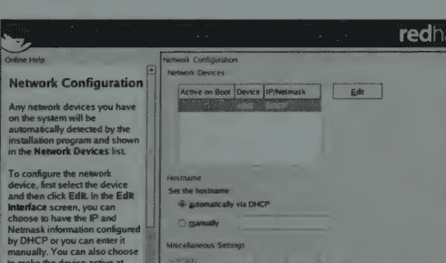


显示 网络配置界面。

- 进行任何更改。点击“下一步”。

- 显示防火墙界面。

- 选择您的防火墙设置。

## 分区选项

在 Red Hat Linux 安装程序中选择分区选项时，您必须决定如何让程序处理硬盘上的任何现有分区。如果您有一个想要替换的现有的 Linux 安装，可以指示安装程序将其删除。如果您正在安装新的 Linux 安装，可以删除硬盘上的所有分区。如果您硬盘上有想要保留的分区，可以保持分区完好，并使用硬盘上的剩余空空间安装 Linux。大多数初次使用 Linux 的用户可能希望完全删除硬盘上的所有分区，并让 Linux 自动对硬盘进行分区。

您可以在自动分区程序将分区过程应用于硬盘之前，选择预览自动分区的结果。

Linux 允许您使用名为引导程序的程序在计算机启动时从多个操作系统和多个版本的 Linux 中进行选择。您可以使用 `GRUB` 或 `LILO` 引导程序，或者使用默认安装的无引导程序。如果您使用 `GRUB` 引导程序仅选择一个操作系统，则应安装 `GRUB` 引导程序以允许您自定义 Linux 系统。

如果您选择安装第三方引导程序，您应该审阅随引导程序安装软件附带的信息。

## 自动分区

显示自动分区界面。

选择您想要的自动分区选项 (Ⓒ)。

点击“下一步”继续。

可能会出现警告提示，说明您正要删除硬盘上的信息。点击“是”继续。

显示引导程序界面。

点击“下一步”继续。

## 启动盘

在安装过程中，你可以创建一个 Linux 启动盘，该启动盘可以帮助你从发生故障的计算机中恢复数据。虽然这是可选的，但建议你创建一个启动软盘以保护存储在计算机中的信息。在许多情况下，如果你的 Linux 系统的硬盘出现问题，启动软盘将是你启动系统或恢复你已有信息的唯一方法。

软盘上的任何信息都将被覆盖；如果你使用的是以前过的软盘，请确保你已对软盘上可能需要的任何数据进行了备份。

启动盘只能允许你访问使用该启动盘的计算机上的 Linux 系统。当你从启动软盘启动时，你将无法使用图形应用程序或图形桌面环境。

要创建启动软盘，你需要一个高密度磁盘和一个被 Linux 安装程序识别的正常工作的软磁盘驱动器。

你应该将启动软盘存储在 Linux 系统之外的地方，以便在发生损坏（如电气问题）时提供某种程度的保护。

出现个人桌面界面，显示了 Linux 建议你安装的项目摘要。

Linux 开始进行安装。如果安装需要额外的 CD-ROM，程序会根据需要提示你插入光盘。

“准备安装”界面

在设置并配置好 Linux 系统后，建议使用启动盘启动系统，以确保启动盘工作正常且你可以访问 Linux 系统。测试启动盘可以确保在实际需要使用之前，启动软盘是正常工作的。

尽管你为每个可以访问的 Linux 系统都有一个启动盘，但你可以使用该启动软盘访问其他计算机上不同版本的 Red Hat Linux。

如果你没有可启动的软盘，可以使用 Red Hat Linux CD-ROM 磁盘 1 以救援模式（`rescue mode`）启动 Linux 系统。有关启动救援模式的更多信息，请参阅第 17 章。

- 软件安装完成后，出现“创建启动盘”界面。
- 选择“是，我想创建一个启动盘 ( ) 更改为 ( )”。
- 点击“下一步”继续。
- 显示磁盘将被擦除的警告信息。
- 启动盘已创建。
- 点击“下一步”继续。
- 将软盘插入磁盘驱动器并点击“制作启动盘”。

## 软件包选择

在你的计算机上安装 Red Hat Linux 时，你可以选择安装不同的软件软件包。在安装 Red Hat Linux 的同时，你还会安装 X 图形界面。X 允许你与包含窗口、图标和其他图像的图形环境进行交互。你可以选择安装 Linux 配合 X 图形环境一起使用的其他图形环境。`GNOME` 是最流行的图形环境，在安装 Red Hat 时会默认安装。`KDE` 是另一个你可以安装的图形环境。如果你同时安装了 `GNOME` 和 `KDE` 软件包，在图形环境中工作时，你可以根据需要在这它们之间切换。

“游戏与娱乐”软件包附带了一些游戏。

Linux 安装程序还允许你创建启动盘。启动盘是一个软磁盘，当计算机出现问题时，它可以帮助你访问 Linux 系统。你也可以安装 Linux 之后创建启动盘。

你的计算机使用视频适配器在显示器上生成图形图像。你必须告诉 Linux 你的计算机使用的是哪种视频适配器，以及视频适配器所需的内存量。

一旦你选择了视频适配器，你就需要指定连接到计算机的显示器。如果列表中没有显示器的精确型号，你可以选择一个与你的显示器尽可能匹配的显示器。

Red Hat Linux 还带有其他可选软件包。例如，如果你打算用计算机进行编程，可以安装相关软件。

安装程序将运行并允许你选择显示器的显示设置。如果检测不到显示器，请选择与连接计算机的适配器最匹配的型号。

你可以输入显示器的同步范围。这些值可以在显卡说明书中找到。输入这些值：如果你输入了超过设备能力的值，可能会损坏你的显示器。仅在提供的字段中输入数字。

如果安装程序提示你选择显卡，你可以在重启后选择另一块显卡。

你也可以选择“跳过安装”并在重启后继续。

| 型号 | 水平频率 | 垂直频率 |
| --- | --- | --- |
| MAG 700 | 1024 | 768 |
| MAG 750 | 1280 | 1024 |
| MAG 800 | | |
| MAG 807A | | |
| MAG 817 | | |
| MAG 830 | | |
| MAG 900 | | |
| MAG 1200 | | |
| MAG 1496 | | |

- Savage30
- Savage32
- SavagePro
- T1S30
- T1S32
- T2V32
- T2V64
- VRG1000
- VRG1500
- VRG12000

- 38 选择你的视频适配器。
- 39 点击显卡 RAM 以选择你显卡上的内存大小。
- 40 点击“下一步”继续。
- 41 出现“显示器配置”界面。
- 42 选择你的显示器类型，然后点击“下一步”继续。

最受欢迎的两个图形桌面环境 `GNOME 2.0` 和 `KDE` 均在 Hat 安装程序中可用。你可以选择安装其中一个或两个桌面环境。

`GNOME` 桌面是 Hat 系统中最流行的图形桌面环境。`GNOME` 桌面功能非常强大，允许你根据喜好进行调整。`GNOME` 还包含了许多工具。有关 `GNOME` 的更多信息，请参阅第 4 章。

`KDE` 是一种外观和行为与 Windows 操作系统相似的桌面环境。`KDE` 还带有一套应用程序，这使其非常受欢迎。有关 `KDE` 的更多信息，请参阅第 5 章。

- 出现“图形配置”界面。
- 点击“色彩深度”选择显示器的色彩深度。
- 点击“下一步”继续。
- 出现“恭喜”消息。
- 点击“退出”重启计算机。

注意：重启后将出现 Red Hat 设置向导帮助你配置。

## 升级

可以将 Red Hat Linux 升级到新版本。全新安装 Red Hat Linux 与升级的区别，当你执行升级时，Linux 会保留系统中的设置和文件（如文档、电子邮件和图形文件）。安装程序会确定当前版本的 Linux 位于计算机的哪个位置。

升级 Linux 时，安装程序可以安装引导加载程序。引导加载程序允许计算机启动多个操作系统。在执行升级时，你可以选择安装新的引导加载程序。

在升级期间，你可以选择想要安装的应用程序和软件包。你也可以在安装 Linux 之后安装新软件包。更多信息请参见第 210 页。

- 1 按照第 2 到第 4 页的步骤 1 到 10 安装 Linux。
- 2 当“安装”窗口出现时，选择“升级现有系统 (O) 更改为 (*)”。
- 3 点击“下一步”继续。
- 4 出现“检查升级”界面。
- 5 点击“下一步”继续。

如果你在系统上更新了单个应用程序，Red Hat Linux 安装程序在安装最新版本的 Linux 时不会更新这些程序。例如，如果你在升级到最新版本的 Linux 时，当前正在使用最新版本的 Mozilla 浏览器，那么 Mozilla 不会更新。只有当应用程序的版本旧于 Red Hat Linux 软件中包含的版本时，它们才会被更新。

你正在升级的 Red Hat Linux 版本可以与你要升级到的 Red Hat Linux 版本相同。使用这种技术可以在修复故障操作系统的同时，尝试保留系统上的数据文件。

在线帮助

在线帮助

即将升级

### 即将升级

您的计算机上可以安装软件引导加载程序。您也可以使用 Red Hat 引导加载程序。如果您使用的是 Windows NT 4.0 或更高版本，将检测到您的加载程序。

**注意：** 一旦您点击“下一步”，安装程序将开始将操作系统写入引导加载程序。如果您决定不安装，这是您可以取消安装的最后一个点。

安装程序检测到 `GRUB` 引导加载程序。您想做什么？

- 更新引导加载程序配置
- 选择引导加载程序版本
- 这将安装一个新的引导加载程序而不是旧的引导加载程序。选择此项。
- 取消
- 将创建一个新的引导加载程序但不会替换您旧的引导加载程序。选择此项。

要删除所有引导加载程序，请使用计算机的重置按钮或使用 `Control Alt-Delete` 重置。

您的选项有：

**配置：** 选择此项以根据您已安装的内容和更新的应用程序，保留当前的 `MBR/L.` 引导加载程序。

**跳过引导加载程序**

勾选此框以跳过引导加载程序的安装。

- 5 选择您想要的引导加载程序配置类型
- 显示“即将升级”屏幕。
- 继续安装 Linux。有关 Linux 安装的更多细节，请参见第 2 到 13 页。
- 显示“升级引导加载程序配置”。
- 7 点击“下一步”继续。
- 点击“下一步”继续。

## 查看硬件配置

如果您需要有关硬件配置的详细信息来帮助排查 Linux 系统的问题，可以查看硬件系统的硬件配置。例如，如果媒体器无法播放您放入 CD-ROM 的音频 CD，您可以查看硬件配置以确定硬件浏览器是否能检测到 CD-ROM。如果硬件浏览器未不到 CD-ROM，则 CD-ROM 可能故障或已断开。

您可以使用硬件浏览器查看计算机各个硬件项的详细信息。例如，您可能想安装一个需要特定类型声系统的新游戏。在安装游戏之前，您可以使用硬件浏览器查看声系统的类型。

当硬件浏览器启动时，它会检查连接到计算机的硬件并收集各个硬件组件的详情。然后您可以查看硬件浏览器收集的详情。硬件浏览器可能需要几分钟来收集计算机信息。在此期间，您不应使用计算机。

硬件浏览器不会检测所有连接到计算机的硬件，例如打印机、外部调制解调器和设备。硬件浏览器通常会检测计算机内部组件，如存储设备以及视频和声系统。

- 点击主菜单按钮。
- 点击系统工具。
- 点击硬件浏览器。

如果您未登录 root 账户，将提示输入 root 账户密码。

- 当 Linux 检查计算机硬件时，会出现一条消息。
- Linux 检查计算机硬件可能需要几分钟。

## 配置硬件

## 附加

如果您想检查硬件浏览器未报告的其它硬件设备的详细信息，可以使用硬件浏览器查看更多细节。例如，您可能想安装一个需要特定类型声系统的新游戏。在安装游戏之前，您可以使用硬件浏览器查看声系统的类型。

当硬件浏览器启动时，它会检查连接到计算机的硬件并收集各个硬件组件的详情。然后您可以查看硬件浏览器收集的详情。硬件浏览器可能需要几分钟来收集计算机信息。在此期间，您不应使用计算机。

硬件浏览器不会检测所有连接到计算机的硬件，例如打印机、外部调制解调器和设备。硬件浏览器通常会检测计算机内部组件，如存储设备以及视频和声系统。

- 点击主菜单按钮。
- 点击系统工具。
- 点击硬件浏览器。

如果您未登录 root 账户，将提示输入 root 账户密码。

- 当 Linux 检查计算机硬件时，会出现一条消息。
- Linux 检查计算机硬件可能需要几分钟。

- 380ca8c2aa7ab52f3066_32_1.

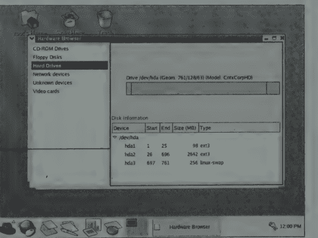

- 5 显示显示设置。
- 4 点击高级选项卡。

## 配置视频类型

如果您想检查硬件浏览器未报告的其它硬件设备的详细信息，可以使用硬件浏览器查看更多细节。例如，您可能想安装一个需要特定类型声系统的新游戏。在安装游戏之前，您可以使用硬件浏览器查看声系统的类型。

当硬件浏览器启动时，它会检查连接到计算机的硬件并收集各个硬件组件的详情。然后您可以查看硬件浏览器收集的详情。硬件浏览器可能需要几分钟来收集计算机信息。在此期间，您不应使用计算机。

硬件浏览器不会检测所有连接到计算机的硬件，例如打印机、外部调制解调器和设备。硬件浏览器通常会检测计算机内部组件，如存储设备以及视频和声系统。

- 点击主菜单按钮。
- 点击系统工具。
- 点击硬件浏览器。

如果您未登录 root 账户，将提示输入 root 账户密码。

- 当 Linux 检查计算机硬件时，会出现一条消息。
- Linux 检查计算机硬件可能需要几分钟。

# 启用或禁用网络设备


某些计算机可能具有多个网络接口。例如，便携式电脑通常有一个网络接口和一个推断的网络接口，后者可用于连接到网络。

网络设备控制程序用于启用或禁用网络设备。网络设备控制程序可以指示网络设备是否处于激活状态。启用或禁用网络设备可能需要几分钟才能完成。

您可以禁用您不需要的网络连接。在不使用连接时保持网络连接开启可能会降低网络效率。

您的计算机可能有一个可以在另一个操作系统中使用的网络连接，但在 Linux 中并不使用。例如，如果您有一台可以在 Windows 和 Linux 之间切换的电脑，您可能只在用 Windows 时使用该网络接口。在这种情况下，您在使用 Linux 时应该禁用该网络接口。

禁用任何网络连接都会增加您的 Linux 操作系统的安全性。当您使用网络连接连接到互联网时，这一点尤为重要，例如网络接口连接到 DSL 或电缆调制解调器时。

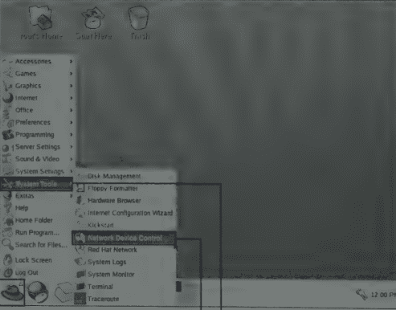

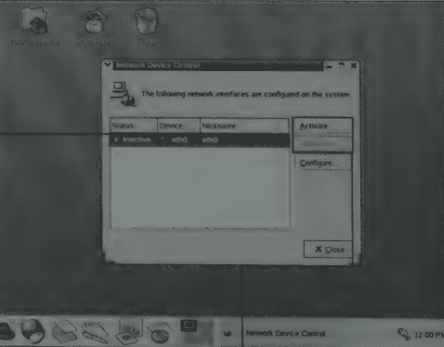

- 1 点击“主菜单”按钮。
- 2 点击“系统工具”。
- 3 点击“网络设备控制”。
- 显示“网络设备控制”窗口。
- 4 选择您想要启用或禁用的设备。
- 5 点击“激活”以启用或点击“停用”以禁用网络设备。

## 配置硬件

## 额外

如果网络接口运行异常，您将无法启用网络设备。新网络设备最常见的问题是硬件配置错误。在安装网络设备时，请务必参考网络设备和您的计算机文档。大多数网络设备都自带相应的配置和诊断软件，使您能够对故障的网络设备进行排除。

某些网络设备自带软件，您可以使用它们来控制、管理以及启用或禁用网络设备。如果您的网络接口带有额外的软件，在确定如何启用或禁用网络设备时，应参考该软件的文档。

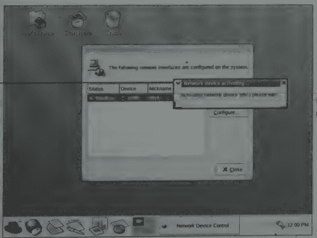

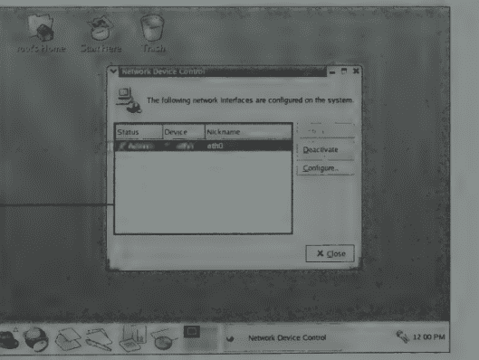

- 可能会出现消息框，指示设备正在启用或禁用。
- “网络设备控制”窗口指示网络设备更改的状态。

## 配置鼠标

您可以更改鼠标的配置以更好地适应您的工作方式。新用户面临的最困难的任务之一是用鼠标按钮执行双击。双击用于执行各种任务，从打开应用程序到重启计算机。您可以调整计算机等待双击的时间，以更好地符合您的需求。

您可以增大鼠标光标的尺寸，使光标更容易可见。这对于视力障碍用户或显示效果不佳的情况（例如在明亮的日光下使用笔记本电脑屏幕）非常有用。您还可以更改光标颜色，使其与背景形成对比，从而更容易查看。

如果您按下鼠标按钮的速度较慢，可以增加延迟，以便更容易使用双击。这对于不熟悉使用电脑的儿童或老年人特别有用。

在更改鼠标配置后，您可能需要注销并重新登录，更改才会生效。

您可以更改屏幕上鼠标光标的大小和颜色。鼠标光标是显示在屏幕上的指针，与鼠标的移动保持协调。

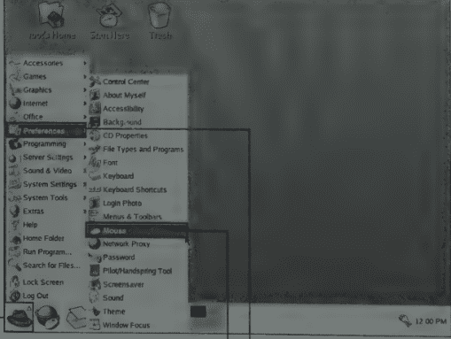

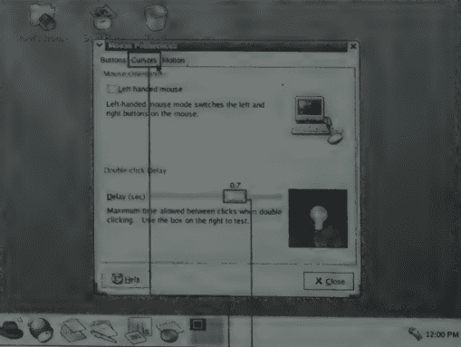

- 点击“主菜单”按钮。
- 点击“偏好”。
- 显示“鼠标偏好”窗口。
- 点击“鼠标”。
- 拖动滑块设置双击速度。
- 点击“光标”选项卡。

## 配置鼠标

## 额外

如果网络接口运行异常，您将无法启用网络设备。新网络设备最常见的问题是硬件配置错误。在安装网络设备时，请务必参考网络设备和您的计算机文档。大多数网络设备都自带相应的配置和诊断软件，使您能够对故障的网络设备进行排除。

某些网络设备自带软件，您可以使用它们来控制、管理以及启用或禁用网络设备。如果您的网络接口带有额外的软件，在确定如何启用或禁用网络设备时，应参考该软件的文档。

## 配置硬件

## 额外

如果网络接口运行异常，您将无法启用网络设备。新网络设备最常见的问题是硬件配置错误。在安装网络设备时，请务必参考网络设备和您的计算机文档。大多数网络设备都自带相应的配置和诊断软件，使您能够对故障的网络设备进行排除。

某些网络设备自带软件，您可以使用它们来控制、管理以及启用或禁用网络设备。如果您的网络接口带有额外的软件，在确定如何启用或禁用网络设备时，应参考该软件的文档。

| 鼠标 | 描述 |
| :--- | :--- |
| USB | 现代鼠标常用的连接类型。 |
| PS/2 | 用于鼠标和键盘的旧连接类型。 |
| Serial | 用于旧设备的连接类型，鼠标不常用。 |

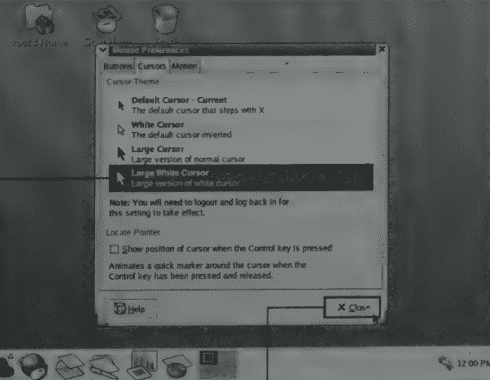

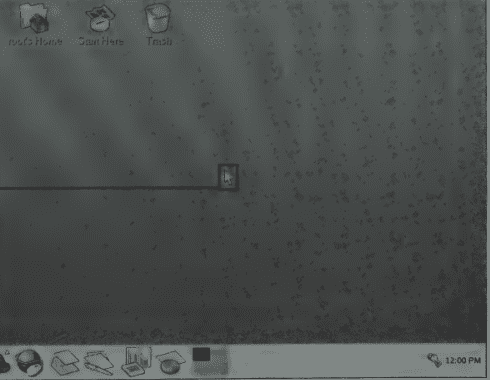

- 选择鼠标类型。
- 点击“关闭”。

## 配置键盘设置

当您打字时，键盘使用某些参数来适应您的需求。当您按住键时，键盘会重复发送字符。您可以调整再次发送信息的延迟。这对于打字困难的人很有用。

插入光标是指示输入位置的垂直线。通常，光标通过闪烁明灭来引起注意。您可以调整插入光标闪烁的频率。

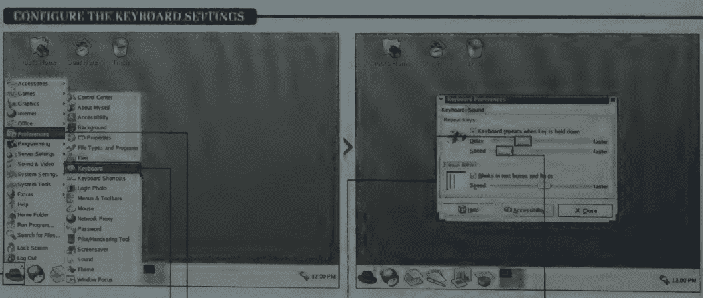

- 1 点击“主菜单”按钮。
- 2 点击“偏好”。
- 3 点击“键盘”。
- 4 拖动滑块设置键盘延迟。
- 5 拖动滑块设置重复速度。

## 配置硬件

## 额外

键盘蜂用于需要在需要时产生声音。产生的声音是通过电脑扬声器输出，而不是键盘本身。遗憾的是，您无法调整蜂声的音量，只能启用或禁用它。

如果某人有影响使用键盘的残疾，可以使用键盘辅助功能来帮助他们更高效地使用键盘。可以通过点击“主菜单”按钮、选择“桌面偏好”，然后选择“辅助功能”来访问键盘辅助功能。

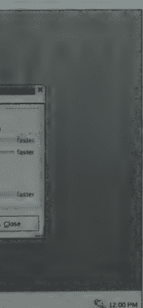

- 6 拖动滑块设置光标闪烁速度。
- 7 点击“声音”选项卡。
- 8 点击启用或禁用蜂声 (O) 更改为 (X)。
- 9 点击“关闭”。新的键盘设置将生效。

# RED HAT LINUX 8

## 添加打印机

你可以使用 Linux 打印文档、图像或任何类型的信息。大多数应用程序都允许你打印信息，例如允许打印网页的 Web 浏览器，或允许打印电子表格数据的电子表格程序。

在打印之前，你必须向你的 Linux 系统中添加打印机。添加打印机会为打印机创建一个打印队列。打印队列简单来说是一个存储发送到打印机信息的文件。打印机打印的任何数据都会通过打印队列。在指定打印队列的详细信息后，Linux 会自动创建并管理打印队列。

你可以使用打印机配置工具向你的 Linux 系统添加打印机。打印机配置工具会显示之前安装过的其他打印机列表。

你必须指定打印队列的名称。你应该尝试让打印队列名称尽可能具有描述性，以帮助识别打印机，特别是当你要与其他共享打印机时。例如，使用 `Colorinkjet` 作为打印名称而不是 `Printer1`。

你可以连接到范围打印机，包括连接到网络上其他计算机的打印机，但常见的配置是创建一个直接连接到计算机的打印机。直接连接到计算机的打印机称为本地打印机，因为它是该计算机的本地设备。

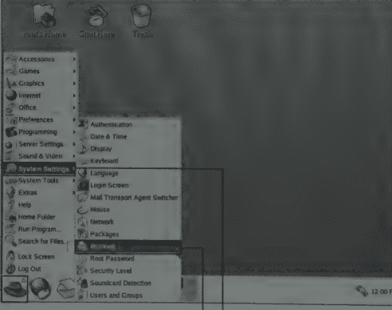

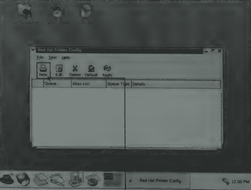

- 1 点击主菜单按钮。
- 2 点击系统设置（System Settings）。
- 3 点击打印（Printing）。
- 显示 Red Hat 打印机配置窗口。

注意：如果你没有使用 root 账户登录，将提示你输入 root 账户密码。

- 4 点击新建（New）。

## 配置硬件

## 额外

你可以使用 Linux 连接五种类型的打印机。如果你正尝试使用连接到网络上另一台计算机的打印机，则必须在另一台计算机上正确配置该打印机。有关向可用网络打印机打印的更多信息，请咨询网络管理员。

| 打印机类型 | 描述 |
|---|---|
| 本地打印机 | 直接连接到计算机的打印机。 |
| Unix 打印机 | 连接到使用 Unix 或 Unix 类操作系统（包括 Linux）的网络上计算机的打印机。 |
| Windows 打印机 | 连接到使用 Windows 操作系统的网络计算机的打印机。 |
| Novell 打印机 | 由 Novell NetWare 操作系统连接并管理的网络打印机。 |
| JetDirect 打印机 | 由 HP JetDirect 网络管理器连接并管理的网络打印机。 |

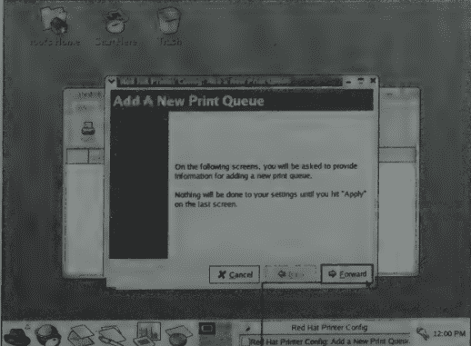

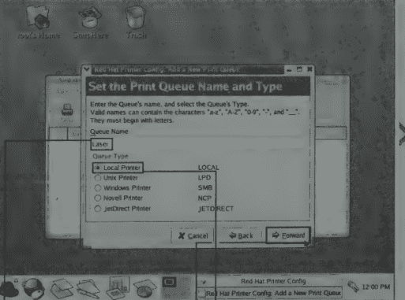

- 显示“新建打印队列”向导。
- 点击下一步（Forward）。
- 输入打印队列名称。
- 点击下一步（Forward）。

# RED HAT LINUX 8

## 添加打印机（续）

在你指定了打印队列名称后，你必须指定打印机将使用的设备。大多数打印机将连接到 Linux 系统上的打印机。你需要指定打印机的品牌和型号，以便确保发送到打印机的信息打印正确。如果你指定了错误的打印机，打印可能会从错误的打印机出来，或者完全不打印。如果你的打印机不在打印机列表中，你可以选择一个与你想使用的打印机相似的打印机。你通常可以无问题地指定比你正在使用的型号早的打印机，但可能无法利用打印机的所有功能。如果你的打印机附带 Linux 软件，请参考打印机文档获取安装说明。

由于信息通过打印机电缆传输方式，因此存在并行端口。许多新打印机还可以通过计算机的 USB 端口连接到计算机。USB 端口位于较新的计算机上。一些旧打印机也使用串口连接到计算机，但这种打印机连接到多台计算机的情况并不常见。例如，打印机可能同时具有并行端口和 USB 端口，因此你可以使用其中一种连接到你的打印机。

将打印机添加到你的计算机后，打印机的名称将出现在打印机配置工具显示的列表中。现在你可以从任何允许打印的应用程序向打印机打印。

每个本地打印机都必须连接到本地计算机上的打印机。大多数打印机连接到一台打印机。大多数计算机有一个、有时有两个端口。打印机端口

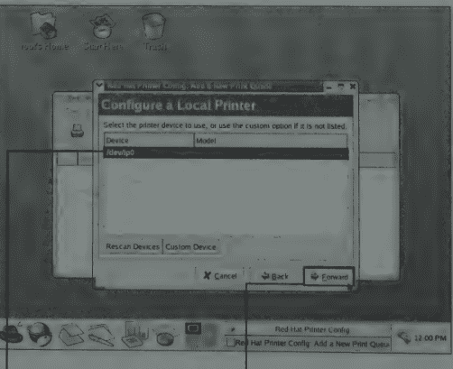

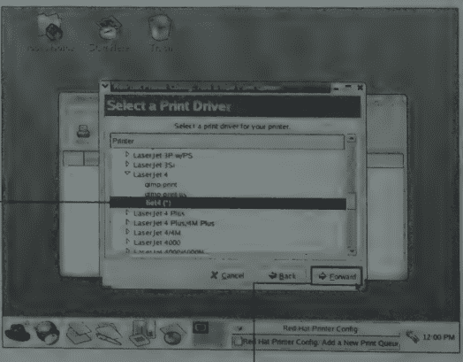

- 9 选择设备名称。
- 10 点击下一步（Forward）。
- 11 选择打印驱动程序。
- 12 点击下一步（Forward）。

## 配置硬件

## 额外

每个本地打印机都必须连接到本地计算机上的打印机。大多数打印机连接到一台打印机。大多数计算机有一个、有时有两个端口。打印机端口也是并行端口，因为信息通过打印机电缆传输方式。许多新打印机还可以通过计算机的 USB 端口连接到计算机。USB 端口位于较新的计算机上。一些旧打印机也使用串口连接到计算机，但这种打印机连接到多台计算机的情况并不常见。例如，打印机可能同时具有并行端口和 USB 端口，因此你可以使用其中一种连接到你的打印机。

| 常见端口 | 描述 |
|---|---|
| `/dev/lp0` | 第一端口 |
| `/dev/lp1` | 第二端口 |
| `/dev/usb0` | USB 端口 |
| `/dev/tty0` | 串口 |

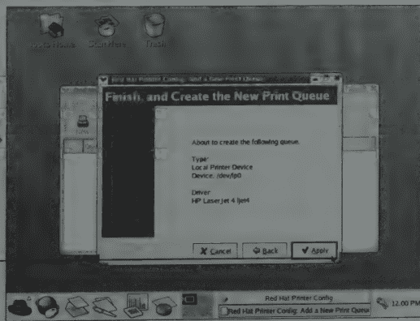

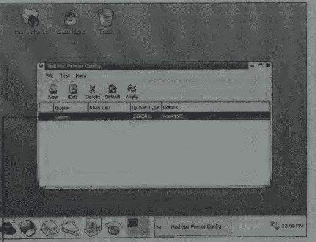

# RED HAT LINUX 8

## 使用文本界面登录

如果你在 Linux 的图形显示上遇到问题，你可以通过更改图形显示使用的设置来修复问题。例如，你可能选择了一个与显示器不兼容的分率。

Linux 系统用于专用任务（如 Web 服务器），不需要 GUI 即可运行。在这些类型的系统中，通常不会安装 GUI，以节省存储空间和资源。与仅使用文本界面的 Linux 系统相比，使用 GUI 需要较多的内存和处理器资源。

在登录 Linux 之前，你必须已经创建了用户名和密码。

- 1 启动计算机。
- 2 输入用户名并回车。
- 3 输入密码并回车。
- 显示登录提示符。

# RED HAT LINUX 8

## 使用图形环境登录

Linux 系统用于专用任务（如 Web 服务器），不需要 GUI 即可运行。在这些类型的系统中，通常不会安装 GUI，以节省存储空间和资源。与仅使用文本界面的 Linux 系统相比，使用 GUI 需要较多的内存和处理器资源。

如果你没有使用 root 账户登录，将提示你输入 root 账户密码。

- 启动图形环境

  输入 `startx` 并回车。

- 显示图形桌面。

## 使用图形化登录界面登录

你可以使用图形化登录登录到 Linux 系统。图形化登录允许使用图像、图标和按钮来登录 Linux 系统。在使用图形化登录之前，你必须已经安装并运行了 X Window 系统。图形化登录与文本登录相同，区别在于你使用的是图形化环境。

登录到任何 Linux 系统都需要使用在系统上创建的有效用户账户。你还必须拥有该账户的正确密码。如果你登录时使用的用户名和密码与 Linux 系统中存在的时不完全一致，你必须重新输入。与 Linux 系统中的大多数文本一样，用户名和密码都是对大小写敏感的。

当你使用图形化登录登录到 Linux 系统时，你在图形化环境内完成的所有任务都将使用你登录时所的用户账户执行。例如，如果你使用用户 Andrew 登录到 Linux 系统，那么你在文字处理器中创建并保存的任何文档都将使用 Andrew 用户所有者标识进行保存。

某些用户账户无法登录到 Linux 系统。Linux 系统创建并使用的许多用户账户用于执行应用程序和服务，这些账户仅能用于该目的。除了 Linux 安装时创建的 root 用户账户外，你应该只使用你自己创建的用户账户登录。

- 启动 Linux 操作系统。
- 登录界面出现。
- 输入用户名并按回车。

## 登录到 Linux 操作系统

## 额外

当 Linux 启动时，它可以向你展示基于文本或基于图形的登录界面。一个名为 `init` 的进程负责决定 Linux 系统使用这两个界面中的哪。你可以通过更改文件 `/etc/inittab` 中的某行来确定是文本登录还是图形化登录。该文件在计算机启动时会被处理。使用文本编辑器打开该文件，其内容如下：

```
id:3:initdefault
```

将该行改为：

```
id:5:initdefault
```

这将在你启动 Linux 时为你提供图形化登录。若要在每次启动 Linux 时都使用文本登录，请将该行更改为 `id:3:initdefault`。

- 输入密码并按回车。
- 你已登录到 Linux 系统。

## 注销 Linux

一旦你完成了 Linux 工作，就可以注销 Linux 系统。注销会导致所有运行中的应用程序关闭。你可以选择在注销时让 Linux 保存当前的设置。Linux 可以保存设置（例如应用程序和窗口大小），并在下次使用相同的保存设置登录时保留这些设置。如果你使用同一组应用程序，保存设置是有用的。

在注销 Linux 之前，你应该关闭已打开的应用程序。先关闭任何打开的应用程序可以确保你在注销时不会丢失任何数据。

如果你在注销时有应用程序开启，该应用程序可能会丢弃它正在使用的任何信息。虽然对于像 浏览器这样可以再次访问数据的应用程序来说并不重要，但对于可能无法保存数据的文字处理或电子表格应用程序来说，这是关键的。某些应用程序可能会自动保存任何未保存的数据，即使你在注销前没有保存信息。

一旦你注销系统，就会出现登录界面，允许你再次登录系统或完全关闭 Linux 系统。你可以使用与注销时使用的相同或不同的用户账户再次登录 Linux 系统。

- 点击主菜单（Main Menu）按钮。
- 点击注销（Log Out）。
- 出现注销（Log Out）对话框。
- 点击注销，图标 ( ) 变为 (◯)。

## 登录到 Linux 操作系统（续）

不要简单地通过关闭电脑来停止使用 Linux，这是重要的。在 Linux 运行期间，即使你没有运行任何应用程序且没有访问任何数据，Linux 仍然打开着许多文件并可能正在访问存储设备。直接关闭 Linux 系统会导致任何保存的打开文件丢失——最坏的情况下，这可能会损坏 Linux 系统上的文件。在关闭电脑之前，请务必正确退出并注销 Linux。

如果你以文本模式登录到 Linux 系统，只需输入注销 Linux 的命令。如果你在使用 `exit` 命令时出现命令提示符，请输入 `exit` 命令。

如果你在退出图形界面时遇到问题，可以尝试通过按下 `Ctrl + Alt + Backspace` 注销并将图形系统重置为优化状态。

- 点击主菜单（Main Menu）按钮。
- 点击注销（Log Out）。
- 出现注销（Log Out）对话框。
- 点击注销，图标 ( ) 变为 (◯)。
- 点击确定。
- 电脑出现。

## 红帽 Linux 8

## 关闭 Linux 系统

你可以从登录界面或从桌面关闭电脑。如果你使用文本控制台（通过 telnet 或终端窗口）登录到 Linux 系统，你可以使用 `shutdown` 命令关闭电脑。

关机系统可以防止数据丢失。在进行维护或当你长时间不再需要访问它时，关闭电脑是有用的。

如果你正在使用网络中的多用户系统，你可能被允许关闭电脑。请联系网络系统管理员获取更多信息。

- 点击主菜单（Main Menu）按钮。
- 点击注销（Log Out）。
- 出现注销（Log Out）对话框。
- 点击关闭电脑（Shut down the computer），图标 (○) 变为 (◎)。
- 点击确定。
- 电脑关闭。

## 重启 Linux 系统


# 重启 Linux 系统

你可以从 Linux 系统内部重启电脑。重启电脑最常见的原因是修复系统正在发生的问题。重启电脑会强制 Linux 重新加载所有运行系统的程序的程序和应用程序。

在你重启电脑后，Linux 系统会再次显示主登录界面。你可以从桌面环境通过“主菜单”重启 Linux 系统。在重启电脑之前，你应该保存任何已打开的应用程序中的信息，否则未保存的数据可能会丢失。

如果你连接了无法自动识别的设备（例如现代设备或 USB 设备），重启 Linux 系统也是有。重启电脑会强制系统搜索每个连接的设备。

你绝不应该通过简单地关闭电源再开启电源来重启电脑。不使用适当的 Linux 流程进行重启可能会导致数据丢失和可能的文件损坏。

你可以从主登录界面或桌面环境重启 Linux 系统。从主登录界面重启电脑不需要使用语言名称或密码。

如果有其他用户登录在你打算重启的电脑上，你应该面对面或通过电子邮件通知他们打算重启的时间。这让用户有机会保存他们正在工作的任何数据。

- 1 点击“系统”（System）。
- 2 点击“重启电脑” ( ) 变为 (⊙)。
- 3 点击“确定”。电脑重启。

## 登录 Linux 操作系统

## 额外

如果你通过 Telnet 或终端窗口使用文本控制台登录 Linux 系统，可以使用 `shutdown` 命令重启电脑。配合 `-r` 选项使用的 `shutdown` 命令会指示 Linux 系统关闭电脑并重启，启动 Linux 时必须指定发生的时间。要在命令行提示符下五分钟后重启电脑，请输入 `shutdown -r` 并按回车。

有时系统变得无响应，你可能无法从 Linux 重启电脑。这可能是由于应用程序故障导致的。当你无法从 Linux 重启电脑时，可以使用电脑的重置或电源按钮重启。使用电源或重置按钮重启电脑可能需要更长时间才能启动，因为它会检查电脑以检测并修复重启时可能产生的任何数据错误。

硬件问题通常在电脑重启时被检测并报告。如果你的电脑正遇到硬件问题（例如键盘故障），在错误纠正之前，电脑可能无法完全重启。许多硬件错误在电脑重启之前可能无法被察觉。

## 从桌面重启

- 点击“主菜单”按钮。
- 点击“注销”（Log Out）。
- 出现“注销”对话框。
- 点击“确定”。
- 电脑重启。
- 点击“重启电脑”（变为 ○）。

## 探索面板

面板是你可以使用它来访问工具、信息和应用程序的界面。桌面是一个图形化环境，你可以用它管理你的 Linux 系统。桌面允许你访问所有应用程序和信息，并管理你访问这些项目的方式，以更好地适应你的工作。

桌面图形环境使用大多数类 Unix 计算机上提供的 X Window 系统来产生图形显示。桌面环境只是你使用的其中一个。安装 Linux 时会默认安装桌面。面板也随图形界面一起安装。

当图形界面启动时，面板显示在屏幕底部。面板包含许多你可以访问的项目。例如，面板包含一个可以快速访问 Mozilla Web 浏览器的图标。面板可以包含显示信息的项目（如日期和时间）以及桌面管理（允许你管理已打开的应用程序）。

你可以通过将鼠标指针悬停在图标上直到弹出窗口来查找桌面上项目的更多信息，窗口会显示关于面板项目的更多信息。工具提示（Tooltips）解释了各种项目的功能。

面板有一个帮助手册，你可以访问它查找有关面板及如何使用面板的最新信息。你可以使用帮助手册更好地了解面板的功能，以及如何配置和使用这些功能。

## 探索面板

## 查看工具提示

- 通过登录启动图形界面。
- 将鼠标光标置在面板上的某个项目上。
- 出现一个描述面板上项目的工具提示。

## 使用图形桌面

## 额外

如果你的电脑没有自动启动图形环境，你可以在命令行启动图形环境。在访问它之前，你必须安装并配置图形桌面。要从命令行启动图形桌面，在登录后输入 `startx` 命令。有关安装和配置图形环境的更多信息，请参见第 1 章。

虽然面板最初看起来易用且非常直观，但它是一个非常复杂的应用程序，当你处理 Linux 和 Linux 应用程序时，它可以提高你的效率和生产力。学习如何利用面板的功能以更好地适应你的工作方式是值得的。

## 查看帮助面板

- 1 在面板的空白区域点击右键。
- 出现弹出菜单。
- 2 点击“帮助”。
出现“使用面板”帮助手册。

## 红帽 Linux 8

## 启动应用程序

你可以使用你的 Linux 系统启动应用程序来执行任务。应用程序是执行特定任务的软件程序。例如，文本编辑器应用程序用于创建、查看和修改文本文件中的信息。你必须在使用之前启动应用程序。启动应用程序的过程被称为“启动”（launching）。通过导航一系列弹出菜单来打开菜单。主菜单的每个菜单都组织成组，相似的项目分在一起。例如，访问互联网的应用程序被分在名为“互联网”的菜单下。这种分组方式让你以更快、更高效的方式访问应用程序。

Linux 带有许多应用程序（例如工具），用于管理电脑，以及用于创建电子表格和图表的生产力软件。应用程序可以是大型复杂的程序（如图像编辑应用程序），也可以是非常小的程序（如显示当前时间的工具）。

你也可以直接从面板上的图标访问应用程序。从面板上的图标启动应用程序通常用于你频繁使用的应用程序，例如 Web 浏览器或文本编辑器。在首次安装 Linux 时，面板上会默认提供某些应用程序。

你可以从面板上的主菜单访问应用程序。取决于应用程序的复杂程度和电脑的系统资源，应用程序启动可能需要一些时间。

## 从主菜单启动文本编辑器

- 从主菜单启动应用程序。
此示例启动了“文本编辑器”应用程序。

## 图形桌面上的操作

## 额外说明

默认情况下，面板包含一些常用应用程序的图标，例如 Mozilla Web 浏览器。你可以移除面板上现有的项目并向面板添加其他项目。有关如何向面板添加条的更多信息，请参阅第 50 页。

当启动启动一个应用程序时，它会在窗口中显示，允许你管理其在显示器上的位置和大小。通常，你可以通过点击窗口右上角的 X 图标来关闭应用程序。

Linux 带有许多应用程序，你可以使用它们来执行各种任务。你也可以安装已购买的或从互联网等源获取的应用程序。红 Hat Linux 包含了软件包管理器（Package Manager）工具，你可以用它直接从 Red Hat 网站获取并安装应用程序。有关如何使用软件包管理器获取和安装应用程序的更多信息，请参阅第 210 页。

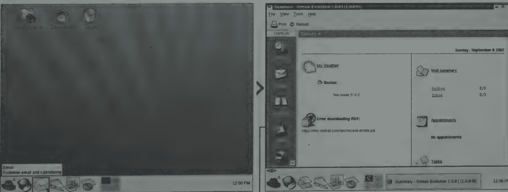

## 启动应用程序面板

- 此示例启动了 Evolution 邮件应用程序。
- 应用程序出现。
- 1 点击面板上代表该应用程序的图标。

## 移动和调整窗口大小

你可以移动或调整应用程序窗口的大小以便更好地管理它。你可以同时执行多个应用程序，在大多数情况下，这些应用程序会重叠。

你可以移动并调整这些应用程序的大小以便更好地显示信息。例如，你可以移动并调整应用程序窗口的大小，以便并排显示文档和电子表格。

某些应用程序在窗口中可能显示部分内容。例如，当你显示网页时，可能只显示其部分内容。你可以调整应用程序窗口的大小，以便查看全部内容。

移动和调整应用程序窗口的能力在很大程度上取决于显示屏的分辨率。分辨率越高，越容易显示多个应用程序窗口。对于大多数用途，你应该使用至少 800 x 600 像素的屏幕分辨率。

你可以在 Linux 系统上启动并执行多个应用程序。当多个应用程序正在运行时，会同时显示多个应用程序窗口。

你还使用面板同时管理多个应用程序的显示和执行。有关更多信息，请参阅第 46 页。

## 移动窗口

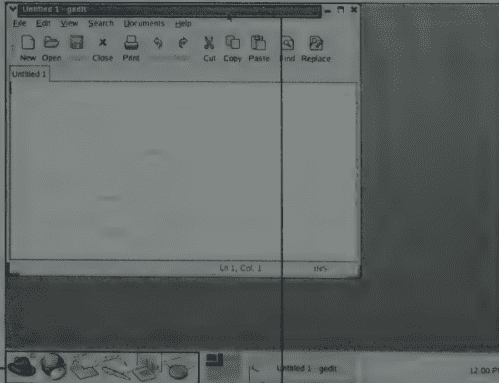

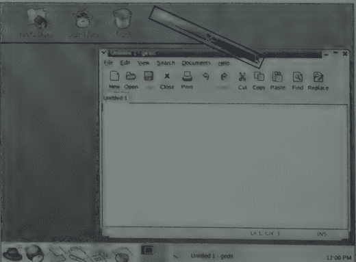

- 1. 启动一个应用程序。
- 2. 将鼠标置在应用程序的标题栏上。
- 3. 点击并拖动窗口到桌面的新位置并释放鼠标按钮。
- 4. 应用程序窗口移动到了新位置。

## 图形桌面上的操作

## 额外说明

大多数应用程序窗口调整和移动涉及将鼠标指针拖到一个新位置。拖动鼠标指针是指点击鼠标按钮、按住鼠标按钮、将鼠标指针移动到新位置，然后释放鼠标按钮的过程。

应用程序窗口顶部有一个标题栏，显示应用程序名称。如果你想快速从显示器中移除应用程序，只需双击标题栏。应用程序将继续运行，但应用程序窗口不再显示。要重新显示该应用程序，再次双击标题栏。

大多数应用程序窗口的右侧和底部都有滚动条。这些滚动条允许你查看窗口中的信息，而无需不断调整大小或移动应用程序。每个滚动条的两端都有箭头，指示移动窗口内容的方向。要滚动查看出现的窗口，只需点击滚动条两端的方向箭头。

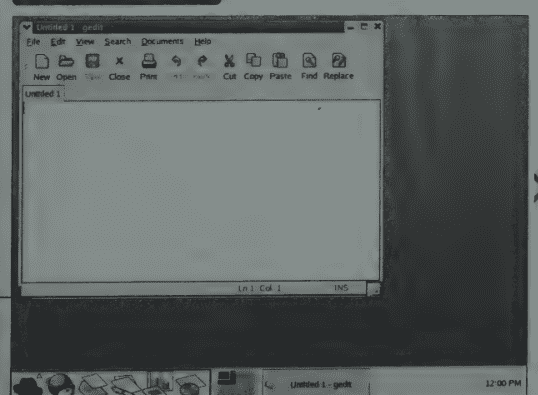

## 调整窗口大小

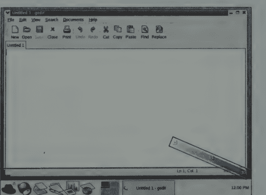

- 1 启动一个应用程序。
- 2 将鼠标置在应用程序窗口的边缘或角上。
注意：如果应用程序已最大化，此步骤将无效，因为你无法触及窗口的边缘。
- 3 拖动窗口边缘调整大小并释放鼠标按钮。
- 窗口以新的大小显示。

## 使用多桌面

你可以使用多个桌面来更好地管理应用程序。同时运行许多应用程序是常见现象。例如，你可能运行一个 Web 浏览器、一个电子邮件程序和一个文字处理器。桌面可能会变得混乱。面板包含一个创建多个桌面的功能，以便你能够更好地管理应用程序。多个桌面允许你打开任意数量的应用程序并将它们放置在不同的区域，这可以简化各个区域之间的切换。例如，你可以在一个桌面上运行互联网应用程序（如电子邮件程序和 Web 浏览器），在另一个桌面上运行生产力应用程序（如文字处理器和电子表格应用程序）。然后你可以在生产力应用程序和互联网应用程序之间快速切换，而无需浏览每个打开应用程序的窗口。

你可以通过选择面板上的图形表示来快速从一个桌面切换到另一个桌面。工作切换器（Workspace Switcher）是运行在面板上的应用程序名称，允许你管理多个桌面。默认情况下，会创建四个桌面区域，你可以用它们管理正在运行的应用程序。你可以创建的桌面数量没有限制。

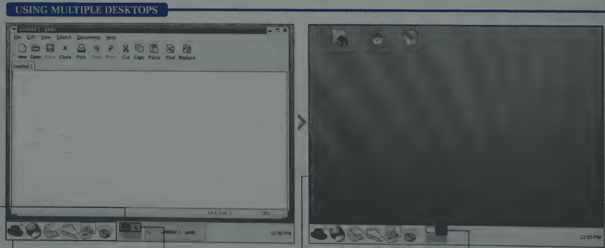

- 1 启动应用程序。
- 应用程序表示出现。
- 点击面板上的图标。
- 新桌面出现。
- 工作切换器高亮桌面。

## 图形桌面操作

## 额外信息

大多数程序都有参数和设置，你可以调整这些设置来更改程序执行的任务或更改程序显示信息的方式。例如，面板上的时钟程序允许你以 12 小时制（如 1:13 pm）或 24 小时制（如 13:13）显示时间。要访问大多数程序的设置，请将鼠标指针悬停在程序上并点击右键。在弹出的菜单中选择“偏好设置”或“属性”，然后选择所需的配置。

面板会记住你对程序所做的任何更改。下次当你重启面板时，对程序所做的任何更改将仍然有效。你更改的程序设置仅适用于你的用户账户。更改或移动程序不会影响其他用户的面板。

你可以向面板添加更多程序。有关向面板添加程序及其他项目目的的更多信息，请参阅第 50 页。

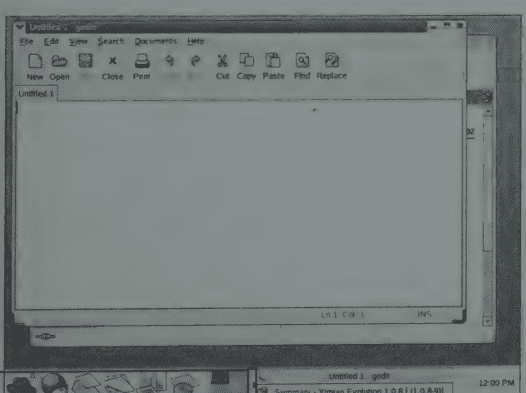

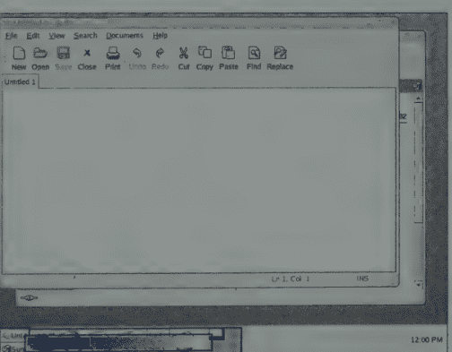

## 移动程序

- 1 将鼠标置于程序旁边的区域并点击。
- 2 将程序拖到面板上的新位置并释放鼠标按钮。
- 程序将移动到新位置。

## 向面板添加对象

你可以通过向面板添加对象来定制该面板。你可以添加各种对象，例如应用程序和专门开发的面板程序。向面板添加程序的第一步是找到你想要添加对象的位置。要添加对象，你需要在右键点击空白区域。如果你右键点击已在面板上的程序或对象，则会显示该对象的菜单，你无法通过该菜单从面板中添加对象。面板的另一个区域可能看起来被一个当前未显示信息的程序所占据。

移除程序只会将该程序从面板中移除，而不会将其从你的 Linux 中中删除。如果你将来再次需要该程序，可以轻松地将其重新添加回面板。

虽然可以在面板上添加许多对象，但只添加你经常使用的对象会更有效。你可以通过其他方法（例如主菜单或终端窗口）访问添加到面板的任何应用程序或实用程序，因此只需添加你频繁使用的对象。

如果你不再使用某个程序，或者你想为面板上的其他程序腾出空间，可以移除该程序。

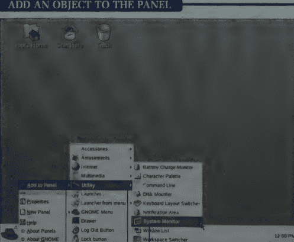

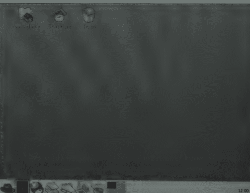

## 添加对象

- 1 此示例向面板添加系统监视程序。
- 2 点击“添加到面板”。
- 3 点击“实用工具”。
- 4 点击“系统监视”。
- 系统监视程序出现在面板中。
- 1 在面板的空白区域置点并点击右键。

## 图形桌面操作

## 额外信息

Linux 自带了许多流行的程序，你可以快速将它们添加到面板中。

你可以通过向面板添加启动器来向面板添加应用程序：右键点击面板以面板添加启动器，选择“添加到面板”，然后选择“启动器”。当对话框出现时，在“命令”区域指定用于运行应用程序的命令。你也可以通过点击“图标”区域并选择图标来为启动器选择图标。在“名称”区域输入应用程序的类型名称，然后点击“确定”按钮。

| 程序类型 |  |
|---|---|
| 娱乐 | 游戏、益智以及简单的动画程序 |
| 实用工具 | 监控 Linux 系统特定特征的程序 |
| 多媒体 | 用于访问不同媒体类型的流行程序 |
| 时钟 | 不同的时钟程序 |

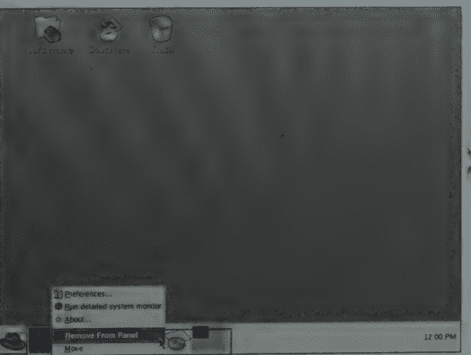

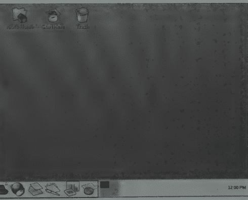

弹出一个菜单。
该对象被移除。

## 移除对象

- 1. 右键点击你想要移除的对象。
- 2. 点击“从面板移除”。

## 添加抽屉

你可以向面板添加抽屉（Drawer）来组织你想要添加到面板的对象。添加抽屉就像为你的计算机添加一个额外的面板一样。任何可以添加到面板的对象都可以添加到抽屉中。

在面板上使用抽屉允许你将对象分组。例如，你可以创建一个包含系统监视程序的抽屉，允许你监控 Linux 系统的状态；你还可以使用另一个抽屉来显示你用于播放音频和视频文件的多媒体程序。

向面板添加抽屉允许你对使用的对象进行分组。如果你有许多程序，面板可能不够大。通过使用抽屉，你仍然可以访问面板上的对象。抽屉的宽度和高度由你添加的对象决定。创建抽屉后，你可以向其中添加对象。有关添加抽屉的更多信息，请参阅第 50 页。

## 添加抽屉

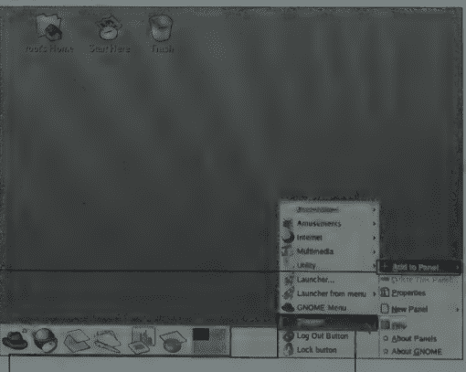

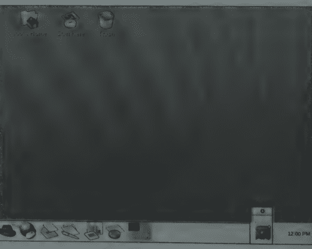

- 1 在面板的空白区域置点并点击右键。
- 2 点击“添加到面板”。
- 3 点击“抽屉”。

## 图形桌面操作

## 额外信息

如果你有许多程序，面板可能不够大。通过使用抽屉，你仍然可以访问面板上的对象。抽屉的宽度和高度由你添加的对象决定。创建抽屉后，你可以向其中添加对象。有关添加抽屉的更多信息，请参阅第 50 页。

- 1 在面板的空白区域置点并点击右键。
- 2 点击“添加到面板”。
- 3 点击“抽屉”。

## 红帽 Linux 8

## 隐藏面板

你可以通过隐藏面板来增加显示器上可以使用区域。面板本身并不大，但当你隐藏它时，应用程序可以全尺寸显示。

在隐藏面板之前，你需要在“属性”中选择“显示隐藏按钮”选项。激活此隐藏面板的功能后，你可以随时隐藏它。

面板的大小是由你当前使用的分辨率决定的。如果你使用的是较高的分辨率（例如 1280x1024 像素），你将比低分辨率（例如 640x480 像素）的用户更大的区域。

隐藏面板是通过使用位于面板两端的隐藏按钮来实现的。当面板隐藏时，也会显示一个隐藏面板按钮。

你可能仅仅因为不常用面板而想隐藏它。还有其他方法从面板访问应用程序和信息。

面板隐藏后，面板右下角显示一个小小的隐藏按钮。要重新显示面板，必须使用隐藏按钮。隐藏面板不会更改面板显示的任何信息。当你重新显示面板时，所有信息都将保持完整。

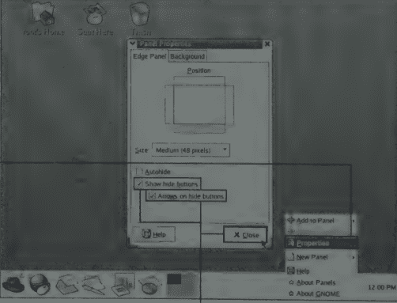

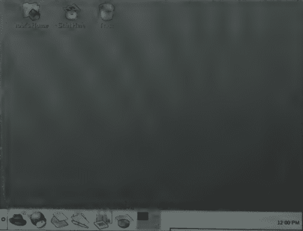

- 1. 右键点击面板并点击弹出菜单中的“属性”。
- 2. 点击“显示隐藏按钮”。
- 3. 点击隐藏按钮上的箭头。
- 4. 点击“关闭”。
- 面板属性对话框出现。
- 隐藏按钮出现。
- 点击一个隐藏按钮。

## 使用图形化桌面

## 额外

你还可以设置面板在不访问时自动隐藏。这样你就可以避免在需要时手动隐藏和取消隐藏面板。要启用面板的自动隐藏，请右键点击面板并选择“属性”。在弹出的“面板属性”对话框中，点击“自动隐藏”（Auto Hide），然后点击“关闭”按钮。面板将被隐藏。要重新显示面板，请将鼠标指针移动到显示器底部，直到面板重新出现为止。当你将鼠标指针移出面板时，面板将再次隐藏。

你可以通过在面板两侧的隐藏按钮上放置小型箭头图标，让这些按钮变得更容易可见。若要在隐藏按钮上放置箭头，请右键点击面板并选择“属性”。在弹出的“面板属性”对话框中，点击“自动显示隐藏按钮”（Auto and Hide Buttons），然后点击“关闭”按钮。箭头将出现在隐藏按钮上，面板的宽度会增加。隐藏按钮的高度始终与面板本身的高度相同。

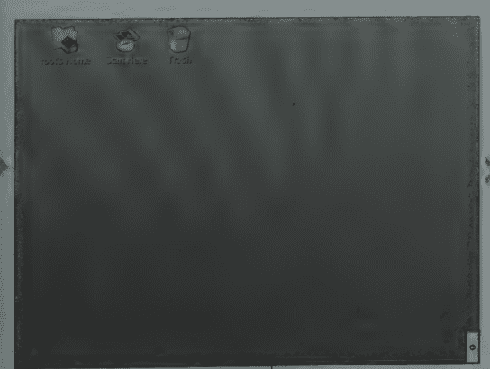

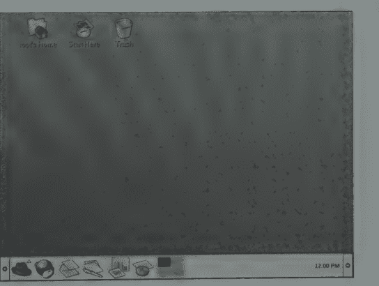

- 面板已隐藏。
- 点击隐藏按钮。
- 面板重新出现。

## 创建新面板


你可以创建新面板来更好地管理你的小程序和信息。根据你所的工作类型以及你访问应用程序和信息的方式，你可能需要使用许多面板。系统管理员可能需要包含各种实用程序和工具的面板，而家庭用户可能希望将所有的娱乐和游戏程序包含在单个面板中。你可以使用简单的方法创建许多面板。

当隐藏时，与对齐面板一样，面板的长度由其包含的对象的大小决定。浮动面板是从显示器侧边延伸到显示器中心附近的面板。菜单面板是放置在显示器顶部的面板，其功能与许多应用程序中的菜单类似。

你可以向图形化桌面添加五种类型的面板。边缘面板（edge panel）是位于显示器顶部、底部或任一的面板。对齐面板（aligned panel）根据其包含的对象的数量和类型来确定尺寸。滑动面板（sliding panel）在桌面上显示隐藏按钮，而不是在屏幕侧边。

当你创建一个新面板时，它可能不包含任何对象。你必须向新创建的面板添加对象。有关如何向面板添加对象的更多信息，请参阅第 50 页。

当激活隐藏按钮时，某些面板（例如角面板）会自动创建。有关隐藏和取消隐藏面板的更多信息，请参阅第 54 页。

## 创建新面板

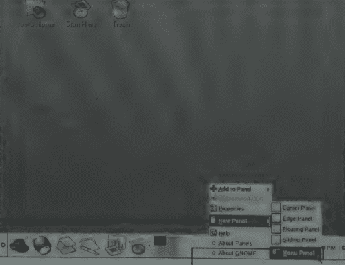

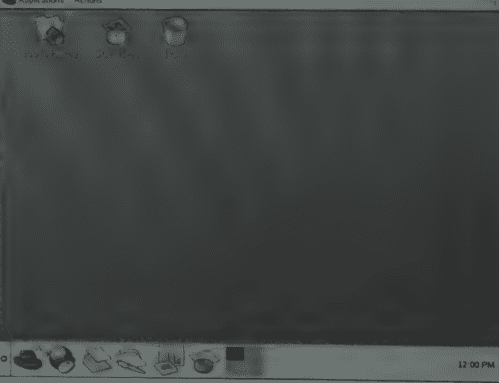

## 创建菜单面板

1. 右键点击面板并在弹出菜单中““新建”（New Panel）。
2. 点击“菜单面板”（Menu Panel）。

新的菜单面板出现在显示器顶部。

## 使用图形化桌面

## 额外

默认情况下，显示器左上角创建一个新的角面板。面板创建后，你可以为角面板选择不同的位置。要为角面板选择新位置，请右键点击面板并选择“属性”。打开“面板属性”对话框。在“尺寸和位置”区域，选择面板的新位置并点击“关闭”。

每个面板可以使用不同的背景颜色，以便更好地区分彼此。若要为面板指定新颜色，请右键点击面板，选择“属性”，然后选择“背景”（Background）选项卡。在“背景类型”选项中选择“颜色”（Color），并在“颜色使用”（Color Use）选项中选择一种颜色。点击“关闭”关闭“面板属性”对话框并应用新颜色。

大多数面板允许你更改面板尺寸，以更好地适应你将添加到面板中的对象。要更改面板尺寸，请右键点击面板并选择“属性”。在“尺寸和位置”区域，为面板尺寸指定新尺寸并点击“关闭”。

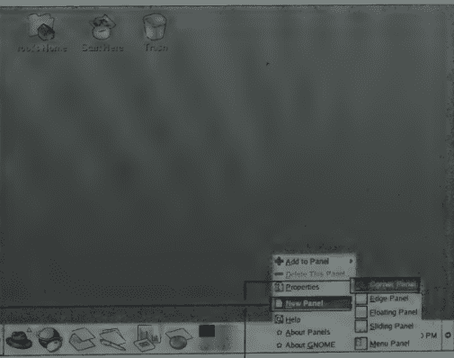

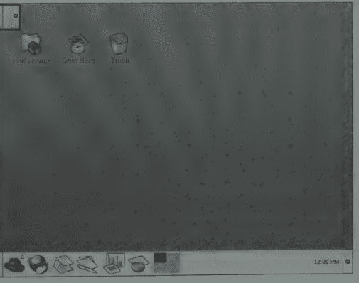

## 创建角面板

1. 右键点击面板并在弹出菜单中点击“新建”（New Panel）。
2. 点击“角面板”（Corner Panel）。

新的角面板出现在显示器顶部。

## RED HAT LINUX 8

### 更改主题

你可以更改图形化桌面的外观，以更符合你的个人喜好。更改桌面外观最快的方法是选择新主题。主题是设置和配置选项的集合，你可以将其应用到对话框、窗口和菜单等各种项目上。

你可以根据个人喜好或出于实用考虑更改主题。主题提供了许多可供选择的。主题会更改桌面的外观，包括窗口和菜单。主题是设置和配置选项的集合，你可以将其应用到对话框、窗口和菜单等各种项目上。

主题会更改桌面的外观，包括窗口和菜单。主题是设置和配置选项的集合，你可以将其应用到对话框、窗口和菜单等各种项目上。

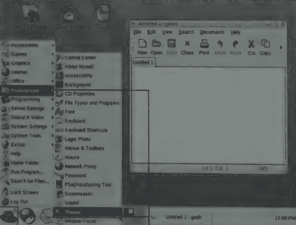

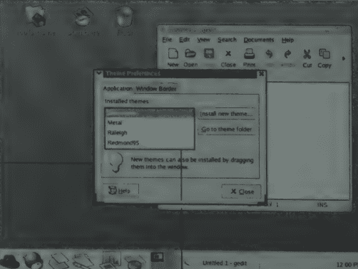

1. 点击“主菜单”（Main Menu）。
2. 点击“偏好”（Preferences）。
3. 点击“主题”（Theme）。

出现“主题”对话框。

## 使用图形化桌面

## 额外

你可以更改图形化桌面上使用的图像以匹配你的选择。要更改桌面使用的图像，点击“主菜单”，然后选择“偏好”和“背景”（Background）。在“背景”对话框中，选择你想使用的图像并点击“确定”。

要获取新主题，你可以从万维网安装。获取主题后，可以通过“主菜单”、选择“偏好”和“主题”来安装。在“主题”对话框中，点击“安装新主题”（Install New Theme），选择文件名并点击“安装”。现在你可以从主题列表中选择该主题了。

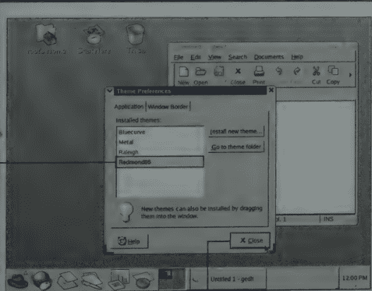

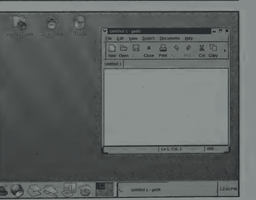

4. 点击你想要应用的主题。
5. 点击“关闭”。

“主题偏好”窗口根据所选主题进行更新。

主题已应用到图形化桌面。

## 使用图形化桌面

## 额外

当你在 Nautilus 中点击代表文件的图标时，即使是文件管理器也会显示该目录的内容。无论 Nautilus 当前显示哪个目录，你都可以快速返回到主目录。要让 Nautilus 显示你的用户主目录内容，请点击 Nautilus 文件管理器主菜单栏上的“主目录”按钮。

默认情况下，Nautilus 以图标形式显示项目。要一次显示更多项目，你可以以列表形式查看项目。点击“以列表形式显示图标”。要切换回图标视图，点击“以列表形式显示”按钮并选择“以图标显示”。

如果你知道想要工作的目录名称和路径，可以快速让 Nautilus 显示其内容。在文件管理器的“位置”区域输入目录名称（包括目录的全路径），然后按回车。

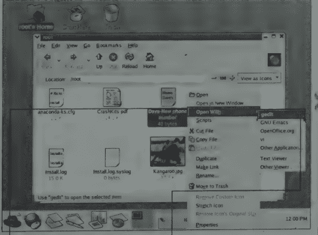

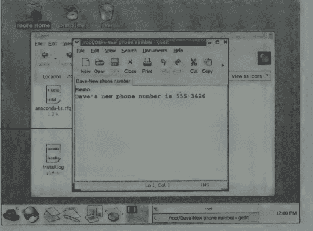

- 在文件管理器中的项目上点击右键，并在弹出菜单中点击“打开方式”。
- 点击要打开该文件的应用程序。
- 文件将在选定的应用程序中打开。

## 使用 NAUTILUS 创建新目录

除了使用 Nautilus 文件管理器访问信息和目录外，你还可以使用它来创建目录。当 Nautilus 文件显示目录和信息时，该目录被称为“文件夹”。文件夹和目录是同一个东西——你可以交替使用“文件夹”和“目录”这两个术。

在其他目录内。你在另一个目录内创建的任何目录都称为“子目录”。

目录用于在相同位置存储相关信息。例如，你可能想创建一个目录来存储所有的文本文档，以便于查找和管理。

在你创建目录后，你可以使用 Nautilus 文件管理器显示其内容，从而在该目录中进行工作。新创建的目录不会包含任何内容。

每个目录必须分配一个名称，你可以在创建时指定该名称。你可以在此处创建

Linux 系统上的每个用户都受文件和目录权限的限制，以允许或限制目录的创建。你必须对你的用户账户和当前目录拥有相应的权限才能创建目录。有关文件和目录权限的更多信息，请参阅第 19 章。

## 使用 NAUTILUS 创建新目录

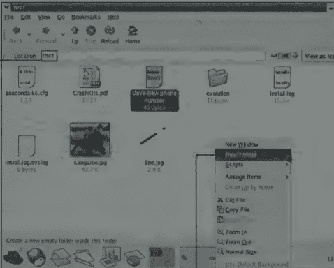

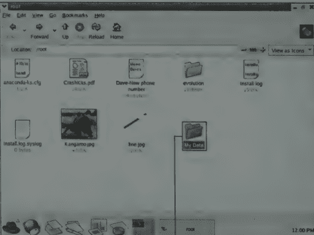

- 1 启动 Nautilus 文件管理器。
- 2 输入你要工作的目录名称并按回车。
- 3 在目录区域的内容上点击右键，并在弹出菜单中点击“新建文件夹”。
- 4 出现一个文件夹图标。
- 5 输入新目录的名称并按回车。

## 使用图形化桌面

## 额外

当你创建一个新目录且未为其指定名称时，Nautilus 将为其分配一个默认名称。你可以更改目录的默认名称以更好地描述其内容。右键点击目录的文件夹图标并选择“重命名”。输入目录的新名称并按回车。你应该只更改你创建的目录名称；不要更改由 Linux 创建的目录名称，否则可能会导致计算机出现故障。

对于 Nautilus 显示的任何图标，你都可以增大或减小文件夹图标的大小。要更改图标大小，右键点击文件夹图标并选择“拉伸图标”。然后你可以点击并拖动图标。要将图标大小恢复为默认大小，右键点击调整大小后的文件夹图标并选择“还原图标原始大小”。

你可能同时打开多个 Nautilus 文件管理器的实例，这使得处理多个目录变得更加容易。要在 Nautilus 文件管理器的新实例中显示目录内容，右键点击该目录的文件夹图标并选择“在新窗口中打开”。


- 目录已创建。
- 点击新目录图标。
- Nautilus 显示新目录的内容。

## 红帽系统 LINUX 8

## 使用 NAUTILUS 文件管理器复制文件

你可以使用 Nautilus 文件管理器将文件从一个目录复制到另一个目录。将文件从一个目录复制到另一个会在目标目录中创建该文件的完全副本。

Nautilus 允许你在计算机内存中存储一个文件的副本。然后你可以使用 Nautilus 导航到想要复制文件的目录，并在目标目录中创建文件的副本。

你可以复制任何类型的文件，包括音频文件、文档和目录。当你复制目录时，其所有内容（包括子目录及其内容）都将复制到目标目录。

当你使用 Nautilus 复制文件时，复制的文件名与原文件名相同。你不能将文件复制到原文件所在的相同目录。你只能将文件复制到不包含与原文件同名的目录中。

你可能复制通常无法修改的文件，然后修改该文件的副本。例如，Linux 系统中的许多文件可以以任何方式进行修改或更改，root 账户（系统管理员使用的账户）除外。如果你可以读取文件但无法修改文件，可以将该文件复制到你的主目录，然后修改该副本。复制文件和修改复制文件的内容对原始文件（或源文件）没有影响。


- 1 打开包含你要复制文件的目录。
- 2 在你要复制的文件上点击右键，并在弹出菜单中点击“复制文件”。
- 3 导航到你想要复制文件的目录。

## 使用图形化桌面

## 额外

如果你在复制文件时想删除原始文件，可以移动文件而不是复制它。要移动文件，右键点击文件图标并选择“剪切文件”。导航到目标目录，在目录的空白区域点击右键并选择“粘贴文件”。

你可以一次复制多个文件，以提高处理大量物品的效率。要使用 Nautilus 选择多个项目，请按住 Ctrl 键并点击你想复制的每个项目。要复制每个项目，当选中时，图标下方的图标和名称将变为高亮。要复制选中的文件，右键点击选中的任意项目并选择“复制文件”。导航到目标目录，在目录的空白区域点击右键并选择“粘贴文件”。


在目录的空白处点击“粘贴文件”。

复制的文件出现在目标目录中。

## 更改 NAUTILUS 的外观

你可以根据需要和个人喜好更改 Nautilus 文件管理器的外观。你可能希望比 Nautilus 安装时分配的默认颜色和纹理更有吸引力。

Nautilus 在主面板中显示信息，分为两个面板。左面板显示信息，右面板（视图面板）显示项目。

在某些情况下，你可能为了实用或功能目的而更改 Nautilus 文件管理器的外观。例如，如果你在强光下或使用笔记本设备，可能会发现高对比度配色更容易查看。

你可以更改 Nautilus 屏幕部分。你可以选择分配图案（类似于图像），或者简单为屏幕部分分配纯色。你可以在应用之前预览图案和颜色的小样本。一旦选择颜色并分配给区域，该区域将立即填充该颜色。为区域分配图案或颜色不会影响 Nautilus 在该区域提供的任何图标或其他信息。

你对 Nautilus 文件管理器外观的任何更改仅适用于当前登录的用户账户，即使是 root 账户也是如此。每个用户都从 Nautilus 的默认外观开始，无论其他用户做了任何更改。

## 更改 NAUTILUS 的外观


- 1 点击“编辑”。
- 2 点击“背景和徽章”。
- 3 弹出“背景和徽章”窗口。
- 4 点击一种图案并将指针拖到你想更改的文件管理器区域上。
- 图案已应用。

## 额外

如果您更改了任何区域的颜色或模式，可以恢复到首次安装 Nautilus 时分配的默认颜色或模式。要将区域恢复到原始设置，请在“背景和徽章”（Backgrounds and Emblems）对话框中选择颜色或模式显示的重置图标，然后将其拖到您想要恢复原始设置的区域。

您还可以为项目图标分配小型图形（称为徽章，emblems），以为其提供额外信息。例如，您可以为新创建的文件分配“新建”（New）徽章。从“背景和徽章”对话框中，将任何徽章拖到您想要分配的项目上。要删除徽章，右键点击该徽章，选择“属性”，然后点击“徽章”选项卡。取消勾选想要删除的徽章并点击“关闭”。

除了 Nautilus 使用的面板外，即使 Nautilus 未运行，您也可以更改桌面背景。要更改桌面背景，请从“背景和徽章”对话框中选择模式或颜色，并将颜色或模式拖到桌面上的空白区域。


## 应用颜色

- 点击“颜色”（Colors）。
- 出现颜色选择面板。
- 点击一个颜色样本，并将指针拖到您想要更改的文件管理器区域。
- 点击“关闭”（Close）。
- 新外观已应用到 Nautilus 文件管理器。

## 红帽 Linux LINUX 8

## 删除项目

您可以使用 Nautilus 移除不再需要的项目。删除不需要的项目可以提高计算机上文件和目录的易管理性，并释放如硬盘存储之类的资源。

由于垃圾桶（Trash）包含您计算机上某个文件夹中的项目，垃圾桶中的项目越多，它占用的存储介质空间就越大。您应该定期清空垃圾桶以释放存储介质上的空间。如果您删除了大项目（例如视频文件），您可能想在删除文件后立即清空垃圾桶以释放空间。

当您移除项目时，该项目会被放置在一个名为*垃圾桶*（Trash）的特殊文件夹中。您可以通过桌面上的垃圾桶图标访问该文件夹。垃圾桶是项目在从计算机上永久删除之前的临时存放区域。

当您将项目放入垃圾桶时，桌面上的图标会代表这一变化。当垃圾桶文件夹中没有项目时，垃圾桶图标显示为空空垃圾篮。当垃圾桶文件夹中包含项目时，图标将变为带有纸的空垃圾篮。即使垃圾桶文件夹中只有一个小项目，垃圾桶图标也会发生变化，指示垃圾桶文件夹中有项目。

在您将项目放入垃圾桶后，它会一直存在，直到您清空垃圾桶。清空垃圾桶意味着您将永久删除垃圾桶中的任何项目。清空垃圾桶后，您将无法找回文件夹中的任何项目。在清空垃圾桶之前，您必须确保再也不会需要垃圾桶中的任何项目。

## 删除项目


1. 右键点击您想要删除的项目。
2. 在弹出菜单中点击“移动到垃圾桶”（Move to Trash）。
3. 项目在视图面板中消失。
4. 垃圾桶图标发生变化，指示垃圾桶文件夹内包含项目。

## 使用图形桌面

## 额外

如果您已将项目移动到垃圾桶，在需要再次访问该项目时，可以恢复该项目。由于垃圾桶文件夹与其他任何文件夹一样，您可以像处理其他文件夹一样从垃圾桶文件夹中复制项目。要从垃圾桶文件夹中恢复项目，双击击垃圾桶图标，然后右键点击您想要恢复的项目。使用 Nautilus 文件管理器导航到您想要恢复文件的目录，右键点击视图面板，并选择“粘贴文件”（Paste Files）。在清空垃圾桶后，您无法从垃圾桶中恢复项目。

如果垃圾桶图标出现在 Nautilus 文件管理器旁边，您可以通过将项目从 Nautilus 视图面板拖动到桌面，轻松地将项目放入垃圾桶文件夹。您可以将多个项目移动到垃圾桶。

## 清空垃圾桶


1. 右键点击“垃圾桶”（Trash）。
2. 点击“清空”（Empty）。
3. 出现一个对话框。
4. 点击“清空”（Empty）。

垃圾桶图标发生变化，指示垃圾桶已空。

## 红帽 Linux LINUX 8

## 配置屏幕保护程序

您可以使用屏幕保护程序在不在位时隐藏信息。屏幕保护程序通常是图像或动画。您可以使用屏幕保护程序来隐藏敏感信息。

屏幕保护程序会在指定时间通过后启动……Linux 会监控键盘和鼠标等设备的使用情况，以判断计算机是否正在使用。每当人与计算机交互时，激活屏幕保护程序的时间就会重置。

您可以通过要求用户名和密码来增加屏幕保护程序提供的安全性。尽管您需要用户名和密码才能取消屏幕保护程序，但这可能无法完全用户访问您的计算机。用户仍然可能重启您的计算机……Linux 可以使用许多不同的屏幕保护程序。有些屏幕保护程序使用简单的图形，而另一些使用复杂的设计。

## 配置屏幕保护程序


1. 点击“主菜单”（Main Menu）。
2. 点击“偏好”（Preferences）。
3. 点击“屏幕保护程序”（Screensaver）。
4. 出现屏幕保护程序设置对话框。
5. 设置启动屏幕保护程序的空闲时间。
6. 点击启用使用密码取消屏幕保护程序。
7. 点击选择“仅屏幕保护程序”（Only One Screensaver）模式。
8. 点击“设置”（Settings）配置屏幕保护程序。


## 使用图形桌面

### 额外

屏幕保护程序会在指定时间通过且计算机未被使用后启动。Linux 会监控键盘和鼠标等设备的使用情况，以判断计算机是否正在使用。每当人与计算机交互时，激活屏幕保护程序的时间就会重置。

某些复杂的屏幕保护程序消耗大量的计算机资源（如内存或处理器占用），在执行需要充分利用计算机资源的长时间任务时，您可能禁用屏幕保护程序……


1. 出现屏幕保护程序设置选项。
2. 点击“确定”（OK）。
3. 设置屏幕保护程序的任何所需选项。
4. 点击“关闭”（Close）。

在第4步中指定的空闲时间后，屏幕保护程序启动。

# 红帽 LINUX 8

## 设置初始 KDE 选项

KDE 桌面环境 `KDE` 是一种图形化桌面环境，你可以用它代替默认的 `GNOME` 桌面环境。当你首次使用图形界面登录 Linux 时，就会启动 KDE。有关如何登录 Linux 计算机的更多信息，请参阅第 30 页。在开始之前，你必须安装 KDE。安装 KDE 最简单的方法是在安装 Linux 的时候进行安装。关于安装 KDE 的更多信息，请参阅第 2 页。在安装 KDE 之后，你可以使用软件包管理器安装 KDE。关于软件包管理器的更多信息，请参阅第 208 至 211 页。

KDE 可以使用各种特效来让操作系统更具视觉吸引力。KDE 使用诸如增强字体外观、菜单淡入和预览窗口等功能。遗憾的是，这些功能需要更多的处理能力来实现。如果你的计算机处理器较慢，你可以调整 KDE 使用这些视觉功能数量。如果你的计算机拥有性能强大的处理器，你可能可以在不明显降低性能的情况下实现所有这些功能。

不同的操作系统有不同的行为。例如，某些操作系统只需单击图标即可启动应用程序，而另一些操作系统则需要双击图标来启动应用程序。你可以调整 KDE 的行为，使其与你最熟悉的操作系统保持一致。

KDE 像默认的 `GNOME` 桌面一样，使用一组主题来更改 KDE 桌面的外观。每个主题都会更改背景、标题栏和鼠标指针等项目的外观。你可以在 KDE 启动时选择你想要的主。


- 1 点击主菜单按钮。
- 2 点击“额外”`Extras`。
- 3 点击“偏好设置”`Preferences`。
- 4 点击“桌面设置向导”`Desktop Settings Wizard`。
- 5 出现桌面设置窗口。
- 6 点击并选择一种语言。
- 7 点击“下一步”。

### 额外信息

在登录 Linux 之前，你可以选择想要使用的桌面环境。在这里你可以指定想要使用 KDE 桌面环境。在主登录界面上，点击“系统”`System`然后点击“KDE”。随后的登录中无需再次选择 KDE，因为 Linux 会使用你上次使用的桌面环境。

每次登录 Linux 时，你可以在不同的桌面操作系统之间来切换。你对桌面环境的选择取决于你安装了哪些桌面环境。从 KDE 可以访问某些应用程序在其他桌面环境中无法访问，因此如果你在桌面环境之间切换，你可能无法使用相同的应用程序。你可以在 KDE 内部切换不同的桌面。


出现“系统行为”。

- 选择你偏好的系统行为 `O` 更改
- 点击“下一步”。

出现“视觉效果计 `Eyecandcy-O-Meter`”屏幕。

- 将滑块移动到所需位置。
- 点击“下一步”。

# 红帽 LINUX 8

## 设置初始 KDE 选项（续）

在 KDE 中，你可以使用一个名为 `Kicker` 的面板来控制对应用程序和工具的访问。在功能和设计上类似于 GNOME 面板。该面板在信息和设计上与 GNOME 面板相似，请参阅第 40 页。在 KDE 面板上，你使用图标启动应用程序。你可以调整面板上出现的图标数量。拥有强大处理器的计算机可以在不明显降低性能的情况下实现所有这些功能，而处理器较慢的计算机可以调整 KDE 使用这些视觉功能的数量。

不同的操作系统有不同的行为。例如，某些操作系统只需单击图标即可启动应用程序，而另一些操作系统则需要双击图标来启动应用程序。你可以调整 KDE 的行为，使其尽可能与你最熟悉的操作系统保持一致。

KDE 像默认的 `GNOME` 桌面一样，使用一组主题来更改 KDE 桌面的外观。每个主题都会更改背景、标题栏和鼠标指针等项目的外观。你可以在 KDE 启动时选择你想要的主。


出现“系统行为”。

- 选择你偏好的系统行为 `O` 更改
- 点击“下一步”。

出现“视觉效果计 `Eyecandcy-O-Meter`”屏幕。

- 将滑块移动到所需位置。
- 点击“下一步”。

## 设置初始 KDE 选项（续）


- 点击并选择一种语言。
- 点击“下一步”。

### 额外信息

在登录 Linux 之前，你可以选择想要使用的桌面环境。在这里你可以指定想要使用 KDE 桌面环境。在主登录界面上，点击“系统”`System`然后点击“KDE”。随后的登录中无需再次选择 KDE，因为 Linux 会使用你上次使用的桌面环境。

每次登录 Linux 时，你可以在不同的桌面操作系统之间来切换。你对桌面环境的选择取决于你安装了哪些桌面环境。从 KDE 可以访问某些应用程序在其他桌面环境中无法访问，因此如果你在桌面环境之间切换，你可能无法使用相同的应用程序。你可以在 KDE 内部切换不同的桌面。


出现“系统行为”。

- 选择你偏好的系统行为 `O` 更改
- 点击“下一步”。

出现“视觉效果计 `Eyecandcy-O-Meter`”屏幕。

- 将滑块移动到所需位置。
- 点击“下一步”。

# 红帽 LINUX 8

## 设置初始 KDE 选项（续）

在 KDE 中，你可以使用一个名为 `Kicker` 的面板来控制对应用程序和工具的访问。在功能和设计上类似于 GNOME 面板。该面板在信息和设计上与 GNOME 面板相似，请参阅第 40 页。在 KDE 面板上，你使用图标启动应用程序。你可以调整面板上出现的图标数量。拥有强大处理器的计算机可以在不明显降低性能的情况下实现所有这些功能，而处理器较慢的计算机可以调整 KDE 使用这些视觉功能的数量。

不同的操作系统有不同的行为。例如，某些操作系统只需单击图标即可启动应用程序，而另一些操作系统则需要双击图标来启动应用程序。你可以调整 KDE 的行为，使其尽可能与你最熟悉的操作系统保持一致。

KDE 像默认的 `GNOME` 桌面一样，使用一组主题来更改 KDE 桌面的外观。每个主题都会更改背景、标题栏和鼠标指针等项目的外观。你可以在 KDE 启动时选择你想要的主。

## 设置初始 KDE 选项（续）


- 1 点击主菜单按钮。
- 2 点击“额外”`Extras`。
- 3 点击“偏好设置”`Preferences`。
- 4 点击“桌面设置向导”`Desktop Settings Wizard`。
- 5 出现桌面设置窗口。
- 6 点击并选择一种语言。
- 7 点击“下一步”。

### 额外信息

在登录 Linux 之前，你可以选择想要使用的桌面环境。在这里你可以指定想要使用 KDE 桌面环境。在主登录界面上，点击“系统”`System`然后点击“KDE”。随后的登录中无需再次选择 KDE，因为 Linux 会使用你上次使用的桌面环境。

每次登录 Linux 时，你可以在不同的桌面操作系统之间来切换。你对桌面环境的选择取决于你安装了哪些桌面环境。从 KDE 可以访问某些应用程序在其他桌面环境中无法访问，因此如果你在桌面环境之间切换，你可能无法使用相同的应用程序。你可以在 KDE 内部切换不同的桌面。


出现“系统行为”。

- 选择你偏好的系统行为 `O` 更改
- 点击“下一步”。

出现“视觉效果计 `Eyecandcy-O-Meter`”屏幕。

- 将滑块移动到所需位置。
- 点击“下一步”。

# 红帽 LINUX 8

## 设置初始 KDE 选项（续）

在 KDE 中，你可以使用一个名为 `Kicker` 的面板来控制对应用程序和工具的访问。在功能和设计上类似于 GNOME 面板。该面板在信息和设计上与 GNOME 面板相似，请参阅第 40 页。在 KDE 面板上，你使用图标启动应用程序。你可以调整面板上出现的图标数量。拥有强大处理器的计算机可以在不明显降低性能的情况下实现所有这些功能，而处理器较慢的计算机可以调整 KDE 使用这些视觉功能的数量。

不同的操作系统有不同的行为。例如，某些操作系统只需单击图标即可启动应用程序，而另一些操作系统则需要双击图标来启动应用程序。你可以调整 KDE 的行为，使其尽可能与你最熟悉的操作系统保持一致。

KDE 像默认的 `GNOME` 桌面一样，使用一组主题来更改 KDE 桌面的外观。每个主题都会更改背景、标题栏和鼠标指针等项目的外观。你可以在 KDE 启动时选择你想要的主。

## 设置初始 KDE 选项（续）


- 点击并选择一种语言。
- 点击“下一步”。

### 额外信息

在登录 Linux 之前，你可以选择想要使用的桌面环境。在这里你可以指定想要使用 KDE 桌面环境。在主登录界面上，点击“系统”`System`然后点击“KDE”。随后的登录中无需再次选择 KDE，因为 Linux 会使用你上次使用的桌面环境。

每次登录 Linux 时，你可以在不同的桌面操作系统之间来切换。你对桌面环境的选择取决于你安装了哪些桌面环境。从 KDE 可以访问某些应用程序在其他桌面环境中无法访问，因此如果你在桌面环境之间切换，你可能无法使用相同的应用程序。你可以在 KDE 内部切换不同的桌面。


出现“系统行为”。

- 选择你偏好的系统行为 `O` 更改
- 点击“下一步”。

出现“视觉效果计 `Eyecandcy-O-Meter`”屏幕。

- 将滑块移动到所需位置。
- 点击“下一步”。

# 红帽 LINUX 8

## 设置初始 KDE 选项（续）

在 KDE 中，你可以使用一个名为 `Kicker` 的面板来控制对应用程序和工具的访问。在功能和设计上类似于 GNOME 面板。该面板在信息和设计上与 GNOME 面板相似，请参阅第 40 页。在 KDE 面板上，你使用图标启动应用程序。你可以调整面板上出现的图标数量。拥有强大处理器的计算机可以在不明显降低性能的情况下实现所有这些功能，而处理器较慢的计算机可以调整 KDE 使用这些视觉功能的数量。

不同的操作系统有不同的行为。例如，某些操作系统只需单击图标即可启动应用程序，而另一些操作系统则需要双击图标来启动应用程序。你可以调整 KDE 的行为，使其尽可能与你最熟悉的操作系统保持一致。

KDE 像默认的 `GNOME` 桌面一样，使用一组主题来更改 KDE 桌面的外观。每个主题都会更改背景、标题栏和鼠标指针等项目的外观。你可以在 KDE 启动时选择你想要的主。

## 设置初始 KDE 选项（续）


- 点击并选择一种语言。
- 点击“下一步”。

### 额外信息

在登录 Linux 之前，你可以选择想要使用的桌面环境。在这里你可以指定想要使用 KDE 桌面环境。在主登录界面上，点击“系统”`System`然后点击“KDE”。随后的登录中无需再次选择 KDE，因为 Linux 会使用你上次使用的桌面环境。


每次登录 `Linux` 时，你可以在不同的桌面操作系统之间来切换。你对桌面环境的选择取决于你安装了哪些桌面环境。从 `KDE` 可以访问某些应用程序在其他桌面环境中无法访问，因此如果你在桌面环境之间切换，你可能无法使用相同的应用程序。你可以在 `KDE` 内部切换不同的桌面。


出现“系统行为”。

- 选择你偏好的系统行为 (O)更改
- 点击“下一步”。

出现“视觉效果计 (Eyecandcy-O-Meter)”屏幕。

- 将滑块移动到所需位置。
- 点击“下一步”。

# 红帽 LINUX 8

## 设置初始 KDE 选项（续）

在 `KDE` 中，你可以使用一个名为 `Kicker` 的面板来控制对应用程序和工具的访问。在功能和设计上类似于 `GNOME` 面板。该面板在信息和设计上与 `GNOME` 面板相似，请参阅第 40 页。在 `KDE` 面板上，你使用图标启动应用程序。你可以调整面板上出现的图标数量。拥有强大处理器的计算机可以在不明显降低性能的情况下实现所有这些功能，而处理器较慢的计算机可以调整 `KDE` 使用这些视觉功能的数量。

不同的操作系统有不同的行为。例如，某些操作系统只需单击图标即可启动应用程序，而另一些操作系统则需要双击图标来启动应用程序。你可以调整 `KDE` 的行为，使其尽可能与你最熟悉的操作系统保持一致。

`KDE` 像默认的 (`GNOME`) 桌面一样，使用一组主题来更改 `KDE` 桌面的外观。每个主题都会更改背景、标题栏和鼠标指针等项目的外观。你可以在 `KDE` 启动时选择你想要的主。

## 设置初始 KDE 选项（续）


- 点击并选择一种语言。
- 点击“下一步”。

## 额外信息

在登录 `Linux` 之前，你可以选择想要使用的桌面环境。在这里你可以指定想要使用 `KDE` 桌面环境。在主登录界面上，点击“系统”(`System`)然后点击“`KDE`”。随后的登录中无需再次选择 `KDE`，因为 `Linux` 会使用你上次使用的桌面环境。

每次登录 `Linux` 时，你可以在不同的桌面操作系统之间来切换。你对桌面环境的选择取决于你安装了哪些桌面环境。从 `KDE` 可以访问某些应用程序在其他桌面环境中无法访问，因此如果你在桌面环境之间切换，你可能无法使用相同的应用程序。你可以在 `KDE` 内部切换不同的桌面。


KDE 像默认的 (GNOME) 桌面一样，使用一组主题来更改 KDE 桌面的外观。每个主题都会更改背景、标题栏和鼠标指针等项目的外观。你可以在 KDE 启动时选择你想要的主。

## 设置初始 KDE 选项（续）


- 点击并选择一种语言。
- 点击“下一步”。

## 额外信息

在登录 Linux 之前，你可以选择想要使用的桌面环境。在这里你可以指定想要使用 KDE 桌面环境。在主登录界面上，点击“系统”(System)然后点击“KDE”。随后的登录中无需再次选择 KDE，因为 Linux 会使用你上次使用的桌面环境。

每次登录 Linux 时，你可以在不同的桌面操作系统之间来切换。你对桌面环境的选择取决于你安装了哪些桌面环境。从 KDE 可以访问某些应用程序在其他桌面环境中无法访问，因此如果你在桌面环境之间切换，你可能无法使用相同的应用程序。你可以在 KDE 内部切换不同的桌面。


出现“系统行为”。

- 选择你偏好的系统行为 (O)更改
- 点击“下一步”。

出现“视觉效果计 (Eyecandcy-O-Meter)”屏幕。

- 将滑块移动到所需位置。
- 点击“下一步”。

# 红帽 LINUX 8

## 设置初始 KDE 选项（续）

在 KDE 中，你可以使用一个名为 Kicker 的面板来控制对应用程序和工具的访问。在功能和设计上类似于 GNOME 面板。该面板在信息和设计上与 GNOME 面板相似，请参阅第 40 页。在 KDE 面板上，你使用图标启动应用程序。你可以调整面板上出现的图标数量。拥有强大处理器的计算机可以在不明显降低性能的情况下实现所有这些功能，而处理器较慢的计算机可以调整 KDE 使用这些视觉功能的数量。

不同的操作系统有不同的行为。例如，某些操作系统只需单击图标即可启动应用程序，而另一些操作系统则需要双击图标来启动应用程序。你可以调整 KDE 的行为，使其尽可能与你最熟悉的操作系统保持一致。

KDE 像默认的 (GNOME) 桌面一样，使用一组主题来更改 KDE 桌面的外观。每个主题都会更改背景、标题栏和鼠标指针等项目的外观。你可以在 KDE 启动时选择你想要的主。

## 使用 KDE

## 额外

你可以调整 KDE 面板的宽度以更好地适应面板上的项目。你可以将面板宽度设置为显示宽度的百分比。在面板设置窗口的“位置”(Position)选项卡中，拖动“长度”(Length)区域的滑块来设置面板的新百分比宽度。

如果面板小于显示宽度的 100%，你可以将面板对齐到显示的左侧、右侧或中央。要更改面板对齐方式，在面板设置窗口的“位置”选项卡下，选择新的对齐设置。

当你启用面板隐藏时，面板将通过动画消失，给人一种面板正在滑出屏幕的印象。你可以关闭动画以节省系统资源或根据个人喜好设置。要关闭面板隐藏时的效果，请取消勾选“启用自动隐藏”(Enable automatic hide)复框。如果你勾选该选项，可以通过调整选项右侧的滑块来调整动画速度。


- 5 点击选择“启用自动隐藏”。
- 6 点击“应用”。
- 7 点击“确定”。
- 面板以新的位置和大小出现。

## 监控 KDE 性能

你可以监控电脑的性能以确定其运行情况。你可能需要监控电脑性能以以排除你正在经历的一个问题。例如，当使用某些应用程序时，电脑可能会运行较慢；你可以使用系统监视器确定导致变慢的原因。如果处理器使用率高，你可能需要一个更快的处理器；如果内存使用率高，你可能需要增加电脑内存以提高缓慢应用程序的性能。

负载使用情况出现。KDE 通过定期时间间隔记录项目状态来监控项目。如果你想监控新项目，必须移除一个默认项目以添加新项目。

当你向监视器添加新项目时，可以选择信息的显示方式。某些项目（如处理器使用率）以图表形式显示更好，而其他项目（如硬盘上的可用空间）以数字形式显示更有效。在大多数情况下，你使用的显示类型取决于个人喜好。

你可以监控电脑性能的许多方面，以及处理器忙时间的百分比。默认情况下，KDE 自动以图表格式显示四个项目的状态。最流行的项目包括内存、磁盘空间和总体负载

请注意，系统监视器是一个图形应用程序，仅仅运行监视器程序会对你的电脑速度产生影响。

## 监控 KDE 性能


- 1 点击主菜单按钮。
- 3 点击“系统工具”。
- 系统负载窗口出现。
- 如果出现对话框请求确认移除面板，点击“确定”。
- 2 点击“额外”。
- 4 点击“KDE 系统守护器”。
- 5 右键点击面板，并在弹出菜单中点击“移除显示”。

### 5

## 额外

你可以使用不同的监视类型来格式化数据显示。

在你将项目添加到监视器显示后，可以更改监视显示项。右键点击显示项并选择“偏好”。

| 类型 | 描述 |
|---|---|
| 多用表 | 简单的数字显示。 |
| 信号绘制器 | 使用网格的简单图表。 |
| 柱状图 | 使用实心矩形的图表系统。 |
| 传感器记录器 | 包含数据日志的文件。 |

每个监视器按定期时间间隔更新信息。你可以更改每个单独项目的时间间隔。要此操作，右键点击项目显示并点击“设置更新间隔”。选择新的时间间隔并点击“确定”。


- 你选择的面板从系统负载窗口中消失。
- 将你选择的传感器项目拖到空面板并释放鼠标按钮。
- 弹出菜单出现。
- 此示例创建了一个显示磁盘空间的新面板。
- 6 点击“+”展开面板列表并从“传感器浏览器”列表中选择一个传感器。
- 8 右键点击并选择一种显示类型。

## 使用 CONQUERER 浏览网页

你可以使用浏览器浏览万维网，或查看来自电脑连接网络的 Web 页面。虽然红帽 Linux (Red Hat Linux) 使用 Mozilla 浏览器作为默认浏览器，但你也可以使用 Konqueror 浏览器，它是随 KDE 桌面一起安装的。Konqueror 浏览器是一个功能完备的浏览器，可以查看任何 Web 页面。

## 使用 KDE

## 额外


你可以像使用网络浏览器一样，使用位于文件管理器显示顶部的位置栏（Location bar）。要直接访问目录内容，请在位置栏中输入目录的名称和路径并按回车键。文件管理器将显示该目录的内容。

你可以通过显示界面左侧的目录导航窗在计算机的目录结构中进行导航。当你点击目录导航窗中的某个目录时，该目录的内容将显示在显示右侧的主面板中。除非你使用 `root` 账户登录，否则你可能没有权限访问计算机上的所有目录。

## 更改视图


- 点击“树视图”按钮 ([] )。
- 目录将显示每个项目的信息，例如名称、“大小”和文件类型。
- 点击“图标视图”按钮 ([] )。
- 目录将以大图标的形式显示内容。

## 使用 KDE KONCD 创建数据 CD

如果计算机配备了 CD 刻录驱动器，你可以将计算机上的任何信息复制到可刻录 CD 中。有两种可刻录 CD：可刻录 CD（CD-R）和可重写 CD（CD-RW）。CD-RW 允许你多次擦除并在 CD-RW 上记录信息。CD-R 驱动器只能向 CD-R 写入信息，而 CD-RW 驱动器可以向 CD-R 或 CD-RW 写入信息。在 CD-RW 驱动器中，只有 CD-RW 可以擦除。

你可以将计算机上的任何类型信息复制到 CD。例如，你可以复制文档、图像、视频和音频文件。很多人使用 CD 驱动器备份重要信息。与磁带不同，CD 可以保存数十年，因此 CD 是非常好的存档介质。

KonCD 是一个从 KDE 桌面刻录 CD 的应用程序。由于 KDE 桌面未安装 KonCD ，你可以通过 Red Hat Linux 的软件包安装功能进行安装。有关软件包安装的更多信息，请参阅第 210 页。

在将信息复制到 CD 之前，你必须指定想要复制的信息。你通过目录选择这些信息。当你复制目录时，该目录中的所有文件和任何子目录都将复制到 CD 中。你可以使用其他操作系统（如 Windows）的计算机访问 CD。虽然两个操作系统都可以访问数据文件，但大多数应用程序文件只能运行在为其设计的操作系统上。

## 使用 KONCD 创建数据 CD


- 1 点击“主菜单”按钮。
- 2 点击“额外”（Extras）。
- 3 点击“系统工具”（System Tools）。
- 4 点击“KonCD (CD 刻录机)”。
- KonCD 窗口。
- 5 点击“数据 CD”。

## 额外

你可以使用 KonCD 从音频 CD 复制轨道。音频 CD 通常包含多达 74 分钟的音频信息。最常见的音频 CD 是音乐 CD，尽管还有其他类型的音频 CD，如有声书和音效。要将音频 CD 复制到计算机，请将音频 CD 放入 CD 驱动器并启动 KonCD。出现主界面，点击“刻录 CD”（Rip CD）按钮。点击“从 CD 读取轨道”查看光片，然后点击“开始”按钮复制音频轨道。

你可以使用媒体播放器播放复制到计算机的音频轨道。要启动 KonCD，点击“主菜单”按钮，点击“音频与视频”，然后点击“音频”。你可以在 CD 驱动器中擦除 CD-RW。插入 CD-RW，然后在 KonCD 刻录机主窗格上点击“工具”按钮，从 CD 下拉菜单中选择“所有”，然后点击“开始”按钮。这将擦除 CD 上的所有信息。


- 显示“数据 CD”对话框。
- 点击“文件夹”按钮。
- 显示“选择”对话框。
- 输入要复制到数据 CD 的目录名称和路径。
- 点击“确定”。

## 使用 KONCD 创建数据 CD（续）

你可以使用 KonCD 在刻录 CD 之前创建 CD 镜像。使用镜像允许 KonCD 确保应用程序在创建光片之前能够正确访问你想要复制的信息。如果由于某些原因在光片创建过程中发生中断，CD 将无法使用。如果光片是 CD-R，那么 1x 速度的 CD 驱动器可以在 74 分钟内写入一张完整的 CD。2x 速度的 CD 驱动器可以在 37 分钟内写入完整的 CD，以此此类推。大多数现代驱动器的速度为 2x 或更高，可以在几分钟内复制完整的 CD。

复制 CD 所需的时间取决于要放置在 CD 上的信息量以及 CD 驱动器向 CD 写入信息的速度。CD 驱动器的额定值为 CD 播放时间的倍数加上 x。例如，一张音频 CD 最大包含 74 分钟的音频。一张 CD 只能容纳有限的信息。确保你不要尝试复制超过 CD 容纳的内容；你可以计算想要复制的信息大小。CD 能容纳的信息量取决于 CD 的容量。CD-R 有标签指示它们可以容纳多少信息。最常见的 CD-R 容纳 650 MB 和 700 MB 的信息。

## 使用 KONCD 创建数据 CD（续）


- 目录出现在“源目录”字段中。
- 显示 KonCD 将复制的信息量。
- 点击“计算”。
- 点击并选择刻录机的速度。
- 点击“开始”。

## 额外

你可以排除不想备份的特定目录，例如，你只想备份除 temp 外的所有子目录。这可以防止在 CD 上浪费空间。要排除一个目录，在目录对话框中点击“排除”选项卡。点击“文件夹”，选择要排除的目录，然后点击“确定”。你可以选择单个文件而不是选择目录。

你可以制作音频和数据 CD 的副本作为备份。插入源 CD 并点击 KonCD 主窗口上的“复制 CD”按钮。点击速度并选择 CD 驱动器的速度，然后点击“开始”按钮。KonCD 在准备好创建源备份时提示你插入新的刻录 CD。


- 出现进度窗口，显示刻录过程的进度。
- 根据你想要复制的数据量，系统可能需要一段时间来创建光片。
- 进度窗口显示正在创建 CD。

## 配置屏幕保护程序

当不使用计算机时，可以使用屏幕程序在屏幕上显示效果和动画。屏幕程序最初的设计是为了防止显示器因长时间显示相同图像而永久损坏。这被称为屏幕烧屏。现在的显示器不再受这种类型的影响，但人们仍然使用屏幕程序是为了保护和娱乐。

屏幕保护程序允许你选择星星的数量。许多屏幕程序共享共同选项，例如屏幕保护程序的动画速度。你可以单独配置每个屏幕保护程序。即使你不使用它，更改的屏幕保护程序选项仍然有效。

KDE 提供了多种屏幕保护程序供选择，某些比其他更复杂。除了选择单个屏幕保护程序，你还可以调整每个屏幕保护程序的工作方式。

某些屏幕程序涉及复杂图形的使用。这些屏幕程序可以使用许多计算机资源，如处理器和内存。例如，如果你正在执行处理密集型任务（如在电子表格中计算大型公式），你可能想要禁用屏幕程序以提高任务处理速度。程序会在长时间不使用键盘或鼠标时激活，默认时间为五分钟。

## 额外

你可以通过要求用户在取消屏幕保护程序时输入密码来增加计算机的安全性。这可以防止未经授权的人在你离开电脑时使用你的计算机。要为屏幕保护程序启用密码，请在“屏幕保护程序”偏好窗口中点击“需要密码”（Required password）复选框。

如果需要，你可以完全禁用屏幕保护程序，使其从不激活。要禁用屏幕保护程序，请在“屏幕保护程序”偏好窗口中取消勾选“启用屏幕保护程序”（Enable screensaver）复选框。

默认情况下，屏幕保护程序会在计算机闲置五分钟后激活。计算机会监控键盘和鼠标你是否在使用电脑。你可以通过在“屏幕保护程序”偏好窗口的“等待”（Wait for）区域选择时间，来更改计算机激活屏幕保护程序所需的闲置时间。

当你选择一个屏幕保护程序时，会出现该屏幕程序的小型预览图。你可以通过选择屏幕程序并点击“测试”（Test）按钮来查看屏幕程序的完整预览。你可以通过按下键盘上的任意键来停止测试预览。


- 出现“设置屏幕保护程序”窗口。
注意：每个屏幕保护程序的选项可能有所不同。
- 为该屏幕保护程序选择一个配置选项。
- 点击“确定”（OK）。
- 此区域显示所选配置选项的预览。
- 点击“确定”（OK）。
- 在你第 5 步中指定的时间后，将出现屏幕保护程序。

# 红帽 LINUX 8

## 确定硬件信息

计算机由许多硬件部分组成。你可以使用 KDE 桌面查看你计算机不同硬件组件的信息。你计算机上最常见的两种硬件设备是网络接口和硬盘。

你可以查看有关网络接口的重要信息，例如接口的 IP 号。IP 是用于识别网络上计算机的唯一数字。每个连接到互联网的设备都有 IP 号。IP 号由四个数字组成，每个数字都小于或等于 255，并用点隔开。192.168.4.45 和 10.34.244 是 IP 号的示例。除了网络接口的 IP 号，你还可以确定网络的子掩码（netmask）。子掩码数是另一个 IP 号，网络使用带有计算机的 IP 地址来帮助相互识别。除了相应的 IP 号，你还可以判断当前是否已建立或处于连接状态的网络。未建立的网络连接被称为“离线”（down）。

你可以查看硬盘信息，以获取连接到你计算机的存储设备上的分区详情。硬盘信息还允许你查看计算机的挂载点（mount point）。挂载点是你可以访问存储设备的目录。例如，你计算机磁盘驱动器中的软磁盘可以通过 `/mnt/floppy` 目录访问。那么软磁盘的挂载点就是 `/mnt/floppy`。

为了查看有关设备的信息，该设备必须连接到计算机且当前处于运行状态。


1. 点击“主菜单”（Main Menu）按钮。
2. 点击“偏好”（Preferences）。
3. 点击“信息”（Information）。
4. 点击“网络接口”（Network interfaces）。
- 出现“网络接口”窗口，显示有关你网络设备的信息。

## 使用 KDE

## 额外

- 设备（Devices）：设备列表。
- PCI：你计算机上的设备。
- PCMCIA：笔记本电脑上的设备。
- SCSI：你计算机上的设备。
- 关于你计算机的设备。
- 计算机的。
- 发现你计算机上的设备。
- 计算机的的。
- 连接到你计算机的设备。
- 解决你计算机上的问题。
- 找到你计算机上的设备。
- 确定硬件信息。
- 硬件信息。
- 在你第 5 步中指定的时间后，将出现屏幕保护程序。

# 红帽 LINUX 8

## 确定硬件信息

## 额外

计算机由许多硬件部分组成。你可以使用 KDE 桌面查看你计算机不同硬件组件的信息。你计算机上最常见的两种硬件设备是网络接口和硬盘。

你可以查看有关网络接口的重要信息，例如接口的 IP 号。IP 是用于识别网络上计算机的唯一数字。每个连接到互联网的设备都有 IP 号。IP 号由四个数字组成，每个数字都小于或等于 255，并用点隔开。192.168.4.45 和 10.34.244 是 IP 号的示例。除了网络接口的 IP 号，你还可以确定网络的子掩码（netmask）。子掩码数是另一个 IP 号，网络使用带有计算机的 IP 地址来帮助相互识别。除了相应的 IP 号，你还可以判断当前是否已建立或处于连接状态的网络。未建立的网络连接被称为“离线”（down）。

你可以查看硬盘信息，以获取连接到你计算机的存储设备上的分区详情。硬盘信息还允许你查看计算机的挂载点（mount point）。挂载点是你可以访问存储设备的目录。例如，你计算机磁盘驱动器中的软磁盘可以通过 `/mnt/floppy` 目录访问。那么软磁盘的挂载点就是 `/mnt/floppy`。

为了查看有关设备的信息，该设备必须连接到计算机且当前处于运行状态。


1. 点击“主菜单”（Main Menu）按钮。
2. 点击“偏好”（Preferences）。
3. 点击“信息”（Information）。
4. 点击“网络接口”（Network interfaces）。
- 出现“网络接口”窗口，显示有关你网络设备的信息。

## 使用 KDE

## 额外

- 设备（Devices）：设备列表。
- PCI：你计算机上的设备。
- PCMCIA：笔记本电脑上的设备。
- SCSI：你计算机上的设备。
- 关于你计算机的设备。
- 计算机的。
- 发现你计算机上的设备。
- 计算机的的。
- 连接到你计算机的设备。
- 解决你计算机上的问题。
- 发现你计算机上的设备。
- 确定硬件信息。
- 硬件信息。
- 在你第 5 步中指定的时间后，将出现屏幕保护程序。

# 红帽 LINUX 8

## 确定硬件信息

## 额外

## 与 KDE 交互

## 额外

你可以更改 KDE 桌面大部分区域使用的字体。

如果你在更改了一些字体后，想要恢复到 KDE 在首次安装时选择的默认字体，请点击字体窗口中的“默认（Defaults)”按钮，然后点击“应用（Apply)”按钮。

使用抗锯齿可以让字体在屏幕上更加平滑。要启用抗锯齿，请点击主窗口中的“字体使用抗锯齿”选项，然后点击“应用（Apply)”按钮。

| 字体类型 | 应用区域 |
| :--- | :--- |
| 通用 | 按钮和菜单栏 |
| 等宽 | 等宽文本 |
| 工具栏 | 工具栏上的图标名称和菜单选项 |
| 菜单 | 应用程序菜单 |
| 窗口标题 | 窗口标题栏中出现的信息 |
| 任务栏 | 显示器或窗口底部的面板 |


- 出现选择字体对话框。
- 选择你想要的字体、字体样式和大小。
- 点击确定。
- 新字体将应用于你在第 5 步中选择的项目。

## 红帽 Linux LINUX 8

### 查看 KDE 在线帮助

你可以使用 KDE 帮助中心查找有关 KDE 桌面的信息。KDE 帮助中心非常详尽，包含了关于 KDE 桌面所有方面的详细信息。帮助图标位于主菜单上。

帮助中心所引用的信息可以在网上找到，在这种情况下，你需要连接互联网才能访问帮助信息。互联网上访问的信息比存储在计算机上的信息更具实时性。

帮助中心包含不同类型的信息，从对应用程序用途的简单说明到演示如何执行 KDE 中常用任务的教程。你可以通过指定短语或单词，使用帮助中心查找有关某个特定主题的信息。然后，帮助中心将显示包含该短语或单词的信息。一旦你找到了正在寻找的信息，就可以显示帮助文件。

你还可以通过帮助按钮或菜单项目调用 KDE 帮助中心。当你这样调用帮助中心时，帮助信息将以上下文的形式出现；也就是说，帮助信息包含了关于当前活动窗口或对话框的信息。

通过 KDE 帮助中心提供的信息主要集中于 KDE 桌面环境。如果你需要有关特定 KDE 应用程序的信息，可以在应用程序内部访问帮助信息。

帮助中心中使用的大部分信息存储在你的计算机上。然而，某些信息


- 1 点击主菜单按钮。
- 2 点击帮助。
- 出现 KDE 帮助中心窗口并显示欢迎消息。

## 与 KDE 交互

## 额外

你可以在无需指定搜索短语或单词的情况下浏览 KDE 帮助中心。在帮助窗口的左侧导航窗，有一份你可以查看的帮助项目列表。要直接导航到你想使用的帮助项目，请点击导航窗中的该项目。该项目将出现在屏幕右侧的主显示窗中。

KDE 帮助中心允许访问 Unix 手页（Unix manual pages）。Unix 手页（或称为 pages）是关于 Unix 信息的极佳资源——反过来，也是你可以在命令行提示符使用的命令。你可以使用帮助中心查看和打印 Unix 页。要访问 Unix 页，请点击帮助中的“内容（Contents）”选项卡，然后点击“Unix 手页（Unix manual pages）”。

如果你安装了打印机，可以通过点击帮助工具栏上的打印（Print）图标来打印显示的帮助信息。帮助中心只打印显示的帮助信息，无论信息的长度长短。

## 使用帮助词表


- 点击“词表（Glossary）”选项卡。
- 点击“主题（Topic）”旁。
- 双击感兴趣的子主题。
- 你搜索的信息将会。

## 红帽 Linux

## 显示软盘内容

红帽 Linux 允许你轻松访问存储在软盘上的信息。红帽 Linux 通过挂载软驱驱动器来访问软盘。挂载软驱驱动器会将软盘映射到 Linux 系统中的一个目录。挂载软驱驱动器后，通过读取目录的内容来驱动器中的软盘。用户挂载工具（User Mount Tool）是红帽 Linux 包含的唯一软驱驱动工具。你也可以将其用于 CD-ROM 驱动器。更多信息请参阅第 258 页。

`/dev/fd0`。如果你有两个软驱，可以使用设备名称 `/dev/fd1` 挂载第二个软驱。


## 红帽 Linux

## 显示软盘内容

红帽 Linux 允许你轻松访问存储在软盘上的信息。红帽 Linux 通过挂载软驱驱动器来访问软盘。挂载软驱驱动器会将软盘映射到 Linux 系统中的一个目录。挂载软驱驱动器后，通过读取目录的内容来驱动器中的软盘。用户挂载工具是红帽 Linux 包含的唯一软驱驱动工具。你也可以将其用于 CD-ROM 驱动器。更多信息请参阅第 258 页。

`/dev/fd0`。如果你有两个软驱，可以使用设备名称 `/dev/fd1` 挂载第二个软驱。

当挂载软驱驱动器时，桌面上会出现一个代表软盘的图标。软盘图标允许你快速访问软盘。当你点击桌面上的软盘图标时，会弹出 `Nautilus` 文件管理器并显示软盘的内容。用户挂载工具是红帽 Linux 包含的唯一软驱驱动工具。你也可以将其用于 CD-ROM 驱动器。更多信息请参阅第 258 页。

## 存储介质的操作 6

## 额外

软盘损坏并不罕见，这会导致其无法使用。如果您尝试格式化的软盘已损坏，Linux 将显示一个错误，指示 Linux 无法访问道0 号磁道，然后停止格式化程序。

每张软盘都将其信息存储在系列磁道上。磁盘上的前几个磁道用于存储在磁盘上的文件索引。在格式化磁盘时，每条磁道都会被格式化。为了快速格式化磁盘，您可以删除索引而不必格式化软盘上的其他磁道，从而节省时间。要快速格式化磁盘，请在“格式化软盘”窗口中选择快速格式化选项。

格式化软盘可能需要一或两分钟。如果格式化时间超过五分钟，则磁盘可能已损坏。虽然格式化损坏的磁盘似乎可以修复磁盘，但最好是丢弃任何损坏的软盘，因为它们可能不可靠。


- 出现一个进度指示器，显示格式化过程。
- 磁盘已格式化。
- 点击“关闭”关闭“格式化软盘”工具。

# 红帽 LINUX 8

## 挂载 CD-ROM 光盘

您可以挂载 CD-ROM 驱动器以访问放置在 CD-ROM 驱动器中的光盘上的信息。您也可以使用相同的过程挂载 DVD-ROM 驱动器中的 DVD 介质。

访问光盘最简单的方法是通过桌面上的光盘图标。如果您在登录时 CD-ROM 驱动器中有光盘，则您的桌面上可能会出现光盘图标。桌面上的磁盘图标下方将显示光盘的名称。当您点击 CD-ROM 图标时，将出现 `Nautilus` 文件管理器并显示 CD-ROM 的内容。在许多情况下，当您将 CD-ROM 光盘插入 CD-ROM 驱动器时，CD-ROM 会自动挂载。

光盘与其他介质一样，被挂载到特定的目录，称为挂载点。该点是一个现有目录，可以通过它可以访问挂载的 CD-ROM 驱动器中的光盘内容。在红帽 Linux 系统上，CD-ROM 驱动器的挂载点为 `/mnt/cdrom`。

用户工具允许您选择想要挂载的 CD-ROM 驱动器。您的计算机上 CD-ROM 驱动器的名称为 `/dev/cdrom`。许多计算机使用的用的与光盘完全兼容的 CD-ROM 驱动器，它们也被识别为设备名称 `/dev/cdrom`。

与您计算机上的其他驱动器不同，您无法将文件复制到作为 CD-ROM 驱动器挂载点的目录。您可以将文件从该目录复制到计算机上的另一个位置。有关将文件复制到光盘的更多信息，请参见第 106 页。

## 挂载 CD-ROM 光盘


1. 点击“主菜单”按钮。
2. 点击“系统工具”。
3. 点击“磁盘管理”。
4. 显示“用户工具”窗口。
5. 点击 CD-ROM 驱动器。
6. 点击“挂载”。

## 操作存储介质

额外：如果桌面上没有显示 CD-ROM 图标，您可以将其放置在桌面上。右键点击桌面空白区域并选择“磁盘”，然后选择“CD-ROM”。该图标将出现在桌面上。

在大多数 Linux 系统上，`Nautilus` 文件管理器将打开并显示您插入到 CD-ROM 驱动器的任何光盘的内容。这允许您快速访问光盘的内容。


- 桌面上面上光光盘图标。
- 双击光盘图标。
- 光盘的内容出现。

## 将文件保存到 CD-R 或 CD-RW

如果您有一个能够向可刻录光盘记录信息的 CD-ROM 驱动器，可以使用红帽 Linux 将信息存放在光盘上。红帽 Linux 使用的刻录机应用程序称为 `GnomeToaster`。

一旦 `GnomeToaster` 启动，您必须选择想要放置在磁盘上的文件。您必须确保要复制到 CD-ROM 光盘的文件没有超过光盘的容量。大多数可刻录光盘、CD-R 光盘或 CD-RW 可以存储高达 650 兆的信息（CD-RW 可以擦除；CD-R 只能写入一次）。只要文件不超过磁盘容量，您就可以在 Linux 系统上将文件存储到 CD-ROM 光盘。

CD-RW 驱动器。单速可写驱动器（称为 1x 驱动器）可以在 74 分钟内写入一张完整的光盘，而 4x 速度驱动器可以在约 18 分钟内写入。有关写入速度的更多信息，请参考制造商的文档。

写入光盘所需的时间取决于驱动器的速度。为每个音频文件使用单独轨道可以使访问变得变得快捷。例如，CD 可以在相同的时间访问第一个、最后一个或中间轨道。某些在计算机上创建的音频录音可能只有一个轨道。

## 将文件保存到 CD-R 或 CD-RW


1. 点击“主菜单”按钮。
2. 点击“额外”。
3. 点击“磁盘管理”。
4. 出现“用户工具”窗口。
5. 将项目拖到磁盘。
6. 点击“CD”选项卡。
7. 选择磁盘上的轨道。


在大多数 Linux 系统上，Nautilus 文件管理器将打开并显示您插入到 CD-ROM 驱动器的任何光盘的内容。这允许您快速访问光盘的内容。

## 操作存储介质

额外：如果桌面上没有显示 CD-ROM 图标，您可以将其放置在桌面上。右键点击桌面空白区域并选择“磁盘”，然后选择“CD-ROM”。该图标将出现在桌面上。

### 播放音频光盘

音频光盘（CD）包含可以使用 CD-ROM 驱动器播放的声音。音频 CD 通常包含音乐集，并可以存储 70 分钟的音频。您的计算机可以使用普通的 CD-ROM 驱动器、可刻录 CD-ROM 驱动器或多功能光（DVD）驱动器播放音频 CD。

播放器应用程序在您将音频 CD 插入 CD-ROM 驱动器后启动。如果您连接到互联网，播放器将尝试检索有关正在播放的 CD 信息、CD 名称、艺术家以及轨道名称。如果播放器无法确定正在播放的 CD 的正确标题，它会向您提供可能标题的选择。您可以选择正确的标题和检索的信息。

写入光盘所需的时间取决于驱动器的速度。为每个音频文件使用单独轨道可以使访问文件变得快捷且方便。例如，CD 可以在相同的时间访问第一个、最后一个或中间轨道。某些音频录音，尤其是那些在计算机上创建的，可能只有一个轨道。

### 将文件保存到 CD-R 或 CD-RW

如果您有一个的 CD-ROM 驱动器能够向可刻录光盘记录信息，可以使用红帽 Linux 将信息存放在光盘上。红帽 Linux 使用的刻录程序称为 GnomeToaster。

一旦 GnomeToaster 启动，您必须选择想要放置在磁盘上的文件。您必须确保要复制到 CD-ROM 光盘的文件没有超过光盘的容量。大多数可刻录光盘、CD-R 光盘或 CD-RW 可以存储高达 650 兆的信息（CD-RW 可以擦除；CD-R 只能写入一次）。只要文件不超过磁盘容量，您就可以在 Linux 系统上将文件存储到 CD-ROM 光盘。

CD-RW 驱动器。单速可写驱动器（称为 1x 驱动器）可以在 74 分钟内写入一张完整的光盘，而 4x 速度驱动器可以在约 18 分钟内写入。有关写入速度的更多信息，请参考制造商的文档。


1. 点击“主菜单”按钮。
2. 点击“额外”。
3. 点击“磁盘管理”。
4. 出现“用户工具”窗口。
5. 将项目拖到磁盘。
6. 点击“CD”选项卡。
7. 选择磁盘上的轨道。

## 处理音频

### 额外信息

CD 播放器应用程序播放音频 CD。如果您想播放音频文件，则需要使用其他应用程序。有关有关播放音频文件的更多信息，请参阅第 112 页。

CD 播放器应用程序自带音量控制功能，您可以使用它在播放音频 CD 时调整输出电平。要降低音频电平，点击 CD 播放器窗口右侧的滑块并拖动它。当达到所需的音频电平时，释放鼠标按钮。要增大音频电平，点击并向上拖动滑块。

您可以让 CD 播放器应用程序自动检测音频 CD 的插入并立即开始播放。点击主 CD 窗口上的“打开偏好设置”按钮，然后在“当 GNOME CD 播放器启动时”区域中选择“启动 CD”。下次当您将音频 CD 插入 CD-ROM 驱动器时，CD 播放器将自动开始播放 CD。


1. 显示音频 CD 信息。
2. 点击播放按钮 (▶)。
3. 音频 CD 开始播放并显示轨道信息。

### 将音频紧光盘复制到您的计算机

您可以复制 CD 音频轨道的副本并将其存储在计算机中，这个过程通常被称为“刻录（ripping）”。从 CD 复制轨道让您能够从您的音频收藏中存储并选择选定的歌曲和音频文件。红帽 Linux 包含一个名为 Grip 的应用程序，可以使用它来复制 CD。

复制音频 CD 文件的速度可以比播放文件更快。复制一个 CD 需要的时间取决于您正在使用的 CD-ROM 驱动器和计算机的类型。Grip 在复制过程中会显示正在复制的速度。

Grip 将音频轨道复制为 WAV 文件格式并将文件保存在您的计算机上。Grip 可以复制单个音频轨道或 CD 上的所有轨道。您可以选择想要复制的每条轨道。如果 Grip 程序能够确定音频 CD 的名称，它将使用艺术家名称和 CD 标题创建目录结构。生成的文件将以轨道名称命名，并在轨道名称后添加 `.wav` 文件扩展名。

一旦文件创建，您就可以不访问原始 CD 的情况下播放该文件。有关播放音频文件的更多信息，请参阅第 112 页。一旦创建了 MP3 文件，您可以在其他平台上听该文件，例如使用 Windows 操作系统的计算机甚至是便携式 MP3 播放设备。


- 将音频 CD 插入计算机的 CD 或 DVD 驱动器。
- 点击“额外”。
- 点击“声音和视频”。
- 点击 `grip`。
- 点击“主菜单”按钮。
- Grip 窗口并显示轨道列表。
- 选择您想要复制的轨道。
- 点击“刻录 (Rip)”选项卡。

> 注意：要检索光盘信息，您需要连接互联网。

#### 额外信息

在大多数国家，复制您不拥有的音频 CD 是违法的。在复制音频 CD 之前，请咨询您所在地地区的当地法律，以避免无意违反法律。某些音频 CD 可能还包含防复制安全系统，这可能会阻止您复制商业生产音频 CD。

Grip 使用 WAV 文件格式，生成的音频文件质量极佳，但文件大小极大。一首五分钟的歌曲可能会消耗超过 100 MB 的存储空间。您可以使用更高效的文件格式（如 MP3）来帮助节省存储空间。要将音频轨道从音频 CD 复制转换为 MP3 文件，请点击“刻录 (Rip)”选项卡，并点击“刻录+编码 (Rip+Encode)”按钮而不是“仅刻录 (Rip Only)”按钮。


- 点击“仅刻录 (Rip Only)”按钮。
- 进度条指示复制过程的速度和状态。
- 音频文件被复制并放置在您的主目录中。

## 红帽 Linux

### 播放 MP3 文件

您可以播放保存为 MP3 格式的音频文件。MP3 格式是录制音频最流行的格式之一。这是因为 MP3 文件可以在保持极佳质量的同时仅需极少空间；一段三分钟的高质量录音可能仅需 4MB。由于 MP3 文件尺寸较小，它们适合作为邮件附件或从互联网下载。

录音质量越高，文件尺寸越大。音频播放器在播放时会显示质量。

您可以从各种设备存储和回放音频文件。如果您尝试从慢速设备（如软盘）或通过慢网络播放音频文件，音频播放可能会中断。为了获得最佳效果，请在播放之前将音频文件复制到硬盘。

您可以在很大范围内保存 MP3 文件。某些文件可能具有极佳的质量，可以媲美 CD。由于 MP3 文件尺寸较小，它们适合作为邮件附件。在播放音频文件之前，请确保播放器已打开。


1. 点击“主菜单”。
2. 点击“声音和视频”。
3. 点击“音频播放器”。
4. 音频播放器出现。
5. 点击“加载”。

#### 额外信息

MP3 文件的质量取决于创建文件时的比特率。

| 比特率 | 描述 |
|---|---|
| 256 KB | 极高质量 |
| 128 KB | 高质量 |
| 56 KB | 低质量，主要用于语音 |

您可以使用音频播放器播放各种格式的音频文件，而不只是 MP3 文件。

| 类型 | 文件扩展名 |
|---|---|
| Ogg Vorbis | `.ogg` |
| WAV | `.wav` |
| MPEG | `.mp3` |


- “加载文件”窗口出现。
- 选择要播放的文件。
- 点击“确定”。
- 文件开始播放，音频播放器显示文件信息。

### 录制音频

您可以使用计算机从各种来源录制音频数据。录音是通过使用录音机应用程序完成的。录音机使用由播放、停止和录制按钮组成的简单界面，让您可以进行录制。

要进行录制，您的计算机必须具有能够连接麦克风或其他音频输入的声音系统。许多计算机自带声音系统，而其他计算机则需要通过安装扩展卡（声卡）来添加声音系统。

您录制的质量取决于传递给计算机的信号质量。连接到计算机录制端口的设备类型决定了质量水平。例如，从收音机录制的质量低于从连接到计算机的光盘。您可以轻松地将各种设备连接到计算机，包括麦克风、磁带播放机、光盘播放器录音机。在连接收音机和磁带播放机等设备时，应确保设备的音量已正确调整。某些设备具有专用端口，通常称为线路输出（Line Out）端口，可以使用它们专门连接到计算机。通过线路输出端口连接时，您不需要调整设备的音量。


- 点击“主菜单”按钮。
- 点击“声音和视频”。
- 点击“录音”。
- 录音机窗口出现。
- 确保您已连接录制设备且设备已准备好录制。
- 点击“录制”按钮。
- 要停止录制，请点击“停止”按钮。

#### 使用音频

使用“录音器”录制的音频将以 WAV 文件格式保存。你可以使用“音频播放器”播放新创建。有关“音频播放器”的更多信息，请参见第 112 页。

当你进行录音时，默认录音长度限制为分钟。你可以更改允许的录音长度以适应你的需求。要更改允许的录音长度，点击“编辑”（Edit）并选择“首选项”（Preferences）。在“录音时间”区域设置新值。时间值以分钟为单位。若要持续录音，无论超时设置如何，只需选择“超时时停止录制”（Stop recording on timeout）选项并取消该选项旁复框中的标记。


- 点击“文件”（File）。
- 点击“保存”（Save）。
- 出现“保存声音”文件窗口。
- 点击“确定”（OK）。
- 输入音频文件的名称。
- 音频文件已保存。

## 设置调制调器

你可以使用调制调器通过电话线连接到其他计算机。使用调制调器最常见的连接类型是连接互联网服务提供商（ISP），这允许计算机访问互联网。

你到调制调器连接的计算机串口端口的传输速率。较慢的速度代表调制调器与其他调制调器通信的最大数据传输率。

你可以将调制调器放置在计算机内部，或者使用电缆连接到计算机外部的端口。计算机内部的调制调器称为内部调制调器，计算机外部的调制调器称为外部调制调器。

Red Hat Linux 使用“Internet 配置向导”帮助你设置互联网连接。它要求你提供有关调制调器的信息，然后自动为你配置调制调器。

调制调器通过串口端口通信。外部调制调器连接到串口端口（通常位于计算机背部），而内部调制调器具有内置串口。要使用调制调器，你必须知道调制调器连接的串口端口名称。

在连接到 ISP 之前，你需要拥有 ISP 的电话号码以及 ISP 分配给你的登录名和密码。

你的 ISP 可能会提供一个软件应用程序，供你使用调制调器连接互联网时使用。如果是这样，请使用它在 Red Hat Linux 提供的“Internet 配置向导”内部设置你的调制调器连接。

每个调制调器都有两个传输数据的最大速度。较快的速度代表最大数据


- 1 点击“主菜单”（Main Menu）按钮。
- 2 点击“系统工具”（System Tools）。
- 3 点击“Internet 配置向导”（Internet Configuration Wizard）。

注意：如果你没有使用 root 账户登录，将提示输入 root 账户密码。

- 5 点击“下一步”（Forward）继续。

注意：可能会出现“调制调器探测”（Modem Probing）对话框，表示计算机正在搜索调制调器。

- 出现“新设备类型”（New Device Type）窗口。
- 4 选择“调制调器连接”（Modem connection）。

### 配置互联网连接

#### 额外

Red Hat Linux 为你计算机上的各种串口分配名称，包括调制调器连接的串口。所有调制调器都使用串口连接，无论是连接到计算机串口的外部调制调器，还是具有内置串口的内部调制调器。

某些互联网连接不使用调制调器，特别是高速连接。尽管用于高速连接的设备不使用调制调器，但无论是连接到计算机串口的外部调制调器，还是具有内置串口的内部调制调器，它们都使用串口连接。

| 端口名称 | 调制调器 |
| --- | --- |
| `/dev/ttyS0` | com1 |
| `/dev/ttyS1` | com2 |
| `/dev/ttyS2` | com3 |
| `/dev/ttyS3` | com4 |


- 点击“调制调器”（Modem）...
- 出现“调制调器连接”（Modem connection）窗口。
- 点击“设备”（Device）选择调制调器设置。
- 点击“波特率”（Rate）选择速率。
- 点击“流控制”（Flow Control）选择流控制。
- 点击“下一步”（Forward）继续。
- 输入 ISP 的电话号码、用户名和密码。
- 输入调制调器的设置。
- 点击“下一步”（Forward）继续。

### 设置调制调器（续）

在连接到 ISP 之前，你需要拥有 ISP 的电话号码以及 ISP 分配给你的登录名和密码。

你的 ISP 可能会提供一个软件应用程序，供你使用调制调器连接互联网时使用。如果是这样，请使用它在 Red Hat Linux 提供的“Internet 配置向导”内部设置你的调制调器连接。

每个调制调器都有两个传输数据的最大速度。较快的速度代表最大数据

当调制调器连接时，你可以配置你的互联网连接以更改设置或增加功能。当你连接到互联网服务时，你不需要更改任何设置，但当你连接到另一个组织（如学校或工作）时，你可能需要更改这些设置。

你可能需要更改的一些互联网连接设置与连接相关的 IP 地址。IP 地址是用于在互联网上唯一标识计算机的数字。子网掩码是用于识别你连接的网络的 IP 数字。你还需要你连接的网络的路由器 IP 数字。每个 IP 数字由四个数字组成，每个数字小于等于 255，并用点分隔，例如 `192.168.1.32`。


你还可以为连接设置其他选项。一种常见的设置是配置互联网连接在计算机启动时激活。这允许你在计算机启动时执行互联网任务，例如检查电子邮件。如果你在计算机启动时建立了互联网连接，该连接将一直保持，直到你断开互联网或关闭计算机。更多信息请参见第 124 页。

你为互联网连接选择的所有设置都将被保存，并在下次建立互联网连接时使用。如果你经常更改互联网连接的设置，创建多个使用不同设置的互联网连接可能会更有效。

当调制调器连接时，你可以配置你的互联网连接以更改设置或增加功能。当你连接到互联网服务时，你不需要更改任何设置，但当你连接到另一个组织（如学校或工作）时，你可能需要更改这些设置。

当调制调器连接时，你可以配置你的互联网连接以更改设置或增加功能。


- 点击“是”（Yes）保存连接。
- 出现“网络”（Network）窗口。
- 点击“应用”（Apply）。

## 配置互联网连接

## 额外

Red Hat Linux 为你计算机上的各种串口分配名称，包括调制调器连接的串口。所有调制调器都使用串口连接，无论是连接到计算机串口的外部调制调器，还是具有内置串口的内部调制调器。

某些互联网连接不使用调制调器，特别是高速连接。尽管用于高速连接的设备不使用调制调器，但无论是连接到计算机串口的外部调制调器，还是具有内置串口的内部调制调器，它们都使用串口连接。

# RED HAT LINUX 8

## 配置互联网设置

你可以配置互联网连接以更改设置或增加功能。当你连接到互联网服务时，你不需要更改任何设置，但当你连接到另一个组织（如学校或工作）时，你可能需要更改这些设置。

## 配置互联网连接

## 附加

你可以配置 Internet 设置，以便在连接中断时重新连接。在“调制调器拨号配置”（Modem Dialup Configuration）窗口的相应选项卡上，选择“断开时重连”（Reconnect if dropped）选项。

当连接到互联网提供商（ISP）以外的其他计算机时，你可能需要更改 Internet 配置设置。每个连接的设置都非常具体，在设置正确之前，互联网连接无法工作。你应该始终联系你连接的计算机的系统管理员，以获取互联网连接所需的规范。

当你配置互联网连接时，你的 ISP 会分配并严格控制 IP 地址。当你连接到未连接互联网的网络时，如果需要，可以使用自己的 IP 地址。系统预留了一系列 IP 地址（虚拟 IP 地址）供你使用：

192.168.0.0 到 192.168.255.255

当你使用这些虚拟 IP 地址时，应使用子掩码 255.255.255.0。


- 显示“网络配置”窗口。
- 选择使用调制调器的 Internet 设备。
- 点击编辑。
- 调制调器拨号配置或以太网设备地址。
- 点击确定。
- 点击关闭。
- 当你重启计算机时，它将使用新设置建立互联网连接。
- 启动时激活设备。
- 如果需要，为你的连接指定 IP 地址。

## 连接互联网

一旦配置了互联网连接，你就可以连接到互联网使用 Web 浏览和电子邮件等服务。最常见的互联网连接类型是调制连接（modern connection）。因为调制连接在将计算机连接到互联网时使用电话线进行语音通信，因此，你可能只想在在使用 Internet 程序时连接互联网，并在不使用程序时断开。

使用网卡连接到设备（如电缆调制调器），再由设备连接到互联网的接入访问。当你使用这种基于网络接口的连接时，不需要像调制连接那样以相同的方式不断激活和取消连接。高速互联网连接可能需要使用特殊软件连接互联网。如果你使用高速互联网连接，应咨询你的服务提供商获取安装和使用详情。

每个 Linux 系统都可能有多个网络连接，包括多个互联网连接。网络连接通常一直处于启用和激活状态，但你出于安全考虑可以禁用网络连接。

你可以使用同一个调制调器拥有多个互联网连接，尽管你同时只有一个调制调器互联网连接处于激活状态。如果你想在现有调制调器互联网连接的同时激活第二个调制调器互联网连接，必须先停用现有连接。

某些连接（如高速互联网访问）是持续激活状态的。你可以使用高速

## 连接互联网


## 激活连接

- 1 点击“主菜单”按钮。
- 2 点击“系统工具”。
- 3 点击“网络设备控制”。
- 4 显示“网络设备控制”窗口。
- 5 选择你想要激活的 Internet 设备。
- 6 点击“激活”。

## 配置互联网连接

## 附加

家庭计算机可以使用两种主要的高速互联网访问方法。数字用户线路（DSL）和电缆系统都使用网络适配器与连接互联网的设备（或调制调器）通信。

| 高速互联网连接 | 描述 |
| :--- | :--- |
| DSL | 一种使用现有电话线连接互联网的高速连接。尽管它使用电话线，但 DSL 连接不会干扰电话系统的使用，在连接互联网时你仍可以使用电话。 |
| 电缆 | 视频电缆公司提供使用...的高速电缆连接 |


## 停用连接

- 1 选择你想要停用的设备。
- 2 点击“停用”。

## 配置互联网安全

### 红帽 LINUX

你可以通过不将信息存储在计算机上来保护你的信息。如果你需要存储黑客可能感兴趣的电子格式信息，你应该将其存储在可移动介质上（如软磁盘或 CD-ROM），这些介质不存储在计算机中，但在你需要时可以使用。

尽管你可以使用防火墙保护计算机免受网络连接的攻击，但你的计算机可能通过其他方式被黑客访问。除非你能物理限制对计算机的访问，否则存储在该计算机上的信息总是脆弱的。你可以禁用许多协议。

## 自定义安全

- 1 点击“主”按钮。
- 2 点击“系统设置”。
- 3 点击“安全级别”。
- 注意：如果你未使用 root 账户登录，将提示你输入 root 账户密码。
- 4 选择更改为 ( )
- 5 选择你想要配置安全的网络连接。
- 显示“安全级别配置”窗口。


## 配置互联网连接

## 附加

黑客通常尝试访问计算机以检索机密信息，如信用卡号、密码和其他敏感信息。你可以通过不将敏感信息存储在计算机上来保护你的敏感信息。

| 常见网络协议 | 目的 |
| :--- | :--- |
| HTTP | Web 浏览 |
| DHCP | 在网络上自动配置 IP 地址 |
| Telnet | 通过网络登录计算机 |
| SMTP | 发送电子邮件 |


- 选择你想要允许访问的协议 ([ ] 更改到 [x])。
- 点击确定。
- 新的安全规则将生效。

## 选择预设限制

- 点击确定。
- 从下拉列表中选择新级别。
- 新的安全规则将生效。

# 红帽 LINUX 8

## 启动 MOZILLA

你可以使用 Mozilla 网页浏览器查看万维网上的页面。Mozilla 网页浏览器基于 Netscape Navigator 浏览器，这就是为什么 Mozilla 的外观和功能与 Netscape Navigator 非常相似。

你必须正确配置并建立 Internet 连接才能查看万维网上的页面。当你首次启动 Mozilla 网页浏览器时，会出现红帽注册网页。这是默认的 Mozilla 首页。当你输入网页地址时，Mozilla 会尝试从万维网上检索该网页。如果 Mozilla 成功检索了网页，该网页将下载并显示。

根据网页的大小和你的 Internet 连接速度，网页可能需要几秒钟加载并显示。Mozilla 在窗口底部显示进度指示器，以指示页面下载时的状态。

Mozilla 网页浏览器并不限于 Linux 操作系统；你也可以在 Windows 和 Mac OS 等其他操作系统上使用 Mozilla。关于 Mozilla 的更多信息，请访问 www.mozilla.org Mozilla 网站。

# 启动 MOZILLA


- 点击“网页浏览器”按钮。
- Mozilla 网页浏览器。

## 使用 Internet 应用程序

## 补充

在开始查看万维网上的网页之前，你必须建立 Internet 连接。如果你没有 Internet 连接，你仍然可以使用 Mozilla 网页浏览器查看存储在计算机上或你的计算机所连接的网络上的网页。

如果你尝试输入你无法访问的网页地址，Mozilla 会显示一条消息，指示该网页无法访问。你无法访问网页的原因有很多；最常见的原因是该网页不再可用。这也可能是网络配置错误的结果，或者是你输入的网页地址错误。

使用 Linux 访问 Web 时，你不局限于 Mozilla 网页浏览器。你还可以在你的 Linux 系统上下载并安装其他网页浏览器。Linux 上一个流行的浏览器是 Konqueror 网页浏览器。Konqueror 网页浏览器是随 KDE 桌面环境安装的。


在位置字段中，输入要显示的网页名称。

注意：你必须连接到 Internet 才能访问万维网上的网页。

网页将在 Mozilla 中打开。

按回车键。

# 红帽 LINUX

## 设置首页

网页浏览器的主页是你每次启动 Mozilla 时访问的主要网页。除了首页之外，你还可以选择让 Mozilla 网页浏览器启动并显示你上次关闭时查看的网页。你也可以选择在浏览器启动时不显示任何网页。

如果你指定了显示首页或正在显示首页，当你选择“主页”按钮时，首页会立即显示。

首页通常是你经常访问的页面。它可以是一个包含本地新闻报告的网页或你公司的网站。你甚至可以创建自己的网页并将其作为首页。关于创建网页的更多信息，请参阅第 130 页。

你指定想要作为首页的网页地址。网页地址是网页的统一资源定位符，或者简单来说就是网页的 URL。当网页位于万维网上时，页面以 http:// 开头。

一旦指定了首页，你就可以点击网页浏览器工具栏上的“主页”按钮快速访问它。无论哪个 Web

## 设置首页


- 1 在网页浏览器工具栏中，点击“编辑”。
- 2 点击“偏好”。
- 3 出现“偏好”窗口。
- 4 点击“导航”。

## 使用 Internet 应用程序

## 补充

如果你想将当前查看的页面选择为首页，你可以无需重新输入网页地址或 URL 就实现。要这样做，请浏览到你想要作为主页的页面。打开“偏好”窗口，选择“导航”。点击“使用当前页面”按钮并点击确定。

如果你不想使用“主页”按钮，可以隐藏它。要隐藏“主页”按钮，打开“偏好”窗口，选择“导航”。取消勾选“首页”框并点击确定。要显示“主页”按钮，勾选“首页”框。


- 4 在位置字段中输入网页地址。
- 5 点击确定。
- 6 点击主页。

# 创建网页

你可以使用 Mozilla浏览器创建自己的网页。要创建一个页面，点击“文件”菜单并选择“新建网页”。打开一个窗口，可以在其中输入网页内容。

要在页面中添加链接，使用“插入”菜单并选择“链接”。出现“链接属性”对话框，允许你输入目标的 URL。

你还可以通过“插入”菜单选择“图像”向页面添加图像。在你的计算机上浏览图像文件并点击打开。

当你完成网页创建后，点击“文件”菜单并选择“另存为”。为文件命名并选择保存位置。文件将以 .html 扩展名保存。


## 创建新页面

- 1 点击“网页浏览器”按钮启动 Mozilla。
- 2 点击“窗口”。
- 3 点击“制作”。

你也可以通过点击主菜单并选择“附加 Internet邮件”。

## 使用 Internet 应用程序

## 补充

如果你想让其他人在万维网上访问你的网页，你需要一个存储或托管你网页的网站。网页托管公司可以为你提供网站，或者你可能从你的互联网服务提供商（ISP）处获得网站。在创建网页后，你应该咨询你的 ISP 关于如何将网页传输到服务器的说明。

你可以创建存储在计算机上以及万维网上的文档的超链接。要创建指向本地文件的超链接，在“链接属性”对话框中点击“选择文件”按钮。在出现的选择窗口中，指定要使用的本地文件名称，然后点击确定。在“链接属性”对话框中点击确定。

当你为网页选择标题时，尝试选择一个描述性的标题。例如，不要使用“结果”作为标题，而是使用“5英里跑步循环”。这对于可能被搜索引擎分类的网页尤为重要。


## 创建超链接

- 选择要转换为超链接的文本。
点击“链接”。
出现“链接属性”窗口。
- 在“链接位置”字段中输入超链接地址。
点击确定。

## 命名并保存页面

- 输入网页标题。
点击确定。
出现“页面标题”对话框。

# 红色版 LINUX 8

## 创建网页（续）

当你在 Composer 中保存网页时，它会根据你为网页指定的标题自动为网页分配一个名称。Composer 会将网页标题中的空格替换为下划线，并加上带有 .html 扩展名的文件名。某些浏览器和 Web 服务器在解释文件名中的空格时会出现问题，因此它们用下划线字符代替空格。

一旦你在 Mozilla Web 浏览器中保存了网页，你就可以启动一个新的 Mozilla 实例，在 Composer 中显示你的网页。网页在 Composer 中的显示效果与在 Mozilla 中可能略有不同，这并不罕见。

一旦你将网页加载到 Mozilla，你就可以点击网页上的任何超链接以确保链接有效。对于你尝试从 Mozilla 访问的任何网页，如果超链接指向万维网上的某个页面，你必须在查看网页之前建立互联网连接。

默认情况下，网页上的超链接文本显示为下划线且呈蓝色。一旦你使用了该超链接，文本颜色会从蓝色变为红色；为了防止混淆，你应该避免对未作为超链接使用的文本加下划线。

你还可以将新创建的页面作为你的主页。有关设置主页的更多信息，请参阅第 128 页。

## 创建网页（续）


- 12 选择你想保存文件的目录。
- 13 点击“保存”。

## 测试你的网页

- 14 点击“浏览”。

## 使用互联网应用程序

## 进阶说明

你不必使用 Composer 为你的网页提供的默认文件名；你可以根据自己的需求指定自己的文件名。在“另存为”对话框的“文件名”字段中，只需输入你想要的新网页的名称即可。在输入网页文件名时，应避免使用空格。你选择的文件名不会影响网页顶部显示的标题。你应该确保你的网页使用 .html 文件扩展名，以便网页能在所有浏览器中显示。

你可以向网页中添加图像。要插入图像，点击 Composer 栏上的“图像”按钮，指定要插入的图像名称，然后点击“确定”。

你可以使用 Composer 中的格式工具栏更改网页中文本的格式。例如，对选定的文本应用**加粗**样式：高亮文本，然后点击格式工具栏上的“加粗”按钮。


Mozilla 启动，网页出现。

点击超链接。

出现链接的网页。

## 更改 Mozilla 的外观

你可以更改 Mozilla 的外观以更好地符合你的口味。实现此目的的方法是选择新主题。你可以使用主题来控制 Mozilla 各种功能的显示，如工具栏、按钮和滚动条。

你可以出于实际目的选择新主题。例如，如果你在光线充足的环境下使用笔记本电脑，可以使用对比度更高的的主题，使 Mozilla 浏览器在显示器上更容易查看。你也可能仅仅因为喜欢该主题的外观而选择它。

默认情况下，Mozilla 会带安装两个主题。Mozilla 默认使用“经典”主题。然而，如果你想让 Mozilla 看起来更加时尚，可以将其更改为“现代”主题。


当你应用主题更改 Mozilla 外观时，它不会影响当前 Mozilla 中显示的任何网页。更改仅适用于 Mozilla 浏览器本身。

当你更改主题时，Mozilla 会为你提供所选主题的显示预览。这允许你在选择之前轻松地比较主题。

一旦你选择了主题，必须重启 Mozilla 才能应用新主题。如果你运行了多个 Mozilla 实例，必须重启所有这些实例以应用主题。

## 更改 Mozilla 的外观


- 1. 点击“网络浏览器”启动 Mozilla。
- 2. 点击“编辑”。
- 6. 选择你想应用的主题。
- 你也可以通过点击“主菜单”并选择“其他 > 互联网 > Mozilla 邮件”来启动 Mozilla。
- 3. 点击“偏好”。
- 4. 双击“外观”。
- 7. 点击“确定”。
- 5. 点击“主题”。
- 注意：你可以通过点击“查看”、“主题”，然后选择所需的主题来在主题之间进行快速选择。

## 使用互联网应用程序

## 进阶说明

你可以安装并访问除最初随 Mozilla 一起安装之外的新主题。你可以从 Mozilla 主网站下载并安装更多主题。一旦安装了新主题，你就可以切换到该主题。要从 Mozilla 网站下载新主题，点击“查看”，点击“应用主题”、“获取新主题”，然后按照 Mozilla 网站上的安装说明进行操作。你必须连接互联网以安装新的主题（注：此处原文漏掉单词，译文已补全）。

如果你不再需要某个主题，可以从计算机中删除该主题以释放存储空间，并让你的主题列表更易导航。要删除主题，在“偏好”窗口的“主题”部分，选择你想删除的主题，点击“卸载”按钮，然后点击“确定”。


出现确认消息。

- 8 点击“确定”。

新主题已应用。

- 9 重启 Mozilla。


## 连接新闻服务器

你可以使用 Mozilla 连接到新闻服务器。新闻服务器是技术支持的极佳资源。新闻服务器不连接互联网，而是独立的服务器。它传输到全球的新闻服务器。USENET，简单来说是一个全球新闻集合。新闻消息类似于电子邮件。每条消息都有一个描述主题行。每条消息还指示了创建者。

你必须使用 Mozilla 连接新闻服务器。

在某些情况下，你可能需要登录名称和密码来访问新闻服务器。你的网络服务商可以提供这些信息。当 Mozilla 需要用户名和密码时，它会向你弹出对话框以请求这些信息。


- 1. 点击“网络浏览器”启动 Mozilla。

你也可以通过点击“主菜单”并选择“其他 > 互联网 > Mozilla 邮件”来启动 Mozilla。

- 点击“窗口”。
- 点击“邮件和新闻组”。
- 点击“新闻组账户”。
- 点击“下一步”继续。

注意：如果你已经设置了账户，你的新闻服务器将会出现。

## 使用互联网应用程序

## 进阶说明

如果你无法通过你的互联网服务商访问新闻组，许多服务提供新闻组访问。最老且最受欢迎的新闻组访问商之一是 Deja.com，可以通过万维网 www.deja.com 访问。

一些公司使用自己的新闻服务器提供技术支持。这些新闻服务器不连接到互联网上的新闻服务器，而是独立的服务器。你以连接任何其他新闻服务器的方式连接到技术支持服务器。

# 红帽 LINUX 8

## 连接到新闻服务器（继续）

新闻服务器将消息划分为不同的组。每个组存储与特定主题相关的消息。例如，有一个专门供想要发布关于露营消息的人的新闻组。在向新闻组发送消息之前，订阅新闻组仅仅是一种管理你新闻组访问权限的方法，这样你只会下载你感兴趣的新闻组中的消息。

在两个或多个个人之间进行交流。

某些主题可能包含许多回复，如果对话主题对新闻组的读者具有很高兴趣，回复有时多达数百条。

一旦你连接到新闻服务器，Mozilla 会从新闻服务器检索新闻组列表。服务器按分级结构组织新闻组。例如，如果你想访问包含关于红帽 Linux 通用讨论的新闻组，你可以订阅该新闻组管理（manage）。

你可以访问成千上万个新闻组。有些新闻组每周只有几条新消息可用，而热门的新闻组每天可能包含数百条新消息。任何访问该新闻组的人都可以阅读相关内容。创建消息并发送到新闻组被称为“发布（posting）”。当你发布新消息或回复他人的消息时，当你回复消息时，你可以创建一个讨论或“线程（thread）”。

当你订阅你感兴趣的组时，Mozilla 会以列表的形式为你存储信息。一旦订阅了新闻组，你就可以阅读发布到该组的消息，也可以向其发布消息。关于阅读和发布消息的更多信息，请参见第 140 页。

## 连接到新闻服务器（继续）


11. 输入账户输入名称。
12. 点击“下一步”继续。


13. 点击你想分配给账户的名称。
14. 点击“订阅新闻组”。

## 使用网络应用程序

### 9

## 额外

在订阅特定的新闻组之前，新闻组的名称传输到 Mozilla 可能需要很长时间，这取决于你服务器上可用的新闻组数量。某些服务器拥有超过 80,000 个新闻组，在你订阅新闻组之前，必须传输每个新闻组的名称。幸运的是，这种传输只在你第一次连接到新闻服务器时发生。

你必须拥有活动的互联网连接才能访问互联网新闻服务器。与所有互联网服务（如电子邮件和网页浏览）一样，你的互联网连接速度影响信息传输到你计算机的速度。较慢的连接可能需要等待十分钟将新闻组列表传输到你的计算机。

你可以取消订阅已订阅的新闻组。要这样做，在“订阅”对话框中，选择你要取消订阅的新闻组名称（用复选标记表示），并点击“取消订阅”。


- * 显示“订阅”窗口。
- 16 点击你想订阅的新闻组。
- 15 输入你想搜索的组的关键词。
- 17 点击“确定”。
- * 你订阅的每个新闻组的缩写名称将会。

## 处理新闻组消息

你可以阅读用户发布到新闻组的消息。消息以主题列表的形式出现，你可以选择想要阅读的消息主题。消息包含的文本被称为消息的正文（body）。

许多新闻组会定期发布指南，提供诸如对话主题或你可以发布的适当材料类型等信息。如果你找不到新闻组指南的副本，在发布之前请求一份副本是良好的新闻组礼仪。这可以避免引起新闻组中一些老用户的反感。

新闻服务器存储是有限的。某些服务器只存储几天，而另一些则存储几周。不同的新闻组可能有不同的保留时间——消息在同一新闻服务器上存储的时间。

当你订阅你感兴趣的组时，Mozilla 会以列表的形式为你存储信息。一旦订阅了新闻组，你就可以阅读发布到该组的消息，也可以向其发布消息。关于阅读和发布消息的更多信息，请参见第 140 页。

一旦你连接到新闻服务器，Mozilla 会从新闻服务器检索新闻组列表。服务器按分级结构组织新闻组。例如，如果你想访问包含关于红帽 Linux 通用讨论的新闻组，你可以订阅该新闻组管理。

你可以访问成千上万个新闻组。有些新闻组每周只有几条新消息可用，而热门的新闻组每天可能包含数百条新消息。任何访问该新闻组的人都可以阅读相关内容。创建消息并发送到新闻组被称为发布。当你发布新消息或回复他人的消息时，当你回复消息时，你可以创建一个讨论或线程，

在两个或多个个人之间进行交流。某些主题可能包含许多回复，如果对话主题对新闻组的读者具有很高兴趣，回复有时多达数百条。

新闻服务器将消息划分为组。每个组存储与特定主题相关的消息。例如，有一个专门供想要发布关于露营消息的人的新闻组。在向新闻组发送消息之前，订阅新闻组是一种管理你新闻组访问权限的方法，你只会下载你感兴趣的新闻组中的消息。

你可以取消订阅已订阅的新闻组。要这样做，在“订阅”对话框中，选择你要取消订阅的新闻组名称（用复选标记表示），并点击“取消订阅”。

当你订阅你感兴趣的组时，Mozilla 会以列表的形式为你存储信息。……

你必须拥有活动的互联网连接才能访问互联网新闻服务器。与所有互联网服务（如电子邮件和网页浏览）一样，你的互联网连接速度影响信息传输到你计算机的速度。较慢的连接可能需要等待十分钟将新闻组列表传输到你的计算机。幸运的是，这种传输只在你第一次连接到新闻服务器时发生。

你可以阅读用户发布到新闻组的消息。消息以主题列表的形式出现，你可以选择想要阅读的消息主题。消息包含的文本被称为消息的正文。

许多新闻组会定期发布指南，提供诸如对话主题或你可以发布的适当材料类型等信息。如果你找不到新闻组指南的副本，在发布之前请求一份副本是良好的新闻组礼仪。这可以避免引起新闻组中一些老用户的反感。

新闻服务器存储是有限的。某些服务器只存储几天，而另一些则存储几周。不同的新闻组可能有不同的保留时间——消息在同一新闻服务器上存储的时间。

当你订阅你感兴趣的组时，Mozilla 会以列表的形式为你存储信息。一旦订阅了新闻组，你就可以阅读发布到该组的消息，也可以向其发布消息。关于阅读和发布消息的更多信息，参见140。

一旦你连接到新闻服务器，Mozilla 会从新闻服务器检索新闻组列表。服务器按分级结构组织新闻组。例如，如果你想访问包含关于红帽 Linux 通用讨论的新闻组，你可以订阅该新闻组管理。

你可以访问成千上万个新闻组。有些新闻组每周只有几条新消息可用，而热门的新闻组每天可能包含数百条新消息。任何访问该新闻组的人都可以阅读相关内容。创建消息并发送到新闻组被称为发布。当你发布新消息或回复他人的消息时，当你回复消息时，你可以创建一个讨论或线程，

在两个或多个个人之间进行交流。某些主题可能包含许多回复，如果对话主题对新闻组的读者具有很高兴趣，回复有时多达数百条。

新闻服务器将消息划分为组。每个组存储与特定主题相关的消息。例如，有一个专门供想要发布关于露营消息的人的新闻组。在向新闻组发送消息之前，订阅新闻组是一种管理你新闻组访问权限的方法，你只会下载你感兴趣的新闻组中的消息。

## 阅读消息

你可以阅读用户发布到新闻组的消息。消息以主题列表的形式出现，你可以选择想要阅读的消息主题。消息包含的文本被称为消息的正文。

许多新闻组会定期发布指南，提供诸如对话主题或你可以发布的适当材料类型等信息。如果你找不到新闻组指南的副本，在发布之前请求一份副本是良好的新闻组礼仪。这可以避免引起新闻组中一些老用户的反感。

新闻服务器存储是有限的。某些服务器只存储几天，而另一些则存储几周。不同的新闻组可能有不同的保留时间——消息在同一新闻服务器上存储的时间。

当你订阅你感兴趣的组时，Mozilla 会以列表的形式为你存储信息。一旦订阅了新闻组，你就可以阅读发布到该组的消息，也可以向其发布消息。关于阅读和发布消息的更多信息，参见140。

一旦你连接到新闻服务器，Mozilla 会从新闻服务器检索新闻组列表。服务器按分级结构组织新闻组。例如，如果你想访问包含关于红帽 Linux 通用讨论的新闻组，你可以订阅该新闻组管理。

你可以访问成千上万个新闻组。有些新闻组每周只有几条新消息可用，而热门的新闻组每天可能包含数百条新消息。任何访问该新闻组的人都可以阅读相关内容。创建消息并发送到新闻组被称为发布。当你发布新消息或回复他人的消息时，当你回复消息时，你可以创建一个讨论或线程，

在两个或多个个人之间进行交流。某些主题可能包含许多回复，如果对话主题对新闻组的读者具有很高兴趣，回复有时多达数百条。

## 额外

有些新闻组包含如图像或音频的文件。如果你想访问这些文件，你可能需要特殊的软件进行解码。你可以回复新闻组来帮助。

当你回复消息时，你可以创建一个讨论或线程，

在两个或多个个人之间进行交流。某些主题可能包含许多回复，如果对话主题对新闻组的读者具有很高兴趣。

新闻服务器将消息划分为组。每个组存储与特定主题相关的消息。例如，有一个专门供想要发布关于露营消息的人的新闻组。在向新闻组发送消息之前，订阅新闻组是一种管理你新闻组访问权限的方法，你只会下载你感兴趣的新闻组中的消息。

## 开始即时通讯

你可以使用即时通讯在互联网上与他人实时交流。用户通过输入短消息与接收者进行通信。即时通讯需要即时通讯服务来协调消息传输。有许多公司的即时通讯服务。

红帽自带的即时通讯应用程序允许你使用 AOL 即时通讯服务与其他通信。

要使用即时通讯，你必须先向即时通讯服务注册。当你向该服务注册时，你会获得一个用户名和密码。如果你已经有了该服务的账户，可以使用相同的 Gaim。如果你没有注册即时通讯服务，请访问 http://www.aol.com 进行注册。

好友列表是你使用 Gaim 交流的人的列表。登录 Gaim 后，你必须将人们添加到好友列表。然后你就可以与他们交流。要与某人使用 Gaim，对方必须作为即时通讯服务的用户注册，他们也会获得一个用户名。你必须知道交流的人的用户名才能将其添加到好友列表。

## 额外

互联网上有很多不同的即时消息服务，以及许多你可以与这些服务通信的不同软件应用程序。如果你想使用其他即时消息服务，可能需要使用另一个即时消息应用程序。Jabber 是最流行的即时消息软件客户端之一。你可以在 www.jabber.com 下载适用于 Linux 系统的 Jabber。

你可以使用同一个屏幕名称在多台计算机上访问你的即时消息服务。你甚至可以使用同一个屏幕名称在运行不同操作系统的计算机上访问即时消息软件。例如，如果你的电脑可以启动到 Windows 或 Linux，你可以在 Linux 上使用 Gaim，在 Windows 上使用 AOL 屏幕名称。

如果你在一台计算机上登录了即时消息服务，并尝试在另一台计算机上登录该服务，即时消息服务会自动将你未使用的位置注销。


# 添加好友

- 出现 Gaim-Buddy 列表窗口。
- 点击“编辑好友”（Edit Buddies）选项卡。
- 点击“添加好友”（Add Buddy）按钮。
- 点击“在线”（Online）选项卡。
- 该人员已添加到你的好友列表中。
- 输入你想添加到好友列表的人员的屏幕名称。
- 输入用于屏幕名称的别名（alias）。
- 点击“添加”（Add）。

## 发送和接收即时消息

一旦你登录 Gaim 和 AOL 即时消息服务，你就可以与好友列表中的人进行通信。与你想通信的人必须在另一台计算机的即时消息服务上。如果好友列表中的某人可以发送消息，Gaim 会将他们的姓名显示在可用（或在线）的好友列表中。

当你与某人通信时，Gaim 会显示他们的屏幕名称。你可以同时参与多次对话。对话中的两个参与者不需要都使用 Linux 进行通信。你可以在 Linux 系统上使用 Gaim 与可能使用不同操作系统的其他人（如 Mac OS 或 Windows）进行通信。

一旦你从好友列表中选择了一个人，你就可以输入消息并发送给他们。如果对方接受了你的消息，你的文本将出现在他们的消息软件中。对方随后可以输入消息并发送给你。Gaim 会显示你发送的所有消息，以便你跟踪与对方的对话。从你发送消息到消息出现在他们的显示器上可能会有短暂的延迟。

对于所有互联网服务，你的连接速度对服务的性能有很大影响。因为你使用即时消息来传输小段文本，即使在较慢的连接下，即时消息性能也足够。工作环境中的网络完全限制或禁用了计算机使用网络即时消息的能力。


- 1 使用 GAIM 登录。

注意：登录 Gaim 即时消息服务，请参阅第 142 页。

- 2 出现 Gaim-Buddy 列表窗口。

双击你想发送消息的人员姓名。

- 3 出现消息窗口。

输入消息文本。

- 4 点击发送（S）按钮。

## 使用互联网应用程序

## 额外

正如你可以向好友列表中的人发送消息一样，如果你在他们的好友列表中，其他人也可以向你发送消息。为了让人们能够向你发送消息，你必须连接互联网并登录即时消息服务。如果你收到有人尝试联系你，你可以选择是否响应。

如果你不想让人们在你工作时打扰你，可以将你的在线状态设置为“离开”（away），这样当人们尝试联系你时，你就不会显示为已连接。要将状态设置为“离开”，点击“工具”（Tools），然后点击“忽略默认”（ignore default）。会弹出一个对话框，显示人们在尝试联系你时看到的消息。你可以将状态改回并恢复接收消息，点击“我回来了”（I'm Back）按钮。


- 你发给对方的消息将显示。
- 当对方回复时，他们的消息将出现。

## 连接到 IRC 频道

你可以使用互联网中继聊天（Internet Relay Chat，简称 IRC）与互联网上的其他人进行通信。IRC 是一项让你从其他人那里寻求技术支持信息的服务。IRC 与使用即时消息类似，区别在于你在对话的每个参与者的屏幕上键入文本。

在连接到 IRC 网络之前，你必须选择一个在 IRC 网络上标识你身份的昵称。如果当前正在使用你尝试连接的 IRC 网络的人在使用该昵称，你必须选择另一个昵称。

你可以使用 X-Chat（随 Red Hat Linux 安装的 IRC 客户端）方便使用 IRC。使用 IRC 的第一步是连接到 IRC 网络。IRC 网络是互联网上计算机和服务器的集合，人们连接到它们并使用 IRC 进行通信。你可以使用许多 IRC 网络，每个网络都有不同的频道（channels）。


当你连接到 IRC 网络时，网络会将这些对话划分为不同的频道。频道让你很容易找到你感兴趣的对话。例如，讨论复古汽车的 `#oldcars` 频道。

## 使用 X-CHAT 聊天

一旦你连接到 IRC 网络，你就可以在频道中开始聊天。

| 常用命令 | 功能 |
|---|---|
| `/quit` | 从你当前连接的网络断开。 |
| `/help` | 显示有关命令的信息。 |
| `/nick` | 分配一个新的昵称。 |
| `/server` | 连接到特定的服务器。 |


- 1 加入 X-Chat。
- 2 点击频道。
- 3 输入你的昵称。
- 4 点击 X-Chat。

## 使用互联网应用程序

### 应用

每个 IRC 网络都有许多涵盖广泛主题的通道。你可以使用 `list` 命令查看 IRC 网络上的通道列表。当前访问每个通道的用户数将显示在通道名称之后。某些通道可能还会有该通道主题的描述。

当你完成对某个通道的参与后，可以使用 `/leave` 命令离开该通道。然后你可以关闭 X-Chat 或加入另一个通道或网络。

结果：

| 频道 | 用户数 | 名称 |
| --- | --- | --- |
| `/list` | *** chat 3 | 通用讨论区域 |
| *** help 45 | | |
| *** test 12 | 在此处测试你的新聊天软件 |
| *** movies 24 | | |
| *** software 5 | | |

你的消息将显示在你的昵称之前。

对你消息的任何回复都将显示在发送者的昵称之前。

## 配置电子邮件设置

你可以使用 Linux 系统向互联网上的其他人发送和接收电子邮件。为了发送和接收电子邮件，你可以从多种电子邮件程序中进行选择。你可以使用 Linux 安装时自带的 Evolution 程序来发送和接收电子邮件。在使用 Evolution 或任何电子邮件程序之前，你必须用你自己的电子邮件设置配置该程序。

入站和出站电子邮件服务器是同一个。你应该联系你的互联网服务提供商（ISP）获取入站和出站电子邮件服务器的名称。

当你首次启动 Evolution 程序时，账户向导（Account Wizard）将引导你完成程序的初始配置。账户向导你指定名称、账户电子邮件地址，以及你用于发送和接收电子邮件的电子邮件服务器名称。在许多情况下，该

当你想要读取电子邮件时，必须联系电子邮件服务器来检索这些消息。电子邮件服务器是存储电子邮件的计算机。

接收电子邮件有两种方法：POP 和 IMAP。大多数用户使用 POP 方法。但是，如果你的电子邮件服务器位于公司网络上，你可以使用 IMAP 方法接收电子邮件，并应该联系你的网络管理员获取有关配置电子邮件程序的更多信息。

- 点击 Evolution 按钮。
- 显示 Evolution 设置窗口。
- 点击“下一步”（Next）继续。
- 显示“身份”（Identity）屏幕。
- 输入你的名称。
- 输入你的电子邮件地址。
- 点击“下一步”（Next）继续。

## 使用互联网应用程序

### 额外

你的互联网服务提供商（ISP）指定了你必须用于发送和接收电子邮件的邮件服务器名称。大多数 ISP 要求你指定邮件服务器的名称，通常后面跟着 ISP 的域名，例如 `mail.myisp.com`。你将这种名称和域名的组合称为完全限定域名。在某些情况下，特别是当使用高速互联网连接（如电缆调制解调器）时，你可能只需要指定单个名称。例如，你的 ISP 可能要求使用名称 `outgoing` 发送邮件，使用名称 `incoming` 接收邮件。

IP 地址是识别互联网计算机的唯一数字。IP 地址由四个小于或等于 255 的数字组成，并用点隔开，例如 `192.168.23.5`。如果你知道邮件服务器的 IP 地址，可以使用该数字代替邮件服务器。你经常在遇到发送和接收电子邮件问题的故障排除时使用邮件服务器的 IP 地址。

- 显示“接收”（Receiving）屏幕。
- 显示“发送”（Sending）屏幕。
- 显示“电子邮件”（Email）屏幕。
- 显示“账户管理”（Account Management）。
- 显示“时区”（Timezone）屏幕。

账户向导允许你指定账户名称。Evolution 允许你检索电子邮件消息。

在许多情况下，电子邮件服务器的名称该

当你想要读取电子邮件时，必须联系电子邮件服务器来检索这些消息。电子邮件服务器是存储电子邮件的计算机。

接收电子邮件有两种方法：POP 和 IMAP。大多数用户使用 POP 方法。但是，如果你的电子邮件服务器位于公司网络上，你可以使用 IMAP 方法接收电子邮件，并应该联系你的网络管理员获取有关配置电子邮件程序的更多信息。

## 配置电子邮件设置

Evolution 将你的电子邮件分类到文件夹中。例如，当你向他人发送电子邮件时，程序会将其存储在“已发送”（Sent）文件夹中；当你删除任何电子邮件消息时，程序会将它们存储在“垃圾箱”（Trash）文件夹中。当你收到新消息时，Evolution 将其存储在“收件箱”（Inbox）文件夹中。当你选择一个文件夹时，Evolution 显示该文件夹中的消息。文件夹列表出现在 Evolution 显示左侧的快捷方式窗口中。

## 使用互联网应用程序

额外 如果你的互联网服务提供商（ISP）指定了你必须用于发送和接收电子邮件的邮件服务器名称。大多数 ISP 要求你指定邮件服务器的名称，通常后面跟着 ISP 的域名，例如 `mail.myisp.com`。你将这种名称和域名的组合称为完全限定域名。在某些情况下，特别是当使用高速互联网连接（如电缆调制解调器）时，你可能只需要指定单个名称。例如，你的 ISP 可能要求使用名称 `outgoing` 发送邮件，使用名称 `incoming` 接收邮件。

IP 地址是识别互联网计算机的唯一数字。IP 地址由四个小于或等于 255 的数字组成，并用点隔开，例如 `192.168.23.5`。如果你知道邮件服务器的 IP 地址，可以使用该数字代替邮件服务器。你经常在遇到发送和接收电子邮件问题的故障排除时使用邮件服务器的 IP 地址。

要更改电子邮件设置，点击“编辑”（Edit）然后点击“邮件和新闻组账户”（Mail & Newsgroups Account）。

## 读取电子邮件

你可以使用 Evolution 程序读取其他用户发送到你电子邮件账户的电子邮件。Evolution 允许你使用多个电子邮件账户检索电子邮件。你可以选择想要检查消息的电子邮件账户。

当你尝试检索电子邮件时，必须指定电子邮件账户的密码。电子邮件账户的密码从你的互联网服务提供商（ISP）获取。一旦你输入密码，Evolution 会连接入站邮件服务器并判断是否有等待你的电子邮件。如果没有新电子邮件，Evolution 将显示此类消息。

- 点击 Evolution 按钮启动 Evolution。
- 点击收件箱（Inbox）图标。
- 点击“发送/接收”（Send/Receive）。
- 显示“输入密码”（Enter Password）对话框。
- 输入电子邮件账户的密码。
- 点击“确定”（OK）。

## 附加内容

你可以回复发送给你的电子邮件的人。这允许你包含原始邮件的副本，并避免手动输入收件者的名称。要回复电子邮件，请显示该邮件并点击“回复”按钮。有关发送邮件的更多信息，请参阅第 156 页。

电子邮件可以由纯文本或带有格式化文本和图像的内容组成。Evolution 使用 HTML 组合格式化文本，这与你创建网页时使用的代码相同。与其他电子邮件程序不同，Evolution 可以显示来自其他用户的包含纯文本或 HTML 代码消息的邮件。


- Evolution 会检查新邮件并显示任何新电子邮件。
- 双击你想要阅读的消息的主题。
- 电子邮件将出现在新窗口中。

## 发送电子邮件

如果你知道某人的电子邮件地址，你就可以向他们发送电子邮件。你应该始终为邮件包含一个主题，收件者可以使用该主题来识别邮件。在指定邮件主题时，尽量使其具有描述性。例如，使用“日程变更”而不是“你好”。邮件正文是你输入内容的地方。

根据消息的大小和你的互联网连接速度，发送消息可能需要一些时间。

Evolution 将所有发送和接收的消息都存储在文件夹中。当 Evolution 成功发送电子邮件时，它会将邮件置于“已发送”文件夹中。

一旦你编写了电子邮件，就可以发送该邮件。与接收电子邮件不同，发送邮件时不需要输入密码，但在发送邮件之前你必须连接互联网。当你发送消息时，Evolution 会显示一个指示传输进度的窗口。

仅仅因为程序成功发送了消息，并不意味着它已经到达预期的收件者处。当 Evolution 明已发送消息时，它只能判断发送邮件服务器是否能够发送该邮件。如果程序或目标收件人的入站服务器出现问题，你可能没有可靠的方法来确定邮件是否成功传输给目标收件者。

## 发送电子邮件


1. 点击 Evolution 按钮启动 Evolution。
2. 点击收件箱图标。
3. 点击新邮件。
4. 点击收件者地址。
5. 点击消息主题。
6. 点击消息正文。
7. 点击发送。
8. Evolution 发送消息。
9. 查看已发送的消息
10. 转到文件夹。

156

## 使用网络应用程序

### 附加内容

在你发送电子邮件后，Evolution 会将邮件置于“已发送”文件夹中。你可以将邮件移动到另一个文件夹，例如将其置于“垃圾箱”文件夹以删除邮件。要执行此操作，请显示“已发送”文件夹的内容，然后将邮件拖到“垃圾箱”图标上。

你可以重新发送已经发送的消息。要执行此操作，显示“已发送”文件夹的内容并双击已发送的消息。新邮件窗口将出现。你可以修改消息的任何细节，包括收件者和消息正文。要发送消息，点击发送。

你可以使用粗体和文本颜色等格式化功能格式化消息文本。要格式化消息正文内的文本，请选择消息中的文本，并在消息文本区域正上方菜单栏中选择格式选项。你无法格式化消息的主题。


已发送的消息将出现在“已发送”列表中。

## 启动应用程序

你启动应用程序是为了执行特定任务。例如，你可以启动一个文字处理应用程序来创建文本文档。Linux 支持两种类型的应用程序：图形化应用程序和基于文本的应用程序。

基于文本的应用程序不需要使用图形界面。在使用 Telnet 登录 Linux 系统时，也可以使用基于文本的应用程序。

你可以在主菜单上运行命令来执行基于文本的应用程序。当应用程序启动时，将出现一个显示该应用程序的终端窗口。有关终端的更多信息，请参阅第 218 页。

当你使用图形界面与 Linux 交互时，可以使用图形化应用程序。你可以通过访问主菜单并选择应用程序来访问。应用程序通常在菜单上分组。例如，与图像处理和查看相关的应用程序被归在一个名为“图形”的菜单下。

Linux 预装了大量应用程序。Linux 允许你同时运行许多应用程序，结合图形化和基于文本的应用程序。然而，同时运行许多应用程序可能会减慢计算机的运行速度。

文本应用程序是使用文本界面与用户交互的应用程序。基于文本的应用程序


## 启动图形化应用程序

1. 点击主菜单。
2. 点击附件。
3. 点击应用程序。

## 使用应用程序

### 附加内容

在你发送电子邮件后，Evolution 会将邮件置于“已发送”文件夹中。你可以将邮件移动到另一个文件夹，例如将其置于“垃圾箱”文件夹以删除邮件。要执行此操作，显示“已发送”文件夹的内容，然后将邮件拖……

根据应用程序的大小和类型，启动可能需要一些时间。小型应用程序（如文本编辑器）可能几秒钟内启动，而访问网络的型型应用程序可能需要几分钟。

如果你尝试启动后没有任何显示，可能是应用程序出现问题，或者该应用程序未安装。某些应用程序（特别是管理类的）对所有用户可用。你可能需要以 root 身份登录才能使用应用程序。


# 启动基于文本的应用程序

1. 点击主菜单。
2. 点击运行程序。
3. 输入要运行的应用程序名称。
4. 在终端中运行。

此示例使用 vi。基于文本的应用程序启动了。

## 关闭应用程序

你可以关闭不再需要的应用程序。关闭正在使用的应用程序可以释放资源，供其他运行的应用程序使用。即使没有执行任务的应用程序（例如没有文档的文字处理程序）也会消耗资源。

在左上角有一个按钮，包含你可以应用于窗口的选项，包括关闭任何运行应用程序的窗口。

许多应用程序都有自己的菜单，包含关闭应用程序的方法。例如，大多数文字处理程序都有一个包含“退出”命令的菜单列表，用于关闭应用程序。

图形环境中显示的所有窗口在右上角都有带 X 的小按钮。你可以点击 X 图标立即关闭应用程序。这种关闭应用程序的方法也用于 Linux 以外的操作系统。

在图形化应用程序中，应用程序在一个可以移动和调整大小的窗口中显示。显示窗口

如果应用程序处理数据（例如电子表格），在退出应用程序之前你应该保存应用程序的数据。如果关闭应用程序会导致任何未保存数据的丢失，大多数应用程序都会发出警告。

## 操作应用程序

### 额外说明

你始终可以使用窗口选项来关闭应用程序，即使该程序自带了关闭方法。然而，如果应用程序包含自带的关闭方法，你应该优先使用该方法。

虽然大多数图形化应用程序的关闭方法相似，但基于文本的应用程序退出方法差异很大。如果你不确定关闭基于文本的应用程序的方法，在关闭它之前应始终参考该应用程序的文档。

某些应用程序在尝试尝试关闭后可能无法关闭。在许多情况下，Linux 会显示一条消息，指示应用程序无法关闭，并允许你杀死（kill）该程序。杀死应用程序会立即终止正在运行的程序，导致任何未保存数据的丢失。

如果应用程序仅仅是无法关闭，你可能需要重启 Linux 系统来关闭该程序。


- 应用程序已关闭。
- 你也可以通过点击来关闭应用程序。

## 创建文本文档

你可以创建一个文本文档来保存信息，例如信件。Linux 系统上的许多文件都是文本文档，你可以使用文本编辑器对其进行编辑。计算机名称或视频配置等更复杂的信息都存储在 Linux 系统的文本文档中。

文字处理器是用于创建文本文档的应用程序。文本编辑器与文字处理器类似，但通常不包含文字处理器的那么多功能，例如拼写检查器或高级文本格式功能。

红帽 Linux 包含许多文本编辑器。有些是功能完整的文字处理程序，如 Office Writer；另一些是基础的文本编辑器，适用于快速创建小型文档，例如 vi 文本编辑器。有关 Office Writer 的更多信息，请参见第 122 页。有关基于文本的编辑器更多信息，请参阅第 15 章。

Linux 在主菜单的“附件”组中提供了一个简单的图形化文本编辑器。该编辑器适用于创建文本文档，但不包含任何高级功能（如拼写检查器）。

保存文本文档后，你可以关闭编辑程序。稍后可以使用另一个文本编辑器或文字处理器打开文档进行查看或修改。

## 创建文本文档


- 1 点击“主菜单”按钮。
- 2 点击“附件”。
- 3 点击“文本编辑器”。
- 4 打开 geedit 文本编辑器。
- 5 点击“保存”图标。
- 4 输入一些文本。


## 操作应用程序

### 额外说明

你不能在 Linux系统的任意位置保存文本文档。创建或存储文件的位置取决于你正在使用的用户账户，或者你想要存储文件的目录的权限。

除了创建新文本文档，你还可以使用文本编辑器查看现有文档。若要在文本编辑器中打开文档，点击“打开”图标并选择 Linux 系统上包含该文件的目录位置。从文件列表中选择要打开的文件名，然后点击“确定”。

虽然你在文本编辑器中打开的大多数文件都是文本文档，但也可以其他文件作为应用程序或图像打开。非文本文件将显示为大量的字符，你不应对对其进行编辑或修改。


- 出现“另存为”对话框。
- 点击“确定”。
- 文件已保存，标题栏中显示了新名称。
- 输入文档名称。

## 添加任务

Evolution（进化）允许你通过为任何必须执行的操作创建任务，来跟踪你的预约、会议和电话。例如，你可以创建一个任务，其中包含你计划参加的会议所需的准备材料信息。任务显示在任务列表中，你可以快速查看需要完成的内容。

对于每个任务，你必须创建一个摘要。当任务出现在任务列表中时，摘要被用作任务描述。虽然你应该尽量使摘要具有描述性，但例如，使用摘要“向会计师提交销售报告”，而不是简单的“提交报告”。


你可以为任务指定截止日期和开始日期。截止日期是你希望完成任务的日期，而开始日期是你希望开始处理该任务的日期。某些任务（例如创建一个大型项目）同时需要截止日期和开始日期。任务显示在任务列表中，你可以快速查看需要完成的内容。

*(注：原文中后续存在大量完全重复的段落，已按要求去重)*

## 应用程序操作

## 补充

如果预约将持续一整天（例如参加会议），你可以将预约设为全天预约。这样，你就不需要指定开始和结束时间，只需指定日期。要将预约设为全天预约，请在“ appointments信息”对话框中点击“全天事件”（All Day Event）。

如果预约需要另一个人，你可以将该人员分配给预约。点击“ appointments信息”对话框中的“联系人”（Contact）按钮，并从可用联系人列表中选择人员。有关创建联系人的信息，请参阅第 168 页。

如果预约是一个常规事件（例如每周五在同一时间召开的员工会议），你可以指定该预约将重复。这将为你节省每次安排会议时重新创建预约的时间。要指定预约将重复，请在“ appointments信息”对话框中选择“重复”（Reoccurrence）选项卡，选择预约之间的间隔天数并点击“保存”（Save）。


- 点击“提醒”（Reminder）。
- 点击“添加”（Add）。
- 设置提醒在预约开始前通知。
- 点击“保存并关闭”（Save and Close）。
- 任务显示在日历中。

167

* 注意：[文本已截断或来自上一页]

## 添加联系人

你可以通过将人员添加到联系人列表中来跟踪与你互动的人员。联系人可以包含朋友、同事和工作伙伴的信息。创建联系人可以让你在联系人列表之外快速访问某人的信息。例如，你每次在想发送消息时，都可以向某人的电子邮件地址发送电子邮件，而无需在想发送消息时查找该人员。

你可以为联系人添加额外的详细信息。例如，你可能想记录该人的昵称。如果该联系人是同事，你可以存储有关该联系人经理及其工作办公室的信息。你可以使用联系人信息来跟踪某人的生日。

虽然你可以为联系人指定许多信息字段，但除了联系人姓名外，并没有要求你指定任何信息。你以后可以添加剩余细节。

将联系人添加到联系人列表后，你可以在 Evolution 的其他功能中使用联系人信息，例如与联系人安排会议。有关预约的更多信息，请参阅第 166 页。你可以通过查看联系人列表查看你输入的所有联系人。

联系人与其关联通用信息，其中包含联系人最常用的访问信息，如姓名、地址、电话号码和电子邮件地址。


- 点击任务栏上的 Evolution 图标。
- 点击“联系人”（Contacts）。
- 打开联系人列表。
- 点击“新联系人”（New Contact）。
- 该联系人的联系人编辑器窗口。
- 输入联系人姓名。
- 输入联系人的任何可用额外信息。

## 补充

联系人列表变得非常大（包含数百个联系人）是常见现象。你可以使用信息中的任何字段轻松地搜索联系人。例如，你可以通过查找以特定字符开头的记录来搜索联系人。在联系人列表上搜索标准中，输入搜索文本并点击“立即查找”（Find Now）。将显示以指定字符开头的联系人。

在你输入完联系人的信息后，可以添加或更新该信息。要编辑或为联系人添加信息，在联系人列表中显示该联系人的姓名并双击该姓名。当你完成添加或更改信息后，点击“保存并关闭”（Save and Close）。

为了在大联系人列表中快速访问联系人，Evolution 允许你访问以相同字母开头的名称。要这样做，请从联系人列表右侧的按钮上选择字母。


- 点击“详情”（Details）。
- 输入关于联系人的任何额外信息。
- 输入关于联系人的任何额外信息。
- 点击“保存并关闭”（Save and Close）。
- 联系人出现在联系人列表中。

## RED HAT LINUX 8

## 查看 PDF 文档

便携式文档格式（PDF）是一种创建电子文档的方法，其在显示器上的显示与打印时的显示相同。PDF 文件可以包含许多项目，如图像、便于导航的书签以及可用于访问万网信息的超链接。你可以在 Linux 系统上查看 PDF 文档。

打开 xpdf 后，你可以指定想要查看的 PDF 文件名称。xpdf 只能查看 PDF 文档；你无法使用 xpdf 创建 PDF 文档。有关使用 xpdf 创建 PDF 文档的更多信息，你可以访问 PDF 文件格式的创建者 Adobe 的网站 www.adobe.com。根据你尝试打开的 PDF 文档的大小和复杂性，可能需要几分钟才能完全打开文档并在 xpdf 中显示它。

在最初安装 Linux 时，也会安装一个名为 xpdf 的 PDF 查看应用程序。xpdf 允许你查看 PDF 文档。PDF 文档通常从万网获取。许多文档现在带有以 PDF 形式形式的用户手册。


- 点击主菜单。
- 点击“图形”（Graphics）。
- 点击“PDF 查看器”。
- 主窗口打开。
- 点击“打开”（Open）按钮。

170

## 应用程序操作

## 补充

某些文档在 xpdf 中查看时由于太小而难以阅读。你可以需要增大或缩小 xpdf 中的文档显示大小。点击放大按钮上的向下箭头。

某些 PDF 文档可能很大，有时超过数页，查找信息可能很困难。你可以在 PDF 文档执行文本搜索以查找特定字符串。点击 xpdf 底部的搜索按钮，输入要查找的文本。

查看 PDF 文档的另一种选项是使用 Acrobat Viewer（PDF 格式创建者）。你可以在网站 www.adobe.com 获取最新版本的 Acrobat Viewer。


- 选择要查看的 PDF 文件。
- 点击“打开”（Open）。
- PDF 文档出现。

## 使用 OPENOFFICE.ORG WRITER 创建文档

你可以使用 OpenOffice.org 办公套件创建各种文档。办公套件包含允许创建文档、表格、幻灯片和图形的应用程序。OpenOffice.org 1.0 随 Linux 安装。如果 Linux 没有安装 OpenOffice.org，你可以在之后安装。有关 OpenOffice.org 的更多信息，请参阅第 210 页。

具有全套功能的文字处理器，使其能够与任何操作系统上的任何文字处理器相竞争。你可以使用 OpenOffice.org Writer 创建简单的文本备忘录或复杂的出版物。Writer 启动时会出现一个空白文档。要创建文档，启动你想出现在文档中的应用程序。

是一个非常复杂的

当你第一次启动 Writer 时，它会询问你是否使用联系簿来存储姓名和地址。如果你的电脑上没有设置联系簿，你可以忽略此选项，对于大多数任务你不需要访问联系人。


- 点击 OpenOffice.org Writer 按钮。
- 点击“取消”（Cancel）。
- 地址数据源向向导窗口出现。

## 使用 OPENOFFICE.ORG 办公套

## 附加

OpenOffice.org 基于 Sun Microsystems 公司受欢迎的 StarOffice 6 办公套件。除了 Linux 之外，OpenOffice.org 还适用于多个平台。您可以通过 www.openoffice.org 网站获取更多关于 OpenOffice.org 的信息，以及其他操作系统的 OpenOffice.org 版本。

您可以使用 OpenOffice.org Writer 打开在不同操作系统上或其他文字处理程序创建的文档。请记住，某些文档的显示可能与您在其他应用程序中最初设置的格式不相同。

由于 OpenOffice.org Writer 是应用程序套件的一部分，它与套件中的所有应用程序集成。这种集成的优势处之一是您可以通过 Writer 快速与其他应用程序创建文档。要使用另一个应用程序创建新文档，点击“文件”、“新建”，然后选择您想要创建的文档类型。OpenOffice.org 将启动相应的应用程序来创建您所需的文档。


OpenOffice.org Writer 已就绪。

点击空白文档并输入您希望出现在文档中的文本。

# 红帽 LINUX 8

## 在 OPENOFF.ORG WRITER 中格式化文本

您可以使用 OpenOffice.org Writer 的格式化功能更改文本外观。格式化文本允许您强调文档中的重要项目，并使文档更易读。

格式化文本的第一步是选择要更改的文本。可以通过点击并拖动鼠标光标覆盖要选择的文本来实现。当您选择文本时，颜色会与背景反转以使文本可见。如果您想选择多个段落，必须在进行多次选择时按住 `Ctrl` 键。这允许您快速格式化隔离的文本区域（如段落标题），并对它们进行统一格式化。

OpenOffice.org Writer 拥有许多可用于更改文本外观的工具。您对文本进行的格式更改取决于您想要实现的效果。例如，您可能想更改文档中的字体，使其在视觉上更有趣或更容易读。您应该记住，衬线字体（如 Times New Roman）在屏幕上较难读，但在纸张上比无衬线字体（如 Helvetica）更容易读。这可能是一个重要因素，因为许多文档仅在计算机上显示或将全部打印。

您对文档文本最常见的更改是应用**粗体**或*斜体*格式。当您对文本应用斜体格式时，文本会向右倾斜。另一种格式类型是高亮，它会将文本颜色与背景反转。所有这些格式都为文本增加了强调。

## 在 OPENOFF.ORG WRITER 中格式化文本


### 更改字体

1. 在包含文本的文档中，按 `Ctrl`。
2. 点击并拖动以选择要应用格式的文本。
3. 点击并选择新字体。
4. 所选文本将更改为您所选的字体。

174

## 附加

您可以使用键盘代替鼠标来选择文本。您必须先将光标置在要选择的文本旁边。要一次选择一个字符，按住 `Shift` 键，并为要选择的字符按一次左或右方向键。要一次选择一个单词，按住 `Shift + Ctrl` 的同时按下左或右方向键进行选择。

您可以撤销对文档进行的任何更改，例如任何格式更改。在做出更改后，立即点击“编辑”，然后点击“撤销”，或使用键盘快捷键 `Ctrl + Z`。

您可以将所选文本更改为全大写或全小写。如果您想快速格式化标题和题目，这非常有用。要更改文本的大小写，点击并拖动选择文本，然后点击“格式”，选择“大小/字符”，并选择“小写”或“大写”。


### 高亮文本

- 2. 点击高亮文本按钮 [A]。
- 1. 点击并拖动选择要更改的文本。
- 此示例为文本应用了高亮格式。

### 文本加粗和斜体

- 1 点击并拖动选择要更改的文本。
- 3 点击斜体文本按钮 [I]。
- 2 点击粗体文本按钮 [B]。
- 此示例应用了字体更改，使文本变为**粗体且*斜体***。

## 检查 OPENOFFICE.ORG 文档的拼写

您可以验证文档中所有单词的拼写是否正确。OpenOffice.org 使用多个字典来检查并确认您的拼写。

（此处后续为重复内容，已省略）

## 保存并打印 OPENOFFICE.ORG 文档

在使用 OpenOffice.org 应用程序创建文档后，你可以保存该文档以便后续处理或查看。你可以打印文档以供分发、存档或审阅之用。你的计算机必须连接打印机才能打印文档。

OpenOffice.org 为你的文档添加扩展名取决于你用于保存文档的 OpenOffice.org 应用程序。一旦保存了文档，文档名称将出现在你保存数据的应用程序的标题栏中。

默认情况下，OpenOffice.org 将你正在工作的文档保存到你的主目录（Home directory）。Linux 在创建你的用户账户时会为你分配一个主目录。除非你授予他人权限，否则没有人可以访问你主目录中的文档。

你可以通过打印机打印任何 OpenOffice.org 文档。在打印文档之前，你可以预览文档打印后的效果。虽然 OpenOffice.org 在你编辑时显示文档，但你创建文档时看到的内容与打印出来可能并不完全一致。由于显示器和打印机之间的配置差异，可能会出现不一致。

在 OpenOffice.org 应用程序中保存文档时，必须指定文档名称。

### 保存文档


1. 在未保存的文档中，点击保存 (S) 按钮。
2. 输入文档名称。
3. 点击保存。

出现“另存为”对话框。

OpenOffice.org 保存文档，标题栏将显示文档名称。

## 额外信息

OpenOffice.org 使用 XML 格式结构保存文档。当你使用 XML 保存 OpenOffice.org 文档时，你确保了可以在许多办公应用程序中使用和共享你的文档。使用 XML 数据格式还会导致更小的文件体积，从而节省存储空间。

当你第一次在 OpenOffice.org 中保存文档时，文档的右下角可能会出现一个灯泡图标 (💡)。选择此图标可以允许你访问有关当前正在执行任务的信息。例如，当你第一次保存文档时，会显示有关 OpenOffice.org 文件格式的信息。要访问这些信息，请双击灯泡图标 (💡)。

OpenOffice.org 自带一个打印机配置工具，你可以用它设置应用程序与你的打印机配合。你甚至可以选择将文档输出为 PDF 格式文件，以便与其他与他人分享。要启动 OpenOffice.org 打印机配置工具，点击主菜单按钮，点击 ，然后点击 OpenOffice.org 打印机设置。

### 打印文档


- 在打开的文档中，点击文件。
- 点击页面预览。
- 出现页面预览窗口。
- OpenOffice.org 打印文档。
- 点击打印按钮 (⎙)。

## 使用 OPENOFFICE.ORG IMPRESS 创建幻灯片

演示文是一系列图像（即幻灯片），你在屏幕上显示它们以向观众提供信息。你通常会在观众面前进行演示，以为你的演讲提供视觉重点。

OpenOffice.org Impress 是 OpenOffice.org 办公套件中的应用程序，你可以用它来创建演示文。演示文由一张或多张幻灯片组成，按顺序查看时会形成幻灯片放。

当你第一次创建演示文时，可以从空白演示文开始并向其添加幻灯片。你可以使用多种媒体格式来定制演示文的外观。例如，如果你创建的演示文要在计算机上显示，可以使用针对屏幕显示优化的幻灯片。

你可以在幻灯片之间使用切换效果为你的演示文增加视觉冲击力。例如，当你用另一张幻灯片替换一张时，新幻灯片可以从屏幕左侧移动到右侧，直到替换第一张幻灯片。你可以使用动画来引起包含重要信息的幻灯片的注意，或者在幻灯片出现在屏幕时创建特殊效果。你还可以调整切换速度。在幻灯片放中显示多张幻灯片时，你可以调整每张幻灯片出现在屏幕上的时间。你应该选择一个让读者有足够时间查看幻灯片的间隔。


1. 点击任务栏上的 OpenOffice.org Impress 按钮。
2. 出现自动向导演示窗口。
3. 点击“空白演示文”改为 (O)。
4. 点击“下一步”继续。

## 额外信息

你可以使用不同的媒体格式来显示你的演示文。每种格式都有不同的尺寸和特定的幻灯片比例，以匹配你选择的媒体格式。

| 幻灯片类型 | 描述 |
|---|---|
| 屏幕 | 显示器。这也可以包括连接到显示器的复杂的投影仪。 |
| 纸张 | 你可以打印幻灯片作为参考。 |
| 投影 | 你可以在透明塑料（称为投影胶片）上打印幻灯片。 |


4. 点击 (O) 切换演示文。
5. 点击“下一步”。
6. 点击“效果”并选择切换。
7. 点击“速度”并选择速度。
8. 点击“创建”。

## 使用 OPENOFFICE.ORG IMPRESS 创建幻灯片

你在幻灯片中输入的文本量决定了你在创建时选择的布局。你有许多布局可以选择，取决于你希望幻灯片如何呈现。某些布局更适合简单的幻灯片，另一些更适合包含大量文本的幻灯片。

当你创建幻灯片时，Impress 提供预格式化的文本。你可以使用幻灯片布局来帮助跟踪幻灯片。

在所有幻灯片放中，Impress 允许使用幻灯片放功能显示幻灯片。你可以按 `Esc` 键中断幻灯片放并回到 Impress。创建幻灯片放后，你可以保存它以便查看或编辑。要保存演示文稿，请参阅第 178 页。


- 出现修改幻灯片窗口。
- 点击一个幻灯片布局。
- 点击确定。
- 出现预格式化的布局。


- 点击文本并输入替换文本。

## 使用 OPENOFFICE.ORG 套件

## 额外信息

你可以轻松地为你的幻灯片放添加幻灯片。当你创建幻灯片放时，会 way演示对话框，其中包含允许你添加新幻灯片的选项。向演示文中添加幻灯片的另一种方法是点击插入并选择幻灯片。

## 切换操作系统的优点

此演示文将概述我们公司将所有台式计算机转换为 Linux 操作系统的原因。

- 点击幻灯片放。
- 点击幻灯片放。
- 幻灯片出现。

## 使用 OPENOFFICE.DRAW 绘图

OpenOffice.org Draw 是一项出色的工具，用于创建在演示文文中使用的图形。你可以使用 OpenOffice.org 软件件中的绘图程序 OpenOffice.org Draw 来绘制图形。绘图程序主要有两种类型：矢量和基于位图的绘图程序。基于位图的绘图程序按像素逐处理图像，更适合处理照片。矢量绘图程序更适合创建如 Logo 和图表之类的图形。虽然矢量绘图程序可以导入图像，但良好的位图图像处理程序是 GIMP。要了解更多关于使用 GIMP 的信息，请参阅第 12 章。

当 OpenOffice.org Draw 首次启动时，它会向你显示一个空白文档，你可以立即在上面绘图以创建图片。一张图由对象组成。一个对象可以是文本、线条和形状的任意组合。线条是图中最为常见的元素之一，OpenOffice.org Draw 允许你更改它们的粗细、颜色和方向。Draw 还允许你快速创建矩形和圆形等简单形状。它允许你为它们的内部和轮廓填充颜色，并通过位于边界上的锚点来改变它们的形状和位置。

你还可以在图中添加文本。像向图中添加其他类型的元素一样，你只需选择“文本”工具并点击绘图区域开始输入你想添加的文本。


- 1 点击主菜单按钮。
- 2 点击文件。
- 3 点击 OpenOffice.org Draw。
- OpenOffice.org Draw 启动并显示空白文档。
- 4 点击线条和箭头工具 (L)。
- 线条出现了。

## 额外信息

当你向图中添加对象时，对象周围会出现称为拖动句柄的小方块。某些项目（如线条）在末端只有两个拖动句柄；而矩形等项目有八个句柄，每个角一个，每个侧一个。你可以通过拖动任何拖动句柄到新位置来调整对象的大小，并根据对象重塑对象。

你可以选择要绘制对象的颜色。点击颜色并从对象工具中选择一种颜色，然后绘制你的对象。对象将以你选择的颜色显示。

工具栏上的某些按钮具有你可以访问的附加项目。例如，“矩形工具”按钮允许你绘制圆角矩形。要访问工具的扩展选项，点击工具按钮右上角的小三角形，允许你进行额外的选择。

要向图中插入图像，点击“插入”然后点击“图形”。在选择窗口中，点击要插入的图像，然后点击“打开”。


- 点击文本工具按钮。
- 在文档中放置文本的地方点击并拖动，输入你的文本。
- 点击选择对象工具。
- 在文档中点击并拖动以绘制对象。
- 矩形
- 椭圆
- 3D 对象

## 在 OPENOFFICE.ORG DRAW 中操作对象

图中可以包含许多对象，你可以根据对象之间的关系来组织它们。例如，在创建幻灯片时，你可能希望将图中所有的文本对齐到图的中心。

当你在图中放置对象时，可以想象每个对象都位于一个透明层上。你可以通过相对于图中其他对象的层将它们向前或向后发送来排列对象。例如，如果你想在一个文本项周围画边框，可以画一个矩形，输入文本，然后将矩形放在文本后面作为引导。你也可以将对象发送到最底层（位于图中所有其他对象之后），或者将其置置于最顶层（放在图中所有对象之前）。

你可以将一个或多个对象与图中的其他对象对齐。要做到，你必须首先选择图中你想要对齐的对象。你可以使用“选择”工具选择图中的多个对象。为此此，你可以在选择每个对象时按住 Shift 键。当你选择多个对象时，可以根据它们之间的相互关系进行对齐。例如，对象可以垂直或水平对齐。若要水平对齐，你只需选择右对齐或居中对齐。当你将对象对齐到顶部、底部或侧边时，可以将它们与靠近对齐侧边的点或侧边进行对齐。例如，当向右对齐对象时，每个对象的右侧点将与其他对象的右侧点对齐。


## 排列对象

- 1 创建一个包含多个重叠对象的图。
- 2 点击你想移动的对象。
- 3 点击“排列”按钮。
- 4 在出现的菜单中，点击排列。

## 排列工具

- 置到顶层
- 置到后层
- 置到顶层
- 置到最后

## 使用 OPENOFFICE.ORG 软件件

## 额外信息

当你在图中创建一个对象后，可以移动它。要为此此，将指针悬停在对象上，直到光标变为双向箭头。点击并拖动对象。

你可以让不同的对象（如文本和形状）相互对齐。


## 对齐对象

- 1 点击你想对齐的对象。
- 2 按住 Shift 并点击你想对齐的其他对象。
- 3 点击对齐按钮。
- 4 在出现的菜单中，点击对齐方式。
- 此示例对齐了对象。

## 对齐方式

- 左对齐
- 居中
- 右对齐
- 顶对齐
- 中间对齐
- 底对齐

## 使用 OPENOFFICE.ORG calc 创建表格

你可以使用 OpenOffice.org Calc 创建表格。OpenOffice.org Calc 是处理数据的应用程序。当 Calc 启动时，它会创建一个空白表格。行和列的交叉点是一个单元格。每个单元格都有一个地址和地址。Calc 用字母识别列，用数字识别行。

Calc 包含许多你可以使用的功能。有关处理数字数据的更多信息，请参阅第190页。


- 1 点击 OpenOffice.org Calc 按钮。
- 出现空白表格。

## 额外信息

你可以像处理文字文档一样格式化表格中的信息。无论信息是文本还是数字，你都可以对你的数据应用加粗、斜体、大小和对齐等格式。要格式化单元格中的文本，选择该单元格，然后在格式工具栏上点击你所需的格式选项。

你可以更改单元格的大小以便更好地适应你的数据。例如，你可以增加单元格宽度以显示一个完整的句子。要增加单元格宽度，将指针置于列的顶部右上角，并拖动指针到所需的列宽。当调整单元格宽度时，列中的所有单元格都会调整大小。要更改行单元格的高度，点击并拖动行标签的底部。


- 1 点击表格中的一个单元格并输入你想放入单元格中的信息。
- 2 按回车键。
- 3 对于你想放入表格的每项数据，重复步骤 2 和步骤 3。
- 此示例创建了一个简单的两列表格。

# 红帽 LINUX 8

## 使用电子表格计算

你可以使用 Calc 执行数学计算。电子表格应用程序的强大之处在于其能够快速、准确地处理和分析数据。

单元格本身的能力是非常有限的，但你可以使用电子表格公式对表格中的特定单元格进行计算。你可以将单元格作为公式中的参数，这样当单元格中的数字变化时，公式计算的结果也会随之改变。你还可以在另一个公式中使用包含参数的单元格。

最简单且常用的计算是数字相加。在电子表格中执行加法等计算时，你必须向表格插入公式。公式由一个关键字和若干个参数组成。在公式中，用于执行加法的单元格将包含想要相加的数字，例如 `sum(1+3+4)`.

由于该函数非常常用，Calc 在工具栏上包含一个求和（Sum）按钮，帮助你快速插入加法计算的结果。你可以指定想要包含求和计算的单元格。

当你将公式放入电子表格时，电子表格会计算并显示公式的结果，而不是数值计算。

当你向单元格中插入公式时，前面会有一个等号，以帮助 Calc 区分公式和普通文本。当你指定用于求和函数中的单元格时，公式就会出现在电子表格中。

## 使用电子表格计算


- 1. 向电子表格插入数值数据。
- 2. 输入描述你想使用的公式的文本。
- 3. 点击你想存储公式的单元格。
- 4. 点击你想要应用的公式按钮。

此示例使用了求和按钮。

## 补充

每个单元格都通过单元格地址引用。例如，电子表格左上角的第一个单元格地址为 `A1`。要指定单元格范围，你可以用冒号将起始和结束单元格分开。例如，单元格范围 `A1:B2` 指电子表格第一列和第二列中的两个单元格。单元格范围 `A1:A5` 指第一列顶部的五个单元格。

有许多公式可用于电子表格中进行计算。例如，你可以使用 `avg` 来找到给定数字集合的平均值。要选择新公式，请选择你想插入公式的单元格，并点击函数工具栏上的“自动辅助：函数”（Autopilot: Function）按钮。从可用函数列表中选择新公式，指定任何要求的数据，然后点击“确定”。

尝试对文本数据执行数值计算会导致错误。你应该始终确保包含在计算中的数值数据具有完整性。


- 点击并拖动你想应用公式的单元格。
- 点击“接受”（Accept）按钮。
- 计算结果将出现。

## 启动 GIMP

Linux 带有许多工具、实用程序和应用程序。你可以使用一个名为 GNU 操控程序（或 GIMP）的应用程序来创建和处理图像。GIMP 是一个非常复杂的应用程序，它也是许多人使用 Linux 的主要原因。在功能和易用性方面，GIMP 与任何操作系统上提供的其他图像程序相比都毫不相让。GIMP 在类 Unix 操作系统在使用 X 窗口系统。无论你使用哪种操作系统，GIMP 都是相同的。

在安装 GIMP 之前，你必须同意随 GIMP 应用程序附带许可协议。GIMP 免费提供，使用不需要任何费用。

你必须指定是否让 GIMP 存储其运行所需的任何文件（例如图像位置）。在你选择创建 GIMP 目录的目录中，你必须拥有完整的磁盘和访问权限。

当 GIMP 以及大多数其他应用程序访问大量数据（如图像）时，计算机内存会与一个名为交换文件（swap file）的文件进行交换。交换文件允许你在 GIMP 中处理大型图像。你必须指定用于定位交换文件的目录。该位置需要有足够的空间来容纳大型交换文件，有时大小可达 1 GB字节。

只有在 Linux 使用图形界面的情况下才能使用 GIMP。你可以从主菜单的“图形”（Graphics）子菜单访问 GIMP。在第一次运行 GIMP 软件之前，你必须配置一些选项。


- 1 点击“主菜单”按钮。
- 2 点击“图形”。
- 3 点击“GIMP”。
- 出现 GIMP 用户安装界面。
- 4 点击“继续”。

## 补充

在设置和安装 GIMP 时，可能会出于许多原因发生错误。一种常见原因是安装程序没有权限进行文件复制。

GIMP 适用于显示 256 色色的显卡系统。GIMP 可以随附的安装光盘提供。如果你没有安装光盘，可以使用软件包管理器获取 GIMP。关于软件包管理器的更多信息，请参见第 13 章。或者，你可以下载 GIMP。

- 出现 GIMP 安装窗口。
- 5 选择你想安装 GIMP 文件的目录。
- 出现安装日志。
- 如果检测到错误，点击“继续”。
- 6 点击“继续”。

## 启动 GIMP（续）

GIMP 使用称为瓦缓存（tile cache）的内存区域存储你正在处理的图像信息。你可以指定分配给瓦缓存的内存。在某些情况下，你应该使用 GIMP 设置提供的默认值。

在 GIMP 设置过程中，安装日志允许你查看 GIMP 的设置情况。安装日志详细说明了创建的文件以及目录。如果在安装 GIMP 时发生错误，软件将包含在其中。如果安装日志显示错误，你可能无法启动 GIMP。

你使用的显示器分辨率会影响 GIMP 中图像显示。你可以指定显示器分辨率，GIMP 就能优化显示它正在处理的图像。GIMP 尝试根据你安装 Linux 时指定的设置检测显示器分辨率。如果 GIMP 提供的默认值与你的显示器规格不匹配，你也可以指定不同的分辨率。你可以通过查询显示器文档确定精确分辨率。

GIMP 安装后，它会自动启动。第一次启动 GIMP 时，会出现提供有关使用 GIMP 信息的提示对话框。你必须关闭此对话框才能使用 GIMP 处理图像。


- 8 选择瓦缓存大小。
- 9 输入交换文件目录名称。
- 10 点击“继续”。
- 11 选择显示器分辨率。
- 12 点击“继续”。

## 附加信息

根据你处理的图像尺寸和复杂性，运行 GIMP 的计算机应配备 Pentium 级处理器，且速度至少为 200 兆赫。使用速度更快的处理器将提高运行 GIMP 的性能。

如果你不知道显示器的分辨率，且无法获取其规格，可以使用 GIMP 安装过程期间提供的校准功能来确定其分辨率。在 GIMP 安装的显示器分辨率阶段，点击“尺子”或“胶带”来测量屏幕上显示的尺子，并将尺寸输入到相应的区域。点击“确定”，GIMP 将为你确定显示器的分辨率。

GIMP 可以在内存低至 32 字节的计算机上运行，但在运行 GIMP 之前，建议你的计算机至少有 128 MB 的内存。


- GIMP 启动并显示提示信息。
- 点击“关闭”关闭提示对话框。
- GIMP 已准备就绪。

## 打开图像

你可以在 GIMP 中打开许多图像。你可以打开一个图像以进行修改或查看。当你首次启动 GIMP 时，会显示若干较小的窗口。其中一个是“工具箱”，它包含许多选项，包括“文件”菜单，允许你打开存储在计算机上的文件。

你可以使用“加载图像”对话框来定位图像，或者简单地使用 GIMP 输入你想要打开的图像名称和位置。

GIMP 启动时的窗口可能会相互叠，导致难以访问 GIMP 的某些功能。你可以移动窗口以查看你正在操作的窗口。

当你选择一个图像进行打开时，GIMP 会将其在单独的窗口中显示。GIMP 对可以打开和修改的图像尺寸没有限制；但是，如果图像大于你的窗口，它可能会被缩小以查看整个图像。在处理非常大的图像时，你应该确保你的计算机有足够的资源（如内存）供 GIMP 使用。

你可以使用 GIMP 打开许多图像文件类型。每种图像格式都有自己的优缺点。如果 GIMP 无法识别你尝试打开的图像文件类型，它会显示错误消息说明图像无法打开。你必须确保在使用 GIMP 打开图像之前已正确命名了你的图像。

## 打开图像


- 1 点击主菜单按钮。
- 2 点击“图形”。
- 3 点击“The GIMP”。
- 4 GIMP 启动。
- 5 点击“打开”。
- 6 点击“文件”。

## 附加信息

下面列出了你可以配合 GIMP 使用的文件格式。如果你难以通过文件名识别图像，可以使用预览功能在打开图像之前查看它。要查看图像预览，在“加载图像”对话框中，选择图像名称，然后点击“生成预览”。

| 文件格式 | 描述 |
| --- | --- |
| JPG | 图像文件，通常用于网页。 |
| GIF | 较小的图像，通常用于网页。 |
| BMP | 许多 Windows 图像应用使用。 |
| PSD | Photoshop 格式，由最流行的图像应用之一 Photoshop 使用。 |


- 出现“加载图像”对话框。
- 6 浏览以找到你想要加载的图像。
- 7 点击“确定”。

## 修改图像

你有许多工具可以修改图像。用于绘制图像部分的工具在“工具箱”窗口中可用。

“画笔”工具允许你像使用真正的画笔一样进行绘制。画笔工具有许多你可以应用的效果，例如笔触。

所使用的画笔类型取决于在“画笔选择”中的选择。你可以从多种画笔样式中进行选择，以实现你新创建图像所需的外观。

与“画笔”工具相对的是“橡皮擦”工具，它允许你以类似于使用橡皮擦擦铅笔画部分的方式删除图像的部分。

## 修改图像


## 选择连续区域

- 1 点击“主菜单”。
- 2 点击“图形”。

## 创建渐变

- 1 启动 GIMP。
- 2 点击“文件”。

## 附加信息

| 选择工具 | 与选择一起工作的工具 |
| --- | --- |
| 矩形选择 | 桶填充工具 |


| 椭圆选择 | 混合工具 |

| 任意形状选择工具 | 喷笔工具 |

| 模糊选择工具 | 卷积工具 |


## 移动选择区域

- 1 点击“矩形工具”。
- 2 点击并拖动鼠标以画出轮廓。
- 3 点击选择区域。
- 4 拖动选择区域到新位置。

## 额外

你并不受限于在图像可以使用使用的颜色。在工具箱的底部有一个“颜色选择”工具，它可以让你为前景和背景选择新颜色。要选择新的前景色，双击颜色选择工具顶部的正方形，选择一种新颜色并点击“确定”。要选择新的背景色，双击颜色选择工具底部的正方形，选择一种新颜色并点击“确定”。

你可以使用“撤销”功能来撤销对图像所做的最新更改。要撤销对图像的最后一次更改，右键点击图像，并在菜单中选择“编辑 -> 撤销”。你也可以通过按下键盘上的 `Ctrl + Z` 快速执行相同的撤销操作。

前景色用于画笔工具等绘制工具。背景色则用于应用了背景色的区域，例如在图像内移动选区时。

默认情况下，新图像将使用当前应用到背景的纯色创建。如果你希望在整个新图像中使用前景色，请在“新建图像”对话框的“填充区域”中选择“前景”。


- 图像图像出现。
- 选择一种画笔类型。
- 点击画笔工具 ( )。
- 点击并拖动图像以画一条线。

## 擦除图像部分

- 点击橡皮擦工具 ( )。
- 在图像上点击并拖动。
- 图像的部分被擦除。

## 保存图像

你可以保存用 GIMP 创建的图像，以便以后再次访问该图像或将图像移动到其他位置。你可以选择想要保存的图像的文件类型。保存时，可以使用许多不同的文件类型。GIMP 常用文件类型包括用于在 Web 上显示的 JPEG，以及用于高质量图像的 TIFF 文件。

并不是所有的应用程序都能访问所有的图像文件类型。如果你正在与其他用户共享图像，你应该询问他们的应用程序可以访问什么种图像格式。

新图像以“无标题”（Untitled）命名创建。文件名显示在包含图像的窗口顶部。如果你为图像分配了名称并保存了它，图像名称将显示在图像窗口顶部。

选择文件类型后，可能会出现对话框，允许你选择文件格式的选项。某些格式可能没有选项，而另一些格式则有大量可以修改的参数。

就像在 Linux 中保存的任何文件一样，你必须对想要保存文件的目录具有适当的权限。有关目录权限的更多信息，请参阅第 16 章。

## 保存图像


- 1. 在 GIMP 中创建一个图像。
- 2. 右键点击图像，并在弹出菜单中点击“文件”。
- 3. 点击“另存为”。
- 4. 出现保存对话框。
- 5. 输入文件名。
- 6. 点击并选择一种文件类型。
- 7. 点击“确定”。

## 额外

除了保存文件以便以后访问图像外，你还可以按间隔保存图像，以便访问其开发之前的某个点。例如，在处理复杂的绘图时，你可能想以不同的名称保存图像。这允许你快速撤销对图像所做的某些更改。你可能还想在执行大型任务（如删除图像的区域）之前保存图像。这为你提供了一个备份。通过按下快捷键 `Ctrl + S`，你可以快速保存图像。如果需要，你也可以以不同的名称保存图像。


- 出现保存对话框。
- 点击“确定”。

# 图像文本

除了保存文件以便以后访问图像外，你还可以按间隔保存图像，以便访问其开发之前的某个点。在图像选择文件类型后，可能会出现对话框，允许你选择文件格式的选项。某些格式可能没有选项，而另一些格式则有大量可以修改的参数。

通过按下快捷键 `Ctrl + S`，你可以快速保存图像。你可以选择你可以访问的字体。

- 图像出现。
- 出现保存对话框。
- 点击“确定”。

## 附加内容

你可以更改想要添加到图像中的新图层的大小。要更改大小，请在“新图层选项”（New Layer Options）对话框中为新图层选择新的宽度和高度，并点击确定。大多数情况下，你会希望使用与你正在工作的图像大小相同的图层。

为了帮助你跟踪正在工作的图层，你可以隐藏图像中的任何其他层。要隐藏图层，在“图层、通道与路径”（Layer, Channels & Paths）窗口中，点击图层图像右侧的眼睛图标👁️。要重新显示图层，点击眼睛图标再次出现的相同区域，图层将再次可见。

你可以通过更改图层的透明度来显示图层。在“图层、通道与路径”窗口中选择图层，并将图层列表顶部的透明度滑块移动到所需的透明度。

要删除不再需要的图层，从“图层、通道与路径”窗口的图层列表中选择该图层，并点击窗口右下角的🗑️。


- 新图层显示为选中状态。
- 使用选择工具选取图像的一部分。
- 仅删除所选图层上的图像信息。
- 在图像上绘图。
- 按 `Ctrl+X` 删除选取内容。

## 查看已安装的包

安装 Red Hat Linux 后，你就可以查看计算机上安装了哪些组件和应用程序。首次安装 Linux 时，你可以选择安装哪些组件或包。一个包由安装、配置和执行应用程序、服务或其他类型的软件组件所需的文件组成。

已安装的包中的应用程序构成了所谓的“基础包”（base package）——Linux 安装的默认包。如果你想从该包中安装额外的应用程序，必须在安装时指定它们，或者在 Linux 安装后进行指定。有关安装包的信息，请参阅第 210 页。

一个包由数百个相关文件组成；当安装包时，所有必要的文件都会复制到你的计算机并放置在相应的目录。一个包可以包含独立的应用程序。例如，“编辑器”包包含许多文本编辑器，每个文本编辑器都可以编辑文件。

当你运行包管理器（Package Manager）时，它会对计算机上当前安装的包进行完整分析。根据安装的应用程序数量，包管理器可能需要几分钟才能确定所有的包信息。一旦完成对安装包的分析，包管理器将显示包占用的完整空间。此数字不包括应用程序创建的任何数据。

在首次安装 Linux 时，也会安装包。虽然一个包可以包含许多应用程序，但通常只安装少数少数应用程序。

## 查看已安装的包


1. 点击主菜单（Main Menu）按钮。
2. 点击系统设置（System Settings）。
3. 点击包（Packages）。

注意：如果你没有使用 root 登录，将提示你输入 root 密码。

注意：包管理器可能需要一段时间来分析已安装的包。

出现“检查系统包状态”的消息。

## 附加内容

Red Hat Linux 安装的包被分为几个大类，反映了包中应用程序的。

| 包类型 | 描述 |
| :--- | :--- |
| 桌面 | 桌面是你工作的主要环境，你对桌面的选择将极大影响你如何使用计算机。你可以安装多个桌面。 |
| 应用程序 | 应用程序是执行特定任务的软件程序，例如电子邮件阅读器或文字处理器。Linux 提供了大量的应用程序，你可以将其用于许多类型的任务。 |
| 服务器 | 服务器是执行网络任务的计算机，例如托管 Web 页面的服务器。服务器包包含许多你可以使用的类型服务器软件，包括 Web、文件和邮件服务器软件。 |
| 开发 | 开发工具用于创建可以在 Linux 系统上使用的程序。程序员和高级系统管理员使用开发工具。 |
| 系统 | 系统包用于管理、配置和维护你的 Linux 系统。系统包由打印机支持和网络管理工具等项目组成。 |


- 显示“包管理”窗口。
- 点击“详细信息”（Details）按钮查看已安装包的详情。
- 显示包详情以供查看。

## 安装包

包是 Red Hat Linux 发行版附带的应用程序集合。你可以安装已安装包中的部分的任何应用程序。

某些应用程序被自动视为包的基础安装部分——如果安装了该包，那么这些包就会始终被安装。该包的其他应用程序被称为“可选应用程序”，在安装 Linux 时可能安装，也可能不安装。在应用程序列表中，每个应用程序名称旁边都有一个选项框。如果框内包含复选标记，则表示该应用程序已安装。

一旦你选择了要安装的应用程序，系统将显示安装所需的磁盘空间。你必须确保计算机上有足够的可用空间。在安装应用程序时，你必须拥有所需的 Linux CD-ROM。包管理器会通知你安装已完成。可以通过桌面的主菜单访问应用程序。例如，电子邮件阅读器放置在主菜单的“Internet”子菜单下。

你可能在第一次使用应用程序之前需要对其进行配置。

## 安装包应用程序


1. 点击“详细信息”按钮打开想要安装的包的窗口。
2. 点击想要安装的应用程序旁边的框。
3. 点击“关闭”（Close）。
4. 包管理器收集并显示有关应用程序的信息。
5. 点击“继续”（Continue）。
6. 此示例安装了 Mozilla Mail。

## 使用包

## 附加内容

在首次安装 Red Hat Linux 时，你可以选择当时想要安装的包和应用程序。许多人在安装期间会安装 Linux 的精简版本，只有当 Linux 安装并正常运行后，才会安装额外的应用程序。

在安装多个应用程序时，你应该以 Linux 系统的 root 账户登录。如果你在启动包管理器时未使用 root 账户，某些包和应用程序将完全不会安装。

你可以一次从从包中安装多个应用程序。这允许你快速配置应用程序集以更好地符合你的需求。要安装多个应用程序，请选择每个应用程序名称旁边的选项框。包安装程序随后同时安装所有选定的应用程序。在安装多个应用程序时，可能根据需要向计算机 CD-ROM 驱动器插入多个 CD-ROM。


- 可能会出现提示让你插入包含应用程序的 CD-ROM。
- 点击“确定”（OK）。
- 应用程序安装后会显示一条消息。

## 移除应用程序

你可以从计算机中移除应用程序以释放存储空间并减少系统菜单上的项目数量，使菜单更易用。从 Red Hat Linux 系统中删除一个包会导致该包中的所有应用程序都被卸载。一个应用程序通常使用多个文件来运行。这些文件可能包括配置文件、可执行文件和日志文件。当移除应用程序时，所有相关文件和应用程序也会被移除。删除一个包可能会导致你的计算机上被删除数百个文件。

一旦你删除了某个应用程序，你就无法访问该应用程序包中的任何程序，因为与该应用程序相关的所有文件已从你的计算机中删除了。如果你想使用已删除的应用程序，必须重新安装该应用程序或包，或者从备份中恢复所需的文件。有关安装包中应用程序的更多信息，请参阅第 210 页。

当删除包或应用程序时，使用该应用程序创建的任何数据都会留在你的硬盘上。例如，如果你使用文本编辑器创建一个文档并将其存储在主目录（Home directory）中，当你从计算机中移除文本编辑器时，文档仍然会在你的主目录中。

在删除包或应用程序之前，系统会显示将删除内容的摘要。系统还会显示删除该包将释放的磁盘空间。

## 移除应用程序

- 点击“详细信息”（Details）按钮查看要移除的应用程序的包信息。
- 点击要移除的应用程序包旁边的复框。
- 勾选标记消失表示应用程序已移除。
- 这将从图形化网络包（Graphical Internet Package）移除 Mozilla Mail 包。
- 点击“关闭”（Close）。
- 软件包管理器收集并显示有关包的信息。
- 点击“继续”（Continue）。

## 补充

当你从系统中删除包时，可以查看正在删除的项目。这允许你在删除包之前确认你没有无意中删掉你仍打算使用的应用程序。要查看作为包的一部分被移除的应用程序详细信息，在软件包管理器显示删除项目摘要后，点击系统更新对话框上的“显示详细”（Show Details）按钮。

每个包名称旁边有两个用正斜杠分隔的数字。第一个是已安装的该包应用程序数量，第二个是该包中的应用程序总数。

你不需要移除整个包；如果你愿意，可以移除单个包应用程序。要移除单个应用程序，点击包标题旁边的“详细信息”按钮，然后选择你想要移除的应用程序。当你选择应用程序时，选项框中的复框将被移除，表示该应用程序将被移除。你可以从同一个包中选择多个应用程序进行移除。

- 显示一条消息表示你的操作已成功完成。
- 点击“确定”（OK）。
- 软件包信息显示现在安装的应用程序数量发生了变化。

# 使用 RPM 安装应用程序

软件包管理器安装和管理 Linux 应用程序的一种简单方法，但在某些情况下，你必须使用另一个系统来管理不是 Linux 发行版部分的应用程序；在这种情况下，你可以使用 RPM 管理程序安装和更新应用程序。RPM 代表 Red Hat Package Manager（软件包管理器）。与 RPM 系统兼容的应用程序被收集到一个具有 `.rpm` 扩展名的单个文件中。

RPM 应用程序在命令行中使用，因此将使用终端（Terminal）来处理 RPM 文件，或者你可以使用虚拟控制台。有关使用终端窗口的更多信息，请参阅第 218 页。

安装应用程序时，`rpm` 会接受若干参数：第一个参数是待执行的操作，第二个参数是 RPM 包的名称。

你必须知道想要安装的 RPM 包名称，因为你必须指定 RPM 包的完整文件名才能正确安装包。在安装之前，你可以使用 `rpm` 查询包以确定该包是什么以及关于该包的各种详细信息。

根据正在安装的包的复杂程度，使用 `rpm` 安装包可能需要很。在安装包时，`rpm` 不会提供包正在安装的任何指示。不过，你可以使用百分比参数（percent）让 `rpm` 显示安装进度。

你必须以 Linux 系统 root 用户身份登录才能使用 `rpm` 安装应用程序。你可以使用任何用户账户通过 `rpm` 查询包。

# 使用 RPM 安装应用程序

- 1 点击“主菜单”（Main Menu）按钮。
- 2 点击“系统工具”（System Tools）。
- 3 点击“终端”（Terminal）。
- 终端窗口出现。
- 此示例从 Linux 安装光盘 de包中安装整个包。
- 输入 `rpm -i --percent` 后跟 RPM 包的名称并按回车键。

# 处理包

## 应用

大多数设计用于 Linux 系统的应用程序都以 RPM 文件的形式提供。某些应用程序可能没有 RPM 格式，你必须通过其他方式安装它们，这通常要求你在安装之前编译或构建这些应用程序。以这种方式安装的应用程序会附带安装说明，应当遵循这些说明。

如果 wine 包已安装，则无法再次安装它。

| 输入此： | 结果： |
| :--- | :--- |


| `rpm -It wine-2000065-1` | package-2000065-1 已安装 |

- 当百分比达到 100 时，包已安装。

# 查询包

- 1 打开终端窗口。
- 2 输入 `rpm -qi` 后跟包名。
- 3 出现包信息。

# 使用 RPM 管理包

你可以使用 RPM 工具管理计算机上安装的包。改进和新功能不断。当包发生更改时，版本号更新。例如，如果你使用的文本编辑器版本是 1.1，那么下一个版本可能是 1.2。

如果你不再需要某个包，或者某个特定包出现问题，可以从计算机中移除它。移除包时，所有相关文件都会被移除，但你使用该包创建的任何数据不会被移除。

当可用更新版本时，你可以更新计算机上的包以利用新功能。更新包意味着你不需要移除旧包然后安装新版本。如果你尝试更新计算机上不存在的包，RPM 工具将安装该包。默认情况下，RPM 工具只更新现有包的新版本。

在从计算机上移除某些包时应小心，因为它们可能被其他应用程序需要。例如，你可能会移除一个字处理器使用的拼写检查应用程序。为了确保不移除 Linux 需要的重要系统文件，你应该只移除你安装的包。

# 更新包

```
[root@localhost #] rpm -U --percent whois:1.0.10-4.i386.rpm
warning whois:1.0.10-4.i386.rpm: Header DSA signature: NOKEY, key ID 897da07a
0: 000000
1: 0435699
2: 1506941
3: 6633214
4: 655841
5: 949570
6: 9627092
7: 9918871
8: 1000000
[root@localhost #]
```

## 操作软件包

### 应用

默认情况下，RPM 工具仅会更新具有相同包较新版本的现有包。如果你需要将应用程序回滚到旧版本，可以使用 `--oldpackage` 选项来覆盖此行为，例如使用 `rpm -U --oldpackage`。

在安装了 wine 的情况下，你可以使用 `-vv` 选项查看 RPM 工具正在删除的文件列表。

#### 输入以下命令：

```
rpm -e -vv wine-200020605-1
```

| D:fini 100755 | 1 | (0,0) | 15697 | /usr/lib/wine/wine/dinput.dll.so |

| D:fini 100755 | 1 | (0,0) | 56754 | /usr/lib/wine/wine/devenum.dll.so |

| D:fini 100755 | 1 | (0,0) | 345 | /usr/lib/wine/wine/ddraw.dll.so |

| D:fini 100755 | 1 | (0,0) | 988 | /usr/lib/wine/wine/ddeml.dll.so |

| D:fini 100755 | 1 | (0,0) | 768 | /usr/lib/wine/wine/crypt32.dll.so |

## 移除软件包


- 1 打开终端窗口。
- 2 输入 `rpm -e` 后接包名并按回车。
- 如果没有遇到错误，将出现新的命令行。

## 启动终端窗口

你可以通过 Linux shell 程序与计算机进行通信。终端窗口提供了从图形化环境中访问 shell 的通道。shell 根据你执行的命令来运行应用程序和执行实用程序。关于图形桌面的更多信息，请参阅第 4 章。

访问 shell。你可以自定义命令提示符以显示更有用的信息。关于自定义命令提示符的更多信息，请参阅第 226 页。

你可以在提示符处输入各种 Linux 命令。例如，`date` 显示计算机的当前时间和日期。

shell 允许你通过基于文本的界面与计算机通信。图形界面使用图标、按钮等项目与用户通信。虽然图形环境提供了对许多常用 Linux 命令的访问权限，但某些命令仍然仅对 shell 文本界面内的用户可用。

使用完终端窗口后，可以通过输入 Linux shell 命令 `exit` 来退出终端窗口。当你使用 `exit` 命令时，你不会退出运行中的 Linux shell 实例，但会关闭终端窗口。

终端窗口显示命令提示符，你可以在其中输入 shell 命令。该提示符通常包含你用于访问的账户名称。


- 1 点击“主窗口”（Main Window）按钮。
- 2 点击“系统工具”（System Tools）。
- 3 点击“终端”（Terminal）。
- 4 终端窗口出现。
- 5 输入一个 Linux shell 命令。
- 6 按回车。此示例使用 Linux shell 命令 `date` 显示当前日期和时间。

## 在终端窗口中操作

### 额外

你可以隐藏菜单栏以增大终端窗口的尺寸。要这样做，点击终端窗口中的“查看”（View）并选择“隐藏菜单”（Hide Menu）。要重新显示菜单栏，右键点击终端窗口并在列表中选择“显示菜单栏”（Show Menu bar）。

当你访问文本 shell 时，不必局限于基于文本的应用程序；你可以运行 浏览器和图像编辑器等图形程序。例如，如果你正在使用图形环境，可以在终端窗口中输入 `gedit` 命令来执行文本编辑器。任何图形应用程序都会从终端窗口启动，并在退出终端窗口时关闭。

当你通过终端窗口访问 Linux shell 时，使用的是你启动 Linux 环境时使用的用户账户。如果你需要使用与登录时不同的用户账户访问 Linux shell，可以使用 `su` 命令切换到另一个账户。关于使用 `su` 命令的更多信息，请参阅第 232 页。


- 6 要关闭终端窗口，输入 `exit`。
- 7 按回车。
- 终端窗口关闭。

## 使用虚拟控制台

你可以使用虚拟控制台同时访问多个 Linux shell 实例。当你首次访问控制台时，必须使用有效的用户名和密码登录系统。关于登录的更多信息，请参阅第 30 页。

你可以使用多个虚拟控制台同时执行不同的任务。例如，你可以使用第一个控制台执行系统备份，同时使用第二个安装应用程序。登录每个虚拟控制台时，可以使用不同的用户名或相同的用户名。Linux 提供了六个可以访问 Linux shell 的虚拟控制台。

在文本环境中工作，可以通过按住代表虚拟控制台数字的 `Ctrl` 键来访问控制台。例如，要访问 2 号控制台，请使用 `Ctrl + F2`。

在图形环境中工作，可以通过按住 `Control` 和 `Alt` 键并对应你想要访问的控制台的功能键来访问每个控制台。在图形环境中工作时，必须使用 7 号控制台访问图形环境。

使用多个虚拟控制台消耗的资源很少，但你使用控制台执行的任务类型可能会导致性能下降。当你使用虚拟控制台执行如大型数据库等任务时，可能会影响其他控制台上正在运行的任务的任务。


- 1 点击“主窗口”按钮。
- 2 点击“系统工具”。
- 3 点击“终端”。
- 4 终端窗口出现。
- 5 输入一个 Linux shell 命令。
- 6 按回车。此示例使用 Linux shell 命令 `date` 显示当前日期和时间。

### 额外

如果你在输入命令时出现拼写错误，只需直接按回车键，Linux shell 就会报告无法找到你输入的命令。例如，如果你输入了错误的命令 `dmesgg` 而不是正确的 Linux 命令 `dmesg`，Linux 将显示：

当你在终端窗口中工作时，除非正在执行需要使用 root 账户的任务，否则永远不要使用 root 账户登录。Linux 使用权限来限制对关键文件和进程的访问，但这些权限通常不适用于 root 账户。使用 root 以外的用户账户，无意损坏系统的风险要小得多。

示例：

`bash: dmesgg: command not found`

# 执行多命令

- 1 输入一个 Linux shell 命令并跟一个分号。
- 2 按回车。

此示例使用了 `clear` 和 `date` 命令。

- 3 命令的结果将会出现。
- 2 输入另一个 Linux shell 命令。

# 红帽 LINUX 8

# 修改 PATH

你可以在终端中更改路径 环境变量，以便更容易执行程序和访问文件。`path` 环境变量存储了一个目录列表，当你在命令行输入该命令时，系统会在这些目录中搜索该命令。如果你输入了一个路径中不存在的命令，Linux shell 将返回一条错误消息，说明找不到该命令。

每次执行命令时都是如此。例如，要执行家目录 andrew 下的 `budget` 子目录下名为 `spreadsheet` 的应用程序，你需要输入 `/home/andrew/budget/spreadsheet`。

你可以将一个目录添加到路径中，这样你每次执行命令时就不需要指定目录名称。要更改路径，必须先创建一个名为 `PATH` 的变量，然后使用该变量创建一个环境变量。你可以通过等号键分配变量，然后使用 `export` 命令转换变量来实现。

你可以通过在 `echo` 命令后输入 `$PATH` 来查看当前路径包含哪些目录。`echo` 命令告诉 Linux 显示环境变量的内容。当环境变量的内容显示时，用冒号 `:` 分隔路径中的每个目录。

如果路径环境中不包含你想使用的命令，你必须指定包含该命令的目录名称。

# 修改 PATH

- 1. 在终端窗口中，输入 `PATH=`。
- 2. 输入路径环境变量的名称并跟一个冒号。
- 3. 输入你想添加到路径的目录名称。
- 4. 按回车。

224

# 在终端窗口中操作

### 额外

如果你正在创建自己的程序或脚本，应该将它们存储在家目录下的 `bin` 目录中。Linux 通常包含位于用户账户路径系统中 `bin` 子目录下的命令。

你更改路径环境变量的方法取决于你所使用的 shell 类型。如果你使用的是 bash shell 以外的 shell，请查阅该 shell 的文档获取有关更改路径的信息。

路径中目录的顺序决定了 Linux 系统搜索命令的顺序。如果命令在路径的多个目录中存在，或者不同目录下的两个应用程序共享相同的名称，将执行位于包含该命令的第一个目录中的命令。

- 5 输入 `export`。
- 6 输入变量的名称。
- 7 按回车。
- 8 输入 `echo`。
- 9 输入路径环境变量的名称。
- 10 按回车。
- 新路径将会出现。

# 指定新的 shell 提示符

你可以自定义 shell 提示符，使其显示更有用的信息。在 Linux 系统上，默认提示符显示用户名、计算机名和当前目录。

你可以使用转义序列，例如使用 `\n` 插入换行或使用 `\t` 在 shell 提示符中插入制表符。要查看所有当前环境变量列表，可以使用不带参数的 `set` 命令。

使用 bash shell 时，Linux 将决定 shell 提示符外观的信息存储环境变量 `PS1` 中。当你更改 `PS1` 环境变量的内容时，你就更改了 shell 提示符的外观。

你可以通过与特定类型 shell 关联的字符来识别它。对于 bash shell，字符是美元符号 `$`。即使你更改了 shell 提示符的外观，仍应以美元符号结束提示符，以表示你正在使用 bash shell。更改 shell 类型的信息请参见第 230 页。

你可以使用转义序列为提示符添加强调效果。例如，如果提示符是 `$USER`，你可以使用转义序列使用户名**加粗**。

## 在终端窗口中工作

### 应用

你可以通过单独输入 `alias` 命令（不带任何参数）来查看你所创建的所有别名。

别名的有效期仅持续到你退出当前的 Linux shell 实例。你可以通过将 `alias` 命令放置在家目录下的 `.bash_profile` 文件的末尾，在每次登录时重新创建别名。`.bash_profile` 文件会在你每次登录时执行。


你可以通过输入 `alias` 命令后接别名的名称来查看你分配给该别名的命令。


- 输入新别名的名称。
- 别名的结果出现。

# 红帽 LINUX 8

### 更改 shell 类型

shell 是一个允许你与 Linux 系统上的程序交互并运行它们的程序。你可以更改正在使用的 shell 类型，以访问不同 shell 的不同功能。红帽 Linux 系统上使用的默认 shell 是 bash shell。bash shell 最初源于一个名为 Borne shell 的旧版 shell，它可能是目前使用最流行的 shell。

每种 shell 类型通常使用不同的命令提示符（prompt），以帮助你在处理多个 shell 时将它们与其他区分开来。例如，bash shell 通常在命令提示符中包含用户名和当前目录，而 ash shell 仅使用单个美元符号 `$`。你可以更改提示符以匹配你自己的喜好。有关更改 shell 提示符的更多信息，请参阅第 226 页。

shell 有许多类型，每种 shell 可能有一组特定的特征。例如，对于习惯于编写 shell 脚本的程序员来说，C shell 可能更加熟悉。

在大多数情况下，你可能会使用你最熟悉的 shell 类型。虽然大多数 shell 共享命令和特征，但用户仍然需要时间学习新 shell 的特征，特别是当用户已使用特定 shell 多年时。

通过输入想要使用的 shell 名称可以调用新 shell，就像输入任何其他 Linux 命令一样。你可以通过输入 `exit` 命令停止使用某个 shell 并返回原始 shell。

#### 更改 shell 类型


1. 在终端窗口中，输入你想使用的 shell 名称。
2. 此示例使用 ash shell。
3. 按回车键。
2. 新的 shell 提示符出现。
3. 输入需要使用新 shell 的命令。
4. 此示例执行了一个 shell 脚本。

## 在终端窗口中工作

### 应用

你可以为任何用户账户分配不同的 shell。要执行此操作，点击“主菜单”按钮，点击“系统设置”，然后点击“用户和组”。当用户管理器出现时，选择你想要分配新 shell 的用户账户，然后点击“属性”图标。当“属性”对话框出现时，点击“用户数据”选项卡并从“登录 shell”下拉框中选择不同的 shell。为账户选择了新的登录 shell 后，点击“确定”。当用户下次登录时，Linux 会自动将他们放入新选择的 shell 类型中。

你可以通过查看 `/etc` 目录内 shell 的内容来查看计算机上可用哪些 shell。

| 输入此内容 | 结果 |

| :--- | :--- |

| `cat /etc/shells` | `/bin/sh`<br>`/bin/bash`<br>`/bin/nologin`<br>`/bin/bash2`<br>`/bin/tcsh`<br>`/bin/c`<br>`/bin/ash`<br>`/bin/bash`<br>`/bin/sh`<br>`/bin/bash`<br>`/sbin/nologin`<br>`/bin/bash2`<br>`/bin/ash`<br>`/bin/bash`<br>`/bin/tcsh`<br>`/bin/c` |

```bash
[root@localhost root] $ ash
./update

Processing....
Updates completed

# exit
```

```bash
[root@localhost root] $ ash
./update

Processing....
Updates completed

# exit
[root@localhost]#
```


5. 输入 `exit`。
6. 按回车键。


## 切换用户账户

在使用终端窗口时，你可以切换到不同的用户账户，而无需退出 shell 并使用新账户登录。切换用户账户也是比使用虚拟控制台多个登录更方便的方法。有关虚拟控制台的更多信息，请参阅第 220 页。

如果你以超级用户或 root 账户登录时使用 `su` 命令，则不需要为要切换的账户指定密码。这是因为 root 账户拥有 Linux 系统的控制权，可以进行任何更改。

你可以使用 Linux shell 命令 `su` 切换到不同的用户账户。你可能想切换到另一个账户以便使用该账户执行特定任务。例如，系统管理员可能会创建一个账户专门用于执行系统数据的备份。当你切换到新用户账户时，你必须指定账户名称以及该账户的密码。


如果你使用 `su` 且未指定另一个账户名称，则 Linux 会尝试将账户切换到超级用户或 root 账户。在大多数情况下，只有 Linux 系统的系统管理员会在账户之间切换。当你完成对新账户的使用后，`exit` 命令会将你带回原始账户。

### 切换账户


1. 在终端窗口中，输入 `su` 后加空格。
2. 输入你想切换的账户名称。
3. 按回车键。
4. 密码提示符出现。
5. 输入你正在切换的账户的密码。
6. 新的 shell 提示符出现。

## 在终端窗口中工作

## 应用

当你使用 `su` 命令时，在切换到新账户后仍然使用原始用户环境。为了确保新环境与你登录时使用的环境相同，请在用户名之前插入一个减号和空格。在使用多个 shell 时，你可能会忘记正在使用哪个用户账户。你可以使用 `whoami` 命令来显示活动账户的名称。

```
输入此: su - andrew
输入此: whoami
结果: andrew@localhost]$
结果: andrew
```


```
Processing....Updates completed
Processing....Updates completed
[root@localhost ~]# exit
root@localhost]#
```

6. 输入你想在新账户中使用的命令。
7. 按回车键。此示例执行了一个更新。
8. 输入 exit。
9. 按回车键。原始 shell 的提示符出现。

## 查看 shell 命令历史

你可以使用 shell 命令历史让命令输入变得更简单高效。当你执行 shell 命令时，Linux 会记录你执行的所有命令。

你可以显示最近使用的命令列表，每个命令旁边都有一个数字。你可以通过输入感叹号 `!` 后跟命令数字来使用该命令，而无需再次输入。

出于安全和组织考虑，你可以清除历史中的所有命令。一旦清除列表，后续任何命令将出现在新的列表中。

自启动当前终端窗口以来使用的命令列表存储在内存中。当你退出终端窗口时，Linux 将内存中的命令追加到名为 `.bash_history` 的文件中。你可以使用任何简单的文本编辑器修改或复制 `.bash_history` 文件。

shell 历史记录你在命令行输入的所有命令，无论该命令是否有效。如果你输入命令名称时出现拼写错误，该错误的命令也会出现在历史中。

查看和使用历史命令的方法取决于你使用的 shell 类型。如果你使用的不是 bash shell，请查阅你的 shell 文档获取有关使用 shell 历史的信息。有关更改 shell 类型的信息，请参阅第 230 页。

### 查看 shell 命令历史


```
history
1 ls
2 ls -l
3 du
4 clear
5 history # 11
```

```
anaconda-ks.cfg  Desktop.jpg  update
backup.tar  message.txt  whois-1.0.14-1386.rpm
clip.mpg  evolution  ogg
Crashsite.pdf  Kangaroo.jpg  Restore
[root@localhost ~]#
```


1. 在终端窗口中，输入 `history`。
2. 按回车键。显示最近使用的命令列表。
3. 输入 `!` 后跟你想执行的命令数字。
4. 此示例显示了目录列表。

## 在终端窗口中操作

### 运用

根据你之前使用过的命令数量，历史列表中的命令可能达数百个。你可以通过指定想要查看的命令数量，将历史列表中的项目数量减少到最近使用的命令。

你可以使用向上和向下的箭头来访问并遍历最近使用过的命令列表。例如，要重复上一次使用的命令，请按一次向上箭头，然后按回车键。

### 输入此内容：

```
history 10
```

### 结果：

```
271 ls -l
272 rm log1.data
273 rm log2.data
274 cd archive/current
275 ls -l
276 rm *
277 cd ..
278 cd ..
279 su backup
280 exit
```

### 清除历史


要清除历史列表，输入 `history -c`。

按回车键。这将显示历史列表的内容。

# 红帽 LINUX 8

### 启动 vi

你可以使用 vi 编辑器来创建、编辑和查看文本文件。由于 Unix 和基于 Linux 的计算机非常流行并广泛使用，了解这个程序是一个好主意。由于 vi 是一个基于文本的编辑器，你可以在没有图形界面的 Linux 系统上使用它。你可以通过 shell 访问 vi 编辑器，shell 是一种允许你输入命令的文本界面。有关 shell 的更多信息，请参阅第 14 章。

你可以通过在命令行中输入 `vi` 并指定你想要访问的文件名来启动 vi。如果你需要的文件不在路径中，你必须指定文件的正确位置和名称。加载文件时，显示底部会显示有关该文件的某些信息。这些信息包括文件名、文件的行数和字符数，以及光标在文件中的位置。

你可以在 vi 编辑器中的两种模式之间切换。在命令模式（Command mode）中（通过按 Esc 键进入），你可以执行编辑级功能，如保存文档或退出。插入模式（Insert mode）允许你直接处理文件中的文本。当你完成 vi 中的工作后，你可以在命令模式下按冒号键访问屏幕底部的命令行，然后退出程序。然后你输入 `q` 并按回车键。

- 1 在终端窗口的命令提示符处，输入 `vi`。
- 2 输入你想查看的文件名。
- 3 按回车键。
- vi 屏幕出现并显示你的文件内容。
- 文件名、文件的行数和字符数将显示。
- 光标在文件中的位置将显示。
- 可的文件范围将显示。

注意：要启动终端窗口，请参阅第 218 页。

## 使用文本编辑器

## 额外

由于 vi 是一个基于文本的编辑器，只要你可以访问 shell，就可以随时使用 vi。这包括远程访问你的 Linux 操作系统，因此当你使用 Telnet 时也是。

你可以使用 `set` 命令显示文件内容的行号。输入冒号，输入 `:set number`，然后按回车键。行号就会出现。要关闭行显示，输入 `:set nonumber`，然后按回车键。

你可以滚动查看文件以查看其内容。vi 在终端窗口的下角显示可见的文件以及你在文件中的相对查看位置。当你查看文件开头时，vi 会指示此点；当你查看文件结尾时，vi 也会指示此点。

在 vi 中工作完成后，你可以按冒号键进入命令模式。

- 按 Esc。
- 输入冒号。
- 输入 `q`。
- 按回车键。

# 使用 VI 编辑器

你可以通过按下 `p` 键粘贴回最近删除的信息。之前删除的信息粘贴在光标所在的位置。你可以通过删除该行、将光标到新行并按下 `p` 键来移动一行文本。

```
TYPING THE
Line 1
Line 2
Line 3
```

```
RESULT
Line 2
Line 3
Line 1
```

- 使用方向键将光标移动到你想删除的行。
- 输入 `dd`。
- 该行被删除了。

# 在 vi 中搜索文件

你可以在 vi 中搜索文件以定位特定的短语或单词。vi 的搜索功能是一项重要特性，虽然学习起来有些挑战，但非常值得掌握。

你可以搜索任何字符组合，包括文本和数字。要在 vi 中开始搜索，必须先进入命令模式（Command mode）。你可以通过按下 `Esc` 键来确保 vi 处于命令模式。

一旦进入命令模式，你必须按下正斜杠 `/` 键输入你想查找的文本。你输入的文本会显示在屏幕底部。你可以按下 `Enter` 键开始搜索。

vi 会定位搜索文本的首次出现处，并将光标置于文件的该位置。如果你搜索的是多个字符，光标将放置在文件中搜索文本的第一个字符上。

vi 可以在不需要重新输入文本的情况下定位搜索文本的其他出现处。例如，你可能想在文档中搜索所有的电话号码。在 vi 定位指定文本的首次出现处后，你可以通过 `n` 键将光标移动到下一个出现处。

```
message.txt* 1,0-1 4n
```

```
comp/
```

- 1 在 vi 中打开或创建一个文本文件。
- 2 按 `Esc` 进入命令模式。
- 3 输入 `/`。

文本区域出现，且光标移动到与正斜杠相同的行。

- 4 输入你想查找的文本。
- 5 按 `Enter`。

## 额外说明

你可以通过按下 `Shift + N` 在文件中反向搜索指定的短语或单词。光标会通过文件中向后移动，而不是从当前位置向前移动。

vi 的搜索是区分大小写的。搜索单词 `John` 不会定位文件中的单词 `john`。

如果你想在文档中定位正斜杠，在指定文件中第一个正斜杠时必须在其前面加一个反斜杠，输入 `\`。

如果你搜索文件时到文件末尾未找到指定文本，vi 将从文件开头重新搜索。当 vi 从开头开始搜索时，屏幕底部会显示 `Search hit BOTTOM, continuing at TOP`。

如果 vi 无法找到你查找的文本，屏幕底部会显示消息 `not found`。

当硬件或软件出现故障时，你需要正确且快速地修复它，以减少停机时间并帮助你保持生产力。在你的公司多供应商环境中，并不总是容易找到所需的专业水平，请使用提供灵活选项的搜索工具，以满足你的独特需求。

- vi 会高亮文本的所有出现处。
- 光标出现在文本的首次出现处。
- 输入 `n` 查找下一个出现处。
- 光标出现在文本的下一个出现处。

# 替换文本

你可以通过一个简单的操作替换文件中的文本。这可以了你无需执行手动搜索和替换。在执行搜索并替换操作之前，vi 必须处于命令模式。要替换特定行上的文本，你必须先将光标置于你想替换的行的两个斜杠之间，并用 `n` 替换它。然后你必须替换文本后再加一个斜杠。例如，要在文件中将单词 `erase` 替换为 `/erase/`，vi 命令将替换光标所在行的首次出现处。要替换行上的所有出现处，必须在末尾斜杠后放置字母 `g`。

你可以通过在字符组合前加上百分号 `%` 来替换文件中该字符组合的所有出现处。你还必须在搜索替换指令后跟随字母 `g` 以替换文件中的所有出现处，否则只会替换每行的第一个出现处。文件中找到的任何匹配搜索文本的文本将被替换为替换文本。

- 1 使用 vi 打开或创建一个文本文件，并移动到包含你想替换的短语的行。
- 2 输入 `:` 进入命令模式。
- 3 输入 `/` 后跟你想替换的短语。
- 4 输入一个斜杠，后跟替换文本和另一个斜杠。
- 5 按 `Enter` 替换文本。

## 额外说明

你可以使用通配符进行更复杂的搜索。例如，`s/[tT]im/Manager/` 将单词 `Tom` 和 `Tim` 均替换为 `Manager`。

你可以使用 `|` 符号分隔封装在方括号 `[]` 中的选项列表创建一个选择集合。例如，`s/[John|john]/` 定位单词 `John` 并将其替换为 `Johnny`。

| 通配符 | 搜索类型 |
| :--- | :--- |
| . | 单字符 |
| * | 任意字符的一个或多个 |
| ^ | 位于行首 |
| $ | 位于行尾 |

# 替换文件中的所有出现处

```
Hi John initial username will be tom and the password will be the username, repeated.
Your current password is tomjohn Thanks.
```

- 1 输入 `:` 进入命令模式。
- 2 输入 `%/` 后跟你想替换的短语。
- 3 输入一个斜杠，后跟替换文本、另一个斜杠，然后是 `g`。
- 4 按 `Enter`。

vi 会替换整个文件的文本。

# 列出目录内容

你可以通过列出目录内容来确定目录内文件的名称。用于列出目录中文件的命令是 `ls`。当你使用 `ls` 命令时，当前目录中每个文件的名称都会显示出来。除了文件，`ls` 命令还会显示当前目录中任何目录的名称。

如果你想查看另一个目录的内容，在 `ls` 命令之后指定目录名称。如果没有指定目录名称，则显示当前目录的内容。

你可以使用 `ls` 命令的 `-l` 选项显示目录内容的更长或更详细的视图。这将提供更详细的文件信息，例如文件所有者、文件大小和文件权限。

许多目录包含隐藏文件。隐藏文件是以点 `.` 为缀的文件。隐藏文件通常用于用户不编辑的文件，例如包含应用程序配置细节的文件。你可以使用 `ls` 命令的 `-a` 选项查看目录中的隐藏文件。你可以组合不同的选项创建目录内容的自定义列表。例如，你可以使用 `ls -al` 查看目录中所有文件的详细列表，包括隐藏文件。大多数目录包含许多隐藏文件。

取决于 Linux 系统，目录列表中的某些元素可能会以颜色或粗体显示。例如，可执行文件和目录将以粗体显示。

# 显示当前目录列表

- 1 在终端窗口中输入 `ls` 并按 `Enter`。

目录内容显示出来。

# 显示特定目录列表

- 1 输入 `ls`。
- 2 输入目录名称并按 `Enter`。

目录内容显示出来。

## 应用

你可以通过在文件名前加点号来创建隐藏文件。在使用 `ls` 命令时，除非使用 `-a` 选项，否则隐藏文件不会显示。

你可以直接使用通配符显示文件和目录的隐藏列表。要查看以字母 b 开头的目录的文件和子目录列表。

你可以使用 `-f` 选项让 `ls` 命令在目录末尾添加斜杠 `/` 并在可执行文件旁边添加星号 `*`，从而在列表中更容易区分文件和目录。

# 类型

```
ls -l*
```

# 结果

```
backup*/ budget/ files/ letter.txt log.dat
programs/update*
```

# 输入：

```
ls -f
```

# 结果：

```
backup* budget/ files/ letter.txt log.dat
programs/update*
```

# 详细目录列表

- 输入 `ls`。

# 综合目录列表

- 输入 `-a` 并按回车。
- 显示目录的内容，包括隐藏文件。

# 创建目录

你可以创建目录将多个文件分组，从而更容易管理和组织数据。目录还能提高 Linux 系统的效率。在一个存储有大量其他文件的目录中，定位一个未存储的文件要快得多。将文件存储在目录中可以使用较少的子目录。

目录可以包含其他目录，称为子目录。包含子目录的目录是该子目录的父目录。

`mkdir` 命令用于创建目录。如果你不指定父目录，目录将在当前工作目录中创建。

通常，你需要一个父目录来创建新目录。你可以使用 `mkdir -p` 命令创建父目录以及任何数量的子目录。Linux 会自动创建通过 `mkdir` 命令指定的任何子目录。

与任何文件和目录一样，你可以使用 `ls` 命令查看目录列表以确认目录创建成功。`ls` 命令的 `-s` 选项显示指定目录的任何子目录。有关 `ls` 命令的更多信息，请参阅第 246 页。

你必须在目录内具有适当权限才能在该目录中创建子目录。有关文件和目录权限的更多信息，请参阅第 19 章。

# 创建目录

```
root@localhost# mkdir level1
root@localhost data#
```

```
root@localhost.data# mkdir -p level1/level2/level3
root@localhost data#
```

- 1. 在终端窗口中，输入 `mkdir`。
- 2. 输入你想要创建的目录名称并按回车。
- 4. 输入你想要创建的目录名称并按回车。

# 操作文件和目录

## 额外

你可以使用 `mkdir` 命令同时创建多个子目录和目录。只需在每个目录名称之间用空格分隔。

在创建目录时，你可以使用 `-m` 选项后代表访问权限的八进制数字来分配访问权限。创建一个允许所有人访问的目录：

输入：

```
mkdir directory1 directory2 directory3
ls -F
```

输入：

```
mkdir 777 -m shared
ls -1 shared
```

结果

```
directory1/ directory2/ directory3/
```

结果

```
drwxr-xr-x 2 andrew 4096 Jun 10 17:09 shared
```


- 5. 输入 `ls -l` 并按回车。
- 显示你在第 2 步创建的目录名称。
- 6. 输入 `ls -S`。
- 7. 输入你在第 2 步创建的目录名称并按回车。
- 显示在第 4 步创建的子目录。

# RED HAT

# 创建目录

你可以使用 `mkdir` 命令同时创建多个子目录和目录。只需在每个目录名称之间用空格分隔。

在创建目录时，你可以使用 `-m` 选项后代表访问权限的八进制数字来分配访问权限。创建一个允许所有人访问的目录：

# 创建目录


你可以创建目录将多个文件分组，从而更容易管理和组织数据。目录还能提高 Linux 系统的效率。在一个存储有大量其他文件的目录中，定位一个未存储的文件要快得多。将文件存储在目录中可以使用较少的子目录。

目录可以包含其他目录，称为子目录。包含子目录的目录是该子目录的父目录。

`mkdir` 命令用于创建目录。如果你不指定父目录，目录将在当前工作目录中创建。

通常，你需要一个父目录来创建新目录。你可以使用 `mkdir -p` 命令创建父目录以及任何数量的子目录。Linux 会自动创建通过 `mkdir` 命令指定的任何子目录。

与任何文件和目录一样，你可以使用 `ls` 命令查看目录列表以确认目录创建成功。`ls` 命令的 `-s` 选项显示指定目录的任何子目录。有关 `ls` 命令的更多信息，请参阅第 246 页。

你必须在目录内具有适当权限才能在该目录中创建子目录。有关文件和目录权限的更多信息，请参阅第 19 章。

# 创建目录

```
root@localhost# mkdir level1
root@localhost data#
```

```
root@localhost.data# mkdir -p level1/level2/level3
root@localhost data#
```

- 1. 在终端窗口中，输入 `mkdir`。
- 2. 输入你想要创建的目录名称并按回车。
- 4. 输入你想要创建的目录名称并按回车。

# 操作文件和目录

## 额外

你可以使用 `mkdir` 命令同时创建多个子目录和目录。只需在每个目录名称之间用空格分隔。

在创建目录时，你可以使用 `-m` 选项后代表访问权限的八进制数字来分配访问权限。创建一个允许所有人访问的目录：

输入：

```
mkdir directory1 directory2 directory3
ls -F
```

输入：

```
mkdir 777 -m shared
ls -1 shared
```

结果

```
directory1/ directory2/ directory3/
```

结果

```
drwxr-xr-x 2 andrew 4096 Jun 10 17:09 shared
```


- 5. 输入 `ls -l` 并按回车。
- 显示你在第 2 步创建的目录名称。
- 6. 输入 `ls -S`。
- 7. 输入你在第 2 步创建的目录名称并按回车。
- 显示在第 4 步创建的子目录。

# RED HAT

# 创建目录

你可以使用 `mkdir` 命令同时创建多个子目录和目录。只需在每个目录名称之间用空格分隔。

在创建目录时，你可以使用 `-m` 选项后代表访问权限的八进制数字来分配访问权限。创建一个允许所有人访问的目录：

# 文件和目录的操作

## 额外说明

当你复制目录时，目录中的所有文件都将复制到新位置。你也可以通过 `cp` 命令的递归选项来复制任何子目录及其内容。要递归复制目录，请在 `cp` 命令后使用 `-R`，如下：

示例：

```
cp -R /home/andrew /tmp/backup
```

在某些情况下，例如对文件进行常规备份，你可能会将文件覆盖现有文件。为了让 `cp` 命令在覆盖现有文件之前提示确认，请使用 `cp` 命令的 `-i` 选项，如下：

示例：

```
cp -i data.current data.backup
```

如果你允许其他用户读取你的某个文件，但不允许写入权限，那么用户可以简单地复制该文件并进行修改。如果你不希望别人复制你的文件，则必须使用更严格的文件权限集。有关文件和目录访问权限的信息，请参阅第 19 章。


- 4 输入 `ls -l`。
- 5 要验证文件或目录是否已复制，输入包含复制的文件或目录的目录名称并按回车。
- 列出目录内容，显示新创建的文件。

## 移动文件或目录

你可以移动文件、创建文件的副本，然后删除原始文件。移动文件通常用于归档你不再需要但如果以后需要再次访问时又希望保留在系统中的文件。

你使用 `mv` 命令来移动文件。它的操作与用于复制文件的 `cp` 命令非常相似。你必须指定要移动的文件名以及移动到的目标文件名。`mv` 命令也广泛用于在同一目录内重命名文件。

当你使用 `cp` 命令复制文件时，必须指定是否要将复制操作递归应用于所有目录及其内容。也就是说，如果你想复制目录、子目录以及这些子目录中的内容。移动命令会自动执行递归。如果你使用 `mv` 命令移动目录，所有子目录及其其中的文件都将自动移动。有关复制文件的更多信息，请参阅第 252 页。

你可以通过 `ls -l` 命令查看存储新文件或目录的目录内容来验证文件是否已移动。有关列出目录内容的更多信息，请参阅第 246 页。


```
MOVE A FILE OR DIRECTORY
[root@localhost data]$ ls -l
total 8
drw-r--r-- 2 root root 4096 Sep 13 06:52 archive
rw-r-- 1 root root 2606 Sep 13 06:51 mail
[root@localhost data]# mv mail /root/data/archive
[root@localhost data]#
```


```
[root@localhost data]$ ls -l
total 8
drw-r--r-- 2 root root 4096 Sep 13 06:52 archive
rw-r-- 1 root root 2606 Sep 13 06:51 mail
[root@localhost data]# mv mail /root/data/archive
[root@localhost data]#
```

- 1. 在终端窗口中，输入 `ls -l` 并按回车。
- 2. 显示目录内容。
- 3. 输入 `mv`。
- 4 输入你想要移动的文件或目录的名称。
- 5. 输入想要移动的文件或目录的名称和位置并按回车。

## 额外说明

与 `cp` 命令一样，你可以使用 `-i` 选项在每次文件将被覆盖时进行确认。这有助于防止无意删除文件。每当遇到现有文件时，系统都会提示你输入 `y` 以确认是否覆盖该文件。即删除现有文件。当将文件移动到已存在文件的位置时。

```
mv -i file1 backupfile
```

在某些 Linux 系统上，系统管理员可能会自动要求你确认覆盖文件。你可以使用 `-f` 选项强制 `mv` 命令覆盖现有文件而无需提示确认。例如，要覆盖现有的备份文件，可以使用：

示例：

```
mv -f file1 backupfile
```


- 5. 输入你想要移动的文件或目录的名称。
- 网络设置已配置。
- 6. 输入你想要移动的文件或目录的名称。
- 网络设置已配置。
- 7. 输入文件名称。

## 红帽 LINUX

## 配置网络设置

你可以配置你的 Linux 系统，以便访问设备，如打印机。在运行网络之前，你必须配置一些设置。IP 地址由四个数字组成，每个数字之间用点隔开。例如，192.168.1.5 可能是一个 IP 号。

某些计算机网络指定一台计算机来管理网络上所有计算机的 IP 号、子掩码设置和其他网络信息。这台计算机使用名为 DHCP 的协议来管理连接到网络的计算机之间的信息交换。如果你的网络中有一个 DHCP 计算机，可以使用它来自动获取计算机所需的设置。

某些网络要求你为计算机指定一个名称以及 IP 号。要指定计算机的名称，点击“网络配置”框中的 DNS 选项卡，并在“主机名”字段中输入计算机名称。

为连接互联网的计算机指定 IP 号时，你可能还需要指定名为 DNS 服务器的计算机 IP 地址。DNS 服务器有助于你在使用计算机名称时定位互联网上的计算机。要指定 DNS 服务器的 IP 号，点击“网络配置”框中的 DNS 选项卡，并在“主 DNS”字段中输入 DNS 服务器的 IP 号。


- 1. 点击主菜单。
- 2. 点击系统工具。
- 3. 点击网络设备控制。
- 4. 选择要配置的网络设备。
- 5. 点击配置。

## 额外说明

- 6. 选择要配置的网络设备。
- 7. 点击编辑。
- 10. 点击确定。
- 11. 点击类。
- 12. 点击关闭。
- 8. 要输入设置计算机的 IP 号，点击“静态设置 IP 地址”。
- 9. 输入计算机的 IP 号。

# 红帽 LINUX 8

# 挂载文件系统

你可以挂载不同的介质并访问存储在它们上面的信息。当你挂载文件系统时，你可以通过计算机上的某个目录来访问该介质。对于大多数介质，文件系统被挂载在名为 `/mnt` 的目录下。例如，你可以挂载一张光盘并通过名为 `/mmcd/cdrom` 的目录访问它，或者通过 `/mnt/floppy` 目录访问软磁盘的内容。

在挂载文件系统之前，挂载目标目录必须存在。例如，如果你想将软磁盘挂载到 `/mnt/floppy` 目录，那么在挂载软磁盘之前，`/mnt` 必须已经存在。如果你正在挂载软磁盘，桌面上会自动出现软磁盘图标，允许你快速访问软磁盘的内容。

你可以使用“用户挂载”工具来挂载文件系统，以便访问存储在文件系统中的内容。你还可以使用用户挂载工具确定当前哪些文件系统已挂载。用户挂载工具显示一个标记为“挂载”的按钮，你可以用它来选择文件系统。如果文件系统已经挂载，该按钮将显示为“卸载”。

文件系统有许多不同的格式，例如最常用文件系统上使用的文件系统。在兼容多个操作系统的文件系统上存储文件，允许你轻松地运行在不同操作系统的应用程序之间交换数据。

# 挂载文件系统


- 1 点击“主菜单”按钮。
- 2 点击“系统工具”。
- 3 点击“磁盘管理”。
- 显示“用户挂载工具”窗口。
- 4 选择你想挂载的文件系统。
- 5 点击“挂载”。

# 执行系统管理

## 额外

在终端窗口中工作时，你可以使用 `mount` 命令来挂载文件系统。要挂载软磁盘并通过 `/mnt/floppy` 目录访问它，请输入 `mount /dev/fpd0 /mnt/floppy`。

在使用终端窗口时，可以通过不带参数的 `mount` 命令来查看当前挂载的文件系统。某些文件系统会在启动 Linux 系统时自动挂载。要确定哪些文件系统将挂载，请查看位于 `/etc` 目录下的 `fstab` 文件内容。


- “挂载”按钮变为“卸载”，表示文件系统已挂载。
- 点击“关闭”。
- 启动 Nautilus 应用程序以显示文件系统的内容。
- 文件系统的内容出现。

# 查看系统进程

你可以查看运行在计算机上的程序，并监控这些程序对计算机资源的影响。在你的计算机上执行的程序被称为“进程”。你可以查看活动进程以确定你的计算机上运行了哪些程序。即使在没有明显应用程序的情况下，每个 Linux 系统都有许多运行中的程序。除了你自己启动的应用程序，还有诸如图形显示、面板小组件以及各种系统工具等运行的系统进程。

你可以查看关于进程的额外信息。例如，你可以查看特定进程使用了多少内存。如果你打算运行需要大量内存的应用程序，例如复杂的游戏，并想为应用程序释放一些内存以便其运行得更快，这非常有用。

你还可以使用“系统监视器”查看计算机的整体性能。例如，你可以查看当前中央处理器的使用百分比以及内存的使用百分比。通常情况下，计算机使用的处理器和内存越少，你的应用程序运行得越快。

你通常通过查看运行在计算机上的程序来帮助你解决可能遇到的问题。例如，如果你的计算机突然启动比平时慢，你可以查看进程以确定是否有任何运行的程序可能拖慢计算机。


- 点击“主菜单”按钮。
- 点击“系统工具”。
- 点击“系统监视器”。
- 显示“系统监视器”窗口。
- 选择你想了解更多信息的进程。
- 点击“更多信息”。

# 执行系统管理

## 额外

你可以终止不再需要的进程的执行。如果你无法正常终止应用程序，这是通过系统监视器停止可能遇到问题的进程的一个好方法。从“系统监视器”中，从运行进程列表中选择你想终止的进程，并点击“结束进程”。会弹出一个对话框以确认你想要终止该进程。点击“确定”。

你可以通过查看运行在计算机上的程序来帮助你解决可能遇到的问题。例如，如果你的计算机突然启动比平时慢，你可以查看进程以确定是否有任何运行的程序可能拖慢计算机。


# 配置服务

服务是计算机启动时自动启动的程序。服务通常是后台运行的守护进程。例如，`httpd` 是一个用于 Web 服务器的服务。

服务配置工具显示所有服务的列表。你可以从列表中启用或禁用服务。如果你禁用了服务，更改将在下次重启计算机时生效。

禁用某些服务可能会导致计算机出现问题。在禁用服务时应要谨慎。例如，如果你禁用了 `gpm` 服务，将无法为文本界面提供鼠标支持。

# 禁用或启用服务

- 1 点击“主菜单”按钮。
- 2 点击“服务器设置”。
- 3 点击“服务”。
- 注意：如果你没有使用 root 账户登录，系统将提示你输入 root 密码。
- 显示“服务配置”窗口。
- 4 点击你想启用或禁用的服务。

## 额外

运行级别是计算机启动时使用的特定配置。根据所选运行级别，计算机会启动不同的服务并启用操作系统的功能。有三种常用的运行级别。

你可以通过在“服务配置”窗口上点击“编辑运行级别”并选择你想使用的运行级别来选择运行级别。

如果某个服务出现问题，或者你对服务进行了更改，你可能想重启服务而不是重启计算机。要重启服务，从服务列表中选择该服务并点击“重启”按钮。

| 运行级别 | 说明 |
| :--- | :--- |
| 3 | 启用网络服务，通常用于作为服务器的 Linux 系统。 |
| 4 | 当你自定义服务和启动功能时。 |
| 5 | 启用 X窗口系统并允许多用户登录。这是最常见的运行级别。 |

## 创建备份文件

您可以为文件创建备份副本，以防原始文件损坏且您需要恢复它们。您可以使用 File Roller 归档管理工具创建备份副本。归档是将多个文件或单个文件压缩成一个较小的文件。

例如，如果您选择归档一个目录，可以选择只归档该目录中的某些子目录而忽略其他目录。


一旦文件被放入归档中，您就可以将归档复制到更安全的位置，例如 CD-ROM 或连接到网络的另一台计算机。如果您正在归档重要文件，应该将其存储在计算机以外的地方，以防止在火灾等灾难发生时数据完全损坏。

当您选择一个归档时，您可以选择想要创建的归档文件的位置和类型。归档可以包含多种类型，最常见的是 `.tar` 文件类型。TAR 文件在 UNIX 系统上已经使用了多年。

您选择放入归档的文件可以是一个单个文件，也可以是一组文件和子目录。在创建归档文件之前，您可以选择广泛的设置来限制被放入归档中的文件。

您可以将归档中的文件恢复到备份时的计算机或另一台计算机上。有关恢复备份文件的更多信息，请参阅第 264 页。


- 1 点击主菜单按钮。
- 2 点击“工具”。
- 3 点击“File Roller”。
- 4 点击“新建”。
- 5 出现 File Roller 窗口。
- 出现“新建归档”对话框。
- 6 输入归档文件的位置和名称。
- 7 点击“确定”。

## 执行系统管理

## 额外

您可以从许多不同的归档类型中进行选择，以适应您要备份的文件类型。

在选择归档的文件类型之前，您应该考虑您打算如何使用该归档文件。如果您打算将归档传输到另一台计算机，必须确保接收文件的计算机能够访问该归档。

取决于压缩程度以及放入归档的文件数量和大小，创建归档可能需要一段时间。例如，压缩归档的创建时间比比未压缩的归档更长。

| 扩展名 | 描述 |
| --- | --- |
| `.tar` | 未压缩的 TAR（磁带存档）。 |
| `.tar.gz` | 使用名为 gzip 的压缩程序压缩的 TAR 文件。 |
| `.zip` | ZIP（区域信息协议），Windows 操作系统上常用的文件类型。 |
| `.jar` | JAR（Java 归档），在网络传输文件时经常使用的文件类型。 |


- 点击“添加”。
- 出现“添加文件”对话框。
- 输入您想要备份的文件名。
- 点击选择您备份该文件的选项。
- 点击“确定”。
- 创建归档并显示归档内容。

## 提取文件

您可以从归档文件中提取文件。要执行此操作，您可以使用 File Roller 归档管理工具。

您您必须指定想要提取文件的目录。您应该确保提取文件的目录不包含与归档同名的文件，因为您可能会覆盖这些文件。这同样适用于子目录以及子目录中的文件。

您想要提取文件的归档文件不必使用 Red Hat Linux 自带的归档管理器创建。只要归档是归档管理器识别的文件格式，您就可以从该归档恢复文件。

您不需要将归档文件提取到原始归档所在的计算机上，但在提取可能包含您计算机上程序设置或配置信息的文件时，应该小心。某台计算机上的程序配置可能在另一个具有相应设置和配置信息的 Linux 系统上无法运行。

在提取文件时，您必须确保用于提取文件的设备上有足够的空间。一旦您将文件从归档提取到计算机上的某个位置，您就可以使用 Nautilus 文件管理器或任何允许查看目录内容的应用程序（例如终端窗口）来查看正在提取的文件。


- 点击“打开”。
- 选择要打开的归档文件名。
- 点击“确定”。
- 显示归档文件的内容。
- 点击“提取”。
- 出现“提取归档”对话框。

## 执行系统管理

如果您不想从归档中提取所有文件，可以选择只提取匹配模式的文件。例如，使用通配符。如果您只想提取扩展名为 `.txt` 的文件，请使用模式 `*.txt`。要执行此操作，在“提取”对话框中，点击勾选“不提取”复选框使其被勾选。

如果您是从子目录中提取文件，可以将所有文件恢复到单个目录。要取消创建目录，在“提取”对话框中，取消勾选复选框使其处于未勾选状态。


- 输入提取的目标位置。
- 点击“确定”。文件被提取。
- 显示恢复的文件。

## 使用救援模式

您可以将 Linux 系统引导到特殊模式，该模式允许您在计算机无法启动时恢复信息。访问 Linux 系统救援模式最简单的方法是启动 Linux 系统并从第一张 CD-ROM 或启动盘引导。当光盘启动时，您将看到一个启动提示符，允许您指定是否启动救援模式。如果您没有启用 CD-ROM 启动功能，则必须配置计算机允许从 CD-ROM 启动。有关启用 CD-ROM 启动功能的更多信息，请参阅计算机的配置文档。

当计算机以救援模式启动时，会出现一个命令行提示符，可以使用它来导航系统。可以使用 `ls` 命令列出目录内容，可以使用 `cd` 命令在目录之间移动。

使用救援模式不等同于正常方式启动 Linux 系统。这是因为与正常启动的 Linux 系统相比，您被允许执行非常有限。


- 1 启动您的计算机并立即插入 Red Hat 安装光盘集的第一张光盘。
- 2 出现启动界面。
- 3 输入 `linux rescue`。
- 4 按回车键。

## 执行系统管理

## 其它

以救援模式启动 Linux 系统是恢复数据和尝试修复 Linux 系统启动问题的有效方法，但如果你的计算机包含敏感数据，这也会成为一个安全问题。任何对你的计算机具有物理访问权限的人，都可以使用救援光盘访问你计算机上的数据，任何以用户名和密码形式形式的安全都可以被绕过，从而允许访问计算机上的所有信息。为了确保你的 Linux 系统的完整安全，你应该限制对计算机的物理访问，例如在可以锁上的房间内使用你的计算机。这个问题并不是 Linux 系统所有的，这也是为什么许多组织将最敏感的数据存储在安全区域计算机上的原因。对于特别敏感的数据，你可能希望使用可以加密数据的第三方产品，增加另一层安全性。


命令行提示符出现。

- 4 输入 `/mnt/sysimage`。
- 5 按回车。

驱动器的内容出现。

## 在救援模式下访问硬盘分区

当你使用救援模式启动计算机后，你就可以访问你计算机系统的硬盘。

你可能想这样做是为了尝试修复硬盘上的数据，或者简单地将数据从硬盘复制到另一个存储设备（如软盘）。如果包含数据的硬盘损坏了物理结构，即使你能够访问数据，可能也无法修复数据。

你的计算机，并且你可以尝试挂载到计算机使用救援模式启动时创建的 `/mnt` 目录下的分区。如果你使用带有多个硬盘的计算机，每个硬盘可能只有一个分区。

一旦计算机启动到救援模式，你可能就可以通过 `/mnt/sysimage` 目录访问计算机上的 Linux 系统。Linux 会自动尝试使该目录下的文件可访问。

用于挂载分区的命令是 `mount` 命令。`mount` 命令的 `-t` 参数允许你指定分区的类型系统类型。Red Hat Linux 8 计算机使用 ext3 文件系统。在文件系统类型之后，`mount` 命令还接受另外两个参数：你想要挂载的分区名称，以及你想要挂载分区的目录。挂载分区后，你可以使用 `ls` 命令查看分区的内容。

你的硬盘被划分为不同的区域（分区）。大多数用于 Linux 的硬盘包含多个分区。分区必须挂载在一个目录上


- 1 以救援模式启动计算机。
- 2 输入 `mount -t`。
- 3 输入你想要挂载的分区的文件系统类型名称。
- 4 输入你想要挂载的分区名称。

## 执行系统管理

## 其它

你可以使用 `fdisk -l` 命令查看硬盘上的分区以及这些分区所使用的名称。

为了帮助你识别系统上的分区，分区的命名遵循一种可预测的命名结构。

| 常见分区 | 描述 |
|---|---|
| `/dev/hda1` | 计算机第一个 IDE 硬盘上的第一个分区。 |
| `/dev/hda3` | 计算机第一个 IDE 硬盘上的第三个分区。 |
| `/dev/hdb1` | 计算机第二个 IDE 硬盘上的第一个分区。 |
| `/dev/sda1` | 计算机第一个 SCSI 硬盘上的第一个分区。 |


- 5 输入你想要分区挂载的目录路径。
- 6 按回车。
- 7 输入 `ls -l`。
- 8 输入分区挂载的目录名称。
- 9 按回车。
- 分区的内容出现。

# 红帽 LINUX 8

## 显示用户账户

每个有权访问 Linux 系统的用户都应该有自己的用户账户。你可以显示用户账户列表来确定谁有权访问系统。

Linux 会显示账户所属人员的名称。用户名通常在创建账户时指定。有关创建账户的更多信息，请参阅第 276 页。

在创建账户时，操作系统会为每个用户分配一个唯一的名称。这个识别码被称为唯一标识符，或 UID。当你显示用户账户列表时，你还可以看到每个账户的 UID。

Linux 在安装时会自动创建一些用户账户。然而，当你安装应用程序时，Linux 也允许你创建其他账户。这些用户账户供应用程序和操作系统使用，不应由人员登录 Linux 系统。因此，这些是系统账户或创建的用户账户。

每个用户可能还属于一个组。组用于组织账户。例如，在组织财务部门工作的所有用户可能属于一个名为 `accounts` 的组。有关组的更多信息，请参阅第 276 页。

用户账户按字母顺序显示。要找到特定用户，请滚动滚动列表。

img/0fb3b9489380ca1b87c2aa7ab52f3066_287_0

img/0fb3b9489380ca1b87c2aa7ab52f3066_287_1

- 1 点击主菜单。
- 2 点击系统设置。
- 3 点击用户和组。
- 用户管理器启动。

## 使用用户账户

## 其它

UID 用于系统数字地标识用户账户。组用于应用程序跟踪系统上的用户。

有时显示列的信息因为太长而被截断。你可以通过拖动线条来调整列的宽度。

用户信息以及与用户的信息存储在 `/etc` 下名为 `passwd` 的文件中。你可以使用文本编辑器显示 `passwd` 文件，但这样做需要非常小心。有关在图形界面中显示和编辑文件的更多信息，请参阅第 240 页。

img/0fb3b9489380ca1b87c2aa7ab52f3066_288_0

## 过滤用户列表

- 1 输入你要的用户用户名。
- 2 点击应用。
- 此示例显示以该字母开头的用户名。
- 显示过滤后的用户列表。

## 显示用户组

你可以将每个用户账户分配到一个组。组是具有共同特征的用户集合。例如，名为 `Sales` 的组可能包含公司销售部门工作的所有人员。组也用于收集执行相似任务的用户。例如，名为 `Internet` 的组允许从 Linux 系统访问互联网。使用组管理 Linux 系统上的多个用户变得更容易。

在创建用户账户时，Linux 将用户分配给与用户名相同的组，这就是用户账户的主组。这确保了每个用户账户都属于一个组。然而，用户组不需要包含任何用户账户。

Linux 在安装时会自动创建组。安装应用程序时也可能创建其他组。组供应用程序和操作系统使用，通常包含创建组时自动分配的用户账户。

用户组按字母顺序显示。如果你正在尝试找到特定的用户组，你可能需要滚动组列表直到找到该组。

img/0fb3b9489380ca1b87c2aa7ab52f3066_289_0

- 1 点击主菜单按钮。
- 2 点击系统设置。
- 3 点击用户和组。
- 用户管理器启动。
- 组列表出现。
- 4 点击“组”选项卡。

## 操作用户账户

## 额外

组信息以及与用户组关联的信息通常存储在 `/etc` 目录下一个名为 `groups` 的文本文件中。你可以使用文本编辑器显示 `groups` 文件，并查看系统中创建的组列表。如果你的系统没有图形界面，查看 `groups` 文件是显示用户组列表的一种有用方法。你可以直接编辑 `groups` 文件的内容，但这样做时应小心。有关在非图形界面中显示文本文件的更多信息，请参第 240 页。

Linux 会自动创建一些常用组，例如 `bin`、`mail` 和 `adm`。Linux 在安装时自动创建组的数量取决于 Linux 配置和你安装的应用。有关安装 Linux 的更多信息，请参第 2 页。

## 过滤用户组

- 在“组”选项卡上，在过滤定义区域输入组名的部分。
- 此示例显示了以字母 b 开头的组名。
- 点击“应用过滤器”。
- 不符合过滤条件的组将被移除。

## 添加用户组

你可以创建用户组，以便更容易地在 Linux 系统上管理和组织用户账户。组用于逻辑上组合相关的用户账户。例如，可以创建一个包含所有在 Linux 系统上进行编程的用户的组，同时可以为需要进行文字处理的用户创建另一个组。

尽管将用户分配到至少一个组是良好的管理实践。

必须为组指定一个名称。组名应该是单个单词、简短且具有描述性。

你可以在创建组时将用户添加到组中，也可以先创建一个未分配任何用户的组。

组组使得同时更改多个用户的权限变得轻而易举。有关使用权限的更多信息，请参阅第 19 章。

用户可以同时属于多个组。用户也可能不属于任何组。

Linux 可以自动生成 GID，或者你可以指定不同的数字。系统上每个组的 GID 必须是唯一的。

- 1 点击“主菜单”按钮。
- 2 点击“系统设置”。
- 3 点击“用户和组”。
- 4 点击“组”选项卡。
- 5 点击“添加组”。

用户管理器启动。

## 操作用户账户

## 额外

你可以删除不再使用的用户组。在“用户组”面板中，点击你想要删除的组，就会出现该组的规格面板。点击“删除”按钮并点击“是”以确认删除用户组。删除组时，属于该组的账户不会被删除。

在删除用户组时，你应该始终确保删除的是仅由你创建的组，以免无意中删除系统所需的组。如果你在删除组后需要恢复它，可以使用与被删除组相同的名称添加用户组。

许多系统管理员从不删除未使用的用户组，以防将来可能需要它们。你可以从组中移除用户，但保留组的完整。在 Linux 系统上保留未使用的组不会对系统产生不利影响。

- 弹出“创建新组”对话框。
- 点击“确定”。
- 输入要创建的组名。
- 新组被创建并添加到组列表中。

## 添加用户账户

每个登录 Linux 系统的用户都需要一个账户。你可以为每个访问你 Linux 系统的每个人创建用户账户。在某些情况下，你可能为一个人创建多个用户账户。例如，管理员可能有一个用于执行备份的账户，以及另一个用于安装应用程序的账户。

指定登录名即可创建用户账户。在添加用户账户时，你可以指定用户将所属的任何组。有关组的更多信息，请参阅第 276 页。

每个用户都有一个家目录。用户的家目录是用户存储文件的地方。家目录是根据该用户的相应的权限创建的。有关权限的更多信息，请参阅第 286 页。

在创建账户之前，你需要为该账户指定密码。你需要输入两次密码以消除指定密码时的错误。

创建用户账户后，可以立即使用其登录 Linux 系统。

- 1 点击“主菜单”按钮。
- 2 点击“系统设置”。
- 3 点击“用户和组”。
- 4 用户管理器启动。
- 5 点击“添加用户”

## 操作用户账户

## 额外

你可以创建一个用户账户，但可以将其禁用以防止任何人使用该账户登录。要禁用账户，点击“账户”复选框。

你的系统中可能安装了许多不同的 shell。每个 shell 都有独特的特性，例如 `bash` 和 `zsh` 是流行的 shell。除非用户请求不同的 shell，否则最佳选择是 `bash`。有关安装 Linux 的更多信息，请参阅第 2 页。

- 5 输入用户名。
- 6 输入全名。
- 7 输入密码。
- 8 重新输入密码。
- 9 点击“确定”。

## 修改账户详情

你可以更改 Linux 系统上任何用户账户的密码。如果你怀疑该账户存在安全漏洞，或者仅仅是因为用户忘记了密码，你可能想要更改账户的密码。在指定密码时，将要求输入两次密码以避免错误。

你为用户账户更改的其他项目包括用户的家目录、用户的 shell 和用户标识符。为用户更改这些项目的情况相对少见。最常见的更改账户详情是密码和组分配。

更改用户所属的组是很常见的。例如，如果一个用户升职了，你可能需要将用户添加到名为“经理”的组中，以赋予用户访问系统的额外权限。

在大多数系统中，每个用户都可以更改自己账户的详情，例如选择自己的密码。只有系统管理员才能更改系统中其他账户的详情。

- 在用户管理器中，点击用户名。
- 点击“属性”。
- 更新任何账户详情。
- 此示例显示更改密码。
- 点击“组”选项卡。

## 操作用户账户

## 额外

在你更改账户后，更改将立即生效。如果用户在使用已更改详情的账户登录 Linux 系统，他们可能需要先注销才能使更改生效。你不能将用户账户更改为 Linux 系统已存在的名称。

- 此示例显示更改主组。
- 5 点击 `[...]` 并选择新的主组。
- 6 点击“确定”。

用户账户详情已更新。

## 红帽 Linux 8

# 分配文件所有权

通过分配文件所有权，你可以保护文件免受未经授权的意外修改或删除。在 Linux 中，你通过修改用户账户和用户组来建立文件所有权。有关用户组的更多信息，请参阅第 276 页。

在 Linux Shell 中，你可以通过列出详细信息来查看分配给文件的所有者和组。你可以使用命令的 `-l` 参数来显示文件的更详细（或长格式）视图，其中包括你分配给文件的所有者和用户组。


在 Linux 中，将每个文件都分配给一个所有者和一个组。分配该文件的用户账户（所有者）以及文件所属的组，能够更改文件的权限。文件权限可以授予或限制对文件的访问。有关文件权限的更多信息，请参阅第 284 页。

当用户创建一个新文件时，该用户即是该文件的所有者；如果用户使用 `su` 命令切换到一个新用户账户，那么该用户创建的任何文件都属于新用户账户。有关 `su` 命令的更多信息，请参阅第 232 页。

你可以对打算编辑的空文件分配所有权。使用 `touch` 命令创建一个空文件。

- 1 在终端窗口中，输入 `touch`。
- 2 输入你想要创建的文件名。
- 3 输入 `su`。
- 4 输入另一个账户的名称。
- 5 输入该账户的密码。
- 6 按回车。
- 5 输入 `touch` 后紧跟你想要创建的文件名。
- 10 输入 `ls -l`。
- 11 按回车。
- 显示文件列表，显示分配给文件的所有者和用户组。
- 9 按回车。

# 建立文件和目录权限

## 额外

你在 Linux 中创建的大多数新用户账户都分配有一个组所有者，该组的名称与用户账户相同。这导致许多文件的用户所有者和组所有者名称相同。

无论文件的用户和组所有权如何，根 `root` 账户始终对文件具有访问权限，包括为文件分配不同所有者和组的能力。

如果你在使用 Nautilus 文件管理器，可以在不启动终端窗口的情况下确定文件的所有者。点击文件进行选择，点击“文件”，然后点击“属性”。当属性对话框出现时，点击“权限”选项卡查看文件的所有者信息。

## 红帽 Linux

# 设置文件权限

你可以使用 Linux 中的文件权限来限制谁可以访问和使用文件。文件权限决定用户是否可以执行、读取或修改文件。你可以为所有者、文件组所有者以及所有其他用户分配文件权限。例如，你可以创建一个权限文件，该权限允许你修改和读取该文件，允许组所有者仅读取文件，并防止所有其他用户访问该文件。

你可以使用 `chmod` 命令修改文件的权限。要使用 `chmod` 命令，你需要两个参数：一个三位八进制数和一个你正在更改权限的文件名。这三个数字分别表示所有者、组和其他用户的权限。每个八进制数字都是 0 到 7 之间的值，例如，八进制数 4 授予读取权限，而数字 5 授予执行权限。

你可以使用带有 `-l` 参数的 `ls` 命令查看你分配给文件的权限。文件显示为字符序列，其中三组字符表示所有者、组和其他用户的权限。

当权限序列中出现折号（`-`）时，表示在该情况下未授予该文件的权限。位于九位权限之前的单个字符表示文件类型；对于普通文件，该字符仅为折号。

无论你为文件设置了什么权限，根 `root` 账户始终可以访问文件并修改该文件的权限。

- 1 在终端中，输入 `touch` 后紧跟你想要创建的文件名。
- 2 按回车。
- 3 输入 `ls -l`。
- 4 按回车。
- 显示文件权限。

# 建立文件和目录权限

## 额外

你可以使用八进制数来表示想要分配的权限类型，从而指定文件权限。

| 八进制数 | 权限 | 说明 |
|---|---|---|
| 0 | None | 无权限 |
| 1 | --x | 执行 |
| 2 | -w- | 写入 |
| 3 | -wx | 写入和执行 |
| 4 | r-- | 读取 |
| 5 | r-x | 读取和执行 |
| 6 | rw- | 读取和写入 |
| 7 | rwx | 读取、写入和执行 |

- 5 输入 `chmod`。
- 6 输入三位八进制数来为文件分配权限。
- 7 输入文件名。
- 8 按回车。
- 显示文件权限（到所有者）。

# 设置目录权限

你可以使用访问权限来控制谁可以访问目录以及他们如何使用该目录。目录设置权限使用与文件相同的系统，尽管 Linux 对目录的解释方式略有不同。目录的读取和写入权限原理与文件类似。有关 `chmod` 命令的更多信息，请参阅第 28 页。你分配给目录的任何权限也适用于该目录的任何子目录，除非子目录本身有一组覆盖父目录权限的权限。

你使用执行（或搜索）权限来拒绝或允许对目录的访问。用户无法在没有执行权限的目录中工作。即使用户对目录具有读取、写入和执行权限，他们对目录内文件执行的操作仍取决于单个文件的权限。因此，拥有读取权限的用户无法查看没有读取权限的文件。与文件一样，你可以使用 `-l` 参数查看目录的权限。`d` 位于权限之前表示该列表是目录而非文件。无论适用于目录的权限如何，根 `root` 账户始终对该目录具有完全权限，包括更改目录访问权限的能力。

- 1 在终端中，输入创建目录的命令。
- 2 按回车。
- 3 为你想要创建的每个目录重复步骤 1。
- 4 输入 `ls -l`。
- 5 按回车。
- 6 显示目录的权限。
- 7 输入 `chmod` 和八进制数来设置目录的权限类型。
- 8 输入目录名称。
- 9 按回车。

## 文件和目录权限

## 额外

你可以使用八进制数来表示想要应用的权限类型，从而设置目录访问权限。

| 八进制数 | 权限 | 说明 |
|---|---|---|
| 0 | None | 无权限 |
| 1 | --x | 执行 |
| 2 | -w- | 写入 |
| 3 | -wx | 写入和搜索 |
| 4 | r-- | 读取 |
| 5 | r-x | 读取和搜索 |
| 6 | rw- | 读取和写入 |
| 7 | rwx | 读取、写入和执行 |


- 重复步骤 6 到 8 以为每个目录设置权限。
- 输入 `ls -l`。
- 按回车键。
- 目录的新权限将会出现。

## 修改文件所有权

你可以更改文件的所有权，将文件重新分配给不同的所有者。你可以使用 `chown` 命令来更改文件的所有权。要使用 `chown` 命令，你必须指定想要分配文件的新用户名以及文件名。当你使用 root 账户登录并在其他用户的目录中创建文件时，通常会经常使用 `chown` 命令。其他用户通常无法访问 root 为所有者的文件。root 账户对系统上的每个文件都有完全访问权限，并拥有更改每个文件所有权的能力。你可以通过使用 `ls -l` 命令显示文件或目录列表来查看文件或目录的所有权。所有者名称出现在文件或目录权限之后。

在将文件转移给新所有者后，原所有者只能根据文件设置的当前权限访问该文件。新所有者现在对文件拥有完全访问权限。

你使用 `chown` 命令指定的用户名必须在 Linux 上已经存在。你不能先将文件或目录的所有权分配给一个用户名然后再创建该用户。当你删除账户时，分配给该用户账户的任何文件仍然保留该用户账户为所有者。

除了文件外，你还可以更改目录的所有权。要执行此功能，你可以像更改文件所有权一样使用 `chown` 命令。


```
[root@localhost data]$# mkdir directory
[root@localhost data]$# touch file1
[root@localhost data]$#
```


- 1 在终端窗口中，输入创建目录的代码。
- 2 输入 `touch` 后后跟你想要创建的文件名。
- 3 按回车键。
- 4 按回车键。
- 5 输入 `ls -l`。
- 6 按回车键。
- 7 出现目录和文件的所有者。

## 文件和目录权限

## 额外

你可以递归地更改目录及其目录下任何子目录或文件的所有权。这对于将旧账户中的所有文件转移到新账户非常有用。要递归更改所有权，请使用 `chown` 命令的 `-R` 参数。

示例：

```
chown -R directory1
```

如果用户对文件具有读取权限但没有该文件的所有权，那么用户可以简单地复制文件，从而创建一个他们拥有的副本。为了防止用户修改敏感文件，你应该始终采取措施确保你的文件仅对授权用户可用。


- 7 输入 `chown` 后跟你想要更改文件或目录的所有者名称。
- 9 按回车键。
- 10 重复步骤 7 到 9 以更改每个文件或目录的所有者。
- 11 输入 `ls -l`。
- 12 按回车键。
- 出现目录和文件的新所有者。
- 8 输入文件或目录的。

## 修改文件的组所有权

你可以更改文件或目录的组所有权，以扩展或限制对文件或目录的访问。更改组所有权允许一组用户快速更改对文件或目录的访问。

root 账户可以更改文件或目录的组所有者。使用 `chgrp` 命令更改文件的组所有者，你必须是文件的所有者、文件组的成员或 root 用户。

文件的所有权经常在一个部门完成对文件的处理并需要将控制权交给另一个部门时发生变化。

## 建立文件和目录权限

### 应用方法

要更改路径环境变量，请将更改路径的代码添加到你主目录（Home directory）下的 `.bash_profile` 登录脚本中。

默认情况下，shell 路径 `path` 不包含当前目录。这是一项安全措施，因为它要求你输入想要执行的文件的确切位置。这可以防止无意执行 Linux 系统上同名的其他文件。你可以通过将当前目录附加到 shell 环境变量路径的末尾并导出该变量，将当前目录添加到 shell 路径中。

```
TYPEINS
PATH=$PATH:./*
export PATH
status
```

```
RESULT
Mon Jun 3 10:30:15 EDT 2002
andrew
```

- 输入 `ls -l`。
- 按回车键。
- 显示文件权限，表明该文件是可执行的。
- 输入 `./` 后紧跟文件名。
- 按回车键。
- 显示文件执行的结果。

## 设置新文件的默认权限

当你你创建一个新文件时，Linux 会为该文件分配一组默认权限。你可以指定 Linux 为新文件分配哪些权限。Linux 创建的文件对所有者和所有者组具有读、写权限，对所有其他人仅具有读取权限。你也可以更改这些权限以限制用户对新文件的访问并提高安全性。例如，你可以设置新文件的默认权限，使得所有所有者读取和修改文件，而其他用户无法访问该文件。

Linux 在创建文件和目录时都会使用默认权限。然而，某些权限取决于你创建的是文件还是目录而有所不同。

你可以使用 `umask` 命令来指定默认文件权限。执行此操作后，Linux 创建任何新文件时将使用新的默认权限。你通过 `umask` 命令指定的默认权限仅对当前会话有效。一旦你注销，通过 `umask` 命令所做的更改都会被丢弃。如果你需要不断重置默认文件权限，你应该将 `umask` 命令包含在登录脚本 `.bash`profile` 中，以便 Linux 每次你登录时都执行 `umask` 命令。

你可以使用一个三位数字设置默认权限，其中每个数字分别指定所有者、所有者组和所有其他用户的读、写或执行权限。

## 设置新文件的默认权限

- 在终端（Terminal）窗口中，输入创建新文件的代码。
- 此示例使用 `touch` 命令来创建一个空文件。
- 按回车键。
- 输入 `umask`。
- 输入一组新的默认权限 `177`，这允许所有者拥有所有读、写权限，而其他用户没有任何权限。
- 按回车键。

## 建立文件和目录权限

## 补充

你可以不带任何参数使用 `umask` 命令来显示当前的 `umask` 设置。该数字开头有一个 0，这表示该数字是一个八进制数。

你可以使用 `umask` 命令为你创建的新文件和目录分配默认权限。

| 八进制数 | 默认文件权限 | 默认目录权限 |
|---|---|---|
| 0 | rw- | rwx |
| 1 | rw- | rw- |
| 2 | r-- | -X |
| 3 | r-- | r-- |
| 4 | -W- | -WX |
| 5 | -W- | -W- |
| 6 | --- | --X |
| 7 | --- | --- |

- 输入创建新文件的代码。
- 按回车键。
- 输入 `ls -l`。
- 按回车键。
- 显示原始和新的默认文件权限。

# 附录

### CD 光盘中的内容

随书附带的两张 CD 光盘包含了 Red Hat Linux 8.0 的发行版。

## 系统要求

确保你的计算机符合本节列出的最低系统要求。如果你的计算机不符合这些要求，你可能无法从这些 CD 光盘安装 Red Hat Linux。

- Pentium 级处理器（文本模式建议使用 200 MHz 或更高频率；图形模式建议使用 400 MHz 或更高）；
- 对于不带图形界面的安装，建议使用 64MB 或更大的 RAM；对于包含图形界面的安装，至少需要 128MB 的 RAM；为了获得最佳性能，建议至少配备 192MB 的 RAM。
- 个人桌面版（Personal Desktop）至少需要 1.5GB 空闲硬盘；工作站安装需要 2GB；服务器安装需要 3GB；最小安装需要 400MB。

## 故障排除

如果你在安装或使用配套 CD 光盘上的任何材料时遇到困难，请参阅第一部分中的详细安装说明。如果 CD 光盘仍然出现问题，请拨打客户服务电话：`(800) 762-2974`。在美国境外，请拨打 `(317) 572-3994`。你也可以通过电子邮件 `techsupport@wiley.com` 联系客户服务。Wiley 公司仅对安装和其他质量控制项目提供技术支持。

## 安装和使用软件

要使用 CD 光盘安装 Red Hat Linux，请遵循以下步骤：

- 将 1 号 CD 光盘插入计算机的 CD-ROM 驱动器。
- 启动（或重启）你的计算机，确保 BIOS 设置为从 CDROM 启动。出现 Red Hat 安装欢迎界面。注意：如果你无法从 CD 光盘启动，你需要创建一个引导软盘（diskette）。请参第 1 章关于引导软盘的信息。

RED HAT LINUX, 8: 系统

## 索引

### 数字与符号

- `>`（角括号），输出运算符，251
- `*`（星号），vi 编辑器中，245
- `^`（脱字符），vi 编辑器中，245
- `$`（美元符号），vi 编辑器中，245
- `%`（百分号），vi 编辑器中，245
- `.`（点），vi 编辑器中，245

### A

- 缩写，177
- 可访问性功能，215
- 别名，228–229
- 对齐，56
- `>`（角括号），输出运算符，251
- 抗锯齿，97
- 小组件，见小组件
- 应用程序，窗口，160–161
- 关闭，160
- 退出，35
- CD-ROM 图标，放置在桌面，105
- 帮助，147
- 离开，149
- 创建数据 CD，86–89
- 列表，149
- 定义，86
- 归档文件类型，265
- 归档，264
- 音频文件，113，见 MP3 文件

### B

- 背景颜色，GIMP，201
- 背景图像，67
- 基础包，208
- bash shell，278
- .bash_history 文件，234
- bin 目录，225
- 比特率，MP3 文件，113
- 位图图形，顶点，184
- Blend Tool，198
- BMP 格式，197
- 粗体字体，96
- 引导软盘，启动 Linux，11，创建，10，测试，11，引导加载程序，6，启动过程。见双引导系统
- 双引导系统，7，14
- CD-ROM，从...启动，11，见引导软盘
- 电源按钮，39
- chgrp 命令，290–291
- 电关，38
- chmod 命令，重启，38–39，创建可执行文件，292–293，救援模式，11，设置目录权限，286–287，重置按钮，39，设置文件权限，284–285

### C

- 钟小组件，51
- 连接，123
- Calc 应用，188–191
- 日历，电子表格，19，191
- 大小敏感性，237
- 软件包类别，209
- echo，224
- CD 播放器应用，109
- 在 shell 行输入，222–223
- CD-ROM，从...启动，11
- 退出，35
- CD-ROM 图标，放置在桌面，105
- gedit，219
- CD-Rs
- 帮助，147
- 离开，149
- 创建数据 CD，86–89
- 列表，149
- 定义，86
- ls，246，282–283
- 删除，88
- mkdir，248
- 保存文件到，106–107
- 挂载，257，270
- 速度，88，106

# 索引

- 紧凑型光盘。见 CDs
- 作曲器应用程序, 130
- 联系人管理, 168–169
- 版权法, 111
- `cp` 命令, 252–253
- 光标
  - 闪烁频率, 24
  - 大小和颜色, 22
  - 自定义配置选项, 24

# D

- 守护进程 `daemons`, 262–263
- 数据 CD。见 CD-Rs；CD-RWs
- Deja.com, 137
- 拒绝服务攻击, 124
- 桌面软件包, 209
- 桌面。另见 KDE
  - 外观, 58–59
  - 多个, 46–47
  - 主题, 58–72, 76–77
- 开发软件包分类, 209
- 设备视图配置, 93
- DHCP 协议, 125, 257
- 字典，拼写检查, 176–177
- 目录。另见文件夹
  - 更改组所有权, 290–291
  - 重命名, 63
  - 更改所有权, 228–289
  - 复制, 64–65, 63–248
  - 创建, 62–643
  - 创建文件, 250–251
  - 默认名称, 63
  - 显示内容, 61


# E

- `echo` 命令, 224
- 边缘面板, 56
- 电子邮件
  - 确认收执消息, 156
  - 配置设置, 150–153
  - 格式化消息文本, 157
  - HTML 消息, 155
  - IMAP 方法, 150
  - IP 地址, 151
  - 邮件服务器, 151
  - 密码, 153, 154, 156
  - 纯文本消息, 155
  - POP 方法, 150
  - 读取消息, 154–155
  - 回复消息, 155
  - 重发消息, 157
  - 发送消息, 156–157
  - 主题行, 156
  - 用户名, 153
- 徽章, 67
- 橡皮擦工具, 200
- 转义序列, 227
- eth0 设备, 8
- 网络礼仪，新闻组中, 140
- Evolution 程序
  - 全天预约, 167
  - 配置设置, 150–153
  - 联系人管理, 168–169
  - 读取消息, 154–155
  - 周期性事件, 167
  - 提醒, 166
  - 安排预约, 166–167
  - 搜索联系人, 169
  - 发送消息, 156–157
  - 任务管理, 164–165
  - 待办事项, 164–165
- 文件。另见文本编辑器；文字处理器
  - 分配所有权, 282–283
  - 更改组所有权, 290–291
  - 更改所有权, 288–289
  - 覆盖前确认, 253, 255
  - 复制, 64–65, 63–248
  - 复制到挂载点, 104
  - 创建, 62–643
  - 创建文件, 250–251
  - 默认名称, 63
  - 显示内容, 61
  - 与可执行文件区分, 244
  - 主目录, 61
  - 列出内容, 246–247
  - 移动, 254–255
  - 移动, 65, 254–259
  - 搜索顺序, 224–225
  - 提取备份, 266–277
  - 确定所有权, 283
  - 设置默认权限, 294–295
  - 设置权限, 249, 286–287
  - 防火墙, 8–9
- 浮动面板, 56
- 软盘
  - 访问时间, 100
  - 容量, 102
  - 损坏, 103
  - 显示内容, 100–101
  - 弹出, 101
  - 擦, 102–103
  - 文件系统, 102
  - 格式化, 102–103
  - 写保护标签页, 102
  - 挂载, 100
  - 焦点, 94 另见 目录
    - 软盘驱动器
    - 文件夹, 68–69
      - 与目录, 62
      - 字体
        - 抗锯齿, 97
        - **粗体**, 96
        - *斜体*, 96
        - KDE, 96–97
        - 字体, 96
        - 恢复默认, 98
        - 衬线对比无衬线字体, 174
        - 大小, 96
        - 平滑处理, 97
        - 系统, 96–97
- 可执行文件
  - 创建, 292–293
  - 与目录区分, 248
- 退出命令
  - 定义, 60
- 文件管理器。另见 Nautilus 管理器
  - 用于 KDE, 84–85
  - Konqueror, 82–83, 84–85
- 文件归档工具, 264–265
- 文件系统
  - ext2, 102
  - ext3, 17
  - 软盘, 102
  - Linux 交换类型, 217
  - 挂载, 258–259
- 前景颜色
  - GIMP, 201
  - 向图像添加文本, 204–205
  - 背景颜色, 201
  - 选择图像, 203
  - 创建图像, 200–201
  - 擦图像, 200
  - 文件格式, 197
  - 前景颜色, 201
  - 硬件要求, 193, 195
  - 图像文件类型, 196
  - 图像分辨率, 200
  - 图像大小限制, 196
  - 指定图像大小, 200
  - 安装, 193
  - 图层, 206–207
  - 选边框, 198
  - 修改图像, 198–199
  - 显示器分辨率, 194–195
  - 移动窗口, 196
  - 打开图像, 196–197
  - 绘制图像, 200
  - 画笔工具, 200
  - 预预览图像, 197
  - 矩形选择工具, 198
  - 保存图像, 202–203
  - 选择图像区域, 198
  - 设置日志, 194
  - 启动, 192–195
  - 平铺缓存, 194
- GNOME
  - 访问设置, 49
  - 安装, 12–13
- GNU 图像处理程序。见 GIMP
  - 图形模式, 2
  - 图形用户界面，见 GUI 另见 GIMP：图像
    - 添加文本, 184
      - 对齐对象, 186–187
      - 创建绘图, 184–185
      - 拖动柄, 185
      - 插入绘图中, 185
      - 图层, 184
      - 移动对象, 186
      - 对象颜色, 185
      - 圆角, 185
      - 选择对象, 186
      - 矢量对比位图, 184
- Grip 应用程序, 110–111
- 组分配, 280
- 组, 272, 274
- GRUB 引导加载程序, 6
- GUI
  - 注销, 35
  - 登录, 32–33
  - 问题, 31
  - 启动, 41
- X 图形界面, 12
- 硬盘
  - 配置, 17
  - 分区, 4: 6
  - 查看配置, 92
- 硬件配置
  - 颜色深度, 19
  - 显示大小, 19
  - 双击, 22
  - 信息检索, 18
  - 键盘, 24–25
  - 鼠标, 22–23
  - 网络设备, 20–21
  - 打印机, 26–29
  - 探测, 18
  - 分辨率, 19
  - 视频卡
  - 视频驱动程序, 18–19
  - 视频系统, 18–19
- 硬件
  - 设备, 93
  - 文件系统, 17
  - 硬盘驱动器, 92
  - 硬件设置
    - 设备, 93
    - IP 地址, 92
    - 挂载点, 92
    - 网络掩码, 92
    - 设备, 93
    - PCI 总线, 93
    - PCMCIA 卡, 93
    - 系统, 17
    - 内存, 17
- 帮助
  - 配置, 17
  - 帮助中心, 98–99
  - 页面, 17
  - 网络信息, 8
  - 命令行, 40
  - 帮助中心, 98–99
  - 隐藏文件, 27
  - 桌面, 78
  - 服务, 74
  - 图标, 67
  - CD-ROM, 105
  - 大小, 71
# RED HAT LINUX 8:
## 开放操作系统的视觉蓝图
- 透明度, 207
- 重新显示, 207
- 移除信息, 206
- 调整大小, 207
- 双启动系统, 7
- 分区硬盘, 6
- 预留现有数据, 5
# Linux shell
- `/leave` 命令, 149
- 灯泡图标, 179
- LILO 启动加载程序, 6
- 行, 184
- Linux, 安装。参见 Linux, 升级
- 启动磁盘, 10–12
- 自定义配置选项, 4
- DHCP, 8
- 防火墙, 8–9
- 首次, 4
- GNOME, 12–13
- 图形模式, 2
- GRUB 启动加载程序, 6
- 硬件清单, 3
- 主机名, 9
- 安装模式, 2
- 安装选项, 4
- KDE, 12–13
- LILO 启动加载程序, 6
- 鼠标驱动程序, 5
- 鼠标类型, 4
- 网络接口卡, 8
- 获取网络信息, 8
- 分区硬盘, 4, 6
- 密码, 8
- 个人桌面选项, 4
- 协议限制, 9
- root 账户, 8
- 服务器选项, 4
- 软件软件包, 12–13
- 文本模式, 2–3
- 所需时间, 3
- 用户账户, 8
- 视频适配器, 12
- 工作站选项, 4
- X 图形界面, 12
- Linux, 升级。参见 Linux, 安装
- 应用程序, 14–15
- 启动加载程序, 6
- + 别名, 229
- 分配给用户账户, 231
- 更改路径, 224–225
- 更改 shell 类型, 230–231
- 命令历史, 234–235
- 创建别名, 228–229
- 自定义 shell 提示符, 226–227
- 定义, 230
- 目录搜索顺序, 224–225
- 输入命令, 222–223
- 识别 shell 类型, 226
- 识别用户账户, 233
- 限制访问, 221
- 启动文本编辑器, 219
- 启动 Terminal , 218–219
- 切换账户, 232–233
- 虚拟控制台, 220–221
- Linux 交换文件系统, 17
- + list 命令, 149
- 负载使用, 80–81
- + 本地打印机
- 连接到端口, 29
- 定义, 26, 27
- + 登录
- 图形界面, 32–33
- 选择界面, 32–33
- 基于文本的界面, 30–31
- + 注销。参见关机程序
- 图形界面, 35
- 关机, 35
- 问题, 35
- 保存账户设置, 34
- 保存应用程序数据, 34
- `ls` 命令, 246, 282–283
# M
- + 邮件服务器, 151
- 手页, 99
- 走幕, 198
# 索引
- + 内存状态, 80–81
- 菜单面板, 56
- 消息
- 电子邮件, 154–157
- 新闻组, 140–141
- `mkdir` 命令, 248
- 调制解器
- 配置, 116–117
- 高速连接, 117
- Internet 连接, 118–119
- Internet 设置, 119
- 串口端口连接, 116
- 串口端口名称, 117
- 速度, 116
- 视器。参见视频
- 显示器烧屏, 90
- `mount` 命令, 259, 270
- 挂载点
- CD-ROMS, 104
- 软磁盘, 100
- 查看配置, 22
- 鼠标
- 配置, 22–23
- 连接, 23
- 光标大小和颜色, 22
- 双击, 22
- 选择类型, 4
- 延迟, 22
- 鼠标驱动程序, 5
- 鼠标指针, 演示文, 183
- Mozilla。参见新闻组
- Composer 应用程序, 130
- 连接到新闻服务器, 136–139
- 创建网页, 130–133
- 自定义外观, 134–135
- 描述, 126–127
- 设置主页, 128–129
- 主题, 134–135
- + 多媒体小部件, 51
- 音乐 CD。参见音频文件；MP3 文件
- 自动播放, 109
- 将音频轨道转换为 MP3, 111
- 将音频轨道转换为 WAV, 110–111
- 复制, 87
- 复制到计算机, 110–111
- 版权法, 111
- 探测/插入, 109
- Kabnoodle 媒体播放器, 87
- 播放, 87, 108–109
- 刻录, 110–111
- 音量控制, 109
- vs 音频文件, 108
# N
- + Nautilus 文件管理器
- 分配应用程序, 60
- 更改背景颜色, 67
- 复制目录, 64–65
- 复制文件, 64–65
- 创建目录, 62–63
- 自定义外观, 66–67
- 删除项目, 68–69
- 确定所有权, 283
- 显示内容, 61
- 显示主目录, 61
- 图标大小, 63
- 移动文件, 65
- 多个实例, 63
- 恢复默认外观, 67
- 窗格, 66
- 网络掩码, 92
- 网络接口卡, 8
- 配置设备, 20–21
- 配置设置, 8, 256–257
- DHCP, 8, 257
- 禁用连接, 20–29
- + MP3 文件。参见音频文件；音乐 CD
- 比特率, 20–21
- 从音频轨道转换, 111
- 播放, 112–113
- 质量, 113
# RED HAT LINUX 8:
## 开放操作系统的视觉蓝图
- DNS 服务器, 257
- IP 数字, 92
- ISP 连接, 116
- 多个接口, 20–21
- 获取信息, 8
- 安全, 20–21
# P
- 软件包。参见软件软件包
- 画笔工具, 200
- 面板小部件
- 添加启动器, 51
- 添加/删除, 50
- 钟, 51
- 描述, 48–49
- 游戏, 51
- 多媒体, 51
- 工具
- 新闻组
- 附件, 141
- 音频文件, 141
- 连接到服务器, 136–139
- 讨论, 138
- 道德, 140
- 图像文件, 141
- 消息保留, 140
- 消息, 140–141
- 数量, 139
- 发布, 138, 140
- 回复消息, 141
- 订阅, 138
- 线程, 138
- 取消, 139
- 面板界面
- 访问属性和选项, 53
- 添加抽屉, 52–53
- 添加/删除项目, 43, 50–51
- 对齐面板, 56
- 背景颜色, 57
- 创建, 56–57
- 自定义, 50–51
- 描述, 40–41
- 边缘面板, 56
- 浮动面板, 56
- 组相关对象, 52–53
- 隐藏-54, 55
- 面板菜单, 56
- 重新部署, 55
- 大小, 54, 56–57
- 类型, 56
- `/nick` 命令, 147
- 昵称。参见用户名
- IRC 频道, 146
- Novell 打印机, 27
# O
- OpenOffice.org 套件
- Calc, 188–191
- Draw, 184–187
- Impress, 180–183
- Writer, 172–199
- 输出重定向 (`>`), 251
- 目录所有权
- 更改, 288–289
- 组所有权, 290–291
- 文件所有权
- 分配, 282–283
- 更改, 288–289
- 确定, 283
- 组所有权, 283
- 面板偏好，设置, 78–79
- + 并行路径, 28–29
- 分区
- 救援模式访问, 270–271
- 配置, 17
- Linux 升级, 6
- 挂载, 270
- 命名规范, 271
- `passwd` 文件，编辑, 273
- 密码
- + 大写敏感, 32
- 创建, 8
- 电子邮件, 153, 154, 156
- 即时消息, 142
- 屏幕保护程序, 70–71
- 用户账户, 278, 280
# 索引
- PCI 总线, 93
- PCMCIA 卡, 93
- PDF 文档, 170–171
- 百分号 (`%`)，编辑器中, 244
- 句号,),在编辑器中, 245
- 权限
- 分配给目录, 249
- GIMP, 193
- 个人桌面选项, 4
- 纯文本消息, 155
- 点, 96
- POP 电子邮件方法, 125
- 端口, 28–29
- 电源按钮, 39
- 关机
- 登出, 35
- 重启, 38
- 关机程序, 36
- 省电功能, 37
- 演示文稿。参见 OpenOffice.org 站点，Impress
- 动画, 180
- 创建演示文稿, 180–183
- 拖动柄, 183
- 图形图像, 183
- 布局模板, 182
- 媒体格式, 181
- 鼠标指针, 183
- 调整图像大小, 183
- 幻灯片显示, 180, 182–183
- 幻灯片标题, 182
- 拼写检查, 183


- 效果, 180

- Unix, 27

- Windows, 27

- 应用程序关闭, 61

- 图形界面, 31

- KDE 性能, 80–81

- 登出, 35

- 网络, 260–261

- 进程；服务；

- 软件包

- DHCP, 125, 257

- HTTP, 125

- 限制, 9, 124

- SMTP 协议, 125

- 总结, 125

- PSD 格式, 197

- PS 鼠标连接, 23

# Q

- `/quit` 命令, 147

# R

- 重启, 38–39

- 恢复操作。参见备份；救援模式

- 矩形工具, 185

- 矩形选择工具, 198

- Red 软件包管理器。参见 RPM

- 提醒, 166

- 访问分区, 270–271

- 重置按钮, 39

- 图像, GIMP, 200

- 图像, 200

- KDE, 74

- root 账户, 8

- 电子表格高度, 189

- 打印机，添加

- 本地连接到端口, 29

- 本地，定义, 26, 27

- Novell, 27

- 并行端口, 28–29

- 打印队列, 28–29

- 打印队列，定义, 26

- 类型, 27

# RED HAT LINUX 8:

## 开放操作系统的视觉蓝图

# RPM

- 安装软件软件包, 214–215

- 管理软件软件包, 216–237

- `.rpm` 扩展, 214

- Run 命令, 158

- 级别, 263

# S

- + 无衬线字体, 174

- 屏幕, 142。参见昵称

- + 配置, 70–71

- KDE, 90–91

- 密码, 70–71

- 资源使用, 71

- 滚动条, 45

- SCSI 设备, 93

- + 禁用网络, 20–21

- Internet, 124–125

- 救援模式, 269

- 限制 shell 访问, 221

- 屏幕保护程序密码, 91

- 屏幕保护程序, 70–71

- 关机程序, 36

- + 串口鼠标连接, 23

- 串口端口, 116

- 名称, 117

- 衬线字体, 174

- `/server` 命令, 147

- 服务器选项, 4

- 服务器软件包类别, 209

- 服务配置工具, 262–263

- 服务, 262–263

- shell。参见 Linux shell, 39

- 关机命令, 37

- 关机程序。参见登出

- 从主登录, 36

- 关机, 36

- 省电功能, 37

- 安全要求, 36

- 幻灯片。参见演示文稿

- SMTP 协议, 125

- + 软件软件包。参见应用程序

- 应用程序类别, 209

- 基础软件包, 208

- 类别, 209

- 桌面类别, 209

- 开发类别, 209

- 在 Linux 安装后安装, 210–211, 214–215

- 在 Linux 安装期间安装, 12–13

- 使用 RPM 安装, 214–215

- 已安装, 208–209

- 使用 RPM 管理, 216–217

- 移除应用程序, 212–213

- 回滚到旧版本, 217

- 服务器类别, 209

- 系统类别, 209

- 声音。参见 MP3 文件；音乐 CD

- Sound Recorder 应用程序, 114–115

- 声音，键盘, 24–25

- 拼写检查

- + 文档, 176–177

- 演示文稿, 183

- 电子表格

- 计算, 190–191

- 单元格地址, 191

- 单元格范围, 191

- 创建, 188–189

- 格式单元格, 189

- 公式, 190, 191

- 调整单元格大小, 189

- 行高, 189

- 选择单元格, 189

- `startx` 命令, 30

- `su` 命令, 233

- 子目录, 62, 248

- 主题行, 156

- 交换文件, 192

- 系统设置, 17

- 系统软件包类别, 209

# 索引

- 终端窗口

  - 别名 (`alias`), 229

  - 为用户账户分配 shell, 231

  - 更改路径, 224–225

  - 更改 shell 类型, 230–231

  - 命令历史, 234–235

  - 创建别名, 228–229

  - 自定义 shell 提示符, 226–227

  - 定义, 230

  - 目录搜索顺序, 224–225

  - 输入命令, 222–223

  - 转义序列, 227

  - 隐藏菜单栏, 219

  - 识别 shell 类型, 226

  - 识别用户账户, 233

  - 挂载文件系统, 259

  - 限制访问, 221

  - 启动, 218–219

  - 启动文本编辑器, 219

  - 切换账户, 232–233

  - 虚拟控制台, 220

- 文本文档, 162–163

  - 文本编辑器。另见 vi 编辑器

    - 创建文本文档, 162–163

    - 非文本文件, 163

  - 在 shell 中启动, 219

  - 查看文本文档, 163

  - 与文字处理器相比, 162

- 文本文件。另见文档

  - 创建, 238–239, 250–251

  - 搜索内容, 242–243

  - 查看, 239–2–3

- 基于文本的界面, 30–31

- 主题

  - 桌面, 58–59

  - KDE, 76–77

  - Mozilla, 134–135

  - 线程、新闻组, 138

- 磁贴缓存, 194

- 延迟

  - 键盘, 24

  - 鼠标, 22

  - 标题栏, 45, 94

- 网页标题, 130

- 待办事项, 164–165

- 工具栏, 隐藏, 83

- 工具箱窗口, 196

- 工具, GIMP

  - 混合 (Blend), 198

  - 颜色选择, 201

  - 橡皮擦, 200

  - 模糊选择, 198

  - 画笔, 200

  - 矩形选择, 198

  - 摘要表, 199

- 提示信息, 40

- `touch` 命令, 250, 282–283

- 转换效果，幻灯片, 180

- 垃圾桶文件夹, 68–69

# U

- UIDs, 272

- `umask` 命令, 294–295

- 撤销功能

  - GIMP, 201

  - OpenOffice.org Writer, 175

  - vi 编辑器, 241

- 统一资源定位符。另见 URLs

- Unix 打印机, 27

- URLs

  - 描述, 82–83

  - 文件名中的空格, 133

  - USB 鼠标连接, 23

- 用户账户

  - 添加, 278–279

  - 分配 shell, 231

  - 更改账户详情, 280–281

  - 创建, 8

  - 禁用, 279

  - 显示, 272–273

  - 组分配, 280

  - 组, 272, 274

  - 识别, 233

  - 密码, 278, 280

  - 限制访问, 279

  - 切换, 232–233

  - UIDs, 272

# 红帽 Linux 8 卷：

一个开源操作系统

- 用户组

  - 添加, 276–277

  - 删除, 277

  - 显示, 274–275

  - GIDs, 276

- 用户挂载, 258–259

- 用户名

  - 大写敏感性, 32

  - 电子邮件, 153

  - 工具访问：另见面板界面

  - 应用程序组件, 51

- 视频系统，配置, 18–19

- 窗格, 66

- 虚拟控制台, 220–221

- 虚拟内存, 17

- 音量控制，音乐 CD, 109

# V

- 壁纸, 77

- 网页浏览器。另见 Konqueror, Mozilla

- 网页托管, 131

- 网页地址。另见 URLs

- 网页

  - VDT。另见视频

  - 矢量图形：另见位图, 184

- vi 编辑器。另见文本编辑器

  - 大写敏感性, 238, 242–243

  - 创建文件, 238–239

  - 启用行, 237

  - 修改文件, 240–241

  - 光标位置, 239

  - 替换文本, 244–245

  - 搜索内容, 242–243

  - 启动, 236–237

  - 撤销删除, 241

  - 查看字段, 239

  - 通配符, 245

  - 添加图像, 133

  - 托管服务, 131

  - 超级链接, 132

  - 公开发, 131

  - 命名, 132–133

  - 文件名中的空格, 133

  - 文本格式, 133

  - 标题, 130

  - `whoami` 命令, 233

  - 通配符

  - 从备份提取文件, 267

  - vi 编辑器, 245

  - Windows 窗口。另见 application

  - Windows 打印机, 27

  - 文字处理器。另见文档，word processor;

  - OpenOffice.org 软件套, Writer

    - 文本编辑器, 162

    - 工作站选项, 4

    - 视频, 配置

  - 颜色深度, 19

  - 显示尺寸, 19

  - 信息检索, 18

  - 分辨率, 19

  - 视频系统, 配置

  - 适配器, 122

  - 配置, 18–19

  - 要求, 93

  - 显卡

  - 驱动程序, 18–19

  - 系统, 18–19

  - 图形界面, 12

  - X-Chat, 148–149

  - XML, 保存为, 179

  - XP , 170–171

  - zip 文件, 265

# GNU 通用公共许可证

版本 2，1991年6月

版权所有 © 1989 Free Software Foundation, Inc.

Free Software Foundation, Inc.

510 Massachusetts Avenue

Boston, USA

www.redhat.com

# 前言

每个人都被允许复制和分发本文的副本，但不允许更改。相比之下，大多数软件的许可证旨在剥夺你共享和更改它的自由。通用公共许可证旨在保证你共享和更改的自由——让所有用户都能免费使用软件。通用公共许可证适用于大多数软件以及任何其他程序。为了保护你的权利，我们需要对任何使用你权利的人设定限制，并在分发软件副本或修改它时承担责任。例如，如果你免费或付费分发此类程序的副本，你必须将你所拥的所有权利授予接收者。我们通过两个步骤保护你的权利：(1) 软件版权；(2) 提供此许可证，允许你复制、分发和/或修改软件。此外，为了每个作者和我们，我们确保每个人都理解该软件没有保证。如果软件被他人修改并传递，我们希望接收者知道他们所拥有的不是原始，这样他人引起的问题就不会影响作者的保护。最后，任何免费程序都受软件专利限制。我们希望避免免费程序的重新分发者单独获得专利许可，导致程序私有。为了防止这一点，我们明确任何专利必须许可大家免费使用，或者完全不许可。

# 复制、分发和修改的条款和条件

本许可证适用于任何包含版权所有者声明可根据通用公共许可证的条款进行分发的程序或工作。“程序”是指任何此类工作，而“基于程序的工作”是指该程序或根据版权法产生的任何衍生作品：如果它包含一个工作、对程序或其部分的复制、无论是该作品还是经过修改的和/或翻译成另一种语言（下文翻译不受限制地包含在“修改”一术中）。每个许可证均称为“你”。

除复制、分发和修改之外的活动不受许可证涵盖；它们在许可证的范围之外。运行程序的行为不受限制，程序的输出仅在它的内容传达了程序（独立于通过运行程序产生）的情况下受本许可证涵盖。这取决于程序的功能。

1. 你可以在任何媒介上以你接收到的形式复制并分发程序源代码的原始副本，前提是在每份副本中都意识且适当地包含适当的通知和免责声明：保持所有引用本许可证和无任何保证的通知保持完整；向程序的任何其他接收者提供一份本许可证副本以及程序副本。当你将基于程序的工作作为一个整体分发相同章节时，整体的分发必须根据本许可证的条款进行，这些对其他许可证的许可扩展到整个作品，因此扩展到每个部分，无论由谁编写。你可以对传输副本的物理行为收取费用，并且你可以选择以费用提供保证保护。因此，本节的意图不是主张权利或质质你的权利。

2. 你可以根据第1节的条款修改并分发程序或其任何部分的副本，形成基于程序的工作，前提是你还满足以下所有条件：

   a) 你随带修改后的文件并附有显著通知，说明你更改了文件以及任何更改的日期。

   b) 附带一份至少有效期三年的书面提议，向任何第三方以不超过你物理执行软件分发成本的费用提供相应代码的完整机器可读副本，该副本应在常用的软件交换的媒介上根据上述第1和第2节的条款进行分发；或

   c) 随带你收到的关于分发相应源代码的通知（此替代方案仅允许非商业分发，且仅在你以对象或可执行形式接收程序时有效）。

3. 你可以以对象或可执行形式复制并分发程序（或根据第2节基于程序的作品）的副本，前提是你还执行了以下之一的操作：

   a) 在常用的软件交换的媒介上根据上述第1和第2节的条款分发完整的机器可读源代码；或

   b) 附带一份至少有效期三年的书面提议，向任何第三方以不超过你物理执行软件分发成本的费用提供相应代码的完整机器可读副本，该副本应在常用的软件交换的媒介上根据上述第1和第2节的条款进行分发；或

   c) 随带你收到的关于分发相应源代码的通知（此替代方案仅允许非商业分发，且在你根据b项以对象或可执行形式接收程序时有效）。

## GNU

作品的源代码是该作品进行修改的首选形式。对于可执行作品，完整的源代码意味着所有模块的所有源代码，加上任何相关的接口定义文件、用于控制可执行文件编译和安装的脚本。然而，根据特殊例外，所需的代码通常不会与运行该可执行文件的操作系统的主要组件（编译器、内核等）一起分发（无论是源代码形式还是二进制形式），除非该组件随可执行文件一同提供。

如果通过向指定地点提供副本来分发可执行代码或对象代码；那么提供从该地访问并复制源代码的服务被视为源代码的分发，尽管第三方并不被强制与对象代码一起编译源代码。

- 4. 除非本许可另有规定，否则您可能复制、修改、分许可或分发本程序。任何其他尝试复制、修改、分许可或分发本程序的尝试均无效的，并将自动终止您根据本许可所享的权利。然而，从您处获得本许可副本或权利的各方，其权利不会被终止，因此这些方保持完全合规。

- 5. 您没有义务接受本许可，因为您尚未签署它。没有任何内容授予您修改或分发程序或其衍生作品的许可。

- 6. 每当您重新分发程序（或基于本程序的任何作品）时，接收者自动获得来自原始许可者的许可，可以复制、分发或修改程序以满足这些条款和条件。您不能对接收者行使本文授予的权利施加任何进一步限制。您不负责强制第三方遵守本许可的合规性。

- 7. 如果由于法院判决、专利侵权指控或任何其他原因（不限于专利问题），导致对您（通过法院命令、协议或其他方式）施加了与本许可条件相矛盾的条件，这些条件并不排除您受本许可条件的约束。如果您无法在同时满足您在本许可下的义务和任何其他相关义务的情况下分发程序，那么作为被许可者，您唯一的救济措施就是完全停止分发程序。例如，如果专利许可不允许所有通过您直接或间接接收副本的人免特许费地分发程序，那么您同时满足该许可和本许可的唯一方法就是完全停止分发该程序。

如果本节的任何部分在任何情况下被认为无效或不可执行，该节的其余部分旨在并在其他情况下适用。

本节的目的不是诱导您侵犯任何专利或其他产权，或质疑任何主张的有效性；本节的唯一目的是保护自由软件分发系统的完整性，该系统是通过公共许可实施的。许多人由于对该系统的一致应用，对通过该系统分发的广泛软件做出了慷慨贡献；作者/捐赠者决定其是否愿意通过任何其他系统分发软件，被许可者不能施加这一选择。

## RED HAT LINUX 8:

您的开源操作系统的视觉蓝图

本节旨在经过彻底修订，这被认为是本许可其余部分的结果。

## 无任何保证

- 8. 如果程序的分发和/或使用在某些国家受到专利或版权文件的限制，则将程序置于本许可下的原始版权所有者可以增加一个明确的地理分发限制，以排除那些国家，即仅在未被排除的国家内或这些国家之间许可。在这种情况下，本许可包含了本许可正文所述的限制。

- 11. 由于程序是免费许可的，在适用法律允许范围内，程序不提供任何保证，除非版权持有者和/或其他方以“原样”提供程序，且不带任何形式的明示或暗示保证，包括但不限于对可销性和任何特定用途适用性的暗示保证。程序的质量和性能的全部风险由您承担。如果程序有缺陷，您将承担所有必要的维修、修理或修正的费用。

- 9. 自由软件基金可能会随时发布通用许可的新版本。新版本在精神上与当前版本相似，但在细节上可能针对新问题或关注点不同。

- 12. 在任何情况下，除非适用法律要求书面同意，否则任何版权持有者或按上述方式修改和/或重新分发程序的任何其他方，对于因使用程序或无法使用程序而引起的任何损害（包括任何一般、特殊、偶然或后果性的损害，包括但不限于数据丢失、数据变得不准确、您或第三方遭受的损失或程序无法与任何其他程序运行）不对您承担责任，即使此类持有者或其他方已被告知发生此类损害的可能性。

每个版本都有一个区别不同的版本号。如果程序指定了其适用的许可版本号以及“任何更高版本”，您可以选择遵循该版本或自由软件基金发布的任何更高版本的条款和条件。如果程序未指定本许可的版本号，您可以选择自由软件基金发布的任何版本。

- 10. 如果您希望将程序的部分整合到其他程序，请写信寻求许可。

## 条件结束

## 出版版

本书包含一份 Red Hat, Inc. 的 Red Hat 出版版，您可以根据随附软件的许可进行使用。Red Hat可以通过公司网站 (www.redhat.com) 或其免费热线 1 (888) REDHAT1，并可能提供技术支持。

## 有限保证


## 保证条款

(a) WPI 保证自购买本书之日起 60 天内，软件在正常使用下没有缺陷。如果 WPI 在保修期内收到材料或工艺缺陷通知，WPI 将更换缺陷软件介质。(b) WPI 和本书作者对软件、程序、其中包含的代码以及书中描述的技术不承担其他明示或暗示保证，包括销性和特定用途适用性的保证。WPI 不保证软件中的功能将满足您的需求，或程序运行无误。(c) 此有限保证授予了您特定的法律权利，您可能还拥有根据司法管辖区不同的其他权利。

## 源码邮寄

为了让我们能够以列表价格提供本书，我们单独提供 Linux 源码。请填写下方优惠券并连同 12 美元的支票或汇票（美国境外订单为 18 美元）寄出。请确保购买书籍的日期和地点。

| 书名与 ISBN | Red Hat Linux 8: 开操作系统的视觉蓝图 (0-7645-1793-7) | 购买日期与商店 |
|---|---|---|
| 姓名 | | |
| 地址 1 | | |
| 城市、州、邮编、国家 | | |
| 电子邮件 | | |

剪下此优惠券并寄回至：

Media Publishing Department

Wiley Publishing, Inc.

10475 Crosspoint Blvd.

Indianapolis, IN 46256

# 读少学多

# 两张 CD-ROM 的 Red Hat Linux 8！

欢迎阅读这一唯一以视觉化方式处理专业级计算机主题的指南系列。打开书籍，你将发现逐步的截图，向你展示如何安装、配置和使用 Red Hat Linux：

Red Hat Linux 8 完整发行版（Publisher's Edition）

* 包含 OpenOffice.org、Mozilla 浏览器等更多内容

- 导航图形界面
- 定制化您的桌面
- 创建和处理文档
- 使用 Mozilla 浏览器
- 使用 Evolution 或 Mozilla Mail 管理您的电子邮件
- 备份和恢复文件
- 操作文件和目录
- 管理自动挂载的文件系统
- 配置 CD 刻录器
- 配置 Linux Shell

## 更改 Nautilus 的外观

你可以通过打开“首选项”（Preferences）对话框来更改 Nautilus 窗口的外观。例如，你可以更改图标大小、背景颜色以及文件的显示方式。你还可以以不同的方式排列文件，例如列表视图、图标视图或缩略图视图。

你也可以通过打开“首选项”对话框来更改桌面的外观。例如，你可以更改图标大小、背景颜色以及桌面图标的布局。你只需通过点击并拖拽即可将图标和文件夹移动到桌面的任何位置。

如果你想更改 Nautilus 中文件的显示方式，请点击 Nautilus 窗口中的“视图”（View）菜单并选择你所需的视图。例如，你可以选择列表视图以查看更多关于文件的信息。

# 额外技巧（Extra Apply It）

- “立即应用”和“额外”侧边栏突出了实用提示
- 高分辨率截图演示每项任务
- 简洁的解释引导你完成每一步

$ 29.99 美元

$ 44.99 加元

£ 22.50 英国

分类：

操作系统：UNIX / Linux

系统要求：奔腾级 PC，64 MB 内存（建议 128 MB），CD-ROM，450 MB 硬盘（建议 2.5 GB）。详情及完整的系统要求请参阅“CD-ROM 包含内容”页面。

maranGraphics

www.wiley.com/compbooks

ISBN 0-7645-1793-7

$4.99
