# 红帽Linux 9：视觉快速高级指南


## 关于作者
哈罗德·戴维斯是一名软件开发者和技术顾问。他撰写过多本讲解编程、软件开发与技术的知名著作，其中包括*Windows 版 Visual Basic .NET：可视化快速入门指南*（同样由 Peachpit 出版社出版）。他还撰写了多本关于摄影、艺术、商业与出版的书籍。哈罗德拥有纽约大学计算机科学与数学学士学位，以及罗格斯法学院法学博士学位。他与妻子菲莉斯、子女朱利安和尼古拉斯同住在美国加利福尼亚州伯克利。在不编程、写作或咨询的时候，他喜欢在花园里消磨时光。
乔·梅里诺是一名专注于 Unix 与 Linux 领域的技术作家。他出版过多本关于 Unix 相关主题、Perl 编程语言以及 Linux 类软件程序的书籍。他毕业于波士顿大学，现居波士顿。在不写作或不打理他的网络时，他会教授音乐理论、弹奏吉他。
凯特·赖特森撰写过多本关于 Linux 及相关主题（包括 Apache 网页服务器）的书籍，以及各类非技术类杂志文章。她持有芝加哥大学、俄勒冈大学和佐治亚大学的学位。在空闲时间里，她喜欢将羊毛或植物纤维加工成成品织物。
## 献词
致林纳斯：感谢 Linux！
## 致谢
技术类书籍总是集体协作的成果，本书也不例外。感谢所有参与本书制作的团队成员：项目编辑吉尔·马茨·洛德威希、技术编辑乔恩·罗伯逊、文案编辑吉尔·西蒙森、制作协调格洛丽亚·马尔克斯，以及排版设计克里斯蒂·佩恩。同时还要感谢 Waterside 公司的马特·瓦格纳和大卫·富盖特，以及 Peachpit Press 的马乔里·贝尔、克利夫·科尔比、南希·戴维斯和南希·伦泽尔。哈罗德特别感谢吉尔·马茨·洛德威希，没有她勤勉而智慧的付出，本书无法成形；感谢他的合著者乔和凯特出色的工作；以及加里·科内尔提醒他本书已到修订时机。
## 前言
欢迎使用红帽Linux！你将开启一段精彩的旅程。红帽Linux 9可不是“你父辈用的Unix”。它是一款用户友好、可视化且可定制的操作系统，足以应对你设想的各类任务。红帽Linux 9自带KWord文字处理器、Evolution个人信息管理器这类强大的个人生产力应用，安装完系统即可直接使用。网景（Netscape）浏览器、AOL即时通讯客户端gAIM这类常用程序，不仅Windows和Mac用户可以拥有，你的桌面也同样具备。此外红帽Linux 9还提供了丰富的程序资源——比如GNU图像处理程序（GIMP）。这款功能强大的程序随红帽Linux 9安装包一同提供，功能不输Adobe Photoshop（事实上，不少顶级数字特效公司更青睐它）。而且它完全免费！红帽Linux 9同样是一款强大的服务器操作系统，既能在小型办公室中承担文件共享、打印共享的主力工作，也能管理大型企业级网络。搭配全球使用最广泛的Web服务器Apache，你的红帽Linux设备就能托管世界级的网站。红帽Linux 9是一款适配几乎所有应用场景的顶级操作系统，而且价格极具吸引力！它也难怪是全球增长最快的主流操作系统：红帽Linux 9就是目前最出色的选择！
## 什么是Linux？
Linux由林纳斯·托瓦兹（Linus Torvalds）创建，当时他是一名二十岁出头的芬兰大学生。它是一款类Unix操作系统，可运行在英特尔的x86微处理器架构上（通常被称为个人电脑，或Windows电脑）。“Linux”这个术语实际上有两种用法：
- 指代Linux内核，即操作系统的核心。
- 更宽泛地指代运行在Linux内核之上的一系列应用程序，这类系统也被称为发行版。红帽Linux 9就是领先的发行版之一。
尽管林纳斯·托瓦兹仍持有Linux内核的创作所有权，但如今我们所熟知的Linux，凝聚了来自全球程序员的协助与贡献。和其他Unix分支一样，Linux是一款真正的多任务、多用户操作系统，它可以同时运行多个活跃进程而不会拖垮处理器，还能在一台计算机上为数百位好友分配独立的个人账户。
## 了解通用公共许可证
Linux内核在自由软件基金会制定的通用公共许可证（GPL）下可自由分发。（GPL全文见*附录B*。该许可证也被称为*GNU通用公共许可证*。）自由软件基金会的初衷是促进软件的自由分发与开放开发。但自由软件基金会特别强调，GPL下的“自由”并不代表*零成本*。事实上，你可以销售依据GPL授权的软件，但你不能限制购买者对你售出产品的转售行为。正如Linux布道者所说：“要理解为*自由言论*，而不是*免费啤酒*。”因此，这里的“自由”实际是政治或理念层面的表述，意味着摆脱许可限制，以及思想层面的自由。这与自由软件基金会的愿景一脉相承：创建一个包含所有必备应用与工具集的完整操作系统，可不受限制地自由分发。这一点对你意味着什么？如果你是程序员，GPL的条款会限制你对Linux源代码的使用方式，以及你分发包含该源代码的衍生作品的方式。如果你不是程序员，GPL条款意味着你可以接触到海量免费的程序与工具集，这些资源处于开放、活跃的开发状态，通常仅需极低成本甚至完全免费即可获得。
## 什么是GNOME？
GNOME是“GNU网络对象模型环境（GNU Network Object Model Environment）”的缩写。当你登录系统后看到熟悉的桌面环境，带有易于识别的图标和便捷的菜单系统时，你使用的就是GNOME。GNOME项目打造了一个完整的、用户友好的可视化桌面，包含各类大型应用和小型工具集。这个可视化桌面被称为*GNOME桌面环境*。属于GNOME项目开发的应用通常以字母G开头——例如GIMP和Gnotepad+。GNOME和GNU类的应用程序发音时g发重音，比如Gnotepad+读作“guh-notepad”。GNOME应用和GNOME桌面环境拥有统一的视觉风格与操作体验。GNOME桌面环境及相关应用均为自由软件，依据GPL授权提供。


## 什么是 Red Hat Linux 9？
红帽软件公司的Linux发行版是当前最受欢迎、最知名的Linux发行版之一。除Linux内核外，Red Hat Linux 9还包含红帽自主开发的安装程序、Gnome桌面环境、大量生产力与娱乐应用，以及海量实用工具和系统管理工具。Red Hat Linux 9搭载了快速稳定的内核，无论是在办公场所还是家庭办公环境下，这一版本的操作系统都十分可靠。它支持USB、CD刻录硬件等新技术。这是一款功能强大、灵活易用的操作系统，无论你的Unix使用熟练度如何，都能快速上手。

## 本书适合哪些读者？
如果你对Linux感兴趣，想了解它与微软Windows或Mac OS的差异，本书可以满足你的好奇心。如果你是首次安装Linux或Red Hat Linux 9，那你非常适合阅读本书。我们会指导你快速上手Gnome应用、互联网软件，以及文字处理器、图像处理软件等工作相关程序。如果你已经熟练使用Linux，也可以将本书作为参考用书。你可以了解Red Hat Linux 9自带的MySQL数据库服务器的使用方法，也可以学习bash shell和Linux命令行的操作，还可以掌握将设备设置为网络或Web服务器的方法，所有内容都在本书中！

## 本书内容结构
《Red Hat Linux 9：Visual QuickPro Guide》共分为四个部分：
- 第1部分《安装Red Hat Linux 9》，将带你完成Red Hat Linux 9的安装、Gnome桌面的配置，以及邮件、网页的上手使用，还会介绍如何查找相关文档。
- 第2部分《在Red Hat Linux 9中实现Windows功能》，讲解如何使用Gnome个人生产力应用，以及KWord、MySQL等程序。
- 第3部分《使用Linux命令行操作》，讲解bash shell，涵盖大量Linux命令，并指导你入门shell脚本编写。
- 第4部分《网络与Web服务》，介绍如何将Red Hat Linux 9配置为服务器，还会讲解全球使用最广泛的Web服务器Apache的使用方法。

## 如何使用本书
《Red Hat Linux 9：Visual QuickPro Guide》通过清晰的分步指南和配图，帮助你完成Red Hat Linux 9的安装、配置和使用。如果你是首次使用Linux的用户，建议先浏览第1和第2部分快速入门，之后按照分步指南操作即可快速上手。经验丰富的用户可以将《Red Hat Linux 9：Visual QuickPro Guide》作为参考用书，辅助完成特定任务。

### 前言
你可能会注意到，正文部分有些位置——主要是一些需要你输入的Linux命令示例——我们使用了特殊字符→表示换行延续。当你看到这个换行延续符时，意味着相关内容需要在同一行输入（或阅读）。

### 现在轮到你了
Red Hat Linux 9凭借其用户友好、高度集成的Gnome桌面，为新手和资深用户 alike 打开了全新世界。使用它，你可以随心所欲地控制和定制操作系统。还在等什么？现在就开始吧！欢迎来到Red Hat Linux 9的精彩世界！

## 第1部分 安装Red Hat Linux 9
第1部分涵盖Red Hat Linux 9和Gnome桌面环境的安装。这里包含足够的信息，能帮助你快速上手使用，熟悉桌面操作。你还可以学习如何安装软件、浏览网页等更多内容。事实上，日常使用Red Hat Linux 9所需的所有核心信息都包含在本部分中。
**第1章：快速安装入门** 讲解如何让Red Hat Linux 9在独立设备上运行，你会发现操作非常简单。
**第2章：详细安装指南** 讲解如何在已安装微软Windows的设备上安装Red Hat Linux 9，同时提供部分高级配置及安装故障排查相关信息。
**第3章：配置Gnome** 讲解如何根据自己的喜好定制Gnome桌面，充分发挥这一强大环境的功能。
**第4章：电子邮件与网页** 讲解如何快速连接互联网，以及快速上手使用Red Hat的互联网客户端程序。
**第5章：Linux文档** 讲解如何获取更多你需要的文档信息。够了！是时候开始使用Red Hat Linux 9了！

| 章节 | 页码 | 子项 |
| --- | --- | --- |
| 快速安装入门 | 3 | - 收集信息<br>- 保护系统安全<br>- 创建Linux启动盘<br>- 安装Linux<br>- 启动Red Hat Linux 9<br>- 总结 |
| 详细安装指南 | 19 | - 同时运行Linux和Windows<br>- 使用FIPS 3<br>- DOS fdisk工具<br>- Disk Druid工具<br>- 启动至Windows和Linux系统<br>- 选择安装类型<br>- 配置显卡和显示器<br>- 配置打印机<br>- 总结 |
| 配置Gnome | 39 | - 使用控制中心<br>- 使用壁纸<br>- 窗口偏好设置<br>- 使用虚拟桌面<br>- 删除虚拟桌面<br>- 使用多媒体功能<br>- 使用外设<br>- 使用会话管理器<br>- 切换桌面环境<br>- 启动至命令行界面<br>- 重启与关机<br>- 配置Nautilus文件管理器<br>- 首选应用程序设置<br>- 设置面板属性<br>- 包管理<br>- 总结 |
| 电子邮件与网页 | 63 | - 配置调制解调器<br>- 配置直连网络<br>- 配置与使用Mozilla<br>- 使用Evolution收发邮件<br>- 总结 |
| Linux文档 | 83 | - 应用程序帮助<br>- Gnome帮助浏览器<br>- 手册页<br>- Info页<br>- 在网络上查找信息<br>- Red Hat勘误表<br>- Linux文档项目<br>- 总结 |

### 第1章：快速安装入门
Linux是一款功能极其强大的操作系统。你可以通过多种配置方式安装它：作为独立桌面系统、作为文件和打印服务器，或者按需自定义组件组合。你可以将其安装在计算机的整个文件系统中，也可以让它与其它操作系统（如微软Windows）共存。本章假设你将把整台计算机完全用于运行Linux。
如你所知，搭载Intel平台的Windows电脑配备了大量令人眼花缭乱的硬件外设、组件和配置。尽管预装Linux的Intel兼容设备越来越普遍，但你大概率仍会在运行Windows的设备上安装Linux。不出所料，像Linux这样功能强大、灵活且可适配海量硬件的操作系统，可能会引发一些复杂的安装问题。幸运的是，Linux是自由分发的软件——而Red Hat（以及其他Linux厂商）增加的价值很大一部分体现在为简化安装（以及其上运行的软件的安装）而开发的附加软件上。
本章作为“快速入门”章节，将指导你使用从Red Hat购买或免费下载的软件安装Linux。由于本章覆盖的是*典型*安装场景，因此不会尝试排查你可能遇到的所有问题（你在第1部分的其他章节中可以找到大量Linux定制相关信息。）我们的目标是以最少的痛苦、最短的时间让你快速上手使用。

> 快速安装入门

#### 收集信息
在开始安装Linux之前，你需要收集当前硬件的相关信息，比如硬盘容量、显卡和显示器的品牌型号，以及系统中其他硬件组件的类似信息。假设你当前正在运行Windows系统，最好的信息来源之一就是Windows本身。（我稍后会教你如何获取这些信息。）其他信息来源还包括以下几种：
- 硬件的印刷文档（用户手册）
- 硬件本身（你可能需要打开电脑机箱查找）
- 系统厂商（例如戴尔）
- 特定硬件的制造商（例如3Com）

以下操作指南适用于Windows XP系统，如果你使用的是其它版本的Windows，请在对应版本的帮助文件中搜索相关信息。Windows控制面板提供了两种了解电脑更多信息的方式：你可以依次选择「控制面板 > 系统属性」，再点击「硬件」选项卡（图1.1）；也可以点击控制面板中的「系统」选项卡，查看设备的特定信息。
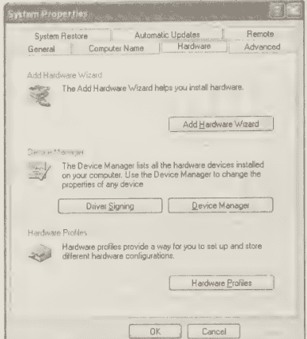
> 图1.1 控制面板系统属性窗口中的「硬件」选项卡提供了实用的硬件信息。

##### 你需要了解的内容
你需要提前准备好以下硬件信息（请在继续操作前将其记录下来）：
- **鼠标**类型，如果是串口鼠标，还需记录其连接的端口
- **磁盘控制器**类型，SCSI设备还需记录其品牌和型号
- **CD-ROM**类型
- **显示器**的品牌和型号，如有需要还需记录其水平/垂直刷新率
- **显卡**的品牌和型号、芯片组以及占用的显存容量
- **网卡（NIC）**的品牌和型号

#### 收集信息
要从Windows获取当前硬件的信息：
- 1. 点击“开始”按钮，然后从菜单中选择“帮助和支持”。“帮助和支持”页面会在Internet Explorer中打开（图1.2）。
- 2. 在“选择一个任务”板块下，选择“使用工具”选项。此时会显示一个包含Windows管理工具和资源列表的页面（图1.3）。
- 3. 在左侧窗格的“工具”标题下，点击“我的电脑信息”。
- 4. 在页面中询问你希望完成什么操作的板块，选择选项“查找有关安装在本计算机上的硬件的信息”（图1.4）。此时会显示一个屏幕，列出你系统中安装的具体硬件组件的信息（图1.5）。
**图1.2** Windows XP“帮助和支持中心”可以像浏览网页一样，通过Internet Explorer进行导航。
**图1.3** “帮助和支持”提供了多个用于系统诊断和信息查询的实用工具。
**图1.4** 让Windows查找你正确配置Linux所需的信息。
**图1.5** “帮助和支持”提供的大部分数据与控制面板上的“系统”选项卡内容一致。
##### ✓ 提示
> ■ **警告！** 本章描述的安装流程会将Windows文件系统替换为Linux文件系统。执行该流程时，你会丢失硬盘上所有的现有数据和应用程序。除非你提前进行了备份，否则将无法找回这些数据。
> - ■ 与图形化Gnome桌面环境配合使用的Red Hat Linux 9，最低需要8MB内存，以及至少约750MB的硬盘空间。显然，内存越大系统运行越流畅（这已经是常识了）。此外，如果你打算安装Red Hat Linux 9和Gnome附带的许多组件和应用程序（比如默认安装中包含的那些），你会发现该程序会占用大得多的空间，最多可能达到5GB。

#### 保障你的准备工作安全
除了收集信息之外，你还需要制作（并测试）一张Windows启动软盘来保障准备工作顺利——这也是你准备工作的另一个关键环节。通常，Windows是通过CD安装的。要启动安装程序，你需要一张可启动的软盘，且该软盘能够访问装有Windows安装盘的CD-ROM驱动器。
### 制作Windows启动软盘：
- 1. 使用浏览器下载以下文件：http://www.microsoft.com/downloads/search.aspx?displaylang=en&categoryid=12
- 2. 将下载的文件保存到硬盘后运行它。
- 3. 按照程序给出的提示操作。根据你使用的Windows版本不同，你可能需要从微软官网下载不同的文件。Windows XP家庭版的启动镜像无法用于Windows XP专业版，以此类推。详情和帮助请访问http://www.microsoft.com。
##### ✓ 提示
- 如果你的计算机支持从CD-ROM驱动器启动（现在大多数计算机都支持），你可能不需要Windows启动软盘。你可以直接通过原始的Windows XP安装盘启动。（尽管大多数现代计算机都具备这个功能，但最好提前确认。关于从CD-ROM启动的更多信息，请参阅下一节。）
- 根据你的系统不同，仅制作可启动软盘可能不够。要重装Windows，你需要能够访问CD-ROM驱动器。根据系统情况，这可能需要一些在制作启动盘过程中不会随系统文件复制的驱动程序。如果你的系统属于这种情况，你需要查阅文档确定所需的文件，然后将合适的文件复制到你的启动软盘中。记得添加所有需要的Windows配置文件，比如autoexec.bat和config.sys。

## 第1章
#### 制作Linux启动盘
要开始安装流程，你需要能够启动计算机，让安装程序运行而不是当前的操作系统。大多数现代计算机都可以从CD-ROM驱动器启动。进入计算机的BIOS设置菜单，确保CD-ROM驱动器是列出的第一启动设备。（如果你不知道如何操作，请查阅计算机的说明书。）如果你使用的是老旧计算机，或因任何原因无法从CD-ROM驱动器启动的计算机，你就需要制作一张安装启动盘。你可以使用Windows计算机或已经运行Linux的计算机来制作Linux启动盘（你可能需要用到启动盘来升级已有的Linux安装，或在其他计算机上安装Linux）。

制作Linux启动盘需要输入一些Linux命令。不用太担心这些命令。只要你按照我们给出的步骤操作，其实非常简单。关于在命令行下使用Linux的更多信息，你可以查阅本书的第3部分。
### 使用Windows制作Linux启动盘：
- 1. 将Linux安装盘放入Windows计算机的光驱中。
- 2. 将一张空白软盘放入启动驱动器中。
- 3. 从“开始”菜单中选择“程序”>“MS-DOS提示符”。此时会打开一个DOS窗口（图1.6）。
- 4. 切换到CD-ROM驱动器。例如，如果你的CD-ROM驱动器是E盘，在提示符后输入`E`
- 5. 在提示符后输入以下内容，切换到dosutils目录：`cd\dosutils`
**图1.7** 使用终端窗口打开命令行提示符。
- 6. 在提示符后输入以下内容，运行rawrite程序：`rawrite`
- 7. 系统会提示你输入磁盘镜像源文件名。如果你的CD-ROM驱动器是E盘，输入`e:\images\boot.img`
- 8. 按下键盘上的Enter键。
- 9. 系统会提示你输入目标软盘驱动器名称。输入启动驱动器的名称，例如`a:`
- 10. 按下键盘上的Enter键。
- 11. 系统会提示你将软盘放入驱动器中。放入后再次按下Enter键，Linux启动盘就制作完成了。

#### 制作Linux启动盘
### 使用Linux制作Linux启动盘：
- 1. 打开Linux终端窗口（图1.7）或进入Linux命令行提示符界面。
- 2. 如果你没有root（或超级用户）权限，在提示符后输入`su` root并输入root密码。将CD放入光驱，然后在提示符后输入以下命令将其`mount`（即挂载到Linux文件系统的其余部分）：`mount /dev/cdrom /mnt`。你的`/mnt`目录下可能已经有一个名为`/cdrom`的子目录，如果是这种情况，将命令中的`/mnt`改为`/mnt/cdrom`，并且在下一步中将`/mnt/images`改为`/mnt/cdrom/images`
- 3. 输入`cd /mnt/images`，切换到CD上的images目录。
- 4. 将一张空白软盘放入软盘驱动器中。
- 5. 输入`dd if=boot.img of=/dev/fd0`，将启动镜像复制到软盘中。
- 6. 如果需要，你可以输入以下命令卸载CD：
```cd / umount /mnt```

#### 快速开始安装
#### 安装Linux
### 启动安装程序：
- 1. 关闭计算机。
- 2. 保持CD-ROM在驱动器中，重新接通电源。等待片刻后，会出现一个文本界面的启动屏幕（图1.8）。
- 3. 按下Enter键接受默认选项，安装程序就会启动。（如果你等待超过一分钟才按下Enter键，安装程序也会以默认选项启动。）
##### ✓ 提示
部分系统上，你可能会看到一个中间界面，提示你在安装前测试CD介质。点击“确定”确保你的CD完好，或点击“跳过”直接进入安装流程。CD检查需要几分钟时间，但能额外提升安装安全性。
### 运行安装程序：
- 1. 你看到的第一个界面是显示Red Hat Linux 9标志的通用欢迎界面（图1.9）。如果需要，你可以阅读左侧的“帮助”栏，否则点击“下一步”按钮。
- 2. 在出现的“语言选择”窗口中，选择安装过程中使用的语言，然后点击“下一步”（图1.10）。
**图1.8** 安装Red Hat Linux 9时，你首先看到的是文本界面的启动屏幕。
**图1.9** Red Hat Linux安装程序提供了上下文相关的帮助。
**图1.10** 你可以选择使用多种不同的语言安装Red Hat Linux。


#### 快速入门安装
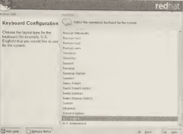
*图1.11 从提供的选项中选择你的键盘，或选择合适的通用类型。*
- 3. 在出现的键盘配置窗口中，选择一种键盘类型，然后点击下一步（**图1.11**）。如果你的键盘没有在列表中，最佳默认选项是美式英语。
- 4. 在出现的鼠标配置窗口中，通过选择你鼠标的品牌和型号来选择鼠标类型，然后点击下一步（**图1.12**）。如果你的鼠标类型没有在列表中，请选择合适的通用类型（PS2、总线、USB等）。如果你使用的是串口鼠标（现在比较少见），你可能需要指定鼠标连接的串口。如果你使用的是双键鼠标，你可能需要勾选“模拟3个按键”复选框。这样当你同时按下两个按键时，鼠标就会表现得像是有第三个按键一样。
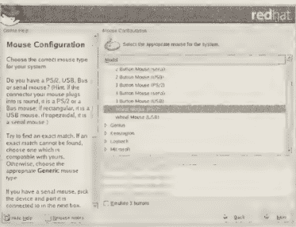
*图1.12 从提供的选项中选择你的鼠标，或选择合适的通用类型。*

安装程序现在将扫描你的硬盘以查找现有的Red Hat Linux安装。如果你的硬盘上有旧版本的Red Hat Linux，你将获得升级的机会。不过我们假设你正在进行全新安装。扫描完成后，会弹出安装类型窗口。

##### 浏览安装窗口
熟悉其他现代操作系统的人应该不难掌握Linux安装系统的操作。你只需要指向并点击你想要的选项即可。如果你感到困惑，可以打开屏幕左侧的帮助栏。在少数情况下，安装程序可能无法识别你的视频硬件。如果出现这种情况，程序将回退到基于文本的安装方式——其操作步骤与图形方式基本相同。每个选项的有效按键图例会显示在屏幕底部。
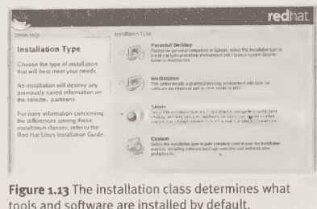
- 5. 选择安装类型时，选择“服务器”并点击下一步（**图1.13**）。共有四种安装类型可选：个人桌面、工作站、服务器和自定义。前三种选项会根据计算机的预期用途安装不同的工具和软件组合。自定义安装允许你完全控制磁盘分区以及要安装的组件。关于自定义安装的更多信息，请参阅第2章。本书假设你正在一台独立计算机上安装Linux，因此请选择服务器类型，该类型会安装大量实用的用户软件和管理软件。
- 6. 当系统询问你是要使用*磁盘德鲁伊*工具自动分区还是手动分区时，请选择“自动分区”并点击下一步。（*磁盘德鲁伊*工具的更多信息请参阅第2章的*磁盘德鲁伊*相关章节。）此时你可能会收到一条警告，提示你硬盘上的分区类型“无法读取”。这意味着你的硬盘上没有Linux分区，安装程序将重新格式化硬盘以继续安装。在此过程中，磁盘上的所有数据都将被销毁。如果你可以接受这一点，请在警告窗口中点击**是**。如果你还没有备份硬盘上的数据，请退出安装流程，完成备份后再重新开始。
- 7. 现在选择要从硬盘中移除的现有分区。因为本章描述的是完整重装和安装流程，请选择“移除该系统上的所有分区”。确保勾选“查看（如有需要可修改）创建的分区”选项，然后点击下一步。

#### 安装Linux
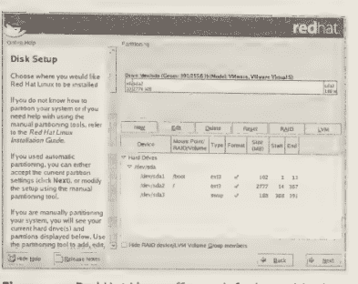
**图1.14** Red Hat Linux为你的磁盘提供默认分区方案。
- 8. 在弹出要求你确认选择的警告框中，点击**是**。安装程序会显示你系统的默认分区方案（图1.14）。
- 9. 要接受该方案，点击**下一步**。
- 10. 在出现的启动引导程序窗口中，你必须选择一个启动引导程序。默认的启动引导程序名为GRUB，通常是最佳选择。点击**下一步**接受此页面上的所有默认设置。
- 11. 如果安装程序检测到网卡，会弹出网络配置窗口，要求你配置网络。（如果你想在此阶段安装网络，或者需要更多关于网络安装的信息，请参阅第3章和第4章。）配置完成后点击**下一步**。
- 12. 在出现的防火墙配置窗口中，你必须从几个安全选项中进行选择（图1.15）。安全级别选择**高**，勾选**使用默认防火墙规则**，然后点击**下一步**。
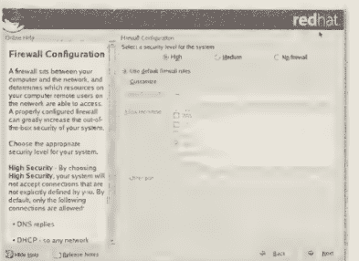
**图1.15** 为你的安装环境和网络连接选择合适的安全级别。
- 13. 在语言配置窗口中，选择你希望系统支持的语言，然后点击**下一步**。除非你有充分的理由这么做，否则没有必要（事实上这会浪费系统资源）支持除母语之外的其他语言。请选择**英语（美国）**。
- 14. 在时区选择窗口中，选择你的时区并点击**下一步**（图1.16）。
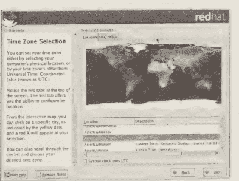
**图1.16** 选择正确的时区。这能确保计划任务在正确的时间运行。
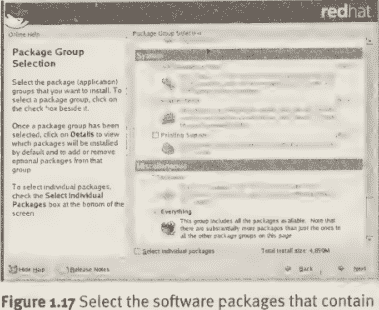
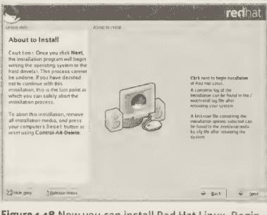
- 15. 在出现的根密码窗口中，输入root（也称为超级用户）的密码，然后点击下一步。root密码长度至少为6个字符。该密码授予对整个系统的访问权限：请勿丢失或泄露！
- 16. 在软件包组选择窗口中，选择你想要自动安装到你机器上的软件组（图1.17）。第2章将更详细地介绍这些软件组。现在，滚动到选择窗口的底部，点击“全部”，然后点击下一步。安装程序会暂停，检查哪些软件包需要依赖其他软件包才能正确安装，并相应调整安装顺序。此时会弹出“即将安装”窗口（图1.18）。
- 17. 点击下一步开始安装Red Hat Linux 9。此时会出现一组进度条，显示安装进度。根据你计算机的速度和性能，Red Hat软件包的安装时间从几分钟到几小时不等。你可以在安装过程中做其他事情，但不要走太远：当安装程序要求时，你需要留在附近插入Red Hat第2张和第3张光盘。所有软件包安装完成后，安装程序会执行一些安装后的配置操作。随后，安装程序会询问你是否要创建新的启动软盘。启动盘可以在启动引导程序出现问题时帮助你启动计算机，你可以自行决定是否要创建这样的磁盘。
- **18.** 如果你希望创建启动盘（这通常是个好主意），请将磁盘插入计算机的磁盘驱动器，点击“是，我想要创建启动软盘”旁边的单选按钮，然后点击下一步。如果你不想创建启动软盘，请点击“不，我不想创建启动软盘”旁边的单选按钮，然后点击下一步。
- **19.** 如果你选择安装X窗口系统，你将被要求提供显卡及其显存的相关信息。程序会尝试自动检测这些参数，因此你需要验证它们的准确性，必要时进行修改，然后点击下一步。如果你想使用GNOME等图形用户界面或其他桌面环境，就需要安装X窗口系统。X窗口系统是连接视频硬件和操作系统的软件。如果不安装X，你将只能在纯文本环境中工作。
- **20.** 下一个屏幕是显示器配置窗口。同样，程序会尽力探测相关参数，但你需要验证这些参数，确保程序为你的显示器选择了正确的设置。如果幸运的话，系统会显示“DDC探测到的显示器”，后面跟着你的显示器型号。如果不是这样，请选择你的显示器型号，然后点击下一步。
- **21.** 在颜色深度和分辨率窗口中，如果你愿意，可以验证颜色深度和屏幕分辨率；不过通常你可以直接接受已输入的参数，点击下一步即可。你的安装终于完成了！光盘驱动器会自动弹出最后一张Red Hat安装光盘。
- **22.** 取出光盘并关闭驱动器。点击退出，重启计算机进入Red Hat Linux。


#### 启动 Red Hat Linux 9
安装完 Red Hat Linux 并重启计算机后，你就可以登录并开始使用该系统了。首次启动 Red Hat Linux 9 时，会出现安装向导帮助你配置用户账号、日期和时间、声卡及其他基础元素。你可以按步骤完成向导配置，也可以取消向导直接进入 Red Hat 登录界面。
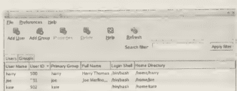
图 1.19 Red Hat 用户管理器是控制系统用户访问权限的高效工具。
重启系统后，你会看到 Red Hat 登录界面。使用安装时创建的密码以 root 身份登录。恭喜！你已经成功安装了 Red Hat Linux 9。由于以 root 身份运行系统存在风险，因此在启动并以 root 身份登录后，你的第一步应该是为自己添加一个新用户。
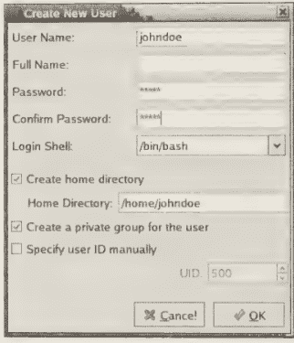
图 1.20 “创建新用户”窗口包含每个用户所有必填和可选信息的输入字段。你还需要了解如何重启和关闭新系统。
##### 添加用户账号（为自己）
1. 点击面板最左侧的 Red Hat 图标打开主菜单，选择**系统设置 > 用户和组**，将打开 Red Hat 用户管理器窗口（见图 1.19）。
2. 点击添加用户图标，将打开“创建新用户”窗口。
3. 在“创建新用户”窗口（见图 1.20）中填写要求的信息。你至少需要提供用户名——用于登录系统的名称（例如 johndoe）以及密码。在“密码”和“确认密码”两个输入框中输入相同的密码。你无需填写用户全名，如果需要也可以提供。该窗口中的其他信息要么会设为默认值，要么会自动生成。
4. 点击确定，新用户将出现在 Red Hat 用户管理器窗口中。
5. 在 Red Hat 用户管理器中，选择“文件 > 退出”即可关闭窗口。
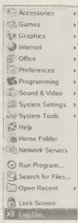
##### 注销
1. 点击面板中的 Red Hat 图标打开主菜单，然后选择注销（**图 1.21**），将弹出确认对话框。
2. 点击确定，你将完成注销，登录界面会重新出现。
3. 现在你可以使用新创建的用户账号登录。
> 图 1.21 通过菜单中的“注销”选项退出系统。
#### 关闭计算机
1. 点击面板中的 Red Hat 图标打开主菜单，然后选择注销，将弹出确认对话框。
2. 选中“关机”单选按钮，然后点击确定。
你也可以在登录界面通过系统菜单中的“关机”选项关闭计算机，或者打开终端窗口（主菜单 > 系统工具 > 终端）并输入命令
``` shutdown -h now ```
#### 使用 root 账号
你可能会疑惑，既然已经有了可用的 root 账号，为什么还要为自己创建另一个用户账号？root 是拥有最高权限的管理员账号——这意味着你应尽可能少地（甚至完全不）以 root 身份登录。这是因为以 root 身份登录时，很容易执行可能会损坏系统的操作。如果你需要执行需要 root 权限的命令，系统会要求你输入 root 密码。另外，你也可以在命令行输入`su`临时切换到 root 身份。
##### 重启计算机
1. 点击面板中的 Red Hat 图标打开主菜单，然后选择菜单中的“注销”，将弹出确认对话框。
2. 选中“重启计算机”单选按钮，然后点击确定。
你也可以在登录界面通过系统菜单中的“重启”选项重启计算机，或者打开终端窗口（主菜单 > 系统工具 > 终端）并输入命令`shutdown -r now`。注意，-r 参数用于重启计算机，它与完全关闭计算机的 -h 参数不同。
#### 总结
在本章中，你学会了如何：
- 收集有关 Windows 硬件的信息
- 创建并测试 Windows 启动盘
- 使用 Windows 计算机制作 Linux 启动盘
- 使用 Linux 计算机制作 Linux 启动盘
- 安装 Linux
- 添加用户
- 添加用户密码
- 重启系统
- 关闭系统
#### 详细安装说明
在第 1 章“快速安装入门”中，我们向你展示了在所有条件都理想的情况下如何安装 Red Hat Linux 9。但理想情况并非现实世界，在现实世界中，可能出错的事情大概率真的会发生。套用列夫·托尔斯泰的话说，顺利的安装都是相似的，不顺利的安装则各有各的不同。本章重点关注那些“特殊”的安装场景，就算不能让这类安装变简单，至少也让它们更容易完成。
第 1 章介绍的安装流程默认你愿意将整台计算机完全交给 Linux 使用（即删除硬盘上的所有现有数据）。如果不是这种情况，你就需要对硬盘进行分区，让 Linux 和 DOS/Windows 能够和谐共存。本章会教你如何操作。我还会讲解自定义安装，以及如何为你的系统选择单独的组件。不过事实上，很多首次安装 Linux 的 Windows 用户都把这一过程当成一种尝试。通常来说，他们会找一台旧的“破烂”台式机，让它摆脱当门挡的命运，在上面安装 Linux。一旦 Linux 正常运行，老旧的计算机也不会有什么问题，因为 Linux 和 Gnome 在性能较弱的硬件上的运行表现，要优于这些老旧硬件通常会运行的那个版本的 Windows 操作系统。不过，老旧的系统通常配备过时的硬件，这可能会导致 Linux 安装时出现问题，尤其是视频子系统相关的问题。本章还会提供一些配置显卡和显示器的注意事项。最后会讲解如何添加和配置打印机。
##### 同时运行 Linux 和 Windows
很多人希望在同一台系统上同时运行 Linux 和 Windows。为什么呢？也许你只有一台计算机，在尝试过 Linux 下的应用之前，还不想放弃 Windows 应用程序。或者你只是希望在同一台机器上同时运行 Linux 和 Windows。这两种考虑都非常合理。但你在开始之前需要明白：这种“双系统”安装涉及很多变量，存在一定难度，还可能危及你系统上的所有数据。因此在开始之前，务必备份你所有重要的数据。
##### ✔ 提示
在开始重新分区之前，你还需要对这一流程有清晰的概念性理解。接下来会介绍这一流程。以下路线图仅作为概念性的总览，具体完成步骤会在本章后续部分详细说明。
##### 安装 Linux 并保留 Windows
1. 确保硬盘上有足够的空间存放 Linux 和当前的 Windows 文件。如果可用空间不足 750MB，你可能无法完成最优的 Red Hat Linux 9 安装。理想情况下，你至少需要 5GB 的可用空间——这是安装所有软件包所需的最低空间。
2. 对 Windows 硬盘进行碎片整理，将所有数据移动到硬盘开头位置，从而为 Linux 分区腾出空间。
3. 在退出 Windows 之前，记下你的硬件配置信息。
4. 对 Windows 硬盘重新分区，添加 Linux 分区。
5. 运行安装程序，在合适的分区上安装 Linux。
6. 将 GRUB 引导加载程序复制到硬盘上的一个分区中。如果由于某种原因 GRUB 无法用于你的系统实现多系统启动，也不用担心：在双操作系统机器上还有其他启动 Linux 的方法——例如使用启动软盘（见下文的提示）。
- 如果你有多余的机器，强烈建议将 Linux 单独安装在这台机器上，为它提供独立的运行空间。
- 如果每个操作系统都有独立的物理硬盘，那么在带有 Windows 的系统中安装 Linux 会更容易。
- 你可能只有一块物理硬盘，但在 Windows 下有多个逻辑硬盘。如果是这种情况，你可以考虑将其中一个 Windows 逻辑硬盘重新格式化为 Linux 硬盘（而不是从 Windows 逻辑硬盘中划分出一块分区给 Linux）。
- 使用启动软盘意味着，当你想要启动 Linux 系统时，需要将 Linux 软盘放入 A 驱动器；当你想要启动 Windows 时，就把软盘从驱动器中取出。这其实是很稳妥的做法，而且几乎不会出问题（后续会详细介绍）。


#### 详细安装说明

**图2.1** 选择“管理工具”，然后选择“计算机管理”。
### 对Windows XP驱动器进行碎片整理：
- 1. 按照“开始 > 控制面板”的菜单路径打开计算机管理控制台。在控制面板中，选择“性能和维护”。
- 2. 在随即弹出的“性能和维护”窗口中，选择“管理工具 > 计算机管理”（图2.1）。
- 3. 在随即弹出的“计算机管理”窗口中，点击“存储”选项旁的加号展开该选项，然后选择“磁盘碎片整理程序”（图2.2）。
- 4. 在随即弹出的下一个窗口中，选择你要操作的驱动器，然后点击“碎片整理”按钮（图2.3）。碎片整理进程随即启动。根据驱动器的大小不同，该过程可能会花费一定时间。如果你的硬盘非常大，这个过程可能会持续数小时；较小的硬盘所需时间会更短。
##### ✓ 提示
- ■ 碎片整理工具可能会发现你硬盘上的错误，这些错误必须在开始碎片整理前修复（请参阅下一节）。
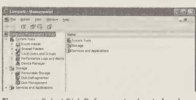
**图2.2** 选择位于“存储”选项下的“磁盘碎片整理程序”。
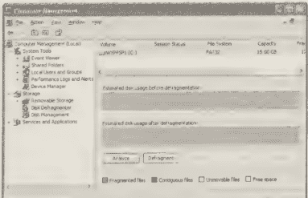
**图2.3** 选择要整理碎片的驱动器，然后点击“碎片整理”按钮启动该进程。
### 第2章
### 修复Windows XP硬盘错误：
- 1. 在计算机管理控制台中，展开“存储”选项并选择“磁盘管理”。
- 2. 在随即显示的可用磁盘列表中，选择你要操作的驱动器，然后右键点击它（**图2.4**）。
- 3. 在弹出的上下文菜单中，选择“属性”。
- 4. 在你所选驱动器的“属性”界面中，点击“工具”选项卡（**图2.5**）。
- 5. 在“工具”选项卡上，点击“查错”。“检查磁盘”对话框随即弹出（**图2.6**）。
- 6. 从以下选项中进行选择：“自动修复文件系统错误”和“扫描并尝试恢复坏扇区”。
- 7. 点击“开始”。
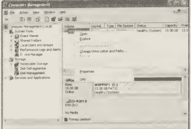
**图2.4** 使用计算机管理工具在碎片整理前检查磁盘属性。
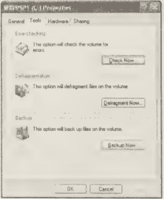
**图2.5** 在“工具”选项卡上，你可以选择在碎片整理开始前备份文件或检查磁盘错误。
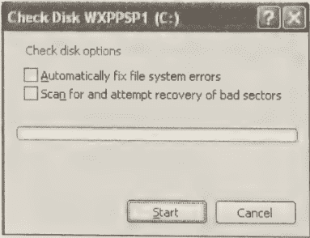
**图2.6** 在“检查磁盘”对话框中，你可以指示碎片整理工具修复其在硬盘上发现的错误。
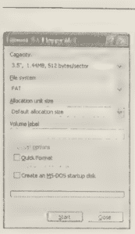
#### 使用FIPS工具
FIPS程序是一个DOS实用工具，用于在现有硬盘上划分Linux分区。它使用简单，如果你打算在即将安装Linux的计算机上保留Windows系统，它应该是你的首选工具。
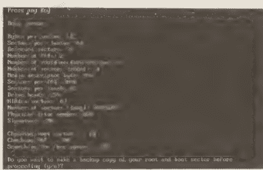
**图2.7** 若要使用软盘作为启动盘，你必须将其格式化为启动磁盘。

**图2.8** 备份重要磁盘扇区总是个好主意。
### 使用FIPS重新分区：
- 1. 将一张空白软盘插入驱动器。
- 2. 使用Windows资源管理器，选择软盘驱动器（通常是A盘）。
- 3. 右键点击该驱动器，在弹出的菜单中选择“格式化”。“格式化”对话框随即打开（**图2.7**）。
- 4. 选择“创建MS-DOS启动盘”。
- 5. 点击“开始”。
- 6. 软盘格式化完成后，使用Windows资源管理器将\\dosutils\\fips20目录下的fips.exe和restorb.exe文件从Red Hat Linux 9安装光盘复制到软盘上。
- 7. 关闭Windows并重启计算机。计算机将会启动到A:\>提示符界面。
- 8. 在提示符下输入`fips`并按Enter键。随即会显示版权声明页面，还有一些警告信息，以及说明FIPS“不提供任何担保”的标注。
- 9. 按任意键继续。
- 10. 随即会出现多个包含信息和警告的页面。持续按任意键翻阅页面，直到你到达询问是否要备份扇区的页面（**图2.8**）。
- 11. 按y键选择*是*。系统会提示你在A驱中插入软盘（你直接使用正在运行FIPS的这张软盘即可）。扇区备份完成后，FIPS的主操作界面就会出现。该界面有三列：“旧分区”、“柱面”和“新分区”（**图2.9**）。旧分区指的是你硬盘上的DOS/Windows分区；新分区则是你要创建的新Linux分区。
- 12. 使用左右方向键调整“旧分区”和“新分区”字段的大小。要完整安装Red Hat Linux 9，新分区需要有5GB的空间。完整安装包含Gnome和KDE桌面环境，以及安装光盘上的所有软件包。如果你想了解包含的软件包列表（以及每个软件包的完整说明），可以访问http://www.redhat.com/docs/manuals/linux/RHL-9-Manual/install-guide/s1-steps-partitioning.html
- 13. 当你确认选择无误后，按Enter键。FIPS会显示已创建的新分区的大小。
- 14. 如果你对新旧分区的大小不满意，输入r键重新编辑；如果满意，输入c键继续。
- 15. 输入c键后，你会看到一些关于你磁盘的提示信息。随后会出现一条消息，告诉你FIPS已准备好保存新的分区方案。如果你有些犹豫，输入n键退出FIPS且不进行任何更改；否则，输入y键保存新的分区更改。
- 16. 如果你输入了y键，FIPS执行完成后，取出软盘并重启计算机。这就是所谓的“真理时刻”！
- 17. Windows重启后，运行ScanDisk（磁盘扫描程序）确保你的磁盘和文件系统状态完好（如前文“修复Windows XP驱动器错误”部分所解释的那样）。

**图2.9** 将分区大小设置得足够大，以便容纳Red Hat和Windows生成的所有软件和文件。
##### ✓ 提示
- ■ 即使你的Windows版本支持运行FIPS，也不应该在Windows内的DOS窗口中运行FIPS。
#### DOS版fdisk工具
如果FIPS无法重新分区你的硬盘，你就无法在系统中添加其他驱动器。不过，如果你决心同时运行Windows和Linux，你可以使用DOS版或Linux版的fdisk进行*破坏性*重新分区。正如“*破坏性*”这个术语所暗示的，DOS版fdisk会删除你硬盘上的所有数据。在使用DOS版fdisk进行破坏性重新分区前，请先告诉自己：“我要擦除硬盘上的所有内容。我可以从备份中恢复它们。”如果这句话不能让你完全确信，请不要继续操作。一旦你用DOS版fdisk擦除了分区，就无法撤销操作。
##### 提示
现代版本的Windows已不再自带可用的DOS命令行环境。虽然Windows XP可以制作出适合与FIPS配合使用的启动盘，但你需要从微软官网下载fdisk工具。
##### ⚠️ 警告！
> 我们强烈建议不要使用DOS版fdisk，除非你万不得已。
### 使用DOS版fdisk进行破坏性重新分区：
- 1. 按照备份软件文档中的说明，备份你的Windows系统。
- 2. 按照*使用FIPS重新分区*部分第1至5步的说明，制作启动软盘。
- 3. 将Fdisk.exe和Format.com文件复制到软盘中（你可以在\Windows\Command文件夹中找到这些文件）。
- 4. 将启动备份所需的任何文件复制到软盘中（更多信息请查看备份软件文档）。
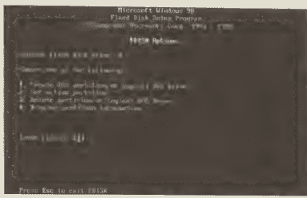
**图2.10** 你可能需要删除现有分区，以便为新Linux分区腾出足够空间。
- 5. 确认你刚刚制作的软盘已插入A驱后，重启计算机。
- 6. 在A:\>提示符下输入`fdisk`并按Enter键。随即会显示fdisk选项界面（图2.10）。
- 7. 使用fdisk选项菜单删除分区以留出空间创建新的Linux和DOS分区（选项3）。你可能需要删除所有现有分区。不要选择“大磁盘支持”。
- 8. 使用fdisk菜单选项创建DOS分区（选项1）。
- 9. 以MB为单位输入DOS分区的大小。
- 10. 按Esc键继续。fdisk菜单界面会重新打开。
- 11. 将新DOS分区设置为活动分区（选项2）。你可能还需要使用选项1将分区定义为主磁盘分区，这等同于将分区设置为可启动。
- 12. 按Esc键返回fdisk菜单界面。
- 13. 按Esc键退出fdisk。
- 14. 输入`format /s C:`命令格式化新的DOS分区，然后将系统文件复制到其中。
- 15. 按照备份软件提供的说明，恢复你之前备份的Windows系统。你必须使用Disk Druid实用工具（下一节将介绍）来设置你的Linux分区。
**DOS版FDISK工具**


#### Disk Druid
Disk Druid是Red Hat安装程序的一部分。它拥有友好的用户界面，因此如果它能满足你的全部需求，完全可以将其作为Linux fdisk的替代工具使用。请注意，Disk Druid仅适用于基础的磁盘分区操作。如果你需要创建超过3个分区，或者对分区大小有特定需求，Disk Druid可能会出现故障，或覆盖你设置的参数。这种情况下，fdisk是更合适的选择。

### 使用Disk Druid添加或编辑Linux分区：
- 1. 按照之前的说明启动Linux安装程序。
- 2. 当系统提示你选择磁盘分区工具时，选择Disk Druid。此时会弹出磁盘设置界面（**图2.11**）。
- 3. 使用鼠标选择「新建」「编辑」或「删除」选项，即可完成分区的添加、修改或删除操作。
- 4. 完成操作后点击「下一步」。至少要有一个根分区，才能安装Linux内核。此外，如果你的系统内存不足128MB，你还需要创建一个交换分区。这些对于简易系统来说已经足够；但大多数用户会为不同功能创建独立分区，常见分区包括以下几类：
  - 根（或/）分区
  - /home分区，用于存储用户的家目录
  - /tmp分区，用于大型服务器部署中存储临时文件
  - /usr分区，用于安装Linux软件包
  - /usr/src分区，用于存放Linux源代码

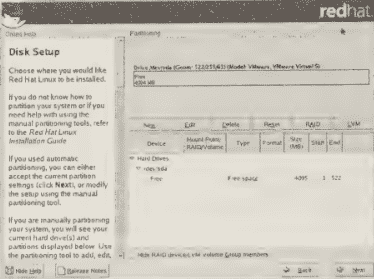
> **图2.11** 如果你更倾向于使用该方法而非FIPS，可通过磁盘设置界面为硬盘分区。

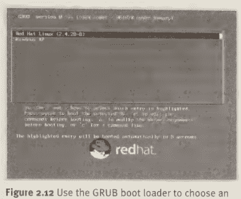
> **图2.12** 启动计算机时，可使用GRUB引导加载程序选择操作系统。

#### 引导至Windows和Linux系统
安装过程的最后一步需要配置计算机，使其能够引导至Linux或Windows系统。你可以采用多种方法实现这一目标。最简单的方式（如果可用的话）是配置GRUB，这是实际启动Linux内核的Linux引导加载程序。但在某些情况下，GRUB可能并非最适合你的引导加载程序。如果你在同一台计算机上同时安装Linux和Windows，Windows可能会调整分区优先级，这与GRUB的兼容性不佳。许多在Linux/Windows双启动系统上遇到GRUB问题的用户会改用LILO引导加载程序。

配置完GRUB后，重启系统时会出现GRUB界面（**图2.12**）。该界面会显示可引导的不同操作系统的名称，例如DOS和Linux。使用方向键选择你想要用来启动计算机的操作系统。另一种可行的方法是通过启动软盘加载Linux。否则，如果你从DOS启动，可以编写一个DOS批处理文件来加载Linux内核。从DOS引导Linux内核需要执行一系列命令，因此批处理文件可以大大简化这一重复流程的自动化操作。

### 第2章

### 配置GRUB的方法：
- 1. 进入GRUB安装界面后，你会看到所有操作系统的列表。选择一个作为默认系统（**图2.13**）。设置默认项后，每次启动计算机时都会自动加载你选择的操作系统（直到你更换其他选项）。
- 2. 在此界面中，你还可以选择安装LILO（如果在Linux/Windows系统上运行GRUB遇到问题，这个替代引导加载程序的兼容性可能更好），或者完全不安装引导加载程序。例如，如果你要将计算机设置为使用OS/2作为第二操作系统，就可以选择后一选项。要访问这些选项，点击标有「更改引导加载程序」的按钮。
- 3. 如果你想设置引导加载程序密码，勾选「使用引导加载程序密码」旁边的复选框，然后点击「更改密码」按钮设置新密码。设置引导加载程序密码后，只有输入正确密码才能启动计算机。如果你的计算机中存有需要防范未授权访问的敏感数据，建议选择该选项。但在大多数情况下，你并不需要设置引导加载程序密码。

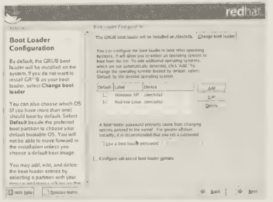
> **图2.13** 安装GRUB时，你可以选择默认操作系统、设置引导加载程序密码，甚至安装其他替代引导加载程序。

- 4. 通常情况下，GRUB会安装在磁盘的主引导记录（MBR）中——这是计算机启动时读取的硬盘部分。你可能希望将GRUB安装在其他位置。例如，已知在计划使用Windows NT的计算机的MBR中安装GRUB会引发问题。此时你可以选择将GRUB安装在Linux引导分区的第一个扇区，操作方法为选择标有「配置高级引导加载程序选项」的选项。
- 5. 点击「下一步」。如果选择了「配置高级引导加载程序选项」，会弹出高级引导加载程序配置界面（**图2.14**）；否则引导加载程序配置部分即完成。

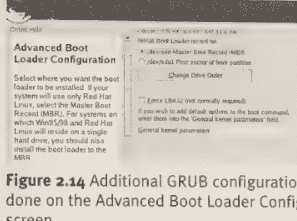
> **图2.14** 可在高级引导加载程序配置界面完成更多GRUB配置。
> **提示**
> Linux运行后，你可以通过编辑位于/etc/grub.conf的GRUB配置文件，进行更多配置修改。

##### 选择安装类型
你可能还记得第1章中介绍的三种基础Linux安装类型：
- 个人桌面版——适用于家庭使用或笔记本电脑部署
- 工作站版——适合桌面用户使用，同时包含软件开发和系统管理工具
- 服务器版——默认互联网服务器、网络文件及打印服务器部署配置
- 自定义安装——可自主选择要安装的组件及安装位置

#### 安装选定组件的方法：
- 1. 完成分区格式化、配置以及其他安装选项的设置后，就可以选择要在计算机上安装的软件了。如果选择了个人桌面版或工作站版，系统会询问你是接受当前的（默认）软件包列表，还是自定义要安装的软件包。如果选择默认选项，安装会立即开始；如果选择自定义，或者选择了服务器版或自定义安装，会进入软件包组选择对话框（**图2.15**），使用鼠标选择你要安装的组件即可。
- 2. 选定所需组件后，点击「下一步」。
> **提示**
> 要选择所有组件，请使用向下方向键滚动至组件列表底部，点击「全部」，再点击「下一步」。

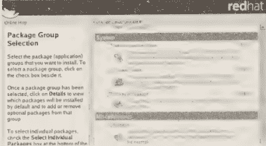
> **图2.15** Red Hat软件通过包管理系统安装，该系统可确保你获得所需的所有文件。

#### 配置显卡和显示器
Linux安装过程中最大的问题之一，就是为操作系统正确配置显卡和显示器——这主要是由于当前使用的视频系统种类繁多，且Linux通常安装在较老的硬件上。Linux安装过程中会要求你配置视频系统。不过你也可以在方便的时候，通过Linux命令提示符执行相同的视频配置流程，无需重新运行安装程序。

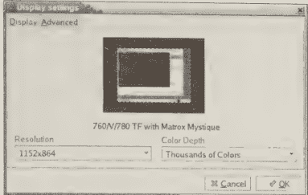
> **图2.16** Red Hat会自动检测并分析你的视频硬件，简化配置流程。如果你想修改Red Hat为你的显示器分配的配置，请在「高级」选项卡中操作。

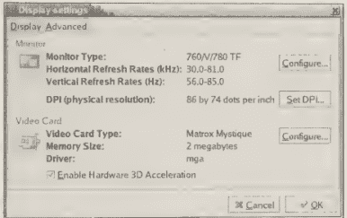
> **图2.17** 如果你想修改Red Hat为你的显示器分配的配置，请在「高级」选项卡中操作。

### 配置视频硬件的方法：
- 1. 在shell提示符中输入`redhat-config-xfree86`
- 2. 如果你未以root用户登录，系统会提示你输入root密码。配置程序会探测你的系统，以确定已安装的显卡和显示器型号，这些信息会被写入XFree86配置文件（/etc/X11/XF86Config）中。随后会弹出包含这些信息的窗口，该窗口有两个选项卡：「显示」和「高级」（**图2.16**）。
- 3. 在「显示」选项卡中，配置显示器的分辨率和色彩深度，只需点击对应选项并选择即可。
- 4. 在「高级」选项卡中，你可以配置显卡和显示器的更多详细信息，例如显示器的刷新率、点距，以及显卡的类型、驱动等（**图2.17**）。
- 5. 完成所有设置后，点击「确定」。


如果在安装过程中Linux无法检测到你的显示器和/或显卡，图形用户界面将无法启动。如果你了解自己的显卡硬件信息，可以使用`redhat-config-xfree86`程序来配置显卡硬件。通用配置格式如下：
```bash
redhat-config-xfree86 --set-<key>=<value>
```
这种情况下，`<key>`会被替换为对应参数，`<value>`会被替换为该参数适配你硬件的特定值。例如，你可以输入类似这样的内容：
```bash
redhat-config-xfree86 --set-card="Matrox Mistique"
```
要获取完整的有效参数列表，请输入命令
```bash
redhat-config-xfree86 --help
```
配置完硬件参数后，输入`init 5`命令即可启动图形界面。
#### 小提示
如果上述方法都无效，可以打开你常用的搜索引擎，在搜索框中输入你的显卡型号加上“Linux”关键词。全球许多Linux爱好者已经记录了他们在各类显卡上运行XFree86的相关经验。
### 第2章 配置打印机
你可以在安装过程中配置打印机，也可以随时通过Linux控制面板的“打印机配置”小程序来配置。无论哪种方式，配置流程都是一致的。
### 使用打印机配置小程序添加打印机：
- 从主菜单依次选择“系统设置”>“打印”，即可打开打印机配置窗口（图2.18）。（如果你不是以root用户登录，系统会提示你输入root密码。）
- 在打印机配置窗口中点击“新建”按钮，即可打开新建打印队列向导（图2.19）。
- 点击“下一步”。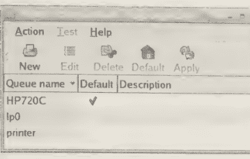
**图2.18** Red Hat简化了打印机配置流程，而在传统的类Unix操作系统中这一流程通常十分复杂。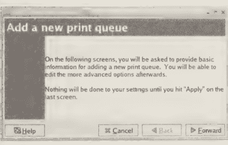
**图2.19** 使用打印队列向导来安装并配置新打印机。
- 下一个界面会提示你为打印队列命名（**图2.20**）。名称可以任意设置，但建议使用具有辨识度的名称，比如“HP Deskjet”或“楼上打印机”。你也可以在此处输入简短的描述信息，完成后点击“下一步”，即可打开打印队列类型界面（**图2.21**）。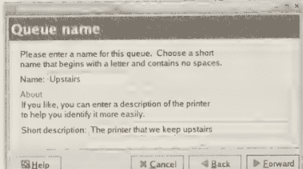
**图2.20** 给打印机命名时要便于相互区分。
- 选择队列类型。这里有多个可选选项，如果你的打印机直接连接到你的电脑，请选择“本地连接”；如果连接的是网络打印机，你需要选择对应的网络连接选项。本次示例我们以本地连接的打印机为例。
- 打印队列类型窗口的底部的面板会显示系统扫描检测到的打印机列表，点击你的打印机名称即可将其选中。如果你的打印机未出现在列表中，请点击“自定义设备”，在弹出窗口的输入框中输入你要添加为打印机的设备名称，该名称是类似/dev/lp0的Linux设备名，输入完成后点击“确定”。自定义设备窗口会关闭，回到打印队列类型窗口，此时你就可以为自定义打印机设置打印队列类型了。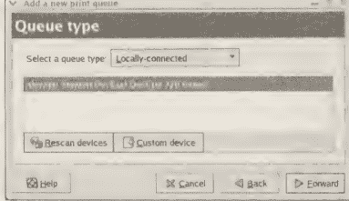
**图2.21** 在打印队列类型窗口中，选择打印机并配置为本地或网络打印队列。
- 点击“下一步”，即可打开打印机型号界面（**图2.22**）。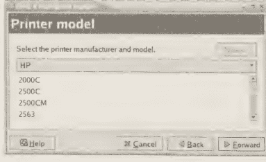
**图2.22** 和显卡硬件类似，Red Hat可以检测并识别绝大多数现代打印机。
- 选择你的打印机的厂商和型号，然后点击“下一步”。
#### 详细安装步骤
- **9.** 下一个界面会汇总你已经输入的打印机相关信息，并提示你完成配置流程，点击“应用”即可。
- **10.** 打印机配置向导会关闭，系统会提示你打印测试页，点击“是”即可。
- **11.** 如果测试页打印正常，说明配置完成，你可以通过选择“操作”>“退出”来关闭配置程序。如果页面显示不正常（甚至完全无法打印），请选择“帮助”>“目录”查看帮助文档。
#### 本章总结
本章你学会了以下操作：
- 在同一系统上同时运行Linux和Windows
- 对Windows磁盘进行碎片整理
- 修复Windows磁盘的错误
- 使用FIPS重新分区
- 使用DOS fdisk删除分区
- 使用DOS fdisk添加分区
- 使用Disk Druid添加和编辑分区
- 配置GRUB引导加载器
- 安装独立组件
- 为你的显卡和显示器配置Linux
- 配置打印机
### 第3章 配置Gnome
Red Hat Linux 6.0是首款开箱即用集成可视化Shell（即桌面环境）的Red Hat Linux版本。事实上，Red Hat Linux 6自带两款可相互切换的桌面环境，你也可以从互联网下载安装其他桌面环境。其中默认且功能最完整的桌面环境是Gnome（发音为浊辅音g：“格-诺姆”）。
当前Red Hat Linux附带的Gnome版本已按照Red Hat的Bluecurve规范预配置，该规范官方定义为Gnome主题，即一套外观与交互选项。但Bluecurve的实际意义远不止于此：Red Hat修改了Gnome的默认外观、行为，以及K桌面环境（KDE）的部分元素，为终端用户提供更一致的体验。这些改动让用户无需改变工作习惯，即可在Gnome桌面使用KDE应用程序，反之亦然。
功能全面且强大的Gnome是当今首屈一指的可视化桌面环境。从外观和交互体验来看，它更接近Mac OS而非Windows 98，同时融合了两款操作系统的元素，且用户自定义程度比二者都更高。Gnome让你可以以可视化方式使用Linux，无需接触Linux命令行。（但实际上，即便是Windows用户也会发现，部分任务在传统DOS提示符下操作更便捷，使用Linux下的Gnome时大概率也是如此。）
本章将介绍如何配置Gnome，让你充分发挥该桌面环境的能力。你也可以使用KDE环境，关于KDE的配置和使用方法请参阅第6章。如果你在安装时接受了Red Hat安装程序的推荐设置，你的电脑启动时就会默认进入Gnome环境。
#### 使用控制中心
控制中心是配置Gnome桌面绝大多数功能的入口（和Windows中通过显示属性对话框配置系统显示的逻辑类似）。这里提供的配置选项覆盖范围极广，从外观细节调整到深度功能定制都有。换句话说，部分配置项仅影响视觉呈现，另一些则会直接影响你的使用方式。
### 打开Gnome控制中心：
- 从Gnome主菜单依次选择“偏好设置”>“控制中心”，即可打开控制中心窗口（图3.1）。
##### ✔ 小提示
点击Gnome面板最左侧的小程序按钮即可唤起主菜单，该按钮默认带有Red Hat图标。Gnome面板是沿屏幕侧边或底部排列的图标栏（位置可根据需要调整），功能类似于Windows的“开始”菜单或Mac OS X的程序坞。
### 设置桌面背景（不使用壁纸）：
- 打开控制中心后选择“背景”，即可弹出背景偏好设置对话框（图3.2）。
- 在“图片选项”区域选择“无图片”。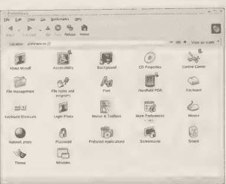
**图3.1** Gnome控制中心提供了用于配置Gnome桌面环境所有元素的工具。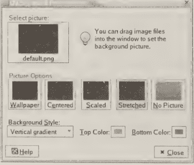
**图3.2** 你可以通过Gnome控制中心设置桌面背景。


#### 配置 GNOME
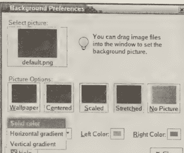
> 图3.3 可在纯色和渐变背景样式之间进行选择。
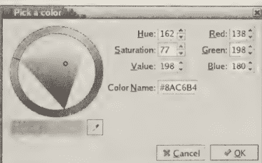
> 图3.4 可使用色轮选取屏幕上你需要的颜色。
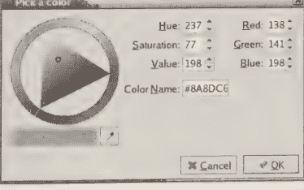
> 图3.5 你可以通过拖动色轮上的圆形到色彩三角形的新区域来更改你选取的颜色。
- 3. 在“背景样式”框中，选择一种背景样式（**图3.3**）。可选样式包括纯色、垂直渐变和水平渐变。如果选择渐变样式，你可以选择两种会相互融合的颜色。纯色背景会在桌面所有区域显示同一种颜色。
- 4. 点击“颜色”框。如果上一步选择了渐变样式，你需要分别配置每种颜色——如果选择的是垂直渐变，则配置“顶部颜色”和“底部颜色”；如果选择的是水平渐变，则配置“左侧颜色”和“右侧颜色”。此时会打开“选取颜色”对话框（**图3.4**）。
- 5. 如果你知道你想要颜色的十六进制值、红/绿/蓝值，或色相/饱和度/明度值，可以手动输入这些值。如果不知道这些数值，可以使用图形化色轮来选取正确的颜色。
- 6. 点击色轮的外圈来选取基础颜色。中心的三角形会变为你点击的颜色。三角形内部会显示一系列代表你所选色相不同色调的颜色。三角形内的小黑圆点显示你当前选中的颜色。
- 7. 点击并拖动三角形内的圆点到新的区域来选取新颜色（**图3.5**）。
- 8. 选中正确的颜色和色调后，点击“确定”。新颜色会被保存。
- 9. 点击“关闭”以退出“背景偏好设置”对话框。
#### 使用控制中心
##### 使用壁纸
你可能更倾向于将背景设置为壁纸。GNOME 自带许多图形文件，这些文件可单独使用（作为桌面背景），也可搭配图案使用。
#### 将壁纸设置为背景：
- 1. 打开控制中心，选择“背景”。“背景偏好设置”对话框会弹出（图3.2）。
- 2. 点击“选择图片”下方的框。此时会打开浏览器窗口，显示 GNOME 自带的背景图片（图3.6）。
- 3. 点击图片名称即可查看预览框（图3.7）。如果想使用自己的图片，可使用文件管理器找到该文件，然后将其拖入“背景偏好设置”对话框的“选择图片”框中。如果从浏览器窗口中选中了图片，点击“确定”。新的背景图片会显示在桌面上，“背景预览”窗口会关闭，“背景偏好设置”对话框会重新弹出。
- 4. 在“背景偏好设置”对话框中，从“图片选项”下方的列表中选择一个图片选项。共有五个选项：壁纸、居中、缩放、拉伸和无图片。“壁纸”选项会按图片原始尺寸显示，必要时会复制多份图片以填满屏幕。“居中”选项会将图片显示在屏幕中央。“缩放”选项会拉伸图片以填满整个屏幕，同时保持其高宽比。“拉伸”选项会拉伸图片以填满整个屏幕，忽略其原始比例。使用“无图片”选项可设置背景颜色。
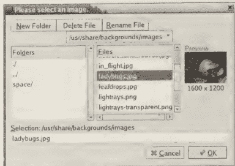
**图3.6** GNOME 默认自带一些背景图片。
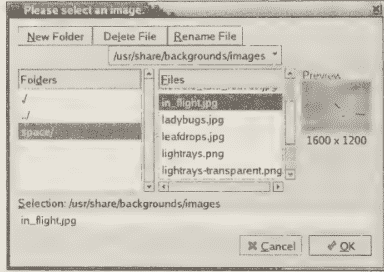
**图3.7** 将图片应用到桌面之前可预览该图片。
- 5. 点击“关闭”以退出“背景偏好设置”对话框。
## 选择屏幕保护程序：
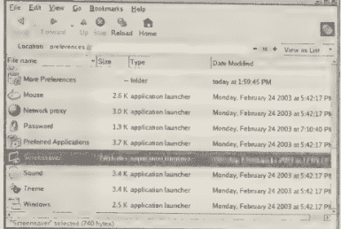
**图3.8** 你可以从 GNOME 自带的众多屏幕保护程序中进行选择。
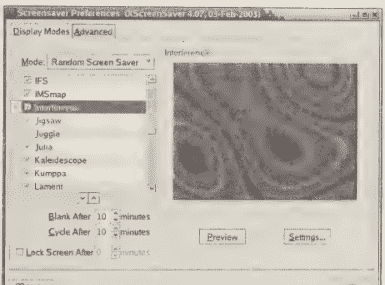
**图3.9** 有多种方式可以控制电脑空闲时显示的屏幕保护程序。
- 1. 在控制中心选择“屏幕保护程序”（**图3.8**）。“屏幕保护程序偏好设置”对话框会弹出（**图3.9**）。
- 2. 从“模式”列表中选择一种屏幕保护程序模式。你有四种选择：禁用屏幕保护程序、仅黑屏、仅使用一种屏幕保护程序、随机屏幕保护程序。
- 3. 如果选择了“仅使用一种屏幕保护程序”，请从左侧框内的列表中选择要使用的屏幕保护程序。
- 4. 点击屏幕保护程序的名称，即可在右侧框中查看预览。
- 5. 点击“设置”按钮，配置所选屏幕保护程序特有的元素。这些元素会显示在一个新窗口中（**图3.10**）。
- 6. 完成选择后，点击“确定”保存并退出该窗口。“屏幕保护程序偏好设置”窗口会重新显示（图3.9）。
- 7. 在屏幕保护程序名称列表下方，为以下屏幕保护程序选项设置时间间隔：“黑屏前等待”、“切换前等待”和“锁定前等待”。“黑屏前等待”选项定义屏幕保护程序运行的时长。“切换前等待”选项与“随机屏幕保护程序”模式搭配使用，决定新屏幕保护程序出现的频率。“锁定前等待”选项设置屏幕保护程序运行后，需要输入密码才能重新激活桌面的时长。
- 8. 点击“关闭”以退出该对话框。

**图3.10** 配置你选择的屏幕保护程序以满足你的需求，在应用之前可预览你的设置效果。
## 第3章
#### 窗口偏好设置
“窗口偏好设置”对话框可让你控制屏幕上窗口行为的某些方面。
#### 配置窗口偏好设置：
- 1. 在控制中心选择“窗口”。“窗口偏好设置”对话框会弹出（图3.11）。你可以选择启用任意或全部可用选项。
- 2. 勾选或取消勾选“鼠标指针移到窗口上时选中该窗口”复选框。该功能允许指针将窗口置于顶层，无需强制你点击窗口才能选中它。
- 3. 如果启用了步骤2中描述的选项，你还可以设置指针移到窗口上后，GNOME 等待多久再将窗口置于顶层。
- 4. 选择双击窗口标题栏时触发的操作。你有两个选项：卷起和最大化。“卷起”表示窗口会消失，仅标题栏保留在桌面上；“最大化”表示窗口会放大至填满整个屏幕。你只能选择其中一个选项。
- 5. 通过在特定按键旁点选对应的单选按钮，选择你希望抓取和移动窗口的方式。按下选中的按键并点击目标窗口，即可拖动窗口到新位置，无需点击标题栏。
- 6. 点击“关闭”以退出该对话框。
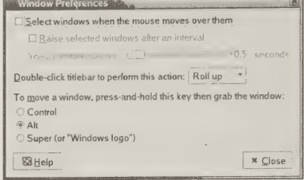
**图3.11** 在“窗口偏好设置”对话框中定义你的窗口偏好。
#### 使用虚拟桌面
GNOME 采用了*虚拟桌面*概念，提供了一种低成本扩展可用屏幕空间的方式。每个虚拟桌面可以打开多个窗口——数量远超单块桌面能容纳的上限。
#### 在虚拟桌面之间切换：
- 1. 在 GNOME 面板上找到“工作区切换器”工具（图3.12）。切换器会显示每个桌面的缩略图及其活跃窗口（图3.13）。
- 2. 点击桌面的缩略图即可打开对应的虚拟桌面。
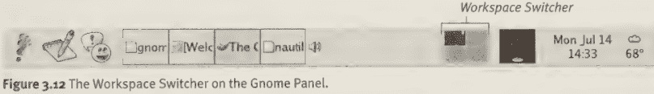
#### 移除虚拟桌面
部分用户觉得虚拟桌面容易分散注意力，因为他们可能会忘记分布在多个桌面上的已打开窗口。如果你也被虚拟桌面困扰，可以只保留一个虚拟桌面，移除其余的。（注意，运行多个桌面时会有轻微但可察觉的性能下降。）
### 仅保留一个桌面，移除其余桌面：
- 1. 右键点击“工作区切换器”工具，在弹出的菜单中选择“偏好设置”（图3.14）。
- 2. 在打开的“工作区切换器偏好设置”窗口的右侧面板中，将“工作区数量”的值设置为1（图3.15）。
- 3. 在偏好设置窗口的左侧面板中，选择“仅显示当前工作区”选项。
- 4. 点击“关闭”。
- 5. 此时，你可能想要从 GNOME 面板中移除“工作区切换器”。如果要移除，右键点击其图标，选择“从面板中移除”选项（图3.14）。
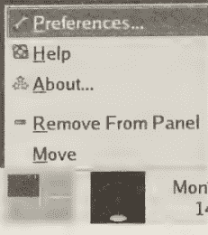
> **图3.14** 如果你不喜欢虚拟桌面，可以在“工作区切换器”的偏好设置中将其关闭。
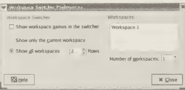
> **图3.15** 将桌面数量定义为1，你就不会看到其他虚拟桌面了。


## 重新启用多桌面：
- 1. 在GNOME面板的空白区域右键单击，从弹出菜单中选择【添加到面板】>【实用工具】>【工作区切换器】（图3.16）。新的工作区切换器会显示在GNOME面板上。
- 2. 右键单击切换器，从弹出菜单中选择【偏好设置】，会弹出【工作区切换器偏好设置】窗口。
- 3. 按照上一任务的说明配置该切换器。
- 4. 单击【关闭】保存配置并退出对话框。
> **图3.16** 打开工作区切换器以配置虚拟桌面行为。
> 消除虚拟桌面

#### 使用多媒体
### 启用声音支持：
- 1. 在控制中心中双击【声音】（图3.17），会弹出【声音偏好设置】对话框（图3.18）。
- 2. 选中【启用声音服务器启动】复选框，同时确保【事件声音】复选框也处于选中状态。
- 3. 单击【关闭】。
> 图3.17 在GNOME控制中心中选择声音图标，即可打开声音偏好设置对话框。
> 图3.18 在声音偏好设置对话框中启用声音支持。

### 为事件关联声音：
- 1. 在控制中心中双击【声音】，会弹出声音偏好设置对话框。
- 2. 选择【声音事件】选项卡，会显示包含事件和关联声音的窗口（图3.19）。
- 3. 选中要关联声音的事件。
- 4. 单击【浏览】按钮查找对应的声音文件。
- 5. 单击【播放】按钮试听声音。
- 6. 单击【关闭】保存更改并退出对话框。
> **图3.19** 为事件关联声音后，即使你不盯着屏幕，也能知道机器正在发生什么。

#### 使用外设
使用控制中心可以轻松修改键盘和鼠标设置。
### 修改键盘设置：
- 1. 在控制中心中双击【键盘】，会弹出【键盘偏好设置】窗口（图3.20）。
- 2. 根据需要修改键盘设置。
- 3. 单击【关闭】保存配置并退出对话框。
### 修改鼠标设置：
- 1. 在控制中心中双击【鼠标】，会弹出【鼠标偏好设置】窗口（图3.21）。
- 2. 根据需要修改鼠标设置。
- 3. 单击【关闭】保存配置并退出对话框。
> 图3.20 你可以在键盘偏好设置对话框中轻松修改键盘配置。
> 图3.21 你可以在鼠标偏好设置窗口中配置鼠标（或其他指针设备）。

#### 使用会话管理器
你可以使用会话管理器控制GNOME处理登录和注销的某些行为，特别是可以让GNOME在启动会话时自动运行指定程序。
> **图3.22** 使用会话管理器控制在登录和注销时执行的操作。
### 打开会话管理器：
- 1. 在控制中心中双击【更多偏好设置】。
- 2. 单击【会话】，即可打开会话管理器（图3.22）。
### 设置程序在GNOME启动时自动运行：
> **图3.23** 将程序添加到【启动命令】框中，即可让它在登录时自动运行。
- 1. 在会话管理器中单击【启动程序】选项卡。
- 2. 单击【添加】按钮，会弹出【添加启动程序】对话框（图3.23）。
- 3. 在【启动命令】框中输入要运行的命令，也可以单击【浏览】按钮浏览文件系统查找要运行的程序。
- 4. 使用【顺序】选项指定程序在启动命令列表中的位置。
- 5. 单击【确定】保存更改并退出对话框。
- 6. 在会话管理器中单击【关闭】，即可设置程序在启动时自动运行。
### 查看正在运行程序的顺序：
- 1. 在会话管理器中单击【当前会话】选项卡，程序启动顺序会显示在左侧的【顺序】列中（图3.24）。
- 2. 选中程序后修改窗口顶部的【顺序】框中的数值，即可调整启动顺序。
- 3. 单击【关闭】保存更改并退出对话框。
> **提示：** 你可以使用会话管理器对话框修改程序优先级或关闭正在运行的程序。
> 图3.24 查看或修改启动命令的启动优先级。

#### 切换桌面环境
本章开头我们提到，Red Hat Linux 9除了自带的GNOME桌面环境外，还预装了另一种名为KDE的桌面环境，你也可以从互联网下载多种桌面环境。这类环境也被称为*X窗口系统图形界面*，本质上是运行在传统命令行式Linux之上的程序，会在Linux启动时自动运行。总的来说，你察觉不到Linux是在图形界面下运行的，就像Windows 95或Windows 98的用户感知不到DOS在后台运行一样。不过在新版本的Red Hat Linux中，几乎没有必要离开GNOME环境——该系统已极度以GNOME为核心，几乎每一项管理任务都有对应的GNOME图形工具，因此GNOME很可能是最好用的桌面环境。当然，你也可以尝试探索KDE或其他已下载的桌面环境，或是误切换到其他环境后想要返回GNOME，本节将介绍如何在桌面环境间切换。

## 第3章
### 切换桌面：
- 1. 通过依次选择【主菜单】>【系统工具】>【更多系统工具】>【桌面切换工具】来启动桌面切换工具，该工具会随即显示（图3.25），其外观会因你安装Red Hat Linux 9时选择的虚拟桌面选项不同而略有差异。
- 2. 选择要切换到的桌面，例如KDE。
- 3. 如果你希望更改永久生效（例如希望每次启动Red Hat Linux 9时都使用该桌面），取消选中【仅对当前显示器生效】复选框；如果只希望更改在当前会话中生效，请确保该复选框*处于选中状态*。
- 4. 单击【确定】。
- 5. 注销Linux后重新登录，即可重启X服务器，你的桌面环境会变更为所选的桌面。
- 6. 若要切回GNOME，重复上述步骤，在桌面选项中选择GNOME即可。
> **提示：** 如果默认桌面设置被修改，你可以使用桌面切换工具将GNOME设为默认桌面环境。
> 图3.25 如果你偏好其他图形桌面界面，可以使用桌面切换工具进行更改。

#### 启动到命令行
当然，也有人不喜欢图形桌面。在Red Hat Linux 9中，你可以配置系统直接启动到命令提示符。
### 直接启动到命令提示符：
- 1. 打开终端窗口。
- 2. 使用`su`命令切换到root账户。
- 3. 执行命令`pico /etc/inittab`
- 4. 使用方向键定位到内容为`id:5:initdefault:`的行。
- 5. 将数字`5`修改为`3`。
- 6. 按下`Ctrl-x`，根据提示保存文件。
- 7. 执行命令`shutdown -r now`重启计算机，如果该命令无效（因为/usr/sbin目录未包含在root路径中），则执行`/usr/sbin/shutdown`命令。
此时你会看到文本登录界面：它的使用方式和图形登录界面一致，但会直接进入命令行环境。


## 第3章
#### 返回图形化环境：
- 1. 以root用户登录，或使用su命令获取root账户权限。
- 2. 执行命令pico /etc/inittab
- 3. 使用方向键定位到如下内容所在的行：id:3:initdefault
- 4. 将这一行中的数字3修改为数字5。
- 5. 按下Ctrl-x，按照提示保存文件。
- 6. 输入shutdown -r now重启计算机。
#### Linux运行级别
Linux运行级别用于决定系统可以进行或应当执行哪些操作，具体说明如下：
| 运行级别 | 说明 |
|-----------|-------------|
| 运行级别0 | 当系统进入该运行级别时，会启动系统关机流程。该流程包括终止所有进程、关闭虚拟内存、清理交换文件以及卸载文件系统。 |
| 运行级别1 | 用于执行低级维护的单用户管理状态，除管理员外，其他用户均无法登录或登出系统。 |
| 运行级别2 | 简易多用户状态，启用网络功能但禁用文件系统。 |
| 运行级别3 | 默认命令行运行状态，所有服务（含远程文件共享）均已启用。 |
| 运行级别4 | 可由用户自定义的运行级别，支持选择性停止或启动进程。 |
| 运行级别5 | Red Hat Linux 9的默认运行状态，除启用运行级别3的全部服务外，还额外启用了X窗口服务器。 |
#### 重启与关机
你可以通过多种方式关闭或重启系统，建议每个人都掌握至少一种计算机关机（或重启）方法。
#### 通过“注销”选项重启或关机：
- 1. 从Gnome主菜单中选择“注销”，随后会打开Red Hat Linux的注销界面（**图3.26**）。
- 2. 选择“重启”或“关机”。
> ✓ **提示** 请务必遵循上述关机流程关闭计算机，不要直接切断电源：该流程可避免硬盘数据损坏。
#### 通过终端窗口重启：
- 1. 打开终端窗口。
- 2. 在Linux命令行提示符后输入`shutdown -r now`或`reboot`
Shutdown命令被认为是关闭或重启Unix系统最安全、最稳妥的方式，换言之，这是最不可能在下一次启动Linux时引发问题的方法。不过，相较于相对粗暴的halt或reboot命令，它的操作流程更长、更复杂。
#### 通过终端窗口关机：
- 1. 打开终端窗口。
- 2. 在Linux命令行提示符后输入`shutdown -h now`或`halt`
有关Shutdown命令参数的更多信息，请参阅*附录A*。
> ✓ **提示** 如果你未以root权限登录，重启或关机前需要输入root密码。
#### 配置Nautilus文件管理器
Gnome文件管理器（也被称为*Nautilus*）可用于浏览文件夹与文件，还可对它们执行各类操作。
#### 打开Nautilus文件管理器：
- 从主菜单中选择“主文件夹”，文件管理器将打开你的主目录（**图3.27**）。
> **✓ 提示** 文件夹和目录是同一概念。
#### 修改文件管理器偏好设置：
- 1. 打开Nautilus后，点击菜单栏的“编辑”，再选择“偏好设置”，会打开文件管理偏好设置窗口（**图3.28**）。该窗口包含4个标签页：视图、行为、图标标题、预览，这些选项决定了Nautilus中的信息展示方式。
- 2. 在各个标签页中选择你需要的选项。
- 3. 点击“关闭”保存设置并退出文件管理器。
**图3.27** Nautilus文件管理器以简洁的图形化方式展示你的目录与文件。
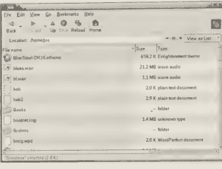
**图3.28** 配置Nautilus，让你能以最符合需求的方式查看数据。
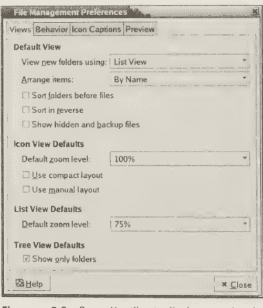
#### 首选应用程序
Gnome允许你为特定任务选择偏好的应用程序（例如*编辑文本*或*浏览网页*）。
**图3.29** 在Gnome控制中心中选择“首选应用程序”，即可设置你常用的程序。
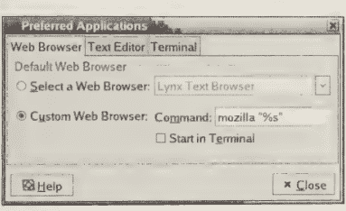
#### 选择首选应用程序：
- 1. 在控制中心中选择“首选应用程序”选项（**图3.29**），会打开首选应用程序窗口（**图3.30**）。该窗口包含3个标签页：网页浏览器、文本编辑器、终端。
- 2. 在各个标签页中选择需要该类程序时自动启动的程序。
- 3. 点击“关闭”保存设置并退出对话框。
**图3.30** 设置首选应用程序后，需要时系统将自动启动你常用的网页浏览器或文本编辑器。
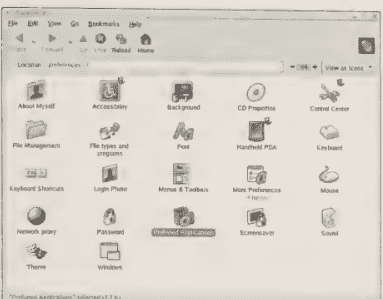
#### 设置面板属性
Gnome面板（**图3.31**）在诸多方面都是Red Hat Linux Gnome桌面环境的控制中枢，你可以通过它启动Gnome主菜单、管理虚拟桌面、启动Netscape浏览器等。正如你所料，Gnome面板支持多种配置方式：它的显示位置没有固定限制，你可以将其设置在屏幕顶部、底部或左右两侧；还可以设置为横向贯穿整个屏幕（边缘面板）或位于屏幕角落（角落面板）。部分面板属性仅对单个面板生效，另一些则对该用户的所有面板都生效。
#### 设置Gnome面板属性：
- 1. 右键点击面板。
- 2. 在弹出的菜单中选择“属性”，会打开面板属性对话框（**图3.32**）。
- 3. 进行你需要的修改。
- 4. 点击“确定”。
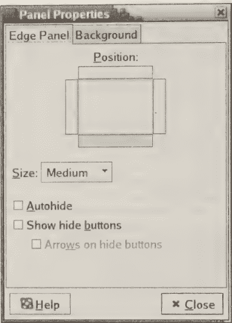
> 图3.32 设置Gnome面板属性，将其放置在你想要的位置，你可以把它放在屏幕的任何位置。

> 图3.31 在Red Hat Linux中，你几乎所有的操作都可以通过Gnome面板完成。
#### 软件包管理
Red Hat Linux使用软件包系统管理软件，该系统可以让你轻松完成计算机上软件的安装与卸载，无需进行繁琐的排查工作。

图3.33 通过Red Hat软件包管理系统，软件管理变得非常简单。
#### 添加或删除软件包：
- 1. 从主菜单中选择“系统设置”>“添加/删除应用程序”。如果你当前未以root用户登录，需要输入root密码才能继续该操作。随后会打开软件包管理窗口（**图3.33**），该窗口与安装时自定义软件包的界面类似。
- 2. 勾选或取消勾选你需要安装/卸载的软件包或软件包组。
- 3. 点击“更新”以管理选中的软件包。
> ✔ 提示 如果你想查看选中软件包组的更多信息，或者需要选择组内的单个软件包，点击右侧的“详细信息”链接。
#### 本章小结
本章你学习了以下内容：
- 使用控制中心
- 设置窗口偏好
- 使用虚拟桌面
- 为系统事件绑定提示音
- 配置外部设备
- 设置程序自动启动
- 切换桌面环境
- 切换为命令行启动模式
- 重启与关闭Linux系统
- 配置Nautilus文件管理器
- 设置首选应用程序
- 设置Gnome面板属性
- 使用软件包管理器
### 第4章 电子邮件与网页
如果你和我们一样，新Linux系统启动后的第一件事就是上网冲浪，接下来就是收发电子邮件。Linux平台上有许多程序可以实现你可能需要的所有网络功能，本章重点介绍其中两款：Mozilla网页浏览器和Ximian Evolution个人信息管理器（简称PIM）。
Mozilla是一款功能全面的网页浏览器和通信套件，基于Netscape数年前公开的编程代码开发。Evolution是Ximian公司开发的一款电子邮件客户端，同时也是多功能时间管理程序，它实现了微软流行的Outlook程序的所有功能，包括与Microsoft Exchange服务器对接的能力。（注：本章仅将Evolution作为电子邮件客户端介绍，Evolution为Red Hat桌面带来的其他功能将在第7章说明。）
不过在使用这些程序前，你需要先配置系统以连接到互联网。本章将介绍如何配置拨号连接。如果你已经通过局域网（或电缆调制解调器）直接连接到网络，可能在Red Hat安装时已经配置好了相应的网络设置。如果你跳过了这一步，或者需要修改已输入的设置，我们也会教你如何配置直接访问互联网的网络设置。


## 第4章 配置调制解调器
在连接到互联网之前，你需要告诉你的计算机如何实现连接。在本节中，我们假设你将使用拨号适配器——换句话说，就是*调制解调器*。要通过调制解调器连接，你需要提供某些信息，例如互联网服务提供商（ISP）的电话号码以及各项网络设置（这些信息应由你的ISP提供）。在开始操作前，请准备好所有ISP提供的信息。
- 提示：大多数ISP的网站都包含“支持”页面，其中收录了配置连接所需的全部信息。
### 打开网络配置工具：
1. 点击GNOME面板左侧的红帽图标，“开始”菜单将打开（图4.1）。
2. 选择“系统设置”>“网络”。查询窗口将打开，并提示输入根密码（图4.2）。
3. 输入根密码后点击“确定”。网络配置工具将打开至“设备”选项卡（图4.3）。

**图4.1** 点击红帽图标打开“开始”菜单。

**图4.2** 必须输入根密码才能访问网络配置工具。

**图4.3** 使用网络配置工具的“设备”选项卡添加新的ISP拨号连接。

创建新的调制解调器连接。这类连接使用串行模拟调制解调器拨号接入互联网服务提供商。这类调制解调器通过普通铜制电话线传输声音信号来传送数据。世界上凡是有电话系统的地区，几乎都可以使用这类连接。
- CIPE（VPN）连接
- 以太网连接
- ISDN连接
- 调制解调器连接
- 令牌环连接
- 无线连接
- xDSL连接
**图4.4** 在“添加新设备类型”窗口中选择“调制解调器连接”来配置你的ISP连接。

**图4.5** Red Hat会扫描系统，查看你是否已经安装了调制解调器，然后列出所有可用的调制解调器供你选择。

**图4.6** 尽管Red Hat提供了一些ISP的信息，但其中没有适用于美国运营商的内容。
### 配置拨号连接：
1. 选择网络配置工具的“设备”选项卡（图4.3）。
2. 点击“新建”按钮，“添加新设备类型”窗口将弹出（图4.4）。
3. 在“添加新设备类型”窗口中，选择“调制解调器连接”选项。
4. 点击“前进”。系统会扫描你的计算机，查找已安装的调制解调器。扫描完成后，“选择调制解调器”界面将弹出（图4.5）。如果系统检测到你的计算机连接了任何调制解调器，这些设备会显示在该界面中。如果系统没有检测到你明确知道已正常安装的调制解调器，你需要使用“选择调制解调器”界面中的下拉菜单手动输入其信息。
5. 点击“前进”。“选择提供商”界面将弹出（图4.6）。该界面包含了许多ISP的连接数据；但其中不包含美国运营商的数据，因此你需要自行配置提供商信息。
6. 在对应的文本框中输入你本地ISP拨号连接的区号和电话号码。
7. 如果你在拨打ISP电话前需要使用前缀，请在“前缀”框中输入该前缀。常见的前缀包括拨外线所需的9，或是禁用呼叫等待的前缀。
8. 在对应的框中输入你的ISP名称、登录名和密码。你需要输入两次密码以完成验证。
9. 点击“前进”。“IP设置”界面将弹出（图4.7）。
10. 如果你的ISP给出了连接到其服务所需设置的明确说明，请完成对应修改后点击“前进”，或直接点击“前进”接受默认设置。“创建拨号连接”界面将弹出（图4.8）。
11. 点击“应用”确认你输入的信息。如果信息有误，请点击“后退”按钮返回可修正错误的界面。点击“应用”后，“添加新设备类型”窗口将关闭，新连接会出现在网络配置窗口中（图4.9）。此时你可能需要配置DNS信息。DNS的全称是*域名服务*，是一种将redhat.com这类互联网名称转换为计算机可用来访问远程机器的数字的机制。

**图4.7** 除非你的ISP明确告知你调整设置，否则你可以接受默认的IP设置。

**图4.8** “创建拨号连接”窗口为你提供了修正错误或核实信息的机会。

**图4.9** 新建的调制解调器连接创建完成后，会显示在网络配置对话框中。
### 输入DNS信息：
1. 点击网络配置窗口中的“DNS”选项卡。
2. 在“主DNS”和“备用DNS”字段中输入对应的IP地址（图4.10）。你应该已经从你的ISP处获得了这些信息。
3. 在“DNS搜索路径”字段中输入你的ISP的域名。例如，如果你的ISP是Earthlink，你需要在该字段中输入earthlink.net。
4. 从下拉菜单中选择“文件”>“保存”来保存你的配置。
5. 选择“文件”>“退出”来关闭网络配置工具。

**图4.10** 输入你的ISP提供的DNS服务器信息，以便你能访问互联网上的其他设备。
### 拨号连接ISP：
1. 确保你的调制解调器连接到了插入可用电话插座的电话线上。
2. 点击GNOME面板左端的红帽图标，“开始”菜单将弹出。
3. 选择“系统工具”>“网络设备控制”。“网络设备控制”窗口将弹出（图4.11），你刚刚定义的设备（连接）名称会显示在该窗口中。
4. 点击新设备以选中它。
5. 点击“激活”按钮。“状态”标题下的说明文字会从“未激活”变为“已激活”，此时你可以测试连接。
6. 通过选择“开始”>“系统工具”>“终端”打开终端窗口，终端窗口将弹出。
7. 执行`ping www.google.com`命令。终端窗口会显示一系列网络测试信号，以及ping数据包到达google.com服务器并返回所需的时间（图4.12）。
8. 按下Ctrl+C停止ping测试。
9. 在“网络设备控制”窗口中，点击“停用”按钮断开调制解调器连接。

**图4.11** 如果你正确配置了连接，它会显示在“网络设备控制”窗口中。

**图4.12** 使用简单的ping命令测试你的连接。
### 提示：
- 域名服务器用于根据输入的URL文本查询互联网上的位置。互联网位置由一串四位数字表示，称为*元组*。例如，www.bearhome.com会转换（或*解析*）为204.0.134.135。
- 在网络配置对话框的“DNS”选项卡中输入的元组用于告知系统在哪里查找DNS*解析*服务——换句话说，就是将文本URL转换为物理元组（图4.13）。
- 通常情况下，你的ISP会提供主DNS和备用DNS元组。请在“名称服务器”框中先输入主DNS元组，再输入备用元组。

**图4.13** 在“DNS”选项卡中输入的元组会告诉你的系统去哪里查找DNS解析服务。


## 第4章
#### 配置直接连接
近年来，家庭用户直接连接互联网已变得越来越普遍。这类连接包括DSL、有线调制解调器和直接局域网连接。在Linux系统中，上述所有连接的工作方式都相同：它们都被配置为以太网连接——其配置方式与拨号连接略有不同。

#### 配置以太网连接：
- 1. 点击Gnome面板左侧的红帽图标，“开始”菜单将会打开。
- 2. 选择“系统设置”>“网络”。查询窗口将会打开，并要求输入root密码（图4.14）。
  
  **图4.14** 输入root密码以配置以太网连接。
- 3. 输入root密码并点击“确定”。“网络配置”对话框将会打开。
  
- 4. 点击“设备”选项卡（图4.15）。
  **图4.15** 在“网络配置”对话框的“设备”选项卡中，你可以查看已有设备并添加新设备。
- 5. 点击“新建”按钮。“新建设备类型”窗口将会打开，默认显示“选择设备类型”面板（图4.16）。
  **图4.16** 在“选择设备类型”面板中，选择“以太网连接”以扫描已有的网卡。
- 6. 选择“以太网连接”。
- 7. 点击“下一步”。程序会扫描计算机上连接的以太网设备。扫描完成后，“选择以太网设备”面板将会出现（图4.17）。
  
  **图4.17** 可用的以太网设备会显示在“选择以太网设备”面板中。
- 8. 在显示的列表中，点击你的以太网卡名称。
- 9. 点击“下一步”按钮。“配置网络设置”面板将会出现（图4.18）。现在你需要配置网络设置。请保持“配置网络设置”面板打开以开始操作，你的互联网服务提供商（ISP）会告知你是需要手动配置还是动态配置。
  
  **图4.18** 如果你的ISP给了你指定的网络设置，请点击“静态设置IP地址”并输入相关信息。

#### 配置手动网络设置：
- 1. 在“配置网络设置”面板中，点击标注为“静态设置IP地址”的单选按钮（图4.18）。
- 2. 在对应字段中输入你的ISP提供的信息：IP地址、子网掩码和默认网关地址。
- 3. 点击“下一步”。“创建以太网设备”面板将会出现（图4.19）。
- 4. 核对显示的信息。如果信息有误，点击“返回”按钮回到可以修正错误的页面。
- 5. 点击“应用”保存你输入的数据。“创建以太网设备”面板将消失。你刚刚配置的设备会显示在“网络配置”对话框中（图4.20）。现在你可以添加DNS信息了。
  
  *图4.19* 在完成连接定义前，请在“创建以太网设备”面板中核对你的设置。
  
  | 配置 | 状态 | 设备 | 昵称 | 类型 |
  | :--- | :--- | :--- | :--- | :--- |
  | ☑ | 启用 | eth0 | eth0 | 以太网 |
  **图4.20** 新的以太网设备现在会显示在“网络配置”对话框中。

#### 配置动态网络设置：
- 1. 在“配置网络设置”面板中，点击标注为“自动获取IP地址设置，使用”的单选按钮（图4.18）。
- 2. 选择连接服务器时使用的协议：dhcp或bootp（图4.21）。你的ISP会告知你使用哪个值；通常情况下dhcp都是正确的选择。
  
  **图4.21** 如果你的ISP自动分配网络IP地址，它会告知你使用哪种协议。
- 3. 如果你的ISP提供了主机名，请在对应字段中输入。
- 4. 点击“下一步”。“创建以太网设备”面板将会出现（图4.19）。
- 5. 核对显示的信息。如果信息有误，点击“返回”按钮回到可以修正错误的页面。
- 6. 点击“应用”保存你输入的数据。“创建以太网设备”窗口将消失。你刚刚配置的设备会显示在“网络配置”对话框中。现在你可以添加DNS信息了。

#### 输入DNS信息：

**图4.22** 如果你的ISP要求你提供DNS服务器信息，请在此输入。
- 1. 点击“网络配置”对话框中的“DNS”选项卡（图4.22）。
- 2. 在“主DNS”和“辅DNS”字段中输入对应的IP地址。你的ISP应该已经提供了这些信息。
- 3. 在“DNS搜索路径”字段中输入你的ISP的域名。例如，如果你的ISP是Earthlink，你需要在该字段中输入**earthlink.net**。
- 4. 从下拉菜单中选择“文件”>“保存”以保存你的配置。
- 5. 选择“文件”>“退出”以关闭网络配置工具。
  
  **图4.23** 在“网络设备控制”对话框中激活你的以太网配置。

#### 激活以太网接口：
- 1. 点击Gnome面板左侧的红帽图标，“开始”菜单将会出现。
- 2. 选择“系统工具”>“网络设备控制”。“网络设备控制”窗口将会出现（图4.23）。
- 3. 找到你刚刚配置的设备。
- 4. 点击该设备以选中它。
- 5. 点击“激活”按钮。“状态”标题下的图例应从“未激活”变为“已激活”，此时你已经连接到网络。现在可以测试以太网连接了。在按照下方*测试以太网连接*任务的步骤操作时，请保持“网络设备控制”窗口打开。

#### 测试以太网连接：
- 1. 通过选择“开始”>“系统工具”>“终端”打开终端窗口，终端窗口将会出现。
- 2. 执行命令`ping www.yahoo.com`。终端窗口会显示一系列网络测试信号，以及ping数据包到达yahoo.com服务器并返回所需的时间（图4.24）。
- 3. 按下Ctrl+C停止ping测试。
- 4. 在“网络设备控制”窗口中，点击“停用”按钮断开调制解调器连接。

##### ✓ 提示
尽管你可能觉得有线调制解调器是拨号式的连接，但它实际上是你计算机与连接到互联网的网络之间的网关。有线调制解调器连接到你计算机上的网卡，因此有线调制解调器连接应当被设置为以太网接口。

**图4.24** 在终端窗口中使用ping命令测试以太网设备。

**图4.25** 第一次打开Mozilla时，你会看到来自Red Hat的欢迎页面。

**图4.26** Mozilla的外观和操作体验与Netscape几乎完全一致，因此你可以轻松浏览网页。

**图4.27** 使用地址栏查找你想查看的网页。

#### 配置和使用Mozilla
接下来，配置并启动Mozilla浏览器的流程非常简单直接。

#### 启动Mozilla浏览器：
- 1. 选择Gnome面板上的Mozilla图标（图4.25）。如果你的面板上没有Mozilla按钮，选择`Start > Internet > Web Browser`。Mozilla浏览器将会出现（图4.26）。如果你是第一次打开Mozilla，你会看到Red Hat的欢迎页面。
- 2. 在地址栏中输入你想访问的任何网页的URL。
- 3. 点击“转到”或按下回车键。例如，输入`www.peachpit.com`即可访问该网站（图4.27）。


#### 配置和使用Mozilla
- 打开Mozilla浏览器后，从下拉菜单中选择「编辑 > 偏好设置」，弹出Mozilla偏好设置窗口（图4.28）。
- 在分类列表中，选择要配置的条目，配置选项会显示在右侧面板中。例如，要配置Mozilla的主页，请在分类列表中选择「导航器」，然后在对应输入框中输入主页地址（图4.29）。

图4.28 在偏好设置窗口中配置Mozilla，让您的浏览体验更舒适。

图4.29 将主页设置为您喜欢的网页，之后每次启动Mozilla浏览器时它都会自动加载。

图4.30 Evolution既是一款个人信息管理工具，也是一款电子邮件客户端，功能与Microsoft Outlook类似。

#### 使用Evolution收发邮件
要配置Evolution用于收发邮件，您需要准备以下信息：用户名、电子邮件密码，以及互联网服务提供商（ISP）的邮件服务器名称或IP地址。

### 配置Evolution的步骤如下：
- 点击GNOME面板左侧的红帽图标，即可弹出「开始」菜单。
- 从菜单中选择「互联网 > Evolution电子邮件」，随后会显示Evolution启动画面，接着弹出Evolution主窗口（图4.30）。
- 从下拉菜单中选择「工具 > 设置」，弹出Evolution设置窗口（图4.31）。
- 在设置窗口的左侧面板中选择「邮件账户」。
- 点击Evolution设置窗口中的「添加」按钮，弹出Evolution账户助手（图4.32），默认打开邮件配置面板。如果您是首次打开Evolution，该助手可能会自动弹出。

图4.31 在Evolution设置窗口中定义您的偏好配置。

图4.32 账户助手将引导您完成新电子邮件账户的设置。
（接下页）

- 点击「下一步」，弹出「身份信息」面板（**图4.33**）。
- 在身份信息面板的文本框中输入要求填写的信息。
- 点击「下一步」，弹出「接收邮件」面板（**图4.34**）。
- 选择您将用来接收邮件的服务器类型。大多数互联网服务提供商使用POP（邮局协议）服务器，如果您的ISP使用其他类型的服务器，它会告知您应选择哪种设置。
**图4.33** 您可以根据需要，在身份信息面板中填写尽可能多或尽可能少的个人信息。

- 输入邮件服务器的名称和您的用户名。
- 如果您希望Evolution记住密码，请勾选「记住此密码」复选框。首次使用Evolution时，系统会提示您输入密码，勾选该选项后，程序会在此之后记住密码。根据您选择的连接类型不同，可能会弹出第二个「接收邮件」面板。
- 在第二个「接收邮件」面板中，配置Evolution与邮件服务器交互的方式。例如，如果您选择了POP，需要设置Evolution检查新邮件的频率，以及下载完成后是否从服务器删除邮件。
**图4.34** 请咨询您的ISP，了解在「接收邮件」面板中应指定哪种邮件服务器。
- 点击「下一步」，弹出「发送邮件」面板（**图4.35**）。
- 选择您用来上传邮件的服务器类型，大多数ISP使用SMTP协议。
- 点击「下一步」，弹出「账户管理」面板（**图4.36**）。
- 输入您想为该账户设置的名字，例如“Bob的邮箱”。
- 如果您想将此账户设为默认电子邮件账户，请勾选对应复选框。
*接下页*

**图4.35** 您还需要指定ISP用于*发送*电子邮件的服务器类型。

**图4.36** 在「账户管理」面板中为这个电子邮件账户命名。
- 点击「下一步」，弹出「完成」面板（**图4.37**）。
- 点击「完成」，Evolution账户助手窗口关闭，新账户会显示在Evolution设置窗口的「邮件账户」部分（**图4.38**）。
- 点击「关闭」，现在您就可以收发电子邮件了。

### **使用Evolution接收电子邮件：**
- 打开Evolution后，点击「发送/接收」按钮，Evolution会连接您ISP的邮件服务器并下载邮件，新邮件的主题会显示在Evolution收件箱窗口的右上方面板中（**图4.39**）。
- 点击邮件主题即可查看对应的邮件内容。
- 如需保存邮件，将其拖拽到Evolution窗口「文件夹」面板中的任意文件夹内即可。


### **使用Evolution发送电子邮件：**
- 打开Evolution后，点击「新建」按钮，弹出「撰写邮件」窗口（**图4.40**）。
- 在「收件人」输入框中输入收件人的电子邮件地址。
- 在「主题」输入框中输入邮件主题。
- 在窗口底部的大面板中输入邮件正文。
- 点击「发送」按钮即可发送邮件，「撰写邮件」窗口会自动关闭，邮件会被添加到待发邮件队列中。
- 点击「发送/接收」按钮，将待发邮件队列中的邮件上传至您ISP的邮件服务器。

### **退出Evolution：**
- 从主菜单中选择「文件 > 退出」。

### **本章总结**
在本章中，您将学习以下内容：
- 配置互联网拨号连接
- 配置互联网以太网连接
- 使用Mozilla网页浏览器
- 使用Evolution个人信息管理工具收发邮件


### Linux文档
Red Hat Linux 9与GNOME桌面环境相结合，构成了极其丰富、强大且复杂的操作系统环境。尽管其中的许多功能都直观易用，但您毫无疑问会在某些时候需要查阅文档。关于Linux和GNOME的文档，有好消息也有坏消息。好消息是，有海量的信息档案可供查阅，几乎涵盖了您可能需要帮助的所有主题；坏消息是，这些文档由许多人（其中大部分是志愿者）贡献，因此通常组织混乱，没有统一的形式和内容，也没有统一的查阅机制。本章将概述当前可用的Linux/GNOME文档类型，以及一些快速找到所需信息的技巧。

### 第5章
#### 应用程序帮助
有时您需要的帮助与特定应用程序相关，而非操作系统本身。您可能想深入了解该应用背后的概念，或是需要知道某个特定功能的具体使用方法。根据不同的应用程序及其开发者的设定，帮助文件是解答这些疑问的最佳资源。大多数运行在GNOME桌面环境中的应用都会提供可在网页浏览器窗口中打开的HTML格式帮助文件。

图5.1 要打开应用程序的帮助系统，请在「帮助」菜单中选择对应条目。

在应用程序中访问帮助的方法如下：
- 打开应用程序，以本文中的Evolution为例
- 从菜单栏中选择「帮助」
- 从「帮助」菜单中选择除「关于」外的任意条目（图5.1），应用程序的帮助文件会在浏览器窗口中打开（图5.2）
- 阅读文件，阅读完毕后关闭浏览器

图5.2 应用程序的帮助文件会在网页浏览器窗口中打开。
- **✓ 提示** * 部分应用程序提供的帮助文件内容详尽，且为HTML格式，您可以直接跳转到需要的部分；另一些则是纯文本文件，不过通常也会包含目录。


#### GNOME 帮助浏览器

GNOME 帮助浏览器与各应用程序附带的帮助文件不同。它包含了 GNOME 桌面环境本身的帮助文件，提供了大量关于 GNOME 的信息。GNOME 帮助浏览器本身是一个应用程序，和网页浏览器类似。你可以把它视作连接你计算机和互联网上各类文档的接口。
### 打开 GNOME 帮助浏览器的方法：
- 1. 点击 GNOME 面板左侧的红色帽子图标打开开始菜单，然后选择「帮助」。你的 GNOME 面板上也可能有一个专门打开 GNOME 帮助浏览器的按钮，它通常是从左数第二个按钮，图标是救生圈。
- 2. 打开后 GNOME 帮助浏览器会默认加载索引页（**图 5.3**）。
- 3. 用鼠标选择你要点击的链接：在本例中，是「桌面」链接。桌面帮助的目录会在浏览器中打开（**图 5.4**）。
- 4. 选择你想要阅读的文档。
- 5. 阅读完帮助文件后关闭浏览器。

**图 5.3** GNOME 帮助浏览器提供了关于配置和使用 GNOME 的详细说明。
**图 5.4** 桌面帮助的目录。
#### 手册页
#### 手册页
手册页（通常简称为「man 页」）是用来描述特定 Linux 命令的参考页面。绝大多数命令都配有对应的手册页。虽然你无法在对应的命令或程序内部直接阅读手册页，但有两种方式可以访问这些文档。
### 打开手册页的方法：
- 1. 点击 GNOME 面板上的红色帽子图标打开开始菜单并选择「帮助」，或者点击面板上的 GNOME 帮助浏览器按钮。GNOME 帮助浏览器打开后会显示索引页。
- 2. 选择「手册页」链接，手册页的目录会打开（**图 5.5**）。
- 3. 选择你想要阅读的手册页分类——在本例中是「系统管理」。系统管理类手册页的索引会在帮助浏览器中显示（**图 5.6**）。

**图 5.5** 手册页按通用分类整理，选择你想要浏览的分类即可。

**图 5.6** 系统管理分类的手册页索引。
- 4. **选择**你想要阅读的手册页。在本例中，我们选择的是「归档」（图 5.7）。
- 5. **关闭**浏览器即可阅读你选择的手册页。

图 5.7 从索引中选择手册页并在浏览器中打开。如有需要，你可以打印或保存该页面。
##### 在命令行中打开手册页
相比 GNOME 帮助浏览器，你可能会觉得在命令行中查看手册页更便捷。在命令行中你可以直接获取所需信息，无需逐级浏览目录。

要打开手册页，在 Linux 提示符后输入 `man` 再加上命令名称即可。例如，要查看 shutdown 命令的语法，输入 `man shutdown`（图 5.8）。当然，你也可以使用 `man` 命令来了解更多关于 man 的使用方法：只需输入 `man man` 即可。要退出命令行文档界面并返回提示符，输入 `q`。
图 5.8 你也可以直接在命令行中阅读手册页。
#### Info 页
Info 页包含的内容比手册页更偏向通用、概念性的信息。不过并非每个应用程序都有对应的 Info 页，大多数程序反而配有手册页。你总会值得检查你正在使用的程序是否有 Info 页，因为其中的信息通常比手册页里的技术性低很多。
### 打开 Info 页的方法：
- 1. 点击 GNOME 面板上的红色帽子图标打开开始菜单并选择「帮助」，或者点击面板上的 GNOME 帮助浏览器按钮。GNOME 帮助浏览器打开后会显示索引页（图 5.3）。
- 2. 选择「Info 页」链接，Info 页的目录会打开（**图 5.9**）。
- 3. 选择具体条目：例如 bash。对应条目的 Info 页会打开（**图 5.10**）。
- 4. 阅读完信息后关闭帮助浏览器。

**图 5.9**

**图 5.10**
##### 在命令行中打开 Info 页
和手册页类似，你可能会觉得在命令行中查看 Info 页更便捷。要打开 Info 页，在 Linux 提示符后输入 **info** 再加上命令名称即可。例如，要查看 bash 的相关内容，输入 `info bash`。当然，你也可以使用 `info` 命令来了解更多关于 info 的使用方法：只需输入 `info info` 即可。要退出命令行文档界面并返回提示符，输入 `q`。
**图 5.11** GNOME 官方网站提供了大量有用的信息。

**图 5.12** GNOME 文档很容易找到。

**图 5.13** GNOME 常见问题解答（FAQ）是熟悉这款桌面软件的好方法。

#### 在网络上查找信息
互联网上有大量优质的 Linux 和 GNOME 相关信息来源。其中一部分由红帽和 GNOME 项目赞助，另一部分则由无商业关联的个人和志愿者运营。当然，难点在于找到你需要的信息。
### 打开 GNOME 常见问题解答的方法：
- 1. 打开你的网页浏览器。
- 2. 在地址栏中输入 `http://www.gnome.org/`
- 3. 按下回车键。如果你已连接到互联网，GNOME 官方网站会打开（图 5.11）。
- 4. 选择右侧边栏菜单中的「常见问题解答（FAQ）」链接。会弹出一个新窗口，其中显示了 GNOME 用户常见问题解答以及其他 GNOME 桌面相关文档的链接（图 5.12）。
- 5. 选择「GNOME 用户常见问题解答」链接，即可在浏览器中查看该 FAQ（图 5.13）。
> **提示** 默认安装的 GNOME 会在桌面上放置一个指向 GNOME 官方网站的图标，点击该图标即可打开浏览器并加载 GNOME 站点。
### 打开红帽知识库的方法：
- 1. 打开你的网页浏览器。
- 2. 在地址栏中输入 `http://www.redhat.com`
- 3. 按下回车键。如果你已连接到互联网，红帽官方网站会打开。
- 4. 选择屏幕顶部菜单栏中的「支持与文档」链接（图 5.14）。
> **提示** 默认安装的 GNOME 会在桌面上放置一个指向红帽官方网站的图标，点击该图标即可打开浏览器并加载红帽站点。
### 搜索特定主题的方法：
- 1. 在浏览器的地址栏中输入 `http://www.redhat.com/docs/` 并按下回车键，文档搜索页面会打开（图 5.15）。
- 2. 在「搜索文档」标题下方的关键词框中输入你要搜索的主题。
- 3. 点击「搜索」按钮，搜索引擎会返回与你请求主题相关的文件列表（图 5.16）。
**图 5.14** 选择「支持与文档」链接即可访问红帽知识库。

**图 5.15** 文档搜索页面。

**图 5.16** 搜索结果以相关文件列表的形式展示。


**图 5.17** 红帽支持资源页面。

### 访问红帽支持资源的方法：
- 1. 打开你的网页浏览器。
- 2. 在地址栏中输入 `http://www.redhat.com/apps/support/resources`
- 3. 按下回车键。如果你已连接到互联网，红帽支持资源页面会打开（图 5.17）。在该页面上，你可以搜索知识库、阅读红帽文档，以及查看 HOWTO 和提示文件。
> **✔ 提示** 默认安装的 GNOME 会在桌面上放置一个指向红帽支持网站的图标，点击该图标即可打开浏览器并加载红帽支持站点。


#### Red Hat 勘误表
勘误文件包含程序（或其文档）自发布以来被发现的相关已知错误的信息。Red Hat 发布的勘误主要分为三类：安全更新、错误修复和功能增强。
##### 查看 Red Hat 勘误
1. 在浏览器的地址栏中输入 `http://www.redhat.com/apps/support/errata`，然后按下回车键。此时将打开勘误页面（图 5.18）。在该页面中，你可以按勘误分类筛选文档、下载补丁，以及查阅 Red Hat 的通用勘误政策。
2. 选择 Red Hat Linux 9（Shrike）链接。浏览器中将显示 Red Hat Linux 9 相关的勘误索引（图 5.19）。
3. 阅读完勘误文件后关闭浏览器。

**图 5.18** 勘误页面会详细说明软件发布后发现的问题。你可以在此找到补丁和警报。

**图 5.19** Red Hat 勘误按发布版本排序，并分为不同类别。
#### Linux 文档项目
Linux 文档项目（LDP）旨在提供全面的 Linux 文档。该项目在全球各地的镜像站点上托管。LDP 志愿者制作的文档主要分为三类：HOWTO 文件、手册页和常见问题解答（FAQ）。
##### 打开 Linux 文档项目站点
1. 打开网页浏览器。
2. 在地址栏中输入 `http://www.tldp.org/`
3. 按下回车键。如果已连接互联网，将打开 Linux 文档项目站点（图 5.20）。
> **提示**
> - 默认的 Gnome 安装会在桌面上放置一个指向 Linux 文档项目的图标。

**图 5.20** Linux 文档项目是一个志愿者团体，致力于准确记录 Linux 软件相关文档的工作。
##### 打开 Linux HOWTO 索引
1. 打开 Linux 文档项目主窗口，点击 HOWTOs 链接。浏览器中将显示 HOWTOs 页面（**图 5.21**），该页面列出了多种操作指南的信息格式。
2. 向下滚动页面，选择纯文本链接。纯文本 HOWTO 索引页面将打开（**图 5.22**）。
3. 选择你想要阅读的 HOWTO 文件。该文件将以纯文本格式显示在浏览器窗口中（**图 5.23**）。
> **提示**
> 你可以使用相同的步骤访问 LDP 站点上的 FAQ 或手册页数据库。

**图 5.21** HOWTOs 页面提供多种格式的操作指南文件。
#### 总结
在本章中，你学习了如何：
- 在应用程序中获取帮助
- 打开 Gnome 帮助浏览器
- 打开手册页
- 打开 info 页
- 访问 Gnome 常见问题解答
- 打开 Red Hat 知识库
- 搜索 Red Hat 及其他 Linux 站点以获取信息
- 访问 Red Hat 支持站点
- 访问 Red Hat 勘误页面
- 访问 Linux 文档项目站点
- 打开 Linux HOWTO 索引

**图 5.22** 你可以在 LDP 的 HOWTO 板块获取多数 Linux 相关任务的明确指引。

**图 5.23** 你可以在浏览器中查看单独的纯文本 HOWTO 文件。
## 第 2 部分 # 在 Red Hat Linux 9 中实现窗口化操作
Red Hat Linux 9 支持窗口化操作——注意这里是小写的 w。Gnome 桌面环境是世界一流的窗口化环境。使用 Gnome，你可以随心所欲地排列窗口！而且 Gnome 并不是 Red Hat Linux 9 唯一的桌面环境。如今，诸如 Ximian 的 Evolution 邮件客户端、KWord 文字处理器等顶级个人生产力应用已经推出，没有理由不将 Red Hat Linux 作为你的个人首选平台。
**第 6 章：桌面环境** 将介绍多窗口环境的概念，以及如何在不同环境间切换。你还将学习如何使用初始登录界面的相关选项。
**第 7 章：其他实用应用** 将带你深入了解 Gnome 和 KDE 桌面环境自带的强大应用套件。
**第 8 章：Linux 版 KWord** 将教你如何配置和使用 KWord 文字处理器，以及如何利用它的一些高级功能。
**第 9 章：数据库操作入门** 将介绍如何使用 Red Hat Linux 9 自带的 MySQL 数据库服务器。
## 第 2 部分 # 在 Red Hat Linux 9 中实现窗口化操作 | 章节 | 页码 | 子主题 |
| --- | --- | --- |
| 数据库操作入门 | 175 | - MySQL<br>- 管理 MySQL 服务器<br>- 使用 mysqladmin<br>- MySQL 用户与权限<br>- MySQL 客户端<br>- 操作数据库<br>- 制作备份<br>- MySQL 日志<br>- 总结 |
| 桌面环境 | 97 | - 登录界面选项<br>- 选择语言<br>- 选择桌面环境<br>- 更改默认桌面<br>- 重启系统<br>- 关闭计算机<br>- KDE：备选桌面环境<br>- 配置 KDE<br>- 退出 KDE<br>- 设置用户和组<br>- 更改 root 密码<br>- 总结 |
| 其他实用应用 | 125 | - 使用 Evolution<br>- 使用 Evolution 日历<br>- 使用 Evolution 任务<br>- 使用 Evolution 联系人<br>- 使用 gEdit<br>- 使用 Xpdf<br>- 使用 Konqueror<br>- 使用 KMail<br>- 使用 GIMP<br>- 总结 |
| Linux 版 KWord | 157 | - 使用 KWord<br>- 配置 KWord<br>- 操作 KWord 文档<br>- 添加图片<br>- 格式化字符<br>- 表格<br>- 文件格式<br>- 获取帮助<br>- 总结 |
### 6 桌面环境
在第 3 章中，我们介绍了如何配置 Gnome 桌面环境以适配你的个人偏好。本章将带你学习更多配置 Red Hat 的方法。本章首先会讨论 Red Hat Linux 的登录界面选项。虽然你可以在登录账户后对 Red Hat Linux 配置进行永久修改，但也可以为单个 Linux 会话设置仅生效一次的语言或外观选项。接下来，你将学习如何配置备选桌面环境。Red Hat Linux 9 支持你使用 K 桌面环境（KDE）替代 Gnome。尽管 Red Hat Linux 9 与 Gnome 桌面的集成度很高，但你在处理某些特定任务，甚至是日常工作时，可能更倾向于使用 KDE。最后，我们将向你展示如何使用可视化工具 Red Hat 用户管理器处理一些重要的管理任务，包括配置用户、组和权限。（完整的 Linux 管理细节，特别是命令行使用相关内容，请参阅第 11 章和第 12 章。）
#### 登录界面选项
在 Red Hat Linux 的默认配置中，系统启动后会进入图形化桌面环境。如果你的系统仍保持此配置，将会显示 Red Hat Linux 9 的图形化登录界面（图 6.1）。顾名思义，你可以通过该界面输入登录凭据和密码。此外，登录界面底部还有四个菜单按钮：
- **语言菜单**：可用于为当前会话选择其他语言。
- **会话菜单**：可用于为当前会话选择其他桌面环境。
- **重启菜单**：用于重启计算机。
- **关机菜单**：用于正确关闭计算机。
你可以通过这些菜单选择仅对当前会话生效的一次性设置。若要使这些设置永久生效，需要在登录后更改默认设置。你还需要知道，当你退出桌面环境后，Red Hat Linux 9 的登录界面会重新显示。

> **图 6.1** 图形化登录界面底部的四个菜单仅会对当前会话的系统设置生效。


#### 选择语言
登录时提供的语言选项决定了当前 Red Hat Linux 9 会话启动时使用的语言。你选择的语言用于构建菜单项、对话框和窗口的文本。不过，无论你选择哪种语言，部分桌面环境元素仍会以英文显示，因为开发者没有编写特定语言的替代内容。例如，当使用保加利亚语时，多数“开始”菜单项和桌面图标仍会标注为英文。
### 选择语言的操作步骤：
1. 点击登录屏幕底部的“语言”按钮，会弹出语言菜单（图 6.2）。根据安装时选择的语言，列表中最多可能显示 50 种语言及其对应的字符集。
2. 在菜单中选择你要用于本次会话的语言，也可以选择“系统默认”（安装时设置）或“上次使用”（上一次会话使用的语言）（图 6.3）。
3. 点击“确定”设置语言并退出菜单。
4. 如果你想要为本次会话设置其他选项，现在就可以操作，例如选择其他桌面环境。
5. 返回登录屏幕后，输入用户名并按回车键。
6. 出现提示时，输入密码并按回车键，即可登录 Red Hat Linux 9。

图 6.2 如需更改本次会话使用的语言，可从长长的语言菜单中选择一项。

图 6.3 如果要使用上一次会话使用的语言，请在语言菜单中选择“上次使用”。

#### 选择桌面环境
登录时提供的会话选项决定了当前 Red Hat Linux 9 会话将使用的桌面环境。
### 选择桌面环境的操作步骤：
1. 点击登录屏幕底部的“会话”按钮，会弹出会话菜单（**图 6.4**）。
2. 在会话菜单中，点击你希望用于本次会话的桌面环境对应的单选按钮。默认选项有“上次使用”“安全模式”“GNOME”和“默认”。如果你在安装时选择安装了 KDE 桌面程序，它也会出现在列表中。除非你使用桌面切换工具更改过设置，否则默认桌面是 GNOME；“上次使用”选项会启用你机器上上一次成功完成的 Red Hat 会话所使用的桌面环境。有关“安全模式”选项的更多信息，请参阅后续说明中的*安全模式*侧边栏。
3. 点击“确定”保存设置并退出菜单。
4. 返回登录屏幕后，输入用户名并按回车键。
5. 出现提示时，输入密码并按回车键，即可使用你选择的桌面环境登录 Red Hat Linux 9。

**图 6.4** 使用会话菜单可启动带有不同桌面环境的 Red Hat Linux。
#### 安全模式
安全模式是基于文本的界面，显示在登录屏幕的右下角。它允许你在提示符后输入 Linux 命令（**图 6.5**）。由于安全模式运行时无需 X-Window 服务器运行，只要你的系统能进入登录屏幕，就几乎一定能通过安全模式登录。因此，如果你的电脑无法启动到图形化界面，但*可以*进入登录屏幕，你就可以使用安全模式来调试问题。要从安全模式返回普通登录屏幕，只需在提示符后输入 exit，登录屏幕就会重新出现。

**图 6.5** 安全模式允许你在提示符后输入 Linux 命令。
#### 更改默认桌面
如果你觉得其他桌面环境比 GNOME 更合心意，可以轻松更改默认桌面环境，这样每次登录时就不需要点击“会话”按钮了。
### 更改默认桌面的操作步骤：
1. 使用 GNOME 登录你的账户。
2. 点击 GNOME 面板上的 Red Hat 图标，打开“开始”菜单（图 6.6）。
3. 选择“系统工具”>“更多系统工具”>“桌面切换工具”，会弹出桌面切换工具窗口（图 6.7）。
4. 在桌面切换工具中，点击你希望设为默认的桌面环境对应的单选按钮。
5. 确保未勾选“更改仅对当前显示器生效”复选框。
6. 点击“确定”保存你的选择并退出桌面切换工具，下次登录时默认桌面就会设置为你的新选择。
##### 提示
- 有关使用桌面切换工具的更多信息，请参阅第 3 章的*切换桌面环境*部分。
- 如果只想更改当前会话的桌面环境，请按照前面步骤操作，但务必勾选“更改仅对当前显示器生效”复选框。当你注销后重新登录时，默认桌面将保持不变。


#### 重启系统
如果需要重启电脑，可以直接从登录屏幕操作，无需先登录账户再重启机器，省去一步操作。
### 重启系统的操作步骤：
1. 点击登录屏幕底部的“重启”按钮，会弹出重启窗口（**图 6.8**）。
2. 点击“是”确认你要重启系统，Red Hat 会自动关机并重启电脑，重启完成后会重新出现图形化登录屏幕。
3. 输入用户名并按回车键。
4. 出现提示时，输入密码并按回车键或点击“确定”，即可登录 Red Hat Linux 9。

**图 6.8** 使用登录屏幕上的“重启”按钮无需登录即可重启机器。
##### 提示
这等同于在命令提示符后输入 `shutdown -r now`。
#### 关闭计算机
如果想要关闭计算机并保持断电状态，请使用“关机”菜单而非“重启”选项。和重启操作一样，通过登录屏幕的关机流程无需登录即可关机，省去额外操作。
### 关闭系统的操作步骤：
1. 点击登录屏幕底部的“关机”按钮，会弹出关机窗口（**图 6.9**）。
2. 点击“是”确认你要关闭系统，Red Hat 会自动关机并切断电脑电源。想要重启机器并回到图形化登录屏幕，需要按下电源键或拨动电源开关。
##### 提示
这等同于在命令提示符后输入 `shutdown -h now`。
## 第 6 章
#### KDE：备选桌面环境
##### 提示
多数 Windows 用户通常不会将桌面环境与底层操作系统区分开来，对绝大多数 Windows 用户来说，Windows 桌面*就是*操作系统。
- 有关 KDE 的更多信息，请访问 KDE 主页[http://www.kde.org](http://www.kde.org)。
- 你可能愿意使用 KDE 的另一个原因是，它是旧版本 Red Hat Linux 的默认桌面环境——这意味着你可能已经习惯使用它。与之相比，在 Red Hat Linux 9 中，你可以选择其他桌面环境（这些环境提供了连接用户与底层 Linux 操作系统的外观和操作体验）。由于 Linux 和微软 Windows 不同，是一个自由开放的环境，人们自然会决定创建更多桌面环境。大多数情况下，桌面环境由志愿者开发和维护。如你在第 3 章所学，Red Hat Linux 9 默认提供两种桌面环境：GNOME 和 KDE。两种环境非常相似，许多 KDE 的元素已被添加到 GNOME 的菜单中。不过，你可能会更喜欢其中一种的操作感受，而且两种环境的几乎所有软件和功能都可以在另一种环境中使用。阅读完本章后，你可以自行判断是否对使用 KDE 感兴趣。由于 GNOME 与 Red Hat Linux 9 的集成度非常高，你可能永远不会产生使用 KDE 的需求。但另一方面，你也可能更喜欢其他备选桌面的外观或操作感受。顺便说一下，你可能好奇*K*在*KDE*中代表什么。其实什么都不代表！就像克莱斯勒汽车公司曾短暂推出过的简化版 K-Car 汽车一样，你可以把 KDE 看作是一个简化版——但功能极其强大的桌面环境。
**KDE：备选桌面环境**

图 6.10 在会话菜单中选择KDE单选按钮。
#### 使用KDE
如果你之前使用过红帽Linux，可能对更早版本的KDE有所了解（因为在6版本之前，KDE是默认桌面环境）。由于红帽9自带的Gnome版本中整合了许多KDE的程序和组件，启动到KDE时你可能会发现很难区分这两个桌面环境。
### 启动KDE的方法：
1. 确保你的计算机会自动以图形模式启动（请参阅第3章的*启动到命令行*部分）。这是默认状态，因此除非你更改过运行级别，否则无需担心这个设置。
2. 点击红帽登录界面上的【会话】按钮。
3. 在会话菜单中，选择KDE旁边的单选按钮（见图6.10）。
4. 点击【确定】保存更改并退出会话菜单。
5. 回到登录界面，输入用户名后按回车键。
6. 出现提示时，输入密码后按回车键。红帽Linux 9会启动到KDE环境（见图6.11）。

图 6.12 启动时出现的KTips会提供使用KDE的实用建议。
##### ✓ 提示
默认情况下，KDE会在启动时显示KTip提示。这些提示能够提供快速指引，让你更轻松地使用KDE。你可以在KTip窗口中取消勾选【启动时显示提示】复选框来关闭这些提示（见图6.12）。

#### KDE：备选桌面环境
#### 配置KDE
你可以通过KDE控制中心配置KDE的诸多方面。该控制中心分为10个面板，几乎可以对KDE的外观和行为的每一个元素进行详细配置。借助这款图形化工具，修改系统设置非常简单。
### 打开KDE控制中心的方法：
1. 按照上一部分中的步骤1到步骤6登录你的账户。
2. 点击KDE面板左侧的红帽图标（见图6.13），此时会弹出【开始】菜单（见图6.14）。
图 6.13 要打开【开始】菜单，请点击KDE面板上的红帽图标。
图 6.14 KDE控制中心位于【开始】菜单的主界面中，访问非常方便。
图 6.15 可以使用KDE控制中心配置种类繁多的桌面和操作系统组件。
3. 选择【控制中心】。此时会打开KDE控制中心，默认显示【索引】选项卡（见图6.15）。
4. 点击【搜索】选项卡，控制中心的搜索面板会展开（见图6.16）。
图 6.16 KDE控制中心的搜索面板。
5. 在搜索面板中，可从菜单中选择一个关键词，或在搜索框中输入关键词。【关键词】菜单下方会显示所有和所选关键词相关的控制中心面板列表。点击你要操作的面板，该面板就会在控制中心的右侧窗口打开（见图6.17）。
6. 点击【应用】按钮保存并应用你的更改。你可以在不退出控制中心的情况下切换面板，只需确保在退出当前面板前点击应用更改即可。
图 6.17 从控制中心左侧的【关键词】列表中选择你要操作的面板，右侧就会显示该面板的内容。
7. 在下拉菜单中选择【文件】>【退出】即可退出控制中心，返回KDE桌面。

### 第6章
### 配置KDE外观的方法：
1. 按照上一部分介绍的方法打开KDE控制中心。
2. 如果【索引】选项卡未处于激活状态，点击该选项卡。
3. 在索引列表中选择【外观与主题】。控制中心右侧窗口会显示【外观与主题】面板（见图6.18）。你可以通过该面板配置KDE的10项通用外观元素，包括背景、颜色、字体、图标、KDE面板、屏幕保护程序等。
4. 选择你要配置的元素，然后进行你想要修改的设置。
5. 完成每个面板的设置修改后，点击【应用】。
6. 如果要进行其他配置修改，可从索引面板中选择其他主题。
7. 在下拉菜单中选择【文件】>【退出】即可退出控制中心，返回KDE桌面。
##### ✓ 提示
Gnome和KDE都支持桌面主题，也就是协调搭配的按钮、颜色、背景和其他窗口元素的组合包。有成千上万个主题可供选择，契合你的心情或喜好。
图 6.18 【外观与主题】面板可定义KDE桌面的外观。
### 配置KDE桌面的方法：
图 6.19 【桌面】面板可定义各个桌面元素的行为。
1. 按照本章前文介绍的*打开KDE控制中心的方法*打开KDE控制中心。
2. 如果【索引】选项卡未处于激活状态，点击该选项卡。
3. 在索引列表中选择【桌面】。控制中心右侧窗口会显示【桌面】面板（见图6.19）。该面板提供了配置KDE桌面6个元素的工具，包括桌面外观与行为、面板和任务栏的行为，以及多桌面的设置方式。
4. 选择你要配置的元素，然后进行你想要的修改。
5. 完成每个面板的修改后，点击【应用】。
6. 如果要进行其他配置修改，可从索引面板中选择其他主题。
7. 在下拉菜单中选择【文件】>【退出】即可退出控制中心，返回KDE桌面。
### 了解你的计算机的更多信息的方法：
1. 按照本章前文介绍的*打开KDE控制中心的方法*打开KDE控制中心。
2. 如果【索引】选项卡未处于激活状态，点击该选项卡。
3. 在索引列表中选择【信息】。控制中心右侧窗口会显示【信息】面板（见图6.20）。该面板会提供你计算机硬件的关键信息，包括设备、端口和中断分配、分区，以及配置或新增硬件、软件所需的其他必要信息。
4. 从列表中选择一个设备或状态，右侧面板会显示该元素的相关信息。
5. 如果要获取计算机其他元素的信息，可从索引面板的列表中选择其他条目。
6. 在下拉菜单中选择【文件】>【退出】即可退出控制中心，返回KDE桌面。
图 6.20 可在控制中心的【信息】面板中获取关键系统信息。
### 在KDE中配置互联网和网络的方法：
1. 按照本章前文介绍的*打开KDE控制中心的方法*打开KDE控制中心。
2. 如果【索引】选项卡未处于激活状态，点击该选项卡。
3. 在索引列表中选择【互联网与网络】。控制中心右侧窗口会显示【互联网与网络】面板（见图6.21）。通过该面板，你可以配置桌面和文件共享、设置邮箱、定义网络偏好，以及使用其他Linux网络程序。
图 6.21 可在【互联网与网络】面板中配置你的网络和互联网软件。
#### 桌面环境
### 配置KDE专属组件的方法：
1. 按照本章前文介绍的*打开KDE控制中心的方法*打开KDE控制中心。
2. 如果【索引】选项卡未处于激活状态，点击该选项卡。
3. 在索引列表中选择【KDE组件】。控制中心右侧窗口会显示【KDE组件】面板（见图6.22）。你可以通过该面板配置KDE专属程序，例如拼写检查器和地址簿。还可以在该面板中设置默认组件，以及管理会话默认配置。
4. 选择你要配置的元素，然后进行你想要的修改。
5. 完成每个面板的修改后，点击【应用】。
6. 如果要进行其他配置修改，可从索引面板中选择其他主题。
7. 在下拉菜单中选择【文件】>【退出】即可退出控制中心，返回KDE桌面。
图 6.22 【组件】面板用于配置KDE专属程序，例如地址簿。


#### 配置KDE
### 配置外围设备：
- 1. 按照本章前面所述的*打开KDE控制中心*的方法，打开KDE控制中心。
- 2. 如果“索引”选项卡未处于顶部，请单击该选项卡。
- 3. 从索引列表中选择“外围设备”。“外围设备”面板会出现在控制中心的右侧窗口中（**图6.23**）。你可以通过该面板配置多种基础外围设备，例如键盘、数码相机、鼠标和系统打印机。
- 4. 选择要配置的选项，并进行你需要的修改。
- 5. 完成每个面板上的修改后，单击“应用”。
- 6. 如需进行其他配置修改，请从索引面板中选择其他主题。
- 7. 从下拉菜单中选择“文件”>“退出”，即可退出控制中心并返回KDE桌面。
> **图6.23** 如果你需要配置鼠标或新数码相机等外围设备，请使用“外围设备”面板。

### 配置计算机的电源管理：
- 1. 按照本章前面所述的*打开KDE控制中心*的方法，打开KDE控制中心。
- 2. 如果“索引”选项卡未处于顶部，请单击该选项卡。
- 3. 从索引列表中选择“电源控制”。“电源控制”面板会出现在控制中心的右侧窗口中（**图6.24**）。该面板提供两个控制选项：一个用于显示器电源，一个用于笔记本电脑电池。如果你的默认显示器和笔记本设置足够满足需求，你可能永远不需要调整这些选项，但了解它们的位置是很有用的。
- 4. 选择要配置的选项，并进行你需要的修改。
- 5. 完成每个面板上的修改后，单击“应用”。
- 6. 如需进行其他配置修改，请从索引面板中选择其他主题。
- 7. 从下拉菜单中选择“文件”>“退出”，即可退出控制中心并返回KDE桌面。
> **图6.24** 如果你需要为笔记本电池使用或显示器行为定义新参数，请使用控制中心的“电源控制”面板。

### 更改区域或辅助功能设置：
- 1. 按照本章前面所述的*打开KDE控制中心*的方法，打开KDE控制中心。
- 2. 如果“索引”选项卡未处于顶部，请单击该选项卡。
- 3. 从索引列表中选择“区域与辅助功能”。“区域与辅助功能”面板会出现在控制中心的右侧窗口中（**图6.25**）。
- 4. 选择要配置的选项，并进行你需要的修改。
- 5. 完成每个面板上的修改后，单击“应用”。
- 6. 如需进行其他配置修改，请从索引面板中选择其他主题。
- 7. 从下拉菜单中选择“文件”>“退出”，即可退出控制中心并返回KDE桌面。
> **图6.25** “区域与辅助功能”面板提供了更改时区、字体大小以及其他能让计算机更易用或更适配你所在地点的设置的工具。

### 更改安全与隐私设置：
- 1. 按照本章前面所述的*打开KDE控制中心*的方法，打开KDE控制中心。
- 2. 如果“索引”选项卡未处于顶部，请单击该选项卡。
- 3. 从索引列表中选择“安全与隐私”。“安全与隐私”面板会出现在控制中心的右侧窗口中（**图6.26**）。该面板包含两个工具：一个用于管理你设备上的加密工具，一个用于配置密码设置。你可能会找到仅在命令行运行的更强大的工具，但如果你是加密和强密码使用的新手，这些工具是很好的入门选择。（强密码需同时包含数字和字母，且不能是词典中的单词。）
- 4. 选择要配置的选项，并进行你需要的修改。
- 5. 完成每个面板上的修改后，单击“应用”。
- 6. 如需进行其他配置修改，请从索引面板中选择其他主题。
- 7. 从下拉菜单中选择“文件”>“退出”，即可退出控制中心并返回KDE桌面。
> **图6.26** “安全与隐私”面板可使用基础的加密和密码管理工具。

### 配置声音与多媒体：
> **图6.27** 你可以在“声音与多媒体”面板中设置系统声音和音频CD的行为。
- 1. 按照本章前面所述的*打开KDE控制中心*的方法，打开KDE控制中心。
- 2. 如果“索引”选项卡未处于顶部，请单击该选项卡。
- 3. 从索引列表中选择“声音与多媒体”。“声音与多媒体”面板会出现在控制中心的右侧窗口中（**图6.27**）。该面板上的工具可以让你设置将音频CD插入光驱时触发的操作、设备播放声音的方式以及系统声音的配置方式。
- 4. 选择要配置的选项，并进行你需要的修改。
- 5. 完成每个面板上的修改后，单击“应用”。
- 6. 如需进行其他配置修改，请从索引面板中选择其他主题。
- 7. 从下拉菜单中选择“文件”>“退出”，即可退出控制中心并返回KDE桌面。

### 执行系统管理任务：
- 1. 按照本章前面所述的*打开KDE控制中心*的方法，打开KDE控制中心。
- 2. 如果“索引”选项卡未处于顶部，请单击该选项卡。
- 3. 从索引列表中选择“系统管理”。“系统管理”面板会出现在控制中心的右侧窗口中（**图6.28**）。该面板允许你在图形化界面中执行一些基础管理功能。你可以在此面板中配置LILO引导管理器和K显示管理器（KDM）登录管理器，还可以使用Linux内核的前端工具。你也可以设置搜索路径，并定义文件的存储和磁盘搜索方式。
- 4. 选择要配置的选项，并进行你需要的修改。
- 5. 完成每个面板上的修改后，单击“应用”。
- 6. 如需进行其他配置修改，请从索引面板中选择其他主题。
- 7. 从下拉菜单中选择“文件”>“退出”，即可退出控制中心并返回KDE桌面。

#### 桌面环境
### **配置Web浏览体验（针对Konqueror浏览器）：**
> **图6.29** 如果你使用KDE的Web浏览器Konqueror，请在“Web浏览”面板中对其进行配置。
- 1. 按照本章前面所述的*打开KDE控制中心*的方法，打开KDE控制中心。
- 2. 如果“索引”选项卡未处于顶部，请单击该选项卡。
- 3. 从索引列表中选择“Web浏览”。“Web浏览”面板会出现在控制中心的右侧窗口中（**图6.29**）。Konqueror的常规行为、缓存存储和字体设置，以及Cookie、Java和CGI选项均可在该面板中管理。
- 4. 选择要配置的选项，并进行你需要的修改。
- 5. 完成每个面板上的修改后，单击“应用”。
- 6. 如需进行其他配置修改，请从索引面板中选择其他主题。
- 7. 从下拉菜单中选择“文件”>“退出”，即可退出控制中心并返回KDE桌面。
KDE Konqueror Web浏览器的更多详细信息请参阅第7章的*使用Konqueror*部分。

#### 退出KDE
### **退出KDE：**
- 1. 单击KDE面板左侧的红色帽子图标，即可打开“开始”菜单。
- 2. 选择“退出 *用户名*”（其中*用户名*是你登录时使用的账户名）（**图6.30**），此时会弹出“退出”窗口（**图6.31**）。
- 3. 单击“退出”即可结束会话，返回Red Hat图形登录界面。
> **图6.30** 你可以通过“开始”菜单退出KDE，或查看当前使用的账户。
> **图6.31** “退出”界面。


### 第6章 设置用户与组
在类Unix系统（包括Linux）中，每个文件和*进程*（由程序启动的活动）都有*归属*。文件或进程的所有者对其拥有主要控制权，只有超级用户root才能覆盖这些权限。每个文件都同时拥有所有者和组所有者，所有者可以设置文件的权限，使其他人无法访问该文件。
你可能会有兴趣发现，你的Linux系统中存在非人类用户（以及用户组），这类账户及其他类似账户会在安装过程中自动创建，具体包括以下几类：
- **daemon**：它是系统软件进程的所有者，同时也是对应的组所有者。
- **bin**：通常是存放系统命令和可执行文件的目录的所有者。
- **sys**：该组的成员拥有交换文件、内存镜像这类资源。
- **nobody**：代表无需（或不应）获得特殊权限的软件的所有者。
将人类用户划分到不同用户组，可以帮助确保每个人拥有规整的数据存储位置、个人初始化文件，以及合适的访问权限等级。你可以通过编辑对应的配置文件手动配置用户和用户组，我们将在第11章的*所有权与权限*部分介绍具体方法。如果你更习惯使用图形化工具管理机器，可以通过Red Hat用户管理器增删改用户和用户组信息。

#### 添加用户
- 1. 点击Gnome面板左侧的Red Hat图标，此时会弹出开始菜单。
- 2. 选择「系统设置」>「用户与组」，此时会弹出询问窗口（图6.32）。
- 3. 在询问窗口的文本框中输入root密码。
- 4. 点击“确定”。root密码验证通过后，会弹出Red Hat用户管理器（图6.33）。
- 5. 点击用户管理器中的「用户」选项卡。
- 6. 点击工具顶部菜单栏中的「添加用户」按钮，此时会弹出「创建新用户」窗口（图6.34）。


**图6.32** 要访问Red Hat用户管理器工具，必须提供root密码：


**图6.33** Red Hat用户管理器提供了简单易用的图形化方式，用于管理机器上的用户库。


**图6.34** 在「创建新用户」对话框中指定用户名和密码即可添加新用户（其余字段为可选）。


**图6.35** 编辑新用户时，其相关设置会显示在「用户」选项卡中。

- 7. 在「创建新用户」窗口的文本字段中输入新用户的相关信息。至少需要提供用户名和密码（需输入两次以确认），你也可以补充用户的完整姓名、定义登录shell和主目录，以及创建仅属于该用户的私有组。
- 8. 完成用户信息输入后点击“确定”，“创建新用户”窗口会关闭，新用户会显示在用户管理器的「用户」选项卡中（**图6.35**）。

> **提示**
> 你可以在「用户」选项卡中双击用户名来编辑用户信息。

#### 添加用户组
- 1. 按照上一部分第1到第4步的操作打开Red Hat用户管理器。
- 2. 点击「组」选项卡（图6.36）。
- 3. 点击工具窗口顶部菜单栏中的「添加组」按钮，此时会弹出「创建新组」窗口（图6.37）。
- 4. 在「创建新组」窗口的文本框中输入新组的名称，你也可以提供组ID号。如果不提供编号，系统会自动生成，让Red Hat自动生成编号是最简便的方式。
- 5. 点击“确定”，“创建新组”窗口会关闭，新组会显示在用户管理器的「组」选项卡中（图6.38）。

##### ✓ 提示
- 在用户管理器的「组」选项卡中点击组ID即可编辑组信息。
- 编辑或删除非人类用户或组时请谨慎操作，这类账户/组可能是系统配置的重要组成部分。


#### 修改root密码
你也可以使用Gnome图形化工具修改密码。修改用户密码的方法在本章上一部分已经介绍过，即使用Red Hat用户管理器；而修改root密码需要使用「root密码」工具。

#### 修改root密码
- 1. 点击Gnome面板左侧的Red Hat图标，会弹出开始菜单。
- 2. 选择「系统设置」>「root密码」，会弹出询问窗口（图6.39）。


**图6.39** 修改root密码前必须先输入当前的root密码。


**图6.40** 输入两次新root密码以确认，点击“确定”即可完成新密码设置。

- 3. 输入root密码后按回车键或点击“确定”，会弹出「root密码」窗口（图6.40）。
- 4. 在上方的文本框中输入新root密码，在下方文本框中再次输入以确认。
- 5. 点击“确定”完成新root密码的设置，下次以root身份登录时就需要使用这个新密码。

> **提示**
> ■ **警告！** 创建新root密码时请务必谨慎，root密码是整个系统的关键。请设置包含大小写字母和数字的安全密码，切勿使用词典中能查到的单词作为密码。

#### 本章小结
在本章中，你学会了以下操作：
- 使用Red Hat Linux语言菜单
- 使用Red Hat Linux会话菜单
- 使用Red Hat Linux重启与关机窗口
- 使用KDE桌面环境
- 更换默认桌面环境
- 使用Gnome添加和编辑用户
- 使用Gnome添加和编辑用户组
- 修改root密码

#### 其他实用应用程序
Red Hat Linux 9附带的Gnome桌面预装了大量实用应用程序，具体包括以下几类：
- **Evolution**：一款个人信息管理工具
- **gEdit**：一款图形化文本编辑器
- **Konqueror**：一款替代型网页浏览器
- **KMail**：一款替代型电子邮件客户端
- **Xpdf**：一款免费的PDF文件查看器
- **The GIMP**：一款图像处理程序

本章将介绍这些应用程序的使用方法。请注意，尽管这些应用程序功能强大且免费，但它们并非商业产品，也不提供商业支持。因此，虽然这些应用程序稳定性较高，但并非所有组件都功能完整。本章涵盖的所有应用程序在Workstation和Server的默认安装中都会预装，但如果你执行的是自定义安装，系统中可能没有这些程序。这种情况下，你可以使用Red Hat包管理器下载并安装你需要的软件（该工具的使用方法详见第3章的包管理部分）。

#### 使用Evolution
第4章已经介绍过Evolution电子邮件客户端，尽管Evolution的邮件功能非常出色，但它还能实现更多功能。作为个人信息管理（PIM）工具，Evolution具备和微软流行的Outlook程序类似的大量功能，包括完善的日历、任务管理、通讯录功能，且这些功能相互集成，同时还能和程序的邮件功能联动。

> **提示**
> 和Outlook一样，Evolution可以向Microsoft Exchange服务器发布数据。如果你的网络或公司使用Exchange共享日历或联系人数据，你无需安装Windows即可参与协作。

##### 打开Evolution
- 点击Gnome面板上的Red Hat图标（**图7.1**）打开开始菜单，然后选择「互联网」>「Evolution 邮件」，此时会弹出Evolution窗口（**图7.2**）。

##### 退出Evolution
- 在下拉菜单中选择「文件」>「退出」。


> **图7.1** 点击Gnome面板上的Red Hat图标即可打开开始菜单。


> **图7.2** Evolution主窗口会显示你的邮件摘要、本地天气及其他关键信息。


### 第7章 使用 Evolution 日历
Evolution 的日历提供了多种管理日、周、月、年日程安排的方式。你可以将约会与通讯录中的联系人匹配，也可以按类别筛选约会。
### 导航日历视图：
- 1. 选择 Evolution 窗口左侧面板中的日历图标（图7.2）。日历随即打开（图7.3）。
- 2. 使用日历工具栏中的按钮选择你偏好的日历视图：日、工作日、周或月。默认设置为日视图，每次仅显示一天。选择“工作日”可查看周一到周五的日历（图7.4），选择“周”可查看完整的七天（图7.5），选择“月”可查看整月的日历视图（图7.6）。

**图7.3** 使用 Evolution 日历跟踪日常约会和常规活动。

**图7.4** 工作日视图展示周一到周五的内容。

**图7.5** 周视图可以同时查看周末约会和工作会议。

**图7.6** 月视图以缩略形式展示整月内的所有约会。
### 跳转到特定日期：
- 1. 点击日历工具栏上的“转到”按钮。“转到日期”对话框随即打开（图7.7）。
- 2. 选择月份、年份和日期。点击某个日期后，就会跳转到该日期对应的日历页面。
**✓ 提示** 要跳转到当前日期，在“转到日期”对话框中点击“转到今天”按钮即可。
#### 约会
约会是 Evolution 日历的核心功能：无论你是要安排和他人会面，还是要留出时间处理特定任务，所有日历元素都以约会的形式录入。
#### 新建约会：
- 1. 在任意日历视图中，点击你想要安排新约会的日期以选中该天。
- 2. 点击新约会开始时间对应的空白行（图7.8）。
- 3. 在文本框中输入约会的名称，然后按 Enter 键。该约会随即会显示在你的日历视图中（图7.9）。


- 4. 双击该约会可添加更多详细信息。“约会”窗口随即打开（图7.10）。在此窗口中，你可以为约会设置地点、调整开始和结束时间，还可以添加约会备注。
- 5. 点击“保存并关闭”保存你输入的信息。“约会”窗口关闭，你将返回日历视图。
**✓ 提示** Evolution 支持通过 Microsoft Exchange 服务器发布你的日历。如果你使用该功能，可以在“约会”窗口中为约会设置分类，或者将时间段标记为“忙碌”或“空闲”。

**图7.10** 双击约会可打开“约会”窗口，在此可输入更多详细信息。

**图7.11** 右键点击约会并选择“删除”即可将其从日历中移除。

**图7.12** 确认删除操作，或点击“否”保留该约会。
#### 删除约会：
- 1. 在任意日历视图中，右键点击你想要删除的约会。
- 2. 在弹出的关联菜单中，选择“删除”（图7.11）。此时会出现一个询问框，要求你确认删除操作（图7.12）。如果该约会为重复约会，系统还会询问你是否要同时删除该约会所有的后续实例。
- 3. 点击“确定”确认删除。询问框关闭，你将返回 Evolution 的日历视图。
#### 提醒
很多人喜欢用提醒来唤起记忆。你可以配置 Evolution，通过多种方式提醒你即将到来的约会：播放声音、发送电子邮件，或是其他自定义方式。
#### 设置提醒：
- 1. 在任意日历视图中，双击需要添加提醒的约会。“约会”窗口随即打开（图7.10）。
- 2. 点击“提醒”标签页（图7.13）。
- 3. 选择你想要的提醒类型。Evolution 提供三种提醒类型：显示消息、播放声音、运行程序。
- 4. 使用下拉菜单设置提醒触发的时间。
- 5. 点击“选项”按钮可定义提醒的附加信息。“消息提醒选项”窗口随即打开（图7.14）。
- 6. 在“要显示的消息”文本框中输入闹钟触发时想要显示的内容，在“提醒重复”选项中设置提醒的重复次数。
- 7. 点击“确定”保存修改并退出“消息提醒选项”窗口，返回“约会”窗口。
- 8. 点击“保存并关闭”完成提醒设置并退出“约会”窗口。提醒会在设定的时间触发。

**图7.13** 使用“提醒”标签页配置你最不可能忽略的闹钟类型。

**图7.14** 在“消息提醒选项”窗口中自定义闹钟消息内容。
#### 其他实用功能
##### 重复约会
重复约会是指会在设定时间自动录入到日历中、对应每次发生实例的约会。例如，你可能需要每天固定时间更换备份磁带。你也可以为重复约会设置例外情况，无需删除所有后续实例。
#### 录入重复约会：
- 1. 双击你想要设置为重复约会的条目，“约会”窗口随即打开。
- 2. 点击“重复”标签页（**图7.15**）。
- 3. 在“重复规则”板块中，选择“简单重复”。虽然还有“自定义重复”单选按钮，但该功能目前在 Evolution 日历中暂不可用。
- 4. 在“简单重复”单选按钮正下方的下拉菜单中，选择该约会的重复频率（**图7.16**）。
- 5. 点击菜单栏上的“保存并关闭”图标退出“约会”窗口。此时会出现一个询问窗口，要求你确认对该约会的修改（**图7.17**）。
- 6. 点击“是”保存修改并返回日历视图。

**图7.15** 使用“约会”窗口的“重复”标签页，将普通约会转换为重复约会。

**图7.16** 约会可设置重复几次，也可设置为无限期重复。

**图7.17** 点击“是”确认你对约会做出的修改。
#### 为重复约会设置例外：
- 1. 在任意日历视图中，双击你想要设置为重复约会的条目，“约会”窗口随即打开。
- 2. 点击“重复”标签页。
- 3. 在“重复”标签页底部的“例外”板块中，在文本框中输入例外的日期。
- 4. 点击“添加”。该例外日期会显示在大面板中（图7.18）。在列出于该面板中的日期，重复约会不会显示在日历视图中。
- 5. 点击菜单栏上的“保存并关闭”图标退出“约会”窗口。此时会出现一个询问窗口，要求你确认对该约会的修改。
- 6. 点击“是”保存修改并返回日历视图。

**图7.18** 设置例外日期，这样你就不会收到已被取消的单日重复约会的提醒。


#### 使用 Evolution 任务
Evolution 的任务视图提供了一种完善的待办事项列表创建方法。使用 Evolution 任务功能，您可以将联系人或类别关联到单个任务。您还可以保存已完成任务的信息，供个人查阅。
图 7.19 Evolution 任务让您的待办列表更强大、更灵活。

## 开始使用 Evolution 任务：
1. 点击 Evolution 窗口左侧面板中的任务图标，即可打开任务视图（**图 7.19**）。
图 7.20 点击标有“点击添加任务”的输入框，在文本框中输入任务名称即可添加新任务。

## 添加新任务：
1. 在任务视图中，点击标有“点击添加任务”的输入框。
2. 在文本框中输入任务名称，然后按 Enter 键。
3. 任务会显示在任务列表中（**图 7.20**）。
图 7.21 右键点击要删除的任务，在弹出的菜单中选择“删除”即可删除任务。

## 删除任务：
1. 在任务视图中，右键点击要删除的任务。
2. 在弹出的快捷菜单中，选择“删除”（**图 7.21**）。此时会出现确认对话框，询问您是否确认删除（**图 7.22**）。
3. 点击“是”确认删除。确认对话框会关闭，返回任务视图，被删除的任务将不再出现在任务列表中。
图 7.22 点击“是”确认删除，点击“否”则保留该任务。

##### 配置任务
有些人仅用简短的名称就能管理任务列表，但有些人需要更多信息来进行管理。您可以使用 Evolution 跟踪待办列表中每个任务的相关数据。

## 为任务记录添加信息：
1. 在任务视图中，双击要编辑的任务，即可打开任务窗口，默认进入“基本”选项卡（图 7.23）。
2. 在文本框中输入任务的描述信息。
3. 通过下拉菜单设置任务的截止日期和开始日期。
4. 点击“联系人”按钮，可将该任务与通讯录中的某个联系人关联，此时会打开“从通讯录选择联系人”窗口（图 7.24）。
5. 选择要关联到任务的联系人。默认情况下，Evolution 会在本地 Evolution 文件夹中的“联系人”文件里搜索。如果要搜索其他文件，点击“文件夹”按钮指定新的搜索位置。如果您不知道联系人的全名，在“查找”输入框中输入该名称的部分字母，然后点击“查找”按钮，Evolution 会返回所有包含该文本字符串的联系人列表。双击正确的姓名即可选中该联系人。如果要将类别分配给该联系人的联系人记录，可使用“类别”下拉菜单。
6. 点击“确定”，“从通讯录选择联系人”窗口会关闭，您将返回任务窗口（图 7.23）。
图 7.23 使用任务窗口的“基本”选项卡描述任务内容、分配日期或添加联系人。
图 7.24 在“从通讯录选择联系人”窗口中，将通讯录中的某个人关联到当前任务。

## 编辑可用类别：
1. 打开任务窗口，切换到“基本”选项卡。
2. 点击“类别”按钮，打开“编辑类别”窗口。
3. 点击“编辑主类别列表”按钮，打开“编辑全局类别列表”窗口（**图 7.26**）。
4. 点击某个类别即可选中它。
5. 点击“移除”按钮，即可将该类别从列表中永久删除。
6. 点击“* 点击此处添加类别 *”这一行。
7. 输入新的类别名称（**图 7.27**）。
8. 点击“关闭”按钮，退出“编辑全局类别列表”窗口。
9. 点击工具栏上的“保存并关闭”按钮，退出任务窗口。新的类别将可用于所有 Evolution 管理功能。
10. 点击“类别”按钮，即可将类别分配给当前任务，此时会打开“编辑类别”窗口（**图 7.25**）。
11. 点击类别的复选框即可选中该类别。
12. 点击“确定”按钮，即可将该类别分配给任务。“编辑类别”窗口会关闭，您将返回任务窗口。
13. 点击工具栏上的“保存并关闭”图标，保存修改并退出任务窗口。
**图 7.25** 为任务添加类别可以更轻松地对任务组进行分类。
**图 7.26** 通过编辑主类别列表，您可以添加自定义类别，或删除不使用的类别。
**图 7.27** 为当前项目创建类别，项目完成后即可删除这些类别。

## 跟踪任务：
1. 在任务视图中，双击要跟踪的任务，打开任务窗口。
2. 点击“详情”选项卡（图 7.28）。
3. 更新任务的状态和优先级，您还可以输入该任务的完成百分比。如果任务已完成，输入完成日期。
4. 点击工具栏上的“保存并关闭”图标，保存修改并退出任务窗口。
**图 7.28** “详情”选项卡可用于跟踪任务的状态和优先级，同时记录已完成的工作量。

#### 使用 Evolution 联系人
Evolution 的通讯录称为“联系人”。每个联系人条目可包含大量关于该个人或公司的信息，且联系人条目可与其他 Evolution 管理功能的条目关联。在使用 Evolution 邮件客户端时也会使用联系人数据。
**图 7.29** Evolution 的联系人视图是全功能通讯录。
**图 7.30** 右键点击联系人窗口，选择“新建联系人”即可将他人添加到通讯录中。

## 使用 Evolution 联系人：
- 在 Evolution 窗口的左侧面板中选择联系人图标，即可打开联系人视图（**图 7.29**）。

## 添加新联系人：
1. 右键点击联系人窗口的任意位置。
2. 在弹出的快捷菜单中选择“新建联系人”（**图 7.30**），即可打开联系人编辑器，默认进入“常规”选项卡（**图 7.31**）。
3. 输入新联系人的信息，您可以根据需要填写任意数量的字段。您还可以为该联系人记录分配类别，或附加现有联系人（如助理或主管）。
4. 点击工具栏上的“保存并关闭”图标，保存联系人信息并退出联系人编辑器。
**图 7.31** 在联系人编辑器的“常规”选项卡中输入基本信息。
Evolution 联系人视图会重新显示，其中包含新添加的联系人（**图 7.32**）。
**图 7.32** 保存修改后，新联系人会显示在联系人视图中。

### 为现有联系人添加信息：
1. 在联系人视图中，双击要编辑的联系人，即可打开联系人编辑器，默认进入所选联系人的“常规”选项卡（图 7.31）。
2. 点击“详情”选项卡（**图 7.33**）。
3. 提供该联系人的额外个人和工作相关信息，您可以使用底部的面板记录个人备注。
4. 点击工具栏上的“保存并关闭”图标，保存添加的信息并退出联系人编辑器。
**图 7.33** 在联系人编辑器的“详情”选项卡中记录联系人的更具体信息。
**图 7.34** 如果您的联系人在 Microsoft Exchange 服务器上发布了日历，您可以在“协作”选项卡中存储对应的网址。

### 将联系人与共享日历信息关联：
1. 在联系人视图中，双击要编辑的联系人，即可打开联系人编辑器，默认进入所选联系人的“常规”选项卡。
2. 点击“协作”选项卡（**图 7.34**）。
3. 输入该联系人的公开日历网址，或空闲/忙碌状态信息的网址。公开日历和状态信息是 Microsoft Exchange 的功能，如果您可以访问 Exchange 服务器，就可以在安排会议前查看其他用户的日历和状态。
4. 点击工具栏上的“保存并关闭”图标，保存添加的信息并退出联系人编辑器。
**图 7.35** 右键点击联系人会弹出更多选项，包括邮件和导出功能。

##### ✅ 提示
- “协作”选项卡适用于使用 Microsoft Exchange 服务器共享日历数据的用户。
- 右键点击任意现有联系人，即可打开包含额外选项的快捷菜单（**图 7.35**）。您可以通过该菜单发送邮件、转发联系人信息，或以 vCard 格式保存联系人。


## 设置联系人列表：
- 1. 在联系人视图中，右键单击联系人窗格的任意位置。
- 2. 在弹出的上下文菜单中，选择「新建联系人列表」。此时会弹出联系人列表编辑器窗口（**图 7.36**）。
- 3. 为此联系人列表输入名称。
- 4. 在对话框的「成员」部分，在第一个文本框中输入电子邮件地址，然后单击「添加」。该电子邮件地址会显示在文本框下方的窗格中（**图 7.37**）。
- 5. 继续添加你希望加入此列表的所有人的电子邮件地址。
- 6. 如果你希望列表成员的相互身份保密，请勾选标签为「向此列表发送邮件时隐藏收件人地址」的复选框。
- 7. 单击工具栏上的「保存并关闭」图标，保存添加的信息并退出联系人列表编辑器。现在你使用 Evolution 邮件客户端时，就可以将此列表作为收件人进行选择了。
> **图 7.36** 你可以通过联系人列表编辑器对话框设置联系人列表。
> **图 7.37** 底部窗格包含属于该联系人列表的所有电子邮件地址。

#### 使用 Evolution 联系人
## 第 7 章
#### 使用 gEdit
对于某些文件而言，使用文字处理器就像用棒球棒打苍蝇一样大材小用。如果你只需要快速记录几则便签，或是编写供 Unix 命令使用的纯文本文件，可以考虑使用简洁的 gEdit 文本编辑器，它是 Linux 系统中对应 Windows 记事本的工具。
##### ✓ 提示
- 尽管 gEdit 是一款出色的轻量级应用，但其功能有限。如果你需要功能齐全的文字处理程序，可以考虑 KWord，相关内容会在第 8 章详细介绍。
### 打开 gEdit 并保存文件：
- 1. 单击 GNOME 面板上的红帽子图标，打开开始菜单。
- 2. 选择「附件」>「文本编辑器」。此时会弹出 gEdit 窗口，其中包含一个新的无标题文本文档（图 7.38）。
- 3. 输入你的文档内容。
- 4. 单击工具栏上的「保存」按钮保存文件。如果这是你首次保存该文件，会弹出「另存为」窗口（图 7.39）。
- 5. 为文件命名，并选择保存位置。
### 退出 gEdit：
- 从下拉菜单中选择「文件」>「退出」，或按下 Ctrl+Q 快捷键。
- 如果你没有保存正在编辑的文件，会弹出一个询问对话框，询问你是否要在 gEdit 退出前保存该文件（图 7.40）。
> **图 7.41** 尽管 gEdit 设计简洁，但仍提供多种配置选项。
### 配置 gEdit：
- 1. 打开 gEdit。
- 2. 从下拉菜单中选择「编辑」>「首选项」。此时会弹出首选项窗口（**图 7.41**）。
- 3. 从左侧的「类别」窗格中选择你要配置的类别。编辑器功能包括定义制表符设置、行号、字体和颜色以及其他实用设置；打印功能则相对有限。你可以定义文件发送到打印机时的打印内容，或是 gEdit 文件打印时使用的字体。此处的字体选择与「编辑器功能」下的字体选择相互独立，后者仅影响屏幕显示的字体。你还可以选择「插件管理器」来使用 gEdit 插件，这些插件是提供额外文本编辑器功能的小型程序（**图 7.42**）。
- 4. 单击「关闭」按钮应用更改并关闭首选项窗口。
> **图 7.42** gEdit 通过可选插件提供额外功能。

## 使用 GEDIT
#### 使用 Xpdf
Xpdf 是一款用于查看（及打印）Adobe 软件生成的便携式文档（PDF）文件的程序。这类文件可通过 Adobe 的 Acrobat Distiller 从包含文本、图形或两者都有的文档中生成。
> **图 7.43** 可使用 Xpdf 查看器浏览 Adobe Acrobat 的 PDF 文件。
### 打开 Xpdf：
- 1. 在 GNOME 面板上单击红帽子图标，打开开始菜单。
- 2. 选择「图形」>「PDF 查看器」。此时会弹出 Xpdf 窗口（图 7.43）。
### 打开 PDF 文件：
- 1. 在 Xpdf 窗口的任意位置右键单击。
- 2. 在弹出的上下文菜单中选择「打开」（图 7.44），此时会弹出文件管理器。
- 3. 导航到你想要打开的 PDF 文件并选中它。
- 4. 单击「确定」。文件管理器会关闭，PDF 文件会显示在 Xpdf 窗口中（图 7.45）。
> **图 7.44** 在 Xpdf 窗口中右键单击，从上下文菜单中选择「打开」，即可定位到你想要查看的 PDF 文件。
### 退出 Xpdf：
- 在 Xpdf 窗口的任意位置右键单击，在弹出的上下文菜单中选择「退出」（图 7.44）。
> **图 7.45** PDF 文件在 Xpdf 中打开后，你可以对其进行打印、阅读或旋转操作。
> **图 7.46** Konqueror 网页浏览器是 Mozilla 的优秀替代品。

#### 使用 Konqueror
在第 4 章的「配置与使用 Mozilla」部分，我们介绍了 Mozilla 网页浏览器，它是 Netscape 流行浏览器的 Linux/开源版本。如果你不喜欢 Mozilla，这也不意味着你要放弃网页浏览功能，不妨试试 Konqueror 浏览器，它作为 K 桌面环境（KDE）的一部分发布。（偏好 GNOME 桌面的用户也可以通过该桌面的菜单使用 Konqueror。）
> ✔ **提示** 你可以将 Konqueror 用作网页浏览器，也可以将其作为 Nautilus 文件管理器的替代品。
### 开始使用 Konqueror：
- 1. 在 GNOME 面板上单击红帽子图标，打开开始菜单。
- 2. 选择「互联网」>「更多互联网应用」>「Konqueror 网页浏览器」。此时会弹出 Konqueror 浏览器窗口（图 7.46）。
- 3. 在地址栏中输入要访问的网址，按下回车键。
- 4. 使用工具栏上的按钮执行所有标准的网页浏览功能：前进、后退、打印、搜索等。
- 5. 要退出浏览器，可从下拉菜单中选择「位置」>「退出」，或按下 Ctrl+Q 快捷键。
### 配置 Konqueror：
- 1. 从下拉菜单中选择「设置」>「配置 Konqueror」。此时会弹出「设置 - KDE 控制模块」窗口（图 7.47）。
- 2. 在左侧窗格中选择你要配置的设置。根据你选择的设置不同，右侧窗格会显示对应的配置工具——本示例中为「字体」设置（图 7.48）。
- 3. 进行你需要的更改。
- 4. 单击「应用」即可在不离开设置窗口的情况下应用新更改，或单击「确定」保存更改并退出设置窗口。
> **图 7.47** 可使用「设置 - KDE 控制模块」窗口配置 Konqueror 的行为与外观。
> **图 7.48** 如果你更喜欢用自己喜欢的字体而非网页设计者选用的字体阅读网页，可在「字体」选项卡中更改相关设置。

#### 其他实用应用
### 配置 Konqueror 配置文件：
- 1. 从下拉菜单中选择「设置」>「配置视图配置文件」。此时会弹出「配置文件管理」窗口（图 7.49）。在该窗口中，你可以定义多种配置文件，不同配置文件会根据你正在执行的任务改变 Konqueror 的外观。
- 2. 选择一个默认配置文件即可对其进行编辑。默认配置文件包括「网页浏览」「文件管理」（图 7.50）和「文件预览」（图 7.51）。
- 3. 单击「保存」按钮保存更改并退出「配置文件管理」窗口。
> **图 7.49** Konqueror 配置文件可以让浏览器兼具文件管理器功能（除了网页浏览功能之外）。
> **图 7.50** 「文件管理」配置文件可提供硬盘的图形化视图。
> **图 7.51** 「文件预览」配置文件可让你无需打开文件夹即可预览其内容。


### 第7章
## 使用 KMail
尽管 Evolution 提供了海量工具，几乎可以用来管理生活中的所有事务，但你可能只想用它来收发邮件。KMail 电子邮件客户端是一款单一用途的程序，仅用于处理你的邮件——没有 Evolution 提供的那些花里胡哨的附加功能。和 Konqueror 一样，KMail 也是一款 KDE 应用，既可以在 KDE 环境下使用，也可以在 Gnome 环境下使用。
### 打开 KMail 的方法：
- 1. 点击 Gnome 面板上的红帽图标打开开始菜单。
- 2. 依次选择「互联网 > 更多互联网应用 > KMail」。
KMail 主窗口随即弹出（图 7.52）。
图 7.52 KMail 是一款高速高效的独立电子邮件客户端。

> 提示 > 默认情况下，KMail 启动时会显示实用提示（图 7.53）。你可以取消勾选窗口底部的「启动时显示提示」复选框来关闭这些提示。
图 7.53 KMail 启动时会显示提示，提供实用建议来优化你的邮件使用体验。


**图 7.54** 编辑器窗口包含撰写和发送邮件所需的所有功能。
### 在 KMail 中撰写邮件：
- 1. 从下拉菜单中选择「邮件 > 新建邮件」，或者按下 Ctrl+N 组合键，编辑器窗口随即弹出（图 7.54）。
- 2. 在「收件人」栏输入收件人的电子邮箱地址，在「主题」栏输入邮件主题。
- 3. 在主编辑区输入邮件正文。
- 4. 从下拉菜单中选择「邮件 > 发送」，或者按下 Ctrl+Return 组合键，或者点击工具栏最左侧的信封图标，即可发送邮件。发送后编辑器窗口会关闭，你将回到 KMail 主窗口。
### 在 KMail 中查收邮件：
- 点击收件箱图标（工具栏上从左数第四个图标），即可查看是否有新邮件。
##### ✓ 提示
- 按下 S 键，或者从下拉菜单中选择「工具 > 查找邮件」，即可搜索特定邮件。
### 配置 KMail：
- 1. 从下拉菜单中选择「设置 > 配置 KMail」，配置窗口随即弹出（图 7.55）。
- 2. 点击配置窗口左侧面板上的对应图标，即可选择要配置的项目。KMail 的配置选项包括身份、网络、外观、编辑器、安全、文件夹管理的相关工具。
- 3. 在「身份」面板中输入你的邮箱账号的用户名和密码。如果希望 KMail 同时检查多个账号，请输入每个账号的相关信息（图 7.55）。点击「应用」按钮即可保存更改，无需退出配置窗口。
- 4. 点击左侧栏中的「网络」图标，在该面板中输入你的发件服务器和收件服务器名称。
- 5. 点击「外观」图标，在该面板中设置 KMail 显示邮件时使用的字体（图 7.56）。
- 6. 点击「编辑器」图标，该面板包含可以帮助你快速撰写邮件的工具。例如，你可以为每一封发送的邮件自动附加签名文件。

> **图 7.55** 你可以通过配置窗口对 KMail 进行设置。

> **图 7.56** 在「外观」选项卡中，你可以设置收件和发件邮件的显示样式。
- 7. 点击「安全」图标，该面板的工具可以让你选择接受或拒收 HTML 格式的邮件。拒收这类邮件有助于避免邮件病毒攻击你的数据（图 7.57）。该面板的子选项卡提供了邮件加密开关工具，以及安装加密插件的功能。
图 7.57 通过合理的安全设置，保护你的信息和本地设备的安全。

- 8. 点击左侧栏中的「文件夹」图标，在该面板中你可以设置旧邮件的删除频率、邮件存储位置以及其他邮件管理选项（图 7.58）。
图 7.58 通过文件夹面板设置邮件的删除频率、存储位置，以及 KMail 展示未读邮件的方式。

- 9. 点击「确定」按钮保存更改并退出配置窗口，新的设置将在 KMail 中生效。
### 退出 KMail：
- 从下拉菜单中选择「文件 > 退出」，或者按下 Ctrl+Q 组合键即可。
#### 其他实用应用
## 使用 GIMP
Linux 的一大乐趣就是 GIMP——也就是*GNU 图像处理程序*，它是一款功能全面的应用，和 Adobe Photoshop 属于同一类产品。你可以用它创作图像、修图，还能完成更多操作。GIMP 由 Peter Mattis 和 Spencer Kimball 开发，功能和任何平台上的同类程序一样强大。和 Photoshop 一样，它深受视觉创作者的喜爱。你可以在 http://www.gimp.org 找到艺术家用该软件创作的部分作品，以及下载资源和实用信息。
一旦你开始探索 GIMP，很快就会发现它的功能远比本书能涵盖的多得多——幸运的是，GIMP 本身就有多本专门的书籍介绍！以下是 GIMP 的众多功能中的一部分：
- 完整的绘画工具集，包括画笔、铅笔、喷枪、克隆工具
- 基于分块的内存管理机制，意味着图像大小仅受可用磁盘空间限制
- 支持抗锯齿，可实现最高质量的渲染效果
- 完全支持 alpha 通道
- 图层与通道
- 支持编写可在 GIMP 中调用的脚本，也支持从外部脚本（称为 Script-Fu）中调用 GIMP 的对象和方法
- 多级撤销/重做功能（仅受可用磁盘空间限制）
- 支持同时打开几乎无限数量的图像
- 功能极其强大的渐变编辑器与混合工具
- 支持以便捷的「帧即图层」格式加载和保存动画
- 变换工具，包括旋转、缩放、斜切和翻转
- 支持多种文件格式，包括 .gif、.jpg、.png、.xpm、.tiff、.tga、.mpeg、.ps、.pdf、.pcx 和 .bmp
- 支持多种文件格式的加载、显示、转换与保存
- 选择工具，包括矩形选框、椭圆选框、自由选取、模糊选取、贝塞尔选取和智能选取
- 海量滤镜特效
- 大量插件，可轻松添加新的文件格式支持与特效滤镜
- 支持自定义画笔与图案
在接下来的操作中，我们将为你演示其中部分功能的使用方法。

**图 7.59** GIMP 工具箱包含了创作复杂精美图像所需的全部工具。
### 启动 GIMP：
- 点击 Gnome 面板上的红帽图标打开开始菜单，然后依次选择「图形 > GIMP」。如果是首次运行 GIMP，程序完成安装时可能会要求你确认 GIMP 文件的磁盘位置，随后 GIMP 工具箱会弹出（图 7.59）。
### 安装并启动 GIMP
GIMP 的安装情况取决于你安装 Red Hat Linux 9 时的选择。此外，GIMP 菜单项可能已被添加到 Gnome 主菜单的「图形」菜单中，也可能没有被添加。
- 如果存在 GIMP 菜单项，选择它即可启动 GIMP。首次从「图形」菜单中选择 GIMP 时，会先经过几个最终安装页面，之后 GIMP 才会打开。
- 如果不存在 GIMP 菜单项，请使用文件管理器查看 /usr/bin 目录下是否存在名为「gimp」的文件。如果存在，双击该文件即可完成 GIMP 的安装，同时在「图形」菜单中添加 GIMP 菜单项，下次启动 GIMP 时直接选择该菜单项即可。
- 如果既没有 GIMP 菜单项，/usr/bin 目录下也没有 gimp 文件，说明 GIMP 很可能尚未安装。你可以运行 Red Hat 软件包管理器来确认。如果已安装，GIMP 软件包会出现在应用程序层级中的「多媒体」软件包列表中。如果列表中没有 GIMP，就需要进行安装。
- 如果以上方法都不管用，你可以从 http://www.gimp.org 下载最新版本的 GIMP。


### 第7章：使用 GIMP
#### 获取图像
在你真正开始使用 GIMP 之前，需要一个可供处理的图像。获取图像的方式多种多样。你可以新建一个空白文件，利用 GIMP 的工具为其增添特色，也可以打开一个现有的图形文件。一种有趣的途径是从你的电脑桌面进行*屏幕截图*，即拍摄一张桌面图片。

#### 进行屏幕截图：
- 1. 确保你想要捕获的图像已在桌面上打开。在此任务中，我们将对桌面本身进行截图。
- 2. 从 GIMP 工具箱的下拉菜单中，选择 文件 > 获取 > 屏幕截图。屏幕截图窗口将会出现（**图7.60**）。
> **图7.60** 使用屏幕截窗口来拍摄你的电脑屏幕。

- 3. 确保在“抓取”部分中，“单个窗口”选项被选中。如果你想同时捕获窗口的边框和标题栏，请同时选中“带装饰”选项。如果取消此选项，则只会捕获窗口主窗格的内容。
> **图7.61** 屏幕截图会显示在其专属窗口中，你可以在那里进行编辑或保存。

- 4. 点击“确定”。屏幕截图窗口消失，光标变为十字准星。
- 5. 使用十字准星光标在你想要捕获的窗口中点击。你的选择将在一个新的 GIMP 窗口中打开（**图7.61**）。

> **提示：** 如果你想在捕获生效前截取菜单或重新排列屏幕外观，可以在屏幕截图窗口的“延迟[空白]秒后”框中设置一个值（图7.61）。整个屏幕被抓取后，你可以裁剪以选择所需部分（参见下一节）。

#### 其他实用应用
> **图7.62** GIMP 的菜单包含了用于各种图像处理的工具。


#### 裁剪图像：
- 1. 在 GIMP 窗口中打开一幅图像，在图像上的任意位置右键单击。GIMP 菜单出现（**图7.62**）。
- 2. 选择 工具 > 变换工具 > 裁剪和调整大小。一个十字准星光标出现在 GIMP 窗口中的图像上。
- 3. 拖动十字准星光标，形成一个你想要从图像中裁剪出的区域。你选择区域的边界将由一组交叉线标示。
- 4. 释放鼠标。裁剪和调整大小信息窗口出现（**图7.63**）。
- 5. 点击“裁剪”。裁剪和调整大小信息窗口关闭。在 GIMP 窗口中，旧的（较大的）图像被新的、裁剪后的图像替换。
> **图7.63** 在裁剪和调整大小窗口中修剪或调整图像大小。


#### 应用滤镜到图像：
- 1. 在 GIMP 窗口中打开一幅图像，在图像上的任意位置右键单击。GIMP 菜单打开。
- 2. 选择“滤镜”。滤镜上下文菜单出现（图7.64）。
- 3. 选择你想要的滤镜效果。一个预览框出现，标有你所选滤镜的名称（图7.65）。大多数滤镜提供各种配置选项；你的选择将在预览窗口中可见。
- 4. 点击“确定”以应用设置并退出预览框。滤镜被应用到你的图像上，新图像出现在 GIMP 窗口中。

> **提示：** 要撤销滤镜效果（或其他效果），按住 Control 键并键入 z，或者从“编辑”上下文菜单中选择“撤销”。


###### 使用 Script-Fu 创建球体
> **图7.66** 在你输入一些基本信息后，Script-Fu 会完成创建复杂形状的大部分艰苦工作。

> **图7.67** 完成的球体符合你的规格，并可以使用 GIMP 工具进行进一步修改。


##### 使用 Script-Fu 创建球体：
- 1. 从工具箱的下拉菜单中，选择 扩展 > Script-Fu > 杂项 > 球体。Script-Fu：杂项/球体窗口出现（图7.66）。
- 2. 输入球体的半径（以像素为单位）、光照角度（以度为单位），并通过点击相应按钮选择背景色和前景色。
- 3. 点击“确定”。一个符合你输入规格的球体出现在 GIMP 窗口中（图7.67）。

#### 总结
在本章中，你学习了如何：
- 使用 Evolution 日历
- 使用 Evolution 任务管理器
- 使用 Evolution 联系人地址簿
- 使用图形文本编辑器 gEdit
- 在 Xpdf 阅读器中查看 Adobe Acrobat 文件
- 使用替代网页浏览器 Konqueror
- 使用单一功能的电子邮件客户端 KMail
- 使用世界一流的图像处理程序 GIMP 进行工作

#### Linux 下的 KWord
人们不愿意转向 Linux 的一个常见原因是他们依赖 Microsoft Word。Word 文档是行业标准，几乎每个人都需要访问 Word 来开展业务或追求爱好。尽管 Microsoft 不太可能发布 Linux 版本的 Word，但已经出现了几个程序来取代它的位置。其中一款程序 KWord 是 Red Hat Linux 的默认安装程序，也是 K 桌面环境套件的一部分。当然，Word 的许多元素是专有的，并且由于 KWord 是由志愿者开发的，它无法提供 Word 用户所享有的全部功能。然而，它是 Linux 桌面上可用的最佳文字处理器之一，并且它与 WordPerfect 文件和 Rich Text Format 文件（两者都可在 Word 中读取）提供了几乎无缝的兼容性。

#### 使用 KWord
如果你使用过文字处理器，你会发现 KWord 直观且易于使用。它的菜单类似于 Word 和 WordPerfect 中的菜单，并且你可以像在基于 Windows 的文字处理器中一样执行大多数任务。

#### 启动 KWord：
- 1. 点击 GNOME 面板上的红色帽子打开“开始”菜单（图8.1）。然后选择 办公 > 更多办公应用程序 > KWord。“选择”窗口出现（图8.2）。
> **图8.1** GNOME 面板上的“开始”菜单
> **图8.2** KWord 的初始“选择”窗口


#### 打开文档：
- 2. 选择你想要打开的文档类型：
  - 要从模板打开新文档，点击该选项旁边的单选按钮，然后选择你想要使用的模板。
  - 要打开现有文档，点击该选项旁边的单选按钮，然后点击“选择”。“打开文档”窗口出现（**图8.3**）。选择你想要打开的文件。点击“确定”关闭“打开文档”窗口并返回到“选择”窗口。
  - 要打开最近使用的文档，点击该选项旁边的单选按钮，然后从右侧的下拉菜单中选择一个文档。
  - 要打开空文档，点击该选项旁边的单选按钮。空文档是没有任何格式的文档。如果你想打开一个有格式但没有文本的文档，请使用模板选项。
- 3. 点击“确定”关闭“选择”窗口。KWord 主屏幕打开（**图8.4**）。如果你选择打开 KWord 并加载现有文档，该文档将显示在窗口中。

> **图8.3** 在“打开文档”窗口中，浏览你的文件系统以找到你想要打开的文件。
> **图8.4** KWord 屏幕在右侧显示你的文档，在左侧显示格式菜单。
> **图8.5** 为文档命名并点击“保存”将文件保存到磁盘。


#### 保存 KWord 文件：
- 1. 在 KWord 主屏幕上，选择 文件 > 保存 或按 Ctrl+S。如果文件以前从未保存过，则“将文档另存为”窗口出现（**图8.5**）。
- 2. 在“位置”字段中输入文件名。
- 3. 点击“保存”关闭“将文档另存为”窗口并将文件保存到磁盘。

#### 退出 KWord：
- 选择 文件 > 退出 或按 Ctrl+Q。

#### OpenOffice
如果你需要与 Microsoft 产品直接兼容，可以考虑试用 OpenOffice。像 Microsoft Office 一样，OpenOffice 是一个集成办公套件；然而，与 Microsoft Office 不同的是，它是免费提供的。目前，OpenOffice 包含文字处理器、电子表格应用程序、演示程序和绘图应用程序。要访问这些程序，打开“开始”菜单并选择“办公”。不过这里有个问题：OpenOffice 是由至少三个独立的程序员团队开发的，因此可能存在漏洞。例如，显示编码的方式可能导致处理图像文件时出现问题。在我们的系统上，我们无法获取 OpenOffice 窗口的图像并将其嵌入到演示幻灯片中，因为由于 X Window 显示代码，图像变成了纯蓝色。显示问题也可能影响某些显卡。它还相当缓慢，并且需要大量的系统资源。因此，以及大多数用户对独立文字处理器的需求，我们专注于 KWord。


##### 配置 KWord
KWord 具有高度的可配置性。你可以使用「设置」菜单中的多种配置工具，来定义 KWord 的外观、各类工具的行为方式，以及这款文字处理软件对你写作中的错误进行处理的方式。
### 配置 KWord 基础设置：
- 在 KWord 主界面中，选择「设置 > 配置 KWord」，「配置 KWord」窗口将打开至「界面设置」面板（图 8.6）。
- 在此处进行你想要的修改。使用「界面设置」面板可定义要显示的窗口边栏、光标的移动方式，以及选择菜单时的菜单显示样式。
- 点击「应用」即可保存修改，无需退出「配置 KWord」窗口。
- 点击「配置」窗口左侧面板中的「文档」图标（图 8.7）。使用「文档设置」面板可为你所有的 KWord 文档定义默认字体和栏间距，还可以在此面板中设置起始页码、默认制表符大小，以及 KWord 自动保存文档的频率。
- 点击「应用」保存修改。

> 图 8.6 使用「界面设置」面板配置 KWord 的外观与菜单。

> 图 8.7 使用「文档设置」面板配置默认字体、间距、制表符设置及其他文档相关选项。
- 点击「配置 KWord」窗口左侧面板中的「拼写」图标（图 8.8）。使用该窗口的「拼写检查器行为」面板配置拼写检查器的行为，你可以选择词典文件，或定义希望拼写检查器忽略的错误类型。
- 点击「应用」保存修改。
- 点击「配置 KWord」窗口左侧面板中的「公式」图标（图 8.9）。使用该窗口的「公式默认设置」面板设置数学公式的默认字体，还可以在此面板中设置不同公式元素的默认颜色。
- 点击「应用」保存修改。
| 操作 | 快捷键 | 备用快捷键 |
|--------|----------|----------|
| KWord | | |
| 添加 1×2 矩阵 | | |
| 添加绝对值 | | |
| 添加括号 | | |
| 添加花括号 | | |
| 添加分式 | | |
| 添加积分 | | |
| 添加下标 | | |
| 添加左下角下标 | | |

**图 8.8** 你可以在「配置」窗口的「拼写检查器行为」面板中编辑拼写检查器的行为。

**图 8.9** 使用「配置」窗口的「公式默认设置」面板定义文档中数学方程的选项。
- 点击「配置 KWord」窗口左侧面板中的「其他」图标（图 8.10）。使用该窗口的「其他设置」面板定义 KWord 窗口中显示的默认度量单位，以及选择「视图 > 格式字符」时显示的格式字符。
- 点击「确定」保存修改并退出「配置 KWord」窗口。
##### ✓ 提示
- 如果你不想保留对这些设置所做的任何修改，可点击「配置 KWord」窗口底部的「默认值」按钮，将所有设置恢复为初始值。
### 配置 KWord 快捷键：
- 在 KWord 主窗口中，选择「设置 > 配置快捷键」，「配置快捷键」窗口将弹出（图 8.11）。

**图 8.10** 「配置」窗口的「其他设置」面板提供了配置 KWord 标尺和格式字符的工具。

**图 8.11** 使用「配置快捷键」窗口可编辑或创建触发特定 KWord 功能的按键组合，例如 Ctrl+S 用于保存文件。
- 从 KWord 操作列表中点击一个操作以选中它（**图 8.12**）。
- 点击「自定义」单选按钮。如果当前未为该操作定义快捷键，「自定义」旁的按钮图标会显示为「无」。
- 双击该按钮图标，「定义快捷键」窗口将弹出（**图 8.13**）。
- 选中「多键」复选框。如果你设置的是单键快捷键，那么无论是否故意触发，只要按下该键就会执行对应操作。
- 按下你想用于触发该操作的按键组合，如果你需要备用触发方式，还可以定义另一个组合。
- 点击「确定」，「定义快捷键」窗口将关闭，新设置的快捷键会显示在「配置快捷键」窗口中（**图 8.14**）。
- 点击「确定」保存修改并退出「配置快捷键」窗口。

**图 8.12** 选择你想要为其设置按键组合的 KWord 操作，列表中包含了所有 KWord 菜单选项。

**图 8.13** 在「定义快捷键」窗口打开的状态下，按下你想要分配给该 KWord 操作的按键组合。

**图 8.14** 新的按键组合会显示在「配置快捷键」窗口中，你随时可以对其进行编辑，或添加备用组合。
##### ✓ 提示
- 如果你经常处理数学公式，可以通过设置快捷键来节省时间和精力。
- 如果你做了不想保留的修改，可点击窗口底部的「默认值」按钮，将快捷键恢复为初始设置。
### 第8章 配置 KWord
### 配置自动更正：
- 在 KWord 主窗口中，选择「设置 > 配置自动更正」，「自动更正」窗口将弹出，并默认打开「简单自动更正」选项卡（**图 8.15**）。

**图 8.15** KWord 可以根据「简单自动更正」选项卡中存储的列表，在你输入时自动纠正输入错误或缩写。
- 选择你希望 KWord 自动重新格式化文本的对应项，可勾选此选项卡中列出的常用更正选项，例如重新格式化 URL、将输入的分式替换为上标数字、将句点后的双空格替换为单空格，以及其他常用的格式化修改。
- 点击「自定义引号」选项卡（**图 8.16**）。

**图 8.16** 使用「自动更正」窗口的「自定义引号」选项卡可开启或关闭智能引号。
- 勾选你想要配置的选项前的复选框，KWord 可以将直引号替换为弯引号（即智能引号）。
- 点击「高级自动更正」选项卡（**图 8.17**）。
- 勾选或取消勾选复选框以开启或关闭高级自动更正功能，高级自动更正包括将输入的字符字符串替换为符号，例如窗口底部大面板中展示的那些符号。

**图 8.17** 使用「高级自动更正」选项卡可将输入的字符替换为符号。

**图 8.18** KWord 会忽略在「例外」选项卡中输入的所有拼写或大小写规则。
- 点击「例外」选项卡（图 8.18）。
- 输入任何你希望 KWord 忽略的常用术语，例如 KWord 会自动将 *KWord* 中的 *W* 改为小写字母。为防止该情况，在「接受两个大写字母」字段中输入 *KWord*，即可让 KWord 忽略这个规则。
- 点击「确定」保存所有修改并退出「自动更正」窗口。
> ✓ **提示** 如果你不想保留所做的修改，可点击「自动更正」窗口任意选项卡上的「重置」按钮，将设置恢复为初始值。
### 配置自动完成单词功能：
- 在 KWord 主界面中，选择「设置 > 配置自动完成」，「自动完成」窗口将弹出（图 8.19）。
- 勾选或取消勾选复选框以开启或关闭单词自动完成功能，若开启该功能，KWord 会在你输入前几个字母后推测你打算输入的单词。
- 点击「确定」保存修改并退出「自动完成」窗口。
> ✓ **提示** 如果你开启了自动完成功能，请仔细检查你的文稿，因为 KWord 可能会输入你并不打算键入的单词。

**图 8.19** 开启自动完成功能后，KWord 会尝试推测你正在输入的内容，并自动为你插入对应的单词。


#### 操作Word文档
#### 操作KWord文档
KWord提供了许多熟悉的文字处理工具和功能。下面将介绍其中两种最常用的工具。
#### 拼写检查
优秀的拼写检查器是制作无错误、易读文档的关键。KWord的拼写检查器非常易于使用。
### 检查文档拼写错误：
- 1. 在主KWord窗口中，选择「工具 > 拼写检查 > 拼写」。KWord会检查你的文档是否存在拼写错误。如果发现错误，会弹出拼写检查窗口（**图8.20**）。
- 2. 点击「添加」可接受KWord给出的替换建议。如果建议不正确，可在「建议」框中点击正确的单词，再点击「替换」来修改文档中的单词。如果单词拼写正确但KWord未能识别，可点击「添加」将该原始拼写添加到你的个人词典中。

> **图8.20** 拼写错误的单词以及KWord给出的替换建议会显示在拼写检查窗口中。
#### 表达式
如果你经常写邮件，可能会反复输入相同的表达内容。KWord的「表达式」功能可将这些重复性操作自动化，只需点击鼠标就能完成。
### 插入表达式：
- 1. 在主KWord窗口中，选择「插入 > 表达式」。表达式子菜单会打开（图8.21）。
- 2. 选择要使用的表达式类别。共有8个类别（见表8.1）。
- 3. 选择要插入到文档中的表达式（图8.23）。菜单会关闭，该表达式会出现在文档的光标位置（图8.23）。

> **图8.21** 预定义的表达式被归类为多个类别。

> **图8.22** 选择一个表达式类别（例如「说明」），即可查看并选择合适的短语。

> **图8.23** 将光标放在文档中需要插入表达式的位置。
**表8.1**
| 类别 | 表达式 |
| --- | --- |
| 个人 | 你好！你好！再见！再见！ |
| 专业 | 早上好 下午好 晚上好 |
| 电子邮件 | 收件人： 发件人： 主题： 抄送： 密送： 转发： |
| 结尾敬语 | 诚挚问候，美好祝福，谨致，爱你的，问候，感谢，谢谢， |
| 主题 | 主题： |
| 称呼 | 尊敬的先生/女士： 女士们先生们： 谨致， |
| 注意 | 注意： ATTN： |
| 说明 | 机密 私人 传真件 |
#### 添加图片
为文档增添美观的好方法是嵌入图片文件。你可以在文档中添加任意图片，无论是从网络下载的资源，还是数码相机的最新快照都可以。
### 向文档中添加图片：
- 1. 在主KWord窗口中，选择「插入 > 图片」。「选择图片」窗口会弹出（**图8.24**）。
- 2. 选择要插入到文档中的图片。
- 3. 点击「确定」。「选择图片」窗口会关闭，「插入图片」窗口会弹出（**图8.25**）。
- 4. 如果想将图片插入到现有文本的行中，可勾选「将图片嵌入行内」复选框。
- 5. 如果想保持图片原始的高宽比，无论图片大小如何都不变形，可勾选「保留原始宽高比」复选框。
- 6. 点击「确定」。「插入图片」窗口会关闭，你将回到文档界面。
- 7. 使用光标在文档中你想要插入图片的位置拖动出一个矩形框。松开鼠标按键后，图片会出现在你绘制的框中。
- 8. 点击该框选中它。图片会被带有调整大小手柄的边框包围（**图8.26**）。
- 9. 拖动调整大小手柄来更改图片的大小。
- 10. 保存并退出文档。

> **图8.24** 使用文件管理器找到你要嵌入文档的图片文件。

> **图8.25** 在「选择图片」窗口中，你可以选择保留图片的原始形状，或将其直接嵌入到文本行中。

> **图8.26** 点击并拖动任意一个小调整大小手柄，即可更改图片的大小。
#### 格式符号
在「普通」视图下，KWord仅显示你输入的文字，这意味着很难看到多余的空格或段落标记。要在屏幕上查看这些元素，需要开启「格式符号」视图。
### 显示格式符号：
- 在主KWord窗口中，选择「视图 > 格式符号」。格式符号会显示在现有文档中（**图8.27**）。
### 隐藏格式符号：
- 再次选择「视图 > 格式符号」。格式符号会消失。

> **图8.27** 在「格式符号」视图中，你可以看到空格、段落标记、制表符等非打印字符及其他元素。
### 第8章 表格
KWord的表格工具可以轻松制作出美观且与文档适配的表格。你可以自行设计布局，也可以选择KWord自带的十几种预定义布局。
### 创建表格：
- 1. 在主KWord窗口中，选择「插入 > 表格」。「插入表格」窗口会打开，默认显示「几何」选项卡（**图8.28**）。
- 2. 选择表格需要的行数和列数。
- 3. 点击「模板」选项卡（**图8.29**）。该选项卡提供了12种预定义的表格布局。

> **图8.28** 制作表格时，首先需要选择要包含的列数和行数。

> **图8.29** KWord提供了十几种表格布局和设计方案。
- 4. 选择一个布局模板，即可在预览窗口中查看效果（**图8.30**）。
- 5. 使用预览窗口下方的复选框，选择要包含在新表格中的布局元素。例如，你可能只想将布局格式应用到表格的首行和首列，这种情况下仅勾选「首行」和「首列」复选框即可。当你勾选或取消勾选复选框时，预览窗口中的表格会同步更新以匹配你的选择。
- 6. 点击「确定」。「插入表格」窗口会关闭，「插入行内框架」窗口会弹出（**图8.31**）。
- 7. 点击「确定」。新表格会出现在打开文档的光标位置（**图8.32**）。
- 8. 点击单元格设置光标位置。
- 9. 输入单元格的内容。
- 10. 填写表格时，使用方向键在单元格之间移动。
- 11. 保存并退出文档。

> **图8.30** 选择布局模板后，可在「模板」选项卡的预览窗格中查看效果。

> **图8.31** 点击「确定」确认光标位于你希望表格出现的位置。

> **图8.32** 表格会按照你选择的布局模板格式化，并出现在文档的光标位置。
#### 文件格式
KWord文件通常以KWord专属格式保存，你也可以将其导出为以下格式：
- KOffice 1.1
- 未压缩XML
- Lotus AmiPro
- HTML
- WordPerfect
- TeX
- 富文本格式
- SGML
- WML
- 纯文本
- AbiWord
- 逗号分隔纯文本

> **图8.33** 使用「另存为」窗口可将KWord文件导出为其他文件格式。

> **图8.34** 从下拉的「过滤器」菜单中选择合适的文件格式。
### 导出为特定格式的文件：
- 1. 在主KWord窗口中，选择「文件 > 另存为」。「文档另存为」窗口会弹出（图8.33）。
- 2. 从窗口底部的下拉「过滤器」菜单中选择要使用的格式（图8.34）。
- 3. 点击「保存」。「文档另存为」窗口会关闭，文件将按照你选择的格式保存。
#### 小提示
- 导入KWord可识别的格式的文件时，无需进行任何特殊操作。打开文件时会自动转换格式。
- 虽然无法直接将KWord文件保存为Microsoft Word格式，但Word可以轻松读取WordPerfect和富文本格式文件。如果你需要在Word和KWord之间传输文件，可以尝试这两种格式。


**图 8.35** KDE 帮助中心包含实用的 KWord 用户手册。
**图 8.36** 你可以从 KWord 开发团队的网页获取更新和下载内容。

#### 获取帮助
尽管 KWord 非常易于使用，但你可能仍会遇到仅通过查看菜单无法解决的问题。这种情况下，KWord 用户手册是获取答案的最佳资源。

### 进一步了解 KWord：
- 在 KWord 主界面中，选择「帮助 > KWord 手册」，即可在 KDE 帮助中心中打开 KWord 用户手册（图 8.35）。

##### ✅ 提示
- 你也可以通过访问 http://www.koffice.org/kword 在网络上进一步了解 KWord（图 8.36）。

#### 总结
在本章中，你学会了以下操作：
- 新建 KWord 文档
- 保存 KWord 文件
- 配置 KWord 偏好设置
- 使用拼写检查器
- 插入预设短语
- 向文档中添加图片
- 查看格式字符
- 创建表格
- 将文件导出为其他格式
- 查找 KWord 帮助

#### 数据库入门
数据库是任何应用程序的核心基础。它们不够“光鲜亮丽”，但至关重要。数据库就像文件柜，是一种便于数据存取的数据存储方式。绝大多数商业软件和互联网软件都依赖数据库来管理流入的数据和已存储的数据。哪怕是追踪网站用户及其偏好这类最常规的工作，也需要用到数据库。
Red Hat Linux 9 内置了流行的数据库程序 MySQL。该程序基于 SQL 编程语言，而 SQL 是关系型数据库的通用语言。尽管不同数据库管理系统的 SQL 语法略有差异，但绝大多数标准 SQL 语句都可以在任何宣称兼容 SQL 的数据库上运行，因此你可以毫无障碍地在其他平台或其他数据库软件上使用你在 Red Hat Linux 上安装的 MySQL 来操作 SQL 数据库。
本章将介绍 MySQL 数据库管理系统。和 Linux 一样，MySQL 是一款免费、开源开发的软件。不过 MySQL 本身是一个非常大的主题，本书无法对其进行详细介绍。如果你想深入了解 MySQL、全面了解该服务器的复杂特性，可以参考 Larry Ullman 所著的 *MySQL 快速入门指南*（Peachpit Press，2003 年出版）。

### MySQL
MySQL 是全球使用最广泛的开源 SQL 数据库，事实上它的流行度甚至足以和微软、甲骨文的数据库软件相媲美。雅虎、NASA 以及许多其他知名企业和机构都在使用 MySQL。无论你的数据库规模大小，MySQL 都能轻松应对。MySQL 的开发公司 MySQL AB 表示，MySQL 可以轻松处理高达 4GB 的数据表，这确实是非常庞大的数据集。因此，MySQL 能够毫无障碍地管理普通的个人或业务数据集。
如果在安装 Red Hat Linux 9 时你选择了安装服务器组件，那么你的机器上应该已经预装了 MySQL。由于 MySQL 是开源软件，你可以查看其源代码，还能下载 MySQL 用户社区开发的众多额外补丁和程序。你可以通过访问 http://www.mysql.com 进一步了解 MySQL。

##### ✅ 提示
- 你可以在 http://www.mysql.com/documentation/mysql/bychapter/index.html 找到完整的 HTML 格式文档。

#### MySQL 接口
需要明确的是，多种不同的编程语言都可以与 MySQL 服务器建立客户端访问，这种访问方式被称为接口，你可以将其理解为编程“钩子”。如果你需要让某个程序与数据库服务器通信，就要确保该数据库支持你编写程序所使用的语言的接口。MySQL 的众多接口支持以下编程语言：
- C
- C++
- Java
- Perl
- PHP
- Python
- Tcl

### 验证 MySQL 是否已安装：
**图 9.1** 点击 Gnome 面板上的 Red Hat 图标，打开开始菜单。
**图 9.2** Nautilus 文件管理器可以图形化展示你系统的目录和文件。
**图 9.3** 如果你在 Nautilus 窗口中看到了 /usr/bin/mysql 文件，说明你的机器上已安装 MySQL 相关文件。

1. 点击 Gnome 面板上的红帽图标（图 9.1）打开开始菜单，选择「主文件夹」，即可打开 Nautilus 文件管理器（图 9.2）。
2. 在 Nautilus 中导航到 /usr/bin 目录（图 9.3），如果你的系统中已安装 MySQL，就能看到相关文件。
3. 在顶部菜单栏中选择「文件 > 关闭窗口」，即可关闭 Nautilus 窗口。

##### ✅ 提示
- 根据你安装时的选择，MySQL 可能并未被安装。你可以从 Red Hat Linux 安装光盘中获取 MySQL 安装包，也可以使用 Red Hat 软件包管理器查找并安装该软件。
- 另外，你也可以从 http://www.mysql.com 下载 MySQL，并按照下载包内的安装说明完成安装。
- 如果你通过软件包管理器安装 MySQL，会发现很多 MySQL 文件的安装位置和 MySQL 文档中假设的位置不同，这时你可能需要使用 **whereis** 命令来在硬盘上查找对应的文件。

#### 管理 MySQL 服务器
如果你的机器上已经找到 MySQL 目录或者已经安装了该软件包，就可以启动服务器了。*服务器*是一种在后台运行的程序，等待*客户端*连接并使用其功能。许多 Unix 程序都采用*客户端-服务器架构*，包括邮件服务器、Web 服务器以及提供各类管理功能的服务器。第 13 章将详细介绍其中几种程序。
MySQL 服务器在 Linux 平台上极其稳定，一旦启动，就可以连续数周甚至数月不间断运行而无需干预。但话说回来，如果没有人使用，让服务器一直运行并不是明智之举。如果你不打算在站点上维护活跃的 MySQL 数据库，一定要关闭服务器：这样你的机器运行速度会更快，还能消除一处安全风险。

#### 手动启动 MySQL 服务器：
1. 点击 Gnome 面板上的红帽图标打开开始菜单，然后选择「系统工具 > 终端」，即可打开终端窗口（图 9.4）。
2. 使用 su 命令获取 root 权限。
3. 在命令提示符后输入
```
/etc/init.d/mysqld start
```
该命令会启动 mysqld 服务器进程，并创建数据目录结构（如果尚不存在）。命令提示符会恢复显示。如果命令提示符没有恢复，请参阅本章稍后的*启动 MySQL 时遇到问题？*侧边栏。此时 MySQL 服务器已在后台运行。
**图 9.4** 绝大多数 MySQL 管理操作都是在终端窗口的命令行中完成的。

#### 使用 Red Hat 服务管理器启动 MySQL 服务器：
**图 9.5** 你需要提供 root 密码才能打开服务配置工具。
1. 点击 Gnome 面板上的红帽图标打开开始菜单，然后选择「系统设置 > 服务器设置 > 服务」，即可弹出查询窗口，要求你输入 root 密码（图 9.5）。
2. 输入 root 密码后按回车，即可打开服务配置窗口（图 9.6）。
3. 在左侧面板中滚动找到并点击 mysqld 以选中它（图 9.7）。mysqld 的复选框应为未勾选状态，以防止服务器在开机时自动启动。右下角的状态面板中应显示「mysqld 已停止」，表明服务器当前未运行。如果此处显示的是「mysqld 正在运行」，则说明服务器已经启动，你无需进行额外操作。
**图 9.6** 服务配置工具可以便捷地启动和停止各类系统服务。
**图 9.7** 选中 mysqld 进程后点击「启动」按钮。


##### 手动启动 MySQL 服务器
4.  单击“开始”按钮。
    一个信息窗口出现，确认服务器已成功启动（图 9.8）。
5.  单击“确定”以关闭信息窗口。
6.  从下拉菜单中，选择“文件” > “退出”。
    服务配置窗口关闭。
    服务器现在正在运行。

> 图 9.8 当 mysqld 进程成功启动时，信息窗口会作为确认出现。


## 停止 MySQL 服务器：
1.  打开一个终端窗口。
2.  在命令提示符下，输入 `cd /usr/bin/mysql/bin`
    当前目录将更改为 MySQL 的 /bin 子目录。
3.  使用 `su` 命令获取 root 权限。
4.  输入 `mysqladmin shutdown`
    当命令提示符返回时，服务器进程已停止。
5.  输入 `ps ax | more`
    当前进程将显示在屏幕上（图 9.9）。列表中不应存在 mysqld 进程。
6.  退出 root 账户。
7.  关闭终端窗口。

> 图 9.9 检查 `ps` 命令的输出以确认 mysqld 进程已停止。

```
[kat@fugu RemoteKat] # ps ax | more
FID TTY STAT TIME COMMAND
1 ?? S 1:43.11 init
2 ?? SW 0:00 [migration/0]
3 ?? SW 0:00 [migration/1]
4 ?? SW 0:00 [kdevtmpfs]
5 ?? SWN 0:00 [kthreadd_CPU0]
6 ?? SWN 0:00 [kthreadd_CPU1]
11 ?? SW 0:01 [bfqflush]
7 ?? SW 7:17 [kswapd0]
8 ?? SW 1:12 [kccond/HMD]
9 ?? SW 94:21 [kscd/Normal]
10 ?? SW 0:02 [kscd/HigherMem]
12 ?? SW 0:55 [kupdated]
15 ?? SW 0:00 [mdrecoveryd]
17 ?? SW 4:16 [journald]
75 ?? SW 0:00 [khubd]
178 ? SW 0:00 [kjournald]
179 ? SW 0:10 [kjournald]
180 ? SW 0:09 [kjournald]
181 ? SW 0:41 [kjournald]
182 ? SW 0:48 [kjournald]
556 ? S 0:27 syslogd -m 0
```

## 配置 MySQL：
1.  在你最喜欢的文本编辑器中打开文件 `/etc/my.cnf`。如果该文件在你的机器上从未配置过，它将显示为空白文件。
2.  阅读该文件并进行任何你想要的更改。一个简单的 my.cnf 文件可能类似于以下内容：
```
user = your_userid
password = your_password
host = your_domain.name
port = 3306
```
如果你从源代码安装了 MySQL，你将拥有四个示例 my.cnf 文件：`my-huge.cnf.sh`、`my-large.cnf.sh`、`my-medium.cnf.sh` 和 `my-small.cnf.sh`。顾名思义，这些文件是为不同数据库规模量身定制的。选择最接近你需求的一个，并用它来帮助你配置你的安装。
3.  保存文件并退出文本编辑器。
4.  打开一个终端窗口。
5.  在命令提示符下，按照本章前面 *手动启动 MySQL 服务器* 和 *使用 Red Hat 服务管理器启动 MySQL 服务器* 中的步骤，停止并重新启动 MySQL 服务器进程。你对 `/etc/my.cnf` 文件所做的更改将在服务器重新启动时生效。

##### 启动 MySQL 时遇到问题？
如果你在尝试启动 MySQL 服务器时收到错误消息，你可能需要进行一些额外的调整才能使其干净地启动。尝试以下操作：
- 重新运行 `mysql_install_db` 脚本。
- 仔细检查 `/var/lib/mysql` 目录中所有文件的权限。服务器在启动时需要执行这些文件。
- 如果 MySQL 已经在运行，你可能会收到错误消息。在命令提示符下，输入 `ps ax | more` 以查看当前正在运行的作业。标记为 `mysqld` 的作业是一个活跃的 MySQL 服务器进程。

你可以在 `http://www.mysql.com/doc/P/o/` -> `Post-installation.html` 找到更多的错误消息和故障排除提示。

## 管理 MYSQL 服务器
#### 使用 mysqladmin
一旦 MySQL 服务器成功运行，在你需要关闭它之前，你就不必再费心处理 mysqld 进程了。你可以改用 mysqladmin 工具来处理所有管理职责。这个程序是在安装 MySQL 时安装的，它为数据库所需的各种管理作业提供了一个舒适的界面。mysqladmin 实用程序有许多功能，其中一些功能（及其对应的命令）如表 9.1 所示。你可以在命令提示符下输入 `mysqladmin --help` 来查看完整列表。例如，你可以使用 mysqladmin 来管理 MySQL 用户账户，这些账户与你的用户登录的 shell 账户是分开的。你可以将 MySQL 账户分配给那些在你的系统上没有 shell 账户的人。此外，MySQL 有一个与你机器上 root 账户分开的 root 账户。该账户是在安装 MySQL 时创建的，但你需要在开始使用该软件后立即为该账户分配密码。

| 命令                  | 功能                                  |
|-----------------------|-------------------------------------------|
| create databasename   | 使用指定名称构建新数据库 |
| drop databasename     | 删除指定数据库及其所有文件 |
| flush-hosts           | 刷新所有缓存主机的记录 |
| flush-tables          | 刷新所有数据库表 |
| ping                  | 检查 mysqld 服务器进程是否正在运行 |
| shutdown              | 安全地停止服务器 |
| status                | 返回简短的状态消息 |
| variables             | 打印可用变量 |
| version               | 打印当前 MySQL 安装的版本 |

##### 进行数据库操作
### 为 MySQL root 账户分配密码：
1.  单击 Gnome 面板上的红帽子图标以打开“开始”菜单，然后选择“系统工具” > “终端”。一个终端窗口出现。
2.  在命令提示符下，输入 `cd /usr/bin/`
    当前目录更改为 /bin 子目录，mysqladmin 存储在此处。
3.  输入 `mysqladmin -u root password rootpassword`，其中 *rootpassword* 是 root 账户的新密码。请勿使用与分配给你的 Red Hat Linux root 账户相同的密码。
4.  按 Enter 键。系统可能会提示你输入 Red Hat Linux root 密码。如果是，请输入密码并按 Enter 键。新密码已设置。下次你使用 mysqladmin 执行管理作业时，必须提供 MySQL root 密码。

### 使用 mysqladmin 创建新数据库：
1.  单击 Gnome 面板上的红帽子图标以打开“开始”菜单，然后选择“系统工具” > “终端”。一个终端窗口出现。
2.  在命令提示符下，输入 `mysqladmin -u root -p create databasename`
3.  在提示符下输入 MySQL root 密码。
4.  按 Enter 键。新数据库已创建，shell 提示符返回。

##### 使用 MYSQLADMIN

#### MySQL 用户和权限
无论诱惑有多大，都不要使用 root MySQL 账户来执行与 MySQL 数据库相关的常规工作。这代表着巨大的安全风险。相反，请创建一个用户账户。事实上，你可以为你的系统上需要使用数据库的每个人创建任意数量的 MySQL 用户账户。每个用户的账户都可以配置不同的访问权限集，使你的系统和数据更加安全。MySQL 用户权限选项如表 9.2 所示。

### 添加新的 MySQL 用户：
1.  单击 Gnome 面板上的红帽子图标以打开“开始”菜单，然后选择“系统工具” > “终端”。一个终端窗口出现。
2.  在命令提示符下，输入 `mysql -u root -p`
3.  按 Enter 键。
4.  在提示符下输入 MySQL root 密码并按 Enter 键。MySQL 提示符出现。
5.  在 MySQL 提示符下，输入 `GRANT [privileges] ON database.tablename TO username IDENTIFIED BY 'password'`
    例如，假设你想为用户 Sara 授予数据库 MooreAccount 中所有表的 Select、Update 和 Delete 权限。你将如下发布该命令（图 9.10）：

> 图 9.10 你可以根据用户需要对每个数据库执行的工作，为每个用户授予不同的权限集。
```
GRANT SELECT, UPDATE, DELETE ON MooreAccount.* TO sara@localhost IDENTIFIED BY 'marytyler';
```
6.  按 Enter 键。新用户已使用指定的权限创建。
7.  在 MySQL 提示符下，输入 `exit`
8.  在命令提示符下，输入 `mysqladmin -u root -p flush-privileges`
9.  按 Enter 键。
10. 在提示符下输入 MySQL root 密码并按 Enter 键。MySQL 服务器刷新用户和权限列表，以便新的用户账户可用。用户现在可以使用你创建的用户名和密码登录 MySQL。

##### 提示
- 通过使用相同的用户 ID 但不同的密码，为在你的本地机器上拥有账户的人创建 MySQL 用户账户。

| 权限 | 功能                                  |
|-----------|-------------------------------------------|
| Alter     | 更改数据库表的结构 |
| Create    | 创建新表 |
| Delete    | 从表中删除数据 |
| Drop      | 删除现有表 |
| File      | 将外部数据导入表 |
| Grant     | 创建新的 MySQL 用户 |
| Insert    | 向表中添加新行 |
| Update    | 更改表数据 |
| Revoke    | 更改用户的权限或删除用户 |
| Select    | 读取单个表行 |
| Shutdown  | 停止 MySQL 服务器进程 |

## MYSQL 用户和权限


### 第9章

#### 更改现有MySQL用户的权限
使用本章前文描述的*添加新MySQL用户*的流程。执行GRANT命令时，只需使用现有用户的用户名即可，新权限将被添加到该账户的现有权限中。
要移除现有权限，请按如下方式执行命令（图9.11）：
```sql
REVOKE [privilege] ON database.table FROM username;
```
> **图9.11** 当用户不再需要某个特定数据库的某项权限时，你可以撤销该权限以保障安全。
示例：
```sql
REVOKE UPDATE ON MooreAccount.* FROM sara@localhost;
```

#### MySQL客户端
创建好自己的用户账号后，你就可以开始使用MySQL软件了。使用MySQL数据库最简单的方式是使用MySQL客户端，也称为MySQL监视器。MySQL监视器是基于文本的客户端，你可以通过指定特定变量调用它，使其自动连接到外部MySQL服务器。你也可以正常启动它，并在客户端内指定需要连接的服务器。如果你没有创建受密码保护的用户账号，就可以在不输入密码的情况下打开MySQL监视器。如果你的MySQL账号设置了密码，你需要使用略有不同的方法登录，才能访问该账号拥有的权限。

##### 无密码打开MySQL监视器
- 1. 点击Gnome面板上的红帽子图标打开开始菜单，然后选择系统工具 > 终端，此时会出现一个终端窗口。
- 2. 在命令提示符下输入`mysql`
- 3. 按下回车键，此时会出现MySQL提示符（图9.12），你就已经登录到MySQL监视器了。


##### 使用密码打开MySQL监视器
- 1. 点击Gnome面板上的红帽子图标打开开始菜单，然后选择系统工具 > 终端，此时会出现一个终端窗口。
- 2. 在命令提示符下输入`mysql -p`
- 3. 按下回车键，此时会出现密码提示符。
- 4. 输入你的MySQL账号密码后按下回车键，此时会出现MySQL提示符（图9.12），你就已经登录到MySQL监视器了。

##### 打开指定的MySQL服务器
按照*使用密码打开MySQL监视器*或*无密码打开MySQL监视器*中描述的方法打开客户端，但执行命令时使用`mysql -u username -p -h hostname`，其中*主机名*是你想要连接的服务器的IP地址或域名。

##### 在MySQL客户端中打开数据库
在MySQL提示符下输入`USE db_name;`，指定的数据库就会被打开。
> **提示** MySQL客户端中的命令必须以分号（;）结尾。

##### 退出MySQL监视器
在MySQL提示符下输入`exit`，客户端就会关闭，并返回常规命令提示符。

#### 操作数据库
虽然你可以花上一整天创建新用户、授予权限，但迟早你得创建一个实际的数据库。MySQL数据库属于*关系型数据库*，即每个数据库都由一组表组成，每个表存储不同类别的数据。例如，如果你创建一个数据库来管理公司的员工数据，你可能会有存储员工姓名、社保号码、预扣税信息、薪资、工作时长等内容的表。当用户发起特定查询时，所有表中的数据会被整理筛选，得出一个能回答用户具体问题的子集，例如“八月休假的员工的社保号码有哪些？”。构建功能完善甚至设计优雅的关系型数据库是一门艺术。如果你需要构建MySQL数据库同时管理MySQL服务器，我们建议你查阅专门针对数据库设计的参考资料。本章前文提到的拉里·乌尔曼所著的*MySQL: Visual QuickStart Guide*是一个不错的入门选择。

##### 创建新数据库
- 1. 点击Gnome面板上的红帽子图标打开开始菜单，然后选择系统工具 > 终端，此时会出现一个终端窗口。
- 2. 在命令提示符下输入`mysql -u username -p`
- 3. 按下回车键。

- 4. 在提示符下输入你的MySQL用户密码后按下回车键，此时会出现MySQL提示符。
- 5. 在MySQL提示符下输入`CREATE DATABASE db_name`，其中*db_name*是新数据库的名称。
- 6. 按下回车键（图9.13）。
- 7. 按照本章前文*更改现有MySQL用户的权限*中的流程，授予你自己在新数据库上的权限。
- 8. 在MySQL提示符下输入`exit`
- 9. 在命令提示符下输入`mysqladmin -u root -p flush-privileges`后按下回车键，服务器会重新加载用户和权限列表，现在你就可以打开MySQL监视器并访问新创建的数据库了。
> **图9.13** 如果你的MySQL用户账号拥有CREATE权限，就可以在MySQL监视器中创建新数据库。

##### 删除数据库
- 1. 点击Gnome面板上的红帽子图标打开开始菜单，然后选择系统工具 > 终端，此时会出现一个终端窗口。
- 2. 在命令提示符下输入`mysql -u username -p`
- 3. 按下回车键。
- 4. 在提示符下输入你的MySQL用户密码后按下回车键，此时会出现MySQL提示符。
- 5. 在MySQL提示符下输入`DROP DATABASE db_name`后按下回车键，数据库就会被删除。
> ✓ **提示** 如果要删除数据库中的某个表但保留数据库本身，请执行命令`DROP TABLE tablename`

#### 备份
无论数据库大小，你都应该定期备份。虽然你可以使用多种Linux工具备份硬盘，但MySQL提供了专门用于备份数据库的工具：mysqldump和mysqlhotcopy工具。mysqldump工具会生成一个包含所选数据库现有表配置副本的文件——如果你想要将某个特定数据库的配置复制到新服务器上，这个工具非常有用。mysqlhotcopy工具实际上是一个Perl脚本，它会刷新并复制指定的数据库。

##### 使用mysqldump备份数据库
- 1. 点击Gnome面板上的红帽子图标打开开始菜单，然后选择系统工具 > 终端，此时会出现一个终端窗口。
- 2. 在命令提示符下输入`mysqldump -p db_name > backupfile`，其中*数据库名称*是你想要备份的数据库的名称，*备份文件名*是你希望保存备份的本地文件的名称。
- 3. 按下回车键，如果你的MySQL账号设置了密码，会看到密码提示符，输入密码后按下回车键即可。如果你的账号没有密码，数据库会自动完成备份。现在你可以使用这个备份文件在其他服务器上构建一个完全相同的数据库。


##### 使用mysqlhotcopy备份数据库
- 1. 点击Gnome面板上的红帽子图标打开开始菜单，然后选择系统工具 > 终端，此时会出现一个终端窗口。
- 2. 在命令提示符下输入`mysqlhotcopy password db_name /path/to/back/up`，如图9.14所示。在该命令中，*数据库名称*指你要备份的数据库的名称，*备份文件存放路径*是备份文件生成后存放的位置。使用该工具时，你需要在命令行中直接输入密码，而不是在单独的提示符下输入。
- 3. 按下回车键，文件完成备份，备份副本会被存放在指定位置。

##### 提示
- mysqldump和mysqlhotcopy都有多个可用选项，你可以在命令提示符下执行以下任一命令（分别对应图9.15和图9.16）来了解这些选项的更多信息：`mysqldump --help | more` 或 `mysqlhotcopy --help | more`
- 由于mysqlhotcopy是Perl脚本，因此支持通配符。例如，如果你只想备份包含特定账号号的数据库，可以在mysqlhotcopy命令中加入该账号号，以生成自定义的备份文件。


#### MySQL 日志
由于你无法时刻监视机器上的所有进程，系统日志是监控你所运行的各种进程的最佳方式。MySQL 会生成两种类型的日志：错误日志和更新日志。MySQL 错误日志会记录服务器的每一个问题。如果服务器在尝试执行特定任务时出现错误，该错误会被写入错误日志。在 Red Hat 系统中，这些日志存储在`/var/log/mysqld.log/localhost.err`，其中`localhost`是你本地机器的名称。
MySQL 更新日志会跟踪对服务器上数据库所做的每一次更改。如你所想，这些日志在繁忙的 MySQL 服务器上可能会变得非常大。因此，更新日志默认是关闭的（即不会快速增长到难以管理的尺寸）。如果你使用的是小型数据库，或者你想追踪来源未知的问题，可以考虑将更新日志作为初始追踪工具。
### 启用更新日志：
1. 按照本章前面*停止 MySQL 服务器*中描述的流程停止服务器。
2. 在命令行提示符中输入`/usr/bin/safe_mysqld --user=mysql --log-update &`（**图 9.17**）。该命令会在开启更新日志选项的情况下重启服务器。
##### 提示
- 更新日志存储在`/var/lib/mysql/localhost.num`，其中`localhost.num`由本地机器名称和顺序编号组成，例如`dataserver003`。你可以用文本编辑器查看它们，处理完成后可以将其删除。
- 记录日志非常重要。如果你不及时删除，可能会发现存储空间不足。如果空间问题变得严重，请关闭更新日志。
**图 9.17** 如果你需要追踪对数据库的每一次更改，可以启用更新日志。

```
/usr/bin/safe_mysqld --user=mysql --log-update &
```
#### 总结
在本章中，你学习了如何：
- 查找更多关于 MySQL 的信息
- 判断 MySQL 是否已安装
- 启动 MySQL 服务器
- 停止 MySQL 服务器
- 配置 MySQL
- 设置 MySQL 用户密码
- 创建 MySQL 用户
- 创建和删除数据库
- 为 MySQL 用户分配权限
- 使用 MySQL 客户端
- 备份数据库
- 查找系统日志
总结
## 第三部分：在命令行中使用 Linux
如果你主要用 Red Hat Linux 9 的图形化管理和生产力工具，你很可能根本不需要使用 Linux 命令行。但如果你是高级用户，或者只是想了解系统“外壳之下”的运行原理，这部分内容正是为你准备的。**第 10 章：Bash Shell** 解释了 Linux shell 的概念，并提供了关于使用 bash shell 的相关信息。**第 11 章：文件、进程与权限** 涵盖了文件操作的相关内容。读完本章后，你会理解所有权和权限的概念。**第 12 章：Shell 脚本与编程** 解释了如何开始编写 bash shell 脚本。你还将学习 Red Hat Linux 9 自带的其他优秀开发工具。
## 第三部分：在命令行中使用 Linux
### Bash Shell
- 进入命令提示符
- Shell 概述
- Bash Shell
- 设置环境变量
- 更多 Bash 特性
- 使用命令补全
- 文本编辑器与电子邮件
- 使用 Pico
- 总结
### 文件、进程与权限
- 了解你的系统
- 这是我的进程，我想怎么操作就怎么操作
- 文件系统
- 所有权与权限
- 总结
### Shell 脚本与编程
- 计划任务
- 创建基础 Shell 脚本
- 脚本语法
- 迭代与条件语法
- 使用 Awk
- 使用 Perl
- 探索 Linux 源码
- 总结
## BASH SHELL
本章与第 11 章一起，涵盖了你一直想了解、却又不敢询问的关于在命令行中使用 Linux 的大部分内容。当你在命令行与 Linux 交互时，你其实是在与 Linux shell 交互。Shell 也叫命令 shell，是一个将用户输入的命令翻译为操作系统能理解的语言的程序。终端窗口的命令提示符是 shell 环境的一部分。本章和下一章主要讨论 Linux 默认的 bash shell。
如果你是 Linux 新手，你可以在完全不接触命令行的情况下，轻松使用 Gnome 以及类似 Netscape 和 WordPerfect 的应用程序发送电子邮件、浏览网页、撰写文档。不过，即使是普通用户，也总会有想要更深入探索的时候。你会发现有些任务必须通过命令行完成，同时你也会发现有些任务在命令行下操作会更加简单。还有些人会决定不喜欢图形用户界面——他们其实更喜欢在命令行下工作！无论如何，我们相信你会对了解 Linux 命令 shell 的运行方式很感兴趣！接下来的章节将涵盖访问命令行的方法、可用的 shell、使用 bash shell 的方法、配置文件、路径和环境变量、会话历史、位置与身份，以及编辑文本文件和发送电子邮件。
### 进入命令提示符
在你能直接与命令行 shell 交互之前，必须先进入命令行（也就是命令提示符）。你可以通过多种方式访问命令行：
- 如果 Gnome（或其他桌面环境）正在运行，你可以打开终端窗口。
- 你可以通过 Telnet 或 SSH 应用程序远程访问你的 Linux 服务器。关于这两者的更多信息，可以参考本章后面的“Telnet 还是 SSH？”边栏。
- 你可以在 Red Hat 登录界面启动故障安全模式（类似于 Windows 的安全模式）。
- 你可以将系统设置为直接启动到命令提示符。
在 bash shell 中，交互式提示符以美元符号（$）表示。也就是说，在`$`后面输入你的命令，然后按 Enter 即可。例如，`$ logout`
### 在终端窗口中进入命令提示符：
- 点击 Gnome 面板上的红帽图标（图 10.1）打开开始菜单，选择「系统工具」>「终端」。此时会弹出终端窗口（图 10.2）。
##### 提示
你可以同时打开多个终端窗口。事实上，通常这样做会很方便。例如，你可以在一个窗口中以普通用户身份登录，在另一个窗口中以 root 用户身份登录。


### 启动故障安全模式：
1. 在 Red Hat 图形化登录界面，点击「会话」按钮（图 10.3）。会话菜单出现（图 10.4）。
2. 选择「故障安全」单选按钮。
3. 点击「确定」。会话菜单关闭，返回登录界面。
4. 输入你的用户名，按 Enter。
5. 输入你的密码，按 Enter。Red Hat 会将你登录到故障安全模式（图 10.5）。

**图 10.4** 选择「故障安全」单选按钮选项以启动到文本窗口。
##### 提示
> 如需了解 Red Hat 登录会话选项的更多信息，请参阅第 6 章*选择桌面环境*部分。

**图 10.5** 故障安全会话不会启动任何图形元素——这意味着你只能使用文本命令操作。
### 设置默认启动到命令提示符：
1. 点击 Gnome 面板上的红帽图标打开开始菜单，选择「系统工具」>「终端」。此时会打开终端窗口（图 10.2）。
2. 使用`su`命令访问 root 账户。
3. 执行命令`pico /etc/inittab`。`/etc/inittab`文件会在文本编辑器中打开（**图 10.6**）。
4. 使用箭头键导航到内容为`id:5:initdefault:`的行。
5. 将数字 5 改为数字 3。
6. 按 Ctrl+x，按照提示保存文件。
7. 执行以下命令重启计算机：`shutdown -r now`

**图 10.6** `/etc/inittab`文件决定了你登录 Red Hat Linux 9 时会发生什么。
##### 提示
如需了解如何设置默认启动到命令提示符、各运行级别的含义以及恢复此流程的步骤，请参阅第 3 章*启动到命令行*。
### Telnet 还是 SSH？
你可以从另一台计算机登录到你的 Linux 机器——只要两台计算机都连接在同一个网络中。多年来，Telnet 程序一直用于此类远程登录。不过，Telnet 并不是一个安全的程序——这也是为什么现在大多数系统管理员都禁用了 Telnet 访问。建议使用 SSH（安全 Shell）代替 Telnet。由于它会加密连接中传输的数据，你的信息会得到保护，机器之间的链路也是安全的。市面上有大量适用于 Windows 的 SSH 客户端，包括商业版、免费版和共享版。我们建议你在连接到远程 Linux 机器时，始终使用 SSH 而不是 Telnet。


### 第10章
``` 
[katelyn kate]$ echo $SHELL 
/bin/bash 
[katelyn kate]$ 
```
图10.7 执行`echo $SHELL`命令即可查看你正在使用的Shell。此处显示的`/bin/bash`响应说明你正在使用bash Shell。

#### Shell
简言之，没有*Shell*就无法与Linux的核心功能（称为*内核*）进行交互。Linux Shell是一个为用户与内核之间提供命令行接口的程序。内核包含了输入输出、文件管理及其他核心功能所需的所有例程。Shell允许用户通过其提供的命令行提示符访问这些例程。Shell通过*环境变量*进行配置，这些设置用于定义Shell在特定场景下的运行方式或外观。此外，Shell包含一种用于编程的语言，在Shell语境下被称为Shell脚本。（有关Shell脚本的更多信息，请参阅第12章。）
通常，Shell有三种使用方式：
- 交互式使用，即用户输入命令时
- 自定义Linux会话
- 进行Shell编程

##### 确定你正在使用的Shell
1. 点击GNOME面板上的Red Hat图标打开开始菜单，然后选择「系统工具」>「终端」。此时会打开一个终端窗口。
2. 在提示符处输入`echo $SHELL`
3. 按下回车键。当前使用的Shell会打印到屏幕上（图10.7）。
你很可能会看到`/bin/bash`的响应，这意味着你正在使用的是bash Shell，它是Linux的默认Shell。

##### 提示
- SHELL环境变量包含Shell的路径和名称。如果去掉路径部分，就能得到Shell的名称。在上面的例子中，如果去掉路径`/bin`，就能得到Shell的名称bash。
- 注意，在任意Linux Shell中，命令和文件名始终区分大小写。

##### 查看可用的Shell
1. 点击GNOME面板上的Red Hat图标打开开始菜单，然后选择「系统工具」>「终端」。此时会打开一个终端窗口。
2. 在提示符处输入`cat /etc/shells`
3. 按下回车键。窗口中会显示你机器上所有可用Shell的列表（图10.8）。
> 图10.8 你可以使用cat命令显示/etc/shells文件中包含的Shell。

表10.1列出了可在Red Hat Linux 9中使用的更常见的Shell：
| 程序名称 | Shell名称 | 说明 |
|----------|----------|------|
| /bin/sh | Bourne Shell | 这是Unix Shell的鼻祖；不过它缺乏大量功能。 |
| /bin/bash | Bourne Again Shell | 这是Linux的默认Shell。 |
| /bin/csh | C Shell | 该Shell的语法和构造与C编程语言相似。 |
| /bin/tcsh | Enhanced C Shell | 这是C Shell的增强版本。 |
| /bin/ksh | Korn Shell | 这是最受欢迎的Unix Shell之一，不过它通常不是Linux的默认Shell。 |

##### 更改你的Shell
我们相信哪怕是海龟和陆龟，时不时也想要换换壳！如果你决定更换自己的Shell，操作非常简单。

###### 使用临时Shell
1. 点击GNOME面板上的Red Hat图标打开开始菜单，然后选择「系统工具」>「终端」。此时会打开一个终端窗口。
2. 在提示符处输入你想使用的Shell的路径和程序名称。例如，输入`/bin/csh`即可切换到C Shell。
3. 按下回车键。提示符会返回，此时你已进入新的Shell环境。
> **✓ 提示** 你可以把临时Shell理解为Shell中的Shell，也就是子Shell。

###### 返回原始Shell
- 在提示符处输入`exit`

###### 永久更改Shell
1. 在命令提示符处输入`chsh`。此时会出现密码提示（图10.9）。
2. 输入你的密码后按下回车键。
3. 输入你想使用的新Shell的路径和程序名称，例如`/bin/tcsh`
4. 按下回车键。
5. 关闭终端窗口并注销Red Hat Linux。
6. 重新登录Red Hat Linux。下次打开终端窗口时，你就会使用新的Shell环境了。
> 另外，如果你有root权限，可以通过编辑`/etc/passwd`文件中每个用户的条目来更改每个用户的默认Shell。`/etc/passwd`文件为每个用户包含一行加密信息（图10.10）。但编辑时请务必小心：一旦出错，该用户可能无法访问自己的账户。
> **提示** 你可以通过输入`chsh 用户名`命令并按照提示操作，来更改特定用户的Shell。

###### 编辑/etc/passwd文件
1. 点击GNOME面板上的Red Hat图标打开开始菜单，然后选择「系统工具」>「终端」。此时会打开一个终端窗口。
2. 使用`su`命令以root身份登录。
3. 在命令提示符处输入`pico /etc/passwd`。/etc/passwd文件会在文本编辑器中打开（图10.10）。每个用户行的最后一个条目是该用户的默认Shell。
4. 编辑用户条目，将其修改为新的Shell选项。
5. 按下Ctrl+x保存文件并退出文本编辑器。下次用户登录时，你设置的新Shell就会被激活。

##### 使用环境变量
*环境变量*用于向Shell以及在Shell提示符下调用的程序公开信息。换言之，环境变量中包含的信息用于确定用户、Shell、系统和程序之间的交互。组成环境变量的所有字符必须为大写。另外需要注意，美元符号（`$`）用于表示变量的内容，而非变量名的字面字符串。环境变量通常包含路径位置。例如，环境变量`HOME`用于存储用户的主目录。许多环境变量在全局或默认配置文件中设置。（配置文件将在本章后续的*编辑配置文件*部分讲解。）在针对特定用户修改这些环境变量之前，所有用户的环境变量都是相同的。其他环境变量则针对特定用户，例如交互式临时设置的变量，或仅添加到用户专属配置文件中的变量。

### Bash Shell
Bash是*Bourne Again Shell*的缩写，是一款基于GNU许可发布的免费软件。它的名字体现了其作为Bourne Shell增强版本的起源。这个名字也体现了Linux免费软件命名中常见的诙谐幽默感——有些人可能会觉得这有点傻气。作为Red Hat Linux的默认Shell，bash通常非常易用。自由软件基金会将bash描述为「一款与sh兼容的Shell，集成了Korn Shell ksh和C Shell csh的有用功能」。除非你已经习惯了其他Shell，否则大概率会希望继续使用bash。
**图10.11** 你可以使用echo命令查看指定环境变量的值，此处为`$PATH`。PATH变量包含Shell自动搜索文件或程序的目录。
**图10.12** 执行set命令可以查看当前账户中已定义的环境变量，例如你选择的Shell以及默认运行的文件管理选项。

##### 查看环境变量的当前值
1. 在命令提示符处输入`echo`后跟上环境变量名称。示例如下：
- `echo $HOME`（用户的主目录）
- `echo $LOGNAME`（用户的登录ID）
- `echo $SHELL`（当前Shell）
- `echo $PATH`（路径）
2. 按下回车键。所请求变量的值会显示在终端窗口中（图10.11）。

##### 提示
- 如果你要查看的环境变量不存在，echo命令的输出将为空。
- 如果在echo命令中漏掉美元符号，返回结果将是你输入的内容本身。例如，如果你输入`echo HOME`，返回结果将是字面量HOME。

##### 列出所有当前环境变量
1. 在命令提示符处输入`set`
2. 按下回车键。环境变量会显示在终端窗口中（图10.12）。


##### 使用`more`命令查看长文件
当你使用`set`命令查看环境变量时，输出内容可能会占满多个终端或telnet屏幕——这意味着你无法看到变量的开头部分。通过使用Linux的`more`命令，你可以每次仅查看一屏的文件内容。看完每一屏后，只需按空格键即可翻到下一屏。
**图10.13** 将`set`命令通过管道传递给`more`命令，可以得到更易读的环境变量列表——也就是说，列表会从变量的开头开始显示，并且允许你每次查看一屏，直到浏览完整份列表。
命令管道指的是将一个Linux命令的输出传递给另一个命令。你可以使用管道符号（|）来实现命令管道。
> **提示** > 管道符号（|）通常和反斜杠（\）在同一个按键上。它一般显示为两条竖线，而不是单条实心竖线。
### 每次查看一屏环境变量：
- 在命令提示符处输入`set | more`
- 按下Enter键。环境变量会显示在终端窗口中，每次一屏（图10.13）。
**图10.14** 每次查看一屏的目录列表时，可以将`ls`命令通过管道传递给`more`命令。将命令管道连接到`more`命令也便于查看目录列表。
### Bash Shell
### 每次查看一屏目录列表：
- 在命令提示符处输入`ls -a -l | more`
- 按下Enter键。目录列表会每次显示一屏（图10.14）。
你还可以使用`more`命令读取文件内容。
### 使用`more`命令查看文件内容：
- 在命令提示符处输入`more`命令，后跟要查看的文件名：例如`more .bash_profile`
- 按下Enter键。指定文件的内容会每次显示一屏（图10.15）。
**图10.15** 输入`more`命令并后跟文件名，即可每次查看一屏的文件内容。
##### 设置环境变量
你可以在命令行交互式地设置环境变量。无论是临时自定义的环境变量、程序要求的环境变量，还是系统预配置的环境变量，都可以通过这种方式设置——不过对于Shell自动设置的变量，你可能需要谨慎编辑。请注意，临时设置的环境变量仅在创建它的会话期内有效，这在调试配置问题时非常有用。但如果你希望环境变量的值在下次登录时依然保留，就需要在配置文件中设置它。我们将在本章后续的*编辑配置文件*部分讲解具体操作方法。
设置环境变量包含两个步骤：
- 为变量赋值
- 导出变量，使其对当前会话中运行的所有程序和脚本可用
**图10.16** 要创建新变量并在其他程序中使用其值，需要先给变量赋值，再使用`export`命令保存该值并使其生效。`echo`命令的输出可以用来验证变量是否已经正常工作。
### 临时设置环境变量：
- 在命令提示符处，依次输入环境变量名、等号（=）和要赋给该变量的值。这个值通常是文件名或路径，也可以是文本字符串或数字：例如`MYENV=ah-goo!`会将文本字符串*ah-goo!*赋值给环境变量MYENV。
- 按下Enter键。
- 在提示符处导出该环境变量：例如输入`export MYENV`
- 按下Enter键。
- 在提示符处输入`echo $MYENV`来验证值是否已经赋值成功。变量的值会在下一行显示（图10.16）。
> **提示** > 
> - 赋值和导出这两个步骤可以合并为一步：例如使用`export NEXTENV=42`这样的命令即可。
###### 设置PATH环境变量
幸运的是，我们可以使用`$`操作符来引用当前PATH变量的内容，再将新增的路径与原有值拼接即可。非常重要的PATH环境变量用于存储路径值——即Shell可以在不需要完整路径的情况下查找被调用文件的目录。例如，如果*myprogram*位于`/harold/bin`目录下，只要`/harold/bin`在PATH中（也就是被包含在PATH环境变量里），我们只需要输入*myprogram*就可以运行它。反过来，如果`/harold/bin`不在PATH中，要调用*myprogram*就需要输入它的完整路径：`/harold/bin/myprogram`。PATH变量中的各个路径（也就是不需要完整路径即可访问的目录）之间用冒号（:）分隔，示例如下：`/bin:/usr/bin:/usr/X11R6/bin:/harold:/harold/bin`。如果要向PATH中添加新目录，你一定不想删除PATH变量当前的内容，否则很多功能很可能会出现异常。
### 向PATH变量添加目录：
- 在命令提示符处输入`export PATH=$PATH:new directory`
- 例如，输入`export PATH=$PATH:/harold/bin`
- 如果PATH字符串包含空格，需要使用引号包裹：例如`export PATH="$PATH:/harold/my wpdocs"`
###### 编辑配置文件
如果你想创建环境变量（或修改已有变量）并让这些更改在后续会话中保留，就需要编辑配置文件。如果你使用的是Red Hat Linux 9系统和bash shell，那么有4个相关的配置文件，详见表10.2。查看表10.2时，你会看到一個特殊字符：波浪线（~），它代表用户的主目录。
**表10.2** Red Hat Linux 9/Bash典型配置文件
| 位置及文件名 | 处理顺序 | 内容 |
|---|---|---|
| /etc/profile | 第一 | 系统级环境变量和启动程序 |
| /etc/bashrc | 第二 | 理论上为系统级函数和别名；实际使用中通常仅用于配置终端提示符 |
| ~/.bash_profile（位于用户主目录） | 若存在则第三 | 用户专属环境变量和启动程序 |
| ~/.bashrc（位于用户主目录） | 若存在则最后；该文件由.bash_profile调用 | 用户专属函数和别名 |
**图10.17** Nautilus文件管理器可以让你轻松查看和管理自己机器上的文件。
**图10.18** 要在Nautilus文件管理器中查看隐藏文件，需要勾选“显示隐藏和备份文件”选项。
### 进入主目录：
- 在命令提示符处输入`cd ~`
- 按下Enter键。查看表10.2你会发现，用户主目录中的文件名都以英文句点开头：例如.bash_profile。这个句点表示它们是*隐藏*文件。如果以默认设置打开Nautilus文件管理器，隐藏文件是不会被显示的。
### 在Nautilus文件管理器中查看隐藏文件：
- 点击Gnome面板上的红帽图标打开开始菜单，选择“主文件夹”。Nautilus文件管理器会随即打开（图10.17）。
- 在Nautilus的菜单栏中选择“编辑 > 首选项”。首选项窗口会打开，并自动定位到“视图”面板（图10.18）。
- 勾选标签为“显示隐藏和备份文件”的复选框。
- 点击“关闭”按钮。首选项窗口会关闭，Nautilus会返回主界面。
> **提示** > 有关如何使用命令行显示隐藏文件的更多信息，请参阅第11章的*列出目录中的所有文件*部分。


### 第10章
如果你使用红帽用户管理器（见图10.19）创建用户，并将主目录设置在/home目录下，/etc/skel中存储的配置文件会自动复制到用户的新主目录中。此处，skel是skeleton的缩写，意为模板。作为管理员，如果你想修改所有新用户的配置文件，只需编辑/etc/skel目录下的文件即可。


有关使用红帽用户管理器添加用户和组的更多信息，请参阅第6章的*《设置用户和组》*。有关在命令行管理用户的信息，请参阅第11章的*《所有权与权限》*。

## 为用户添加环境变量：
- 1. 点击Gnome面板上的红帽图标打开开始菜单，选择“主文件夹”，此时会弹出Nautilus文件管理器。
- 2. 导航到你要配置的用户的主目录。
- 3. 双击该用户主目录下的.bash_profile文件，文件会在查看器窗口中打开（见图10.20）。
- 4. 从左面板的列表中选择一个文本编辑器并双击，.bash_profile文件会在Nautilus窗口内以你选择的文本编辑器打开（见图10.21）。


**图10.22** 用户配置文件中做的修改会在用户下次登录时生效。
- 5. 按照本章*《即时设置环境变量》*小节中介绍的技巧，在文件中添加并导出环境变量，示例如下：
```
MYENV="Lions and tigers and bears, -> Oh my!"
export MYENV
```
- 6. 根据你选择的文本编辑器要求的方法保存文件。
- 7. 退出文本编辑器。
- 8. 在终端窗口的命令提示符下，使用su命令登录到配置文件中被修改的那个用户。
- 9. 在提示符下输入`echo $MYENV`，新的环境变量就会显示出来（见图10.22）。

##### 提示
- 你可以使用命令行可用的文本编辑器编辑配置文件，而无需通过Nautilus选择编辑器。本章后面*《文本编辑器与邮件》*部分会介绍一些常用的命令行文本编辑工具。
- 若要为所有用户全局添加环境变量，而非仅单个用户，请编辑/etc/profile文件，而非用户的.bash_profile文件。

##### 设置环境变量

## 全局添加到PATH变量：
- 1. 使用本章*《为用户添加环境变量》*小节中介绍的技巧，用你选择的文本编辑器打开/etc/profile文件。
- 2. 使用本章*《向PATH变量添加目录》*小节中介绍的技巧，向PATH中添加一个目录，例如添加`PATH="$PATH:/home/hdavis/linuxvqs"`。
- 3. 输入`export $PATH`来导出该变量。
- 4. 用你选择的文本编辑器要求的方法保存文件。
- 5. 退出文本编辑器。
- 6. 注销红帽Linux系统后重新登录。
- 7. 打开一个终端窗口。
- 8. 在提示符下输入`echo $PATH`。
- 9. 按下回车键，新目录就会显示在路径中（见图10.23）。

> 图10.23 对路径的修改会在你下次登录时生效。

##### 提示
- 注意：如果你不确定目录功能就删除路径中的目录，系统的某些部分可能最终无法正常运行。
- 若要修改单个用户的PATH而非全局PATH，请编辑该用户的.bash_profile文件，而非/etc/profile。

**图10.24** 要修改命令提示符的外观，请编辑* /etc/.bashrc *文件中的提示符环境变量。

##### 修改Bash提示符
你可以轻松配置命令行提示符，在其中添加各种有用的信息。要修改系统级提示符，请编辑* /etc/.bashrc *。要修改单个用户的提示符，请编辑该用户主目录下的*.bashrc*文件。无论哪种情况，你都需要编辑以**PS1**开头的那一行。你可以在方括号之间添加各类信息，这些信息用代码字母表示（见**表10.3**），也可以添加纯文本。在红帽Linux 9中，* /etc/.bashrc *文件包含多组配置，编辑时请小心：你可能会无意中影响其他Bash元素。

## 向提示符中添加完整目录、日期和时间信息：
- 1. 用文本编辑器打开/etc/.bashrc文件（图10.24中显示的是Pico编辑器，想了解这个程序的更多信息，请参阅本章后面的*《使用Pico》*部分）。
- 2. 找到以`["PS1" = "value1" ] && PS1="value2"`开头的行。
- 3. 在该行开头输入井号（#），#符号会将这行注释掉，禁用该行但保留原内容，方便你之后再次使用。
- 4. 使用你所用文本编辑器的复制功能复制该行。
- 5. 将复制的内容直接粘贴到原行的下方。
- 6. 修改复制出的行以符合新的提示符设置，例如输入：`PS1="[\u working in \w Date: \d \n Time: \t]\$ "`
- 7. 保存文件并退出文本编辑器。
- 8. 注销红帽Linux系统后重新登录。
- 9. 打开一个终端窗口，新的提示符就会出现在窗口中（见图10.25）。

**图10.25** 提示符可以包含任何你认为有用的信息。
> ✓ **提示** 在进行全局修改前，可以先通过修改PS1环境变量来交互测试拟定的提示符，看看是否符合你的使用习惯。

###### 表10.3 提示符代码
| 代码 | 含义 |
| --- | --- |
| \u | 显示当前用户的用户ID |
| \w | 显示当前路径和目录；用户的主目录用波浪号（~）表示 |
| \W | 仅显示当前目录，不显示完整路径 |
| \t | 显示当前时间 |
| \d | 显示当前日期 |
| \n | 在提示符中强制换行，使提示符分为两行显示 |
| \h | 显示Linux服务器的主机名 |

##### 更多Bash功能
Bash Shell包含大量额外功能，可以让你的任务执行更轻松，甚至能实现原本无法完成的操作。
**图10.26** 你可以输入pwd来查看你当前所在的位置。

##### 位置，位置，位置
首先，如果你不知道自己在文件系统中的当前位置（比如你已经在提示符中添加了自定义信息），你可以随时查询！
**图10.27** 要列出当前目录中的文件，请输入`ls`

## 确定当前位置：
- 1. 在命令提示符下输入`pwd`。
- 2. 按下回车键，你当前的位置就会显示出来（见图10.26）。


## 列出当前目录中的文件：
- 1. 在命令提示符下输入`ls`。
- 2. 按下回车键，当前目录中的所有文件（不包括隐藏文件）都会被列出（见图10.27）。

**图10.28** 要列出当前目录中所有文件（包括隐藏文件），请输入`ls -a`

## 列出当前目录中的所有文件（包括隐藏文件）：
- 1. 在命令提示符下输入`ls -a`。
- 2. 按下回车键，当前目录中的所有文件（包括隐藏文件）都会被列出（见图10.28）。


###### 使用命令自动补全
Bash Shell中的命令自动补全功能是指，当你输入部分命令后，按下Tab键，剩余部分会自动填充。当然，命令自动补全只有在存在合法的补全方式时才会生效。你可以使用命令自动补全来补全Shell命令、文件和目录名称等内容。

## 使用命令自动补全：
- 1. 在命令提示符下输入部分命令，例如要查看名为test的文件内容，请输入`more te`（对应more test命令）。
- 2. 按下Tab键，Bash会自动补全命令（变为`more test`）。
- 3. 按下回车键，即可通过more命令查看文件内容（见图10.29）。

**图10.29** 如果你在命令未输入完整时按下Tab键，Bash会尽力猜测你的意图，补全命令。


图10.30 使用`history`命令可显示你会话命令的编号列表。
##### 使用会话历史
在bash shell中，上箭头键可以浏览你在本次会话中输入的历史命令列表，下箭头键则可以沿列表往回滚动，回到当前命令。
### 查看会话命令的编号列表：
- 在命令提示符下输入`history`
- 按下Enter键。你的会话命令的编号列表就会显示出来（图10.30）。
> **提示** > 如果在`history`后面跟一个数字*n*，该命令会显示最近*n*条命令。例如，`history 12`会显示你输入的最后12条命令。
### 重用带编号的会话命令：
- 在命令提示符下输入`!`加上对应的命令编号，例如输入`!144`
- 按下Enter键。对应的命令就会执行。
##### 文本编辑器与电子邮件
到目前为止，我们都假定你大部分文本编辑操作都会在GNOME窗口中进行。在GNOME环境下，你可以使用GUI桌面环境自带的编辑器编辑文本，比如gEdit。收发邮件可以使用Evolution或KMail。不过，如果你不喜欢类Windows的桌面环境，也没关系。市面上有不少无窗口的文本编辑应用可用。本节我们将简要介绍两款流行的无窗口文本编辑器：vi和Pico，也会介绍emacs。至于选择用哪个，当然由你自己决定。你可能希望使用基于文本的工具的一个原因是，你正在进行远程连接，无法使用需要X11服务器的程序（比如GNOME桌面上的那些程序）。
###### 使用vi
vi文本编辑器功能非常强大，但学习难度也相当高——这意味着如果你之前并不熟悉它，大概率会三思要不要花时间熟练掌握它。学习vi最大的优势在于，几乎所有Unix发行版都自带它：只要你会用vi，几乎在任何地方都能编辑文本。Red Hat Linux 9自带的vi版本叫做vim——也就是“vi增强版”。Bram Moolenaar是这个可自由分发的程序的主要作者。部分常用的vi命令可以在附录A中找到。

**图10.31** 要使用vim，在命令提示符下输入`vi`即可。
### 启动vim：
- 在命令提示符下输入`vi`
- 按下Enter键。vim编辑器就会打开（图10.31）。
> **提示** > - 在命令中包含文件名即可打开已加载文件的vi，例如：`vi test`
> - 可以使用通配符指定一次性打开多个文件，例如：`vi *.html`。按下Esc键后再输入`:n`（next的缩写）即可在打开的文件之间切换。

**图10.32** 插入模式用于在vi中添加文本。
> **提示** > 保存已经命名过的文件时，只需输入`:w`（*不需要*跟文件名）。
### 向vi文件添加文本：
- 打开vim后，输入`i`，此时你就进入了插入模式。
- 输入文本。如果要看到你输入的内容，可能需要将终端窗口滚动到顶部（**图10.32**）。
- 输入完文本后，按下Esc键，此时你就进入了命令模式。
- 输入`a`可在光标位置后插入新文本。如果要在光标位置前插入文本，则输入`I`。
### 保存vi文件：
- 按下Esc键进入命令模式。
- 输入`:w`（write的缩写）加上文件名，例如：`:w vitest`
### 不保存退出vi：
- 按下Esc键进入命令模式。
- 输入`:q!`，编辑器就会退出。

### 第10章
###### 使用Pico
Pico是菜单驱动的，比vi友好得多。你不需要记住晦涩的按键命令，也不用时刻留意当前处于什么模式。
### 启动Pico：
- 在命令提示符下输入`pico`
- 按下Enter键。Pico编辑器就会打开（**图10.33**）。

### 在Pico窗口中输入文本：
- 开始输入。你的文本会出现在Pico窗口的光标位置，打开新文件时光标始终位于左上角（**图10.34**）。
> **提示** > 如果你要编辑配置文件，可以使用`--w`参数禁用自动换行来启动Pico：`pico --w 文件名`
### 保存Pico文件：
- 按下Ctrl+o组合键。
- 在提示符下输入文件名（如果还没有设置过文件名）。
- 按下Enter键。
### 退出Pico：
- 按下Ctrl+x组合键。如果你还没有保存正在编辑的文件，Pico会在退出前提示你保存。
另一款流行的文本编辑器是emacs。Red Hat Linux 9自带这款强大程序的版本：GNU Emacs。emacs的可定制性极强，功能如此丰富，甚至本身就可以作为一本《Visual QuickPro Guide》的主题。作为一款优秀的编程编辑器，emacs的功能不亚于vi，是对这款文本编辑器的巨大改进。首先，它不需要像vi那样时刻留意不同的编辑模式。
222

**图10.35** 在Unix中发送邮件时，只需在邮件的最后一行单独输入一个句号，即可完成并发送邮件。
### 使用Linux的mail命令发送电子邮件：
- 在命令提示符下输入`mail`加上收件人的邮箱地址，例如输入`mail harold@bearhome.com`
- 按下Enter键。
- 在主题提示符下输入邮件主题。
- 按下Enter键。
- 输入邮件正文。要结束邮件，在单独一行输入一个句号（图10.35）。
- 按下Enter键。
- 输入你想要抄送该邮件的任何地址。
- 按下Enter键。你的邮件就会被发送到本地邮件队列。
> **提示** > 除了通过在单独一行输入句号的方式发送邮件，你也可以按住Control键的同时输入D来发送邮件。
###### Pine邮件
Red Hat Linux 9自带多款基于文本的邮件程序，其中比较有代表性的是菜单驱动的Pine。它直观且功能强大，使用的是Pico文本编辑器。
- Pine由华盛顿大学开发。
- 完整的文档可以在线获取。
- 要启动pine，在命令提示符下输入`pine`即可。
#### 总结
在本章中，你学会了以下操作：
- 查找命令提示符
- 确定当前使用的shell
- 查看可用的shell
- 使用临时shell
- 切换shell
- 查看环境变量的内容
- 列出所有环境变量
- 向`more`命令传递管道输入
- 使用`more`命令查看文件
- 即时设置环境变量
- 向PATH变量添加目录
- 进入用户主目录
- 查看隐藏文件
- 为用户添加环境变量
- 添加全局路径
- 修改bash提示符
- 确定在文件系统中的当前位置
- 使用命令自动补全
- 使用会话历史
- 在vi和Pico中打开并保存文件
- 使用Linux邮件工具发送邮件
## 文件、进程与权限
本章接续第10章的内容。换句话说，本章的大部分内容都围绕命令行展开。唯一的例外是，本章会讨论如何使用GNOME界面为组设置默认权限。本章将解答以下问题：如何了解系统信息？如何查看磁盘空间和目录？如何查找文件以及文件内的文本？本章还会介绍如何查看和监控进程，以及如何终止需要结束的进程。最后，会讲解文件所有权和权限的相关知识：什么是文件所有权？一个文件如何能有多个所有者？什么是权限，以及如何修改权限？


## 第11章
### 了解你的系统
知识就是力量，因此想要更了解自己的系统——或者至少了解某一时刻可用的工具——是合乎逻辑的。此外，如果存在软件兼容性问题，了解你正在运行的内核的确切构建版本会很有帮助。
#### 查看计算机和操作系统相关信息：
- 在命令提示符处输入`uname -a`
- 按下Enter键。计算机会返回一行标识文本（**图11.1**）。你也可以在uname命令后附加除了*a*以外的*其他*标志——如下方列表中每行末尾括号内所示——来获取*特定*信息（而非像这里所示一次性获取所有信息）。
uname命令的返回结果提供以下信息：
- **Linux：** 内核名称（-s）
- **linuxbear：** 主机名（-n）
- **2.2.5-15 #1：** 内核版本号（-r）
- **Mon Apr 19 23:00:46 EDT 1999：** 内核构建信息（-v）
- **i686：** 机器架构（-m）
- **未知：** 处理器（-p）
- **i386：** 硬件平台（-i）
- **GNU/Linux：** 操作系统（-o）
**图11.1** uname命令会生成关于你的计算机和操作系统的标识数据。
```bash
Linux linuxbear 2.2.5-15 #1 Mon Apr 19 23:00:46 EDT 1999 i686 unknown i386 GNU/Linux
```
### 查看可用磁盘空间
在Linux中，文件系统是一种人工构造，由以根目录（用正斜杠[/]表示）开头的整体树形结构组成。该人工树上的目录位置并不代表该目录实际位于某个特定的硬盘上。被*挂载*的文件系统正被系统使用。作为已挂载文件系统和整体树形结构连接点的目录被称为*挂载点*。你可以使用df命令查看哪些文件系统已被挂载、它们有多少空间以及挂载点在哪里。
#### 查看可用磁盘空间：
- 在命令提示符处输入`df`
- 按下Enter键。你会看到返回结果显示了每个已挂载的文件系统、其已用和可用空间以及挂载点（**图11.2**）。使用df命令可以查找文件系统的挂载位置以及可用空间。
**图11.2** df命令提供关于Linux上各个已挂载文件系统的信息。
| 文件系统 | 1k块数 | 已用 | 可用 | 使用率 | 挂载点 |
| --- | --- | --- | --- | --- | --- |
| /dev/hda2 | 2208347 | 1182338 | 911853 | 56% | / |
| /dev/hdc | 556054 | 556054 | 0 | 100% | /mnt |
#### 查看目录的磁盘使用情况：
- 在命令提示符处输入`du`
- 按下Enter键。系统会显示当前目录和子目录的磁盘使用情况信息，单位为千字节（**图11.3**）。

**图11.3** 使用du命令查看你的主目录占用了多少磁盘空间。
##### 提示
- 如果为du命令指定路径（例如`du /home/hdavis/linuxvqs`），系统将显示该目录及其子目录的磁盘使用情况。
- 若要阅读多屏输出的内容，你可以通过输入`du | more`将du的输出结果传递给more命令。
- 使用du命令的`-h`选项（如`du –h`），可以以千字节/兆字节/吉字节的格式获取信息，而非磁盘块格式。
### 判断文件类型
在Windows系统中，通常可以通过文件扩展名猜测文件类型。但Linux文件并不总是带有扩展名，这意味着文件名不会始终指示文件类型。
#### 判断文件类型：
- 在命令提示符处输入`file`，后接文件的路径和名称。例如，输入`file /home/hdavis/wpdocs/testwp`
- 按下Enter键。系统会返回关于该文件的消息（**图11.4**）。
> **提示** file命令并非对所有文件都能返回有用的结果。该命令会先检查文件所包含的数据类型，随后从所谓的“magic”文件中读取文件对应表（如果你想查看该文件，其路径通常是/etc/mime-magic）。例如，WordPerfect文件可被识别，是因为WordPerfect安装程序向mime-magic文件中添加了相关信息。对于仅包含ASCII文本的文件，该命令的可靠性较低，因为可用于识别特定文件类型的可靠字符序列较少，此时file命令经常出错。
*图11.4* 如果你不知道文件的类型，可以使用file命令来查询。

```bash
/home/hdavis/wpdocs/testwp: WordPerfect document
```
### 查看系统用户
要查看谁登录了你的系统以及这些用户的各种其他信息，你可以使用finger命令。但你需要知道，许多系统管理员已经停止安装或运行finger，因为该命令提供的用户信息超出了用户通常愿意公开的范围。此外，finger守护进程（一个持续运行的进程）存在可利用的安全漏洞，可能导致未授权用户访问受保护的文件。
#### 查看已登录的用户：
- 在命令提示符处输入`finger`
- 按下Enter键。系统会显示已登录用户及其主目录的列表（**图11.5**）。
##### 提示
- 查询特定用户（例如输入`finger hdavis`）会显示该用户的额外信息，包括用户的Shell、登录后经过的时间和登录后的空闲时间。
确认自己的身份这件事，看起来更像是存在主义法国电影的主题，而非Linux系统管理问题。但如果你用多个身份登录系统，且没有自定义提示符来显示这些身份，就会感到混淆。这种情况下，你可以使用whoami命令来确定你用来登录的用户ID。w命令的输出结果与finger命令类似（**图11.6**）。

**图11.5** 执行finger命令可以查看所有登录到该机器的用户列表。

**图11.6** 你也可以通过执行w命令获取用户信息。
### 这是我的进程，我愿怎么做就怎么做

```bash
[root@fugu kate]# ps -a
PID TTY TIME CMD
6367 tty2 00:00:00 mail
20441 pts/1 00:00:00 xbiff
21554 pts/2 00:00:00 su
21557 pts/2 00:00:00 bash
21590 pts/2 00:00:00 ps
[root@fugu kate]#
```
| 进程ID（PID） | 终端（TTY） | 占用时间（TIME） | 命令（CMD） |
| --- | --- | --- | --- |
| 6367 | tty2 | 00:00:00 | mail |
| 20441 | pts/1 | 00:00:00 | xbiff |
| 21554 | pts/2 | 00:00:00 | su |
| 21557 | pts/2 | 00:00:00 | bash |
| 21590 | pts/2 | 00:00:00 | ps |
> **图11.7** 要显示当前终端上运行的所有进程的信息，请输入`ps -a`
你可能在Microsoft Windows中遇到过无法停止运行的恶意程序或无法关闭的窗口，关闭这类程序或窗口的唯一方式是按下Ctrl+Alt+Del。作为Linux管理员或开发者，你可能需要执行类似的操作。但在Linux中，这被称为终止进程，而非结束任务。在Linux中，*进程*是管理运行程序所需的内存、CPU以及输入输出资源的抽象的简称。尽管Linux给人一种*许多事情同时发生*的错觉，但在任何时刻，单个CPU上实际只能执行一个进程。进程同时执行的假象是通过*时间切片*实现的，即操作系统每隔非常短的固定时间间隔切换一次正在运行的进程。
#### 查看与终端关联的所有进程：
- 以root用户登录。
- 在命令提示符处输入`ps -a`
- 按下Enter键。系统会显示一个表格（**图11.7**），其中包含进程ID（PID）、发起进程的终端（TTY）、进程占用的CPU时间（TIME）以及启动进程的命令（CMD）。
> 这是我的进程，我愿怎么做就怎么做

## 这是我的流程，我想怎么做就怎么做
### 第11章
### 监控所有进程：
- 1. 以root用户身份登录。
- 2. 在命令行提示符下输入`ps -aux | more`
- 3. 按下回车键。
所有进程会分屏显示（图11.8）。各列的说明请见表11.1。
- 4. 使用空格键翻页浏览。

> **图11.8** 为ps命令添加u和x参数，可获取更详细的进程信息。
### 文件、进程与权限

**图11.9** 你可以通过终止进程的方式关闭已崩溃的进程，无论你是否知道它的进程ID。
### 终止进程：
- 1. 以root用户（或进程所有者）身份登录。
- 2. 在命令行提示符下输入`kill`加进程ID（PID），例如`kill 856`
- 3. 按下回车键。
##### 提示
- 只有root用户或进程所有者可以终止进程。
- 同一程序的进程ID在不同会话中可能不同，终止前请确认你要操作的对象！
### 通过名称终止进程（带确认）：
- 1. 以root用户（或进程所有者）身份登录。
- 2. 在命令行提示符下输入`killall -v 进程名`，例如`killall -v gaim`
- 3. 按下回车键。
系统会显示进程已被终止的提示信息（**图11.9**）。
**表11.1 ps -aux 各列含义**
| 字段 | 含义 |
|-------|---------|
| USER | 进程所有者的用户名 |
| PID | 进程ID |
| %CPU | 该进程占用的CPU百分比 |
| %MEM | 该进程占用的内存百分比 |
| VSZ | 进程的虚拟大小，单位为千字节 |
| RSS | 进程占用的物理内存大小，单位为千字节 |
| TTY | 关联的终端 |
| STAT | 进程状态；部分取值含义：R（可运行）、D（磁盘等待状态）、I（睡眠不足20秒）、S（睡眠超过20秒）、T（已停止）、Z（僵尸进程，即应由其他进程提前终止的孤儿进程）、W（已被换出到交换区的进程）、N（Nice值，影响进程执行优先级） |
| START | 进程启动时间 |
| TIME | 进程累计消耗的CPU时间 |
| COMMAND | 启动该进程的命令名（及其参数） |
#### 文件系统
Linux文件系统可以被视为一个单一的抽象“树”。当你将文件添加到可移动设备（如软盘驱动器或CD-ROM）或远程系统时，这些附属文件系统会通过挂载点（通常是空目录）“挂载”到原始文件系统上。挂载点乃至整个抽象树都与物理现实毫无关联，这也是Linux与Microsoft Windows的核心区别之一：在Windows系统中，E盘上的文件和目录实际上位于逻辑或物理E盘上；而在Linux中，“文件系统”一词有两个含义：
- 整个Linux抽象文件系统
- 文件系统树的某个子节或分支，也就是一个目录，该目录可能包含也可能不包含子目录
通常你可以在上下文中判断具体指代哪一种含义。
虽然Linux文件系统无需按照特定方式组织，但久而久之已形成一套通用的组织规范。根文件系统包含根目录、Linux内核、用于存储设备文件的/dev目录、用于存储核心系统文件的/etc目录，以及用于存储重要实用程序的/bin目录。其他标准目录及其内容见表11.2。
同时还需要了解，每个Linux文件都拥有一个模式。文件的模式（也称为权限）决定了谁可以读取、写入和执行文件内容。通常只有文件所有者或root超级用户可以修改文件的权限。
**表11.2 标准Linux目录及其内容**
| 路径名 | 内容 |
|-----------|----------|
| / | 根目录 |
| /bin、/sbin | 保障系统最低运行所需的重要实用程序 |
| /dev | 终端、磁盘、调制解调器等设备的设备文件 |
| /etc | 核心系统文件 |
| /tmp | 重启后会被清除的临时文件 |
| /usr/bin | 可执行文件 |
| /usr/lib | 标准Linux程序的支撑文件 |
| /usr/man | 手册页 |
| /usr/src | 源代码 |
| /var/log | 日志文件 |
| /var/spool | 打印机、邮件等的假脱机目录 |
| /var/tmp | 临时存储空间（重启后不会清除的文件） |
#### 挂载设备

**图11.10** 当把CD-ROM放入光驱时，Gnome会自动挂载光盘并在桌面显示对应图标。
你可以通过挂载CD-ROM、软盘驱动器或可移动硬盘等设备来扩展文件系统。挂载的通用语法为`mount *特殊设备 目录*`。其中特殊设备参数指定设备驱动文件：例如第一个软盘驱动器对应`/dev/fd0`，CD-ROM驱动器对应`/dev/cdrom`。目录参数可以是任意目录，既可以是自行创建的目录，更常见的做法是使用`/mnt`下的子目录。卸载的通用语法为`umount *名称*`，其中*名称*可以是特殊设备文件，也可以是设备的挂载点。
> Gnome会自动挂载大多数驱动器。例如当你将CD-ROM插入光驱时，Gnome会识别并自动挂载该驱动器，桌面会出现CD-ROM的对应图标（图11.10）。
### 挂载CD-ROM：
- 1. 在命令行提示符下输入`mount /dev/cdrom /mnt/cdrom`
- 2. 按下回车键。
### 卸载CD-ROM：
- 1. 在命令行提示符下输入`umount /dev/cdrom`或`umount /mnt/cdrom`
- 2. 按下回车键。
### 挂载软盘驱动器：
- 1. 在命令行提示符下输入`mount /dev/fd0 /mnt/floppy`
- 2. 按下回车键。
### 卸载软盘驱动器：
- 1. 在命令行提示符下输入`umount /dev/fd0`或`umount /mnt/floppy`
- 2. 按下回车键。
##### 创建目录
目录是存放其他Linux目录和文件的容器。大多数情况下，每当你启动新项目或需要归类相关文件时，都会创建一个目录。
### 创建新目录：
- 1. 切换到文件系统中你要创建新目录的位置。
- 2. 在命令行提示符下输入`mkdir mynewdir`
- 3. 按下回车键。
- 4. 输入`ls -l`列出当前目录，你会看到mynewdir的最左侧列首字符为d，这表明它是一个目录（图11.11）。左列其余字符标识该目录的权限。

**图11.12** 使用ls命令可显示你账户下的所有文件和目录。
```
[kate@fugu]$ mkdir mynewdir
[kate@fugu]$ ls -l
total 840
drwx-----   3 kate  kate   4096 Jul 30 15:57 Desktop
-rw-rw-r--   1 kate  kate 814680 Jul 29 22:05 echinacea.tif
drwx------   8 kate  kate   4096 Jul 21 09:09 evolution
drwxrwxr-x   2 kate  kate   4096 Jul 30 19:36 fig08
drwxrwxr-x   2 kate  kate   4096 Jul 31 16:41 fig11
-rw-rw-r--   1 kate  kate   1488 Jul 30 19:40 gettysburg-address.txt
drwxrwxr-x   5 kate  kate   4096 Jul 17 12:29 GNUstep
drwx------   2 kate  kate   4096 Jul 23 11:19 mail
drwx------   7 kate  kate   4096 Jul 29 14:42 Mail
drwxrwxr-x   2 kate  kate   4096 Jul 31 16:41 mynewdir
drwxrwxr-x   2 kate  kate   4096 Jul 29 14:52 Shots
[kate@fugu]$
```
图11.11 列出当前目录内容时，目录会在左列显示为d。
### 删除目录：
- 1. 使用`cd`命令切换到你要删除的目录的父目录。
- 2. 在命令行提示符下使用`rmdir`命令删除目录，例如输入`rmdir mynewdir`
- 3. 按下回车键。
`-l`参数会显示文件的完整信息；`-a`参数会显示所有文件，包括隐藏文件。更多ls参数的说明请参阅附录A。
### 创建文件：
- 1. 在命令行提示符下输入`touch`加新文件名，例如：`touch happyfile`
- 2. 按下回车键。
##### 文件操作
如果说目录是文件系统，那么文件就是其中的内容。
### 列出目录中的所有文件：
- 1. 在命令行提示符下输入`ls -al`
- 2. 按下回车键。
当前目录中的所有文件都会显示出来（**图11.12**）。
> 创建文件有很多种方法，其中一种是使用vi这类文本编辑器。
### 复制文件（或目录）：
复制文件（或目录）需使用`cp`命令，例如输入`cp myfile yourfile`

**图11.12** 使用ls命令可显示你账户下的所有文件和目录。
**文件系统**

## 第11章
#### 移动文件（或目录）
要移动文件或目录，请使用`mv`命令：
例如，输入`mv myfile /new/location/myfile`
#### 删除文件
1. 在提示符处输入`rm`后接文件名，例如：`rm this.file.is.history`
2. 按Enter键。
> **提示** 根据你使用的标志以及是否以root用户登录，`rm`命令可能存在危险。例如，`-f`标志会在不提示的情况下删除受写保护的文件，`-r`标志会递归删除文件和目录。这意味着如果root用户执行`rm -rf`命令，整个文件系统都可能被删除。*勿在家尝试此操作！*
#### 查找文件
1. 在命令提示符处执行`find`命令。该命令的语法为`find directory -name 'filename' -print`，其中`directory`是你要搜索的目录，`filename`是你要查找的文件的完整或部分名称。`-print`参数用于告诉`find`将结果输出到屏幕。例如，要查找`/home/kate/fig08`目录下所有名称中包含*fig*一词的文件，请使用以下语法：`find /home/kate/fig08 -name '*fig*' -print`
2. 按Enter键。
`find`会搜索你指定的一个或多个文件，并在屏幕上显示结果（图11.13）。

> **图11.13** `find`命令会识别出名称符合你提供条件的文件。

## 文件、进程与权限
##### 在文件（或多个文件）中查找文本
1. 在命令提示符处执行`grep`命令。该命令的语法为`grep -e string`，其中*string*是你要查找的字符序列。例如，执行命令`grep -e elephant`
2. 按Enter键。
`grep`会在当前目录下的所有文件中搜索文本字符串`elephant`。如果存在包含该字符串的文件，会将它们的名称输出到屏幕；如果没有任何文件包含该字符串，则会返回提示符。
##### 查看文件开头内容
1. 输入`head myfile`
2. 按Enter键。
文件的前十行内容会显示出来。
##### ✓ 提示
- 你可以使用`head`命令查看任意多行的内容：例如，`head -42 myfile`会显示`myfile`文件的前42行内容。
- 你可以通过管道将多个文件的内容传递给`more`命令来查看它们的内容开头，例如：`head -5 my* | more`
##### 查看文件末尾内容
1. 输入`tail myfile`
2. 按Enter键。
文件的最后十行内容会显示出来。
##### ✓ 提示
- 与`head`命令类似，你可以指定要显示的行数，并在单条`tail`命令中查看多个文件的内容。
- 当你跟踪或调试一个会持续写入日志文件的程序（例如数据库）的运行过程时，`tail`命令可用于追踪日志文件的最新变更，非常实用。
#### 文件系统
#### 所有权与权限
所有Linux文件（和目录）都有*所属所有者*，以及一组关联的权限——权限用于指定哪些用户可以对该文件执行何种操作。这些权限统称为*权限模式*。共有三类所有者：
- **用户** 该单一用户ID表示对文件负主要责任的用户。作为用户，你自动拥有自己创建的所有文件。
- **组** 该类型表示文件所属用户所在的用户组。（若要了解通过GNOME桌面控制面板管理关联用户与组的相关信息，请参阅第6章的*设置用户与组*。）组内所有用户对同一文件拥有相同的权限。
- **其他用户** 该类型指既不是文件所有者，也不是文件所属组成员的所有用户。需要再次说明的是，Linux中的所有者不一定非要是人类用户。许多程序会以特定用户身份运行，如果这些程序创建了文件，那么这些文件“属于”程序所关联的用户。
共有三类权限：
- **读** 用户可以查看文件但无法修改。在`ls -l`命令的输出列表中，这类权限用*r*表示。
- **写** 用户可以编辑（或删除）文件。在`ls -l`命令的输出列表中，这类权限用*w*表示。
- **执行** 用户可以运行该文件（如果它是程序或脚本），也可以查看目录内容。在`ls -l`命令的输出列表中，这类权限用*x*表示。
##### 查看文件所有权与权限
1. 在命令提示符处输入`ls -l`
2. 按Enter键。
当前目录下的所有文件和目录都会被显示出来（**图11.14**）。左侧由十个连续字母组成的列（如下所述）表示不同所有者类型的权限。**短横线（-）**表示用户不具备对应级别的权限，但该列的第一个位置除外，此处短横线表示对象是文件。**该列的首个字母**如果是*d*，则表示对象是目录，否则为短横线（-）。**接下来的三个字母**表示*用户*的读、写、执行权限。**再接下来的三个字母**表示*组*的读、写、执行权限。**最后三个字母**表示*其他用户和组*的读、写、执行权限。例如，`-rw-rw-r--`表示该文件的用户和组拥有读写权限，其他所有用户仅拥有读权限。用户名和组名会显示在每行的中间位置。
##### 更改文件或目录的所有者
1. 在命令提示符处输入`chown`后接新所有者用户名和文件名，例如：`chown fbaggins ring.o.power`
2. 按Enter键。
> **✔ 提示**
- 你可以在`chown`命令中使用`-R`标志，例如输入`chown -R`可递归更改所有子目录中文件的所有者。

##### 更改文件所属的组
1. 在命令提示符处输入`chgrp`后接新组名和文件名，例如：`chgrp hobbits ring.o.power`
2. 按Enter键。
##### 更改文件或目录的权限
- 在命令提示符处输入`chmod`后接三组以逗号分隔的权限，再输入文件名。例如，`chmod u=rw,g=rx,o=r ring*`命令会为当前目录下所有以*ring*开头的文件和目录授予用户读写权限、组读执行权限，以及所有其他用户仅读权限。等号（=）表示这些权限会替换而非追加之前的现有权限。
##### ✓ 提示
- 使用`chmod`命令设置权限有多种方式。
- 如需递归应用权限，请使用`-R`标志。
- 如需为现有权限集添加权限，请使用加号（+）。例如，输入`chmod u+w,g+w ring.o.power`会为`ring.o.power`文件授予用户执行权限和组写权限。
- 如需撤销权限，请使用减号（-）。例如，`chmod go-rwx ring.o.power`会移除除用户权限外的所有权限。
你还可以使用*数字等效值*设置权限。`chmod`命令允许你使用数字代替字母来分配权限，部分用户认为使用数字更简单。**表11.3**列出了我们之前讲解的权限助记符对应的数字等效值。你不需要同时使用两种方式来设置权限，选择你更偏好的方法即可。例如，`chmod 777 ring.o.power`会授予该文件的用户、所属组以及其他所有用户读写执行全部权限。顺便一提，666常被有些人称为“兽名数目”，代表所有用户都拥有读写权限。不过，数字等效值的相关说明绝非晦涩的命理学内容，它被用于为特定组创建的文件设置默认权限。
### 表11.3
| 助记符权限 | 数字等效值 |
|---------------------|-------------------|
| ... | 0 |
| --x | 1 |
| -w- | 2 |
| -wx | 3 |
| r-- | 4 |
| r-x | 5 |
| rw- | 6 |
| rwx | 7 |

# 摘要
在本章中，你将学习如何：
- 查看计算机及操作系统的相关信息
- 查询计算机的可用磁盘空间大小
- 查询目录的磁盘使用情况
- 查找文件类型
- 查询当前登录的用户
- 查看并监控进程
- 终止进程
- 挂载和卸载驱动器
- 创建和删除目录
- 创建、复制、移动和删除文件
- 使用`find`命令查找文件
- 使用`grep`命令在文件中查找文本
- 使用`head`和`tail`命令查看文件的开头和结尾内容
- 查询文件和目录的所有者及权限信息
- 修改所有者信息
- 修改权限

### 12 Shell脚本与编程
在第10章和第11章中，我们讲解了如何在Linux命令行中交互操作——一次执行一条命令，按下Enter键后命令会立即被处理。在本章中，我们将展示该流程中*后续*步骤的操作方法：为未来的处理安排命令计划，以及将多条命令批量打包为脚本进行处理。这些批量打包的命令被称为*shell脚本*，因为它们使用了Linux bash shell内置的语法和语言。微软Windows中最接近这类工具的是DOS批处理文件；不过shell脚本功能更强大，也更容易编写。你可以将它们视为与操作系统配合使用的扩展宏语言。
Shell脚本的局限性在于其功能有限——只能使用bash shell原生的功能。如果你需要调用bash未包含的功能，你可能需要了解或学习更复杂的编程语言。你可以使用Red Hat 9 Linux自带的多种开发语言中的任意一种，在本章中我们会概述其中一些最热门的语言：awk、Perl、Python和Tcl。最后，我们还会展示一种打发漫长空闲时间的绝佳方式：查看Linux内核的源代码！

##### 安排定时任务
通过使用`at`命令，你可以安排命令在指定时间执行。如果你需要重复执行某条命令，可以将该命令添加到用户的cron文件中。cron文件包含按计划间隔自动启动的程序。

**使用`at`命令在指定时间发送邮件：**
1. 在命令行中，输入`at`命令加上时间表达式。（时间表达式的示例可以参考“at命令中的时间表达式”侧边栏。）例如，输入`at teatime +5 minutes`，没错，teatime是`at`命令可用的合法时间表达式，它对应下午4:00——也就是说`at teatime +5 minutes`对应的是下午4:05。
2. 按下Enter键。在新行中，shell提示符会替换为`at>`提示符（图12.1）。你在`at>`提示符下输入的所有合法命令都将在指定时间执行。注意，除非你指定其他shell环境，否则`at`会使用默认shell。
3. 给你的邮件设置主题和收件人——例如，`mail -s "Reminder" jim@mybusiness.org`，其中`-s`参数用于指定邮件主题。
4. 按下Enter键，会显示下一行的`at>`提示符。
5. 在`at>`提示符下输入邮件正文，行数不限。
6. 输入完所有正文内容后，按下Enter键在`at>`提示符下开启新行。
7. 按住Ctrl键的同时按下**D**键，完成`at`命令的输入。你安排的at作业中的邮件将在下午4:05发送（图12.2）。

**at命令中的时间表达式**
时间有多种输入方式，默认使用24小时制，分钟部分可以省略。如果使用am/pm标识，则采用12小时制。此外，你可以用以下关键词代替数字形式的时间：midnight（午夜）、noon（正午）、teatime（下午茶时间）和now（当前）。teatime对应下午4:00；now后面必须跟上增量参数，用于指定命令相对于当前时间的执行时间。对于增量参数，你需要输入加号，后面跟着数字，再跟上minute（分钟）、hour（小时）、day（天）、week（周）或year（年）（上述所有关键词也可以使用复数形式）。关键词next的含义和+1相同。除了当天的小时外，你还可以用月份（用1到12的数字或月份名称的前三个字母指定）来表示时间。年份需要用四位数字指定。星期几可以拼写全称，也可以用前三个字母缩写。关键词today和tomorrow可以代替当天日期。以下是一些`at`命令时间表达式的示例（前两个示例的结果完全相同）：
```
at 1412 January 9
at 2:12pm Jan 9
at 1 am Sat
at now + 5 minutes
at teatime next day
```

 **图12.1** 在`at>`提示符下输入的命令将在你指定的时间执行。

 **图12.2** 你可以使用`at`命令在指定时间发送邮件，或执行顺序命令。

 **图12.3** 输入`atq`即可显示用户队列中当前的所有作业。

 **图12.4** 你可以使用`atrm`命令从队列中移除作业。

##### 提示
- 我们的邮件示例只使用了一条命令，但你可以放心使用`at`命令安排多个作业，每个作业在`at>`提示符下单独输入，你输入的所有命令都会在你指定的时间执行。
- 你可以使用以下语法发送文件内容作为邮件：`mail harold@bearhome.com < ~/filename`

### 移除通过`at`命令安排的作业：
1. 在提示符中输入`atq`列出所有当前作业。
2. 按下*Enter*键，会显示用户队列中当前的所有作业（图12.3）。如果用户是root用户，则会显示属于所有用户以及系统的所有作业。第一列显示作业编号，第二列显示作业计划执行的时间。
3. 在提示符中输入`atrm`加上你要删除的作业编号，例如`atrm 2`。
4. 按下*Enter*键。
5. 在提示符中再次输入`atq`，验证作业已被删除（图12.4）。

##### 使用cron文件
cron文件用于启动按固定周期执行的命令。例如，你可以通过cron文件发送每日提醒邮件，通知管理员备份系统，或是运行每周的会计程序。最佳实践是将命令编写为脚本，再从cron文件中调用该*脚本*（而非直接在cron文件中调用大量独立命令）。超级用户root可以使用`crontab`命令访问每个用户的cron文件。加上`crontab`命令，root共有三种添加或编辑cron配置的方式：
- 使用`crontab -e`命令
- 使用任务计划程序
- 直接编辑cron文件

我们将在接下来的段落中逐一讲解这些方式。请注意，在多用户环境中，安全限制可能会阻止普通用户修改自己的cron文件。如果你需要修改cron文件但不是系统管理员，请联系你的系统管理员。

### 使用`crontab`添加cron命令：
1. 在命令行中输入`crontab -e`，对应你的登录ID的cron文件会在默认文本编辑器中打开（图12.5）。图中显示的是vi编辑器。
2. 使用文本编辑器命令添加、编辑或删除cron命令。（有关命令行文本编辑器的更多信息，请参考第10章的*文本编辑器与邮件*部分。）

###### cron时间
在cron文件中，每个命令前需要输入数字来指定执行时间。数字分为5个字段，用逗号分隔，连字符表示取值范围，星号表示所有值。（因此，如果“月份中的日期”字段设置为*，则表示该命令每天都会执行。）以下是五个字段及其取值范围：

| 字段 | 取值范围 |
| --- | --- |
| 分钟 | 0-59 |
| 小时 | 0-23 |
| 月份中的日期 | 1-31 |
| 月份 | 1-12 |
| 星期 | 0-6，0=星期日 |


##### 提示
如果cron文件尚不存在，输入`crontab -e`即可创建一个。root用户可以使用`crontab -e -u`编辑任意用户的cron文件，例如`crontab -e -u hdavis`

### 使用任务计划程序为root用户设置cron命令：
- 以root用户身份登录Red Hat Linux。
- 点击GNOME面板上的红帽图标（图12.6）打开开始菜单，然后选择「系统工具 > 任务计划程序」，任务计划程序窗口会打开（图12.7）。
- 点击「任务」行以选中它。
- 在下拉菜单中选择「编辑 > 新建」，会弹出「编辑任务」窗口（图12.8）。
- 在「程序」字段中输入要运行的命令，如果不确定程序的准确名称或完整路径，可以点击「浏览」按钮定位文件。
- 使用复选框选择任务需要运行的日期和时间。
- 在「注释」字段中输入说明，注明安排该任务的原因。
- 点击「确定」，「编辑任务」窗口会关闭，新任务会出现在任务计划程序中（图12.9）。
- 点击屏幕左上角的「保存」按钮（软盘图标）保存新任务，如果需要安排更多cron任务，重复上述步骤添加即可。
- 在下拉菜单中选择「文件 > 退出」，任务计划程序会关闭。

##### 提示
虽然可以使用你喜欢的文本编辑器打开cron文件并手动修改，但这并非好主意。因为功能非常强大的cron进程一旦出现错误，可能会导致系统崩溃。`crontab -e`命令和任务计划程序提供了额外的保护层，因此修改cron配置时应该始终使用它们。

**图12.9** 任务计划程序窗口中会显示所有处于活动状态的cron任务。

###### 调度任务

**图12.10** 可以使用任意文本编辑器创建shell脚本（图中显示的是gEdit）。

##### 创建基础Shell脚本
创建shell脚本只需编写一个包含有效命令的文本文件并保存即可。之后可以将脚本作为shell命令的参数运行，也可以作为独立的可执行文件运行。通常，你会希望脚本本身是可执行的。

### 创建shell脚本的步骤如下：
- 打开文本编辑器，例如gEdit（图12.10）。
- 在脚本的第一行输入以下内容：
```#! /bin/bash```
这是运行该脚本所需shell的完整路径。
- 在脚本的下一行输入一个井号（#，表示注释行），后面跟上脚本的描述：
```# A baby script```
有关注释的更多信息，请参阅*为什么要使用注释？*侧边栏。
- 输入执行脚本的行（在本例中，脚本会将文本输出到屏幕并响铃）：
```echo -e "Ring that bell! \a"```
- 将文件保存为`myscript`。

###### 为什么要使用注释？
在*创建shell脚本的步骤*中，我们要求你插入以井号（#）开头的注释行。这个井号会告诉shell在解析脚本时跳过该行（注释行没有实际功能）。那么，既然注释没有功能，为什么还要插入呢？注释可以为你提供提示——如果你几个月甚至几年后再次找到该脚本，想知道某一行做了什么，或者脚本的功能是什么，注释就能派上用场。此外，如果你将脚本分享给其他Linux用户，注释也能帮助他们理解程序。优秀的脚本会包含清晰、中肯的注释，养成添加注释的习惯：你一定会为此感到庆幸！

### 第12章 创建基础Shell脚本

### 使用shell运行脚本：
- 在命令提示符处输入shell的名称，后面跟上脚本名称：
```bash myscript```
文本会被输出到屏幕，同时会响起铃声（图12.11）。

### 将脚本设置为可执行：
- 使用第11章*更改文件或目录的权限*中介绍的`chmod`命令更改脚本文件的权限，使其变为可执行文件。在shell提示符处输入：
```chmod u+x myscript```
`x`权限组件会给文件添加执行权限，使其可以被运行（因为你创建了该文件，所以已经有`u`即读取权限了）。
- 通过验证`echo $PATH`命令的输出，确认脚本是否包含在你的路径中（图12.12）。如果脚本不在`$PATH`变量包含的目录中，可以使用第10章*设置PATH环境变量*中介绍的方法将该目录添加到路径中。
- 在提示符处输入脚本名称，在本例中是`myscript`，文本会被输出到屏幕，同时响起铃声。

##### 提示
- 你可以使用第10章*使用会话历史*中介绍的历史文件内容，将历史文件的最后*n*行重定向到脚本文件中，从而将最近的命令转换为shell脚本。执行此操作需要使用类似以下的命令：
```history 10 > myscript```
该命令的功能与宏录制器基本一致。
- 如果脚本不在路径中，你可以使用点运算符（需要已设置执行权限）启动脚本，例如：
```. myscript```

**图12.11** 运行已保存的脚本时，输入`bash 脚本名`命令即可。如果脚本所在目录未包含在PATH变量中，则需要输入`bash /脚本路径`命令。

**图12.12** 将存放脚本的目录添加到PATH变量中，即可通过单条命令执行脚本。

#### 脚本语法
Shell变量无类型，这意味着你不需要指定变量是字符串、数字还是其他类型。相反，你可以在一条语句中使用等号声明并定义变量，示例如下：
```counter=0
custname="Harold Davis"
```
如果字符串中没有嵌入空格，则不需要使用引号。美元符号（$）用于将一个变量的值赋给另一个变量，示例如下：
```counter=$myvar
```
**图12.13** 如果在提示符处输入`invoke 你的名字`运行该脚本，脚本会输出问候语；如果仅输入`invoke`，脚本会提示你未提供名字。这是条件流程控制的示例。
```bash
# Display that command line parameter
if [ $# -eq 0 ]
then
echo "Please provide a command line name!"
else
echo "Hello " $1
fi
```


#### 使用命令行参数
你可以在命令提示符处向shell脚本传递信息，然后在脚本内检索这些数据。第一个*命令行参数*，即调用脚本时提供的信息，引用为**$1**，第二个为**$2**，以此类推。图12.13中的脚本演示了该功能的实现方式。如果你将该脚本保存为`invoke`并且不带任何命令行参数运行，shell脚本会提示“请提供命令行名称！”；否则，会将你在命令行输入的名字回显出来（图12.14）。另外，`fi`（用于图12.13中脚本的最后一行）并不是拼写错误：它代表`if`语句的结束（是*if*倒着拼写！）。类似地，case语句以`esac`结尾。
**图12.14** 如果你在命令行调用脚本时未提供名字，该脚本会提示你输入名字。

### 接受交互式用户输入：
- 打开文本编辑器。
- 在命令提示符处输入以下脚本：
```bash
#!/bin/bash
# Interactive user input
echo "Enter your name:"
read yrname
echo "Is it time for tea, $yrname?"
```
- 将文件保存为`yrname`
- 在命令行处输入以下命令更改文件权限，使其可执行：
```bash
chmod +x yrname
```
- 输入`bash yrname`运行脚本，脚本会提示你输入名字，然后将其回显出来（图12.15）。

> **提示** 除了非常简单的任务外，用Perl等语言编程比用shell脚本更合适。较长的脚本非常难以阅读和调试。
**图12.15** 许多脚本（如此例中的脚本）需要交互式用户输入，另一些则可以独立运行。

**表12.1** 内置变量
| 表示形式 | 含义 |
|---|---|
| `$#` | 传递给shell的命令行参数数量 |
| `$0` | shell程序的名称 |
| `$*` | 由所有命令行参数组成的单个字符串 |

**表12.2** 比较运算符
| 运算符 | 含义 |
|---|---|
| `=` | 字符串相等 |
| `!=` | 字符串不等 |
| `-eq` | 算术相等 |
| `-ge` | 算术大于等于 |
| `-le` | 算术小于等于 |
| `-ne` | 算术不等 |
| `-gt` | 算术大于 |
| `-lt` | 算术小于 |


## 第12章
#### 迭代与条件语法
图12.16 你可以通过将交互式语句嵌入循环来构建Shell应用。
```bash
#!/bin/bash
# 交互式用户输入
sum=0
while :
do
  echo -n "Add another number (y/n): "
  read onward
  if [ $onward = n ] ; then
    break
  fi
  if [ $onward != y ] ; then
    echo '"y" or "n" please!'
    continue
  fi
  echo -n "Enter a number to add to the sum: "
  read newnum
  sum=$((sum + $newnum))
  echo -e "Your sum is $sum"
done
echo "Bye"
```

在Shell脚本中，你可以根据用户提供的变量定义不同的执行结果。这种能力被称为*流程控制*，分为两种类型：*迭代型*和*条件型*。在迭代型流程控制中，某段代码会循环执行，直到满足特定条件（例如用户输入正确答案）为止；在条件型流程控制中，当给定条件为真时，脚本的某些部分会执行，条件为假时则执行其他部分。

迭代与条件语句包括以下几类：
- for...do...done 语句
- while...do...done 语句
- until...do...done 语句
- select item in itemlist do...done 语句
- if...elif...else...fi 语句
- case 语句

这些命令的语法可查看Bash在线文档。（相关内容可参考本章稍后的*打开命令文档*部分。）

图12.16展示了一个Bash脚本，该脚本通过交互式用户输入和无限while循环，对用户输入的任意多个整数进行求和。

#### 运行整数求和脚本：
- 将脚本保存为名为`sum`的文件。
- 在命令行提示符中输入以下命令，为`sum`文件赋予执行权限：`chmod +x sum`
- 在提示符中输入`bash sum`
- 按下Enter键。

该脚本会开始交互式地提示你输入数字（见图12.17）。

##### 提示
- `while :`命令中`while`后面的冒号会为`while`提供一个始终为真的参数，这意味着脚本会无限循环。当用户输入`n`时，if语句会终止这个无限循环。
- 该脚本未对用户输入进行错误校验。如果输入的内容不是整数，脚本将因语法错误终止。

#### 打开命令文档：
- 点击GNOME面板上的红帽图标打开开始菜单，选择「主文件夹」。Nautilus文件管理器将打开你的主文件夹（见图12.18）。
- 点击工具栏上的「向上」按钮，Nautilus会显示/home目录的内容（见图12.19）。

- 再次点击「向上」按钮，Nautilus会显示根目录/的内容（见图12.20）。
- 通过Nautilus导航到/usr/share/doc/bash-doc-2.05b目录（见图12.21）。
- 双击`bashref.html`文件，Bash参考手册将在你默认的Web浏览器中打开（见图12.22）。

- 向下滚动页面，点击**Shell保留字索引**链接，浏览器中会显示Shell保留字索引页面（见图12.23）。该索引包含所有可用于在脚本中触发目标功能的命令和特殊字符。

- 点击特定命令的链接（例如*if*命令，见图12.24），即可查看其语法。

图12.17 按照脚本提示输入要求的信息。

图12.18 使用Nautilus文件管理器访问Bash参考文档。

图12.19 /home目录包含每个用户的主文件夹。
图12.20 /目录是根目录，也是机器上所有其他目录的父目录。
图12.21 在Red Hat 9系统中，Bash文档存储在/usr/share/doc/bash-doc-2.05b子目录中。

图12.22 双击`bashref.html`文件后，Bash参考手册将在Mozilla（或你默认的Web浏览器）中打开。

图12.23 你可以通过保留Shell字列表来确定特定命令的语法。
图12.24 每个命令都会列出，同时附带相关构造。

#### 使用Awk
如果你需要编写复杂的脚本，你可能需要进一步学习awk。awk语言由阿尔弗雷德·艾侯（Alfred V. Aho）、彼得·温伯格（Peter J. Weinberger）和布莱恩·柯林汉（Brian W. Kernighan）设计，用于文本处理和模式识别。（`awk`这个名字来自他们姓氏的首字母。）

Awk非常适合处理文本文件（例如Shell脚本），因为它操作的是单词、行这类文本元素，而非可执行二进制文件中的数字字符串。

Red Hat Linux 9系统包含awk语言的一个版本，名为gawk，即GNU awk。你可以在`/usr/share/doc/gawk-3.1.1`目录中找到大量关于gawk编程的信息。

gawk可以通过命令行交互式使用，这种情况下gawk命令需要用单引号括起来，以便Shell不会对这些内容进行处理。长度超过一两条命令的gawk程序应当写入文件中。

在Gawk中，`NF`是预定义变量，包含每条记录（行内单词）的字段数量；`$0`存储记录（整行）；`$1`存储行的第一个字段（第一个单词）；`$2`存储行的第二个字段（第二个单词），以此类推。

#### 显示文本文件中每行的单词数列表：
- 创建一个文本文件，本示例中使用的文件名为`gettysburg-address.txt`。
- 在命令行提示符中输入以下命令：`cat gettysburg-address.txt | gawk '{print NF ": " $0}'`
- 按下Enter键，文件每行的单词数以及每行的完整文本将会被显示（见图12.25）。

##### 提示
该gawk脚本的完整内容为`{print NF ": " $0}`
图12.25 你可以交互式使用gawk，也可以在文件中运行gawk命令。此处使用gawk显示文件中每行的单词数。


#### 使用Perl
高级编程语言Perl由C语言、awk等脚本语言以及Shell脚本发展而来。虽然存在Perl编译器，但它通常在运行时即时编译。Perl具有极高的可移植性，其代码几乎可以在所有操作系统上运行，而无需进行大幅修改。

Perl擅长处理进程、文件和文本。它通常用于处理Web表单用户输入的通用网关接口（CGI）结果。由于Perl在Web领域广受欢迎，掌握该语言是很有必要的。此外，由于Perl可以访问Shell，它常被用于自动化管理功能。

虽然Perl变量没有明确的正式类型划分，但Perl包含以下几种变量类型：
- 标量变量：根据特定脚本的上下文，标量变量可以是数字或字符串。例如`BilboBaggins`和`2839EJKcje92`都是标量变量。
- 数组：可通过索引访问。
- 关联数组：可通过键访问。

如需了解Perl的更多信息，可阅读Peachpit Press出版的*《Perl与CGI：Visual QuickStart指南》*，也可访问Perl社区官网http://www.perl.com。
图12.26 Perl包含许多内置变量，例如`$<`，用于存储用户ID号。


#### 使用Perl显示用户ID号：
- 在文本文件中输入以下内容：
```perl
#!/usr/bin/perl
print "Hello, your user ID is $< \n";
print "Have a nice day! \n";
```
- 将文件保存为`testperl`。
- 在命令行提示符中输入以下命令，使文件可执行：`chmod +x testperl`
- 输入`perl testperl`运行该文件。

你的数字用户ID将会显示（0是root用户的数字ID，普通用户ID通常大于500）（见图12.26）。

##### 提示
Perl提供了大量内置变量，包括`$<`（用户ID）和`$$`（进程ID）。

#### Python与Tcl
Red Hat Linux 9系统包含许多其他开发语言、系统和库，其中比较有代表性的是Python和Tcl。

Python属于公共领域，是一种面向对象的语言，支持交互式运行，也支持通过解释代码模块文件运行。它由吉多·范罗苏姆（Guido van Rossum）创建，名字来源于蒙提·派森喜剧表演团体。

你可以使用Python编写程序，在需要X Window系统的可视化应用中运行，例如GNOME桌面环境。你可以在`/usr/share/docs/python-docs-2.2.2`路径下找到Python文档。

Tcl是工具控制语言（Tool Control Language）的缩写，是一种简单的脚本语言，设计目标是嵌入到其他语言中使用。换句话说，Tcl最初由约翰·奥斯特豪特（John Ousterhout）创建，旨在作为黏合层，将更强大的语言和库组合在一起。

Tk是一套可复用的编程组件（即控件）配套包，它可以让Tcl在图形窗口环境中使用。你可以在`http://www.scriptics.com`找到完整的Tcl文档。


## 第12章
#### 探索Linux源代码
你可以在`/usr/src/linux-2.4.20-8`的子目录中找到Linux的源代码。
你可以在`/usr/src/linux-2.4.20-8/kernel`目录中找到**Linux内核**的源代码。
如果你的系统中没有这个目录，你需要使用Red Hat软件包管理系统下载并安装`kernel-source-2.4.20-8.i386.rpm`文件。
**Makefile**用于设置编译选项，并指示编译器应将哪些模块和库一起编译。
### 查看Linux内核Makefile：
- 使用文本编辑器打开`/usr/src/linux-2.4.20-8/kernel`目录下的Makefile文件（**图12.27**）。
**提示**
> 通过查看Makefile，你可以确定实现内核功能的代码模块。

**图12.27**
你可以查看用于编译Linux内核的Makefile。
### Shell脚本与编程
主要的内核文件是sched.c。如果你用文本编辑器打开它，你会看到文件开头是林纳斯·托瓦兹的版权声明，后面跟着修改过该文件的人员列表（**图12.28**）。
当你浏览sched.c中的代码时，你会发现它涉及任务的调度和排队。该代码注释完善，可读性很高。
```c
/* * kernel/sched.c
 * * Kernel scheduler and related syscalls
 * * Copyright (C) 1991-2002 Linus Torvalds
 * * 1996-12-23 Modified by Dave Grothe to fix bugs in semaphores and
 * make semaphores SMP safe
 * 1998-11-19 Implemented schedule_timeout() and related stuff
 * by Andrea Arcangeli
 * 2002-01-04 New ultra-scalable O(1) scheduler by Ingo Molnar:
 * hybrid priority-list and round-robin design with
 * an array-switch method of distributing timeslices
 * and per-CPU runqueues. Cleanups and useful suggestions
 * by Davide Libenzi, preemptible kernel bits by Robert Love. */
#include <linux/mm.h>
#include <linux/nmi.h>
#include <linux/init.h>
#include <asm/uaccess.h>
#include <linux/highmem.h>
#include <linux/smp_lock.h>
#include <asm/mmucontext.h>
```

**图12.28**
诸如sched.c之类的内核代码模块注释完善，阅读起来也很有趣。
#### 总结
本章你学会了如何：
- 使用at命令安排任务
- 使用at命令发送邮件
- 删除已安排的任务
- 在Linux控制面板中为root用户设置cron命令
- 使用crontab添加cron命令
- 创建Shell脚本
- 运行Shell脚本
- 使Shell脚本可执行
- 在Shell脚本中接收交互式用户输入
- 查找bash shell命令文档
- 编写简单的awk脚本
- 编写简单的Perl脚本
- 查找Python和Tcl相关资源
- 查看Linux内核源代码
## 第4部分 网络与Web
Linux在网络服务器领域是真正的中流砥柱。如果你需要网络或Web服务器，很难找到比Red Hat Linux 9更好的选择了。它包含许多网络服务器功能，这些功能如果在商业操作系统中实现需要花费数千美元。
第4部分将讲解如何使用Red Hat Linux 9内置的许多重要服务器功能。这些功能大多可以在桌面上配置，无需编辑配置文件。因此，如果有可视工具可用于配置服务器功能，我们将重点介绍该工具，而非命令行配置文件方式。
- **第13章：Linux服务器**讲解如何配置多种由缩写组成的重要服务器功能（包括FTP、NFS、DHCP和SAMBA）。
- **第14章：Apache Web服务器**讲解如何使用随Red Hat Linux 9自带的、全球使用最广泛的Web服务器Apache。
## 第4部分 网络与Web
| 章节 | 起始页码 | 包含主题 |
| --- | --- | --- |
| Linux服务器 | 269 | 了解TCP/IP、使用Ping、连接服务器、使用FTP、使用Gnome FTP、使用NFS、导出文件系统、使用DHCP、使用SAMBA、使用SMB客户端、提供邮件服务、安全、总结 |
| Apache Web服务器 | 299 | Web概念、安装Apache、配置Apache、显示Apache默认测试页、更多Apache配置选项、使用虚拟主机、使用开发虚拟主机、使用Apache日志、总结 |
## Linux服务器
许多人主要将Red Hat Linux 9用作*服务器*。事实上它是一个出色的服务器平台：在许多关键任务场景中，它都是首选操作系统，用户需要在这些场景中共享文件、文件系统、数据库信息等内容。
它也是众多互联网服务提供商的首选操作系统，还是小型家庭和办公环境中文件与打印共享的核心。
本章涵盖与将Linux系统用作服务器相关的多个主题，包括以下内容：
- 连接服务器
- 将Linux配置为FTP服务器
- 网络文件系统（NFS）服务器
- 动态主机配置协议（DHCP）
- 使用SAMBA将Microsoft Windows客户端连接到Linux服务器
- 使用smbclient连接Microsoft Windows系统
- 将Linux用作邮件服务器
- 安全指南
一个警告：需要牢记网络配置既是*一门玄学*也是一门科学。此外，每个网络环境都不相同。本文内容足以让你入门——但仅此而已。
## 了解TCP/IP
TCP/IP是Linux领域的标准网络协议，也是大多数Unix网络使用的协议，更是互联网所基于的协议。协议是机器通信所用的“语言”，它与计算机之间的物理连接无关，物理连接基于各种（大多是以太网）技术。
换句话说，计算机之间的线缆可以是带RJ-45接口、用于连接网卡的10-Base-T线缆，也可以是高速光纤线缆。对于协议来说，这些都无所谓。
这一软件抽象层——TCP/IP协议——让我们无需过多关注底层硬件就能轻松理解网络，这就像思考Java编程时无需关注运行它的硬件一样。
#### TCP/IP协议
TCP是传输控制协议（Transmission Control Protocol）的缩写，IP是互联网协议（Internet Protocol）的缩写。这一组合协议中TCP部分的作用是将信息包（称为数据包）进行封装。IP负责TCP数据包的传输和路由。IP还能引导由UDP（用户数据报协议，一种与TCP类似的协议）组成的数据包。
IP对其引导的数据包内容一无所知，反之，TCP数据包也不知道自己要送往何处、如何到达目的地。
你可以把这种架构想象成引导盲护士鲨的鮣鱼——护士鲨需要鮣鱼才能到达目的地。
## 配置TCP/IP
如果你要配置TCP/IP网络，或是配置连接到TCP/IP网络的设备（称为节点），你需要了解以下TCP/IP概念（所有这些都会在后续章节中讲解）：
- IP地址与子网掩码
- 广播地址
- 网关地址
- 域名服务器
### IP地址与子网掩码
IP地址是由四部分组成的数字，用于唯一标识一台计算机（也称为主机）。这四个数字统称为**八位组**，彼此之间用句点分隔。
所有可直接访问网络的主机都必须拥有唯一的IP地址。组成IP地址的四个数字的取值范围都是1到255，因此总共约有42亿个可用IP地址。
这42亿个地址会以组（称为网络）的形式分配给需要IP地址的组织。
网络共有三类：
- **A类。** 由IP地址的第一个八位组标识，A类网络可容纳16777216个可能的IP地址。
- **B类。** 由IP地址的前两个八位组标识，B类网络可容纳65536个可能的IP地址。
- **C类。** 由IP地址的最后一个八位组标识，C类网络可容纳256个可能的IP地址。


例如，IP地址24.16.108.142可能是C类网络上的142号主机、B类网络上的108.142号主机，或是A类网络上的16.108.142号主机。设备该怎样才能知道自己处于哪种类型的网络中呢？
### 网关地址
这时候就要用到**子网掩码**——它也被称为*网络掩码*或*子网络掩码*。子网掩码会对这些三元组执行数学运算，以确定网络类别。**表13.1**展示了子网掩码的含义。请注意，当使用子网掩码采用的逻辑**与**运算，对24.16.108.142这样的IP地址和C类子网掩码255.255.255.0进行运算时，最终三元组的最后一位会变为0，得到24.16.108.0。这个地址被称为网络地址，无法供网络上的实际主机使用。
### 广播地址
*网关地址*属于可提供通往外部网络路由的机器，这类设备通常被称为*网关*。通常情况下，网关拥有两个网络接口：一个连接本地网络，另一个连接外部网络（即整个互联网）。主机若要连接到外部网络，需要知道至少一个网关的IP地址。另一种特殊的IP地址是*广播地址*。广播地址用于向网络上的所有主机发送信息。当你使用广播地址时（而非向单个主机发送数据包），你会将信息广播给所有主机。
### 域名服务器
广播地址是将网络IP中的主机部分替换为255后得到的地址。对于24.16.108.0这个C类网络而言，其广播地址为24.16.108.255。域名系统（DNS）是存储在*域名服务器*上的分布式数据库，可将IP地址转换为域名。如果你知道想要连接的主机的IP地址，就无需使用DNS或域名服务器。不过通常情况下，大多数应用和网络都默认用户更倾向于记忆域名，比如*www.bearhome.com*，而非对应的IP地址204.0.134.135。广播地址无法供实际主机使用。这意味着，减去网络地址和广播地址后，一个C类网络实际可用的主机IP地址最多为254个。每个已注册的域名至少配备两台DNS服务器，负责响应对该域名的查询请求。任何需要将域名解析为IP地址的主机，都必须知道至少一台DNS服务器的IP地址，以便在需要时联系其他DNS服务器完成域名查询。配置TCP/IP时，通常需要提供域名服务器相关信息。
**表13.1**
| 子网掩码 | 含义 |
|---------|---------|
| 255.0.0.0 | A类网络 |
| 255.255.0.0 | B类网络 |
| 255.255.255.0 | C类网络 |

### 第13章
#### 使用Ping
Ping是一款用于测试基础底层网络功能的工具。如果你能成功ping通某台主机，说明你与该主机的基础网络通信是正常的（但你无法确定该主机上提供了哪些高层服务）。反之，如果ping无法与该主机建立通信，基本可以确定存在基础网络问题。遗憾的是，ping故障不会提供太多诊断信息，问题可能出现在你的计算机、你要ping的目标计算机，或是两台计算机之间某个不相关的设备上。如果无法ping通某台远程计算机，可以尝试ping另一个不同域名的计算机，以排除个人网络连接的问题。
### ping主机的方法：
1. 点击GNOME面板上的红帽图标打开开始菜单（**图13.1**），然后选择「系统工具」>「终端」。此时会弹出终端窗口（**图13.2**）。
2. 在命令提示符后输入`ping`，再加上你要ping的主机的域名或IP地址。例如，输入`ping www.google.com`
3. 按下回车键。除非存在问题，否则你会看到向该主机发送和接收数据包的往返传输信息（图13.3）。
> **提示** - Linux的ping工具会持续发送请求，不会自动停止。若要停止持续ping的操作（并获取图13.3所示的汇总信息），请按下**Ctrl+C**。

**图13.3** 若ping操作成功，会返回满屏的远程主机网络连接相关信息。
#### 连接你的服务器
当你准备在Linux机器上运行服务器时，大概率已经搭建好了网络。出于便于管理和安全考虑，大多数管理员会将服务器和用户信息存储在不同的设备上。但你无需坐在服务器设备前就能管理你的程序，远程连接非常简单。Telnet和SSH的工作方式类似，区别在于SSH会对两台计算机之间传输的数据进行加密，而Telnet不会。本质上，这种方式会将你的客户端计算机变为哑终端。你只需要在本地机器的终端窗口中获得命令提示符，以及远程机器的用户ID和密码即可。从终端窗口连接远程机器有多种方式。传统上，Telnet程序是访问其他计算机账户的最基础方式。但由于安全意识的提升，如今大多数管理员都已从Telnet转向使用SSH（即安全外壳协议）。
### 连接远程机器的方法：
1. 点击GNOME面板上的红帽图标打开开始菜单，然后选择「系统工具」>「终端」。此时会弹出终端窗口。
2. 在命令提示符后输入`ssh`，再加上你要登录的机器名称。例如，输入`ssh www.securelyencrypted.com`。根据你的网络连接情况，你可能只需输入服务器名称，或是需要输入其完全限定域名，例如linuxbear.bearhome.com。在某些场景下，比如DNS服务不稳定或不可用时，直接使用IP地址比使用主机名效果更好。
3. 按下回车键。SSH程序会与远程机器建立连接（图13.4）。
4. 在提示符后输入你的密码。
5. 按下回车键。你将会连接到Linux服务器，在终端中进入你的用户ID对应的主目录，并看到shell提示符（图13.5）。你可以使用第10章到第12章讲解的工具和技巧，通过命令行继续使用该服务器。
```
[kate@fugu kate]$ ssh nigiri.org
The authenticity of host 'nigiri.org (65.96.33.249)' can't be established.
RSA key fingerprint is 59:67:fc:3c:1b:04:2d:28:0a:11:78:e9:1f:eb:d7:f4.
Are you sure you want to continue connecting (yes/no)? y
Warning: Permanently added 'nigiri.org,65.96.33.249' (RSA) to the list of known hosts.
kate@nigiri.org's password:
```
**图13.4** 由于SSH采用加密方式保护连接，因此在连接前你需要接受远程机器的加密密钥。
### 提示 - Windows XP系统默认未提供SSH程序。你可以从常用的下载站点下载或购买众多SSH客户端中的一款。其中一款流行的免费客户端名为PuTTY，一款可靠的商用产品为SecureCRT。
### 关闭连接的方法：
1. 在终端窗口的shell提示符后输入`logout`或`exit`。
2. 按下回车键。你会看到提示连接已中断的消息（图13.6）。

**图13.5** 通过SSH登录后，你就可以像坐在远程机器前一样使用它。

**图13.6** 请务必正常退出SSH，并等待连接中断提示出现，以确保数据安全。


### 第13章
#### 使用FTP
文件传输协议（即FTP）是系统之间传输文件最常用（也是最快速）的方式之一。由于几乎所有操作系统都提供FTP客户端程序，它几乎是最接近通用文件传输机制的方案。
Red Hat Linux 9 系统自带名为vsFTPd的FTP服务器。如果你需要为Linux服务器提供远程FTP访问权限，这个程序可以帮助你实现该功能。vsFTPd很可能已经安装在你的系统中，不过这取决于你选择的安装类型和软件包。（FTP服务器是默认服务器安装的一部分。）如果你的系统中没有该程序，可以使用Red Hat软件包管理器查找、下载并安装最新版本的服务器软件。
假设服务器已安装并在你的机器上正确配置，那么任何人连接到FTP端口时，FTP服务都会自动启动。（由于FTP客户端程序可能会提示你输入相关信息，你需要知道该端口是21端口。）
通常，允许访问FTP服务器的用户分为两类：
- 拥有账户和密码的用户
- 匿名（即访客）用户
在本场景中，*账户*指带有shell账户的登录ID。这意味着你必须确保所有需要FTP访问权限的用户都在/etc/passwd文件中拥有对应的shell账户。
当你希望向所有人开放服务器上的某些文件时，就可以使用匿名FTP。虽然你可以记录匿名FTP服务器的访问日志（通常要求用户提供电子邮件地址），但你显然无法控制谁使用该服务。因此，你必须谨慎决定向匿名FTP用户提供哪些内容，并且要意识到任何匿名FTP服务都会带来一定的安全风险（详见本章后续的安全部分）。
##### 启用FTP服务器
1. 点击GNOME面板上的红帽子图标打开开始菜单，然后依次选择「系统设置」>「服务器设置」>「服务」。此时会弹出查询窗口，提示你输入root密码（**图13.7**）。
2. 输入root密码后按Enter键，会弹出服务配置窗口（**图13.8**）。
3. 在窗口中滚动找到vsftpd选项（**图13.9**）。
4. 在服务配置窗口的左侧面板中，点击vsftpd将其选中。此时vsftpd的复选框应为未勾选状态，这表明服务器不会在启动时自动运行。在窗口右下角的面板中，状态栏应显示「vsftpd已停止」，说明服务器当前未运行。如果状态栏显示vsftpd *正在*运行，说明服务器已经开启，你无需再进行其他操作。
**图13.7** 输入root密码以配置vsFTPd服务器。
**图13.8** 你可以使用服务配置工具启动或停止包括vsftpd在内的任何服务器进程。
**图13.9** 滚动服务器列表，找到vsftpd守护进程，确认其是否已经运行。
5. 点击「开始」按钮，会弹出信息窗口，提示服务器已成功启动（**图13.10**）。
**图13.10** 确认窗口用于验证FTP进程是否已成功启动。
6. 点击「确定」关闭信息窗口。
7. 从下拉菜单中选择「文件」>「退出」，服务配置窗口会关闭。此时服务器已经处于运行状态，你可以使用FTP客户端登录你的机器，按照下述方法传输文件。
##### 设置FTP服务器在开机时自动运行
1. 点击GNOME面板上的红帽子图标打开开始菜单，然后依次选择「系统设置」>「服务器设置」>「服务」，会弹出服务配置窗口。
2. 在窗口中滚动找到vsftpd选项。
3. 勾选vsftpd的复选框。
4. 在服务配置窗口的下拉菜单中选择「文件」>「保存更改」，这会修改你的系统配置，使FTP服务器在计算机启动进入Linux时自动运行。
5. 从下拉菜单中选择「文件」>「退出」，关闭服务配置窗口。
##### 停止FTP服务器
1. 点击GNOME面板上的红帽子图标打开开始菜单，然后依次选择「系统设置」>「服务器设置」>「服务」，会弹出查询窗口提示你输入root密码。**图13.11** 你还会看到一个确认FTP服务器已正常停止的窗口。
2. 输入root密码后按Enter键，会弹出服务配置窗口。
3. 在窗口中滚动找到vsftpd选项。
4. 在服务配置窗口的左侧面板中，点击vsftpd将其选中。
5. 点击工具栏中的「停止」图标，会弹出信息窗口，显示服务器已停止（**图13.11**）。
6. 点击「确定」关闭信息窗口。
7. 在服务配置窗口的下拉菜单中选择「文件」>「退出」即可退出。
你可以使用Pico之类的文本编辑器编辑vsftpd.conf文件，修改服务器上FTP的运行方式，例如更改欢迎消息或设置不同用户的文件访问权限。
##### 修改FTP服务器配置
1. 以root用户身份登录，或者也可以使用su命令获取root账户权限。
2. 使用你常用的文本编辑器打开/etc/vsftpd/vsftpd.conf文件。（**图13.12**展示了该文件在Pico编辑器中的界面。）由于Red Hat 9系统下没有用于FTP配置的图形化工具，你必须手动进行这些修改。
3. 在文件中进行你需要的修改，一些常用的修改方法会在下文的*允许匿名FTP*和*设置横幅消息*部分介绍。
4. 保存文件并退出编辑器。
5. 按照本章后续的*重启FTP服务器*部分的步骤重启服务器。
##### 允许匿名FTP
1. 以root用户身份登录，或者也可以使用su命令获取root账户权限。
2. 使用你常用的文本编辑器打开/etc/vsftpd/vsftpd.conf文件。
3. 找到`anonymous_enable=YES`这一行。如果这一行以井号（#）开头，如图13.12所示，说明匿名FTP未启用；如果这一行没有井号，说明匿名FTP已经开启。
4. 删除行首的井号即可启用匿名FTP。
5. 保存文件并退出编辑器。
6. 按照本章后续的*重启FTP服务器*部分的步骤重启服务器。
**图13.13** ftpd_banner行定义了用户登录FTP服务器时显示的提示消息。
##### 设置横幅消息
1. 以root用户身份登录，或者也可以使用su命令获取root账户权限。
2. 使用你常用的文本编辑器打开/etc/vsftpd/vsftpd.conf文件。
3. 找到以`#ftpd_banner=`开头的行（**图13.13**）。*横幅消息*是用户首次登录FTP服务器时看到的提示信息。默认情况下，横幅消息显示为：`Connected to <your server>`。你可以根据需求自定义横幅消息，例如用它标识服务器或发布重要通知。
4. 删除行首的井号即可启用横幅消息。
5. 编辑横幅消息的文本（即等号右侧的内容），例如修改后的行可能为：`ftpd_banner=Welcome! Please be nice.`
6. 保存文件并退出编辑器。
7. 按照下文的步骤重启服务器。
**图13.14** 服务配置工具还会显示窗口，确认类似vsFTP的服务器进程已成功重启。
```
[kate@fugu kate]$ ftp fugu.nigiri.org
Connected to fugu.nigiri.org.
220 (vsFTPd 1.1.3)
530 Please login with USER and PASS.
530 Please login with USER and PASS.
KERBEROS_V4 rejected as an authentication type
Name (fugu.nigiri.org:kate):
```
**图13.15** 如果你在远程机器上有账户，在FTP客户端中输入用户名和密码，即可访问你所有的常规文件和电子邮件。
##### 重启FTP服务器
1. 点击GNOME面板上的红帽子图标打开开始菜单，然后依次选择「系统设置」>「服务器设置」>「服务」，会弹出服务配置窗口。
2. 向下滚动找到显示为vsftpd的条目。
3. 点击vsftpd将其选中。
4. 点击「重启」按钮，会弹出信息窗口，提示服务器已成功重启（**图13.14**）。
5. 点击「确定」关闭信息窗口。
6. 从下拉菜单中选择「文件」>「退出」，关闭服务配置窗口。
##### 以真实用户身份登录FTP服务器
1. 打开终端窗口。
2. 在命令提示符后输入ftp，再跟上FTP主机的域名或IP地址。
3. 按Enter键，此时会显示横幅消息。
4. 在提示符后输入你的用户名（**图13.15**）。
5. 按Enter键。
6. 在提示符后输入你的密码。
7. 按Enter键，此时你应该能看到FTP提示符：`ftp>`


## 使用 FTP

##### 列出 FTP 命令
- 在 FTP 提示符下，输入 `?`
- 按回车键。系统将显示可用的 FTP 命令（图 13.16）。

##### 列出 FTP 服务器上的可用文件
- 在 FTP 提示符下，输入 `ls`
- 按回车键。系统将显示当前目录中的文件（图 13.17）。

> **提示** 可用的 FTP 命令是通用 Linux 文件操作命令的一个子集。有关更多 FTP 命令，请参阅本书末尾的*附录 A*。

##### 下载文件
1. 在 FTP 提示符下，输入 `cd` 命令以进入所需文件的目录。
2. 输入 `lcd` 以将本地目录更改为希望保存下载文件的位置（**图 13.18**）。默认位置是你的主目录。
3. 输入 `binary` 以启用二进制文件传输。
4. 按回车键。
5. 输入 `hash` 以在文件下载过程中启用哈希标记（或井号 `#`）显示。哈希标记显示下载进度（**图 13.19**）。
6. 按回车键。
7. 输入 `get filename`，其中 `filename` 是要下载的文件名。
8. 按回车键。


```
[kate@fugu kate]$ ftp fugu.nigiri.org
Connected to fugu.nigiri.org.
220 (vsFtp 1.1.3)
530 Please login with USER and PASS.
530 Please login with USER and PASS.
KERBEROS_V4 rejected as an authentication type
Name (fugu.nigiri.org:kate): anonymous
331 Please specify the password.
Password:
230 Login successful. Have fun.
Remote system type is UNIX.
Using binary mode to transfer files.
ftp> ls
227 Entering Passive Mode (192,168,0,2,60,95)
150 Here comes the directory listing.
drwxr-x-x 2 0 0 4096 Feb 28 19:21 pub
226 Directory send OK.
ftp>
```


##### 退出 FTP 命令行客户端
1. 在 FTP 提示符下，输入 `quit`
2. 按回车键。

##### 匿名登录
1. 输入 `ftp`，后跟服务器的名称。
2. 按回车键。
3. 当提示输入你的名称时，输入 `anonymous`
4. 按回车键。
5. 当提示输入你的密码时，输入你的电子邮件地址。你将像输入了真实的用户 ID 和密码一样登录。但是，你将只能访问一组特定的公共文件（**图 13.20**）。


##### 使用 Gnome FTP

Gnome FTP 或 gFTP 是一个随 Red Hat Linux 9 一起发行的可视化 FTP 客户端。可视化 FTP 客户端使得连接到 FTP 服务器和传输文件变成了菜单和拖放操作。对许多人来说，这种方法比掌握命令行 FTP 的深奥方面更可取。

打开 gFTP：
1. 单击 Gnome 面板上的红色帽子图标以打开“开始”菜单，然后选择 Internet > More Internet Applications > gFTP。gFTP 窗口将会出现（图 13.21）。
2. 在 Host 字段中，输入你希望登录的域名或 IP 地址。
3. 在 User 字段中，输入你在该系统上的用户 ID。
4. 在 Pass 字段中，输入你在该系统上的密码。
5. 单击红色按钮或按回车键。Gnome FTP 将连接到指定的系统。你的本地文件和远程文件都将显示在目录窗口中（图 13.22）。
6. 使用箭头按钮在本地和远程系统之间移动文件。
7. 从下拉菜单中，选择 Remote > Disconnect 以注销远程系统。
8. 从下拉菜单中，选择 FTP > Quit 以关闭 gFTP。

##### 使用 NFS

NFS（网络文件系统）允许你在 TCP/IP 网络上的 Linux（和 Unix）计算机之间共享文件。从概念上讲，NFS 的工作方式与添加到文件系统中的 CD-ROM 和软盘驱动器等设备非常相似。换句话说，要以客户端身份访问远程 NFS 文件系统，必须首先挂载该文件系统。然后，它就成为你可以看到的文件树结构的一部分，并在挂载点处连接。（挂载点是远程文件系统在挂载到你的计算机时所存放的本地位置。）反之，要使客户端能够访问 NFS 服务器上的文件系统，服务器必须使其可用于挂载。（顺便说一句，这具有明显的安全含义，我们将在本章后面的安全部分中提及这一点。）

当你使你的文件系统可用于挂载时，你需要决定哪一部分可以被挂载。如果你使从根目录开始的所有内容都可用，那么你的整个文件系统都将可访问。更典型的情况是，你只会使文件系统的一个分支可用于挂载——这意味着只有该分支上的文件才能被访问。你可以将文件系统的 NFS 挂载提供给任何人（至少是任何可以访问你主机的人）。更常见的情况是，将挂载提供给特定的主机或多个主机。一旦你导出的 NFS 挂载被远程挂载，从远程主机的角度来看，它就成为了远程主机文件树的一部分，并且可以像使用远程主机的本地文件系统一样使用和操作它。

##### 挂载远程 NFS 文件系统
`mount` 命令用于挂载已导出的远程 NFS 文件系统。如果你经常在启动进入 Linux 时挂载远程文件系统，你可以编辑 `/etc/fstab` 文件的内容以在启动时自动开始挂载。

在挂载远程文件系统之前，你需要三条信息：
- 导出你将要挂载的文件系统的服务器名称
- 你将要挂载的目录（文件系统）在远程服务器上的路径名
- 本地计算机上的挂载点——即一个空目录

###### 挂载远程文件系统
1. 以 root 身份登录并打开一个终端窗口。或者，你可以在终端窗口中使用 `su` 命令来获取 root 权限。
2. 在命令提示符下，输入以下内容：
   `mount server_name:remote_path mount_point`
   换句话说，如果远程服务器的名称是 foo.bar.com，导出的目录是 /var/export，挂载点是 /mnt/foo，那么命令将如下所示：
   `mount foo.bar.com:/var/export /mnt/nfs`
3. 按回车键。远程文件系统即被挂载。远程服务器上目录 /var/export 下的任何文件或子目录都可以在本地计算机上访问，就像它们是目录 /mnt/nfs 中的本地文件一样。

## 第 13 章

##### 从本地计算机卸载远程文件系统
- 在命令提示符下，发出命令 `umount mount_point`
  例如，如果你将远程目录挂载到本地挂载点 /mnt/nfs 上，你将输入 `umount /mnt/nfs`

> **提示** 正确的命令确实是 *umount*，而不是 *unmount*！

##### 在启动时自动挂载远程文件系统
1. 以 root 身份登录或使用 `su` 命令获取 root 权限。
2. 在文本编辑器中打开 `/etc/fstab` 文件。（图 13.23 显示了 Pico 中的该文件。）
3. 添加以下行：
   ```
   server:remote-path mount-point nfs
   ```
   例如，你可以添加行 `mount foo.bar.com:/var/export /mnt/nfs nfs`
4. 保存文件并退出文本编辑器。
5. 打开一个终端窗口。
6. 在命令提示符下，发出命令 `mount -a`
   `/etc/fstab` 文件中列出的所有文件系统将立即被挂载或重新挂载。

> **提示** 如果你不需要立即挂载新目录，则无需发出 mount 命令。`/etc/fstab` 中列出的所有文件系统将在计算机启动时挂载到本地计算机上。


**图 13.23** /etc/fstab 文件包含有关在 Linux 系统启动时自动挂载的每个远程系统的信息。


### 第13章
##### 导出文件系统
**导出文件系统的方法：**
- 点击 GNOME 面板上的红帽图标打开开始菜单，然后依次选择“系统设置”>“服务器设置”>“NFS 服务器”。会弹出一个窗口，提示输入 root 密码（**图 13.24**）。
- 输入 root 密码。
- 按 Enter 键。此时会弹出 NFS 服务器配置窗口（**图 13.25**）。
- 点击“添加”按钮。弹出“添加 NFS 共享”窗口，默认打开“基本”选项卡（**图 13.26**）。
- 在“目录”输入框中，输入你想要导出的文件系统的顶层目录。例如，如果输入 /usr/bin，那么 /usr/bin 下的所有文件和子目录都会被导出。
- 在“主机”输入框中，输入可以访问已导出文件系统的设备的主机名或 IP 地址。出于安全考虑，你应当只允许真正需要访问的主机接入，其余主机一律拒绝。
- 在“基本权限”面板中，如果你不希望允许远程用户修改本地机器的文件，选择“只读”。这是最安全的选项。如果你希望用户能够修改文件，选择“读写”。


- **8. 点击“确定”。** “添加 NFS 共享”窗口会关闭，新的*共享*（即共享目录）会出现在 NFS 服务器配置窗口中（**图 13.27**）。
- **第9步：** 从下拉菜单中选择*“文件”>“退出”*，退出 NFS 服务器配置窗口。
##### 提示
- NFS 服务器配置窗口不仅简化了导出本地目录的流程，对比终端窗口命令，它还能更好地管理已导出的目录。
- 如果你希望对已导出目录的访问设置更严格的限制，在“添加 NFS 共享”窗口中点击“常规选项”选项卡（**图 13.28**）或“用户访问”选项卡（**图 13.29**）。这两个选项卡包含大量选项，大多与用户和主机的访问限制相关。
- 你可以在命令提示符中输入 `man exports` 了解更多相关选项。

> **图 13.27** NFS 服务器配置工具中会列出所有已导出的目录，因此你可以轻松确认新目录是否导出成功。
> **图 13.28** “常规选项”选项卡可以限制特定主机对你向远程设备提供的目录执行特定操作。
> **图 13.29** 你可以在“添加 NFS 共享”窗口的“用户访问”选项卡中，为特定用户设置文件和权限限制。


### 将文件系统从导出列表中移除的方法：
- 点击 GNOME 面板上的红帽图标打开开始菜单，然后依次选择“系统设置”>“服务器设置”>“NFS 服务器”。会弹出一个窗口，提示输入 root 密码。
- 输入 root 密码。
- 按 Enter 键。此时会弹出 NFS 服务器配置窗口。
- 点击选中你想要从导出列表中移除的系统。
- 点击“删除”按钮。NFS 服务器配置窗口会重新弹出，选中的系统已不在列表中。
- 从下拉菜单中选择“文件”>“退出”，退出 NFS 服务器配置工具。
#### 使用 DHCP
DHCP（动态主机配置协议）可以为网络上的主机自动分配*动态的* IP 地址。如果你需要管理 C 类或更大规模的网络，动态分配 IP 地址会大幅减轻你的工作负担。要使用 DHCP 为网络上的主机分配 IP 地址，你需要运行一台 DHCP 服务器。你的 Linux 系统可以配置为充当 DHCP 服务器，但需要注意不能随意编造分配的 IP 池地址范围：你动态分配的 C 类 IP 地址必须是你有权分配的地址段。这类配置并非易事，你需要和上游服务商沟通协作，才能正确配置 DHCP 参数。
DHCP 的配置需要修改 `/etc/dhcpd.conf` 和 `/var/lib/dhcp/dhcpd.leases` 这两个文件。这两个文件的配置较为复杂：你需要格外留意修改的内容，避免导致整个网络无法访问互联网。
### 了解更多 DHCP 相关内容：
- 点击 GNOME 面板上的红帽图标打开开始菜单，然后依次选择“互联网”>“Mozilla 网页浏览器”。Mozilla 浏览器窗口会打开（**图 13.30**）。
- 在地址栏中输入以下内容：`http://www.redhat.com/docs/manuals/linux/RHL-9-Manual/custom-guide/s1-dhcp-configuring-server.html` 随后 Mozilla 窗口中会显示 DHCP 手册（**图 13.31**）。


> **图 13.30** 你可以使用网页浏览器获取最新的红帽官方文档，用于配置 DHCP 服务器这类复杂任务的参考。
> **图 13.31** 如果你打算自行搭建 DHCP 服务，红帽官方的 DHCP 配置手册内容全面、通俗易懂。

#### 使用 SAMBA
微软 Windows 系统使用的网络协议称为 SMB（服务器消息块协议）。虽然微软将这类网络称为 Windows 网络，但实际上它已被众多操作系统所支持。采用 SMB 网络架构的微软 Windows 客户端，可以通过 Linux 系统对 SMB 的实现——SAMBA 与你的 Linux 服务器通信。你可以通过访问 http://www.samba.org 获取更多关于 SAMBA 的相关信息。

> **图 13.32** 和多数其他服务器进程一样，配置 SAMBA 时需要输入 root 密码。

需要特别注意的是，SAMBA 和 NFS 并不相同。如果你的网络是异构网络，同时存在 Windows 客户端和 Unix 客户端，你可以允许 Unix 客户端通过 NFS 挂载共享，Windows 客户端连接到 SAMBA 服务器——但这两类服务需要分开管理。不过二者的配置流程非常相似。
> **图 13.33** Samba 服务器配置窗口会显示所有已有的 SAMBA 共享，并提供添加、删除共享的按钮。

### 配置 SAMBA 服务器的方法：
- 点击 GNOME 面板上的红帽图标打开开始菜单，然后依次选择“系统设置”>“服务器设置”>“Samba 服务器”。会弹出一个查询框，提示你输入 root 密码（图 13.32）。
- 输入 root 密码。
- 点击“确定”。此时会弹出 Samba 服务器配置窗口（图 13.33）。
- 点击“添加”按钮。弹出“创建 Samba 共享”窗口，默认打开“基本”选项卡（图 13.34）。
- 在“目录”输入框中，输入你想要导出的目录的路径。
- 在“描述”输入框中，输入该目录的简要说明。
> **图 13.34** “创建 Samba 共享”窗口的“基本”选项卡包含在 Linux 和 Windows 设备间共享目录所需的全部信息字段。
- 在“基本权限”面板中，为该目录选择“只读”或“读写”权限。
- 点击“创建 Samba 共享”窗口顶部的“访问”选项卡。弹出“访问”面板（**图 13.35**），你可以在此设置哪些用户可以访问你导出的目录。
- 选择“允许所有人访问”单选按钮，即可授予所有用户访问权限。如果你希望限制该目录的访问范围，选择“仅允许指定用户访问”单选按钮，然后在面板中间的区域输入获准访问的 SAMBA 用户名。要了解更多关于 SAMBA 用户的相关内容，请参阅本章后文的*创建 SAMBA 用户*部分。
- 点击“确定”。“创建 Samba 共享”窗口会关闭，你刚才创建的共享会出现在 Samba 服务器配置窗口中（**图 13.36**）。当该共享不再需要时，你可以对其进行编辑或删除。
- 从下拉菜单中选择“文件”>“退出”，退出 Samba 服务器配置窗口。

> **图 13.35** 为保障数据安全，你可以通过“访问”面板限制可访问共享目录的用户范围。
> **图 13.36** 你刚才添加的共享会显示在 Samba 服务器配置窗口中。


**图13.37** 必须先将本地用户配置为SAMBA用户，他们才能访问Windows计算机上的远程目录。所有SAMBA用户必须已经在各自的计算机上拥有Linux账户。

## 使用SAMBA
### 从SAMBA导出列表中删除文件系统：
- 1. 点击Gnome面板上的红帽图标打开开始菜单，然后选择「系统设置」>「服务器设置」>「SAMBA服务器」。会弹出一个对话框，提示你输入root密码。
- 2. 输入root密码。
- 3. 点击「确定」。此时会弹出SAMBA服务器配置窗口。
- 4. 点击选中要从导出列表中删除的文件系统。
- 5. 点击「删除」按钮。该文件系统会从列表中移除，且不会再出现在SAMBA服务器配置窗口中。

### 创建SAMBA用户：
- 1. 点击Gnome面板上的红帽图标打开开始菜单，然后选择「系统设置」>「服务器设置」>「SAMBA服务器」。会弹出一个对话框，提示你输入root密码。
- 2. 输入root密码。
- 3. 点击「确定」。此时会弹出SAMBA服务器配置窗口。
- 4. 从菜单中选择「首选项」>「SAMBA用户」。此时会打开SAMBA用户窗口（图13.37）。
- 5. 点击「添加用户」按钮。此时会弹出「创建新SAMBA用户」窗口（图13.38）。
**图13.38** 在「创建新SAMBA用户」窗口中配置新的SAMBA用户。
- 6. 从「Unix用户名」弹出菜单中，选择你要为其添加SAMBA账户的用户。所有SAMBA用户必须已经在Linux计算机上拥有账户，所有Linux用户都会显示在「Unix用户名」菜单中。
- 7. 在「Windows用户名」字段中，输入该用户在远程Windows计算机上使用的名称。
- 8. 在「SAMBA密码」字段中输入该用户的密码。出于安全考虑，请设置与常规Linux密码不同的密码。
- 9. 在「确认SAMBA密码」字段中再次输入密码（图13.39）。
**图13.39** 必须在两个字段中输入密码，以确保输入正确。
- 10. 点击「确定」。「创建新SAMBA用户」窗口会关闭，该用户现在会出现在SAMBA用户窗口中（图13.40）。
**图13.40** 所有SAMBA用户都会显示在SAMBA用户窗口中，你可以在该窗口中编辑或删除已有的SAMBA用户账户。
- 11. 重复此过程，直到添加完所有需要使用SAMBA服务的用户。
- 12. 点击「确定」。SAMBA用户窗口会关闭，并返回到SAMBA服务器配置窗口。
- 13. 从下拉菜单中选择「文件」>「退出」，关闭SAMBA服务器配置窗口。

> **✓ 提示**
> - 你可以通过编辑`/etc/smb.conf`文件，在命令行中配置SAMBA。该配置文件有非常详细的注释，且包含示例条目。

### 配置Windows SAMBA客户端：
- 1. 在Windows桌面上，右键点击「网上邻居」，然后从上下文菜单中选择「属性」（图13.41）。此时会弹出「网上邻居」窗口（图13.42）。
- 2. 选择「添加网上邻居」。此时会弹出「映射网络驱动器」窗口（图13.43）。
- 3. 选择你要挂载远程目录的驱动器。你可以选择Windows XP下当前已定义的任意驱动器，默认驱动器为Z。
- **4.** 选择你要用作远程目录共享名的文件夹（图13.44）。文件夹名称的格式为`\\server\share`。例如，如果你想连接到`www.bearhome.org`并共享`/usr`目录，你需要输入`\\www.bearhome.org\usr`
- **5.** 如果你希望每次登录Windows XP时都能连接到此服务器并共享该目录，勾选「登录时重新连接」复选框。
- **6.** 如果你在远程计算机上使用的登录ID与Windows用户名不同，点击「使用其他用户名连接」。此时会弹出「连接为」窗口（图13.45）。
- **7.** 输入你用于登录远程服务器的用户名和密码。
- **8.** 点击「确定」。「连接为」窗口会关闭，你返回「映射网络驱动器」窗口。
- **9.** 点击「完成」。「映射网络驱动器」窗口会关闭，远程目录会被挂载到指定的驱动器和目录。

### 在Windows XP下使用远程目录：
- 双击桌面上的「我的电脑」图标，然后双击你定义为SAMBA共享的驱动器。

**提示**
- 如需由Linux SAMBA软件作者Andrew Tridgell编写的SAMBA服务器配置问题分步诊断指南，请访问SAMBA网站上的`/samba/docs/DIAGNOSIS.html`文件，网址为：`http://www.samba.org`

**图13.44** 本地文件夹名称必须包含远程主机和目录名称，例如`\\www.bearhome.org\usr`
**图13.45** 如果你在远程计算机上使用不同的登录名和密码，请在「连接为」窗口的文本字段中输入它们。

##### 使用SMB客户端
**图13.36** Linux的smbclient实用程序有许多选项，即使其命令语法与Linux的不同，也能让你轻松操作远程Windows目录。

###### 表13.2
| 标志 | 说明 |
|------|---------|
| -L 主机 | 显示该主机上可用的资源列表。 |
| -I IP地址 | 使smbclient使用IP地址而非主机名查询。 |
| -N | 在不需要密码时使用。 |
| -U 用户名 | 使用指定的用户名，而非Linux登录ID。密码使用百分号指定。例如，如果你以root身份登录，可以执行以下命令以juser身份连接：`smbclient //theserver/tmp -U juser%passwd` |
| -W 工作组 | 指定远程SMB服务器上的工作组 |

表13.2列出了部分常用的smbclient命令标志。

### 显示smbclient语法：
- 1. 打开终端窗口。
- 2. 在命令提示符下输入以下内容：`/usr/bin/smbclient | more`
该命令的可选命令和标志会通过管道传递给more命令，每次显示一屏内容（图13.36）。

### 建立典型连接：
- 在命令提示符下输入以下内容：`smbclient //theserver/tmp password`
在上面示例中，*tmp*是*theserver*计算机上的共享资源，*password*是当前用户的密码。

**提示**
- 表13.2列出了部分常用的smbclient命令标志。
- 连接到文件资源后，你可以使用大量命令来操作文件和目录。这些命令与命令行FTP命令非常相似（可参考本章前文的*使用FTP*部分）。部分常用的文件操作命令见表13.3。

###### 表13.3
| 命令 | 说明 |
|---------|---------|
| cd | 切换目录 |
| del | 删除文件 |
| dir | 列出目录内容 |
| get | 获取远程文件并保存到本地系统 |
| lcd | 切换本地目录 |
| mkdir | 在远程资源上创建（新建）目录 |
| put | 将本地文件上传到远程资源 |
| quit | 退出smbclient |

#### 提供邮件服务
你可能已经习惯使用Eudora、Netscape Messenger或Outlook这类程序撰写邮件，这些程序都属于邮件客户端。这类程序要正常工作，需要由网络中运行的服务器程序为其提供邮件服务，这类服务器程序统称为邮件传输代理（MTA）。Sendmail是使用最广泛的Unix MTA，实际上它可能是所有平台上使用最广泛的MTA。Sendmail会随Red Hat Linux 9一起捆绑安装。如果你在安装Red Hat Linux 9时选择了安装服务器组件，那么你的系统中应该已经预装了该软件。否则，你可以使用Red Hat包管理器在你的系统中查找、下载并安装最新版本的Sendmail。Red Hat Linux 9不再为Sendmail提供图形化配置工具。要配置和管理该服务器，你必须直接操作配置文件，这些配置文件相当复杂。如果你决定安装并运行该软件，请访问Sendmail官方网站获取最新的文档和安全信息。

##### 提示
- 如需了解Sendmail的大量扩展选项，请访问http://www.sendmail.org
- 你也可以考虑使用更简单的邮件服务器，例如Qmail（http://www.qmail.org）或Postfix（http://www.postfix.org）。


#### 安全
通常来说，Unix系统——以及Linux系统——在设计之初并未将安全性纳入考量，这是一个普遍共识。事实上，Linux的设计目标是方便在网络化、多用户环境下对数据和文件进行操作。从定义上来说，这类系统天生存在漏洞，尤其是当它接入外网时。
此外：
- Linux系统的权限只有开和关两种：要么你是拥有至高权限的超级用户root，要么你不是。
- 许多重要的管理功能是在内核之外执行的，例如通过编辑配置文件完成，这些操作很容易被篡改。
因此请记住，Linux服务器天生存在安全风险。此外，安全配置越严格，使用起来就越不便捷舒适。
考虑到这些限制和情况，哪些安全措施是合理的，尤其是对于小型系统而言？以下这些常识性规则是不错的入手点：
- 不要将黑客或商业对手可能感兴趣的文件存储在接入互联网的系统中。如果必须存储这类文件，可以考虑用不明显的名称命名，并对它们进行加密。
- 学习了解安全工具的相关知识。特别是可以使用各大Linux软件存档站免费提供的工具，例如tripwire、crack和COPS（参见侧边栏《安全工具》），来设置基础入侵陷阱。
- 排查任何异常活动。
- 确保每个用户都有独立的登录ID，且登录ID不会被多人共用。
- 要求用户设置密码。
- 妥善保管root密码，并定期更换。
- 确保`/etc/passwd`和`/etc/group`文件的所有者是root，且不允许所有用户写入。

#### 安全工具
Tripwire由Gene Kim和Gene Spafford开发，它会监控关键系统文件的权限和校验和，方便你判断重要文件是否被替换、损坏或篡改。Crack由Alec D. E. Muffett开发，用于检测出强度不足的密码。COPS由Dan Farmer开发，会监控各种潜在的安全问题，并发送包含详细警告的邮件报告。

#### 总结
在本章中，你学习了以下内容：
- 定义TCP/IP相关概念
- ping目标主机
- 连接远程服务器
- 配置FTP服务器并使用FTP客户端
- 挂载远程NFS文件系统
- 导出NFS文件系统
- 了解DHCP和sendmail的更多相关信息
- 配置SAMBA
- 使用smbclient

### 第14章
#### Apache Web服务器
如果你想要搭建属于自己的网站，就需要运行Web服务器。好在Red Hat Linux 9的服务器安装包中包含了全球最流行的Web服务器——Apache Web服务器。据统计，全球使用Apache的Web主机数量高达600万至800万，远超其他任何服务器软件。
是什么让Apache如此受欢迎？原因有很多。首先，它是完全免费的。你可以从http://www.apache.org下载完整的服务器安装包，以及你需要的任何补丁或模块。其次，Apache的可配置性极强。如果你的网站不需要使用特定技术（比如MySQL数据库），就不需要加载MySQL相关的模块。加载的模块越少，Apache的运行速度就越快。最后，Apache非常易于使用。它的配置文件中包含大量注释和实用提示，是市面上最容易管理和配置的服务器之一。
Apache和Linux的组合堪称完美。Apache最初是为Unix机器开发的，因此在Linux系统上运行非常稳定、表现可预测。你可以毫无困难地在命令行中运行该服务器。事实上，互联网上的许多大型网站都运行在Linux服务器上，通过Apache从MySQL数据库提供文件服务。安装Red Hat Linux 9时，你就可以免费获得这两个程序。
Red Hat Linux 9默认搭载Apache 2.0.40版本。你可以在终端窗口中操作该服务器，也可以使用Apache Configuration图形化工具。无论用哪种方式，你都会发现Apache既容易上手，又足够强大，能够管理你所能想到的任何网站。

#### Web基础概念
所有使用过互联网的人都对Web浏览器、网页和网站有所了解。但在开始使用Apache之前，有必要回顾一些关键的Web概念。
URL（统一资源定位符）是互联网上的地址，例如www.apache.org。HTML（超文本标记语言）页面是由带标签标记的ASCII内容组成的集合。这些标签用尖括号表示，例如`<I am a tag>`。
``` <I am a tag> I am content </I am a tag> ```
HTML标签用于指定其关联内容的格式指令。通常，标签会包含被称为属性的参数。随着Web开发变得越来越复杂，标签越来越多地被用于界定脚本内容（例如JavaScript和VBScript），以及存放可执行对象的引用（例如Java小程序和ActiveX控件）。其中一个非常重要的HTML标签是表单。由<form> </form>标签包裹的表单数据，用于收集用户输入并发送到服务器进行处理。格式规范的HTML页面以<html>标签开头，以</html>标签结尾。
Web浏览器是客户端软件，用于解码HTML页面，并根据格式指令展示其内容。现代的Web浏览器还需要能够执行嵌入的脚本命令，以及实例化（即创建本地副本）引用的对象。HTTP（超文本传输协议）是运行在TCP/IP网络上的高层协议，是Web客户端和服务器通信的底层语言。本质上，浏览器通过HTTP向服务器发送文本流，该文本流以HTTP请求的形式呈现。
HTTP客户端请求包含三个部分：
- 请求的第一行指定了客户端正在查询或请求的*方法*和URL。
- 请求的下一部分包含与客户端及其发送数据相关的*标头信息*。
- 请求的最后一部分是*请求体*：一段文本数据流。
最常用的三种HTTP方法如下：
- GET：用于获取指定URL的资源。例如，点击HTML链接时，会针对链接中的URL发送HTTP GET命令。
- HEAD：用于获取服务器上某个文档的相关信息，而无需下载该文档本身。
- POST：用于向服务器发送数据，由服务器端进行处理。
Web服务器是监听TCP/IP端口（或多个端口）上HTTP请求的软件，收到请求后会返回HTML页面作为响应。Web服务器的默认端口是80。

#### 公共网关接口（CGI）脚本
公共网关接口（CGI）脚本或程序用于在服务器端处理客户端浏览器通过HTTP发送的数据。这类数据通常由HTML表单收集，最常见的是作为POST命令的一部分传输。（如果作为GET命令的一部分传输，会以附加在URL后的参数形式呈现。）从服务器端程序的角度来看，CGI数据以键值对的形式呈现，即一个名称对应一个值。CGI服务器程序的输出通常（但不总是）可以传回浏览器的HTML页面。

#### 服务器端包含（SSI）
_服务器端包含_（SSI）是一种嵌入在HTML注释中的指令，用于告诉Web服务器在返回给浏览器的HTML页面中添加指定内容。通常，服务器端包含有两个用途：
- 消除重复的HTML文本录入：所有使用标准化HTML代码块的HTML页面都可以调用同一个SSI，无需重复编写代码。
- 在Web页面返回给浏览器之前，启用服务器端处理。
例如，如果要在网站所有页面的底部显示当前日期，可以输入如下格式的服务器端包含指令：
``` Date: <!--#config timefmt="%m/%d/%Y"--> ```
该指令会以*mm/dd/yyyy*的格式显示日期。要启用SSI功能，你需要正确的模块mod_include.o。Red Hat Linux 9自带的Apache发行版中默认启用了该模块。你还需要按虚拟域名逐一启用SSI，可以通过编辑httpd.conf文件，或使用Apache Configuration图形化工具来实现。


### 第14章 安装Apache
如果你选择“服务器”安装选项来安装红帽Linux，那么你的计算机上大概率已经预装了Apache。如果你选择的是自定义安装，你可能会在要安装的软件包中选择包含Web服务器。无论你选择哪种安装方式，都应该检查确认软件包已正确安装。

### 检查Apache是否已安装：
- 1. 点击Gnome面板上的红帽图标（图14.1）打开“开始”菜单，然后选择“系统工具”>“终端”。此时会弹出终端窗口（图14.2）。
- 2. 在命令行提示符后输入`rpm -qiv httpd`。如果软件包已安装，你会看到与**图14.3**相似的输出结果。如果软件包未安装，命令行会在提示你httpd软件包未安装、必须安装Apache才能使用后返回。

### 安装Apache：
- 1. 点击Gnome面板上的红帽图标（图14.1）打开“开始”菜单，然后选择“系统工具”>“终端”。此时会弹出终端窗口。
- 2. 如果你没有以root用户身份登录，请使用`su`命令获取root权限。


INSTALLING APACHE

**图14.4** CD-ROM驱动器挂载完成后，你可以查看已插入CD的完整目录列表。
- 3. 将红帽Linux 9安装光盘#1插入计算机的CD-ROM驱动器。CD-ROM应当会自动挂载。如果没有自动挂载，请在命令行提示符后输入`mount /dev/cdrom /mnt/cdrom`。
- 4. 要测试CD是否已挂载，请在命令行提示符后输入`ls /mnt/cdrom`。如果CD已挂载，你会看到目录列表（**图14.4**）。
- 5. 在命令行提示符后输入`rpm -ivh /mnt/cdrom/Redhat/RPMS/httpd-2.0.40-21.i386.rpm`，Apache程序就会开始安装。安装进度会通过屏幕上的一系列井号（#）显示。软件包安装完成后，你可以按照本章后续的说明对其进行配置和启动。

### 提示：
- 红帽Linux 9的Apache软件包是二进制形式，意味着它已经被编译完成。如果你需要安装更新版本的Apache，或者使用你下载或自行编写的Apache模块，很可能需要重新编译Apache。相关操作步骤请访问Apache官网：http://www.apache.org
- Apache安装完成后，每次启动计算机进入Linux系统时，httpd（Apache的HTTP守护进程）都会自动启动。

#### 配置Apache
在红帽Linux系统中配置Apache有两种方式：你可以选择简单的方式——使用Apache配置工具；也可以直接编辑Apache配置文件`/etc/httpd/conf/httpd.conf`。关于后一种方式的更多信息，可参考本章后续的*进一步调整Apache配置*部分。

### 使用Apache配置工具：
- 1. 点击Gnome面板上的红帽图标打开“开始”菜单，然后选择“系统设置”>“服务器设置”>“HTTP服务器”。此时会弹出“查询”窗口，提示你输入root密码（**图14.5**）。
- 2. 输入root密码后按回车键，Apache配置窗口会打开，默认显示“主”选项卡（**图14.6**）。
- 3. 在“服务器名称”字段中，输入托管Web服务器的计算机的IP地址。该IP必须是静态IP。更多信息可参考本章的*静态IP与动态IP*侧边栏。
- 4. 点击“添加”按钮，“添加新地址”窗口会弹出（**图14.7**）。


**图14.8** 如果新地址添加正确，它会显示在Apache配置窗口的“主”选项卡中。
- 5. 在“端口”字段中，输入你希望Apache监听传入请求的端口，默认端口为80端口。如果要使用非标准端口，你需要在访问服务器页面的URL中指定该端口号。例如，`http://www.yoursite.com:7575` 会将请求发送到7575端口。
- 6. 如果你希望Apache监听服务器上所有活跃IP地址的传入请求，请点击**“监听所有地址”**单选按钮。请注意，选择该选项可能会造成安全漏洞，尤其是当你的Web服务器宿主机器安装了多张网卡时。
- 7. 点击“确定”。“添加新地址”窗口会关闭，你刚刚添加的地址会显示在Apache配置窗口的“可用地址”字段中（**图14.8**）。
- 8. 点击“确定”按钮，Apache配置窗口会关闭。现在你已经可以启动Apache并测试其连接了。

#### 静态IP与动态IP
Web服务器要正常运行，必须拥有*静态*（即不会变更的）IP地址。如果你通过拨号或其他使用DHCP获取IP地址的网络连接上网，那么你就*没有*静态IP地址。不过这个问题有解决办法，比如使用第三方的动态DNS服务提供商。但如果你计划对外提供Web页面服务，建议你购买包含静态IP地址的网络服务。如果你只计划在内网或私有网络中使用Apache，就不会有这个问题。这种情况下，你可以给Web服务器分配任意静态IP地址。192.168.0.0到192.168.0.255的IP段是保留给私有C类网络使用的。

### 启动Apache：
- 1. 点击Gnome面板上的红帽图标打开“开始”菜单，然后选择“系统设置”>“服务器设置”>“服务”。此时会弹出“查询”窗口，提示你输入root密码（图14.9）。
- 2. 输入root密码后按回车键，“服务配置”窗口会弹出（图14.10）。
- 3. 滚动左侧面板，直到看到httpd条目。
- 4. 点击httpd条目选中它，“状态”字段会显示Apache当前是否正在运行（图14.11）。
- 5. 如果Apache未运行，点击“启动”按钮；如果Apache正在运行，点击“重启”按钮，这会停止服务器再重新启动。重启过程中，httpd会重新读取配置文件，这样你之前做的任何修改都会生效。之后会弹出“信息”窗口，提示你重启是否成功（图14.12）。
- 6. 点击“确定”关闭“信息”窗口。
- 7. 在下拉菜单中选择“文件”>“退出”，关闭服务配置工具。

> 图14.9 你必须提供root密码才能打开服务配置工具并启动Apache。
> 图14.10 你可以使用服务配置工具启动和停止一系列进程，包括Apache守护进程httpd。
> 图14.11 你可以通过查看“状态”字段中的提示信息，判断Apache当前是否正在运行。
> 图14.12 “信息”窗口会确认你是否已成功启动或重启Apache。


##### 显示Apache默认测试页
现在Apache已经安装完成并且进程正在运行，你可以通过使用Web浏览器连接服务器来检查结果。由于你还没有创建或将Web页面移动到正确的位置，因此你会看到安装时生成的默认测试页。

### 显示Apache默认测试页：
- 1. 点击Gnome面板上的红帽图标打开“开始”菜单，然后选择“互联网工具”>“Mozilla网页浏览器”。Mozilla浏览器会打开（图14.13）。
- 2. 在“位置”字段中输入`http://IP-address`，其中IP-address是你配置Apache时指定的地址。
- 3. 按回车键，Apache默认测试页就会出现（图14.14）。Apache默认测试页的文件路径为`/var/www/error/noindex.html`。一旦你将内容放入站点的WWW目录，该起始页就不会再显示。Apache会优先在`/var/www/index.html`下查找文档，如果在该路径下找不到文档，就会默认显示测试页。

### 提示：
- 你可以通过Apache默认测试页阅读Apache相关文档。
- 除使用宿主计算机的IP地址外，你也可以使用它的主机名，只要你已经配置好本地DNS服务，可以将主机名解析为对应的IP地址即可。
- 设计你的网站时，如果你愿意，可以使用“Powered By Apache”和“Powered By Red Hat Linux”标识。


#### 更多 Apache 配置选项
当你配置好 Apache 的 IP 地址并确认服务器正在正确的端口上监听后，你有两个选择：可以开始搭建你的网站，也可以进一步配置 Apache。由于当今的网站提供多种多样的页面类型和功能，Apache 允许你开启或关闭支持不同格式和软件的元素。你可以在 httpd.conf 文件中编辑这些配置项，也就是*指令*（和你配置基础 IP 和端口的方式一样）。
虽然你可以使用 Apache 配置工具来控制基础 Apache 配置，但许多 Apache 管理员更喜欢直接用文本编辑器编辑 httpd.conf 文件。如果你选择这种方式，该文件有完善的注释，因此很容易理解每个部分的作用。配置文件中行首的井号（#）表示注释行。以这种方式注释掉的指令可以通过删除井号来启用。
本节将介绍 httpd.conf 中的一些核心 Apache 指令（按文件中的出现顺序排列）。如需了解编辑该文件的更多信息，你可以参考 http://www.apache.org 上的官方文档。有关模块的相关内容，请查阅本章稍后侧边栏中的*Apache 模块*部分。

### 配置服务器选项：
- 1. 点击 GNOME 面板上的红帽图标打开开始菜单，然后依次选择「系统设置」>「服务器设置」>「HTTP 服务器」。此时会弹出一个询问窗口，提示你输入 root 密码。 **图 14.15** 点击 Apache 配置窗口的「服务器」选项卡，查找关键 Apache 系统文件的位置。
- 2. 输入 root 密码后按 Enter 键。Apache 配置窗口将打开，默认显示「主」面板。
- 3. 点击「服务器」选项卡。该选项卡可用于配置各类 Apache 系统文件的位置，以及设置运行 Apache 所使用的用户和组名称。
- 4. 在「锁定文件」输入框中，输入你要用作 Apache 锁定文件的文件路径，默认值为`/var/lock/httpd.lock`。锁定文件用于告知其他程序 Apache 守护进程正在运行。
- 5. 在「PID 文件」输入框中，输入你要用作 Apache PID 文件的文件路径，默认值为`/var/run/httpd.pid`。PID 文件用于向其他程序告知 Apache httpd 守护进程的进程标识号。
- 6. 在「核心转储目录」输入框中，输入你要让 Apache 存放核心转储文件的目录，默认值为`/etc/httpd`。核心转储文件包含 Apache 这类程序崩溃时生成的诊断信息。
- 7. 在「用户」和「组」输入框中，输入运行 Apache 进程所使用的用户名和组名，默认值均为`apache`，该用户和组会在你安装 Apache 时自动创建。请勿给该用户或组授予特殊权限，也不要用 root 用户运行 Apache，这两点都存在严重的安全风险。
- 8. 点击「确定」保存更改并关闭 Apache 配置窗口。

### 配置性能调优选项：
- 1. 点击 GNOME 面板上的红帽图标打开开始菜单，然后依次选择「系统设置」>「服务器设置」>「HTTP 服务器」。此时会弹出一个询问窗口，提示你输入 root 密码。
- 2. 输入 root 密码后按 Enter 键。Apache 配置窗口将打开，默认显示「主」面板。
- 3. 点击「性能调优」选项卡（**图 14.16**）。该选项卡上的工具会影响 Apache 使用计算资源的方式，你在这里做的设置可以最大程度降低 httpd 进程对计算机性能的影响。
- 4. 在「最大连接数」输入框中，输入可同时访问你服务器的最大连接数。如果设置较高的数值（例如 100），用户连接你的服务器会更容易，但同时会给你的设备和网络连接带来较大负载。对于大多数非专业用户，我们建议设置小于 25 的数值。
- 5. 在「连接超时」输入框中，输入断开连接的客户端重连前需要等待的时长。如果你运营的是热门网站且最大连接数设置较低，该设置可以让新用户优先于已断开的用户重新连接。
- 6. 在「单连接最大请求数」输入框中，输入客户端无需重连即可发送的最大请求数。
- 7. 如果你希望用户长时间保持连接，勾选「允许持久连接」复选框。 **图 14.16** Apache 配置窗口的「性能调优」选项卡可以让你配置 Apache，使其高效利用你的系统资源。
- 8. 在「下次连接超时」输入框中，输入指定客户端可连接你设备的秒数。数值越高，客户端可保持连接的时间越长，但这意味着在繁忙时段其他用户可能无法连接。我们建议设置为 60 秒或更短。
- 9. 点击「确定」保存更改并关闭 Apache 配置窗口。**图 14.17** 如果你用喜欢的文本编辑器打开 httpd.conf 文件，也可以手动配置 Apache。

### 进一步调整 Apache 配置：
- 1. 点击 GNOME 面板上的红帽图标打开开始菜单，然后依次选择「系统工具」>「终端」。*此时会弹出终端窗口。*
- 2. 如果你没有以 root 用户登录，使用 su 命令切换到 root 账户。
- 3. 在命令行提示符下，用文本编辑器打开 `/etc/httpd/conf/httpd.conf` 文件（**图 14.17**）。
- 4. 编辑 httpd.conf 文件中的设置。**表 14.1** 列出了部分 httpd.conf 配置项及其功能。
- 5. 保存文件并退出文本编辑器。
- 6. 使用之前*启动 Apache* 部分描述的流程重启 Apache 服务器。

**表 14.1** 选中的 httpd.conf 配置项
| 变量 | 功能 |
|--------------|--------------------------------------------------------------------------|
| ServerRoot | 控制影响服务器运行的文件的位置 |
| DocumentRoot | 控制外部浏览器请求 HTML 文件时，服务器查找文件的路径 |
| TypesConfig | 控制服务器查找 MIME 类型文件的路径，以及服务器处理不同文件类型的方式 |

##### 提示
- *如果你手动编辑了 httpd.conf 中的某个变量，之后又使用 Apache 配置窗口进行修改，*不*先重启服务器的话，你手动输入的更改将会丢失。每次打开 Apache 配置工具时，它都会重新生成 httpd.conf 文件。*
- *在 Apache 配置工具中做的所有更改，都可以通过手动编辑 httpd.conf 文件实现。*

## 第 14 章 使用虚拟主机
#### 使用虚拟主机
虚拟主机是指在一台机器上运行多个网站的技术。虽然高流量网站可能需要专用服务器（很多情况下甚至需要多台）来处理流量，但低流量网站往往根本用不了一台计算机的绝大部分资源。在这种情况下，将多个网站整合到一台机器上通常是很好的选择。虚拟主机意味着你的 Web 服务器进程会响应多个域名和 IP 地址，哪怕实际上只运行着一个 Apache 进程。

### 添加虚拟主机：
- 1. 点击 GNOME 面板上的红帽图标打开开始菜单，然后依次选择「系统设置」>「服务器设置」>「HTTP 服务器」。此时会弹出一个询问窗口，提示你输入 root 密码（**图 14.18**）。
- 2. 输入 root 密码后按 Enter 键。询问窗口关闭，Apache 配置窗口打开，默认显示「主」选项卡。
- 3. 点击「虚拟主机」选项卡（**图 14.19**）。
- 4. 点击「添加」按钮。虚拟主机属性窗口弹出（**图 14.20**）。
- 5. 在左侧面板中，如果「常规选项」未被选中，则点击它。
 **图 14.18** 输入 root 密码以打开 Apache 配置窗口并添加新的虚拟主机
 **图 14.19** Apache 配置窗口的「虚拟主机」选项卡允许你定义该服务器提供网页的其他主机
 **图 14.20** 虚拟主机属性窗口提供了多个工具，可用于定义新虚拟主机的所有配置项


**图 14.21** 你还需要定义新主机的根目录（Web 文件将存储在该目录下），并为网站管理员提供一个有效的电子邮件地址。
+ 6. 在「基本设置」区域，输入新虚拟主机的名称、其文档根目录以及网站管理员的电子邮件地址（**图 14.21**）。

**图 14.22** 你可以要求访客在访问 URL 时使用主机的 IP 地址，也可以允许他们使用更便捷的域名。
+ 7. 在「主机信息」区域，输入虚拟主机的名称和 IP 地址，并选择主机使用名称还是 IP 地址来标识自身（**图 14.22**）。

**图 14.23** 如果新虚拟主机有特殊或非标准的需求，请在「虚拟主机属性」窗口的「站点配置」面板中输入这些需求。
+ 8. 在左侧面板中，点击「站点配置」（**图 14.23**）。如果你对该新虚拟主机有任何非标准配置需求，请在此处输入。
+ 9. 点击「确定」。「Apache 配置」窗口将关闭。
+ 10. 使用本章前文*启动 Apache* 中描述的流程重启 Apache 服务器。
##### 提示
> 当然，添加虚拟域并不代表你拥有该域名的**所有权**。要获取域名及相关主题的信息，请访问 http://www.internic.net
#### 使用虚拟主机
#### 使用开发用虚拟主机
假设你面临的情况略有不同：你无需负责（也许也不愿意）托管多个站点，但你*确实*想要开发多个站点原型，每个都拥有独立的文档根目录。在未来的某个时间点，这些网站都可以被转移到主机上——例如，将文件上传到 ISP 或委托开发该站点的企业客户那里。总之，只要你的 Linux 主机拥有 IP 地址，你就可以轻松搭建这种多开发环境。技巧是为每个虚拟站点使用不同的端口。假设你的 IP 地址是 24.6.255.24，你可以将这个 IP 用于默认的 Apache 站点（即在你修改前显示 Apache 默认启动页面的站点）。你可以从本机通过 `http://localhost/` 访问该站点，外部则可以通过 `http://24.6.255.24/` 访问，如果有可用的合格域名，也可以使用域名访问（例如 `http://linuxbear.bearhome.com`）。该站点响应默认的 80 端口。之后你可以添加响应其他端口的虚拟站点，例如某个站点可以响应 8080 端口，其文档根目录与默认站点完全独立。该站点会响应包含端口的 URL，例如 `http://24.6.255.24:8080/` 或 `http://linuxbear.bearhome.com:8080/`
> 使用开发用虚拟主机

**图 14.24** 使用「Apache 配置」窗口中的「虚拟主机」选项卡，来定义承载新虚拟站点的非标准端口。
### 添加响应非默认端口的虚拟站点：
+ 1. 点击 GNOME 面板上的红帽图标打开开始菜单，然后依次选择「系统设置」>「服务器设置」>「HTTP 服务器」。此时会弹出「查询」窗口，提示你输入 root 密码。
2. 输入 root 密码后按下回车键。「查询」窗口将关闭，随后打开「Apache 配置」窗口，默认显示「主」选项卡。
3. 点击「虚拟主机」选项卡（**图 14.24**）。
4. 点击「添加」按钮。「虚拟主机属性」窗口将打开（**图 14.25**）。
5. 在左侧面板中点击「常规选项」。
6. 在「基本设置」区域，输入新虚拟主机的名称、其文档根目录以及网站管理员的电子邮件地址。
7. 在「主机信息」区域，输入虚拟主机的名称和 IP 地址，并选择主机使用名称还是 IP 地址来标识自身。
8. 选择「基于 IP 的虚拟主机」选项（**图 14.26**）。
9. 输入机器的 IP 地址，后面加上冒号和你想要使用的端口号。8080 端口通常用于开发用主机。

**图 14.25** 在「虚拟主机属性」窗口中，输入新主机的非默认端口和根目录。

**图 14.26** 要定义使用非标准端口的虚拟主机，请选择「基于 IP 的虚拟主机」选项。
10. 点击「确定」保存更改。
11. 点击「主」选项卡（**图 14.27**）。
12. 点击「添加」按钮。「添加新地址」窗口将打开（**图 14.28**）。
13. 输入计算机的 IP 地址以及你在第 9 步中选择的端口。
14. 点击「确定」。「添加新地址」窗口将关闭，你输入的 IP 地址和端口会显示在「Apache 配置」窗口的「可用地址」面板中。
15. 点击「确定」。「Apache 配置」窗口将关闭。
16. 使用本章前文*启动 Apache* 中描述的流程重启 Apache 服务器。
**✓ 提示**
+ - 端口可以分配 0 到 65535 之间的任意数字。不过，所有低于 1024 的端口号都已分配给 FTP、telnet 等特定服务（你可以在 `/etc/services` 文件中查看端口与服务的对应列表）。最安全的做法是选择 8000 以上的端口作为非标准端口。

*图 14.27* 配置完新虚拟主机后，返回「Apache 配置」窗口的「主」面板添加地址。

*图 14.28* 使用「添加新地址」窗口指定新虚拟主机的 IP 地址及其要使用的端口。
### 测试虚拟站点：
+ 1. 点击 GNOME 面板上的红帽图标打开开始菜单，然后选择「互联网工具」>「Mozilla 网页浏览器」。Mozilla 浏览器将打开。
2. 在「地址」栏中输入虚拟主机的 IP 地址和端口，格式为 `http://IP-address:port`。按下回车键。由于你尚未为站点创建内容，此时会看到 Apache 默认的启动页面。
此时，你可以创建 Web 文档并将其放入虚拟主机的文档根目录中。你可以像访问其他 Web 文件一样访问这些文档，唯一的区别是必须在 URL 中包含虚拟站点的端口号。例如，你需要输入 `http://www.virtualsite.com:8080/` → `mydocument.html`
#### Apache 模块
Apache 由*模块*组成，这些模块是编译在一起以生成可运行版本的代码库。模块拥有自己的指令，功能从极其实用到实验性不等。你可以灵活选择在 Apache 中包含哪些模块，但除默认选项外的任何选择都需要重新编译。你可以在命令行输入 `/usr/sbin/httpd -l` 来确定 Apache 加载了哪些模块，输出结果会显示已编译到 Apache 服务器中的模块。如果你想查看动态加载的模块列表，可以查看 httpd.conf 文件。如果你希望自行决定编译时包含哪些模块，可以从 `http://www.apache.org/dist/` 下载 Apache 源代码。
> 使用开发用虚拟主机
## 第 14 章
#### 使用 Apache 日志
对日志文件进行适当监控是 Web 服务器维护的重要部分。Apache 提供了多种可配置的日志，以及多种组织日志的方式。但需要注意，日志维护没有唯一正确的做法。你关于日志的决策可能会产生意想不到的后果。例如，如果你选择了最详细的日志记录选项，却未定期审查和删除日志，日志文件可能会膨胀到占满所有可用磁盘空间，导致没有空间存储用户或系统文件。
> 监控日志文件的一个实用技巧是使用带有 `-f` 参数的 tail 命令，在终端或 telnet 窗口中跟踪日志文件的末尾内容，随文件增长实时更新。
### 查看 Apache 错误日志：
+ 1. 点击 GNOME 面板上的红帽图标打开开始菜单，然后选择「系统工具」>「终端」。此时会打开终端窗口。
2. 在命令提示符后输入 tail -f /etc/httpd/logs/error_log
3. 按下回车键。错误日志文件将显示在终端窗口中（图 14.29），新的日志行会在写入日志时实时显示在窗口中。
##### 提示
+ - 要结束错误日志显示并返回命令提示符，请按下 Ctrl-C。
- 如果一切正常，错误日志文件中不会有什么内容。

图 14.29 Apache 运行过程中出现的任何错误或问题都会记录在错误日志中，你可以通过文本编辑器查看该日志。


## 查看访问日志：
1. 点击 GNOME 面板上的红帽图标打开开始菜单，然后选择「系统工具」>「终端」。此时会弹出终端窗口。
2. 在命令提示符处输入以下内容：
``` tail -f /etc/httpd/logs/access_log ```
3. 按下 Enter 键。访问日志文件会显示在终端窗口中（图 14.30），日志写入新行时会同步显示在窗口中。

##### 提示
与错误日志不同，如果你的网站流量很高，访问日志的增长速度会很快。
**图 14.30** 你可以使用访问日志来分析网站访客以及他们请求的资源。

#### 本章小结
在本章中，你学会了以下内容：
- 描述 Apache
- 定义基础 Web 概念
- 安装 Red Hat Linux 9 的 Apache 二进制软件包
- 使用 Apache 配置工具
- 显示 Apache 默认启动页
- 添加 Apache 虚拟主机
- 操作 Apache 日志

## 附录
### 常用命令 ................323
- find
- ftp
- ls
- ps
- vi

### GNU 通用公共许可证 ............329

### 附加资源 ................337
- 安装 Red Hat Linux 9
- GNOME、KDE 及其他桌面环境
- Linux 文档
- 互联网软件
- 办公软件
- MySQL
- 命令行资源
- 服务器

## 常用命令
本附录用作《*Red Hat Linux 9 可视化快速精通指南*》文中提到的部分重要命令的快速参考。以下将讨论这些命令：
- find
- ftp
- ls
- ps
- vi

如果你计划在 Linux 命令行下完成大量工作，我们推荐以下书籍：
- *《Linux 权威指南（第3版）》*，作者为 Ellen Siever 等人（加利福尼亚州塞巴斯托波尔：O'Reilly & Associates 出版社，2000 年）。这是一本风格简洁但内容全面的 Nutshell 系列书籍。
- *《UNIX 可视化快速入门指南（第2版）》*，作者为 Deborah S. Ray 和 Eric J. Ray（加利福尼亚州伯克利：Peachpit Press 出版社，2003 年）。这本书非常擅长讲解 Unix 命令的使用方法。
- *《Unix 精通指南》*，作者为 Joe Merlino 和 Kate Wrightson（加利福尼亚州阿拉米达：Sybex 出版社，2000 年）。这是一本深入的 Unix 入门书籍，包含全面的命令汇编。

#### find
find 命令提供了大量用于搜索文件的选项。其语法如下：
``` find [pathnames] [conditions] ```

条件可以用转义括号分组，示例如下：
``` \(...conditions...\) ```

还可以用感叹号（!——Unix 中称为「bang」）对条件取反，也可以用 --o 指定备选条件。表 A.1 介绍了一些常用条件。

### 表 A.1
| 条件 | 含义 |
| --- | --- |
| -atime +n \| -n \| n | 查找 n（+n：大于 n、-n：小于 n）天前被访问过的文件 |
| -ctime +n \| -n \| n | 查找 n（+n：大于 n、-n：小于 n）天前被修改过的文件 |
| -group 用户组 | 查找属于指定用户组名称或 ID 的文件 |
| -mount | 查找与 pathnames 所在文件系统挂载点相同的文件 |
| -name 匹配模式 | 查找名称匹配指定模式的文件。例如，find -name 'my\*' 会返回所有以 my 开头的文件 |
| -print | 默认条件；显示匹配的文件和目录（使用完整路径名） |
| -user 用户 | 查找属于指定用户（名称或 ID）的文件 |

#### ftp
用户连接到主机后，ftp 工具会提示用户输入命令。
**表 A.2** 列出了一些常用的 ftp 命令。

### 表 A.2
#### 常用 ftp 命令
| 命令 | 含义 |
|:--------|:--------|
| ascii | 将文件传输类型设置为 ASCII（在 Linux 和 Windows 系统之间传输 HTML 文件时使用） |
| binary | 将文件传输类型设置为二进制 |
| bye | 结束 FTP 会话并关闭 ftp 工具 |
| cd 远程目录 | 更改远程机器上的工作目录 |
| cdup | 切换到远程目录的上级目录 |
| delete 远程文件 | 删除远程文件 |
| get 远程文件 | 获取远程文件 |
| help 命令 | 显示指定命令的帮助信息；如果未指定命令，则显示所有命令的帮助 |
| lcd 目录 | 更改本地机器上的目录 |
| ls 远程目录 | 显示远程目录的内容 |
| mget 远程文件 | 基于通配符表达式获取远程文件 |
| mkdir 目录名 | 在远程机器上创建目录 |
| mput 本地文件 | 基于通配符规范上传本地文件 |
| open 主机 | 打开到指定主机的 FTP 连接 |
| put 本地文件 | 向远程机器上传文件 |
| pwd | 显示远程机器上的当前目录 |
| system | 显示远程机器运行的操作系统 |
| user 用户名 [密码] | 如果需要切换到新的用户 ID，向远程 FTP 服务器标识身份 |

#### ls
ls 命令用于列出目录的内容，其通用格式如下：
``` ls [options] [directory-names] ```

如果未指定目录名，则会列出当前目录下的文件。
**表 A.3** 列出了 ls 命令的部分可用选项（注意这些选项区分大小写）。

### 表 A.3
| 选项 | 描述 |
|--------|-------------|
| **-a** | 列出所有文件，包含隐藏文件 |
| **-d** | 仅报告目录本身的信息，不列出其内容 |
| **-f** | 按当前顺序显示目录内容，不尝试排序 |
| **-l** | 显示长格式列表，包含权限、所有者、大小和修改时间 |
| **-n** | 与 -l 类似，但显示用户组 ID 和用户 ID 而非名称 |
| **-t** | 按修改时间排序文件（最新的排在前面） |
| **-x** | 按行格式化，横向排列在屏幕上 |
| **-B** | 忽略备份文件（以 ~ 结尾的文件） |
| **-R** | 递归列出子目录以及当前目录的内容 |
| **-X** | 按文件扩展名排序 |

#### ps
ps 命令用于显示当前正在运行的进程信息。
**表 A.4** 列出了一些常用的 ps 选项。注意 ps 的选项不需要用连字符（-）分隔。

### 表 A.4
| 选项 | 描述 |
| --- | --- |
| pids | 仅显示指定进程的信息（进程 ID 以逗号分隔的列表形式给出） |
| a | 列出所有进程 |
| l | 生成详细列表 |
| r | 排除未运行的进程 |
| ttty | 仅显示运行在指定终端（tty）上的进程 |
| u | 包含用户名和启动时间信息 |
| x | 包含没有关联终端的进程 |
| S | 包含子进程的信息 |

#### vi
### 表 A.5
#### 插入模式命令
| 命令 | 含义 |
|:---|:---|
| a | 在光标后追加内容 |
| A | 在行尾追加内容 |
| c | 开始更改操作 |
| C | 更改光标位置到行尾的内容 |
| i | 在光标前插入内容 |
| I | 在行首插入内容 |
| o | 在当前行下方开启一个空行 |
| O | 在当前行上方开启一个空行 |
| R | 开始覆盖文本 |
| s | 替换单个字符 |
| S | 替换整行内容 |

Unix 中无处不在、晦涩难懂的命令行文本编辑器叫做 vi。vi 有两种模式：命令模式和插入模式。**表 A.5** 列出了可调用插入模式的命令。进入插入模式后，按下 Esc 键即可返回命令模式。vi 中不使用常规光标键移动位置。**表 A.6** 列出了一些 vi 移动命令。**表 A.7** 列出了一些 vi 文本编辑命令。

### 表 A.6
#### 部分 vi 移动命令
| 移动命令 | 含义 |
|:---|:---|
| h、j、k、l | 向左、向下、向上、向右移动（vi 的光标键） |
| 空格键 | 向右移动 |
| w、W、b、B | 按单词向前或向后移动 |
| e、E | 移动到单词末尾 |
| ) | 移动到下一个句子的开头 |
| { | 移动到当前句子的开头 |
| o | 移动到当前行的第一个位置 |
| $ | 移动到当前行的末尾 |
| /文本 | 向前搜索指定文本 |
| ?文本 | 向后搜索指定文本 |

### 表 A.7
#### 部分 vi 文本编辑命令
| 命令 | 含义 |
|:---|:---|
| cw | 更改当前单词 |
| cc | 更改当前行 |
| C | 更改从光标位置到行尾的文本 |
| dd | 删除当前行 |
| D | 删除光标位置到行尾的剩余内容 |
| dw | 删除当前单词 |
| x | 删除当前字符 |
| X | 删除前一个字符 |


### 附录B
### GNU通用公共许可证
正如我们在本书引言部分所解释的，Linux内核——以及红帽Linux 9中的内核——是在自由软件基金会开发的通用公共许可证（GPL）下分发的自由软件。GPL旨在促进软件的免费开放开发与向用户分发，其方式是禁止对依据GPL发布的代码施加许可限制。即使你不是程序员，这也与你息息相关。你在Linux机器上使用的绝大多数软件，无论是付费获取的还是免费下载的，都是依据GPL发布的。我们决定将GPL作为本书的附录收录，以便你能了解作为一名Linux用户所享有的权利与应承担的责任。不妨顺便将GPL与你手边可能有的其他软件许可或最终用户许可协议做个对比？你会更好地理解Linux社区，以及让Linux成为计算领域蓬勃力量的底层理念。
版本2，1991年6月。版权（C）1989、1991 自由软件基金会公司
美国马萨诸塞州波士顿市圣殿广场330号套房，邮编02111-1307
允许任何人复制和分发本许可文档的完整副本，但禁止修改。

### 前言
大多数软件的许可旨在剥夺你分享和修改软件的自由。相比之下，GNU通用公共许可证旨在保障你分享和修改自由软件的自由——确保该软件对其所有用户都是免费的。本通用公共许可证适用于自由软件基金会的绝大多数软件，以及任何其他承诺使用本许可的作者开发的程序。（自由软件基金会的其他部分软件由GNU库通用公共许可证覆盖。）你也可以将本许可用于你开发的程序。当我们提到自由软件时，我们指的是*自由*，而非价格。我们的通用公共许可证旨在确保你拥有分发自由软件副本的自由（如果你愿意，也可以为此服务收费），你能收到源代码或在需要时获取源代码，你能修改软件或将其部分内容用于新的自由程序；并且你知道你可以实施这些操作。为了保护你的权利，我们需要设置一些限制，禁止任何人剥夺你的这些权利，或要求你放弃这些权利。如果你分发软件副本，或修改软件，这些限制将转化为你所需承担的特定义务。例如，如果你分发这类程序的副本，无论是免费还是收费，你必须向接收者赋予你所拥有的全部权利。你必须确保他们也能收到或可获取源代码。并且你必须向他们出示这些条款，让他们知晓自己的权利。我们通过两步保障你的权利：（1）为软件设置版权；（2）为你提供本许可，赋予你复制、分发和/或修改软件的法律许可。此外，为了保护每位作者和我们自身的权益，我们希望确保所有人知晓本自由软件不提供任何担保。如果软件被他人修改后继续传播，我们希望其接收者知晓他们手中的软件并非原版，以免他人引入的问题损害原作者的名誉。最后，任何自由程序都持续面临软件专利的威胁。我们希望避免自由程序的再分发者单独获取专利许可的情况，这实际上会使该程序变成专有软件。为了防止这种情况，我们明确规定，任何专利必须向所有人授予免费使用许可，否则就不授予许可。以下是复制、分发和修改的精确条款与条件。

### 复制、分发和修改的条款与条件
**0.** 本许可适用于任何程序或其他作品，其版权持有人在作品中注明该作品可依据本通用公共许可的条款分发。下文的“程序”指代任何此类程序或作品，“基于程序的作品”指代程序本身或版权法下的任何衍生作品：即包含程序或其部分内容、无论是完整保留还是经过修改和/或翻译成其他语言的作品。（以下，“翻译”在不限制的前提下被纳入“修改”的范畴。）每一个许可获得者都被称为“你”。复制、分发和修改之外的其他活动不受本许可约束；这些活动不在本许可的适用范围之内。运行本程序不受限制，本程序的输出内容仅当其构成基于程序的作品（与是否通过运行程序产生无关）时受本许可约束。这是否属实取决于程序的具体功能。

**1.** 你可以以任何媒介复制和分发你收到的程序的完整源代码副本，前提是你在每一份副本上显著且适当地标注适当的版权声明与免责声明；保留所有指向本许可及无担保声明的完整通知；并向程序的其他任何接收者提供本许可的副本。你可以就转移副本的物理行为收取费用，也可自行选择提供收费的担保服务。

**2.** 你可以修改你的程序副本或其任何部分，以此形成基于程序的作品，并依据上文第1节的条款复制和分发此类修改或作品，前提是你同时满足以下所有条件：
- **A.** 你必须确保修改后的文件带有显著的标记，说明你修改了文件以及任何修改的日期。
- **B.** 你必须确保你分发或发布的任何作品，只要是全部或部分包含或衍生自程序或其任何部分，都依据本许可的条款免费向所有第三方许可整体使用。
- **C.** 如果修改后的程序在运行时通常以交互方式读取命令，你必须在以最普通的方式启动其交互式使用时，使其打印或显示一则声明，包含适当的版权声明、无担保声明（或声明你提供担保），以及用户可依据这些条件再分发本程序的相关说明，同时告知用户如何查看本许可的副本。（例外情况：如果程序本身是交互式的，但通常不打印此类声明，则你基于程序的作品无需打印声明。）
这些要求适用于修改后的作品整体。如果该作品的可识别部分并非衍生自程序，且可被视为独立的单独作品，则本许可及其条款在你将这些部分作为单独作品分发时，不适用于这些部分。但当你将这些部分作为基于程序的作品整体的组成部分分发时，整个作品的分发必须遵循本许可的条款，本许可赋予其他许可获得者的权利扩展至整个作品，因此涵盖每一部分，无论其作者是谁。因此，本节无意主张或争夺你完全独立编写的作品的权利；其意图是行使对基于程序的衍生或合集作品的分发控制权。此外，将非基于程序的其他作品与程序（或基于程序的作品）聚合在存储或分发媒介上，不会使其他作品落入本许可的适用范围。

**3.** 你可以依据上文第1、2节的条款，以目标代码或可执行形式复制和分发程序（或依据第2节基于程序的作品），前提是你同时执行以下操作之一：
- **A.** 随副本附上完整的、对应的机器可读源代码，该源代码必须依据上文第1、2节的条款，在通常用于软件互换的媒介上分发；或
- **B.** 随副本附上一份书面要约，有效期至少3年，向任何第三方提供完整的对应机器可读源代码副本，收费不超过你进行物理分发的成本，该源代码必须依据上文第1、2节的条款，在通常用于软件互换的媒介上分发；或
- **C.** 随副本附上你收到的关于分发对应源代码的要约相关信息。（该替代方案仅允许用于非商业分发，且仅当你依据上文b小节收到目标代码或可执行形式的程序时，附带此类要约才允许适用。）
作品的源代码指对其进行修改的首选形式。对于可执行作品，完整源代码指其包含的所有模块的所有源代码，外加任何相关的接口定义文件，以及用于控制可执行程序编译和安装的脚本。但是，作为特别例外，分发的源代码无需包含通常随可执行程序所运行操作系统的主要组件（如编译器、内核等）一起分发的任何内容（无论是源代码还是二进制形式），除非该组件本身随可执行程序一起分发。如果通过提供指定位置的复制权限来分发可执行或目标代码，则在同一位置提供源代码的等价复制权限即视为源代码分发，即使第三方不被强制要求随目标代码一起复制源代码。

**4.** 除非本许可明确允许，你不得复制、修改、再许可或分发本程序。任何其他方式的复制、修改、再许可或分发本程序的尝试均为无效，将自动终止你依据本许可享有的权利。但是，依据本许可从你处收到副本或权利的各方，只要完全遵守本许可条款，其许可就不会被终止。


5. 您无需接受本许可证，因为您并未签署本许可证。但除此之外，没有任何其他授权允许您修改或分发本程序或其衍生作品。若您不接受本许可证，上述行为将受法律禁止。因此，一旦您修改或分发本程序（或任何基于本程序的作品），即表明您同意接受本许可证，以及本许可证中关于复制、分发或修改本程序或其衍生作品的所有条款和条件。

6. 每次您再分发本程序（或任何基于本程序的作品）时，受赠者都将自动获得原始许可方授予的许可，可依据本条款和条件复制、分发或修改本程序。您不得对受赠者行使本许可授予的权利附加任何额外限制。您无需负责确保第三方遵守本许可证。

7. 若因法院判决、专利侵权指控或其他任何原因（不限于专利问题），您被施加了与本许可证条款相抵触的条件（无论该条件来自法院命令、协议或其他方式），该条件不免除您对本许可证条款的遵守义务。若您无法在分发本程序的同时，同时履行本许可证及其他相关义务，则您不得再分发本程序。例如，若某专利许可证不允许所有直接或间接通过您获取本程序副本的人免版税再分发本程序，则您要同时满足该专利许可证和本许可证的唯一方式，就是完全停止分发本程序。若本条款任何部分在特定情况下被认定为无效或不可执行，则本条款的其余部分应在其他情况下继续适用，本条款整体亦旨在在其他情况下适用。本条款的目的并非诱导您侵犯任何专利或其他产权主张，也非挑战此类主张的效力；本条款的唯一目的是保护自由软件分发体系的完整性，该体系通过公共许可实践得以实施。大量人士基于对该体系一致适用的信赖，为通过该体系分发的大量软件做出了慷慨贡献；是否愿意通过其他体系分发软件，由作者/捐赠者自行决定，被许可方不得强制要求其做出该选择。本条款旨在充分明确本许可证其余部分所产生的法律后果。

8. 若本程序在某些国家因专利或受版权保护的接口而受到分发和/或使用限制，将本程序置于本许可证下的原始版权持有人可添加明确的地域分发限制，排除上述国家，仅允许在未被排除的国家或国家之间进行分发。此种情况下，本许可证将纳入该限制，如同该限制已写入本许可证正文一般。

## 附录B
每个版本都有专属的版本号。若本程序指定了适用于它的本许可证版本号，以及“任何后续版本”，则您可自主选择遵循该版本或自由软件基金会发布的任何后续版本的条款和条件。若本程序未指定本许可证的版本号，您可选择自由软件基金会此前发布的任意版本。

9. 自由软件基金会会不时发布GNU通用公共许可证的修订版和/或新版本。此类新版本在精神层面与当前版本保持一致，但在具体条款上可能有所差异，以解决新出现的问题或关切。

10. 若您希望将本程序的部分内容并入分发条款不同的其他自由程序，请致函作者请求许可。若软件版权归自由软件基金会所有，请致函自由软件基金会；我们有时会为此类请求做出特殊许可。我们的决策将遵循两个目标：一是保持我们所有自由软件衍生作品的自由属性，二是促进软件的一般性共享与复用。

## 无担保
11. 鉴于本程序为免费授权，在法律允许的范围内，本程序不附带任何担保。除非书面另行说明，版权持有人和/或其他相关方将按“原样”提供本程序，不附带任何形式的明示或默示担保，包括但不限于关于适销性、适用于特定目的的默示担保。本程序的质量和性能风险由您自行承担。若本程序出现缺陷，您需承担所有必要的维护、修复或更正费用。

12. 除非适用法律强制性规定或双方书面另行约定，任何版权持有人，或任何在上文允许的范围内修改和/或再分发本程序的其他主体，均不对您承担损害赔偿责任，包括因使用或无法使用本程序而产生的任何一般性、特殊性、附带性或间接损害（包括但不限于数据丢失、数据失准、您或第三方遭受的损失，或本程序无法与其他程序协同运行的情况），即使该版权持有人或其他主体已被告知存在发生此类损害的可能性。

## 条款与条件结束

## 如何将这些条款应用于您的新程序
若您开发了一款新程序，并希望其尽可能地对公众有用，实现此目标的最佳方式是将其作为自由软件，让所有人都能在本条款下再分发和修改。要做到这一点，请将以下声明附加到程序中。最稳妥的方式是将声明附加到每个源文件的开头，以最有效地传达免责声明；每个文件应至少包含“版权”行，以及指向完整声明所在位置的指针。

# GNU通用公共许可证
> <一行用于说明程序名称及
> 其功能概要。>
> 版权所有（C）<年份> <作者姓名>
> 本程序为自由软件；您可依据自由软件
> 基金会发布的GNU通用公共许可证的条款
> 再分发和/或修改本程序，您可选择遵循
> 许可证第2版，或（按您的意愿）任何后续
> 版本。
> 本程序的发布是希望其有用，但
> 不附带任何担保；甚至不包含对适销性或
> 特定目的适用性的默示担保。更多详情请
> 参阅GNU通用公共许可证。
> 您应已随本程序收到一份GNU通用公共
> 许可证副本；若未收到，请写信至：自由
> 软件基金会，地址：美国马萨诸塞州波士顿
> 市坦普尔广场330号 Suite 330，邮编
> 02111-1307

如有必要，您还应让您的雇主（若您为程序员）或学校（若有）为程序签署“版权放弃声明”。以下是一份示例，您可以修改其中的名称：
> Yoyodyne公司特此放弃对James Hacker编写的程序“Gnomovision”（一款面向编译器的程序）的全部版权权益。
> <Ty Coon的签名>，1989年4月1日
> Ty Coon，副总裁

本通用公共许可证不允许将您的程序并入专有程序。若您的程序为子程序库，允许专有应用程序与该库链接可能对您更有利。若您希望如此，请使用GNU库通用公共许可证替代本许可证。此外，请添加您的电子及纸质联系方式。

若程序为交互式程序，请在程序以交互模式启动时输出如下简短通知：
``` 
Gnomovision version 69, Copyright (C) year name of author 
Gnomovision comes with ABSOLUTELY NO WARRANTY; for details type "show w." 
This is free software, and you are welcome to redistribute it under certain conditions; type "show c" for details. 
```

假设的命令“show w”和“show c”应分别显示通用公共许可证的对应部分。当然，您实际使用的命令可以叫别的名字，甚至可以是鼠标点击或菜单项——只要适配您的程序即可。


## 动脉硬化
### 动脉粥样硬化性心血管疾病
动脉硬化是动脉壁内脂质沉积、内膜增生、钙质沉着以及纤维组织异位增生而导致动脉管壁变硬、弹力减弱的病理变化。多数中老年人（>45岁）动脉硬化检出率几乎随着年龄增长而增高。
随着社会的进展，我国人群的高发主要疾病包括：1. 冠心病、2. 脑血管疾病、3. 外周血管疾病。上述疾病受吸烟、糖尿病、缺乏体育锻炼、肥胖等危险因素威胁。
55岁以上人群几乎都存在一定程度的动脉硬化。动脉粥样硬化（atherosclerosis）是动脉硬化中最常见且最重要的类型，主要侵犯大中动脉，病变常累及冠状动脉与脑动脉，可引发冠状动脉粥样硬化性心脏病（即冠心病，也稱冠状动脉性心脏病或冠状动脉病）和脑动脉硬化。
动脉粥样硬化的危险因素共分为六大类：高血压、高脂血症、吸烟、糖尿病、肥胖和缺乏体力活动，前四类为核心危险因素；糖尿病既是诱发因素，也被列为核心危险因素。遗传因素在上述危险因素中起关键作用，受遗传因素影响，上述危险因素可能在多代人群中相继出现。

### 补充资源
本附录列出了提供*《Red Hat Linux 9：Visual QuickPro Guide》*所涉主题额外信息的网站及其他书籍。如果你有进一步疑问，或是想要了解比本书内容更深入的相关领域，以下资源是开启检索的绝佳选择。
> **✓ 提示** 和任何技术主题一样，Red Hat Linux及其关联程序与概念的相关信息更新频繁且迅速。我们还整理了一批报道科技新闻的网站；如果你关注最新动态，需要留意这些网站的头条新闻，以获取新版本发布、补丁和安全公告的相关信息。

### 安装 Red Hat Linux 9
Red Hat的安装流程非常直观，安装过程的每个界面都会显示描述当前步骤的文本。不过，你可能想要了解安装流程中的某些特定环节，或是希望在开始安装系统前阅读额外的说明文档。以下网站是不错的入门选择：
- http://www.redhat.com/docs/manuals/linux/RHL-9-Manual/install-guide/ 这是Red Hat官方安装指南，会带你走完整个安装流程，每一步都会解释你遇到的可选设置。建议你在开始安装前打印这份指南，可能会对你有所帮助。
- http://help.interchange.redhat.com/advice/tips/dualboot.html 这份文档包含了Red Hat提供的双系统安装提示，适用于想要在同时运行Windows XP或2000的电脑上安装Red Hat Linux的用户。在本附录后续的Linux文档部分列出的部分网站中，你也可以找到有用的安装文档。

### Gnome、KDE及其他桌面环境
成功安装Red Hat Linux 9后，你很可能需要配置桌面环境，让它更符合你的使用习惯、操作起来更便捷。Red Hat Linux 9的默认桌面环境是Gnome，但你可能更偏好KDE环境，或是从互联网下载的其他窗口管理器。以下网站提供了桌面配置的相关实用信息：
- http://www.gnome.org Gnome桌面官方网站提供说明文档、新闻更新及其他实用信息。你也可以下载最新版本的安装包，通过Red Hat包管理器直接安装。
- http://www.kde.org KDE项目站点同样提供下载资源、说明文档和新闻。该网站链接了大量关联应用程序，KDE用户/开发者社区还有不少你可能感兴趣的小组。
- http://www.plig.org/xwinman/ 如果你想了解Gnome和KDE之外的桌面环境或窗口管理器，可以访问X窗口管理器网站。在这里你能找到适用于Linux的最新窗口软件列表，以及对应的下载链接。

### 补充资源
### Linux文档
Linux的一大优势是互联网上有丰富的知识库可供查阅。几乎你能找到所有Linux实用工具或程序的说明文档，部分情况下你还可以从多份帮助文档中选择。
- http://www.tldp.org Linux文档项目是HOWTO文件、程序说明文档、手册页以及你运行Linux系统时可能需要的所有其他资源的综合性来源。
- http://www.redhat.com/docs/ 你可以在这个网址获取所有需要的Red Hat文档。通过下拉菜单找到对应问题的手册、常见问题解答或勘误表即可。
- http://www.linux.org/docs/ 在这个网站上你能找到从商业厂商、个人用户及其他渠道收集的文档和常见问题解答。这些信息大部分无法在Linux文档项目中找到，因此同时使用这两个来源是个明智的选择。

### Linux下的互联网软件
在Linux系统中，你可以选择多种程序处理互联网相关活动。默认情况下，桌面上提供了两款网页浏览器和两款电子邮件客户端。其中一款电子邮件客户端实际上是个人信息管理器的一部分，还提供了处理日常日程及其他规划需求的额外工具。若想了解更多互联网及电子邮件相关的选项，可以访问以下网站：
- http://www.mozilla.org Mozilla是由Netscape主导的开源项目。在这个网站上你能找到最新的下载资源、开发信息，还有活跃的用户与beta测试社区。
- http://www.ximian.com/products/evolution/ 该网站是Ximian公司个人信息管理器Evolution的官方主页，在这里你能找到最新版本，以及Evolution与Microsoft Exchange服务器集成的相关说明。
- http://kmail.kde.org KMail项目的页面提供下载资源、说明文档和漏洞修复补丁。你还能找到相关脚本，帮助你将其他程序的邮件转换为KMail可识别的格式。
- http://konqueror.kde.org 如果你喜欢简洁的Konqueror网页浏览器，那么Konqueror项目网站上提供的下载资源和配置提示会对你很有帮助。你还可以在该网站了解如何将Konqueror用作文件管理器或文档查看器。
- http://gaim.sourceforge.net/ 你有使用AOL即时通讯软件的朋友吗？你想在不使用Windows的情况下和他们聊天吗？gAIM是一款兼容AIM的Linux聊天工具，你可以从这个网站下载它。

### 办公软件
和其他操作系统一样，Linux也提供了多款办公生产力应用，帮助你创建文档、电子表格和演示文稿。我们在第8章介绍过KWord文字处理器。OpenOffice办公套件也包含文字处理器及其他配套应用。以下网站提供了这些应用的相关信息：
- http://www.koffice.org/kword KWord的官方主页提供了说明文档和下载资源的链接，同时也会公布最新开发进展，比如即将支持的KWord非西文字体集功能。
- http://www.openoffice.org 如果你想了解集成办公套件OpenOffice，可以访问其官网获取更多信息。在这里你能找到多语言版本的下载资源、说明文档，以及已知漏洞和补丁的相关信息。
- http://www.koffice.org 相比OpenOffice更复杂的一个替代选择是KOffice办公套件，它除了包含KWord之外，还带有电子表格、数据库、演示文稿和公式编辑器。KOffice甚至包含一个流程图工具和一款类似GIMP的图形处理程序。

### MySQL
MySQL数据库软件功能强大且灵活性高，几乎能满足所有用户的需求。结合Linux操作系统，它能提供稳定的运行环境，保障数据安全，且访问便捷。若想了解更多关于MySQL（以及通用数据库）的信息，可以访问以下网站：
- http://www.mysql.com MySQL官方网站提供下载资源、说明文档，以及MySQL认证相关信息、跨平台MySQL相关书籍列表，还有针对个人用户和企业级管理员的大量信息。
- http://www.linuxguruz.com/z.php?id=4 如果你在开始使用自己的数据库前想要学习一些基础的MySQL教程，Linux Guruz网站提供了大量练习帮你建立信心。
- http://devshed.com/Server_Side/mysql/Normal/Normal1/page1.html 当你开始使用自己的数据库时，需要了解数据库规范化的相关知识。这篇文章是这个复杂主题的优秀入门读物。优化数据库能让MySQL服务器运行效率更高，进而提升整台机器的运行性能。


### 命令行资源
#### 服务器
尽管存在数百款图形化桌面工具，可以完成几乎所有的Linux管理任务，但许多人仍然偏好使用命令行工作。甚至你可能遇到因磁盘问题导致命令行是你能访问的*仅有的*环境的情况。以下资源将帮助你驾驭这个基于文本的世界：
强大而简洁的Linux操作系统是许多互联网服务器管理员的选择。你可以使用你的Linux设备向远程用户提供文件、托管网页、管理电子邮件，以及执行许多其他有用的功能。
- http://www.apache.org：该站点是Apache软件基金会的官方主页，提供软件下载和文档。尽管该站点的技术性不算特别强，但它提供了大量指向其他网络位置的外部链接，可帮助你解决与Apache相关的问题。
- http://www.gnu.org/manual/bash-2.05a/ → bashref.html：该站点提供bash shell的手册，bash是Red Hat Linux 9的默认shell。尽管内容略带技术性，但它可以解答大多数与bash相关的问题。
- http://www.sendmail.org：如果你想要运行自己的电子邮件服务器，sendmail是最古老、功能最强大的选项之一。sendmail官方站点提供了所有常规信息，以及用于提升sendmail安装安全性的优质资源。
- http://www.faqs.org/faqs/unix-faq/ → shell/bash/：相较于手册，bash常见问题解答（FAQ）更易理解。将其与官方文档配合使用，你就能掌握关于该shell你需要知道的所有内容。
- http://www.samba.org：如果你想要将你的Red Hat Linux设备与Windows设备联网，你需要使用Samba。Samba网站提供最新的新闻和软件，以及完善的文档和旧公告存档。
- http://www.emda.uvm.edu/CF/basic.html：佛蒙特大学提供了这份基础Unix命令列表，当你准备好学习更高级命令时，列表中还提供了对应链接。
- http://www.cert.org：如果你运行的是连接到互联网的Linux设备，你应该定期浏览CERT网页。CERT被认为是全球最具权威性的互联网与计算机安全资源。在这里，你可以找到关于新安全问题的警报，以及用于预防的软件、修复现有安全漏洞的补丁或程序的链接。

## 索引
### 符号与特殊字符
- `:`（冒号），256
- `.`（句点），211, 223, 252
- `-`（连接符），241
- `=`（等号），209, 242
- `!`（感叹号），219, 324
- `#`（井号/英镑符号），215, 251
- `Æ`（行续接符），xiv
- `-`（减号），242
- `|`（管道符），206, 239
- `+`（加号），242
- `$`（美元符号），198, 204, 205, 210
- `$$` 变量，261
- `$<` 变量，261
- `/`（正斜杠），227
- `\`（反斜杠），216
- `~`（波浪号），210–211

### 术语
### A
- **10Base-T 布线**，268
- **24小时制时钟**，246
- **-a 标志**，237
- **AbiWord**，172
- **访问日志**（Apache），319
- **访问权限**（MySQL），184–186
- **账户管理面板**（Evolution），79
- **账户**
  - 管理类，17；*另见* root
  - bin，119
  - 守护进程，119
  - 数据库，184–186
  - 电子邮件，79
  - FTP，274
  - MySQL，184–186
  - nobody，119
  - sys，119
  - 用户，16–17, 120–121
- **Acrobat 精炼器**，142
- **ActiveX**，300
- **添加组按钮**，122
- **添加新设备类型窗口**，65
- **添加启动程序对话框**，51
- **添加用户按钮**，120
- **通讯录**，将任务与联系人关联，134
- **管理账户**，17；*另见* root
- **Adobe Acrobat**，142
- **Adobe Photoshop**，150
- **AmiPro**（Lotus），172
- **匿名FTP**，274–275, 278, 281
- **AOL即时通讯**，339
- **Apache**，299–320
  - 配置，304–306, 308–311
  - 开发用虚拟主机，314–317
  - 指令，308
  - 显示默认文本页面，307
  - 下载，299, 317
  - 安装，302–303
  - 核心概念/术语，300–301
  - 模块，317
  - 监控日志文件，318–319
  - 性能调优选项，310–311
  - 普及度，299
  - 服务端包含，301
  - 源代码，317
  - 启动，306
  - 静态与动态IP地址，305
  - 虚拟主机配置，312–313
  - 官方网站，303, 341
- **Apache软件基金会**，341
- **外观与主题面板**（KDE），108
- **应用程序**；*另见* 特定应用程序
  - 下载/安装，125
  - 帮助文件，84
  - 预装列表，125
  - 设置首选，59
  - 支持相关注意事项，125
- **约会**（Evolution），128–132
  - 添加，128–129
  - 删除，129
  - 设置周期性，131–132
  - 设置提醒，130
- **算术运算符**，254
- **数组**，260
- **at 命令**，246–247
- **at> 提示符**，246
- **atq 命令**，247
- **atrm 命令**，247
- **属性**（HTML），300
- **自动补全功能**（KWord），165
- **自动纠错窗口**（KWord），164–165
- **-aux 列**（ps 命令），233
- **awk**，259

### B
- **背景偏好设置对话框**，42–43
- **反斜杠（\）**，216
- **备份**（数据库），191–192
- **感叹号（bang）**，324；*另见* 感叹号
- **横幅**（FTP），278–279
- **bash 常见问题解答**，341
- **Bash 参考手册**，257
- **bash shell**
  - 修改提示符，215–216
  - 特性，204
  - 配置文件，210–213
  - 确定当前所在位置，217
  - 美元符号（$）提示符，198
  - 名称由来，204
  - 翻阅历史命令，219
  - shell 脚本，245
  - 使用命令补全功能，218
- **.bashrc 文件**，215
- **批处理文件**，245
- **批处理命令**，245；*另见* shell 脚本
- **bin 账户**，119
- **/bin 目录**，234
- **二进制文件传输**，280
- **Bluecurve**，39
- **启动磁盘**
  - Linux，8–9, 14–15, 20
  - Windows，7
- **启动引导器**
  - 配置，30–31
  - GRUB，13, 20, 29–31
  - LILO，29, 30, 116
  - 选择，13
  - 设置密码，30
- **启动**；*另见* 重启
  - 从 CD-ROM 驱动器启动，7, 8
  - 启动到命令行，55, 198
  - 安全模式启动，199
  - 启动到图形化环境，56
  - 启动到 KDE，105
- **Bourne Again Shell**，202, 204；*另见* bash shell
- **Bourne Shell**，202
- **分支**（文件系统），234
- **广播地址**，269
- **浏览器**
  - Gnome 帮助，85
  - 网页浏览器，59, 300；*另见* Konqueror；Mozilla
- **缺陷修复**（Red Hat），92

### C
- **C Shell**，202
- **电缆调制解调器**，69, 74
- **Evolution 日历**，127–132
  - 添加/删除约会，128–129
  - 跳转到指定日期，128
  - 切换日历视图，127
  - 设置周期性约会，131–132
  - 设置提醒，130
- **日历**
  - 将联系人与事件关联，138
  - 管理，127–132
  - 共享，138
- **case 语句**，253, 255
- **C/C++**，176, 260
- **cd 命令**，237
- **CD-ROM**
  - 从 CD-ROM 启动，7, 8
  - 挂载/卸载，235
- **CERT**，341
- **CGI**（通用网关接口），260, 301
- **聊天客户端**，339
- **磁盘检查对话框**，22
- **校验和**，297
- **chgrp 命令**，242
- **chmod 命令**，242, 252
- **chown 命令**，241
- **chsh 命令**，203
- **类**（网络），268–269, 288, 305
- **客户端**，178
- **客户端-服务器架构**，178
- **协作选项卡**（Evolution 联系人），138
- **冒号（:）**，256
- **命令补全**，218
- **命令行**
  - 启动到命令行，55, 198
  - 修改提示符，215–216
  - 设为默认，200
  - 通过命令行与 Linux 交互，197, 323
  - 打开信息页/手册页，87, 88
  - 参数，253–254
  - 向 shell 脚本传递信息，253–254
  - 相关资源，341
  - 设置环境变量，208–210
  - 访问方式，198
- **命令 shell**，197
- **命令**；*另见* 特定命令
  - 批处理，245
  - 修改启动优先级，52
  - 相关文档，86–88, 258
  - 定时执行，248
  - 行续接符（\），xiv
  - 管道操作，206
  - 重要命令快速参考，323–328
  - 调度，245, 246–247
  - 翻阅历史命令，219
- **逗号分隔纯文本**，172
- **注释**，215, 251
- **通用网关接口**；*另见* CGI

### D
- **\d 提示符代码**，216
- **守护进程账户**，119
- **连接符（-）**，241
- **数据库规范化**，340
- **数据库程序**；*另见* MySQL
- **数据库**，189–193
  - 备份，191–192
  - 创建，183, 189–190
  - 删除，190
  - 打开，188
  - 优化，340
  - 用途，175
  - 关系型，175, 189
  - 故障排除，193
  - 用户账户/权限，184–186
- **磁盘碎片整理工具**，21
- **桌面环境**；*另见* Gnome；KDE
  - 登录时选择，100
  - 开发者，104
  - 定义，39
  - 与操作系统的区别，104
  - 下载，53
  - 登录/注销，98
  - 相关资源，338
  - 设置默认，54, 101
  - 切换，53–54, 100
- **桌面面板**（KDE），109
- **桌面切换工具**，54, 100, 101
- **破坏性重新分区**，26–27
- **/dev 目录**，234
- **开发用虚拟主机**，314–317
- **设备文件**，234
- **设备**，挂载/卸载，235–236
- **df 命令**，227
- **DHCP**，288
- **拨号互联网连接**，64–68
  - 配置，65–66
  - 输入DNS信息，67
  - 所需硬件，64
  - 使用，67–68
- **直连互联网连接**，69–74
  - 激活，73
  - 配置，69–72
  - 输入DNS信息，73
  - 测试，74
  - 类型，69
- **指令**（Apache），308
- **目录**；*另见* 文件系统
  - 复制，237
  - 创建，236
  - 删除，237

## 索引
### **目录**（续）
- 确定磁盘使用情况，228
- 导出，285–287
- 识别，236
- 标准目录列表，234
- 列出其中的文件，237
- 移动，238
- 命名，236
- 用途，236
- 结构，227
#### **磁盘碎片整理工具**, 21
#### **Disk Druid 实用程序**, 12, 27, 28
#### **磁盘空间，可用空间检测**, 227
#### **磁盘使用，相关信息获取**, 228
#### **Linux 发行版**, xii
#### **DNS**
- 互联网连接时配置，67, 73
- 缩写含义，66, 269
- 用途，66, 68
- 解析服务，68
- 与 TCP/IP 的关联，269
- 元组，68
#### **KWord 的文档设置面板**, 160
#### **文档**, 83–94
- Gnome 帮助浏览器，85
- 帮助文件，84
- info 页面，88
- Linux 文档项目，93–94, 339
- man（手册）页面，86–87
- Red Hat 勘误表，92
- Web 资源，89–91
### **文档**
- 添加图片，168
- 拼写检查，166
- 创建表格，170–171
- 隐藏/显示格式字符，169
- 插入常用表达，167
- 在 KWord 中打开，159
#### **美元符号（$）**, 198, 204, 205, 210
- **域名服务/系统**。*参见* DNS
#### **域名，获取**, 313
#### **DOS**
- 批处理文件，245
- fdisk，26–27
#### **点运算符**, 252
#### **绘图程序**, 158
#### **驱动器，挂载/卸载**, 235–236
#### **du 命令**, 228
#### **双启动系统**, 19, 20, 29
#### **动态主机配置协议**, 288
#### **动态 IP 地址**, 288
### E
#### **echo 命令**, 201, 205, 252
#### **eg 命令**, 254
#### **Emacs**, 222
#### **电子邮件**
- 附加签名文件，148
- 配置 Evolution，77–80
- 配置 KMail，148–149
- 命名所用账户，79
- 接收，78, 80, 147
- 定时发送，246–247
- 发送，79, 81, 147, 223
- 服务器，78, 296
- 设置默认账户，79
#### **电子邮件程序**, 223
#### **加密工具**, 114, 200, 272
#### **环境变量**, 204–210
- 显示值，205
- 导出，209, 210, 213
- 全局，213, 214
- 列出当前环境变量，205
- 用途，201, 204
- 设置，204, 208–210
- 单用户专用，212–213
- 分屏查看，206
#### **等号（=）**, 209, 242
#### **Red Hat 勘误文件**, 92
#### **错误日志**
- Apache，318
- MySQL，193
#### **esac 语句**, 253
#### **/etc 目录**, 234
- */etc/bashrc 文件*, 210, 215
- */etc/exports 文件*, 285
- */etc/fstab 文件*, 284
- */etc/passwd 文件*, 203–204
- */etc/profile 文件*, 210, 214
- */etc/skel 文件*, 212
#### **以太网连接**, 69–74
- 激活，73
- 与有线调制解调器的关联，74
- 配置，69–73
- 测试，74
#### **以太网技术**, 268
#### **Eudora**, 296
#### **Evolution**, 126–139
- 与 Outlook 对比，126
- 配置，77–80
- 创建/管理通讯录，137–139
- 创建/管理待办事项列表，133–136
- 退出，126
- 管理日历，127–132
- 打开，126
- 用途，63, 126
- 退出，81
- 收发邮件，80–81
- 支持注意事项，125
- 官方网站，339
#### **微软 Exchange**, 63, 138
#### **感叹号（!）**, 219, 324
#### **可执行文件**, 234, 252
#### **执行权限**, 240
#### **export 命令**, 209, 210, 213
#### **KWord 的表达式功能**, 167
#### **文件扩展名**, 229
## F
- -f 参数，238
- 安全模式，100, 198, 199
#### **常见问题解答**
- bash，341
- Gnome，89
- Linux，93, 94
- Farmer, Dan，297
- fdisk，26–27
- fi 语句，253, 255
- file 命令，229
#### **文件系统，234–242**
- 误删，238
- 创建目录，236
- 定义，234
- 确定位置，217
- 导出，285–287
- 通过挂载设备扩展，235–236
- 查找文件，238
- 列出文件，237
- 挂载远程文件系统，283–284
- 组织方式，234
- 所有权/权限，240–242
- 结构，227, 234
- **文件传输协议**。*参见* FTP
## **文件**
- 更改关联组，242
- 复制，237
- 创建，237
- 删除，238
- 确定类型，229
- 通过 FTP 下载，280
- 查找，238
- 列出，217
- 移动，238
- 命名，236
- 所有权/权限，119, 240–242
- 搜索文本，239
- 共享，283
- 查看开头/结尾，239
- 查看隐藏文件，211, 217
#### **GIMP 滤镜**, 154
#### **find 命令**, 238, 324
#### **finger 命令**, 230
#### **FIPS 程序**, 23–25
#### **防火墙配置窗口**, 13
#### **软盘驱动器**, 235–236
#### **流程控制**, 255
## **for...do...done 语句**, 255
## **KWord 的格式字符视图**, 169
## **HTML 表单**, 300
## **正斜杠（/）**, 227
## **自由软件基金会**, xii, 329
## **常见问题**。*参见* 常见问题解答
## FTP，274–282
- 账户/用户，274
- 允许匿名访问，278
- 更改服务器配置，277
- 命令，280, 325
- 通过 FTP 下载文件，280
- 启用，275–276
- 登录，279
- 缩写含义，274
- 用途，274
- 重启，279
- 自动运行，276
- 安全注意事项，275
- 设置横幅，278–279
- 停止，276–277
- 使用 gFTP，282
## G
## **gAIM 工具**, 339
## **网关地址**, 269
## **gawk 工具**, 259
## **gEdit 编辑器**, 125, 140–141, 220, 251
## **通用公共许可证**。*参见* GPL
## **get 命令**, 280
## **GET 方法**, 300, 301
## **gFTP 工具**, 282
## **GIMP，150–155**
- 获取图像，152
- 调整球体，155
- 为图像应用滤镜，154
- 创建者，150
- 裁剪图像，153
- 下载最新版本，151
- 安装，151
- 主要功能，150
- 缩写含义，150
- 用途，150
- 启动，151
- 支持注意事项，125
- 工具箱，151
- 官方网站，150
## **Gnome**
- 添加用户/组，119–123
- 配置，39–62
- 桌面背景，40–41
- 键盘，50
- 鼠标，50
- 多媒体/声音，48–49
- Nautilus 文件管理器，58
- 面板属性，60
- 首选应用，59
- 屏幕保护程序，43
- 会话管理器，51–52
- 虚拟桌面，46–47
- 壁纸，42–43
- 窗口首选项，44
- 与其他桌面环境的对比，39, 53
### **控制中心，40–44**
- 定义，xii
- 相关文档，83, 85, 89
- 帮助浏览器，85
### **Gnome（续）**
- KDE 作为替代方案，97, 104
- 发音，xii
- 主题，39
- 用户常见问题，89
- 官方网站，89, 338
## **Gnome FTP 工具**, 282
## **Gnotepad+ 编辑器**, xii
## **GNU awk 工具**, 259
## **GNU Emacs 编辑器**, 222
## **GNU 通用公共许可证**, xii, 329–335
## **GNU 图像处理程序**。*参见* GIMP
## **GNU 网络对象模型环境**, xii。*另见* Gnome
## **Evolution 日历的“转到日期”对话框**, 128
## **GPL（GNU 通用公共许可证）**, xii, 329–335
## **grep 命令**, 239
## **用户组**
- 添加/编辑，122
- 与文件所有权/权限的关联，240
- ID 编号，122
- 命名，122
- 用途，119
## **GRUB 引导加载程序**, 20, 29–31
## H
### **\h 提示符代码**, 216
## **硬盘**
- 备份，12
- 碎片整理，21
- 检测可用空间，227
- 与“双 OS”系统的关联，20
- 修复错误，22
- 分区，12, 19, 23–28
- 所需空间，6
## **硬件**
- 收集相关信息，4–6
- Red Hat Linux 的硬件要求，6
## **井号（#）**, 215, 251, 308
## **head 命令**, 239
## **HEAD 方法**, 300
## **HTTP 头部信息**, 300
## **Gnome 帮助浏览器**, 85
## **应用程序帮助文件**, 84
## **隐藏文件**, 211, 217
## **history 命令**, 219, 252
## **主目录**, 211, 212
## **HOME 变量**, 204, 205
## **主机**
- ping 测试，270–271
- 唯一标识，268
## **HOWTO 文件**, 91, 93–94
## **HTML（超文本标记语言）**, 172, 300
## **HTTP（超文本传输协议）**, 300
## **httpd 服务**, 303
## **httpd.conf 配置文件**, 308, 311
## **超文本标记语言**, 300
## **超文本传输协议**, 300
## I
### **用户/组 ID 编号**, 122, 261
## **KMail 的身份面板**, 148
## **Evolution 的身份面板**, 78
## **if 语句**, 253
## **if...elif...else...fi 语句**, 255
## **图像处理程序**。*参见* GIMP
## **图像**
- 添加到文档，168
- 应用滤镜，154
- 捕获，152
- 裁剪，153
- 调整大小，153, 168
## **info 手册页**, 88
## **KDE 的信息面板**, 110
## **KWord 的插入图片窗口**, 168
## **KWord 的插入表格窗口**, 171
## **安装**
- 选择安装类型，32
- “双系统”，20
- 获取安装帮助，11
- 安装准备，4–9
- 快速安装与自定义安装，19
- 相关资源，338
- 运行安装程序，10–15
- 所需时间，14
## **实例化对象**, 300
### **整数求和脚本**, 256
### **互联网**
- 配置拨号连接，64–68
- 配置直接连接，69–74
- 相关资源，339
- 安全防护，341
- 相关软件，339
- 测试连接，68
## **KDE 的互联网与网络面板**, 110
## **互联网协议**。*另见* IP；TCP/IP
## **互联网服务提供商**。*参见* ISPs
## **InterNIC（互联网网络信息中心）**, 313
## **IP 地址**
- 与开发用虚拟主机的关联，314
- 与 DHCP 的关联，288
- 与网络分类的关联，268–269
- 用途，268
- 静态与动态对比，305
## **IP 设置界面**, 66
## **ISPs（互联网服务提供商）**
- 与拨号互联网连接的关联，64, 65–66, 67–68
- 与 DNS 信息的关联，67
- 与 Linux 服务器的关联，267
- 缩写含义，64
## **迭代流程控制**, 255
## J
## **Java 编程语言**, 176
## **JavaScript 脚本语言**, 300
## **任务（job(s)）**


## 索引
### K
- 查看当前定时任务，247
- 移除已安排的定时任务，247
- 定时任务调度，246-250
- K桌面环境，见KDE
- K显示管理器，116
- KDE，104-118
  - 作为Gnome的替代方案，97、104
  - 配置，106-117
  - 控制中心，106-117
  - 退出，118
  - 帮助中心，173
  - 缩写含义，39、104
  - 启动，105
  - 主题，108
  - 网页浏览器，见Konqueror
  - 官方网站，104、338
  - 文字处理器，见KWord
- KDM，116
- 内核，见Linux内核
- 键盘配置窗口，11
- 键盘首选项对话框，50
- kill命令，233
- Kim, Gene，297
- Kimball, Spencer，150
- KMail，146-149
  - 使用其检查邮件，147
  - 使用其撰写邮件，147
  - 配置，148-149
  - 退出，149
  - 隐藏/显示提示，146
  - 打开，146
  - 用途，146
  - 使用其搜索邮件，147
  - 支持注意事项，125
  - 官方网站，339
- Red Hat知识库，90
- KOffice，172、173、340
- Konqueror，143-145
  - 配置，117、144-145
  - 启动，143
  - 用途，143
  - 支持注意事项，125
  - 官方网站，339
- Korn Shell，202
- KTips，105
- KWord，157-173
  - 在文档中添加图片，168
  - 作为Microsoft Word的替代方案，157、172
  - 自动补全功能，165
  - 自动纠错功能，164-165
  - 配置，160-165
  - 退出，159
  - 从其中导出文件，172
  - 表达式功能，167
  - 文件格式，172
  - 获取使用帮助，173
  - 隐藏/显示格式字符，169
  - 向其中导入文件，172
  - 在其中打开文档，159、172
  - 用途，157
  - 在其中保存文件，159、172
  - 快捷键，162-163
  - 拼写检查器，161、166
  - 启动，158
  - 表格工具，170-171
  - 用户手册，173
  - 官方网站，340
### L
- -l 标志，237
- 局域网连接，69
- 语言配置窗口，13
- 登录屏幕的语言菜单，98、99
- 语言选择窗口，10
- lcd命令，280
- LDP（Linux文档项目），93-94
- 许可证，xii、329-335
- LILO引导加载器，29、30、116
- Linux，另见Red Hat Linux
  - 给新用户的建议，xiii
  - 为其创建启动盘，8-9
  - 创造者，xiii
  - 定义，xii
  - 文档，83-94、339
  - 电子邮件，223
  - 其中的文件所有权，119、240
  - 文件系统，见文件系统
  - 安装，见安装
  - 内核，见Linux内核
  - 许可证，xii、329-335
  - 所有权，xii
  - 强大之处，3
  - 推荐书籍，323
  - 运行级别，56
  - 作为服务器，267，另见Linux服务器
  - 在其中设置用户/组，119-122
  - 与Windows系统，3、20
- Linux文档项目，93-94、339
- Linux专家社区，340
- 《Linux核心技术手册》，323
- Linux内核
  - 从DOS启动，29
  - 定义，xii
  - 前端界面，116
  - 与其交互，201
  - 所有权，xii
  - 查看相关信息，226
  - 查看源代码，262-263
- Linux服务器，267-298
  - 连接到，272-273
  - 流行度，267
  - 为其提供远程访问，274
  - 与SAMBA，289、295
  - 安全注意事项，297
  - 与TCP/IP，268-299
- **日志文件**
  - Apache，318–319
  - Linux，234、239
  - MySQL，193
- **注销命令**，17、57
- **登录屏幕**
  - 按钮/菜单，98
  - 从登录屏幕重启，102
  - 与Red Hat Linux启动流程，16
- **LOGNAME变量**
- **循环**
- **Lotus AmiPro**
- **ls命令**，217、236–237、240–241、326
### M
- **“magic”文件**
- **邮件**，见电子邮件
- **mail命令**
- **Evolution的邮件配置面板**
- **邮件传输代理**
- **Makefile**
- **man（手册）页**，86–87、93、234
- **映射网络驱动器窗口**
- **主引导记录**
- **《精通Unix》**
- **Mattis, Peter**
- **主引导记录（MBR）**
- **Merlino, Joe**
- **消息提醒选项窗口**
- **HTTP方法**
- **Microsoft Exchange**
- **Microsoft Office**
- **Microsoft Outlook**
- **Microsoft Windows**，另见Windows XP
  - 启动盘，7
  - 控制面板，4
  - 文件系统，234
  - 与Linux，3、20
  - 网络协议，289
  - 停止恶意程序，231
  - 文本编辑器，140
- **Microsoft Word**
- **mime-magic文件**
- **减号（-）**
- **KWord的其他设置面板**
- **mkdir命令**
- **调制解调器**
  - 有线，69、74
  - 配置，64–67
  - 检测已安装设备，65
  - 用途，64
- **文件模式**
- **Apache模块**
- **显示器配置**
- **more命令**
- **mount命令**
- **挂载点**
- **鼠标配置窗口**
- **鼠标首选项窗口**
- **Mozilla**
  - 配置，76
  - 启动，75
  - 用途，63
  - 官方网站，339
- **MTA（邮件传输代理）**
- **Muffett, Alec D. E.**
- **多媒体支持**
- **mv命令**
- **网上邻居窗口**
- **MySQL**
  - 分配密码，183
  - 备份数据库，191–192
  - 配置，181
  - 创建数据库，189–190
  - 相关文档，176
  - 下载软件包/补丁，176、177
  - 错误/更新日志，193
  - 接口，176
  - 管理服务器，178–180
  - 打开客户端/监控工具，187–188
  - 流行度，176
  - 用途，175
  - 推荐书籍，175、189
  - 资源，340
  - 故障排查，181、193
  - 用户社区，176
  - 用户/权限，184–186
  - 验证安装，177
  - 查看源代码，176
- **《MySQL：Visual QuickStart指南》**
- **mysqladmin实用工具**
- **mysqld进程**
- **mysqldump实用工具**
- **mysqlhotcopy实用工具**
### N
- **\n 提示符代码**
- **域名服务器**
- **Nautilus文件管理器**
- **子网掩码**
- **Netscape**
- **Netscape Messenger**
- **网络配置窗口**
- **网络设备控制窗口**
- **网络文件系统**，见NFS
- **网络协议**
- **网络**
  - 配置，267
  - 共享文件，283
  - 测试功能，270–271
  - 类型，268
- **NF变量**
- **NFS（网络文件系统）**
  - 与SAMBA对比，289
  - 工作原理，283
  - 缩写含义，283
  - 挂载/卸载远程设备，283-284
  - 服务器配置工具，285-287
- nobody账户，119
- 节点，268
- 隐藏/显示不可打印字符，169
- Windows记事本，140
### O
- Microsoft Office，158
- 办公应用，340
- OpenOffice，158、340
- Osterhout, John，261
- 其他所有者，240
- Microsoft Outlook，63、126、296
- **所有权**
  - 文件/目录，119、240-242
  - 进程，119、233
### P
- 软件包组选择窗口，14
- 软件包管理系统，61
- 软件包，添加/移除，61
- 面板属性对话框，60
- **分区**
  - 自动与手动，12
  - 破坏性分区，26-27
  - 使用Disk Druid，12、28
  - 双系统安装，19、20
  - 使用fdisk，26-27
  - 使用FIPS，23-25
- 密码管理工具，114
- **密码**
  - 引导加载器，30
  - 电子邮件，78
  - root用户，14、120、123、183
  - 强密码，114
  - 用户账户，16、120
- Red Hat补丁，92
- PATH变量，205、210、252
- PDF文件，142
- 句点（.），211、223、252
- KDE的外设面板，112
- Perl，176、191、192、254、260-261
- 《Perl与CGI：Visual QuickStart指南》，260
- **权限**，234、240-242
  - 修改，242
  - 查看，241
  - 监控，297
  - 数值等效表示，242
  - 类型，240
- 个人桌面版安装，12、32
- 个人信息管理器，见PIM
- Adobe Photoshop，150
- PHP，176
- Pico，222
- PIM，63、126，另见Evolution
- Pine，223
- ping命令，68、270-271
- 管道符号（|），206、239
- 纯文本文件，172
- 加号（+），242
- POP服务器，78
- 端口号，301、316
- POST命令，300、301
- 邮局协议，78
- Postfix，296
- 井号（#），215、251、308
- KDE的电源控制面板，112
- “Powered by…”标识，307
- 首选应用窗口，59
- 演示程序，158
- -print元素，238
- 打印队列向导，35
- 打印机配置向导，35-37
- MySQL用户权限，184-186
- **进程**
  - 定义，231
  - 显示相关信息，231-232、327
  - 终止，231、233
  - 所有权，119、233
  - 时间片分配，231
- **程序**
  - 添加/移除，61
  - 启动时自动运行，51
  - 停止，231
- 提示符，198、215-216，另见命令行
- 提示符代码，216
- 网络协议，268、289
- ps命令，231-232、233、327
- PS1变量，215、216
- PuTTY，273
- pwd命令，217
- Python，176、261
### Q
- Qmail，296
### R
- -R 标志，241、242
- -r 标志，238
- r权限，240
- RAM，6
- Ray, Deborah S.，323
- Ray, Eric J.，323
- 读权限，240、241
- 登录屏幕的重启按钮，102
- 登录屏幕的重启菜单，98
- 重启，18、57、98、102
- Evolution的接收邮件面板，78
- 重复日程，131-132
- Red Hat Linux，另见Linux
  - 自带应用，xi、125
  - 与其他Linux发行版的对比，xii、xiii

## R
### Red Hat Linux *(续)*
- 与Unix对比，xi
- 数据库程序。*参见* MySQL
- 勘误文件，92
- 硬件要求，6
- 安装。*参见* 安装
- 语言选项，99
- 登录屏幕，98
- 运行级别，56
- 作为服务器，267。*另见* Linux服务器
- 启动，16–18
- Web服务器。*参见* Apache
- 为其创建用户，291–292
- 故障排除，294
- 使用客户端，295
- 网站，289、294、341
### Red Hat服务管理器
- 179–180
### Red Hat软件
- 勘误文件，92
- 知识库，90
- Linux发行版，xiii。*另见* Red Hat Linux
- 支持资源页面，91
- 网站，338
### Red Hat用户管理器
- 16，119–123，212
### 提醒事项
- 130
### 关系型数据库
- 175，189
### 远程登录
- 200，272，274
### 重新分区
- *参见* 分区
### DNS解析服务
- 68
### 资源
- 命令行，341
- Gnome，338
- 互联网软件，339
- KDE，338
- Linux，339
- MySQL，340
- 办公软件，340
- Red Hat Linux，338
- 服务器，341
### “重启计算机”单选按钮
- 18，57
### 富文本格式
- 157，172
### RJ-45接口
- 268
### rm命令
- 238
### rmdir命令
- 237
### root
- 创建/更改其密码，14，123
- 定义，17
- 目录，227，234
- 以该身份登录，16，17
- 与MySQL相关，183
- 与Red Hat用户管理器相关，120
### root密码
- 创建，14
### 吉多·范·罗苏姆
- 261
#### Linux运行级别
- 56

## S
### /sbin目录
- 234
### 标量变量
- 260
### 磁盘扫描程序
- 25
### sched.c文件
- 263
### 作业调度
- 使用at命令，246–247
- 使用cron命令，248–250
### 屏幕截图
- 152
### KDE“区域与辅助功能”面板
- 113
### Gnome屏幕保护程序
- 43
### “屏幕截图”窗口
- 152
### “屏幕保护程序首选项”对话框
- 43
### Script-Fu
- 155
### 脚本。*另见* shell脚本
- 接收用户输入，254
- 设置为可执行，252
- 解析，251
- 运行，252
- 编写复杂脚本，259
### 安全外壳协议
- 200。*另见* SSH
### SecureCRT
- 273
### KDE“安全与隐私”面板
- 114
#### 安全工具
- 297
### 安全网站
- 341
### “选择以太网设备”窗口
- 70
### 项列表中选择项的do...done语句
- 255
### “选择调制解调器”屏幕
- 65
### “选择供应商”屏幕
- 65
### Evolution“发送邮件”面板
- 79
### Sendmail
- 296，341
### 服务器安装
- 12，32，125，302
### 服务器消息块
- 289。*另见* SMB
#### 服务器
- 连接，272–273
- 电子邮件，78，296
- FTP，274–281
- MySQL，178–180
- 用途，178
- 资源，341
- SAMBA，289–290
- 将Linux用作。*参见* Linux服务器
- Web，299
- X-Window，100
### 服务配置工具
- 179
### Red Hat服务管理器
- 179–180
### 会话管理器
- 51–52
### 登录屏幕的“会话”菜单
- 98，100
### 会话
- 选择桌面环境，100，101
- 选择语言，99
### set命令
- 205，206
### KWord“设置”面板
- 160
### SGML
- 172
### 创建形状
- 155
### shell
- 201–204。*另见* bash shell
- 大小写敏感性，201
- 更改，202–203
- 定义，197
- 确定可用shell，202
- 识别当前shell，201
- 常见shell列表，202
- 用途，201
- 设置默认shell，203–204
### shell保留字索引
- 258
### shell脚本
- 251–258
- 接收用户输入，254
- 创建，251
- 定义，201
- 流程控制，255–258
- 循环，255
- 设置为可执行，252
- 向其传递信息，253–254
- 优缺点，245
- 运行，252
- 语法，253–258
- 使用注释，251
### SHELL变量
- 201，205
### shell变量
- 声明，253
### “关机”单选按钮
- 17，57
### shutdown命令
- 57
### 登录屏幕的关机菜单
- 98，103
### 艾伦·西弗
- 323
### 电子邮件签名文件
- 148
### 骨架文件
- 212
### SMB
- 289，295
### smbclient工具
- 295
### 软件的添加/删除
- 61
### KDE“声音与多媒体”面板
- 115
### “声音首选项”对话框
- 48–49
### 源代码
- Apache，317
- Linux，234，262–263
### 吉恩·斯帕福德
- 297
### KWord拼写检查器
- 161，166
### 创建球体
- 155
### 假脱机目录
- 234
### 电子表格程序
- 158
### 结构化查询语言
- 175。*另见* MySQL
### SSH
- 198，200，272–273
### SSI
- 301
### “启动命令”输入框
- 51
### su命令
- 17，55，56，200，278
### 子网掩码
- 269
### sum脚本
- 256
### 超级用户
- 14，234
### 支持文件
- 234
### Red Hat支持资源页面
- 91
#### 脚本语法
- 253–258
### 系统账户
- 119
### 系统
- 确定系统用户，230
- 查看系统信息，226–230
### KDE“系统管理”面板
- 116
### 系统文件
- 234
### MySQL系统日志
- 193

## T
### `\t` 提示符代码
- 216
### 任务计划程序
- 249–250
### Evolution任务
- 133–136
- 添加/删除任务，133
- 将联系人与任务关联，134
- 编辑任务类别，135
- 输入任务信息，134–135
- 用途，133
- 跟踪任务，136
### Tcl
- 176，261
### TCP/IP
- 268–269，283，300
### Telnet
- 198，200，272
### 临时文件
- 234
### 终端，查看关联的进程
- 231
### 终端程序，设置首选
- 59
### 终端窗口
- 打开多个，198
- 使用其重启/关机，57
### TeX
- 172
### 文本编辑器
- 使用其创建shell脚本，251
- 设置首选，59
- 使用gEdit作为，140，220
- 使用Pico作为，222
- 使用vi作为，220–221，328
### The GIMP
- *参见* GIMP
### 主题
- Gnome，39
- KDE，108
### 波浪号（~）
- 210–211
### 时间表达式
- 246
### 时间分片
- 231
### “时区选择”窗口
- 13
### 时间管理程序
- 63
### Red Hat提示文件
- 91
### Tk
- 261
### /tmp目录
- 234
### 待办事项列表
- 133–136
### 工具控制语言
- 261。*另见* Tcl
### 林纳斯·托瓦兹
- xii，263
### touch命令
- 237
### 传输控制协议
- 268
### 文件系统树结构
- 227，234
### 安德鲁·特里德尔
- 294
### Tripwire
- 297
### 双联管
- 68，268

## U
### u标志
- 232
### `\u` 提示符代码
- 216
### UDP
- 268
### 拉里·乌尔曼
- 175，189
### umount命令
- 235，236，284
### uname命令
- 226
### 统一资源定位符
- 300
### Unix
- 与客户端-服务器架构，178
- 命令，341
- 文件所有权，119
- 邮件传输代理，296
- 推荐相关书籍，323
- 安全注意事项，297
- 关机/重启，57
### 《UNIX可视化快速入门指南》
- 323
### until...do...done语句
- 255
### MySQL更新日志
- 193
### 统一资源定位符
- 300
### 用户数据报协议
- 268
### 用户
- 为其添加环境变量，212-213
- 创建账户，16-17，120-121
- 显示其ID号，261
- 编辑其信息，121
- 文件所有权/权限，240
- 人工用户与非人工用户，119，240
- 识别已登录用户，230
- MySQL账户，184-186
### KWord用户手册
- 173
### /usr/src目录
- 234
### /usr/bin目录
- 234
### /usr/lib目录
- 234
### /usr/man目录
- 234

## V
### /var/export目录
- 283
### 变量
- 内置，254
- 环境变量。*参见* 环境变量
- Perl，260
- 标量，260
- shell，253
### /var/log目录
- 234
### /var/spool目录
- 234
### /var/tmp目录
- 234
### VBScript
- 300
### vCard格式
- 138
### 佛蒙特大学
- 341
### vi文本编辑器
- 220-221，328
### 显卡配置
- 33-34
### vim编辑器
- 221
### 虚拟桌面
- *另见* 桌面环境
- 删除，46
- 启用，47
- 在其中导航，45
- 用途，45
### 虚拟主机
- 312-317
### vsFTPd
- 274，275

## W
### w命令
- 230
### w权限
- 240
### `\W` 提示符代码
- 216
### `\w` 提示符代码
- 216
### Gnome桌面壁纸
- 42-43
### Web
- 浏览器，59，300。*另见* Konqueror；Mozilla
- 概念/术语，300-301
- 查找Linux/Gnome相关信息，89-91
- 服务器。*参见* Web服务器
- 站点。*参见* Web站点
### KDE“Web浏览”面板
- 117
### Web服务器
- *另见* Apache
- 默认端口，301
- 监控日志文件，318-319
- 用途，299，301
- 与静态/动态IP地址，305
- 虚拟主机，312-317
### Web站点
- 显示“Powered by...”徽标，307
- 托管自己的站点，299
- 虚拟主机，312-317
### while...do...done语句
- 255
### 部件
- 261
### “窗口首选项”对话框
- 44
### Windows控制面板
- 4
### Windows XP
- *另见* 微软Windows
- 创建启动软盘，7
- 硬盘碎片整理，21
- 硬盘错误，22
- 帮助和支持中心，5
- 与SSH，273
### WML
- 172
### 微软Word
- 157，172
### 文字处理软件
- 157。*另见* KWord
### WordPerfect
- 157，158，172
### 工作区切换器
- 45，46-47
### 工作站安装
- 12，32，125
### 凯特·赖特森
- 323
### 写权限
- 240，241

## X
### x标志
- 232
### x权限
- 240
### X Window系统
- 15，261
### XFree86
- 33，34
### Ximian Corp.
- 63，339
### XML
- 172
### Xpdf
- 125，142
### X-Window服务器
- 100
### X-Window shell
- 53

## 红帽 Linux 9 -
✓ **入门**
✓ **中级**
✓ **高级**
### 想快速学会红帽 Linux？试试《视觉快速精通指南》！
- **采用视觉化、任务导向的教学模式** 讲解红帽 Linux，通过图片引导你熟悉软件操作，明确每一步该做什么。
- **像参考书一样实用**——需要时可随时查阅，看完就能直接上手操作。
- **简洁明了的步骤与讲解**，帮你用最快速度掌握各项任务与核心概念。
- **定价亲民**，因为购买计算机类图书本身就不该是一笔高额投入。
**哈罗德·戴维斯** 是一名技术专家和实战派软件开发人员，著有大量编程与软件开发相关书籍。
**乔·梅里诺** 和 **凯特·赖特森** 是技术撰稿人，已出版十余本围绕 Unix、Linux 及相关领域（涵盖 Perl 和 Apache）的著作。
培石出版社
地址：加利福尼亚州伯克利市第八街 1249 号，邮编 94710
免费电话：800-283-9444
传真：510-524-2178
电话：510-524-2221
官网地址：
www.peachpit.com
适用对象：英特尔兼容计算机（要求奔腾级别或更高性能的 CPU）
计算机图书分类：Linux / 操作系统
| 定价 | 美国 | 加拿大 | 英国 |
|-------|-----|--------|----|
| 24.99 美元 | 37.99 美元 | 18 英镑 |
> **定价**
> 红帽 Linux 9
> 24.99 美元

144 Q DAVIS HARO 3681 Linux Gen D13@ 7310343 OP 704-069 2887934 1 12804 ADDV
