# 红帽 Linux 管理：初学者指南


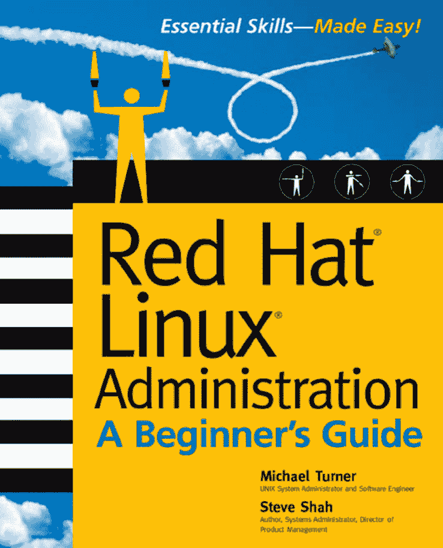

## 作者简介

迈克尔·特纳是一名系统管理员、软件工程师、作者，同时也是位全能型极客，拥有二十多年坐在电脑键盘前的经验。他早在 1988 年就开始接触 UNIX，自 1995 年起便以职业身份从事 Linux 相关工作。他管理过拥有超过 80,000 名用户的计算机网络，并编写过在“发现”号航天飞机上运行过的软件。目前，他就职于 Collabnet Inc.，担任实例化工程师，负责开发 SourceCast 协作开发环境。

在业余时间，他喜欢阅读、观看独立电影、听音乐，以及把玩新型科技小玩意。倡导自由软件以及编程也是他的兴趣所在。他与家人一起生活在加利福尼亚州的硅谷，与两只猫、三条蛇和一只鬃狮蜥共居家中。

史蒂夫·夏是 Array Networks ([www.arraynetworks.net](www.arraynetworks.net)) 的产品管理总监，负责流量管理和安全产品的技术方向。他的其他著述包括对《Unix 揭秘》、《红帽 Linux 揭秘》、《Linux 使用指南》以及《内容分发网络》等书籍的贡献。在进入 Array Networks 之前，史蒂夫曾在包括 Alteon Web Systems 和环境研究与技术中心在内的多家公司担任开发人员和系统管理员。除了 Linux，史蒂夫还负责过多种操作系统，包括 Solaris、Irix、FreeBSD、SunOS、HPUX 以及微软 Windows 的诸多版本。

## 技术审校者简介

乔什·伯克（Josh Burke，CISSP）是位于西雅图附近的波音员工信用合作社（BECU）的一名网络与分析师。在过去五年里，他在网络、系统和安全领域担任过多个职位。乔什毕业于华盛顿大学商学院，专注于在信息安全众多领域中平衡技术与业务需求。他的研究兴趣包括提高域名系统（DNS）和互联网路由协议系统的安全性与韧性。在加入 BECU 之前，乔什曾在 Internap Network Services 担任安全与系统工程师。


## 致谢

当我开始这个项目时，我严重低估了所涉及的时间和精力。尽管在许多其他书籍的致谢部分读过类似的评论，但这仍然是一个极其容易犯的错误。我每天都与这些东西打交道，写东西对我来说并不特别困难，所以我想，“这可能有多难呢？”现在我才明白，当作者感谢他的家人和朋友的耐心与理解时，这不仅仅是因为他们是家人和朋友，而是因为这确实需要来自这些人的支持远多于任何人预期的。现在我真正意识到，如果没有所有这些幕后人员的支持，这本书就不可能出现在你手中。

首先和最重要的是，我真心感激所有在整个项目中帮助、支持或以其他方式忍受我的人。总有一天，我会找到一种方式来回报你们每个人。此外，我要特别感谢 Amy 和 Stephanie，她们为了保持我的理智，付出了远超职责范围的努力。

McGraw-Hill/Osborne 幕后的团队也是促成这本书诞生的关键人物。Betsy Manini 和 Franny Kelly 对于使这项作品成为现在的样子起到了关键作用。Josh Burke、Emily Rader 和 Robert Campbell 都因他们在这个项目上的工作而值得感谢。Michael Miller 因其贡献而应得到特别表彰。感谢你们所有人。

我也想感谢所有雇用我从事 Linux 工作的公司，如果没有他们，我就不可能获得我希望传递给本卷读者的经验和知识。特别感谢 Collabnet，它是一个如此酷的工作环境。

# 简介

系统管理员是一个独特的群体。作为一个群体，我们可能是参考书和培训书籍最大的消费者，而且我们可能对它们的要求最高（至少我的同行们都是如此）。

我们也是好奇的一群人。我的大多数朋友都是数码迷（包括我妻子）。我们喜欢生活在新技术的边缘，在用户之前弄清楚所有的轰动效应。我们喜欢这样做有两个非常简单的原因：因为有趣，以及因为我们需要在 CEO 在 *BusinessWeek* 上读到相关内容并要求知道我们为什么没有使用它之前理解该技术。

开源和自由软件运动似乎是一个永不停歇的奇思妙想来源，而 Linux 是首选的整体平台。此外，Linux 因几个原因正在商业界引起轰动。我们看到越来越多的主要公司研究 Linux，希望降低成本，然后因为诸如稳定性或灵活性等更有说服力的原因而继续使用它。

狂热者会争论说，自 20 世纪 90 年代中期以来（Linux 自 1991 年可用以来），Linux 就一直是一种轰动效应。我个人在 1995 年开始使用 Linux，当时我正在为一家我工作的公司寻找一个简单的防火墙解决方案；我希望以最低的成本部署某些东西。随着时间推移，各种雇主的越来越多的项目负责人发现 Linux 是合适的工具——不是因为任何酷炫因素，而是因为 Linux 的功能和能力符合手头的需要。看到一些大型公司，它们缓慢地从舒适区中走出来开始采用 Linux，这有点令人振奋。

所以，当 IBM 开始将 DB2 移植到 Linux 上，当 Oracle 将其数据库平台移植到 Linux 上，当 SGI 采用 Linux 作为其主要桌面操作系统，甚至当 Dell 使 Red Hat Linux 成为服务器上预安装的选项时……好吧，这就是真正的 *轰动* 的开始。

## 谁应该读这本书

这本书的标题说它是“初学者指南”，这在很大程度上是正确的。标题真正应该说它是“Linux 初学者指南”，因为这本书确实对你这位读者做出了几个假设。

首先，它假设你已经熟悉 Windows 环境。至少，你应该是一个强大的 Windows 用户，并且了解一些关于网络化的 Windows 环境。虽然你不需要成为 Windows NT 或 2000 的专家，但对 NT/2000 的一些接触将有助于你理解那些更复杂的概念。这本书做出这一假设是为了避免浪费时间重复大多数来自 Windows 背景的人已经知道的内容，而是专注于 Linux 带来的新事物。

除了你的 Windows 背景之外，这本书还假设你对这里介绍的主题有更多兴趣。毕竟，这本书在 30 到 40 页的篇幅中覆盖了整整一本书致力于的主题！因此，有几章包含对其他文本的引用。考虑利用这些参考资料，无论你认为自己变得多么高级，因为总有更多东西可学。

## 这本书里有什么

*Red Hat Linux 管理：初学者指南* 分为四个部分组织。**第一部分**针对那些没有 Linux 经验但希望有人协助安装并开始使用的人。你将了解 Windows 和 Linux 之间的一些基本区别，然后被引导通过安装和软件设置的基础知识。

**第二部分**侧重于管理所有 Linux 系统（不仅仅是服务器）通用的功能。其中一些章节实际上是帮助你有效使用系统的教程，而另一些则深入探讨使 Linux（以及一般的 UNIX）区别于你可能熟悉的其它系统的更强大的概念。

在**第三部分**中，你将研究运行互联网网站所需的所有服务。这包括域名系统 (DNS)、文件传输协议 (FTP)、Web、简单邮件传输协议 (SMTP) 邮件、邮局协议 (POP) 邮件和安全外壳 (SSH)。

**第四部分**的方向与第三部分相反。它不是研究互联网上所有人的服务，而是研究仅向内部网络上的人员提供的服务，例如网络文件系统 (NFS)、网络信息服务 (NIS) 和 Samba。


## 第一部分
将 Linux 安装为服务器


*本页故意留白。*

### 模块 1
#### Linux 发行版与 Windows 技术摘要

##### 关键技能
- **1.1** 描述 Linux 和 Linux 发行版
- **1.2** 定义自由软件和 GNU 许可证
- **1.3** 确定 Windows 与 Linux 之间的技术差异
- **1.4** 探索其他 Linux 资源

除非你被困在某个荒岛上，或者故意回避媒体并忽视行业报刊，否则你肯定已经对 Linux 是什么以及你为何会对它感兴趣有了相当清楚的了解。为了进一步加深你对 Linux 的理解，在本模块中，你将查看 Linux 与 Windows 2000（及其稍加改进的继任者 Windows .NET Server）之间的技术差异。本模块还解释了 GNU（GNU’s Not UNIX）许可证，这有助于你理解 Linux 为何呈现出目前的形态。

##### 关键技能
### 1.1 描述 Linux 和 Linux 发行版

通常，人们认为 Linux 是一套完整的工具包，包含开发工具、编辑器、GUI、网络工具等。更正式地讲，这类工具包被称为 *发行版*。你可能听说过名为 Red Hat、SuSE、Mandrake 和 Caldera 的 Linux 发行版，它们获得了大量媒体报道，并被数以千计的安装所采用。像 Debian 这样的非商业 Linux 发行版在特定的技术圈子之外知名度较低，尽管它们有许多满意的用户，但它们并未达到商业发行版那样流行的规模。

所有 Linux 发行版中有趣的一点是，几乎所有随附的工具都不是由公司自己编写的。相反，其他人对其程序进行了授权，允许连同源代码一起重新分发。从总体上看，这些工具也适用于其他 UNIX 变体，其中一些也在 Windows 下可用。发行版的制作者只是将它们打包成一个方便的、易于安装的软件包。（一些发行版制作者也开发增值工具，使它们的发行版更易于管理或与更多硬件兼容，但它们发布的软件通常是由其他人编写的。）

因此，如果你认为发行版包含了 Linux 所需的一切，那么 *Linux* 究竟是什么？Linux 本身是操作系统的核心：*内核*。内核是充当总操作官（Chief of Operations）的程序。它负责处理诸如内存请求、磁盘访问和网络连接管理等任务。内核活动的完整清单本身就可以成为一个模块，事实上，已经有多本书记录了内核的内部功能。

内核被认为是一个非平凡（nontrivial）的程序。它也是使 Linux 进入所有 Linux 发行版的原因。所有发行版使用完全相同内核，因此所有 Linux 发行版的基本行为都是相同的。

区分一个发行版与下一个发行版的是随每个发行版附带的增值工具。例如，Red Hat 包含一个非常有用的工具 *redhat-config XFree86*，使图形界面的配置成为非常直接的任务。问“哪个发行版更好？”很像问“可乐和百事哪个更好？”几乎所有可乐都有相同的基本成分——碳酸水、咖啡因和高果糖玉米糖浆——从而产生解渴和带来轻微咖啡因和糖分兴奋的相似效果。归根结底，这是个人偏好的问题。

## 项目 1-1 调查发行版

本书介绍的是使用一个特定 Linux 发行版：Red Hat Linux 8.0。这是一个非常好的发行版，尤其在美国很流行。然而，还有许多其他发行版，其中大多数都有一些有趣的地方。在这个项目中，你将查看一些其他可用的发行版。

### 逐步指南

1. 使用 Web 浏览器访问 http://www.debian.org。确定 Debian 发行版的一个主要特征。
2. 现在访问 http://www.slackware.com 以识别 ZipSlack。
3. 确定 Turbolinux 主要针对的用户。（参见 http://www.turbolinux.com。）
4. 除了 Turbolinux，确定哪些公司是 UnitedLinux（http://unitedlinux.com）的成员。你能识别出 UnitedLinux 的主要目标吗？
5. 查看 http://www.linux-mandrake.com 并找出最新 Mandrake 版本使用的内核版本。
6. 考虑 Gentoo Linux（http://www.gentoo.org）支持哪些硬件平台。

### 项目总结

关于本项目中发现的发行版以及更多发行版，有大量的信息可供获取。如果你想进一步了解，使用 Google 搜索（http://www.google.com）可以发现更多你可能觉得有用的非营销信息。当然，你不应该忘记查看 Red Hat 在 http://www.redhat.com 上对自身的评价。


## 1.2 定义自由软件和 GNU 许可证

在 1980 年代初期，Richard Stallman 在软件行业内发起了一场运动。他宣扬（并且现在仍在宣扬）软件应该是自由的。注意，这里的“自由”不是指价格上的免费，而是指像自由（freedom）那样的自由。这意味着不仅交付产品，还要交付完整的源代码。

Stallman 的政策显然与 20 世纪 80 年代初销售预包装软件的观念背道而驰，但他的自由软件概念与 Bell Labs 早期分发的 UNIX 是一致的。早期的 UNIX 系统确实包含完整的源代码。然而，到 20 世纪 70 年代末，源代码通常已从 UNIX 发行版中移除，只有向 AT&T 支付大笔费用才能获取。Berkeley 软件发行版（BSD）保持了一个免费版本，但在能够证明 BSD 中没有来自 AT&T 的内容之前，不得不处理来自 AT&T 的许多诉讼。

提供源代码的想法很简单：软件使用者绝不应被迫与一个可能会或可能不会支持该使用者对软件意图的开发者打交道。使用者不应不得不等待错误修复的发布。更重要的是，在其他程序员审查下开发的代码通常比在密室中编写的代码质量更高。然而，自由软件的最大好处来自于用户本身：如果他们需要新功能，他们可以将其添加到程序中，然后回馈给源码库，以便其他人也能从中受益。

从这一思路出发，产生了一种向公众发布一个完整的类 UNIX 系统的愿望，且不受许可证限制。当然，在你构建任何操作系统之前，你需要先构建工具。GNU 项目就是这样诞生的。


> GNU 代表 GNU's Not UNIX——递归首字母缩略词是黑客幽默的一部分。如果你觉得这不好笑，别担心。你仍然属于大多数。

### 什么是 GNU 通用许可证？

从 GNU 项目中产生的最重要的事物是 GNU 通用许可证（GPL）。该许可证明确规定发布的软件是自由的，且任何人不得剥夺这些自由。获取软件并重新销售，甚至为了利润进行重新销售，都是可接受的；然而，在这种重新销售中，卖方必须发布完整的源代码，包括任何更改。由于重新销售的软件包仍然受 GPL 保护，该软件包可以自由分发，并且其他人也可以再次为了利润进行重新销售。主要重要的是责任条款：程序员对其软件造成的任何损害不承担责任。有关 GNU 和 GPL 的更多信息，可以在 http://www.gnu.org 找到。

应该指出，GPL 并不是自由软件开发者使用的唯一许可证（尽管它可能被认为是最受欢迎的）。其他许可证，如 BSD 和 Apache，具有类似的责任条款，但在重新分发方面有所不同。例如，BSD 许可证允许人们修改代码并发布这些更改，而无需披露添加的代码。（GPL 则要求必须发布添加的代码。）有关其他开源许可证的更多信息，请查阅 http://www.opensource.org。


## 自由软件的优势

如果从商业化的角度来看，GPL 似乎是个坏主意，那么不妨考虑一下近年来成功自由软件包的数量激增——它们表明这种模式确实行得通。这种成功源于两个原因：首先，如前文所述，在同行监督下，代码本身的错误更容易被发现并迅速修复。其次，在 GPL 体系下，程序员可以发布代码而不必担心被起诉。如果没有这种保护，没有人会发布自己的代码。

当然，这引出了一个问题：为什么有人要免费发布自己的作品？答案很简单：大多数项目一开始并不是功能完备、经过精细打磨的作品。它们可能始于程序员为了解决某个困扰他的特定问题而快速写出的粗糙代码。作为这种快速且粗糙的“黑客”代码，它没有销售价值。但当这些代码与面临类似问题和需求的他人共享时，它就变成了一件有用的工具。其他程序用户开始添加他们需要的功能，而这些新增部分又回流到原始程序中。因此，该项目作为群体努力的结果不断演进，最终达到完善的程度。这个经过精细打磨的程序可能包含来自数百甚至数千名程序员的贡献，他们在各处添加了小块代码。事实上，原作者的代码可能已几乎不见踪影。

通用授权软件成功的另一个原因是：任何在商业软件领域工作过的项目经理都知道，销售、市场营销、支持、文档、打包和配送的成本可能比开发软件本身还要高。一个程序员在周末进行一场小小的“恶作剧”来修复一个简陋小程序中的问题，他缺乏兴趣、时间和资金支持来将这个“黑客”代码变成盈利的产品。

当林纳斯·托沃兹（Linus Torvalds）于 1991 年发布 Linux 时，他是以 GPL 许可证发布的。由于其开放章程，Linux 吸引了大量贡献者和分析者。这种参与使 Linux 变得非常强大且功能丰富。托沃兹本人估计，自 v2.2.0 内核以来，他的贡献仅占总代码库的 5%。

由于任何人都可以获取 Linux 内核（以及其他支持程序），重新打包并转售，有些人已经靠 Linux 赚了钱。只要这些人发布内核的完整源代码，并附带他们自己的软件包，只要这些软件包受到 GPL 保护，一切都是合法的。当然，这意味着在 GPL 下发布的软件包可以被他人以其他名称转售以获取利润（并且还可以再次转售……）。

归根结底，使一个人的软件包比另一个人的软件包更具价值的，是增值功能、支持渠道和文档。即使是 IBM 也会对此表示赞同；这就是我们在 20 世纪 30 年代到 70 年间赚取大部分收入的方式：钱不在产品本身，而在伴随产品的服务中。

## 专家问答

- **问：** 操作系统的正确名称是 GNU/Linux，这是真的吗？
  - **答：** 这取决于你问谁。GNU 项目的人员为此付出了长期艰辛的努力，创造了使操作系统有用的工具（实用程序、编译器和应用程序），他们希望自己的付出得到认可。由于几乎所有“Linux”系统主要由 GNU 工具和 Linux 内核组成，这种要求并非不合理。另一方面，许多人认为 GNU/Linux 作为操作系统的主要名称使用起来太拗口。无论如何，选择权在你：Linux 或 GNU/Linux，都没问题。

- **问：** Linux 就是红帽（Red Hat），对吧？
  - **答：** 红帽的 Linux 发行版非常流行，尤其是在美国。然而，还有许多其他优秀的发行版，并且没有任何一家拥有 Linux 的排他权。我使用红帽 Linux，x（注：原文如此，可能指某个具体版本或内部称呼），推测你阅读本指南的原因也是想使用它。但一旦你对 Linux 更加熟悉，如果你愿意，可以创建自己的发行版。GPL 提供的自由允许你定制甚至销售 Linux，如果你希望的话。

- **问：** 为什么我必须为“免费”软件付费？
  - **答：** 简而言之，你可能不需要。红帽是众多允许免费下载的 Linux 发行版之一，因此如果你拥有高带宽互联网连接，你可以下载文件，烧录一些安装光盘，并免费安装软件，一分钱都不用花。许多发行版可以通过第三方提供的 CD 获得，收费不到 5 美元。有些人愿意付费支持或购买盒装软件版本，无论是为了支持他们使用产品的公司，还是为了确保及时获得问题的解答。自由软件并不意味着你有权无偿获得它，但确实意味着，如果有人有权获得它，他们如果愿意，就可以把它给你。

### 1.3 确定 Windows 和 Linux 之间的技术差异

可想而知，微软 Windows 2000 或 Windows .NET Server 与 Linux 操作系统之间的差异无法在这一节的范围内完全讨论。在这些模块中，我们将逐一探讨这两个系统之间的具体对比。在某些模块中，你会发现文本没有进行任何比较，因为实际上并不存在主要差异。

在深入研究细节之前，花点时间讨论这两个操作系统之间的主要架构差异。Linux 和 Windows 之间的历史差异正在逐渐消失，但有些仍然存在。

### 单用户 vs. 多用户 vs. 网络用户

Windows 是根据微软联合创始人比尔·盖茨“一台计算机，一张办公桌，一个用户”的愿景设计的。为了讨论方便，我将这种理念称为*单用户*。在这种安排下，两个人无法在同一台机器上同时运行（例如）Microsoft Word 进行并行工作。在 Windows 2000 或 Windows XP 中使用终端服务允许从一台计算机远程使用另一台计算机，但仍受限于单用户范式。本文撰写时尚未完成的 Windows .NET Server 产品继续添加终端功能，以允许多个用户同时访问服务器。

Linux 从 UNIX 那里借用了其哲学。当 UNIX 在 20 世纪 70 年代初由贝尔实验室最初开发时，它运行在一台需要整个部门共享的 PDP-7 计算机上。它需要一种设计，允许*多个用户*同时登录到中心机器。不同的人可以在同一时间编辑文档、编译程序并执行其他工作。中心机器上的操作系统处理“共享”细节，使每个用户感觉拥有独立的系统。这种多用户传统延续至今，其他 UNIX 系统也是如此。自 Linux 在 20 世纪 90 年代初诞生以来，它一直支持多用户安排。

如今，多用户设置最常见的实现方式是支持*服务器*——专门用于运行大型程序以供许多客户端使用的系统。部门的每个成员可以在桌面上拥有一台较小的工作站，具备足够的处理能力来处理日常工作。当需要进行需要更多 CPU 处理能力或内存的操作时，他们可以在服务器上运行该操作。

Linux、Windows 2000 和 Windows .NET Server 都能够提供诸如通过网络访问数据库等服务。这种安排下的用户可以被称为*网络用户*，因为他们实际上从未登录到服务器，而是向服务器发送请求。服务器完成工作后，通过网络将结果发送回给用户。这里的难点在于，应用程序必须专门编写以执行这种服务器-客户端职责。在 Linux 下，用户可以运行系统管理员允许的任何程序，而无需重新设计该程序。大多数用户认为能够在其他机器上运行任意程序是一个显著的好处。

### 图形用户界面与内核的分离

借鉴麦金塔（Macintosh）的设计理念，Windows 开发人员将图形用户界面（GUI）与核心操作系统集成在一起。两者相辅相成，缺一不可。操作系统与用户界面这种紧密耦合的好处在于系统外观的*一致性*。尽管微软对应用程序外观规定的规则不像苹果那样严格，但大多数开发人员倾向于在应用程序之间保持基本的外观和感觉一致。

另一方面，Linux（与 UNIX 一样）将这两个元素——用户界面和操作系统——保持分离。X 窗口系统接口作为用户级应用程序运行，这使其更加稳定。如果 GUI（对 Windows 和 Linux 来说都非常复杂）发生故障，Linux 的核心不会随之崩溃。X 窗口系统与 2000 GUI 的不同之处在于，它不是一个完整的用户界面：它仅定义如何在屏幕上绘制和操作基本对象。

> **注意**
> 不幸的是，X 窗口系统未能紧密集成到 Linux 中有一个缺点：虽然操作系统非常健壮，但 X Windows 在某些硬件或图形设置方面更容易出现问题。Linux 版本的“三指问候”（即强制重启图形界面）是 *CTRL-ALT-BACKSPACE*，它会终止 X。

X 窗口系统最显著的功能是它能够通过网络传输窗口，并在另一台工作站上显示。这使得坐在主机 A 上的用户可以登录到主机 B，在主机 B 上运行应用程序，并将所有输出路由回主机 A。有可能两个人登录到同一台机器，运行


Linux 对应 Microsoft Word 的软件（例如 OpenOffice、WordPerfect 或 StarOffice）同时运行。即使使用终端服务，Windows 2000 和 Windows XP 用户也仅限于每次只允许一个用户使用特定应用程序和显示器。

除了 X Windows 核心之外，还需要一个窗口管理器来创建有用的环境。大多数 Linux 发行版（包括 Red Hat）都附带了几个窗口管理器，并支持 GNOME 和 KDE，这两种环境在其他 UNIX 变体中也可以使用。当设置为默认值时，GNOME 或 KDE 提供的环境即使是普通的 Windows 用户也能轻松上手。

那么，哪个更好——Windows 2000 还是 Linux——原因是什么？这取决于你想要做什么。Windows 2000 提供的集成环境很便捷，而且由于其标准化程度更高，比 Linux 更不复杂，但它缺乏 X Windows 允许应用程序通过网络在其他工作站上显示窗口的功能。Windows 2000 的 GUI 一致但无法关闭，而 X Windows 不必在服务器上运行（并消耗宝贵的内存）。

## 网络邻域

Windows 用户共享服务器磁盘或彼此间共享的本机机制是通过网络邻域。在典型场景中，用户连接到共享资源，系统为其分配一个驱动器号。因此，客户端和服务器之间的界限是清晰的。唯一的问题是，这种数据共享方式更偏向于人而非技术：人们必须知道哪些服务器包含哪些数据。

Windows 2000 引入了 UNIX 系统早已具备的功能：挂载。通过挂载共享资源，Windows 让共享资源看起来就像用户本地磁盘上的另一个目录一样。这给人一种错觉，即存在一个单一的、完全本地化的统一目录结构。Microsoft 的分布式文件系统（Dfs）允许整个网络的目录合并，可以作为目录树进行配置和访问。Windows .NET Server 改进了 Dfs 的管理功能，并允许单个服务器托管多个 Dfs 树。

Linux 使用网络文件系统（NFS），自创建以来就支持挂载的概念。这允许任何目录被“导出”以便在其他系统上挂载。被挂载的目录可以放置在远程系统目录树的任何位置。

在 Linux 下挂载分区的一个常见例子是挂载主目录：用户的主目录位于服务器上，客户端在启动时（自动）挂载这些目录。因此，/home 存在于客户端，但 /home/username 的内容存在于服务器上。

在 Linux NFS 下，用户永远不需要知道服务器名称或目录路径，他们的无知就是你的福气！与 Dfs 一样，不再有关于连接哪个服务器的问题。用户无需知道何时需要更改服务器配置时该怎么办。

在 Linux 下，你可以更改服务器名称并调整客户端系统上的这些信息，而无需发布公告或重新教育用户。任何曾不得不让用户适应新服务器安排的人都知道随之而来的影响。第 8 章讨论了 Linux 自动挂载器，它会根据需要动态挂载和卸载分区。

打印的工作方式也大致相同。在 Linux 下，打印机接收到的名称独立于打印机的实际主机名。（如果打印机不支持 TCP/IP，这一点尤为重要。）客户端指向一个打印机服务器，其名称未经管理员授权无法更改。设置不会在你不知情的情况下被更改。打印服务器可以根据需要重定向所有打印请求。Linux 的统一界面将在很大程度上改善你安装环境中可能混乱的打印机安排。这也意味着你不必在多个位置安装打印驱动程序。


> 如果你打算通过 Samba 包使用 Linux 为 Windows 客户端提供服务，你仍然需要处理通知用户关于服务器共享和打印机分配的问题。你可以在第 18 章中阅读更多关于 Samba 的内容。

## 注册表与文本文件

我将 Windows 注册表视为终极配置数据库——成千上万的条目，其中很少有完全文档化的，一些位于服务器上，一些位于客户端上。虽然手动编辑注册表条目是可能的，但使用图形工具这样做并不会使过程变得直观。

考虑这个 Windows .NET Server 注册表设置：在 `HKEY_LOCAL_MACHINE\SYSTEM\CurrentControlSet\Control\Session Manager\Memory Management\PrefetchParameters` 中，将 `EnablePrefetcher` 设置为 `0x00000003` 以启用应用程序和启动预取。即使假设你知道什么是预取并希望启用它，这也是一种令人望而生畏的配置更改，而且不是我凭记忆就能想到的。

如果你没明白我的意思，我想说的是 Windows 注册表系统即使操作起来也非常困难管理。虽然在理论上这是一个好主意，但我在与注册表的斗争中从未全身而退。

Linux 没有注册表。这既是福音也是诅咒。福音在于，配置文件通常保留为一组文本文件（想想注册表时代之前的 Windows .INI 文件）。这种设置意味着你可以使用你选择的文本编辑器而不是像 `regedit` 这样的工具来编辑配置文件。在许多情况下，这也意味着你可以随意为这些配置文件添加注释，这样六个月后你就不会忘记为什么以特定方式设置某些内容。对于大多数随 Linux 提供的工具，配置文件位于 `/etc` 目录或其子目录中。

没有注册表安排的诅咒在于，没有编写配置文件的标准方式。每个应用程序或服务器都可以有自己的格式。许多应用程序现在都捆绑了基于 GUI 的配置工具，因此你可以轻松地进行基本设置，然后在需要进行更复杂的调整时手动编辑配置文件。

实际上，使用文本文件来保存配置信息通常被证明是一种高效的方法。一旦设置好，它们很少需要更改；即便如此，它们仍然是纯文本文件，因此在需要时易于查看。更有帮助的是，编写脚本来读取相同的配置文件并相应地修改其行为很容易。这在自动化服务器维护操作时尤其如此，这种能力在拥有许多服务器的大型站点中至关重要。

由于 Linux 配置文件是文本文件，无需特殊工具即可快速轻松地自动配置系统。可以编写简单脚本来设置配置值，使新操作系统、软件包或实用程序的部署变得非常容易。Windows 需要第三方软件（通常按机器授权，对于大型项目这可能非常昂贵）来执行类似的功能。

## 域

为了让一组 Windows 2000 系统协同工作良好，它们应该存在于一个域中。这需要配置为域控制器（DC）的 Windows 2000 Server 系统。域是 Windows 2000 安全模型的基础。

Linux 网络安全模型的基础是 NIS（网络信息服务）。NIS 是一个简单的基于文本文件的数据库，与客户端工作站共享。每个主 NIS 服务器建立一个域。任何希望加入此域的客户端工作站都可以这样做，只要它能设置其域名。要设置域名，你必须使用 **root 用户**——Linux 中与管理员用户对应的用户。然而，成为域的一部分并不立即赋予你本来不具备的权限。域管理员仍然必须将你的登录名添加到主 NIS 密码列表中，以便网络中的其他系统识别你的存在。

NIS 和 Windows 2000 域之间的关键区别在于，NIS 服务器本身并不像 DC 那样执行身份验证。相反，每个主机从服务器查找登录和密码信息，并将其与用户输入的信息进行比较。妥善认证用户是各个应用程序的责任。值得庆幸的是，认证用户所需的代码非常简单。

另一个重要区别是，NIS 可以作为通用数据库使用，因此可以保存任何需要与网络其余部分共享的信息。（这通常包括 NFS 的挂载表电子邮件别名。）唯一的限制是每个 NIS 映射只能有一个键，并且数据库机制在超过大约

20,000 个条目。当然，拥有 20,000 个用户的站点无论如何都不应将它们全部保留在单个 NIS 域中！

Windows 和 Linux 的基础操作系统运行并不要求使用域。然而，如果你需要维护一个具有合理安全级别的多用户站点，域是关键。

## Active Directory

那么 NIS 与 Active Directory 相比如何呢？好问题。答案是“无法相比”。

Active Directory 的设计目标远超出 NIS 的设计初衷。这实际上将两者置于不同的应用类别中。

Active Directory (AD) 旨在作为大型站点需要不同部门共享管理控制权这一问题的通用解决方案——而旧的 Windows NT 域模型在这方面表现得很糟糕。（在 NT 下设置跨域信任通常需要极大的耐心，并且愿意定期修复“损坏”的信任关系。）AD 也是微软修正许多其破碎命名方案并转向基于 DNS 的以互联网为中心方案的机会。结果相当复杂，需要大量时间才能掌握。Mark Minasi 的书《*Mastering Windows 2000 Server, Second Edition*》（Sybex, 2000 年）专门用了超过 100 页的篇幅来讨论这个主题。然而，在较小的网络中，大多数人会发现它看起来和感觉起来主要像带有某些新奇功能的旧式 NT 域。

不过，别误解了我——AD 是 Windows 2000 朝正确方向迈出的一大步，并为 Linux 阵营提供了坚固的竞争压力，使其不得不思考如何将目录服务更好地整合到它们的设计中。但尽管微软所说，AD 不会通过一个简单步骤解决世界上的所有问题，更不用说解决你的所有问题了。

那么，Linux 有什么能与 AD 相提并论的东西吗？是的，实际上有。目前已有多个针对 Linux 的 LDAP（轻量级目录访问协议）实现，并且正在积极开展工作以使 NIS 能够与 LDAP 服务器对接。（RADIUS 认证协议也越来越常见。）LDAP 之所以有趣，是因为它使用了 Active Directory 在 Windows 2000 和 Windows .NET Server 中所使用的相同底层技术。这意味着，从理论上讲，可以在你的 UNIX 系统和 Windows 系统之间共享 LDAP 数据库，并可能统一它们之间的认证。

**关键技能**

### 1.4 探索其他 Linux 资源

如果你对深入探究这场技术革命的底层（了解事物的运作方式总是很有帮助的），我推荐以下书籍：

- Martin Campbell-Kelly 和 William Aspray 所著的《*Computer: A History of the Information Machine*》（Harper Collins, 1997 年）
- Peter Salus 所著的《*A Quarter Century of Unix*》（Addison-Wesley, 1994 年）

这两本书都没有具体讨论 Linux。《*A Quarter Century of Unix*》确实讲述了 Linux 的历史，直到该系统开始成为一个严肃的竞争者为止。Peter Salus 对 Linus Torvalds 最初为何认为有必要创建 Linux 进行了有趣的讨论。

要了解 Linux 本身的最新动态，请从 http://www.linux.org 的 Linux 主页开始。关于 Linux 相关新闻，http://linuxtoday.com 是几个不错的资源之一，而 http://slashdot.org 上的“极客新闻”（News for Nerds）则是一个引人入胜——且经常与 Linux 相关——的阅读材料。

## 模块总结

在本模块中，你学习了三个重要主题：Linux 发行版、GNU 许可证（GPL），以及 Windows 2000 或 Windows .NET Server 与 Linux 之间的主要设计差异。Linux 是一个非常强大的操作系统， capable of many things（能够完成许多事情）。也许它最重要的特性是可配置性——它几乎像 silly putty（橡皮泥）！你可以将其塑造成从基础到最复杂的各种形状。使用 Linux 和其他自由软件的部分回报在于，利用其他人提供的许多工具解决各种问题是可能的。在阅读本书其余部分以及在任何环境中开始使用 Linux 时，请务必记住这一点。Linux 不仅仅是一个高效的生产力操作系统；它还给你一个创造性思考的机会。作为 Linux 用户，你不需要依赖商业软件供应商为你提供所需的功能；相反，你可以学会快速访问万维网，查看是否实际上已经存在一个可以解决你问题的项目。

## 模块 1 掌握检查

1. Linux 是操作系统的哪个部分？
2. 什么区别了一个发行版与另一个发行版？
3. GPL 赋予哪些自由？
   - A. 访问源代码的自由
   - B. 重新分发软件
   - C. 免费技术支持
   - D. 免费产品
4. 描述单用户、多用户和网络用户系统之间的区别。
5. 哪个操作系统是作为单用户系统开发的？
6. 哪个操作系统是作为多用户系统开发的？
7. 哪个操作系统能够支持网络用户？
8. 将图形用户界面（GUI）与内核分离有什么性能影响？
9. 以下哪些系统支持跨网络挂载：
   - A. 附加文件系统（AFS）
   - B. Linux 文件系统（Lfs）
   - C. 网络文件系统（NFS）
   - D. 分布式文件系统（Dfs）
10. Linux 配置文件通常位于哪个目录？
11. NIS 代表什么？
12. DC（域控制器）执行什么功能是 NIS 不具备的？
13. Linux 上可用的哪种目录技术在理论上与微软的 Active Directory 兼容？
14. 指出一个开始获取有关 Linux 更多信息的好地方。

### 模块 2

#### 在服务器配置中安装 Linux

**关键技能**

- 2.1 执行重新安装评估
- 2.2 安装 Red Hat Linux

Linux 近期成功的关键属性是安装工具的显著改进。多年前那个略显令人恐惧的过程现在几乎变得微不足道。更棒的是，安装软件的方式有很多；CD-ROM 不再是唯一的选择（尽管它们仍然最为常见）。网络安装也是默认选项列表的一部分，在安装大量主机时它可以提供巨大的帮助。

在大多数情况下，将系统指定为服务器会启用比你想要的更多的服务。单个 Linux 系统能够提供各种各样的服务：磁盘、打印机、邮件、新闻、Web、聊天等。许多这些服务是自动开启的。但现实是，大多数服务器专门用于执行一两项任务，其他已安装的服务只会占用内存并拖慢性能，同时为黑客提供另一个攻击途径。

本模块讨论与服务器相关的安装过程。这要求你做到两件事：区分服务器和客户工作站，并根据其专用功能简化服务器的操作。

你将针对 Red Hat Linux 执行此过程，你可以在随本书附带的 CD-ROM 中找到它。

### 2.1 执行安装前评估

在进入实际安装阶段之前，花点时间评估以下两件事非常重要：

- 系统将要运行的硬件
- 提供所需服务的服务器理想配置

让我们从检查硬件问题开始。

### 硬件

与任何操作系统一样，在开始安装过程之前，你应该确定哪些硬件配置是可行的。每个商业供应商都会发布硬件兼容性列表（HCL），并在其网站上提供。Red Hat 的硬件支持网站位于 http://hardware.redhat.com，你可以在那里搜索系统或组件的兼容性数据库。通常，大多数流行的基于 Intel 的配置都能无困难地工作。

适用于所有操作系统的普遍建议是避免使用最前沿的硬件和软件配置。虽然它们看起来确实令人印象深刻，但它们没有经历一些较旧硬件所经历的成熟过程。对于服务器而言，这

## 服务器设计

当系统成为服务器时，其稳定性、可用性和性能就成为重大课题。这三个方面通常通过购买更多硬件来提升，这实在令人遗憾。如果仅仅通过调优现有硬件就能达到理想的性能水平，却要额外花费数千美元来购买能在所有这三个方面都表现出色的系统，那确实是一种浪费。在 Linux 上，做到这一点并不难。更棒的是，性能提升的效果非常显著！

管理服务器配置时必须做出的最重要设计决策并非技术性的，而是管理方面的。你必须设计一个对临时用户来说*友好*的服务器。这意味着不要安装花哨的多媒体工具，不要支持声卡，也尽量不要安装华丽的网页浏览器。事实上，应该规定严禁将服务器用于临时用途——不仅禁止网站用户这样做，也禁止网站管理员这样做。

设计服务器的另一个重要方面是确保其拥有良好的环境。作为系统管理员，你必须通过将服务器放置在独立房间内并加锁（或采取等效措施）来确保服务器的物理安全。非管理人员访问服务器的唯一途径应是通过网络。服务器机房本身应通风良好并保持凉爽。糟糕的环境是事故等待发生的地方。过热的系统以及那些自认为知道如何修复问题的多管闲事的用户，对服务器稳定性的危害可能比糟糕的软件还要大（甚至可以说更严重）。

一旦系统处于安全环境中，安装电池备份电源也同样至关重要。备用电源有两个关键用途：一是让系统在断电期间保持运行，以便能够优雅地关闭，从而避免文件损坏或丢失；二是确保电压尖峰、跌落和其他干扰不会损害系统的健康。

以下是你可以采取的一些具体措施来改善服务器状况：

- 利用图形用户界面与核心操作系统解耦这一事实，除非有人需要坐在控制台前运行应用程序，否则避免启动 X 窗口系统（Linux 的 GUI）。毕竟，与其他任何应用程序一样，X 需要内存和 CPU 时间才能工作，而这些资源最好分配给服务器进程使用。
- 确定服务器需要执行哪些功能，并禁用所有其他功能。不仅未使用的功能会浪费内存和 CPU，它们还会使保护服务器的过程变得复杂。
- 与其他一些操作系统不同，Linux 允许你选择想要在内核中启用的功能。默认的内核通常已经经过合理的调优，因此你不必担心它；但如果你确实需要更改某个功能或升级内核，请仔细选择要添加和不添加的内容。在添加功能之前，确保你真正需要它。

> **注意**
> 你可能会听到一条过时的建议，即重新编译你的内核以最有效地利用系统资源。这不再成立——重新编译内核的唯一理由是升级或对新设备添加支持。请记住：一旦服务器投入使用，如果没有充分理由，不要更改稳定且性能尚可的设置。

### 正常运行时间

所有关于服务器维护以及确保琐碎事物不会导致其崩溃的讨论，都源于一条长期的 UNIX 哲学：*正常运行时间是好的。更长的正常运行时间更好。*

UNIX（Linux）的 **uptime** 命令告诉用户系统自上次启动以来已运行了多长时间，当前有多少用户登录，以及系统正在承受多大的负载。后两项是有用的度量指标，对于日常系统健康和长期规划都是必要的。（例如，最近服务器负载一直很高，也许是时候购买一个更快/更大/更好的服务器了。）

但最关键的数字是服务器自上次重启以来已运行了多长时间。较长的正常运行时间是妥善维护、保养的体现，从实际角度看，也是系统稳定性的标志。你经常会发现 UNIX 管理员像汽车爱好者炫耀马力那样炫耀他们服务器的正常运行时间。这也是为什么你会听到 UNIX 管理员咒骂那些需要重启才能生效的系统更改（无论操作系统是什么），即使应用最新的内核安全补丁可能证明了这种重启的合理性。你现在可能否认在乎这件事，但六个月后，你会对任何不必要重启系统的人大叫。不要费心向非管理员解释这一现象，因为他们只会奇怪地看着你。你内心深处会知道你的正常运行时间比他们的更好。

### 双启动问题

如果你是 Linux 新手，可能还没准备好在只想试驾的情况下就完全投入到整个系统中。所有 Linux 发行版都可以仅安装在硬盘的某些分区上，而保留其他分区不变。通常，这意味着允许 Microsoft Windows 与 Linux 共存。

由于你专注于服务器安装，本文不会涵盖构建双启动系统的细节；然而，任何在磁盘上创建分区方面有一点经验的人都应该能弄清楚这一点。如果你遇到困难，可以参考随发行版提供的安装指南，或参考其他许多可用的 Linux 初学者指南之一。

一些快速提示：如果 Windows 95 或 Windows 98 分区目前作为 C: 盘占用了整个硬盘，你可以使用 **rip** 工具重新划分磁盘分区。只需进行磁盘碎片整理，然后运行 **rip.exe**。如果你使用的是带有 NTFS 文件系统的 Windows NT/2000，并且已经用数据分配了所有磁盘，在每个分区上都存有数据，你可能需要手动移动一些数据以释放一个分区。不过，不要费心尝试缩小 NTFS 分区；由于其复杂性，它不喜欢被调整大小，这样做会导致损坏。

**从灵活性的角度看，NTFS 听起来不像是一件好事，但实际上它是好事。如果你必须运行 Windows 服务器，请使用 NTFS。**

你可能会发现使用像 Partition Magic 这样的商业工具特别有用，因为它支持 NTFS、FAT32 和普通 FAT，以及大量其他文件系统类型。其用户界面也比 **rip** 好得多。

如果你要安装双启动系统，请最后安装 Linux。如果你最后安装 Windows，它会覆盖你的 Linux 系统的启动信息。如果你最后安装 Linux，它会识别出你已安装 Windows，并让你选择默认要启动哪一个。Linux 在公民意识方面得了一个“A”。

## 安装方法

随着局域网和互联网连接的连通性和速度提升，通过网络而不是使用本地 CD-ROM 进行安装正变得越来越受欢迎。

通常，一旦你决定在多台机器上部署 Linux，就需要快速的安装过程以便同时安装多个系统，此时网络安装就变得重要起来。

通常，服务器安装不适合自动化，因为每台服务器通常都有独特的任务；因此，每台服务器的配置会有所不同。例如，与不执行自身日志记录的文件服务器相比，专门用于处理通过网络发送到它的日志信息的服务器会为相应的日志目录设置特别大的分区。（一个明显的例外是服务器集群，其中包含大量复制的服务器。但即使是那些安装也有其细微差别，需要关注安装的具体细节。）


正因如此，您将专注于从 CD-ROM 安装系统的相关技术。当然，一旦您完成了一次 CD-ROM 安装流程，您会发现基于网络的安装也非常简单明了。

## 如果问题依旧解决不了……

您已经走了两遍安装流程…… 这本书说它应该能正常工作。安装手册说它应该能正常工作。您上周咨询的 Linux 专家也说它应该能正常工作。

但就是不起作用。

借用道格拉斯·亚当斯的不朽名句，不要惊慌。没有任何操作系统能在 100% 的时间里顺利安装。（是的，甚至包括 Mac OS！）硬件并不总能按广告宣传的那样工作，不同的硬件组件之间可能存在冲突，您的朋友为您烧录的 CD-ROM 上可能存在 CRC 错误（请记住：您的朋友为您烧录 Linux 副本是完全合法的！），或者（希望不是这种情况）软件本身存在 bug。

在使用 Linux 时，您可以通过多种途径寻求帮助。如果您是从苏诺（SuSE）或红帽（Red Hat）等商业供应商购买的副本，您总是可以致电技术支持，那里有专门致力于与您共同解决问题的知识渊博的工作人员。如果您没有购买套装，您可以从红帽及其他 Linux 发行商购买支持服务。最后，但同样重要的是在线寻求帮助这个选项。有大量的网站可供您参考以助入门。这些网站不仅包含实用的技巧和窍门，还有文档和讨论区，您可以在其中发布您的问题。显然，您会想先从专门针对您所用发行版的网站入手：例如 Red Hat Linux 的 www.redhat.com。其他发行版也有各自的网站。请查看您的发行版对应的网站信息。

以下是一些推荐的安装帮助网站：

- comp.os.linux.admin：这是一个新闻组，而非网站。您可以使用新闻客户端阅读，也可以通过 http://groups.google.com 浏览。
- comp.os.linux.redhat：这是另一个新闻组，但专门针对 Red Hat Linux。
- linux.redhat：这是另一个 Red Hat Linux 的新闻组。
- http://www.linuxdoc.org/：此网站收集了关于各种 Linux 相关主题的丰富信息，包括安装指南。不过需要提醒的是：并非所有文档都是最新的。在遵循说明之前，请务必查看文档的最后更新日期。该网站既有菜谱式的帮助指南，也有对发生的事情进行更完整解释的指南。
- http://linuxnewbie.org/：此网站提供“新手化帮助文件”，协助解决各种硬件和软件问题。
- http://everythinglinux.org/：正如预期，Everything Linux 为 Linux 用户提供了广泛的资源，包括使用指南和评论。

## 项目 2-1 确定服务器功能

在安装 Linux 服务器之前，确定服务器将确切承担什么功能是很有用的练习。即使您不知道所有可用的功能，但您对计划安装的服务器可能需要或不需要哪些功能可能有了一些想法。知道需要哪些特定功能将确保系统拥有其所需的所有软件，并且不会因为安装了不必要的软件而变得臃肿或存在漏洞。

### 分步操作

1. 考虑以下每个问题，列出一份肯定需要或肯定不需要的服务列表：
   - 该系统的磁盘资源是否将通过 NFS 对其他系统进行挂载访问？它是否提供打印服务？
   - 该服务器将提供哪些与互联网相关的服务？例如，它是否用作 web 服务器？它是否提供邮件、IRC、新闻组或其他类似服务？
   - 该系统是否作为数据库服务器？
   - 该系统是否执行身份验证任务，例如作为 LDAP 或 NIS 服务器运行？
   - 该系统是否执行任何网络功能，如路由、防火墙、SNMP 或流量监控等？
   - 程序开发是否在该系统上进行？将使用哪些语言？需要哪些编译器、调试器、库和工具？
   - 远程用户将如何访问该系统？他们需要 FTP 或 telnet 访问吗？将使用 SSH 还是 rlogin 或 rsh？
   - 该系统是否可通过控制台访问，如果是，是否需要 X 窗口系统？在 GUI 中将进行多少工作，需要哪些窗口环境？

2. 查看需求列表，记下由必备项目隐含的任何组件。例如，web 和数据库服务器可能需要工具来连接网页和数据库，因此 Perl 或 PHP 可能很有用。

3. 需要在该系统中安装哪些文档？如果它是开发者或最终用户的资源，与大型服务器集群中的众多系统之一相比，它可能有更多的文档需求。

4. 如果这是一个测试服务器，您想尝试哪些类型的功能？对每一项做笔记，当安装软件时，您可能会发现自己不知道存在的一些包。

## 项目总结

您可能觉得自己对 Linux 的了解还不足以确定您的服务器将做什么。但无论您是在第一次安装红帽 Linux 之前还是之后经历这个过程，您都会发现这是一种关注实际需求的好方法。否则，浏览所有可用的包就像饿着肚子去超市购物一样。

## 2.2 安装 Red Hat Linux

本节记录了在独立系统上安装 Red Hat Linux 8.0 所需的步骤。我们将采用一种宽松的方法，安装所有可能与服务器操作相关的工具。后续模块将解释每个子系统的目的，并帮助您确定真正需要保留哪些部分。

您有两种方式启动引导过程：可以使用启动软盘或 CD-ROM。本安装指南假设您将通过 CD-ROM 启动以开始 Red Hat 安装过程。如果您的旧机器无法从 CD-ROM 启动，您将需要使用启动盘并从那里开始过程。


> 使用启动盘会改变某些安装步骤的顺序，例如使用哪种语言以及是使用硬盘还是 CD-ROM 进行安装。一旦完成初始差异步骤后，您会发现图形化步骤是相同的。

如果您的系统支持可启动 CD-ROM，这显然是更快的方法。如果您的发行版未附带启动盘且您无法从 CD-ROM 启动，您将需要创建启动盘。您需要一个可运行的 Windows 安装来创建启动盘。


> 拥有可运行的 UNIX 操作系统的用户可以使用 `dd` 命令将启动镜像创建到软盘上。请遵循您的发行版附带的说明，使用您的软盘设备执行 `dd` 命令。

### 创建启动盘

Windows 启动且 CD-ROM 放入相应驱动器后，打开一个 MS-DOS 提示窗口（开始 | 程序菜单 | MS-DOS 提示符），这将为您提供一个命令 shell 提示符。切换到 CD-ROM 驱动器盘符并进入 **dosutils** 目录。在那里您会找到 `rawrite.exe` 程序。只需运行该可执行文件，系统将提示输入源文件和目标软盘。源文件位于同一驱动器上，名为 `images/boot.img`。

您可以在此处了解更多关于此过程的详细信息：http://www.redhat.com/docs/manuals/linux/RHL-8.0-Manual/install-guide/s1-steps-install-cdrom.html。

### 启动安装

要开始安装过程，请从 CD-ROM 启动。这将显示一个欢迎画面，向您介绍 Red Hat 8.0。在屏幕底部将显示一个提示：

boot:

如果您未按任何键，提示将自动超时并开始图形化安装过程。您可以按 ENTER 键立即启动过程。

> **注意**
> 如果您过去有过 Red Hat 安装经验，并且不希望系统自动探测硬件，您可以在 boot: 提示处输入 **expert**。不过，对于大多数安装，您最好坚持使用默认设置。

如果您没有鼠标，或者安装程序无法找到您的鼠标，您将看到一个屏幕，询问您是否想使用文本模式安装，或者希望帮助安装程序确定您的鼠标类型。使用 TAB 键选择您想要的选项，并按 ENTER 继续。如果您选择继续文本模式，您会发现基本安装步骤与图形界面类似，您应该能够跟随本安装指南进行操作。如果您需要额外帮助，可以访问 Red Hat 的文本模式安装帮助页面：http://www.redhat.com/docs/manuals/linux/RHL-8.0-Manual/install-guide/s1-guimode-textinterface.html。


## 欢迎使用红帽 Linux

  安装程序的第一个图形化界面将向您展示红帽 Linux 的欢迎界面（参见图 2-1）。该界面的操作方式与其他图形用户界面（GUI）类似。您只需将鼠标指针指向所需选项并点击即可。

  请注意，屏幕左侧会显示上下文相关的帮助信息。如果您不想看到该帮助，可以点击屏幕左下角的“隐藏帮助”按钮。此时屏幕右下角的“后退”按钮呈灰色禁用状态，因为此前尚无选项可供选择。

  此界面操作简单：无需做出任何选择。当您准备好继续时，请点击屏幕右下角的“下一步”按钮。

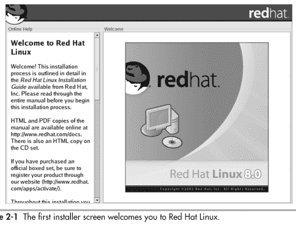

## 选择语言

  第一个菜单将询问您希望在安装过程中使用哪种语言（参见图 2-2）。选择所需语言后，点击“下一步”继续。

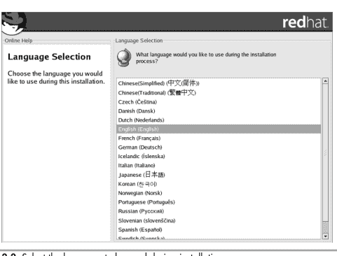

**图 2-2** 选择安装过程中使用的语言。

## 选择键盘类型

  下一个菜单允许您选择您的键盘类型。对于大多数人来说，键盘类型会根据语言和地理位置自动选择（参见图 2-3）。如果您偏好 Dvorak 键盘布局，也可在此处选择。

> **提示** 如果您以后想要更改键盘布局或类型，可以运行程序 `/usr/bin/redhat-config-keyboard`。

  完成后，点击“下一步”继续，或点击“后退”返回语言选择菜单。

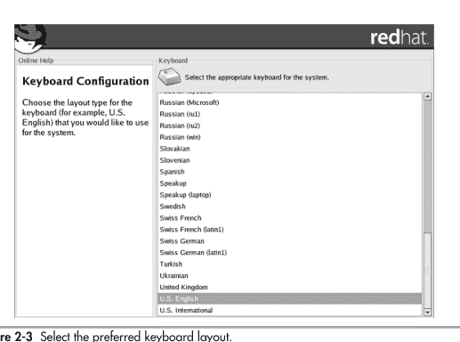

**图 2-3** 选择首选的键盘布局。

## 选择鼠标

  现在您可以选择在 X Window 环境中使用的鼠标类型。大多数情况下，自动探测功能能够识别您使用的鼠标种类。

  如果需要手动配置 Linux，请从顶部的菜单框中选择您的鼠标类型（参见图 2-4）。“通用”（Generic）设置在大多数情况下都能正常工作，但您也可以滚动制造商列表，查找您特定鼠标的品牌。点击制造商名称左侧的三角形，即可展开该品牌下的更多选项。

  如果您使用的是串行鼠标，还需要选择其使用的串行端口，这可以在屏幕下方的框中进行设置。

  如果您使用的是双键鼠标，请勾选屏幕底部的“模拟三键”选项，因为 X Window 环境的某些功能仅支持三键鼠标。模拟功能允许您同时点击双键鼠标的两个按键，以模拟第三个（中间）按键。

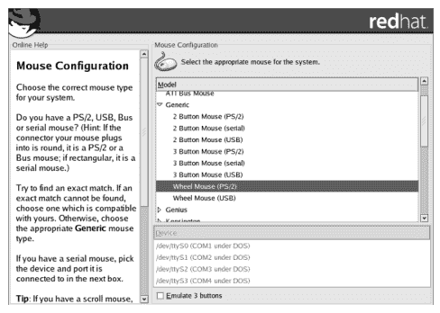

**图 2-4** 选择与您硬件最匹配的鼠标描述。


**提示** 如果您以后更改了鼠标类型，可以运行 `/usr/bin/redhat-config-mouse` 来重新配置鼠标。

## 安装类型

  在选择了语言和输入设备后，您现在可以开始红帽 Linux 的实际安装阶段。您会看到一个屏幕，允许您选择安装红帽 Linux 的方式。如果您处于升级路径中，此选择很简单——只需点击“升级”，然后点击“下一步”。您将看到一些提示当前正在升级内容的屏幕。

  本模块假设您正在进行全新安装。这将清除磁盘上的所有现有内容，然后重新安装 Red Hat 8.0。

### 以服务器配置安装 Linux

> **警告** 我认真的。此过程将彻底破坏您的硬盘，不保留任何数据。因此，请确保将此操作执行在一个不持有唯一重要数据副本的磁盘上。例如，不要在这台机器上安装，如果这里保存着您已故的姑妈索尼亚的世界冠军椒盐卷饼食谱的唯一副本。

  请注意，在“安装”按钮下方有一个以服务器配置安装 Linux 的选项（参见图 2-5）。该方法会自动为您选中所有软件包，并设定磁盘分区方案。虽然这可以作为尝试 Linux 的良好起点，但对于本模块，您希望选择“自定义”（Custom），以便微调安装内容和配置方式。

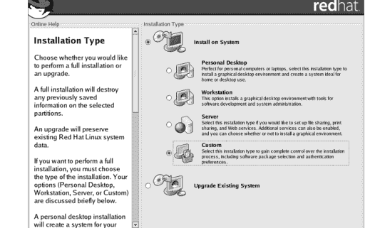

**图 2-5** 对于本模块，请执行红帽 Linux 的自定义安装。

## 为 Linux 创建分区

  由于您选择了自定义安装，您需要为 Linux 安装创建分区。如果您习惯了 Windows 安装过程，您会发现此过程与将 Windows 分区到不同驱动器的方式略有不同。

  简而言之，每个分区在启动时都被*挂载*。挂载过程使得该分区的内容变得可用，就好像它是系统上的另一个目录一样。例如，根目录 (/) 是目录结构中最顶层的目录。在简单的配置中（例如，当您在自定义安装中选择“自动分区”选项时），系统的整个目录结构将在单个分区上创建。更复杂的配置在大多数情况下更有意义。例如，一个名为 /usr 的标准 Linux 子目录将存在于根分区中，但其本身是空的。然后可以挂载一个单独的分区，使得进入 /usr 目录时，您可以看到新挂载分区的内容（参见图 2-6）。

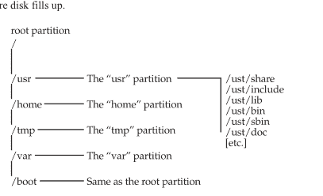

**图 2-6** /usr 目录的内容可以挂载在独立于根目录的分区上。

  由于所有分区在挂载后表现为统一的目录树，而不是独立的驱动器，因此安装软件并不区分各个分区。它只关心每个文件应放入哪个目录。结果是，只要挂载的分区代表目录树中放置文件的不同部分，安装过程就会自动将文件分散到所有挂载的分区上。在 Linux 下，文件的最大分组位于 /usr 目录，其中包含所有实际的程序。（用 Windows 术语来说，这类似于 C:\Program Files。）

  由于您正在配置服务器，您需要了解在服务器生命周期中将存在的其他大型文件分组。它们包括：

- /usr，所有程序文件将在此处存放（类似于 C:\Program Files）。
- /home，所有人的主目录将位于此处（假设此服务器将容纳这些目录）。这对于防止用户耗尽整个磁盘空间，导致其他关键组件（如日志文件）没有空间是很实用的。
- /var，日志文件的最终存放地。由于日志文件可能受到外部用户的影响（例如，访问网站的人员），因此重要的是将其隔离到独立的分区中，这样就没有人能通过生成大量日志条目从而填满整个磁盘来执行拒绝服务（DoS）攻击。
- /tmp，临时文件的存放处。由于此目录被设计为任何用户可写（类似于 Windows 下的 C:\Temp 目录），您需要确保任意用户不会滥用它并填满整个磁盘；通过将其放在单独的分区上可以确保这一点。
- 交换分区（Swap）。这不是用户可访问的文件系统，但它是虚拟内存文件的存储位置。虽然 Linux（以及其他 UNIX 系统）可以像 Windows 一样使用普通的磁盘文件来存储虚拟内存，但您会发现将其放在自己的分区上能提升性能。

  现在您就明白了，在磁盘上创建多个分区比创建一个单个的大分区（您可能习惯在 Microsoft Windows 下这样操作）是更好的做法。随着您对 Linux 磁盘分区的原理和原因更加熟悉，您可能会选择回到单个大分区。到那时，当然，您将具备足够的知识来理解哪一个方案更适合您。

  现在您对 Linux 分区有了一些背景知识，让我们回到安装过程本身。安装界面为您提供三个选项（参见图 2-7）：自动分区磁盘、使用 Disk Druid 手动分区磁盘，或使用 fdisk 手动分区磁盘。

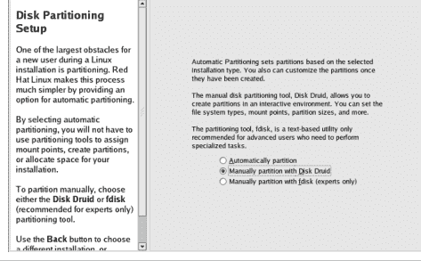

**图 2-7** 硬盘分区可以自动配置，也可以使用 Disk Druid 或 fdisk 手动配置。


你不希望使用第一个选项，因为你需要对服务器环境中磁盘的分配进行严格控制。虽然使用 fdisk 功能极其强大，但起初可能会有点令人生畏。（别担心：第 7 模块中会有详细说明。）因此，你只剩下 Disk Druid 这一选择了。只需选择 Disk Druid 并点击“下一步”。这将带你进入图 2-8。

Disk Druid 分区工具由 Red Hat 开发，旨在提供一种创建分区并将分区与其挂载目录相关联的简便方法。启动 Disk Druid 时，你将看到磁盘分区布局的图形表示，以及磁盘上所有现有分区的详细信息。每个分区条目将显示以下信息：

- **设备**：Linux 将每个分区与一个单独的 *设备* 关联起来。就安装而言，你只需要知道在 IDE 磁盘下，每个设备都以 /dev/hdXY 开头。此处，X 表示：
    - a 代表第一条链上的 IDE 主盘
    - b 代表第一条链上的 IDE 从盘
    - c 代表第二条链上的 IDE 主盘
    - d 代表第二条链上的 IDE 从盘

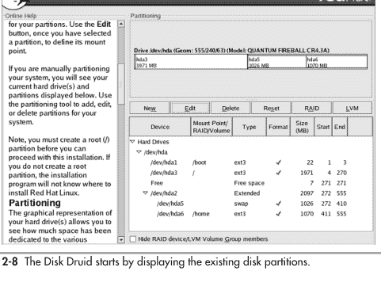

Y 是磁盘的分区编号。例如，/dev/hda1 是主链、主盘上的第一个分区。SCSI 遵循相同的基本概念，只是每个分区不是以 /dev/hd 开头，而是以 /dev/sd 开头，并遵循 /dev/sdXY 格式，其中 X 是一个代表唯一物理驱动器的字母（a 代表 SCSI id 1，b 代表 SCSI id 2，依此类推）。Y 代表分区编号。因此，/dev/sdb4 是 SCSI id 为 2 的磁盘上的第四个分区。该系统比 Windows 稍复杂一些，但每个分区的位置都是明确的——不再需要猜测“E: 对应哪个物理设备？”

- **挂载点**：分区被挂载的位置。初始状态下，这里不应该包含任何条目。
- **类型**：分区的类型。Red Hat Linux 的默认类型是 ext3，但 Disk Druid 也理解许多其他类型，包括 FAT、FAT32 和 NTFS。
- **格式化**：指示在 Linux 安装之前是否会格式化该分区。
- **大小**：分区大小（以 MB 为单位）。
- **起始**：分区的初始柱面号。
- **结束**：分区的结束柱面号。

屏幕中间是用于控制你在 Disk Druid 中执行操作的按钮。这些按钮包括：

- **新建**：创建一个新的分区。
- **编辑**：更改高亮分区的参数。
- **删除**：删除高亮显示的分区。
- **重置**：撤销你对分区表所做的所有尚未提交的更改。
- **RAID**：使用此按钮创建一个将数据分布在多个驱动器中的分区。这对于提高磁盘读取性能或提供数据冗余可能很有用。虽然本安装指南不涉及 RAID 安装，但 Red Hat 在 http://www.redhat.com/docs/manuals/linux/RHL-8.0-Manual/custom-guide/ch-raid-intro.html 上提供了关于 RAID 概念和配置的详细信息。
- **LVM**：逻辑卷管理器 (LVM) 的磁盘空间分配方法旨在简化临时调整系统磁盘空间。配置 LVM 超出了本指南的范围，但更多信息可在 http://www.redhat.com/docs/manuals/linux/RHL-8.0-Manual/custom-guide/ch-lvm.html 上获取。
- **下一步**：将所有更改提交到磁盘。
- **返回**：中止使用 Disk Druid 所做的所有更改并退出程序。

**注意**

在 Disk Druid 中进行的更改在你点击 **下一步** 之前不会提交到磁盘。

### 调整分区大小
你分配给每个分区的具体空间量取决于你拥有的空间量以及你计划如何使用这些空间。尽管如此，在 Red Hat Linux 8.0 中调整分区大小仍有一些基本指导原则。如果你安装本模块中建议的所有分区，基本的尺寸参数看起来如下：

| 分区 | 最小尺寸 | 建议最大尺寸 |
| :---- | :---- | :---- |
| Swap（交换分区） | 与已安装 RAM 的大小相同 | 已安装 RAM 大小的两倍 |
| / | 384MB | |
| /home | 取决于预期使用情况；100MB | 如果你分配了空间，它们就会被填满 |
| /tmp | 100MB | |
| /usr | 取决于要安装软件和文档；2,000MB | |
| /var | 256MB | |

### 添加分区
要创建一个新的分区，请单击 **新建**。这将弹出一个对话框，其中对话框中的每个元素都应类似于 **图 2-9** 所示：

- **挂载点**：你希望此分区在启动时自动挂载的目录。
- **文件系统类型**：该磁盘上驻留的分区类型。默认情况下，除了交换分区（其类型应为“swap”）之外，你想选择 **ext3**。
- **允许的驱动器**：指定可以在哪些驱动器上创建该分区。
- **大小 (MB)**：分区的大小（以 MB 为单位）。
- **附加大小选项**：如果你知道希望分区的精确大小，请选择 **固定大小**。第二个选项允许你改为设置最大大小，而最后一个选项允许 Disk Druid 使分区尽可能大。
- **强制为主分区**：如果勾选此框，正在添加的分区不能是“扩展”分区。你不太可能有理由设置此选项；让 Disk Druid 配置磁盘分区细节即可。
- **检查坏块**：如果你有一个旧硬盘或质量可疑的硬盘，设置此选项是值得的，但这会使格式化分区耗时更长。当你完成输入所有信息后，单击 **确定** 继续。

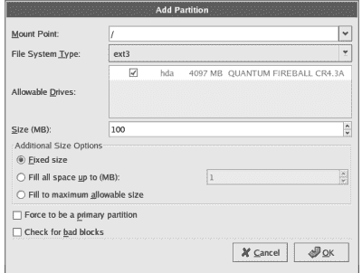

图 2-9 使用 Disk Druid 添加新分区。

最少你需要有两个分区：一个用于保存所有文件，另一个用于交换空间。如果 RAM 少于 128MB，交换空间的大小通常设置为可用 RAM 的两倍；如果 RAM 多于 128MB，则设置为与 RAM 量相同。

理想情况下，除了根分区外，你还希望为 *usr*、*var*、*home* 和 */tmp* 设置单独的分区。显然，你可以根据服务器的用途调整这个配置方案。

### 其他分区操作任务
在你完成添加分区的步骤，并且熟悉相关的变量（挂载点、大小、类型、设备等等）后，编辑和删除分区的实际过程非常简单。编辑条目意味着更改你在添加分区时建立的完全相同的条目，而删除条目只需要你确认你真的想要执行删除操作。
配置好你想要的分区和挂载点后，点击 **下一步** 继续。

**注意**

我故意省略的最后一点细节是添加网络驱动器挂载（NFS）的过程。这需要更完整的解释，并在第 7 模块中有所涵盖。

### 安装引导加载程序
GRUB 是 Red Hat Linux 8.0 的默认 *引导管理器*。如果你还不熟悉它的功能，引导管理器负责实际启动操作系统加载过程。如果你熟悉 Windows NT，你已经处理过 NT Loader (NTLDR)，它在启动时呈现菜单，允许你选择是启动 Windows NT 还是 Windows 98 (VGA NTLDR)。如果你设置过双启动配置的 Windows 机器，你可能也遇到过 NTLDR。GRUB 在 Linux 系统中执行相同的功能。

> Red Hat Linux 也允许使用 LILO 引导加载程序，但 GRUB 是默认设置，并且工作良好，因此这里使用的是它。

Red Hat 工具中用于设置 GRUB 的屏幕包含三个部分（参见图 2-10）。顶部部分包含一个可引导分区列表和一个用于将引导加载程序更改为 LILO（或根本不启用引导加载程序）的按钮。

此配置屏幕的中间块允许你选择是否要在引导加载程序上启用密码保护。你希望启用此功能以防止

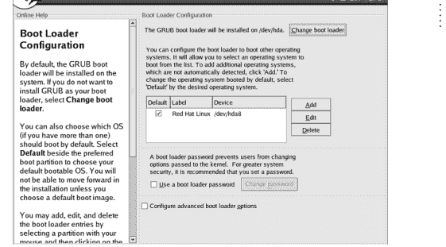

图 2-10 配置 GRUB 引导加载程序以启动 Linux。


对启动设置的未授权访问，因此请勾选复选框，这将弹出如图所示的密码输入框。

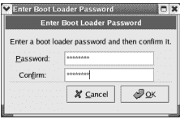

引导加载程序配置屏幕最后一部分的复选框允许您设置引导加载程序某些较为晦涩的功能。如果您勾选该框并单击“下一步”，您将看到高级配置屏幕（参见图 2-11）。

GRUB 安装在主引导记录 (MBR) 或 Linux 所在的第一个分区上。MBR 是系统启动时读取的第一项内容。它基本上是内置硬件测试完成并移交控制权给软件的位置。这是默认设置；如果允许在此处安装 GRUB，当您开机或重启系统时，其图形启动菜单将加载，并允许您选择要加载哪个操作系统。在服务器配置中，可能存在要加载的 Linux 内核选择，但应该只有一个操作系统选项！

**注意**

SMP 系统将以两个启动映像选项启动。第一个选项，Red Hat Linux，被设置用于支持多处理器。如果在此配置中遇到任何问题，Red Hat Linux-up 也可用；它将仅使用一个处理器，但至少可以让你启动并运行起来。

如果你已经在另一个引导加载器上，并偏好它，那么你会希望将 GRUB 放置在根分区的第一扇区。这将允许你首选的引导加载器先运行，然后如果你决定启动 Linux，它将控制权移交给 GRUB。弄清楚如何通知你首选的引导加载器有可用新操作系统取决于你。

此屏幕还有一个强制使用 LBA32 的选项，该选项使用线性模式。这仅适用于某些 SCSI 驱动器或以 LBA 模式访问的驱动器，因此，除非你知道它适用于你，或者你在进行实验，否则请保持该复选框未勾选。

此高级配置屏幕上的最后一个选项是一个允许你在启动时输入内核参数的复选框。大多数人可以忽略此框。如果特定功能或设备的文档要求你在此处传递参数，请添加；否则，请留空。

## 设置网络

现在 Red Hat 准备好配置你的网络接口卡了（参见图 2-12）。

Linux 识别的每个接口卡都将列在屏幕顶部的表格中。以太网设备列为 eth0、eth1、eth2 等。你可以选择每个接口并单击“编辑”，通过 DHCP 进行配置，或手动设置 IP 地址，如图所示。

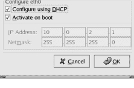

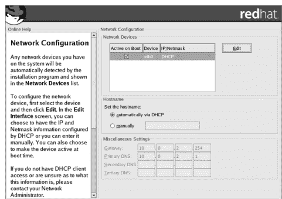

**图 2-12** 配置网卡和 IP 设置。

如果你选择手动配置，请确保手头有 IP 和子网掩码值。

如果你希望该接口在启动时启用，请勾选该卡“启动时激活”按钮。

在屏幕的下半部分，你将看到用于为机器设置主机名、网关和相关 DNS 信息的配置选项。如果你已在其中一个网络接口上启用了 DHCP，你可以选择让机器名称从 DHCP 服务器设置。

> **注意**
>
> 即使你不属于某个网络，你也可以填写主机名。如果你不填写主机名，你的计算机将被称为 localhost。

填写完所有信息后，只需单击“下一步”继续。

## 防火墙配置

下一个屏幕允许你配置 Linux 系统的防火墙功能（参见图 2-13）。

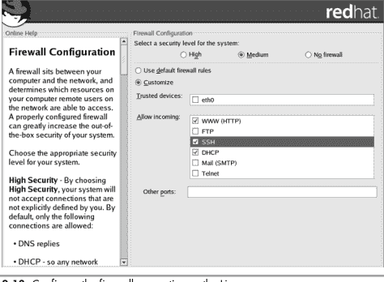

**图 2-13** 配置 Linux 服务器上的防火墙属性。

你设置系统访问控制是严格还是宽松，完全取决于服务器将执行何种功能。例如，如果你想让你的系统作为 NFS 服务器，以便其他系统可以挂载其驱动器，你不能在此页面设置高级别或中级别的安全级别。另一方面，如果你想让这个系统作为一个不包含 RealAudio 内容的 Web 服务器，高安全级别可能是最佳选择。

如果你不计划访问 Linux 服务器的控制台，你应该确保允许一种远程管理该方法；启用 SSH 可以做到这一点。你将在模块 9 中花更多时间配置 Red Hat Linux 8.0 以确保安全。

> **提示**
>
> 结果证明你过度约束了服务器，并且在按预期访问或使用它时出现问题，你可以使用命令 `/sbin/service iptables stop` 暂时关闭防火墙，但请在易受攻击的网络上谨慎这样做。

当你将防火墙属性配置到令你满意为止，单击“下一步”继续安装。

## 附加语言支持

如果你希望除安装过程中指定的语言外，添加对其他语言的支持，下一个屏幕允许你这样做（参见图 2-14）。如果你选择这样做，你可以将你的 Linux 服务器设置成一个虚拟的巴别塔。

选择所有需要的附加语言后，单击“下一步”。

## 时区配置

时区配置屏幕（参见图 2-15）允许你选择机器所在的时区。如果你的系统硬件时钟以 UTC 计时，请确保单击“系统时钟使用 UTC”按钮，以便 Linux 可以确定两者之间的差异并显示正确的本地时间。

## 创建账户

Red Hat 安装工具为你创建一个名为 *root* 的账户。此用户账户在性质上类似于 Windows 2000 和 Windows .NET Server 下的管理员账户：允许访问此账户的用户拥有对系统的完全控制权。

因此，用一个良好的密码保护此账户至关重要。确保不要选择字典单词或姓名作为密码，因为它们很容易猜测和破解。

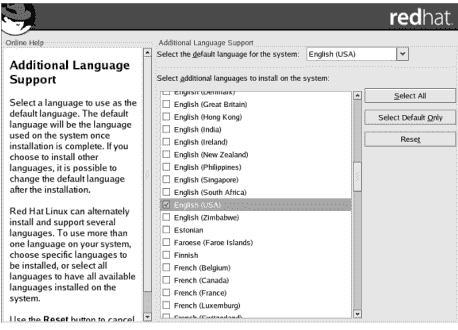

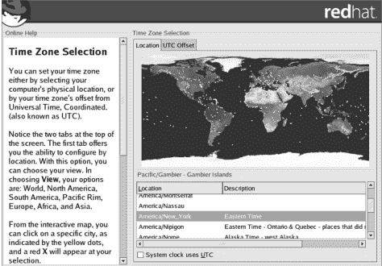

**图 2-15** 从地图或文本列表中选择正确的时区。

保护 **root** 的一部分意味着不允许用户通过网络登录为 root 用户。这可以防止黑客使用自动登录脚本来猜测你的 root 密码。为了允许合法用户成为 root 用户，你需要以自己的身份登录，然后使用 **su**（切换用户）命令。因此，如果你打算执行远程管理，仅设置 root 密码是不够的；你还需要设置一个真实用户。

通常，设置一个普通用户进行日常工作被认为是一个好主意。这提供了保护，使你在仅仅浏览互联网或执行非管理任务时，无法意外破坏配置文件或其他重要组件。当然，这条规则的例外是某些服务器配置，在这些配置中，除了 root 用户外不应有任何用户（例如，防火墙）。

在图 2-16 中，你看到的是一个设置 root 密码以及创建新用户的屏幕。

首先选择一个 root 密码并输入到屏幕顶部的 **Root Password** 框中。在右下方的 **Confirm box** 中再次输入；这可以保护你，以防你打错字而被锁定在系统之外。一旦你以相同的方式输入密码两次，密码框下方将显示文本 **Root Password Accepted**。

模块 2：在服务器配置中安装 Linux 44

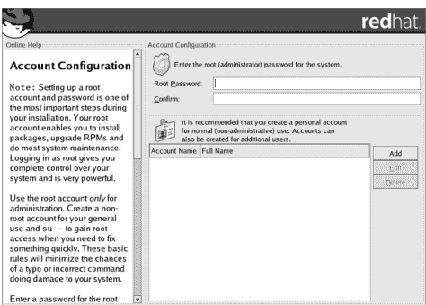

**图 2-16** 为 root 用户设置强密码并添加额外用户。

你无需添加 root 用户。

屏幕的其余部分用于创建新用户账户。要这样做，只需单击“添加”即可调出如图所示的“添加用户账户”窗口。

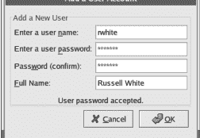


在“账户名称”框中输入用户名，在“密码”和“密码（确认）”框中输入用户的密码，在“全名”框中输入用户的真实姓名。单击“确定”以将该新用户插入用户账户列表中。根据需要进行重复操作，然后单击“下一步”以继续。

> **注意**
> 如果在添加新用户时犯了错误，您也可以删除和编辑它们。

## 身份验证配置

Linux 将用户列表保存在 `/etc/passwd` 文件中。每个系统都有此文件的一个副本，如果一个用户列在一个 `/etc/passwd` 文件中，除非该用户在另一个 `/etc/passwd` 文件中有条目，否则该用户无法登录到另一个系统。为了允许用户登录到计算机网络中的任何系统，Linux 可以使用网络信息系统（NIS）来处理远程密码文件问题。

除了列出用户外，`/etc/passwd` 文件还包含每个用户的所有密码，并以加密格式存储。很长一段时间以来，这是可以接受的，因为攻击此类文件以破解密码的过程计算成本太高，以至于尝试都几乎是无济于事的。在过去的几年里，负担得起的 PC 已经获得了必要的计算能力，从而对这种安全性构成了威胁，因此推动使用影子密码（shadow passwords）的努力随之而来。使用影子密码时，实际的加密密码条目不再保存在 `/etc/passwd` 文件中，而是保存在 `/etc/shadow` 文件中。`/etc/passwd` 文件仍然可以由系统中的任何用户读取，但 `/etc/shadow` 只能由 root 用户读取。显然，这是在安全性方面迈出的重要一步。

出现的另一种方法是一种利用 MD5 哈希函数的技术。（不用担心 MD5 的细节——你只需要关心它比标准方法更好的事实。）除非你有特定的理由不这样做，否则请务必勾选“启用 MD5 密码”和“启用影子密码”复选框（参见图 2-17）。

如果你的站点有现有的 NIS 基础设施，请在此窗口中输入相关的 NIS 域和服务器名称。如果你不知道，或者你想稍后再处理，你可以安全地忽略此步骤。

另一个选项是使用轻量级目录访问协议（LDAP）服务器来存储密码。这对于拥有数千用户访问许多服务器且 NIS 在性能上无法满足要求的环境来说是理想的。如果你不确定 LDAP 或是否拥有 LDAP 服务器，你可以跳过此步骤。

如果你处于 Kerberos 环境中，你需要启用 Kerberos 身份验证方法。如果你选择此路径，请联系你的 Kerberos 管理员以获取适当的安全域名称、KDC 和管理服务器。如果你不确定什么是 Kerberos，那么你很可能不需要它。

如果你处于现有的 Windows 环境中，并且正在使用 SMB 服务器进行身份验证，Linux 系统也可以使用这种身份验证方法。如果你不确定 SMB 身份验证，请跳过它。

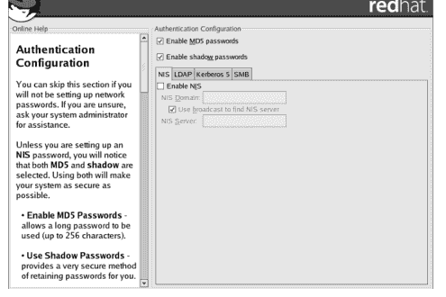

图 2-17 配置身份验证以使用 MD5 加密的影子密码，并访问适用的任何网络身份验证方法。

一旦你选择了所有相关的复选框并填写了相关条目，单击“下一步”以继续到下一个屏幕。

## 选择软件包组

在这里，你可以选择要安装到系统上的软件包。Red Hat 将这些软件包分为几个高级描述，使你可以快速选择想要安装哪种类型的软件包，并安全地忽略细节。你也可以选择安装 Red Hat 附带的所有软件包，但请注意：完整安装需要近 5GB 的软件！

> 如果你决定你低估了软件（放在 `/usr` 中）所需的存储空间，你可以单击“返回”来重新分区系统，以为你想要的内容腾出足够的空间。

查看顶级组描述（图 2-18），你会看到 Red Hat 给你的最广泛的选项。你可以简单地选择你感兴趣的组，或者滚动到底部并选择“所有”以安装所有软件包；或者你可以单击任何已选组旁边的“详细信息”链接，以从该组中选择单个软件包。

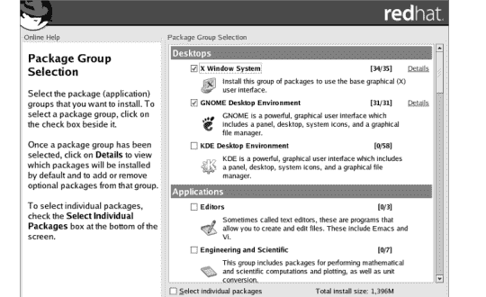

图 2-18 选择要安装软件的顶级组以准备选项。

如果你选择单击“详细信息”链接，你会看到类似所示的屏幕。

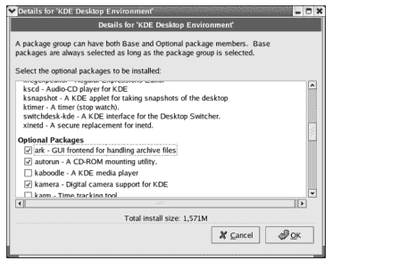

每个这样的屏幕都列出了自动安装的软件包，然后显示你可以选择安装或省略的可选软件包。

如果你勾选“选择单个软件包”按钮，你会看到类似图 2-19 中所示的屏幕。屏幕左侧显示软件包的功能分组，屏幕右侧显示单个软件包。

如果你选择选择单个软件包，Red Hat 将进行遍历并验证这些软件包所需的所有先决条件是否满足。如果有任何未满足的条件，你会在类似图 2-20 的屏幕上看到这些软件包。

如果有任何需要安装以便你选择的所有软件包都能正常工作的软件包，请确保选择标有“安装软件包以满足依赖项”的单选按钮。

选完软件包后，单击“下一步”。

## 即将安装

安装程序现在会警告你（见图 2-21）它即将开始对你新服务器进行重大更改。如果你确信你已经按照你想要的方式配置了所有设置，请单击“下一步”。

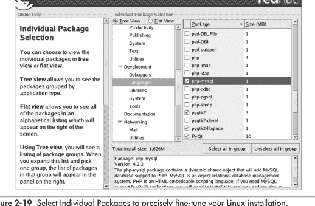

**图 2-19** 选择单个软件包以精确微调你的 Linux 安装。

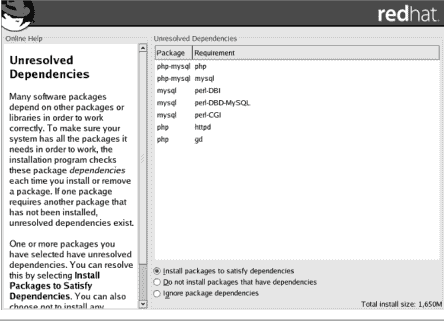

图 2-20 Red Hat Linux 提醒你所选软件包未满足的依赖项。

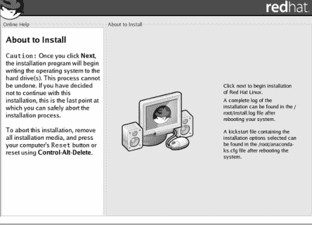

图 2-21 当 Red Hat Linux 即将安装时，它会检查以确保你已准备好。

## 安装开始

Red Hat 现在将进行安装你选择的所有软件包的过程。根据硬盘、CD-ROM 和机器的速度，这可能需要几分钟到 20 多分钟。状态指示器（见图 2-22）将让你知道过程进展到多少，以及系统预计还需要多长时间。

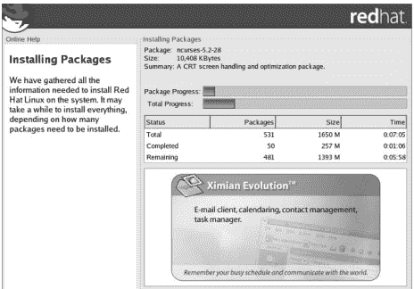

图 2-22 安装程序让你随时了解安装进度。

一旦安装程序用尽 CD 上的文件，它将弹出 CD 并提示你插入下一张光盘。插入下一张光盘并单击“确定”以继续。

## 创建启动盘

一旦安装过程完成，Red Hat 提供创建启动盘的选项。除非你熟悉恢复 Linux 系统，否则花一点时间创建一个启动盘会让你的生活更轻松。

按照图 2-23 中所示的说明，只需将一张空白磁盘插入驱动器并单击“下一步”。如果你不想创建启动盘，请单击标有“跳过创建启动盘”的按钮，然后单击“下一步”。

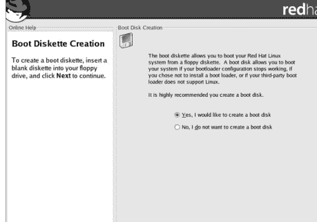

**图 2-23** 创建一个启动盘以简化系统恢复。

> **警告**
>
> 如果你选择不安装启动加载器，*你必须创建一个启动软盘，否则你将无法启动 Linux。*

## 配置 X 窗口系统

X 窗口系统是 Linux 中图形用户界面的基础。它是与实际视频硬件通信的东西。诸如 KDE 和 GNOME（你更可能听说过；如果没有，请阅读下一个模块）等程序使用 X 窗口系统作为与硬件通信的标准机制。

X 窗口系统有趣之处在于它与基础操作系统没有耦合。事实上，Linux 使用的 X 版本，*Xfree86*，也可用于许多其他基于 UNIX 的系统，例如来自 Sun 的系统。这意味着可以运行服务器而*从不*启动图形环境，并且通常这样做是个好主意。通过关闭 GUI，你可以节省内存和系统资源，这些资源可以转而用于实际的服务器进程。


## 52 模块 2：在服务器配置中安装 Linux

当然，这并不改变以下事实：许多优秀的管理工具只能在 X 环境下使用，因此配置好它仍然是一个好主意。

Red Hat 将首先尝试检测你拥有的显卡类型（见图 2-24）。如果你拥有一块非最新旗舰级的知名品牌显卡，你可能会发现配置过程最轻松。如果 Linux 无法确定显卡类型及其内存大小，你可以直接输入必要的信息。

选定显卡后，点击“下一步”。“跳过 X 窗口系统”的选项在你不需要 X，或者想稍后再配置它时非常有用。如果是这种情况，你可以勾选跳过 X 窗口系统的复选框，然后点击“下一步”。

下一个屏幕显示了一组显示器制造商列表。找到你的制造商，点击其名称左侧的三角形以展开显示器型号列表（见图 2-25）。请务必选择正确的显示器品牌和型号，或者在通用列表中找到一个与你的显示器视频模式兼容的设置。


> 如果你拥有一台未在 Red Hat 数据库中的非普通显示器，请准备好它的频率信息，并将其输入到相应的字段中。向显示器发送过高的频率可能会导致物理损坏。当显示器远不如现在坚固，且 X 窗口系统配置工具尚未出现时，作者就曾以这种方式烧毁了他第一台彩色显示器。

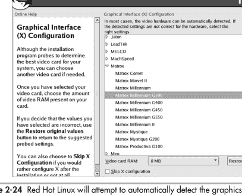

图 2-24 Red Hat Linux 将尝试自动检测显卡。

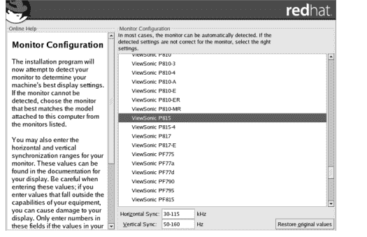

图 2-25 安装程序允许你选择显示器的制造商和型号，或通用的等效设置。

点击“下一步”以调出类似于图 2-26 的屏幕。

下拉列表显示了你的显示子系统支持的色彩定义和像素分辨率。将它们配置为你认为可用的设置，然后点击“测试设置”按钮以查看其实际效果。对于某些人来说，高分辨率设置过高，会导致字体难以阅读。显示更多颜色通常会使显示效果更好，但可能会降低性能。

使用图形登录的选择仅仅是那样：你可以让 X 窗口系统在启动时自动运行，这样每个人看到的第一个登录界面就是图形的，而不是基于文本的。对于在办公室拥有 Linux 系统的初级用户来说，这种选择通常很棒。但是，将其用于服务器并不太合理，特别是对于那些不打算从控制台使用它太频繁的服务器。完成选择后，点击“下一步”继续。

## 安装完成

就这样！安装过程结束了。你会被提示再点击一次“下一步”以重启系统。当系统重启时，请务必移除系统中任何能够比硬盘先启动的光盘或软盘。

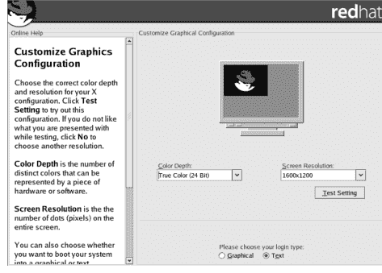

**图 2-26** 配置并测试 X 窗口系统的分辨率设置。

### 项目 2-2：安装服务器

虽然你刚才已经相当详尽地介绍了安装服务器的过程，但在执行实际安装时，你仍然需要将所有部分组合在一起。请遵循以下步骤以确保良好的结果！

#### 分步操作

- 1. 检查你的服务器硬件，确保它满足最低系统要求，并且在硬件兼容性列表上。
- 2. 为你的服务器在网络上分配一个 IP 或 DHCP 地址。
- 3. 检查是否有足够的磁盘空间来安装和运行你的软件。你可以通过启动安装程序并尽快移动到软件安装步骤来精确检查这一点。实际上无需安装软件，只需选择你希望使用的所有软件包。如果你单独选择软件包，请务必检查依赖项，因为某些依赖项可能非常大。
- 4. 创建一个系统用户列表，以便在适当时可以在安装过程中添加他们的账户。
- 5. 确定用户在主目录中可能需要多少空间，以确保该分区上有足够的空间。
- 6. 执行实际安装，按照你计算好的方式进行磁盘分区，并安装你计划使用的软件。
- 7. 如果你安装并配置了 X 窗口系统，请务必测试它，特别是如果你使用默认的图形登录选项。
- 8. 系统重启后，查看它是否完全启动。

## 项目摘要

试验 Linux 安装过程并不难，因此你可以尝试多种不同的选项而无需消耗太多精力。如模块 4 所述，在安装之后添加或删除软件非常容易，所以没有必要一开始就将所有事情都做到完美。但通过一点调查和规划，初始安装就可以立即投入使用。

## 寻找更多帮助

如果你在安装方面仍有问题，请务必访问 Red Hat 的网站（<http://www.redhat.com>）并查看 Red Hat 8.0 可用的手册（<http://www.redhat.com/docs/manuals/>）。在那里，你可以找到适用于安装过程中所有可能变化的官方安装指南。你还将找到最新的勘误表、安全更新以及关于 Red Hat 8.0 发行版的说明。

## 模块摘要

本模块描述了构建服务器的过程，包括选择正确的硬件、建立正确的环境，以及最终安装 Red Hat 8.0。在你进入实际安装 Red Hat Linux 过程之前，所有这些评论都适用于你构建的任何服务器，无论使用何种操作系统。

安装 Red Hat 本身的步骤也相当直接明了。任何目睹过早期版本安装过程的人都应该注意到，该过程变得多么轻松，以及开始工作所需做出的配置选择是多么少。Linux 的奇妙之处在于，尽管这些选项不再是安装过程的一部分，但一旦你完成安装并真正启动系统后，你仍然可以更改和微调它们，随心所欲。

如果你需要帮助，别忘了搜索我之前在本模块中提到的那些地方。一旦你成为 Linux 高手，别忘了帮助他人。


## 模块 2 掌握检查

- 1. HCL 是什么？为什么它很重要？
- 2. 列出对服务器最重要的三个因素。
- 3. 以下哪些是配置 Linux 服务器的有效方法？
  - A. 重新编译服务器内核
  - B. 避免在服务器上使用 X 窗口系统
  - C. 禁用未使用的功能
  - D. 使用液氮冷却服务器
  - E. 在内核中加载尽可能多的模块
- 4. 使用什么命令来确定 Linux 系统已运行了多长时间？
- 5. 哪个网站提供 Linux 的指南和食谱式帮助？
- 6. 使用什么工具从 Windows 系统创建 Linux 启动盘？
- 7. 在 Red Hat Linux 8.0 安装到系统后，用于配置以下各项的工具名称是什么：
  - A. X 窗口系统
  - B. 键盘
  - C. 鼠标
- 8. 在 Linux 术语中，根目录是如何标识的？
- 9. 建议将根目录的哪四个子目录划分为单独的分区？
- 10. 交换文件应该有多大？
  - A. 系统 RAM 大小的两倍。
  - B. 如果系统 RAM 少于 128MB，则为系统 RAM 大小的两倍。如果系统 RAM 超过 128MB，则与系统 RAM 大小相同。
  - C. 如果系统 RAM 少于 128MB，则交换空间为 128MB。如果系统 RAM 超过 128MB，则与系统 RAM 大小相同。
  - D. 与系统 RAM 大小相同。
- 11. 安装后，多处理服务器系统将有多少个启动选项？
- 12. 描述 Red Hat Linux-up 启动选项的用途。


## **13.** 使用什么命令可以成为 *root* 用户？

## **14.** 什么是 *shadow password*（影子密码），它存储在哪里？

## **15.** 在 Red Hat Linux 安装过程中，以下哪些认证方法是可配置的？
- A. Kerberos
- B. LDAP
- C. NIS
- D. RADIUS
- E. SMB

## **16.** 在极少数情况下，如果将显示器设置为运行在其设计无法处理的频率下，可能会发生什么？

### 模块 3
#### GNOME 和 KDE

##### 关键技能
- **3.1** 理解 X Window System 的起源
- **3.2** 使用和定制 GNOME
- **3.3** 使用和定制 KDE

**GNOME** 和 KDE 都获得了大量的关注，因为它们为基于 UNIX 的操作系统（最著名的是 Linux）提供了一个真正易于使用的界面。在本模块中，您将浏览各种提示和技巧，以使 **GNOME** 和 KDE 更好地为您工作。由于大多数发行版都预装了一个（或两个），因此在您开始使用它们之前，不需要处理安装或配置过程。

但在进入有趣的部分之前，您需要退后一步，更多地了解 X Window System 以及它与 GNOME 和 KDE 的关系。这将使您对 Linux 的全景有更清晰的了解，以及它与 Windows NT 的一个基本架构差异。

> **注意**
>
> 不理智的做法是作为 root 用户运行 X Window System，如果没有其他原因，那是因为 **root** 应该仅在需要时使用，而给予 root 用户自己的桌面配置会招致过度使用。如果您在 Red Hat 安装过程中没有创建额外的非 root 用户，您可以跳过模块 5 查看如何创建用户，然后再继续本模块。这里描述的更改可以适用于任何用户，包括 **root**。

# 3.1 **关键技能**
## 理解 X Window System 的起源

基于 UNIX 的操作系统（如 Linux）的设计者，在用户环境方面，与那些微软 Windows 甚至 Macintosh OS 背后的人有着非常不同的世界观。UNIX 界的人认为，他们向用户展示的界面应该 100% 独立于核心操作系统。因此，Linux 的内核与其用户界面完全解耦。这允许您选择最适合您的界面，而不是被迫接受别人或潜在随机“市场调研”所规定的愿景。

然而，更重要的是，拥有一个如此大的程序独立于核心操作系统所带来的稳定性。如果 GUI 在 Windows 或 Mac OS 下崩溃，您必须重新启动。在 Linux 下，您可以终止并重启 GUI，而不会影响系统提供的任何其他服务（例如网络文件服务）。

在 20 世纪 80 年代中期，创建了一个独立的图形用户环境基础，被称为 X Window System。“X”（常见的缩写）仅仅定义了应用程序与图形硬件通信的方法。同时还建立了一套定义明确的功能，程序员可以调用它们来执行基本的窗口操作。


> Linux 使用的 X Window System 实现是 XFree86。有关 XFree86 项目及其配置的信息可以在 http://www.xfree86.org 找到。

关于如何绘制窗口和处理鼠标点击的简单定义并不包含关于窗口应该看起来如何的模型。（事实上，X Window System 在其自然状态下没有真正的外观。它甚至不会在窗口周围画线！）外观控制被交给一个称为 *window manager*（窗口管理器）的外部程序。窗口管理器负责绘制边框、使用颜色以及使环境悦目；窗口管理器只需要使用对 X 子系统的标准调用来在屏幕上绘制。窗口管理器 *并没有* 规定应用程序本身如何利用窗口。这意味着应用程序程序员有灵活性去开发对该应用最直观的界面。

由于窗口管理器是独立于 X 子系统之外的，并且 X 应用程序编程接口（API）是开放的，任何想要开发新窗口管理器的程序员都可以这样做，而且许多人确实这样做了。在当今的语境下，我们可能会将这种开放性与 MP3 播放器（如 Winamp）联系起来，这些播放器允许开发人员为基础播放器构建“皮肤”。

锦上添花的是应用程序与 X 之间的关系。典型应用程序被编写为直接与 X 通信，从而与用户选择使用的任何窗口管理器一起工作。图 3-1 展示了这种关系。

## 缺点

尽管 X Window System 在技术上很有趣且多功能，但为它编程却是个麻烦事。Windows 程序员可能会将为 X 编程等同于在可视工具和 MFC 库出现之前为原始 MS Windows 编程。例如，一个简单程序，用于显示一个窗口、显示文本“Hello World”并提供一个允许用户退出的按钮，在 X 和 MS Windows 下都很容易长达几百行！

在这里，UNIX 界的人从 Macintosh OS 和 MS Windows 家族那里吸取了教训（值得注意的是，后者在 20 世纪 70 年代末从 Xerox 的工作中借用了他们的想法）：如果不为最终用户和程序员提供一个合理一致的用户界面，该界面既易用又易于开发，就意味着失去用户基础。

商业 UNIX 供应商试图通过通用桌面环境（Common Desktop Environment）来解决这个问题，以便他们的用户获得一致的外观和感觉，并且还开发了一种称为 Motif 的 X 的改进版本。对于 Linux 来说，这两个发展都带来了问题，因为它们违背了开源的理想。雪上加霜的是，它们并不比之前可用的好多少。

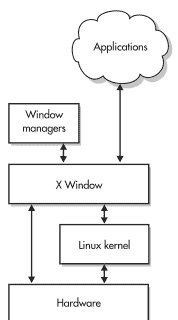

**图 3-1** X Window System、窗口管理器、应用程序和核心操作系统之间的关系

# KDE 和 GNOME 的登场

由于不友好的编程环境和用户界面，X 有一天有可能变成一个遗留接口。这将是非常不幸的，因为它提供的设计（现在仍然是）远远优于其他商业产品。该协议是开放的，这意味着任何想要编写 X 客户端或 X 服务器的人都很欢迎。当然，X 的最佳特性之一是它允许在一个主机上运行应用程序，但在另一个主机上显示。

**注意**
尽管您可能在新手论坛和网站上听到过，这两个团体并没有处于“战争”状态。相反，他们欢迎公开竞争。每个团体都可以利用对方的想法，进而，两个团体都可以为我们用户提供了两个绝佳的选择。

在 20 世纪 90 年代后期，两个团体从幕后走出来，解决了 X Window System 的问题：GNOME 和 KDE。*KDE* 提供了一个新的窗口管理器以及必要的库，使得为其编写应用程序变得更加容易。*GNOME* 提供了一个通用框架，让其他窗口管理器和其他应用程序可以与之配合工作。每个团体都有自己的关于事物应该如何运作的想法，但由于它们都建立在 X Window System 之上，因此并非完全互不兼容。

# 这对您意味着什么

上一段中的关键词是“并非完全互不兼容”。为了使 KDE 和 GNOME 提供拖放等功能，它们必须提供一种统一的方式让应用程序相互通信，并有一套开发者库来实现这一点。好消息是，这两种方法正在协调一致，以提供日益增加的互操作性。事实上，Red Hat Linux 8.0 旨在比以往任何时候都更隐蔽其差异。坏消息是，这种新兴的兼容性仍在进行中，因此 Linux 桌面不像 Apple 的 OS X 或 Microsoft 的 Windows XP 那样集成度高。

这对应用程序意味着什么可能有点令人困惑。取决于应用程序从其库中调用的功能，只要库存在，它仍然可能在其他环境中工作。一个例子是 **kssys** 程序，root 用户用它来控制运行在系统上的服务。它是专为 KDE 编写的，但由于它所依赖的功能在库中 100% 可用，运行 GNOME 但拥有 KDE 库的系统（如 Red Hat）将允许应用程序无问题地运行。另一方面，如果应用程序依赖于 KDE 窗口管理器本身，该应用程序将不会在 GNOME 下工作。

这意味着，选择其中一个环境而不是另一个，可能会使您无法使用某些应用程序。如果您不确定更喜欢哪一个，请尝试两者。曾经，人们可能将目标理解为决定这两个环境哪一个是最佳匹配，但现在越来越清楚，同时提供两者并使用每个系统中最好的工具和方法具有显著优势。您仍然需要看看哪一个更适合作为您的主要运行环境，但那是个人的选择。我使用什么并不重要。您喜欢什么才是重要的。这就是拥有两个竞争系统的意义所在。

# 3.2 使用和定制 GNOME

GNOME（GNU Network Object Model Environment）提供了一个完整的桌面环境和应用框架，使开发和使用都更容易。使 GNOME 区别于 KDE 的是它如何实现这些目标。与 KDE 不同，GNOME 不提供


窗口管理器。GNOME 提供了开发库和会话管理——这些是我们用户看不到的基础功能。在这个基础之上是一个负责管理桌面整体外观的窗口管理器。默认的窗口管理器是 Metacity，但也提供了其他几种选择。

> 根据官方网站的说法，GNOME 的正确发音是 **guh-NOME**。这是因为 GNOME 中的 G 代表 GNU，而 GNU 的正确发音是 “guh-new”。在同样的段落中，GNOME 团队还表示，如果你把它读作 “NOME”，不会冒犯任何人。

从开发者的角度来看，GNOME 非常有趣。它通过 CORBA 技术定义与外部世界的接口。因此，任何能够使用 CORBA 通信的开发系统都可以用来开发符合 GNOME 标准的应用程序。（更多信息，请访问他们的开发者网页 http://www.gnome.org。）对于用户而言，这意味着有潜力开发许多应用程序来利用 GNOME 中的功能。当然，就像 KDE 一样，GNOME 也能与现有的 X 应用程序很好地协同工作。

> 你选择 GNOME 是因为在 Red Hat 安装过程中默认选择了它。如果你尚未安装 GNOME，可以查阅第 4 模块以获取更多关于安装软件的信息。

## 启动 X 窗口系统和 GNOME

如果你使用的是 Red Hat Linux 并选择了其默认设置，那么 GNOME 已经作为你的默认 GUI 安装好了。根据 X 的配置方式，你可能已经拥有了图形登录提示界面。在这种情况下，登录将自动进入 X 窗口系统环境。如果你有基于文本的登录，只需运行 `startx` 即可启动 X，例如：

```bash
[root@tedford ~]# startx
```

这将显示一个类似于图 3-2 的屏幕。

你怎么知道 GNOME 已经启动了呢？在早期版本的 Red Hat Linux 中，GNOME 和 KDE 桌面看起来差异较大，但 Red Hat 使用了相同的图标集和类似的桌面配置选项，使得差异不那么明显。然而，如果你在 Red Hat Linux 8.0 系统上第一次启动 X 并将光标移动到


左下角的 Red Hat 图标上，如果加载了 GNOME 桌面，你会看到弹出文本显示 “GNOME Menu”。

如果默认启动的 GUI 不是 GNOME，你可以通过编辑主目录中的 .xinitrc 文件来更改个人设置以使用 GNOME。首先尝试退出窗口管理器。如果你在 KDE 中，点击左下角的红帽子图标以调出菜单。在该菜单中应该有一个登出选项。如果你真的卡住了，也可以按 CTRL-ALT-BACKSPACE 来终止底层的 X 系统。这将使你回到文本模式。使用你喜欢的编辑器编辑 .xinitrc 文件。如果你没有特别喜欢的，可以尝试 pico，例如：

```
[rwhe@ltdford ~]$ pico .xinitrc
```

注意：如果你不熟悉 pico，不用担心。所有可用的命令始终显示在屏幕底部。任何以尖顶符号（^）开头的命令意味着你需要使用 CTRL 键加上指定的其他键。例如，^X 意味着 CTRL-X。

很可能该文件是空的。如果是这样，只需添加以下内容：

```bash
#!/bin/sh
gnome-session
```

如果文件不是空的，转到最后一行。它很可能以字符串 **exec** 开头，这告诉系统执行一个程序。将该行更改为 **gnome-session**。

# GNOME 基础

如果你熟悉像 Microsoft Windows 这样的 GUI 界面，GNOME 桌面应该让你感到宾至如归。有两个显著的不同：首先，桌面上没有“我的电脑”图标。这是因为 Linux 没有为每个分区分配单独驱动器号的概念。相反，所有分区都在一个目录树中可用，从而消除了选择驱动器的需求。

第二个主要区别是屏幕底部的面板。这个面板类似于 Windows XP 的任务栏；它显示了当前正在运行的应用程序以及日期和时间，面板左侧的红帽子按钮类似于开始按钮。最大的区别在于这个面板是完全可配置的：你可以在其中移动项目、停靠动态应用程序、设置其他应用程序的快捷方式，以及在虚拟桌面之间移动。与 Windows 一样，你可以设置它在不使用时自动隐藏。如果你不想在特定任务中被打扰，可以点击面板两端的箭头按钮，它会滑出视线，直到你再次点击箭头按钮。

默认情况下，面板上可用的按钮从左到右依次是：开始菜单、网络浏览器（Mozilla）、电子邮件管理器（Evolution）、文字处理器（OpenOffice.org Writer）、演示工具（OpenOffice.org Impress）、电子表格（OpenOffice.org Calc），以及用于在虚拟桌面之间切换的工作区切换器。在面板的左侧是 Red Hat 的“关键更新通知器”和一个时钟。


如果你想更改面板的外观，请在面板的任何空白处右键单击。这将调出如图所示的菜单；其子菜单允许你配置面板的各种方面，包括将正在运行的程序停靠到其中（applets）和设置新的快捷方式（启动器）。

桌面上的空白空间并不是浪费的空间；在 GNOME 中，你可以在空桌面上任意位置右键单击以调出此菜单。选择一个选项以打开窗口浏览系统内容，或者在桌面上添加文件夹或应用程序启动器图标，或者打开终端窗口。

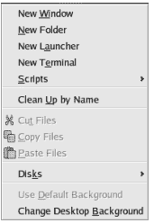

## GNOME 起始图标

在 GNOME 桌面上有一个回收站图标、一个主目录图标（指向当前用户主目录的链接）以及一个“起始”（Start Here）图标。“起始”图标下的“首选项”设置中的可用选项允许你控制 GNOME 的外观和行为，类似于 Windows 控制面板的工作方式。


如果你不确定某个特定按钮的作用，只需将鼠标指针停留在按钮上几秒钟。一个小描述会出现在指针旁边。一旦你将鼠标移开按钮，描述会自动消失。

如果你在桌面上没有看到“起始”图标，可以尝试点击屏幕左下角的 Red Hat 图标。这将调出一个包含“首选项”选项的菜单。选择“首选项”会调出一个包含各种配置选项的子菜单（如图 3-3 所示）。

在本节中，你将逐步完成几个常见的任务。它们应该能让你了解可以做什么以及如何查看如何操作。如前所述，该界面非常像 Windows，因此学会在其中导航应该相对容易。

# 更改背景

要更改你的背景设置，点击“背景”选项。这将调出一个类似于图 3-4 的面板。

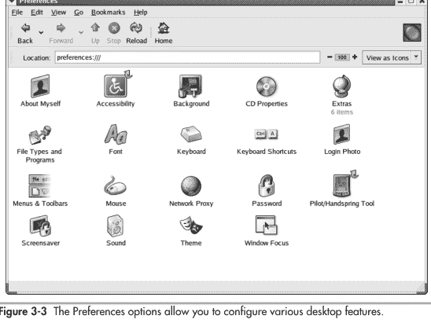

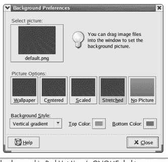

**图 3-4** 在 Red Hat Linux 的 GNOME 桌面中设置背景。

背景窗口允许你控制背景颜色和壁纸。“选择图片”选项允许你从图片列表中选择一个作为背景，或者你可以将一个图片文件拖入背景窗口以代替使用。图片可以用几种不同的方式处理；“图片选项”显示了如果选择每个选项时桌面的外观。

如果你喜欢，你可以设置背景不使用图片，而是选择单一颜色，或者选择两种颜色并在它们之间做水平或垂直渐变。要选择颜色，点击其中一个颜色框；这将调出一个颜色轮，你可以从中选择任何喜欢的颜色。

### 设置屏幕保护程序

要在 GNOME 下设置屏幕保护程序，点击“桌面”菜单，然后点击“屏幕保护程序”菜单。这将调出一个类似于图 3-5 的面板。

在那里，选择屏幕保护程序非常容易。只需选择你要使用的模式——无屏幕保护程序、仅屏幕熄灭、一个屏幕保护程序，或从可能性列表中随机选择一个屏幕保护程序。屏幕保护程序外观的示例将显示在描述中


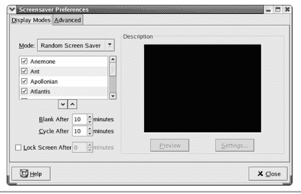

图 3-5 在 Red Hat Linux 的 GNOME 桌面中设置屏幕保护程序。

该区域位于同一窗口内。如果屏幕保护程序具有可自定义的设置，可以通过点击“设置”按钮进行配置。全局屏幕保护程序设置允许你选择在启动屏幕保护程序前系统应等待多长时间，以及在切换到另一个屏幕保护程序（如果你启用了多个屏幕保护程序）前应等待多长时间。你还可以设置系统在一段时间后“锁定”屏幕；当锁开启时，必须输入当前用户的密码才能解锁屏幕。

在“高级”选项卡中，你可以找到用于在系统空闲时节能的电源管理功能、诊断设置以及其他配置选项。

## 主题

*主题*是 GNOME 允许你配置窗口管理器外观的方式。这些更改不仅仅是改变颜色；它们可以改变桌面、窗口、边框和所有应用字体外观。（Mac OS 8 或 Winamp 的用户应该对此技术很熟悉。）如果你不确定可以进行多大的更改，请访问 http://art.gnome.org、http://themes.freshmeat.net 或 http://www.themedepot.org。

要在 GNOME 中打开“主题”菜单，只需进入“首选项”菜单，然后点击“主题”图标。这将打开一个如图 3-6 所示的面板。

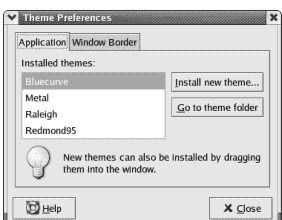

在 Red Hat Linux 的 GNOME 桌面中选择一个主题。

默认情况下，Red Hat Linux 8.0 使用 Bluecurve 主题启动。Red Hat 安装包中还包含其他几种主题。如果你对添加非标准主题感兴趣，你可以下载新的主题。你可以将新主题拖放到“主题首选项”窗口的“应用程序”选项卡中，并且可以在……惊喜！……“窗口边框”选项卡下自定义窗口边框。

## 项目 3-1 自定义 GNOME 桌面

桌面配置是一个非常个人化的问题，因为每个用户似乎都有偏爱的做事方式。然而，如果不尝试一些更改，很难知道该如何操作。你现在已经掌握了调整 GNOME 桌面的一些知识；在这个项目中，你将更改一些常见的配置设置。

### 分步操作

- 1. 在默认的 GNOME 桌面上，右键点击面板上的空白处。
- 2. 点击“属性”菜单项。
- 3. 你可以使用此窗格将面板重新定位到桌面的四个边缘中的任何一个，但暂时先保持位置不变。在“大小”下拉菜单中，选择“小”（36 像素）。
- 4. 勾选“显示/隐藏按钮”复选框。
- 5. 勾选“隐藏按钮上的箭头”复选框。
- 6. 点击“关闭”。屏幕底部面板现在应该变短了，其图标更小且间距更宽。
- 7. 右键点击面板上的空白处，选择“添加到面板”。
- 8. 选择“实用程序”，然后选择“系统监视器”。面板上应出现一个系统监视器区域；它将图形化显示 CPU 使用情况。
- 9. 右键点击面板上的空白处，从菜单中选择“启动器”。
- 10. 选择“系统工具”，然后选择“终端”。面板上将出现一个终端图标；点击此图标将打开一个终端，你可以使用命令行界面。
- 11. 再次右键点击面板上的空白处，从菜单中选择“启动器”。
- 12. 选择“办公”菜单，然后选择“项目管理”。面板上应出现一个 Mr. Project 图标；该工具仍在开发中，但其概念类似于 Microsoft Project。
- 13. 右键点击面板上的空白处，选择“新建面板”。
- 14. 选择“菜单面板”选项，桌面顶部应出现一个菜单栏。可以从该菜单栏调用应用程序和操作，它还可以容纳额外的启动器、小部件和实用工具。
- 15. 右键点击屏幕顶部的新菜单面板。
- 16. 选择“添加到面板”，然后选择“附件”菜单，再选择“股票报价”选项。菜单面板上应出现一个股票报价区域。
- 17. 右键点击面板上的股票报价区域，选择“首选项”。应出现一个配置页面。
- 18. 在“新符号”字段中输入 RHAT。
- 19. 点击“添加”按钮，然后点击“关闭”。五分钟后，Red Hat 的股价应开始在股票报价区域滚动，并附带默认的指数信息。
- 20. 通过左键点击面板上的图标并将其拖拽到期望的位置来移动它们。

## 项目摘要

该项目展示了自定义桌面的一种方式。如果你大部分时间都登录到服务器，系统监视器实用工具可能非常有用，但股票报价功能不太可能因为坚实的商业理由而存在。现实是，你选择的选项与你的 Linux 服务器如何运行关系不大，但它们可能会极大地影响你使用其 GUI 的效率和舒适度。在这方面的实验不会造成任何伤害，所以花点时间进一步探索吧。

## **3.3** 使用和自定义 KDE

与 GNOME 一样，KDE（K Desktop Environment）也是一种桌面环境。它与典型的窗口管理器略有不同：KDE 不仅描述界面应如何外观，还提供一组库，如果应用程序使用这些库，就可以利用窗口管理器提供的某些特殊功能。这些包括拖放支持、标准化打印支持等。

这种窗口管理技术的另一面是，一旦应用程序被设计为在 KDE 中运行，它就需要 KDE 才能工作。这与早期应用程序独立于窗口管理器的窗口管理器有很大不同。

从程序员的角度来看，KDE 提供了一个比使用原生 X 接口更容易操作且功能更强大的库。KDE 还提供了一个标准化的面向对象框架，允许一套工具基于另一套工具构建，这是仅使用 X 无法实现的功能。当然，为了让用户能够使用利用此强大库功能的应用程序，必须在用户系统上安装 KDE 库，因此，从绝对意义上说，库提供的扩展功能是以可移植性为代价的。由于 KDE 在商业 Linux 发行版中非常广泛地作为默认窗口环境包含在内，因此这种代价可能并不太大。

本节假设 KDE 已安装在你的系统上。如果你最初没有选择安装 KDE，请参阅模块 4 了解如何安装额外软件的信息。

> 有关 KDE 的更多详细信息，请访问其网站 <http://www.kde.org>。

## 启动 X 窗口系统和 KDE

在设置 X 窗口系统时，你可能有直接启动 X 系统的选择。如果是这样，你只需登录即可——你正在使用 KDE 和 X。如果未选择该选项，你将看到一个基于文本的登录提示。要进入 X 环境，只需登录并运行 **startx**，如下所示：

```
[rwhite@tedford ~]$ startx
```

片刻之后，你将进入 KDE。你的屏幕可能如图 3-7 所示。

注意，看起来与默认 GNOME 桌面非常相似。图标相同（但根据你系统上的软驱和光驱不同，可能会有少数额外的图标）。那么如何判断 KDE 是否已启动？使用 Red Hat Linux 8.0 默认配置的一种判断方法是将光标移动到左下角的 Red Hat 图标上。如果几秒后出现的弹出文本显示“启动应用程序”，则你正处于 KDE 中。

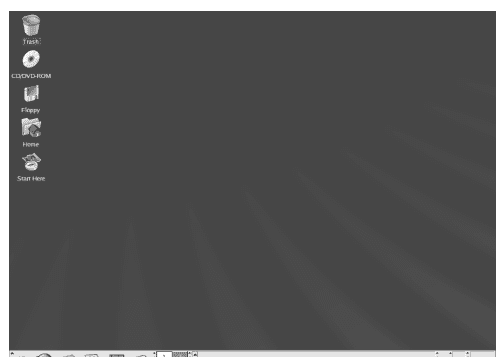

图 3-7 Red Hat 拥有一个高度自定义的 KDE 桌面。

如果你屏幕上的弹出文本不是那样，而是显示“GNOME 菜单”，那么你需要编辑决定启动哪个窗口管理器的文件。要做到这一点，请通过点击屏幕左下角的红帽子图标并选择“注销”来退出 GNOME。这将把你带回文本模式。使用你喜欢的编辑器编辑 **.xinitrc** 文件。如果没有喜欢的编辑器，尝试使用 **pico**，如下所示：

```bash
[rwhite@tedford ~]$ pico .xinitrc
```


如果你不熟悉 **pico**，不用担心。所有可用的命令始终显示在屏幕底部。任何以插入符（^）开头的命令都表示你需要使用 Ctrl 键与其他指定键配合使用。例如，^X 表示 Ctrl-X。

除非你在查看 GNOME 桌面时创建了该文件的内容，否则该文件很可能为空。如果是这种情况，只需添加以下内容：

```bash
#!/bin/sh
startkde
```

如果文件不为空，请转到最后一行。它很可能以字符串 **exec** 开头，这告诉系统执行一个程序。将该行修改为 **startkde**。

## 更改所有用户的桌面环境

为每个用户创建或更改 **.xinitrc** 文件是一种选择，但你可以通过编辑一个文件来为所有用户设置默认桌面环境。使用你喜欢的编辑器或 pico，你可以创建或编辑 **/etc/sysconfig/desktop** 文件，使其指定正确的桌面。由于这是一个系统配置文件，你需要具有 root 用户权限才能执行此操作。如果你希望 KDE 成为默认桌面环境，请编辑 **/etc/sysconfig/desktop**，使其包含：

```bash
DESKTOP="KDE"
```

另一方面，如果你希望默认使用 GNOME，你可以清空 **/etc/sysconfig/desktop** 文件的内容，完全删除该文件，或者将其内容设置为：

```bash
DESKTOP="GNOME"
```


## KDE 基础知识

KDE 与其他图形化桌面环境（如 Windows 或 Mac OS）有许多共同点。它拥有一个桌面，文件文件夹可以在其上存在。需要特别注意的一点是，由于 Linux 将系统中的所有硬盘整合到一个统一的目录树中，因此你无法像使用“我的电脑”那样，找到一个专门浏览特定磁盘的图标。

在屏幕底部，你会发现 *kpanel*（K 面板）。在非 Red Hat 版本的 KDE 软件中，Red Hat 图标会被 KDE 的“K”标志替换。无论图标是什么，这个按钮都与 Windows 的开始按钮类似。点击它会弹出一个菜单，显示一系列应用程序，你只需点击相应的菜单项即可启动它们。

K 面板类似于 Windows XP 的菜单，它也是一个通往常用应用程序的快捷栏。你可以通过点击 Red Hat 面板按钮，选择“首选项”选项，然后选择“外观与感受”菜单，再选择“面板”来配置该栏，从而添加任何你喜欢的快捷方式。在此菜单下，你会发现许多配置选项。

如果你想要完全隐藏面板，可以启用并点击面板最右侧或最左侧的箭头。这将使面板向该方向隐藏。再次点击箭头可重新显示面板。Red Hat Linux 默认不启用这些箭头，因此你需要在面板菜单中选择“隐藏”选项卡，并勾选相应的“隐藏按钮”复选框。

## KDE 控制中心

KDE 控制中心非常类似于 Windows 的控制面板（见图 3-8）。


控制中心提供了令人印象深刻的各种工具，让你可以随心所欲地配置 KDE。其中包括支持多种主题、颜色、背景、屏幕保护程序、某些应用程序以及特定类型的硬件。查看所有可用功能最好的方法就是亲自去尝试和玩耍——这是你作为系统管理员难得的一次机会，可以在不破坏系统的情况下玩转界面。

在本节中，你将逐步完成几个常见任务，从而对可以实现的功能以及查找操作步骤的典型方法有一个大致的了解。如前所述，界面非常像 Windows，因此在其中导航应该相对容易。

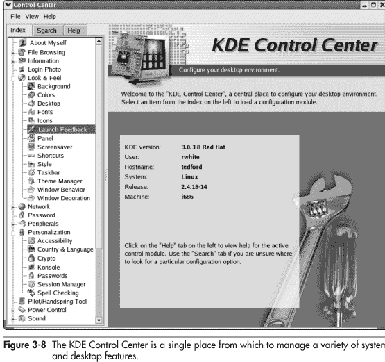

图 3-8 KDE 控制中心是管理多种系统和桌面功能的单一入口。

KDE 的背景和主题可以像 GNOME 的背景和主题一样更改（从“首选项”菜单中选择“外观与感受”，然后选择“桌面”或“主题管理器”）。对于 Red Hat Linux 8.0 附带的套装之外的 KDE 主题，请查看 www.kde-look.org、http://themes.freshmeat.net 或 http://www.themedepot.org。

### 使用多个桌面

你手中拥有的最强大的工具之一是虚拟桌面。关于它唯一令人不安的地方，就是你在没有此功能的系统上工作时产生的挫败感。

虚拟桌面的本质是允许你同时有效地拥有多个屏幕。你只需点击屏幕底部的虚拟桌面选择器，选择想要使用的屏幕即可。

Red Hat Linux 8.0 的 KDE 安装默认设置为四个虚拟屏幕。如果你想要调整该数值，请执行以下操作：

- 1. 打开控制中心。
- 2. 选择“外观与感受”。
- 3. 选择“面板”。
- 4. 从控制中心右侧标签式窗口中选择“桌面数量”。
- 5. 将“可见”滑块向右移动以增加桌面数量。（当然，你也可以向左移动以减少桌面数量。）
- 6. 点击窗口底部的“应用”按钮使更改生效。

如果每个桌面都有特定用途，你还可以通过高亮显示桌面并修改同一面板上的桌面名称字段来更改桌面标签。在图 3-9 中，可以看到桌面 1 已被重命名为“管理”，桌面 2 已被重命名为“OpenOffice”，而其他桌面保持不变。

> **提示**
>
> 如果你更喜欢使用键盘快捷键，可以在控制中心的“外观与感受 | 快捷键”菜单下设置一个允许你在桌面之间切换的快捷键。只需点击你要执行的操作（切换桌面），然后选择你想用于切换的按键组合。像许多长期使用 *fvwm* 窗口管理器的人一样，我个人更喜欢使用 CTRL-方向键在一个桌面和另一个桌面之间跳转。

### 启动其他应用程序

许多应用程序都可以通过面板菜单获取；只需点击 Red Hat 图标并浏览可用内容，这可能是熟悉默认可用应用程序的最佳方式。尽管那里有大量的软件，但你可能会发现某些你要找的工具在通用菜单中找不到。

启动新应用程序有多种方式。作为系统管理员，你很可能会打开一个命令窗口（通常称为“XTerm”），因此你可能发现直接从那里运行应用程序很方便。事实上，本书的大部分内容都假设你正在从该提示符处运行应用程序。只需点击 Red Hat 标志菜单，选择 *System Tools*（系统工具），然后点击 *Terminal*（终端）即可打开终端窗口。这将启动 *konsole*，其功能等同于 Xterm。一旦 konsole 打开，你可以在其中输入要运行的命令名称并按 ENTER。

> **注意**
>
> 本书中讨论的许多命令必须从终端窗口运行。

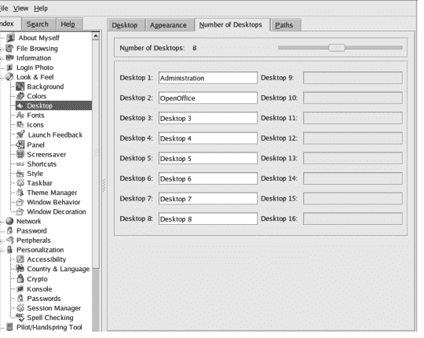

在 KDE 下，你还可以通过按 ALT-F2 调出 Windows 开始菜单中“运行”选项的等效功能。这会在屏幕中央弹出一个小窗口，你可以在其中输入想要运行的命令，如所示。当你按 ENTER 执行命令或按 ESC 取消后，窗口会自动消失。

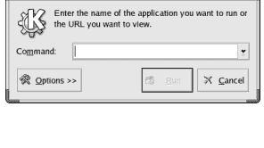

> 打开运行命令窗口的其他方法包括：转到 Red Hat 标志菜单并选择“运行命令”选项，或在桌面上右键单击并选择“运行命令”选项。

启动应用程序的最后一种方法是使用文件浏览器搜索目录列表，并双击你想要的应用程序名称。当然，这种方法最繁琐，但如果你不记得应用程序的名称，它会很有用。需要检查的常见目录包括 /usr/bin、/usr/sbin、/bin、/sbin 和 /usr/X11R6/bin。

## 更改配色方案

如果你挑剔桌面环境，你很可能想要更改桌面配色方案的外观。你可以使用 Red Hat 标志菜单，选择“首选项”选项，然后选择“桌面”。你也可以使用 KDE 的控制中心。首先调出控制中心，前往“外观与感受”菜单，然后点击左侧窗口中的“颜色”选项。这将打开一个类似于图 3-10 的窗口。

只需点击你最喜欢的颜色组合。我喜欢默认的 Bluecurve 外观，但如果你更喜欢其他设置，你可以选择它们。如果你想要创建新的组合，点击列表下方的“添加”按钮并给你的新设置命名。高亮显示此设置，然后在面板右侧选择你想要分配给每个小工具的颜色。例如，要更改正常文本的颜色，请打开“小工具颜色”下拉框。选择“正常文本”。下拉框下方的条将显示当前颜色。点击该条以调出色轮，以便你可以选择你最喜欢的新颜色。

一如既往，完成后点击“应用”。

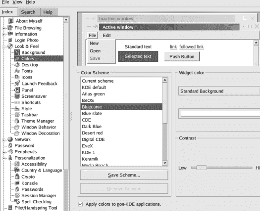

图 3-10 更改 KDE 桌面的配色方案。

### 设置更多字体

Red Hat Linux 8.0 的新特性是一种半自动化的方式，用于向 GNOME 或 KDE 桌面添加字体。这两种环境都可以使用抗锯齿字体，尽管有些人喜欢默认字体，但其他人则对它们大声抱怨。如果你习惯在 Windows 中使用某些字体，你会很高兴知道其中一些可以在 GNOME 或 KDE 中轻松使用。你可以从 http://corefonts.sourceforge.net 获取一些标准的 Windows 字体。


为了在 X 窗口系统中使字体可用，请将字体文件复制到主目录下的 **.fonts** 子目录中，并运行 **fc-cache** 脚本：

```bash
[rwhite@tedford ~]$ cp *.TTF ~/.fonts
[rwhite@tedford ~]$ fc-cache ~/.fonts
```

如果您希望系统中的所有用户都能使用这些字体，您可以（以 **root** 身份）将这些文件放入 **/usr/share/fonts** 目录中：

```bash
[root@tedford /root]# cp *.TTF /usr/share/fonts
[root@tedford /root]# fc-cache /usr/share/fonts
```

如果您在 Xterm 中或 X 环境内的命令行中执行此操作，您将不得不注销桌面环境并重新启动 X，字体才会可用。因此，如果您在 Linux 系统上安装了 Verdana 字体家族，可以按照以下步骤将其设为默认字体：

1. 打开控制中心。
2. 选择“外观和感觉”。
3. 选择“字体”。
4. 在控制中心右侧的选项卡式窗口中，点击“通用字体列表”左侧的“选择”按钮。
5. 向下滚动并选择 Verdana 条目。

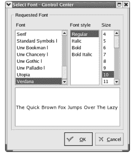

6. 点击“确定”返回字体列表。
7. 点击窗口底部的 **应用** 按钮以使更改生效。

## 在 OpenOffice 中使用新增字体

这个过程将使字体对大多数基于 KDE 和 GNOME 的程序可用，但并非对所有 X 程序（包括 OpenOffice）都可用。虽然您可能不会在 Red Hat Linux Server 上经常使用 OpenOffice，但我仍会告诉您如何在那里加载字体。

1. 使用 **运行命令** 选项打开一个命令窗口，并输入 `opadmin`。如果 OpenOffice 打印机管理工具的加载需要几秒钟，请不要感到惊讶。
2. 加载完成后，点击 **字体** 按钮以列出已安装的字体。
3. 点击 **添加** 按钮以添加新的字体目录。
4. 点击 `...` 按钮以打开系统目录结构的图形表示。
5. 找到正确的父目录，并在其后输入 **.fonts**（以点开头的文件和目录是“隐藏的”，因此您无法从列表中直接选择 **.fonts** 目录）。
6. 点击 **全选** 以选择目录中的所有字体。

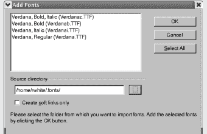

7. 点击 **确定** 以添加所有选定的字体。
8. 将弹出一个消息窗口，告知您添加了多少个字体。点击“确定”继续。
9. 点击“关闭”以关闭字体窗口。
10. 点击“关闭”以关闭 OpenOffice 打印机管理工具。

现在，您添加的字体可以在 OpenOffice 程序中使用。这与大多数 Windows 应用程序的情况大不相同，在后者中，使字体在操作系统中可用会自动允许应用程序使用它们。

## 项目 3-2 自定义 KDE 桌面

在项目 3-1 中，您按照详细指令自定义了 GNOME 桌面。既然您对桌面配置有了更多背景知识，并且拥有更多的修改经验，让我们尝试一些更不寻常的效果。请在一个设置为使用 KDE 桌面环境的系统上进行此项目。

### 分步操作

1. 从 KDE 桌面开始，启用“桌面”菜单。首先右键点击桌面，找到相应的菜单项。
2. 为 HTML 和文本文件启用文件预览。使用 KDE 控制中心或右键点击桌面来配置桌面设置。
3. 更改焦点策略。从控制中心的“窗口行为”条目中，将 KDE 的默认设置（即焦点位于最后点击的位置，类似 Windows 系统）改为焦点跟随鼠标光标，无论是否点击过某处，类似于 UNIX 系统。
4. 同样在“窗口行为”配置区域，设置桌面处理双击标题栏的行为。默认情况下，双击窗口的标题栏会使窗口“收缩”（shade），即向上滚动窗口，仅显示标题栏。您可以设置 KDE 使双击最大化窗口。请执行此设置。
5. 从控制中心的“启动反馈”部分，启用忙碌光标行为，使 KDE 的行为更像 Windows XP。当应用程序加载时，光标会显示该应用程序的图标，让您知道它正在处理某事。
6. 将图标集从默认的 Red Hat Bluecurve 集更改为 Connectiva Crystal 图标主题。您应该能在控制中心找到完成此操作的配置工具。

### 项目总结

再次强调，这些自定义设置可能不合您的意。特别是，如果您习惯了微软 Windows 的焦点策略，让焦点跟随鼠标可能会让您感到困惑。然而，让焦点跟随鼠标也非常有用，因为它允许您主动使用两个重叠的窗口，因为点击窗口以改变焦点可能会遮挡您需要的信息。

### 模块总结

在本模块中，您学习了 X 窗口系统环境，特别是 KDE 和 GNOME。以下是几个关键点：

- X 窗口系统环境不是核心操作系统的组成部分。
- 窗口管理器运行在 X 之上，您可以选择最适合您的窗口管理器。
- KDE 环境是窗口管理器和用于开发 GUI 应用程序的应用程序框架的结合。
- KDE 的控制面板称为控制中心，可以通过点击窗口左下角的 K 图标找到。
- KDE 的网站是 http://www.kde.org。
- GNOME 为其他窗口管理器和库定义了应用程序框架。因此，您可以使用多个窗口管理器，例如 Enlightenment 和 Window Maker。
- GNOME 的网站是 http://www.gnome.org。

GNOME 和 KDE 代表了 Linux 和 UNIX 图形用户界面质量的重大进步。希望在这两个环境中工作的舒适度足以说服更多人将其双启动配置转变为单启动 Linux 配置。

## 模块 3 掌握检查

1. Linux 的 GUI 有多少百分比内置于内核中？
2. 什么是窗口管理器？
3. 您可以在 GNOME 中运行 KDE 应用程序吗？
4. 哪个命令用于启动 X 窗口系统？
5. 可以编辑哪些文件来更改启动 X 时运行的 GUI？
6. 以下哪些不是 Red Hat Linux 8.0 面板上的标准图标：
    - A. 开始菜单
    - B. 电子表格
    - C. 演示工具
    - D. 系统监视器
    - E. 邮件程序
    - F. Web 浏览器
    - G. 终端仿真器
    - H. 文字处理器
7. 如何在 GNOME 中将程序添加到面板？
8. GNOME 的网站是什么？
9. 说出一个获取 GNOME 不同主题的地方。
10. KDE 的网站是什么？
11. 说出一个获取 KDE 不同主题的地方。
12. 如何在 KDE 中将程序添加到面板？
13. Red Hat Linux 8.0 中默认的外观和感觉元素集的名称是什么？
14. 新字体可以添加到系统的哪些目录中？
15. 将新字体添加到系统中需要运行的脚本名称是什么？

### 模块 4

#### 安装软件

##### 关键技能

- 4.1 使用 Red Hat 包管理器
- 4.2 自行编译软件

鉴于大量的系统管理工作集中在安装提供所需服务的必要软件上，因此重要的是要考虑安装新包的机制，以及自行编译以源代码形式提供的包。

一般来说，大多数应用程序的安装模式都非常相似。留意典型的信息来源，并保持常识，将使大多数安装过程顺利进行。因此，本模块的目的不仅是展示安装某些类型包的“配方”，还包括故障排除策略。

在本模块中，您将学习两种最常用的安装方法：使用 Red Hat 包管理器（RPM）和自行编译源代码。本模块中输入的所有命令均以 root 用户身份输入。最简单的方法是登录为 **root**。（模块 6 将向您展示如何使用 **su** 命令将用户 ID 更改为其他用户的 ID。）通常，如果您登录的用户不是 **root**，请转到命令行或打开终端窗口。在提示符处，输入 `su - root`。

##### 关键技能

### 4.1 使用 Red Hat 包管理器

Red Hat 包管理器的主要功能是允许安装和删除文件（通常是预编译的软件）。它易于使用，并且围绕它构建了几个图形界面，使其更加容易使用。Red Hat、Mandrake 和其他发行版使用此工具来分发它们的软件。事实上，本书中提到的几乎所有软件都可以以 RPM 形式获得。在其他模块中自行编译软件的原因是，您可以使用 RPM 中不可用的编译时选项。

基本上，RPM 文件是为特定程序运行所需的所有文件的集合。它还包括程序描述、版本信息以及执行安装本身所需的脚本。

> **注意**
> 在此上下文中，我假设 RPM 文件包含预编译的二进制文件。Red Hat 等几个组织也将源代码作为 RPM 提供，但以这种方式下载和编译源代码并不常见。

RPM 工具执行对给定主机上安装的所有 RPM 包的一般管理。这包括跟踪安装了哪些包、它们的版本号以及它们的文件位置。所有这些信息都保存在主机上的一个简单数据库文件中。


通常，以 RPM 形式提供的软件在安装和维护上比需要编译的软件工作量更小。权衡之处在于，使用 RPM 意味着你接受 RPM 中提供的默认参数。在大多数情况下，这些默认值是可以接受的。然而，如果你需要对服务的情况有更深入的了解，你可能会发现自行编译源代码能让你更清楚地了解软件包组件的存在及其协同工作方式，从而更具启发性。

但如果你只是想安装一个简单的软件包，RPM 是完美的选择。有许多不错的 RPM 软件包资源，包括以下网站：

- http://www.rpmfind.net
- http://www.freshrpms.net
- http://www.linuxapps.com
- ftp://ftp.redhat.com/pub/contrib

当然，如果你对 RPM 本身的更多细节感兴趣，可以访问 RPM 网站 http://www.rpm.org。RPM 随 Red Hat Linux（及其衍生版）以及 Caldera Linux 一起提供。如果你不确定某个发行版是否附带 RPM，请咨询你的供应商。


尽管包管理器的名称中包含“Red Hat”，但该软件也可以用于其他发行版。事实上，RPM 甚至已被移植到其他操作系统，如 Solaris 和 IRIX！RPM 的源代码是开源软件，因此任何人都可以主动使其适应自身需求。

## 安装新软件包

安装新软件包最简单的方法是配合 **rpm** 使用 -i 选项。例如，如果你下载了一个名为 `bc-1.06-10.i386.rpm` 的软件包并希望安装它，你应该输入：

```
[root@tedford /root]# rpm -i bc-1.06-10.i386.rpm
```

如果安装成功，你不会看到任何错误或消息。这是安装 RPM 最常见的方法。另一方面，如果该软件包已经存在，你会看到此消息：

```
error: package bc-1.06-10 is already installed
```

某些软件包依赖于其他软件包。例如，一个 KDE 小部件可能依赖于已安装的 KDE 库。在这种情况下，你会收到一条消息，指示需要先安装哪些软件包。只需安装那些软件包，然后返回处理原始软件包即可。

如果你需要升级已存在的软件包，请使用 `-U` 选项，如下所示：

```
[root@tedford /root]# rpm -U bc-1.06-10.i386.rpm
```

表 4-1 列出了 rpm 的一些额外命令行选项。

例如，要强制安装软件包，而忽略依赖项或其他错误，你需要输入：

```
[root@tedford /root]# rpm -ivh --force --nodeps packagename.rpm
```

其中 packagename.rpm 是正在安装的软件包名称。由于使用了 `-h` 和 `-v` 选项，随着安装过程的进行，该命令也会向你报告进度。

### 表 4-1 常见的 RPM 命令行选项

| 命令行选项 | 描述 |
| :---------------- | :---------------- |
| **--force**     | 这是安装的“大锤”。通常，当你明知自己在安装某种奇特或非寻常的配置，而 RPM 的安全机制正试图阻止你这样做时使用它。`--force` 选项告诉 rpm 放弃任何合理性检查并直接执行，即使它认为你是在试图“削足适履”（fit a square peg into a round hole）。请谨慎使用此选项。 |
| **-h**          | 在安装过程中打印哈希标记以指示进度。与 `-v` 选项一起使用可获得美观的显示效果。 |
| **--percent**   | 打印已完成的百分比以指示进度。如果你是从另一个程序（如 Perl 脚本）运行 rpm，并希望了解安装状态，这会很有用。 |
| **--nodeps**    | 如果 rpm 抱怨缺少依赖项文件，但你仍希望安装继续进行，在命令行传递此选项将使 rpm 不执行任何依赖项检查。 |
| **--test**      | 此选项不执行实际安装；它只是检查安装是否会成功。如果预判出现问题，它会显示这些潜在问题。 |
| **-v**          | 告诉 rpm 详细显示其操作。 |

## 查询软件包

有时了解当前安装了哪些软件包及其功能会很有帮助。你可以使用 RPM 的查询选项来做到这一点。

要列出所有已安装的软件包，只需输入：

```
[root@tedford /root]# rpm -qa
```

请做好面对一长串软件包列表的准备！如果你正在寻找特定的软件包名称，可以使用 `grep` 命令来指定软件包的名称（或名称的一部分），如下所示：

```
[root@tedford /root]# rpm -qa | grep -i 'bc'
```

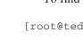

`grep` 中的 `-i` 参数告诉它进行不区分大小写的搜索。

如果你只想逐屏查看所有软件包，可以使用 `more` 命令，如下所示：

```
[root@tedford /root]# rpm -qa | more
```

要了解特定文件属于哪个软件包，请输入：

```
[root@tedford /root]# rpm -qf /usr/bin/bc
```

其中你用要检查的文件名称替换 `/usr/bin/bc`。

要了解已安装软件包的目的，你必须先知道该软件包的名称（取自 `rpm -qa` 的列表），然后指定它，如下所示：

```
[root@tedford /root]# rpm -qi bc
```

其中你可以用任何 `packagename` 替换 `bc`。

要了解软件包中包含哪些文件，请输入：

```
[root@tedford /root]# rpm -ql bc
```

其中你可以用任何你想查询信息的 `packagename` 替换 `bc`。

你还可以通过包含 -p 选项来查看未安装软件包的信息及其包含的文件列表：

```
[root@tedford /root]# rpm -qilp bc-1.06-10.i386.rpm | more
```

注意，此命令组合了 -i 和 -l 选项；输出结果可能很长，因此添加了 more 命令以逐屏显示信息。按 ENTER 键显示下一屏数据。

## 卸载软件包

使用 RPM 卸载软件包与安装它们一样简单。在大多数情况下，你只需要输入：

```
[root@tedford /root]# rpm -e _packagename_
```

其中 _packagename_ 是 rpm -qa 中列出的软件包名称。

### 进度检查

- 1. 使用 **rpm** 命令安装 RPM 软件包时，使用哪个命令行选项？
- 2. 使用哪个命令行选项来升级 RPM 软件包？
- 3. 哪些命令行选项组合使用时可以显示安装进度？
- 4. 如何列出系统上所有已安装的软件包，并逐屏显示？

- 1. 使用 rpm -i 选项安装软件包。
- 2. 使用 rpm -U 选项升级软件包。
- 3. 将 -v 和 -h 选项与 -i 或 -U 结合使用以显示安装进度。这些选项可以组合使用：`rpm -Uvh _packagename_`
- 4. 命令：`rpm -qa | more` 将列出系统上安装的所有软件包名称，逐屏显示。

## 项目 4-1：安装 Webmin

在 Linux 和多种 UNIX 变体下，一种流行的系统管理工具被称为 Webmin。Webmin 为管理员提供了多种功能，特别是那些希望管理多台服务器的人。安装 Webmin 不仅有助于练习 RPM 安装技能，还有助于练习你将在后续模块中了解到的系统管理技能。

### 分步操作

- 1. 访问 Webmin 网站 http://webadmin.sourceforge.net。
- 2. 找到下载区域并下载最新的 Webmin RPM 软件包。如果你从安装了 RealPlayer 的系统下载，可能需要 shift+点击 或 右键点击 下载包以将其下载，因为 RealPlayer 可能会试图“播放”该 RPM 软件包。
- 3. 使用 **rpm -ih** 安装 Webmin RPM 软件包。（你需要指定 RPM 软件包文件的名称。）你应该看到准备过程开始并移动到 100 百分比。Webmin 软件包会记录正在运行的操作系统版本，然后安装其内容。安装完成后，你会被告知应在 Web 浏览器中输入哪个地址以 **root** 身份登录 Webmin。
- 4. 将浏览器指向 http://yourservername:10000 并使用 **root** 帐户及其密码登录。将 **yourservername** 设置为 Webmin 安装消息中描述的服务器名称。
- 5. 浏览 Webmin，看看有哪些可用的选项！

### 项目摘要

通过 RPM 安装软件非常容易！现在你拥有了一个可运行的 Webmin 软件包，你可以对它进行实验。如果你不想使用它，可以使用 **rpm -e webmin** 将其卸载。要查找更多潜在有趣的 RPM 软件包，你可以查看本模块前面提到的一些网站。

## redhat-config-packages

如果你喜欢一个良好的 GUI 工具来简化生活，请关注 **redhat-config-packages**。它执行命令行 RPM 工具的所有功能，而不强迫你记住命令行参数。当然，这代价是无法脚本化，但那是...

为什么我们也提供了命令行版本。要运行图形化软件包管理工具，请前往红帽菜单，从系统设置中选择软件包。你也可以在命令行中运行以下命令：

```
[rwhite@edford ~]$ redhat-config-packages
```

无论你以哪种方式启动软件包管理器，它都会检查你当前是否为 root 用户。如果不是，它会打开一个如图所示的窗口，你可以在其中输入 root 密码，以 root 权限运行该实用程序。

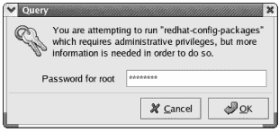

一旦成功输入 root 密码，软件包管理器将检查系统中已安装了哪些软件包。你将能够以与安装 Red Hat Linux 8.0 时完全相同的方式选择要安装或删除的软件包。这是软件包管理器界面的一项令人欣喜的更新。正如在安装过程中一样，你可以选择整个软件包组（见图 4-1），也可以对特定软件包进行操作。

### **项目 4-2 获取 Apt**

Debian 发行版及其他少数几个发行版使用了一种非 RPM 的软件包管理器，许多用户比 RPM 更喜欢这种管理器。Debian 的软件包管理器 apt 在处理依赖关系方面比 RPM 做得更好。有些人喜欢在基于 RPM 的系统上使用 apt，因此 Conectiva 发行版的开发人员制作了一个可以处理 RPM 安装版本。现在，Red Hat 用户也可以使用同样的功能了。要安装和使用 apt，你将在 RPM 安装技能的基础上进行拓展。

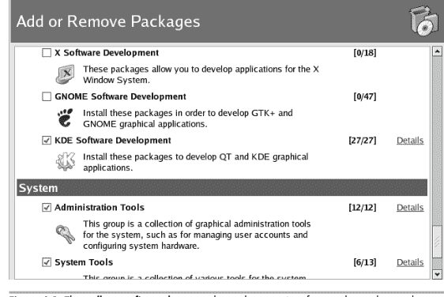

**图 4-1** redhat-config-packages 工具使用与 Red Hat Linux 8.0 安装过程中使用的软件包选择器相同的界面。

#### 分步操作

- 1. 前往 http://psyche.freshrpms.net 并找到 apt 软件包。
- 2. 下载 apt 软件包并使用 `rpm -ivh` 安装它（作为 root）。
- 3. 运行 `apt-get update` 从 freshrpms.net 站点下载软件包信息。
- 4. 运行 `apt-get -f install` 验证 apt 的安装完整性。
- 5. 通过运行 `apt-get install synaptic` 下载一个 apt 图形化管理器。
- 6. 通过运行 `synaptic` 测试 synaptic 的安装。

许多其他软件包可以通过使用 **apt-get install** 并指定软件包名称在命令行上安装，或者通过所示的 synaptic 图形用户界面进行安装。

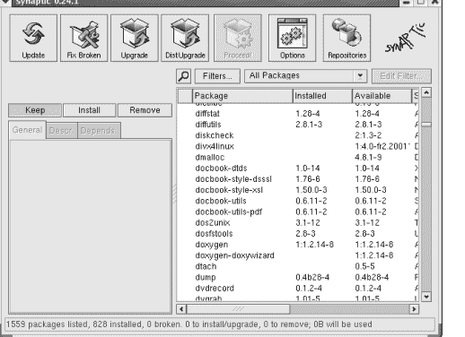

对于某些用途，例如加载 freshrpms.net 上提供的许多增强桌面的文件，这些工具甚至比 RPM 更容易。然而，许多服务器安装可能并不适合将 apt 作为试验对象。请考虑一下，你是否想在运行关键业务的服务器上安装非 Red Hat 软件包。归根结底，安装 apt 不仅是一种练习使用 RPM 的方法，它也是开始思考安全策略的一种方式，我将在第 9 章中更详细地讨论这一点。

## **4.2 自行编译软件**

开源软件的一个关键优势在于你手中拥有源代码。如果开发人员选择停止对其工作，你可以继续下去。如果你发现问题，你可以修复它。换句话说，你掌控着局面，而不是受制于你无法控制的商业开发人员。但拥有源代码也意味着你需要能够编译它。否则，你拥有的只是一堆没用的文本文件。虽然本书中的几乎每个软件都提供为 RPM，但你应该手动走一遍编译过程，以便你可以选择和设置编译时选项，这是使用 RPM 无法做到的。因此，熟悉自行编译软件包是一个好主意。

在本节中，你将一步步走一遍编译 KDirStat 软件包的过程，这是一个用于查看目录大小的图形工具。你可以从 http://kdirstat.sourceforge.net 下载 KDirStat。KDirStat 是一个典型的软件包；你会发现大多数需要编译的其他软件包遵循相同的通用模式。

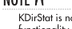

> KDirStat 并不是管理 Red Hat Linux 系统所必需的软件包；其功能与 **du** 实用程序类似，后者提供你指定的目录的磁盘使用情况信息。

### 获取和拆包软件包

以源代码形式提供的软件通常以*tarball*的形式发布——即被归档到一个大文件中然后进行压缩。用于执行此操作的工具是 **tar** 和 **gzip** 或 **bzip2**；**tar** 负责将许多文件合并为一个大的文件，而 **gzip** 或 **bzip2** 负责压缩。

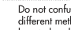

> 不要将 **gzip** 和 **bzip2** 与 WinZip 混淆。它们是使用不同压缩方法的不同的程序。不过值得指出的是，WinZip 确实知道如何处理 tarball。

通常，系统管理员会选择单个目录来构建和存储 tarball。如果之后需要从某个 tarball 中提取内容，这允许管理员将每个软件包的 tarball 保存在安全的地方。这也让所有管理员知道除了基础系统之外系统中安装了哪些软件包。/usr/local/src 是一个适合此目的的目录，因为站点本地的软件通常安装在 /usr/local。使用 /usr/local/src 目录存储源代码的缺点是，必须使用 root 用户在该目录下构建软件，而不仅仅是安装它。在大多数情况下，从 tarball 安装的软件*可以*由普通用户构建，然后由 root 用户安装，但由于 /usr/local/src 的默认目录权限，普通用户无法在那里构建软件。

解开后，大多数 tarball 会为其所有文件创建一个新目录。例如，KDirStat 的 tarball（*kdirstat-2.2.0.tgz*）会创建子目录 *kdirstat-2.2.0*。大多数软件包遵循此标准。如果你发现一个不遵循此标准的软件包，创建一个具有合理名称的子目录并将所有解包的源文件放在那里是个好主意。这使得多个构建可以同时进行，而不用担心两个构建之间发生冲突。

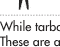

> 虽然 tarball 通常以 *.tar.gz* 或 *.tar.bz2* 结尾，但你也会看到以 *.tgz* 结尾的文件。它们也是 tarball；其文件扩展名是 *.tar* 和 *.gz* 的一种缩写形式。

首先下载 KDirStat 源码 tarball。你可以从其网站 http://kdirstat.sourceforge.net/ 获取它。

要解开 KDirStat 的 tarball，首先变成 *root*，然后将文件移动到 /usr/local/src 目录，如下所示：

```
[rwhite@tedford ~]$ su -
[root@tedford /root]# mv ~/kdirstat-2.2.0.tgz /usr/local/src
```

进入该目录后，使用 *cd* 命令将目录更改为 /usr/local/src，如下所示：

```
[root@tedford /root]# cd /usr/local/src
```

然后使用以下命令解开 tarball：

```
[root@tedford src]# tar -xvzf kdirstat-2.2.0.tgz
```

*tar* 命令中的 *z* 参数在解包过程发生之前调用 *gzip* 对文件进行解压。*v* 参数告诉 *tar* 在过程中显示它正在解包的文件名。这样，你就知道所有源文件正在解包到的目录名称。现在你应该有一个名为 /usr/local/src/kdirstat-2.2.0 的目录。你可以通过使用 cd 命令进入该目录来测试：

```
[root@tedford src]# cd /usr/local/src/kdirstat-2.2.0
```

### 查找文档

一旦进入包含所有源代码的目录，就开始查找文档。*务必阅读随源代码提供的文档！* 如果有特殊的编译说明、注意事项或警告，很可能是在这里提到的。先阅读相关文件可以为你省去大量的痛苦。

那么，相关文件是什么？通常发行版中有两个文件：README 和 INSTALL，两者都位于源代码目录的根目录下。README 文件通常包含软件包的描述、对额外文档（包括安装文档）的引用以及对软件包作者的引用。INSTALL 文件通常包含编译和安装软件包的说明。

当然，这些并不是绝对的。每个软件包都有其特点。了解情况的最好方法是列出目录内容并寻找额外文档的明显标志。就 KDirStat 而言，有一个名为 README 的文件，另一个名为 INSTALL。一些软件包使用不同的大写方式：readme, README, ReadMe 等等；有些则引入主题变化：README.1ST 或 README.NOW 等。

获取额外信息的另一个常见位置是一个恰当地称为“doc”或“documentation”的子目录。就 KDirStat 而言，doc 目录包含用于构建文档的源文件。

要查看文本文件，使用 more 命令：

```
[root@tedford kdirstat-2.2.0]# more README
```

要在编辑器中查看文本文件，使用 pico 命令：

```
[root@tedford kdirstat-2.2.0]# pico README
```


要快速列出源树中的所有目录，输入命令：

```
[root@tedford kdirstat-2.2.0]# ls -l | grep drwx
```


# 配置软件包

大多数软件包都附带一个自动配置脚本；除非其文档另有说明，否则可以安全地假设它们包含此脚本。这些脚本通常命名为“configure”，并接受参数。有一些通用的标准参数适用于所有 configure 脚本，但有趣的部分则因程序而异。每个软件包都有一系列功能，可以在编译时启用、禁用或设置特殊值，必须通过 **configure** 进行设置。

要查看软件包附带哪些 configure 选项，只需运行：

```bash
[root@tedford kdirstat-2.2.0]# ./configure --help
```

是的，“help”前面是两个连字符（--）。configure 命令通常会返回一个列表（有时是非常长的列表），列出在运行配置脚本时可以设置的选项。

一个常见的可用选项是 **--prefix**。此选项允许你设置软件包安装的基础目录。默认情况下，大多数软件包使用 /usr/local。软件包中的每个组件都会安装到 /usr/local 下的相应目录中。例如，KDirStat 的可执行文件名为 kdirstat，默认情况下安装到 /usr/local/kde/bin。

设置好所有需要的选项后，最后运行一次 **configure** 会生成一种名为 *Makefile* 的特殊文件。Makefiles 是编译阶段的基础。

# 编译你的软件包

编译软件包是容易的部分。你只需要运行 **make**，如下所示：

```bash
[root@tedford kdirstat-2.2.0]# make
```

**make** 工具会读取由 configure 脚本创建的所有 makefiles。这些文件告诉 **make** 需要编译哪些文件以及编译顺序——这一点至关重要，因为可能有数百个源文件。

根据系统速度、可用内存以及系统正在执行的其他任务的繁忙程度，编译过程可能需要一些时间才能完成，所以不要感到惊讶。

当 **make** 正在工作时，它会显示正在执行的每个命令及其所有相关参数。此输出通常是编译器的调用以及传递给编译器的所有参数——这些都是相当繁琐的内容，甚至程序员都倾向于自动化处理！

如果编译顺利进行，你不会看到任何错误消息。大多数编译器错误消息都非常清晰明确，所以不用担心可能漏掉某个错误。

如果你确实看到错误，不要惊慌。大多数错误消息反映的不是程序本身的问题，而是系统在某种程度上存在问题。通常，这些消息是由不适当的文件权限引起的（请参阅下一模块中的 `chmod` 命令）。

# 运行软件包

根据你输入到自动配置过程中的选项以及默认值，安装的软件可能位于多个位置。虽然软件安装的最常见位置是 **/usr/local/bin** 目录，但许多软件包对其认为最合适的位置有自己的看法。例如，KDirStat 可执行文件默认安装在 **/usr/local/kde/bin**。这是一个完全可以接受的位置，但它不在默认的 Red Hat Linux 路径中，因此如果不做额外的工作，你就无法执行它。

有三种常见的运行未安装在路径中的软件的方法：

- 你可以在指定路径信息的情况下调用可执行文件，这是最简单的一次性解决方案。
- 你可以将可执行文件目录添加到路径中，这是最简单的长期解决方案。
- 你可以将可执行文件的链接添加到已经位于路径中的目录中，这样会整洁一些。

使用这三种方法中的任何一种来运行 **kdirstat** 命令并调出该工具（见图 4-2）。

## 使用路径信息运行

快速简便地检查软件是否运行正常（测试或评估它，看你是否喜欢它并愿意做更永久性的安排）的方法是，在运行时指定路径信息。虽然尝试在不指定路径的情况下运行 **kdirstat** 只会产生错误消息，但运行以下命令会启动该实用程序：

```bash
[rwhite@tedford ~]$ /usr/local/kde/bin/kdirstat
```


**图 4-2** 启动 *kdirstat* 以显示 Linux 系统上目录的相对使用情况。

这种解决方案的缺点是，每次想要运行该工具时都必须输入所有这些路径信息，这令人烦恼且效率低下。幸运的是，还有其他选项。

> **提示** 如果你为程序设置了桌面图标、面板或菜单项，你可以输入其完整路径信息，而不用担心重新输入。对于像 KDirStat 这样仅在 X 中有用的程序，这大概是最佳选项。

## 将可执行文件目录添加到路径

与 Windows 一样，*Linux 路径* 是一个目录列表，系统在其中查找可执行文件。你已经熟悉的程序，例如 **tar** 和 **gzip**，存在于系统路径中已经包含的目录中，因此你无需知道它们的确切位置即可运行它们。（在第 6 模块中，你将查看一些可以帮助你在路径中精确定位程序位置的命令。）

如果你有一个想要添加到路径中的目录，你可以随时添加，或者在配置文件中添加以使更改永久化。如果你想使用 Bash shell 将 /usr/local/kde/bin 目录添加到路径中，可以使用此命令：

```bash
[whit@tedford ~]$ export PATH=$PATH:/usr/local/kde/bin
```

此命令告诉 Bash 使 PATH 环境变量在所有地方可用，并重新定义其内容为其原始内容加上末尾的 /usr/local/kde/bin 目录。如果你只想在当前登录会话期间使用 KDirStat，这可以正常工作，但一旦你注销，此修改将会丢失。

为了使路径更改持久化，你可以编辑用户的 ~/.bash_profile 文件。使用 pico 或其他文本编辑器将新目录添加到列表中。为了使路径更改对系统范围内生效，你可以成为 **root** 并将新的路径名添加到 /etc/profile 文件中。

## 链接到可执行文件

你还可以通过链接到路径中已有的目录来运行程序。你可以使用以下命令查看哪些目录在你的路径中：

```bash
[whit@tedford ~]$ echo $PATH
```

你的路径中应包含的目录之一是 /usr/local/bin。第 6 模块包含更多关于路径的信息，因此如果此简要概述感觉不够，你可以在那里获取更多信息。要创建从 /usr/local/bin 到 /usr/local/kde/bin 中的 KDirStat 可执行文件的链接，请使用以下命令（作为 **root**）：

```bash
[root@tedford /root]$ ln -s /usr/local/kde/bin/kdirstat /usr/local/bin
```

这会在 /usr/local/bin 中创建一个名为“kdirstat”的符号链接，因此当你尝试运行程序时，系统会在路径中找到该链接，并从其原始的链接位置执行该文件。

# 清理

安装软件包后，你可以进行一些清理以删除安装过程中创建的所有临时文件。某些 makefiles 包含删除构建期间创建的所有文件的规则，你可以使用该选项（通常是 **make clean**）使源目录恢复原始状态。

```bash
[root@tedford kdirstat-2.2.0]# make clean
```

如果你保留了原始源代码 tarball，那么直接删除编译源代码的整个目录是可以的。对于 KDirStat，你将删除 /usr/local/src/kdirstat-2.2.0。首先，进入要删除的目录上一级目录。在这种情况下，那是 /usr/local/src。

```bash
[root@tedford src]# cd /usr/local/src
```

现在使用 **rm** 命令删除实际的目录，如下所示：

```bash
[root@tedford src]# rm -rf kdirstat-2.2.0
```


> **警告** **rm** 命令，特别是带有 -rf 参数时，非常危险。它递归删除整个目录，而不会停下来验证任何文件。以 root 用户身份运行时，这可能会在你的系统上造成严重问题。请非常小心，确保你删除的是你打算删除的内容。没有“撤销”命令。

# 进度检查

- 1. 列出从 tarball 构建和安装软件的标准命令序列。
- 2. 说出两个包含有关 tarball 信息的文本文件的常见名称。

- 1. 标准命令序列是 .configure, make, make install。如果你记得在之后运行 make clean 或 rm -rf 构建目录，将获得加分和金星奖励。
- 2. README 和 INSTALL 是你在 tarball 内部找到有用信息的最佳选择之二。


## 项目 4-3 构建和安装 Kgraphspace

您已经构建了一个目录信息工具，但还有更多实用工具可供您使用并享受。在本项目中，您将构建另一个与 KDE 和磁盘空间相关的程序，称为 Kgraphspace。它显示一个饼图，展示每个挂载分区的空间使用情况，以及一个目录树，显示树中每个分支内容的大小。

### 分步操作

- 1. 前往 http://kgraphspace.sourceforge.net 网站并查找适用于 KDE 3 的版本。（在撰写本文时，该版本为 3.0.0-pre1。）
- 2. 下载 Kgraphspace 的 tarball（压缩归档文件）。为了本项目的目的，不要使用 RPM，即使有可用的 RPM 包。
- 3. 使用 **su -** 命令变为 root 用户。
- 4. 更改目录到源代码库：**cd /usr/local/src**。
- 5. 将 tarball 解压到 **/usr/local/src**。由于 tarball 是使用 **bzip2** 压缩打包的，请使用 **tar xvjf** 加上 tarball 的名称。**-j** 选项告诉 tar 使用 **bunzip2** 解压文件。
- 6. 更改目录到解压 tarball 后创建的目录。
- 7. 阅读 **README** 和 **INSTALL** 文件的内容。使用 **more README** 和 **more INSTALL**。
- 8. 运行配置脚本：**./configure**。
- 9. 构建软件：**make**。
- 10. 安装软件：**make install**。
- 11. 清理现场：**make clean**。
- 12. 在 **/usr/local/kde/bin** 中查找可执行文件，并使用本模块中描述的技术之一在您的 GUI 桌面环境中运行该文件。

### 项目总结

只要您拥有开发工具以及构建此包所需的 X 和 KDE 库，构建过程应该非常容易。如果您遇到问题，首先要去的地方是 **redhat-config-packages** 工具，以确保已安装所有必要的工具和库。除非磁盘空间紧张，安装每个完整的组将是最简单的。现在，您准备好寻找一些您真正想要下载、构建、安装和使用的软件了！

## 模块总结

在本模块中，您学习了如何使用 RPM 方法以及在 Linux 下自行编译软件来安装软件。希望这些信息能消除您对处理开源系统的任何恐惧！

以下是需要记住的关键点：

- 使用 RPM 的典型安装命令是 `rpm -i _packagename.rpm`。
- 使用 RPM 的典型升级命令是 `rpm -U _packagename.rpm`。
- 使用 RPM 的典型软件包移除命令是 `rpm -e _packagename`。
- 大多数源代码*以 tar 包（tar-balls）的形式发布*，可以使用 `tar` 命令解压。
- 一旦软件包解包，阅读随附的文档非常重要。
- 使用 `./configure` 命令配置软件包。
- 通过运行 `make` 命令编译软件。
- 通过运行 `make install` 命令安装编译后的软件。

## 模块 4 掌握检查

- 1. 列出用于安装、升级和删除软件包的 `rpm` 命令参数。
- 2. 您可以使用什么命令来*查找* `/bin/gzip` 文件属于哪个软件包？
- 3. 一旦您知道 `/bin/gzip` 文件属于哪个软件包，如何将其卸载？
- 4. 哪个 `rpm` 选项可用于安装软件包，即使系统认为不应安装它？
- 5. 哪些 `rpm` 选项可用于执行软件包安装的“试运行”，而不实际安装软件？
- 6. 以下哪个命令将列出已安装 RPM 软件包中包含的文件？
    - A. rpm -qlp bc
    - B. rpm -ql bc-1.06-10.i386.rpm
    - C. rpm -ql mysql
    - D. rpm -qa | grep "mysql"
- 7. 哪种图形工具允许您在 KDE 或 GNOME 中管理软件包？
- 8. 在哪个开始菜单按钮中可以找到第 7 题中提到的工具？
- 9. 命名至少两个网站，您可以从中获取软件以添加到您的 Red Hat Linux 系统中。
- 10. 描述什么是 tarball。
- 11. 如何从文件名判断它是 tarball？
- 12. 运行什么命令可以看到标准 configure 脚本的可用选项？
- 13. 提及使用 /usr/local/src 作为 tarball 及其内容的仓库的一个缺点。
- 14. 标准软件构建的正确顺序是哪个？
    - A. config, make, make clean, make install
    - B. make clean, ./configure, make, make install
    - C. make clean, make, make install, ./configure
    - D. ./configure, make, make install, make clean
- 15. 如何找出当前路径中有哪些目录？
- 16. 如果您决定不需要解压 tarball 时创建的目录，如何删除该目录及其内容？

### 第二部分

#### 单主机管理

##### 模块 5

###### 管理用户

##### 关键技能

- 5.1 理解 Linux 用户
- 5.2 管理用户数据库
- 5.3 使用用户管理工具
- 5.4 以其他用户身份运行程序
- 5.5 处理孤立文件
- 5.6 使用可插拔认证模块 (PAM)

在 Linux 下，每个文件和程序必须有一个属主。每个用户都有一个称为用户 ID (UID) 的唯一标识符。每个用户还必须至少属于一个组，即由系统管理员建立的用户集合。用户可以属于多个组。与用户一样，组有称为组 ID (GID) 的唯一标识符。

文件或程序的可访问性基于其 UID 和 GID。正在运行的程序继承调用它的用户的权利和权限。（稍后在本模块中讨论的 SetUID 和 SetGID 对此规则创建了例外。）每个用户的权利可以用两种方式定义之一：普通用户或 root 用户。普通用户只能访问他们拥有的或被授予运行权限的内容；权限的授予是因为用户属于文件的组，或者因为文件对所有用户可访问。root 用户被允许访问系统中的所有文件和程序，无论 root 是否拥有它们。root 用户通常被称为超级用户。

如果您习惯于 Windows，可以画出该系统的用户管理与 Linux 用户管理之间的类比。例如，Linux UID 相当于 Windows SID（系统 ID）。您可能会发现，与 Windows 相反，Linux 安全模型令人困惑地简单：要么你是 root，要么不是。普通用户不能像 NT 下普通用户可以被授予管理员访问权限那样拥有 root 权限。您还将注意到 Linux 中明显缺乏访问控制列表 (ACL)。哪个系统更好？取决于您想要什么以及您问谁。

在本模块中，您将研究管理单主机的用户的技术。跨网络的管理用户将在模块 17 中讨论。您将从探索包含用户信息的实际数据库文件开始。然后，您将检查可用于自动管理这些文件的系统工具。

### 5.1 关键技能

#### 理解 Linux 用户

在 Linux 中，一切都附有属主。鉴于此，没有用户就不可能存在 Linux 系统！至少，它需要一个 root 用户；然而，大多数 Linux 发行版带有几个设置好的特殊用户。这些用户很好地充当自文档工具，因为每个用户都拥有与其用户名相关的所有文件——例如，用户 www 被设置为拥有与万维网服务相关的所有文件。这些用户的配置方式仅授予少数人访问权限，因此您不必担心其滥用。

> **提示**
> 尽可能在无 root 权限的情况下运行应用程序。（例如，Apache 服务器知道如何在开始接受连接之前放弃 root 权限。）这样做的优点在于，如果发现应用程序存在安全问题，则无法利用它来获取系统权限。


为了让用户的账户正常工作，需要配置一些内容。在本节中，您将了解这些项目以及为什么需要它们。关于设置账户的实际过程，将在本模块后文的“使用用户管理工具”中讨论。

## 主目录

每个实际登录系统的用户都需要一个存放其独有配置文件的地方。这个地方被称为*主目录*，它允许每个用户在一个定制的环境中工作，而无需更改由其他用户定制的环境——即使两个用户同时登录到系统中。在这个目录中，用户不仅被允许存放其配置文件，还可以存放其日常工作文件。

为了保持一致性，大多数站点将主目录放置在 **/home** 下，并根据用户的登录名称来命名每个用户的目录。因此，如果您的登录名称是 **rwhte**，您的主目录将是 **/home/rwhte**。例外情况是针对系统账户，例如 root 用户的账户。在这种情况下，主目录通常被设置为 **/** 或针对该账户需求的特定路径（例如，如果安装了 Apache Web 服务器，**www** 账户可能希望将其主目录设置为 **/usr/local/apache**）。在大多数 UNIX 变体中，**root** 的主目录传统上是 **/**。许多 Linux 安装使用 **/root**。

将主目录放置在 **/home** 下的决定完全是任意的——但这在组织上是有道理的。系统实际上并不关心您将主目录放置在哪里，只要每个用户的位置在密码文件中指定即可（将在本模块后文的“/etc/passwd 文件”中讨论）。您可能会看到一些站点使用 **/users**，或者按部门拆分 **/home** 目录，从而创建 **/home/engineering**、**/home/accounting**、**/home/admin** 等，然后将用户放置在每个部门下。（例如，来自工程部的李博士将是 **/home/engineering/blee**。）

## 密码

每个账户要么有一个密码，要么被标记为无法登录。这对系统的安全性至关重要——弱密码往往是系统安全被破坏的原因。

密码背后的原始哲学实际上很有趣，尤其是因为我们今天仍依赖其很大一部分。想法很简单：系统不依赖受保护的文件来保守密码秘密，而是使用由 AT&T 开发（并经国家安全局批准）的名为数据加密标准（DES）的算法对密码进行加密，并允许加密后的值公开查看。最初使其安全的原因是加密算法在计算上很难被破解。大多数人能做的最好的事情是蛮力字典攻击，其中自动化系统会遍历大型字典，并依赖于用户倾向于为密码选择英文单词的趋势。许多人试图破解 DES 本身，但由于它是一个任何人都可以研究的开放算法，在实际部署之前它被制作得非常无懈可击。

当用户在登录提示符处输入密码时，他们输入的密码会被加密。然后，加密值会与用户的密码条目进行比较。如果两个加密值匹配，则允许用户进入系统。执行加密的实际算法在计算上足够廉价，以至于单次加密不会花费太长时间。然而，字典攻击所需的数万种加密将花费长到无法禁止的时间。因此，除了加密密码外，密码文件还可以保存有关用户主目录、UID、shell、真实姓名等的信息，而无需担心如果允许任何用户运行的任何应用程序读取它，系统安全就会受到破坏。

但随后出现了一个问题：处理器速度每 18 个月翻倍的摩尔定律得到了证实，家用计算机变得足够快，使得程序能够在几天内而不是几周或几个月内执行蛮力字典攻击。字典变得更大，软件变得更智能。密码的性质需要重新评估。

影子密码是一个解决方案。在影子密码方案中，加密的密码条目从密码文件中移除，并放置在一个名为 **shadow** 的单独文件中。常规密码文件将继续允许系统中的所有用户读取，而实际的加密密码条目只能由 root 用户读取。（登录提示符是以 root 权限运行的。）为什么不仅仅让常规密码文件只允许 *root* 读取？嗯，事情没那么简单。由于密码文件开放了这么多年，围绕其发展起来的其余系统软件都依赖于密码文件始终对所有用户可读这一事实。更改这一点只会导致软件失败。

另一个解决方案是改进用于执行密码加密的算法。一些 Linux 发行版，包括 Red Hat Linux 8.0，遵循了 FreeBSD 操作系统的路径，并使用了 MD5 方案。这增加了破解密码的复杂性，当与影子密码一起使用时，效果相当好。（当然，这假设您让用户选择好的密码！）


> **提示**
>
> 选择好的密码始终是一项苦差事。您的用户不可避免地会问：“那么，全能的系统管理员，什么才算一个好的密码？”这就是您的答案：一个非语言词汇（不是英语，不是西班牙语，不是德语，不是人类语言词汇），最好混合使用大小写、数字和标点符号。不幸的是，如果密码太难记住，大多数人会通过将其写下来并放在一个易于查看的地方来迅速使其目的落空。所以，最好让它易记！我更喜欢选择短语然后选择短语中每个单词首字母的技术。因此，短语“my hero Glenn Seaborg talked to me”变成了 mhGsS2m。该短语是易记的（无论如何，对于放射性同位素爱好者来说），即使由此产生的密码不是。

## Shell

当用户登录到系统时，他们期望有一个能帮助他们提高效率的环境。用户遇到的第一个程序被称为 shell。如果您习惯了微软世界，您可能会将其等同于 command.com、程序管理器或资源管理器（不要与 Internet Explorer 混淆，它是一个 Web 浏览器）。

在 UNIX 下，大多数 shell 都是基于文本的。在第 6 模块中详细讨论的 shell 是 root 用户的默认 shell，即 Bourne Again Shell，简称 BASH。Linux 附带多个可供选择的 shell——您可以在 **/etc/shells** 文件中看到其中大部分。决定哪个 shell 适合您有点像选择最喜欢的啤酒——适合您的不一定适合所有人，但每个人往往都会对他们的选择感到防御性！

UNIX 之所以有趣，是因为您不必局限于 **/etc/shells** 中提供的 shell 列表。在最严格的定义中，每个用户的密码条目列出的不是运行什么 shell，而是列出了首先为用户运行什么程序。当然，大多数用户希望首先运行的程序是 shell，例如 BASH。

## 启动脚本

在 DOS 下，您可能习惯了在启动系统时自动运行 **autoexec.bat** 和 **config.sys** 文件。由于 DOS 是单用户系统，这两个程序不仅执行加载设备驱动程序等系统功能，还设置您的工作环境。

另一方面，UNIX 是一个多用户环境。每个用户都被允许拥有自己专属的配置文件；因此，即使其他人同时登录，系统看起来也是为每个特定用户定制的。配置文件以*shell 脚本*的形式存在——由用户登录时启动的 shell 执行的一系列命令。在 BASH 的情况下，它是 **.bashrc** 文件。（是的，文件名前面有一个点——以点开头的文件名，也称为*点文件*，除非用户使用特殊选项列出它们，否则在正常的目录列表中是隐藏的。）您可以将 shell 脚本视为与批处理文件类似，只是 shell 脚本的功能更强大。特别是 **.bashrc** 脚本在性质上类似于 **autoexec.bat**。

当创建用户账户时，您应该提供一组默认的点文件供用户起步。如果您使用 Linux 附带的工具，您无需担心创建这些文件——工具会自动为您完成。然而，没有什么阻止您自定义这些文件以使其特定于站点。例如，如果您有一个需要设置环境变量的特殊应用程序，您可以将其添加到复制到新用户主目录的点文件中。


## 电子邮件

创建新用户不仅意味着创建用户的家目录并配置环境，还意味着让用户能够收发电子邮件。在 Linux 下设置邮箱非常简单，如果你使用 Linux 自带的工具来创建账户，甚至都不需要你自己动手！

邮箱保存在 `/var/spool/mail` 目录中。每个用户都有一个基于其登录名的邮箱。因此，如果一个用户的登录名是 **bwoodall**，那么他的邮箱就是 /var/spool/mail/**bwoodall**。所有邮箱的所有权都归其所有者，并且权限设置应确保其他用户无法读取其内容。（有关如何操作的详细信息，请参阅第 6 模块中的 **chown**、**chmod** 和 **chgrp** 命令。）

空邮箱是一个长度为零的文件。要在系统任何位置创建一个零长度文件，只需像下面这样使用 **touch** 命令即可：

```
[root@redford /root]#  touch myfile
```

这将在当前目录中创建一个名为 **myfile** 的新文件。


## 进度检查

- 1. 用户家目录的常规位置是什么？
- 2. 最初用于密码的加密方案是什么？
- 3. 举出一个 BASH shell 配置文件名。
- 4. 你预计会在哪里找到用户 **mpawlowski** 的邮箱？


## 管理用户数据库

如果你已经习惯了 Windows 2000 或 .NET 服务器的用户管理，你就熟悉 Active Directory 工具，它负责处理用户数据库的繁琐细节。这个工具很方便，但它让开发自己的管理工具变得复杂，因为读取或操作用户信息的唯一其他方式是通过一系列 LDAP 调用。

- 1. 用户家目录的常规位置是 /home。
- 2. 数据加密标准（DES）最初用于加密密码。
- 3. .bashrc 文件是一个 BASH 配置文件（/etc/profile 也是，尽管后者在这里没有涵盖）。
- 4. 你可以在 /var/spool/mail/**mpawlowski** 找到 **mpawlowski** 的邮箱。

相比之下，Linux 沿袭了传统 UNIX 的做法，将所有用户信息保存在纯文本文件中。这样做的好处很简单：它允许你使用像 pico 这样的文本编辑器之外的任何其他工具来修改用户信息。在许多情况下，大型站点利用这些文本文件开发自己的用户管理工具，这样不仅可以创建新账户，还可以自动向公司电话簿、网页等添加内容。

然而，第一次接触 UNIX 风格的用户和组可能更倾向于使用 Linux 发行版附带的基本用户管理工具。你将在本模块后面的“使用用户管理工具”中了解这些工具。现在，你将查看 Linux 文本文件是如何组织的。

### /etc/passwd 文件

/etc/passwd 文件为每个定义的用户存储以下信息：

- 登录名
- 加密密码项
- UID
- 默认 GID
- 姓名（有时称为 GECOS）
- 家目录
- 登录 shell

该文件每行包含一个用户，且每个用户项由冒号分隔。例如：

```
rwhite:boQavhhaCKaXg:100:102:Russell White:/home/rwhite:/bin/tcsh
```

在本模块的前面，你学习了密码项的细节。在上面的代码列表中，你实际上可以看到 DES 加密密码长什么样（第一列后面的信息）。许多站点通过更改加密密码项来禁用账户，这样当被禁用账户的用户输入密码时，其密码将与密码文件中的值不匹配。出于此原因更改密码的确定方法是向该条目中插入一个星号 (*)。例如，上面的条目可以修改为 boQavhhaCKaXg*。

> **提示**
> 以这种方式禁用账户时，你可能会发现不仅添加一个星号字符，还添加一个字符串来说明账户最初被禁用的原因会很有帮助。例如，如果你发现某用户正在下载专有软件，你可以通过将加密条目更改为 `boQavhhaCKaXg`*caugh* violating rules 来禁用其账户。

UID 对于每个用户必须是唯一的，UID 零除外。任何 UID 为零的用户都具有 root（管理员）访问权限，因此拥有系统的完全控制权。通常，唯一拥有此特定 UID 的用户是登录名为 **root** 的用户。允许其他用户或用户名拥有 UID 零被视为不良实践。这与 Windows NT 2000 和 .NET 服务器模型明显不同，在后者中，任意数量的用户都可以拥有管理员权限。

> **注意**
> 某些 Linux 发行版保留 UID –1（也写为 65535）或 UID –2（65534）用于用户 nobody。Red Hat 使用后者。

用户的姓名可以是任何自由格式的文本文字。虽然此字符串中可能存在不可打印字符，但使用它们被视为不良实践。此外，用户的姓名不得跨越多行。

> **注意**
> 虽然用户密码条目的整行不得跨越多行，但其长度可能超过 80 个字符。

用户的家目录如本模块前面所述。最后一个条目，用户的 shell，也是如此。那么，系统的完整密码文件可能如下所示：

```
root:AgQ/1JgASwIM:0:0:root:/root:/bin/bash
bin::1:1:bin:/bin:
daemon::2:2:daemon:/sbin:
adm::3:4:adm:/var/adm:
lp::4:7:lp:/var/spool/lpd:
sync::5:0:sync:/sbin:/bin/sync
shutdown::6:0:shutdown:/sbin:/sbin/shutdown
halt::7:0:halt:/sbin:/sbin/halt
mail::8:12:mail:/var/spool/mail:
news:*:9:13:news:/var/spool/news:
uucp:*:9:10:uucp:/var/spool/uucp:
operator:*:11:0:operator:/root:
games:*:12:100:games:/usr/games:
gopher:*:13:30:gopher:/usr/lib/gopher-data:
ftp:*:14:50:FTP User:/home/ftp:
pop:*:15:15:APop Admin:/tmp/bin/tcsh
nobody:*:99:99:Nobody/:
rwhite:Kas9Ere9blEjs:500:500:Russell White:/home/rwhite/bin/tcsh
mpawlowski:bFcCAblvZBltFM:501:501:Mike Pawlawski:/home/mpawlowski:/bin/bash
bwoodall:*:502:502:Brent Woodall:/home/bwoodall:/bin/bash
michael:aMa7sGOrnhfdoO8Vablg7M2:503:503:Michael Turner:/home/michael/:bin/zsh
```

## /etc/shadow 文件

家用计算机速度的提升使得黑客更容易对密码列表进行字典攻击。这导致加密密码从 **/etc/passwd** 文件中分离出来。**/etc/passwd** 文件仍可由所有用户读取，但保存在 **/etc/shadow** 文件中的密码仅可由具有 root 权限的程序（如登录程序）读取。**/etc/passwd** 中的密码字段通常放置一个 x，以表明加密密码实际上存在于 shadow 文件中。

除了加密密码字段外，**/etc/shadow** 文件还包含关于密码过期以及账户是否被禁用的信息。**/etc/shadow** 文件中每行的格式包含以下内容：

- 登录名
- 加密密码
- 自 1970 年 1 月 1 日起密码更改的天数
- 密码可以更改之前的天数
- 密码必须更改之后的天数
- 在密码即将过期之前警告用户的天数
- 密码过期后账户被禁用的天数
- 自 1970 年 1 月 1 日起账户被禁用的天数
- 保留字段

每个用户有一个由冒号分隔的单行条目。以下是一个示例：

```
rwhite:boQavhhaCKaXg:10750:0:99999:7:-1:-1:
```

条目中的 -1 表示无穷大。如果在指示密码过期前天数的字段中出现 -1，实际上相当于标记该用户永远不需要更改其密码。

## /etc/group 文件

正如你所知，每个用户至少属于一个组，即用户的默认组。如有需要，用户可以被分配到额外的组中。**/etc/passwd** 文件包含每个用户的默认 GID。此 GID 映射到组名和组的**/etc/group** 文件中的其他成员。**/etc/group** 文件中每行的格式是：

- 组名
- 组的加密密码
- GID 编号
- 成员用户的逗号分隔列表

同样，每个字段与前一个字段由冒号分隔。一个条目看起来类似这样：

```
project:baHrElkPNjrPE:102:rwhite,hdc
```

与 **/etc/passwd** 文件类似，组文件必须可读世界（world-readable），以便应用程序可以测试用户和组之间的关联。组名不应超过八个字符，且每个组的 GID 应该是唯一的。最后，逗号分隔的用户列表仅用于那些特定组不是其默认组的用户。
如果你想包含一个没有密码的组，可以这样设置该条目：

```
project::102:rwhite,hdc
```

如果你希望组存在，但不希望允许任何人将其工作组更改为该组（这对于需要自己组但没有有效理由让用户在该组内工作的应用程序很有用），请在密码字段中使用星号。例如：

```
project:*:102:
```


## 进度检查

- 1. 指出存储在 /etc/passwd 文件中的字段。
- 2. 指出存储在 /etc/shadow 文件中的字段。
- 3. 指出存储在 /etc/group 文件中的字段。

## 关键技能 5.3
使用用户管理工具

拥有一个格式定义明确且为纯文本的密码数据库文件的好处在于，任何人都可以轻松地编写自己的管理工具。事实上，许多站点管理员已经这样做了，以便将他们的基础设施与其他组织的基础设施集成在一起。他们可以从让更新公司电话和电子邮件目录、LDAP 服务器、网页等的同一表单开始创建新用户。当然，并不是每个人都想自己编写工具，这就是为什么 Linux 附带了几个预先编写好的工具来替你完成这项工作。

在本节中，你将了解可从命令行界面和图形用户界面 (GUI) 两种模式工作的用户管理工具。当然，学习如何使用这两种方式是首选路线，因为你永远不知道自己某天会在什么情况下发现自己在添加用户。

## 命令行用户管理

你可以从六个命令行工具中选择，以执行 GUI 工具执行的相同操作：useradd、userdel、usermod、groupadd、groupdel 和 groupmod。使用 GUI 工具最明显的优点是易用性。然而，缺点是可以由其执行的操作无法自动化。这就是命令行工具变得非常便利的地方。

- 1. /etc/passwd 文件包含以下冒号分隔的字段：登录名；加密密码；UID；默认 GID；全名；主目录；以及登录 shell。
- 2. /etc/shadow 文件包含以下冒号分隔的字段：登录名；加密密码；自 1970 年 1 月 1 日以来更改密码的天数；密码更改前的天数；密码必须更改后的天数；密码即将过期前用户收到警告的天数；密码过期后账户被禁用的天数；自 1970 年 1 月 1 日以来账户被禁用的天数；以及一个保留字段。
- 3. /etc/group 文件包含以下冒号分隔的字段：组名；组的加密密码；GID 编号；以及逗号分隔的成员用户列表。


除 Red Hat 之外的 Linux 发行版可能具有与此处使用的工具略有不同的参数。要了解您的特定安装环境有何不同，请阅读相关程序的 man 手册页。

## useradd

顾名思义，**useradd** 允许你向系统中添加单个用户。与 GUI 工具不同，它不提供交互式提示。相反，所有参数都必须在命令行上指定。以下是如何使用此工具：

```
useradd [-c comment] [-d homedir] [-e expire date] [-f inactive time] [-g initial group][-G group[,…]] [-m [-k skelton dir]] [-M] [-s shell] [-u uid [-o]] [-n] [-r] login
```

不要被这个漫长的选项列表吓倒！你将逐一检查它们并讨论其相关性。

在深入研究这些选项之前，请注意方括号内的内容是可选的。因此，要添加一个登录名为 **rwhite** 的新用户，你可以发出如此简单的命令：

```
[root@tedford /root]# useradd rwhite
```

对于未指定的值，将使用默认值。（要查看默认值，只需运行 **useradd -D**；该模块将很快描述如何更改默认值。）表 5-1 显示了命令选项及其描述。

| 选项 | 描述 |
|:-------|:------------|
| -c comment | 允许你在 GECOS 字段中设置用户名称。与任何命令行参数一样，如果值包含空格，你需要在文本周围加上引号。例如，要将用户名设置为 Russell White，你必须指定 -c "Russell White"。 |
| -d homedir | 默认情况下，用户的主目录是 /home/login（例如，如果登录名是 rwhite，主目录将是 /home/rwhite）。创建新用户时，用户的主目录随用户帐户一起创建。因此，如果你想将默认设置更改到其他位置，可以使用此参数指定新位置——例如，-d /home/sysadmin/rwhite。 |
| -e expire-date | 账户可能在特定日期后过期。默认情况下，账户永不过期。要指定日期，请务必将其设置为 MM/DD/YY 格式（对于此系统，将年份指定为 2000 的 00）——例如，使用 -e 04/01/03 使账户在 2003 年 4 月 1 日过期。 |

**表 5-1** useradd 命令的选项

| 选项 | 描述 |
| :--- | :--- |
| -f inactive-time | 此选项指定密码过期后账户仍可用的天数。值为 `-1`（零）表示账户立即被禁用。值为 `0` 将永远不会禁用账户，即使密码已过期（例如，`-f 3` 将允许账户在密码过期后存在三天）。默认值为 `-1`。 |
| -g initial-group | 使用此选项，你可以指定用户在密码文件中的默认组。你可以使用组的编号或名称；但是，如果使用组名，该组必须存在于 `/etc/group` 文件中——例如，`-g project`。 |
| -G group[,...] | 此选项允许你指定新用户将属于的附加组。如果使用 `-G` 选项，必须至少指定一个附加组。但是，你可以通过用逗号分隔来指定额外的组。例如，要将用户添加到 project 和 admin 组，你应该指定 `-G project,admin`。 |
| -m [-k skel-dir] | 默认情况下，系统会自动创建用户的主目录。此选项是创建用户主目录的显式命令。创建目录的一部分是将默认配置文件复制到其中。这些文件默认来自 `/etc/skel` 目录。你可以使用次要选项 `-k skel dir` 更改此设置。（为了使用 `-k`，必须指定 `-m`。）例如，要指定 `/etc/admiskel` 目录，你将使用 `-m -k /etc/admiskel`。 |
| -M | 如果你使用了 `-m` 选项，就不能使用 `-M`，反之亦然。此选项告诉命令不要创建用户的主目录。 |
| -n | Red Hat Linux 在添加用户的过程中创建与新用户登录名同名的新组。你可以使用此选项禁用此行为。 |
| -s shell | 用户的登录 shell 是用户登录系统时运行的第一个程序。这通常是一个命令行环境，除非你是从 X 登录屏幕登录。默认情况下，这是 Bourne Shell（`/bin/bash`），尽管有些人喜欢其他 shell，如 Turbo C Shell（`/bin/tcsh`）。此选项让你在登录时选择希望新用户运行的任何 shell。（`/etc/shells` 中有一个 shell 列表。） |
| -u uid | 默认情况下，程序会自动找到下一个可用的 UID 并使用它。如果由于某种原因你需要强制新用户的 UID 为特定值，可以使用此选项。请记住，UID 对于所有用户必须是唯一的。 |
| login | 最后，唯一**不是可选的**参数！你必须指定新用户的登录名。 |

表 5-1 useradd 命令的选项（*续表*）

例如，要创建一个名为 Mike Pawlawski 的新用户，他是 admin 和 support 组的成员（默认组为 admin），他偏好使用 Turbo C Shell 并希望登录名为 `mpawlawski`，你可以使用这一行：

```
[root@tedford /root]# useradd -c "Mike Pawlawski" -g admin -G support \
> -s /bin/tcsh mpawlawski
```

## userdel

**userdel** 命令与 **useradd** 的作用完全相反——它删除现有用户。这个简单的命令只有一个可选参数和一个必需参数：

```
userdel [-r] username
```

通过仅指定用户在命令行上的登录名运行该命令，例如，**userdel rwhite**，`/etc/passwd` 和 `/etc/shadow` 文件中的所有条目以及 `/etc/group` 文件中的引用都会自动删除。通过使用可选参数（例如，**userdel -r rwhite**），其主目录中由该用户拥有的所有文件也会随之删除。

## usermod

**usermod** 命令允许你修改系统中的现有用户。它的工作方式与 **useradd** 非常相似。确切的命令行用法如下：

```
usermod [-c comment] [-d homedir] [-m] [-e expire date]
[-f inactive time] [-g initial group]
[-G group[,...]] [-l login] [-s shell]
[-u uid] login
```

使用此命令时指定的每个选项都会导致该特定参数关于用户的更改。这里列出的参数中除一个外都与 **useradd** 程序记录的参数相同。那个选项是 -l。

-l 选项允许你更改用户的登录名。这以及 -u 选项是需要特别小心的选项。在更改用户的登录名或 UID 之前，你必须确保用户未登录系统或未运行任何进程。如果用户已登录或正在运行进程时更改此信息，将导致不可预测的结果。

这里是一个使用 **usermod** 更改用户 **mpawlowski** 的示例，使其注释字段显示为 Number Nine 而不是 Mike Pawlowski：

```
[root@tedford /root]# usermod -c "Number Nine" mpawlowski
```

## groupadd

组命令与用户命令类似；但是，它们不是针对单个用户操作，而是针对 `/etc/group` 文件中列出的组进行操作。请注意，更改组信息不会导致用户信息自动更改。例如，如果你删除 GID 为 100 的组，而某用户的默认组指定为 100，该用户的默认组不会更新以反映该组不再存在的事实。

**groupadd** 命令将组添加到 `/etc/group` 文件。该程序的命令行选项如下：

```
groupadd [-g gid] [-r] [-f] group
```

表 5-2 显示了命令选项及其描述。


## groupadd 命令选项

| 选项 | 描述 |
| :--- | :--- |
| -g gid | 将新组的 GID 指定为 *gid*。默认情况下，此值通过查找第一个可用的值自动选择。 |
| -r | 默认情况下，Red Hat 会查找第一个大于 499 的 GID。-r 选项告知 **groupadd** 正在添加的组是系统组，并且应具有 499 以下的第一可用 GID。 |
| -f | 在添加新组时，如果指定的待添加组已存在，Red Hat Linux 将*无错误退出*。使用此选项时，程序在退出前不会更改组设置。这在脚本场景中非常有用，例如当组已存在时你希望脚本继续执行。 |
| group | 此选项是必需的。它指定你要添加的组名称为 *group*。 |

例如，假设你想添加一个名为 *research* 的新组，GID 为 800。为此，你会输入以下命令：

```
[root@tedford /root]# groupadd -g 800 research
```

## groupdel

比 *userdel* 更简单直接，**groupdel** 命令删除 */etc/group* 文件中指定的现有组。此命令唯一需要的使用信息是

```
groupdel group
```

其中 *group* 是要删除的组名。例如，如果你想删除 *research* 组，你会发出此命令：

```
[root@tedford /root]# groupdel research
```

## groupmod

**groupmod** 命令允许你修改现有组的参数。此命令的选项为

```
groupmod -g gid -n group-name group
```

其中 **-g** 选项允许你更改组的 GID，**-n** 选项允许你指定组的新名称。当然，此外你还需要指定现有组的名称作为最后一个参数。

例如，如果超级英雄 *research* 组想将其名称更改为 *batman*，你会发出命令：

```
[root@tedford /root]# groupmod -n batman superman
```

## 项目 5-1 创建用户目录

抽象地看待用户管理工具固然很好，但现实落地时，你必须在自己的环境中整理和实施用户和组。在本项目中，你将使用小公司的员工列表来正确配置用户目录。

### 逐步操作

- 1. 首先掌握员工及其分组。该公司有两个主要组织：研发组和客户支持组。每个组内部都需要共享文件和资源。研究组由三个用户组成：**blee**、**dalbers** 和 **pddood**。支持组由五个用户组成：**dgranda**、**jwang**、**pvenet**、**dnnni** 和 **mmuller**。
- 2. 有一些次要组织分组需要配置。三名用户担任高管职务，需要共享其他用户无法访问的私密信息。这些高管是：**dalbers**、**dnnni** 和 **pddood**。
- 3. 另一个次要分组是应用工程师。用户 **dgranda**、**jwang** 和 **mmuller** 需要运行错误跟踪和文档数据库。
- 4. 最后一个分组是管理员用户。用户 **blee**、**dalbers** 和 **mmuller** 拥有账户信息、支持合同信息、路由器密码等需要保密的数据。
- 5. 按主要组和次要组排列用户。
- 6. 现在使用 **groupadd** 命令添加第 1–4 步中描述的每个组。
- 7. 使用 **useradd** 命令添加每个用户账户，并使其成为其主组成员及应属于的其他组成员。

### 项目总结

本项目的一半挑战在于简单地组织组信息，使所有用户映射到正确的组。添加组和用户的机制很简单。注意，你没有用户的完整姓名，因此在使用 **useradd** 命令时可以省略 **-c** 选项。

## 使用 redhat-config-users 操作用户和组

**redhat-config-users** 实用工具可用于创建、删除和修改 Red Hat Linux 8.0 系统上的用户和组。

要启动 **redhat-config-users**，请确保已启动 X 环境。你可以通过转到面板上的 Red Hat 图标，选择“系统设置”，然后选择“用户和组”来启动该实用工具。如果你更喜欢，可以在终端窗口中输入命令 **redhat-config-users** 来启动程序。

如果你不是以 root 用户登录（记住你不应该这么做），系统会提示输入 root 密码。**redhat-config-users** 启动后，你将看到当前用户数据库的内容，其可能如下所示（图 5-1）。

在此窗口中，你可以执行三个基本功能：添加、修改和删除用户和组。


**图 5-1** redhat-config-users 工具列出当前用户数据库的内容。

### 添加用户

要添加用户，首先点击 **redhat-config-users** 工具栏上的 **Add User** 按钮。这将改变窗口，如下图所示。


下一张插图中窗口中字段的内容与 **useradd** 程序中的条目相对应。在你已确定参数符合喜好后，点击窗口底部的 **OK** 按钮。你将返回用户数据库内容的列表，其中包含你的新条目。

### 修改用户

修改用户设置非常简单。在 **redhat-config-users** 的主窗口中，选择要修改其设置的用户，然后点击工具栏上的 **Properties** 按钮。你将看到一个类似于下一个所示的窗口，它看起来与添加用户设置相似，但有一些额外的选项卡用于进一步配置用户账户。在 **Account Info** 选项卡下，你可以设置账户的过期日期或立即锁定账户。**Password Info** 选项卡允许你启用密码过期并设置 */etc/passwd* 文件中的相关字段。最后，**Groups** 选项卡列出所有可用组，并允许你勾选或取消复选框以配置用户的组成员身份。


窗口中的所有字段均可修改。完成所有修改后，点击 **OK**。你将再次返回主窗口和用户列表。

> **注意**
> 在更改用户的登录名或 UID 之前，请确保该用户未登录或未运行任何进程。

### 删除用户

要删除用户，请点击用户列表中的用户名，然后点击 **redhat-config-users** 工具栏上的 **Delete** 按钮。这将立即删除用户账户，没有任何进一步的警告或消息。

### 添加组

要添加新组，请点击主窗口中的 Groups 选项卡。这将显示当前组的列表。


如果你点击 Add，你将看到一个如图所示的窗口，你可以在其中填写要创建的新组名称。


如果你愿意，还可以指定 GID，尽管系统可以自动提供 GID。完成后，点击 OK，你将返回组列表，其中应包含你添加的新组。

### 修改组

与修改用户类似，要修改组，只需从组列表中选择要编辑的组名称，然后点击 Properties 打开一个类似于添加组窗口的窗口。这次，字段将填入组的现有值。只需更改你想更改的字段并点击 OK，修改即可生效。

### 删除组

要删除组，请在主 **redhat-config-users** 窗口的组列表中选择组。点击 Delete Group 将组从数据库中删除。

### 项目 5-2 处理重组

即使在繁荣时期，重组似乎也是标准的商业实践，因此熟练地操作用户和组是一项值得练习的技能。在本项目中，你将引导前文描述的公司经历重组，必要时使用 **redhat-config-users** 工具添加、修改和删除用户和组。

#### 逐步操作

- 1. 使用 **redhat-config-users** 实用工具打开在项目 5-1 中建立的用户和组数据库。
- 2. 公司现在分为四个主要组：高管；研发；应用；和销售。
- 3. 高管是 pdeepod、rolsom 和 cbeneffd。
- 4. 研究员是 blee、bjohson 和 tbantac。


5. 应用程序组成员包括 **jwang**、**dgranda** 和 **iwilnikka**。
6.  销售组成员包括 **dnneni**、**pvenet** 和 **kmadsen**。
7.  每位高管同时是其他组别之一的成员。研究组由 **pcedood** 领导。应用组由 **rolson** 领导。销售组由 **cbenfield** 领导。
8.  确定不再存在的组，并删除它们。
9.  确定不再存在的用户，并删除他们。
10. 添加新的组和用户。
11. 确保每个用户属于正确的主组和辅助组。

## 项目摘要

一旦你知道用户和组应该属于哪里，组织用户和组的过程就没有什么特别不同的了。不幸的是，在实际的重组过程中，往往会出现误解、未言明的假设以及其他沟通和规划问题，这些都会使过程变得有些混乱。在技术方面，你还应该意识到删除系统上拥有文件的所有者的用户和组的后果。有关此内容的更多信息，请参阅“处理孤立文件”章节。

##### 关键技能
### 5.4 以其他用户身份运行程序

通常，当由某个用户运行程序时，它会继承该用户拥有的所有权限（或缺乏权限）。如果用户无法读取 **/var/log/messages** 文件，那么程序也无法读取。请注意，此权限可能与拥有程序文件（通常称为*二进制文件*）的用户权限不同。例如，**ls** 程序（用于生成目录列表）归 root 用户所有。其权限设置使得系统的所有用户都可以运行该程序。因此，如果用户 **rwhte** 运行 **ls**，那么该 **ls** 实例受限于授予用户 **rwhte** 的权限，而不是 **root** 的权限。

### SetUID 和 SetGID 程序

但是，有一个例外。程序可以被标记为所谓的*SetUID 位*，这允许程序以程序所有者的权限运行，而不是以运行该程序的用户权限运行。再次以 **ls** 为例，在其上设置 *SetUID* 位并使文件归 **root** 所有，这意味着如果用户 **rwhte** 运行 **ls**，该 **ls** 实例将以 root 权限运行，而不是以 **rwhte** 的权限运行。*SetGID 位* 的工作原理相同，除了它应用于文件的组设置，而不是文件的所有者。

要启用 SetUID 位或 SetGID 位，你需要使用 **chmod** 命令，该命令在第 6 模块中有详细说明。要使程序成为 SetUID，请在即将分配的权限值前加上 4。要使程序成为 SetGID，请在即将分配的权限前加上 2。例如，要将 `/bin/ls` 设置为 SetUID 程序（顺便说一句，这是个坏主意），你需要使用以下命令：

```bash
[root@tedford /root]# chmod 4755 /bin/ls
```

> **注意**
> 
> 尽可能避免以 SetUID root 身份运行程序。这是系统可能遭到攻击的常见方式之一，因为它赋予了普通用户过多的信任。

### 使用 sudo

以 SetUID root 身份运行程序是一项危险的业务，可能会使系统更容易被利用。以 SetUID root 身份运行的程序中的漏洞可能允许不道德的用户或攻击者获得完整的 root 访问权限，这是一件非常糟糕的事（VBT）。作为其他用户运行程序的更好选择是使用 **sudo** 命令。

**sudo**（“超级用户执行”）命令允许你为以 **root** 身份运行特定程序配置极其有限的参数。要为 **sudo** 使用配置命令，请使用 **visudo** 命令，这是一个编辑器，它可以检查你的配置的语法，并防止其他用户在编辑期间破坏该文件。

```bash
[root@tedford /root]# visudo
```

运行 **visudo** 允许你编辑 `/etc/sudoers` 文件（不要直接编辑它；始终使用 **visudo** 来更改此文件）。`/etc/sudoers` 文件的内容看起来有点像这样：

```text
# sudoers file.
# This file MUST be edited with the 'visudo' command as root.
# See the sudoers man page for the details on how to write a sudoers file.
# Host alias specification
# User alias specification
# Cmnd alias specification
# Defaults specification
# User privilege specification
root		ALL=(ALL)	ALL
# Uncomment to allow people in group wheel to run all commands
# %wheel	ALL=(ALL)		ALL
# Same thing without a password
%wheel	ALL=(ALL) NOPASSWD: ALL
rwhite	localhost=/sbin/shutdown -h now
```

文件的最后一行允许用户 **rwhite** 仅在本地系统上运行 **shutdown** 命令立即停止计算机。注意，该命令带有特定选项完整描述；这是 **rwhite** 可以运行的唯一版本的命令。当用户尝试使用 **sudo** 时，该活动会被记录在 **syslog** 文件中，关于此在第 8 模块中会有更多说明。

##### 关键技能
### 5.5 处理孤立文件

无论发生什么，文件总是有所有者的。但如果文件的拥有者的 UID 无法映射到 /etc/passwd 文件中的条目，会发生什么？例如，这可能在你在项目 5-2 中删除用户时发生。

创建用户时，会获得一个新的且唯一的 UID。该用户创建的任何文件都由该用户拥有。为了保持简单，Linux 不使用用户名，而是使用 UID 来设置文件所有权。然后系统使用 /etc/passwd 文件在用户的 UID 和登录名之间进行映射，以便使目录列表更易于人类阅读。

那么，当用户从 /etc/passwd 文件中移除，但仍存在由他拥有的文件时，会发生什么？实际上没有特别的事。最明显的效果是在你列出的目标文件目录时出现。它不会显示文件的所有者，而是显示一个数字。这个数字代表拥有此文件的 UID。如果创建一个拥有与旧用户相同 UID 的新用户，相同的 UID 将作为所有者显示，从而看似新用户拥有该文件。由于这种行为，在删除用户帐户时，确保删除该用户拥有的所有文件非常重要。

##### 关键技能
### 5.6 使用可插拔身份验证模块 (PAM)

UNIX 身份验证方法的一个问题是，无论发生什么，它总是相同的东西——密码。虽然这在很长一段时间内工作得很好，但由于各种原因，人们需要变得更加复杂。这导致了许多非常丑陋的黑客手段来抽象身份验证机制。受 Solaris 的启发，Linux 开发人员创建了自己的*可插拔身份验证模块 (PAM)* 实现。

PAM 背后的理念是，应用程序不再读取密码文件，而是简单地要求 PAM 执行身份验证。然后 PAM 可以使用系统管理员想要的任何身份验证机制。对于许多站点，首选机制仍然是一个简单的密码文件。为什么不呢？它做了我们想要的事情。大多数用户理解其必要性，而且它是一种经过充分测试的方法来完成任务。然而，一些站点需要对此进行扩展。

规则的一个流行例外示例仍然是基于密码的，但它不再使用标准 UNIX 密码，而是需要另一种存储密码的方法。对于某些站点，这基于数据库，从而允许更多的用户。对于其他站点，则是适应现有系统（例如充当 PDC 的 NT 服务器）。

本节描述了 PAM 在 Red Hat Linux 下的设置方式。其他发行版中文件的位置可能不完全相同，但基础配置文件和概念仍然适用。

### PAM 如何工作

PAM 之于其他程序，就像 DLL 之于 Windows 应用程序——它只是一个库。当程序需要对某人执行身份验证时，它们调用 PAM 库中存在的函数。

调用时，PAM 检查该应用程序的配置文件。如果没有配置文件，它使用默认配置文件。此配置文件告诉库需要执行哪些类型的检查来对用户进行身份验证。基于此，会调用适当的模块。（Red Hat 用户可以在 /lib/security 目录中看到这些模块。）

该模块可以检查许多事情。它只需检查 /etc/passwd 文件 or /etc/shadow 文件，或者它可以执行更复杂的检查，如调用 LDAP 服务器。

> **注意**
> PAM 网站 (http://www.kernel.org/pub/linux/libs/pam/) 提供了可用模块的完整列表。

一旦模块做出决定，就会向调用应用程序传递“已认证/未认证”消息。

如果觉得这对于本应简单的检查来说步骤太多，你几乎是正确的。虽然感觉步骤很多，但这里的每个模块都非常小，并且工作速度非常快。从用户角度来看，使用 PAM 的应用程序和不使用 PAM 的应用程序之间不应有显著的性能差异。从系统管理员和开发人员的角度来看，此方案提供的灵活性是惊人的，并且是一个非常受欢迎的补充。

### PAM 的文件及其位置

在 Red Hat 风格的安装中，PAM 将其配置文件放在特定位置。这些文件位置及其定义列在表 5-3 中。

查看表 5-3 中的文件位置列表，人们不禁要问为什么 PAM 需要这么多不同的配置文件。“每个应用程序一个配置文件？这似乎太疯狂了！”


## 表 5-3 PAM 配置文件位置

| 文件位置 | 定义 |
| :--- | :--- |
| /sbin/pam_filter | 有机会检查用户和正在运行的应用程序的所有输入和输出的过滤器。这是一种非常隐蔽的设置日志和陷阱的方法，但很少被使用。 |
| /sbin | 可能被库函数调用的辅助工具。 |
| /lib | 管理认证过程的实际 PAM 库。根据应用程序的配置，它调用 /lib/security 目录中相应的模块。 |
| /lib/security | 由实际的 PAM 库调用的动态加载认证模块。 |
| /usr/include/security | 针对开发者的特殊头文件。 |
| /etc/security | 位于 /lib/security 中的模块的配置文件。 |
| /etc/pam.d | 每个使用 PAM 的应用程序的配置文件。如果使用 PAM 的应用程序没有特定的配置文件，则自动使用默认配置。 |

也许并非如此。PAM 允许这样做的原因是并非所有应用程序都是一样的。例如，使用 Qpopop 邮件服务器的 POP 邮件服务器可能希望允许网站的所有用户获取邮件，但登录程序可能只希望允许某些用户登录到控制台。为了适应这种情况，PAM 需要一个不同于登录程序配置的 POP 邮件配置文件。

## 配置 PAM

此处描述的配置文件是位于 /etc/pam.d 目录中的那些。如果你想更改适用于 /etc/security 目录中特定模块的配置文件，应参考随模块提供的文档。（请记住，PAM 只是一个框架。具体的模块可以由任何人编写。）

由于 PAM 配置文件的“可堆叠”特性，其本质非常有趣。也就是说，配置文件的每一行都会在认证过程中进行评估（下文提到的例外情况除外）。每一行指定了一个执行某些认证任务并返回成功或失败标志的模块。结果摘要返回给调用 PAM 的应用程序。

> **注意** 我所说的“失败”并不意味着程序没有正常工作。而是指当执行某些过程来验证用户是否可以执行某事时，返回值是“否”。PAM 使用“成功”和“失败”这两个术语来表示传回给调用应用程序的信息。

每个文件由以下格式的行组成：

```
module_type control_flag module_path arguments
```

其中 `module_type` 代表四种模块类型之一：**auth**（认证）、**account**（账户）、**session**（会话）或 **password**（密码）。注释必须以井号（#）字符开头。表 5-4 列出了这些模块类型及其功能。

### 表 5-4 PAM 模块类型描述

| 模块类型 | 功能 |
| :--- | :--- |
| **auth** | 指示应用程序向用户提示输入密码，然后授予用户和组权限。 |
| **account** | 不执行认证，但根据其他因素（如时间或用户位置）来确定访问权限。例如，通过这种方式，**root** 登录只能被授予控制台访问权限。 |
| **session** | 指定在用户登录前后需要执行的操作（如果有的话）（例如记录连接）。 |
| **password** | 指定允许用户更改其密码的模块（如果适用）。 |

`control_flag` 允许你指定如何处理特定认证模块的成功或失败。控制标志在表 5-5 中描述。

### 表 5-5 PAM 认证模块控制标志

| 控制标志 | 描述 |
| :--- | :--- |
| required | 如果指定此标志，该模块必须成功认证个人。如果失败，返回的摘要值必须是失败。 |
| requisite | 此标志类似于 **required**；但是，如果 **requisite** 认证失败，配置文件中列出的后续模块将不会被调用，并且立即向应用程序返回失败。这允许你要求在接受登录尝试之前必须满足某些条件（例如，用户在局域网中且不能来自互联网）。 |
| sufficient | 如果 **sufficient** 模块返回成功，并且配置文件中没有更多的 **required** 或 **sufficient** 控制标志，PAM 将向调用应用程序返回成功。 |
| optional | 此标志允许 PAM 继续检查其他模块，即使此模块已失败。当你希望在特定模块失败时仍允许用户登录时，应使用此选项。 |

`module_path` 指定执行认证任务的模块的实际目录路径。有关模块的完整列表，请访问 PAM 的网站（http://www.kernel.org/pub/linux/libs/pam）。

PAM 配置行中的最后一个条目是 `arguments`。这些是传递给认证模块的参数。虽然参数因模块而异，但有一些适用于所有模块的通用选项。这些参数在表 5-6 中描述。

### 表 5-6 PAM 认证模块参数

| 参数 | 描述 |
| :--- | :--- |
| debug | 将调试信息发送到系统日志。 |
| no_warn | 不向调用应用程序发出警告消息。 |
| use_first_pass | 不第二次提示用户输入密码。相反，他们第一次输入的密码决定了他们进入系统的资格。（这适用于两个不同模块都需要密码才能继续的配置。） |
| try_first_pass | 此选项类似于 **use_first_pass**，用户第二次不会被提示输入密码。但是，如果现有密码导致模块返回失败，则会要求用户输入第二个密码，并再次尝试该模块。 |
| use_mapped_pass | 将来自前一个模块的密码传递到当前模块，很像 **use_first_pass**。但是，该密码随后用于生成加密或解密密钥。 |

## 一个 PAM 配置文件示例

让我们来看看一个示例 PAM 配置文件，`/etc/pam.d/login`：

```
#%PAM-1.0
auth		required	/lib/security/pam_security.so
auth		required	/lib/security/pam_pwdb.so shadow nullok
auth		required	/lib/security/pam_nologin.so
account	required	/lib/security/pam_pwdb.so
password	required	/lib/security/pam_cracklib.so
password	required	/lib/security/pam_pwdb.so shadow nullok use_authtok
session	required	/lib/security/pam_pwdb.so
```

你可以看到，第一行以井号符号开头，因此是注释。因此，你可以忽略它。让我们继续看第 2 行：

```
auth required /lib/security/pam_security.so
```

由于 **module_type** 是 **auth**，PAM 将要求输入密码。**control_flag** 设置为 **required**，因此该模块必须返回成功，否则登录将失败。该模块本身，**pam_security.so**，验证在 /etc/security 文件中提到的终端上只有 **root** 账户才能登录。此行没有参数。

```
auth required /lib/security/pam_pwdb.so shadow nullok
```

类似于第一个 **auth** 行，第 3 行要求输入密码进行认证，如果密码失败，认证过程将向调用应用程序返回失败标志。

```
auth required /lib/security/pam_nologin.so
```

在第 4 行中，`pam_nologin.so` 模块检查 `/etc/nologin` 文件。如果该文件存在，只有 **root** 允许登录；其他人会被拒绝并显示错误消息。如果文件不存在，它总是返回成功。

```
account required /lib/security/pam_pwdb.so
```

在第 5 行中，由于 **module_type** 是 **account**，`pam_pwdb.so` 模块的行为有所不同。它会静默检查用户是否甚至被允许登录（例如，“他们的密码是否已过期？”）。如果所有参数检查正常，它将返回成功。

```
password required /lib/security/pam_cracklib.so
```

第 6 行中 **module_type** 为 **password** 意味着该模块仅在更改密码时应用。`pam_cracklib.so` 模块执行各种检查，以查看密码是否“太容易”被潜在入侵者破解。

```
password required /lib/security/pam_pwdb.so shadow nullok use_authtok
```

第 7 行展示了 `pam_pwdb.so` 模块的多功能性。当 **module_type** 设置为 **password** 时，它将执行 `/etc/passwd` 文件的实际更新。**shadow** 参数告诉它检查 `/etc/shadow` 文件是否存在，如果存在则更新该文件。**nullok** 参数允许用户将密码从空条目更改为实际密码。最后一个选项，**use_authtok**，强制 `pam_pwdb.so` 使用从先前 **module_type** 条目为 **password** 处获取的密码。

```
session required /lib/security/pam_pwdb.so
```

`pam_pwdb.so` 模块的最后一种用途是 **module_type session**。此时，它将登录成功和失败发送到系统日志。

## "Other" 文件

如前所述，如果 PAM 无法找到特定于某个应用程序的配置文件，它将使用通用的配置文件代替。这个通用的配置文件被称为 `/etc/pam.d/other`。默认情况下，“other”配置文件设置为偏执的设置，使得所有认证尝试都被记录并立即拒绝。建议你保持这种设置。


## “啊！我登录不进去了！”

别担心——在 PAM 配置文件中搞错设置是每个人都会遇到的事。把它当作学习过程的一部分吧。首先要做的第一件事是：不要恐慌。正如在 Linux 下处理大多数配置错误一样，你可以通过启动进入单用户模式（参见模块 8）并修复错误的文件来解决问题。

如果你搞乱了登录配置文件，并且需要将其恢复到正常状态，这里有一个你可以放入的安全设置：

```
auth            required      /lib/security/pam_unix_auth.so
account         required      /lib/security/pam_unix_acct.so
password        required      /lib/security/pam_unix_passwd.so
session         required      /lib/security/pam_unix_session.so
```

这个设置会让 Linux 执行默认行为，即简单地查找 `/etc/passwd` 文件中的密码。这应该足以让你重新登录，然后你就可以进行原本打算做的修改了！

## 调试 PAM

与其他许多 Linux 服务一样，PAM 充分利用了系统日志文件。（你可以在模块 8 中阅读更多关于此的内容。）如果事情没有按你希望的方式运作，先从查看日志文件的末尾开始，看看 PAM 是否说明了发生了什么。很有可能它会说明的。然后你应该能够利用这些信息来更改设置并修复问题。


如果你正在运行 X 环境，你可以使用 **tail** 命令在一个窗口中实时监视日志文件，如下所示：

```
[root@stedford /root]# tail -f /var/log/messages
```

其中 `/var/log/messages` 是你想要监视的日志文件的名称。如果你不确定要检查哪个文件，可以从 `/var/log/messages` 开始。然后检查 `/var/log` 目录，看看那里还有哪些其他文件。你可以使用 **tail** 命令来处理其中任何一个文件。在另一个窗口中，尝试执行你正在测试的操作。如果 PAM 生成了任何消息，你会立即在你的 **tail** 窗口中看到它们。

## 模块摘要

本模块记录了 Linux 下用户的性质。你在这里阅读到的许多内容也适用于其他 UNIX 变体，这使得在具有不同 UNIX 系统的异构环境中管理用户变得比在 NT/UNIX 环境中更容易。

**模块 5：管理用户**

以下是本模块涵盖的最重要的问题：

- 每个用户都有一个唯一的 UID。
- 每个组都有一个唯一的 GID。
- `/etc/passwd` 文件将 UID 映射到用户名。
- Linux 以多种方式处理加密密码。
- Linux 包含有助于你管理用户的工具。
- 如果你决定编写自己的工具来管理用户数据库，你现在将理解如何编写以支持此格式。
- PAM，即可插拔身份验证模块，是 Linux 处理多种身份验证机制的通用方式。

对于来自 Windows 环境的管理员来说，这些变化是相当显著的，起初可能会觉得有点棘手。不过，不用担心——UNIX 安全模型相当直接明了，所以你很快会对它的所有运作方式感到熟悉。

如果构建自己的工具来管理用户的想法对你有吸引力，一定要去查阅关于 Perl 脚本语言的书。它非常适用于操纵表格数据（例如 `/etc/passwd` 文件）。借助 Perl 的网络功能和对 NT/2000 的支持，Linux 甚至允许你构建一个跨平台的 **adduser** 工具，该工具可以创建和配置 UNIX 和 NT 账户。鉴于市面上有如此多关于 Perl 的书，每本书都有不同的角度并假设略微不同的编程背景，因此很难推荐单独一本书。花点时间在当地的书店翻阅几本书吧。


## 模块 5 掌握度检查

1. GID 指什么？
2. UID 指什么？
3. 在 Red Hat Linux 8.0 中，可以使用哪种改进的加密方案来加密密码？
4. 你可以在哪个文件中找到使用第 1 题中提到的方案的加密密码？
5. 哪些用户可以查看第 3 题中提到的文件的内容？
6. 可以在密码字段中添加什么字符来禁用密码，使用户无法登录系统？
7. 默认情况下，当用户被添加到系统时，配置文件存储在哪个目录中以便使用？
8. 在添加系统组时，如何告诉系统使用低于 499 的第一个可用 GID？
9. 在删除用户账户时，如何删除该用户的所有文件？
10. 以下哪项可用于在 Red Hat Linux 8.0 中以图形方式管理用户和组？
    - A. redhat-config-group
    - B. redhat-config-users
    - C. Xusers
    - D. KuserGroupManager
11. 以 SetUID root 运行程序意味着什么？
12. 哪个命令比使用 SetUID root 提供稍微更多的安全性？
13. 使用哪个命令来配置系统以使用第 12 题中提到的命令？
14. 如果目录列表显示文件的所有者是一个数字而不是名称，这意味着什么？
15. 你在哪里可以找到使用 PAM 的程序的配置文件？
16. PAM 模块的四种类型是什么？
17. 描述四个 PAM 控制标志。

*此页故意留白。*

##### 模块 6

###### 命令行

- **关键技能**
- 6.1 切换用户：su
- 6.2 使用 BASH Shell
- 6.3 复习命令行文档
- 6.4 理解文件列表、所有权和权限
- 6.5 管理和操作文件
- 6.6 跟踪和终止进程
- 6.7 使用杂项命令行工具
- 6.8 编辑文本文件
- 6.9 复习 Linux 文件系统标准

随着时间的推移，正是 UNIX 的命令行选项赋予了系统其强大的功能和灵活性。UNIX 大师的旁观者常常对几条精心输入的命令所产生的结果感到惊讶。不幸的是，这种强大功能使 UNIX 对普通用户来说不够直观。出于这个原因，图形用户界面（GUI）已成为许多 UNIX 工具的事实标准。

然而，更有经验的用户发现，GUI 很难呈现所有可用的选项。通常，这样做会使界面变得与命令行等效工具一样复杂。GUI 设计往往过于简化，经验丰富的用户最终会回到命令行的全面功能上。


> 争论接口的优劣是没有意义的。每种方法都有其弱点和优势。最终，选择掌握两种方法的人将会领先。

在你开始研究 Linux 下的命令行界面之前，请理解本模块远非详尽的资源。而不是试图无深度地覆盖所有工具，本模块详细描述了被认为对日常工作最关键的一小群工具。


> 对于本模块，假设你已登录，可以成为 root 用户，并且已启动 X 窗口系统环境。（然而，这些命令中的大多数在 X 未运行时也能工作，前提是你登录到控制台。）你可以通过转到 Red Hat 菜单，然后选择“系统工具”，再选择“终端”来打开终端窗口。你在这个模块中输入的所有命令都应该键入在选中终端图标后出现的窗口中。

## 关键技能 6.1 切换用户：su

一旦你以某个用户身份登录到系统，你就不必注销并重新登录来假设另一个身份（例如 root 用户）。相反，使用 su 命令进行切换。此命令只有两个命令行参数，这两个参数都是可选的。

不带任何参数运行 su 会自动尝试让你成为 root 用户。系统会提示你输入 root 密码，如果你输入正确，就会进入 root shell。如果你已经是 root 用户并且想切换到其他 ID，使用此命令时不需要输入新密码。


例如，如果你是以自己的身份登录并希望切换到 root 用户，请输入以下命令：

```
[michael@workbox michael]$ su
```

如果你是以 **root** 身份登录并希望切换到用户 **rwhite**，请输入以下命令：

```
[root@workbox michael]# su rwhite
```

可选的连字符（-）参数会告诉 **su** 切换身份并运行该用户的登录脚本。例如，如果你是以 **root** 身份登录并希望切换到用户 **rwhite** 并使用他的所有登录和 shell 配置，请输入以下命令：

```
[root@workbox michael]$ su - rwhite
```

本模块涵盖的一些命令只能由 **root** 用户使用。然而，以 **root** 身份登录进行所有操作是一种不良实践。你应该只**root** 需要时才使用。像 **su** 这样的命令让你更容易临时成为 **root** 以完成必要任务，并在完成后退出。

### 关键技能 6.2 使用 BASH Shell

在模块 5 中，你了解到用户密码条目中的一个参数是该用户的*登录 shell*，即用户登录工作站时运行的第一个程序。shell 类似于 Windows 程序管理器，区别在于所使用的 shell 程序当然是任意的。

*shell* 只是一个提供系统接口的程序。UNIX 系统中最初的通用 shell 是 Bourne shell，通常简称为*sh*。Bourne Again Shell（BASH）是一个基于原始 Bourne shell 的自由软件 shell，但增加了一些增强功能。它是一个仅支持命令行的接口，包含少量内置命令，能够启动其他程序，并能够控制从它启动的程序（作业控制）。可以将其想象成增强了功能的 command.com 或 cmd。

存在多种 shell，大多数具有类似的功能但实现方式不同。为了便于比较，你可以将各种 shell 想象成 web 浏览器；在不同的浏览器中，基本功能都是相同的——显示网络内容。在这种情况下，每个人都声称他们的 shell 比其他的好，但这其实主要取决于个人偏好。

在本节中，你将了解 BASH 的一些内置命令。BASH 的完整参考手册本身就足以写成一本书，因此在本模块中，我们将重点关注对系统管理员日常操作影响最大的命令。不过，我建议你最终深入学习 BASH 的操作。关于此主题的优秀书籍不计其数。

## 作业控制

在 BASH 环境中工作时，你可以从同一个提示符启动多个程序。每个程序都是一个作业。每当启动一个作业时，它会接管终端。（这是对早期使用实际哑终端（如 VT-100 和 Wyse-50）与机器交互时代的回顾。）在今天的机器上，终端要么是你启动机器时看到的纯文本接口，要么是运行 BASH 的 X Window System 创建的窗口。（X 中的终端接口称为伪 tty，简称为 pty。）如果某个作业控制终端，它可以发出控制代码，使纯文本接口（例如 pine 邮件阅读器）更加美观。程序完成后，它将完全控制权交还给 BASH，并重新显示用户提示符。

然而，并非所有程序都需要这种终端控制。有些程序，包括通过 X Window System 与用户交互的程序，可以被指示放弃终端控制，并允许 BASH 显示用户提示符，即使被调用的程序仍在运行。在下面的示例中，Mozilla 接受了这样的指令，由 & 后缀表示：

```
[michael@workbox michael]$ mozilla &
```

按下 ENTER 键后，BASH 会立即显示提示符。这称为将任务置于后台。记得 4.0 版本之前的 Windows NT 的人会记得，使用“开始”命令时也需要做类似的事情。

如果一个程序已经在运行并控制终端，你可以按 CTRL-Z 使该程序放弃控制权。这将完全停止正在运行的作业并将控制权返回 BASH，以便你可以输入新命令。

在任何时候，你都可以输入以下命令来了解 BASH 正在跟踪多少个作业：

```
[michael@workbox michael]$ jobs
```

列出的运行程序将处于两种状态之一：运行中或已停止。如果某个作业已停止，你可以让它在后台运行，从而允许你保留对终端的控制。或者，已停止的作业可以在前台运行，这将把终端控制权交还给该程序。

要在后台运行作业，请输入：

```
[michael@workbox michael]$ bg number
```

其中*number*是你想要置于后台的作业编号。如果省略编号，则假设是最近的作业。要在前台运行作业，请输入：

```
[michael@workbox michael]$ fg number
```

其中**number**是你想要置于前台的作业编号。同样，省略编号将指向前一个最近停止的作业。

> **注意** 你无法（有效地）将需要通过与终端窗口交互才能完成任务的后台化。

## 环境变量

每个运行中的 shell 实例都有其自己的“环境”——赋予其特定外观、感觉，在某些情况下甚至行为的设置。这些设置通常由*环境变量*控制。一些环境变量对 shell 有特殊含义，但没有什么阻止你定义自己的变量并将其用于自己的需求。正是通过环境变量的使用，大多数 shell 脚本才能做有趣的事情，并记住用户输入的结果以及程序的输出。如果你已经熟悉 Windows NT/2000/.NET Server 中环境变量的概念，你会发现你知道的许多内容也适用于 Linux；唯一的区别在于它们是如何设置、查看和移除的。

### 显示环境变量

要列出所有环境变量，请使用 **printenv** 命令。例如：

```bash
[michael@workbox michael]$ printenv
```

要显示特定的环境变量，请将变量作为 **printenv** 的参数指定。例如，这是查看环境变量 OSTYPE 的命令：

```bash
[michael@workbox michael]$ printenv OSTYPE
```

### 设置环境变量

要设置环境变量，请使用以下格式：

```bash
[michael@workbox michael]$ variable=value
```

其中*variable*是变量名，*value*是你想要赋予变量的值。例如，这是设置环境变量 FOO 为 BAR 的命令：

```bash
[michael@workbox michael]$ FOO=BAR
```

值设置后，使用 **export** 命令来最终确定它。**export** 命令的格式如下：

```bash
[michael@workbox michael]$ export variable
```

其中*variable*是变量名。在设置 FOO 的示例中，你会输入此命令：

```bash
[michael@workbox michael]$ export FOO
```

使用 **BASH**，你可以将设置环境变量的步骤与 **export** 命令结合，如下所示：

```bash
[michael@workbox michael]$ export FOO=BAR
```

如果要设置的环境变量值包含空格，请用引号包围变量。使用前面的示例，要将 FOO 设置为“Welcome to the BAR of FOO.”，你会输入：

```bash
[michael@workbox michael]$ export FOO="Welcome to the BAR of FOO."
```

### 取消设置环境变量

要移除环境变量，请使用 **unset** 命令：

```bash
[michael@workbox michael]$ unset variable
```

其中*variable*是你想要移除的变量名。例如，这是移除环境变量 FOO 的命令：

```bash
[root@tedford]# unset FOO
```

> 本节假设你使用的是 **BASH**。还有许多其他 shell 可供选择；最流行的替代方案是 **C-Shell** (csh) 及其兄弟 **Turbo C Shell** (tcsh)，它们使用不同的机制来获取和设置环境变量。有关更多信息，请阅读你偏好的 shell 的手册页[请参见本模块后面“man 命令”部分]。我在这里记录 **BASH** 是因为它是所有新 Linux 账户的默认 shell。


## 管道

管道是一种机制，它允许将一个程序的输出作为另一个程序的输入。各个程序可以通过管道连接在一起，从而组成功能极其强大的工具。

让我们使用 `grep` 程序来提供一个管道使用的简单示例。`grep` 实用程序接收输入流后，会尝试将行内容与提供给它的参数进行匹配，并仅显示匹配的行。例如，如果你要查找所有包含字符串 "OSTYPE" 的环境变量，可以输入以下命令：

```bash
[michael@workbox michael]$ printenv | grep "OSTYPE"
```

竖线 (|) 字符代表 `printenv` 和 `grep` 之间的管道。

Windows 下的命令外壳也利用管道功能。主要区别在于，Linux 管道中的所有命令是并发执行的，而 Windows 按顺序运行每个程序，并使用临时文件来保存中间结果。

## 重定向

通过重定向，你可以获取程序的输出，并自动将其发送到文件中。这一过程由外壳（shell）而非程序本身处理，从而提供了一种执行该任务的标准机制。（使用重定向比记住每个程序如何做到这一点要容易得多。）

重定向分为三类：输出到文件、追加到文件，以及将文件作为输入发送。

要将程序的输出收集到一个文件中，请在命令行末尾使用大于号 (>) 以及你想要重定向输出的目标文件名。如果你正在重定向到一个已存在的文件并希望追加额外数据，请使用两个背靠背的 > 符号 (>>) 后跟文件名。例如，这里是收集目录列表输出到名为 /tmp/directory_listing 文件的命令：

```bash
[michael@workbox michael]$ ls > /tmp/directory_listing
```

继续这个目录列表的示例，你可以通过输入以下命令将字符串 “Directory Listing” 追加到 /tmp/directory_listing 文件的末尾：

```bash
[michael@workbox michael]$ echo "Directory Listing" >> /tmp/directory_listing
```

重定向的第三类，即使用文件作为输入，是通过使用小于号 (<) 后跟文件名来完成的。例如，这里是将 **/etc/passwd** 文件送入 **grep** 程序的命令：

```bash
[michael@workbox michael]$ grep 'root' < /etc/passwd
```

### 命令行快捷方式

转向命令行界面的困难之一，尤其是从 **command.com** 这样的命令行工具转过来时，就是与拥有大量快捷方式的外壳打交道。如果你不小心，这些改进可能会让你感到惊讶。本节解释 BASH 快捷方式中最常见的那些及其行为。

#### 文件名扩展

在 BASH 等基于 UNIX 的外壳中，命令行上的通配符在传递给应用程序作为参数*之前*会被扩展。这与基于 DOS 的工具的默认操作模式形成鲜明对比，后者通常需要执行自己的通配符扩展。UNIX 方法也意味着你必须小心使用通配符字符。

BASH 中的通配符字符本身与 **command.com** 中的相同：星号 (*) 匹配所有文件名，问号 (?) 匹配单个字符。如果你出于任何原因需要将这些字符用作其他参数的一部分，可以*转义*它们，即在前面加上反斜杠 (\) 字符。这将使外壳将星号和问号解释为普通字符，而不是通配符。


> 大多数 UNIX 文档将通配符称为正则表达式。这一区别很重要，因为正则表达式比单独使用通配符要强大得多。Linux 附带的所有外壳都支持正则表达式。你可以阅读外壳的手册页，或者阅读 Jeffrey E. F. Friedl（O'Reilly & Associates, 1997）的书籍 *Mastering Regular Expressions* 来了解更多关于它们的信息。

#### 作为参数的环境变量

在 BASH 中，你可以在命令行上使用环境变量作为参数。（虽然 **command.com** 也支持这样做，但这并不是常见做法，因此是一个常被遗忘的约定。）例如，发出参数 **$FOO** 会导致传递 FOO 环境变量的值，而不是字符串 "$FOO"。

#### 多命令

在 BASH 中，可以使用分号 (;) 分隔命令，从而在同一行上执行多个命令。例如，要在单行上执行以下命令序列：

```bash
[michael@workbox michael]$ ls -1
[michael@workbox michael]$ cat /etc/passwd
```

你可以改为输入：

```bash
[michael@workbox michael]$ ls -1 ; cat /etc/passwd
```

### 反引号

这有多酷呢：你可以获取一个程序的输出，并将其作为另一个程序的参数。听起来很奇怪？好吧，是时候习惯了——这是所有 UNIX 外壳中可用且最具创新性和实用性的功能之一。

反引号 (`) 允许你将命令嵌入作为其他命令的参数。作为一个例子，这可以用于获取保存在文件中的一个数字，并将该数字作为参数传递给 `kill` 命令。一个典型实例发生在需要终止 DNS 服务器 `named` 进程时。当 `named` 启动时，它会将其进程标识符写入文件 /var/run/named.pid。因此，终止 `named` 进程的通用方法是使用 `cat` 命令查看 /var/run/named.pid 中的数字，然后用该值发出 `kill` 命令。例如：

```bash
[root@workbox /root]# cat /var/run/named.pid
253
[root@workbox /root]# kill 253
```

以这种方式终止 `named` 进程的一个问题是它不能被自动化——我们依赖于人类读取 /var/run/named.pid 中的值来终止进程。另一个问题与其说是一个麻烦，不如说是一个不便：停止 DNS 服务器需要两个步骤。

然而，使用反引号，你可以将步骤合并为一个，并以可自动化的方式完成。反引号版本看起来像这样：

```bash
[root@workbox /root]# kill `cat /var/run/named.pid`
```

当 BASH 看到此命令时，它将首先运行 `cat /var/run/named.pid` 并存储结果。然后它会运行 **kill** 并将存储的结果传递给它。从你的角度来看，这在一个优雅的步骤中完成。


> 在本模块中到目前为止，你看了 *BASH 内部的功能*。模块的其余部分探讨了几个在 BASH 外部可访问的常用命令。

## 关键技能 6.3 查看命令行文档

Linux 附带两个极其有用的工具，使文档易于访问：**man** 和 **info**。目前，这两个文档系统之间存在大量重叠，因为许多应用程序正在将其文档迁移到 **info** 格式。这种格式被认为优于 **man**，因为它允许文档以类似网页的方式超链接在一起，而无需实际以 HTML 格式编写。

另一方面，**man** 格式已经存在了几十年。对于数千个实用程序，它们的 *man*（*manual* 的缩写）页面是它们唯一的文档。此外，许多应用程序继续使用 **man** 格式，因为许多其他类 UNIX 操作系统（如 Sun Solaris）使用 **man** 格式。

**man** 和 **info** 文档系统将在很长一段时间内继续存在。我强烈建议你熟悉这两个系统。


> 红帽（Red Hat）与其他许多发行版一样，也在 `/usr/share/doc` 目录中包含大量文档。

### man 命令

你在这本书的早些时候读到，man 页面是在线文档，涵盖了工具的使用及其相应的配置文件。**man** 命令的格式如下：

```bash
[michael@workbox michael]$ man program_name
```


其中 `program_name` 标识了你感兴趣的程序。例如：

```
[michael@workbox michael]$ man 1s
```

在查阅有关 UNIX 及 UNIX 相关信息源（如新闻组等）的资料时，你可能会遇到带有括号内数字的命令引用——例如 1s(1)。这个数字代表手册页的章节（见表 6-1）。每个章节涵盖不同的主题领域，以容纳某些工具（如 printf）既是 C 编程语言中的命令又是命令行命令这一事实。

要引用特定的 `man` 章节，只需将章节号作为第一个参数，将命令作为第二个参数即可。例如，要获取 C 程序员关于 printf 的信息，你需要输入：

```
[michael@workbox michael]$ man 3 printf
```

要获取命令行信息，你需要输入：

```
[michael@workbox michael]$ man 1 printf
```

默认情况下，章节号最小的内容会优先显示。

不幸的是，这种组织结构有时使用起来比较困难。你可能会发现使用该项目开发的图形化文档库界面很有帮助；它被称为 gnome-help。如果你已在系统上安装了 GNOME，你可以通过以下命令在终端窗口中手动启动它：

```
[michael@workbox michael]$ gnome-help
```

| **手册章节** | **主题** |
| --- | --- |
| 1 | 用户工具 |
| 2 | 系统调用 |
| 3 | C 库调用 |
| 4 | 设备驱动程序信息 |
| 5 | 配置文件 |
| 6 | 游戏 |
| 7 | 包 |
| 8 | 系统工具 |

**表 6-1** 手册页章节说明


**man** 命令的一个实用选项是放在 *命令参数* 前面的 **-k**。使用此选项时，**man** 将搜索所有手册页的摘要信息，并列出与你指定命令匹配的页面及其章节号。例如：

```
[michael@workbox michael]$ man -k printf
```

# Texinfo 系统

另一种常见的文档形式是 *texinfo*。作为 GNU 标准确立，texinfo 是一种类似于超链接万维网格式的文档系统。由于文档之间可以通过超链接相互连接，texinfo 通常更易于阅读、使用和搜索。

要阅读关于特定工具或应用程序的 texinfo 文档，请调用 **info** 并指定工具名称作为参数。例如，要阅读关于 **emacs** 的内容，请输入：

```
[michael@workbox michael]$ info emacs
```

通常，在使用 **info** 之前，你需要确认是否存在相应的手册页（**man** 格式提供的信息仍然远多于 texinfo）。如果你对未包含在 texinfo 中但拥有手册页的命令运行 **info**，通常会显示来自 **man** 的信息。另一方面，某些手册页会明确声明 texinfo 页面更具权威性，并建议阅读 texinfo 页面。

虽然 **info** 是一个更强大的系统，但因此也更加复杂。一个好的起点可能是：

```
[michael@workbox michael]$ info info
```

或者，你可以启动 **info**，按 CTRL-H 调出帮助菜单，然后按 H 开始内置教程。

# 6.4

## 理解文件列表、所有权和权限

在 Linux 下管理文件与在 Windows 2000/.NET 下管理文件不同，与在 Windows 95/98 下管理文件则截然不同。本节讨论 Linux 的基本文件管理工具。我们将从一些有用的通用命令的具体细节开始，然后退一步查看一些背景信息。

# 文件列表：ls

**ls** 命令用于列出目录中的所有文件。在超过 26 个可用选项中，这里列出的是最常用的。这些选项可以任意组合使用。完整列表请参见 **texinfo** 页面。

| ls 选项 | 描述 |
|---|---|
| -l | 长列表。除了文件名外，还显示文件大小、日期/时间、权限、所有权和组信息。 |
| -a | 所有文件。显示目录中的所有文件，包括隐藏文件。隐藏文件的名称以句点开头。 |
| -1 | 单列列表。 |
| -R | 递归列出所有文件和子目录。 |

要以长列表形式列出目录中的所有文件，请输入此命令：

```
[michael@workbox michael]$ ls -1a
```

要列出目录中以 *A* 开头的非隐藏文件，请输入：

```
[michael@workbox michael]$ ls A\*
```

# 文件和目录类型

在 Linux（以及一般的 UNIX）下，几乎所有事物都被抽象为文件。最初这样做是为了简化程序员的工作。应用程序无需直接与设备驱动程序通信，而是使用特殊文件（对应用程序来说看起来像普通文件）作为桥梁。几种类型的文件涵盖了所有这些文件用途。

## 普通文件

普通文件就是如此——普通。它们包含数据或可执行文件，操作系统对其内容不作任何假设。

## 目录

*目录文件* 是普通文件的特殊实例。目录文件列出其他文件的位置，其中一些可能是其他目录。（这与 Windows 中的文件夹类似。）通常，目录文件的内容对于你的日常操作并不重要，除非你需要自己打开并读取该文件，而不是使用现有应用程序来导航目录。（这类似于尝试直接读取 DOS 文件分配表，而不是使用 command.com 来导航目录，或使用 findfirst/findnext 系统调用。）

## 硬链接

Linux 文件系统 中的每个文件都有自己的 $i$-节点。i-节点跟踪文件的属性及其在磁盘上的位置。如果你需要使用两个不同的文件名引用同一个文件，你可以创建一个 *硬链接*。硬链接将具有与原始文件相同的 i-节点，因此其外观和行为将与原始文件完全一致。每创建一个硬链接，*引用计数* 就会增加。当移除一个硬链接时，引用计数就会减少。直到引用计数归零，文件将保留在磁盘上。

> 两个位于不同分区上的文件之间 *不能存在* 硬链接。这是因为硬链接通过 $i$-节点引用原始文件，而文件的 $i$-节点可能因文件系统而异。

## 符号链接

与通过 i-节点指向文件的硬链接不同，*符号链接* 通过名称指向另一个文件。这使得符号链接（通常缩写为 *symlinks*）可以指向位于其他分区甚至其他网络驱动器上的文件。

## 块设备

由于所有设备驱动程序都通过文件系统访问，*块设备* 类型的文件用于与磁盘等设备进行接口。块设备文件具有三个识别特征：

- 它有一个主设备号。
- 它有一个次设备号。
- 使用 `ls -l` 命令查看时，其权限的第一个字符显示为 **b**。

例如：

```
[michael@workbox michael]$ ls -l /dev/hda
brw-rw---- 1 root disk 3, 0 May 5 1998 /dev/hda
```

注意文件权限开头的 **b**；**3** 是主设备号，**0** 是次设备号。

块设备文件的主设备号标识所代表的设备驱动程序。访问此文件时，次设备号作为参数传递给设备驱动程序，告知它正在访问哪个设备。例如，如果有两个串行端口，它们将共享相同的设备驱动程序，因此具有相同的主设备号，但每个串行端口都有一个唯一的次设备号。

## 字符设备

类似于块设备，字符设备是允许你通过文件系统访问设备的特殊文件。块设备和字符设备之间的明显区别在于，块设备以大块数据与实际设备通信，而字符设备则一次处理一个字符。（硬盘是块设备；调制解调器是字符设备。）字符设备的权限以 c 开头，并且文件具有主设备号和次设备号。例如：

```
[michael@workbox michael]$ ls -l /dev/ttyS0
crw------- 1 root tty 4, 64 May 5 1998 /dev/ttyS0
```

## 命名管道

命名管道是一种特殊的文件类型，允许进行进程间通信。使用 mknod 命令（稍后在本模块中介绍），你可以创建一个命名管道文件，一个进程可以打开它进行读取，另一个进程可以打开它进行写入，从而使两者能够相互通信。当一个程序拒绝从命令行管道获取输入，而另一个程序需要向其提供数据，且你没有足够的磁盘空间用于临时文件时，这种方式特别有效。

对于命名管道文件，其文件权限的第一个字符是 p。例如：

```
[michael@workbox michael]$ ls -l mypipe
prw-r--r-- 1 root root 0 Jun 16 10:47 mypipe
```

# 更改所有权：chown

chown 命令允许你将文件的所有权更改给其他人。只有 root 用户可以执行此操作。（普通用户不能转让文件所有权或窃取其他用户的所有权。）命令格式如下：

```
[root@workbox /root]$ chown [-R] username filename
```

其中 username 是你想赋予所有权的用户登录名，filename 是目标文件的名称。文件名也可以是目录。

当指定的文件名是目录名时，-R 选项适用。此选项指示命令递归遍历目录树，不仅将新的所有权应用于目录本身，还应用于其中所有的文件和目录。


## 更改组：chgrp

**chgrp** 命令行工具允许你更改文件的组设置。它的工作方式与 **chown** 非常相似。格式如下：

```
[root@workbox /root]# chgrp [-R] groupname filename
```

其中，*groupname* 是你希望将 *filename* 所有权分配给的目标组的名称。*filename* 也可以是目录。

当指定的 *filename* 是目录名时，**-R** 选项生效。与 **chown** 一样，**-R** 选项指示命令递归遍历目录树，并将新的所有权不仅应用于目录本身，还应用于其中的所有文件和目录。

## 更改模式：chmod

权限分为四个部分。第一部分由权限字符串的第一个字符表示。普通文件没有特殊值，用连字符（-）字符表示。如果文件具有特殊属性，则用字母表示。此处你最感兴趣的两个特殊属性是目录（d）和符号链接（l）。

权限的第二、第三和第四部分由三个字符组成。第一部分表示文件所有者的权限。第二部分表示组的权限。最后一部分表示“其他”（world）权限。在 UNIX 环境中，“world”指的是系统中的所有用户，无论其组设置如何。

以下是用于表示权限的字母及其对应值。当你组合属性时，相加它们的值。**chmod** 命令用于设置权限值。

| 字母 | 权限 | 值 |
|:-------|:-----------|:------|
| **R** | 读取 | 4 |
| **W** | 写入 | 2 |
| **X** | 执行 | 1 |

虽然 **chmod** 确实有更易读的权限格式，但理解编号方案很重要，因为它在编程中被使用。此外，并非所有人都使用字母命名方案。通常假设，如果你理解文件权限，你也能理解其数字含义。

以下是这三种权限最常见的组合。其他组合，如 ~wx，确实存在，但很少使用。

| 组合 | 权限 | 值 |
| :--- | :--- | :--- |
| --- | 无权限 | 0 |
| r-- | 只读 | 4 |
| rw- | 读写 | 6 |
| rwx | 读、写和执行 | 7 |
| r-x | 读和执行 | 5 |
| -x | 仅执行 | 1 |

对于每个文件，这三个由三个字符组成的片段被分组在一起。第一个片段表示文件所有者的权限，第二个片段表示文件组的权限，最后一个片段表示系统中所有用户的权限。表 6-2 描述了一些常见的文件权限设置。

### 表 6-2 常见文件权限描述

| 权限 | 数字等价物 | 描述 |
| :--- | :--- | :--- |
| -rw------- | 600 | 所有者具有读取和写入权限。通常用于大多数文件。 |
| -rw-r--r-- | 644 | 所有者具有读取和写入权限；组和其他用户具有只读权限。请务必确认你希望让其他人读取此文件。 |
| -rw-rw-rw- | 666 | 每个人都有读取和写入权限。不推荐；此组合允许系统中任何位置的任何人都访问和修改该文件。 |
| -rwx------ | 700 | 所有者具有读取、写入和执行权限。对于所有者希望运行的程序（编译 C 或 C++ 程序产生的文件），这是最佳组合。 |
| -rwxr-xr-x | 755 | 所有者具有读取、写入和执行权限。其他人具有读取和执行权限。 |
| -rwxrwxrwx | 777 | 每个人都有读取、写入和执行权限。与 666 设置类似，应避免使用此组合。 |
| -rwx--x--x | 711 | 所有者具有读取、写入和执行权限；其他人仅有执行权限。适用于你希望允许他人运行但不希望他人复制的程序。 |
| drwx------ | 700 | 这是一个使用 mkdir 命令创建的目录。只有所有者可以在此目录中读取和写入。请注意，所有目录必须设置可执行位。 |
| drwxr-xr-x | 755 | 此目录只能由所有者更改，但其他人可以查看其内容。 |
| drwx--x-x | 711 | 这是一种保持目录对所有人可读，但限制 ls 命令访问的组合。只有知道文件名的人才能读取文件。 |

**关键技能**

### 6.5 管理和操作文件

本节涵盖用于管理文件和目录的基本命令行工具。对于任何使用过命令行接口的人来说，这些内容都会很熟悉。这些是老生常谈的功能，只是命令名称不同。

### 复制文件：cp

`cp` 命令用于复制文件，并具有大量选项。有关更多详细信息，请参阅其手册页。默认情况下，此命令静默工作，仅在发生错误条件时显示状态信息。以下是 cp 最常用的选项：

| cp 的选项 | 描述 |
| :--- | :--- |
| `-f` | 强制复制；不请求验证。 |
| `-i` | 交互式复制；在复制每个文件之前，与用户进行验证。 |

要将 `index.html` 复制到 `index-orig.html`，请使用以下命令：

```bash
[michael@workbox michael]$ cp index.html index-orig.html
```

要交互式地将所有以 `.html` 结尾的文件复制到 `/tmp` 目录，请输入此命令：

```bash
[michael@workbox michael]$ cp -i *.html /tmp
```

### 移动文件：mv

`mv` 命令用于将文件从一个位置移动到另一个位置。文件也可以在分区之间移动。这需要执行复制操作，因此这种移动可能需要更长的时间。以下是 `mv` 最常用的选项：

| mv 的选项 | 描述 |
| :--- | :--- |
| `-f` | 强制移动 |
| `-i` | 交互式移动 |

要将 `/usr/src/myprog/bin/*` 中的所有文件移动到 `/usr/bin`，请使用此命令：

```
[root@workbox /root]# mv /usr/src/myprog/bin/* /usr/bin
```

没有显式的重命名工具，因此你可以使用 `mv`。要将 `/tmp/blah` 重命名为 `/tmp/bleck`，请输入此命令：

```
[michael@workbox michael]$ mv /tmp/blah /tmp/bleck
```

### 链接文件：ln

`ln` 命令允许你建立硬链接和软链接。（请参阅本模块前面提到的“文件和目录类型”。）`ln` 的一般格式如下：

```
[michael@workbox michael]$ ln original_file new_file
```

虽然 `ln` 有许多选项，但你几乎不需要使用其中大多数。最常用的是 `-s` 选项，它创建符号链接而不是硬链接。

要创建符号链接，使 `/usr/bin/myadduser` 指向 `/usr/local/bin/myadduser`，请发出此命令：

```
[root@workbox /root]# ln -s /usr/local/bin/myadduser /usr/bin/myadduser
```

### 项目 6-1 创建导出区域

使用 Linux 系统作为文件服务器的一部分工作是为共享文件准备其目录结构。除非你的计划是允许每个人访问所有内容，否则你需要设置结构以限制访问，以确保安全并使系统对用户更易于导航。在这个项目中，你将添加一个导出区域，并配置子目录的权限，以便不同部门可以访问。

**逐步操作**

1. 作为 root 用户，使用 `mkdir` 命令为要导出到其他系统的文件创建 `/` 的子目录。使用目录名 `/export`。
2. 配置该目录，使其对所有人可见，但只能由管理员编辑。使用 `chmod` 命令，设置 `/export` 目录的权限，允许所有人读取，但限制写入权限仅归目录所有者所有。
3. 在导出目录内，为高管、研究人员、应用程序人员和销售人员创建目录，以便他们在内部共享文件。
4. 将每个目录的组所有权设置为对应用户组（参见项目 5-2 中定义的组）。使用 `chgrp` 命令。
5. 设置目录的权限，使仅高管可以读写其共享目录，并且所有四个组的成员可以读取其他目录的内容，但仅各组成员可以写入其所在组的目录。
6. 使用 `su -` 命令以另一个用户身份登录进行临时测试，以测试访问权限。查看你是否可以在该用户具有写入权限的目录中创建文件。确保你无法在该用户缺乏写入权限的目录中创建文件。

**项目摘要**

现实世界的文件访问规则可能比这复杂得多，但更改组所有权和成员资格以及更改目录权限是管理数据目录的关键。请确保你在具有足够空间的磁盘分区上创建你的导出区域，以容纳你期望与他人共享的文件。一旦区域按照你想要的方式设置好，只需再做一点工作（在后面的模块中描述），你就可以根据需要提供本地用户、NFS 访问、FTP 访问或 HTTP 访问。

### 查找文件：find

`find` 命令允许你根据各种标准搜索文件。与你已经考虑过的工具一样，`find` 拥有大量选项，你可以在其手册页中阅读。以下是 `find` 的一般格式：

```
[michael@workbox michael]$ find start_dir [options]
```

其中 `start_dir` 是搜索应开始的目录。表 6-3 显示了与 `find` 一起使用的最常见选项。

要查找 `/tmp` 中至少七天内未访问的所有文件，请使用以下命令：

```
[root@workbox /tmp]# find /tmp -atime 7 -print
```


## find 命令选项

| find 命令选项 | 说明 |
| :--- | :--- |
| `-mount` | 不搜索除搜索起始文件系统以外的其他文件系统。 |
| `-atime n` | 文件至少在 n*24 小时前被访问过。 |
| `-ctime n` | 文件至少在 n*24 小时前被更改过。 |
| `-inum n` | 文件的 inode 为 n。 |
| `-amin n` | 文件在 n 分钟前被访问过。 |
| `-cmin n` | 文件在 n 分钟前被更改过。 |
| `-empty` | 文件为空。 |
| `-mmin n` | 文件在 n 分钟前被修改过。 |
| `-mtime n` | 文件至少在 n*24 小时前被修改过。 |
| `-nouser` | 文件的 UID 不对应 /etc/passwd 中的真实用户。 |
| `-nogroup` | 文件的 GID 不对应 /etc/group 中的真实用户组。 |
| `-perm mode` | 文件的权限精确设置为 mode。 |
| `-size n[ bck]` | 文件大小至少为 n 个块/字符/千字节。一个块等于 512 字节。 |
| `-print` | 打印找到的文件名。 |
| `-exec cmd` | 对找到的每个文件执行 cmd。重要提示：务必始终在 cmd 后面加上 \; 字符，否则 BASH 会感到困惑。 |
| `-name name` | 文件名应为 name。在此可以使用正则表达式。 |

**表 6-3 find 命令的常用选项**

输入以下命令以查找 /usr/src 中所有名为 core 的文件并将其删除：

```
[root@workbox src]# find /usr/src -name core -exec rm
```

要查找 /home 中所有以 .jpg 结尾且大小超过 100K 的文件，请输入此命令：

```
[root@workbox /root]# find /home -name "*.jpg" -size 100k
```

# -exec 参数

find 最有用的参数之一是 -exec。它允许 find 对找到的任何文件执行命令。文件名通过字符串“{}”传递给命令，并且命令的末尾输入为 \;。例如，要在 **/usr/include/netinet** 的所有头文件中查找字符串‘tcp’，并使用 **grep**，请使用此命令：

```
[root@workbox /root]# **find** /usr/include/netinet -name "*.h" -exec **grep**
‘tcp’ {} \; -print
```

# 转换和复制文件：dd

**dd** 命令读取文件的内容并将其发送到另一个文件。与 **cp** 不同的是，**dd** 可以对文件进行即时转换，并从磁带或软盘驱动器或其他设备接收数据。当 **dd** 访问设备时，它不会假设任何关于文件系统的内容，而是以原始格式拉取数据。因此，即使磁盘是外部格式，**dd** 也可以用来生成磁盘镜像。

表 6-4 显示了 **dd** 最常见的参数。

要生成软盘的镜像（对外部文件格式特别有用），请使用以下命令：

```
[michael@workbox michael]$ **dd** **if**=/dev/fd0 **of**=/tmp/floppy_image
```

# 文件压缩：gzip

> **注意** **gzip** 命令不与 PKZip 或 WinZip 共享文件格式；但是，WinZip 可以解压缩 gzip 文件。

## dd 命令选项

| dd 命令选项 | 说明 |
| :--- | :--- |
| **if**=*infile* | 指定输入文件为 *infile*。 |
| **of**=*outfile* | 指定输出文件为 *outfile*。 |
| **count**=*blocks* | 指定 *blocks* 作为 **dd** 在停止之前应操作的块数。 |
| **ibs**=*size* | 将输入设备的块大小设置为 *size*。 |
| **obs**=*size* | 将输出设备的块大小设置为 *size*。 |
| **seek**=*blocks* | 跳过输出中的 *blocks* 个块。 |
| **skip**=*blocks* | 跳过输入中的 *blocks* 个块。 |
| **swap** | 将大端输入转换为小端或反之亦然。 |

**表 6-4** **dd** 命令的常用选项

在 UNIX 的原始发行版中，用于压缩文件的工具恰当地被称为 **compress**。不幸的是，该算法被某人申请了专利，希望赚取大量金钱。大多数站点没有支付费用，而是寻找并找到了另一个具有无专利算法的压缩工具：**gzip**。更好的是，**gzip** 始终比 **compress** 获得更好的压缩比。另一个好处：最近的变化使 **gzip** 能够解压缩使用 **compress** 命令压缩的文件。


文件扩展名通常标识用 **gzip** 压缩的文件。这些文件通常以 .gz 结尾（用 **compress** 压缩的文件以 .Z 结尾）。

与 **gzip** 最常一起使用的可选参数如下；有关完整列表，请参见 man 页面：

| gzip 命令选项 | 说明 |
| --- | --- |
| -c | 将压缩文件写入 *stdout*（从而允许将输出管道传输到另一个程序） |
| -d | 解压缩 |
| -r | 递归查找所有应压缩的文件 |
| -9 | 最佳压缩 |
| -1 | 最快压缩 |

请注意，**gzip** 就地压缩文件，这意味着在压缩过程之后，原始文件会被删除，剩下的只有压缩文件。


虽然 **bzip2** 命令产生的压缩效果优于 **gzip**，但它的使用频率仍然较低，不仅因为人们更熟悉 **gzip**，还因为其压缩算法更复杂，因此压缩和解压缩文件的速度更慢。

要压缩一个文件然后解压缩它，请使用此命令：

```
[michael@workbox michael]$ gzip myfile
[michael@workbox michael]$ gzip -d myfile.gz
```

输入此命令以使用尽可能好的压缩效果来压缩所有以 .html 结尾的文件：

```
[michael@workbox www]$ gzip -9 *.html
```

# 创建特殊文件：mknod

如前所述，Linux 通过文件访问其所有设备。系统理解为设备接口的文件必须是块或字符类型，并具有主设备号和次设备号。要创建具有必要值的此类文件，您使用 `mknod` 命令。`mknod` 命令也可用于创建命名管道。

命令格式如下：

```
[root@workbox /root]# mknod name type [major] [minor]
```

其中 *name* 是文件名；*type* 是块设备的 `b`、字符设备的 `c` 或命名管道的 `p`。如果您选择创建块设备或字符设备（在安装需要它的设备驱动时），您需要指定 *major* 和 *minor* 编号。随附的文档应告诉您主设备号和次设备号应使用什么值。

要创建名为 /tmp/mypipe 的命名管道，请使用此命令：

```
[root@workbox /root]# mknod /tmp/mypipe p
```

# 创建目录：mkdir

Linux 中的 `mkdir` 命令与其他 UNIX 以及 MS-DOS 中的同名命令相同。唯一可用的选项是 `-p`，如果不存在父目录，它将创建父目录。例如，如果需要创建 `/tmp/bigdir/subdir/mydir` 且唯一存在的目录是 `/tmp`，使用 `-p` 会自动创建 `bigdir` 和 `subdir`，同时创建 `mydir`。

要创建名为 mydir 的目录，请使用此命令：

```
[michael@workbox michael]$ mkdir mydir
```


`mkdir` 命令不能像 DOS 中那样缩写为 `md`。

# 删除目录：rmdir

对于熟悉该命令 DOS 版本的读者来说，**rmdir** 命令不会带来任何意外；它只是删除一个现有目录。在删除目录之前，该目录必须是空的。为此命令可用的唯一命令行参数是 **\-p**，它也会删除父目录。例如，在名为 /tmp/bigdir/subdir/mydir 的目录中，如果您想删除从 **bigdir** 到 **mydir** 的所有目录，您将单独输入此命令：

```
[root@tedford /tmp]# rmdir -p bigdir/subdir/mydir
```

要删除名为 **mydir** 的目录，您应该输入：

```
[michael@workbox michael]$ rmdir mydir
```

> **注意** **rmdir** 命令不能像 DOS 中那样缩写为 **rd**。

# 显示当前工作目录：pwd

坐在已经登录的工作站前而不知道自己在目录树中的位置是不可避免的。要获取此信息，您需要 **pwd** 命令。它没有参数，其唯一任务是打印当前工作目录。DOS 的等效操作是在命令行单独输入 **cd**；但是，BASH 的 **cd** 命令会带您回到主目录。

要获取当前工作目录，请使用此命令：

```
[michael@workbox src]# pwd
/usr/local/src
```

# 磁带归档：tar

如果您熟悉 WinZip 程序，您就习惯于这样的事实：压缩工具不仅减少文件大小，还将文件合并为压缩归档文件。在 Linux 下，此过程被分为两个工具：**gzip** 和 **tar**。

**tar** 程序将多个文件合并到一个大文件中。它与压缩工具是分开的，因此允许您选择使用哪个压缩工具，或者是否甚至想要压缩。此外，**tar** 能够像 **dd** 一样读写设备，这使得 **tar** 成为备份到磁带设备的好工具。


## 注意

尽管 **tar** 程序名称中包含“tape”（磁带）一词，但在创建存档时，并不需要通过磁带驱动器进行读取或写入。事实上，在日常情况下（备份除外），你很少会将 **tar** 与磁带驱动器一起使用。之所以最初将其命名为 **tar**，是因为在最初创建时，磁盘空间有限，磁带是存放存档的最逻辑位置。通常，**tar** 中的 **–f** 选项将用于指定磁带设备文件，而不是传统的 UNIX 文件。然而，你应当意识到，你仍然可以**直接**将 **tar** 归档到设备。

以下是 **tar** 命令的结构、其常用选项以及几个使用示例：

```bash
[michael@workbox michael]$ tar [commands and options] filename
```

| tar 选项 | 说明 |
| :--- | :--- |
| -c | 创建新的存档。 |
| -t | 查看存档的内容。 |
| -x | 提取存档的内容。 |
| -f | 指定存档所在的文件（或设备）的名称。 |
| -v | 在操作期间提供详细输出。 |
| -z | 使用 *gzip* 压缩或解压缩文件。 |
| -j | 使用 *bzip2* 压缩或解压缩文件。 |

要创建一个名为 **apache.tar** 的存档，其中包含 **/usr/src/apache** 中的所有文件，请使用此命令：

```bash
[root@workbox src]# tar -cf apache.tar /usr/src/apache
```

要创建一个名为 **apache.tar** 的存档，其中包含 **/usr/src/apache** 中的所有文件，并且要在发生时显示正在发生的情况，请输入以下命令：

```bash
[root@workbox src]# tar -cvf apache.tar /usr/src/apache
```

要创建一个名为 **apache.tar.gz** 的**gzip** 压缩存档，其中包含 **/usr/src/apache** 中的所有文件，并且要在发生时显示正在发生的情况，请执行此命令：

```bash
[root@workbox src]# tar -cvzf apache.tar.gz /usr/src/apache
```

要提取名为 **apache.tar.gz** 的 **gzipped tar** 存档的内容，并且要在发生时显示正在发生的情况，请使用此命令：

```bash
[michael@workbox michael]$ tar -xzvf apache.tar.gz
```

如果愿意，你还可以指定一个物理设备来执行 **tar** 归档和解档。当您需要将一组文件从一个系统传输到另一个系统，而由于某种原因无法在设备上创建文件系统时，这非常有用。（或者有时以这种方式做只是更有趣。）要在第一个软盘设备上创建存档，你会输入这个命令：

```bash
[root@workbox src]# tar -cvzf /dev/fd0 /usr/src/apache
```

要从磁盘上拉取该存档，你可以键入：

```bash
[root@workbox src]# tar -xvzf /dev/fd0
```

### 连接文件：cat

**cat** 程序扮演了一个极其简单的角色：显示文件。可以用它做更有创造性的事情，但几乎它的所有用法都将是以简单显示文本文件内容的形式出现——很像 DOS 下的 **type** 命令。由于可以在命令行中指定多个文件名，因此可以将文件连接成一个单一的、大的连续文件。这与 **tar** 不同，因为结果文件没有控制信息来显示不同文件的边界。

要显示 */etc/passwd* 文件，请使用此命令：

```bash
[michael@workbox michael]$ cat /etc/passwd
```

要显示 */etc/passwd* 文件和 */etc/group* 文件，请执行此命令：

```bash
[michael@workbox michael]$ cat /etc/passwd /etc/group
```

键入此命令将 */etc/passwd* 与 */etc/group* 连接到文件 */tmp/complete* 中：

```bash
[michael@workbox michael]$ cat /etc/passwd /etc/group > /tmp/complete
```

要将 */etc/passwd* 文件连接到名为 */tmp/orb* 的现有文件，请使用这个命令：

```bash
[michael@workbox michael]$ cat /etc/passwd >> /tmp/orb
```

**命令行**

### 一次显示一屏文件：more 或 less

**more** 命令的工作方式与 DOS 版本中的程序非常相似。它接收一个输入文件并逐屏显示它。输入文件可以来自其 **stdin**，也可以来自命令行参数。

虽然很少使用，但可以在 man 页中找到其他命令行参数。

要逐屏查看 */etc/passwd* 文件，请使用此命令：

```bash
[michael@workbox michael]$ more /etc/passwd
```

要逐屏查看由 `ls` 命令生成的目录列表，请输入这个命令：

```bash
[michael@workbox michael]$ ls | more
```

创建了一个增强版的 **more** 命令，并命名为 **less**。除了逐屏显示外，**less** 还允许你向前和向后移动文件。当到达文件末尾时，**less** 不会像 **more** 那样自动退出（毕竟，你可能仍然想要滚动回去）。要退出 **less**，请按 **q**。同样，如果你想了解所有可用选项，请参见 man 页。

```bash
[michael@workbox michael]$ less /etc/passwd
[michael@workbox michael]$ ls | less
```

### 磁盘使用量：du

你经常需要确定磁盘空间在哪里以及被谁消耗，特别是当你磁盘空间不足时！**du** 命令允许你按目录逐层确定磁盘使用情况。以下是一些可用选项：

| du 选项 | 说明 |
|---|---|
| -c | 在运行结束时生成总计。 |
| -h | 以人类可读格式打印大小。 |
| -k | 以千字节而不是块大小打印大小。（注意：在 Linux 下，一个块等于 1K，但这对于所有 UNIX 系统并不成立。） |
| -s | 总结。仅为每个参数打印一个输出。 |
| -x | 跳过位于其他文件系统上的目录。 |

要以人类可读格式显示 /home 中每个目录占用的空间量，请使用此命令：

```bash
[root@tedford /root]# du -sh /home/*
```

### 显示文件的目录位置：which

**which** 命令搜索你的整个路径以查找命令行中指定文件的名称。如果找到该文件，命令输出将包括该文件的实际路径。此命令用于定位完全限定路径。

使用以下命令来查找 **ls** 命令所在的目录：

```bash
[michael@workbox michael]$ which ls
```

你可能会发现这与 **find** 命令相似。这里的区别在于，由于 **which** 只搜索路径，因此速度要快得多。当然，它也比 **find** 限制性大得多，但如果你只是在找一个程序，你会发现它是更好的命令选择。

### 定位命令：whereis

**whereis** 工具搜索你的路径并显示程序名称及其绝对目录、源文件（如果可用）以及命令的 man 页（同样，如果可用）。

要查找命令 **grep** 的程序、源和手册页的位置，请使用此命令：

```bash
[michael@workbox michael]$ whereis grep
```

### 磁盘空闲空间：df

**df** 程序按分区显示空闲空间量。为了获取此信息，必须挂载驱动器/分区。也可以通过这种方式收集 NFS 信息。这里列出了 **df** 的一些参数；其他（很少使用的）选项列在 **df** 的 man 页中。

| df 选项 | 说明 |
|---|---|
| -h | 以人类可读数字生成空闲空间量，而不是空闲块数。 |
| -l | 仅列出本地挂载的文件系统。不显示有关网络挂载文件系统的任何信息。 |

要显示所有本地挂载驱动器的空闲空间，请使用此命令：

```bash
[michael@workbox michael]$ df -l
```

要以人类可读格式显示当前工作目录所在文件系统的空闲空间，请输入：

```bash
[michael@workbox michael]$ df -h .
```


要以人类可读格式显示 **/tmp** 所在文件系统的空闲空间，请键入此命令：

```bash
[michael@workbox michael]$ df -h /tmp
```

## 同步磁盘：sync

与大多数其他现代操作系统一样，Linux 维护磁盘缓存以提高效率。缺点当然是，在任何特定时刻，你想写入磁盘的所有内容并不都已写入磁盘。

要安排将磁盘缓存写入磁盘，你使用 **sync** 命令。如果 **sync** 检测到写入缓存到磁盘已经安排，内核将被指示立即刷新缓存。此命令不接受任何命令行参数。

键入此命令以确保磁盘缓存已刷新：

```bash
[root@workbox /root]# sync ; sync
```

## 关键技能 6.6 跟踪和终止进程

在 Linux（以及通常的 UNIX）下，每个运行的程序至少包含一个进程。从操作系统的角度来看，每个进程都是独立的。除非它明确要求与其他进程共享资源，否则进程被限制在分配给它的内存和 CPU 资源中。超越其内存分配（这可能破坏另一个正在运行的程序并使系统不稳定）的进程会立即被终止。这种处理进程的方法是 UNIX 系统稳定性的主要贡献者：用户应用程序无法破坏其他用户程序或操作系统。

本节描述用于列出和操作进程的工具。它们是系统管理员日常工作中非常重要的组成部分。

### 列出进程：ps

**ps** 命令列出系统中所有进程及其状态、大小、名称、所有者、CPU 时间、墙钟时间等。有许多可用的命令行参数；最常用的一些在表 6-5 中描述。


## Red Hat Linux 管理：初学者指南

### 表 6-5 常见的 ps 命令选项

| ps 的选项 | 描述 |
| :--- | :--- |
| -a | 显示所有具有控制终端的进程，而不仅仅是当前用户的进程。 |
| -r | 仅显示正在运行的进程（有关进程状态的描述，请参见本节稍后的内容）。 |
| -x | 显示没有控制终端的进程。 |
| -u | 显示进程的所有者。 |
| -f | 显示进程之间的父子关系。 |
| -l | 以长格式生成列表。 |
| -w | 显示进程的命令行参数（最多占半行）。 |
| -ww | 显示进程的所有命令行参数，无论长度如何。 |

与 `ps` 命令一起使用的最常见参数组合是 **-auxww**。这些参数会显示所有进程（无论它们是否具有控制终端）、每个进程的所有者以及所有进程的命令行参数。让我们来看一下执行 `ps` 命令加上 **-auxww** 参数的输出结果。

```text
USER PID %CPU %MEM VSZ RSS TTY STAT START TIME COMMAND
root 1 0.0 0.3 1096 476 ? S Jun10 0:04 init
root 2 0.0 0.0 0 0 ? SW Jun10 0:00 [kflushd]
root 3 0.0 0.0 0 0 ? SW Jun10 0:00 [kpiod]
root 4 0.0 0.0 0 0 ? SW Jun10 0:00 [kswapd]
root 5 0.0 0.0 0 0 ? SW< Jun10 0:00 [mdrecoveryd]
root 102 0.0 0.2 1068 380 ? S Jun10 0:00 /usr/sbin/bin
bin 253 0.0 0.2 1088 288 ? S Jun10 0:00 portmap
root 300 0.0 0.4 1272 548 ? S Jun10 0:00 syslogd -m 0
root 311 0.0 0.5 1376 668 ? S Jun10 0:00 klogd
daemon 325 0.0 0.2 1112 284 ? S Jun10 0:00 /usr/sbin/atd
root 339 0.0 0.4 1284 532 ? S Jun10 0:00 crond
root 357 0.0 0.3 1232 508 ? S Jun10 0:00 inetd
root 371 0.0 1.1 2528 1424 ? S Jun10 0:00 named
root 385 0.0 0.4 1284 516 ? S Jun10 0:00 lpd
root 399 0.0 0.8 2384 1116 ? S Jun10 0:00 httpd
xfs 429 0.0 0.7 1988 908 ? S Jun10 0:00 xfs
root 467 0.0 0.2 1060 384 tty2 S Jun10 0:00 /sbin/mintgetty tty2
root 468 0.0 0.2 1060 384 tty3 S Jun10 0:00 /sbin/mingetty tty3
root 469 0.0 0.2 1060 384 tty4 S Jun10 0:00 /sbin/mingetty tty4
root 470 0.0 0.2 1060 384 tty5 S Jun10 0:00 /sbin/mingetty tty5
root 471 0.0 0.2 1060 384 tty6 S Jun10 0:00 /sbin/mingetty tty6
root 473 0.0 0.0 1052 116 ? S Jun10 0:01 update (bdflush)
root 853 0.0 0.7 1708 940 pts/1 S Jun10 0:00 BASH
root 1199 0.0 0.7 1940 1012 pts/2 S Jun10 0:00 su
root 1203 0.0 0.7 1700 920 pts/2 S Jun10 0:00 BASH
root 1726 0.0 1.3 2824 1760 ? S Jun10 0:00 xterm
root 1728 0.0 0.7 1716 940 pts/8 S Jun10 0:00 BASH
root 1953 0.0 1.3 2832 1780 ? S Jun11 0:05 xterm
root 1955 0.0 0.7 1724 972 pts/10 S Jun11 0:00 BASH
nobody 6436 0.0 0.7 2572 988 ? S Jun13 0:00 httpd
nobody 6437 0.0 0.7 2560 972 ? S Jun13 0:00 httpd
nobody 6438 0.0 0.7 2560 976 ? S Jun13 0:00 httpd
nobody 6439 0.0 0.7 2560 976 ? S Jun13 0:00 httpd
nobody 6440 0.0 0.7 2560 976 ? S Jun13 0:00 httpd
nobody 6441 0.0 0.7 2560 976 ? S Jun13 0:00 httpd
root 16673 0.0 0.6 1936 840 pts/10 S Jun14 0:00 su -michael
michael 16675 0.0 0.8 1960 1112 pts/10 S Jun14 0:00 -zsh
root 18243 0.0 0.9 2144 1216 tty1 S Jun14 0:00 rwlite
rwhte 18244 0.0 0.8 1940 1080 tty1 S Jun14 0:00 -tcsh
```

输出的第一行提供了列表的列标题，如下所示：

- **第 1 列：USER** 进程的所有者。
- **第 2 列：PID** 进程标识号。
- **第 3 列：%CPU** 进程占用的 CPU 百分比。注意：对于多处理器系统，此列的总和将超过 100%。
- **第 4 列：%MEM** 进程占用的内存百分比。
- **第 5 列：VSZ** 进程占用的虚拟内存量。
- **第 6 列：RSS** 进程占用的实际（驻留）内存量。
- **第 7 列：TTY** 进程的控制终端。该列中的问号表示该进程不再与控制终端连接。
- **第 8 列：STAT** 进程的状态：
    - S：进程处于睡眠状态。所有准备好运行（即正在被多任务处理，且 CPU 当前专注于其他地方）的进程都将处于睡眠状态。
    - R：进程实际上正在 CPU 上运行。
    - D：不可中断的睡眠（通常与 I/O 相关）。
    - T：进程正在被调试器跟踪或已被停止。
    - Z：进程已变为僵尸进程。这意味着（1）父进程尚未使用 **wait** 系统调用确认其子进程的死亡；或（2）父进程被不正确地**杀死**，而在父进程被完全**杀死**之前，**init** 进程（参见模块 8）无法自行回收该子进程。僵尸进程通常表明软件编写质量较差。

此外，每个进程的 STAT 条目可以带有下列修饰符之一：W = 内存中没有驻留页（已被完全换出）；< = 高优先级进程；N = 低优先级任务；L = 内存中的页已锁定在此处（通常表示需要实时功能）。

- **第 9 列：START** 进程启动的日期。
- **第 10 列：TIME** 进程在 CPU 上花费的时间。
- **第 11 列：COMMAND** 进程的名称及其命令行参数。

### 显示交互式进程列表：top

**top** 命令是 **ps** 的交互式版本。它不提供一个静态视图，而是每两到三秒钟（用户可调）刷新屏幕以显示进程列表。通过此列表，你可以重新确定进程优先级或**杀死**它们。图 6-1 显示了一个 **top** 屏幕。

**top** 程序的主要缺点是它占用大量 CPU。在繁忙的系统上，该程序往往会使系统管理问题复杂化。用户开始运行 **top** 以查看正在发生什么，结果发现还有几个人也在运行该程序，从而进一步减慢系统速度。

默认情况下，**top** 被配置为允许所有人使用。根据你的环境，你可能会发现将 **top** 限制为仅 **root** 可用是明智之举。要做到这一点，使用以下命令更改程序权限：

```bash
[root@workbox /root]# chmod 0700 /usr/bin/top
```


图 6-1 top 命令提供运行中进程的更新视图。

### 向进程发送信号：kill

这个程序的名称具有误导性：它实际上并不杀死进程。它*所做*的是向正在运行的进程发送信号。默认情况下，操作系统为每个进程提供一组标准的*信号处理器*来处理传入的信号。从系统管理员的角度来看，最重要的处理器是用于 9 号和 15 号信号的，分别是杀死进程和终止进程。当调用 **kill** 时，它至少需要一个参数：由 **ps** 命令得出的进程标识号（PID）。当仅传入 PID 时，**kill** 发送信号 15。一些程序会拦截此信号并执行一系列操作，以便它们可以干净地关闭。其他程序则直接停止运行。无论哪种方式，**kill** 都不是使进程停止的可靠方法。

### 信号

**kill** 的可选参数是 **-n**，其中 n 代表信号编号。作为系统管理员，我们最感兴趣的是信号 9（kill）和 1（挂断）。

kill 信号（9）是停止进程的不礼貌方式。操作系统不是要求进程停止，而是直接杀死该进程。唯一会失败的情况是进程处于系统调用（如打开文件的请求）中间时，此时进程将在从系统调用返回后死亡。

挂断信号（1）是 UNIX VT100 终端时代的一点复古。当用户的终端连接在会话中途断开时，该终端所有正在运行的进程都会收到挂断信号（通常称为 SIGHUP 或 HUP）。这给了进程一个机会来执行干净关闭，或者在后台进程的情况下忽略该信号。如今，HUP 用于告诉某些服务器应用程序去重新读取其配置文件（你将在后续的几个模块中看到这种情况）。大多数应用程序只是简单地忽略该信号。

### 安全问题

终止进程的能力显然非常强大，这使得安全预防措施变得重要。用户只能杀死他们有权限杀死的进程。如果非 root 用户尝试向除自己以外的进程发送信号，会返回错误消息。root 用户是此限制情况的例外；**root** 可以向系统中的所有进程发送信号。当然，这意味着 **root** 在使用 **kill** 命令时需要格外小心。

### kill 的示例

使用此命令终止编号为 2059 的进程：

```bash
[root@workbox /root]# kill 2059
```

为了几乎确保杀死编号为 593 的进程，发出此命令：

```bash
[root@workbox /root]# kill -9 593
```

输入此命令向 **init** 程序（始终为 PID 1）发送 HUP 信号：

```bash
[root@workbox /root]# kill -1 1
```


# 项目 6-2 检查你的进程

让我们暂时从进程管理的理论中抽离出来，看看你的 Linux 系统上正在运行哪些进程。在本项目中，你将尝试通过使用该模块中描述的一些命令，来查找关于活动进程的文档和配置信息。

## 分步操作

- 1. 在 X 窗口系统内，检查你 Linux 系统上活动最频繁的进程。使用终端窗口中的 **top** 命令来查看哪些进程占用了最多的 CPU 资源。
- 2. 记下最活跃进程的名称，并打开另一个终端窗口，看看你能收集到关于这些顶级进程的哪些信息。使用 **which** 命令查看可执行文件的位置。使用 **man** 和 **info** 命令来确定每个最活跃进程是否有可用的命令行文档。
- 3. 尝试确定这些程序是否有相关的文件。有时这些信息可以在该程序的 **man** 手册页的“另请参阅”（SEE ALSO）部分找到。特别留意第 5 节的手册参考。
- 4. 尝试使用 **find** 命令结合 *-name* 选项和正则表达式，查看 */etc* 目录中是否有相关的配置文件，*/var* 目录中是否有队列或日志文件，或者 */usr*、*/sbin* 或 */bin* 目录中是否有程序文件。
- 5. 通过在 */etc* 目录的内容中对程序名称执行 **grep** 搜索，尝试查找那些名称与程序本身不同的配置文件。
- 6. 使用 **more** 命令查看你在第 4 步和第 5 步中发现的任何配置文件。
- 7. 运行 **ps** 命令并重复步骤 2–6，将你的调查扩展到活动较少的程序。

## 项目总结

Red Hat Linux 8.0 附带的一些程序在 */usr/share/doc* 目录中有有用的文档，因此那里可能是查找你系统上运行程序信息的好地方。然而，即使 README 文件和网络搜索通常都能找到你需要的确切信息，在某些情况下，能够自己进行一点侦查工作也是极其宝贵的！

# 关键技能 6.7 使用杂项命令行工具

以下工具不属于本模块涵盖的任何特定类别。它们都对日常系统管理任务做出了重要贡献。

## 显示系统名称：uname

**uname** 程序会生成一些可能在多种情况下有用的系统详细信息。也许你远程登录了十几台不同的计算机，已经迷失了自己现在在哪里！对于脚本编写者来说，这个工具也很有用，因为它允许他们根据系统信息更改脚本的路径。

以下是 **uname** 的命令行参数：

| uname 选项 | 描述 |
| :--- | :--- |
| -m | 打印机器硬件类型（例如 Pentium Pro 及更高架构的 i686）。 |
| -n | 打印机器的主机名。 |
| -r | 打印操作系统的发行版名称。 |
| -s | 打印操作系统的名称。 |
| -v | 打印操作系统的版本。 |
| -a | 打印上述所有信息。 |

要获取操作系统的名称和发行版，请输入以下命令：

```bash
[michael@workbox michael]$ uname -s -r
```

> **注意**
>
> **-s** 选项看起来可能是多余的（毕竟我们知道这是 Linux），但这个参数在几乎所有类 UNIX 操作系统上都非常有用。在 SGI 工作站上，`uname -s` 将返回 IRIX，而在 Sun 工作站上则返回 SunOS。在异构环境中工作的人员通常编写会根据操作系统不同而表现不同的脚本，使用带有 `–s` 的 `uname` 是确定该信息的一致方法。

## 了解谁已登录：who

在允许用户登录到其他用户的机器或专用服务器的系统上，你需要知道谁已登录。你可以使用 **who** 命令生成此类报告：

```bash
[michael@workbox michael]$ who
```

**who** 报告看起来像这样：

```text
michael tty1 Jun 14 18:22
rwhite pts/9 Jun 14 18:29 (:0:0)
root pts/11 Jun 14 21:12 (:0:0)
root pts/12 Jun 14 23:38 (:0:0)
```

## who 的变体：w

**w** 命令显示与 **who** 相同的信息，并且还有更多详细信息。报告详情包括谁已登录、他们的终端是什么、从哪里登录、已登录多长时间、空闲了多长时间以及他们的 CPU 利用率。报告的顶部还给出了与 **uptime** 命令相同的输出。

## 网络工具

如果你是在已经组网的环境中开始接触 Linux，你会发现其中一些工具在导航方面非常有用。


这些网络工具很有用，但从安全角度来看，允许 **telnet**、**rsh**、远程 X 和 **ftp** 连接到服务器可能存在风险。有关保护 Linux 服务器的更多信息，请参见模块 9。

### telnet

如前几个模块所述，Linux 理解同一时间多个用户登录到同一工作站的概念。因此，为了允许某人远程登录到另一台主机，创建了 **telnet** 命令。

该命令的格式如下：

```bash
[rwhite@workbox rwhite]$ telnet gregory
```

其中 **gregory** 是另一台运行 Linux 或 UNIX 变体的计算机的名称。一旦运行该命令，你会收到来自该机器的登录提示。登录到该机器后，你就可以像在本地一样在另一台主机上运行程序。如果你不确定自己登录在哪里，使用 `uname` 命令（前文已讨论）来查找你所在的位置。

由于安全方面的担忧，`telnet` 作为登录远程机器的方法已不再受欢迎（有关更好的替代方案，请参见模块 15）。然而，由于其能够通过网络端口发送和接收 ASCII 文本，`telnet` 仍然是一个非常有用的诊断工具。你将在后续模块中看到一些示例。

### 远程 Shell：rsh

正如你在 `telnet` 中所看到的，你必须输入用户名和密码才能登录到另一台主机。对于许多经常需要登录到其他主机的人来说，这成了一个麻烦。他们希望其他主机自动信任他们，这样当发出远程登录请求时，系统就会允许他们访问，而无需询问登录名和密码。像这样功能的双重优势在于，它使自动化任务成为可能，即允许一台主机在另一台主机上调用程序。

为了满足这一需求，创建了 `rsh` 命令。其最简单的形式是，指定你要登录的主机名称，就像对 `telnet` 做的那样。例如：

```bash
[rwhite@workbox rwhite]$ rsh gregory
```

如果你配置好文件，使 **gregory** 知道信任你，系统将自动给你一个 shell 提示符。如果配置文件不自动信任你，你需要再次输入密码。

要设置配置文件，请编辑你主目录中的 `.rhosts` 文件（是的，文件名前面有一个点）。在那里，创建一行如下所示：

```text
host_to_trust  your_username
```

如果你想能够不输入密码就从 **workbox** `rsh` 到 **gregory**，你会在 **gregory** 上的主目录中的 `.rhosts` 文件中创建以下文件：

```text
workbox rwhite
```

然后你就可以随时开始了！

再次说明，这里介绍 `rsh` 是为了完整性，但在你决定用它来执行任何严肃的任务之前，我建议你在模块 15 中探索 `ssh`。

## 远程 X 显示

在模块 1 中，我说 X 提供了在其他主机屏幕上显示内容的能力。这使得登录到拥有特殊程序的服务器并将显示重定向到你面前的屏幕成为可能。

允许这种情况发生是一个两步过程。第一步是告诉你的机器它应该允许来自其他主机的 X 显示连接。这是通过 **xhost** 命令完成的：

```bash
[michael@workbox michael]$ xhost +ungerer
```

其中 **ungerer** 是你希望允许 X 显示来源的主机名称，除了你自己的主机之外。

现在你已允许 **ungerer** 显示到你的主机，登录到 **ungerer**，并如此设置你的 DISPLAY 环境变量：

```bash
[michael@ungerer michael]$ DISPLAY="workbox:0"; export DISPLAY
```

这将把所有 X 显示重定向到主机 workbox。如果你有台两个主机来尝试此操作，一个简单的测试方法是启动远程主机上的网络浏览器，并观察它在你主机上的屏幕显示内容。很棒的技巧，不是吗？

完成允许其他主机显示到你屏幕所需的所有工作后，你需要显式禁止未来的连接，如下所示：

```bash
[michael@workbox michael]$ xhost -ungerer
```

如果你想禁止所有人，可以使用以下快捷方式：

```bash
[michael@workbox michael]$ xhost -
```


发出 **xhost +** 命令是危险的，因为它允许任何人连接到你的机器并在其上显示内容。虽然这通常只会导致恶作剧，但也存在发生更严重事情的可能性。务必指定你允许 X 连接的主机，并在完成后记得撤销该设置。

## 邮件偏好：mail, pine 和 mutt

与其他人一样，Linux 用户也需要阅读电子邮件。正如你可以想象，你有很多选择。虽然有许多基于 GUI 的 POP 邮件阅读器，但本模块涵盖的是命令行工具。


## **邮件（mail）**

你总是能找到的一款工具被称为——你猜对了——**mail**。只需在命令行中像这样运行 **mail**：

```bash
[michael@workbox michael]$ mail
```

然后你就能看到可供阅读的邮件。由于此工具不需要任何屏幕格式化，它非常适合那些主机损坏到没有终端控制权的故障排查场景。

要退出 **mail** 程序，请输入 **q** 并按回车键。如果你想知道更多关于 **mail** 的信息，请查阅其手册页（man page）。你会发现，尽管这个工具看起来非常简单，但它实际上提供了相当多的功能。

另一个流行的工具是 **pine**，它实际上接管了你的终端窗口，使显示效果美观得多。作为一个完全由菜单驱动的程序，所有选项始终列在一个菜单供你选择，**pine** 往往是 UNIX 新手的一个非常受欢迎的选择。

从实用角度来看，**pine** 非常适合与使用各种其他邮件工具的人进行通信，因为它理解当前使用的所有流行标准（如 MIME 附件）。**pine** 程序还提供了一个非常强大的归档系统，你可以轻松地归档邮件并在稍后找到它们。

我个人的最爱是 **mutt**。引用 **mutt** 作者的话：“所有的邮件客户端都很烂。这一个只是烂得少一点。” **mutt** 是另一个外表简单但功能丰富的工具。与 **pine** 不同，**mutt** 的菜单导向性要低得多。对于习惯于 UNIX 环境的人来说，这是一个非常受欢迎的特性，因为它允许非常高效的使用。更有利的是，**mutt** 提供出色的内存管理，因此可以处理极其庞大的邮箱。不止一次，我使用 **mutt** 清理了那些连 Outlook 都无能为力的邮箱。

## **ftp**

Linux 提供了一个非常便捷的 FTP 客户端命令行版本。任何习惯使用运行在 command.com 下的 Windows 版 FTP 客户端的人都会对此感到如鱼得水，因为 Windows 版本采用了自 70 年代末以来 UNIX 社区一直在使用的标准命令。

要启动 FTP 客户端，只需在命令行中像这样运行 **ftp**：

```bash
[michael@workbox michael]$ ftp remotehostname
```

其中 *remotehostname* 是你想要进行 FTP 传输的目标主机名称。

## 6.8 **编辑文本文件**

编辑器是常用工具中体积最庞大的，但也是最实用的。没有它们，对文本文件进行任何形式的修改都将是一项艰巨的任务。无论你的 Linux 发行版是什么，你都会附带几个编辑器。在你忙于解决其他问题之前，应该花点时间熟悉它们。

> 尽管这里列出的所有编辑器都随 Red Hat 8 提供，但并非所有编辑器都是默认安装的。你可能需要专门安装某个你喜欢的、且不是默认安装的编辑器。

### **vi**

**vi** 编辑器自 1970 年代以来一直是基于 UNIX 系统的一部分，其界面也反映了这一点。可以说，它是最后几个实际使用独立命令模式和数据输入模式的编辑器之一；因此，大多数新手觉得使用它很不舒服。但在你对 **vi** 置之不理之前，花点时间熟悉它。在困难的情况下，你可能无法使用漂亮的图形编辑器，而 **vi** 在所有 UNIX 系统中都非常普遍。

随 Linux 发行版发布的 **vi** 版本是 **VIM**（**V**i **IMproved**，即改进型 Vi）。它保留了使 **vi** 一开始就受欢迎的大部分内容，并拥有许多在当今典型环境中实用的功能（如果运行 X 窗口系统，还包括图形界面）。

要启动 **vi**，只需输入

```bash
[michael@workbox michael]$ vi
```

了解 **vi** 最简单的方法是启动它并输入 **:help**。如果你发现自己卡在 **vi** 中，请按几次 ESC 键，然后输入 **:q!** 以强制退出不保存。如果你想保存文件，请输入 **:wq**。

### **emacs**

有人认为 **emacs** 本身就是一个操作系统。它庞大、功能丰富、可扩展、可编程，并且全方位令人惊叹。如果你来自图形用户界面（GUI）背景，起初你可能会发现 **emacs** 是一个令人愉快的工作环境。表面上看，它的界面类似于记事本（Notepad）。然而，在底层，它是一个完整的 GNU 开发环境接口、邮件阅读器、新闻阅读器、网页浏览器，甚至还有一个精神科医生（好吧，不完全准确）。

要启动 **emacs**，只需输入

```bash
[michael@workbox michael]$ emacs
```

**emacs** 启动后，你可以通过按 ALT-X 然后输入 **doctor** 来访问那个“精神科医生”。要获取使用 **emacs** 的帮助，请按 CTRL-H。如果你想保存文件，请按 CTRL-X 然后按 CTRL-S。要退出 **emacs**，请按 CTRL-X 然后按 CTRL-C。

### **joe**

在列出的编辑器中，**joe** 最像是一个简单的文本编辑器。它的工作方式很像记事本，并提供屏幕帮助。任何记得原始 WordStar 命令集的人都会惊讶地发现，那些还记挂着 CTRL-K 命令的大脑细胞可以在 **joe** 中重新发挥作用。

要启动 **joe**，只需输入

```bash
[michael@workbox michael]$ joe
```

### **pico**

**pico** 程序是另一个受极简主义启发而诞生的编辑器。通常与 **pine** 邮件阅读系统配合使用，**pico** 也可以作为独立编辑器使用。像 **joe** 一样，它可以以类似于记事本的方式工作，但 **pico** 使用自己的一套键盘组合。幸运的是，所有可用的键盘组合始终显示在屏幕底部。

要启动 **pico**，只需输入

```bash
[michael@workbox michael]$ pico
```

## 6.9
### 审阅 Linux 文件系统标准

你经常听到的一个反对 Linux 的论点是，存在太多的不同发行版，而多个发行版导致碎片化。这种碎片化最终会导致不同的、不兼容的 Linux 版本。

毫无疑问，这是胡言乱语，利用了“FUD”（恐惧、不确定和怀疑，Fear, Uncertainty, and Doubt）。这类论点通常源于对内核和发行版的误解。然而，Linux 社区已经意识到，它已经过了关于事情*应该*如何做的非正式共识阶段。因此，两种类型的标准正在积极制定中。

第一个标准是文件系统层次结构标准（File Hierarchy Standard，简称 FHS）。这是许多 Linux 发行版试图对目录结构进行标准化的一种尝试，以便开发人员可以轻松地确保其应用程序在多个发行版之间无缝运行。截至本文撰写时，Red Hat 几乎完全合规，其他大多数发行版也很可能如此。

另一个标准是 Linux 标准基础规范（Linux Standard Base，简称 LSB）。与 FHS 一样，LSB 是一个标准组织，规定了 Linux 发行版在库和工具方面应具备的内容。

如果开发人员仅假设一台 Linux 机器符合 LSB 和 FHS，就可以保证他们的应用程序将与所有 Linux 安装兼容。所有主要发行商都已加入这些标准组织，包括 Red Hat、Caldera、SuSE、Debian、Mandrake 和 Turbo Linux 等机构。这应该能确保所有桌面发行版都拥有一定程度的共同点，供开发人员依赖。

从系统管理员的角度来看，这些标准很有趣，但对于管理 Linux 网络并非至关重要。然而，多了解一些总是没有坏处的。有关 FHS 的更多信息，请访问其网站 [http://www.pathname.com/fhs](http://www.pathname.com/fhs)。要了解有关 LSB 的更多信息，请查阅 [http://www.linuxbase.org](http://www.linuxbase.org)。

## 模块摘要

在本模块中，你通过 BASH 学习了 Linux 的命令行界面、许多命令行工具以及几个编辑器。随着你继续阅读本书，你会发现许多对本模块中信息的引用，因此请务必熟悉命令行操作。起初你可能会觉得有点烦人，特别是如果你习惯于使用图形用户界面（GUI）来执行此处提到的许多基本任务——但要坚持下去。你甚至可能会发现自己最终在命令行上的工作效率比使用 GUI 还要高！

显然，本模块无法涵盖默认 Linux 安装中可用的所有命令行工具。我强烈建议花些时间查阅一些*参考*书籍，这些书对该主题有完整的文档记录。Richard Peterson 的《*Linux: The Complete Reference, Fourth Edition*》（McGraw-Hill/Osborne, 2001）是一个绝佳的选择，它是一本扎实、全面指南，涵盖了你的 Linux 系统上可用的所有内容。对于一种有用但并非如此全面的、探索 Linux 系统相当细节的方法，可以尝试 Ellen Siever 编辑的《*Linux in a Nutshell, Third Edition*》（O’Reilly & Associates, 2000）。此外，还有大量关于 shell 编程的文本，涵盖了不同的级别和视角。选择适合你的即可；即使你不从事系统管理员工作，shell 编程也是一项值得学习的技能。


## 模块 6 掌握程度检查

- 1. 你如何找出在 BASH 会话中正在运行的作业？
- 2. 你如何将第 1 题中识别出的某个作业移至会话的前台？
- 3. 将以下功能与这些符号匹配：`&`、`|`、`>`、`>>`、`<`、`;`、`` ` ``
  - **A.** 使用文件作为输入
  - **B.** 将一个命令的输出作为另一个命令的参数
  - **C.** 将程序数据输出到文件
  - **D.** 将一个程序的输出作为另一个程序的输入
  - **E.** 从同一命令行依次执行两个程序
  - **F.** 执行命令但不让其控制终端
  - **G.** 将程序数据追加到文件
- 4. 你使用什么命令来查看 `passwd` 程序的手册页？
- 5. 你使用什么命令来查看 `/etc/passwd` 文件的手册页？
- 6. 识别以下目录列表的内容：

```text
crw-rw---- 1 millerm users 27, 18 Dec 17 16:10 zqft2
-r--------- 1 root rwhite 19005 Dec 18 20:55 usage.out
drw-rw---- 30 rwhite admin 4096 Dec 18 21:37 routerconfig/
lnwxrwxrwx 1 root root 27 Dec 9 09:59 a.txt -> /tmp/a.txt
prw-r--r-- 1 tbantac tbantac 0 Dec 4 11:41 flicker
brw-rw---- 1 root disk 13, 73 Dec 17 16:10 xdb9
```

  - **A.** 普通文件的名称是什么？
  - **B.** 目录的名称是什么？
  - **C.** 符号链接的名称是什么？
  - **D.** 块设备的名称是什么？
  - **E.** 字符设备的名称是什么？
  - **F.** 命名管道的名称是什么？
  - **G.** 哪个文件由用户 rwhte 所有？
  - **H.** 哪个文件由组 rwhte 所有？
  - **I.** 哪个文件仅可由用户 root 读取？
  - **J.** 哪个文件允许组“admin”读取或写入？
- 7. 你会使用什么命令和选项将文件 README 的所有者更改为用户 rwhte，并将所属组更改为 rwhte？
- 8. 你会使用什么命令和选项将同一个 README 文件设置为其所有者和所属组允许读写，而其他人（rest of the world）仅允许读取？
- 9. 你会使用什么命令行指令来定位 /usr 目录及其子目录中所有名为 README 的文件？
- 10. 你如何创建一个名为 etc.tar.gz 的压缩归档文件并将其保存在 /root 中，以保留 /etc 目录的内容？
- 11. 你使用什么命令来识别当你输入“top”时运行的程序？
- 12. 你如何识别系统本地磁盘上的磁盘使用情况？
- 13. 用于以极端方式终止进程的终止信号编号是多少？
- 14. 你如何查看当前登录到系统的用户？
- 15. 在 emacs 编辑器中，哪个键组合可以调出帮助？
- 16. 在 vi 编辑器中，哪个命令字符串可以调出帮助？

##### 模块 7

###### 文件系统

**关键技能**

- 7.1 理解文件系统
- 7.2 管理文件系统
- 7.3 添加和划分磁盘
- 7.4 使用网络文件系统
- 7.5 管理配额

Linux 构建于*文件系统*的基础之上。它们是磁盘组织化的机制，提供了扇区和磁道之上的所有抽象层。在本模块中，你将了解由默认 Linux 文件系统 ext2 及其更健壮的对应版本 ext3 支持的这些抽象层的组成和管理。

本模块涵盖了管理磁盘的许多方面。这包括创建分区、建立文件系统、自动化它们在启动时挂载的过程，以及在系统崩溃后处理它们。除了基础知识外，你还将熟悉 Linux 的一些更复杂的功能，例如挂载网络文件系统、管理配额和 Autofs 服务。

> 注意  
> 在开始学习本模块之前，你应该已经熟悉 Linux 环境中的文件、目录、权限和所有者。如果你还没有阅读过模块 6，最好先阅读该模块再继续。

### 7.1 理解文件系统

让我们首先回顾一下 Linux 下文件系统的结构。这有助于澄清你对该概念的理解，并让你更容易看到如何利用其架构。

#### i 节点

许多 UNIX 文件系统（包括 Linux 的 ext2/ext3）最基础的构建模块是 *i 节点*（i-node）。i 节点是一个控制结构，它指向其他 i 节点或数据块。i 节点中的控制信息包括文件的所有者、权限、大小、最后访问时间、创建时间、组 ID、*等等*。（对于真正好奇的人来说，完整的内核数据结构位于 `/usr/src/linux/include/linux/ext3_fs.h`——当然，前提是你在 `/usr/src` 目录下安装了源代码树。）i 节点*不*保留的一项内容是文件的名称。

正如模块 6 中所述，目录本身是文件的特殊实例。这意味着每个目录都有一个 i 节点，而该 i 节点指向包含目录中文件信息（文件名和 i 节点）的数据块。i 节点用于提供*间接寻址*，以便可以指向更多的数据块——这就是为什么每个 i 节点都不包含文件名的原因。（只有一个 i 节点作为整个文件的代表；因此，如果每个 i 节点都包含文件名信息，将是空间的浪费。）必要时，每个间接块可以依次指向其他间接块。

#### 超级块

从磁盘读取的第一个信息块是它的超级块。这个小数据结构揭示了几个关键信息，包括磁盘的几何结构、可用空间量以及最重要的第一个 i 节点的位置。没有超级块，文件系统将毫无用处。

像超级块这样重要的信息不会听天由命。该数据结构的多个副本散布在整个磁盘上，以提供备份，以防第一个副本损坏。在 Linux 的 ext2 文件系统中，在每个包含 i 节点和数据的块组之后都会放置一个超级块。一个组由 8,192 个块组成；因此第一个冗余超级块位于第 8193 位，第二个位于第 16385 位，等等。

#### ext3

ext2 文件系统是经过充分测试的 Linux 子系统，并且有足够的时间得到很好的优化。然而，当 ext2 创建时被视为实验性的其他文件系统已经成熟并可供 Linux 使用。

有四种文件系统可能被视为替换老化的 ext2 的候选者：ext3、ReiserFS、XFS 和 JFS。这四种文件系统都提供了在某些情况下可能具有吸引力的功能，但四种文件系统中最重要的增强功能称为日志记录（journaling）。传统文件系统（如 ext2）必须搜索目录结构，找到磁盘上放置数据的正确位置，然后放置数据。（Linux 还可以缓存整个过程，包括目录更新，从而使该过程对用户显得更快。）

这种方法的潜在问题在于，在发生意外崩溃的情况下，fsck 程序必须进入并跟进磁盘上的所有文件，以确保它们不包含任何悬空引用（例如，指向其他无效 i 节点或数据块的 i 节点）。随着磁盘容量的扩大和价格的降低，大容量磁盘的普及意味着我们中的更多人都必须应对对大型磁盘进行 fsck 检查的后果。任何之前做过这件事的人都能告诉你，这并不愉快。该过程可能需要很长时间才能完成，这意味着用户（们）将面临停机时间。

使用日志记录文件系统，将数据写入磁盘的新方式不再是通过找到正确的位置，而是文件系统简单地以它能做到的最快速度、按任意顺序将数据写出。每次它都会记录这些数据块的位置。你可以将其想象为使用同一个螺旋笔记本上多门课程笔记，而不预先分区笔记本。更明智的做法是简单地按时间顺序为每门课程做笔记，而不是将所有某一课程的笔记聚在一起。日志记录文件系统就像这样的笔记本，笔记本的开头包含一个索引，告诉你哪些页面包含单一课程的所有笔记。一旦数据被写入，文件系统就可以移动事物使其对读取最优，而不会冒损害文件完整性的风险。


作为系统管理员，这意味着磁盘写入数据所需的时间大大减少，而将数据快速写入磁盘的安全性意味着，即使系统崩溃，你也不需要进行**fsck**的全面检查。即使你运行了**fsck**，它也只需检查最近修改的数据，因此你会发现检查速度非常快，而不是经历无尽漫长的等待。

那么，在四种日志文件系统系统中，你该选择哪一种呢？这完全取决于你。但这里我唯一要详细介绍的是 ext3，它是 Red Hat Linux 8.0 中的默认文件系统。

## 专家问答

**问：ext3 文件系统是我的系统最佳选项吗？**

**答：我不知道。**

**问：太感谢了。那么，ext3 与你提到的其他三种日志文件系统相比如何？**

**答：这个问题更容易回答。由于 ext3 与 ext2 高度兼容，ext3 文件系统缺少一些其他日志文件系统所具备的功能，因为那些其他系统不必担心向后兼容性问题。**

例如，在 ext3 文件系统中你可以创建的最大文件为 2,048GB。这已经非常大了，但如果你预计需要更大的空间，你可能需要考虑其他三种文件系统中的任意一种，它们可以处理大得多的文件。也就是说，如果 Linux 内核支持大于 2,048GB 的文件系统，它们就能做到，但 Red Hat Linux 8.0 随附的内核并不支持。

**问：好吧，这样更有帮助。这些文件系统的相对优势是什么？**

**答：显然，从兼容性的角度来看，ext3 非常好。如果你已经有一个 Linux 分区，你可以毫无痛苦地为其添加日志功能。如果你的系统使用许多小文件，ReiserFS（参见 http://www.namesys.com/）可能正合适；它能在一个分区上容纳更多数据，并比 ext2/ext3 更快地处理这些文件。如果你正在寻找一个超级高容量且性能极佳的文件系统，XFS 文件系统是不错的选择。不幸的是，正如我之前提到的，Linux 不会立即让你利用 XFS 所能实现的存储规模优势（参见 http://oss.sgi.com/projects/xfs/）。你的另一个选择是 JFS（参见 http://www-124.ibm.com/jfs/），它处理小文件的速度不如 ReiserFS 快，处理大文件的速度也不如 XFS 快，但它提供了良好的整体性能。查看我在这里提到的资源，看看哪个听起来适合你。**

是的，我刚才声称 ext2 是默认的 Linux 文件系统，但当你安装 Red Hat 时，你会发现除非你将其设置为其他类型，否则分区默认都会是 ext3。这是一件好事，原因正如我刚才解释的那样。默认安装日志文件系统是 Red Hat 回应部分 Linux 批评者的一种方式，这些批评者指出其他操作系统已经具备这种能力。

## 7.2 管理文件系统

管理文件系统的过程很简单——也就是说，在你记住了网络服务器、磁盘、备份和大小需求的所有方面，并假设这些方面再也不会改变的情况下，管理才会变得简单。换句话说，管理文件系统一点也不简单。

文件系统涉及的技术问题并不复杂。一旦系统创建、部署并加入备份周期，它们在很大程度上会自行维护。使它们管理起来棘手的其实是管理方面的问题——例如，拒绝对其磁盘进行维护的用户，以及繁琐的管理策略，这些策略规定了谁可以在何种条件下共享哪块磁盘，当然这取决于购买该磁盘的账户类型，以及 . . .（这听起来很像《呆伯特》漫画中的情节，但这句话背后确实有很多真实性。）

不幸的是，对于应对办公室政治问题，并没有现成的“食谱”解决方案，因此本节将专注于管理文件系统涉及的技术问题——也就是说，挂载和卸载分区的过程，处理 /etc/fstab 文件，以及使用 fsck 工具执行文件系统恢复。

## 挂载和卸载本地磁盘

Linux 的强项包括其灵活性以及它便于无缝管理文件位置的方式。分区被挂载后，看起来只是另一个子目录。即使是相当数量的文件系统，对于用户来说也像是一个大的目录树。这一特性对管理员特别有帮助，他们可以将分区重新定位到不同的服务器，但可以让分区仍然挂载在目录树的相同位置；文件系统的用户根本无需知晓这种移动。

文件系统管理过程从根目录开始（参见图 7-1）。包含内核和核心目录结构的分区在启动时挂载。这个单一分区需要拥有所有必要的实用程序和配置文件，以便将系统启动到单用户模式。这个分区上的许多目录都是空的。


**图 7-1** 从根目录开始管理文件系统。

随着启动脚本的运行，其他分区会被挂载，从而增加文件系统的结构。挂载过程将一个子目录覆盖为试图挂载的分区所对应的目录树。例如，假设 /dev/hda1 是根分区。它有一个目录 /usr，其中不包含任何文件。/dev/hda3 分区包含你想放在 /usr 中的所有文件，因此你将 /dev/hda3 挂载到目录 /usr。用户现在只需切换到 /usr 目录即可看到该分区中的所有文件。用户无需知道 /usr 实际上是一个独立的分区。

请记住，当新目录被挂载时，挂载过程会隐藏之前挂载目录的所有内容。所以在 /usr 的例子中，如果在挂载 /dev/hda3 之前根分区在 /usr 中确实有文件，那些 /usr 文件将不再可见。（当然，它们没有被擦除——一旦 /dev/hda3 被卸载，/usr 文件会再次变得可见。）

## 使用 mount 命令

与许多命令行工具一样，**mount** 命令有众多选项，其中大部分你在日常工作中都不会使用。你可以从 **mount** 的手册页中获取这些选项的完整详细信息。在本节中，你将探索该命令最常见的用法。

**mount** 命令的结构如下：

```
mount [options] device directory
```

其中 [options] 可以是表 7-1 中显示的任何选项。

**mount -o** 参数可用的**选项**在表 7-2 中列出。

以下 **mount** 命令将 /dev/hda3 分区以只读权限挂载到 /usr 目录：

```
[root@tedford /root]# mount -o ro /dev/hda3 /usr
```

## 卸载文件系统

要卸载文件系统，请使用 **umount** 命令。以下是命令格式：

```
umount [-f] directory
```

其中 **directory** 是要卸载的目录。例如：

```
[root@tedford /root]# umount /usr
```

将挂载在 /usr 目录上的分区卸载。

| mount 选项 | 描述 |
|---|---|
| -a | 挂载 /etc/fstab 中列出的所有文件系统（此文件将在本节稍后讲解）。 |
| -t fstype | 指定要挂载的文件系统类型。Linux 可以挂载 ext2/ext3 标准以外的文件系统，最值得注意的是 FAT、VFAT 和 FAT32。mount 命令通常可以自行识别这些信息。 |
| -o options | 指定适用于此挂载过程的选项。这些通常是特定于文件系统类型的选项（挂载网络文件系统的选项可能不适用于挂载本地文件系统）。 |

**表 7-1** **mount** 命令的常用选项

| mount -o 参数选项（针对本地分区） | 描述 |
| --- | --- |
| ro | 将分区挂载为只读。 |
| rw | 将分区挂载为读写（默认）。 |
| exec | 允许执行二进制文件（默认）。 |
| noatime | 禁用 i-nodes 的访问时间更新。对于访问时间不重要的分区（如新闻 spools），这可以提高性能。 |
| noauto | 当指定 -a 选项时，禁用该分区的自动挂载（仅适用于 /etc/fstab 文件）。 |
| nosuid | 禁止对挂载的分区应用 setuid 程序位。 |
| remount | 使用当前设置重新挂载已挂载的文件系统。这是通过卸载并重新挂载分区来更新其设置（例如，将分区从只读更改为读写）的一种替代方法。 |
| loop | loopback 选项允许你将文件挂载为设备。例如，你可以挂载 CD 镜像的 ISO 文件，而无需将其刻录到 CD-ROM 上。 |
| sb=n | 告知 mount 使用块 n 作为 ext2/ext3 文件系统的超级块。 |

**表 7-2 mount -o 命令的选项**


命令名称是 **umount**，没有“n”。它执行的操作是“unmount”（卸载），但它的名字不是那样。

## 当文件系统正在使用时

**umount** 有一个陷阱：如果文件系统正在使用（即有人在该分区上打开了文件），你将无法卸载该文件系统。为了解决这个问题，你有三个选择：

-   你可以使用 **lsof** 或 **fuser** 来确定哪些进程正在保持文件打开，然后终止这些进程或要求进程所有者停止他们正在做的事情。（在 **fuser** 的手册页上阅读关于 **fuser** 中 **kill** 参数的内容。）如果你选择终止进程，请确保你了解这样做的后果（读一下：这样做可能会被解雇）。


## GUI 挂载

用户可以利用 Red Hat 桌面环境之一的磁盘管理工具来挂载和卸载某些设备。如果你在 GUI 中处理 CD-ROM 或软盘驱动器，可以从 Red Hat 菜单中选择“系统工具”选项并启动磁盘管理。正如图中所示，其非常简单的界面不允许你挂载或卸载本模块中涉及的系统分区，但它是（例如）更换光盘的便捷方式。只需点击“挂载”按钮来挂载光盘，点击“卸载”按钮来卸载它。


- 你可以使用 umount 的 -f 选项来强制卸载进程。任何在分区上有打开文件的进程将被遗留挂起，且可能会丢失数据。
- 最安全且得体的替代方案是将系统降至单用户模式，然后卸载文件系统。当然，在现实中，你并不总是拥有这种奢侈的选择。

## /etc/fstab 文件

如前所述，**/etc/fstab** 是一个配置文件的列表，**mount** 可以使用它。此文件包含系统已知的所有分区列表。在启动过程中，该列表会被读取，其中的项会自动挂载。

这里是 **/etc/fstab** 文件中条目的格式：

```
/dev/device /dir/to/mount fstype parameters fs-freq fs_passno
```

表 7-3 定义了 **/etc/fstab** 条目中的每个元素。

这是一个示例 **/etc/fstab** 文件：

```
/dev/hda2   /           ext3    defaults  1 1
/dev/hda8   /home       ext3    defaults  1 2
/dev/hda7   /tmp        ext3    defaults  1 2
/dev/hda5   /usr        ext3    defaults  1 2
/dev/hda6   /var        ext3    defaults  1 2
/dev/hda1   /usr/local  ext3    defaults  1 2
/dev/hda3   swap        swap    defaults  0 0
/dev/fd0    /mnt/floppy ext3    noauto    0 0
/dev/cdrom  /mnt/cdrom  iso9660 noauto,ro 0 0
/dev/hdc    /mnt/cdrom2 iso9660 noauto,ro 0 0
none        /proc       proc    defaults  0 0
none        /dev/pts    devpts  mode=0622 0 0
```

让我们来看一下 /etc/fstab 中一些尚未提及的细节，最显著的是 /dev/hda3 的 swap 条目，以及 /proc 和 /dev/pts 的 none 条目。通常，系统安装完成后，你永远不需要触碰这些文件系统，所以不用担心它们。

- /dev/hda3 分区是虚拟内存所在的地方。与 Microsoft Windows 及类似系统不同，在 Linux 中，虚拟内存可以保留在与根分区不同的独立分区上。这样做是为了提高性能，因为交换分区可以遵守与常规文件系统不同的规则。由于该分区在启动时不需要备份或使用 fsck 进行检查，因此其最后两个参数被设为零。（注意，交换分区也可以保留在普通的磁盘文件中。有关更多信息，请参见 mkswap 的 man 页面。）
- 与 /proc 配合使用的 none 条目用于 /proc 文件系统。这是一个特殊的文件系统，它通过看起来像其他任何文件系统的方式提供对内核参数的接口。虽然它看起来像存在于磁盘上，但实际上并非如此——所有文件都代表内核中的某些内容。最著名的是 /dev/kcore，它是将系统内存抽象为一个文件。对于 /proc 文件系统的新手经常误以为这是一个不必要的大文件并意外删除它，这将导致系统以许多灾难性的方式故障运行。除非你确定你知道自己在做什么，否则安全起见，让 /proc 中的所有文件保持原样。
- /etc/fstab 文件中的最后一个条目 /dev/pts 是一种改进网络终端支持（ptys）实现的新机制。如果你打算允许通过 rsh、telnet、rlogin 或 ssh 远程登录你的主机，那么这个条目是必需的。

### /etc/fstab 文件条目定义

| 元素 | 定义 |
| :--- | :--- |
| /dev/device | 指示要挂载的分区（例如，/dev/hda3）。 |
| /dir/to/mount | 指定用于挂载该分区的目录（例如，/usr）。 |
| Fstype | 指定文件系统类型（例如，ext3）。 |
| parameters | 指示在 mount 命令的 -o 选项中提供的参数。 |
| Fs_freq | 告诉 dump 命令文件系统需要备份的频率。 |
| Fs_passno | 告诉启动时的 fsck 程序确定文件系统应被检查的顺序。（注意，所有文件系统在被挂载之前都会进行检查。） |

表 7-3 /etc/fstab 条目的内容


在使用配置好的 /etc/fstab 挂载分区时，你可以运行 mount 命令，只需一个参数：你希望挂载到的目录。mount 命令检查 /etc/fstab 以查找该目录；如果找到，mount 将使用其中已建立的所有参数。例如，这是根据之前显示的 /etc/fstab 挂载 CD-ROM 的命令：

```
[root@tedford /root]# mount /mnt/cdrom
```

## 使用 fsck

fsck 工具，全称为 File System ChecK，用于诊断和修复在日常操作过程中可能受损的文件系统。这类修复通常在系统崩溃且系统没有机会完全刷新其内部缓冲区到磁盘后是必要的。（虽然这个工具的名字与系统崩溃后常说的话惊人地相似，但这个工具是恢复过程的一部分纯属巧合。）

通常，如果系统检测到某个分区没有被干净地卸载，系统会在启动过程中自动运行 fsck 工具（这与 Windows 运行 Scandisk 的方式非常相似）。Linux 做出了令人印象深刻的努力，以自动修复其遇到的任何问题，在大多数情况下都能自我解决。ext3 文件系统的健壮性在这种情况下大有裨益。尽管如此，你可能会收到以下消息：

```
Your system appears to have shut down uncleanly
Press Y within 5 seconds to force file system integrity check
```

如果你按下 Y，屏幕上会出现消息告诉你检查是如何进行的。系统会告诉你正在检查哪个文件系统以及检查已进行的程度。你可能会看到类似这样的消息：

```
recovering journal
clearing orphaned inode
```

这些消息是正常的；fsck 只是在执行它的任务。

如果你发现某个文件系统的行为不符合预期（日志消息是对这种情况的极好提示），你可能希望自己在运行中的系统上运行 fsck。唯一的缺点是，为了使此操作有效，必须卸载相关的文件系统。如果你选择这条路，请确保完成后重新挂载该文件系统。

## 注意

**fsck** 的名称并不是 ext2/ext3 修复工具的恰当标题；它实际上只是一个包装器。**fsck** 包装器试图确定需要修复的文件系统类型，然后运行相应的修复工具，并传递任何传递给 **fsck** 的参数。在 ext2 和 ext3 中，真正的工具叫做 **e2fsck**。当系统崩溃发生时，你可能需要直接调用 **e2fsck**，而不是依赖其他应用程序自动为你调用它。

## e2fsck 的可用参数

**e2fsck** 的可用参数如表 7-4 所示。

例如，要在 /dev/hda3 文件系统上运行 **e2fsck**，你应该运行：

```
[root@tedford /root]# e2fsck /dev/hda3
```

要强制检查并自动回答任何出现提示的“是”，你需要输入此命令：

```
[root@tedford /]# e2fsck -f -y /dev/hda3
```

## 提示

你找不到“e3fsck”命令。ext2 和 ext3 文件系统如此相似，以至于 **e2fsck** 命令适用于其中两者。

| e2fsck 参数 | 描述 |
| :--- | :--- |
| -b superblock | 指定 **e2fsck** 应从中读取分区信息的超级块号。在大多数情况下，**e2fsck** 能够块 1 处找到它，但如果该块损坏，你需要指定替代号。超级块出现在每 8,192 个块处，因此下一个超级块在 8,193，然后是 16,385，依此类推。 |
| -c | 在运行 **e2fsck** 之前对磁盘运行 **badblocks** 程序。这按块搜索整个磁盘并验证块的完整性。这是一种非常彻底的磁盘检查方式，但它*极其*耗时。 |
| -j journal | 设置外部日志文件的位置，这通常是被隐藏的，以避免删除和备份，这对其内容没有意义。 |
| -f | 强制运行检查，即使认为文件系统已经是干净的。 |
| -y | 告诉 **e2fsck** 自动假设对 **e2fsck** 的所有提示都以“是”回答。 |

表 7-4 **e2fsck** 命令的选项


# 如果我遇到错误该怎么办？

首先，放轻松。**fsck** 检查很少发现它无法自行修复的问题。当它确实请求人工干预时，告诉 **fsck** 执行其默认建议通常就足够了。单次 **e2fsck** 运行未能清除所有问题的情况极其罕见。

在极少数需要第二次运行的情况下，*不应该* 再发现更多错误。如果出现了错误，你很可能正面临硬件故障。请记住从显而易见的问题开始：检查电源是否可靠，电缆连接是否良好。任何运行 SCSI 系统的用户都应验证他们是否使用了正确类型的终结器，电缆是否过长，SCSI ID 是否存在冲突，以及电缆质量是否合格。（SCSI 对电缆质量特别挑剔。）

# lost+found 目录

另一种罕见情况是当 **e2fsck** 找到无法与原文件重新连接的文件片段时。在这种情况下，它会将片段放入分区的 **lost+found** 目录中。该目录位于分区挂载的位置，因此如果 **/dev/hda3** 挂载在 **/usr** 上，那么 **/usr/lost+found** 就对应于 **/dev/hda3**。

任何内容都可以进入 **lost+found** 目录——文件片段、目录，甚至特殊文件。当普通文件出现在那里时，应该关联一个文件所有者，你可以联系所有者并询问他们是否需要这些数据（通常他们不需要）。如果你在 **lost+found** 中遇到目录，你很可能希望尝试从最近的备份中恢复它，而不是试图从 **lost+found** 中重建它。

退一步讲，**lost+found** 至少可以告诉你是否有任何内容发生了错位。再次强调，此类错误极其罕见。

# 7.3 添加和分区磁盘

在 Intel (x86) 平台上的 Linux 中添加磁盘的过程相对简单。假设你添加的磁盘与现有磁盘类型相似（例如，向已有 IDE 驱动器的系统添加 IDE 磁盘，或向已有 SCSI 驱动器的系统添加 SCSI 磁盘），系统应在启动时自动检测新磁盘，剩下的工作就是对它进行分区并在其上创建文件系统。

如果你正在添加一种新类型的磁盘（例如在仅有 IDE 驱动器的系统上添加 SCSI 磁盘），你可能需要在内核中编译对你的 SCSI 卡的支持。（请注意，大多数 Linux 发行版在标准安装中已经包含了对许多流行 SCSI 卡的支持。如果你没有从原始安装重新编译内核，那么你需要重新编译内核以添加支持的可能性很小。）有关如何为新类型的磁盘编译支持，请参阅第 9 模块。务必浏览所有相关菜单，并标记相应的驱动程序以将其编译到基础内核中或作为模块（假设它可以作为模块编译）。

一旦磁盘就位，只需启动系统即可准备就绪。如果你不确定系统是否能看到新磁盘，请运行 **dmesg** 命令，查看驱动程序是否已加载以及是否找到了你的磁盘。例如：

```
[root@tedford /root]# dmesg | more
```

## 分区概述

为了清晰起见，以及在你需要了解什么是分区及其工作原理的情况下，让我们简要回顾一下这个主题。每个磁盘都必须*分区*。*分区*将磁盘划分，每个段本身作为一个完整的磁盘运行。一旦一个分区被填满，它不能（在没有特殊软件的情况下）自动溢出到另一个分区。通常，对磁盘进行分区的过程实现两个目标之一：要么用户需要安装两个不同的操作系统，并且每个操作系统需要其自己的分区；要么明智的做法是确保一个分区上的空间使用不会干扰其他分区上专门用于其他任务的空间。

后者的一个例子出现在用户主目录中。当系统的用户不是系统的管理员时，管理员必须确保用户不会将他们所有的个人文件占用整个磁盘。这会占用用于日志记录和临时文件所需的内存，导致系统行为异常。为了防止这种情况，会为创建用于用户文件的特殊分区，以确保它们不会溢出到受保护的系统空间。

> **注意**
>
> 将磁盘分区为只有一个占据整个磁盘的大分区是可以接受的。但请注意：如果这是启动分区，整个分区必须位于 1024 柱面边界内，否则你可能无法启动。更多信息请参阅第 8 模块。

## 磁盘存在的位置

在 Linux 下，每个磁盘都被赋予自己的设备名称。IDE 磁盘以名称 **/dev/hdX** 开头，其中 *X* 可以从 *a* 范围到 *z*，每个字母代表一个物理设备。例如，在一个仅包含 IDE 的系统中有 一个硬盘和一个 CD-ROM，都在同一个 IDE 链路上，硬盘将是 **/dev/hda**，而 CD-ROM 将是 **/dev/hdb**。磁盘设备在系统安装期间自动创建。

当创建分区时，会使用新的设备。它们采用 **/dev/hdXY** 的形式，其中 *X* 是设备字母（如前所述），*Y* 是分区号。因此，**/dev/hda** 磁盘上的第一个分区是 **/dev/hda1**，第二个分区是 **/dev/hda2**，以此类推。

SCSI 磁盘遵循与 IDE 相同的基本方案，只是它们以 **/dev/sd** 开头而不是 **/dev/hd**。因此，第一个 SCSI 磁盘上的第一个分区将是 **/dev/sda1**，第三个 SCSI 磁盘上的第二个分区将是 **/dev/sdc2**，以此类推。

# 创建分区


**创建分区** 的过程对磁盘上已有的数据具有不可逆的破坏性。在对任何磁盘创建、更改或删除分区之前，你必须非常确定*什么*数据在正在修改的磁盘上，并且如果这些数据仍需要，你需要有备份。

在安装过程中，你可能使用了一个“漂亮”的工具来创建分区。不幸的是，Linux 平台没有附带用于创建和管理分区的标准实用程序。所有 Linux 发行版都具备的一种基本机制是 **fdisk**。尽管它很小且有些笨拙，但它是一个可靠的分区工具。此外，如果你需要排查系统出错的故障，你应该熟悉 **fdisk** 等基础知识。**fdisk** 唯一的真正缺点是其缺乏用户界面。

对于这个示例运行，假设你要对 **/dev/hdb** 设备（一个 340MB 的 IDE 硬盘）进行分区。（是的，它们现在仍然存在。）你通过运行带有 **/dev/hdb** 参数的 **fdisk** 开始：

```
[root@fedford /root]# fdisk /dev/hdb
```

这将输出一个简单的提示：

Command (m for help):

让我们使用 **m** 来查看你的选项。这个菜单相当自明：

```
Command (m for help): m

Command action

  a  toggle a bootable flag
  b  edit bsd disklabel
  c  toggle the dos compatibility flag
  d  delete a partition
  l  list known partition types
  m  print this menu
  n  add a new partition
  o  create a new empty DOS partition table
  p  print the partition table
  q  quit without saving changes
  s  create a new empty Sun disklabel
  t  change a partition's system id
  u  change display/entry units
  v  verify the partition table
  w  write table to disk and exit
  x  extra functionality (experts only)

Command (m for help):
```

你从查看现有分区开始，使用 p 命令（打印分区表）：

```
Command (m for help): p
Disk /dev/hdb: 16 heads, 63 sectors, 665 cylinders
Units = cylinders of 1008 * 512 bytes
 Device Boot Start End Blocks Id System
/dev/hdb1 * 1 664 334624+ 6 FAT16
Command (m for help):
```

你这里有一个小小的遗留系统，不是吗？是时候升级这个磁盘了——使用 d 命令（删除分区）开始通过删除现有分区：

```
Command (m for help): d
Partition number (1-4): 1
Command (m for help):
```

并使用 p（打印分区表）命令验证结果：

```
Command (m for help): p
Disk /dev/hdb: 16 heads, 63 sectors, 665 cylinders
Units = cylinders of 1008 * 512 bytes
 Device Boot Start End Blocks Id System
Command (m for help):
```

那里没有分区。是时候开始创建分区了。为了讨论的目的，假设这个磁盘足够大以容纳完整的工作站配置。为此，你需要创建表 7-5 中显示的分区。

所以现在你知道要创建哪些分区，让我们做吧！从根分区开始。鉴于你只有 340MB 可用，保持根分区小一点——只有 35MB。

```
Command (m for help): n
Command action
 e extended
 p primary partition (1-4)
p
Partition number (1-4): 1
First cylinder (1-665, default 1): 1
Last cylinder or +size or +sizeM or +sizeK (1-665, default 665): +35M
Command (m for help):
```

注意第一个提示是关于你是否想要主分区还是扩展分区。这是因为很久以前（Linux 之前）因硬盘很小，没人认为需要超过四个分区而造成的一个奇怪混乱。当磁盘变大且向后兼容性成为问题时，我们需要一个技巧来容纳更多分区。


| 分区 | 说明 |
| :--- | :--- |
| / | 根分区包含启动系统进入单用户模式所需的核心系统文件。一旦建立，该分区的内容不应发生任何变化，绝对不需要扩展。其目的是将此文件系统与其他文件系统隔离开来，以防止对核心操作产生干扰。 |
| /usr | 此分区用于存放用户工具、编译器、X Window 系统等系统软件。因为有一天你可能需要为系统软件找一个更大的“家”，所以将其放在独立分区中。 |
| /var | /var 分区用于存放变动频繁的文件——这通常包括打印队列目录（邮件、打印等）和日志文件。让此分区令人担忧的是，外部事件可能导致其内容增长超出分配的空间。例如，Web 服务器的日志文件可能会快速增长且超出你的控制范围。为了防止这些文件溢出到系统的其他部分，明智的做法是将此分区独立出来。（可以通过网络发起一种攻击，人为地在服务器上产生大量活动，使磁盘充满系统日志，从而导致系统行为不可靠。） |
| /tmp | 与 /var 类似，/tmp 中的文件可能会意外地消耗大量空间。这可能发生在用户遗留文件无人看管时，或者应用程序创建大型临时文件时。无论哪种情况，维护此分区都是一个很好的安全机制。 |
| /home | 如果你需要在磁盘上存储主目录，特别是对于磁盘使用量需要受限的用户，你肯定希望有一个独立分区。 |
| swap | 交换分区对于容纳虚拟内存是必要的。虽然并非必须，但如果你耗尽所有物理 RAM，设置交换分区通常是个好主意。通常，你希望此分区的大小与你的 RAM 相同。 |

## 表 7-5 分区说明与配置

最后一个分区将是一个“扩展”分区，用户不可见，但能够包含其他分区。

接下来的问题：使用哪个分区编号？（你可以看到四个主分区限制是问题的一部分。）你从第一个开始，选择默认的起始柱面，然后指定要分配 25MB 给它。

要创建第二个用于交换的分区，输入以下内容：

```
Command (m for help): n
Command action
     e   extended
     p   primary partition (1-4)
p
Partition number (1-4): 2
First cylinder (68-665, default 68): 68
Last cylinder or +size or +sizeM or +sizeK (52-665, default 665): +16M
Command (m for help):
```

这次，提示信息与之前分区使用的相同，只是数字略有不同。然而，默认情况下，**fdisk** 正在创建 ext2 分区。你需要此分区类型为 **swap**。为此，请使用 t（更改分区类型）命令：

```
Command (m for help): t
Partition number (1-4): 2

Hex code (type L to list): L

1  Empty
2  FAT12
3  XENIX root
4  XENIX usr
5  FAT16 <32M>
6  Extended
7  FAT16
8  HPFS/NTFS
9  AIX bootable
a  OS/2 Boot Manager
b  Win95 FAT32
c  Win95 FAT32 (LBA)
d  Win95 FAT16 (LBA)
e  Win95 Ext'd (LBA)
10 OPUS
11 Hidden FAT12
12 Compq diagnost
14 Hidden FAT16
16 Hidden FAT16
17 Hidden HPFS/NTFS
18 AST Windows swap
24 NEC DOS
3c PartitionMagic
40 Venix 80286
41 PPC PreP Boot
42 SFS
4d QNX4.x
4e QNX4.x 3rd part
50 OnTrack IM
51 OnTrack DM6 Aux
52 OS/2
53 OnTrack DM6 Aux
54 OnTrack DM6
55 EZ-Drive
56 Golden Bow
5c Priam Edisk
61 SpeedStor
63 GNU HURD or Sys
64 Novell Netware
65 Novell Netware
70 DiskSecure Mult
75 PC/IX
80 Old Minix
81 Minix / old Lin
82 Linux swap
83 Linux
84 OS/2 hidden C:
85 Linux extended
86 NTFS volume set
87 NTFS volume set
93 Amoeba
94 Amoeba BBT
a0 IBM Thinkpad hi
a5 BSD/386
a6 OpenBSD
a7 NextSTEP
b7 BSDI fs
b8 BSDI swap
c1 DRDOS/secFAT-32
c4 DRDOS/secFAT-32
c6 DRDOS/secFAT-32
c7 Syrtex
db CP/M / CTOS /
e1 DOS access
e3 DOS R/O
e4 SpeedStor
eb BeOS fs
ef SpeedStor
f2 DOS secondary
fe LANstep
ff BBT

Hex code (type L to list codes): 82

Changed system type of partition 2 to 82 (Linux swap)

Command (m for help):
```

第一个问题当然是你想更改哪个分区编号？既然你想让第二个分区作为交换分区，你输入了 **2**。下一个提示更晦涩一些：正确分区的十六进制代码。由于人们不太记得住十六进制代码，L 命令列出了所有可用的分区类型。你找到 Linux Swap 对应的 82，输入它，就完成了。

### 注意

> 以前，Linux 的交换分区限制为 128M。现在不再如此。你可以创建一个最大为 2GB 的单个交换分区。如果你愿意，可以创建多个交换分区。

现在创建 /usr。将其大小设为 100MB：

```
Command (m for help): n
Command action
e extended
p primary partition (1-4)
p
Partition number (1-4): 3
First cylinder (85-665, default 85): 85
Last cylinder or +size or +sizeM or +sizeK (85-665, default 665): +100M
Command (m for help):
```

因此，到目前为止，你有三个分区：**root**（根分区）、**swap**（交换分区）和 **usr**。你可以输入 **p** 命令来查看它们：

```
Command (m for help): p
Disk /dev/hdb: 16 heads, 63 sectors, 665 cylinders
Units = cylinders of 1008 * 512 bytes

| Device | Boot | Start | End | Blocks | Id | System |
|---|---|---|---|---|---|---|
| /dev/hdb1 | | 1 | 51 | 25672+ | 83 | Linux |
| /dev/hdb2 | | 52 | 84 | 16632 | 82 | Linux swap |
| /dev/hdb3 | | 85 | 288 | 102816 | 83 | Linux |

Command (m for help):
```

现在你需要创建扩展分区，以容纳 /tmp、/var 和 /home。使用 **n** 命令进行操作，就像创建其他新分区一样：

```
Command (m for help): n
Command action
e extended
p primary partition (1-4)
e
Partition number (1-4): 4
First cylinder (289-665, default 289): 289
Last cylinder or +size or +sizeM or +sizeK (289-665, default 665): 665
Command (m for help):
```

对于此分区的大小，你输入最后一个柱面编号而不是兆字节值，从而占用磁盘的剩余部分。让我们看看这是什么样子：

```
Command (m for help): p
Disk /dev/hdb: 16 heads, 63 sectors, 665 cylinders
Units = cylinders of 1008 * 512 bytes

| Device | Boot | Start | End | Blocks | Id | System |
|---|---|---|---|---|---|---|
| /dev/hdb1 | | 1 | 51 | 25672+ | 83 | Linux |
| /dev/hdb2 | | 52 | 84 | 16632 | 82 | Linux swap |
| /dev/hdb3 | | 85 | 288 | 102816 | 83 | Linux |
| /dev/hdb4 | | 289 | 665 | 190008 | 5 | Extended |

Command (m for help):
```

现在你准备好创建最后三个分区了：

```
Command (m for help): n
First cylinder (289-665, default 289): 289
Last cylinder or +size or +sizeM or +sizeK (289-665, default 665): +100M
Command (m for help): n
First cylinder (493-665, default 493): 493
Last cylinder or +size or +sizeM or +sizeK (493-665, default 665): +45M
Command (m for help): n
First cylinder (585-665, default 585): 585
Last cylinder or +size or +sizeM or +sizeK (585-665, default 665): 665
Command (m for help):
```

请注意，对于最后一个分区，你再次指定了最后一个柱面而不是兆字节值，以确保你已分配整个磁盘。最后一个 p 命令显示你现在的分区布局：

```
Command (m for help): p
Disk /dev/hdb: 16 heads, 63 sectors, 665 cylinders
Units = cylinders of 1008 * 512 bytes

Device Boot Start End Blocks Id System
/dev/hdb1 1 51 25672+ 83 Linux
/dev/hdb2 52 84 16632 82 Linux swap
/dev/hdb3 85 288 102816 83 Linux
/dev/hdb4 289 665 190008 5 Extended
/dev/hdb5 289 492 102784+ 83 Linux
/dev/hdb6 493 584 46336+ 83 Linux
/dev/hdb7 585 665 40792+ 83 Linux
Command (m for help):
```

完美。使用 w（将表写入磁盘并退出）命令，将更改提交到磁盘并退出 fdisk 实用程序：

```
Command (m for help): w
The partition table has been altered!
Calling ioctl() to re-read partition table.
Syncing disks.
WARNING: If you have created or modified any DOS 6.x
partitions, please see the fdisk manual page for additional
information.
[root@tedford /root]#
```

如果你需要为此配置自行编写 /etc/fstab 文件，它可能看起来像这样：


## 7.3 创建文件系统和分区

| /dev/hdb1 | / | ext3 | defaults | 1 1 |
| /dev/hdb2 | swap | swap | defaults | 0 0 |
| /dev/hdb3 | /usr | ext3 | defaults | 1 2 |
| /dev/hdb5 | /home | ext3 | defaults | 1 2 |
| /dev/hdb6 | /var | ext3 | defaults | 1 2 |
| /dev/hdb7 | /tmp | ext3 | defaults | 1 2 |
| none | /proc | proc | defaults | 0 0 |
| none | /dev/pts | devpts | mode=0622 | 0 0 |

### 制作文件系统

分区创建完成后，你需要在它们上面放置文件系统。（如果你习惯使用 Microsoft Windows，这类似于在分区完成后格式化磁盘。）

在 Linux 下，你使用两个工具来完成这个过程：**mke2fs** 用于创建 ext3 文件系统，**mkswap** 用于创建交换文件系统。`mke2fs` 工具有许多可用的命令行参数，其中许多参数仅在你遇到特殊情况时才需要。如果你有这种特殊需求，我相信你不需要本文来指导你创建文件系统！

你通常唯一需要设置的命令行参数是要放置文件系统的分区。要在 `/dev/hdb3` 分区上创建文件系统，你需要输入以下命令：

```
[root@tedford /root]# mke2fs -j /dev/hdb3
```

`-j` 参数告知 **mke2fs** 你希望使用日志文件设置文件系统；换句话说，这是一个 ext3 分区而不是 ext2 分区。如果省略 `-j`，你创建的将是 ext2 分区。


要将 ext2 文件系统转换为 ext3 文件系统，请运行命令 `tune2fs -j /dev/hdb3`（当然，将你的分区名称替换 `/dev/hdb3`）。要将 ext3 文件系统转换为 ext2，编辑 `/etc/fstab` 文件，将该分区列出的类型改为 ext2，然后卸载该分区并重新挂载它。

使用 **mkswap** 命令设置交换空间同样简单直接。唯一需要的参数是创建交换空间的分区。要在 `/dev/hdb2` 上创建交换空间，你可以使用：

```
[root@tedford /root]# mkswap /dev/hdb2
```

## 项目 7-1 使用日志，还是不使用日志？

在这个项目中，你将对你非常完善且稳定的 Linux 系统进行一些随意的操作。你会将一个分区从默认的 ext3 文件系统转换为非日志型 ext2 文件系统，然后再转换回来。请在没有其他人使用的测试服务器上进行此操作。你不应丢失任何数据，但没必要承担任何风险。

### 分步操作

- 1. 查看 `/etc/fstab` 文件的内容，并在纸上记下挂载 `/home` 的分区名称。如果在文本编辑器中犯了错误，你可以从笔记中恢复设置。
- 2. 通过运行 `fuser -v /home/*` 命令，确保没有其他人在使用你计划修改的分区。
- 3. 编辑 `/etc/fstab` 文件，将 `/home` 配置行中的文件系统类型条目从 ext3 转换为 ext2。保存文件。再次检查是否有任何用户溜回系统并不会有害。
- 4. 使用 `umount` 命令卸载 `/home` 上的文件系统。
- 5. 使用 `mount` 命令挂载 `/home` 上的文件系统。
- 6. 现在你拥有的是 ext2 文件系统而不是 ext3 文件系统。尝试将 `/home` 文件系统以只读方式重新挂载并强制运行 `fsck`，看看过程需要多长时间。
- 7. 再次编辑 `/etc/fstab` 文件，将 ext2 改回 ext3。
- 8. 仅仅告诉系统 `/home` 应该有 ext3 文件系统是不够的；你必须为该文件系统创建日志文件。使用 `tune2fs -j home_part` 命令，其中 `home_part` 是你在步骤 1 中写下的分区的设备名称。
- 9. 再次检查是否有干扰的用户，然后重新挂载 `/home` 文件系统。现在你再次拥有 ext3 文件系统。如果你愿意，可以进一步通过重新挂载文件系统为只读并强制运行 `fsck` 来看看会发生什么，来自娱自乐。

### 项目摘要

对问题的回答是明确的“使用日志”。使用 ext3 比使用 ext2 会让你的生活更好，天空更明亮，系统运行更顺畅。然而，在两种文件系统之间迁移的过程并不困难，它也应该让你对一般文件系统操作涉及的内容有一个概念。

## 7.4 使用网络文件系统

网络文件系统使你能够将系统专门用于提供磁盘服务，同时让客户端处理用户密集型计算任务。集中式磁盘意味着更简单的备份方案现成的物理安全性。在 Linux（以及整个 UNIX）中，磁盘集中化是通过网络文件系统（NFS）实现的。在本节中，你将学习 NFS 的客户端问题，服务器端的问题将在本书后面（模块 16）讨论。

### 挂载 NFS 分区

挂载 NFS 分区与挂载本地分区的工作方式非常相似。唯一的区别在于分区的寻址方式。在本地磁盘上，分区通过设备名称进行寻址，例如 `/dev/hda1`。在 NFS 挂载中，分区通过其主机名和导出目录进行引用。因此，如果名为 ungerer 的服务器允许你的主机挂载目录 `/export/SL1200/MK2`，而你希望将其挂载到 `/projects/topsecret1`，你可以使用以下命令：

```
[root@tedford /root]# mount ungerer:/export/SL1200/MK2 /projects/topsecret1
```

如图所示，你的本地目录不需要与服务器的目录同名。

NFS 带来了一些额外的选项，你可以将它们与 mount 命令的 `-o` 选项结合使用，如表 7-6 所示。

以下是 `/etc/fstab` 文件中 NFS 挂载的一个示例：

```
demon:/export/DN2000F /proj/DN2k nfs bg,intr,hard,wsize=8192,rsize=8192 0 0
```

**表 7-6 NFS 分区 mount -o 参数的选项**

| mount -o 参数选项（用于 NFS 分区） | 描述 |
| :------------------------------------------------------ | :--------- |
| soft | 对分区进行“软挂载”。如果服务器失败，客户端将在指定间隔后超时，并导致请求的操作失败。 |
| hard | 对分区进行“硬挂载”。客户端将等待服务器在故障后恢复，无论需要多长时间。如果服务器重新启动，不会丢失数据。 |
| timeout=n | 将超时值设置为 n 秒。 |
| wsize=n | 将写缓冲区大小设置为 n 字节。默认值为 1024；推荐值为 8192。 |
| rsize=n | 将读缓冲区大小设置为 n 字节。默认值为 1024；推荐值为 8192。 |
| bg | 在后台执行挂载。如果挂载最初不起作用，让挂载进程进入后台并继续尝试。如果你在任何 `/etc/fstab` 文件中放置任何 NFS 挂载点，应该绝对包含此选项。 |

### 使用 autofs 服务

随着你站点规模的扩大，你会发现维护挂载表变得越来越复杂。你可能会发现将所有系统标准化为特定的 NFS 挂载集是合适的，这样可以在一定程度上节省你的工作，但这会带来浪费客户端和服务器双方系统资源的副作用。

为了解决这个问题，你可以使用 autofs 服务，也称为自动挂载器。顾名思义，它会在需要时自动挂载文件系统。当它与 NIS（见模块 17）结合使用时，你可以生成适用于你整个站点的集中式映射集，部署 autofs 服务仅在用户需要时挂载所需的分区。

一个很好的例子是主目录。假设由于多种技术原因，我们公司目前需要允许工程部每个人都将其主目录放在本地系统上，而不是都驻留在中央服务器上。然而，我们希望允许任何人登录到任何其他人的系统，并使他们的主目录对他们可用。如果我们使用 `/etc/fstab` 来做这件事，工程部每个新人都需要让很多人更新他们的 `/etc/fstab`，这肯定是一个容易出错的任务。更糟糕的是，每次都要挂载几十个主目录会浪费资源，特别是如果其他工程师并不总是登录到别人的机器上。

通过使用 autofs 服务与 NIS 结合使用，我可以在每个主机上维护一个非常简单的 `/etc/fstab` 并运行 autofs 守护进程。当有人登录系统时，登录程序将尝试访问她的主目录。autofs 服务将拦截此请求，查找该用户的主目录位置，挂载它，然后让登录过程继续。这个过程发生得如此之快，用户意识不到她的主目录刚刚被动态挂载。一旦用户注销，autofs 将注意到该分区一段时间内没有任何活动，并自动卸载它。很巧妙，不是吗？


当然，很方便的是，目前所有流行的 Linux 发行版都已预装并配置好了 autofs 子系统，随时可以接受你的配置文件。

## 稍大一点的视野

让我们首先仔细看看 autofs 服务所执行的步骤，以便你更好地理解它的工作原理。

当 autofs 启动时，它会查找名为 `/etc/auto.master` 的文件。该文件告诉它*需要为哪些目录读取哪些映射文件*。例如，`auto.master` 文件可能包含如下所示的条目：

```text
/home auto.home
```

这告诉 autofs，对于访问 `/home` 目录下的任何目录时，它应该查询 `/etc/auto.home` 文件，以确定应该挂载哪个分区。

`auto.home` 文件被称为*映射文件*（mapfile）。在此上下文中，映射文件只不过是文本文件，它将用户名映射到其主目录的位置。文件的第一列包含*键*（key），即用户的登录名。该值用于在映射文件中进行搜索。

```text
rwhite    orb:/export/home/rwhite
```

在此示例中，rwhite 是键。

将这两个文件结合在一起（`auto.master` 和 `auto.home`），当有人尝试访问目录 `/home/rwhite` 时，autofs 服务将执行以下操作：

1.  检查 `/home/rwhite` 是否已经挂载。
2.  如果未挂载，则创建目录 `/home/rwhite`。
3.  将 `orb:/export/home/rwhite` 挂载到 `/home/rwhite`。

如果你花了几分钟才理解这个概念，请不要担心——这并不太直观。但一旦你理解并看清这一功能的用处，你就会奇怪自己以前是如何在没有它的情况下管理网络的。

## 启动 autofs 服务

由于你使用 autofs 跨网络挂载分区依赖于 NFS，在使用之前，你需要确保能够执行正常的 NFS 挂载。一旦这工作正常，只需对启动脚本进行简单更改即可部署 autofs 服务。最简单的方法是运行 `redhat-config-services` 实用工具来启用守护进程。只需启动配置工具，并按照所示标记 `autofs` 复选框即可。


如果需要手动启动 autofs，请运行此命令：

```bash
[root@tedford /root]# service autofs start
```

使用相同的命令通过更改 `start` 选项为 `stop` 来停止 autofs 守护进程。你还可以通过将 `start` 选项替换为 `reread` 来更新配置文件并让守护进程重新读取它们。

## 配置 /etc/auto.master

autofs 服务的主要配置文件是 `/etc/auto.master`。该文件的格式如下：

```text
#
# Sample /etc/auto.master file
# (lines which begin with a '#' are comments)
#
/mount/point           map~file              global-options
/home                   auto.home
/usr/local              auto.local
/misc                   auto.misc
```

第一列表示挂载点；第二列列出包含该挂载点映射详情的文件；最后一列包含你希望应用于所有挂载的任何 NFS 选项。

映射文件的外观与 `auto.master` 文件略有不同。例如，这里是 `auto.misc` 文件：

```text
#
# auto.misc
#
# This is an automounter map and it has the following format
# key [ -mount-options-separated-by-comma ] location
# Details may be found in the autofs(5) manpage.
kernel    -ro,soft,intr      ftp.kernel.org:/pub/linux
cd          -fstype=iso9660,ro      :/dev/cdrom
# the following entries are samples to pique your imagination
#floppy     -fstype=auto      :/dev/fd0
#floppy     -fstype=ext2      :/dev/fd0
#e2floppy   -fstype=ext2      :/dev/fd0
#jaz        -fstype=ext2      :/dev/sdc1
```

这里，第一列是键，第二列包含 `mount` 选项，最后一列是挂载源位置。如果位置条目以冒号开头，这是向系统发出的信号，表示该挂载是本地的。因此，/misc/cd 将以以下 `mount` 选项挂载 /dev/cdrom：

```text
-fstype=iso9660,ro
```


与 NFS 不同，NFS 要求目录必须已经存在才能进行挂载，而 autofs 服务不需要。对于 /misc 挂载点，只需要 /misc 目录存在即可。所有子目录将由 autofs 守护进程根据需要创建。

如果在 autofs 运行时更改了任何映射文件，你需要重启 autofs 服务以便它能重新读取配置文件。使用 autofs 操作如下：

```bash
[root@edford /root]# /etc/init.d/autofs reload
```

# 关键技能 7.5 管理配额

在任何多用户环境中，你肯定会遇到一些用户——他们要么拒绝公平竞争，要么对基本礼仪毫无概念——练习着磁盘霸占的艺术，占据了超过合理数量的磁盘空间。

这个问题可以通过几种方式管理。第一种也是最明显的解决方案是恳求和哀求。这很少有效。第二种方法是同伴压力：定期并公开列出那些占用过多磁盘空间的用户所占用的空间量。如果人们稍微在意别人对他们的看法，这可能有效。最后也是最成功的技术是实施磁盘配额，允许每个用户消耗一定量的磁盘空间，不多也不少。执行是由操作系统完成的。

磁盘配额通常是系统管理员的最佳选择，因为配额是自动化的，不需要你面对那些违规的用户。然而，技术和/或政治障碍可能会阻碍其使用。（例如，首席执行官可能不喜欢被告知她只能使用服务器磁盘空间的 5MB。）当然，配额是可选的——没有它们你的系统也会运行得很愉快。它们是否能在你的环境中起作用取决于你和你的管理层。

## 为配额准备磁盘

准备使用磁盘配额分为两步。第一步是在 /etc/fstab 文件中进行必要的设置，并在每个想要进行配额控制的分区中添加必要的文件。必须为每个想要进行配额控制的分区重复步骤 1。步骤 2 是运行 quotacheck 命令在已配置的每个分区上设置配额。

## 配置单个分区

磁盘配额基于每个用户或每个组的基础工作，每个分区允许拥有自己的配额。例如，所有用户可能在某个分区的主目录上拥有一项配额，而在另一个分区上，他们参与的群组项目拥有另一项配额。

对于你想要设置配额的每个分区，你需要设置 `usrquota` 选项和 `grpquota` 选项，然后重新挂载该分区。

### usrquota 选项

编辑 /etc/fstab 文件，以便对于每个需要配额的分区，挂载选项中包含 `usrquota` 选项。例如，如果 /dev/hda5 挂载到 /home 目录，并且你希望该目录具有用户配额，那么 /etc/fstab 条目将如下所示：

```text
/dev/hda5    /home    ext3    defaults,usrquota    1    1
```

### grpquota 选项

需要支持组配额的分区应在 /etc/fstab 文件中包含 `grpquota` 选项，正如刚才描述的 `usrquota` 选项一样。（注意，同时启用这两个选项是可以接受的。）例如，如果 /dev/hda5 挂载到 /home 目录，并且你希望该目录具有组配额，那么 /etc/fstab 条目将与此类似：

```text
/dev/hda5    /home    ext3    defaults,grpquota    1    1
```

### 重新挂载分区

现在你只需使用 umount 和 mount 重新挂载该分区。虽然仅做这一操作不会使你的配额系统就绪，但你不能跳过这一步！为了继续这个例子，在 /dev/hda5 分区上重新挂载 /home 将如下所示：

```bash
[root@tedford /root]# umount /home
[root@tedford /home]# mount /home
```


## 运行 quotacheck 以启用配额

在重新配置并重新挂载分区后，你必须告知 Red Hat Linux 初始化数据库文件，检查文件系统的使用情况，并启用配额。使用 **quotacheck** 命令来执行所有这些操作：

```
[root@tedford /root]# quotacheck -avug
```

**-avug** 选项指示 **quotacheck** 在所有启用配额的运行文件系统中运行，提供详细的输出让你了解其正在做的事情，并且同时支持基于用户和基于组的配额。


> Red Hat 建议定期重新运行 **quotacheck** 命令。你可以通过每周运行一次“cron”任务来实现这一点（有关 cron 任务的更多信息，请参阅模块 8）。

## 配置配额设置

在用户级或组级创建、修改和删除配额是通过 **edquota** 命令完成的。在本节中，你将查看此命令的用法并运行一些示例。首先，是一些术语：

- **软限制**
  此请求限制应用于用户或组。如果用户的帐户超过软限制，可以施加宽限期，规定帐户可以在软限制以上存在多长时间。在此期间，用户可能会收到其帐户超过限制的警告。
- **硬限制**
  此限制由操作系统强制实施，不能被突破。任何试图在硬限制之外写入数据的尝试都将被拒绝。
- **宽限期（时间限制）**
  当用户的帐户超过软限制时，时钟开始跟踪。宽限期过期后，用户无法访问该帐户。此宽限期的长度应取决于环境。常见的值为一周。为了防止帐户被禁用，用户需要删除或压缩文件，直到其磁盘消耗量低于软限制。

### edquota 的命令行选项

当用于管理基于用户的配额时，**edquota** 命令只有三个选项：

| 选项 | 描述 |
| :--- | :--- |
| `-u login` | 为指定用户设置配额信息。 |
| `-t` | 设置分区的宽限期。将其与 `-u` 或 `-g` 一起使用，分别设置所有用户或组的宽限期。注意：如果同一分区上存在用户/组，它们不能有相同的宽限期。 |
| `-g group` | 为指定 *组* 设置 *配额* 信息。 |
| `-p login` | 允许将某个用户（用户 *login*）的信息克隆到另一个用户。必须与 `-u` 选项一起设置。 |

当你调用 edquota 命令时，它会显示你要添加或编辑的特定用户、组或宽限期的配置信息。默认情况下，使用 vi 编辑器来显示人类可读的信息。如果你更喜欢其他编辑器，例如 emacs 或 pico，你可以在运行 edquota 之前简单更改 EDITOR 环境变量。例如，如果你使用的是 BASH（root 用户的默认 shell），你会输入这个命令：

```
[root@tedford]# export EDITOR=pico
```

一旦 edquota 信息显示在屏幕上，你可以编辑它，保存文档并退出。edquota 过程会获取这些信息并将其放入数据库中。注意，edquota 使用 /etc/passwd 文件来确定用户主目录的位置。

### edquota 的示例

要对用户 blee 设置配额，我会使用以下命令：

```
[root@tedford]# edquota -u blee
```

这将打开编辑器，显示如下文件：

> Quotas for user blee:
> /dev/hda2: blocks in use: 0, limits (soft = 0, hard = 0)
> inodes in use: 0, limits (soft = 0, hard = 0)

所有限制项中的零意味着目前 blee 的帐户没有配额。注意，对于 i-nodes 和块都有限制值。请记住，在 Linux 下一个块等于 1K，而 i-nodes 是存储文件所需的控制信息。你通常每个文件只需要几个 i-nodes，随着文件变大，需求会增加。

因此，为了将 blee 的软块限制设置为 5000，硬块限制设置为 6000，软 i-node 限制设置为 2500，硬 i-node 限制设置为 3000，我会编辑文件使其看起来像这样：

> Quotas for user blee:
> /dev/hda2: blocks in use: 0, limits (soft = 5000, hard = 6000)
> inodes in use: 0, limits (soft = 2500, hard = 3000)


edquota 命令为用于编辑此信息的临时文件生成一个唯一名称。保留此文件——不要用此信息覆盖 quota.user 或 quota.group 文件！edquota 实用程序会为你将配额信息整合到这两个文件中。

要更改 **blee** 的配额，重新运行 `edquota -u blee` 并更改限制。

使用 `edquota` 的另一个示例是将一个用户的设置克隆以应用于另一个用户。例如，如果你想要克隆用户 **dalbers**，使用户 **dedood** 获得相同的配额值，你会输入这个命令：

```
[root@tedford]# edquota -p dalbers dedood
```

这里还有一个例子：要同时向大量用户应用配额设置，你可以使用一个简单的单行脚本来完成。假设所有受影响用户的 UID 都大于（或等于）500，并且至少有一个用户已经手动设置其配额。在我们的示例中，我们称此用户为 **arte**。那行“魔法”代码是

```
[root@tedford]# edquota -p arte `awk -F ': $3 >> 499 print $1' /etc/passwd`
```

## 管理配额

一旦你的配额启用并正常工作，有三个工具可以帮助你管理事务：**quotacheck**、**repquota** 和 **quota**。

### quotacheck 命令

**quotacheck** 命令验证配额数据库的完整性。在之前介绍的启用配额子系统的脚本中，你最初是运行此脚本并设置 **-avug** 选项的。

你可以传递给 **quotacheck** 的选项如下：

| 选项 | 描述 |
| :--- | :--- |
| `-v` | 打开详细模式。在检查配额数据库时，这会提供有用且有趣的信息。 |
| `-u uid` | 检查 UID 为 *uid* 的用户的分配情况。 |
| `-g gid` | 检查 GID 为 *gid* 的所有用户的分配情况。 |
| `-a` | 检查所有具有配额的文件系统（由 /etc/fstab 文件决定）。 |
| `-r` | 与 `-a` 一起使用。检查所有具有配额的分区，除了根分区。 |

### repquota 命令

**repquota** 命令生成系统中配额使用的摘要报告。此命令接受以下选项：

| 选项 | 描述 |
| :--- | :--- |
| `-a` | 报告所有文件系统。 |
| `-v` | 报告所有配额，即使没有使用情况。 |
| `-g` | 仅报告组的配额。 |
| `-u` | 仅报告用户的配额。 |

### quota 命令

最后，`quota` 命令是为用户设计的。它允许他们查看对其施加的配额限制。它接受以下选项：

| 选项 | 描述 |
| :--- | :--- |
| `-g` | 打印用户所属组的配额。 |
| `-u` | 打印特定用户的配额信息（默认）。 |
| `-v` | 打印与用户相关的所有支持配额的文件系统的配额信息。 |
| `-q` | 如果用户超过配额，则向用户打印一条消息。 |

例如，如果用户 `rwhte` 运行 `quota -v`，他会看到以下内容：

```
[rwhte@tedford ~]$ quota -v
Disk quotas for user rwhte (uid 500):
  File system blocks quota limit grace files quota limit grace
  /dev/hda8   0     0     0      0     0     0
  /dev/hdb1   0  5000  5100     0  1000  1100
```

## 项目 7-2 设置 autofs

在这个项目中，你将设置 autofs 守护进程并为一批用户设置配额。如果你能配置你的 Red Hat Linux 测试系统，使其类似于描述的情况，那将有所帮助；如果不这样做，请根据具体情况调整细节。

考虑以下情况：用户 `pddood` 购买了你正在管理的 Linux 系统（名为 tedford），并在上面运行几个项目。他还希望用户 `jwang`、`dalbers` 和 `blee` 能够使用系统上的空间，但他不希望他们占满他的磁盘。服务器 tedford 有一个具有 8GB 空间的 `/home` 分区。其他用户已经在 tedford 上有帐户，他们的 Linux 工作站已经可以通过 NFS 挂载 `/home`，但用户抱怨手动挂载 tedford 很困难。让每个人都满意。

### 逐步操作

1. 第一步是在 tedford 上配置磁盘配额。在必要的限制到位之前，允许用户轻松访问是没有意义的。按照本模块中的描述编辑 `/etc/fstab` 文件，在服务器上启用基于组的磁盘配额。
2. 重新挂载分区并通过运行带有适当选项的 `quotacheck` 命令来启用系统中的配额。
3. 使用适当的 `edquota` 命令配置组配额。
4. 在每个远程系统上，创建一个 `/etc/auto.home` 文件，以便在远程系统的 `/home` 目录中自动挂载 tedford 的 `/home` 分区。


5. 在每个远程系统上，如果 `/etc/auto.master` 中尚未存在相应条目，请创建一条条目以引用 `/etc/auto.home`。
6. 使用新的配置信息更新每台工作站上的 autofs 守护进程。
7. 尝试访问自动挂载器在本地 `/home` 目录中放置的 tedford 的主目录，以此测试每台工作站。

## 项目摘要

这类项目是 Linux 系统管理的核心与基础。管理分区和磁盘空间是系统管理中两个常见（虽然有些枯燥）的方面。此时，监控磁盘使用情况（包括可用空间）至关重要。如果你发现用户正在占满系统的磁盘空间（他们肯定会这么做的），你可以规划接下来的步骤：扩展存储容量、增加或收紧磁盘配额，或者开始随机删除用户文件。使用你在本模块中培养的技能，可以避免最后那种选项。

## 模块摘要

在本模块中，你学习了管理文件系统的流程，从创建文件系统到对其应用配额。凭借这些信息，你已具备在多种环境中管理商业级 Linux 服务器所需的工具。
和任何操作系统一样，Linux 会不时发生变化。尽管文件系统的设计者和维护者竭力保持接口的一致性，你还是会发现一些变化不时出现。有时这些变化是接口的简化，而另一些则是文件系统本身的重大改进。请留意这些变化。Linux 提供了一个卓越的文件系统，它稳健、响应迅速，总体而言使用体验极佳。利用本模块描述的工具，亲自去探索一下吧。


## 模块 7 掌握度检查

1. 使用 i-node（索引节点）有什么作用？
2. 什么是超级块（superblock）？
3. 哪个特性将 ext2 和 ext3 文件系统区分开来？
4. 哪个文件包含有关如何挂载系统中分区的信息？
5. 问题 4 中提到的文件每一行中的六个条目是什么？
6. 使用哪些命令来挂载和卸载分区？
7. 如何将当前以读写模式挂载的 `/dev/hda5` 分区重新挂载为只读模式？
8. 可以使用哪个命令对看似健康的文件系统进行检查？
9. 在文件系统检查过程中，无法重新合并的文件片段会发生什么？
10. 系统中第五个 SCSI 硬盘的设备名称是什么？它的第一个分区的名称是什么？
11. 使用哪个命令可以删除或创建分区？
12. “Linux swap” 类型分区的系统类型编号是多少？
13. 使用哪个命令可以在问题 12 描述的类型分区上创建文件系统？
14. 描述用于在 `/dev/hda1` 上创建 ext3 文件系统的命令。
15. 展示使用 NFS 将服务器 gregory 的 `/export/foo` 目录挂载到本地服务器的 `/mnt/foo` 目录的 mount 命令。
16. automounter 的主配置文件是什么？它包含什么内容？
17. 设置配额的正确步骤是什么？
    - A. 编辑 /etc/edquota，运行 quotacheck，然后编辑 /etc/fstab。
    - B. 编辑 /etc/fstab，运行 edquota，然后运行 quotacheck。
    - C. 运行 quotacheck，编辑 /etc/fstab，然后运行 edquota。
    - D. 编辑 /etc/fstab，运行 quotacheck，然后运行 edquota。
18. 请说出用于汇总文件系统配额使用情况的命令。

##### 模块 8
核心系统服务

##### 关键技能

- 8.1 配置引导管理器
- 8.2 了解引导过程
- 8.3 学习 init 服务
- 8.4 配置和使用 xinetd 进程
- 8.5 管理 syslogd 守护进程
- 8.6 使用 cron 程序
- 8.7 启用和禁用服务

随着操作系统变得日益复杂，启动和关闭过程也变得更加全面。任何经历过从纯 DOS 系统过渡到 Windows 2000 或 XP 系统的人，都亲身体验过这种过渡：不仅核心操作系统需要启动和关闭，还必须启动和停止一系列令人印象深刻的服务。与 Windows 类似，Linux 也包含一系列在启动过程中被激活的令人印象深刻的服务。

在本模块中，你将逐步了解启动和关闭 Linux 环境及其基本服务的流程。无论发行版、网络配置或整体系统设计如何，每个 Linux 系统都有四个核心服务：**init**、**inetd** 或 **xinetd**、**syslog** 以及 **cron**。这些服务执行的功能可能很简单，但它们也是基础性的。

在本模块中，你将了解每个核心服务及其对应的配置文件。你还将熟悉在启动和关闭过程中自动化启动和停止服务的脚本。我将向你展示如何指定在启动时启动哪些服务，并介绍编写自己的脚本来控制服务的过程。

## 8.1 配置引导管理器

GRUB（gRAnd UniFied Boot loader，大统一引导加载器）是一个引导管理器。它允许你启动多个操作系统。除了启动多个操作系统外，使用 GRUB（或 LILO，即 LINux LOader，另一个由 Red Hat Linux 8.0 预支持的引导管理器），你可以选择引导不同的内核配置或版本。当你尝试内核升级但在正式采用前进行测试时，这一点特别有用。LILO 和 GRUB 有什么区别？

LILO 读取一个配置文件（*/etc/lilo.conf*），该文件指定哪些分区可引导，并且如果分区是 Linux，则指定加载哪个内核。当运行 */sbin/lilo* 程序时，它会获取这些分区信息，并重写引导扇区，其中包含根据配置文件指定的选项所必需的代码。在启动时，会显示一个提示符（通常是 *lilo*），你可以选择指定操作系统。（通常，在超时后可以选择默认项。）LILO 从所选分区加载必要的代码，并将完全控制权交给该分区。

虽然 GRUB 执行相同的任务，但它提供了比 LILO 更多的功能。例如，在 **grub>** 提示符下可用的命令更多。如果你能避免使用，你并不真的想使用任何引导加载器的提示符（如果你和大多数人一样，希望系统能毫不费力地安装和运行），但由于 GRUB 可以读取 ext2 和 ext3 分区数据，因此即使是启动进入操作系统之前，也可以访问磁盘数据。能够读取 ext2 文件系统数据的另一个结果是，GRUB 可以自动查找其配置的更新。另一方面，LILO 必须在你每次更改某些内容时运行，否则它不会更新其配置信息。

### 注意

如果你有使用 LILO 的理由，那也没问题，但由于 GRUB 功能更丰富、外观更好看，并且是 Red Hat Linux 的默认选项，我们将假设你希望使用它，并且你已经安装了它。在 Red Hat 的未来版本中，它可能是唯一的选项。如果你尚未安装它，请安装它（有关安装软件的更多信息，请参阅模块 4）。当你这样做时，它将自动成为你的引导管理器。它有点强势，但很好用。

### 配置 GRUB

Red Hat Linux 8.0 中的 GRUB 配置文件是 **/boot/grub/grub.conf**，并在安装过程中自动填充。这个示例文件告诉你一些信息：

```
# grub.conf generated by anaconda

# Note that you do not have to rerun grub after making changes to this file
# NOTICE:  You have a /boot partition.  This means that
#               all kernel and initrd paths are relative to /boot/, eg.
#               root (hd0,0)
#
#               kernel /vmlinuz-version ro root=/dev/hda2
#
#               initrd /initrd-version.img
#boot=/dev/hda
default=0
timeout=10
splashimage=(hd0,0)/grub/splash.xpm.gz
password  --md5  $1$MXpQgcYA$t$mR3GJ0M46mXIXLbmX5rc1O
title Red Hat Linux (2.4.18-14smp)
    root (hd0,0)
    kernel /vmlinuz-2.4.18-14smp ro root=LABEL=/  hdd=ide-scsi
    initrd /initrd-2.4.18-14smp.img
title Red Hat Linux-up (2.4.18-14)
    root (hd0,0)
    kernel /vmlinuz-2.4.18-14 ro root=LABEL=/  hdd=ide-scsi
    initrd /initrd-2.4.18-14.img
```

首先，文件开头的注释行指出该文件由 anaconda（Red Hat 安装程序）生成。它还提到更改配置文件后无需重新运行 GRUB（包含此信息是因为 LILO *确实* 需要在每次配置更改后重新运行）。它还指出 */boot* 位于其自己的分区上，并表明引导相关文件将位于该分区上。

### GRUB 设备名称

如果你刚刚习惯了模块 7 中描述的设备名称，还有坏消息。虽然 Linux 将第一块 IDE 硬盘称为 **hda**，第二块 SCSI 硬盘称为 **sdb**，但 GRUB 使用自己的标识系统。第一块硬盘是 **hd0**，无论是 IDE、SCSI 还是 Zoroorastrian。第二块硬盘是 **hd1**，依此类推。如果你在此指定设备名称


...样，GRUB 理解为你指的是整个磁盘。更具体地说，你指的是该磁盘上的主引导记录（MBR）。该扇区描述了首先加载什么以启动操作系统。一旦加载完成，存储在 MBR 中的程序将接管引导过程。要指定一个分区，你需要添加一个逗号和一个分区编号，从 0 开始。换言之，第四个硬盘上的第三个分区被称为 **hd3,2**。

## GRUB 配置命令

在你开始查看的 `/boot/grub/grub.conf` 文件中，注释之后的前几行给出了一些晦涩但重要的指令。它们告诉 GRUB 使用第一个引导项作为默认项，如果十秒内未收到其他输入，则从该条目开始。它们还指定了一个启动屏幕图形，并给出了一个修改引导加载程序配置所需的 MD5 加密密码。接下来是两个引导条目，每个条目都有一个在 GRUB 启动时显示为选项的标题、一个供 GRUB 加载以读取文件的“root”分区、一个要加载的内核文件，以及一个 RAM 磁盘。这些命令可以在表 8-1 中找到。

在项目 8-1 中，你将有机会修改引导加载程序的某些配置设置，以查看它们产生的影响。

| GRUB 命令 | 描述 |
| --- | --- |
| kernel | 指向用于启动系统的内核文件以及传递给已加载内核的任何选项。 |
| root | 将指定的设备和分区挂载为 GRUB 的根分区。 |
| default | 设置默认引导项，如果达到超时时间则使用该项。该数字指向一个 title 命令，其中 0 指向配置文件中的第一个 title，1 指向第二个 title 命令，等等。 |
| fallback | 定义如果初始引导尝试失败时使用的 title 条目。 |
| hiddenmenu | 隐藏 GRUB 菜单。如果用户在启动时不按 ESC 键取消隐藏菜单，超时时间将结束并加载默认条目。 |
| password | 要求用户知道密码（在此文件中为 MD5 加密）才能编辑引导加载程序配置。 |
| timeout | 设置超时限制，超过该限制后 GRUB 将自动加载默认条目。 |
| splashimage | 指向 GRUB 启动时显示的图像。 |
| title | 为一组配置命令提供名称。该名称显示在 GRUB 的引导菜单上。 |
| initrd | 指向启动过程中使用的初始 RAM 磁盘。 |

### 表 8-1 GRUB 配置命令

## 运行 LILO

LILO 配置文件是 `/etc/lilo.conf`。在大多数情况下，你不需要以重要方式修改该文件。当你确实需要修改此文件时，选项非常明确且易于遵循。让我们通过回顾一个简单的配置开始。这里显示的文件可能与你默认的 `lilo.conf` 文件中的内容非常相似：

```text
boot=/dev/hda
prompt
timeout=50
image=/boot/vmlinuz-2.4.18-14
  label=linux
  root=/dev/hda2
  read-only
other = /dev/hda1
  label = dos
  table = /dev/hda
```

第一行 `boot=/dev/hda` 告诉 LILO 在哪里写入引导扇区。通常，这是引导磁盘的第一个扇区：对于基于 IDE 的磁盘是 `/dev/hda`，对于基于 SCSI 的磁盘是 `/dev/sda`。下一条命令是 `prompt`。此指令告诉 LILO 在启动时提供 `lilo:` 提示符。在此提示符下，用户既可以输入要启动的引导映像的名称，也可以按 TAB 键列出可用选项。默认情况下，LILO 将无限期等待用户输入，除非指定了超时命令。

`timeout=50` 命令告诉 LILO 在选择默认引导映像并开始引导过程之前等待 50 个十分之一秒（5 秒）。

下一行开始一个小块。行

```text
image=/boot/vmlinuz-2.4.18-14
```

指示特定的引导映像。由于这是第一个块，它将是默认引导映像。要引导的映像是文件 `/boot/vmlinuz-2.4.18-14`，这是一个 Linux 内核。在块内部，`label=linux` 行是如果在 `lilo:` 提示符下用户请求列出可用引导选项时显示的名称。

块内部还有一行

```text
root=/dev/hda2
```

它告诉 LILO `/boot/vmlinuz-2.4.18-14` 文件所在的分区。

## 添加新内核以启动

编译新内核以启动的过程的一部分需要向 `/boot/grub/grub.conf` 或 `/etc/lilo.conf` 文件添加一个条目，以便引导加载程序了解新内核。更重要的是，此条目允许你在新的内核不符合你的要求时保留现有的、可工作的配置。你可以随时重启并选择一个确实能工作的旧内核。

为了讨论方便，我假设你已经编译了 2.5.44 内核，因为你想要尝试新的即插即用补丁。你已编译了新内核 `vmlinuz-2.5.44`，并将其放置在 `boot` 目录中。你的第一步是将相关信息追加到 `/boot/grub/grub.conf` 或 `/etc/lilo.conf` 文件。

### 为 GRUB 添加新内核

新部分在 `/boot/grub/grub.conf` 中可能如下所示：

```text
title Scary New Kernel (2.5.44)
root (hd0,0)
kernel /vmlinuz-2.5.44 ro root=LABEL=/ hdd=ide-scsi
initrd /initrd-2.5.44.img
```

当你重启时，“Scary New Kernel”选项将可用（但不是默认的）。


> 只有当需要加载 SCSI 驱动程序或支持 ext3 模块时才需要 `initrd` 行，但如果你需要它，请使用 `mkinitrd` 命令创建该文件。

### 为 LILO 添加新内核

对于基于 LILO 的系统，配置文件可以通过以下块进行更新：

```text
image=/boot/vmlinuz-2.5.44
label=linux-2.5.44
root=/dev/hda1
read-only
```

一旦编辑并保存了 `/etc/lilo.conf` 文件，你需要运行 `sbin/lilo` 以更新引导加载程序。结果可能如下所示：

```text
[root@tedford /boot]# liilo  
Added linux*  
Added linux-2.5.44
```

LILO 已从 `/etc/lilo.conf` 中获取信息并将其写入适当的引导扇区。

## 项目 8-1 修改你的 GRUB 配置

这是你稍作测试调整 GRUB 配置的好时机。在这个项目中，你将更改 `/boot/grub/grub.conf` 文件中的某些可选设置。你需要一个已加载 GRUB 且可以重启几次的系统，因此确保没有活跃用户，以免他们的数据被破坏。

### 逐步操作

- 1. 作为 root 用户，使用你喜欢的文本编辑器打开 `/boot/grub/grub.conf` 文件。除非你拥有 SMP 系统或多操作系统配置，否则你只有一个 GRUB `title` 条目。查看该条目的配置项（如果你有多个 title，则查看你的默认 Linux 条目）。根据列出的 `boot` 条目，确定哪个硬盘和分区持有你的 `/boot` 分区。
- 2. 如果你更改 `kernel` 和 `initrd` 参数指向的位置，该引导条目将不再有效，因此保持它们不变。但是，如果你愿意，可以修改 `title` 条目。用你的名字或一句简短的话来自定义它。
- 3. 不做任何其他更改，看看结果如何。重启你的 Linux 系统，看看 GRUB 菜单的样子。
- 4. 系统再次启动后，以 root 身份重新登录并再次编辑配置文件。首先确保你修改的 `title` 条目足够体面，让你的母亲不会感到冒犯。并不是我不信任你。
- 5. 现在将注意力转向全局选项（那些不出现在 `title` 条目中的选项）。将 `timeout` 设置翻倍。添加一行仅包含 `hiddenmenu` 选项。
- 6. 再次重启系统，查看引导加载程序在隐身模式下是什么样子。看看你可以通过按 ESC 键打开菜单。
- 7. 重新编辑配置文件以撤销任何不需要的更改。你不需要重启系统或运行任何实用程序就能让更新在系统下次重启时生效。

## 项目摘要

一旦你能够将自定义编译的内核添加到系统中，这个项目将变得更加有趣。在学习该内容之前，熟悉使用 GRUB 菜单以及了解 `/boot/grub/grub.conf` 文件的内容至关重要。在生产环境中（特别是如果你仅使用 Red Hat 的软件包更新内核时），你不应触摸这两者，但谁也不知道何时会用到关于引导加载程序的知识。

## 8.2 了解引导过程

一旦引导管理器启动并选择了一个 Linux 内核以引导，该内核就会被加载。请记住，此时内存中不存在任何操作系统，且 PC（由于其不幸的设计）没有便捷的方式来访问其所有内存。因此，内核必须完全加载到可用的前 1MB RAM 中。为了做到这一点，内核是压缩的。文件头部包含将 CPU 带入保护模式（从而消除内存限制）并解压内核剩余部分所需的代码。

### 内核执行

内核在内存中后，可以开始执行。它只知道内置的功能，这意味着此时作为模块编译的内核部分是无用的。至少，内核必须拥有足够的代码来设置其虚拟内存子系统和根文件系统（通常是 ext2 或 ext3 文件系统）。内核启动后，硬件探测确定应初始化哪些设备驱动程序。从这一点开始，内核可以 `mount` 根文件系统。（你可以将此过程与 Windows 能够识别和访问其 C: 驱动器类比。）内核挂载根文件系统并启动一个名为 `init` 的程序。

### init 进程

`init` 进程是启动的第一个非内核进程，因此它始终获得进程 ID 号 1。`init` 读取其配置文件 `/etc/inittab`，并确定它应该从哪个 `runlevel` 开始。本质上，runlevel 规定了系统的行为。每个级别（由 0 到 6 之间的整数指定）都有特定用途。如果存在 `initdefault`，则选择该 runlevel；否则，系统会提示你提供 runlevel 值。


## 表 8-2 `/etc/inittab` 中发现的运行级别

Red Hat 所使用的运行级别值显示在表 8-2 中。当 `init` 被指示进入某个运行级别时，它会执行由 `/etc/inittab` 文件规定的脚本。默认的运行级别取决于你在安装阶段指示系统以基于文本的登录还是 X 登录启动。

| 运行级别 | 描述 |
| :--- | :--- |
| **0** | 停止系统 |
| **1** | 进入单用户模式（不启用网络） |
| **2** | 多用户模式，但不包含 NFS |
| **3** | 完全多用户模式（正常操作） |
| **4** | 未使用 |
| **5** | 与运行级别 3 相同，但使用 X 登录而非基于文本的登录 |
| **6** | 重启系统 |


### 注意

> 不要在运行级别 5 下启动服务器。这在道德上并不错误，但对于一个不打算定期运行 GUI 的系统来说，让任何 GUI 进程都在运行是愚蠢的。


### 进度检查

- 1. Red Hat Linux 8.0 的默认引导加载程序是什么，其主要配置文件是什么？
- 2. 服务器的标准运行级别是什么？

##### 关键技能

### 8.3 了解 init 服务

**init** 进程是所有进程的父进程。它*总是*第一个被启动的进程，其进程 ID 始终为 1。如果 **init** 发生故障，系统的其余部分肯定会随之崩溃。

**init** 进程承担两个角色：第一个是作为最终的父进程。由于 **init** 永远不会终止，系统可以始终确信其存在，并在必要时对其进行引用。需要引用 **init** 的情况通常发生在某个进程在其所有生成的子进程完成之前终止时。这会导致子进程继承 **init** 作为它们的父进程。快速执行 `ps -af` 命令会显示许多具有父进程 ID（PPID）为 1 的进程。

**init** 的第二个任务是通过在到达特定运行级别时执行相应的程序来处理各种运行级别。这种行为由 `/etc/inittab` 文件定义。

### /etc/inittab 文件

`/etc/inittab` 文件包含 **init** 启动运行级别所需的所有信息。此文件中每一行的格式如下：

```
id:runlevels:action:process
```


以井号符号 (#) 开头的行是注释。查看你自己的 `/etc/inittab`，你会发现它已经包含了大量注释。如果你确实需要修改 `/etc/inittab`（不太可能需要），通过包含详细的注释来解释你所做的更改，会对自己大有裨益。

表 8-3 解释了 `/etc/inittab` 文件行格式中四个项目各自的含义。

#### 表 8-3 `/etc/inittab` 文件中的条目

| /etc/inittab 条目 | 描述 |
| :--- | :--- |
| *id* | 在 `/etc/inittab` 文件中唯一标识此条目的 1 到 4 个字符的唯一序列。 |
| *runlevels* | 应调用该进程的运行级别。某些事件足够特殊，可以在所有运行级别中进行跟踪（例如用于重启的 CTRL-ALT-DEL 键组合）。要表示某个事件适用于所有运行级别，请将 *runlevels* 留空。如果希望某事在多个运行级别中发生，只需在此字段中列出所有级别。例如，*runlevels* 条目 **123** 指定在运行级别 1、2 和 3 中运行的内容。 |

| /etc/inittab 条目 | 描述 |
| :--- | :--- |
| *action* | 描述应采取什么操作。此字段的选项在表 8-4 中解释。 |
| *process* | 指定进入运行级别时要执行的进程（程序）的名称。 |

*表 8-3 `/etc/inittab` 文件中的条目（续）*

表 8-4 定义了 `/etc/inittab` 文件中 *action* 字段可用的选项。

#### 表 8-4 `/etc/inittab` 的操作选项

| /etc/inittab 文件中 action 字段的值 | 描述 |
| :--- | :--- |
| *respawn* | 进程终止时将被重新启动。 |
| *wait* | 进入运行级别时启动一次该进程，并且 init 将等待其完成。 |
| *once* | 进入运行级别时启动一次该进程；然而，init 不会等待进程终止后再执行可能在特定运行级别中运行的其他附加程序。 |
| *boot* | 进程将在系统启动时执行。在这种情况下，runlevels 字段被忽略。 |
| *bootwait* | 进程将在系统启动时执行，并且 init 将等待启动完成，然后再继续执行下一个要运行的进程。 |
| *ondemand* | 当发生特定的运行级别请求时执行该进程。（这些运行级别是 a、b 和 c。）不会发生运行级别变更。 |
| *initdefault* | 指定 init 启动时的默认运行级别。如果没有指定默认值，系统将在控制台上提示用户输入运行级别。 |
| *sysinit* | 进程将在系统启动期间执行，早于任何 boot 或 bootwait 条目。 |
| *powerwait* | 如果 init 从其他进程接收到有关电源问题的信号，将运行此进程。在继续之前，init 将等待此进程结束。 |
| *powerfail* | 与 powerwait 相同，但 init 不会等待进程结束。 |
| **powerkwait** | 如果 **init** 接收到与 **powerwait** 相同类型的信号，且名为 **/etc/powerstatus** 的文件存在且其中包含字符串 "OK"，则执行此进程，并且 **init** 将等待其完成。 |
| **ctrlaltdel** | 当 **init** 接收到指示用户已按下 CTRL-ALT-DEL 的信号时，执行此进程。请记住，大多数 X 服务器会捕获此键组合，因此如果 X 处于活动状态，**init** 将不会接收到此信号。 |

*表 8-4 /etc/inittab 的操作选项（续）*

现在来看一下 `/etc/inittab` 文件中的一行示例：

```
# If power was restored before the shutdown kicked in, cancel it.
pr:12345:powerkwait:/sbin/shutdown -c "Power Restored; Shutdown Cancelled"
```

在这种情况下：

- **pr** 是唯一标识符。
- **1、2、3、4 和 5** 是可以激活此进程的运行级别。
- **powerkwait** 是运行该进程的条件。
- **/sbin/shutdown...** 命令是该进程。

### telinit 命令

告知 **init** 何时更改运行级别的神秘力量是 **telinit** 命令。此命令接受两个命令行参数：一个是 **init** 需要知道的期望运行级别，另一个是 *-t sec*，其中 *sec* 是告知 **init** 之前等待的秒数。

## 8.4 配置和使用 xinetd 进程

**inetd** 和 **xinetd** 程序是守护进程。你可能知道，守护进程是特殊的程序，启动后自愿释放对它们从中启动的终端的控制。守护进程与系统其余部分接口的唯一机制是通过进程间通信 (IPC) 通道、向系统范围的日志文件发送条目，或追加到磁盘文件。

从 7.0 版本开始，Red Hat 发行版一直使用称为 xinetd 的较新版本的 inetd。xinetd 程序完成了与旧版 inetd 程序相同的任务，但它包含新的配置文件格式和一些附加功能。

xinetd 的角色是其他网络服务器相关进程（如 telnet 和 ftp）的“超级服务器”。这是一个简单的理念：并非所有服务器进程（包括接受新 telnet 和 ftp 连接的进程）都被如此频繁地调用，以至于它们需要程序始终在内存中运行。因此，与其让潜在的几个几十种服务始终加载在内存中等待使用，不如将它们全部列在 xinetd 的配置文件 /etc/xinetd.conf 中。代表它们，xinetd 监听传入的连接。因此，只需要一个进程在内存中即可。

xinetd 的次要好处在于那些需要网络连通性但其程序员不希望在系统中编写网络代码的进程。xinetd 程序将处理网络代码并将传入的网络流作为该进程的标准输入 (stdin) 传入。该进程的任何输出 (stdout) 都会发送回连接到该进程的主机。这对于程序员或希望使脚本在网络可用的用户来说主要很有用。

作为一个经验法则，低流量的服务（如 Telnet）通常最适合通过 xinetd 运行，而高流量的服务（如 Web 服务器）最好作为始终在内存中就绪以处理请求的独立进程运行。

### /etc/xinetd.conf 文件

/etc/xinetd.conf 文件由一系列块组成，其格式如下：

```
blockname
(
    variable = value
)
```

其中 blockname 是正在定义的块的名称，variable 是在块的上下文中正在定义的变量的名称，value 是分配给变量的值。每个块可以在其中定义多个变量。

存在一个特殊的块，称为 "default"。在此块中定义的任何变量都将应用于文件中定义的所有其他块。

块格式的一个例外是 includedir 指令，它告诉 xinetd 去读取目录中的所有文件，并将它们视为 /etc/xinetd.conf 文件的一部分。


任何以数字符号 (#) 开头的行都是注释的开始。Red Hat 8.0 自带的默认 /etc/xinetd.conf 文件内容如下：

```
# Simple configuration file for xinetd
#
# Some defaults, and include /etc/xinetd.d/

defaults
{
    instances                = 60
    log_type                 = SYSLOG authpriv
    log_on_success           = HOST PID
    log_on_failure           = HOST
    cps                      = 25 30
}

includedir /etc/xinetd.d
```

如果目前你对所有的变量和值还不太熟悉，请不要担心；稍后我们会详细讲解这些内容。首先，请确保你理解该文件的格式。

在这个示例中，文件的前四行是注释，解释了该文件是什么以及它的作用。在注释之后，你看到了第一个代码块：**defaults**（默认值）。在此代码块中定义的第一个变量是 instances（实例数），其值被设置为 60。该代码块中总共定义了五个变量，最后一个变量是 **log_on_failure**（失败日志）。由于该代码块标题为 **defaults**，在其中设置的变量将适用于所有后续定义的代码块。最后，文件的最后一行指定必须检查 **/etc/xinetd.d** 目录，以查找包含更多配置信息的其他文件。这将导致 **xinetd** 读取该目录中的所有文件，并解析它们，就好像它们是 **/etc/xinetd.conf** 文件的一部分一样。

## 变量及其含义

**xinetd** 支持的变量名称显示在表 8-5 中。

| 变量 | 描述 |
|:---|:---|
| **ID** | 此属性用于唯一地标识一个服务。这是有用的，因为存在可以使用不同协议的服务，需要在配置文件中用不同的条目来描述。默认情况下，服务 ID 与服务名称相同。 |
| **Type** | 可以使用以下值的任意组合：如果这是一个 RPC 服务，则使用 **RPC**；如果该服务由 **xinetd** 提供，则使用 **INTERNAL**；如果该服务未列在 /etc/services 文件中，则使用 **UNLISTED**。 |
| **Disable** | 此值可以是 **yes** 或 **no**。如果值为 **yes**，则意味着虽然该服务已定义，但不可用。 |
| **socket_type** | 此变量的有效值有：**stream**，表示该服务是基于流的服务；**dgram**，表示该服务是数据报；或者 **raw**，表示该服务使用原始 IP 数据报。**stream** 值指的是面向连接（TCP）的数据流（例如 **telnet** 和 **ftp**）。**dgram** 值指的是数据报（UDP）流（例如 **tftp** 服务是一种基于数据报的协议）。确实存在 TCP/IP 范围之外的其他协议；但是，你很少会接触到它们。 |
| **Protocol** | 确定连接类型的协议类型（**tcp** 或 **udp**）。 |
| **Wait** | 如果设置为 **yes**，则一次只处理一个连接。如果设置为 **no**，则通过多次运行相应的服务守护进程来允许多个连接。 |
| **User** | 指定该服务将以哪个用户名运行。该用户名必须存在于 /etc/passwd 文件中。 |
| **Group** | 指定该服务将以哪个组名运行。该组必须存在于 /etc/group 文件中。 |
| **Instances** | 指定该服务允许处理的最大并发连接数。如果 **wait** 变量设置为 **nowait**，则默认无限制。 |
| **Server** | 当连接到此服务时要运行的程序名称。 |
| **server_args** | 传递给服务器的参数。与 **ined** 不同，**server_args** 中不应包含服务器名称。 |
| **only_from** | 指定有效连接可能来自的网络。（这是内置的 TCP Wrappers 功能。）你可以用三种方式之一来指定：数字地址、主机名，或带有子网掩码的网络地址。数字地址可以是完整的 IP 地址，以指示特定主机（例如 192.168.1.1）。但是，如果末尾的八位组中有任何为零，该地址将像网络一样处理，其中所有为零的八位组都是通配符（例如，192.168.1.0 表示任何以数字 192.168.1 开头的主机）。或者，你可以在斜杠后指定子网掩码中的位数（例如，192.168.1.0/24 表示子网掩码为 255.255.255.0 的网络地址 192.168.1.0）。 |
| **no_access** | **only_from** 的反面，它不是指定连接有效的地址，而是指定连接无效的地址。它可以接受与 **only_from** 相同类型的参数。 |
| **log_type** | 确定该服务的日志信息去向。有两个有效值：**SYSLOG** 和 **FILE**。如果指定 **SYSLOG**，你还必须指定记录到哪个 syslog 设施，以及（有关设施的更多信息，请参见本模块后文的“管理 syslog 守护进程”）。例如，你可以指定：`log_type = SYSLOG local0` 可选地，你还可以包含日志级别。例如：`log_type = SYSLOG local0 info` 如果指定 **FILE**，你必须指定记录到哪个文件名。可选地，你还可以指定文件大小的软限制。文件大小的软限制是指生成一条额外的日志消息，指示文件已变得太大。如果指定了软限制，也可以指定硬限制。达到硬限制时，将不再进行任何额外的日志记录。如果未明确定义硬限制，则将其设置为比软限制高 1%。**FILE** 选项的示例如下：`log_type = FILE /var/log/mylog` |
| **log_on_success** | 指定在连接成功时记录哪些信息。选项包括：**PID** 记录处理请求的服务的进程 ID；**HOST** 指定连接到服务的远程主机；**USERID** 记录远程用户名（如果可用）；**EXIT** 记录进程的退出状态或终止信号；或者 **DURATION** 记录连接的持续时间。 |
| **Port** | 指定服务运行的网络端口。如果该服务列在 `/etc/services` 中，此端口号必须等于那里指定的值。 |
| **Interface** | 允许服务绑定到特定接口，并且仅在那里可用。该值是希望此服务绑定到的接口的 IP 地址。一个例子是将安全性较低的服务（如 Telnet）绑定到防火墙内部物理安全的接口，而不允许其在防火墙外部更脆弱的接口上运行。 |
| **Cps** | 第一个参数指定此服务允许处理的最大每秒连接数。如果速率超过此值，服务将被临时禁用，持续时间由第二个参数指定的秒数决定。例如：`cps = 10 30` 如果连接速率超过每秒 10 个连接，服务将被禁用 30 秒。 |

表 8-5 **xinetd** 支持的变量名称

在定义服务时，你不需要指定所有变量。必须指定的变量只有：

- **socket_type**
- **user**
- **server**
- **wait**

### 服务条目的示例

你可以在这个标准的 **xinetd** 条目中看到多个变量：

```
#  default:  off
#  description: An echo server. This is the tcp \version.
service echo
{
       disable = yes
       type      INTERNAL
       id        echo-stream
       socket_type  = stream
       protocol   = tcp
       user      = root
       wait      = no
}
```

在 Red Hat Linux 8.0 中，你可以在 */etc/xinetd.d/echo* 中找到此条目。


1. */etc/xinetd.conf* 文件指向哪个目录？
2. 为什么该目录中可能只有很少的条目？

1. 默认的 */etc/xinetd.conf* 文件有一个 *includedir* 语句，包含 */etc/xinetd.d* 目录的内容，因此单个配置文件存储在那里。
2. 如果系统支持的由 **xinetd** 管理的服务器进程较少，则该目录中的条目可能较少。例如，如果你出于安全原因在系统上没有 *ftp*、*finger* 和 *telnet*，那么它们的配置文件也就没有被安装。


## **关键技能 8.5 管理 syslogd 守护进程**

鉴于系统在任何时刻都在进行大量活动，特别是对于那些未连接到终端窗口的服务，提供一种标准机制来记录特殊事件和消息是必要的。Linux 使用 **syslogd** 守护进程来提供此服务。

**syslogd** 守护进程提供了一种标准化的日志记录手段。许多其他 UNIX 系统也使用兼容的守护进程，从而提供了通过网络进行跨平台日志记录的手段。这在大型异构环境中尤为宝贵，因为在这种环境中，需要集中收集日志条目以获得对系统状况的准确视图。你可以将这种日志记录设施等同于 Windows 系统日志记录器。

**syslogd** 存储的日志文件是纯文本文件，通常存储在 */var/log* 目录中。每个日志条目由一行组成，包含日期、时间、主机名、进程名、进程 PID 以及来自该进程的消息。标准 C 库中的一个系统级函数提供了生成日志消息的简单机制。如果你不想编写代码但希望生成日志条目，你可以选择使用 **logger** 命令。

正如你可以想象的那样，像 **syslogd** 这样重要的工具是作为启动脚本的一部分启动的。你会在服务器环境中使用的每个 Linux 发行版都已经为你完成了这一任务。

### 调用 syslogd

如果你确实需要手动启动 **syslogd** 或修改在启动时启动它的脚本，你需要了解 **syslogd** 的命令行参数，如表 8-6 所示。

| 参数 | 描述 |
| :--- | :--- |
| -d | 调试模式。通常，在启动时，**syslogd** 会从当前终端分离并在后台开始运行。使用 *-d* 选项时，**syslogd** 保留对终端的控制权，并在记录消息时打印调试信息。你几乎不需要此选项。 |
| -f config | 指定一个配置文件，作为默认 */etc/syslog.conf* 的替代。 |
| -h | 默认情况下，**syslogd** 不转发发给它但目标不是另一台主机的消息。注意：如果使用此参数，你会有被用作拒绝服务攻击的一部分的风险。 |
| -I hostlist | 此选项让你列出你愿意为其执行日志记录的主机。每个主机名应使用简单名称，而不是完全限定域名 (FQDN)。你可以列出多台主机，只要它们用冒号分隔；例如，`-I gregory:tedford:ungerer`。 |
| -m interval | 默认情况下，syslogd 每 20 分钟生成一个日志条目，作为“告知你，我在运行”的消息。这是针对可能不繁忙的系统设计的。（如果你监视系统日志并且在 20 多分钟内没有看到任何单条消息，你就会确切地知道出了某种问题。）通过为 interval 指定一个数值，你可以指示 syslogd 在生成另一个消息前应等待的分钟数。 |
| -r | 默认情况下，作为一种安全措施，syslogd 守护进程拒绝来自网络发给它的消息。此命令行参数启用了此功能。 |
| -s domainlist | 如果你收到的 syslogd 条目显示了完整的 FQDN，你可以让 syslogd 去除域名，只保留主机名。只需将要去除了的域名列表作为 -s 选项的参数，用冒号分隔列出。例如，`-s x-files.com:conspiracy.com:wealthy.com` |

**表 8-6 syslogd 的命令行参数**

### /etc/syslog.conf 文件

/etc/syslog.conf 文件包含 syslogd 运行所需的配置信息。此文件的格式有点不寻常，但默认配置文件可能足够使用，除非你开始需要在特定文件中查找特定信息或发送到远程日志记录机器。

### 日志消息分类

在你能够理解 /etc/syslog.conf 文件格式本身之前，你必须了解日志消息是如何分类的。每条消息都有一个设施（facility）和一个优先级（priority）。设施告诉你消息源自哪个子系统，而优先级告诉你消息有多重要。这两个值由一个点分隔。

这两个值都有字符串等价形式，使其更容易记忆。设施和优先级的字符串等价形式分别列在表 8-7 和 8-8 中。

| 设施字符串等价形式 | 描述 |
| :--- | :--- |
| auth | 认证消息。 |
| authpriv | 基本上与 auth 相同。 |
| cron | 由 cron 子系统生成的消息（参见本模块稍后的“使用 cron 程序”）。 |
| daemon | 服务守护进程的通用分类。 |
| kern | 内核消息。 |
| lpr | 打印机子系统消息。 |
| mail | 邮件子系统消息（包括每个邮件的日志）。 |
| mark | 已过时，但你可能会找到一些讨论它的书籍；syslog 简单地忽略它。 |
| news | 通过 NNTP 子系统的消息。 |
| security | 与 auth 相同；不应使用。 |
| syslog | 来自 syslog 本身的内部消息。 |
| user | 来自用户程序的通用消息。 |
| uucp | 来自 UUCP (UNIX 到 UNIX 复制) 子系统的消息。 |
| local0-local9 | 通用设施级别，其重要性可以根据你的需求决定。 |

**表 8-7 日志消息设施描述**

优先级级别按照 syslogd 的顺序表示严重程度。因此 debug 完全不被认为严重，而 emerg 是最关键的。例如，设施-优先级组合字符串 mail.crit 表明邮件子系统存在关键错误（例如，它已用完磁盘空间）。syslogd 认为此消息比 mail.info 更重要，后者可能只是记录另一条消息的到达。

| 优先级字符串等价形式 | 描述 |
| :--- | :--- |
| debug | 调试语句。 |
| info | 杂项信息。 |
| notice | 重要声明，但不一定是坏消息。 |
| warning | 潜在危险情况。 |
| warn | 与 warning 相同；不应使用。 |
| err | 错误条件。 |
| error | 与 err 相同；不应使用。 |
| crit | 关键情况。 |
| alert | 指示重要事件的 消息。 |
| emerg | 紧急情况。 |

**表 8-8 日志消息优先级描述**

**syslogd** 进程还理解通配符。因此，你可以定义整类消息；例如，**mail.\*** 指的是所有与邮件子系统相关的消息。

### /etc/syslog.conf 的格式

以下是配置文件中每行的格式：

```text
facility/priority combinations separated by commas
file/process/host to log to
```

例如：

```text
kern.info, kern.emerg /var/log/kern.log
```

**syslogd** 可以发送日志消息的位置也非常灵活。它可以将消息保存到文件，并将消息发送到 FIFO、用户列表或（在大型站点集中日志记录的情况下）主日志主机。为了区分这些位置元素，对位置条目应用了以下规则：

-   如果位置以斜杠 (/) 开头，则消息正在发送到文件。
-   如果位置以管道符 (|) 开头，则消息正在发送到 FIFO。
-   如果位置以 @ 开头，则消息正在发送到主机。

表 8-9 根据这些规则显示了位置条目的示例。

| 位置样式 | 描述 |
| :--- | :--- |
| **/var/log/logfile** | 文件。 <br> 注意：如果你用破折号前缀文件名，**syslogd** 在写入后不会同步文件系统。这意味着如果系统在有机会刷新其缓冲区之前发生崩溃，你会有失去一些数据的风险。另一方面，如果应用程序在日志记录方面过于啰嗦，使用此选项你会获得性能提升。 <br> 记住：如果你想要消息发送到控制台，你需要指定 **/dev/console**。 |
| **/tmp/mypipe** | 管道。这种类型的文件使用 **mknod** 命令创建（参见模块 7）。通过让 **syslogd** 向管道的一侧提供数据，你可以让另一个程序运行来读取管道的另一侧。这是一种有效的方法，让程序解析日志输出，寻找关键情况，以便必要时可以呼叫你。 |
| **@ loghost** | 主机名。此示例将消息发送到 **loghost**。 **loghost** 上的 **syslogd** 守护进程随后会记录该消息。 |

**表 8-9 日志消息目标描述**


如果您在位置项前未输入特殊字符，`syslogd` 会假定该位置是一个以逗号分隔的用户列表，消息将写入这些用户的屏幕。如果使用星号 (*)，`syslogd` 会将消息发送给所有已登录的用户。通常，任何以井号 (#) 开头的行都是注释。接下来，请看一些配置条目的示例：

```
# Log all the mail messages in one place.
mail.* /var/log/maillog
```

此示例表明，mail 设施中所有优先级的消息都应放置到 /var/log/maillog 文件中。考虑下一个示例：

```
# Everybody gets emergency messages, plus log them on another
# machine.
*.emerg @loghost,rwhite,bwoodall,root
```

在此示例中，您会看到具有 **emerg** 日志级别的任何设施都会被发送到一台运行 **syslog** 并名为 **loghost** 的另一台系统。此外，如果用户 **bwoodall**、**rwhite** 或 **root** 已登录，则正在记录的消息将写入该用户的控制台。
您还可以在单行中为单个事件指定多个选择器。例如：

```
*.info;mail.none;authpriv.none
/var/log/messages
```

## 使用 redhat-logviewer

如果您将日志消息发送到 /var/log 目录，那么读取该目录中的几个文本文件并没有什么问题。但是，您也可以使用 **redhat-logviewer** 实用工具在 GUI 中打开图 8-1 所示的漂亮界面。
您可以通过在终端窗口中输入其名称，或者通过转到“系统工具”菜单并选择“系统日志”来启动该实用工具。无论哪种方式，您都会打开一个类似图 8-1 中的窗口。如果您自定义了日志文件位置，仍然可以使用图形日志查看器；只需转到查看器的“编辑”菜单并选择“首选项”。在那里，您可以设置警报级别和日志文件路径。


图 8-1 使用 redhat-logviewer 浏览和搜索日志文件。

## 进度检查

- 1. 如何启动 syslogd 并告诉它接受主机“peanut”和“chocolate”的日志消息？
- 2. 哪个优先级字符串被认为是最紧急的？

- 1. 从命令行运行或编辑启动文件，使用 syslogd -l peanut,chocolate。
- 2. emerg 优先级级别是最紧急的。

## 8.6 使用 cron 程序

**cron** 程序允许系统中的任何用户安排程序在任意日期、任何时间或每周的特定一天运行，精确到分钟。使用 **cron** 是自动化系统、定期生成报告以及执行其他周期性任务的高效方式。（**cron** 的一些不太诚实的用法包括让它调用系统，当您想从会议中脱身时给您发送寻呼通知！）

与本模块中您考虑过的其他服务一样，**cron** 由启动脚本启动，并且很可能已经为您配置好了。快速检查进程列表应该显示它在后台安静地运行：

```bash
[root@tedford /root]# ps auxx | grep cron | grep -v grep
root    341   0.0   0.0   1284   112 ?   S   Jun21   0:00 crond
[root@tedford /root]#
```

**cron** 服务通过每分钟唤醒一次并检查每个用户的 **crontab** 文件来工作。此文件包含用户希望在特定日期和时间执行的事件列表。任何与当前日期和时间匹配的事件都会被执行。

**crond** 命令本身不需要命令行参数或特殊信号来指示状态变化。

## crontab 文件

允许您编辑由 **crond** 执行的条目的工具是 **crontab**。基本上，它所做的是验证修改 **cron** 设置的权限，然后调用文本编辑器以便您进行更改。完成后，**crontab** 将文件放置到正确的位置，并将您带回提示符。

您是否有适当的权限是由 **crontab** 通过检查 /etc/cron.allow 和 /etc/cron.deny 文件来决定的。在 Red Hat Linux 8.0 中，默认情况下这两个文件都不存在，因此它们不会被参考。然而，如果其中任何一个文件存在，用户必须明确列在那里才能使他们的操作生效。例如，如果 /etc/cron.allow 文件存在，您的用户名必须列在该文件中，您才能编辑您的 **cron** 条目。另一方面，如果唯一存在的文件是 /etc/cron.deny，除非您的用户名列在那里，否则您被隐式允许编辑您的 **cron** 设置。

列出您的 **cronjobs**（通常称为 **crontab** 文件）的文件格式如下。所有值必须列为整数。


如果您想为特定列（例如，您希望程序在上午 4:00、中午 12:00 和下午 5:00 运行）拥有多个条目，则需要将这些时间值放在逗号分隔的列表中。请务必不要在列表中输入任何空格。对于在上午 4:00、中午 12:00 和下午 5:00 运行的程序，Hour 值列表应为 4,12,17。注意，cron 使用 24 小时制时间格式。

对于 DayOfWeek 条目，0 代表星期日，1 代表星期一，依此类推，直到 6 代表星期六。

任何在相应列中使用单个星号 (*) 通配符的条目都会匹配任何分钟、小时、日期、月份或星期几。

当文件中的日期和时间与当前日期和时间匹配时，命令将作为设置 crontab 的用户运行。生成的任何输出都会通过电子邮件返回给用户。显然，这可能导致信箱里塞满消息，因此节省报告内容很重要。控制输出量的一个好方法是仅输出错误条件，并将任何不可避免的输发送至 /dev/null。

接下来看一些示例。以下条目每四小时运行一次程序 /usr/bin/ping -c 5 zapnod：

```
0 0,4,8,12,16,20 * * * /usr/bin/ping -c 5 zapnod
```

这是一个在每周五晚上 10:00 运行程序 /usr/local/scripts/backup_level_0 的条目：

```
0 22 * * 5 /usr/local/scripts/backup_level_0
```

最后，这里是一个在 4 月 1 日（无论是星期几）凌晨 4:01 发送电子邮件的脚本：

```
1 4 1 4 * /bin/mail mpa wlawski@cyberbears.org < /home/rwhite/joke
```


> 当 cron 执行命令时，它是使用 sh shell 执行的。因此，您可能习惯的环境变量在 cron 中可能不起作用。

## 使用 kron GUI

虽然您应该能够解读和创建自己的 crontab 条目，但 Red Hat Linux 8.0 包含一个让工作更轻松的好工具。kron 程序（见图 8-2）可以通过从终端窗口输入其名称或从“系统工具”菜单中选择“任务计划程序”来运行。它为 cron 任务中一些较难记住的方面（尤其是其周期性）提供了一个美观的界面。如果您习惯于使用 **crontab**，您可能会觉得 **kron** 有点笨拙，但如果您刚刚开始熟悉 Linux 中的计划任务，它会非常有用。


图 8-2 使用 **kron** 工具管理计划任务。

要创建一个新的计划任务，请转到“编辑”菜单并选择“新建”。这将打开如图 8-3 所示的配置窗口，您可以在其中输入命令、其计划以及描述性注释。

## /etc/cron.* 目录

使 **crontab** 更易于使用的另一个设施是 Red Hat 使用 /etc/cron.* 目录。共有四个这样的目录：

- /etc/cron.hourly
- /etc/cron.daily
- /etc/cron.weekly
- /etc/cron.monthly

这些目录中每个的可执行内容每小时、每天、每周或每月运行一次；您不需要指定作业何时运行。这对于那些不关心作业确切运行时间，只关心运行频率的情况非常完美。


**图 8-3** 使用 **kron** 添加计划任务。

这些目录并没有什么神奇之处；它们只是存储区域，而 **/etc/crontab** 文件决定了它们的工作方式。该文件包含以下行：

```
01 * * * * root run-parts /etc/cron.hourly
02 4 * * * root run-parts /etc/cron.daily
22 4 * * 0 root run-parts /etc/cron.weekly
42 4 1 * * root run-parts /etc/cron.monthly
```

这些指令定期运行 **run-parts** 脚本，并附带其中一个定期目录的名称，而 **run-parts** 进而运行该目录中的所有程序。

## 进度检查

- 1. /etc/crontab 中的每项条目何时运行 run-parts 脚本？
- 2. 你刚安装的红帽 Linux 8.0 系统会有 /etc/cron.allow 和 /etc/cron.deny 文件吗？

## 关键技能 8.7 启用和禁用服务

有时，你可能会发现你根本不需要某个服务在启动时运行。如果你正考虑用 Linux 替代 Windows 文件和打印服务器，这一点就尤为重要。

如前几节所述，你只需将特定运行级别目录中的符号链接重命名，使其以 K 而不是 S 开头，就可以阻止服务启动。一旦你习惯了使用命令行和符号链接，你会发现这是一种快速启用和禁用服务的方法。

## 图形化服务管理器

然而，在熟悉此过程的过程中，你可能会发现模块 7 中介绍的图形界面更易于处理。要启动它，只需打开一个终端窗口并输入 `redhat-config-services` 命令，或者从“系统设置”菜单中选择“服务”。将弹出一个窗口，显示所有选项，包括你需要的帮助部分（参见图 8-4）。

虽然图形用户界面工具是执行此任务的好方法，但你可能会发现自己处于没有图形界面的环境中（例如，你已登录到托管服务器，但无法通过防火墙重定向 X）。有一个交互式基于控制台的工具可用，称为 `ntsysv`，用于打开或关闭服务默认设置。你以 root 用户身份运行 `ntsysv`，它提供了一个简单的界面（参见图 8-5），其中星号表示系统启动时服务将启动，而没有星号表示系统启动时服务不会自动启动。

- 1. 第一行每小时运行一次，在每小时的第 1 分钟运行。第二行每天在上午 4:02 运行。第三行每周日在上午 4:22 运行。第四行在每月的 1 日在上午 4:42 运行。
- 2. 不，/etc/cron.allow 和 /etc/cron.deny 文件在红帽 Linux 8.0 安装过程中不会创建。


如果你想要做的不仅仅是在服务开关上切换，或者你没有访问运行 *ntsysv* 所需的“ncauses”文本 GUI 库的权限，你需要深入了解得更深一些。在这种情况下，你需要了解 */etc/rc.d* 目录。


## # rc 脚本

前几节提到，/etc/inittab 文件指定了在运行级别更改时运行的脚本。这些脚本负责启动或停止特定于该运行级别的服务。

由于需要管理的服务数量众多，因此使用了 rc 脚本。主要的脚本 /etc/rc 负责以正确的顺序调用每个运行级别的相应脚本。正如你可能想象的那样，这样的脚本很容易变得极难控制！为了防止这种情况发生，使用了一个稍微复杂的系统。

对于每个运行级别，/etc 目录中都有一个子目录。这些运行级别子目录遵循 rcXd 的命名方案，其中 X 是运行级别。例如，运行级别 3 的所有脚本都在 /etc/rc3.d 中。

在运行级别目录中，创建了指向 /etc/init.d 目录中脚本的符号链接。然而，符号链接不使用 /etc/init.d 目录中脚本的名称，而是根据脚本是启动服务还是停止（或终止）服务，在链接名前加上 S 或 K。（有关符号链接的信息，请参阅模块 6。）请注意，这两个字母是区分大小写的。你必须使用大写字母，否则启动脚本将无法识别它们。

在许多情况下，这些脚本运行的顺序至关重要。（如果你尚未配置网络接口，就无法使用 DNS 解析主机名！）为了强制顺序执行，S 或 K 后会被加上一个两位数。较小的数字先于较大的数字执行；例如，/etc/S50inet 先于 /etc/S55named 运行（S50inet 配置网络设置，而 S55named 启动 DNS 服务器）。

/etc/init.d 目录中指向的脚本是主力；它们执行实际的启动和停止服务的过程。当 /etc/rc 遍历特定运行级别的目录时，它会按数字顺序调用每个脚本。它首先运行以 K 开头的脚本，然后运行以 S 开头的脚本。对于以 K 开头的脚本，会传递 stop 参数。同样，对于以 S 开头的脚本，会传递 start 参数。

## ## 禁用服务

要禁用一个服务，你必须先找出两件事：服务的名称以及它启动所在的运行级别。很可能你已经知道服务的名称，而且很可能该服务在运行级别 3 和 5 中都会启动。如果你不确定运行级别，请使用 find 命令（在模块 6 中描述）来查找。例如，

```
[root@tedford rc.d]# find . -name "*nfs*" -print
```

将找到所有包含字符串“nfs”的文件。你很可能得到三个命中（包含所需文件的位置），第一个在 init.d 目录中。请记住，这是执行实际工作的主要脚本，尽管它不是直接被调用的。你不想删除这个脚本，以防未来想要再次启用它。回到 `find` 命令的结果，你会看到在 `rc3.d` 和 `rc5.d` 目录中各有两个命中。

要移除服务，只需 `cd` 到每个目录并重命名符号链接，使其不以 `S` 开头，而是以 `K` 开头。通过重命名符号链接，你之后可以轻松地重新启用服务，而无需试图弄清楚该条目应有的正确顺序（例如，它应该是 `35nfs` 还是 `45nfs`？）。

## 启用服务

启用服务的工作方式与禁用服务相同。你找到在适当运行级别实际运行的脚本，只不过是将它们从 `S` 更改为 `K`，而不是相反。

如果你正在寻找的符号链接不存在，但 `init.d` 目录中适当的脚本确实存在，你可以在 `rc3.d` 和 `rc5.d` 目录中简单地添加一个新的符号链接。务必使用正确的文件名格式（详情见前面的章节）。

## 启动和停止服务

要从命令行启动或停止服务，快速简便的方法是使用 `service` 命令。成为 root 用户并运行：

```
[root@tedford /root]# service --status-all
```

此命令显示当前已停止和正在运行的服务（对于正在运行的服务，还包含进程 ID 号）。要启动一个未运行的服务，只需告诉该服务启动：

```
[root@tedford /root]# service nfs start
```

告诉服务停止的效果是可预测的：

```
[root@tedford /root]# service nfs stop
```

你还可以检查单个服务的状态（完整列表可能会令人不知所措）：

```
[root@tedford /root]# service nfs status
```

特定服务支持的其他命令也可以使用，包括 `restart` 用于停止并启动服务，或 `reload` 用于重新读取配置文件（尽管有时这两个命令是同义的，如下一节中你将查看的脚本所示）。


## 编写你自己的 rc 脚本

在维护 Linux 系统运行的过程中，你迟早需要修改启动或关机脚本。你有两条路可以走：

- 如果你的更改仅在启动时生效，并且更改内容较小，你可能希望直接编辑 **/etc/rc.local** 脚本。此脚本在启动过程的最后执行。

- 另一方面，如果你的添加内容更复杂，和/或需要关机过程显式停止服务，你应该在 **/etc/init.d** 目录中添加一个脚本。此脚本应接受 **start** 和 **stop** 参数，并相应地执行操作。

当然，第一个选项，编辑 **/etc/rc.local** 脚本，是两者中更简单的一种。要向该脚本添加内容，只需使用你选择的编辑器打开它，并在末尾添加你想执行的命令。这适用于简单的一两行更改。

然而，如果你确实需要一个单独的脚本，你将需要选择第二个选项。编写 **rc** 脚本的过程并不像看起来那么困难。让我们通过一个示例逐步讲解，看看它是如何工作的。（顺便说一下，你可以将此示例作为骨架脚本，根据需要修改以添加任何内容。）

假设你想启动一个特殊程序，它每 60 分钟弹出一条消息，提醒你该从键盘休息一下了（如果你不想患上腕管综合征，这是个不错的主意！）。启动该程序的脚本将包括以下内容：

- 对脚本目的的描述（以免你一年后忘了！）
- 在尝试启动之前，验证该程序是否真的存在
- 接受 **start** 和 **stop** 参数并执行所需的操作

给定这些参数，这就是你将编写的脚本。（请注意，以井号 (#) 开头的行只是注释，而不是脚本操作的一部分，第一行除外。）

```bash
#!/bin/sh
# 
# Carpal    Start/Stop the Carpal Notice Daemon
# 
# description: Carpald is a program which wakes up every 60 minutes and
# tells us that we need to take a break from the keyboard
# or we'll lose all functionality of our wrists and never
# be able to type again as long as we live.
#
# processname: carpal

# Source function library.
. /etc/rc.d/init.d/functions
[ -f /usr/local/sbin/carpald ] || exit 0
# See how we were called.
case "$1" in
start)
echo -n "Starting carpald: "
daemon carpald

echo
touch /var/lock/subsys/carpald
;;
stop)
echo -n "Stopping carpald services: "
killproc carpald

echo
rm -f /var/lock/subsys/carpald
;;
status)
status carpald
;;
restart | reload)
$0 stop
$0 start
;;
*)
echo "Usage: carpald start | stop | status | restart | reload"
exit 1
esac

exit 0
```

一旦你编写了新的脚本，只需添加必要的符号链接（symlinks，如模块 6 中所述），从相应的运行级别目录指向该脚本，以便让脚本启动或停止。在示例脚本中，你希望它仅在运行级别 3 或运行级别 5 中启动。这是因为假设这两个运行级别是你进行日常正常工作的唯一两个级别。最后，当你进入运行级别 6（重新启动）时，你希望守护进程关闭。以下是你输入以创建所需符号链接的命令：

```bash
[root@tedford /root]# cd /etc/rc3.d
[root@tedford rc3.d]# ln -s ../init.d/carpald S99carpald
[root@tedford rc3.d]# cd ../rc5.d
[root@tedford rc5.d]# ln -s ../init.d/carpald S99carpald
[root@tedford rc5.d]# cd ../rc6.d
[root@tedford rc6.d]# ln -s ../init.d/carpald K00carpald
```

注意，对于运行级别 3 和 5，你在 S 前缀后使用了数字 99；这确保该脚本将是启动过程中最后启动的事项之一。对于运行级别 6，你希望相反——carpals 应该在其余组件之前关闭。（组件启动的顺序通常是从最关键到最不关键，而组件关闭的顺序则是从最不关键到最关键。）

看起来相当复杂，不是吗？好消息是，既然你已经设置了这个 rc 脚本，你就再也不必这样做。更重要的是，脚本将在启动和关机期间自动运行，并能自我 managing。长期的收益完全值得前期的投入。

## 项目 8-2 创建 rc 脚本

本模块介绍了一个为重复性压力警告消息创建的 **rc** 脚本示例。在本项目中，你将为一个守护进程编写一个 **rc** 脚本，该守护进程监控目录并维护其内容的归档。对于此项目，假设存在一个程序 */usr/local/sbin/arch_data*，它检测指定目录中的变化并创建该目录内容的归档。调用该程序的方式如下：*/usr/local/sbin/arch_data monitored-directory archive-directory*。

### 分步操作

1. 成为 **root** 用户，在你首选的文本编辑器中编辑文件 */etc/init.d/arch_data*。
2. 这将是一个 shell 脚本，因此你需要通过以字符串 *#!/bin/sh* 开头来告诉系统这一点。
3. 添加注释说明此脚本的目的及其指向的程序。你可能想添加其他有用的信息，例如传递给程序的参数、你编写该脚本的日期以及你的姓名。
4. 通过添加字符串 *. /etc/init.d/functions* 来告诉脚本使用 Red Hat 已经在 */etc/init.d/functions* 文件中提供的函数。
5. 确保 *arch_data* 程序存在；如果不存在，则退出。
6. 将变量 *MON_DIR* 设置为要监控的目录名称：*MON_DIR="~/export/research/current"*。
7. 将变量 *SAVE_DIR* 设置为保存更改的目录名称：*SAVE_DIR="~/export/research/archive"*。
8. 设置 **case** 语句以读取 **rc** 指令，该指令将存储在 $1 变量中。
9. 如果指令是 **start**，则 `echo` 一条消息，表明服务正在启动，并对 `arch_data` 运行 `daemon` 命令，传递 $MON_DIR 和 $SAVE_DIR，以便归档程序知道如何处理。使用 `touch` 命令创建 /var/lock/subsys/arch_data 锁文件。
10. 如果指令是 **stop**，则打印一条消息，表明服务正在停止，并对 `arch_data` 程序运行 `killproc` 命令以停止它。删除你创建的锁文件。
11. 如果指令是 **status**，则对 `arch_data` 运行 **status** 命令。
12. 如果指令是 **restart** 或 **reload**，则先停止 `arch_data`，然后启动它。
13. 如果指令是其他任何值，则打印一条列出有效指令的消息并以错误状态退出。
14. 不要忘记关闭 case 语句并无错退出。
15. 添加链接到新脚本，使其在运行级别 2、3 和 5 中正确启动和关闭。

### 项目总结

如果你从未进行过任何脚本编程，这可能不是世界上最简单的项目。没关系，但请务必查看本模块中的示例以帮助澄清问题。你还可以查看 /etc/init.d 目录的内容，以了解一些更高级的示例。这些脚本中的每一个都使用了在 /etc/init.d/functions 文件中定义的函数（包括 killproc、status 和 daemon），你可以通过遵循其中的一些示例来完善你的脚本。

通过将程序的输入参数 *monitored-directory* 和 *archive-directory* 存储在脚本开头的变量中，你使配置更改变得更加容易。但创建一个配置文件来存储这些值（例如 /etc/arch_data.conf）会更好，这样更改守护进程的配置就不需要编辑启动脚本了。

而不是像在本项目中那样使用后台进程，你可以通过使用 **cron** 作业定期目录内容并在有变化时更新归档来解决同样的问题。区别在于功能：我们假设的备份进程是由目录中的变化触发的，而 **cron** 作业将在设定时间触发。但这值得思考：Linux 的一个美好方面是可以用不同的工具来解决同一个问题的机会。


## 模块总结

本模块讨论了每个 Linux 系统都自带的五个核心服务。这些服务不需要网络支持，且在不同主机上可能有所不同，这使得它们非常有用，因为它们可以在系统处于多用户模式或非多用户模式的情况下正常工作。

模块内容快速回顾：

- GRUB 是红帽 Linux 的默认引导加载程序；它负责启动操作系统，并使用 `/boot/grub/grub.conf` 配置文件。红帽还支持 LILO 引导加载程序，它使用 `/etc/lilo.conf` 配置文件，但与 GRUB 不同，每次该配置文件更改时都需要手动通知它。
- 引导过程负责使操作系统在定义的某个运行级别（runlevel）下运行。
- init 进程是系统中所有进程的“父亲”，其 PID 为 1。它还控制运行级别，并可通过 `/etc/inittab` 文件进行配置。
- xinetd 进程是经典 inetd 超级服务器的“新版”。它代表大量较小且不太常用的服务监听服务器请求。当它接受其中一个服务的请求时，xinetd 会启动实际的服务，并在网络与实际服务之间静默地转发数据。其配置文件是 `/etc/xinetd.conf`。
- syslog 进程是系统范围的日志记录守护进程。除了系统生成的日志条目外，syslog 还可以通过网络接收日志消息（前提是你启用了该功能）。其配置文件是 `/etc/syslog.conf`。
- cron 服务允许你安排在特定日期和时间发生的事件，这对于备份和电子邮件提醒等周期性事件非常有用。它所依赖的所有配置文件都通过 crontab 程序进行管理。
- 系统服务由 rc 脚本控制，这些脚本可以通过图形用户界面（GUI）或命令行进行创建、修改或控制。

## 第 8 章 掌握度检查

1. 列出在 Linux 系统上运行的四个核心服务。
2. 如果你查看 GRUB 配置文件，如何判断引导加载程序菜单上将显示多少个引导选项？
3. GRUB 如何称呼第一块硬盘上的第四个分区？
4. 如果 GRUB 引导菜单被隐藏，你如何调出它？
5. 使用什么命令可以通知 GRUB 其配置已更改？
6. 指出以图形登录界面启动的运行级别编号。
7. 给 telinit 赋什么值可以将系统发送到单用户模式？
8. 列出 /etc/inittab 文件中的一行里的四个字段。
9. /etc/inittab 文件中定义的哪个动作设置系统的默认运行级别？
10. /etc/inittab 文件中定义的哪个动作确定系统如何响应 CTRL-ALT-DEL 按键组合？
11. 你会编辑哪个文件并进行什么更改，以将次要服务的并发连接数限制默认为 20？
12. 你如何编辑同一个文件，将服务限制为每秒五个连接，并在超过该限制时设置一分钟的服务锁定时间？
13. 你要进行什么更改，才能将默认 syslogd 日志条目的频率降低为每小时一次？
14. 你预期哪个日志优先级会产生最多的消息？
15. 命名两种每周运行一次 foo 程序的方法。
16. 系统启动时，这些命令将以什么顺序运行？
    - A. S30foo
    - B. K30bar
    - C. S01biz
    - D. K99bat

*此页有意留白。*

# 第 9 章

###### 保护单台服务器

##### 关键技能

1. 9.1 保持系统更新至最新（up2date）
2. 9.2 理解 TCP/IP 和网络安全
3. 9.3 使用跟踪服务
4. 9.4 监控系统
5. 9.5 使用检查清单
6. 9.6 在线查找有用的资源
7. 9.7 了解安全杂项

不需要费力寻找，你就会发现已经有人发现了另一种新的、令人兴奋的入侵系统的方式。诸如 [http://www.securityfocus.com](http://www.securityfocus.com) 之类的网站和诸如 BugTraq 之类的邮件列表经常公布此类新的漏洞利用方法。而对于系统管理员来说，让情况变得更加棘手的是“脚本小子”（script kiddies）的泛滥。这些人本身不具备入侵其他网站的技术知识；他们反而使用预制脚本，动机仅仅是青少年那种给朋友留下深刻印象和制造麻烦的冲动。这种行为带来的积极结果是，Linux 社区对出现的安全问题变得非常敏感。在几种情况下，安全补丁在漏洞公告发出后的 24 小时内就已提供。

在本模块中，你将学习保护服务器的基本技术。如果你遵循这些建议，你就更有可能阻止脚本小子。但请注意：没有系统是完美的。每天都有新漏洞被发现，用于发起攻击的新工具也比我们愿意想象的更频繁地出现。保护你的系统就像对抗疾病一样——只要保持基本卫生，你很可能没事，但你永远无法做到刀枪不入。

如今几乎所有的系统管理教科书都必须涵盖这些主题，解释你需要关闭哪些精美且对网络友好的功能，以防止黑客滥用它们。无论你管理什么操作系统，只要有用户，你可能会遇到误用。在本模块中，我将帮助你让滥用者更难在你的系统上得逞。

## 关键技能 9.1 保持系统更新至最新

程序员们像忙碌的工蜂一样拼命工作以封闭安全漏洞，这是件好事。但如果你从不更新系统以反映他们所做的更改，那对你来说也是无用的。红帽大方地为它所分发的软件打包安全修复，并以几种方式为你提供这些软件包。

利用这些更新是确保你所需软件的已知漏洞不能被那些攻击你系统的人变成敞开的后门的一种极佳方式。无论你是否通过红帽网络付费支持并配置系统自动安装安全修复，或者只是简单地下载可用的安全更新，安装这些升级都是确保你的系统尽可能安全的强制性步骤。

### 使用红帽网络

管理红帽软件包更新（无论是安全修复还是其他）最简单的方法是红帽网络（RHN）。你可以到 [http://rhn.redhat.com](http://rhn.redhat.com) 注册此服务；若要使超过一台系统获得更新，需要支付年费（盒装软件发行版附带不同期限的额外免费 RHN 访问权限）。当你安装红帽 Linux 8.0 时，它会自动安装红帽网络注册客户端，你可以通过转到面板的主菜单按钮并从终端窗口运行以下命令来启动它：

```
[rhwhite@tiedford ~]$ up2date
```

> **提示**
> *即使你对加入红帽网络尚无兴趣，你也可以试用。你可以通过创建账户并注册系统来获得免费的演示授权。*

### 使用 up2date 升级

第一次执行 **up2date** 命令时，你会看到一个配置屏幕，让你开始将服务器注册到红帽网络的过程，如下图所示。如果你以非 root 用户身份运行该命令，你首先需要输入 root 密码。


单击“Forward”（向前）按钮以继续配置过程。你会看到另一个图形屏幕（见图 9-1），其中有一些冗长的文本，描述了红帽的隐私声明。你自己读一下，包括其中的拼写错误，但关键在于，你可以控制红帽收集的信息，但他们将收集你的硬件和软件包清单以及你的 IP 地址。

如果你再次单击“Forward”按钮，你最终会到达注册屏幕（如图 9-2 所示），在那里你可以输入现有的红帽网络用户或组织账户信息，或者创建一个用户账户。如果你的选择很热门，你可能需要尝试多个用户名。单击“Forward”继续。


图 9-1 阅读并解读 Red Hat 的隐私声明。


图 9-2 在 Red Hat Network 注册用户名和密码。

在下一个屏幕上，您将看到系统硬件列表，以及一个可编辑字段，您可以在此输入系统名称或为其分配一个标识号，或者两者兼有。如果您愿意，可以取消勾选复选框以避免将您的硬件配置信息发送到 Red Hat。点击“Forward”（下一步）继续。


下一个屏幕显示系统上找到的包列表。如果希望将此信息发送到 Red Hat，请保持复选框勾选状态。您可以按照自己的意愿取消勾选单个包或所有包。准备好后，点击“Forward”（下一步）。


当出现下一个屏幕（如下方插图所示）时，您将最后一次有机会避免将收集的数据发送到 Red Hat。如果您改变主意了，请点击“Back”（返回）按钮更改设置，或点击“Cancel”（取消）按钮退出 **up2date**。否则，点击“Forward”（下一步）。


如果您继续操作（希望您确实如此），您将看到一个适用于您系统的 Red Hat 更新通道列表，如下所示。**up2date** 命令显示系统已订阅的更新通道列表。适用于您系统的 Red Hat Linux 8.0 通道将被列出并启用。点击“Forward”（下一步）继续。


下一个屏幕（见图 9-3）列出了被标记为跳过的可用更新包。默认情况下，这包括所有内核包。如果您想要安装此处列出的部分或全部包，请勾选相应包的复选框。准备好后，点击“Forward”（下一步）。


图 9-3 up2date 命令列出了计划跳过的更新包。

下一个屏幕显示适用于您系统的可用包更新。与前面的屏幕一样，您可以选择包含所有包或逐个选择。选择好您想要的包后，点击“Forward”（下一步）。


up2date 程序现在将获取您选择的包。如果有大量更新或带宽有限，这可能需要一些时间。在等待期间，喝点Mountain Dew（一种碳酸饮料）、修剪指甲或复习几个精通检查点。当包下载完成后，“Forward”（下一步）按钮将被启用。点击它继续安装这些包。

安装过程很简单；与包下载一样，**up2date** 会让您了解目前的进度。当安装过程完成后，您可以再次点击“Forward”（下一步）按钮，以显示已安装更新的列表屏幕。


在此屏幕上，点击“Finish”（完成）按钮退出 **up2date**，返回到您最新更新的 Linux 服务器桌面！

## 配置 up2date

如果您的网络使用 HTTP 代理系统，或者您想要对 **up2date** 实用程序的默认配置进行其他更改，您可以使用 **up2date-config** 程序按照您的意愿设置相关项。使用以下命令调用该程序：

```
[root@tedford ~]$ up2date-config
```

此命令调出下图所示的配置屏幕。“General”（常规）选项卡中的内容允许您指向代理服务器并输入您的身份验证信息。


您还可以从“Retrieval/Installation”（检索/安装）选项卡（如图 9-4 所示）设置包检索选项。如果您想要验证升级包的真实身份、阻止安装这些包（仅下载它们），或为那些让您有疑虑的升级启用“撤销”操作，可以在此处完成这些任务。


**图 9-4** 在 up2date-config 中配置包检索和安装选项。

如果您希望 **up2date** 程序默认下载内核升级包，您可以从图 9-5 所示的“Package Exceptions”（包例外）选项卡中进行此配置更改。


**图 9-5** 在 up2date-config 中添加或删除要跳过的升级包。

默认情况下，与内核相关的包不会自动下载，因此跳过列表中应该已经有一条记录。如果您愿意，可以添加额外的例外情况，但除非您有充分的理由，否则不要这样做。这个工具的全部意义在于保持系统的最新状态。

> **注意**
> 您还可以通过位于 http://rhni.redhat.com 的 RHNI Web 界面启动系统升级。系统需要拥有授权并运行 `rhnsd` 守护程序才能正常工作，但这可能比手动接触许多系统中的每一个来执行更新更方便。当然，运行 `rhnsd` 本身可能会带来安全影响，但如果必须二选一，`rhnsd` 是两种恶中之较小者。

### 手动执行安全更新

您不需要是 Red Hat Network 订阅用户或使用 **up2date** 命令来保持系统最新。相反，您可以从 Red Hat 的 Web 站点 https://rhni.redhat.com/errata/rh8-errata.html 跟踪 Red Hat Linux 8.0 安全更新。按照以下步骤手动更新系统：

- 1. 在 Web 站点上找到您需要的包。
- 2. 从 Web 站点将这些包下载到您的系统。
- 3. 在下载目录中使用 `rpm -K *.rpm` 命令检查其 GNU Privacy Guard 密钥，以验证其真实身份。
- 4. 如第 4 模块所述运行包升级。

## 项目 9-1 让您的系统 up2date

您已经看到了本模块中的屏幕；现在在您自己的 Linux 服务器屏幕上看到它们。在本项目中，您将创建一个 Red Hat Network 账户，注册您的计算机，并更新其包。即使您已经用完了 `up2date` 的一次演示运行，您也可以通过注册另一个账户名称来实现此项目。

### 分步执行

- 1. 运行 **up2date** 程序设置您的账户并注册您的 Red Hat Linux 8.0 系统（如果您尚未这样做）。
- 2. 选择至少一个但不是全部可用包进行下载。
- 3. 一旦包已下载，安装它们。
- 4. 既然您已经使用了 **update** 过程的“手动”版本，请检查 RHN 守护程序进程是否已激活。如果没有，启动它。
- 5. 登录您在 http://rhn.redhat.com 的账户并找到您注册的 system。设置它以执行剩余的升级安装。
- 6. RHN 守护程序进程默认每两小时检查一次更新。使用 Red Hat Network 网站跟踪您计划的更新进度。
- 7. 一旦包被列为已更新，检查本地安装的包列表并查找更新版本。
- 8. 如果在此过程中内核已升级，请重启并确保系统仍能正常启动。
- 9. 保护单台服务器

### 项目总结

刚才那个项目很简单。在 Red Hat Linux 服务器上维护包并不困难，因为 Red Hat Network 提供了自动化。如果您对启动脚本进行了大量自定义或进行了其他重大更改，可能会遇到问题，因为某些包不会升级（否则它们会覆盖您的更改）。如果未升级的包是其他升级安装所需的，这可能会演变成更大的问题。幸运的是，通过使用工具更改启动脚本，而不是随意移动它们，可以避免这个问题。

# 关键技能 9.2

## 理解 TCP/IP 和网络安全性

本模块假设您具有在 TCP/IP 网络上配置系统的经验。由于这里的重点是网络安全性，而不是网络入门，本节仅讨论影响您系统安全性的 TCP/IP 部分。

- 项目 9-1 让您的系统保持最新

## 端口号的重要性

每个基于 IP 网络的主机至少有一个 IP 地址。此外，每个基于 Linux 的主机都在运行许多单独的进程。每个进程都有可能成为网络客户端、网络服务器或两者兼有。显然，如果数据包的目标仅通过 IP 地址识别，操作系统将无法知道应将数据包的内容交付给哪个进程。


为了解决这个问题，TCP/IP 添加了一个用于标识 *TCP*（或 *UDP*）**端口**的组件。每一台主机与另一台主机之间的每个连接都有一个**源端口**和一个**目的端口**。每个端口都用一个 0 到 65535 之间的整数进行标记。

为了识别两台主机之间所有可能的唯一连接，操作系统会跟踪四部分信息：源 IP 地址、目的 IP 地址、源端口号和目的端口号。这四个值的组合保证了在所有主机到主机的连接中都是唯一的。（实际上，操作系统跟踪大量的连接信息，但只有这四个元素对于唯一标识一个连接是必需的。）

发起连接的主机指定目的 IP 地址和端口号。显然，源 IP 地址是已知的。但是，源端口号——这个使连接具有唯一性的值——是由源操作系统分配的。它会遍历其已打开连接的列表，并分配下一个可用的端口号。按照惯例，这个数字总是大于 1024（端口号 0 到 1023 预留给系统使用）。在技术层面，源主机也可以选择其源端口号。然而，要做到这一点，必须没有其他进程已经占用了该端口。通常，大多数应用程序会让操作系统为它们选择源端口号。

了解这种机制后，你可以看出源主机 A 如何能够打开到目的主机 B 上单一服务的多个连接。主机 B 的 IP 地址和端口号始终不变，但主机 A 的端口号在每个连接中都会不同。因此，源和目的 IP 及端口号的组合（即 **4-tuple**）是唯一的，两个系统之间可以拥有多个独立的数据流（连接）。

## 端口风险

为了让服务器提供服务，它必须运行监听特定端口号的程序。许多这些端口号被称为*知名服务*，因为与服务关联的端口号是一个经过认可的标准。例如，端口 80 是 **HTTP** 协议的知名服务端口。

所有允许入站连接的这些端口不仅是你系统生产性、可预测使用的机会，也是不道德者或无知者获取你系统非预期访问的机会。合法用户的系统知道你所提供服务默认端口号，但破解者的工具也知道。因此，默认情况下，你希望尽可能限制访问，只允许你的真实用户访问你的系统。

在本模块后面的“*使用 netstat 命令*”部分，你将看到 **netstat** 命令作为网络安全的重要工具。当你牢固理解端口号代表什么时，你就能轻松识别和解释由 **netstat** 命令提供的网络安全统计数据。

## 关于 TCP/IP 的更多信息

有许多优秀的书籍更详细地讨论 TCP/IP。Terri Parmell 和 Christopher Null 的《*Network Administrator's Reference*》（McGraw-Hill/Osborne，1999 年）是一个很好的起点。这本书从高层角度讨论网络管理，本身就是一个扎实的文本（尽管它非常以 Windows NT 为中心）。它讨论了 TCP/IP，但没有深入细节。

终极的 TCP/IP“圣经”（被世界各地的网络开发人员和管理人员引用）是 W. Richard Stevens 的《*TCP/IP Illustrated*》系列（Addison-Wesley，1994–96 年）。这些书以极其详细的步骤带你了解 TCP/IP 和相关服务。作为一个系统管理员，你主要会对《*Volume 1: The Protocols*》感兴趣，它解决了协议套件并给出了 IP 栈的强力解释。如果你内心有一个内核黑客，对 TCP/IP 实现感到好奇，看看 Stevens 对 BSD 网络代码逐行分析的《*Volume 2: The Implementation*》（虽然 Linux 的网络代码与《*Volume 2*》中记录的代码几乎没有相似之处，但其中提供的一般指导和建议仍然非常有价值。）

另一本优秀的书是 Craig Hunt 的《*TCP/IP Network Administration*》（O'Reilly & Associates，2002 年），这是一本扎实的网络管理参考书。与 Stevens 的书相比，它涵盖的主题更广（但技术深度较少）。

最后，如果你负责实施防火墙（我建议你确实应该实施一个），O'Reilly & Associates 出版的关于防火墙设计的文本《*Building Internet Firewalls*》（O'Reilly & Associates，2000 年），由 D. Brent Chapman 等人编辑，是一个不错的选择。

### 9.3 使用跟踪服务

服务器提供的服务是使其成为服务器的原因。这些服务由绑定到网络端口并监听传入请求的进程提供。例如，Web 服务器可能启动一个绑定到端口 80 并监听站点页面下载请求的进程。除非存在监听特定端口的进程，否则 Linux 将简单地忽略发送到该端口的数据包。

> **注意**
> 请记住，当一个进程向另一个服务器发出请求时，它也会在一个端口上打开连接。实际上，进程正在监听来自该端口的数据。然而，在客户端，进程知道它与谁交谈，因为它发起了请求。客户端进程将自动忽略任何不是来自其连接服务端的发送到它的包。

本节讨论 `netstat` 命令的使用，这是一个用于跟踪系统中网络连接（以及其他事项）的工具。毫无疑问，这是你解决安全和日常网络问题的工具箱中最有用的调试工具之一。

#### 使用 netstat 命令

要跟踪哪些端口是打开的，以及哪些端口上有进程在监听，你使用 `netstat` 命令。例如：

```bash
[root@tedford /root]# netstat -natu
Active Internet connections (servers and established)
Proto Recv-Q Send-Q Local Address           Foreign Address     State
tcp        0     0 209.179.251.53:1297     199.184.252.5:80    CLOSE_WAIT
tcp        1     0 209.179.251.53:1296     199.184.252.5:80    CLOSE_WAIT
tcp       57     0 209.179.158.93:1167     199.97.226.1:21     CLOSE_WAIT
tcp        0     0 192.168.1.1:6000        192.168.1.1:1052    ESTABLISHED
tcp        0     0 192.168.1.1:1052        192.168.1.1:6000    ESTABLISHED
tcp        0     0 0.0.0.0:4242            0.0.0.0:*           LISTEN
tcp        0     0 0.0.0.0:1036            0.0.0.0:*           LISTEN
tcp        0     0 0.0.0.0:1035            0.0.0.0:*           LISTEN
tcp        0     0 0.0.0.0:1034            0.0.0.0:*           LISTEN
tcp        0     0 0.0.0.0:1033            0.0.0.0:*           LISTEN
tcp        0     0 0.0.0.0:1032            0.0.0.0:*           LISTEN
tcp        0     0 0.0.0.0:1031            0.0.0.0:*           LISTEN
tcp        0     0 0.0.0.0:1024            0.0.0.0:*           LISTEN
tcp        0     0 0.0.0.0:6000            0.0.0.0:*           LISTEN
tcp        0     0 0.0.0.0:80              0.0.0.0:*           LISTEN
tcp        0     0 0.0.0.0:515             0.0.0.0:*           LISTEN
tcp        0     0 192.168.1.1:53          0.0.0.0:*           LISTEN
tcp        0     0 127.0.0.1:153           0.0.0.0:*           LISTEN
tcp        0     0 0.0.0.0:98              0.0.0.0:*           LISTEN
tcp        0     0 0.0.0.0:113             0.0.0.0:*           LISTEN
tcp        0     0 0.0.0.0:23              0.0.0.0:*           LISTEN
tcp        0     0 0.0.0.0:21              0.0.0.0:*           LISTEN
tcp        0     0 0.0.0.0:111             0.0.0.0:*           LISTEN
udp        0     0 0.0.0.0:1024            0.0.0.0:*
udp        0     0 192.168.1.1:53          0.0.0.0:*
udp        0     0 127.0.0.1:53            0.0.0.0:*
udp        0     0 0.0.0.0:111             0.0.0.0:*
[root@tedford /root]#
```

默认情况下（没有参数），**netstat** 将提供网络和域套接字的所有已建立连接。这意味着你不仅会看到实际通过网络工作的连接，还会看到进程间通信（从安全监控的角度来看，这些没有用）。因此，在图示的命令中，你要求 **netstat** 显示所有端口（-a），无论是正在监听还是实际连接，针对 TCP（-t）和 UDP（-u）。你告诉 **netstat** 不要花费任何时间从 IP 地址解析主机名（-n）。

在 **netstat** 输出中，每一行代表一个 TCP 或 UDP 网络端口，如输出的第一列所示。Recv-Q（接收队列）列列出了内核接收到但进程未读取的字节数。接下来，Send-Q 列告诉你已发送到连接另一侧但未被确认的字节数。

第四、第五和第六列在系统安全方面是最有趣的。Local Address（本地地址）列告诉你自己服务器的 IP 地址和端口号。请记住，你的服务器将自己识别为 127.0.0.1 和 0.0.0.0 以及其正常 IP 地址。在多个接口的情况下，每个被监听的端口都会显示在两个接口上，因此作为两个不同的 IP 地址。端口号用冒号与 IP 地址分开。在前面的 **netstat** 示例输出中，一个以太网设备具有 IP 地址 192.168.1.1，而 PPP 连接具有地址 209.179.251.53。（你的 IP 地址将根据你的设置而变化。）

第五列，Foreign Address（外部地址），标识连接的另一侧。对于正在监听新连接的端口，默认值将是 0.0.0.0:*。由于你仍在等待远程主机连接你，这个 IP 地址没有意义！

第六列告诉你连接的状态。 **netstat** 的 man 页列出了所有状态，但最常看到的是 LISTEN 和 ESTABLISHED。LISTEN 状态意味着服务器上的一个进程正在监听端口，并准备接受新连接。ESTABLISHED 状态意味着——连接在客户端和服务器之间已建立。

## netstat 输出的安全影响

通过列出所有可用连接，你可以获得系统行为的快照。你应该能够解释并证明*所有*列出的端口的合理性。如果你的系统正在监听一个你无法解释的端口，这应该引起怀疑。

如果你已经把内存单元用于其他用途，没有记住服务及其关联的端口号，你可以在以下位置查找所需的匹配信息


... `/etc/services` 文件。不过，有些服务（最典型的是那些使用 portmapper 的服务）并没有分配固定的端口号，但它们仍是合法的服务。若要查看与某个端口关联的进程，请使用 `netstat` 的 `-p` 选项。务必留意使用网络的异常或不寻常的进程。例如，如果你发现 BASH shell 正在监听某个网络端口，那么你完全可以确定有一些异常的情况正在发生。

最后，请记住你只关注连接的**目的端口**；这能告诉你正在连接哪个服务，以及它是否合法。不幸的是，`netstat` 并没有明确告诉你连接的**源**是谁，但如果你稍加思考，通常也能推断出来。当然，熟悉你所运行的应用程序及其对网络端口的使用情况，是判断连接源自何处最可靠的方法。通常，经验法则表明：端口号大于 1024 的一侧是发起连接的一侧。显然，这一通用规则并不适用于通常运行在 1024 以上端口的服务，例如 X（端口 6000）。

## 关闭服务

使用 `netstat` 命令的一个目的，是确定你的服务器上启用了哪些服务。为了让 Linux 开箱即用更易于安装和管理，越来越多的默认设置变得不安全，因此跟踪服务状态尤为重要。

在评估哪些服务应该保留、哪些应该移除时，请回答以下问题：

- **我需要这项服务吗？** 这个问题至关重要。在大多数情况下，你应该能够禁用大量默认启动的服务。例如，一台独立的 Web 服务器不需要运行 NFS。
- **如果我确实需要这项服务，其默认设置是否安全？** 这个问题也能帮你剔除某些服务——如果它们不安全且无法被配置为安全，那么最好将其移除。例如，Telnet 服务往往是早期移除的对象，因为它要求密码在网络中明文传输。
- **该服务的软件是否需要更新？** 所有软件都时不时需要更新，Web 服务器和 FTP 服务器也是如此。这是因为随着新功能的加入，新的安全问题也会悄然出现。因此，务必记得跟踪服务器软件的开发动态，并在安全公告发布后尽快安装升级补丁。

### 关闭 `xinetd` 服务

要关闭通过 `xinetd` 程序启动的服务，只需编辑 `/etc/xinetd` 中该服务的配置文件，并将 `disable` 设置为 `Yes`。有关 **xinetd** 的更多信息，请参阅模块 8。发送 `SIGHUP` 信号以重新加载 **xinetd**。Red Hat Linux 使用以下命令简化了这一操作：

```bash
[root@tedford /root]# service xinetd reload
```


> **注意**
> 如果你的系统使用的是较旧的 **inetd**，请编辑 `/etc/inetd.conf` 文件并注释掉你不再需要的服务。要将服务标记为注释，请在行首加上井号（#）。在对 `/etc/inetd.conf` 文件进行任何更改后，记得向 **inetd** 发送 `HUP` 信号。

### 关闭非 xinetd 服务

如果某项服务不是由 **xinetd** 运行的，那么通常是由一个在启动时运行的进程来执行它。阻止这种情况发生的 easiest 方法是使用 **redhat-config-services** 图形工具，或在命令行中使用 **ntsysv** 命令（如模块 8 中所述）来编辑启动服务列表。你也可以手动更改符号链接。进入 `/etc/rc.d/` 目录，在某个 `rc*.d` 目录中找到指向启动脚本的符号链接。（有关启动脚本的信息，请参阅模块 8。）将符号链接重命名，使其以 X 开头而不是 S。如果你决定重新启用该服务，只需将其重命名回以 S 开头即可。如果你已重命名了启动脚本但希望停止当前正在运行的进程，请使用 **service** 命令告知进程**停止**。例如，停止 **portmap** 进程的命令如下：

```bash
[root@tedford /root]# service portmap stop
```


> **注意**
> 一如既往，在终止进程之前，请务必确认你要终止的是什么，尤其是在生产服务器上。

### 关于 syslogd 服务的说明

在 **netstat** 输出中会出现的一个非 **inetd** 服务，可以安全忽略，那就是 **syslogd**。历史上，该服务默认会绑定到一个网络端口并监听来自网络的消息以便记录日志。鉴于记录来自网络的任意消息存在安全风险，Linux 开发者添加了一种机制：**syslogd** 只有在启动时使用了 `--r` 选项的情况下，才会记录来自其他主机的请求。默认情况下，**syslogd** 并未使用 `--r` 选项启动，因此你可以安全地让它在你的系统上保持运行。

**关键技能**

## 9.4 监控你的系统

收紧服务器安全的过程不仅是为了保护服务器，它还让你有机会清楚地看到正常的服务器行为应该是什么样子。毕竟，一旦你知道了正常行为，异常行为就会像刺眼的拇指一样显眼。（例如，如果你在配置服务器时关闭了 Telnet 服务，那么在日志中看到 Telnet 条目就意味着出现了严重问题！）

市面上确实存在执行监控的商业软件包，对于你的整个站点来说它们可能值得考察，但我将有关其功能的讨论留给*Network World*或*InfoWorld*。这里，你将了解一系列帮助你完成系统监控的出色工具。其中一些工具附带于所有 Linux 发行版中；另一些则不包含。它们都是免费且易于获取的。

### 充分利用 syslog

在模块 8 中，你探索了 syslog，这是一个系统日志记录器，它将来自各种程序的消息保存为一组文本文件以供记录。到现在，你很可能已经看到 syslog 产生的日志消息类型了。其中包括与安全相关的消息，例如谁登录了系统、他们何时登录等等。

可以想象，分析这些日志可以构建出系统服务利用情况的“延时摄影”图像。这些数据还可以指出可疑活动。例如，为什么主机 *crackerboy.nothing-better-to-do.net* 在这么短的时间内发送了那么多 Web 请求？他在寻找什么？他是否在系统中找到了漏洞？

### 日志解析

定期检查系统日志文件是维护安全的重要组成部分。不幸的是，翻阅一整天的日志是一项耗时且注定枯燥的任务，却只能揭示少数有意义的事件。为了减轻这种繁琐工作，请找一本关于脚本语言（如 Perl）的书籍，并编写小型脚本来解析日志。设计良好的脚本工作原理是丢弃它认为是正常行为的内容，并显示其他所有内容。这可以将一天活动的数千条日志条目减少到可管理的几十条。这是检测入侵尝试和潜在安全漏洞的有效方法。希望这会让你在观看脚本小子（script kiddies）试图攻破你的防御却失败时感到有趣。

你可能还想查看 Red Hat 8 附带的 *logwatch* 程序。这个简单的程序可以配置为根据日志活动创建报告并将其发送给管理员。它当然不是完美的解决方案，但可能是一个良好的起点。请阅读 man 页面以获取更多细节。

### 存储日志条目

不幸的是，仅靠日志解析可能是不够的。如果有人入侵你的系统，你的日志文件很可能很快就会被删除——这意味着那些精美的脚本将无法告诉你任何信息。为了解决这个问题，考虑在网络上专门分配一台主机来存储日志条目。配置你的 `/etc/syslog.conf` 文件，将所有消息发送到这一台主机，并配置该主机仅监听 syslog 端口（514）。在大多数情况下，这足以在一个中心位置收集任何坏事发生的证据。

如果你*非常*感到偏执（paranoid），考虑将一台基于 DOS 的 PC 连接到日志主机的串口，并使用 Telix 之类的终端仿真软件包记录发送到日志主机的所有消息。（你也可以使用另一台运行 **minicom** 且处于日志模式的 Linux 机器——只需确保*不要*将这台第二台 Linux 机器连接到网络！）如果你使用 COM1，请将 `/etc/syslog.conf` 配置为将所有消息发送到 `/dev/ttyS0`；如果使用 COM2，则发送到 `/dev/ttyS1`。当然，*不要*将该 DOS 系统连接到网络。这样，即使日志主机也遭到攻击，日志文件也不会被销毁。日志文件将安全地存储在 DOS 系统上，而没有物理访问权限是无法登录的。

为了获得最高级别的监控能力，将并行端口打印机连接到 DOS 系统，并让终端仿真软件包将其在串口上接收到的一切回显到打印机上。因此，如果 DOS 系统发生故障或在攻击中以某种方式损坏，你将有一份日志的硬拷贝。（请注意，使用打印机记录日志的一个严重缺点是，你无法轻松搜索日志。如果你选择设置这种安排，考虑同时也保留一份电子副本以便更容易搜索。）

> **提示**
> 考虑使用像 **swatch** 这样的软件包，当它看到表明故障的日志条目时为你发出寻呼（page）。你可以在 http://www.ait.ucsb.edu/~eta/swatch/ 找到有关它的更多信息。

### 使用 MRTG 监控带宽

监控服务器上使用的带宽量会产生一些非常有用的信息。最实际的用途是为升级需求提供正当理由。向你的经理展示系统利用率水平，你将提供硬数据来支持你的主张。你的数据也可以轻松转换为图表——经理们喜欢图表！监控带宽的另一个有用方面是识别系统中的瓶颈，从而帮助你更好地平衡系统负载。但绘制带宽图表的最有用之处，是识别何时出了问题。


安装诸如 MRTG（多路由器流量图示器，Red Hat Linux 8.0 中可用）等软件包来监控带宽后，您很快就能获得判断网站“正常”状态的标准。利用率的显著下降或上升都值得调查。请检查您的日志，并查找包含异常或奇怪条目的配置文件。

## COPS

COPS 工具（计算机神谕和密码系统）提供简单且自动化的方式来检查系统中的异常设置。此类检查包括查找主目录中的 SetUID 程序、主目录上异常的权限设置、使您的系统未经授权即可接受外部访问的配置文件，等等。

COPS 最重要的特性之一是，它被设计为通过 cron 条目（有关 cron 的更多信息请参见第 8 模块）每晚自动运行。如果有报告内容，报告将通过电子邮件发送给您。

您可以在 ftp://ftp.cert.org/pub/tools 研究和下载最新、最强大的 COPS 版本。

## Tripwire

Tripwire 作为标准 Red Hat Linux 8.0 软件包分发，它对安全采取了一种极度多疑的态度：如果有任何变化，Tripwire 会告知您。这种全面保护消除了他人在您的系统中植入“后门”或“定时炸弹”的机会。

Tripwire 为系统中的每个文件生成 MD5 校验和，并以加密格式保存它们。当您想检查差异时，您可以调取保存的校验和，并将系统中的所有文件与其已知的良好 MD5 校验和进行比对。差异会被报告出来。

这里的思路是，您先执行安装，然后将系统准备好用于网络部署。但在实际将系统接入网络之前，您运行 Tripwire 工具以生成并存储所有校验和。您可以放心您的 MD5 校验和列表安全地存放在其加密的存储位置中。

设置 Tripwire 机制的过程很耗时。如果您在正在折腾的系统上使用它，您会收到大量大量的变更通知。然而，除了切断网络连接之外，很难让系统比这更安全。

## Nessus

Nessus 是一个非常灵活的安全扫描器，具有模块化架构，有助于它跟上最新的安全威胁动态。虽然它不是威胁评估的终极权威（也不存在终极权威），但它功能强大且功能齐全，提供多种扫描和报告选项。更多详情请访问 http://www.nessus.org。您也可以通过 http://freshrpms.net 的软件包安装 Nessus，但请注意第三方软件包可能引入其自身的安全漏洞。如果您过分关注这些安全问题，这是否会让您想把电脑与世界其他部分断开连接呢？

Nessus 是一个客户端/服务器工具，您需要设置服务器进程，添加允许运行扫描的用户，然后启动图形用户界面（GUI）来配置“攻击”以识别漏洞。默认情况下，Nessus 不会尝试使您测试的主机崩溃，但您可能需要小心选择要测试哪些潜在漏洞。在工作时间对生产服务器运行拒绝服务攻击测试可能是一个限制职业生涯的行为。

## SATAN

SATAN（网络管理员网络分析工具）在 1990 年代中期发布时，媒体纷纷暗示这是一个黑客工具包。SATAN 的作者 Dan Farmer 或多或少地宣称它*确实*是一个黑客工具包——但是为系统管理员而非恶人准备的。

**SATAN 通过探测您的网络中的潜在安全漏洞来工作。这个程序特别有趣，因为它可以从内部（为您）和外部（对您）运行。** 当您从外部运行时，它是暴露防火墙漏洞的有效方式；当从内部主机运行时，它是对内部弱点进行极佳调查的工具。

虽然 SATAN 有些过时，无法识别当今使用的许多新型攻击，但它确实执行了许多“转动门把手看看它是否开着”式的检查，这些检查同样重要。您应该假设其他人会对您运行 SATAN，因此确保您知道自己的弱点在哪里，并尽快修复它们。

与 COPS 一样，SATAN 可从 ftp://ftp.cert.org/pub/tools 获取。

## 专家问答

**问：** 我对更深入了解通用系统安全感兴趣。我可以阅读哪些相关内容？

**答：** 可用的信息非常多，因此最大的问题在于区分您真正想了解的内容。Red Hat 有一份安全指南文档，讨论了各种安全问题。请访问 https://www.redhat.com/docs/manuals/linux/RHL-8.0-Manual/security-guide/ 查看 HTML 版本。我热衷于系统管理员、审计、网络、安全（SANS）研究所提供的 http://www.sans.org/newlook/resources/policies/policies.htm 处的策略文档，以及 http://www.sans.org/SCORE/checklists/AuditingLinux.doc 处的 Linux 审计文档。

**问：** 您提到了几种与安全相关的工具；还有我应该了解的更多工具吗？

**答：** Linux 入侵检测系统，这是一种用于增强 Linux 系统操作安全的软件，值得一探，请访问 http://www.lids.org。还有“强化”的 Linux 发行版，包括 Bastille Linux（http://www.bastille-linux.org），它是为其他发行版（包括 Red Hat Linux 8.0）设计的附加组件，旨在加强其安全性。此外，如果您浏览本模块后文中“在线查找有用资源”部分列出的网站链接章节，您会发现大量额外的阅读材料。

**问：** 我听说 Linux 比 Windows 安全得多。它真的那么安全吗？

**答：** 关于这个问题有很多争论，有人甚至去统计每个操作系统的安全漏洞报告数量。不幸的是，这很少是公平的比较，争论这个问题不会让您的服务器（无论是来自微软、Red Hat 还是其他厂商）变得更安全。相反，请将您的精力投入到了解真正的风险上。花点时间浏览本模块中提到的网站；它们会为您提供关于如何处理现有系统的坚实信息。

**问：** 但我需要知道哪个操作系统最安全，这样我可以使用它而不必担心。

**答：** 但不幸的是，您永远都要担心。保护计算机系统的唯一方法是关闭它并锁起来。即便如此，拥有开锁工具组和 UPS（不间断电源）的人仍可能攻破它。因此，除非您打算将您的电脑扔进冶炼炉（连同您遇到的任何流浪 T-1000 终结者一起），否则您需要付出一些努力来持续管理它们的安全性。

## 项目 9-2 运行 Nessus 扫描

有许多有趣的工具可用于扫描系统漏洞。查看这类工具的输出很有启发，可以看到别人可能会发现您系统的哪些信息。

虽然可能还有其他更紧迫的问题需要首先考虑（我将在本模块后文“了解安全杂项”中解释其中几点），但扫描系统并不耗时，而仅仅阅读结果的说明就可以成为一次极佳的学习体验。

## 分步指南

1. 获取并安装 Nessus。使用 http://freshrpms.net 网站的预构建软件包是最简单的方法，但您可以通过从 http://www.nessus.org 下载源代码来练习您的软件构建和安装技能（来自第 4 模块）。安装所有软件包或构建服务器和客户端软件。
2. 安装 Nessus 后，使用 /sbin/nessus-mkcert 命令为服务器创建证书。
3. 使用 nessus-adduser 命令添加一个 Nessus 用户。
4. 启动 nessusd 服务。
5. 启动客户端程序 nessus，并将其指向运行 nessusd 的主机系统。
6. 以您添加的 Nessus 用户身份登录。
7. 配置扫描以使用任何听起来有趣的插件。默认设置工作得相当好，但请记住不要猛烈轰炸重要的服务器。
8. 选择一个目标系统并进行扫描。
9. 查看生成的报告，双击显示的网络和主机信息以获取目标系统的结果。
10. 根据结果决定是否需要禁用任何服务、应用任何更新或执行其他与安全相关的整理工作。

## 项目总结

运行 Nessus 一点也不难，因此安装和配置它可能是最难的部分。到现在为止，您应该已经是设置 Linux 系统软件的老手了！如果您卡住了，请利用在线帮助，或参考 man 手册页，甚至可以在提示符下输入 nessus 并按 TAB 键查看有哪些自动完成选项可用。此外，请记住您在此项目中执行的是漏洞扫描。您的互联网服务提供商或托管网站可能不允许这样做，所以请小心。作为 Linux 管理员，你是在窥探别人的隐私。即使是内部网络上其他服务器的所有者，如果他们发现您在扫描他们的系统，也可能会变得相当恼怒和不守规矩。他们这样反应也合情合理！


## 9.5 使用检查清单

如果你不跟踪你所管理的系统，你就永远不知道它们的状况如何。使用一个简单的检查清单可以帮助你意识到那些需要在每个系统（而不仅仅是你阅读本模块时练习的那个系统）上加以防范的安全问题。表 9-1 展示了一个示例检查清单，你可以将其修改以符合自己的需求。

| 规则 | 安全措施 |
|---|---|
| 1. | 使用软件以增强安全性 |
| 1.1 | 在你的启动加载器上设置密码保护 |
| 1.2 | 安装时，保留 Red Hat 默认设置，即使用带有 MD5 加密的影子密码 |
| 1.3 | 启用 PAM |
| 1.4 | 使用 OpenSSH 而不是 **rlogin** 和 **rsh**（有关 OpenSSH 的更多详情请参见模块 1.5） |
| 1.5 | 安装并配置 Tripwire，并监控其输出 |
| 1.6 | 使用 **up2date** 或手动流程，确保从安全站点安装更新包 |
| 1.7 | 定期使用漏洞扫描器，让你和你的系统保持诚实（即及时修补漏洞） |
| 2. | 配置系统以增强安全性 |
| 2.1 | 不要将文件和目录的权限放宽到必要范围之外，特别是可执行文件和配置文件 |
| 2.2 | 不要使用 SetUID root 权限 |
| 2.3 | 禁用通过 CTRL-ALT-DEL 组合键重启系统（在 `/etc/inittab` 文件中设置） |
| 2.4 | 在 Apache、DNS、FTP、SMTP、POP/IMAP、打印和 NFS 配置上使用限制性设置（并且仅在需要时启用这些服务器） |
| 2.5 | 适当配置 iptables 防火墙 |
| 3. | 限制或消除易受攻击的软件 |
| 3.1 | 除非必要，否则不要使用 **xinetd** 服务 |
| 3.2 | 禁用 **rlogin** 和 **rsh** 命令；改为使用 OpenSSH |
| 3.3 | 禁用监听端口的非必要进程 |
| 4. | 动脑筋 |
| 4.1 | 限制对物理服务器的访问 |
| 4.2 | 维护备份、应急启动磁盘和配置信息 |
| 4.3 | 避免让太多人知道 root 密码 |
| 4.4 | 为你所有的账户使用安全密码 |

**表 9-1** 安全意识检查清单示例

### 关键技能 9.6 在线查找有用的资源

与 TCP/IP 一样，可用的安全信息远超出本模块所能涵盖的范围。让自己和系统保持状态最佳的方法是定期访问讨论此类事项的网站，并加入那些定期发布该领域发展公告的邮件列表。

### CERT

获取可靠且及时的系统信息安全信息的首要网站是计算机应急响应小组（CERT）。CERT 网站 http://www.cert.org 维护着频繁的公告和大量用于保护你站点的工具。更令人印象深刻的是 CERT 的电话响应团队，如果你不确定如何应对针对你站点的攻击，他们会提供帮助。CERT 网页会告诉你如何联系他们。

至少，你需要加入 CERT 邮件列表或订阅 comp.security.announce 新闻组；这就是经过审核的 CERT 公告发布的平台。你每月很少会看到超过一两条公告，所以不用担心你的邮箱已经满了还会被塞进更多东西！

### BugTraq

另一个关于一般系统信息的好来源是 BugTraq 邮件列表。该列表有常规流量，但由于它是经过审核的，你不必担心无用的激烈争论会占用你的邮箱。讨论内容并非专门关于安全，而是关于影响所有类型系统的严重 bug。作为系统管理员，你会发现这里还有很多其他有用的信息。有关订阅 BugTraq 列表的信息，请访问 http://www.securityfocus.com/forums/bugtraq/faq.html。在该网站上，你还能找到过去讨论的存档。

### Linux Security

顾名思义，位于 http://www.linuxsecurity.com 的该网站专注于 Linux 和开源软件安全。它链接了展示各种安全相关主题的文章，并且拥有大量指向工具、操作指南文档和其他对具有安全意识的 Linux 管理员有用的材料的链接。虽然该网站的主要内容是链接到其他有用的资源（包括讨论论坛），但这里也有原创材料。

### Security Focus

Security Focus 网站（http://www.securityfocus.com）是一个关于与所有操作系统相关的安全问题的全面披露站点。该网站维护得很活跃；其安全问题列表几乎每天都有新增。它还有链接到互联网上与安全相关的故事以及一些有趣且娱乐性文章的链接。

### 了解安全相关杂项

在我们进入下一个模块之前，我想提出三个与 Linux 无关但一直存在且永远会是问题的安全问题。

第一个是*通过模糊性进行安全保护*。这个短语描述了那些愚蠢地认为通过不告诉任何人那里有什么或某事是如何完成的，就能保持系统安全的人的行为。这根本不是真的。程序可以被逆向工程分析，探针可以揭示出比我们希望揭示的更多关于系统或网络内部的信息。为什么“通过模糊性进行安全保护”不起作用的经典例子是 PGP（Pretty Good Privacy，http://www.pgp.com）。由于其源代码，以及因为基础算法已向全世界公开并因此被无数密码学专家审查，PGP 被认为是最安全的存储信息的方式。此前没有任何专有加密系统能达到过这种信任级别。

第二个问题是*社会工程学*，即企图入侵者在动手敲击键盘之前先拿起电话的过程。通过打几个电话，表现出一点点权威，并向不知情的人索取信息，一个人可以发现惊人的东西。记者经常使用这种技术来获取新闻故事的内部情报，因为他们知道，普通的内部人员准备好应对探究性问题的可能性远低于公关代表。社会工程学也适用于询问密码、网络基础设施、操作系统等问题。

阻止社会工程学突破你站点安全壁垒的唯一方法是保持你系统的用户接受教育并具备意识。应该警告他们，不要向任何打电话来索取关键信息的人透露这些信息。策略不必复杂就能有效——例如，“MIS 部门永远不会询问你的密码。如果有人询问你的密码，请立即报告。”

最后，还有*物理安全*问题。也就是说，确保只有值得信赖的人才能物理访问机器。之所以这一点至关重要，是因为一旦某人拥有物理访问权限，他们就可以对它做任何事情——从简单地关闭关键服务器（在 .com 世界中这是一种潜在致命的举动）到更阴险的行为，例如在你的网络连接上安装窃听器，以便监控其所有流量、窃取密码等。当然，这两种情况是极端案例。在这种情况下，现实的“攻击”可以简单到攻击者使用启动盘引导你的系统，挂载你的根文件系统，并为她自己添加一个账户，以便日后轻松远程访问你的系统。当然，还有简单的盗窃：你可能会发现你的系统突然没有 RAM 了，或者你那些新（且昂贵）的 CPU 不见了。

我的观点是：你可以拥有所有最好的电子安全系统，但错误的拥有机器物理访问权限的人可以轻易突破所有这些保护。保护好你的机器。

## 模块摘要

安全是你永远无法说够的话题。在编写本模块的过程中，我考虑过触及许多显然超出书本范围的话题。探索其中大多数主题需要增加许多更多模块。请不要忘记在探索系统安全问题方面采取主动角色。这是一项令人烦恼且耗时的任务，但在复杂网络和操作系统的时代，这是不能忽视的。如果你的环境像大多数今天的环境一样，你可能正在运行几种不同的操作系统，并需要应对它们所有的安全问题。

## 模块 9 掌握检查

- 1. 什么命令将 Red Hat Linux 8.0 系统与 Red Hat Network 上的更新连接起来？
- 2. 可以运行什么流程从 Red Hat Network 网站收集更新请求？
- 3. Red Hat Network 网站的地址是什么？
- 4. 什么命令允许你配置 Red Hat 更新过程的代理设置和其他首选项？


5. 给出用于验证文件 **foobar-server.2.3-4.rpm** 上 GPG 密钥的表达式。
6. 哪些 IP 端口范围是保留给系统使用的？
7. **netstat** 命令的哪些选项可以列出 TCP 的所有监听或已连接端口，及其关联进程？
8. 在评估在服务器上启用哪些服务时，你应该问自己哪三个问题？
9. 如果 **xinetd** 程序不再需要，如何关闭它？
10. syslog 端口号是多少，它是用来做什么的？
11. 请指出那个可以通知你系统中文件变更的工具。
12. Nessus 服务器进程的名称是什么？
13. 解释“隐蔽性安全”（security through obscurity）的概念。它的效果如何？
14. 什么是社会工程学（social engineering），它与安全性有何关系？
15. 你能想到哪些措施来改进服务器的物理安全？

### 第三部分
#### 互联网服务

##### 模块 10
###### 域名服务 (DNS)

##### 关键技能

- **10.1** 理解 DNS 背后的历史：/etc/hosts 文件
- **10.2** 探索 DNS 的内部机制
- **10.3** 安装 DNS 服务器
- **10.4** 配置客户端
- **10.5** 为 DNS 服务器做好准备：named.conf 文件
- **10.6** 配置服务器
- **10.7** 整合所有内容
- **10.8** 使用 DNS 工具箱

### 模块 10：域名服务 (DNS)

如果你不得不从公交车侧面读取 “http://204.71.200.68” 而不是 “http://www.yahoo.com”，万维网还会取得如此巨大的成功吗？

可能不会。自 20 世纪 70 年代 TCP/IP 创建以来，将这些冗长的数字 IP 地址映射为便于人类识别格式的必要性一直是一个问题。虽然这种转换并非强制性的，但它确实使网络对我们大多数人来说更加实用且易于操作。

最初，IP 地址到名称的映射是通过维护一个 hosts.txt 文件来实现的，该文件通过文件传输协议（FTP）分发到互联网上的所有机器。随着主机数量的增长（从 20 世纪 80 年代初开始），显然由一个人维护所有主机清单的一个单一文件并不是管理 IP 地址与主机名关联的现实方式。为了解决这个问题，设计了一种分布式系统，其中每个站点维护其自身主机的信息。每个站点的一个主机被视为“权威”的，该单一主机地址保存在一个主表中，所有其他站点都可以查询。这就是域名系统（DNS）的本质。

使用分层格式，以便在每个层级，责任可以分配给负责该部分域名系统的服务器。例如，如果你的计算机想要联系已知为 www.domain.com 的机器，将会发生以下查询：

1. 你的计算机将从“顶级域名”开始，咨询负责所有 .com 的服务器，并询问谁是 domain.com 所有主机名的权威服务器。
2. 你的计算机将收到诸如 “dns1.domain.com 209.92.33.130” 这样的回复。然后你的计算机将询问 dns1.domain.com：“www.domain.com 的 IP 地址是什么？”
3. 该服务器将回复请求机器的 IP 地址。
4. 手持 IP 地址，你的计算机可以开始与 www.domain.com 进行直接通信。

如果你觉得为了获得另一台主机的 IP 地址这么简单的事情而做这么多额外工作似乎很荒谬，请认识到，唯一的其他选择是拥有一个中央站点维护所有主机的主列表（数量达数千万），并且每天必须更新这些主机名数万次——这简直是不可能的！同样重要的是考虑每个站点的需求。一个站点可能需要维护一个私有 DNS 服务器，因为其防火墙要求 IP 地址对外部网络不可见，而内部网络必须能够找到互联网上的主机。如果你对必须管理互联网上每台主机的前景感到震惊，那么你就开始理解其中的情况了。

在本模块中，我们将深入讨论 DNS，以便你拥有配置和部署适合自己需求的 DNS 服务器所需的内容。

> **注意**
> 在本模块中，你会看到术语 “DNS 服务器” 和 “域名服务器”（name server）互换使用。从技术上讲，“域名服务器” 有点模糊，因为它可以应用于任何将名称解析为数字反之亦然的大量命名方案。在本模块的上下文中，除非另有说明，否则 “域名服务器” 始终指代 DNS 服务器。

> **警告**
> 本模块使用了许多真实存在的主机名、域名和 IP 地址作为示例。请保持友善，不要使用它们的设置来配置你的 DNS 服务器！

##### 关键技能
#### 10.1 理解 DNS 背后的历史：/etc/hosts 文件

并非所有站点都运行 DNS 服务器。并非所有系统都需要 DNS 服务器。在足够小且没有互联网连接的站点中，每台主机维护本地网络中所有主机名与其对应 IP 地址匹配表的副本是合理的。此表存储在 /etc/hosts 文件中。

> **提示**
> 即使拥有 DNS 服务器访问权限的主机，你也可能希望本地保留一个 hosts 文件，以便特定主机在去 DNS 服务器查询之前先查找 IP 地址。通常这样做是为了让系统能够跟踪其启动所需的主机，这样即使 DNS 服务器可能不可用，系统仍然可以启动。一个不太明显的原因可能是你想给主机一个名称，但不想（或不能）在你的 DNS 服务器中添加条目。至少你应该有 localhost 条目（机器自身的标识）以及你可能需要的任何动态主机配置协议（DHCP）服务器。用于查找 DNS 服务器（们）的 IP 地址将在其他地方处理，我们稍后就会看到。

/etc/hosts 文件以其简单的表格格式存储信息。IP 地址在第一列，所有相关的主机名在第二列。条目之间只有空白字符分隔。行首的井号（#）表示注释。这是一个示例：

```
#
# Host table for my internal network
#
127.0.0.1 localhost localhost.localdomain
192.168.1.1 mybox # the real ip for this box
192.168.1.3 toybox # Heidi's Mac (MacOS X)
192.168.1.6 workhorse # local DHCP and NFS (Linux)
192.168.1.7 assimilator # Win2k
192.168.1.8 gatekeeper # Firewall/Router (Linux)
192.168.1.9 challenge # OpenBSD toy
192.168.1.20 scribe # Printer
```

你还可以通过 Red Hat 精美的 GUI 网络配置工具修改此文件。你可以在服务器设置子菜单中选择“网络”找到此工具，或者在命令行输入 neat。是的，该工具的实际命令名称就是 neat，以防你只是认为我在评论其有用性。你会发现，标有 Hosts 的选项卡提供了 /etc/hosts 文件的视图。右侧的按钮将允许你对表中的条目执行大多数所需的修改，但不幸的是，此工具没有维护注释的功能，并且容易篡改你用文本编辑器输入的注释。


一般来说，你的 /etc/hosts 文件至少应包含必要的主机到 IP 的映射，以便在 DNS 服务器无响应时允许你的系统启动。

##### 关键技能
#### 10.2 探索 DNS 的内部机制

在本节中，我们将探讨一些背景材料，对于你理解 DNS 服务器和客户端的安装和配置是必要的。

#### 域名和主机

到目前为止，你很可能已经通过其完全限定域名（FQDN）引用站点，就像这个：www.hyperreal.org。此 FQDN 中每个句号之间的字符串都是重要的。从右端开始向左移动，你首先有顶级域名（.org、.com、.net、.mil、.gov、.edu、.int）和两位字母的国家代码，例如美国的 .us。

#### 咨询专家

**问：** 我们应该期待未来有新的顶级域名吗？

**答：** 获得新顶级域名的批准是一个艰难的过程。截至撰写本文时，几个新的顶级域名已获准使用（例如 .biz 和 .info），但它们尚未被广泛使用。

**问：** 谁批准顶级域名？

**答：** 互联网名称与数字分配机构（ICANN）是一家非营利公司，已接管域名系统和根服务器的管理。

**问：** 既然我可以在我的 DNS 服务器中放入任何信息，什么能阻止我创建自己的顶级域名？

**答：** 一些组织确实试图创建或管理他们自己的顶级域名，例如 OpenNIC (http://www.opennic.unrarited.net) 或 AlterNIC (http://www.alternic.org)。这种方法的缺点是，除非你将你的 DNS 服务器指向该组织的根服务器，否则你不会看到他们声称管理的那些名称。只要默认 BIND（Berkeley Internet Name Domain）配置中列出的只有 ICANN 的根服务器，这些额外顶级域名的实用性充其量是有限的。


从这些顶级域名衍生出实际的组织边界。公司、互联网服务提供商（ISP）、教育社区和非营利组织通常会在一个或多个域名下获取唯一的名称。以下是一些示例：redhat.com、mit.edu、planetoid.org、hyperreal.org、theoryb.com、collab.net 和 linux.org。这些名称的分配是由 register.com 和 networksolutions.com 等公司在互联网号码分配机构（IANA）的授权下完成的。

从视觉上看，你可以将 DNS 格式想象成一棵倒置的树，如图 10-1 所示。树的根是一个简单的句号；这就是全限定域名（FQDN）后面应该出现的句号。因此，www.linux.org 的正确 FQDN 实际上是 www.linux.org.（末尾带有根句号）。大多数应用程序已经默认用户不会添加这个后缀句号。

所有域名都放置在*根服务器*中，这些是散布在全球各地的 DNS 服务器。每个服务器都包含域名向下两层深度（如 linux.org、redhat.com 等）到其*主要名称服务器*的完整映射。某个域名的主要名称服务器简单来说就是知道其域名下所有主机和子域名存在的 DNS 服务器。例如，根服务器知道 redhat.com 的主要名称服务器是 66.187.233.210。这就是根服务器所知道的关于 redhat.com 的全部信息。（好吧，技术上讲这并不完全正确。）它也知道几个备用或*次要*名称服务器，以便在第一个服务器宕机时进行尝试。但重点在于，它完全不知道哪个 IP 地址属于 www.redhat.com 或 ftp.redhat.com。要了解 redhat.com 内部存在的主机，你必须询问位于 66.187.233.210 的 DNS 服务器。当被问及 redhat.com 时，位于 66.187.233.210 的 DNS 服务器只知道 redhat.com 内部的主机，对其他一无所知。如果你询问它关于 **whitehouse.gov** 的信息，它会转而询问 **whitehouse.gov** 的主要名称服务器。（有关缓存名称服务器的信息，请参阅本模块稍后的“配置服务器”部分。）


图 10-1 表示 DNS 层级结构的视觉效果，深度为两层

通过以这种分布式方式保留 DNS，跟踪所有连接到互联网的主机的任务被委派给负责管理自身信息的每个站点。列出所有主要名称服务器的中央存储库，称为根服务器，是唯一现存的域名列表。显然，如此关键的列表本身会镜像到多个服务器和多个地理区域。例如，日本发生的地震可能会摧毁亚洲的根服务器，但全球其他所有根服务器都可以弥补空缺，直到它重新上线。用户注意到的唯一区别可能是解析域名时的延迟略有增加。这不是很令人惊叹吗？

现在既然你知道域名是如何解析的，你就可以开始看到主机和域名的分离。主机名是 FQDN 中第一个句号之前的第一个词。这通常是你所询问的实际机器的名称。例如，在 FQDN taz.hyperreal.org 中，主机名是 taz，域名是 hyperreal.org。当一个位于遥远地方（以互联网标准而言）的用户询问“taz.hyperreal.org 的 IP 地址是多少？”时，根服务器会告诉用户去询问 ns.hyperreal.org。当 ns.hyperreal.org 被问及同样的问题时，它可以权威地回答“209.133.83.22”。

## 子域名

当你刚适应这个概念时，你可能会遇到像 www.cs.ucer.edu 这样的站点。然后你可能会问自己，“主机名组件是什么，域名组件又是什么？”

欢迎来到子域名这个狂野而神秘的世界。希望你记得前面提到的关于域名层次结构的内容。经过仔细挖掘，你会发现 www（第一个点之前的所有内容）仍然是主机的名称。你会发现，正如预期的那样，根名称服务器只知道应该向哪个服务器查询 ucr.edu。然而，ucr 的人拥有如此多的计算机，以至于将他们的域名进一步划分为更小的部分是合乎逻辑的。因此，当被询问时，ucr 的名称服务器会指向这些子部分中的任何一个的名称服务器，包括名为 cs 的部分。然后可以查询 cs 部门的名称服务器以找到主机 www 的 IP 地址。在这个例子中，cs 被视为 ucr 域名的子域名。图 10-2 展示了这如何融入 DNS 树中。子域名具备域名的所有属性，只是它将域名的一个子部分委托给了站点中的所有主机。

为了更清楚地说明这一点，让我们跟随一个 DNS 请求的路径。查询从顶级域名 edu 开始。在 edu 内部是 ucr.edu，并找到了 ucr.edu 的三个权威 DNS 服务器。让我们随机选择联系 ns2.ucr.edu 服务器并询问 www.cs.ucr.edu。ns2.ucr.edu 的 DNS 配置使得对于任何以 cs.ucr.edu 结尾的内容，服务器必须联系 momo.cs.ucr.edu 以获得权威答案。对 www.cs.ucr.edu 的请求随后被传递给 momo.cs.ucr.edu，它返回 138.23.169.15。


请注意，当一个站点名称似乎反映了子域名的存在时，并不意味着实际上存在子域名。虽然主机名规范不允许使用句号，但 BIND 名称服务器一直允许使用句号。（BIND 在即将出现的“安装 DNS 服务器”部分中进行描述。）因此，实际上，它创建了一个看起来像子域名但没有实际使用单独的 DNS 服务器的东西。是否存在子域名是由该站点的 DNS 服务器配置处理的。

### in-addr.arpa 域名

DNS 允许解析在两个方向上工作。*正向解析*将名称转换为 IP 地址，而*反向解析*将 IP 地址转换回主机名。反向解析过程依赖于 **in-addr.arpa** 域名。

如前一部分所述，域名是通过从右到左查看每个组件来解析的，后缀句号表示 DNS 树的根。顶级域名很少，但沿着树向下的每一层都会扩展。按照这种逻辑，IP 地址也必须有一个顶级域名。这个域称为 **in-addr.arpa**。

IP 地址也是分层的。点之间的每个数字，有时被称为“八位组”，进一步细分地址空间，并可分配给子组进行管理。然而，与 FQDN 不同的是，IP 地址是从左到右解析的。这导致映射到域名空间时出现一些稍微奇怪的语法，因为 IP 地址必须反转才能在 in-addr.arpa 域名下找到。例如，如果你想要查找其主机名，IP 地址 138.23.169.15 将变为 15.169.23.138.in-addr.arpa。图 10-3 给出了 IP 地址反向解析的视觉示例。


如果 **in-addr.arpa** 域名听起来有点奇怪，你可能会感兴趣地知道，这是互联网早期作为美国国防部研究项目的遗留产物。ARPA 代表高级研究计划局。当你看到 BIND 中 IP 地址分配的语法时，**in-addr** 部分会显得更有意义一些。

## 服务器类型

DNS 服务器有三种类型：主要、次要和缓存。*主要服务器*被认为对特定域名具有权威性。*权威服务器*是存储该域名配置文件的服务器。当对该域名的 DNS 表进行更新时，它们是在这个服务器上完成的。

*次要服务器*作为主要名称服务器的备份和负载分配器工作。主要服务器知道次要服务器的存在，并定期向它们发送表的更新。当站点查询次要名称服务器时，次要以权威身份响应。然而，由于在主要服务器能够通知最新更改之前查询次要服务器是可能的，有些人将次要服务器称为“几乎不权威”。现实地说，你通常可以信任次要服务器拥有正确的信息。（此外，除非你知道哪个是哪个，否则你无法区分从主要服务器和次要服务器收到的查询响应之间的区别。）

*缓存服务器*不包含任何特定域名的配置文件。相反，当客户端主机首次请求缓存服务器解析名称时，该服务器将去查询该域名的权威服务器，但它会记住（通过保留结果的本地副本）。下次请求相同信息时，它会注意到自己已经有答案了，如果数据相当新，就没有必要等待权威服务器响应。可以使用本地缓存的答案。实际上，由于 DNS 请求的时间特性，缓存服务器工作得非常好。也就是说，如果你已经请求了 hyperreal.org 的 IP 地址，你很可能在不久的将来会再次这样做。（网络使这种情况变得更加可能。）客户端可以区分缓存服务器和主要或次要服务器，因为当缓存服务器响应请求时，它是“非权威地”响应的。在现实世界中，DNS 服务器可以配置为针对特定域名具有特定级别的权威性，而对另一个域名则不同。例如，一个服务器可以是 domain.com 的主要服务器，但也可以是 example.net 的次要服务器。通常，DNS 服务器将作为缓存服务器工作，即使它们也是其他任何域名的主要或次要服务器。


## 进度检查

- 1. 顶级域名代表组织边界。
- 2. 按顺序，www 是主机，worldscollide 是域名，org 是顶级域名。
- 3. C. 域名是分层结构的。

## 安装 DNS 服务器

Red Hat 在系统首次安装时提供了安装 DNS 服务器的选项，你也可以在稍后的时间安装相应的 RPM 包。对于 Linux 以及几乎所有 UNIX 服务器而言，首选的 DNS 服务器是 BIND（伯克利互联网域名服务器）。

（曾经有个谣言在互联网上流传，称 Windows NT 的域名服务器与 BIND 有着惊人的相似之处。这个谣言从未被证实，也未被否认。）截至本文撰写时，最新的 BIND 版本是 9.2，而 Red Hat 8 目前恰好也在使用该版本。

> 鉴于 BIND 软件的关键性质，互联网软件联盟（ISC）接管了其后续开发以确保其持续发展。你可以在 http://www.isc.org 上了解更多关于 ISC 的信息。ISC 还负责 DHCP 服务器以及 INN 新闻服务器的开发。

BIND 9 是一次重大重写，相比 BIND 8 引入了一些显著变化，一些管理员在转换上显得较为迟缓。如果你的组织有理由保留旧版本的 BIND，你需要要么找到相应版本的 RPM 包，要么愿意自己编译它。如果你是第一次安装 BIND，没有理由不直接从 BIND 9 开始。无论你跟踪的是哪个分支，都要留意新发布的版本。新发现的错误和安全问题应及时修正。当然，新功能也会发布，但除非你有此需求，否则这些发布的紧迫性较低。所有新的 BIND 9 版本均可在 http://www.isc.org 获取，你也可以从 Red Hat 获取更新的 RPM 包。


> 虽然任何人下载都能免费获得完整的源代码，但 BIND 受益于 ISC 商业级的管理和支持。当然，你需要为商业级支持付费，但他们商业合同所支持的软件与你免费下载的完全是同一套软件。

除了 BIND 服务器本身，你还可以找到一些用于设置和测试域名服务器的工具。这些工具实际上是另一个名为 bind-utils 的独立 RPM 的一部分，如果你想在不需要运行自身 DNS 服务器的机器上安装它们，可以使用这个包。

## 在启动时运行 DNS

由于 Red Hat 上 BIND 的默认安装相当精简，开箱即用的实用性不高。因此，在机器启动时默认不会启动它。我们将在接下来的几页中对其进行配置，但在这样做之前，让我们确保它在服务器启动时能自动启动。有两种简单的方法可以做到这一点。第一种是通过一个简单的服务图形用户界面。希望你能记得模块 4 中的服务配置工具。虽然 BIND 是一个完整的包，包含域名服务器、域名解析器和各种工具，但我们希望启动时运行的是域名服务器部分。该服务器被称为 named（发音为“name-dee”），这是 "name daemon"（域名守护进程）的缩写。当你打开服务配置工具时，如果已正确安装 BIND，你可以为每个你感兴趣的运行级别勾选相应的复选框来启用 named，如下图所示。我建议，除非你有其他特定需求，否则现在应启用运行级别 3 到 5。


现在假设你的 DNS 服务器被锁在某个服务器房间里，你无法立即使用现代图形桌面舒适的环境。也许你甚至是通过某种远程控制台工具访问该主机的。幸运的是，你记得本书早些时候介绍的关于 init 脚本以及使用符号链接在特定运行级别启动和停止服务的内容。因此，例如要在运行级别 5 中启用 named，你只需导航到 `/etc/rc5.d` 并将 K45named 符号链接替换为 S55named 符号链接。

> **注意** 如果你想知道我是如何从这个示例中得出符号链接的数字的，我确实是从 Red Hat 的服务配置工具原本会使用的数字中“偷”来的，但任何有效的值都可以工作。然而，如果你发现需要自己选择值，请不要忽视服务之间的相互作用。

## 快点吧！过程中我们跳过了什么？

如果你只是需要一个简单情境下的简单配置，请查看模块末尾“把所有东西整合在一起”中的食谱式解决方案。其中一个可能正是你在寻找的。当然，我仍然建议你阅读整个模块以理解 BIND 如何解释配置文件，这样你就能更容易地在将来排查问题。

如果你花时间去阅读随 BIND 提供的文档，你可能会想知道我为什么没有涵盖 BIND 的几个新功能，如安全 DNS（DNSSEC）和 IPv6（互联网协议第 6 版）支持。原因很简单：这些是非常深入的话题，需要大量的背景知识才能理解。对这两者的讨论大体上各自需要一本书的篇幅。不幸的是，DNS 变得如此复杂，但互联网也不再是以前那个友好的地方了。

## BIND 文档

BIND 附带了很多优秀的文档，我强烈建议花时间去阅读它们。这绝不是轻松的阅读，但它会使你成为一名更好的系统管理员和 DNS 管理员。世界需要尽可能多的优秀系统管理员！

除了可以在 man 和 info 页面中找到的内容外，在 /usr/share/doc/bind-9.2.1 下还安装了许多信息（根据需要调整版本号以匹配你安装的 RPM）。阅读多个 HTML 页面文件的最佳方式是让你的 Web 浏览器指向它们，阅读它们并点击链接打开另一个页面，以此类推。这是因为其中几个文件是用 HTML（超文本标记语言）编写的，比它们的纯文本版本更容易阅读。（所谓更容易阅读，我是指对眼睛更友好。内容是相同的。）

在 doc 目录中的子目录里，最重要的文档是 arm 子目录。在那里你会找到 BIND 管理员参考手册。正如标题所示，ARM 是一本参考手册而不是教程，但随着你的 DNS 服务器需要更复杂的配置，你会发现它是一个非常有价值的资源。

## 10.4 配置客户端

在本节和下一节中，我们将深入探讨配置 DNS 客户端和服务器这一激动人心的过程！好吧，也许它们没那么令人激动，但不可否认它们对任何联网站点的基础设施至关重要，所以最好能你对 DNS 配置有些温馨舒适的感觉。

### 客户端 DNS（即解析器）

到目前为止，我们一直在研究服务器和整个 DNS 树。这个方程的另一部分当然是客户端——即联系 DNS 服务器以将主机名解析为 IP 地址的主机。

在 Linux 下，DNS 的客户端部分由解析器处理。这实际上是 C 编程函数库的一部分，当程序启动时会被链接到程序中。

由于这一切都自动且透明地发生，用户无需了解任何细节。这只是一点小小的魔法，让用户可以开始浏览互联网。

从系统管理员的角度来看，配置 DNS 客户端并不是魔法，但非常直接简单。涉及的文件只有两个：**/etc/resolv.conf** 和 **/etc/nsswitch.conf**。

## /etc/resolv.conf 文件

**/etc/resolv.conf** 文件包含客户端知道其本地 DNS 服务器是什么所必需的信息。（每个站点至少应有自己的缓存 DNS 服务器。）该文件有两行：第一行表示默认搜索域，第二行表示主机域名服务器的 IP 地址。

*默认搜索域* 主要适用于拥有自己本地服务器的站点。当指定了默认搜索域时，客户端软件会自动将此域名附加到查询中，以防它是一个裸主机名或本地子域。例如，如果我们指定默认域为 yahoocom，然后尝试连接主机名 my，客户端软件将自动尝试联系 my.yahoo.com。使用相同的默认设置，如果我们尝试联系主机 **www.stat.net**，软件将尝试 **www.stat.net.yahoocom**（一个完全合法的主机名），发现它不存在，然后尝试单独的 **www.stat.net**（它是存在的）。

当然，你可以提供多个默认域。然而，这样做会稍微减慢查询过程，因为每个域都需要被检查。例如，如果同时指定了 **yahoocom** 和 **stanford.edu**，并对 **www.stat.net** 执行查询，我们将得到三个查询：**www.stat.net.yahoocom**、**www.stat.net.stanford.edu** 和 **www.stat.net**。

**/etc/resolv.conf** 文件的格式如下：

```
search domainname
nameserver IP-address
```

其中 *domainname* 是要搜索的默认域名，*IP-address* 是你的 DNS 服务器的 IP 地址。例如，这是我的 **/etc/resolv.conf** 文件：

```
search collab.net
nameserver 127.0.0.1
```

因此，当我联系 **zap@hodd.collab.net** 时，我只需要指定 **zap@hodd** 作为主机名。由于我在自己的机器上运行域名服务器，我指定了本地主机地址。


如果您使用的是 **neat** 工具，DNS 选项卡中的条目与 `/etc/resolv.conf` 中的信息相对应。


> **提示**
> 如果您使用 DHCP 获取 IP 地址，请确保在花费大量时间自定义诸如 `/etc/resolv.conf` 这样的文件之前，理解 DHCP 对它们产生的影响。否则，您可能会发现下次启动时您所做的所有努力都消失了。更多信息，请参阅第 20 模块。

## /etc/nsswitch.conf 文件

/etc/nsswitch.conf 文件告知系统应该在何处查找某些类型的配置信息（服务）。当识别出多个位置时，/etc/nsswitch.conf 文件还指定了最能找到信息的顺序。设置为使用 /etc/nsswitch.conf 的典型配置文件包括密码文件、组文件和主机文件。

/etc/nsswitch.conf 文件的格式很简单：行首首先是服务名称（注意 /etc/nsswitch.conf 不仅适用于主机名查找），后跟一个冒号。然后是包含信息的位置。如果识别出多个位置，则按照系统应执行搜索的顺序列出条目。位置的有效条目包括 files、nis、dns、[NOTFOUND] 和 nisplus。注释以井号（#）开头。


例如，如果您用最喜爱的编辑器打开该文件，您会看到类似以下的一行：

```
hosts: files nisplus nis dns
```

这一行告诉系统，所有主机名查找都应首先从 /etc/hosts 文件开始。如果在那里找不到条目，则检查 NISPLUS。如果通过 NISPLUS 找不到主机，则检查常规 NIS，等等。有可能您的站点没有运行 NISPLUS，并且您希望系统在检查 NIS 记录之前先检查 DNS 记录。在这种情况下，您会将该行更改为：

```
hosts: files dns nis
```

就这样。保存您的文件，系统会自动检测更改。

对于这一行的唯一建议是，hosts 文件（files）应始终位于查找顺序的第一位。

NIS 和 DNS 的首选顺序是什么？这非常依赖于站点。您是否希望在使用 NIS 之前通过 DNS 解析主机名，取决于 DNS 服务器在网络连接方面是否比 NIS 服务器更近、一个服务器是否比另一个服务器快、防火墙问题、站点策略问题以及其他此类因素。

### 使用 [NOTFOUND]

在 /etc/nsswitch.conf 文件中，您将看到以 [NOTFOUND] 结尾的条目。这是一个特殊指令，允许您在系统失败于所有先前条目后停止搜索信息的过程。例如，如果您的文件包含以下行：

```
hosts: files nis [NOTFOUND] dns
```

系统将尝试在 /etc/hosts 文件中查找主机信息，然后在 NIS 中查找。如果在搜索文件后，NIS 的搜索返回“未找到”的答案，则不再进行进一步的搜索。但是，如果无法搜索 NIS（例如，Nis 服务器宕机），则搜索将继续到 DNS 服务器。这使得您可以区分权威性的“否”和失败的搜索尝试。有关更高级的配置选项，请查阅 **nsswitch.conf** 的手册页。Nis 在第 17 模块中有更详细的介绍。

## 进度检查

1. 哪种类型的程序处理 DNS 的客户端部分？
2. **nsswitch.conf** 中有效指令的一些例子是什么？

## 关键技能 10.5
为 DNS 服务器做准备：named.conf 文件

**named.conf** 文件是 BIND 的主配置文件，默认位于 /etc 目录中。根据此文件的规范，BIND 确定其行为方式以及必须读取的附加配置文件（如果有）。

本模块的这一部分涵盖了设置通用 DNS 服务器所需知道的内容。您将在 BIND 的文档中找到配置文件格式的完整指南。

**named.conf** 文件的一般格式如下：

```
statement {
    options; // comments
};
```

**statement** 告诉 BIND 我们即将描述其操作的某个特定方面，而 **options** 则是应用于该语句的具体命令。大括号是必需的，以便 BIND 知道哪些选项与哪些语句相关；每个选项以及闭合大括号后面都有一个分号。一个示例如下：

```
options {
    directory "/var/named"; // put config files in /var/named
};
```

1. 解析器（resolver）处理 DNS 的客户端部分。
2. files、nis、dns、[NOTFOUND] 和 nisplus 是 **nsswitch.conf** 中有效指令的一些例子。

## 细节

本节记录了您将在 **named.conf** 文件中看到的最常见的语句。

处理此事的最佳方法是先快速浏览，然后将其作为后续章节的参考指南。如果在第一遍阅读时，某些指令看起来很奇怪或您不太理解，不要担心。一旦您在后续章节中看到它们的使用，其中的原理和原因很快就会变得清晰明了。

我几乎能听到你说：“为什么这些配置这么难看？难道没有图形界面（GUI）吗？”难道不能简化吗？答案是既是又非。Red Hat 包含一个 GUI 工具，我们将在本模块稍后部分介绍其用法。然而，这里的难点不是配置文件，而是概念；没有任何 GUI 可以为你简化概念。但一旦你理解了这些概念，配置文件就会感觉合理得多，GUI 中的选项也是如此。如果你在浏览本节时感到非常迷失，你可能只是想跳到下一节，看看这些文件在实际操作中是什么样子。然后再回来，更详细地查看这些文件究竟在做什么。

### 注释

注释可以采用以下格式之一：

| 格式 | 指示 |
| --- | --- |
| `//` | C++ 风格注释 |
| `/*... */` | C 风格注释 |
| `#` | Perl 和 UNIX shell 脚本风格注释 |

对于第一种和最后一种风格（C++ 和 Perl/UNIX shell），一旦注释开始，它将持续到行尾。在常规 C 风格注释中，需要闭合的 `*/` 来指示注释的结束。这使得 C 风格注释更易于进行多行注释。然而，通常来说，你可以选择最喜欢的注释格式。没有哪种风格比另一种更好。

> **提示**
> 尽管有多种可用的注释风格，但如果混合使用过多，您更有可能混淆自己和以后必须读取您文件的其他管理员。建议您选择一种适合您的风格并坚持使用它。

## statement 关键字

一些最常见的 **statement** 关键字是：

| 关键字 | 描述 |
| :--- | :--- |
| **acl** | 访问控制列表——确定其他人对您的 DNS 服务器有何种访问权限。 |
| **include** | 允许您包含另一个文件，并让该文件像普通 **named.conf** 文件的一部分那样被处理。 |
| **logging** | 指定记录什么信息以及忽略什么信息。对于被记录的信息，您还可以指定信息记录的位置。 |
| **options** | 解决全局服务器配置问题。 |
| **controls** | 允许您声明供 **rndc** 实用工具使用的控制通道。 |
| **server** | 设置特定于服务器的配置选项。 |
| **zone** | 定义一个 DNS 区域（在本模块后面的“Zones”中进一步讨论）。 |

## ACL

访问控制列表（ACL）允许您将一组地址指定为对您的 DNS 服务器有访问权限或无访问权限。每个组都有一个名称，您可以将此名称用于其他配置选项。**acl** 语句中的条目本身不会改变 BIND 的行为。

有四个默认 ACL：**any** 指定所有主机；**none** 拒绝所有主机；**localhost** 允许此 BIND 系统上所有接口的 IP 地址；**localnet** 允许具有接口的网络上的任何主机。

要指定您自己的 ACL，请使用此格式：

```
acl name_of_your_acl {
    address-list
};
```

其中 *name_of_your_acl* 是您希望定义的 ACL 的名称，*address-list* 是由 ACL 定义的地址列表。默认情况下，所有事项均被拒绝（仅针对此 ACL），因此您只需添加具有访问权限的地址列表。该地址列表包含由分号分隔的单独地址。单个地址可以采用以下三种格式之一：

- 点分十进制表示法 (192.168.1.2)。
- IP 前缀表示法 (192.168.2/24)，其中 /24 代表子网掩码中“开启”位的数量。例如，/24 代表子网掩码 255.255.255.0。大多数网络设备


允许使用这种地址指定方式。有关网络掩码和 IP 表示法的进一步讨论，请参见本书第五部分。

- 现有访问控制列表（ACL）的名称。不允许引用在该文件中更靠后位置定义的 ACL（*前向引用*）。

要否定某个地址，请在其前面放置一个感叹号（!）。地址列表从左到右进行评估，第一个匹配到的表达式获胜。因此，如果您在指定否定之前指定某个地址为可访问，该地址将被允许访问。例如，假设您希望允许 192.168.1 网络上的所有人访问，但 192.168.1.2 除外：

```
192.168.1/24; !192.168.1.2;
```

这仍然会允许 192.168.1.2 访问，因为它通过第一个表达式 192.168.1/24 被允许了。要拒绝 192.168.1.2 但允许 192.168.1/24 中的其余部分，您需要按以下方式指定地址列表：

```
!192.168.1.2; 192.168.1/24
```

以下是一个 ACL 语句的示例：

```
acl punks {
  # 这些人觉得把咖啡机旁边的糖换成盐很好笑。
  # 他们不知道千万别让系统管理员不高兴。嘻嘻嘻！
  !192.168.1.45; !192.168.1.74;
};

acl our_network {
  punks; 192.168.1/24; 192.168.2/24; // 除了 punks 以外的所有人
};
```

请注意，定义 ACL 并不会自动将其投入使用。它只是允许您将地址作为一个组进行引用，而无需重复使用地址列表。

## include 语句

如果您发现配置文件开始变得难以管理，您可能需要考虑将文件拆分为较小的组件。每个文件都可以包含到主 **named.conf** 文件中。请注意，您不能在另一个语句内部使用 **include** 语句。以下是一个 **include** 语句的示例：

```
include "/var/named/acl.conf";
```

## 第 10 章 模块：域名服务 (DNS) 第 312 节


给所有 C 和 C++ 程序员：尽管您的直觉可能告诉您不同，但请务必不要以井号（#）开头 `include` 行！在 **named.conf** 文件中，该符号用于开始注释。（相信我，这个错误非常令人沮丧，很难排查！）

## logging 语句

**logging** 语句用于指定您希望记录哪些信息以及记录位置。当此语句与 **syslog** 设施结合使用时，您将获得一个极其强大且可配置的日志系统。记录的项目是关于 **named** 状态的一些统计数据。默认情况下，它们会被记录到 `/var/log/messages` 文件中。

不幸的是，此日志语句的可配置性是以增加一些复杂性为代价的，但 **named** 设置的默认日志对于大多数用途来说已经足够了。如果您想重新配置日志过程，请阅读 BIND 管理员参考手册。

## 配置选项

您的 BIND 配置有很多可用选项；这些选项列在表 10-1 中。显然，您不需要指定所有这些选项才能使系统工作，但如果您需要进行一些额外配置，了解这些选择是很好的。一般来说，除非有明确的原因，否则不要更改这些选项的默认设置。

| 选项 | 描述 |
| :--- | :--- |
| `directory path-name;` | 其余 **named** 配置文件的所在位置。 |
| `named-xfer path-name;` | **named-xfer** 程序的路径名。默认情况下，这是 `/usr/sbin/named-xfer`。 |
| `dump-file path-name;` | **named** 服务器接收到来自 **ndc** 程序的信号（**ndc dumpdb**）时应将数据库信息转储到的文件的路径名。 |
| `memstatistics-file path-name;` | 如果 `dealloc-alloc-on-exit` 选项（在此表中定义）设置为 Yes，则退出时写入内存使用统计信息的文件的路径名。默认情况下，文件名为 **named.memstats**。 |
| `pid-file path-name;` | named 服务器在启动后立即写入其进程 ID 的文件的路径名。默认值是 /var/run/named.pid。此文件由 ndc 程序使用。 |
| `statistics-file path-name;` | 当运行 ndc stats 命令时，服务器将统计信息追加到的文件的路径名。 |
| `auth-nxdomain yes/no;` | 如果您指定 Yes（默认值），服务器将始终权威地回答它拥有权威性的域名查询。注意：除非您真的知道自己在做什么，否则不要指定 No。 |
| `dealloc-alloc-on-exit yes/no;` | 当设置为 Yes 时，服务器将写出完整的内存分配报告。这会导致更长的关闭时间，但有助于分析内存使用。默认值为 No。 |
| `fake-iquery yes/no;` | 默认值为 No。如果为 Yes，服务器将模拟已废弃的 IQUERY 查询类型。与 auth-nxdomain 选项一样，除非您知道自己在做什么，否则不要打开此功能。 |
| `fetch-glue yes/no;` | Yes（默认值）指示服务器获取（并缓存）回答非其权威域名的查询所需的记录。将此设置为 No 并配合递归选项，可以防止缓存因恶意攻击而增长和损坏。然而，客户端必须为每个查询做更多的工作。 |
| `host-statistics yes/no;` | 告诉 BIND 是否要跟踪查询它的每个主机的统计数据。虽然这些信息很有用，但跟踪会消耗大量内存；因此默认值为 No。 |
| `multiple-cnames yes/no;` | DNS 表的规范不允许 CNAME 记录指向其他 CNAME 记录，因此此选项的默认值为 No。由于旧版本的 BIND 允许这样做，您可以通过将此选项设置为 Yes 来启用向后兼容性。（CNAME 记录是主机别名，将在该模块后文的“DNS 记录类型”中讨论。） |
| `notify yes/no;` | 默认值为 Yes。使主 DNS 服务器发送 NOTIFY 消息，通知所有主服务器从服务器其表已更新。NOTIFY 消息使从服务器几乎立即执行区域转移（以获取来自主服务器的最新信息）。 |
| `recursion yes/no;` | 如果为 Yes（默认值），服务器将尝试遍历 DNS 树以获取有关所请求 IP 地址的信息。这减轻了客户端执行相同任务的负担。（参见 `fetch-glue` 选项了解关闭递归的原因。） |
| `forwards { ip-list; }` | 指定如果当前服务器没有请求的答案，则要查询的 IP 地址列表。转发器是可选的；地址通常来自上游提供商。示例 `ip-list`（使用虚构地址）：`forwards { 192.168.8.24; 192.168.3.12; };` |
| `forward first/only;` | 仅适用于已设置转发器的情况（参见上面的列表）。默认设置 First 使服务器在自行解决请求之前先查询转发器以获取未知信息。将此选项更改为 Only，服务器将仅查看转发器，而不会尝试自行解析任何地址。 |
| `check-names type action;` | 根据其客户端上下文验证域名名的完整性。`type` 的值：`master` = 主名称服务器；`slave` = 从名称服务器；`response` = 缓存服务器和客户端。`action` 的值：`ignore` = 不检查；`warn` = 通过生成日志条目进行响应；`fail` = 生成日志条目并拒绝响应查询。默认值：Check-names master fail；Check-names slave warn；Check-names response ignore。check-names 选项可以在 zone 语句中指定，在这种情况下，它会覆盖 options 语句中针对该特定区域的配置设置。在 zone 语句中使用时，不要指定 `type`，因为它可以从 `zone` 信息中推导出来。 |
| `allow-query { address-list; };` | 指定允许向服务器生成查询的 IP 地址。默认情况下，允许所有主机。使用分号分隔 `address-list` 中的地址（格式类似于本节前文讨论的 `acl`）。您也可以在此 `address-list` 中按名称引用 `acl`。 |

**表 10-1 BIND 配置选项**


| 选项 | 描述 |
| :--- | :--- |
| `allow-transfer { address-list; }` | 指定哪些主机可以执行与您的 DNS 服务器进行区域传输。通常，此列表仅包含作为您的主服务器的从属服务器的主机。默认情况下，任何人都可以执行区域传输，但我建议您将此限制为仅允许那些有合法理由执行此操作的人员。 |
| `listen-on { address-list; }` | 默认情况下，`named` 服务器将监听所有接口的 53 端口以接收 DNS 查询，但你可以通过在 `address-list` 中指定其他地址来更改此设置。格式与前面解释的 `acl` 地址列表相同。要选择 `named` 将监听哪个端口，请在 `listen-on` 语句之后、第一个花括号之前添加 `port` `portnum`。`portnum` 的值是你希望 `named` 监听的端口号。例如：`listen-on port 1031 (192.168.1.1);` 告诉 BIND 在配置为 `192.168.1.1` 的接口上监听 1031 端口。而 `listen-on { 192.168.1.1; };` 告诉 BIND 在其默认的 53 端口上监听配置为 `192.168.1.1` 的接口的 DNS 查询。 |
| `query-source address address [port port;]` | 当服务器需要联系另一个 DNS 服务器时，它默认使用系统上任意 IP 地址，源端口是一个随机的高端口（端口号 1024 到 65535）。如果你需要特定配置以使你的 DNS 服务器通过防火墙，你可以指定特定的源 `address` 和消息源 `port`。如果你只需要指定其中一个而不指定另一个，可以使用通配符（`*`）字符。例如，语句 `query-source address * port 53;` 表示从 `named` 想要使用的任何 IP 地址发送查询，但明确使用 53 端口。 |
| `max--transfer-time-in number;` | 指定区域传输在终止前可以运行的分钟数。默认为 120 分钟。 |
| `transfer-format one-answer/many-answers;` | 当 `named` 进程响应请求时，它每次只发送一个答案（默认值），即使可能有空间将多个答案打包到一个传输中。这是因为仍在使用的旧版本 BIND 和其他 DNS 服务器不支持多个响应。如果你知道你的 DNS 服务器将仅与其他 BIND 8.x 服务器配合使用，你可以将此选项更改为 `many-answers` 以提高性能。 |
| `transfers-in number;` | 可以并发运行的入站区域传输的最大数量。默认为 10。增加此值可能会加快更新过程，但会增加系统负载。 |
| `transfers-out number;` | 可以并发运行的出站区域传输的最大数量。默认为 10。截至本文撰写时，此选项被 BIND 解析但尚未使用。 |
| `transfers-per-ns number;` | 从单个远程名称服务器并发运行的入站区域传输的最大数量。默认为 2。可以增加此值，但会以增加远程名称服务器负载为代价。 |
| `coresize size;` | 如果 *named* 崩溃，Linux 将生成 *coredump*（核心转储），即程序崩溃瞬间内存使用的映像。数据可用于程序员进行“事后”分析。注意：此映像可能相当大；如果你 DNS 系统的磁盘空间不足，请考虑限制核心文件大小。Linux 下的默认值为无限制。*size* 参数可以指定为字节（无后缀）、K、MB 或 GB。例如，以下所有值均为 1 GB：*coresize 1073741824*；*coresize 1048576K*；*coresize 1024M*；以及 *coresize 1G*。 |
| `datasize datasize;` | 指定分配给 *named* 的内存。Linux 下的默认值 = 你拥有的内存量。*datasize* 值遵循与 *coresize* 中 *size* 值相同的约定。因此 *1073741824* 等同于 *1048576K*，等同于 *1024M*，等同于 *1G*。 |
| `files number;` | *named* 可以同时打开的最大文件数。注意：BIND 同时打开的文件越多，其性能受处理所有这些文件句柄的影响越大。（C 程序员因为 *select* 系统调用而对这个问题很熟悉。） |
| `stacksize number;` | *named* 可以从系统栈中分配的最大内存量（用于跟踪程序中的临时变量）。Linux 下的默认值为无限制。对于 *number*，遵循与 *coresize* 和 *datasize* 相同的约定。 |
| `cleaning-interval number;` | 指定服务器从缓存中删除过期记录之间的间隔。默认为每 60 分钟。如果设置为 0，则不会进行定期清理。 |
| `interface-interval number;` | 默认情况下，服务器每 60 分钟扫描一次系统上的接口列表。如果启用了 `listen-on`（在本表中前面定义），`named` 将开始在它发现的任何新接口上监听 DNS 请求。如果接口消失，`named` 将停止监听该接口上的请求。如果将此选项设置为 0，服务器仅在 `named` 启动时检查可用接口。 |
| `statistics-interval number;` | 指定 `named` 服务器生成服务器统计信息并将其记录到日志文件的频率。默认为每 60 分钟。如果设置为 0，则不生成统计信息。 |
| `topology { address-list };` | 当存在多个转发器时，`named` 倾向于假设比其他服务器更近的服务器。默认情况下，`named` 服务器优先选择自身，然后选择同一子网上的服务器。你可以指定另一种优先顺序（*address-list* 的顺序）。你也可以嵌入表示地址组的子列表。例如，在此配置中，`topology { \ 192.168.3.12; \ { 192.168.11.25; 192.168.42/24; } \ 192.168.8.24; \};` 首选 192.168.3.12，对 192.168.11.25 和 192.168.42.0 网络上的所有主机给予同等偏好，最后偏好 192.168.8.24。 |

# 服务器语句

**server** 语句告诉 BIND 关于它可能与之交互的其他名称服务器的特定信息。**server** 语句的格式如下：

```
server ip-address {
    bogus yes/no;
    transfer-format one-answer/many-answers;
};
```

其中 *ip-address* 是相应服务器的 IP 地址。

语句中的第一项 **bogus** 告诉服务器另一个服务器是否正在发送错误信息。当处理可能因配置错误而发送错误信息的另一个站点时，这非常有用。默认值为 "no"。第二项 **transfer-format** 告诉 BIND 该服务器是否可以在单次查询响应中接受多个答案，或者每个答案是否应单独发送。many-answers 选项效率高得多，但通常只有运行 BIND 版本 8.x 或更高版本的服务器才能处理此模式。

一个示例 **server** 条目可能如下所示：

```
server 192.168.3.12 {
    bogus no;
    transfer-format many-answers;
};
```

## 区域

**zone** 语句允许你定义一个 DNS 区域，其定义常被混淆。以下是详细说明：*DNS 区域与 DNS 域不是同一回事*。这个区别很微妙，但很重要。

让我们回顾一下：域沿组织边界指定。单个组织可以划分为较小的管理子域。每个子域都有自己的 **zone**。所有区域共同构成整个域。

例如，*bigcompany.com* 是一个域。在其内部有子域 *.engr.bigcompany.com*、*.marketing.bigcompany.com*、*.sales.bigcompany.com* 和 *.admin.bigcompany.com*。这四个子域中的每一个都有自己的 *zone*。并且 *bigcompany.com* 内部有一些主机不属于任何子域；因此它有自己的 *zone*。结果，*bigcompany.com* 实际上由五个 *zones* 组成。

在最简单的模型中，单个域没有子域，*zone* 和 *domain* 的定义在有关主机、配置等方面的信息上是相同的。在 **named.conf** 文件中设置区域的过程在下文中讨论。


## 配置服务器

是时候来点 *大乐趣* 了：配置名称服务器！哦，你不觉得有趣？好吧，等你了解到人们因知道这些知识而获得多少报酬时再看看吧。

前面，你学习了主要、从属和缓存名称服务器之间的区别。简而言之，主要名称服务器包含具有区域最新 DNS 信息的数据库。当区域管理员想要更新这些数据库时，主要名称服务器


主服务器最先获取更新，世界上的其他设备则向它请求更新。从服务器明确跟踪主服务器，而主服务器在发生变更时通知从服务器。主服务器和从服务器在回答中都被视为同等权威。缓存名称服务器没有权威记录——只有缓存条目。

## 为主区域更新 named.conf 文件

区域条目的最基本语法如下：

```
zone domain-name (
    type master;
    file path-name;
);
```

`path-name` 指的是包含相关区域数据库信息的文件。例如，要为 example.org 域创建一个区域，其数据库文件位于 /var/named/example.org.db，则使用以下配置：

```
zone "example.org" {
    type master;
    file "example.org.db";
};
```

注意，named.conf 文件中 `directory` 选项的值会自动为 example.org.db 文件名添加前缀。因此，如果我们指定 directory 为 /var/named，服务器软件将自动在 /var/named/example.org.db 中查找 example.org 的信息。

这只是前向解析，即他人查找名称并获取 IP 地址的机制。提供用于 IP 到主机名映射的逆向解析也是正确的网络行为（如果你想向某些站点发送电子邮件，这也是必要的！）。为此，你需要在 in-addr.arpa 域中提供一个条目。

正如我们在前面的讨论中提到的，in-addr.arpa 条目的格式是你 IP 地址的前三个八位组反转，后跟 in-addr.arpa。假设 example.org 的网络地址是 192.168.1，那么 in-addr.arpa 域将是 1.168.192.in-addr.arpa。因此，named.conf 文件中的区域声明如下：

```
zone "1.168.192.in-addr.arpa" {
    type master;
    file "example.org.rev";
};
```


此示例假设你正在为包含 255 个 IP 地址的整个 C 类块进行逆向解析。对更大或不同大小的网络块进行逆向映射是可能的，但比我们要涵盖的内容更复杂。BIND 文档和对子网掩码的透彻理解应在你遇到这种情况时提供你所需的信息。

既然你的 named.conf 条目已准备就绪，现在是时候实际编写 example.org.db 和 example.org.rev 文件了。

## 附加选项

主区域也可以从 `options` 语句中使用一些配置选项。这些选项包括

- check-names
- allow-update
- allow-query
- allow-transfer
- notify
- also-notify

在区域配置中使用这些选项中的任何一个将只影响该区域。有关这些选项工作原理的更多信息，请参阅本模块前面关于 named.conf 讨论中的“配置选项”小节。

## 为从区域更新 named.conf

从服务器的区域条目格式与主服务器非常相似。对于正向解析，其格式如下：

```
zone domain-name {
   type slave;
   masters IP-address-list;
};
```

其中 domain-name 是主名称服务器相同的名称，IP-address-list 是存放该区域主名称服务器的 IP 地址列表。

建议在从区域配置中列出的附加选项是

```
file path-name;
```

其中 *path-name* 是服务器将保留主区域文件副本的完整路径位置。通过保留本地副本，你可以减少对更新的带宽需求并提高性能。

## 附加选项

从区域配置也可以从 **options** 语句中使用一些配置选项。这些选项包括

- check-names
- allow-update
- allow-query
- allow-transfer
- max-transfer-time-in
- notify
- also-notify

有关这些选项工作原理的更多信息，请参阅本模块前面关于 **named.conf** 讨论中的“配置选项”小节。

## 为缓存区域更新 named.conf 文件

缓存配置是所有配置中最简单的。它也是每个 DNS 服务器配置所必需的，即使你正在运行主服务器或从服务器也是如此。这是为了让服务器递归搜索 DNS 树以在互联网上查找其他主机所必需的。

你需要的两个区域条目分别是用于缓存的条目，以及使本地主机条目对其自身为主的条目。以下是第一个条目：

```
zone "." {
    type hint;
    file "/named.ca";
};
```

**type hint;** 行指定这是一个缓存区域条目，而 **file “named.ca”;** 行指定用于向缓存注入指向根服务器条目的文件。（这个 **named.ca** 文件随 BIND 包提供。你也可以在 ftp://rs.internic.net 找到最新文件。）

第二个区域条目如下：

```
zone "0.0.127.in-addr.arpa." {
    type master;
    file "named.local";
};
```

这是将本地主机地址解析回本地主机名的逆向条目。**named.local** 文件包含以下内容：

```
$TTL 86400
@     IN  SOA    localhost. root.localhost. (
                                2002103100  ; Serial
                                28800       ; Refresh
                                14400       ; Retry
                                3600000     ; Expire
                                86400 )     ; Minimum

        IN      NS      localhost.

1           IN      PTR     localhost.
```

如果这对你来说还没有意义，别担心。只需知道这对于一个缓存服务器来说是足够的。接下来的章节将帮助你理解这个文件。

### DNS 记录类型

好吧，我有点撒了谎。你还没有准备好创建 **example.org.db** 和 **example.org.rev** 文件——还差一点。首先你需要理解 DNS 的所有记录类型：SOA、NS、A、PTR、CNAME、MX、TXT 和 RP。

#### SOA：权限起始（Start of Authority）

SOA 记录开始描述站点的 DNS 条目。该条目的格式如下：

```
domain.com. IN SOA ns.domain.com. hostmaster.domain.com. (
0202112400      ; serial number
10800           ; refresh rate in seconds (3 hours)
1800            ; retry in seconds (30 minutes)
1209600         ; expire in seconds (2 weeks)
604800          ) ; minimum in seconds (1 week)
```

第一行包含一些我们需要关注的细节：

- **domain.com.** 当然要用你的域名替换。注意 domain.com. 末尾的那个句号吗？它应该在那里——实际上，DNS 配置文件对此非常挑剔。末尾的句号是服务器区分相对主机名和完全限定域名（FQDN）所必需的；例如，区分 **box** 和 **box.example.org**。如果你忘记了那个末尾的句号，你可能会发现你的服务器认为它在回答 **domain.com.domain.com**。虽然那是一个有效的子域，但这可能不是你的本意。如果你一直在超前阅读示例文件，你可能会注意到域名的这个首次出现经常由一个 @ 符号代替。这是在区域文件中当域名恰好与 named.conf 文件中区域声明中指定的源（origin）匹配时非常常见的简写。
- **IN** 告诉名称服务器这是一个互联网记录。有其他类型的记录，但已经多年没有人需要使用它们了。我们可以安全地忽略它们。
- **SOA** 告诉名称服务器这是权限起始记录。
- **ns.domain.com** 是该域名称服务器的 FQDN（最终将驻留此文件的服务器）。再次注意，不要漏掉那个末尾的句号。
- **hostmaster.domain.com** 是域管理员的电子邮件地址。注意此地址中缺少 @。@ 符号被替换为一个点。因此，此示例中提到的电子邮件地址是 **hostmaster@domain.com**。这里也使用了末尾的句号。

该记录的剩余部分从第一行的左括号后开始。第一行是序列号。它用于告诉名称服务器文件何时被更新。注意——在进行 DNS 记录管理的过程中，修改时忘记递增这个数字是一个常见的错误。（在正确位置漏掉句号是另一个常见错误。）

> 虽然你可以在序列号字段中几乎使用任何数字，但选择一个有意义的值将使维护更容易并更容易发现错误。一种非常流行的方法是使用当前日期，格式如下：YYYYMMDDxx。末尾的 xx 是一个从 00 开始的额外两位数，因此，如果你在一天内进行多次更新，你仍然可以提供一个不断递增的数字。

值列表中的第二行是秒计的刷新率。此值告诉从 DNS 服务器应多久查询一次主服务器以查看记录是否已更新。如果你知道近期将进行更改，将此值改为较小的值将有助于保持所有名称服务器的同步。对于日常使用，如果你不期望有很多更改，较高的值将有助于保持网络流量在可管理范围内。

第三个值是秒计的重试率。如果从服务器尝试但无法联系主 DNS 服务器以检查更新，从服务器将在指定的秒数后再次尝试。


第四个值是为那些已缓存区域数据的次要服务器准备的。它告知这些服务器，如果它们无法联系主服务器以获取更新，应在指定的秒数后丢弃该值。对于此间隔，一到两周是一个合适的值。

最后一个值，**minimum**，告知缓存服务器在无法联系主 DNS 服务器时，在使条目过期之前应等待多久。对于此条目，五到七天是一个良好的指导原则。


## NS：名称服务器

NS 记录用于指定哪些名称服务器维护此区域的记录。此记录的格式如下：

```
IN NS ns1.domain.com.
IN NS ns2.domain2.com.
```

您可以为域名拥有任意数量的备份名称服务器——至少设置两个是一个好主意。大多数 ISP 如果您使用其连接服务，都愿意充当次要 DNS 服务器。

## A：地址记录

A 记录用于提供从主机名到 IP 地址的映射。A 地址的格式很简单：

```
host name IN A IP-Address
```

例如，主机 box.example.org 的 A 记录，其 IP 地址为 192.168.1.2，看起来像这样：

```
box IN A 192.168.1.2
```

请注意，除非主机名以句号结尾，否则任何主机名都会自动附加 SOA 记录中列出的域名。在上述 **box** 的例子中，如果其上方的 SOA 记录是针对 example.org 的，那么 box 被理解为 **box.example.org**。如果我们将这更改为 box.example.org（末尾没有句号），名称服务器会将其理解为 box.example.org.example.org。因此，如果您想使用 FQDN，请确保在其后加上句号。

## PTR：指针记录

PTR 记录用于执行反向名称解析，从而允许某人指定一个 IP 地址并确定对应的主机名。此记录的格式与 A 记录非常相似，只是数值相反：

```
IP-Address    IN PTR    host name
```

IP 地址可以采用两种形式之一：仅 IP 地址的最后一个八位组（让名称服务器自动附加它从 in-addr.arpa 域名获得的信息），或者是完整的 IP 地址，后者末尾附有句号。主机名必须包含完整的 FQDN。例如，主机 box 的 PTR 记录如下：

```
192.168.1.2.  IN PTR  box.example.org.
```

## MX：邮件交换器

MX 记录负责向其他站点告知您区域的邮件服务器。如果您的网络上的某台主机发送了一封带有其主机名的出站邮件，回复邮件的人不会直接将其发回给该主机。相反，回复的邮件服务器会查找该站点的 MX 记录，并将邮件发送到那里。

当互联网站点主要由基于 UNIX 的系统组成，且 Sendmail 配置为将 NULL 主机转发到邮件中心时，缺少 MX 记录是可以接受的。但随着越来越多的非 UNIX 系统加入互联网，MX 记录变得至关重要。如果 pc.domain.com 使用其基于 PC 的邮件阅读器（无法接受 SMTP 邮件）发送消息，那么回复方必须有一种可靠的方式来了解 pc.domain.com 的邮件服务器身份，这一点非常重要。

MX 记录的格式如下：

```
domainname.  IN MX weight host name
```

其中 domainname. 是站点的域名（当然末尾要有句号）；weight 是邮件服务器的重要性（如果存在多个邮件服务器，数字最小的优先于数字较大的）；而 host name 自然是邮件服务器的名称。主机名拥有 A 记录也很重要。以下是一个示例条目：

```
domain.com.     IN MX  10  mailserver1
domain.com.     IN MX  20  mailserverbackup
```

通常，MX 记录出现在 DNS 配置文件的顶部。如果未指定域名，则默认名称取自 SOA 记录。

## CNAME：规范名称

CNAME 记录允许您为主机名创建别名。当您想使用易于记住的名称提供高可用性服务，同时给主机一个真实名称时，这很有用。

CNAME 的另一个流行用法是“创建”一个具有易于记住名称的新服务器，而无需完全投资于新服务器。例如：一个站点按照 UNIX 传统习惯将邮件服务器命名为 mailhost。随着非 UNIX 人员进入互联网视野，他们假设邮件服务器将被称为 mail；为了适应这种假设，创建了一个 CNAME 而不是重命名服务器，以便所有对名为 mail 的主机的请求都能透明地解析到 mailhost。

CNAME 记录的格式如下：

```
new host name     IN CNAME    old host name
```

例如，对于刚才提到的从 mail 到 mailhost 的映射，我们的条目可能如下所示：

```
mailhost        IN A           192.168.1.10
mail            IN CNAME       mailhost
```


让 MX 记录指向 CNAME 记录是非常糟糕的做法。官方 DNS 规范文档明确禁止这样做。BIND 可能允许这样做，但只是为了保持与过去某个故障功能的向后兼容性。

## RP 和 TXT：文档条目

有时，在数据库中提供联系信息很有用——不仅是作为注释，而且是作为其他人可以查询的实际记录。这可以使用 RP 和 TXT 记录来实现。

TXT 记录是一种自由格式文本条目，您可以在其中放置您认为合适的任何信息。通常情况下，您只想在这些记录中放置联系信息。每个 TXT 记录必须绑定到特定的主机名。例如：

```
hhgttg.planetoid.org.    IN TXT  "Contact: Marvin"
                        IN TXT  "SysAdmin/Android"
                        IN TXT  "Voice: 800-555-1212"
```

RP 记录被创建作为主机联系信息的明确容器。此记录指明了特定主机的负责人；这里是一个示例：

```
hhgttg.planetoid.org.    IN RP marvin.domain.com. planetoid.org.
```

尽管这些记录可能很有用，但如今它们很少见，因为人们认为它们泄露了关于站点的太多信息，可能导致基于社会工程的攻击。您可能会发现这些记录在内部 DNS 服务器中很有帮助，但您最好不要将它们包含在任何可以从互联网查询的内容中。

## 10.7 将所有内容组合在一起

现在我们拥有了 **named.conf** 文件中所需的条目，并且了解了所有的 DNS 记录类型。现在是时候创建实际的数据库来为服务器提供数据了。

数据库文件格式并不十分严格，但随着时间的推移，一些约定已经成型。遵循这些约定将使您的生活更轻松，并为接管您创建的下一位管理员铺平道路。

大量使用注释。在此文件中，注释行以分号开头。虽然 DNS 数据库文件中发生了什么没有什么神秘之处，但关于曾经实现了什么以及为什么实现这些更改的历史记录是一个有用的参考。

每个数据库文件都必须以一个 TTL 条目开头。此条目告诉 BIND 每个单独记录的生命周期（TTL）值是什么。（SOA 记录中的 TTL 仅适用于 SOA 记录。）在 TTL 条目之后是 SOA 记录和至少一个 NS 记录，其他一切都是可选的。（当然，“其他一切”正是使文件有用的东西！）您可能会发现遵循以下通用格式很有帮助：

- $TTL
- SOA 记录
- NS 记录
- MX 记录
- A 和 CNAME 记录

例如，以下是单个域包含四个主机且生命周期设置为 604,800 秒（1 周）的完整区域配置文件：

```
$TTL 604800
@ IN SOA domain.com. hostmaster.domain.com. (
 2002112400 ; serial number
 10800 ;Refresh every 3 hours
 1800 ;Retry every 30 minutes
 1209600 ;Expire in 2 weeks
 604800 ) ;Minimum 1 week
```


```
        IN      NS      ns.domain.com.
        IN      MX 10   mail.domain.com.
 imp     IN      A       192.168.1.1 ; Internet gateway
 mail    IN      A       192.168.1.2 ; mail server
 technics IN      A       192.168.1.3 ; web server
 www     IN      CNAME   technics
 ns      IN      A       192.168.1.4 ; name server
 peanutbutter IN A       192.168.1.5 ; firewall
```

这是对应的反向区域文件：

```
$TTL 604800
@   IN  SOA 1.168.192.in-addr.arpa. hostmaster.domain.com. (
                2002112400    ; Serial
                10800       ; Refresh rate (3 hours)
                1800        ; Retry (30 minutes)
                1209600     ; Expire (2 weeks)
                604800 )    ; Minimum (1 week)
        IN      NS      ns.domain.com.
 1       IN      PTR     imp.domain.com.
 2       IN      PTR     mail.domain.com.
 3       IN      PTR     technics.domain.com.
 4       IN      PTR     ns.domain.com.
 5       IN      PTR     peanutbutter.domain.com.
```

## 完整的配置

到目前为止，我们已经为您提供了配置文件的片段。希望这些内容足以让您对 DNS 有一个整体概念，并为创建您自己的配置文件提供充分的指导。话虽如此，一个完整的示例总是有益的。

以下是一个主域（**domain.com**）的完整配置，该域同时也作为朋友 **example.com** 的从域。作为交换，**example.com** 域也作为我们的从域。我们允许在我们的两个站点之间进行区域传输，但不允许与其他站点进行。 **domain.com** 站点的 ISP 也提供 DNS 服务，当我们要自己无法解析信息时，我们会将请求转发给它们。 我们在这里没有复制 **named.ca** 文件，因为您实际上并不想更改提供给您的那个文件。

这是 **named.conf** 文件：

```
options {
    directory "/var/named";
    forwarders {
        192.168.2.1;
        192.168.2.2;
    };
    allow-transfer    (
    10.0.0.1;   // ns1.example.com
    10.0.0.2;   // ns2.example.com
};
};

//
// a caching only name server config
//
zone "." {
    type hint;
    file "named.ca";
};

zone "0.0.127.in-addr.arpa" {
    type master;
    file "named.local";
};

//
// our primary information
//
zone "domain.com" {
    type master;
    file "named.domain.com";
};
zone "1.168.192.in-addr.arpa" {
    type master;
    file "named.rev";
};

//
// our secondary information for example.com
//
zone "example.com" {
    type slave;
    file "example.com.cache";
    masters ( 10.0.0.1; 10.0.0.2; );
};
```

这是 /var/named/named.local 文件：

```
$TTL 86400
@   IN  SOA  localhost. root.localhost.  (  
                                2002112400  ; Serial
                                28800       ; Refresh every 8 hours
                                14400       ; Retry every 4 hours
                                3600000     ; Expire in ~6 weeks
                                86400       ); Minimum 1 day

        IN      NS      localhost.

1       IN      PTR     localhost.
```

这是 /var/named/named.domain.com 文件：

```
$TTL 86400
@       IN      SOA     domain.com. hostmaster.domain.com. (
                                2002112400      ; serial number
                                10800           ; Refresh every 3 hours
                                1800            ; Retry every 30 minutes
                                1209600         ; Expire in 2 weeks
                                604800          ); Minimum 1 week

        IN      NS      ns.domain.com.
        IN      MX 10   mail.domain.com.

imp     IN      A       192.168.1.1     ; Internet gateway
mail    IN      A       192.168.1.2     ; mail server
technics      IN      A       192.168.1.3     ; web server
www     IN      CNAME   technics
ns      IN      A       192.168.1.4     ; name server
peanutbutter      IN      A       192.168.1.5     ; firewall
```

这是 /var/named/named.rev 文件：

```
$TTL 604800
@       IN      SOA     1.168.192.in-addr.arpa. hostmaster.domain.com. (
                                2002112400      ; Serial
                                10800           ; Refresh rate (3 hours)
                                1800            ; Retry (30 minutes)
                                1209600         ; Expire (2 weeks)
                                604800          ); Minimum (1 week)

        IN      NS      ns.domain.com.

1       IN      PTR     imp.domain.com.
2       IN      PTR     mail.domain.com.
3       IN      PTR     technics.domain.com.
4       IN      PTR     ns.domain.com.
5       IN      PTR     peanutbutter.domain.com.
```

我们不需要创建任何文件来作为 example.com 的从域。我们只需要在 named.conf 文件中添加我们已经有的条目。

就这样：一个主域的完整配置。

现在，对于那些在 DNS 服务器上安装了良好图形用户界面（GUI）工具的人，我们将介绍如何使用 Red Hat 的 GUI 工具创建相同的域。

在这个项目中，我们将创建与上一节中描述的相同域。但是，我们将使用 Red Hat 8 的 GUI 工具进行配置。您需要在使用此方法在 DNS 服务器上执行配置时，安装有 X 窗口系统。

## 分步操作

-   1. 通过从“服务器设置”子菜单中选择“域名服务”来启动该工具，或者在命令行上以 **redhat-config-bind** 启动它。您会注意到，**localhost** 和缓存部分已经为您填写并设置好了。不幸的是，在您不关注时，能自动设置的就只有这些了。


-   2. 点击右侧的“添加”按钮，并在对话框中选择“正向主区域”以开始配置我们的主区域。

-   3. 在文本控件中输入 **domain.com**（或者替换为您自己的域名），然后点击“确定”。

-   4. 您将进入一个名为“名称到 IP 转换”的对话框。您可能会认出这个对话框上的条目对应于区域文件顶部的 SOA 部分。您至少可能需要更新联系地址。

-   5. 如果您想修改与区域相关的时间值，请查看对话框中间附近的“时间设置”按钮。然而，默认值通常是一个足够的起点。

-   6. 对话框的下半部分显示您为该区域定义的记录。新区域的默认值仅为域名——在我们的例子中是 **domain.com**。点击“编辑”按钮，同时该条目处于高亮状态，您将有机会为该区域添加名称服务器和邮件交换器。

-   7. 您可能会注意到底部有一个输入 **domain.com** IP 地址的机会。是的，那可以是一个拥有自己 IP 地址的有效主机名，即使您在它下面有其他主机。当您在与该对话框相关的任何条目上完成后，点击“确定”。

-   8. 当您完成域级条目后，您可以点击“名称到 IP 转换”对话框中的“添加”，并输入之前步骤中的其他区域条目。请确保为每个条目正确设置记录资源。

-   9. 当您输入了 **domain.com** 的所有主机后，您可以再次点击“添加”用于反向区域。

-   10. 最后，您可以输入为我们在 example.com 的朋友设置的*从区域*（*辅助区域*的另一种说法）的详细信息。像以前一样点击“添加”，但这次选择“从区域”。在文本控件中输入 **example.com** 并点击“确定”。

-   11. 填写我们从其拉取数据的主服务器，然后点击“确定”。

## 项目总结

这就是设置从域的全部方法。

从主 GUI 窗口中的树形控件，您可以直接编辑不仅每个区域设置，而且可以直接编辑区域内的单个条目。请务必了解此窗口中“添加”按钮和“添加记录”按钮之间的区别。使用“添加”按钮创建新区域，使用“添加记录”按钮为高亮区域中的条目添加记录。


再次，您会注意到，在让您可以为文件添加注释方面，GUI 工具很遗憾地有所欠缺。

## 进度检查

-   1. 所有区域文件条目必须以什么开头？
-   2. 根据作者，哪种配置最容易？

## 关键技能 10.8 使用 DNS 工具箱

本节介绍了一些您在使用 DNS 时想要熟悉的一些工具。它们将帮助您更快地解决问题。

### rndc

在 BIND 9 中，旧的名字守护进程控制器程序 **ndc** 已被远程名字守护进程控制器 **rndc** 取代。使用此工具在配置更改或其他管理任务后重新加载 **named** 被认为比发送 kill -HUP 更可取。它还提供安全地远程管理服务器的功能。一个简单的用法是

```
[root@tux /etc]# rndc reload zone
```

BIND 文档提供了有关更改此工具的默认配置以用于更高级任务的更多信息。此工具比其前身需要更多的设置工作，但如果您经常使用 BIND，这将值得您的时间。如果您不经常接触您的名称服务器，当进行配置更改时，您也许可以通过从 /etc/init.d/ 中的 init 脚本重新启动 BIND 来应对。

### host

**host** 工具实际上是所有 DNS 工具中的佼佼者。通过了解 **host** 提供的所有功能，您可以消除学习 BIND 附带的一些较小工具的需要。

-   1. $TTL.
-   2. 缓存配置最容易。


长期使用 `nslookup` 的用户可能会惊讶地发现老朋友被收起来了。嗯，消息并不像你想的那么糟——BIND 团队只是试图减少其工具之间的重叠。

在最简单的用法中，`host` 允许你从命令行将主机名解析为 IP 地址。例如：

```
[root@tux root]# host theorb.com
thorb.com has address 209.133.83.16
```

我们也可以使用 `host` 进行反向查找。例如：

```
[root@tux root]# host 209.133.83.16
16.83.133.209.IN-ADDR.ARPA domain name pointer taz.hyperreal.org
```

这可能导致各种有趣的发现。在这种情况下，我们看到 `thorb.com` 与 `taz.hyperreal.org` 是相同的。很可能 `taz.hyperreal.org` 也在“虚拟托管”其他域。


如果你熟悉 `nslookup`，别担心，它仍然存在。然而，由于 BIND 团队正试图让人们远离它，当你需要查找 A 记录和 PTR 记录以外的记录，或者需要查询非你自己的服务器时，请考虑使用 `dig` 工具（下文将讨论）代替。

## dig

域名信息检索器 `dig` 是收集 DNS 服务器信息的绝佳工具。`dig` 命令的典型格式为

```
[root@tux /root]# dig @server domain query-type
```

其中 `@server` 是你想要查询的 DNS 服务器的名称，`domain` 是你感兴趣要查询的域名，而 `query-type` 是你试图获取的记录名称（A, MX, NS, SOA, HINFO, TXT, 或 ANY）。

例如，要从 DNS 服务器 `ns1.ucsd.edu` 获取域 `whitehouse.gov` 的 `mx` 记录，你需要运行：

```
[root@ford /root]# dig @ns1.ucsd.edu whitehouse.gov mx
```

`dig` 程序功能极其强大。你应该阅读随 `dig` 安装的手册页，以学习如何使用其中一些更高级的功能。

## whois

**whois** 命令用于确定域的拥有权。有关域所有者信息并非其记录的强制部分，通常也不会放置在 TXT 或 RP 记录中。因此，你需要使用 **whois** 技术来收集这些信息，该技术会报告域的实际所有者，以及所有者的传统邮件地址、电子邮件地址和技术联系电话。

```
[root@ford root]# whois collab.net
Whois Server Version 1.3

Domain names in the .com, .net, and .org domains can now be registered with many different competing registrars. Go to http://www.internic.net for detailed information.

   Domain Name: COLLAB.NET
   Registrar: NETWORK SOLUTIONS, INC.
   Whois Server: whois.networksolutions.com
   Referral URL: http://www.networksolutions.com
   Name Server: NS.HYPERREAL.ORG
   Name Server: NS1.COLLAB.NET
   Name Server: NS2.COLLAB.NET
   Name Server: NS3.COLLAB.NET
   Updated Date: 05-Nov-2001

>>> Last update of whois database: Thu, 26 Oct 2000 06:47:54 EDT <<<
The Registry database contains ONLY .COM, .NET, .ORG, .EDU domains and Registrars.

Found cronic referral to whois.networksolutions.com.

The Data in the VeriSign Registrar WHOIS database is provided by VeriSign for information purposes only, and to assist persons in obtaining information about or related to a domain name registration record. VeriSign does not guarantee its accuracy. Additionally, the data may not reflect updates to billing contact information. By submitting a WHOIS query, you agree to use this Data only for lawful purposes and that under no circumstances will you use this Data to: (1) allow, enable, or otherwise support the transmission of mass unsolicited, commercial advertising or solicitations via e-mail, telephone, or facsimile; or (2) enable high volume, automated, electronic processes that apply to VeriSign (or its computer systems). The compilation, repackaging, dissemination or other use of this Data is expressly prohibited without the prior written consent of VeriSign. VeriSign reserves the right to terminate your access to the VeriSign Registrar WHOIS database in its sole discretion, including without limitation, for excessive querying of the WHOIS database or for failure to otherwise abide by this policy. VeriSign reserves the right to modify these terms at any time. By submitting this query, you agree to abide by this policy.

Registrant:
Collaboration Networks Inc. (COLLAB6-DCM)
8000 Marina Blvd, Suite 600
Brisbane, CA 94005
US

Domain Name: COLLAB.NET

Administrative Contact, Technical Contact:

Hostmaster General (JBI348-ORG) hostmaster@COLLAB.NET

Collabnet  
8000 Marina Blvd, Suite 600  
Brisbane, CA 94005  
US  
650-228-2500  
Fax: 650-228-2501

Record expires on 13-May-2003.  
Record created on 13-May-1999.  
Database last updated on 17-Aug-2002 03:38:04 EDT.

Domain servers in listed order:

NS1.COLLAB.NET 64.125.134.21  
NS2.COLLAB.NET 64.125.178.141  
NS3.COLLAB.NET 63.211.145.15  
NS.HYPERREAL.ORG 209.153.83.22
```

保持自有域的 **whois** 信息最新非常重要。如果发生非常规事件，例如你的站点遭受攻击或被变成垃圾邮件中继服务器，你最有可能通过电话而不是电子邮件被联系。在这种情况下，没有当前且相关的信息可能会给你造成很大的伤害。

## 其他参考资料

显然，像 DNS 这样存在已久的协议无法在几页短文中被总结。如果你需要探索超出本模块讨论范围之外的 DNS 内容，我强烈推荐以下文献：

- *DNS and BIND, Fourth Edition*，由 Paul Albitz 和 Cricket Liu 编写（O’Reilly & Associates, 2001）出色地深入了 DNS 真正复杂的细节。如果你想要进行子域划分、进行 DNS 负载均衡，或者基本上做任何不寻常的事情，请拿起这本书。你正在阅读这样的模块是获得合理扎实理解并上手的好方法，但正是像 DNS and BIND 这样的书让你能飞得更高。
- 欲了解底层运作的更多细节，参见 Richard Stevens 编写的 *TCP/IP Illustrated, Volume 1: The Protocols*（Addison-Wesley, 1994–1996）。它包含一个专门关于 DNS 的章节，其中有逐包分析和关于其如何运作的基本解释。

有几个与 DNS 相关的 RFC，其中最著名的是 1034 和 1035。其中几个包含在 BIND 文档中，可以在 Red Hat 的 `/usr/share/doc/bind-9.2.1/rfcs/` 目录中找到。你也可以从 http://www.rfc-editor.org 在线获取它们。如果你对前沿技术感到好奇，请访问 Internet Engineering Task Force (IETF) 的 http://www.ietf.org 查看他们的最新动态。

## 模块总结

在本模块中，我们涵盖了启动各种类型 DNS 服务器所需的所有信息。我们讨论了

- Internet 上的名称解析
- `/etc/hosts` 文件
- 配置 Linux 客户端使用 DNS 的过程
- 配置 DNS 服务器作为主服务器、从服务器和缓存服务器
- 建立站点所需的记录类型
- `named.conf` 文件中大多数配置选项
- 用于配合 DNS 服务器进行故障排除的工具
- 额外的信息来源

凭借 BIND 文档中关于服务器配置方式的信息，以及本模块中呈现的完整服务器的实际配置文件，你应该能够从头到尾执行完整的安装。

就像任何软件一样，没有完美的，BIND 和这里讨论的相关文件和程序可能会出现问题。别忘了也查看专门致力于 DNS 和 BIND 的网站以及各种新闻组以获取额外信息。

你会发现很多人可以帮助你解决你的问题。记住在你自己学会之后再去帮助别人！


## 模块 10 精通检查

- 什么是主名称服务器？
- 列出所有主服务器的中央仓库列表叫什么？
- 子域名是如何使用的？
- 名称服务器有多少种类型？列出每一种并解释其功能。
- server 语句告诉 BIND 什么信息？
- 说出 DNS 的五种记录类型。每种类型的作用是什么？符号代表什么？
- CNAME 用于什么？
- 什么是 BIND？
- 判断对错：域名沿组织边界指定。
- 如何在 DNS 配置文件中否定（反向解析）一个地址？

##### 模块 11

###### 使用 FTP 传输文件

##### 关键技能

- 11.1 定义 FTP 的机制
- 11.2 设置 vsftp
- 11.3 配置 vsftpd
- 11.4 配置虚拟 FTP 服务器

文件传输协议（FTP）自 1971 年左右以来就已存在于互联网中。令人惊讶的是，该协议自那以后几乎没有发生变化。另一方面，客户端和服务器则几乎一直在不断改进和完善。Red Hat 系统中安装了多种优秀的 FTP 客户端，从最初的 **ftp**，到更高级的命令行客户端 **lftp**，再到图形客户端如 **gftp**。如果你以前在 UNIX 上使用过 FTP 服务器，你可能会惊讶地发现，Red Hat 安装默认不使用华盛顿大学的 FTP 守护进程（**wu-ftpd**），而是包含了非常安全的 FTP 守护进程（**vsftpd**）。

Red Hat 在其自身的机器上使用 **vsftpd** 服务器，这也是该公司现在为 Red Hat 8 提供的默认 FTP 服务器。“vs”代表“非常安全（very secure）”，但正如程序作者所指出的那样，这是一个设计目标，而非保证。部分由于其轻量级设计，**vsftpd** 也证明在重负载下具有稳定性和可扩展性。ftp.redhat.com 背后的服务器使用 **vsftpd** 在服务器池中承受了 15,000 个并发连接，单个服务器处理了超过 2,500 个并发下载。重视安全的组织，如 SANS（系统管理员、审计、网络、安全）研究所和 IBM，也推荐使用 **vsftpd**。此外，至少有一些轶事证据表明它明显比 **wu-ftpd** 更快。


与大多数其他服务一样，**vsftpd** 的安全性取决于你如何配置它。程序作者提供了使你的站点安全所需的所有工具，但糟糕的配置会导致你的站点变得开放。请记住，在上线前重新检查并测试你的配置。FTP 服务器是攻击者的热门目标，因此保持对公共服务器最新漏洞修复和补丁的了解至关重要。

在本模块中，我将讨论如何配置 **vsftpd** 以进行私有访问和匿名访问，并将展示如何使用它来设置虚拟域名。

### 关键技能 11.1

#### 定义 FTP 的机制

将文件从一台计算机传输到另一台计算机似乎很简单，但现实情况并非如此——至少，如果你做得对的话并非如此。在本节中，你将了解 FTP 客户端/服务器交互的细节。虽然这些信息对于启动 FTP 服务器并非至关重要，但在需要考虑安全问题和故障排除问题时，它们非常重要——尤其是那些没有明确表现为 FTP 相关的问题。（“是网络问题，还是 FTP 问题？”）

#### 客户端/服务器交互

当 FTP 客户端想要连接到 FTP 服务器时，它选择两个随机的高端口（端口号大于 1024）——一个用于“控制”连接，另一个用于“数据”连接。然后，它从选择为“控制”的端口向服务器的 21 端口发起连接。（21 端口是 FTP 标准中定义的通用的 FTP 服务器端口，因此服务器守护进程将在此处监听新连接。）作为初始协商的一部分，客户端还告诉服务器它选择了哪个其他高端口。一旦建立连接，客户端就可以登录并发出命令来浏览 FTP 服务器的目录。

当客户端发出传输文件的请求时，服务器从其自身的 20 端口向之前指定的客户端端口发起连接。原始连接保持打开状态，以便客户端和服务器可以互相发送额外的“带外”消息（例如，中止传输）。图 11-1 说明了这种双通道通信。

这种设计构思于 20 世纪 70 年代初，假设了一件事，这在互联网很长一段时间内是合理的假设：互联网用户是一群友好的人。这一点间接地受到美国国家科学基金会（NSF）资助互联网骨干网这一事实的保护，因此，除非与研究机构合作，否则不允许商业组织接入。学术和政府资助的研究实验室构成了大多数用户。

大约 1990–1991 年，NSF 停止承担互联网骨干网的费用，互联网走向商业化。起初，这并不是一件大事。然后万维网（World Wide Web）出现了，互联网的人口爆炸——其安全问题也随之激增。

许多站点现在采用防火墙来保护其内部网络免受“大坏蛋”互联网的攻击。然而，防火墙认为从互联网高端口到内部网络高端口的任意连接是非常糟糕的事情（并且这是合理的）。因此，许多防火墙实现了 FTP 的应用层代理，这些代理会跟踪 FTP 请求，并在需要从远程站点接收数据时打开那些高端口。

当然，并非所有防火墙都那么智能。许多站点依赖包过滤防火墙，它们并不真正理解通过它们的数据，但知道发送到


任意高端口的数据是不好的，因此将其反弹出去。这种类型的防火墙会立即破坏 FTP，因为 FTP 依赖于能够向客户端的高端口发起反向连接。这种行为发生的一个典型症状是，当客户端看起来能够毫无问题地连接到服务器时，每当尝试传输数据时，连接似乎就会挂起。

现在回想一下 FTP 最初创建的时候，当时带宽非常昂贵。当某人希望坐在 C 主机时，将文件从 A 主机传输到 B 主机，将文件从 A 主机传输到 C，然后再从 C 传输到 B 的过程会浪费大量带宽。因此，FTP 协议的设计者想出了一个解决方案：让坐在 C 主机上的人能够直接将文件从 A 主机传输到 B 主机。这是通过*被动传输（passive transfer）*实现的。

被动传输是通过让客户端而非服务器发起数据连接的连接来完成的，如图 11-2 所示。在三台机器的场景中，一台服务器被置于被动模式，另一台则保持正常模式。正常模式的机器随后可以向被动模式的机器发起数据连接，如图 11-3 所示。这种操作在现实世界中已不再常见，但被动模式仍然存在，我们可以将其用于其他目的。例如，被动模式也可以仅在两台机器之间使用。从防火墙的角度来看，这使得客户端可以安全地停留在防火墙后面，而不需要复杂的规则来允许反向连接。

### 进度检查

- Red Hat 8 随附哪两种类型的 FTP 客户端？
- \_\_\_\_\_\_\_\_\_\_\_\_\_\_\_\_ 最初资助了互联网骨干网。

- Red Hat 8 随附的两种类型的 FTP 客户端是命令行客户端（如 **ftp**）和图形客户端（如 **gftp**）。
- 美国国家科学基金会（NSF）资助了互联网骨干网。


##### 关键技能

## 11.2 配置 vsftpd

**vsftpd** 服务器并没有像其某些竞争对手那样拥有众多配置选项，而是专注于将基础功能做好。它足以满足大多数 FTP 需求，而缺失的功能大多可被视为“花哨功能”，或者可以通过其他方式实现。在本模块的其余部分，我将介绍如何为一个支持用户和匿名访问的服务器进行配置。除了安装 **vsftpd rpm** 包之外，您可能还需要确认是否已安装 FTP 客户端和 **anonftp** 包。

```
[root@tux /root]# rpm -qa | grep ftp
lftp-2.5.2-4
anonftp-4.0-12
ftp-0.17-15
vsftpd-1.0.1-7
gftp-2.0.13-4
```

**anonftp** 包本身并不是一个 FTP 服务器，但它为使用 **vsftpd** 或其他 FTP 守护进程搭建匿名 FTP 服务器提供了一套框架。

正如我之前提到的，FTP 是互联网早期设计的，它缺乏我们在现代互联网使用中习以为常的许多安全功能。当我们谈论 **vsftpd** 等服务器的安全性时，主要指的是其抵御定向攻击的能力。通过 FTP 会话传输的所有数据（包括密码）仍然都是未加密发送的。因此，不建议在不安全的环境或传输敏感数据时使用 FTP。如果您需要更安全地传输文件，建议研究更安全协议，如安全外壳协议（SSH）/安全拷贝协议（SCP）。只有*匿名式* FTP 服务器应暴露在互联网上。

### 阅读 README 文档

您会发现，**vsftpd** 附带了几个纯文本格式的文档文件，位于 `/usr/share/doc/vsftpd-1.0.1/` 目录下。这些文档详细介绍了 **vsftpd** 的安全性和设计考虑。我强烈建议您花几分钟时间阅读这些文档。如果您理解这些配置选项如何整合到整个软件包中，它们会更有意义。在带着问题去任何讨论论坛之前，也建议先阅读随软件包提供的文档。

### 修复您的 xinetd.conf 文件

正如您在模块 8 中可能记得的，`/etc/inetd.conf` 文件由 **xinetd** 程序管理，该程序作为一种“超级服务器”，代表许多服务器应用程序监听网络请求，并在检测到连接请求时启动相应的服务器应用程序。如果其配置文件 `/etc/xinetd.conf` 被更改，您需要向 **xinetd** 进程发送信号，通知其重新加载配置文件。

Red Hat 在 `/etc/xinetd.d/` 目录中附带了一个 **vsftpd** 的配置文件，但默认是禁用的。如果您在下图所示的服务配置工具中启用 **vsftpd**，则 **xinetd.d** 文件中 **vsftpd** 的 disable 指令行将从 “disable = yes” 更改为 “disable = no”。


如果您不使用服务配置工具，也可以使用您喜欢的文本编辑器进行相同的更改。生成的文件应与以下内容相似：

```
# default: off
# Description: The vsftpd FTP server serves FTP connections. It uses \
# normal, unencrypted usernames and passwords for authentication.
service ftp
{
	disable = no
	socket_type = stream
	wait = no
	user = root
	server = /usr/sbin/vsftpd
	nice = 10
}
```

现在我们需要告诉 `xinetd` 重新读取其所有配置文件。最简单的方法是运行：

```
[root@tux /root]# /etc/init.d/xinetd reload
```

您也可以通过向其发送 `SIGUSR1` 信号来强制其重新加载配置，方法如下。

```
[root@tux /root]# kill -SIGUSR1 `cat /var/run/xinetd.pid`
```

现在您应该能够 **ftp** 到您自己的系统了。如果您目前无法登录也不要担心——您将在下一节中处理这些细节——但至少您应该能够看到 FTP 登录提示符。

```
[michael@tux michael]$ ftp localhost
Connected to localhost (127.0.0.1).
220 ready, dude (vsFTPd 1.0.1: beat me, break me)
Name (localhost:michael):
```

## 11.3 配置 vsftpd

**vsftpd** 软件包附带一个示例配置文件，您可以根据需求轻松地进行修改。您的默认 **conf** 文件可能类似于以下内容。

```
# Example config file /etc/vsftpd.conf
#
# The default compiled in settings are very paranoid. This sample file
# loosens things up a bit, to make the ftp daemon more usable.
#
# Allow anonymous FTP?
anonymous_enable=YES
#
# Uncomment this to allow local users to log in.
local_enable=YES
#
# Uncomment this to enable any form of FTP write command.
write_enable=YES
#
# Default umask for local users is 077. You may wish to change this to 022,
# if your users expect that (022 is used by most other ftpd's)
local_umask=022
#
# Uncomment this to allow the anonymous FTP user to upload files. This only
# has an effect if the above global write enable is activated. Also, you will
# obviously need to create a directory writable by the FTP user.
anon_upload_enable=YES
#
# Uncomment this if you want the anonymous FTP user to be able to create
# new directories.
anon_mkdir_write_enable=YES
#
# Activate directory messages - messages given to remote users when they
# go into a certain directory.
dirmessage_enable=YES
#
# Activate logging of uploads/downloads.
xferlog_enable=YES
#
# Make sure PORT transfer connections originate from port 20 (ftp-data).
connect_from_port_20=YES
#
# If you want, you can arrange for uploaded anonymous files to be owned by
# a different user. Note! Using `root' for uploaded files is not
# recommended!
#chown_uploads=YES
#chown_username=whoever
#
# You may override where the log file goes if you like. The default is shown
# below.
#xferlog_file=/var/log/vsftpd.log
#
# If you want, you can have your log file in standard ftpd xferlog format
xferlog_std_format=YES
#
# You may change the default value for timing out an idle session.
#idle_session_timeout=600
#
# You may change the default value for timing out a data connection.
#data_connection_timeout=120
#
# It is recommended that you define on your system a unique user which the
# ftp server can use as a totally isolated and unprivileged user.
#nopriv_user=ftpsecure
#
# Enable this and the server will recognize asynchronous ABOR requests. Not
# recommended for security (the code is non-trivial). Not enabling it,
# however, may confuse older FTP clients.
#async_abor_enable=YES
#
# By default the server will pretend to allow ASCII mode but in fact ignore
# the request. Turn on the below option to have the server actually do ASCII
# mangling of files when in ASCII mode.
# Beware that turning on ascii_download_enable enables malicious remote parties
# to consume your I/O resources, by issuing the command "SIZE /big/file" in
# ASCII mode.
# These ASCII options are split into upload and download because you may wish
# to enable ASCII uploads (to prevent uploaded scripts etc. from breaking),
# without the DoS risk of SIZE and ASCII downloads. ASCII mangling should be
# on the client anyway..
#ascii_upload_enable=YES
#ascii_download_enable=YES
#
# You may fully custimise the login banner string:
#ftpd_banner=Welcome to blah FTP service.
#
# You may specify a file of disallowed anonymous e-mail addresses. Apparently
# useful for combatting certain DoS attacks.
#deny_email_enable=YES
# (default follows)
#banned_email_files=/etc/vsftpd.banned_emails
#
# You may specify an explicit list of local users to chroot() to their home
# directory. If chroot_local_user is YES, then this list becomes a list of
# users to NOT chroot().
#chroot_list_enable=YES
# (default follows)
#chroot_list_file=/etc/vsftpd.chroot_list
#
# You may activate the "-R" option to the built-in ls. This is disabled by
# default to avoid remote users being able to cause excessive I/O on large
# sites. However, some broken FTP clients such as "ncftp" and "mirror" assume
# the presence of the "-R" option, so there is a strong case for enabling it.
ls_recurse_enable=YES
pasv_service_name=vsftpd
```

示例文件注释相当完善，因此您可能只需通读一遍即可弄清如何使基本功能正常工作。您将在接下来的几个章节中介绍一些最重要的功能，包括默认 **config** 文件中未提到的一些选项。在阅读以下选项的说明时，您可能需要参考此文件。

### 通用配置选项

在介绍不同的访问选项之前，您应该熟悉一些基本的配置选择。本节仅提供简要参考，您可以进一步探索与您的设置相关的主题。

- **connect_from_port_20** 此选项决定数据连接是否使用 20 端口（在正常模式下运行时）。默认值为 “no” 可能会让一些人感到惊讶。原因是这是 **vsftpd** 安全模型的一部分。通过不要求使用低编号端口，守护进程的某些部分可以在权限较低的模式下运行。权衡之处在于，某些客户端的安全模型坚持要求连接来自 20 端口，因此在我们的示例文件中，该选项已设置为 “yes”。
- **pasv_enable** 此选项启用被动模式，默认值为 “yes”。如果出于某种原因您希望禁止使用被动模式，请禁用它。
- **pasv_promiscuous** **vsftpd** 的安全预防措施之一是确保在被动模式下，数据连接与控制连接来自相同的 IP 地址。启用此选项将绕过该预防措施。如果您计划执行本模块开头提到的那种三方 FTP 会话，或者如果您使用某种会被其干扰的安全隧道方案，则可能有理由这样做。否则，您最好保持禁用状态。


## 控制 FTP 访问权限

能够控制谁可以以及谁不可以访问您的 FTP 服务器，是服务器管理的一个关键方面。您可能希望允许在该机器上拥有账户的用户以自身身份登录。您可能希望仅允许无密码的匿名登录。也许您两者都想要。有选项可以控制是否允许上传新文件，或者仅允许执行下载操作。您甚至可以根据特定的用户列表来限制操作。

### 匿名访问

在 UNIX 模型中，每个进程都必须有一个所有者。对于匿名 FTP 用户而言，该所有者应具有最小的文件访问权限，并且只能查看指定公共 FTP 区域中的文件。尽管在 Red Hat 系统中，这种配置由 **anonftp** 软件包处理，但在决定设置哪些选项和权限时，这仍然是一个需要考虑的问题。还要记住，所谓的匿名访问仍然需要请求用户名和密码，但服务器会识别 **anonymous** 或 **ftp** 用户名是特殊的，并会为它们接受任何密码。传统上，匿名访问时会请求用户的电子邮件地址作为密码，但不会执行真正的验证。

- **anonymous_enable** 显然，这是与匿名设置相关的最重要的选项。此选项的默认值为“yes”，因此如果您希望禁用匿名访问，则确实需要关注此项。

- **anon_world_readable_only** 此选项默认为“yes”，基于这样一种假设：匿名 FTP 用户有时会拥有一些您不希望让全世界访问的文件。启用此选项后，匿名用户将只被允许下载所有人可读的文件。如果您希望允许下载 FTP 用户可读的所有文件，请将值更改为“no”。


### 咨询专家

> **问：** 我们如何确保匿名用户输入真实的电子邮件地址？
>
> **答：** 您无法确保匿名用户输入真实的电子邮件地址，因为 FTP 仅为拥有账户的用户提供身份验证。匿名用户可以真正匿名。如果您需要为没有真实账户的用户提供门禁访问权限，您可能需要使用比 FTP 更复杂的东西。

- **anon_upload_enable** 此选项默认为“no”。如果将其更改为“yes”并且设置了 write_enable 选项，匿名用户将能够上传文件。匿名 FTP 用户在目标位置仍必须具有写入权限。

- **anon_mkdir_write_enable** 如果同时启用了 write_enable 选项，此选项将允许匿名用户创建新目录。匿名 FTP 用户必须具有父目录的写入权限。默认值为“no”。

- **anon_other_write_enable** 这控制匿名用户对文件的删除和重命名。您可能不希望将其从默认值“no”更改。

- **chown_uploads** 此选项允许将所有匿名上传的文件自动更改为由特定用户拥有。这对安全性很有用。

- **chown_username** 如果启用了上述选项，文件将被 chown（改变所有权）到的用户。默认值是 root，因此您可能希望将其更改为专用用户。

### 经过身份验证的用户访问

这就是我们开始讨论允许在服务器上拥有账户的用户以自身身份登录的问题所在。FTP 协议缺乏通用安全性，意味着服务器通常会通过诸如用户 ID 重映射和 chroot  jail（根目录变更）等功能来弥补。这使得配置可能比您预期的更复杂。

- **local_enable** 这是允许拥有本地账户的人登录的主要选项。您必须将其更改为“yes”，才能使以下大多数选项生效。

- **guest_enable** 这将把所有非匿名登录重映射到指定的“guest”用户账户。这对于某些配置来说是一个有用的安全选项。

- **guest_username** 如果您启用上述选项，这是映射为 guest 的用户名。默认值是 ftp。

- **userlist_enable** 如果您希望根据文件中的列表限制谁可以登录，请将此选项设置为“yes”。您可以选择仅允许列表中列出的名称登录，或者根据以下选项拒绝列出的名称。

- **userlist_deny** 仅当启用上述选项时才会参考此选项。它默认为“yes”，这将拒绝列在文件中的用户账户。将此选项更改为“no”会反转列表的含义，使得只有列出的用户才能登录。

- **userlist_file** 此选项指定前两个选项所引用的文件。默认值是 */etc/vsftpd.user_list*。至少检查 Red Hat 默认列出的账户是具有启发意义的。

### 配置主机访问

虽然某些 FTP 守护程序会为阻止特定主机提供直接支持，但此类活动的适当位置是在访问控制文件 **hosts.allow** 和 **hosts.deny** 中。在这两个文件中任何一个或两个里放置条目，以根据需要调整访问权限。一个示例配置可能是：

```text
/etc/hosts.allow
vsftpd: LOCAL 10.1.42.0/24 *.my.domain.com
```

```text
/etc/hosts.deny
vsftpd: ALL
```

访问控制文件非常灵活，但如果出于某种原因它们不完全满足您的需求，您也可以调整 **xinetd.conf** 中的设置。有关 **hosts.allow** 和 **hosts.deny** 文件的更多信息，请参阅模块 8。

##### 关键技能

### 11.4 配置虚拟 FTP 服务器

尽管 FTP 协议不像超文本传输协议（HTTP）那样支持基于名称的虚拟服务器，但只要每个服务器拥有自己的 IP 地址，您仍然可以在同一主机上设置多个 FTP 服务器。为了区分不同的“服务器”，我们将再次利用 **xinetd**。本节假设您已经配置了 IP 别名并正确欺骗了地址解析协议（ARP）表。（这在本书第五部分“高级 Linux 网络”中稍后会有讨论。）关于此过程的快速入门假设您有一张以太网卡并希望添加单个虚拟 IP 地址：

- 1. 确保您的新 IP 地址存在于本地主机表（**/etc/hosts**）和您的 DNS 表中。（在此示例中，我们将该主机称为“earth”。）


2. 运行 `iconfig` 命令，使用适当的**地址**、**子网掩码**和**广播地址**来配置 `eth0:0` 设备。例如，若要配置 `eth0:0` 上的 `192.168.1.42` 设备，请使用以下命令：

```bash
iconfig eth0:0 192.168.1.42 netmask 255.255.255.0 broadcast 192.168.1.255
```

3. 欺骗 ARP 表。你需要以太网卡的硬件地址来执行此操作。运行 `iconfig -a` 命令以获取此信息。假设你的以太网卡硬件地址是 `00:10:4B:CB:15:9F`，请输入以下命令：

```bash
arp -s earth 00:10:4B:CB:15:9F pub
```

在建立了虚拟 IP 地址后，你现在需要创建一个类似主站点的配置。在本示例中，我假设你将新的配置文件放在了 `/etc/vsftpd.earth.conf`。你可以决定为此创建一个新的目录结构，或者与现有配置重叠。我们将利用两个功能使这一切协同工作。第一个功能是能够在命令行上向 `vsftpd` 传递你希望其使用的 `config` 文件的名称。第二个功能是在 `xinetd.conf` 中使用 `bind` 指令将实例限制到特定的 IP 地址。

```text
service ftp
{
    disable = no
    socket_type = stream
    wait = no
    user = root
    server = /usr/sbin/vsftpd
    nice = 10
    bind = 192.168.1.41
    server_args = /etc/vsftpd.main.conf
}

service ftp
{
    disable = no
    socket_type = stream
    wait = no
    user = root
    server = /usr/sbin/vsftpd
    nice = 10
    bind = 192.168.1.42
    server_args = /etc/vsftpd.earth.conf
}
```

### 专家解答

**问：** 为什么在 FTP 中，每个虚拟服务器都需要一个独立的 IP 地址，而像 HTTP 这样的其他协议则不需要？

**答：** HTTP 实际上会将统一资源定位符 (URL) 作为请求的一部分进行传递。域名可以从 URL 中提取，服务器可以相应地对该信息进行处理。FTP 协议的设计不支持向服务器传递 URL；因此，服务器确定原始请求指向何处的唯一方法是基于请求到达的 IP 地址。

使用类似的配置，**xinetd** 将根据连接进入的接口，使用不同的配置文件启动 **vsftpd**。修改其配置后，别忘了重启 **xinetd**。

### 进度检查

- 1. 为什么从 20 端口连接时的默认值为 “no”？
- 2. 你如何更改日志文件写入位置的选项？

## 项目 11-1 设置你的 FTP 服务器

既然你已经掌握了基础知识，你应该没有理由无法让你的 FTP 服务器正常运行。本项目将引导你完成这一过程，但在阅读完前面几节内容后，这一切看起来应该像是一次简单的复习。

### 分步操作

- 1. 按照前面所述设置 **xinetd**。最简单的方法是使用你喜欢的文本编辑器编辑文件 `/etc/xinetd.d/vsftpd`，并将 disable 指令设置为 "no"。
- 2. 现在将你的编辑器指向 **config** 文件 `/etc/vsftpd.conf`。检查默认配置设置，看看它们是否适用于你的情况。特别注意 **anonymous_enable** 和 **local_enable**。如果你对某个特定选项不确定，请回顾前面的章节或 man 手册页。
- 3. 检查 `/etc/hosts.allow` 和 `/etc/hosts.deny` 中的设置，以确保它们适合你的配置。
- 4. 通过输入 `/etc/init.d/xinetd restart` 来重启 **xinetd**。
- 5. 通过尝试登录来测试你的服务器。最简单的方法只是在命令行上输入 **ftp localhost**，并在提示时提供适当的用户名和密码。

### 项目总结

**vsftp** 服务器非常简单，易于设置和运行。大多数配置值都具有合理的默认值。务必测试你的服务器，如果某些东西未按预期工作，请仔细检查你的配置。

### 模块总结

Very Secure FTP 守护程序 (**vsftpd**) 是一个功能强大的 FTP 服务器，提供了以安全方式运行商业 FTP 服务器所需的所有基本功能。本模块讨论了配置 **wu-ftpd** 服务器的过程。具体涵盖了以下主题：

- **vsftpd** 最重要的配置选项
- FTP 协议的详细信息及其对防火墙的影响
- 建立虚拟 FTP 服务器
- 设置匿名 FTP 服务器
- 设置仅限普通用户的 FTP 服务器

这些足以让你的 FTP 服务器平稳运行很长一段时间。当然，像任何关于软件的印刷媒体一样，本文档会逐渐过时，信息最终也会变得过时。请务必不时访问 **vsftpd** 网站 (http://vsftpd.beasts.org)，以了解最新的进展和文档。


## 模块 11 掌握度检查

- 1. 被动传输与主动传输有何不同？
- 2. 你应该如何检查 FTP 服务器是否安全，以及为什么这很重要？
- 3. 控制谁可以访问你的服务器有两种不同的方法是什么？
- 4. 匿名登录时请求的密码是什么？
- 5. 判断正误？当客户端发出传输文件的请求并初始化数据连接时，控制连接会立即关闭。
- 6. 判断正误？`pasv_enable` 选项启用被动模式，其默认值为 “yes”。
- 7. 什么是 FTP？
- 8. Red Hat 为什么选择使用 `vsftpd`？
- 9. `vsftpd` 的文档文件在哪里？
- 10. 用于配置 FTP 服务器的 `ftpd_banner` 选项是什么？
- 11. 为什么 `anon_world_readable` 的默认值仅设置为 “yes”？
- 12. 设置配置选项 `userlist_enable` 允许服务器做什么？
- 13. 你希望明确允许或拒绝访问的主机名称应放在哪里？
- 14. 被动模式为什么很重要？
- 15. `vsftpd` 支持虚拟 FTP 服务器吗？
- 16. `vsftpd` 可以作为独立守护程序运行吗？

##### 模块 12
使用 Apache 设置你的 Web 服务器

##### 关键技能

- 12.1 解释 HTTP 的机制
- 12.2 设置 Apache HTTP 服务器
- 12.3 配置 Apache
- 12.4 使用 Apache 进行基本故障排除

在本模块中，我将讨论在你的 Linux 服务器上安装和配置 Apache HTTP 服务器 (http://httpd.apache.org) 的过程。Apache 是在其自己的类伯克利软件分发 (BSD) 许可证下发布的免费软件。根据网络上最受尊敬的统计数据之一（由 Netcraft Ltd. 发布，http://www.netcraft.com/survey），Apache 的市场份额超过 60%。来自互联网社区的这种尊重源于 Apache 服务器软件提供的以下好处和优势：

- 它很稳定。
- 包括 www.amazon.com 和 www.generalelectric.com 在内的几个主要网站都在使用它。
- 整个程序和相关组件都是开源的。
- 它适用于大量平台（所有流行的 UNIX 变体，一些不太流行的 UNIX 变体，甚至 Windows）。
- 它极其灵活。
- 它已被证明比大多数替代方案更安全。

在详细介绍配置 Apache 所需的步骤之前，我将回顾超文本传输协议 (HTTP) 的一些基础知识，以及 Apache 的一些内部工作原理，例如其进程所有权模型。这些信息将帮助我们理解为什么 Apache 被设置为按此方式工作。

> **注意**
> 虽然术语 "Apache" 长期以来一直被松散地用于指代 Apache 基金会的 **httpd** 服务器，但 Apache 基金会已开始拓展到其他许多编程领域。其其他程序通常以其全名称呼，例如 "Apache FOP" 或 "Apache Jakarta"。Apache 基金会的其他项目超出了本书的范围，因此每当我将某个程序称为 "Apache" 时，你可以肯定我指的是 **httpd** 服务器。有关 Apache 基金会的更多信息，请参阅 http://www.apache.org。

## 关键技能 12.1 解释 HTTP 的机制

超文本传输协议 (HTTP) 当然是万维网基础的重要组成部分，而 Apache 是 HTTP 协议的服务端实现。像 Netscape Navigator、Mozilla、Opera 和 Microsoft Internet Explorer 这样的浏览器是 HTTP 的客户端实现。


## 注意事项

有些人容易混淆 HTTP 和 HTML。请记住，超文本标记语言（HTML）是网页的编写格式，而 HTTP 是将这些网页（以及其他内容）从服务器传输到浏览器所用的传输协议。

### 头部

当 Web 客户端连接到 Web 服务器时，客户端建立这种连接的默认方法是联系服务器的 TCP 端口 80。连接建立后，Web 服务器不会主动发送任何信息；由客户端负责发出符合 HTTP 规范的命令，以向服务器发起请求。每个命令都附带一个*请求头*，其中包含有关客户端的信息。例如，当在 Linux 下使用 Mozilla 作为客户端时，Web 服务器将从客户端接收到以下信息：

```
GET / HTTP/1.1
Host: localhost:80
User-Agent: Mozilla/5.0 (X11; U; Linux i686; en-US; rv:1.0.0) Gecko/20020809
Accept:
  text/xml,application/xml,application/xhtml+xml,text/html;q=0.9,text/plain;q=0.8,
  video/x-mng,image/png,image/jpeg,image/gif;q=0.2,text/css,*/*;q=0.1
Accept-Encoding: gzip, deflate, compress;q=0.9
Accept-Charset: ISO-8859-1, utf-8;q=0.66, *;q=0.66
Keep-Alive: 300
Connection: keep-alive
```

第一行包含 HTTP **GET** 命令，要求服务器获取一个文件。其余信息是一组键值对（key: value pairs），共同构成了头部。这向服务器告知了关于客户端的信息、客户端可接受的文件格式类型等。许多服务器使用此信息进行日志记录，同时也用来确定可以发送给客户端的内容以及不能发送的内容。

除了请求头之外，还可以发送其他头部。例如，当客户端使用超链接访问服务器站点时，头部中也会包含一个条目，显示客户端的来源站点。

当服务器接收到一个空行时，它就知道一个请求头已完整接收。一旦接收到请求头，服务器就会以服务器头部为前缀，返回实际请求的内容。服务器头部向客户端提供关于服务器的信息、客户端即将接收的数据量以及传入数据的类型。例如，当将上述代码列表中的请求头发送到 Red Hat 8 下默认安装的 Apache HTTP 服务器时，会得到以下服务器响应头：

```
HTTP/1.1 200 OK
Date: Mon, 28 Oct 2002 12:59:42 GMT
Server: Apache/2.0.40 (Red Hat Linux)
Last-Modified: Sat, 07 Sep 2002 12:17:54 GMT
ETag: "16411d-20-c571d380"
Accept-Ranges: bytes
Content-Length: 33
Keep-Alive: timeout=15, max=100
Connection: Keep-Alive
Content-Type: text/html; charset=ISO-8859-1
```

响应头后面紧跟一个空行，然后是传输的实际内容。

### 非标准端口

HTTP 请求的默认端口是 80 端口，但您也可以配置 Web 服务器使用不同的（任意选择的）端口，只要该端口未被其他服务占用即可。这使得站点能够在同一主机上运行多个 Web 服务器，每个服务器使用不同的端口。一些站点利用这种安排来支持其 Web 服务器的多种配置，以支持各种类型的客户端请求。

当站点在非标准端口上运行 Web 服务器时，您可以在该站点的统一资源定位器（URL）中看到该端口号。例如，这个地址：

```
http://www.redhat.com/
```

如果添加端口号，则变为：

```
http://www.redhat.com:80/
```

> **注意**
> 不要犯追求“通过模糊实现安全”（security through obscurity）的错误。如果您的服务器运行在非标准端口上，这并不能保证互联网上的捣乱者不会找到您的站点。由于用于攻击站点的工具具有自动化特性，使用不到 100 行的 C 代码即可扫描服务器并找出哪些端口正在运行 Web 服务器。使用非标准端口并不能使您的站点“安全”。

### 进程所有权与安全

如其他模块中所述，在 UNIX 下运行 Web 服务器意味着您需要处理 Linux（以及一般的 UNIX）模型。就权限而言，这意味着每个进程都有一个所有者，而该所有者在系统中拥有有限的权限。

每当一个程序（进程）启动时，它会继承其父进程的权限。例如，如果您以 root 身份登录，您进行所有工作的 shell 拥有与 root 用户相同的权限。此外，您从这个 shell 启动的任何进程都将继承该 root 的所有权限。进程可以放弃权限，但不能获得额外的权限。

> **说明**
> Linux 继承原则有一个例外：配置了 SetUID 位的程序（参见模块 6 中的 **chmod** 命令）不会从父进程继承权限，而是以文件本身所有者指定的权限启动。例如，包含 **su** 程序（/bin/su）的文件由 root 所有，并设置了 SetUID 位。如果用户 **michael** 运行程序 **su**，该程序不会继承 **michael** 的权限，而是以 root 的权限启动。

### Apache 进程所有权的处理

为了执行网络设置，Apache HTTP 服务器必须以 root 权限启动。具体来说，它需要绑定到 80 端口，以便监听请求并接受连接，而只有 root 才能控制低编号端口。完成此操作后，Apache 可以放弃其权限，并以配置文件中指定的非 root 用户身份运行。虽然许多实现选择用户“nobody”用于此目的，但 Red Hat 创建了一个专门用于此角色的特殊用户和组，均命名为“apache”。

以用户 **apache** 身份运行时，Apache **httpd** 服务器只能读取用户 **apache** 有权读取的文件。因此，如果文件的权限设置为仅文件所有者可读，则所有者必须是 **apache**。对于您希望用户 **apache** 可访问但不想更改其所有权的文件，请将该文件的权限设置为所有人可读（world readable）：

```
chmod a+r filename
```

其中 *filename* 是文件的名称。

对于使用 CGI 脚本的站点，安全性尤为重要。通过限制 Web 服务器的权限，您可以降低有人向服务器发送恶意请求的可能性。并且，服务器进程及相应的 CGI 脚本只能破坏它们能够访问的内容。作为用户 **apache**，脚本和进程无法访问 root 可以访问的关键文件。（请记住，无论权限如何设置，root 都可以访问所有内容。）

> **注意**
> 在处理 CGI 脚本时，大多数成功的站点攻击之所以可能发生，通常是因为 Web 服务器配置不当或 CGI 脚本编写不佳。

### 专家解答

**问：** 如果我的服务器上确实有 CGI 脚本，我应该采取哪些预防措施来使它们更安全？

**答：** 如果您决定在服务器上允许使用 CGI 脚本，请密切关注它们的编写方式。确保通过网络传入的输入不会使 CGI 脚本执行不该执行的操作。

### 进度检查

- 1. Red Hat 使用什么特殊的用户和组名称来运行 apache？
- 2. 为什么 root 的安全很重要？

## 12.2 设置 Apache HTTP 服务器

安装 Apache HTTP 服务器可以很简单，只需在安装系统时选择 Web 服务器选项即可。如果您手动添加 Apache，最感兴趣的包是 **httpd**，以及可选的 **httpd-manual** 和 **redhat-config-httpd**。仅安装基本包将为您提供基本的 Web 服务能力，但这仅仅是 Apache 功能的冰山一角。

### Apache 2 中的变更

Red Hat 8 包含 Apache 2 版本，该版本引入了许多相对于长期存在的 1.3 系列的变更。如果您熟悉旧版本的 Apache，您至少应该浏览一下新版本中的差异。Apache 2 的一些亮点包括：

| 功能 | 描述 |
|---|---|
| POSIX 线程 | 一种混合设置，使用多个线程以及多个进程来提高某些配置的可扩展性。 |
| 多处理模块 | 一种新机制，用于利用服务器运行平台的原生功能。 |

- 1. 为了运行 apache，Red Hat 使用用户名和组名“apache”。
- 2. root 的安全性很重要，因为无论这些文件上设置了什么权限，root 都可以访问所有文件。


# Apache 2.0 新特性

- **新的模块 API**：针对编写 Apache 扩展，相比 1.3 API 有重大的变更和改进。预计可以缓解旧系统中偶尔遇到的模块排序问题，并提供其他新功能。
- **IPv6**：现已支持 IPv6 套接字和地址字符串。
- **过滤**：现在可以编写模块，在数据传入或传出服务器时对其进行处理。外部程序也可以挂钩进来。
- **多语言错误响应**：发送给浏览器的错误消息可以针对多种语言进行自定义（使用“服务器端包含”功能）。
- **更强大的正则表达式**：现在全面支持 Perl 5 风格的正则表达式。


# Apache 模块

Apache 强大且灵活的设计允许通过模块进行扩展，这是其部分强大之处所在。Apache 默认附带许多模块，并在默认安装中自动包含它们。

如果你对扩展 Apache 的功能感兴趣，请访问 http://httpd.apache.org/docs-2.0/mod/ 查看有哪些其他模块可供包含，以及如何将它们添加到你的安装中。为了让你了解第三方正在用模块做些什么，请访问 http://modules.apache.org。但请务必小心。由于 Apache 2 的模块 API 发生了重大变化，为 1.3 编写的模块无法直接在新版 Apache 中工作。目前有许多有趣的模块尚未针对 Apache 2 进行更新。

# 启动和关闭 Apache

Linux 最出色的功能之一是其能够启动和关闭系统服务而无需重启。这在 Apache 服务器中很容易做到。

`apachectl` 实用程序可用于启动、停止和重启你的守护进程，还可以检查你的配置文件是否存在语法错误、重新加载配置更改或报告服务器状态。如果你打算花大量时间使用 Apache，你真的应该熟悉这个工具。

要手动启动 Apache，请使用以下命令：

```
[root@www root]# /usr/sbin/apachectl start
```

要关闭 Apache，请输入以下命令：

```
[root@www root]# /usr/sbin/apachectl stop
```

# 在启动时启动 Apache

如果你是通过 GUI **redhat-config-services** 工具更改 Apache 的启动或停止运行级别，你需要查找的条目是 **httpd**。但另一方面，如果你打算手动操作符号链接，你可能考虑使用 **S85httpd** 和 **K15httpd**，以与 GUI 工具保持同步。


```
[root@www rc3.d]# rm K15httpd
[root@www rc3.d]# ln -s ../init.d/httpd S85httpd
```

有关启动和关闭脚本的详细信息，请参见模块 8。

# 测试你的安装

你可以使用默认主页对 Apache 安装进行快速测试。要做到这一点，请使用以下命令启动服务器（如果需要）：

```
[root@www /root]# /usr/sbin/apachectl start
```

Apache 附带一个用于测试目的的默认主页。要确定你的 Apache 安装是否顺利，请启动一个 Web 浏览器并让它访问你的机器。例如，对于主机名为 tesla.some-domain.com 的机器，你将访问 http://tesla.some-domain.com。在那里，你应该看到一个标题为“Test Page”的简单网页。如果没有，请检查你的 Apache 安装和启动过程，确保过程中没有遇到任何错误。


# 进度检查

1. 使用什么实用程序来启动和停止 Apache？
2. 如何测试你的 Apache 安装？

### 12.3 配置 Apache

Apache 支持丰富的配置选项，与 Sendmail 类似，这些选项合理且易于遵循。这使得以各种配置设置 Web 服务器变得简单。本节介绍了基本配置。默认配置实际上相当不错，并且（信不信由你）开箱即用，因此如果默认配置符合你的要求，只需开始创建你的 HTML 文档！Apache 允许几种常见的自定义。在我们逐步创建简单网页之后，你将看到如何在 Apache 配置文件中进行这些常见的自定义。

**答案：**
1. 使用 **apachectl** 实用程序来启动和停止 Apache。
2. 你可以通过启动 Web 浏览器并将其指向你的机器来测试你的 Apache 安装。

## 使用 Apache 设置 Web 服务器

# 项目 12-1：创建简单的根级页面

如果你愿意，可以立即开始在 */var/www/html* 目录中添加文件，用于顶层页面。放置在该目录中的任何文件都应该是全局可读的。

当未明确请求页面时，Apache 的默认网页是 **index.html**。让我们仔细看看如何更改默认主页，使其显示“欢迎来到我的 Red Hat Web 服务器。”

## 分步操作

1. 在你喜欢的文本编辑器中，在 */var/www/html* 目录下创建或打开一个名为 **index.html** 的文件。
2. 输入以下文本：

```html
<html>
<head>
<title>Welcome to my web server</title>
</head>
<body>
<h1>Welcome to my Red Hat web server.</h1>
</body>
</html>
```

3. 保存文件并退出你喜欢的文本编辑器。
4. 以 **root** 身份，在命令行中输入 **chmod 644 /var/www/html/index.html**。
5. 再次将你的 Web 浏览器指向你的站点，或者如果你已经在该位置，则刷新页面。你应该能在浏览器中看到你的新页面。

## 项目摘要

你刚刚使用 HTML 创建了一个简单的网页，之后可以使用上述步骤根据你的需求进行修改。在上面的示例中选择 index.html，是因为当 URL 中未指定特定页面时，它将作为默认加载的页面。

# Apache 配置文件

Apache 的配置文件位于 */etc/httpd/conf* 目录中。在那里你可能会看到许多文件，但目前你只需关注 **httpd.conf**。了解更多配置的最佳方法是阅读 **httpd.conf** 文件。默认安装文件中有大量注释，解释了每个条目、其作用以及你可以设置的参数。

**注意**
你在之前创建 *index.html* 文件时可能已经注意到，该目录中之前并没有 **index.html** 页面。你可能会想知道之前看到的“Test Page”来自哪里？仔细检查 *httpd.conf* 就会揭示其中的诀窍。当你向服务器请求根目录，并且该目录中没有 **index.html** 页面时，服务器被配置为返回另一个文件，而不是仅仅向你显示错误。该文件位于 */var/www/error/noindex.html*。即使你尚未理解 *httpd.conf* 中使用的所有限制指令，这也至少应提示你可以期待的那种灵活性。

# 常见配置更改

默认配置设置开箱即用，无需修改。尽管如此，大多数站点管理员至少希望熟悉本节中描述的更改。

# 更改主机名

在许多站点中，服务器承担多种用途。例如，使用率不高的内联网 Web 服务器应该与其使用配额共享给其他服务。在这种情况下，上面暗示的计算机名称 www 将不是一个好选择，因为它暗示该机器只有一个用途。

最好给服务器一个中性的名称，然后在 */etc/hosts* 文件中建立 DNS CNAME 条目或多个主机名条目。换句话说，你可以为系统提供多个名称以访问服务器，但它只需要知道它的真实名称。考虑一台主机名为 dioxin.eng.domain.org 的服务器，它也将作为 Web 服务器使用。你可能会考虑给它 www.eng.domain.org 的主机名别名。然而，由于 dioxin 只知道自己是 dioxin，访问 www.eng.domain.org 的用户看到浏览器中显示服务器的真实名称是 dioxin 时会感到困惑。

# 专家问答

- **问**：access.conf 和 srm.conf 怎么了？
- **答**：早期版本的 Apache 除了使用 **httpd.conf** 进行配置外，还使用这两个文件。知道哪些指令属于哪个文件有时会让人们感到困惑。这些文件实际上是旧的美国国家超级计算应用程序中心（NCSA）Web 服务器的遗留产物。这些文件的功能现在已经合并到 **httpd.conf** 中，以简化管理。


Apache 提供了一种方法来解决这个问题，即使用 `ServerName` 指令。通过指定你希望 Apache 作为 Web 服务器返回的主机名，像 dioxin 这样名称的系统可以拥有一个名为 www 的别名，而网站的最终用户对此毫无察觉。以下是 `ServerName` 指令的一个示例：

```apache
ServerName www.eng.domain.org
```

## 服务器管理员

基于几个原因，使用电子邮件别名作为网站管理员的联系方式通常是个不错的主意。首先，可能存在不止一名管理员。通过使用别名，该别名可以扩展为一组电子邮件地址列表。其次，如果现任管理员离职，你不需要去翻阅所有那些网页并更改网站管理员的姓名。

假设你已设置好电子邮件别名，使 `www@domain.com` 代表你的 Web 管理员（请参阅模块 13 了解如何在 Linux 中执行此操作），你需要编辑 `httpd.conf` 文件中的 ServerAdmin 行，使其内容如下：

```apache
ServerAdmin www@domain.com
```

## Prefork MPM

正如我前面提到的，多处理模块（MPM）是 Apache 的一项新特性，它允许与各操作系统的原生网络功能进行更紧密的集成。难点在于，与普通的 Apache 模块不同，你只能选择一个 MPM，并且必须在编译 Apache 时进行选择。虽然某些可用的 MPM 在 Linux 上对我们并不相关（例如 `mpm_winnt`），但在 MPM 级别实现的功能仍有几个不同之处。我之前提到的混合进程/线程模型就是一个例子。出于兼容性原因，Red Hat 附带的 Apache 软件包是使用 prefork MPM 编译的，因为它遵循与 Apache 1.3 系列相同的过程模型。不幸的是，如果你想使用不同的 MPM，就必须重新编译 Apache。即使继续使用 prefork MPM，也有许多设置可供调整以优化性能。

使用 prefork 模型时，Apache 会启动一定数量的进程，并让它们等待传入连接。每个进程可以处理来自同一客户端的多个请求。当负载增加时，会 fork 更多进程来处理额外的连接。当负载减轻时，多余的闲置进程会被终止。考虑到这一点，以下选项应该开始显得更有意义了。

这是 Apache 最初启动时 fork 的起始进程数量：

```apache
StartServers        8
```

Apache 将始终保持至少这么多进程：

```apache
MinSpareServers     5
```

这是闲置进程的上限：

```apache
MaxSpareServers    20
```

如果超过这个数量，Apache 开始终止其中一部分进程。

即使网站极度繁忙，Apache 也不会启动超过此最大值的进程数量：

```apache
MaxClients        150
```

这限制了单个进程将处理的客户端请求数量：

```apache
MaxRequestsPerChild   1000
```

## IP 地址和端口选择

默认情况下，Apache 被设置为等待分配到机器的任何 IP 地址上端口 80 的连接。如果你想改变这种行为，你可能会对 Listen 指令感兴趣。通过它，你可以改变监听的端口，或者限制关注哪些 IP 地址（假设你有多个 IP 地址），如下面的示例所示：

```apache
Listen 8080
Listen 192.168.0.42:80
```

## 模块

正如我前面提到的，加载模块以添加额外功能的地方正是 Apache 真正强大之处。这是通过 LoadModule 指令实现的，指定模块名称（如文档中所示）和库文件的位置。默认配置中启用了大量模块，可能值得注释掉一些你实际上并未使用的模块。（如果还不明显的话，httpd.conf 使用 # 作为注释字符。）

```apache
LoadModule cgi_module modules/mod_cgi.so
#LoadModule speling_module modules/mod_speling.so
```

## 目录和别名

你到现在可能已经注意到，httpd.conf 中有许多类似 HTML 的带括号的指令，特别是当需要指定子选项时。其中最突出的是 <directory>...</directory> 块，它允许你为特定目录指定一组与网站其余部分不同的选项。这对于将具有特殊需求的一组文件分组在一起非常有用，例如通用网关接口（CGI）程序。你还会发现它经常与 Alias 指令一起使用，该指令允许你将 Web 空间的一部分映射到特定的物理目录（独立于你的文档根目录）。

```apache
Alias /icons/ "/var/www/icons/"
<Directory "/var/www/icons">
Options Indexes MultiViews
AllowOverride None
Order allow,deny
Allow from all
</Directory>
```

## 可执行脚本

`ScriptAlias` 指令的作用与 `Alias` 非常相似，唯一显著的区别是，访问 `ScriptAlias` 目录中的任何文件都会导致其被执行，而不是盲目地返回给客户端。

```apache
ScriptAlias /cgi-bin/ "/var/www/cgi-bin/"
```

> **注意**
> 显然，在短短几页中不可能涵盖 Apache HTTP 服务器的所有内容。该软件的在线手册随发行版提供，并将为你提供所需的信息。它是以 HTML 编写的，因此你可以在浏览器中访问它。只需指向 `http://localhost/manual/` 或查看 `http://httpd.apache.org/docs-2.0/`。

## 配置虚拟域名

Apache 最常用的功能之一是它支持虚拟域名的能力——即允许从同一个 IP 地址托管多个域名。这是通过 HTTP 1.1 协议实现的，该协议在 HTTP 报文中指定目标站点，而不是依赖服务器根据 IP 地址知道要获取哪个站点。

> **注意**
> 别忘了，仅仅使用 Apache 配置虚拟域名是不够的。你还必须从像 Register.com 这样销售域名的公司购买域名本身。一旦你获得了域名，你可以使用注册商的 DNS 服务器，也可以设置自己的 DNS 服务器。无论哪种方式，你都需要建立必要的条目，使 `www.yourdomain.com` 指向你的 Web 服务器。当然，如果你只是想随意玩玩而不想真正建立一个站点，你可以简单设置一个本地 DNS 服务器，创建虚构的域名和 IP 地址，甚至只需将必要的条目添加到 `/etc/hosts` 文件中。

要设置一个新的虚拟域名，请用你喜欢的文本编辑器打开 `httpd.conf` 文件，并滚动到文件的末尾。需要取消注释 `NameVirtualHost` 指令，以允许 Apache 根据提供的域名来区分客户端请求。

```apache
NameVirtualHost *
```

星号 * 表示这适用于 Apache 监听的所有 IP 地址。就在其下方，你会发现一个被注释掉的虚拟主机条目示例，看起来像这样：

```apache
# VirtualHost example:
# Almost any Apache directive may go into a VirtualHost container.
# The first VirtualHost section is used for requests without a known
# server name.
#
#<VirtualHost *>
#	ServerAdmin webmaster@dumny-host.example.com
#	DocumentRoot /www/docs/dummy-host.example.com
#	ServerName dummy-host.example.com
#	ErrorLog logs/dummy-host.example.com-error_log
#	CustomLog logs/dummy-host.example.com-access_log common
#</VirtualHost>
```

只需克隆此条目并替换为你自己的信息。基本服务器的许多可用设置可以为每个虚拟主机指定不同的值，或者继承主服务器配置中使用的值。例如，虚拟主机条目可能看起来像这样：

```apache
#
# Virtual Host Settings for company1.com and sideproject.org
#
<VirtualHost *>
	ServerName company1.com
	ServerAdmin webmaster@company1.com
	DocumentRoot /var/www/company1/html
	ErrorLog /var/log/httpd/company1/error_log
	CustomLog /var/log/httpd/access_log common
</VirtualHost>

<VirtualHost *>
	ServerName sideproject.org
	ServerAdmin webmaster@sideproject.org
	DocumentRoot /var/www/sideproject/html
	ErrorLog /var/log/httpd/sideproject/error_log
	CustomLog /var/log/httpd/access_log common
</VirtualHost>
```

请注意，你必须为每个希望可见的主机执行此操作。因此，如果你希望 example.com 和 www.example.com 都解析到同一个网页，你也需要为 www.example.com 设置第二个虚拟主机配置。（**www.example.com** 和 **example.com** 可以具有相同的配置信息，但它们必须保持为单独的虚拟主机条目。）

一旦你填入了这些信息，只需使用 `/usr/sbin/apachectl` restart 命令重启 Apache，你就大功告成了！


## 12.3 GUI 配置

现在你对 Apache 配置已经有了基本的了解，让我们快速浏览一下红帽的图形用户界面（GUI）工具选项。你可以在“Server Settings”（服务器设置）子菜单下的 HTTP Server 中找到它，或者你也可以在命令行中通过运行 **redhat-config-htpd** 来启动它。


在“Main”（主）选项卡中，你会发现一些之前讨论过的基本设置，包括设置服务器名称、服务器管理员以及监听的 IP 地址和端口。性能调整选项卡为你提供了一些连接参数的访问权限，但正如你可能注意到的，它不如你在 **httpd.conf** 文件中看到的那样细致。

“Virtual Hosts”（虚拟主机）选项卡是真正有趣的地方开始的地方。即使你不打算在同一台机器上托管多个站点，你也会发现“Default Virtual Host”（默认虚拟主机）是你设置许多选项的地方，这些选项在乍看之下似乎缺失于“Main”（主）配置中。编辑其中一个虚拟主机（无论是默认的其他的）将使你能够访问有关文档根目录位置、日志记录以及按目录选项等的选项。


当然，该 GUI 工具并不能表达 Apache 所具备的配置深度。例如，如果你想启用（或禁用）额外的模块，你仍然需要手动编辑 **httpd.conf**。而且照例，红帽 GUI 工具与手动编辑并不兼容，它促使你选择其中一种方法。但是，如果你只需要对默认设置进行最基本的更改，那么 GUI 工具可能正是你想要的。

### 12.4 使用 Apache 进行基本故障排除

更改配置（甚至是初始安装）的过程有时可能不如我们期望的那样顺利。谢天谢地，Apache 在其错误日志文件中出色地报告了失败原因。

错误日志文件位于你的日志目录中。如果你运行的是标准红帽安装，这位于 **/var/log/httpd** 目录中。在这个目录中，你会发现许多文件，其中最值得注意的是 **access_log** 和 **error_log**。

**access_log** 文件就是这样一个日志——它记录了访问你网站的人员所访问的文件。它包含关于传输是否成功完成、请求来源（IP 地址）、传输了多少数据以及传输发生的时间的信息。这是确定网站使用情况的一种非常强大的方式。

**error_log** 文件包含了 Apache 中发生的所有错误。请注意，并非所有发生的错误都是致命的——有些只是客户端连接的问题，Apache 可以自动恢复并继续操作。然而，如果你启动了 Apache 但仍然无法访问网站，请查看此日志文件，了解为什么 Apache 可能没有响应。查看最后 10 条错误信息的最简单方法是使用 **tail** 命令，如下所示：

```
[root@www httpd]# tail -10 error_log
```

如果你需要查看比这更多的日志信息，只需将数字 10 更改为你需要查看的行数。如果该行数超过你的屏幕长度，你可以将输出通过管道传递给 **less**，这样你可以一次查看一屏，如下所示：

```
[root@www httpd]# tail -100 error_log | less
```

这将显示错误日志的最后 100 行，一次显示一屏。

### 模块摘要

本模块涵盖了从零开始使用 Apache 配置你自己的 Web 服务器的过程。仅凭本模块就足以让你从一个顶级页面和基本配置开始上路。

我强烈建议花时间浏览 Apache 手册。它写得很好，简洁明了，并且足够灵活，你可以设置几乎任何可以想到的配置。除了手动文档外，已经撰写了几本关于 Apache 的好书。由 Ben Laurie 等人（O'Reilly & Associates, 1999）撰写的 *Apache: The Definitive Guide, Second Edition*（《Apache 权威指南，第二版》）非常详细地介绍了 Apache 的细节。尽管这本书尚未针对 Apache 2 的新功能进行更新，但其中大部分信息仍然非常相关。该文本仅关注 Apache，因此你不必翻阅数百页才能找到你所需的内容。

### 模块 12 掌握检查

- 1. 服务器名称指令如何帮助减少用户混淆？
- 2. prefork 模型是如何工作的？
- 3. 你在一台服务器上可以包含多少个 MPM 模块？
- 4. Apache 提供什么机制来为服务器添加功能？
- 5. 以下哪些功能是 Apache 2 的新功能？
    - A. POSIX 线程
    - B. 多处理模块
    - C. 对 IPv6 的支持
    - D. 过滤模块
    - E. 以上所有
- 6. HTTP 的定义是什么？
- 7. 列举 Apache 提供的一些好处和优势。
- 8. 真或假？Apache 中的每个虚拟主机都需要自己的 IP 地址。
- 9. 真或假？ **error_log** 文件包含了在 Apache 中发生的所有错误。
- 10. 真或假？在处理多个域名时，你希望在 Apache 服务器上显示的每个域名都需要在配置文件中有一个虚拟主机配置段（stanza）。

*此页故意留白。*

## 模块 13：使用 SMTP 发送邮件

**关键技能**

- **13.1** 探索 SMTP 的机制
- **13.2** 探索 Sendmail
- **13.3** 选择 Postfix
- **13.4** 解决现实生活中的 MTA 问题

简单邮件传输协议（SMTP）是互联网邮件传输的公认标准。任何希望拥有一个能够跨互联网发送和接收邮件的邮件服务器的人必须能够支持它。许多内部网络也开始使用 SMTP 作为其私人邮件服务，因为其平台独立性和在所有流行操作系统中的可用性。

在本模块中，我们首先将讨论作为协议的 SMTP 机制及其与其他邮件相关协议（如邮局协议（POP）和互联网消息访问协议（IMAP））之间的关系。然后，我们将讨论互联网上最流行的邮件服务器 Sendmail，以及更受欢迎的替代方案之一 Postfix。作为我们讨论的一部分，我们将回顾几种流行配置，并以一些获取更多信息的参考文献作为结尾。

### 13.1 探索 SMTP 的机制

SMTP 协议定义了邮件从一台主机发送到另一台主机的方法。仅此而已。它没有定义邮件应如何存储。它没有定义邮件应如何被接收方获取或显示。什么都没有。

SMTP 的优势在于其简单性，这是由于 1980 年代初网络的动态性质所致。（SMTP 协议最初于 1982 年定义。）人们正在用除了口香糖和胶水以外的任何东西将网络连接起来。SMTP 是第一个独立于传输机制的邮件标准。这意味着使用 TCP/IP 网络的人可以使用与使用其他网络协议的人相同的格式来发送消息。

SMTP 还独立于操作系统，这意味着每个系统可以使用自己的邮件存储风格，而无需担心消息发送者如何存储他们的邮件。你可以将其与电话系统的工作方式进行类比：每个电话服务提供商都有自己独立的计费系统；然而，他们都同意一种标准的连接其网络的方式，以便通话可以透明地从网络传输到另一个网络。

#### 基础 SMTP 细节

你是否曾收到过一位“朋友”代表某个政府机构发送给你的电子邮件，告知你欠了上一年度的税款，外加额外罚款？不知怎的，这样的消息在 4 月 1 日左右进入了很多人邮箱中，这一天更为人所熟知的是愚人节。好吧，猜猜怎么着？我要向你展示他们是做的。更有趣的是，你自己如何做。（当然，我并不提倡这种行为。）

这个例子的目的是展示 SMTP 协议如何从一台主机向另一台主机发送消息。毕竟，比学习如何伪造电子邮件更重要的是学习如何排查与邮件相关的问题。所以在这个例子中，你充当发送主机，而你连接到的任何机器都是接收主机。


SMTP 协议仅要求主机能够向另一台主机发送纯 ASCII 文本。通常，这是通过联系邮件服务器的 SMTP 端口（端口 25）来实现的。你可以使用 Telnet 程序来完成此操作。例如：

```
michael@cubicule /]# telnet mailserver 25
```

其中，主机 *mailserver* 是收件人的邮件服务器。您可能已经知道，Telnet 程序的主要用途是远程登录到其他机器。有许多原因表明它不再适合用于此目的，其中一些在第 14 章中有所涉及，但最主要的原因也正是 Telnet 成为其他协议良好调试工具的原因所在。也就是说，Telnet 向网络端口发送纯 ASCII 文本。在前面的示例中，*mailserver* 后面的 “25” 告诉 Telnet，您希望与服务器端口 25 进行通信，而不是通常的端口 23。（端口 23 用于远程登录，而端口 25 用于 SMTP 服务器。）

邮件服务器将回复一条问候消息，例如：

```
220 mail.example.com ESMTP Postfix
```

此时，您正在直接与 SMTP 服务器通信。

虽然有许多 SMTP 命令，但值得注意的有四个：

- **helo**
- **mail from:**
- **rcpt to:**
- **data**

**helo** 命令用于客户端向服务器自我介绍时。 **helo** 的参数是发起连接的主机名称。当然，大多数邮件服务器对此信息持保留态度，并会自行进行双重检查。例如：

```
helo super-duper-strong-coffee.com
```

如果您并非来自 **super-duper-strong-coffee.com** 域，许多邮件服务器会响应告知您它们知道您的真实 IP 地址，但它们不会阻止连接继续。（有些邮件服务器会包含关于您为何未使用真实 **helo** 声明的评论。）

**mail from:** 命令需要收件人的电子邮件地址作为参数。这告知邮件服务器邮件的起源。例如，

```
mail from: dilbert@example.com
```

意味着该消息来自 **dilbert@example.com**。

**rcpt to:** 命令也需要电子邮件地址作为参数。此电子邮件地址是邮件收件人的。例如，

```
rcpt to: pointy-hair-boss@example.com
```

意味着该消息发送给 **pointy-hair-boss@example.com**。

现在服务器已经知道发件人和收件人是谁，它需要知道要发送什么消息——这通过使用 **data** 命令来完成。一旦发出，服务器将期待接收包含相关头部信息的完整消息，随后是一个单独行上的句号（技术上，对于关注此类细节的人来说，这是 `<CR><LF>.<CR><LF>` 序列）。继续这个例子，**dilbert@domain.com** 可能想要向 **pointy-hair-boss@example.com** 发送以下消息：

```
data
354 End data with <CR><LF>.<CR><LF>
From: Dilbert <dilbert@domain.com>
To: Pointy Hair Manager <pointy-hair-boss@domain.com>
Subject: On time and within budget.
Date: Sat, 1 Apr 2003 04:01:00 -0700 (PDT)
Just an fyi, boss. The project is not only on time, but it is within
budget too!
.
250 queued as 26F7B1D1A2
```

就这样结束了。要关闭连接，请输入 **quit** 命令。

这就是发送邮件的应用程序使用的基本技术——当然，它们通常使用 C 代码而不是 Telnet，但客户端和服务器之间实际发送的内容保持不变。

## 项目 13-1 使用 Telnet 检查 SMTP

现在，我们已经向您展示了 SMTP 的工作原理，我们将通过一个亲身体验的示例来说明。本项目假设您拥有一个可以访问的工作邮件服务器（不一定在您自己的机器上）。您需要在指示的位置填写您自己的正确信息。

### 分步操作

1.  首先，**telnet** 到您通常接收邮件的邮件服务器端口 25。用您自己的服务器名称替换以下示例中的名称。
    `telnet mailservar.my-domain-name.com 25`

2.  接下来，输入 **helo** 后跟您假装要成为的服务器名称。使用您正在工作的机器的主机名可能不是坏主意。是否会对该值进行检查完全取决于您连接的服务器多“多疑”。如果您使用您正在从中连接的机器名称，您不应该有任何问题。
    `helo my-hostname.my-domain-name.com`

3.  现在输入 **mail from:**。记得从上一节中得知，这识别消息的发件人。如果您处理的是一个恰当“多疑”的邮件服务器，该值至少应该是一个有效的电子邮件地址。您可以在这里使用您自己的电子邮件地址。
    `mail from: myself@my-domain-name.com`

4.  现在，在 **rcpt to:** 命令后输入收件人的电子邮件地址。在此测试中，这再次将是您自己的电子邮件地址。
    `rcpt to: myself@my-domain-name.com`

5.  接下来是 **data** 命令：
    `data`

6.  最后，我们来到电子邮件的核心部分。如果您希望此消息能够被标准邮件软件阅读，您将需要拥有适当的头部信息。从输入这里显示的简单头部开始：
    `From: myself@my-domain-name.com`
    `To: myself@my-domain-name.com`
    `Subject: Project 13-1`

7.  输入一个空白行，以将头部信息与消息正文分开。

8.  输入您喜欢的任何消息正文；然后输入一个单独行上的句号以结束消息。
    `This is really cool. I can test my mail servers just like this.`
    `.`

9.  输入 **quit** 以关闭连接。

10. 启动您最喜欢的邮件阅读器，看看您的消息是否已到达。

### 项目摘要

本项目不仅为您提供了 SMTP 会话的实际例子，还说明了如果遇到问题，测试邮件服务器的一种简单方法。希望您在下一个愚人节拥有必要的克制，不要滥用此功能。

## SMTP 与 POP 和 IMAP 的比较

SMTP 经常与 POP 和/或 IMAP 混淆，因此我们将尝试澄清其含义：

- SMTP 是仅用于发送消息的传输协议。用户无法连接到 SMTP 服务器来读取其邮件。
- POP 和 IMAP 恰恰相反。客户端可以使用 POP 或 IMAP 从服务器读取邮件，但客户端主机不能使用 POP 或 IMAP 发送电子邮件。有关 POP 和 IMAP 的更多信息，请参阅第 14 章。

经常让一些人感到困惑的是，运行 SMTP 服务器软件的实际机器可以与运行 POP 或 IMAP 服务器软件的机器相同。这是因为 SMTP 使用不同的端口发送邮件，而 POP 或 IMAP 使用不同的端口检索邮件。（像这样将邮件功能整合到单个服务器上通常很方便。）

### 进度检查

1.  以下哪些是 SMTP 命令：
    - A. helo
    - B. mail from:
    - C. rcpt to:
    - D. data
    - E. 以上所有

    **答案：** E. helo, mail from:, rcpt to:, 和 data 都是 SMTP 命令。

2.  使用什么来表示 data 命令的结束？

    **答案：** data 命令的结束由单独行上的句号标记（`<CR><LF>.<CR><LF>`）。

## 13.2 探索 Sendmail

Sendmail 是原始的跨网络电子邮件传输程序。当竞争的网络架构让位于基于 TCP/IP 的互联网时，Sendmail 的巨大可配置性使其保持了作为默认电子邮件服务器的主导地位。多年以后，Sendmail 仍然是互联网邮件的事实标准，并被 Yahoo!、Earthlink 和 AOL 等大型站点使用。据估计，如果您在因特网上发送电子邮件消息，它有 75-80% 的几率在传输过程中的某个阶段会接触到 Sendmail。Sendmail 也是 Red Hat 8 上的默认电子邮件服务器。

极有可能，Sendmail 将是作为 UNIX 管理员您需要配置的最困难的单一程序。主配置文件如此晦涩，以至于直接尝试编辑它被认为是不礼貌的。

在接下来的几个部分中，我们将尝试提炼出这个重要程序的足够内容，以允许您设置自己的基本配置。

### 安全影响

像其他大型服务器软件一样，Sendmail 的内部结构和设计很复杂，在开发过程中需要大量注意。因此，在其漫长的历史中，它的安全记录有些斑驳也就不足为奇了。然而，近年来，Sendmail 的开发者对其设计采取了非常“多疑”的方法，以帮助缓解这些问题。基本上，他们以非常严格的安全模式发布软件包，并留给您根据自己的站点需求决定需要放松多少严格程度。这意味着确保软件正确配置（从而不受攻击）的责任落在您身上。

部署任何邮件服务器时需牢记的一些问题包括：

- 当电子邮件发送到服务器时，它会触发哪些程序？
- 这些程序是否经过安全设计？
- 如果无法使其安全，如何限制其损害？
- 这些程序在什么权限下运行？

就 Sendmail 而言，我们需要后退一步并检查其架构。邮件服务有三个不同的组件。*邮件传输代理*（*MTA*）处理将邮件从一个站点传输到另一个站点的过程；Sendmail 是一个 MTA。*邮件投递代理*（*MDA*）是在站点接收到消息后，将其送达适当用户邮箱的部分。最后，*邮件用户代理*（*MUA*）是用户看到的部分，例如 Evolution、Outlook 和 Pine 程序。MUA 仅负责阅读邮件并允许用户撰写邮件。

Sendmail 仅作为 MTA 工作，将执行本地邮件投递的任务交给另一个外部程序。这允许每个操作系统或站点配置在必要时使用自己的定制工具（即，能够使用特殊的邮箱存储机制）。

在许多配置中，站点更喜欢使用 Procmail 程序来执行实际的邮件投递（MDA），因为其先进的过滤机制。许多较旧的配置仍然使用默认的 **usr/bin/mail** 程序来执行邮件投递。使用该特定程序的安全问题因操作系统而异，因为它与系统其他部分的交互作用所致。


## 专家问答

**问：像 Microsoft Exchange Server 或 Lotus Domino 这样的系统是如何融入这个体系的？**

**答：** 像这样的系统不仅接收邮件，还处理邮件投递。它们实际上将 MTA（邮件传输代理）和 MDA（邮件投递代理）的功能集成到了一个系统中。如果你查看 Exchange Server 的 Web 界面，它也是一个 MUA（邮件用户代理）。

因为 Sendmail 必须以 **root** 用户身份运行才能使用 25 端口并在那里接受邮件，所以其子进程默认以相同级别的权限运行。这意味着 MDA 必须采用安全的设计——其他任何可以通过使用邮件别名和转发文件从 Sendmail 派生的程序也是如此。（我们将在本模块后面“别名文件”部分中讨论这一点。）

最近，Sendmail 开始附带一个名为 **smrsh**（SendMail Restricted Shell）的工具。这个特殊的 shell 限制了子进程能执行的操作，从而有助于防止由 Sendmail 派生的程序以 **root** 用户身份执行恶意操作。如果你发现自己需要使用外部程序来处理邮件，你应该考虑使用 **smrsh** 作为封装器，以防止程序中的漏洞被利用来执行潜在的危险操作。

Sendmail 本身是一个开源软件包，因此它受益于公众对漏洞、安全缺陷及其他此类设计问题的审查。自 20 世纪 80 年代初发布以来，它一直如此。Sendmail 的基础版本是免费的，既可用于商业目的也可用于非商业目的。许多大型站点，如 Yahoo!，都使用 Sendmail 并相信其设计方法论。

在 20 世纪 90 年代末，Sendmail 的创建者 Eric Allman 创立了一家名为 Sendmail Inc. 的公司，该公司销售该软件包的商业版本。该软件包的商业版本与免费版本的区别仅在于配置工具、安装工具、支持和文档。实际的邮件服务器软件是相同的。

## 推荐阅读

Sendmail 的最大特性之一也是其最大的问题：可配置性。（甚至可以认为，基于 UNIX 的整个操作系统也是如此。）显然，我们在这个模块中无法涵盖 Sendmail 的一切；相反，我们提供设置最常见配置所需的信息，并希望提供足够的基础知识，使您能够有信心追求更复杂的设计。

如果您决定接受理解更多 Sendmail 知识的挑战，请查阅那本关于该“巨兽”的唯一真正权威著作：*Sendmail, Third Edition*，作者为 Bryan Costales 和 Eric Allman（O’Reilly & Associates，1997 年出版）。该书合著者 Eric Allman 是 Sendmail 的主要开发者。该书的缺点是它**巨大**——超过 1,100 页。这*不是*一本入门读物！然而，如果您将来在互联网讨论论坛上发布关于 Sendmail 的问题，请准备好听到至少有人告诉您去读这本书。（由于封面上印有一只蝙蝠，这本书也被亲切地称为“蝙蝠书”。）

您的书架上可能还有另外两三本涵盖 Sendmail 的系统管理书籍——如果我不这样认为，那就太天真了。您可能会发现我涵盖的内容与他们涵盖的内容的一个区别在于，我不会深入介绍 **sendmail.cf** 配置文件中的所有命令细节。这是因为大多数配置选项应该通过使用随 Sendmail 提供的配置宏来完成。实际上，如果您用您最喜欢的文本编辑器打开 **sendmail.cf**，您会发现有一个关于不要直接编辑 **.cf** 文件的大警告。宏不仅对您来说更容易使用，而且让您的后继者更容易了解您对该系统做了什么，而不必担心他们会通过升级弄坏您所做的某些细微（未记录的）调整。如果您确实决定更多关于 **sendmail.cf** 文件格式的阅读，请务必明白，几页纸不足以让您能够认真地操作配置文件中定义的规则集。一如既往，请使用良好的系统管理员常识，并在更改之前备份任何文件。

Sendmail 网站实际上是关于 Sendmail 有用信息的惊人集合。您可以在 http://www.sendmail.com 找到 Sendmail FAQ、有用电子文档的指引，当然还有软件商业版本的链接。我强烈建议您阅读 FAQ，即使您并不完全理解所有内容，或者目前还没有需要回答的问题。这样，当您确实遇到问题时，您将对在该网站上能找到的帮助有 better 的了解。

## 安装 Sendmail

您可能已经猜到，包管理 GUI 工具中有一个邮件服务器选项。如果您在初始安装期间未选择它，您可以从“系统设置”菜单下的 Packages 启动 GUI 工具，或从命令行作为 **redhat-config-packages** 启动。勾选邮件服务器选项将包括 Sendmail，但由于我们希望更改 Sendmail 的配置，我们需要添加一个额外的包。如果您拉起 **details** 链接，您会看到一个名为 **sendmail-cf** 的选项。这包含我们在下一节使用其 **M4** 宏配置 Sendmail 时需要的许多组件。这些包还包含表 13-1 中概述的一些辅助工具，您可能会发现它们在 Sendmail 中很有用。如果您手动安装，请确保您拥有 **sendmail** 和 **sendmail-cf** rpms。顺便安装 **sendmail-doc** 包也不会吃亏。

| 工具 | 描述 |
| --- | --- |
| mailstats | 该程序以人类可读的形式呈现 Sendmail 对其性能和吞吐量跟踪的统计数据。 |
| mail.local | 这是一个简单的邮件投递代理。（相反，考虑使用 Procmail，这在后面的“Sendmail 宏”中讨论。） |
| makemap | 为了提高性能，Sendmail 将其许多表保持在数据库格式中。这当然需要一个工具将表（我们使用文本编辑器创建它们）转换为数据库格式。makemap 就是那个工具。 |
| paliases | Sendmail 别名文件允许您为用户创建备用电子邮件地址，还有许多其他功能。（参见本模块后面“别名文件”中关于 /etc/aliases 的内容。）虽然我找不到这个工具的真正好用之处，尤其是既然别名文件是以人类可读格式保存的，但使用 paliases 转储别名文件是可能的。 |
| smrsh | smrsh 工具（以及 Sendmail 中相应的功能）是帮助保护 Sendmail 安全的好方法。它基本上限制 Sendmail 只能运行放置在特殊目录中的程序。如果程序不在那里，它就不能运行。这阻止了外部人员尝试向 Sendmail 发送虚假信息以执行恶意操作。强烈建议在 Sendmail 中使用此功能。（如何使用此功能在后面的“smrsh”中讨论。） |

> 表 13-1 Sendmail 周边程序

## 使用 .mc 文件配置 Sendmail

Sendmail 配置文件以复杂著称，这与 Sendmail 在 20 世纪 80 年代作为不同邮件系统之间终极粘合剂的历史有很大关系。定义 Sendmail 行为的规则集允许重写标头，甚至对特定标头条目采取特殊操作。这种可配置性，加上它是免费的并随源代码分发，使得 Sendmail 成为互联网主机上的标准邮件服务器。

人们可能期望，随着连接不同邮件系统的需求结束，配置文件会被简化——事实并非如此。这是因为使用 Sendmail 的灵活性创建强大消息解决方案的人很多，而这些在其他任何邮件服务器上都是不可能实现的。因此，即使在最初设计近 20 年后，我们仍然使用 Sendmail 配置文件的基本结构。

> 这并不意味着配置文件的实际格式保持不变。它并没有。某些命令的新参数等方面已经进行了一些更改。


使 Sendmail 的配置变得相对易于忍受的原因，在于开发的一套宏，它使得生成配置文件的流程变得更加简单。Sendmail 允许你使用 M4 宏语言，该语言最初开发于 20 世纪 70 年代，因此存在于所有 UNIX 变体（包括 Linux）中，可以将相对简短且简单的配置文件——这种文件对人类来说更容易理解——转换为正式的配置文件。

在本节中，我们将探讨如何针对你站点的需求开发正确的宏文件的过程。

> 编写 **.mc** 文件的最终权威来自 Sendmail 的开发者。如果你安装了 **sendmail-doc** rpm 包，你会找到一个名为 `/usr/share/doc/sendmail/README.cf` 的文件，其中记录了随 Sendmail 附带的所有宏。虽然起初你可能会觉得这份文档令人望而生畏，但它涵盖了通过 M4 宏配置 Sendmail 所需的一切。

# 足以用于 Sendmail 的 M4

M4 语言实际上是一种完整的宏语言（使用 **info** 命令阅读关于 M4 的信息页，即可获取完整文档）；然而，Sendmail 配置文件只需要该语言的一个小命令子集来构建完整的配置文件。本节将记录这些命令以及如何使用它们。

你在此部分使用的任何命令都应放在以 **.mc** 扩展名结尾的纯文本文件中，例如 **myconfig.mc**。下一节将讨论如何将 **.mc** 文件转换为 Sendmail 能理解的配置文件，即 **sendmail.cf**。

> M4 是一种*基于流*的语言，这意味着它没有行的概念。因此，只要它看到识别到的命令，无论上下文如何，都会对其进行展开。这意味着注释中对命令的任何引用都必须加引号。

## include

**include** 指令允许你将其他文件的内容添加到你的文件中。我们将使用此功能来引入稍后在文件中需要的 Sendmail 宏。

```
Include(`/usr/share/sendmail-cf/m4/cf.m4')
```

## divert

**divert** 命令告诉 M4 忽略输入的指定部分。这允许你在宏文件中放置自由形式的注释，这是记录你的工作的一种极好方式：你可以解释你设置参数的原因，以便那些需要处理你工作的未来管理员能够理解设置背后的逻辑。

要标记注释块的开始，请使用

```
divert(-1)
```

要标记注释块的结束，请使用

```
divert(0)
```

例如：

```
divert(-1)
#
# mysite.mc - Sendmail 配置文件
# 这是我们要进行所有最终要进入
# sendmail.cf 的更改的地方
# 最后由 wally 更新于 2002/10/01
#
divert(0)
```

## dnl

M4 对行概念的感知最接近的就是这条指令。**dnl** 指令代表*删除直到新行*，其目的是消除宏扩展之间不必要的空白。有时 **dnl** 也被用作一种临时的行内注释方法。你会在随 Sendmail 提供的 **.mc** 文件中看到它被大量使用。请注意，使用 **dnl** 不是必需的。

## define

**define** 命令是一个基本构建块，允许你给变量赋值。该命令的格式为

```
define(`variable', `value')
```

例如，要将 ALIAS_FILE 设置为 /etc/aliases，你可以使用

```
define(`ALIAS_FILE', `/etc/aliases')
```

## undefine

该命令是 **define** 命令的反义词——它撤销对已定义变量的设置。这在预定义的随 Sendmail 提供的宏包含了你想要的所有设置，但除了你不想要的一两个设置的情况下很有用。在这些情况下，你可以取消定义你不想要的设置，而不是手动定义一个新的宏。

例如，如果你不指望通过 UNIX 到 UNIX 拷贝协议（UUCP）中继邮件，你可能想要取消定义与 UUCP 传输相关的变量。

```
undefine(\`UUCP_RELAY')
```

## 使用引号

如你可能已经注意到的那样，字符串定义必须使用单引号。这些引号对于 M4 正确处理字符串至关重要。开始引号应为反引号字符（`）。通常该键与波浪号字符（~）共享。引号的结尾应为单引号（'），通常与双引号字符（"）共享。

例如：

```
OSTYPE(`linux')
```

# Sendmail 宏

单靠 M4 并不能让配置 Sendmail 变得更加容易——是 Sendmail 软件包中附带的宏，你可以从 M4 脚本内部使用它们，才使得配置变得更容易。在本节中，我们将讨论这些宏。

在阅读本节之前，花点时间看看随 Sendmail 提供的 **.me** 文件，以便你知道那里有什么。如果现在看起来没有意义也不要紧——先看看那里有什么，然后再阅读本节，会比反过来进行得更加顺畅。我们主要关注的文件是 /etc/mail/sendmail.mc，但浏览 /usr/share/sendmail-cf/cf/ 目录中的所有 .me 文件也可能会很有趣。

## OSTYPE

**OSTYPE** 宏必须在本节讨论的其他任何宏之前使用。它为指定的特定操作系统设置最小必要数量的定义。在我们的情况下，我们只需提供字符串 **linux** 作为其参数，如下所示：

```
OSTYPE(`linux')
```

通过使用此宏，我们可以省去手动配置许多默认设置的麻烦。你可以查看随 Sendmail 提供的 /usr/share/sendmail-cf/ostype/linux.mc 文件中的具体功能。

## DOMAIN

如果你正在为单个站点配置大量邮件服务器，你可能需要研究一下为你的站点设置一个域宏。（参见 **/usr/share/sendmail-cf/domains/** 目录以获取示例。）这些宏本质上是站点特定的条目，你可以设置并跨网络共享，以便其他管理员不必重复某些配置选项。

例如，如果你想要为你的站点设置一个域配置并称之为 **mysite.m4**，你可以如下使用 **DOMAIN** 宏：

```
DOMAIN(`mysite')
```

对于大多数站点来说，这是不必要的，也不值得在 **domains** 目录中设置新的域条目所付出的额外工作。

## MAILER

在第一节中，我们讨论了邮件传输代理（MTAs）和邮件投递代理（MDAs）之间的区别。Sendmail 只是一个 MTA，因此它需要另一个程序来执行实际的邮件投递。**MAILER** 宏允许你指定将执行消息投递的程序。

我们感兴趣的有三种邮件器：**local**、**smtp** 和 Procmail。**local** 邮件器用于需要投递到本地邮箱的消息。**smtp** 邮件器用于需要中继到其他站点而不是本地投递的消息。例如，如果你的网络中有一个邮件服务器和许多客户端，你可能希望配置防火墙，使得只有你的邮件服务器允许通过防火墙的 SMTP 端口（25）进行通信。这意味着你网络中的所有客户端都需要通过你的邮件服务器中继，因此需要 SMTP 邮件器。

最后一种邮件器是最有趣的。Procmail 是一个极其灵活的通用邮件过滤工具。最好的一点是，它是考虑到安全问题编写的，这使得 Procmail 成为 Linux 默认本地邮件器的绝佳替代品。

> 注意
>
> Sendmail 支持比我这里呈现的更多邮件器；然而，它们的使用更可能是例外而不是规则。如果你遇到了例外情况，你自己阅读 **README.cf** 文件会比依赖我对它的解释（和简化）更好。

例如，要对中继使用 **smtp** 邮件器，对本地投递使用 Procmail，你需要在你的 **.mc** 文件中有以下行：


## 伪装为 AS（MASQUERADE_AS）

在某些情况下，通常需要给接收方造成一种错觉，即所有电子邮件都来自同一个位置，而实际上可能并非如此（例如，运行自身邮件服务的 UNIX 主机通过您的服务器中继发送到互联网）。这种情况最常使用于从完全限定域名（FQDN）的前面去掉主机名，例如将 **mail.example.net** 转换为 **example.net**。在这种情况下，您应该使用 MASQUERADE_AS 宏来设置主机名伪装。该命令的格式如下：

```
MASQUERADE_AS(`domainname`)
```

其中 *domainname* 是您希望消息伪装成的域名。

**EXPOSED_USER** EXPOSED_USER 宏与 MASQUERADE_AS 宏协同工作，以设置针对特定用户的伪装例外情况。例如，如果消息源自 **root** 用户，您可能希望知道真实的主机名。EXPOSED_USER 的用法是

```
EXPOSED_USER(`usernames`)
```

其中 *usernames* 是一个逗号分隔的不应被伪装的用户的列表。

例如，如果您希望所有邮件看起来都像是来自 **example.net**，除了来自 **root** 用户的邮件，您需要在您的 `.mc` 文件中包含以下行：

```
MASQUERADE_AS(`example.net`)
EXPOSED_USER(`root`)
```

## 功能特性（FEATURE）

Sendmail 附带了许多需要显式启用的功能特性。您希望启用的每个功能特性都应通过 FEATURE 宏来启用，如下所示：

```
FEATURE(`feature_name`)
```

其中 *feature_name* 是您希望启用的功能特性名称。在本节中，我们将浏览 Sendmail 支持的许多功能特性列表。

### use_cw_file

如果您的邮件服务器有多个已知名称，您需要让 Sendmail 知道这一点。最初，这是通过放置在最终配置文件中的一个特殊宏来传达的，但这种做法使得更改变得更加困难。此功能告诉 Sendmail 在 /etc/mail/local-host-names 文件中查找邮件服务器名称列表。该文件的格式简单地列出了主机名，每行一个主机名。

此功能与伪装不同，因为 use_cw_file 告诉 Sendmail 接受哪些主机名的邮件，而伪装告诉 Sendmail 它可以向哪些主机名发送邮件。

### use_ct_file

Sendmail 有一个命令行选项，允许您将传出消息的发件人名称更改为其他名称，而不是您自己的名称。默认情况下，Sendmail 仅允许 root 用户执行此操作，且不会在邮件标头中生成警告。使用此功能，您可以通过将它们添加到 /etc/mail/trusted-users 文件来将更多人添加到受信任用户列表中。该文件的格式是每行一个用户。

### redirect

当用户离开系统时，通常需要提供他们的转发信息。这是使用 Sendmail 中的 redirect 功能来完成的。发送到 address.REDIRECT@mailserver 的消息会向邮件发送者返回一个 SMTP 代码，指示他们将电子邮件转发到 address。这是通过使用 /etc/mail/aliases 文件（在本模块后面“The aliases File”中讨论）为已离职用户设置别名来实现的。例如，如果用户 asok 已离职，且他的新电子邮件地址是 asok@example.net，您可以在 /etc/mail/aliases 文件中设置一个看起来像这样的条目：

```
asok:		asok@example.net.REDIRECT
```

现在，当收到发给用户 asok 的邮件时，发送者会自动收到一条消息，表明该用户的新电子邮件地址是 asok@example.net。

### mailertable

如果您正在执行虚拟托管，您可能希望根据发送的域以不同的方式路由您的电子邮件。mailertable 功能允许您在 /etc/mail/mailertable 文件中做到这一点，其中每一行的格式为

```
receiverhost		mailer:hostname
```

其中 *receiverhost* 是您接收邮件的主机，*mailer* 是邮件处理器（由 MAILER 宏定义），*hostname* 是您希望传递消息的目标机器。*receiverhost* 具有一些额外的灵活性——即它可以包含通配符主机名。这是通过在前缀 *receiverhost* 字符串前加一个点来实现的，这告诉 Sendmail 允许在 *receiverhost* 字符串前面有任意主机名。例如，如果我们指定 *receiverhost* 为 .domain.com，它将接受发往 anything.domain.com 的消息。如果 *receiverhost* 没有前缀点，则必须完全匹配主机名。

例如，要将发往 **.example.com** 域中任何主机的所有消息中继到主机 **mail.outsourced-mail-server.com**，您需要创建一个看起来像这样的条目：

```
.example.com  smtp:mail.outsourced-mail-server.com
```


虽然这可能只是**巧合**，但 Sendmail 创建的位置距离**硅谷**基地仅 20 英里，那里是一个每天发生并购的充满神秘色彩的地方。正如好运所愿，Sendmail 的**邮件处理器表（mailer table）**功能非常适合因并购而产生立即需要单一邮件服务器接受多个域名邮件的情况。该功能的另一个常见用途是通过 DMZ 中继邮件。因此，可以配置防火墙，仅当源 IP 地址是中继主机时才允许邮件通过。

**邮件处理器表（mailer table）**文件必须转换为 Sendmail 的数据库格式后才能使用。这是通过随 Sendmail 一起编译的 **makemap** 程序完成的。要将其与**邮件处理器表（mailer table）**文件一起使用，我们会说

```
[root@mail /etc]# makemap hash /etc/mail/mailertable
```

### daintable

**daintable** 功能允许您告诉 Sendmail 透明地将一个域名映射到另一个域名。当您的站点更改域名时，这非常有用。一旦您使用 **FEATURE** 命令启用它，您需要设置包含名称映射信息的数据库。该数据库通常是 `/etc/mail/daintable`。该文件的格式为

```
old-name.com         some-new-name.com
```

与**邮件处理器表（mailer table）**类似，Sendmail 要求使用 **makemap** 命令将此表转换为数据库格式，如下所示：

```
[root@mail /etc]# makemap hash /etc/mail/daintable
```

### 始终添加域（always add domain）

此功能告诉 Sendmail 始终为所有递送的邮件添加您的域名，即使是在本地递送。这是确保无论电子邮件地址在所有人员中是内部还是外部，都具有一致外观的好方法。

### virtusertable

如果您正在托管虚拟域，您会很快发现自己面临电子邮件地址之间的命名空间冲突。**virtusertable** 功能允许您通过设置电子邮件地址到真实用户名的特殊映射来绕过此问题。因此，在同一系统上托管多个 **info** 电子邮件地址（**如 info@domain.com**、**info@example.net** 等）成为可能。

**virtusertable** 的格式如下：

```
fake-address         real-address
```

其中 *fake-address* 是您需要托管的地址，*real-address* 是邮件实际发送到的位置。因此，如果您正在托管 **domain.com** 和 **example.net**，您可能会这样做

```
info@domain.com   domain-info@real-domain.com
info@example.net  example-info@real-domain.com
```

这样，任何发送到 **info@domain.com** 的消息都会改发送到 **domain-info@real-domain.com**，而 **info@example.net** 则发送到 **example-info@real-domain.com**。

您可以设置额外的灵活性，使右列条目没有用户名，而是具有 **@domain.com** 部分。这将导致任何发送到 **@domain.com** 任意用户名的消息都转发到单个地址。例如

```
@example.net      alice@alices-real-domain.com
```

这将导致任何发送到 **@example.net** 任意用户的消息都转发到 **alice@alices-real-domain.com**。

此表与我们讨论过的其他表类似，需要使用 **makemap** 命令将其转换为数据库格式，如下所示：

```
[root@mail /etc]# makemap hash /etc/virtusertable
```

### nullclient

如果您的网络中有 UNIX 机器，并且希望它们都通过中央服务器中继电子邮件，您需要将它们配置为*空客户端*（null clients）。告诉 Sendmail 它是空客户端，本质上是要求它移除其智能，并将责任推给中央服务器。虽然这看起来可能很奇怪，但实际上是一个好主意，因为它允许您集中邮件服务。空客户端将所有消息中继到邮件中心（有时称为“*智能主机*”），它负责正确的递送，即使递送保持在您的网络本地。此功能还允许您对邮件活动进行集中日志记录。

要指定邮件中心，请使用以下 **define** 语句配合 **FEATURE** 宏：

```
define(`MAIL_HUB','`mailhubhost`')
```

其中 *mailhubhost* 是充当邮件中心的主机的名称。例如：


```
FEATURE(`nullclient')
define(`MAIL_HUB', `mail.example.com')
```

其中 **mail.example.com** 是邮件枢纽。

**local_procmail** 此功能指示 Sendmail 使用 Procmail 作为本地邮件器。它最多可以接受三个参数：Procmail 的路径（默认为 */usr/local/bin/procmail*）、传递给 Procmail 的参数（默认为 *-X -a hostname -d username*），以及邮件器的标志。现实地说，你通常只需要指定 Procmail 的位置即可。除非你有特殊需求并且已经阅读了相应的 Procmail 参数文档，否则无需担心传递给 Procmail 的参数。例如：

```
FEATURE(`local_procmail', `/usr/bin/procmail')
```

**smrsh** Sendmail 的一个安全问题在于，配置它的人员（我们）会犯错误。最普通的错误之一是以不安全的方式设置可以通过别名扩展运行的程序，这些程序可以被远程用户利用。这无异于用锤子打自己的脚。
Sendmail 试图通过 Sendmail 受限 Shell（**smrsh**）拿走这把“锤子”。它是一个功能非常简化的 shell，功能有限，因此由于配置不当而可被利用的漏洞更少。
此功能接受一个参数，用于指定 **smrsh** 的位置。如果 **smrsh** 位于 */usr/sbin* 目录中，我们应指定：

```
FEATURE(`smrsh', `/usr/sbin/smrsh')
```

**promiscuous_relay** 默认情况下，Sendmail 不允许任何站点通过你的站点中继邮件。这是为了保护你免受垃圾邮件发送者将你的系统作为跳板（hopping point）的侵害。如果由于某些极其奇怪的原因，你必须允许随机人员通过你的邮件服务器中继，你可以使用此功能。


*允许随机人员通过你的服务器中继是一个极坏的主意。这会使你的站点面临拒绝服务（DoS）攻击、带宽被盗用，以及收到来自愤怒的未经许可电子邮件接收者的大量电子邮件的梦魇。在像这样开放你的系统之前，请理解其后果！*

**relay_entire_domain** Sendmail 的默认行为是仅中继来自 **access** 数据库（在本模块稍后“垃圾邮件控制：access 数据库”中讨论）中列出的主机的邮件。使用此功能，你允许你域内的任何主机通过你中继。

**relay_based_on_MX** 此功能指示 Sendmail 查找请求通过你中继的主机的 DNS MX 记录。如果 Sendmail 发现该主机的 MX 记录就是 Sendmail 正在运行的同一台主机，则消息将被接受进行中继。

**accept_unqualified_senders** 通常，Sendmail 拒绝来自不合格电子邮件地址的邮件。例如，来自 alicee@example.com 的邮件是可接受的，但仅来自 alicee 的邮件则不可接受。使用此功能指示 Sendmail *不*要求发件人电子邮件地址必须合格。

**accept_unresolvable_domains** Sendmail 默认会验证发件人的域名是否可以通过 DNS 解析。这防止人们伪造来自不存在域名的电子邮件。如果你的站点由于某种原因（例如你位于防火墙之后）对互联网 DNS 命名空间的视野有限，你将希望使用此功能告诉 Sendmail 接受来自无法解析域名的消息。

**access_db** 此功能启用 **access** 数据库，允许你根据源域名或电子邮件地址指定是否接受、拒绝、丢弃或以特殊代码拒绝所有传入的电子邮件。我们将在本模块稍后讨论垃圾邮件控制时的“垃圾邮件控制：access 数据库”中更详细地探讨此功能的配置文件。

**blacklist_recipients** 有些用户不应该收到任何电子邮件，例如 **nobody**、**bin** 或 **lp**。你可以使用此功能结合 **access_db** 功能将这些用户列入黑名单，使他们无法接收电子邮件。

黑名单配置如何与 **access_db** 配合使用将在“垃圾邮件控制：access 数据库”中稍后讨论。

## 可配置参数

Sendmail 为其功能提供了许多可配置参数。在本节中，我们将回顾这些参数，并解释它们的用途及其默认值。你会发现，在大多数情况下，默认值都完美无缺，你不需要更改任何内容。

你可以在 **README.cf** 文件中看到非常长的可配置选项列表。然而，其中许多选项使用频率极低，以至于当你完成本模块时，你可能会忘记它们的存在。因此，表 13-2 仅涵盖最常见的选项。

| 选项名称 | 描述 | 默认值 |
|---|---|---|
| confMAILER_NAME | 内部生成邮件（通常用于退回邮件的错误消息）所使用的名称。 | MAILER-DAEMON |
| confDOMAIN_NAME | 你的域名。只有当 Sendmail 无法自行确定你的域名时，你才应设置此选项。 | 无默认值 |
| confCW_FILE | 包含服务器可能所使用的 hostname 列表的文件的完整路径（参见 use_cw 文件功能）。 | /etc/sendmail.cw |
| confCT_FILE | 包含受信任用户列表的文件的完整路径（参见 use_ct 文件功能）。 | /etc/sendmail.ct |
| confCR_FILE | 中继域文件的完整路径。这是 Sendmail 将进行中继的域名列表。（你应该使用 access_db 功能替代。） | /etc/mail/relay-domains |
| confALIAS_WAIT | 当邮件别名文件更新时，必须使用 newaliases 命令将其转换为内部数据库格式。此参数告诉 Sendmail 在自行重建数据库之前等待 newaliases 运行多长时间。 | 10 分钟 (10m) |
| confMIN_FREE_BLOCKS | Sendmail 接受新消息时邮件存储分区必须具备的空闲块数量。此选项允许 Sendmail 保护系统免受电子邮件突发流量的影响。 | 100 块，其中 1 块（在 Linux 下）等于 1K |
| confMAX_MESSAGE_SIZE | Sendmail 将接受的最大消息大小（以字节为单位）。 | 无限 |
| confAUTO_REBUILD | 指定 Sendmail 是否应在需要时自动重建别名数据库。 | False |
| confLOG_LEVEL | 指定 Sendmail 的日志记录级别。级别数字越高，执行的日志记录越多。级别代码如下：0 最小日志记录 1 严重系统故障和潜在安全问题 2 通信丢失（网络问题） 3 临时错误、格式错误的地址、转发/包含错误 4 次要故障、过时的别名数据库、通过 check_rule 集合的连接拒绝 5 消息收集统计信息 6 错误消息创建、VRFY 和 EXPN 命令 7 投递失败（未知主机或用户等） 8 成功投递和别名数据库重建 9 消息延迟 10 数据库扩展（别名、转发和用户数据库查找） 11 NIS 错误和工作结束处理 12 所有 SMTP 连接 13 不良用户 shell 和权限不适当的文件 | 日志级别 9 |

表 13-2 Sendmail 最常见的可配置参数

| 选项名称 | 描述 | 默认值 |
| --- | --- | --- |
| **confME_TOO** | 当消息发送给一个发件人是其成员之一的别名列表时（例如用户 *hdrs* 向 *management* 发送消息，该别名扩展为用户 *hd*、*julia* 和 *cael*），此选项确定是否也应将消息发送给发件人。 | False（不将消息发回给发件人） |
| **confTO_INITIAL** | Sendmail 在连接远程站点发送邮件时应等待的超时期间。 | 5 分钟 (5*m) |
| **confTO_IDENT** | Sendmail 在尝试通过 IDENT 协议识别试图向其发送邮件的人的用户名时应等待的超时期间。 | 30 秒 (30*s) |
| **confTO_QUEUEWARN** | 在告知用户其通过 Sendmail 中继的消息因无法联系远程站点而被延迟之前，等待的超时期间。 | 4 小时 (4*h) |
| **confSMTP_LOGIN_MSG** | 发送给试图连接 Sendmail 的人的问候消息。有些站点开始自定义此字符串，以便远程站点不知道实际运行的是哪种邮件服务器；本质上，这是通过模糊性实现的安全，其底层哲学是，“为什么告诉它们你不必告诉它们的事情？”只要明白，模糊邮件服务器的类型并不意味着如果攻击者足够坚定，他们就无法突破。 | 服务器主机名、Sendmail 版本以及 Sendmail 配置文件版本 |
| **confDOUBLE_BOUNCE_ADDRESS** | 如果发生错误，Sendmail 会将电子邮件通知发送给站点管理员。站点管理员由此选项定义。大多数站点保持默认设置不变，并使用别名将消息路由到系统管理员。 | Postmaster |

表 13-2 Sendmail 最常见的可配置参数（续）


配置文件中的某些参数代表时间值。这些值的格式是数字后跟一个字母，其中字母是 s（秒）、m（分钟）、h（小时）或 d（天）。例如，**10m** 表示 10 分钟，**3d** 表示 3 天，等等。

例如，要将 Procmail 程序的路径设置为 `/usr/bin/procmail`，我们将使用：

```
define(`PROCMAIL_MAILER_PATH', `/usr/bin/procmail')
```

## 完整的示例配置

以下是用于构建 Red Hat & 配置文件的完整 **.mc** 文件：

```
VERSIONID(`linux_setup_for_Red_Hat_Linux')dnl
OSTYPE('linux')
define(`confDEF_USER_ID', `8:12')dnl
undefine(`UUCP_RELAY')dnl
undefine(`BITNET_RELAY')dnl
define(`confAUTO_REBUILD')dnl
define(`confTO_CONNECT', `1m')dnl
define(`confTRY_NULL_MX_LIST',true)dnl
```


## 将宏编译到配置文件中

当你把所有宏都放入 `.mc` 文件后，就可以将其转换为 Sendmail 能够理解的完整配置文件了。这个过程非常简单明了。调用 m4 处理器，传入宏文件的名称，并将输出重定向到你要使用的目标文件名。

```bash
[root@mail mail]# m4 myconfig.mc > sendmail.cf
```

这就完成了。文件 `sendmail.cf` 已创建并可以使用。如果你真的很好奇，可以查看生成的 `sendmail.cf`，看看它与你最初的宏文件有何不同。

## 超越主配置文件

通过阅读 Sendmail 提供的功能，我们发现有许多功能可以启用或禁用额外配置文件的使用。其中一些文件非常简单，在前一节中用一两句话就解释清楚了。但有两个文件比较特殊：**aliases** 文件和 **access** 数据库文件。在本节中，我们将研究它们的格式，并学习如何编写自己的配置文件。

### aliases 文件

Sendmail 的邮件 **aliases** 文件是 Sendmail 最强大的功能之一。它允许你创建邮件列表，为用户设置替代的电子邮件别名，甚至可以将邮件直接管道传输到外部应用程序。尽管一些较新的系统倾向于将 **aliases** 文件移至 /etc/mail/aliases，但 Red Hat 选择将其保留在传统的 /etc/aliases 位置。

**aliases** 文件的格式相对简单。所有注释行以井号（#）开头，其余部分可以是自由格式的行。也可以留空行以帮助定义逻辑块。

每个别名必须以别名名称开头，紧随其后的是一个冒号。该行的其余部分就是 Sendmail 将该地址扩展后的结果。行的内容可以是以下六种情况之一：另一个别名、别名列表、另一个用户、用户列表、文件或外部应用程序。别名和用户名可以混合使用。冒号右侧引用的任何别名必须已经事先定义过。

假设 **domain** **example.com** 拥有用户 **boss**、**alice**、**ask**、**wally**、**bob**、**mordac** 和 **dilbert**。让我们看几个例子，看看这些别名可以设置成做什么。

-   我们希望为 **boss** 设置一个简单的别名。由于她是首席执行官，我们将按如下方式设置别名：
    ```
    ceo: boss
    ```
    现在，发送到 **ceo@example.com** 的任何邮件都将透明地发送给 **boss**。

-   我们希望为三个部门创建别名：**engineering**、**mis** 和 **management**。我们可以按如下方式创建别名：
    ```
    engineering: dilbert, wally
    mis: mordac, bob
    management: bob, alice, ceo
    ```
    发送到 **management@example.com** 的任何邮件都会自动转发给用户 **alice**、**bob** 和 **ceo**。**ceo** 地址会被展开为 **boss**。

-   我们希望创建别名 **everybody**，以便发送到它的任何邮件都自动转发到所有部门。我们可以使用以下别名来实现：
    ```
    everybody: engineering, mis, management
    ```
    发送到 **everybody@domain.com** 的电子邮件将被展开为 **engineering**、**mis** 和 **management**。这些别名中的每一个都将展开为其各自的用户，其中 management 别名还需要额外的一次展开，将 **ceo** 转换为 **boss**。

-   如果我们希望将发送到特定地址的所有邮件复制到文件中，只需在别名的右侧以正斜杠字符（`/`）开头，表示该行其余部分是一个文件名。因此，如果我们希望发送到 log@example.com 的消息放入名为 /tmp/log 的文件中，我们会设置一个如下所示的别名：
    ```
    Log: /tmp/log
    ```

-   如果我们希望将发送到特定别名的所有电子邮件管道传输到外部程序，可以通过此文件实现。假设外部程序是 /etc/smcrsh /external_program。
    ```
    abuse: "| /etc/smcrsh/external_program"
    ```


> 你必须确保将二进制文件放在正确的目录中，以便 smcrsh 知道它们在那里。在标准的 Red Hat 安装中，这个目录是 /etc/smcrsh。

完成创建 aliases 文件后，你需要使用 newaliases 命令将文件转换为 Sendmail 可以快速读取的数据库格式。只需输入：

```bash
[root@mail /etc]# newaliases
```

### 垃圾邮件控制：access 数据库

Sendmail 允许你使用 /etc/mail/access 文件来列出针对特定域名、主机名、IP 地址和用户的特殊操作。此功能特别有趣，因为它将 Sendmail 的所有垃圾邮件控制机制统一到一个配置文件中。

该文件的格式很简单：以井号（#）开头的行是注释，允许空行，其余行包含实际的配置信息。

使用 access_db 的默认功能允许你列出主机名、域名、IP 地址或电子邮件地址，并指定是否希望对源自该处的电子邮件执行特定操作。这些操作列在表 13-3 中。

让我们看几个说明表 13-3 中列出的功能的例子：

-   要拒绝来自 **annoying-web-site.com** 的所有消息，你的条目将是：
    ```text
    annoying-web-site.com REJECT
    ```

-   要丢弃来自 **badperson@badpeople.com** 的所有消息，你可以使用：
    ```text
    badperson@badpeople.com DISCARD
    ```

-   要中继来自 138.23.0.0 网络的所有消息，你可以使用：
    ```
    138.23                                     RELAY
    ```

-   要拒绝来自 spamathon.com 的所有带有 SMTP 消息 "$50 No Spam Here." 的消息，你可以使用：
    ```
    spamathon.com                              550 No Spam Here.
    ```

-   你还可以将单个地址列入黑名单：
    ```
    spamsender@badpeople.com                    550 Been blacklisted.
    ```

我们可以将这些示例放在一起放入单个文件中：

```
#
# /etc/mail/access
# Rules for accepting/denying mail from various sites.
#
annoying-web-site.com                        REJECT
badperson@badpeople.com                       DISCARD
138.23                                        RELAY
spamathon.com                                 550 No Spam Here.
spamsender@badpeople.com                      550 Been blacklisted...
```

| 操作 | 描述 |
|---|---|
| OK | 即使有其他规则通常会拒绝它，也接受该消息。例如，如果你启用了拒绝无法解析为 IP 地址的域名消息的功能，你可以使用 OK 操作指定特定的例外域名。 |
| RELAY | 除非明确开启，默认的 Sendmail 配置不为其他域名中继消息。此操作针对特定域名覆盖该规则。 |
| REJECT | 拒绝来自此站点/人员的所有消息。这将导致向发送者返回一条简短的消息，告知其消息已被拒绝。 |
| DISCARD | 完全丢弃该消息。不会向发送者返回任何消息。对他/她来说，消息似乎已被接受。 |
| SMTP-code message | SMTP-code 必须是符合 RFC 821 规范的有效 SMTP 代码。message 可以是你想与 SMTP-code 一起返回的任何文本。 |

表 13-3 *access.db* 功能


## 进度检查

- 1. 请列出两个可与 Sendmail 配合使用的邮件交付代理（MDA）。
- 2. 为什么允许任何站点通过你的服务器中继电子邮件是个坏主意？

## 关键技能 13.3 选择 Postfix

针对 Sendmail 的众多常见批评中，最大的几点是其安全性、复杂性和性能。许多程序应运而生，试图解决这些（以及其他）批评，希望能比 Sendmail 做得更好。在竞争性的替代品中，最受欢迎的一个（也是我们将在此介绍的唯一一个）是 Postfix。

Postfix 由 Wietse Venema 在 IBM 的 T. J. 沃森研究中心创建，旨在实现快速、易于配置和安全。该程序最初名为 VMailer，后来名为 IBM Secure Mailer，最终于 1998 年定名为 Postfix。虽然 Postfix 最为人熟知的是其安全方法，但该公司也声称它比最接近的竞争者快三倍。

Postfix 常与 qmail 进行比较，qmail 是另一个以安全性为重点的 MTA 替代品。虽然 Postfix 从 qmail 借鉴了许多架构理念，但它们在至少一个重要方面有所不同。Postfix 致力于成为 Sendmail 的直接替代者，以使迁移尽可能无痛。因此，Postfix 直接支持许多 Sendmail 文件，如 /etc/aliases、/var/spool/mail 和 ~/forward。然而，由于 Postfix 试图使其配置简单化，它并不试图支持 sendmail.cf。

与 Sendmail 的整体式架构不同，Postfix 由大约十几个小程序组成，每个程序执行单一且具体的任务。除了小且简单的程序更容易发现不良副作用带来的安全优势外，这也提供了极大的灵活性。不需要特定功能（例如本地交付）的机器可以很容易地在安装中省略该守护进程。大多数组件都在没有特殊权限的情况下运行，因此，即使攻击者设法破坏了它们，潜在损害也被最小化。同样出于安全考虑，各个 Postfix 程序并不真正信任传递给它们的数据，即使这些数据来自 Postfix 的另一部分，它们也会自己验证（在适用时）传递给它们的数据。

- 1. 本地 **mail** 程序和 Procmail 是两个被提及的例子。
- 2. 允许任何人通过你的服务器中继电子邮件会使你的服务器容易被无道德的人用于发送垃圾邮件。

## 安装 Postfix

虽然 Red Hat 8 包含了 Postfix，但它是作为根深蒂固的 Sendmail 程序的替代品包含的，并且与 Sendmail 不同，你必须明确选择安装 Postfix。这可以在初始安装期间完成，也可以通过 **redhat-config-packages** GUI 工具完成，该工具可以从桌面菜单中选择主菜单中的“系统设置”，然后选择**软件包**来访问。如果你更喜欢命令行，你只需输入 **redhat-config-packages**。现在找到邮件服务器组并打开详细信息对话框。在这里，在额外的软件包中，你可以选择 **postfix**。如果你手动安装 RPM，你感兴趣的软件包也仅仅叫做 **postfix**。不需要额外的软件包，但可能有另外一两个你会发现有用的软件包。在 **redhat-config-packages** 中，在“服务器配置工具”组下，你会在列表底部附近发现两个实用程序：**redhat-switchmail** 和 **redhat-switchmail-gnome**。这些对应于同名的 RPM 包，将在下一节中讨论。

## 切换 MTA

由于 Postfix 被设计为 Sendmail 的直接替代者，它不仅在目的上，而且在外观形式上也模仿了 Sendmail 的许多方面。由于 Sendmail 作为标准 UNIX 邮件程序的悠久传统，其他程序利用 Sendmail 的存在来处理与邮件相关的功能，而不是尝试内部实现，这并不罕见。这意味着对于像 `newaliases` 或 `sendmail` 这样的命令行接口，Postfix 必须提供类似的工作等效物。通常，如果你安装了像 Postfix 这样的东西，就不会同时安装 Sendmail，因此对名称冲突不太担心。但是，请注意，当我们在上一节中安装 Postfix 时，我们没有移除 Sendmail 软件包。这是因为 Red Hat 将真正的程序移动到当两个软件包都安装时不会冲突的位置，然后使用符号链接将你期望的名称（如 **"sendmail"**）连接到正确的真正程序。


> 最初可能让人困惑的是，Postfix 包含一个名为 **"sendmail"** 的程序。只要你意识到这只是一个兼容性接口，它就不应该困扰你太久。Postfix 中的其他许多程序也与它们的 Sendmail 对应物同名；当你第一次过渡时，其他程序似乎没有那么奇怪。

这就是上一节中提到的额外软件包发挥作用的地方。安装 Postfix 不会自动更改符号链接，因为你可能已经有 Sendmail 正在工作；并且你很可能需要在 Postfix 准备好接管之前进行一些配置。Red Hat 提供了两个程序，当你准备好进行过渡时，它们将管理在 Sendmail 和 Postfix（或再次返回）之间切换。这两个程序执行完全相同的功能，只有一个利用 GNOME 显示 GUI 对话框，而另一个纯粹基于文本。启动其中任何一个都允许你选择希望在你的系统上活动的 MTA，Sendmail 或 Postfix。你可以通过选择主菜单中的“系统设置”，然后选择“邮件传输代理切换器”来从主菜单调出此工具。从命令行，你可以启动 redhat-switchmail 或 redhat-switchmail-nox。redhat-switchmail 程序将显示下图中所示的基于 GNOME 的对话框（如果已安装），否则显示文本变体，而 redhat-switchmail-nox 将始终显示非 GUI 的“无 X”版本。此实用程序将处理任何需要移动的符号链接，包括确保使用正确的启动脚本。


现在你希望调出服务配置工具（或自己检查符号链接）。尽管 switchmail 程序会确保在 Service Configuration 工具中出现正确的选项，但它不会将启动运行级别与你之前为前一个 MTA 设置的运行级别同步，因此你希望确保你的新选择在你期望的地方启动和停止。

## Postfix 的结构

我们简要提到了 Postfix 由许多小型的专用程序组成的事实。Postfix 还使用多个队列来存储处于不同处理阶段的邮件。乍一看这可能看起来复杂，但步骤大致与 Sendmail 内部执行的操作相同，只是在 Postfix 中，该过程已被分离为其组成部分。在本节中，我们将更详细地讨论 Postfix 的整体结构，以及其组件和队列。

名为 **master** 的程序是 Postfix 的主要监督者。该守护进程将保持常驻，其唯一目的是根据需要在其他 Postfix 部分启动。大多数其他提到的程序在需要时启动，当它们完成其任务且不期待很快再次被需要时关闭。

通过网络到达的电子邮件由名为 **smtpd** 的程序接收，然后传递给名为 **cleanup** 的守护进程。**cleanup** 程序的责任是对消息的格式和地址进行合理性检查，以确保它们都处于其他 Postfix 组件能够理解的形式。如果需要执行一些非常基本的转换，例如将裸主机名扩展为完全限定域名，消息将传递给 **trivial-rewrite** 守护进程，然后将其传回 **cleanup**，地址已正确扩展。一旦所有地址都经过检查，**cleanup** 会将消息放入名为 **incoming** 的队列中，并通知队列管理器有待处理的邮件。

使用 **sendmail** 程序在本地生成的邮件将传递给 **postdrop** 守护进程。（记住，这里我们讨论的是 **sendmail**，即兼容性接口，而不是 Sendmail MTA。）**postdrop** 守护进程的目的是将消息传递到 **maildrop** 队列。这项任务已分离为其自己的程序，以更好地保护 **maildrop** 队列。**postdrop** 程序通过使用 **set-group** ID 位获得 **maildrop** 队列的写访问权限，这被认为直接授予 **sendmail** 是存在风险的。为了增加安全性，**postdrop** 拥有自己的组 ID，而不是与其他 Postfix 组件共享一个。然后，名为 **pickup** 的守护进程将负责从 **maildrop** 队列中收集消息，执行一些基本的格式合理性检查，并将其传递给 **cleanup**。这些消息随后将像通过 **smtp** 到达的消息一样前往 **incoming** 队列。

电子邮件由队列管理器从 **incoming** 队列中取出以进行路由。传统上，这是由名为 **qmgr** 的程序执行的，Postfix 的许多文档都会引用 **qmgr**，但名为 **nqmgr** 的新版本承诺具有更好的可调度性，特别是在存在大型邮件列表的情况下。Red Hat 默认使用较新的 **nqmgr**，对于我们的目的而言，我们将认为它们是可以互换的。

由 **qmgr** 的任何变体处理的邮件会被移动到 **active** 队列中。**active** 队列的大小故意受到限制，以防止在重度邮件条件下对邮件服务器造成过度负载。消息离开 **active** 队列以进行交付，或者如果它们无法交付，则被延迟。无法因某种原因立即交付的电子邮件将被延迟以进行后续交付，进入名为（你猜到了）**deferred** 的单独队列。当 **active** 队列中有空间时，**qmgr** 会将 **incoming** 和 **deferred** 队列中的每个新消息拉入 **active** 队列。

如果电子邮件的目标是本地交付，**qmgr** 将其传递给 **local** 守护进程，后者将其放入用户的邮箱或传递给外部交付程序，如 Procmail。发送到其他服务器的消息则传递给 **smtp** 程序，该程序负责将电子邮件传输到下一个服务器。如果前面两种选项都不符合你的需求，则存在第三种交付选项。Postfix **pipe** 命令可以将你的消息传递给外部程序以进行特殊处理（见图 13-1）。


Postfix 还使用了其他程序和队列，例如用于发送退信通知的守护进程，但上述这些才是正常邮件投递中使用的基本组成部分。你不需要了解该系统的每一个细节，但理解基本流程将有助于配置以及你可能遇到的任何故障排查工作。

## 配置

幸运的是，Red Hat 提供的默认配置相当可用。当然，没有一种配置适合所有人，所以幸运的是，Postfix 的配置文件相对容易阅读。你需要的大多数文件都位于 `/etc/postfix` 目录中，该目录中的大多数文件都是各种功能查找表。两个实际配置文件是 `master.cf` 和 `main.cf`。这两个都是普通文本文件，以井号（#）开头的行被视为注释。

## master.cf 文件

你可能已经猜到，`master.cf` 文件对应于我们在上一节中介绍的 Postfix 主守护进程。你很少需要修改此文件，但理解它可能有助于你了解所有组件是如何衔接在一起的。请记住，主守护进程的职责是在需要时启动 Postfix 的各个组件。`master.cf` 文件是你要指定启动哪些程序并为每个程序指定一些参数的地方。文件中的每一行代表 Postfix 必须执行的一个特定功能，其中大部分内容你都可以通过我们之前关于 Postfix 结构的讨论识别出来。

每一行由八个字段组成，描述了主进程为特定功能应运行的进程。第一个字段是服务名称，必须与 Postfix 能够理解的内置值之一匹配。最后一个字段是为该服务运行的命令。指定的命令必须是为与 Postfix 系统协同工作而专门编写的程序，目前这意味着它们很可能是 Postfix 软件包中附带的守护进程之一（这也解释了为什么大多数命令与服务名称完全匹配）。如果我们回顾之前关于 `nqmgr` 作为原始 `qmgr` 替代品的讨论，你可能会对 `qmgr` 服务的条目感兴趣。你会看到一行被注释掉的代码，原本会运行旧的 `qmgr`（仍然包含在 Postfix 发行版中），紧接着是一个针对较新的 `nqmgr` 的条目。例如，如果你有一个使用旧 `qmgr` 的先前 Postfix 安装，并且由于某种原因尚未准备好部署 `nqmgr`，你只需更改这两行的注释并保持之前的行为即可。

第二个字段指定服务如何接收其数据。`unix` 指定符指使用 UNIX 套接字在进程之间进行通信。使用命名管道的进程在此处将指定 `fifo`，而实际监听互联网端口的进程将指定 `inet`。你可能会注意到，这个字段是区分传入的 `smtp` 服务（使用 `smtpd` 程序监听互联网端口）和传出的 `smtp` 服务（使用 `smtp` 程序从 `unix` 套接字接收数据并将其通过互联网发送到下一个服务器）的关键。

其余字段可以选择仅使用连字符（-）来表示你希望使用默认值。例如，第三个字段标记为“private”，指程序与 Postfix 外部的程序或服务通信的能力。默认情况下不在 Postfix 外部分享数据，大多数条目在该字段中只有 -。然而，对于一个被设计用来监听互联网端口的进程来说，施加这种限制没有意义，因此在该字段中放置了 r。

`unprivileged` 字段默认以 `postfix` 用户身份运行进程，除非在此处使用 **n** 来指示需要特殊权限（即 `root`）的服务。`chroot` 字段指定是否要在基于 Postfix 队列目录（默认为 `/var/spool/postfix`）的 `chrooted` 监狱环境中运行该进程。

`wakeup` 字段用于那些需要偶尔检查队列之一以查看是否有工作要做的进程。例如，`pickup` 服务的值为 60 意味着每分钟启动一次 `pickup` 程序，以检查 `maildrop` 队列中的消息。

为了帮助控制系统资源，`maxprocs` 字段默认为 50。这意味着同一时间运行的特定服务实例不超过 50 个。然而，有一些服务在这方面有特殊需求。`bounce`、`cleanup` 和 `defer` 服务的值设为 0 以表示无限制非常重要，否则 Postfix 在重负载下可能会卡住。如果 `qmgr` 和 `pickup` 未保持为 1，你将开始看到重复的消息被投递。

```
# ===========================================================
# service type private unpriv chroot wakeup maxprocs command + args
#                 (yes)    (yes)  (yes)  (yes) (50)
# ========================================
smtp      inet  n  -     y  -    -      smtpd
#smtps    inet  n  -     n  -    -      smtpd
#  -o smtpd_tls_wrappermode=yes  -o smtpd_sasl_auth_enable=yes
#submission    inet  n  -     n  -     -      smtpd
#  -o smtpd_enforce_tls=yes     -o smtpd_sasl_auth_enable=yes
```

| #628 | inet | n | - | n | - | - | qmqqp |
| :--- | :--- | :--- | :--- | :--- | :--- | :--- | :--- |
| pickup | fifo | n | - | y | 60 | 1 | pickup |
| cleanup | unix | n | - | Y | - | 0 | cleanup |
| #nqqr | fifo | n | - | n | 300 | 1 | nqqr |
| qmgr | fifo | n | - | Y | 300 | 1 | nqmr |
| #t1smgr | fifo | n | - | n | 300 | 1 | tlsmgr |
| rewrite | unix | - | - | Y | - | - | trivial-rewrite |
| bounces | unix | - | - | Y | - | 0 | bounce |
| defer | unix | - | - | y | - | 0 | bounce |
| flush | unix | n | - | Y | 100? | 0 | flush |
| smtp | unix | - | - | Y | - | - | smtp |
| showq | unix | n | - | Y | - | - | showq |
| error | unix | - | - | y | - | - | error |
| local | unix | - | n | n | - | - | local |
| virtual | unix | n | n | Y | - | - | virtual |
| 1mtp | unix | - | - | Y | - | - | 1mtp |

## main.cf 文件

该文件是你指定 Postfix 几乎所有配置设置的地方。随 Red Hat 8 附带的默认 **main.cf** 注释非常详尽，仅通过阅读该文件你应该就能获得很好的理解。**main.cf** 文件中的条目是简单的 *key* = *value* 对，其中大多数都有直观的名称。这里的一个额外技巧是，对于值参数，你可以通过在其键前加上美元符号 ($) 来引用之前设置的值。例如：

```
myorigin = $mydomain
```

**myorigin** 变量指定了附加到未经限定用户名后面的内容。在此示例中，**myorigin** 的值被设置为与 **mydomain** 变量的值相同。其优点在于，如果你的域名更改，你不必在 conf1g 文件的不同位置更改多个值。此外，许多变量具有智能默认值。如果在上述示例中之前未设置 **$mydomain**，则默认值是其运行所在服务器的域名。接下来列出了大多数重要选项。

**mail_006Fwner** 这指定了哪个用户名将是 Postfix 队列目录的指定所有者。默认值是名为 **postfix** 的用户。

**default_p0072ivs** Postfix 在写入文件或外部程序时，假设使用此处列出的用户。最好将此保留为默认用户 **nobody**。

**setgid_group** 这指定了 **maildrop** 队列的目录组 ID，以及 **postdrop** 程序写入该队列时使用的组 ID。在 Red Hat 下，默认值是组 **postdrop**。

**myhostname** 这是你服务器的完全限定域名。默认情况下，这将是设置为服务器主机名的值，因此你可能不需要显式设置此值。

**mydomain** 与上一个设置类似，这将默认为你的完全限定域名的域名部分。在某些子域配置中，你可能需要明确设置此值。

**myorigin** 具有未经限定用户名的电子邮件将在地址中附加此值。默认情况下，这假定与 **mydomain** 相同的值。

**masquerade_domains** 这是你的选项，用于在用户的邮件进入广阔互联网之前，剥离其多余的主机名。请参阅本模块前面关于伪装的讨论。

```
masquerade_domains = example.com
```

**masquerade_exceptions** 你不希望被上述选项伪装的人应在此列出。至少，你可能不想伪装 **root**。

```
masquerade_exceptions = root
```

**inet_interfaces** 在此你可以限制 Postfix 关注哪些网络接口。默认情况下是监听机器上的所有接口。对于一台你不期望接收来自外部来源邮件的机器，你可能希望将其更改为 **localhost** 或 **127.0.0.1**。

```
inet_interfaces = all
```

**mydestination** 为了接收将在本地投递的邮件，Postfix 需要知道所有指代该服务器的名称。在未阅读下一节关于 Postfix 如何处理虚拟域的内容之前，不要在此列出虚拟域。你需要列出当前机器的所有别名。如果这是整个域的邮件服务器，你也需要在此列出该域。多个别名可以用逗号分隔，如下所示：

```
mydestination = $myhostname, localhost.$mydomain, $mydomain
```

**relay_domains** 这列出了你的服务器将接受邮件的所有域。这与 **mydestination** 不同，因为 **mydestination** 仅列出用于本地投递的域，而 **relay_domains** 还将列出你作为二级中继的域。


## Postfix 配置详情

### mynetworks

如果你希望中继来自本地网络的出站邮件，必须在此参数中列出该网络。请谨慎设置此值，以免沦为垃圾邮件中继。多个网络之间可以用逗号分隔。

```
mynetworks = 10.1.2.0/24, 127.0.0.0/8
```

### alias_maps

Postfix 支持 Sendmail 所使用的相同别名表。Red Hat 将此指向 `/etc/postfix/aliases`，以免覆盖你的 Sendmail 配置。如果你想使用现有的 `aliases` 文件，你需要在此处指定它。然而，这个变量的格式需要多一个值。与 Sendmail 不同，Postfix 支持多种索引 `aliases` 文件内容的方法，因此你必须指定想要使用的数据库格式。你还可以指定多个来源，它们将按照列出的顺序进行查询。

```
alias_maps = hash:/etc/aliases, nis:mail.aliases
```

### alias_database

这指定了 Postfix 能够控制的别名映射。这与前面的设置不同，**alias_maps** 列出了 Postfix 在解析别名时应查询的所有来源，而 **alias_database** 则列出了在运行 **newaliases** 命令时需要重新构建的所有来源。

```
alias_database = hash:/etc/aliases
```

### virtual_maps

Postfix 支持虚拟表，其工作方式类似于增强型的别名表。更多详情请参阅接下来的章节“别名、虚拟域名和花哨地址”。

```
virtual_map = hash:/etc/postfix/aliases
```

### canonical_maps

规范映射（Canonical maps）可用于将花哨的电子邮件地址映射到真实用户。更多详情请参阅接下来的章节“别名、虚拟域名和花哨地址”。

```
canonical_maps = hash:/etc/postfix/canonical
```

### mail_spool_directory

如果你计划使用位于 `/var/spool/mail` 的传统用户邮箱，那么你可能完全不需要修改此变量。如果你想将该 spool 目录移动到其他位置，可以在此处指定：

```
mail_spool_directory = /var/mail
```

### home_mailbox

如果你希望避免为所有用户设置一个公共的邮件 spool 目录，另一个选项是将邮件放入每个用户的主目录中。此变量指定每个用户主目录中邮箱文件的名称。

```
home_mailbox = Mailbox
```

### mailbox_command

另一个选项是将本地投递的邮件传递给外部服务。Procmail 程序是一个流行的选择。

```
mailbox_command = /usr/bin/procmail
```

### header_checks

这是一个垃圾邮件控制选项，允许你将已知的垃圾邮件发送者列入黑名单。其值将是一个正则表达式查找表的名称，该表可与传入邮件的头部进行匹配。我们不会在这里深入探讨正则表达式的领域；但如果你觉得可以使用此功能，花点时间阅读相关文档是值得的。

```
header_checks = regexp:/etc/postfix/my-blacklist-file
```

## 应用你的更改

与 Sendmail 不同，当你对配置进行更改时，你不需要停止并重新启动 Postfix 服务器。你需要让服务器知道已经发生了更改。你可以通过用于手动启动或停止 Postfix 的同一个脚本来完成此操作，只需指定 **reload** 选项即可。

```
[root@mail postfix]# /etc/init.d/postfix reload
```

## 别名、虚拟域名和花哨地址

作为 Postfix 成为 Sendmail 直接替代品的目标之一，它完全支持 Sendmail 风格的 **aliases** 文件。可以使用 **newaliases** 命令将 **aliases** 文件的更改编译为 Postfix 能够理解的格式，这与在 Sendmail 下操作方式相同。（如果你愿意，也可以使用原生的 **postalias** 命令来实现相同的目的。）此外，Postfix 还支持一些乍一看似乎相似的查找表。

虚拟表用于将虚拟域名中的用户映射到本地用户名。Postfix 中有两种支持虚拟域名的主要模式。第一种是 Sendmail 风格的虚拟域名。在这种模式下，虚拟域名列在 **mydestination** 变量中，并被当作本地域名对待。具体来说，所有用户的别名和邮件列表都将存在于所有域名中。例如，如果你在 **main.cf** 中有一个如下条目：

```
mydestination = $mydomain, example.com, example.net
```

那么本地用户 **bob** 将会接收发送到 **bob@example.com** 和 **bob@example.net** 的电子邮件。如果这些邮件本应发送给不同的用户，你可以设置 **virtual** 表将正确的邮件投递给正确的用户。**virtual** 表将以与 *aliases* 表非常相似的方式处理 *alias username* 形式的条目，如果这些条目与包含在 **virtual** 表中的其他虚拟域名信息相关，你希望将其中一些条目放在这里。（减少需要阅读以找到相关条目的文件数量确实有优势。）然而，**virtual** 表真正的优势在于，当你想要将 *aliases@virtual.domain* 映射到本地用户时。

```
# 在这里映射 bob 的别名，以便将所有与 bob 相关的条目集中在一处
# 让 bob 的每一封邮件都发送给正确的收件人
bob@example.com bob1
bob@example.net robert
```

第二种虚拟域名的处理方式被称为 Postfix 风格的虚拟域名。使用这种风格时，每个虚拟域名都有自己独立的、不重叠的命名空间。本地用户、别名和邮件列表不会自动存在于虚拟域名中。虚拟域名中存在的唯一地址将是那些明确列在 **virtual** 表中的地址。对于这种风格，你不需要在 *main.cf* 中列出该域名，而是需要在 **virtual** 表中设置一个相当笨重的条目。请记住，*table*（像 Postfix 中的大多数映射表一样）由由空格分隔的 *key* = *value* 对组成。形式为 *virtual.domain.com* 的键表示，即使该域名未出现在 *mydestination* 变量中，Postfix 也应投递到为该域名指示的用户名。**virtual** 表条目中与该键关联的值，除了使该行成为有效条目外，对其他事情都无关紧要，这导致你得到一个形式为 *virtual.domain.com anything* 的看起来相当奇怪的条目。（这是对这些表进行的哈希处理的限制，而不是 Postfix 本身的直接限制。）

```
# 我们只希望此域名中有一个有效地址
example.org foobar
info@example.org marketing@example.com
```

> 人们总是倾向于想要对诸如最后示例中的部分进行缩进。然而，尝试这样做会破坏你的虚拟别名。Postfix 将任何以空格开头的行视为上一行的延续。不过，当你有一些非常长的条目需要拆分时，这一点确实很有用。

另一个看似与别名相似的查找映射是规范表（canonical table）。规范表用于将用户映射到更花哨的电子邮件地址。

```
boss@example.com pointy.haired.boss@example.com
```

乍一看，这很像别名文件，但别名条目仅引导消息到正确的收件人。规范表中的条目将用于重写电子邮件的所有头部，包括发出的电子邮件。在上面的例子中，如果 boss 发送出一封电子邮件，所有对她真实用户名的引用，包括 From: 头部和信封发件人地址，都会被重写，使其看起来像是来自 pointy.haired.boss@example.com。

一种流行的用法是将用户名映射到 Firstname.Lastname@example.com。

## 更新映射表

正如对别名文件的更改需要编译成 MTA 能够理解的格式一样，其他查找表也是如此。你会注意到 /etc/postfix 中的大多数查找表都有对应的 .db 文件。（可能有其他格式，但我们不会在这里涵盖。如果你想要更多关于使用不同数据格式的细节，请阅读 Postfix 文档。）更改文件后编译表的命令是 postmap，你需要告诉它刚刚更改了哪个文件。例如：

```
[root@mail postfix]# postmap /etc/postfix/virtual
```

通常，Postfix 会在几分钟内开始使用新值，无需进一步协助。

然而，如果你想立即告诉 Postfix 查找更改，请发送 reload 命令。

```
[root@mail postfix]# /etc/init.d/postfix reload
```

请记住，在对查找表进行任何更改后，始终使用 postmap 命令，就像在对别名表进行更改后使用 newaliases（或 postalias）一样。

## 延伸阅读

尽管 Postfix 不像 Sendmail 那样复杂或可配置，但除了这个简短模块所涵盖的内容外，它还有很多其他内容。所包含的文档在引导你完成大多数配置方面做得相当好；然而，如果你在考虑特别复杂或高级的配置，你可能会考虑查阅可用的书籍。Richard Blum 的书 *Postfix*（Sam’s Publishing, 1999）是对在 Linux 服务器上实现 Postfix 的全面考察。其他更通用的管理文本可能有一两章关于 Postfix 的内容，但不会提供专用书籍所能达到的深度。


## 进度检查

- 1. 当 Sendmail 或 Postfix 接收一封邮件时，它会立即将其放入：
    - A. 存储文件
    - B. 邮箱
    - C. 队列
    - D. 以上全部

- 关键技能 13.4

### 解决实际的 MTA 问题

电子邮件通常是任何站点上使用频率最高的服务。鉴于其使用频率之高，你难免会遇到需要了解邮件系统更多信息的场景。尽管这些场景中的许多问题并非 MTA 特有（磁盘和网络问题往往才是罪魁祸首），但了解随 Sendmail 和 Postfix 附带的一些外围工具在调试问题时会有所帮助。

在本节中，我们将介绍这些工具中的一部分以及你可能会使用它们的场景。

#### mailq

当 Sendmail 或 Postfix 接收邮件时，它会立即将其放入队列。这使这些程序能够以比处理速度更快的速度接收邮件——这是高流量环境中的一个关键特性。

由于邮件会在后续进行处理时被放入队列，用户可能会在发送消息和消息到达目的地之间经历延迟。毕竟，在发送者和接收者之间可能存在多个队列，每个队列都有自己的队列长度、处理时间和带宽限制——更不用说无法连接到链中的下一个服务器了。

无论如何，了解你的服务器队列有多长很重要。这可以使用 **mailq** 命令完成，如下所示：

```text
[root@mail /root]# mailq
```

这将列出队列中的所有消息、它们的消息标识符、消息的发送者以及发送目标。

#### MTA 是否正在运行？

当邮件显得特别慢时，你甚至可能开始质疑邮件服务器是否还在运行！从网络中的任何主机快速检查这一点的方法是尝试通过 **telnet** 连接到你邮件服务器的端口 **25**，就像我们在这个模块的第一部分所做的那样。你应该能及时收到服务器的响应。如果响应缓慢，可能是由以下几种可能性造成的：

- ***邮件服务器非常繁忙。*** 可以通过登录服务器并运行 **uptime** 命令来检查。该命令将报告三个值，代表当前的平均负载、5 分钟前的平均负载和 15 分钟前的平均负载。这些平均负载值代表了等待 CPU 时间处理进程的平均数量。对于每个处理器而言，如果数值高于 1.0，意味着系统要做的事情比它有时间处理的事情多，也就是说，在 CPU 能够处理之前，进程必须等待更长时间。周期性的爆发是正常的，但持续的负载如果显著大于处理器数量，意味着你需要寻找更大、更快的邮件服务器解决方案。

- ***邮件服务器过于繁忙，导致 MTA 停止处理消息。*** 这是防止服务器失控的一种机制。相反于通过处理消息来增加负载，它只是将它们排队以备将来处理。这可能会使邮件投递时间大幅增加。

- ***DNS 损坏。*** DNS 损坏的典型迹象是即使平均负载接近零，*性能也极其迟缓*。服务器在响应前的分钟级延迟是由于服务器发起 DNS 请求后，必须等待超时，然后放弃解析主机名或 IP 地址，并以尽力而为的方式继续。在邮件投递的情况下，这意味着将邮件保留在队列中，直到 DNS 修复为止。

- ***spool 空间不足。*** 当磁盘空间耗尽时，MTA 可能会迅速陷入困境。使用 **df** 命令快速检查磁盘空间分配可以发现这是否是一个问题。（关于 **df** 的更多信息，请参阅模块 6。）

如果 MTA 完全没有响应，你可能需要重启它。为此，请尝试使用启动脚本。对于 Sendmail：

```text
[root@mail /root]# /etc/init.d/sendmail restart
```

对于 Postfix：

```text
[root@mail /root]# /etc/init.d/postfix restart
```

#### 队列和 Spool 存储在哪里？

Sendmail 仅维护一个队列，该队列在 Linux 下存储于 `/var/spool/mqueue`。邮件 spool 本身存储于 `/var/spool/mail`，其中每个用户的邮件 spool 都存储在一个以其登录名命名的文件中。Postfix 默认也将邮件投递到 `/var/spool/mail`，但它使用 `/var/spool/postfix` 下的子目录来分别存储每个队列。（根据名称匹配子目录与其对应的队列应该不难。）

由于邮件 spool 和邮件队列可能会因来自用户和你网络外部人员的输入而增长，因此文件空间可能会意外用尽，导致 MTA 因工作空间不足而变得“脾气不好”。因此，将这些 spool 保留在独立的分区上或仔细调整其配额（特别是 /var/spool/mail）是个好主意。这样做之后，网络外部的用户如果发送过大的消息，无法导致整个系统崩溃；他们只能影响 MTA 的行为。

当然，磁盘空间不再可用的方式或原因并不重要：如果没有空间，程序就无法正常运行。因此，当你注意到异常行为时，务必检查此问题。

#### 如何从队列中删除条目

作为系统管理员，你肯定会遇到一些坚持做极其疯狂事情的用户——例如，向世界上另一端一位连接速度非常慢的朋友发送一个 100MB 的电影文件。

在这种情况下，你可能需要手动清除队列中的一个条目。为此，你需要先找出哪条消息是问题所在。有时这很明显，比如在队列目录或 **mailq** 中的大消息——文件大小会像拇指一样显眼。其他时候，在使用 **mailq** 命令查看邮件队列时需要一点直觉。一条在队列中停留了数天的消息不太可能成功投递，可能需要清除，因为它导致 MTA 徒劳地花费时间尝试发送它。无论哪种情况，你都应该看到消息 ID 编号。（这是你在 **mailq** 输出中看到的字母和数字的混合体。）

使用 Sendmail 时，你只需直接从队列中删除有问题的消息。你可以通过查找包含该消息 ID 的文件名来识别邮件队列中的消息。快速执行此操作的方法是：

```text
[root@mail /root]# ls -1 /var/spool/mqueue | grep messageID
```

其中 *messageID* 是问题消息的 ID 编号。

有了这些信息，你就可以从队列中删除该文件了。只需使用 **rm** 命令删除队列文件。例如，如果你发现消息 ID **RAA735** 引发了问题，你可以像这样删除该消息：

```text
[root@mail /root]# rm -i /var/spool/mqueue/*RAA735
```

别忘了检查在执行此操作后 Sendmail 是否仍在正常工作。如果你删除它时 Sendmail 恰好正在处理那封邮件，Sendmail 可能需要重启。

Postfix 通过其 **postsuper** 工具提供了一种稍微更流畅的替代方案，你甚至不需要重启服务器。**postsuper** 实用程序提供了许多用于队列管理的选项，不仅仅是删除消息，鼓励你阅读其文档。就我们的目的而言，我们将只使用 **-d** 选项来删除有问题的消息。

```text
[root@mail /root]# postsuper -d F1B441D01A8
```

### 刷新队列

如果你的站点与世界其余部分的连接中断（例如，如果你的互联网连接断开），你的 MTA 会默默接受来自用户的邮件，以便将来投递。当 Sendmail 或 Postfix 发现它再次能够联系其他服务器时，它会悄悄开始自行处理队列。

在大多数情况下，你可以让服务器自己处理，让它处理完队列即可。Sendmail 和 Postfix 都擅长自我调节，确保处理队列时不会使系统或你的网络连接过载。

然而，有些情况下你需要 MTA 加快速度更快地处理完队列。一种情况可能是中断时间过长，以至于 MTA 以正常速率处理队列所需的时间不合理地长，特别是考虑到涌入系统的新电子邮件潮。（毕竟，其他站点试图联系你的邮件服务器时，耐心地排队他们的消息直到它们能够连接。现在它们都在投递！）

在这些情况下，你需要 MTA 更快地处理队列。若要强制 Sendmail 或 Postfix 立即处理其队列，请使用 **sendmail -q** 选项。例如，若要请求 Sendmail 处理其队列，你应输入：

```text
[root@mail /root]# sendmail -q
```

使用 Postfix 时，你可以输入完全相同的命令，或者使用原生的 **postqueue** 方法。（两个命令运行的是完全相同的程序。）

```text
[root@mail /root]# postqueue -f
```

### 邮件日志

跟踪通过你系统传输的邮件量有两个好处：它提供了服务器活动的历史记录，这在追踪系统中的不良行为（或系统中用户的不良行为！）时很有用；并且它提供了对服务器所承受需求的可量化指标。后者在试图说服拥有决策权的人升级服务器时特别有用！

Sendmail 和 Postfix 都使用 **syslog** 机制来记录其活动。Red Hat 预配置为将任何发送到 **syslog** 且来自邮件器的消息放置在


到一个单独的日志文件 /var/log/maillog 中。（如果您希望更改此设置，可能需要检查 /etc/syslog.conf 文件。）在每天传递数百到数千条消息的系统上，这些日志会迅速增长。务必确保你拥有一种轮转日志的方法。（Red Hat Linux 预配置了执行此操作的机制。）如果你是手动操作，只需将当前日志文件重命名为新名称（例如，将 maillog 重命名为 maillog.old），然后创建一个名为 maillog 的空新文件。文件设置完成后，重启 syslog 守护进程，使其了解如何处理这些新文件。

## 模块总结

在本模块中，你学习了如何配置 Sendmail 邮件服务器，以及替代方案 Postfix 邮件服务器。虽然起初看起来可能令人望而生畏，但掌握 MTA 的工作原理并不需要太长时间。

你应该从本模块带走的最重要的知识点是：

- Sendmail 是使用一系列用 M4 宏语言编写的宏进行配置的。其中大多数宏在 Sendmail 源代码中预定义。
- 所有你需要的功能都使用这些宏指定在一个以 .mc 结尾的文件中。一旦创建了这个宏文件，你就将其“编译”为最终配置文件 /etc/mail/sendmail.cf。
- /etc/mail/sendmail.cf 之外的配置文件通常存储为纯文本文件，然后转换为数据库格式，以便 Sendmail 可以快速引用。
- 与 Sendmail 相关的二进制文件非常少。服务器应用程序本身是一个名为 sendmail 的单个文件，位于 /usr/sbin/sendmail。
- Postfix 旨在提供一个安全、快速且易于配置的 Sendmail 替代方案。在最有意义的地方，Postfix 试图与 Sendmail 保持兼容。
- Postfix 由许多小的、单一用途的程序组成，它们协同工作以发送邮件。Postfix 试图限制授予大多数这些进程的权限。
- /etc/postfix/main.cf 文件是进行大部分配置的地方，但你有时也可能需要调整 /etc/postfix/master.cf。

正如我们所见，Sendmail 是一个非常强大的程序，可以处理一些非凡的配置。如果你的配置需求没有这么极端，Postfix 提供了一个专注于安全的替代选项。

## 模块 13 掌握检查

1. SMTP 协议的作用是什么？
2. 以下哪个可能的 SMTP 命令需要电子邮件发件人电子邮件地址作为参数：
    - A. helo
    - B. mail from:
    - C. rept to:
    - D. data
    - E. 以上所有
3. 解释 SMTP 和 IMAP 之间的区别？
4. 为什么现在的 Sendmail 比以前的版本更安全？
5. 最常见的邮件交付代理是什么？
6. 邮件服务的三个基本组成部分是什么？
7. 什么字符标志着字符串定义的开始？
    - A. 单引号 (')
    - B. 双引号 (")
    - C. 反引号 (`)
    - D. 以上所有
8. Postfix 中的 ________ 变量指定了附加到未限定用户名的内容。
9. 队列和暂存区存放在哪里？
10. 判断对错？Sendmail 和 Postfix 都使用 syslog 机制记录其活动。
11. 判断对错？Sendmail 和 Postfix 使用 M4 语言进行自我配置。

##### 模块 14

###### 使用 POP 和 IMAP 检索电子邮件

##### 关键技能

- 14.1 比较 POP 和 IMAP 协议
- 14.2 在 Red Hat 上安装 POP 和 IMAP
- 14.3 使用 Telnet 阅读邮件
- 14.4 注意 IMAP 的特殊行为
- 14.5 执行特殊身份验证

在 Internet 的早期，有几台大型的 UNIX（或其他多用户分时共享）机器始终保持连接状态。你的电子邮件被投递到你通常使用的那台机器上的邮箱中，当你登录时，可以直接在本地邮箱上运行电子邮件客户端软件。然后，旧的方法逐渐被新的新兴方式所取代。例如，许多 PC 和 Mac 甚至没有运行 UNIX，它们代表了仅偶尔连接的远程用户。这需要重新思考电子邮件检索的工作方式；并创建了一些新的协议，包括邮局协议 (POP) 和互联网消息访问协议 (IMAP)。

> **注意**
> POP 和 IMAP 是用于从服务器接收邮件以供阅读的协议。发送出站邮件仍然需要你的电子邮件客户端使用 SMTP 与其他邮件服务器通信。
> 有关 SMTP 的更多信息，请参阅模块 13。

### 14.1 比较 POP 和 IMAP 协议

邮局协议，简称 POP，是解决远程电子邮件访问的第一个广泛尝试，如今仍在使用。对于在无法运行完整的简单邮件传输协议 (SMTP) 服务器或并非永久连接的机器上的用户，使用一台“邮局”机器。邮局机器全天候连接到 Internet，并通过 SMTP 代表其用户接收电子邮件。电子邮件被投递到邮局机器上的本地邮箱，就好像它是旧模型下的用户登录机器一样。稍后，用户从她的工作站连接，她的电子邮件客户端将联系邮局机器上的 POP 服务器，并将等待的消息传输到用户的工作站。然后用户可以在她的本地工作站上阅读或以其他方式处理电子邮件。这个非常简单的系统多年来一直很好地服务于电子邮件用户。

互联网消息访问协议，简称 IMAP，旨在克服 POP 的一些限制。IMAP 不是将所有电子邮件传输到客户端工作站，而是在服务器上保留用户的电子邮件。POP 使用的方法有时被称为“离线”，因为一旦你传输了等待的消息，理论上你可以在阅读电子邮件时断开连接。IMAP 主要使用的方法被认为是“在线”，因为它假设你在阅读电子邮件的整个过程中都保持连接。（这不应与旧式仅使用 SMTP 模型所期望的永久连接相混淆。IMAP 仍然是一种“想读邮件时连接”类型的协议。）当你连接到 IMAP 服务器时，你的新电子邮件的标题会被下载到你的电子邮件客户端。当你浏览新邮件并选择一条消息阅读时，该消息的主体会传输到你的工作站。删除、已读/未读状态以及其他状态标志会同步回服务器。如果这一切看起来像是一个更复杂的协议，确实如此。但只有服务器和客户端程序需要担心这一点，并且与使用 POP 相比，这带来了一些明显的优势。

### IMAP 相对于 POP 的优势

IMAP 是 POP 的超集，它可以做 POP 能做的所有事情（尽管它并不总是以完全相同的方式去做）。此外，IMAP 引入了许多新功能。

使用多台计算机的人变得越来越普遍。一台在工作中，另一台在家中，可能还有旅行时的笔记本电脑。POP 不适合在多台机器上检查邮件，你的电子邮件最终分散在所有不同的客户端机器上。一些 POP 客户端试图通过提供“保留邮件在服务器上”选项来部分解决此问题；但 POP 无法指示已读消息，这意味着多次下载同一消息，这充其量是一种不优雅的方案。IMAP 在设计时考虑了多个客户端。由于哪些电子邮件已读、哪些未读（以及其他状态）的状态存储在服务器上，即使你从以前从未使用过的客户端机器连接，你也不必费力浏览已读消息。

在这个高速连接无处不在的时代，带宽节约可能看起来并不重要，除非你正在旅行，笔记本电脑连接着慢速拨号网络，而那个 10MB 的附件并没有紧随其后的消息中的信息那么关键。因为 IMAP 只传输你请求的实际消息，你不需要等待（或付费下载）垃圾邮件、大附件或其他你并不立即感兴趣的电子邮件。你甚至可以下载消息的某些 MIME 部分而不下载其他部分。

多个邮件文件夹允许更好地组织你保存的邮件。虽然 POP 只支持单个 INBOX，但 IMAP 允许直接从你的邮件客户端操作多个邮箱文件夹。你可以在不同的邮箱文件夹之间创建、删除、重命名以及传输或复制消息。根据你的服务器设置，你甚至可能拥有包含消息和其他邮箱子文件夹的层次化邮箱文件夹。

IMAP 支持共享文件夹。不仅多个人可以访问共享文件夹，而且 IMAP 将管理并发访问。这对于基于角色的账户特别有用，例如 webmaster@example.com 或帮助台支持邮箱，它们可能由多个管理员访问。

搜索内置于协议中。搜索在服务器端执行，以进一步减少需要传输的数据量。匹配的结果集随后返回给客户端以进行选择。对于大型归档邮箱，这可能是一个巨大的优势，不应低估。


虽然可以配置长期保持在线的 POP 客户端偶尔轮询服务器以获取新邮件，但 IMAP 彻底避免了这一问题。连接到 IMAP 服务器的客户端可以直接收到关于任何到达的新邮件的通知。

万一已读/未读、已回复、重要等基本状态指示符无法满足你的需求，IMAP 允许使用用户自定义的 Status 标志。这意味着你可以以对自己和需求具有独特意义的方式来标记邮件。

IMAP 甚至可以支持非电子邮件应用程序。例如，你可以将文档库设置为一个匿名只读的 IMAP 文件夹。这样，整个公司都可以访问该文件夹，并使用任何 IMAP 客户端进行访问。

当客户端与服务器进行初始握手时，它会协商两台机器都支持哪些功能，以及哪些不支持。这种结构使得可以逐步向 IMAP 添加可选功能，而无需对协议进行重大改动。例如，在初始握手期间，客户端和服务器可以协商对类似 start-TLS 的加密连接的支持，而这在最初的 IMAP 规范中并不存在。

对于按分钟计费的互联网连接，或其他使 POP 的“离线”模式显得有吸引力的特殊环境，IMAP 提供了一种“断开连接”模式。在此模式下，所有新邮件都会复制到客户端进行本地处理。删除操作和状态变更由客户端记录，并在下次连接时同步回服务器。虽然这种模式以连接时间换取带宽使用量，但它仍保留了使用 IMAP 的许多其他优势，例如可被多个客户端访问的集中式邮件存储，或自定义状态标志。

## 专家问答

- **问：** 哇！IMAP 听起来很酷。在安装所有这些功能时需要考虑哪些问题？
- **答：** 尽管 IMAP 规范支持大量功能，但你仍然依赖于服务器和客户端软件中这些功能的实现。并非所有客户端软件都支持协议中所有更冷门或最近提出的功能。某些服务器或邮箱配置也可能限制可用功能。


尽管 IMAP 通常比盲目下载所有邮件消耗更少的带宽，但其“边下载边读”的方法可能会让习惯了“点击‘获取邮件’按钮，去喝杯咖啡，然后回来读邮件”这种方式的旧 POP 用户觉得它比较卡顿。这些用户可能是从“断开连接”模式开始使用的好人选。

## 14.2 在 Red Hat 上安装 POP 和 IMAP

要在 Red Hat 8 上安装 IMAP，请在“服务器”部分查找“邮件服务器”选项，无论是在 **redhat-config-packages** 工具中还是在初始安装过程中。如果你是手动重新安装，你需要 **imap-2001a** rpm。现在，如果你想安装 POP 服务器，请在 **redhat-config-packages** 工具中查找“邮件服务器”选项，或者安装 **imap-2001a** rpm。不，真的。这不是笔误，POP 服务器也包含在 IMAP 软件包中。这两个服务器都是华盛顿大学 IMAP 服务器软件包的一部分（<http://www.washington.edu/imap/>）。如果你在同一台机器上运行这两种服务，这实际上有点优势，我们稍后会看到。

### 配置 POP 和 IMAP 服务器

UW IMAP 发行版中包含一个名为 **CONFIG** 的文件，其内容以以下文字开头：“IMAP 和 POP3 服务器在标准 UNIX 系统上是即插即用的。无需特殊配置。请忽略所有关于你需要创建 IMAP 配置文件的谣言。” **CONFIG** 文件的其余部分继续描述了一些在编译时可能进行的微小源代码调整，这些都远远超出了本书的范围。（也许，这将有助于弥补上一章中处理 Sendmail 配置的麻烦。）所以，现在你的 POP 和 IMAP 服务器已经配置好了，你可能希望确保它们在需要时启动。

### 启动 POP 和 IMAP 服务器

再次，在需要时启动 POP 和 IMAP 服务器是我们老朋友 **xinitd** 的工作。像往常一样，你可以通过 **redhat-config-services** 工具（系统工具子菜单中的“服务”选项）来调整这些服务是否在 **xinitd** 中启动。GUI 工具有四个条目值得关注：**imap**、**imaps**、**ipop3** 和 **ipop2**。**imap** 条目，如你可能猜到的，用于开启 IMAP 服务器。如果你想使用包装在加密 SSL 连接中的 **imap**，那么你需要启用 **imaps** 选项。POP 版本 3 是最新且使用最广泛的 POP 协议版本，可以通过 **pop3** 选择项启用。剩下的选择项 **pop2** 指的是早得多的 POP 协议版本 2，开启它可能几乎没有，甚至完全没有理由。


如果你想手动启用这些服务，你需要在 `/etc/xinetd.d/` 目录中查找相应的服务名称。对于这四个服务条目中的每一个，你应该找到相应的 xinetd 文件并编辑它。对于每个你希望启动的服务，你需要将 `disable` 指令更改为 No。生成的文件应类似于以下示例：

```
# default: off
# description: The IMAP service allows remote users to access their mail \
# using an IMAP client with SSL support such as Netscape \
# Communicator or fetchmail.

service imaps
{
    disable = no
    socket_type       = stream
    wait              = no
    user              = root
    server            = /usr/sbin/imapd
    log_on_success += HOST DURATION
    log_on_failure += HOST
}
```

## 14.3 使用 Telnet 阅读邮件

到 POP 或 IMAP 服务器的每个请求和响应都是明文 ASCII（不包括启用 SSL 的连接），这意味着使用 Telnet 测试 POP 或 IMAP 服务器功能非常容易。（当有用户声称“邮件服务器坏了”，而真正的问题是他们对系统不熟悉时，这一点特别有用。）与 SMTP 服务器一样，POP 或 IMAP 服务器可以用非常短的命令列表来控制。为了了解最常用的命令，让我们走一遍连接服务器、登录、列出可用邮件、读取一封邮件然后断开连接的过程。

> **注意**
> 我们仅使用 *telnet* 命令来阅读邮件，作为一种查看发送到服务器的实际命令以及服务器响应的手段。在现实世界中，你很少想要这样做。一旦你的[电子邮件客户端]设置好，你就可以使用 Evolution 或 Pine 等邮件阅读器阅读邮件。然而，当你需要追踪用户报告的问题时，了解实际的 POP3 或 IMAP 命令是有用的。通常，使用 Telnet 快速检查 POP 或 IMAP 服务器是否有响应比尝试使用真正的邮件客户端更容易——特别是当你怀疑邮件客户端存在 bug 时！

### 使用 Telnet 阅读 POP 邮件

我们通过 *telnet* 连接到 POP3 服务器开始。POP 服务器默认监听 110 端口的连接。从命令提示符开始，输入以下内容（在适用情况下替换为你自己的值）：

```
[root@redbox /root]# telnet pop3server.domain.com 110
```

POP3 服务器响应如下：

```
+OK POP3 pop3server.domain.com v2001.78rh server ready.
```

服务器现在正等待你输入命令。（不用担心你看不到提示符。）首先，你需要登录，然后通过 **user** 命令告知服务器你的登录名：

```
user yourlogin
```

这里 *yourlogin* 当然是你的登录 ID。服务器响应如下：

```
+OK User name accepted, password please
```

现在，使用 **pass** 命令告知服务器你的密码：


> 系统会回显你的密码，所以如果有人在看着你的肩膀，请不要这样做！

```
pass yourpassword
```

其中 *yourpassword* 是你的密码。服务器响应如下：

```
+OK Mailbox open, X messages
```

其中 *X* 代表你邮箱中的邮件数量。你现在已登录，可以发出命令来阅读你的邮件。

首先，使用 **list** 命令列出等待的邮件。输入：

```
list
```

服务器将列出你邮箱中的所有邮件。第一列代表邮件编号，第二列代表邮件大小。我当前的邮箱响应看起来像这样：

```
+OK Mailbox scan listing follows
1 644
2 2303
3 2334
4 1599
5 2558
.
```

现在，让我们尝试实际阅读一封邮件，使用 **retr** 命令。**retr** 唯一需要的参数是要读取的邮件编号。我们从简单的开始：要读取邮件 1，输入：

```
retr 1
```

服务器响应类似于以下内容：

```
+OK 644 octets
Return-Path: <michael@domain.com>
Delivered-To: michael@redbox.domain.com
Received: by redbox.domain.com (Postfix) with ESMTP id 2010D1ED3A
   for <michael@domain.com>; Mon, 28 Oct 2002 22:32:38 -0700
```


发件人：“michael” <michael@redbox.domain.com>
消息ID：<20021028055811.E50CD1D017B@redbox.domain.com>
主题：发给你的重要信息
日期：2002年10月28日 星期一 08:05:52 -0700 (PDT)
用户代理：Gnus/5.090007 XEmacs/21.4 Linux/RedHat
MIME版本：1.0
内容类型：text/plain; charset=us-ascii
状态：R0

立即行动！不要拖延。时间可能不多了。就像你在电视上看到的那样。

通常情况下，邮件客户端会帮助我们解析这些信息，并以比这里所见的更易读的格式呈现它们。但这个示例能让你对消息的来源、主题行和日期有一个大概的了解。

此时，你可以随意发出多个 **retr** 命令来阅读你的邮件。阅读邮件不会导致其被删除。若要删除邮件，你必须显式地发出带有指定邮件编号参数的 **dele** 命令。既然我们已经阅读了第1封邮件，我们就可以输入以下内容来删除它：

```
dele 1
```

服务器将返回如下响应：

```
+OK Message deleted.
```

与 **retr** 命令类似，你可以按需多次发出 **dele** 命令。邮件实际上并不会被删除，直到你使用 **quit** 命令退出会话。

```
quit
+OK Sayonara
```

就这样。现在你已经掌握了足够的 POP3 命令知识，可以测试服务器，甚至在必要时无需合适的邮件客户端即可读取你的邮件！

## 使用 Telnet 读取 IMAP 邮件

现在我们可以通过非常类似的方法来测试你的 IMAP 服务器。IMAP 服务器应该在端口 143 上监听。当然，这里我们处理的是非 SSL 封装版本。与 IMAP 服务器通信的一个区别是，你发送的每个命令都带有一个唯一的标签前缀。几乎任何字母数字字符串都可以用作标签，但简单的递增数字对我们来说最容易。在服务器响应中包含与请求相关的任何数据后，它会在响应中包含相同的标签，以便你可以始终将特定响应与其对应的命令匹配起来。中间的数据被视为“未标记”的，并以星号 (*) 为前缀。对于带有标签的命令，如果命令成功，服务器的响应应以 OK 开头；如果尝试但失败，则应 NO；如果服务器未理解你的请求，则应 BAD。

让我们通过 *telnet* 登录开始我们的示例。

```
[root@redbox /root]# telnet imap.domain.com 143
```

这应该会返回来自服务器的类似以下内容的响应：

> * OK [CAPABILITY IMAP4REV1 LOGIN-REFERRALS STARTTLS AUTH=LOGIN] redbox.domain.com IMAP4rev1 2001.315th at Mon, 28 Oct 2002 01:07:15 -0700 (PDT)

你可能会注意到方括号中的列表。这显示了服务器在当前状态下愿意执行的功能。这个列表会在会话过程中发生变化。例如，在你登录后，服务器愿意为你做的事情更多。登录的格式为：

```
login username password
```

别忘了在前面添加唯一的标签，如前所述（我们将在示例中使用从 *01* 开始的数字）。

```
01 login username password
```

在填入你自己的 *username* 和 *password* 时，请记住关于密码以纯文本形式显示的警告。你的响应应类似于以下内容：

> 01 OK [CAPABILITY IMAP4REV1 IDLE NAMESPACE MAILBOX-REFERRALS SCAN SORT THREAD=REFERENCES THREAD=ORDEREDSUBJECT MULTIPAPPEND] User *username* authenticated

由于 IMAP 能够处理多个邮箱，我们现在必须指定我们感兴趣的是哪一个。用户的默认邮箱名为 *INBOX*。

```
02 select INBOX
```

这应该使 *INBOX* 成为处理邮箱内消息的命令的活跃目标。这还将返回一些关于你刚刚选择的邮箱的信息。

- \* 5 EXISTS
- \* 1 RECENT
- \* OK [UIDVALIDITY 1031489397] UID 有效性状态
- \* OK [UIDNEXT 6] 预测的下一个 UID
- \* FLAGS (\Answered \Flagged \Deleted \Draft \Seen)
- \* OK [PERMANENTFLAGS (\* \Answered \Flagged \Deleted \Draft \Seen)] 永久标记

除了其他方面，这表明该邮箱中有五条消息（EXISTS），其中一条自上次检查邮件以来是新的（RECENT），并且第一封未读消息的 ID 为 **4**（UNSEEN 4）。现在让我们检索一条消息：

```
03 fetch 4 rfc822
```

请记住，IMAP 允许检索消息的部分内容，例如仅头部，或众多 MIME 部分中的一个。因此，**fetch** 命令有许多选项。在此处，我们指定以 **rfc822** 格式检索消息 **4**，因为这几乎包含整个消息，而且在可用选项中，它是接近人类可读响应的方式。

```
* 4 FETCH (RFC822 (632) 
Return-Path: <michael@domain.com>
Delivered-To: michael@redbox.domain.com
Received: by redbox.domain.com (Postfix) with ESMTP id 2010D1ED3A
	 for <michael@domain.com>; Mon, 28 Oct 2002 22:32:38 -0700
To: michael@domain.com
From: "michael" <michael@redbox.domain.com>
Message-Id: <20021028055811.E5QCD1D017B@redbox.domain.com>
Subject: important message for you
Date: Mon, 28 Oct 2002 08:05:52 -0700 (PDT)
User-Agent: Gnus/5.090007 XEmacs/21.4 Linux/RedHat
MIME-Version: 1.0
Content-Type: text/plain; charset=us-ascii
Status: RO

Act now! Don't delay. Time could be running out. As seen on TV.
FLAGS (\Seen))
03 OK FETCH completed
```

你会注意到最后，服务器还告诉你它已将此消息标记为已读。最后，我们可以注销。

```
04 logout
* BYE redbox.domain.com IMAP4rev1 server terminating connection
04 OK LOGOUT completed
```

这只是触及了 IMAP 功能的一小部分，但这应该足以测试你的服务器是否实际按预期工作。

## **项目 14-1** 使用 Telnet 测试 IMAP

刚才有很多文本和概念需要消化。不过实际上做起来并不难。在这个项目中，我们将指导你通过 Telnet 快速轻松地检查你的 IMAP 服务器。为了让这正确工作，你需要在 IMAP 服务器上启用密码身份验证。记得用你的实际信息替换示例步骤中的 *斜体* 项目。

### 分步操作

- 1. 首先，通过 **telnet** 连接到你的邮件服务器的 143 端口。

```
telnet my-mail-server.my-domain.com
```

- 2. 现在使用你的真实用户名和密码登录到 IMAP 服务器。记得在每个 IMAP 命令前加上唯一的标签。下面的示例中我们使用了两位数，但任何唯一字符串都可以工作。

```
01 login my-username my-password
```

- 3. 将 INBOX 设置为以下步骤的活跃目标。你可以使用系统中任何你确信的邮件文件夹，但 INBOX 默认保证存在，并足以测试服务器。

```
02 select INBOX
```

- 4. 如果你已经走到这一步，你可能已经有相当好的迹象表明 IMAP 正在正确响应（或者不一定）。为了彻底起见，我们将继续并实际拉取一条消息。使用 **fetch** 命令，后跟消息编号和说明符 **rfc822**。你并不一定要使用 **rfc822** 标志，但这将使输出更容易阅读。

```
03 fetch 03
```

- 5. 完成后注销。

```
04 logout
```

### 项目总结

希望即使前一部分的解释性文字看起来复杂，这个项目也应说明实际操作步骤有多么简单。尽管你永远不会实际想这样读取邮件，但它是查找邮件系统中问题的无价工具。

## 进度检查

- 1. 列出 IMAP 的三个不同优势。
- 2. 为什么知道如何用 Telnet 检查邮件很重要？

## **关键技能 14.4 注意 IMAP 的怪异之处**

由于 IMAP 仅规定消息如何从服务器传输到你的电子邮件客户端，因此它依靠其他标准来完成与外部世界交互的某些部分。最值得注意的是，IMAP 并未试图定义邮件如何在服务器上存储。相反，服务器支持 UNIX 系统上常见的许多邮件存储格式。由于这些格式在设计时并未考虑 IMAP，因此有时会导致额外的复杂问题或对服务器功能施加限制。例如，基于平面文件的格式，如久负盛名的 mbox 格式，无法支持分层子文件夹。如果你对这些类型的问题有所顾虑，在创建额外的邮箱文件夹时可能要特别注意，以确保结果是你所预期的。

## 不要删除此消息

IMAP 跟踪关于电子邮件消息和邮箱的大量额外信息，而这些信息并未内置于大多数邮箱存储格式的设计中。服务器使用多种技巧使这成为可能，例如向消息添加额外的头以跟踪状态标记。其中一个技巧是将一些邮箱信息存储在 mailspool 的第一条消息中。在某些情况下，这可能要求创建特殊的虚假“消息”以进行此类跟踪。当这样做时，虚假消息将包含主题行“DON’T DELETE THIS MESSAGE—FOLDER INTERNAL DATA”以及解释其目的的消息正文。你在 IMAP 客户端中永远看不到此消息，但如果你用其他工具检查 mailspool，可能会偶然发现它。

- 1. IMAP 的不同优势在于它允许：
  - 多个邮件文件夹
  - 共享文件夹
  - 带宽节约
  - 从多个客户端访问时邮件视图的一致性
  - 新邮件通知
  - 搜索，这是内置于协议中的
- 2. 知道如何用 Telnet 检查邮件将帮助你找到系统中可能已报告给你的任何 bug，这在区分服务器问题和客户端/用户问题时尤其有用。


最令人恼火的是，某些 POP 服务器会在不知情的情况下将这条消息与你的其他电子邮件一起投递，从而将其从邮件箱中移除，迫使 IMAP 从头开始重新创建它（重置所有值）。幸运的是，随 UW IMAP 软件包提供的 **ipop3** 守护程序意识到这个无效文件的存在，并且会保持其完整。虽然当 IMAP 用户某天使用 POP 客户端访问其邮件箱时这很方便，但通常来说，防止用户在协议之间来回切换是一个好主意。POP 和 IMAP 处理你的邮件库（mailspool）的方式差异足够大，以至于它们在同一邮件箱上确实无法很好地协同工作。


> IMAP 的另一个功能可能会让一些 POP 转换过来的人感到困惑（如果他们的邮件客户端没有完全隐藏该功能的话），那就是 `delete` 标志。我们之前讨论过 IMAP 可以附加到消息上的各种标志。当你使用 IMAP 删除一条消息时，它实际上并没有将消息从服务器移除；相反，它只是用标志标记它，以便你以后可以反删除。要实际移除已删除的消息，你必须“`expunge`”（清除）你的邮件箱。在许多邮件客户端上，Expunge 通常被呈现为“清空回收站”的比喻。

## 14.5 执行特殊认证

基本 IMAP 和 POP 协议中的一个根本安全缺陷是它们以明文形式通过网络传输密码。这可能在小规模局域网（LAN）中是可以接受的，因为你可以更严格地控制网络在哪里以及被谁窃听。然而，对于互联网，永远无法这样说。明文密码对需要从多个远程位置访问电子邮件的远程用户来说是一个真正的问题。

为了绕过这一安全风险，使用了一种挑战/响应（challenge/response）机制来对用户进行认证。对于 POP，使用的系统称为已认证 POP，或 APOP。对于 IMAP，使用带有 MD5 摘要算法的挑战/响应认证机制，简称 CRAM-MD5。这两个系统使用相同的基本原理。服务器发送一个生成的字符串作为挑战，客户端将此挑战与密码组合，并使用 MD5 算法生成加密响应。服务器将此响应与其自身计算的值进行比较，如果匹配，则客户端通过认证。

谢天谢地，管理 APOP 和 CRAM-MD5 服务的过程相对直接。对于用户来说，只需要使用支持该认证方法的邮件阅读器。否则不需要做任何特别的工作。

使用这些机制的真正缺点是服务器和客户端都必须保存密码数据库的明文副本——这与仅存储加密密码的标准 UNIX passwd/shadow 方案不同。

**注意**

使用这些机制之一将有助于保护你的密码免受窥探者窃取，但不会保护你的数据。电子邮件本身仍以明文形式在网络上传输。如果你也想保护你的电子邮件数据，建议你用 SSL 包裹会话。启用 **imap**s 服务器并在客户端中开启 SSL 支持。POP 服务器也可以配置为使用 SSL，但几乎没有客户端支持这一点。

### 设置 APOP/CRAM-MD5 用户

APOP 和 CRAM-MD5 都依赖相同的密码数据库进行认证。你需要创建一个名为 /etc/cram-md5.pwd 的简单文本文件，并为每个用户添加一行。格式是行首为用户名，后跟单个 TAB，然后是用户的明文密码。注释行以井号（#）开头。

```
# database of user passwords for CRAM-MD5 authentication.
# remember to separate username and password with a single TAB
michael worUdgacWicA
any ThnisJark2
anie FonwamEyt
```

密码不必与他们的 UNIX 登录密码相同（如果有的话）；事实上，如果不相同则更安全。如果用户在 **cram-md5.pwd** 文件中有条目，即使是在明文登录时也将使用该密码。所有用户仍需在 /etc/passwd 中有条目，用于查找 **uid** 和主目录。

**警告**

保护此文件极其重要。它包含所有用户邮件账户的未加密明文密码。强烈建议执行 `chmod 0400 /etc/cram-md5.pwd`。

### 模块摘要

在本章中，我们检查并比较了用于检索电子邮件的 POP 和 IMAP 协议。华盛顿大学（UW）的 POP 和 IMAP 服务器设置和使用非常简单。然而，就像其他软件一样，你希望跟上安全公告和补丁。

服务器运行后，需要解决的一个重要问题是通过明文密码进行认证。UW 的 POP 和 IMAP 服务器分别支持使用 APOP 和 CRAM-MD5，两者都应解决此问题。此外，你可能还考虑运行支持 SSL 的 IMAP。大多数现代邮件客户端都支持这些功能。

关于 IMAP 的额外阅读，我推荐 Dianna Mullet 和 Kevin Mullet 著（O'Reilly & Associates, 2000）的《Managing IMAP》。

就 POP 而言，没有太多需要了解的内容。记录 POP 协议的 RFC 1939 可在 http://ietf.org/rfc/rfc1939.txt 找到。

## 模块 14 掌握度检查

- 1. POP 和 IMAP 是什么？
- 2. 以下哪些发送 outgoing mail（出站邮件）？
  - A. POP
  - B. IMAP
  - C. SMTP
  - D. 以上全部
  - E. A 和 B
- 3. 即使你没有永久连接互联网，以下哪些也能正常工作？
  - A. POP
  - B. IMAP
  - C. SMTP
  - D. 以上全部
  - E. A 和 B
- 4. 判断对错？IMAP 仅传输你请求的实际消息。
- 5. 判断对错？任何连接到 POP 服务器的客户端都可以接收服务器通知的在初始连接后到达的任何新邮件。
- 6. 判断对错？安装 POP 的一种方法是安装 imap-2001a rpm。
- 7. 为什么你应该谨慎同时使用 POP 和 IMAP？
- 8. 可用于 POP 的挑战/响应机制的名称是什么？
- 9. 可用于 IMAP 的挑战/响应机制的名称是什么？
- 10. 使用挑战/响应机制的缺点是什么？

模块 14 掌握度检查的答案可以在附录中找到。

##### 模块 15

###### 安全外壳（SSH）

##### 关键技能

- **15.1** 讨论公钥加密
- **15.2** 探索 SSH 版本和发行版
- **15.3** 执行服务器设置
- **15.4** 使用安全外壳（SSH）

将计算机接入公共网络（如互联网）的一个不幸的副作用是，在某个时候，外面有些人会试图入侵你的系统。为什么？因为他们愚蠢地认为这样做很酷。这显然不是一件好事。如果你认为这不会发生在你身上，请三思。如果你有一台在线服务器，有人*会试图*进入它。

在模块 9 中，我们讨论了保护 Linux 系统安全的技巧，所有这些技巧都旨在将远程访问限制为最基本的需求。但在某个时间点，大多数系统管理员发现需要远程站点执行其职责。Telnet 极不安全，因为它以明文形式传输整个会话（包括登录、密码等）。如果你无法安全登录，如何享受真正的多用户系统的好处？

为了解决远程登录与会话安全之间的问题，开发了一个名为安全外壳（SSH）的软件包。它允许用户像使用 Telnet 一样连接到远程服务器，不同之处在于会话是 100% 加密的。使用数据包嗅探器的人只会看到乱码通过。如果他们捕获了乱码，解密可能需要数十年。

在本章中，我们将简要查看与远程登录相关的加密学。然后我们将检查 SSH 的版本以及如何配置和使用 SSH。

### 专家问答

**问：** 什么是明文，为什么它很重要？

**答：** 明文是未加密的数据。在任何系统中，当密码以明文形式在线路上发送时，数据包嗅探器可能会确定用户的密码是什么。如果该用户是 root，这就特别有问题！

**问：** Windows 是否处理得更好？它默认有加密的网络登录，对吧？

**答：** 认证后，主域控制器（PDC）向 NT 客户端返回一个令牌，用于替代每次用户想要访问网络共享时重新认证，该令牌在整个登录生命周期内使用。因此，如果数据包嗅探器捕获了令牌，它可以被重新发行给小偷以获取对服务器的访问权限。简而言之，黑客甚至不需要密码就可以入侵。用 Homer J. Simpson 不朽的话说：“哎呀！”此外，直到 Windows 2000，登录到不在你局域网中的主机功能才变得可用。不幸的是，Windows 2000 仅通过不安全的 Telnet 协议提供此功能。


SSH 的早期版本大多是商业产品。我们将要使用的版本是 OpenSSH，它由 OpenBSD 小组完全以自由软件的形式实现。“Open”一词指的是源代码对公众开放审查，且生成的二进制文件既可用于商业用途，也可用于非商业用途。欲了解更多信息，请参阅“关键技能”第 1.5.2 节：“探索 SSH 版本和发行版”。

## 15.1 讨论公钥密码学

让我先做一个免责声明：我并不是密码学专家，本章也仅略微涉及密码学及其可以涵盖的深度。在这里，您将看到的是一般性的讨论，以及一些对更彻底地探讨该主题的优秀书籍的引用。

Secure Shell 依赖于一种称为*公钥密码学*的技术。它的工作方式类似于银行的金库保险箱：您需要两把钥匙才能打开箱子。在公钥密码学中，您需要两把数学钥匙：一把公钥和一把私钥。您的公钥可以发布在公共网页上，印在 T 恤上，或张贴在镇上最繁忙地段的广告牌上。任何索要它的人都可以获得一份副本。另一方面，您的私钥必须尽您所能加以保护。正是这部分信息使得您想要加密的数据真正安全。每一组公钥/私钥组合都是唯一的。

使用公钥密码学实际加密数据并将其从一个用户发送到另一个用户的过程需要几个步骤。让我们在下面的插图中一步一步地观察 Alice 和 Bob 如何进行此过程。

- 1. Alice 获取 Bob 的公钥。


- 2. Alice 使用 Bob 的公钥和她自己的私钥来加密数据。


- 3. Alice 将加密后的数据发送给 Bob。


- 4. Bob 获取 Alice 的公钥。


- 5. Bob 使用 Alice 的公钥和他自己的私钥来解密数据。


观察这些步骤，请注意在传输过程中，密钥从未通过网络发送。还要注意，一旦数据使用 Bob 的公钥和 Alice 的私钥进行了加密，唯一能解密它的钥匙对就是 Bob 的私钥和 Alice 的公钥。因此，如果有人在传输过程中截获了数据，没有私钥他们就无法解密这些数据。

使用给定的私钥进行加密或解密的能力也可以被视为某种身份证明。SSH 使用公钥/私钥对来识别用户和其他机器。

为了使事情更加有趣，SSH 会定期更换其私钥，使得数据流每隔几分钟就会以不同的方式加密。因此，即使有人碰巧解出了某次传输的密钥，这种奇迹也只在几分钟内有效，直到密钥再次更换。

### 密钥特性

那么，密钥究竟是什么？本质上，密钥是一个具有特定数学特性的非常大的数字。某人能否破解加密方案取决于他们发现密钥的能力。因此，密钥越大，发现它就越困难。

低级加密具有 56 位。这意味着有 2^56 种可能的密钥（每个都是唯一的数字）。为了让您有一个规模的概念，2^32（即 32 位数字的大小）等于 40 亿，2^40 等于 256 万亿，而 2^56 等于 65,536 万亿。虽然这看起来是一个相当多的可能性数量，但已证明，一个专门用于遍历所有可能性的松散 PC 网络理论上可以在不到一个月的时间内破解低级加密代码。1998 年，电子前沿基金会（EFF）公布了一个（当时）价值 25 万美元的计算机设计，该计算机能够在几秒内破解 56 位密钥，以证明需要更高等级的加密。如果 25 万美元对你来说是一大笔钱，想想如果有人成功地将该计算机用于此目的，信用卡欺诈的潜在风险有多大！

> **注意**
>
> EFF 公布上述设计是为了说服美国政府，其限制密码学软件出口的法律已经严重过时，并损害了美国的利益，因为许多公司被迫在其他国家工作。这在 2000 年终于得到了回报，当时法律放宽了限制，允许出口更高等级的密码学产品。（不幸的是，大多数从事密码学工作的公司早已将其工程输出到其他国家的。）

为了使密钥足够难以破解，专家建议至少使用 128 位。由于每增加一位，可能性数量实际上翻倍，128 位提供了真正的挑战。如果你真的想使加密牢固，建议密钥大小为 512 位或更高。SSH 可以使用多达 1,024 位来加密你的数据。使用更高位加密的代价是，计算机需要更多的数学处理能力来验证密钥。这需要时间，因此会使认证过程稍微变慢，但大多数人认为这是一个值得的交易。

> **注意**
>
> 公开记录表明，国家安全局（NSA）以及中国、俄罗斯和法国能够破解高达 1,024 位（甚至更高）的密钥。然而，具备足够处理能力进行此类数学运算的技术成本几乎高达 10 亿美元（USD）。存在能够在几秒钟内破解 1,024 位加密的计划，尽管价格标签仍然很高。虽然 1,024 位加密可以保护你免受普通信用卡窃贼的侵害，但即使是 2,048 位也可能不足以完全锁定你。

### 密码学参考文献

SSH 支持多种加密算法。公钥加密恰好是最有趣且最广泛用于站点间执行加密的方法，并且可以说是最安全的。如果你想了解更多关于密码学的知识，这里有一些好书值得查阅：

- *PGP*，作者 Simon Garfinkel（O'Reilly and Associates，1994）
- *应用密码学：协议、算法及 C 语言源代码（第二版）*，作者 Bruce Schneier（John Wiley & Sons，1995）
- *SSH, The Secure Shell: The Definitive Guide*，作者 Daniel J. Barrett 和 Richard Silverman（O'Reilly and Associates，2001）
- *密码学与网络安全：原理与实践（第二版）*，作者 William Stallings（Prentice Hall，1998）

《PGP》一书专门针对 PGP 程序，但其中也包含大量历史内容以及一系列优秀的通用密码学教程。《应用密码学》可能对很多人来说有点难以消化，尤其是对非程序员，但它非常成功地解释了实际的加密算法是如何工作的。（这本书在密码学爱好者中被誉为圣经。）《密码学与网络安全》在原理上比在实践上更为厚重，但如果你对密码学的理论方面而非代码本身感兴趣，它们很有用。《Secure Shell (SSH)》深入探讨了 UNIX、Windows 和 Macintosh 的 SSH 客户端和服务器——包括安装、配置和故障排除，以及使用 SSH 作为隧道来保护其他应用程序的方法。

## 15.2 探索 SSH 版本和发行版

直到 2000 年中期，美国政府禁止在美国开发密码学软件并将其出口到其他国家。由于法律已经放宽，许多软件现在可以出口到美国以外。

除了这一变化外，OpenSSH 软件包也经历了大量的开发。这是一个完全免费的 Secure Shell 标准的实现，无论就源代码还是其使用而言都是如此。SSH 的第一个版本是在相当开放的许可下可用的，但随着时间的推移，它逐渐变得更加限制性。当时，由 DataFellows 提供的 SSH 将 SSH 的免费使用限制在非商业活动中。商业活动需要购买许可证。然而，在 1999 年初，其中一个限制较少的旧版本重新浮出水面。OpenBSD 项目的一些人抓住了机会，分叉了一个完全免费的 Secure Shell 版本，并且 OpenSSH


该项目诞生了。比软件包成本更重要的是，该软件包的源代码是完全开放的。这对于加密软件至关重要，因为它允许同行检查源代码，并确保没有可能被黑客利用来突破安全的漏洞。（换句话说，严肃的密码学家不依赖于通过保密性来获取安全。）

由于 SSH 协议已成为互联网工程任务组（IETF）标准，还有其他开发人员也在积极为其他操作系统开发 SSH 客户端。除了标准的 UNIX 客户端外，还有许多 Windows、Macintosh 和 Palm Pilot 客户端。你可以在 http://www.openssh.org 找到我们将讨论的 OpenSSH 版本。你可以在 http://www.ssh.com 找到其他 SSH 实现。


> 截至本书撰写时，我们使用的是 SSH 协议版本 2。不幸的是，许多非 UNIX 客户端仅支持或启用 SSH 版本 1 协议。因此，让你的服务器端同时理解这两个版本非常重要。只要可能，你应该默认使用版本 2，因为它被认为比版本 1 更安全。仅在版本 2 不可用的情况下才使用版本 1。如果你计划使用 OpenSSH，不用担心，它支持这两个版本。

## OpenSSH 与 OpenBSD

OpenSSH 项目由 OpenBSD 团队主导。OpenBSD 是 BSD 操作系统（另一种 UNIX 变体）的一个版本，它致力于在所有可用操作系统中提供最佳的安全性。快速访问 OpenBSD 网站（http://www.openbsd.org）就会发现，该组织在近六年内默认安装中仅发现了一个远程漏洞。不幸的是，这付出了代价，即没有提供最华丽、功能最丰富的工具，因为该组织要求添加到其发行版的任何内容都必须先经过安全审计。这使得 OpenBSD 成为防火墙等应用的非常流行的基础。

OpenSSH 软件包的核心被视为 OpenBSD 项目的一部分，因此非常简洁且特定于 OpenBSD 操作系统。为了使 OpenSSH 可用于其他操作系统，存在一个独立的团队，每当有新版本发布时使其具有可移植性。通常，这只需要原始版本发布后的几天时间。（例如，OpenSSH 3.4 和 OpenSSH 3.4.p1（可移植版本——包含对 SSH1 和 SSH2 的支持——）在同一天发布。）


> 由于我们的目标是 Linux，我们将使用后缀为 p 的版本，表示它已被移植。

## SSH 客户端的替代供应商

每天，你们中的许多人都在异构环境中工作。不可能忽视那里的所有 Windows 95/98/NT、Solaris 和 Mac OS 系统。为了让这些人能够与真正的操作系统合作，我们需要一种从远程站点登录的机制。并且由于 Telnet 不安全，SSH 为我们提供了答案。

谢天谢地，DataFellows 并非唯一为非 UNIX 操作系统制造 SSH 客户端的组织。以下是几个 SSH 客户端的简介：

- **Mac SSH for Mac OS** (http://pro.wanadoo.fr/choombier/MacSSH/SSH_info.html) MacSSH 是一个获奖的开源 SSH1 和 SSH2 Macintosh 客户端，由自由软件基金会根据 GNU 通用公共许可证（GPL）发布。它文档完善，目前支持 Mac OS 7.5x 及更高版本。
- **MindTerm** (http://www.mindbright.se/mindterm) MindTerm 是一个多平台、纯 Java 的 SSH 客户端实现。它支持 SSH1 和 SSH2 协议，并在启用 Java 的浏览器上运行（特别是 Netscape 4.7x 和 Internet Explorer 5.x）。它支持 Win 9x/NT/ME/2000、Mac OS 7+、Linux（文档中未注明 UNIX 环境的内核版本）、Solaris 和 HP-UX。用户许可证按用户收取费用，并且应用程序仅以二进制形式分发（抱歉，没有源代码）。尽管如此，如果需要不依赖操作系统的 SSH 客户端，这可能很有用。
- **TTSSH** (http://www.zip.com.au/~roca/ttssh.html) 这个软件包是一个 Windows 客户端，是 TerraTerm 终端模拟器的动态链接库（DLL）扩展。DLL 和主软件包都是免费的。它支持 SSH 协议版本 1.5；然而，软件包维护者由于时间限制，不打算支持 SSH2。
- **SecureCRT** (http://www.vandyke.com/products/securecrt/index.html) SecureCRT 是一个广泛使用的商业 Windows SSH 客户端，它实现了一个 Windows 终端模拟器用户界面，以支持 SSH1 和 SSH2。SecureCRT 非常流行，尽管它有按许可证收费和闭源分发，但它是一个功能丰富的客户端。
- **PuTTY** (http://www.chiark.greenend.org.uk/~sgtatham/putty/) PuTTY 是一个广泛使用的免费（开源）Windows SSH 客户端，支持 SSH1 和 SSH2。它还提供 Telnet 和 Xterm 功能。PuTTY 是一个简单但稳定且有效的客户端。
- **Top Gun SSH for Palm OS** (http://www.ai~iang/Tgssh/) 如果你一定需要从个人数字助理（PDA）获得连接性，Top Gun SSH 为任何带有 TCP/IP 堆栈的 Palm OS PDA 提供 SSH1 和 SSH2。
- **RIM 957 Blackberry 的 SSH Telnet Client v1.0** (http://www.aistreawms.com/ourproducts/ssh1telnet.html) 此客户端为 Blackberry PDA 支持 SSH1 和 SSH2，以及标准 Telnet。
- **PocketPC/WinCE 的 sshCE** (http://movsoftware.com/sche.htm) sshCE 支持运行 Windows CE 的 PDA 的 SSH1.5。

## 最薄弱的环节

你很可能听说过这句话：“你的安全程度取决于你最薄弱的环节。” 当涉及到 OpenSSH 和网络安全时，这句话具有极其重要的意义：OpenSSH 的安全程度取决于用户和服务器之间最薄弱的连接。这意味着，如果用户从主机 A 运行 **telnet** 到主机 B，然后使用 **SSH** 连接到主机 C，整个连接都可以从主机 A 和主机 B 之间的链路进行监控。主机 B 和 C 之间的链路是加密的事实变得无关紧要。在启用通过 SSH 登录时，务必向用户解释这一点。

出于这个原因，注重安全的网络管理员完全禁用 **telnet**。如果用户通过 Internet **telnet** 到主机，以便能够 **ssh** 到你的服务器，那么花时间收紧网络配置将是徒劳无功的。而且，通常他们甚至不会意识到这为什么真的很糟糕。此外，注重安全的网络管理员会及时了解关于 root 漏洞和利用 SSH 中公开“漏洞”的最新信息，并在补丁发布时应用它们。

## 15.3 执行服务器设置

好消息是，OpenSSH 是基础 Red Hat 安装的默认部分。很可能，它已经存在于你的系统中。如果出于某种奇怪的原因它不在，你需要寻找三个软件包。它们是 **openssh**、**openssh-server** 和 **openssh-clients**。如果你大部分时间在 X 下工作，你可能还想要 **openssh-askpass** 或 **openssh-askpass-gnome**。你应该既拥有客户端程序 **ssh**，也拥有服务器守护进程 **sshd**，以及一些我们稍后讨论的辅助工具。

### 询问专家

**问：** 使用像带有 Kerberos 的 Telnet 这样的东西也能保护我的登录会话吗？

**答：** 基于 Kerberos 的 Telnet 可以保存你的密码，避免以明文形式传递给服务器，但它不会加密你的会话。在登录会话期间执行的操作也可能为破解者提供有用的信息来破解你的系统。虽然基于 Kerberos 的 Telnet 可以说比纯 Telnet 更安全，但它仍然远不如完全加密的会话安全。

## 服务器启动和关闭

OpenSSH 应该已经在启动脚本中启用，但你可以通过调出 **redhat-config-services**（服务器设置子菜单下的服务）并验证 `sshd` 是否为适当的运行级别勾选来双重检查。或者，你可以在适当的 `rc` 目录中查找 `S55sshd` 符号链接。

```
[root@dbrain root]# ls /etc/rc*.d/S55sshd
/etc/rc2.d/S55sshd  /etc/rc3.d/S55sshd  /etc/rc4.d/S55sshd  /etc/rc5.d/S55sshd
```

## 配置

SSH 的默认配置开箱即用即可使用。深入研究配置文件将揭示许多加密和安全选项，包括更改使用何种加密算法，其细微之处远超出我们在此能传达的范围。但在你被配置选项完全吓倒之前，有一些设置值得检查。

如果你查看 `/etc/ssh` 目录，在众多密钥文件中，你会发现两个配置文件，`ssh_config` 和 `sshd_config`。它们分别包含从这台机器使用 **ssh** 客户端的全局选项和使用 **ssh** 服务器守护进程的选项。注释行以井号（#）开头，选项以键值对指定，用空格或可选的空格和一个等号（ = ）分隔。

### SSH 客户端配置

`ssh_config` 文件指定了所有从这台机器向外调用 **ssh** 的用户的全球默认值。用户当然可以用他们自己的个人 **config** 文件中的设置或命令行选项来覆盖这些默认值。一些更有趣的选项包括：

```
ForwardAgent yes
```

这控制是否将到 **ssh-agent** 的连接转发到远程机器，以便链接到下一个 **ssh** 连接。更多信息请参见下一节中 **ssh-agent** 的说明。默认值为“no”。

```
ForwardX11 yes
```

开启 X11 转发后，你可以启动你 shell 进入的机器上的基于 X 的应用程序，并将它们通过加密连接转发到本地显示


工作站。如果防火墙和/或安全问题阻止你使用常规的 X 转发，这一点会非常有用。必须同时启用对应的服务器端选项，此功能才能正常工作。默认值为“no”（否）。

## 协议 2,1

在这里，你可以限制尝试使用的协议版本及其顺序。多个条目可以用逗号分隔。例如，默认值“2,1”意味着先尝试协议版本 2，如果失败，则尝试版本 1。

## StrictHostKeyChecking yes

每台运行 **sshd** 服务器的机器都有一个以公钥/私钥对形式存在的唯一身份。你登录的机器的公钥保存在一个文件中，通常位于 `~/.ssh/known_hosts`。每次你连接到一台机器时，其身份都会与你存档的密钥进行比较，任何差异都会*被标记为警告*，提示可能存在错误。当你尝试连接一台在你的 **known_hosts** 文件中没有密钥的主机时，此配置选项就会发挥作用。如果 StrictHostKeyChecking 设置为“yes”（是），服务器将拒绝连接。如果设置为“no”（否），服务器会盲目地将新密钥添加到你的 **known_hosts** 文件中。默认设置为“ask”（询问），在这种模式下，只有在你首先批准该操作后，未知密钥才会被添加。

## Host shells*

此选项会尝试将其值与你输入的主机名进行匹配，将 * 和 ? 视为通配符。如果匹配成功，将应用此处与下一个 Host 指令之间列出的所有选项。这是一个强大的机制，可让你为经常登录的特定主机设置非默认选项，从而在命令行上为你节省大量输入。

## HostName shells.example.com

在这里，你可以指定你实际上想要登录的主机名。当与 Host 指令配合使用时，这允许你为常用机器设置缩写或别名。万一你想连接远程机器上的非标准端口。

## Port 22

这再次与 Host 指令配合使用最为有用。默认是标准 **SSH** 端口 22。

## User michael

这是你指定一个与当前机器上登录用户不同的用户名的机会。这基本上与在命令行上使用 -l 选项相同。

要在 **config** 文件中查看这些最后几个选项作为条目的价值，结合 Host 示例来看可能会更有意义。

```
# my personal ssh_config file
# first some global options
ForwardX11 yes
ForwardAgent yes

# ok, now some servers that I use a lot
# my setup for the host I call "brain"
Host brain
HostName shellserver.some.long.domain.com
User mt

# now for "pinky"
Host pinky*
HostName pinky.example.org
# what admin put this one on the wrong port?
Port 23
User Michael
```

### 进度检查

- 1. SSH 使用的默认端口是什么？
- 2. 如何在 **ssh_config** 文件中指定使用哪个协议版本？
- 3. 要在 **ssh_config** 中允许 X 客户端通过连接转发回来，你应该指定什么？

- 1. 默认使用 22 端口。
- 2. 协议 *number* 将指定连接上尝试的协议版本。可以使用逗号分隔多个协议，并将按列出的顺序尝试。
- 3. ForwardX11 yes。

## SSH**D** 服务器配置

**sshd** 服务器比 **ssh** 客户端拥有更多的选项，但同样，其中许多都是具有合理默认值的密码学或安全细节。尽管如此，你可能需要注意的一些选项如下：

```
Port 22
```

这指定了 **sshd** 监听的端口号。默认是标准 **SSH** 端口 22。如果你想在多个端口上监听连接，则允许使用多个此类型的选项。

```
ListenAddress 10.1.2.3:23
```

默认情况下，**sshd** 监听分配给机器的所有 IP 地址，端口为 22，或者使用刚刚提到的 Port 指令指定的端口。如果你需要限制监听的地址，或者在不同地址上使用不同的端口，那么 **ListenAddress** 选项就是为你准备的。如果你只提供 IP 地址值，则将使用 Port 指令选择的所有端口（或默认值 22）。同样，你可以多次使用此选项。

```
Protocol 2,1
```

这里你可以指定服务器将支持哪些版本的协议。它指定了 **sshd** 应该支持的协议版本。默认值“2,1”将支持协议的两种版本，连接将基于客户端首先尝试使用的版本进行。

```
PasswordAuthentication yes
```

**sshd** 服务器能够基于密码或公钥/私钥对来验证用户。此选项指定是否允许基于密码的身份验证。默认值为“yes”（是）。若要指定是否允许公钥授权，请使用以下命令：

```
PubkeyAuthentication yes
```

同样，默认值为“yes”（是）。请注意，此选项仅在协议版本 2 被使用时适用。

```
PermitRootLogin yes
```
这指定了 root 是否可以使用 **ssh** 登录。默认值为“yes”（是），但一些网站更喜欢禁止此操作（通过指定“no”）以增加安全性。还有可能将此设置为 **without-password**，这将限制 root 仅使用公钥认证，即使允许其他用户基于密码登录。最后，还有一个 **forced-commands-only** 选项，对于管理脚本可能很有用，因为它允许 root 通过 **ssh** 执行某些命令，但不能交互式登录。

```
DenyUsers john sally * @windows.domain.com
```
默认情况下，允许在机器上拥有账户的所有用户登录。你可以使用 **DenyUsers** 选项限制其中一些用户登录。可以使用通配符 * 和 ?，你还可以指定 *user@host* 以进行更精细的拒绝。

```
AllowUsers amy anie rachael@gorey
```
这与 **DenyUsers** 选项类似，只是意义相反。默认情况下，将拒绝用户，除了这里指定的用户。

```
X11Forwarding yes
```
启用此选项允许登录到该机器的用户启动基于 X 的应用程序，并通过加密连接将其隧道传输到其本地工作站进行显示。关闭此选项实际上不会增加任何安全性，因为还有其他方法可以实现相同的任务。尽管如此，默认值仍为“no”（否）。

```
StrictModes yes
```
指定 **sshd** 是否应检查用户文件和主目录的文件模式及所有权。如果权限过于宽松，**sshd** 将拒绝登录。此项的默认值为“yes”（是）。

```
UsePrivilegeSeparation yes
```
权限分离是 OpenSSH 的一项新功能。它试图通过让一个非特权进程监听连接来增强安全性，只有在用户通过身份验证后，才会创建具有已验证用户权限的进程。其想法是限制如果监听进程中发现新漏洞可能造成的损害程度。虽然这是一个很酷的想法，但它与某些 **pam** 配置不兼容。默认值为“yes”（是）。

### 进度检查

- 1. 判断对错？默认情况下，root 可以像其他用户一样通过 SSH 登录。
- 2. 如何设置 **sshd_config** 以允许用户仅使用公钥身份验证登录，而不允许基于密码的登录？
- 3. 如果你想限制 **sshd** 在该机器上监听的接口，你会在 **sshd_config** 中添加什么？

## **15.4** 使用 Secure Shell (SSH)

随着 **ssh** 守护进程启动，你可以简单地使用 **ssh** 客户端登录到远程机器，方式与使用 Telnet 相同。当你第一次登录到一台主机时，**ssh** 可能会根据你之前提到的 StrictHostKeyChecking 的值，将主机的公钥存储在 ~/.ssh/known_hosts 文件中。如果你使用的是默认值"ask"（询问），你将收到如下提示：

```
[michael@brain michael]$ ssh pinky
The authenticity of host 'shells (10.1.1.2)' can't be established.
RSA key fingerprint is 60:ff:1b:c0:d8:b9:56:37:9b:30:44:7d:3f:93:d1:38.
Are you sure you want to continue connecting (yes/no)?
```

**ssh** 和 Telnet 的主要区别在于，**ssh** 不会提示你输入登录信息，而是假设你在两台机器上使用相同的登录名，这通常是这种情况。但是，如果你需要使用不同的登录名（例如，如果你在一台主机上以自己的身份登录，并希望 **ssh** 到另一台并登录到不同的账户），你只需使用 *-l* 用户名选项或 user@hostname 语法即可。例如，如果我想从 brain 登录到机器 shells.myhost.com，我会这样做：

```
[michael@brain michael]$ ssh mt@shells.myhost.com
```

- 1. 错误。如果你想允许 root 登录，必须更改 **sshd_config** 中的默认值。
- 2. PubkeyAuthentication, Yes; PasswordAuthentication, No
- 3. ListenAddress *ip-address*


然后系统会提示我输入用户 **mt** 的密码。如果你只是想登录到远程主机，而不需要更改你的登录身份，可以简单地运行 **ssh**，如下所示：

```
[michael@brain michael]$ **ssh shells.myhost.com**
```

如果主机 shells 位于同一个域内，或者位于你的 **/etc/resolv.conf** 文件中指定的域名（参见第 10 模块）内，则不需要指定域名，你可以按如下方式登录：

```
[michael@brain michael]# **ssh shells**
```

# 公钥登录

如果你刚才按照前面的示例尝试登录到一台机器，你可能已经在提示处输入了密码并成功获取了该主机的访问权限。但是，为了从 SSH 中获得最大的效益和最高的安全性，你确实应该利用其公钥功能。

你需要做的第一件事是在你将要执行 **ssh** 连接的机器上创建一对密钥。为此使用的是 **ssh-keygen** 程序。虽然 **ssh-keygen** 有许多选项，但唯一必须指定的是密钥类型。该程序可以生成三种类型的密钥。如果你预计要访问使用 SSH 协议版本 1 的服务器，那么你需要的是 **rsa1** 类型。如果你打算使用 SSH 协议版本 2 访问服务器，则可以选择 **rsa** 和 **dsa** 密钥类型。（对我们来说，两者同样有用。）你完全可以生成这三种类型，甚至生成更多密钥来代表不同的角色或身份。现在我们仅仅生成一对 **dsa** 密钥。

```
[michael@pinkymichael]$ **ssh-keygen -t dsa**
Generating public/private dsa key pair.
Enter file in which to save the key (/home/michael/.ssh/id_dsa):
Enter passphrase (empty for no passphrase): 
Enter same passphrase again: 
Your identification has been saved in /home/michael/.ssh/id_dsa.
Your public key has been saved in /home/michael/.ssh/id_dsa.pub.
The key fingerprint is:
f9:d3:0e:73:d8:5b:ad:01:72:46:fd:34:2b:8f:16:dd michael@pinky
```

它建议的默认文件位置是正确的选择。

可以选择一个短语密码（passphrase）来进一步保护你的密钥。短语密码就像密码，但通常要长得多，像是一个句子而不是一个单词。选择良好密码的规则在这里同样适用：使用普通的英文句子是非常糟糕的选择。你可以跳过设置短语密码，但那样你的密钥将仅受 UNIX 文件权限保护。除非你完全确定没有人能登录到你的机器，否则不建议这样做。无论如何，不要忘记你的短语密码。如果你忘记了，就无法恢复你的密钥，你将不得不从头生成一个新密钥。

最后，你会发现已经在你的 .ssh 目录中生成了两个文件。id_dsa 文件包含你的私钥，应严加保管。（你会注意到它被创建时权限设为仅所有者可读取。）另一个文件，id_dsa.pub，包含你的公钥，正如你可能猜测的那样。这个文件的内容是你可以在 T 恤上打印或张贴在公路广告牌上的部分（如果这正合你意），而不会危及你的安全。然而，它的更好用途是将其复制到所有你计划通过 ssh 访问的机器上，并将其追加到 ~/.ssh/authorized_keys 文件中（如果该文件不存在则创建它）。你复制到 authorized_keys 文件中的密钥应该是一长行——长到在文本编辑器中显示时可能会换行。只要没有引入多余的回车符，这样就没问题。对于系统而言，它必须表现为单一的一长行。

现在，如果一切设置正确，密钥已复制到相应位置，且所有文件权限正确，你就应该能够使用公钥密码学 ssh 到目标机器。如果你急着去尝试了，你现在可能回过头来想：“哇，它能用真酷，但我得输入短语密码来解锁我的私钥。我是不是只是把输入密码的麻烦换成了输入一个更长的短语密码？”不过先别放弃：我们有一位“代理”（agent）助我们一臂之力。

ssh-agent 程序为你管理 SSH 密钥。ssh-agent 设计为在你的会话开始时运行，可以从 gdm 运行，或者从你的 .xsession 或 .bash_profile 中运行，或类似的方式。如果你的整个会话都是 ssh-agent 的子进程，那么你发起的任何 ssh 连接都将具备利用该代理所需的设置。如果你只想在 shell 中快速测试代理，可以直接运行 ssh-agent，然后执行它打印出的命令。（这些命令会设置一些环境变量，以便 SSH 能找到该代理。）这只对你运行此命令的那个 shell 有效，但足以在不退出并重新登录的情况下进行快速测试。现在进行最后一步，运行 ssh-add 程序并提供私钥的路径。（对于任何你想加载到代理中的额外密钥，重复 ssh-add 步骤。）现在，你应该能够在知道你的公钥的任何地方安全地 ssh，而不必每次都输入你的密码或短语密码。

```
[michael@pinky michael]$ ssh-agent
SSH_AUTH_SOCK=/tmp/ssh-XXGC1yFo/agent.16056; export SSH_AUTH_SOCK;
SSH_AGENT_PID=16057; export SSH_AGENT_PID;
echo Agent pid 16057;
[michael@pinky michael]$ SSH_AUTH_SOCK=/tmp/ssh-XXGC1yFo/agent.056;
[michael@pinky michael]$ export SSH_AUTH_SOCK;
[michael@pinky michael]$ SSH_AGENT_PID=16057; export SSH_AGENT_PID;
[michael@pinky michael]$ ssh-add .ssh/id_dsa;
Enter passphrase for .ssh/id_dsa:
Identity added: .ssh/id_dsa (.ssh/id_dsa)
[michael@pinkymichael]$ ssh brain
Last login: Sun Oct 27 21:43:19 2002 from localhost.localdomain
[michael@brain michael]$ 
```

# 与 SSH 相关的应用程序

OpenSSH 包实际上附带了一些使用相同加密技术的额外程序，例如安全复制协议（SCP）和安全 FTP。

**scp** 命令旨在作为 **rcp** 命令的安全替代品，后者允许你在一台主机和另一台主机之间进行远程复制。**rcp** 命令最大的问题是用户往往配置其远程访问设置，允许过多的系统访问权限。为了减轻这一问题，指导用户使用 **scp** 命令代替。**scp** 的格式与 **rcp** 相同，因此用户在此转换过程中不应遇到问题。例如，如果以用户 **michael** 身份登录到 shells，我想从 **brain** 复制 **amy.jpg** 文件，我会输入：

```
[michael@shell5 michael]$ scp michael@brain:amy.jpg /home/michael/images/
```

对于运行协议版本 2 的 SSH 服务器，安全 FTP 也允许你在主机之间复制文件，而无需以明文传输文件或密码，只是这一次它模拟了 FTP 客户端，这对某些用户来说可能更熟悉。

```
[michael@shell5 michael]$ sftp brain
Connecting to localhost...
sftp> cd pix
sftp> ls
drwxr-xr-x   14 michael  michael    3312 Sep  9 18:47 .
drwxr-xr-x    19 michael  users      712 Aug  5 23:34 ..
-rw-r--r--    1 michael  michael  14873 Jan  7  2002 safetux.jpg
-rw-r--r--    1 michael  michael   74378 Jan  4  2002 amy.jpg
-rw-r--r--    1 michael  michael   47558 May 21 17:05 wrongmuppet.jpg
sftp> get amy.jpg
Fetching /home/michael/pix/amy.jpg to amy.jpg
sftp> exit
```

# 模块总结

Secure Shell（安全外壳）工具是 Telnet 用于远程登录的优越替代品。采用 OpenSSH 包将使你的网站加入许多其他关闭 Telnet 访问并仅允许通过防火墙进行 OpenSSH 访问的网站行列。鉴于互联网的开放性，要求用户做出这一改变并非不合理。以下是考虑 Secure Shell 时需要牢记的关键问题：

- SSH 非常容易设置和使用。
- 用 SSH 替代 Telnet 不需要显著的陡峭学习曲线。
- SSH 存在于许多平台上，不仅仅是 UNIX。
- 没有 SSH，你的系统就会暴露于潜在的网络攻击中，攻击者可以直接嗅探到你互联网连接上的密码。

最后，让我提醒你，使用 OpenSSH 不会立即使你的系统变得安全。没有什么能替代一套良好的安全实践。遵循第 9 模块的教训，你应该禁用任何暴露在不信任网络（如互联网）上的系统中所有不必要的服务；只允许绝对必要的服务。这意味着如果你正在运行 SSH，你应该禁用 Telnet、**rlogin** 和 **rsh**。

# 模块 15 掌握测试

1. 如果用 ____________ 密钥对数据进行加密，则只能用相应的 ____________ 密钥进行解密。
2. SSH 是什么？它是做什么的？
3. 如果黑客使用嗅探器（或类似工具）监控网络连接，SSH 会话在他看来会是什么样子？
4. 判断对错？你的公钥可以分发给任何人，而不会危及你的安全。
5. 判断对错？密钥的位数越少，黑客使用暴力破解方法攻破它就越难。
6. 为什么开源软件对于安全和与安全相关的程序（如 OpenSSH）特别重要？
7. 判断对错？安装 SSH 并禁用 Telnet 就足以保护服务器。


### 第四部分
#### 内网服务

*此页有意留白。*

##### 模块 16
###### 网络文件系统 (NFS)

**核心技能**

- **16.1** 考察 NFS 的工作机制
- **16.2** 启用 NFS
- **16.3** 配置 NFS 服务器
- **16.4** 配置 NFS 客户端
- **16.5** 了解 NFS 分区的常见用途
- **16.6** 排查 NFS 故障

网络文件系统 (NFS) 的概念与 Windows NT 的磁盘共享有些相似，它允许你连接到一个磁盘并将其作为本地驱动器一样使用——这是与同事共享文件或大容量磁盘时非常实用的工具。（通常，这两者都很方便。）除了角色相似之外，NFS 和 NT 共享之间还有一些重要的区别，这要求采用不同的管理方法。你用来控制网络驱动器的工具（当然）也不尽相同。在本模块中，我们将讨论这些差异；然而，本模块的主要重点是向你展示如何在 Linux 环境中部署 NFS。

### 核心技能 16.1 考察 NFS 的工作机制

模块 7 介绍了挂载和卸载文件系统的过程。同样的概念也适用于 NFS，只是每个挂载请求都指明了磁盘共享来源的服务器。当然，服务器必须被配置为允许将请求的分区与客户端共享。

让我们看一个例子。要从服务器 gandalf 挂载 **/export/home**，使该共享在本地显示为 /home 目录，操作如下：

```
[root@frodo /root]# mount gandalf:/export/home /home
```

假设该命令是在名为 frodo 的主机上执行的，那么 frodo 上的所有用户都可以查看 /home 的内容，就像它是另一个普通的目录一样。Linux 会负责处理向服务器发出的所有网络请求。

远程过程调用 (RPC) 负责处理客户端与服务器之间的请求。RPC 技术提供了一种标准机制，允许任何 RPC 客户端联系服务器并了解调用应定向到哪个服务。因此，每当一个服务想要在服务器上提供服务时，它必须向 RPC 服务管理器 portmapper 注册。Portmapper 会告诉客户端实际服务位于服务器上的哪个位置。

#### 挂载和访问分区

客户端请求挂载服务器分区涉及几个步骤：

1. 客户端联系服务器的 portmapper，以确定哪个网络端口被分配给 NFS 挂载服务。
2. 客户端联系挂载服务并请求挂载分区。挂载服务检查客户端是否有权限挂载请求的分区。（客户端挂载分区的权限基于 /etc/exports 文件。）如果客户端有权限，挂载服务将返回肯定结果。
3. 客户端再次联系 portmapper，这次是为了找出 NFS 服务器位于哪个端口。（通常是端口 2049。）
4. 每当客户端想要向 NFS 服务器发出请求时（例如，读取目录），都会向 NFS 服务器发送一个 RPC。
5. 当客户端完成操作后，它会更新自己的挂载表，但不会通知服务器。

**注意**
不需要通知服务器，因为服务器不会跟踪所有已挂载其文件系统的客户端。由于服务器不维护客户端的状态信息，而客户端也不维护服务器的状态信息，客户端和服务器无法区分系统是崩溃了还是速度极慢。因此，如果 NFS 服务器重新启动，一旦服务器重新上线，所有客户端将自动继续与服务器进行通信。

#### NFS 的安全考虑

NFS 由 Sun Microsystems 开发，始于 20 世纪 80 年代初，当时网络安全问题不像今天这样突出。不幸的是，NFS 不是一种非常安全的磁盘共享方法。使 NFS 更加安全的步骤与保护其他任何系统的步骤并无不同。唯一的注意事项是你必须信任客户端系统上的用户，特别是 root 用户。如果你既是客户端又是服务器的 root 用户，那么担心的事情会少一些。在这种情况下，重要的是确保非 root 用户不会变成 root——反正你也应该这么做！

如果你处于一种无法完全信任你需要共享磁盘的人员的情况，花时间寻找替代的资源共享方法（例如只读共享磁盘）是值得的。在任何情况下，都不应将 NFS 共享暴露在互联网上！

一如既往，请密切关注来自计算机应急响应小组 (CERT) 的最新安全公告，位于 www.cert.org，并跟进你的发行版供应商提供的所有补丁。

#### NFS 的版本

NFS 不是一个静态的协议。标准委员会帮助 NFS 进化，以利用新技术以及使用模式的变化。目前，标准已达到版本 3，版本 4 正在开发中。Linux 的 NFS 实现过去曾落后于当前标准，但这种情况正在改变。最近的内核完全支持作为 NFS 客户端的版本 2 和 3，并支持通过用户数据报协议 (UDP) 运行 NFS 服务器（版本 2 或 3）。版本 3 引入的一个新功能是通过 TCP 运行的能力，但 Linux 对通过 TCP 运行服务器的支持仍被视为实验性功能。密歇根大学正在进行工作，以提供在 Linux 上运行的 NFS 版本 4 的参考实现（http://www.citi.umich.edu/projects/nfsrv4/）。

### 16.2 启用 NFS

Red Hat 默认安装了 NFS。如果因某种原因需要手动处理它，你要找的包名是 **nfs-utils**。NFS 的很大一部分实际上已内置于你的内核中，因此通过该 RPM 安装的是允许你设置、管理和使用 NFS 挂载的一组工具、守护程序和辅助程序。这就是该包被称为 **nfs-utils** 而不仅仅是 **nfsd** 的原因。

如果你想运行 NFS 服务器，你可以在服务配置 GUI 工具（如果从命令行启动，则查找 **redhat-config-services**；或者从服务器设置子菜单中选择 Services）中查找 **nfs** 选项。


如果你手动调整 **/etc/rc5.d/** 下的符号链接，你可能希望使用 **$60nfs** 或 **K20nfs**。

如果你不确定 NFS 是否正在运行，可以通过运行 **rpcinfo** 进行检查，如下所示：

```bash
[michael@gandalf michael]# rpcinfo -p
```

如果你的系统上正在运行 NFS，你将看到类似以下内容：

```text
     program vers proto    port
      100000    2   tcp    111  portmapper
      100000    2   udp    111  portmapper
      100024    1   udp  32768  status
      100024    1   tcp  32768  status
      391002    2   tcp  32769  sgi_fam
      100011    1   udp  1021  quotad
      100011    2   udp  1021  quotad
      100011    1   tcp   600  quotad
      100011    2   tcp   600  quotad
      100003    2   udp  2049  nfs
      100003    3   udp  2049  nfs
      100021    1   udp 32771 nlockmgr
      100021    3   udp 32771 nlockmgr
      100021    4   udp 32771 nlockmgr
      100005    1   udp 32772 mountd
      100005    1   tcp 32793 mountd
      100005    2   udp 32772 mountd
      100005    2   tcp 32793 mountd
      100005    3   udp 32772 mountd
      100005    3   tcp 32793 mountd
```

如果你的系统上没有运行 NFS，**nfs** 和 **mountd** 的条目将缺失。

要启动 NFS 而不必重启，请输入此命令：

```
[root@gandalf /root]# /etc/init.d/nfs start
```

要停止 NFS 而不必关机，请输入此命令：

```
[root@gandalf /root]# /etc/init.d/nfs stop
```

如果你已在运行级别中启用了 NFS，每次启动系统时 NFS 都会自动启动。

#### NFS 的组件

Linux 下的 NFS 由五个部分组成：

- **rpc.statd**：此守护程序处理客户端和服务器之间的文件锁定问题。
- **rpc.quotad**：顾名思义，**rpc.quotad** 提供 NFS 和配额管理器之间的接口。无论用户是否通过 NFS 操作数据，都会受到相同的限制。
- **rpc.mountd**：当发出挂载分区的请求时，**rpc.mountd** 守护程序负责验证客户端是否有足够的权限发出该请求。此权限存储在 */etc/exports* 文件中。（接下来的“*/etc/exports* 配置文件”部分将详细介绍 */etc/exports* 文件。）
- **rpc.nfsd**：NFS 系统的主要组件，此进程实际上负责处理 NFS 请求。
- **rpc.lockd**：**rpc.statd** 守护程序使用此守护程序来处理崩溃系统中的锁恢复。


## 询问专家

**问：** 那么 NFS 是用户空间守护进程吗？我记得好像看到过一些 NFS 的内核选项？

**答：** NFS 服务器最初是一个用户空间进程。也就是说，它的工作不需要特殊的内核支持。随着 2.2 内核的引入，引入了一个可选的内核模式 NFS 服务器，出于性能原因，该进程的关键部分实际上被编译进了内核。最近（特别是在 2.4 内核中），用户空间版本的 NFS 服务器逐渐被弃用，内核模式版本更受青睐。由于只有服务器的关键部分被编译进内核，仍然存在用户空间守护进程来处理协议的其余部分。

## 进度检查

- 1. 在不关闭服务器的情况下停止 NFS 的命令是什么？
- 2. 当发出挂载分区的请求时，查阅哪个文件来确定对请求目录的访问权限？

**进度检查答案：**
1. `/etc/init.d/nfs stop`。
2. 权限存储在 `/etc/exports` 文件中。

### 关键技能 16.3

## 配置 NFS 服务器

设置 NFS 服务器是一个两步过程。第一步是创建 `/etc/exports` 文件。该文件定义了服务器的磁盘哪些部分与网络的其余部分共享，以及共享的规则。（例如，客户端是否只允许读取分区，还是允许写入该分区？）第二步是启动读取 `/etc/exports` 文件并遵循其中规范的 NFS 服务器进程。很简单，不是吗？


### /etc/exports 配置文件

NFS 服务器只有一个配置文件：`/etc/exports`。该文件列出了可共享的分区、可以共享的主机以及权限。以下是 `/etc/exports` 文件中每个条目的格式：

```
/dir/to/export  client1(permissions) client2(permissions) \
                 client3(permissions) client4(permissions)
```

- `/dir/to/export` 是您希望与其他用户共享的目录；例如，`/export/home`。
- `client1`、`client2` 等是 NFS 客户端的主机名。可以使用通配符 `*` 和 `?`。也可以使用 `@group` 语法指定网络组（Netgroups）。有关网络组的更多信息，请参阅模块 17。客户端也可以通过 IP 地址或 IP 网络块指定。
- 权限是相对于每个客户端的相应权限。

表 16-1 描述了每个客户端最有用的权限。

**表 16-1** NFS 导出常用权限

| 权限 | 描述 |
|---|---|
| ro | 文件是只读的。此挂载点不允许写入（或创建新）文件。这是默认设置。 |
| rw | 允许对该卷进行读取和写入请求。适用于主目录、邮件接收区等。 |
| async | 此选项试图通过不等待服务器实际将所有数据刷新到磁盘来提高性能。如果服务器在不当的时间崩溃，这可能导致数据丢失。如果没有特定原因，不建议使用此选项。过去，这是默认设置，但最近默认值已更改为 sync。 |
| sync | 与 async 选项相反。尝试写入数据直到数据实际刷新到磁盘才会返回。为了与其他 NFS 实现保持一致，这现在是默认设置。由于默认值最近从 async 更改为 sync，如果未明确指定任何选项，exportfs 可能会发出警告，以便管理员了解这一变化。 |
| anonuid | NFS 支持“匿名”用户的概念，主要与下面列出的“squash”选项配合使用。默认情况下，它映射到 nobody 用户，但您可以使用 anonuid 选项将其映射到不同的用户 ID (UID)。还存在一个相应的 anogid 选项，用于重新映射匿名组。 |
| root_squash | 尝试以 root 用户身份访问文件的请求将被重新映射，仿佛它们来自匿名用户。但不要高估这能带来多少安全性。拥有客户端机器 root 访问权限的人总可以 su 到对特定文件具有访问权限的用户。您从这个选项中可能获得的有限保护是针对服务器上由 root 拥有且仅标记为所有者可读、可写或可执行的文件。这是默认设置。 |
| no_root_squash | 禁用上述 root_squash 选项。这在对无盘工作站最有用的时候，它们通过 NFS 挂载整个文件树，而阻止 root 访问某些文件（例如 /etc/shadow）会导致自身问题。 |
| all_squash | 这工作方式与 root_squash 选项非常相似，但所有用户访问都被重新映射，仿佛它们来自匿名用户。 |
| insecure | 默认情况下，NFS 服务器只接受来自“安全”端口的连接——即端口号低于 1024 的端口。如果需要允许非 root 用户挂载 NFS 导出，则需要指定 insecure 选项。 |
| no_wdelay | NFS 服务器试图通过怀疑即将到达相关写入时不将写入提交到磁盘来提高整体性能。这使得多个写入请求可以通过一次磁盘操作完成。如果存在大量小的不相关写入可能发生的情况，您可能会希望通过设置 no_wdelay 选项来关闭此功能。 |
| no_subtree_check | 当您导出的目录只是磁盘卷的一部分时，NFS 服务器会检查以确保所有请求都引用该子树中的文件。如果您导出的目录涉及整个磁盘分区，可以通过指定 no_subtree_check 来加快速度。 |
| insecure_locks | 通常，NFS 在响应锁定请求之前需要身份验证。一些较旧的 NFS 实现没有锁定身份验证的概念，因此如果必须与这些较旧的实现互操作，您可能需要指定 insecure_locks。 |

行末的反斜杠表示条目延续到下一行。可以在行首使用磅符号（`#`）添加注释。

## 注意

保持这些 UID 同步！每个 NFS 客户端向 NFS 服务器发出的请求都包含发起请求的用户的 UID。服务器使用此 UID 来验证用户是否有权限访问请求的文件。然而，为了使 NFS 权限检查正常工作，客户端和服务器上的用户 UID 必须同步。两个系统上有相同的用户名是不够的。（这可以比作在 Windows 下保持系统 ID (SIDs) 同步。）保持 UID 同步的一种方法是使用网络信息服务 (NIS)，如模块 17 所述。

以下是一个完整的 NFS `/etc/exports` 文件的示例：

```
#
#  /etc/exports for gandalf.example.org
#
/export/home fredo(rw) sam(rw) pippen(rw) \
@shire(rw) \
unixadmin(rw,no_root_squash)
/export/usr/local legolas(rw) \
neirond(rw) galadriel(rw) \
192.168.3.0/24(ro,all_squash) \
*.rivendell.example.org (rw)
unixadmin(rw,no_root_squash)
/export/anonftp ftpserver(ro,all_squash,anonuid=14,anogid=50)
```

## 图形化配置导出

再次，Red Hat 提供了图形化替代方案来设置您的 `/etc/exports` 文件。您可以选择“服务器设置”子菜单中的 NFS 服务器，或通过输入 `redhat-config-nfs` 在命令行中启动此 GUI 工具。


从主窗口添加导出目录非常简单。添加新共享或单击现有共享的“属性”都会弹出一个对话框，允许您调整该共享的选项。


“基本”标签页包含您想要导出的主机设置以及这些主机是否具有写入权限的设置。GUI 工具的一个疏忽之处是，必须在对话框中的整个主机列表中选择 `ro` 或 `rw`。如果您想混合使用 `ro` 和 `rw` 主机，您必须在 GUI 工具中创建单独的共享。

选择“常规选项”标签页会显示一些看起来熟悉的额外选择。“允许来自 1024 及以上端口的连接”选项对应于前面提到的 insecure 选项。您很可能不难认出如何在此标签页显示的选项中指定 `insecure_locks`、`no_subtree_check` 和 `sync`。最后一个选项“强制立即同步写入操作”对应于 `no_wdelay` 选项。

最后，“用户访问”标签页允许您调整 squash 选项。“将远程 root 用户视为本地 root”影响 `no_root_squash` 设置，而“将所有客户端用户视为匿名用户”是 `all_squash` 设置。请注意，如果仅启用 `root_squash`，您无法更改 `anonuid` 或 `anogid` 选项；相反，必须启用 `all_squash`。

一如既往，GUI 工具不支持注释 /etc/exports 文件，并且与手动编辑兼容性不佳。在某些情况下，即使是一个简单、有效的手动编辑的 /etc/exports 文件也可能无法被 GUI 工具解析。截至本文写作之时，该工具的稳定性尚未达到应有水平，虽然我们期待未来的更新会改善这一点，但如果您发现必须手动编辑该文件，建议确保您理解 exports 文件的格式。

## 告知 NFS 服务器进程 /etc/exports

一旦编写好了 /etc/exports 文件，请使用 `exportfs` 命令告知 NFS 服务器进程重新读取配置信息。`exportfs` 的参数见表 16-2。


### 表 16-2 用于 exportfs 命令的命令行选项

| exportfs 命令选项 | 描述 |
| :--- | :--- |
| -a | 导出 /etc/exports 文件中的所有条目。 |
| -r | 重新导出 /etc/exports 文件中的所有条目。 |
| -u client/dir/to/mount | 取消向主机 client 导出目录 /dir/to/mount。 |
| -o options | 此处指定的选项与表 16-1 中描述的客户端权限选项相同。这些选项仅适用于 exportfs 命令行中指定的文件系统，而不适用于 /etc/exports 中的文件系统。 |
| -v | 显示详细信息（冗长模式）。 |

以下是 **exportfs** 命令行的示例：

- 导出所有文件系统：
  
  `[root@gandalf /root]#  exportfs -a`

- 向主机 **gollum** 导出目录 **/export/stuff**，并赋予 **read/write**（读写）和 **no_root_squash**（不压缩 root 权限）权限：
  
  `[root@gandalf /root]#  exportfs -o rw,no_root_squash gollum:/export/stuff`


在大多数情况下，您只需使用 **exportfs -a** 即可。

### 常见问题

在导出文件系统时，您可能会发现即使客户端已列在 **/etc/exports** 文件中，服务器似乎仍在拒绝客户端的访问。这种情况通常是因为服务器获取连接到它的客户端的 IP 地址，并将该地址解析为完全限定域名（FQDN），而 **/etc/exports** 文件中列出的主机名未完全限定。（例如，服务器认为客户端主机名是 **balrog.example.com**，但 **/etc/exports** 文件仅列出了 **balrog**。）

另一个常见问题是服务器对主机名/IP 配对的认识不正确。这可能是由于 /etc/hosts 文件或 DNS 表中的错误造成的。您需要验证该配对是否正确。

### 进度检查

1. 若要防止任何文件被写入挂载点，您应指定什么权限？
2. NFS 是否支持匿名用户的概念？

## 16.4 配置 NFS 客户端

在 Linux 下配置 NFS 客户端非常简单，因为它们不需要加载任何新的或额外的软件。唯一的要求是内核必须编译以支持 NFS。（此功能默认启用。）除了内核之外，唯一的另一个更改是 mount 命令中的选项。

### mount 命令

mount 命令在模块 7 中已经讨论过。注意 NFS 分区挂载的两个变化：指定 NFS 服务器名称，以及在 mount 命令行中 -o 之后指定的选项。以下是一个 mount 命令行示例：

```
[root@gimli /root]# mount -o rw,bg,intr,soft gandalf:/export/home /home
```

> 虽然您可以使用 -t nfs 显式指定文件类型给 mount 命令，但实际上并不需要。mount 命令会自动识别。

这些挂载选项也可以用于 /etc/fstab 文件。/etc/fstab 文件中的相同条目看起来如下所示：

gandalf:/export/home /home nfs rw,bg,intr,soft 0 0

1. rw
2. 是的，可以使用 anoumid 来更改匿名连接被视为哪个用户。

在之前的示例中，`gandalf` 是 NFS 服务器名称。`-o` 选项列在表 16-3 中。


> 请记住，NFS 服务器同时也可能是 NFS 客户端。

### 软挂载与硬挂载

默认情况下，NFS 操作是*硬*（hard）的，这意味着它们将无限期地继续尝试联系服务器。然而，这种安排并不总是有益的。如果执行所有系统的紧急关机，这会导致问题。如果服务器恰好在客户端之前关机，客户端的关机过程将在等待服务器重新启动时停滞。启用*软*（soft）挂载允许客户端在多次重试后断开连接。（重试次数可以通过 `retrans=num` 选项指定。）

有一个例外情况：首选的设置是带有指定 `retrans=num` 值的软挂载：当您有必须无论如何都要提交到磁盘的数据，并且希望在数据提交之前不将控制权交还给应用程序时，不要使用这种设置。（NFS 挂载的邮件目录通常以这种方式挂载。）

### 表 16-3 特定于 NFS 的挂载选项

| **选项** | **描述** |
| --- | --- |
| bg | 后台挂载。如果挂载最初未成功，`mount` 命令会在后台继续尝试。这对于在启动时挂载特别有用，以免无响应的 NFS 服务器导致整个启动过程挂起。 |
| intr | 指定可中断挂载。如果挂载的分区上有进程正在等待 I/O，此选项允许中断该进程并丢弃 I/O 调用。注意：请参阅本节中的“intr 选项的重要性”。 |
| soft | 为此分区启用“软”挂载，允许客户端在多次重试（通过 `retrans=num` 选项指定）后断开连接。默认情况下是硬挂载。注意：请参阅本节中的“软挂载与硬挂载”。 |
| retrans=num | 指定在对无响应的服务器进行软挂载超时之前重试的次数。默认值为 3。 |
| nohack | 顾名思义，这将禁用锁定。对于某些不支持文件锁定的非常旧的 NFS 服务器，这可能是必要的。 |
| nfsvers=num | 对于支持多个版本的服务器，指定特定的 NFS 协议版本。默认版本为 2。 |
| tcp | 使用 TCP 协议而不是 UDP 来传输 NFS。这是 NFS 版本 3 中可用的新功能。并非所有 NFS 服务器都支持通过 TCP 传输 NFS。 |
| rsize=num | 设置读操作的分块大小。请参阅本节中的“性能调整”。 |
| wsize=num | 设置写操作的分块大小。请参阅本节中的“性能调整”。 |

### 交叉挂载磁盘

*交叉挂载*是指服务器 A 通过 NFS 挂载服务器 B 的磁盘，同时服务器 B 通过 NFS 挂载服务器 A 的磁盘的过程。虽然一开始这看起来无害，但这样做存在细微的危险：如果两台服务器都崩溃，并且两台服务器都需要挂载对方的磁盘才能正确启动，那么就会出现“先有鸡还是先有蛋”的问题。在服务器 B 完成启动之前，服务器 A 无法启动，但服务器 B 无法启动，因为服务器 A 尚未完成启动。

为了解决这个问题，确保您不会陷入这种境地。您所有的服务器都应该能够完全启动，而无需挂载任何人的磁盘。然而，这并不意味着您不能进行任何交叉挂载。存在需要交叉挂载的正当理由，例如需要在所有服务器之间提供主目录。

在这种情况下，请确保将 /etc/fstab 条目设置为使用 **bg** 挂载选项。通过这样做，您将允许每台服务器将任何失败的挂载的 **mount** 进程置于后台，从而使所有服务器都有机会完成启动过程，然后正确提供其 NFS 可挂载分区。

### intr 选项的重要性

当进程发出系统调用时，内核会接管该操作。在 kernel 处理系统调用的期间，进程无法控制自身。如果发生内核访问错误，进程必须继续等待，直到内核请求返回；进程不能放弃并退出。在正常情况下，内核的控制不成问题，因为通常内核请求会非常迅速地得到解决。然而，当出现错误时，这可能非常烦人。因此，NFS 有一个选项可以使用可中断标志（**intr** 选项）挂载分区，这允许等待 NFS 请求的进程放弃并继续前进。通常，除非您有理由不使用 **intr** 选项，否则使用它是个好主意。

### 性能调整

NFS 的设计旨在应对不稳定的网络环境。传统上，通过 NFS 传输的默认分块大小为 1K（某些较新的内核现在默认为 4K）。这很有用，因为如果有任何数据包丢失，NFS 只需要重新传输非常少的数据包。这种分块大小的缺点是，它没有利用大多数网络堆栈速度足够快、能够跟上对较大数据分块进行分段传输的事实，而且大多数现代网络足够可靠，丢失一个数据块的情况极为罕见。鉴于这些因素，优化以应对快速网络堆栈和可靠网络通常是更好的选择，因为您在 99% 的时间里都会拥有这样的环境。


对于 NFS，实现这一点最简单的方法是使用 **wsize**（写入大小）和 **rsize**（读取大小）选项。不幸的是，没有哪个值适用于所有（甚至大多数）情况。旧硬件和/或编写不佳的网络驱动程序可能会显著提高这些值的实用性。经常建议使用的尺寸是 8K，巧合的是，这也是 NFS 协议版本 2 下的最大值。在版本 3 中，最大尺寸取决于 NFS 服务器内核中编译的内容。对于大多数最近的内核（包括 Red Hat 8 提供的那个），这被设置为 8K（尽管前文提到的实验性 TCP 服务器补丁将此值更改为 32K）。

虽然值得花时间尝试这些值以寻求更高的性能，但可悲的事实是，为了真正找到适合你的硬件和网络的最佳值，你需要花不少时间在一个良好的磁盘基准测试程序上，例如 bonnie (http://www.textuality.com/bonnie/)、bonnie++ (http://www.coker.com.au/bonnie++/) 或 IOzone (http://www.iozone.org/)。

包含 **wsize** 和 **rsize** 的示例条目如下：

```
gandalfin:/export/home /home nfs rw,bg,intr,soft,wsize=8192,rsize=8192 0 0
```

## 16.5 了解 NFS 分区的常见用途

以下示例提供了一些使用 NFS 分区的理由。当然，它们只是想法。你很可能会有自己通过 NFS 共享磁盘的原因。

- **用于存放常用程序** 如果你习惯使用 Windows，你可能接触过拒绝安装在网络共享上的应用程序。出于某种原因或另外的原因，这些程序希望每个系统都拥有自己的软件副本——这是一种麻烦，尤其是如果你有很多需要该软件机器时。Linux（以及一般的 UNIX）很少出现禁止在磁盘上安装软件的条件。（最常见的例外是高性能数据库。）因此，许多网站将大量使用的软件安装在一个特殊的分区上，该分区*导出到网络中的所有主机*。通常，该分区挂载在每个客户端的 **/usr/local** 目录上，因为该分区包含的是对该站点本地的软件。

- **用于存放主目录** NFS 分区的另一个常见用途是存放主目录。通过将主目录放在可挂载 NFS 的分区上，可以配置自动挂载器（automounter）和 NIS，以便用户可以登录到网络中的任何机器，并使他们的home目录可用。异构站点通常使用此配置，以便用户可以从一种 UNIX 变体无缝切换到另一种，而无需担心随身携带数据。

- **用于共享邮件信箱** 位于邮件服务器上的磁盘可用于存储所有用户邮箱，然后通过 NFS 导出到网络上的所有主机。传统的 UNIX 邮件读取器然后直接从 spool 文件读取用户的电子邮件。对于大型邮件服务器，如果使用多个服务器来提供 POP 邮箱，则所有邮箱都可以驻留在与所有服务器共享的 NFS 分区上。

## 16.6 排查 NFS 故障

像任何主要服务一样，NFS 有机制帮助其应对错误条件。在本节中，我将讨论一些常见的错误情况以及 NFS 如何处理它们。

### 陈旧的文件句柄

如果某个文件或目录被客户机使用，并且服务器重新启动，则客户机用于该文件的标识符将不再有效。在这种情况下返回的错误是“陈旧的 NFS 文件句柄”（Stale NFS Filehandle）。

修复此问题的唯一方法是卸载并重新挂载该有问题的目录。你可能需要让客户端程序停止使用挂载目录中的文件。

### 权限被拒绝

如果你以 root 登录并试图访问一个通过 NFS 挂载的文件，你很可能会看到“权限被拒绝”（Permission denied）的消息。通常，这意味着挂载文件系统所在的服务器不承认 root 的权限。（通常，这是由于安全原因。见前文对 **root_squash** 选项的讨论。）

绕过此问题的快速方法是变成你试图控制的所有者的用户。例如，如果你是 root 并试图访问由用户 **kim** 拥有的文件，请使用 `su` 命令变成 **kim**：

```
[root@gimli /root]# su - kim
```

当你完成对该文件的工作后，你可以退出 **kim** 的 shell 并返回到 root。请注意，此变通方法假设 **kim** 作为用户存在于系统中，并且在客户端和服务器上具有相同的 UID。

另一种可能是你并不是 root，并且实际上你也没有访问相关文件的权限。在这种情况下，你需要与 NFS 服务器的管理员讨论这个问题。

### 硬挂载与软挂载

虽然我们在配置 NFS 客户端的部分中讨论了硬挂载和软挂载，但在这里值得补充一些评论。当服务器停机时，理解 NFS 上硬挂载和软挂载之间的差异对于你的故障排除工作至关重要。

在*硬挂载*的 NFS 文件系统中，客户机必须将所有更改提交到服务器后才允许其他操作。客户机将继续尝试联系服务器，直到服务器发送回确认。从用户的角度来看，如果系统没有崩溃，它可能看起来像客户机系统已经崩溃了。

将文件系统配置为硬挂载的目的是确保通过 NFS 访问的数据不会丢失。对于关键文件系统（如邮件 spool），这是一个非常重要的属性。

另一方面，*软挂载*在将数据写入 NFS 服务器磁盘方面并不那么持久。客户机会尝试访问服务器并提交未写入的数据，但在指定的超时期（重试次数）之后，客户机将放弃并将控制权返回给用户。虽然这有导致数据丢失的潜在风险，但它允许客户机更优雅地处理失败的 NFS 服务器。

## 模块摘要

在本模块中，我们讨论了设置 NFS 服务器和客户端的过程。这需要很少的更改，因此以这种方式共享你的磁盘应该是相对无痛的。一些需要记住的关键点：

- NFS 是一个无状态协议（尽管正在做工作在未来版本中改变这一点）。客户端无法区分崩溃的服务器和慢速的服务器；因此，当服务器恢复运行时，恢复是自动的。（在相反的情况下，当客户端崩溃而服务器保持运行时，恢复也是自动的。）
- NFS 中的关键服务器进程是 `rpc.statd`、`rpc.quoted`、`rpc.mountd` 和 `rpc.nfsd`。
- 使用 `rpcinfo -p` 查看系统上的所有 RPC 服务。
- 使用 `exportfs -a` 导出在 `/etc/exports` 文件中指定的所有文件系统。（在进行更改后使用 `exportfs -ra`。）

NFS 是一个用于共享磁盘的强大工具。务必花一些时间对其进行实验，以满足你的系统资源共享需求。

## 模块 16 掌握检查

1. 什么是 NFS？
2. portmapper 做什么？
3. 挂载后是否需要通知服务器？
4. 在 /etc/exports 配置文件中，以下哪一个是权限：
    - **A.** root_squash
    - **B.** all_squash
    - **C.** insecure
    - **D.** 以上所有
5. 列出三个在你告知 NFS 服务器进程关于 /etc/exports 时可以使用命令选项，并解释每个的作用。
6. 说出一个在尝试通过 NFS /etc/exports 文件导出文件时可能发生的问题。
7. 在挂载 NFS 时，nolock 命令做什么？
    - **A.** 指定可中断挂载
    - **B.** 设置写入操作的块大小
    - **C.** 禁用锁定，这在旧的 NFS 服务器中可能是必需的
    - **D.** 以上都不是
8. 在挂载 NFS 时，background 挂载命令做什么？
    - **A.** 指定可中断挂载
    - **B.** 设置写入操作的块大小
    - **C.** 禁用锁定，这在旧的 NFS 服务器中可能是必需的
    - **D.** 以上都不是
9. 判断对错？如果某个文件或目录被客户机使用，并且服务器重新启动，则客户机用于该文件的标识符将不再有效。在这种情况下返回的错误是“权限被拒绝”。
10. 判断对错？如果你以 root 登录并试图访问使用 root_squash 选项通过 NFS 挂载的文件，将会显示“权限被拒绝”消息。
11. 在哪种类型的挂载中，客户机必须在允许其他操作之前将所有更改提交到服务器？
    - **A.** 硬
    - **B.** 软
    - **C.** 墙
    - **D.** A 和 B


## 第 17 模块
###### 网络信息服务 (NIS)

**关键技能**

- **17.1** 探究 NIS 内部机制
- **17.2** 安装和配置 NIS 服务器
- **17.3** 配置 NIS 客户端
- **17.4** 配置辅助 NIS 服务器
- **17.5** 发现 NIS 工具
- **17.6** 在真实网络中实施 NIS

网络信息服务 (NIS) 使得在局域网内共享关键文件的数据成为可能。通常，像 `/etc/passwd` 和 `/etc/group` 这样理想情况下应在所有主机上保持一致的文件，是通过 NIS 进行共享的。通过这种方式，任何拥有相应 NIS 客户端的网络机器都可以读取这些共享文件中包含的数据，并将这些文件的网络版本用作本地版本的扩展。然而，NIS 并不局限于仅共享这两个文件。任何列中至少有一列在整个文件中具有唯一值的表格文件都可以通过 NIS 进行共享。你会发现系统中存在许多这样的文件，包括电子邮件的 `/etc/aliases` 文件、自动挂载器（auto*mounter*）文件，甚至 `/etc/services` 文件。

使用 NIS 获得的主要好处是你可以维护数据的一个中心副本，每当这些数据更新时，它会自动传播到所有网络用户。对于你的用户来说，NIS 的功能使得网络看起来更加统一——无论他们在哪台主机上工作，他们的所有工具和文件始终都在那里。

如果你来自 Windows NT 背景，你可能会认为 NIS 是一个比主域控制器 (PDC) 功能更强大的替代方案。事实上，NIS 实际上比 PDC 更符合 Windows 2000 目录服务的特点。

本模块探讨了 NIS，它的工作原理以及它能为你带来的好处。然后解释了如何设置 NIS 配置的客户端和服务器部分。最后，讨论了与 NIS 相关的一些工具。

> **Sun Microsystems**，NIS 的创造者，还开发了 NIS+ 以解决对更好安全性、更复杂类型信息和更好可扩展性的需求。不幸的是，NIS+ 在服务器端管理相当繁琐，并且从未在 Sun 之外获得广泛接受。有建议认为，取代 NIS 的将是轻量级目录访问协议 (LDAP) 而不是 NIS+。然而，如果你在一个已经使用 NIS+ 的网络中，Linux 可以充当 NIS+ 客户端。NIS+ 的细节超出了本书的范围。

## 探究 NIS 内部

网络信息服务 (NIS) 实际上只是一个客户端可以查询的简单数据库。它包含一系列独立的表。每个表最初都是一个纯文本文件，例如 `/etc/passwd`，该文件具有表格性质，并且至少有一列在每一行中都是唯一的（一个键/值对的数据库）。NIS 通过名称跟踪这些表，并允许通过两种方式之一进行查询：

- 列出整个表
- 基于给定键的搜索提取特定条目

一旦在服务器上建立了数据库，客户端就可以向服务器查询数据库条目。通常，当在客户端的本地数据库中找不到条目时，会发生这种情况，此时客户端被配置为查找 NIS *映射*。主机可能有一个简单的文件，仅包含系统以单用户模式运行（没有网络连接时）所需的条目——例如，`/etc/passwd` 文件。当程序发出请求以查找用户密码信息时，客户端检查其本地 *passwd* 文件，发现该用户不存在；然后客户端向 NIS 服务器发出请求，以查找 *passwd* 表中的相应条目。如果 NIS 确实有该条目，它会被返回给客户端，然后返回给最初请求信息的程序。该程序本身并不知道使用了 NIS。如果 NIS 映射返回的答案表明用户密码条目不存在，情况也是如此。程序将收到信息，而不知道中间发生了多少活动。

当然，这适用于我们告知 NIS 共享的所有文件。其他流行的共享文件包括 `/etc/group` 和 `/etc/hosts`。

> **注意**
>
> *虽然从技术上讲将 NIS 的表称为数据库是正确的，但它们通常被称为映射。（在此上下文中，我们将键映射到值。）以 /etc/passwd 文件为例，我们将用户的登录名（我们知道它总是唯一的）映射到密码条目的其余部分。*

## NIS 服务器

NIS 只能有一个权威服务器，原始数据文件保存在这里（这在某种程度上类似于 DNS）。这个权威服务器被称为 *主* NIS 服务器。如果你的组织足够大，你可能需要在多台机器上分发负载。这可以通过设置一个或多个 *辅助 (从)* NIS 服务器来实现。除了帮助分发负载外，辅助服务器还提供了一种更好地处理服务器故障的机制。即使在主服务器或其他辅助服务器宕机时，辅助 NIS 服务器也可以继续回答查询。

> **注意**
>
> *服务器可以同时既是服务器又是客户端。*

每当主 NIS 服务器更新时，辅助 NIS 服务器都会接收更新，以便主服务器和从服务器保持同步。将辅助服务器与主服务器保持同步的过程被称为 *服务器推送*。作为其更新脚本的一部分，NIS 主服务器还将映射文件的副本推送到辅助服务器。接收到这些文件后，辅助服务器也会更新它们的数据库。NIS 主服务器认为只有当辅助服务器也处于最新状态时，它才完全处于最新状态。

**注意**

NIS 还存在一种服务器拉取机制。然而，这种解决方案通常保留用于更复杂的配置，例如当你拥有数百个从服务器时。在较小的网络中，这应该不是一个问题。

## 域

主 NIS 服务器建立 *域*，这与 PDC 的域相似。一个显著的区别是，NIS 域不需要 NIS 服务器管理员显式允许客户端加入。（请记住，NIS 模型假设所有客户端都是同一管理域的成员，因此由相同的系统管理员管理。）此外，NIS 服务器只发送数据；它不执行身份验证。用户身份验证的过程留给每台单独的主机；NIS 仅提供集中式的用户列表。

**提示**

由于“域”一词不幸的过度加载，往往会产生许多混淆。出于安全原因，你的 NIS 域名应与你的互联网域名不同，但作为额外的好处，你还将消除一些混淆。当每个人都清楚哪个是哪个时，你在与同行管理员讨论网络域时会更容易。

### 关键技能 17.2

## 安装和配置 NIS 服务器

NIS 的客户端部分应该已经是默认安装的一部分，所以你实际上只需要担心添加服务器。当安装你的系统或使用 **redhat-config-packages** 工具时，查找网络服务器选项，并点击详细信息。从生成的列表中，确保已选择 **ypserv** 软件包。如果你是手动安装，你要查找的 RPM 是 **ypbind、yp-tools，** 和 **ypserv**。

## 专家问答

> **问：为什么所有与 NIS 相关的事物似乎都以 yp 开头，而不是 nis？**
>
> **答：** NIS 系统最初被称为“黄页”，但很快有人指出英国电信持有“黄页”一词的商标，因此名称被改为网络信息服务 (Network Information Service)。这个名称更改的一个遗留影响是，大多数 NIS 命令和工具仍以 *yp* 字母开头。

当你在图形用户界面 (GUI) 工具 **redhat-config-services** 中启用 NIS 服务时，你要查找两个条目，**ypserv** 和 **ypasswd**。**ypbind** 条目是客户端部分。我们将在本模块后面的“配置 NIS 客户端”一节中介绍它。还有一个名为 **ypxfrd** 的条目，除非你决定设置基于拉取的复制，否则你不需要担心它。**ypserv** 条目是 NIS 服务器本身，应在所有 NIS 服务器机器上启用。其他两个条目只在主服务器上启用。启用 **ypasswd** 服务将允许用户远程更改他们的密码（即从客户端机器）。如果你计划手动操作 /etc 目录中的符号链接，你可能希望使用 GUI 工具所使用的相同的启动和终止值。即对于主服务器使用 S26ypserv 和 K74ypserv，对于密码守护进程使用 S66ypasswd 和 K34ypasswd。

启用 NIS 后，你需要对其进行配置。为此有四个步骤：

1. 建立域名。
2. 启动 **ypserv** 守护进程以启动 NIS。
3. 编辑 Makefile。
4. 运行 **ypinit** 以创建数据库。

## 建立域名

设置 NIS 域名是通过 **domainname** 命令完成的。假设我们要设置一个名为 **mydepartment.mycompany** 的域；我们可以像这样告诉系统 NIS 域的名称：

```
[root@arrakis /root]# domainname mydepartment.mycompany
```

当然，为了在每次重启时都建立此设置，我们需要将 **domainname** 命令放在 *rc* 脚本中。你可以编辑 /etc/sysconfig/network 并添加这一行：

```
NIS_DOMAIN=mydepartment.mycompany
```

用你自己的 NIS 域名替换 **mydepartment.mycompany**。设置域名应在 NIS 服务器启动之前进行。

## 启动 NIS

**ypserv** 守护进程负责处理 NIS 请求。如果你正在将 NIS 安装到正在运行的服务器上，很可能你不想重启服务器来完成安装。相反，你可以自己运行 **init** 脚本，如下所示：

```
[root@arrakis /root]# /etc/init.d/ypserv start
```


## 编辑 Makefile

你可能熟悉使用 **make** 命令来编译程序。然而，**make** 工具本身并不执行编译——它只是跟踪哪些文件需要编译，然后调用必要的程序来执行编译。实际包含 **make** 指令的文件称为 *Makefile*。

**make** 工具之所以高效，是因为它调用的程序是任意的。例如，你可以用自己喜欢的编译器替代 Linux 发行版自带的编译器。当 **make** 发现某个文件的日期和时间被修改时，它便认为该文件的内容已被更改。如果文件已被修改，这就告诉 **make** 该文件需要重新编译。

将这个概念应用于 NIS 非常简单直接。在这种情况下，有一系列纯文本文件需要转换为数据库格式。我们需要一个工具，能够重新转换任何已更改的文件——你可以看出 **make** 非常适合！

切换到 /var/yp 目录，我们会看到一个名为 **Makefile** 的文件（是的，这是一个完整的单词）。该文件列出了通过 NIS 共享的文件，以及一些关于如何共享以及共享多少内容的额外参数。用你喜欢的编辑器打开 **Makefile**，你就能看到所有可配置的选项。让我们逐步查看适用于我们的 makefile 选项。

### 指定从服务器：NOPUSH

如果你计划使用 NIS 从服务器，你需要告知主 NIS 服务器将生成的映射推送到从服务器。如果你想要从服务器，请将 NOPUSH 变量更改为 false。

> **注意**
>
> 如果你现在不需要从服务器，但认为以后可能需要，你可以在添加服务器时更改此选项。

```
# If we have only one server, we don’t have to push the maps to the
# slave servers (NOPUSH=true). If you have slave servers, change this
# to “NOPUSH=false” and put all hostnames of your slave servers in
# the file /var/yp/ypservers.
NOPUSH=true
```

记得在 /var/yp/ypservers 文件中列出你的从服务器的主机名；并且对于你在那里列出的每个主机名，确保在 /etc/hosts 文件中列出相应的条目。

### 最小 UID 和 GID：MINUID 和 MINGID

系统使用的用户账户（而不是属于真实人类的账户）通常存在于比为实际用户创建的账户更小的编号中。当添加账户时，在 /etc/passwd 和 /etc/group 文件中创建的最小 UID 和 GID 会因你的配置而异，但 Red Hat 默认从 500 开始。你可能不需要或不想通过 NIS 共享系统账户，因此请务必设置你愿意共享的最小 UID 和 GID 值。显然，你不希望通过 NIS 共享 root 条目，因此最小值绝不应该是零。

```
# We do not put password entries with lower UIDs (the root and system
# entries) in the NIS password database, for security. MINUID is the
# lowest uid that will be included in the password maps.
# MINGID is the lowest gid that will be included in the group maps.
MINUID=500
MINGID=500
```

### 将影子密码与真实密码合并：MERGE_PASSWD

为了让 NIS 可用于其他系统对用户进行身份验证，你需要允许加密的密码条目通过 NIS 共享。如果你使用影子密码，NIS 会自动为你处理此事，它将 /etc/shadow 文件中的加密字段合并到 NIS 共享的 /etc/passwd 副本中。这里存在权衡。将影子条目合并回 passwd 列表会削弱使用影子条目的大部分优势，但如果不这样做，就会失去对 NIS 数据库进行身份验证的能力。一些系统支持直接使用影子条目作为它们自己的映射，但这并非所有系统都支持，并且由于数据是通过网络未加密传输的，因此与合并相比并没有提供实际的安全优势。

```
# Should we merge the passwd file with the shadow file ?
# MERGE_PASSWD=true|false
MERGE_PASSWD=true
```

### 将组影子密码与真实组合并：MERGE_GROUP

/etc/group 文件允许将密码应用于组设置。由于 /etc/group 文件需要公开可读，一些系统（包括 Red Hat）已开始支持影子组文件——这些在性质上与影子密码文件类似。

```
# Should we merge the group file with the gshadow file ?
# MERGE_GROUP=true|false
MERGE_GROUP=true
```

### 指定文件名

以下 makefile 片段显示了预配置为通过 NIS 共享的文件。然而，仅仅因为它们列在这里，并不意味着它们会自动共享。此列表只是为 makefile 后续使用建立文件名。

大多数条目以 `$(YPPWDDIR)` 或 `$(YPSRCDIR)` 开头，这些变量是在 makefile 此部分之前设置的。这些变量的默认值是 **/etc**，这意味着当运行 makefile 时，`$(YPSRCDIR)` 的任何出现都将被替换为 /etc。这允许你指向要共享的文件所在位置。`YPPWDDIR` 是一个单独的变量，以防你愿意共享的与密码相关的条目与服务器上的实际系统文件是分开的。（你真的希望系统上的所有用户都在 NIS 服务器上拥有登录吗？）默认情况下，指向 /etc 中的实际文件，因此 GROUP 将等于 /etc/group，PASSWD 将成为 /etc/passwd，等等。

```
# These are the files from which the NIS databases are built. You
# may edit these to taste in the event that you want to keep your NIS
# source files separate from your NIS server's actual configuration
# files.
#
  GROUP         = $(YPPWDDIR)/group
  PASSWD        = $(YPPWDDIR)/passwd
  SHADOW        = $(YPPWDDIR)/shadow
  GSHADOW       = $(YPPWDDIR)/gshadow
  ADJUNCT       = $(YPPWDDIR)/passwd.adjunct
  ALIASES       = $(YPSRCDIR)/aliases		# could be in /etc or /etc/mail
  ALIASES       = /etc/aliases
  ETHERS        = $(YPSRCDIR)/ethers		# ethernet addresses (for rarpd)
  BOOTPARAMS    = $(YPSRCDIR)/bootparams # for booting Sun boxes (bootparamd)
  HOSTS         = $(YPSRCDIR)/hosts
  NETWORKS      = $(YPSRCDIR)/networks
  PRINTCAP      = $(YPSRCDIR)/printcap
  PROTOCOLCOLS  = $(YPSRCDIR)/protocols
  PUBLICKEYS    = $(YPSRCDIR)/publickey
  RPC           = $(YPSRCDIR)/rpc
  SERVICES      = $(YPSRCDIR)/services
  NETGROUP      = $(YPSRCDIR)/netgroup
  NETID         = $(YPSRCDIR)/netid
  AMD_HOME      = $(YPSRCDIR)/amd.home
  AUTO_MASTER   = $(YPSRCDIR)/auto.master
  AUTO_HOME     = $(YPSRCDIR)/auto.home
  AUTO_LOCAL    = $(YPSRCDIR)/auto.local
  TIMEZONE      = $(YPSRCDIR)/timezone
  LOCALE        = $(YPSRCDIR)/locale
  NETMASKS      = $(YPSRCDIR)/netmasks
```

## 哪些内容被共享：all 条目

在以下 makefile 条目中，`all:` 后列出的所有映射都是被共享的映射。

```
# If you don't want some of these maps built, feel free to comment  
# them out from this list.  
all:  passwd group hosts rpc services netid protocols mail \ 
      # netgrp shadow publickey networks ethers bootparams printcap \ 
      # amd.home auto.master auto.home passwd.adjunct \ 
      # timezone locale netmasks
```

请注意，行延续字符（反斜杠 `\`）用于确保 make 程序知道将整个条目视为一行，即使它实际上是三行。此外，请注意第二行以井号（#）开头，这意味着该行的其余部分被注释掉了。

基于此格式，你可以看到配置为共享的映射是 **passwd、group、hosts、rpc、services、netid、protocols** 和 **mail**。这些条目对应于 makefile 前一部分中列出的文件名。当然，并非所有站点都希望共享这些条目，或者它们希望共享一些额外的映射（例如 **automounter** 文件，**auto.master** 和 **auto.home**）。要更改你想要共享的任何映射，请修改该行，使你不*希望*共享的映射列在井号（#）之后。

例如，假设你只希望通过 NIS 共享 **passwd、group、auto.master、auto.home** 和 **netgrp** 映射。你会将 *all:* 行更改为如下所示：

```
all: passwd group auto.master auto.home netgrp \ 
    # hosts rpc services netid protocols mail \ 
    # amd.home auto.local passwd.adjunct \ 
    # timezone locale netmasks
```

请注意，*all:* 行中的顺序并不重要。上述条目的放置只是为了使其易于阅读。

## 使用 ypinit

一旦准备好 makefile，你需要使用 **ypinit** 命令初始化 NIS 服务器。

> 请记住，在运行 **ypinit** 命令之前，你必须已经设置好域名。这是通过本模块前面“建立域名”部分中展示的 **domainname** 实用工具完成的。


[root@arrakis yp]# /usr/lib/yp/ypinit -m

在这里，`-m` 选项告诉 `ypinit` 将系统配置为主 NIS 服务器。假设我们在名为 `arrakis.example.com` 的系统上运行此命令，我们将看到系统响应如下：

```
At this point, we have to construct a list of the hosts that will run NIS servers. arrakis.example.com is in the list of NIS server hosts. Please continue to add the names for the other hosts, one per line. When you are done with the list, type a <control-D>.
    next host to add: arrakis.example.com
    next host to add:
```

继续输入所有次要 NIS 服务器的名称。当您添加完所有必要的服务器后，按下 `CTRL-D`。这些条目会被放入 `/var/yp/ypservers` 文件中；如有必要，您可以稍后通过编辑该文件进行修改。

完成后，`ypinit` 会自动为您运行 `make` 程序，以构建映射并将其推送到您指定的任何次要服务器。

## Makefile 错误

如果您在 makefile 中犯了错误，当 `ypinit` 运行 `make` 程序时可能会遇到错误。如果您看到以下错误：

```
gmake[1]: *** No rule to make target `/etc/shadow', needed by `passwd.byname'.
  Stop.
```

请不要担心。这意味着您指定了一个不存在以进行共享的文件（在此错误消息中，该文件是 `/etc/shadow`）。您可以创建该文件，或者返回并编辑 makefile，使该文件不被共享。（请参阅上一节“共享内容：all 条目”。）

另一个常见的错误消息是

```
failed to send 'clear' to local ypserv: RPC: Program not registered
Updating passwd.byuid...
failed to send 'clear' to local ypserv: RPC: Program not registered
gmake[1]: *** No rule to make target `/etc/gshadow', needed by `group.byname'.
  Stop.
gmake[1]: Leaving directory `/var/yp/arrakis.example.com'
```

这里实际上有两个错误消息。您可以忽略第一个，它表明 NIS 服务器尚未启动。第二个错误消息与前一段中描述的是相同的。修复后，输入以下命令以重建映射，如下一节所述：

```
[root@arrakis yp]# cd /var/yp; make
```

## 更新 NIS 映射

如果您更新了配置为与网络其他部分共享的 NIS 文件，您需要重建映射文件。（例如，您可能已将用户添加到 /etc/passwd 文件中。）要重建映射，请使用以下 **make** 命令：

```
[root@arrakis /root]# cd /var/yp; make
```


- 1. 在安装 NIS 服务器时，可以运行什么脚本来初始化 NIS？
- 2. 请说出合并 /etc/shadow 文件和 /etc/passwd 文件的一个优点？

### **关键技能** **17.3**
配置 NIS 客户端

谢天谢地，配置 NIS 客户端比配置 NIS 服务器容易得多！要设置 NIS 客户端，您需要执行以下操作：

- 1. 编辑 /etc/yp.conf 文件。
- 2. 设置启动脚本。
- 3. 编辑 /etc/nsswitch.conf 文件。

## 编辑 /etc/yp.conf 文件

/etc/yp.conf 文件包含客户端守护进程 ypbind 启动并找到 NIS 服务器所需的信息。您需要决定客户端如何找到服务器，是通过广播还是通过指定服务器的主机名。

广播技术在需要将客户端移动到不同子网且只要同一子网中存在 NIS 服务器就不希望重新配置客户端时是合适的。当然，这种技术的一个缺点是，您必须确保每个子网中都有一个 NIS 服务器。（广播也存在安全问题，但正如其他地方提到的，NIS 本身并不是最安全的系统，真的应该只用于受信任的网络。）

- 1. 要初始化 NIS，您可以运行以下命令：
  - `/etc/init.d/ypserv start`
- 2. 合并 /etc/shadow 文件和 /etc/passwd 文件的一个优点是，它允许 NIS 能够验证用户身份。

## 注意

当您使用广播方法时，每个子网中都必须有一个 NIS 服务器，因为广播不会跨越多个子网。如果您不确定特定的 NIS 服务器是否在同一子网中，可以通过 ping 广播地址来查明。如果 NIS 服务器是响应的主机之一，那么您就知道广播方法将起作用。

客户端与服务器接触的另一种技术是指定服务器的主机名。当您需要对网络进行子网划分，但不需要在每个子网中都有 NIS 服务器时，此方法效果很好。这允许客户端在网络内任意移动，并仍然能够找到 NIS 服务器——然而，如果需要更改客户端以指向另一个 NIS 服务器（以平衡网络负载），您需要自行进行更改。

- ● 广播方法：如果您选择广播技术，请编辑 /etc/yp.conf 文件，使其内容如下：

```
domain my.nis.domainname broadcast
```

其中 my.nis.domainname 是您的 NIS 域的名称。请记住，如果您需要故障转移支持，为了使广播能找到第二个服务器，每个子网中必须有两个 NIS 服务器。

- ● 服务器主机名方法：如果您想直接指定 NIS 服务器的名称，请编辑 /etc/yp.conf 文件，使其内容如下：

```
domain my.nis.domainname server servername
```

其中 my.nis.domainname 是您的 NIS 域的名称，servername 是希望此客户端连接的 NIS 服务器的名称。如果您希望指向冗余服务器，可以多次指定此选项。如果您同时指定了一个或多个按名称指定的服务器和广播选项，ypbind 将首先尝试使用命名的服务器，并仅在最后关头回退到广播选项。

## 注意

请记住，您在 /etc/hosts 文件中也有一个 servername 条目。在 NIS 启动时，您可能还无法访问 DNS，而且肯定还无法访问 NIS 主机表！因此，客户端必须能够在没有其它服务帮助的情况下进行主机名到 IP 的解析。

## 设置启动脚本

NIS 客户端运行一个名为 **ypbind** 的守护进程以与服务器通信。通常，这会在 */etc/init.d/ypbind* 启动脚本中启动。可以使用 **redhat-config-services** 工具并选择 **ypbind** 条目来设置其在启动时自动启动。`rc` 目录的等效符号链接将是 S27ypbind 和 K73ypbind。

- 要在不重启的情况下启动守护进程，请使用此命令：
  - 如果需要停止守护进程，请输入

```
[root@caladan /root]# /etc/init.d/ypbind start
[root@caladan /root]# /etc/init.d/ypbind stop
```

## 编辑 /etc/nsswitch.conf 文件

*/etc/nsswitch.conf* 文件负责告诉系统搜索信息的顺序。该文件的格式如下：

```
filename:  servicename
```

其中 *filename* 是需要引用的文件的名称，*servicename* 是用于查找该文件的服务名称。可以列出多个服务，用空格分隔。以下是最重要的服务条目：

| 服务 | 描述 |
|---|---|
| files | 使用主机本身上的实际文件。 |
| nis | 使用 NIS 执行查找。 |
| yp | 使用 NIS 执行查找（nis 是 **yp** 的别名）。 |
| compat | 这是一种兼容模式，用于启用早期 NIS 实现中的功能。（这仅适用于 **passwd**、**shadow** 和 **group** 条目。）请参阅本模块后面的“在配置文件中使用的 NIS”。 |
| dns | 使用 DNS 进行查找（仅适用于 hosts）。 |
| [NOTFOUND=return] | 如果前一个条目导致“未找到”响应，则停止搜索。有关更多信息，请参阅以下文本。 |
| nisplus | 使用 NIS+（如果您所在的网络需要它）。 |

以下是 */etc/nsswitch.conf* 文件中的一个示例条目：

```
passwd:      files nis
```


此设置意味着针对密码条目的搜索请求将首先在 `/etc/passwd` 文件中执行。如果在该文件中未找到所请求的条目，则随后将检查 NIS。

`/etc/passwd` 文件应当已经存在并包含所需的大多数信息。您可能需要调整文件中某些服务名称的列出顺序。

[NOTFOUND=return] 条目偶尔会引起一些混淆，因此这里再举一个例子：

```
passwd:
nis [NOTFOUND=return] files
```

这一次，会先检查 NIS。如果 NIS 执行搜索并指出未找到所请求的条目，则不会进行进一步的搜索。另一方面，如果由于某种原因（例如服务器宕机）导致 NIS 查找失败，则搜索将继续，通过查看本地的 `/etc/passwd` 文件来进行。

## 测试您的 NIS 客户端配置

在建立 `/etc/yp.conf` 和 `/etc/nsswitch.conf` 文件并配置好 `ypbind` 客户端守护进程之后，您应该能够使用 `ypcat` 命令将 NIS 服务器上的映射转储到屏幕上。要做到这一点，请输入以下命令：

```
[michael@caladan michael]# ypcat passwd
```

这将把 **passwd** 映射转储到您的屏幕上——当然，前提是您正在通过 NIS 共享您的 **passwd** 映射。如果您没有共享，请选择一个您*确实*共享的映射，并使用 **ypcat** 命令配合该文件名。

如果您没有看到映射被转储出来，则需要仔细检查您的客户端和服务器配置，然后重试。

## 项目 17-1 设置 NIS 服务器

现在我们已经了解了 NIS 如何帮助网络，让我们通过一个简单的服务器设置进行演练。我们需要先设置主服务器，但如果您已经知道是否要使用从服务器以及它们的名称，那将非常有帮助。确保您知道您打算使用的域名以及您想要共享哪些映射。

### 分步指南

- 1. 建立您的域名。立即使用 **domainname** 命令设置您的 NIS 域名。
- 2. 使用您喜欢的文本编辑器打开文件 `/etc/sysconfig/network`，并将 NIS_DOMAIN 行更改为您选择的域名。
- 3. 运行 `/etc/init.d/ypserv start` 以启动服务器进程。
- 4. 再次拿出您喜欢的文本编辑器，并编辑 `/var/yp/Makefile`。
- 5. 检查 NOPUSH 的值，确保它与您对从服务器的决定相匹配。
- 6. 确保 MERGE_PASSWD 和 MERGE_GROUP 的值是您的意图。
- 7. 更改 `all:` 行的值以匹配您想要共享的映射。不要共享您不需要共享的映射。请记住，您可以随时稍后更改此设置。
- 8. 保存 makefile 并退出编辑器。
- 9. 运行 `/usr/lib/yp/ypinit -m` 以初始化您的主服务器。
- 10. 根据提示，输入您的辅助服务器名称。完成后按 CTRL-D。
- 11. 现在通过使用 `ypcat` 显示其中一个共享映射来检查您的服务器。

## 项目摘要

这个简单的例子足以让您快速建立一个基本的 NIS 服务器。从这里开始，您将能够添加客户端和从服务器以扩展您的网络。当您继续处理本模块的其余部分时，可以回顾这个服务器并在其基础上进行构建。

## 关键技能 17.4 配置辅助 NIS 服务器

随着您网站的增长，您无疑会发现需要将 NIS 服务负载分布到多台主机上。NIS 通过使用辅助 NIS 服务器来支持此功能。这些服务器一旦配置好就不需要额外的维护，因为主 NIS 服务器会在您重建映射时（使用 **make** 命令，如本模块前面“编辑 Makefile”部分所述）向它们发送更新。

设置辅助 NIS 服务器有三个步骤：

- 1. 设置域名。
- 2. 配置 NIS 主服务器以向从服务器推送。
- 3. 运行 `ypinit` 以初始化从服务器。

### 设置域名

与配置主 NIS 服务器类似，在启动辅助服务器实际的初始化过程之前，您需要建立 NIS 域名：

```
[root@kaltain /root]# `domainname mydepartment.mycompany`
```

当然，必须设置辅助服务器的域名，使其在启动时自动建立，因此请像为主服务器和客户端机器所做的那样编辑您的 `/etc/sysconfig/network` 文件。


> 在继续安装的 **ypinit** 步骤之前，务必手动设置域名（如有必要）。

### 设置主 NIS 服务器以向从服务器推送

如果您尚未配置将向从 NIS 服务器推送的主 NIS 服务器，您现在应该这样做。这需要两项任务：首先，编辑 **/var/yp/ypservers** 文件，使其列出主服务器将向其推送映射的所有辅助 NIS 服务器。例如，如果您希望主服务器将映射推送到主机 **geidiprime** 和 **kaitain**，您将要编辑 **/var/yp/ypservers**，使其看起来像这样：

geidiprime
kaitain

其次，您需要确保 makefile 中包含 **NOPUSH=false** 这一行。详情参见“安装和配置 NIS 服务器”部分。

### 运行 ypinit

完成这些设置步骤后，您就可以准备运行 **ypinit** 命令来初始化辅助服务器。输入以下命令：

[root@kaitain /root]# /usr/lib/yp/ypinit -s arrakis

其中 `-s` 选项告知 **ypinit** 将系统配置为从服务器，而 **arrakis** 是我们示例中 NIS 主服务器的名称。

此命令的输出会抱怨 **ypxfrd** 未运行——您可以忽略这一点。辅助服务器试图做的事情是使用 **ypxfrd** 守护进程从主服务器拉取映射。这行不通，因为您没有配置主 NIS 服务器接受通过 **ypxfrd** 拉取映射的请求。相反，您配置主服务器在主服务器有更新时向辅助服务器推送映射。此时必须手动启动服务器进程。它与主服务器的进程相同：**ypserv**。要启动它，请运行此命令：

[root@kaitain /root]# /etc/init.d/ypserv start

**注意**

务必将 **ypserv** 进程设置为启动过程的一部分。您可以像主服务器那样进行设置。

要测试辅助服务器，请回到主服务器并尝试执行服务器端推送。通过再次运行 **make** 程序来完成，如下所示：

```
`[root@arkkis /root]# cd /var/yp; make all`
```

这应该会强制所有映射重新构建并推送到辅助服务器。输出将看起来像这样：

```
Updating passwd.byname....
Pushed passwd.byname map.
Updating passwd.byuid...
Pushed passwd.byuid map.
Updating hosts.byname...
Pushed hosts.byname...
[etc...]
```

最后一行的 **[etc...]** 意味着列表将继续列出您正在共享的所有映射。

## 关键技能 17.5 发现 NIS 工具

为了帮助您使用 NIS，编写了一些工具，让您可以从数据库中提取信息（通过命令行）：

- ypcat
- ypwhich
- ypmatch
- yppasswd

第一个工具 **ypcat** 转储 NIS 映射的内容。这对于需要从 NIS 中提取信息的脚本很有用：**ypcat** 可以拉取整个映射，然后可以使用 **grep** 来查找特定条目。如本模块前面所示，**ypcat** 命令也适用于对服务进行简单测试。

**ypwhich** 命令返回回答您请求的 NIS 服务器的名称。如果 NIS 似乎未按预期工作，这也是一个很好的诊断工具。例如，假设您在主 NIS 表中进行了更改，但某个特定客户端看不到您的更改。您可以使用 **ypwhich** 查看该客户端绑定到了哪个服务器。如果它绑定到辅助服务器，可能是因为辅助服务器未列在主服务器的 `/var/yp/ypservers` 文件中。`ypwhich` 用法的示例如下：

```bash
[michael@caladan michael]# ypwhich
arrakis.example.com
```

`ypmatch` 命令是 `ypcat` 的近亲。然而，您不必拉取整个映射，而是向 `ypmatch` 提供一个键值，并且只拉取与该键对应的条目。以 `passwd` 映射为例，您可以使用这个简单命令拉取 `paul` 的条目：

```bash
[michael@caladan /root]# ypmatch paul passwd
paul:$1$gYnyChmQ$zcK2pLF5aa66rY/GVyAHP/:501:501::/home/paul:/bin/bash
```

`ypasswd` 命令是 NIS 版本的 Linux 标准 `passwd` 命令。两者的区别在于 `ypasswd` 命令允许用户设置在 NIS 服务器上的密码。行为与其他方面与 `passwd` 相同。事实上，许多站点将标准 `passwd` 命令重命名为类似 `passwd.local`，然后创建从 `passwd` 到 `ypasswd` 的符号链接。务必确保您已在主服务器上启动 `ypasswdd`。

## 使用 Netgroups

NIS 为您的工具箱增加了一个管理工具。Netgroups 是一种将类似的主机或用户收集在一起以简化管理的方法。文件 `/etc/netgroup` 通常是定义组的地方，并通过 NIS 说明符 `netgrp` 共享。Netgroup 文件的格式是组名，后跟其成员的空格分隔列表。成员指定为另一个组，或格式为 `(host, user, domain)` 的列表，其中 `host` 是机器名称，`user` 是用户条目名称，`domain` 是条目有效的 NIS 域。任何字段也可以留空，以匹配任何值。例如：

```
admins (caladan,leto,) (,jessica,) (,,duncan,)
users admins (,stilgar,) (,chani,)
badguys (,vladimir,) (,shadmart,)
servers (arrakis, mydepartment.mydomain) (kaitain,)
```

此示例中的所有条目在任何 NIS 域中都有效，除了 **arrakis**，它仅在 **mydepartment.mycompany** 域的上下文中作为 servers 组的成员有效。组 **users** 还包含组 **admins** 的所有成员。许多应用程序只关注主机部分或用户部分。例如，在 **passwd** 映射中使用 netgroup 时，只使用用户部分，因为主机条目在该上下文中不相关。在 NFS 导出文件中，只有主机部分是相关的。对于同时使用两者的应用程序，它们必须与在 netgroup 文件中输入的内容匹配。例如，当使用 **admins** 组时，**leto** 仅在登录到主机 **caladan** 时才有资格成为管理员。


Netgroup 仅在支持 NIS 的上下文中有效，并且通常通过在组名前加 @ 符号来将其指定为 netgroup 而非普通条目。有关使用示例，请参阅下一节。

## 在配置文件中使用 NIS

NIS 最流行的用途之一是共享 `/etc/passwd` 文件，这样通过对主 `/etc/passwd` 进行一次修改，每个人都可以登录到网络上的所有主机。过去，需要在本地 `/etc/passwd` 文件末尾添加一个条目，以指示你希望同时使用 NIS。`nsswitch.conf` 文件作为一种更干净的方式被引入，用于建立 NIS 和文件之间的关系，但它失去了旧语法所允许的一些可配置性。因此，引入了 `compat` 模式，用于与 `passwd`、`group` 和 `shadow` 一起使用。要使用以下列表中描述的语法，请将客户端的 `nsswitch.conf` 文件中的 `nis` 条目更改为 `compat`。

```
passwd:          compat files
```

以下是你需要添加到客户端 `/etc/passwd` 文件中的基本设置，以允许 NIS `passwd` 列表中列出的所有用户登录到该主机：

```
+:::
```

现在，开始变得有趣了。假设你想覆盖 NIS 用户密码条目中的某些字段。以下是设置，如果你希望 NIS 用户在此主机上存在（例如用于权限查找），但你想拒绝除了 `/etc/passwd` 文件中明确列出的用户之外的所有人登录到该主机：

```
+:::
/bin/false
```

这覆盖了所有用户的 shell 设置，因此当尝试登录到客户端时，登录程序会尝试以该用户的登录程序身份运行 `/bin/false`。由于 `/bin/false` 不能作为 shell 运行，用户会立即被踢出系统。

要允许少数明确列出的用户进入系统，同时拒绝其他所有人，请使用以下命令：

```
+paul
+duncan
+leto
+:::
/bin/false
```

这允许仅 **paul**、**duncan** 和 **leto** 特别地登录到系统。你也可以使用 netgroup 以及单个用户名。

你还可以通过使用 `-` 符号代替 `+` 符号来明确忽略某些 NIS 条目。

```
+paul
-feyd
+@admins
-@badguys
+:::::/bin/false
```

在此示例中，**paul** 和 **admins** netgroup 中的每个人都可以正常登录；**feyd** 和 **badguys** 组的成员在此系统上不存在，而 NIS 中的其他所有人将存在但无法登录。

### 进度检查

- 什么工具可以导出 NIS 映射的内容？
- 你可以使用什么工具来查看客户端绑定到哪个服务器？

### 17.6 在真实网络中实现 NIS

在本节中，我们将讨论在真实网络环境中部署 NIS。这与其说是烹饪书，不如说是一系列示例的集合。毕竟，我们已经描述了配置和设置 NIS 服务器和客户端的细节。没必要重复这些内容！

显然，这里描述的每个场景都会有例外。出于某种原因，一些小型网络可能会产生异常大量的 NIS 流量。一些大型网络可能只有很轻的 NIS 流量，只需要一个主服务器。无论如何，请对以下内容应用大量的常识，你应该就没问题了。

#### 小型网络

我们将小型网络定义为拥有少于 30 到 40 个 UNIX 系统的网络，所有这些系统都位于同一个子网中。在这种情况下，单个 NIS 主服务器就足够了。除非你网络中的某些系统正在产生不合理数量的 NIS 请求，否则所有其他系统都可以配置为客户端，通过广播或直接连接查询主服务器。如果你不打算分割你的网络，你可能会希望坚持使用广播方法，因为它简化了向网络添加主机的过程。

- 使用 **ypcat**。
- 使用 **ypwhich**。

NIS 服务器本身不应该需要太强大的硬件。如果你确实有一台强大的机器处理这项任务，不要害怕让它与另一个或两个轻量级服务共享负载。动态主机配置协议（DHCP）通常是负载共享的好候选者。

#### 分割网络

分割网络增加了处理广播式服务（如地址解析协议（ARP）或 DHCP）的复杂性。然而，对于一个正在增长的网络来说，分割可能是一个必然需求。通过将你的流量分割到两个或更多的离散网络中，你可以更好地将每个段的流量控制在可管理的水平。此外，这种安排有助于你对内部系统施加更严格的安全措施。例如，你可以将会计和人力资源放在另一个子网上，使工程部门更难在网络上放置嗅探器并获取机密信息。

对于 NIS，分割意味着两种可能的解决方案。第一个解决方案假设，尽管你有一个大型网络，但你的网络不需要大量的 NIS 流量。这通常是在异构网络中，Microsoft Windows 已经渗透到许多桌面工作站。在这种情况下，保持单个 NIS 主服务器可能就足够了。无论如何，这个网络的客户端应该配置为直接联系服务器，而不是使用广播。这是因为只有与 NIS 服务器位于同一子网上的客户端才能通过广播联系它，而且保持一致配置所有客户端工作站要容易得多。

另一方面，如果你确实认为有足够的 NIS 流量，将负载分散到多个服务器——每个子网一个——是个好主意。在这种情况下，主 NIS 服务器配置为每当映射更新时向次要服务器发送更新，而客户端可以一致地配置为使用广播来找到正确的 NIS 服务器。通过使用广播，客户端可以在不重新分配其 NIS 服务器的情况下从一个子网移动到另一个子网。

#### 比建筑物更大的网络

网络增长到比其所在的建筑物还大并不罕见。通过各种方法连接的远程办公室意味着各种管理决策——而不仅仅是关于 NIS 的！

然而，对于 NIS 来说，关键是在每个广域网（WAN）链路的两侧都放置一个服务器。例如，如果你有通过 T1 链路以网状结构互连的三个校园，你应该至少有三个 NIS 服务器，每个校园一个。这种安排是必要的，因为 NIS 依赖于低延迟链路才能表现良好，特别是考虑到它是一个基于远程过程调用（RPC）的协议。（发出一个简单的 `ls -l` 命令可能会导致数百次查找，字面上就是这样。）此外，如果一个 WAN 链路故障，重要的是每个站点能够独立运行，直到链路重新建立。

根据你的公司和其管理的组织方式，你可能想或不想将 NIS 分割，使得存在多个 NIS 域。一旦你做出了这个管理决策，你可以将每个校园视为一个单一站点，并决定需要部署多少个 NIS 服务器。如果你打算保持统一的 NIS 空间，那么应该只有一个主 NIS 服务器；其他校园的其余 NIS 服务器应该是从属服务器。

### 模块总结

在本模块中，我们讨论了安装主 NIS 服务器、从 NIS 服务器和 NIS 客户端的过程，以及如何使用这些服务器上可用的一些工具。以下是关于 NIS 需要记住的要点：

- NIS 是数据共享和查找服务。NIS 服务器不执行身份验证。
- 因为你网络中的任何人都可以加入 NIS 域，所以假设你的网络已经是安全的。大多数站点发现这种安排的好处大于风险。
- 一旦设置好 Makefile 并运行了 **ypinit**，主 NIS 服务器就不需要额外的设置。通过运行 **cd /var/yp; make**，需要通过 NIS 共享的文件（如 */etc/passwd*）的更改会被更新和传播。
- NIS 从属服务器列在主服务器的文件 **/var/yp/ypservers** 上。
- NIS 从属服务器通过服务器推送从服务器接收信息。
- NIS 从属服务器的设置基本上就是运行 **ypinit -s** 命令。
- NIS 客户端需要调整其 */etc/yp.conf* 和 */etc/nsswitch.conf* 文件，然后只需设置 **ypbind** 程序运行。

### 模块 17 掌握度检查

- NIS 是否允许在任何表格文件上进行共享？
- 使用 NIS 的主要好处是什么？
- NIS 可以查询其跟踪数据的两种方式之一是什么？
- NIS 数据库也可以被称为
  - A. 标志
  - B. 映射
  - C. Cookie
  - D. 以上都不是


5.  判断正误？实际包含待编译更改指令的文件被称为 makefile。

6.  在配置 NIS 服务器以设置映射列表时，如果你不想共享某些映射，可以通过以下方式注释掉该行：
   - A. 分号 (;)
   - B. 两个正斜杠 (//)
   - C. 井号 (#)
   - D. 反引号 (`)
   - E. 以上所有

7.  ypbind 守护进程的作用是什么？

8.  判断正误？yp password 命令返回的是响应你请求的 NIS 服务器的名称。

9.  在使用 netgroup 时，成员是以什么列表形式指定的？

10. 本模块对于在 WAN 链路上运行 NIS 给出了什么建议？

*此页故意留白。*

##### 模块 18

###### 使用 Samba 与 Windows 进行通信

**关键技能**

- **18.1** 理解 SMB 的机制
- **18.2** 安装 Samba
- **18.3** 执行 Samba 管理任务
- **18.4** 使用 SWAT 管理 Samba
- **18.5** 使用 redhat-config-samba 进行共享
- **18.6** 使用 smbclient
- **18.7** 使用 smbmount 进行挂载
- **18.8** 支持加密密码
- **18.9** 排查 Samba 故障

Samba 是一个强大的工具，它允许基于 UNIX 的系统（如 Linux）与基于 Windows 的系统进行互操作。Samba 通过理解微软网络协议——会话消息块（SMB）来实现这一点。SMB 协议被 Windows 机器用于文件共享和网络打印。从系统管理员的角度来看，这意味着可以在主要基于 Windows 的网络上部署基于 UNIX 的服务器，而无需在所有 Windows 客户端上安装网络文件系统（NFS）、行打印机守护进程（LPD）以及某种 UNIX 兼容的身份验证支持。相反，客户端可以使用它们原生的语言与服务器通信——这意味着你少了些麻烦，而用户则获得了无缝集成。难怪 Samba 如此流行！

本章涵盖了安装和配置 Samba 的步骤。幸运的是，Samba 的默认配置需要很少的修改，因此我们将重点介绍如何使用 Samba 执行常规任务以及如何避免一些常见的陷阱。在管理方面，你将获得关于使用 Samba Web 管理工具（SWAT）、Red Hat 图形用户界面（GUI）Samba 配置工具以及 smbclient 命令行实用程序的简短课程。最后，我们将记录使用加密密码的过程。

无论你选择让 Samba 处理什么任务，都要务必花时间阅读该程序的文档。出于某种原因，Red Hat 将许多最好的文档都埋藏在 SWAT 包中，因此即使你不打算使用 Web 管理功能，安装 SWAT 也是值得的。基础 Samba 文档位于 `/usr/share/doc/samba-2.2.5/`。额外的文档可以通过 SWAT 界面访问（本模块后文“使用 SWAT 管理 Samba”部分有描述），或者直接在其 `/usr/share/swat/help/` 下找到。作为额外的奖励，有一本由 Robert Eckstein、David Collier-Brown 和 Peter Kelly 撰写的完整书籍《Using Samba》（O'Reilly & Associates, 1999 年出版），其电子版可以通过 SWAT 界面或 `/usr/share/swat/using_samba/` 访问。所有文档都写得很好，完整且详尽。花一个短暂的下午读大部分内容，你将会获得大量的知识。


Samba 实际上已被移植到许多平台——几乎是你能想到的任何 UNIX 变体，甚至包括几个非 UNIX 环境。在这讨论中，我们当然最关心的是 Samba/Linux，但请记住，Samba 也可以部署在你的其他 UNIX 系统上。

### 关键技能 18.1
### 理解 SMB 的机制

为了全面理解 Linux/Samba/Windows 之间的关系，你需要理解这两个操作系统与其文件、打印机、用户和网络的关系。为了更好地看出这些关系如何比较，让我们检查一下在同一环境中同时使用 Linux 和 Windows 工作时的一些基本问题。

## 用户名和密码

UNIX 登录/密码机制与 Windows 主要域控制器（PDC）模型和 Windows 2000 Active Directory 模型有着根本的不同。因此，对于系统管理员来说，在两个系统之间保持登录和密码的一致性非常重要。用户需要能够访问两个系统，而无需担心重新身份验证或与特定服务器不匹配的缓存密码。

处理用户名和密码问题你有几种管理选项：

- Linux 密码身份验证模块（PAM）允许你对 PDC 进行用户身份验证。这意味着你仍然有两个用户列表——一个本地的和一个在 PDC 上的——但你的用户只需要跟踪他们在 Windows 系统上的密码。

- 将 Samba 作为 PDC 允许你将所有的登录和密码都保留在 Linux 系统上，同时所有的 Windows 机器都通过 Samba 进行身份验证。

- 使用 Perl 编写自己的解决方案允许你使用自己的自定义脚本。对于拥有成熟登录和密码维护系统的站点，提出一个自定义脚本并非不合理。这将是使用 WinPerl 和允许更改安全访问管理器（SAM）的 Perl 模块来更新 PDC 的密码列表。Linux 端的 Perl 脚本可以与 WinPerl 脚本通信以保持账户同步。

在最坏的情况下，你总是可以手动维护这两个系统（早期的一些系统管理员确实不得不这样做！），但这种方法是容易出错的，管理起来也没什么乐趣。

## 加密密码

从 Windows NT 4/服务包 3、Windows 98 和 Windows 95 OSR2 开始，Windows 在与 PDC 通信以及与需要身份验证的任何服务器（包括 Linux 和 Samba）通信时使用加密密码。然而，Windows 使用的加密算法与 UNIX 的不同，因此不兼容。以下是处理这种冲突的选择：

- 编辑 Windows 客户端上的注册表以禁用加密密码的使用。需要更改的注册表项列在 Samba 包中的 docs 目录中。

- 配置 Samba 使用 Windows 风格的加密密码。

第一种方案的好处是不迫使你转向更复杂的密码方案。另一方面，你必须在所有客户端上应用注册表修复。第二种方案，当然，效果相反：为了服务器端稍微复杂一点，你不需要修改任何客户端。

设置 Windows 风格加密密码的过程在本模块后文的“支持加密密码”部分有讨论。

## 询问专家

问：Active Directory 使用域名系统（DNS）进行命名，所以我再也不需要 nmbd 了，对吗？

答：随着 Windows 2000 的发布，微软作为其对 Active Directory 支持的一部分，转向了纯粹的 DNS 命名约定，试图使网络邻居和 DNS 中发布的主机名称之间的命名服务更加一致。理论上，你不再需要 **nmbd**，但现实是你仍然需要——特别是如果你打算允许网络上的非 Windows 2000 主机访问你的 Samba 共享。不幸的是，我们要再过很多年才能看到 NetBIOS 这一恐怖事物的彻底消亡。

## smbd 和 nmbd 之间的区别

Samba 服务器的代码实际上由两个守护进程组成：**smbd** 和 **nmbd**。**smbd** 守护进程负责处理客户端的文件系统和打印机服务的实际共享。它通过绑定到端口 139 启动，然后监听请求。每当客户端进行身份验证时，**smbd** 都会创建自己的一个副本；原始进程返回到监听端口 139 以接收新请求，而副本则处理客户端的连接。这个新的副本还会将其有效用户 ID 从 **root** 更改为经过身份验证的用户。（例如，如果用户 **michael** 对 **smbd** 进行了身份验证，新的副本将以 **michael** 的权限运行，而不是 **root** 的权限。）

只要有客户端连接，该副本就会一直保留在内存中。

**nmbd** 守护进程负责处理 NetBIOS 名称服务器请求。它通过绑定自身到端口 137 启动；与 **smbd** 不同，**nmbd** 不会创建自己的新实例来处理每个查询。除了名称服务器请求外，**nmbd** 还处理来自主浏览器、域浏览器和 Windows Internet 命名服务（WINS）服务器的请求。

为了让 Samba 正常工作，必须启动这两个守护进程。

## 18.2 安装 Samba

首先，你需要确定你是需要作为服务器使用 Samba 共享本地目录的能力，还是仅作为客户端使用 Samba 挂载其他机器。如果你打算采用 GUI 方法，你要么从命令行启动 **redhat-config-packages**，要么从系统设置子菜单中选择“包”。Windows 文件服务器选项将允许你安装服务器用的 Samba 包和 Samba 客户端包。SWAT 包显然不在列表中，这可能是为了鼓励使用 Red Hat 自己的 GUI 工具，因此你必须手动安装 RPM。正如我们前面提到的，即使你不打算将其用于配置目的，仅仅为了其文档，安装 SWAT 包也是值得的。你需要查找的 RPM 是


samba-common、samba、samba-client、samba-swat 以及 redhat-config-samba。如果你只需要进行服务器安装，那么至少需要 samba 和 samba-common。如果你只关心作为客户端使用，那么你需要 samba-common 和 samba-client。如果你不想手动设置配置文件，那么你需要安装 samba-swat 或 redhat-config-samba，或者两者都安装。

##### 关键技能

### 18.3 执行 Samba 管理

本节描述了管理 Samba 的一些问题。我们将学习如何启动和停止 Samba，如何使用 SWAT 或 redhat-config-samba 执行常见的管理任务，以及如何编写和运行测试程序。最后，我们将查看使用加密口令的过程。

### 启动和停止 Samba

如果你想手动控制 Samba，可以使用 `/etc/init.d/smb` 脚本启动和停止服务。这将同时处理 smbd 和 nmbd 服务。例如，要使用此脚本显式启动服务，你可以运行：

```
[root@picard /root]# /etc/init.d/smb start
```

要使用此脚本停止服务，你可以运行：

```
[root@picard /root]# /etc/init.d/smb stop
```

为了确保它在系统启动时自动运行，你可以通过从“Server Settings”子菜单中选择“Services”工具来启动服务 GUI 工具，或者在命令行中输入 redhat-config-services。正如你可能从前面的例子推测的那样，smb 选项将同时处理 smbd 和 nmbd。如果你想使用基于 Web 的配置，可以打开 swat 选项；如果你仅安装 SWAT 是为了获取额外的文档，也可以将其保持关闭。


如果你想从命令行设置所有这些，你需要确保在 /etc/rc3.d 和 /etc/rc5.d 目录中有适当的符号链接，指向 /etc/init.d/smb 脚本。有关检查此项以及如果尚未设置符号链接如何设置的详细信息，请参见模块 7。SWAT 通常由 xinetd 启动，因此如果你想启用它，需要编辑 /etc/xinetd.d/swat。SWAT 默认运行在端口 901，因此如果你确实需要出于某种原因更改端口，请查看 /etc/services。

> **注意**
> 如果你对 Samba 的配置进行了更改，你需要停止然后重新启动 Samba，这些更改才能生效。重新建立连接是客户端的责任。这是 SMB 协议的一部分，而不是 Samba 的限制。

### 进度检查

- 1. PAM 是什么？
- 2. smbd 和 nmbd 之间的一个区别是什么？

##### 关键技能

### 18.4 使用 SWAT 管理 Samba

在 Samba 2 之前版本中，配置它的官方方法是编辑 smb.conf 文件。尽管该文件性质冗长但易于理解，然而它体积较大且笨拙。这也意味着在 Windows 下设置共享仍然比在 Samba 下设置共享更容易。许多个人开发了用于编辑过程的图形化前端。这些工具中的许多仍在维护和增强中——你可以通过访问 Samba 的网站 http://www.samba.org 阅读更多关于它们的信息。然而，从版本 2 开始，Samba 随附了 Samba Web Administration Tool (SWAT)。

使用 SWAT 非常简便。所有配置都是通过 Web 浏览器完成的。然后 SWAT 从浏览器获取信息并构建 smb.conf 文件。对于习惯编辑配置文件的人来说，这可能有点烦人，因为 SWAT 不会在配置文件本身中保留注释。因此，服务器配置文档必须保持在 Samba 外部，而不是以注释形式嵌入配置文件中。

- 1. PAM（Password Authentication Module，口令认证模块）允许你针对 PDC 验证用户。
- 2. nmbd 处理来自主浏览器、域和 WINS 服务器的名称服务器请求，而 smbd 处理实际的共享文件系统和打印机。

> **注意**
> 如果你更喜欢在配置文件中维护注释，或者如果你需要编写一些自己的工具来自动化某些管理任务，你不应该使用 SWAT。基于文本的配置文件之美就在于此。你拥有选择权：如果你不想使用图形用户界面，就不必使用它；由于文件格式是公开的，任何人都可以编写自己的管理工具，如果他们愿意的话。

### 设置 SWAT

你可以通过浏览器接口使用 SWAT 管理 Samba。它是手动编辑 Samba 配置文件的极佳替代方案，但不要因此认为配置文件很复杂！

使 SWAT 与其他基于浏览器的管理工具略有不同的一点是，它不依赖于 Web 服务器（如 Apache）。相反，SWAT 在不实现完整 Web 服务器的情况下执行所有必要的 Web 服务器功能。这主要是通过 xinetd 守护进程来实现的。

只需将 Web 浏览器指向你的 Samba 服务器端口 901，即可获得进入 SWAT 的登录提示。请注意，默认配置仅允许你从运行 Samba 的同一台机器连接到 SWAT。这是出于安全目的，因为你不希望允许随机人员远程探查你的机器。如果你在服务器上安装了 Web 浏览器，只需将其指向 http://localhost:901/。如果你没有在本机安装 Web 浏览器，那么你需要选择使用不同的管理工具或启用通过网络使用 SWAT。如果你想使用本地 Web 浏览器，但没有在 Samba 服务器上安装 X Window System，你仍然可以使用许多基于文本的 Web 浏览器。

> **警告**
> 通过 SWAT 以 root 身份登录会导致 root 密码从 Web 浏览器发送到 Samba 服务器。因此，避免通过不可信任的网络执行管理任务。最好在服务器本身运行 Web 浏览器，或者在客户端主机和 Samba 服务器主机之间设置 SSH 隧道。

### 从其他主机使用 SWAT

如果你使用了 xinetd，那么你的配置文件中已经内置了 TCP Wrappers 功能。更改 /etc/xinetd.d/swat 中的 only_from 选项将允许你添加其他具有连接能力的主机。有关如何限制哪些主机可以连接到你的服务器的更多信息，请参见模块 8。

### SWAT 菜单

当你连接到 SWAT 并以 root 身份登录时，你将看到如图 18-1 所示的主菜单。从这里，你可以找到 Samba 配置文件、守护进程和相关程序所需的大多数文档。这些链接没有指向外部网站，因此你可以在不联网的情况下随意阅读。你还可以访问 Samba How-To 集合和书籍 *Using Samba*。

窗口顶部包含以下菜单选项的按钮：

| 按钮名称 | 描述 |
| :--- | :--- |
| Home | 主菜单页面 |
| Globals | 影响 Samba 所有操作方面的配置选项 |
| Shares | 用于设置磁盘共享及其相应选项 |
| Printers | 用于设置可供 NT 客户端访问的打印机 |
| Status | smbd 和 nmbd 进程的状态，包括连接到这些进程的所有客户端及其正在执行的操作的列表（与 smbstatus 命令行程序列出的信息相同） |
| View | 生成的 smb.conf 文件 |
| Password | 口令设置 |


### Globals

Globals 页面列出了影响 Samba 操作所有方面的所有设置。这些设置分为七组：Base、Security、Logging、Tuning、Printing、Browse 和 WINS。每个选项的左侧都有一个链接，指向该设置及其值的相关文档。如果你计划通过 Samba 共享 UNIX 打印机，请确保根据你的情况将打印选项设置为使用 LPRng 或 Common Unix Printing System (CUPS)。

### Shares

在 Windows 下，设置*共享*意味着创建一个新文件夹，右键点击它，并允许其共享。可以通过右键点击文件夹并选择“属性”来建立额外的控制。

使用 SWAT，这些相同操作是通过创建一个新的共享来实现的。然后你可以选择该共享并点击“Choose Share”。这会显示该共享的所有可配置参数。

### Printers

Samba 自动使所有列在你本地打印设置中的打印机——即对于 LPRng 是 /etc/printcap 文件，对于 CUPS 是 /etc/cups/printers.conf（参见模块 19）——可通过 SMB 供 Windows 客户端使用。通过这一系列菜单，你可以修改 Samba 对这些打印机的处理方式，甚至添加额外的打印机。你不能在这里做的是向主系统添加打印机。有关该过程的更多信息，请参见模块 19。

### Status

Status 页面显示 smbd 和 nmbd 守护进程的当前状态，包括有关哪些客户端已连接及其操作的信息。该页面默认每 30 秒自动更新一次，但如果你愿意，可以更改此速率（这是该页面上本身的一个选项）。除了状态信息外，你可以开启和关闭 Samba，或要求它重新加载其配置文件。如果你对配置进行了任何更改，这是必要的。

### View

当你更改 Samba 配置时，SWAT 会跟踪更改并确定它需要放入 smb.conf 文件中的信息。打开 View 页面，你可以看到 SWAT 正在为你组装的文件。

### Password

如果你打算支持加密口令，请使用 Password 页面。你希望为用户提供一种修改他们自己口令的方式，而无需登录到 Linux 服务器。此页面允许用户正是这样做。


## 项目 18-1 使用 SWAT 创建共享

前一节应该已经为您提供了有效配置 Samba 所需的基础知识。本项目将在该知识的基础上，逐步引导您完成创建共享的过程。

### 分步操作

- 单击主 SWAT 窗口中的“共享”按钮。这将显示类似下图的页面。


- 在“创建共享”按钮旁边的文本框中，输入您想要创建的共享名称，然后单击“创建共享”。例如，若要创建一个名为 MYSHARE 的共享，屏幕将显示如下所示。


- 修改共享的设置。您可能希望自定义共享的注释（这将显示在 Windows 资源管理器中）、应保存共享所有内容的目录，以及各种安全性和浏览选项。
- 输入所有信息后，单击屏幕顶部的**提交更改**按钮。
- 为了让更改在浏览您服务器的任何系统上生效，请进入“状态”菜单并单击“重启 smbd”按钮，以重启 **smbd** 守护进程。

### 项目总结

完成了。现在，您应该能够从浏览网络的 Windows 客户端上看到此共享。一开始，设置它可能看起来工作量很大，但一旦您完成了几个，它们就会显得非常简单。别忘了，您也可以使用 SWAT 稍后回去更改设置。

## 18.5 使用 redhat-config-samba 进行共享

使用 SWAT 设置 Samba 共享的一种替代方案是使用 Red Hat 自己的 GUI 工具 **redhat-config-samba**。虽然此工具可以轻松实现通过 Samba 共享目录，但它并未提供 SWAT 所具备的对 Samba 服务器各个方面进行细粒度控制的能力。同样，GUI 工具很可能会破坏您对配置文件进行注释的任何尝试。

### 项目 18-2 使用 redhat-config-samba 创建共享

既然您已经理解了 Samba 共享的基础知识，那么完成这个项目不应该有任何困难。

#### 分步操作

- 通过命令行输入 **redhat-config-samba**，或通过选择“服务器设置”子菜单中的“Samba 服务器”来启动该工具。


- 单击“新建”以创建新的 Samba 共享。
- 通过在相应的文本框中输入路径，或使用“浏览”按钮来选择目录。
- 在指定的文本框中输入共享的描述。
- 通过选择相应的单选按钮来选择是否允许对此共享进行写访问。
- 完成后，单击“确定”。

### 项目总结

您可以通过选择该共享并单击“属性”按钮来更改刚才设置的任何选项。此外，在“首选项”菜单中，您可以找到用于更改 Samba 服务器更广泛属性的选项，例如工作组名称。虽然此工具没有 SWAT 提供的那么多选项，但它在快速轻松地设置共享方面非常有效。

## 使用 smbclient

**smbclient** 程序是一个命令行工具，它允许您的 Linux 系统充当 Windows 客户端。您可以使用此实用工具连接到其他 Samba 服务器，甚至连接到真正的 Windows NT/2000 服务器。**smbclient** 程序非常灵活，可用于浏览其他服务器、从其他服务器发送和检索文件，甚至向其他服务器打印。正如您可以想象的那样，这也是一款很棒的调试工具，因为它可以快速轻松地检查新的 Samba 安装是否正常工作，而无需寻找 Windows 客户端进行测试。

在本节中，我们将向您展示如何使用 **smbclient** 进行基本浏览、远程文件访问和远程打印机访问。但是，请记住，**smbclient** 是一个非常灵活的程序，其局限性仅在于您的想象力。

### 浏览服务器

由于周围有这么多图形界面，我们习惯于将浏览等同于“指向并单击”。但是，当您的意图只是了解服务器提供什么服务时，这本身不足以支持一整个 GUI。

使用带有 `-L` 选项的 **smbclient** 可以查看 NT 或 Samba 服务器的资源，而无需使用 GUI。该命令的格式如下：

```bash
[root@pcard root]# smbclient -L hostname
```

其中 *hostname* 是服务器名称。例如，如果要查看主机 **locutus** 提供什么服务，您可以输入：

```bash
[root@picard root]# smbclient -L locutus
```

这将返回类似以下内容的信息：

```text
Added interface ip=192.168.1.1 bcast=192.168.1.255 nmask=255.255.255.0
Password:
Domain=[MYGROUP] OS=[UNIX] Server=[Samba 2.2.5]

Sharename    Type    Comment
---------    ----    -----------------
MYSHARE      Disk
IPC$         IPC     IPC Service (Samba Server)
lp           Printer

Server       Comment
-------       -----------------
LOCUTUS      Samba Server

Workgroup    Master
---------    ------
MYGROUP
```


根据服务器配置，您可能会被提示输入密码。如果服务器允许来宾浏览，您只需在 **password:** 提示符处按 ENTER 键，即可看到浏览列表。否则，您需要输入密码。

### 远程文件访问

**smbclient** 实用工具允许您使用命令行混合 DOS/FTP 客户端接口访问 Windows 或 Samba 服务器上的文件。对于其最直接的使用方法，您只需运行以下命令：

```bash
[michael@picard ~]$ /usr/bin/smbclient //server/share
```

其中 *server* 是服务器名称，*share* 是您想要连接的共享名称。默认情况下，Samba 会自动将所有用户的家庭目录设置为共享。（例如，用户 **michael** 可以通过访问 */picard/michael* 来访问服务器 **picard** 上的他的家庭目录。）

一旦连接成功，您就可以使用 `cd`、`dir` 和 `ls` 命令来浏览目录。您还可以使用 `get`、`put`、`mget` 和 `mput` 来来回传输文件。在线帮助将详细解释所有命令。只需在提示符处输入 `help` 即可查看可用命令。

以下是使用 `smbclient` 连接服务器时可能需要使用的一些命令行参数。

| smbclient 参数 | 描述 |
| :---------------------- | :-------------------------------------------------- |
| -i destIP              | 您想要连接的目标 IP 地址 |
| -U username            | 您想要以其身份连接的用户，而不是您当前登录的用户 |
| -W name                | 将工作组名称设置为 *name* |
| -D directory           | 从 *directory* 开始 |

> `smbclient` 程序还有一个 **tar** 模式。您会发现从 `smbtar` 命令访问此模式更容易，因为 `smbtar` 提供了与普通 `tar` 更加一致的接口。显然，这对于与备份系统进行接口非常有用。`smbtar` 的手册页将告诉您更多关于它的信息。

### 远程打印机访问

因此，市场部的负责人买了一台全新彩色激光打印机，但您为帮助缓解腕管综合征而申请的护腕被拒绝了。让您有机会使用打印机才是公平的，对吧？

如果该打印机位于一台未配置 `lpd` 但通过 SMB 共享打印机以便其他 Windows 工作站可以打印的 NT 服务器上，那么您就幸运了。您可以使用 `smbclient` 向其他 NT 或 Samba 服务器提交打印作业，就像 Windows 客户端那样。

若要使用 `smbclient` 连接到服务器上的打印机，请使用 `-P` 参数并指定打印机的服务名称，如下所示：

```bash
[michael@picard michael]# smbclient //marketing/lp -P
```

这将以打印机的身份连接到该服务。然后，您可以发出 `print` 命令并附带本地文件名。例如，如果您在运行 `smbclient` 的目录中有一个名为 `bleeker` 的文件，您可以发出此命令：

```bash
smb: print deviousplan
```

以打印文件 *deviousplan* 的内容。


*etc/printcap* 文件中设置特殊过滤器是该远程打印机访问功能的一个可能用途，这样所有打印到特定打印机的文件都会自动重定向到网络上的 Windows 打印机。（更多信息，请参阅模块 19。）

## 18.7 使用 smbmount 进行挂载

如果你的内核配置为支持 SMB 文件系统（大多数随 Linux 发行版提供内核都支持），你实际上可以像挂载 NFS 分区一样，将 Windows 或 Samba 共享挂载到你的系统中。这对于访问远程服务器上的大容量磁盘非常有用，无需通过网络来回传输单个文件。

要使用 **smbmount**，只需运行以下命令：

```bash
[root@picard /mnt]# smbmount //locutus/michael /mnt/michael
```

其中 //locutus/michael 是要挂载的共享，/mnt/michael 是挂载点目录。要卸载此目录，请运行 **umount**：

```bash
[root@picard /mnt]# umount /mnt/michael
```

## 18.8 支持加密密码

由于 Windows 使用的密码散列算法与 Linux 不同，Samba 需要维护自己的密码文件才能支持加密密码。要在 /etc/passwd 文件中获取现有用户列表并为这些用户实施加密密码支持，快速的方法是使用随 Samba 提供的 **mkssmbpasswd.sh** 脚本。你可以在 *usr/bin* 目录中找到它（*usr/bin/mksmbpasswd.sh*）。

**mkssmbpasswd.sh** 脚本的使用如下：

```bash
[root@picard /root]# cd /etc/samba/
[root@picard samba]# mksmbpasswd < /etc/passwd > smbpasswd
[root@picard samba]# chmod 600 smbpasswd
```

> 如果你正在使用 NIS，你可能希望使用 ypcat passwd 从 NIS 服务器获取密码列表并将其存储到文件中。然后，使用包含 ypcat passwd 结果的文件，而不是 /etc/passwd。

上述命令将创建具有适当文件权限的 **smbpasswd** 列表。不幸的是，由于 UNIX 密码无法反向生成可以在 Samba 下重新处理的明文密码，**smbpasswd** 文件中的用户列表不包含有效的密码。这需要用户通过 **smbpasswd** 命令或 SWAT 界面来设置。

### 允许 NULL 密码

如果你需要允许用户没有密码（这是一个坏主意），你可以使用带有 `-n` 选项的 **smbpasswd** 程序来实现，如下所示：

```bash
[root@picard /root]# smbpasswd -n username
```

其中 *username* 是你想要将密码设置为空的用户名。

除了使用 **smbpasswd** 之外，你还可以通过 SWAT 程序执行此操作。

### 使用 smbpasswd 更改密码

喜欢使用命令行而不是 Web 界面的用户可以使用 **smbpasswd** 命令来更改他们的 Samba 密码。（注意这与 /etc/samba/ 目录中的 **smbpasswd** 文件不同。）该程序的工作方式与常规的 **passwd** 程序类似，只是该程序不会更新 /etc/passwd 或 NIS passwd 文件。由于 **smbpasswd** 使用标准协议与服务器通信以更改密码，因此你也可以使用它在远程 Windows 机器上更改你的密码。

## 18.9 排除 Samba 故障

解决 Samba 连接问题有四种典型方法。

- *重启 Samba*。这可能是必要的，因为要么 Samba 进入了未定义状态，要么更可能的是，你对配置做了更改但忘记重启 Samba 以使更改生效。
- *确保配置选项正确*。**smb.conf** 文件中的错误通常在于目录名称、用户名、网络编号和主机名。一个常见的错误是，当新客户端被添加到对服务器有特殊访问权限的组时，但没有告诉 Samba 正在添加的新客户端的名称。
- *监控加密密码*。密码可能不匹配；服务器配置为使用它们，而客户端没有——或者更可能的是，客户端正在使用加密密码，而 Samba 尚未配置为使用它们。

如果你急着让某个客户端工作起来，你可能只想使用随 Samba 源代码提供的 regedit 脚本禁用客户端加密（参见 docs 子目录）。

- *监控缓存的密码*。Windows 经常在以 pwl 结尾的文件中缓存密码。这不仅是一个安全风险（pwl 文件加密很弱），而且如果你的密码在服务器上已更改，Windows 可能会继续提供缓存的密码，而不是提示你输入新密码。只需删除 pwl 文件，强制 Windows 提示你输入密码。

## 模块摘要

在本章中，我们讨论了编译、安装和配置 Samba 的过程，使你的 Linux 服务器能够集成到基于 Windows 的网络中。Samba 是一个强大的工具，有可能取代专门用于磁盘和打印机共享的 Windows 服务器。

阅读大量文档可能不是你最喜欢的消遣方式，但你会发现 Samba 的文档非常完整、有用且易于阅读。至少浏览一下这些文件，看看里面有什么，这样你就知道在需要更多信息时可以去哪里查找。此外，随着整个 *Using Samba* 书籍（在本模块引言中提到）作为发行版的一部分，你应该拥有配置最复杂环境所需的一切。如果你更喜欢阅读关于 Samba 的纸质书籍，你可以购买随发行版附带的那本书。

## 模块 18 掌握检查

1. 在处理加密密码时，处理 UNIX 和 Windows 之间不兼容性的两种方法是什么？
2. 为了让 Samba 工作，是否必须同时启动 smbd 和 nmbd？
3. 什么是 Samba？
4. 使用 Samba 的主要优点是什么？
5. SMB 代表什么？
6. 给出一个启动和停止 Samba 的命令行示例。
7. 什么是 SWAT？
8. SWAT 菜单中的“Globals”是什么？
9. SWAT 菜单中的 Shares 链接用于什么？
10. 将 smbclient 连接到打印机的参数是什么？
11. 以下哪些是排除 Samba 故障的方法？
    - A. 重启它。
    - B. 验证配置选项。
    - C. 监控加密密码。
    - D. 以上所有。

## 模块 19 打印

##### 关键技能

- 19.1 了解 lpd 的基础知识
- 19.2 安装 LPRng
- 19.3 配置 /etc/printcap
- 19.4 理解 /etc/lpd.perms 文件
- 19.5 检查 lpd 的客户端程序
- 19.6 探索 CUPS
- 19.7 安装 CUPS
- 19.8 为 CUPS 配置客户端

行打印守护进程（lpr）是传统的 UNIX 处理打印请求的方式。这个名字源于 lpd 在 1970 年代的起源，当时它是向行式打印机发送文本的一种方式。多年来，对其他类型打印机的支持已得到添加（几乎任何串行、并行或网络打印机都可以得到支持），但名称保持不变。lpd 系统可以处理发往直接连接到系统的打印机或通过网络可访问的打印机的请求。这些请求可能源自本地，也可能来自网络上的其他客户端。

用于请求将打印作业发送到行打印守护进程的命令是 lpr；因此，lpd 包有时也被称为 lpr。Red Hat 8 附带的两个打印系统之一是 LPRng，即 Linux 的“下一代”打印服务器。LPRng 是衰老的 lpd/lpr 系统的完全重新实现。LPRng 与其他实现不同的地方在于它可配置性更强、具有更好的过滤机制、可扩展到大量打印机，并且是出于安全考虑编写的。

虽然 lpd 一直是 UNIX 系统的标准，但其他系统也已开发出它们自己的打印系统。（我们在前一节关于 Samba 的模块中简要谈论了 Windows 打印。）在 1990 年代中期，一些对通用打印系统感兴趣的公司接近了打印机工作组（pwg），该工作组代表了多家打印机制造商和供应商。IBM 正在开发的一个打印项目与 Novell 和 Xerox 之间的联合努力相结合，结果成为了互联网打印协议（IPP）的开端。IPP 的目标是提供一种可在各系统间使用的通用协议，减少打印机必须支持的不同标准数量，并涵盖大多数常见打印情况。IPP 获得了业界的广泛支持，随着时间推移，它可能会成为所有操作系统的标准网络打印解决方案。

通用 UNIX 打印系统（CUPS）是 UNIX 的 IPP 实现，力求成为一个完整的现代打印系统，同时保持与现有应用程序的兼容性。Red Hat 8 随附 CUPS 作为 LPRng 打印系统的替代方案。


在流程的另一端，打印机有多种型号，具有多种功能，与其他制造商的打印机兼容性非常低。一个值得注意的独立于设备的打印尝试是 Adobe 的 PostScript。PostScript 实际上是一种专注于描述页面上的文本和图形的编程语言。其想法是可以将 PostScript 解释器内置到打印机（或其他设备）中。从理论上讲，PostScript 文件在任何支持 PostScript 的设备上打印时外观都将相同。我们在这里不会过多讨论 PostScript，但在处理打印机或打印系统时，你经常会看到该术语，因此至少了解它是有帮助的。


## 19.1 了解 lpd 基础知识

**lpd** 使用的模型实际上类似于电子邮件处理流程：守护进程静静地监听通过网络到来的打印请求。这意味着守护进程将来自其他主机的打印请求视为与来自该守护进程所在主机的请求完全相同，从而使配置文件的管理更加简单。

对于每个到达的打印作业，文件首先被放入暂存目录（spool directory）。通常，该目录是 `/var/spool/lpd/printername`，其中 *printername* 是作业将要发送的打印机名称。一旦暂存完成，**lpd** 便会将请求的打印作业独立地发送到打印机，而不依赖于发送方。这使得发送方可以恢复操作，而不必让用户盯着沙漏图标看。

以下是 **lpd** 将打印作业发送到打印机的步骤：

- 1. 在 `/etc/printcap` 中查找打印机配置信息。
- 2. 如果打印机要求作业通过打印过滤器，则将文件通过该过滤器发送。
- 3. 如果打印机物理上连接到服务器，则直接将经过过滤的打印请求发送到打印设备。
- 4. 如果打印机是远程的（通过网络访问），则联系相应的 **lpd** 服务器，并将经过过滤的作业发送到该服务器。

## 19.2 安装 LPRng

当你启动 **redhat-config-packages** 时，你会在列表底部找到一个标记为“Printing Support”的条目。点击右侧的“Details”将弹出一个对话框，列出你可以安装的与打印相关的软件包。此时，我们要关注的是 **LPRng** 系统和 **hpjs** 打印机驱动程序。底层安装的 RPM 包也分别名为 LPRng 和 **hpjs**。

下表总结了随 LPRng 系统安装的一些程序和配置文件，我们将在后续章节中详细讨论这些内容。

| 程序 | 用途 |
|---|---|
| `/usr/sbin/lpd` | 打印服务器守护进程 |
| `/usr/bin/lpr` | 用于提交打印作业 |
| `/usr/bin/lpq` | 检查打印队列的状态 |
| `/usr/bin/lprm` | 移除队列中的打印作业 |
| `/usr/sbin/lpc` | 控制打印服务器守护进程 |
| `/usr/bin/lpstat` | 显示打印机的状态 |
| `/etc/printcap` | 列出系统中的打印机 |
| `/etc/lpd.conf` | 包含客户端和服务器均使用的 LPRng 配置选项 |
| `/etc/lpd.perms` | 包含 `lpd` 服务器用于控制用户操作的权限信息 |
| `/usr/sbin/checkpc` | 检查打印系统的配置 |

### 启动时运行 LPRng

如果你使用图形界面工具 `redhat-config-services` 来更改 LPRng 的启动或停止运行级别，你需要查找的条目是 **lpd**。另一方面，如果你打算手动操作符号链接，你可能需要考虑使用 **S60lpd** 和 **K60lpd**，以保持与图形界面工具的同步。

```bash
[root@scribe rc3.d]# rm K60lpd
[root@scribe rc3.d]# ln -s ../init.d/lpd S60lpd
```

## 19.3 配置 /etc/printcap

`/etc/printcap` 文件告知 LPRng 服务器守护进程（**lpd**）所有打印机的名称和特性。每个打印机都有一个类似以下的条目：

```text
printername1|printername2|printername3:
    :command=value:
    :command:
    :command=value:
```

其中 *printername1* 是打印机的名称，而 *printername2* 和 *printername3* 是 *printername1* 的别名。每个 *command* 后面可能跟着一个值。

在我们看到最终的 **printcap** 文件是什么样子之前，请查看表 19-1，该表详细介绍了打印机配置中每个参数的含义。注意这是一个简化列表。你可以在 `/usr/share/doc/LPRng-3.8.9/LPRng-HOWTO.html` 处的 LPRng-HOWTO 指南中阅读完整的配置选项。

### 表 19-1 打印机配置参数

| 命令 | 用途/值 |
|---|---|
| sd | 暂存目录路径名。这是 `lpr` 服务器将正在发送到打印机的文件放置的位置。由于可能在打印另一个文件的同时收到新文件，因此 `lpr` 会将这些新文件暂存到这个指定目录中。通常，该目录是 `/var/spool/lpd/printname`，其中 `printname` 是打印机的名称（例如，`sd=/var/spool/lpd/plato`）。随着文件被打印，`lpr` 会自动删除它们。如果你预期某台打印机的印量很大，你需要确保该目录有足够的空间来容纳所有排队等待的文档。 |
| sh | 抑制标题页/横幅页。标题页显示谁打印了该文档以及文档的名称。这一功能背后的想法是让到达高印量打印机的作业能够由先到达打印机的人轻松分类。大多数站点认为标题页不值得浪费纸张，并倾向于关闭此功能。 |
| rm | 指定远程机器。由于 `lpr` 可以将打印作业重定向到其他打印服务器，因此必须能够指定远程打印服务器的名称。此命令允许你这样做。这通常与 `rp` 命令配合使用。 |
| rp | 指定远程打印队列。将打印作业重定向到远程打印服务器时，你还需要指定要提交作业的远程打印队列的名称。通常这是因为专用打印服务器控制多台打印机。此命令允许你指定打印队列的名称。（注意：如果你正在向支持网络的打印机（如带有 JetDirect 的 HP LaserJet）打印，则不需要指定远程打印队列。） |
| mx | 指定以 `K` 块为单位的最大作业大小。`0` 表示无大小限制。 |
| lp | 指定本地输出设备（例如，`/dev/lp0`）。如果你的打印机是本地连接的，你需要指定可以访问它的设备名称。大多数带有并口的打印机都可以通过 `/dev/lp0` 设备访问。你最好希望为此参数指定一个过滤器。 |
| filter | 指定在将数据发送到本地输出设备之前要通过的过滤器。你可以将过滤器视为 Windows 下打印机驱动程序的逻辑等价物。UNIX 系统（包括 Linux）有着直接处理 PostScript 的悠久历史，并且由于大多数原始排版系统都是由 UNIX 系统驱动的，PostScript 成为了事实上的标准。（开发 UNIX 的“官方”原因是贝尔实验室的专利部门想要制造一台排版机。更多细节，请参见 Peter H. Salus 著的 *A Quarter Century of UNIX* 一书的第 6 章 [Addison-Wesley, 1994]。）如果你的打印机已经能理解 PostScript，那么你大概可以保持此设置不变。另一方面，如果你的打印机不能理解 PostScript，你需要一个将 PostScript 转换为你的打印机格式的过滤器。 |

### /etc/printcap 文件示例

例如，在下面的 **/etc/printcap** 文件中，打印机的名称是 **plato**，其别名是 **lp**：

```text
plato|lp:
    :sd=/var/spool/lpd/plato:
    :sh:
    :rm=bookworm:
    :rp=plato:
```

你可以在该文件中列出多台打印机，如下所示：

```text
orwell|lp:
    :sd=/var/spool/lpd/orwell:
    :sh:
    :rm=bookworm:
    :rp=laserprint:
poe|lp2:
    :sd=/var/spool/lpd/poe:
    :sh:
    :rm=bookworm:
    :rp=colorprint:
```

在这种情况下，有两台打印机：一台名为 **orwell**，另一台名为 **poe**。

以下是一些经过测试并证明可用的示例配置文件。你会发现，基于每台打印机的配置文件实际上非常简单明了。

- 一台直接连接到你的网络且支持 PostScript 的 HP LaserJet：
    ```text
    orwell|lp:
        :sd=/var/spool/lpd/orwell:
        :mx#0:
        :rm=hplj:
    ```

- 一台直接连接到并行端口的 HP DeskJet 550C：
    ```text
    carroll|lp:
        :sd=/var/spool/lpd/carroll:
        :mx#0:
        :lp=/dev/lp0:
        :ifhp:model=ghostscript,gx_device=cdj550:
        :filter=/usr/libexec/filters/ifhp:
    ```

- 一台名为 **huxley** 的 PostScript 打印机，连接到名为 **printserve** 的打印服务器：
    ```text
    huxley|ps|p:
        :sd=/var/spool/lpd/huxley:
        :mx#0:
    ```


::rm=printserve:  
::rp=pslp:

## 实施您的更改

在您跑去修改 **/etc/printcap** 之前，还有一点需要注意。与许多版本的 UNIX 不同，Red Hat 上的 **/etc/printcap** 文件实际上是许多来源的综合体。某些事件，例如使用下一节中描述的 GUI 工具，会导致 **/etc/printcap** 文件被重新生成；您手动进行的更改有丢失的风险。如果您想安全地进行更改，需要实际将它们放入 **/etc/printcap.local** 中。当后者重新生成时，此文件将原样合并到 **/etc/printcap** 中。一旦您更新了 **/etc/printcap.local** 文件，您需要重启 **lpd** 才能使更改生效。

```
[root@scribe /root]# /etc/init.d/lpd restart
```

## 项目 19-1 图形化打印机配置

如果您不想尝试手动设置所有内容，还有一个图形化工具可以帮助您完成所有设置。在 GUI 工具中设置打印机既会创建队列并修改 **/etc/printcap**，还会在完成后提供重启 **lpd** 并向打印机发送测试页的选项。

您已在 **/etc/printcap.local** 中设置好的打印机不会显示在图形化工具中，但可以与您在此处配置的打印机一起工作。然而，系统不会尝试将您通过图形界面配置的打印机与您手动设置的打印机进行协调，因此您的图形配置很容易覆盖手动编辑的更改。出于这个原因，强烈建议您使用手动配置或图形化设置之一，但不要同时使用两者。在有多位管理员的环境中尤其如此。

## 分步操作

- 1. 您可以通过从系统设置菜单中选择 Printing，或在命令行中输入 **redhat-config-printer** 来调出打印机 GUI 工具。


- 2. 在按钮栏上选择 New 以创建新的打印队列。
- 3. 点击 Forward 继续到队列类型选择对话框。
- 4. 为您的打印队列输入名称。
- 5. 根据打印机是本地连接还是被发送到远程打印服务器来选择队列类型。如果被发送到远程打印服务器，请选择远程机器运行的打印服务器类型。
- 6. 如果这是本地打印机，请选择本地打印机使用的设备。对于并行打印机，这通常是 `/dev/lpd`。或者，如果此队列指向远程服务器，您将在此时输入服务器信息。
- 7. 如果您的打印机不直接支持 PostScript，请在 Driver 页面上选择适合您特定硬件的相应过滤器，然后点击 Forward 按钮。
- 8. 检查生成的设置，如果看起来正确，请点击 Apply。
- 9. 如果需要更改现有队列的值，请选择该队列并点击 Edit 以更改现有打印队列的属性。除了您输入的值外，还有一个 Driver Options 标签页，您可以在其中对您的设置进行一些微调：


- 10. 选择您希望作为默认的打印队列，然后点击工具栏上的 Default 按钮。打印机列表的第一列将显示默认打印机旁边的绿色对勾，该打印机是未通过名称指定打印队列的命令的默认设置。

## 项目总结

您可以对希望设置的每个打印机重复此过程。由于对 `/etc/printer` 的任何更改在 `lpd` 重启之前不会生效，因此点击工具栏上的 Apply 按钮或退出程序都会导致 `lpd` 重启。

## 进度检查

- 1. /etc/printcap 文件的目的是什么？
- 2. 如果您想对 /etc/printcap 文件进行更改，您应该在哪里进行这些更改？

## 19.4 理解 /etc/lpd.perms 文件

/etc/lpd.perms 文件允许您控制谁可以向您的打印服务器打印。该文件本身由一系列规则组成，这些规则按顺序逐一评估。第一个匹配的规则决定该请求是否可以或不可以被处理。最后一个规则应始终指示默认行为。/etc/lpd.perms 文件中以井号（#）开头的任何行都是注释。

最简单的配置是接受所有请求。要实现这一点，/etc/lpd.perms 文件中唯一的未注释行应该是

```
DEFAULT ACCEPT
```

本节其余部分讨论您可以建立的更复杂的规则，并以一组您可以使用的示例规则结束。

## /etc/lpd.perms 的格式

/etc/lpd.perms 文件中每个规则行的格式可以采取以下四种形式之一：

```
    ACTION [not] KEY             分配值
    ACTION [not] KEY=pattern     子字符串匹配
    ACTION [not] KEY=IP/mask     IP 地址（带可选子网掩码）
```

其中 ACTION 为 ACCEPT 或 REJECT；not 关键字是可选的，如果存在，它会取反 KEY；KEY 指定我们要检查的规则及其可能的参数（pattern 或 IP/mask）。

让我们通过一个快速示例来看看发生了什么。假设您想要拒绝来自您的网关 IP 地址的连接。您将编写一条如下所示的规则：

```
REJECT SERVICE=X IP=192.168.1.1
```

- 1. /etc/printcap 文件描述了系统中打印机的名称和特征。
- 2. 您应该对 /etc/printcap.local 文件进行更改。

该操作是 **REJECT**。为了使该操作发生，需要匹配两项检查：首先，服务必须是连接请求（**SERVICE=X**）；其次，IP 地址必须是 192.168.1.1（您的网关）。如果这两者都为真，则连接被拒绝。

采用相同的示例并使其更复杂，假设您想要拒绝所有不是来自您的局域网（192.168.1.0/24）且不是来自服务器本身的连接请求。该规则如下所示：

```
REJECT   SERVICE=X   NOT   IP=192.168.1.0/24,127.0.0.1/32
```

该操作是 **REJECT**。如果服务是连接请求（**SERVICE=X**），**IP** 不在 192.168.1.0/24 网络中，并且 **IP** 不是 127.0.0.1，则规则匹配，连接被拒绝。

## 默认值

应始终定义默认行为。此命令通过以命令而非操作开头，打破了标准的规则格式。**default** 的格式如下：

```
DEFAULT action
```

其中 *action* 为 **ACCEPT** 或 **REJECT**。

## 权限关键字

排除上述例外情况后，让我们来看看最常见的关键字及其含义。您可以在 LPng **HOWTO** 页面中找到完整列表和更多示例。

- **SERVICE** 告诉我们匹配哪些服务。可匹配的服务类型有

| 关键字 | 请求 |
| :--- | :--- |
| C | lpcontrol 请求 |
| M | lprm 移除请求 |
| P | 打印 |
| Q | lpq 状态请求 |
| R | lpr 作业传输 |
| X | 连接请求 |

如果您有 LPC 请求，您可以添加 **LPC**=`cluster` 以细化权限检查，允许或禁止 **lpc** 命令，例如 **lpc status**、**printcap** 和 **active**。例如：

```
# Accept all lpc status requests
ACCEPT SERVICE=Q
# Reject requests to run lpc status
REJECT SERVICE=C LPC=status
# Accept everything
ACCEPT SERVICE=*
```

- **USER** 指定哪个用户可以执行（或被拒绝）某些服务。例如，要拒绝除 **root** 以外所有用户的打印请求，您将发出此命令：

  ```
  ACCEPT SERVICE=P USER=root
  REJECT SERVICE=P
  ```

  请记住，规则是按顺序评估的。因此，如果 **root** 提交打印作业，第一条规则将匹配，打印请求将被接受。如果用户不是 **root**，将评估第二行，因此来自其他用户的所有打印请求将被拒绝。

- **HOST** 指定特定操作的主机。例如，如果您只想允许来自 `example.net` 域中主机的连接请求，您可以这样说：

  ```
  ACCEPT SERVICE=P HOST=*.example.net
  REJECT SERVICE=P
  ```

## /etc/lpd.perms 的示例

一种常见的配置是允许本地网络用户提交作业、移除作业并检查其作业的状态。然而，您不希望任何远程用户控制打印机，当然也不希望任何非本地网络用户提交打印作业。
这是生成的配置文件：

```
ACCEPT SERVICE=M HOST=192.168.1.0/24
ACCEPT SERVICE=P HOST=192.168.1.0/24
ACCEPT SERVICE=Q HOST=192.168.1.0/24
ACCEPT SERVICE=R HOST=192.168.1.0/24
ACCEPT SERVICE=X HOST=192.168.1.0/24
ACCEPT SERVICE=C HOST=127.0.0.1/32 USER=root
DEFAULT REJECT
```

## 19.5 检查 lpd 的客户端程序

有几个周边工具作为客户端与 **lpd** 一起工作。其中许多在以下章节中进行了讨论。


## lpr

在 Linux 系统中，**lpr** 是用于执行打印操作的命令行工具。大多数提供打印服务的应用程序实际上只是在 X Window 系统下通过对话框来封装 **lpr**。使用 **lpr** 非常简单，只需输入：

```
[michael@scribe michael]# lpr filename
```

其中 *filename* 是您要打印的文件名。该命令会将文件发送到默认打印机（即 */etc/printcap* 文件中列出的第一个打印机）。如果您想将任务发送到其他打印机，请使用 `-P` 选项，如下所示：

```
[michael@scribe michael]# lpr -P printername filename
```

其中 *printername* 是打印机名称，*filename* 是您要打印的文件名。下表列出了 **lpr** 最常用的选项。

| 选项 | 描述 |
|:-------|:------------|
| `-h` | 此任务不显示横幅页或页眉。 |
| `-J jobname` | 指定显示在横幅页上的任务名称。默认值为任务中文件的名称。 |
| `-K copies` | 指定要打印的每个文件的份数。 |
| `-P printer` | 指定使用除默认打印机以外的其他打印机。 |
| `-U username` | `-U` 选项用于指定任务的用户名。此功能仅对 root 或列在 **allow_user_setting** 配置选项中的用户可用。这显然是一个安全漏洞，但其存在是为了允许 Samba 等系统代表用户提交任务。 |
| `-Y` | 直接连接到打印机设备，不进行打印暂存。 |
| `-Z options` | 将指定选项传递给打印暂存器。当必须向暂存器提供额外或专用信息时使用。 |

通常情况下，使用 **lpr** 时您唯一会使用的参数是 `-P`，当您需要在默认打印机以外的打印机上进行打印时，这个选项非常有用。

## lpq

**lpq** 程序会按打印顺序列出为该打印机排队的所有任务。通常，列出的第一个任务正在积极打印中。当然，例外情况是打印机本身存在问题。

使用 **lpq** 时需要的唯一命令行参数是 **-P** 选项，它用于指定要查看哪个打印机的队列。**lpq** 的默认值是 **/etc/printcap** 文件中列出的第一个打印机。以下是一个示例，展示了打印机 **plato** 队列中包含的内容：

```
[michael@scribe michael]# lpq -P plato
```

## lprm

**lprm** 工具允许您移除已进入打印队列但尚未打印的打印任务。以下是 **lprm** 的命令行参数。

| **lprm 参数** | **描述** |
| :--- | :--- |
| **-P _printername_** | 指定要移除打印任务的打印机 (_printername_)。否则，将假设使用默认打印机（**/etc/printcap** 文件中列出的第一个打印机）。 |
| **-** | 从指定打印机中移除用户拥有的所有任务。 |
| **_number_** | 从队列中移除 _number_ 号任务。如果您不确定自己的任务编号是多少，请使用 **lpq** 命令查看打印队列的内容。 |

以下是一个 **lprm** 命令示例，用于从名为 **plato** 的打印机中移除编号为 **17** 的任务：

```
[michael@scribe michael]# lprm -P plato 17
```

### 进度检查

- 1. 您可以使用哪个命令行参数来指定希望 **lpq** 报告哪个打印机？
- 2. 使用 **lpr** 命令时，可以使用哪个命令行参数来抑制横幅页的创建？

### **关键技能**

**19.6** 探索 CUPS

我们之前提到过，CUPS 基于互联网打印协议（IPP），人们希望 IPP 能成为网络打印的跨平台标准。除了 IPP 提供的优势外，CUPS 还提供了一些额外的优点。

- 1. **-P** 选项用于指定要查看哪个打印机的队列。
- 2. **-h** 选项将抑制横幅页的打印。

CUPS 的设计者竭尽全力使其易于使用并便于过渡。通过基于 Web 的前端来简化服务器配置的管理（尽管也存在第三方图形用户界面配置工具），客户端通常不需要任何配置。在可能的情况下，打印机会被自动发现。从客户端的打印视角来看，CUPS 将模拟许多您在 lpd 风格系统下（或者，如果您在其他地方使用过，则在 System V 系统下）已经习惯使用的工具。

CUPS 引入了“类”的概念，允许您将打印任务发送到一组打印机，并在该组中第一台可用的机器上进行打印。这种负载均衡和故障转移方法通过隐式类得到了进一步扩展，隐式类允许多个服务器处理同一个物理打印机。当两个服务器指向同名打印机时，会自动创建一个隐式类，管理员无需做任何努力。

打印机实例允许多个队列以略微不同的设置指向同一台打印机。这使得在打印机提供的常用功能之间进行选择变得非常容易。

通过对实际输出使用可插拔的后端，不仅很容易支持多种类型的打印机硬件，而且第三方可以轻松添加核心包中未捆绑的输出支持。例如，Windows 打印由 Samba 团队提供的后端处理。此外，CUPS 使用一种名为 PostScript 打印机描述（PPD）的文本文件，以标准化的方式描述特定打印机硬件提供的功能。

## 19.7 安装 CUPS

从 redhat-config-packages 工具安装 CUPS 非常简单。点击“打印支持”旁边的“详细信息”链接，会弹出一个对话框供您选择软件包。除了 CUPS 选择项外，您可能会发现安装 redhat-switch-printer 也很有用。对于偏好手动安装的人，您需要的 RPM 包包括 cups、cups-libs、cups-drivers、cups-drivers-hpijs 和 cups-drivers-pnm2ppa。

### 专家问答

> **问：** 我不断看到关于 foomatic 的提及。那是什么？
>
> **答：** 虽然从技术上讲 foomatic 不是 CUPS 的一部分，但 foomatic 是一个大型打印机驱动集合的名称，可供包括 CUPS 在内的免费打印系统使用。您的 CUPS 安装中提供的大多数打印机驱动都来自 foomatic 项目。有关 foomatic 的更多信息，请访问 http://www.linuxprinting.org。

### 切换打印系统

为了方便将打印系统从 LPing 切换到 CUPS（或切回），Red Hat 提供了一个工具来处理所有繁琐的工作。从“Extras”菜单中，选择“System Settings”子菜单，然后选择“Print System Switcher”。或者，您可以从命令行启动 `redhat-switch-printer`，如果您处于非图形环境，则启动 `redhat-switch-printer-nox`。


选择好您想要的打印系统后，您仍然需要手动停止旧的打印系统并启动新的打印系统。

```bash
[root@scribe /root]# /etc/init.d/lpd stop
[root@scribe /root]# /etc/init.d/cups start
```

别忘了检查您在 `redhat-config-services` 或 rc 目录中的设置，因为 lpd 的设置不会自动迁移过来。

```bash
[root@scribe rc3.d]# rm K10cups
[root@scribe rc3.d]# ln -s ../init.d/cups S90cups
```

### CUPS 服务器设置

设置 CUPS 服务器的首选方法是使用基于 Web 的管理界面。与第三方事后添加的 GUI 工具不同，CUPS Web 界面已彻底整合到 CUPS 系统中，其功能与其他任何配置方法一样强大（尽管 CUPS 也有其份额的第三方 GUI 工具）。如果您在非图形环境中工作，也还存在用于 CUPS 配置的命令行工具。直接编辑配置文件的情况很少发生。


## 基于 Web 的管理

启动您的 Web 浏览器并将其指向 http://localhost:631/ 以打开管理界面。您需要以 root 身份登录，并使用该机器上 root 账户的密码。顶部的工具栏将引导您前往需要配置的各种项目。**管理** 链接略显冗余，它会显示一个包含与工具栏提供的相同选项的菜单。工具栏两端的链接将带您前往 Easy Software Products（CUPS 系统的开发商）的网站以及 [cups.org 主网站](https://cups.org)。*帮助* 链接将显示 CUPS 的广泛文档。花时间浏览这些可用的文档是值得的，即使您暂时不深入阅读。其余的链接将引导您前往管理打印机、打印类和打印作业的工具。


在“打印机”页面中，您可以添加新打印机或管理现有打印机。点击“添加打印机”按钮后，您将看到一个简单的表单，要求输入新打印机的名称、位置和描述。打印机名称是您在进行任何管理操作时用于标识它的名称。位置是您可以用来描述打印机物理位置的任何文本字符串，例如“大楼东侧咖啡机旁”。描述是任何您想用来进一步识别打印机的附加文本。点击“继续”按钮后，您将有机会从“设备”下拉框中为打印机选择后端。选择本地后端（如并口）后，系统将引导您选择打印机的品牌（Make）和型号（Model），以便应用正确的过滤器。或者，选择远程打印服务器将首先提示您以统一资源标识符（URI）的形式输入位置。URI 是 URL 的一种更通用的形式，类似于您在 Web 浏览器中使用的 URL。例如，如果远程打印服务器正在运行 lpqd，您需要按 `lpd://servername/queue` 的格式指定服务器名称和队列名称。

完成后，您的打印机将显示在打印机页面上的列表中。选择“配置打印机”按钮可以微调该特定打印设备的详细设置。您也可以选择停止打印机或指示其拒绝任务。如果选择“拒绝任务”，打印机将停止接受新的打印请求，但仍会完成队列中已有的任务。在完全停止打印机之前使用此功能，对用户来说会稍温和一些。


配置打印机类就像输入名称、位置和描述，然后选择哪些打印机应包含在类中一样简单。类也可以像单个打印机一样被停止、启动，或设置为拒绝或接受任务。单个任务可以在“任务”页面中暂停或取消。

当两台服务器指向同名打印机时，将自动创建隐式类。这些类提供负载均衡和故障转移，无需在服务器或客户端上进行任何特殊配置。

## 命令行配置

CUPS 提供了许多命令行实用工具，以便在没有图形环境的情况下配置服务器。该工具套件中最重要的工具是 **lpadmin**。使用此命令，您可以创建、删除和管理打印机及类。下表总结了 *lpadmin* 中一些最常用的选项。

| 选项 | 描述 |
|---|---|
| `-h servername` | 如果运行此命令的机器不是打印服务器本身，则指定服务器。这允许远程管理打印机和打印队列。 |
| `-p printername` | 指定要创建或修改的打印机名称。除了 `-d` 或 `-x` 之外，所有其他选项都需要此参数。 |
| `-L location text` | 指定打印机位置。 |
| `-D description` | 提供关于打印机的额外文本信息。 |
| `-c class` | 将打印机添加到该类。如果该类别尚不存在，则会被创建。 |
| `-r class` | 从指定类中移除打印机。如果类留空，则该类也会被移除。 |
| `-v URI` | 以 URI 形式指定设备后端。 |
| `-u allow\|deny:user, user` | 更改打印机的用户权限。（请参阅第 19.8 节关于设置用户权限的关键技能部分。） |
| `-vd printername` | 将默认打印机更改为指定的打印机。 |
| `-x printername` | 删除指定的打印机。 |
| `-E` | 启动打印机并设置为接受打印任务。 |

为了展示其工作原理，举一个例子是合适的，但在深入之前，让我们先介绍几个其他有用的命令。`lpinfo` 命令与使用 `lpadmin` 添加和修改打印机密切相关。使用 Web 界面时，您会看到打印机型号和后端设备选项的列表。使用命令行时，您可能不确定特定设置支持哪些型号和设备。`lpinfo` 命令可以列出特定服务器支持的型号和设备。对 `lpinfo` 指定 `-m` 选项将列出您可以传递给 `lpadmin` 的 `-m` 选项的型号（以 .ppd 文件路径形式）。同样，对 `lpinfo` 指定 `-v` 将列出可用的后端设备，可以传递给 `lpadmin` 的 `-v` 选项。

`lpstat` 命令可用于收集已配置打印机、类和待处理打印任务的信息。有很多选项可供选择 `lpstat` 返回的输出，手册页会详细介绍所有这些内容，但对我们来说，我们将只使用 `-s` 选项。使用带有 `-s` 选项的 `lpstat` 将列出已设置的类和打印机，以及每个打印机关联的设备，并告诉您哪个是默认打印机。值得一提的是，`-t` 选项将显示 `lpstat` 能够显示的所有信息。

为了说明如何使用 `lpadmin`，请查看以下示例。我们将创建一个名为 `asimov` 的打印机，它是一台连接到本地并口的 HP LaserJet 4，并将其作为名为 `lasers` 类的一部分。然后，仅为了演示目的，我们将删除该打印机。


> **注意**
> 由于本版本印刷页面的大小，以下代码列表中的行长度可能与您的打印输出不匹配。过长的行换行时，已缩进三个空格。

```bash
[root@scribe root]# lpinfo -m | grep -i 'LaserJet 6P'
   foomatic/HP/HP-LaserJet_6P-gimp-print-cups.ppd.gz HP LaserJet 6P,
   Foomatic + gimp-print
   foomatic/HP/HP-LaserJet_6P-gimp-print-ijs-cups.ppd.gz HP LaserJet 6P,
   Foomatic + gimp-print-ijs
   foomatic/HP/HP-LaserJet_6P-ljet4-cups.ppd.gz HP LaserJet 6P,
   Foomatic + ljet4
[root@scribe root]# lpinfo -v | grep -i parallel
   direct
   parallel:/dev/lp0
[root@scribe root]# lpadmin -p asimov -m
   foomatic/HP/HP-LaserJet_6P-ljet4-cups.ppd.gz -v parallel:/dev/lp0
[root@scribe root]# lpadmin -p asimov -c lasers
[root@scribe root]# lpstat -s
system default destination: asimov
members of class lasers:
asimov
device for asimov: parallel:/dev/lp0
[root@scribe root]# lpadmin -x asimov
[root@scribe root]# lpstat -s
no system default destination
```

CUPS 下控制对打印机的访问主要有两种形式。对于极度担忧安全的人，您可以设置对所有打印任务进行加密，并仅允许持有密码学安全签名证书客户端访问。如果您确实需要这种级别的安全性，我们建议您仔细阅读文档。设置此功能超出了本书的范围。


### 提示

> *在您完全将打印任务加密视为偏执之前，问问自己：您的薪资部门是否使用网络打印机？您的首席执行官呢？*

简单地控制哪些用户可以访问您的机器要容易得多。`lpadmin` 实用程序允许您使用 `-u` 选项指定一个用户列表，这些用户可以或不可以访问特定打印机。以下示例展示了如何使用此功能。

```bash
[root@scribe root]# lpadmin -p orwell -u allow:alice,bob
```

这将使打印机 **orwell** 仅对 **alice** 和 **bob** 可用，并拒绝其他人。

```bash
[root@scribe root]# lpadmin -p orwell -u deny:eve,mallory
```

这将替换之前 **orwell** 上的允许用户列表。现在，除了 **eve** 和 **mallory** 之外，该打印机将对所有人开放。请注意，指定的列表不是累积的，而是替换之前保存的列表。还要注意，默认值会变成与您指定列表相反的状态。现在，让我们将 **orwell** 恢复到接受任何人打印任务的状态。

```bash
[root@scribe root]# lpadmin -p orwell -u allow:all
```

您也可以指定 `deny:none` 以获得相同的效果。


# 进度检查

- 1. 在 CUPS 下控制打印机访问权限的两种基本形式是什么？
- 2. 使用什么命令可以查看已设置的打印机类和打印机？

# 配置 CUPS 客户端

CUPS 的 RPM 包并未按照客户端/服务器的边界进行划分，因此在客户端机器上安装 CUPS 的操作与我们在服务器上安装的操作相同；你只是不需要配置任何本地打印机。如果你的打印服务器与客户端位于同一个子网中，那么当向服务器添加新打印机时，在客户端机器上你……什么也不用做。新打印机应该在大约 30 秒内显示为对客户端可用。这难道不比折腾 `/etc/printcap` 文件更容易吗？

> 正如你可能已经推测到的，打印机发现涉及向广播地址发送数据。虽然涉及的数据非常小，每台打印机约 80 字节，但如果你在同一个子网上拥有大量打印机或打印服务器，你可能希望使用 `BrowseInterval` 和 `BrowseTimeout` 指令来调整你的网络使用率。此处不会详细介绍该层级的调整细节，但 CUPS 文档中已有完整说明。

不幸的是，如果你想让客户端访问不在同一子网上的打印机，你确实需要编辑一个配置文件。虽然我们之前尽量让你避免这样做，但 CUPS 确实拥有配置文件。我们在这里不会彻底涵盖它们，因为你应该尽可能使用提供的工具。不过，我们将向你展示如何让客户端指向网络上的服务器。

这里我们最感兴趣的配置文件是 `/etc/cups/cupsd.conf`。此文件中有两个指令我们将予以介绍。第一个是 `BrowsePoll`。提供给 `BrowsePoll` 的参数是你希望客户端使用的额外打印服务器。

```
BrowsePoll scribe.example.com
BrowsePoll plagiarist.example.com
```

- 1. 在 CUPS 中控制打印机访问权限的两种基本形式是加密和用户访问控制。
- 2. 你可以通过使用 `lpstat -s` 来查看已设置了哪些类和打印机。

此示例添加了两台打印服务器供客户端使用，作为其本地子网上已有服务的补充。从这些打印服务器添加或删除的打印机将被客户端感知，就像本地子网上的打印机一样；也就是说，你不需要在客户端上执行任何额外操作。

现在，再进一步让我们的管理员工作更轻松。你大概不希望对该子网的其他每个客户端都进行配置才能让它们也看到这两台打印服务器，所以让我们将信息中继到子网的其余部分。

```
BrowseRelay 127.0.0.1 192.168.42.255
```

此条目将指示 CUPS 将本地接口上的任何打印机浏览信息（包括来自 **scribe** 和 **plagiarist** 的信息）中继到子网的其余部分。**BrowseRelay** 的第一个参数是我们中继自的 IP 地址，在此案例中是本地接口。第二个参数是我们准备进行中继的子网的广播地址。现在，该子网上的其他客户端完全不需要将其配置从默认值更改。如果你有一个客户端在多个子网上拥有网络接口，你可以将第一个参数中的本地地址替换为另一个子网上的地址，从而中继来自你甚至没有本地监听（即，未列出在 **BrowsePoll** 选项中的服务器上的打印机）的打印机。


> 请记住，你的打印服务器本身可能也是一个客户端。如果你在本地子网上设置了一台打印服务器用于从其他子网进行中继（如前所述），那么你就不必特别指定某台工作站作为客户端具有特殊配置。

作为最后手段，如果你确实需要手动设置对打印机的访问，可以使用 **lpadmin** 命令。指定 **-E** 选项以启用打印机，打印机名称，并指定一个 IPP 风格的 URI 指向打印队列。IPP URI 的格式为 `ipp://server/printers/printer`，其中 *server* 和 *printer* 分别替换为你打印服务器和打印队列的实际名称。例如：

```
[root@client root]# lpadmin -p orwell -E -v ipp://scribe.example.com/printers/orwell
```

将设置客户端打印到服务器 **scribe** 上名为 **orwell** 的打印机。

# 客户端工具

作为 CUPS 试图使从类似 **lpd** 的系统过渡尽可能无痛的一部分，从命令行打印的行为将与 LPRng 下非常相似。特别是，**lpr**、**lpq** 和 **lprm** 将按我们前几节中描述的方式工作。

```
[michael@client michael]# lpr file.ps
[michael@client michael]# lpq
[michael@client michael]# lpq -P plato
plato is ready
no entries
```

# 模块摘要

本模块解释了如何在 Red Hat Linux 下设置打印机服务器软件，并描述了用于配合该软件使用的相应客户端工具。我们涵盖了 LPRng（传统 UNIX **lpd** 系统的替代品）和 CUPS（围绕互联网打印协议构建的较新系统）。我们还讨论了保护打印机所需的相关配置，LPRng 情况下的 /etc/lpd.perms，以及 CUPS 情况下的 **lpadmin**。其中包括对 /etc/printcap 和 CUPS 基于 Web 的配置的讨论。然而，我们只能触及这些工具功能列表的表面。我强烈建议你阅读随你所选系统提供的文档。它很长，但非常值得一读，因为它包含了关于安全选项以及通过 Samba 与 Windows 环境集成的更多细节。

一旦你在 Linux 服务器上设置了打印，你会发现它工作得非常出色，让你可以专注于新的和有趣的挑战。之后出现的打印服务问题通常指向打印机本身的问题，例如卡纸和用户滥用。

# 模块 19 掌握度检查

- 1. IPP 代表什么？
- 2. IPP 的目标是什么？
- 3. PostScript 有何显著之处？
- 4. 描述横幅页的用途，以及为什么你想抑制它们。
- 5. 在处理远程打印机时，描述 /etc/printcap 中 **rm** 和 **rp** 之间的区别。
- 6. 真或假？ **/etc/lpd.perms** 文件显示打印机的统计信息。
- 7. 真或假？ 在 **/etc/lpd.perms** 文件中使用时，权限关键字 **C** 代表 LPC 控制。
- 8. 设置 CUPS 服务器的首选方法是什么？
- 9. 当两个服务器指向同名打印机时，______________________ 将自动创建。
- 10. 在你子网上的 CUPS 打印服务器添加了一台新打印机。你必须要做什么才能让客户端看到新打印机？
- 11. 哪个打印系统使用 **/etc/printcap** 文件？
    - A. LPRng
    - B. CUPS
    - C. 两者都是
- 12. 哪个打印系统支持自动打印机发现？
    - A. LPRng
    - B. CUPS
    - C. 两者都是

##### 模块 20

使用 DHCP 配置主机

关键技能

- 1. **20.1** 发现 BOOTP 和 DHCP 的根源
- 2. **20.2** 查看 DHCP 的机制
- 3. **20.3** 研究 DHCP 服务器
- 4. **20.4** 了解 DHCP 客户端

为少数服务器配置 IP 地址是一项相当简单的任务。然而，手动为整个部门、建筑物或由异构系统组成的企业配置 IP 地址可能是一项令人畏惧的任务。

DHCP（动态主机配置协议）客户端和服务器可以协助完成这些任务。客户端机器被配置为从网络获取其 IP 地址。当 DHCP 客户端软件启动时，它向网络广播对 IP 地址的请求。如果一切顺利，网络上的 DHCP 服务器将响应，发出地址和其他必要信息以完成客户端的网络配置。

这种动态寻址对于配置移动或临时机器也很有用。在办公室之间往返的人可以将他们的机器插入本地网络，并获取适合其位置的正确地址。

本模块将涵盖配置 DHCP 服务器和客户端的过程。在本模块结束时，我们将一步步通过一个完整的示例配置。

## 20.1 **发现 BOOTP**  
**以及 DHCP 的根源**

很久以前，当硬盘昂贵时，创建无盘机器是很流行的做法，这些机器通过从通常共享的服务器跨网络挂载其文件系统。虽然拥有无盘工作站提供了一些——主要是财务上的——优势，但它们也带来了自己的挑战。这种方案中类似鸡生蛋蛋生鸡的问题之一是如何在能够查阅包含你 IP 地址等内容的配置文件之前，设置足够的网络来挂载远程文件系统。谜题的一部分由引导协议（BOOTP）解决。每个以太网网络接口

## **专家解答**

**Q：DHCP 与非 Linux 系统协同工作效果如何？**

**A：** DHCP 是一个标准；因此，任何能够与其他 DHCP 服务器和客户端通信的操作系统都可以与 Linux DHCP 工具协同工作。使用 Linux DHCP 服务器组件的一个常见解决方案是在拥有大量基于 Windows 的客户端的办公环境中。Windows 系统可以配置为使用 DHCP 并联系 Linux 服务器以获取其 IP 地址。这减少了对另一个 Windows 服务器及其相关许可成本的依赖。


包含一个内置于其硬件中的唯一标识符，称为其 MAC 地址。当一台支持 BOOTP 的无盘机器启动时，即使它不知道自己的网络身份，它至少也可以向网络广播（或者至少是其网络段）。包含该机器 MAC 地址的广播包会被发送出去，BOOTP 服务器可以将该 MAC 地址与特定的网络配置进行匹配，包括 IP 地址以及其他网络设置所需的参数，并发送回复。

通过单次数据包交换完成此事务对于防止广播流量在繁忙网络上失控至关重要。

在 20 世纪 90 年代初期，DHCP 被提议作为 BOOTP 的直接扩展。由于 DHCP 建立在 BOOTP 之上，服务器可以轻松兼容较旧的 BOOTP 客户端以及直接的 DHCP 客户端。DHCP 比 BOOTP 提供了许多额外的功能，但最重要的是它能够将给定范围内的地址分配给那些 MAC 地址之前对服务器未知的机器。即使在客户端不是无盘机器的情况下，这也非常有用。地址可以作为永久分配发出，例如在工作站自动化安装期间发现其 IP 地址时，或者可以“租赁”一段时间，例如支持偶尔连接网络的笔记本电脑。这对大型或非常动态网络的管理员来说是巨大的福音。除了受到笔记本电脑用户的欢迎外，随着更多“网络感知”设备（如网络打印机）的出现，DHCP 的使用也在日益普及。

## 20.2 查看 DHCP 的机制

当客户端配置为从网络获取地址时，它会以 DHCP 请求的形式请求地址。DHCP 服务器监听客户端请求。一旦收到请求，它会检查其本地数据库并发出适当的响应。响应始终包含地址，并且可以包含其他信息，例如名称服务器、网络掩码和默认网关。客户端接受服务器的响应并相应地配置其本地设置。

DHCP 服务器维护一个可以发出的地址列表。每个地址都伴随着一个相关的*租约*，这规定了客户端在被要求联系服务器续租地址之前可以使用该地址的时间长度。如果租约过期，客户端不允许继续使用该地址。

Linux DHCP 服务器的实现包括许多常见于许多 DHCP 服务器实现的关键功能。可以配置服务器从地址池中发出任何空闲地址，或者向特定机器发出特定地址。除了处理 DHCP 请求外，DHCP 服务器还处理 BOOTP 请求。

##### 关键技能

### 20.3 调查 DHCP 服务器

DHCPD，即 DHCP 服务器，负责在客户端请求时提供 IP 地址和其他相关信息。由于 DHCP 协议是基于广播的，因此对于需要提供服务的所有子网，都必须存在一个服务器。

### 安装 DHCP 服务器

互联网软件联盟（ISC）的 DHCP 服务器是 UNIX 机器的公认实现。它不是 Red Hat 8 安装中的默认选项之一，但如果你打开包工具中网络服务器选项的详细信息部分，你会发现**dhcp**相当容易找到。如果你是手动安装，你要找的 rpm 包名为**dhcp**，这是意料之中的。

### 配置 DHCP 服务器

ISC DHCP 服务器的默认主配置文件是 `/etc/dhcpd.conf`。配置文件封装了两个组件：

- 一组声明，用于描述连接到系统的网络、主机或组，以及可能每个相应实体可发出的地址范围。
- 可以使用多个声明来描述多组客户端。当需要多个概念来描述一组客户端或主机时，声明也可以相互嵌套。
- 一组参数，用于描述服务器的行为并配置适当的响应。参数可以是全局的，也可以是局部的，属于一组声明。


> 由于每个站点都有独特的网络和独特的地址，因此每个站点都需要设置自己的配置文件。如果这是你第一次处理 DHCP，你可能想从本模块末尾提供的示例配置文件开始，并根据你网络的特点对其进行修改。

像 UNIX 中的大多数配置文件一样，该文件是 ASCII 文本，可以使用你喜欢的文本编辑器进行修改。配置文件的总体结构如下：

```
Global parameters;
Declaration1
    [parameters related to declaration1]
    [nested sub declaration]

Declaration2
    [parameters related to declaration2]
    [nested sub declaration]
```

如这个大纲所示，声明块将一组客户端分组。不同的参数可以应用于声明的每个块。

### 声明

我们可能出于几种原因想要对不同的客户端进行分组，例如组织要求、网络布局和管理域。为了帮助对客户端进行分组，我们引入了以下声明。

**Group（组）** 反复单独列出每个主机的参数和声明会使配置文件难以管理。**group** 声明允许你将一组参数和声明应用于客户端列表、共享网络或子网。**group** 声明的语法如下：

```
group label
    [parameters]
    [subdeclarations]
```

其中 *label* 是用于标识组的用户定义名称。*parameters* 块包含应用于该组的参数列表。*subdeclarations* 用于在需要进一步细化粒度来描述当前声明可能包含的任何额外成员时使用。

暂时忽略参数部分。我们将在即将介绍的“参数”部分中详细讨论。

**Host（主机）** 主机声明用于将一组参数和声明应用于特定主机，除了为该组指定的参数外，还应用于该主机。这通常用于固定地址启动或 BOOTP 客户端。**host** 声明的语法如下：

```
host label
    [parameters]
    [subdeclarations]
```

*label* 是主机组的用户定义名称。*parameters* 和 *subdeclarations* 如 **group** 声明中所述。

**Shared-Network（共享网络）** **shared-network** 声明将同一物理网络成员的地址集合进行分组。这允许出于管理目的对参数和声明进行分组。语法如下：

```
shared-network label
    [parameters]
    [subdeclarations]
```

*label* 是共享网络的用户定义名称。*parameters* 和 *subdeclarations* 如前面的声明中所述。

**Subnet（子网）** 子网声明用于将一组参数和/或声明应用于符合此声明描述的一组地址。语法如下：

```
subnet subnet-number netmask netmask
    [parameters]
    [subdeclarations]
```

**subnet-number** 是你想要声明为向单个主机提供 IP 地址来源的网络。**netmask** 是子网的网络掩码。*parameters* 和 *subdeclarations* 如前面的声明中所述。

**Range（范围）** 对于动态启动，**range** 声明指定了可以向客户端发出的有效地址范围。语法如下：

```
range [dynamic-bootp] starting-address [ending-address] ;
```

**dynamic-bootp** 关键字用于提醒服务器，接下来的地址范围是用于 BOOTP 协议的。*starting-address* 和可选的 *ending-address* 字段是 IP 地址起始块和结束块的实际地址。假定这些块是连续的，并且在同一地址子网中。

### 参数

我们稍前在模块中简要介绍了这个概念。开启这些参数将改变服务器对相应该组客户端的行为。我们将在以下部分讨论这些参数。

**always-reply-rfc1048** 此参数的语法如下：

```
always-reply-rfc1048;
```


这主要用于 BOOTP 客户端。有一些 BOOTP 客户端要求服务器响应完全符合 BOOTP 请求评论（RFC）标准。启用此参数可确保满足此要求。

**authoritative**

此参数的语法如下：

```
authoritative;
not authoritative;
```

**authoritative** 参数用于将特定网络标记为“权威”。默认情况下，服务器会假设自己是权威的。当网络段“不权威”时，服务器会向客户端发送 DHCPNAK 消息以示此情况。届时，客户端可能会重试其请求。

**default-lease-time**

此参数的语法如下：

```
default-lease-time seconds;
```

*seconds* 的值是如果客户端未请求任何时长时分配给发出的 IP 地址的租期时长。租期时长是服务器流量与释放地址以供重用之间的权衡。

**dynamic-bootp-lease-cutoff**

此参数的语法如下：

```
dynamic-bootp-lease-cutoff date;
```

BOOTP 客户端不了解*lease*（租约）概念。默认情况下，DHCP 服务器分配一个永不过期的 IP 地址。在某些情况下，让服务器停止为一组 BOOTP 客户端发放地址可能很有用。在这些情况下，会使用此参数。

*date* 以 *W YYYY/MM/DD HH:MM:SS* 的形式指定，其中 *W* 是以 cron 格式表示的星期几（0=星期日，6=星期六），*YYYY* 是年份，*MM* 是月份（01=一月，12=十二月），*DD* 是两位数的日期，*HH* 是两位数的 24 小时制小时（0=午夜，23=晚上 11 点），*MM* 是两位数的分钟表示；*SS* 是两位数的秒表示。

**dynamic-bootp-lease-length**

此参数的语法如下：

```
dynamic-bootp-lease-length seconds;
```

尽管 BOOTP 客户端没有使所接收地址过期的机制，但有时让服务器假设它们不再使用该地址，从而将其释放以供进一步使用是安全的。如果已知 BOOTP 应用程序持续时间较短，这很有用。在这种情况下，服务器可以相应地设置*seconds* 数量，并在该时间过去后使其过期。

> **CAUTION**
>
> 谨慎使用此选项，因为它可能会在另一个主机停止使用该地址之前发放地址，从而引起问题。

**filename**

此参数的语法如下：

```
filename filename;
```

在某些应用程序中，DHCP 客户端可能需要知道用于启动的文件名。这通常与 **next-server** 结合使用，以检索用于安装配置或无盘启动的远程文件。

**fixed-address**

此参数的语法如下：

```
fixed-address address [ , address ...] ;
```

此参数仅出现在 **host** 声明下。它指定了可分配给客户端的地址集。

**get-lease-hostname**

此参数的语法如下：

```
get-lease-hostname [ true | false ];
```

如果设置为 *true*，服务器将解析声明范围内的所有地址，并用于 **hostname** 选项。

**hardware**

此参数的语法如下：

```
hardware [ ethernet | token-ring ] hardware-address ;
```

为了使服务器能够识别特定主机，必须使用 **hardware** 参数。*hardware-address*（有时称为 MAC 地址）是接口的物理地址，通常是一组以冒号分隔的十六进制字节。此参数用于固定地址 DHCP 客户端，并且对于 BOOTP 客户端是必需的。

**max-lease-time**

此参数的语法如下：

```
max-lease-time seconds;
```

客户端可以选择请求租期时长。只要租期时长不超过此选项指定的秒数，请求就会被授予。否则，授予的租期将为此处指定的秒数最大值。

**next-server**

此参数的语法如下：

```
next-server server-name;
```

在通过网络启动时，客户端可以指定一个文件名（由 **filename** 参数指定）和一个获取启动信息的服务器。该服务器由 **next-server** 参数指定。

**server-identifier**

此参数的语法如下：

```
server-identifier hostname;
```

DHCP 响应的一部分是服务器地址。在多宿主系统上，DHCP 服务器发出第一个接口的地址。不幸的是，该接口可能无法被服务器或声明范围内的所有客户端访问。在这些罕见情况下，可以使用此参数发送客户端应与其通信的正确接口的 IP 地址。

**server-name**

此参数的语法如下：

```
server-name name;
```

其中 *name* 是由远程启动客户端启动的服务器的名称。此参数用于远程客户端或网络安装应用程序。

**use-host-decl-names**

此参数的语法如下：

```
use-host-decl-names [true|false];
```

此参数用于与其他主机声明相同的范围。它将向 **host** 声明添加 **host-name** 选项，使用声明中的主机名作为选项主机名。

**use-lease-addr-for-default-route**

此参数的语法如下：

```
use-lease-addr-for-default-route [true|false];
```

某些网络配置使用一种称为 ProxyARP 的技术，以便主机可以跟踪位于其子网之外的其他主机。如果您的网络配置为支持 ProxyARP，则需要配置客户端以将其自身用作默认路由。这将强制它使用 ARP（地址解析协议）来查找所有远程（子网外）地址。


应谨慎使用 **use-lease-addr-for-default-route** 命令。并非所有客户端都可以配置为将其自身接口用作默认路由。

## 选项

目前，DHCP 服务器支持超过 60 个选项。选项的一般语法如下：

`option option-name [modifiers]`

表 20-1 总结了最常用的 DHCP 选项。将在项目 20-1 中看到这些选项使用的一些示例。

| 选项名称 | 描述 |
| :--- | :--- |
| **broadcast-address** | 指定为广播地址的客户端子网上的地址 |
| **domain-name** | 客户端执行主机查找时应使用的本地域名 |
| **domain-name-servers** | 客户端用于解析主机名的 DNS 服务器列表 |
| **host-name** | 用于标识客户端名称的字符串 |
| **nis-domains** | 网络信息服务（NIS）域名（参见模块 17） |
| **nis-servers** | 可用于绑定的 NIS 服务器列表 |
| **routers** | 客户端应按优先级顺序使用的路由器列表 |
| **subnet-mask** | 客户端应使用的子网掩码 |

**表 20-1 DHCP 服务器配置中常用的选项**

### 进度检查

- 1. 在配置 DHCP 服务器时，`shared-network` 声明代表什么？
- 2. 什么是 MAC 地址？

**项目 20-1 设置 DHCP 服务器**

现在您已经具备了创建可运行的 DHCP 配置所需的基础，让我们通过一个示例来演练一下。在这个项目中，您将创建一个简单的 `dhcp.conf` 文件，您可以根据自身需求对其进行修改。完成此项目后，您应该对前面部分介绍的选项和参数如何配合使用有更清晰的理解。

### 逐步指南

- 1. 使用您最喜欢的文本编辑器打开 `/etc/dhcpd.conf`。
- 2. 设置您的网络。

```
subnet 192.168.1.0 netmask 255.255.255.0
# Options
option routers 192.168.1.1;
option subnet-mask 255.255.255.0;
```

- 3. 输入您的域名和 DNS 服务器。

```
option domain-name "example.com";
option domain-name-servers delirium.example.com;
```

- 4. 选择您的租期时长。

```
# Parameters
default-lease-time 21600;
max-lease-time 43200;
```

- 5. 创建要发放的地址范围。

```
# Declarations
range dynamic-bootp 192.168.1.25 192.168.1.49;
```

- 1. `shared-network` 声明将同一物理网络的成员地址集分组。这允许将参数和声明分组以用于管理目的。
- 2. MAC 地址是以太网卡的永久硬件地址。


- 6. 输入您可能需要的任何固定地址。

```
# Nested declarations
host vertigo
    hardware ethernet 00:80:c6:f6:72:00;
    fixed-address 192.168.1.50;
```

- 7. 保存文件。

- 8. 启动 DHCP 服务。

```
/etc/init.d/dhcpd start
```

## 项目摘要

在本示例中，定义了一个单一子网。DHCP 客户端被指示使用 192.168.1.1 作为其默认网关，并使用 255.255.255.0 作为其子网掩码。DNS 信息会被传递给客户端；它们将使用 example.com 作为其域名，并将 delirium.example.com 作为其 DNS 服务器。租约时间设置为 21,600 秒，但如果客户端请求更长的租约，它们可能会获得长达 43,200 秒的租约。分配的 IP 地址范围从 192.168.1.25 开始，最高可达 192.168.1.49。MAC 地址为 00:80:c6:f6:72:00 的机器总是会被分配 IP 地址 192.168.1.50。


> 如果租约时间到期，客户端将无法再使用其已获取的地址。为了避免最后一刻的仓促请求，客户端实际上会在实际到期时间到来之前的一段时间开始尝试续租（默认情况下，当租约时间的一半过去时）。在试图平衡繁忙子网上的租约时间和网络流量时，这一点值得记住。

## 一般运行时行为

一旦启动，守护进程会耐心地等待客户端请求到达，在此之前不进行任何处理。当请求被处理并发放地址后，它会在一个名为 dhcpd.leases 的文件中跟踪该地址。如果服务器发生故障，该文件的内容将用于跟踪已分配给特定客户端的地址。


## 了解 DHCP 客户端

DHClient 是用于从上述章节描述的服务器获取配置信息的程序。如果被调用，它会尝试从可用的 DHCP 服务器获取地址，并相应地设置其网络配置。此客户端是标准 Red Hat 安装的一部分，因此您的机器上可能已经安装了它。如果在安装 Red Hat 期间，您的网络上已经有一个 DHCP 服务器，您可能甚至已经使用它来获取机器的 IP 地址。在极少数需要手动操作 RPM 包的情况下，**dhclient** 就是您正在寻找的包。

## 客户端配置

设置您的机器自动获取地址非常简单。如果您更喜欢图形用户界面 (GUI) 选项，请选择 System Tools 菜单，然后选择 Network Device Control 选项。在出现的对话框中，如果您有多个接口，请选择您感兴趣的接口，然后单击 Configure。弹出的窗口与您在命令行中启动 **redhat-config-network** 工具时看到的窗口相同。从这里，您可以选择接口并单击 Edit。在“General”选项卡（如下图所示）中，您将看到一个单选按钮，用于选择“Automatically Obtain IP Address Setting With:”，后面是一个下拉框，您可以在其中选择 **dhcp**。此外，您可以可选地指定要提供给 DHCP 服务器的主机名，并选择是否使用 DHCP 服务器提供的 DNS 服务器。


如果您打算直接编辑机器上的配置文件，那么您需要查看 /etc/sysconfig/network-scripts/ 目录。您会在那里找到一个名为 **ifcfg-dev** 的脚本，其中 *dev* 是系统对您的网络接口的名称。例如，第一个以太网设备将由名为 **ifcfg-eth0** 的脚本表示。在这个脚本内部，可能存在一行内容为 **BOOTPROTO=method**，其中 *method* 是 **dhcp**、**bootp** 或 **none** 之一。如果目前不是 **BOOTPROTO=dhcp**，您希望将其更改为此值。

### 高级客户端配置

前面的部分应该包含了您开始使用网络上该 DHCP 服务器所需的一切。但是，如果您确实有一个有特殊需求的客户端，您可以为 **dhclient** 提供配置文件。在文件 /etc/dhclient.conf 中，您可以指定要从服务器请求哪些信息，如果服务器无法提供某些信息时使用的默认值，覆盖服务器发送的某些信息，甚至在没有 DHCP 服务器的网络上使用的备用地址。格式基本上与服务器配置文件相同，但有自己的设置。最常用的设置总结在表 20-2 中。

| 设置 | 描述 |
| :--- | :--- |
| timeout time | 客户端在放弃之前应该继续尝试多长时间？默认值为 60 秒。 |
| reboot time | 这指定了重启后客户端尝试获取其之前拥有的同一地址的时间。在此时间过去后，如果客户端未能更新其旧地址，它将放弃并尝试正常获取新地址。默认值为 10 秒。 |
| request option, option, ... | request 语句使客户端寻求服务器上的特定信息。这里列出的选项对应于服务器中可指定的选项。默认值为 subnet-mask, broadcast-address, time-offset, routers, domain-name, domain-name-servers, host-name, nis-domain, nis-servers, 和 ntp-servers。 |
| require option, option, ... | 这里列出的选项必须包含在服务器的提议中，否则该提议将被忽略。 |
| send {option declaration, ...} | 在这里，客户端可以提供它已经知道答案的选项，这有助于服务器将其与其他客户端区分开来。 |
| default option declaration | 指定选项的值，以防服务器未提供。 |
| supersedes option declaration | 使用本地值覆盖服务器对选项的回答。 |
| lease { lease-declaration ... } | DHCP 客户端维护一个租约文件，就像服务器那样。如果客户端重启且有一些未过期的租约，它会首先尝试续租这些租约。此关键字块主要用于 dhclient.leases 文件，但如有需要，您可以在 conf 文件中预定义租约。有关更多信息，请参阅 dhclient.leases 和 dhclient.conf 的手册页。 |
| reject ip-address | 这允许您拒绝由服务器分发的指定 IP 地址。在使用此选项之前，您可能需要考虑是否应该改为修复服务器。 |

**表 20-2** DHCP 客户端配置中常用的设置

## 模块摘要

DHCP 是用于动态配置大量机器或移动工作站地址的有用工具。由于 DHCP 是一个开放协议，服务器和客户端的架构和平台无关紧要。

运行 Linux 的计算机可以处理 DHCP 请求。用于执行此操作的软件高度可配置，并具有在机器故障后保持状态的机制。

也存在软件可以从网络上的 DHCP 服务器配置 Linux 机器的网络。

### 模块 20 掌握检查

- 1. DHCP 做什么？
- 2. 真或假？DHCP 服务器仍然可以回答 BOOTP 样式的请求。
- 3. 真或假？ISC DHCP 服务器是 UNIX 机器的事实标准实现。
- 4. BOOTP 做了什么？
- 5. 与 BOOTP 相比，DHCP 的一个主要优点是什么？
- 6. 当租约过期时会发生什么？
- 7. 在配置 DHCP 服务器时，**group** 声明做什么？
- 8. DHCP 服务器选项的一般语法是什么？
- 9. DHCP 服务器选项 **host-name** 做什么？
- 10. 在配置高级 DHCP 选项的客户端选项中，哪一个指定了在重启客户端后，客户端应尝试获取其之前拥有的同一地址的时间长度？
- 11. 在配置高级 DHCP 选项的客户端选项中，哪一个允许您拒绝由服务器分发的指定 IP？


## 第 21 章

###### 备份

**关键技能**

- 21.1 评估备份需求
- 21.2 管理备份设备和文件
- 21.3 探索命令行工具
- 21.4 使用 Amanda

未进行备份的服务器就是一场等待发生的灾难。无论使用何种操作系统，执行备份都是服务器维护的关键部分。本模块讨论了 Red Hat Linux 自带的备份选项。也有许多商业软件包，价格从几百美元到几千美元不等。最适合您的软件包取决于您的站点及其需求。

### 21.1 评估备份需求

制定备份方案并非易事。它要求您考虑网络所有部分、服务器以及分布在其中的资源之间的交互关系。更棘手的是决定备份执行的顺序。例如，如果您想并行备份多个分区，如果 SCSI（小型计算机系统接口）总线存在争用，您可能最终会失去并行化的优势！当然，您还必须安排定期执行备份并定期验证。

不幸的是，不存在设置网络备份的通用解决方案。每个组织基于其站点、网络和增长模式都有不同的需求。为了做出明智的决策，您需要考虑以下问题。

**数据量有多大？**

确定要备份数据的准确数量是估算网络备份需求时最重要的问题。使这个问题难以回答的原因是，您必须在确定中包含预期的增长。鉴于大多数机构预算紧张，在规划备份时，明智的做法是尽可能地在财务上提前规划。

考虑数据更改的频率和更改速度也很重要。经常更改的数据（如数据库）需要频繁且快速地备份，而极少甚至从不更改的数据（如 *etc* 目录）则不需要经常备份（如果有的话）。

**什么类型的硬件？**

选择备份介质可能会很棘手。许多高密度选项具有吸引力，显而易见的原因是您可以将更多数据塞入单个磁带。当然，高容量磁带的成本通常更高。努力找到一个最佳解决方案，以最佳价格备份最多的系统数据，同时平衡您对介质容量的要求。

> **注意**
>
> 许多磁带机的广告夸耀其惊人的容量，但请记住，这些数字是指磁带上的压缩数据，而不是实际数据。磁带上的未压缩数据量通常约为压缩容量的一半。这一点很重要，因为压缩算法根据正在压缩的数据类型实现不同程度的压缩。例如，文本数据的压缩效果非常好。某些图形或声音格式几乎没有压缩甚至没有压缩。当您估算可以存储在单个单元上的数据量时，务必考虑服务器上数据的混合情况。

需要考虑的硬件的另一个方面是您的磁带机及其与备份服务器的关系。磁带机是否会与系统中的其他外围设备产生争用？例如，磁带机是否位于正在备份的磁盘所在的同一 SCSI 链上？这非常重要，因为它可能会显著影响备份站点所需的时间。

最后，您能否以足够的速度向磁带机提供数据，使其能够流式写入？如果磁带机无法流式写入，它将在获得更多数据之前停止写入。在慢速机制下，当磁带机重新与磁带对齐并找到下一个可用位置以写入数据时，这种暂停可能长达数秒。即使暂停很短，如果在单次备份过程中发生数千次，它也可能使您的备份运行时间增加数小时。

**网络吞吐量是多少？**

不幸的是，在网络吞吐量规划备份操作时很容易被遗忘。但如果您通过一根细吸管输入数据，那么拥有一个非常快速的备份服务器和磁带机有什么好处呢？

花必要的时间了解您的网络基础设施。查看数据来源和去向。使用简单网络管理协议 (SNMP) 工具，如多路由器流量图生成器 (MRTG)（http://www.mrtg.org），收集关于交换机和路由器的统计信息。如果您需要备份通过集线器连接的设备，请考虑一种备份顺序，该顺序不会在同一冲突域上同时备份两台机器。

收集所有这些帮助有助于您估算执行备份所需的带宽。完成分析后，您将能够确定哪些升级能为您带来最大的投资回报。

**恢复速度有多快？**

当收到从磁带恢复数据的请求时，您可能面临巨大压力，需尽快将数据返还给用户。用户需要等待多久将取决于用于备份的工具。这意味着您需要将响应时间的成本纳入备份评估中。您愿意花费多少来获得恢复所需的响应时间？显然，更快的恢复通常意味着更高的价格。

> **注意**
>
> 虽然本模块仅提到磁带备份，但这里讨论的问题适用于任何其他介质的备份，如 CD-Recordable (CD-R) 光盘甚至 Zip 磁盘。每种介质都有其优缺点。CD-R 提供对数据的快速访问，但缺乏磁带机的高容量。选择最适合您系统需求的介质。

**我需要多久恢复一次？**

不幸的是，这个问题经常在下一次恢复中被遗忘。如果您有只需一万年恢复一次的数据，且文件恢复速度并不关键，那么您可以放心投资能力较弱的系统。另一方面，如果您怀疑您将经常进行恢复（在办公环境中通常如此），那么投资一个在读取方面提供必要性能的磁带机与您最初将数据传输到磁带的速度同样重要。在等待磁带机找到文件时，经理站在您身后盯着您，这从来都不是件乐事。

> **警告**
>
> 始终测试您的备份，以确保您能从中恢复有效文件。事先不测试您的灾难恢复计划，就保证了在您需要它发挥作用时它不会按预期工作。

**什么类型的磁带管理？**

随着备份规模的扩大，管理备份数据的需求也会增加。这正是商业工具经常发挥作用的地方。在评估您的选择时，请务必考虑它们的索引和磁带管理。如果您找不到正确的文件，拥有 50 盘磁带的数据对您毫无用处。不幸的是，随着您需要为每晚的备份使用更多磁带，这个问题只会变得更糟。

#### 项目 21-1 创建备份计划

既然我们已经介绍了在备份开始前需要考虑的内容，让我们坐下来，用纸和笔决定系统备份需要做什么。完成此项目后，您将知道您或您的公司需要采取哪些步骤，以确保在您需要时系统有备份。

**逐步操作**

在一张纸和一支铅笔上——或者对于我们中那些极客来说，在文本编辑器屏幕上——开始回答以下问题：

1. 您需要备份多少数据？
2. 您将使用什么类型的硬件进行备份过程？
3. 您需要多少网络带宽来支持您的备份过程？
4. 数据必须多快恢复？
5. 预计数据恢复的频率是多少？
6. 您需要哪种类型的介质管理？
7. 您的恢复测试计划是什么？

**项目摘要**

掌握这些信息后，您应该能够评估您的资源需求，包括备份软件。不要试图直接跳进去边做边解决，否则您会发现缺少部分环节并不得不回溯步骤。确保在开始前有一个全面的计划。

### 21.2 管理备份设备和文件

磁带设备与大多数其他设备一样与 Linux 交互：作为一个文件。文件名将取决于磁带机的类型、您选择的操作模式（自动退卷或无退卷）以及连接到系统的驱动器数量。

例如，SCSI 磁带机使用以下命名方案：

| 设备名称 | 用途 |
|:--|:--|
| `/dev/stX` | 自动退卷 SCSI 磁带设备；*X* 是磁带机编号。磁带机编号按照 SCSI 链上驱动器的顺序排列。 |
| `/dev/nstX` | 无退卷 SCSI 磁带设备；*X* 是磁带机编号。磁带机编号按照 SCSI 链上驱动器的顺序排列。 |

假设您有一个单独的 SCSI 磁带机。您可以使用以下任一文件名访问它：`/dev/st0` 或 `/dev/nst0`。如果您使用 `/dev/st0`，驱动器将在向磁带写入每个文件后自动退卷。另一方面，如果您使用 `/dev/nst0`，您可以写入


磁带上的单个文件，标记文件结束，然后停留在磁带的当前位置。这使得你可以在单盘磁带上写入多个文件。

> 注意
> 非 SCSI 设备显然会使用不同的命名方案。不幸的是，如果备份设备不是 SCSI 设备，并没有为其命名的标准。例如，QIC-02 磁带控制器使用 /dev/tpic* 系列的文件名。如果你使用的是非 SCSI 磁带设备（如今已很罕见），你需要查找其对应的驱动程序文档，以了解它将使用什么设备名称。

你可能会发现创建一个符号链接从 /dev/tape 指向适当的设备名（用于回卷模式），以及从 /dev/nrtape 指向非回卷模式的设备名（例如，/dev/tape → /dev/st0 和 /dev/nrtape → /dev/nst0）会很方便。这将使你在发布命令时更容易记住磁带设备的名称。有关使用 ln 命令创建符号链接的信息，请参见模块 6。

这些备份设备文件与磁盘文件的不同之处在于，它们没有文件系统结构。文件会连续写入磁带，直到磁带满了或写入了文件结束标记。如果磁带设备处于非回卷模式，写头将停留在最后一个文件结束标记之后的位置，准备写入下一个文件。

将磁带设备想象成一本书，书中包含章节。书的装订和纸张，就像磁带本身一样，为文字（文件）提供了放置的地方。是出版商（备份应用程序）的标记将整个书分成较小的子部分（文件）。如果你（读者）是一个自动回卷磁带驱动器，那么每次读完单个文件后，你都会关闭磁带，然后在准备阅读下一个位置（章节）时不得不搜索磁带以找到该位置。然而，如果你是一个非回卷磁带驱动器，你会将磁带停留在你最后阅读的那一页。

## 使用 mt 操作磁带设备

mt 程序提供了对磁带驱动器的简单控制，例如回卷磁带、弹出磁带或在磁带上定位特定文件。在备份的背景下，mt 最有用的是作为回卷和定位机制。

所有 mt 操作都在命令行中指定。表 21-1 展示了该命令一些最常用参数。请注意，并非所有参数都适用于所有磁带驱动器。务必仔细查阅您的文档。

| mt 命令参数 | 描述 |
| :--- | :--- |
| `-f tape_device` | 指定磁带设备。第一个非回卷 SCSI 磁带设备是 `/dev/nst0`。 |
| `fsf count` | 向前跳过（快进）`count` 个文件。磁带将定位在下一个文件的第一块位置；例如，`fsf 1` 会使磁头准备好读取磁带上的第二个文件。 |
| `asf count` | 将磁带定位在由 `count` 指示的文件开头。定位是通过先回卷磁带，然后向前跳过 `count` 个文件标记来完成的。 |
| `rewind` | 回卷磁带。 |
| `erase` | 擦除磁带。 |
| `status` | 显示磁带状态。 |
| `offline` 或 `eject` | 使磁带离线，并在适用时卸载磁带。 |
| `load` | 加载磁带（适用于磁带更换器）。 |
| `lock` | 锁住驱动器门（仅适用于某些磁带驱动器）。 |
| `unlock` | 解锁驱动器门（仅适用于某些磁带驱动器）。 |

**表 21-1** mt 命令的常用选项


如果你没有使用非回卷磁带设备，在执行完 **mt** 操作后，磁带驱动器会自动回卷。如果你试图定位到特定文件，这可能会让人相当沮丧！

-   要在 `/dev/nst0` 中回卷磁带，请使用以下命令：

```bash
[root@scribble /root]# mt -f /dev/nst0 rewind
```

-   要将磁头移动以便准备读取磁带上的第三个文件，请使用以下命令：

```bash
[root@scribble /root]# mt -f /dev/nst0 asf 2
```

# 模块 21 : 备份

## 21.3 探索命令行工具

Linux 附带了几种帮助你执行备份的工具。虽然它们缺乏管理前端，但它们易于使用——并且能完成任务。许多正式的备份包实际上使用这些实用程序作为其底层备份机制。

### dump 和 restore

**dump** 工具通过对整个文件系统进行复制来工作。**restore** 工具可以获取此副本，并从中提取任何及所有文件。

为了支持增量备份，**dump** 使用了*转储级别*的概念。转储级别 0 意味着完全备份。任何高于 0 的转储级别都是相对于上次发生较低转储级别的转储而言的增量。例如，转储级别 1 涵盖了自上次级别 0 转储以来文件系统的所有更改，转储级别 2 涵盖了自上次级别 1 转储以来文件系统的所有更改，以此类推——一直到转储级别 9。

考虑一种情况，你有三个转储：第一个是级别 0，第二个是级别 1，第三个也是级别 1。第一个转储当然是完全备份。第二个转储（级别 1）包含了自第一个转储以来所做的所有更改。第三个转储（也是级别 1）*也*包含了所有这些更改。

**dump** 实用程序将其转储的所有信息存储在 /etc/dumpdates 文件中。此文件列出了每个已备份的文件系统、备份时间以及转储级别。根据这些信息，你可以确定恢复时使用哪个磁带。例如，如果你在周一执行级别 0 转储，在周二和周三执行级别 1 增量转储，然后在周四和周五执行级别 2 增量转储，那么周二最后修改但周五被意外删除的文件可以从周二的增量备份中恢复。前一周最后修改的文件将位于周一的级别 0 磁带上。


> **dump** 工具依赖于文件系统，且 Red Hat 附带的版本仅适用于 ext2/ext3。如果你使用的是不同的文件系统，请务必查明适当的备份工具。

### 使用 dump

**dump** 工具是一个命令行实用程序。它接受许多参数，但最相关的如表 21-2 所示。

例如，这里是向 /dev/hda1 文件系统的 /dev/st0 执行级别 0 转储的命令：

```
[root@scribe /root]# dump -0 -f /dev/st0 /dev/hda1
```

| dump 参数 | 描述 |
| :--- | :--- |
| `-n` | 指定转储级别，其中 *n* 是 0 到 9 之间的数字。例如，`-0` 将执行完全备份。 |
| `-b blocksize` | 将转储块大小设置为 *blocksize*，以千字节为单位。如果你正在备份许多大文件，使用较大的块大小可以提高性能。你可能需要仔细调整此设置以匹配你的磁带系统的能力。 |
| `-B count` | 指定每盘磁带要转储的记录数（*count*）。如果要转储的数据超过磁带空间，**dump** 将提示你插入新磁带。 |
| `-f filename` | 指定生成的转储文件的位置（*filename*）。你可以使转储文件成为位于另一个文件系统上的普通文件，也可以将转储文件写入磁带设备。SCSI 磁带设备是 `/dev/st0`。 |
| `-u` | 在成功转储后更新 `/etc/dumpdates` 文件。 |
| `-d density` | 指定磁带每英寸的*密度*（位数）。 |
| `-s size` | 指定磁带的*大小*（英尺）。 |
| `-a` | 绕过所有磁带长度计算，并一直写入直到返回介质结束信号。这对于大多数现代磁带驱动器效果最好，并且对于向现有磁带追加数据特别有用。这是默认模式。 |
| `-z` 或 `-j` | 压缩每个数据块。`-z` 参数使用 zlib 压缩，而 `-j` 使用 bzip2。如果你想指定压缩级别，任一选项后面都可以立即跟随一个数字；如果你想接受默认压缩级别 2，则可以跟随空白。你的磁带驱动器必须能够支持变长块才能使用此功能。如果你的磁带系统内置硬件压缩，请不要同时使用硬件压缩和此选项，否则你的文件可能会变大。 |

**表 21-2** 与 dump 命令一起使用的常用选项

### 使用 dump 备份整个系统

**dump** 实用程序通过为一个文件系统创建存档来工作。如果你的整个系统由多个文件系统组成，你需要为每个文件系统运行 **dump**。由于 **dump** 将输出创建为单个大文件，因此你可以通过使用非回卷磁带设备将多个转储存储到单个磁带上。

假设我们要备份到 SCSI 磁带设备 /dev/st0，我们必须首先决定备份哪些文件系统。此信息在 /etc/fstab 文件中。显然，我们不想备份 /dev/cdrom 这样的文件，所以我们跳过它们。根据我们的数据，我们可能希望也可能不希望备份某些分区（例如 swap 和 /tmp）。


## 假设这剩下 /dev/hda1、/dev/hda3、/dev/hda5 和 /dev/hda6。为了将这些备份到 /dev/nst0，并在过程中进行压缩，我们需要发出以下一系列命令：

```
[root@scribe /root]# mt -f /dev/nst0 rewind
[root@scribe /root]# dump -0uz -f /dev/nst0 /dev/hda1
[root@scribe /root]# dump -0uz -f /dev/nst0 /dev/hda3
[root@scribe /root]# dump -0uz -f /dev/nst0 /dev/hda5
[root@scribe /root]# dump -0uz -f /dev/nst0 /dev/hda6
[root@scribe /root]# mt -f /dev/nst0 rewind
[root@scribe /root]# mt /dev/nst0 eject
```

第一个 **mt** 命令是为了确保磁带完全卷回到开头并准备好接收数据。接下来是所有 **dump** 命令，这些命令在分区上运行，并使用 zlib 压缩。最后，我们卷回磁带并将其弹出。


备份正在被主动使用的文件系统通常被认为是危险的。唯一能 100% 确定文件系统未被使用的方法是先将其卸载。不幸的是，很少有人能在进行备份所需的时间内承受卸载系统的代价。次优的选择是定期执行验证备份这项令人不快的任务。验证的最佳方法是测试 **restore** 程序（将在下一节“使用 restore”中讨论）是否能够完全读取磁带并从中提取文件。这很繁琐，而且并不有趣。但许多系统管理员都因糟糕的备份而丢掉工作——别做其中之一！

## 使用 restore

**restore** 程序读取由 **dump** 创建的转储文件，并从中提取单个文件和目录。尽管 **restore** 是一个命令行工具，但它确实提供了一种更直观的交互模式，允许你浏览磁带中的目录结构。

表 21-3 显示了 **restore** 实用程序的许多命令行选项。

**表 21-3 restore 命令的常用选项**

| restore 选项 | 描述 |
| :--- | :--- |
| `-I` | 为 **restore** 启用交互模式。该实用程序将读取磁带中的目录内容，然后提供一个类 shell 接口，你可以在其中移动目录并标记你想要恢复的文件。当你标记完所有想要的文件后，**restore** 将遍历转储并恢复这些文件。此模式对于恢复单个文件非常有用，尤其是当你不确定它们所在的目录时。 |
| `-r` | 重建文件系统。如果你丢失了文件系统中的所有内容（例如磁盘故障），你可以简单地重新创建一个空文件系统，并恢复转储中的所有文件和目录。 |
| `-b blocksize` | 将转储的块大小设置为 *blocksize* 千字节。如果你不提供此信息，**restore** 会为你自动计算。 |
| `-f filename` | 从文件 *filename* 中读取转储。 |
| `-T directory` | 指定恢复的临时工作区（*directory*）。默认为 `/tmp`。 |
| `-v` | 详细显示 **restore** 执行的每个步骤。 |
| `-y` | 如果出现错误，自动重试而不是询问用户是否要重试。 |

## 典型的恢复操作

**restore** 的典型调用如下：

```
[root@scribe /root]# restore -ivf /dev/st0
```

这将从设备 /dev/st0（第一个 SCSI 磁带设备）拉取转储文件，打印出 **restore** 执行的每个步骤，然后提供一个交互式会话，让你决定从转储中恢复哪些文件。

## 完全恢复

如果整个文件系统丢失，你可以使用 **mke2fs** 命令重新创建文件系统，然后使用 **restore** 来填充文件系统。例如，假设我们的外部 SCSI 驱动器（/dev/sda），它上面只有一个分区（/dev/sda1），发生故障。在更换新驱动器后，我们将重新创建文件系统，如下所示：

```
[root@scribe /root]# mke2fs /dev/sda1
```

接下来，我们必须将分区挂载到合适的位置。我们假设这是 /home 分区，因此输入以下内容：

```
[root@scribe /root]# mount /dev/sda1 /home
```

最后，将转储磁带放入 SCSI 磁带驱动器（/dev/st0）中，使用以下命令执行恢复：

```
[root@scribe /root]# cd /home; restore -rf /dev/st0
```

## tar

在第 6 模块中，我们讨论了使用 **tar** 创建文件归档。我们未讨论的事实是，**tar** 最初是为了将文件归档到磁带上（**tar = tape archive**）。由于 Linux 将设备视为与文件相同的灵活方法，我们一直将 **tar** 用作将一组文件归档和解档到单个磁盘文件的手段。相同的 **tar** 命令可以重写为将文件发送到磁带上。

**tar** 命令比 **dump** 更容易归档文件子集。**dump** 实用程序仅适用于完整的文件系统，但 **tar** 可以处理单纯的目录。这意味着 **tar** 在备份方面比 **dump** 更好吗？嗯，有时是的……

总体而言，**dump** 在备份整个文件系统时比 **tar** 高效得多。此外，**dump** 存储了关于文件的更多信息，这意味着它需要稍多的磁带空间，但使恢复变得更加容易。另一方面，**tar** 确实是跨平台的——在 Linux 下创建的 **tar** 文件可以被任何其他 UNIX 系统下的 **tar** 命令读取。甚至 **gzipped tar** 文件也可以被 WinZip 程序读取！

选择 **tar** 还是 **dump** 更好，取决于你的环境和需求。

**注意**

有关使用 **tar** 的更多信息，请参阅第 6 模块。

## 进度检查

- 1. 哪个程序为磁带驱动器提供简单控制？
  - A. mt
  - B. tapetls
  - C. tar
  - D. 以上所有
- 2. 你需要将分区脱机，以便 **dump** 复制和备份你的数据吗？

**答案**

- 1. A. **mt** 程序为磁带驱动器提供简单控制。
- 2. 虽然并非绝对必要，但在转储之前卸载分区可确保你获得干净的转储。如果不这样做，你会冒着无法正确捕获正在使用的文件的风险。

## 关键技能 21.4 使用 Amanda

虽然可以使用 **dump** 将备份发送到远程磁带服务器，但它需要以 **root** 身份运行才能做到这一点，而且这仍然不是该程序的强项。在设计用于客户端/服务器风格备份的系统方面，Amanda 是开源选择中最著名的。它也是 Red Hat 8 中包含的那个。

高级马里兰自动网络磁盘归档器（Amanda）是在马里兰大学开发的。尽管它缺乏一些昂贵的商业替代品所宣称的功能，例如数据库的热备份，但它确实适用于许多类型的网络。Amanda 非常可配置，实际上它是基于现有的 UNIX 组件（如 **dump** 和 **tar**）构建的。

如果你之前使用过其他备份系统，可能需要一段时间才能习惯 Amanda 会为你管理磁带的想法。在其他大多数备份解决方案中，你决定例如在周一进行完整备份，在周的其他时间进行增量备份。然后，如果你需要在周四进行恢复，你只需抓取周一的完整备份磁带以及周二和周三的增量磁带。相比之下，使用 Amanda，你只需指定你希望进行完整备份的频率。你还告诉 Amanda 你使用的磁带大小以及你有多少时间运行备份。使用上面的相同示例，假设 Amanda 在周一对某个文件系统进行了完整备份。然后，在周三，Amanda 发现它被要求备份的文件系统之一有大量更改。它可能会“提升”该单个文件系统的完整备份，假设存在足够的时间和磁带，比正常时间更早执行。这意味着管理员可能不知道哪一天的磁带包含某个给定文件系统的完整备份，哪一些仅包含增量备份。不过这没关系。当周四到来且你必须进行那次意外的恢复时，Amanda 会准确告诉你需要抓取哪些磁带。并且，由于你可能比指定的最小频率更频繁地进行完整备份，你可能需要抓取更少的磁带来完成该恢复。

Amanda 备份周期由 **cron** 条目触发。Amanda 服务器的 **cron** 中通常（至少）有两个条目。第一个检查当天的备份是否已就绪，包括正确的磁带可用且客户端可以在网络上到达。如果某些内容不正确，将向管理员发送电子邮件提醒其该情况。稍后某个时间点，实际的备份过程开始，服务器连接到客户端以拉取用于备份的数据。

虽然不是必需的，但如果为 Amanda 服务器将其硬盘的一部分预留作为临时持有空间，可以实现最佳效率。这允许 Amanda 尽可能快地并行备份多个客户端，速度受限于你分配给它的网络带宽。然后，Amanda 可以尽可能快地将备份刷新到磁带上，速度受限于你的磁带驱动器。如果你不使用持有空间，你会冒着输入/输出（I/O）瓶颈导致速度变慢的风险


整个流程。此外，如果向磁带写入时出现问题，你仍然可以使用磁盘上的备份，并在问题修复后将它们刷写到磁带上。

## 安装 Amanda

Amanda 系统要求你在服务器和客户端机器上都安装相应的程序。当你启动软件包工具时（可以从“系统设置”菜单中选择，或在命令行中输入 **redhat-config-packages**），你需要查看两个不同的部分。“网络服务器”部分包含 **amanda-server** 选项，而“系统工具”部分则包含 **amanda-client** 选项。请记住，你的服务器很可能同时也是客户端。如果你手动管理软件包，你需要查找三个 rpm：\*、**amanda-client** 和 **amanda-server**。名为 **amanda** 的软件包包含服务器和客户端所需的核心组件，并且需要与其他一个或两个软件包配合安装。

## Amanda 服务器

Amanda 允许你同时设置多个不同的配置，每个配置在 */etc/amanda* 目录下都有自己的子目录。Amanda 软件包自带的示例配置名为 DailySet1，可以将其复制作为你自己的 Amanda 配置的模板。

```
[root@scribe /root]# cp -r /etc/amanda/DailySet1/ /etc/amanda/MyBackups
```

在每个配置目录中，有两个文件对管理员而言比较重要。第一个是 **amanda.conf**。

> **提示**
> 由于 Amanda 磁带轮换的特性，你可能需要重新考虑之前在其他系统中使用的许多归档、异地存储或长期存储计划。在这种情况下，拥有多个配置会非常有用。例如，可以单独设置一个配置来处理归档。

**amanda.conf** 文件可读性很强，且注释非常详尽。大多数配置语句都是单行形式，只有少数几个特殊的语句包含由花括号包围的多行块。大多数值都有合理的默认设置，但你需要特别注意以下内容，例如通过电子邮件发送报告的管理员列表（**mailto** 变量）以及磁带设备的名称（**tapedev** 变量）。请务必指定非回卷版本的磁带设备。你还需要设置 **tapetype** 变量，本节稍后会对此进行更详细的讨论。

一些与 Amanda 调度周期相关的参数也应该加以检查。**dumpcycle** 变量指定备份周期内有多少天。这会影响全量备份的执行频率。例如，将其设置为 **1 周** 意味着每个文件系统每周至少会进行一次全量备份（虽然之前提到的情况可能导致频率更高）。参数 **runspercycle** 指定你在一个备份周期内实际执行备份的次数。此参数的默认值与 **dumpcycle** 相同，但如果你并非每天进行备份，则可以更改它。也许你会跳过周末，因此你的 **dumpcycle** 为 **1 周**，而 **runspercycle** 为 **5**。你将 **tapecycle** 设置为在覆盖旧磁带之前使用的磁带数量。此数值必须至少比你每个 **dumpcycle** 使用的磁带数量多 1，但你可能希望预留一些额外的数量，以应对日程变化或意外情况。Amanda 会提前为所有使用的磁带标记特殊标签作为标识符。你可以通过 **labelstr** 指定 Amanda 应检查的标识符，以确保不会覆盖错误的磁带。如果你在同一服务器上运行多个配置，这一点尤其有用，因为每个配置都会有自己的标签字符串。

如果你想要微调 Amanda 的性能，就需要查看一些可用的网络参数。设置 **netusage** 可以限制 Amanda 一次允许使用的最大带宽。此外，你可以通过将 **inparallel** 选项设置为除默认值 10 以外的数值，来限制同时执行的备份数量。**maxdumps** 设置可以限制从同一客户端同时备份的文件系统数量。

在文件的后面部分，你会发现许多块选项，其中多个语句用花括号分组以定义单个设置。其中一个选项将描述你的保留空间（holding space）。

```
holdingdisk hdl {
  comment "main holding disk"
  directory "/var/tmp/amanda" # 保留磁盘所在位置
  use 1024 Mb # 我们可以在上面使用多少空间
}
```

你可以更改保留磁盘的大小或位置，或者如果你想分散负载（假设分散到不同的物理磁盘上），可以指定多个保留磁盘。任何无法放入保留磁盘的备份数据都将直接写入磁带。

另一组块部分将定义几种常见类型磁带的参数。这些定义都以 **"define tapetype"** 开头，后跟名称和参数块。你可能不想修改这些定义，而是记下哪一种适合你的硬件。然后获取该定义的名称（名称是关键字 `tapetype` 之后、花括号之前的字符串），并将变量 `tapetype` 设置为该值。

```
tapetype DLT # 磁带类型（见下方的 tapetypes）

define tapetype DLT {
    comment "DLT tape drives"
    length 20000 mbytes      # 20 GB 磁带
    filemark 2000 kbytes
    speed 1536 kbytes        # 1.5 Mb/s
}
```

最后的块参数位于底部附近，它们定义了 **dumptypes**。等你对 Amanda 更熟悉后，可能需要回来调整这些设置，但就目前而言，只需找到最符合你需求的一种，并记下其名称；你需要在下一个文件中用到它。这就引出了 **disklist** 文件。

**disklist** 文件中的每个条目指定了客户端机器上需要备份的设备，以及要使用的 **dump 类型**。**dump 类型** 仅仅是 **amanda.conf** 文件中定义的类型名称。将新客户端添加到备份计划中可能很简单，只需在 **disklist** 文件中为它的每个文件系统添加一行即可。


> 你**可能会注意到许多 *dump 类型* 支持压缩。Amanda 能够在客户端或服务器上执行软件压缩。如果你正在决定使用磁带设备上的硬件压缩还是 Amanda 中的软件压缩，有几点需要注意。软件压缩能让 Amanda 更好地了解数据的压缩效果，这有助于调度磁带。客户端侧压缩还会减少备份所需的网络流量。当然，权衡之处在于执行压缩的机器上的 CPU 使用率。无论你做出何种决定，请记住不要在同一数据上同时使用软件压缩和硬件压缩。**

## Amanda 客户端

设置 Amanda 的客户端非常简单。Amanda 进程将指定一个用户来运行。Red Hat 使用名为 **amanda** 的用户来执行此操作。在该用户的家庭目录中（默认为 `/var/lib/amanda`），有一个名为 `.amandahosts` 的文件。你必须在此文件中添加一行，指定允许连接的服务器名称以及该服务器上允许的用户名。

请确保 **amanda** 用户有权读取你计划备份的文件系统。Red Hat 的默认设置是将 **amanda** 用户作为 **disk** 组的一部分，原因正是如此。

## 启动 Amanda 服务

现在是时候启动我们的老朋友 `redhat-config-services` 了，你可以从命令行输入该命令，或者通过从“系统设置”子菜单中选择“服务”来启动。Amanda 服务均由 **xinetd** 运行，因此如果尚未激活，请确保 **xinetd** 已激活。在服务器上，你需要开启 **amandaidx** 和 **amidstape**；在所有客户端机器上，你需要开启 **amanda** 服务。别忘了你的服务器很可能也是客户端。

如果你更喜欢手动进行这些调整，请转到 `/etc/xinetd.d` 目录，编辑相应的服务文件，其名称与图形用户界面 (GUI) 工具中的名称完全一致，并在每个文件中设置 **disable = no**。别忘了重启 **xinetd**。

```
[root@scribe /root]# /etc/init.d/xinetd restart
```

最后，你希望在 `cron` 中设置一条记录，以便定期自动运行备份。你需要在 `crontab` 中放置两个命令。第一个是 `amcheck`。这个程序用于确定下一次备份运行是否已做好所有准备。即使你在夜间无人值守地运行备份，你也希望在有人在场时运行此检查，以便修复它发现的任何问题。传递 **-m** 选项将在检测到错误时向系统管理员发送电子邮件。你还需要指定使用哪个配置。`cron` 中的第二个条目是 `amdump` 程序。这将启动实际备份，并传入配置名称。

```
0 16 * * 1-5     /usr/sbin/amcheck -m MyBackups
45 0 * * 2-6     /usr/sbin/amdump MyBackups
```

## Amanda 实用工具

Amanda 系统实际上由许多协同工作的小型程序组成。你几乎永远不需要直接调用其中大多数，但其中一些值得关注。你在上一节中遇到了其中的两个：**amcheck** 和 **amdump**。下一个最重要的命令是 `amrecover`。

在客户端机器上运行 `amrecover` 将连接到服务器，并向你呈现一个命令行环境，你可以在其中浏览虚拟文件系统并决定恢复哪些文件。在调用 `amrecover` 之前，最简单的方法是在客户端上导航到你希望恢复文件的位置。浏览虚拟文件系统有点像使用 FTP，你可以使用如 `cd`、`pwd`、`ls`、`lpwd` 和 `lcd` 等命令进行导航


查找所需内容。当您找到想要查找的内容时，可以使用 **add** 命令将文件或目录添加到待恢复列表。使用 **delete** 命令可以将项目从恢复列表中移除。如果您想查看计划恢复的内容，可以发出 **list** 命令。一旦您对列表满意，就可以发出 **extract** 命令，Amanda 会指导您完成恢复过程，包括告诉您需要哪些磁带。

您可能还会发现其他有用的实用工具，这些工具列于表 21-4 中。

Amanda 是一个相当强大的工具，强烈建议您阅读随附的文档，特别是如果您想要创建高级配置，例如使用磁带更换器或加密备份。

| 实用工具 | 描述 |
| :---------------- | :---------------------------------------------------------------------------------------------------------------------------------------------------------------------------------------------------------------------------------------------------------------------------------------------------------------------------------------------------------------------------------------------------------------- |
| **amflush** | 将备份从暂存磁盘刷新到磁带。这通常由 **amdump** 自动处理。但是，如果某些问题阻止 **amdump** 写入磁带，您可能需要在纠正问题后手动刷新磁盘。 |
| **amcleanup** | 清理中断的 **amdump** 操作。这仅在极少数情况下需要，例如在服务器崩溃之后。 |
| **amrestore** | 从磁带恢复备份。这比 **amrecover** 的交互性少，并且要求您对正在寻找的内容及其位置有更多的了解。在恢复整个系统时，这可能更容易使用。 |
| **amlabel** | 为磁带添加标签。所有磁带在 Amanda 向其写入之前都必须标记。请对您添加到系统中的任何新磁带运行此命令。 |
| **amadmin** | 执行各种管理任务，例如强制主机执行完整备份或查看调度信息。 |
| **amverify** | 检查备份磁带中的问题。这基本上是将磁带读回，但不将结果写入磁盘。 |
| **amstatus** | 报告正在运行或已完成的 **amdump** 的状态。 |
| **amplot** | 生成利用率图以帮助进行性能调优。 |

**表 21-4** 构成 Amanda 系统的实用工具。

## 模块摘要

备份是系统维护最重要的方面之一。您的系统可能设计精良且维护得当，但如果缺乏可靠的备份，整个系统可能在瞬间消失。将备份视为您站点的保险单。

本模块介绍了 Linux 下磁带驱动器的基础知识，以及控制磁带驱动器和将数据备份到磁带驱动器的某些命令行工具。凭借这些信息，您应该能够执行系统的完整备份。值得庆幸的是，**dump**、**restore** 和 **tar** 并不是您在 Linux 下备份的唯一选择。还有许多商业和非商业备份软件包可供选择。我们简要提到了作为 Red Hat 8 附带的一个选项 **amanda**。高端软件包，如 Legato 和 Veritas，长期以来也提供了 Linux 备份支持，并提供了一些令人印象深刻的解决方案。无论您决定如何执行数据备份（以及测试这些备份）的任务，请确保您确实执行了它。

## 模块 21 精通测试

- 1. 在决定需要备份多少数据时，需要考虑哪些事项？
- 2. 为什么数据流必须足够快，以确保在向磁带写入时不会发生停顿？
- 3. **mt** 程序提供了哪些简单的磁带驱动器控制功能？
- 4. **tar** 是什么？
- 5. 解释 **dump** 和 **restore** 工具之间的关系。
- 6. 判断题：**tar** 程序最初是为了创建磁带上的归档而设计的。
- 7. 判断题：Amanda 安排备份的方式是不寻常的。
- 8. Amanda 代表什么含义？
- 9. Amanda 程序是否利用其他程序以更高效地运行？
- 10. 是否可以使用同一个 **dump** 程序处理所有文件系统类型？

## 附录

精通测试答案

### 模块 1：Linux 发行版和 Windows 的技术摘要

- 1. **Linux** 是一个操作系统内核。
- 2. 包含的实用工具、应用程序和工具使不同的发行版彼此区别开来。如果您知道哲学和支持选项也区分了发行版，还可以获得加分。
- 3. **A 和 B**。GPL 要求访问程序源代码，并要求分发者允许重新分发软件（仍受 GPL 约束）。技术支持和软件本身不需要免费提供。
- 4. 单用户系统设计为通过单个控制台由**一个用户**运行。多用户系统设计为通过多个访问点由多个用户运行。网络用户系统为网络上的用户提供无登录状态的服务。
- 5. Windows 系列产品系列被开发为单用户系统。
- 6. Linux（类似于 UNIX）被开发为多用户系统。
- 7. Windows 和 Linux 都可以运行支持网络用户的服务。
- 8. 虽然集成到内核中为图形用户界面（GUI）提供了一些性能优势，但这种集成也阻止了系统在没有 GUI 代码的情况下运行。将 GUI 与内核分离允许不需要 GUI 的服务器更高效、更稳定地运行。
- 9. **C 和 D**。网络文件系统（NFS）由 Linux 系统用于提供目录和文件的网络访问。分布式文件系统（DFS）在 Windows 服务器上提供相同的功能。
- 10. Linux 配置文件通常位于 */etc* 目录或其子目录中。
- 11. 网络信息服务（NIS）是 UNIX 和 Linux 网络中常用的域安全系统。
- 12. 域控制器对用户进行身份验证；NIS 将身份验证留给各个应用程序。
- 13. 轻量级目录访问协议（LDAP）在 Linux 上可用，并与 Active Directory 兼容。
- 14. 查找 Linux 信息的一个好去处是 http://www.linux.org。

### 模块 2：在服务器配置中安装 Linux

- 1. 硬件兼容性列表是已认证用于 Red Hat Linux 8.0 的硬件数据库。使用不在 HCL 上的硬件有时会在安装和运行 Linux 时引起问题。
- 2. 稳定性意味着服务器继续按预期运行。可用性意味着其资源可以按预期使用。性能是指执行其指定任务的速度。
- 3. B 和 C。虽然重新编译服务器内核可能会带来一些好处，但这通常不是必需的。液氮虽然好玩，但通常不是冷却服务器的实用方法。虽然加载尽可能多的内核模块会使这些功能可用，但它也会让内核因不需要的功能而臃肿。关键在于摒弃任何不需要的功能。
- 4. uptime 命令提供自系统上次启动以来经过的时间。
- 5. Linux 文档计划位于 http://www.linuxdoc.org。
- 6. rawrite 实用工具可以在 Windows 系统上用于创建 Red Hat Linux 8.0 的引导磁盘。
- 7. 三个实用工具是 redhat-config-xfree86、redhat-config-keyboard 和 redhat-config-mouse。X 窗口系统配置工具是一个陷阱问题，如在模块 1 中顺带提到的那样。
- 8. Linux 系统上的根目录是 /。
- 9. 四个目录是 /usr、/var、/home 和 /tmp。
- 10. B。
- 11. 初始安装后，SMP 系统将有两个选项：默认启用 SMP 的内核，以及作为后备的单处理器内核。
- 12. Red Hat Linux 的 --up 选项不包含多处理器功能，因此在正常 SMP 内核在多处理器系统上引起问题的不幸情况下，可以选择该选项。
- 13. su 命令可用于成为 root 用户。它也可以用于成为任何其他用户。
- 14. 影子密码是存储在 /etc/shadow 文件中而不是 /etc/passwd 文件中的加密密码。由于对 /etc/shadow 文件的访问限制更严格，因此影子密码更安全。
- 15. A、B、C 和 E。通过 RADIUS 服务器进行访问身份验证在 Red Hat Linux 安装期间是不可配置的。
- 16. 它可能会损坏和破碎，尽管这种情况发生的可能性比以前小了。无论如何，了解监视器的规格总是好的：水平和垂直同步值。

### 模块 3：GNOME 和 KDE

- 1. 内核中不包含任何百分比的 GUI。用户界面与内核的分离是 Linux 的一个独特设计特征。
- 2. 一个绘制边框、设置颜色并执行窗口系统其他实现细节的程序。窗口管理器与 X 本身是分开的。


### 模块 4：安装软件

3. 是的，只要应用程序所依赖的与 KDE 相关的库已安装在系统上即可。但你不必*正在运行* KDE 就能使用 KDE 应用程序。同样地，只要安装了必要的库，GNOME 应用程序也可以在 KDE 下运行。

4. 在 Red Hat Linux 8.0 中用于启动图形界面的命令是 **startx**。

5. 对于每个用户，你可以修改 `~/.xinitrc` 以包含 **gnome-session** 或 **startkde** 中的任意一个。对于整个系统，请修改 `/usr/X11R6/defaults/startkde` 使其指向期望的图形界面。

6. 在 Red Hat Linux 桌面上，系统监视器（D）和终端模拟器（G）默认均不包含在内。

7. 在面板的空白处右键单击，然后选择“添加到面板”选项。可用的选项非常多！

8. GNOME 项目的主要网站是 `http://www.gnome.org`。

9. 用于获取 GNOME 主题的资源包括 `http://art.gnome.org`、`http://themes.freshmeat.net` 和 `http://www.themedepot.org`。

10. KDE 的主要网站是 `http://www.kde.org`。

11. KDE 主题可在 `www.kde-look.org`、`http://themes.freshmeat.net` 和 `http://www.themedepot.org` 上获取。

12. 在面板的空白处右键单击并选择“添加”选项。

13. Red Hat Linux 8.0 新增了 Bluecurve 主题及其各种元素：图标、背景等。

14. 对于每个用户，可以使用 `~/fonts` 作为新字体库。若要让字体在整个系统范围内可用，请改用 `/usr/share/fonts` 目录。

15. 运行 **fc-cache** 脚本并指定字体目录，以将新字体添加到系统中。

### 模块 4：安装软件

1. 要安装包，请使用 `rpm -i rpmfile`。要升级包，请使用 `rpm -U rpmfile`。要删除包，请使用 `rpm -e rpmfile`。

2. 要确定哪个包拥有 `/bin/gzip`，请使用 `rpm -qf /bin/gzip`。

3. 你可以查看 `rpm -qf /bin/gzip` 返回的包名（即 **gzip**）并运行 `rpm -e gzip`。不过，**gzip** 工具非常有用，因此不要在你关心的系统上尝试这样做。

4. 如果你确定要在 RPM 工具给出原因的情况下仍强制安装一个顽固的包，请使用 `rpm -i --force` 命令。

5. 使用 `rpm -i --test` 命令在不实际执行安装的情况下测试包的安装。

6. 正确答案是 C。`rpm -qlp bc` 命令无效，因为 `-p` 选项用于查看包文件而非已安装的包，且 `bc` 不是有效的 RPM 文件名。`rpm -ql` bc-1.0.10.i386.rpm 命令指定了一个包文件，因此需要一个 `-p` 选项，并且它不会检查已安装的包。`rpm -qa | grep "mysql"` 命令将列出所有包名中包含 "mysql" 的已安装包，但它不会列出这些包中包含的文件。

7. **redhat-config-packages** 工具是一个在两种桌面环境下都能工作的包管理器。

8. 从 Red Hat 菜单中选择“系统设置”，然后选择“软件包”，即可在不诉诸命令行的情况下运行该工具。

9. 这话说得可能太直白了，但 http://www.redhat.com 是开始的一个地方。你还可以查看 http://www.rpmfind.net、http://freshrpms.net、http://www.linuxapps.com、http://www.freshmeat.net 以及其他网站。

10. tar 包是一个单文件压缩存档，包含一个或多个（通常更多）文件和目录。**tar** 命令用于创建存档，该存档可以使用多种不同的压缩工具进行压缩。

11. Tar 包通常使用以下扩展名之一：**​.tar.gz** 或 **.tgz** 用于 gzip 压缩的 tar 存档，或 **.tar.bz2** 用于 bzip2 压缩的 tar 存档。

12. **configure** 脚本通常将 --help 参数识别为对可用选项帮助的请求，因此请使用 **./configure --help**。你也可以使用文本编辑器甚至 **more .configure** 来查看 **.configure** 文件的内容。

13. 除非你更改其权限，否则只有 root 用户可以操作 **/usr/local/src** 中的文件，这意味着你必须以 **root** 身份复制、配置和构建软件，这既不必要也不总是明智的。

14. 正确答案是 **D**。首先运行 configure 脚本，然后制作软件，安装它，最后清理。

15. 使用 **echo $PATH** 命令查看当前路径中包含哪些目录。

16. 使用 **rm -rf** 命令删除目录及其所有子目录和所有内容。它就像目录的核武器，所以要小心！

### 模块 5：管理用户

1. GID 是组 ID，是分配给每个用户组的唯一标识符。

2. UID 是用户 ID，是分配给每个用户账户的唯一数字标识符。

3. 可以在（且应当）在 Red Hat Linux 8.0 系统上安装 MD5 加密方案。

4. `/etc/shadow` 文件包含系统中的 MD5 加密密码。

5. 在配置正确的系统上，只有 root 用户可以查看 `/etc/shadow` 文件的内容。

6. 我建议向密码字段添加星号（\*）字符以禁用登录。此外，我建议添加简短的文本描述来说明密码被禁用的原因。

7. 默认用户配置文件的默认位置是 `/etc/skel`。可以更改此目录的内容，或者设置 `adduser` 命令使用另一个目录作为默认配置文件目录。

8. 使用 `groupadd -r` 命令请求下一个可用的系统组 ID。

9. 使用 `userdel -r` 命令删除账户，并从用户的主目录中移除所有由该用户拥有的文件。

10. 只有 B 是正确的；从 X 环境使用 `redhat-config-users` 命令以图形化方式管理用户和组账户。其他程序名称是我杜撰的。

11. 某些可执行文件具有权限设置，表明它们在运行时以拥有者的权限运行。如果该拥有者是 root 用户，则该文件被称为 SetUID root。

12. `sudo` 命令具有更多配置和限制选项，包括对谁可以使用它的更细粒度的控制，并且比 SetUID root 更不容易被滥用。

13. 应使用 `visudo` 命令编辑 `/etc/sudoers` 文件。虽然 `/etc/sudoers` 是一个文本文件，但 `visudo` 编辑器提供了应加以利用的安全功能。

14. 如果目录列表中某个文件的所有者用户或组显示为数字，这意味着拥有该文件的用户或组已被删除。该数字是已故用户或组的 UID 或 GID。

15. `/etc/pam.d` 目录存储每个使用 PAM 的程序的配置文件。

16. auth 模块要求用户提供密码，并传达用户和组权限。account 模块不验证用户；它根据其他因素限制或允许访问。session 模块表明登录前或登录后需要执行的操作。password 模块允许用户更改其密码。

17. requisite 模块必须成功验证用户，否则过程将立即终止并失败。required 模块必须成功验证用户，否则过程将失败。如果一个 sufficient 模块成功验证了用户，且没有其他必须处理的 required 或 sufficient 标志，则该过程成功。optional 模块即使验证用户失败也不会导致整个过程失败。

### 模块 6：命令行

1. 使用 `jobs` 命令查看会话中已启动的进程的名称和进程号。

2. 运行带有要转入前台的进程号的 `fg` 命令。

3. 匹配项为：
    - A. `command < file`
    - B. `command`
    - C. `command > file`
    - D. `command 1 | command 2`
    - E. `command 1; command 2`
    - F. `command &`

4. 由于程序文档位于手册部分 1（默认部分），你可以使用 **man passwd** 或 **man 1 passwd**。

5. 由于配置文件文档位于部分 5，请使用 **man 5 passwd** 命令。

6. 这些构成了目录列表的内容：
    - A. 普通文件是 **usage.out**。
    - B. 目录是 **routerconfig**。
    - C. 符号链接是 **a.txt**。
    - D. 块设备是 **sdb9**。
    - E. 字符设备是 **zqft2**。
    - F. 命名管道是 **flicker**。
    - G. 用户 **rwhite** 拥有 **routerconfig** 目录。
    - H. 组 **rwhite** 拥有 **usage.out** 文件。
    - I. **usage.out** 文件仅对用户 **root** 可读。
    - J. **routerconfig** 目录可以由 admin 组读取或写入。

7. 使用命令 **chown rwhite README** 和 **chgrp rwhite README**。如果你阅读 **chown** 的手册页，你会发现你也可以使用 **chown** 命令在一步中执行这两个操作：**chown rwhite.rwhite README**。

8. 使用以下值的 **chmod** 命令：**chmod 664 README**。

9. 可以使用 **find** 命令：**find /usr -name README**。

10. 以 **root** 身份使用 **tar** 命令：**tar /root/etc.tar.gz etc/**。

11. 要识别输入 **top** 时运行的可执行文件，请使用 **which top**。

12. 这样查找本地磁盘的空闲空间：**df -l**。

13. 使用带有你希望终止的进程号的 **kill -9** 命令。通常情况下，它绝对不会停止，直到进程死亡。

14. 运行 **who** 命令查看谁已登录，或运行 **w** 命令查看谁已登录以及他们正在做什么的更多信息。

15. 使用 CTRL-H 组合键在 **emacs** 中获取帮助。

16. 使用 **:help** 命令在 **vi** 中获取帮助。


### 模块 7：文件系统

-  I 节点为文件系统提供了一层间接性，它存储关于文件的信息，而不是文件的内容。I 节点指向其他 I 节点（因此具有间接性）或直接指向数据存储位置。
-  超级块包含关于磁盘物理属性、其内容以及第一个 I 节点位置的数据。
-  ext3 文件系统本质上与 ext2 文件系统相同，但它具有日志支持。它的设计旨在与 ext2 高度兼容；你可以在两种文件系统之间自由转换单个分区。
-  关于如何挂载系统分区的信息包含在 /etc/fstab 中。
-  /etc/fstab 文件中的六个条目分别是：要挂载的分区、挂载该分区文件系统的目录、文件系统类型、要使用的任何可选挂载参数、dump 命令需要备份此分区内容的频率，以及该分区的 fsck 检查的相对优先级。
-  mount 命令用于挂载，umount 命令用于卸载。
-  你可以先 umount /dev/hda5，然后执行 mount -o ro /dev/hda5 /opt，或者简单地执行 mount -o ro,remount /dev/hda5。
-  e2fsck -f 命令将强制进行检查。请确保文件系统已卸载或以只读方式挂载。
-  无法恢复完整性的文件碎片会被放置在该分区的 lost+found 目录中。在这种情况下，“文件”不一定是普通文件；目录和其他特殊文件也可能出现在 lost+found 中。
-  第五个 SCSI 磁盘是 /dev/sde，其第一个分区是 /dev/sde1。
-  fdisk 工具是一个用于删除和创建分区的交互式工具。
-  在 fdisk 中，必须指定系统类型 82 才能将分区指定为 Linux 交换区。
-  mkswap 命令用于在 Linux 交换分区上创建交换文件系统。
-  要在 /dev/hda1 上创建 ext3 文件系统，请运行命令 mke2fs -j /dev/hda1。
-  使用 NFS，执行 mount gregory:/export/foo /mnt/foo 会将服务器 gregory 的 /export/foo 目录挂载到本地系统的 /mnt/foo 目录中。
-  autofs 守护进程的主要配置文件是 /etc/auto.master。此文件指向其他名为 mapfile 的配置文件，每个 mapfile 都告诉 autofs 在特定目录中挂载什么。
-  正确答案是 D。首先，编辑 /etc/fstab 文件以添加 usrquota 和/或 grpquota 选项，然后运行 quotacheck 来初始化配额系统，最后运行 edquota 来设置配额参数。如果你记得之后需要定期运行 quotacheck，则额外得分。
-  使用 repquota 命令生成配额使用报告。

### 模块 8：核心系统服务

-  四个核心 Linux 服务是 **init**、**xinetd**、**syslog** 和 **cron**。
-  配置文件中 **title** 命令的数量将决定菜单项的数量。
-  在 GRUB 术语中，第一个硬盘上的第四个分区是 **hd0,3**。
-  按 ESC 键调出隐藏的 GRUB 启动菜单。
-  抱歉，这是一个陷阱题。GRUB 不需要任何关于配置更改的通知；它只是在启动时读取修改后的配置文件。另一方面，LILO 要求在编辑 **lilo.conf** 文件后运行 **lilo**。
-  运行级别 5 启动到图形登录屏幕。
-  要将运行级别更改为单用户模式，请执行 **telinit 1**。
-  **/etc/inittab** 条目中的四个字段分别指定了服务 **id**、运行该服务的 **runlevels**、执行的 **action** 以及启动此运行级别时运行的 **process**。
-  **initdefault** 操作决定了默认运行级别。
-  **ctrlaltdel** 操作决定了系统如何响应 CTRL-ALT-DEL。
-  编辑 **/etc/xinetd.conf** 文件，在 **defaults** 部分中设置 **instances=20**。
-  编辑 **/etc/xinetd.conf** 文件，在 **defaults** 部分中设置 **cps=5 60**。
-  设置 **syslogd** 以 **-m 60** 运行，将默认日志条目的频率设置为每小时一次。
-  **debug** 优先级可能是最冗长的，但生成的消息最重要性最低。
-  要每周运行两次 **foo**，你可以将其放入 **/etc/cron.weekly**，或者设置一个独立的 **cron** 任务。
-  在启动时，K 文件先运行，并按数字顺序进行，然后 F 文件随后运行。因此，这些 **rc** 文件的运行顺序为：B，然后 D，然后 C，然后 A。

### 模块 9：保护单个服务器

-  **up2date** 命令用于从 Red Hat Network 收集更新。
-  要使系统能够接收通过 RHN 网站订购的更新，必须运行 **rhnsd** 进程。
-  RHN 网站是 **http://rhn.redhat.com**。
-  使用 **up2date-config** 命令来配置代理设置、下载选项以及设置软件包跳过规则。
-  在 RPM 包下载的目录中运行 **rpm -K ./foobar-server.2.3-4.rpm** 命令效果极佳。
-  0 到 1023 的端口保留用于系统使用。
-  -a 选项列出所有监听或已连接的端口，而 -t 指定仅 TCP 端口，-p 报告监听或活动进程名称，因此 netstat -atp 会产生此结果。
-  在确定要启用服务器上的哪些服务时，问自己：我需要这个服务吗？它默认安全吗？该服务需要更新吗？如果你想到问：“我觉得我运气好吗？”则额外得分。
-  使用 service xinetd stop 命令完全关闭该服务。
-  syslog 端口是 514 端口，用于从远程系统传输和接收 syslog 报告（如果 syslogd 是以 -r 选项启动的）。
-  Tripwire 程序为每个受保护文件创建校验和，并在这些文件中任何一个被更改时发送通知。
-  Nessus 服务器进程是 nessusd。
-  通过模糊性实现安全是一种愿望性思维，人们通过它说服自己，如果不告诉别人某事物是如何工作的，他们在破坏或侵入该事物时会更加困难。我不知道它效果如何，但作为一个概念，它很脆弱，因为即使是最不透明的黑盒也有许多方法可以攻击。
-  社会工程学是一种推销方式，骗子通过它试图收集关于目标系统或用户的有用信息。这是计算机版本的一个场景：一个偷了你钱包的人给你打电话，声称他是银行的人，并询问你的 ATM 密码。许多人被自信且不道德的掠食者骗得交出了 PIN 码或密码。
-  你的答案可能有所不同，但我提供一些参考。锁住门并限制钥匙的访问权限。使软盘驱动器、USB 端口和其他访问系统的方式保持未连接状态，或者通过受密码保护的 BIOS 禁用。使用锁紧机架。不要在你的办公隔间里存放昂贵的设备或数据。

### 模块 10：域名服务 (DNS)

-  一个域的主要名称服务器只是一个了解其域下所有主机和子域存在的 DNS 服务器。
-  根服务器。
-  子域用于将域进一步划分为较小的部分，以便于管理。
-  三种类型是：
  -  主要服务器是特定域的权威服务器；所有域配置文件都驻留在此处。
  -  次要服务器作为备份和负载分配器工作。
  -  缓存服务器不包含任何特定域的配置文件，但保留查询结果的本地副本。
-  server 语句告诉 BIND 关于它可能处理的其他名称服务器的具体信息。
-  可能的答案包括：
  -  **SOA: Start of Authority** SOA 记录开始描述站点的 DNS 条目。
  -  **NS: Name Server** NS 记录用于指定哪些名称服务器维护此区域的记录。
  -  **A: Address Record** A 记录用于提供从主机名到 IP 地址的映射。
  -  **PTR: Pointer Record** PTR 记录用于执行反向名称解析。
  -  **MX: Mail Exchanger** MX 记录负责告知其他站点你的区域的邮件服务器。
  -  **CNAME: Canonical Name** CNAME 记录允许你为主机名创建别名。
  -  **RP and TXT** 文档条目——TXT 记录是一个自由格式的文本条目，你可以放入你认为合适的任何信息。RP 记录是作为主机的联系信息的显式容器创建的。
-  CNAME 允许你将预期名称别名为一个真实名称不同的服务器。
-  BIND 是 Berkeley Internet Name Domain 服务器，是 Internet 上事实上的 DNS 服务器。
-  正确。
-  你应以前缀感叹号 (!) 开头。

### 模块 11：使用 FTP 传输文件

-  在被动传输中，客户端负责打开控制连接和数据连接。在主动传输中，服务器向客户端回开数据连接。
-  你应该在上线前仔细检查配置并进行测试，因为黑客可以入侵不安全的 FTP 服务器。
-  可以允许用户以自身身份登录，并且你可以将服务器限制为仅匿名无密码登录。
-  用户的电子邮件地址。
-  错误。
-  正确。
-  文件传输协议（File Transfer Protocol）是一种从一个计算机传输文件到另一个计算机的方法。
-  非常安全的 FTP 守护进程（Very Secure FTP daemon）被 Red Hat 使用，因为它具有轻量级设计，并证明在重负荷下稳定且可扩展。此外，人们认为它比替代方案更安全。
-  /usr/share/doc/vsftpd-1.1.0/
-  **ftp_banner** 选项允许你更改首次连接服务器时显示的消息。


### 模块 12：使用 Apache 配置 Web 服务器

1. 服务器名称指令允许你将 Web 服务器返回的机器名称匹配到 CNAME，而不是实际的机器名称。如果你的机器名称恰好不是 www，这非常有用。

2. Apache 会启动若干进程并让它们等待传入连接。正在运行的进程数量会根据负载情况进行增加或减少。

3. 你可以包含一个 MPM 模块到一个服务器上。

4. Apache 提供模块来允许你扩展 Apache 的功能。

5. E 是正确答案。

6. HTTP 是超文本传输协议（HyperText Transfer Protocol），用于将网页从服务器传输到你的浏览器。

7. 它是稳定的。包括 www.amazon.com 和 www.generalelectric.com 在内的几个主要网站都在使用它。
   - 整个程序和相关组件都是开源的。
   - 它运行在大量平台上（所有流行的 UNIX 变体，一些不太流行的 UNIX 变体，甚至包括 Windows）。
   - 它极其灵活。
   - 它已证明比大多数替代方案更安全。

8. 错误。

9. 正确。

10. 正确。

### 模块 11（承接上一页）

11. anon\_world\_readable\_only 的默认值设置为“yes”，这是一种预防措施，旨在防止匿名用户下载任何未明确设置为全局可读的内容。如果许多文件由运行 vsftpd 的用户拥有，这将很有用。

12. 设置用户列表启用（userlist\_enable）配置选项允许服务器基于文件中的列表限制谁可以登录。它可以只允许列表中列出的名称，或者拒绝列出的名称。

13. 在 /etc/hosts.allow 或 /etc/hosts.deny 文件中放置条目将允许你显式控制对包括 vsftpd 在内的多种服务的访问。

14. 使用被动模式将允许防火墙后面的客户端访问，前提是防火墙没有特殊处理 FTP 连接。

15. 是的。但是，每个虚拟服务器必须具有唯一的 IP 地址。

16. 不。vsftpd 必须从 inetd（或 xinetd）运行。

### 模块 13：使用 SMTP 发送电子邮件

1. SMTP 协议定义了邮件从一台主机发送到另一台主机的方法。

2. B.

3. SMTP 是仅用于发送消息的传输协议。用户不能连接到 SMTP 服务器来读取他或她的邮件。POP 和 IMAP 正好相反。客户端可以使用 POP 或 IMAP 从服务器读取邮件，但客户端主机不能使用 POP 或 IMAP 发送电子邮件。

4. Sendmail 现在以非常严格的保护模式发布该包，并让使用者只放宽他们希望放宽的部分。

5. IMAP。

6. 邮件传输代理（MTA）、邮件递送代理（MDA）和邮件用户代理（MUA）。

7. C.

8. myorigin.

9. Sendmail 只维护一个队列，它存储在 /var/spool/mqueue 中；邮箱（spools）存储在 /var/spool/mail 中。Postfix 默认递送到 /var/spool/mail；它使用 /var/spool/postfix 下的子目录作为其每个邮箱（spools）。

10. 正确。

11. 错误。

### 模块 14：使用 POP 和 IMAP 获取电子邮件

1. 邮政协议（POP）和互联网消息访问协议（IMAP）是用于从服务器接收邮件以进行阅读（而不是发送邮件）的协议。

2. C.

3. E.

4. 正确。

5. 错误。

6. 正确。

7. 基本上，IMAP 将你的消息保留在服务器上的邮箱中。POP 认为服务器上的任何内容都只是尚未取出的邮件的临时存储。因此，当你通过 POP 发送（收取）邮件时，这些消息在发送到你的客户端时就会从服务器移除。随后 IMAP 连接过来时，会发现服务器上没有消息。（POP 已经将它们移除了。）

8. 可用于 POP 的挑战/响应机制的名称称为身份验证 POP（APOP）。

9. 可用于 IMAP 的挑战/响应机制的名称称为挑战-响应身份验证机制（CRAM 或 CRAM-MD5）。

10. 挑战/响应机制会在服务器上保留密码数据库的明文副本，导致你的数据在那里未受保护。

### 模块 15：安全外壳（SSH）

1. 如果数据是用公钥加密的，它只能用相应的私钥解密（反之亦然）。

2. SSH 是安全外壳（Secure Shell），它允许用户通过 100% 加密的会话连接到远程服务器。

3. 该会话看起来会像随机垃圾数据一样飞速掠过。

4. 正确。

5. 错误。

6. 它允许同行审查源代码并确保不存在可能被黑客利用以破坏安全的漏洞。查看协议的工作原理绝不会削弱所使用的协议的安全性。

7. 错误。还必须对用户进行教育，以防他们以其他方式损害安全。

8. 它指定 sshd 是否应检查用户文件及其主目录的文件模式（权限）和所有权。如果权限过于宽松，ssh 将拒绝其登录。

9. ssh-keygen。

10. scp 或 sftp。

### 模块 16：网络文件系统（NFS）

1. 网络文件系统（NFS）是 UNIX 在网络上共享文件和应用的方式。

2. Portmapper 是 RPC 服务管理器，它负责告知客户端实际服务在服务器上的位置。

3. 通知服务器是不必要的，因为服务器不追踪所有已挂载其文件系统的客户端。

4. **D.** 以上所有。

5. 可能的命令有：
   - -a 导出 /etc/exports 文件中的所有条目。
   - -r 重新导出 /etc/exports 文件中的所有条目。
   - -u client: /dir/to/mount 取消导出目录 /dir/to/mount 到主机 client。
   - -v 详细打印关于其正在执行的操作的消息。

6. 可能发生的故障包括：
   - 服务器可能会将文件与完全限定域名混淆。
   - 服务器对主机名/IP 对的认知不正确。

7. C. 禁用锁定。

8. D. 以上都不是。

9. 错误。

10. 正确。

11. A. 硬（Hard）。

### 模块 17：网络信息服务（NIS）

1. 只要表文件至少有一列在所有位置具有唯一值，NIS 就可以使用它来共享信息。

2. 使用 NIS 实现的主要好处是你可以在中央位置维护数据副本；并且每当该数据被更新时，它会自动传播到所有网络用户。

3. 你可以通过列出整个表或基于给定键的搜索提取特定条目来查询 NIS。

4. B.

5. 正确。

6. C.

7. ypbind 守护程序用于查找并连接到 NIS 服务器。

8. 错误。ypwhich 命令返回正在响应你请求的 NIS 服务器的名称。
   yppasswd 命令允许你在 NIS 系统上更改你的密码条目。

9. 使用 netgroup 时，成员以 host,user,domain 的形式指定。

10. 在 WAN 连接的两端各放置至少一台 NIS 服务器。

### 模块 18：使用 Samba 与 Windows 通信

1. 处理 UNIX 和 Windows 之间不兼容性的两种方法是：
   - 编辑 Windows 客户端上的注册表以禁用加密密码的使用。需要更改的注册表项列在 Samba 包中的 docs 目录中。
   - 配置 Samba 使用 Windows 风格的加密密码。

2. 是的。

3. Samba 是一个允许 UNIX 与基于 Windows 的系统共享文件和打印机的工具。

4. Samba 允许 UNIX 客户端使用其母语（即 Windows 协议）与 Windows 服务器通信，这意味着更少的麻烦和你的用户之间的无缝集成。

5. SMB 代表会话消息块（Session Message Block）。

6. 可能的答案是 **/etc/init.d/smb start** 和 **/etc/init.d/smb stop**。

7. SWAT 是 Samba Web 管理工具；它是用于管理 Samba 的基于 Web 的界面。

8. GlobalS 页面列出影响 Samba 操作的所有设置。这些设置分为七组：Base、Security、Logging、Tuning、Printing、Browse 和 WINS。

9. SWAT 菜单中的 Shares 用于设置磁盘共享及其各自的选项。

10. 用于将 **smbclient** 连接到打印机的参数是 **-P**。

11. d.

### 模块 19：打印

1. Internet 打印协议。

2. IPP 的目标是提供一个可以在整个系统间使用的通用协议，减少打印机必须支持的不同标准的数量，并涵盖大多数打印情况。

3. PostScript 是一种专注于描述页面上的文本和图形的编程语言。这一点值得注意，因为 PostScript 文件在任何支持 PostScript 的打印机上打印时外观都将保持一致。

4. 横幅页显示谁打印了文档以及文档的名称。大多数站点发现横幅页并不值得浪费纸张，并更喜欢关闭此功能。

5. **rm** 命令指定远程打印服务器，而 **rp** 指定该服务器上的打印机队列。

6. 错误。**/etc/lpd.stats** 文件显示打印机的统计数据。

7. 正确。

8. 配置 CUPS 服务器的首选方法是使用基于 Web 的管理界面。

9. 隐式类（Implicit class）。


### 模块 20：使用 DHCP 配置主机

1.  无。
2.  A. LPRng
3.  B. CUPS
4.  DHCP 是一种协议，用于为网络中的计算机获取 IP 地址及相关信息。
5.  正确。
6.  正确。
7.  BOOTP（自举协议）允许服务器通过匹配预设表中的 MAC 地址，告知每台计算机对应的 IP 地址。
8.  DHCP 相比 BOOTP 的一个优势是，DHCP 可以从给定范围中向那些 MAC 地址此前未知于服务器的计算机分配地址。
9.  当租约过期时，客户端不再被允许使用该地址，服务器可能会将其重新分配给其他客户端。
10. **group**（组）声明允许你将一组参数和声明应用于客户端、共享网络或子网的列表。
11. **option**（选项） *option-name*（选项名称） [**modifiers**（修饰符）]
12. **host-name**（主机名）选项是用于识别客户端名称的字符串。
13. **reboot**（重启）。
14. **reject**（拒绝）。

### 模块 21：备份

1.  增长、财务或法律问题，以及数据变更的频率。
2.  如果你的数据流速度不够快，可能会出现停顿。即使数据流中出现短暂的停顿，也可能导致磁带机构重新对齐，从而造成备份运行时间的巨大延迟。
3.  回卷磁带、弹出磁带，以及在磁带上查找特定文件。
4.  它是一个代表 *tape archive*（磁带归档）的命令；**tar** 命令可以将选定的文件归档到一个单一文件中。
5.  **dump**（转储）工具通过复制整个文件系统来工作。**restore**（恢复）工具检索该副本并从中提取选定的文件。
6.  正确。
7.  正确。
8.  Amanda 代表 Advanced Maryland Automatic Network Disk Archiver（高级马里兰州自动网络磁盘归档器）。
9.  是。Amanda 程序同时使用 **tar** 和 **dump**，以便更高效地跟踪、备份和恢复数据。它也可以配置为使用其他实用程序。
10. 否。随 Red Hat 8 提供的 **dump** 版本仅适用于 ext2/ext3 文件系统。如果你有其他类型的文件系统，必须找到由该文件系统提供商编写的 **dump** 版本。

## 索引

## 数字和符号

- `'`（单引号），与 M4 和 Sendmail 配合使用，389
- `*`（星号）
  - 作为 BASH 通配符，150
  - 在配置 Apache 虚拟域名时的用途，370-371
  - 与密码配合使用，117-118
  - 与 syslogd 守护进程配合使用，244
- `-`（连字符）参数
  - 与权限配合使用，158
  - 与 su 命令配合使用，145
- `--`（双连字符），与软件包配合使用，100
- `-l` 选项，用于 ls 命令，说明，155
- `-9` 选项，用于 gzip 命令，说明，165
- `/`（分区，说明，205
- `!`（感叹号）在 ACL 地址之前，含义，311
- `#`（数字符号）
  - 在 /etc/hosts 文件中，293
  - 在 /etc/export 文件中，466-467
  - 在 rc 脚本中，254
- `<>`（尖括号）在 http.conf 文件中，含义，369-370
- `>`（大于号）符号，在重定向中的作用，149
- `?`（问号）通配符，与 BASH 配合使用，150
- `^`（脱字符），出现在命令之前，65, 75
- `` ` ``（反引号），与 BASH 配合使用，151
- `{}`（花括号），与 find 命令的 --exec 参数配合使用，163-164
- `\`（反斜杠）
  - 在 /etc/export 文件条目中，466-467
  - 用于转义 BASH 通配符字符，150
- `|`（管道符），用途，149

## A

- A（地址）DNS 记录类型，概述，324
- `-a` dump 参数，说明，567
- `-a` 选项
  - 用于 ls 命令，说明，155
  - 用于 mount 命令，195
  - 用于 ps 命令，173
  - 用于 uname 程序，179
  - 与 exportfs 命令配合使用，469
- About to Install（即将安装）屏幕，显示，48-49
- accept_unqualified_senders Sendmail 特性，说明，396
- accept_unresolvable_domains Sendmail 特性，说明，396
- access-db 文件，与 Sendmail 配合使用，401-402
- access.Db Sendmail 特性，说明，396
- access.log 文件，内容，374
- account.conf，消失，367
- account PAM 模块，功能，136
- accounts（账户），创建，42-45
- acl 关键字在 named.conf 文件中，说明，310
- ACL 语句，示例，311
- ACLs（访问控制列表），在 named.conf 文件中的作用，310-311
- action 条目在 /etc/inittab 文件中，说明，233
- active queue（活动队列），在 Postfix 中的作用，406
- AD（Active Directory，活动目录），概述，14
- addresses（地址），在 ACL 中匹配，311
- Alert log（警报日志）消息优先级字符串，在 /etc/syslog.conf 文件中的作用，242
- alias_database 选项在 Postfix main.cf 文件中，解释，411
- alias_maps 选项在 Postfix main.cf 文件中，解释，411
- aliases（别名），为主机名创建，326
- aliases 文件，与 Sendmail 配合使用，400–401
- Postfix 中的 aliases（别名），概述，412–414
- all 条目，与 NFS 服务器配合使用，485
- all_squash 权限用于 NFS 导出，说明，466
- allow-query {address-list} BIND 配置选项，说明，314
- allow-transfer {address-list} BIND 配置选项，说明，315
- ALT-F2 键盘快捷键，在 KDE 中调出“运行”选项，80
- always-reply-rfc1048 参数，与 DHCP 服务器配合使用，548–549
- always_add_domain Sendmail 特性，说明，393
- Amanda（Advanced Maryland Automatic Network Disk Archiver，高级马里兰州自动网络磁盘归档器）
  - 安装，572
  - 概述，571–572
  - 启动，575
- Amanda 客户端，概述，574–575
- Amanda 服务器，概述，572–574
- Amanda 实用程序，概述，575–576
- -amin _o 选项用于 find 命令，说明，163
- anonftp 软件包，与 vsftp 服务器配合使用，343
- anonuid 权限用于 NFS 导出，说明，465
- FTP 的匿名访问，控制，350–351
- any 默认 ACL，含义，310
- Apache 配置文件，位置，366–367
- Apache HTTP 服务器
  - 添加文件到，366
  - 优势，358
  - 更改其中的主机名，367–368
  - 更改其 IP 地址，369
  - 更改其端口选择，369
  - 对进行的常见配置更改，367–370
  - 配置，365
  - 为其配置虚拟域名，370–371
  - 对其进行故障排除，373–374
  - 所有权处理，361
  - 设置，362–365
  - 在启动时启动，364
  - 启动和关闭，363–364
  - 测试安装，364–365
  - 使用 GUI 工具，372–373
  - 使用 LoadModule 指令，369
  - 网站，358
  - 网站，370
- Apache 模块，概述，363
- Apache 版本 2，更改，362–363
- apachectl 实用程序，控制 Apache，363–364
- APOP（Authenticated POP，认证 POP），解释，434–435
- applications（应用程序），从 KDE 控制中心启动，78–80
- app 包管理器，概述，94–95
- archives（归档）
  - 使用 tar 工具创建，168
  - 提取内容，169
- asp_count 参数用于 mt 命令，说明，565
- asterisk（星号）（*）
  - 作为 BASH 通配符，150
  - 在配置 Apache 虚拟域名时的用途，370–371
  - 与密码配合使用，117–118
  - 与 syslog 守护进程配合使用，244
- async 权限用于 NFS 导出，说明，465
- -atime _o 选项用于 find 命令，说明，163
- auth log 消息设施字符串，在 /etc/syslog.conf 文件中的作用，241
- auth-axdomain yes/no；BIND 配置选项，说明，313
- auth PAM 模块，功能，136
- FTP 的认证用户访问，控制，351–352
- authentication（认证）
  - 配置，45–46
  - 使用 POP 和 IMAP 执行，434–435
- authorative 参数，与 DHCP 服务器配合使用，549
- authoritative servers（权威服务器），在 DNS 中的作用，300
- authpriv log 消息设施字符串，在 /etc/syslog.conf 文件中的作用，241
- autofs 服务
  - 与 NFS 对比，215
  - 设置，219–221
  - 使用，212–215
- auto.master 文件
  - 配置，214–215
  - 在 autofs 服务中的作用，213
- -axvwx 参数，与 ps 命令配合使用，173–174
- -avug 选项，与 quota-check 命令配合使用，217


## B

- b 计数转储参数，描述见第 567 页
- -b 块大小
  - 转储参数，描述见第 567 页
  - 恢复选项，描述见第 569 页
- 背景设置，更改 GNOME 的设置，第 68–69 页
- 后台运行，在 BASH 作业控制中的作用，第 146 页
- 反斜杠 (\)
  - 在 /etc/exports 文件条目中，第 466–467 页
  - 用于转义 BASH 通配符字符，第 150 页
- 反引号 (`)，在 BASH 中的使用，第 151 页
- 备份设备和文件，管理，第 563–565 页
- 备份需求，评估，第 560–562 页
- 备份计划，创建，第 562–563 页
- 备份
  - 执行备份的命令行工具，第 566–570 页
  - 使用 Amanda 执行备份，第 571–572 页
- 带宽
  - 使用 IMAP 节省带宽，第 423 页
  - 使用 MRTG 监控带宽，第 279–280 页
- BASH (Bourne Again Shell)
  - 通过其实现作业控制，第 146–147 页
  - 通过其添加目录到路径，第 103 页
  - 其命令行快捷方式，第 150–152 页
  - 通过其控制环境变量，第 147–148 页
  - 其中的环境变量作为参数，第 150 页
  - 通过其执行多个命令，第 151 页
  - 使用 BASH，第 145–152 页
  - 使用 BASH 时配合反引号 (`)，第 151 页
- bashrc 文件，其用途，第 115 页
- 电池备份，为服务器配置提供电源，第 19 页
- bg 挂载选项
  - 作为 NFS 分区 -o 参数的选项，第 212 页
  - 用于 NFS，第 471 页
- BIND (Berkeley Internet Name Domain) 服务器
  - 安装，第 301–304 页
  - 使用 named.conf 文件，第 308–318 页
- BIND 配置选项，表格，第 312–318 页
- BIND 文档，获取方式，第 303 页
- blacklist_recipients Sendmail 功能，描述，第 396 页
- 块设备，概述，第 156 页
- /etc/xinetd.conf 文件中的块，格式，第 235 页
- 启动磁盘，创建，第 25 页，第 50–51 页
- 启动加载器
  - 决定不安装的情况，第 51 页
  - 安装，第 36–39 页
- 启动管理器，配置，第 224–229 页
- 启动过程
  - 了解该过程，第 230–231 页
  - 启动 Red Hat Linux，第 24 页
- BOOTP (Bootstrap Protocol) 和 DHCP
  - 概述，第 544–545 页
- http.conf 文件中的方括号 (< >)，含义，第 369–370 页
- DHCP 服务器的 broadcast-address 选项
  - 描述，第 552 页
- BrowsePolicy 指令，在配置客户端中的作用
  - 用于 CUPS，第 538–539 页
- BugTraQ 网站，第 285 页
- bzip2 工具
  - 关于该工具的说明，第 165 页
  - 其用途，第 97 页

## C

- 600 Red Hat Linux 管理：初学者指南
- lpadmin 工具的 -C 类选项，描述，第 535 页
- useradd 命令行工具的 -c 注释选项
  - 描述，第 122 页
- -c 选项
  - 用于 du 命令，第 170 页
  - 用于 gzip 命令，第 165 页
  - 与 tar 工具配合使用，第 168 页
- /etc/lp.perms 文件中的 C 权限关键字，请求
  - 与之相关的请求，第 528 页
- 缓存，确保清空，第 172 页
- 缓存服务器，在 DNS 中的作用，第 300 页
- 缓存区域，更新 named.conf 文件以支持缓存区域，第 321–322 页
- 规范表，在 Postfix 中的作用，第 414 页
- Postfix main.cf 文件中的 canonical_maps 选项
  - 解释，第 411 页
- 脱字符 (^)，出现在命令前，第 65 页，第 75 页
- cat 命令，使用其拼接文件，第 169 页
- cd (change directory) 命令，执行该命令，第 98–99 页
- CERT (Computer Emergency Response Team)
  - 网站，第 285 页，第 461–462 页
- CGI 脚本，与之相关的安全问题，第 361–362 页
- 软件通道，使用 up2date 工具检查，第 266 页
- 字符设备，概述，第 157 页
- check-names 类型操作，BIND 配置选项
  - 描述，第 314 页
- chgrp 命令，使用其更改组设置
  - 更改文件设置，第 158 页
- chmod 命令，使用其设置权限值
  - 第 158–159 页
- chown 命令，使用其更改文件所有权，第 157 页
- cleaning-interval *number*; BIND 配置选项，描述，第 316 页
- cleanup Postfix 守护进程，其用途，第 406 页
- 明文，解释，第 438 页
- 客户端/服务器备份，使用 Amanda 执行，第 571–572 页
- 客户端/服务器交互，在 FTP 机制中的作用，第 341–342 页
- 客户端侧 DNS，配置，第 304–308 页
- 客户端
  - 配置用于 CUPS，第 538–540 页
  - 配置用于 DNS，第 304–308 页
  - 配置用于 NFS，第 470–473 页
  - 配置用于 NIS，第 487–490 页
- find 命令的 -cmin u 选项，描述，第 163 页
- CNAME (Canonical Name) DNS 记录类型，概述，第 326 页
- 颜色方案，使用 KDE 控制中心更改，第 80–81 页
- 命令行文档，查阅，第 152–154 页
- 命令行快捷方式，在 BASH 中的使用，第 150–152 页
- 命令行用户管理，概述，第 121–125 页
- 命令
  - 嵌入为其他命令的参数，第 151 页
  - 使用 BASH 执行，第 151 页
  - 使用 whereis 工具定位，第 171 页
- 注释
  - 添加到 /etc/exports 文件，第 466–467 页
  - named.conf 文件中的格式，第 309 页
  - named.conf 文件中的注释，第 309 页
- CONFIG 文件，在使用 UW IMAP 发行版时使用，第 425 页
- 配置文件
  - 位置，第 12 页
  - 在其中使用 NIS，第 495–496 页
- 配置信息，使用 /etc/nsswitch.conf 文件搜索，第 306–307 页
- vsftpd 服务器的 connect from_port 20 配置选项，解释，第 348 页
- 上下文敏感帮助，隐藏，第 26 页
- named.conf 文件中的 controls 关键字，描述，第 310 页
- COPS (Computer Oracle and Password System)，使用其监控系统，第 280 页
- core size; BIND 配置选项，描述，第 316 页
- dd 的 count=*blocks* 选项，描述，第 164 页
- cp (copy) 命令，执行该命令，第 160 页
- xinetd 进程中的 Cps 变量，第 238 页
- CRAM-MD5 服务，管理，第 434–435 页
- Crit 日志消息优先级字符串，在 /etc/syslog.conf 文件中的作用，第 242 页

##### 关键技能

- 添加和分区磁盘，第 201–209 页
- Amanda，第 571–576 页
- Apache HTTP 服务器设置，第 362–365 页
- POP 和 IMAP 中的身份验证，第 434–435 页
- 备份设备和文件管理，第 563–565 页
- 备份需求，第 560–562 页
- 提高安全意识，第 286–287 页
- 启动过程，第 230–231 页
- BOOTP 和 DHCP，第 544–545 页
- 执行备份的命令行工具，第 566–570 页
- 编译软件，第 97–104 页
- 配置和使用 xinetd 进程，第 234–239 页
- 配置 Apache HTTP 服务器，第 365 页
- 配置启动管理器，第 224–229 页
- 配置 DNS 客户端，第 304–308 页
- 配置 DNS 服务器，第 318–327 页
- CUPS 客户端配置，第 538–540 页
- CUPS 安装，第 532–537 页
- CUPS 概述，第 531 页
- 自定义 GNOME 桌面，第 71–72 页
- 定义自由软件和 GNU 许可，第 5–8 页
- 描述 Linux 和 Linux 发行版，第 4–5 页
- 确定 Windows 和 Linux 之间的技术差异，第 9–14 页
- DHclient，第 554–557 页
- DHCP 机制，第 545 页
- DHCP 服务器，第 546–552 页
- DNS (Domain Name System)，第 295–300 页
- DNS 服务器安装，第 301–304 页
- DNS 工具包，第 333–336 页
- 部署安全检查表，第 284–285 页
- 启用和禁用服务，第 250–256 页
- 启用 NFS，第 462–464 页
- Samba 的加密密码支持，第 515–516 页
- /etc/lpd.perms 文件，第 527–529 页
- /etc/printcap 配置，第 522–525 页
- 探索其他 Linux 资源，第 14–15 页
- 文件管理和操作，第 160–161 页
- 文件系统，第 193–201 页
- FTP 机制，第 340–342 页
- HTTP 机制，第 358–362 页
- IMAP 特性，第 433–434 页
- init 服务，第 232–234 页
- lbp 基础，第 521 页
- lpd 客户端程序，第 529–531 页
- LPRng 安装，第 521–522 页
- 使用 smbmount 挂载，第 515 页
- MTA 解决方案，第 415–419 页
- named.conf 文件，第 308–318 页
- NFS 客户端配置，第 470–473 页
- NFS 机制，第 460–462 页
- NFS 分区，第 473–474 页
- NFS 服务器配置，第 464–470 页
- NFS 故障排除，第 474–475 页
- NIS 客户端配置，第 487–490 页
- NIS 实现，第 496–498 页
- NIS 概述，第 478–480 页
- NIS 服务器安装和配置，第 480–487 页
- NIS 工具，第 493–494 页
- OpenSSH 服务器设置，第 445–450 页
- 孤立文件，第 133 页
- POP 和 IMAP 安装，第 425–426 页
- POP 与 IMAP 对比，第 422–424 页
- Postfix 程序，第 403–414 页
- 重新安装评估，第 18–23 页
- 公钥加密，第 439–442 页
- 配额管理，第 215–220 页
- 使用 telnet 阅读邮件，第 427–429 页
- Red Hat Linux 安装，第 24–54 页
- redhat-config-samba 共享，第 511 页
- 查阅命令行文档，第 152–154 页
- 查阅 Linux 文件系统标准，第 185–186 页
- 以其他用户身份运行程序，第 131–133 页
- Samba 管理，第 505–506 页
- 使用 SWAT 进行 Samba 管理，第 506–509 页
- Samba 安装，第 504–505 页
- 次要 NIS 服务器配置，第 491–493 页
- 在线安全资源，第 285–286 页
- Sendmail 探索，第 382–402 页
- smblclient，第 512–515 页
- SMTP (Simple Mail Transfer Protocol) 机制，第 378–380 页
- SSH (Secure Shell)，第 451–454 页
- SSH 版本和发行版，第 442–445 页
- 使用 su 命令切换用户，第 144–145 页
- syslogd 守护进程管理，第 240–245 页
- 系统监控，第 278–281 页
- 文本文件编辑，第 184–185 页
- 跟踪和终止进程，第 172–177 页
- 理解 /etc/hosts 文件，第 293–294 页
- 理解文件列表、所有权和权限，第 154–160 页
- 理解文件系统，第 190–193 页
- 理解 Linux 用户，第 112–116 页
- 理解 TCP/IP 和网络安全性，第 271–273 页
- 理解 X Window 系统的起源，第 60–63 页
- up2date 工具，第 262–270 页
- 用户数据库管理，第 116–120 页
- 用户管理工具，第 121–125 页
- 使用和自定义 GNOME，第 63–71 页
- 使用和自定义 KDE，第 73–83 页
- 使用 Bash shell，第 145–152 页
- 使用 cron 程序，第 246–250 页
- 使用杂项命令行工具，第 179–183 页
- 使用 NFS，第 211–215 页
- 使用可插拔身份验证模块 (PAMs)，第 133–140 页
- 使用 RPM，第 88–92 页
- 使用跟踪服务，第 273–277 页
- 虚拟 FTP 服务器配置，第 352–354 页
- vsftpd 设置，第 343–346 页
- vsftpd 配置，第 346–352

- cron 日志消息设施字符串，在 /etc/syslog.conf 文件中的作用，第 241 页
- cron 程序，使用，第 246–250 页
- crond 2 命令
  - 需求，第 246 页
  - sh shell 对其的作用，第 247 页
- cronjobs 文件，格式，第 246 页
- crontab 文件
  - 可访问性，第 248–249 页
  - 概述，第 246–247 页
- 密码学参考资料，第 442 页
- find 命令的 -c-time n 选项，描述，第 163 页
- CTRL-Z 键盘快捷方式，使用其放弃程序控制权，第 146 页
- CUPS (Common UNIX Printing System)。另见打印条目
  - 用于其的客户端工具，第 540 页
  - 配置用于其的客户端，第 538–540 页
  - 解释，第 520 页
  - 安装，第 532–537 页
  - 概述，第 531–532 页
  - 从 LPRng 切换到 CUPS，第 533 页


## 602

Red Hat Linux 管理：入门指南

- CUPS 服务器设置
- 可用的命令行实用程序，535–537
- 概述，533–537
- 以及基于 Web 的管理，534–535
- 花括号 ({})，在 find 命令的 -exec 参数中使用，163–164
- 执行自定义安装，30

- 在 M4 宏语言中定义指令，与 Sendmail 一起使用，388
- DES 算法，概述，113–114
- 桌面环境
  - 通过 KDE 控制中心访问，77–78
  - 更改 KDE 环境，75
- /dev/hda3 文件，检查交换分区条目，198
- /dev/pts 文件，检查 none 条目，198
- 设备
  - 使用 Disk Druid 显示信息，33–34
  - 挂载和卸载，197
- df 程序，显示可用空间，162–172
- Dfs (分布式文件系统)，用途，11
- DHClient，概述，554–557
- DHCP 客户端配置，常用设置，556–557
- DHCP (动态主机配置协议) 机制，545
  - 概述，544
- DHCP 服务器
  - 配置，546–552
  - 声明，547–548
  - 默认运行时行为，554
  - 安装，546
  - 参数，548–552
  - 设置，553–554
- DNS 工具箱中的 dig (域信息 gopher) 工具，概述，334
- 目录
  - 运行软件包时添加到路径中，103
  - 使用 mkdir 命令创建，166
  - 显示，167
  - 在源代码树中列出，99
  - 使用 rmdir 命令删除，167
- 目录路径:name; BIND 配置选项，描述，312
- 目录空间，显示使用情况，170
- dirmessage，vsftpd 服务器的启用配置选项，解释，349
- 混合进程中的 Disable 变量，237
- 与 Sendmail 一起使用的 access_db 中的 DISCARD 操作，描述，402
- 使用 Disk Druid 分区工具，33–36
- 磁盘配额。参见 配额
- 使用 fips 工具执行磁盘重新分区，21
- 磁盘
  - 添加和分区，201–209
  - 使用 NFS 交叉挂载，472

## D

- -D 选项
  - 用于 ipadm 工具的 description 参数，535
  - 用于 smbclient 的 directory 参数，514
- -d 选项
  - 用于 density dump 参数，567
  - 用于 gzip 命令，165
  - 用于 useradd 命令行工具的选项，122
  - 用于 syslog 守护进程，240
- 守护进程日志消息设施字符串，在 /etc/syslog.conf 文件中的作用，241
- 守护进程，解释，234–235
- 破折号 (–)，在软件包中使用，100
- SMTP 中的 data 命令，用途，380–381
- 使用公钥加密执行数据加密，439–441
- 数据，评估备份需求，560
- 数据库，为 DNS 服务器创建，327–330
- datavise dataize; BIND 配置选项，描述，316
- dd 命令
  - 用于转换和复制文件，164
  - 用于创建启动镜像，24
- ddallocate-on-exit yes/no; BIND 配置选项，描述，313
- Debian apt 软件包管理器，概述，94–95
- 调试日志消息优先级字符串，在 /etc/syslog.conf 文件中的作用，242
- 调试 PAM 参数，描述，137
- 默认 GRUB 配置命令，描述，226
- 默认租约时间参数，用于 DHCP 服务器，549
- DHCP 客户端配置中的默认选项声明设置，描述，556
- 默认搜索域，在配置客户端 DNS 中的作用，305
- Postfix main.cf 文件中的 default_p0072ivs 选项，解释，409
- 延迟队列，在 Postfix 中的作用，406

## E

- - 格式，202
- - 位置，202
- - 为配额做准备，216–217
- - 使用 sync 命令同步，172

- 发行版
  - 解释，4
  - 调查项目，5
- M4 宏语言中的 divert 命令，与 Sendmail 一起使用，388
- dmesg 命令，用于定位新磁盘，202
- M4 宏语言中的 dnl 指令，与 Sendmail 一起使用，388
- DNS 客户端，配置，304–308
- DNS (域名系统)
  - 探索，295–300
  - 正向和反向解析，298–299
  - in-addr.arpa 域，298–300
  - PTR (指针)，325
    - 启动时开始，302–303
    - 子域，297–298
    - 服务器类型，300
- DNS 条目，使用 SOA 记录类型描述，322
- DNS 层次结构，示意图，296
- DNS 记录类型
  - A (地址)，324
  - CNAME (规范名称)，326
  - 文档条目，326–327
  - MX (邮件交换)，325
  - NS (名称服务器)，324
  - RP 和 TXT，326–327
  - SOA (权威开始)，322–324
- DNS 引用，336–337
- DNS 请求，跟踪路径，297–298
- DNS 服务器
  - 配置，318–327
  - 创建数据库，327–330
  - 收集信息，334
  - 安装，301–304
  - 选项，552
- DNS 工具箱内容
  - dig (域信息 gopher) 工具，334
  - host 工具，333–334
  - rndc (远程名称守护进程控制器) 工具，333
  - whois 命令，335–336
- 文档
  - 位置，152
  - 搜索，99
- DHCP 服务器的 domain-name 选项，描述，552
- DHCP 服务器的 domain-name-servers 选项，描述，552
- 域名
  - 设置，13
  - 为 NIS 服务器设置，481
  - 为二级 NIS 服务器设置，491–492
- 域名所有权，使用 whois 命令确定，335–336
- DOMAIN Sendmail 宏，概述，390
- 域
  - 在 DNS 中，295–297
  - 概述，13–14
  - 在一级 NIS 服务器中，480
- domaintable Sendmail 功能，描述，393
- “不要删除此消息”，
  - 在 IMAP 中显示，433
- dosutils 目录，内容，25
- dsz 密钥类型，与 SSH 一起使用，452
- du (磁盘使用量) 实用程序
  - 用途，97
  - 使用，170
- dump 工具，用于执行备份，566–568
- Amanda 中的 dumpye 参数，解释，573
- dynamic-bootp-lease-cutoff 参数，用于 DHCP 服务器，549
- dynamic-bootp-lease-length 参数，用于 DHCP 服务器，549–550

- –E 选项用于 ldapmin 工具，描述，536
- –e expire-date 选项用于 useradd 命令行工具，描述，122
- e2fsck，可用参数，200–201
- eqquota 命令
  - 关于此命令的提示，218
  - 命令行选项，217–218
  - 配置配额设置，217–219
  - 示例，218–219
- EFF (电子前沿基金会)，用途，441
- mt 命令的 eject 参数，描述，565
- emacs 文本编辑器，概述，184–185
- Emerg 日志消息优先级字符串，在 /etc/syslog.conf 文件中的作用，242
- -empty n 选项用于 find 命令，描述，163
- 加密密码，与 SMB 一起使用，503

- 加密
  - 涉及的密钥数量，441
  - 使用公钥加密执行，439–441
- 环境变量
  - 使用 BASH 控制，147–148
  - 作为 BASH 中的参数，150
- mt 命令的 erase 参数，描述，565
- Err 日志消息优先级字符串，在 /etc/syslog.conf 文件中的作用，242
- 错误日志文件，用于 Apache 的定位，373
- Error 日志消息优先级字符串，在 /etc/syslog.conf 文件中的作用，242
- 错误日志文件，内容，374
- /etc/auto.master 文件
  - 配置，214–215
  - 在 autofs 服务中的作用，213
- /etc/cron.* 目录，概述，248–249
- /etc/exports 文件
  - 常见问题，469–470
  - 内容，465–467
  - 为 NFS 服务器配置创建，464
  - 示例，467
  - 图形替代方案，467–468
  - 通知 NFS 服务器进程，468–469
- /etc/fstab 文件
  - 概述，197–199
  - 编写，208–209
- /etc/group 文件
  - 内容，120–121
  - 显示，169
- /etc/hosts 文件，理解，293–294
- /etc/inetd.conf 文件，为 vsftpd 服务器使用进行修复，344–346
- /etc/initab 文件
  - 条目，233–234
  - 概述，232–234
  - 找到的运行级别，231
- /etc/lpd.perms 文件
  - 默认值，528
  - 使用的权限关键字，528–529
  - 理解，527–529
- /etc/nsswitch.conf 文件
  - 为 NIS 客户端使用进行编辑，489–490
  - 概述，306–307
- /etc/pam.d 配置文件位置，描述，135
- /etc/pam.d.other 文件，用途，138
- /etc/passwd 文件
  - 内容，45, 117–119, 121
  - 显示，169
  - 输入到 grep 程序，150
- /etc/principcfg 文件，配置，522–525
- /etc/rc.drc 脚本，用途，252
- /etc/resolv.conf 文件，概述，305–306
- /etc/security 配置文件位置，描述，135
- /etc/shadow 文件，内容，119–121
- /etc/sudoers 文件，内容，132–133
- /etc/syslog.conf 文件
  - 概述，241–245
  - 格式，243–244
- /etc/xinetd.conf 文件，概述，235–239
- /etc/xp.conf 文件，编辑，487–488
- ACL 接收者前的感叹号 (!)，含义，311
- -exec cmd 选项用于 find 命令，描述，163
- mount -o 命令的 Exec 选项，描述，196
- find 命令的 -exec 参数，使用，163–164
- 可执行目录，在运行软件包时添加到路径中，103
- 可执行文件，链接新运行的软件包，103
- expert 命令，避免自动探测硬件，25
- 导出区域，创建，161–162
- export 命令，用于确定环境变量，148
- exports 命令，用于重新读取 NFS 配置信息，468–469
- EXPOSED USER Sendmail 宏，概述，391
- ext2 文件系统
  - 转换为 ext3 文件系统，209
- ext3 文件系统
  - 转换为 ext2 文件系统，210
  - 概述，191–192
- 扩展分区，创建，207。另见 分区

## F

- -f config 参数用于 syslog 守护进程，240
- -f filename dump 参数，567
- -f 选项
  - 用于 filename restore，569
  - 用于 grouppad 命令行工具，125


## F

- 用于 `useradd` 命令行工具的 **inactive-time** 参数，123
- 用于 `ps` 命令，173
- 用于 `mt` 命令的 **tape_device** 参数，565
- 用于 `tar` 工具，168
    - 与 `cp` 命令配合使用，160
    - 与 `mv` 命令配合使用，161
- **fake-iquery** 是/否；BND 配置选项，描述，313
- 回退 GRUB 配置命令，描述，226
- Postfix 中的花哨地址域，概述，412–414
- `fc-cache` 脚本，运行以访问 X 窗口系统中的字体，82
- `fddsk` 工具，使用方法，203
- **FEATURE** Sndaismail 宏，概述，391–396
- `fetch` 命令，与 IMAP 邮件和 `telnet` 配合使用，431
- **fetch-glue** 是/否；BND 配置选项，描述，313
- FHS（文件系统层级标准），解释，186
- 文件和目录类型，概述，155–157
- 文件列表，概述，154–160
- 文件权限设置，表格，159–160
- 文件系统标准，回顾，185–186
- 文件系统
    - 关于与 `mount` 命令配合使用的建议，196
    - 使用 `dump` 工具进行备份，567–568
    - 使用 `fsck` 工具进行诊断和修复，199–201
    - 动态特性，190
    - 使用 `exportfs` 命令导出，469
    - 创建，209
    - 管理，193–201
    - 挂载和卸载，195–197
    - 使用 `autofs` 服务自动挂载，212–215
    - 相对优势，192–193
- **filename** 参数，用于 DHCP 服务器，550
- 文件名，在 NIS 服务器上指定，483–484
- 文件
    - 与 `autofs` 服务结合，213
    - 压缩和解压缩，165
    - 使用 `gzip` 命令压缩，164–165
    - 使用 `cat` 命令连接，169
    - 使用 `dd` 命令转换和复制，164
    - 使用 `cp` 命令复制，160
    - 使用 `more` 和 `less` 命令显示，170
    - 使用 `find` 命令查找，162–164
    - 使用 `ln` 命令链接，161
    - 使用 `ls` 命令列出，155
    - 管理和操作，160–161
    - 使用 `mv` 命令移动，160–161
    - 显示所在目录位置，171
- 文件和备份设备，管理，563–565
- **files number**；BND 配置选项，描述，316
- 过滤器打印机配置参数，目的和值，523
- Apache 2 中的过滤，解释，363
- `find` 命令
    - 用于确定运行级别，252
    - 执行方法，162–164
- `fips` 工具，用于重新分区磁盘，21
- 防火墙
    - 配置，40–41
    - 关闭，41
- **fixed-address** 参数，用于 DHCP 服务器，550
- 字体
    - 在 OpenOffice 中添加，83–84
    - 使用 KDE 控制中心更改，81–84
    - 设置默认值，82
- foomatic，解释，532
- 强制 LBA32 引导加载器选项，解释，39
- `--force` RPM 命令行选项，描述，90
- DNS 中的正向和反向解析，解释，298–299
- **forward first/only**；BND 配置选项，描述，314
- **forwarders {ip-list: }** BND 配置选项，描述，314
- FQDN（完全限定域名），示例，297
- FQDN（完全限定域名），示例，295
- 自由软件
    - 优势，7
    - 定义，5–8
    - 相关费用，8
- 可用空间，使用 `df` 程序显示，171–172
- fscd（文件系统检查）工具
    - 与 ext3 文件系统的关系，192
    - 故障排除发现错误，201
    - 使用方法，199–201
- `fsv` 计数参数用于 `mt` 命令，描述，565

## G

- FTP（文件传输协议）。另见虚拟 FTP 服务器
    - 配置主机访问，352
    - 控制访问，350–352
    - 机制，340–342
    - 概述，340
- `ftp`，从命令行运行，183
- 用于 vsftpd 服务器的 `ftp_banner` 配置选项，解释，349
- `fuser` 命令，用于确定保持文件打开的进程，196

- 用于 `useradd` 命令行工具的 `-G group[...]` 选项，描述，123
- 用于 `groupadd` 命令行工具的 `-g gid` 选项，描述，125
- 用于 `edquota` 命令的 `-g group` 选项，描述，218
- 用于 `useradd` 命令行工具的 `-g initial-group` 选项，描述，123
- HTTP 中的 GET 命令，目的，359
- `get-lease-hostname` 参数，用于 DHCP 服务器，550
- GID（组 ID）
    - 目的，112
    - 使用 `redhat-config-users` 工具指定，130
- Globs SWAT 菜单，描述，509–518
- GNOME
    - 访问主题，70–71
    - 基础，66–67
    - 更改面板外观，66
    - 更改背景设置，68–69
    - 识别按钮目的，68
    - 概述，62–63
    - 设置屏幕保护程序，69–70
    - "Start Here" 图标选项，67–71
    - 启动 X 窗口系统，64–66
    - 使用和自定义，63–64
    - 作为默认桌面使用，75
- GNOME 桌面，自定义，71–72
- `gnome-help` GUI，使用方法，153
- GNU（GNU's Not UNIX）许可证
    - 定义，5–8
    - 网站，6
- GNU/Linux，含义，8
- GPL（GNU 通用公共许可证）
    - 优势，7
    - 网站，6
- GPL（GNU 通用公共许可证），目的，6
- 宽限期（时间限制）配额设置，解释，217
- 图形化打印机配置项目，步骤，525–526
- 图形化服务管理器，概述，250–256
- 显卡，检测用于 X 窗口系统，52–53
- 大于（>）符号，在重定向中的作用，149
- `grep` 命令
    - 将 `/etc/passwd` 文件输入，150
    - 列出特定软件包，91
    - 与管道配合使用，149
- 组声明，用于 DHCP 服务器，547
- 用于 `groupadd` 命令行工具的 `group` 选项，描述，125
- kinitd 进程中的 Group 变量，237
- `groupadd` 命令行工具，概述，124–125
- `groupdel` 命令行工具，描述，125
- `groupmod` 命令行工具，描述，125
- 组
    - 使用 `redhat-config-users` 工具添加，129–130
    - 更改，158
    - 使用 `redhat-config-users` 工具删除，130
- `grpquota` 选项，为分区设置，216
- GRUB 配置命令，表格，226
- GRUB 设备名称，概述，225–226
- GRUB（GRand Unified Boot Loader，GRUB）
    - 添加新内核，228
    - 配置，225–226
    - 概述，36–39, 224
- GUI（图形用户界面），与内核的分离，10–11
- GUI 挂载，概述，197
- GUI 工具
    - 配置域，331–333
    - 与 Apache HTTP 服务器配合使用，372–373
- `gzip` 工具
    - 压缩文件，164–165
    - 目的，97

## H

- `-h` 选项
    - 用于 `df` 命令，171–172
    - 用于 `du` 命令，170
    - 用于 `syslogd` 守护进程，描述，240
- `-h` RPM 命令行选项，描述，90
- 用于 `ldapmin` 工具的 `-h servername` 选项，描述，535
- 硬限制配额设置，解释，217
- 硬链接，概述，156
- NFS 中的硬挂载与软挂载
    - 解释，471
    - 故障排除，474–475
- 用于 NFS 分区 `mount -o` 的 `hard` 选项，描述，211
- 硬件
    - 避免自动探测，25
    - 使用 `upd2date` 工具检查，265
    - 确定用于服务器配置，18–19
    - 评估备份需求，560–561
- `hardware` 参数，用于 DHCP 服务器，550
- `hd0` GRUB 设备名称，解释，225
- Postfix `main.cf` 文件的 `header_checks` 选项，解释，412
- 头部，在 HTTP 中的作用，359–360
- SMTTP 中的 `help` 命令，目的，379, 381
- `hiddenmenu` GRUB 配置命令，描述，226
- `/home` 目录
    - 内容，31
    - 概述，113
- `/home` 分区，解释，205
- Home SWAT 菜单，描述，509–518
- Postfix `main.cf` 文件的 `home_mailbox` 选项，解释，412
- 主机访问，为 FTP 配置，352
- 主机声明，用于 DHCP 服务器，547
- SSH 客户端配置中的 Host 示例，显示，448
- DHCP 服务器的 `host-name` 选项，描述，552
- 主机名
    - 在 Apache HTTP 服务器中更改，367–368
    - 创建别名，326
- `host-statistics` 是/否；BIND 配置选项，描述，313
- DNS 工具包中的 `host` 工具，概述，333–334
- 主机
    - 使用 NIS netgroups 收集，494–495
    - 在 DNS 中，295–297
    - 识别唯一连接，271–272
- HTTP（超文本传输协议）
    - 配置非标准端口，360
    - 头部，359–360
    - 机制，358–362
    - 进程所有权和安全性的角色，360–361
    - 网站，359
- `http.conf` 文件
    - 括号（<>）指令的含义，369–370
    - 目的，366–367
- 连字符（-）参数
    - 用于权限，158
    - 用于 `su` 命令，145

## I

- 6KB 文件的 i-node 结构，图表，194
- i-nodes（索引节点）
    - 解释，156
    - 在文件系统中的作用，190
- `rpm` 命令的 `-i` 选项，安装软件包，89
- `dd` 的 `ibs=size` 选项，描述，164
- `/etc/initab` 文件中的 id 条目，描述，232
- xinetd 进程中的 id 变量，236
- `id. ds_file`，内容，453
- IMAP（互联网消息访问协议）
    - 相对于 POP 的优势，423–424
    - 在 Red Hat Linux 上安装，425–426
    - 执行身份验证，434–435
    - 与 POP 相比，422–424
    - 与 POP 和 SMTTP 相比，382
    - 使用 `telnet` 测试，432
- `IMAP_mail`，使用 `telnet` 读取，429–431
- IMAP 怪癖，概述，433–434
- IMAP 服务器
    - 配置，425
    - 启动，425–426
- `in-addr.arpa` 域，在反向解析中的作用，298–300
- `INBOX` 默认邮件箱，示例，430
- M4 宏语言中的 `include` 指令，与 Sendmail 配合使用，387–388
- `named.conf` 文件中的 `include` 关键字，描述，310
- `include` 语句，在 `named.conf` 文件中的作用，311–312
- `including` 指令，在 `/etc/xinit_x.conf` 文件中的作用，235
- 收件队列，在 Postfix 中的作用，406
- `index.html` 文件，关于创建的建议，367
- 间接引用，由 i-nodes 提供，190
- Postfix `main.cf` 文件的 `inet_interfaces` 选项，解释，410
- `info` 命令，执行方法，154
- `info` 日志消息优先级字符串，在 `/etc/syslog.conf` 文件中的作用，242
- `info` 与 `man` 文档对比，152
- `init` 进程，概述，230–234


## 索引

- **i**
    - initrd GRUB 配置命令，说明见 226
    - Amanda 中的 iparallel 参数，解释见 573
    - NFS 导出的不安全权限，说明见 466
    - NFS 导出的 insecure_locks 权限，说明见 466
    - INSTALL 文件，定位见 99
    - 安装
        - 开始，25–29, 50
        - 概述，24–25
        - 选择类型，29–30
    - 安装类型，选择，29–30
    - xinetd 进程中的 Instances 变量，237
    - 显示交互式进程列表，使用 top 命令，175–176。另见 进程
    - interface-interval 数字；BIND 配置选项，说明见 317
    - xinetd 进程中的 Interface 变量，238
    - NFS 的 intr 挂载选项，说明见 471
    - 与 NFS 一起使用的 intr 选项，472
    - find 命令的 -i um 选项，说明见 163
    - IP 地址，为虚拟 FTP 服务器分隔，354
    - IP URL，格式，539
    - Apache 2 中的 IPv6，解释见 363
    - ISC DHCP 服务器，主要配置文件，546
    - ISC（Internet Software Consortium）网站，301

- **K**
    - KDE 桌面，自定义，84–85
    - KDE（K Desktop Environment）
        - 更改虚拟屏幕，78
        - 基础知识，76
        - 更改背景和主题，76
        - 更改桌面环境，75
        - 使用键盘快捷键导航，78
        - 概述，62–63
        - 启动应用程序，78–80
        - 通过 X Window 系统启动，74–75
        - 使用和自定义，73–83
        - 网站，73
    - KdirStat 命令，运行，102
    - KDirStat 包网站，97–98
    - Kerberos，与 telnet 一起使用，445
    - kern 日志消息设施字符串，在 /etc/syslog.conf 文件中的作用，241
    - 内核执行，概述，230
    - 内核 GRUB 配置命令，说明见 226
    - 内核
        - 为 GRUB 和 LILO 添加，227–228
        - 关于重新编译的建议，20
        - 在 Linux 中的作用，4
        - 与 GUI 分离，10–11

- **J**
    - -j 选项
        - 说明，567
        - 用于 tar 工具，168
    - 作业控制，通过 BASH 实现，146–147
    - joe 文本编辑器，概述，185
    - 密钥对
        - 创建以用于 SSH，452
        - 在 HTTP 中的作用，359
    - 键盘快捷键，在 KDE 控制中心中创建用于导航，78
    - 键盘类型，安装期间选择，27–28
    - 密钥，特征，441
    - Keraphspace 程序，构建和安装，105
    - kill 命令
        - 发出，151
        - 向进程发送信号，176–177

- **K**
    - -k 选项
        - 用于 du 命令，170
        - man 命令的选项，154
    - K 前缀，使用重命名符号链接，250, 252–253
    - KDE 控制中心
        - 调出运行选项，80
        - 更改颜色方案，80–81
        - 概述，76–84
        - 运行命令，80
        - 设置字体，81–84
        - 使用多个桌面，77–78
    - konsole，从 KDE 控制中心启动，78–79
    - KDE 中的 kpanel，用途，76
    - kron GUI，使用，247–249
    - "KStale NFS Filehandle" 错误，故障排除，474

- **L**
    - lpadmin 工具的 -L location 文本选项，说明见 535
    - smbclient 的 -l destIP 参数，说明见 514
    - syslogd 守护进程的 -l hostlist 参数，说明见 240
    - L（list）命令，针对分区发出，206
    - -i 选项
        - 用于 df 命令，171
        - 用于 gzip 命令，165
        - 用于 ps 命令，173
        - 与 cp 命令一起使用，161
        - 与 mv 命令一起使用，160
    - -i restore 选项，说明见 568
    - Amanda 中的 labelstr 参数，解释见 573
    - 语言，安装期间选择，26–27, 42
    - LBAB32 引导加载程序选项，解释见 39
    - LDAP（轻量级目录访问协议）
        - 服务器，在服务器上存储密码，45
    - DHCP 客户端配置中的 lease `<lease-declaration>…` 设置，说明见 567
    - less 命令，显示文件的屏幕，170
    - dd 的 lf=ifile 选项，说明见 164
    - /lib 配置文件位置，说明见 135
    - /lib/security 配置文件位置，说明见 135
    - Lilo（Linux Loader）
        - 添加新内核，228–229
        - 概述，224–225
        - 运行，227–228
    - Linux
        - 主页，15
        - 打印，12
        - 与内核的关系，4
        - 资源，14–15
    - Linux 安全，资源，286
    - 作为 Windows 客户端的 Linux 系统，通过 smbclient 程序实现，512–515
    - Linux 用户，了解，112–116
    - list 命令，列出 POP 消息，428
    - listen-on `<address-list>` BIND 配置选项，说明见 315
    - ln（link）命令，链接文件，161
    - mt 命令的 load 参数，说明见 565
    - LoadModule 指令，与 Apache HTTP 服务器一起使用，369
    - 本地守护进程，在 Postfix 中的作用，406
    - 本地磁盘，挂载和卸载，193–198
    - 本地邮件器，与 Sendmail 一起使用，390–391
    - local_proctmail Sendmail 特性，说明见 395
    - local0-local9 日志消息设施字符串，在 /etc/syslog.conf 文件中的作用，242
    - localhost 默认 ACL，含义，310
    - localnet 默认 ACL，含义，310
    - mt 命令的 lock 参数，说明见 565
    - 日志条目，使用 syslog 守护进程存储，279
    - 日志消息优先级字符串，说明见 242
    - 日志消息，在 /etc/syslog.conf 文件中分类，241–243
    - 日志解析，使用 syslog 守护进程执行，278–279
    - xinetd 进程中的 log_on_success 变量，238
    - xinetd 进程中的 log_type 变量，238
    - 已登录用户，使用 who 命令识别，180
    - named.conf 文件中的 logging 关键字，说明见 310
    - 日志记录语句，在 named.conf 文件中的作用，312
    - useradd 命令行工具的 Login 选项，说明见 123
    - 登录会话，保护，445
    - mount -o 命令的 loop 选项，说明见 196
    - lost+found 目录，位置，201
    - lp 打印机配置参数，用途和值，523
    - lpadmin 工具，与 CUPS 一起使用，535–537
    - lpd 客户端程序，概述，529–531
    - lpd（line printer daemon），概述，521–522
    - lpd 文件客户端程序，概述，530–531
    - lpr 日志消息设施字符串，在 /etc/syslog.conf 文件中的作用，241
    - lpr lp 客户端程序，概述，530
    - lpml pmd 客户端程序，概述，531
    - LPRN，安装并在启动时启动，521–522
    - ls（listing）程序
        - 确定位置，171
        - 运行，131, 155
    - LSB（Linux Standard Base Specification），解释见 186
    - lsof 命令，用于确定保持文件打开的进程，196
    - Disk Druid 的 LVM（Logical Volume Manager）特性，解释见 34

- **M**
    - useradd 命令行工具的 -m 选项，说明见 123
    - useradd 命令行工具的 -m [-k sku-dir] 选项，说明见 123
    - uname 程序的 -m 选项，说明见 179
    - -m（menu）命令，发出，203
    - /etc/ldap.pers 文件中的 M 权限关键字，相关请求，528
    - M4 宏语言，与 Sendmail 一起使用，387–389
    - Mac OS 的 MacOSX，解释见 444
    - SMTP 中的 mail from: 命令，用途，379, 381
    - mail 日志消息设施字符串，在 /etc/syslog.conf 文件中的作用，241
    - 邮件日志记录，概述，418
    - 邮件，概述，116
    - 邮件偏好，概述，182–183
    - 邮件队列
        - 刷新，418
        - 定位，416–417
        - 执行即时处理，418
        - 删除条目，417–418
    - SMTP 邮件程序的邮件暂存区，位置，416
    - mail 工具，概述，183
    - Postfix main.cf 文件的 mail_owner 选项，解释见 409
    - Postfix main.cf 文件的 mail_spool_directory 选项，解释见 411
    - Postfix main.cf 文件的 mailbox_command 选项，解释见 412
    - 邮箱，位置，116
    - Postfix 中的 maildrop 队列，解释见 408
    - MAILER Sendmail 宏，概述，390–391
    - maillettable Sendmail 特性，说明见 392–393
    - mail_local Sendmail 工具，说明见 386
    - mailq 命令，确定服务器队列长度，415, 417
    - mailists Sendmail 工具，说明见 386
    - Postfix 中的 main.cf 文件，概述，409–412
    - make clean 命令，在安装包之后发出，104
    - make 命令，编译软件包，100
    - makefile 错误，在 NIS 服务器上生成，486
    - makefiles，为 NIS 编辑，482–485
    - makemap Sendmail 工具，说明见 386
    - man 命令，概述，152–153
    - man 页章节说明，列表，153
    - man 与 info 文档，152
    - 映射表，与 Postfix 一起使用，414
    - mapfiles，在 autofs 服务中的作用，213
    - mark 日志消息设施字符串，在 /etc/syslog.conf 文件中的作用，242
    - MASQUERADE_AS Sendmail 宏，概述，391
    - Postfix main.cf 文件的 masquerade_domains 选项，解释见 410
    - Postfix main.cf 文件的 masquerade_exceptions 选项，解释见 410
    - 主 NIS 服务器
        - 用途，479
        - 设置，492
    - 主 Postfix 程序，用途，406
    - Postfix 中的 master.cf 文件，概述，407–409
    - max-least-time 参数，与 DHCP 服务器一起使用，551
    - max-transfer-time-in-number: BIND 配置选项，说明见 315
    - Amanda 中的 maxdumps 参数，解释见 573
    - MBR（Master Boot Record），在 GRUB 中的作用，226
    - .mc 文件，使用配置 Sendmail，386–387
    - MDA（mail delivery agent），在 Sendmail 中的作用，383
    - memstatistics-file 路径名: BIND 配置选项，说明见 312
    - MERGE_GROUP 值，与 NIS 服务器一起使用，483
    - MERGE_PASSWORD 值，与 NIS 服务器一起使用，483
    - 消息
        - 在发出 quit 命令后删除，429
        - 使用 retq 命令阅读，428
        - 使用 IMAP 邮件和 telnet 检索，431
    - MindTerm SSH 客户端，解释见 444
    - MINUID 和 MINGID 值，与 NIS 服务器一起使用，483
    - mkdir 命令，创建目录，166
    - mke2fs 工具，创建 ext3 文件系统，209
    - mknod 命令
        - 创建命名管道文件，157
        - 创建特殊文件，166
    - mkssnbpasswd.sh 脚本，实现加密密码支持，515–516
    - mkswap 工具，创建交换文件系统，209
    - find 命令的 -mmmn 选项，说明见 163
    - 模块 另见 PAMs（Pluggable Authentication Modules）
    - 监视器，关于频率的建议，52
    - 摩尔定律，在密码中的作用，114
    - more 命令
        - 显示文件的屏幕，170
        - 在显示软件包中的作用，92
        - 查看文本文件，99
    - 挂载选项，表格，196
    - NFS 分区的挂载选项，选项，211–212
    - mount 命令
        - 配置 NFS 客户端，470–473
        - 发出，195
    - find 命令的挂载选项，说明见 163
    - 挂载过程，动态，30–31
    - 已挂载驱动器，显示可用空间，171


+ 挂载和卸载本地磁盘，概述，193–198

+ 挂载共享，影响，11

+ 鼠标，安装过程中选择，28–29

+ Apache 2 中的 MPM（多处理模块）
  - 说明，362
  - 预派生，368–369

+ MRTG（多路由器流量图绘制器），使用其监控带宽，279–280

+ mt 程序，使用其操作磁带设备，564–565

+ MTA（邮件传输代理）
  - 确定运行状态，416
  - 重启，416
  - 在 Sendmail 中的作用，383
  - 解决相关问题，415–419

+ find 命令的 -mtime n 选项，说明，163

+ MUA（邮件用户代理），在 Sendmail 中的作用，383

+ Apache 2 中的多语言错误响应，
  - 说明，363

+ multiple-names yes/no；BIND 配置选项，
  - 说明，313

+ 多用户与单用户及网络用户，9–10

+ mutt 邮件工具，概述，183

+ mv（移动）命令，发出，160–161

+ MX（邮件交换器）DNS 记录类型
  - 关于的提示，326
  - 概述，325

+ mx 打印机配置参数，用途和值，523

+ Postfix main.cf 文件的 mydestination 选项，
  - 说明，410

+ Postfix main.cf 文件的 mydomain 选项，
  - 说明，410

+ Postfix main.cf 文件的 myhostname 选项，
  - 说明，410

+ Postfix main.cf 文件的 mynetworks 选项，
  - 说明，411

+ Postfix main.cf 文件的 myorigin 选项，
  - 说明，410

## N

+ -n dump 参数，说明，567

+ -n 选项
  - 用于 uname 程序，说明，179
  - 用于 useradd 命令行工具，说明，123
+ find 命令的 -name name 选项，
  - 说明，163

+ named（名称守护进程）服务器，在 DNS 中的作用，302

+ 命名管道，概述，157

+ named 进程，关于终止的提示，151

+ named-after-path.conf；BIND 配置选项，
  - 说明，312

+ named.conf 文件
  - 其中的注释，309
  - 配置选项，312–318
  - 示例，328–329
  - 注释格式，309
  - 其中的 include 语句，311–312
  - 其中的日志记录语句，312
  - 概述，308–318
  - 使用 mdc DNS 工具重新加载，333
  - 其中的服务器语句，317–318
  - 其中的语句关键字，310
  - 更新缓存区域，321–322
  - 更新主区域，319–320
  - 更新从区域，320–321
  - 其中的区域语句，318–319

+ named.local 文件，内容，322

+ neat 工具
  - 使用其修改 /etc/hosts 文件，294
  - 与客户端 DNS 一起使用，306

+ Nessus 安全扫描器，使用其监控系统，280–281, 282–283

+ Netcraft Ltd. 网站，358

+ netgroups，与 NIS 一起使用，494–495

+ netstat 命令，使用其跟踪网络连接，274–275

+ netstat 的输出，安全影响，275–276

+ Amanda 中的 netusage 参数，说明，573

+ 网络连接，使用 netstat 命令跟踪，274–275

+ 网上邻居，概述，11–12

+ 网络安全，理解，271–273

+ 网络吞吐量，评估备份需求，561

+ 网络用户与多用户及单用户，9–10

+ 网络配置，设置，39–40

+ 网络工具
  - ftp，183
  - 邮件偏好设置，182–183
  - 远程 X 显示，182
  - rsh，181
  - telnet，180–181

+ 网络
  - 在其中实施 NIS，496–498
  - 范围，496–498

+ Apache 2 中的新模块 API，说明，363

Postfix 中的 newaliases 命令，用途，412

news 日志消息设施字符串，在 /etc/syslog.conf 文件中的作用，242

next-server 参数，与 DHCP 服务器一起使用，551

NFS 客户端
- 配置，470–473
- 软挂载与硬挂载，471–472

NFS 导出，常用权限，465–466

NFS（网络文件系统）
- version autofs 服务，215
- 组件，463
- 使用其交叉挂载磁盘，472
- 确定运行状态，462
- 启用，462–464
- 使用其图形化配置导出，467–468
- 机制，460–462
- 特定的挂载选项，471
- 使用其挂载和访问分区，460–461
- 使用其进行性能调优，472–473
- 在 Linux 挂载中的作用，11
- 安全注意事项，461
- 不重启启动，463
- 不关机停止，463
- 故障排除，474–475
- 使用，211–215
- 版本，461–462

NFS 分区
- 常见用途，473–474
- 挂载，211–212

NFS 服务器进程，关于 /etc/exports 文件的说明，468–469

NFS 服务器
- 配置，464–470
- 运行，462

NFS 的 nfsvers=nfs 挂载选项，说明，471

NIS 客户端
- 配置，487–490
- 为其设置启动脚本，489
- 测试配置，490

DHCP 服务器的 nis-domains 选项，说明，552

NIS 映射
- 配置，485
- 更新，487

NIS 主服务器，为从 NIS 服务器设置，492

NIS 网络组，概述，494–495

NIS（网络信息服务）
- 编辑其 makefile，482–485
- 使用其处理远程密码文件问题，45
- 实施，496–498
- 概述，478–480
- 在 Linux 中的作用，13–14
- 启动，481–482
- 在配置文件中使用，495–496

NIS 服务器。另见从 NIS 服务器
- 与其一起使用的 all 条目，485
- 在其中指定文件名，483–484
- 为其指定从服务器，482
- 为其建立域名，481
- 在其中生成 makefile 错误，486
- 安装和配置，480–487
- 与其一起使用的 MERGE_GROUP 值，483
- 与其一起使用的 MERGE_PASSWD 值，483
- 与其一起使用的 MINUID 和 MINGID 值，483
- 与其一起使用的 NOPUSH 变量，482
- 设置，490–491
- 使用 ypsinit 命令，485–486

DHCP 服务器的 nis-servers 选项，说明，552

NIS 服务器，概述，479–480

NIS 工具，概述，493–494

nmbd，关于的提示，504

nmbd 守护进程与 smbd，504

xinetd 进程中的 no_access 变量，237

NFS 导出的 no_root_squash 权限，说明，466

NFS 导出的 no_subtree_check 权限，说明，466

no_warn PAM 参数，说明，137

NFS 导出的 no_wdelay 权限，说明，466

mount -o 命令的 Noatime 选项，说明，196

mount -o 命令的 Nodev 选项，说明，196

--nodesp RPM 命令行选项，说明，90

find 命令的 -nogroup n 选项，说明，163

NFS 的 noloct 挂载选项，说明，471

none 默认 ACL，含义，310

NOPUSH 变量，与 NIS 服务器一起使用，482

普通用户，说明，112

mount -o 命令的 Nosuid 选项，说明，196

[NOTFOUND] 指令，与客户端 DNS 一起使用，307

notice 日志消息优先级字符串，在 /etc/syslog.conf 文件中的作用，242

notify yes/no，BIND 配置选项，说明，313

find 命令的 --nouser n 选项，说明，163

NS（名称服务器）DNS 记录类型，概述，324

nslookup 工具，关于的提示，334

NTFS，优势，21

ntsysv 工具，使用其切换服务默认设置，250–251

multi-client Sendmail 特性，说明，394–395

数字符号（#）
- 在 /etc/fstab 文件中，466–467
- 在 /etc/sysconfig/networking 文件中，293
- 在 rc 脚本中，254

## O

mount 命令的 --o options 选项，说明，195

--o options，与 exports 命令一起使用，469

dd 的 ob=size 选项，说明，164

dd 的 of:=outfile 选项，说明，164

mt 命令的 offline 参数，说明，565

Sendmail 中使用的 access_db 中的 OK 操作，说明，402

inetd 进程中的 only from 变量，237

开源许可证网站，6

OpenBSD，概述，443

OpenCNC 网站，295

OpenOffice，使用其添加的字体，83–84

OpenSSH
- 概述，443
- 为其执行服务器设置，445–450
- 其中薄弱环节，445

可选 PAM 模块，功能，137

named.conf 文件中的 options 关键字，说明，310

options 语句
- 与主区域一起使用，320
- 与从区域一起使用，321–322

孤立文件，处理，133

OSTYPE Sendmail 宏，概述，389

PAM 中的 other 文件，用途，138

所有权
- 更改，157
- Apache HTTP 服务器处理，361

## P

p（删除分区）命令，发出，204

edquota 命令的 -p login 选项，说明，218

rpm 命令的 -p 选项，使用其查看未安装软件包的信息，92

-p 参数，与 rmdir 命令一起使用，167

/etc/printcap 文件中的 P 权限关键字，相关请求，528

p（打印分区表）命令，发出，204, 208

lpradm 工具的 -p printername 选项，说明，535

软件包组，安装过程中选择，46–48

软件包检索，使用 up2date 实用程序配置，268–269

软件包。*另见* 未安装软件包
- 使用 up2date 实用程序检查，265, 267
- 安装后清理，104
- 常见位置，102
- 编译，100–101
- 配置，100
- 显示内容，91
- 强制安装，90
- 安装，101
- 使用 RPM 安装，89–90
- 列出，91
- 查询，91–92
- 运行，102–104
- 卸载，92
- 升级，90

PAM 认证模块参数，表格，137

PAM 配置文件，示例，136–138

PAM 文件和位置，概述，134–135

PAM 模块类型说明，表格，136–137

pam_nologin.so 模块，功能，138

pam_pwdb.so 模块，功能，138

vsftpd 服务器的 pam_service_name 配置选项，说明，349

PAM（可插拔认证模块）
- 配置，135–139
- 调试，139
- 排除登录故障，139
- 使用，133–140
- 网站，134

分区大小，指定，207

分区。*另见* 扩展分区
- 添加，35–36
- 关于创建的提示，203


# P
+ 更改类型，206
+ 配置配额，216
+ 创建，30–36，203–209
+ 使用 d 命令删除，204
+ 描述与配置，205
+ 显示，207
+ 使用 p 命令检查，204
+ 格式，202
+ 使用 NFS 挂载和访问，460–461
+ 概述，202
+ 使用它打印分区表，204
+ 在为配额准备磁盘时重新挂载，216
+ 调整大小，35

pass 命令，与 POP 邮件和 telnet 一起使用，428

被动传输，在 FTP 中的角色，342–343

密码短语，在与 SSH 公钥登录中使用时，452–453

密码文件，示例，118–119

password GRUB 配置命令，描述，226

password PAM 模块，功能，136

Password SWAT 菜单，描述，509–518

密码
- 使用 smbpasswd 命令更改，516
- 字符限制，118
- 选择指南，114
- 概述，113–114

vsftpd 服务器的 pasv_enable 配置选项，解释，348

vsftpd 服务器的 pasv_promiscuous 配置选项，解释，348

路径信息，运行软件包时使用，102–103

路径
- 在运行软件包时将可执行目录添加到路径中，103
- 在编译软件包时显示路径，101

--percent RPM 命令行选项，描述，90

-perm 模式 n 选项用于 find 命令，描述，163

NFS 中的“Permission denied”（权限被拒绝）消息，故障排除，474

权限，值，158

权限值，使用 chmod 命令设置，158–159

权限
- 四个部分，158
- 用于 NFS 导出，465–466
- 概述，154–160

物理安全，解释，287。另见安全

Postfix 中的 picket 服务，解释，408

picp 文本编辑器
- 概述，185
- 使用，65，75

pid-file 路径名；BIND 配置选项，描述，313

pipe 邮件工具，用途，183

pipe ()，用途，149

pipe 命令，用途，307

管道，概述，149

POP 邮件，使用 telnet 读取，427–429

POP (Post Office Protocol)
- IMAP 相对于它的优势，423–424
- 与 IMAP 的对比，422–424
- 在 Red Hat Linux 上安装，425–426
- 执行认证，434–435

POP 服务器
- 配置，425
- 启动，425–426

POP 与 SMTP 和 IMAP 对比，382

端口分配
- 22 (SSH)，448
- 23 (远程登录)，359
- 25 (SMTP 服务器)，379

端口连接，在 FTP 机制中的角色，341–342

端口危险，关于此的建议，272–273

端口号，重要性，271–272

xinetd 进程中的 Port 变量，238

vsftpd 服务器的 port_enable 配置选项，解释，348

端口
- 为 HTTP 配置，360
- 为 Apache HTTP Server 选择，369

Apache 2 中的 POSIX 线程，解释，362

Postfix 中的 postaliases 命令，用途，412

postdrop Postfix 守护进程，用途，406

Postfix 邮件投递过程，图解，407

Postfix 邮件程序
- 应用对其配置所做的更改，412
- 配置，407–412
- 安装，404
- 概述，403
- 资源，414
- 为使用 MTA 而重启，416
- 结构，405–407
- 在其中切换 MTA，404–405
- 与其一起使用映射表，414
- 与其一起使用 postuser 工具，418

postmap 命令，发出，414

postsuper 工具，使用它管理邮件队列，418

postaliases Sendmail 工具，描述，386

-preflx 选项，与软件包一起使用，100

prefork MPM，与 Apache 一起使用，368–369

主域名
- 完整配置，328–330
- 与之一起使用选项语句，320

主名称服务器，在 DNS 中的角色，296，300

主 NIS 服务器，其中的域，450

主区域，更新用于它的 named.conf 文件，319–320

-print 选项用于 find 命令，描述，163

打印系统，在 LP/Ing 和 CUPS 之间切换，533

printenv 命令，使用它列出环境变量，147

打印机配置参数，表格，523

打印机配置项目，步骤，525–526

打印机
- 使用 smbclient 远程访问，514–515
- 在 CUPS 服务器设置期间添加，534–535

Printers SWAT 菜单，描述，509–518

打印，动态，12。另见 CUPS (Common UNIX Printing System)

打印操作，使用 lpr 命令行工具执行，530

私钥，提供其路径，453

/process 文件，检查其中的 none 条目，198

/etc/inittab 文件中的 process 条目，描述，233

进程。另见进程交互列表
- 检查，178
- 强制卸载，196–197
- 使用 ps 命令列出，172–175
- 发送信号，176–177
- 跟踪和终止，172–177

Procmail 邮件器，与 Sendmail 一起使用，390–391

配置文件信息，使用 up2date 实用程序检查，266

程序
- 作为其他用户运行，131–133
- 使用 cron 服务调度，246–250

项目
- 其中的别名、虚拟域名和精美地址，412–414
- apt 包管理器，94–95
- 创建备份计划，562–563
- 构建和安装 Kgraphspace，105
- 检查进程，178
- 将 ext3 文件系统转换为 ext2 文件系统，210
- 创建导出区域，161–162
- 创建 scf 脚本，256–257
- 创建用户目录，126
- 自定义 KDE 桌面，84–85
- 确定服务器功能，23–24
- DHCP 服务器设置，553–554
- 发行版调查，5
- 使用 GUI 工具进行域配置，331–333
- FTP 服务器设置，354–355
- GNOME 桌面自定义，71–72
- 图形打印机配置，525–526
- 处理重组，130–131
- 使用 telnet 测试 IMAP，432
- 安装服务器，54–55
- 安装 Webmin，93–94
- 修改 GRUB 配置，229–230
- NIS 服务器设置，490–491
- 在 Apache 中创建根级页面，366
- 运行 Nessus 扫描，282–283
- 运行 up2date 实用程序，270–271
- 设置 autofs，219–221
- 使用 redhat-config-samba 工具创建共享，511–512
- 使用 SWAT 创建共享，510–511
- 使用 telnet 检查 SMTP，380–381

promiscuous relay Sendmail 特性，描述，395

xinetd 进程中的 Protocol 变量，237

ps 命令，使用它列出进程，172–175

PTR (Pointer) DNS 记录类型，概述，325

公钥密码学，概述，439–442

公钥登录，在 SSH 中的角色，452–454

PuTTY SSH 客户端，解释，444

pwd 命令，使用它显示当前工作目录，167

# Q

/etc/lpd.perms 文件中的 Q 权限关键字，与之相关的请求，528

qmgr 服务，在 Postfix 配置中的角色，406，408

query-source 地址/端口；BIND 配置选项，描述，315

问号 (?) 通配符，与 BASH 一起使用，150

SMTP 邮件程序的队列
- 冲洗，418
- 位置，416–417
- 执行立即处理，418
- 移除条目，417–418

quota 命令，使用它查看配额限制，219

配额设置，配置，217–219

配额使用，生成报告，219

quotacheck 命令
- 启用配额，217
- 选项，219

配额
- 更改，219
- 使用 quotacheck 命令启用，217
- 管理，215–220
- 为它们准备磁盘，216–217

# R

-R 选项
- 与 chgrp 命令一起使用，158
- 与 chown 命令一起使用，157

-R 选项
- 与 ls 命令一起使用，155

-r 类选项用于 lddadm 工具，描述，535

-r 选项
- 用于 grpadd 命令行工具，描述，125
- 用于 gzip 命令，描述，165
- 用于 ps 命令，173
- 用于 uname 程序，描述，179
- 与 exports 命令一起使用，469

-r 恢复选项，描述，569

R 权限
- /etc/lpd.perms 文件中的关键字，528
- 值，158

r= 权限，值，158–159

r-x 权限，值，158–159

RAID 概念和配置网站，34

范围声明，与 DHCP 服务器一起使用，548

rarwite.exe 程序，运行以创建启动磁盘，25

rc 脚本
- 创建，256–257
- 使用它切换服务，252
- 编写，254–256

rpc 命令与 scp 命令对比，454

SMTP 中的 rpt to: 命令，用途，380–381

README 文件
- 定位，99
- 为 vsftp 定位，344

DHCP 客户端配置中的重启时间设置，描述，556

恢复速度，评估备份需求，561–562

recursion yes/no：BIND 配置选项，描述，314

Red Hat Linux
- 安装概述，24–25
- 在其上安装 POP 和 IMAP，425–426
- 选择安装类型，29–30
- 启动引导过程，24
- 启动安装，25–29

redhat-config-packages 工具与命令行 RPM 工具对比，93–94

redhat-config-samba 工具，使用它进行共享，511

redhat-config-users 实用程序，使用它操作用户和组，127–131

redhat-config-xfree86 工具，用途，4

redhat-loggerview 实用程序，使用，244–245

redirect Sendmail 特性，描述，392

重定向，概述，149–150

引用计数，在硬链接中的角色，156

注册表与文本文件对比，12–13

Apache 2 中的正则表达式，解释，363

正则表达式与通配符对比，150

与 Sendmail 一起使用的 access_db 中的 REJECT 操作，描述，402

DHCP 客户端配置中的 reject ip-address 设置，描述，567

与 Sendmail 一起使用的 access_db 中的 RELAY 操作，描述，402

relay_based_on_MX Sendmail 特性，描述，396

Postfix main.cf 文件中的 relay_domains 选项，解释，410–411

relay_entire_domain Sendmail 特性，描述，395

reload 命令，与服务一起使用，253

reload 选项，与 Postfix 配置更改一起使用，412

远程文件访问，使用 smbclient 执行，513–514

远程登录与会话安全对比，438

远程 X 显示，执行，182。另见 X Window System

mount -o 命令的 Remount 选项，描述，196

重组项目，步骤，130–131

reputation 命令，选项，219

请求头，在 HTTP 中的角色，359

DHCP 客户端配置中的 request 选项设置，描述，556


## 索引

### R

- require 选项，选项... DHCP 客户端配置中的设置，描述，556
- required PAM 模块，功能，137
- requisite PAM 模块，功能，137
- 分辨率设置，在 X Window System 中配置和测试，54
- 解析器，在客户端 DNS 中的作用，304–308
- 响应头，在 HTTP 中的作用，359–360
- restart 命令，与服务配合使用，253
- restore 工具，使用它执行备份，568–569
- retr 命令，使用它检索 POP 消息，428–429
- NFS 的 retrans=num 挂载选项，描述，471
- DNS 中的反向解析和正向解析，解释，298–299
- 反向文件，示例，328
- 反向名称解析，使用 PTR DNS 记录类型执行，325
- mt 命令的 rewind 参数，描述，565
- rm 命令的 -rf 参数，关于它的建议，104
- RHN (Red Hat Network)，使用，262–270
- rm 打印机配置参数，目的和值，523
- rm (remove) 命令，关于它的建议，104
- rmdir 命令，使用它删除目录，167
- rmd (Remote Name Daemon Controller) DNS 工具，概述，333
- mount -o 命令的 Ro 选项，描述，196
- NFS 导出的 ro 权限，描述，465
- 根目录，在文件系统管理中的作用，194
- root GRUB 配置命令，描述，226
- root 权限，关于它的建议，112
- 根服务器，域在其中的放置，296–297
- root 用户账户，目的，42–44
- root 用户，解释，112
- NFS 导出的 root squash 权限，描述，466
- DHCP 服务器的 routers 选项，描述，552
- RP 和 TXT DNS 记录类型，概述，326–327
- rp 打印机配置参数，目的和值，523
- rpcinfo 命令，使用它确定 NFS 的运行状态，462
- RPM 命令行选项，表格，90
- RPM 包网站，89
- RPM (Red Hat Package Manager)，使用，88–92
- rsa 密钥类型，与 SSH 一起使用，452
- rsh 网络工具，概述，181
- rsize 选项，与 NFS 一起使用，473
- NFS 分区的 mount -o 的 rstat-n 选项，描述，212
- NFS 的 rsize=num 挂载选项，描述，471
- 规则集，在使用 .me 文件配置 Sendmail 时的作用，386
- Run 选项，从 KDE 启动，80
- run-parts 脚本，运行，249
- runlevels，确定，252
- /etc/initctl 文件中的 runlevels 条目，描述，332
- Amanda 中的 runservicey 参数，解释，573
- rw 权限，值，158–159
- mount -o 命令的 Rw 选项，描述，196
- NFS 导出的 rw 权限，描述，465
- rwx 权限，值，158–159

### S

- s 选项
    - du 命令的 -s 选项，170
    - ln 命令的 -s 选项，161
    - uname 程序的 -s 选项，179
- useradd 命令行工具的 -s shell 选项，描述，123
- -s size dump 参数，描述，567
- S 前缀，在符号链接中的作用，250, 252–253
- Samba
    - 管理，505–506
    - 允许使用 NULL 密码，516
    - 加密密码支持，515–516
    - 安装，504–505
    - 概述，502
    - 启动和停止，505–506
    - 故障排除，516–517
- SATAN (System Administrator Tool for Analyzing Networks)，动态特性，281
- mount -o 命令的 sb=n 选项，描述，196
- sbin 配置文件位置，描述，135
- /sbin/pam 过滤器配置文件位置，描述，135
- 计划任务，使用 cron GUI 管理，248
- scp 命令与 rcp 命令，454
- 屏幕保护程序，为 GNOME 设置，69–70
- ScriptAlias 指令，语法，370
- SCSI 磁带驱动器，命名方案，563–564
- sd 打印机配置参数，目的和值，523
- 次要名称服务器，在 DNS 中的作用，296, 300
- 次要 NIS 服务器
    - 参见 NIS 服务器
    - 配置，491–493
    - 目的，479
- 次要区域
    - 为 named.conf 文件更新，320–321
    - 使用 options 语句，321–322
- SecureCRT SSH 客户端，解释，444
- 安全
    - 参见物理安全
    - 资源，281–282
    - 理解，271–273
- 安全清单，使用，284–285
- 安全问题，意识到，286–287
- Security Focus 网站，286
- 安全日志消息设施字符串，在 /etc/syslog.conf 文件中的作用，242
- 安全资源，在线查找，285–286
- 安全更新，使用 upd2date 工具手动执行，270
- dd 的 Seek=blocks 选项，描述，164
- 分段网络，概述，497
- DHCP 客户端配置中的 send {option declaration...} 设置，描述，556
- Sendmail 配置，完整示例，398–399
- Sendmail 宏，概述，389
- Sendmail 外围程序，列表，386
- Sendmail 程序
    - 参见 smrsh
    - 使用的 access_.db 文件，401–402
    - 使用的 aliases 文件，400–401
    - 架构，383
    - 将宏编译到配置文件中，399
    - 可配置参数，396–398
    - 使用 .mc 文件配置，386–387
    - 控制垃圾邮件，401–402
    - 识别可用的宏，387
    - 安装，385–386
    - 概述，382–383
    - 推荐的相关书籍，384–385
    - 从队列中删除消息，417
    - 为与 MTA 配合使用而重启，416
    - 相关的安全影响，383–384
    - 使用 M4 宏语言，387–389
- sendmail.cf 配置文件，使用，385
- Apache 的服务器管理员，使用电子邮件别名，368
- 服务器配置
    - 涉及的双启动问题，20–21
    - 安装令牌问题，21–22
    - 执行预安装评估，18–23
    - uptime 的角色，20
    - 服务器设计考虑因素，19–20
    - 提供电池备份，19
    - 故障排除，22–23
- 服务器功能，确定，23–24
- server-identifier 参数，与 DHCP 服务器一起使用，551
- named.conf 文件中的 server 关键字，描述，310
- server-name 参数，与 DHCP 服务器一起使用，551
- server push，在 NIS 服务器中的作用，479
- 服务器队列，确定长度，415–419
- server 语句，在 named.conf 文件中的作用，317–318
- xinetd 进程中的 Server 变量，237
- xinetd 进程中的 Server args 变量，237
- ServerName 指令，与 Apache 一起使用，368
- 服务器
    - 使用 smclient 浏览，512–513
    - 在 DNS 中，300
    - 作为多用户设置实现，10
    - 安装，54–55
    - 命名指南，367
    - 为 OpenSSH 设置，445–450
- service 命令，使用它启动和停止服务，253
- 服务
    - 启用和禁用，250–256
    - 重新启动，253
    - 关机，276–277
    - 启动和停止，253
- service-host-decl-names 参数，与 DHCP 服务器一起使用，551
- session PAM 模块，功能，136
- session 安全与远程登录，438
- Postfix main.cf 文件的 setgid_group 选项，解释，409
- SetUID 和 SetGID 程序，运行，131–132
- sh 打印机配置参数，目的和值，523
- shadow 密码
    - 解释，45, 114
    - 在 NIS 服务器上与真实密码和组合并，483
- 共享文件夹，IMAP 支持，423
- shared-network 声明，与 DHCP 服务器一起使用，548
- Shares SWAT 菜单，描述，509–518

### S（续）

- shells
    - 概述，115
    - 目的，145
- 信号，使用 kill 命令向进程发送，176–177
- 单引号 ()，与 M4 和 Sendmail 一起使用，389
- SINGLE USERS 与 multiusers 和 network users，9–10
- find 命令的 -size n/hckj 选项，描述，163
- dd 的 Skip=blocks 选项，描述，164
- 小型网络，范围，496
- SMB (Session Message Block)
    - 使用的加密密码，503
    - 在 Samba 中的作用，502–504
    - 用户名和密码，503
- smbclient 程序
    - 远程访问文件，513–514
    - 远程访问打印机，514–515
    - 浏览服务器，512–513
    - 参数，514
    - 使用，512–515
- smbd daemons 与 smbd，504
- smbmount 命令，发出，515
- smbpasswd 程序，运行，516
- 基于 SMP 的系统，引导映像选择，39
- SMP 端口，识别，379
- smpid Postfix 程序，目的，406
- smrsh (SendMail Restricted Shell) 工具，目的，384, 386, 395
- 参见 Sendmail 程序
- 与 Sendmail 一起使用的 access_.db 中的 SMTP-code 消息动作，描述，402
- SMTP 命令，解释，379–380
- smtp 邮件器，与 Sendmail 一起使用，390–391
- SMTP (Simple Mail Transfer Protocol)
    - 使用 telnet 检查，380–381
    - 概述，378
    - 与 POP 和 IMAP 对比，382
- SOA (Start of Authority) DNS 记录类型，概述，322–324
- 社会工程，解释，286
- inetd 进程中的 socket_type 变量，237
- Soft Limit 配额设置，解释，217
- NFS 的 soft 挂载选项，描述，471
- NFS 中的软挂载与硬挂载
    - 解释，471
    - 故障排除，474–475
- NFS 分区的 mount -o 的 soft 选项，描述，211
- 软件
    - 分配足够的空间，46
    - 编译，97–104
- 软件文档，寻找，99
- 源码树，列出其中的目录，99
- 空间，为软件重新分配，46
- 垃圾邮件，在 Sendmail 中控制，401–402
- 恢复速度，评估备份需求，561–562
- splashimage GRUB 配置命令，描述，226
- srm.conf，消失，367
- ssh-add 程序，提供私钥路径，453
- ssh-agent 程序，跟踪 SSH 密钥，453
- SSH 客户端，替代供应商，444
- ssh-keygen 程序，解释，452
- SSH 密钥，使用 ssh-agent 程序跟踪，453
- SSH (Secure Shell)
    - 相关应用程序，454
    - 使用的默认端口，448
    - 开发的动力，438
    - 使用的公钥登录，452–454
    - 公钥密码学的作用，439–442
    - 与 telnet 对比，451
    - 使用，451–454
    - 版本和发行版，442–445
- RIM 957 Blackberry 的 SSH Telnet Client v1.0，解释，444
- ssh_config 文件，内容，446
- PocketPC/WinCE 的 sscE，解释，444
- SSHd 服务器，配置，449–450
- stacksize number; BIND 配置选项，描述，316
- Stallman, Richard 和自由软件运动，5–6
- GNOME 中的 Star Hare 图标，提供的选项，67–71
- 启动脚本
    - 概述，115
    - 为 NIS 客户端设置，489
- named.conf 文件中的 statement 关键字，列表，310
- statistics-file name; BIND 配置选项，描述，313
- statistics-interval number; BIND 配置选项，描述，317
- mtr 命令的 Status 参数，描述，565
- Status SWAT 菜单，描述，509–518
- 字符串，追加到文件末尾，149–150
- su (switch user) 命令，发出，144–145
- DNS 中的子域，目的，297–298
- subnet 声明，与 DHCP 服务器一起使用，548


# S

- subnet-mask 选项（用于 DHCP 服务器），说明，552
- sudo（超级用户执行）命令，发出，132–133
- sufficient PAM 模块，功能，137
- superblocks（超级块），在文件系统中的作用，191
- supersede *option* *declaration* 设置（在 DHCP 客户端配置中），说明，567
- superusers（超级用户），解释，112
- Swap 文件，内容，32
- swap 分区，创建，205–206
- SWAT（Samba）*解释*，508–509
- SWAT（Samba Web Administration Tool）
    - 概述，506
    - 设置，507
    - 从其他主机使用，507
- swatch 包网站，279
- symbolic links（符号链接）
    - 为 rc 脚本创建，255
    - 解释，156
- sync 命令，使用其同步磁盘，172
- sync 权限（用于 NFS 导出），说明，465
- syslog 守护进程
    - 使用其记录邮件，418–419
    - 使用其监控系统，278–279
- syslog 日志消息设施 *string*（字符串），在 */etc/syslog.conf* 文件中的作用，242
- syslogd 守护进程
    - 关于它的建议，277
    - 命令行参数，240–241
    - 调用，240–241
    - 管理，240–245
    - 优先级级别，242
    - 使用通配符，243
- 系统信息，资源，285–286
- 系统名称，使用 uname 程序显示，179
- 系统，监控，278–281

# T

- tar 工具
    - 使用其合并文件，167–169
    - 使用其执行备份，570
    - 用途，97
- tarballs（tar 包），概述，97–98
- TCP/IP，*理解*，271–273
- tcp 挂载选项（用于 NFS），说明，471
- telnet *command*（命令），用途，234
- telnet
    - 使用其检查 SMTP，380–381
    - 使用其读取 IMAP 邮件，429–431
    - 使用其读取邮件，427–429
    - 与 SSH 对比，451
    - 使用其测试 IMAP，432
    - 与 Kerberos 一起使用，445
- telnet 网络工具，概述，180–181
- 终端，在 BASH 作业控制中的作用，146
- --test RPM 命令行选项，说明，90
- 文本文件
    - 编辑，184–185
    - 与注册表对比，12–13
    - 使用 more 命令查看，99
- 文本模式，重新进入，75
- textinfo 文档，概述，154
- .tgz 扩展名，解释，97
- 主题，在 GNOME 中访问，70–71
- 时区配置，设置，42–43
- time*-n* 选项（用于 NFS 分区的 mount -o），说明，211
- timeout GRUB 配置命令，说明，226
- timeout *time* 设置（在 DHCP 客户端配置中），说明，556
- title GRUB 配置命令，说明，226
- /tmp 目录，内容，32
- /tmp 分区，解释，205
- top 命令，使用其显示交互式进程列表，175–176
- Top Gun SSH for Palm OS，解释，444
- DNS 中的顶级 *domain*（域名），组件，295–296
- topology {{*address-list*}, l}；BIND 配置选项，说明，317
- touch 命令，使用其创建零长度文件，116
- tracking services（跟踪服务），使用，273–277
- transfer-format/one-answer/many-answers；BIND 配置选项，说明，315
- transfers-in *number*；BIND 配置选项，说明，316
- -T 目录恢复选项，说明，569
- -t/{*fs-type*} 选项（用于 mount 命令），说明，195
- -t 选项
    - 与 tar 工具一起使用，168
- -t 选项
    - 用于 edquota 命令，217
- t（更改分区类型）命令，发出，206
- 磁带设备，使用 mt 程序操作，564–565
- 磁带管理，评估其备份需求，562
- Amanda 中的 tapetype 参数，解释，574
- transfers-out *number* BIND 配置选项，说明，316
- transfers-per-ns *number*；BIND 配置选项，说明，316
- Tripiwire 包，使用其监控系统，280
- try_*first_pass PAM 参数，说明，137
- 数据库中的 TSTL 条目，用途，327
- TTSI 包，解释，444
- tune2fs-*j 命令，使用其转换 ext 文件系统，209
- TXT 和 RP DNS 记录类型，概述，326–327
- xinetd 进程中的 Type 变量，237

# U

- *-U* username 参数（用于 smbclient），说明，514
- *-U* 选项（rpm 命令），90
- *-u* *allow*|*deny*:user, *user 选项（用于 lpadmin 工具），说明，536
- *-u* client/*/dir*/mount 选项，与 exportfs 命令一起使用，469
- *-u* dump 参数，说明，567
- *-u* login 选项（用于 edquota 命令），说明，217
- *-u* 选项（用于 ps 命令），说明，173
- *-u* uid 选项（用于 useradd 命令行工具），说明，123
- UID（用户 ID）
    - 使用 NFS 时的建议，467
    - 动态特性，118
    - 用途，112
- umount 命令
    - 关于它的建议，196
    - 发出，195
- uname 程序，使用其显示系统名称，179
- M4 宏语言中的 undefine 指令，与 Sendmail 一起使用，389
- 未安装的包，识别相关信息，92。*参见* 包
- Postfix 中的 unix 指定符，解释，408
- mt 命令的 unlock 参数，说明，565
- 卸载，强制，196–197
- Postfix 中的 unprivileged 字段，解释，408
- unset 命令，使用其取消设置环境变量，148
- up2date 实用工具
    - 配置，268–270
    - 手动执行安全更新，270
    - 运行，263
    - 升级，263–268
- uptime 命令
    - 在服务器配置中的作用，20
    - 与 MTA 一起使用，416
- use-lease-addr-for-default-route 参数，与 DHCP 服务器一起使用，552
- use_ct_file Sendmail 功能，说明，392
- use_cw_file Sendmail 功能，说明，392
- use_first_pass PAM 参数，说明，137
- use_mapped_pass PAM 参数，说明，137
- 用户账户
    - 禁用，117–118
    - 创建指南，115
- user 命令，与 POP 邮件和 telnet 一起使用，427
- 用户数据库
    - 列出内容，127
    - 管理，116–120
- 用户目录，创建，126
- 用户列表，位置，45
- user 日志消息设施字符串，在 /etc/syslog.conf 文件中的作用，242
- 用户管理工具，使用，121–125
- xinetd 进程中的 User 变量，237
- useradd 命令行工具，概述，122–123
- userdel 命令行工具，概述，124
- usermod 命令行工具，概述，124
- SMB 中的用户名和密码，概述，503
- users（用户）
    - 使用 redhat-config-users 实用工具添加，128
    - 使用 NFS netgroups 收集，494–495
    - 使用 redhat-config-users 实用工具删除，129
    - 使用 redhat-config-users 实用工具修改，128–129
    - 在 SSHD 服务器上限制，450
    - 作为用户运行程序，131–133
- users，使用 su 命令切换，144–145
- /usr 目录，内容，31
- /usr/include/security 配置文件位置，说明，135
- /usr/local/src 目录，存储 tar 包，97
- /usr 分区
    - 创建，206–207
    - 解释，205
- usrquota 选项，为分区设置，216
- uucp 日志消息设施字符串，在 /etc/syslog.conf 文件中的作用，242

# V

- -v 选项
    - 用于 uname 程序，179
    - 与 exportfs 命令一起使用，469
    - 与 tar 工具一起使用，168
- -v 恢复选项，说明，569
- -v RPM 命令行选项，说明，90
- -v URL 选项（用于 lpadmin 工具），说明，536
- 权限值，列表，158–159
- /var 目录，内容，31
- /var/named/named.conf 名称，内容，330
- /var/named/named.local 名称，内容，329–330
- /var/named/named.rev 文件，内容，330
- /var 分区，解释，205
- -vd printname 选项（用于 lpadmin 工具），说明，536
- vi 文本编辑器，概述，184
- View SWAT 菜单，说明，509–518
- 虚拟域，为 Apache HTTP Server 配置，370–371
- Postfix 中的虚拟域，概述，412–414
- 虚拟 FTP 服务器，配置，352–354。参见 FTP（文件传输协议）条目
- KDE 中的虚拟屏幕，修改默认设置，78
- Postfix mail.cf 文件的 virtual_map 选项，解释，411
- virtusertable Sendmail 功能，说明，393–394
- visudo 命令，发出，132
- vsftp 服务器
    - 设置，343–346
- vsftpd 服务器
    - 关于它的建议，344
    - 配置，346–352
    - 默认 conf 文件内容，346–348
    - 定位文档，344
- vsftpd 服务器，使用，340
- Postfix 中的 wakeup 字段，解释，408
- warn 日志消息优先级字符串，在 /etc/syslog.conf 文件中的作用，242
- warning 日志消息优先级字符串，在 /etc/syslog.conf 文件中的作用，242
- 基于 Web 的管理，在 CUPS 服务器设置中的作用，534–535
- 网站
    - Apache HTTP Server，358，370
    - 启动盘创建，25
    - BugTraq，285
    - CERT（计算机应急响应团队），285，461–462
    - foomatic，532
    - GNU 和 GPL，6
    - HTTP（超文本传输协议），359
    - ISC（互联网软件联合会），301
    - KDE，73
    - 基于 KDE 的主题，76
    - KDirStat 包，97–98
    - Linux 主页，15
    - Linux 安全，286
    - MacSSH for Mac OS，444
    - MindTerm SSH 客户端，444
    - Netcraft Ltd.，358
    - 开源许可证，6
    - OpenBSD，443
    - OpenNCS，295
    - PAMs（可插拔身份验证模块），134
    - PuTTY SSH 客户端，444
    - RAID 概念和配置，34
    - Red Hat 硬件支持站点，18
    - RPM 包，89
    - SecureCRT SSH 客户端，444
    - Security Focus，286
    - SSH TClient Client v1.0 for RIM 957 Blackberry，444
    - sshd’c for PocketPC/WinCE，444
    - swatch 包，279
    - 文本模式安装，25
    - GNOME 中可用的主题更改，70
    - Top Gun SSH for Palm OS，444
    - 服务器配置安装故障排除，22–23
    - TSSH 包，444
    - Weblm，93
    - Webmin，安装，93–94
- 众所周知的服务，作为端口号，272

# W

- -W name 参数（用于 smbclient），说明，514
- -w 选项（用于 ps 命令），说明，173
- W 权限，值，158
- xinetd 进程中的 Wait 变量，237


## w
- whereis 工具，使用其定位命令，171
- which 命令，使用其显示文件的目录位置，171
- who 命令，使用其识别已登录用户，180
- DNS 工具箱中的 whois 命令，概述，335–356

### 通配符
- 在 BASH 中展开，150
- 与 syslogd 守护进程配合使用，243

### 窗口管理器
- 配置其外观，70–71
- 发展历史，61
- 编辑以用于启动，75

### Windows
- 通过 KDE 控制中心打开以运行命令，80

### Windows 2000 GUI
- 其中的域的作用，13–14
- 与 X 窗口系统相比，10

### Windows 与 Linux，确定技术差异，9–14

### Windows 客户端
- 作为客户端的 Linux 系统，512–515

### Windows 注册表与文本文件，12–13

### WinZip 工具
- 关于它的提示，97

### write\_enable
- vsftpd 服务器的配置选项，解释，349

### wszex 选项
- 与 NFS 配合使用，473

### wszid=n 选项
- 用于 NFS 分区的 mount –o，描述，212

### wszid=num 挂载选项
- 用于 NFS，描述，471

### -ww 选项
- 用于 ps 命令，描述，173

## X
### -x 选项
- 用于 du 命令，170
- 用于 ps 命令，173
- 与 tar 工具配合使用，168

### -x 权限
- 其值，158–159

### -x\_printname 选项
- 用于 lpadmint 工具，描述，536

### X 权限
- /etc/lpd.perms 文件中的关键字，528
- 其值，158

### X 窗口系统
- 参见 远程 X 显示
- 关于以 root 用户身份运行的提示，60
- 配置，51–53
- 使其字体可用，82
- 起源，60–63
- 使用 GNOME 启动，64–66
- 使用 KDE 启动，74–75
- 与 Windows 2000 GUI 相比，10

### X11
- 配置 SSH 客户端时开启，446–447

### xferlog\_enable
- vsftpd 服务器的配置选项，解释，349

### xferlog\_file
- vsftpd 服务器的配置选项，解释，349

### xferlog\_std\_formal
- vsftpd 服务器的配置选项，解释，349

### xhost 命令
- 关于它的提示，182
- 执行，182

### xinetd 进程
- 其中的示例条目，239
- 关闭，276–277
- 与 vsftpd 服务器配合使用，344–346
- 支持的变量，235–238

### 配置和使用 xinetd 进程，234–239

### .xinitrc 文件
- 编辑以用于 GNOME，65
- 编辑以用于 KDE，75

### Xterm 命令窗口
- 显示，78

## Y
### --y restore 选项
- 描述，569

### NIS 中的 yp 前缀
- 解释，480

### ypbind 守护进程
- 与 NIS 客户端配合使用，489

### NIS 中的 ypbind 条目
- 其用途，481

### ypcat 工具
- 其动态行为，493

### ypinit 命令
- 与 NIS 服务器配合使用，485–486, 492–493

### ypmatch 命令
- 在 NIS 中执行，494

### yppasswd 命令
- 在 NIS 中执行，494

### ypserv 进程
- 使用 NIS 服务器运行 ypinit 时的提示，493

### ypwhich 命令
- 在 NIS 中执行，493–494

### NIS 中的 ypxfrd 条目
- 其用途，481

## Z
### -z 选项
- 用于 tar 工具，与 tar 工具配合使用，168

### z 参数
- 描述，567

### tar 命令的 z 参数
- 含义，98–99

### 零长度文件
- 创建，116

### 区域配置文件
- 示例，327–328

### named.conf 文件中的 zone 关键字
- 描述，310

### zone 语句
- 在 named.conf 文件中的作用，318–319

## 国际联系方式

### 澳大利亚
McGraw-Hill Book Company Australia Pty. Ltd.
电话 +61-2-9900-1800
传真 +61-2-9878-8881
http://www.mcgraw-hill.com.au
books-it_sydney@mcgraw-hill.com

### 南非
McGraw-Hill South Africa
电话 +27-11-622-7512
传真 +27-11-622-9045
robyn_swaneepoel@mcgraw-hill.com

### 加拿大
McGraw-Hill Ryerson Ltd.
电话 +905-430-5000
传真 +905-430-5020
http://www.mcgraw-hill.ca

### 西班牙
McGraw-Hill/Interamericana de España, S.A.U.
电话 +34-91-180-3000
传真 +34-91-372-8513
http://www.mcgraw-hill.es
professional@mcgraw-hill.es

### 希腊、中东及非洲
*（不含南非）*
McGraw-Hill Hellas
电话 +30-210-6560-990
电话 +30-210-6560-993
电话 +30-210-6560-994
传真 +30-210-6545-525

### 英国、北欧、东欧及中欧
McGraw-Hill Education Europe
电话 +44-1-628-502500
传真 +44-1-628-770224
http://www.mcgraw-hill.co.uk
computing_neurope@mcgraw-hill.com

### 墨西哥
*（同时服务拉丁美洲）*
McGraw-Hill Interamericana Editores S.A. de C.V.
电话 +525-117-1583
传真 +525-117-1589
http://www.mcgraw-hill.com.mx
fernando_castellanosp@mcgraw-hill.com

### 所有其他咨询
联系人：
Osborne/McGraw-Hill
电话 +1-510-549-6600
传真 +1-510-883-7600
http://www.osborne.com
omg_international@mcgraw-hill.com

### 新加坡
*（服务亚洲）*
McGraw-Hill Book Company
电话 +65-863-1580
传真 +65-862-3354
http://www.mcgraw-hill.com.sg
mghasia@mcgraw-hill.com

