# red hat linux 管理员指南（含 cd-rom）

| 角色 | 姓名 |
| :--- | :--- |
| 出版人 | Stacy L. Hiquet |
| 市场经理 | Judl Tylor |
| 市场协调员 | Jennifer Breece |
| 编辑总监 | Sandy Doell |
| 图书采购编辑 | Lynette Quinn |
| 高级编辑 | Kevin Harrelld |
| 技术审阅者 | Charles Cofling |
| 文字编辑 | Andrew Saff |
| 内部排版 | Marlan Hartsough |
| 封面设计 | Prima Design Team |
| 索引编制者 | Sherry Massey |

## 献词

*我愿将本书献给我亲爱的妻子，她提供了持续的支持和鼓励。*

*如果没有她，我绝对无法完成这本书。*

## 致谢

特别感谢 Laine Berghout，是她第一次向我展示了一台 Linux 机器并展示了其潜力。我还要感谢 Bruno Browning 和 Read Gilgen 在威斯康星大学麦迪逊分校提供的帮助，以及他们为我提供了一个职业环境，使我不仅专注于学位，还能学习 Linux。Bruno 对我无数无尽的查询表现出了极大的耐心。我要感谢整个 Linux 社区以及许多耐心回答我新闻组帖子的人。他们一次又一次地证明了开源软件是可行的。我只能希望我自己的互助之手能协助他人。还要感谢 Brad Parker 为丰富的管理知识做出的贡献。感谢 John York 和 Dan Gentry 对我编写的许多用户手册及他们继承的大量说明书提供的反馈。Troy Bowman 在自定义 Linux 方面提供了额外的技巧和提示，帮助巨大。我还要感谢 Andrew Bunker 在编程方面的专业知识。我从未认为自己是一名程序员，Andrew 证明了这一点，但他依然极其耐心和乐于助人。

我还要感谢 KSL 的优秀人士，他们对我能力的信心以及他们创造的绝佳工作环境。我非常感谢 Owen Smoot、Mark Fenton、Hal Whitlock，尤其是 Greg James 的帮助和友谊。还要感谢 Pat Neilson 和 Kim Hake 对我无尽的问题和请求的耐心。

我要感谢 Prima Publishing 的各位在使这本书得以出版方面提供的帮助。特别感谢 Lynette Quinn 的支持和鼓励。还要感谢我出色的编辑们，他们帮助我成为了一名比我自己认为所能达到的更好的作家。感谢 Kevin Harrell、Charles Coffing 和 Andy Saff。我相信，我们组队并最终使这本书得以出版，不仅仅是靠运气。

## 作者简介

**Kerry Cox** 正在攻读德国文学博士学位，会说德语、葡萄牙语和俄语。他曾在德国生活两年，最初作为交换生，后来作为获得奖学金的研究人员在 Bayer Industries 从事杀菌剂研究。他还曾在巴西生活两年进行人道主义服务。Kerry 在人文领域凭借其书面材料获得过多个奖项，并出版过文学批评分析和短篇小说。他还开发了互联网上关于德国文学领域的一些初步研究内容。他是 Paul Celan 网站的共同编辑，并开发了国际布莱希特协会的首页。

Kerry 使用 Linux 已有近五年时间，目前是位于犹他州盐湖城的 KSL 广播电视台的系统管理员。他管理着一个由 Linux 和 Solaris 机器组成的大型网络，为美国西部大部分地区提供互联网连接。他此前曾是一家大型互联网服务提供商（也位于盐湖城）的系统管理员，并管理着另一家通过双向卫星传输提供全球访问的 ISP 系统。

他的其他事业包括 GNUware.com，这是一家小公司，提供一张 CD 上包含 1,300 个 Linux 程序的合集。该产品面向希望尝试大量 Linux 应用程序的低速连接用户。

Kerry 现在与妻子和两个小男孩（分别 5 岁和 2 岁）住在犹他州 West Jordan。家中拥有八台联网计算机，他的儿子们已经开始熟悉 Linux。他是一位热衷户外的人，每当有机会就会在 Uinta 山脉徒步和钓鱼。


## 简介

Linux 管理员的角色并非容易定义。你必须是一位富同情心的朋友，乐于提供建议、解决问题，并为我们当中计算机能力较弱的用户提供情感支持。然而，你也必须是网络上的暴君，能够碾压故障，并在用户察觉任何异常之前修复问题。如果你能成功平衡这两个相互冲突的方面而不至于精神分裂，那么你就已经走在成为完美管理员的路上了。

但是，如果你和我一样，发现自己无法取悦所有人，只需要简单地让 Linux 对大多数人保持功能正常，你就会知道，学习这个勇敢的新操作系统的所有细节可能是一项挑战——至少是非常有益的挑战——但依然是一项挑战。

Linux 对你所犯的错误并不宽容。然而，学习的最佳方式恰恰是犯错。但是，与其对你的公司购买的宝贵系统进行乱糟糟的实验，不如从别人的错误中学习。不要因为在深夜输入了一个致命错误而毁掉你的一天。很少有人愿意分享或承认自己的错误，他们只想展示自己的正面成就。大多数 Linux 书籍都热烈地展示了 Linux 所能做的精彩事情。这都很好，但当坏事开始发生时，你需要快速得到答案。

本书试图通过示例展示如何在问题发生前后进行修复。我试图详细解释当你不阅读说明或不采取必要预防措施时可能发生的情况。示例是关键。以艰难的方式（主要靠自己）学习 Linux 之后，我不得不犯过所有那些“有趣”的错误。

你可能是众多对这种新操作系统感到好奇并急于在自己的机器上尝试它的人之一，或者你是突然在工作中、组织或家中承担了照料和维护 Linux 系统责任的人之一。你很可能听说过 Linux 是如何通过一位名叫林纳斯·托瓦兹的芬兰研究生 efforts 而诞生的，以及社区成员如何帮助使其走向成熟的。与此同时，“开源”这个词可能已经具有了某种含义，而所有人都参与并改进的免费软件理念听起来几乎像是乌托邦式的。这正是 Linux 令人兴奋的原因。它始终处于变动之中，不断由全球数千名开发人员改进和更新。

如果你现在正在看这本书，好奇它与其他市面上众多书籍相比能为你提供什么，让我给你介绍一下。我以艰难的方式学会了 Linux。 在市场没有为 Linux 用户群体提供手册或书籍的时候，我从 Red Hat 网站下载了一个 Linux 版本并开始摆弄。我是少数几个幸运儿之一，第一次尝试就成功安装了可用版本。剩下的都是通过艰难试错获得的。

如今，安装 Linux 更容易了。然而，管理可能更具挑战性。它不仅作为一个服务器，还可以成为一个很棒的桌面操作系统。它的运行方式与大多数系统类似，只是更快、更好、更可靠。现在市面上有更多的软件，支持也变得更加容易。在我使用和摆弄 Linux 的过程中，我费了很大劲记录了许多步骤。我仍然有三个大活页笔记本，里面填满了我从新闻组、致力于帮助其他人学习 Linux 的网站以及我自己定制和管理 Linux 的正面和负面经验中收集到的笔记。这本书包含了我在过去几年中从信息泥沼中筛选出的那些示例。

由于 Linux 是为程序员开发和由程序员开发的，因此没有太多现成的良好文档。就像不断增加的沉积层一样，添加到每个 Linux 内核或 Linux 程序版本中的信息覆盖了越来越多的细微差别和细节，以帮助完全理解这些程序。但是，通过这样做，他们在每个程序中嵌入了无数功能。一旦你熟悉了语法，它们都是灵活且易于使用的。

本书分为四个主要部分，每部分涵盖 Linux 管理的某个方面。每个章节内有几个章节。每章将涵盖 Linux 的一个功能，并附上取自我自己的经验或收集自他人的示例。

## 第一部分. 入门

本节将解释有关安装和配置 Linux 机器的一些基础知识。它将引导你经历新用户甚至有时是新手用户所经历的最常见的障碍。它还将查看管理 Linux 的最基本功能，例如启动和关闭系统、遍历目录结构以及理解 shell 和文件类型。本节还将检查 root 或超级用户在基本系统管理中的作用，并查看一些基本的安全问题。

## 第二部分. 管理系统

本节将研究如何向系统添加和删除新用户。由于 Linux 允许真正的多任务处理，你的 Linux 机器实际上可以支持数百个账户。管理所有这些独立用户可能是一项相当繁重的任务。本节还研究了同时运行的许多进程，每个进程执行特定功能。在所有这些活动中，系统必须进行一些维护和工作清理。其中一章将研究这些任务如何自动化，以及随着时间的推移，Linux 如何成为一个自维护系统。然而，错误确实会发生，当它们发生时，知道如何修复它们很重要。本节还将查看执行备份、归档数据，并在需要时恢复旧数据。Linux 还允许记录日志和检查文件系统，不仅用于程序或进程产生的错误，也用于其他个人的错误。记录日志并检查这些错误以寻找可能的解决方案是系统管理的另一个重要方面。

## 第三部分. 自定义系统

虽然 Linux 的默认安装可以满足大多数用户的需求，但 Linux 也是高度可配置和可定制的。它几乎可以做或执行你所要求的任何事情。知道如何做出正确的请求是关键。俗话说，“Linux 非常友好；它只是对谁是它的朋友很挑剔。” 本节有助于让 Linux 成为你的朋友。从源代码到 RPM，总是有安装新程序的方法。窗口管理器或适当的 GUI 接口在系统中变得非常流行，并使 Linux 显得与目前市面上众多操作系统一样多样化。本节还研究打印、自定义 Linux 内核以及现在为 Linux 提供的许多不同的程序。几乎可以在专有系统上找到的任何东西，现在都可以在 Linux 平台上找到移植版本，或几乎与闭源版本一样好的等价版本。

## 第四部分. 跳出思维定势

因为 Linux 是一个服务器，并被设计为能与其他系统良好协作，所以理解它如何进行网络通信或与计算机对话对于拥有一台全面机器至关重要。本节检查 Linux 如何在基于局域网的环境中与其他 Linux 机器进行通信，或通过其他传输协议进行通信。它还研究了涉及的网络协议以及它如何共享和传输文件。它既适合大型商业，也适合家庭用户。无论是从众多服务器挂载系统，还是简单地拨号连接到 ISP，该节提供了完成大多数网络任务的示例和步骤。除了传输文件外，本节还探索电子邮件和与安全相关的主题。配置你的系统以防止来自外部的攻击，将是大多数管理员所需的信息。

如果你仍在阅读，那么这可能就是适合你的书。我享受写作它，我希望你也会享受阅读它。它由我收集来帮助他人的笔记和记录构建而成，现在希望与更多样的读者分享。不要从开始部分开始。直接跳进去。我试图将所有内容 compartmentalized，这样你既可以像任何文本手册一样通读，也可以从一章跳到另一章，或从上到下浏览。欢迎来到 Linux 有趣和激动人心的世界，在那里，计算再次对所有人开放。所以别只是站在那里，买这本书并开始享受乐趣吧！


# 第一部分

## 入门指南

1. 配置和安装 Red Hat Linux
2. 启动和关机
3. 目录结构
4. 终端 Shell
5. Root 的特权

# 第 1 章

### 配置和安装 Red Hat Linux

决定安装哪个版本或哪种“风味”的 Linux，往往是用户在转向 Linux 时面临的最艰难的决定。一旦安装完成，所有 Linux 发行版在本质上都是相同的或极其相似的。它们都使用相同的 Linux 内核或 Linux 操作系统的核心组件。尽管内核版本可能会有所不同，例如一个发布版使用内核 2.2.14，而另一个使用 2.2.16，但它们的差异微乎其微。每个发行版运行的软件几乎相同。如果期望的程序没有预装，根据发布的最新程度，它很可能在大多数发行版上都能运行，且无需或只需很少的努力。许多在 Linux 下使用的程序，虽然最初是为 UNIX 设计的，但已被移植或实现在其他 UNIX 类型的操作系统上，例如 AIX、FreeBSD、Solaris、SCO 和其他商业 UNIX 版本。

Red Hat 目前在 Linux 爱好者中占据着强劲的地位，是首选的发行版。它是首批采用简单安装程序的发行版之一，并迅速成为最受欢迎的版本之一。本书将让你更好地了解 Red Hat 与其他发行版相比是如何工作的。如果你尚未使用 Red Hat Linux，你很快就会明白为什么它迅速主导了美国市场，成为首选的操作系统 (OS) 风味。

然而，重要的是要指出，Red Hat Linux 并非唯一的 GNU/Linux。后者这一术语适用于所有采用开源 Linux 内核的 Linux 风味。Red Hat 是一个特定的发行版，不应与当前可用的许多其他发行版混淆。尽管它是一款流行且易于管理的发布版，但它绝不构成市场上唯一的 Linux 版本。

本章将探讨以下主题：

- 还有哪些其他 Linux 发行版可用
- 如何获取 Linux 操作系统
- 安装 Linux 需要哪种类型的硬件
- 如何分区驱动器
- 如何安装操作系统

### 介绍 Red Hat

本书是为 Red Hat Linux 用户编写的。虽然目前市场上有很多书详细列出了现在可用的大量发行版，但并非所有用户都需要了解所有 Linux 版本的细节。Red Hat 目前在许多 Linux 初学者中作为首选发行版占据主导地位。专注于某个特定的发布版将帮助那些刚开始接触 Linux 的人，或者那些已经熟悉 Linux 并正在转向另一种“风味”的人。许多与 Linux 相关的当前功能都是由 Red Hat 使其成为标准的。熟悉 Red Hat 的人会在其他发行版中看到相似的特性。

由于本书结合了 Red Hat Linux 使用的实际例子，你将能够逐步操作并学习你自己的版本是如何工作的。一旦你对自己在 Linux 上的能力充满信心，你就可以看到 Red Hat 与其他 Linux 发行版之间的关系。你很快就会看到，Red Hat 为所有层级的用户提供了广泛的选择。

请记住，Linux 是一个正在开发中的产品，这里展示的一些更具体的例子可能看起来有些过时。Red Hat 的开发者正努力每天改进他们的产品。然而，本书中介绍的材料在未来一段时间内应适用于未来的 Red Hat Linux 发布版。

### 对比 Linux 版本

Linux 发行版之间真正的差异仅在于安装过程。这是一个很少传授给新手和未入门者的秘密。许多人会认为他们的版本包含其他地方找不到的功能。虽然这在某种程度上可能是真的，但所有版本仍然共享核心功能和可操作性。有些人推崇更简单的安装程序，而有些人则保持相对简单。有些使用类似 Windows 的图形用户界面 (GUI)，带有提示用户输入额外信息的闪屏，而有些人则认为类似 DOS 的命令行界面是更优越的安装方法。然而，大多数发行版为用户提供了在更花哨或更简单的方法之间进行选择的权利，每种方法都有其支持者和批评者。许多 Linux 开发者认为灵活性是 Linux 作为可行替代操作系统进一步发展和被接受的关键——事实上，许多人认为这种灵活性是 Linux 相对于专有操作系统的一大优势。

> **注意**
>
> 目前，各发行版中的一般趋势似乎是指点式安装方法。这是吸引新用户转向 Linux 的关键一步。然而，许多发行版仍为初学者提供更强大和更灵活的命令行界面。虽然这被认为是一种极其强大的配置 Linux 方法，但对于不熟悉许多 Linux 命令和程序的初学者来说，它仍然比较难以捉摸。Red Hat 提供这两种选择。根据计算机的速度和视频卡的质量，你可以选择 GUI 安装或命令行方法。

不同 Linux 风味之间的另一个差异是每个发行版默认安装或在安装过程中向用户提供的程序类型。通常，只有那些属于 *GPL 或通用公共许可证*（一种要求所有程序员向公众开放任何和所有更改的开源许可证）的程序才会作为用户安装选项提供。商业软件发布版，如 BRU2000（一个专有的备份程序），有时会与封装好的 Linux 发布版一起捆绑。Red Hat 就是这样一种情况，它提供商业程序用于测试目的，然后允许你从经销商那里购买完整版本。在这些情况下，源代码保持封闭或对个人无法访问。只安装二进制文件或可执行文件。这些闭源程序通常提供在单独的 CD 上，而主要的 Linux CD 通常提供源代码被公众认可为开放的程序。

然而，Linux 爱好者们的共识是，所有软件的源代码都应该自由且公开地提供给消费者，以便他们测试、修改和更改。如果程序以二进制形式分发——也就是说，源代码或文本对用户不可用，无法批准或否决——那么该程序通常更难在 Linux 社区中获得接受。然而，一旦 Linux 安装并运行，不同的 Linux“风味”或发行版之间几乎没有可察觉的差异。

#### 为免费操作系统辩护

在撰写本书时，已有超过 100 个不同的 Linux 版本，每个版本都基于标准的 Linux 内核。这个数字几乎每天都在增长，尽管随着几个较小的发布版整合，趋势似乎正在放缓。虽然其中一些版本是现有发布版的修改——例如 Linux-Mandrake，它是基于 Red Hat 发布版的分支——但其他版本正在通过创建新的创新安装方法以及提供更多“最前沿”或未测试的 Beta 软件而取得进展。还有传言称，其他软件开发者将发布他们自己的 Linux 版本，据称与其产品更兼容。Oracle 就是一个例子，其操作系统据称将围绕软件设计，而不是反过来。

目前，UNIX 或 Linux 领域产品开发商的趋势是围绕操作系统设计他们的软件。由于许多其他操作系统开发者喜欢将源代码远离公众视线——因为代码是他们收入的关键——一些专有软件开发者并不总能针对 OS 定制他们的代码。这是对微软等制造商目前提出的众多投诉之一。如果没有访问操作系统源代码的途径，许多程序员是在黑暗中摸索，希望他们的代码即使在操作系统做出更改后也能正常运行。这些措施有时会导致程序崩溃或系统锁定或冻结。

许多人也对 Linux 内核和相关操作系统程序提出了同样的抱怨，因为它们变化太快，开发者很难跟上最新的发布版。然而，有利于 Linux 的是，当一个程序确实损坏时，你可以追溯源代码，并在库或代码片段过时的情况下提供建议或修改软件以使其运行。

这正是 Linux 爱好者的说法并非毫无根据之处。他们一直推崇 Linux 的优点，并报告它是优越的操作系统。正如 Corel 高管在宣布计划将 WordPerfect 套件移植或开发到 Linux 时所表示的那样，该操作系统是“软件开发者的终极平台”。许多人认为 Linux 是一个健壮且极其动态的系统。用户作证，在使用 Linux 作为网络或打印服务器时，*正常运行时间*（uptime）或无需重启的运行时间超过 100 天。其他人发现它对程序开发甚至简单的桌面应用都非常稳定。由于 Linux 仍处于积极开发中，许多人在目前认为它尚未准备好用于企业或关键任务应用，尽管几家公司正在扭转这种态度，并在越来越多的应用服务器中使用 Linux。许多人的感觉是，Linux 展现了巨大的前景，目前可以在许多实例中使用。


选择权在于 Linux 管理员手中。就软件成本而言，Linux 绝对占优势。但就这些成本是否能通过培训需求或开发该系统所需应用程序的需求来抵消，目前仍存争议。每一次新的、独特的版本发布，都有显著改进。本书旨在为初出茅庐的 Red Hat Linux 管理员提供实际案例，澄清一些较为复杂的技术术语，并向中级用户传达困难的概念或实践。

尽管当前可用的 Linux 版本种类繁多，但这种多样性有其价值。它产生了专为安全问题解决设计的发行版；其他设计为基本最小化安装的发行版，其中一些甚至可以放入一张软盘；还有设计为完全发布的版本，向用户提供所能想到的所有功能。许多开源运动的批评者，甚至社区内部人士，都表达了这样的观点：发行版的碎片化类似于导致其他几个 UNIX 版本失宠并退出主流的情况。尽管这一假设仍有激烈争议，但如此多的变体的存在确实引发了一些问题。由于有如此多的 Linux 版本可供选择，消费者可以根据任何需要选择发行版。

这种分裂可能不会导致 Linux 的衰落。相反，这赋予它额外的力量。只要大多数设计在 Linux 伞下运行的程序都能在各个单独的发行版下运行，它只能促进该操作系统的更广泛接受和发展。然而，Linux 的碎片化是一个真实且强大的威胁。对抗这一问题的方式之一是通过标准化过程。Red Hat Linux 希望通过在标准化许多 Linux 程序方面率先垂范，通过提供一个完全可定制的发行版，该发行版包含普通 PC 用户所需的大多数程序。

#### 注意

一个致力于保持 Linux 统一并防止进一步分裂的网站是 Linux Standard Base（[http://www.linuxbase.org/](http://www.linuxbase.org/)）。许多建立该网站的开发人员属于大型公司，包括 Red Hat，该公司现已将 Linux Standard Base 接受为其开发平台的标配功能。负责该网站的核心开发人员还包括许多熟悉 Linux 内核及其持续演化的 Linux 开发人员。

#### 区分 Linux 品种

Linux 发行版领域分为商业版本和知名度较低的“业余”发行版。几年前的时候，大多数 Linux 发行版都是由小组的 Linux 爱好者开发的。这些开发人员没有太多的资金，因此支持仍然有限。但其中一些发行版变成了商业性的，这意味着它们获得了基础设施的支持，并正在积极开发以赚取利润。这些构成了许多如今面向 Linux 用户零售的主要发行版组成部分。Red Hat Linux、Caldera OpenLinux 和 SuSE Linux 是一些较知名的商业版本。然而，还有许多其他发行版，如 Slackware Linux 和 Debian GNU/Linux，是非商业的，属于“业余”发行版的类别。这些基本上是由几个人为了自己的目的构建和维护的，并通过互联网免费分发，没有收入。目前，这些发行版构成了所有可用发行版的大部分。尽管几乎所有版本的 Linux 都可以从互联网下载或仅以非常低的成本购买，但关于谁在开发该发行版及其目的的问题仍然存在。

甚至这一点现在也在改变。基于其他较知名商业版本的新版本，如 Linux-Mandrake、TurboLinux 和 Connectiva Linux，证明即使是这些较新的公司也可以用自己的发行版影响行业。随着 Linux 领域的成熟和流行度的提高，应该有越来越多的版本诞生。这不应被恐惧或阻止，而应被视为基于开源代码建立操作系统的自然结果。几乎任何人可以从主体分裂出来并形成自己的发行版。虽然许多人对小版本的成功率持怀疑态度，但其中一些较大的版本可能会开始在该行业带来变化。

许多人认为 Red Hat 是初学 Linux 用户的*事实*标准，因为它有简单的安装例程。在 Linux 用户中，Red Hat 常被推荐作为初学者的选择。然而，这并不意味着它不太适合服务器市场，根据 Red Hat 的说法，这是其成为家庭和商业使用首选操作系统的最终目标。由于其功能，其界面可能比 Windows 用户所期望的更为晦涩，但它仍然提供比更新 Windows NT 机器更多可立即使用的程序。

#### 考虑利弊

如果你尚未决定特定的版本或发行版，请仔细查看一些最新的 Linux 发行版，与已安装 Linux 的人交谈，并了解他们的印象。选择适合你且不会过于具有挑战性的东西。最重要的是，与熟悉 Linux 并有经验的人交谈，将问题发布到新闻组，通过各自的网站阅读关于版本的资料，并愿意在做出最终决定之前客观地查看几个不同的版本。

每个发行版都有其优点和缺点。更知名的商业发行版比知名度较低的业余版本更受推荐。大多数发行版，无论是商业的还是非商业的，都有标准化的安装例程。它们带有广泛的各种程序，并针对桌面和服务器使用进行了调整。你决定如何利用 Linux 在很大程度上取决于你个人的偏好或需求。在本书中，当引用示例或解释复杂问题时，所指的发行版将是 Red Hat。

> **提示**
> 互联网上有许多网站列出了所有可用的 Linux 发行版。由于每周涌现的大量新版本，在这里列出所有发行版并不现实。浏览如主要 Linux 页面（[http://www.linux.org](http://www.linux.org) 和 [http://www.linux.com](http://www.linux.com)）和 Linux Weekly News 页面（[http://www.lwn.net](http://www.lwn.net)）这样的网站，应该能让你对所有稳定版本和即将发布的版本有一个很好的了解。

> **注意**
> Red Hat 确实倾向于提供更具前瞻性的程序，面向更适应使用最新发布版本的用户。其他发行版，如 Caldera，提供其程序更经过验证的版本。这是你在决定 Linux 发行版时必须考虑的又一个因素。大多数版本在其网站上列出了 CD 内容。

#### 采取初步步骤

Linux 最有回报的部分可能是第一次设置它。管理系统和运行适当的程序需要大量的时间和精力，但我认为第一次安装 Red Hat Linux 是玩转这个独特操作系统最有趣的部分。为了让体验具有回报性，而不是对新手用户具有挫败感，最初必须满足某些要求。如果你按照本节中列出的步骤操作，你与 Linux 的初次接触可以是积极的。

#### 获取 Linux 操作系统

获取 Red Hat Linux 软件本身相对简单。有各种选项可用于获取最新版本。由于 Linux 内核本身被视为开源，所有代码都必须提供给消费者。Red Hat 在其自己的 FTP 站点和镜像站点上提供最新的 CD。内容或程序包也提供各种形式。你可以下载程序源代码或编译好的 RPM 包，然后进行安装。Red Hat 还提供商业版本的*ISO 映像*或浓缩版本，然后可以使用几乎任何 CD 刻录软件生成标准发行版 CD 的相同副本。

以下是获取 Red Hat Linux 副本的一些选项：

- 前往 Red Hat 的网站并直接从制造商订购。如果你直接购买，你通常会得到一个带塑封的版本以及 30–90 天的客户支持选项。这些发行版还附带手册和各种 Linux 周边产品，如保险杠贴纸或其他 Linux 商品的折扣。成本可能从低至 50 美元到高达 150 美元不等，取决于请求的支持或可用的程序类型。
- 咨询你当地的计算机软件经销商。Linux 正在向当地商店强势进军。Red Hat 的副本几乎在所有主要的大型计算机商店和当地计算机经销商处都有售。这是获取副本的最快方式。同样，成本可能在 50 美元到 150 美元以上不等，取决于版本类型。
- 从众多经销商处购买非商业版本的 CD。Cheapbytes（[http://www.cheapbytes.com](http://www.cheapbytes.com)）和 Linuxmall（[http://www.linuxmall.com](http://www.linuxmall.com)）是一些最知名的经销商，它们以低成本提供主要发行版的自己的版本。它们的价格低得多，每张 CD 起价 2 美元，只需额外支付 5 美元或更多用于运输和处理。这些 CD 与商业发行版完全相同，只是没有塑封包装


或手册。然而，红帽（Red Hat）已经在互联网上以超文本格式提供其手册，或提供在其他可下载的 CD 上。商业应用软件通常不包含在这些更经济的发行版中。红帽的专业版（Professional）提供了几张额外的 CD，其中包含商业软件和应用程序。这些经销商只提供最基本的 Linux 发行版。

- 直接通过你的硬盘或经由另一台网络计算机安装操作系统。你可以通过多种方式完成此操作。你可以使用 FTP 或文件传输协议（File Transfer Protocol）实用程序，从全球数以百计的镜像站点中的任何一个下载代码和二进制文件；或者从本地网络机器进行 NFS 安装；或者直接将代码加载到你的硬盘上，然后在本地安装操作系统。
- 最后，如果你拥有高速互联网连接，你可以随时从主站点或大量其他站点下载 CD 的 ISO 镜像。所需的只是必要的磁盘空间和带宽。一旦你成功下载了 ISO 镜像，你可以使用任何刻录 CD 的软件来创建和分发你自己的 CD 副本。

> **提示**
>
> Metelab 站点（*http://metelab.unc.edu*）位于南卡罗来纳州，是获取红帽 Linux 的 ISO 镜像或下载 CD 上软件的优质来源。

### 评估系统要求

红帽 Linux 对硬件的需求非常低即可运行。这并不意味着所有硬件都与 Linux 完全兼容，而是意味着你可能会在当前标准下显得过时的系统上成功启动和运行 Linux。由于 Linux 是由其用户设计和使用的，它运行在那些用户实际使用的硬件上。有些人可能认为这是一种限制，但红帽 Linux 确实比一些商业替代品提供了更好的配置支持。例如，红帽 Linux 标配的 Xconfigurator 等工具允许更快、更容易地配置显示器和视频卡。红帽还为声卡和网卡提供了高度的即插即用（PNP）支持。尽管硬件通常在内核和 X 服务器下得到支持（这两者几乎存在于所有 Linux 发行版中），但红帽已对其安装包进行了调整，以适配几乎所有类型的硬件配置。

Linux 作为开源模式的一个问题是，一些公司不与其硬件规格共享给 Linux 社区。他们将此类规格保留为专有信息。即使他们决定发布其硬件设计，那些驱动程序可能仍然属于公司自己的管辖范围。例如，视频驱动程序的开发人员仍然依赖于制造商提供的代码，并且可能由于许可限制而无法与其他人分享该代码。代码限制违背了使 Linux 日益流行的重要本质。开源模式规定，硬件接口也必须可供公众测试和评估。任何更改也必须保留在公共领域。已经做出了努力来规避这些限制，但在制造商分享更多专有信息之前，开发人员的进展将受到限制。

然而，在最近几个月，许多视频卡制造商如 Matrox 和 Nvidia 已开始与 Xfree86 社区共享其规格，这导致在最新的 Xfree86 4.0 版本中性能得到提升。制造商逐渐开始认识到与其他开发者共享代码的合理性。这使他们的资源从为另一个平台（如 Linux）进行开发中解放出来，同时增加了他们的市场份额。视频卡制造商通常分享其尖端规格的速度较慢，但他们仍然向 Linux 社区提供旧型号的设计和网络芯片组。

红帽 Linux 所需的具体规格各异。通常认为，要运行最基础的 Linux 安装，80386 CPU 和 4 MB 内存即可满足需求。在硬件有限的系统上，假设只使用命令行界面。任何需要图形用户界面（GUI）的安装自然需要更多的内存、磁盘空间以及更快的处理器。超出这些最低要求的任何配置都应该运行得相当好。这包括 AMD 和 Cyrix 制造的 CPU 克隆芯片。此外，Linux 充分利用 386/486 的 32 位地址空间，并自动利用所有内存。


当我几年前刚开始使用 Linux 时，我将其安装在一台较旧的 486 系统上，主频为 33 MHz，内存为 8 MB。我只有一个 500 MB 的硬盘和一张非常旧的 1 MB 显卡。但在第一次尝试中，并通过适度的努力，我成功配置了较旧版本的 Red Hat 3.0.3 Linux（内核版本为 2.0.31）。我甚至找到了我较旧的 SMC 网卡，并为它安装了较旧的 Western Digital 驱动程序。一旦我安装并正确配置了 AfterStep（一种类似 NEXTSTEP 的窗口管理器），我从互联网获取了 Netscape 3.x 的副本并使其运行起来。不久之后，我发现我由威斯康星大学麦迪逊分校的废弃部件组装的旧 Linux 机器，比我同时正在使用的 Windows 95 机器更快且更稳定。那台 Windows 机器是 66 MHz 的 486，拥有 16 MB 内存，但我发现它的速度和功能只有我那台在硬件上更慢的旧 Linux 机器的一半。

稳定性也是关键。我能够让我的 Linux 机器连续运行一个月以上，而我的 Windows 机器则需要偶尔（有时是每天）重启，以清除内存或从随机崩溃中恢复。总的来说，我最初接触 Linux 的体验是非常积极的，这为我后来所有与 Linux 相关的探索奠定了基调。


> **提示**
>
> 自然，硬件越快，Linux 的响应速度就越快。Linux 的一个优势在于它比其闭源替代品更高效地利用资源，因此在可比的系统中，Linux 可能会显得比其他操作系统运行得更快。在 Linux 上，尽可能使用你能负担得起或愿意使用的最快硬件。

如果你正在安装额外的组件，如 X 窗口界面，建议配备 4 到 8 MB 内存。界面可能会慢一些，但它能高效地渲染图像，并在桌面上支持更多功能。一般来说，速度越快，内存越多，效果就越好。这对任何操作系统都是如此，但 Linux 比其他操作系统能更好地优化更快的硬件。

### 配置设备

为了验证机箱内的组件是否确实如宣称的那样，最好的做法是双重检查。你可以通过在机器上快速安装 Windows，或者将相关部件移动到 Windows 机器中，然后让 Windows 确认它们的身份，来做到这一点。在这方面，Windows 确实起到了非常实用的作用。Linux 目前正在开发几个不同的项目来完成类似的硬件验证。到这本书出版时，应该已经有可供下载的工具了。KDE 已经有一些初步程序可以编录和识别大多数硬件的详细信息。

如果机器上已经安装了 Windows，且目标是迁移到 Linux，快速浏览设备管理器可以验证每个组件的类型和制造商。要定位设备管理器，请单击“开始”、“设置”、“控制面板”、“系统”。单击标有“设备管理器”的第二个选项卡。勾选和取消勾选列表中的每个项目将提供部件制造商和型号的详细清单。此功能在试图识别晦涩的 SCSI 和网卡时特别有用。

图 1.1 是从一台示例计算机截取的屏幕截图。你甚至不需要拆开机器，就可以验证视频、网络和声卡。

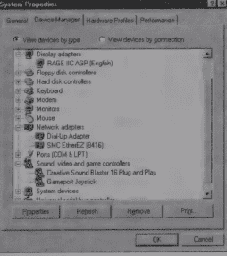

#### 图 1.1

Windows 列出了每个组件的名称、类型和型号。Linux 目前正在开发类似的识别方案。


### 提示

Linux 对硬件组件的描述不像其他系统那样冗长。不过，你仍可在 Linux 下稍后通过查阅 `/proc/` 目录来确定硬件类型。在此目录下有几个文件，它们会动态列出 CPU 信息、中断和 I/O 端口。

同样地，你也可以用相同的方式识别一些更难以捉摸的中断请求（IRQ）和端口设置。在同一个屏幕上，确保对话框顶部的“计算机（Computer）”元素处于高亮状态，然后点击下方的“属性（Properties）”按钮。此时应出现图 1.2 所示的屏幕。在这里，你可以识别每张卡片的 IRQ 设置。

不过，较新版本的 Red Hat Linux 已经会探测许多端口、视频、网络和声卡。通常，Linux 在识别所有组件方面比 Windows 95/98 或 2000 表现得更好。如果 Linux 内核未能自动识别某个设备，已存在多种工具（如 `sndconfig` 和 `kudzu`），它们可以完成对设备的额外探测，并允许你在已知情况下强制设置 IRQ 和端口。同样，`/proc/` 目录列出了 Linux 为每个组件使用的不同中断和端口。

使用命令 `cat /proc/interrupts` 可以显示哪些设备正在使用哪些中断。该目录，即 `/proc/`，还包含几个其他动态文件，可提供关于 CPU、端口和内存使用情况的信息。

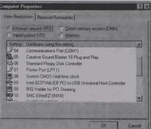

#### 图 1.2

在尝试让所有组件在 Linux 下协同工作之前，请熟悉每个组件所需的各种 IRQ 和端口设置。

在为其中一名员工配置一台旧机器时，我将一块 9GB SCSI 硬盘的一半分区用于 Windows 98，而将另一半预留给 Linux。该机器拥有超过 196 MB 的 RAM 和几个外设，包括一块不常见的 SCSI 卡。它还有一块较旧的网络卡和一台内置磁带机。Windows 未能检测到网络卡或磁带机。它确实加载了 SCSI 卡的通用驱动程序，以便我至少可以安装操作系统。该机器的完整配置需要数小时的细致工作。在下载网络卡的更新驱动程序后，我终于使其正常工作，但我放弃了磁带机。当我开始安装 Linux 时，我持不太乐观的态度。我最近购买了一份廉价的 Red Hat 6.0 副本，决定将其安装在剩余的 4.5GB 硬盘空间上。Linux 毫无问题地检测到了网络卡，随后又告知我它还检测到了一个磁带备份设备。我在不到一小时内就完全安装并运行了 Linux。

当然，并非所有机器的配置或制造都完全相同。借用乔治·奥威尔在《动物庄园》中的一句话：“……有些动物比其他动物更平等。” 你的体验可能不如我的积极，但随着 Linux 的成熟以及制造商使硬件规格更易于获取，部件和卡片的检测将变得更加容易。

#### 了解你的硬件

在对机器进行任何类型的安装之前，请务必熟悉计算机的部件和组件。了解硬件的历史背景也无坏处。在我的情况下，我知道自己的电脑上有较旧的 SMC 网络卡，但我必须自行发现它需要较旧的 Western Digital 驱动程序。在着手对 Linux 进行任何类型的安装之前，你应该确保两件事：第一，确切知道你的计算机由哪些卡、芯片组和组件组成；第二，确保你拥有的硬件与你将要使用的 Linux 版本兼容。

如果你对自己的部件是否能与 Red Hat 配合使用有任何疑问，首先检查 Red Hat 网站并跟随链接进入硬件兼容性列表。一般规则是：如果部件未在列表中列出，则意味着不受支持。你可能需要仔细查看以确认你的部件是否在列表中。（我曾以艰苦的方式发现，我认为列出的许多较旧的 Intel 网卡实际上甚至不受最新版本的 Linux 支持。相反，Linux 支持较新的卡片。）硬件兼容性列表按类型分为不同的部分。验证即使是古老的声卡在最新的 Red Hat 中也得到良好支持非常简单。

只需快速浏览一下，就可以找到几个镜像页面，它们列出了 Linux 当前支持的核心组件。《*Linux 兼容性 HOWTO*》可能是最全面的。该列表涵盖了所有可能与运行 Linux 的台式电脑集成的部件。受支持的条目按以下顺序列出：

- 主板/BIOS
- 笔记本电脑
- CPU
- 内存
- 显卡
- 控制器（从硬盘到 RAID 到 SCSI 到多端口）
- 网络适配器
- 声卡
- 硬盘
- 磁带机
- CD-ROM
- CD 刻录机
- 可移动驱动器
- 鼠标
- 调制解调器
- 打印机
- 扫描仪
- 以及任何其他可能的外设，从游戏杆到业余无线电

由于许多特定组件的驱动程序存在重叠，简单地了解你的部件使用何种芯片组也很有帮助。这在显卡和以太网卡的情况下确实如此。特定的品牌可能未以名称列出，但如果受支持，其芯片肯定会出现在列表中。

过去，只有有限数量的部件和附件能在 Linux 下工作，但如今，几乎任何现成的产品要么能在普通的 Linux 安装下运行，要么稍加努力即可使其运行。如果你对自己部件的兼容性不确定，且 Red Hat 主网站对其兼容性描述模糊，向新闻组快速发帖或咨询你附近的电脑专家可以迅速消除任何疑虑。如果其他方法都失败，附近电脑店很可能有更好或更新的部件，通常也更便宜。此外，制造商已开始发布越来越多的部件规格并提供更多驱动程序。硬件包装上印有“Works with Linux”术语已变得司空见惯。虽然你可能对自己的硬件能正常工作感到放心，但对照兼容性列表再次核实你的项目是否列出总不会有坏处。如果你仍无法确定，请联系制造商。如今，许多公司会在互联网上提供其产品的信息。通常，只需快速访问其主页即可消除任何不确定性。

## 配置和安装 RED HAT LINUX

第 1 章

### 提示

查找信息的最佳地点之一是在 Linux 发行版页面和 Linux 文档项目（LDP）主页上。后者可能是更好的选择，因为它由一群致力于发布所有品牌 Linux 硬件和软件以及中间一切事物的信息和规格的志愿者维护。如果你在那里找不到答案，那就意味着仍有人需要去写它。该站点的当前 URL 是 `http://www.linuxdoc.org`。

LDP 最初位于北卡罗来纳州，现在在地理上分布广泛的站点上设有镜像，并拥有来自全球各地的贡献者。LDP 不仅提供文档和有用的 HOWTO，还托管了大量资源，包括大量 Linux 程序的源代码，以及致力于帮助 Linux 用户保持最新的资源、指南、文档、邮件列表、新闻和在线杂志的链接。

在采取任何安装步骤之前，记下所有规格、卡类型（包括制造商和型号）以及设备上的任何其他印刷信息会有所帮助。查阅你自己的笔记比在机器安装并运行后尝试查阅硬件要容易得多。对于位于不便位置的硬盘，这一点尤其正确。我曾有几次不得不拆卸部件以验证其产品编号或芯片组。

### 提示

你应该列出每个单独组件的详细清单。然后你可以在安装时参考该清单。

#### 为安装做准备

对于大多数 Linux 发行版和较新的主板，几乎所有机器都可以直接从 CD-ROM 启动 Linux 安装。你首先需要查阅主板 BIOS 以确保此选项可用。检查标记为“启动顺序（Boot Sequence）”或类似字样的选项（通常位于 *BIOS 功能设置（BIOS Features Setup）* 下），看看你的机器是否最初可以从 CD-ROM 启动。如果可以，将配置更改为将 CD-ROM 设为启动驱动器；然后插入 Linux CD 并给机器通电。验证 BIOS 设置后，安装程序应自动开始。


在一些较旧的机器上，只能使用软盘或硬盘来引导操作系统。如果情况如此，则必须制作、借用或购买一张启动软盘。Red Hat 通常在其商业版本中随附 CD 和手册一起提供启动软盘。然而，如果没有现成的软盘，您可以轻松地使用 CD 上的软件制作一张启动软盘。只需要两个文件：`rawrite.exe` 和 `boot.img`。`rawrite`（有时发音为*raw write*）文件通常位于 CD 上的 utility（实用工具）目录中。在 Red Hat 发行版中，它位于一个名为 dosutil 的目录中。`boot.img` 文件通常在一个名为 images 的目录中找到。

> **注意**
>
> 试图使用另一个版本的镜像来安装某个 Linux 发行版会导致问题。请务必在软盘上清楚地标明正确的版本。将不同发行版的可启动镜像混用也是如此。

根据您试图使用的安装例程类型，可能需要使用同一目录中的其他附加镜像。您可以使用与创建启动软盘相同的流程轻松地创建这些镜像。其他可启动镜像的名称包括 `bootnet.img` 和 `pcmcia.img`。前者用于通过网络连接启动，后者用于通过 PCMCIA 卡或笔记本连接进行安装。这些每个文件的目的是创建一个启动磁盘。

##### 在 Windows 下创建启动软盘

`rawrite.exe` 文件应复制到另一台机器上，最好是运行 Windows 或 DOS 的机器。它通过逐扇区复制文件的原始镜像信息或信息扇区到软盘来工作。`boot.img` 文件是 Linux 的可启动镜像，用于启动 CD 或安装额外安装选项（如 NFS 或 FTP 安装）的驱动程序。其他两个镜像文件也适用同样的原理。除了提供一些程序外，该软盘还包含一个非常基础的 Linux 内核，并仅提供使 CD-ROM 在 Linux 下正常工作所需的基本驱动程序，以便安装过程的其他部分可以正常进行。`bootnet.img` 文件启动一些基本的 FTP 驱动程序，并允许您的机器识别网络或调制解调器连接，从而可以通过该连接下载额外的文件。`pcmcia.img` 驱动程序允许通过笔记本电脑上的 PCMCIA 插槽进行连接。当连接到该插槽时，`pcmcia.img` 驱动程序可以识别大多数以太网 PCMCIA 卡的基本驱动程序。

在创建启动软盘时，您可能更喜欢将 `rawrite` 安装到 Windows 机器的根目录中。`bootimg` 文件应放在相同的位置。要使用 `rawrite`，只需启动一个 DOS 窗口并切换到根目录。输入 `rawrite`，然后在提示时输入您希望复制到软盘的 filename（文件名）。在大多数情况下，您会输入 `boot.img`。您还需要输入目标软盘驱动器。几乎所有 Windows 机器都使用 `a:\` 作为其主软盘驱动器规范。图 1.3 展示了一个示例会话。

一旦 `rawrite` 完成将文件逐扇区复制到软盘，您将获得命令提示符。现在，您可以在大多数 PC 上使用此软盘来启动 Linux 安装程序。

##### 使用 Linux 创建启动软盘

在 Linux 机器上同样可以轻松制作启动镜像。您需要具有 root 或超级用户权限才能向软盘驱动器或 `/dev/fd0` 设备写入。对于大多数用户来说，这是 1.44 兆字节的软盘驱动器。如果您的机器有多种类型的软盘驱动器，在列示该设备时可能需要更具体。确定的路径如下：`/dev/fd0H1440`。此路径指定初始软盘驱动器或 `a:\` 驱动器。如果存在第二个软盘驱动器（或 `b:\`），则分配应为 `/dev/fd1H11440`。

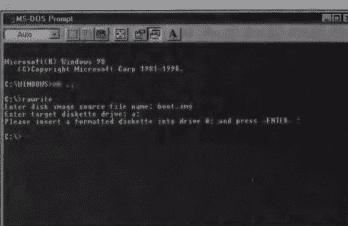

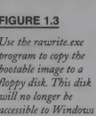

> **提示**
>
> 在 UNIX 和 Linux 变体中，计数从 0 开始。**1** 是第二个数字。

要从发行版 CD 复制启动镜像，请在 Linux 中挂载该 CD，然后切换到存储 `boot.img` 的目录。插入一张空白的、格式化的软盘并输入以下命令：

```
# dd if=boot.img of=/dev/fdH1440 bs=1440k
```

有关 `dd` 命令（用于复制文件）的额外信息可以通过查阅 *man* 或手册页进行验证。要在任何命令行上参考 `dd` 的手册页，请输入 **man dd**。

Red Hat 拥有一项附加功能，使 Linux 安装更加容易。Kick-Start 方法允许用户设置特定的配置，然后让 Linux 自动运行其余的安装过程。对于那些需要设置多台 Linux 机器但没有时间手动配置每个选项的用户来说，这非常方便。

> **备注**
>
> 如果您知道要在所有机器上安装的具体程序，您可以在初始机器上创建默认配置。您可以将此格式保存到软盘上。只需将同一张软盘从一台计算机传输到下一台计算机，就可以绕过大量的键入和决策工作。

##### 分区驱动器

在为任何类型的 Linux 安装做准备时，您需要坐下来勾勒出您希望 Linux 机器做什么以及将每个文件放置在何处的想法。Linux 非常灵活，因为您可以为不同的目录设置单独的分区。*partition*（分区）是将单个物理磁盘划分为多个逻辑磁盘的方法。每个分区是一个连续的块段，随后被当作独立且不同的物理驱动器处理。虽然您可能只有一个驱动器，但您可以有多个分区，从而使您的计算机看起来像有多个驱动器。只有几个物理硬盘的计算机可以有多个分区。

> **备注**
>
> 虽然您的机器可能只有一个物理硬盘；如果您将其划分为四个单独的分区，您的机器然后将所有四个分区视为独立的驱动器，并在 Windows 下将它们重命名为驱动器 C、D、E 和 F。Linux 会将它们识别为设备，并分别将它们称为 `/dev/hda1`、`/dev/hda2`、`/dev/hda3` 和 `/dev/hda4`。

大多数操作系统都允许这种方法将信息块区分为单独的分区。分区的一些基本规则是：

- 它们不能重叠。
- 您不能将同一个目录挂载到不同的分区上。
- 您不必对硬盘上所有可用空间进行分区。可以保留一些空间以便以后用于其他操作系统或其他分区。

一旦您决定了如何设置系统，明智的做法是写下配置的物理参数。文档记录计算机设置的重要性怎么强调都不为过。许多人通过记录所有系统的布局，避免了痛苦的重新安装和重试所带来的数小时压力。我仍然有三本装订好的笔记是我多年来收集的。虽然我现在不太常查阅它们，但我偶尔仍会参考它们以获取特定说明。知道哪个物理驱动器包含其相应的逻辑分区或目录可以为您节省大量时间和金钱。

> **提示**
>
> 您可以有一个专门用于 `/home` 目录或您保存本地文件所在目录的分区。在重新安装的情况下，这允许您在重新格式化其他分区的同时保留所有数据。

如果您不习惯将目录拆分为不同的分区，这可能会有点令人望而生畏，但稍加练习就会发现其益处。虽然在一些较旧、较小的驱动器上可能没有太多空间，但您可以选择将所有文件和目录安装到一个主根或 `/` 目录中。根目录是所有 Linux 分区的最顶层。

##### 选择挂载点

Red Hat Linux 使用两种不同的工具来分区驱动器。Red Hat 目前宣传的最动态的工具是 *Disk Druid*。此工具允许用户为每个目录创建多个分区。与其前身 *fdisk* 不同，Disk Druid 不仅限于四个分区。在安装阶段，您很可能会看到 Disk Druid 作为默认的分区工具。在 Red Hat 的最新版本中，您也可以选择使用 fdisk，为分区提供附加功能。Disk Druid 只能将分区设置为有限数量的分区类型。

> **注意**
>
> 如果您决定将 Windows 分区的一部分留给 Linux，请确保先对驱动器进行碎片整理，以便所有文件都位于驱动器的一部分中。然后，可以使用 CD 上包含的工具 *Tips* 将剩余空间交给 Linux。

对于不熟悉与 Linux 相关的分区架构的人来说，Red Hat 为每个分区提供示例挂载点。而不是猜测可能需要哪个分区，Red Hat 列出了目录——例如 `//boot`、`/home`、`/opt`、`/usr`、`/usr/local` 和 `/var`——作为每个分区的可能挂载点。虽然许多人认为 fdisk 是更好的工具，但 Red Hat 在安装过程中提供了两种工具。为了优化分区架构，您应该结合使用这两种工具。

命令行工具允许切换分区身份（如备用文件系统类型或格式），这具有优势。Linux fdisk 工具比微软的对应工具更强大，并且可以创建兼容多种其他操作系统的分区，包括 Windows NT、OS/2 和其他操作系统。


#### 注意

使用 fdisk，你可以定义希望在特定分区上安装哪种类型的操作系统。Fdisk 允许你在 78 种不同的文件格式之间进行选择，范围从 Windows 95 文件分配表（FAT）到 Novell Netware，甚至包括 AIX。在 fdisk 命令行中输入 t，即可将分区的 ID 更改为其他操作系统。你可以在同一行中输入 l 来列出所有可用的文件类型。Disk Druid 最初仅提供五种或六种不同的文件格式。

安装完成后，你仍然可以更改分区格式。输入 /sbin/fdisk 和分区名称。一个典型的命令是 /sbin/fdisk /dev/hda。

一旦你使用 fdisk 设置了新分区或更改了分区的 ID，你就需要将信息写入分区表，然后退出。你应仅在初始安装期间，或当为其他操作系统定义驱动器上的剩余空闲空间时，才使用 fdisk。

随着 Linux 重要性和知名度的不断提升，越来越多的用户要求更易用的分区工具。Red Hat 通过进一步开发 Disk Druid 以及协助为 Linux 和其他操作系统（如 Microsoft、DOS、Be 和 OS/2）设置独立分区，来满足许多此类需求。每个系统都可以分配自己的独立分区。Red Hat 还允许你定义默认的操作系统。

#### 确定你的 Linux 机器的功能

在为 Linux 机器分区之前，你首先必须回答以下几个问题：

- 这台机器的基本功能是什么？
- 基于机器的主要功能，哪个分区需要最大的空间？
- 将来是否需要重新安装或升级软件？
- 将来是否需要扩展现有硬件？

前两个问题可能最重要，并且目的相关联。如果这台 Linux 机器将作为 web 服务器使用，它需要在 /home 或 /usr/local 目录上有更多的空间。然而，如果它作为新闻服务器使用并且将托管数千个新闻组，那么 /var 或 /usr/local 目录必须比 /home 目录大几倍。

还要考虑到文件有生命周期。如前所述，某些类型的文件在系统中仅保留短时间，而其他文件一旦安装后就是永久的。将具有不同周转率的文件存储在替代分区中是有用的。位于 /usr/bin 和 /usr/sbin 中的文件可能会存在一段时间，可以被视为这些目录中的稳定组件。这些目录所需的存储空间可能不会随时间显著增加。

分区的使用应与文件生命周期仔细结合考虑。位于 /usr/local 和 /home 等目录中的文件具有适中的生命周期。这些文件可以持续数周到数月。因此，它们的相应分区可以设置得稍大一些。/var 分区和 /var/spool 很少保留某些文件超过一两周，并会轮换旧文件。这两个分区可以设置为中等大小。设置具有动态或较短生命周期的分区有几个原因。系统所需的存储空间可能会随时间变化，你应该为这些分区预留后续增长的空间。此外，空闲空间有助于防止随时间变化的文件进一步碎片化。这些较短生命周期的文件及其相应目录不会影响 /usr 或 /home 目录中的文件，因此不会降低系统性能。

#### 探索示例布局

表 1.1 描述了一种标准的分区方案。此示例使用 10 GB 的硬盘。该系统没有 SCSI，只有连接在主板主主插槽上的 IDE。与此同时，CD-ROM 连接在从从端口上。请记住，此示例仅显示了将此驱动器拆分为多个分区的许多可能方法中的一种。

> **注意**：如果可能，请为所有分区留出足够的余地，以防将来需要额外的分区。因此，你应该省略一些独立的分区，例如 /opt 或 /usr/local，并让它们的目录驻留在 / 或 /usr 分区上。例如，只有当你知道将来会添加更大的硬盘驱动器，并且 /usr/local 目录可以挂载在这个新驱动器上时，你才需要专门设置一个 /usr 分区。

##### 表 1.1 单个 IDE 驱动器上的示例分区方案

| 分区名称 | 文件系统 | 大小 (MB) | 描述 |
|---|---|---|---|
| / | /dev/hda1 | 500 | 根目录 |
| /usr | /dev/hda7 | 2,000 | 二进制文件和库 |
| /usr/local | /dev/hda6 | 2,000 | 用户自己的程序 |
| /home | /dev/hda5 | 2,500 | 主目录 |
| /var | /dev/hda2 | 500 | 日志和消息 |
| /opt | /dev/hda8 | 1,000 | 独特程序 |
| /usr/src | /dev/hda3 | 1,000 | 内核源代码 |
| swap | /dev/hda4 | 500 | 交换空间 |

在 Linux 下，所有分区都作为设备处理。在这里，每个分区都配置为独立的设备。Linux 可以在一个设备或物理硬盘上处理多达 16 个分区。/dev/hda1 这个晦涩的标签指的是设备 hda（即硬盘 A）上的第一个分区。如果有两个或更多的硬盘，那么分区将分配给 hdb、hdc 等。请参阅表 1.3 了解使用多个驱动器的其他方案。

上述布局仅仅是标准安装的建议设置。根目录保留最小的分区大小。在早期的 Linux 发行版中，/ 或根分区限制在 1,024 个柱面以内，或者大约 540 MB。

#### 注意

Red Hat 可能会遇到大于 8 GB 的分区问题。另一个限制是包含 Linux 内核的分区必须完全位于硬盘的前 1024 个柱面内。加载 Linux 内核的程序 LILO 已经通过修复以绕过此限制。Red Hat 7.0 将是第一个包含改进后 LILO 的版本。

/usr 目录分配的空间比其他分区多，以容纳 Linux 所需的二进制文件和库。Red Hat 默认将其二进制文件放在 /usr/bin 中。如果你计划使用 Red Hat 包管理器（RPMs）或二进制文件，你应该保持此分区有充足的大小。

你还应该保持 /usr/local 相对宽敞，因为这是放置用户编译程序的地方。具体来说，从编译源创建的binary文件被放置在 /usr/local/bin 中。

/home 目录因多种原因保持较大。这里创建了独立的 user 目录。其他重要目录默认也存储在这里。在 Red Hat 发行版中，所有 HTML 和 FTP 文件都存储在 /home 中。如果你决定从源代码安装 Apache Web 服务器，而不是使用 Red Hat RPM 包，如果你选择 Apache 的默认安装，你的 HTML 文件位置可能会改变。然而，无论使用哪种方法，你仍然可以指定默认位置。

使用 /var 存储许多日志和安全相关文件是标准做法。这些文件通常比其他静态文件的生命周期短，因此其周转率相对较高。这意味着如果你预期只存储短时间的消息，可以将 /var 目录保持较小。

/opt 目录最近因 Netscape 和 KDE 等程序而变得流行。这个目录是这些程序大多数 binary 文件的默认位置。将独特的目录，如文字处理程序，也保留在此目录中也是良好的做法。/opt 目录更像是一个独特程序和文件系统的集散地。

/usr/src 目录是独特的，因为这是存储、配置和编译 Linux 内核的地方。这也是 Red Hat 构建和存储从源编译的 RPM 的地方。如果你打算使用 Red Hat 进行开发工作或从源构建 RPM，如果你希望保留源代码用于后续重新安装或用于组织或备份目的，明智的做法是保持此分区与其他分区分离。

交换空间对于优化机器速度至关重要。如果你不专门分配至少最小量的硬盘空间作为交换空间，Red Hat 会发出警告。旧版本的 Red Hat 允许你在未保留交换空间的情况下进行安装，但性能会受到严重影响。一个好的经验法则


在确定应预留多少磁盘空间用于交换空间（swap）时，应将物理内存（RAM）容量的1.5倍到2倍划分为交换分区。

#### 注意

如果您当前系统中有64 MB的RAM，将96 MB的空间分配给交换空间是一个合理的数量。需要记住的一点是，交换空间和RAM协同工作。这意味着64 MB的RAM和96 MB的交换空间加起来构成了160 MB的内存。应该为交换空间预留的最小空间量是16 MB。最后，在一些较旧的Red Hat Linux版本中，可以分配给交换空间的最大量是128 MB的RAM。这一限制已在最新的Red Hat Linux版本中被超越。

在设置交换空间时请酌情处理。不要过度预留空间，以免损害其他分区。如果未能正确设置、初始化或配置交换空间，可能会导致性能低下。Red Hat会在安装过程中提醒您设置交换空间，如果您没有为内存大小设置至少最小量的磁盘空间，安装程序将无法继续。由于Linux管理交换空间的方式，并将正在运行的程序放置在磁盘上以供后续参考，因此“过犹不及”。如果系统程序迅速消耗了交换空间，或者交换空间未正确启动，访问速率和性能将会受到影响。交换空间如果超过RAM大小的三倍，可能已经毫无用处。

用于启用交换空间的命令是 `swapon -a`。该命令从 `/etc/rc.d` 文件执行。当机器启动时，它会读取rc或运行命令文件。这些是操作系统用于初始化系统并启动各种守护进程的文件。当操作系统发现 `swapon` 命令时，它激活交换分区。

关于您的交换分区的信息保存在 `/etc/fstab` 文件中。在此，您的计算机查找您在设置期间确定的参数信息；然后，在启动时，计算机执行这些定义。`/etc/fstab` 中定义的交换分区的挂载值为 `none`，其类型设置为 `swap`。这告知操作系统在启动阶段发出 `swapon` 命令或挂载每个分区时应如何处理每个特定分区。

当计算机关机时，也会执行类似的过程。如后文所述，关闭Linux机器的电源并不像关掉电源那么简单。如果系统关机不当，或者在某些进程未能干净停止之前切断了所有电源，文件系统和数据就会损坏。在关机过程中，系统执行 `swapoff` 命令以卸载交换分区。如果您正确安装了Linux，您可能永远都不需要使用 `swapon` 或 `swapoff` 命令。但是，当预留额外的交换分区或在系统故障后清理时，您可以手动调用该命令。有关启动和关闭计算机的更多信息，请参阅第2章“启动与关机”。

#### 探索最小布局方案

如果您将Linux用于更平凡的用途，例如桌面使用，或者如果空间有限，设置分区可以更加简单。在这种情况下，您可以将所有目录放在一个分区上。与其创建单独的分区，不如预留一个大的标准分区或 `/`，然后将所有目录和子目录放置其中。交换空间仍然需要自己的分区。表1.2展示了一个单个2.1 GB硬盘的示例布局。

**表1.2 硬盘空间有限的计算机示例布局**

| 分区名称 | 文件系统 | 大小 (MB) | 描述 |
| :--- | :--- | :--- | :--- |
| / | /dev/hda1 | 2,000 | 根目录 |
| swap | /dev/hda7 | 100 | 交换空间 |

这种布局是可行的，但不推荐。如果其中一个目录出现故障，或者以后需要重新安装，所有文件及其内容都可能损坏或被覆盖。将系统和个人信息分布在几个不同的分区上是一个更明智的决定。

#### 设置多个磁盘和分区

拥有多个物理硬盘的系统设置起来甚至更容易。在这里，有必要将目录或分区放置在实际的物理磁盘上。无论磁盘是IDE还是SCSI，Linux都有资源来确定已安装磁盘的类型并辅助进行分区。表1.3展示了一个与我许多机器类似的系统的示例配置。我有一台配备64 MB RAM的200 MHz Pentium处理器，以及三个实际磁盘，其中前两个是IDE，最后一个是SCSI。该表展示了如何在这三个物理磁盘上划分文件系统。

**表1.3 跨三个硬盘的分区方案示例**

| 分区名称 | 文件系统 | 大小 (MB) | 描述 |
| :--- | :--- | :--- | :--- |
| `/` | /dev/hda1 | 400 | 根目录 |
| swap | /dev/hda2 | 100 | 交换空间 |
| /home | /dev/hdb1 | 500 | 主目录 |
| /usr | /dev/hdb2 | 500 | 二进制文件 |
| /usr/local | /dev/sda1 | 300 | 我自己的程序 |
| /var | /dev/sda2 | 200 | 日志消息 |

如您所见，第一个IDE磁盘hda只有500 MB的空间，而第二个约有1,000 MB。第三个磁盘，由设备标签sda（代表SCSI磁盘）标识，也有大约500 MB的空间。

> **警告**
> 一旦您保存了新分区并将其写入磁盘，该磁盘上原有信息将全部丢失。在删除并创建新分区之前，请确保您绝对确定这是您想要执行的操作。

这里的分区格式与此前本章使用的方案非常相似。您自由地在其他分区中放置额外的目录。然而，我发现最好将分区数量保持最少，以防以后需要添加更多磁盘。这样，未分配给特定分区的独特目录可以完全专门用于新的硬盘。这需要将新的磁盘设备添加到 `/etc/fstab` 文件，然后挂载该分区。

最新的Red Hat Linux通过kudzu实用程序简化了这项任务。就像Windows能够查找并确定机器中新放置的硬件类型一样，Linux完成相同的任务，并且可以在不要求使用安装光盘或启动盘的情况下更新驱动程序和设备。您应该在安装、更换或交换硬件后运行kudzu。通常可以通过以root或超级用户身份执行完整命令 `/usr/sbin/kudzu` 来启动kudzu。

## 入门

#### 恢复丢失的分区

如果不可思议的事情发生，系统崩溃导致某些分区无法读取，或者您只是想重新安装，那么花时间将单独的目录分散到多个分区上可能会带来优势。您首先想要尝试访问损坏的文件系统并纠正磁盘上可能存在的任何错误。通常，Linux会使用 `fsck` 工具（有些人发音为 efes check）为您完成此操作。您可能需要手动运行 `fsck` 来清理系统，在这种情况下，了解系统的布局将再次证明是有益的。

您应该只在最坏的情况下才重新安装。但是，如果您认为重新安装是唯一的选择，Red Hat允许您重新定义哪些分区要重新格式化，哪些要保持原样。例如，在重新安装过程中，您可以保持 /home 目录的内容不动，同时指定 /、/usr 和 /var 分区被重新格式化。如果您有远见地将个人信息放在 /home 等单独的目录中，您将几乎不会注意到默认二进制文件再次就位。如果 /home 和 /usr/local 等分区位于自己的分区上，它们将保持不受影响。

> **注意**
> 许多Linux用户将重新安装视为从Windows带来的习惯。优秀的Linux用户通常不需要重新安装。通常，损坏的文件可以在不进一步损坏系统的情况下重新安装。仅将重新安装视为最后的手段。

在我无法恢复损坏的文件系统并需要重新安装的情况下，只有一次。在我最初学习Linux时，一个编写不良的程序摧毁了我的根文件系统的很大一部分，并损坏了运行Linux所需的几个系统文件。我在那天学到了三个重要的教训：第一，以root登录时要格外谨慎；第二，不要盲目信任任何……


Linux 软件程序；第三，将我的目录分布到不同的分区上。幸运的是，我所有的重要文档和程序都位于 `/home` 和 `/usr/local` 目录中，每个目录各自位于独立的分区。在重新安装过程中，我能够选择那些我希望格式化并重新安装的目录。对于普通用户来说，只需要重新安装 `/`、`/usr` 和 `/var` 目录。其他目录可以保持原样。Linux 只会覆盖所选分区并重新安装二进制文件。

Linux 尽了最大努力使安装和重新安装变得尽可能简单。与其他的专有操作系统不同，Linux 允许你直接从 CD 重新安装完整的操作系统，而不会损害现有软件。一些人认为，良好的清理和定期重新安装有助于控制磁盘使用量。这些操作可以清除旧的链接，并将系统更新到最新的编译器和库。在安装 Linux 之前进行周密的规划有助于避免后续问题，并使系统运行更加高效。

### 安装软件

你现在已经熟悉了硬件，并了解了 Linux 支持的内容。现在，在你已满意地划分了驱动器分区后，Linux 会提示你开始安装例程。Red Hat 提供了几个选项，甚至在分区过程之前，你就可以选择工作站、服务器或自定义选项。前两个选项相当标准，尽管它们可以安装多达 600 兆字节的程序。

#### 定义安装类型

第一个选项，即所谓的工作站安装，将自动擦除硬盘驱动器上所有 Linux 分区，而第二个选项，服务器，将擦除计算机硬盘驱动器上的*所有*分区。用户应该选择第三个选项，自定义，即使他们认为自己只是 Linux 新手。此选项允许更好地管理和控制分区的创建以及程序的选择。这与其他两个替代方案之间实际上没有区别，除了使用自定义选项时，你可以选择你想要的所有包。

从这里开始，系统将提示你创建分区并设置每个分区的挂载点。换句话说，你需要确保每个分区都有自己独立的目录，如前文所示。Red Hat 将提供关于你可以安装的目录或分区的几种不同选择。每个分区所需的磁盘空间量取决于计算机的功能。如果你是首次安装，可能最好只创建两个分区：根（/）和交换（swap）。一旦你决定了分区，你可以选择要格式化的分区。如果这是新安装，所有分区都应该被清除并格式化为 Linux 原生文件系统。然而，如果这是重新安装，或者你希望保留现有分区上的信息，则只需要重新格式化 /、/usr 和 /var。你可以选择额外的格式化点，但这完全取决于你。在这种情况下，经验或许是最好的老师。（此外，我认为安装 Linux 是操作计算机中最愉快的任务之一。）

#### 选择你的软件包

一旦你准备好安装程序并开始格式化，系统将提示你选择要安装的软件包。Red Hat 在预编译源代码或称为*RPMS*的二进制软件包方面处于领先地位。RPM 代表 Red Hat 包管理器。包管理器部分允许 Linux 用户完全自动化每个程序的安装，包括文档和支持库。RPM 的软件包部分无疑使 Linux 安装更简单，配置更容易。它们不仅使安装程序更简单，而且移除或升级它们也变得更加轻松。当移除或升级文件时，你不再需要担心遗留文件或损坏的链接。RPMs 为你处理所有这些事项。再次强调，与专有软件不同，Red Hat 不要求你通过一系列向导或咨询数据库来移除程序。一个简单的单行命令即可完成所有操作。关于 RPMs 的更完整解释在第 11 章“安装额外程序”中介绍。

Red Hat 将所有可用软件包仔细划分为标记的类别或部门，如网络、开发程序和守护进程。这有助于你定义你的 Linux 机器（或许多支持者喜欢称呼运行 Linux 的计算机为 Linux box）的角色。取决于你在安装 Linux 时选择的界面类型，无论是完整的 GUI 还是更类似于 DOS 的安装，你可能可以选择一整个程序范围，而不必单独选择每个程序，或者费力地浏览你可能想要也可能不想要的选项列表。

你选择什么再次完全取决于机器的用途。如果 Linux box 专门用于作为 web 服务器，你可以通过选择适当的类别快速轻松地安装许多必要的程序。同样地，如果你选择更完整的程序范围，你可以通过在开始时或在浏览每个子主题后选择所需的类别轻松实现。

- **提示**

  安装前务必阅读每个软件包的描述。许多程序对你的需求可能完全是多余的，只会占用不必要的空间。游戏是一个可以快速占用比必要空间更多的类别。如果磁盘空间紧张且只有有限安装可行，请计算可用空间及软件包消耗的容量。最新的 Red Hat 将在安装前显示所有软件包所需的驱动器空间量。

选择安装哪些软件包并不总是那么直观。Red Hat 提供了关于每个程序功能及其在类别中运作方式的解释；无论是实用工具、游戏、库还是开发程序。然而，正如在*man*（手册）页面中也看到的，关于每个程序如何操作及命令行选项的简洁概述，提供的解释可能显得晦涩难懂。对于新手用户来说，这可能相当令人沮丧。通常，新用户会选择最小安装，然后由于必要的库或依赖程序不可用而无法编译某些程序。理解每个程序的功能极其有用。

新用户熟悉可用软件包有几种方法。Red Hat 允许你突出显示二进制软件包，然后单击帮助按钮或按下 F1 键来调出解释。最新的 GUI 安装会在软件包名称和分组下方的字幕中显示程序的功能。如果你仔细阅读字幕，它通常不仅会说明软件包的目的，还会说明哪些其他软件包可能依赖于它，以及此二进制软件包支持或补充哪些其他软件包。如果除了安装所需的程序外还有足够的驱动器空间在机器上后续工作，安装时总是最好宁可安装过多的程序而不是太少的程序。你总可以稍后卸载程序，但有时确定哪些程序需要后续安装可能会很困难。

如果磁盘空间不紧张，请选择完整安装。这样你就保证了拥有大多数你稍后决定安装的程序所需的所有库。一个令人宽慰的想法是，即使你选择了最精简的安装，Linux 也能在机器上运行。它将启动，显示提示符，并允许执行一些非常基本的功能。如果你购买了附带手册的版本，无论是在磁盘上还是硬拷贝形式，你也应该阅读发行商的完整描述。

#### 探索安装软件包

表 1.4 展示了最新 Red Hat 版本中一些可能的软件包类别及其简要描述。安装的较大部分被划分为更大的单元，然后细分为子类别。

##### 表 1.4 安装软件包

| 类别 | 描述 |
|---|---|
| 应用程序 | 这些是 Linux 需要的主要应用程序。 |
| 通信 | 此部分包含传真、IRC 和调制解调器程序。 |
| 数据库 | 此部分包括 postgresql，其中一个更好的开源数据库程序。 |
| 编辑器 | 此部分包括各种文本编辑器，如 emacs、vim、joe 和 jed。这些在服务器上编辑文本文档时极其有用。 |
| 模拟器 | 此部分包括 dosemu 和相关程序，允许你在 Linux 下运行基于 DOS 的程序。 |
| 工程 | 这个较小的部分涉及科学应用程序。 |
| 图形 | 这些程序通过命令行辅助编辑和操作图像。 |
| 邮件 | 此部分提供简单的邮件客户端，用于从终端窗口检查和管理邮件。 |
| 数学 | 这些程序处理数学运算。 |
| 网络 | 此部分提供用于管理网络资源的工具。 |
| 新闻 | 此部分包括用于阅读和传播新闻源和新闻组的各种程序。 |


#### 表 1.4 安装包（续）

| 类别 | 描述 |
| :--- | :--- |
| 生产力 | 此类别除包含其他程序外，还包含 *ical*，这是一个非常有用的日历管理工具，用于管理待办事项列表并跟踪您的日程安排。（我每天都在使用它。） |
| 发布 | 此部分包含用于管理文档和文本的各种文本工具。 |
| 声音 | 此部分提供用于编辑或播放声音文件的命令行工具。 |
| 基础 | 此部分包含运行 Linux 所需的基本文件。 |
| 内核 | 此部分包含有关 Linux 内核本身的信息以及用于设置文件系统和密码的程序。 |
| 守护进程 | 这些是在系统后台运行的程序，可让您的工作更轻松。它们用于日志记录和发送邮件，并包含其他设备实用程序。 |
| 开发 | 此部分对程序员以及那些希望了解 Linux 工作原理或协助使其运行得更好的人感兴趣。 |
| 构建 | 这些是用于制作您自己的 Linux 程序的工具。 |
| 调试器 | 包括 gdb，这也许是跟踪错误和编译错误的最知名工具之一。 |
| 语言 | 此部分包含各种计算机语言，既有文本形式的，也有图形形式的。 |
| 库 | 库是程序开发所需的指令。Linux 需要许多此类库。 |
| 系统 | 这些是系统级的开发工具。 |
| 工具 | 此部分包含程序员开发特定软件包所需的工具。 |
| 版本控制 | 此部分包括 rcs 和 cvs，这两个非常实用的工具用于跟踪程序的开发过程以及程序员所做的更改。 |
| 文档 | 此部分的实用性再怎么强调也不为过，尤其是对初学者而言。互联网上已经有许多文档可用，但本地文件也可获得。此部分包括各种语言的 HOWTO 指南、手册、文档项目以及最重要的 man 手册页。最新的 Red Hat 版本已将许多文档移至单独的 CD 上，以容纳更多的程序。 |
| 扩展 | 此部分包括几种外国字符实用程序。 |
| 游戏 | 这些是终端游戏，其中一些基于文本，另一些则具有简单的图形。 |
| 库 | 这些库有时被额外程序（如游戏或窗口管理器）需要，而不仅仅是系统本身需要。 |
| 网络 | 由于网络是一个日益发展的领域，而 Linux 在其中扮演着越来越重要的角色，因此有几个子部分涉及在 Linux 下配置网络的各个方面。 |
| 管理 | 这些是基本的管理功能，如 FTP、NFS 和 DNS 缓存。 |
| 守护进程 | 这些与网络相关的守护进程监视和管理通过系统的流量。这是缓存、DHCP、FTP、新闻源、sendmail 和 Web 服务器守护程序所在的地方。 |
| 开发 | 这些实用程序用于 DNS 或域名服务开发。 |
| 新闻 | 此部分包括新闻源程序。 |
| 实用程序 | 这些是补充 Linux 网络端的额外程序。它们有助于设置和维护内部和外部网络的各个方面。 |
| Shell | 这些是 Shell，协助用户通过 Linux 下的命令行进行交互。 |
| 实用程序 | 此部分介绍在 Linux 下使用的各种软件包。这些实用程序包括额外的功能和特性。 |
| 归档 | 这些是用于备份或压缩的程序。 |
| 控制台 | 这些程序管理您的视频显示。 |
| 文件 | 这些程序可帮助您更多地了解系统上的文件，或管理其使用。 |
| 打印 | 这些程序有助于将信息以可识别的形式发送到打印机。 |
| 系统 | 这些程序有助于配置系统并管理其资源，包括信息和文档工具。此部分相当广泛，涵盖 Linux 使用的许多方面。请务必熟悉每个程序的功能及其基本功能。 |
| 终端 | 这些工具有助于管理终端并允许用户登录。 |
| 文本 | 由于仍有大量内容以文本格式存在，此部分是 Linux 的关键部分。此部分包括用于检查、比较和编辑文件中文本的工具。它还包括 Perl、sed 和 awk 等各种程序，这些程序在处理大文件或文件块时极为有用。 |
| X11 | 此部分包括设置图形工作环境所需的程序工具和工具。（X11 是图形用户界面 GUI 的通用名称。） |
| 娱乐 | 此部分提供多种图形娱乐。其中一个较好的是 xearth，它在桌面上显示一个旋转的地球仪，包括城市结构和阳光。 |
| 应用程序 | 此部分包含几个有用的图形程序，包括 GIMP，这是一个免费的图像编辑工具，类似于 Adobe Photoshop。 |
| 游戏 | 没有游戏的计算机算什么？大多数 Linux 发行版除提供其他仅在 Linux 下找到的独特游戏外，还提供多种国际象棋和纸牌游戏。 |
| 库 | 此部分由各种 X Window 或 GUI 系统库组成。 |
| Shell | 此部分包括用于访问命令行接口的图形导向 Shell。 |
| 实用程序 | 此部分包括更多图形程序，包括屏幕保护程序、图像编辑器和功能性娱乐。 |
| 窗口管理器 | 在这里，您可以选择希望使用的界面类型。类型范围从类似 Windows 的界面到大胆的新格式。 |
| XFree86 | 这是 X-Window 系统的免费版本。它目前正在开发中，并为广泛的视频卡提供支持。 |

标准 Linux 发行版自带的程序远非 Linux 可用的所有程序。它们仅代表 Red Hat 认为设置一台功能齐全的 Linux 机器所必需的程序选择。与大多数专有操作系统不同，Linux 允许您在安装很久之后从可用程序中选择；理论上，这些程序将无限期保持可用。其他系统并非如此，它们在安装后仅提供非常有限的工具和程序选择。就成本而言，Linux 无疑是更好的选择。借助 Sendmail、Apache、wu-ftpd 等应用程序，以及 KDE 和 GNOME 等桌面管理器和环境以及其他开源软件包，Linux 迅速成为一种在有限预算下完成大量工作的经济手段。

> **提示**
> 要查找更多的 Linux 程序，您可能想参考 Freshmeat 站点 (http://freshmeat.net/)，该站点维护着一个庞大的标准 Linux 程序数据库，并附有每个程序的详细说明。为了避免逐个下载每个程序（包括较大的程序），GNUware 站点 (http://www.gnuware.com/) 以低价在一张 CD 上提供超过 1,000 个 Linux 程序。本书提供 GNUware CD 的补充副本。它们包含超过 1,300 个免费和开源程序的源代码。

除了安装时可获得的文档外，用户手册——无论是包含在纸质格式中、CD 上还是发行版的网站上——始终是有用的信息来源。同样，这些文档通常会更详细地列出每个软件包的事实、其内容、版本，有时甚至包括安装期间单个程序在计算机上放置位置的具体细节。在决定如何分区各个部分以及需要为某些功能分配多少空间和资源时，这特别有用。

### 结论

接下来的章节将更密切地探讨前一段中提到的许多（如果不是全部）程序。每一部分都将按线性顺序进行，从基本技能集过渡到更复杂的技能。每一章也将是自包含的，因此您无需按顺序阅读本书的章节来学习特定技能或事实。下一章将关注 Linux 最基本的功能。这些包括正确启动和停止 Linux；优化守护进程以执行后台任务；以及配置额外的设置以提高系统性能和安全。还将更详细地考察 Linux 的启动方式，这在调试系统启动问题时极具用武之地。


## 第 2 章
## 系统启动与关闭


仅仅打开和关闭 Linux 的电源并不足以有效地管理 Linux 系统。理解 Linux 在启动时显示的消息对于诊断故障和纠正错误至关重要。解读这些有时晦涩难懂的指令将有助于你更好地管理你的 Linux 系统。本章将涵盖以下主题：

- 理解 Linux 是如何启动的
- 理解 Linux 系统进程
- 在 Linux 下更改运行级别
- 正确关闭 Linux
- 排查启动错误

### 理解 Linux 启动过程

一旦 Linux 正确安装并看起来功能正常，你就应该熟悉其启动方式。一旦 BIOS 正确识别了硬件组件，你将看到一个 LILO 提示符。这是软件接管标准内存测试和 BIOS 操作的地方。如果按照前一章所述，安装过程顺利，那么 Linux 现在应该准备好开始加载，并且你已经在运行操作系统及相关程序的路上。

> **注意**
> 这个 LILO 提示符是 *Linux 加载程序* 的缩写，允许用户为启动或引导过程输入特定参数。大多数用户只需按 Enter 键即可启动系统。如果希望 Linux 以单用户模式启动或使用替代的 *内核*（负责资源分配、低级硬件接口等的操作系统核心），你也可以输入其他变量。

要查看如何配置替代内核并编辑与 LILO 相关的变量，请参阅第 14 章“构建自定义内核”。

### 解读控制台消息

通常，当 Linux 开始启动序列时，每个进程在启动时会在控制台显示上启用，因此对用户可见。也就是说，当引导至常规命令行界面时，你可以观察每个进程如何开始其初始化序列。在使用最新的 Red Hat 时，你将看到系统硬件的标识，然后观察每个守护进程或系统程序是成功还是失败地启动。如果进程正确启动，Red Hat 会在每个进程旁边显示绿色的“OK”；否则显示红色的“FAILED”。根据处理器的速度，典型用户可能能够看到系统所需的每个独立进程。即使启动屏幕显示进程的速度快于你能调试或检查的速度，如果系统有时无法初始化，你始终可以稍后检查日志以查看任何异常消息。启动过程是 Linux 系统的关键时期，因为硬件可能会失灵，而自定义脚本可能会阻止其他启动序列。

一些 Linux 发行版选择不显示完整的启动序列，而是选择显示类似 Microsoft Windows 启动时那样的闪屏。如果用户选择直接引导到图形用户界面（GUI）而不是在命令行输入更多命令的命令行界面，这种情况尤其如此。然而，Red Hat 选择了更具信息量的方法。大多数用户喜欢看到他们运行的进程以及它们何时启动。由于 Linux 在启动例程中需要一些额外的注意，因为那有时是管理员在很长一段时间内唯一可能看到系统启动的时间。Linux 享有长的正常运行时间，因此首次做对很重要。

> **注意**
> Linux 基于命令行。几乎每个功能都可以通过通过控制台连接或在终端窗口中编辑文本来进行自定义、更改或修改。虽然不断有允许通过指点进行操作的新工具被开发出来，但 Linux 大多数修改都依赖于简单的文本编辑器。

理解 Linux 操作系统如何正确启动有助于纠正硬件配置错误的问题、优化启动序列以及更改在操作系统完全功能正常时通常运行的守护进程或进程。内核的简单更改或启动脚本中的文本错误可能会阻止计算机正确引导，从而挂起整个过程。当这种情况发生时，你可以通过回顾启动过程中显示的消息来正确诊断出了什么问题。Linux 采取了一种立场，即管理员应该能够看到并诊断系统的任何问题。它在启动或运行独立程序的大多数情况下都力求详尽。这些变量会被考虑在内，然后 Linux 提供几种方法来解决常见错误。Linux 还提供几种不同的 *运行级别* 或启动级别，每个级别具有不同的网络支持，从而允许你引导到安全模式以修复或重新安装损坏的文件。

### 使用 dmesg 命令查看消息

在 Linux 启动过程中，实际上有两个阶段。第一阶段是硬件识别，第二阶段是进程守护程序或脚本的初始化。第一阶段由 dmesg 命令记录，第二阶段记录到 */var/log/messages* 文件。你还可以看到与控制台显示相同的信息，这些信息由 dmesg 记录并保存在 messages 文件中。当机器运行后，可以回顾所有这些消息。如果启动序列有问题，你通常仍可以到达命令行提示符，并在那里检查生成了哪些错误。本节将介绍 Linux 启动的第一阶段。

大多数 Linux 用户发现启动序列极具信息量。对于使用较旧且较慢硬件的计算机，你可以仔细检查启动时的每一行和每个进程，并注意任何不一致之处。这在从回收零件构建 Linux 机器或组装新机箱时很有用。你可以确切看到哪些硬件被操作系统识别，哪些没有。随着 CPU 速度的提高，Linux 现在启动得更快，整个启动过程可能会变得模糊，因为消息快速闪过。

Linux 提供了一个简单的命令，在 Linux 运行后回顾所有硬件启动消息。dmesg 命令允许用户查看系统启动过程的保存文本。此信息仅限于硬件识别。这限制在内核级别。回顾 dmesg 文本是识别硬件问题和检查默认内核中所需组件支持的有用工具。

因为通常有比单个 xterm 或控制台窗口能容纳更多的文本——使用滚动条查看消息的初始文本，或者使用命令 `less` 和 `more` 解析消息是个好主意。这两个命令中的任何一个都允许用户通过按空格键或 Enter 键翻过消息的其余部分。在控制台窗口下，你还可以通过选择 Alt+PageUp 和 Alt+PageDown 键分别来回顾或向前查看文本编辑器中的先前文本。列表 2.1 是一个 dmesg 请求和一些示例输出的示例。

#### 列表 2.1 在 Vanilla Red Hat 6.2 安装上 dmesg 请求的示例

```
1. [root@Backup /root]# dmesg | more
2. Linux version 2.2.24 - 5.0 (root@porky.devel.redhat.com) (gcc version egcs - 2.91.66 19990314 / Linux (egcs - 1.1.2 release))
   #1 Tue Mar 7 21:07:39 EST 2000
3. relocating initrd image:
4.     initrd_start: 0xc00f960000    initrd_end: 0xc00ffff7b
5.     mem_start: 0xc0026c0000      mem_end: 0xc040f0000
6.     initrd_size: 0x00069f7b     dest: 0xc04095000
7. Detected 59860287 Hz processor.
8. Console: colour VGA + 80x25
9. Calibrating delay loop ... 596.38 BogoMIPS
10. Memory: 63161k/66556k available (1060k kernel code, 416k reserved, 976k data, 64k init, 0k bigmem)
11. Dentry hash table entries: 262144 (order 9, 2048k)
12. Buffer cache hash table entries: 65536 (order 6, 256k)
13. Page cache hash table entries: 16384 (order 4, 64k)
14. VFS: Disk quotas version dquot - 6.4.0 initialized
15. L1 I Cache: 64K L1 D Cache: 64K
16. L2 Cache: 512K
17. CPU: AMD AMD Athlon(tm) Processor stepping 01
18. Enabling extended fast FPU save and restore ... done.
19. Checking 386/387 coupling ... OK, FPU using exception 16 error reporting.
```


## 入门指南

-   20. 正在检查 'hlt' 指令... 正常。
-   21. UNIFIX 执行 POSIX 一致性测试
-   22. mtcr: vl.35a (19990819) Richard Gooch (rgooch@atnf.csiro.au)
-   23. PCI: PCI BIOS 修订版 2.10 入口位于 0xfdb01
-   24. PCI: 使用配置类型 1
-   25. PCI: 正在探测 PCI 硬件
-   26. PCI: 为设备 00:00 启用 I/O
-   27. Linux NET4.0，适用于 Linux 2.2
-   28. 基于 Swansea 大学计算机协会 NET3.039
-   29. NET4: 适用于 Linux NET4.0 的 Unix 域套接字 1.0。
-   30. NET4: 适用于 NET4.0 的 Linux TCP/IP 1.0
-   31. IP 协议: ICMP, UDP, TCP, IGMP
-   32. TCP: 已配置哈希表 (ehash 65536 bhash 65536)
-   33. 正在初始化 RT 网络链接套接字
-   34. 正在启动 kswapd v 1.5
-   35. 检测到 PS/2 鼠标端口。
-   36. 串行驱动程序版本 4.27，启用了 MANY_PORTS MULTIPORT SHARE_IRQ
-   37. ttyS00 位于 0x03f8 (irq = 4)，是一款 16550A
-   38. pty: 已配置 256 个 Unix98 伪终端
-   39. apm: BIOS 版本 1.2 标志 0x03 (驱动程序版本 1.9)
-   40. 实时时钟驱动程序 v1.09
-   41. RAM 磁盘驱动程序已初始化: 16 个大小为 4096K 的 RAM 磁盘
-   42. VP_IDE: PCI 总线 00 设备 39 上的 IDE 控制器
-   43. VP_IDE: 并非 100% 原生模式: 稍后将探测中断请求
-   44. ide0: BM-DMA 位于 0xffa0-0xfff7, BIOS 设置: hda:DMA, hdb:pio
-   45. ide1: BM-DMA 位于 0xffa8-0xffff, BIOS 设置: hdc:pio, hdd:pio
-   46. hda: Maxtor 9204U4U4, ATA 磁盘驱动器
-   47. hdc: TOSHIBA CD-ROM XM-5302TA, ATAPI CDROM 驱动器

### 启动和关机

-   48. ide0 位于 0x1f0-0x1f7,0x3f6，中断 14
-   49. ide1 位于 0x170-0x177,0x376，中断 15
-   50. hda: Maxtor 9204IU4, 19541MB，带 512kB 缓存, CHS=2491/255/63
-   51. hdc: ATAPI 4X CD-ROM 驱动器, 128KB 缓存
-   52. 统一 CDROM 驱动程序 版本: 2.56
-   53. floppy0: 未找到软盘控制器
-   54. md 驱动程序 0.90.0 MAX_MD_DEVS=256, MAX_REAL=12
-   55. raid5: 正在测量校验和速度
-   56. raid5: 检测到 MMX，正在尝试高速 MMX 校验例程
-   57.    pII_mmx    : 1786.128 MB/sec
-   58.    p5_mmx     : 1876.044 MB/sec
-   59.    8regs      : 803.529 MB/sec
-   60.    32regs     : 656.463 MB/sec
-   61. 正在使用最快的函数: p5_mmx (1876.044 MB/sec)
-   62. scsi : 0 个主机。
-   63. scsi : 检测到总计。
-   64. md.c: sizeof(mdp_super_t) = 4096
-   65. 分区检查:
-   66.    hda: hda1 hda2 < hda5 hda6 hda7 hda8 >
-   67. RAMDISK: 在第 0 块找到压缩镜像
-   68. 正在自动检测 RAID 阵列
-   69. 自动运行 ...
-   70. ... 自动运行完成。
-   71. VFS: 已挂载根文件系统 (ext2 文件系统)。
-   72. (scsi0) 在 PCI 0/3/0 找到 <Adaptec AHA-2940A Ultra SCSI 主机适配器>
-   73. (scsi0) 窄通道, SCSI ID=0, 3/255 SCBs
-   74. (scsi0) 存在电缆 (内部-50 是, 外部-50 是)
-   75. (scsi0) 正在下载序列器代码... 已下载 423 条指令
-   76. enable_irq() 在 c481b3c7 处不平衡
-   77. scsi0 : Adaptec AHA274x/284x/294x (EISA/VLB/PCI-快速 SCSI) 5.1.28/3.2.4

-   78. <Adaptec AHA-2940A Ultra SCSI 主机适配器>
-   79. scsi : 1 个主机。
-   80. (scsi0:0:2:0) 同步模式，速率 10.0 Mbyte/sec，偏移量 8。
-   81. 厂商: HP 型号: C1553A 修订版: 9503
-   82. 类型: 顺序访问 ANSI SCSI 修订版: 02
-   83. (scsi0:0:4:0) 同步模式，速率 10.0 Mbyte/sec，偏移量 8。
-   84. 厂商: HP 型号: C1533A 修订版: 9406
-   85. 类型: 顺序访问 ANSI SCSI 修订版: 02
-   86. change_root: 旧根目录的 d_count=1
-   87. 尝试卸载旧根目录 ... 成功
-   88. 释放未使用的内核内存: 已释放 64k
-   89. 添加交换分区: 265032k 交换空间 (优先级 -1)
-   90. st: bufsize 32768, wrt 30720, 最大缓冲区 4, s/g 段 16。
-   91. 检测到 scsi 磁带 st0 位于 scsi0, 通道 0, ID 2, 逻辑单元号 0
-   92. 检测到 scsi 磁带 st1 位于 scsi0, 通道 0, ID 4, 逻辑单元号 0
-   93. eepro100.c:v1.09j-t 1999/9/29 Donald Becker http://cesdis.gsfc.nasa.gov/linux/drivers/eepro100.html
-   94. eepro100.c: $Revision: 1.18 $ 1999/12/29 由 Andrey V. Savochkin <sav@msu.ru> 修改
-   95. eth0: Intel PCI EtherExpress Pro/10 位于 0xc4860000, 00:A0:C9:6C:2B:6D, 中断 10。
-   96. 板级组件 678400-001, 现有物理连接器: RJ45
-   97. 主要接口芯片 182555 PHY #1。
-   98. 常规自检: 通过。
-   99. 串行子系统自检: 通过。
-   100. 内部寄存器自检: 通过。
-   101. ROM 校验和自检: 通过 (0x4c9aa8d6)。
-   102. 已激活接收器死锁规避机制。
-   103. eth1: Intel PCI EtherExpress Pro/10 位于 0xc4862000, 00:A0:C9:74:C9:FE, 中断 9。
-   104. 板级组件 678400-001, 现有物理连接器: RJ45
-   105. 主要接口芯片 82555 PHY #1。
-   106. 常规自检: 通过。
-   107. 串行子系统自检: 通过。
-   108. 内部寄存器自检: 通过。
-   109. ROM 校验和自检: 通过 (0x49caa8d6)。
-   110. 已激活接收器死锁规避机制。

系统在启动过程中产生的文本包含大量关于系统进程的信息。您自己的设置可能会因您的 Linux 安装是默认配置还是自定义内核而异。上述示例取自标准的 Red Hat Linux 6.2 安装。启动过程中显示的内容取决于当前工作内核支持的那些项目或硬件组件。安装的此阶段不会显示哪些守护进程或用户定义进程已成功启动，仅显示内核本身定义的那些项目和模块。Linux 必须首先启动内核并使其运行，然后才能启动任何脚本或守护进程。以下是 `dmesg` 的逐行输出：

-   第 1 行是用于显示最后一系列启动消息的 `dmesg` 命令。大多数用户需要用到 `| more` 才能查看完整内容的分页显示。
-   第 2 行列出了在此特定 Linux 系统上当前运行的 Linux 内核版本。这里是内核 2.2.14-5.0。该行还显示了 GNU C 编译器或 gcc 的版本。最后一项表示内核最后编译的时间和日期。这里默认内核编译的时间和日期是 2000 年 3 月 7 日星期二，东部标准时间晚上 9:21。

> **注意**
> 有关自定义内核以及编译和配置您自己或现有内核所需的步骤的更多信息，请参见第 4 章，“终端 Shell”。

-   第 3–6 行描述了 Linux 在启动过程中使用的 RAM 磁盘镜像。RAM 磁盘是 Linux 使用的一种巧妙方法，用于访问它可能需要使用的驱动以使用对启动至关重要的硬件（例如 SCSI 驱动程序）。这些消息只是告诉您 RAM 磁盘在内存中的位置。十六进制数字是内存位置。
-   第 7 行说明了处理器的速度。神秘的输出翻译过来就是 600 MHz 处理器。
-   第 8 行将控制台显示设置设置为 $80 \times 25$。
-   接下来，在第 9–13 行，Linux 完成一些系统校准，然后显示内核本身使用的主内存量。它还显示剩余多少内存供系统其余部分使用。
-   第 14 行检查用户启用的选项。这里它初始化磁盘配额。如果您希望限制每个用户在您的系统上可使用的空间量，这是一个有用的功能。
-   第 15 和 16 行检查主板缓存大小。
-   第 17 行设置处理器类型，在本例中识别为 AMD Athlon 处理器。
-   第 18–22 行启用额外的内核性能设置。
-   第 23–26 行探测主板上的 PCI 插槽并设置适当的配置设置。
-   第 27–33 行在 Linux 2.2 内核下启用 TCP 和 IP 等网络协议。它们还设置了 ICMP、UDP 和 IGMP 等额外协议。这里也初始化了特定类型的套接字连接。
-   第 34 行初始化内核交换守护程序，然后它将程序和文件分页到交换空间。
-   接下来，第 35–37 行显示内核如何初始化 PS/2 和串行端口并为它们分配适当的中断请求。然后，内核设置常规 tty 或串行端口并为其分配中断请求 4。
-   第 37–38 行分配 256 个 Unix98 伪终端或 pty。它们用于为远程登录会话生成终端。一个例子是通过网络到您的机器的 telnet 会话。通过另一台机器登录将生成一个程序，然后该程序使用 256 个可能的 /dev/pty 终端会话中的任意一个。
-   第 39 行安装 apm BIOS 设置。这将使 Linux 操作系统能够控制物理硬件。然后它可以在关机序列完成后关闭计算机电源。APM 主要用于节省笔记本电池电量。
-   第 40 行安装实时时钟驱动程序，它可以生成周期性


+ 用于控制对时序敏感的应用程序，并且可以支持闹钟功能。您需要在软件的其他地方提供额外的设置，以确保硬件时间保持正确。

- **第 41 行** 显示了 RAM 磁盘驱动器，它将一部分物理 RAM 分配用于保存文件和访问常用文件。由于 Linux 缓冲缓存会自动执行相同的功能，因此这并不总是最有效利用 RAM 的方式。通常，RAM 磁盘在初始 Linux 安装过程中使用。
- 接下来，Linux 确定计算机上安装了哪种类型的物理硬盘、CD-ROM 和软盘驱动器。这涵盖在第 42 至 53 行。有一个 20GB 的 Maxtor IDE 硬盘，一个 ATAPI CD-ROM，并且没有软盘驱动器。
- 在第 54 至 64 行，启动过程初始化 RAID 代码，并优化计算 RAID 校验和的最快方法。定位和挂载 RAID 设备将在稍后进行。
- **第 65 至 67 行** 列出了分区检查结果。这些是您在初始安装期间设置的分区。
- **第 68 至 70 行** 显示内核检测到额外的 RAID 阵列并开始自动运行序列，该序列试图找到属于每个 RAID 集的所有驱动器。
- 接下来，在第 71 行，使用 ext2 文件格式挂载根文件系统。
- **第 72 至 79 行** 定义 SCSI 控制器卡，并验证某些要求是否满足，以便该卡能在 Linux 下正常工作。“0:2:0”表示法意味着“通道 # : SCSI ID # : LUN”。
- 一旦正确检测到 SCSI 卡，随后将显示任何外围设备。显示的两个设备都是 SCSI 磁带备份设备。Linux 在第 80 至 85 行下显示其配置。第一个设备的 SCSI ID 编号为 2，是内部 HP 自动磁带加载器，而第二个是外部单磁带备份设备。它们被分配相同的驱动器和标识。

#### 注意

与其在操作系统加载后仔细研究 dmesg 文件，您可以通过输入 *cat /proc/scsi* 来重新确认 SCSI 设备的身份。这将显示连接到您的 SCSI 卡的所有设备。

- 第 86 和 87 行显示 Linux 如何卸载旧的根引导文件，然后挂载根文件。
- 第 88 行显示启动期间释放了多少内存。
- 第 89 行显示为系统使用而挂载的物理交换空间量。
- 第 90 行为 SCSI 磁带设备（或 /dev/st）设置缓冲区大小。
- 第 91 和 92 行更详细地描述了 SCSI 设备，此时内核正在运行。在这里，您再次可以看到分配给每个相应驱动器的 LUN 编号。
- 最后一组行，93 至 110，显示 Linux 如何通过检测两个以太网卡来开始网络部分。两者都是 Intel Express 10/100 卡。第一个被分配给 eth0，即以太网接口 0，第二个为 eth1。（请记住，Linux 从数字 0 而不是 1 开始计数。）

dmesg 命令仅显示硬件和内核变量的启动序列。守护进程的加载是启动过程中的另一个方面，由 dmesg 命令处理。守护进程不一定需要成功初始化才能使机器正常启动或到达登录提示符。然而，硬件必须正确启动。某些守护进程可能加载失败并超时。如果发生这种情况，机器将继续启动，但不会加载所有守护进程。在 sendmail 守护进程的情况下也是如此，如果不在网络上或无法确定机器名称，它将会挂起。这不会阻止 Linux 加载，但会导致启动过程延迟。

每个系统的配置略有不同，具体取决于发行版、安装的硬件以及内核的配置。只有当所有变量都通过初始启动序列后，Linux 才会尝试加载任何守护进程或脚本。此主题将在下一节中介绍。

最后，当一切正常运行时，控制台将显示 Red Hat 发行版名称和编号。此信息基于 /etc/issue 文件中加载的文本。您可以将其自定义为符合您自己的规格，并输入特定于该机器的任何附加文本。在发行版编号下方将是内核版本及其运行的机器类型。然后您将看到一个等待用户名和密码的登录提示符。

### 在后台运行守护进程

Linux 让许多进程持续运行。除了当用户调用它们时启动独立程序外，Linux 还发现运行守护进程（或持续运行的进程）也是有效的。这些进程既可以等待来自用户的请求，也可以根据系统需求在后台执行各种操作。以此方式，后台进程可以更快速、更有效地处理程序。

Linux 守护进程是一个*后台进程*——一个不向屏幕输出信息但持续观察和监控系统状态并自动执行任务的进程。这些可能或不依赖于用户。您可以随时查询守护进程的状态，但它通常不会主动向用户表明自己。某些守护进程被模块化处理，并从运行中的内核中分离出来，以免增加内核大小，从而降低 Linux 的性能。守护进程在启动时开始运行，紧随内核初始化之后，并持续运行直到系统运行结束或管理员更改其状态为止。这是启动过程的第二阶段，紧随硬件识别部分之后。Linux 用户可以根据不同需求或当系统变更需要初始化或更新时启动和关闭守护进程。然而，整个系统以与用户最少的交互进行自我管理。

守护进程有责任整理传入的数据流，寻找匹配守护进程指定参数的输入，然后确定每个命令获得的优先级。可以将守护进程想象成坐在后台房间里的保安，观看大量显示器，并在需要时处理特定问题。有关进程如何管理和优先级的更多信息，请参阅第 7 章“识别进程”。

守护进程的一个功能是监控系统上的条件。最著名的守护进程之一是 *cron* 守护进程。*chronological* 的缩写，cron 在特定的时间间隔内管理自动过程。它是一个包含时间和由系统在特定间隔启动的特定命令的文本文件。每隔几秒它会醒来并检查众多*cron 文件*（或包含程序或守护进程的文本文件）之一，查看是否有需要执行的命令。如果没有，守护进程会再次休眠，等待下一次必须检查程序的时间。如果在检查各种文件时，cron 发现某个命令或文本文件的开始时间与系统时钟上的同一时间相对应，守护进程将执行该命令，直到任务完成为止。

#### 使用 inetd 启动守护进程

随着守护进程在早期 UNIX 用户（现在是 Linux）中越来越流行，由于它们都在启动时启动，系统性能开始下降。由于如此多的进程在运行并争夺内存和 CPU 使用量，严重性能问题随之产生。针对这个问题，BSD 创建了 *inetd* 守护进程，或 **inetd**。此命令是一个守护进程，当需要时生成其他守护进程。inetd 命令如此成功，以至于其他版本的 UNIX 决定也将其包含在内。Linux 针对 inetd 进行了优化，用于其几乎所有网络守护进程管理。此程序为许多守护进程设置标准和限制。如今，inetd 命令通常被许多人在视为主要守护进程，对于维护 Linux 系统上的网络完整性至关重要。由于 Linux 最常见地用于与 Internet 相关的系统——如 web 和 FTP 服务器、telnet 等——inetd 承担着确保这些 Internet 服务正确配置和启动的重任。当系统请求这些服务之一时，inetd 将按需要生成额外的 Internet 守护进程。

#### 了解系统特定守护进程

当 Linux 通电时，启动的第一个进程是 init。它被认为是最重要的进程，因此接收进程 ID 编号，或 PID，为 1。PIDs，或进程 ID 编号，帮助 Linux 跟踪每个进程，同时也帮助用户进行修改或跟踪系统正在做什么。因此 init 是第一个进程，并生成许多后来的进程。除由 Linux 内核创建的那些进程外，所有其他进程都是 init 的后代。

Inetd 是控制和除那些由内核或客户端进程（如 cron、atd 和数据库守护进程）处理的守护进程外的几个其他守护进程的守护进程。它调用系统执行各种职责所需的守护进程。一旦它们完成其任务，init 允许它们优雅地终止。与大多数其他守护进程一样，inetd 需要 root 访问权限来运行。由于它是生成其他守护进程的实体，它需要特殊权限来执行仅由超级用户或 root 执行的任务。因此，inetd 非常强大，可以调用某些进程进入生活并终止它们。


#### 使用 TCP 包装器控制访问权限

`inetd.conf` 文件中的另一项增强功能是 `tcp_wrappers` 程序，它有助于 Linux 保持对端口的控制并更好地监控启动的服务。`tcp_wrappers` 允许对网络守护程序进行更好的访问控制和日志记录。与其不加犹豫地直接启动守护程序，`tcp_wrappers` 采用了一套检查系统，以确保这些程序有权授予所请求的守护程序执行其任务所需的权限。免费提供的 `tcp_wrappers` 程序（有时被称为单数形式的 `tcp_wrapper`）增强了网络功能到 syslog 文件的日志记录。Syslog 是 Red Hat Linux 记录敏感程序尝试执行的位置。此日志文件及其他日志文件存储在 `/var/log` 目录中。关于系统安全的更全面分析，请参阅第 19 章“Linux 安全”。

与许多守护进程和进程一样，inetd 依赖配置 `/etc/inetd.conf` 文件来确定哪些进程可以或不应被生成。此文件及其他许多配置文件的位置在 `/etc` 目录中。然而，Linux 通过设置文件权限，使得只有 root 用户可以更改文件，从而保护了许多敏感文件（如 `inetd.conf`）。你可以手动更改这些文件的权限，但应谨慎，以免允许他人更改此类敏感文件。

> **提示**
>
> Linux 经常使用配置文件来设置某些进程。这些文件通常可以通过 `.conf` 扩展名轻松识别。

其他 UNIX 系统采取了更多的预防措施，将 `inetd.conf` 文件放置在距离 `/etc` 目录更进一步的目录中。例如，Solaris 是一个专有 UNIX 系统，它将 `inetd.conf` 文件放置在 `/etc/inet/` 目录中，并在 `/etc` 目录中创建一个指向该实际文件的符号链接。这并不能确保没有人会意外地修改该文件，但确实提高了安全性。归根结底，还是取决于文件权限。Linux 通过设置权限，使得只有 root 可以做出更改，来保护敏感文件。更改此文件的权限，使得除 root 外的其他用户可以读取和写入这些文件，将破坏系统安全，并允许这些其他用户启动他们自己的守护进程。

`Tcp_wrappers` 使用 `tcpd` 守护程序，该程序将自己置于 inetd 守护程序和其他子守护程序之间。安装 `tcp_wrappers` 涉及构建 `tcpd` 可执行文件，然后配置 `inetd.conf` 文件。Red Hat Linux 在最新版本中默认安装 `tcp_wrappers`，因此无需手动调整文件即可获得最佳使用效果。`tcpd` 用其自身的守护程序替换标准守护程序，该守护程序在特定端口上充当过滤器，直到发出适当的调用。`tcpd` 查看请求来源的地址以及其想要使用的内容。然后，它查阅配置文件并决定是否允许该请求。

`Tcp_wrappers` 默认安装在几乎所有 Linux 系统上。然而，如果你使用的是其他基于 UNIX 的发行版，如 Solaris 或 AIX，你需要手动安装 `tcpd`。另一方面，Red Hat Linux 在初始安装过程中默认编辑 `inetd.conf` 文件，并且可以轻松使用 RPM 包进行更新。除非你希望进一步收紧安全，否则你可能不需要编辑此配置文件。然而，了解它控制哪些选项以及这些选项如何影响系统是很重要的。关于 `tcp_wrappers` 的解释在第 19 章中。

##### 使用 inetd.conf 文件配置守护程序

理解 `inetd.conf` 文件可以帮助你理解系统如何启动某些功能。列表 2.2 是一个标准的 Red Hat Linux 安装中获取的典型 `inetd.conf` 文件示例。第一个示例展示了在未安装 `tcp_wrappers` 时 `inetd.conf` 文件的样子，而第二个示例（列表 2.3）用 `tcpd` 程序替换了配置。以井号（pound sign）开头的行是被注释掉的，其服务已被禁用，出于安全目的或因为它们不被需要。

##### 列表 2.2 典型的 inetd.conf 文件部分（未安装 tcp_wrappers）

```
# These are standard services.

ftpd stream tcp nowait root /usr/sbin/ftpd in.ftpd -l -a
telnet stream tcp nowait root /usr/sbin/telnetd in.telnetd

# Shell, login, exec and talk are BSD protocols.
shell stream tcp nowait root /usr/sbin/rshd in.rshd
login stream tcp nowait root /usr/sbin/rlogind in.rlogind

# Pop and imap mail services et al
#pop-2 stream tcp nowait root /usr/sbin/ipop2d ipop2d
pop-3 stream tcp nowait root /usr/sbin/ipop3d ipop3d
imap stream tcp nowait root /usr/sbin/imapd imapd
```

列表 2.3 展示了实现了 tcp wrappers 的相同文件。请注意倒数第二个字段是如何被 `tcpd` 或 tcp 守护程序替换的。

##### 列表 2.3 默认 Red Hat Linux 安装 tcp_wrappers 后的 inetd.conf 文件

```
# These are standard services.

ftp stream tcp nowait root /usr/sbin/tcpd in.ftp -l -a
telnet stream tcp nowait root /usr/sbin/tcpd in.telnetd

# Shell, login, exec, and talk are BSD protocols.
shell stream tcp nowait root /usr/sbin/tcpd in.rshd
login stream tcp nowait root /usr/sbin/tcpd in.rlogind

# Pop and imap mail services et al
#pop-2 stream tcp nowait root /usr/sbin/tcpd ipop2d
pop-3 stream tcp nowait root /usr/sbin/tcpd ipop3d
imap stream tcp nowait root /usr/sbin/tcpd imapd
```

以下是 `inetd.conf` 文件中每个字段的详细解释：

-   第一列包含服务名称。这些服务名称链接到特定的端口号，其对应的服务可以在 `/etc/services` 文件中找到（用于 TCP 和 UDP 服务）。
-   第二列决定为该特定服务使用哪种类型的套接字。有三种不同类型的套接字：stream（流式）、dgram（数据报）和 raw（原始）。原始套接字很少使用。流式套接字通常用于 TCP 服务，正变得最为流行。Dgram 在 UDP 服务中实现。
-   第三列识别守护程序使用的协议类型。可用的类型列在 protocols 文件中，该文件位于与服务文件相同的目录中或 /etc 目录中。协议几乎总是 TCP 或 UDP。然而，Linux 保持极大的动态性，允许许多其他协议。
-   第四列通常设置为变量 `nowait`。这意味着 inetd 守护程序可以创建相同守护程序的新副本。它不必等待守护程序重新生成自身，而是可以分叉以生成新版本。然而，如果问题中的守护程序可以处理多个请求，则此变量应设置为 `wait`，以免分叉相同守护程序的多个副本。在 Red Hat Linux 下，`nowait` 是一个可接受的选项。
-   第五列是具有运行守护程序权限的用户名称。可以设置为任何用户，但通常服务需要 root 才能绑定到 1024 以下的端口。因此，许多守护程序只能以 root 身份运行。然而，如果 sendmail 守护程序以非 root 用户身份运行，则此变量应设置为该特定用户。另一个例子是 finger 守护程序，有时以 guest 身份运行，顾名思义，guest 是一个只有有限权限的用户。在此列中指定用户 guest。
-   第六列列出了传递给守护程序可执行文件的参数。在这种情况下，它要么是守护程序本身，要么是 `tcpd` 守护程序。`tcpd` 将要在安全检查通过时运行的程序作为参数。
-   最后一列是用于生成守护程序的参数，以及运行该进程所需的任何标志或额外选项。请注意 `in.ftpd` 守护程序命令。该命令指定了若干选项以正确运行或优化其使用。

`Tcp_wrappers` 随每个 Red Hat Linux 发行版提供。你不必在安装过程中安装它，但建议授予系统更高的安全性。`Tcp_wrappers` 可以稍后安装。由于它


还以 RPM 格式提供。`tcp_wrappers` 会自动对 `/etc/hosts.allow` 和 `/etc/hosts.deny` 文件进行所需的更改。（假设 OCR 文本中的 "inetc.conf" 指的是 tcp_wrappers 的上下文，但 tcp_wrappers 的标准 Linux 配置是 hosts.allow/deny。然而，文本中写道 "inetc.conf"，这很可能是 `hosts.allow`/`hosts.deny` 的笔误，或者仅仅是书中对于 `/etc/inetd.conf` 的笔误？等等，`tcp_wrappers` 与 `hosts.allow` 交互。让我们看看下一页。文本说“手动编辑文件是不必要的”。实际上，`tcp_wrappers` 并不编辑 `/etc/services`。它使用 `/etc/hosts.allow`。OCR 文本 "inetc.conf" 可能是 `hosts.allow` 或类似的误读，但鉴于约束条件“保留原始信息”，我将保留贴近原文的文本，但会修正明显的拼写错误，例如 `tcp\_wrappers` 中的 `\`。短语 "inetc.conf" 可能是 `/etc/hosts.allow` 的笔误，或者作者犯了错误。我会将 `tcp\_wrappers` 更正为 `tcp_wrappers`。我是将 `inetc.conf` 保持原样还是更正为 `hosts.allow`？不，“保留原始语言和所有信息”。我将只更正 OCR 错误。"inetc.conf" 可能是 `hosts.allow` 的误读？不太可能。也许是 `inetd.conf`？`tcp_wrappers` 不会更改 `inetd.conf`。它检查 `hosts.allow`。我将假设 "inetc.conf" 是 `hosts.allow` 的 OCR 错误，或者如果不确定就保留。实际上，查看上下文“自动进行所需的更改……手动编辑文件是不必要的”，这指的是 `tcp_wrappers` 管理访问控制。我将保留文本，但修正下划线的转义。

#### 在 /etc/services 文件中查找端口号

在 Linux 下运行的每个服务都需要一个端口号，即客户端连接以获取该服务的特定数字。这可以是外部服务或本地服务。如果不知道某个服务的端口号，通常可以在 `/etc/services` 文件中找到它。这个特定文件列出了所有可用的服务，如 SMTP、FTP、Telnet、HTTP 以及许多其他服务。一般来说，基本 Linux 服务的端口号都低于 1024。这些是保留端口，只应使用 Internet 号码分配机构（IANA）定义的特定服务。守护进程必须以 root 用户身份运行才能使用这些端口号。出于安全原因，最好监控在编号低于 1024 的端口上运行的服务。高于 1024 的任何数字要么开放供使用，要么保留给其他网络应用程序。

列表 2.4 展示了 `/etc/services` 文件的一个示例摘录。它列出了 21 到 25 的端口及其提供的服务。通常，在默认的红帽（Red Hat）Linux 设置中，所有服务都可用。诸如 Post Office Protocol (POP) 服务的 110 端口等额外端口很少需要调整。编辑 `/etc/services` 文件不会改变系统的安全设置。如果您想提高安全性或使用 `tcp_wrappers`，必须禁用守护程序本身，无论是在 `/etc/inetd.conf` 文件中，还是通过编辑启动脚本。如果实施新服务，如安全外壳（`ssh`），或者在建立额外别名时重新定义现有协议（如 POP3），您可能需要向 `/etc/services` 添加一个额外字段。

##### 列表 2.4 从默认 /etc/services 文件中摘录的部分

```text
ftp			21/tcp
fspd		21/udp		fspd
ssh		22/tcp			# SSH 远程登录协议
ssh		22/udp			# SSH 远程登录协议
telnet	23/tcp
# 24 - 私有
smtp	25/tcp		mail
```

第一列列出了服务名称，它映射到第二列的特定端口号和协议。下一列是同一服务的特定别名列表。例如，`smtp` 代表简单邮件传输协议，并不是启动邮件服务的有效请求。程序可以查询 `/etc/services` 文件以获取对应于“smtp”协议的端口。然后返回端口号 25。还可以查询“mail”协议，并获得端口号 25 作为响应。在 `/etc/inetd.conf` 中引用服务时，可以使用服务名称或别名。列表 2.4 中未展示的一个别名的另一个例子是 `whois` 调用，在别名列中它也可以是一个昵称。查询 `whois` 命令将显示与该特定服务关联的端口号。最后一列有时是对服务功能的注释说明。

### 选择和控制通用守护程序

Linux 允许管理员选择他们想要自动启动哪些守护程序。红帽（Red Hat）有两个实用程序用于确定启动时将提供哪些服务。当然，它们取决于已安装的软件包。如果未初始安装 `sendmail`，它将不是一个可用的服务或启动选项。您可以从命令行运行命令 `/sbin/check-config` 或 `/usr/sbin/ntsysv`。后者是一个图形工具，创建一个基于文本的界面，用户可以在其中选择或取消选择要启动的服务。

如果您刚开始进行 Linux 管理，`ntsysv` 是有效控制守护程序的一种快捷方式。它还为用户提供了一个帮助选项，解释许多服务的功能。您可以在控制台或 X-Window 环境中运行 `ntsysv`。然而，在某些图形用户界面（GUI）环境中，某些终端可能会导致字符显示不正确。后来安装的任何额外守护程序也将被添加到执行 `ntsysv` 时列出的选项中。这些也可以配置为在启动时运行。

为了更好地理解哪些服务或守护程序可以或应该启动，表 2.1 提供了几个可用进程的简要概述。

## 启动和关闭

#### 表 2.1 可用的守护程序和服务

| 守护程序或服务 | 描述 |
| :--- | :--- |
| amd | 运行自动挂载守护程序，按需挂载 NFS 主机或驱动器。如果您属于大型网络并使用位于其他机器上的驱动器，选择自动运行此守护程序可能是一个好主意。 |
| apmd | 此守护程序用于通过 syslog 文件监控电池状态。apmd 将电池使用和电量耗尽记录到 syslog 文件中，然后可以在桌面上显示或监控。它还可用于在电池电量过低时关闭机器。此选项主要用于笔记本电脑。对于具有连续电源供应的桌面或联网 Linux 服务器，运行它是没有必要的。 |
| arpwatch | 此守护程序构建以太网地址/IP 地址配对的数据库，如它在局域网接口上看到的那样。 |
| atd | 类似于 cron 守护程序，atd 守护程序在特定时间运行用户调度的命令。当负载足够低时，它还会运行批处理命令。 |
| autofs | 此守护程序在需要时自动挂载文件系统，并在完成后自动卸载。 |
| crond | crond 守护程序是一个标准的 UNIX 程序，在预定时间运行程序。 |
| dhcpd | 此守护程序启动本地 DHCP 服务器（动态主机配置协议），并动态分配 IP 地址给其客户端主机。 |
| gated | 此网关路由守护程序处理网络路由协议。gated 守护程序在当今更具动态性的网络上并不常用。 |
| gpm | 为基于控制台的应用程序添加鼠标支持，此守护程序还允许控制台程序进行复制粘贴操作和弹出菜单应用程序。 |
| httpd | 在大多数 Linux 机器上，此守护程序是 Apache Web 服务器。它提供 HTML 和 CGI 文件。 |
| inet | 也称为 Internet 超级服务器守护程序或 inetd，此守护程序根据需要启动其他基于 Internet 的守护程序。一些示例守护程序包括 telnet、ftp 和 rsh。 |
| innd | innd 守护程序启动本地 Usenet 新闻服务器或 Internet 新闻守护程序。只有当您的本地机器托管新闻组时才使用此守护程序。 |
| keytable | 此守护程序加载在您的 Linux 设置中定义的键盘映射。 |
| kudzu | 虽然 kudzu 不是一个守护程序，但它仍然列在这里，因为它在启动时检查任何新硬件。然后它配置并安装额外的软件，以便新设备在红帽 Linux 下被识别并正确运行。 |
| linuxconf | 此守护程序允许您使用 Web 浏览器作为接口来配置您的 Linux 机器。这为您提供了从几乎任何位置配置机器的自由。 |
| lpd | Linux 打印守护程序 lpd 负责管理 lpr 程序。它处理发送到打印机的打印任务。它是任何类型的打印管理所必需的。 |
| mars-nwe | 如果您的机器使用任何 Novell NetWare 兼容系统，此守护程序有助于管理文件和打印服务器。它允许您使用 NetWare 的本地 IPX 协议，将 Linux 机器用作基于 NetWare 的客户端的文件和打印服务器。mars-nwe 守护程序为 NetWare 客户端提供与 Linux 用户相同类型的服务，就像 SAMBA 为 Windows 用户提供服务一样。 |
| meserv | 这是 Midnight Commander 服务器，它允许远程用户操作运行此守护程序的同一台机器上的文件。它先对用户进行用户名和密码认证，然后才允许他们登录并更改文件。 |
| named | 也称为 BIND，named 守护程序是 DNS（域名服务器），IP 地址通过它解析为主机名，反之亦然。 |
| nfs | 该程序不是真正的守护程序，只是挂载和卸载由 NFS（网络文件系统）、SMB（SAMBA）和 NetWare（NCP）覆盖的所有挂载点。它仅在启动和关闭过程中发生。 |
| network | 如果您的机器使用任何类型的网络接口卡（NIC）与其他计算机通信，此程序在启动时激活和停用所有网络接口。这不是一个真正的守护程序，但可以像守护程序一样管理，并通过命令行启动和停止。 |
| nfs | NFS（网络文件系统）允许在 TCP/IP 网络间共享目录。您可以挂载机器上的目录结构，使该远程文件系统显示为本地目录。这提供 NFS 服务器功能，并由 /etc/exports 文件配置。当挂载时，执行 df 命令时它将显示为额外的分区。 |


#### 表 2.1 可用的守护进程和服务（续）

| 守护进程或服务 | 描述 |
|---|---|
| pcmcia | 此守护进程支持笔记本电脑的以太网和调制解调器连接。如果你使用的是台式机，可能不需要此守护进程。 |
| portmap | Portmap 管理使用 RPC（远程过程调用）连接的服务。这些被 NFS（网络文件系统）和 NIS（网络信息服务）等协议使用。任何使用 RPC 机制的服务都必须运行此守护进程。这是较常被利用的守护进程之一，可能会危及你的机器安全。在授予此守护进程运行权限之前，请决定这是否真的必要。 |
| postgresql | 这是一个本地 SQL 服务器守护进程。如果你从事任何开发工作，PostgreSQL 是现有免费数据库服务器中动态性最强的之一。 |
| random | 该程序生成高质量的随机数。多个程序利用该程序生成独特数字。它不是一个真正的守护进程，仅在启动和关闭时运行。 |
| routed | reserved for networking issues, the routed daemon allows for the IP router table to be automatically updated by RIP (Routing Information Protocol). RIP 主要用于较小网络，而较大网络需要更复杂的路由方案。 |
| rstatd | 此协议允许网络上的用户接收该网络中任何机器的远程内核性能统计信息。 |
| ruserd | 此守护进程允许网络上的任何用户定位同一网络上的任何其他给定用户。 |
| rwhod | 类似于 finger 命令，rwho 命令允许远程登录的用户确定谁还在线登录。 |
| sendmail | sendmail 可能是帮助塑造互联网的最重要守护进程之一，它是一台邮件传输代理（MTA），将电子邮件从一台机器传输到另一台机器。 |
| smb | 此守护进程控制所有 SMB 网络服务。这是在 Linux 上运行的协议。SAMBA 是该协议的实现，它允许 Windows 基础网络上的 Linux 客户端透明化，是一个非常有用的工具。Linux 随后可以充当各种 Windows 机器的文件和打印服务器。 |
| snmpd | SNMP（简单网络管理协议）响应 SNMP 请求。它绑定到一个端口并等待请求，处理传入的查询，收集信息，然后将数据返回给用户。 |
| sound | sound 程序在启动时保存和恢复声卡混音器设置。对于某些新型即插即用（PnP）音频卡，该程序极大地促进了 Linux 下的音频性能。同样，它不是一个真正的守护进程，但在启动和关闭过程中可以在 nssys 程序中找到。 |
| syslog | 此守护进程是许多守护进程将消息记录到各种系统日志的方式。建议为了调试和排查故障的目的始终运行 syslog。 |
| xfs | XFS 是控制 X 字体服务器的守护进程，该服务器允许在 X Windows 中使用各种字体类型。 |
| ypbind | 此守护进程在 NIS/YP（名称信息服务/黄页）客户端上运行，并将它们绑定到 NIS 域。不应在未使用 NIS 的客户端上运行。 |

尽管这些守护进程如果在 Linux 系统中安装并配置好后会自动启动，但通过命令行关闭它们或在修改配置文件后重启它们也是很简单的事。每个程序或守护进程通常使用的选项是 status、start、stop 或 restart。例如，如果我想在编辑 DNS 文件后重启 named 守护进程，我将使用以下命令：`etc/rc.d/init.d/named restart`。

> 你可以通过使用命令行或使用各种基于图形用户界面（GUI）的管理工具来手动管理守护进程。最好先熟悉命令行。

这些守护进程确实有 GUI 可供管理。Linuxconf 是一个通常在 X-Window 下运行的工具，允许管理特定于系统的守护进程。它还有基于文本和 Web 的界面，以便于管理。有关 Linuxconf 工具的更多信息，请参见第 12 章“执行日常任务”。

理解命令行对于在 Linux 下完成复杂任务是必不可少的。X-Window 工具在某些情况下很有用，但在远程管理或通过控制台或 Telnet 连接登录时，你必须知道如何使用命令行。下一节解释了当没有 GUI 可用时，你如何手动停止或启动这些守护进程。

#### 处理启动脚本

*Run control*，或 rc 文件，也称为 *启动脚本*，是控制守护进程的实际文件。通常，所有 Linux 安装都带有其自身特定的一组脚本，可以根据每个管理员的目的进行自定义或修改。许多默认脚本具有多个选项和一些高度专业化的调用，但这并不限制用户在自己的目录中创建自己的简单脚本来启动特定程序。

启动脚本有两个基本位置；一个是 `/etc/rc.d` 目录，这是为整个系统初始化程序的全局目录，另一个位置是用户的 init 目录，在登录时，某些程序可以自动启动。第一个设计用于在运行级别改变时启动守护进程或程序。例如，当系统启动或从命令行界面切换到 X-Window 环境时。

位于 `/etc/rc.d` 目录中的一些文件类型如下：

- `rc0.d, rc1.d, ..., rc6.d`：这些是包含指向启动和关闭脚本的符号链接的目录，当进入相应的运行级别时执行。例如，`rc3.d/` 目录控制命令行界面，而 `rc5.d/` 目录包含用于启动 X-Window 环境中不可或缺的程序的脚本。
- `init.d`：此目录包含实际执行的脚本。任何管理员修改都可以在此处完成，并传播到其他 `rcn.d` 目录。
- `rc`：当运行级别改变时调用的脚本。然后执行相应 `rcn.d` 目录中的脚本。
- `rc.sysinit`：系统首次启动时运行的脚本。
- `rc.local`：在启动期间在所有其他脚本之后运行的脚本。这是一个添加简单启动自定义的便捷位置。

第二种类型的启动脚本是为单个用户设计的，它们在文件命名上相似，而在功能上则不那么相似。这些用户特定文件通常是 *隐藏文件*，意味着它们以点或句号开头，在使用普通 `ls` 命令时不可见。这些文件也称为 *点文件*。它们也可能有 `.rc` 扩展名。一个例子是 `.bashrc` 文件，它在 bash 提示符下启动程序。然而，隐藏文件不仅限于具有 `.rc` 扩展名的文件。其他一些众所周知的启动文件是 `.profile`、`.bash_profile` 和 `.bash_login`。这些是 Red Hat Linux 中每个用户目录下的更标准的启动文件。

#### 定义 Run 命令脚本

以 sendmail 文件作为 run 命令脚本的例子，位于 `/etc/rc.d/init.d/` 目录中的 sendmail 文件实际上是一个更长的脚本，控制 sendmail 的操作方式。快速浏览脚本可以看出，它具有启动 sendmail 守护进程的某些参数。这些标志和选项可以修改以适应用户需求。每次更改默认设置时，务必创建文件的备份副本，以防出现诸如打字或拼写错误导致脚本未能正确执行等问题。在编辑文件之前，应该复制它并赋予另一个扩展名。我通常在我的复制文件末尾加上 `.dist` 扩展名。这样你就会记住 `.dist` 扩展名代表预安装的 *distribution* 文件。例如，如果你要对 `/etc/rc.d/init.d/` 目录中的 sendmail 脚本进行更改，你应该输入以下内容：

```
cp /etc/rc.d/init.d/sendmail /etc/rc.d/init.d/sendmail.dist
```

这样，你始终可以修复任何错误或恢复 distribution 配置，而无需重新安装包。首先备份文件可以节省许多麻烦。

在使用备用文件名复制文件后，你可以毫无顾虑地开始编辑它。浏览 sendmail 脚本，很清楚该脚本在实际启动守护进程本身之前会清理多个不同的 sendmail 选项。

守护程序首先重新初始化别名文件，然后重建虚拟用户表，即 virtualuser 表数据库。与 sendmail 相关的选项将在后面更详细地检查。该脚本自动处理许多繁琐的任务，因此用户无需手动输入所有命令。这是 `/etc/rc.d/init.d/` 目录中生成的大多数守护程序的典型特征。有关与 sendmail 相关的选项的更完整概述，请参见第 18 章“在 Linux 上‘发声’”。


最后，在执行脚本时，用户会获得几个选项来检查 sendmail 守护进程的处理方式。该特定守护进程可以通过以下四个命令之一进行查询：*start*（启动）、*stop*（停止）、*restart*（重启）和 *status*（状态）。如果你当前位于 `/etc/rc/init.d/` 目录下，命令 `./sendmail restart` 将停止并随后重启 sendmail 守护进程。以下是一个示例，随后列出了与 sendmail 守护进程相关的选项：

```
/etc/rc.d/init.d/sendmail start | stop | restart | status
```

### 提示

对于位于当前目录中的命令，句点和正斜杠是必需的。有时，仅仅输入命令本身会产生错误，但在其前面加上句点和正斜杠可以告诉计算机要执行的程序位于同一目录中。这仅适用于程序也不在用户路径中的情况。

同样，你也可以提供脚本的完整路径，例如 `/etc/rc.d/init.d/sendmail restart`，但有时将目录切换到相同位置，然后在命令前加上这两个字符（句点和正斜杠）更为简便。

通常，即使将“.”或单个句点添加到 PATH 变量中会使命令执行更容易，但这也不是一个好主意。这是一个巨大的安全漏洞，应避免这样做。假设我是一个不受信任的用户，在 /tmp 中创建了一个名为 "ks" 的脚本，然后设法引诱 root 执行 "cd /tmp"（因为我知道管理员通常会把 "is" 误输入为 "ks"）。假设 "ks" 是一个会破坏系统的脚本。换句话说，路径中的 "" 允许意外执行不受信任的可执行文件。

#### 重启守护进程

每当对脚本本身或程序所需的任何变量（如配置文件）进行修改时，都需要重启守护进程。再次以 sendmail 为例，如果你向机器的 virtuser 表中添加任何新域名，或者添加一个有权通过你的机器中继的域名，则需要重启 sendmail 守护进程。守护进程必须重新读取其配置文件，然后在重启时将新的设置集成到守护进程中。

重新初始化守护进程的另一种方法是使用针对进程的多个信号之一。向进程 ID 号发送 HUP 信号（*hangup*，挂起，的缩写），这将导致程序重新读取其文件。守护进程随后解析用户所做的所有必要信息更改，而无需实际停止并重启。Red Hat 建议以前述提到的 start、stop 和 restart 命令，连同 /etc/rc/init.d/initd 守护进程一起使用来重启守护进程。在更改配置后重新初始化守护进程时，向 daemon/foo 发送以下命令：/etc/rc/init.d/foo restart。这将平稳地终止进程或守护进程，并在保留所有选项的情况下重新启动它。关于向系统进程发送信号的更完整讨论，请参见第七章。

如果以前的方法太冗长，或者你希望在不关闭进程的情况下重新读取配置文件，请向守护进程发送 HUP 信号。首先必须确定该守护进程的进程 ID 号。这是通过使用 ps 命令列出进程，然后使用 grep 分离出相关守护进程来实现的。

```text
[root@pluto init.d]# ps aux | grep sendmail
```

这会产生以下输出：

|   |   |   |   |   |   |   |   |   |   |
|---|---|---|---|---|---|---|---|---|---|
|   | 15219 | 0.0 | 1.7 | 1884 | 1100 | ? | S | 16:16 | 0:00 sendmail |

进程标识号（PID）是该行的第二个字段。这是该守护进程首次启动时分配给它的进程 ID。发送一个简单的 HUP 或 kill -1 将导致守护进程重启。在某些情况下，这是推荐的，因为你可以判断配置更改是否有效，或者是否彻底终止了守护进程。对于 named 守护进程，你可能希望只发送挂起信号，而不是停止并重启它。

```text
[root@pluto init.d]# kill -1 15219
[root@pluto init.d]# kill -HUP 15219
```

另一个查询 sendmail 守护进程当前状态的结果显示，进程 ID 现在已经增加，但守护进程仍在运行：

|   |   |   |   |   |   |   |   |   |   |
|---|---|---|---|---|---|---|---|---|---|
|   | 15440 | 1.0 | 1.7 | 1884 | 1100 | ? | S | 00:00 | 0:00 sendmail |

守护进程已重新读取运行所需的信息，并在不影响使用该守护进程发送邮件的用户的情况下重启了。对于其他守护进程，当收到 _hup_ 命令时，进程 ID 号不会递增。记录系统进程信息的 syslog 守护进程就是这样。同样适用于控制 Linux 下域名服务（DNS）的 named 守护进程。

并非所有程序或守护进程对挂起信号的响应方式都相同。有些会递增 PID，有些不会，还有些则需要使用强制方法——必须终止守护进程本身，然后手动重启。对于你自行编写或生成多个子进程的守护进程，可能会出现这种情况。在启动新的父进程之前，必须消除整个父进程和子进程的集合。这种方法涉及向父进程发送 `kill -9` 信号。该信号会终止父进程，然后告知系统允许子进程逐渐终止。

#### 比较运行级别

可能存在这样的情况：用户希望在其他用户无法访问文件的同时使用 Linux，或者超级用户希望直接启动进入 X-Window 环境，而不必直接在命令行登录。在这种情况下，Linux 使用不同的 _run levels_（运行级别）。运行级别是当前系统状态，涉及网络、单用户模式或图形环境。

在任何给定时间，Linux 机器可以处于三种状态之一：断电、单用户模式和多用户模式。然而，除了这三种状态外，还有六个不同的运行级别——如果计算 0（表示断电状态或可以安全关闭机器的状态），则共有七个。然而，你不能也不应该启动进入其中某些模式。你可能只需要使用的模式是运行级别 3 和 5，以及单用户模式或运行级别 1。在每种状态中，某些协议是激活的或未启用的。这些“存在状态”被称为 _System V 运行级别_。理解这些状态是有用的，因为可能有一天你需要将机器降级到更低的级别或运行状态以完成管理任务，或者将机器提升到更高级别以绕过从控制台登录或直接启动进入 X-Window。

如果你查看 /etc/rc.d/ 目录，你将看到各种运行级别。总共有七个，从 rc0.d 到 rc6.d。在更改运行级别时，Linux 会调用来自这些相应目录的脚本并更改系统状态。表 2.2 简要概述了 Linux 机器可以运行的八个可能级别中的每种状态。

**表 2.2 各种运行级别的简短描述**

| 运行级别 | 描述 |
| --- | --- |
| 0 | 这是断电状态。在此运行级别下，关闭机器是安全的。 |
| 1 | 这通常被称为系统管理状态或单用户模式。在此状态下，进行备份而不受干扰并修改系统是安全的。 |
| S 或 s | 这与运行级别 1 几乎相同，但被归类为单用户模式。 |
| 2 | 这是多用户模式。这是除 Linux 外大多数 UNIX 机器的正常操作状态。在此级别，Linux 在没有网络能力的情况下运行。 |
| 3 | 这是 Linux 的默认启动状态。这是文件共享模式，允许 Linux 通过 NFS 或 TCP/IP 或某些其他网络协议在网络上交换文件。启动进入此状态时，用户通常会收到控制台登录提示。 |
| 4 | 这是当前未使用的状态，系统管理员可以定义。 |
| 5 | 随着用户希望简单地启动进入运行 X-Window 的图形模式，此模式目前越来越受欢迎。而不是登录到控制台提示符然后手动输入启动 X-Window 的命令，此运行级别自动为用户提供 GUI。Red Hat 允许在运行 Xconfigurator 等图形工具后，将此级别设置为默认状态。 |
| 6 | 这是重启模式。进入此运行级别会将机器降至运行级别 0，然后将其重新启动到其默认模式。 |

当作为 root 运行时，你可以通过命令行到达这些运行级别中的每一个。要更改默认运行级别，打开 `/etc/inittab` 文件并定位到写着 `id:3:initdefault:` 的行。此代码将默认运行状态标识为级别 3。文件包含足够的注释说明以澄清大多数行。建议的状态是 2、3 和 5。你可以通过调用 `init` 可执行文件来更改运行级别。例如，要从运行级别 3 或命令行界面切换到 X Window 环境，请在命令行执行以下命令 `/sbin/init 5`。这将调出 Red Hat 图形登录显示。切换到其他级别也可以这样做。要关闭机器，只需输入：`/sbin/init 0`；要重启，输入：`/sbin/init 6`。前一个命令是


相当于发出“关机”命令，而后者则相当于“重启”。

#### 运行特定程序的脚本

有时你会需要安装那些在重启或断电后必须自动启动的程序。由于在机器首次重新上线时，你可能并不总能接触到该机器，因此你务必确保程序能够自行启动。在此类没有 RPM 包或二进制版本、且需从源代码编译可执行文件的场景中，你需要创建一个自定义脚本。

如果你对如何创建启动脚本缺乏全面了解，通常可以复制一个现有脚本并加以修改以供自己使用。然而，这并非万无一失的方法，尤其当你缺乏编程语言经验时。另一种方式是创建一个非常简单的脚本，它能实现相同的启动目的，但不包含其他脚本中常见的冗余选项或命令。

这次我们以 Apache Web 服务器为例。在大多数运行 Red Hat 的 Linux 系统上，你可以安装 Apache 的 RPM 版本，这会自动安装所有启动脚本。不过，你可能希望自行编译源代码，以优化某些高级模块，或者仅仅是想尝试一下编译源代码的乐趣。两种方法各有优劣，此处不再赘述，但两者也各有缺点。有关从源代码编译程序的更多信息，请参阅第 11 章“安装其他程序”。本章还讨论了在 Linux 下使用源代码程序和二进制程序之间的区别。

成功编译并运行该程序后，你需要确认：如果机器断电并需要重启，或因其他原因需要协助重启，Web 守护进程也能随之重启。

下面是一个示例脚本，你可以将其放置在 `/etc/rc.d/rc3.d/` 目录中。它命名为 S99apache。首字母必须大写，以便启动过程能够识别它。如果你想禁用此功能但保留该脚本，只需将大写 S 改为小写 s 即可。字母 S 代表“启动”（start），而另一个首字母 K 代表“终止”（kill），用于关闭某些守护进程。列表 2.5 展示了这个简单脚本如何启动 Web 守护进程。

##### 列表 2.5 用于启动从源代码编译的 Apache 版本的示例脚本

```bash
# Start http daemon - Apache
#
if [ ! -f /usr/local/etc/httpd/src/httpd ]; then
    /usr/local/etc/httpd/src/httpd -f /usr/local/etc/httpd/conf/httpd.conf;
    echo "Starting Apache"
fi
```

该脚本仅检查位于 /usr/local/etc/httpd/src/ 目录下的 Apache 二进制文件。如果该二进制文件存在，程序将使用相应的配置文件启动守护进程。它还会打印一条简单的提示信息，告知用户 Web 守护进程正在启动。

Apache 是一个相当标准的程序，被大多数 Linux 系统所使用。然而，如果你想使用其他较不熟悉的程序，例如 Big Brother（一种向管理员报告网络上所有机器状态的网络监控程序），你就需要用到自定义脚本。

列表 2.6 展示了一个示例脚本，名为 bb，你会先将其放入在 /etc/rc.d/init.d/ 目录中创建的文件里。你需要更改权限以使该脚本可执行。此外，Big Brother 要求只有 bb 用户（此处称为 abuser）能够执行该脚本。如果你允许 root 执行此脚本，这将构成另一个安全漏洞。请注意最后一行，root 如何切换为用户 abuser 然后执行该脚本。

##### 列表 2.6 执行用于监控网络上机器的 Big Brother 守护进程的示例脚本

```bash
#
# Start the BigBrother daemon
#
if [ -x /usr/local/gnu/bb/runbb.sh ]
then
    #
    # Make sure BB is shut down
    #
    sh /usr/local/gnu/bb/runbb.sh stop > /dev/null 2>&1
```

### 启动与关闭

```bash
#
# Initialize a new logfile
#
> /usr/local/gnu/bb/BROUT

echo "Starting up Big Brother ..."
su - buser /usr/local/gnu/bb/runbb.sh start

fi
# EOF
```

创建主文件后，你会复制默认 Red Hat Linux 安装所创建的相同脚本，并在各个不同的运行状态下放置符号链接。例如，在 /etc/rc.d/rc3.d/ 和 /etc/rc.d/rc5.d/ 目录中，你会放置一个指向原始脚本的链接，并将新文件命名为 S99bb。通过输入以下内容来创建此文件：

```bash
[root@pluto init.d]# cd /etc/rc.d/rc3.d/
[root@pluto rc3.d]# ln -s ../init.d/bb S99bb
[root@pluto rc3.d]# ls -la S99bb
lrwxrwxrwx 1 root  root   1  May  3 12:07 S99bb -> ../init.d/bb
```

对于几乎所有脚本，你都可以采取相同操作。如果运行级别并不重要，那么放置启动脚本的另一个位置是 /etc/rc.d/rc.local 或 /etc/rc.d/rc.sysinit 文件。这些文件可以是各种实用工具（例如将硬件时钟设置为另一个时间时钟的工具）的理想放置位置。以下是一个可以放置在 /etc/rc.d/rc.local 文件中的示例脚本。该文件通过执行 ntpdate 命令并登录到拥有正确时间的服务器来更新系统时钟。

```bash
# Update the time upon bootstrap
/usr/sbin/ntpdate -b 129.237.32.1
```

决定在启动时需要启动哪些内容取决于管理员。只有测试不同目录中的各种脚本和模式，你才能看出哪种格式最适合你。

#### 更改 Linux 操作状态

Linux 在多个层面运行。当客户端登录并执行特定任务时，系统本身可能也在运行各种例程和程序。

在未将信息保存到磁盘的情况下更改系统状态可能会带来灾难性的后果，既对操作系统如此，也对你自己的文件如此。Linux 管理员应熟悉正确关闭系统的方法，以确保可以安全地断电。管理员还应知道在执行任何可能改变现状的操作之前，如何更改系统当前的*运行级别*（run level）或性能状态，无论它是单用户模式还是多用户模式。

本节将介绍一些正确关闭 Linux 的方法，以免损坏文件系统，以及如何更改其运行级别状态以便执行管理任务。

##### 关机

当你想要关闭 Linux 系统时，简单地按下电源按钮是不明智的。这可能导致文件损坏和数据丢失。随着时间推移，对系统的持续不当管理和以这种方式的反复关机可能会对软件造成严重损害，包括操作系统和你可能已安装的任何程序。Linux 在所有运行级别模式下（除了运行级别 0）都会不断访问文件，并使硬件保持随时待命的警戒状态。切断系统电源会导致文件无法写回磁盘，并可能物理损坏硬件。Linux 不像 MS-DOS 或其他非多任务操作系统，后者鼓励用户在机器返回命令行提示符后关闭机器。MS-DOS 是唯一一个用户可以确信切断电源后所有文件都能保持安全的操作系统。其他所有操作系统，从 Windows 9x 到 NT，到 Novell NetWare，再到各种版本的 UNIX，都必须以有序且安全的方式关闭。对于 Linux，必须发出特定命令才能将系统降至安全状态，以便可以断电。此外，只有 root 拥有此权限，以防止其他用户关闭机器。

> **注意**
>
> 在最新的 Red Hat Linux 发行版中，这种情况已不再成立。普通用户在登录图形用户界面（GUI）后可以关闭 Linux 机器。例如，GNOME 环境提供了在注销后停止或关闭系统的选项。唯一的条件是提供当前登录用户的密码。


### 启动与关闭

关闭 Linux 系统的最佳方式是通过命令行进行。在登录为 root 用户时，输入以下命令可使机器停止运行或进入关机状态，此时按下电源开关是安全的。使用带有 -h 或 halt 选项的 shutdown 命令会将系统置于一种精简状态，所有数据都会被写回硬盘。最后两个选项是可以互换的。-h 选项可以位于 now 选项之前，反之亦然。大多数其他命令也允许你将标志位放在选项之前或之后。

```
# shutdown now -h
# shutdown -h now
```

该命令也可以远程执行。在某些情况下你可能需要这样做，例如当你在远程位置必须关闭机器，或者你知道电源将在某个时间被切断时。在这种情况下，你可以使用 telnet 或 ssh 访问机器并有效地执行上述命令。

由于 shutdown 命令实际上位于 /sbin/ 目录中，而该目录可能包含也可能不包含在你的路径中，因此你可能需要指定完整路径来执行 shutdown 命令。作为超级用户，你需要输入以下内容：

```
# /sbin/shutdown now -h
```

now 选项通知机器没有宽限期或等待其他用户注销的时间。login 命令会被阻止，不允许额外的用户连接到系统。在发出 shutdown 命令后，系统会立即几乎立刻优雅地关闭。然而，如果使用非法选项而不是有效选项，该命令将失败。

Red Hat 在描述关机序列时非常详尽。它会在每个守护进程成功终止时向控制台打印相关信息。同样，成功的关机会在每个相应守护进程右侧打印绿色的“OK”消息；如果守护进程在发出关机命令之前已经被关闭，则会显示红色的“FAILED”通知。

当系统通过 TERM 信号发出机器正在关闭的通知时，其他进程仍有时间向驱动器写入信息。这意味着编辑器仍可以将缓冲区中存储的信息写出，而不会丢失数据。-h 标志还告知系统所有操作都需要停止并将文件写入驱动器。如果没有使用 -h 命令就强制断电循环机器，或者在机器未处于停止状态下切断电源然后再开机，那么在机器下次启动时会导致错误。

实际的关机过程是通过向 init 守护进程发送信号来完成的，请求更改运行级别。使用 -h 或 halt 命令时，关机过程会将运行级别更改为 0，此时断电是安全的。

##### 使用额外的关机选项

关闭 Linux 机器的另一个选项是在关机期间设置延迟。这在多个用户登录时特别有用。默认消息会打印到每个用户的屏幕上，指定机器将在何时关闭。

使用 -k 标志发出 shutdown 命令实际上并不会关闭系统，但会向所有已登录用户发送警告消息。如果你希望在一不确定的时间段内关闭机器，或者只是想告知用户机器即将关闭且他们需要注销，这个标志很有用。

如果你确定机器关机的时间，你可以使用 -t 选项发出 shutdown 命令，然后指定多少秒后关机。以下是告诉 init 进程在五分钟后关闭机器的一个示例：

```
# shutdown -t 300 -h
```

shutdown 选项还有几个其他的标志，使得对管理员和客户端关闭机器都更加容易。除了发送默认警告消息外，你还可以发送自定义消息，告知所有远程登录终端上的用户机器为何要关闭。以下是告知所有当前登录用户这台特定 Linux 机器将在晚上 11:00 因硬件升级而关闭的示例：发送特定消息给用户无需使用特定的标志。

```
# shutdown -h 23:00 'Performing a hardware upgrade at midnight'
```

类似于 cron 任务或 at 命令，发送给 init 的信号将告知其在晚上 11:00 之前等待，然后再将运行级别更改为 0。

与大多数命令一样，正如本书剩余部分将要展示的趋势，查阅 man（手册）页面始终是了解特定命令更多信息的好选择。在任何命令行上发出简单的 `man shutdown` 查询，在咨询新闻组或向他人询问之前，是一个好主意。man 页面可能晦涩难懂，但它们都力求符合开放标准。通过少量的练习或阅读，即使是经验最少的用户也能快速理解最复杂的命令及其相关选项。

##### 重启操作系统

有时，仅仅通过重启 Linux 机器就足够了。与安装许多程序后需要完全关机并重新初始化的 Windows 不同，Linux 倾向于避免任何形式的关机。它可以轻松容纳新程序的安装，甚至无需重启。进程也很容易停止或重启以使更改生效。大多数 Linux 用户通常讨厌任何要求系统重启的程序。他们考虑这种系统维护方式是 Windows 操作系统的副产品，不符合服务器需求。只有在安装新内核时才应考虑重启。只有通过关闭机器并重新启动，新内核才能生效。

Linux 与其他操作系统共享一些相似之处，它提供了多种方式来完成相同的任务。如果你有 root 访问权限，重启机器其实是一件非常简单的事情。如果你不是超级用户，你将收到一条错误消息，指出你“必须是超级用户”才能执行此命令。

重启的最快且最简单的方法之一是发出 reboot 命令：

```
# reboot
```

该二进制文件位于与 shutdown 命令相同的位置，即在 /sbin 目录中。与 shutdown 命令一样，reboot 命令接受各种选项。你可以强制进行一次不将文件同步到文件系统的快速且粗糙的重启，或者可以在最后发出 poweroff 选项。在任何情况下，操作都会迅速完成，机器改变状态并从运行级别 0 重启。

## 入门

与前面提到的 shutdown 命令类似，reboot 命令可用于重启机器。例如，如果你经常在奇数时间单独在你的 Linux 机器上工作，或者你正在配置内核，你可能希望发送以下命令来重启机器：

```
# shutdown now -r
```

-r 选项代表 *reboot*（重启）。此命令关闭系统，然后发出软电源循环命令。

另一种快速重启的方法是使用 Windows 用户所称的“三指敬礼”或“瓦肯神经捏”——否则已知为同时按下 Ctrl、Alt 和 Del 键。这向 init 守护进程发送信号以开始关机过程。然而，并非所有用户都被授权发出此命令，只有那些物理访问控制台键盘的人才能有效地以此方式启动关机过程。如果有不受信任的用户物理访问该机器，可以在 /etc/inittab 文件中禁用此功能。注释掉 /etc/inittab 文件中此摘录的最后一行：

```
# Trap CTRL-ALT-DELETE
ca::ctrlaltdel:/sbin/shutdown -t3 -r now
```

Linux 防止未经授权的用户重启机器（如果实际上他们对 Linux 机器有物理访问权限）的方法之一是检查一个名为 /etc/shutdown.allow 的文件。如果该文件存在，并且授权用户登录到其中一个虚拟终端，则该用户可以启动关机过程。该文件的格式是每行一个用户名。该文件允许有注释掉的行来解释谁有访问权限。如果该文件不存在，系统将发送以下消息：

```
shutdown: no authorized users logged in
```

Linux 比其他一些专有操作系统更安全。它不仅通过登录提示防止未经授权的用户获得访问权限，还会试图阻止用户重启机器。有时无法阻止未经授权的用户拔掉电源或按下重置开关，但注释掉 /etc/inittab 中的 Ctrl-Alt-Del 选项以及其他可能由...


# 启动与关机

出于惯性，一些源自 Windows 的使用习惯可能会劝阻某些用户尝试获取访问权限。即使不速之客重启了系统，他也只会回到起点——即登录提示符处。在那里，入侵者仍然需要提供有效的用户名和密码才能访问文件。

我发现重启系统仅在远程操作我的系统时才有用。在为办公用的 Linux 机器配置一些较旧的 2.0.x 内核时，我经常需要从家里远程登录并手动配置内核。完成后，我通常迫不及待地想看看是否有改进。但为了让机器运行新内核，我必须重启机器。在完成工作后只需向它发送重启命令，让新内核得以安装，这在家操作起来简单得很。几分钟后我会重新登录，看看机器是否恢复运行。几乎从未发生过无法重新登录、不得不等到第二天才能物理访问该机器器的情况。

随着稳定的 2.2.x 内核的出现，Linux 内核有一个非常受欢迎的变化，即可以通过串口线缆经由控制台连接登录到机器。最新的内核支持从一台机器到系统的串口连接。如果系统崩溃或重启，你仍然可以远程监控系统输出，就像输出发送到监视器时一样。如果你在尝试监控多台 Linux 机器，这特别有用。并不总是有足够空间为七台计算机配备七个监视器，而且当你试图从远程位置访问一台宕机的系统时，切换器也无济于事。相反，使用像 Livingston Portmaster 这样的产品，你可以通过 telnet 会话连接到 Portmaster，并在那里通过 Linux 机器上的各种串口进行连接。Portmaster 的工作方式与 Linux 机器类似，因为它有一个 IP 地址，并为任何连接的机器提供连接性。许多 Portmaster 支持多达 30 个或更多的串口连接。如果你需要立即访问某台机器，且 telnet 守护进程已失效或机器不响应网络查询时，这将证明非常有价值。

##### 使用 telinit 更改运行级别

另一种无需重启即可更改计算机运行级别或状态的方法是发出 *telinit* 命令。如前所述，init 生成所有其他守护进程和进程。telinit 命令管理不同的运行级别。该命令在某种程度上类似于 init，因为作为命令发出时，它也会导致 Linux 机器更改其当前的运行级别。当超级用户或 root 发出带有用户希望更改到的相应运行级别的 telinit 命令时，init 守护程序会检查 */etc/inittab* 文件以确定如何进行。该文件检查 */etc/rc.d/* 目录中各相关脚本，并将计算机的当前状态更改为与相应进程一致。每个级别都提供一定程度的网络连接性。只有运行级别 0、1 和 6 是保留的，其余都是 Linux 可以运行的可行状态。

你可能想要更改运行级别的一个例子是备份整个系统时。超级用户会向 init 守护程序发送请求，将状态更改为 *单用户* 模式。如果有其他用户当前已登录，root 用户也可以给予这些用户几分钟到半小时的宽限期以便注销，这与 shutdown 命令的行为类似。如果 */sbin/* 不在路径中，超级用户还需要发出完整路径命令才能成功执行。以下是如何将机器降至运行级别 1 或单用户模式，同时给予其他用户五分钟宽限期的示例：

```
# /sbin/telinit -t 300 1
```

一旦备份成功完成，超级用户可以通过发送以下类似命令将机器恢复到正常的多用户状态：

```
# /sbin/telinit 3
```

这将允许远程用户重新登录，并启用网络连接和文件共享功能。关于完成 Linux 系统备份的额外观点和信息，请参阅第 9 章“修复错误”。

#### 注意

在使用任何更改 Linux 运行级别或系统状态的命令时，你应该小心。此类命令可能会干扰其他用户的需求，特别是当机器是系统关键机器时，例如为本地用户提供文件的机器或作为 Web 或邮件服务器运行的机器。此外，任何判断失误都可能迅速导致系统完全停止，从而阻止对系统的任何生产性使用。你应该在深夜测试新内核，或者尽可能避免任何可能阻止用户完成任务的操作。某些问题必须解决，但提前告知用户可以避免不满情绪。

## 测试问题

在测试新程序或内核时，你应该预期在启动过程中遇到错误，或遇到其他导致重启失败的问题。这种情况并不经常发生，但可能会发生。在某些情况下，系统可能会挂起，或者你可能会遇到内核恐慌。这些可能是非常令人担忧的错误。然而，Linux 提供了一些措施来检查系统并确保系统能够成功重新启动。


> 根据我自己的经验，启动过程中绝大多数的错误要么是由我自己引起的，要么是由我在上次会话期间所做的更改引起的。简单地回顾我的步骤并撤销我所做的通常就解决了问题。在这种情况下，拥有一种备份介质以获取未损坏的副本，或者备份我正在更改的文件总是很有用的。我很少遇到至少无法启动简单版本的 Linux 并进行更改的情况。


即使忘记了像 root 密码这样简单的事情，重启后在 LILO: 提示符下输入 `linux single` 或 `linux init=/bin/sh` 仍然可以成功以超级用户模式启动 Linux，并拥有 root 访问权限。在那里，你可以发出简单的 `passwd` 命令并更改 root 用户的密码。

## 修复损坏的文件系统

在对系统进行任何重大更改之前，请务必知道自己在做什么。重启机器后，你所做的任何事情都可能带来严重后果。通常，你所做的更改只有在机器重启后才会显现。我有一台 Linux 机器，正常运行时间超过 355 天没有问题。一位同事无意中拔掉插头关闭了机器，距离一年期满还有几天。直到那时我才发现几个月前做的一些更改导致硬盘无法启动。如果你对自己对系统文件所做的任何更改仍不确定，至少采取预防措施，确保在出现问题时你有某种方法重新访问系统。如果你遵循了前一章中关于磁盘分区的建议，你至少可以重新安装系统，而数据损失很小。如果没有，且你的系统在尝试解决问题后仍然无法重启，那么你的系统可能本来就需要重新安装。

Linux 新手报告的最常见错误之一是文件系统没有被干净地卸载。这通常是由不当关机造成的。在这种情况下，Linux 使用一个名为 *fsck* 或文件系统检查（有时发音为“ef es check”）的工具，该工具至少可以运行磁盘系统检查，以确保没有损坏的系统或修复坏块或 inode。通常，随 Linux 提供的默认 fsck 选项足以修复任何损坏的文件系统。但有时可能需要手动运行 fsck 命令来清理或修复损坏的文件系统。

手动运行 fsck 时，你首先需要知道要检查的设备或目录的位置。正如第一章所指出的，始终保留分区方案和/或不同分区的目录布局的硬拷贝总是好的。这在试图确定特定目录可能放置在哪里或哪个设备包含特定目录时非常有用。fsck 还可以同时检查多个文件系统。以并行模式运行它们消除了输入重复命令所需的额外时间。

fsck 命令需要 root 访问权限。以下是一个示例命令：这里 fsck 检查 `/dev/hda1` 上的根文件系统，这是根分区的一个常见位置。如果与 Windows 或其他操作系统进行双启动，你的根分区可能位于其他地方。-r 选项并非必需，但允许用户与命令之间有更多的交互。

```
fsck -V -t ext2 -r /dev/hda1
```


## 启动与关机

像这样的一条命令会详细检查由系统配置定义的根文件系统（因此使用 -v 标志）或 / 并纠正错误。该命令使用默认的文件系统类型 ext2（-t 标志用于设置文件系统类型）。

同理，单独使用 `fsck` 命令加上文件系统名称也能达到相同的目的，而无需使用标志或选项。

```bash
fsck /dev/hda1
```

`fsck` 命令也存在于其他系统中，并且可用于各种其他文件系统类型。在执行任何涉及 `fsck` 的命令之前查阅 man 手册页总是一个好主意。

## 理解内核崩溃

在内核崩溃的情况下，或者当启动序列未能正确加载内核且机器无法正确启动时，如果不对内核进行修改，你几乎无法让计算机正常运行。在启动时，一条写着“内核崩溃（Kernel Panic）”的错误消息通常会被附加信息跟随，说明导致系统停机的可能原因。此类错误表明内核存在问题，或者内核无法读取系统上可用的选项，或者无法按照内核中的设置读取这些选项。

多种因素可能导致内核崩溃。通常，这种崩溃是由缺少必要内容的定制内核引起的。在构建任何类型的定制内核时，最好在事情出错时保留一个备用内核。重新启动到之前的内核通常可以解决问题，直到编译出一个配置正确的内核为止。

加载不当的内核模块也可能导致内核崩溃，无论它们是用于 SCSI 设备、不当的文件系统类型，还是磁盘分区丢失。保留某种备份以应对系统宕机或无法正常重启的情况总是明智的。在这种情况下，最好的做法是尝试使用另一个内核（无论是默认内核还是备份内核）重新启动机器。你还可以使用 Red Hat 启动盘获取 root 提示符，或在安装例程中创建 Linux 救援盘。如果你能以某种方式获得 root 提示符，那么你应该能够纠正问题。我建议采取足够的预防措施，例如添加*黄金内核*（即经过验证可靠的内核），并通过编辑 `/etc/lilo.conf` 文件来允许备份选项。如果这些替代方案都不可用（这种情况极不可能），重装可能是你唯一的选择。我发现从长远来看，尝试复苏一台故障机器比通过重装来重建它更容易。然而，如果出现内核故障且没有备份，除了创建新内核或使用更旧、更稳定的内核版本外，几乎没有其他办法。

## 检查硬件错误

在硬件损坏的情况下，在你开始拆解机器并更换组件以寻找错误来源之前，请确保错误与硬件有关。如果你 consistently 收到与内存相关的错误消息或相关的 signal 11 错误，可以肯定故障确实出在硬件上。但在摆弄硬件之前，请检查一些可能的选项。你可能会让已经糟糕的问题变得更糟，特别是当你不清楚自己在做什么的时候。

以下是一些在更换你认为有缺陷的部件之前可以尝试的解决方案：

- 确保所有计算机部件都通电。这可能是一个显而易见的解决方案，但人们经常忘记给各个驱动器插电，这令人惊讶。尽管这可能很尴尬，但我确实忘记过插入硬盘驱动器，导致无法为其供电。
- 验证电缆是否连接正确。对于一些旧的扁平电缆，很容易将单针或电缆上的有色条纹放错位置。大多数现代电缆在末端都有一个对应的标签，可以插入驱动器上类似的凹槽中。
- 安装新部件时，首先确保它们兼容——也就是说，确保 Linux 支持这种类型的硬件。Linux 对 USB 和 DVD 的支持仍在开发中，所以不要插入 USB 扫描仪或 WinModem 后就因为它不能立即工作而感到沮丧。
- 如果安装的一些卡使用了跳线，尝试更改跳线设置，以避免冲突。我最近遇到并安装在系统上的一块旧的 Adaptec SCSI 卡就存在这种情况。幸运的是，该设备上打印了设置跳线或短接引脚的不同设置。此外，在互联网上查看该卡的设置详细打印输出总是没有坏处的。在这个特定实例中，我需要关闭某个跳线，以便它不与软驱冲突。
- 检查设备上的指示灯。例如，如果网络卡的指示灯未亮，该卡本身可能有缺陷或与其他卡冲突。
- 尝试完全关机然后重新启动机器。这会清除 RAM 中的随机错误，并将机器重置到已知的默认状态。整个过程有点太像使用 Windows 时的操作了，但有时证明有效。
- 如果机器之前曾正确启动过一次，请务必记录当前启动过程挂起的位置。两者之间的简单比较通常可以确定是哪个硬件部件导致错误。
- Linux 在硬件故障时提供多种诊断工具。使用可用的启动盘之一，然后挂载 Linux CD，将得到一个 shell，你可以开始在其中探测硬件。
- 在 LILO: 提示符下，尝试输入 `linux single` 以单用户模式启动。这将授予你一个 root shell，允许你在没有网络干扰的情况下访问系统。

如果在尝试这些选项后仍然无法定位或诊断问题，则尝试安装不同的硬件或用已知功能正常的硬件交换现有部件。最糟糕的情况是购买较旧的部件或购买更新的兼容设备。随着越来越多的制造商迎合 Linux 用户群，硬件将很快在 Linux 平台上实现标准化。

### 测试系统

如果你成功到达登录提示符（无论是通过重置某些硬件还是使用其中一个启动 CD），确保系统确实运行正常是个好主意。系统中有一个目录用于跟踪硬件，即 `/proc/` 目录。在这里，你通常可以看到安装在机器上的各种项目的设置。例如，要测试可用内存，请尝试使用此命令：

```bash
cat /proc/meminfo
```

`cat` 命令对于打印特定文件的内容非常有用，无需使用文本编辑器打开该文件。`/proc/` 目录还非常独特，其内容处于动态状态，并由内核根据系统状态按需创建。这里的文件都不是静态的，仅在机器运行期间以临时状态存在。此目录中的其他几个文件也提供了关于各种项目的额外信息。一些值得注意的文件包括 `cpuinfo`、`interrupts`、`ioports` 和 `partitions`。仔细浏览此目录将揭示更多有趣的项目。

另一个需要了解的目录是 `/dev/` 目录。在这里，你不仅可以找到关于不同硬件设备的信息，还可以找到一个名为 `sndstat` 的实用工具。该实用工具报告声卡的状态。要使用该实用工具，请输入以下内容：

```bash
cat /dev/sndstat
```

该实用工具识别已安装的声音驱动程序和分配给声卡的 IRQ。它还列出了卡的配置以及所有音频、合成器、midi、混音器和定时器设备。列表 2.7 显示了示例输出。

#### 列表 2.7 sndstat 实用工具显示声卡信息的示例输出

```
# cat /dev/sndstat

OSS/Free:3.8s2+--971130

Load type: Driver loaded as a module

Kernel: Linux Linux pluto 2.2.16 #1 Wed Jun 14 00:51:03 MDT 2000 i586

Config options: 0

Installed drivers:

Card config:

Audio devices:

0: Sound Blaster Pro (8 BIT ONLY) (3.02)

Synth devices:

0: Yamaha OPL3

Midi devices:

0: Sound Blaster
```


87

定时器：
0：系统时钟

混音器：
0：Sound Blaster

检查 `/dev/` 和 `/proc/` 目录中的动态文件，对于诊断硬件错误可能非常有用。请检查 `/var/log/` 目录中的任何日志文件，查看启动例程期间是否记录过任何错误。

### 识别启动脚本中的错误

您遇到的任何启动脚本错误，最可能是由于您自身的原因造成的，例如您在编辑过程中所做的修改中出现了错误。如果您在修改脚本之前做了备份，那么应该不会有太大问题。只需将新脚本替换为原始脚本，然后重试即可。对这两个文件运行 `diff` 命令应该能告诉您错误在哪里。`diff` 是一个实用程序，它逐行列出两个文件之间的差异。如果您对原始文档进行了多处更改，且无法记清所有细微的改动，那么对这两个文件运行 `diff` 可以为您节省数小时试图恢复到先前状态的时间。

如果您经常进行文件编辑，可能需要考虑使用如 RCS 或 SCCS 之类的程序。这些实用程序会跟踪多个用户对关键文件所做的所有更改。它们还允许从先前版本快速恢复。

以下是我最近在测试 `sendmail` 配置时使用的两个文件的一个示例：

```
diff /etc/sendmail.cf /etc/sendmail.cf.golden
```

输出结果向我展示了我所做的一个微小更改，该更改阻止了用户发送超过 3 MB 的文件。我之前修改了该选项，并假设它仍然是默认值 1 MB。

如果您正在尝试查找自己启动脚本中的错误，您可能需要将其基于现有脚本进行编写，或者咨询其他用户。脚本的所有可能组合以及处理它们的方式超出了本书的范围。

我的一个同事正在排查她编写的一个脚本的问题。她正试图让一个用 Perl 编写的远程登录程序正常工作。她已经花了好几个小时试图找出错误以及脚本为什么不工作。她的分辨率设置得非常低，我很难确切地辨认出每个字符。最后，我指出了一个本应使用分号的冒号。通常导致问题失败的是像这种简单的打字错误。在责怪任何人（包括您自己）之前，请确保您能清晰且轻松地读取所有字符。

### 结论

了解启动和停止 Linux 系统的基本原理，可以为下一章做好准备，该章节将介绍目录和文件类型。在本章中，您已经了解了一些初步命令，并在不同的目录中进行了操作。在下一章中，您将研究与命令行导航相关的语法，学习一些简单的 Linux 命令，并查看多种类型的 Linux 文件。

## 第 3 章

目录


Linux 文件和目录与 UNIX 有许多共同点。理解通过命令行进行导航的原则，对于理解 Linux 如何存储文件以及 Linux 用户如何访问和操作这些文件至关重要。每个文件都有其自身的一套规则和方法论。

在本章中，您将了解以下内容：

- Linux 目录结构
- 文件类型
- 基本 Linux 命令
- 为文件和目录设置权限
- 编辑用户空间

## Linux 目录结构

Linux 使用分歧的文件结构来组织其目录，其中每个类别都从主目录分支出来。它利用目录中的目录，不断向外扩展，以包含系统中文件的范围。它不受预设目录范围的限制，但可以根据需要进行扩展或缩减。每个 Linux 发行版必须包含一些必需的目录才能正确运行，但每个用户都可以扩展最基本的系统以满足其自身需求。

### 理解基础知识

与大多数其他操作系统一样，Linux 也授予对特定目录的访问权限以用于不同目的。在每个目录内，您可以创建额外的子目录来对文件进行分类和存储。Linux 最初开发时是基于命令行进行目录浏览的。当远程访问机器或无 GUI 可用时，从命令行导航目录结构非常有用。命令行也是 Linux 使用的基础，并继续提供最多的功能。

在任何 Linux 安装之前，整个目录层次结构都是预先确定的。必须创建一组标准目录，然后 Linux 引用并使用这些目录来存储特定文件。这些文件对于 Linux 的基本操作是必要的，并且必须放置在静态位置。对这些目录结构的任何更改都应极度谨慎进行。创建未默认安装的新目录是可以接受的，但删除系统所需的目录可能导致系统故障。

所有目录的基础是根目录，即 `/`。从根目录开始，所有其他目录以倒树状结构向下分支。像树根一样向下延伸并彼此分支，这些目录构成了组织系统数据的基础。由于术语“root”（根）被用作所有后续目录的基础，因此整个文件系统被视为一个向下分支的子系统。此后，“根目录”一词将指代所有其他目录和子目录的来源的最顶层目录。

#### 使用路径名进行导航

如果您理解 Red Hat 如何组织其文件系统，您应该更容易确定文件位于哪里，以及应该在哪里存储或放置您自己的文件。当尝试查找难以找到的二进制文件（最近安装的或位于系统上的）时，这也很有用。在安装过程的分区和格式化阶段之后，Linux 创建一组标准目录，每个目录都位于一个大集中分区内，或者位于其自己的分区内。本节探讨如何移动通过不同的目录层级。

为了导航目录结构，您需要理解诸如路径名和路径等特定术语。路径名是特定文件或目录相对于其他文件的位置全称。路径是用户通常可以访问的目录。例如，您会使用路径名来告诉系统您需要定位或访问哪个目录或子目录。因此，如果您想移动到包含特定文件的某个目录，您需要知道其位置或路径。路径基本上是文件的地址或位置。例如，`/usr/bin/` 是 Red Hat Linux 安装其大多数二进制文件的位置或路径。这些文件在 Red Hat 下运行大多数应用程序。

要引用目录内的特定文件或数据集，您需要知道文件名。文件是目录中包含的唯一数据块；因此，“文件”一词指的是文件的内容，而不是文件名本身。例如，`/usr/bin/gunzip` 指的是位于 `/usr/bin` 目录中的二进制文件或可执行文件 `gunzip`。在这个例子中，*文件名* 是 `gunzip`，它是位于唯一*路径名* `/usr/bin/gunzip` 中的编译文件。随着您习惯使用 Linux，文件和文件名之间的区别将变得更加清晰。根据文件的属性不同，文件的处理方式也有所不同。

路径名可以是*绝对*路径或*相对*路径。*绝对路径名* 是相对于根目录的整个目录序列。例如，文件 `temp.txt` 的绝对路径可能是 `/usr/local/bin/temp.txt`。*相对路径* 指相对于当前目录的子目录。例如，如果当前目录是 `/usr/local`，那么到 `temp.txt` 的相对路径将是 `bin/temp.txt`。请注意缺少了前导的前向斜杠。这表明是相对路径。使用相对路径或绝对路径是个人喜好的问题。这也是一个便利性的问题，因为根据文件放置的位置以及当前目录的不同，所涉及的有时可能位于文件结构中深层级。

文件名和路径名的使用受某些限制。尽管这两个术语几乎可以互换使用，但*文件名* 侧重于目录或文件位置，而*路径名* 强调文件内容。文件名不能超过 256 个字符长。您可以在文件名中使用空格，但只有在文件名周围加上引号时才可以。Linux Shell 或命令行将字母、数字和空格都视为字符。此外，单个路径名不能超过 1,023 个字符长，这意味着您不能对深嵌于文件结构中的文件使用极长的路径名，除非您愿意先执行更改目录命令（即 `cd`）切换到中间目录，然后再更改到目标目录。

### 更改目录

更改目录是一件简单的事情。如果您熟悉 UNIX 命令，甚至如果您曾是 DOS 用户，语法几乎是相同的。从根目录开始，您可以轻松移动到任何其他目录。根目录是系统中最基本的位置。从这里，您可以看到所有可用的分区和目录，子目录从这些目录分支出来。您通过使用 *cd*（*更改目录*）命令来更改目录。

输入请求 *cd /usr/bin* 将带您进入该目录。同样，您可以通过输入 *cd ..* 向上移动一级目录树。这将带您前往 /usr


目录。从那里你可以切换到该位置下的任何其他目录，例如 local/（注意，目录名称前没有正斜杠表示这是相对路径名）。你可以用一条简单的命令 `cd ..local` 来完成向上移动一个目录然后再向下移动到另一个目录的漫长过程。这将把你从 /usr/bin 移出，并放置到 /usr/local。对这些简单命令的实验可以帮助你在整个结构中导航。

如果你迷失了方向或忘记了你在哪里，简单的命令 `pwd` 会打印出当前工作目录，从而让你重新找回方位。Pwd 代表 print working directory（打印工作目录）。许多 Linux 程序基于原始的 UNIX 命令，其操作方式都很直观。

如果你需要返回到一个主要位置，输入一个简单的 `cd /` 就会把你带回根目录。这种技术在你需要返回起始位置但不想输入一系列 `cd` 命令来返回根目录时非常有用。同样，用于在目录迷宫中导航的还有命令 `cd -`，它会将你带到之前的目录。

假设你在 /home/test，执行了一个切换目录命令到 /usr/local/etc，然后想返回 /home/test。你不需要重新尝试回到 /home/test 的绝对或相对路径，只需简单地输入 `cd -` 即可。这些命令中的许多有时是通过试错来学习的。本章中的简单提示应使这一过程变得不那么艰巨，也更容易理解。

如果你想回到你自己的主目录，单独输入命令 `cd` 也会带你到那里。例如，如果你是以 root 身份执行这些操作，并希望返回到 root 的主目录（即 /root），你可以输入 `cd` 而不带任何额外选项。那么你所在的位置将是该用户的主目录。此命令会检查当前的 HOME 环境变量，或者如果该变量未被系统或用户更改，则查看 /etc/passwd 文件中的内容。/etc/passwd 文件包含关于每个用户的额外信息，包括该用户的主目录。此文件最初为每个用户设置主目录，当给出 `cd` 命令时，就会切换到该主目录位置。

若要了解有关用户目录的更多信息，请参阅第 4 章“终端 Shell”和第 6 章“管理用户”。这些章节详细检查了 /etc/passwd 文件，并解释了如何为每个用户设置主目录。

除了更改工作目录外，`cd` 命令还允许你保留在当前目录。例如，输入命令 `cd .` 等同于移动到当前目录。换句话说，相对于工作目录，你既不上也不下。这种语法的使用在稍后你尝试从工作目录运行可执行文件时会证明很有用。在 /usr/local/ 目录内输入命令 `cd ./bin` 的效果与从同一目录输入 `cd bin/` 相同。正斜杠前的两个点，即 `cd ../`，表示移动到上一级目录。区别在于，单个点和正斜杠更像是绝对路径名，而两个点和正斜杠则明显是相对路径。

如果你更喜欢冗长的命令风格并喜欢大量打字，那么结合上述所有选择可能更容易理解。因此，使用双点结合正斜杠可以让你往回移动几个目录。如果你当前在 /usr/local/bin，可以通过输入 `cd ../../` 返回到根目录。这有点冗余，但完成的效果与输入 `cd /` 相同。

这里有一个在几个目录中导航的简单练习。你需要更改文件的三个不同目录：/usr/local/bin、/home/test 和 /。要分别导航到这些目录，你可以使用绝对路径，或相对路径，或两者的组合：

- `cd /usr/local/bin`
- `cd ../../home/test`
- `cd /`
- `cd /usr`

- `cd local/bin`
- `cd /home/test`
- `cd -`
- `cd /`

问题是，当前的工作目录是什么？输入 `pwd` 会揭示当前的工作目录？正确答案是 /usr/local/bin。

虽然这个系统起初可能看起来有点令人困惑，但当你学会在 Linux 文件结构曲折迷宫中操作时，它很快就会变得几乎成为第二本性。

### 复制和移动文件

每个用户都应该知道的其他有用的 Linux 命令是 `cp` 和 `mv`。它们分别代表复制和移动。这些命令使你可以在不同的目录之间重新分发文件。

`cp` 命令制作请求文件的精确副本，然后将其放置在目标目录中。例如，如果你想把 /usr/local/bin/temp.txt 的副本放到 /home/test/，你首先要改变你的工作目录到源文件所在的目录，或者使用指向该文件的绝对路径。然后，你使用 `cp` 命令将文件复制到目标目录。以下是使用绝对路径名的一个示例：

```bash
cp /usr/local/bin/temp.txt /home/test/
```

如果你想将文件 temp.txt 重命名为更明确的内容，你可以将该文件从其原始源目录移动出来并给它一个新名字。此命令不仅适用于将一个位置的文件移动到另一个位置，也适用于重命名文件。以下是两个示例：

```bash
mv /usr/local/bin/temp.txt /home/test/readme.txt
```

在这种情况下，名为 temp.txt 的文件不仅被移动到了新位置，还被重命名为 readme.txt。在同一目录内重命名文件也很容易：

```bash
cd /home/test/
mv readme.txt readme_old.txt
```

在后一种情况下，新文件 readme.txt 被重命名为 readme_old.txt。`mv` 和 `cp` 命令在备份文件时很有用。它们还可以将文件重新定位到新的分区（在那里信息是安全的），或者重命名其他文件，以便在重新创建同一文件时不会发生意外覆盖。

**注意**

在 Linux 命令行下发出的任何命令都会迅速且彻底地执行。你不会被告知是否确信要执行该命令，shell 会毫不犹豫地执行，而其他操作系统则会反复询问你是否确定应该执行特定任务。一旦文件被修改，几乎没有或完全没有办法恢复先前未修改的文件。你可以通过将 `rm` 命令别名为 “rm -i” 来修改 shell，使其在删除文件之前向你进行查询。在你的 /etc/bashrc 文件中输入行 `alias rm='rm -i'`。然后系统会提示你确认是否希望永久删除文件。

### 创建目录

除了复制和移动文件外，还可以复制和移动目录。建议先学习如何创建和删除目录本身。只要你拥有在期望位置创建文件的权限，创建目录就很简单。文件权限在本章后面的“文件权限”部分中讨论。

如果你在你的主目录中，或者在一个你有写入权限的目录中，那么你也拥有创建新目录的必要权限。`mkdir` 命令允许拥有适当权限的任何用户创建新目录以放置文件。以我自己的一台 Linux 机器为例，我会在主目录 /home/kerry 中创建一个名为 docs/ 的目录。我会首先切换到 /home/kerry 或简单地输入 `cd`。此命令会将任何用户带回其自己的主目录。然后我会发出 `mkdir` 命令并给新目录起一个名字。以下是列出的步骤：

```bash
cd /home/kerry
```

或

```bash
cd
mkdir docs/
cd /home/kerry/docs
```

一旦创建目录 /home/kerry/docs，我就完全可以使用这个新目录，并可以在其中放置任何我想要的文件。我还可以在该目录内创建额外的子目录。为了保持文件井井有条，将它们分开到各自的位置是一个好主意。

### 删除目录

类似的命令 `rmdir` 会删除你有写入权限且你也拥有的任何目录。理解这一点很重要：即使你拥有某个目录，如果你无法写入它，你就无法在该位置内创建或删除文件。删除目录的相同规则也适用于删除文件。与 `rmdir` 一样，`rm` 命令删除文件

但也可以用于删除目录。虽然 `rm dir` 是专门针对目录的，但 `rm` 可以应用于文件和目录。

以下是 `rm` 命令可用的一些选项。在使用 `rm` 时，请将以下标志放在命令之后、目标文件之前。

- `-f` 或 `--force` 标志会忽略不存在的文件，并强制删除所有文件。它还会抑制你可能看到的任何错误消息。
- `-i` 或 `--interactive` 标志会提示用户是否确实想要删除该文件。如果你经常反悔或容易不假思索地执行任务，这会很有用。
- `-n`、`-R` 或 `--recursive` 标志会递归删除所有目录的内容。普通删除只删除文件，而不删除目录。
- `-v` 或 `--verbose` 标志会使系统在执行操作时打印出这些操作。如果你想确切地了解 shell 在执行命令时正在做什么，这是一个很好的命令。

你可以选择使用一个前面带短横线的单个字母，或者使用双短横线后跟详细的措辞本身。这是 Linux 中的标准操作流程，你会经常在其他 Linux 命令中看到类似的功能。上述选项也适用于 `rm dir` 命令。许多标准命令都有相关的可执行文件，执行类似的功能，但共享几乎相同的选项。

这些选项或标志可以联合使用。例如，删除整个目录及其所有内容（包括该位置的所有子目录）的一种方法（在仔细考虑是否绝对需要这样做之后），是发出以下命令：

```bash
rm -rf /home/test
```

请注意，该命令删除 `/home` 目录中的子目录 `test/`。`/home` 目录保持完好，但使用绝对路径来删除子目录 `test/`。使用 `-r` 和 `-f` 选项允许递归删除并移除所有文件，包括你拥有但可能在对该位置没有写入权限的文件。该命令递归地探索目录和子目录，并尝试移除所有文件。目录中的文件一旦删除便无法恢复，你所删除的任何目录也是如此。

这些只是你可以用来操作文件和目录的少数基于文本的命令之一。在本书的其余部分还会出现其他命令。每当介绍一个新命令时，阅读 man 手册页是个好主意，它们提供了每个命令的详细说明，同时也建议通过实际例子练习使用命令。将一些不重要的文件复制到临时位置，或创建新目录来存放它们。尝试移动和复制这些文件。一旦你对掌握这些不同的选项感到自信，你就可以开始操作更重要的文件了。然而，要有节制；不要移动或删除任何对 Linux 操作系统至关重要的东西。

> **注意**
> Linux 下几乎每个命令都有 man 手册页。如果你对某个特定可执行文件有任何疑问，请查阅 man 手册页。在命令行中输入 `man <command>`，将 `<command>` 替换为要查询的命令。

### 理解 Linux 分层结构

许多可能目录的图形表示能让人看清大局，并更清晰地展示结构。列表 3.1 展示了 Red Hat Linux 目录结构的典型布局。

#### 列表 3.1 Red Hat Linux 下的典型目录结构

```text
/
|--bin/
|--boot/
|--dev/
|--etc/
|--home/
|   |--kerry/
|   |   |--test/
|--lib/
|--lost+found/
|--mnt/
|   |--cdrom/
|   |--floppy/
|--opt/
|--proc/
|--root/
|--sbin/
|--tmp/
|--usr/
|   |--X11R6/
|   |--bin/
|   |--dict/
|   |--etc/
|   |--games/
|   |--include/
|   |--info/
|   |--lib/
|   |--local/
|   |   |--bin/
|   |   |--doc/
|   |   |--etc/
|   |   |--games/
|   |   |--include/
|   |   |--info/
|   |   |--lib/
|   |   |--man/
|   |   |--sbin/
|   |   |--share/
|   |   |   |--man/
|   |--man/
|   |--sbin/
|   |--share/
|   |--src/
|   |   |--linux/
|--var/
    |--log/
    |--spool/
```

列表 3.1 并未展示所有可能的目录，但展示了标准安装的粗略近似情况。此外，此布局也不显示由普通用户创建的任何目录。在这种情况下，可能性是无限的。

如列表 3.1 所示，几个子目录在两个不同的目录中重复出现。目录 `/usr` 和 `/usr/local` 都有 `bin/`、`etc/`、`games/`、`include/`、`lib/`、`man/`、`sbin/`、`share/` 和 `src/` 本地目录。原因在于，`/usr` 目录定义了通过安装程序默认安装的全局程序，而 `/usr/local` 目录则是为本地用户安装自己的定制二进制文件而设计的。通常，自安装的程序需要相同的目录，因此这些文件类型会在 `/usr/local` 目录中重复出现。

### 解释目录

为了澄清标准目录，表 3.1 简要列出了每个目录的作用以及其中可能放置的文件类型。

| 目录 | 描述 |
| :--- | :--- |
| /bin | *Bin* 是二进制文件（binaries）的缩写。二进制文件是计算机可以轻松理解和执行的编译程序。其内容通常对人类眼睛来说是不可读的。此目录包含所有标准维护所必需的文件。像 *cp* 和 *ls* 这样的文件就放在这里。 |
| /dev | 此目录包含所有系统设备。从这里，你可以访问系统硬件，如 CD-ROM、磁盘驱动器、调制解调器和内存。这里还有诸如 **MAKEDEV**（创建设备文件）这样的实用工具。某些安装会将晦涩的设备驱动程序链接到更易理解的设备。链接到 PS/2 鼠标的设备列为 */dev/mouse*，但实际上是 */dev/psaux*。以下是关于此目录中包含的一些文件的额外说明。 |
| | 文件 */dev/console* 是与你机器连接的监视器关联的设备驱动程序。 |
| | 文件 */dev/ttySn* 和 *on* 是访问串行端口的设备。一个例子是 */dev/ttyS0*，它等同于 DOS 下的 **COM1**。在设置调制解调器时，*ttyS0* 或 *ttyS1* 或 *ttyS2* 是用于创建链接的 */dev/modem* 设备的端口。 |
| | 文件 */dev/hda* 及随后的 */dev/hdb*、*/dev/hdc* 和 */dev/hdd* 设备是硬盘本身。虽然 */dev/hda* 是完整的硬盘，但 *hda1* 是同一硬盘上的第一个分区。*/dev/hda* 文件持有位于 IDE 控制器中的单个硬盘。 |
| | */dev/sda* 也是如此，它指的是 SCSI 硬盘。SCSI 磁带驱动器是 */dev/st* 设备。 |
| | */dev/lp* 指的是并行或打印机端口。如果你在 DOS 下将并行打印机电缆连接到 **LPT1** 端口，你需要启用 */dev/lp0* 端口。 |
| | */dev/null* 可能是最著名的设备，因为它是所有 unwanted 文件消失的**垃圾设备**。将任何类型的输出或信息定向到 */dev/null* 等同于将其从系统中移除。它充当“黑洞”，吞噬任何定向到它的 unwanted 输出。 |

表 3.1 标准目录描述（续）

| 目录 | 描述 |
| :--- | :--- |
| /dev/pts | 是一个虚拟控制台。在 Linux 下，你可以拥有多个屏幕，其中可以驻留多个不同的终端。当在一个控制台上登录并执行特定任务时，你可以通过按 Alt-F2 第二次登录。一旦次要功能完成，你可以通过按 Alt-F1 返回到原始控制台。在 Linux 下你可以拥有多达 12 个虚拟控制台。 |
| /dev/pty | 指的是伪终端。这些是每当用户通过网络或远程 Telnet 连接远程登录到机器时动态创建的终端。 |
| /etc | 此目录包含系统配置文件。设置 init 守护程序、运行命令文件、SAMBA 和其他程序所需的文件都在这里可以找到。 |
| /home | /home 目录是所有用户文件的默认位置。在 Red Hat 等发行版中，该目录默认还保存所有 HTML 和 FTP 文件。个人目录包含用户登录的所有初始化脚本。 |
| /lib | 此目录包含共享库镜像。这些是许多程序协同使用的代码片段。与其让每个程序存储自己的库（这将导致磁盘空间增加），Linux 为所有程序提供一组文件。此目录还包含引导过程所需的静态库。 |
| lost+found/ | 此目录存储丢失的文件。不当关机或磁盘错误可能导致文件丢失，这意味着它们被标记为使用中，但未列在磁盘的数据结构中。通常在启动期间运行的 fsck 程序会找到这些文件。除了 / 分区上的这一个之外，每个分区上都有一个 lost+found/ 目录。 |
| mnt/ | mnt/ 目录是挂载 CD-ROM 和软盘的默认位置。要访问这些类型的媒体，设备需要在用户可以访问位于任一设备上的文件的临时位置进行挂载。当此过程完成时，设备将被卸载并成功弹出。 |
| opt/ | 此目录通常不随默认 Linux 安装一起提供。这是较新程序（如 KDE 和 Netscape）的默认位置。如果此目录不存在，此类程序将在安装时创建它。 |


#### 表 3.1 标准目录说明（续）

| 目录 | 说明 |
| :--- | :--- |
| proc/ | 这本身并不是一个目录，而是一个“虚拟文件系统”；该目录中的文件实际上存储在内存中，而不是磁盘上。该目录包含动态创建的文件，或处于流动状态并不断由系统生成的文件。这些文件并非以常规文本文件形式存在，而是可以按需生成。这些文件提供了有关系统上正在运行的进程的信息。 |
| root/ | 这是用户 root 的主目录，用于存储该用户的启动脚本。与 /home/ 下为个人用户保留的目录类似，此目录仅包含与 root 用户相关的项。将其独立保存是为了避免混淆并保护系统，即使 /home 目录丢失，仍有用户能够恢复该目录或分区。这主要是出于安全原因。新用户应以 root 身份执行尽可能少的系统维护操作，因为任何错误都可能损坏系统。 |
| sbin/ | 此目录用于存储关键的系统二进制文件。如 fsck、reboot、shutdown、telinit 和 update 等命令位于此处。对于远程用户，此目录可能不在用户的搜索路径（path）中，因此如果用户需要使用其中任何命令，他或她必须使用绝对路径或完整路径。 |
| tmp/ | 此目录仅用于临时文件存储。所有用户对此位置都有写权限。邮件程序使用该目录来存储仅在当前打开会话期间所需的文件，然后在会话完成时删除这些文件。tmp/ 目录具有独特的权限，允许用户从此位置启动可执行文件。 |
| usr/ | usr/ 目录是最全面的目录之一。应为 usr/ 分配充足的空间，因为该目录存储了大部分默认二进制文件（具体取决于 Linux 发行版）。该目录还存储了系统必要用途以外的其他程序。 |
| usr/X11R6/ | 此目录保存运行 X-Window 所需的文件。它包含用于运行 GUI 的配置文件和二进制文件。 |
| usr/bin/ | Red Hat 及其他发行版在此存储所有二进制可执行文件。由于 usr/bin/ 往往是许多程序的安装地，建议将此目录设为独立的分区。 |
| usr/dict/ | 这是 Linux 存储单词列表的位置。各种拼写检查和代码破解程序使用该目录及其内容。 |
| usr/etc/ | 此目录包含非系统运行所必需的杂项配置文件，不同于 etc/ 目录中那些用于正确操作系统的文件。 |
| usr/games/ | 默认情况下，游戏保存在此目录中。在此目录中，Red Hat 保存了诸如 Fortune 等程序，它会打印出类似于幸运饼干上的格言和引语。（这个程序是我最喜欢的之一。） |
| usr/include/ | 此目录包含 C 编译器所需的包含文件。这些是头文件（即扩展名为 .h 的文件），其中包含用于编写 C 程序所需的名称、子例程和常量。 |
| usr/info/ | 此目录包含压缩文件，其中有关于各种依赖于系统的程序的信息。它是供需要有关这些文件用途和使用方法额外信息的用户使用的。该目录以压缩格式存储 texinfo 文件。 |
| usr/lib/ | 这里是存放等同于 /lib 中库文件的地方。与 /lib 中的库文件相比，此目录对系统的重要性较低。通常，编译后的程序链接到 /usr/lib 中的库，当实际需要代码时，程序会将其重定向到 /lib。其他配置文件也保存在这里。当你浏览这些文件的内容时，可能会注意到许多符号链接文件。除 /lib 中用于引导过程的文件外，其他未在此阶段所需的文件都包含在此目录中。 |
| usr/local/ | 此目录由于用户可能会在此放置自己的程序，因此也需要独立的分区。默认情况下，只有 root 可以在此目录中放置程序，这也是管理员可能从源代码编译所有程序的地方。与 /usr 目录类似，/usr/local 具有许多相同的子目录结构，例如 bin/ 和 src/。任何未包含在默认安装中的程序都可以且应该放置在此处，以保持独立。在重新安装或系统崩溃的情况下，此分区中的程序很容易访问。重新安装默认程序很简单，但重新安装自己的程序可能没那么容易。 |
| usr/man/ | 这是安装手册（man）页的默认位置。当执行 man 命令时，系统首先在此目录中查找有关特定程序的信息。 |
| usr/sbin/ | 系统使用的其他必要程序保存在这里。这些包括各种网络守护进程以及管理磁盘空间和使用所需的工具。在这里可以找到诸如 usermod 和配额管理程序等系统二进制文件。 |
| usr/share/ | 此目录保存许多其他用户后续安装程序所需的目录。它面向所有用户。 |
| usr/src/ | 当从源代码编译 Linux 内核时，这是比较重要的目录之一。这是新版内核解包和编译的地方。该目录还包含运行 Linux 所需的所有驱动程序源代码。 |
| var/ | 此目录保存动态文件，这些文件会不断更新。此类文件包括日志文件、DNS 记录（如果有）以及新闻组。此目录中文件平均生存时间比系统其他地方的文件短。 |
| var/log/ | 这是诸如 syslogd、cron 和 wtmp 等程序存储消息的地方。根据 Linux 版本不同，这些消息会按计划轮换，以免在系统上占用过多空间。Red Hat 提供一种默认的文件轮换方法，能很好地保持这些文件大小的可控性。 |
| var/spool/ | 此目录保存等待完成的作业。这些包括 at、cron、邮件和打印作业。 |

这些目录中的每一个都包含各种子目录。这些子目录的变化和数量繁多，无法一一列举，但借助这种标准格式，你可以根据文件在 Linux 上的相对位置来确定大多数文件的功能。

### 列出文件的命令

正如上述示例所示，标准安装中可以找到几种文件类型。每种类型都有自己独特的特性，并在 Linux 下受到不同的处理。要查看每种文件类型的独特属性，通常使用 ls 命令。它列出文件、目录以及发出该命令的目录。

例如，如果我登录到自己的目录 /home/kerry，并希望查看我在那里存储了哪些文件，我会在命令行中输入 ls。此命令会打印出目录的内容。除了该命令外，还有几个可用的选项，可以列出有关文件的除文件名以外的额外信息。


要获取可见文件和目录的简单列表，只需输入 `ls -F` 即可查看文件、带有尾部斜杠的目录，以及以 `@` 符号结尾定义的符号链接。

要获取更完整的文件列表，包括其权限、所有权、大小和时间戳，请输入 `ls -l` 以显示完整的概览。在某些目录中，如果条目数量超过屏幕所能显示的范围，列表会滚动超出开头的文件。为了分页查看目录中的所有项目，请尝试使用 `more` 和 `less` 命令对文件进行管道传输。与 DOS 中的 `/p` 选项类似，这些命令允许用户滚动查看整页的内容：

```
ls -l | more
```

### 确定文件类型

另一个功能非常强大的命令是 `file filename`。如果您想查找特定文件的文件类型——即它是简单的文本、压缩文件还是二进制文件——只需输入 `file` 后跟文件名即可查询其类型。

例如，如果朋友给我发送了一个文件，而我不确定它是什么或它的作用，我可以输入 `file` 然后加上该文件的名称。如果我对文件 `rc.firewall.test` 感到好奇，我将会看到以下结果：

```
[kerry@pluto kerry]$ file rc.firewall.test
rc.firewall.test: Bourne shell script text
```

输出结果告诉我，该文件是一个基于 Bourne shell 的文本文件。该文件包含一个脚本，我可以运行该脚本来启动防火墙。

### 了解隐藏文件

Linux 提供某些被视为隐藏的文件类型；这些文件的文件名以句点开头。输入 `ls -l` 命令通常不会显示这类文件。隐藏文件可以作为启动脚本，例如 `.bash_profile`，或者作为用于启动特定程序的配置文件。由于不同用户可能不希望某个程序以相同的方式启动，他们可以在自己的目录中自定义启动脚本。`.pinerc` 和 `.netscape` 文件就是很好的例子。前者是 specifying 用户电子邮件客户端 pine 信息的配置文件，而后者是一个用于保存启动 Netscape 浏览器所需文件和数据的隐藏目录。

通常不需要查看这些文件，因为您可以直接在程序内部进行配置。它们只是隐藏任何配置设置或目录，以免使目录内容杂乱无章，或者让用户混淆自己创建的文件与系统或单个程序创建的文件。

### 查看所有文件

要查看给定位置内的所有文件，包括隐藏文件或目录，请使用 `ls` 命令的 `-a` 选项。这将显示可见和隐藏的文件，但不会提供文件大小或额外信息。如前所述，与 `rm` 命令类似，`ls` 提供了各种选项，您可以指定这些选项以用最少的按键获取最多的信息。对于想要列出目录内容的 Linux 用户来说，一个相当典型的命令如下所示：

```
ls -la | more
```

列表 3.2 显示了我自己目录的示例输出。

#### 列表 3.2 带有额外选项的典型 ls 命令输出，显示所有文件（包括隐藏和可见文件）及每个文件的描述

| 权限 | 链接 | 所有者 | 组 | 大小 | 日期 | 时间 | 名称 |
| :--- | :--- | :--- | :--- | :--- | :--- | :--- | :--- |
| DRWX------ | 6 | kerry | kerry | 1024 | Sep 11 | 23:06 | .gnome |
| drwxrwxr-x | 2 | kerry | kerry | 1024 | Sep 11 | 11:55 | .gnome-desktop |
| drwx--xr-x | 2 | kerry | kerry | 1024 | Aug 16 | 22:37 | .gnome-help-browsing |
| drwx------ | 2 | kerry | kerry | 1024 | Aug 16 | 22:30 | .gnome-private |
| drwx--xr-x | 3 | kerry | kerry | 1024 | Aug 17 | 22:18 | .kde |
| drwxrwxr-x | 2 | kerry | kerry | 1024 | Sep 11 | 23:05 | .mc |
| drwx------ | 5 | kerry | kerry | 1024 | Oct 4 | 21:26 | .netscape |
| -rw-rw-r-- | 1 | kerry | kerry | 1567 | Sep 28 | 20:01 | .pinerc |
| -rw-rw-r-- | 1 | kerry | kerry | 3505 | Aug 16 | 22:29 | .screenrc |
| -rw-rw-r-- | 1 | kerry | kerry | 349 | Aug 22 | 11:34 | .signature |
| drwx------ | 3 | kerry | kerry | 1024 | Aug 16 | 22:35 | .auth |
| -rwxwrw-- | 1 | kerry | kerry | 246 | Aug 17 | 18:50 | .xinitrc |
| drwxrwxr-x | 5 | kerry | kerry | 1024 | Aug 17 | 18:50 | GNUstep |
| drwxr-x--- | 7 | kerry | kerry | 1024 | Oct 4 | 20:42 | .Gnustep |
| drwx------ | 2 | kerry | kerry | 1024 | Aug 26 | 20:58 | Mail |
| drwxrwxr-x | 4 | kerry | kerry | 1024 | Aug 24 | 22:43 | Projects |
| drwxr-x--- | 2 | kerry | kerry | 1024 | Oct 5 | 10:39 | backgrounds |
| drwxr-x--- | 4 | kerry | kerry | 1024 | Oct 5 | 10:41 | .database |
| drwxr-x--- | 14 | kerry | kerry | 1024 | Sep 28 | 20:20 | .mail |
| drwxr-x--- | 2 | kerry | kerry | 7168 | Sep 3 | 21:54 | fonts |
| lrwxrwxrwx | 1 | kerry | kerry | 11 | Aug 17 | 22:34 | local -> /usr/local/ |
| drwx------ | 2 | kerry | kerry | 1024 | Sep 18 | 20:01 | .mnil |
| drwx------ | 2 | kerry | kerry | 1024 | Oct 5 | 11:34 | .rmail |
| lrwxrwxrwx | 1 | kerry | kerry | 16 | Aug 19 | 22:17 | rpm -> /usr/local/rpm/ |
| -rw-rw---- | 1 | root | root | 1169 | Oct 1 | 21:08 | rules |
| -rw-rw---- | 1 | kerry | kerry | 12571 | Oct 26 | 20:06 | template.html |
| drwxrwxr-x | 3 | kerry | kerry | 5120 | Oct 4 | 20:40 | updates |

在您的目录中使用相同的命令会产生类似的结果，尽管文件和目录会有所不同。如您所见，这里有很多差异，包括所有权、大小、权限和最后访问日期。有关 `ls` 命令以及查看所有文件的所有可用选项的更多信息，输入 `man ls` 可以回答这里未涵盖的大多数问题。

### 探索 Linux 文件类型

现在您能够查看不同的文件了，让我们来看看 Linux 下有哪些类型的文件。通常，Linux 下有八种不同类型的文件。表 3.2 详细考察了每一种类型。

就大多数情况而言，大多数用户只需要关注的文件类型是普通文件和目录。虽然符号链接非常有用，并且确实提供了指向计算机其他位置文件或目录的快捷方式，但它们通常保留给更有经验的 Linux 用户使用。其余这些文件类型是为 Linux 新手和程序员实现的。下一节将简要介绍链接文件。

| **文件类型** | **描述** |
| :--- | :--- |
| 普通文件 | 这些是简单的数据文件，包含从文本到图形图像再到二进制可执行文件的各种内容。这种类型的文件被归类为可以存储在硬盘上并在以后检索，其内容可以由某种编辑器或查看器进行检查的文件。 |
| 目录 | 目录可以被视为文件夹，其中包含任何可想象组合的信息。在 Linux 中，有两个独特的条目需要解释。在每个目录列表的开头都有 “.” 和 “..” 条目。前者指目录本身，而后者指父目录或包含当前目录的目录。目录也是列出其内容或所包含文件的文件。这些可以被视为元数据。 |
| 字符设备 | 这些实际上是软件与硬件或外设之间通信链接或方法的设备文件。它们一次处理一个字节或字符的输入/输出。Linux 内核随后创建接口，允许模块在系统和硬件之间来回通信。字符设备的一个例子是 /dev/tty，它列在 /dev 目录中。这些文件实际上与系统硬件通信并来回传递信息。 |
| 块设备 | 设备驱动程序通过处理字节倍数的输入/输出流来处理通信过程。它们以数据块的形式读取和写入信息，而不是像字符设备那样以字节为单位。驱动程序使用块设备进行特定目的，如处理交换空间。您还可以使用 mknod 命令创建这种类型的文件以及字符设备。 |
| 套接字 | 根据 Linux 使用的 Berkeley 套接字的定义，套接字也可以被视为一个端口，调用或请求被发出并插入其中。它是一个通信端点，并与系统上的特定端口绑定。其他进程然后可以通过此端口连接到系统。一个例子是套接字 /dev/prINTER，它向程序 lpd 发送消息，告知其有待处理的作业。 |
| 命名管道 | 与套接字类似，命名管道允许两个进程相互通信。它们使用 mknod 命令创建，该命令生成包含特定块和字符信息的特殊文件。在 Linux 中，/dev 目录中存在一个名为 MAKEDEV 的脚本，它自动化 mknod 的运行，从而自动化创建这些类型的文件。一些 FTP 程序使用命名管道进行通信。 |


#### 表 3.2 Linux 文件类型（续）

| 文件类型 | 描述 |
| :--- | :--- |
| 硬链接 | 链接有两种类型：硬链接和符号链接。硬链接是文件的一种别名，因此与其说它是一种文件类型，不如说是现有文件的另一个名称。所有文件至少有一个指向具有特定 inode 的数据位的链接。硬链接是到同一数据位的额外链接，但它与原始文件共享相同的 inode。 |
| 符号链接 | 符号链接与硬链接非常相似，除了它拥有自己的 *inode*，即驱动器上用于引用文件的描述块。它本身就是一个文件，仅仅指向其他相关文件。符号链接对于引用给定目录之外的文件而无需更改目录非常有用。因此，符号链接的作用类似于快捷方式。创建硬链接的命令是 `ln`，而创建符号链接需要在其后添加 `-s` 选项。链接可以指向文件也可以指向目录。符号链接还可以指向那些实际上不存在的文件，而硬链接只能指向真实存在的文件。 |

### 文件链接

正如你在清单 3.2 中看到的，名为 *local/* 的符号链接指向 /usr/local 的实际目录。在我的目录中更改到 local/ 目录实际上会将我置于 /usr/local 中。如果你与他人共享目录，在你的主目录之外创建过多的符号链接可能会带来安全风险，因为用户可能会访问他们通常没有权利使用的其他目录。此外，请注意更改这些位置的权限。对于许多目录，只有 root 应该拥有写入或读取内容的权限。请谨慎使用硬链接和符号链接。

下面是一个创建指向文件的符号链接的示例。要从目录 /home/kerry 访问文件 /usr/local/backup/scripts/dumpfiles，我需要输入以下内容：

```
ln -s /usr/local/backup/scripts/dumpfiles dumpfiles
```

我首先使用命令 `ln` 创建链接，然后使用 `-s` 标志以表明这将是一个符号链接。之后我给出要链接的文件的绝对路径，最后指定链接在主目录中显示的名称。

以与我创建文件链接相同的方式，我还可以创建目录链接。为了从 `/etc` 目录创建到同一主目录的链接，我输入以下命令：

```
ln -s /etc etc
```

通过输入 `ls -la`，我可以快速查看该目录中的文件，并看到该链接以及它所指向的目录：

```
lrwxrwxrwx 1 kerry kerry 4 Oct 5 14:20 etc -> /etc
```

#### 使用符号链接命令

你还可以通过使用相对路径来创建符号链接。例如，考虑以下命令：

```
ln -s ../../backup /usr/local/bin/backup
```

此命令将位于 `/` 目录中创建的用于备份文件的定制可执行文件链接到当前位于 `/usr/local/bin` 中的符号链接。由于 `/usr/local/bin` 也位于大多数用户的默认路径中，你可以从命令行执行此脚本，而无需更改目录或将脚本复制到另一个位置。

使用符号链接可以减少磁盘空间的使用量，并使常规任务更快、更容易执行。它减少了寻找晦涩难懂的程序所需的时间，并且如果用户拥有正确的权限，可以使多个用户更容易地共享程序。每个用户可以在自己的目录中创建一个链接，而在此之前用户可能没有权限执行该程序。再次强调，如果权限被更改以适应其他用户，这可能会带来安全风险。系统管理员在授予此类访问权限之前，必须评估用户的可信度以及程序本身的权限。

### 文件权限

许多初级用户认为文件权限是理解 Linux 最令人困惑的方面。起初这可能会让人不安，但花时间理解文件权限后来会有回报，并且很快会成为第二本能。正如你之前看到的，每个文件都被授予某些权限。换句话说，只有特定用户可以访问特定文件或目录，并且每个文件或目录被授予不同级别的权限来执行特定功能。

文件权限由一系列九个权限位指定，当执行 `ls -la` 查询时，这些位出现在每一行的开头。有三个三位的集合或组：r、w 和 x。它们分别代表读取、写入和执行。第一组分配给文件所有者，第二组分配给文件的组所有者，最后一组分配给其他所有人。这三个分组有时定义为用户、组和其他。

每个字符被分配一个值。读取或 r 被分配八进制值 4，写入或 w 是 2，执行或 x 是 1。特定组的每个记号或值是該组值之和。例如，前面带有字符串 `-rwxr-xr-x` 的文件将被赋予 755 的值——用户组的总和等于 7，组和其他的总和各自等于 5，或者整个文件的值为 755。

如果用户有读取文件的权限——也就是说，如果文件的值为 4——该用户可以打开并查看文件的内容。如果用户具有写入权限，即值为 2，所有者可以更改文件内容或保存更改。如果用户的值为 1，即执行权限，该文件的所有者可以执行该文件以执行指定功能。与 DOS 不同，Linux 中的文件不需要特定的扩展名即可执行。它只需要更改权限以执行脚本或程序。

分配给每个文件的权限也会影响文件的运行方式。例如，将文件权限设置为 777 并不是一个好主意。这意味着不仅用户和组可以读取和写入文件内容并执行二进制文件，而且其他所有人也可以这样做。任何能访问你的目录或文件的人都可以更改其功能或将其用于不太良善的用途。

#### 更改权限

更改文件或目录的权限涉及使用命令 `chmod`。`chmod` 命令是多功能的，因为该命令有几种方法让你更改文件的属性。最常见的方法是使用标准的九位权限设置——也就是说，手动更改文件或目录的八进制值。例如，如果你拥有文件 readme.txt，希望允许任何人读取、写入和执行该文件，但只允许组读取和执行，并允许其他人只读取，你会使用以下命令：

```
chmod 754 readme.txt
```

现在，你作为所有者或用户可以读取、写入和执行该文件，而属于该文件的组中的成员只能读取和执行该文件。其他所有人都只能读取该文件。

`chmod` 还有其他几个方面。首先，只有文件的所有者可以更改权限。自然，root 可以更改任何文件的权限。了解与 `chmod` 关联的其他语法可以帮助对某些文件进行全局更改。字母 a、u、g 和 o 也一起使用 (a,u,g,o)，并带有加号或减号 (+,-)。这些字母再次代表所有、用户、组和其他。符号用于添加或移除权限。与字母 r、w 和 x 一起使用时，符号使你能进行与八进制值相同的更改。

以下是如何修改文件的其他示例：

- `chmod a+w readme.txt` 允许所有用户写入访问
- `chmod og-x readme.txt` 移除组和其他的执行权限
- `chmod u-rwx readme.txt` 拒绝用户对文件的读取、写入或执行访问
- `chmod a+rwx readme.txt` 赋予所有用户所有权限。这与设置 `chmod 777` 相同

练习使用这些命令，并使用 `ls -la` 查看结果，将有助于你更好地理解 `chmod` 的强大功能。

设置文件权限的相同规则也适用于目录。在这种情况下会执行更严格的规则，因为允许对特定目录的所有读、写和执行访问可能会打开巨大的安全漏洞，并让不受欢迎的来宾访问受限位置。在更改目录权限时请格外小心，特别是如果该目录位于你自己的主目录或 Linux 文件系统中的敏感部分。


#### 确定文件所有权

更改文件的所有权与更改权限一样简单。命令 `chown` 用于更改特定文件的用户所有权，而 `chgrp` 用于更改组所有权。文件可以由一个组拥有，以便允许多个人访问并处理给定文件。要更改这些设置，您必须先直接拥有该文件，或者拥有 root 权限才能执行此操作。此外，要更改文件的所有者，该所有者必须实际存在，组名称也必须如此。您可以通过查看 `/etc/passwd` 文件中的用户和 `/etc/group` 文件中的组名称来验证这些名称是否实际存在。否则，Linux 会发出抗议并告知您选择了无效的用户。

更改文件所有权的语法很简单。如果我想将某个特定文件的所有权从我自己转让给其他人（例如“nobody”，即分配给特定守护进程的 用户），我不仅需要对自己的权限，还需要对该用户的权限。最简单的方法是以 root 身份执行此操作，输入以下命令：

```
chown nobody readme.txt
```

将所有权更改回原来的所有者需要类似的命令：

```
chown kerry readme.txt
```

更改组所有权非常相似。某些 Linux 发行版通常将用户和组所有权设置为相同的用户。Red Hat Linux 通常就是这种情况。这种设置很有用，因为你不需要担心额外的组名称。然而，创建新组与设置新用户一样容易。要手动执行此操作，请编辑 `/etc/group` 文件，创建组名称，然后将属于该组的用户放在末尾。以下是我自己的 `/etc/group` 文件的示例输出：

```
kerry:x:500:
karen:x:501:
cox::502:kerry,karen
```

因为用户 `kerry` 既是有效的用户名又是组名，所以它也出现在 `/etc/passwd` 文件中。Karen（我的妻子）在我的系统上也有一个账户。组 `cox` 包含用户 `kerry` 和 `karen` 作为成员。如果使用 `chgrp` 将任何文件更改为组名 `cox`，我的妻子和我就有权限以任何方式编辑或修改该文件。

如果您希望在不执行两个独立命令的情况下同时更改特定文件的用户和组所有权，请在用户名后使用冒号。例如，要将特定文件设置为同时由用户 `kerry` 和组 `kerry` 拥有，我会输入以下命令：`chown kerry: readme.txt`。`kerry` 后面的冒号同时设置了这两个变量。

#### 设置 Setuid 权限

如前所述，每个文件都被赋予一个八进制值，表示用户、组和其他所有成员对该特定文件拥有的权限。此外，只有特定用户才能访问某些程序，而这些程序原本只能由 root 运行。八进制值 `4000` 和 `2000` 可以绕过这种限制。它们是 *setuid* 和 *setgid* 位。通常，它们仅适用于可执行文件，但也可适用于目录。在文件上同时使用 setuid 和 setgid 时应谨慎。

识别 setuid（或 SUID）和 setgid（或 SGID）文件很简单。执行 `ls -la` 命令时，您会在与用户权限相关的首个字母字符串末尾看到一个 *s* 而不是 *x*。这意味着该文件是 setuid。如果在组权限位置有一个 *s* 而不是 *x*，则该文件是 setgid。以下是一些将简单的 Perl 脚本设置为 setuid 和 setgid 的示例：

```
-r-sr-xr-x     simple.pl       # setuid
-r-xr-Sr-x     simple.pl       # setgid
```

您可以以两种方式之一设置这些权限。第一种方法是输入命令 `chmod 4555` 来设置权限，第二种方法是输入 `chmod 2555`。命令 `chmod u+s simple.pl` 也可以。同样，`chmod g+s simple.pl` 也能达到相同效果。

setuid 和 setgid 的目的是确保运行该程序进程的系统资源访问权基于文件的用户或组所有者，而不是基于执行该文件或创建进程的用户。因此，任何用户都可以启动 root 拥有的进程，并访问该进程可用的资源。setuid 和 setgid 绕过了几项通常存在的安全限制。如果您必须更改文件权限并启用 setuid，请适度进行。许多发行版倾向于避免设置任何启用了 setuid 的程序。许多安全网站也对此类启用的程序持不赞成态度，并建议用户移除此类权限。

sticky bit（粘滞位）的概念与 setuid 和 setgid 类似。这些类型的文件具有八进制值 `1000`，并通过文件权限末尾的字母 $t$ 来识别。sticky bit 的目的是在程序退出后让可执行文件保留在内存中。它还旨在让用户只能删除其拥有的文件，或者删除其具有直接写访问权限的文件。sticky bit 功能主要设计用于 `/tmp` 等目录，允许任何用户执行位于该位置且由该用户拥有的文件。sticky bit 限制用户随意删除任何文件，无论用户是否拥有这些文件。

在文件或目录上设置 sticky bit 的方式与 setuid 或 setgid 非常相似。您可以输入 `chmod 17777 readme.txt` 以授予文件或目录完整的读/写/执行访问权限，并在末尾设置 sticky bit。像 `/tmp` 这样的目录将具有以下文件权限：

```
drwxrwxrwt  6 root root  1024 Oct 5 16:20 tmp
```

不建议大量使用 sticky bit。但了解其应用和用法是非常建议的。在以前的系统管理员删除 `/tmp` 目录后尝试重新创建目录的情况下，使用 sticky bit 会有所帮助。这就发生在我身上。系统日志开始显示奇怪的错误，用户无法使用 Pine 电子邮件客户端阅读他们的邮件。快速查看系统后，我发现 `/tmp` 目录缺少 sticky bit。Pine 使用 `/tmp` 来暂时存储邮件。当用户试图阅读邮件时，Pine 会告诉他们他们的会话是只读的，他们既不能保存也不能删除旧消息。一旦我重新在 `/tmp` 目录上设置 sticky bit，Pine 就开始正常工作了。

### 磁盘使用限制

在处理大型系统和数百名用户时，系统滥用和数百兆字节数据的积累是一个非常现实的威胁。限制这种囤积的一种方法是在系统中实施配额。

通常，由于这是文件系统的一项功能，必须在内核中启用此功能。但是，大多数 Linux 系统出厂时已启用此功能。如果没有，则需要编译安装配额的新内核。

配额允许您预先确定每个用户允许使用的空间量。一旦用户超过其配额限制，该用户将在下次登录时收到警告，并被给予一段宽限期以移除文件，之后账户将被锁定。这对于那些您认为将您的系统作为个人垃圾场或将您的服务器视为数据文件备份系统的用户很有用。它鼓励用户将使用最小化到仅绝对必要的文件。

#### 分配配额

一旦在内核中启用配额，为每个用户配置它们的过程会很快。您首先想要检查每个用户设置了什么配额。您可以使用以下命令做到这一点：

```
quota -v kerry
```

这将打印出该用户的空间配额。要编辑任何用户的配额，调用命令 `edquota`。这将使用 `vi` 编辑器（大多数 Linux 安装的标准文本编辑器）启动一个文本文件，除非在设置中选择了其他编辑器。您不仅可以为单个用户设置配额，还可以为用户组设置配额。此外，一旦您为一个用户正确设置了配额，就可以将相同的设置应用于整个用户集，从而避免为数百个用户编辑设置。

您可以通过编辑两个文件之一来为自己或所有用户更改默认编辑器。要将所有用户的默认编辑器更改为另一个动态文本编辑器，如 `joe`、`vim` 或 `elvis`，请编辑文件 `/etc/profile` 并将以下行放入文本主体中：

```
EDITOR=joe  
export EDITOR
```

本地编辑也适用同样的原则。如果您只想更改特定用户（例如您自己）的编辑器，请编辑该用户主目录中的文件 `~/.bash_profile`，并安装与前一个示例中相同的行。这仅在用户使用 `bash` shell 作为默认命令行 shell 时有效。在 Red Hat 下，`bash` 是默认 shell。


你可能会惊讶地发现，简单地编辑文件并不会立即生效。你必须注销然后重新登录，或者调用相关文件以重新读取其配置。实现这一点的最佳方法是输入以下命令之一，具体取决于你编辑的是哪个文件：

```
source /etc/profile
source ~/.bash_profile
```

`~/` 指向该用户自己的主目录。你不必输入指向主目录的完整绝对路径，只需输入波浪号（tilde）和正斜杠即可。

命令 `quotacheck` 用于维护文件系统并调试用户空间消耗级别。此命令应在计算机启动时运行。通常情况下，该程序会在默认安装中自动设置好。如果没有，则应将其设置为一个 cron 任务。与这些命令相伴随的还有一系列用于检查系统的相关程序。命令 `quota` 和 `quotaoff` 会为不同的文件系统初始化配额系统。开启配额的标准步骤如下：

```
quotacheck -uv /home
```

一旦配额被启用，你可以让配额系统向你报告 `/etc/fstab` 中列出的所有文件系统的总磁盘使用情况。命令 `repquota -a` 会打印出目录和用户的磁盘使用情况。

#### 监控磁盘使用

对于不那么 intensive 的目录监控和简单的磁盘使用报告，命令 `du` 可以完成类似的功能。根据你所在的位置以及当前所在的目录，运行 `du` 将显示每个文件占用的硬盘空间大小。

同样，因为输出内容可能会超过你的终端窗口能显示的行数，所以通过 `more` 和 `less` 命令对结果进行管道传输是个好主意。`du` 命令不仅检查你可见的目录和文件，还检查隐藏的文件系统或那些名称前带有句点的文件。请预先注意，输出非常冗长，如果你希望看到有限的结果，应实施一些选项。你还可以将 `du` 仅应用于一个目录。输入 `du docs/ | more` 会打印出该目录结构内找到的每个文件的大小。

如果输出看起来过于晦涩，可以尝试使用一些选项，例如 `-k`，它会以千字节为单位打印结果。这提供了更贴近实际的空间使用定义。我更喜欢 `du -h` 选项，它以人类可读的格式（千字节和兆字节）打印最终结果。虽然 `-k` 选项在显示文件大小时是默认变量，但某些文件系统可能设置得不同。使用 `-a` 选项还会显示单个文件的文件大小，而不仅仅是目录大小。此选项在列表化方面更为冗长。你可以查阅 `du` 的手册页以获取更多信息。

#### 检查分区使用情况

如果你想查看每个分区的磁盘使用情况，推荐使用命令 `df`。此命令列出每个分区已消耗的磁盘空间量和可用空间量。由于 `df` 查看每个分区已使用和可用的空间量，而 `du` 检查目录，因此可以将 `df` 命令视为 `du` 命令的对应物。

`df` 的标准格式首先是显示每个分区的设备名称。接下来的几个变量显示每个分区可以容纳多少空间、已使用的量、剩余可用空间以及文件占用的百分比。在每行末尾，输出显示分配给该设备名称的分区名称。

像大多数命令一样，`df` 接受不同的选项，以便你可以细化输出显示的额外信息。最常用选项之一是 `-h`，它以人类可理解的格式显示输出——即，以千字节、兆字节和千兆字节为单位。在 Listing 3.3 中，默认的 `df` 命令以 1 千字节块为单位显示空间。Listing 3.4 展示了带有 `-h` 选项的 `df` 输出。这里结果更易于理解。

### Listing 3.3 磁盘使用示例打印输出，显示以 1 千字节块为单位的磁盘空间消耗

```bash
$ df
```

| 文件系统 | 1k-块 | 已用 | 可用 | 使用% | 挂载点 |
| :--- | :--- | :--- | :--- | :--- | :--- |
| /dev/hda1 | 497829 | 38185 | 433942 | 8% | / |
| /dev/hda5 | 3470648 | 1230469 | 2060655 | 37% | /home |
| /dev/hda8 | 746387 | 378208 | 329625 | 53% | /opt |
| /dev/hda7 | 2016016 | 1341784 | 571820 | 70% | /usr |
| /dev/hda6 | 2478138 | 1563570 | 786452 | 67% | /usr/local |
| /dev/hda10 | 388693 | 34010 | 334604 | 9% | /var |

### Listing 3.4 以兆字节块为单位的磁盘空间打印输出

```bash
$ df -h
Filesystem   Size  Used Avail Use% Mounted on
/dev/hda1    486M  37M  424M   8% /
/dev/hda5    3.3G 1.2G  2.0G  37% /home
/dev/hda8    729M 369M  322M  53% /opt
/dev/hda7    1.9G 1.3G  558M  70% /usr
/dev/hda6    2.4G 1.5G  768M  67% /usr/local
/dev/hda10   380M  33M  327M   9% /var
```

正确监控每个分区使用的空间量有助于调节可以分配给每个用户的空间量。这也有助于防止某个分区过载。如果你知道某个分区正接近最大容量，你可以采取预防措施，如进一步减少磁盘使用、添加额外的硬盘，或对现有驱动器重新分区。了解用户在你的系统上做什么，是使其保持最佳运行状态的关键。

### 结论

本章涵盖了与查看文件和目录以及在不同位置移动和复制这些文件相关的最基本命令。本章还重点介绍了 Red Hat Linux 如何布局某些文件结构以及每个单独目录包含哪些类型的文件。你还学习了 Linux 下存在哪些类型的文件，以及如何修改文件权限和所有权。最后，你考察了如何控制和监控 Linux 驱动器上的磁盘空间量。

本章涵盖了初始导航和初步系统管理的基础知识。它是为需要理解文件在 Linux 操作系统下如何工作的初级用户设计的。

一旦你掌握了文件和目录的基本知识，包括为独特文件设置权限，你就可以开始与命令行进行交互。下一章将探讨允许用户向系统输入额外命令的 shell。由于 Linux 提供了几种不同的可操作 shell，第 4 章将概述每种 shell 的一些优势，并提供每种 shell 为普通用户提供的优缺点示例。

# 第 4 章
终端 Shell

Shell 提供了用户和系统之间的接口。用户在此输入命令、查询或指令。Shell 可以通过登录后在控制台连接上出现的提示符，或者通过远程登录或 X-Window 会话中任何终端上出现的提示符来识别。Shell 促进 Linux 下导航和任务的方式多种多样。尽管对于较新的用户来说被认为晦涩难懂，但 shell 仍然提供了访问和编辑 Linux 文件的最动态方法。

本章将涵盖以下主题：

- 检查可用的 shell 类型
- 在 shell 下编辑用户文件
- 创建 shell 脚本
- 自定义 shell 提示符
- 理解路径
- 在 shell 下指定变量

## 提示符或 Shell

到目前为止，你对 Linux 的所有体验都是在某种 shell 或命令行解释器中进行的。在命令行环境下，可以通过紧跟输入字段之前的提示符来识别 *shell*，但它远不止于此。它是使你能够遍历 Linux 结构并提供向内核发送命令和接收响应手段的整个程序。

类似于早期的 PC 和 UNIX 机器，早期的 Linux 系统允许任何用户输入特定命令并让系统响应或执行操作。用户都在命令行上输入所有这些命令。这些早期版本仅涉及一个括号或 `>`，之后用户可以输入数据。然而，与 DOS 和其他一些仅文本环境不同，Linux 变得极具可定制性。在 Linux 下，有多种 shell 可供选择


选择哪一个，每种都提供了广泛的选项。在 UNIX 领域中，主要有两种 shell 类型：Bourne shell 和 C shell。Bourne shell 仍然是许多基于 UNIX 的操作系统上的默认 shell，它采用基于早期 UNIX shell 的语法。该程序通常被定义为 `/bin/sh`。C shell 使用不同的语法，与 C 编程语言的语法非常相似。它也是其他 UNIX 系统上的默认安装项，位于 `/bin/csh`。这些 shell 让 UNIX 用户更容易迁移到 Linux 环境，并且在 Red Hat Linux 下仍然非常流行且容易获取。由于 Linux 最初是基于 UNIX 设计的，因此它满足了众多以前的和当前的 UNIX 用户的需求。语法仍然是相同的，但可以在不同的平台上操作。

### Bash 和 C Shell

除了这两个 UNIX shell 之外，在 Linux 下还常用到另外两个 shell。第一个是 Bourne Again Shell，即 bash，位于 `/bin/bash`。在 Red Hat 中，bash 通常通过软链接指向 `/bin/sh`，因此 bash 被用作默认 shell。另一个是 csh，位于 `/bin/tcsh`。这两个 shell 是原始 shell `sh` 和 `csh` 的增强版本。它们共享许多相同的特性，但现在具有了额外的功能，使得编程和脚本编写更加容易。bash shell 最显著的特性之一，也是它成为大多数 Linux 发行版中标准 shell 的原因之一，是它能够保存之前执行命令的历史记录。与 `tcsh`/`csh` 不同，你可以调用之前的命令。使用 bash，你可以执行一系列命令，关闭 shell，然后稍后重新打开 shell，并使用之前会话中的命令。bash 将所有命令存储在一个临时目录中以便后续检索。bash 的另一个特性是它允许用户按 Tab 键来完成命令。用户不再需要键入完整的路径名；bash shell 会根据可用选项完成目录和命令。

> 注意
> 
> bash shell 是在 Linux 发行版中最常见的 shell，也是 Red Hat 的默认 shell。本章将主要关注 bash shell。它是维护最积极的 shell，并为用户提供了一个稳定的环境来执行系统任务。

#### Linux 下可用的 Shell

文件 `/etc/shells` 列出了 Linux 下可用的 shell。该文件显示了所有已安装的有效 shell 以及任何用户都可以访问的 shell。它们按优先级顺序排列，第一个是默认的。列表 4.1 显示了典型的 `/etc/shells` 文件的内容。

```
Listing 4.1 The /etc/shells File under Red Hat.

/bin/bash
/bin/sh
/bin/ksh
/bin/zsh
/bin/tcsh
/bin/csh
```

> **提示**
> 
> 最好使用一个你感到舒适的 shell。如果你刚开始学习 Linux，Red Hat Linux 发行版的默认 shell 可能是你的最佳选择。

#### 不同的 Shell 特性

表 4.1 列出了与每个 shell 相关的许多可能特性。该表包含了一个相当明确的列表，并涵盖了几乎每一个可能的特性。该表提供了一些关于每个 shell 可能具有或不具有的优势的广泛视角。

其中一些 shell 特性可能需要从源代码重新编译，并且可能未在标准的 RPM 发布中实现。为了启用每个 shell 下所有可能的特性，你必须首先*从源代码编译程序*，这意味着你必须先托管站点获取源代码，编辑特定变量，然后使用代码编译器自己创建二进制程序。创建可执行文件后，你可以向命令添加特定标志以插入新功能。请参阅第 11 章了解如何从源代码编译程序。

> **提示**
> 
> 有关 shell 及其最新发展的额外信息，请参考 USENET 新闻组上的 FAQ 帖子，例如 comp.unix.shell、comp.unix.questions、news.answers 和 comp.answers。这些帖子每月在前面的新闻组上更新，并可以从任何 USENET 存档站点（如 http://www.deja.com/）进行引用。

#### 表 4.1 可用 Shell 的比较

| 标准 | sh | csh | ksh | bash | tcsh | zsh |
| :--- | :---: | :---: | :---: | :---: | :---: | :---: |
| 作业控制 | N | Y | Y | Y | Y | Y |
| 别名 | N | Y | Y | Y | Y | Y |
| Shell 函数 | Y(1) | N | Y | Y | N | Y |
| “智能” I/O 重定向 | Y | N | Y | Y | N | Y |
| 目录堆栈 | N | Y | Y | Y | Y | Y |
| 命令历史 | N | Y | Y | Y | Y | Y |
| 命令行编辑 | N | N | Y | Y | Y | Y |
| Vi 命令行编辑 | N | N | Y | Y | Y(3) | Y |
| Emacs 命令行编辑 | N | N | Y | Y | Y | Y |
| 可重绑定命令行编辑 | N | N | N | Y | Y | Y |
| 用户名查找 | N | Y | Y | Y | Y | Y |
| 登录/注销监视 | N | N | N | N | Y | Y |
| 文件名补全 | N | Y(1) | Y | Y | Y | Y |
| 用户名补全 | N | Y(2) | Y | Y | Y | Y |
| 主机名补全 | N | Y(2) | Y | Y | Y | Y |
| 历史补全 | N | N | N | Y | Y | Y |
| 完全可编程的补全 | N | N | N | N | Y | Y |
| MH 邮箱补全 | N | N | N | N(4) | N(6) | N(6) |
| 协处理器 | N | N | Y | N | N | Y |
| 内置算术评估 | N | Y | Y | Y | Y | Y |
| 无形跟踪符号链接的能力 | N | N | Y | Y | Y | Y |
| 定期命令执行 | N | N | N | N | Y | Y |
| 自定义提示符（易于配置） | N | N | Y | Y | Y | Y |
| Sun 键盘技巧 | N | N | N | N | N | Y |
| 拼写纠正 | N | N | N | N | Y | Y |
| 进程替换 | N | N | N | Y(2) | N | Y |
| 底层语法 | sh | csh | sh | sh | csh | sh |
| 可免费下载 | N | N | N(5) | Y | Y | Y |
| 检查邮箱 | N | Y | Y | Y | Y | Y |
| 尝试合理性检查 | N | N | N | N | Y | Y |
| 处理大型参数列表的能力 | Y | N | Y | Y | Y | Y |
| 非交互式启动文件 | N | Y | Y(7) | Y(7) | Y | Y |
| 非登录启动文件 | N | Y | Y(7) | Y | Y | Y |
| 避免用户启动文件的能力 | N | Y | N | Y | N | Y |
| 指定启动文件的能力 | N | N | Y | Y | N | N |
| 低层命令重定义 | N | N | N | N | N | N |
| 匿名函数 | N | N | N | N | N | N |
| 变量列表 | N | Y | Y | N | Y | Y |
| 完整的信号陷阱处理 | Y | N | Y | Y | N | Y |
| 文件禁止覆盖能力 | N | Y | Y | Y | Y | Y |
| 局部变量 | N | N | Y | Y | N | Y |
| 词法作用域变量 | N | N | N | N | N | N |
| 异常 | N | N | N | N | N | N |

“Yes”或“No”选项旁边还有额外的数字。这些数字指示以下注释，解释了关键元素在该 shell 中的存在或开发情况：

- 1. sh 和 csh 的原始版本中没有 shell 函数和文件名补全，但此后它们几乎已成为标准。
- 2. csh 下的用户和主机名补全以及 bash 下的进程替换都相当新，因此通常在许多版本的这些 shell 中找不到。然而，它们正逐渐进入标准发行版。在本文出版时，它们可能已经存在于任何一个 shell 中。
- 3. 许多人认为此 shell 的 vi（*可视编辑器*的助记符，一种简单的文本编辑器）模拟是不完整的。
- 4. 邮箱补全选项不是标准的，但存在非官方补丁来提供此功能。
- 5. 一个名为 *pksh* 的版本可以免费获取，但它不具备 AT&T 版本的全部功能。
- 6. 这可以通过 shell 的可编程补全机制实现。
- 7. 某些启动文件只能通过 ENV 环境变量指定。

### Shell 注意事项

刚开始使用 Linux 时，选择一个你感到舒适的 shell 并坚持使用它。这并不是说你应该排除其他 shell，但直到你对 Linux 环境感到舒适之前，不要改变 shell，除非你感觉需要额外功能。没有什么比完全期待 shell 的某个功能然后发现当前 shell（即 sh、tcsh 或 bash）不支持你习惯的功能更令人沮丧的了。这种情况偶尔发生在 Linux、Solaris 和其他操作系统之间切换时。在发起任何命令之前，请务必了解默认 shell 是什么以及你所在的位置。否则，你的命令可能会产生意想不到的结果。

验证默认 shell 的最快方法是输入 **echo $SHELL**。此命令不仅会显示你正在使用的 shell，还会显示该 shell 的路径名。


类似地，若要确认你当前正在使用的机器，以防你正在另一台具有相似 shell 的类似机器上工作，请输入 `uname -a`。该命令会输出本地机器的名称、内核版本以及最近一次内核重新编译的日期。

### 提示

你始终可以通过在命令行中调用新 shell 来启动一个新的 shell。如果你当前在 bash shell 下工作，并希望切换到 tsh，只需输入新 shell 的名称即可。若要退出该 shell，请输入 `exit`。

#### 选择 Shell 的标准

在众多 shell 中做出选择取决于许多不同的因素。以下是选择 shell 时你应该问自己的几个问题。尽管许多用户仅仅接受 Red Hat Linux 标准配置的默认 bash shell，但也有其他值得考虑的选项。请记住，无论多简单的命令，如 `rm`、`ls`、`cp` 和 `mv`，无论使用哪种 shell，它们的功能都是相同的。以下是几个重要的要点：

- *我有多少时间来学习一个新的 shell？* 如果你没有时间学习，那么使用具有不同语法或完全不同别名系统的 shell 是毫无意义的。如果你有足够的时间，并且目前正使用 csh 或 tesh，那么考虑切换到 Bourne shell 的变体是值得的。

- *我希望用我的新 shell 实现什么功能？* 切换 shell 的主要原因是获得额外的功能，因此了解从这次切换中能获得什么至关重要。

- *我能够切回原来的 shell 吗？* 如果必须切回标准 shell，那么避免过度依赖额外功能从而使得切回旧版或功能较少的 shell 变得困难，这一点相当重要。

- *系统能承受多少额外的负载？* 较新的高级 shell 通常更消耗内存，需要更多的系统物理内存和交换内存。如果你正在一台负载过重的机器上工作，最好避免使用这类 shell。如果你使用的是较旧的 386 或 486 机器，这一点尤其适用。

- *我的新 shell 能获得什么支持？* 如果你的新 shell 没有支持，请确保当你遇到问题时有人可以求助，或者你有足够的时间自行解决。我曾花了一些时间钻研 tclsh，很幸运有一位朋友可以在我遇到问题时向我请教。

- *我目前使用的是哪种 shell？* 在语法相似的 shell 之间切换比在语法不同的 shell 之间切换容易得多。因此，如果你没有太多时间，简单的升级（例如从 sh 升级到 bash）可能是一个好主意。

- *是否必须使用多个 shell？* 如果你使用多台机器，你可能会发现自己需要定期使用多个 shell。这些 shell 之间的差异有多大？你能够应对定期在不同 shell 之间切换的情况吗？选择彼此相似的 shell 可能对你更有利。

### 用户 Shell 配置

在设置或修改现有用户时，管理员或创建账户的人必须为该用户定义一个 shell 至关重要。没有 shell，几乎不可能访问系统。尽管在 Red Hat Linux 下配置新用户账户的过程高度自动化，但了解定义用户如何与系统交互的某些选项的位置非常重要。有关设置个人账户和配置每个参数 的详细信息，请参阅第 6 章。

用户 shell 的大部分方面以及其他用于用户登录并通过命令行执行任务的变量都位于 /etc/passwd 文件中。顾名思义，该文件最初是以加密格式保存用户密码的地方。除了保存密码外，该文件还存储用户主目录和默认 shell 的信息。通常情况下，分配给用户的 shell 已经足够。但是，如果用户希望更改其 shell，用户必须能够使用 `chsh` 或更改 shell 命令。否则，用户将只能使用创建账户时分配的 shell。

#### 注意

在最新版本的 Red Hat Linux 中，加密的密码保存在 /etc/shadow 文件中。由于其权限设置为 400，只有 root 可以读取该文件。这有助于在允许系统访问 /etc/passwd 中的其他变量的同时，保持密码的安全。

该文件还保存用户的完整姓名或头衔，以及用户偏好的 shell 类型。以下是我自己账户的一个示例输出：

```
kjcox:x::500:500:Kerry Cox:/home/kjcox:/bin/bash
```

冒号分隔每个字段。第一个字段标识用户名，第二个字段通常是加密的密码。然而，在此示例中，密码字段仅用一个 x 表示。加密的密码存储在 /etc/shadow 中。如果没有启用 shadow 密码，那么只能看到代表加密密码的数字和字符的杂乱组合。Shadow 密码可以阻止密码破解程序破译加密并破解用户账户。通常，要破解密码，用户首先必须能够查看加密的密码。如果密码以加密格式存储在 /etc/passwd 中，则会采用暴力破解方法。破解程序会运行各种密码通过其自身的加密，然后将其与密码文件中的密码进行比较。如果无法查看密码，则更难破译。

/etc/passwd 文件的接下来两个字段包含用户标识符 ID (UID) 和组 ID (GID) 编号。这些是唯一的递增编号，Linux 会在每个新用户添加到系统时分派这些编号。Red Hat Linux 的 UID 和 GID 编号从 500 开始。我在前面的 /etc/passwd 文件中的条目在两个字段中都是 500，因为我是系统中安装的第一位用户。

#### 注意

尽管 root 是任何 Linux 系统上创建的第一个账户，但它拥有自己特殊的 UID 0。

下一个字段包含一个注释，用于标识用户的完整姓名、头衔、职位描述，或阐明该用户功能的其他文本。下一个字段标识每个用户的主目录。这是用户登录系统后被发送到的默认位置或目录。用户在这里保存和编辑针对其特定需求的启动文件。最后一个字段定义用户的 shell。有关 /etc/passwd 文件中单独字段定制的更多信息，请参阅第 6 章。

Linux 系统中还有一些通常不登录且不要求 shell 的用户。这些是执行系统任务的用户，但不作为具有登录能力的有效用户存在。此类用户的示例包括 nobody 和 xfs。系统需要一个用户账户来运行某些进程，例如 Web 守护程序或 X 字体服务器。上述“不存在”的用户分别运行这两个进程。在这种情况下，默认 shell 设置为 /bin/false。此设置旨在防止系统中的其他用户以该用户身份登录、获取 shell 并对由这些系统用户运行的目录和文件获得权限。

#### 注意

更改任何用户的 shell 时要小心。如果 shell 不存在，你可能会无意中阻止用户登录。以任何方式修改 root 的变量时，都应格外小心。

防止普通用户访问某些守护程序和其他禁止接触的系统进程的另一种方法是创建一个独特的用户，该用户拥有包含脚本和 HTML 文件或独特守护程序（如 httpd 守护程序）的特定目录。通过使用这种方法，你可以避免使用默认的 nobody 用户，而是创建一个仅具有有限权限的专用系统用户。webuser 或 www 等账户是当被其他进程使用时应赋予默认 shell 的用户的良好示例。这有助于阻止用户或入侵者利用系统中的弱点。

### Shell 脚本

Shell 本身具有高度的交互性。它可以用作创建独特命令脚本的平台，以完成特定的系统任务。Shell 为用户提供创建这些脚本的环境，然后从命令行运行它们。这些脚本既可以在命令行提示符下启动


#### 理解 Shell 脚本的用途

用户创建 Shell 脚本是为了避免重复工作。脚本可以处理许多琐碎的任务，通过监控磁盘功能使用户免于额外的键入操作。Shell 脚本可以用一行命令执行原本需要数小时键入才能完成的任务。它是一个简单的程序，可以自动化执行，并在用户通常未登录且系统使用率最低的时间段运行。

许多程序员选择在 shell 下使用 Perl（实用提取和报告语言）等编程语言编写脚本以用于编程。虽然 Perl 脚本不被视为标准的 Shell 脚本，但它们具有相似的特性。Perl 语言在互联网使用中相当标准，用其创造者拉里·沃尔（Larry Wall）的话说：“它是将互联网凝聚在一起的胶水。” 因此，包含 C 语言许多最佳特性的 Perl 常用于互联网相关程序或在 Linux 等 Web 服务器上执行特定的互联网相关任务，这是合情合理的。

编写脚本以增强功能主要是 Linux 系统管理员的职责。本书不涉及编程细节，但会指引用户寻找解决方案并提供完成特定任务的示例。互联网上有很多可用的脚本。许多 Linux 发行版在光盘上或安装完成后免费提供脚本。红帽（Red Hat）也是如此，许多系统维护脚本可以在典型安装的各个不同位置找到。查找脚本最常见的位置是 `/etc/` 目录。使用任何搜索引擎搜索脚本都会带来许多可能性。最常见的脚本通常以 `.pl` 或 `.sh` 扩展名结尾，或者拥有一个定义其功能的名称。

这些只是众多提供脚本供用户下载和使用的网站中的少数几个。通常，脚本会附带说明。一些网站甚至为初学者提供帮助。由于开源社区成员贡献了大部分脚本，如果在按照说明操作后仍无法让脚本正常运行，向脚本作者提出简单请求通常是获得帮助的最佳方式。请注意，免费脚本往往存在安全漏洞，但开发者通常能迅速提供补丁或修正。

#### 编写和存储脚本

最好使用简单的文本编辑器来编写脚本。vi 是红帽的默认文本编辑器，但其他编辑器，如由理查德·斯托曼（Richard Stallman）开发的 emacs，同样表现良好。vim 是 vi 的修改版，功能同样强大，但学习曲线更平缓。Elvis 和 pico 是专为 Linux 初学者设计的简单易用的编辑器。我个人最喜欢的是 joe，这是一个基于旧版 WordStar 程序的功能强大的编辑器。这些编辑器都随最新版本的红帽发行版附带。我建议您尝试几种，选择最适合您的使用习惯且使用最舒适的一种。

您可以给文件起任何想要的名字。最好按照脚本的功能来命名文件。例如，我编写了一个使用 dump 程序将一台机器上的所有文件备份到另一台机器的脚本，其名称很简单，就叫 dodump。其名称让人对程序的功能一目了然。为了将此脚本标识为定制程序，请给它一个更具描述性的名称，最好加上您的姓名首字母。例如，我可能会将此文件重命名为 `dump_kjc.sh`，以表明这是我自己编写的脚本。

我更喜欢将脚本保存在中心位置。我通常创建一个 `/usr/local/scripts/` 目录，用于存放所有未随红帽 Linux 发行版安装的可执行文件或脚本。您可以从 `/usr/local/scripts/` 中的文件创建指向其他位置实际文件的符号链接，以简化位于默认路径（如 `/usr/local/bin/` 或 `/usr/bin/`）中的快捷方式。

在 `/usr/local/scripts/` 目录中创建名为 dodump 的脚本后，我可以在 `/usr/local/bin/` 中创建一个同名链接文件。这样，dodump 程序就位于我的路径中。与其一开始就将它们直接放在 `/usr/local/bin`，我可以通过这种方式将其他应用程序创建的程序与我自己的脚本分开。这主要是一个组织性功能。一些用户可能选择不同做法，并将所有程序堆放在一个标准位置。我编辑权限，使得只有我或 root 用户可以读取、写入或执行该文件：

```
ln -s /usr/local/scripts/dodump /usr/local/bin/dodump
```

这样，在执行脚本时，系统会从我的路径中调用 dodump 程序，同时保留文件在其默认位置。

#### 注意

然而，请记住默认路径中列出的目录。在创建符号链接时，记住路径会首先搜索哪些目录。当用户编译新的二进制文件并将其放入 `/usr/local/bin/` 目录，而在 `/usr/bin` 中保留旧的二进制文件时，他们有时会忘记默认路径首先查询的是哪个目录。系统会先检查 `/usr/bin` 而非 `/usr/local/bin`，因此新的二进制文件会被忽略。请记住，搜索会在找到第一个匹配项时停止。

在将脚本提供给系统上的所有用户之前，请确保用户无法滥用您的脚本。许多用户可能会质疑您放置这些文件位置的选择，但许多使用 Linux 的人不会与他人共享系统。或者，如果他们确实共享系统，也只与受信任的用户共享。如果脚本在更大的商业环境中使用，就需要担忧某些用户可能误用脚本，并采取预防措施。

当文件放置在公开可访问的目录（如 `/tmp/`）中时，任何人都可以访问、修改和运行它们。请确保将您创建的文件放在仅由您所有且其他人无法访问的目录中，或者放在由某个组所有并因此允许有限访问的目录中。请勿将可执行文件放置在任何人都可以访问的目录中，因为这可能给系统带来严重后果。一些用户甚至认为他们的家目录安全风险也太高。降低风险或确保文件安全的最佳方式是不要将它们存储在公共位置，并验证权限设置正确，使得不是任何人都能执行脚本。甚至更好的做法是将敏感数据存储在您自己的机器上，而不是在多用户环境中。

公开可访问的脚本应检查其权限是否正确。如果您要让脚本被其他人读取和执行，请确保它们同时也不可写。带来安全风险的不是脚本本身，而是脚本内部的命令。如果任何人都能修改这些命令，它们就可能对系统构成危害。在我拥有需要 root 权限的备份脚本的情况下，我会确保它们仅由 root 所有，并将权限设置为 500，使得只有 root 可以读取和执行该文件。有关如何正确设置文件和目录权限，请参阅第 3 章。

Shell 脚本的语法应与其所属的 shell 一致。在定义将执行特定命令集的脚本或简单 ASCII 文本文件时，第一行必须包含一个指向所用脚本解释器的头部。表 4.2 展示了几个 Shell 脚本头部的示例。普通脚本通常使用 sh 或 csh，尽管其他任何 shell 的表现也同样出色。

##### 表 4.2 与各 Shell 关联的头部

| Shell | 头部 |
| :--- | :--- |
| Bourne | /bin/sh |
| C | /bin/csh |
| bash | /bin/bash |
| tcsh | /bin/tcsh |
| ksh | /bin/ksh |

如果您决定自行安装这些 shell，您可能会在其他目录中找到 Perl。从源代码安装时，Perl 通常将二进制文件放在 `/usr/local/bin/` 中。但是，您仍然可以选择不同的默认目录或将二进制文件放在其他位置。

> **提示**
>
> 要验证任何 shell 二进制文件的位置，请在命令行输入以下命令或类似命令，以 root 或本地用户身份均可。同样，您能够定位哪些 shell 取决于每个用户的路径。
>
> ```
> $ which bash
> ```
>
> which 命令检查搜索路径并尝试查找该文件可执行文件的位置。

#### 执行脚本

执行 Shell 脚本有两种方法。一种是指令一个解释器（如 sh）来执行包含命令的文件。这意味着将 shell 命令或 shell 文件名直接放在 shell 脚本之前。您可以输入以下命令之一来执行示例脚本：

```
sh script_filename

csh script_filename
```


该命令会调用 shell，随后 shell 会通读脚本的内容，并在解析过程中逐行执行。如果你想要运行一个名为 `runwebstats` 的脚本（该脚本是你用于更新 Web 页面统计信息的），你只需在提示符后输入以下内容来执行该脚本：

```
sh runwebstats
```

执行脚本的另一种方法是修改权限，使其对作者可执行，然后从命令行调用它。在这种情况下，*chmod*（*更改模式*）命令非常有用。以下是更改文件属性的方法：

```
chmod u+x script_filename
```

或者

```
chmod 500 script_filename
```

第一个示例使文件对用户可执行。第二个示例不仅使文件对用户可执行，还更改文件属性，使得除文件所有者以外的任何人无法对其进行任何操作。将权限设置为 544 允许其他人查看内容，但他们无法更改或执行该文件。此外，请确保目录权限足够严格，使得不希望的用户无法简单地删除目录中的内容。如果他们同意这一点，他们可以读取和执行文件，但他们不应该拥有写入权限来编辑或删除该目录中的文件。你可以在第 3 章中审查文件权限设置。

要运行脚本，你可以从绝对路径或相对路径调用它。如果我位于系统上的任意目录，我可以通过输入以下内容来运行我主目录中的程序：

```
/home/kerry/script_filename
```

或者，如果我所在的目录包含我的 shell 脚本，但该目录*不*在我的搜索路径中，我会输入以下内容：

```
./script_filename
```

但如果包含 shell 脚本的目录不在我的搜索路径中，且我当前的位置正是该目录，我仍然可以通过输入前述命令来调用它。

编写完脚本后，请以一种不会更改任何关键系统文件的方式进行测试。设置脚本以详细模式运行，输出任何多余的命令，有助于在必要时进行调试。以下是我运行脚本的方法：

```
sh -v runwebstats
```

你应该尝试不同的选项，以验证脚本是否正常运行，并调试可能存在任何问题。`-v` 或 verbose（详细）命令与 `/bin/sh` 类型的 shell 以及 `/bin/csh` 衍生 shell 配合使用效果良好。

#### 剖析 Shell 脚本

作为 shell 脚本运行方式的示例，列表 4.2 展示了一个我编写的用于备份运行 Linux 的计算机上文件的相当直接的脚本。该脚本只是一组命令的集合，shell 会完全通读并执行它们，直到完成为止。需要注意的是，一旦执行运行此脚本的命令，shell 会在执行之前通读整个脚本。因此，即使你在运行前更改了文件内容，shell 仍然会执行原始文件。例如，如果我按以下方式运行脚本 `run_me.sh`：`sleep 10m; run_me.sh`，并且在它休眠期间我将 `run_me.sh` 文件更改为 `change_me.sh`。当 shell 在 10 分钟休眠结束后，它仍然会执行 `run_me.sh` 脚本。

第一行设置 shell 类型。这一行中不能有空格，且井号（#）以及感叹号（!）必须紧跟在 shell 的完整路径之前。由于你无法预知后来谁可能会使用你的脚本，你应通过添加关于脚本的一般观察结果注释来解释脚本的功能。通过在注释脚本文本前直接包含井号来创建注释。每行中的 tar 命令是初始命令。脚本通读每一行，直到任务完成，然后移动到下一行。

##### 列表 4.2 使用 tar 命令的备份脚本示例

```
#!/bin/sh
# This is a script that backs up my files
# It backs up only those directories that cannot easily be
# restored in case of a reinstall.
#
# foo.bar.com is the name of a local networked Linux box
# with a tape backup.
#
tar -cvf foo.bar.com:/dev/st0n    /home
tar -cvf foo.bar.com:/dev/st0n    /usr/local
tar -cvf foo.bar.com:/dev/st0n    /var
tar -cvf foo.bar.com:/dev/st0n    /opt
tar -cvf foo.bar.com:/dev/st0n    /etc
tar -cvf foo.bar.com:/dev/st0     /usr/src

# Now create a Table of Contents that lists the files backed up.
today=`date +%d%b`
tar -cv /home > /usr/local/backup/home_backup_$today.toc
tar -cv /usr/local > /usr/local/backup/usr_local_backup_$today.toc
tar -cv /var > /usr/local/backup/var_backup_$today.toc
tar -cv /opt > /usr/local/backup/opt_backup_$today.toc
tar -cv /etc > /usr/local/backup/etc_backup_$today.toc
tar -cv /usr/src > /usr/local/backup/usr_src_backup_$today.toc
#
# End of file
```

列表 4.3 展示了另一个 shell 脚本片段，该脚本对存储用户拨号连接详细信息的日志进行本地备份。该脚本可能由接收传入呼叫并提供互联网连接的拨号 Linux 机器使用。由于这些日志文件可能会迅速变得极大，因此需要对其进行轮换。文件轮换涉及将现有文件移动到备份文件，然后重新创建默认文件，或者简单地删除较大的文件并允许系统创建同名的新文件。频繁轮换可防止大型日志文件生成，并避免浪费硬盘空间。该脚本被设置为每月运行的 cron 任务或自动进程。有关 cron 和 at 命令的说明，请参见第 8 章。

尽管许多 shell 脚本仅调用 /bin/sh shell 作为大多数命令的解释器，但同样可以轻松地使用 /bin/bash 来调用一系列命令。由于 /bin/sh 文件是 /bin/bash 的符号链接，因此此参数在 Red Hat 下通常最为通用。你的选择取决于你的偏好和易用性。列表 4.3 是另一个轮换由 Radius（远程身份验证拨号用户服务）程序保存的特定日志的示例脚本。该程序由 Lucent InterNetworking Systems 创建，作为客户端/服务器安全协议运行。它记录到特定机器的所有拨号连接。在大量流量下，这些日志可能会迅速变得庞大且难以管理。

##### 列表 4.3 轮换繁琐日志文件的另一个示例 Shell 脚本

```bash
#!/bin/bash

# This is a script that will rotate the Radius log files.
# The detail files are found at
# /var/log/radacct/$ip_nums/detail
mv /var/log/radacct/192.168.0.10/detail \
/var/log/radacct/192.168.0.10/detail.bak
touch /var/log/radacct/192.168.0.10/detail
echo "Starting afresh" > /var/log/radacct/192.168.0.10/detail
# End of file
```

使用其他程序并涉及更复杂例程的更复杂脚本表现同样出色。本书无法涵盖可以写入脚本的所有可用选项。然而，理解编写 shell 脚本背后的语法很重要。理解 shell 脚本运行机制的最佳方法是尝试自己编写，或者请求、借用或获取别人的脚本。如前所述，几个网站提供了几乎每种语言、每个可想象操作系统的功能脚本。在互联网上进行初步搜索也会很快找到其他文件。

### 定制 Shell 提示符

不仅仅是 shell 本身非常有用；提示符也可以提供非常有用的信息。提示符前字段中显示的内容可以提供位置、用户名和机器名称。如果你在多台机器上有账户，这些信息将非常有价值。在不同的 Linux 服务器之间进行 Telnet 会话可能会迅速导致迷失方向。很容易忘记哪台机器是你当前的主机。为了在有限的空间内提供更多关于位置和用户的附加信息，大多数 shell 的提示符都会显示更多此类信息。

正如前面提到的，Red Hat 下的标准 shell 是 bash。Red Hat 开发者确保提示符为用户提供控制 shell 的用户名称、Linux 机器名称以及当前


目录。以下是两个典型的 bash 提示符示例。第一个示例显示了一个名为 pluto 的机器上已登录的普通用户。他当前的位置是 /etc 目录。第二个示例显示了一个名为 goofy 的机器上已登录的 root 用户，且位于其主目录中。

```
[kerry@pluto /etc]$   [root@goofy /root]#
```

请注意括号外的字符。美元符号（$）保留给普通用户使用。井号（#）仅分配给 root 或超级用户。在所有 Linux 机器上，在 shell 提示符中设置这些符号是相当标准的做法。

最新版本的 Red Hat 提供了更多功能，并且在定义用户所在位置方面更具描述性。Shell 提示符的外观仍然相同。但是，当用户登录到 xterm（或众多终端窗口模拟器之一，如 rxvt、aterm 或 Eterm）时，终端窗口上方的标题栏不仅显示用户的姓名和登录的机器，还显示用户当前工作目录的完整路径名。

自定义 shell 提示符既有趣又实用。您可以精确指定想要显示哪些变量以及提供多少信息。除了指定提示符显示本地信息外，您还可以让提示符打印诸如谁登录了该机器之类的消息，或者打印 fortune 程序中的众多名言之一。为了保持相对标准化，bash 为用户提供了一些参数，用户可以将这些参数整合到自己的 profile 中。通常，bash 会读取用户自己的 profile 以进行自定义设置。该文件是点号（dot）或隐藏文件之一。它通常被称为 .bash_profile，但在一些未将 bash 作为默认 shell 的机器上，其名称为 .profile。如果用户主目录中没有 .bash_profile 或 .profile 文件，则 shell 会查看 /etc/profile 以获取全局设置并使用那里的标准。登录到其他 shell（如 sh）的用户可以找到 .sh_profile 隐藏文件。该文件中确定提示符外观和功能的行以 $1 开头。有时还有一行 $2，提供请求所需的额外信息。例如，如果您没有完成一个 shell 命令或将命令拆分为多行（例如在结束引号前按 Enter 键），您将看到二级提示符。PS2 定义了该提示符的外观。表 4.3 描述了提示符字符串中可用的设置；有关更多详细信息，请参见 bash 的手册页。

#### 终端 Shell

表 4.3 可用于定义 bash 提示符的设置简要总结

| 变量 | 定义 |
| :--- | :--- |
| \t | 当前时间，格式为 HH:MM:SS。 |
| \d | 日期，格式为“星期 月份 日期”（例如，“Tue May 26”）。 |
| \n | 换行符。 |
| \s | shell 的名称（最后斜杠后面的部分）。 |
| \w | 当前工作目录。 |
| \W | 当前工作目录的基本名称。 |
| \u | 当前登录用户的用户名。 |
| \h | 主机名。 |
| \# | 此命令的命令编号。 |
| \! | 此命令的历史记录编号。 |
| \$ | 用户类型。如果有效 UID 为 0，则提示符后会出现井号（#）；否则使用美元符号（$）。前者表示 root 用户，后者表示没有 root 权限的普通用户。 |
| \nnn | 对应八进制数 nnn 的字符。 |
| \\ | 反斜杠。 |
| \[ | 非打印字符序列的开始，可用于将终端控制序列嵌入提示符中。 |
| \] | 非打印字符序列的结束。 |

以下示例借鉴了表 4.2 中描述的许多命令，是 Linux 用于创建自定义提示符字符串的较标准方法之一：

```
PS1='[\u@\h \W] \$ '
```

上述示例生成了以下提示符：

```
[kerry@pluto /etc]$
```

将变量 foo 设置为 bar（foo=bar）会使 foo 对用户可用。它不需要被导出。导出变量 PS1 也会使其对 shell 的子进程可用。那么它就成为了该 shell 的一个变量或组件，从而对 shell 功能（如默认编辑器、路径，或在此情况下的提示符）行使一定的控制权。

#### 注意

将这些变量以不同的组合方式放在一起是熟悉其使用方法的好方法。通过在提示符中包含路径，您可以更熟悉目录结构以及文件的位置。

其他用户可能希望创建更独特的提示符，同时仍提供信息和功能。列表 4.4 展示了一个自定义配置，我曾使用它来允许多个用户登录到他们选择的 shell。设置用户后，默认情况下会在每个用户的目录中创建该文件，该文件名为 .profile。这里，每个用户可以根据环境设置定义使用哪个提示符。如果用户的点文件（dot file）中定义了某个 shell，则提示符将被修改以提供额外信息，同时允许用户保留其选择的 shell。

#### 列表 4.4 适应每个用户 shell 选择的示例 Profile

```
# 这是提供给用户的默认标准 profile。
# 预计用户将修改此文件以满足自身需求。
if [ "$SHELL" = "/bin/pdksh" -o "$SHELL" = "/bin/ksh" ]; then
    elif [ "$SHELL" = "/bin/sh" ]; then
PS1='`&m:%-%# '
    elif [ "$SHELL" = "/bin/ash" ]; then
PS1='$ '
else
PS1='\h:\w\$ '
fi
PS2='> '
export PS1 PS2

#
# 文件结束
```

请注意列表 4.4 的配置中同时存在 PS1 和 PS2 选项。尽管不常用，但可以设置这些选项以提供额外设置。再次说明，PS2 设置是行继续选项，当命令超出命令范围时，它显示一个简单的 `>` 符号。默认

如果普通用户登录到名为 pluto 的 Linux 机器且当前工作目录为 /usr/local，那么默认的 bash 提示符将显示如下：

```
pluto:/usr/local$
```

此方法更冗长，并显示绝对路径。但是，当工作目录深入多个级别时，提示符可能会占据行的很大一部分。选择自定义提示符需要一些实验，以确定最符合您自身需求的方法。

#### 其他 Bash 特性

除了可自定义的提示符外，bash shell 还有许多其他功能，使其成为目前最受欢迎的 Linux shell。再次说明，由于 Linux 下的几乎所有事物都被归类为开源，任何人都可以为该程序添加新的和改进的功能。如果某些东西运行不正确，源代码可供所有人查看并因此进行更正。这就是使代码对所有人开放的力量。

#### 跟踪 Shell 命令历史

bash 最受欢迎的功能之一是其能够跟踪在命令行中输入的命令。基本上，在提示符处输入的每个命令都存储在用户主目录内的一个文件中。这使 bash 相对于其他 shell 具有明显优势。知道最后输入的命令不仅允许您跟踪最近的输入，还可以重新执行常用命令。

如果在某次 bash 会话中，您输入了几个命令，然后希望稍后重新执行相同的命令，您无需输入相同的单词或字符字符串。您可以通过按下向上箭头键来有选择地重新使用您之前输入的命令，直到找到之前输入的命令。每次按下向上箭头键时，提示符都会显示在当前显示的命令之前刚刚输入的命令。

> 提示  
> 在 bash shell 下使用默认 emacs 键。Ctrl+R 对旧命令执行反向搜索。开始输入命令的任何部分，它将完成该命令，定位与您查询匹配的最新命令。


例如，你不必重新输入整个命令以切换目录或输入完整的绝对路径，只需按上箭头键，直到找到在同一 shell 中更早输入的相同命令即可。一旦提示符上显示了正确的命令，你只需按下回车键再次执行它。此功能可以为你节省大量的打字和猜测工作。

bash shell 还会在 shell 会话之间记住过去的按键操作。这意味着我在使用 bash 期间执行的所有命令都会被存储起来，然后在下次登录 bash shell 时可以被检索到。所有在 bash 下执行的命令都以文件 `.bash_history` 的形式存储在用户的 home 目录中。如果你忘记了某个文件的位置，但记得曾经去过那里或之前已输入过正确的命令，你可以使用任何文本编辑器查看该文件的内容。任何搜索命令都能迅速定位到相关行。使用 Ctrl+R 也有助于查找较早的命令。这使得在具有长路径名的目录之间切换变得轻松。

> **提示**
> `cat` 命令也非常实用。该命令可以在不启动文本编辑器的情况下输出文件内容。通过 `more` 和 `less` 命令对 `cat` 命令进行分页也能帮助导航文件内容。输入 `cat <文件名> less <文件名>` 比使用文本编辑器更快捷、更简单。你也可以简单地输入 `less <文件名>` 并滚动浏览内容。`more` 选项同样有效。正如 Linux 用户所说：“Less is more（少即是多）”。

### 完成文件名

bash shell 还通过其他方式帮助减少重复打字。它提供了一个选项，允许你仅按 Tab 键即可完成文件或目录名称。你不必将每个文件名完整输入，只需输入文件名的前几个字符，然后按 Tab 键。bash shell 随后会尝试补全文件或目录的名称。如果存在多个与你输入的前缀字符相同的文件，bash 会通过一声可听见的蜂鸣声发出错误信号，并尝试补全该单词。按两次 Tab 键将显示所有具有相同开头字符的潜在文件。

当我位于 `/usr/X11R6/lib/X11/fvwm2` 这个位置我经常忘记的晦涩目录中，并希望编辑文件 `FvwmConsole.pl` 时，由于该目录中有超过 30 个以 Fvwm 开头的文件，我需要明确指明要编辑的是哪一个文件。bash shell 减少了我需要进行的打字量。然后我可以输入我希望打开文件的文本编辑器的名称，输入 Fvw，然后按 Tab 键。bash shell 完成以 Fvwm 开头的文件名，然后发出信号表示还有更多选择。再次按 Tab 键将显示所有其他具有相同开头字符的可能文件。我继续输入 FvwmCo 并再次按 Tab 键。bash shell 再次发出可听见的警报，表示仍有其他可用选择。输入接下来的几个字符，让 bash 补全文件的末尾，按下回车，然后打开该文件。

### 路径

路径有助于列出你可以从命令行直接访问的目录。执行文件时，你可以输入其绝对路径或其所处的相对目录。首先验证该文件的目录在你的路径中是否可访问，然后只需输入可执行文件的名称即可。后者显然是更好的选择。

如果 `/usr/local/bin` 不在我的路径中，我将不得不输入 `/usr/local/bin/runme` 来启动程序 runme。然而，如果该路径名在你的路径中，你可以在系统中的任何位置只需输入 runme 即可执行该程序。

> **注意**
> 确保你要查找的文件名是唯一的。当你的 shell 的路径遍历目录时，它会在遇到第一个匹配项时停止。请务必通过输入 `echo $PATH` 来检查你的路径列表。

理解路径的工作原理并使其可访问对于简化你作为 Linux 管理员的工作至关重要。请记住系统搜索可用路径的顺序。通过将常用的可执行文件或脚本放在一个通用的、靠前的路径中，你可以更容易地访问它们。

### 导出路径

知道文件的路径可能非常有用，但当你找不到文件时，仍有很多硬盘空间需要搜索。Linux 在搜索特定文件时需要知道首先在哪里查找。通过在开始阶段设置正确的路径，你告诉 Linux 最初在哪里查找，从而通过避免在遥远、晦涩的目录中进行无谓搜索来节省系统的时间和工作量。

像大多数其他操作系统一样，Linux 设置了一些标准的默认搜索路径。这些路径在几个区域中定义，要么面向全局用户，要么面向单个用户。在设置全局路径或创建所有用户都能快速引用的目录路径时，你将该路径添加到 `/etc/profile` 中。当你编辑单个用户的路径时，在 Red Hat 下要修改的标准文件是 `.bash_profile` 或特定于默认 shell 的文件。

对于大多数管理员来说，在系统上安装 Netscape 等程序的标准做法是将文件放在所有用户都能访问的地方。你希望为所有用户提供快速、便捷的访问。你可以通过将默认安装目录放入他们的路径中来实现这一点。

对于 Netscape 这样的程序，你会将 `/opt/netscape` 添加到路径中，或者从可执行文件创建一个指向 `/usr/local/bin` 目录的链接。无论哪种方式，系统中的用户现在都能找到 Netscape 可执行文件。现在，当系统搜索特定文件时，它也会在此目录中查找任何可执行文件。系统中的任何用户都可以快速找到并执行程序 Netscape，该程序也位于此目录中。

下面是一个 `/etc/profile` 文件示例，其中向默认路径添加了额外的条目，允许所有用户访问 Netscape 和 Star Office 目录：

```
PATH="${PATH}:/usr/X11R6/bin:/opt/netscape:/usr/local/Office51/bin"
export PATH PS1 HOSTNAME HISTSIZE HISTFILESIZE USER LOGNAME MAIL INPUTRC
```

在这里，我添加了包含 Netscape 和 Star Office 可执行文件的目录的绝对路径，即 `/opt/netscape` 和 `/usr/local/Office51/bin`。我还需要验证我是否导出了变量名称，例如 PATH 和 PS1。添加新路径后，shell 需要重新读取 `/etc/profile` 并更新其路径。你可以通过输入以下命令来完成此操作：

```
source /etc/profile
```

系统随后再次读取 `/etc/profile` 文件，并将其默认的可直接访问文件列表中添加额外的目录。

### 定位其他文件

`which` 命令有助于在可用路径中定位文件。然而，该命令仅适用于定位在导出路径中找到的文件。如果目录不在你的路径中，系统将无法找到相关文件。一旦你的 shell 重新读取了 `/etc/profile` 的内容，你就应该能够看到新导出的文件。如果在将 Netscape 添加到 `/etc/profile` 之前执行 `which` 命令，它无法告诉我该可执行文件位于 `/opt/netscape/netscape`。

要查看当前由 bash 读取且在当前路径中的所有目录，请输入 `echo $PATH`。不要忘记在 PATH 前的美元符号，也不要忘记用全大写字母输入该命令。PATH 是一个变量，因此具有几个独特特性。如果你在没有美元符号的情况下输入它，单词 PATH 将被打印到屏幕上。

### 临时更改你的 $PATH

要临时向你的路径添加更多目录，你会发出以下命令：

```
export PATH="$PATH:/usr/local/bin:/sbin"
```

在你登录的会话期间，你不仅可以看到之前定义的 $PATH 中找到的可执行文件，还可以看到位于 `/usr/local/bin` 和 `/sbin` 中的二进制文件。如果你试图保持系统安全并限制对某些文件的访问，当输入完整路径名既漫长又繁琐时，此功能会很有用。通过将 export 功能与 bash 的历史文件相结合，你可以潜在地减少所需的打字量的一半。

如果你希望将这些路径作为你自己使用的永久功能，并且不允许他人访问相同的目录，定制 `.bash_profile` 文件会产生相同的结果，区别在于它仅基于用户特定的方式生效。

然而，此本地文件仅为所需的文件设置路径。若要自动启动文件或无需手动调用它们即可执行，你需要将它们的 paths（或者如果其路径已列出，则只需其二进制名称）添加到 `.bashrc` 文件中。文件在此处自动启动。它还可以


根据需要，它们被添加到 `$HOME/.profile` 或 `$HOME/.bash_profile` 中。

### 放置在 Shell 启动文件中的杂项内容

登录 Linux 系统时，在会话开始时有一些轻松的内容会让人感到愉悦。像 `/usr/games/fortune` 这样的程序会通过向 shell 打印一段思想或名言来提供帮助。这仅当用户首次登录终端会话或启动新的 bash 会话时发生。若要再次运行该程序，您需要对绝对文件名发出命令。您可以在 `.bashrc` 文件的末尾输入以下内容：

```
/usr/games/fortune
```

您同样可以轻松地输入其他许多程序的命令，包括游戏甚至额外的 Telnet 会话。这些都会在初始登录时执行。

### 设置补充环境变量

除了 `$PATH` 之外，用户还可以在任何可能的 shell 中设置其他变量。这些变量允许用户自定义其操作的环境。这些是用高级语言编写的一组保留字。用户可以修改默认值并设置任何可用 shell 的标准。有些是由操作系统预配置的，而另一些则不是预设的，但可以通过用户输入进行修改。大多数 shell 都理解这些环境变量。它们不仅仅限于 bash shell。

除了设置全局更改和系统修改标准的环境变量外，还有局部变量，尽管它们更改了一个会话的设置，但它们不会传播到整个系统，因此不会更改另一个终端会话的设置。（术语 *终端会话* 指的是每次登录时调起的终端窗口或控制台。）

从技术上讲，用户可以登录系统无数次，并为每个特定会话进行更改或导出变量，而不影响其他会话。这是真正的多任务处理。对 Linux 而言，无论同一用户登录系统多少次，每次登录都是独特且个性化的。图 4.1 说明了这一特性。

如图 4.1 下方屏幕显示的日期所示，我将 `$HOME` 的变量从我自己的 `$HOME` 目录进行了更改，该目录默认设置为 `/usr/local`，这是一个不正确的值。在做出更改后，我还输入了 `echo $HOME` 命令，显示了正确的值。如果这是全局更改，上方屏幕将显示该更改，但由于这些是导出变量且可以设置或重置，所有更改都持续到注销为止。如前所述，用户可以编辑 `$PATH` 变量以适合会话。注销时，变量恢复其原始状态。

表 4.4 简要描述了一些 shell 环境变量，解释了哪些是由用户设置的，哪些是由 shell 在 Linux 下运行时设置的。用户可以在每个 shell 下根据需求设置这些变量。

您可以将这些设置中的大多数更改为您的规格。随着您对系统变得更加熟悉，您会发现理解这些变量对您有利，而不是对您不利。按您的喜好编辑它们将有助于提高安全性，并使系统为您工作，而不是反对其工作。

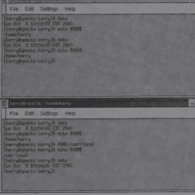

#### 图 4.1

*环境变量依赖于会话。尽管 `$HOME` 的变量在一个会话中被更改，但它对于同一用户在另一个终端窗口中保持恒定。在一个终端中更改变量不会影响另一个终端的变量。*

#### 表 4.4 可配置的环境变量

| 名称 | 设置来源 | 描述 |
| --- | --- | --- |
| CDPATH | 用户 | 目录搜索路径 |
| COLUMNS | Shell | 窗口宽度 |
| EDITOR | 用户 | 默认编辑器 |
| HOME | 登录 | 默认 CD 位置 |
| LOGNAME | 登录 | 用户的登录名 |
| LPDEST | 用户 | 打印机目标 |
| OLDPWD | Shell | 前一个目录 |
| PATH | 登录 | 二进制文件的搜索路径 |
| PPID | Shell | 父进程的 ID |
| PS1 | Shell | 主要 shell 提示符 |
| PS2 | Shell | 次要 shell 提示符 |
| PWD | Shell | 当前位置 |
| RANDOM | Shell | 随机数 |
| SECONDS | Shell | 登录后的秒数 |
| SHELL | 登录 | Shell 的路径 |
| TERM | 用户 | 终端类型 |

### 结论

现在您理解了 shell 在 Linux 下是如何工作的，您准备对命令行进行更多控制。root 用户是 Linux 下最强大的用户，对系统中的每个文件、程序或目录都有绝对的控制权。下一章将解释 root 的许多功能以及它可以和不能做的事情，并提醒您这种权力固有的危险。

## 第 5 章

Root 的权力


与其他操作系统不同——在那里几乎所有用户都有能力更改系统配置文件、修改设置和关闭计算机——Linux 仅授予 root 用户执行这些操作的权限。只有 root 可以更改影响 Linux 运行方式的系统。Root 监督所有其他用户，并且有权修改他们的设置。

本章将涵盖以下主题：

- root 用户在 Linux 中的角色
- 保护 root 密码的技巧
- 文件所有权
- 密码
- 伪 root 功能

### 与 Root 相关的权力

许多 Linux 功能只能由 root 或超级用户完成。超级用户对账户和文件保持完全控制，以防止系统因多个用户拥有相同的 root 账户访问权而面临风险。还有一些文件应该由单一个人或单个账户维护。这些通常仅限于 root 用户。为了理解为什么 root 账户如此重要，首先需要查看常规账户及其能够执行的操作。

每个用户都拥有自己的私有账户，并拥有控制位于用户主账户内的文件以及该用户专门拥有的文件的权限。通常，只有该用户才拥有其主目录中的文件。除非管理员或 root 用户更改权限为其他情况，否则常规用户将没有能力修改、创建或删除系统中的其他位置的文件。同样，其他用户通常无法更改或修改个人账户内的文件。只有当他们被授予有限权限或共同拥有时，他们才能进行编辑更改。系统所需的文件由操作系统本身控制或保留。通常，唯一的用户拥有这些文件，这些文件通常不与常规账户接触。诸如在 `/usr/bin` 和 `/sbin` 中找到的这样的文件由 root 或超级用户拥有，该用户控制所有系统文件。

Root 还控制常规用户账户的创建。命令 `/usr/sbin/useradd` 不仅创建本地系统上的新用户，还创建主目录，授予 shell，并分配一个 UID 和 GID 号给该新用户。其他功能，如分配新密码，也只能由 root 完成。尽管每个用户在成功登录系统后都可以更改其自己的密码，但只有 root 拥有全局更改单独用户密码的权力。

Root 账户有一个独特的特征，使其区别于其他账户。这就是 root 密码。如果丢失、遗忘或共享，其重要性将减弱或完全丧失。系统可以继续运行，但只能在有限的时间内。当文件需要重置或编辑时，超级用户权限的丧失将阻止必要的更改。系统将继续但开始停滞。没有人能够编辑重要文件或终止并重启进程。常规用户可能仍然能够通过 kdm 或 gdm 登录窗口关闭系统，或者如果他们在 `/etc/shutdown.allow` 文件中被授予正确的权限，但他们仍然无法进行重要的编辑更改。如果某物损坏了，它将保持损坏状态。

### 提示

如果 root 密码丢失或遗忘，您只能重置它；您无法恢复原始密码。加密用户密码的标准实践甚至阻止 root 弄清楚原始文本字符串可能是什么。此外，在 `/etc/passwd` 和 `/etc/shadow` 文件上拥有正确的权限时，只有 root 可以查看这些文件的内容。

要重置任何丢失的密码，您必须首先具有对 Linux 机器的物理访问权限。在启动时，在 LILO: 提示符处输入 `Linux single`。此命令将操作系统带入单用户模式。操作系统加载后，取决于您的 Linux 发行版，您将有一个 root 提示符。在 Red Hat 发行版中启动进入单用户模式会显示 root 提示符。一旦您启动了单用户模式，您可以通过输入标准的 password 命令来更改 root 的密码。由于您已经在 root 提示符下，因此无需指定用户。系统再次正常启动后，您应该具有 root 访问权限。


#### 注意

在本章中，*root*（根用户）和*superuser*（超级用户）这两个术语将互换使用。*Root* 通常是指主目录为 /home/root 的特定用户。当运行不带任何参数的 *su* 或 *su -* 命令（即 *switch user*，切换用户）时，用户账户会发生切换。由于 *su* 常被用于获取 root 权限，因此它成为 *superuser* 的俗称。除了默认路径和环境设置外，*root* 和 *superuser* 这两个术语几乎是同义的。

### 保护根用户密码

妥善保护 root 密码不仅能确保系统安全，也能保障个人用户账户的安全。当拥有 root 权限或管理任何文件系统时（无论是单用户系统还是大型多用户网络），都应遵循以下规则：

- 不要在任何地方写下 root 密码。它太容易被发现并被复制。一旦你失去了 root 权限，他人可能接管并修改或删除文件。如果没有 root 权限，你很容易被锁在自己的系统之外。除非你能物理接触该机器，否则你可能只能让别人重新格式化并从头开始。如果你发现自己处于这种情况，请务必保留一份干净的备份，以便重新开始。

- 在成为超级用户之前要三思。一旦以超级用户身份执行操作，就很难撤销所做的更改。很难（甚至不可能）撤回以 root 身份执行的任何命令。

- 检查你以 root 身份执行的每条命令的语法。很容易误以为自己在某个目录中，然后执行一条简单语句就清除了该目录的全部内容。你甚至可能删除整个 /etc 或 /usr/bin 目录，届时你将无法再运行 Linux。在这种情况下，要么希望有近期的备份，要么计划重新安装。

- 计划以普通用户身份（即你自己）或登录普通账户时完成大部分工作。以普通用户身份尝试删除文件并意识到你没有权限，总比以 root 身份清除必需的文件，事后才意识到本不该动那个文件要好。一个简单的 *whoami* 命令在大多数情况下能让你知道当前是以什么身份在操作。

### 根用户的权限

在命令提示符下，请确保时刻提醒当前自己是谁。验证当获得 root 权限时，bash 或 shell 提示符是否变为井号（#），而在交出控制权时提示符是否恢复为美元符号（$）。如果你修改了 .bashrc 或 .login 文件，请明智地进行修改，并确保 shell 仍能指示状态的变化。默认设置通常是最好的。你应该将井号保留给 root 使用。

权力过大可能导致滥用或疏忽。仅在必要时才成为 root。很多时候，以 root 身份发出所有命令似乎简单得多，因为它们能干净利落地完成任务。但如果你忘记 root 权限的巨大威力，很容易犯下可能损害系统的错误。我知道有用户忘记自己正在以 root 身份操作，随后更改了整个目录的所有权。当这种情况发生时，有时需要手动仔细重新配置每个文件。作为 root 执行的操作越少，你能对系统造成的损害就越小。

务必为你可能编辑或无法恢复内容的任何关键文件创建备份副本。

> **注意**
> 当你获得 root 访问权限时，必须仔细守护这一权力。除非你确信此人可信，否则不要向任何人透露你的密码。如果此人更换了工作场所或你不再信任他/她，应立即更改 root 密码。

### 滥用根用户权限

如果你需要以 root 身份编辑其他用户的个人账户（例如更改用户密码或清理文件），请记住，你删除用户文件的难易程度与你删除自己文件的难易程度是一样的。你应坚持只在所有者知情并许可的情况下修改个别账户。用户信任你不会窥探他们的文件、浏览个人文档或更改其内容这一点非常重要。如果他们不信任你，他们就会离开，去寻求他们可以信任的系统管理员。要克制自己。

有时在处理用户事务时，需要表现得强硬。例如，用户可能有意或无意地将文件带入系统，这些文件可能会损害公司或组织的名声，或破坏其他用户需要使用文件的完整性。此类文件具体包括色情内容、非法音频录音（如 MP3）、密码破解程序、病毒污染文件以及其他恶意文件。如果你怀疑系统中存在此类文件，那么作为系统管理员，你有责任在必要时搜索并移除这些文件。在进行系统例行扫描时，*locate* 和 *find* 命令特别有用。

这两个命令都相当简单直接。*find* 命令对硬盘读写压力较大，且占用更多 CPU 周期，但它可以检测几乎所有的文件。而 *locate* 命令依赖于一个自生成的文件数据库，该数据库必须由用户初始化或由系统定期自动执行更新。Red Hat 会自动通过每周或每夜的 cron 任务更新此数据库。*locate* 命令运行更快，对硬盘和 CPU 的负载更低，但如果自上次数据库轮换以来文件发生了变化，该命令将找不到目标文件。

以下是 *find* 命令使用的一个相当典型的例子：

```
find /usr/local -name <filename> -print
```

首先，执行 *find* 命令，然后说明你要搜索的目录。在这种情况下，它是 `/usr/local/` 目录及其所有子目录。如果你想搜索整个系统，一个简单的正斜杠 `/` 就足够了。接下来，使用许多可用选项之一，在此例中是使用 *name* 选项来查找目标文件的名称。现在说明你要查找的文件名。通配符选项（如星号）将搜索以该字符序列开头的任何文件。你还可以将相同的通配符选项应用于单词的前缀。如果在后缀和前缀位置都使用星号，你可以找到名称中包含该字符范围的任何文件。最后，指定 *print* 选项以将结果输出到你的控制台。

要执行 *locate* 命令，只需输入以下内容：

```
locate <filename>
```

*locate* 命令查询 *locate* 数据库（或 *locatedb* 文件），获取所需的术语并打印结果。（在某些发行版中，*locate* 命令也被称为 *slocate*，即 *secure locate*。）要使用最新文件更新数据库，请执行命令 `locateupdatedb` 以在根目录生成默认数据库，如果默认安装尚未这样做的话。该命令包括系统上的所有文件，包括 NFS 挂载、挂载的 CD 等，都在数据库范围内。如果你绝对需要在安装 Red Hat 后立即创建数据库，这是你要使用的命令；否则，自动化的 cron 任务会在短时间内为你创建数据库，并且通过跳过不必要的目录，效果会更好。该数据库高度可配置，以后可以忽略或*独占*使用所需的目录。

在对系统进行详细备份时，我注意到某个用户目录中有一些文件，其扩展名表明它们是图形图像。与这些文件相关的名称也很可疑。进一步调查表明，这些文件确实违反了公司概述的可接受使用政策。为了保护公司利益，该用户已被联系，相关文件已被移除。

你可能认为分发或传播图形图像或非法复制的 MP3 等文件是无害的娱乐，但法律后果实际上非常严重。对于你拥有直接权限决定托管内容的任何系统，或你亲自管理的系统，你也要对该系统上出现的所有文件承担责任。如果你遇到可疑文件，请查阅该特定用户的 *.bash_history* 文件或类似的 shell 历史文件。通常可以确定是否执行了任何可疑命令。然而，此类文件通常是恶意用户首先尝试删除以掩盖踪迹的东西。

通常，利用系统漏洞获取 root 权限的此类企图不过是所谓的“script-kiddies”（脚本小子）的弱智尝试，即运行简单黑客程序的用户。script-kiddies 对系统本身没有任何真正的了解，他们运行已知的脚本或执行安全漏洞利用来获取 root 访问权限或访问其他用户的账户。如果成功，他们通常会试图隐藏任何黑客痕迹，或者尝试设置某些无人值守的进程。无人监管的进程通常是无害的，只消耗 CPU 使用率，但如果允许其扩散，它们可以迅速变成恶性癌症，吞噬文件和其他进程。

虽然安全问题将在后面的章节中涵盖，但开始磨练你在 Linux 防御方面的技能永远不嫌早。如果你认为你的机器可能已被入侵，开始寻找来自其他机器或网络的未授权连接。`netstat` 命令是一个有用的工具，用于显示所有


TCP/IP 网络服务。该命令本身会列出所有已连接的套接字。使用 `-a` 选项仅列出处于打开或监听状态，而不仅仅是建立连接的套接字。默认显示会展示正在使用的协议、发送和接收队列中的字节数、远程主机的地址以及套接字状态。

你可以通过添加 `-e` 选项来扩展常规信息，以包含当前正在使用该套接字的用户。如果你有兴趣查看路由表，请使用 `-r` 选项。`-i` 标志将列出网络接口以及每个接口的统计信息。其显示的信息类似于 `ifconfig` 命令的输出。最后，可以简单地使用 `-n` 选项查看其 IP 地址，而无需为每台连接的主机解析 DNS。

如果发现有一台机器已连接，或者有流量进入或离开你的系统，请记录所使用的协议、端口以及正在运行的工具。请对照 Red Hat 安全漏洞页面检查你的 Linux 发行版，并立即获取最新更新。如果你更喜欢主动调查你的 Red Hat 发行版的安全问题，请查看位于 http://www.securityfocus.com/ 的 BugTrack 记录页面。你可以定位系统中常见的漏洞利用方法，并采取必要的措施来堵塞这些漏洞。关于保护 Linux 机器或检查安全漏洞的更多信息，请参阅第 19 章。

> 注意
> 如果在系统中遇到任何可疑活动，如无人照看的进程，最好迅速行动，将责任用户从系统中移除。允许用户无节制地运行进程是对系统滥用的公开邀请。

你不仅需要对照系统检查自己，确保不因遗留无人照看的开放端口而犯错或造成安全漏洞，还需要监控所有用户免受其他用户攻击的安全性。如果你没有设置适当的控制措施，这可能会迅速成为一项令人不堪重负的职责。关于系统安全的详细解释，请参阅第 19 章。

管理员如何管理 Linux 系统全凭其个人决定。没有固定的指导原则。有些人可能认为让所有用户都拥有 root 密码的副本并按其自行决定运行任何进程是可以的。另一些人可能以独裁者的作风行事，不允许未经授权的文件上传。每位管理员都必须做出最适合自己以及最适合系统的选择。如果系统的目的仅仅是提供网络内容或运行简单程序，那么不应该有问题。然而，如果系统上存储了敏感信息或关键数据，管理员必须采取一切必要措施来保护这些文件。

### 制定可接受使用政策

在授予账户之前，确保所有用户都了解管理员制定的规则。对什么是可接受的或不可接受的无知不应成为借口。在允许任何用户进入系统之前，他或她应该阅读并签署可接受使用政策。这份文件应说明机器上允许的行为，以及用户将对其负责的事项。管理员通常免除对任何他们无法控制的断电、系统维护问题、文件损坏错误、自然灾害或任何天灾人祸的责任。用户还应理解，管理员无法对其没有管辖权的问题负责。

管理员还应明确说明，他们保留管理所有文件、锁定任何账户或删除任何他们认为可能危害系统或其他账户的文件的权利。基本上，可接受使用文件是保护系统运行者免受用户侵害的法律合同，同时确保用户之间互不伤害。并非所有系统都需要如此严格地保护。然而，管理员应了解其职责所在，以及其他用户职责的边界。引用系统管理员常说的一句话：“未被明确允许的事情即被禁止。”

### 文件所有权

Linux 下的每个文件都有某些特定的权限。Linux 将每个现有文件的所有权分配给 root、普通用户或系统特定用户。只有这些用户才能控制属于他们的文件，前提是正确的设置了权限。用户可以使用 `chmod` 命令与其他人共享文件，或使其内容对其他人可读、可写和可执行，但默认情况下，由普通用户创建或拥有的文件仅受该特定用户的管辖。Root 是唯一拥有系统中每个文件管辖权的用户，因此在处理 root 密码时必须小心。本节将探讨 Linux 如何分配每个文件的所有权，以及系统如何识别这些文件。

#### 设置识别号码

每个文件都有用户和组所有者。每个所有者都可以设置该文件或目录的权限，使所有人可以查看、修改或执行他们想要的内容，或者设置极其严格的权限，使得只有文件的所有者才能读取该文件。所有者通过使用 `chmod` 和 `chgrp` 命令来完成对权限设置的修改。关于使用 `chmod` 命令更改读取、写入和执行权限的附加信息，请参阅第 3 章。

每个所有者，无论是用户还是组的成员，都会被分配一个特定的数字。Linux 更多的是通过用户标识号（UID）和组标识号（GID）来跟踪所有权，而不是通过用户名或组名。这些是系统分配的数字，分别由 Linux 关联到用户名和组名。这些数字对于每个新创建的用户和组都是特定的。Red Hat Linux 发行版从 500 开始所有 UID 和 GID 编号。这种编号方案的目的有助于 Linux 管理谁对哪个文件拥有什么样的控制权。

为了演示这个概念，我在系统上创建了一个新用户。用户名是 joe。joe 被分配了 UID 504 和 GID 505。这意味着 joe 创建的所有文件将自动接收相同的 UID。但是，当我在 *joe* 创建的文件上执行 *ls -l* 命令时，它们将在用户和组字段中显示为属于 *joe*。然而，如果我删除该用户，然后查看他创建的文件，它们将不再显示他的名字，而是显示 UID 和 GID 号作为所有者。图 5.1 显示了 *joe* 在 /tmp 目录中创建的文件。/tmp 目录的独特之处在于它允许临时创建和存储文件。这些文件由 *joe* 拥有，既作为用户也作为组。一旦我删除用户 *joe*，文件就会恢复为其分配的 UID 和 GID，因为 *joe* 不再存在于 /etc/passwd 文件中。如果你希望简单地查看每个用户的 UID 而不是唯一的用户名，请使用命令 *ls -nl* 来显示每个文件的 UID 和 GID。

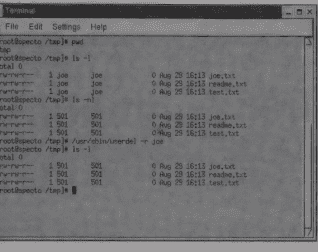

#### 图 5.1

*一个示例 xterm 窗口，显示了由唯一用户创建的文件。注意，当用户从系统中删除时，文件所有权会恢复到唯一的 UID 和 GID。*

对于大多数 Linux 发行版，包括 Red Hat 在内，新用户的 UID 和 GID 从 500 开始。这可能因其他 Linux 变体而异，这是每个 Linux 发行版的严格约定。运行特定程序或进程的用户会根据发行版被分配低于或高于 500 的 UID 和 GID 编号。由于 root 的重要性，它获取 UID 为零。因此，任何共享此 UID 的文件都由 root 拥有和控制，并具有 root 权限。

如果你怀疑你的 Linux 机器已被入侵，你应该查找 /etc/passwd 中共享 UID 为零的新用户文件。如果黑客成功创建了一个新用户并设置了该 UID，他或她就刚刚成功获得了 root 访问权限。

#### 说明

如今，关于黑客（hacker）和入侵者（cracker）这两个术语的使用仍存在一些常见的误解。黑客是那些使用创新代码解决与计算机相关的聪明程序员。而入侵者是那些为了获利、推进恶意目的、出于利他目的或事业、或者仅仅是为了挑战自己的技能而非法进入他人计算机的人。换句话说，黑客戴着白帽子，而入侵者被视为戴着黑帽子。《新黑客词典》的编纂者 Eric S. Raymond 在其在线文章中对这些术语进行了更详细的澄清，该文章位于 http://www.tuxedo.org/~esr/jargon/。


Root 可以在 Linux 系统上执行众多功能。以下是仅 root 能够执行的几项功能：

-   调整系统资源和配额
-   更改任何文件或目录的所有权
-   在机器上的任何位置创建目录和设备文件，包括那些 root 并不特定拥有的位置
-   配置网络接口
-   管理所有配置文件
-   挂载和卸载文件系统
-   设置系统时钟
-   正常关闭系统

上述提到的最后一项功能是最关键的之一。任何拥有你机器物理访问权限的人，都可以通过拔掉电源来让系统宕机。然而，如果具备远程访问条件，root 可以在世界任何地方执行此操作。只有 root 可以更改机器的 init 状态并关闭系统。如果机器是可以物理访问的，并且它以运行级别 5 启动，那么由于 kdm 和 gdm 等某些 SUID 程序的存在，任何用户都可以关闭这台机器。再次强调，只有当普通用户能够物理访问控制台和机器本身，并被提供了 GUI 启动界面时，这种情况才允许发生。

如果机器被除你或管理员之外的其他人关闭，你将不得不通过打开电源开关或执行硬电源循环并重新插上电源来再次启动它。不过，根据你的机器被入侵的严重程度，你可能不希望这样做。最好完全避免这种情况，尽可能让你的机器保持安全。

超级用户权限的一个例子体现在 `/bin/login` 程序中。该程序提示你输入密码，随后允许所有用户登录到 Linux。login 程序最初以 root 身份运行。在验证新输入的 username 和 password 正确后，login 程序会将其 UID 和 GID 更改为该用户的对应值，并为该用户启动一个 shell。

只有 root 进程可以更改自身的 UID 和 GID。普通用户或系统中任何 UID 或 GID 大于 500 的其他用户都无法执行相同操作。这就是 root 的权限所在。


> 一旦 /bin/login 进程将其 UID 更改为普通用户的 UID，该进程就是单方向的。换句话说，普通用户无法再变回 root。

作为 root 的一个独特优势是，当你以超级用户权限登录时，你可以轻松变成另一个用户。通常，在不知道对方密码的情况下，你无法变成另一个用户。然而，root 可以仅仅由于 root 账户被授予的特权，而不需要知道该用户的密码，就能变成用户 *X* 或用户 *Y*。

变成 root 和/或另一个用户有三种不同的方法。通常，你只需输入 `su` 即可获得 root 状态。这将授予你在当前工作目录下的 root 权限，但*没有*通常授予 root 账户的相同路径和环境。你将保留与原用户相同的环境变量。

你还可以通过输入 `su -` 以*所有*必要的路径和权限变成 root。该命令允许你访问通常仅授予初始登录为 root 的用户的相同账户。你的工作目录也将更改为 root 用户的主目录。如果你想访问任何由 root 拥有的隐藏文件，这将非常有用。它也提供了对位于 `/sbin` 等目录中的文件的轻松访问，这些目录默认是 root 环境的一部分，但不存在于其他账户中。

在假设拥有相同权限、路径和默认位置的情况下，变成另一个用户的最后一种方法是输入 `su - <username>`，用普通账户的 username 替换括号中的 username。你可以以 root 身份或你自己的身份使用此方法。如果你使用后者方法，必须知道该账户的密码。如果你是以 root 身份执行此命令，则不需要密码。当以用户 *X* 或用户 *Y* 身份登录时，就实际目的而言，你就是*那个*用户，并且仅拥有该个人拥有文件的权限。删除普通用户的文件就像以 root 身份执行一样容易。

作为自身或以其他用户身份使用 su 命令的管理员通常被建议使用绝对路径 /bin/su，而不是仅仅输入 su。这个建议有充分理由。如果使用其他用户自己的登录或在你切换到非你自己或 root 的用户身份后，任何用户都可以轻松修改自己的路径，并用自己的版本替换其可执行文件。这样新被入侵的 su 命令就可以实现用户或黑客想要的任何操作。如果输入 su 而不带完整路径，你执行的就是用户修改过的 su 可执行文件。这可以设置为你输入的密码字符字符串捕获并将其邮件发送给用户。这样，每次你变成超级用户时，他或她都会得到更新版的 root 密码。使用绝对路径 /bin/su 有助于避免这个问题。

### 更改目录所有权

适用于文件的规则也适用于目录。它们同样具有用户和组所有权。当你想要创建目录或在你不拥有的目录中放置文件时，正确的权限尤为关键。目录权限的含义是双重的。作为普通用户，你在放置文件的位置上受到限制；通常，你只能将它们放在你的主目录中。但与此同时，Linux 也防止其他用户窥视你的目录并查看你的文件。默认情况下，权限通常设置为允许其他用户列出你的目录，但不能查看其内容或修改你的文件。因此，Linux 的目录所有权规则在一定程度上限制了用户，但也可以为用户提供更高的目录安全性。

如果你需要在主目录以外的地方放置文件，你需要以 root 身份在新位置创建目录，然后将所有权更改为你自己——当然，假设你是管理员。如果不是，则管理员需要为你执行此操作，但你必须证明其必要性。如果你迫切需要在某个位置运行或编译程序，但找不到管理员来创建新目录，/tmp 目录可供普通用户使用。作为管理员，建议定期检查 /tmp 的内容并按需删除文件。Red Hat 通常通过 cron 作业在特定时间后清除 /tmp 中的旧文件。检查 /etc/cron.daily 目录中的 tmpwatch 文件，该文件指定了要删除哪些文件。

你需要创建新目录的一个原因是指定 HTML 文件的位置。与其强迫用户在自身主目录中创建 public_html/ 目录并在用户 URL 中使用 `~<username>/extension`，不如根据 root Web 页面的位置，在 /home/httpd/html 或 /usr/local/apache 目录中为用户创建一个目录。如果你将此新目录命名为 design/，你可以使用 chmod 和 chgrp 命令更改目录名称，以反映普通用户的 username。你甚至可以更进一步。如果该用户不使用其主目录进行邮件或存储，而只是将文件上传到此 HTML 目录，你可以使用 /usr/sbin/usermod 命令修改用户主目录的位置，如下所示：

```
/usr/sbin/usermod -d /home/httpd/html/design <username>
```

现在，每当该用户登录到系统时，系统会自动将该用户带到其拥有的目录，无需更改位置即可上传新文件。这确实使该目录内的任何文件都可以供任何访问该网站的人查阅。最好包含一个 index.html 或 home.html 文件，具体取决于指定为 Directory Index 名称的内容。这将隐藏该用户不希望共享的任何 dotfiles 或其他文件。我通常在该主目录内创建一个子目录，然后存储所有 HTML 文件，从而进一步隔绝任何好奇的眼光。

### 识别系统维护所需的用户

Linux 拥有许多不存在但仅执行系统功能的用户。快速浏览 /etc/passwd 和 /etc/group 文件可以看到系统所需的用户种类。这些用户出于安全目的而存在，并用于运行普通用户通常不允许运行的进程。这些用户本身是独特的，因为它们没有主目录，也不除运行特定的守护进程或进程外没有用途。例如，用户 bin 的 home 目录是 /bin。该目录包含所有例行维护和操作检查所需的系统二进制文件。尽管这些二进制文件由 root 拥有，但它们可以发送给 bin 用户执行任何需要完成的功能。用户 daemon 也是如此。有关守护进程及其如何运行后台进程的进一步讨论，请参见第 2 章。

大多数守护进程具有较低的用户 ID（UID），有时是一两个不同的 UID，通常值小于 100。由用户 daemon 拥有的进程之一是 at 程序。因为它将执行类似 root 的命令，at 程序

需要一个相当安全且防篡改的环境。用户守护程序正符合这一需求。由于守护程序并非以 root 身份运行，但拥有类似 root 的权限，它可以在适当的时间执行脚本或程序。尽管拥有类似 root 的权限，但其作用范围和功能非常有限。实际上，它能修改或删除的文件非常少。

**nobody** 是一个重要的非用户。Red Hat Linux 的默认安装将 nobody 的 UID 分配为 99，而其他 UNIX 系统将 nobody 的 UID 设为 −1 或 −2。Solaris 选择 60,001 作为 nobody 的默认 UID。该用户是那些不需要或不应该拥有特殊权限的软件的综合用户。例如，Apache Web 服务器使用 nobody 作为运行所有 HTTPD 进程或向互联网用户提供 HTML 文档的 Web 守护进程的权限。NFS 守护程序也使用 nobody 作为网络上的安全文件服务器。由于 nobody 用户没有任何特殊权限，即使某人获得了该用户的访问权限，他们能做的事情也非常有限。

另一个以 nobody 用户身份运行的守护程序是 **fingerd**。该守护程序的目的是定位并识别每个独立 Linux 系统上的唯一用户。同样，由于权限不足，fingerd 对破解者缺乏吸引力，但很好地发挥了其作用。

### 密码文件

对于不熟悉 Linux 的用户来说，需要密码才能登录系统的概念可能略显陌生。虽然其他系统现在也要求密码，但通常可以绕过。然而，Linux 要求每个用户为自己设置一个唯一的密码，即便只是为了系统的安全。密码可以在用户之间复制，但密码本身应包含一个与用户名不同的字符串。经过一点时间和练习，使用密码很快就会成为一种被接受的做法，也是保护系统的一种非常审慎的方法。尽管你的系统中可能没有机密或敏感数据，但你可以从以下事实中获得一些安慰：由于实施了密码检查，并非每个人都可以轻松访问你的主目录或文件。与其他 Linux 概念相比，密码话题可能显得枯燥。然而，在创建系统安全密码时投入一点细心和耐心，你可以避免用户破解系统所带来的麻烦。

### 选择唯一密码

由于 Linux 安全是许多管理员首要考虑的因素，密码话题值得单独成章。安装 Linux 后，你需要做出的第一个选择就是 root 的密码。明智地选择，确保你的密码易于自己记忆，但又足够复杂，使他人无法猜测，任何密码破解程序也无法将其破解。惯例是选择长度为 6 到 8 个字符的字符串，包括字母和数字。选择一个超过 8 个字符的单词或单词组合是可以接受的，但系统只识别前 8 个字符。系统将忽略前 8 个字符之后的所有字符。

关于选择密码的最佳方法，有许多建议可供参考。尝试选择单词组合，然后用数字分隔它们，或者将单词中的字母替换为数字。用数字 1（one）代替字母 $l$ 或字母 $L$，用 $0$（zero）代替字母 $o$，并用 $3$ 代替字母 $e$。但即使是这种系统也不是万无一失的。大多数密码破解程序会将这些替换考虑在内，如果单词相当简单或基于字典术语，它们仍然会相当成功。

请自由使用特殊字符，例如 @ 符号、& 符号，以及你在键盘数字上方找到的其他符号。在密码中放置几个这些字符。使用虚构的单词或缩写代替真实的单词。例如，你可以将押韵短句“snakes and snails and puppy-dog tails”缩短为 $sas\&Pdt$，这将是一个极好的密码。你总会记得这句话是怎么说的。难的部分是记住每个首字符应该用什么来替换。

> **提示**  
> 将外语单词与特殊字符结合也是一种相当安全的 root 密码选择方法。我经常使用德语或葡萄牙语单词加上额外字符作为我自己的密码。对于用户账户，这种方法可能不适用，除非用户也精通相同的语言。

Linux 协助用户选择负责任的密码。如果选择的密码太短，Red Hat Linux 会响应：BAD PASSWORD: it’s way too short（密码太差：它太短了）。如果密码包含的不同字符太少，Linux 会发出此训斥：BAD PASSWORD: it does not contain enough DIFFERENT characters（密码太差：它不包含足够多的不同字符）。如果密码对于系统来说太容易识别为普通单词，Linux 会响应：BAD PASSWORD: it is based on a dictionary word（密码太差：它是基于字典单词的）。如果 root 更改此密码，系统仍会接受新密码，无论用户输入什么，但它已给用户公平的警告。但是，如果普通用户试图输入糟糕的密码或系统认为不可接受的密码，在选择了可接受的密码之前，他将无法继续。

#### 密码过期和锁定

Linux 还提供了一个在特定日期后使用户密码过期的功能。usermod 命令的这一功能允许你修改 /etc/passwd 文件中的变量。如果你希望在特定日期禁用某个账户的密码，使用 usermod 和 -e 选项将在该特定日期使该账户过期。

如果我想让用户 karen 的密码在 2000 年 10 月 31 日过期，然后给她一个新密码，我将输入以下命令：

```
usermod -e 10/31/00 karen
```

> **注意**  
> 要使此功能正常工作，必须启用 shadow 密码。有关用户密码过期的信息通常不存储在 /etc/passwd 文件中，而是存储在 /etc/shadow 文件中。Shadow 密码是加密在其他地方的系统密码，除了 root 之外，没有人有权读取。由于 /etc/passwd 文件必须可被不同的系统进程读取，例如 bash 用于确定用户的主目录，加密的密码文本也是可读的，因此是可解密的。通过将加密文本放在另一个文件中，即 /etc/shadow，并将权限更改为 400，只有 root 才能看到加密的密码文本可能是什么。

usermod -e 功能对于那些容易将密码重置为简单内容的用户很有用。在给定时间或一定天数后使密码过期，迫使用户再次更改密码。

除了使用 -e 选项外，你还可以通过使用 usermod 命令的 -L 选项锁定或禁用账户，或使用该选项的对应项 -u 选项解锁同一账户。-L 选项会在密码的加密文本前放置一个感叹号（!）。这完全禁用了密码，使用户无法登录。

这是锁定然后解锁用户 joe 账户的方法：

```
usermod -L joe
usermod -U joe
```

自然，你只能以 root 身份操作时使用 usermod 命令。由于该命令实际上修改了 /etc/passwd 文件，该文件控制所有用户设置（或修改 /etc/shadow 文件，具体取决于启用了哪个功能），因此有严格的限制，防止除 root 以外的任何人更改用户设置。普通用户没有适当的权限来修改自己的账户。这一规则唯一的例外是他们能够更改密码。

### 加密密码

我经常接到用户来电，要求我重置或更改他们的密码。他们要么忘记了现有的密码，要么将密码输入到调制解调器连接框中，而其他人改变了星号，导致他们的连接不再起作用。许多人很难相信他们的密码是被加密的。在这种情况下，任何人所能做的最好的事情是将密码重置为相似的内容，或者如果它已被共享或泄露，则重置为完全不同的内容。

Linux 加密所有密码这一事实是一件非常好的事。过去，加密文本与 /etc/passwd 文件中的其他用户信息一起存储。这不是好事。/etc/passwd 的权限设置为 644，因此整个文件可以使用 vi 等任何文本编辑器读取，或者可以使用 cat 命令针对它，并将文件内容通过管道传输到单独的文件中，例如 `cat /etc/passwd > passwords.txt`。如果针对该新文件运行密码破解程序，不久之后，用户名及其相应的密码再次变成简单的文本。意识到这不是好事，Linux 开发人员从其他更成熟的 UNIX 系统（如 Solaris）中获得启发，创建了一个 /etc/shadow 文件。这里的权限设置为 400，意味着只有 root（作为文件的所有者）才能读取内容。/etc/shadow 文件存储所有加密密码。这为 Linux 系统提供了双重安全层。除了更严格的文件权限外，Red Hat 还提供 /etc/passwd 文件中密码的 MD5 哈希，这增加了另一层安全性，之后它通过 libc 进行加密


`crypt()` 函数。一旦使用 MDS 对密码进行哈希处理，就无法将其还原为简单的文本文件。这有助于防止窥探者更轻易地获取原始文件，但并不能排除密码仍可能通过暴力破解方法被猜出的可能性。

#### 注意

影子密码最初始于 Solaris 等基于 UNIX 的系统，但自那以来已被几乎所有的 Linux 发行版所采用，包括 Red Hat。在最新的 Red Hat 版本中，您可以选择安装影子密码并启用 MDS 哈希。这些选项默认被选中，允许它们保持默认状态是一个明智的决定。

像 `nobody` 和 `bin` 这样的唯一系统用户通常不允许为其设置密码。为了确保这些类型的文件不被滥用，一个好主意是验证通常存储加密密码的字段中是否没有保留密码。该位置应出现一个星号（*）而不是密码。这确保了没有人能以该假设的用户名进行物理登录。对普通用户也可以执行相同操作。通过将加密文本的乱码替换为星号，您确保该用户无法再使用密码进行身份验证登录。

列表 5.1 展示了 `/etc/shadow` 文件的示例输出。请注意 UID 在 500 以下的用户与五个有效用户——四个普通用户和 `root`——之间的区别。

#### 列表 5.1 取自样本 /etc/shadow 文件的部分

```
root:*$1$sYQciqsIZUxHm3xc3IRpMgUWr4YJmL E0:10873:0:99999::7:-1:134538460
bin::10819::99999::7::
daemon::10819::99999::7::
adm::10819::99999::7::
ip::10819::99999::7::
sync:10819::99999::7::
shutdown::10819::99999::7::
halt:*10819::99999::7::
mail::10819::99999::7::
news::10819::99999::7::
uucp::10819::99999::7::
operator:*:10819:0:99999:7:::
games:*:10819:0:99999:7:::
gopher:*:10819:0:99999:7:::
ftp:*:10819:0:99999:7:::
nobody:*:10819:0:99999:7:::
xfs:!!:10819:0:99999:7:::
gdm:!!:10819:0:99999:7:::
kerry:$1$rpUfM.763$meGe$A8MW7/.NiVIWZ9H4q/:10873:0:99999:7:-1:-1:134538460
karen:$1$0Dhio04/$q..XcvVqw9rjIWwGydL/N1:10821:0:99999:7:-1:11261:134537332
calvin:$1$XAF$JDUD3SXJ/QwmIu67j7yvn36jtTTF/:10873:0:99999:7:-1:-1:134538436
andrew:$1$h32NmuQZBsR22NEMi6sFeXithd7d:/:10873:0:99999:7:-1:-1:134538436
```

普通登录包含一串非必要的字符和数字，而系统用户在密码字段中拥有星号。

### 通过 sudo 进行伪 root 管理

就像所有伟大的超能力一样，root 也有其阿喀琉斯之踵。root 的缺点在于其压倒性的权力。当您成为超级用户时，技术上除了该 root 用户实现的 bash_history 或相应 shell 历史记录外，没有保留任何其他日志。这意味着一旦执行了某些操作，它们同样可以轻易地从任何 shell 历史文件中抹去。由于 root 也是一个 GID（组 ID），任何破坏组文件的人仍可获取 root 拥有的文件访问权限。由于其权力如此压倒性，root 可以清除所有用户并控制该机器，供任何成为 root 的人使用。正如在 Linux 新闻组中常说的话：“上帝，root，有什么区别？”在 Linux 机器上，情况确实如此。对抗某人获得 root 访问权限或破坏您文件的唯一方法是重新格式化并重新开始，或从干净的备份中恢复。这些也不是很好的解决方案。

在 Linux 上执行维护的能力至关重要。一个人无法完成所有需要完成的工作，特别是如果系统有大量用户的话。但诸如添加新用户、执行备份和更改密码等任务都需要 root 访问权限。如果您授予另一位用户 root 访问权限以执行维护任务，请务必确信您对该人完全信任，并且他或她不会对您系统做任何有害的事。分担 root 的责任也伴随着如果因疏忽或大意导致任何损坏而承担责备的负担。

为了解决共享 root 拥有任务的问题，UNIX 社区开发了 **sudo**。通过使用 *sudo*（或 *superuser*）程序，系统管理员可以启用某些用户（或用户组）以 root 身份运行某些（或所有）命令，同时记录所有命令和参数。此功能解决了普通超级用户所面临的日志记录问题。*sudo* 程序基于每个命令运行，并不是 shell 的替代品。换句话说，只能将某些 root 拥有的命令委托给其他用户。root 密码无需与多个用户共享。在执行 *sudo* 命令时，用户也不会获得 root 拥有的 shell 或拥有更多类似 root 的权限，除了分配给他或她的那部分权限外。

*sudo* 程序通过检查一个名为 */etc/sudoers* 的配置文件来运行。一个用户和命令列表定义了谁可以以 root 权限执行什么命令。此文件由 root 创建，只能由 root 编辑。列出的用户只能执行此文件赋予其访问权限的功能。

#### 配置 sudo 程序

您可以在 Internet 上的几个位置找到 *sudo* 程序。默认位置是 <http://www.courtesan.com/sudo/>，但一个简单的 Internet 查询会找出几个镜像站点。在系统中正确下载和安装 *sudo* 之后，您需要配置 */etc/sudoers* 文件并确定谁有权执行什么操作。您可以手动编辑此文件，但建议使用随软件包一起安装的特殊二进制文件 *visudo*。*visudo* 命令调出文本编辑器；*vi* 是默认编辑器，因此二进制程序以此命名。此文本编辑器允许您修改设置，同时构建 *sudo* 理解的格式数据库文件。

列表 5.2 显示了一个潜在的 */etc/sudoers* 文件。

##### 列表 5.2 /etc/sudoers 文件示例

```
# Host alias specification
Host_Alias    LAN=quasi,sequitur,nihilo
Host_Alias    WAN=k2,lopenap,olympus,granite,nebo

# User alias specification
User_Alias    IT=kerry,brad,john,dan
User_Alias    SALES=bill,greg,dave
User_Alias    BOSS=mark
User_Alias    OFFICE=rox,andrea

# Command alias specification
Cmd_Alias     DUMP=/usr/sbin/tcpdump,/sbin/rdump
Cmd_Alias     BACKUP=/usr/sbin/ufsbakeup
Cmd_Alias     SHELL=/bin/sh,/bin/csh,/bin/tcsh,/bin/ksh
Cmd_Alias     SU=/bin/su
Cmd_Alias     MISC=/bin/rm,/bin/cat
Cmd_Alias     SHUTDOWN=/usr/sbin/shutdown
Cmd_Alias     USERS=/usr/scripts/adu,/usr/scripts/diu

# User specification
IT            ALL=ALL
kerry         WAN=ALL, LAN=quasi,sequitur
brad          WAN=ALL, LAN=nihilo
john          WAN=SHUTDOWN, /usr/scripts/adu
rox           quasi=/usr/bin/shutdown -[hr] now,MISC
andrea        lonepeak=USERS
mark          WAN=SHELLS
dave          nebo=BACKUP, granite=DUMP
greg          LAN=SHELLS

# End of file
```

#### 明确 sudo 选项

本节描述在列表 5.2 中配置的几种选项类别。

##### 主机别名规格

这里只有两个类别，LAN 和 WAN。LAN 定义当前位于其内部网络中的 Linux 机器。它们分别运行 Red Hat 和 Solaris。WAN 指定处理所有账户并执行不同功能（如 DNS、邮件、新闻、Web 和虚拟 Web 账户）的服务器。它们都运行 Red Hat。

有四个用户别名：IT、SALES、OFFICE 和 BOSS。IT 包括所有技术人员，SALES 由需要访问有限项目的销售人员组成，OFFICE 处理所有计费需求，只需添加和删除用户，而 BOSS，即用户 mark，应该只使用不同的 shell。尽管 BOSS 只有一个条目，但可以预见其他条目。因此，您暂时只给 BOSS 一个条目，但在“用户规格”类别中优化用户 mark。

##### 命令别名规格

命令别名是命令列表，可能带有或不带有相关的命令行参数。列表 5.2 中的条目应该不言自明。

##### 用户规格

列表 5.2 中列出的用户如下：

| 用户 | 描述 |
|---|---|
| *IT* | 包括在 IT 用户别名规格下的所有员工可以运行由主机别名规格定义的任意命令。 |
| *kerry* | 此用户可以在 WAN 上运行所有命令，但只能在 LAN 类别中列出的两到三台机器上运行命令。 |
| *brad* | 同样，用户 brad 可以在主机规格中 WAN 部分列出的机器上运行所有命令，但只能在 LAN 类别中的机器 nihilo 上运行命令。 |
| *john* | 在 WAN 类别中的所有机器上，用户 john 可以运行关机命令，并且只能运行 adu 脚本。adu 脚本是一个简单的脚本，它将用户添加到 Solaris 机器中，而 adu 脚本删除用户。（注：原文此处似有笔误，diu 脚本通常用于删除用户，原文重复提及 adu，此处保留原意翻译，但需注意原文逻辑矛盾，若原文意指 adu 添加 diu 删除，则译为：adu 脚本将用户添加到 Solaris 机器中，而 diu 脚本删除用户。） |
| *rox* | 用户 rox 只能在一台机器 quasi 上运行关机命令，以及 MISC 部分列出的两个附加命令。 |
| *Andrea* | 此用户只能运行 USERS 类别定义的系统维护命令，并且只能在一台机器 lonepeak 上运行。 |
| *mark* | 我想尽可能限制此用户对系统的访问。然而，由于他是管理层，他确实需要一些对重要文件的访问权限。他只能运行 SHELLS 类别下列出的命令，并且只能在 WAN 机器上运行。 |


| 用户 | 描述 |
|---|---|
| dave | 该用户负责所有磁带备份，并且只能在对机器 nebo 运行 BACKUP 命令，以及在机器 granite 上运行 DUMP 命令。 |
| greg | 他只能在位于局域网（LAN）上的机器上运行 SHELLS 命令。 |

#### 理解 sudo 相对于根访问的优势

使用 sudo 程序比简单地授予 root 访问权限具有明显的优势。从上述示例中可以看出，每个用户的需求都根据其规格和分类进行了定制。可以将用户添加到类别中，并在他们离职时移除。该文件在修改方面具有成长空间和灵活性。取消某人的权限只需注释掉一行即可。

sudo 程序还提供了其他功能，例如超时选项，如果用户允许某段时间过去而没有输入，该选项将再次提示用户输入密码。通常，登录之后，你可以发出所有 sudo 命令而无需再次输入密码，但如果你允许一定时间过去而没有输入更多命令，密码验证功能将重新生效。这可以防止未经授权的用户在无人看管的终端上登录。

你还可以通过将命令记录到 syslog 中来跟踪用户活动。这使管理员能够确切了解用户在犯错时所做的操作。此选项不仅告诉管理员哪些用户应负责，还可以为用户洗清冤屈。此外，如果用户发出他们未经授权调用的 sudo 命令，将显示警告消息，并且 sudo 会发送电子邮件消息提醒管理员非法尝试使用无效 sudo 命令的行为。

使用 sudo 比共享 root 访问权限的优势如下：

- 单个文件控制网络内和网络上所有系统的访问。
- 超时选项可以降低用户让 root 无人看管的可能性。
- 该程序维护所有用户及其权限列表，追踪谁可以做什么。
- 各种用户可以在不共享一个密码的情况下执行维护任务。
- 管理员可以授予或撤销权限，而无需不断更改 root 密码。
- 只需要一两个用户共享 root 密码。
- 使用 sudo 程序比以 root 身份登录和注销更快。
- 系统日志增加了每个用户行为的责任制。

正如你必须确保用户不会滥用 root 允许的权限一样，你也必须注意用户不要滥用 sudo。鉴于授予的权限，如果不明智地使用，sudo 同样可能具有危害。然而，该程序可以减轻管理员在系统护理和维护方面的部分责任。根据管理员的工作量，这可能是一件好事。如果你的职责与我的相似，那么任何能够安全地让其他用户分担你部分负担的事情都是受欢迎的。

sudo 程序存在管理员必须意识到的弱点。如果你允许 sudo 运行任何能够让用户生成 shell 的程序，该用户可以通过 shell 获得 root 访问权限。许多人认为这是一个巨大的安全漏洞。要知道你允许普通用户通过 sudo 运行的程序。仅仅安装 sudo 并不赋予管理员放弃系统责任或控制的许可。

### 结论

理解 root 的重要性对于正确管理任何 Linux 系统至关重要。下一章将探讨在 Linux 下管理普通用户。它将解释如何向系统添加新用户，无论是通过命令行还是使用可用的众多 GUI 工具中的任何一个。它还将解释如何从系统中移除失效的用户，以及如何为个别用户定制变量。


# 第二部分

# 系统管理

- 6 管理用户
- 7 识别进程
- 8 清理
- 9 修复错误
- 10 记录错误


# 第 6 章

管理用户


由于 Linux 是一个真正的多任务环境，可以有多个用户同时登录到系统。随着时间的推移，Linux 可能会因额外用户而变得拥塞。妥善管理每个用户的账户并为登录你系统的每个人创建不同的变量，将极大地有助于管理用户群的增长。

本章将涵盖以下内容：

- 向系统添加新用户
- 使用命令行编辑用户变量
- 从系统中移除用户
- 使用 GUI 配置工具编辑用户设置

## 管理新用户

既然你已经回顾了 root 的基本权限并拥有一个可操作的 Linux 机器，你可以开始将自己添加为用户，或者向系统添加更多用户。在 Red Hat 安装阶段，你被提供了将自己添加为普通用户的选项。你已经拥有 root 登录，由于频繁以 root 身份更改文件是灾难的配方，最好创建一个普通用户账户。如果你尚未这样做，请使用 /usr/sbin/adduser 命令为你自己的名称设置一个用于定期登录的账户。Linux 被设计为多任务服务器，这意味着多个用户可以利用其设计中内置的功能。你可以在不同的登录别名下完成不同的任务。此外，不同的用户可以共享文件并使用安装好的程序执行他们需要执行的任何任务。使用联网的 Linux 机器提供了各种文件共享和服务功能。

Linux 提供了多种方法来管理系统中的每个用户。与其专有对应物（如 Solaris 和当前市场上许多版本的 UNIX）一样，Linux 除了提供在 X Window 环境中执行的多种 GUI 工具外，还提供了几种基于文本的方法来编辑用户账户。无论是文本还是图形界面，每个工具都可以添加、修改和编辑新账户。许多这些命令和程序允许管理员更改每个用户账户可用的任何可能设置。不仅可以确定用户的主目录，还可以设置配额、允许访问网络接口以及确定用户配置文件的其他变量。本章将提供几个示例。你的选择应基于你与系统交互的方式。

### 使用命令行

命令行提供了添加新用户的最有效方法之一。如果你从远程位置登录或需要快速编辑用户文件，这是访问系统的最佳方法。它不需要高质量的视频卡；如果机器是*无头*的（即没有显示器），一旦操作系统安装完成，你可以完全放弃使用视频卡。如果你只使用命令行，可以通过不安装 X Window 文件来节省磁盘空间。由于 Linux 不需要生成 GUI，这种方法最小化 CPU 使用量，并将更多机器资源留给执行网络任务，而不是运行桌面应用程序。

X Window 界面因运行的窗口管理器或定制 GUI 环境类型不同而有相当大的差异。通常，只需找到一个终端窗口或命令行来编辑用户数据会更简单。此外，许多用于配置用户的 GUI 工具并不符合不同版本的 GUI。单是这一原因，许多初级 Linux 管理员并不依赖许多需要更多点击的工具。过度依赖为你进行配置的实用程序，如果 X Window 界面无法启动或你面对一个不熟悉的系统，可能会带来灾难。了解基于控制台的程序而非 GUI 工具，可以在出现问题或更改设置时减轻许多困难。

知道如何使用命令行的功能在你执行重复性任务时也很有用。当你使用 GUI 工具时，每次需要完成一个功能时仍必须点击。在命令行下，一个简单的脚本允许你多次执行相同的功能。你只能完成设计者内置于界面中的那么多功能。通过访问文件本身，你无需使用 GUI 工具重写任何配置文件，就可以自由地做你需要做的事情。


#### 手动配置账户

在系统上设置用户可能相当单调且重复。Linux 增加了几种额外的工具，使这项任务变得更加容易。虽然完全可以手动完成所有操作，但所涉及的步骤可能需要比必要的时间更多。UNIX 用户认为，花几分钟时间创建一个脚本或快捷方式，比花更多的时间输入所有指令更有价值。基于脚本的方法从长远来看可以节省时间和精力。

创建新用户账户最基本的命令是 `useradd` 命令。由于它创建新的文件和目录，并访问仅由 root 拥有的文件，因此 `useradd` 本身也必须是 root 拥有的进程。该文件通常位于 `/usr/sbin` 中，尽管某些发行版可能会将其放在其他位置。然而，如果你是以 root 身份登录的，该命令应该在你的路径（path）中，因此只需输入该命令即可执行其功能。为了帮助其他从专有 UNIX 系统（如 Sun Solaris）迁移过来的用户，在这些系统中该命令有时是 `adduser`，Linux 创建了从 `useradd` 到 `adduser` 的符号链接，以便两个命令都能完成相同的任务。

以下列表来自 `/usr/sbin` 目录。它显示了你可以用于通过命令行添加新用户的两个命令。

```
[root@pluto sbin]# pwd
/usr/sbin

[root@pluto sbin]# ls -la useradd adduser
lrwxrwxrwx    1 root     root         7 Aug 16 16:02 adduser -> useradd
-rwxr-xr-x    1 root     root       47592 Apr 15 18:03 useradd
```

为了避免混淆，本书将使用 Linux 约定，专门讨论 `useradd` 命令。

##### 使用 useradd 添加新用户

当你使用 `useradd` 时，该命令所做的不仅仅是将新用户添加到系统。它会通过一系列步骤来创建文件、添加目录并修改其他项目。本节解释了在添加新用户时会看到的内容，并描述了机器如何实际执行任务，这样你就无需按步骤手动操作了。不过，理解这个过程总是一个好主意。即使通过自动化方法添加用户，有时你可能也需要回过头来清理用户，以应对文件备份或恢复的情况。

首次添加新用户时，你可能希望使用绝对路径来执行该命令。基于你当前作为 root 的权限，以及你是使用 `su` 或 `su -` 命令还是直接以 root 身份登录，`/usr/sbin` 可能不在也可能在你的路径中。使用绝对路径是一个良好的实践，如下所示：

```
# /usr/sbin/useradd joe
```

使用绝对路径不仅能帮助你熟悉每个程序的位置，还能帮助你避免使用搜索路径中排名靠前的、同名但较旧或已被替换的文件。

> **提示**
> 你可以随时将一个目录临时添加到你的路径中，这样每次调用命令时就不需要键入绝对路径。输入以下内容以修改你的 `$PATH` 并将 `/usr/sbin` 添加到你的默认搜索中：
> `export PATH=$PATH:/usr/sbin`

`useradd` 命令创建 `/home/joe` 目录，并将 `joe` 安装到 `/etc/passwd`（如果在安装时启用了影子密码，则还包括 `/etc/shadow`）和 `/etc/group` 文件中。它还根据 `/etc/skel` 目录的内容，在该用户的家目录中放置特定的点文件（dotfiles）。虽然该命令创建了必要的文件和目录，但你尚未设置密码。在设置密码之前，用户 `joe` 仍然无法登录。同样，要设置密码，只需输入 `passwd` 和用户名即可。关于设置特定用户密码的说明，请参阅第 5 章。

##### 使用 userdel 删除用户

从系统中删除用户与添加用户同样简单。位于与 `useradd` 相同目录中的 `userdel` 命令将搜索 `/etc/passwd` 和 `/etc/group` 文件，并移除任何对你正在删除的用户的引用。要删除由该用户拥有的所有文件和目录，你还必须设置 `-r` 选项。要快速且彻底地从系统中移除用户 `joe`，只需执行以下命令：

```
/usr/sbin/userdel -r joe
```

这两个命令 `useradd` 和 `userdel` 是比旧版 UNIX 系统中可用的方法（在那里几乎一切都必须手动创建或删除）快得多、简单得多的创建和删除用户目录的方式。现在，几乎所有 Linux 发行版都提供命令行以及许多图形用户界面（GUI）工具中的至少一个，这使得创建新用户账户的过程变得更加简单。

> **警告**
> 在删除用户及其文件和目录后，`userdel` 还会移除该用户家目录中包含的任何文件。`userdel` 命令通常不会给你第二次改变主意的机会。一旦文件和目录消失，它们就永久消失了。

##### 手动添加新用户

手动创建账户所涉及的步骤比键入一个单词的命令要严谨得多。如果你选择不使用命令行工具，以下是必要的步骤：

-   创建用户的家目录。
-   根据需要编辑 `/etc/passwd` 文件，确保它具有正确数量的字段，并且信息也是正确的。
-   同样将该用户添加到 `/etc/group` 文件中。是将该用户添加到现有组，还是专门为用户创建一个组。
-   为所有目录设置适当的权限。使用 `chown` 和 `chgrp` 命令来做到这一点。要递归地设置所有子目录的权限，请使用 `-R` 选项。
-   使用 `passwd` 命令为该用户创建唯一的密码。
-   复制位于 `/etc/skel` 目录中的文件。每个用户的目录必须包含这些文件，因为它们允许用户以对家目录进行特定定制的方式登录并在系统上工作。你不需要有效的家目录也能登录到系统。这些文件可以包括用于 HTML 文件的 `public_html/` 子目录以及邮件账户。
-   复制登录时需要运行的任何启动文件。你可以将要在启动时运行的文件添加到执行 bash shell 时的 `.bashrc` 文件中，或者如果你正在启动 GUI，则添加到 `.xinitrc` 文件中。这很大程度上取决于每个用户的需求和意愿。
-   在 `/var/spool/mail` 中创建带有用户名的邮件账户，并创建任何额外的邮件别名。
-   使用 `/usr/sbin/edquota` 命令编辑该用户的配额信息。仅当系统本身启用了配额时才需要这样做。
-   配置任何额外的账户信息，例如自定义 shell 提示符或你希望在登录时立即启动的窗口管理器。
-   验证新账户是否正确设置。通过登录为该用户并测试刚安装的功能来做到这一点。

> **注意**
> 随着用户将邮件和文本文件存储在服务器上，配额在 Linux 系统上正变得越来越普遍。配额通过限制用户可以存储在服务器上的数据量，帮助用户防止将大量琐碎的信息转储到服务器上。

使用 `useradd` 和 `userdel` 等命令行工具比手动配置每个功能要简单得多。此外，如果你手动配置某个功能，可能会错误地编辑其中一个选项。这些控制台命令从一开始就解决了其中大多数问题。某些任务，如设置配额，最初确实需要一些手动调整，但完成后，这些可以添加到自动化流程中，从而不再需要持续的监控。创建一个脚本来实现 `useradd` 和 `userdel` 命令所实现的大部分功能也很容易。

列表 6.1 显示了一个我用来在旧版 Linux 机器上修改 `useradd` 方案的简单例程。如果你不希望受限于预编译的命令（如 `useradd`），你可以按需编辑以下脚本或将其适应任何 Linux 配置。该脚本为更专门的系统添加了一些额外功能，例如将不同类型的用户分配到特定类型的组。例如，仅限电子邮件的账户将被添加到组 500，而免费账户将被分配到组 5000。

###### 列表 6.1 一个为 Linux 系统添加用户并附带补充功能的示例脚本

```bash
#!/bin/bash

# adu - a simple script for adding users
if [ -z "$1" ]; then
echo "Usage: adu <username>"
echo
exit
fi

# first check and see if the username already exists
grep "^$1:" /etc/passwd
if [ "$?" = "0" ]; then
echo "Sorry, user $1 already exits"
echo
exit
fi
echo "Adding user $1 ... "

FL=`echo "$1" | cut -c1`
if [ -z "$2" ]; then
echo
echo -n "Please enter full name: "
read FULLNAME
else
    FULLNAME="$2"
fi

# Set up the type of account to be created
if [ -z "$3" ]; then
echo
```


#### 列表 6.1 一个将用户添加到系统的简单脚本

```bash
#!/bin/bash
# dlu - a simple script for adding users.
#print out the info for the user editing the account
if [ -z "$1" ]; then
      echo "usage: dlu <username>"
      echo
      exit
fi
# Check to see if the account exists
# If so, print out the name and user id
grep "$1:" /etc/passwd
if [ "$?" = "0" ]; then
      echo "Invalid username: user $1 already exists."
      echo
      exit
fi
# Check for a valid user name
if [ "$2" = "" ]; then
      echo
      echo "The user name field cannot be empty."
      echo
      exit
fi
# Check to see if the user name is valid
# Valid usernames are alphanumeric plus dash, underscore, and period
# Also, the first character must be a letter
echo -n "Please enter the user's full name: "
read FULLNAME
# Prompt for the group
if [ "$3" = "" ]; then
      echo -n "Please enter type of account (e,p,b,v,i,f,d): "
      read ATYPE
else
      ATYPE="$3"
fi
QNAME=""
GRP=0
if [ "$ATYPE" = "p" ]; then       QNAME=personal;       GRP=2000; fi
if [ "$ATYPE" = "b" ]; then       QNAME=business;       GRP=3000; fi
if [ "$ATYPE" = "e" ]; then       QNAME=e-mail;         GRP=500;  fi
if [ "$ATYPE" = "v" ]; then       QNAME=virtual;         GRP=4000; fi
if [ "$ATYPE" = "i" ]; then       QNAME=isdn;           GRP=1000; fi
if [ "$ATYPE" = "f" ]; then       QNAME=free;           GRP=5000; fi
if [ "$ATYPE" = "d" ]; then       QNAME=dsl;            GRP=6000; fi
if [ "$GRP" = "0" ]; then
      echo "Invalid account type: $ATYPE"
      echo
      exit
fi
# Use the useradd command and set quotas
echo ".. useradd -d \`/home/$FL/$1" -s /bin/bash -c "$FULLNAME" -m "$1"\nuseradd -d "/export/home/$FL/$1" -s /bin/bash -c "$FULLNAME" -m "$1"
echo ".. passwd \`$1/"
passwd "$1"
if [ "$ATYPE" = "b" ]; then     mail $1 < /usr/sbin/guide_dial-up.txtxt
fi
echo
echo "Setup complete."
echo

# End of file
```

你将从前面的章节中认出许多 `useradd` 选项。此脚本为用户创建一个账户。它会提示管理员输入信息，例如用户名，然后将其与 `/etc/passwd` 文件进行检查，以查看是否已有其他用户占用了该名称。如果用户名可用，脚本会提示输入用户的全名，最后提示输入该用户应分配的组。在收集到必要信息后，脚本将使用 `useradd` 命令并输入所有收集到的信息。最后，脚本将为用户账户分配配额，并发送一封文本电子邮件解释一些基本功能。

像这样的脚本处理了一些通常你需要手动处理的功能。它还展示了 Linux 中的其他独特创新，例如根据用户请求的账户类型将其分配到特定组，并向他们发送带有相应说明的电子邮件。

列表 6.2 中的脚本有助于手动删除任何流氓账户。它短得多，因为正如你在使用 Linux 时会发现的，删除文件比创建文件容易得多。与列表 6.1 中的脚本一样，此脚本也有一个简短的名称，简要描述了其功能。然而，名称并不是脚本最重要的方面。你可以将名称更改为最能描述其内容或适合其目的的名称。

#### 列表 6.2 一个从系统中移除用户的简单脚本

```bash
#!/bin/bash
# dlu - a simple script for deleting users.
#print out the info for the user editing the account
if [ -z "$1" ]; then
echo "usage: dlu <username>"
echo
exit
fi
# Check to see if the account exists
# If so, remove the directories
grep "$1:" /etc/passwd
if [ "$?" = "0" ]; then
echo
	echo "Deleting user $1 ... "
	FL=`echo "$1" | cut -c1`
	userdel "$1"
	echo
	echo "Removing directory /home/$FL/$1"
	rm -r /home/$FL/$1
	echo
	echo "Removing /var/spool/mail/$1"
	rm /var/spool/mail/$1
	echo
	echo "User $1 deleted."
	echo
	exit
else
	echo "Sorry, user $1 does not exist"
	echo
	exit
fi
```

请记住，`/usr/sbin/usermod` 命令允许 root 用户修改现有账户。正确使用该命令相关的标志将能够更改用户的 shell、目录和识别名称。但是，如前所述，你也可以手动编辑 `/etc/passwd` 文件，除非你认为有必要，否则通常不建议这样做。

### 使用 GUI 工具

Red Hat 预装的命令行工具足以满足大多数管理任务。然而，由于 Linux 是一个正在发展的操作系统，并且每个管理员都希望以自己的方式完成其任务，因此许多开发人员正在开发新的可点击界面，提供图形格式来完成与命令行工具相同的任务。快速浏览 Freshmeat ([http://www.freshmeat.net/](http://www.freshmeat.net/)) 或 Linuxberg ([http://www.linuxberg.com](http://www.linuxberg.com)) 的首页，这些网站托管了广泛的开发人员工具，可以迅速看出当前市场上程序的多样性。大多数程序可供下载。

幸运的是，Red Hat 在默认安装中提供了一个非常通用且强大的客户端。Linuxconf 现在被视为大多数配置任务的默认工具。大多数 Linux 发行版，包括 Red Hat，都提供较旧的工具来修改配置文件，但随着要求更用户友好界面的新 Linux 用户数量不断增加，这些 GUI 程序为那些仍在努力掌握 Linux 复杂性的用户带来了令人欣慰的缓解。

#### 使用 Linuxconf 编辑账户

Linux 管理工具的最新进展之一是一个名为 Linuxconf 的工具。Linuxconf 首次随 Red Hat 5.1 一起提供，并已被证明是希望更好地调整和系统中工具和管理用户的福音。它不仅有助于配置 Linux 操作系统的几乎每个方面，而且易于使用，对刚开始学习 Linux 的初学者也很有帮助。用户账户管理只是 Linuxconf 能够操纵的所有功能的一个小方面。

如果你熟悉旧版本的 Red Hat，或者在旧版本的 Red Hat 发行版上积累了经验，你会认出 Linuxconf 中 Red Hat 控制面板的部分内容。虽然控制面板仍然可用于 Red Hat 和其他发行版，但其范围有限。它曾经是，现在仍然是一个出色的工具，用于设置打印机、启用调制解调器和拨号账户以及编辑网络配置，但在更改或修改用户账户方面有限。

Linuxconf 程序有多种版本。最常见的是基于 GNOME 的 Linuxconf，这也是本节将研究的版本。它正在迅速成为配置 Linux 系统大多数方面的标准。由于它处于持续和活跃的开发中，用户预计很快就能看到许多升级。本书中包含的屏幕截图基于最新的 Red Hat 版本。你可以期待每个新版本都会增加更多的选项和功能。

MANAGING USERS Chapter 6 191

#### 理解 Linuxconf 版本

Linuxconf 不仅仅是一个编辑文件和用户变量的 GUI 工具。当然，它可以用于这些目的，但也可以用于控制系统各个方面。你还可以使用 Linuxconf 工具来配置守护进程和进程，如 Samba 和 sendmail。它是一个管理系统许多功能的高度通用工具。

你可以以四种不同的方式调用 Linuxconf 运行：

- **命令行。** 命令行模式允许你查看脚本，以便你可以正确编辑它们。如果你不喜欢 GUI 环境，这是首选模式。此外，熟悉脚本及其位置有助于你尝试远程更改设置或在没有 X Window 界面的情况下更改设置。命令行方法是访问远程系统并编辑设置的最快方式。你通常使用 xterm 窗口访问远程系统，而不是 X Window 环境或在系统控制台上。

- **字符单元。** 类似于旧版本的 Red Hat 安装程序，类似于 DOS 或 WordPerfect 5.1 环境，此模式允许你在不运行 X Window 的情况下访问设置，但仍提供编辑器的易用性和简洁性。这种使用 Linuxconf 的方法也是在控制台终端内或在 xterm 或相关终端窗口内解决的。

- **GNOME-Linuxconf。** 这也许是可识别性最强的界面，也是最容易使用的。你将在本节中更详细地检查此界面。该界面使用其中一个更好的窗口管理器 GNOME 的库。有关使用窗口管理器的更多信息，请参见第 12 章。

- **基于 Web 的。** 无论是 Netscape，它是一个图形 Web 浏览器，还是 Lynx，一个基于文本的浏览器，在编辑配置方面同样有效。

根据你的机器上 `$DISPLAY` 变量的设置，Linuxconf 通常以 GNOME-Linuxconf 或字符单元格式启动。更改此选项有助于确定你如何访问程序。基于 Web 的方法还将显示一个信息屏幕，向你展示访问程序的替代方法。仔细注意这些替代方法，因为此屏幕将只显示一次。


#### 在 Linuxconf 下配置用户设置

随着 Linuxconf 被纳入 Red Hat 发行版，即使是毫无经验的系统管理员也能有效地配置网络、设置多用户、修复系统文件以及更改密码。如**图 6.1** 所示，在主 Linuxconf 窗口下有三个主要类别可以进行编辑：**配置**（Config）、**控制**（Control）和**状态**（Status）。

第一部分处理网络、用户账户、文件系统、杂项服务以及你希望 Linux 启动的方式。作为管理员，这很可能是你用于设置客户端或账户的主要部分。它对于编辑网络配置也很有用。

下一部分**控制**（Control），如**图 6.2** 所示，包含控制面板、控制文件和系统、日期与时间以及功能等条目。这些部分允许你操作 Linux 运行的各个方面。

第一个子部分**控制面板**（Control-panel）不允许你配置文件或设置，而是用于更改活动进程。这些包括关闭系统、挂载和卸载分区，以及配置超级用户任务。第二个子目录编辑配置文件、更改文件权限以及编辑 Linuxconf 插件。第三部分允许你编辑机器上的日期和时间，包括你的时区。你甚至可以利用此部分从互联网上其他地方的原子钟服务器获取正确的时间。最后一部分定义了特殊的 Linuxconf 行为，例如设置键盘映射。

在这个最后且无疑非常简短的部分，如**图 6.3** 所示，你可以查看内核启动消息、任何附加的启动消息以及查看之前的 Linuxconf 消息。当想要验证其他人对文件系统所做的任何更改时，这特别有用。

在接下来的几节中，你将检查第一个类别**配置**（Config），并查看如何设置用户账户。在主 Linuxconf 菜单的**配置**选项卡下，选择**用户账户**选项。你将看到三个独立的选项卡，用于配置不同的账户：**普通**（Normal）、**特殊账户**（Special accounts）和**策略**（Policies）。对于简单的用户账户设置，**普通**标题下的第一个选项就足够了。**图 6.4** 展示了不同的账户类型。

你不仅可以修改普通账户，还可以更改组定义以及 root 密码。如果你不希望他人更改你的 root 密码，那么限制对 Linuxconf 程序的访问是必不可少的。一旦你完成了 Linuxconf 的工作，为了阻止任何人篡改你的设置，明智的做法是随时注销。正如你绝不应在桌面上保留一个打开的 root shell 一样，这一原则同样适用于 Linuxconf 程序。

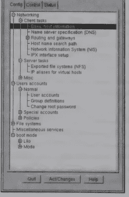

**图 6.1**
*Linuxconf 分为三个主要类别，以便轻松修改文件。主配置窗口处理大多数管理员所需任务。*

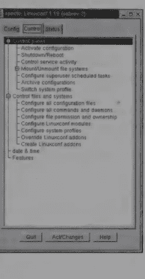

**图 6.2**
*Linuxconf 菜单中的第二个类别“控制”，允许你更改正在运行的 Linux 实用程序并修改系统设置。*

#### 管理系统

选择**普通**账户按钮后，你将看到一个与**图 6.5** 中类似的窗口。在这里，你可以设置系统中每个用户账户的所有变量。

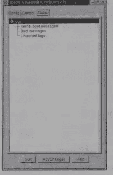

**图 6.3**
*Linuxconf 菜单中的第三个类别“状态”，用于检查 Linux 日志。*

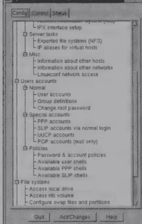

**图 6.4**
*用户账户配置器菜单，用于设置 Linux 操作系统上的各种账户类型。*

你可以通过高亮显示相应的用户名来修改每个账户。通常，你只会看到账户登录名、更详细地描述账户类型的描述性名称、该用户的 UID 以及其所属的组。你可以以最小的努力和很少的命令行选项知识来添加一个个人账户。用户信息窗口下方的**退出**、**添加**和**帮助**按钮将协助配置新账户。

当你选择一个用户时，将出现一个对话框，其中包含有关该用户的更多详细信息。如**图 6.6** 所示，你将看到描述基本用户信息的常规**基本信息**选项卡，以及**参数**选项卡和**权限**选项卡。

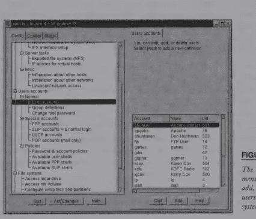

**图 6.5**
*用户账户菜单允许你添加、编辑或删除系统上的用户。*

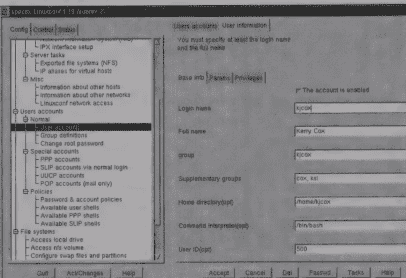

**图 6.6**
*用户信息对话框允许你定义与用户相关的变量。此窗口将信息保存在 /etc/passwd 文件中。*

在这里，你可以指定任何你希望为特定用户设置的信息。通常，你只需输入登录名，然后点击**接受**来创建新账户。其他字段，如组、主目录、命令解释器和用户 ID，将由 Linuxconf 程序为你填写。如果你愿意，你可以稍后返回修改预选设置，并添加或修改任何你希望的字段。

系统还会自动提示你为该用户输入新密码。同样，像命令行选项一样，如果 Linux 判定你选择的密码不安全，你将收到警告，但如果你希望继续，也可以继续。如果你不确定希望将特定用户与哪个组关联，你会看到一个下拉菜单，可以选择任何预定义的组。如果你稍后创建另一个组，你可以返回此菜单并更改选择。对于**命令解释器**选项也是如此。虽然这是可选的，但 Red Hat 会将 bash 分配给用户作为默认 shell。如果该用户希望使用其他 shell，你可以从系统上已安装的 shell 列表中进行选择。

在**用户信息**部分的下一个选项卡**参数**中（参见**图 6.7**），管理员可以输入有关账户生命周期或用户密码生命周期的信息。

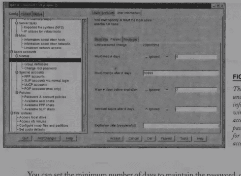

**图 6.7**
*用户信息窗口下的参数选项卡为每个用户账户设置账户和密码变量。*

你可以设置保持密码的最小天数，或者必须更改密码后的天数。你还可以指定系统在密码过期前指定天数提示用户更改密码，之后该用户将不再能够登录系统。与**基本信息**选项卡不同，**参数**选项卡（其中存储的信息位于 /etc/passwd 文件中）将输入的信息存储在 /etc/shadow 文件中。

Linuxconf 超越了普通的命令行输入。换句话说，你不需要确切知道哪些配置文件需要编辑，或者该文件位于系统目录的哪里。最后一个选项卡**权限**，位于系统的其他位置，而不是在之前选项编辑的 /etc/passwd 或 /etc/shadow 文件中。GUI 配置使该过程比手动编辑特定文件更容易。

**权限**选项卡（参见**图 6.8**）使设置用户权限变得简单。它如此简单，以至于如果不正确使用或忽视该实用程序的功能，可能会导致安全问题。

如果你希望允许某个用户控制 Linuxconf 程序，你可以在此窗口中定义其权限。他或她不仅可以 Linuxconf，还可以按照你的意愿对其他各种系统设置进行控制。

Linuxconf 程序包含如此多的选项，以至于解释所有选项都需要一整本书。然而，每个选项卡都提供一个**帮助**选项，试图解释与每个选项相关的许多术语和用法。

除了提供用户配置选项外，Linuxconf 还提供**用户定义**选项。**图 6.9** 显示了**用户定义**屏幕，其中显示每个组及其相应的成员。该屏幕还提供了添加其他组并配置其设置的选项。

在大多数 Linux 发行版中，组文件中的可用组比标准用户文件中列出的用户更多。其中许多组应保持原样，因为它们执行与系统相关的特定任务。除非你确定每个组执行的功能，否则不要更改或删除其设置。

要添加新组，你点击**添加**按钮。然后 Linuxconf 显示**组规范**窗口（参见**图 6.10**）。

在这里，你需要输入关于多个或组账户的基本用户信息，包括诸如组名、组 ID（GID）以及将属于新组的成员等项目。在 Linuxconf 下创建组是一个有用的功能，当你希望仅与特定用户共享某个目录时。

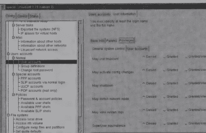

**图 6.8**
*权限选项卡与其说是设置目录和文件权限，不如说是授予用户访问和执行某些 root 权限任务的权限。这些是关于通用系统实用程序的权限。*


##### 图 6.9

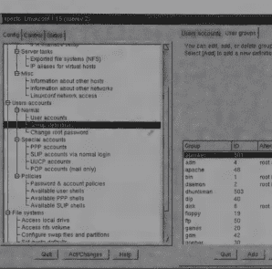

> 与用户账户界面类似，用户组界面提供了组名称和组 ID，并列出该组的成员。

##### 图 6.10

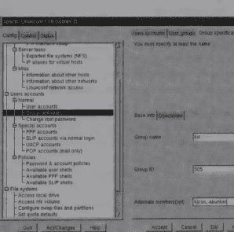

> Linuxconf 通常会分配下一个可用的 GID。不过，你可以将组 ID 更改为几乎任意你想要的数字。

“目录”选项卡列出了该组将共享的主基础目录。此窗口还建立了每个用户对共享文件拥有的权限。默认值 700 仅允许组成员访问读取、写入和执行权限，同时排除所有不属于该组的其他用户。

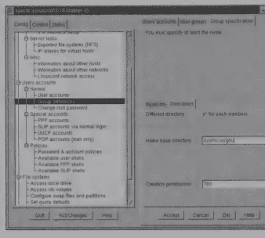

你可以为组定义主基础目录，并设置权限。

##### 图 6.11

任何由组成员共享的主基础目录上的权限都可以调整为高度排他性，使得没有人能够读取或写入特定位置；或者可以设置为非常宽松，通过将权限设置为 777，从而授予每个人读取、写入和执行共享组位置文件的能力。

由于 Linuxconf 是一个功能强大的程序，授予其他用户 Linuxconf 的权利等同于授予 root 访问权限。在 Linuxconf 下重置或更改 root 密码是一个非常简单的过程（见图 6.12），因此你应该像分发 root 密码那样谨慎地授予此程序的访问权限。如果管理员随时将正在运行的版本留在桌面上，都应格外小心。应像对待一个已授予 root 访问权限的开放终端窗口一样对待它。

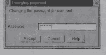

Linuxconf 还允许你更改 root 的密码。

##### 图 6.12

输入你的选择后，程序会像你在命令行上收到的警告一样提醒你，如果你的 root 密码太短、太容易被猜到或基于字典单词。

#### 在 Linuxconf 下设置 Shell

尽管前几节涵盖了 Linuxconf 中用于管理用户的大部分许多功能，但此程序仍有许多其他属性。此配置工具可以处理的某些其他任务包括设置默认 shell 和列出所有其他可用的 shell。Linuxconf 的 `可用用户 shell` 选项卡（见图 6.13），位于“用户账户配置器”中的“策略”选项卡下，允许管理员在不调用文本编辑器直接编辑文件的情况下编辑 /etc/shells 文件。正如 Linuxconf 下的许多选项卡典型的一样，系统文件可以轻松编辑，而无需知道其位置或手动编辑文件。

当你需要知道哪些 shell 可用于每个用户账户时，此选项卡非常有用。为任何用户使多个 shell 可用有时是明智的。我有时喜欢在同一系统上有多个账户，每个使用不同的 shell。

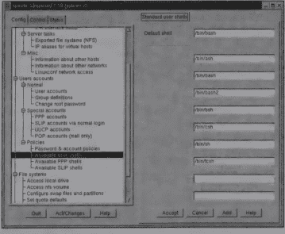

就像按偏好列出 shell 的 /etc/shells 一样，“标准用户 shell”选项卡按字母顺序列出可用的 shell。

#### 使用 Linuxconf 进行分区

如果你的系统遭受分区崩溃或故障重启，了解可用的分区、它们的挂载点和它们的尺寸会非常方便。Linuxconf 还提供了这些信息以及根据需要进行编辑的方法。就像安装过程中使用的磁盘实用程序一样，Linuxconf 允许你编辑和修改现有分区。

> **注意**
> 
> 这是 Red Hat Linux 管理中非常敏感的任务；在修改任何与分区相关的内容时应小心。本节仅作为参考信息推荐。

在 Linuxconf 的主配置窗口中，“文件系统”按钮将提供几个访问其他分区或文件系统类型的选项。这些部分允许重新配置分区和网络卷。

图 6.14 显示了 Linuxconf 文件系统配置器窗口，其中列出了可以访问的各种分区和驱动器。以下是 Linuxconf 可以编辑的每个选项的列表。

Linuxconf 除了用户管理外还处理许多其他任务。接下来的几章经常将 Linuxconf 程序作为另一种手段来提及，用于

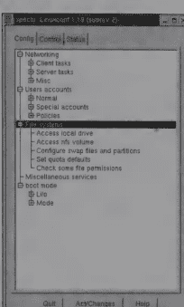

最新版本的 Linuxconf 显示了可编辑的各种分区类型。

#### 说明

你可以在 Linuxconf 项目主页（http://www.solucorp.qc.ca/linuxconf/）找到有关 Linuxconf 程序的更多信息。

实现网络任务，配置 sendmail，管理虚拟域，以及设置许多其他配置选项。然而，在使用 Linuxconf 之前，至关重要的是你首先要学习命令行选项，并能够在不使用将用户与文件隔离的点击界面的情况下手动配置文件。没有什么比依赖 GUI 工具，然后要么无法访问 X Window 显示，要么试图在无头服务器上通过远程控制台或系统故障后完成相关任务更糟糕的了。在这种情况下，熟悉控制台并不会导致蔑视。

### 结论

一旦你开始适当地管理系统上的用户，你就可以开始查看系统本身。下一章将检查系统进程。该讨论将帮助你识别当前在系统上运行的内容，并解释如何通过向每个进程发送信号来启动、停止和更改每个进程的值。然后你应该能够认识你的系统是如何运作的，以及每个程序需要多少硬件资源。


## 第 7 章：识别进程

使用 Linux，你可以识别和跟踪在系统上运行的每个进程。*进程* 是在操作系统自己的虚拟空间中运行的单个程序。它不同于作业或命令，后者可能是几个协同工作以完成特定任务的独立进程。每个单独的命令都作为单个进程执行。进程有广泛的用途，可以是许多事物之一：从守护进程到当前在显示器上运行的应用程序，或执行预定或所需功能的系统程序。Linux 为这些每个进程分配一个编号，然后可以使用该编号来更改进程的功能或状态。操纵进程的属性授予用户更大的自由度，以决定 Linux 如何运行以及每个程序被给予何种优先级。向进程本身发送命令也授予用户和系统大量的灵活性，以定制系统的操作。

本章将涵盖以下主题：

- 进程 ID 编号
- 分配给用户和组的 ID 编号
- 进程的优先级和 nice 值
- 进程的生命周期
- 用于操纵进程的命令和信号

### 理解进程

Linux 在允许用户跟踪系统中运行的每个程序方面极具动态性。除了查看每个进程的能力外，管理员还可以更改其运行方式。单独的进程可以被停止、启动、终止和修改。在 Linux 下执行的几乎每个功能或操作都可以被监控。随之而来的是更改程序优先级或完全终止它的能力。尽管用户应该让许多操作保持原样——例如系统运行所必需的操作——但其他操作，特别是由系统上的普通用户发起的操作，可以自定义。

这些操作中的每一个都称为进程，因此可以是以下任何一项：

- 在启动时启动的守护进程
- 由普通用户发出的命令
- 在特定时间开始的程序，如 cron 任务
- 来自外部来源的系统调用，如查看 Web 文档的请求或上传或下载文件的 FTP 请求

Linux 允许几个进程协同工作或同时执行。这就是像 Linux 这样的真正多任务操作系统的本质。对于其中的许多进程，例如 Linux 正常运行所必需的进程，每个进程迅速完成任务，完成后几乎不留痕迹。每个任务都可以记录并跟踪其进度，但进程本身留下的剩余内存足迹很小。

### 使用 PID 识别进程

Linux 提供对这些进程中每一个的控制。随着每个进程启动，Linux 为其分配一个进程 ID（PID）。这是一个独特的编号，不与系统上的任何其他进程共享。

> **说明**
> 
> 虽然这个数字在首次分配时是独占的，但 Linux 稍后可以将其分配给另一个进程。然而，在放弃其进程 ID 之前，该进程必须先完成其任务或被终止。两个进程不能在同一时间拥有相同的 PID。

通过为每个活跃、睡眠或僵尸进程分配 PID，系统和用户都可以跟踪每个系统操作的进度，监控其进展，并修改其状态。

> **说明**
> 
> 僵尸进程是指其父进程已死亡但仍作为子进程存活的进程，尽管它们没有积极做任何事情。init 守护进程最终会收割这些进程。僵尸通常不会负面影响系统。


### 进程识别

虽然分配给每个进程的数字值本身并无特殊含义，但它便于 Linux 追踪当前系统中正在运行的项目。当 Linux 首次启动时，它会开始为每个进程依次分配 PID，从 1 开始。启动所有其他进程的 init 守护进程会接收到这个主要编号。系统将 init 视为父进程，而所有随后由 init 生成或派生的进程则被视为子进程。

一旦这些 PID 达到其数值类型的最大值（在 Linux 上这是一个 16 位值，最大可达 65536），它们就会“轮换”，并开始为新进程重新分配新的数值。根据机器所承担的目的和负载，这可能发生在高负荷机器上的每小时，或在使用很少的 Linux 机器上的每周一次。

向特定进程发送独特的信号可以改变其状态以及该进程与配置文件或系统文件的交互方式。例如，你可以强制 Linux 以不同方式处理当前在系统中运行的众多进程；你可以强制操作系统关注一个相对不重要的进程，迫使其更快地执行任务，或者终止占用过多 CPU 周期的进程。理解每个进程都有自己的 ID 编号对于改变 Linux 处理其众多任务的方式至关重要。要查看每个进程的 PID，请参见本章稍后的“使用 ps 显示运行中的进程”。

当一个进程完成分配给它的任务时，它会释放该编号并正常终止。该进程 ID 编号随后可以在系统重启或 Linux 完成一定数量的任务时分配给另一个进程，然后当它重新开始其 65536 个进程集合时开始重新分配新的 PID。

用户无法更改进程的 PID，也没有两个进程可以共享现有的 PID。用户更改数值的唯一方法是终止进程并重新开始，或者在某些情况下，导致进程重新读取其配置文件。但是，除非你完全确定需要终止一个进程，否则不要试图简单地更改其 PID。

某些任务永远不会释放它们的 PID。例如，init 守护进程始终拥有初始 PID 值 1。如果你终止此进程或尝试更改它，你的 Red Hat Linux 机器将会重启或失败。重要的是要识别哪些进程对于常规系统功能是必需的，哪些进程是由用户生成的，因此可以对其进行操作。根据你的 Linux 版本，你应该小心那些具有低 PID 的进程。

父进程 ID（PPID）是进程父进程的 PID。在某些情况下，当出现需要或多个请求由该进程服务时，进程会生成自己的副本。如果你终止该 PID，系统也会终止所有父进程的子进程。通过这种方式，Linux 将进程及其功能联系起来。

#### 通过 UID 和 GID 识别用户和组

创建时，Linux 下的每个用户都会获得一个用户 ID（UID）编号。该编号也被添加到该用户创建的每个文件的文件名中，以便机器识别文件所有权。你可以编辑或更改 /etc/passwd 文件下的用户 ID 编号，但这不是一个好主意。此类更改可能导致关于哪些文件由谁拥有的混乱，特别是如果现有的 UID 被分配给另一个用户。最好让系统为你分配一个 UID。要查看 UID 以及系统如何为每个用户分配唯一编号，请参见第 5 章。

组 ID 编号（GID）也是如此。在 Red Hat Linux 下，同一个名称可以应用于用户和组 ID。例如，用户名 *joe* 可以标识拥有某些文件的用户，也可以标识这些文件所属的组名。这并不一定意味着 *joe* 既是 *username* 又是 *groupname*，而是指这串字符用于标识用户名和组名。组 *joe* 可以包含除了用户 *joe* 以外的其他用户。将相同的名称附加到用户和组的方法使得将用户分配给不同的组更容易，因为用户也可以是一个组，从而更容易与其他人共享文件。

> **注意**
> UID 和 GID 可以共享相同的名称，因此请注意不要混淆它们。它们可以有不同的编号。如果你需要找出文件的用户或组所有权，请检查 /etc/passwd 和 /etc/group 文件中的数值。

如果你通过输入 `ls -1` 命令来访问或查看文件，输出将显示该位置内所有文件和目录的用户名和组名。通常，第一列显示文件的权限，第二列显示用户名。组名在第三列。如果用户更改其 UID，文件也会失去其用户名和组名的关联，并采用之前与该用户关联的 UID 编号。

假设你的用户名和组名是 `joe`，并且你拥有 Linux 系统上多个目录中的几个文件。该用户名也有一个 UID 为 510，组名也有一个 GID 为 510。虽然它们共享相同的编号，但它们并不相同，因为尽管编号相似，但用户名并不是组名。如果你想通过执行 `/usr/sbin/userdel -r` 命令从系统中删除此用户，所有位于 `/home/joe` 目录之外且原本由 `joe` 拥有的文件将不再列出 `joe` 作为所有者，而是保留其先前的 UID 和 GID。

当你从互联网下载 Linux 程序时也是如此。一旦你解压和提取了文件，它们通常会被分配一个特定的编号。因为创建这些文件的用户通常在你的系统上不存在，Linux 会将之前与该用户关联的 UID 和 GID 编号分配给这些文件。如果组名与系统组相同，那么系统有时会将该组名分配给新文件。例如，某些开发程序通常被分配组名 `wheel`。

尽管首先创建该程序的用户 `fred` 不在你的系统上，但系统组 `wheel` 很可能在，在这种情况下，文件将被分配一个通用的 UID 编号，并且具有组名 `wheel`。下次你从其他系统下载文件或测试另一个程序时，请留意用户名和组名。

#### 将 UID 和 GID 应用于进程

除了将 UID 分配给文件和目录外，Linux 还将 UID 分配给进程。在指示进程时，UID 是发起该进程的人员的用户识别编号，除非是 set user (SUID) 或 setgid (SGID) 程序，它们可以采用其他 ID 编号。只有创建或启动进程的人、超级用户或 root 用户才能对该进程的功能进行任何更改。当进程以 SUID 和 SGID 方式运行时，这种分配用户和组 ID 的方法可能会迅速变得令人困惑。此讨论仅限于常规进程。有关 SUID 和 SGID 进程的更多信息，请参见第 3 章。

例如，如果我以我自己的身份启动一个进程，该进程将继续运行，直到发生以下情况之一：

- 进程完成其循环并正常退出。
- 我提前终止该进程。
- 超级用户或以 root 身份运行的用户决定该进程需要终止。这两类用户都有停止或终止该进程所需的权限。

如果上述情况均未发生且进程继续运行，它可以无限期运行，也可以进入僵尸状态。如果进程变成僵尸，它将运行直到 init 守护进程收割退出状态、那些僵尸进程、孤立的程序和死状态，或者直到系统重启。

分配给特定进程的系统的 CPU 和内存量取决于运行的用户和进程类型。例如，假设你使用 vi 编辑器输入 *vi dmesg.txt* 以打开文件来启动一个进程。系统将给此进程下一个可用的 PID 和 UID 编号，并且将分配较少的处理器时间。这是因为常规用户正在运行该进程，其操作对系统性能并非至关重要。相对于其他等待完成的进程，该进程将获得较低的 *优先级* 或处理器时间的可用性。该进程将被授予较少的处理器时间以完成其任务。

然而，由系统用户、守护进程或超级用户启动的进程将获得较高的优先级。通过为该进程设置较高的优先级，系统将为该进程的完成投入更多的 CPU 周期。

组 ID（GID）编号与 UID 编号非常相似。它是基于 */etc/group* 中的组编号。同样，系统根据组内的所有者将处理器时间分配给进程。如果该组包含系统用户或守护进程，它们将获得较高的优先级。由于多个成员可以属于同一个组，Linux 必须首先检查 */etc/group* 文件中的用户列表，并验证他们对正在运行的进程的所有权。如果你试图修改进程，情况也是如此。如果你不属于启动该特定进程的组，系统将拒绝你访问以修改或更改该进程的优先级。


### 修改进程优先级

进程的优先级决定了该进程将在何种条件下持续运行，直到内核确定需要为其他进程分配多少 CPU 时间。如果优先级很高（通过其 *nice 值* 或调度优先级数值判定），进程将继续运行，直到耗尽为其分配的 CPU 时间。当这种情况发生时，系统随后可以将剩余的 CPU 时间或周期用于完成其他进程的任务。根据其优先级，进程要么被具有更高优先级的其他进程抢占，要么被允许无中断地完成任务。

简而言之，Linux 内核或操作系统的核心通过评估哪个进程具有最高的“内部优先级”来选择要运行的进程，这种评估基于执行该进程的用户以及该功能对系统的重要性。一旦优先级设定，系统就会以优先级排序的方式运行每个进程，直到所有任务都已完成。

虽然你无法直接更改进程的优先级，但你可以更改进程的 nice 值，即其运行级别。这样，具有更高 nice 值的其他进程可以在允许那些在队列中等待更长时间的任务完成其功能而不给系统带来压力的同时完成它们的任务。

不受进程优先级影响的其他因素包括该进程已经消耗的 CPU 时间量以及它等待运行的时长。要设置这些值，你需要使用 `ulimit` 命令。该命令用于确定资源限制设置。它通常是 bash 或 ksh shell 的内置命令，可用于设置系统资源数量的限制。

请考虑以下关于进程优先级的示例。假设一个 httpd 进程已经运行了一段时间。由于该进程运行了这么久，系统赋予它更高的优先级，并授予该进程更多的处理器时间，以便它能够完成其生命周期然后优雅地退出。此外，如果远程用户已通过 Telnet 会话向本地服务器提出连接请求，而本地系统正忙于完成其他任务，用户可能需要等待，直到当前进程的优先级降低到足以失去 CPU 的程度。用户等待的时间越长，分配给该任务的优先级就越高。通过这种方式，Linux 能够快速且简洁地大多数任务完成。

#### 设置进程的 Nice 值

进程的 nice 值是在进程与其他进程竞争相同资源时，分配给该进程的 CPU 或处理器时间的量。每个进程的 nice 值都由内核提供。“Nice”一词源于优先级的“友好程度”，即它与系统中其他用户的协作程度。值越“nice”（数值越大），它对于竞争相同系统资源的其他进程就越宽容。*进程的 nice 值越低，其接收的优先级就越高。*

如果你希望将某个进程或命令置于其他进程之前，或者希望系统在处理其他所有内容之前先处理该进程，你需要将 nice 值设置得极高。Nice 值的可能范围是 -20 到 20。大多数进程的默认值为 0。

如果多个进程具有相同的优先级，它们将被放入运行队列。当 CPU 空闲且能够处理作业时，它从最低的非空队列中取出第一个进程。CPU 执行该进程，直到它被另一个请求抢占或 CPU 时间被强制收回，此时 CPU 启动下一个最低优先级的进程。由于现代大多数处理器的速度，这些时间片执行得非常快。在 UNIX 的早期，处理器速度较慢且 CPU 时间是一种宝贵的资源，如果一个进程占用的时间超出预期且被认为对系统至关重要，该进程的优先级将继续增加。采取了措施以确保一个进程不能垄断整个系统。

普通用户只能增加他们拥有的进程的 nice 值。然而，他们不能降低该值。也就是说，普通用户只能使进程变得不那么重要，并将其在调度队列中排得更后。只有 root 才能通过降低其 nice 值来使进程变得更加重要。因此，系统以最少用户干预的方式处理进程调度。

通过使用 `nice` 命令，用户可以更改其拥有的任何给定进程的 nice 值。该命令位于 `/bin/nice`。任何用户都可以通过以下命令更改其仅由自己拥有的进程的级别：

```bash
nice +5 mytask
```

该命令更改进程 `mytask` 的 nice 值。如果 `mytask` 占用了过多的 CPU 从而拖慢系统，进程的所有者可以为其分配更高的 nice 值，以便系统重新分配给该进程更少的 CPU 时间。

一种你肯定会希望将 nice 值设置得较高，以便使用最少系统资源的场景，是用于那些持续使用空闲 CPU 周期运行的进程。

其中一个例子是 seti@home 项目。任何用户都可以下载由 SETI（搜寻地外智慧生物）项目接收的无线电波信号。这些信号块随后可以在任何用户的系统上进行分析，无论该系统运行的是 Linux 还是其他操作系统，因为它在太空噪声中寻找某些相干信号。像这样的进程会占用大量的系统资源，并可能显著增加 CPU 的负载。在运行此类密集程序的同时保持 Linux 功能正常的最好方法是将该进程的 nice 值设置为尽可能高。建议如下命令：

```bash
nice +20 setiathome
```

当 nice 值设置为最高时，负载将是最低的，因为繁忙系统上其他更重要的进程会频繁抢占此进程。因此，Linux 将继续良好地运行，同时完成其他严格的需求。

如果你希望将更多的计算机资源专门用于完成某些任务，例如编译新内核，使用较低设置的相同 `nice` 命令会更快地完成任务：

```bash
nice -20 make
```

然而，将 nice 值设置得过低可能会对系统造成不当的压力，并使其他进程无法运行。如果系统的所有资源都被一条命令占用，可能没有足够的剩余资源来完成必要任务或 Linux 保持运行所需的系统程序。

> **注意**
> 更改进程的 nice 值时要谨慎。如果你与其他用户共享系统，也要留意他们的需求。

除了使用 `nice` 命令为进程设置初始 nice 值外，你还可以通过运行 `renice` 命令来修改其使用情况。请注意，只有 root 可以更改任何进程的 nice 值。`renice` 命令的影响超过 `nice` 命令，因为该命令可以强制单个用户拥有的所有进程更改其 ID 和/或强制更改所有进程的 PID 和所有权，从而也会导致它们在 CPU 队列中的位置发生变化。

例如，以下 `renice` 命令将更改进程 11894 和 257 以接收较低的优先级，以便内核可以将更多时间和资源用于其他程序。它还会更改由 `kerry` 和 `root` 拥有的所有进程，使其接收与其他两个进程相同的 nice 值。

```bash
renice +10 11894 -u kerry root -p 257
```

使用 `renice` 命令有时被认为比使用 `nice` 命令更改进程的值更简单。然而，这很大程度上取决于你，即用户或管理员，以及你更喜欢使用哪个命令。

### 理解进程的生命周期

了解进程如何运作也很有用。通过更好地理解你的机器如何创建和管理进程，你将能够更好地控制 Linux 机器的运行。父进程生成子进程，这些子进程是主要机器的分支。进程不能自发产生，必须由 init 守护进程或另一个正在运行的进程启动。要创建进程，父进程或初始进程会发起一次 fork（分叉）。在此，“fork”一词意味着进程创建了自身的副本。这个子进程随后与父进程相同，除了几个差异，最重要的是分叉出的进程具有新的唯一 PID，且子进程的 PPID（父进程 ID）等于父进程的 PID。每个子进程在 `fork()` 调用后还会继承已打开的文件描述符。

创建新进程的 `fork` 命令还会重置新进程的所有会计信息，以便将其与父进程区分开来。如果这些信息没有被重置，系统可能会在父进程和子进程之间产生混淆。`fork()` 调用在跟踪每个进程的打开文件的文件描述符表中跟踪新的 PID。`fork`


command 命令告知内核需要为子进程分配一个新的 PID 编号。这些描述符是小表，内核使用它们来跟踪所有进程。如果这些表没有保持最新，子进程的创建方式可能会直接影响父进程。

### 向进程发送命令和信号

本节将探讨如何在 Linux 下查看每个进程。能够看到系统在任意给定时刻的状态，不仅有助于确定你自己的进程如何影响系统性能，还有助于了解其他进程是否正在给系统带来压力。由于 Linux 具有高度的透明性，每个进程都可以被操控。如果某个进程占用了过多的资源，可以将其终止（kill）；或者，如果系统似乎很好地处理了负载，则可以增加更多进程。

类似于其他专有系统，Linux 允许用户区分其程序究竟在何处影响了系统的速度、性能和资源分配。Linux 赋予用户对每个进程的控制权，并允许管理员根据需求调整系统负载和资源。其他操作系统允许你列出正在运行的进程、CPU 和内存使用情况，但 Linux 非常灵活，你可以直接影响性能以满足自己的需求。一旦进程对管理员可见，就可以根据情况对其进行调整。

#### 使用 ps 显示运行中的进程

监控任何给定系统上进程状态的最多用途工具之一是 `ps` 命令。在日常使用的所有命令中，`ps` 可能是功能最强大且被管理员使用最广泛的命令。该命令显示所有正在运行的进程。它提供有关每个进程的 PID、其对 CPU 和内存的负载以及其他重要统计信息的详细信息。命令的输出基本上是在发出命令时系统的快照。在 `ps` 命令执行之后启动的任何命令都不会出现在此快照中。`ps` 命令仅查看特定时刻正在运行的进程。

解读 `ps` 的输出是一项重要的管理技能。有时，你可能需要定位并识别错误或僵尸进程。或者，你可能会发现某个进程失控，在这种情况下，你必须完全终止该进程，以免损害系统性能。你还可以使用 `ps` 来确定谁在系统上运行了哪些进程。当你检查谁在利用 CPU 为自己服务，或谁违反了系统可接受和公平使用策略时，该命令是一个重要工具。确定这些进程的 UID 可以更轻松地追踪其所有者。

与 `ps` 命令相关联的选项有几个。以下是 `ps` 使用的一些常见标志（列表 7.1 显示了这些命令的输出）：

```
ps aux
or
ps -aux
```

连字符是可选的。它在 UNIX 早期被使用，但现在仍然是一个可接受的特性。通常，命令是在没有连字符的情况下发出的。

**列表 7.1 在典型 Linux 机器上 ps 的输出**

| USER | PID | %CPU | %MEM | VSZ | RSS | TTY | STAT | START | TIME | COMMAND |
|------|----:|-----:|----:|------:|------:|-----|-----:|-------:|------:|---------|
| root | 1 | 0.0 | 0.1 | 1120 | 68 | ? | S | Aug17 | 0:07 | init |
| root | 2 | 0.0 | 0.0 | 0 | 0 | ? | SW | Aug17 | 0:27 | [kflushd] |
| root | 3 | 0.0 | 0.0 | 0 | 0 | ? | SW | Aug17 | 0:15 | [kupdated] |
| root | 4 | 0.0 | 0.0 | 0 | 0 | ? | SW | Aug17 | 0:00 | [kpiod] |
| root | 5 | 0.0 | 0.0 | 0 | 0 | ? | SW | Aug17 | 4:59 | [kswapd] |
| root | 361 | 0.0 | 0.0 | 1208 | 44 | ? | S | Aug17 | 0:00 | /usr/sbin/auto\ time - timeout 60 /misc file /etc/auto.misc |
| root | 388 | 0.0 | 0.2 | 1172 | 160 | ? | S | Aug17 | 0:28 | syslogd -m 0 |
| root | 397 | 0.0 | 0.0 | 1452 | 0 | ? | S | Aug17 | 0:00 | [klogd] |
| daemon | 411 | 0.0 | 0.1 | 1144 | 104 | ? | S | Aug17 | 0:00 | /usr/sbin/atd |
| root | 425 | 0.0 | 0.1 | 1328 | 112 | ? | S | Aug17 | 0:00 | crond |
| root | 439 | 0.0 | 0.3 | 1156 | 212 | ? | S | Aug17 | 0:08 | inetd |
| named | 453 | 0.0 | 0.6 | 2424 | 420 | ? | S | Aug17 | 0:00 | named -u |
| root | 467 | 0.0 | 0.0 | 1204 | 0 | ? | SW | Aug17 | 0:00 | [lpd] |
| root | 495 | 0.0 | 0.4 | 2128 | 320 | ? | S | Aug17 | 0:05 | sendmail: accepting connections on port 25 |
| root | 520 | 0.0 | 0.0 | 1660 | 0 | ? | SW | Aug17 | 0:00 | [safe_mysqld] |
| mysql | 541 | 0.0 | 0.0 | 10836 | 44 | ? | SN | Aug17 | 0:00 | [mysqld] |
| xfs | 609 | 0.0 | 0.0 | 3044 | 60 | ? | S | Aug17 | 0:00 | xfs -droppriv-daemon -port -1 |
| root | 623 | 0.0 | 0.0 | 2452 | 0 | ? | SW | Aug17 | 0:00 | [smbd] |
| root | 632 | 0.0 | 0.6 | 2032 | 396 | ? | S | Aug17 | 0:18 | named -D |
| root | 737 | 0.0 | 0.0 | 1696 | 0 | ? | S | Aug17 | 0:00 | [sh] |
| root | 868 | 0.0 | 0.0 | 2396 | 0 | ? | SW | Aug17 | 0:00 | [sshd] |
| root | 882 | 0.0 | 0.0 | 1092 | 0 | tty2 | SW | Aug17 | 0:00 | [mingetty] |
| root | 917 | 0.0 | 0.0 | 2596 | 60 | ? | S | Aug17 | 0:02 | /usr/local/etc/apache-ssl/httpd -f /usr/local/etc/apache-ssl/conf/httpd.conf |
| nobody | 918 | 0.0 | 0.0 | 1412 | 64 | ? | S | Aug17 | 0:00 | gcache 99 /usr/local/etc/apache-ssl/logs/gcache_port |
| nobody | 920 | 0.0 | 0.0 | 3192 | 0 | ? | SW | Aug17 | 0:08 | [httpd] |
| nobody | 921 | 0.0 | 1.9 | 3192 | 1252 | ? | S | Aug17 | 0:13 | /usr/local/etc/apache-ssl/httpd -f /usr/local/etc/apache-ssl/conf/httpd.conf |
| bb | 2814 | 0.0 | 0.0 | 1692 | 0 | ? | SW | Aug17 | 0:00 | [runbb.sh] |
| bb | 2815 | 0.0 | 0.4 | 1676 | 288 | ? | SN | Aug17 | 0:19 | [bb.run] |
| root | 4519 | 0.0 | 0.1 | 3832 | 68 | ? | S | Aug17 | 0:02 | /usr/local/etc/apache/bin/httpd |
| kjcox | 2765 | 0.0 | 0.0 | 1680 | 112 | ? | S | Aug21 | 0:00 | /opt/wp8/shbin10/wpxexec |
| root | 13590 | 0.0 | 0.0 | 1148 | 52 | ? | S | Aug23 | 0:11 | gpm -t ps/2 |
| root | 5430 | 0.0 | 0.0 | 2236 | 0 | tty | SW | Aug24 | 0:00 | [login] |
| kjcox | 5431 | 0.0 | 0.0 | 1740 | 0 | tty | SW | Aug24 | 0:00 | [bash] |
| nobody | 4180 | 0.0 | 1.4 | 4204 | 904 | ? | S | Aug27 | 0:01 | /usr/local/etc/apache/bin/httpd |
| kjcox | 26677 | 0.0 | 0.0 | 1652 | 0 | tty | SW | Aug29 | 0:00 | [startx] |
| kjcox | 26684 | 0.0 | 0.0 | 2304 | 0 | tty1 | SW | Aug29 | 0:00 | [xinit] |
| root | 26685 | 0.6 | 19.6 | 69664 | 12556 | ? | S | Aug29 | 19:58 | /etc/X11/X :0 -auth /home/kjcox/.Xauthority |
| kjcox | 26689 | 0.0 | 2.2 | 4328 | 1440 | tty1 | S | Aug29 | 0:35 | wmaker |
| kjcox | 26693 | 0.0 | 1.8 | 9448 | 1192 | tty1 | S | Aug29 | 0:12 | gmc |
| kjcox | 26696 | 0.0 | 0.4 | 1944 | 300 | tty1 | S | Aug29 | 1:03 | xmon |
| kjcox | 26702 | 0.0 | 0.0 | 1348 | 0 | ? | SW | Aug29 | 0:00 | [esd] |
| kjcox | 26704 | 0.0 | 0.0 | 2636 | 0 | ? | SW | Aug29 | 0:00 | [gnome-name-serv] |
| kjcox | 26739 | 0.0 | 0.0 | 2088 | 0 | pts/1 | SW | Aug29 | 0:00 | [telnet] |
| kjcox | 28284 | 0.0 | 1.6 | 5160 | 1048 | tty1 | S | Aug29 | 0:01 | ical ~/home/kjcox/.caldendar |
| kjcox | 28286 | 0.0 | 0.0 | 2284 | 0 | pts/5 | SW | Aug29 | 0:00 | [telnet] |
| kjcox | 28751 | 0.0 | 3.5 | 10496 | 2264 | tty1 | S | Aug29 | 0:00 | lccp |
| kjcox | 31430 | 0.0 | 0.0 | 2592 | 0 | pts/8 | SW | Aug29 | 0:00 | [ssh] |
| kjcox | 21355 | 0.0 | 3.8 | 45548 | 2468 | tty1 | S | Aug30 | 0:36 | /usr/local/office51/bin/soffice.bin |
| root | 25514 | 0.0 | 0.3 | 1380 | 248 | ? | S | 07:00 | 0:00 | /sbin/mgetty -n 1 ttyS0 |
| kjcox | 29527 | 0.0 | 0.7 | 1752 | 512 | pts/3 | S | 09:52 | 0:00 | bash |
| kjcox | 32082 | 0.0 | 1.5 | 1744 | 984 | pts/6 | S | 11:38 | 0:00 | bash |
| kjcox | 32336 | 0.3 | 25.2 | 27256 | 16156 | tty1 | S | 11:49 | 0:29 | /opt/netscape/netscape |
| kjcox | 32337 | 0.0 | 5.7 | 16668 | 3656 | tty1 | S | 11:49 | 0:00 | (dns helper) |
| bb | 3345 | 0.0 | 0.6 | 1240 | 444 | ? | SN | 14:09 | 0:00 | sleep 300 |
| root | 3359 | 0.1 | 1.9 | 2320 | 1228 | pts/7 | S | 14:13 | 0:00 | login -kjcox |
| kjcox | 3360 | 0.2 | 1.5 | 1732 | 976 | pts/8 | S | 14:13 | 0:00 | -bash |
| kjcox | 3384 | 0.0 | 1.1 | 2360 | 732 | pts/7 | R | 14:14 | 0:00 | ps auxww |

如最后一行所示，`ps auxww` 命令也列出了自身，因为它也是一个进程。

> **提示**
> 如最后一列所示，输出截断了一些程序路径名的一部分。要查看整个路径名或特定程序的执行情况，请输入带有额外 `w` 结尾的 `ps aux` 命令，其中 `w` 代表宽输出。每个 `w` 允许文件名多一行。因此，输入 `ps auxww` 将显示作为启动程序发出的完整命令。

输出的第一行显示各列的标题。下表定义了每个字段：

| 字段 | 描述 |
| :--- | :--- |
| USER | 进程所有者的用户名。 |
| PID | 进程 ID 编号。 |
| %CPU | 进程最近使用的 CPU 时间百分比。 |
| %MEM | 进程正在使用的内存百分比。 |
| VSZ | 进程以千字节为单位的虚拟大小。 |
| RSS | 驻留集大小（使用的物理内存量）。 |
| TTY | 终端 ID 编号。 |
| STAT | 进程的当前状态。此字段包含更好地描述进程的额外标志。以下是本节中发现的标志解释： |
| D | 表示进程因短期等待而在磁盘上 |
| I | 表示进程处于空闲状态 |
| R | 表示进程当前正在运行 |
| S | 表示进程当前正在睡眠 |
| T | 进程已停止或被跟踪 |
| Z | 进程是僵尸进程或已失效的进程 |

其他标志可以与前面示例中使用的标志联合使用：

| 标志 | 描述 |
| :--- | :--- |
| L | 表示页锁定在内存中 |
| N | 将进程标识为低优先级任务 |
| W | 没有驻留页的进程 |
| < | 将进程标识为高优先级进程 |
| START | 表示进程启动时间 |
| TIME | 进程占用的 CPU 时间量 |
| COMMAND | 命令本身、其名称及其参数 |


### 定义 ps 变量

  上述定义基于清单 7.1 中的示例输出。在清单 7.1 的最后一行中，你可以看到 `ps auxw` 命令中最后字段列出的是生成该输出所需的请求进程的命令行。该进程由用户 kjkoo 执行，并被分配了 PID 3384。它占用了 0% 的 CPU，但消耗了 1.1% 的可用物理内存。该进程的虚拟大小为 2360 KB。常驻集大小（Resident Set Size），即使用的物理内存量，为 732。该进程运行在一台位于另一台机器上的伪终端上，而命令就是从那里发出的。其标识号为 pts/7。`ps` 输出中列出的其他终端或 tty，实际上是在 Linux 机器本地发出的。该进程的启动时间为 14:14，即下午 2:14。在快照捕获时，它在 CPU 上花费的时间为 0:00。显然它之前确实占用了一些 CPU 时间，但当执行 `ps aux` 命令时，该进程已经完成了所需的 CPU 时间。

  快速浏览清单 7.1 中的其他进程可以发现，所有主要的系统进程的 PID 都小于 10。输出还显示了机器启动的日期。一旦进程运行超过 24 小时，输出将仅显示进程启动的日期，而不是其已运行的时间。大多数进程也处于睡眠状态。这是进程未执行指令时的默认状态。运行 Linux 系统所需的所有进程都不需要持续运行，可能存在延迟时间。在这些非活动期间，它们进入睡眠状态，直到再次被调用以执行任务。

#### 缩小进程搜索范围

  由于每台 Linux 机器可以运行比单个终端窗口所能显示更多的进程，因此显示所有进程并滚动浏览所有条目的方法是调用管道 (|) 命令并结合 `more` 或 `less` 选项。以下是一个示例命令：

```bash
ps aux | more
```

  该命令允许你按下空格键或 Enter 键来分页浏览所有条目。管道命令非常多功能，还允许你使用其他功能来定位特定进程。

## 系统管理

  如果你想验证你的 Web 服务器是否确实在运行，可以使用 `ps` 命令与 `grep` 命令结合该相关进程来执行。你需要输入 `ps` 命令及其选项，然后将其通过管道传递给 `grep` 命令，该命令会查找任何 httpd 进程。httpd 是运行大多数 Web 服务器的 Web 守护进程。

**注意**

`grep` 命令是一个很有用的工具，值得学习和使用。该搜索功能将其后的输入匹配到特定目录或文件。它可以定位其后单词的特定实例。Red Hat Linux 还附带一个名为 `rgrep` 的相关程序，即*递归 grep*，它将筛选目录和子目录以查找相关的文件或单词字符串。目前，你只需要理解可以使用 `grep` 来查找特定进程。

```bash
# ps aux | grep httpd
root      32094  3.5  1.9  3284 1220 ?   S    22:03  0:00 httpd
nobody    32097  1.0  2.0  2556 1296 ?   S    22:03  0:00 httpd
nobody    32098  0.0  2.0  2556 1296 ?   S    22:03  0:00 httpd
nobody    32099  0.5  2.0  2556 1296 ?   S    22:03  0:00 httpd
nobody    32100  1.5  2.0  2556 1296 ?   S    22:03  0:00 httpd
nobody    32101  0.0  2.0  2556 1296 ?   S    22:03  0:00 httpd
nobody    32102  1.0  2.0  2556 1296 ?   S    22:03  0:00 httpd
nobody    32103  0.0  2.0  2556 1296 ?   S    22:03  0:00 httpd
nobody    32104  0.0  2.0  2556 1296 ?   S    22:03  0:00 httpd
nobody    32105  0.5  2.0  2556 1296 ?   S    22:03  0:00 httpd
nobody    32106  0.5  2.0  2556 1296 ?   S    22:03  0:00 httpd
root      32108  0.0  0.6  1148  400 pts/3 S   22:03  0:00 grep httpd
```

  输出比较冗长。它列出的 httpd 父进程归 root 所有，随后所有子进程均归 nobody 所有。你可以再次使用 `ps` 将进程列表缩小到仅父进程：

```bash
# ps aux | grep httpd | grep root
```

  现在你只查找由 root 拥有的 httpd 进程。输出将大大减少：

```bash
# ps aux | grep httpd | grep root
```

```
root 32094 0.0 1.9 2384 1220 ? S 22:03 0:00 httpd
root 32125 0.0 0.6 1148 400 ? S 22:11 0:00 grep http
```

  除了仅列出父进程（现在你可以根据需要对其进行操作）之外，输出还列出了 grep 命令。由于 grep 命令也将 httpd 列为其搜索内容之一，因此该命令本身也被包含在输出中。了解如何使用 `ps` 定位特定进程，在你稍后查看可以发送给每个进程的可能信号时会有所帮助。

  如果用 `-ef` 选项替换 `aux` 选项，`ps` 命令将列出每个进程的 UID。输出是所有当前进程的完整列表，包括 UID、PID 和 PPID 号码。以下是该命令在当前系统上运行后的示例输出：

```bash
# ps -ef | more

UID PID PPID C STIME TTY TIME CMD
root 1 0 0 Sep10 ? 00:00:03 init
root 2 1 0 Sep10 ? 00:02:58 [kflushd]
root 3 1 0 Sep10 ? 00:00:30 [kupdated]
root 4 1 0 Sep10 ? 00:00:00 [kpiod]
root 5 1 0 Sep10 ? 00:01:26 [kswapd1]
bin 240 1 0 Sep10 ? 00:00:00 [portmap]
root 287 1 0 Sep10 ? 00:00:02 syslogd -m 0
root 298 1 0 Sep10 ? 00:00:00 [klogd]
daemon 312 1 0 Sep10 ? 00:00:00 /usr/sbin/atd
root 326 1 0 Sep10 ? 00:00:00 crond
root 340 1 0 Sep10 ? 00:00:00 inetd
root 354 1 0 Sep10 ? 00:00:00 [nswapd]
root 368 1 0 Sep10 ? 00:00:01 named
```

  在此处，UID 列显示进程所有者的用户名。PID 字段是进程 ID，PPID 列列出父进程的 PID。C 字段显示 CPU 调度信息。虽然由于我们的系统中没有活跃进程，此字段全为零，但 Linux 将根据每个进程的重要性分配不同数量的 CPU 活动。同样，STIME 列说明进程启动的时间，而 TTY 字段显示控制终端的名称。在此示例输出中，TTY 字段列出问号，可能是因为程序未关联到特定的控制终端，或者因为进程启动不需要终端。后一种情况的可能性更大，因为启动进程不需要在终端内进行任何用户干预。TIME 列显示进程已运行的时间，而最后一个字段 CMD 是运行该进程的命令及其随命令输入的任何选项。

  这一相同主题的变体是在 `ps -ef` 命令中添加 `-1` 选项。此选项还显示进程标志和进程状态。以下是包含 `-1` 标志的相同命令的示例：

```bash
# ps -efl | more
  F S  UID   PID  PPID   C PRI  NI ADDR SZ WCHAN      TIME   CMD
100 S root    1     0   0  60   0 -  274 do_sel 00:00:03 init
040 S root    2     1   0  60   0 -    0 bdfusr 00:02:58 [kflushd]
040 S root    3     1   0  60   0 -    0 kpupte 00:00:30 [kupdated]
040 S root    4     1   0  60   0 -    0 kpiod  00:00:00 [kpiod]
040 S root    5     1   0  60   0 -    0 kswapd  00:01:26 [kswapd]
140 S bin   240     1   0  60   0 -  272 do_sel 00:00:00 [portmap]
040 S root  287     1   0  60   0 -  318 do_sel 00:00:02 syslogd -m 0
140 S root  298     1   0  60   0 -  346 do_sys 00:00:00 [klogd]
040 S daemon 312    1   0  60   0 -  278 nanos1 00:00:00 /usr/sbin/atd
040 S root  326     1   0  60   0 -  321 nanos1 00:00:00 crond
140 S nobody 32105 32094 0  60   0 -  639 posix_ 00:00:00 [httpd]
140 S nobody 32106 32094 0  60   0 -  639 posix_ 00:00:00 [httpd]
140 S root  371  5456  0  60   0 -  910 do_sel 00:00:00 smbd -D
```

  为了在屏幕上容纳较新的字段，输出省略了 TIME 和 TTY 列。现在，第一列中显示了列出进程标志的 F 字段。第二列 S 保存进程状态。在这种情况下，所有进程都在睡眠。由于你在命令行中包含了额外的标志，输出还像以前一样列出了 UID、PID、PPID 和 C 字段，但增加了一些额外字段。PRI 字段显示调度优先级，而 NI 显示每个进程的 nice 值。默认情况下，对于几乎所有进程，NI 字段的标准值为零。如前所述，0 是所有进程的中间值或中性值。ADDR 列是每个进程的内存地址。SZ 字段列出进程在主内存中的大小（以页为单位）。WCHAN 列显示进程正在等待的对象地址。最后两个字段相当明确；TIME 和 CMD 显示进程已消耗的时间以及完整的命令。


这些命令中可能最重要的方面是，其输出允许你识别正在运行的进程及其 PID。在确定 PID 之后，你可以向该正在运行的程序发送信号，或者更改其值，或者使进程重新读取其配置，或者彻底终止该进程。

### 控制失控进程

通常，进程失控是因为父进程没有正确创建子进程，或者子进程的创建过程失控。例如，假设一个错误生成的子进程在父进程死亡后没有接收到 kill 信号。如果任其自行发展，子进程有时会开始占用更多内存，并迅速耗尽所有可用内存。尽管我很少在系统进程中看到这种情况，但编写不当的程序有时会导致父进程死亡而子进程不死亡。其中一些后果是失控的进程阻止其他任何程序启动，并阻碍用户与当前程序的交互，或者导致系统完全锁死。（这类进程极少导致系统完全锁死；如果发生这种情况，通常可以通过登录并快速终止进程来解决这个问题。在我使用 Linux 的六年中，只有一次我的电脑锁死得如此严重以至于需要重新启动，那是由于我自己的无知和一个编写不良的程序造成的。）

一个实际生活中进程失控的例子是 sendmail 守护进程，它不会对系统产生不利影响，但可能会造成轻微不便。当正确初始化时，这可能是所有程序中最稳定的。然而，有时用户可能会超出缓慢硬件的限制，并向该进程提出过多的请求。sendmail 守护进程创建处理单个邮件请求的子进程。如果 fork 过程失控，或者如果父进程没有正确创建子进程，每个子进程在完成其任务后将继续运行而不会死亡。当守护进程接收到的邮件发送请求快于守护进程启动子进程的速度时，就会发生这种情况。系统可能会因那些已完成任务但未死亡的老进程而迅速陷入困境。

当这种情况发生时，最好终止所有相关进程并重新开始。仅向那些被识别为属于某个特定父进程的进程发出 killall 或 kill -9 命令，可能会导致所有具有该名称的程序或功能被终止。例如，如果父进程或子进程失控，以下命令将终止任何 sendmail 进程。系统上所有名为 sendmail 的作业都会被删除。

```bash
kill -9 `ps aux | grep sendmail | awk '{print $2}'`
```

> **注意**
>
> ps 命令前面的字符称为反引号或重音符号。此字符最常见于键盘左上角波浪号（~）字符下方。不要将其与单引号混淆。

此命令实际上是一系列使用 grep 和 awk 的命令。当命令解析所有正在运行的进程列表时，grep 和 awk 提取所有可识别为属于 sendmail 的进程。这包括父进程和子进程。然后终止所有这些可识别的进程。要重新启动 sendmail，必须重新启动父进程。

### 确定系统使用和用户

另一个需要了解的有用命令是 uptime，它打印出 Linux 已运行的时间、系统负载以及登录用户的数量。以下是工作系统中一个示例输出。该系统是办公室邮件服务器，因此它必须在长时间无崩溃的情况下运行。

```text
[kjcox@mail kjcox]$ uptime
8:40pm up 46 days, 5:27, 2 users, load average: 0.25, 0.11, 0.03
```

随着 Linux 用户各自竞争在同一系统上的最大扩展使用时间，uptime 命令将成为 Linux 用户熟悉的功能。Linux 用户为自己能够在一个 Linux 系统上保持运行而不重新启动的时间量而自豪。它在不需要关闭命令的情况下能运行多久，在很大程度上取决于正在运行的程序以及用户类型。我听说过几台 Linux 机器的运行时间超过一年。一些将 Linux 用作打印或文件服务器的管理员禁用了电源开关，以便未受过教育的用户不会像他们习惯在其他系统中做的那样错误地关闭机器电源。

虽然 uptime 命令的输出显示了该特定机器上的用户数量，但它不提供关于具体是谁登录的额外信息。要了解谁已登录的信息，请使用命令 **who** 或 **w**。后一个命令 **w** 通常产生更详细的输出。它显示终端号、登录时间、用户登录的机器、用户会话空闲的时间量以及当前正在运行的命令。命令 **who** 的输出将显示用户名和终端号。

命令 **who** 和 **w** 还可以帮助你确定有多少远程用户正在使用该系统。当你需要重新启动机器或关闭它以进行升级时，这很有帮助。如果有很多用户登录，你可能希望等待并稍后关闭电源。如果你急于关闭电源，请考虑使用 **wall** 命令，该命令向所有登录用户发送快速广播消息。只需输入 **wall** 后跟消息，该文本将出现在他们的终端窗口中。

如果我想让每个人知道我在五分钟后关闭系统，我会如下使用 **wall**。该消息将出现在我的终端窗口以及系统上其他用户的终端窗口中。

```text
[kerry@pluto kerry]$  
Broadcast message from root (7) Sat Aug 26 14:50:53 2000...

The system will be shut down in 5 minutes.
```

如果用户没有运行终端窗口（对于越来越多的转向 X Window 环境的新用户来说，这是一种可能），他或她仍然会收到该消息，但它将出现在他们可能通常看不到的控制台窗口上。如果是这种情况，你可能希望重新安排时间，或者简单地采取更突然的途径终止该用户的连接。有时，请求原谅比请求许可更好。

> **警告**
>
> 我不赞成简单拔掉任何人的会话电源，因为用户可能正在编辑一些重要文件。然而，如果你面临紧急情况，终止连接可能是唯一的替代方案。尝试亲自与用户交谈或向该用户发送 talk 请求（如果 talk 功能在你的系统上已启用）。那些简单终止用户连接的管理员不会受到高度评价。

我过去不得不终止用户连接，特别是当未获邀请的用户登录到我们的防护较弱的机器之一时。在这种情况下，ps 命令非常有用。如果 ps 命令的输出揭示了一个似乎由未知用户或由未识别进程运行的进程，UID 是追踪罪魁祸首的最佳方式。

如果我证明 joe 是不受欢迎的客人，或者用户正在运行不良进程，以下是我如何在系统上查找用户 joe，定位其登录 shell 的 PID 号，然后简单地终止它的方法：

```bash
ps aux | grep joe
```

务必确保终止的是登录 shell 的 PID，而不仅仅是该用户程序的 PID。

根据我收到的输出，然后我可以向 PID 发送 kill 信号。这将终止该用户的连接。当被发现从事系统上不应做的事情时，大多数用户只会离开。然而，其他人可能会报复回来。了解哪些进程应该在系统上运行，哪些不应该运行。有关 Linux 安全的进一步讨论，请参见第 19 章。

每个系统在不同负载下的表现不同。在运行 X Window 的较慢系统上，整个系统可能会变慢，而其他机器可能比其他机器更好地处理 GUI，即使它们仅仅稍微更强大。此外，一些程序泄漏内存，并可能迅速填满任何给定机器上的交换空间。旧版本的 Netscape 因正是这样而闻名。

> **提示**
>
> 你可以通过使用 uptime 来监控施加在系统上的负载。然而，该命令的输出对当前负载的指示很差，因为显示的负载仅说明某些时间段，并不准确反映当前状态。诸如 top 之类的命令显示系统负载不断变化的状态。

一旦 Linux 机器上的交换空间被填满，机器的性能将会下降。找出并终止消耗交换空间的任何程序。空间不足会影响机器的速度并大大增加资源上的负载。仔细监控正在运行的程序会让你了解什么是可接受的运行，什么是应该避免的。例如，长时间使用 Netscape Communicator 程序会导致


这会导致交换空间消耗的增加。一旦 Netscape 程序关闭，交换空间将恢复正常水平。

### 使用 top 监控系统负载

top 命令不会以静态格式显示当前系统状态。与 ps 不同，ps 只是在发出命令的那一刻对系统进行快照；而 top 则能在任意时刻对所有正在运行的进程进行实时分析。默认的刷新间隔为五秒，但根据您更新频率的需求，可以修改此设置。修改刷新间隔的方法如下：

```
top d10
```

其中的 *d* 将下一个数字设置为刷新屏幕之间的间隔秒数。虽然对于物理内存有限的系统，top 可能比 ps 更耗内存，但您可以将其作为辅助进程来更好地追踪失控的进程。如果运行的进程过多或某个进程已经失控，这可能会进一步拖慢系统。其主要用途是调试系统。top 命令还可以快速显示哪个进程可能失控，以及终止该进程所需的 PID。

top 的一个优点是其会自动更新。如果您需要或希望持续监控系统，可以让一个 top 版本在后台持续运行。请注意，top 比 ps 消耗更多的 CPU。如果您需要每隔几秒刷新一次所有进程显示，您可能希望延长刷新时间或定期运行。这是另一个您可以将程序的 *nice* 值设置得相当低的例子。

图 7.1 显示了在普通终端窗口中看到的 top 示例输出。

与其他命令，如 *uptime* 和 *ps* 一样，top 显示进程、系统负载以及系统运行时间。事实上，top 输出的第一行与 uptime 完全相同。但输出还显示了其他地方看不到的信息。top 命令的输出指出了确切的进程数量，并将它们分为休眠、活跃运行、僵尸和停止状态。这些数字会根据运行程序的数量或 CPU 性能而变化。

## 第二部分

# 系统管理

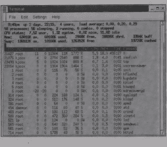

### 图 7.1

top 命令的输出不仅让您查看系统运行时间，还显示进程的累计数量及其对系统的负载。

接下来，top 的输出显示内核中的 CPU 使用量。输出以百分比形式显示用户和内核正在使用的 CPU 部分；输出还显示空闲的 CPU 百分比。如果您在确定问题是出在用户的配置还是系统本身时，这些信息很有用。如果守护程序失控，系统负载将远大于用户对 CPU 的使用率。

最后几行显示内存使用情况。内存通常分为物理内存和交换内存。这些行显示正常可用量、使用量和空闲量。它们还说明系统物理内存上共享和缓冲内存的量，以及当前被缓冲缓存（即磁盘缓存）使用的物理内存量。

在监控 Linux 机器上当前运行的进程时，top 命令是一个非常实用的工具。它提供了充足的信息来确定系统问题的原因，还可以呈现可能需要管理的其他进程的详细信息。程序将持续运行，直到按下 q 键退出。

通常，top 会按顺序对进程进行排序，CPU 占用率最高的进程排在顶部。但您也可以按内存和/或 CPU 使用量进行排序。程序会自动每隔几秒刷新屏幕。top 常用的两个选项是按内存排序，在 top 显示中输入 M，或按处理器使用量排序，在窗口中输入 P。如果您需要了解 top 接受的其他输入选项，输入简单的 help 查询或按下 h 键将显示各种可能性。

### 识别常用信号

信号用于操纵系统中正在运行或休眠的进程。它们允许用户告诉进程放弃当前操作并执行其他任务，或者重新读取当前运行的文件或进程。内核处理一些信号，如 kill -9，而其他信号则由首先启动该进程的程序管理。通常，SIGHUP 或 HUP 信号会使守护程序重新读取其配置文件，但对于某些守护程序并非总是如此。无论如何，信号类型有很多。每种都与 kill 命令一起使用。

您可以使用两种方法之一向系统发送信号：作为数值，如 -1 或 -9，或作为书面请求，如挂起信号或 -HUP 命令。本书将详细探讨少数几个信号。大多数用户在日常使用中只需知道少数几个信号，其中 -1 和 -9 信号使用最为频繁。

表 7.1 列出了 kill 命令使用的某些通用信号，及其数值、名称和操作。粗体数字并不适用于所有系统，包括各种 Linux 发行版，因此这些信号可能具有与列表不同的编号。

作为 -1 发送的 kill 信号也可以作为 -HUP 命令发送。如上表所示，每个带编号的 kill 命令都有一个名称，可用于代替带编号的命令。在向进程发送信号时，需要两个元素才能正确修改进程：命令（在此为 kill 命令）和操作（数字或信号名称）。-1 或 -HUP 命令会导致程序重新读取其配置文件。它发送挂起命令，指示进程重启。当您在更改配置文件（如 Web 服务器的 httpd.conf）并希望服务器重新读取新配置而不必停止并重启守护程序本身时，此命令非常有用。

您也可以消灭任何干扰系统或已停止的麻烦进程。为此，请发出带有进程 PID 的 kill -9 命令。

#### 表 7.1 kill 命令使用的信号及其用途简述

| 编号 | 名称 | 描述 | 默认操作 |
| :--- | :--- | :--- | :--- |
| 1 | SIGHUP | 挂起 | 终止 |
| 2 | SIGINT | 中断 | 终止 |
| 3 | SIGQUIT | 退出 | 终止 |
| 4 | SIGILL | 非法指令 | 终止 |
| 5 | SIGTRAP | 跟踪陷阱 | 终止 |
| 6 | SIGIOT | IOT 陷阱 | 终止 |
| 7 | SIGEMT | EMT 陷阱 | 终止 |
| 8 | SIGFPE | 算术异常 | 终止 |
| 9 | SIGKILL | 杀死 | 终止 |
| 10 | SIGBUS | 总线错误 | 终止 |
| 11 | SIGSEGV | 段错误 | 终止 |
| 12 | SIGSYS | 错误的系统调用 | 终止 |
| 13 | SIGPIPE | 管道破裂 | 终止 |
| 14 | SIGALRM | 闹钟时钟 | 终止 |
| 15 | SIGTERM | 程序终止 | 终止 |
| 16 | SIGURG | 套接字处于紧急状态 | 忽略 |
| 17 | SIGSTOP | 停止 | 停止 |
| 18 | SIGTSTP | 键盘停止 | 停止 |
| 19 | SIGCONT | 停止后继续 | 忽略 |
| 20 | SIGCHLD | 子进程状态改变 | 忽略 |
| 21 | SIGTTIN | 无效读取 | 停止 |
| 22 | SIGTTOU | 无效写入 | 停止 |
| 23 | SIGIO | 软盘 I/O 可能 | 忽略 |
| 24 | SIGXCPU | CPU 时间达到限制 | 终止 |
| 25 | SIGXFSZ | 文件大小达到限制 | 终止 |
| 26 | SIGVTALRM | 虚拟时间闹钟 | 终止 |
| 27 | SIGPROF | 性能分析定时器闹钟 | 终止 |
| 28 | SIGWINCH | 窗口改变 | 忽略 |
| 29 | SIGLOST | 资源丢失 | 终止 |
| 30 | SIGUSR1 | 用户定义 | 终止 |
| 31 | SIGUSR2 | 用户定义 | 终止 |


## 识别进程

编号。例如，如果 Netscape 陷入卡顿或像它有时那样出现挂起现象，你只需采取以下步骤将其关闭。

如图 7.2 所示，`ps` 命令列出了所有与 netscape 关联名称的进程。你可以使用 `aups` 或简单的 `ax` 来列出进程。当程序打印出必要信息后，你可以获取该进程的 PID 编号，并使用信号 9 终止它。这将关闭可能仍在运行的任何 netscape 实例。

### 使用 nohup 运行命令

保持进程运行的最佳方式之一，即使启动初始进程的 shell 或用户被终止，进程仍能继续运行，是使用 `nohup` 命令。`nohup` 是 “no hangup”（不挂起）的缩写，它启动进程，并使其在 shell 关闭后继续运行。通常，当 shell 被终止时，它向其所有子代进程发送挂起信号。由该 shell 或其子 shell 的子进程启动的所有内容也会收到挂起信号。例如，如果你在 shell A 下启动一个程序，一旦你注销或关闭 shell A 并启动 shell B，在 shell A 下启动的进程也会被终止。

你只需在命令行输入末尾加上一个 ampersand（`&`）即可启动程序并释放 shell。这告知程序只在初始 shell 保持打开期间运行。如果终端窗口被关闭，程序也会被终止。这并不适用于 shell 启动守护进程的情况，因为守护进程独立于任何 shell。这只适用于通过命令行启动且依赖 shell 的程序。

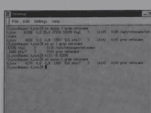

> 此截图展示了两种显示活动 Netscape 进程的不同方法。一旦我识别出 PID，我就使用 -9 信号将其终止。

假设我想从终端窗口启动 `bigprogram`。启动该程序并保持对终端控制的最佳方式——即防止 `bigprogram` 控制命令行，使我能够运行其他命令——是在末尾加上 ampersand 启动程序。例如：

```
[kerry@pluto kerry]$ ../bigprogram &
```

如果程序位于当前目录，此命令将启动程序。此命令将命令行的控制权交还给我，使我可以继续输入信息或执行其他命令。但是，如果我随后关闭此窗口或退出此终端，程序也会停止。

如果我首先输入 `nohup` 命令，如下所示，即使退出后程序也会继续运行：

```
nohup bigprogram &
```

程序生成的任何输出都会放置在一个名为 `nohup.out` 的文件中，该文件位于同一目录。在该文件中，你可以验证程序已正常启动且功能完全正常。对 `nohup.out` 文件运行 `tail` 命令将显示程序本应显示到命令行的额外输出，就好像它从 shell 运行一样。最后，为了确认程序功能正常，运行 `ps` 命令，然后使用 `grep` 函数筛选出该程序。正如许多 Linux 管理员所说，“你 grep 出该程序”以定位所询问的项目。然后你可以验证程序已正常启动并且仍在运行。

我对必须始终运行但需从命令行启动的程序（如监控工具）使用 `nohup` 命令。我不一定总能保持该终端打开或以我自己的身份登录。因此，`nohup` 命令的功能应运而生。当我需要登录到工作中的服务器来检查某个进程或在更改配置后重启另一个进程时，`nohup` 命令特别有用。

### 结论

现在，你可以看到在 Linux 下运行的进程，并且可以通过直接终止它们或重启它们来管理所有进程，接下来你可以开始查看任务调度以及清理旧进程的残留物。下一章将研究 cron 任务及其如何自动化许多系统操作。你还可以使用 cron 等工具来组织和保存文件以便日后使用。


## 第 8 章

### 清理工作


Linux 主要被设计作为服务器使用，因此 Linux 系统在一天中必须执行许多任务。即使最优秀的管理员也无法总是记得执行这些任务或没有时间完成它们。Linux 提供了一种自动完成此类工作的方法。cron 守护进程不仅为管理员，也为系统上的每个用户提供了一个自动完成日常杂务和职责的工具。这些任务包括更新列表、轮换日志以及清除不必要或过时的文件。

本章将涵盖以下主题：

- 理解 cron 的作用
- 执行 crontab 编辑器
- 阐明调度事件的语法
- 清理系统
- 保存文件以供日后使用

#### 使用 cron 调度维护任务

*Cron 任务*，即在无用户干预的情况下静默执行自动化任务的后台进程，是 Linux 用户享有的众多优势之一。Cron 任务将管理员从每天、每周甚至每月的琐碎任务中解放出来。任何执行系统维护、需要大量打字或具有重复性质的任务都可以移交给 cron 守护进程，它将在所需时间执行该操作。这对于不需要用户输入命令或交互监控系统的非交互性职责特别有用。无论用户是物理连接在终端还是远程登录，对于深夜任务或用户无需在场的工作，此守护进程都特别有用。

Red Hat Linux 使用由 Paul Vixie 完善的 cron 程序。现在通常被称为 *Vixie Cron* 软件包，它比旧版 UNIX cron 程序提供了更多安全特性和更大功能。以下是 Vixie 为该程序添加的一些选项：

- 你可以使用名称而不是仅使用数字来指定月份和星期几。
- 你可以将这些名称缩写为简写形式，例如 mon、tue、jan 和 feb。
- 你可以通过使用 `/n` 后缀为数量添加步长值或特定时间范围。因此，`6-22/2` 意味着它将从早上 6 点到晚上 10 点每两小时运行一次程序。
- 你还可以在 crontab 文件中定义环境变量。你可以在任何用户的 crontab 文件中放置 `MAILTO` 命令，以便 crontab 运行的结果可以邮件发送给特定用户或被抑制。

重要的是，仅将 crontab 运行的结果发送给负责 cron 处理的任务的用户。如果其他人收到邮件，他们可能对某些 root 进程的功能方式或他人如何使用系统获得额外的洞察力。虽然这并不一定危险，但最好让用户独立工作。他们对其他用户（包括 root）的了解越少越好。

#### 定义 cron 的目的

由于普通用户不会全天候、每周七天管理计算机，并且有些任务需要在不恰当的时间执行，因此对 cron 任务有着明确的需求。除了设置初始系统和调度事件外，无需用户干预，cron 守护程序将在特定时间段被调用时管理所有例行检查、系统维护运行和备份。（因为守护程序根据特定计划时间处理其任务，所以“cron”一词的基础是“chronological”（按时间顺序的）一词。）你可以设置 cron 来处理大多数可以在命令行上输入的请求。任何需要 sh shell 且可以手动启动的命令类型，都可以同样轻松地从 cron 任务中启动。

当你设置任何类型的 cron 任务时，无论是系统密集型的任务还是在几分之一秒内执行的简单脚本，你都应该将 cron 安排在傍晚或清晨执行标准例程，那时用户


此时负载最轻。推荐在此时执行，部分原因是为了避免与用户白天可能需要访问的程序发生冲突，也因为此时大多数系统资源是空闲的，可以快速完成计划任务。如果定时任务需要删除旧文件或轮换日志文件，最好在无用户正在积极访问系统或在 cron 操作文件时更改文件的时候执行此类任务。

cron 守护进程本身会占用系统的一些资源。然而，根据执行的程序类型，cron 既可能给系统带来沉重负载，也可能静默运行而不被用户察觉。某些例程可以在一天的任何时间运行而不会引起任何问题或延迟。如果例程处理的是不影响用户文件的简单备份和维护任务，你可以将其安排在大多数时间执行，不会有严重的后果。增量备份或差异备份任务在傍晚早些时候执行是安全的，而全量备份最好留到深夜运行。尽量避免在高峰时段执行任何自动化任务。任何在白天更改或更新系统或用户文件的程序都有与用户任务发生冲突的风险。你可以在第 9 章“修复错误”中找到有关备份的更多信息。

#### 管理 crontab 文件

控制 cron 守护进程的文件称为 crontab，或 cron 表文件。它是由大多数其他二进制文件相同位置的简单二进制文件，即 Red Hat Linux 中的 `/usr/bin/`。这个可执行文件创建了一个 ASCII 文本文件，任务随后保存在其中。这些可以是唯一的其他文件的路径名，这些文件是可执行的，或者是包含系统将执行的多个脚本的文件。要执行 crontab 命令并编辑你选择的要运行的文件，通常输入以下命令：

```
crontab -e
```

-e 标志启动 crontab 进入编辑模式。crontab 文件仅适用于启动该文件的用户关联的文件；这些文件不仅包括用户拥有的文件，还包括用户有权限访问的文件。默认编辑器由系统定义。Red Hat Linux 使用 vi 作为其默认编辑器。

如果我以我自己或用户名 `kerry` 的身份执行此命令，我将为自己创建一个 cron 表。然而，root 或超级用户可以简单地通过放置 -u 标志后跟用户名来为任何其他用户（包括 root）创建或编辑 crontab 文件。如果我作为 root 仍然想编辑我的 crontab 文件，我将输入以下命令：

```
crontab -u kerry -e
```

这将调出由用户 *kerry* 创建的 crontab 文件。

虽然 root 可以编辑其他人的文件，但普通用户只能编辑自己的文件。crontab 文件中执行的 *字段* 和程序因用户而异，但所有用户仍必须遵守任何 Linux 机器上正常使用的相同语法。他们只能操作他们直接拥有或共享组所有权的文件和目录。

由 *crontab* 命令创建的 *文件* 是一个简单的 *文本文件*，保存在 */var/spool/cron* 目录中。每个相应的 crontab 文件都以其创建者的用户名为名并归其所有。

如果用户 *kerry* 和 *root* 都创建了一个 crontab 文件，快速查看 */var/spool/cron* 目录会发现现在有两个文件，每个用户各一个。然而，Red Hat Linux 禁止普通用户查看这些文件的内容。只有 *超级用户* 可以查看自己和其他人的文件内容。

如下所示，*root* 可以查看 */var/spool/cron* 目录的内容。虽然文件 *kerry* 由组 *kerry* 拥有，但它仅允许用户（即 *root*）具有读取和写入权限。整个目录的内容也是如此。只有 *root* 具有读取、写入和执行权限。

```bash
### pwd
/var/spool/cron
# ls -la
total 16k
drwx------    2 root     root    4.0k Sep  2 14:05 .
drwxr-xr-x   19 root     root    4.0k Jun  8 13:49 ..
-rw-------     1 root     kerry   216 Sep  2 14:05 kerry
-rw-------     1 root     root    498 Aug  16 09:17 root
```

虽然你可以使用任何文本编辑器查看每个文件，但建议使用 crontab 命令编辑文件，而不是手动操作。如果你使用 vi 手动打开文件，一条警告消息将说明你应该仅使用 crontab -e 命令来配置该文件。crontab 命令在 /var/spool/cron 中创建一个简单的文本文件，名称与发出该命令的用户相同。此外，当你最初创建 crontab 文件时产生的临时文件保存在 /tmp 目录中，直到你保存 crontab 文件为止。当你使用 crontab -e 命令打开文本文件时，你也会注意到同时有一个名为 crontab.xxxx 的临时文件插入到 /tmp 目录中。其他用户几乎不可能查看该文件的内容，因为权限设置为 600 且仅由执行该文件的用户独占拥有。

**注意**

crontab 程序运行方式很像 sudo。从技术上讲，你可以像打开 /var/spool/cron/root 文件一样打开 /etc/sudoers 文件，但建议不要这样做。就像配置文件应仅使用 visudo 命令打开一样，crontab 文件也应仅使用 crontab 命令打开。

通常每个用户获得一个 cron 文件。如果允许，系统上的每个用户都可以创建自己的 crontab 文件并使用它来管理任务。相应的文本文件带有所有者的用户名。如果你正在将用户从一台 Linux 机器迁移到另一台，你也应该传输相应的 crontab 文件，因为用户在新系统上的许多功能将基于通过 cron 运行自动化任务的能力。

移动 crontab 文件的最佳方法是简单地使用 ftp 将这些文件从 /var/spool/cron 目录发送到新机器的相同位置。务必将每个文件的权限设置为之前所有者的权限。如果尚未设置 FTP，你可以选择使用 tar 命令将文件备份到一个大文件中，然后手动将其移动到新的系统。有关使用 tar 命令和备份文件的更多信息，请参见第 9 章。

除了普通用户使用的 crontab 文件外，还有系统使用的 crontab 文件。这些由每个 Linux 版本预先确定，因为每个版本都会添加需要自动化维护的工具。列出系统通常定期执行哪些作业的文件通常是 /etc/crontab。在此处编辑系统执行的任务，并指定 cron 何时执行这些职责。清单 8.1 显示了标准 Red Hat Linux 安装的示例输出。

**清单 8.1 系统用于常规维护的典型 `/etc/crontab` 文件**

```
SHELL=/bin/bash
PATH=/sbin/bin:/usr/sbin:/usr/bin
MAILTO=root
HOME=/

# run-parts
01 * * * * root run-parts /etc/cron.hourly
02 4 * * * root run-parts /etc/cron.daily
22 4 * * 0 root run-parts /etc/cron.weekly
42 4 1 * * root run-parts /etc/cron.monthly
```

输出开头显示的环境变量列表是来自 Vixie Cron 软件包的一个附加功能。你为这些任务指定 shell、路径和主目录，并规定在任务成功或失败执行后，谁将通过电子邮件接收 crontab 运行结果。/etc/crontab 文件中列出的每个条目都指向包含其他脚本的特定文件。如果你希望系统在指定时间运行确定的任务，这里是你可以输入脚本或按你的喜好修改现有脚本的地方。更喜欢以更短间隔轮换日志文件的用户也可以在此处找到这个特定的系统任务。

> **警告**
> 
> 请记住，对这些文件的任何修改都将全局影响系统，而每个用户的 crontab 条目仅影响个人的文件。修改系统文件时要谨慎。如果你弄坏了一些东西，某些日志和文件可能停止工作。作为一种预防措施，在修改任何系统文件之前，始终进行备份。

**编辑 crontab 文件**

如果你需要删除特定用户的 cron 文件，通常只需从 /var/spool/cron 目录中删除该用户的文件即可。如果该用户不再存在于系统上或你需要锁定其账户，这将非常有用。


重命名该文件还可以阻止用户访问其计划任务（cron jobs）。通常，输入 `/usr/sbin/userdel -r` 命令就足以删除任何遗留文件。不过，在删除用户后检查此目录也无妨。

好的管理员应定期检查普通用户使用的 cron 文件。这不仅确保了系统的健康运行，还验证了用户是否遵守了公平使用协议——这是一种简单的口头或书面合同，规定系统不得被滥用或不当地使用。检查用户在运行什么任务的最好方法是记录 cron 作业。在 Red Hat 上，这是一个相当标准的程序。cron 日志文件通常保存在文件 `/var/log/cron` 中。任何文本编辑器都可以打印出过去几天或几周的 cron 文件结果。这些文件也会定期轮转，因此您可能需要查阅重命名的文件（如 `cron.1`、`cron.2` 等）以查看较旧的 cron 条目。定期检查以确保备份和例程正确运行也是一个不错的主意。

希望采取更主动方式并在系统例程完成时收到通知的管理员，也可以从 cron 守护进程收到电子邮件，告知其执行的任务已完成。如前所述，您需要在 crontab 文件中插入一个 `MAILTO` 值。通常，Root 是普通系统 cron 作业的默认接收账户。但是，作为 root，您也可以将 `MAILTO` 变量插入任何用户的 crontab 文件，并将结果邮件发送给您自己或他人。如果在 crontab 文件中插入空的 `MAILTO` 变量，将抑制来自 cron 的所有邮件。虽然这一建议可能显得专横，并可能不为用户本人所接受，但我发现一些用户会迅速滥用授予他们的系统自由。作为管理员，在必要时必须愿意采取强硬措施。

如果我希望将用户 `calvin` 的所有 crontab 结果发送给我，我只需将以下内容插入 `/var/spool/cron/calvin` 的 crontab 文件中：

```bash
MAILTO=kerry
```

记住，要编辑其他用户的 crontab 文件，您必须是 root。要调用 crontab 文件，我必须输入以下命令：

```bash
crontab -u calvin -e
```

要抑制来自特定用户（如 root）的所有邮件，请按照以下操作在该用户的 crontab 文件中插入空的 `MAILTO` 变量：

```bash
MAILTO=
```

像许多其他 Linux 发行版一样，Red Hat 运行每周轮转日志文件的 cron 作业。这些文件可能会迅速变得过大，占用比其价值更多的硬盘空间。cron 守护进程通过重命名这些文件并创建新的日志文件来轮转它们。经过一定的时间段后，cron 会删除这些较旧的日志。日志文件将保留足够长的时间，以便可以追踪任何相关的错误或任务。您可以在其他位置指定希望保留某些日志文件多久。要了解系统如何记录某些文件，请参阅第 10 章“记录错误”。

#### 自定义特定 crontab 条目

Linux 还有其他系统 cron 条目。这些 cron 作业在安装过程中默认设置，最好保持原样。这些文件的位置是 `*/etc/cron.d` 目录。就像 root cron 作业由用户定义一样，此目录中的作业是由系统定义的。它们主要处理日志文件的轮转以及清除过时文件或崩溃程序的运行时清理过程。如果程序需要持续或暂时性地监控文件或程序，它们可能会被放置在此目录中。然而，此目录通常保留给安装自己一系列 cron 作业的程序。

在较旧版本的 Red Hat 中，可能会遇到另一个值得注意的问题，但在较新的发行版中较少见，即使用默认文本编辑器编辑 cron 条目。`crontab` 命令默认使用 `vi` 作为修改 cron 文件的标准编辑器。不建议新用户使用该文本编辑器，因为其学习曲线相当陡峭。初学 Linux 的用户更喜欢功能强大且熟悉的编辑器，如 `joe` 或 `pico`，它们对初学者来说更友好，可以像大多数文字处理软件一样使用。文本编辑器 `joe` 让人回忆起旧的 `WordStar` 时代，而 `pico` 的运行方式类似于 `Windows Notepad` 文本编辑器，可以被视为一个简单的文字处理软件。每个编辑器都有自己的一组保存和编辑文件的命令，但与 `vi` 的命令相比，这些命令很简单。虽然对新手来说更难掌握，但 `vi` 极其多功能，拥有众多编辑命令，可以执行大多数功能。

要使用其他文本编辑器，如 `joe` 或 `pico`，您必须将另一个编辑器导出到终端变量中。您可以通过在想要编辑 crontab 文件的终端命令行输入以下命令来完成：

```bash
export EDITOR=joe
```

在此命令的末尾，输入您想要的默认编辑器名称——无论是 `joe`、`pico`、`jed` 还是其他编辑器。要使更改永久化，您需要编辑自己的 `.profile` 文本文件，或者通过编辑 `/etc/profile` 文件使更改对所有用户全局生效。您可以轻松完成此操作。只需将以下行放入上述两个文件中的任意一个中：

```bash
EDITOR=joe
export EDITOR
```

在此源文件重新读取之前，更改不会对该终端会话生效。要修改变量，请输入以下可能的命令之一。虽然正确的选择可能取决于您的系统配置，但审阅每个选择应有助于您了解整个过程。以下每个命令都会更新您的终端会话并使用您选择的编辑器。

```bash
source /etc/profile
source ~<username>/.profile
source /home/<username>/.bash_profile
```

更改默认编辑器可能意味着成功创建 cron 条目与快速变得气馁并放弃之间的差别。我见过太多初学 Linux 用户因为对文本编辑器的沮丧而未能充分发挥 Linux 的潜力。

#### 注意

> 关于 cron 文件的一个重要事项是，cron 作业仅当系统正在运行时才会执行。对于 cron 守护进程也是如此：如果它没有正确启动或在运行期间某个时刻被关闭，计划在该区间执行的 cron 作业将不会执行。如果系统因例行维护或错误而关闭，请注意在该时间段内这些作业不会执行，但会在系统再次启动后的下一次执行。

一旦您在 crontab 文件中创建了一个条目，系统将立即开始参考该特定文件。需要运行程序、脚本或文件的时间取决于您的安排。您可以选择在输入任务后立即开始，或者将任务的执行安排在稍后的日期，最晚可安排至一个月后。

#### 设置正确的 crontab 语法

cron 作业的实现方式很重要。即使作业对每个用户都是独特的，它们仍然共享相同的语法。cron 守护进程识别一组特定的指令，并使用它们根据需要运行作业。基本格式是首先列出需要执行作业的时间，然后给出命令。通常的做法是通过在作业的开头或结尾放置注释行来解释每个 cron 作业的功能。注释是您不希望程序读取的行，但作为对其他用户的解释性语句。通常通过标记井号（#）来表示一行是注释。在阅读 crontab 文件时，cron 守护进程通常会忽略这些行或同一行中任何井号后的单词。

创建 crontab 条目的标准语法如下：

| 分钟 | 小时 | 日 | 月 | 星期 | 命令 |
| :----- | :--- | :-- | :---- | :------ | :------ |
| 0–59 | 0–23 | 1–31 | 1–12 | 0–7 | /usr/local/bin/runme |

某些较旧的 UNIX 系统提供了一个额外的字段，用于输入特定功能的用户名。通常 Red Hat 不提供这种字段，而是将自己限制在六字段格式中。用户字段有时会在系统自己的 crontab 文件 `/etc/crontab` 中找到。

每个字段只能使用特定的数字。字段之间用单个空格分隔，而字段中的多个数字用逗号分组。与大多数 UNIX 系统惯例一样，计数从零开始。唯一的例外，在此情况下是星期字段，其中 0 和 7 都等于星期日，1 等于星期一。

通常，制表符将时间字段与命令字段分开。如果所需的安排是每天，则在该字段中放置星号代替数字。类似于通配符功能，星号代表所有可能的数字。

**提示**
请注意时间的变化，例如夏令时，这可能对某些安排造成干扰，并可能导致程序运行两次或根本不运行。如果您在安装期间指定了这些变化，Red Hat Linux 会进行补偿，但最好再次检查计算机的时间是否与标准时间同步。


在其他可能性中，单个数字与特定的时间或日期完全匹配，而用逗号分隔且中间没有空格的数字则代表该单一字段中的两个不同时间或日期。在 cron 任务中，可以设置一个广泛的时或分钟范围，每个值之间用逗号分隔。以下是一个每天每 10 分钟运行一次的 cron 任务示例：

```
0,10,20,30,40,50 * * * *
/usr/bin/backup_run
```

backup_run 脚本会根据计算机的时间时钟每 10 分钟执行一次。此执行每周每天、每月都发生。

#### 将任务调整到特定时间

另一种可能性是让任务在一天中的特定时每小执行一次。例如，相同的任务可以每三小时运行一次，并且仅在周一至周四和周五运行。定制后的此类任务如下所示：

```
30 0,3,6,9,12,15,18,21 * 1-5 *
/usr/bin/backup_run
```

第一个字段表示，在第二个字段指定的小时的半小时，即过去三十分钟时，cron 任务将执行命令。Linux 通常使用军用时间（24小时制），而不是标准的上午/下午分隔，这在国际系统中可能导致混淆。因此，命令 /usr/bin/backup_run 将在上午 3:30、上午 6:30、上午 9:30、下午 12:30、下午 3:30 等时间执行。

此示例还表明，除了使用逗号分隔多个整数外，你还可以使用连字符包含一个日期范围。表达式 1-5 覆盖周一到周五。你也可以在一个字段中结合使用值范围和逗号。因此，1,3,5-7 也是有效的表达式，指定周一、周三以及周五到周日。

你还可以通过使用 -l 和 -c 标志来操作 crontab 文件。-l 标志打印出指定用户的 crontab 文件的内容。这是一种快速有效的方式来查看用户的 crontab 文件具体包含什么。同样，root 用户可以通过在 -l 标志前加上 -u 和用户名来检查任何普通用户的文件。例如，要查看 joe 的 crontab 文件的内容，超级用户将输入以下内容：

```
crontab -u joe -l
```

这种用法并不被推荐，但在系统管理方面，很少有东西应该或可以被管理员保密。

-r 标志是一个移除选项。root 不必手动删除 /var/spool/cron 目录中用户的 cron 条目，而是可以执行以下命令，快速轻松地清除 joe 的整个 crontab 文件：

```
crontab -u joe -r
```

这是一种快速清理由已失效或恶意用户留下的文件的方法。

命令字段并不总是需要包含指向唯一二进制命令的绝对路径。它也可以连同二进制文件一起使用多个协同工作的标志。你可以创建各种命令并通过使用管道符 (|) 将它们串联起来。例如，这里是一个可能用于终止在深夜运行的任何多余的 sendmail 实例的示例 crontab 行：

```
0 2 * * *   kill -9 "ps aux | grep sendmail | awk '{print $2}'"
```

此 cron 任务每天早上凌晨 2 点运行，并将终止它找到的任何 sendmail 守护进程。用户可以在前一行的下方输入以下 crontab 行，以便让 sendmail 守护进程在第二天早上启动：

```
0 6 * * *   /etc/rc.d/init.d/sendmail start
```

此语句调用 sendmail 守护进程在上午 6 点迅速启动，并持续运行接下来的 20 小时，直到凌晨 2 点再次被终止。

如果你希望在启动 sendmail 守护进程的方法上更详细，你还可以输入以下内容，这更好地展示了在 cron 条目中使用标志和选项的方法：

```
0 6 * * *   /usr/lib/sendmail -bd -qlh
```

此语句也在上午 6 点以守护进程形式启动 sendmail，并每小时排队发送邮件。

sendmail 的语法和用法在第 18 章“Linux 发声”中有更详细的介绍。

#### 过滤用户

cron 程序还提供了一种方法来过滤出那些应被拒绝使用 cron 文件的用户。这对于希望限制繁忙或拥堵系统中个性化任务数量的管理员来说是一个有用的功能。cron.allow 和 cron.deny 文件指定谁可以或谁不可以使用 cron。在 Red Hat Linux 发行版中，你可能需要创建这些文件，因为它们默认未安装。每个文件的标准位置是 /etc/cron.allow 或 /etc/cron.deny。根据你管理 cron 文件的方式，可以创建其中一个或两个文件。如果你希望阻止某些用户创建自己的 crontab 文件，请创建一个 /etc/cron.deny 文件，并插入那些不应被允许使用或创建 crontab 文件的人的名字。对于那些允许使用 crontab 文件的用户也是如此。将他们的名字插入 /etc/cron.allow 文件。

> **注意**
> 请注意，如果 cron.deny 文件存在，如果你希望以后能够编辑该文件，你不应该拒绝自己或 root 的访问权限。如果只有 cron.allow 文件存在，你应该允许你的用户名和 root 的访问权限。

创建这些文件之一的语法很简单。如果你使用 cron.allow，将允许使用 cron 命令的用户名放在一行中，每个名字之间用逗号分隔。也可以使用某些通配符，例如使用 ALL 来允许所有用户使用该文件。在 cron.deny 文件中，放置你希望拒绝访问 crontab 命令的用户。在 /etc/cron.allow 文件中放置 ALL 变量以允许所有用户使用 crontab，这看起来可能有点多余，因为默认情况下所有人都可以使用 crontab。然而，这是一个良好的习惯，因为还有其他文件依赖于 \*.deny 和 \*.allow 文件来确定允许谁访问以及拒绝谁访问。

读取这些文件的顺序也很重要。首先读取 cron.allow 文件，最后读取 cron.deny。这与 hosts.deny 和 hosts.allow 文件不同，后者先拒绝用户。此外，与 hosts.\* 文件不同，在 Red Hat 系统上，cron 文件可以单独或同时存在。

#### 清理系统

cron 任务可以执行的更有用的任务之一是清除旧文件并删除不必要的核心转储等。*核心转储*是崩溃程序的内存地址快照。如果一个程序死亡，而不是像许多在其他专有操作系统下的程序那样简单地给用户一个晦涩的保护错误（General Protection Fault）或普遍的“蓝屏死机”，Linux 下的崩溃程序会在用户目录或启动该程序的目录中留下一个*核心转储*或*核心文件*。核心文件主要用于编写自己程序并需要理解出错原因的开发者。但对于管理员来说，核心转储会占满硬盘空间，而且并不总是需要的。定期运行一个定位并删除核心文件的 cron 任务有助于保持系统清洁和无拥塞。

以下是你可以以两种不同方式放入 cron 任务中的示例命令。它负责从你自己的目录中删除旧的核心文件。

```
find /home/joe -name core -exec rm -f {} ';'
```

此命令仅通过用户 joe 的主目录查找，并通过运行 find 命令定位和删除核心文件。它查找任何名为 core 的文件。然后启动 exec 命令并尝试删除文件。最后几项是删除文件所必需的标志和选项。该命令功能简单，但能快速干净地完成其目的。

你可以使用两种不同的方法将此命令放入 crontab 文件。你可以首先将包含所有标志和选项的完整命令放入 crontab 文件本身。如果你希望命令每晚凌晨 2 点运行，它可能如下所示：

```
0 2 * * *      find /home/joe -name core -exec rm -f {} ';'
```

另一个选项是将命令放入一个纯文本文件并给它命名。你可以将该文件命名为 core_remove，并将其权限更改为 755，以便你可以编辑它，同时允许其他人执行它。你如何设置权限完全取决于你，但该文件确实需要以某种方式可执行。输入一个简单的 chmod u+x core_remove 命令也可以很好地完成这项工作。

创建此文件时，务必在开头使用正确的语法。通常，在第一行输入 #!/bin/sh 对于任何脚本都足够了。这告诉机器该脚本可以从命令行运行。如果你在文件本身中没有指定此选项，cron 守护进程默认使用 /bin/sh 执行脚本。

##### 删除不需要的文件

某些文本编辑器会自动创建备份文件。此类备份文件在末尾有一个扩展名，以区分旧文件和新建文件。文本编辑器 joe 默认在文件名末尾添加波浪号 (~) 来做到这一点

被修改。这些临时文件有助于那些容易错误保存文件且经常需要旧版本进行备份或恢复的用户。然而，它们也像核心文件一样容易填满硬盘。与其在系统上保留每个文本文件的备份副本，建议每周删除所有由编辑器创建的备份文件。在周日晚上较晚或周一凌晨运行此任务，仍为您提供一个时间窗口，以便在周末定位备份文件，或者如果您在周一早上突然想起周五删除的一个重要文件。

以下是一种在周一凌晨清理旧备份的方法：

```
30 3 * * 1 find / -name *.bak -exec rm -vf {} ';'
```

此方法为 `rm` 命令添加了 `-v` 选项，以使结果更加详细。Cron 作业执行的所有操作及其生成的所有结果都会保存并电子邮件发送给 Cron 作业的所有者。通过这种方式，用户可以确切看到哪些文件在何处被删除。虽然恢复它们可能比删除它们更难，但此选项对于跟踪已编辑的文件非常有用。

放置此文件的位置也由您决定。一种可能性是将其放在您可以识别的独立目录中，但其他用户无法访问。通过正确设置权限（例如正确更改所有权并执行 `chmod` 命令）来不允许其他用户执行您的脚本，与隐藏脚本相比，这是一种更优的安全选择。将脚本放在特定位置主要用于跟踪自定义文件。如第 4 章所述，我喜欢创建一个 `/usr/local/scripts` 目录，在其中保存我所有的 cron 脚本。这样，我可以编辑我的 crontab 文件并指向脚本，但完整的命令不会向其他用户可见。以下是第二种可能配置的样子：

```
0 2 * * * /usr/local/scripts/core_remove
```

此配置与第一个示例执行完全相同的功能，只是整个命令被限制在一个文件中。对于此类脚本，您还可以让程序执行多个命令，每个命令依次执行。

以下是我用于监控我维护的新闻服务器进度的另一个示例脚本。此脚本每晚清理所有文件，并发送电子邮件通知任务已完成。以下是该脚本在 crontab 条目中的可能样子：

```
# These are the cron jobs used to maintain the news server.
0 0 * * * /var/news/bin/news.daily dal expirover lowmark_flags='s -q -vl'
43 7,12,17,22 * * * /var/news/bin/ctlrnnd -s reload incoming.conf crontab
0,10,20,30,40,50 * * * * /var/news/bin/mntpseed
```

第一条命令在午夜处理所有旧文章，而第二条命令重新加载所有传入文件。最后一条命令每天每 10 分钟将所有新文章发送到所有源站。您也可以简单地将这三个命令都放入一个文件中，并作为一个单一的 crontab 条目运行。

##### 保存所需文件

您也可以使用 cron 创建重要文件的备份。根据您执行备份的方式，它们可以将重要文件复制到硬盘上的本地分区，也可以作为夜间 cron 作业运行，并将数据备份到位于远程机器上的其他媒体源。有关设置备份例程的更多信息，请查阅第 9 章。

目前，让我们查看 cron 如何本地存储文件。这种备份计划特别有用，因为它可以每晚执行，防止用户意外删除重要文件或损坏自己的数据。除非该用户拥有 root 访问权限，否则不太可能损坏系统数据。上述提到的措施是为了保护初学 Linux 用户免受自身错误的影响。当您运行一个有许多用户登录的机器时，拥有一定的备份计划并单独管理用户共享或访问的数据总是个好主意。

如果只需要每晚备份个人文件，以下示例是备份文件的一种可能性。我喜欢将备份副本放在单独的分区上，以防某个分区故障或在不幸（且极不可能）的情况下被重新格式化。我通常从主目录复制文件本身，然后将备份文件存储在我有权限访问的另一个目录中。以下是一个示例：

```
0 3 * * * cp /home/kerry/docs/* /usr/local/backup/docs/
```

此 cron 条目复制位于 `~/kerry/docs/` 目录中的所有文件，并将备份文件存储在 `/usr/local/backup/` 目录中。它每晚覆盖旧文件。

如果需要备份系统文件，以下例程将建立备份文件的层级。这些是 sendmail 所需的虚拟表。这些表列出了系统上托管的所有虚拟域名的虚拟电子邮件地址。不过，只要它们每天进行备份并允许您检索几天前的版本，以防在最近几次备份之前犯了错误，这些文件的具体类型其实并不重要。

```
0 23 * * * cp vmail.txt.4 vmail.txt.5; cp vmail.txt.3 vmail.txt.4; cp vmail.txt.3 vmail.txt.2; cp vmail.txt.1 vmail.txt.2; cp vmail.txt.0 vmail.txt.1; cp vmail.txt vmail.txt.0
```

此例程复制 `vmail.txt` 的倒数第二个（次新的）备份，以创建最新的副本。换句话说，版本 4 复制到版本 5 之上。文件越旧，数字越大。因此，版本 5 是最旧的备份副本。相同的备份方法随后按升序发生，其中一个版本复制到一个较新的版本上；例如，版本 3 然后复制到版本 4 之上。版本 0 则是主文件 `vmail.txt` 最新的备份。通过这种方式，您可以拥有将近六天的文件备份。如果您几天后才意识到 `vmail.txt` 文件中的一个重要条目被删除了，这将非常有帮助；您无需探索备份媒体，只需快速获取正确的条目并替换当前文件中的相应行即可。

如何使用 crontab 文件主要取决于您通常在命令行上执行什么。您在那里能做的任何事，都可以同样轻松地通过脚本完成，并在您选择的时间执行。通过尝试不同的脚本，您将很快发现执行任务的最好方法。

### 结论

现在，既然您能够设置 crontab 文件并自动化简单任务，您就应该能够通过让系统接管系统管理中更平凡、重复性的琐事，从而减轻部分工作负担。您可以开始自动化不同的任务，并配置 cron 以在不同间隔执行这些职责。下一章将讨论与备份所需文件相关的问题。当您确实需要恢复丢失或损坏的文件时，有效的备份计划证明是无价的。您将了解推荐用于执行备份的媒体类型，以及保存和恢复数据的简便方法。


## 第 9 章

修正错误


没有任何管理员是完美的，也无法配置 Linux 机器去执行他或她想要或需要做的所有事情。再加上这种情况中存在多个用户，每个用户都想添加自己的文件并在系统上执行不同的任务。迟早，总会有人犯错误，从而删除、覆盖或丢失一个关键文件。在这种情况下，必须有一个备用方案来恢复或修复错误。俗话说，“预防胜于治疗”。然而，在 Linux 中，您并不总能预见到用户或黑客会对您的系统做什么。有些事情超出了任何管理员的控制范围。因此，知道如何修复错误和执行恢复是至关重要的。

本章将涵盖以下主题：

- 为备份做准备时应做什么
- 应使用哪种类型的媒体
- 如何有条理地组织备份
- 备份数据时应关注哪些安全问题
- 如何执行成功的备份

### 理解备份的必要性

许多人感觉不到备份数据的必要性。这些通常是普通用户，而不是管理员。然而，作为一名优秀的 Linux 管理员，您的工作是确保用户或客户数据的安全性和可靠性。在管理层不理会管理员警告的情况下，在危机发生之前，往往只有在预防性维护或数据备份与恢复投资上投入最少的精力或费用。先发制人的措施可能大有裨益。不采取任何措施则可能是灾难的配方。

一名优秀管理员的真正衡量标准是他很少被想起或被需要。就像大多数机器一样——如果设置好后您再也没担心过它，您就能判断它是否成功且可靠。Linux 管理员反映了他所管理的那些“盒子”。定期备份数据将确保您一直处于幕后，并且将……


平淡无奇的职责。这其实是一件好事。十有八九，人们会在事情出错时想起你，而不是在一切正常时。

#### 最坏情况

任何管理 Linux 系统的人最怕的事情之一，就是不得不恢复那些已被破坏、篡改或删除的文件。这类任务往往需要花费数小时痛苦地尝试定位原始文件，或者重新安装系统，以将系统恢复到先前的规范状态。但是，如果你采取适当的预防措施，就可以避免修复这类错误的大部分痛苦。

当我在威斯康星大学麦迪逊分校工作时，负责处理教职员工的投诉或问题，我很快学会了应对常见问题时的六个重要字：“你有最近的备份吗？”答案经常是“没有”。在任何系统上没有所有重要文件的备份，这都是没有借口的。这并不是什么魔法，也不需要拥有火箭科学学位。即使是普通用户，也应该了解执行系统备份所需的步骤。了解数据是如何丢失的，是恢复数据的第一步。

数据丢失或损坏的方式千奇百怪。硬件故障可能导致目录无法访问。我的一位朋友曾有一个同事对整个分区递归地更改了所有权，结果突然所有文件的所有者都变成了那个同事。一个简单的 `-r` 标志就清除了一千多个客户之前的所有权。这位员工的错误并非出于恶意，而只是一个简单的打字错误。不过，前员工也可能不会放过实施报复的行为。通过几个简单的按键操作，他们就可以清空整个磁盘。这就是 root 用户的威力。当发生此类事故时，就需要通过使用备份来恢复数据了。

#### 备份前的准备

在保存文件之前规划某种策略，不仅被推荐，而且是必需的。你如何备份文件将决定服务器的性能。你不希望将服务器备份的频率提高到危害用户可用性的地步。不仅如此，当其他用户正在使用资源时执行备份，可能会导致备份损坏和文件保存不完整。根据文件的使用情况，某些文件可能需要每日、每周或每月备份。当你将数据从硬盘写入某种介质时，另一个用户可能正在修改这些数据。这种情况经常发生，导致数据损坏，或在需要恢复时无法读取数据。

在决定执行何种备份以及最佳实施方式时，你必须问自己几个问题：

-   ***你需要备份哪些文件？*** 区分那些仅仅是临时文件（如日志文件）和那些仅与客户或你相关的文件，对于创建有效的备份至关重要。你不想浪费备份介质的空间去备份那些本来就不会被恢复的文件，或者那些即使恢复了对所有用户也无意义的文件。大多数系统文件属于后者，因为你同样可以使用安装光盘轻松恢复它们。如果空间、CPU 周期和硬件资源不是问题，你可以选择备份用户创建的所有个人文件和目录。这也是将系统文件放在独立分区中的另一个原因。如果你确实需要执行完整恢复，你只需重新格式化系统文件所在的分区并重新安装操作系统。这样你只需要恢复用户主目录中的文件。文件大小不应成为担忧。有时，即使较小的文件与较大的文件一样重要，尤其是当它们是商业软件的密钥或许可验证时。如果你正在运行 Linux，你也应该选择开源解决方案，但我们承认，GNU 社区尚未赶上许多可用的商业程序。尽管如此，即使是最小的配置文件也可能对系统性能至关重要，就像几 GB 的数据库一样。

-   ***你正在备份的文件多久变化一次？*** 用户是否进行每日更新？如果你在保存日志，这些日志多久轮转一次？你是否有一个仅在周期性更改的数据库，还是持续进行更改？如果是这样，请决定备份之间的最长时间框架是多少，或者如果需要恢复，会发生多大的变更。用户是否会因为可能丢失自上次备份以来所做的所有更改而受到影响？如果文件仅每月更改一次，例如网页或静态 HTML 文件上的那些文件，则无需每日备份。实际上，创建每日备份甚至可能弊大于利。如果你保留每日备份，你可能很快就会将所有旧介质轮转掉，而用户还没意识到他或她需要从上个月恢复某些东西。决定哪些可以等待，哪些不可以。

-   ***你需要备份的文件在哪里？*** 如果你需要备份某个特定分区中的所有文件，将整个分区复制到介质上比尝试剪切和粘贴特定目录要容易得多。在支持并鼓励你为不同目录分区驱动器的 Red Hat Linux 中，备份分区可以是一件更简单的任务。如果你的分区方案选择了许多分区——例如 `/usr`、`/usr/local`、`/home` 和 `/opt`——选择仅包含重要数据的几个分区是相当简单的。你可以完全省略像 `/usr/bin` 这样的分区，因为它主要包含从安装 CD 安装的文件。

-   ***员工中谁负责执行备份？*** 像 `sudo` 这样的工具可以授予某些员工有限的权限，从而不会损害整个系统的安全性。仅由一个人管理一个较大的系统可能是一项不可能的任务。你可以通过允许几个人控制某些计算机来分配工作量。一旦文件备份完成，无论它们放置在中心位置还是个人隔间中，也可能会影响文件恢复的速度。这引出了下一个问题。

-   ***文件多快能恢复到原始状态？*** 如果发现问题且用户需要尽快访问其文件，请决定所需的文件能多快被定位并放回其原始位置。磁带驱动器有时需要一段时间才能定位所有必要的文件，因此用户需要了解系统的局限性。其他镜像工具或 RAID 设备可能提供即时结果。在这种情况下，最好使恢复过程尽可能透明。理想情况下，最终用户甚至不应该意识到系统上已进行的任何更改。

-   ***数据将恢复到哪里？*** 通常不建议将正在恢复的文件放回它们所在的相同目录。你可能会无意中覆盖一些不需要恢复的其他文件。例如，如果你正在恢复 `/etc` 目录的内容，你绝对不想将文件恢复到同一目录。一个替代方案可能是将它们放置在 `/tmp` 目录中，然后根据需要在必要时移动文件。

#### 备份到磁带

存储数据最常用的介质类型之一是磁带。磁带常用于外部存储。在备份后将数据保存在场外，是在盗窃、火灾、人为破坏或天灾情况下防止数据丢失的好方法。如果你保持良好的外部备份（独立于计算机本身），恢复数据就变得很简单。如果保存在现场，它们可能会迅速遭受与原设备相同的命运。

推荐在 Linux 上使用的驱动器类型是 SCSI 磁带驱动器。外部和内部驱动器都能正常工作。考虑使用 SCSI 很重要，因为文件传输速率需要足够快，以便在你决定以单用户模式执行备份或恢复时，以最短的停机时间备份必要数据。否则，在系统运行且用户登录时执行备份被称为热备份——这不是保存数据的最有效方法，因为用户在系统将其写入备份介质时可能会更改数据。尽管如此，这对大多数管理员来说可能仍然是最佳选择，建议使用可用的最快介质。Red Hat Linux 识别并配置目前市场上大多数 SCSI 卡。如果你正在使用新的配置设备 `kudzu`，Red Hat 将在启动时检测你的卡和磁带驱动器。几乎所有磁带驱动器都根据驱动器数量被指定为 `/dev/st0`、`/dev/st1` 等。`st` 代表 SCSI 磁带，随后的数字表示分配给驱动器的驱动器号。当你备份到磁带时，你将引用设备名称 `/dev/st0`、`/dev/st1` 等作为保存和恢复文件的位置。

磁带介质具有成本效益。目前，一卷 12 吉字节的磁带价格约为 20.00 美元。市场上出现了几家新分销商，宣传大容量 50 吉字节以上的存储设备，这些设备可以轻松地与大多数系统接口。花几百美元，你就有足够多的磁带来完成所有服务器数天的备份。这些磁带也非常易于运输。最常见的 8 毫米或 4 毫米磁带相对紧凑，可以轻松地在不同位置之间运输。它们的紧凑尺寸也使其易于存放在小而安全的地方，如防火保险箱和上锁箱中。


在我目前的工作场所，我使用 4 毫米磁带备份数据。管理层需要一个经济且可靠的解决方案。有几台 DDS2 惠普磁带驱动器可供使用，因此我将它们征用于 Linux 机器。只需花费几


#### 纠正错误

## 第 9 章

凭借一百美元，我能够为 20 多台红帽 Linux 机器提供完整备份。仅在第一个月，我们就执行了三次或四次恢复操作，在几位用户误删网络服务器上的重要数据后，这为我们节省了大量工作时间。


然而，磁带不仅容易受到用户的损害，还容易受到自然环境的影响。由于磁带敏感性较高，应将其远离强磁场。即使是音频扬声器也含有磁铁，并能迅速影响磁带的质量。将备份磁带放置在扬声器附近，其危害性与将其存放在显示器上方无异。磁带对强热和湿度也很敏感。将磁带有某种专用盒子或容器中保存可能是最佳解决方案。应将磁带集中存放在安全位置。它们应易于取用，但需远离客户和访客的视线。

使用磁带时还需考虑的另一点是它们的寿命有限。磁带含有运动部件，因此比 CD-ROM 或其他用于存储目的的磁盘更容易磨损。不仅磁带的部件会磨损——即齿轮卡住或外壳破裂——磁带本身也相当脆弱。您可能听说过卡式录音带卡在汽车磁带播放器中的情况。褶皱和拉伸的磁带并未改善其音质。同样的事情也会发生在 8 毫米 DAT 磁带上等。如果被拉伸或断裂，上面的数据大约和发送到 `/dev/null` 的数据一样没用（Linux 和 UNIX 开发者将此称为任何输入都会消失的黑洞）。任何发送到 `/dev/null` 的数据都会从系统中完全消除。`/dev/null` 是一个接收无用数据的“bit bucket”（数据黑洞/垃圾桶）。与 Windows 和 Macintosh 下的回收站和垃圾桶不同，`/dev/null` 没有提供恢复已发送数据的方法。请记住，磁带并非永久保存，机器的写入过程和热量最终会使其损耗。必要时轮换使用新磁带。典型 4 毫米磁带的平均寿命为 50 到 100 次备份或 2–3 年。此后，磁带开始拉伸并失去凝聚力。在此使用量或时间超过后，应考虑更换磁带，以先到者为准。

也要记住，可以在普通磁带上压缩数据。标准压缩方法可以使大多数磁带的存储容量翻倍。然而，压缩数据的保持率往往令人失望。压缩数据在文件恢复过程中很容易损坏，使保存的文件变得毫无价值。例如，访问或读取数据所需时间更长，因为相同长度的磁带上物理存放了更多信息；根据软件不同，损坏可能是可能的副作用。通常最好采用标准备份方法，并以未压缩格式保存数据。压缩数据现在可能显得节省，但归根结底，节省是有代价的。

#### 备份到可移动驱动器

*可移动驱动器* 是在操作系统运行期间可以热插拔或移除并替换为其他磁盘的磁盘。这些是标准硬盘或介质，在系统启动前连接到服务器，并在备份完成后可以移除。例如，SCSI 驱动器可以在系统运行时连接，然后卸载或重新加载驱动程序，并检测到 SCSI 驱动器。一些较新的 RAID 阵列支持内部换出 IDE 驱动器，然后允许校验驱动器将相同数据重新加载到较新的磁盘上。传输速率极快，恢复过程也可能同样迅速。然而，大多数系统不具备容纳可移动磁盘的条件，而且它们价格昂贵。与磁带介质相比，可移动磁盘的每兆字节成本高得多。尽管速度不同，但容量为几吉字节的小型 SCSI 硬盘的价格可能高达数百美元，而相同数量的数据只需花费 10 美元的一小部分磁带即可存放。

##### 备份到 Zip 磁盘

尽管在存储容量方面不具备竞争力，但 Iomega Zip 和 SyQuest 等磁盘在 Linux 用户中仍有一些应用。通常，这类类似于更大更厚的软盘的磁盘，容量在 100 到 1,000 兆字节之间。其成本每单元在 10 美元到 50 美元之间。对于大多数只需保存有限信息的用户来说，这类磁盘是经济实惠的。大多数用户使用 Zip 磁盘在计算机之间穿梭传输较大的文件。在 Linux 下，您必须先挂载 Zip 磁盘才能访问其内容以及向其写入数据。

有些人现在认为，Zip 驱动器和软盘驱动器与 CD-ROM 甚至磁带驱动器不同，现在已经过时。它们需要特殊的硬件和驱动程序，并且相对于它们实际能备份的数据量而言，价格仍然太贵。但为其辩护的是，Zip 磁盘的可移动部件较少，比磁带驱动器更不容易磨损。它们的构建组件与软盘非常相似，因此根据对其的保养程度，具有相对较长的使用寿命。对于较小的系统或在 Linux 用于工作站环境的地方，Zip 磁盘是完成小型备份的廉价且有效的手段。目前，某些预装 PC 已经标配了此类硬件和磁盘。

##### 备份到软盘

与 Zip 磁盘一样，新型软盘正出现在市场上。这些新软盘每个容量在 120 到 200 兆字节之间。如果它们被广泛接受，并且 Linux 社区接受这些驱动器作为临时归档数据的手段，那么软盘或许能作为一种存储介质生存下来。最新的内核提供了对这类软盘的支持。它们仍有一些缺点：媒体读写速度缓慢，成本高，且货架寿命不超过几年。您可能不应将软盘，无论是 1.44 还是 100 兆字节的，视为可行的长期存储介质。

##### 备份到可写和可重写 CD

另一种备份介质是可写和可重写 CD。在过去几年中，这些类型的 CD 播放器及其介质本身变得便宜得多。在成本和速度方面都迅速接近普通 CD-ROM，一台优质的可重写 CD 播放器现在可以以不到 200 美元的价格购得。平均单位现在写入或刻录磁盘时可以达到四倍或八倍速，大多数现在可以以大约 20 倍速从标准 CD-ROM 读取信息。CD-R 和 CD-RW 的区别既在于使用的 CD 类型，也在于其存储数据的方式。

CD-R 价格便宜且供应充足。您可以以低于一美元的价格购买一张空白 CD-R，并实际上将数据刻录到 CD 上。播放器内的激光在 CD 表面刻出凹槽，从而成为数据的永久记录。一旦数据刻录在 CD 上，就不能更改或修改。这些数据可以创建长达 20 年或更久的持久记录，尽管可以怀疑未来那么远的地方是否还会以相同的格式访问这些数据。这种介质适用于保存您预期保持静态或不经常更新的网页、程序或文件的记录。

CD-R 的质量也有差异。三种标准颜色代表 CD-R 的质量等级。最低端是蓝色 CD-R，然后是银色 CD-R，最后是金色版本。这些 CD-R 之间的区别在于其质量、预期寿命以及在高速刻录机下的性能。据称金色 CD-R 具有更长的使用寿命，更能抵抗划痕和错误。它们还具有更好的数据保持能力，不太容易因不良烧录而变成“杯垫”（指损坏的 CD）。如果待备份的数据需要较长的货架寿命，那么金色 CD-R 可能是首选介质。由于大多数数据持续更新，选择更便宜的介质肯定更经济。很可能数据会在 CD-R 之前过期。

如果要备份的数据量很少，CD-R 可以重复使用，在每次备份后关闭当前会话，下次打开新会话。最终，全部 650 兆字节的可用空间将被消耗；随后，该 CD-R 仅适用于检索方法。此外，在 CD-R 上存储需要特定读取、写入或执行权限的数据也不是一件好事。与其对应物 CD-ROM 一样，刻录在 CD-R 上的数据变为只读。写入和执行权限丢失。您可以恢复或重置磁盘驱动器上的先前权限，但此过程可能很繁琐。如果您希望将数据归档到 tar 包和 zip 压缩文件中，则可以将整个文件放置在 CD-R 磁盘上，当稍后解压时，它将保留先前的权限。这确实要求您先在本地将所有备份文件打包并压缩，然后保存到介质上。此外，它们的尺寸不能大于 650 兆字节。然而，对于备份大量数据的系统，CD-R 并非最佳方法。

CD-RW 磁盘具有某种程度的多功能性。由于使 CD-RW 磁盘可访问所涉及的格式化过程，它们可以存储约 500 兆字节的数据，并且还可以保持与原始数据相同的权限。磁盘本身稍贵，每个价格在 2 美元到 10 美元之间，但可以重复使用多次。就像软盘一样，如果您想在一段时间重新开始，可以将它们彻底擦除。较新的 CD-RW 技术似乎远优于 Zip 磁盘，因为后者在开发和性能方面都被认为已停滞不前。Linux 正在快速增加对 CD-RW 播放器以及用于刻录和保存数据的技术的软件和硬件支持。随着 CD-RW 刻录机变得更加流行，Linux 继续向更好地支持 CD-RW 刻录机迈进，鉴于它们在一台计算机与另一台计算机之间移动时的便利性，以及 CD-RW 介质的成本效益，预计它们也将成为家庭和办公用途备份协议的标准。

CD-RW 的问题之一是它们相当慢。由于其写入速度无法接近硬盘，您有时可能会

使用CD-RW将数据备份到本地机器。或者，如果CD-RW已经连接到你要备份的机器上，可能需要花费更多的时间和系统资源来完成CD-RW的任务。SCSI CD-RW刻录机速度更快且更可靠，而外部CD-RW刻录机使用并行端口传输数据，价格更便宜且更容易产生废盘（coasters，指刻录失败的盘）。新的USB CD-RW数据也值得信赖，但在2.4.x内核稳定且USB驱动程序支持完全集成之前，你最好的选择是内部SCSI CD-RW。

另一个需要考虑的方面是，操作CD-RW刻录机所需的软件在Linux上仍处于开发阶段。Windows已有更成熟的程序可用。然而，我个人使用mkisofs和cdrecord创建可刻录镜像，然后将数据刻录到CD上。它们能很好地完成任务，尽管对于一些用户来说学习曲线可能相当陡峭。它们都是基于命令行的，但快速浏览freshmeat.net等Linux软件网站应该会找到这两个实用程序的几个图形用户界面前端。关于使用mkisofs和cdrecord将数据刻录到CD-R上的更多信息，请参见本章后面的“将数据或音频文件刻录到CD上”部分。

有些人更喜欢将Linux机器映射到Windows机器，并以此方式备份文件。Samba非常出色地完成这项任务。NFS在将Linux分区挂载到其他Linux机器时也会执行远程挂载。或者，仅使用FTP实用程序也能同样出色地完成这项任务。然而，如果使用FTP，你要么需要在Windows机器上运行某种FTP守护程序，要么直接坐在Windows机器前并在其上执行下载。这两种选择对于声称不喜欢其他系统的普通Linux用户来说都缺乏吸引力。Samba和NFS在第15章“Linux网络”和第16章“互联网连接”中有更详细的介绍。

##### 备份到内部硬盘

如前所述，数据可以写入或读取硬盘，无论是本地硬盘还是外部硬盘。如果硬盘位于服务器本身，你应当注意在硬件故障的情况下仍能够检索数据。验证硬盘是否可以与其他机器互换可能是一个值得考虑的问题，因为Linux通常会在遇到新硬件时发出抗议，特别是在以不同于其习惯的配置启动时。你可以在机器中安装额外的硬盘，并将该硬盘用于存储目的。如果主硬盘故障，你可能仍然能够将备用磁盘挂载到另一系统或同一台装有新硬盘的计算机上。正如前两章所解释的，将分区分散到多个物理硬盘上是一个值得采取的预防措施。

###### 使用RAID阵列

RAID阵列尽管对于大多数用途来说仍然成本较高，但却是企业的偏好。使用RAID，根据你决定使用的级别，你可以组织多个硬盘来执行镜像任务，并能在主硬盘崩溃或流量增加时即时接管主硬盘的主要功能。RAID阵列昂贵的原因之一是所需的硬件。大多数RAID阵列需要SCSI硬盘，其价格通常是普通IDE硬盘的两倍。如果你使用专有硬件，该成本容易翻三到四倍。但许多人认为RAID阵列物有所值。

有一些较新的技术可以使用IDE硬盘提供RAID性能，例如Promise Technologies提供的技术。此外，最新的Linux内核也支持基于软件的RAID，因此你可以配置IDE硬盘以提供接近SCSI的性能。使用普通IDE硬盘并优化基于内核的软件时，这里的成本远低于SCSI。

市场上有支持Linux的新系统，提供接近SCSI硬盘的速度，但不需要SCSI硬盘。诸如Can of RAID和RAIDZONE制造的产品具有诸如Ultra DMA-66 IDE硬盘等硬件，以7,200 rpm运行，几乎等同于旧式SCSI设备，并具备在多个硬盘之间条带化信息的能力。如果某件硬件故障，你可以快速用当地电脑店购买的部件进行替换。不会丢失任何数据，因为信息也存储在其他硬盘上。我在办公室使用Can of RAID设备用于数据库，它在Linux下表现 exceptionally 良好。

对于RAID-5，不需要手动执行备份，但不能说RAID级别0、1和2也是如此。大部分归档工作都是自动完成的，对管理者和用户都是透明的。系统可以配置几个简单的脚本来执行任何附加任务或特定系统任务，如备份、镜像驱动器、恢复文件和执行搜索。

### 组织备份

备份可以不同程度执行。最全面的备份类型之一是完整备份。这正如名称所暗示的：存储介质上每个文件的完整备份。无论自上次备份以来发生了任何更改或修改，完整备份都会复制所有文件，不管自上次备份以来所做的任何更改或修改。

完整备份有一些优缺点。它们可能耗时，并且在尝试恢复时难以管理。要恢复单个文件，管理员必须浏览整个备份，这可能有好几吉字节。花费如此多的时间审查备份可能并不值得。同样，如果文件在备份之间相对未发生变化，你可能通过持续归档冗余文件而浪费系统资源。然而，如果用户在修改方面非常动态且文件不断变化，并且完整备份不会花费太多时间，那么频繁（甚至每天）执行备份可能是值得的。这最好留给管理员，他们最能判断系统的利用情况。

#### 交替策略

如果完整备份过于繁琐，或者系统内容很少变化，则建议进行增量备份。这两种备份类型的区别在于，完整备份无论文件大小或更改日期如何都写入所有文件，而增量备份仅备份内容已更改或时间戳晚于上次备份的文件。对于关心系统性能和无法承受系统长时间下机的用户，增量备份选项非常有价值。对于备份资源有限的用户来说，这也是一个有用的选项。增量备份占用的空间比完整备份所需的空间少得多，而且速度明显更快。

增量备份的基本语法分配一个备份级别来区分每个备份。虽然完整备份被分配、指定或备份级别为0，但在完整备份后执行的增量备份将获得指定为1。该指定通知系统自上次完整备份或级别1备份以来所有更改的文件都应保存。同样，执行级别2备份将保存自级别1备份以来所有更改的文件。级别3备份做同样的事情，保存自级别2以来更改的文件。许多管理员的常见做法是每周例行执行一次完整备份，然后在一周期间定期执行增量备份。完整备份最好在周末完成，而维护备份或增量备份可以在工作日的深夜或清晨进行。我通常清晨提前到岗，在多数用户上线前开始增量备份。到大多数用户准备好查看第一封电子邮件时，我已经保存了所有更改的文件。

#### 使用at命令和cron文件

除了增量备份外，另一个省时设备是自动化或非监督的备份例程。必须强调，在Linux中，许多令人麻木的任务都可以自动化并执行，几乎或不需要管理员干预。没有什么比被困在办公室或设备室等待备份完成更糟糕的了。对于我必须执行的许多完整备份，我发现一盘磁带足以备份整个服务器。周五深夜，我会将一盘磁带放入驱动器并启动一个at作业。

与cron命令类似，at命令使用纯文本配置文件，因此更加动态，并可以从命令行执行。该过程等待直到用户指定的时间然后开始。at命令相对于crontab文件有其优势，因为它不需要每次需要备份命令时都进行编辑，且任何管理员都可以快速发出命令稍后启动该过程，然后简单出门即可。at命令的典型语法由at后跟需要执行服务的时间组成。然后输入要执行的命令。通过按Ctrl+D启动at命令。

如果我想在晚上11点执行位于scripts/目录中的*backmeup*脚本，我可以在回家之前设置以下at命令：

```
# at 2300 /usr/local/scripts/backmeup
# ^D
```


at 命令对于周期性使用或需要执行单次请求的情况非常有用。对于更重复的命令或冗余备份，cron 命令可能更合适。

自动备份的一个缺点是，它们使机器处于无人看管的状态，而且如果对服务器的访问限制仍然比较宽松，任何拥有相应权限的人员都可以在备份完成后获取备份磁带。虽然建议你可能无法信任自己的同事听起来似乎幼稚或多疑，但确实发生过滥用行为。某人可能无法直接访问系统中的某些文件，但如果他或她拿到了备份磁带或其他备份介质，就能轻松获取这些文件。对待这些介质的方式应如同对待服务器一样。仅仅因为它们位于磁带、CD 或其他介质上，并不意味着别人不能同样轻松或快速地提取信息。

一旦你决定如何以及何时执行备份，请设定一个时间表，指定何时先执行完全备份，然后再执行增量备份最佳。

以下是来自我日常例程的一个示例时间表，可以作为其他人的模板：

- 周日晚
  - 完全备份（级别 0）
  - 在晚上 11 点自动执行
- 周二上午
  - 增量备份
  - at 任务在早上 6 点执行
- 周三上午
  - 增量备份（级别 1）
  - at 任务在早上 6 点执行
- 周四上午
  - 增量备份（级别 1）
  - at 任务在早上 6 点执行
- 周五上午
  - 增量备份（级别 1）
  - at 任务在早上 6 点执行

这个例程对我来说运行良好，因为它不需要我亲自到场手动更换磁带。虽然我有时会早来监控进度并确保磁带在备份中途不会挂起或停止，但我通常可以在前一晚放入磁带，并设置 at 命令在第二天早上执行任务。因为我备份的主要服务器之一需要约 4 GB 空间进行完全备份，整个过程大约需要两个半小时到三小时。这就是为什么我在周日晚到周一早上执行完全备份。根据用户数量，我有时也会将 Linux 机器降至单用户级别以执行完整的备份，以确保没有其他用户写入信息。通常周日晚间足够安静，我可以自动完成完全备份，而不必在场调整系统。

增量备份通常花费不到一小时，有时仅需半小时即可完成。持续时间还取决于计算机的速度、数据量以及系统负载。当我早上到达时，备份已经完成，磁带已完全倒带并弹出。如前所述，我有时会一大早到场手动执行任务并将服务器置于单用户模式，但通常*热备份*（即在其他人仍处于登录状态且机器处于多用户模式下执行的备份）同样有效。最佳选择是在所有用户注销且机器没有入网或出网流量时执行备份。然而，这并不总是可行的。在执行备份或尝试通过两种方式执行备份时，请使用你的判断力。归档后恢复一些样本来检查其完整性是确认备份成功的不错方法。


你如何设定时间表将取决于前面讨论过的关于执行备份类型和需要备份文件种类的因素。你应该在前几次备份期间仔细监控系统。

#### 比较归档程序

目前，Linux 有广泛范围可用的备份程序。每天都有更多的程序被添加到这个集合中。本节仅查看其中一些更成熟和流行的程序。你应该尝试几种并决定哪一种最适合你的目的。对一位管理员有效的东西可能不适合你的公司或网络。

#### 使用 tar 命令

谈到流行的归档程序，开源可能是最著名和使用最广泛的。这类程序构成了衡量大多数程序的标准。

开源模式的一个例子是一个名为*tar*的归档程序。*Tar* 是 *tape archival*（磁带归档）的缩写。这种将文件保存到磁带的方法是最古老和最常见的之一。tar 程序旨在实现将文件高效传输到磁带和其他机器。该程序将文件和目录存储在一个大的单一文件中。它递归解析目录，并将所有信息管道传输到一个单一的“tarrred”文件中。这是保存树结构和保留单个文件所有权的高效方法。大多数 Linux 用户不仅使用 tar 来备份文件，还使用它来创建一个大的文件用于再分发。

tar 的一个缺点是默认情况下它不保留符号链接。然而，在打包目录或文件时，你可以用单个额外的标志或选项来解决这个问题。当你试图将大型目录结构从一个分区移动到另一个分区，或从一台机器移动到另一台机器时，这些标志和选项非常有用。由于 cp 命令默认不递归地将文件从子目录移动到目录，明智的做法是将该树分支包裹在所谓的单一“tarball”中。然后 cp 命令可以轻松地将新的 tar 文件移动到另一个位置，在那里它被解包并创建新的目录结构。


我发现使用*tar*的最佳方法如下。例如，假设我的主目录 `/home/kerry` 包含一个名为 `docs/` 的子目录，我想将该目录及其所有内容与其他系统的用户共享。实现这一点的最简单方式是*tar* 整个目录及其内容，然后通过电子邮件或*ftp* 将该文件发送给用户。我会首先使用*cd* 命令更改到包含文件或子目录的目录：

```
cd /home/kerry
```

接下来，我会先执行*tar* 命令，然后是标志或选项，并告诉文件新*tar* 文件的名称和位置，最后告诉我想要*tar* 的目录或文件。以下是我执行脚本的示例：

```
tar -cvf /usr/local/backups/docs.tar docs/
```

*-c* 标志告诉*tar* *create*（创建）文件。在这种情况下，该标志告诉*tar* 通过读取目录结构 `docs/` 来创建 `/usr/local/backups/docs.tar`。*-t* 标志提供要*create*（创建）的文件名。*-v* 选项是请求以详细模式创建文件，这样当程序执行命令时，它还会在读取 `docs/` 目录内容时打印出其中的子目录。接下来，我需要为新生成的*tar* 文件指定位置，并给予其 `.tar` 扩展名，以便系统和用户都能识别文件类型。

#### 注意

也要留意 *-u* 或 *—update* 选项，它仅向归档文件追加比旧归档文件中文件更新的文件。这意味着如果你正在覆盖现有的 *tar* 文件，你只需要更新那些更新的文件。我不经常使用 *-u* 选项，但如果你正在*taring* 更大的文件或经常执行备份，可能会发现它有用。


##### 修正错误

使用 tar 命令时，你应该考虑的另一个标志选项是 -p 或 --preserve ownerships，它试图保留所有文件属性。-p 选项将双重确保所有 tar 过的文件保持其原有的权限和所有权。

如果你忘记在 tar 过的文件末尾放置正确的扩展名，你总是可以稍后重命名新创建的文件并给予其正确的扩展名。为了验证你确实创建了一个 tar 文件，请使用 file 命令针对该文件进行操作。file 命令会打印出你要检查的文件类型。如果在命令行输入 `file docs.tar`，输出将是如下所示：

```
docs.tar: GNU tar archive
```

file 命令对于验证其他人的文件并确保它们确实是 tar 而非可执行文件极其有用。它还检查身份不确定的文件。有些人只是忘记在末尾放置 .tar 扩展名，或者将实际上是 tar 且 gzipped 文件称为 .gz 文件。每当执行 tar 命令时发生错误，请使用 file 命令确定文件的正确类型。

前面是一个相当简单的打包目录的示例。你可以用文件同样轻松地完成。相同的命令适用，只是在命令末尾输入所有要打包的文件名称。请记住，当你恢复这些文件时，它们将被放置在其被解包的目录中，正如它们被保存时一样。在用户之间良好的礼仪是在目录内打包多个文件；这样，当文件被解包时，它们将存储在一个新目录中，而不是散落在用户的主目录或临时位置中。

当你将文件备份到磁带驱动器或其他备份设备时，tar 命令也极其重要。tar 命令经常与磁带驱动器一起使用。在我使用磁带备份和 Linux 的亲身经历中，我大量使用 tar 作为一种归档方法。语法简单，远程将文件备份到另一台机器上的备份设备所采用的方法论与使用 tar 将文件备份到本地备份目录所采用的方法论相同。由于我的 Linux 机器没有磁带备份，而是使用了另一台 Linux 机器上的磁带备份，我能够将许多文件转移到异地，从而使数据更安全。以下是我使用的一种语法示例，用于将我的 Linux 机器上的文件打包到另一台拥有磁带备份设备的 Red Hat 机器上。在此示例中，我将远程机器称为 nihilo。


#### 列表 9.1 一个将本地机器上的文件打包到远程磁带备份机器的示例脚本

```bash
#!/bin/bash
# This is a simple backup method to save files.
# It saves files from my Linux box, quasis,
# to the remote box, nihilo.
# It backs up only those files I cannot easily replace.
tar -cvf nihilo:/dev/nst0 /home
tar -cvf nihilo:/dev/nst0 /usr/local
tar -cvf nihilo:/dev/nst0 /var
tar -cvf nihilo:/dev/nst0 /etc
tar -cvf nihilo:/dev/st0 /root
```

远程磁带设备上的选项 `nst0` 告诉设备在备份完成后不要倒带。此选项使您能够将许多分区放置在每个分区备份的末尾。对于最后一个分区，您省略 `n` 选项，磁带会自行倒带。

#### 优化 cpio 以用于较旧的备份

类似于 GNU tar，cpio 也是 Linux 用户常用的备份方法。基于 AT&T 版本的 UNIX 的 cpio 命令，此版本的 cpio 可用于将文件传输到较旧的 UNIX 系统，其中一些系统可能没有 tar。我常被旧版本的 Red Hat Linux 所困扰，有些甚至是来自 4.2 甚至 3.0.3 时代，运行着有限的程序或较旧的内核。我仍然使用其中一个早期的 Red Hat 发行版，运行内核 1.2.13，它不支持任何新的归档程序，但确实拥有一个稳定版本的 cpio。它很好地备份了数据。

cpio 命令处理文件和目录的方式与 tar 非常相似。与 tar 不同，cpio 命令不会将文件复制到一个大文件中，而是将文件管道传输到远程磁带位置或其他备份介质。使用 cpio 的更常见做法之一是将整个文件目录复制到一个位置。你可以使用一条长命令来实现这一点，而不是创建一个单一的 tar 文件，然后将其移动到其他位置并解压它。cpio 命令通常与 find 选项一起使用。

cpio 提供许多不同的选项和标志；主要的三个是 `-i`、`-o` 和 `-p`。`-i` 选项复制匹配特定模式的文件，并将它们提取到远程位置。如果你不指定任何模式，那么 cpio 将复制所有文件。你可以将 cpio 和 `-i` 标志与其他几个选项一起使用。它们相对标准，并且与 tar 使用的选项类似。

以下表达式是使用 `-i` 选项的 cpio 示例：

```bash
cpio -i "*.bak" < backup.mydomain:/dev/st0
```

此表达式从远程磁带驱动器中获取所有以 .bak 扩展名结尾的备份文件。你还可以使用以下标志与 `-i` 一起使用：

- `-a`，创建目录，而不是将文件放入现有目录
- `-f`，反转 cpio 搜索文件的方法；也就是说，它获取所有不匹配表达式的文件。
- `-v`，这是详细模式，并打印出命令的进度

下一个标志是 `-o`。结合 cpio 命令和 find 命令使用，有助于保存 find 选项找到的所有文件，然后将它们管道传输到名为 `backup.mydomain.com` 的机器上的远程备份设备。`-o` 选项以复制出模式运行程序，或者将输出管道传输到文件中，而不是在屏幕上显示。文件名列表从标准输入（stdin）中收集。这里还有另一个示例：

```bash
find /home/kerry -name "*.bak" -print | cpio -o > backup.mydomain.com:/dev/st0
```

这里 find 在我的主目录中查找并定位所有具有 .bak 扩展名的文件。在定位这些文件后，表达式将它们保存到远程磁带备份，或者 `backup.mydomain.com:/dev/st0`。

三个选项中的最后一个选项是 `-p`。此标志保留文件及其属性，将文件从本地机器上的一个位置保留到本地机器上的另一个目录。同样，这绕过了创建 tar 文件的过程，并超过了旧 UNIX cp 命令的功能，因为它递归地创建子目录。最新版本的 cp 命令现在也能执行相同的任务，并且也可以递归地创建子目录。再次使用 find 选项，我将我的 `/home/kerry/docs` 目录移动到同一系统上的另一个位置：

```bash
cd /home/kerry
find docs/* -print | cpio -pdm /usr/local/backups/docs
```

这个最后的表达式包含一些额外的选项。`-p` 选项保留文件的拥有权，而 `-d` 在 `/usr/local/backups` 中创建新目录，`-m` 选项保留文件上之前的修改时间，这样它们看起来就从未被触碰或移动过。通常，如果未指定 `-m` 选项，所有文件都会获得新的修改时间。

`cpio` 命令相对于 `tar` 有一些优势，但在使用上也受到限制。将此程序与其他程序一起使用将有助于管理员更好地确定哪种备份策略最适合他或她的需求。而不是独占性地使用一种，你应该将几种一起使用。

#### 使用 dd 备份移动介质

方便的 `dd` 程序适用于将较小的文件从硬盘复制到软盘驱动器之类的设备。它按扇区复制到指定的设备，销毁目标设备上存在的任何文件系统或数据。一种这样的用途是与 Red Hat Linux 发行版相关的启动映像。通过将 Red Hat CD 上提供的 boot.img 映像复制到软盘，几乎任何首先能从软盘设备读取的机器也可以启动 Linux。而不是首先要将映像复制到 Windows 机器，然后在该机器上使用 rewritle，你可以简单地使用 `dd` 命令在 Linux 软盘驱动器上执行相同的功能。

`dd` 命令的语法非常简单。对于大多数 `dd` 命令，你只需要给出命令，然后告诉它要复制的文件以及放置的位置。以下是将默认 boot.img 文件放置到软盘上的一个示例：

```bash
dd if=/mnt/cdrom/boot.img of=/dev/fd01440
```

在将文件保存到软盘进行再分发时，你可以完成相同的工作。你还可以使用 `dd` 命令通过指定要开始的偏移量和要复制的长度来复制任何范围的字节。当你只需要特定范围的数据而不是整个文件时，这很有帮助。

#### 将数据转储到备份介质

`dump` 和 `restore` 命令是归档数据的热门选择。`dump` 命令基于 Solaris 的 `ufsdump` 命令，它转储或将所有指定文件管道传输到磁带上。dump 命令并不是创建一个包含目录结构及其内容的大文件，而是字面上“转储”或发送目录内容的所有原始数据到磁带、远程位置，甚至回本地硬盘。与 cpio 类似，dump 命令在将文件保存到磁带之前不会创建单独的文件。与可以同时将标准输出打印到屏幕并将相同的文件写入归档文件的 tar 和 cpio 命令不同，dump 命令将目录写入归档文件的开头。因此，dump 的归档更有可能列出磁带上不存在的文件。同样，如果文件在备份过程中被修改，这些更改可能不会出现在磁带上。这是 tar 和 cpio 相对于 dump 具有明显优势的一个实例。

然而，dump 相对于 tar 也有几个优势。dump 命令可以跨越多个磁带，而 tar 只能写入一个磁带。如果 dump 的输出超过备份介质的长度，它将停止过程并提示用户用第二个磁带替换第一个磁带，以便可以继续备份过程。Dump 还可以备份 /dev 目录中的文件以及其他所有类型的文件。符号链接和设备文件也可以像由本地用户创建的任何文件一样轻松恢复。dump 命令执行增量备份。要对整个分区执行增量备份，dump 是首选工具。

dump 命令读取每个文件的 inode，然后确定其上次更改的时间。通过这种方式，它跨越多个磁带并提供增量备份例程。该命令并不一定查找文件本身，而是检查每个文件在磁盘上占据的位置，然后确定文件的大小及其归档方法。这种活动限制了 dump 的性能。dump 命令不能跨越多个分区用于备份目的。要备份特定目录，它只在该目录的分区上执行转储。因此，如果你创建了两个分区，一个持有 /usr，另一个持有 /usr/local，在 /usr 上运行 dump 命令将备份该目录中的所有内容，但 /usr/local 除外，因为该目录位于单独的分区上。此外，你只能转储在本地机器上找到的那些文件。你无法使用此方法来转储位于其他地方的分区，例如通过 NFS 挂载的分区，这些分区没有物理地驻留在本地硬盘上，只是临时挂载的。然而，dump 的混合对应物，rdump（远程转储）可以完成这项任务。

dump 命令通过使用 /etc/dumpdates 文件来确定增量备份回溯多远。通常，当发出 dump 命令时，它会与 -u 选项一起给出，该选项更新 /etc/dumpdates 文件


备份完成后，该文件可读，且以 ASCII 文本格式存放，读取权限为 root。你可以手动修改此文件，以便在恢复时仅读取你希望备份的那些文件。编辑此文件不需要任何特殊命令。

由于 dump 和 restore 操作都需要访问分区的设备，因此通常需要 root 权限。例如，如果你对 /dev/hda1 上的根目录执行 dump 操作，通常你只有对该特定分区的权限。因此，dump 和 restore 二进制文件位于 /sbin 目录中，该目录类似于 shutdown 命令和其他高级命令所在的位置，这些命令通常不在 root 的路径中。我的做法是在执行 dump 或 restore 例程时，简单地使用这些命令的完整路径名，以尽量减少 root 路径中存在的目录数量。

你可以在本地或远程运行 dump。换句话说，你可以将文件从硬盘 dump 到连接的磁带驱动器，或者同样轻松地将它们 dump 到带有磁带驱动器的备份机器上。但是，要远程 dump 文件，你需要对另一台机器具有 root 访问权限。Linux 提供了一种在备份机器上实现 root 访问权限的方法。多年前，当大多数联网机器都由可信赖的个人运行且安全顾虑极少时，开发人员创建了 .rhosts 文件。在此文件中，你可以输入可信赖机器的名称，这些机器可以远程访问你的机器。通过将需要备份的机器名称放入备份机器的 /root/.rhosts 文件中，你可以授予远程用户远程 root 访问权限。

#### 注意

如果你希望允许机器 quasi.mydomain.com 访问 backup.mydomain.com，你需要将每台将被备份的相应机器（在此情况下为 quasi.mydomain.com）的名称输入到 /root/.rhosts 文件中，从而允许 root 读写备份机器上的磁带驱动器设备。你还需要在远程备份机器的 /etc/inetd.conf 文件中启用 rsh 和 login。这些程序通常被认为存在安全漏洞，如果内部安全是关键问题，它们会被禁用。

你应该用 ssh 替换 rsh，从而消除许多这些安全问题。但是，如果你在安全网络中——即你的系统受到防火墙保护或你否则对系统的安全感有信心——rsh 和 rlogin 能够充分正常工作。

#### 说明

为了使所有需要定期备份到归档机器的服务器相对安全，你可以使用 chmod 命令将备份服务器上的 /root/.rhosts 文件设置为 600，从而仅允许 root 用户读写该文件。rsh 和 rlogin 仍然代表一个严重的安全漏洞，但仅针对备份服务器本身。

在设置备份程序类型时，你可以为 dump 命令指定多个选项。首先，你必须指明你想要执行什么级别的备份。完全备份通常使用 -0 选项。（请记住，Linux 的计数从数字 0 开始。）一旦完成完全或主要备份，dump 会写入 /etc/dumpdates 文件，当执行顺序的 -1 备份时，dump 会搜索 /etc/dumpdates 并比较此次备份例程请求的文件。在备份时，你还可以更改任何类型磁带的块大小、密度和长度（英尺）。

列表 9.2 显示了我通常用于标准 dump 的语法，该 dump 会备份我的 Linux 机器的全部内容。你可以将类似的代码放入一个简单的可执行脚本中，正如我在这个例子中所做的那样。

##### 列表 9.2 用于将多个分区备份到单一磁带的示例脚本

```bash
#!/bin/bash
# 备份所有分区
#
/sbin/dump -0uf /dev/nst0 -b 64 -B 4000000 -L "*" /dev/hda1 &&
/sbin/dump -0uf /dev/nst0 -b 64 -B 4000000 -L "/home" /dev/hda7 &&
/sbin/dump -0uf /dev/nst0 -b 64 -B 4000000 -L "/opt" /dev/hda8 &&
/sbin/dump -0uf /dev/nst0 -b 64 -B 4000000 -L "/usr" /dev/hda5 &&
/sbin/dump -0uf /dev/nst0 -b 64 -B 4000000 -L "/usr/local*" /dev/hda6 &&
/sbin/dump -0uf /dev/st0 -b 64 -B 4000000 -L "/var" /dev/hda10
# 文件结束
```

-f 选项告诉 dump 将文件放置在哪里。在这种情况下，它是远程磁带，也称为设备 /dev/nst0 或 /dev/st0。n 前缀只是通知系统在备份完成后不要卷回磁带，而是继续下一个分区。

在此实例中，我使用的是 DDS-2 4.0 吉字节磁带，这对于所有相关数据的完整备份来说绰绰有余。如果所有分区都超过 4 吉字节，你可以限制特定备份例程中的目录。或者，你可以允许备份跨越多盘磁带。当 dump 命令到达媒体物理末端时，它会提示你插入额外的磁带，并根据需要在第二、第三和第四盘磁带上继续备份。

##### 远程 Dump 文件

对远程机器执行备份只需在设备名称前加上远程机器名称和一个冒号。以下示例显示了如何将域名服务器或 DNS 服务器的目录备份到远程备份机器：

```bash
#!/bin/bash
# 备份 nsl.mydomain.com 上的所有分区。
/sbin/dump -0uf backup.mydomain.com:/dev/nst0 -b 64 -B 4000000 -L "/" /dev/hda1 &
/sbin/dump -0uf backup.mydomain.com:/dev/st0 -b 64 -B 4000000 -L "/var" /dev/hda5
```

我将上述脚本命名为 /dodump，并将其设置为可执行文件——也就是说，我使用 chmod 将其设置为 700，并将其放置在我想备份的每台机器的 /（根）分区中。

现在让我们仔细检查之前脚本的每个部分：

-   第一部分为 dump 命令的绝对路径。通常，dump 不在 root 的路径中。因此，定义绝对路径很有帮助。
-   这部分是你定义要执行的备份类型的地方——也就是说，它是完全备份还是增量备份。由于每次完全备份通常在一小时内完成，我喜欢每次都进行完全备份，或 0 级备份。如果时间和 CPU 循环至关重要，你可以进行 1-9 级备份，这将仅备份自上次备份以来发生更改的文件。
-   -u 选项指示 dump 在成功备份后更新 /etc/dumpdates 文件。你可以检查此文件以查看最后一次备份完成的时间。-f 选项告诉 dump 它应向其传输数据的设备名称。从该设备开始，dump 命令将 dump 数据传递给备份机器，然后传递到设备 st0 或 st0.0。
-   下一组选项指示阻塞因子。-b 64 选项指定数据应以 64 千字节块进行备份。这是相当标准的，并且对于较大的磁带是必需的。
-   下一个选项，-B 4000000，指定磁带的大小。正常的 120 米 DDS-2 磁带可存储 4 吉字节的未压缩数据。
-   -L 选项允许你为正在备份的分区添加标签，因此有 / 后缀。此选项仅限于 16 个字符，所以我喜欢仅使用分区名称。此功能是最新 dump 版本的新增内容。它随 Solaris ufcdump 程序成为标准配置，并最近进入了 Linux 的 dump/restore。
-   接下来，你必须定义要备份的分区。实际上，你可以将此选项设置为分区本身的名称，例如 /usr/local 或 /var，但我更倾向于定义分区的设备名称。这确保备份正确执行。
-   你还可能需要在每行末尾放置双与号（ampersand），以确保程序不会覆盖你刚刚完成备份的目录。通常，你会使用分号（;）来区分每个备份命令，防止其覆盖之前的 dump 执行。当向单一磁带保存时，dump 规定在多个备份调用之间使用双与号。

现在看看备份例程的示例输出。dump 命令的输出倾向于冗长，以确保备份正确完成。如果你想保存以供将来参考，同样可以轻松地将此输出管道传输到文件。通过在表达式末尾添加重定向符号将输出重定向到适当命名的日志文件，例如，`> my_saved_file.txt`，即可完成相同任务，并允许你稍后浏览输出。

```bash
/sbin/dump -0uf backup.ksl.com:/dev/st0 -b 64 -B 4000000 -L "/var" /dev/hda5 >> /tmp/backup.log.000508
```


列表 9.3 展示了上次执行 `dcdump` 命令时 `backup.mydomain.com` 的日志。

#### 列表 9.3 来自转储请求的示例输出

```
# /usr/local/scripts/dcdump
DUMP: Date of this level 0 dump: Tue May 2 09:19:11 2000
DUMP: Date of last level 0 dump: the epoch
DUMP: Dumping /dev/hsd1 (/) to /dev/nstl
DUMP: Label: /

DUMP: mapping (Pass I) [regular files]
DUMP: mapping (Pass II) [directories]
DUMP: estimated 79612 tape blocks on 0.02 tape(s).
DUMP: Volume 1 started at: Tue May 2 09:19:15 2000
DUMP: dumping (Pass III) [directories]
DUMP: dumping (Pass IV) [regular files]

DUMP: Closing /dev/nst1
DUMP: Volume 1 completed at: Tue May 2 09:24:14 2000
DUMP: Volume 1 took 0:04:59
DUMP: Volume 1 transfer rate: 278 KB/s
DUMP: DUMP: 83299 tape blocks on 1 volume(s)

DUMP: finished in 298 seconds, throughput 279 KBytes/sec
DUMP: level 0 dump on Tue May 2 09:19:11 2000
DUMP: DUMP: Date of this level 0 dump: Tue May 2 09:19:11 2000
DUMP: DUMP: Date this dump completed: Tue May 2 09:24:14 2000
DUMP: DUMP: Average transfer rate: 278 KB/s
DUMP: DUMP IS DONE

DUMP: Date of this level 0 dump: Tue May 2 09:24:14 2000
DUMP: Date of last level 0 dump: the epoch
DUMP: Dumping /dev/hds6 (/home) to /dev/nstl
DUMP: Label: /home

DUMP: mapping (Pass I) [regular files]
DUMP: mapping (Pass II) [directories]
DUMP: estimated 13763 tape blocks on 0.00 tape(s).
DUMP: Volume 1 started at: Tue May 2 09:24:31 2000
DUMP: dumping (Pass III) [directories]
DUMP: dumping (Pass IV) [regular files]
DUMP: Closing /dev/nstl
```

实际的输出内容将远超此列表所示。`dump` 命令首先遍历所有需要归档的目录结构，并记录所有文件。它映射所有文件，然后开始转储过程。如果在映射过程（mapping）和转储过程（dumping）之间有文件被修改或删除，`dump` 将不会捕获到被修改的文件，因此归档数据将无法准确反映硬盘的状态。如果在实际备份会话期间发生文件修改，备份过程可能会实际遗漏文件或不正确地保存文件。这将导致备份介质上存储的数据表示错误。这就是为什么在执行备份时减少或限制用户操作至关重要的原因。

表格 9.1 更详细地概述了 `dump` 在解析文件内容时如何备份数据。

#### 表格 9.1 每个转储过程（Pass）的作用说明

| 过程 | 动作 |
| :--- | :--- |
| 过程 I | 创建驱动盘上所有待归档文件的列表 |
| 过程 II | 多次扫描硬盘，以构建需要备份的目录列表 |
| 过程 III 前 | 创建转储头部和两个 inode 映射 |
| 过程 III | 为备份列表中的每个目录写入头部、目录 inode 以及目录数据块 |
| 过程 IV | 为列表中的每个文件写入头部、文件 inode 以及文件数据块 |
| 过程 IV 后 | 在转储末尾写入一个头部，以标志其在磁带上的结束位置 |

### 将数据或音频文件刻录到 CD

保存小于 650 兆字节的大数据集或 ISO 镜像最简单的方法之一是将其刻录到空白 CD 上。由于空白 CD 成本相对较低，较大的文件（包括 Linux 发行版 CD）可以存储在耐用的介质上，这种介质能够承受磁场和温度波动。不过，与磁带类似，CD 并非完全免疫于高应力和高温，因此在处理时也需小心谨慎。

通常，在将数据刻录到 CD 时，你首先需要创建一个包含所有数据且易于管理的单一文件。这个文件或镜像被称为 *ISO 镜像*。就像 tar 文件将多种文件存储在单一位置一样，ISO 镜像也存储文件和目录。如果使用 ISO 9660 文件系统，文件权限和符号链接在刻录时不会被保留。从该镜像生成的文件以只读格式保存。Linux 下大多数刻录过程都是设计用于使用 ISO 镜像来创建具有可访问文件的独特 CD 的。

为了刻录 CD，你需要安装内置或外置 CD 刻录机。这些刻录机可能是四种不同类型之一：并口、SCSI、USB 或 IDE。最后一种选项仍在开发中，但预计一年内最新的 Linux 内核将支持 USB CD 刻录机。

首选的替代方案是通过并口连接或通过常规排线内部连接的刻录机，这是不推荐的。虽然这些类型的刻录机通常比大多数其他类型便宜，但它们并不总能保持从硬盘到 CD 刻录机的连续数据流。这会产生缓冲区溢出错误，并导致无用的 CD（即“杯垫”）。

下一个选项，通过 SCSI 连接的 CD 刻录机，是更优的选择。SCSI 刻录机通常价格较高，并且需要某种形式的 SCSI 卡接口（无论是内置还是外置），但结果物有所值。在 Linux 下，SCSI 刻录机产生的溢出较少，且大多数型号都能得到内核和运行刻录序列软件的良好支持。如果使用基于 IDE 的 CD 刻录机来保存镜像，你还应在 Linux 内核中启用 SCSI 模拟。像 `cdrecord` 这样的程序仍然使用 SCSI 协议通信，但内核会将这些数据转换为 IDE 以驱动驱动器。

要创建一个随后可以刻录到 CD 上的镜像，Linux 机器必须安装两个文件：`cdrecord` 和 `mkisofs`。下载最新版本，然后使用 RPM 工具进行安装：

```
# rpm -ivh cdrecord.x86_1386.rpm
# rpm -ivh mkisofs.x86_1386.rpm
```

你可以将后者文件放在连接了 CD 刻录机的服务器上，或者放在你希望保存文件的任何其它机器上。前者文件 `cdrecord` 必须放在带有刻录机的 Linux 机器上。我通常在自己的机器上使用 `mkisofs` 来创建单个镜像文件或 ISO 镜像。一旦创建了这个文件，我就使用 FTP 将其发送到连接了 SCSI 刻录机的服务器。

在创建 ISO 镜像时，首先决定要放置所有希望刻录文件的位置。例如，如果你在 `/home/kjcox/mp3/` 目录中有几个 mp3 文件，你将从该目录创建一个 ISO 镜像。`mp3/` 目录的当前内容将显示在你刻录的 CD 上。要从 `/home/kjcox/mp3/` 中的文件创建 ISO 镜像，你首先应遵循这些步骤：

1. 切换到你希望创建镜像的目录直接下方的子目录；在本例中，你应进入 `cd /home/kjcox/`。
2. 现在在同一目录中创建原始镜像。确保该分区内有足够的空间容纳整个目录内容的两倍：一份用于文件本身，一份用于原始镜像。

```sh
# mkisofs -r -o image.raw mp3/
```

这会在你的 `/home/kjcox/` 目录中创建一个大型原始镜像。这是创建可以刻录到 CD 上的大文件的最简单方法。

实现此目标的另一种方法是创建 ISO 镜像。这在 Windows 系统和 Linux 下的 `mkisofs` 中都能很好地工作。请查看 `mkisofs` 的手册页（man pages）以获取关于标志的更多信息。

以下是生成 ISO 镜像的示例：

```sh
# cd /home/kjcox
# mkisofs -o /opt/GNUware/SourceIT_disk1.iso -J -r -V SourceIT -p GNUware -P GNUware -v SourceITdisk1/
```

一旦你制作了 `image.raw` 或 `SourceIT_disk1.iso` 文件，你可以使用 FTP 将其发送到带有 CD 刻录机的服务器，或者开始在自己的系统上刻录镜像。根据你的文件大小，请务必将它们放置在空间充足的目录或分区中。

如果你使用的是 SCSI 刻录机，请通过执行以下命令检查带有刻录机的机器上的 SCSI 总线：

```sh
# cdrecord -scanbus
```

现在，确保 CD 驱动器本身没有多余的 CD。你可以用你的 SCSI CD 刻录机的设备名替换设备 `/dev/sgd`：

```
# cdrecord -eject /dev/sgd
```

挂载你之前创建的 ISO 或原始镜像，以确保其在挂载时的外观与刻录到 CD 上时一致：

```
# mount -t iso9660 -o ro,loop=/dev/loop0 /home/kjcxxx/image.raw
/mnt/cdrom
```

现在切换到 `/mnt/cdrom/` 目录，验证一切是否正常。更改目录并检查文件及其权限。如果一切看起来正常，你现在可以开始刻录 CD。插入一张空白 CD，并切换到包含你镜像的目录：

```
# cd /usr/local
# cdrecord -v speed=4 dev=/dev/sg2 image.raw
```

整个刻录过程需要一些时间，具体时间取决于你的驱动器速度。在此示例中，表达式中的软件速度被设置为与驱动器速度相同，即 4 $x$。当过程完成后，你可以在弹出 CD 之前或之后从 `/mnt/cdrom` 目录取消挂载镜像：

```
# umount /mnt/cdrom
```

现在你可以手动弹出 CD。通过将 CD 挂载到另一台 Linux 机器或另一个 CD-ROM 上并验证你创建的文件是否具有相同的权限且可访问，来检查 CD 的质量。

如果你在不同时期刻录较小的文件，并希望稍后使用空白 CD 上的剩余空间，你需要使用 `cdrecord` 的 `-multi` 选项。例如，下面是一个演示如何向单个空白 CD 写入多个文件的极简例程：

```
# cdrecord -multi -v datafile1.iso
```

此例程将第一个 ISO 镜像写入 CD。完成此任务需要片刻时间，稍后你将重新获得命令提示符的控制权，然后可以发出下一条命令，以刻录你要在 CD 上的第二个数据文件：

```
# mkisofs -r -M /dev/scd0 -C 'cdrecord -msinfo dev=/dev/sg2' -o datafile2.iso /path/to/directory/tree
```


# cdrecord -multi -v datafile2.iso

对能够容纳在 CD 上的每个数据文件重复执行这些步骤。用于烧录最后一个数据文件并关闭 CD 以防止进一步烧录的命令如下：

```
# cdrecord -v datafileX.iso
```

其中 *X* 代表与最后一次烧录相关的递增编号。有关一次性或多次烧录 CD 的更多信息，请查阅本地硬盘上或执行 CD 烧录的机器上的以下文件。

```
/usr/doc/cdrecord-1.8/README.multi
```

### 选择商业归档程序

虽然您可以从许多开源程序中选择来执行备份，但几家商业公司提供更为动态的备份程序。其中一些更受欢迎的产品包括 NovaNET、BRU、Veritas 和 ARKEIA。每个产品都有其优缺点。

在 Linux 桌面上，NovaStor 的 NovaNET 程序拥有最佳的界面之一。除了提供图形点按界面外，NovaNET 还将由每个远程服务器指定的所有备份数据存储在数据库中。这使得恢复过程非常快速。NovaNET 是市场上外观最好的程序之一，并具备许多类似 Windows 的特性，这对新 Linux 用户具有吸引力。事实上，NovaNET 使用的许多图标直接取自 Windows 图标集。它还拥有迄今为止看到的最出色的即插即用功能之一。它能识别 SCSI 卡类型以及磁带驱动器的制造商和型号。

当您首次登录 NovaNET 时，它会连接到在安装过程中创建的本地 NovaNET 数据库服务器，或者连接到同一子网内的另一个 NovaNET 服务器。您希望备份的每台额外机器也必须运行 NovaNET 客户端。该客户端随后与主服务器通信，并解析有关其驱动器上存储文件的信息。一旦您登录到主服务器，界面将提供几个不同的选项卡选择，包括运行类似客户端的任何其他机器以及检测到的任何 SCSI 备份设备。您还可以设置安全选项，并允许特定用户拥有执行各种备份选项的管理权限。NovaNET 的外观和行为很像 Windows NT 服务器，但尽管如此，它仍然是一个相当强大且易于使用的程序。

然而，如前所述，由于 NovaNET 将所有数据存储在通用数据库中，如果该数据库文件丢失或损坏，所有备份数据也将丢失。这些数据库还有潜力变得比备份文件本身更大。随着每个远程机器被访问以及文件列表被编译到该数据库中，如果有频繁的变化或大型存储驱动器，数据库可能会迅速耗尽备份机器上的可用空间。如果您在备份机器上使用 NovaNET，请务必为其创建的专用数据库分配足够多的硬盘空间。NovaStor 建议您为每台要备份的远程机器至少分配几百兆字节的空闲磁盘空间。该程序的另一个缺点是，您无法连接到其他子网上的 NovaNET 服务器。您可以尝试通过创建 NFS 挂载的文件系统，然后本地备份数据来绕过此限制。

BRU 是用于备份文件的最受欢迎的商业应用程序之一。使用最新 Red Hat Linux 的专业版，您可以在 Linux 应用程序库中获得最新 BRU 程序的评估副本。您可以免费使用此副本 30 天，但在此之后，您可以随时以合理的价格购买该程序。BRU 支持团队非常有帮助。当我为公司的内部使用以及本书的目的评估几种开源和商业产品时，我向 BRU 团队提出了几个问题。团队立即回复，并非常坦率地介绍了 BRU 的优缺点。

BRU 的界面有命令行和 X 窗口两种格式。后者通过 xbru 命令调用。图形用户界面（GUI）不如 NovaNET 的那么华丽，但它确实提供了许多相同的功能。它需要在 Linux 服务器上使用最新的 Samba 版本来挂载并备份 Windows 机器。BRU 的 GUI 配置非常动态，几乎所有的命令行选项也可以在 X 窗口格式中使用。您无需了解命令行标志即可正确操作 GUI 版本。按钮大而友好，可以轻松地用于备份大多数服务器。与几乎所有快速商业程序一样，BRU 还需要在远程机器上安装客户端，才能访问未位于本地机器上的文件。

与本次概述所能提供的相比，您可以在 BRU 主页上找到更多文档。BRU 主页位于 http://www.estinc.com/。

另一个在 Windows 用户中拥有大量追随者的产品是 Veritas。该程序的开发人员与 Red Hat 合作，将其产品发布到 Linux 社区。Veritas 需要专有且昂贵的 Motif 库，或免费且对公共开发开放的 lesstif 库。我建议使用后者。使用 RPM 格式安装该程序本身非常简单。二进制文件（包括命令行版本和 X 窗口版本）安装在 /usr/open/netbackup/bin/ 目录下。这两个文件分别是 bp 和 xbp。后者启动图形用户界面。

Veritas 程序的一个非常重要特性是其能够备份 SQL、Sybase DB2、Informix 和 Oracle 数据库。通常，高端数据库提供自己的备份方法。Veritas 能够模拟许多相同的专有工具并归档动态数据库文件。大多数数据库的备份例程需要在备份文件之前进行文件锁定。Veritas 能够完成相同类型的数据库和其他文件的文件锁定，以防止在备份进行期间写入这些文件。随着越来越多的商业数据库程序移植到 Linux 上，对于能够处理商业需求的健壮备份程序的需求将不断增加。

ARKEIA 也是一个非常通用的备份程序，已收到许多用户的高度赞扬。它具有一个更动态的界面，包含许多自定义图标和按钮。它使用起来看似简单，尽管我在让它运行起来时经历了一些波折。

另一个备份工具 AMANDA 虽然不是商业产品，但具有许多商业特性（即由于其质量和属性，可用于商业环境），值得一提。AMANDA 最初由马里兰大学计算机科学系的 James da Silva 于 1992 年左右开发，此后被其他爱好者进行了修改。其目标是将大量客户端工作站备份到单个备份服务器机器上。它现在支持几乎所有平台，并可以使用诸如 Samba 等工具来访问 Windows 机器的数据进行备份。

与大多数开源产品一样，AMANDA 仍在开发中。它有许多便于管理的功能，但在某些方面仍有限制。AMANDA 可以轻松使用 cron 作业进行支持，但每次运行仅限于一个磁带。它尚不支持跨越多个物理磁带的运行。这是一个简单的 dump 或 tar 文件超越了更花哨程序能力的例子。

正确设置和配置 AMANDA 的方面远超本书的范围，要做到公正需要整整一章的内容。相反，您应查阅 AMANDA 主页以正确下载、安装和设置 AMANDA。您可以在 http://www.amanda.org/ 了解更多关于 AMANDA 的信息。在该网站上，您可以查看并编译源代码，或从镜像站点获取 RPM 包。对于初级管理员来说，RPM 包是让 AMANDA 正确运行的最简单方法。

这些程序中的每一个都提供免费的评估期，评估期结束后可以购买。Red Hat 专业版本在第三方磁盘上提供了这些程序中的许多。这些目录中的每一个都包含一个说明如何正确安装和配置相应程序的 readme 文件。还有关于订购完整版或获取许可证密钥的详细说明。Red Hat 通过支持与 Linux 事业的其他公司合作或提供商业程序的评估版本，展示了其前瞻性思维。

#### 使用压缩工具

随着全球网络的出现和数据的激增，数据压缩变得日益重要。数据的大小在决定传输速度以及备份策略中的数据保留方面变得至关重要。使用可靠的压缩工具将有助于以可管理的形式发送和接收有用数据。本节介绍几种有助于减小文件大小的压缩工具，无论是用于存储目的还是用于跨网络共享数据。

##### 压缩文件

GNU zip 工具用于压缩文件。例如，假设 tar 归档文件 docs.tar 大约为 4.5 兆字节。它可能包含数百个文件，占用大量空间，但现在都打包到一个文件中。然而，这个文件仍然无法放入一张标准高密度软盘，因此您可以将软盘交给别人或将其传输到


另一台未连接到网络的计算机。这正是 GNU zip 命令发挥作用的地方。

输入 **gzip** 命令和文件名后，GNU zip 会使用压缩算法减小文件的大小。它还会在正在执行该命令的文件末尾附加一个额外的扩展名。下面是一个如何缩小 docs.tar 文件大小的示例：

```
# ls -la docs.tar
rw-r--r-- 1 root root 4587520 Oct 23 20:22 docs.tar
gzip docs.tar
ls -la docs.*
rw-r--r-- 1 root root 1058335 Oct 23 20:32 docs.tar.gz
```

作为一个 tar 归档文件，该文件比应用 gzip 实用程序后的大小要大得多。虽然最初该文件超过 4 兆字节，但现在只有 1 兆字节多一点，小到足以装在一张软盘上。这种压缩还可以节省带宽，并允许较小的文件通过互联网更快地传输。

通过向 gzip 命令添加 -9 选项，可以启用最高压缩级别。然而，增加压缩率会降低在数据损坏的情况下成功恢复数据的可能性。一些用户倾向于简单地使用默认值，而不需要在命令中指定任何压缩程度。相反的观点认为，增加压缩会创建更少的字节进行备份，从而减少可能失败的扇区，并减少备份过程中的传输错误。与将文件压缩到磁带备份或使用任何附加压缩方法一样，使文件更小可能会使提取速度变慢。

老一辈的管理人员记得默认压缩命令曾是 compress，但该命令正在逐渐被淘汰。许多人也认为 gzip 更有效，在压缩文件大小方面表现更好。compress 命令仍然以带有 .z 扩展名的文件名的形式出现。在其历史的某个时期，gzip 保存的文件带有 .z 扩展名，但为了避免与 compress 混淆，扩展名被改为 .gz。你仍然可以在互联网各处发现这些扩展名的残留。一些老程序员出于兼容性原因，仍在使用这些更古老的扩展名。

除了包含 gzip 命令外，Linux 还包含另外几个类似的命令，即 zip 和 unzip。这些命令主要用于 MS-DOS 文件，功能类似于流行的 DOS/Windows 实用程序 PKZIP。在 Linux 下，你仍然可以使用这两个命令轻松操作 DOS 文件。你还可以保存文件或将其压缩，以便重定向回 DOS 或 Windows 平台。这就是 Linux 和开源的通用性所在。

务必区分 gzip 和 zip。尽管它们看起来功能相同，但它们有不同的选项。大多数 Windows zip 和 unzip 程序对待 gzip 文件的方式就像对待 zip 文件一样；然而，在 Linux 下情况可能相反。例如，在解压 zip 文件时，Linux 会将 DOS 文件重命名为全大写字母。由于 Linux 更喜欢全小写字母的文件名，因此保持系统统一并使用 unzip 的 -l 选项可能更有优势，这样所有解压后的文件都具有全小写的文件名。如果不使用 -l 选项，文件名将恢复为它们在 DOS 下保存时的状态，并显示为大写、八位字符的文件名格式。Linux 不会将文件重命名为大写，而是允许它们恢复为保存时的状态。这是一个 CR/LF 问题。这是文件在 DOS 系统上的保存方式。Linux 只是将它们更改为更用户友好的格式。

> **注意**
> Gzip，或 GNU zip，与 zip/unzip 实用程序不同。前者处理 Linux 文件压缩，而后者处理 DOS 压缩文件。

有关 zip 和 unzip 以及 gzip 的所有可能设置的更多信息，请参阅每个命令的 man 页面。全面检查每个命令的可用选项超出了本书的范围。

##### 使用更完整的压缩实用程序 bzip2

bzip 或 bzip2 是压缩实用程序领域的新秀，它比 gzip 实用程序更进一步。它将文件大小压缩得更小。bzip 实用程序与 gzip 非常相似，只是使用了一种新的算法，可以进一步缩小文件。该实用程序用于大于 10–15 兆字节 的文件。该算法有助于额外减少一两个兆字节的大小，长期来看，这使得仍在使用较慢的 28.8 和 33.6 调制解调器的用户文件传输更快。bzip2 的语法与 gzip 非常相似。

根据文件类型，bzip2 实用程序可以将大文件压缩到比 gzip 更小的比率。没有办法有效地计算所有文件的精确压缩比率，但总体而言 *bzip2* 似乎采用了最有效的压缩方法。较大的程序可以变得更小，并通过互联网安全传输，通常通过电子邮件，而未压缩的版本可能需要大量时间发送。许多共享较大文件的用户主张 bzip2 成为标准的压缩格式。

你可以看到 bzip2 发挥巨大效用的一个地方是最新的内核下载。最近的 2.4.x 内核超过 20 兆字节。bzip 实用程序将文件减少到 20 兆字节以下，节省了 4–5 兆字节。


以下是一个如何解压和 untar 一个 bzipped 内核的示例：

```
bunzip2 -c linux-2.2.17.tar.bz2 | tar xvf -
```

内核源归档保持完整，同时创建一个新的 *linux/* 目录和非压缩的 *linux* 文件。目录本身与由 gzip 文件创建的目录大小完全相同。只有压缩和 tar 文件在使用 bzip2 时更小。

tar 也支持 bunzip2，与 gunzip 一样，你可以将 bunzip2 命令整合到单个 tar 执行中。tar 用于在安装时对文件进行 bunzip2 的标志是 r。此选项类似于 tar 在想要用单个命令解压 tar 和 zip 文件时使用的 z 选项。如果我想使用 tar 对同一个内核文件进行 untar 和 bunzip，我会输入以下命令：

```
tar xvrf linux-2.2.17.tar.bz2
```

r 标志告诉 tar 在 untar 之前对文件进行 bunzip2。而不是输入通过管道 (|) 连接的两个单独命令，bunzip2 现在已整合到 tar 命令中。为了使此功能正常工作，你的计算机上必须已安装 bzip2。此选项在将多个文件 tarring 成一个大 tar 和 bzipped 文件时也能反向工作。


### 恢复备份

一旦你完成了所有 Linux 服务器的必要备份，所有数据现在都已安全存储。然而，只需一段时间，你就需要恢复损坏或丢失的数据。如果你遵循了前面的说明，一旦所有分区都备份完成，磁带应自动倒带。但是，如果你需要倒带磁带，你应该使用 *mt*（代表 *magnetic tape*，即磁带）命令。你可以使用 *mt* 倒带或张力磁带，或者根据你要检查的哪个分区，将磁带向前或向后移动到新的位置。

#### 恢复 tar 文件

恢复 tar 文件与创建 tar 文件一样简单。你不需要立即 untar 它们以查看内容；相反，tar 提供了详细打印 tar 文件内容的选项，以便你可以确切地看到单个 tar 文件包含什么。对于 Linux 用户来说，如果你不完全信任文件的 *owner*（所有者）或对执行 untarring 命令时文件可能被 untar 到的位置有疑虑，使用此选项是一种推荐的做法。

首先检查 tar 文件的内容，在命令行输入以下内容。此示例使用从 *docs/* 目录创建的 *docs.tar* 文件。

```
tar -tvf docs.tar
```

*-t* 或 *--list* 选项会打印出 tar 文件中的文件，就像它们正在写入目录一样。在添加标志时，你可以使用此选项的全称或缩写形式。*-t* 和 *--list* 是相同的命令；后者只是告诉命令执行何种附加选项的更详细方法。使用 *-t* 时，不会有任何文件写入硬盘。

如果输出令人满意且看起来像你预期的那样，你可以提取数据并将其保存到磁盘上。你可以使用 *-x* 或 *--extract* 选项代替 *-t* 选项来完成此操作。此外，你仍然可以放置其他标志，例如 *-p* 用于保留原始权限。从 tar 文件恢复的示例看起来像这样：

```
tar -xvf docs.tar
```


通常，文件会同时使用 GNU zip 进行 tar 打包和 gzip 压缩。例如，如果你将 `docs.tar` 文件压缩为 `docs.tar.gz`，然后将该文件移动到其他目录，恢复过程非常简单：先解压缩（unzipping），再解包（untarring）。

你可以用以下三种方法中的任意一种来完成此操作。你可以先解压 tar 文件，然后解包在解压过程中仍然保持 tar 格式的数据文件。这需要两个独立的步骤，通常完成后只会留下 tar 文件。你需要执行 `gzip` 命令才能将文件重新压缩回之前的状态。

```
gunzip docs.tar.gz
tar -xvf docs.tar
```

第二种方法将 `gzip` 工具直接整合到 `tar` 命令中。只需在 `tar` 命令中添加 `-z` 选项，即可同时解压和解包文件，并创建新的目录。这是处理此类文件的推荐方式之一。

```
tar -xvzf docs.tar.gz
```

第三种方法是我个人更偏好的，因为它同样适用于 bzip2 和其他压缩程序。此外，它还能保持 tar 打包和压缩后的文件完好无损，以便在需要时进行移动，或在需要重新创建目录时重复操作。基本上，该方法通过简单的管道符将 `gunzip` 命令和 `tar` 命令结合起来。以下是提取示例文件的代码：

```
gunzip -c docs.tar.gz | tar xvf -
```

`-c` 选项本质上就是 `zcat` 命令，它用于输出文件的压缩内容。在管道符之后，`tar` 命令解包文件内容并打印文件列表，一气呵成。Linux 再次证明，它能够用一行代码完成通常需要几条甚至多条命令才能做到的事情。

#### 让转储重获新生

在必要时恢复数据是你进行成功备份所需的最重要功能之一。如果你无法从备份介质中还原数据，那么所有的努力都将白费。定期从选定的磁带或其他介质中恢复数据以验证转储是否成功执行，是一种良好的实践。

为了访问磁带介质，熟悉用于控制磁带机中磁带操作的命令也是良好的实践。最常用的命令是 **mt**，它允许你在过程中途失败时或希望制作新备份且没有残留数据可能损坏新数据时，对磁带进行倒带、擦除或重新张紧操作。

如果在恢复过程中出错并选择了错误的分区，你可以将磁带倒回到第一个备份分区。以下是访问磁带的两种不同方式：前者在本地执行，后者远程执行：

```
mt -f /dev/nst0 rewind
mt -f backup.ksl.com:/dev/nst0 rewind
```

要从转储会话中恢复文件，你需要使用 **restore** 命令。`restore` 命令比 `tar` 更具交互性，因为它不仅能读取和恢复整个目录或分区，还能实现更多功能。例如，完成恢复后，该命令允许你读取后续的几个交互式备份并同样进行恢复，只需使用 `-r (read)` 选项即可。这是一个非常强大的功能。如果你在处理动态备份和恢复时需要高度的灵活性，`restore` 命令几乎可以完成任何必要的任务。

`restore` 相较于其他商业应用的另一个优势在于，它会自行追踪磁带介质上的数据或文件。在其他商业应用中，记录文件及其在磁带上位置的数据库通常保存在本地硬盘上。如果备份机器发生故障且数据库丢失，所有备份都将被视为丢失。但对于 `restore` 命令并非如此。你可以在任何机器上恢复文件并将其还原到任何其他机器上，而无需访问数据库。当然，这样做会使整个恢复过程变得更长、更费力，但它提供的稳定性足以抵消恢复会话时间较长这一缺点。

此外，`restore` 还可以在需要时用备份文件替换旧文件。如果你指定 `-x (extract)` 选项，`restore` 会将所有请求的文件放入当前工作目录。此过程高度交互式，允许你替换位于根目录下方多个目录层级的文件。要做到这一点，你需要指定完整的路径名，而不仅仅是相对路径名。

例如，如果我想从 `/home` 目录的转储中恢复文件 `/home/kerry/docs/research/linux/backup.txt`，由于我已经在 `/home` 目录中，因此需要将该文件指定为 `kerry/docs/research/linux/backup.txt`。因为 `/home` 是我执行备份时使用的默认目录或分区，`dump`/`restore` 在打印目录内容时会使用此位置。将文件恢复到临时工作目录是一种良好的实践，这样可以避免现有文件与恢复的文件混合在一起。`/tmp` 目录通常是临时存放恢复文件的常用位置。

`restore` 命令与 `-t` 或 `--type` 选项一起使用时，也会解析磁带的完整内容以定位特定文件。如果转储备份跨越多盘磁带，此选项非常有用。你不必从多盘磁带上恢复多个文件，而是可以打印内容并找到你所需的文件。你还可以使用 `-s` 选项。当该选项后跟特定的磁带编号时，`-s` 选项会立即提示管理员输入该卷号或备份系列的分区号。因此，命令 `restore -s 4` 要求将特定系列的第四个备份放入机器中；然后 `restore` 会找到请求的文件。

通过在与 `restore` 命令结合使用 `-f` 选项时，你可以指定特定文件。当与 `-i` 一起使用时，这是一个非常有效的选项，它将 `restore` 置于交互模式。通过这种方式，你不仅可以指定某些文件，还可以响应程序的查询。

以下示例展示了所有这些语法如何协同工作，它从早期的转储例程中调出上述的 `backup.txt` 文件：

```
/sbin/restore -iv -b 64 -f backup.lx.domain.com:/dev/nst0 -s 2
```

要备份的第二组文件位于 `/home` 目录中。因为 `backup.txt` 位于此分区，所以你从此系列中请求该文件。该命令创建了一个交互式恢复过程，如 `-i` 选项所指定，如果你只恢复少量文件，这可能是最佳选择。随后，你将看到一个旧的 shell 提示符界面，在其中你可以选择要恢复的文件。你可以使用简单的 UNIX 命令，如 `ls` 和 `cd`，来遍历此目录结构。以下是恢复特定文件时需要执行的简单示例：

```
home> ls
home> cd docs/research/linux
home/kerry/docs/research/linux> add backup.txt
home/kerry/docs/research/linux> extract
volume #: 1
```

你会希望列出所有文件，并确认你确实处于包含 `/home` 文件的分区中。接下来，更改目录到相应位置。一旦你定位到想要恢复的文件，输入 `add` 和文件名。你也可以使用通配符，如星号。例如，`*filename*` 将选择多个同名文件。另一个 `ls` 命令会显示你用 `add` 命令选择的文件旁边有一个星号。如果选择了你不希望恢复的文件，你可以使用 `delete *filename*` 命令取消选择。这不会从磁带介质中删除文件，仅仅是将其从恢复过程中取消选择。

接下来，输入 `extract` 开始提取这些文件。此命令会在当前位置创建一个恢复目录。你还会被提示指定卷号。除非分区跨越多盘磁带，否则这几乎总是 1。你应该尽量避免使用多盘磁带，但在某些情况下这是不可避免的。

最后，你会被询问是否要为这些新文件设置所有者。我几乎总是选择“是”选项，尽管对于某些文件，这可能不是个好主意。此设置将文件的所有权建立为执行恢复的那个人。在大多数情况下，这是无害的，但如果需要恢复系统文件，你可能不希望赋予 root 或其他用户对这些文件的所有权。

随着过程开始，你会看到它详细地恢复每个选定的文件。虽然指示恢复进度的功能不像进度条那样直观，但它有助于确认每个文件何时完成。一旦特定文件被显示出来，你就可以将其移回原始位置。


一旦恢复过程完成（根据文件大小和位置，此过程可能需要从15秒到几分钟甚至几个小时不等），你应该通过输入 `quit` 或 `exit` 来退出交互式恢复。

现在，如果你在当前的目录（应该仍然是 `/tmp`）中调用 ls 命令，你会看到一个新目录，标记为 /home 或你恢复的其他目录。只需逐级向上浏览这些目录，直到找到你恢复的文件。完成后，你可以将它们移动到新的或永久存储位置。在旧的归档文件替换了任何损坏或丢失的文件之后，你可以删除 /tmp 目录中的所有文件。

### 远程控制多卷磁带

我最近发现的一个非常有用的工具是 mtx。这个开源程序允许管理员在某些 SCSI 驱动器中远程更换多卷磁带。例如，我有一台较旧的 SCSI HP C1533A 自动加载磁带驱动器，它包含一个盒式容器，该容器持有六盘独立的 DDS2 磁带。我可以在家中、作为定时任务、在我工作的另一栋建筑里的另一个终端，甚至在我度假期间，随着每卷磁带完成任务，远程来回更换磁带。

你可以通过自己编译源代码或安装 RPM 来获取 mtx。最新的 Red Hat 发行版中已包含 mtx 程序，并可以在安装过程中选择安装。如果从头编译，二进制文件通常安装在 /usr/local/bin，并且应该只允许 root 访问。语法很简单。列表 9.4 展示了一个查询驱动器状态的示例命令。

#### 列表 9.4 使用 mtx 查看多卷磁带自动加载器的概览

```
# mtx -f /dev/sg0 status
Storage Changer /dev/sg0:1 Drives, 6 Slots ( 0 Import/Export )
Data Transfer Element 0:Full (Storage Element 2 Loaded)

Storage Element 1:Full
Storage Element 2:Empty
Storage Element 3:Full
Storage Element 4:Empty
Storage Element 5:Empty
Storage Element 6:Empty
```

输出显示了当前加载的磁带编号以及其他磁带槽位的状态。此处，六个可用槽位中只有两个是满的。磁带容器的二号元素当前已加载到数据传输元素中用于备份目的。完成后，它将旋转回到储物元素 2，而储物元素 3 中的磁带将被放入数据传输元素中。

更换磁带也很简单。语法需要命令、设备名称以及源槽位和目标槽位。列表 9.5 显示了一个请求使用下一卷顺序磁带的示例，或者将二号磁带与三号磁带进行交换。末尾的数字也不是必需的；简单的 next 请求即可完成相同任务，并将下一卷可用磁带旋转到位。

#### 列表 9.5 使用 mtx 请求加载下一卷可用磁带

```
# mtx -f /dev/sg0 next 3
  Unloading Data Transfer Element into Storage Element 2...done
```

你主要需要关心确切知道每卷磁带分配到了哪个槽位。此处，status 选项非常有用。如果你在多台服务器上执行备份，请务必记录哪卷磁带在哪里。如果你只想在一台服务器上执行备份，然后在每次会话后旋转磁带，你可以将这些命令附加到夜间备份服务器的定时任务或脚本的末尾。这样，下一晚的备份就会安装一盘新的磁带。列表 9.6 展示了更换磁带命令完成后的磁带状态。

#### 列表 9.6 更换磁带后多卷磁带的当前状态

```
# mtx -f /dev/sg0 status
Storage Changer /dev/sg0:1 Drives, 6 Slots ( 0 Import/Export )
Data Transfer Element 0:Full (Storage Element 3 Loaded)

Storage Element 1:Full
Storage Element 2:Full
Storage Element 3:Empty
Storage Element 4:Empty
Storage Element 5:Empty
Storage Element 6:Empty
```

第一组命令查询磁带的状态。此处，槽位 2 中的磁带已加载到驱动器本身的读写位置。下一行是将当前磁带弹出并加载下一卷磁带的命令。最后，来自驱动器 3 的磁带被加载到机器中进行新的备份。

如果你想弹出当前磁带并释放盒式容器以便将其弹出，你需要指定源驱动器编号，然后指定目标驱动器。在列表 9.7 中，脚本从位置 0 弹出磁带并将其放置在位置 3 的盒式容器中，即六卷磁带序列中的第三卷。

#### 列表 9.7 请求从读写位置弹出备份磁带并使盒式容器准备好弹出

```
mtx -f /dev/sg0 unload [0] [3]
Unloading Data Transfer Element into Storage Element 3...done
```

从主驱动器（0）弹出磁带后，你可以通过给出类似前面的命令来乱序加载它们。再次，你需要指定源驱动器编号，然后使用以下命令指定目标。此命令将盒式容器中槽位 3 的磁带加载到主驱动器（0）中。请注意，源驱动器编号周围没有括号。

```
mtx -f /dev/sg0 load 3 [0]
```

与几乎所有 Linux 工具一样，完成同一任务有几种方法。此外，对于几乎任何任务，都有几种不同的工具可以执行相同的功能。

### 结论

本章探讨了管理员为什么应该每周，甚至每天进行备份的各种原因。你查看了涉及的介质以及可用的软件解决方案，以创建有效的归档系统。在下一章中，你将探索 Red Hat Linux 如何记录信息。你将了解各种消息文件是什么，哪些信息会被记录到这些文件中，如何解读日志文件，以及如何自定义你自己的日志。你还将研究何时应该轮转日志文件，Red Hat 如何实现这种轮转，以及出于安全原因保持最新日志的重要性。


# 第10章

记录错误

正确系统管理中最基本的一个方面是准确诊断系统的任何故障或问题。Linux 提供了对大多数系统过程的日志记录，以便日后评估。这些日志文件存储在几个保留位置中，以将它们与其他系统和用户文件分开。在初始分区时，通常会将 /var 分区预留出来以存储所有日志文件。由于它们的生命周期比大多数其他分区短，因此该分区比其他文件有更多的活动。学习解读这些文件将有助于修复 Linux 下的错误和问题。

本章将研究以下主题：

- 跟踪正常的系统日志记录过程
- 理解不同的日志级别
- 丢弃和轮转日志文件
- 保存日志文件以供日后检查
- 使用 syslog 提高日志记录功能

### 监控系统使用情况

当你管理一个较大的 Linux 系统，甚至是一个相对较小的系统时，有时需要对某些过程进行监控。这种监控对于修复错误、跟踪用户需求、管理安全设置、确定系统使用情况或简单地了解系统如何处理某些程序都是必要的。所有这些过程都可以被监控、记录或配置，使系统能够将所有消息保存到硬盘。

几乎所有守护程序都会生成某种消息，供管理员日后查看。这些守护程序可以包括任何内容，从 Web 守护程序或 http（在 Red Hat 的情况下，默认是 Apache Web 服务器）到 sendmail 守护程序，它跟踪通过机器接收或发送的每一封电子邮件，甚至包括提供动态名称服务并将 IP 地址转换为人类可读域名的 named 守护程序。这些守护程序中的每一个以及


其他类似程序会生成输出，而这些输出反过来也会被系统记录。还有一些可以手动安装的程序，它们产生的消息同样会被系统记录。虽然这些程序的出现频率不如守护进程高，但扫描日志文件并解析由自定义程序创建的信息对于调试程序来说同样可能带来很大的好处。例如，防火墙脚本可以将任何和所有消息直接发送到本地驱动器，以便后续检查安全漏洞。

系统还执行与操作系统自身安全性紧密相关的更具体功能。它将记录所有使用 telnet 访问主机的用户，跟踪那些成为或试图成为超级用户的用户，并记录所有传输到本地主机或从本地主机传输的文件。虽然这些类型的记录乍一看可能并不重要，但随着你越来越熟悉 Linux 及其运作方式，它们将为更好地理解许多问题提供线索。

#### 跟踪日志级别

日志文件对于许多管理用途来说都是必不可少的。其主要目的是帮助你在安装新程序或调试运行中的系统时检查错误。大多数程序，无论是专有可执行文件、CGI 脚本还是开源程序，要么将错误打印到其自身目录或其他预定义位置的标准日志文件中，要么将它们保存到系统日志目录中。这很大程度上取决于运行的是何种类型的程序，或者你希望监控该程序生成消息的程度。这种类型的监控在处理那些对 Linux 操作系统不太熟悉的多个用户，或那些试图在系统上运行新或晦涩程序的情况时非常有用。通过定期查阅日志文件，当你在系统中注意到某些异常时，你通常可以了解正在运行哪些类型的程序，或者系统为何如此行为。

假设你注意到系统负载从正常的 0.05 或 0.10 水平增加到 2.50 或超过 3.00 等极其夸张的水平。在这种情况下，你可以检查过去几分钟内的日志文件，查看运行了哪些类型的程序或实用工具。例如，在我们的邮件服务器上，当系统显得迟缓或邮件似乎在更长的时间内排队时，我会检查 /var/log/maillog 文件，确定是否有用户正在发送大量邮件，或者我可以使用 last 命令查看谁最后登录，然后检查几乎每个用户目录中通用的 bash_history 日志文件。根据具体情况，在无数的位置之一，我可以将错误的原因追溯到用户或系统本身。

此外，日志级别也有多种差异。大多数系统日志是可配置的，可以设置为生成最少数量的文件。如果你需要更多信息，可以将系统日志设置为调试级别，从而生成极其详尽的日志。Red Hat Linux syslog.conf 文件（决定日志级别）的语法在大多数 Linux 发行版中是相当标准的。然而，这些配置文件列出的选项的实现方式各不相同。有些程序建议极高的调试级别，而有些程序则只需要最少的日志信息。不过，我建议允许所有程序至少生成最少数量的日志，以确保系统文件正确运行。

表 10.1 列出了大多数系统文件使用的较为标准的日志级别缩写示例。这些级别从生成的文件最少到最详尽不等。

| 级别 | 描述 |
|---|---|
| emerg | 在紧急恐慌情况下发送紧急消息 |
| alert | 如果情况紧急，则发布警报 |
| crit | 如果检测到严重错误，则通知管理员 |
| err | 发送一般错误消息 |
| warn | 警告异常状况 |
| notice | 通知系统公告 |
| info | 发送详细的 informational 消息 |
| debug | 为调试目的生成极其详尽的消息 |

这些级别是特定于程序的，可以根据具体程序进行设置或重置。通常，更改这些值时，你必须重新启动进程，或者向其 PID 发送挂起或 -HUP 信号。这种重新启动会导致进程重新读取系统配置并生效于日志级别。

你可以在 syslog 和 syslog.conf 的 man 页中阅读关于这些不同级别的更具描述性的解释。

在这些日志中生成的消息可以保持在你允许缓慢增长的最小数量，或者它们可能像癌症一样迅速增长，直到指定的分区被填满从而压倒目录。一旦数据被保存到文件中，信息流入的处理方式完全取决于管理员。由于日志可能快速增长、大小无界，并且在任何给定计算机上可用的磁盘空间都是有限的，因此需要行使某些管理选项。

管理员可以通过几种方式管理其日志文件：

- 丢弃由记录进程创建的所有生成数据
- 定期清除所有日志文件并重新启动进程
- 将日志文件轮换为备份文件并重新开始
- 将日志文件保存到备份介质上

如果你几乎从不查阅自己的日志文件，甚至根本不关心它们，那么最后一个选项可能是对计算机资源最低效的利用。但如果日志文件在调试和安全方面具有很高的优先级，你希望缓存它们以供后续检查，或将其保存到备份介质上。

正如在第 9 章中提到的，保存日志文件并不是推荐的做法。唯一的例外是你必须经常处理严重的安全相关问题。在这种情况下，你需要更长的详细记录列表，以便后续查阅。

下一节将分解前两种情景的可能性——它们是如何处理的，或者每种情景的最佳选择可能是什么。日志文件轮换的主题需要一个独立的大节。管理备份日志文件也需要更详细的解释。

#### 丢弃所有日志

你可能会发现日志文件更多是一种麻烦而不是工具。例如，如果你不是程序员，不需要调试任何开发软件，或者通常不遇到任何系统问题，情况可能就是这样。如果是这样，你可能更喜欢清除日志文件。这种方法主要针对单用户、非联网系统的用户，这些用户不需要检查系统的安全错误，并且可能不关心大多数日志。

由于清除日志文件不是标准做法，可能需要对系统进行一些修改。系统创建的输出同样可以轻松地通过管道传输到 /dev/null 并立即从系统中删除。crontab 文件将是修改设置的首选位置。

你可以通过编辑 syslog.conf 文件来限制几乎所有系统日志文件到其最小数量。将默认级别设置为 emerg 需要系统仅记录那些需要立即关注的消息。正常的系统维护消息会被丢弃，/var 目录的内容保持在健康的最低水平。某人想要编辑此文件的唯一其他原因是如果他的系统处理高流量，并且可用的空间非常有限。日志文件可能会迅速吃掉所有空闲磁盘空间，当分区空间不足时，可能会使服务器宕机。

一些系统管理员保留文件很短时间，然后丢弃它们所有。这是推荐的，因为一些硬件和软件问题应该被检查错误。有些人只是喜欢从目录中清除文件，让系统从头开始记录消息。同样，即使这种方法不被推荐，因为某些守护进程需要本身重新启动，以便日志文件能够继续保存消息。在守护进程重新启动后，可能需要 touch 或创建新的日志文件。在大多数情况下，空的 0 字节文件和包含文本的文本文件之间没有区别。守护进程在重启时会向文件连接新文本。否则，守护进程持有旧日志文件的 inode，而不是新日志文件的 inode。

#### 定期清除并重启日志

一些管理员更喜欢让日志文件增长直到达到临界质量。管理员可以决定他或她想保留文件多长时间，而不是将所有日志发送到通常被称为 /dev/null 的“比特桶”或“黑洞”。保留日志文件对于后续检查特别有用；例如，你可以使用 grep 命令来定位系统中由用户执行的特定文件或命令。通过保留日志文件，管理员拥有更好的系统性能历史记录，这可以帮助他们更准确地评估性能。

用于跟踪日志文件有几种不同的工具。对于仅仅检查常规系统日志，你可能想要尝试一个日志着色程序，它


能够实时为你的日志着色。基于配色方案，你可以隔着房间就判断出你的机器状态是否正常。根据你想查看的日志文件，你可以持续将 `/var/log/messages` 文件的尾部内容管道传输到终端窗口或控制台显示中。

为了在某个日志文件中查看新到达的消息，请使用 tail 命令的 `-t` 选项：

```
# tail -t /var/log/messages
```

你可以快速判断你的系统日志记录是过多还是过少。

对于检查 FTP 或 Web 守护进程日志文件，你可以尝试一些 xferlog 分析工具的 Apache 日志过滤器，它们能提供有用的评估信息。你可以自定义任何类型的日志扫描程序以适应你的特定情况。在 Freshmeat 或 IceWalkers 等 Linux 软件页面上有各种各样的日志过滤器和解析器可用。我犹豫着不推荐特定的日志过滤器，因为众口难调。不过，一个备受推荐且常用的日志监控程序是 swatch。你始终可以查阅随书附赠的 GNUware 光盘，并在“管理”部分查找各种各样的工具。

Red Hat 被设计为定期轮换所有日志文件。如果你希望自己做这件事，请禁用相应的配置文件或按你的喜好编辑它们。可以无限期地保留这些文件更长时间，或者比以前更频繁地清空它们。如果你坚持要定期清理日志目录，最好在修改日志后重启守护进程。例如，如果 `/var/log/messages` 文件被移除或彻底删除，明智的做法是调用 touch 命令重新创建一个空的 messages 文件，并重启 inetd 守护进程。touch 命令会创建一个同名的空文件。如果文件为空，Linux 有时也能工作，但明智的做法是输入一些文本，哪怕只是为了让自己知道该文件是手动创建的。在 Red Hat 中，该文件不能为空，必须首先输入或管道传输一些文本到文件中。创建新文件后，你必须通过输入一行文本对其进行编辑。

以下是一些管理员清理旧日志文件的方式：

```
# cd /var/log
# rm messages
# touch messages
# echo Creating a new log file > messages
# ps aux | grep syslog
# kill -HUP <syslog process PID>
```

一旦进程成功重启，务必执行 `ls -la` 或 `tail /var/log/messages` 命令以验证新数据正在写入该文件。再次强调，使用 tail 的 `-f` 选项有助于确保数据正在写入文件。`-f` 选项会持续将信息输送到屏幕上，随着更多数据记录到 `/var/log/messages` 文件中。你不仅可以捕获文件的单个快照，还能看到计算机生成消息时的实时情况。使用带有 `-f` 选项的 tail 命令对于调试那些有其他用户（运行他们自己的程序、产生大量电子邮件流量或喜欢摆弄设置或在安全位置四处摸索）的系统非常有用。在清理 DNS 记录时，尾部跟踪（tailing）消息也很有用。通过这种方式，你可以看到错误消息出现时的情况。

注意
如果你手动清理日志文件（如 `/var/log/syslog`），或者尝试创建一个新的文件来替代它，务必验证新的日志文件正在收集数据。确保控制日志记录的守护进程在收到挂起（hangup）或 `-HUP` 信号后仍在运行。初学者管理员经常杀掉守护进程或创建新的日志文件，却要么忘记重启守护进程，要么几天后才查看日志，结果发现文件并没有收集数据。务必检查你的工作。

#### 轮换日志文件

系统管理员的一项标准做法是在一定时间后轮换日志文件。管理员不会立即丢弃数据，而是将数据以未压缩格式保存到新文件名下。如果空间是个问题，你还可以将文件压缩为 gzipped 文件，然后在你方便时解压它们，或者使用 gzip 命令的 -c 选项直接查看压缩内容。

要在不打开压缩文件的情况下查看其内容，你可以使用通过 more 和 less 程序管道传输的 -c 选项：

```
# gzip -c messages.1.gz | more
```

此命令显示文件的头部，并允许你按 Enter 或空格键逐页浏览剩余的文本。

#### 使用 grep 查找错误

轮换日志文件允许在稍后以静态格式查看较大的动态文件。通过管道将文件传递给 more 或 less 可以让你逐行查看内容，但查找正确的条目可能很繁琐。一旦日志文件处于静态形式——即系统不再写入它们时——grep 命令有助于查找有问题的或被标记的通知。一段时间后，旧文件会被轮换出并删除，由较新的保存文件替代。对于拥有足够磁盘空间的系统，这是首选方法，也是 Red Hat Linux 下的默认标准。对于驱动器空间较少的系统，通常实施较短的轮换时间，或者保存较少的文件。

## 系统管理

要在敏感日志文件中查找可疑条目，例如失败的 SU 请求或普通用户尝试成为超级用户的尝试，只需使用 grep 或 egrep 来识别失败或成功的尝试：

```
# grep su /var/log/messages.1 | more
# grep failed /var/log/secure.3 | less
```

这些命令中的任何一个都会显示匹配 grep 查询的行。任何其他文本字符串都可以与其他日志文件进行匹配。

默认情况下，大多数系统在大约一周后将日志文件轮换为类似名称，并在末尾附加一个数值。在 Red Hat 和其他 Linux 发行版中，文件会额外保留四周。这意味着除了日志文件本身之外，还有四个其他文件被赋予递增的数字。通常它们被分配从 0 或 1 开始的数字，但也可以同样容易地附加字母。轮换日志的数量没有上限。你可以保存系统能负担得起存储数量的日志。数字越低，文件越新。

一些管理员喜欢使用轮换日作为日志文件的后缀。这是一种有用的方法，但可能会让新用户感到困惑。设置和运行起来有点困难，但如果旧文件被归档以备后用，这是实施的首选方法。列表 10.1 显示了典型的 Red Hat 日志目录输出，展示了轮换后的 messages 文件。

### **列表 10.1 典型的 Red Hat 日志目录输出，显示轮换后的 Messages 文件**

```
[root@pluto log]# ls -la messages*
rw------   1 root     root     18167 Oct 25 19:30 messages
rw------   1 root     root     75291 Oct 24 04:00 messages.1
rw------   1 root     root    111379 Oct 17 00:27 messages.2
rw------   1 root     root    103811 Oct 10 03:50 messages.3
rw------   1 root     root     86921 Oct  3 03:09 messages.4
```

### 自定义轮换

Linux 如何轮换文件部分基于 logrotate 命令，该命令确定哪些文件被轮换以及哪些被删除。轮换日志的基本配置设置是在 /etc/logrotate.conf 文件中设置的（列表 10.2 展示了 logrotate.conf 文件的一个示例）。在这里，你可以决定希望保留某些文件多久或希望多快删除它们。logrotate.conf 的语法相对容易掌握。Red Hat 通过适当地包含注释来协助用户，以便大多数用户可以自己编辑该文件。

#### 列表 10.2 Red Hat logrotate.conf 文件示例

```
# see "man logrotate" for details
# rotate log files weekly
weekly

# keep 4 weeks worth of backlogs
rotate 4

# send errors to root
errors root

# create new (empty) log files after rotating old ones
create

# uncomment this if you want your log files compressed
#compress

# RPM packages drop log rotation information into this directory
include /etc/logrotate.d

# no packages own lastlog or wtmp - we'll rotate them here
/var/log/wtmp (
    monthly
    create 0664 root utmp
    rotate 1
)

# system-specific logs may be configured here
```


## 第 10 章

清单 10.2 中展示的示例来自一个相当标准的原生安装环境。`/var/log` 目录下的所有日志文件都会自动进行轮换（rotate），无论它们包含信息还是为空。根据 `/etc/logrotate.conf` 文件中指定的时间周期，旧文件将被新的日志文件替换。您可以指定希望轮换日志的具体时间和日期。在第一部分中，您可以指定是希望文件按每日、每周还是每月进行轮换。如果您选择每周选项，文件将每七天轮换一次。如果您选择每月选项，则文件通常在每月的第一天进行轮换。

第二部分指定了您希望存储的日志级别数量。默认值为 4 次轮换。您可以根据需求的变化增加或减少此默认数量。接下来，您需要指定在日志轮换成功或失败后，谁将通过电子邮件接收通知。Root 是系统通知的默认接收用户。如果其他用户需要接收关于日志是否成功轮换的邮件通知，您也可以指定其他用户。

下一部分会在旧文件轮换后创建一个新的或空的日志文件。如果您不希望在一长段时间内创建任何新文件，可以保持该字段为注释状态。该文件中的后续部分指定是否通过使用 gzip 压缩文件来节省更多空间。此外，在 `/etc/logrotate.conf` 文件中提到，特定的 RPM 包会将有关其日志的额外信息放置在 `/etc/logrotate.d` 目录中。必须包含此目录，以便这些文件也能被轮换。在此目录中，诸如 Apache、FTP、squid 等守护进程会保存关于它们的文件应多久轮换一次等信息。此目录是 RPM 包的一部分，与系统文件没有直接连接。换句话说，该目录本身不是操作系统的一部分，而是用于配置其他实用程序。每个文件都会告诉系统将其特定的日志文件放置在何处，以及每个文件应多久轮换一次。

### 记录错误

作为一个例子，请查看位于 `/etc/logrotate.d` 目录中的 Apache 日志文件。该文件的第一部分定义了查找 `access_log` 的位置，或者记录谁引用了特定本地 Web 页面的文件位置：

```
/var/log/httpd/access_log {
missingok
postrotate
    /usr/bin/killall -HUP httpd 2> /dev/null || true
endscript
}
```

关于此文件最重要的是定义日志文件的存储位置。如果您决定自行编译 Apache 版本而不使用 RPM 程序，您可以轻松地将新的目录替代 RPM 目录，并让系统也轮换您较新的日志。这是一种混合解决方案，将系统自动化任务与您的源代码结合使用。


倒数第二部分由系统处理任务组成，用户最好不要擅自修改。在这里，文件 `/var/log/wtmp` 会被轮换，并且为了限制用户查看或修改该文件内容，某些权限会被更改。在最后部分，root 可以定义任何额外的轮换方案。任何使用日志文件的自定义安装程序也可以在此部分进行轮换。这是为您定义或后续安装的那些需要轮换的额外文件准备的。例如，任何防火墙日志文件或输出到静态文件的跟踪软件都可以在 `/etc/logrotate.conf` 文件的最后一部分中定义，从而允许系统处理文件轮换任务。

#### 手动轮换日志

其他文件需要手动设置。这最适合应用于日志文件或经常修改的文件。例如，在我之前的雇主那里，我维护了一份详尽的 `/etc/mail/access` 列表，用于处理虚拟域及其用户。这些是专门属于某个虚拟域或单个 Linux 机器上存在的众多域之一的电子邮件用户列表。这份列表使用频率很高，许多服务台员工经常需要添加新用户或修改现有用户。由于这么多人在更改记录，始终存在某些内容被误删除或损坏的风险。

我创建了一个简单的脚本，用于轮换日志文件并保留备份副本。该脚本为我提供了额外 5 天的备份，我可以用它来发现任何错误。尽管我也采取了制作磁带备份等预防措施，但手边有一份轮换过的文件有助于即时恢复。

Access 文件的增长速度可能不像日志文件那么快。然而，它也用于减少来自不良网站的垃圾邮件或不需要的邮件数量。在输入不想要的域名后，来自该网站的任何邮件都可以被丢弃或直接拒绝。随着时间的推移，输入这些域名可能会导致 access 文件变大。关于使用 access 文件和 sendmail 处理虚拟域的内容将在第 18 章“Linux 发声”中详细介绍。

该脚本并不旨在替代 Red Hat 默认的日志轮换方法，但您可以将其应用于其他文件类型或您希望轮换的日志。由于日志文件轮换通常在交通流量最轻的清晨进行，该特定脚本通常作为 cron 任务运行。

以下示例展示了如何手动轮换 `/etc/mail/access` 文件以进行备份：

```
#!/bin/sh
cp /etc/mail/access.3 /etc/mail/access.4
cp /etc/mail/access.2 /etc/mail/access.3
cp /etc/mail/access.1 /etc/mail/access.2
cp /etc/mail/access /etc/mail/access.1
/etc/mail/make
/etc/rc.d/init.d/sendmail restart
```

最后两行并非完全必要，但我为了稳妥起见添加了它们。倒数第二行重新哈希了 access 文件使用的数据库，而最后一行重启了 sendmail 守护进程。正如您之前查看的日志文件一样，有时最好让守护进程重新读取其配置文件。在此处重启守护进程可确保 sendmail 读取最新的 access 列表。

您可以每天、每周甚至每月运行这个简单脚本，具体取决于生成的数据量。如果您将此脚本应用于其他日志文件并将日志级别设置为 debug 或 info，您可能希望更频繁地轮换文件。设置为 warn 或 crit 的日志可以继续生成数据更长时间。

#### 识别不可触碰的日志文件

有两个文件永远不应该由普通用户轮换或操作：`/var/log/lastlog` 和 `/var/log/wtmp`。前者是一个稀疏文件，记录以前登录过系统的所有用户的 UID。后者文件追踪当前登录系统的用户。这并不是一个完全准确的文件，因为有时用户的 shell 因错误信号被终止或提前取消，而系统尚未清理父 shell。请勿手动轮换这些文件。Red Hat 通过 `logrotate.conf` 文件处理此轮换。

在创建其他日志文件或修改其设置时，另一个需要考虑的重要事项是所有权。只有 root 应该具有 `/var/log` 目录中日志文件的读写权限。您应该使用 `chmod` 将这些权限设置为 600，以便普通用户无法查看这些文件的内容。诸如 `messages`、`secure` 和 `maillog` 等文件有时包含密码或其他敏感数据，这些数据可能帮助普通用户获取 root 访问权限。它们还揭示了系统中其他用户及其正在执行的过程或操作的大量信息。仔细检查 `/etc` 目录中的各种配置文件表明，默认设置通常是 600。这些文件中的一些允许设置为 644 甚至 640，但设置取决于日志文件的类型。除了所有者（通常是 root）之外，不应允许任何人修改日志文件。

#### 将日志文件保存到备份

对于某些系统，出于财务或安全原因，您必须将所有数据保存到某种介质中。如果是这种情况，归档日志文件是清理磁盘空间以容纳额外日志的合理方法。当您在跟踪防火墙日志数据时，这是一种特别有效的方法。在大型系统中，存储所有攻击、欺骗或进入您系统的恶意尝试至关重要，您可能需要参考旧文件。在大型公司中，防火墙在一天内生成的日志可能填满整个磁盘。在我当前的公司，我们每天记录兆字节级别的攻击尝试。没有人能浏览完防火墙记录的所有数据。在这种情况下，您可以创建替代脚本来解析更大的文件并查找恶意用户。此类文件已在 Freshmeat 等网站上可用，这是查找专为 Linux 用户设计的程序的良好参考点。

最好先轮换出旧的日志文件，以便信息不再写入活动日志文件，然后将这些静态日志保存到备份中。


媒体。换句话说，将当前日志文件复制到一个新名称的文件中，使其变为静态文件，不再被活动守护进程或进程修改。然后，将新创建的文件复制到您首选的备份介质上。实现这一目标的最佳方法是设置一个在深夜运行的 cron 任务，首先移动文件，然后使用日期或数值对其进行追加。一旦您确信新创建的日志文件正在正常工作，并且再次记录新数据，请将旧文件备份到磁带，或将其打包为 tar 文件以进行存储。

为了组织目的，最好将常规备份与日志备份分开。在系统故障的情况下，一条经验法则是日志文件不会恢复到磁盘上。它们的临时性质并不能保证恢复后能带来任何重大好处。

### 查找日志

Linux 倾向于将日志文件分散在多个不同的目录中。对于试图诊断机器问题的初学者来说，找到可能暗示问题根源的正确文件可能令人望而生畏。即使位于 `/var/log` 中的文件也相当晦涩难懂，名称包括 secure、spooler、xferlog、cron 和 netconf 等。如果安装了额外的基于 RPM 的程序，并将它们的默认日志文件放在同一位置，这些文件数量也可能增多。即便如此，许多程序仍会将日志分散在整个系统中。

#### 定位标准日志文件

尽管较旧的 Linux 发行版将日志文件分散在许多不同的位置，但较新的发行版已经将大多数日志标准化并集中在一个唯一的目录中。您可以在 `/var/log` 中找到几乎所有的系统日志文件。与其他系统（如 Solaris）相比，这是一个巨大的改进，后者将文件分散在整个驱动器及各个分区中。在 Red Hat Linux 中，建议将 `/var` 目录作为其自身的分区保留。这是在初始对驱动器进行分区时可用的分区选项之一。由于 `/var` 分区中的文件变化较大、大小不一，且重新格式化时不会造成重大数据丢失，因此该分区可以设置得比其他分区更小。

为了定位所有可能有用的文件，首先阅读所有配置文件可以提供在哪里寻找遗漏或错置日志的良好指示。大多数配置文件位于 `/etc` 目录中。与同样位于该处的 logrotate.conf 文件类似，这些配置文件指向大多数日志存储所在的目录。初始启动文件或运行命令文件对于定位其他日志也很有用。您可以在 `/etc/rc.d` 目录中找到这些文件。对于更具体的程序，还请查阅 `/etc/rc.d/init.d` 文件，这些文件控制各个守护进程的启动。

对于 Linux 下的一般系统配置，决定单个进程日志类型和数量最关键的文件可能是 `/etc/syslog.conf` 文件。列表 10.3 展示了一个 syslog.conf 文件的示例。如该列表所示，Linux 提供了简短的说明以帮助您将该文件配置用于更具体的目的。这些注释提供了每种文件的日志级别及其相应位置。

**列表 10.3 一个 syslog.conf 文件示例**

```
# Log all kernel messages to the console.
# Logging much else clutters up the screen.
#kern.*					/dev/console

# Log anything (except mail) of level info or higher.
# Don't log private authentication messages!
*,info;mail.none;news.none;authpriv.none			/var/log/messages

# The authpriv file has restricted access.
authpriv.*					/var/log/secure

# Log all the mail messages in one place.
mail.*					/var/log/maillog

# Everybody gets emergency messages
*.emerg					*

# Save mail and news errors of level err and higher in a
# special file.
uucp.news.crit                              /var/log/spooler

# Save boot messages also to boot.log
local7.*                                      /var/log/boot.log

#
#   INN
#
news.=crit                                     /var/log/news/news.crit
news.=err                                      /var/log/news/news.err
news.notice                                     /var/log/news/news.notice
```

上述配置文件的第一部分通常将默认消息打印到控制台。然而，如果该部分被注释掉，消息将不会显示。您不希望 syslog 守护进程不断用通知错误中断您的终端会话，因此定义将消息发送到 /dev/console 的第一条规则通常不适用。这些默认消息不会以任何方式存储或归档，但它们包括内核上线时生成的消息。

/var/log/messages 中的 messages 文件跟踪 inetd、ftpd、bind、DNS 和 syslogd 等守护进程的使用情况。任何处理系统设置和守护进程的其他消息也会被写入此文件。

/var/log/secure 文件保存由外部连接决定的发送至系统的消息，例如系统外用户发出的请求，或从远程位置或其他机器用户发起的登录和/或 telnet 会话。该文件名为 secure，因为记录的日志文件与系统的安全维护相关。该文件不记录未授权的访问尝试，但会监控其他常规登录请求。

messages 文件监控用户及其获得超级用户权限的请求。在其他较旧的系统中，/var/log/sulog 文件用于跟踪此类登录。Red Hat 将这些请求合并到了一个文件中。与记录几乎每个本地网页访问请求的 access_log 文件一样，messages 文件正在成为大多数安全和用户相关问题默认位置。该文件记录未授权用户尝试获得超级用户权限的失败或更糟糕的成功尝试。如果您感觉某个黑客可能已破解您的 root 密码，此文件可能是您首先要调查的地方。这也是黑客会首先去清理痕迹、掩盖踪迹的地方。如果此文件缺失或被修改，您就有理由担心了。

下一个文件 /var/log/maillog 跟踪通过系统发送的电子邮件。在许多用户繁忙的系统上，此文件可能迅速增长失控。它列出每个电子邮件请求的源和目标，并跟踪其直到离开系统。出于安全目的，此文件对于确定您的系统是否向垃圾邮件发送者开放中继，或被那些试图通过向任何有效电子邮件地址发送大量非预期电子邮件来滥用开放系统的用户开放，非常有用。当来自您的域或控制范围之外的未授权用户使用您的服务器中继或转发未经请求的电子邮件时，就会发生垃圾邮件轰炸。这些电子邮件范围从最具冒犯性的色情招揽邮件到承诺以极少努力产生大量资金的常规垃圾邮件不等。maillog 文件有助于监控通过您的 Linux 服务器移动的电子邮件数量和类型。不幸的是，如果您不经常查阅此文件，您可能只能在安全漏洞发生后才意识到它。幸运的是，Red Hat 默认安装的 sendmail 最新版本拒绝中继，因此您的域外人员无法劫持您的服务器用于其自身目的。

该目录中可用的另一个信息丰富的日志文件是 xfer-log 文件。此文件跟踪用户通过 FTP 上传到或从您的系统下载的文件。这有助于指示正在进出您的 Linux 机器的文件类型——即它们的名称和大小。此文件特别有用，可以发现用户是否试图访问您系统的敏感区域。这类用户会首先尝试将易受攻击的文件从您的系统复制到他们自己的系统，以便更好地从系统中获取有价值信息。仔细检查此文件可以更好地告知您哪些用户具有潜在的恶意行为，并协助您更好地抵御来自他们的攻击。

/var/log 目录中的大多数文件都是简单的文本文件，不仅可读，还可修改。在监督系统使用情况时，您可以解析并保存特定的文本行。然而，某些文件无法编辑或修改。其内容通常为二进制格式，除非用作命令，否则不易阅读。例如，其中一个文件 lastlog 只能在使用 last 命令时读取。此文件记录最近登录系统的用户、他们在系统上的停留时间以及他们登录所用的终端。此文件不能被修改，也不应复制或移动到另一个位置。


该目录中的另一个文件是*wtmp*文件，它试图记录当前登录到系统的用户。它同样以二进制格式存储信息，无法通过典型的文本编辑器访问。你只能使用 `w` 或 `who` 命令查看其内容。

如果确实需要解析其中一个二进制日志文件，我建议使用 `strings` 命令处理该文件，然后使用 *grep* 命令来筛选出特定的字符。这将显示文本编辑器或 `more`/`less` 命令通常无法访问的文件中的特定条目。

*lastlog* 和 *wtmp* 文件可能不允许其他守护进程写入，只允许特定组写入，因为如果将其他用户的权限设置为可写，可能会破坏 *Red Hat* 系统的安全性，以确保只有特定的系统用户可以写入此文件。通过仅将系统用户定义为所有者和组，并禁止普通用户修改日志文件，从而提高了安全性和可靠日志的准确性。

#### 处理非系统日志文件

管理员应了解的其他重要日志文件是由 Web 服务器生成的日志文件。在大多数 Linux 服务器上，Apache 是预装的。由于 Apache 和 Linux 服务器现在提供了互联网上的大部分 Web 内容，因此你的 Linux 系统很可能也默认安装了 Apache。如果你不希望运行 Web 服务器，可能需要通过执行 /usr/sbin/ntsysv 等程序，或手动输入 /etc/rc3.d/init.d/httpd stop 来关闭守护进程，从而手动关闭 Apache。

标准文件的位置取决于发行版。*Red Hat* 中 Apache 日志文件的默认位置是 /etc/httpd/logs。Apache 通常保持三个标准日志文件，尽管某些配置提供了存储所有信息的单个大型通用文件的选项。最常见的三个文件是 *access_log*、*error_log* 和 *referer_log*。

第一个日志文件 *access_log* 显示了系统外部试图访问任何公开可用的 HTML 文件的用户的 IP 地址或域名。第二个文件 *error_log* 存储了当用户试图访问 HTML 文档或程序时由 Apache 生成的错误消息。这可能包括存储在 Apache HTML 文档目录中的 CGI 脚本或其他模块。最后一个文件 *referer_log* 列出了浏览器或网络爬虫在查看你的页面之前所在的 URL。

Linux 上有几种可用的程序可以解析这些日志中发现的信息，并生成动态 HTML 内容，以便你和其他人可以看到确切是谁在访问哪些页面。

我几乎在所有 Web 服务器上使用的程序之一是 Webalizer。我更喜欢从源代码编译并编辑某些变量，但 Red Hat 在其专业版中提供了 RPM 版本。Red Hat 也推荐 Webalizer 用于跟踪用户 Web 请求和监控 Web 页面流量。与需要数千美元的商业 WebTrends 程序类似，Webalizer 免费完成了大部分相同的工作。

你可以从 http://www.mrunix.net/webalizer/ 的主页下载最新版本的 Webalizer。Webalizer 的开发者，以及其他开源项目的开发者一样，对问题非常响应，并提供了一个常见问题解答页面，以回答许多问题并解决用户遇到的许多问题。

日志文件易于操作，并且可以生成原始数据表，为管理员提供系统概览。更好地理解每个日志文件的目的及其存储的信息将有助于你提高 Linux 系统的安全性和效率。

### 结论

既然你已经学会了 Linux 如何将错误和消息（包括测试新软件或开发软件时遇到的问题）记录到静态文件中，你可以开始安装标准 Red Hat Linux 安装光盘不包含的额外软件包或软件。第三部分，“定制系统”，将探讨如何开始在默认安装之外优化系统。第 11 章解释了你如何从源代码配置、编译和安装程序。它还将解释你如何在 Red Hat 上安装 RPM 软件包，以及使用源代码和 RPM 之间的区别。最后，你将查看其他可以在系统上安装程序的方法，包括简单的二进制文件。你还将学习如何将 .deb 软件包转换为 .rpm 文件。本章将更详细地探索源代码和 RPM 软件包的优缺点。


## 第三部分

# 定制系统

- 11 安装额外的程序
- 12 在 X 窗口系统下配置应用程序
- 13 Linux 打印服务
- 14 构建自定义内核


## 第 11 章：安装额外的程序


既然你已经熟悉了基本的 Linux 操作和命令，并且能够添加新用户、管理帐户以及导航 Linux 下众多的文件系统，那么你已经准备好在此知识基础上扩展默认的 Red Hat Linux 安装。到目前为止，你一直在使用随常规安装加载或在发行版光盘中可用的工具。然而，Linux 有许多可用的其他程序，并不包含在标准 Red Hat Linux 版本中。理解如何安装额外的程序、库和实用工具并正确配置它们是本章的重点。

本章不会解释每个单独程序的配置方法，因为那将远远超出本书的范围。相反，本章将让你熟悉可用的程序类型以及如何安装最常用以及最基本的程序。

本章将涵盖以下主题：

- 理解开源代码是如何工作的
- 在 Linux 下查找可执行程序
- 从源代码编译你自己的代码
- 安装 Red Hat 软件包（RPM）
- 简要探索一些 GUI RPM 工具

### 编译源代码

在我在 Linux 上执行的众多任务和职责中，我对我自己源代码的编译最为满意。你可以自己编写源代码，或者更可能的是，直接从互联网下载源代码，然后在你的 Linux 机器上编译它。很少有与计算机相关的任务比编译用 C 或 C++ 等特定编程语言编写的简单 ASCII 文本文件，然后使用编译器将其转换为二进制形式更令人有成就感的了。编译后的代码或已转换为更易于计算机识别形式的文本是其他操作系统之间分发软件的标准方法。

如果在文本编辑器中查看，二进制代码是一堆无意义的字符，但对于 Linux 操作系统来说，这是执行命令的更快方式。Linux 读取编译后的代码比读取纯可执行文本文件快得多。编译后的代码也比纯文本紧凑得多，因此易于传输。一旦编译完成，文本就从人类可读的标准变为仅计算机可读的二进制格式。

#### 开放源代码

处理二进制代码有一些缺点。一旦程序被编译，除了尝试将代码反汇编回可读格式外，没有办法看到代码是如何编写的。此外，许多编写代码的人不急于与他人分享他们编写的东西，因为编写代码是他们谋生的手段。然而，大多数 Linux 程序员在业余时间编写程序，并分享他们编写的内容以造福他人。

为了理解 Linux 如何运作以及它如何能够分发源代码，让我们先看看可用的不同代码类型。大多数编程代码分为四个不同的类别（见表 11.1）。一些程序以不同的形式发布，属于多个类别。

由于许多专有程序员和系统分销商仅以二进制形式处理代码，用户无法看到程序是如何创建的。这是大型公司的典型做法，他们将代码锁起来。用户无法在程序中进行编辑更改或纠正错误，而是被迫等待补丁发布或新版本推出。代码本身嵌入病毒或恶意命令也存在隐藏的危险。因此，反对专有和闭源代码的主要论点之一是，纠正和开发过程不仅漫长而且往往艰巨，而且用户面临其机器暴露于软件故障甚至被愿意利用最新安全漏洞的不道德用户攻击的风险。这个问题不仅限于非 UNIX 系统的软件；Linux 也容易受到编写不良代码的风险。


#### 表 11.1 可供公开使用的不同类型代码简介

| 代码类型 | 描述 |
| :--- | :--- |
| 专有代码 | 属于通过销售或许可代码获利公司的代码。该源代码仅供程序员使用，普通大众无法查看。 |
| 闭源 | 销售或免费向公众分发的代码。源代码不提供给个人获取。Linux 和开源社区的成员将这种免费代码比作“免费啤酒”——仅在价格上免费，但在了解内容或后续使用方面并不自由。 |
| 仅二进制 | 通常作为免费软件分发；无许可限制。然而，代码仅为编译后的源文件。一些开源开发者会公开其代码的部分内容供查看，但不收取代码费用。他们还限制任何形式的修改，声明代码的所有权归他们所有，可按其意愿进行修改。它可以对公众开放查看，但这类代码受更严格的许可证约束，而不属于 GNU 或通用公共许可证（GPL）。 |
| 开源 | 受 GPL 约束的代码，所有源码均公开，任何更改也必须公开供审查。开发者可以为他们的产品收费，但所有源码必须可供同行审查。 |

Linux 通常试图通过使其操作系统及在其上运行的许多软件的源代码向公众开放，从而规避闭源或专有代码的大部分潜在陷阱。开发人员认为这种做法非常有用，因为他们的用户可以编辑源代码，与他人分享这些信息，并将其贡献给社区。这加速了修复错误和发布具有额外功能的新版本的过程。

与 Linux 操作系统本身一样，许多现在可在 Linux 下运行的程序也属于众所周知的 GNU 通用公共许可证（GPL）。简而言之，任何人都可以自由修改现有代码，甚至出售修改后的代码，只要将这些更改提供给广大社区即可。Linux 对 GPL 的参与促使为 Linux 用户生成的软件数量激增。不仅可供公开下载的程序更多，发行商还在基本 Linux 内核中打包了越来越多的软件。红帽 Linux 发行版中包含的几乎所有软件都受 GPL 约束。红帽还提供包含其他软件包的工具包，这些软件包未被正式认定为 GPL 许可，但非常有用。

#### 查找本地二进制文件

由于大多数 Linux 发行版发布在一到三张 CD 上（取决于它们提供的代码类型），一次能分发的软件数量是有限的。标准红帽发行版仅需一张 CD 即可提供所有内容。然而，商业发行版包含所有 RPM 的源代码以及其他第三方应用程序，可能需要多张额外的 CD。由于大小限制，红帽最常见的发行版仅在单张 CD 上分发打包程序的二进制形式。如果用户希望创建自己的包或更个性化地定制软件，红帽还其网站上提供其所有包的源代码。红帽是一个值得信赖的源，获取任何非功能性或恶意软件（可能会破坏操作系统）的风险极小。那些不完全信任或仅想为自用而修改代码的用户，可以按自己的意愿修改程序，以及随商业发行版提供的源代码。

随着 4.2 版本的发布，红帽选择 /usr/bin 目录作为几乎所有二进制程序的默认位置。该目录用于存放所有对系统运行至关重要的工具和程序。此类程序包括窗口管理器、一些游戏、网络工具和图形程序。因此，/usr 或 /usr/bin 目录通常被放在其自身的分区中。随着管理员安装更多预编译程序或红帽开发的包，该目录会不断填充。由于该目录在其自己的分区中保持独立，任何用户都可以快速确定该目录的有限容量。


我的一台 Linux 机器展示了我的 /usr 分区与其他我预留的分区之间的区别。由于所有可工作的程序现在都位于一个独立区域，我可以更好地将数据分配到其他区域。

以下是我众多 Linux 系统中某一个的系统上 `df` 命令揭示的空间情况的快速打印输出：

```
$ df -h
Filesystem      Size  Used Avail Use% Mounted on
/dev/hda1       486M   35M  426M   8% /
/dev/hda5       3.3G  909M  2.3G  28% /home
/dev/hda8       729M   82M  609M  12% /opt
/dev/hda7       1.9G  838M  997M  46% /usr
/dev/hda6       2.4G  817M  1.4G  36% /usr/local
/dev/hda10      379M   30M  330M   8% /var
```

`-h`（人类可读）选项以兆字节（megabytes）为单位打印已用和可用磁盘空间，以便更清晰地说明情况，而不是打印占用的千字节块数量（这是 `df` 命令的默认选项）。


如前面的示例所示，/usr 分区是较大的分区之一，尽管它仅包含二进制文件，但它消耗的文件空间几乎与其他目录一样多。根据您使用系统的方式——用于存储目的还是尝试新程序——您可能需要相应地调整目录大小。

如果您认为将仅使用红帽包或 RPM 进行额外的程序安装，请将您的 /usr 分区大小调整为占用更多空间。如果您想编译自己的程序，请确保 /usr/local 目录足够大，以容纳数百兆字节或几 GB 的数据。如果您的机器将专门用于域名服务（DNS）或新闻组服务器，/var 分区需要比 /usr 或 /usr/local 大好几倍。新用户应尝试不同的分区大小，看看哪种布局效果最好。很大程度上取决于您的 Linux 机器将承担什么功能。有关如何布局分区的更多信息，请参见第 1 章。

#### 运行最新版本

在安装大多数二进制程序或 RPM 包时，您需要在 /usr/bin 目录中查找最终产品。您自行编译的程序通常会放在其他位置，例如 /usr/local/bin。请确保您的路径中包含此目录的默认安装。这通常在安装过程中为您完成，但您可以使用几个简单命令来验证您的路径。

#### 注意

红帽 Linux 将许多系统二进制文件安装在 /bin、/usr/bin、/sbin、/usr/sbin 和 /usr/X11R6/bin 中。这些二进制文件用于系统维护问题或由 root 通常运行的程序。在常规用户的路径中不一定总是可以访问这些二进制文件。

要测试您的路径（无论是作为常规用户还是 root），并验证二进制文件是否可以从系统上的任何位置访问，请输入以下命令：

```
echo $PATH
```

这是系统对常规用户查看其默认路径请求的响应：

```
$ echo $PATH
/usr/local/bin:/bin:/usr/bin:/usr/X11R6/bin:/home/kerry/bin
```

如第 4 章所述，`echo` 命令打印路径变量的值。在几乎所有情况下，Linux 都能确保您可以访问常规使用所需的程序。

您可能希望从命令行访问其他文件，而无需输入运行程序的绝对路径。如果是这种情况，您可以通过编辑变量轻松地将另一个目录添加到您的路径中：

```
export PATH="$PATH:/usr/sbin:/usr/games"
```

通过在 `export` 语句中包含 `$PATH`，您保留了上述所述的原始路径或 `$PATH` 变量。列在后面的目录将附加到原始路径中：

```
$ export PATH="$PATH:/usr/sbin:/usr/games"
$ echo $PATH
/bin:/usr/bin:/usr/X11R6/bin:/home/kerry/bin:/usr/sbin:/usr/local/bin:/usr/games
```

当 Linux 查找特定程序时，它会处理由用户路径定义的所有目录，查询每个目录以查看程序是否位于其中。从路径中列出的第一个目录开始，Linux 向下移动


#### 程序路径与版本验证

查找路径直到找到该文件为止。如果您在 `/usr/bin` 中有二进制文件，而在 `/usr/local/bin` 中也有同名的另一个文件，Linux 将采用其路径中找到的第一个。如果您正在安装预编译的二进制文件、RPM 包或您自己的可执行文件，请务必检查您的路径，以便系统首先定位到较新的文件。建议将自定义目录放在路径的末尾，以便系统优先检查其自身的目录。将 `/usr/local/bin` 放在系统目录之前被视为安全漏洞，因为其他用户可以将他们自定义的二进制文件放置在 `/usr/local/bin` 目录中（前提是您已授予他们此权限），从而绕过系统程序。

在后续安装二进制文件或编译自己的程序时，请务必留意您的程序位于何处。查询正在运行的程序以确定其确切发行版本是一个良好的实践。尽管您可能手动安装了同一程序的较新版本，但系统仍可能在运行旧版本。

验证程序版本的最佳方法是在命令行执行该程序。只需输入程序的命令，并在其后加上 `-v` 或 `--version` 标志。这是打印版本发行信息的一般方法。某些命令需要大写 V 或其他标志。然而，大多数命令如果您指定了 `--help` 选项，则会打印出额外的信息。此外，如果命令需要补充标志，您可以仅输入命令本身来显示可用选项的列表，包括一个用于打印发行编号的选项。

同样的做法也适用于查询 RPM 数据库以确定特定软件包的版本。虽然 `--version` 标志并不总是对每个程序都有效，但您可以始终检查 RPM 发行编号。使用 `queryformat` 选项或 `-qf` 标志，配合 `which` 请求以及用反引号包围的软件包名称。例如，以下语句查询 RPM 数据库以确定安装了哪个 emacs 发行版本。

```bash
rpm -qf `which emacs`
```

大多数在 X Window 下运行的 GUI 程序也会有一个“关于...”下拉菜单，用于显示其发行版本。如果您不确定是否已在系统中安装了最新版本，请检查您的路径，确保相关目录位于路径的第一个位置，并验证安装过程将二进制文件放置在正确的位置。您可以发出 `which` 命令来检查已安装程序的位置，或确认它位于您当前的路径中。`which` 会搜索您路径中的目录，并尝试将该程序与同名的二进制文件进行匹配。

通常，源代码会提供一个 Makefile，列出编译后的二进制文件放置的位置。即使是 Linux 新手也能解读这些简单的文本文件并理解代码的上下文。如果您仍然不确定，请参阅程序员的首页或给开发人员发电子邮件。

如果您希望将程序放置在 Makefile 中指定的其他位置，您可以通过在 `/configure` 脚本末尾添加 `--prefix=` 后缀来更改默认方向。例如，Apache Web 服务器程序高度可配置，用户被允许指定 Apache 的默认位置。若要更改 Apache 的根目录，您将发出类似于以下命令的指令：

```bash
# ./configure --prefix=/usr/local/etc/apache
```

使用 `--prefix=` 附录比编辑 Makefile 方便得多。修改 Makefile，尤其是当不确定哪些其他文件依赖于根目录位置时，可能导致程序编译失败。

#### 获取源代码

一旦您决定在系统中安装哪个程序版本，有些人最理想的选择是下载源代码并自行编译。有些人可能会争辩说，获取预编译的二进制文件或 .rpm 文件更简单快捷，但最新的代码并不总是能以编译形式立即获得。如果您喜欢走在前沿（许多 Linux 用户都如此），获取源代码并自己动手是最佳方法。这对于像 Linux 内核这样的程序尤其如此，因为它仅以源代码形式适用于所有 Linux 发行版。尽管一些发行版以二进制形式或通过补丁发布内核更新，但您应该在目标服务器上手动编译内核代码。如果当前发行版本需要重要的安全更新，Red Hat 会以 RPM 格式提供最新内核版本。然而，没有比将几兆字节的文本转换为按您规格运行的功能程序更令人满足的成就。

获取代码是较难的任务之一。直到最近，才有人努力将世界各地的开发者程序聚集在几个地点之一，并以某种连贯格式组织他们的软件。诸如 Freshmeat（http://freshmeat.net/）这样的网站做出了令人印象深刻的尝试，向所有 Linux 用户分发 Linux 代码。基本上，开发者 themselves 向该网站发布有关其程序的信息，并告知其他人有关新发行版本的信息。信息包括程序描述、其主页、源代码和/或二进制的访问权限、更改日志（自上次发行以来改进或修复项目的摘要）以及程序功能的概述。该网站在一个可浏览的数据库中分类和排列这些信息片段。

其他网站包括 Linuxberg（http://linux.tucows.com/），该网站最近被 Tucows 收购。另一个流行的 Windows 程序站点，Linuxberg 拥有令人印象深刻的集合。Linuxberg 网站提供指向软件本身的链接，以及更深入的介绍。其他网站将代码分发布进一步扩展，提供以 CD 格式购买的软件。此类网站的一个例子是 GNUware（http://linux.gnuware.com/）。我自己制作的一个帮助分发 Linux 源代码的网站，GNUware 提供了一千三百多个 Linux 程序全部存储在一两张 CD 上的便利。任何用户都可以将这些程序复制、编译并安装到自己的硬盘上。这种工具专为那些互联网连接缓慢或不存在但仍希望尝试 Linux 程序的 Linux 用户设计。该网站帮助此类用户绕过冗长的下载时间，并给他们修改代码并回馈 Linux 社区的机会。

互联网上还有其他几个网站也提供源代码以及文档。位于北卡罗来纳州 Red Hat Linux 发源地附近的 Metalab 网站（http://metalab.unc.edu/）为几乎所有 Linux 程序（包括发行版、软件和不同应用程序）提供了独特的资源库。在这里，您不仅可以获得大部分免费的 GNU Linux 程序和许多较大的发行版本身，还可以自由获取 Linux 代码。虽然您可以购买您喜欢的发行版，但只要您的互联网连接快速可靠，您同样可以轻松地将整个程序下载到您的计算机上。Metalab 是大量 Linux 代码的家园，既包括操作系统代码，也包括不同实用工具代码。除了源代码外，Metalab 还提供大量文档，帮助您更好地理解 Linux 的工作原理。Linux 程序员明白，理解 Linux 的复杂性并使他们的程序功能化需要时间。但让某物运行起来和让它按您的期望正确运行可能是两个完全不同的学习过程。

除了 Metalab 网站外，许多 Linux 用户，无论是专业顾问还是仅仅是爱好者，都会创建自己的“如何做”页面，这些页面伴随


他们的软件开发。http://www.linux.com 上提供了数百个操作指南（HowTo）页面和解释。一个主要资源是 Linux 文档项目（Linux Documentation Project），它不仅保存了几乎可以想象到的所有人页（man page），还保存了数十篇白皮书或关于 Linux 如何运行的更技术性解释。它还作为一个更高级别说明的资料库。这些页面通常包含一些知识的瑰宝，可以帮助初学 Linux 的用户。代码的编写者并不一定最能解释某事物如何工作，通常是由用户提供最好的文档。

#### 为新代码创建目录

将源代码下载到机器上的临时目录后，你可以开始将文件解压缩到你选择的目录中。在哪里解包和解压缩 tar 文件并不那么重要，因为它们的位置仅保存所有源代码和新创建的 binaries（二进制文件）。你可能不一定选择在此处保留可执行文件，而是将它们放置在其他二进制文件存储的公共位置，例如 `/usr/local/bin`。二进制文件本身在系统上的放置位置才是更关键的因素。目前，你应将用于编译目的的源代码放置在保留目录中——某个分区有足够空间容纳额外文件的地方。许多管理员喜欢使用 `/usr/local/src` 作为安装和编译源代码的临时目录。我更喜欢在 `/usr/local` 目录中创建自己的目录。像 `/usr/local/gnu` 这样的路径与任何默认位置一样有效。你可以根据个人喜好更改或修改此位置。

某些程序需要安装在特定目录中。例如，Linux 内核应始终在 `/usr/src` 目录中解包和解压缩 tar。当完全展开时，内核会创建自己的 `linux/` 目录，覆盖旧目录。如果你正在创建新的 Linux 内核，请务必移动或重命名 `/usr/src` 中的旧 `linux/` 目录；否则，在编译和安装新内核时可能会遇到问题。还要检查指向旧 Linux 源代码目录的符号链接（例如指向 Linux 的链接）。在解压缩新的源代码之前删除任何链接。你可以在第 14 章中找到更多关于从源代码编译新 Linux 内核的信息。

有些人喜欢将所有文件解压缩在自己的 `/home/` 目录内。例如，我可能喜欢将我下载的每个新程序的所有源代码放在 `/home/kerry` 中，并为每个程序设置唯一的目录。

虽然这使得新代码易于访问，但也会在你的主目录中造成混乱。我更喜欢保留此空间用于我自己的文本文档，而不是程序源代码。有时程序目录可能与你在主位置使用的数据目录同名。

为了保持分离并避免任何混淆，请勿在 `/home` 位置编译。如果你必须在家目录中编译（由于权限问题或为了方便），最好创建一个子目录以保持有序，或者在程序安装完成后删除原始源代码。通常，新用户应为源代码创建一个唯一的目录。在这里，你可以随心所欲地安装和编译。将此目录放在 `/usr/local` 中通常是一个好的选择，因为数据存储在独立分区上，与其他数据分开。大多数从源代码编译的程序通常将二进制文件安装在 `/usr/local/bin`，也在同一目录树下。一些 Linux 用户喜欢将所有内容放在 `/usr/local/*`，但该目录也可能因其他安装产生的杂项文件而变得拥挤。如果你安装的程序是 GNU 自由软件项目的一部分，你可以创建自己的目录位置，例如 `/usr/local/gnu`。这样你就知道该目录的位置，并且可以授予自己在该处放置和编译源代码的正确权限。

要创建自己用于编译代码的目录，你可以遵循以下步骤：

- 1. 决定要将临时目录放在哪里。
- 2. 输入 `cd /usr/local` 切换到默认位置。
- 3. 输入 `mkdir gnu/` 创建你选择的新目录。
- 4. 将所有权授予正确的用户和组。在 Red Hat 下，这两个变量很可能都是你自己的用户名。例如，我将输入 `chown -R kerry gnu/` 和 `chgrp -R kerry gnu/`。
- 5. 切换到新目录并将打包和压缩的文件放置在那里。

一旦你决定好源代码的存放位置，就可以准备解包和解压缩代码了。大多数程序使用 tar 命令进行归档；然而，压缩文件的方法各异。有些可能仅打包，或者只有 .tar 扩展名。正如第 9 章“修复错误”中所解释的，大多数程序员选择使用 GNU zip 工具。这会使文件带有 .gz 扩展名，同时保留 .tar 扩展名。

#### 注意

随着时间的推移，某些文件可能变得过时，你可能希望更新它们的目录或完全删除它们。大多数优秀的程序员计划将他们的更新放在与早期版本相同的位置。在删除任何源代码目录之前，务必检查 README 或 INSTALL 文件，并核实两个版本之间的更改。如果最新发行版或变更日志文件没有特殊注释，你应该能够轻松删除旧目录。一旦你解压缩、解包、编译并安装新发行版，最新的发行版就会覆盖默认位置中所有较旧的二进制文件。

以下示例展示了程序员如何打包和压缩一个开发中的程序，在本例中是一个窗口管理器包：

```
WinMaker-0.63.0.tar.gz
```

你并不限于仅使用全小写或全大写字母，也不一定在整个表达式中只使用一个点号。你可以混合使用大写和小写字母，并结合数字、标点符号和其他非字母数字字符。唯一的限制是将文件名保持在 256 个字符以内。

其他程序员可能会选择对成品使用 compress 命令，这将使文件名带有 .Z 扩展名。有些人可能会结合使用 tar 和 zip 工具，并给文件一个 .tgz 扩展名。虽然压缩例程不同，但解压缩和解包 tar 是使用 gunzip 完成的。

当你解包大多数压缩程序时，解包 tar 和解压缩例程将创建一个唯一的目录，通常与压缩程序具有相同的名称和发行版号。发出通用的解包 tar 和解压缩命令应该会在内部创建一个新目录，包含相关文件。马虎的程序员会将所有文件解压缩到当前目录，而不创建新的、独特的目录。结果是，这些程序员最终会浪费大量时间和精力进行清理。使用 t 选项在解压缩前检查文件内容。这会列出文件提取前归档的内容。此选项的几种应用方式如下：

```
tar -ztvf <filename> | less
gunzip -c <filename> | tar tvf - | more
```

这两个命令或它们的变体将在解压缩之前显示 tar 和 zip 文件的归档内容。

对于解包 tar 和解压缩源代码的标准化命令如下：

```
gunzip -c WindowMaker-0.63.0.tar.gz | tar xvf -
```

一些较新的程序使用 bzip2 命令进行压缩。要解包和解压缩此类源代码，你必须用 bunzip2 替换 gunzip 命令：

```
bunzip2 -c WindowMaker-0.63.0.tar.gz | tar xvf -
```

你可以用任何 *.targz, *.tar.bz2, *.tggz 或 *.Z 文件名替换 WindowMaker。这个窗口管理器只是我选用的一个示例。

有关压缩工具的更多信息，请参阅第 9 章。

这些类型的命令并非解压缩程序所必需。打开类似文件还有几种其他方法。你可以先 gunzip，然后解包 tar 文件。这有时是一种更迂回的方法，但能达到相同的目的。

```
unzip WindowMaker-0.63.0.tar.gz
tar -xvf WindowMaker-0.63.0.tar
```

这种方法的明显缺点是，当文件解压缩后，在提取文件期间它会占用系统更多的空间，并且它不再处于压缩状态。需要使用 gzip 命令重新压缩它。

另一种经常使用的方法是在 tar 命令中添加 -z 选项。这会同时解压缩文件和解包 tar。

```
tar -xvzf WindowMaker-0.63.0.tar.gz
```

许多人更喜欢此选项，因为它是一个较短且相当直观的命令。与此命令配合使用的选项之一是 -v，它以冗长模式打印出解压缩的结果。此选项允许你确切查看目录的创建方式以及文件的位置。-x 选项仅表示提取而非创建。在归档文件时，你使用此选项。-p 选项用于在提取后保留与压缩前相同的权限。


##### 安装附加程序

我选择 Window Maker 作为示例，因为它是一个相当大的文件，并且其名称中包含几个独特的参数。在第 12 章中，您将检查 X Window 下的 GUI。Window Maker 提供了一个具有许多功能的界面，对于演示 Linux X Window 系统的许多独特功能非常有用。

在发出相应的 untar 和/或 gunzip 命令后，您应该会在 /usr/local/gnu 或您选择安装这些文件的其他任何位置看到一个新目录。输入一个 `ls -la` 命令将显示新的 WindowMaker-0.63.0/ 目录以及归档的程序源代码。使用 gunzip 进行标准解压并随后通过管道传输 tar 命令的好处在于，它不会解压或破坏归档程序文件的完整性。相反，它只是解析信息，并在执行此操作时解压文件并创建新目录。打开文件后，您可以轻松地将相同的 tar 包和 zip 文件分发给其他人。

另一种相当常见的做法是为新目录创建符号链接。例如，如果刚刚创建的新目录末尾带有版本号，例如 WindowMaker-0.63.0/，您可能希望使其更加标准化，并创建一个指向简单的 WindowMaker/ 目录的符号链接。这样，您总是知道要去哪里，而不必总是在目录名称末尾添加版本号。以下是创建链接的方法：

```
ln -s WindowMaker-0.63.0/ WindowMaker/
```

在升级到后续版本时，只需删除符号链接，解压新版本，然后创建一个新的符号链接。

#### 编译代码

一旦正确的归档目录已完全解压和 gunzip，您就可以使用 `cd` 命令更改位置并进入新目录：

```
cd WindowMaker-0.63.0/
```

对任何程序首先要做的是寻找一个名为 README 或 INSTALL 的文件。大多数程序员会在其代码中插入这些文件以协助使用他们程序的人。README 文件通常更详细地说明程序的功能，或许还有如何使用它的方法。使用任何文本编辑器读取文件内容，以了解有关程序的更多信息。README 文件还应包含发布名称、作者姓名以及他或她的电子邮件地址或联系作者的其他方式，以防您完全无法让程序运行。编写不佳的程序不会提供所有这些信息。请尝试确保您获得的程序要么包含此类文档，要么提供作者的联系方式。

INSTALL 文件说明了如何正确编译程序，并列出了使该程序运行所需的其他程序。通常，INSTALL 文件还列出了已测试并被证明可以正常工作该程序的所有机器类型。INSTALL 文件中包含的一些其他注释解释了可以使用 `.configure` 命令列出的各种标志或选项，系统可能需要在编译程序时使用这些标志或选项。例如，您不需要编辑 Makefile 并更改默认安装位置，而是可以添加 `--prefix=/usr/local/etc` 或其他变量来更改默认位置。或者，如果系统需要特定类型的 C 编译器及其位置，或者允许您启用某些功能（如声音或与其他库的兼容性），这些选项通常列在 INSTALL 文件中。此外，大多数程序在必要时允许您链接到其他库。基本上，INSTALL 文件描述了正确安装和编译新程序所需的大多数步骤。

当您安装 Window Maker 或其他依赖于其他程序才能运行的程序时，您将发现，为了正确编译程序，必须预先安装额外的库。其中一个先前包含在程序中的库现在单独列出，以避免项目开发的分叉或引起不必要的分裂和分歧。INSTALL 文件准确列出了 Window Maker 所依赖的那些文件。其中一个文件是 libPropList。

##### 预先配置依赖库

以下是在编译 Window Maker 之前执行初始安装的一种快速简便的方法：

- 向上更改目录一级，这样当您发出 `pwd` 命令时，可以看到当前位置是 `/usr/local/gnu`。
- 解压和 gunzip `libPropList-0.10.1.tar.gz` 文件，这会创建一个同名的目录。
- 进入新目录并阅读那里的 INSTALL 文件，就像您处理 `WindowMaker` 文件时所做的那样。说明非常简单。
- 按顺序单独执行以下每个命令，安装应该就不会有复杂的问题。请注意，大多数 `make install` 命令通常是最后一步，并且通常应作为 root 用户执行。

```text
./configure
make
make install
```

确保单独发出每个命令。如果收到任何错误消息，请记录下来，并检查是否正确执行了指示。通常简单的拼写错误会导致最糟糕的错误。很容易将句号与逗号混淆，特别是如果您的视频分辨率设置较高的情况下。

如果您过去成功编译过该程序，并且上述程序显得“司空见惯”，您可以按顺序执行所有命令，或者将其作为一个单一命令执行：

```
./configure ; make ; make install
```

一旦成功安装了 libPropList 二进制文件，您会注意到源代码目录仍然在 /usr/local/gnu 中。不要急于立即删除此目录。您可能仍然希望参考其内容，或者如果您怀疑二进制文件已损坏（一种不太可能但可能发生的情况），您可以重新编译该程序。

在验证所有必需的文件都已安装后，您应该准备好编译和安装 Window Maker。您可以在一条命令中移动到旧的目录位置——也就是说，向上移动一级目录结构，然后再回到新的目录中。如果您仍在 libPropList-0.10.1/ 目录中，您可以通过输入以下内容更改到 WindowMaker-0.63.0/ 目录：

```
cd ../WindowMaker-0.63.0/
```

输入 `pwd` 以验证您是否在正确的目录中。再次通读 INSTALL 文件，以确保您理解需要哪些文件以及需要做什么。幸运的是，Window Maker 的作者们意识到许多初学者首先通过编译如他们这样的 GUI 来学习 Linux，因此他们非常小心地编写了说明，且没有以居高临下的方式对待新手。

##### 运行 Configure 程序

与 libPropList 安装一样，您首先需要输入以下内容开始 configure 程序：

```
./configure
```

然而，与 libPropList 不同，configure 程序允许您指定额外的选项。要启用声音以及与其他窗口管理器的兼容性，只需输入以下内容：

```
./configure --enable-sound --enable-gnome --enable-kde
```

configure 脚本的目的是检查二进制文件所需的程序与机器上已安装的程序。如果它发现 Linux 安装缺少某个二进制文件或库，configure 脚本将停止并打印一条错误消息，解释无法在给定步骤继续的原因。大多数 configure 脚本现在是标准化的，因为运行较新的程序需要一组特定的库和程序。不久之前，许多变量必须手动检查，并且在命令行中正确放置适当的选项，以便每个程序都知道在哪里找到依赖的文件。configure 脚本使许多这种手工操作过时了。

其功能是创建 makefile。该文件是根据系统上加载的可用选项动态生成的。您可以接受基于脚本所确定已安装组件的 makefile，或者稍后手动编辑 makefile。您可以编辑 makefile，使其执行您需要它执行的操作。例如，如果您需要包含额外的库，或者路径错误（即，它指向位于您的路径中比您想要使用的目录更早的目录中的二进制文件），您可能需要编辑该文件。一些程序员不建议摆弄生成的 makefile，理由是他们自己的程序可能会因此失败。新手程序员经常摆弄代码，导致无法干净地编译代码。然后他们责怪作者而不是自己。

以下是 `.configure` 命令生成输出的一个小示例。您可以看到如何查询每个单独的包以及响应是什么，即是否找到了正确版本的程序。在此实例中，configure 程序运行成功。

```
### pwd
/usr/local/gnu/WindowMaker-0.63.0/
```


## 安装额外的程序

第 11 章

343

```
# ./configure --enable-sound --enable-gnome --enable-kde
loading cache ./config.cache
checking for a BSD compatible install... (cached) /usr/bin/install -c
checking whether build environment is sane... yes
checking whether make sets ${MAKE}... (cached) yes
checking for working aclocal... found
checking for working autoconf... found
checking for working automake... found
checking for working autoheader... found
checking for working makeinfo... found
checking host system type... i586-pc-linux-gnu
checking for ranlib... (cached) ranlib
checking for gcc... (cached) gcc
checking whether the C compiler (gcc ) works... yes
checking whether the C compiler (gcc ) is a cross-compiler... no
checking whether we are using GNU C... (cached) yes
checking whether gcc accepts -g... (cached) yes
checking for ld used by GCC... (cached) /usr/bin/ld
checking if the linker (/usr/bin/ld) is GNU ld... (cached) yes
checking for BSD-compatible nm... (cached) /usr/bin/nm -B
checking whether ln -s works... (cached) yes
checking for object suffix... o
checking for executable suffix... no
checking for gcc option to produce PIC... -fPIC
checking if gcc PIC flag -fPIC works... yes
checking if gcc supports -c -o file.o... yes
checking if gcc supports -c -o file.lo... yes
checking if gcc supports -fno-rtti -fno-exceptions... yes
checking if gcc static flag works... -static
checking if the linker (/usr/bin/ld) is GNU ld... yes
checking whether the linker (/usr/bin/ld) supports shared libraries... yes
checking command to parse /usr/bin/nm -B output... ok
checking how to hardcode library paths into programs... immediate
checking for /usr/bin/ld option to reload object files... -r
checking dynamic linker characteristics... Linux ld.so
checking if libtool supports shared libraries... yes
checking whether to build shared libraries... yes
checking whether to build static libraries... yes
```

```
checking for bdir… .libs
creating libtool
Fixing libtool for -rpath problems.
checking host system type… i586-pc-linux-gnu
checking for POSIXized ISC… no
checking for gcc… (cached) gcc
checking whether the C compiler (gcc -g -O2 ) works… yes
```

`./configure` 的总输出可能会有好几页，但前面的示例展示了如何查找并定位许多必要程序。如果您对配置文件（configure 脚本）的适当语法或可附加的标记有任何疑问，请输入 `./configure --help` 以查看与 configure 相关的可用选项列表。

##### 运行 make 命令

根据源代码的位置以及文件和目录的所有者，您大概率可以以普通用户身份运行 configure 和 make 命令。并不总是需要以 root 身份执行此任务。您也可以以普通用户身份调用 `make install` 命令，但它仅对 root 用户有效。新生成的二进制文件也必须位于该普通用户具有读取和执行权限的目录中。

编译的下一步是发出 make 命令：

```
make
```

接下来的步骤或许是整个过程中最令人满意的部分之一。有些人可能觉得这很奇怪，但在电脑自行工作期间，坐在后面放松下来其实是一种享受。通常，该过程会详细输出，以便您可以观察每个编译命令如何处理代码的一部分或某个 file.c 文件，并将其编译为 file.o 代码片段。ASCII 文本文件会被转换为二进制或可执行格式。许多程序员会建议您在代码编译期间吃点零食或喝点饮料。

make 命令运行的时长取决于代码的大小和复杂性，以及计算机的速度。在我那台 200 兆赫兹 Pentium、配备 64 兆字节内存的机器上，编译 Window Maker 大约需要 10–15 分钟。编译一个新的 Linux 内核可能需要 20–30 分钟，这取决于我在系统上同时运行的其他程序。虽然与市场上较新的机器相比，我的机器可能显得缓慢，但它仍然比我在较旧的 486 处理器上、配备 8 兆字节内存时编译第一个 2.0.31 内核要快得多。当时 make 命令完成编译大约花了四个半小时。我通常会在晚上在办公室启动它，然后当晚从家登录，完成最后几步。

对于某些程序，在 make 命令完成任务后，您可以选择输入 **make test** 或 **make check**。每个命令都会运行一系列预定义的脚本，以测试新二进制文件的稳定性。如果脚本通过了所有测试，程序会通知您，并建议您继续安装过程。像最新版本的 Perl 之类的程序，通常会提示您在安装前执行 `make test`。这是为了确保您安装的是一个功能完整的二进制文件。

##### 安装编译后的源代码

当 make 命令完成源代码的编译后，您通常可以输入以下内容：

```
make install
```

您可能需要以 root 身份调用此命令，因为您可能没有权限在敏感区域安装某些文件。该脚本会将所有二进制文件安装到程序作者指定的区域。在很大程度上，这些区域将包括 `/usr/local/bin` 以及可能的 `/usr/local/lib` 或其他库目录。大多数程序不会试图对系统目录进行过多操作，或共享系统库。它们通常会安装自己的库，或要求您安装补充文件。您通常可以放心，大多数二进制文件将被放置在 /usr/local 目录下的某个位置。

没有 root 访问权限、与他人共享机器但使用自己的 X 窗口显示器的用户，可能希望尝试使用 --prefix 选项。这个选项并不特定于 Window Maker，但通过 GNU autoconf 程序配置的其他程序也适用类似的通用规则。请检查 INSTALL 文件以验证该选项在其他程序中的使用情况。对于 Window Maker，如果您无法获得超级用户权限或无法成为 root，您可能需要在自己的主目录中安装所需的文件。为此，在构建 Window Maker 时运行 configure 并供应 --prefix 选项。您还需要供应 `--with-appspath` 选项，以指定运行 Window Maker 所需的额外配置文件的路径。以下是一个示例：

```
./configure --prefix=/home/<username> --with-appspath=/home/<username>/.GNUstep/Apps
```

请务必将表达式 `/home/kerry/bin` 放入您的搜索路径中，以便您的系统知道在哪里找到可执行文件。要将此位置添加到您的路径中，首先输入 `echo $PATH`。Red Hat 通常会在您的主路径中添加一个 `bin/` 目录，以应对此类情况。您可能需要将 `/home/kerry/lib` 添加到位于 `/etc/profile` 中的 `LD_LIBRARY_PATH` 环境变量中。完成所有这些操作后，您可以运行安装脚本，该脚本会将 Window Maker 的各种配置文件复制到您的主目录中。（当然，您应该用实际的主目录路径替换 `/home/kerry`。）

##### 检查调试符号

如果您希望在没有调试符号的情况下使二进制文件更小，请输入以下内容：

```
make install-strip
```

有时，开发人员希望看到程序在首次尝试运行时崩溃的原因。如果您剥离了调试符号，您将无法使用诸如 gdb（即 GNU 调试器）等工具来确切找出代码的哪个部分导致程序失败。但是，如果您只对让程序干净且快速地运行感兴趣，并且不关心对代码进行很多微调，那么请剥离符号。这会使二进制文件更小，并降低 CPU 占用。

其他程序通常也提供此选项，如果可用，也可以从它们的二进制文件中移除调试符号。如果在安装后，您决定由于稳定性或需要更快的速度而剥离二进制文件以使其更小，请使用 `strip` 命令使编译后的程序变小。使用二进制文件名称执行 `strip` 命令。有关移除调试符号的更多信息，请参阅 `strip` 手册页或 `man strip`。


##### 安装附加程序

二进制安装通常进行得相当迅速。就像某些程序一样，你需要告诉 Window Maker 你的新库位于哪里。首先，确保你的 `/etc/ld.so.conf` 文件包含以下行：

```text
/usr/local/lib
```

你的 `/etc/ld.so.conf` 文件是 Linux 在系统中查找库的位置。Red Hat 通常不在此文件中包含这一行，因此你需要自己添加它。然后，通过输入以下内容使系统完全感知这些新位置：

```text
/sbin/ldconfig
```

此命令会重新读取所有库及其相应位置。

如果你没有 root 权限且无法修改系统文件的 `/etc/ld.so.conf` 文件，你可以修改配置文件中的 LD_LIBRARY_PATH 变量以实现相同的功能，即系统库将对普通用户可访问。

若要启动实际程序并运行图形界面，你需要再次以普通用户身份登录或退出超级用户模式。如果你仍处于 root 或井号 (#) 提示符下，请输入 exit，并确保你的提示符显示美元符号 ($)，且 shell 现在属于你。一个简单的 whoami 命令可以确认你的 shell 所有权。现在输入以下内容：

```text
wmaker.inst
```

此命令是 Window Maker 程序特有的。许多程序在二进制文件安装后还需要执行额外的要求或命令。Window Maker 也不例外。前述命令会将某些包含配置和图形的必需文件复制到你的主目录。如果到目前为止一切顺利，其余部分应该运行良好，你就准备好运行 Window Maker 了。有关启动 X Window 环境的更多信息将在第 12 章中介绍。

如果出现问题，请返回 INSTALL 文件并查看故障排除部分。大多数 INSTALL 文件在其文档的某处应该包含故障排除部分或常见问题解答 (FAQ) 文件。

### 安装二进制文件

如果你不喜欢编译源代码，或者觉得这需要耗费太多精力或时间，许多程序员已经使得可以完全绕过整个流程，直接安装二进制文件。对于许多程序来说，这种替代方案更可取且容易实现。通常，程序员会自己编译源代码，将二进制文件打包并压缩，然后通过互联网或他的网站提供给所有人。如果二进制文件依赖于额外的库或程序，这些可以被编译到源代码中，或包含在压缩文件中。在这种情况下，大多数程序员会包含一个详细的 README 文件，指示每个文件的位置。许多程序员认为这是简便的方法，用户可以以这种方式快速安装程序。

尽管一些用户可能认为从二进制文件安装程序很容易，但它也有风险。并非所有程序都能以二进制文件形式分发。有些可能需要链接额外的库，但这通常由 Makefile 完成。此外，一些不道德的 Linux 用户可能会利用用户的信任，在文件中包含恶意数据。这种狡猾行为并不常见；大多数程序在上网之前都会经过仔细研究，任何被抓到的此类肇事者都将面临同行的蔑视和嘲笑。尽管如此，有些人渴望认可，即使是负面的认可。

在尝试安装二进制文件之前，请尝试自己编译源代码。你知道得越多，处境就越好。你可以开始理解源代码和 Linux 社区是如何运作的。

##### 定义 RPM 包

过去几年 Linux 社区最激动人心的发展之一是 RPM 包管理器 (RPM)。开源社区正在涌现许多新颖和创新的概念，Red Hat 是提供促进 Linux 使用的新设计和程序的主要贡献者之一。RPM 是一个主要示例，它由 Red Hat 的创始人 Marc Ewing 和 Eric Troan 编写。Red Hat 的开发者认识到正确且统一地安装许多基于源代码的程序所面临的挑战。每个用户在编译二进制文件方面都有自己首选项，这导致了同一程序出现多个不同的二进制版本。作为对要求每个程序标准化版本的回应，Red Hat 设计了一种方法，将程序的预编译二进制文件连同文档和库一起打包在一个包中进行安装。

使用 RPM，你不再需要担心选项或库；在大多数情况下，当你运行 RPM 安装时，你的程序会同时安装。RPM 在其他 Linux 机器上，甚至在某些不同的 UNIX 发行版上都能正常工作，就像在 Red Hat Linux 发行版上一样。

##### RPM 与源代码的区别

顾名思义，RPM 旨在管理程序包。虽然二进制文件分散在多个分区中，具体取决于你的配置，但所有文件及其相应位置都在单一数据库中跟踪。这使得安装、卸载和升级新程序变得极其简单。所有命令都以 root 用户在命令行上发出。用户无需担心任何繁琐的细节或学习任何指令。由于主 RPM 程序管理的数据库非常详细，你可以查询系统中确切安装了什么程序。你不需要在旧目录中四处寻找或使用 find 或 locate 命令来删除已废弃的二进制文件。RPM 程序自动处理所有配置，以确保你永远不会失去自定义设置，这是通过 tar 和 zip 文件生成的基于源代码的程序无法做到的。

RPM 不仅惠及终端用户，也惠及代码开发人员。Red Hat 向你提供源 RPM 的商业发行版，你可以由此创建自己的定制 RPM 版本。RPM 代码开发人员还提供源 RPM 代码，以便其他用户可以验证代码的正确性并检查任何恶意语法行。使用包含源代码的 RPM（正常二进制 RPM 可以由这些创建），用户还可以创建二进制 RPM。

不要将 RPM 与补丁混淆。RPM 不仅仅是二进制文件，而是程序本身及其所有附件打包在一起。这使得安装和更新旧版本的过程变得非常简单。

RPM 项目的主要目标有四方面。RPM 旨在为 Linux 用户提供优于以往代码安装的以下优势：

- 可升级性
- 强大的查询功能
- 系统验证
- 纯净的源代码

##### 使用 RPM 的优势

使用 RPM，你不再需要删除整个目录来将机器升级到较新的发行版。甚至 Microsoft 也要求你重命名甚至覆盖旧的 Windows 目录，才能使升级正确运行。如果出现问题，所有以前的设置和程序都会丢失。然而，RPM 会保留你的分区方案和原始数据文件。升级到新的 RPM 包时你不会失去任何东西。所有交叉引用和链接的文件都保持完好，未包含在升级中的旧 RPM 包也继续运行。

RPM 打包的另一个最佳功能是，你仍然可以查询 RPM 数据库，以了解确切安装了哪些文件以及它们的来源。你可以验证任何依赖包并查看包头部，其中包含包内容的简要摘要。该摘要显示每个文件在你的目录结构中存储的确切位置。

与 RPM 相关的另一个强大功能是验证特定包完整性的能力。如果你认为你可能意外删除了与 RPM 包相关的 crucial 组件或文件，你可以询问数据库该文件是否仍然存在。如果丢失，简单的重新安装或升级即可解决问题。RPM 程序还会为某些程序（如 Samba、Apache、BIND、PHP 和 sendmail）保存以前的配置文件，以确保在升级可能影响系统持续生产力的配置文件的程序时不会丢失它们。对于其他程序，以前的配置文件将与新文件的配置合并。/etc 目录中找到的多个系统文件就是这样处理的。

RPM 程序可能更重要的功能之一是，用于构建 RPM 的相同源代码可供其他开发人员使用。而不是创建一个后来无人能查看或修改的二进制文件，任何人都可以使用源代码创建源 RPM 文件和 RPM 二进制文件。大多数处理 RPM 的程序员都会使他们的源代码可用，以便任何在其机器上安装了 RPM 程序的人都可以创建他自己的二进制 RPM 文件供使用或分发。

Red Hat 和其他 Linux 版本的大多数商业发行版都附带一张额外的 CD，其中包含所有 RPM 的源代码。通过这种方式，源代码保持新鲜，二进制文件可以 easily 重新创建。许多用户选择构建自己的二进制 RPM，而不是简单地信任发行版。


尽管这种预防措施可能看起来近乎多疑，但它也有其便利之处，因为它允许用户将任何额外选项配置到代码中，而不是接受随安装提供的默认选项。

#### 使用 RPM

RPM 程序用于完成五个基本功能：

- 安装
- 卸载
- 升级
- 查询
- 验证

这些功能均可从命令行访问，也可以通过随安装提供的多个图形用户界面之一或从其他下载源获得。

为了演示目的，您将首先检查每个功能的命令行选项，然后查看最广泛使用的图形界面 Gnome-RPM。虽然也有其他 RPM 工具可用，例如 Glint 和 Xrpm，但 Gnome-RPM 目前是 Red Hat 版本的默认管理器。预计在未来几年内，大多数依赖 RPM 的其他发行版将使用此图形界面。

##### RPM 文件的构成

在检查利用 RPM 文件的不同方法之前，您应首先查看 RPM 文件的结构。使用安装 zip 命令的 RPM 包，您可以看到构成一个特定 RPM 文件的各个元素。典型的 RPM 文件名由五个不同的实体组成。某些文件可能具有额外或替代的组件，但大多数情况下，每个 RPM 都遵循这种基本结构。以下是从互联网或 Linux CD 下载的 zip RPM 文件的外观：

```
MySQL-3.22.25-1.i386.rpm
```

第一部分是该文件的名称。在此示例中，它简单地命名为 MySQL。要查询 RPM 数据库或正确地移除或升级该文件，您必须知道文件的这部分内容。

第二部分版本号。对于这个特定的 RPM，版本号为 3.22。版本号通常用句点表示。这个句点将它们紧随其后的发行版号区分开来，发行版号由连字符分隔。MySQL 的这个特定版本是 3 版的第 22 号发行版，其偶数表明它是稳定版。大多数开发程序都遵循由 Linux 内核设定的标准，其中第一个数字是主版本号，第二个数字指示该版本是稳定版还是开发版。稳定程序由偶数表示，而奇数表示开发版本。第三个或最后一个数字是发行版本。一些程序开发人员并不严格遵守这一规则。某些程序的 2.3 版本也可以归类为稳定版。然而，程序编号的总体趋势是根据其版本号将发行版归类为稳定版或开发版。最后一组数字 25-1 表示自官方稳定版以来该发行版被修补或重编译的次数。第 14 章更详细地解释了 Linux 内核的编号方案。

第四部分是架构类型。由于大多数 Linux 版本都是为使用 Intel 架构的 PC 设计的，因此在此第四字段中放置 i386，指示文件的架构类型。对于其他硬件类型，如 Alpha 芯片或 Sparc 机器，此字段将分别包含 alpha 或 sparc 签名。Red Hat 也从这些类型的架构开发其程序，并且这些版本的发布频率与 Intel/crapt6 包一样频繁。Red Hat 最近的一些 RPM 发行使用 i586 或 i686 以将它们与较旧版本区分开来。这些发行版面向高端机器。

最后一个字段是 RPM 标识符。这是附加到 RPM 文件末尾的后缀，用于指示其文件类型。即使没有 RPM 后缀，您仍然可以安装该文件。对任何 RPM 文件使用 `file` 命令仍会指出其作为 RPM 文件的真实性质。RPM 后缀主要用于分类，以区别于 .deb 或 .slp 格式。如果您正在下载到 Windows 机器上，这些 RPM 文件有时会被重命名，并且句点会被下划线替换。当下载到其他平台时，请确保保持与原始意图相同的命名方案。如果文件被重命名或更改，您始终可以使用 `file` 命令正确识别文件类型。现在您熟悉了 RPM 文件的外观，让我们来看看它是如何工作和运作的。

##### 动态软件包安装

安装 RPM 文件的标准方法是首先调用 `rpm` 命令，然后是请求的选项，最后是文件名。以下是从超级用户提示符安装 zip RPM 的示例。请记住，使用 `rpm` 命令执行的所有安装和更新命令都必须以 root 或超级用户身份执行。

```
# rpm -ivh zip-2.2-1.i386.rpm
zip
#######################################################
#
```

由于 `rpm` 命令位于 /bin/rpm，因此它应该已经包含在 root 的路径中。通常没有问题可以调用它，无论您在系统的何处。这意味着您可以将 RPM 文件下载到任何目录，并且仍能顺利安装它。一旦二进制文件成功从 RPM 包安装，您可以安全地删除下载的文件。正如前面的示例所示，该程序没有安装问题。现在您可以删除文件 `zip-2.2-1.i386.rpm` 而不遇到任何问题。二进制文件安装在 /usr/bin/zip。RPM 文件还安装了额外的文件，您稍后会查看。

此命令使用了几个选项。`-i` 选项用于安装程序。其他两个字母是安装选项。`-v` 选项以详细模式运行命令，而 `-h` 选项打印出一行哈希符号代表安装进度。实施最后一个选项是一个良好的实践。在不太可能的情况下，如果某些东西挂起或未能安装，您至少可以确定是否有任何内容被安装或者执行是否失败。如果哈希符号未能递增，您应该重新评估 RPM 文件的有效性。

如果该软件包已经安装并且您正在尝试重新安装，RPM 会通知您该问题软件包已经安装：

```
# rpm -ivh zip-2.2-1.i386.rpm
package zip-2.2-1 is already installed
#
```

如果您决心重新安装该软件包或强制覆盖相同的二进制文件，您可以使用 `--force` 选项。使用此选项与使用 `--replacepkgs`、`--replacefiles` 或 `--oldpackage` 选项相同；它强制重新安装指定的软件包。

有时您尝试安装的程序包与之前安装的某个程序包发生冲突。如果您尝试在较新版本上安装较旧的程序包，就会出现这种情况。您收到的错误信息告诉您您的文件与另一个文件冲突：

```
# rpm -ivh zip-2.1-15cl.i386.rpm
    package zip-2.2-1 (which is newer than zip-2.1-15cl) is already
    installed
    file /usr/bin/zip from install of zip-2.1-15cl conflicts with file
    from package zip-2.2-1
    #
```

如果您选择忽略错误消息并安装较旧的文件，可以使用 `--oldpackage` 选项或前面提到的 `--force` 选项：

```
# rpm -ivh --oldpackage --force zip-2.1-15cl.i386.rpm
```

不建议使用此选项，但如果您想回到较旧的发行版，它是有效的。一种首选的选项是删除现有的 RPM 文件，如果其他软件包依赖于该文件，可以使用 `--nodeps` 标志，然后重新安装较旧的文件。

##### 卸载 RPM

可能会有时候您想要移除一个 RPM 文件，要么是因为您只是在尝试它，要么是因为您想在系统上放置一个更新的版本。（在后一种情况下，有些人会主张升级而不是移除文件。）在任一情况下，移除 RPM 文件比移除基于源码的程序要简单和快捷得多。对于源码程序，您需要阅读 Makefile 以确定所有文件确切放置的位置，或者在安装时密切关注并记录它们的位置。在任一情况下，都很容易忽略放置在不明目录中的文件或忘记删除一个库。对于最新的由 autoconf 生成的源码包，您可以调用类似于 `rpm` 程序使用的卸载命令，并对标准编译的源码执行“make uninstall”。这通常能彻底完成移除所有已安装程序的工作。


## 第 11 章
##### 安装附加程序

RPM 会为你处理安装文件的跟踪和监控。当你删除一个 RPM 文件时，该特定程序的所有实例都会从你的驱动器中擦除。在此过程中，注册表不会发生任何更改或修改。不会有明显的迹象导致计算机减速，也不会有残留文件保留旧程序的记录。这是开源软件相对于专有闭源软件的又一优势。

要从系统中移除一个 RPM 文件，该命令只需要一个选项：

```
$ rpm -e zip
```

请注意，在安装卸载时，你不需要输入文件的版本号或发行号。如果你知道文件的准确名称，你可以毫无问题地将其移除。如果你不确定文件的准确名称，你可以运行查询 `rpm -qf $(which <filename>)` 以确定确切的 RPM 文件名及其版本号。使用图形用户界面 Gnome-RPM 也有助于找到你正在尝试定位的文件的确切拼写。如果你拼写错误或在试图移除的文件名后添加了多余的结尾，程序会返回错误并说明该文件未安装。这是正确的，因为 Linux 对大小写敏感，并且需要确切的拼写才能成功卸载软件包。

有时，移除某些文件会破坏依赖关系。如果你试图移除的文件是另一个程序运行所必需的，RPM 程序会通知你并且不会完成该请求：

```
$ rpm -e zip
    error: removing these packages would break dependencies:
    foobar-1.2 is needed by zip-2.2-1
```

RPM 文件 `foobar` 并不存在，它是一个用于虚拟文件的典型文件名。但如果该文件存在且依赖于 `zip` 文件，RPM 在当前命令状态下将不允许卸载过程继续。

如果你认为绝对有必要或有充分理由这样做，你可以强制卸载 RPM 文件。虽然 RPM 程序的开发者不建议强制卸载，但在某些情况下，你需要移除特定文件以安装额外的文件。你可以使用 `-e` 标志配合 `--nodeps` 选项来强制卸载。这告诉 RPM 程序在卸载时不要查找依赖文件。

```
$ rpm -e zip --nodeps
```

没有 hash 选项来查看移除的进度。在这种情况下，你只能相信 RPM 的说法，即文件已成功移除。要确定软件包是否已成功卸载，请在移除过程后运行第二次查询，查看该软件包是否仍已安装。

##### 执行 RPM 升级

在 Linux 初始安装后仅仅几个月，你就会发现你已安装的多个软件包不再是可用的最新版本。此时，你可能会考虑升级它们。使用 RPM 实用工具做到这一点很简单。升级 RPM 文件类似于执行初始安装。如果你试图仅将最新文件安装到现有软件包之上，RPM 会通知你软件包依赖项存在冲突。你需要使用 `-u` 选项来更新文件，而不是安装。与初始安装一样，只有 root 用户才能执行此命令。

以下是将 `zip-2.2-1` 升级到 `zip-2.3-7` 的示例：

```
# rpm -Uvh zip-2.3-7.i386.rpm
zip                                            ################################
#
```

这是大多数 Linux 版本在将旧版 Linux 更新到较新版本时使用的相同过程。有价值的配置文件要么保持原样，要么如果更新相对重大且需要新配置，RPM 会将旧文件保存为带有 `.rpmsave` 扩展名的文件。

##### 查询软件包数据库

要了解你在系统上安装了哪个版本的 RPM 文件，你可以通过指定 `-q`（或 query）选项来查询数据库。以下查询确定 `zip` 的版本：

```
# rpm -q zip
zip-2.3-7
#
```

系统上的任何用户都可以查询数据库以了解最新的 RPM 软件包版本。你不需要超级用户权限即可执行此命令。

你还可以将 `-q` 选项与其他变量一起使用，以收集已安装 RPM 软件包文件的附加信息。如果你希望打印出系统中所有软件包的列表，你将 `-q` 与 `-a` 一起使用。例如，你可以使用以下命令将信息管道传输到文本文件中，然后你可以用任何编辑器打开它：

```
# rpm -qa > list.txt
```

为了获得关于特定已安装软件包包含的所有功能的更完整的简报，你可以应用 `-q` 选项所包含的多个其他变量。例如，你可以使用 `-l` 不仅打印版本号，还打印版本历史的摘要以及 RPM 文件实现功能的描述。这些信息类似于大多数基于源码的程序中提供的 README 文件中的信息。图 11.1 显示了来自最新 `zip` 文件的示例。

要了解 `zip` 程序随安装的确切额外文件及其放置位置，请使用 `-ql` 选项。这是指定该选项后生成的输出示例：

```
# rpm -ql zip
/usr/bin/zip

/usr/bin/zipcloak
/usr/bin/zipnote
/usr/bin/zipsplit
/usr/share/doc/zip-2.3
/usr/share/doc/zip-2.3/BUGS
/usr/share/doc/zip-2.3/CHANGES
/usr/share/doc/zip-2.3/MANUAL
/usr/share/doc/zip-2.3/README
/usr/share/doc/zip-2.3/TODO
/usr/share/doc/zip-2.3/WHAT'SNEW
/usr/share/doc/zip-2.3/WHERE
/usr/share/doc/zip-2.3/algoritrh.txt
/usr/share/man/man1/zip.1.gz
```

`-q` 选项对于打印出关于未安装软件包的额外信息非常有用，而不仅仅是本地 rpm 数据库中已包含的软件包。而不是确定安装后哪些文件被放置在哪些目录中，你可以使用 `-q` 选项在实际安装软件包之前打印出文件将被放置的位置。

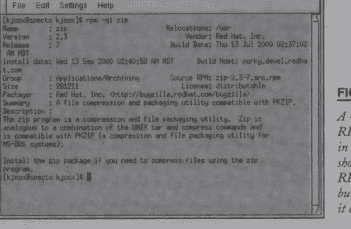

**图 11.1**

*向 RPM 程序查询 `-qi` 的结果是一个摘要，显示什么构建了 RPM，构建时间，来自什么源代码等。*

例如，命令 `rpm -qpi zip-2.3-7.i386.rpm` 在不实际安装文件的情况下列出文件的内容。类似的命令 `rpm -qpi zip-2.3-7.i386.rpm` 在安装之前打印出关于 `zip` 程序的信息。这样就不需要安装每个文件才能查看哪些文件被放置在你的系统上。

与查询命令关联的一些其他选项如下：

| 选项 | 描述 |
| :--- | :--- |
| -d | 显示标记为文档文件的文件，例如 man 页面和 doc 文件。 |
| -s | 显示特定软件包中文件的状态。 |
| -c | 列出标记为配置文件的文件。该选项适用于 Apache 或 Samba 等需要此类文件的程序。 |

##### 验证已安装软件包的完整性

测试已安装 RPM 软件包完整性的最后一步是验证它。为此，你使用一个命令来检查从软件包安装的信息与原始软件包的信息进行对比。该命令测试每个文件的大小、MD5 校验和、权限、类型、所有者和组等。

你使用 `-v` 或 `verify` 选项来运行 RPM 文件的验证。例如，要验证程序文件 `zip`，你会输入以下命令：

```
# rpm -Vf /usr/bin/zip
```

如果一切验证正确且没有复杂情况，那么 RPM 不会打印任何输出。如果你怀疑你的数据库已损坏，你可以将已安装文件与新下载的 RPM 文件进行验证，如下所示：

```
rpm -Vp zip-2.3-7.i386.rpm
```

如果你发现数据库已损坏，你可能希望重建数据库。你可以重建现有数据库或创建新数据库。你只有在情况看起来危急时才应该这样做。每次你重建数据库时，你都有进一步损坏数据的风险。但如果情况已经看起来不乐观，重建可能会修复问题。

要重新创建现有数据库，请使用以下命令：

```
rpm --rebuilddb
```

要创建新数据库，请输入以下命令：

```
rpm --initdb
```

此命令在你的系统上创建一个新的 RPM 数据库。它完全从你的机器上移除关于已安装 RPM 软件包的所有信息。这应该是最后考虑到的选项。

#### 从源代码创建 RPM 软件包

如果你想要 rpm 格式的自由，但又想要或需要查看源代码，你可以从源代码 RPM 创建二进制 RPM。许多开发人员使其源代码以 `.src.rpm` 格式可用，以便用户可以创建自己的二进制文件以方便安装。一些用户喜欢编译他们自己的 RPM，并带有他们自己的变量或选项。Red Hat 提供了靠近源内核的独特位置，用于编译你自己的 RPM。

要从源代码 RPM 创建二进制 RPM 并安装它，请按照这些步骤操作：

-   1. 通过输入 `su -` 成为超级用户或 root。
-   2. 在源代码 RPM 所在的目录中，输入 `rpm -ivh <packagenames>.src.rpm`。


### 360 第三部分 系统定制

- 3. 输入 `cd /usr/src/redhat/SPECS` 将目录切换至 Red Hat 的 SPECS 目录。
- 4. 发出以下 RPM 构建命令以创建 i386 格式的 RPM：`rpm -bb <packagename>.spec`。
- 5. 输入以下内容以切换至二进制 RPM 现在所在的新目录：`cd ~/RPMS/i386`。（如果使用基于 Sun 或 Alpha 的系统，该目录的名称将有所不同。）
- 6. 要安装你的二进制 RPM，请输入 `rpm -ivh <packagename>.i386.rpm`。

安装好 RPM 包后，你可以安全地删除此目录中的二进制文件，并稍后重新创建它。开发人员通常只提供源代码 RPM，以确保二进制 RPM 的完整性。这将成功构建该包的责任交由用户承担。

### 使用更新代理保持最新

定期下载并更新 RPM 包是保持其处于最新状态或确保机器安全的好方法。但是，如果你的系统需要保持所有 RPM 的最新状态，或者你只想更新选定的部分 RPM，那么手动查找所需包或访问该程序的网页可能不如自动从 Red Hat 站点下载 RPM 或使用 Red Hat 更新代理（该代理可保持所有已安装 RPM 的最新状态）来得高效。

Red Hat 的最新版本提供了一个实用工具 Update Agent（更新代理），它可以从 Red Hat 下载站点获取最新的软件包。使用此程序需要在 Red Hat 网页上进行注册才能访问其 FTP 站点。要注册，请访问 [http://www.redhat.com/now](http://www.redhat.com/now)。注册后，你可以选择用户名和密码，并使用它们来配置更新代理。

注册完成后，你可以从桌面启动更新代理，然后连接到 Red Hat 站点，提供新创建的账户名和密码。你也可以在任何其他窗口管理器中，通过在 root 命令提示符下输入 `/usr/bin/update` 来启动此程序。只有 root 用户才能启动此程序。

要运行更新代理，首先打开 Gnome 桌面来定位主启动项。点击 Gnome 面板左下角的主 Gnome 图标或主菜单按钮，然后选择“系统”、“更新代理”。

如果你使用 KDE 作为默认窗口管理器，请选择“面板”、“Red Hat”、“系统”、“更新代理”。每次你在 Gnome 或 KDE 中以普通用户身份启动此程序时，系统都会提示输入 root 的密码（见图 11.2）。

现在，你可以配置更新代理，使其允许你访问 Red Hat 的更新程序库存。

> **注意**
>
> 如果使用其他窗口管理器，必须以 root 身份启动该程序。Gnome 和 KDE 充当此特定程序的封装器，因此当尝试运行由 root 拥有的程序时，它们会提示输入 root 的密码。

主更新代理窗口启动后（见图 11.3），选择“配置”按钮以设置连接。此时会出现配置对话框。（“中止”按钮仅适用于下载或安装程序时，用于关闭该程序。）

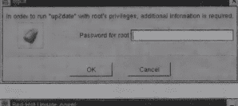

**图 11.2**

*在 Gnome 和 KDE 下，尝试以普通用户身份启动程序时会提示输入 root 的密码。在其他窗口管理器下，你需要是 root 用户才能启动此应用程序。*

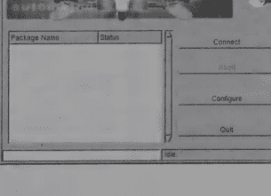

**图 11.3**

*主更新代理窗口，允许用户配置或连接到主 Red Hat RPM 站点。*

配置对话框显示三个选项卡。在每个选项卡下，你可以输入信息以便连接到主 RPM 站点并下载信息：

- **用户。** 在此选项卡中，输入你在 Red Hat 站点注册后选择的用户名和密码。你还需要提供一个有效的电子邮件地址。
- **检索。** 使用此选项卡指定服务器名称，并赋予程序安装和更新已下载程序的指令。
- **例外。** 在此选项卡中，你可以选择希望在搜索中排除的特定文件或软件包。

图 11.4 显示了用户选项卡。填入你在 Red Hat 站点注册后选择的用户名或密码。你还应在提供的空白处填写你的电子邮件地址。

图 11.5 显示了检索选项卡。此选项卡要求你输入更多关于你的配置和下载服务器名称的细节。你必须输入一个用于下载更新的服务器名称。这可以是 Red Hat 服务器或镜像服务器。该选项卡还允许你选择用于下载和安装新软件包的程序。

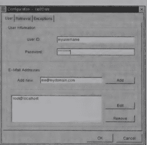

**图 11.4**

*配置对话框中的用户选项卡是输入用户名和密码的地方。*

#### 安装额外程序

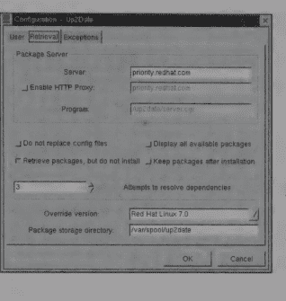

**图 11.5**

*配置对话框中的检索选项卡。在此输入有关下载服务器的信息。*

服务器字段下方有复选框和其他字段，可让你优化下载和安装新软件包的方法。与 Gnome-RPM 程序一样，你可以确切选择如何处理较新的软件包。你可以备份旧的配置文件或直接覆盖它们，让程序显示所有可用文件，在不安装的情况下获取软件包，以及将下载的软件包安装到其他位置。

你还可以决定是否让程序尝试解析依赖关系。你可以选择程序应检查与其他程序依赖关系的次数。该数字介于 1 到 10 之间。你还可以选择覆盖程序当前正在更新的 Linux 版本，以及你存储已下载程序的默认位置（用于更新前或归档目的）。

图 11.6 是例外选项卡的截图，该选项卡允许你指定通常不希望下载、搜索或修改的软件包和文件。你可以使用通配符选项：星号 (*) 和问号 (?)。当星号用于文件名末尾时，将忽略所有以星号前的字符开头的所有软件包。例如，由于通配符选项的存在，RPM 软件包 kernel、kernel-headers、kernel-source、kernel-utils 和 kernelcfg 都将被忽略。如果你不确定软件包名称，请使用问号 (?) 来查找拼写相似的软件包。

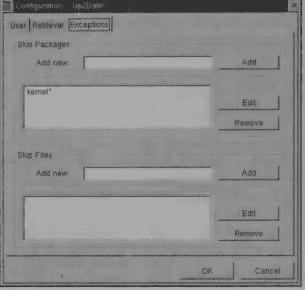

**图 11.6**

*配置对话框中的例外选项卡。在此放置你不希望更新的软件包或文件名。*

在对话框的下部，除了软件包之外，你还可以忽略某些文件。如果你知道某种你不打算更新的文件类型或名称，请在此处选择其名称及任何通配符选项，该特定文件将不会被下载。

#### 在 X 窗口环境中运行更新代理

填写完所有相关信息后，你现在可以连接到服务器并下载所需的文件。如果你有局域网（LAN）连接，则不需要设置点对点协议 (PPP) 连接。如果你正从家中的机器更新本机，首先需要连接到互联网服务提供商 (ISP) 并建立可用的连接。有关设置 PPP 连接的回顾，请参阅第 16 章。

在主更新代理屏幕上，点击“连接”按钮。状态栏会出现在主页面左下角，指示应用程序正在连接并从引用的 FTP 站点检索信息。如果你选择了要排除的文件，你将看到如图 11.7 所示的对话框。在此特定示例中，kernel* 软件包被选中以排除在下载之外。额外的状态信息


将出现在 Red Hat 更新代理主窗口的右下角。

更新代理接下来会创建一个 HTML 页面，该页面可以在浏览器中查看。此页面提供有关您选择更新的每个软件包的详细信息。如果您选择安装 Netscape Communicator 软件包，更新代理将为您启动此浏览器。您可以从任何能够渲染 HTML 页面的浏览器中访问该页面。

根据您的需要，您可以通过勾选软件包旁边的复选框来选择要安装的软件包。您应该看到如图 11.8 所示的网页，该网页由更新代理生成。

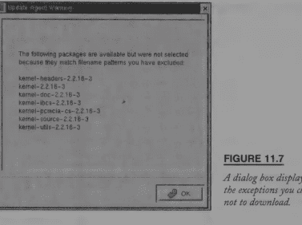

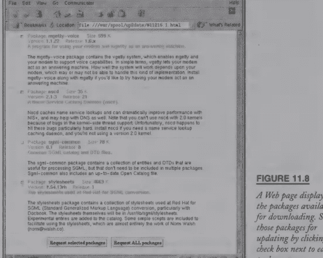

**图 11.8**

显示可下载软件包的网页。通过单击每个软件包名称旁边的复选框，选择要更新的软件包。

完成选择要下载和安装的软件包后，单击软件包名称旁的**请求选定软件包**按钮。如果您希望使用所有可用软件包更新系统，请单击**请求所有软件包**按钮；您无需在每个软件包旁进行单独选择。在您提交软件包请求后，浏览器窗口将关闭。

接下来，主更新代理对话框将列出已选定用于下载的软件包（见图 11.9）。*软件包名称*列列出每个软件包，而*状态*列在每个软件包旁插入一个小按钮。此窗口下方是一个小状态栏，用于显示下载和依赖项检查状态。当软件包下载完成后，状态列中的按钮会变为红色箭头。当每个软件包成功安装后，箭头会变为对勾标记。对话框左下角的进度条反映了在所有更新下载并安装完成前剩余的工作量。

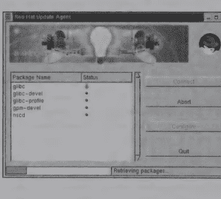

**图 11.9**

主更新代理对话框，显示每个已下载和安装程序的进度。

在所有软件包被检索和/或安装到您的系统后，会弹出一个窗口告知您操作成功。您还会收到电子邮件验证，确认请求的操作已完成。验证邮件将发送到您指定为用户 ID 的地址。

#### 通过命令行更新软件包

如果您不希望窗口管理器中运行更新代理，或者不希望通过 xterm 或图形用户界面（GUI）桌面运行，您可以选择从命令行运行该程序（见图 11.10）。在 root shell 提示符下，输入 `/usr/sbin/update -l` 以获取可更新软件包的列表。请记住，根据机器速度和可用软件包，列表可能滚动过快，导致您无法阅读每一项。您可以使用类似 `less` 的选项将输出管道传输到分页器，或者将输出重定向到文本文件，然后使用分页器或任何文本编辑器阅读该文件。

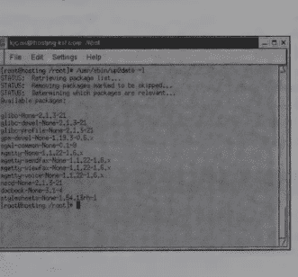

**图 11.10**

*在命令行上使用更新代理显示可用更新的软件包。*

要下载和安装您想要的软件包，请使用批处理模式选项，即在主命令后跟一个 `-b` 或 `--batch` 标志。例如，要下载最新的 `rpm` 程序，请发出以下命令：

```bash
# /usr/sbin/up2date -b rpm
```

或者，如果您希望下载多个更新，请在批处理选项后跟每个软件包名称：

```bash
# /usr/sbin/up2date -b glibc gpm mgreet nscd
```

此命令使您可以下载并安装命令行上列出的每个软件包。

#### 使用 alien 转换软件包

如果您想测试其他格式的软件包，如 Debian 的 `.deb`、Slackware 的 `.tgz` 以及 Linux Stampede 的 `.slp` 格式，您可以使用一个 Linux 实用工具，将 RPM 转换为这些其他格式，反之亦然。`alien` 程序是一个 Perl 脚本，提供不同发行版上可用软件包管理器之间的互操作性。通常，习惯特定发行版（如 Debian）的开发者只为他们的发行版创建软件包，导致 Red Hat 用户无法加载其实用工具，除非完全移除其特定发行版（如 Red Hat），然后安装支持新软件包类型的新发行版。对于许多未使用 Red Hat 的 Linux 用户来说也是如此。虽然 RPM 软件包安装简单，但许多人对自己使用的发行版有特殊的亲和力。`alien` 程序通过允许用户将这些软件包转换为其他任何二进制软件包格式，克服了诸多障碍。虽然 Debian 用户可以安装 `rpm` 程序并维护两个独立的数据库（RPM 和 DEB），但使用 `alien` 在这两种二进制软件包之间转换要容易得多。

> **注意**
>
> 一般来说，您不应使用 `alien` 将某些软件包（如 `init`、`libc` 和其他特定于系统的文件）转换为其他格式。这样做可能会破坏您的系统。下载 Stampede 版本的最新内核，将其转换为 RPM 格式，然后将其安装在 Red Hat 系统上，这是绝对不建议的。不同发行版将系统程序安装在不同的位置。`alien` 程序主要旨在用于提供附加功能且对系统性能非核心的独特程序。

`alien` 程序可从 alien 主页 http://kittenet.net/programs/alien/ 获取，但也可从众多 Linux 镜像站点或 Freshmeat 或 Linuxberg 等清货站点下载。GNUare CD 上也提供了一个当前版本。

将打包并压缩的程序放置在临时位置后，发出以下命令进行解压缩：

```bash
gunzip -c alien_x.x.tar.gz | tar xvf -
```

将 `x` 替换为最新的发布号。这将创建一个名为 `alien/` 的唯一目录。更改到此新位置并阅读 `README` 和 `INSTALL` 文件。这些文件提供了安装和运行程序的基本说明。如果您急于开始使用该程序，只需输入以下行以设置、编译并安装该程序：

```bash
# perl Makefile.PL; make; make install
```

而不是单独输入各个命令，您可以使用分号将它们拼接到一行中。

接下来，下载或获取一份您要转换的软件包副本。如果您有一位坚定的 Debian 用户朋友，他/她喜欢专门使用其格式，您可以通过使用 `alien` 将最新的 zip RPM 文件转换为 `.deb` 文件，共享您喜欢的许多 RPM 软件包。以下是使用 `alien` 的最基本语法：

```bash
# alien --to-deb zip-2.3.4-i386.rpm
```

如果您已安装所有必要的库和依赖文件，`alien` 将创建一个 `.deb` 文件，该文件即可重新分发。同样适用于 `.slp` 和 `.tgz` 文件。Slackware 的 `.tgz` 格式可能最通用，因为它提供标准二进制文件，独立于您使用的平台。

```bash
# alien --to-tgz zip-2.3.4-i386.rpm
```

此命令创建 `zip-2.3.tgz` 文件。一旦您解压缩并解包该文件，程序还会创建安装这些文件的常规目录。

将 `*.tgz` 文件复制到 `/tmp/` 等位置，然后解开压缩。随后您可以替换标准位置中的二进制文件。该程序并非专门用于系统文件，但对于获取二进制文件并手动安装这些文件非常有用。

`alien` 程序还能够在创建新软件包后立即安装它们。当将程序从 `.deb` 扩展名转换为 `.rpm` 格式或在 Debian 系统上进行反向操作时，转换完成后即开始在系统上安装二进制文件。只需添加 `-i` 选项，软件包将在转换后安装：

```bash
# alien --to-deb -i zip-2.3.4.i386.rpm
```

您还可以通过添加 `--description=` 选项紧接着一个简短字符串来提供程序功能的描述。

```bash
# alien --to-rpm --description="A utility for compressing files" zip-2.3.tgz

zip-2.3.2.noarch.rpm generated
```

一如既往，确定额外选项或回答更多语法问题的最佳方法是查阅 man 手册页。

#### 运行 Gnome-RPM

为 Linux 发布的更具功能性的工具之一是 Gnome-RPM。它为浏览 RPM 数据库内容提供了图形用户界面，并允许快速安装和卸载各种文件。它还可定制，用户可以设置自己的目录，以便将 RPM 文件放入其中用于组织目的。

Gnome-RPM 以典型的可折叠目录树结构为模型，还提供了一个工具集，用于搜索丢失的 RPM 文件，或从众多镜像 RPM 站点之一获取最新版本。

Gnome-RPM 程序通过 `gnorpm` 命令执行。与其前身 `glint` 类似，`gnorpm` 也为用户提供每个 RPM 文件的可视化表示（见图 11.11）。但与 `glint` 不同的是，`gnorpm` 接受多个命令行选项，反映了 `rpm` 命令在命令行上提供的相同功能。

此处命令行可用的基本命令也很明显。您可以安装、卸载、查询和验证。除了提供这些非常基本的命令外，`gnorpm` 还添加了几个其他选项。您还可以通过单击软件包并在其相应图标上添加对勾标记，选择要卸载的软件包。`gnorpm` 程序还具有查找


#### 安装额外程序

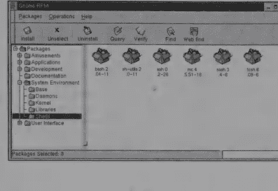

**图 11.11**
*Gnome-RPM 窗口的初始图像，显示右侧框中可用于左侧列所示每个分类的软件包。*

该功能可直接在系统上查找 RPM 文件，还有一个 Web 查找功能，它关联到外部程序 rpmfind。使用后者，如果您已连接到互联网，您可以找到您想要的文件，并从其他地方的大量文件中选择。

在主接口窗口的左下角，您可以浏览可用的许多分类或 RPM 文件，其中大多数都是预安装的。右侧是软件包本身。只有在左侧的一个文件夹内单击时，您才能看到每个单独的选项。

在屏幕顶部出现的图标中，第一个也许是最重要。通常情况下，用户希望下载新的 RPM 而不是删除现有的。点击“安装”按钮会弹出图 11.12 所示的安装窗口。

在此安装窗口中，您可以选择从您的发行版 CD 安装额外的 RPM，或者取消选择已安装的 RPM。顶部的“筛选”下拉菜单提供了显示所有软件包、除已安装软件包外的所有软件包、仅未安装软件包、仅较新软件包（仅当升级到较新版本时此选项可用）以及仅未安装或较新软件包的选项。“筛选”控件下方是一个树结构窗口，列出了软件包。此列表由安装在已挂载的发行版 CD 上找到的分类组成。与 Gnome-RPM 窗口类似，安装窗口使您可以开始选择或取消选择您希望添加的软件包。如果您从“筛选”下拉菜单中选择“所有软件包”选项，您会看到已安装的那些软件包以绿色高亮显示，未安装的那些以黑色显示（见图 11.13）。

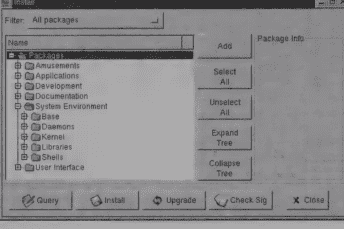

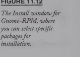

在图 11.13 中，所有桌面应用程序已安装，因此以绿色显示。Window Maker 桌面尚未安装，因此以黑色显示。勾选应用程序名称旁边的复选框，然后单击窗口底部的“安装”按钮，即可从 Red Hat Linux 安装 CD 上安装该程序。

您也可以从“筛选”下拉菜单中选择其他选项之一。这样做会改变树结构窗口中的显示。选择“仅未安装软件包”选项会显示那些尚未在您的系统上安装的软件包（见图 11.14）。

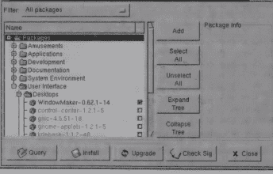

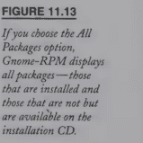

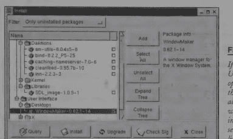

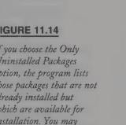

现在您可以使用目录树结构右侧的按钮来选择全部、取消选择全部、展开或折叠树结构。在这些按钮的右侧是每个软件包功能的简短摘要。如果您只想安装少量额外文件，您应该选择“取消选择全部”按钮，然后折叠树结构。然后您可以浏览所有可用的软件包，只选择您想要的那些。

屏幕底部的按钮使您可以查询 CD 上的软件包。选择软件包后，您可以选择“安装”按钮来重新安装之前未安装的软件包，或升级到较新的版本。如果您正在安装新软件包，gnopm 将启动安装过程。

然后程序显示一个小进度窗口，指示所选软件包的数量、大小以及安装过程中剩余的时间（见图 11.15）。您可能会从 Linux 的初始安装过程中认出类似的窗口。安装过程完成后，所选的软件包即可使用。

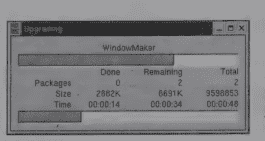


您也可以选择从主 Gnome-RPM 窗口卸载选定的软件包。选择包含您想要移除的软件包的目录。突出显示您想要卸载的软件包后，会出现一个确认窗口，要求您确认您的决定（见图 11.16）。

如果您肯定回答，程序将卸载您选定的 RPM 软件包。与控制台命令一样，程序不显示任何视觉进度指示器来显示卸载过程的进度，但几分钟后，选定的软件包将从窗口中消失。

主 gnome-rpm 窗口上的下一个选项是“查询”按钮。在使用此工具之前，您必须首先突出显示要查询的单个软件包。查询工具的功能很像 RPM 命令行选项 -qi 和 -ql，它提供 RPM 软件包的描述、其构建的详细信息以及所有已安装文件及其各自位置的显示（见图 11.17）。

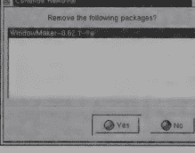

**图 11.16**

Gnome-RPM 在移除不需要或过时的软件包时会提示您进行确认。

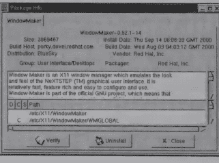

**图 11.17**

查询工具提供关于软件包信息的更详细描述。

“查询”按钮将所有额外的命令行特性整合在一个简单的界面中。此外，您可以验证单个软件包并确认它们与原始安装时一致（见图 11.18）。

主 gnrpm 窗口上的最后两个功能，“查找”和“Web 查找”，提供了额外的功能，并在性能上将 gnrpm 的前身远远抛在身后。“查找”选项允许您定位特定的软件包（见图 11.19）。定位该文件的几个额外选项可以帮助您定义搜索。如果您知道要查找的文件名称，您可以选择“匹配标签”选项。选项相当通用且范围广泛。程序找到文件后，您还可以查询、卸载和验证它。

最后一个选项可能是最通用的。通过它，您现在可以从世界上几乎任何地方定位 RPM 文件。确保您首先通过 LAN 或调制解调器连接到互联网，然后单击“Web 查找”按钮，调出几乎所有可用 RPM 软件包的列表。gnrpm 程序执行 rpmfind 程序，然后首先查询远程站点的数据库并下载所有可用程序的列表。当每个单独的

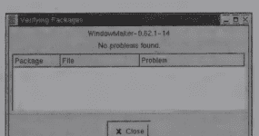

**图 11.18**

当 gnrpm 验证安装过程中没有发生问题时，程序显示一个验证窗口。

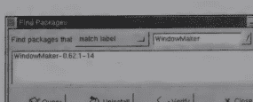

**图 11.19**

查找工具定位新的待安装软件包。

软件包被检查时，rpmlink 程序查询远程站点并下载更多信息。这些信息在 gnomrpm 下显示。

如图 11.20 所示，左侧的窗口显示所有可用的程序；它们的名称出现在最左侧，然后是它们在本地系统上的状态和分发。图 11.20 中的示例，joe，一个简单的文本编辑器，目前未安装在本地机器上。

要安装 joe，您可以做以下两件事之一，两者都允许您稍后安装文本编辑器。如果您单击“下载”按钮，rpmlink 会提示您确认是否下载选定的软件包（见图 11.21）。接下来，会出现一个指示器，显示下载进度。

然后您可以稍后安装软件包。安装工具为您完成所有工作。您会被提示下载软件包，但一旦它在本地系统上，程序就会自动为您安装它。

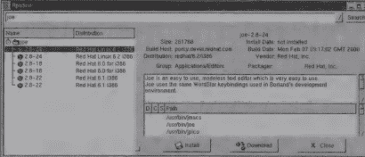

**图 11.20**

*rpmlink 实用程序提供详细的显示，包括软件包的名称、软件包所属的版本以及文件的描述。*

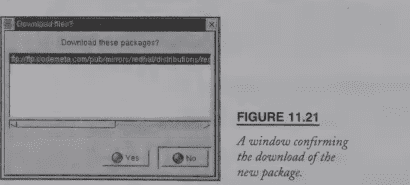

**图 11.21**

*确认下载新软件包的窗口。*


gnppm 程序的动态特性使得在系统上安装大量程序变得极其容易。而且，由于该软件是开源并对公众免费提供的，因此不存在任何隐藏成本。该程序唯一明显的缺点是缺乏可用的镜像站点。如果所选站点之一的 FTP 访问已满或不可用，程序将没有任何响应。然而，一旦程序定位到有效站点并确认所需文件存在，它便会迅速开始下载。

文件完全下载后，gnppm 会再次提示你验证新文件的安装。它会再次调出安装窗口，甚至还会选择安装文件的合适目录。

如果你无法建立互联网连接，则还有其他选项可用。许多网站提供可在 CD 上购买的 RPM。与发行版 CD 一样，你可以将 CD 挂载到机器上并浏览其内容，从而快速访问位于其中的文件（参见图 11.22）。

Gnome-RPM 程序使得使用 RPM 的整个安装过程对于即使是新手用户来说也是一个无痛的流程。虽然能够安装源代码是衡量管理员能力的一种久经考验的标准，但 RPM 使普通用户也能执行相同的任务。尽管对于新手来说，从源代码编译代码可能被认为是一种享受，但 RPM 使得所有源代码和成品都能面向大众普及成为可能。

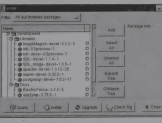

**图 11.22**
*从 CD 加载附加软件包。*

### 结论

现在，你已经熟悉了安装和升级额外 Linux 程序的基本步骤，这些程序不仅可从发行版 CD 获取，也可从互联网获取。你可以开始自定义 X 窗口接口，它是许多 Linux 操作的基础。配置默认的窗口管理器将帮助你决定在使用图形用户界面（GUI）工具时希望使用哪种类型的环境。你可以从 20 多种主要的窗口管理器中进行选择，每个都有各自的优缺点。你仅受限于你的品味以及你希望使用的环境的外观和感觉。在 X 窗口内，你还可以开始使用现在可用于 Linux 的众多办公套件之一，以及数据库服务器、财务或个人记账管理器和任务管理程序。如果你正确配置了 Linux，你可以运行的程序种类繁多，其限制仅取决于你的想象力以及为这个独特平台开发的人员数量。

# 第 12 章

# 配置 X 窗口系统下的应用程序

一旦你了解如何通过命令行或使用特定的 GUI 工具在机器上安装额外的程序，你就可以开始自定义你的 X 窗口系统接口。X 是新安装的事实*标准*。如果机器的显卡足够新，并且机器在启动时可以直接进入 X，从而无需使用命令行，那么 Red Hat 会在默认安装过程中启动到 X 窗口系统环境。这种默认流程使用户能够直接访问 X 终端模拟器，这些模拟器提供命令行功能，但也允许使用 GUI 程序。

本章涵盖以下主题：

- 设置 XFree86，这是 X 协议最常见的实现
- 使用自动化配置工具
- 安装自定义窗口管理器
- 主题化你的界面
- 安装用于办公、图形和数据库程序的主要软件包
- 配置在 X 窗口下使用的字体

### 自定义 X 窗口界面

在 Linux 下，最可自定义的功能可能是窗口管理器。窗口管理器控制你的 X 会话中的窗口和终端。使用不同的管理器，你可以微调 GUI 的外观和感觉。使用每个管理器可用的主题和插件，你甚至可以让你的桌面看起来并运作起来就像 Windows 或 Apple 桌面一样，或者将其个性化以呈现从未见过的样式。每个窗口管理器都提供了广泛图标、图形和纹理，以协助用户创建自己的独特桌面显示。

在 Linux 下使用命令行工作后，你可能会发现使用 GUI 客户端是解放性的。尽管许多人认为命令行是 Linux 的优势，并因此赋予它相对于其他操作系统的显著优势，但其他人则习惯于点击操作界面。事实上，依赖 GUI 来完成大多数日常任务在初级用户中变得越来越普遍。大多数用户已经习惯了诸如 Windows、Apple 桌面以及新来的 BeOS 等界面。在转换为 Linux 等新操作系统时，他们往往期望更多用户友好性。对于大多数人来说，回归到命令行界面似乎是一种倒退。

尽管正如前几章中多次指出的，命令行可能更强大和动态，但据说它更难学习。用户必须经常练习和使用它，才能掌握所有命令及其相关选项。为此，Linux 开发者的一般趋势是创建一个点击操作界面，同时不牺牲命令行的可行性。这与其说是将用户与系统之间的交互方式“变笨”，不如说是为了变得更加用户友好并吸引更多开发者。随着 Linux 用户群的增长，将会有更多工作致力于将命令行的灵活性整合到一个更具动态性的可点击界面中，一个仍然保留 Linux 以其闻名的活力和可定制性的界面。Linux 已经提供超过 20 种主要接口或窗口管理器，可用于无数的 Linux 发行版中的任何一种。

#### 区分 GUI

要理解窗口管理器的目的，你首先需要理解 Linux 如何渲染 GUI。在加载任何 GUI 客户端时，Linux 使用 X 窗口系统接口。GUI 的漫长历史及其开发超出了本书的范围。然而，X 窗口系统，或许多爱好者所称的 X，是生成鼠标和屏幕之间接口的工具，并实现窗口、文本、图形等的渲染。

目前，最流行的 X 窗口服务器是 XFree86。除了其多功能性和开发支持外，XFree86 是所有 X 窗口服务器中价格最低的——它是免费的。XFree86 是持有所有独特显卡及其芯片组驱动程序的程序。它还包含许多当前市场上可用的显示器数据库。XFree86 允许你调整水平和垂直刷新率。许多卡和显示器制造商正在看到为他们的产品发布驱动程序以用于 Linux 的智慧。XFree86 团队将此信息纳入其知识库，并让 Linux GUI 随着每个月的时间推移变得更好。随着 XFce86 4.0 的发布，Linux 将在刷新显示和显示图形信息方面拥有更快的响应时间。随着 4.0 的发布，视频驱动程序现在直接接入你的硬件，从而实现对卡本身的数据更快传输。这意味着 4.0 将具备直接渲染能力，这对于拥有 3-D 卡的用户来说是一大利好。已经有人报道游戏和 X 终端模拟器在重绘请求方面显示出更快的响应时间。随着进展的继续，你将会看到 XFree86 4.0 为更快的视频响应设定标准。4.0 的 tar 文件和 RPM 发布已经可用于最新的 Red Hat 发布。拥有更快卡的用户应会看到 X 在图像渲染和窗口重绘方面的显著改进。

还有几种其他 GUI 服务器可用——其中几种已商业发布。据称，它们对数量有限制的卡提供更好的支持。如果你幸运地拥有一张受支持的卡，那么视频分辨率可以非常出色。然而，大多数消费者首先购买他们的卡，然后才担心软件。因此，XFree86 试图为所有卡提供支持，无论它们是否能够实现出色的渲染还是分辨率稍低的图像。这很大程度上取决于卡制造商发布的驱动程序以及你设置的卡的分辨率级别。如果你在渲染方面遇到问题，尝试将卡设置为较低的每像素位数设置。随着时间推移，可以预见 XFree86 将提供与商业对应产品相当或更好的图像渲染支持。

#### 指定视频设置

在最新的 Red Hat 发布中，初始安装例程引导你通过 X 窗口设置过程中最繁琐的部分。几乎不需要手动微调配置文件。但是，你应该熟悉你的显卡和显示器的一些基础知识。你还应查阅显示器手册背面关于用于显示的不同设置（如刷新率）的信息。这些信息在你执行安装过程时是好的参考。知道显卡的确切型号和品牌也是明智之举。一些较新的型号可能不受最新 XFree86 发布的支持，因此，如果你是先购买硬件，最好选择更知名的品牌和部件。


在安装过程中，大多数发行版会提示你进行一些特定设置。最新的 Red Hat 甚至会进一步自动检测已安装的显卡类型，并加载与该品牌对应的驱动程序。一些商业 UNIX 系统不具备此功能，因此你必须手动加载驱动程序。

在确定机器上安装的显卡类型并检查是否安装了正确的 XF86 RPM 软件包后，Red Hat 随后会尝试识别连接到系统的显示器类型。正确配置此选项至关重要，尽管 Red Hat 通常会很好地确定正确的品牌。如果你的显示器不包含在提供的列表中，如果你的显示器是较旧的隔行扫描型号，请选择**通用显示器**；如果是较新的 SVGA 显示器，请选择**通用多同步**。（我通常选择后者，因为我工作中可获取的显示器品牌通常不在提供的列表中。）安装过程中设定的水平和垂直同步速率通常足以实现有限的显示效果。有关更具体的设置，请查阅用户手册。对于我自己的桌面 Linux 机器，我希望将分辨率设置为 1,280 × 1,024，因为我知道我的显示器能够达到此分辨率。然而，Red Hat 希望将速率设置得更低。在测试了几个类似的品牌后，我终于找到了一个能满足我需求的设置。在设置截然不同的显示器类型作为默认值时要格外小心。再次提醒，这可能会导致显示问题。

接下来，安装例程将检测你的显卡及其芯片组，或者显卡制造商使用的硬件驱动程序。在我的测试机器上，Red Hat 选择了 S3 Virge（通用）驱动程序作为我显卡的驱动程序，尽管它是一款较新品牌的显卡。该显卡的通用芯片组有时对新显卡和旧显卡同样有效。如果找不到显卡的确切品牌和型号，请选择支持相同芯片组的一个。在某些情况下，你可能需要参考显卡的官方主页以获取更多信息。

在视频硬件部分下方，有一些用于选择显卡内存量的按钮。其范围可在 256 千字节到 32 兆字节之间。Red Hat 通常会选择正确的数值，但你可以根据需要修改此设置。在这些选项下方是**测试配置**按钮。你可以选择通用安装配置，或选择其下方的**自定义 X 配置**按钮。我建议自定义 X 配置，因为这样你可以设置每像素位数速率，并测试新设置以验证其确实有效。在同一页面上的附加功能允许你在启动时使用图形化登录，而不是在命令行登录。或者，如果机器太慢、内存或磁盘空间不足，或执行的任务不需要 X，你可以选择完全跳过配置 X。

我喜欢按照自己的规格自定义 X，并跳过图形化登录。自定义页面允许设置不同级别的分辨率和像素位数。根据你的显卡品牌和显示器型号，下表中显示的设置可能略有不同。在最新的 Red Hat Linux 版本中，所有选项已被选中，当测试配置时，它会尝试显示最高范围。以下是通用 4 兆字节显卡设置的细分：

| | 8 位每像素 | 16 位每像素 | 32 位每像素 |
| :--- | :--- | :--- | :--- |
| 640 × 480 | 640 × 480 | 640 × 480 | 640 × 480 |
| 800 × 600 | 800 × 600 | 800 × 600 | 800 × 600 |
| 1,024 × 768 | 1,024 × 768 | 1,024 × 768 | 1,024 × 768 |
| 1,152 × 864 | 1,152 × 864 | 1,152 × 864 | 1,152 × 864 |
| 1,280 × 1,024 | 1,280 × 1,024 | 1,280 × 1,024 | 1,280 × 1,024 |
| 1,600 × 1,200 | 1,600 × 1,200 | 1,600 × 1,200 | |

我发现，将 1,024 × 768 分辨率设置为 16 位每像素速率，足以在大多数显卡上提供所需的颜色和分辨率。此设置也是 15 英寸及以上显示器的推荐设置。仅当你拥有 17 英寸或更大的显示器时才建议这些较高的设置；否则字体可能会小到难以阅读。此外，较高的像素设置将需要更多时间来渲染图像。较高的分辨率会降低颜色深度，因此这是更高分辨率与增加颜色深度之间的权衡。8 位设置仅允许最多 256 种颜色。这对于简单的控制台使用是足够的，但当你运行配备高端显示器和图形密集型程序时，16 位通常是首选设置。你可以使用 32 位分辨率进行高端图形工作或 Linux 游戏。

在仍处于 Red Hat 安装例程中时，你可以测试所选设置以验证其正确性，并查看显示器和显卡是否能正确显示图像。如果测试中未出现图像或图形，系统将通知你设置不正确，并提示返回配置例程。在这里，你可以测试不同的设置，或将 X 配置延迟到安装 Linux 之后。Xconfigurator 程序在命令行下为显示组织最佳设置方面做得很好。

最新的 X 安装例程比早期 Red Hat 版本效果更好，在早期版本中，你必须盲目选择默认设置，没有机会验证其正确性。只有在安装 Linux 后才能测试 X 是否正常启动。额外的调整是在安装 Linux 之后进行的。现在，使用 Red Hat 7.x，你可以在首次登录之前正确设置 XFree86。

X 的另一个选项是直接启动到 X 窗口系统，从而避免初始的命令行登录。在确认图形显示在 X 下正常显示（仍处于测试阶段）之前，你还可以指定下次启动计算机时是否希望直接启动到 X 窗口。这样，你可以避免直接启动到命令行。对于一些初学 Linux 的用户来说，直接启动到 X 窗口可能是首选选项。你仍然可以使用 Xterm 或 X-Terminal 窗口访问命令行。但有些用户可能更喜欢从命令行开始。在控制台连接开始时，你可以通过使用命令提示符而不是使用之前的设置来以不同方式启动 X 窗口。这取决于你。

这个图形化登录屏幕，即 GNOME 显示管理器（GDM），直接以 5 运行级别或图形环境启动机器。基于 xdm，GDM 具有与 xdm 相当的许多多功能性，而 xdm 的存在时间几乎与 X 一样长。用户仍需输入用户名和密码，但 GDM 提供了额外的显示功能，使登录过程更具美感。GDM 还提供了设置会话、语言和系统变量的其他几个选项：

- 从**会话**下拉菜单中，你可以选择登录到 GNOME 或 KDE 桌面环境，或者选择其中一个较旧的窗口管理器，包括 AnotherLevel 和名为 FVWM95 的管理器，两者均基于 fvwm2 窗口管理器，但设置不同。还有一个名为**故障安全**的默认选项，如果未安装其他窗口管理器，它应允许你启动一个通用的 X 会话。
- **语言**选项允许国际用户从几种可用语言中进行选择。这对那些不精通英语但仍希望使用 Linux 的用户特别有帮助。
- **系统**选项允许你重启或停止系统。如果允许物理访问机器，执行这些命令不需要密码。因此，任何坐在终端登录屏幕前的人都可以导致机器重启，或停止所有进程、卸载分区并关闭机器，而不会损坏文件。

有关运行级别和 Red Hat 使用的默认设置的更多信息，请参阅第 2 章。

如果你希望返回 3 运行级别或启动到命令行界面，请再次运行 Xconfigurator 命令，不要选择初始启动到 X 的选项。如果你再次回到 GDM 屏幕并希望访问命令行，你可以通过按 Ctrl+Alt+F2 键组合随时调出另一个虚拟终端。要访问额外的虚拟桌面，请按任意其他 F 键。要从命令行提示符返回到 GDM 窗口，请按 Ctrl+Alt+F7，这是默认的 X 虚拟桌面。

#### 运行 Xconfigurator

如果你后来决定更改启动 X 服务器的方式，有几个选项可用。最简单的是 Red Hat 实用工具 Xconfigurator。此程序必须以 root 身份运行，并且你应该在控制台而不是 X 终端会话中运行它。Xconfigurator 必须测试你显卡的功能，而在 X 环境下无法有效做到这一点。此程序会调出一个基于文本的会话，引导你完成视频和显示器的各种设置。首先，程序确定你显卡的品牌，显示视频测试结果，然后提供几种选择供你选择显示器的品牌和型号。

> **注意**
> 请务必在垂直和水平刷新率方面选择与你最匹配的显示器。将速率设置得高于显示器所能承受的范围会导致显示器超频，可能会造成不可修复的损坏。


#### 编辑 XF86Config 文件

Xconfigurator 现在可以编辑您的 XF86Config 设置，这是一个简单的文本文件，用于存储所有视频设置。该文件位于 `/etc/X11` 目录中。在 `/usr/X11R6/lib/X11` 目录中也有一个指向同一文件的符号链接，您也可以在那里手动编辑该文件。一旦您运行 Xconfigurator，它会为您创建一个新的 XF86Config 文件。如果您决定运行此实用工具，请务必事先备份原始文件。您可能做出更改后无法重新启动进入 X Window System，特别是如果您已经手动对该文件进行了一些自定义更改时。

当 Xconfigurator 尝试确定刷新率时，显示器会闪烁几次，完成后它会存储这些刷新率。您还可以选择之前描述的彩色率和分辨率。对于新或熟悉的视频卡或显示器，请尝试较低的分辨率后再尝试较高的设置。如果显示器或卡不支持所需的频率，或者在探测不支持的卡时，Xconfigurator 可能会挂起或失败。您可以根据需要多次运行 Xconfigurator 程序，直到设置完全正确为止。

配置 X Window System 的另一种方法是手动编辑 XF86Config 文件。如前所述，此文件是由 Xconfigurator 程序自动生成的，或者如果您选择了完整安装所有 XFree86 程序和配置文件，则可能是预装好的。您可以随意编辑此文件，但如果您希望保存更改，请事先创建备份，并了解任何后续尝试运行 Xconfigurator 的行为都将撤销您的更改。此文件不仅是更改显示器和视频卡设置的地方，也是编辑鼠标、字体和键盘选项的地方。

如果您无法使用 Xconfigurator 运行某个特定选项，您可以手动在 XF86Config 文件中进行更改。这在您想向字体路径添加另一个条目或撤销 Xconfigurator 通常未定义的其他标志时非常有用。少量的实验将有助于使某些选项正常工作。

##### 设置鼠标

列表 12.1 摘录自通用的 XF86Config 文件。`Pointer` 部分用于设置鼠标配置。

###### 列表 12.1 用于设置鼠标选项的通用 XF86Config 文件摘录

```
Section "Pointer"
    Protocol    "Microsoft"
    Device      "/dev/mouse"

# When using XQUEUE, comment out the above two lines, and uncomment
# the following line.
#
#    Protocol    "Xqueue"

# Baudrate and SampleRate are only for some Logitech mice
#
#    BaudRate      9600
#    SampleRate 150

# Emulate3Buttons is an option for 2-button Microsoft mice
# Emulate3Timeout is the timeout in milliseconds (default is 50ms)

    Emulate3Buttons
    Emulate3Timeout     50

# ChordMiddle is an option for some 3-button Logitech mice
#   ChordMiddle

EndSection
```

该文件的语法如下。对于 XF86Config 文件而言，`Section`/`EndSection` 配对将鼠标设置或类似设备变量分组在 X 下。在 XF86Config 文件的其他部分，也有 `Subsection`/`EndSubsection` 配对，如定义屏幕分辨率的部分中所示。`Protocol` 选项定义鼠标的制造商。`Device` 选项说明如何处理唯一的设备文件，该文件通常是真实设备名称的符号链接；在这种情况下，它是 `/dev/ttyS0`（在 DOS 环境下也称为 `COM1`）。此示例中的几个部分被注释掉了，因为此类型配置文件不需要它们。

#### 在 X Window System 下配置应用程序

定义鼠标类型时最重要的部分之一是允许您为普通双键鼠标模拟三个按钮的部分。在设置例程期间，当系统为键盘和鼠标创建配置文件时，您可以定义鼠标类型并选择是否想要三键模拟。通过三键模拟，用户可以同时按下左键和右键来实现第三个按钮的功能。第三个按钮非常适合在其他终端窗口中粘贴选中的文本。对于那些带有滚轮的鼠标类型，例如 Microsoft IntelliMouse，中间的滚轮已经被配置为第三个按钮，因此无需配置此功能。Red Hat 默认检测这种类型的鼠标。通过按下滚轮，您可以将突出显示的文本粘贴到其他窗口中。


要配置三键模拟功能，请从 imwheel 主页 `http://jwestl.dhs.org/imwheel/` 下载最新的 imwheel 程序。您可以选择自己编译程序，或者使用 Red Hat RPM 包并允许系统进行必要的更改。我推荐手动安装最新版本。这样您可以更控制程序安装或更改哪些文件。编译和安装二进制文件后，您需要对 XF86Config 文件进行一些调整。只需注释掉关于 `ChordMiddle` 和 `Emulate3Buttons` 的两个部分。然后将此行添加到文件末尾：

```
ZAxisMapping 4 5
```

请注意，早期的 imwheel 版本存在某些安全漏洞。查阅 imwheel 主页以获取最新源代码，或检查 RPM 仓库页面以下载最新的 RPM 发布版。如果您只关心 Red Hat Linux 下发布的可能存在安全缺陷的程序，请检查 Red Hat Errata 页面以查看发行商提供的任何错误修复。


> **注意**
>
> Red Hat Errata 页面是获取有关最新代码、调试和安全修复信息的主要来源。您可以从这里下载随发行版 CD 提供的 RPM 的最新补丁：
>
> `http://www.redhat.com/support/errata/`
>
> 主要 Red Hat 页面通常很繁忙，因此在放弃之前，请先咨询其中一个镜像站点：
>
> `http://www.redhat.com/download/mirror.html`

#### 手动编辑默认分辨率

XF86Config 文件中有两个重要部分，即位于文件底部的 `Device` 和 `Screen` 部分。在这里您可以手动编辑分辨率设置。在我自己的工作系统中，我使用一块具有 16 兆字节 RAM 的 Voodoo3 2000 卡。为了测试一些 3DFX 设置或测试程序，我必须先设置分辨率为 640 × 480。如果我希望运行一些优化此加速卡的 Linux 程序，它们只能以最低分辨率运行。稍后，在运行标准程序时，我可以切换到更高的分辨率。因此，我可以以某种深度登录，但快速切换到另一种深度。XF86Config 文件必须能够为配置安装的通用设置以及通过卡的制造商和型号来确定卡类型。列表 12.2 显示了 XF86Config 文件中的 `Device` 部分。

##### 列表 12.2 摘自 XF86Config 文件，显示系统上使用的图形设备

```
#
************************************************************
# Graphics device section
#
************************************************************

# Any number of graphics device sections may be present

Section "Device"
    Identifier      "Generic VGA"
    VendorName      "Unknown"
    BoardName "Unknown"
    Chipset     "generic"

#    VideoRam 256

#    Clocks    25.2 28.3

EndSection

# Device configured by Xconfigurator:

Section "Device"
    Identifier "3DFx Interactive, Inc.|Voodoo 3 2000"
    VendorName "Unknown"
    BoardName    "Unknown"
#VideoRam    16384
# Insert Clocks lines here if appropriate
EndSection
```

在 `Device` 部分下方，您可以确定默认分辨率。我选择了 16 位的默认色深，并设置起始分辨率为 640 × 480，但我可以手动将其更改为 1,024 × 768。有两个主要部分：一个用于常规 SVGA 服务器，另一个用于优化 3DFX 卡的加速服务器。您可以将两者配置为启动到显示器支持的任何分辨率。列表 12.3 展示了如何做到这一点。但是，如果您希望最初使用 800 × 600 分辨率启动进入 X，或者也将 1,024 × 768 作为可用分辨率，您只需将它们按您希望查看设置的顺序添加到 `Modes` 部分中。


##### 清单 12.3 配置 X Window 环境的默认分辨率

```
#...................................
# Screen sections
#
..................................

# The Colour SVGA server
Section "Screen"
    Driver        "svga"
    # Use Device "Generic VGA" for Standard VGA 320x200x256
    #Device       "Generic VGA"
    Device        "3Dfx Interactive, Inc.|Voodoo 3 2000"
    Monitor       "My Monitor"

    Subsection "Display"
        Depth     16
        Modes     "640x480"     "1280x1024"
        ViewPort  0 0
    EndSubsection
EndSection

# The accelerated servers (S3, Mach32, Mach8, 8514, P9000, AGX, W32,
# I128, and S3V)
Section "Screen"
    Driver        "accel"
    Device        "3Dfx Interactive, Inc.|Voodoo 3 2000"
    Monitor       "My Monitor"

    Subsection "Display"
        Depth     16
        Modes     "640x480"     "1280x1024"
        ViewPort  0 0
    EndSubsection
EndSection
```

通过按下 Ctrl-Alt-+（提高分辨率）或 Ctrl-Alt–（降低分辨率），你可以切换模式，并在 X Window 内部即时将 640 × 480 的显示切换到更高的分辨率。这将使显示切换到更高的分辨率，然后循环回到较低的设置。对于拥有更好显卡或更大显示器的系统，你可以设置许多不同的分辨率，并随心所欲地更改设置。

#### 启动 X

在正确配置 X Window 后，你可以启动进入 X Window 环境。如果你当前不在 GDM 显示界面，启动图形用户界面（GUI）的标准方法是在命令行中输入以下内容：

```
startx
```

这是通常以运行级别 3 登录系统的用户使用的启动方法。初始命令还支持几个额外的选项。如果你正确配置了 XFree86 设置——也就是说，如果你添加了超过一个分辨率设置和颜色深度——你应该能够以不同的颜色模式启动。例如，如果默认深度设置为 8 位模式，但你希望改为以 16 位模式启动，你可以使用以下选项配合 startx：

```
startx -- -bpp 16
```

这将颜色深度设置为 16 位而不是 8 位。由于你向服务器传递了不同的参数，该语句必须以两个短横线作为前缀，并且位每像素（bits-per-pixel）设置前也必须加一个连字符。再次循环切换分辨率选项需要按下 Ctrl-Alt-+ 或 Ctrl-Alt--。

startx 命令首先查找该用户主目录中的 .xinitrc 文件。这是你可以设置默认窗口管理程序类型的地方。如果没有 .xinitrc 文件，默认的 Red Hat Linux 安装程序会创建一个 .Xauthority 文件，其中存储了关于默认窗口管理程序和设置的信息。在最新的 Red Hat 版本中，如果在安装期间没有选择特定的窗口管理程序，默认启动的窗口管理程序是 sawfish 窗口管理程序。GNOME 提供了诸如面板等附加工具，以及基于 GNOME 的程序。GNOME 实际上是一系列守护进程、协议和工具的集合，构成了桌面环境。Sawfish 控制窗口功能和外观。

#### 窗口管理程序与桌面环境

窗口管理程序构成了定制图形用户界面（GUI）的一部分。如果没有由你或 Linux 发行版定义默认窗口管理程序（这是一种极不可能发生的情况），你可能只能看到鼠标光标和一个 X 终端窗口。窗口的大部分基本功能，如窗口调整大小部分和标题栏，也将缺失。幸运的是，几乎所有的 Linux 发行版都附带了默认窗口管理程序或桌面环境，它们不仅提供了一些 GUI 程序，还提供了定制例程以及类似于大多数商业发行版的外观和感觉。

简而言之，窗口管理程序为 X Window 会话提供标准化的外观和功能。窗口管理程序定义了桌面运行的诸多方面，包括以下内容：

-   窗口的打开方式
-   窗口各方面（如标题栏和每个窗口周围的框架）的外观
-   管理程序处理虚拟桌面的方式
-   键盘快捷键的工作方式

简而言之，窗口管理程序管理 GUI 环境，并决定用户如何控制桌面的操作。

目前，Linux 操作系统有超过 20 种主要类型的窗口管理程序可用。一些较小众且使用较少管理程序是基于更流行管理程序的，但它们只是对更成熟的管理程序的功能进行定制和调整。这些管理程序的范围从类似于 Windows 95/98 环境或 Macintosh 界面，到看起来和操作起来像 NeXT 操作系统的一样。模仿 NeXT 操作系统的那些管理程序无疑属于不太流行的那一类，但即使这些也有许多支持者，每个人都希望保留 NeXT 提供的功能，同时将其纳入 Linux 操作系统。这就是 Linux 的魅力：用户可以复活一个冷门的操作系统，并重组以适应他们的环境。

这些管理程序中的几个包含配置文件，也称为 *主题*，可让你进一步定制窗口管理程序的整体外观。在某些情况下，你可以使你的机器看起来几乎与 Windows 95/98 或 Macintosh 机器完全一样。这些管理程序相对于其专有 counterparts 的最大优势是它们极具可定制性，可以制成任何你想要的外观。你可以编辑登录时自己的窗口管理程序外观，或者编辑你的用户的一个的外观。

本节探讨两个主要桌面环境和一个窗口管理程序的例子：GNOME、KDE 和 Window Maker。第一个选项 GNOME 在 Red Hat Linux 发行版中默认安装。KDE 也可用于安装，但需要选择并安装额外的文件。最后一个管理程序以最新 CD 上的 RPM 文件形式提供。源代码也可从 Window Maker 网站下载，开发人员建议在从源代码安装之前删除任何 RPM。由于这两个桌面环境的规模以及某些变量设置的复杂性，Red Hat 建议使用 RPM。GNOME 和 KDE 都有自己内部的窗口管理程序；kwm 是 KDE 的窗口管理程序，而 Sawfish 和 Enlightenment 现在是 GNOME 的默认窗口管理程序。虽然本节将提及当前可用的几种其他窗口管理程序并讨论其中一些功能，但将只详细审查这三个主要的。

区分窗口管理程序和桌面环境很重要。窗口管理程序更像是在 X Window System 之上的一个 shell。它依赖于随 Red Hat 提供的独立库，并控制其终端和窗口的外观、感觉和功能。桌面环境更加自主，设置自己的窗口管理程序，基于定制库创建独特的外观。桌面环境还拥有一系列专门为在其环境下使用而开发的程序。与 Windows 类似，KDE 和 GNOME 都拥有启动按钮，用户可以从中启动各种应用程序。

根据其开发人员，只有 KDE 是真正的桌面环境。KDE 被认为是桌面环境，因为它不仅控制整个桌面的外观和感觉，还处理支持 GUI 的库，在某种程度上控制 X 环境，并提供一批专门为 KDE 编写的程序。GNOME 的操作也很像桌面环境，因为它使用 GTK 库，而 KDE 使用 Qt 库。然而，GNOME 作为桌面环境略有不同，因为它依赖独立的窗口管理程序（如 sawfish）来管理窗口、颜色方案、虚拟桌面和音频文件。尽管 GNOME 也提供了大量为其创建的程序，但它也可以在几个不同的默认管理程序下运行。Window Maker 是一个简单的窗口管理程序。它更小，运行更快，且极具可定制性。它拥有自己可调整的窗口外观，以适应大多数需求。没有专为 Window Maker 设计的程序，但它确实提供可停靠的应用程序，你可以将其附加到停靠工具栏上。由于其代码非常精简，它是那些在较慢机器上运行 GUI 的用户的理想选择。其他两个在内存和 CPU 方面消耗更多。

#### 检查 Red Hat 的默认管理程序

Red Hat Linux 发行版的默认桌面环境是最新的 GNOME 版本。GNOME 和 KDE 在外观上具有相似性，两者功能相似，甚至都包含安装附带的大量依赖程序。然而，GNOME 与 KDE 在一个重要方面存在差异：整个 GNOME 发行版构建于一组不同的库之上，即 GTK，以及 GLIB 等其他可在 GNOME 主页 http://www.gnome.org/ 获得的库。

GTK（GIMP 工具包）是为 GIMP（图形图像处理程序）专门开发的独特库集合。该程序最初开发为类似于 Adobe Photoshop 的图形工具。由于当时可用的库不足以满足其目的，GIMP 开发人员决定创建他们自己的库集，即 GTK。GTK 在众多 Linux 程序员中很受欢迎，大多数现在为 Linux 创建的程序都以 GTK 为基础。对许多人来说，GTK 是 Linux 开发者的构建模块。

随纯净版安装提供的标准 GNOME 包独立于窗口管理程序。你仍然可以使用与 GNOME 关联的工具，例如托管小工具和程序的 panel，这些程序可以在大多数任何窗口管理程序下运行。Red Hat 安装最新版本的 Sawfish（以前称为 Sawmill）作为 GNOME 的默认窗口管理程序。它们共同组成了 Red Hat 的桌面环境。早期的 Red Hat 发行版使用 Enlightenment，这是一种极具动态性的窗口管理程序，在 Red Hat Labs 得到了进一步开发。除了使用 GNOME 提供的配置选项（允许你更改图标和显示设置）外，你还可以访问


您喜欢的窗口管理器，也可以切换到其他已安装的管理器。

例如，在 GNOME 工具栏的任意位置右键单击即可调出其配置选项。在出现的屏幕中，您可以编辑几乎任何功能的外观，包括每个窗口的框架、与这些窗口相关的标题栏以及预装的各种主题。这些主题与 KDE 中包含或可下载的主题完全独立。由于每个主题的图像都必须为该特定的窗口管理器量身定制，因此同一主题并不总能在其他窗口管理器下运行。

您可以从 Themes.org 页面（http://www.themes.org/）选择或创建您喜欢的任何主题。在此处，您不仅可以为 GNOME 和 KDE 选择主题，还可以为 Window Maker、Blackbox、Sawfish 以及其他管理器选择主题。该网站提供了安装该网站上展示的任何主题的详细说明，以及为您的首选窗口管理器创建自定义主题的计划。

使用看起来与 KDE 类似的配置工具，GNOME 允许您选择窗口管理器，然后为该特定管理器输入额外的配置设置。Enlightenment 提供了最大程度的编辑功能，可以容纳多达 32 个虚拟桌面，每个桌面又有 64 个虚拟窗口。这种容量意味着单个用户账户拥有 2,048 个虚拟窗口。大多数默认窗口管理器在控制台环境中允许多达 8 个默认虚拟桌面。有些在 X 会话中允许超过 8 个，但大多数不提供此功能。

GNOME 正处于积极开发之中。它不仅拥有庞大的开发者基础，还有一个主要发行版支持其发展。基于 Red Hat 7 的最新版本表面光滑，与其初始的 1.0 版本相比有了显著改进。如图 12.1 所示，GNOME 与其他商业图形用户界面有许多相似功能，但其独特之处在于 Linux 以及它所运行的应用程序。KDE 和 GNOME 都预计将于 2000 年末发布 2.0 版本。GNOME 最近得到了其他商业开发者的重大推动，这些开发者决定采用 GNOME 作为其默认图形用户界面。Sun 公司最近宣布将放弃 CDE，转而采用 GNOME 作为其界面。IBM 也已发布计划，在其自己的 Linux 版本中采用 GNOME。

与 Windows 和 KDE 一样，GNOME 也提供了一个开始按钮，用于启动应用程序列表。该按钮位于 GNOME 面板上，这是 GNOME 系统的核心。GNOME 与其说是一个桌面环境，不如说是一个驻留在窗口管理器内的用户实用工具。Gnome 利用 Gnome 面板上可识别的 Gnome 足迹标志来识别它以及启动工具的位置。

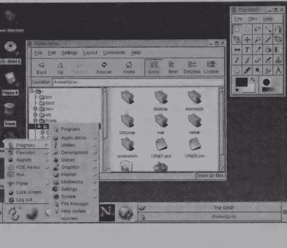

##### 图 12.1

快速查看 Gnome 桌面可以发现，Gnome 与 KDE 共享许多相同的功能。

Gnome 主页简要描述了 Gnome 面板的组件，其中包括以下内容：

- **菜单**。菜单是项目的列表，每一项都启动一个应用程序、执行一个命令或打开一个子菜单。安装后通常看到的最左侧图标是一个风格化的足迹图标（即 Gnome 标志）。这是主菜单，是面板中最重要的对象之一。此菜单提供对 Gnome 中几乎可用的所有应用程序、命令和配置选项的访问。Gnome 有时会在面板上提供一个链接到特定目录的文件夹图标。此图标也是菜单功能集的一部分。Gnome 允许用户创建具有个性化内容的自定义菜单，以补充主菜单。要打开菜单，只需使用鼠标左键单击该图标即可。

- **启动器**。启动器是按钮，当您左键单击它们时，它们会启动应用程序或执行命令。您可以将启动器放置在面板上，以执行常用程序，如 Netscape 或 Gnumeric 电子表格。

- **小部件**。小部件是运行在 GNOME 面板本身中的应用。您可以从主菜单下列出的各种小部件中选择要运行的小部件。一些最常用的小部件包括时钟、挂载设备、天气工具以及 GNOME 桌面小部件，后者允许您在许多虚拟桌面中进行选择。另一个常用的小部件是任务列表，它允许您以多种方式控制应用程序窗口，包括改变焦点、将窗口图标化、关闭窗口和终止应用程序。

- **抽屉**。抽屉很像面板，因为它们可以容纳额外的应用程序，并且可以打开或关闭。抽屉可以容纳面板所能容纳的任何内容，尽管它是完全可自定义的。您可以为抽屉选择任何类型的图标，以将自定义抽屉与默认系统抽屉区分开来。左键单击抽屉图标以打开或关闭抽屉。

- **特殊对象**。特殊对象是您可以添加到面板中的项目。它们执行通常无法通过其他面板对象实现的功能。例如，您可以创建一个注销按钮，该按钮启动注销序列以结束您的 GNOME 会话。

当您完整安装两种桌面环境时，KDE 和最新版本的 GNOME 都允许您在另一种环境中使用来自两种环境的应用程序。

> **提示**
> 如图 12.1 所示，GNOME 不仅为 Red Hat GTK 基于的应用程序提供菜单，还为 KDE 专属应用程序提供菜单。KDE 在其自己的环境中提供指向 Red Hat GNOME 程序的链接。

GNOME 附带一份非常详细的手册，有助于解答初学 Linux 和 GNOME 用户提出的大多数问题。通常，当安装时选择了 GNOME 工作站选项时，该手册会被默认安装。否则，它单独位于 CD 发行版中，如有需要，可以稍后安装。由于 GNOME 与更知名的商业操作系统相似，新用户在过渡到 Linux 或这两种桌面环境时不应该感到困难。

### 安装和升级 GNOME

由于运行 GNOME 所需的大量库和程序，开发人员鼓励初学用户使用 GNOME 的 RPM 版本。您可以下载源代码并单独编译每个软件包。后一种方法需要比必要的多得多努力，因此除非您是开发人员或想要审查源代码，否则不建议使用。

GNOME 主页（http://www.gnome.org/）列出了包含相同文件的其他镜像站点，以防主站因流量过大而拥堵。在 GNOME 的最新版本 1.1.2 中，GNOME 的开发人员与 Helix 合作，推出了一个更具动态性的版本。Helix GNOME 被誉为迄今为止用户友好的版本。它还具有一种外观和感觉，使其达到了与商业产品相匹敌的精炼程度。在查找 Red Hat 版本的二进制源代码时，GNOME 网站会将您重定向到 Helix GNOME 主页（http://www.helixcode.com/）。

下载和/或升级到最新版本有两个选择。您可以选择将所有文件下载到硬盘上的临时目录，然后运行一个简单的 RPM 命令；或者使用新的自动安装器功能。由于 Helix GNOME 是一家开源公司，它提供所有源代码。为了资助其大部分工作，Helix GNOME 还在 CD 上出售全套程序，这规避了大部分时间和带宽问题，并支持 GNOME 事业。然而，建议使用自动安装器选项下载最新版本。您可以通过两种方式做到这一点：要么使用基于文本的浏览器（如 Lynx），让安装程序自动配置必要的设置；要么下载安装程序并自行执行。

要自动安装最新版本的 Helix GNOME，您需要从浏览器远程调用 go-gnome 脚本。以下步骤启动安装过程：

1. 打开一个终端窗口。
2. 使用 `su` 命令成为超级用户。只有具有 root 权限才能成功安装所有软件包。
3. 输入以下命令启动 `go-gnome`。请确保您的机器上安装了 Lynx 浏览器，并且拥有快速、可靠的互联网连接。

```
lynx -source http://go-gnome.com | sh
```


该脚本会自动启动最适合您系统的简单安装方法。您可以选择想要安装的软件包。在您做出选择后，脚本会从互联网获取软件包并自动安装它们。这就是您需要一个 root 控制台的原因。

不过，需要提到的是，理论上黑客可能会利用此脚本。我的建议是将软件包下载到您的硬盘中，并在运行升级或安装软件包的命令之前验证其真实性。

如果您希望自行运行安装脚本，步骤几乎相同：

-   从 helixcode.com 主页下载文件 `installer-latest-intel.gz` 并将其放入一个临时目录。该目录可以是您在 home 目录中创建的目录，也可以是 /tmp 下的一个独特目录。请将这些文件与其他文件分开存放。
-   输入 `gunzip installer-latest-intel.gz` 以解压该文件。
-   输入 `chmod u+x installer-latest-intel` 使文件可执行。
-   现在输入 `./installer-latest-intel` 运行安装程序。

在确保拥有可用的互联网连接后，安装程序开始连接相应的 Helix GNOME 站点。程序会测试您的系统以获取最新软件，然后让您选择要安装的软件包。

一旦加载了最新的 Helix GNOME 文件，您将拥有一个自动加载功能，以便日后升级到更新版本的发行版。临时目录会存储下载的文件直到它们被安装；之后它们会被删除。您可以将这些文件复制到单独的目录中，以便在其他地方使用或用于未连接网络的机器上的选择性升级。但是，由于库依赖关系，最好保存所有文件并一次性安装它们。

Helix GNOME 具有比标准 GNOME 桌面更简洁的界面。它还提供了多个通常不随 GNOME 附带的实用工具，包括新的 Sawfish（前身为 Sawmill）等额外的窗口管理器。Helix GNOME 展示了 Linux 平台正变得多么动态。

#### 讨论 KDE 的特性

目前，有些人认为 KDE 是在追求易于使用的 Linux 接口方面的先驱。尽管 Linux 社区分裂为 GNOME 和 KDE 两个阵营的时间并不长，但他们此后已解决了许多分歧，并现在在各自的发展中合作，以吸引两组用户。GNOME 开发人员采取了开源立场，声称只有 GNOME 符合 GPL 所需的标准。与此同时，KDE 项目经理和爱好者则指出 KDE 的稳定性及其用户友好的界面。他们还认为，尽管有 Qt 许可证的规定，KDE 正在被 Linux 社区的许多人迅速接受。但由于 Qt 开发人员看到了使其源代码免费和开放的智慧，两个思想阵营已达成共识。最近，Qt 开发人员决定在 GPL 下发布 Qt 库，从而消除了纯粹 Linux 爱好者可能对其使用存在的任何限制。

根据 KDE 开发人员所说，他们的项目不仅仅是一个窗口管理器，尽管它在技术上使用管理器作为其界面。相反，KDE 的制作者认为它是一个*桌面环境*，这也反映在其名称中，即*K 桌面环境*（KDE）。

KDE 依赖于许多使用 Qt 库构建的应用程序。然而，这并不限制它运行基于非 Qt 库的程序。使用不同库集构建的 Netscape 和 GIMP 仍然可以在 KDE 下运行。其外部外观和框架与 KDE 窗口构建相匹配，而内部按钮和链接仍然使用它们自己的库并保留它们自己的外观。KDE 和 KDE 窗口管理器 (kwm) 外观相似，因为它们都基于 Qt 库构建。GNOME 及其窗口管理器不一定都使用 GTK，因此外观可能不同。例如，不依赖 GTK 的 Window Maker 可以与 GNOME 面板一起运行。

KDE 的外观很大程度上是 Windows 和 Macintosh 桌面的混合体（见图 12.2）。底部面板上的 K 应用程序启动按钮提供了 KDE 实用工具的完整列表，这让人联想到 Windows。然而，其他一些图标类似于 Macintosh OS。使用 KDE 主题，您可以让桌面看起来更像其专有对应物，或者赋予其一种完全独特的外观。

窗口的线条和框架清晰且定义明确。虽然乍一看它可能像 Windows 一样运行，但存在明显的差异。首先，屏幕底部会出现一个面板，它像 Windows 面板一样可以放置在页面的其他位置并调整大小。然而，屏幕的上部功能有一个任务栏，显示当前正在运行的程序，类似于 Apple 的实用工具。通过点击左下角的大“K”图标，非常类似于 Windows 下的开始按钮，您可以查看在 KDE 下运行的各种类型的程序。它也是完全可配置的；您可以在面板中添加额外的开始按钮，以创建您自己的一套图标和预设程序。您还可以将此整个面板最小化到桌面的任一侧或角落，并将正在运行的程序放在位于屏幕顶部的下拉菜单中。此配置在桌面上提供了更多的空间，同时保持 GUI 下正在运行的程序可见。

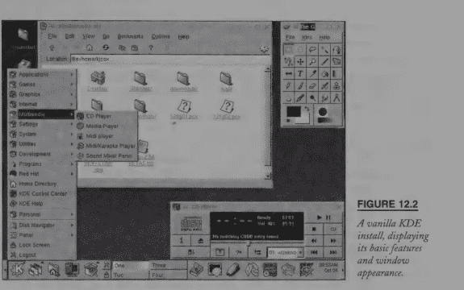

#### 图 12.2

一个标准的 KDE 安装，显示其基本特性和窗口外观。

KDE 还提供了关于在 KDE 下使用的其他虚拟桌面的信息。例如，您可以在一个虚拟桌面上运行应用程序，然后切换到另一个虚拟桌面，在那里您可以运行另一个无关的程序。这大大减少了由于只有一个屏幕来完成所有任务而带来的杂乱。也不是所有程序都会弄乱面板。每个程序在最小化时，都与其自己的虚拟桌面相关联。切换到另一个虚拟桌面提供一个新的完好空间来存储正在运行的程序。

标准的 KDE 配置仅提供四个默认虚拟桌面，每个都有其自己的窗口编号作为名称。在旧的窗口管理器中，这些窗口被称为*分页器* (pagers)，您可以使用它们来调出或翻页新的工作区。点击每个面板相应的链接会调出新的虚拟桌面。KDE 可以容纳多达八个虚拟桌面，您可以为每个桌面重命名特定的标识。

使用 KDE 时，我喜欢用特定任务标识每个桌面。一个虚拟桌面的标题是“互联网”，并保存所有与互联网相关的程序，如浏览器、URL 链接等。另一个被称为“邮件”，保存所有邮件客户端。还有一个叫做“网络”，拥有到其他内部网络或局域网机器打开的终端窗口。这样的命名方案有助于组织桌面。您不再需要搜索各种最小化图标来找到正在运行的应用程序。只需切换到正确命名的虚拟桌面，即可提供其类别中的所有相关程序。几乎所有窗口管理器都提供这种类型的功能。

#### 自定义桌面主题

与几乎所有窗口管理器一样，KDE 允许您按照任何大小、形状或颜色自定义桌面外观。KDE 还鼓励那些更具冒险精神的人调整源代码以实现高级自定义。对于缺乏相关知识来承担此类调整，或仅仅喜欢总体设计的人来说，KDE 提供了不同的*主题*或视觉模式，供用户配置更个性化的外观。主题允许用户更改默认的窗口边框、字体、背景和图标，以实现更个性化的外观。

一些主题基于其他操作系统或电视节目和电影。图 12.3 显示了另一个示例，一个名为 DrawingBoard 的主题。其基本前提是使所有图形与特定的主题相关。例如，一个主题可能会通过使用独特的背景图像（如卡通人物）来设定特定的基调，然后让其他图像反映相同的感受


正如在那部动画中使用的那样。因此，KDE 提供的主题与 Windows 和 Apple 操作系统中使用的主题相似，不同之处在于 KDE 使普通用户更容易选择这些主题。

你可以从互联网上找到适用于任何窗口管理器的主题。对于几乎所有窗口管理器的新主题交换和创建，最流行的网站之一是 [http://www.themes.org/](http://www.themes.org/)。你可以下载主题，也可以将自己的设计贡献给数据库供他人使用。该网站提供了设计自己的主题以及分享信息的明确说明。许多主题随管理器预装，但随着新主题的出现，你稍后可以添加数百个来自互联网的主题。

要在 KDE 桌面上添加主题，请在 KDE 开始按钮下找到 KDE 控制中心。在第二个或 Desktop（桌面）项目下，查找 Theme Manager（主题管理器）项目。KDE 默认安装了一些主题，但你还可以快速添加更多。像 [http://www.themes.org/](http://www.themes.org/) 或 themes.org 的子域名之一 [http://kde.themes.org/](http://kde.themes.org/) 这样的网站，为主机提供了广泛用于所有桌面的主题。只需下载一个看起来有趣的主题，将其保存到临时位置或你可以用于存储额外主题的位置，然后单击主题管理器下的“Add...”（添加……）按钮。你还可以通过给现有主题重新命名甚至创建自己的主题来更改它们。同一页面为 KDE 桌面和几乎其他所有窗口管理器提供了详细的主题设置说明。在你选择的页面上，选择“Creating themes”（创建主题）链接，以查看示例主题是如何制作的。当然，该网站的推广者鼓励所有用户使用 Linux，并建议使用 GIMP 创建自定义主题中的每个图像。

与 Windows 操作系统下可用的主题一样，用户可以定制大量 KDE 项目以满足需求。你可以更改或配置主题的颜色、壁纸、面板、声音、图标、窗口边框、窗口标题栏、窗口装饰、窗口按钮布局、文件管理器和控制台。无论你自己创建主题还是选择使用现有主题，KDE 和其他管理器都能让你根据自己的喜好定制界面，而不是将你限制在由商业开发人员决定的外观中。

#### 讨论 KDE 软件包

由于所需程序较少，KDE 在任何 Linux 系统上都能快速且轻松地安装，无论是什么发行版。Red Hat 为这个环境提供了与其对 GNOME 同等程度的支持，因此你可以先安装 KDE，或者稍后使用来自 Red Hat 网站的 RPM 进行升级。KDE 还从自己的 FTP 站点提供 Red Hat 专用的 RPM，地址为 [ftp://ftp.kde.org/](ftp://ftp.kde.org/)。

与任何程序一样，安装 KDE 主要有两种方法：源码或 RPM。对许多人来说，从头编译源码是安装 KDE 这样复杂程序的唯一方法。由于源代码通常先于 RPM 发布，为了确保拥有最新的更新、补丁和功能，从源码安装是最佳方法。就像 GNOME 需要 GTK 库一样，KDE 首先要求你安装 Qt 库。这些库可从 Qt 主站 [http://www.troll.no/](http://www.troll.no/) 或 KDE 主站获取。它们也有源码或 RPM 格式提供。在尝试任何形式的安装之前，请务必阅读它们的说明。目前，安装 Qt 的 1.x 和 2.x 版本之间仍存在一些差异。到本书出版时，KDE 的最新版本将采用 2.x 库作为其标准。

如果你使用 RPM 进行升级，只需在 RPM 库所在的同一目录下发出简单的 RPM 命令即可安装 Qt 库：

```bash
rpm -Uvh *.rpm
```

你可以在 KDE 主页 [http://www.kde.org/](http://www.kde.org/) 上找到编译和安装所需的所有文档。为了避免增加该站点本已拥堵的流量，请尝试众多镜像站点之一。这些位置携带与 KDE 主站相同的源码、文档和信息。使用镜像站点很可能还会提高你的下载速度，这对于通过调制解调器下载的许多大文件来说，等待过程可能会非常枯燥。

文档包含了关于如何在硬盘上编译和安装每个程序的明确说明。通常你可以安装多达 10 个软件包，但只需要两个，第三个是推荐的。其他软件包只是用各种实用工具来补充核心 KDE 文件。成功安装程序时顺序也很重要。以下是 KDE 主安装页面上推荐的顺序：

- **kdesupport**（推荐）。此软件包包含并非作为 KDE 项目的一部分编写但确实需要的支持库。如果此软件包中的库（libgif、libjpeg、libmime、libau 和 libgdbm）已经安装在你的系统上，你可能不需要安装 kdesupport。为了统一使用发布版，你最好还是安装它。
- **kdelibs**（必需）。此软件包包含所有 KDE 应用程序所需的共享库。
- **kdebase**（必需）。此软件包包含构成 KDE 桌面环境核心基础应用程序：窗口管理器、终端仿真器、控制中心、文件管理器和面板。
- **kdegames**（可选）。此软件包包含少量游戏，如 *Mabjongg*、*Snake*、*Asteroids* 和 *Tetris* 等。
- **kdegraphics**（可选）。此软件包包含各种图形相关程序，如 PostScript 预览器、DVI 预览器和绘图程序。
- **kdetools**（可选）。此软件包包含各种桌面工具，包括计算器、编辑器以及其他在默认 Red Hat 安装中也能找到的实用工具，但这些工具使用了 Qt 库并为 KDE 进行了优化。
- **kdemultimedia**（可选）。此软件包包含多媒体应用程序，如 CD 播放器、混音器和 MP3 播放器。
- **kdenetwork**（可选）。此软件包包含 Internet 应用程序。目前该软件包含邮件程序、新闻阅读器和几个其他网络相关程序。
- **kdeadmin**（可选）。这组系统管理程序包括用户管理器和 System V 运行级别编辑器等。
- **kdetoys**（可选）。此软件包包含一些趣味工具。
- **korganizer**（可选）。此软件包通过一个组织器完善你的桌面。

你不需要按此顺序安装可选程序，但如果你没有正确安装前三个程序——kdesupport、kdelibs 和 kdebase——或者没有按照列表中的顺序安装，可能会遇到问题。安装软件包后，验证它们是否默认设置为 /opt/kde 目录（你可以选择其他目录安装 KDE，但最好遵循程序默认设置），然后你可以编辑主目录中的 .xinitrc 文件，以便在启动到 X 窗口系统时自动启动 KDE。如果主目录中没有 .xinitrc 文件，请在终端窗口中创建一个。使用你喜欢的文本编辑器，如 vi、pico、joe 或 jed，在 .xinitrc 文件中添加命令 startkde。此命令还授权 KDE 在后续启动时作为默认 X 接口。

如果你正在启动默认 Red Hat 桌面的运行级别 5，或者你正在绕过命令行直接在图形界面登录，你可以选择 KDE 作为你的默认窗口管理器。否则，手动登录到 GNOME 后，你可以执行 switchdesk 命令来将默认环境重新配置为 KDE。此命令使你能在 GNOME、KDE 或最基本的 GUI 之间进行选择。

下次在命令行输入 startx 时，KDE 将自动在你的主目录中创建额外的目录来存储信息。最新版本的 Red Hat 会自动创建一个 Desktop 目录，以防你选择 KDE 作为默认接口。你可以通过从 /etc/skel/ 目录中移除 Desktop 目录来绕过此功能。除非新用户手动选择 KDE 作为其启动选项，否则后续用户不会获得 KDE 目录。

KDE 提供了一本详细的帮助手册，帮助你了解其功能和附件。就本章的目的而言，覆盖其中的一些内容就足够了

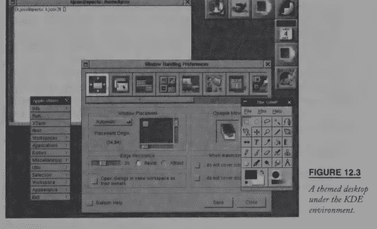

*图 12.3：KDE 环境下的主题化桌面。*


基础安装例程。全面覆盖 KDE 或任何其他窗口管理器或环境的全部内容已超出本书的范围。

#### 安装 KDE RPM

对于新手用户来说，通过 RPM 安装 KDE 是更优选的方式。您可能需要等待更长时间才能让最新的 RPM 包变得可用，但如果您对源代码感到不自在，或者希望一次性安装所有内容，那么等待可能是更好的选择。

在尝试任何安装之前，请验证您的 Red Hat 版本是否默认安装了 KDE。或者，如果您想升级，请要么选择 RPM 命令下的升级选项，要么在安装前彻底卸载旧版本。但请注意，如果您卸载，可能会丢失某些程序（如拨号网络工具 Kppp）的特定配置设置。请备份您稍后可能需要的所有配置文件。

首先使用标准的 RPM 命令安装 **Qt** 和 **Qt-devel** 文件。安装多个具有相似前缀的文件的最快捷方法是输入以下命令：

```bash
# rpm -ivh qt*.rpm
```

该命令生成的输出类似于以下内容：

```
qt-1.44                         ############################
qt-1.44-devel                   ############################
```

在将同样的原则应用于 KDE 文件时务必小心。请确保先安装支持文件（kdesupport），然后是 kdelibs 包，最后是 kdebase 包。一旦这三个包成功安装，您可以执行以下命令以完成剩余文件的安装：

```bash
# rpm -ivh kde*.rpm
```

每当安装一个包时，会出现井号标记。如果在安装特定包时遇到错误，请首先尝试单独安装该包，或者等待其他所有包安装完成。该包可能需要另一个包中的库才能安装。如果这两种方法都不起作用，您可以尝试卸载该包，然后重新尝试新安装。不过，很有可能在没有任何复杂问题的情况下正确安装它。

#### 注意

其他相关文件依赖 Qt 开发文件才能运行。虽然 RPM 版本确实安装了 Qt 所需的头文件，但这些文件的位置可能与编译版 Qt 的位置不同。如果您从源代码安装 Qt，安装程序可能会将它们放置在其他位置。Red Hat 版本的 Qt 库有时会出现这种情况。依赖 Qt 头文件的程序可能在某个位置寻找它们，但未能找到。

#### 编译 KDE 源代码

对于仍坚持编译代码的爱好者或纯粹主义者，KDE 提供了完整的 KDE 源代码以供检查和修改。与安装大多数源代码一样，只需遵循少数几个步骤即可编译并安装新创建的二进制文件。

您需要下载的文件将带有 .tar.gz 或 .tar.bz2 扩展名。这些扩展名标识这些文件是打包并压缩归档的。也可能有带有不同扩展名的文件，这些 tar 文件可以以相同方式解压。

归档为 tar 源文件的文件通常默认安装到 /usr/local/kde。您可以使用 `configure` 脚本的 `--prefix` 选项来覆盖此设置。如果您更喜欢将默认目录设置为 /opt/kde，可以在配置时这样设置。以下是安装 KDE 源代码时需要遵循的一些简单步骤。您必须对每个打包并压缩的包重复这些步骤：

- 1. 通过输入 `tar -xvzf <packagename>.tar.gz` 来解包该包。如果包以不同的扩展名结尾，请使用相应的命令。您也可以通过输入 `bunzip2 -c <packagename>.tar.bz2 | tar xvf -` 来解包该包。这两种方法效果相同。选择哪种取决于个人偏好。
- 2. 通过输入 `cd <packagename>` 更改到新创建的包目录。
- 3. 通过输入 `./configure` 配置该包。这是您添加任何额外标志或选项的地方。要定义新的默认目录，请输入 `./configure --prefix=/opt/kde`。
- 4. 某些包（特别是 kdebase）具有可能适用于您安装的特定配置选项。输入 `./configure --help` 以查看可用选项。
- 5. 通过输入 `make` 构建该包。
- 6. 通过输入 `make install` 以超级用户身份安装该包。

如果一切顺利，二进制文件将安装到新位置，即您指定的位置或程序的 makefile 之前定义的位置。再次提醒，您必须对每个包文件执行这些步骤。

#### 执行安装后程序

一旦所有新的二进制文件都安装完毕，请确保您已将 KDE 的二进制安装目录 `/opt/kde/bin` 添加到您的路径中，并将 KDE 的库安装目录添加到您的 `LD_LIBRARY_PATH` 中。为此，您将新目录添加到声明系统路径的 `/etc/profile` 文件中，或者添加到用户自己的 `.bash_profile` 文件中。库路径被添加到 `EXPORT` 行中。

#### 注意

盲目地设置 `LD_LIBRARY_PATH` 是不明智的。在绝大多数情况下，设置此变量是不必要的，而且弊大于利。Dave Barr 编写的 http://www.cs.ohio-state.edu/~barr/lpath.html 上的网页解释了 `LD_LIBRARY_PATH` 的危害。

虽然您可以简单地通过调用大多数 KDE 应用程序来使用它们，但只有使用 KDE 窗口管理器 KWM 及其辅助程序，您才能充分利用 KDE 的高级功能。

为了简化运行 KDE 的过程，开发人员提供了一个名为 `startkde` 的简单脚本，它安装在 `$KDEDIR/bin` 中，因此位于您的路径中。

编辑主目录中的 `.xinitrc` 文件，以便在 X 首次启动时调用新的窗口管理器或桌面环境，请务必备份以防出现问题。删除所有其他条目或注释掉可能调用窗口管理器的行，然后插入 `startkde` 代替。重新启动 X Window 会话。如果您使用 `kdm/xdm`，您将需要编辑 `.xsession` 文件而不是 `.xinitrc`。与 `gdm`（GNOME 显示管理器）类似，`kdm/xdm`（KDE 显示管理器或 X 显示管理器）是一个启动屏幕，可用于托管多用户的系统。用户不必进入命令行，而是拥有一个令人愉快的背景来进行登录。

如果您的主目录没有 `.xinitrc` 或 `.xsession`，只需创建一个仅包含单词 `startkde` 的一行的新文件。

##### 备注

某些系统，特别是 Red Hat Linux，使用 `.Xclients` 代替。请检查您自己的配置，看看您如何调用窗口管理器。

这个过程应该产生一个完美的 KDE 桌面。如果您在初始 Linux 安装期间选择不安装 KDE，KDE 将创建一个名为 Desktop 的新目录，用于存储显示在 KDE 桌面上的所有内容——模板文件，以及一个用于存储其他文件的 `.kde` 目录。桌面的其余部分非常直观。它的样子和感觉将类似于市售的专有界面。

### 使用 Window Maker

Window Maker 窗口管理器最初基于 AfterStep 窗口管理器，后者是苹果公司史蒂夫·乔布斯（Steve Jobs）开创的 NeXT 操作系统的模仿版本。AfterStep 的开发者 Alfredo K. Kojima 离开了 AfterStep 公司，创建了自己的发行版 Window Maker。该管理器使用 64 × 64 像素大小的图标，每个图标都有自己的标签和图形，以便在最小化时识别它。它还采用了所有 Macintosh 发行版中常见的窗口遮光板功能。当您双击标题栏时，它会将下方的窗口像窗罩一样卷起，仅在标题栏内保留窗口名称可见。再次双击时，程序窗口会向下卷回。这是节省桌面空间的非常有效的方法。

桌面本身也具有非常整洁和直观的外观（见图 12.4）。您可以自定义所有可见内容，包括背景和菜单，以适应自己的品味。桌面还支持主题，可以量身定制以呈现无数图像和外观。


#### 图 12.4

*在一个典型的 Linux 桌面上非常标准的 Window Maker 安装环境。*

Window Maker 不使用任何工具栏或面板，但 GNOME 工具栏同样可以在此环境中有效运行。由于 Window Maker 完全符合 GNOME 标准，它在其自身界面下支持许多与 GNOME 相同的命令，并允许运行相同的程序。GNOME 面板也可以在 Window Maker 上运行。在 Window Maker 下运行 GNOME 面板最简单的方法是先运行 GNOME，然后在 GNOME 环境中切换管理器。

而不是在仅启动 Window Maker 时默认提供一个面板，该管理器通过一个完全可自定义、可点击的下拉菜单来提供对程序的访问。在桌面上任意位置左键点击（或者右键点击，具体取决于你如何设置 *Window Maker 首选项实用程序下的配置文件*）。此时会出现一个下拉菜单。你可以通过手动编辑一个简单的文本文件来配置此菜单，或者通过在你的首选项实用程序程序中插入自己的变量来进行配置。你无需在预定的位置点击以访问你想要的文件，只需在桌面上任意位置点击即可显示所有可用选项。

Window Maker 还支持虚拟桌面，尽管它们被称为 *工作区*，这更准确地描述了它们的功能。你可以在下拉菜单显示或首选项实用程序中创建和删除这些虚拟工作区。Window Maker 附带一个名为菜单的默认配置文件，这是一个简单的文本文件，布局了可点击界面下可用的不同树结构。再次强调，手动编辑此文件可能是添加或删除可用程序的最简单方式。在 Linux 系统上安装 Window Maker 后，窗口管理器还会在你的主目录中放置一个 GNUstep/ 目录。例如，你可以在以下位置找到与 Window Maker 相关的配置文件：

```
~/GNUstep/Library/WindowMaker/menu
```

波浪号（~）代表用户的主目录。在上面的目录中，你可以手动编辑几乎每个配置选项，并自定义你管理器的外观。你并不是使用这些选项来配置全局首选项。那些通常放在 /usr/local/GNUstep/ 或你在安装过程中定义默认目录中。

你想要对菜单文件做的第一项更改之一，是插入一个配置选项，以便你稍后可以编辑菜单。以下是典型菜单文件中允许后续修改的摘录：

```
"Configure" MENU
"Window Maker Configuration" EXEC xterm -T "Window Maker Configuration" -e vi ~/GNUstep/Library/WindowMaker/menu
"Configure" END
```

引号中的单词就是显示在下拉菜单中的内容。前面的示例告诉程序执行一个标题栏显示“Window Maker Configuration”的 X 终端。然后脚本执行 vi 编辑器，在 xterm 窗口中打开菜单文件。Configure MENU 和 END 选项在桌面界面中创建一个可点击的子菜单。

Window Maker 不像前两个窗口管理器那样基于点击操作。然而，它可以在其自身界面中运行其他地方使用的任何相同程序。Window Maker 的设计针对喜欢手动编辑基本文本文件并手动配置项目，而不是依赖向导或分步菜单的用户。

Window Maker 的一个使许多用户对其印象深刻的功能是位于最右侧的 Dock（停靠）功能。在 AfterStep 中，此功能被称为 Wharf（码头）。链接常用程序的图标被放置在 Dock 中。除了调出下拉菜单外，双击相应的图标即可同样轻松地启动程序。许多 Window Maker 爱好者也在 Dock 上放置基于图标的小程序。这些是持续运行的小型程序，用于显示系统性能或音频工具。在我自己的方案中，我有一个运行时钟的小程序，一个 CPU 计量器，以及一个同时检查系统上所有进程和用户的小程序。互联网上提供了大量适用于 Window Maker 的小程序，可以满足大多数用户的需求。

为了更近距离地查看 Window Maker 的潜力，图 12.5 显示了我自己的桌面显示效果。


#### 图 12.5

一个更具定制性的视图，展示 Window Maker 的一些功能。

#### 安装 Window Maker

Window Maker 的系统要求和软件要求比 GNOME 或 KDE 少。你可以在 RAM 和 CPU 性能较低的机器上运行它，同时仍能实现快速的响应时间。一如既往地，如果你在 X Window 下使用任何类型的 GUI，显卡越好，刷新率和视觉性能就越快。第 11 章详细描述了安装 Window Maker 所需的步骤。

一旦你将源代码下载到你的机器上，仔细阅读文档文件和其他 readme 和安装文件应该能回答关于你要在其上安装程序的系统的任何特定问题。请记住，你还必须运行 wmaker.inst 工具以将定制的 GNUstep/ 文件放置在你的主目录中。只有在你自己的 GNUstep 目录中，你才能开始编辑系统。

Window Maker 开发人员也及时发布其产品的 RPM 版本。如果他们不立即随源代码一起发布，别人只需额外几天就能创建最新发布的自定义 RPM 版本。这个版本的安装也很简单，但与源码版本一样，你必须运行 wmaker.inst 以生成所需的文件。

这些窗口管理器每一个的众多积极因素之一，在于在多账户和多人登录的系统上，每个用户都可以拥有一个适应其个人口味的定制界面。大型系统甚至可以拥有一个定制的弹出菜单，提示每个用户选择其窗口管理器。

### 家用和办公套件

新手用户对 Linux 最大的抱怨之一是缺乏可用的办公套件。随着 Linux 变得更加主流，一些主要开发商正在为其提供支持，并将他们的应用程序移植到 Linux 平台。目前，Linux 仍更多地被视为服务器平台，而非工作站。服务器很少需要文字处理器、电子表格或演示程序。这些程序更容易在不运行关键应用的工作站上运行。得益于 Linux 的稳定性，用户可以系统既作为服务器又作为工作站运行，或者将系统配置为仅工作站，禁用许多服务器功能并保留 CPU 周期供自己使用。有关如何开启或关闭服务器和网络应用的更综合说明，请参阅第 15 章。

本节考察了一些 Linux 上更受欢迎的办公套件和文字处理程序。几乎所有程序仍然是专有的，源代码不可用。然而，二进制文件或程序本身对所有用户都是免费且可下载安装。这些 Linux 程序的功能几乎与 Windows 和 Apple 平台相当。

#### 使用 StarOffice

在针对 Linux 的众多杀手级应用中，最近被 Sun Microsystems 收购的 StarOffice 套件可能是其中最领先的应用之一。仅几年前，IBM 还考虑过购买 StarOffice 以用于其自身的操作系统 OS/2。相反，该公司选择购买 Lotus 套件，从而使 StarOffice 可以自由用于 Linux 开发。

StarOffice 界面与 Microsoft Office 套件非常相似。它同样拥有许多相同的功能，其外观和感觉与 Microsoft Office 也非常接近。它可以快速地从 Microsoft Word、Excel 和 PowerPoint 导入和导出文档。StarOffice 还使用许多相同的文本编辑命令。格式变量也几乎相同。任何 Microsoft 初学者都会很快在这个界面上感到如鱼得水。从 Windows 平台转移到 Linux StarOffice 所需的用户努力，比在 Windows 下学习新的办公套件（如 WordPerfect Office）要少。

除了提供文字处理器外，StarOffice 还提供 web 浏览器、电子邮件客户端以及在互联网上工作所需的所有工具。就像 Netscape Communicator 包一样，StarOffice 也提供了使用 POP3 或 IMAP 服务器编写和发送电子邮件、浏览网页、阅读线程化新闻组以及设计 HTML 内容所需的所有功能。要设计 HTML 内容，你可以将新文本文档导入 HTML 格式，或者使用套件中附带的 HTML 编辑器创建内容。

StarOffice 包含一个电子表格程序，可以导入最新的 Excel 文档并根据需要自定义。再次强调，许多 Excel 自带的功能在 StarOffice 电子表格 StarCalc 中也同样可用。


程序。Microsoft Office 套件中几乎任何实用程序在 StarOffice 的 Linux 移植版中也可用。最近发布的 StarOffice 5.2 允许用户像使用 Microsoft Access 一样创建数据库。

StarOffice 通过精简部分功能来减小软件包体积。整个套件经过 tar 打包和压缩后，可从互联网下载。与最新 Microsoft Office 套件完整安装所需的 500 多兆字节数据相比，StarOffice 完全压缩后仅略多于 90 兆字节，安装后占用空间不到 200 兆字节。它也是自包含的，意味着它不会更改任何配置文件，而是在其自身目录内运行。StarOffice 加载自己的一组库和配置文件，以在所有平台（无论是 Windows 还是 Linux）上保持一致的外观和感受。这导致了我在使用最新发布的 StarOffice 时发现的少数缺点之一：速度并非其最大优势。如果你在一台配备 500 兆赫兹 Athlon 处理器和 128 兆字节内存的计算机上新重启后启动程序，StarOffice 需要 30 到 45 秒才能完全就绪。但该程序提供的功能——将办公管理带到 Linux 平台——其重要性远超速度问题。

##### 下载和安装 StarOffice

你可以从 Sun 网站的一个子目录获取 StarOffice：http://www.sun.com/staroffice/。Sun 要求你在下载前注册，但作为回报，他们会向你通知升级信息和额外的 Sun 程序。注册后，你可以选择下载整个程序（即使对于带宽充裕的高速机器来说也是一项不小的工作量），或者购买该程序的 CD 副本。我建议使用几美元（大约低于 10.00 美元）让 Sun 给你邮寄一份。这样你只需拥有单一副本，即可安装在任意多台机器上。此外，你也不必使用 FTP 将大的 tar 包文件传输到不同的服务器。

安装 StarOffice 的最佳方法是首先创建你希望安装程序的默认目录。确保你或运行程序的人拥有该目录的所有权，以免安装例程遇到重大的权限问题并中止安装。我选择在一个较大的分区中创建一个目录：

```
# mkdir /usr/local/office52
# chown -R <username> /usr/local/office52
# chgrp -R <username> /usr/local/office52
```

接下来，将下载的文件解压到临时目录，例如 /tmp，或另一个你拥有正确权限的目录。StarOffice 应该会创建一个名为 so52inst 的额外安装目录。查找一个名为 setup 的文件：

```
# cd /tmp/so52inst/
# ./setup
```

以你自己或相应用户的身份运行此命令会启动图形安装窗口。系统将提示你填写几个表单，其中包含有关你个人信息的以及你的互联网连接配置的信息。完成所有字段后，StarOffice 开始安装例程，根据计算机速度的不同，此任务只需几分钟。你无需对系统进行进一步调整。

如果你将 StarOffice 的目录路径添加到全局 /etc/profile 文件或每个用户的单独 .bash_profile 中，你就可以从命令行的单一入口点启动 StarOffice：

```
PATH="${PATH}:/usr/X11R6/bin:/usr/local/Office5.2"
```

运行命令 *source* /etc/profile 以启用设置。StarOffice 通过简单命令 *soffice* 启动。为了使你的系统在互联网上完全正常工作，StarOffice 会提示你填写一些关于你的 POP3 服务器、用户名以及你经常访问以获取连接的服务器名称的表单。考虑到 StarOffice 在与 Microsoft 系统及其他以 Microsoft 为中心的用户进行界面交互和信息交换方面所赋予的便捷性和自由度，填写这些表单仍是一项相对较小的任务。

图 12.6 展示了一个常规文本文档的外观以及用于选择附加选项的各种菜单。StarOffice 高度模拟 Microsoft 的功能，以至于它和开始按钮一样，允许你将整个 Linux 桌面集成到 StarOffice 显示中。这创建了一个类似 Windows 的显示界面。你实际上可以通过指向和点击来浏览 StarOffice 集成桌面下的程序和目录。此外，如果系统上已安装 KDE，StarOffice 会检测到该窗口管理器，并在 KDE 桌面上放置一个链接，同时也将 *Fav* 或将其所有 KDE 程序纳入其自身的开始按钮中。这两个系统的平滑集成部分归功于 StarOffice 自身作为一家德国公司的背景，这与 KDE 的历史及德国开发人员的情况类似。


图 12.6

*在 Linux 下运行的 StarOffice 程序。*

#### 完善 Linux 版 WordPerfect

安装 WordPerfect 用于 Linux 操作系统的过程比 StarOffice 略显复杂，这仅仅是因为 WordPerfect 的 tar 压缩文件不像普通的 Linux 文件。尽管其体积不到 25 兆字节有助于提高其下载的吸引力，但虽然名为 GUILG00.GZ，它不仅经过 gzip 压缩，还经过了 tar 打包。

#### 注意

> WordPerfect Office 2000 for Linux 的用户个人版可免费下载。应提及的是，WordPerfect Office 2000 的商业版本也适用于 Linux。它具有与 Windows 版本发布的所有相同功能和应用程序。由于其成本以及大多数 Linux 用户对免费软件的偏好，我将重点关注可从互联网下载的 WordPerfect 个人版。

在执行标准安装之前，请将该文件放在其自己的目录中，然后运行标准命令：

```
# gunzip -c GUI\LG00.GZ \|tar xvf -
```

一旦所有文件解压完毕，只需执行 Runme 文件如下：

```
# ./Runme
```

请确保你也处于 X Window 环境中，因为 Runme 文件随后将启动图形安装菜单。一旦 WordPerfect 程序完全安装，你可以通过输入命令 $HOME/wpbin/xwp 来启动它，其中 $HOME 是你安装 WordPerfect 的位置。

#### 注意

> 在 Corel 宣布支持 Linux 并将 WordPerfect 放置在互联网上供下载后不久，头 24 小时内收到了数千条对该程序的请求。截至目前，Linux 版 WordPerfect 的下载量已超过一百万次。

WordPerfect 的界面与 Windows 版本非常相似。尽管其显示依赖于较旧的 Motif 库（因此具有独特的外观以及使用不同的单选按钮和下拉菜单项），但它仍然具有许多在商业版中发现的相同选项。图 12.7 展示了 WordPerfect 显示默认文本文档的情形。请注意程序窗口和文本窗口的分离。

Linux 版 WordPerfect 个人版，即可供下载的版本，缺少一些项目，包括模板和额外的宏，这些仅能在商业版中获得。因此，购买完整版可能是值得的。最新的 Corel Linux 办公套件显示出巨大的潜力，不仅为 Linux 用户提供完整的 WordPerfect，还提供 Presentations 和 QuattroPro。

WordPerfect 为你的系统中的多个用户提供附加功能。虽然你可以在个人版中实现相同效果，但商业版允许多个用户从 *dumb terminals*（哑终端）或硬盘空间极少甚至没有、依赖网络获取程序的机器登录。在联网的 Linux 机器或哑终端上，WordPerfect 可以在 Linux 的所有版本上运行，每个版本在其自己的会话下运行。如果你希望在联网系统（如大型公司办公室或教育环境）中保留一定的标准化，功能齐全的 WordPerfect Office 200 Suite 是推荐的程序。


#### 图 12.7

Linux 下 WordPerfect 程序的显示效果。

尽管 WordPerfect 的外观可能与 StarOffice 不尽相同，但它凭借速度弥补了这一不足。WP8 是一款快速且高效的文字处理器，能够快速轻松地处理大型文档。它同样能够保存并导出为大多数其他文档类型，包括 Microsoft Word 格式。它还包含随 Windows 版本提供的“发布为 HTML”选项。对于需要完成简单文本编辑和文档发布的用户来说，WordPerfect 是一个极佳的选择。

### 探索 Linux 领域的后起之秀

AbiWord 套件是 Linux 文字处理器领域中的一位新成员。尽管 AbiWord 提供其源代码，但其开发相对尚不成熟。AbiWord 随最新的 Helix GNOME 发行版提供，但并非默认安装。你可以选择将其作为桌面环境的一部分进行安装，或者自行下载代码并编译供个人使用。由于 AbiWord 需要额外的库和图形支持，因此选择 RPM 版本是推荐的方法。

另一款在 Linux 上已经成熟的文字处理器是 KOffice，它由 KDE 开发者设计并得到他们的协助。尽管仍处于初步阶段，但它展现了巨大的潜力。随着 KDE 2.0 在 2000 年晚些时候发布，预计 KOffice 也将同期推出。这套工具包很快就会以 RPM 格式供普通用户使用。目前，仍有一些 bug 需要解决，还需要纳入更多功能。当 KOffice 最初发布时，它仍需要支持库和手动配置。

此外，还有持续进行的计划来改进许多在 Linux 下运行的简单记事本类型程序。这些程序对于简单的消息或文本文件非常有用，可以在 GNOME 和 Linux 下找到。它们不具备也不需要那些大型商业软件所标榜的各种华丽功能，但对于快速的消息和指令来说非常有用。我个人最喜欢的文本编辑器之一是 NEdit。NEdit 现在使用 GTK 库，因此在稳定性和性能方面得到了极大改善。尽管它被归类为文本编辑器，但它提供了许多动态功能，例如对 HTML 标签或编程符号进行颜色编码。这一功能极大地帮助开发者追踪 Linux 程序员使用的那些晦涩的代码和符号。NEdit 能够完成与其大型同类软件相同的许多任务，而不会占用过多的内存或 CPU 周期。

#### 图形

毫无疑问，Linux 操作系统的原始“杀手级应用”是 GNU 图像操纵程序（GIMP）。GIMP 对 Linux 用户来说是一个分水岭式的程序。突然间，他们不再依赖于 Adobe Photoshop 这样极其昂贵的程序来创建动态图像或编辑现有图片。GIMP 还为 Linux 社区提供了一组库，这些库现在正被用于开发额外的程序，包括 GNOME 窗口管理器。

#### 使用 GIMP 进行设计

GIMP 既有下拉菜单又有图标，允许你在操纵图像时选择不同的图形功能。GIMP 的一个主要优势是其能够导入和导出不同格式的图像。本书的大部分内容是在 StarOffice 下撰写并导出为 Microsoft Word 格式的，而所有的图形图像都是使用 GIMP 捕获的。GIMP 可以多种不同的格式保存图像，包括 `.pcx` 格式。一本关于 Linux 的书能够在 Linux 操作系统上撰写，而所有用于更清晰说明操作系统功能的截图和图像也在同一系统下捕获，这充分说明了这一动态操作系统的强大之处。

对于希望在 Linux 下使用扫描程序或扫描仪的用户，GIMP 提供了对 Scanner Access Now Easy（SANE）的接口。SANE 可以与几乎任何扫描仪进行接口连接，无论是并行端口还是 SCSI 连接。一旦图片扫描完成，GIMP 就可以处理并将图像保存为所需的格式。

> **注意**
> 大多数 Linux 发行版的安装 CD 中都包含 GIMP，因此你关于安装 GIMP 过程的信息需求很少。更新会定期发布，并可以通过 GIMP 网页 http://www.gimp.org/ 下载。你还可以从该页面下载 GTK 库。除非需要重大更新，否则现有的库通常就足够了。GIMP 推荐安装 RPM，但源代码通常比 RPM 出现得更早。两种方法都很容易安装。

GIMP 继续在 Linux 开发者和爱好者中取得进展。完全使用 GIMP 开发网页图形并不罕见。此外，大多数 GIMP 安装都预装了*扩展*或*滤镜*，其质量和多功能性堪比 Photoshop。这些也被称为*插件*，可以为任何图像渲染独特的着色或纹理。只需测试其中的一些功能，就能展示出如今在 Linux 下可获得的极高水准。

你可以使用 RPM 或源代码版本来安装 GIMP。通常，RPM 发行版是首选格式，因为安装如此简单和快速。源代码可以在几分钟内编译完成，并且文档完善。关于编译和安装源代码的完整说明，请参见第 11 章。

安装额外的插件同样简单。从 GIMP 网站下载适当的插件后，只需将它们放在你的插件目录中，无论是全局 GIMP 目录还是用户的 `~/.gimp/plug-ins/` 目录。下次启动 GIMP 时，这些插件即可使用。

#### 通过 Electric Eyes 进行查看

GIMP 之于 Linux 图形工具，正如保时捷之于跑车。然而，如果你不需要大量的刺激和附加功能，那么你可能想要看看图形程序中被称为多功能车辆的 Electric Eyes。Electric Eyes 由 Enlightenment 的创造者开发，默认随 GNOME 安装。

你可以通过在任何命令行下输入 `ee` 来启动 Electric Eyes。该程序具有几种允许你更改大多数图像的色相和混合的功能。它还包含幻灯片放映功能，可以翻阅一系列照片，就像翻阅相册的页面一样。这一功能在会议或研讨会上展示幻灯片或一系列图片时效果很好。

对于 Linux 下的任何需求，通常都有一个工具，要么在某个网站上可用，要么正在开发中。图形方面也是如此。即使是较旧版本的 Linux 也有能够完成大多数图形编辑任务的工具。

#### 在 Linux 下使用 TrueType 和 Adobe 字体

新 Linux 用户提出的最大抱怨之一是 GIMP 和其他文本或图形程序缺乏高质量字体。尽管 X Window 接口非常有用，但它默认尚不支持在 Windows 和 Macintosh 下找到的大量 TrueType 字体。然而，在 Linux 下安装这些字体有一种快速而简单的方法。

> **注意**
>
> 感谢 GIMP 新闻页面（http://www.xach.com/gimp/news/index.html）的开发者 Zach Beane（zach@mint.net），本节介绍了几步简单的步骤，你可以遵循这些步骤下载大量可以在 Linux 下安装并工作的字体。

每个人都喜欢在图形中看到优秀的字体。不幸的是，在 GIMP 中以大尺寸正常工作的唯一字体是 Adobe Type 1 字体，而 Red Hat Linux 和其他发行版默认仅安装少数几种字体。Red Hat 确实提供了某些字体服务器，如 xfs 和 xfst，它们可以显示 TrueType 字体。然而，这些字体服务器可能很难设置。以下是关于如何让替代字体在原生 Red Hat 安装中运行的一些简单说明。


## 自定义系统

找到所需的字体是简单的一部分。FTP 存档站点 ftp.cdrom.com 提供了数百种可以直接插入 X 的 Type 1 字体。您可能需要在该站点上搜索才能找到最新的字体。互联网上有许多类似的站点。

Dragonwick 字体在字体存档中显示为 dragonwi.zip。（为 DOS 设计的字体有一个不幸的副作用，即它们的名称通常不具有合理的描述性。）要将此字体直接插入 X，请按照以下步骤操作：

- 1. 将 zip 文件下载到系统的一个目录中。
- 2. 使用以下 unzip 命令解压 dragonwi.zip 文件：

```bash
# unzip -L dragonwi.zip
```

它会输出以下内容：

```text
Archive:  dragonwi.zip
  inflating: dragonwi.afm
  inflating: dragonwi.pfb
  inflating: dragonwi.pfm
  inflating: dragonwi.txt
```

-L 选项在解压时保持字体文件名小写。如果没有该标志，unzip 命令会将它们变回大写 DOS 格式。

- 3. 唯一需要且您应该关心的文件是 dragonwi.pfb 文件。将其复制到您的 `/usr/share/fonts/default/Type1/` 目录中。这是系统存储 Type 1 字体文件的地方。
- 4. 您还必须让 X 知道新字体在哪里。编辑位于 Type1 目录中的 fonts.scale 文件。以下是我文件中的几行：

```text
thomas.pfb -adobe-thomas-medium-r-normal-0-0-0-0-m-0-iso8859-1
tiempo.pfb -adobe-tiempo-medium-r-normal-0-0-0-0-m-0-iso8859-1
tif_b.pfb -adobe-tif_b-medium-r-normal-0-0-0-m-0-iso8859-1
tif_e.pfb -adobe-tif_e-medium-r-normal-0-0-0-m-0-iso8859-1
tiffehvy.pfb -adobe-tiffehvy-medium-r-normal-0-0-0-m-0-iso8859-1
tiffthin.pfb -adobe-tiffthin-medium-r-normal-0-0-0-m-0-iso8859-1
title.pfb -adobe-title-medium-r-normal-0-0-0-m-0-iso8859-1
tribe.pfb -adobe-tribe-medium-r-normal-0-0-0-m-0-iso8859-1
```

- 5. 为了让字体服务器识别 dragonwi.pfb，请添加一行类似于以下内容的记录：

```text
dragonwi.pfb -adobe-dragonwick-medium-r-normal-0-0-0-m-0-iso8859-1
```

该行中只有两个关键变量：第一个条目，它指明了字体文件的名称；以及第三个条目，它告诉 X 向用户显示什么作为字体名称。

如果您的字体文件命名像 shtoo.pfb 这样，第三个条目非常有用。这种文件名不太具有描述性。您应该将第三个条目更改为 SharkTooth，以便更好地理解该字体是什么。

- 6. 保存您的 fonts.scale 文件，然后运行以下程序：

```text
# cd /usr/share/fonts/default/Type1/
# mkfontdir
# xset fp rehash
```

这些命令分别创建字体的索引文件，并重新哈希字体服务器以使用新索引。现在，当您使用 GIMP 中的文本工具时，新的字体 dragonwick 将在您所有的图形程序中可用。

一个优秀的程序 typelint 自动化了整个流程。它可以从 typelint 主页（ftp://sunsite.unc.edu/pub/Linux/X11/xutils/）获取。配置和安装所有下载的字体比手动调整要容易得多。

#### 动态 Linux 数据库

数据库被证明是创建动态网站、存储家庭和办公数据以及为各种目的归档独特信息的强大推动力。Linux 提供了几个免费的数据库程序，每个程序都有其优缺点。Linux 数据库最大的吸引力不仅在于 Linux 提供的稳定性，还在于数据库本身的动态性。虽然它们不像一些更强大的商业数据库程序那样提供文件锁定，但 Linux 的 MySQL 和其他数据库可以毫无问题地处理数万条数据库条目。

##### 为免费数据库树立标准

目前可用的更受欢迎的免费数据库程序之一，MySQL（发音为 my sequel 或 my S Q L）可以处理大型数据库。从其前身 mysql 发展而来，MySQL 已成长为许多数据库程序的公认标准。MySQL 并非设计用来处理数千条以上条目的数据库，因此目前尚无法与 Oracle 或 Sybase 等许多行业巨头竞争。它是设计用来处理更小、更动态的数据库的。它与 HTML 前端接口配合良好，例如 PHP3 和 PHP4。这些可以作为模块编译到源代码中。PHP 为用户提供了一种通过 Web 浏览器访问这些数据库的动态接口。MySQL 快速、强大，而且最重要的是，免费。

MySQL 的源代码以及 RPM 和二进制代码版本都可以在 MySQL 主页 http://www.mysql.org/ 上获取。安装 MySQL 的推荐程序是使用 RPM，尽管许多用户喜欢自己编译源代码。安装 MySQL RPM 版本的最简单方法是首先下载最新的发行版。下载最新 Red Hat RPM 的一个主要位置是 http://w3.rufus.org/。所需的三个文件是核心 MySQL、MySQL-devel 和 MySQL-client RPM。Red Hat 最新的商业发行版提供了 MySQL 的 RPM。这些通常不会在主安装光盘上找到，而是位于 Powertools 光盘中。要验证您可以安装哪些文件，请输入以下命令：

```text
# ls MySQL*
```

此命令会生成类似于以下内容的输出：

```text
MySQL-3.22.32-1.i386.rpm
MySQL-client-3.22.32-1.i386.rpm
MySQL-devel-3.22.32-1.i386.rpm
```

要安装数据库并启动服务器，请使用标准的 RPM 安装命令：

```text
# rpm -ivh MySQL*
```

此命令安装所有必要的文件，包括运行命令文件，该文件会在机器重新启动时启动服务器。

##### 将 MySQL 作为您的 SQL 数据库

要通过源代码安装 MySQL，您只需要一个单一的文件，该文件进而创建客户端和所有需要的开发文件。将压缩的 tar 和 zip 文件复制到一个中心位置，然后解压目录，如下所示：

```text
# cp ~/downloads/mysql-3.22.32.tar.gz /usr/local/gnu/
# gunzip -c mysql-3.22.32.tar.gz | tar xvf -
```

接下来，从新目录到通用的 mysql 目录创建一个符号链接，并更改到新目录，如下所示：

```text
# ln -s mysql-3.22.32 mysql
# cd mysql
```

现在在以下位置运行安装脚本：

```text
# scripts/mysql_install_db
```

安装 MySQL 的另一种方式是单独或联合执行通用的 configure 和 make 命令。以下示例展示了如何联合执行这些命令：

```text
# cd mysql
# ./configure ; make ; make install
```

当您完全编译并安装该程序后，您可以从命令行启动数据库服务器：

```text
# bin/safe_mysqld &
```

您可以使用 Red Hat 运行命令自动执行程序启动。在 /etc/rc.d/init.d/ 目录中创建一个新脚本，将其命名为 mysql，然后将前面的命令插入第一行。使脚本本身可执行，例如 `chmod 755 mysql`，然后在 ../rc3.d/ 目录中创建符号链接：

```text
# cd /etc/rc.d/rc3.d/
# ln -s /etc/rc.d/init.d/mysql 899mysql
```

为其他需要启动 MySQL 守护进程的运行级别添加其他符号链接。

> **注意**
>
> 如果您使用 RPM 安装 MySQL，Red Hat 会自动在各自的目录中提供运行命令。您无需像本节所述那样创建链接。

> **警告**
>
> 一旦安装 MySQL，它会提醒您更改 MySQL root 密码。这是必须的。允许程序使用默认密码运行或保留空密码的用户会创建安全漏洞。务必在执行任何 MySQL 操作之前更改 MySQL 密码。

安装完成后，MySQL 在后台运行一个守护进程，监控 SQL 请求并随时提供信息。但如果您仍然对在定制源代码和编辑运行命令文件方面有所顾虑，MySQL 的 RPM 版本也能很好地工作。

结合 Web 前端并使用 MySQL 的互联网站点的一个典型例子是 http://freshmeat.net/。该站点存储了一个关于最新可用 Linux 程序信息的数据库。它还列出了大多数 Linux 程序的位置、开发者、简要摘要和版本号。


该网站每天接收数万次访问，但仍然是获取最新 Linux 产品信息的最快速来源之一。

你可以借助几种可用的程序来辅助这一过程，而无需在命令行环境中手动输入所有命令。这些程序提供了一个图形化环境，你可以将数据直接填入不同的字段中。Gmysql 基于 GTK 库，而 Kmysql 则在 Qt 库下运行，正如 KDE 一样。这只是众多新兴的用于 **MySQL** 的程序中的两个例子。

##### 使用 PostgreSQL

**PostgreSQL** 在 Red Hat 安装光盘中可用。你可以选择将其与 **MySQL** 一起安装，并用于创建动态数据库。尽管 **PostgreSQL** 的知名度不如 **MySQL**，但它仍拥有大量追随者，并且具备 **MySQL** 中未发现的若干特性。它也提供源码包和 RPM 包格式。Red Hat 使用 RPM 包来安装该程序、创建数据库日志，并在系统每次重启时自动启动服务器。

虽然它采用的语法与 **MySQL** 类似，但 **PostgreSQL** 的语法存在一些差异。不过，两者都使用主要的 **SQL** 命令，从一个转换到另一个并不困难。解释每个命令以及如何深入使用 **PostgreSQL** 超出了本书的范畴。简而言之，安装例程会创建一个名为 postgres 的默认用户，该用户拥有 **PostgreSQL** 数据库。要安装 **PostgreSQL** 源码，你只需使用与其他大多数源码相同的命令：configure、make 和 make install。数据库文件保存在标准位置；通常该位置是 /usr/local/pgsql。在启动界面之前，你必须首先启动 **PostgreSQL** 守护进程。就像其他系统守护进程一样，你可以通过输入命令 /etc/rc.d/init.d/postgresql start 来首次启动 **PostgreSQL** 守护进程。这将初始化数据库，并设置随后拥有这些数据库的 postgres 用户。如果你希望守护进程在启动时自动运行，请运行 /usr/sbin/ntsysv 命令并选择 postgresql 选项以在启动时加载。

在可以输入查询和命令的命令行界面中执行操作，只需在任意命令行输入 psql 即可。这可以作为普通用户或 root 用户完成。**PostgreSQL** 还提供了一个方便的图形用户界面（GUI），用于创建数据库和表。pgaccess 命令将启动一个实用工具，用于创建新的数据库、表、查询等。它还附带一个帮助索引文件，用于查找更具体的命令。

如果你需要或正在考虑使用商业数据库来存储公司信息，请首先考虑使用诸如 MySQL 或 PostgreSQL 这类程序所带来的好处。尽管最初的学习曲线可能有点陡峭，但有许多支持资源可用。这两个程序都在不断被整个开发者社区完善和改进。此外，各种商业组织正以较低的成本提供支持。这样你就拥有了对较小公司或组织有益的资源。由于源码是免费的，你的公司或组织面临的经济风险很小。唯一必要的投资是花一些时间学习其复杂之处。

### 结论

现在你已经配置好了 X Window 服务器，并且熟悉了大多数窗口管理器、文本编辑器和数据库，你已准备好在现实情境中使用所学内容。下一章涉及在 Linux 下进行打印。由于 Linux 的稳定性，许多用户感到放心地将 Linux 设置为打印服务器，然后就可以置之不理了。如果让 Linux 不受干扰地完成其工作，它可以连续运行数百天而无需重启，表现完美无缺。许多用户实际上甚至忘记了 Linux 的存在，直到有人拔掉电源插头。下一章将探讨如何设置 Linux 作为其他 Linux 机器、网络或一组 Windows 工作站的打印服务器。反过来也成立；你可以通过任何类型的 Windows 工作站从你的 Linux 机器进行打印。

# 第 13 章

## Linux 打印服务

现在你熟悉了配置和安装新程序的任务，并且使用过一些从通用到复杂的文本编辑器和文字处理器，你可能希望优化这些工具并从系统打印文本。这些文本可以是你自己创建的文档，也可以是从互联网下载的文章。大多数人仍偏好电子邮件或备忘录的纸质副本，用于存档或重新分发。正确设置 Linux 下的打印对于使 Linux 成为日常使用的功能工具至关重要。

本章将涵盖以下主题：

- 在本地机器上设置打印服务
- 理解串行设备
- 使用 Red Hat 打印工具（PrintTool）
- 配置 lp 守护进程

### 在本地 Linux 机器上打印

尽管以数字格式保存信息很有用且节省成本，但在某些情况下，你需要生成数据的硬拷贝——即将存储在计算机上的信息打印到纸上。备受吹捧的“无纸化社会”发展得相对缓慢，在许多情况下，计算机技术反而产生了相反的效果。许多人将互联网产生的大量数据以及每日海量的电子邮件打印出来。这实际上增加了纸张的需求，而非减少消耗。不过，纸张仍然是保存数据于有形形式的一种可靠方法。虽然硬盘上存储的数据比特和字节对大多数人来说是无法解读的，但一张格式整齐、打印清晰的纸张能让你以具体、可读的形式呈现存储的数据。

随着 Linux 在桌面出版和文字处理领域不断取得进展，将数据和处理后的信息转化为硬拷贝格式的需求将持续存在。Linux 支持广泛的打印机，并提供了多种方法将处理后的数据传送至物理连接到机器的打印机，或通过网络连接的其他打印机。无论哪种情况，Linux 在将数据输出到打印机时都非常健壮。在机器和打印机至关重要且需要 7x24 小时运行时间的情况下，许多人选择 Linux 作为其打印服务器。

许多用户使用的打印机并不一定是他们最初选择的那一台。通常，打印机会在部门之间传递，或者由同事、朋友或家庭成员转手而来。类似地，Linux 用户购买打印机并非因为他们认为它与 Linux 兼容良好；相反，他们考虑的是每台打印机公认的质量或经济性。人们期望打印机本身在大多数操作系统下都能良好工作。用户完全期待他们的打印机能满足其打印需求。让选定的打印机在 Linux 下工作可能不像决定品牌那么简单。没有比买一台与你系统兼容极差的打印机更令人沮丧的了。然而，如果你投入一点时间和努力，为 Linux 设置打印可以是一次有回报的体验。

#### 通过串行设备连接

在 Linux 下安装打印机是一个相对简单的过程。在很大程度上，在 Linux 下安装打印机仅涉及将打印机连接到机器背面的并行端口，然后配置软件。Linux 提供最基本的驱动程序，这些驱动程序甚至可以用于最先进 的打印机。目前在使用的所有打印机中，近 95% 是简单的并行端口打印机，可以插入任何 25 针串行端口。大多数并行端口电缆都适用。由于目前市场上大多数打印机是墨射打印机和激光打印机，它们通过串行端口接口，因此将打印机物理连接到计算机应该不太困难。

但是，新打印机的包装通常不包括打印机电缆。在选择打印机电缆时，你有许多选择。打印机电缆根据屏蔽和长度进行分级和定价。如今大多数计算机都有 *EPP/ECP 并行端口*，其性能远超原始标准并行端口。为了获得许多当前打印机所宣传的高性能，你需要使用 *IEEE-1284-1994* 标准电缆。

与流行观点相反，并不存在所谓的“标准”并行打印机电缆。通常人们认为“标准”打印机电缆是指一端为连接 PC 并行端口的 DB25 连接器，另一端为 Centronics 36 针连接器


连接打印机。连接打印机的一端是该线缆端部常见的连接器。这种连接器被称为**Centronics 连接器**，其末端的公头连接器中间有一个舌状凸起，需插入打印机的插槽中。其另一端是公头 DB25 连接器，该连接器适配母头并行端口接口。

对于较旧、速度较慢的点阵打印机，普通打印线缆可能足以满足需求。然而，对于当代打印机及其他并行端口设备（如 ZIP 驱动器、扫描仪以及支持在长达 30 英尺范围内以每秒 2 兆字节速率运行的其他设备），IEEE-1284-1994 线缆是更快且更优选的线缆。这种性能的提升并非没有代价。性能更好的线缆，标准长度下价格可能高达 70 或 80 美元。但是，更高的传输速率和数据完整性检查将只会提升系统性能。如果速度不是关键因素，或者您每天并不打印成堆的纸张，那么价格更低的普通线缆也能发挥同等的作用。

为了优化这些新型打印线缆，请检查您的机器 BIOS 设置。当 PC 启动时，进入 BIOS 设置并查看当前的打印机配置。您可以在系统完成内存测试后、操作系统启动前，通过按下 Delete 键、F2 键或相应的组合键进入计算机主板的 BIOS 设置。请确保已选中 EPP/ECP 作为您的标准打印机连接。如果您发现打印机存在问题，或者数据传输似乎不正确或比预期更慢，您也可以尝试其他一些设置。

### 为打印任务准备 Linux

如果您要将 Linux 机器专门配置为打印服务器，需要了解一些细节。打印机应在物理上连接到该机器，这样即使您失去与网络的连接，也不会丢失打印任务。如果线缆在物理上将打印机连接到 Linux 机器，请选择“本地打印机”选项。系统还需要知道要发送打印任务的队列名称。打印队列最推荐的名称是 `lp`。此外，该队列需要一个目录来存储任务，直到打印机可用或前面的任务完成打印循环为止。虽然这个目录通常不需要占用大量的硬盘空间，因为打印任务通常不需要存在很长时间，但创建一个独立的分区是个好主意。打印队列的默认位置是 `/var/spool/`，但您可以将此默认设置更改为 `/usr/local/spool/` 或其他目录。指定默认 spool 位置的配置文件是 `/etc/printcap` 文件。在 Red Hat Linux 系统中，`/etc/printcap` 文件通常指向 `/var/spool/lpd/lp` 目录，作为 Linux 打印机的默认位置。如果您的系统只有一个打印机，这个位置通常就足够了。

与其他倾向于让用户不了解机器如何工作的系统相比，Red Hat 在打印机设置上更为详尽。Red Hat Linux 允许完全的用户互操作性，这意味着用户不仅管理自己的打印任务，还管理发送到已连接打印机的所有打印任务。由于 Linux 是一个真正的*多任务*系统，能够同时处理来自多个操作员的请求，因此它可以同时处理多个打印任务。Linux 执行*打印 spooling*——即接收打印请求，按接收顺序存储它们，然后以可管理的顺序发送出去——以免使打印机过载。Spooling 不仅适用于网络打印机，也适用于单用户机器。如果您同时发送多个打印任务，*打印 spool* 会处理它们。它们在打印 spool 中等待，直到轮到它们被*打印*。

如果您仅将 Linux 配置为打印服务器，请务必禁用该机器不需要的许多冗余服务。例如，虽然 Linux 默认运行 sendmail 和 httpd 守护进程，但您应该禁用这些服务。应该运行的守护进程只有 cron、init、lpd、syslog 以及由内核启动的其他守护进程。您还应该禁用 FTP 和 Telnet 服务以及服务器不需要的任何其他服务。有关保护 Linux 系统安全的更多信息，请参阅第 19 章。

要将 Linux 机器设置为打印服务器，您需要知道打印机线缆应连接的端口。最新的 Linux 发行版通常可以检测特定的端口以及打印机线缆所连接的端口。在允许 Linux 检测打印机连接之前，请先开启打印机电源。一旦确定了活动端口，您即可开始操作系统与打印机的接口配置。在其他操作系统下对端口的命名并不一定适用于 Linux。在 Windows 下，标准 ECP 打印机端口是 LPT1。在 Linux 下，此端口是设备名称 `/dev/lp0`。为了在安装驱动程序时让 Linux 检测打印机，必须物理上将打印机连接到端口。为了获得最佳效果，您应在开机前将打印机连接到机器。

一旦您的系统检测到可用的端口，它将显示检测到的端口的端口号。在大多数情况下，这个端口号将是 `/dev/lp0` 或 `/dev/lp1`。如果您的系统未检测到任何可用端口或打印机，首先验证从端口到主板的线缆是否牢固连接并正确连接。然后检查确保打印机的线缆正确连接到机器。

#### 注意

> 几年前，当我在一台旧的 486 上安装 Red Hat 4.2 并将其作为打印服务器时，我错误地将打印线缆反向插入主板插槽，将 1 引脚放在了另一侧。尽管我正确配置了软件，但无法使打印机工作。我以为故障在于软件。后来，当我检查内部设置时，我发现了自己的错误。如果首次尝试未能让打印机正常工作，请不要立即归咎于软件。

### 配置打印机变量

一旦打印机和线缆在物理上连接完毕，您就可以开始设置软件。旧版本的 Red Hat 安装在安装 Linux 过程中配置打印机。初始设置选项之一是选择您的打印机类型，然后配置打印机。在最新的 Red Hat 版本中——即任何比 Red Hat 6.0 更新的版本——root 用户在操作系统完全安装后配置打印机。

在尝试设置打印机之前，请查阅 Red Hat 兼容性列表以验证您的打印机是否与操作系统兼容。几乎所有打印机在某种程度上都能与 Red Hat 配合工作，但某些打印机可能不完全兼容。页面可能能够打印，但打印质量可能有所欠缺。在拆机重新检查硬件设置之前，请查阅 Red Hat 主页（位于 http://www.redhat.com/support/hardware/）上的硬件兼容性列表。如果该项目未被列出，则 Red Hat 不支持它。您应该了解以下打印机定义：

- *lpd*。这是行式打印机 spooler 守护进程。与其他守护进程一样，lpd 在机器启动时启动。同样与其他守护进程一样，root 用户可以手动启动和停止 lpd。该守护进程管理每个被 spooled 的打印任务。
- *lpr*。离线打印管理器将每个打印任务提交给 spooler 守护进程。用户可以调用 lpr 命令来查看当前打印任务。
- *输入过滤器*。这些过滤器处理特定于打印机的格式问题。例如，如果您的机器连接了多台打印机，输入过滤器将根据您发送任务的打印机设备对任务进行编码。
- */etc/printcap 文件*。此配置文件描述了您的机器支持的多台打印机（无论是本地还是网络打印机），并告知 Linux 如何处理每个任务。
- */var/spool/lpd 目录*。此目录是打印 spool 的物理位置。如果您不希望使用任何与打印管理相关的命令，可以在此目录中查看当前队列中的打印任务。如果您无法清除队列且有许多大型任务在等待，您可以通过从该目录中删除它们来手动从打印队列中移除所有任务。
- *PrintTool 实用工具*。此工具通常用于在您的机器上设置和配置打印机。您可以以超级用户身份单独从命令行运行此程序，或从控制面板中启动它。您必须在 X Window 会话中和窗口管理器（如 GNOME 或 KDE）下执行必要的命令。

#### 注意

对于这些变量中的每一个，您都应该查阅 man 页面以获取更多信息。手动页面列出了管理打印机的附加选项和相关命令。主要参考的页面是 man lpd，其中列出了管理打印 spool 和打印任务所需的所有变量。

### 使用 PrintTool 实用工具

由于大多数用户希望从 GUI 中配置打印任务，使用 PrintTool 实用工具可能是设置打印机的最快且最可靠的方式。如前几节所述，您可以启动此


程序可以通过命令行运行，或在控制面板中定位。无论执行哪种操作，您都必须拥有 root 权限。在控制面板中，PrintTool 程序是从上往下的第三个图标。

在启动图形用户界面（GUI）后，或者当您配置其他网络或系统接口时，您需要熟悉此实用程序。PrintTool 是默认安装的，但您也可以轻松地从 RPM 代码或源代码安装或更新该实用程序。您无需自定义打印机配置设置或手动编辑 /etc/printcap 文件——这两项任务都相当令人望而生畏——只需使用 PrintTool 选项即可。

即使只是粗略浏览 /etc/printcap 文件也会发现，在尝试手动配置该文件之前，您需要非常熟悉 /etc/printcap 的语法。以下是 /etc/printcap 文件的内容：

```
# /etc/printcap

#
# Please don't edit this file directly unless you know what you are doing!
# Be warned that the control-panel printtool requires a very strict format!
# Look at the printcap(5) man page for more info.
# This file can be edited with the printtool in the control-panel.
##PRINTTOOL### SMB laserjet 300x300 letter {} LaserJet Default 1
lp:\
:sd=/var/spool/lpd/lp:\
:mx#0:\
:sh:\
:if=/var/spool/lpd/lp/filter:\
:af=/var/spool/lpd/lp/acc:\
:lp=/dev/null:
```

由于 PrintTool 会修改 /etc 目录中的敏感文件，并在 /var 中创建新条目，因此只有超级用户可以访问任何配置打印机的配置工具。PrintTool 程序的典型界面如图 13.1 所示。

PrintTool 包含的功能很简单。您可以使用屏幕底部排列的按钮来编辑、添加或删除您选择的打印机。位于屏幕顶部菜单栏的下拉菜单允许您


重启控制整个打印过程的 lpd 守护进程，或执行选定的测试并向打印机发送默认测试页。

一旦您决定向可用列表中添加打印机，PrintTool 会显示如图 13.2 所示的选项列表。

您可以从四个可用选项中进行选择。在 PrintTool 配置中，您可以托管的打印机数量没有限制，但必须单独设置每个打印机。选项如下：

- *本地打印机*。此选项适用于通过并行端口或串行电缆物理连接到您的 Linux 机器的打印机。
- *远程 Unix (lpd) 队列*。这些是位于本地局域网（LAN）上且可通过 TCP/IP 网络访问的打印机。


#### 图 13.3

> 您可以选择打印机类型，无论是本地打印机还是网络打印机。

- Samba/Windows 95/NT 打印机。这些打印机物理连接到运行 Windows 的计算机，并且可由运行 Samba 或 LAN Manager 等管理程序的 Linux 机器访问。
- NetWare 打印机 (NCP)。这些是使用 Novell NetWare 作为操作系统的不同机器上可用的打印机。
- 直接到端口打印机。如果您希望打印到特定端口而不是串行连接，请使用此选项。此选择是 Red Hat Linux 7 版本下的新选项。

无论您选择哪种打印机类型，Linux 都可以向它们发送打印作业或接收它们的打印请求。在将它们添加到 PrintTool 配置之前，您还必须验证您的机器能否与这些外部网络中的每一个进行通信。

如果您正在编辑本地打印机条目并希望定义本地打印机，PrintTool 将显示如图 13.4 所示的“编辑本地打印机条目”对话框。根据 PrintTool 检测到的端口，前几个字段默认已填充。

通过选择“输入过滤器”选项，您会调出如图 13.5 所示的“配置过滤器”对话框。


#### 图 13.4

> 编辑本地打印机字段。

如前所述，并非所有现有打印机都可用。由于列出的驱动程序是通用的，并且可以提供与某些较新驱动程序相同级别的打印能力，因此您可以将一个打印机驱动程序替换为另一个。大多数 HP LaserJet 打印机可以接受如图 13.5 所示的通用 HP LaserJet 驱动程序并正常打印。尽管许多 PostScript 打印机支持独特的功能，但所有这些打印机都支持 PostScript 语言的通用标准子集。

也称为打印机过滤器，该“配置过滤器”对话框提供了打印机驱动程序的简要说明、分辨率、纸张尺寸，以及彩色或黑白选项。您还可以定义不同的打印选项，以修复某些打印作业中出现的阶梯效应。如果未正确配置，文本在每一行的缩进会越来越多。这对于习惯了其他系统上完美打印的用户来说可能会令人恼火。通常应选择“修复阶梯效应文本”选项，以防止文本在打印页面上移位。页边距也是可定义的，这对于非常规尺寸的纸张是必要的选项。

在定义了正确的打印机驱动程序之后，您可以开始编辑外部选项或添加正确的语法，以便您的 Linux 机器能够与其他机器通信。这些项目通常仅在设置 Linux 机器作为服务器而非客户端时配置。如果您正在运行 SAMBA（一种允许 Linux 和 Windows 机器通过 TCP/IP 网络相互通信的协议实现），您还可以打印到 Windows 机器。


#### 图 13.5

配置过滤器对话框列出了适用于您的打印机类型的可用过滤器。

（第 15 章更详细地介绍了设置 SAMBA。）通过 Windows 机器打印非常简单，只需编辑您的 Windows 机器，使打印机与网络上的其他机器共享，并在“打印机条目”对话框中放入计算机的名称，如图 13.6 所示。

同样，打印机名称出现在第一个字段中，打印队列显示在其下方。您可以选择限制打印作业的大小，以免占满队列中的可用空间或锁定打印服务器上的内存。这里最重要的两个功能是连接到打印机的计算机名称和分配给打印机的名称。添加计算机的 IP 地址是可选的，并且仅对客户端需要。在共享账户的局域网（LAN）中，您还可以设置用户名和密码，以便向任何可用打印机发送打印作业。这有助于限制大型或未授权的打印作业。

再次强调，您应正确填写过滤器，以使正确的驱动程序可用。完成这些条目后，您可以返回到打印系统管理器。

根据安装类型，您应该可以看到可用打印机的列表。这里很大程度上取决于兼容性。例如，较旧的 Okidata 打印机使用 HP Laserjet 驱动程序运行。您可能需要了解比设备外壳上标注的更多的关于打印机的信息。在大多数情况下，HP LaserJet 驱动程序适用于大多数 HP LaserJet 打印机，无论型号如何。请咨询您的打印机制造商的网页，以了解有关其驱动程序和连接性的更多信息。对于较新的打印机，如 HP LaserJet 2100 或 3100 系列，标准的 HP LaserJet 驱动程序工作良好。您可能希望稍后测试您的设置并验证准确性。安装提供的其他几个选项


#### 图 13.6

> 编辑连接在 SAMBA、Windows 98、Windows NT 或 Windows 2000 网络上的打印机的字段。


# Linux 打印服务
## 第 13 章

程序将请求的选项是纸张尺寸和分辨率。根据所选打印机的类型，你可以保留这些选项的默认设置。

如**图 13.7**所示，我在系统上配置了两个可用的打印机。一个是通过 SMB 网络连接的 SMB 打印机，另一个是连接到串行端口的本地打印机。我可以通过定义设备编号（例如 `/dev/lp0` 或 `/dev/lp2`）来访问这些打印机，每个打印作业都应指向相应的设备。这些打印机也可供系统上的其他用户使用，具体取决于我在 SAMBA 配置文件中设置的规则。在此文件中，你可以指定哪些用户可以使用打印机或通过系统访问它。

### 测试打印机配置

你可以通过从**打印系统管理器**对话框中打开“测试”下拉菜单来开始测试设置。通过打印 ASCII 或 PostScript 测试页，你可以判断系统是否设置正确，以及是否使用了正确的过滤器。一些较旧的打印机配置可能会打印出页面，但字符是乱码。如果是这种情况，请尝试使用另一个打印机过滤器。对于产生乱码输出的旧打印机，有些需要将 IRQ 分配给 lp 端口；其他在轮询模式下工作正常。如果字符输出混乱或缺失，请尝试加载 lp 内核模块，并显式强制其使用 IRQ。

如果此解决方案不起作用，你还可以尝试直接打印到端口。这是“添加打印机条目”对话框中的最后一个选项。如果你可以打印到端口，那么你的物理设置就没有问题，你应该重新检查软件设置。在大多数情况下，这应该能强制系统打印任何文本文件。请确保也重启 lpd 守护程序，以便它重新读取 `/etc/printcap` 文件。如果两个选项——测试新过滤器和打印到端口——都失败，请检查硬件。

我记得在一台别人给我的机器上安装了非常早期版本的 Red Hat。无论我尝试什么，都无法配置该机器进行打印。然后，我检查了内部布线，结果发现组装这台电脑的人把线缆插反了。在当今的机器中，这种情况不太可能发生，但在旧系统中仍有可能。


**图 13.7**
*本地机器和联网设备上可用的打印机列表。*

### 重启 lpd 守护程序

lpd 守护程序运行整个打印机系统。与其他守护进程一样，lpd 在后台等待，检查其端口，等待打印请求。Linux 系统必须在发生任何打印之前运行打印守护程序。在 Red Hat Linux 安装过程中，你可以设置守护程序自动启动。或者，如果你选择在启动后稍后设置，可以使用 `/usr/sbin/ntsysv` 命令来定义它。此实用程序选择应在启动时启动哪些选项。你可以手动重启 lpd 守护程序，就像你在 PrintTool 命令下做的那样。通过命令行更改 lpd 状态可以让你更控制停止和重启选项。

以下文本是重启 Linux 打印机守护程序（lpd）的示例命令。与修改任何配置文件后一样，你应该向 PID 发送 HUP 信号，或者停止并重启守护程序。

```
# /etc/rc.d/init.d/lpd restart
Shutting down lpd:
[            OK        ]
Starting lpd:
[            OK        ]
```

### 直接打印到端口

如果不使用任何额外的 GUI 来打印文件，你可以使用命令行。为此，你首先必须具有 root 权限，然后使用 cat（*连接*）命令。cat 命令输出到标准输入。请注意，除非这不是公共队列，否则不建议以 root 身份执行此操作。换句话说，如果你是你机器上唯一的人，并且没有其他人使用打印机，那么以 root 身份强制向打印机发送文件是没问题的。然而，使用 lpr 命令代替才是向打印机直接发送文件的推荐方法。在几乎所有情况下，人们都使用 lpr。如果这不起作用，那么 cat 方法也会起作用。使用 cat 时，该命令输出文件内容，并将输出定向到打印设备。这是一个简单的示例：

```
# cat paper.txt > /dev/lp0
```

有一些额外的命令与 lpd 守护程序配合使用。在配置所有可用打印机后，将文档打印到打印服务器的最简单方法是使用 lpr 命令将请求直接发送到打印设备。以下是该命令的正确语法：

```
# lpr [-Pprinter] <filename>
```

例如，不必将 paper.txt 文件定义为打印到 `/dev/lp0`（根据你如何设置打印机和过滤器，这可能是本地或网络打印机），你只需使用 lpr。以下是执行此命令的示例：

```
# cat paper.txt | lpr
```

cat 命令读取文件并输出数据。数据被重定向到 lpr 命令，然后该命令将数据提交到默认打印队列。再次强调，lpr 命令是你将打印作业提交给 Linux 打印机守护程序（lpd）的方式。普通用户不能使用 lpr 强制打印机读取文件。但是，普通用户仍然可以使用大多数文本编辑器或文字处理程序打印到任何配置的打印机。

lpr 命令可以使用多种选项。你可以使用 -P 选项定义打印机，你还可以通过输入 -# 紧接着副本数量来指定打印的副本数。如果在文件名前输入 -s，该命令会将该文件的符号链接发送到队列，而不是文件本身。此选项在打印大型文档时很有用。man 手册页更详细地描述和解释了其他几个有用选项。

与 lpd 守护程序相关的其他命令是 lpq 和 lprm。lpq 命令显示当前列在打印队列中的打印作业状态。你可以在命令行上执行此命令，以显示作业及其作业编号，等待处理。lprm 命令移除当前在队列中等待处理的作业。以下命令取消所有等待处理的作业：

```
#### lprm
```

如果你输入此相同命令并随后输入一个数字，你会终止分配了该特定识别号的打印作业。

通过 Linux 或从 Linux 进行打印都非常稳定。如前所述，由于 Linux 在处理和处理传入作业时的稳定性和稳健性，它是打印服务器的良好选择。许多人在旧的 486 机器上设置 Linux 服务器。只需将打印机插入机箱背面，启动它，然后禁用电源开关，这并不是遥不可及的可能性。我听说过的 Linux 打印服务器可以保持运行一年以上，同时一直向打印机发送打印作业。

在许多情况下，我看到未标记的 Linux 盒子处理传入的打印请求，并产出成叠的打印材料。机器正在做其工作的一个好指标是你永远不需要考虑其操作。通常只有当机器崩溃时，人们才会认真考虑它。我认识一些管理员，他们告诉经理他们运行的是基于 Windows 或 Novell 的打印机服务器，但实际上他们运行的是 Linux。出于政治原因，许多经理坚持使用最流行的操作系统，但管理员更清楚。使用 Linux 保证可靠的性能。在任何正常运行时间至关重要的商业环境中，Linux 有助于回收旧部件并保持员工满意。

### 结论

本章解释了如何使用 Linux 进行打印。由于其稳定性，Linux 是可靠打印的良好选择。然而，有时你的 Linux 机器可能连接了非打印机的额外设备；这些设备可能需要调整设置。在这种情况下，你可能希望重新编译内核以启用对新设备的支持。下一章将解释内核是什么，以及为什么能够重新编译 Linux 内核很重要。第 14 章还将引导你完成获取当前内核的基本步骤，为你的系统配置它，然后安装你的自定义内核以替换操作中的内核。本章还将查看其他功能，包括修补运行中的内核，使用 RPM 更新内核，以及在紧急情况下保留备用内核。


# 第 14 章

## 构建自定义内核


Linux 提供的最具回报的体验之一就是创建你自己的可用内核。其他专有系统限制你只能使用随系统安装的内核或操作系统核心组件。然而，由于整个 Linux 系统都是开源的，你可以查看构成 Linux 基础的文本，并因此重新编译以创建新内核。随着每一个更新的、更稳定的内核版本的发布，Linux 操作系统变得越来越动态和响应迅速。

本章涵盖构建新内核所需的步骤，以及以下主题：

- 理解默认内核与自定义内核之间的区别
- 查找最新的 Linux 内核
- 区分稳定版源代码与开发版源代码
- 为你的机器选择正确的选项
- 编译实际代码
- 将模块插入到正在运行的内核中
- 修补现有内核
- 解决不良内核安装的问题

### 定义 Linux 内核

Linux 内核是运行 Linux 操作系统的东西。在大多数 Red Hat 安装中，内核本身位于 `/boot` 目录下，并被称为 *vmlinuz*。由于 Linux 内核的核心始终在内存中，内核越小，你的系统运行得越快。Linux 不会以预加载所有可能设备驱动的方式启动机器，而是仅加载你的机器所需的驱动。如果你正在编译自己的内核，你可以确切地指定想要加载哪些驱动，或者减少你的机器识别的不必要设备的数量。

最新内核为你提供了模块化支持，这意味着你还可以从正在运行的内核中插入或移除驱动单个设备的 Linux 代码模块。这种模块化支持有助于使内核本身更小，从而为其他应用释放更多的内存和资源。Linux 在管理服务器时采取保守和极简的方法，尽可能使用最少的系统资源。操作系统将系统剩余的所有资源分配给正在运行的应用程序。这可能会导致问题，因为编写不良的程序可能会产生内存泄漏，从而拖慢整个系统。但总体而言，由于内核体积小和内存管理得当，Linux 运行良好。优化内核配置有助于开发稳定且健壮的系统。

### 区分默认内核与自定义内核

测试 Linux 管理员技能的最佳方法之一就是编译一个自定义的 Linux 内核。通常，重新构建内核并不是经常发生的事情，系统也不常需要这样做。大多数 Linux 发行版包含高度模块化或动态内核，可以与大多数外围设备协同工作。这些发行版的默认安装使得默认内核立即满足硬件需求。这种标准化的核心安装通常不需要管理员进行调优。如果安装了新硬件，内核通常可以检测到它，并安装该硬件的模块，而无需重新编译或升级内核。

但是，如果管理员想要使用更先进的技术，或者对某些设置不满意，他们也可以从头开始构建一个自定义内核。修改后的内核与默认安装的内核不同，后者基于 Linux 发行版确定的配置，可能包含额外的源代码。其他发行版也可能包含对内核的补丁或包含项，以使额外的程序也能运行。相比之下，自定义内核通常基于从互联网下载的源代码，然后在机器上根据用户的规范进行编译。Red Hat 提供了安装内核源代码、头文件和库的选项，以便你稍后可以编译内核。

随大多数 Red Hat Linux 发行版一起发布的默认内核被配置得尽可能通用。换句话说，无论不同的外围设备、内部卡片的制造商和版本，甚至是 CPU 型号和内存类型等特征如何，该内核都设置为可在各种系统上运行。为了创建这样一个灵活的内核，开发人员将许多设备进行了模块化。他们不是将设备驱动程序直接构建到内核中使其变得比必要更大，而是使用所谓的模块。这些模块可以在需要时并入内核，完成后释放。这使内核保持小巧和流畅，从而实现更快和更快速的机器。由于内核始终在运行，内核所需的内存和 CPU 足迹越小，内核为其他程序释放的资源就越多。

选择将模块纳入其内核配置的管理员创建了一个模块化内核。这与无模块设计不同，后者被称为单体内核。如今，管理员很少能构建真正的单体配置。由于大多数计算机系统所需的所有特性和包含的额外硬件卡及特性，模块化内核仍然可以工作，但建议使用一些模块化来优化较慢或较小机器上的系统。机器越旧，实施模块以改进性能的效果就越好。

在 Red Hat 下，典型的编译后内核可以在 500 千字节到 1.2 兆字节之间，具体取决于配置以及驱动是否被编译或设置为模块。大多数随 Linux 发行版附带的默认内核略多于 600 千字节。但请记住，模块化内核会导致更小的总体内核大小，而单体内核则更大。由发行版确定的典型 Linux 内核通常将所有驱动模块化。这使几乎所有系统都能识别所有硬件配置，而无需创建异常巨大的内核。如果你正在编译自己的内核，不要为了最小化内核大小而忽略额外的驱动，如果这样做会损害机器性能。相反，尽量选择将那些驱动作为模块。

### 获取最新内核版本

在讨论自定义内核编译之前，重要的是要注意，*一定*会有你需要重新构建默认内核或安装新内核的时候。这种需求可能源于硬件、性能、安全问题，或者默认内核中的错误以及升级到更好版本的必要性。在某个时刻，你需要知道可以从哪里获取最新内核。

最近发生的一个重新安装内核的例子就是一个原因。在 sendmail 程序和最新稳定内核中检测到一个错误。本地用户可以利用这个错误获得 root 权限。解决方案是更新到最新的 sendmail 包并安装最新稳定内核。内核开发人员迅速发布了稳定版本和补丁，sendmail 的开发人员也发布了他们最新的安全版本。许多管理员迅速重新编译了最新内核，替换了旧的不安全内核。Red Hat 还发布了最新内核的 RPM 版本，这迅速升级了 Red Hat 之前的默认配置。

一些好的网站列出了关于 Linux 内核的信息，包括最新的变化、新功能以及内核中正在开发的其他功能。此外，即使你不打算在你的机器上编译内核，查看源代码以及开发人员在代码中添加的注释也是很有趣的。如果你感到好奇，浏览一些 Linux 内核的源代码。对初学者来说，其中很多可能晦涩难懂。但对于好奇的人来说，它确实提供了对 Linux 内部运作的独特洞察。

收集 Linux 内核信息和源代码最全面的网站可能是 Linux 内核归档（http://www.kernel.org/）。在这里，你可以下载最新的 Linux 内核源代码，以及为了兼容性目的而下载的旧版本发布，并几乎每天监控代码所做的更改。如果你的连接速度慢或因 ftp 用户数量多而无法登录，请尝试镜像站点。内核开发人员在世界各地提供镜像站点。Linux 内核归档镜像系统设置得只需将每个相应国家的两字母代码替换主 kernel.org 主机名即可。


### 区分稳定版源代码与开发版源代码

在任意给定时刻，都有两种不同版本的 Linux 源代码可用。一种是*稳定内核*，它经过考验，被证明运行时无意外崩溃或重大故障。它已在绝大多数系统上测试过，并被开发者认定足够可靠，从而被归类为稳定版。大多数驱动程序和功能已在多种类型的 Linux 机器上测试过，且均运行无误。

另一种内核类型是*开发内核*。这种内核稳定性较差，容易导致机器崩溃，尽管其代码仍基于之前的稳定版本。然而，开发者利用此代码尝试新配置，并探索添加新设备驱动程序（包括针对 DVD 和 USB 设备等硬件特性的测试驱动程序）以及对额外外设和内部设备支持的可能性。尽管不建议心有余悸的用户使用开发内核，但一些 Linux 用户对其推崇备至，因为它代表了 Linux 开发的尖端水平（如果不是处于极其不稳定的 Alpha 测试阶段）。为了运行较新的硬件设备，有时你必须安装最新的开发内核。

正是在这个最新的内核构建中，你可以看到 Linux 开发的方向以及即将可用的各种功能。如果你的系统有需要最新驱动的 USB 设备，开发版本可能是你的系统选择。但是，如果你需要极其稳定的生产环境系统，稳定版本可能更适合你。以目前的开发速度，你不需要等待太久即可看到最新的开发内核迅速转变为稳定版本。

Linux 按以下方式区分两种内核：*<主版本号>.<次版本号>.<补丁号>*。第一项是分配给内核的版本号。目前，Linux 内核的版本号为 2，预计在未来一段时间内内核仍将保持 2 版本。第二项或中间字段即次版本号，用于定义内核是稳定版还是开发版。次版本号为偶数的发行版是稳定版，而奇数则为开发版，有时并不稳定。奇数号的开发内核并非为生产或关键任务服务器设计。最后一个字段是发行版或补丁号。最后一字段中的数字表示补丁级别，在开发缓慢时期每月可能增加一到两次，在快速开发时期每周可能增加到两到三次。

因此，标记为 2.2.17 的内核是 Linux 内核 2 版本，它是稳定版，且自该版本被认定为稳定以来，之前已有 16 个内核补丁级别。标记为 2.3.46 的内核也是 2 版本，但它是开发版，是开发系列中的第 46 个补丁级别。这种标识方法不仅用于 Linux 内核，也用于其他 Linux 应用程序发行版。在大多数 Linux 发行版中，无论是 Red Hat 还是其他发行版，通常只有稳定内核才会进入发行版系列。开发内核极少（如果有的话）会随商业发行版发布。这并不意味着使用开发发行版是鲁莽的，但如果你希望为你运行的服务器提供稳定性，稳定内核更令人向往。再次强调，开发版本主要面向希望调试和测试新功能以及获取顶级硬件支持的开发者。

#### 正确编译内核

针对 Linux 源代码运行编译器并创建新功能内核有几种不同的方法。本节描述的方法取自笔者在 Red Hat 下创建新内核的经验，并基于从随附源代码文档中获得的建议和资料。你自己的方法可能会随时间变化，但本节概述的方法应提供足够的基础，以成功创建新内核。

##### 安装前的准备

一旦你下载了最新内核或决定使用已安装默认源代码，你就可以开始编译新内核的过程：

- 1. 如果你正在安装*纯净内核*（vanilla kernel）——即来自新发行版的原始源代码——你应该将打包并压缩的文件放置在 /usr/src 目录中。实际上你可以将其放在任何地方，但你很快就会发现在编译目的下，遵循传统并将文件放置在此目录更容易维护。此步骤应仅以 root 身份执行。如果你从发行版 CD 执行了完整安装，你也会找到 CD 上现有的内核源代码。CD 还包含了创建新内核所需的所有源代码头文件和库。

- 2. 为你的旧 `linux/` 目录重命名以作备份。确保名称能标识其为旧目录，如下例所示：
    ```bash
    mv /linux /linux-2.2.xx
    ```
    Red Hat Linux 7.x 的最新版本提供了一个指向旧目录的符号链接。例如，链接 `linux/` 实际上指向 `linux-2.2.16/` 或稳定内核发行版。你可以删除该符号链接，因为新的源代码代码将创建一个名为 `linux/` 的目录。

- 3. 备份旧目录后，你可以使用以下命令在 `/usr/src` 目录内解压并解包新的源代码，其中文件名末尾的 xx 代表发行版本号：
    ```bash
    gunzip -c linux-2.2.xx.tar.gz | tar xvf -
    ```
    你输入以下命令也能完成相同的步骤：
    ```bash
    tar -xzvf linux-2.2.xx.tar.gz
    ```
    如果你正在解压 bzip2 压缩文件，可以通过用 bzip2 替换 gunzip 命令来完成相同的任务，如下所示：
    ```bash
    bunzip2 -c linux-2.2.xx.tar.bz2 | tar xvf -
    ```

- 4. 接下来，你会看到一个新的 `linux/` 目录已创建。你可能希望将此新目录重命名以反映发行版本，这样你随时都知道机器上运行的发行版本号。
    ```bash
    mv linux/ linux-2.2.xx/
    ln -s linux-2.2.xx/ linux/
    ```
    这些命令确保任何指向 `/usr/src/linux` 的链接仍能找到最新版本的 Linux 源代码。

    你还应查看新目录中关于此内核发行版的更多信息。特别值得关注的是名为 `Documentation/` 的目录。这里可以找到逐步编译源代码的说明。该目录还概述了额外的程序，并进一步解释了内核的许多方面，从网络到添加 PPP 支持，再到声音支持。文档


以某种方式解释或描述几乎所有内核特性。如果内核的某个方面需要进一步澄清，此目录中很可能包含一份纯文本文档，可为您提供帮助。

5. 对于重大升级（例如从 1.x 内核甚至 2.0 内核升级到 2.2 内核），有一个步骤可以帮助完成升级，即创建从您自己的库指向内核上库的符号链接。有些人可能认为这一步是不必要的，因为 `/usr/include` 目录中已经存在指向 `/usr/src/linux` 目录的符号链接。只有在您从编号为 1.x 的早期内核版本升级时才推荐执行此步骤。要添加此类链接，请执行以下命令：

```
cd /usr/include
rm -rf asm linux scsi
ln -s /usr/src/linux/include/asm asm
ln -s /usr/src/linux/include/linux linux
ln -s /usr/src/linux/include/scsi scsi
```

最后一项不一定是一个默认的链接，可能需要手动创建。

6. 当您完成从 `/usr/include` 目录到新的 `linux/` 目录的符号链接创建后，您可以返回源码位置并开始配置。要返回到 `/usr/include` 目录，请输入以下命令：

```
cd /usr/src/linux
```

7. 如果您正在编译现有的发行版内核，请确保没有残留任何来自旧内核的过期文件、编译的二进制文件或依赖项。虽然对于首次编译而言，这一步可能不是必需的，但最好无论如何都执行此命令。在 `/usr/src/linux` 目录内运行以下命令：

```
make mrproper
```

此命令会删除所有以 `.o` 结尾的文件。此命令有助于确保旧的编译源码片段不会错误地重新插入到新内核中。该命令会递归探查所有目录，以确保您只剩下干净的源码。

### 确定内核的源代码

在本节中，您确定哪些驱动程序和源代码部分将被编译到新的内核中。这一过程的很大一部分取决于您自己的系统。您需要决定加载哪些设备驱动程序以及为内核提供何种类型的支持。这可能是一个相当繁琐的过程，但如果您遵循一些简单的规则，过程就会轻松一些：

- 透彻了解您的系统。清楚您机箱中安装的卡类型以及每个卡的配置。无论您是自行组装机器还是从供应商处购买，都要保留每个组件随附的所有必要文档。如果您缺少部分文档，请咨询供应商以获取更多信息。
- 在加载驱动程序时不要吝啬。如果您不确定拥有哪种类型的卡，请从同一类别中选择多个可能完成任务的卡。如果这些卡可以作为模块加载，最好以模块形式加载它们，以避免内核过大。在验证哪个驱动程序符合系统需求后，您可以随时移除部分驱动程序。拥有过多的驱动程序比拥有过少的驱动程序要好，后者可能导致系统无法正常重启。
- 如果您从发行版安装了源代码，请将默认配置菜单与您自己的菜单并排显示。这样您就可以并排比较默认安装所选的设置，并将这些相同的设置纳入您的自定义内核中。此过程可能显得有些过于谨慎，但如果您不确定哪些设置有效或无效，可以参考默认内核。
- 在尝试任何形式的重新编译之前，请先查阅文档。阅读 `/usr/src/linux` 目录中提供的安装说明。此外，查看 kernelnotes.org 和 kernel.org 网页，这些页面更详细地解释了系统设置。不要完全依赖单一来源获取关于您系统的信息。同理，不要只相信本书关于如何编译内核的说法，也要参考列出的互联网页面。
- 与其他成功重新编译 Linux 内核的人交流。听取他们对这一主题的看法，并将其与您所学到的知识进行权衡。如果您对任何事项不确定，可以在新闻组、公告板和其他公共媒体上提问。一个极其高效且通常可靠的信息来源是 comp.os.linux 新闻组。我从许多读者和 comp.os.linux.misc、comp.os.linux.setup 以及 comp.os.linux.hardware 新闻组的帖子中收到了许多电子邮件和宝贵的建议。如果您正在寻找更特定类别的信息，请搜索包含 *linux* 一词的任何新闻组。

在熟悉了保护您免受编译故障影响的各种条件和措施后，您就准备好开始配置设置了。

### 启动配置

编辑内核配置有三种不同的方式。第一种是命令行配置，这是一种用于简单控制台编辑的功能性方法。如果您改变了已输入的某个选项的决定，或者在输入某些选项时犯了错误，通常必须重新开始。然而，命令行提供了更改的更简单方式。Linux 提供了默认设置，这些设置通常能达到您期望的结果。如果默认设置符合您的目标，只需按回车键即可应用。如果使用慢速调制解调器连接到无头或远程机器，命令行是编辑内核配置的推荐方法。这在为远程或速度较慢的机器安装新内核时非常有用。

您可以在控制台或终端会话中启动命令行配置。所有选项都提供“帮助”菜单，以便您了解每个驱动程序的作用或每个驱动程序适用于哪种类型的系统。这是在 `/usr/src/linux` 内运行的命令行编辑器的命令：

```
make config
```

图 14.1 显示了在 X Window 下运行内核 `make config` 命令的终端窗口。同样，此选项不仅限于在 X Window 下运行，也可以在单个控制台连接下、通过串行连接或从远程机器执行，如图 14.1 所示。

下一个选项稍微冗长一些，并为您提供一个 ncurses 会话，或一个类似于旧版 DOS 窗口的显示。您可以在 X Window 终端或常规控制台会话中启动此命令。它提供树状结构，有助于修改以前的选项或类别。您可以折叠和展开子目录并编辑每个选项。正如该命令名称本身所示，menuconfig 更是一个基于菜单的编辑器，而非命令行编辑器。

```
make menuconfig
```

图 14.2 显示了在另一个 xterminal 显示下运行的 menuconfig。如您所见，menuconfig 提供了更具交互性的显示，包含更多可配置的设置。


**图 14.1**
*在 X Window 会话下运行命令 make config。*


**图 14.2**
*在 X Window 会话下运行命令 make menuconfig。*

编辑菜单的最后一个选项 xconfig 可能是新手和老手都最偏爱的。它是一个 GUI 窗口，提供了包含单选按钮和针对不同选项的各种显示的可点击界面。您只能在 X Window 会话下启动此配置。`make xconfig` 命令可能稍微消耗更多的处理器资源，因为它需要您运行 X。启动此配置的命令如下：

```
make xconfig
```

> **提示**
> 如果您更改了某个必要的设置，应保存默认配置到一个文件中。您可以稍后调出默认文件并进行小幅调整。为每次后续的内核更改命名，以指示该会话的内容。在更改内核设置之前，将其保存为名为 `distribution_kernel` 的文件。一旦您编辑了新的内核配置，将其保存为 `test_kernel_1`，然后在每次后续编译时递增编号。一旦您拥有了一个令您满意的配置，将其保存为类似 `golden_kernel_config` 的名称。

图 14.3 显示了此命令启动后的初始显示。

这种类型的界面使得配置内核变得更加容易。如果您之前保存了早期编译的配置，您现在可以选择加载该配置并使用其中选定的选项。这使得快速更改少数几个选项变得容易，而不是重新输入新的内核选项。选择“从文件加载配置”选项，并定位到从早期编译保存的配置文件中。此文件通常位于您的 `/usr/src/linux` 目录中。您也可以使用任何文本编辑器编辑相同的简单文本文件，并更改“Y”、“N”或“M”选项。


**图 14.3**

在 X Window 会话下运行命令 make xconfig 时出现的显示。


此外，使用 `make xconfig` 命令，您可以在内核编辑过程中更改选择，或直接跳到其他部分。xconfig 选项还允许您保存设置以应对错误。如果您想稍后只编辑一个设置，无需重新开始整个流程；相反，您可以从之前的会话中加载配置并进行修改。

您选择的每个需要编辑的部分都会弹出另一个包含各种可用选项的对话框。在对话框中，您可以移动到下一组选择，或返回到上一个对话框。或者，当您完成后，点击主菜单按钮。这些对话框的导航性极强，如图 14.4 所示。

如果某个选项听起来不熟悉，或者您只是想了解更多关于您正在启用或禁用的功能的信息，请点击帮助按钮。随后会弹出另一个提供有关该主题更多信息的对话框，如图 14.5 所示。

如果您对某个部分或选项不熟悉，请仔细阅读帮助对话框。很可能您不会需要这些信息，但如果您稍后购买了额外的硬件，提前知道内核支持它将有助于您选择与您的内核或最新 Linux 内核兼容的硬件。此外，请仔细检查默认设置，然后根据需要进行调整。再怎么强调也不为过：*熟悉您的系统*。


**图 14.4**

*显示单个对话框的 xconfig 会话示例。*


**图 14.5**

*解释所选选项更多信息的 xconfig 帮助对话框。*

### 选择设置

在最新的内核集合下，有许多选项可用。表 14.1 列出了最新的 2.2.17 内核中主要的选项组。目前，这是稳定的内核版本。

**表 14.1 Linux 2.2 内核配置下的选项**

| 选项 | 描述 |
| :--- | :--- |
| 代码成熟度级别选项 | 启用针对开发中或未完成驱动的提示。 |
| 可加载模块支持 | 指示模块是否自动加载，并提供版本信息。 |
| 处理器类型和功能 | 提供有关您系统处理器的额外信息。 |
| 通用设置 | 确定网络支持、主板细节、电源管理以及对不同二进制类型的内核支持。 |
| 存储器技术器件 (MTD) | 提供对闪存、RAM 或芯片上内存的支持。 |
| 并口支持 | 提供对并口的支持。 |
| 即插即用配置 | 在内核中包含对 PnP 设备的支持。 |
| 块设备 | 支持作为外围设备连接的软盘和硬盘。也支持 RAID 设备。 |
| 网络选项 | 提示配置有关 TCP/IP 网络、IP 伪装和其他协议的选项。 |
| 电话支持 | 提供对用于 IP 语音连接电话卡的支持。 |
| ATA/IDE/MFM/RLL 支持 | 提供对更快的 ATA 驱动器以及其他硬盘问题的支持。 |
| SCSI 支持 | 提供任何 SCSI 设备的支持。 |
| IEEE 1394 (FireWire) 支持 | 将各种设备连接到您的计算机。虽然仍处于实验阶段，但 FireWire 是一种高性能串行总线。 |
| I2O | 允许将硬件支持拆分为操作系统特定和硬件特定模块。 |
| 网络设备支持 | 包含关于内核支持的不同网卡或 NIC 的信息，以及各种网络设备和功能。 |
| 业余无线电支持 | 将您的机器连接到业余无线电。 |
| IrDA (红外线) 支持 | 支持笔记本电脑的无线通信。 |
| ISDN 支持 | 提供 ISDN 连接所需的必要支持，这是一种全数字电话服务。 |
| 旧式 CD-ROM 驱动程序 | 如果您仍在使用过时的 CD-ROM（非 SCSI，非 IDE），即非 ATAPI 或 SCSI，您可以选择您的型号。 |
| 字符设备 | 支持串行端口上的虚拟终端和控制台连接。还支持不同的鼠标、游戏杆、视频、磁带和 PCMCIA 配置。 |
| 文件系统 | 指定您的机器本地和网络上所需的文件系统支持类型。 |
| 控制台驱动程序 | 支持控制台显示。 |
| 声音 | 编译您的声卡所需的选项支持。 |
| USB 支持 | 配置通用串行总线支持，这是使 Linux 达到与其他操作系统同等水平的最后障碍之一。 |
| 内核黑客调试 | 即使系统崩溃也提供对系统的控制。不推荐给新手使用此设置。 |

一旦您选择了系统所需的所有选项，请将配置保存到硬盘。如前所述，您应该给配置一个简单的、描述性的名称，例如 test_kernel，以便将其与其他编译区分开来，包括后续的编译。

> **注意**
>
> 如果您忘记了编辑某个选项，或需要对某个选项进行快速更改，您可以通过将必要项目的 Y 选项更改为 N 来编辑您的 test_kernel 文本文件。完成后请确保保存您的文件。然后继续编译过程。

### 编译内核

一旦您完成了所有认为必要的更改并保存了设置副本，您就可以离开主菜单并开始编译。下一步是设置任何依赖关系并移除旧的已编译源代码部分。依赖关系选项 `dep` 检查需要编译的模块和内核源代码。Linux 不需要编译每一行代码，但只会为选定的项创建二进制元素。

```
make dep
```

命令的第一部分创建所有依赖关系，而第二部分移除不再需要的旧已编译源代码。命令的第二部分仅适用于初始编译后执行的编译。创建链接并清除旧文件的过程应该只需几分钟。命令执行完毕后，您可以开始制作新内核。

在较旧的 2.0.x 内核下，传统的编译方式是执行 `make zImage` 命令。该命令使用 GNU zip 实用程序创建一个较小的内核映像：

```
make zImage
```

然而，由于较新的 2.2.xx 内核的体积，一些管理员建议使用类似的命令来进一步压缩内核：

```
make bzImage
```

`make bzImage` 命令与 bzip2 压缩实用程序无关。这是一个常见的误解。"zImage" 选项前的 "b" 仅仅代表 "big"（大）。仍然使用 `gzip` 实用程序来压缩内核。使用 `make zImage` 和 `make bzImage` 命令的界限大约是 508 千字节。如果您的内核大于 508 千字节，请使用 `make bzImage` 命令，否则您的系统会抱怨您的内核大小太大。调用 `make zImage` 命令可以规避此错误。尽管这两个命令生成的内核大小相同，但系统如何加载内核将取决于用于创建新内核的命令。

过程的下一部分需要最长的时间。取决于您的计算机速度以及编译到您设置中的设备数量，整个内核编译过程可能从 10-15 分钟到四个小时不等。这很大程度上取决于您的系统上同步运行的是什么样的进程，以及您的计算机对资源施加了什么样的负载。

我制作过的第一个内核花了四个多小时才编译完成。这在很大程度上是由于计算机的速度，一台只有 8 兆 RAM 的旧款 486 33 兆赫兹型号。如果您向内核添加更多功能并为更多设备提供额外支持，您可以估计该过程完成所需的时间会更长。现在坐好观看编译器命令滚动。这可能是休息、喝点汽水或玩个游戏的好时机。

### 构建和安装模块

内核完全编译完成后，您需要制作模块。在配置期间，使用 `xconfig`、`menuconfig` 或 `config` 命令时，您可以选择将驱动程序的部分作为模块，而不是将其作为内核本身的组件，从而增加内核大小。如果您选择了模块选项并选择了一些驱动程序作为模块运行——即根据需求插入和移出运行中的内核——您需要输入以下两个命令：

```
make modules
make modules_install
```

您会注意到，随着较新内核的安装，在 `/lib/modules` 中创建了一个与内核发行版名称相同的新目录。如果您在内核过程的配置阶段未选择制作任何模块，则可以跳过此步骤。


### 编辑 LILO 配置

如果是第一次编译，且通常使用 LILO 来配置启动顺序，则可能需要编辑 `/etc/lilo.conf` 文件。否则，您可能需要一个 LILO 引导扇区位于软盘上。这是一种较小的安全措施，以防不希望他人能够将机器重启进入单用户模式并重新设置 root 密码。您可以随身携带软盘，从而防止未经防护的重启。强烈建议对机器采取物理安全措施，以防止未经授权的访问。然而，如果您将 LILO 放置在主引导记录（MBR）或 `/dev/hda1` 上，并且机器确实重启，它应在片刻后恢复启动，无需手动更换引导软盘。

请务必备份发行版提供的 lilo.conf 文件副本。如果进行了更改后发现新设置可能无效，拥有此备份副本将使您能够轻松恢复默认设置。将预装的 lilo.conf 复制到其他文件名。以下是一种可能的建议：

```bash
# cp /etc/lilo.conf /etc/lilo.conf.DIST
```

`DIST` 扩展名将该文件标识为发行版文件，即随默认安装提供的文件。

此文件在很大程度上取决于您的系统。清单 14.1 展示了包含注释的来自我本人系统的示例。第一部分是新内核的默认位置，通常是 `/boot/vmlinuz` 文件。第二部分列出了您可能当前正在使用的旧文件。这是一个经过验证的内核，因此我通常将其发布版本号作为其名称。最后一个内核版本通常是较旧的发行版内核。如果使用 Red Hat 5.x 或 6.x 版本，这可能是 2.0.x 或 2.2.x 内核，因此命名为 linux.old。

#### 清单 14.1 示例 lilo.conf 文件

```ini
#
# general section
#
boot=/dev/hda
# install=/boot/boot.b
# message=/boot/message
prompt

#
# wait 20 seconds (200 10ths) for user to select
# the entry to load
#
timeout=200

#
# default entry
#
image=/boot/vmlinuz
  label=linux
  root=/dev/hda1
  read-only

#
# golden entries
#
image=/boot/vmlinuz-2.2.16
  label=linux.golden
  root=/dev/hda1
  read-only

#
# older entries
#
image=/boot/vmlinuz-old
  label=linux.old
  root=/dev/hda1
  read-only

#
# end of file
#
```

在此文件中，我授予了自己几个安全选项。首先，当 Linux 首次启动时，通常会在 LILO: 提示符处停止。我给自己预留了 20 秒时间来选择希望启动的内核类型。在该提示符下，我可以按 Tab 键查看可用选项：linux、linux.golden 和 linux.old。如果机器是双启动或三启动机器，您可能还需要包含特定 Windows 版本或其他操作系统的设置。您可以在 lilo.conf 中输入备用启动分区的设置。

在初始安装期间，确保其他操作系统已经安装，因为 LILO 会覆盖主引导记录上的任何引导记录。Red Hat 还将尝试检测其他系统，并允许您选择将其中一个设置为默认系统。

lilo.conf 中的第一个条目也是默认操作系统。由于标记为 linux 的内核是第一个条目，该内核将在 20 秒后开始启动，无需我进行任何交互。通过在第一节中放置 Windows 分区的条目，我确保 Windows 是我的默认启动操作系统。如果新内核出现问题，我还有选择退回旧内核的选项。务必保存 `/boot` 目录中的 System.map 和 vmlinuz 文件。它们的名称应与其在 lilo.conf 中相应的条目相对应。


如果要启动其他操作系统，清单 14.2 展示了如何设置 Windows 作为默认操作系统。尽管 Linux 分区没有列在前面，但 Linux 提供默认选项，用于指定 Windows 为系统可以启动的默认操作系统。

#### 清单 14.2 Red Hat 安装过程中生成的默认 lilo.conf 文件

```ini
boot=/dev/hda
map=/boot/map
install=/boot/boot.b
prompt
timeout=50
linear
default=windows

image=/boot/vmlinuz-2.2.14-5.0
label=linux
read-only
root=/dev/hda2

other=/dev/hda1
label=windows
```

用户可以配置 lilo.conf 文件中指定的选项。您可以指定任何您想要的系统。要更改默认操作系统，只需在 `default=` 选项下用 `linux` 替换 `windows` 即可。如您所见，此驱动器被划分为两个分区：`/dev/hda1` 和 `/dev/hda2`。Linux 安装在 `/dev/hda2` 上，因此使用 `root=` 变量。

对于一些人来说，直接将内核保存回硬盘是不切实际的，或者至少是令人不快的。他们希望在更改机器的任何配置或设置之前，绝对确保新编译的内核可以正常工作。确保内核正常工作通常首先涉及将新内核直接复制到可引导软盘上。将内核存储在软盘后，将软盘插入软盘驱动器并重启机器。如果机器成功启动，您可以安全地将内核加载到驱动器上。完成后，您可以编辑 lilo.conf 文件以指向新内核，并使其成为默认内核。确保重命名或备份原始内核，以便在新内核无法启动时有所回退。

### 将新内核放置在启动介质上

既然您的内核和模块都已成功编译，并且您已经编辑了启动配置，现在可以将新内核和 System.map 放置在启动介质上。这意味着将它们定位在硬盘上的某处，或者将它们放置在软盘上。如果您选择将新内核保留在硬盘上，则需要定位现在称为 `vmlinuz` 的新内核，并将其放置在 `/boot` 目录和 `/`（根）目录中。由于 Red Hat 的默认内核安装在 `/boot` 目录中，在那里保留较新的内核也会很方便。

如果希望手动将新内核复制到 `/boot` 目录，请使用以下两条命令将新创建的文件复制到其默认位置。

```bash
cp /usr/src/linux/arch/i386/boot/bzImage /boot/vmlinuz
cp /usr/src/linux/System.map /boot/System.map
```

另一个我喜欢的移动选项是 System.map 文件。它通常直接在 linux/ 目录中创建，也可以放置在 /boot 目录中。

在最新的 Red Hat 版本中，有几个符号链接指向 vmlinuz 和/或 System.map 文件。您可以删除这些符号链接。它们指向的文件通常可以通过其发行版本号来识别。

安装新编译的 Linux 内核的更简单方法是在运行 `make modules` 和 `make modules_install` 命令后发出以下命令。

```bash
make install
```

此命令将正确的内核复制到正确的位置。前面手动复制内核的示例是 x86 特定的。在 Red Hat 下使用 `make install` 命令将定位适合您发行版的正确内核，然后将其复制到正确的引导目录。它还会移动旧内核并保留符号链接，使其指向新内核。最后，它还会运行 `/sbin/lilo` 命令并重新读取您的 lilo.conf 文件。这就是为什么在安装内核之前编辑 LILO 配置的原因。

如果希望将新创建的内核和 System.map 文件放置在软盘上，请使用以下命令进行复制：

```bash
cp /usr/src/linux/arch/i386/boot/bzImage /dev/fd0
```

一旦新内核就位，就需要让 lilo 知道所有内容的位置。运行以下命令使 lilo 可执行文件重新读取配置文件，并让 lilo 能够识别新创建的内核。该命令还告知系统在哪里查找旧内核。

如果要从软盘驱动器启动内核，请更改 `/etc/lilo.conf` 文件以指向正确的位置。不要使用 lilo.conf 文件中的 `root=/dev/hda1`，而是将其替换为 `root=/dev/fd0`。

同样，如果希望跳过 `make install` 命令并手动运行 lilo，请使用以下命令。

```bash
/sbin/lilo
```

您可能还希望运行一个类似的较旧命令，该命令工作良好，可以自动完成更多任务。

```bash
make zlilo
```

此命令安装内核并使软盘可引导，但不处理模块。


完成所有这些步骤后，你可以重新启动机器，并输入以下命令来查看新内核的运行情况：

```
shutdown -r now
```

如果一切顺利，你应该已经拥有一个闪亮的新内核来运行系统。大多数 Linux 发行版喜欢在登录提示符处通知你内核版本。如果你的系统没有显示其内核发行版，请在登录后输入以下命令：

```
uname -a
```

你始终可以借此方式了解你正在使用最新内核还是旧版内核。

### 内核故障排除

没有任何保证表明整个过程都能如此顺利。你可能选择了系统不支持的选项，或者忘记添加系统所需的另一个选项。例如，忘记正确支持正确的 SCSI 卡（该卡又运行着你的引导 SCSI 硬盘），可能会导致不良后果。在这些情况下，知道如何从内核恐慌或某些其他灾难中恢复，对于让 Linux 机器恢复运行至关重要。

#### 保存黄金内核

如你在“编辑 lilo 配置”部分所见，我喜欢保留一个可用内核的备份副本，以防任何意外发生。当你尝试新的开发版本内核或测试新设备时，事情经常容易出错。在配置内核时，你可以做出许多不同的选择，而且很容易以为你在选择一个选项，但实际上你选择了其他东西。

此外，默认设置很容易被忽略。一种确保在内核损坏时能够恢复并引导回系统的方法是创建*黄金内核*。黄金内核是经过尝试和测试并证明在正常情况下运行良好的内核。

正如“编辑 Lilo 配置文件”部分所展示的，你可以将黄金内核命名为你想要的任何名称。你还可以用其发行版本号对它们进行标记，以便你知道正在处理哪个发行版。给每个单独的内核贴上标签，这样当 LILO: 提示符出现时，你可以确信自己正在选择想要的内核。你稍后可以用另一次内核编译来编辑此测试内核；然后，新的、经过验证的内核可以成为你的下一个黄金内核，而较旧的内核则轮换为 linux.old 内核。通过这种方式，如果一个备份没有正确的设置或硬件配置，你就有了两个备份。在软盘驱动器或其他可移动介质上保留内核备份也是一个好主意。

如果发生内核恐慌，其原因很可能是最新内核中的某些内容，要么是你忘记选择，要么是你选择错误。内核恐慌也可能是由内核中的错误引起的，但更常见的是由于用户配置错误导致的。引导回你的备份内核配置，然后重试。比较新配置和旧配置也是确保你的新内核包含与旧内核类似选项的一种方式。打开另一个终端窗口，在同一页的其他位置开始 config 或 xconfig 会话，并将所选选项相互比较。你很可能通过这种方式发现内核恐慌的根源。

### 修补内核

如果你不想经历整个内核编译过程，或者你只是没有时间或资源等待机器重新编译，你还可以通过修补内核在版本之间进行升级。补丁以传统的 gzip 和 bzip2 格式分发。后者可以保持文件大小更小并减少带宽使用。要通过修补进行安装，请从与完整源代码相同的位置下载所有较新的补丁文件，并更改目录到 /usr/src，就像从源代码编译内核时那样。如果你要从内核 2.2.5 升级到 2.2.16，你需要两个发行版之间的所有 11 个补丁文件。接下来，解压缩第一个补丁文件或紧随当前运行内核之后的内核发行版，同时在使用 patch 命令将补丁应用于本地内核时，如下所示：

```bash
cd linux
gzip -cd ../patch-2.2.xx.gz | patch -p1
```

补丁通常似乎不以 linux/ 开头——它们通常是 linux-vanilla/ 或类似的东西。在准备修补当前 Linux 发行版时，请记住这一点。

如果你使用 bzip2 实用工具，你应该按以下方式执行补丁：

```bash
bzip2 -cd ../patch-2.2.xx.bz2 | patch -p0
```

应用编号高于当前正在运行的内核的每个版本的补丁，直到达到最新版本。你不能将最新的补丁 patch 2.2.16 直接应用于内核 2.2.5，必须依次通过每个补丁向上直到达到最新版本。修补不允许你调整此选项，但它允许你升级并解决有关之前版本的安全或硬件问题。你仅限于使用最后一次完整内核重新编译时设置的选项，或由发行版确定的选项。

在每个补丁完成后，你可能还需要删除系统中的备份文件。这些文件被标识为 xxx~ 或 xxx.orig。一个好的命令，用于搜索你的目录并清除这些旧文件如下：

```bash
find . -name '*.orig' -exec rm -f {} ';'
```

此外，请验证是否有失败的补丁。这些由 xxx# 或 xxx.rej 标识。如果有失败的补丁，那么要么是你，要么是内核开发人员犯了错误。在这种情况下，你希望获取完整的最新 linux-2.2.17.tar.gz 源并安装它，而不是与补丁作斗争。下载最新的完整源代码并从头编译。

然而，如果你遵循上述说明以及最新补丁附带的说明，很可能不会有任何问题。修补的替代方法是使用脚本 patch-kernel。它确定你的当前内核版本并应用发现的任何补丁。最新的补丁通常包含 patch-kernel 脚本。

鉴于更新或修改内核的不同可用方法，如果你发现需要重新编译，你不应该感到担忧。使用最新的内核只能提高系统性能。随着 Linux 社区的持续努力，每个后续的内核发行版都包含对越来越多硬件配置的支持。随着新硬件和机会不断发展，你迟早需要编译一个内核，以改善和提高你的 Linux 技能。

### 结论

本章讨论了默认 Red Hat Linux 安装未涉及的配置问题。你学习了如何配置机器以处理更多日常问题，并使你的机器成为更高效率的工具。在下一章中，你将开始突破常规思维，完成需要计算机之间沟通技能的任务，包括设置网络工具。一旦你的机器可以与其他机器交换信息，你就可以开始使用它，使其功能更像服务器而不是个人桌面计算机。第 15 章解释了如何设置基本的网络功能、广播 IP 地址以及解析主机名和域名。本章还考察了用于更改网络配置和托管自己的域名的命令行过程。创建一个有用的网络化 Linux 机器将为你准备在其他网络化机器和互联网上建立高效的存在。


# 第四部分

# 突破常规思维

- 15 Linux 网络
- 16 互联网连接
- 17 电子邮件
- 18 Linux 声音
- 19 Linux 安全
- 20 更新策略和信息


## 第 15 章

网络化的 Linux


Linux 的主要功能是服务于网络。这意味着 Linux 被设计用于与其他联网计算机进行通信，并在这些系统之间交换数据。了解 Linux 如何作为在局域网（LANs）或通过如今被称为互联网（Internet）的联网机器云之间交换数据的平台，将有助于你在自己的 Linux 机器上的适当文件中输入正确的数据，并与其他联网机器和设备建立通信。在 Linux 下配置适当的网络协议将有助于使 Linux 成为你家庭或企业的一个可行资产。

本章将涵盖以下基本主题：

- 通过路由和数据包在网络中传输信息
- 为联网机器分配识别编号或 IP 地址
- 检查用于创建网络设备的基本配置文件
- 动态提供 IP 地址和主机名
- 创建域名并赋予你的机器一个身份
- 与其他机器进行通信和文件共享
- 创建用于主机名查找的名称服务器
- 设置 Apache 以进行安全交易

### 建立互联网存在

如今，在互联网上拥有存在感对于任何个人或商业相关的事业都至关重要。即使这种存在仅用于学术目的或用于思想和信息的交流，了解如何创建简单的网页或通过网络共享文件已成为一项必备技能。由于 Linux 已被证明是创建网络服务器的成本效益高且稳定的平台，建议了解该操作系统下标准网络协议是如何工作的。

由于 Linux 内置了 TCP/IP 网络，这是目前互联网数据传输的基础协议，因此了解该协议如何与其他机器进行通信至关重要。本章讨论一些更基本的网络配置问题，如路由、IP 寻址和域名。它不会深入讨论更复杂的网络和路由问题，而是着眼于 Linux 如何处理网络化主题，以及如何优化 Linux 以便在联网系统上工作。

#### 理解网络基础

与网络相关的最基本功能使用 ISO/OSI 模型（见表 15.1）。该大纲最初旨在解释硬件、软件和数据之间的关系，并已被几乎所有网络范式领域采用，以解释当前可用的各种深度的网络。为了理解网络如何工作，你必须首先查看它是如何配置运行的。ISO/OSI 模型规定了信息如何从最低层（即硬件或物理结构层）传递到更高层（即软件层），进而使信息可供用户处理。

**表 15.1 用简单术语描述的 OSI 模型**

| 层级 | 名称 | 目的 |
|---|---|---|
| 1 | 物理层 | 提供用于传输信息的电缆或物理连接 |
| 2 | 数据链路层 | 发送和接收数据包，并识别硬件地址 |
| 3 | 网络层 | 设置路由并跟踪传输 |
| 4 | 传输层 | 验证两端数据是否正确接收 |
| 5 | 会话层 | 对数据包传输进行认证和授权 |
| 6 | 表示层 | 处理数据错误和压缩 |
| 7 | 应用层 | 提供用户服务，如邮件、Telnet 和 FTP |

尽管 ISO/OSI 模型主要用于网络设计，但网络世界通常都会引用该模型。对其结构和目的有基本掌握是理解互联网和机器间网络如何工作的关键。

对于大多数 Linux 管理员来说，大多数网络配置只是一个简单的事情：将以太网卡安装到 Linux 机器的内部插槽中，将以太网线插入卡背面，然后配置 Linux 的网络设置。一旦这些设置被激活，Linux 机器就可以与其他机器进行通信。

Linux 通常在与其它机器通信时使用 **TCP/IP**，无论是通过互联网还是通过 LAN 连接。操作系统也可以配置为使用其他协议，包括在 Novell 网络上通信时使用 **IPX**，但 Linux 默认使用 **TCP/IP** 协议栈。**TCP/IP** 是一种将一台机器的软件连接到另一台机器的方法。整个 **TCP/IP** 协议套件由几个部分组成。这些包括以下协议：

- **互联网协议 (*IP*)** 是负责传输原始数据的协议，去除了任何附加信息，从一台机器传输到下一台机器。
- **互联网控制消息协议 (*ICMP*)** 是 **IP** 的底层支持功能。它传输错误消息，帮助路由数据包，并回显请求。**ICMP** 通常与 **ping** 命令一起使用。
- **地址解析协议 (*ARP*)** 将硬件地址或 **MAC** 地址转换为网络地址。**MAC** 地址是分配给网络卡的一个识别编号。该地址有助于服务器识别各个机器。
- **用户数据报协议 (*UDP*)** 使用 **IP** 将数据从一个程序发送到下一个程序。**UDP** 不验证单个消息的传输。
- **传输控制协议 (*TCP*)** 构建在 **UDP** 之上，并证实每条消息已被接收。

鉴于对构成机器间数据传输物理层和应用层的基本网络原理的这一基本概述，让我们现在看看这些数据或数据包的各个部分如何在计算机之间来回移动。

#### 将数据打包成数据包

Linux 支持多种物理网络方法；目前最常见的是*以太网*。Linux 还支持*令牌环*、*ARCNet* 和基于*调制解调器*的网络协议，如 **SLIP** 和 **PPP**。目前，本章将处理基于 **LAN** 的网络连接。在两台机器之间移动数据的最快速方法之一是通过利用以太网连接的网卡。Linux 机器可以支持多个网卡，因此可以使用多种方法移动数据，其中以太网是在 LAN 连接中最常用的方法。但其他协议也可以同样快速地部署并与 TCP/IP 一起使用。

以太网依赖于其用于与网络组内外主机通信的物理连接类型。例如，你可以 Linux 机器中安装多张以太网卡，以便它能够在不同网络之间或在一台机器和下一台机器之间进行通信和传输数据。如果你发送数据称为路由，或者使用网关接口将数据转发出去。理解网络路由的工作原理是配置 Linux 与其他机器通信时最复杂的问题之一。有关设置 PPP 连接或使用调制解调器连接 Linux 机器的信息，请参见第 16 章。

发送数据的常规方法是封装它们——也就是说，将较大的信息片段分解为所谓的*数据包*。数据包是封装的数据位，分为两个基本部分：报头和有效载荷。*报头*提供关于单个数据包的信息，例如其来源和目的地。它还包含说明信息到达目标时如何处理的指令，证明其真实性，并确定其他特定于协议的数据。与此同时，*有效载荷*是信息本身，即通过传输到目的主机网络上的原始数据。

随着数据包像 ISO/OSI 模型指示的那样穿过信息堆栈，每个协议都会向数据包的报头添加自己的信息报头。这就像俄罗斯*套娃*（Matryoshka）或嵌套娃娃，其中每个娃娃都放在更大娃娃的外壳内或嵌套在母娃娃内部，每一层的外壳都在更大的外层中封装较小的一个。一旦数据包到达其目的地，每个外壳都会按嵌套的相反顺序解开或打开。

每个协议报头在发送前如何包装数据包，很大程度上取决于数据传输所通过的协议类型。只需说明，附加到每个数据包的数据量随协议而变化。根据数据包的目的地，每个后续的协议层必须执行一组特定的例程，才能成功地解开和解码嵌套的信息。


### 通过网络进行路由

  信息通过*路由器*在自身内部网络中进行路由传输。与交换机不同，交换机只是盲目地将数据包转发给其他路由器，然后再转发到其目的地，路由器会跟踪并记录到达和离开的数据包。这些路由器随后与其他路由器通信，并智能地传输数据。配置良好的路由器可以快速处理数十亿字节的数据，并将其发送到目的地。

  数据包从 Linux 系统发送到*网关*或*桥*，这是一种与更大的广域网 (WAN) 通信的路由器。当你配置 Linux 时，你需要提供其网关的有效 IP 地址，以便与其他网络进行通信。

  路由器配置的主题超出了本书的范围。简而言之，Linux 可以协助以逻辑方式发送数据包，甚至可以在必要时配置为充当路由器。这种配置可以帮助你避免商业产品中很大一部分的成本，但无法避免其带来的麻烦。你可以在 Linux 路由器主页 http://www.linuxrouter.org/ 上找到更多关于设置 Linux 系统充当路由器的信息。

### 为网络通信准备 Linux

  在 Linux 系统上设置网络的第一步是安装网络接口卡 (NIC)。目前市场上有几种品牌和类型的 NIC。Linux 支持其中绝大多数。每个 NIC 都基于不同类型的*芯片组*（即硬件驱动程序规范），NIC 使用它来与系统硬件通信。一些 NIC 在不同品牌下共享相同的芯片组，因此在决定正确的驱动程序时，了解一些关于你硬件的历史确实有帮助。就像显卡一样，网卡遵循某些标准，每个制造商都遵循这些标准，以保持驱动程序的一致性和统一性。这种标准化有助于一些小型开发人员创建自己的驱动程序，而无需从头开始编写新驱动程序。这也节省了 Linux 开发人员为市场上每张卡编写多余驱动程序的麻烦。许多驱动程序可以沿用于不同的卡制造商。

  在选购任何类型的 NIC 之前，务必查阅许多 Linux 兼容性页面之一，以确保你的卡或卡的芯片组当前与 Linux 兼容。大多数卡将没有问题，因为最新内核应支持大多数卡。目前，大多数管理员必须决定愿意在 NIC 上花多少钱，以及该成本最终是否会转化为性能。你可以购买价格合理的 NIC，价格从不到 10 美元到超过 60 美元不等。成本取决于 NIC 的类型（即它是 ISA 还是 PCI）以及传输方法。无论它提供 10 兆字节还是 100 兆字节的传输速度，或者是否适用于家庭或办公网络，一个好的 NIC 卡不应构成过高的成本。

  你通常在安装过程中配置你的 Linux 系统以进行网络连接。根据你选择的安装类型，例如 FTP 下载或网络安装，或者你选择服务器还是工作站配置，Linux 安装程序会提示你提供有关系统和所需连接类型的某些信息。

  你需要向计算机提供必要信息，以便网络通信功能正常运行。如果你正在可运行的网络（具有实际 IP 地址）上安装 Linux 机器，请务必联系你的网络管理员获取有效 IP 地址，或者如果你负责 IP 地址，请选择一个当前未使用的 IP 地址。不要随意选择一个随机 IP 地址。这不仅会给你的系统带来问题，还会给其他网络带来问题。使用 ping 命令验证你选择的有效 IP 地址是否真的可用。在另一台也连接到同一网络的机器上，尝试 ping 你想使用的 IP 地址。如果你没有收到响应，那么该 IP 地址可能可用：

```
ping 192.169.10.35
```

  如果 ping 命令返回值，则另一台机器已经在使用此地址。如果命令没有返回值，则该地址是空闲的，或者使用它的机器当前已关机或未连接到网络。在直接占用 IP 地址之前，务必与网络工程师或系统管理员确认。无论是使用 Internet IP 编号还是仅用于本地局域网，你都只能使用未被其他计算机使用的 IP 地址。这些地址也需要某种独特的 IP 地址，以便每台机器识别自己。

  每台机器——无论是 Linux 系统、Windows 机器还是使用其他类型操作系统的机器——如果连接到其他机器的网络，都必须能够以某种独特的方式识别自己。确保你的机器具有唯一标识符的常规方法是使用基于 ipv4 网络协议的 IP 地址。IP 地址是一组四个数字，形式为 x.x.x.x，其中每个 x 数字组代表 0 到 255 范围内的值。根据机器的基本用途，其 IP 地址可以由 ipv4 网络定义的四个字段中 0 到 255 之间的任何数字组成。然而，如果机器不仅在本地局域网通信，还在互联网连接的计算机网络上通信，则该机器只能分配一个有效数字；也就是说，每台机器必须有一个独特的地址，同一网络上的其他机器不能重复该地址。根据你工作的企业或教育机构的类型，你可能只管理一个或两个有效 IP 地址，或者你控制着数百个。

  指定了几个 IP 地址范围作为无效 IP 地址。这些地址被指定用于专用网络，或特定逻辑域内的计算机，无论是位于防火墙之后，还是仅相互连接，无论是否有 Internet 连接。

  127.x.x.x 块中的数字分配给只与自己对话的单个计算机。这些是回环机器，它们的数字通常不用于互连或服务器到服务器的通信。通常，127.0.0.1 IP 地址是需要自我通信的机器的标准值，无论它们是否联网。

  192.168.x.x 块分配给专用网络，这些网络需要机器之间的连接，但可能没有 Internet 访问。例如，如果你在家里或办公室有一个网络，机器只能通过以太网连接相互对话，你会为每台计算机分配此块内的唯一数字。此块的地址在内部网络外部无效。为了使机器能够与内部网络外部的计算机或网络通信，计算机或网关必须执行某种名称地址转换 (NAT)，将内部网络桥接到外部世界。内部网络上的每台计算机通过此网关发送数据包。当计算机发送数据包时，网关将机器的 IP 地址转换为有效的 IP。网关还将传入数据包转换回非有效 IP 地址，以便内部机器能够与外部世界通信。

  你可以使用 IP 伪装来实现相同的过程，这是 Linux 下的有效操作。它将非有效 IP 地址更改为与网关相同的 IP 地址，然后将数据包发送到 Internet。通过此网关返回的数据包也会被重新转换为网关后的机器可以理解的形式。

### 开始网络安装

  当你设置 Linux 时，大多数发行版会尝试检测网卡或询问你是否希望在该系统上设置网络。Red Hat 从受支持卡的大量列表中检测内部 NIC。如果它无法检测到卡，它会跳过网络配置例程。如果你的安装跳过了此步骤，请验证你的卡是否插入正确，并且不与任何其他卡冲突。

  最近，我尝试设置一台机器，其中安装了一张我知道受 Red Hat 支持的网卡。然而，在同一台机器上的三次不同安装后，Red Hat 未能检测到该卡。由于该机器较旧，之前仅用作独立工作站，我做的唯一更改就是安装了该卡。结果发现主板位置较低，卡无法完全插入。卡未完全插入其 PCI 插槽，因此系统无法完全使用它。如果你在让系统识别卡时遇到问题，请确认卡是否物理连接，并在尝试多次安装之前解决任何硬件问题。

  一旦 Red Hat 网络驱动程序配置成功完成，并验证已安装可用的 NIC，它开始请求更多相关信息。此时，你的卡是否能实际与网络外部的其他机器通信并不重要。只有当你从网络外部安装操作系统时，才需要物理连接并操作该卡。

  Linux 通常提示你选择一种将你的计算机标识给网络的方法。这意味着为你的机器分配一个静态或永久 IP 地址，该地址将无限期保留在机器上，或者分配一个动态 IP 地址，该地址在每次计算机启动时都会改变。这些动态 IP 地址可以


可以通过 BOOTP 或 DHCP 服务器分配地址。如果地址来自 DHCP 服务器，网络仅允许特定范围的 IP 地址。请咨询您的网络管理员，确认您的机器将落入哪个范围，以及是否有可用地址。有些网络将有效地址视为珍贵资源。在 IPv6 成为标准之前，私用 IP 地址将更难获取。如果您的 IP 地址是通过 BOOTP 或 DHCP 服务器分配的，您无需配置其余的网络设置，因为这些服务器会自动分配您的 IP 地址。然而，设置自己的 IP 地址可以更符合您的偏好，同时也更具教育意义。

如果您没有固定的互联网连接，而是依赖拨号连接，Red Hat 提供了设置调制解调器所需的驱动程序，或提供了几种配置网络连接的方法之一。

#### 注意

IP 寻址的下一个级别是 IPv6。此网络协议不仅应提供数百万个可用地址，还应为公共使用提供数万数十亿个可能的地址。据推测，不仅服务器或计算机能够拥有 IP 地址，几乎任何类型的电器都将被分配一个唯一编号并提供某种网络功能。

如果您不需要网络连接，应从机器中移除任何网络卡。这不仅会释放一个内部插槽，还能为您省去不必要的步骤。

让我们配置一个位于其自身网络上的机器——即一台未通过可识别的 IP 连接到任何外部机器的计算机。以下是一个 Linux 网络配置示例。它可能与其自身网络上的其他设备通信，通过集线器或交换机连接，数据包通过这些设备进行路由。此示例适用于隔离网络，应仅视为示例。如何设置您自己的网络将主要取决于您希望如何配置它与连接的其他计算机通信。

| 变量 | 设置 |
| :--- | :--- |
| IP 地址: | 192.168.0.25 |
| 子网掩码: | 255.255.255.0 |
| 默认网关: | 192.168.0.1 |
| 主要名称服务器: | 192.168.0.254 |
| 次要名称服务器: | 192.168.0.253 |
| 域名: | astronomy.org |
| 主机名: | antares.astronomy.org |

以下是必须为机器设置的变量摘要：

- IP 地址是系统的唯一标识符。如果您位于包含已分配给您使用的有效 IP 地址范围的网络中，您可能需要询问您的网络管理员应使用哪个地址。如果您是管理员并且正在设置私有网络，请随意选择 192.168.xxx.xxx 或 10.xxx.xxx.xxx 范围内可用的众多地址之一。如果您的机器仅用于自连接，或者需要处于环回模式——即没有物理外部连接，仅有一个到自身的 TCP/IP 连接——请使用 127.0.0.1。大多数连接到外部的机器也使用此环回地址。

- 您的子网掩码列出了网络类别中每个字段内可用的最高值。鉴于大多数网络是 C 类网络，或者四个十进制地址的前三组已经确定，您应在前三个字段中填入数字 255。如果您拥有 B 类地址，拥有更大的 IP 地址可用，您应仅在前两个字段中填入 255。同样，如果您不确定您的设置，请检查网络中的其他机器或咨询您的网络管理员。如果您仅使用环回地址，那么您的子网掩码应为 255.0.0.0。

- 默认网关是您的服务器与外部世界通信所通过的机器的 IP 地址。此地址可以是防火墙或路由器，它将您的数据包广播到外部世界。有些网络设置末尾为 .1 的数字，而其他网络则偏好 .254 或 .253 地址。如果您管理较小的网络，根据您管理的范围，网关可以是 1 到 254 之间的任何数字。网关仅仅是位于两个网络地址字段之间的机器：一个是内部 IP 地址段，另一个是外部世界的地址段。有些网络有多个网关。请咨询您的网络管理员，了解哪一个适合您。如果您仅使用环回地址或与其他网络隔离，您将没有网关。

- *主要名称服务器* 是网络上为您的网络提供域名服务 (DNS) 的机器。该服务包括将诸如 192.168.0.10 这样的 IP 地址转换为易于理解的内容，如 www.mydomain.com。*次要名称服务器* 在主名称服务器故障或无法访问时对其进行备份。

- *域名* 和 *主机名* 是分配给您的网络的名称。大多数人不喜欢识别长串数字，特别是当他们试图定位一个晦涩的网络时。名称使记忆位置或服务器变得更容易。

这些变量在初始设置过程中被请求。如果您了解每个字段的要求，可以输入它们。如果您不确定系统的 IP 地址，或者想在系统运行后稍后调整每个变量，Linux 提供了几种调整网络设置的方法。

### 安装后配置网络设置

一旦您在 Linux 机器上成功安装了硬件和软件并验证了它们的可用性，就可以调整网络设备的设置，前提是它们仍然正常工作。进行这些调整的最简单方法可能是使用几种提供的图形用户界面 (GUI) 之一来编辑文本设置，这些设置控制所有网络配置。或者，您可以手动编辑文件，这对于可能需要远程完成此任务且没有 X 接口的许多用户来说是一个更可取的选择。本节首先检查这些文件本身以及它们如何建立网络连接。然后，您将探索使用几种不同的 GUI 通过各种工具完成相同任务的可选项。有关设置 X 窗口系统或启动 GUI 的更多信息，请参阅第 12 章。

需要知道的最重要文件如下：

- /etc/HOSTNAME 为计算机提供特定的主机名。
- /etc/hosts 列出网络系统上的各种主机。它还将不同的主机名映射到各种 IP 地址。这有助于加快数据包传输，因为不需要主机名查找。
- /etc/services 列出所有可用端口及其相关使用服务或进程。
- /etc/inetd.conf 告诉系统哪些服务应被视为有效请求，并由守护程序按需启动。
- /etc/resolv.conf 告诉系统哪些域名应列在 DNS 搜索顺序中。它通常概述要搜索的域名和名称服务器的顺序。
- /etc/host.conf 指定解析主机名时搜索名称系统的顺序。
- /etc/sysconfig/network 列出主机名、IP 地址和网关等各种项目。此文件最好通过 GUI 配置，但也可以手动编辑。
- /etc/sysconfig/network-scripts/ 保存各种设备启动选项。在此目录中，您可以设置网络设备（如 eth0 或 ppp0）的启动方式。

#### 定义计算机的主机名

第一个变量 HOSTNAME 是一个简单的文本文件，包含计算机的名称和域名。HOSTNAME 文件的示例可能如下所示：

```
antares.astronomy.org
```

在某些情况下，对此设置的更改不会生效，直到网络进程重启、当前用户注销或计算机重新启动。由于在 Linux 下您可以停止并重新启动几乎所有内容，而无需关闭计算机电源，因此在尝试重新启动之前，您应始终尝试停止并重启该进程。只有在极端情况下才应关闭系统电源。


重启网络进程的标准方法是使用大多数 Linux 发行版提供的网络脚本。以下是 Red Hat 建议用户执行的重启操作示例：

```bash
/etc/rc.d/init.d/network restart
```

#### 配置 Hosts 文件

第二个变量 `/etc/hosts` 对于大型网络和小型网络都很方便。你无需在系统中输入每台计算机的完整地址，也无需查询每台计算机及其位置的名称服务器。相反，你可以查阅 `/etc/hosts` 文件，该文件提供了网络中所有可用计算机的 IP 地址、主机名、域名和别名的列表。最后一个字段可能是最重要的，因为它允许你只需输入别名而无需键入完整路径即可登录到该计算机。例如，你无需输入 `antares.astronomy.org`，只需输入 `antares` 即可。

如果频繁更改 IP 地址和计算机名称，在大型网络上维护此文件可能会带来问题。如果你的网络相对静态，且不需要经常重新配置，`/etc/hosts` 文件将减轻名称服务器的一些负载，并提供到其它机器的快速连接。

表 15.2 描述了一个示例 `/etc/hosts` 文件。

| IP 地址 | 计算机全名 | 别名 |
| :--- | :--- | :--- |
| 127.0.0.1 | localhost.localdomain | localhost |
| 192.168.0.1 | antares.astronomy.org | antares |
| 192.168.0.2 | vega.astronomy.org | vega |
| 192.168.0.3 | deneb.astronomy.org | deneb |
| 192.168.0.254 | polaris.astronomy.org | polaris |
| 192.168.0.253 | regulus.astronomy.org | regulus |
| 142.58.12.213 | sirius.nasa.gov | sirius |

根据该表，本地系统由几台计算机组成，每台计算机都有一个与其域名结合的具体天文名称。最后一行描述了一台位于本地域名之外但此服务器也可能拥有本地访问权限的额外计算机。通常，域名外的计算机由系统名称服务器上的 DNS 条目覆盖，但为了说明，此示例列出了 `sirus.nasa.gov` 以演示 `/etc/hosts` 如何提供对域名外主机的轻松访问。

#### 设置服务

第三个文件 `/etc/services` 提供了 Linux 下所有可用进程的更长的列表。这些内容包括第一字段中的服务名称、端口号和协议类型、服务的别名，以及通常解释该服务功能的注释字段。

以下是示例 `/etc/services` 文件中的简要摘录：

```
www             80/tcp          http              # WorldWideWeb HTTP
www             80/udp                   # HyperText Transfer Protocol
link            87/tcp          ttylink
kerberos        88/tcp          kerberos5 krb5    # Kerberos v5
kerberos        88/udp          kerberos5 krb5    # Kerberos v5
supdup          95/tcp                   # 100 - reserved
hostnames       101/tcp         hostname        # usually from sri-nic
iso-tsap        102/tcp         tsap          # part of ISODE.
csnet-ns        105/tcp         cso-ns        # also used by CSO name server
csnet-ns        105/udp         cso-ns
rtelnet         107/tcp                  # Remote Telnet
rteInet         107/udp
pop-2           109/tcp         postoffice      # POP version 2
pop-2           109/udp
pop-3           110/tcp         pop3          # POP version 3
pop-3           110/udp
```

大多数被访问的进程使用 TCP 或 UDP。要启用其中一项服务，你需要通过 RPM 文件安装可执行文件，或者自行编译源码并将守护进程安装到正确位置，以验证是否已安装该可执行文件。

例如，要在 Linux 系统上启用 pop3 守护进程，你可以使用随大多数安装提供的简单 RPM 二进制文件，或从其站点 `ftp://ftp.eac.washington.edu/pine/` 下载源码。解包并解压源码，运行必要的命令以编译源码，然后验证并将可执行文件安装到 `/usr/sbin`。在端口号 110 下的第三个字段中，放置单词 pop3 或相应的进程名称。如果尚未存在，你可能希望随后添加一个注释。你可以向 1024 以上的端口添加新的守护进程，但建议不要对 1024 以下的端口进行任何更改。你必须遵守已制定的端口号及附带进程的标准的设定。如果你正在安装一个新进程，例如在端口 1984 下运行的大哥监控系统（Big Brother monitoring system），请验证正确的设置并做出正确的条目。

#### 选择 inetd.conf 文件中的条目

第四个选项 `/etc/inetd.conf` 与 `/etc/services` 文件中的前几项条目紧密相关。要在启动时启用各种守护进程，请通过删除文本前面的井号（#）来取消该守护进程所在行的注释。由于大多数 Linux 发行版都安装了 `tcp_wrappers` 以增加安全性并为运行中的各种进程提供额外的日志记录，你会发现 `/usr/sbin/tcpd` 守护进程经常取代进程本身被执行。`tcpd` 守护进程是一个静默的端口监控器，它在以适当权限执行进程之前检查用户的真实性。

> **注意**
> Red Hat Linux 在正常安装过程中默认安装 `tcp_wrappers`。很少发现有机器未运行 `tcp_wrappers`。如果你选择了自定义或有限的设置例程，请确保启用此实用程序。

`/etc/inetd.conf` 文件中示例行的语法如下：

```
service socket-type protocol wait/nowait user server-program server-arguments
```

service 选项取自 `/etc/services` 文件。在此文件中列出的任何内容也可以在此处启动。无论你是手动添加新服务还是其各自的 RPM 自动添加服务，新服务都必须符合上述语法。以下是取自 `/etc/inetd.conf` 文件的一个示例，它在启动时开启 imap：

```
# Pop and imap mail services et al
# pop-2  stream tcp nowait  root /usr/sbin/tcpd ipop2d
# pop-3  stream tcp nowait  root /usr/sbin/tcpd ipop3d
# imap   stream tcp nowait  root /usr/sbin/tcpd imapd
```

在对 `/etc/inetd.conf` 文件进行任何更改后，你需要让 `inetd` 进程重新读取配置。要实现这一点，请向该进程发送 HANGUP 信号或 -1 命令。首先，确定 `inetd` 的进程 ID：

```
# ps aux | grep inetd
```

系统应返回类似以下内容的内容。数字可能因系统而异。

```
# ps aux | grep inetd
root     412  0.0   0.6 1124 436 ? S   20:32 0:00 inetd
```

记下 PID 编号并发送 kill 命令：

```
# kill -HUP 412
```

通过重复 ps 命令来验证进程是否仍在运行。该进程应返回与之前相同的信息。如果你的配置或语法有问题，进程可能在接收到 HANGUP 信号后终止。如果是这种情况，请检查你的语法，特别是制表符的使用，并从头开始重新执行命令，从命令行执行：

```
# /etc/rc.d/init.d/inetd start
```

你也可以在运行命令目录中启动该命令。

### 解析域名和名称服务器

第五个配置文件 `/etc/resolv.conf` 指定网络内的搜索域名和名称服务器。这有助于你的系统在域名内部和外部定位其它服务器。如果你将本地域名放在第一行，当使用 Telnet 或 FTP 登录时，只需输入其主机名或别名即可定位内部服务器。此文件的语法首先是一个关键字，用于标识文件需要执行的操作，然后是一个 IP 地址或域名，每个字段之间用空格分隔。该文件有四个可用字段，你可以在其中输入变量。

第一个字段是 *search*。*search* 字段定义了将按顺序搜索给定主机所属的域。几个内部进程（其中一个是邮件）使用此选项。此字段告诉系统在使用发送和接收邮件时用于寻址 localhost 的名称。*domain* 字段标识主机的本地域。如果 *domain* 和 *search* 字段都出现在此文件中，则使用最后一个。Red Hat Linux 系统在设置默认 *resolv.conf* 文件时倾向于使用 *search* 选项。

下一个字段是 *nameserver*，它与 *domain* 字段类似。此参数可以是本地 DNS 服务器的 IP 地址，也可以包括网络内部和外部的多个名称服务器地址。如果此字段列出了多个名称服务器，系统将按排列顺序查询每一个。如果第一个没有响应，则查询下一个。Red Hat 识别多达三个名称服务器。

最后一个字段是 *sortlist*。此功能允许你按特定顺序对返回的域名进行排序。如果一个 C 类域名应优先于相关的 B 类域名，则将 C 类放在列表的第一位。

这里是一个示例 */etc/resolv.conf* 文件。在 *sortlist* 字段中，IP 地址使用典型的 *IP/netmask* 语法连接到子网掩码。如你所见，类别与其子网掩码相对应。

```
search astronomy.org nasa.gov
nameserver 10.10.10.254
nameserver 10.10.10.253
sortlist 10.10.10.0/255.255.255.0 10.1.0.0/255.255.0.0
```

#### 配置 Hosts

你需要熟悉的用于网络的第六个变量是 */etc/host.conf*。此文件列出了在解析主机名时搜索不同名称服务的顺序。例如，如果你希望在查询名称服务器或 DNS 服务器之前先查看 */etc/hosts* 文件，你会在第一行放置一个顺序查询，后跟解析主机名的命令，两个元素之间用逗号分隔。该行


order 选项包含 multi 选项，如果启用该选项的设置，则允许从被查询的服务器返回单个或多个结果。

下面提供另一个示例文件：

```text
order hosts,bind
multi on
```

#### 设置主网络配置文件

所需网络文件中的下一个变量是 /etc/sysconfig/network。该文件包含主机名、域名和网关的列表，以及一些系统通过本地网络路由所需的其他变量。以下是一个从具有与其他网络机器有效连接的 Linux 机器中获取的示例网络文件。如图所示，IPX 范围内有几个空选项。由于此示例机器不连接到 IPX 网络，这些变量被设置为空。

```text
NETWORKING=yes
FORWARD_IPV4="yes"
HOSTNAME="antares.astronomy.org"
GATEWAY="192.168.0.1"
GATEWAYDEV="eth0"
NISDOMAIN=""
IPX="no"
IPXINTERNALNETNUM="0"
IPXINTERNALNODENUM="0"
IPXAUTOPRIMARY="on"
```

该特定文件包含有关主机名和网关以及 NIS 和 IPX 信息的内容。它还详细说明了建立与其他网络机器连接所需的基本网络信息。对于大多数任务来说，直接编辑此文件比使用 linuxconf 等 GUI 客户端更容易。

### 通过命令行配置网络功能

你可以手动编辑的最后一个文件是位于 /etc/sysconfig/network-scripts/ 目录中的一个目录。该目录包含多个配置文件和可执行文件。在 Linux 下设置网络功能的主要文件是 ifcfg-eth0。此文件配置主要以太网设备，即 eth0。你可以手动编辑变量，也可以从控制面板 GUI 中使用 netcfg 命令。通过手动设置每个网络选项的值，你可以确保只向文件中添加必要的字段。随着 Linux 不断发展和迎合需要可点击配置工具的 X 用户，将会添加更多空字段。这可能导致配置文件膨胀。

如果你在设置单个以太网设备，以下示例值可以为配置你的设备创建一个很好的模板：

```text
DEVICE=eth0
USERCTL=no
ONBOOT=yes
BOOTPROTO=none
BROADCAST=192.168.0.255
NETWORK=192.168.0.0
NETMASK=255.255.255.0
IPADDR=192.168.0.25
```

另一个重要元素是 ONBOOT 字段。如果将此变量设置为 yes，则当机器启动时，该设备将被开启并启用。这节省了用户每次启动机器时都要手动启用设备的麻烦。

如果你想手动启用或禁用设备，请使用位于同一目录下的可执行文件 ifup 或 ifdown。在对配置文件（如 ifcfg-eth0）进行任何更改后，你可以先停止该设备，然后再重新启动它。此过程会导致短暂失去连接，但如果执行得足够快，这种损失几乎不会 noticeable。建议直接在计算机的终端上执行此操作，而不是通过 telnet 会话。执行后者将终止你的连接。

要启动或停止设备，请使用以下命令：

```bash
# cd /etc/sysconfig/network-scripts/
# ./ifdown ifcfg-eth0
# ./ifup ifcfg-eth0
```

你可以将同样的命令应用于其他网络设备，如 ifcfg-lo 或任何别名网络设备。

使用 GUI 可以更轻松地编辑此文件。该文件支持多个条目，因此在进行任何手动添加或修改时，你应该小心。下一节讨论使用 GUI 编辑网络相关文件。

## 使用 GUI 编辑网络变量

当你调整或添加额外的网络变量时，大多数 Linux 系统上都有两个简单的程序可供使用。第一个是 Red Hat 系统的原生程序，而另一个则或多或少被多个发行版采用，不仅用于编辑网络方面，还用于调整其系统的大多数功能。本节首先介绍前一个实用程序 netcfg，它主要设计用于 Red Hat。

与大多数 Linux 实用程序一样，netcfg 的名称也是命令。由于该程序会修改许多最基础的网络文件（其中许多你刚刚检查过），因此运行 netcfg 需要超级用户访问权限。你还必须处于 X Window System 环境中。正如你在第 12 章设置 X 时可能已经发现的那样，只要你处于正确的环境中——即 X 而不是控制台——使用哪个窗口管理器并不重要。如果你尝试在 X 之外启动此文件，你会收到错误消息。

你可以在 xterm 窗口中通过命令行输入 **netcfg** 以 root 或超级用户身份启动此程序，或者也可以从控制面板程序中执行该程序。点击控制面板上位于图形网络图标具有与在命令行输入 **netcfg** 相同的效果。当程序启动时，它显示一个对话框，屏幕顶部有四个主要按钮，每个按钮下方都有用于进一步配置的各种字段（见图 15.1）。

在第一个按钮 Names 下，你可以分配你系统的主机名和域名。下面的两个文本字段是 Search 和 Nameservers 选项，它们与前面讨论过的选项相同。在 Search 文本字段中，你可以输入你希望设置为默认域名的域名。这些域名将按照你列出的顺序进行查询，针对你本身及相应的托管主机。Search 字段下方的 Nameservers 文本字段允许你列出包含本地和互联网站点所有 DNS 信息的名称服务器的 IP 地址。强烈建议使用 IP 地址，因为你在配置名称服务器。如果没有 IP 地址，除非名称服务器列在 /etc/hosts 中，否则无法将主机名解析为地址。


**图 15.1**

输入 netcfg 命令后出现的初始网络配置器对话框。

网络配置对话框上的下一个按钮 Hosts，列出了你的机器从内部网络中可以访问的主机。在这里，你列出通过你的网络连接显示的每个主机的 IP、名称和昵称或别名。在 GUI 中，此显示框等效于图 15.2 中所示的 /etc/hosts 文件。

你可以根据需要添加、编辑和删除主机。你在此屏幕上进行的任何更改都直接影响你的 /etc/hosts 文件。


**图 15.2**

网络配置器对话框的 Hosts 选项卡列出了你网络上可用的机器。

第三个选项卡 Interfaces，列出了你的 Linux 机器可用的各种接口类型及其当前状态（见图 15.3）。当新手用户在设置新设备且尚未放心手动编辑配置文件时，此选项卡可以提供帮助。你还可以使用此选项卡来启动或停止设备。手动启用或禁用设备更容易。

可用的接口类型有 PPP、SLIP、PLIP、Ethernet、ARCNcr、Token Ring 和 Pocket (ATP)。对于大多数管理员来说，最常用的两个选项是 PPP 和 Ethernet。你将在第 16 章中更详细地检查 PPP 设备的配置。

以 Ethernet 接口为例，当你添加设备时，你可以选择为该特定接口设置 IP 地址和子网掩码（见图 15.4）。网络和广播地址将根据你的配置选择自动添加。你还可以在启动时激活接口，在这种情况下，设备 eth0 将在系统下次重启时自动激活（如果这是系统上的第一个以太网接口）。你可以通过点击主窗口中的按钮来启用或禁用每个接口。

网络配置器对话框上的最后一个按钮是 Routing（见图 15.5）。在此选项卡中，你可以指定在路由离开你的网络时哪个网关是默认网关。

在 Routing 选项卡中，你可以通过你的网络添加、编辑或删除静态路由。例如，如果你有一个替代网关，你希望通过它进行...


**图 15.4**
*编辑主以太网设备。*


**图 15.5**
*在“网络配置器”对话框的“路由”选项卡中设置路由。*

要连接到其他主机，您可以将备用网关的 IP 地址添加到此选项卡中，并创建指向另一个网络的静态路由。大多数 Linux 用户很少使用此选项卡，因为大多数网络不需要静态路由。然而，如果您发现自己位于防火墙之后（这在许多网络中变得越来越常见），此选项卡可以帮助您配置网络设置。

## 运行 linuxconf 进行网络配置

提供额外网络选项的另一个实用程序是 linuxconf 程序。其图形用户界面正快速演变为编辑 Linux 系统上几乎所有文本文件的多功能工具。您会发现 linuxconf 实用程序具有许多有助于在 Red Hat Linux 系统上编辑系统配置文件的特性。本章节无法深入探讨过多的特性，但仔细查阅并熟悉 linuxconf 的众多特性将有助于您更好地理解您的系统。linuxconf 实用程序不断得到更新和进一步开发，以提供额外的功能。

该实用程序的网络工具位于 linuxconf 树状结构的第一个主要部分，称为 Config（配置）。有关基本主机配置选项的具体信息，请查看以下目录：Config, Networking, Client tasks（网络, 客户端任务）。详细说明不同 Config 选项的部分是树状结构中所列众多可配置部分中的早期可配置项之一。图 15.6 是一个示例显示界面，用户可以在其中输入基本主机网络信息。

在树状结构文件列表中，单击 Config, Networking, Client tasks, Basic host information（基本主机信息）。然后，您不仅可以配置系统名称及其 IP 地址，还可以配置任何网络设备。当前版本的 linuxconf 默认显示四个网络设备，尽管您可以覆盖默认设置并指定该实用程序显示更多设备。

此外，Client tasks 部分中的下一个条目，即 Name server specification file（名称服务器指定文件）或 Resolver configuration file（解析器配置文件），显示了允许您的系统解决 DNS 问题并与本地其他系统通信所需的所有名称服务器信息（参见图 15.7）。


**图 15.6**
*linuxconf 网络工具下的基本主机配置部分。*


**图 15.7**

*linuxconf 程序下的解析器配置设置。*

linuxconf 实用程序提供了多个选项，使您可以像在简单文本文件中一样轻松地定制名称服务器和 DNS 搜索模式。对于此任务，一些用户认为使用图形用户界面甚至比操作文本文件更容易。初学者应尝试这两种替代方案，然后再决定喜欢哪一种。探索 linuxconf 的两个窗口，例如如图 15.8 中其对话框所示的 Host Name Search Path（主机名搜索路径）或 Name server access window（名称服务器访问窗口），以发现其图形用户界面如何使配置名称服务器变得容易，其他菜单提供了替代可能性的示例。

您无需熟悉正确的语法，只需从可用选项中进行选择即可。尽管只提供了有限数量的选项，但如果需要修改选项，源代码是自由可用的。您还可以向开发人员请求修改。

## 测试连接

输入正确的网络设置数据很好，但除非您能验证它们是正确的，否则您将无法拥有网络连接。本节演示了一些您可以用来确保软件正确设置的工具。由于这些也是用于检查连接问题的工具，因此您也可以将本节用作故障排除指南。（请注意，本节假设如果您正在检查系统错误，您已经确保硬件安装正确，所有电缆都正确插入，网卡已插入主板，卡上的链路指示灯亮起，并且中断已正确配置。）

#### 使用 ifconfig 命令

在完成所有正确输入后，您可以开始测试网络设置的可行性。验证网络设备正在工作的最佳方法是使用 ifconfig 命令。只有 root 可以更改此程序显示的设置。任何非 root 用户都可以执行该命令以查看系统中正在使用的 IP 地址。根据您的版本，您可能需要使用命令的绝对路径，或者确保其位置在您的路径中。否则，您可能只需输入完整路径即可。在我的 Red Hat Linux 机器上，完整路径是 /sbin/ifconfig。清单 15.1 显示了正确配置系统的示例输出。

**清单 15.1 ifconfig 命令生成的输出**

```
# /sbin/ifconfig -a
eth0      Link encap:Ethernet  HWaddr 00:00:C0:83:BC:7C
          inet addr:192.168.0.10  Bcast:192.168.0.255  Mask:255.255.255.0
          UP BROADCAST RUNNING MULTICAST  MTU:1500  Metric:1
          RX packets:14976 errors:0 dropped:0 overruns:0 frame:0
          TX packets:5822 errors:0 dropped:0 overruns:0 carrier:0
          collisions:0 txqueuelen:100
          Interrupt:10 Base address:0x310 Memory:cc00-d0000

lo        Link encap:Local Loopback
          inet addr:127.0.0.1  Mask:255.0.0.0
          UP LOOPBACK RUNNING  MTU:3924  Metric:1
          RX packets:55636 errors:0 dropped:0 overruns:0 frame:0
          TX packets:55636 errors:0 dropped:0 overruns:0 carrier:0
          collisions:0 txqueuelen:0
```

此命令报告的数据仅显示当前机器的 IP 地址以及其网络设备——在这种情况下为 eth0——是否已启动并正在运行。它还显示网络设备的 MAC 地址、其中断号及其基内存地址。ifconfig 命令在调试方面很有用，因为它显示了网络传输生成的错误数量，包括冲突数量。该命令还指示哪些数据包被丢弃。如果网卡配置错误，ifconfig 命令可能会列出大量错误，但更有可能的是根本不会显示该网卡。

就像 /etc/sysconfig/network-scripts/ 目录中的 ifup 或 ifdown 命令一样，ifconfig 命令也可以用于启动或停止特定的网络设备，或启用或禁用其功能。事实上，ifup 和 ifdown 命令只不过是一组利用 ifconfig 以及其他变量的 Perl 脚本。

您可以通过输入 ifconfig、接口名称以及 down 或 up 变量来使用 ifconfig 完成相同的任务。以下示例展示了如何停止主要以太网接口然后再重新启动它：

```
# ifconfig eth0 down
# ifconfig eth0 up
```

#### 配置额外的网络设备

如果您所在的系统托管多个虚拟域，或者托管那些并非由特定机器标识而是作为虚拟存在并驻留在另一台机器内的域，ifconfig 命令也很有用。例如，服务器 antares.agronomy.org 也可以托管名为 stars.com 和 astronomy.net 的虚拟域。任何机器都可以托管仅存在于该机器上的唯一域。如果希望确保该域被唯一标识，每个域将拥有其自己的唯一 IP 地址，前提是负责该域的 DNS 名称服务器也指向此 IP 地址。

您使用 ifconfig 命令来启用每个 IP 地址的广播。例如，在 /etc/sysconfig/network-scripts/ 目录中，您可以将 ifcfg-eth0 文件复制到一个名为 ifcfg-eth0:0 的新文件。这个新文件将包含有关此新域名的信息，包括 IP 地址和主机名。确保新的 IP 地址与您服务器当前使用的 IP 地址不同，但它仍然有效，并且属于您拥有的 IP 地址范围。

例如，以下命令将设备 eth0:0 定义为特定的 IP 地址。

```
# ifconfig eth0:0      206.71.77.51
```

将必要信息输入该文件后，您可以开始测试以确保其正常工作。输入 route -v 以检查当前的 IP 地址。然后输入以下命令：

```
# /sbin/ifconfig eth0:0 up
# /sbin/ifconfig -a
```

最后一个命令打印出系统正在使用的可用 IP 地址。确保该命令包含新创建的域 IP。运行 ping 测试以验证分配给该域的 IP 地址处于活动状态，并且您当前使用的是正确的 IP。尝试从托管该 IP 的本地机器和另一台联网机器都对该机器进行 ping 操作：

```
# ping 206.71.77.51
```

如果测试返回响应，您的配置是正确的且完整的。现在您可以开始将其他虚拟域分配给同一台机器。


#### 注意
如果您使用的是默认的 Apache 安装，您也可以使用基于名称的虚拟主机方法，而不必为每个虚拟域名消耗一个 IP 地址。有关基于名称的 IP 寻址的更多信息，请查阅 Apache 主页，http://www.apache.org/。这种类型的 IP 寻址通常需要在 httpd.conf 文件（设置 Web 服务器的默认配置文件）中添加几行额外配置。

#### 使用硬件设备文件

检查您的设备并验证硬件部分设置是否正常工作的一种方法是查看 /proc/ 目录。此目录不包含通常在大多数 Linux 目录中找到的静态文件。这些文件是自发生成的，用于反映内核的状态。由于此目录监控的是处于持续变化状态的系统文件，它们不能被不断重写或清除。最好即时生成其内容。

检查网络设备的中断请求（IRQ）或监控不同设备输入/输出端口的最佳方法之一是使用 cat 命令并将结果输出到控制台。


如果您想查看不同设备正在使用哪些 IRQ，请输入以下命令：

```bash
# cat /proc/interrupts
```

要检查正在使用的 IO 端口，请使用此命令：

```bash
# cat /proc/ioports
```

使用相同的格式即可检查当前的内存使用状态：

```bash
# cat /proc/meminfo
```

此目录包含关于系统的附加信息，您可以将每个文件输出到控制台并检查结果。如果您正在安装一块与新设备冲突的新网卡，这将非常有用。此类冲突可能发生在旧网卡和声卡之间，它们可能共享同一个中断，例如 IRQ 10。使用此命令，您可以查看机器如何定义每个卡的中断。

### 跨不同平台连接

虽然现在您可能对自己的 Linux 能力感到自信，并准备好设置多台 Linux 机器以便它们可以相互通信，但启用跨平台通信可能并不像添加特定数字和编辑网络文件那么简单。特别是，启用 Linux 和 Windows 之间的通信需要额外的努力。幸运的是，Linux 现在与 Windows 机器进行网络通信变得容易多了。事实上，许多管理员现在使用 Linux 作为文件服务器，在 Windows 网上邻居中可见，并作为用户可以透明映射其驱动器的服务器。用于促进 Linux 和 Windows 之间通信的程序称为 SAMBA，本章将详细探讨其运作方式以及在 Linux 下如何进行配置。

本节介绍 SAMBA 实用程序，并解释如何配置 Linux 和 Windows 使其对彼此透明。

#### 设置 SAMBA 与 Windows 通信

尽管 SAMBA 程序与同名舞蹈无关，但它确实让人联想到 Linux 与其他系统（即 Windows）进行快速脚步舞动的形象。（SAMBA 的名字实际上是基于会话消息块（SMB）协议服务的缩写。）该程序在两个平台之间搭建了一座桥梁，使得在两个系统之间提供文件服务成为可能。SAMBA 允许您将与各种版本的 Windows 共享 Linux 文件系统。除了使您能够共享目录和文件外，SAMBA 还允许通过 Linux 机器或通过 Windows 机器从 Linux 机器进行网络打印。

默认 /etc/smb.conf 文件全面描述了此协议套件的各个组件。在此文件中，您可以编辑希望向网络上的其他用户提供的各种目录或共享。Linux 一如既往，提供了配置此文件的两个选项：手动配置或使用 GUI 编辑器。对 smb.conf 文件所做的任何更改只有在重新启动 SAMBA 守护进程后才会生效。

大多数 Linux 发行版都提供了可安装的 SAMBA 版本。您可以通过 RPM 版本或通过源代码发布安装此版本。RPM 版本是远为简便的安装方法。它将每个必要的文件放置在各自的目录中，并简化了守护进程的启动和停止。

启动、停止或重新启动 SAMBA 的典型方法涉及执行位于运行命令目录中的标准命令。如您之前在其他守护程中所见，您可以向此守护程发送重启信号：

```
# /etc/rc.d/init.d/smb restart
```

此命令通常重启两个不同的服务。SAMBA 实际上由 smbd 守护程和 nmbd 组成，前者控制对各 Windows 版本以及其他 Linux 和 UNIX 客户端的文件和打印服务，后者提供 NetBIOS 名称服务和浏览支持。RPM 安装通常同时提供两者的启动功能，但两者都可以使用 smb.conf 文件进行自定义。以下是向 smb 守护程发出重启命令的示例输出：

```
# /etc/rc.d/init.d/smb restart
Shutting down SMB services:[ OK ]
Shutting down NMB services:[ OK ]
Starting SMB services:[ OK ]
Starting NMB services:[ OK ]
```

此服务提供了一些有用的功能。例如，您可以在任何 Windows 95/98/2000 机器的“网上邻居”图标内看到 Linux 系统，并随后访问该 Linux 机器上的个人目录，前提条件是您的登录名与您的 Linux 目录名称相同。您还可以在 SAMBA 下共享某些目录，以便同一工作组中的其他人访问，既用于下载也用于写入。

##### 配置 smb.conf 文件

使 SAMBA 正常工作并赋予其他系统正确权限以访问您的 Linux 目录的关键在于理解 /etc/smb.conf 文件。对于大多数用途而言，仅编辑 smb.conf 文件的前几行就足以让 Linux 和 Windows 进行通信。请注意，您对配置文件所做的任何更改都会影响网络的可用性和易用性。如果出现问题，请先检查您自己的设置，再指责 Samba。此外，如果在更改文件并重启守护程后机器不能正常工作，请先确保网络本身是可行的，再责怪您的重启技能。如果连接不可用，Windows 机器将无法查看 Linux 机器。

## 警告
在尝试编辑此文件之前，务必备份原始文件。您所做的任何更改都可能破坏文件，因此您需要能够轻松恢复默认设置。

在进行编辑更改之前，首先通过为每台机器运行 **ping** 命令来测试主机之间的连接。在 Windows 中，单击**开始、运行**，然后输入 `ping <IP 地址>`。然后在 Linux 机器上执行相同操作，用 Windows 或其他 Linux 机器的 IP 地址替换原始地址。通常，Windows 仅发送三个数据包用于 ping 测试。Linux 如果连接不可达则超时，或者继续运行 ping，除非您按下 **Ctrl-C** 停止输出。

在 *smb.conf* 文件中，大多数被注释掉的行以井号（#）开头。Samba 不会读取这些行。此外，任何以分号（;）开头的行也是注释。这些行通常是那些可以根据特定目的进行编辑的行，要么限制该功能的使用，要么保留以备后用。

*smb.conf* 文件由三个主要部分组成：Global（全局）、Homes（主目录）和 Printers（打印机）。还有其他可用的条目，但它们通常仅用于特定功能。本节重点介绍前三个条目，您可以通过访问 Samba 主页（[http://www.samba.org/](http://www.samba.org/)）来了解其他条目，该页面提供了额外的支持和文档。

###### 编辑 Samba 中的全局部分

在 *smb.conf* 文件的全局部分标题下，前四个选项——Workgroup（工作组）、Server String（服务器字符串）、Hosts Allow（允许的主机）和 Printcap（打印能力）——通常是对任何 Samba 配置最重要的部分。大多数系统在这些行正确启用后不久即可开始通信。列表 15.2 展示了一个取自位于私有网络中的 Linux 系统的示例。该系统以一个网络为模型


使用天文学名称。这里主要的工作组被称为 SOL，同样使用了天文学术语。该网络上的每台服务器都以一颗行星命名。“Hosts Allow”选项指定了哪个服务器（在特定 IP 地址下）可以访问这台运行 SAMBA 的特定服务器。此外，此文件还为网络打印机启用了一些初步设置。因此，其中包含一个条目指向 /etc/printcap 文件，该文件包含必要的打印机信息。

####### 列表 15.2 smb.conf 文件下的全局部分示例

```
#
#==================================== Global Settings====================================
[global]

# workgroup = NT-Domain-Name or Workgroup-Name
workgroup = SOL

# server string is the equivalent of the NT Description field
server string = Pluto

# This option is important for security.
# It allows you to restrict
# connections to machines that are on your local network. The
# following example restricts access to two C class networks and
# the "loopback" 接口. For more examples of the syntax, see
# the smb.conf man page
hosts allow = 192.168.0.0/24 127.0.0.0/8

# if you want to load your printer list automatically rather
# than setting up each print individually, then you'll need this
printcap name = /etc/printcap
load printers = yes
```

在创建这些条目并重启守护进程后，你应该能够在网络化的 Windows 机器上通过 Windows 图标“网上邻居”看到你的 Linux 机器（前提是你也在同一工作组中）。这意味着你在全局设置中列出的工作组应与 Windows 机器使用的工作组一致。如果你想知道当前所在的工作组，在 Windows 下选择：开始 -> 设置 -> 控制面板 -> 网络 -> 识别，请确保“工作组”框中的名称与你在 smb.conf 文件中输入的名称一致。

要测试你的配置，首先点击 Windows 下的**网上邻居**图标，检查你的计算机是否可见。如果没有，请再次右键点击该图标，然后单击**查找计算机**。输入你的 Linux 机器的名称，该名称由你的**主机名**设置定义。一旦你找到你的机器并验证配置设置正确，你便可以开始添加其他组件。

若要通过连接到 SAMBA 的 Windows 机器进行打印，请返回你的 Linux 机器并开始配置**PrintTool**程序。要使用通过 SAMBA 连接的网络打印机，请显示你的**PrintTool**对话框（见图 15.9）。点击**添加**，然后选择**SMB/Windows 95/NT 打印机**选项。

接下来，编辑**打印机条目**对话框（见图 15.10），填入打印机连接所在的机器的正确信息。这可以是 Windows 或 Linux 机器。有几个字段是可选的，包括**用户**和**密码**字段。如果你希望限制使用权限，请在此处以及在 smb.conf 文件下启用这些字段。否则，只需指定主机名和打印机即可。


**图 15.9**
选择 SAMBA 打印机选项。


**图 15.10**
配置打印机选项以通过通过 SAMBA 互联的机器进行打印。

要在你的 Windows 机器上检查打印机名称，请点击“我的电脑”图标，然后点击“打印机”图标。高亮显示你希望打印的打印机，然后打开“属性”菜单。在“共享”部分，检查名称是否与你设置中的名称一致。你还可以插入其他信息，例如注释和密码。

在打印机系统管理器下启用这些功能后，请重启 lpd 打印机守护进程，以确保更改生效。高亮显示刚刚创建的打印机条目，点击“测试”，然后选择“打印 ASCII 测试页”。如果所有配置均正确，你就应该能够通过网络机器进行打印。

###### 启用和禁用加密密码

如果你仍然找不到你的机器，或者发现密码设置禁用了对你远程机器的访问，请检查你的 Windows 版本号。Samba 同时支持明文和加密密码。早期版本的 Samba 默认使用明文密码配置。随着 Windows 95 OEM 服务包 2 的发布，Windows 开始加密其密码。所有 Windows 98 和 2000 版本以及带有服务包 3 的 Windows NT 也是如此。你可以通过以下两种方式之一克服这一障碍：要么在 Linux 侧启用密码加密，要么在 Windows 客户端侧禁用加密密码选项。使用第一种方法时，请取消注释列表 15.3 中显示的 smb.conf 文件中的行，以启用加密密码。

####### 列表 15.3 smb.conf 文件下解密密码

```
#   You may wish to use password encryption.  Please read
#	ENCRYPTION.txt, Win95.txt and WinNT.txt
#		in the Samba documentation.
#	Do not enable this option unless you have read those documents
; 	encrypt passwords = yes
; 	smb passwd file = /etc/smbpasswd
```

在 Windows 侧，请执行以下一系列步骤，但请注意以下警告：如果你在 Windows 98 中启用了明文密码，所有密码将以未加密的形式在网络上传输。任何使用网络监控程序或数据包嗅探器的人都可以查看这些密码。如果网络安全是你的顾虑所在，请不要启用明文密码。以下步骤仅适用于 Windows 95/98 CD5。

- 将 Windows 95 或 98 CD-ROM 插入光驱。
- 点击 开始 -> 运行。
- 在“打开”框中，输入 <drive>:\tools\mstutil，其中 <drive> 是包含 Windows CD-ROM 的光驱盘符。然后点击 确定。
- 右键点击 ptx_on.inf 文件，然后点击 安装。
- 重启你的 Windows 机器。

成功执行这些步骤后，你应该能够看到 Linux 机器上的你自己的目录。你现在也可以在这两个系统之间点击并拖放文件，并打开存储在 Linux 上的 Windows 文档。在你的系统中共享同一 Linux 机器账户的其他用户也可以这样做，并将他们的个人文档存储在网络化的 Linux 机器上，从而保持他们自己的目录用于其他文档。这使得备份例程更简单，因为所有重要文档都集中在一处用于夜间备份。因此，用户不必单独备份自己的系统。

###### 在 Samba 下设置主目录部分

smb.conf 文件中的主目录（或共享定义）部分允许用户访问你 Linux 服务器上的用户目录，即使他们在 smb.conf 文件中没有特定的登录条目（见列表 15.4）。通常，当用户试图通过 Samba 登录时，它会检查 smb.conf 文件中的条目。如果 Samba 找不到条目，它会在主目录部分查找条目。找到正确的条目后，Samba 将使该目录对网络上的用户可用。

####### 列表 15.4 smb.conf 中主目录或共享目录部分的示例

```
#=========================== Share Definitions ================
[ Homes ]
 comment = Home Directories
 browseable = no
 writable = yes
```

*comment* 选项与全局部分下的服务器字符串相同，即你在此选项中输入的内容将显示为其他 Windows 机器下的注释部分。SAMBA GUI 编辑器或 SWAT（SAMBA 网络管理工具）提供了其他用于配置共享主目录的选项。SWAT 允许使用你最常用的 Web 浏览器远程管理 SAMBA 的 smb.conf 文件。SWAT 通过 inetd 在 TCP 端口 901 上启用。但就目前而言，不使用 GUI 客户端通常足以启用其他用户浏览或写入文件。

###### 向 SAMBA 添加打印机

在打印机部分（见列表 15.5），你可以为系统中使用 Windows 或 Linux 机器的其他用户提供额外的打印机条目。当你将打印机直接连接到你的 Linux 机器时，可以输入你打印机的标识，使用一个名称，以便其他 Windows 用户可以在其菜单下识别你的打印机。

####### 列表 15.5 smb.conf 中打印机部分的示例

```
# NOTE: If you have a BSD-style print system there is no need to
# define each individual printer specifically
[printers]
comment = All Printers
path = /var/spool/samba
browseable = yes

# Set public = yes to allow user 'guest account' to print
guest ok = no
writable = no
printable = yes
```

类似于 Linux 下的打印机系统管理器，此部分允许你启用其他人使用连接到你的 Linux 机器的打印机。

全局、主目录和打印机部分是启用你的 Linux 机器与 Windows 机器通信所需的全部内容。一旦你正确设置了 smb.conf 文件，你就可以开始将其他 Windows 用户添加到你的 Linux 系统，并为用户设置共享或文件服务协议，以便他们从公共 Linux 机器中共享和重新分配文件。


##### 挂载 SAMBA 共享

既然 Windows 用户已经可以看到你的 Linux 共享内容，那么将 Windows 文件共享给 Linux 用户也是可行的。实现这一目标最常用的方法是使用 `smbmount` 命令将 Windows 共享挂载到你的 Linux 机器上。成功挂载目录后，你可以像访问其他挂载目录（例如你自己的驱动器上的 CD-ROM，或者使用 NFS 等工具从另一台 Linux 机器上的目录）一样访问这些文件。

挂载共享的 Windows 文件和目录的典型语法如下：

```
# /usr/bin/smbmount <Windows 服务器名称或 IP 地址>/目录名称> <本地挂载目录> -U <用户名@密码>
```

当然，使用 Windows 机器的用户必须在共享选项中为 Linux 用户提供有效的用户名和密码。访问挂载的 SAMBA 目录上的文件完成后，你可以像卸载任何媒体设备一样卸载该目录或共享。

执行 `smbumount` 命令并跟上本地挂载目录或挂载点，将释放你对 Windows 目录的控制权。请确保你没有在该位置或目录中有活动的提示符；否则，你将无法卸载该分区。卸载的语法如下：

```
# smbmount /mnt/samba
```

#### 注意

> 某些较旧版本的 SAMBA 即使卸载后也不会释放分区。释放这些已挂载的 SAMBA 分区的唯一方法是重启机器。这是旧版 SAMBA 发行版中的一个缺陷，应该在后续版本中得到解决。

挂载 Windows 共享也是一种快速且有用的方法，可以将 Windows 文件备份到 Linux 机器上。例如，以下脚本将位于 Snap 服务器上的目录挂载到本地 Linux 机器上，然后使用 cpio 备份例程备份所有文件：

```
#!/bin/sh
# 备份图形设计机器上 Snap 的 /web 目录。
# 使用 cpio

/usr/bin/smbmount //206.81.148.15/internetwork /mnt/snap -U backup@backup
cd /mnt/snap/awsb
touch level1.0.cpio.timestamp
find . -print| cpio -oacvB > /dev/st0
```

在此脚本中，你概述了要备份的目录以及希望使用的协议。然后，你概述了在 Linux 下挂载分区所需的命令。一旦分区挂载，你就可以运行开始备份例程所需的命令。

你可以将同样的原理应用于其他协议。下面是使用 dump 命令备份相同挂载分区的类似脚本：

```
#!/bin/sh
# 备份图形设计机器上 Snap 的 /awsb 目录。
/usr/bin/smbmount //206.81.148.17/internetwork /mnt/snap -U backup@backup
/sbin/dump -0uf /dev/st0 -b 64 -B 4000000 -L "snap server" /mnt/snap
```

现在，Windows 下几乎任何类型的共享文件也可以在 Linux 下看到。此脚本可以在双方之间快速交换信息，而无需在 Linux 机器上创建账户，Windows 用户可以通过 ftp 发送文件。

#### 使用 SWAT 配置 SAMBA

一个非常有用的工具使得手动编辑 smb.conf 文件变得不再必要，即当前与 Red Hat Linux 捆绑在一起的 SWAT 实用程序。SWAT 提供了一种快速简便的方法来设置 smb.conf 文件中必要的行，而无需熟悉所有语法。

启用此功能涉及编辑一些附加文件。首先，验证你的 /etc/services 文件中是否有类似以下内容的部分：

```
# 本地服务
linuxconf  98/tcp
swat       901/tcp  # 添加通过 inetd 使用的 swat 服务
```

接下来，取消注释你的 /etc/inetd.conf 文件中允许 linuxconf 工具在 Web 浏览器下运行的那一行。它应该类似于以下行：

```
linuxconf stream tcp wait root /bin/linuxconf linuxconf --http
```

通过向其 PID 发送 -HUP 信号来重启 inetd 守护进程。然后使用 ps 命令验证 inetd 是否仍在运行。

```
# ps aux | grep inetd
```

现在你应该能够访问 SWAT 工具或 SAMBA 配置工具。打开一个 Web 浏览器，例如 Netscape，然后输入服务器的 IP 地址或其 FQDN（完全限定域名），后跟冒号和数字 901：

```
http://192.168.0.10:901/
```

或者

```
http://vega.astronomy.org:901/
```

你也可以使用基于文本的浏览器来编辑文件。Lynx 提供了一个方便的基于文本的界面来访问 HTML 文件。在终端窗口中启动 lynx，然后输入 SAMBA 机器的 URL，后跟 :901。此命令应该会调出一个与前面描述类似的配置界面。在基于文本的浏览器和如 Netscape 之类的图形浏览器下，你将被提示在安全对话框中输入用户名 root 和 root 的密码。现在，在 Netscape Web 浏览器中，将看到类似于图 15.11 的界面。这就是称为 SAMBA Web 管理工具（SWAT）的基于 Web 的工具。

SWAT 启动屏幕上的按钮行代表你可以配置的主要变量类别。按钮下方列出的链接引导你了解 SAMBA 下每个可配置变量的详细说明。让我们以全局值为例进行探索。

#### 注意

在对系统进行任何更改之前，务必备份你的 smb.conf 文件。SWAT 会极大地更改此文件，删除任何注释，仅保留最基本的参数。


图 15.11 Netscape 下 SWAT 工具的启动屏幕。

图 15.12 展示了如何在 SWAT 中输入最基本信息以更改全局部分的条目。

一旦将这些更改提交到系统，你可以通过点击“状态”按钮手动停止和启动 SAMBA。这将调出服务器状态窗口，显示所有活动连接和共享以及任何打开的文件（参见图 15.13）。“服务器状态”部分中的按钮使你能够根据你的参数自动刷新屏幕，以及停止和启动守护进程。

当你远程管理 Linux 服务器或希望避免手动编辑另一个文本文件的麻烦时，SWAT 功能极其有用。SWAT 为用户提供了一个功能强大的实用程序，使 Linux 和 Windows 之间的文件共享变得实用且高效。也许这两个平台确实可以共舞。


##### 图 15.12

*在 SWAT 下编辑全局变量。*


##### 图 15.13

*显示活动连接和打开文件的 SAMBA 服务器状态窗口。*

### 共享驱动器和文件

Linux 比其他系统更加多用途。你不仅可以与 Windows 计算机通过网络共享文件和数据，还可以将分区和目录从一台 Linux 机器挂载到另一台。换句话说，一台机器上的目录可以保持所有权限和链接完好无损地挂载或远程连接到另一台机器。这相当于物理上将硬盘从一台机器取出并放入另一台机器。与其反复打开机器并更换驱动器，你可以让联网的 Linux 机器通过物理连接动态地共享信息。在受信任的 Linux 机器之间，挂载驱动器或分区是一项简单的任务。

#### 理解 NFS 的优点

Linux 和其他 UNIX 系统中最多用途的工具之一是网络文件系统（NFS）。使用 NFS，你可以挂载位于网络系统中其他位置的目录或其他分区，使其看起来像本地目录。换句话说，虽然目录物理位置在别处，但它看起来就像你 Linux 机器上的另一个目录。这种能力对于拥有多台机器且必须共享磁盘资源的用户特别有用。

与允许在联网系统之间进行跨平台数据传输的 SAMBA 等实用程序不同，NFS 实际上是在你的系统上挂载目录。此挂载允许对远程文件进行真正的访问，包括 UNIX 权限和链接。类似于使用挂载命令来挂载 CD-ROM 和软盘驱动器，挂载 NFS 目录赋予用户对共享文件系统的完全访问权限。因此，NFS 有助于更有效地分发资源，适用于磁盘空间有限的机器，或需要比通过 FTP、Telnet 或 SAMBA 连接更便捷访问的系统。为了在 Linux 和其他操作系统之间建立类比，NFS 可以被视为 UNIX 对 NetWare 和 Windows“网络邻居”中可用的文件共享的回答。但 NFS 提供的更多。如果你使用 df 命令，任何已挂载的 NFS 分区实际上都会显示为本地驱动器或分区。

NFS 的默认安装并不能很好地保护系统安全：通过 Internet 连接使目录可用于挂载是一个糟糕的主意。除非你希望授予几乎任何人访问你的文件的权限，否则你应该


#### 不运行 NFS 守护进程

与任何文件共享机制一样，你必须谨慎对待授予权限的对象。然而，在某种半安全的环境中，例如没有直接连接到外部世界的家庭或办公室，或者在连接位于防火墙之后或可临时禁用的系统中，NFS 是网络资源共享的最佳选择。Linux 可以从某些有限的驱动器启动，然后从另一台服务器挂载 `/home` 或 `/usr/local` 目录。你甚至可以编辑处理此挂载过程的主文件 `/etc/fstab`（即 *文件系统表*），从而在启动时让外部分区为本地使用而挂载。

通过控制访问权限，使只有特定的用户或机器才能挂载你的导出内容，你可以使 NFS 相当安全（或者至少比 NIS 甚至 NIS+ 更安全）。NFS 对 Linux 安装非常有用，如果正确使用，一台带有单一 CD-ROM 的 Linux 机器可以通过简单的网络连接，快速在许多其他机器上安装 Linux，而这些机器无需 CD-ROM。

# 挂载和卸载媒体

在了解 NFS 如何工作之前，让我们首先使用来自本地 Linux 系统的一些示例来检查媒体挂载过程。最基本的任何类型的挂载是将本地设备挂载到 Linux 系统上。例如，如果你使用带有标准 ATAPI CD-ROM 的普通 PC，Linux 要求你在访问媒体上包含的文件之前先挂载该设备。使用完设备后，你必须将其卸载。与软盘驱动器一样，在取出媒体之前未卸载设备会导致下次重启机器时出现损坏错误。请使用本节中的示例作为通过设备挂载和卸载媒体的模板。

默认情况下，你只能以 root 身份将 CD 挂载到你的设备上。插入 CD 到驱动器后，你可以从几乎任何位置执行 mount 命令。对于标准的 iso9660 CD 驱动器，输入以下命令：

```bash
# mount -t iso9660 /dev/cdrom /mnt/cdrom
```

你还可以通过简单地输入 mount 命令以及源和目标位置来简化此过程：

```bash
# mount /dev/cdrom /mnt/cdrom
```

`mount` 命令使用 `-t` 选项来确定挂载的文件系统类型，在这种情况下是 `iso9660`。在大多数系统中，此标志是可选的。接下来，你指向设备名称 `/dev/cdrom`，并将其挂载到文件系统下的特定位置。大多数 Linux 发行版提供了一个 `/mnt` 目录，你可以在其中挂载文件系统。Red Hat 提供了 `/mnt/cdrom/` 和 `/mnt/floppy/` 目录来挂载这些类型的文件。

该命令很容易用于脚本编写，允许你作为 root 轻松挂载和卸载媒体。一旦系统确定 CD 已正确挂载，你通常会在收到只读模式的确认时看到 ROM 对设备名称的肯定：

```bash
# mount /dev/cdrom /mnt/cdrom/
mount: block device /dev/cdrom is write-protected, mounting read-only
```

#### 使用 NFS 挂载目录和分区

基于 Sun 的网络文件系统，当前 NFS 的设计旨在尽可能对用户透明。你几乎可以在任何其他 Linux 或 UNIX 主机上挂载运行 NFS 守护进程的服务器。你只需要预先配置几个文件，以便守护进程允许其他用户挂载本地文件系统。至关重要的是，你必须正确配置这些文件，以确保不允许多个系统的用户滥用可用资源。

你需要配置的两个文件是 `/etc/fstab` 和 `/etc/exports`。第一个文件列出了实际设备名称、分区、文件系统类型以及访问方式。你可以手动配置第二个文件，以允许特定用户访问位于 fstab 文件上的特定目录。正是这个第二个文件配置了所有允许的目录。

例如，假设你想将自己机器上的 CD-ROM 驱动器（quasi）与网络中另一台没有自己 CD-ROM 驱动器的 Linux 机器（sequitur）共享。使用 NFS，你登录到 sequitur，并将 quasi 上的 CD-ROM 挂载到 sequitur 的文件系统上。现在 sequitur 机器看起来像有一个本地 CD-ROM。sequitur 的用户可以使用远程设备从挂载的 CD 中提取信息。要实现此目的，请遵循以下步骤：

1. 在运行 NFS 守护进程的服务器上挂载 CD。
2. 在 `/etc/exports` 文件中输入有关主机和客户机系统的正确信息。要共享的目录或设备放在前面，然后是作为本地文件使用远程文件的客户机系统的名称。最后一个字段将此导出定义为只读。其他选项包括 (rw) 用于读写。此条目仅允许主机 sequitur 在本地挂载 CD-ROM。

   ```text
   # example /etc/exports file
   /mnt/cdrom    sequitur.fortuna.org(r)
   ```

3. 在主机系统上启动 NFS 守护进程。你可以从 Red Hat Linux 机器的命令行执行此操作：

   ```bash
   /etc/rc.d/init.d/nfs start
   ```

4. 你还可以使用 /usr/sbin/ntsysv 文件验证 NFS 守护进程是否自动启动，以配置那些在启动时启动的过程。
5. 在确认你在主机端正确配置了 NFS 之后，你可以切换到客户机端。使用 `showmount -e` 命令在客户机端或服务器端验证 NFS 是否正在运行并成功导出请求的目录。
6. 在客户机上成为 root---在这种情况下是 sequitur--。只要你使用完整路径名，你就可以在机器上的几乎任何位置执行 mount 命令。输入此命令以在客户机上挂载主机设备：

   ```bash
   # mount -t nfs sequitur.fortuna.org:/mnt/cdrom /mnt/cdrom
   ```

7. 执行 `df -h` 命令以确定本地驱动器上已挂载的分区。此命令的输出应使你能看到额外的 NFS 挂载分区。你可以通过执行一个简单的 mount 命令来完成同样的操作。

   ```bash
   # df -h
   ```

   | 文件系统 | 大小 | 已用 | 可用 | 使用% | 挂载点 |
   | :--- | :--- | :--- | :--- | :--- | :--- |
   | /dev/hda1 | 486M | 35M | 426M | 8% | / |
   | /dev/hda5 | 3.3G | 1.0G | 2.1G | 33% | /home |
   | /dev/hda8 | 729M | 369M | 322M | 53% | /opt |
   | /dev/hda7 | 1.9G | 1.2G | 690M | 63% | /usr |
   | /dev/hda6 | 2.4G | 817M | 1.4G | 36% | /usr/local |
   | sequitur.fortuna.edu:/mnt/cdrom | 642M | 0 | 100% | /mnt/cdrom |

切换到 /mnt/cdrom 目录，在那里你可以像在主机箱上一样轻松地浏览 CD 上的目录结构。如有必要，将文件从其远程位置复制到硬盘上的另一个位置。

当你使用该特定驱动器或设备完毕后，从客户机端卸载主机驱动器就像卸载其他本地设备一样简单。确保你当前没有从远程位置访问任何文件或拥有指向挂载位置内任何文件的终端会话。如果发生这种情况，你将无法挂载该分区。

要卸载设备，只需输入以下内容：

```bash
umount /mnt/cdrom
```

对于更复杂的挂载，例如挂载格式化的文件系统，你可以将以下设置输入到你主机的 /etc/exports 文件中：

```text
# sample /etc/exports file
/home                 sequitur(rw) nihil(o,rw,no_root_squash)
/usr/local/gnu         *.fortuna.edu(rw)
```

第一行允许客户机 sequitur 和 nihil 上的用户访问 /home 目录。你可以将此目录放在客户机上的任何位置，但挂载的目录必须位于本地子网上。no_root_squash 选项拒绝访问 setuid root 命令。这可以防止用户执行可能对系统有害的命令。下一行允许来自 fortuna.org 域的任何主机对 /usr/local/gnu 目录具有读写访问权限。

要确保系统在启动时挂载 NFS 文件系统，你只需要编辑 /etc/fstab 文件。与 /etc/fstab 中列出的其他条目一样，你只需添加另一个条目即可自动完成 NFS 挂载，如清单 15.6 所示。

##### 清单 15.6 提供通过 NFS 自动挂载目录的 /etc/fstab 文件示例

| 文件系统 | 挂载点 | 类型 | 选项 | 转储 | 传递 |
| :--- | :--- | :--- | :--- | :--- | :--- |
| /dev/hda1 | / | ext2 | defaults | 1 | 1 |
| /dev/hda5 | /home | ext2 | defaults | 1 | 2 |
| /dev/cdrom | /mnt/cdrom | iso9660 | nouauto,owner,ro | 0 | 0 |
| /dev/hda8 | /opt | ext2 | defaults | 1 | 2 |
| /dev/hda7 | /usr | ext2 | defaults | 1 | 2 |


```
/dev/hda6        /usr/local     ext2       defaults             1 2
/dev/hda9        /var           ext2       defaults             1 2
/dev/hda10       swap           swap       defaults             0 0
/dev/fd0         /mnt/floppy    ext2       noauto,owner          0 0
none             /proc          proc       defaults             0 0
none             /dev/pts       devpts     gid=5,mode=620       0 0
sequitur.fortuna.org:/mnt/cdrom       /mnt/cdrom     nfs        ro                     0 0
```

对 `/etc/fstab` 的这一更改使您能够将远程 CD-ROM 挂载到本地的 `/mnt/cdrom` 目录。您可以对目录执行相同的操作。事实上，您只需将其他机器上的驱动器挂载到本地系统，就可以迅速将即便是在 500 MB 硬盘上安装的最精简的 Linux 系统扩展到数 GB 的规模。确保挂载的驱动器包含 `/home`、`/usr/local` 甚至 `/usr` 目录，可以迅速提升最基础系统的功能性。

将同一概念应用于除 Red Hat 之外的其他 UNIX 或 Linux 发行版同样行之有效。无论运行的是何种类型的其他 UNIX 系统都不重要；如果您可以在您的 Linux 机器上运行 NFS，您也将能够轻松地在本地机器上挂载其他设备和目录。其他 UNIX 发行版的语法并不遵循与 Linux 完全相同的规范。请参阅其他 UNIX 版本及其所需语法的 man 页。

### 使用 xhost 导出远程应用程序

将设备和分区挂载到其他远程系统的概念已经被进一步延伸。本节介绍了一个非常有用的 Linux 功能，称为 *xhost*。有些用户无法或不想在其系统上挂载整个分区，但希望在自己的桌面上使用托管在另一系统上的特定程序。xhost 功能使这些用户能够做到这一点。该工具专为 X Window 系统的用户设计，因为它允许远程 GUI 应用程序在本地运行。

例如，在我的工作中，运行位于*无头机器*（没有显示器的机器）上的某些 GUI 应用程序有时比尝试仅在文本模式下编辑文件更有用。我将远程 GUI 应用程序导出到我自己的 X 会话，而不是给远程 Linux 系统或某种其他 UNIX 变体加装新显示器，只需使用 xhost 即可。

在一个案例中，我需要远程使用 Solaris 的 metatool 在 Sun Microsystems 机器上从独立的物理驱动重建更大的磁盘分区。唯一的问题是，我距离这些机器相当远，并且由于没有其他可以使用相同应用程序的 Sun 机器，我不得不在一台 Linux 机器上远程执行此任务。即使我有接入显示器的权限，该机器本身也需要前往新的位置才能使用。使用 xhost，我能够在家中的舒适环境中运行 metatool 程序。

目前我维护的几台 Linux 机器上也发生过类似的情况。最近，某个发行版内核中发现了一个大安全漏洞，我需要在维护的 15 多台 Linux 机器上安装新内核。由于所有机器都是无头的，而不是为每台机器连接显示器，我使用 xhost 命令将 xconfig 菜单导出到我自己的 X 显示上。

#### 注意

> 与 NFS 一样，如果您决定让某些功能可供他人使用，xhost 并不能提供最好的安全性。任何网络共享或导出都取决于您的自行决定。

以下是将远程应用程序导出到您自己的 Linux 系统的一些简单步骤。在这个示例中，您将 linuxconf 从远程机器导出到本地机器。

- 1. 在您自己的 X 会话中，使用 telnet 切换到拥有您希望导出到您自己本地机器的应用程序的那台机器。
- 2. 通过在远程机器上输入 `su` 成为超级用户。
- 3. 在远程机器的终端窗口中，输入 `export DISPLAY=<your local machine’s name>:0.0`。例如，在我的
- 4. 作为本地机器窗口中的超级用户，输入 `xhost +`。
- 5. 在远程机器的窗口中，通过输入 `cd /sbin` 切换到包含您要运行的应用程序可执行文件的目录。您在该目录中可以找到 linuxconf。
- 6. 在远程机器的窗口中输入 `./linuxconf`。您本地机器的显示器上应该会弹出一个新的 GUI 窗口，允许您从远程机器上使用 linuxconf。

当您需要配置远程硬盘或想要使用 xconfi 命令重新编译内核时，这种能力尤其有帮助。任何使用 GUI 或依赖 X 运行的应用程序都可以导出到另一个显示。通过使用 `xhost +` 命令，您打开了一个巨大的安全漏洞。任何用户然后都可以导出他或她的应用程序在您的显示器上运行。这也意味着他或她也可以读取或更改您的按键。请谨慎使用此工具。

另一种选择是运行 xhost 并指定您希望连接到 X 服务器的主机名称：

```
# xhost +sequitur.fortuna.org
```

请注意，此命令仍然存在潜在的安全风险。在使用该命令之前，请考虑您是否信任系统中的用户。

### 将 Linux 目录映射到远程机器

一旦您对可以加载到 Linux 上的各种驱动器和设备感到得心应手，就可以开始向网络上的其他用户提供服务。Linux 非常适合充当文件服务器，或者作为用户存储公司或教育数据的位置。操作系统几乎从不崩溃，并且可以处理大量登录。Linux 还执行真正的多任务处理——也就是说，许多用户可以同时处理同一文件或从系统上传/下载文件，而由于诸如 SAMBA（如本章前面所述）之类的应用程序，所有这些活动对其他用户的机器而言都是透明的。

一个好的管理员会意识到，并非每个人都会像您那样对 Linux 充满热情。许多人对他们学习计算所使用的操作系统（通常是 Windows）感到舒适。因此，您需要在帮助这些用户访问 Linux 文件服务器时既讲究外交辞令又保持灵活性。帮助这些用户的最好方法之一是将他们的 Windows 机器映射到 Linux。这不需要花费太多精力，但将极大地帮助这些用户建立连接。

将 Windows 用户机器映射到共享 Linux 文件服务器的第一步是确保他们在 Linux 机器上有账户。通常，您应该给予他们与他们在 Windows 机器上登录时使用的名称相同的名称，或者相反，确保他们使用与登录 Linux 机器时相同的用户名登录 Windows。

一个好的做法是使用用户名字的首字母，然后是他们的全姓。例如，Joe Smith 的用户名标准缩写将是 jsmith。如果您的系统中有其他名为 Smith 且名字首字母为 J 的用户，则在名称末尾添加一个数字。Jason Smith 的用户名可以是 jsmith1。不过，您也可以使用中间名来区分用户名。许多此类决策留给管理员自行决定。请咨询其他用户或管理员以制定您自己的策略。

确保每个用户现在都能在 Linux 机器上看到他或她的账户。点击“网上邻居”图标，查看窗口中是否出现 Linux 机器的名称及描述。如果没有，右键点击“网上邻居”图标并执行“查找计算机”搜索。如果您仍然看不到 Linux 机器，请重启 Windows 机器并验证您是否以相同的名称登录。此外，尝试在 Linux 上重启 Samba 守护进程：

```
# /etc/rc.d/init.d/smb restart
```

尽管 Samba 很稳定，但如果网络上有其他启用了 Master Browser 功能的 Windows 机器（例如 NT 网络），有时可能会混淆配置。

接下来，如果用户使用的是 Windows 98 或更新的 Windows 版本，请点击“开始”，“程序”，“Windows 资源管理器”。与 Windows 3.1 中较旧的“程序管理器”类似，Windows 资源管理器允许您浏览 Windows 目录的内容。点击“查看”，“文件夹选项”，然后选择“查看”选项卡，并确保勾选“在工具栏中显示映射网络驱动器按钮”选项。点击“确定”以保存配置。


在工具栏上，单击“映射网络驱动器”按钮。选择要与此 Linux 机器关联的驱动器号，然后在“路径”选项下输入 Linux 主机的名称和用户名。例如，用户 joe 要连接到 Linux 主机 quasi 上的其账户 joe，应输入以下内容：

\QUASI\joe

选择“登录时重新连接”选项，以确保当 Windows 机器重启时，此映射驱动器会自动重新连接。单击“确定”。首先，在查看目录内容之前，系统会提示你输入 joe 账户的密码。如果其他用户也将访问此同一映射目录并使用该机器，请确保 Windows 不保存密码。每次登录时，最好都保持“将此密码保存在密码列表中”选项未勾选。完成首次登录后，你将获得对该特定目录的无限访问权限，直到 Windows 或 Linux 机器重启或以其他方式断开连接为止。这种无限访问权限显然会带来一个重大的安全漏洞，但无论如何，你都不应该在网络机器上存储高度敏感的数据。

这种将 Windows 连接到 Linux 的方法允许即使是最不信任 Linux 的用户也能快速、轻松地访问共享文件。通过设置共享文件夹，多个用户可以上传并在公共源上交换数据和文档。

### 解析域名和 IP 地址

Linux 两个更为重要的功能之一是域名服务和 IP 地址解析。Linux 是搭建域名服务器或 DNS 服务器的流行平台。对于大多数网络而言，域名服务器是必须的。它们是域名将分配给工作站和服务器的静态 IP 地址转换回人类可读格式的方法。例如，IP 地址 206.81.147.158 并未表明该特定服务器可能是什么，但如果你能将其解析为诸如 www.gnucare.com 的域名，你对服务器可能是什么就会有更清楚的了解。域名也更容易记忆并转告他人。记忆每组分配给某个域名的 IP 数字不利于动态的互联网发展。

本节将介绍在 Linux 平台上设置基本域名服务器。大多数 Linux 服务器使用的、以及处理互联网上大部分域名服务器查询请求的程序是 BIND。Red Hat 默认安装此程序并提供易于配置的功能。虽然本节不会涉及设置域名服务和配置所有 BIND 选项时伴随的所有复杂问题，但它将解释如何在 Linux 机器上设置 BIND 并开始为你自己或他人的域名托管域名服务。

#### 在根服务器上注册域名服务

为某个域名执行域名服务的第一步是在根服务器上注册该名称服务器。根服务器是那些主要的名称服务器，它们跟踪互联网上所有的 DNS 条目和域名。在执行主机名查找时，所有名称服务器最终都会检查这些条目和域名。每个名称服务器最终都会创建大量的 IP 地址和域名缓存，从而能够执行快速的本地查找。如果名称服务器对一个不熟悉的域名感到困惑，它可以查询负责该域名的权威名称服务器，即负责 .com、.net、.edu 和 .org 域名的服务器，并拉取相关信息。

INTERNIC，现称为 Network Solutions，是第一个被建立来托管 DNS 条目的系统。该系统在全国范围内托管了若干根服务器。这些根服务器作为大多数互联网地址的主要位置。INTERNIC 托管任何以 .com、.net 或 .org 扩展名结尾的域名。如果某个组织想要创建一个新的域名，根服务器的管理员必须首先批准该名称；然后在主数据库中创建一条记录。这些记录随后随着对新域名请求的出现，通过本地化名称服务器向下筛选。

由于 Network Solutions 不再拥有注册域名的独占权利，其他几个主要名称服务器纷纷涌现，提供相同的服务。这些名称服务器以较低的成本注册域名并在其根服务器中托管主要条目，同时为客户提供更多的关注。随着服务器数量增加带来的竞争加剧，创建自己的域名并在互联网上建立存在的成本已经下降。

在你启动自己的主机之前，你必须首先向这些根服务器之一注册你的主要名称服务器。你通常在你的域名名结合下注册你的主要和次要名称服务器。取决于你的域名提供的服务器数量以及每个服务器的不同服务，你会先注册一个域名，然后结合该域名注册主要和次要名称服务器。

例如，如果你正在设置一个包含邮件、Web 和 DNS 服务器的大型域名，可能还有可供客户使用的安全服务器和虚拟域名服务器，你会希望有单独的机器来托管这些每项服务。每个机器然后在创建的域名内都有一个唯一的名称。

例如，习惯上会按功能来命名每个服务器。如果某个特定的 Linux 机器的目的是作为邮件服务器，它将被命名为 mail.domain.com。同样，gnuware.com 域名内的邮件服务器将是 mail.gnuware.com。Web 服务器也是如此，将被命名为 web.gnuware.com 或 www.gnuware.com。如果 gnuware.com 域名提供虚拟托管，那么虚拟服务器可以被称为 hosting.gnuware.com。

然而，一些管理员认为仅按功能命名机器显得不够人性化。出于安全原因，给机器一个用于内部识别的名称也是一种良好的做法。给予机器一个反映其功能的名称使其容易受到安全攻击。如果你发现了一个利用 Linux 下运行的邮件守护程序的安全漏洞的利用方式，邮件服务器将因其名称而暴露于攻击之下。因此，给予机器一个别名或 CNAME（你在涵盖 BIND 设置的后续章节中将了解到这一点）允许其他人将该机器识别为一个实体，而不必因其用途而将其单独挑出来。

为 Linux 机器命名完全取决于管理员。在选择命名约定时，请选择一种允许多个主机的约定。如果你知道你的网络只有有限数量的服务器，你可能选择一个只有有限数量的名称的约定，例如太阳系中的行星或元素周期表中的元素数量。如果你预计服务器数量会增长，选择一个随其一起增长的范式。希腊或罗马神话中的神是系统管理员中的最爱。其他范式包括山脉、河流、自然地形、虚构人物、名人、恒星天体、城市以及任何其他人物、地点或事物的分组。

我更喜欢为我个人的服务器使用拉丁名，而为工作服务器使用恒星名。这样，我可以通过附加拉丁术语来识别我自己的机器，该术语也表明每台机器的功能，同时将机器名称与工作服务器附加的星名区分开来。服务器的重要性与恒星的亮度等级相关；例如，由于 Web 服务器相对重要性，我可能会将其命名为 sirius 或 polaris。每个管理员都可以选择他想如何命名他或她的服务器。然而，保持一致的命名方案很重要。

在向根名称服务器注册并设置 ns1.gnuware.com 和 ns2.gnuware.com 作为你域名的主要和次要名称服务器之后，你可以开始在本地名称服务器中输入你域名内各个服务器的名称。

### 安装 BIND

BIND 是托管本地 DNS 服务的最流行程序之一。由互联网软件联盟（ISC）建立和支持，BIND 仍然是配置 Linux 运行作为名称服务器最简单的方法。安装 BIND 是简单的部分；配置它以正确运行则有点困难。你可以从主网页（http://www.isc.org）下载源代码并自行编译二进制文件。随代码提供的是针对不同选项设置以便编译代码的说明。

设置 BIND 的推荐方法是下载 RPM 文件来自 RPM 仓库主页（http://rufus.w3.org/Linux/RPM/ 或 http://www.rpmfind.net）。找到最新版本的 BIND 并下载 bind、bind-utils 和 bind-devel 包。通过在包所在的同一目录中以 root 身份执行以下命令来安装所有这些包：

```
# rpm -ivh bind*
```

安装完成后，这些程序创建一个 /var/named 目录，其中包含一个名为 named.ca 的文件，该文件包含根服务器列表，以及一个名为 named.local 的本地主机配置示例文件。你可以使用后者文件为本地网络上的每个服务器生成额外的配置文件。该程序还在你的 /etc 目录中安装一个名为 named.conf 的文件。此文件跟踪网络内托管的所有域名、主要和次要名称服务器、获授权托管和传输域名信息的域名，以及被称为 named.ca 或 root.hints 的根服务器文件。如果你正在从源代码安装最新的 BIND 代码，将提供这些文件，你需要将它们放置在适当的目录中。


一旦程序完全安装完毕，无论是通过 RPM 还是通过源码，您都可以开始配置正向（转发）和反向查找 DNS 条目。您可能为每个条目创建一个模板文件，然后在添加新服务器时替换必要的信息。

#### 配置正向文件

正向文件通常与域名本身同名。它的前缀可以是 db.，或者直接携带域名的名称。一些示例包括 db.gnuware、gnuware.com 或 db.gnuware.com。*db* 代表 *database*（数据库）。两种方法都有效，尽管对于服务器托管的域名类型，偏好可能有所不同。例如，如果一台机器托管了 gnuware.com、gnuware.org 和 gnuware.net 这三个域名，那么第一个示例对于所有三个域名来说将是不够的。

在正向文件内部，有一些称为*资源记录*的缩写。这些记录协助名称服务器确定某些文件类型和条目。表 15.3 描述了一些示例资源记录。

| 资源记录 | 描述 |
| :--- | :--- |
| SOA 记录 | 指示所有区域数据的权威 |
| NS 记录 | 列出该区域的所有名称服务器 |
| A 记录 | 指示名称到地址的映射 |
| PTR 记录 | 指示地址到名称的映射 |
| CNAME 记录 | 提供规范名称（用于别名） |
| MX 记录 | 列出邮件服务器地址 |
| IN 类别 | 提供 Internet 地址 |

正向文件跟踪列在特定域名下的所有名称。例如，所有以 gnuware.com 结尾的服务器，如 mail.gnuware.com、www.gnuware.com 和 ns1.gnuware.com，都将在此目录下的 CNAME（规范名称）记录下列出。每个条目都是大小写敏感的。列表 15.7 显示了一个正向文件模板，db.gnuware，这是我在创建新条目时使用的模板。

##### 列表 15.7 db.gnuware 的 DNS 正向条目示例

```
; -----------------------------------------------------------
; NAMED RECORD FOR: gnuware.com
; -----------------------------------------------------------
; Date:            Who:            What:
; -----------------------------------------------------------
; 09/20/00         Kerry Cox       Create Primary db File
; -----------------------------------------------------------

; ------------------------[ DOMAIN AUTHORITY ]-------------------
@                       IN        SOA   ns1.gnuware.com.
                        hostmaster.gnuware.com (
                                                2000092001 ; SERIAL = (YYYYMMDDXX)
                                                10800      ; REFRESH = Every 3 Hours
                                                3600       ; RETRY = After 1 Hour
                                                604800     ; EXPIRE = After 1 Week
                                                86400      ; MINIMUM = TTL of 1 Day
                                                )

; ------------------------[ NAME SERVERS ]---------------------
IN                      NS        ns1.gnuware.com.
IN                      NS        ns2.gnuware.com.

; ------------------------[ MAIL SERVERS ]---------------------
IN                      MX 10     mail.gnuware.com.

; ------------------------[ CANONICAL NAMES ]------------------
www                     IN        A       205.82.148.20
mail                    IN        A       205.82.148.10
hosting                 IN        A       205.82.148.15
secure                  IN        A       205.82.148.12
ns1                     IN        A       205.82.148.254
ns2                     IN        A       205.82.148.253
localhost               IN        A       127.0.0.1

; ------------------------[ HOST ALIASES ]---------------------
www                     IN        CNAME   gnuware.com.
web                     IN        CNAME   gnuware.com.
nsl                     IN        CNAME   ns1
antares                 IN        CNAME   ns1
polaris                 IN        CNAME   mail
```

与其他使用井号（#）作为注释行前缀的脚本不同，此脚本使用分号。每个部分都提供了一个简单的标签，用以指示每个记录条目的用途。在文件顶部包含一个变更记录是一个好习惯，这样任何重新处理该记录或添加额外条目的人都可以看到前任做了什么。如果 named 守护进程崩溃或在您向其发送 HUP 信号后未能重启，变更记录对于故障排除也很有帮助。

在域名权威（Domain Authority）部分下，您应尽可能保持序列号的最新状态。一些管理员喜欢使用当前日期，并在进行更改时递增最后一个数字。这样，当其他名称服务器查询您的域名时，数据就会被转发到它们。如果序列号没有正确递增或顺序错误，您会在 /var/log/messages 文件中看到错误消息。此外，您对文件所做的任何更改都不会传播到其他 DNS 服务器。最糟糕的情况是，Internet 上的其他主机将无法看到您的网站。序列号下方的数字决定了您的域名信息在其他 DNS 服务器上被缓存的时间长度。

名称服务器（Name Servers）部分跟踪名称服务器以及它们应该向谁查找额外的 DNS 信息。邮件服务器（Mail Servers）部分列出所有邮件服务器，并根据重要性对每个服务器进行优先级排序。您可以通过在主条目下方列出备用邮件服务器并赋予它们更高的数字（从而降低其优先级）来创建备份邮件服务器。

在规范名称（Canonical Names）部分，您列出所有使用 gnuware.com 后缀的其他服务器。如列表 15.8 所示，前缀列在第一列中，当执行查找时，名称会加上 gnuware.com 后缀。

在主机别名（Host Aliases）部分，您可以将额外的名称附加到规范服务器名称上。例如，如果您想查找 www.gnuware.com，您可以输入 gnuware.com。站点 nsl.gnuware.com 也可以通过记录在 db 文件中的 CNAME 条目被称为 antares.gnuware.com。在尝试对此机器进行 Telnet 会话时，不必每次都输入完整的主机名，简单的命令 `telnet antares` 也可以建立到同一台机器的连接。这只适用于在同一网络上，或者在客户端的 /etc/hosts 文件中输入了其他机器的完整主机名的情况。

#### 配置反向条目

反向 DNS 条目提供了一种通过 IP 地址查找域名的方法。如果您知道相关机器的 IP 地址，而不是在寻找特定域名，那么您就可以找出与该 IP 地址关联的域名。这些文件通常按类别 IP 地址进行编目。例如，基于前一节中讨论的配置，包含 gnuware.com 的反向文件的名称将是 db.205.82.148。通过这种方式，IP 地址被映射到正确的域名。

除了默认的反向 IP 文件外，/var/named 目录中还有另一个重要文件：db.127.0.0 或 localhost 查找文件。此文件为名称服务器提供了 localhost 条目。其语法与列表 15.7 中所示的脚本几乎相同，除了此脚本提供一个反向名称（Reverse Names）部分而不是规范名称部分。用于替换主机名的是最后一个数字，在此例中为 1，然后变成 127.0.0.1。这通常是配置文件中指定特定 IP 地址的第一行。

以下是该条目在 db.127.0.0 文件中的显示方式：

```
1 IN PTR localhost.
```

务必在 localhost 末尾包含一个点或句号。此条目将地址映射到服务器名称。

您的 C 类域（例如 205.82.148）的文件可能包含列表 15.8 中指示的条目。

##### 列表 15.8 205.82.148 C 类域名的 DNS 反向条目示例

```
;; ============================================================
;; REVERSE RECORD FOR : 205.82.148
;;
;
; Date: Who: What:
;
; 09/20/00 Kerry Cox Updated DNS Entries
; 09/25/00 Kerry Cox Added new servers
;
;; ============================================================
```


## 148.82.205.in-addr.arpa. IN SOA

```dns
; -------------------- [ 域名权限 ]--------------------
148.82.205.in-addr.arpa. IN SOA ns1.gnuware.com.
hostmaster.gnuware.com. (
2000092500 ; 序列号 = (YYYYMMDDXX)
10800 ; 刷新 = 每 3 小时
3600 ; 重试 = 1 小时后
604800 ; 过期 = 1 周后
86400 ; 最小值 = 1 天的 TTL
)

; -------------------- [ 名称服务器 ]--------------------
IN NS ns1.gnuware.com.
IN NS ns2.gnuware.com.

; -------------------- [ 反向名称 ]--------------------
10 IN PTR mail.gnuware.com.
;11 IN PTR available
12 IN PTR secure.gnuware.com.
;13 IN PTR available
;14 IN PTR available
15 IN PTR hosting.gnuware.com.
20 IN PTR www.gnuware.com.
253 IN PTR ns2.gnuware.com.
254 IN PTR ns1.gnuware.com.
```

与转发文件类似，该文件只是列出了域名及其相应的 IP 地址。然而，在域名权限部分下方，in-addr.arpa 条目以反向顺序列出 C 类地址。由于 DNS 查找从末尾开始并逐步回溯到开头或最大数字，反向编号有助于提供正确的格式。

如同前面的 localhost 条目，在 db.206.81.148 文件中，Reverse Names 部分列出的每个域名末尾都必须有一个句号。任何可用的 IP 地址都被注释掉以备日后使用。

#### 编辑 named.conf 文件

配置名称服务所需的最后一个重要文件是 /etc/named.conf 文件（参见列表 15.9）。该文件的格式要求特定的字符和缩进。制表符是确保整个文件兼容性的最佳方法。

**列表 15.9 /etc/named.conf 文件示例，列出主要反向和转发条目**

```conf
//  NAMED.CONF ( BIND 版本 8 )  //
//
//
//

options {
    directory "/var/named";
    allow-transfer {
        205.82.148/24;  //我们的域名
        205.82.149/24;  //我们的域名
        205.82.148.253; //辅助 DNS 服务器
    };
};

//  根提示  //
//
//

zone "." {
    type hint;
    file "root.hints";
};

//  反向条目  //
//

zone "148.82.205.in-addr.arpa" {
    type master;
    file "205.82.148";
};

zone "149.82.205.in-addr.arpa" {
    type master;
    file "205.82.149";
};

zone "0.0.127.in-addr.arpa" {
    type master;
    file "127.0.0";
};

// -------------------------
// 主要转发条目
// -------------------------

zone "bonneville.com" {
    type master;
    file "bonneville.com";
};

zone "gnuware.com" {
    type master;
    file "gnuware.com";
};

zone "ksl.com" {
    type master;
    file "ksl.com";
};
```

这些条目中的每一个都指向文件顶部列出的主目录 /var/named。您可以通过创建 /var/named/zone 目录并将文件存储在那里，将文件分离到独特的目录中。只需确保 options 下的 directory 变量指向相同的文件即可。

名称服务器有时是恶意用户最先黑掉的机器。一旦你控制了某人的 DNS，你就可以将他们的页面指向任何地方。BIND 也有允许漏洞利用的臭名昭著的历史。务必确保你运行的是最新版本的 BIND，并且你的 options 部分定义允许进行 DNS 传输的 IP 范围。在上面的示例中，脚本只允许两个 C 类范围内的服务器和辅助 DNS 进行 DNS 传输。

你必须为该文件中每一个进行 DNS 托管的新域添加条目。这同样适用于辅助 DNS 服务器，它拥有类似的列表，但其所有文件都指向主要 DNS（参见列表 15.10）。

**列表 15.10 来自辅助 DNS 服务器的 /etc/named.conf 示例**

```conf
// generated by named-bootconf.pl

options {
  directory "/var/named";
  allow-transfer {
    205.82.148/24; //我们的域名
    205.82.149/24; //我们的域名
    205.82.148.254; //主要 dns 服务器
  };
}

/*
 * 如果在名称服务器和你想要通信的服务器之间有防火墙，
 * 你可能需要取消下面 query-source 指令的注释。
 * 早期版本的 BIND 总是使用端口 53 提问，
 * 但 BIND 8.1 默认使用非特权端口。
*/
// query-source address * port 53;

//
// 根提示
//

zone "." {
    type hint;
    file "root.hints";
};

// 辅助反向条目
// ------------------------------------------

zone "148.82.205.in-addr.arpa" {
    type slave;
    file "205.82.148";
    masters {
        205.82.148.254;
    };
};

zone "149.82.205.in-addr.arpa" {
    type slave;
    file "205.82.149";
    masters {
        205.82.148.254;
    };
};

zone "0.0.127.in-addr.arpa" {
    type slave;
    file "127.0.0*";
    masters {
        205.82.148.254;
    };
};

// ------------------------------------------
// 辅助转发条目
// ------------------------------------------

zone "bonneville.com" {
    type slave;
    file "bonneville.com";
    masters {
        205.82.148.254;
    };
};

zone "gnuware.com" {
    type slave;
    file "gnuware.com";
    masters {
        205.82.148.254;
    };
};

zone "ksl.com" {
    type slave;
    file "ksl.com";
    masters {
        205.82.148.254;
    };
};
```

与主服务器上指向辅助服务器以允许传输的 /etc/named.conf 文件类似，ns2.gnuware.com 上的配置文件指向主要 DNS 服务器，205.82.148.254。每个转发条目也参考主服务器以获取有关域名和 IP 地址的信息。

如果主服务器因任何原因不可用，辅助服务器随后可以为其主名称服务器和辅助名称服务器分别为 ns1 和 ns2 的任何主机提供必要的信息。当许多联网系统试图解析 IP 地址或查找特定域名时，名称服务器冗余至关重要。

#### 启动 Named 守护进程

如果你运行的是 BIND 的 RPM 版本，你应该将 named 守护进程作为一个自动化的进程启动，该进程在后台持续运行。与 Red Hat 版本下的大多数守护进程一样，/etc/rc.d/init.d 中有一个条目，配置在启动时启动 named 守护进程。启动和停止 named 守护进程的语法与大多数其他守护进程相同：

```bash
# /etc/rc.d/init.d/named start|stop|restart
```

如果你对 db 文件进行了任何更改，你不仅需要递增序列号，还需要重启 named 守护进程。类似的选择是发出 ndc reload 命令。确保 ndc 可执行文件在你的路径中。

一如既往，你也可以使用 ps 命令定位 named 进程的 PID 号，然后向其发送 HUP 信号。如果你不希望使用 Red Hat 守护进程管理器重启守护进程，请通过输入以下命令确定 named 进程的 PID：

```bash
# ps aux | grep named
named  789  0.0 10.9  8596 6888 ?  S  Jul20  4:33
named  -u named
```

用户 named 将拥有该进程，其 PID 将显示在输出的第二列中，如所示。

以 root 身份发送以下命令来重启进程：

```bash
# kill -HUP 789
```

你还可以向包含正在运行的进程的 PID 的 named.pid 文件发送相同的 kill 命令。在 Red Hat Linux 下，该 PID 位于 /var/run 目录中。

```bash
# kill -HUP `cat /var/run/named.pid`
```

这两个命令都向守护进程发送挂断信号，并导致守护进程重新读取其配置文件。

#### 使用 nslookup 命令

当你进行任何有关域名或 IP 地址的查询时，BIND 程序附带的一个实用工具是 nslookup。*name server lookup*（名称服务器查找）的缩写，此命令可以查询你自己系统上的名称服务器或其他地方名称服务器。在提供域名或 IP 地址后，该命令可以帮助将其解析为 IP 地址或域名，具体取决于你请求的变量。

任何用户都可以调用 nslookup 命令。只需在命令行输入 nslookup。显示器随后将显示默认名称服务器及其 IP 地址。输入所涉及的服务器 IP 地址或域名。如果该域名存在于本地计算机的名称服务器缓存中，你将看到域名及其相应的地址。


如果 IP 地址被缓存，或者指定守护进程最近未向托管该域名的服务器发出查询请求，`nslookup` 命令将返回非权威响应。这意味着该域名的生存时间（TTL）已过期，从缓存中检索到的结果不再具有权威性。在此期间，该域名的 IP 地址可能已经发生变化。但是，`nslookup` 命令返回的 IP 地址是从该主机的缓存中检索到的。

若要切换到另一台服务器并验证收到的 IP 地址在其他地方是否有效，请输入以下命令：`server <服务器名称>`。以下是一个查询时典型的 `nslookup` 会话示例：

```
[kjcox@ns1 kj]$ nslookup
Default Server:     ns1.gnuware.com
Address:  205.82.148.254

> 205.82.148.20
Server:     ns1.gnuware.com
Address:  205.82.148.254

Name:     gnuware.com
Address:  205.82.148.20

> server ns1.vii.com
Default Server:     ns1.vii.com
Address:  206.71.77.2

>
```

此时，任何名称服务器查询都将向 `ns1.vii.com` 请求 IP 地址或额外信息，而不是向本地网络名称服务器 `ns1.gnuware.com` 请求。如果本地名称服务器未正确缓存主机名，这是一种可行的替代方案。您可以使用 `nslookup` 来排查配置问题。

若要查找特定域名的 MX 或邮件服务器记录，请在 `nslookup` 提示符下输入以下内容：

```
> set q=mx
> gnuware.com
```

该命令的输出类似于以下内容：

```
Server:	 ns1.gnuware.com
Address:	 205.82.148.10
```

```
gnuware.com	 preference = 10, mail exchanger = mail.gnuware.com
gnuware.com	 nameserver = ns1.gnuware.com
gnuware.com	 nameserver = ns2.gnuware.com
ns1.gnuware.com	 internet address = 205.82.148.254
ns2.gnuware.com	 internet address = 205.82.148.253
```

若要设置更详细的查询类型，请输入以下内容，以从被查询的名称服务器中提取更多信息：

```
> set q=any
```

您会发现 `nslookup` 是将 IP 地址解析为域名时的一个实用工具。若要退出 `nslookup`，请输入 `exit`。输入 `quit` 只会返回“非存在的 host/domain”响应。`nslookup` 实用程序会尝试将变量 `quit` 解析为主机或域名。您也可以按 `Ctrl-D` 来停止该实用程序。

### 提供 Web 页面

在 Linux 下使用最频繁的工具之一是 Apache。Apache 可能是目前 Linux 上最流行的 Web 守护进程。事实上，这个工具也许是许多新兴管理员在联网机器上安装 Linux 的主要原因。Apache 使他们可以尝试创建自己独一无二的 Web 站点，或托管其他虚拟 Web 站点——即拥有不同于本地主机名域名的站点。Apache 在 Red Hat Linux 中默认已安装，即使在选择了最小化选项的情况下也是如此。使用 Apache，向默认 Web 页面添加内容既快速又简单。

本节介绍了在 Red Hat 服务器上加载 Apache 的基本知识以及如何配置它以满足您最基本的需求。本节还将介绍一些用于优化机器的配置设置，并解释如何安装一个用于通过互联网进行电子商务的安全服务器。由于 Apache 的主题内容庞大，可以轻松填满整整一章来涵盖其系统的所有细微差别，本章将仅介绍最基本的设置。

# 第四部分

# 跳出思维定势

如果您希望运行一个基本的 Web 站点，标准的 RPM 安装就足以完成几乎任何任务。但是，如果您想在设置中引入额外的模块或程序，例如 PHP 或 MySQL 数据库，从源代码安装 Apache 是最佳选择。由于我在办公室里的许多系统都需要*PHP 脚本*（这是将数据库文件合并到动态 Web 内容的一种方法），我经常选择从源代码安装 Apache。请至少各尝试一次使用 RPM 安装和从源代码安装，看看您更喜欢哪种方法。

#### 安装 Apache RPM

如果默认安装尚未安装或更新 RPM 包，您可以通过从 RPM 仓库站点（http://rufus.w3.org/Linux/RPM/ 或现在的 http://www.rpmfind.net/）定位最新的二进制文件来执行此操作。关键文件是 `apache`、`apache-devel` 和 `apache-manual`。最后两个文件不是必需的，但如果您想进一步开发该程序或阅读关于 Apache 的技术方面，它们提供了一些有价值的功能。

安装需要在与 RPM 文件相同的目录中，以 root 身份输入以下命令：

```
# rpm -ivh apache*
```

或者，如果您想升级到最新的 Apache 版本，请输入以下内容：

```
# rpm -Uvh apache*
```

Apache 将 `httpd.conf` 配置文件安装在 `/etc/httpd/conf/` 目录中。旧版本的 Apache 包含两个需要编辑的额外文件：`srm.conf` 和 `access.conf`。最新的 Apache 发行版将这三个配置文件整合为一个。在此，您可以编辑 Apache 的根目录，确定它如何处理 `httpd` 请求，并调整大量其他可配置变量。默认安装的变量几乎不需要调整即可运行。

标准 RPM 安装还创建了一个 `/home/httpd/` 目录，其中包含相应的 `cgi-bin/` 和 `html/` 目录。在前者中，您可以放置处理来自 Web 页面的 Perl 或 CGI 请求的 CGI 脚本。`html/` 目录保存所有静态 HTML Web 页面。您应将所有 `*.html` 或 `*.htm` 文件放在此目录中。

#### 从源代码安装 Apache 守护进程

如果您从源代码安装 Apache，方法是类似的。在标准 Linux 机器上成功设置和配置 Apache 运行所需的步骤如下：

1.  下载并解压 Apache 源代码到标准目录，例如 `/usr/local` 或 `/usr/local/etc`。我更喜欢后者，因为旧版本的 Apache 通常安装在该目录中。
2.  在展开的目录（例如 `apache-1.3.3x/`）和一个名为 `apache/` 的目录之间创建一个符号链接。为此，请切换到保存展开的 Apache 文件的目录，然后输入 `ln -s apache-1.3.12 apache`。
3.  切换到新的 Apache 目录，如果您想要进行长时间的手动安装（推荐），则前往名为 `src/` 的目录，然后自定义名为 `Configuration` 的文件。
4.  如果您希望尝试最新的方法（类似于其他源代码编译过程），请留在相同的 Apache 目录中，并按顺序输入以下命令：`./configure --prefix=<prefix>`；`make`；`make install`；`<prefix>/bin/apachectl start`，其中用 Linux 文件系统路径替换 `<prefix>`，即 Apache 应安装的路径。例如，使用 `/usr/local/apache` 或 `/usr/local/etc/apache`。
5.  `Configuration` 文件中可能没有太多需要更改的内容，但请仔细查看文件内容，寻找您可能希望启用的任何额外模块。
6.  在相同目录中，输入 `./Configure`。
7.  输入 `make`。
8.  `make` 命令执行后，在该相同目录中会有一个名为 `httpd` 的可执行文件。通过输入 `cp httpd ../` 将该文件复制到上级的 Apache 根目录中。
9.  自定义位于 `conf/` 目录中的 `httpd.conf` 文件。您需要根据服务器的规格和需求来调整此文件。
10. 若要启动服务器，请输入以下内容（您的系统可能需要不同的命令）：`/usr/local/etc/apache/httpd -f /usr/local/etc/apache/conf/httpd.conf`。
11. 通过在浏览器中打开基础 URL 来测试系统是否正在运行。例如，对于名为 `quasi.gnuware.com` 的机器，您将在任何浏览器窗口中输入以下 URL：`http://quasi.gnuware.com/`
12. 您还可以通过命令行输入以下命令来验证 `httpd` 守护进程是否在运行：`ps -ef | grep root | grep http`。

请记住，您的主 html 目录将不再是 `/home/httpd/html/`。如果您按照前面步骤描述的进行操作，您将发现您的根 html 目录位于 `/usr/local/etc/apache/htdocs`。

您还需要修改 `/etc/rc.d/init.d/httpd` 运行命令文件。如果您不耐烦，可以将 `apache/bin/apachectl` 文件复制到 `/etc/rc.d/init.d/` 并将其重命名为 `httpd`。您应该先备份原始文件，以防您以后决定使用旧的 RPM Web 守护进程。

在相同的根 Apache 目录中，您还会找到新的 `cgi-bin/`、`conf/` 和 `logs/` 目录。关于系统配置的更多信息，请参阅 Apache 手册页。通过遵循上述步骤，您将能够从头开始配置一个新的 Web 服务器，并根据需要编译其他模块或变量。

#### 为电子商务保护 Web 服务器

如果您想通过互联网进行任何形式的安全交易，例如收集信用卡号并保护它们免受窥视，您可能需要使用 Apache 设置加密的 Web 页面。虽然您可以购买各种使您的页面*加密*或在您的 Netscape Web 浏览器上启用挂锁图标的程序，但也有一些免费模块，您可以像那样轻松地将其编译到您的 Apache Web 守护进程中。

设置安全站点可能产生的唯一成本是从两个可信来源之一购买安全证书的价格：VeriSign 和 Thawte。由于最近收购了 Thawte，VeriSign 现在控制着 95% 以上的安全证书市场。尽管这两家公司已经合并，但 Thawte 仍然提供与 VeriSign 相同质量的证书，但价格几乎是 VeriSign 的三分之一。


除了最新的 Apache 源代码外，为了启用安全的 Web 页面，你还需要以下程序：

- OpenSSL--0.9.5 或最新的等效版本。OpenSSL 最初基于 SSLeay（一个功能相似的程序，它也能满足需求），但现在的加密倡导者更支持 OpenSSL。目前可以在 http://www.openssl.org/ 获取。
- Apache--SSL 或 Apache_1.3.12\*ssl_1.x。这是一系列文件和目录，在初始编译 Apache 后放置在主 Apache 目录中。可以在 http://apache-ssl.org/ 获取。

##### 安装 OpenSSL

要安装 OpenSSL 实用工具，请遵循以下步骤：

1. 下载 OpenSSL 的最新版本。目前最新版本是 openssl--0.9.6。由于开发进展迅速，此版本可能会发生变化。
2. 将文件解压到与 `apache/` 相同的目录中。虽然你可以选择其他目录，但将文件存储在此目录中比较方便。我将文件放在 `/usr/local/etc/` 中，因为这是我习惯放置早期安装的 Apache 的位置，并且我更喜欢保持自己的 `/usr/local` 目录整洁。`/usr/local` 目录是推荐用于当前 Apache 发布版本的位置。
3. 切换到刚刚创建的新 `openssl` 目录，然后输入以下命令：`./config`。
4. 输入 `make`。
5. 在安装新创建的二进制文件之前，你应该始终对其进行测试，以确保它不会破坏任何文件。输入 `make test`。
6. 如果你的二进制文件通过测试，请输入 `make install`。此命令将所有必要的文件和目录安装到 `/usr/local/ssl` 目录中。你可以通过在 `make` 命令中添加前缀来更改此选项，但始终建议使用默认值，因为开发人员大多数基于默认设置进行配置。
7. 生成一些密钥和测试 csr 文件，以生成你自己的证书或从证书颁发机构（如 VeriSign 或 Thawte）获取一个。参见以下章节了解如何生成密钥和 csr 文件。

##### 生成密钥和 csr 文件

正确安装 OpenSSL 后，你就可以开始生成密钥和 csr。你或 CA（证书颁发机构）将使用这些文件创建签名证书。

将密钥文件保存在安全的地方，因为你稍后需要它；如果你丢失了它，你将损失金钱。你应该将密钥刻录到 CD 或其他永久性存储介质上，然后将其存放在安全的地方。

要生成密钥和 csr 文件，请遵循以下步骤：

1. 输入 `cd /usr/local/ssl/private`。
2. 要生成密钥文件，请向该目录中放置大约五个简单的文本文件。它们将协助生成密钥。要创建这些文件，请输入以下内容：`/usr/local/ssl/bin/openssl genrsa -des3 -rand file1:file2:file3:file4:file5 1024 > quasi.gnuware.com.key`。此命令为名为 quasi 的服务器创建了一个密钥文件。你可以替换任何你选择的文件名。
3. 生成密钥后，将其安全地存放在安全的地方。再次强调，如果你丢失了密钥，你将损失金钱。
4. 现在创建一个 PEM 短语。这是一个识别你给服务器的个人短语或字符序列。它的作用很像任何密码，你必须输入正确的字符集才能让安全服务器启动。请妥善保管此短语。填写 csr 和启动安全守护进程时都需要它。
5. 输入 `cd ../certs`。
6. 现在创建一个 csr，你将把它提交给 CA 以获取签名证书。为此，请输入以下命令：`cd /usr/local/ssl/bin/ openssl req -new -key ../private/quasi.gnuware.com.key > quasi.gnuware.com.csr`。
7. 系统不仅会提示你输入你的 PEM 短语（一个只有你知道的唯一文本字符串），还会提示你输入关于你的公司、组织、联系人和电子邮件地址的详细信息。务必也要记录这些信息，因为如果你选择在一年后更新证书，你将需要再次准确无误地复现你在这里输入的内容。

##### 安装 Apache-SSL

要设置 Apache-SSL 模块，你必须重新编译 Apache 源代码。这是另一个建议你从源代码安装 Apache 的理由。你可以购买并安装随 Red Hat Professional 发布版本提供的最新 Apache RPM，但对于预算有限的管理员或从 Internet 下载 Red Hat 发行版的人，从源代码编译所需的程序更经济。

要配置和安装 SSL 模块，请遵循以下步骤：

1. 如前所述，正确编译 OpenSSL。
2. 下载 Apache 的最新发布版本。
3. 将 Apache 解压到不同的目录。对于常规版本，输入 `/usr/local/etc/apache/`；对于安全版本，输入 `/usr/local/etc/apache-ssl/`。
4. 输入 `cd apache-ssl/`。
5. 在新的目录 apache-ssl/ 中解压 apache+ssl 文件。
6. 运行文件 patch ./FixPatch 并选择 y。
7. 确保你的 apache+ssl 版本与你正在运行的 Apache 发布版本相对应。如果不匹配，FixPatch 可执行文件将失败。
8. 输入 `cd /usr/local/etc/apache-ssl/src/`。
9. 编辑名为 Configuration 的文件。你在这里不需要进行太多更改。我的 Configuration 文件如下所示：

```
EXTRA_CFLAGS=
EXTRA_LDFLAGS=
EXTRA_LIBS=
EXTRA_INCLUDES=
EXTRA_DEPS=

#CC=		gcc
#CPP=
#OPTIM=

#RANLIB=

TARGET=htpssd

#
# SSL Related stuff. N.B. This is set up to use the SSLsay
source, NOT an
# installed version.
#
#KEYNOTE_BASE=/home/ben/work/KeyNote
SSL_BASE=/usr/local/etc/openssl-1.0.9.6
SSL_INCLUDE= -I$(SSL_BASE)/include
SSL_CFLAGS= -DAPACHE_SSL

SSL_LIB_DIR= $(SSL_BASE)
SSL_LIBS= -L$(SSL_LIB_DIR) -lssl -lcrypto
SSL_APP_DIR= $(SSL_BASE)/apps
SSL_APP=/usr/local/etc/openssl-1.0.9.6/apps/openssl
```

10. 运行 ./Configure 例程。
11. 输入 `make`。
12. 在 make 命令执行后，你应该将二进制文件复制到之前复制 httpd 文件相同的位置。输入 `cp htpssd ../`

###### 编辑 htpssd.conf 配置

就像之前设置并用于配置常规 apache Web 守护进程的 httpd.conf 文件一样，应该有另一个 htpssd.conf 文件，它确定安全 Web 守护进程的运行方式。在 htpssd.conf 文件中，你必须指定一个特定的端口号。与运行在端口 80 下的常规 httpd 守护进程不同，安全 Web 事务通过端口 443 运行。你可以在此文件中进行这些特定修改。

以下列表解释了如何正确安装安全 Web 守护进程配置。

1. 从示例 OpenSSL/httpd.conf 文件中复制选定的行（如下所示），并将它们添加到 `/usr/local/etc/apache-ssl/conf/` 中列出的 htpssd.conf 文件中。
2. 将这些行添加到文件末尾，因为 Apache 从开头读到结尾，后面的设置会覆盖前面的设置：

```
SSLEnable
SSLCacheServerPath        src/modules/ssl/gcache
SSLCacheServerPort        logs/gcache_port

SSLCertificateFile        /usr/local/ssl/certs/thawte_test.cert
SSLCertificateKeyFile     /usr/local/ssl/private/quasi.
                          gnuware.com.key

SSLVerifyClient    0
SSLVerifyDepth     2

SSLSessionCacheTimeout   300
```

3. 检查工作服务器上的 httpd.conf 文件，确定你需要更改什么。你可能需要将端口号更改为 443，而不是端口 80。
4. 通过发出以下命令启动安全服务器：
   `/usr/local/etc/apache-ssl/httpd -f /usr/local/etc/apache-ssl/conf/httpsd.conf`。
5. 在提示时输入你的 PEM 短语。

如果你完成这些步骤后一切看起来正常，你将能够编码 Web 页面并安全地向你自己或他人传输信息进行处理。

### 结论

既然你现在可以设置网络连接，你会迫切地想使用你的调制解调器、电缆调制解调器或任何其他连接到 ISP 或提供互联网连接的另一个 Linux 箱子的设备创建类似的拨号连接。下一章还将查看用于连接到 Internet 的各种 Linux 程序。就像提供给 Windows 用户的众多免费软件一样，大量的 Linux 应用程序为 Linux 用户提供了相同的功能，无论是在 X 会话中还是在控制台上。


### 互联网连接

前一章讨论了如何配置局域网互联网连接。设置有效的 IP 地址需要资金投入和特定用途，并非所有 Linux 用户都能负担得起一个可用的静态 IP 地址。在这些情况下，必须有一些其他方法来提供有效地址，以便连接到互联网或其他网络。本章将探讨如何设置调制解调器连接以及建立家庭与办公使用之间的链接。在这里，学习如何以有限带宽将单独机器相互连接是一个先例，同时还包括优化当前可用的 Linux 软件，以建立从小型网络到大型网络的连接。

本章将处理以下主题。

- 在 Linux 下设置调制解调器
- 创建独立的 PPP 服务器
- 允许多台机器使用 *ipchains* 优化一个连接
- 选定的防火墙问题
- 为互联网使用配置浏览器
- 使用基本 FTP 命令和远程获取信息

#### 使用拨号连接

尽管家庭带宽的增加越来越受欢迎，更多普通用户正在设置 DSL（Dedicated Server Line，专用服务器线路）、电缆调制解调器和 ISDN 线路，但仍有许多普通用户只能负担得起拨号调制解调器连接。正如免费托管服务和依赖家用电脑和标准调制解调器来连接到其服务的商业 ISP（Internet Service Providers，互联网服务提供商）的流行度所证明的那样，调制解调器仍然构成了用户连接到互联网的大部分方式。

随着 Linux 日益流行，更多人用自己的 Linux 版本替换默认操作系统，对 Linux 下易于的调制解调器配置的需求将会增加。此外，一旦这些机器连接好，它们就可以通过 IP 伪装（IP masquerading）使用一个简单的调制解调器连接来建立其他联网机器到互联网的访问。这种优势并非没有危险。随着越来越多的人从家里使用他们的机器连接到互联网，并且他们的连接时间增加，有些人会利用任何安全漏洞并危及无辜机器。本章还将讨论如何防止最侵入性的攻击，针对那些 24/7 连接的用户。有关增强 Linux 安全的更多信息，请参见第 19 章。

##### 确定 Linux 调制解调器

现在你已经安装了 Linux 并体验了系统包含的各种功能，你很可能想要收集更多信息并开始分享你学到的东西。除了与本地用户进行网络交流外，与他人联系的最佳方式之一是使用调制解调器连接到互联网。这意味着你可以访问电子邮件、阅读和发布新闻组、使用 Telnet 和 FTP 与其他服务器通信，并且对许多 Linux 用户来说最重要的是浏览互联网网站。

为了消除由竞争者延续的一些神话，Linux 提供的互联网访问资源与其他操作系统一样多，甚至更多。事实上，最新的统计将 Linux 列为首选的网站提供商。其余使用 Solaris，另一个 UNIX 分支，以及微软的 IIS 服务器。

对于大多数目的来说，普通的标准调制解调器就可以工作得很好，但你应该为 Linux 采取一些预防措施。目前，建议你不要购买或使用 WinModem。WinModem 是为 Windows 使用而设计的，这些特定类型的调制解调器需要一个专有操作系统来访问正常运行所需的驱动程序。

有两种不同类型的调制解调器：硬件驱动调制解调器和软件使能调制解调器。WinModem 属于后者。由于大多数 WinModem 制造商没有发布运行其特定调制解调器所需的代码，Linux 开发人员无法将特定调制解调器驱动程序写入内核。目前正在努力将这些软件驱动的调制解调器移植到 Linux，但目前建议用户避免在 Linux 机器上安装任何专为仅在 Windows 下运行而设计的硬件。

> 注意
> PCTel 为 WinModem 特定的芯片组编写了软件驱动程序，特别是 HSP 仿真器。Lucent 也为其 WinModem 发布了驱动程序，但根据其文档，它仅适用于 Red Hat Linux，不适用于其他 Linux 发行版。这两家公司目前构成了将 WinModem 导出到 Linux 的研究主体。

##### 比较外置和内置调制解调器

购买硬件驱动调制解调器要容易得多，它内置了系统所需的所有驱动程序。Linux 查询调制解调器，发送必要的命令，然后建立握手和连接。你可以选择两种类型的硬件驱动调制解调器：外置和内置。每种都有优缺点。大多数人似乎更喜欢外置调制解调器，因为它易于访问，可以开和关，并且释放了主板上的 ISA 或 PCI 插槽。如果插槽有限且有几个其他外设设备，后者的优点可能至关重要。内置调制解调器对某些人有吸引力，因为它不需要外部输入或电源来开启或关闭，释放了一个 COM 端口，而且通常比外置调制解调器便宜。

Linux 似乎与内置调制解调器更兼容，并且更容易在机器之间传输这些调制解调器。（后者问题在你了解 IP 伪装以及一个 Linux 调制解调器如何与几台计算机共享后，变得无关紧要。）内置调制解调器工作得同样好。在某些情况下，重要的是你能够手动或在 BIOS 设置中配置 IRQ 和 COM 端口。尽管 Linux 现在支持有限版本的“即插即用”，但能够在卡上切换设置总是很好的，如果需要的话。然而，大多数调制解调器已经预留了内存地址和 IRQ 号码的范围专供其使用。

要购买的调制解调器品牌或型号对于配置其与 Linux 成功工作并不是必不可少的。我在家和工作时都使用多个 US Robotics 或 USR 33.6 调制解调器，它们在 Linux 下都运行正常。事实上，根据我的经验，最新的 Windows 版本缺乏安装此特定品牌和型号调制解调器的基本驱动程序，只将其识别为通用调制解调器。在较旧的 Windows 机器上，我必须下载调制解调器的特定驱动程序才能正常工作。然而，Linux 没有看到我的模型调制解调器的问题，并为其分配了所需的设置。Linux 也倾向于使用相同的调制解调器比 Windows 以略高的速率连接。

如果你打算购买用于 Linux 的调制解调器，你应该考虑一个知名品牌。知名品牌调制解调器往往更可靠，大多数可识别的名称提供一定程度的保修。在我经验中，一些通用品牌被证明是不可靠的。我在各种 Linux 机器上亲自尝试过 US Robotics、3Com、Zoom 和 Cardinal 调制解调器，它们都工作良好。在购买前查看制造商的网站，并验证他们确实支持 Linux。

##### 手动配置 Linux 下的调制解调器

目前使用两种公认的方法来设置你的机器（客户端）和当地互联网服务提供商（ISP）（主机）机器之间的双向网络。一种是更知名的点对点协议（Point-to-Point Protocol，PPP），另一种是串行线路互联网协议（Serial Line Internet Protocol，SLIP）。PPP 已成为两台计算机之间首选的通信方法，因为它更快，并且与其他局域网协议（如 TCP/IP）配合良好。多协议的实现尤其有用，当允许你的 Linux 盒子在通过 PPP 保留到另一个 ISP 的拨号连接的同时，与局域网上的其他机器通信。SLIP 今天仍用于拨号连接，虽然通过串行连接连接两台计算机变得更常见——因此其名称对串行线的引用。

设置 PPP 通常是正确配置 Linux 中最令人望而却步的方面。幸运的是，许多随 Red Hat 附带的默认接口也有简单的分步配置，帮助设置 Linux 连接。你仍然可以手动完成相同的任务，但 Linux 提供了一些其他使过程极其简单的选项。它已经变得像在 Windows 下设置拨号连接一样容易。

本节检查配置到 ISP 的 PPP 连接的三种不同方法。第一种是手动编辑文件。第二种是使用 Red Hat Linux 发行版随控制面板工具附带的 netcfg 实用程序。如第 15 章所示，netcfg 可以配置几种不同类型的网络设备，包括 PPP。第三种方法是使用现在可用的许多 PPP 拨号工具之一。Gnome 附带有拨号配置工具和 PPP 拨号器，使你可以创建一个新的互联网连接，然后在完成后连接到你的 ISP。本节还查看 KPPP，一个由 KDE 桌面环境分发的拨号工具。Gnome 和 KDE 的这两个实用程序都是非常不错的例子，并将用于本节的示例。本节还提到了几个完成相同任务的其他实用程序。


#### 验证 PPP

首先，确保您的系统上已安装 PPP。大多数 Red Hat 安装方式默认都会安装 PPP。这包括控制 PPP 并在连接期间在后台运行的 pppd 或 PPP 守护进程。要验证该协议确实已安装，只需按如下所示发出 RPM 命令即可：

```bash
# rpm -q ppp
ppp-2.3.11-7
```

确切的版本号可能会因发布版本而异。如果程序尚未安装（这在最近的 Red Hat 版本中不太可能发生），您可以选择使用源码或二进制文件。为了更新并保持系统格式统一，建议使用 RPM 方法。

同样，安装最新版本只需以 root 身份执行 rpm 命令并附带文件名即可：

```bash
# rpm -ivh ppp*.rpm
```

您可以使用源代码安装 PPP，但不建议这样做。可能的配置太多了，很容易搞乱设置并迅速产生挫败感。

#### 将调制解调器别名为其设备

为了避免 Linux 下设备名称带来的麻烦，Red Hat 建议创建一个从真实设备名称指向更易识别的标识符的符号链接。例如，在 DOS 下，调制解调器通常连接到 COM2 或 COM4，有时保留 COM1 给鼠标使用。在 Linux 下也是如此，除了您将调制解调器连接到 /dev/ttyS0 到 /dev/ttyS3 而不是 COM2 或 COM4 之外。请记住，在 Linux 和 UNIX 下，计数从零开始。因此，/dev/ttyS0 保留给鼠标，/dev/ttyS1 可以分配给调制解调器。识别这些文件的推荐方法是给真实设备一个更易识别的名称。创建符号链接是首选方法：

```bash
# ln -s /dev/ttyS1 /dev/modem
```

此示例创建了一个新文件名 /dev/modem，它链接到真实设备。如果以后需要更换调制解调器或编辑 COM 设置，您可以使用正确的设置替换此文件。

另一种无需手动创建链接的方法来创建此链接是使用控制面板下找到的 modemtool 实用工具。您可以单独运行 modemtool，或者从其父级实用工具（即控制面板）中执行它。在这里，您可以选择调制解调器连接的设备或串行端口。如屏幕顶部部分所述（见图 16.1），该实用工具只是从 /dev/modem 创建到您实际设备的链接。

对于许多用户来说，这种识别调制解调器并配置其设置的方法比手动创建符号链接更简单。

#### 手动编辑调制解调器文件

一旦您验证 PPP 已安装且调制解调器配置正确，您就可以开始编辑必要的文件以将您的机器连接到外部机器。确保以 root 身份进行所有编辑。采取与修改任何文件时相同的预防措施。如果您觉得无法快速恢复文件或其设置，请备份正在更改的文件。备份只需将文件复制为带有 *.bak 或 *.dist 扩展名的文件：

```bash
# cp /etc/resolv.conf /etc/resolv.conf.dist
```

大多数情况下，这些文件相对较小，且容易恢复到原始状态。养成创建备份副本是个好习惯。完成修改并验证一切功能正常后，您可以用类似的带有 *.golden 扩展名的文件替换该备份，表示这是一个有效的更改后的文件。


**图 16.1**
*modemtool 实用工具，用于检测和配置调制解调器的设备名称。*

每当通过拨号连接连接到互联网时，外部世界不仅对您变得透明——也就是说，您现在可以浏览和查看其他网站——您对其他人也变得透明。如果您的端口没有正确关闭，或者您没有安装必要的安全补丁，任何拥有可用的数据包嗅探器或端口扫描器的人都可以迅速破坏您的 Linux 机器。您应采取以下预防措施：

1. 将以下内容放入您的 /etc/hosts.deny 文件。如果您没有此文件，请创建它。您可能已经安装了 tcp_wrappers，因为它在最新的 Red Hat 发布中默认安装，并且该文件需要 tcp_wrappers 才能工作。
   ```
   ALL: ALL
   ```
2. 在您的 /etc/hosts.allow 文件中输入以下内容：
   ```
   ALL: LOCAL
   ```

第一个文件拒绝来自系统外部的所有用户访问本地机器上的所有端口和进程。第二个文件仅允许本地主机访问所需端口。您可以将额外的 IP 地址、主机名或服务添加到后者文件中，并允许其他用户访问您的家庭机器。

> 我有时会将我在公司的机器的 IP 地址添加到我家机器的 hosts.allow 文件中。这样，我在家拨号时可以在家机上处理公司的事情，而在公司时则通过家庭连接工作。

在 /etc/resolv.conf 文件中，添加以下行。您必须根据您自己的 ISP 及其名称服务器进行修改。如果您没有可访问的名称服务器的有效 IP 地址，请联系您的 ISP 支持人员。

```
search my_isp.com

domain my_isp.com

nameserver 192.168.0.254

nameserver 192.168.0.253
```

请确保用与您自己的 Linux 连接相关的正确数字和名称替换此示例中的变量。

现在，在 /etc/hosts 文件中，您可以放置以下行。

```
127.0.0.1 localhost localhost
192.168.0.10 antares.astronomy.org antares
```

如果您发现需要更改机器名称，可以在 /etc/HOSTNAME 文件中这样做。

在 /etc/networks 文件中，放置以下文本行。同样，此文件旨在用于本地配置设置，第二行完全可选。localnet 功能允许网络内部寻址。

```
loopback 127.0.0.0
localnet 0.0.0.0
```

在文件 /etc/mailname 中，输入以下几行。（此步骤也是可选的。）

```
my_isp.com
```

用您的 ISP 的名称替换 isp.com。一些可能的例子包括 aol.com 或 wisc.edu，如果您使用教育机构作为 ISP。

在文件 /etc/ppp/pap-secrets（如果 ISP 使用 Microsoft，则为 /etc/ppp/chap-secrets）中，放置以下行：

```
my_user_name * my_password
```

根据需要替换这两个变量。某些 ISP 可能要求用户名后附加额外的扩展名，如 *.ppp 或 *.slip，以区分用户及其拨号连接类型。请与您的 ISP 沟通他们如何处理传入连接。

#### 配置 netcfg GUI

一旦您按照上一节所述正确设置了安全变量，就可以使用 GUI 完成建立 PPP 连接了。Red Hat 提供的两个推荐工具是 netcfg 和 linuxconf：两者都是可配置的工具，也可以拨打 ISP 的电话号码并建立正确的连接。这些工具要求您输入正在拨打的 ISP 的主要接入号码以及您的用户名。它们还列出了许多设备连接设置，并有助于配置您可能想要添加的任何拨号脚本。

使用 **netcfg** 选项，设置 **PPP** 连接非常简单。在命令行输入 **netcfg** 打开 **netcfg** 实用工具，然后选择 Add 按钮。您需要创建一个新的 **PPP** 设备链接。此时应出现 *Create PPP Interface*（创建 PPP 接口）对话框（见图 16.2）。

*Create PPP Interface*（创建 PPP 接口）对话框不言自明。验证您输入了正确的电话号码、用户名和密码，然后选择 Customize。这将调出 *Edit PPP Interface*（编辑 PPP 接口）对话框（见图 16.3）。您需要在此指定调制解调器的正确设置，包括线路速度和设备名称。

接下来，您还可以选择在 *Communication*（通信）选项卡下设置变量（见图 16.4）。在这里，您指定计算机将发送给拨号目标计算机的实际脚本。大多数 **PPP** 服务器或您拨入的 **ISP** 登录服务器接收 "login" 并识别它，或者将其与 "ogin" 进行匹配。对于 "*ord*" 选项也是如此，它将与 "password" 进行匹配。某些 **ISP** 可能需要其他变量。如果您遇到任何问题，请与管理员沟通。

您可以单击 *Edit*（编辑）按钮来更改默认值，并添加特定连接所需的数字。*Insert*（插入）和 *Append*（追加）按钮用于向脚本主体中添加其他命令。


**图 16.2**
*在 netcfg 下选择新的 PPP 接口连接。*


**图 16.3**
*编辑 PPP 接口上的硬件选项。*


#### 图 16.4

在 PPP 接口上编辑通信选项。

要在 `timeout` 变量之前添加一条额外命令，请单击“Timeout”行，然后单击“Insert”。填写数值，然后单击“Done”。要在脚本末尾添加一行，请按下“Append”，完成必填字段，然后单击“Done”。

“Networking”选项卡用于设置接口连接速率、超时时间、数据包大小等（参见图 16.5）。您可以使用此窗口为系统指定额外信息并自定义连接。

“Edit PPP Interface”对话框下的最后一个选项卡是 PAP（参见图 16.6）。在 PAP 选项卡中，您需输入用户名和秘密密码。正如之前描述插入登录名和密码变量的步骤一样，这里也可以完成相同操作。此选项卡允许您重写 /etc/ppp/pap-secrets 文件的内容。您还可以使用此选项卡设置聊天表达式来测试调制解调器的连接。


#### 图 16.5

更改 PPP 连接的 Networking 值。

一旦所有正确的变量就位，您可以返回到 netcfg 主窗口。然后单击“Interfaces”按钮以启用连接（参见图 16.7）。只需高亮显示 ppp0 连接，然后单击“Activate”按钮。您的调制解调器应该会拨号、连接并与 ISP 的调制解调器进行握手。片刻之后，您可以通过尝试 ping 或 telnet 命令联系远程位置来测试您的连接。


#### 图 16.6

在 netcfg 下配置 PAP-secrets 文件。

单击“Activate”按钮后，Network Configurator 脚本将拨入您的 Internet 服务提供商并开始执行您之前输入的脚本。在许多提供的 PPP 拨号脚本中，您会在屏幕某处看到一个 Debug 按钮。这有助于追踪您在尝试拨入其他提供商时可能遇到的任何错误。

##### 在 linuxconf 下启用拨号连接

在 linuxconf 程序下设置类似的连接同样简单，也会拨号并连接到 ISP。如图 16.8 所示，linuxconf 的例程与 netcfg 非常相似。相同的窗口存在，并且具有相同的字段。在这里，您也可以激活连接并编辑变量。

在 netcfg 和 linuxconf 窗口中，您可以配置机器，使其在启动时激活连接。这允许您在机器开机时立即连接到 ISP。根据由您的 ISP 定义的公平使用程序，您可以在线停留 ISP 允许的时间。

在最新发布的 Red Hat Linux 中，PPP/SLIP 配置界面不可用。建议希望创建到互联网服务提供商拨号连接的用户使用 Red Hat PPP 拨号器，可以通过键入可执行文件 rp3 从命令行运行。这取代了 linuxconf PPP 拨号实用工具。

##### 使用 GNOME 和 KDE 拨号实用工具

创建拨号连接最简单的方法之一是使用诸如 GNOME rp3-config 和 rp3 实用工具以及 KDE kppp 程序之类的工具。两者都在最新的 Red Hat 发布版本中提供。如果您想使用 KDE kppp 程序，必须在初始安装 Red Hat Linux 时选择安装 KDE 程序，或在稍后安装它们。KDE 拨号工具和 GNOME rp3 程序都可以在不同的窗口管理程序下使用。它们的运行不依赖于各自的窗口管理程序或环境。换句话说，您不需要运行 KDE 桌面环境才能使用 kppp。

rp3 和 kppp 都提供了许多独特的功能，使这些工具比 netcfg 和 linuxconf 配置程序更具多功能性：

- 它们只需要一个窗口即可连接。
- 它们提示输入 root 密码，而不是强制您更改二进制文件本身的权限。
- 它们监控您的连接并显示调制解调器活动。
- 它们以易于读取的图形形式测量带宽使用量。
- 它们可以根据连接时间或字节传输量计算电话费用。
- 它们可以停靠到 Gnome 或 KDE 工具栏。
- 您可以设置到其它 ISP 的多个连接。

您可以通过键入各自的文件名在命令行启动任一实用工具。您应该以 root 身份运行每个程序。否则，程序会提示您输入 root 密码。

###### 在 Gnome 下设置 rp3 实用工具

协助 Linux 新手的一个重要步骤是 GNOME 桌面的 Dialup 连接向导。类似于在 Windows 操作系统下使用的向导，此工具检测您连接的调制解调器，设置变量，然后提供易于连接的体验。您不需要手动编辑任何文件，只需提供 root 的密码以及关于您要拨打的 ISP 或托管服务的一些信息即可。

一旦 kudzu（Red Hat 硬件检测工具）正确检测并配置了连接到您机器的调制解调器，您就可以开始配置 Linux 下的软件以建立到 Internet 服务提供商的拨号连接。由于 Red Hat 为您做了大量的猜测工作，并很好地安装了适合您机器的正确设置，这两个步骤都非常简单。

在 Linux 下设置您的调制解调器现在是一项简单的任务。如果您使用的是外置调制解调器，请关闭机器，然后使用制造商提供的电缆将连接插入可用的 COM 端口。如果您使用的是内置调制解调器，请验证设备不是 WinModem，打开机箱，并将卡插入正确的可用插槽。重新启动 Linux，等待 kudzu 检测到您的调制解调器。如果 kudzu 在启动序列期间最初未检测到您的调制解调器，您仍然可以使用 rp3-config 程序进行配置。

在任何 X Window 终端下以 root 身份，输入 **rp3-config**。该程序显示图 16.9 中所示的屏幕。

接下来，rp3-config 程序检查系统中的任何现有调制解调器，并验证您是否已经在控制面板或 netcfg 实用工具下配置了调制解调器。您只需提示允许系统检查所有设备以查找任何连接的调制解调器，如图 16.10 所示。


## 图 16.9

使用 rp3-config 命令在 Gnome 桌面下创建新 Internet 连接的启动屏幕。


## 图 16.10

允许系统选择您的调制解调器。

rp3-config 实用程序现在检查所有可用的 /dev/ttyS 设备并监听拨号音。如果 kudzu 在启动序列期间或手动运行 kudzu 后未检测到调制解调器，程序会提示您允许 rp3-config 程序现在检测调制解调器。打开您的调制解调器，并确保模拟线路电话线插在了调制解调器本身的正确端口上。rp3 实用程序随后检查调制解调器是否可操作并测试拨号音。如图 16.11 所示，其功能非常类似于 Windows 向导，在系统中查找适当的硬件，然后相应地进行配置。


## 图 16.11

rp3-config 命令检查所有端口和设备以查找任何连接的调制解调器。

如果您尚未在 Linux 设置中设置调制解调器，则会显示图 16.12 中所示的屏幕。在这里，您可以手动输入调制解调器的设置。如果您没有将活动电话线插入机器，通常会出现此屏幕。

如果程序未检测到系统中的任何调制解调器，您仍可以手动输入设置。如果程序检测到调制解调器，则会出现类似于图 16.11 中所示的窗口，您可以确认检测到的设置、修改设置或添加额外的调制解调器。

接下来，程序提示您为此特定账户创建一个账户名称。点击“Next”按钮，您将看到一个与图 16.13 中的对话框非常相似的对话框。您应该保持与 Linux 使用的相同格式。如果您有一个调制解调器，请将账户命名为 **ppp0**。如果您决定自己更改设置，这个名称以后会带来更少的混淆。但是，如果您希望使用更不晦涩的名称来标识您的连接，您可以将连接命名为任何您想要的名字。大多数用户选择他们要连接的 ISP 的名称。

如果您拨号所在的电话需要前缀才能到达拨号音，例如 9 或井号（#），请在前缀字段中输入该数字或字符。如果您从家用计算机拨号或不需要转义字符，请留空此字段。现在输入您的 ISP 的区域代码和电话号码。如图 16.13 中的屏幕所示，前缀和区代码是可选的。


## 图 16.12

输入调制解调器的手动设置。


## 图 16.13


为此特定的拨号账户输入一个账户名以及 ISP 的电话号码。

现在使用调制解调器输入该账户的用户名和密码。这些应该是你在 PAP 连接设置中为自己定义的用户名和密码，或者是你通常用于通过 Telnet 或 ssh 登录你的 Linux 机器的用户名和密码。如果你通常使用电子邮件别名，请确定你在 Linux 系统上的独特用户名并输入该用户名。例如，我会使用 kjcox 作为我的用户名，而不是 kerry.cox，后者是我的电子邮件地址前缀，只是 kjcox 的别名。

## 图 16.14


在相应字段中输入你 Linux 机器的用户名和密码。

### 互联网连接

rp3-config 程序接下来会提示你选择一个 ISP（见图 16.15）。目前你可以选择普通 ISP 连接或 AT&T 全球网络服务。目前，你应该选择普通 ISP 选项。

程序会提示你确认你的选择（见图 16.16）。如果显示的设置与你认为正确的设置相符，你可以点击“完成”来确认你的选项并创建账户。你仍然可以选择返回以前的设置并修改你的选择，或者如果你暂时不想创建账户，也可以选择“取消”。

## 图 16.15


> 选择你喜欢的 ISP。此选项仍在等待更多选择，并将在其他互联网服务提供商可用时扩展包含它们。

## 图 16.16


> 确认你的选项并创建独特的拨号账户。

现在程序显示一个窗口，展示你系统可用的调制解调器连接（见图 16.17）。该窗口不仅显示你的账户名和 ISP 的电话号码，还显示连接的当前状态。你可以使用此窗口显示你的在线状态。同样，你也可以在此添加、编辑、删除、复制或拨号到你创建的任何账户。

如果你决定更改任何账户，请高亮显示特定账户并点击“编辑”。将弹出“编辑互联网连接”对话框（见图 16.18）。在这里，你可以将账户名更改为更具描述性的名称，或者更改默认的用户名和密码。如果你的 ISP 更改了其默认电话号码，你也可以编辑该字段。

## 图 16.17


*你 Linux 机器上可用的互联网连接。在此窗口中，你可以修改每个账户。*

## 图 16.18


*编辑每个账户的默认信息。*

如果你的调制解调器需要额外信息，或者如果你想帮助自动化 PPP 守护进程，"高级"选项卡允许你更改补充选项（见图 16.19）。你也可以在提供的字段中输入 DNS 服务器信息。

要了解关于系统中检测到或手动设置的调制解调器的更多信息，请点击"互联网连接"对话框中的"调制解调器"选项卡（见图 16.20）。你可以添加、编辑或删除此选项卡中列出的调制解调器。如果你有多个调制解调器连接到你的系统，你可以选择其中一个作为通常用于拨出的默认调制解调器。

## 图 16.19


> *在"编辑互联网连接"对话框的高级选项卡中配置 DNS 设置和拨号属性。*

## 图 16.20


> *编辑连接到你系统的调制解调器选择。*

你还可以编辑任何其他调制解调器，允许其他用户拨入。例如，如果你有多条电话线，你可以配置每个连接到系统的调制解调器，方法是在"调制解调器"选项卡中操作。

要更改调制解调器的任何设置，请点击"编辑"按钮。将弹出"编辑调制解调器属性"对话框（见图 16.21）。在此对话框中，你进行所需的任何更改。如果你的调制解调器尚没有音量控制，此对话框允许你提高或降低设置。你还可以禁用双音多频（touch-tone）拨号，这是大多数电话线的事实标准。

一旦你自定义了你的调制解调器，你就可以启动你的拨号连接。执行拨号连接的命令是 `rp3`。任何用户都可以执行 PPP 守护进程并创建拨号连接。你可以从命令行或位于"程序"、"互联网"菜单下的 RH PPP 拨号器图标运行 `rp3` 程序。它会向你展示一个"选择"对话框，允许你选择要激活哪个接口（见图 16.22）。选择你的账户名，在本例中应为 `ppp0`。再次强调，你可以将账户名命名为任何你喜欢的名称，但为了示例目的，我们将保持其为 `ppp0`，正如系统在创建新 PPP 连接时所做的那样。

## 图 16.21


> *在"编辑调制解调器属性"对话框中，你可以编辑选定的调制解调器选项，例如音量、独特的设备名和波特率。*

## 图 16.22


> *选择你的拨号账户名并启动 PPP 守护进程。*

在你的调制解调器拨号并成功建立连接后，会出现一个窗口，显示一个小图表展示带宽使用情况。通过右击图表，你还可以断开或重新连接到你的主机提供商。你也可以从同一窗口下配置账户和调制解调器属性。`kppp3` 程序为 Linux 用户提供了与 Windows 操作系统相关的相同便利性。Gnome 继续帮助新用户转向 Linux，并使 Linux 成为一个用户友好的平台。

##### 在 KDE 下运行 kppp

在 Red Hat 下运行早期版本的 KDE 时，当作为普通用户启动 `kppp` 程序时，你首先会在对话框中被提示输入 root 密码。这修正了先前版本中的安全漏洞，该漏洞要求你使用 `chmod` 命令将 `/usr/bin/kppp` 的权限更改为 4711，以便普通用户也能使用 `kppp`。此前存在关于 `/etc/kppp/options` 文件的安全问题，该文件包含单词 `lock`。`kppp` 程序想要自行控制此文件并在启动时在文件中放置单词 `lock`。这个问题已经得到解决，现在 `kppp` 以 root 身份运行。

要使用 `kppp`，请遵循以下步骤：

1.  首次启动时，程序会通过主 `kppp` 对话框提示你。点击"设置"按钮并开始输入有关你的 ISP 的信息，如图 16.23 所示。

**图 16.23**


在 `kppp` 配置对话框中设置 `kppp`。

图 16.23 显示为名为 "My ISP" 的连接创建的一个条目。该名称完全取决于你自己的托管服务，但如果你有连接到不同 ISP 的多个连接，它应该是易于识别的名称。

2.  你将希望编辑此拨号配置并输入适当的 DNS 设置、电话号码、密码等。点击"编辑..."按钮。这应该会弹出"编辑账户 My ISP"对话框。你自己的对话框将使用你为新账户确定的名称。选择"编辑账户"窗口下的"拨号"选项卡。然后输入电话号码或 ISP 的主接入号码，如图 16.24 所示。

如果你计划自行配置连接脚本，请务必在"拨号"选项卡的"身份验证"字段中选择"基于脚本"设置。你也可以选择"基于终端"的设置，这允许你在连接到互联网服务提供商时输入用户名和密码。其他替代方案包括基于 PAP 和 CHAP 的身份验证。这两种替代方案会查询位于 `/etc/ppp` 目录中的 `pap-secrets` 和 `chap-secrets` 文件的内容。你可以让 `pppd` 存储你的密码，这样每次想要连接时都不必输入它。然而，如果你不希望其他人出于自己的目的使用你的连接，这种替代方案会带来安全风险。

**图 16.24**


*在 `kppp` 配置对话框的拨号选项卡下输入独特的电话号码。*


在 Dial 选项卡中，你还可以为 `pppd` 守护进程提供其他参数，并在连接或断开连接时执行额外的程序。

- 3. 点击 IP 选项卡以显示图 16.25 所示的界面。在 IP 选项卡中，你可以将 IP 地址配置为动态分配或静态分配。大多数 ISP 会向用户分配动态地址。如果你为自己分配了特定范围内的地址以供自己使用，请点击“Static IP Address”（静态 IP 地址）选项并输入必要的信息。

一些用户更喜欢在连接时使用静态 IP 地址，而不是动态地址。尽管后一种地址类型每次登录时都会变化，但静态 IP 地址保持不变。静态地址对于建立家庭和 businesses 之间的连接非常有用。如果你的 ISP 允许这样做，你可以在早上连接，并继续使用 telnet 访问你家里的机器，前提是你的机器是 Linux 系统。我经常这样做以在两台机器之间传输文件。`kppp` 程序还会根据你提供的静态 IP 地址自动配置你的机器主机名。对于大多数用户而言，动态 IP 地址几乎是所有 ISP 连接的标准选择。

- 4. 点击 DNS 选项卡以显示图 16.26 所示的界面。你必须输入你的 ISP 的域名以及 DNS 或名称服务器信息。一旦你在第二个字段中输入第一个 DNS IP 地址，你就可以将其添加到 DNS 地址列表中。


**图 16.25**
*确定你将使用动态 IP 地址还是静态 IP 地址。*


**图 16.26**
*配置用于名称服务器查找的 DNS 服务器。*

与 /etc/resolv.conf 文件一样，DNS 选项卡需要正确的 DNS 域名或 ISP 域名以及名称服务器 IP 地址。它还允许用户禁用任何现有的 DNS 服务器，无论是本地的还是其他的，由文本文件中定义。然后，当用户连接到 ISP 时，仅使用该用户的 DNS 服务器。

- 5. 点击 Gateway 选项卡以显示图 16.27 所示的界面。你可以编辑此选项卡中的设置，以定义你的机器在路由到其他网络时将使用哪个网关。

与其试图手动定义网关或使用诸如 netcfg 之类的工具配置额外的默认网关，不如为 kppp 提供通过另一个主机连接的默认网关或静态网关。

- 6. 点击 Login Script 选项卡以显示图 16.28 所示的界面。
- 此选项卡包含的设置通常是最难正确配置的。

如果你选择使用基于脚本的连接方法，则需要正确插入 ISP 服务器请求的值。这些步骤涉及一系列 Expect 和 Send 请求。通常，一个 `login:` 和一个 `pass:` 值就足以进行连接。前者代表登录，后者代表密码。如果你的脚本不起作用或 ISP 无法识别你的输入，添加一个超时变量也是明智之举。


**图 16.27**
*通过 ISP 的默认网关路由数据包。*


**图 16.28**
*向远程调制解调器发送登录变量。*

- 7. 点击 Accounting 选项卡以显示图 16.29 所示的界面。
- 此选项卡专为国际用户或美国以外地区的用户设计，在这些地区，向 ISP 的电话是根据连接时间计费的，或者用户按传输的字节或千字节收费。在美国，客户通常为无限制访问支付固定费用，但许多海外国家的客户按较高的费率计费。对于这些用户来说，浏览互联网可能会变得更加昂贵。


**图 16.29**
*记录连接时间以便计费。*

在 kppp 下，国际用户可以确定其每次连接的典型成本，并相应地平衡其互联网使用。此功能对于那些居住在政府监管电话费、收费可能高于私营企业的国家的用户尤其具有吸引力。根据我在德国的亲身经历，连接到受政府监管的电话系统可能相当昂贵。此外，在此选项卡中，Volume accounting（流量计量）字段允许你根据流入、流出或同时流入流出的数据量来测量计费。

###### 完成 kppp 连接

返回主 kppp Configuration 对话框并点击 Device（设备）选项卡（见图 16.30），你完成了对调制解调器本身的设置编辑，而不仅仅是针对单个连接。

在 Device 选项卡中，你将调制解调器配置指向你的 /dev/modem 或实际设备名称。对于大多数用户，默认选择就足够了。你也在第二和第三个字段中设置流控制和线路终止。对于大多数用户，默认值也能很好地工作。如果你使用的是通用调制解调器，应该使用 kppp 提供的设置。如果你希望编辑这些变量，请检查调制解调器手册中的设置或查阅制造商在互联网上的页面。


#### 注意

你最好将连接速度设置得仅略高于你的调制解调器的定义速度。我在早期版本中遇到过问题，在将速度设置得高于我自己的调制解调器速度后，无法成功登录。当我的本地调制解调器试图与远程调制解调器进行协商时，它无法正确地发送数据流。如果你发现连接存在问题，或者完全无法连接，请尝试将速度设置为较低的速率。

Modem（调制解调器）选项卡提供了额外的设置来配置硬件（见图 16.31）。

你可以设置调制解调器在收到忙线信号后尝试重新拨号前等待的一段时间。你也可以减小或增加调制解调器的音量，以便你可以降低连接声音或更清晰地听到握手过程。kppp 程序允许你在连接时向调制解调器发送额外的命令，以及查询调制解调器并测试其性能。

图 16.32 展示了在 KDE 环境下用于编辑 kppp 行为的 PPP 选项卡。

此选项卡有许多有用的选项，例如在 KDE 工具栏上保留 kppp 的停靠版本，或在连接时最小化对话框。你还可以配置 kppp，使其在断开连接时退出或重新拨号。同样重要的是 kppp 的能力，它可以对 ppp 守护进程设置超时，以防连接失败时挂起。通常，ppp 守护进程会写入一个锁文件，以便在已连接或正在尝试连接时，其自身的另一个实例不会启动。超时功能使 pppd 释放锁，以便可以启动另一个实例。

Graph（图表）和 About（关于）选项卡提供了进一步的信息。前者创建一个图形表示，显示你的本地机器和远程主机之间传输的数据量。后者选项卡介绍了更多关于 kppp 程序的信息，包括开发人员的姓名和电子邮件地址。如果你有任何评论或建议，或者只是想查找 KDE 开发人员的电子邮件地址，以表彰他们在创建如此功能完善的程序方面的工作和勤奋，你可以在此处找到 KDE 的电子邮件地址。

在正确输入并授权所有设置后，你可以开始尝试你的连接。默认的 kppp 窗口提示你输入用户名和密码（见图 16.33）。如果你希望 kppp 在未来自动为你连接，这样你就无需每次输入密码或配置脚本，请务必点击 Setup（设置）按钮，然后点击 Save Password（保存密码）按钮。

如果你有外部调制解调器，请确保此时已打开，然后点击 Connect（连接）按钮。如果你在设置中将音量设置在中等或高范围内，你应该能够听到调制解调器拨号、执行握手，然后启动 ppp 守护进程的声音。根据你如何配置选项，kppp 程序将通过一个小“已连接”图标向你表示祝贺，或者最小化到 KDE 工具栏。

kppp 程序目前是最广泛使用的拨号连接程序之一。该程序的普及很大程度上是因为它随 KDE 一起安装，而 KDE 越来越多地被用作其他 Linux 发行版下的默认窗口环境程序。然而，由于 Gnome 桌面环境的进步，rp3 也在获得越来越多的接受度和知名度。

也有类似的工具可以使用。XISP 完成了与 kppp 和 rp3 大致相同的工作。互联网上还免费提供了其他几种工具。任何托管 Linux 程序信息的大量网站之一都可以迅速指引你找到最新的下载位置或镜像。


#### 使用拨号守护进程

另一个您可以在 `rp3` 和 `kppp` 中使用的有用实用程序是 `diald`，即拨号守护进程程序。当您对正常内网之外的 Web 页面、服务或服务器连接发起请求，且您的调制解调器已开启时，diald 将自动拨打您的默认 ISP 号码或在您的任何拨号程序中指定的服务提供商号码。它还会在两台计算机之间建立 PPP 会话。diald 程序可以让您看起来像全天候通过 SLIP 或 PPP 链路连接到互联网，每周 7 天，每天 24 小时。您可以配置该程序，使其在面对电话线问题时保持链路全天候连接，或者在需要连接时让调制解调器拨号，或者在不再需要时挂断线路。

一些 ISP 不赞成使用重新拨号程序或滥用电话特权，因此在实施任何此类协议之前，请先联系您的 ISP。

diald 再次表明，对于任何在 Windows 或其他系统下存在的程序，Linux 都有等效或更优的对应程序。

> **注意**
>
> 有关 diald 的更多信息以及下载此程序，请访问其网站 [http://diald.unix.ch/](http://diald.unix.ch/) 或在互联网上进行快速搜索。

#### 配置机器作为独立 PPP 服务器

除了将您的 Linux 机器设置为与 ISP 的调制解调器进行 PPP 通信外，您还可以配置自己的机器与另一台 Linux 机器进行 PPP 通信，从而为另一台机器和网络提供连接及其带宽访问权限。虽然一些 ISP 提供大量设备来连接到互联网，包括路由器、交换机、租用线路以及各种其他机制以确保客户获得最快的连接，但您也可以为自己提供相同的条件。

如果您拥有专用的互联网连接并且有一条可用的模拟线路，您可以在任何 Red Hat Linux 机器上设置一个调制解调器，让它接听来自您的家庭计算机或任何其他带有调制解调器的计算机的有效电话呼叫，从而建立有效的拨号连接并访问互联网。由于 Linux 上的许多工具都允许其作为服务器运行，您还可以配置 Linux 以授予个别拨号用户 PPP 访问权限，并给予这些机器与 Linux 相同的访问权限。Linux 可以为任何知道如何运行 PPP 和 TCP/IP 的机器充当 PPP 服务器。


例如，在我的办公室，我有一条通往互联网的专用 OC3 线路，我的 Linux 机器可以从中获取带宽。在家，我有一条简单的 33.6 调制解调器连接——速度很慢但极其可靠的连接。绕过我的 ISP 直接拨打办公地点的 Linux 机器，就能获得一条通往互联网的专用线路，并防止我通过 ISP 可能遇到的任何忙音。然而，在您尝试设置任何类似配置之前，请先确保您的线路可以成功用于此目的。


要创建一个独立 PPP 服务器，请按照以下步骤操作：

- 1. 收集必要的硬件，如调制解调器、串行电缆、模拟电话线等。
- 2. 正确配置您的调制解调器以接听来电。确保它不与传真机等另一设备竞争。
- 3. 验证您的系统包含某种线路监控设备，如 getty 或 mgetty。
- 4. 配置 Linux，使其在机器接听电话后启动 pppd 守护进程。
- 5. 正确配置您的 /etc/inittab 文件以监听来电。

下一节将详细描述这些要求的每一步。

此过程涉及两台机器：服务器和客户端。您将最为详细地查看服务器。这是通过局域网或高速连接连接到互联网的 Linux 机器。客户端可以是您希望授予互联网连接的家庭 Linux 或 Windows 机器。

在充当独立 PPP 服务器的服务器机器或 Linux 机器上，请确保您完成以下步骤：

- 1. 验证已安装 PPP 守护进程。简单的 rpm 查询可以确认这一点：`rpm -q ppp`。
- 2. 检查确保您的内核中编译了 PPP 支持。如果您使用的是随 Red Hat 安装附带的默认内核，您应该已经启用了模块化 PPP 支持。
- 3. 如果您使用的是自定义内核，请开启 PPP 支持。如果 SLIP 是您首选的连接方式，您还可以启用 SLIP 支持。
- 4. 确保所有用户都可以使用 pppd。输入以下命令：`chmod u+s /usr/sbin/pppd`。
- 5. 在 /etc/bashrc 文件中添加此行：`alias ppp="exec /usr/sbin/pppd -detach"`。启用此选项后，PPP 守护进程可以分叉并作为与发起它的终端分离的后台进程运行。
- 6. 确保已安装 mgetty。在 /etc 目录中检查是否有一个 `mgetty+sendfax/` 目录。此目录包含您可能需要修改的几个配置文件。

#### 设置拨号服务器

现在，您可以开始在服务器上建立物理连接。将您的调制解调器插入可用的内部插槽，或将外部调制解调器连接到相应的 COM 端口。我的外部调制解调器连接到 COM1。使用 Red Hat 控制面板中的 modemtool 命令，选择您的调制解调器将使用的 COM 端口。此选择会在设备名称和调制解调器之间创建一个符号链接。您也可以通过在命令行输入以下内容来实现同样效果：`ln -s /dev/ttyS0 /dev/modem`。

接下来，进入 /etc/ppp 目录并检查其内容。应该有一个名为 options 的文件。您应该将此文件复制为更具可配置性和标识性的名称，例如 options.ttyS0。您可以开始编辑这个新文件。

在我自己的 /etc/ppp/options.ttyS0 文件中，如果您希望获得真正的互联网访问权限，这些必须是有效的 IP 地址。

您需要在第一个字段中放置 Linux 服务器的 IP 地址，然后在冒号后放置您将要分配给拨号客户端机器的 IP 地址：

`205.82.148.21:205.82.148.20`

接下来，检查您的 /etc/mgetty+sendfax/login.config 文件。确保输入了以下一行，并根据您的特定文件名进行自定义：

`/autoPPP/ - ppp /usr/sbin/pppd file /etc/ppp/options.srv`

现在，检查您的 /etc/ppp/options.srv 文件的内容。清单 16.1 展示了您输入内容的示例。请更改值以反映您自己的系统。

##### 清单 16.1 指定调制解调器需求的 options.srv 文件示例

```
auth
-chap
\*pap
login
asyncmap 0
:205.82.148.20
debug
modem
crtcts
ms-dns 205.82.148.253
ms-dns 205.82.148.254
proxyarp
```

最后，检查您的 /etc/inittab 文件，并确保输入清单 16.2 中显示的最后一行。

##### 清单 16.2 包含生成调制解调器连接条目的 /etc/inittab 文件

```
# Run gettys in standard runlevels
1:2345:respawn:/sbin/mingetty tty1
2:2345:respawn:/sbin/mingetty tty2
3:2345:respawn:/sbin/mingetty tty3

4:2345:respawn:/sbin/mingetty tty4
5:2345:respawn:/sbin/mingetty tty5
6:2345:respawn:/sbin/mingetty tty6
# \# 0:2345:respawn:/sbin/mgetty ttyS0 -D /dev/ttyS0
# \# 0:2345:respawn:/sbin/ugetty -d /etc/default/ugetty.ttyS0 ttyS0
\#115200 vtl00
d1:345:respawn:/sbin/mgetty -n 1 ttyS0
```

倒数第二行和倒数第三行被注释掉了，但它们也能实现必要的连接。最后一行可能是您的最佳选择，因为我使用它的成功率比其他两个高。描述相同方法的 Web 页面引用了这两个被注释的行作为它们的示例条目。

接下来，创建一个名为 dialup 或 remon 或能够识别该新用户的其他名称的用户。使用 `/usr/sbin/adduser` 命令创建此用户，然后使用 `passwd` 命令为该新用户分配唯一密码。使用一个不易被识别的名称。

`/etc/ppp/options.srv` 文件包含一个 `+pap` 条目，因此您必须在 `/etc/ppp/pap-secrets` 文件中为该用户添加一行。以下是一个示例条目的样子：

```
# Secrets for authentication using PAP
# client       server       secret               IP addresses
dialup   *          password   *
```

如果您希望允许其他拨号用户通过调制解调器连接访问您的机器，也请将他们的用户名和密码输入此处。用客户端相应的用户名和密码替换 `dialup` 和 `password` 字样。

#### 启用 IP 转发

最后一项业务是确保开启 IP 转发。此选项应存在于您的内核中，但如果您在内核重新编译期间没有定义它，可能需要手动启动该模块。在 Red Hat 下，您需要编辑的文件位于 `/etc/sysconfig/network`。您的配置可能如下所示：

```
NETWORKING=yes
FORWARD_IPV4=yes
HOSTNAME=quasi.astronomy.org
GATEWAY=205.82.148.1
GATEWAYDEV=
```

第二行应该设置为 `yes`。同样，为了安全目的，网关的 IP 地址已被更改，尽管对该名称进行一次简单的 `nslookup` 应该会显示完整的地址。

您可能还需要开启 `proxy_arp` 设置：

```
echo 1 >/proc/sys/net/ipv4/conf/default/proxy_arp
```


在最新的 Red Hat 版本中，变量 `FORWARD_IPV4` 已被移至 `/etc/sysctl.conf` 文件。在此定义了若干影响网络的模块化选项。你仍可以保留变量在 `/etc/sysconfig/network` 中的定义，但系统也会自动将该变量添加到 `/etc/sysctl.conf` 文件中。

下面是一个示例条目的样子。请注意，尽管转发表已被注释掉，但它已被定义。只有在最后一行才启用了该功能。

```
# Disables packet forwarding
# net.ipv4.ip_forward = 0
# Enables packet forwarding
# net.ipv4.ip_forward = 1

# Enables source route verification
net.ipv4.conf.all.rp_filter = 1
# Disables automatic defragmentation (needed for masquerading, LVS)
net.ipv4.ip_always_defrag = 0
# Disables the magic-sysrq key
kernel.sysrq = 0
# added by initscripts install on Thu Oct 19 13:46:24 MDT 2000
net.ipv4.ip_forward = 1
```

一旦你确认服务器已正确设置，就可以开始配置位于家中或其他地方的客户端机器。如果你使用的是 Linux 机器，请查阅前面“设置拨号服务器”章节。如果你的网络上另一台机器使用的是 Microsoft Windows，请使用提供的拨号网络工具。输入你的 Linux 调制解调器所连接的电话号码。如果你使用的是有效的 IP 地址，请务必提供托管你 IP 地址的 DNS 服务器的 IP 地址。

**注意**

如果遇到任何问题，请检查以下文件。查看 `/var/log/messages.log.1` 和 `/var/log/maillog.log.2`，看看生成了哪些类型的错误。如果该文件提供的信息不足，请查阅 `/var/log/messages` 中的信息。否则，请浏览 `/var/log` 中的所有文件。

开启 Linux 拨号连接下的 Debug（调试）选项，并观察你的调制解调器如何连接到另一个远程调制解调器。我曾注意到自己的机器未向我连接的用户发送正确的密码，并迅速解决了这一问题。

#### 多用户共享调制解调器

Linux 更具动态特性的功能之一是 IP 伪装（IP masquerading）——即在局域网（LAN）网络中让用户共享一个调制解调器或互联网连接的能力。IP 伪装的实现方式是为内网中的某些用户或计算机分配一系列不可直接访问的 IP 地址。然而，Linux 机器会将这些地址转换为可访问地址，从而使内网中的所有设备共享同一连接。这些用户互联网连接的唯一限制是 Linux 机器能够传输数据的带宽。

由于 IP 伪装不仅适用于共享一个调制解调器并通过单一连接路由数据包，而且对于防火墙目的也非常实用。能够更改内部地址的 Linux 机器还可以检查传入和传出的数据包，并测试所有数据包是否符合一组防火墙规则或链。有关在 Linux 下配置基本防火墙的更多信息，请参阅第 19 章。

##### 为 IP 伪装建立网关和客户端

你首先必须确定哪台机器将作为通往外部世界的路由器或网关，哪台机器将作为客户端或内部机器。在这种情况下，Linux 将是网关。其他任何 Linux 机器也可以作为客户端。例如，在我工作和家里的实际情况下，其他用户可能希望使用 Windows 作为其操作系统。配置这些机器与配置 Linux 一样简单。

让我们首先看看你需要如何配置客户端。因为设置网关伪装机器的说明很容易转移到 Linux 客户端，所以让我们使用 Windows 机器作为客户端，并设置 Linux 作为承载连接的网关，无论是调制解调器还是高速连接。

###### 设置客户端

在为位于互联网局域网防火墙后并进行 IP 伪装的所有机器配置 IP 地址时，它们通常需要一组唯一的 IP 地址。我通常选择 192.168.xx.xx 系列。这样，我可以稍后轻松添加额外的子网或其他 IP 地址。我也不是按顺序编号，而是让每台机器的数字增加 10 的倍数，以防我稍后需要添加更多机器。这也有助于按类型分组伪装 Linux 机器背后的机器。我将服务器放在较低范围，工作站放在中上范围，打印机放在较高区域。你可以选择任何方式来安排 IP 地址范围。

本示例将使用一台名为 `alpha` 的 Linux 机器和三台 Windows 机器（分别称为 `beta`、`gamma` 和 `delta`）位于连接之后。这些机器中的每一台都需要 192.168 B 类网络内的 IP 地址。将地址 `192.168.0.10` 分配给 `alpha`。就像狼群中的头狼一样，其他所有机器都跟随其后。`beta`、`gamma` 和 `delta` 机器分别被分配 `192.168.0.20`、`.30` 和 `.40`。

接下来，你必须将这些数字添加到 Windows 机器的网络设置中，以确保机器知道它们自身的编号。这些步骤仅适用于 Windows 机器 `beta`、`gamma` 和 `delta`：

- 1. 关闭计算机，然后将正确的网卡插入可用的插槽。此卡使你的 Windows 机器能够通过以太网连接与其他机器通信。
- 2. 重新开启计算机。加载完成后，通过选择“控制面板”、“添加新硬件”来配置新的网卡（如果机器尚未检测到该卡）。
- 3. 在控制面板中，如果“网络”对话框下的“配置”中没有 TCP/IP 协议，请添加 TCP/IP 协议。大多数 Windows 机器现在默认安装此协议。
- 4. 选择 TCP/IP 协议，然后单击“属性”。
- 5. 选择“IP 地址”选项卡，并输入你为此机器选择的 IP 地址。我在标记为 `beta` 的框中输入了 `192.168.0.20`。
- 6. 在“Netmask”（子网掩码）字段中，输入 `255.255.255.0`。
- 7. 在“Gateway”（网关）选项卡中，输入你分配给 Linux 路由器或网关的 IP 地址，在这种情况下是 `alpha`。在这里输入 `192.168.0.10`。
- 8. 单击“DNS 配置”选项卡。确保启用 DNS，并在主机名字段中输入你赋予此特定机器的名称。你可以自由遵循你为自己的机器制定的任何主题。为了与我命名方案的连贯性保持一致，我将继续使用拉丁字母数字名称。在这里我会输入 `beta`。
- 9. 在域字段中填写一个虚拟域名或使用你的 ISP（互联网服务提供商）的域名。任一名称均可。
- 10. 按正确的搜索顺序输入你 ISP 的 DNS 服务器名称。你也可以在 Linux 机器上的 `/etc/resolv.conf` 中找到这些相同的值。
- 11. 通过从每个以太网卡到另一个的物理连接，或者将它们全部连接到一个简单的网络集线器，将每台机器物理连接到其他机器。后一种方法要好得多。使用简单的直通连接和 RJ-45 连接器，可以自行制作或在大多数任何电脑商店购买。这种类型的电缆不需要任何交叉接线。通常只需将两端的相同颜色编码配置配对即可。
  - 你不需要点击其他对话框框或更改其字段。
- 12. 在所有对话框框上单击“确定”以确认你的更改。
- 13. 程序提示你重新启动系统。在 Linux 下更改网络变量时无需重新启动。

在所有 Windows 机器上完成此过程，并为每台机器分配唯一的 IP 地址。为了让每台机器更快地查看其他机器，你可以将每台机器的主机名和 IP 地址输入各自位于 `C:\WINDOWS\` 目录中的 hosts 文件。对于 Windows NT，相同的文件是 `winnt\system32\drivers\etc\hosts`。确保你的 Linux 机器也在配置中具有正确的地址和名称。现在确保每台机器可以查看其他机器。如果你对在 Linux 机器上配置网络部分有任何疑问，请参阅第 15 章。

为了测试 Windows 机器的连接性，在 Linux 机器上的控制台或 xterm 窗口中，输入以下内容：

```
ping 192.168.0.20
```

你应该看到来自其他机器的一些响应。在 Windows 机器上执行相同操作。选择“开始”、“运行”，然后输入相同的命令，只是指定另一台机器。Linux 和 Windows 机器可以成功 ping 自己，因此请确保在 ping 命令中输入另一个 IP 地址，除了机器本身的本地主机 IP 地址或分配给该机器的 IP 地址。


确认计算机能够互相识别后，您需要确保您的 Linux 机器能够连接到互联网。如果您对此有任何疑问，请参阅“在 Linux 下手动配置调制解调器”一节。

在您的 Linux 机器上连接到互联网后，您使用一个名为 ipchains 的程序来允许计算机通过 Linux 进行通信。请确认您已安装 ipchains。再次输入 `rpm -q ipchains` 命令以检查安装在您机器上的最新版本的 ipchains。如果未安装该程序，请从您的发行版 CD 中安装该程序，或从众多 RPM 发行版网站之一下载它。Red Hat 的发行商拥有许多镜像站点，托管所有可用和已更新的 RPM。ipchains 程序允许您的 Linux 机器充当通往互联网的网关和路由器。它取代了 ipfwadm，这是一个较旧的用于执行 IP 伪装（IP masquerading）的 IP 防火墙管理工具。

与 ipchains 相关的语法起初可能比较棘手。表 16.1 列出了与 ipchains 关联的系统目标（targets）。

####### 表 16.1 ipchains 下可用的目标

| 参数 | 定义 |
| :--- | :--- |
| ACCEPT | 允许数据包通过 |
| DENY | 静默丢弃数据包 |
| REJECT | 通知发送者数据包已被丢弃 |
| MASQ | 对数据包进行伪装 |
| REDIRECT | 将数据包发送到防火墙或路由 Linux 机器上的端口。也可能接收后续指令将其发送到另一个端口 |
| RETURN | 将数据包转移到当前链的末尾，并根据链的默认目标进行处理 |

这些是 ipchains 下指定的一些主要目标。此外，还有许多您可以与目标配合使用的命令。表 16.2 解释了每个命令。

####### 表 16.2 ipchains 下可用的命令

| 命令 | 定义 |
| :--- | :--- |
| -A chain | 向链添加一条规则 |
| -D chain rule_number | 从链中删除指定编号的规则 |
| -I chain rule_number | 在指定编号之前向链插入一条规则 |
| -R chain rule_number | 替换链中的指定编号规则 |
| -F chain | 清空链。使用此命令等同于逐个向每个链发送 -D 命令 |
| -L chain | 列出链中的规则 |
| -N chain | 创建一个新的用户自定义链 |
| -X chain | 删除一个链 |
| -P chain target | 设置默认目标 |

为了进一步自定义 ipchains，还有额外的选项可用。但对于本示例的目的而言，这些表格涵盖了大部分选项。

###### 设置主机或网关

如果您要提供 IP 伪装，该功能的支持必须被编译到内核中。大多数 Red Hat 版本已经提供了 IP 伪装。但是，您可能需要启用某些自定义选项。如果您需要有关编译内核的帮助，请参阅第 14 章。

为了方便起见，列表 16.3 展示了编译启用 IP 伪装的内核所需的主要步骤。您需要自行提供内核中的 IP 伪装选项。

####### 列表 16.3 编译启用 IP 伪装的内核所需的基本步骤

```
    cd /usr/src/linux
    make config                # 或选择以下两项之一
        make menuconfig
        make xconfig
    make dep
    make bzImage
        # 现在编辑您的 /etc/lilo.conf 文件。
    make modules
    make modules_install
    make install
    /sbin/lilo
    /sbin/shutdown now -r
```

在设置内核下的 IP 伪装时，您必须编译几个选项。由于内核开发的动态性质，最新内核中的选项可能与下列列出的有所不同。在配置例程提示时，您应该选择所有 IP 伪装选项。

下列列出的选项（如图 16.4 所示）是您输入 `make config` 命令时可能看到的一个示例。在 /usr/src/linux 目录下进行正常编译时，对于以下每个选项，您应该输入 Y（表示是）。随着内核不断成熟并变得不那么实验性，此列表中的选项可能会更加稳定。您还应该在内核配置的网络部分启用以太网支持，该部分在下文中未显示。再次提醒，务必了解您的网络接口卡的制造商。

####### 列表 16.4 输入 make config 命令时可能看到的内容

```
CONFIG_EXPERIMENTAL
• 这将允许您选择编译到内核中的实验性 ip_masq 代码
CONFIG_MODULES
• 启用可加载模块支持
• 网络支持
CONFIG_NET
• 网络防火墙
CONFIG_FIREWALL
• TCP/IP 网络
CONFIG_INET
• IP：转发/网关
CONFIG_IP_FORWARD
• IP：防火墙
CONFIG_IP_FIREWALL
• IP：伪装 (EXPERIMENTAL?)
CONFIG_IP_MASQUERADE
• IP：始终碎片重组
CONFIG_IP_ALWAYS_DEFRAG
• 高度推荐
CONFIG_DUMMY
• 虚拟网络驱动器支持
• 推荐
```

成功编译内核、将其复制到正确位置并完成与新内核制作或修改现有内核相关的其他任务后，您可以开始配置网络设置：

- 创建一个回环设备并验证网络支持是否正常工作：
  - `# /sbin/ifconfig lo 127.0.0.1`
  - `# /sbin/route add -host 127.0.0.1 lo`
- 现在测试您自己的网络接口，以确保您可以 ping 自己：
  - `# ping 127.0.0.1`
  - 大多数系统已经设置了回环配置，但请检查和/或在必要时添加。如果您收到回复，您的内部网络是可操作的。
- 现在开始在您的 Linux 设置中添加您系统上的主机：
  - `# /etc/hosts`
  - `192.168.0.20 beta.astronomy.org beta`
  - `192.168.0.30 gamma.astronomy.org gamma`
  - `192.168.0.40 delta.astronomy.org delta`
- 为客户端机器创建路由。在此命令之后，您可以根据需要简单地添加更多客户端，而不需要更改（除非您的小型局域网中有超过 255 个客户端，这不太可能）。
  - `# /sbin/ifconfig eth0 192.168.0.20 netmask 255.255.255.0 up`
  - `# /sbin/route add -net 192.168.0.0 eth0`
- 配置您的 Linux 机器，使客户端机器在 Linux 机器内部“隐藏”其身份。所有数据包将通过您的 Linux 机器路由，然后到您的 ISP，再到互联网。

##### 安装链（Chains）

我通过将正确的 ipchains 序列放置在我的 `/etc/rc.d/init.d/network` 文件末尾来实现这一点。虽然可以单独运行脚本，但我希望每次启动或重启网络配置时都能使用此功能。


您也可以轻松地将一个 rc.masquerade 脚本添加到 /etc/rc.d 目录，然后让 rc.local 文件在启动时调用该脚本。将所有用于伪装的所需行复制到一个名为 /etc/rc.d/rc.masquerade.local 的文件中。使用 chmod 命令使该文件可执行，如下所示：

```
chmod 700 /etc/rc.d/rc.masquerade.local
```

将该文件放在 /etc/rc.d/rc.local 文件顶部的某一行。当 rc.local 文件启动时，它也将解析该脚本并启动伪装过程。


如果您选择在 /etc/rc.d/init.d/network 文件中运行伪装脚本，列表 16.5 中显示的代码行应出现在文件末尾之前，紧接在 exit 0 行之前。此脚本使启动和停止网络连接变得非常容易。此示例文本还自动启动 ipchains。以井号或英镑符号（#）开头的行是注释，解释每个部分的功能。

###### 列表 16.5 放置在 /etc/rc.d/init.d/network 文件中启用 IP 伪装的示例脚本

```
echo "1" > /proc/sys/net/ipv4/ip_forward
echo "1" > /proc/sys/net/ipv4/ip_dynaddr

# MASQ 超时
# TCP 会话超时的 2 小时超时
# TCP/IP "FIN" 数据包接收后流量 10 秒超时
# UDP 流量 60 秒超时（MASQ'ed ICQ 用户
```


## 必须在 ICQ 中启用 30 秒防火墙超时设置

#
iptables -M -S 7200 10 60
# 启用简单的 IP 转发和伪装（Masquerading）
# 注意：以下示例假设内部
# LAN 地址位于 192.168.0.x
# 网络中，子网掩码为 255.255.255.0 或 "24" 位。
#
# 请更改此网络编号和子网掩码
# 以匹配您的内部 LAN 配置
#
iptables -P forward DENY
iptables -A forward -s 192.168.0.20/24 -j MASQ
# 以及
iptables -A forward -i ppp0 -j MASQ

前两行启用了 IP 转发和动态寻址模块。这些模块对于将信息传递给路由器并传输至网络是必要的。

接下来的未注释行确定了在没有流量通过时的超时序列。然后，默认策略设置为拒绝所有转发数据包。下一条规则仅允许来自内部 LAN 的数据包根据源 IP 地址确定的网关，转发伪装数据包。最后一条规则指定了所有数据包转发的设备。

现在你需要做的只是重启 /etc/rc.d/init.d/network：

# /etc/rc.d/init.d/network restart

现在，在任何一台 Windows 机器上启动 Internet 浏览器，并确保你可以访问 Internet。telnet 实用程序也应该可以使用。

然而，IP 伪装确实对 ICQ 和 FTP 的使用造成了一些问题。使用 Red Hat Linux 默认安装附带的那些额外模块，你可以修改此过程，使其包含 FTP 和 ICQ 数据包传输。如果在可用模块中未包含这些功能，请在重新编译过程中选择这些模块。为了让 FTP 通过伪装工作，请运行列表 16.6 中显示的命令。这些模块将保持激活状态，直到你重启机器或使用 rmmod 命令和模块名称将其移除。

###### 列表 16.6 启用允许 FTP 和其他数据包通过伪装的模块

```
/sbin/depmod -a
/sbin/modprobe /lib/modules/2.2.16/ipv4/ip_masq_ftp
/sbin/modprobe /lib/modules/2.2.16/ipv4/ip_masq_raudio
/sbin/modprobe /lib/modules/2.2.16/ipv4/ip_masq_irc
```

你可以将这些相同的行添加到 /etc/rc.d/init.d/network 脚本中，位置在列表 16.6 条目下方。你也可以将这些命令放入 /etc/rc.d/rc.local 文件中，这样每次 Linux 重启时这些命令也会随之启动。关于 ICQ、Real Audio 以及其他需要特定端口的过程，请在列表 16.6 中列出的目录中查找相应的模块。

若要更详细地了解 IP 伪装，列表 16.7 显示了另一个标准脚本，它实现了与列表 16.6 大多相同的功能。同样，它被设计为允许某些数据包使用 192.168.0.10 作为网关进行伪装。

###### 列表 16.7 更详细的 ipchains 脚本，实现相同的伪装过程

```
# 清空规则表
/sbin/ipchains -F input
/sbin/ipchains -F output
/sbin/ipchains -F forward

# 内部网络：
/sbin/ipchains -A input -s 192.168.0.10/24 -d 192.168.0.10/24 -j ACCEPT
/sbin/ipchains -A output -s 192.168.0.10/24 -d 192.168.0.10/24 -j ACCEPT
# 回环接口：
/sbin/ipchains -A input -i lo -s 0/0 -d 0/0 -j ACCEPT
/sbin/ipchains -A output -i lo -s 0/0 -d 0/0 -j ACCEPT
# 伪装设置：
/sbin/ipchains -A forward -s 192.168.0.10/24 -d 192.168.0.10/24 -j ACCEPT
/sbin/ipchains -A forward -s 192.168.0.10/24 -d 0/0 -j MASQ
/sbin/ipchains -P forward DENY
/sbin/ipchains -A input -s 192.168.0.10/24 -d 0/0 -j ACCEPT
/sbin/ipchains -A output -s 192.168.0.10/24 -d 0/0 -j ACCEPT
# TOS 标志：
/sbin/ipchains -A output -p tcp -d 0/0 www -t 0x01 0x10
```

```
/sbin/ipchains -A output -t tcp -d 0/0 telnet -t 0x01 0x10
/sbin/ipchains -A output -t tcp -d 0/0 ftp -t 0x01 0x10
/sbin/ipchains -A output -t tcp -d 0/0 ftp-data -t 0x01 0x08
```

最后几行通过允许 FTP 数据进出系统，实现了与那些模块大多相同的功能。这个脚本更加详尽，并允许数据进出网关机器。

#### 注意

> 有些人提出了关于道德方面的问题，即是否只使用一个计算机连接或仅使用一个可用的 IP 地址供多台机器使用。如果你对此感到担忧，请联系你的 ISP 并询问其可接受使用政策。无论如何，通过 IP 伪装共享 IP 地址是一件好事，因为它能让有限数量的 IP 地址发挥更大的作用。正是这种想法促使 IETF 放弃了基于类别的 IP 分配方案并提出了 CIDR。

#### 排查你的伪装连接故障

如果你仍然遇到问题且无法使 IP 伪装正常工作，这里有一些建议可能有帮助。它们可能无法保证你完成所有想做的事情，但可能会指引你找到正确的方向。如果所有方法都失败了，请阅读许多网站上提供的额外文档，联系新闻组，并尝试本书中提供的其他脚本。随附的 CD 还提供了一个伪装和防火墙脚本，你可以利用这些脚本。

- 首先检查计算机之间的物理连接。确保 RJ-45 接头正确插入两台机器和集线器。

- 尝试 ping 你的机器。在 Linux xterm 窗口中，输入 `ping **192.168.0.20**`。你应该从 Windows 客户端收到回显应答。你可以通过按 Ctrl-C 停止此操作。你也可以尝试名称，如 `ping beta` 或 `ping beta.astronomy.edu`。如果你没有收到任何回显应答，请仔细检查 Linux 和 Windows 机器上的网络设置。在 Linux 机器上使用 `/sbin/ifconfig` 以及 `/sbin/route -n` 来显示网络卡设置和当前路由。确保存在默认网关。

- 尝试使用 `telnet` 从 Windows 机器连接到 Linux 机器。点击左下角的**开始**按钮，选择**运行**，然后在框中输入 `telnet 192.168.0.10`。应该会出现一个 MS-DOS 窗口，显示登录提示。如果出现“Network unreachable”或类似消息，则说明你的网络设置未正确配置。如果显示了登录提示，那么你的机器之间肯定有某种流量。请仔细检查 `/etc/hosts.allow` 和 `/etc/hosts.deny` 文件中是否有防止其他机器使用 Linux 服务的额外设置。

- 下载一个名为 IPTraffic 的程序。你可以在 [http://freshmeat.net/](http://freshmeat.net/) 找到大多数 Linux 程序。Freshmeat 维护着所有新更新和当前 Linux 程序的最新日志。IPTraffic 是一个基于菜单的程序，你可以用它来监控以太网流量。它还可以检查 `pp0` 设备以进行 PPP 连接。

#### 建立家庭与 Internet 的连接

一旦你在家庭或工作与 ISP 或拥有 World Wide Web 访问权限的自家系统之间建立了连接，你就可以开始从其他服务器和站点获取内容。浏览器和 FTP 站点提供了快速访问 Web 内容和程序的方法。本章简要介绍设置和配置几个简单的浏览器，然后探索命令行 FTP 请求。

### 基于文本的浏览器

早在 Netscape 或其他浏览器出现之前，Linux 就已经提供了基于命令行的 Internet 接口。由于 Linux 最初是作为基于控制台的系统开发的，几乎所有命令都始于基本的 shell 提示符，因此基于文本的浏览器自然成为浏览 HTML 页面和查看 Web 文本内容的优选方法。只有随着 X Window 环境的进一步发展以及提供更具图形化网站的相关运动，Netscape 等其他浏览器才开始享有同样的普及。尽管如此，许多人仍然认为基于文本的浏览器是两种类型浏览器中更具动态性的那一种。

除了这些简单的命令行浏览器外，还有其他前 WWW 接口，它们从网上下载的信息生成可显示的文本。这些工具包括 archie、gopher 和 veronica。同样，这些浏览器不像现在的浏览器那样动态，但对于它们所处的时代和运行的机器而言，这些实用程序是交换简单文本消息、下载程序等的一种充满活力的方法。

目前，Linux 下支持的最流行的文本浏览器是 lynx。它可以在任何控制台或 xterm 窗口下操作。大多数发行版在安装时将其作为默认选项提供。它通常通过 RPM 安装，但同样可以通过源代码轻松安装。Lynx 浏览器几乎可以在任何版本的 UNIX 下运行。一些最新版本还提供了一个颜色编码方案，以便从文本中突出显示链接。此外，它们还能区分已访问和未访问的链接。你可以使用 lynx 打开 Web 上的 HTML 页面，也可以用它来查看位于硬盘上的本地 Web 页面。

启动 lynx 很简单。只需输入程序名称和你想要访问的页面：

```
# lynx http://slashdot.org/
```

大多数对 Linux 友好的页面都为基于文本的浏览器（如 lynx）以及图形驱动的浏览器进行了定制。打开页面后，浏览其内容只需按下箭头键即可。通常，使用 Tab 键可以在不同的链接之间移动光标。

有些人可能觉得 lynx 的界面很丑，但它对于从网络外部测试端口和 Web 内容很有用。例如，全国各地的朋友提供了 Linux 机器上的账户，使我能够从网络外部测试我自己的防火墙和路由。为了验证内部 Web 站点是否对世界可见，我喜欢启动 lynx 并输入 URL。

如果你不确定应该打开哪个页面，或者只是想浏览随机站点，打开 lynx 然后按 G 键。lynx 程序会提示你指定想要打开的 URL。现在输入任何常见搜索引擎的名称。lynx 程序支持字段和表单，因此输入数据应该不成问题。然而，lynx 对框架的处理并不好，因此


### 使用图形化浏览器

一些 Linux 用户曾抵制网景（Netscape）进军 Linux 领域，因为这些用户中许多人已经选择了其他浏览器，例如 lynx。然而，一旦网景公开了其向所有用户开放源代码的计划，人们的看法便迅速发生了转变。如今，网景及其 Communicator 软件包已成为 Linux 安装配置中的必备组件之一。事实上，网景已成为大多数开源事业的典范。许多人将其在 Linux 用户中的成功以及新功能的快速开发视为开源运动中最伟大的成功故事之一。

然而，这并不意味着网景没有经历过一些困难的考验。网景仍然存在内存泄漏问题，尽管这些泄漏不像过去那样严重。此外，Linux 社区对网景与其他互联网相关合作伙伴的财务往来也持有保留态度。尽管如此，网景无可否认地在推动更多企业和公司考虑对其软件进行开源方面对 Linux 产生了重大影响。

Linux 版本的网景软件包具有其在 Windows 和 Macintosh 版本中的所有功能。大多数用户下载的是 Communicator 软件包，它实际上是一体三用的程序，如果把通讯录工具算上就是四个。Communicator 自带的标准程序包括网景浏览器、Messenger（提供电子邮件和线程新闻功能）以及名为 Composer 的 HTML 编辑器。

在办公室和家庭的日常使用中，我几乎每天都会使用其中两个工具。网景提供的质量让我能够浏览我访问页面的近 100% 内容。电子邮件客户端允许我检查电子邮件、查看附件文档并将文件保存到硬盘。这个支持 POP3 和 IMAP 邮件服务器的客户端是 currently 针对 Linux 可用最简便且出色的电子邮件客户端之一。新闻阅读器（现在已成为电子邮件客户端的一部分）也非常有用，允许使用各种新闻服务器来阅读发布到新闻组的消息。HTML 编辑器是所见即所得（WYSIWYG）类型的，但也可以配置为以文本格式查看内容。有些人认为这款编辑器是 Communicator 套件中最薄弱的环节，但它功能极其强大，可以快速生成带有 HTML 代码的文本。

下载完整的 Communicator 套件通常约为 15 兆字节，但考虑到它提供的功能，这非常值得。Linux 版本的标准下载仅包含二进制文件，而不包含源代码。网景浏览器的最新开发版本被称为 Mozilla。它是最新发布的网景 6 版本的前身，也是向 Communicator 软件包添加大多数新功能的平台。它们运行良好，但网景决定，为了便于普通用户快速安装程序，仅发送二进制文件或包含可执行文件的编译源代码效率更高。

安装 Communicator 也很简单。下载完整个代码包后，在 `/opt` 目录中解压它。这是许多最新程序开始将其默认安装目录放置的位置。首先解压文件，然后解 tar 包。这应该会在 `opt/` 目录内创建一个 Communicator 目录。请务必阅读提供的 readme 文件，并在程序完全安装后对路径和 `/etc/profile` 进行必要的修改，以便能够从命令行执行网景。

切换到这个新目录并运行 `./ns-install` 文件。你最好以 root 身份运行它，以便网景能够为你创建所需的目录。正常安装会将所有内容放入 `/opt/netscape`。你可以选择其他目录，但就像许多 Linux 程序一样，有时最好使用它们的默认值。这个目录是开发人员已在类似条件下测试过程序并认证程序确实可用的地方。

你可以将 `/opt/netscape` 添加到路径中，或者通过输入绝对路径来启动网景可执行文件。网景随后会在你的主目录中创建一个名为 `.netscape/` 的隐藏目录。此目录存储自定义设置，包括你的书签、cookies 和通讯录。网景还会在你的主目录中创建一个名为 `nsmaill/` 的邮件目录。你可以创建单独的邮件文件夹来整理收到的电子邮件。同一台机器上的任何多位用户都可以使用网景并根据其喜好进行个性化设置。升级到更新版本只需删除 `/opt/netscape` 目录，然后重新安装可执行文件即可。邮件和个人设置在升级过程中不会丢失。

针对网景在 Linux 上的另一个常见抱怨最近也已得到解决。由于网络变得越来越注重视觉媒体，许多标准插件，如 Macromedia 的 Flash 和音频插件，更偏向于 Windows 用户。然而，现在已经有可用于在 Linux 平台的网景下播放大多数音频或媒体文件，并生成当今网页中使用的大多数动态图形渲染效果的插件。要下载适用于 Linux 的最新插件，请访问网景主页并查看可用的插件。目前常用的两种是 plucker 和 flash 插件。它们都可以快速下载和提取。只需将它们复制到 `/opt/netscape/plugins` 目录，然后重启网景通常即可启用它们。

你可以在网景自己的主页上找到有关网景自定义的更多详细信息。如果你以前曾在其他平台上使用过网景，你会发现 Linux 版本并没有多大不同。由于网景使用 Motif 库，其整体外观和感觉可能会略有不同。即将发布的网景版本将借用 GTK 库，从而有助于标准化网景的外观。网景在最初发布源代码时也曾移植到 QT 库，并且最近由其他 KDE 和 QT 爱好者注入了新的活力。因此，改善网景整体功能和提升所有 Linux 用户性能的工作已在进行中。

#### 使用其他图形程序进行浏览

除了网景之外，还有其他可供通用下载的 Web 浏览器。其中一个不太知名的是 Arena，它使用 HTML 1.0 通用代码提供基本的 Web 查看功能。它没有网景提供的那么多样化，但小巧且高效。Amaya 也是如此，它是 Linux 上最早的 Web 浏览器之一，并预装在一些较旧的 Red Hat 发行版中。

Windows 用户中的另一个宠儿是 Opera，它也非常快速且功能多样，尽管其图形渲染能力被精简了。Opera 目前可用于 Linux 以及多种其他平台。Opera 在有限时间内免费，并被归类为共享软件（shareware），这意味着在一段时间后，你被期望为额外使用付费。

令人鼓舞的是，曾经仅由一种操作系统主导的互联网浏览领域，现在正吸引其他竞争者。总而言之，Linux 平台上有超过 20 种基于文本和图形的浏览器可供选择。

### 通过 FTP 交换数据

在互联网上传输信息的另一种方法是使用 FTP（文件传输协议）。浏览器旨在通过端口 80 发送动态文本和图像，而 FTP 旨在通过端口 21 传输更大数据单元。通过 FTP，你可以比使用浏览器更快地下载更大的文件。虽然网景在其浏览器中提供了一个简化版的 FTP 客户端，但它也允许各种其他程序接入其程序。当需要特定功能（如 Telnet 或 FTP）时，你可以从网景程序内部启动一个 xterm 窗口，然后执行必要的功能。不过，当你开始使用 Linux 时，了解 FTP 终端命令是必不可少的。如果在初始安装时选择不安装网景或其他浏览器，了解如何使用 FTP 并下载额外的窗口管理器、内核或浏览器则是必要的。

FTP 默认已安装。这些命令是各种 FTP 客户端实现的协议的一部分。诸如 ncftp 等软件包通过回滚、文件查看、命令历史和其他功能显著增强了基本 FTP 客户端。与任何 FTP 版本相关的命令都与用于遍历目录的普通 Linux 命令类似。`cd` 和 `ls` 命令在 FTP 界面下的工作方式与在 shell 中一样。一旦成功连接到互联网或外部网络，如果你想使用 FTP 访问网景的主 ftp 目录，启动 FTP 可以简单得如同输入以下内容：

```
# ftp ftp.netscape.com
```

在机器解析该域名后，程序会提示你输入用户名，这在大公公共 FTP 站点上通常是 "anonymous"。你的密码通常是你的电子邮件地址。出于安全原因，许多人选择不提供真实的电子邮件地址，而是选择 guest@anonymous.com。

成功登录后，你通常会看到各种目录。大多数文件或程序存储的标准目录是 `pub/`。如果你希望将文件上传到站点，如果存在 `incoming/` 目录，你也可以选择使用 `cd` 命令切换到该目录。然而，最常见的做法是在特定 ftp 站点的 `pub/` 目录下查找特定文件。该目录通常包含一个消息文件，其中包括查找特定文件的说明和链接。


在定位到目标文件后，下载涉及一系列特定的命令。FTP 中 get 和 put 命令最简单易用。若要下载特定文件，请输入 `get <文件名>`。如果您拥有该目录的访问权限并希望从本机上传文件，请输入 `put <文件名>`。请确保您要上传的文件位于您连接 FTP 服务器时所在的相同目录中。

如果需要更改本地目录，只需输入 `lcd /home/<用户名>` 或 `lcd <目录名>/`。在远程 FTP 服务器上更改目录与在常规目录中操作相同。在该服务器上使用简单的 `cd` 命令后跟目录名即可生效。`ls` 命令也常用于查看远程目录的内容。

在下载或上传文件时，如果在 UNIX 和非 UNIX 机器之间传输数据，切勿忘记使用 `bin` 和 `ascii` 命令。`bin` 命令代表二进制，而 `ascii` 命令代表简单的 ASCII 文本文件。根据您发送的文件类型，将传输模式转换为相应的文件类型。如果在两台 Linux 机器之间传输数据，则无需担心设置 `bin` 或 `ascii` 命令。

以下额外命令有助于下载和上传文件。若要查看下载进度，而不是等待传输完成，请使用 `hash` 或 `tick` 命令。类似于使用 `rpm` 命令时的 `hash` 选项，`hash` 命令会在屏幕上显示一连串的井号标记，代表已接收的数据字节数。`tick` 命令使用数字格式显示已下载的数据字节数。通过这种方式，该命令的输出能更好地展示下载的进展情况以及剩余的工作量。

当需要从某个位置下载多个文件而非单个文件时，应使用 `mget` 或 `mput` 命令。在此情况下，可以使用通配符选项，例如：

```
mget linux-2.2.*
```

如果您试图从 FTP 站点下载所有稳定的 Linux 内核副本，程序将在每次下载完成后询问您是否要下载下一个文件。根据您的回答，程序将依次下载文件，或跳过至下一个文件。

如果您不希望程序每次都提示您，可以使用 `prompt` 命令关闭此功能。这样，程序将快速连续地下载所有文件。若要重新启用这些功能，只需重新输入该命令即可。FTP 会告知您该特定功能已启用。

#### 使用图形化 FTP 客户端

对于许多转向 Linux 的用户来说，命令行程序并不足够，尽管它们可能更灵活易用。这些新用户需要简化的图形用户界面（GUI）。为此，许多 FTP 客户端现在支持 X 窗口界面。其中一个较优秀的客户端是 IgllooFTP。该客户端提供了命令行接口的所有功能，同时简单到任何人都可以使用。实际上，它比在 Windows 下运行的类似产品更优秀。由于它是为 Linux 设计的，因此比 Windows 上最流行的 FTP 客户端之一 WS_FTP 更稳定、更健壮。如果您经常使用 FTP 且常处于 X 窗口环境中，您可能想尝试这个 FTP 客户端或众多其他客户端之一。

可供 Linux 用户访问其他服务器或获取互联网站点访问权限的程序种类繁多。只需进行少量的研究和测试，即可快速发现 Linux 下互联网应用的广阔领域。由于 Linux 是作为服务器设计的，您可以为他人提供与自己使用相同的 服务。

### 结语

本章重点介绍了拨号网络的创建以及家庭、办公室和互联网之间额外连接的建立。随着您在 Linux 机器上访问互联网技能的提高，您也希望在下载信息的同时进行信息互换。下一章将聚焦于互联网社区的主要纽带之一——电子邮件。特别是，本章探讨了 sendmail 程序，它是电子邮件传输代理（MTA）中的主力。第 17 章考察了 Red Hat 如何安装 sendmail，如何自定义以适应需求，如何释放其功能供自己使用，以及如何加强其安全性。


## 第 17 章 电子邮件

电子邮件已成为大多数人生活中不可或缺的一部分。它将全球各地的人们联系起来，协助收集我们所需的信息，并提供了一种新的通信手段，使发送者对接收者而言是匿名的。它既有优点也有缺点。从这种自由的传输交流中，也涌现出了一大批垃圾和未经请求的电子信息。理解 Linux 事实上的邮件实用程序 sendmail 的工作机制，以及作为管理员如何根据需求对其进行定制，是本章的关键部分。

本章将考察以下领域：

- 通过源码或 RPM 获取并安装 sendmail 程序
- 配置您所在域的各种启用选项
- 通过命令行运行 sendmail 或将其作为守护进程运行
- 从系统中消除垃圾邮件或未经请求的电子邮件
- 在 sendmail 设置中测试新配置
- 从系统内的虚拟域发送邮件
- 检查并转发来自您机器及其他来源的电子邮件

### 理解邮件传输代理

作为目前可用最古老且久经考验的邮件传输代理之一，sendmail 几乎为每种情况都提供了选项。由于其历史悠久且经历过多次演变，它不仅成为电子邮件传输的标准，而且拥有如此多的特性和变量，需要整整一章来涵盖其提供的众多主要特性。

有观点认为 sendmail 对于当今的互联网来说过于复杂。许多人更倾向于用更简单的程序来应对当前网络中泛滥的电子邮件。但随着全球交付邮件的众多不同服务器和电子邮件客户端的存在，没有哪个能在健壮性和稳定性上与 sendmail 匹敌。

Linux 最受欢迎的用途之一是作为邮件服务器。由于其在高压力和负载条件下的高度可靠性以及低成本，它通常被选作公司或组织的邮件服务器。负责处理传入邮件并正确将其再次发送出去的首选邮件传输代理（MTA）是 sendmail。可以将邮件服务器想象成一个小型邮局，信件从世界各地寄来。sendmail 程序处理所有流量，并将消息正确分类，要么将其投放到本地的邮政信箱中，要么将其再次发送给已迁移到另一台服务器的客户端。这就是 sendmail 的任务和能力。

### 探索 sendmail 程序

sendmail 程序供所有人免费使用。尽管它衍生出了用于商业用途和开发的子版本，但主源代码仍然可供公众下载。由于其开源许可证，对其进行的任何更改或改进都必须发布回社区以获得其接受和/或否决。然而，开发人员对 sendmail 的功能具有最终决定权，如果他们认为某项更改会危及程序的安全性，他们可以撤销该更改。这些制衡机制不仅使 sendmail 更可靠，也更高效。

深入探讨 sendmail 每个部分的具体运作机制超出了本章的范围。与其关注程序的细微之处，本章反而考察了创建可运行版本 sendmail 的一些方法，在 Linux 下自定义其特性，并考察其他邮件程序。本章还考察了邮件程序带来的安全问题以及邮件列表的运行方式。此外，本章还考察了在服务器端和客户端查看和处理邮件的一些方法。这些方法包括使用 POP3 和 IMAP 程序来处理传入的邮件，以及使用 pine 程序，它允许用户直接在服务器上阅读和回复邮件。

#### 安装 sendmail

sendmail 程序是一个相当复杂的邮件实用程序，但它是目前可用最灵活、最健壮的程序。本节以下介绍在标准 Red Hat Linux 机器上设置 sendmail 的说明。在大多数 Red Hat 发行版中，sendmail 都是预安装的。


二进制文件可能已经以 RPM 格式编译，或者作为独立的单独二进制文件存在，并且可用的选项，如配置文件和其他附件，已经确定。本章提供的说明将更详细地检查从源代码编译和运行 sendmail 的步骤。要获得真正可管理的 sendmail 配置，其中所有设置均由用户确定，从源代码编译是最佳选择。

首先，您希望从 sendmail 主站点获取最新版本的 sendmail：

```
http://www.sendmail.org/
```

您也可以使用 ftp 从同一域名接收源代码：

```
ftp ftp.sendmail.org
```

由于 sendmail 源代码处于积极开发中，您无法确定哪个发布版本或版本号是最稳定的。与 Linux 可用的其他开发软件不同，sendmail 的开发版本相当可靠。您可以毫无顾虑地下载最近的 sendmail 版本并将其安装到您的机器上。通常，安装 CD 上可用的 RPM 版本能够满足大多数网络或系统对电子邮件传递的需求。否则，对于那些更具冒险精神的管理员——那些将程序定制以完全满足系统需求的人——建议他们获取源代码并从头开始安装。在服务器的任何位置解压和 untar 文件。我倾向于将所有源文件保存在一个位置，以防程序需要重新编译。随着时间的推移，二进制文件可能会损坏，在这种情况下，修复文件的最简单方法是创建一个新的二进制文件或复制之前创建的二进制文件覆盖损坏的文件。我通常在 Linux 服务器上创建 /usr/local/gnu 目录。在这里，我拥有最新开发版本的所有源文件。

解包源代码后，切换到新 sendmail 目录的位置，~/sendmail-8.11.0/src/。重要的是，首先要进入 src/ 目录，并自定义与 sendmail 配置和性能相关的设置。有关完整说明，请阅读 install 或 readme 文件，但对于简化版本，您只需输入 ./Build 或 sh Build 即可运行安装。确保您的 $PATH 正确，以便 make 命令顺利运行。在 Red Hat Linux 发行版中，运行 make 命令应该没有问题。

### 构建配置文件

现在编辑 ~/sendmail-8.11.0/cf/cf/ 目录中的 *.mc 文件。文件名代表 m4 宏文件。此文件决定了您的 sendmail 配置以及 sendmail 运行系统所需的变量。sendmail 程序提供了多个不同的示例 .mc 文件，您可以使用它们来创建自己的配置。大多数都针对其他 UNIX 平台以及特定的 Linux 需求进行了配置，因此请寻找与您自己系统最接近的一个。

generic-linux.mc 文件适用于大多数 Linux 发行版，并将生成 sendmail.cf 文件，即配置文件，sendmail 二进制文件将从中查找处理特定请求的说明。否则，您可以使用提供的 redhat.mc 文件来生成针对 Red Hat 发行版定制的 sendmail.cf 文件。要创建可用的 sendmail.cf 文件，您必须首先编辑随附源码的 generic.mc 文件，或者如果您安装了所有 sendmail 包，则编辑随 Red Hat 发行版提供的 *.mc 文件。然后，您必须将 generic.mc 文件通过预处理器运行，从而创建通用的 sendmail.cf 文件。

在 sendmail-8.11.0/cf/cf/generic-linux.mc 中找到 sendmail.mc 文件。为了方便起见，我将 generic-linux.mc 文件复制为 kerry-linux.mc，以便更容易编辑。这样，如果我犯了无法修复的错误，我总可以获取原始副本进行进一步编辑。在任何情况下，将发行版文件复制为另一个文件名以便根据您的需求进行编辑都是个好主意。

通用的 sendmail.mc 文件通常非常有限。以下是其内容的总和：

```
divert(0)dnl
VERSIONID('$Id: generic-linux.mc,v 8.1 1999/09/24 22:48:05
 gshapiro Exp $')
OSTYPE(linux)dnl
DOMAIN(generic)dnl
MAILER(local)dnl
MAILER(smtp)dnl
```

您应该熟悉这些选项，或者查看提供的其中一个示例 *.mc 文件。为了更好地理解哪些选项可以编译到 sendmail 配置中，让我们首先看看 Red Hat 附带的 sendmail.mc 文件，该文件已经提供了一些选项（参见清单 17.1）。

#### 清单 17.1 一个带有若干选项的通用 sendmail.mc 文件，用于生成安全的 sendmail.cf 文件

```text
divert(-1)
include('/usr/lib/sendmail-cf/m4/cf.m4')
define('confDEF_USER_ID', "8:12")
OSTYPE('linux')

undefine(`UUCP_RELAY`)
undefine(`BITNET_RELAY`)
define(`confAUTO_REBUILD`)
define(`confTO_CONNECT', '1m')
define(`confTRY_NULL_MX_LIST',true)
define(`confDONT_PROBE_INTERFACES',true)
define(`PROCMAIL_MAILER_PATH', '/usr/bin/procmail')
FEATURE(`smrsh','/usr/sbin/smrsh')
FEATURE(mailertable)
FEATURE(`virtusertable',`hash -o /etc/mail/virtusertable')
FEATURE(redirct)
FEATURE(always_add_domain)
FEATURE(use_cw_file)
FEATURE(local_procmail)
MAILER(procmail)
MAILER(smtp)

FEATURE(`access_db')
FEATURE(`blacklist_recipients')
FEATURE(`accept_unresolvable_domains')
dnl FEATURE(`relay_based_on_MX')
```

您可以使用清单 17.1 中的配置来定义自定义 *.mc 文件，您可以将其命名为任意名称。虽然此清单中定义的选项可能看起来有些令人困惑，但编辑通用的 *.mc 文件比更改生成的 sendmail.cf 文件中的选项更容易。这些功能中的许多都隐藏在 sendmail 配置文件的深层内部。

### 解读 sendmail 规范

为了让您更好地理解每一行实现了什么，本节依次查看 `.mc` 文件中的每一行，并解释它们在 sendmail 下如何工作。您可以在 sendmail 文档中找到更具体的用法。

```
divert(-1)
include(`/usr/lib/sendmail-cf/m4/cf.m4')
```

第一行告诉 m4 预处理器实际配置文件开始的位置。第二行包含该文件，该文件定义了您解析 generic-linux.mc 文件为人类可读格式或标准 sendmail.cf 文件所需的宏。

```
define(`confDEF_USER_ID',`8;12')
```

此行设置了 sendmail 的默认用户和组 ID。数字 8 是运行 sendmail 守护进程的用户 UID，数字 12 是 GID。检查您的 /etc/passwd 以对该用户配置进行详细更改。出于安全原因，建议创建一个专门用于 sendmail 守护进程的用户和组，尽管它通常以 root 身份运行。如果您担心以 root 身份运行 sendmail，请创建一个 sendmail 或 postmaster 用户来控制守护进程的使用。

```
OSTYPE(`linux')
```

此选项告诉 m4 预处理器包含 Linux 的一些标准设置。

```
undefine(`UUCP_RELAY')
```

此行定义 sendmail 不接受或中继任何 UUCP 寻址的电子邮件。这只是 sendmail 出现的中继问题中的第一个。过去，许多人滥用了与电子邮件服务器相关的权限。现在，开发人员正在锁定所有服务器，以不允许中继。如果您确实希望服务器中继到其他任何主机，您必须自行定义此设置。

```
undefine(`BITNET_RELAY')
```

#### 注意

> 中继电子邮件是指允许来自您的域或子网类外部的客户端使用您的邮件服务器向另一个也位于您的域之外的服务器发送电子邮件或电子邮件块。您的邮件服务器成为中继点。由于未经请求的批量电子邮件分发者的滥用行为，管理员强烈反对电子邮件中继。sendmail 程序默认禁用中继。

同样，此行指定 sendmail 不接受来自 .BITNET 伪域名或由常规 DNS 条目不支持的域名的任何邮件。

```
define(`confAUTO_REBUILD')
```

此行通知 sendmail 程序，如果需要，在更改该特定文件中的任何设置后自动重建 /etc/alias 文件。别名文件包含有关本地电子邮件别名的信息。

```
define(`confTIME_CONNECT', '1m')
```

此选项将初始 connect() 的超时设置为 1 分钟。此选项只能缩短内核的连接超时。使用此值是安全的。

```
define(`confTRY_NULL_MX_LIST',true)
```

如果您的邮件服务器是主机的最佳 MX 或邮件记录，并且该选项设置为 true，它将尝试直接连接到该主机。主机可以在 MX 记录中具有多个邮件服务器，如名称服务器条目下定义。如果主要邮件服务器宕机，sendmail 然后将邮件传输到为该系统在 DNS 记录中定义的下一个邮件服务器。有关名称服务器和 MX 记录的进一步说明，请参阅第 15 章。

```
define(`confDONT_PROBE_INTERFACES',true)
```

如果您将此选项设置为 true，sendmail 不会将任何本地接口添加到已知等效地址列表中。将此选项保留为默认设置应该是安全的。

```
FEATURE(`smrsh', '/usr/bin/smrsh')
```


此功能允许使用受限 shell 来运行本地邮件代理（例如 procmail）。该选项使 sendmail 更加安全，因为本地邮件代理将仅对其他程序拥有受限的访问权限。

FEATURE('virtusertable',`hash -o /etc/mail/virtusertable`)

此功能允许服务器托管虚拟域。表达式的第二部分说明了数据库格式以及包含虚拟域的文件路径。

虚拟域是指与你的服务器名称不关联但托管在你机器上的域。通过此设置，你还可以设置邮件别名，并允许发往这些虚拟域的电子邮件路由到有效的电子邮件地址。

FEATURE(redirect)

此命令拒绝任何要求重定向的邮件。除非你希望支持未经请求的电子邮件——垃圾邮件——以及那些滥用无辜邮件服务器的人，否则请使用此选项。你应该保留此选项。

FEATURE(always_add_domain)

始终为你的未限定地址添加域名。如果你想伪装 FROM 地址在发送时的样子，你需要设置此选项。此伪装选项不同于 chains 伪装选项；相反，它会更改 outgoing 电子邮件以反映你系统的域名。

FEATURE(use_cw_file)

此行告诉 sendmail 读取 sendmail.cw 文件以获取主机的备用名称。此文件包含可能托管在你系统上的其他虚拟域的名称。

define(`PROCMAIL_MAILER_PATH', `/usr/bin/procmail`)

如果你希望使用 procmail 对你的本地邮件进行分类、过滤和传递，请在此处设置其路径。procmail 程序是一个有用的实用工具，用于将电子邮件路由到不同的账户和用户。

FEATURE(local_procmail)

此功能允许 procmail 传递你的本地邮件。你可以不让你的默认邮件程序处理传入电子邮件，而是将 procmail 定义为默认邮件处理器。与大多数 Linux 系统中安装的常规邮件代理相比，procmail 具有几个优势，即更容易定义规则将特定电子邮件路由到不同的用户，并处理不需要的电子邮件。

MAILER (procmail)

使用 procmail 的接口。

MAILER (smtp)

使用标准的 SMTP 邮件代理（sendmail）处理 outgoing 邮件。它驻留在 25 端口，并定义在 `/etc/services` 文件中。

FEATURE('access_db')

使用位于 `/etc/mail/access` 的 access 数据库，允许或拒绝来自特定域的邮件。此数据库也被称为垃圾邮件压制工具，因为你可以丢弃来自特定主机的电子邮件，或允许其他主机通过你的服务器中继。每次编辑 access 文件时，你都必须*重新哈希*或重建数据库。为此，请输入命令 `makemap -r hash access.db < access`。在 Red Hat Linux 下，此重新哈希选项已经为 sendmail RPM 包启用，默认带有 makefile。要重新哈希默认 access 文件，只需在 `/etc/mail` 目录中输入 `make` 即可。

FEATURE('blacklist_recipients')

此命令启用使用 access.db 屏蔽特定用户/主机名的功能。

DOMAIN('generic')

如果你希望使用 sendmail.cw 文件，请在 *.mc 文件中保留此行。

FEATURE (masquerade_envelope)

伪装你的邮件的头部和信封。信封包含外部邮件传递子系统将向其传递错误报告和警告的电子邮件地址。

FEATURE(genericstable,'hash -o /etc/mail/genericstable')

此行指定 sendmail 使用带有伪装信息的哈希表。未哈希的文件看起来像这样：

```
me kerry@myisp.net
root kerry@myisp.net
nobody kerry@myisp.net
```

此文件告诉 sendmail 重写你的邮件的 FROM 地址，这样你就可以通过你的 ISP 的邮件服务器中继所有邮件。第一列包含本地地址，第二列是 sendmail 应替代使用的地址。为了让 sendmail 读取此文件，你必须使用此命令对其进行哈希处理：`makemap -r hash genericstable.db < genericstable`。再次说明，如果此文件在你的默认 RPM sendmail 安装中已定义，你可以使用位于 /etc/mail 中的 make 命令重新哈希该文件。

GENERICS_DOMAIN_FILE('/etc/mail/genericsdomain')

你需要将你的本地域名添加到这个文件中，以便 sendmail 知道哪些邮件是本地的，哪些需要进行伪装。要设置你的本地域，请使用命令 hostname。将此名称放置在 /etc/mail/genericsdomain 文件中。

define('SMART_HOST', 'mail.myisp.net')

sendmail 程序使用此“智能”主机来中继你所有 outgoing 邮件。如果你的机器使用外部邮件服务器，请在此处插入你的 ISP 的邮件服务器名称。

FEATURE('accept_unresolvable_domains')

此行告诉 sendmail 接受所有由邮件头部定义的域，即使它们无法解析，这是因为你的服务器不在线或未连接到互联网，或者是由于名称服务器没有响应。如果你的计算机每周七天、每天 24 小时运行，请勿使用此行。允许任何没有有效域的电子邮件形式，都是对垃圾邮件发送者进行主机中继的邀请。

FEATURE('relay_based_on_MX')

此命令告诉 sendmail 仅从你的 MX 或邮件域中的计算机进行中继。如果你不明白这行的含义，请不要使用它。

define('conEDIAL_DELAY', '50s')

sendmail 程序将 outgoing 邮件的传递延迟一定时间。如果你拥有拨号连接，并希望 sendmail 每当有 outgoing 邮件时都连接到互联网，请使用此行。（你还需要安装 diald 以定期自动拨号连接你的 ISP。）

如果你希望每次上网时都发送 outgoing 邮件，请使用以下行代替拨号延迟：

```
define(`confCON_EXPENSIVE',`True')
define(`SMTP_MAILER_FLAGS',`e')
FEATURE(`noceanonly')
```

第一行和第二行告诉 sendmail 将“昂贵”邮件代理的邮件放入队列，而不是立即发送，然后将 outgoing 邮件代理标记为“昂贵”。最后一行告诉 sendmail 不要将邮件地址转换或规范化为 FQDN（完全限定域名），因为这包括 DNS 查找，而这只能在线完成。

如果你希望仅在上网时发送邮件，你还必须告诉 sendmail 不要在指定分钟数后处理队列。每次启动或重启时，你可能需要使用命令 **sendmail -bd** 而不是 **sendmail -bd -q30m** 来启动 sendmail。

因为 sendmail 在启动时由 init 启动，你还必须修改 */etc/sysconfig/sendmail* 文件或在 Red Hat 下重新定义 */etc/rc.d/init.d/sendmail* 文件，以避免每隔几分钟检查一次队列。将前者文件更改为以下内容：

```
DAEMON=yes
QUEUE=
```

最后，将命令 */usr/sbin/sendmail -q* 添加到 */etc/ppp/ip-up.local* 中（在非 Red Hat 机器上也可能是 */etc/ppp/ip-up*），以便在你上网时发送所有邮件。

### 复制新的配置文件

前一段中所示的通用 *.mc* 文件的细节可以应用于源代码，或根据你特定的服务器进行定制。一旦你在 generic-linux.mc 或基于现有 generic-linux.mc 文件创建的新文件中添加了必要的行，你就可以运行 *m4* 预处理器程序来解析你的宏并创建编译后的 sendmail.cf 文件。

如果你使用的是随 Red Hat 发行版提供的默认 *.mc* 文件，并且这正是你刚才编辑的文件，请使用以下命令：

```
m4 /etc/sendmail.mc > /etc/sendmail.cf
```

但是，如果你希望使用推荐的源代码，请使用以下命令。首先确保你在正确的目录中。以下示例从当前位置调用 *.mc* 文件，然后将其解析到发出命令的同一目录：

```
m4 /usr/local/gnu/sendmail-8.11.0/cf/cf/kerry-linux.mc > kerry.cf
```

这给我生成了我自己的 kerry.cf 文件，它将重命名为 sendmail.cf。请务必将发行版版本的 /etc/sendmail.cf 备份，给它加上 .dist 扩展名或附加你希望的任何内容。通过先将你的 sendmail.cf 命名为其他名称，你可以随意编辑配置文件，而不会损害新文件。

在执行下一步之前，备份你当前的 /etc/sendmail.cf 文件：

```
cp /usr/local/gnu/sendmail-8.11.0/cf/cf/kerry.cf /etc/sendmail.cf
```

一旦这个新文件覆盖了旧的 sendmail.cf 文件，你就可以手动编辑它了。sendmail.cf 文件中需要为本地定制而处理的唯一部分是位于重写规则之前的那些部分。文件的第一个部分允许你更改最大电子邮件大小及类似变量。然而，重写规则需要比本章所能提供的对 sendmail 语法有更深入的了解。

### 安装二进制文件

既然新的 sendmail.cf 文件已就位，你就可以复制你在运行 .Build 序列时创建的 sendmail 二进制文件。在目录 /usr/local/gnu/sendmail-8.11.0/obj.Linux.2.2.16.i586/sendmail/sendmail 中定位二进制文件。它应该位于由 sendmail 创建的对象目录中，并由 Linux 标题、内核号和处理器类型标识。

首先，备份发行版的 sendmail 二进制文件，以防新文件不起作用。备份文件始终是一个重要的预防措施，以防出现问题。

将 sendmail 二进制文件复制到 /usr/lib 目录。通常，文件 /usr/lib/sendmail 是到 /usr/sbin/sendmail 的符号链接。在复制时请注意这一点。


### 测试安装

覆盖该文件。您可能希望将该文件放置在 `/usr/sbin` 目录下，以保留符号链接。

sendmail 二进制文件设置了粘滞位。`ls -la` 命令显示其权限如下：

```
# ls -la /usr/sbin/sendmail
   rwsr-sr-x  1  root  root   319908  Sep  1  07:40  /usr/sbin/sendmail
```

该输出表明，由该文件所有者（root）启动的任何子进程都具有与所有者相同的权限。经验丰富的 Linux 老手可能建议创建新用户而非使用 root 来运行 sendmail，并反对使用粘滞位。

要为 `/usr/lib` 或 `/usr/sbin` 中的 sendmail 二进制文件（取决于您的安装位置）设置相同的粘滞位，在将新二进制文件复制到其默认位置后，必须发出以下命令：

```
chmod 6755 /usr/sbin/sendmail
```

检查完权限后，您就可以准备测试安装。

要验证新的 sendmail 二进制文件是否已在您的系统上运行，首先确保 sendmail 确实在您的服务器上运行。您可以使用 `ps` 命令来测试这一点。输入以下命令：

```
ps auxww \| grep sendmail
```

您应该会看到 sendmail 守护进程正在运行。响应可能类似于以下内容：

```
sendmail: accepting connections on port 25.
```

选项 `aux` 中还添加了 `ww`，以便在打印输出时进行换行。

如果 sendmail 未运行，您既可以使用发行版定义的默认启动方法来启动它：

```
/etc/rc.d/init.d/sendmail start
```

或者，如果您希望手动启动 sendmail，请使用以下命令：

```
/usr/lib/sendmail -bd -qlh
```

`-bd` 选项将 sendmail 作为守护进程启动，然后在后台运行。该守护进程等待连接到 25 端口，届时它会请求关于电子邮件消息本身的信息，然后将其转发或丢弃。在启动 sendmail 时可以使用其他选项。除了将 sendmail 作为后台守护进程运行外，您可以使用表 17.1 中描述的命令。

#### 表 17.1 可用于定义 sendmail 运行方式的选项

| 模式 | 别名 | 描述 |
| :--- | :--- | :--- |
| ba | | 使用 ARPANet 协议 |
| bD | | 作为守护进程运行，但不 fork |
| bd | smtpd | 作为守护进程运行 |
| bH | purgestat | 清除持久主机状态 |
| bh | hoststat | 打印持久主机状态 |
| bi | newaliases | 重建别名数据库 |
| bm | | 作为邮件发送者 |
| bp | mailq | 打印邮件队列的内容 |
| bs | | 在标准输入上运行 SMTP |
| bt | 进入测试模式并解析地址 |
| bv | | 验证，但不收集或投递 |

这些选项中的许多用于检查正在运行的 sendmail 进程的状态或用于调试目的。此外，除了执行 sendmail 的绝对路径及选项外，您只需使用相同的命令的别名名称即可。其中最流行的是 `mailq`，它打印排队等待投递的电子邮件内容。

要测试正在运行的 sendmail 版本，请使用 telnet 访问本机 25 端口。此命令可验证版本是否正确。在安装了 sendmail 的同一台机器的终端窗口中，输入以下内容：

```
telnet localhost 25
```

如果 sendmail 守护进程正在运行，屏幕上会显示类似于以下消息。请验证您刚刚安装的版本号与屏幕最后一行显示的版本号是否相同：

```
$ telnet localhost 25
    Trying 127.0.0.1...
    Connected to localhost.localhostdomain.
    Escape character is '^J'.
220 antares.astronomy.org ESMTF Sendmail 8.11.1/8.11.0; Mon, 15 Aug
2000 10:30:00 -0700
```

现在您可以尝试测试连接了。一旦建立 sendmail 连接，输入以下内容：

```
hello antares.astronomy.org
```

或者，输入运行 sendmail 的服务器名称。该命令应返回以下消息：

```
pleased to meet you.
```

恭喜，您的 sendmail 现已启动并运行。尝试发送一条消息。如果您有可用的 Internet 连接且您的域名主机名是完全限定的，邮件将直接到达目的地。大多数 sendmail 命令或选项都使用大写字母。这里是我发给另一个虚构用户（其域名确实存在）的一封电子邮件示例：

```
MAIL FROM: kerry@antares.astronomy.org
250 kerry@antares.astronomy.org... Sender ok
RCPT TO: calvin@vega.nasa.gov
250 calvin@vega.nasa.gov... Recipient ok
DATA
354 Enter mail, end with "." on a line by itself
This is just a test
.
250 MAA19900 Message accepted for delivery
quit
221 antares.astronomy.org closing connection
Connection closed by foreign host.
```

在接收到输入后，sendmail 程序会响应缩进的行。如果您试图向未知域名的电子邮件发送邮件，sendmail 会报错，因为它也会进行名称服务器查找并尝试解析域名（在大多数情况下是在发送邮件之前）。如果 sendmail 无法解析域名，它会报错或将邮件放入队列以便稍后查找。

如果邮件发送顺利，则 sendmail 在您的系统上正常运行。现在您可以开始进行一些调整以优化其性能。

### 自定义 sendmail.cf 文件

您可以调整 sendmail.cf 文件中的许多变量。大多数变量前面都有解释该变量的注释。列表 17.2 仅显示了根据 Linux 机器的功能我经常需要调整的少数几个选项。您可以根据自己的机器自定义这些选项。

#### 列表 17.2 sendmail.cf 文件中您可以配置以优化 sendmail 程序满足自身需求的选项

```text
# maximum message size
O MaxMessageSize=2500000

# This sets the maximum size at 2.5 megabytes.  The default is set
at one megabyte.

# No email over 2.5 megabytes in size   will be allowed to pass.
# privacy flags
O PrivacyOptions=goneaway
# This adjusts the types of connections users from outside might run
into.

# default UID (can be username or userid:groupid)
O DefaultUser=1:1

# If you want to run sendmail as root, the above settings will work.
# Remember that UID and GID 1 are both reserved for root.
# Here you can place an alternate user to run sendmail.
# maximum number of recipients per SMTP envelope
O MaxRecipientsPerMessage=100
# This option prevents a user from sending out emails to more than
100 people using the single email they wrote.
# This prevents those sending out spam and junk emails.
```

一旦您对 sendmail.cf 文件进行了任何更改，您的 sendmail 守护进程必须重新读取配置。为了确保这种情况发生，您可以向守护进程发送 -HUP 或 kill -1 信号，或者在 rc.d 文件中重启守护进程。若要使用前一种方法，首先确定 sendmail 进程的 PID：

```
# ps aux | grep sendmail | grep root
```

添加的 `grep root` 命令隔离了初始 sendmail 进程，使其与任何 fork 出的子进程分离。一旦获得 PID，请输入以下命令：

```
# kill -HUP <PID>
```

或者，如果您使用的是 sendmail RPM，只需重启该进程：

```
# /etc/rc.d/init.d/sendmail restart
```

务必使用 Telnet 访问 25 端口或检查 sendmail 守护进程的状态来验证 sendmail 是否仍在运行：

```
# /etc/rc.d/init.d/sendmail status
```

这些只是 sendmail.cf 文件下的少数可用选项。请自行测试这些变量，找出最适合您的那些。

### 保护邮件服务器

入侵 Linux 服务器的两种最快方法是对旧版 sendmail 程序进行漏洞利用，或利用 Linux 盒子上的旧版 BIND 程序。sendmail 程序有一系列存在可被利用的安全问题历史；然而，如果您保持使用最新的 sendmail 版本，就可以避免许多标准问题或安全担忧。如果您没有将 Linux 盒子用作邮件服务器，请务必彻底关闭 SMTP 进程。保持任何类型的进程或端口开放都是对入侵尝试的邀请。

本节介绍了如果您将在服务器上运行 sendmail，保护邮件服务器进程的一些其他方法。

#### 防止通过您的邮件服务器中继

设置安全邮件服务器面临的最大障碍之一是中继问题。中继是指来自内部或外部的某人

系统使用你的邮件系统将他们的电子邮件转发到另一个外部主机。你的机器充当两点之间的中继。向中继开放的 Linux 机器容易受到不良垃圾邮件发送者的滥用。垃圾邮件是由疏忽或天真的系统管理员分发的未经请求的垃圾邮件。垃圾邮件发送者会寻找使用较旧 sendmail 发行版且存在已知问题或安全漏洞的机器。在你甚至意识到你的机器已被用于垃圾邮件目的之前，可能已经有成千上万封电子邮件通过了。然后你就得面对来自众多收到该邮件的人的投诉这一混乱局面。

幸运的是，最新版本的 sendmail 默认拒绝中继。这堵住了一些旧版本中的一个重大安全漏洞。除非你希望他人通过你的邮件服务器进行中继（这是极不建议的），否则 sendmail 通常会将其配置为必须开放特定域或 IP 地址以允许中继。

### 改进访问文件

与之前版本的 sendmail 相比，一个显著的改进是引入了访问文件，通常位于 /etc/mail 目录中。在这里，你可以放置你希望允许通过你进行中继的机器域或 IP 地址。你还可以在此文件中列出臭名昭著的垃圾邮件发送者的已知域，并拒绝他们访问你的机器。访问数据库使邮件管理员能够按个别域来允许访问邮件服务器。

正如主网站 www.sendmail.org 页面上所述，每个数据库条目由作为键的域名或 IP 地址以及作为值的动作组成。键可以是完全限定或部分限定的主机或域名，例如 host.subdomain.domain.com、subdomain.domain.com 或 domain.com。后两种形式匹配指定域下的任何主机或子域。如果你的 generic.mf 文件中设置了值 FEATURE(relay_hosts_only)，则只有第一种形式有效。

键也可以是网络地址或子网，例如 205.199.2.250、205.199.2.0 或 205.199.2.。后两种形式匹配指示子网中的任何主机。请注意，对于针对范围而非仅针对单个 IP 地址的 IP 地址，你必须在域地址末尾添加一个点。这会阻止或授予所有拥有该整个类别内地址的用户的访问权限。

最后，键也可以是 user@host.domain，以拒绝来自特定用户的邮件。最后一项对于尝试阻止特定用户分发不受欢迎内容的情况尤其关键。

值可以是以下任意一种：

- REJECT，拒绝来自主机的发送请求
- DISCARD，接受消息但静默丢弃它（发件人会认为它已被接受）
- OK，允许访问并覆盖其他内置检查
- RELAY，允许访问，包括允许 SMTP 通过你的机器进行中继
- 任意消息，如“Spammers go away”，以专门拒绝邮件并向有过失方发送简短消息

尝试使用属于最后一个类别的任何域进行连接的人将会看到该消息，并应该明白其中的暗示。

表 17.2 列出了一个良好的访问文件可能包含的键和值。

#### 表 17.2 你希望允许访问或拒绝为你邮件服务器提供服务的用户域和 IP 地址示例列表

| 键 | 值 |
|:---|:---|
| cyberpromo.com | REJECT |
| badpoorsite.com | REJECT |
| friend@noname.org | DISCARD |
| nobody@mydomain.com | DISCARD |
| astronomy.org | RELAY |
| 206.71.77. | RELAY |
| spam@buyme.com | 550 Spammers go away! |
| adsgalore.com | Spamming not tolerated here |

前两项条目拒绝了来自 cyberpromo.com 和 badpoorsite.com 域中任何主机的所有邮件。互联网上可以下载已知垃圾邮件域列表并将其纳入访问文件。明智的做法是查看一下，并将那些更具滥用性质的域名输入到你的访问文件中。第三行和第四行对发件人来说似乎已被接收，但实际上他们的邮件已被静默丢弃。除非你希望追踪任何有过失的方，否则使用 DISCARD 设置没有什么理由。第五行和第六行允许在 astronomy.org 域中或从位于 206.71.77. 的任何 IP 地址的任何主机进行进或出的中继。最后两行向任何试图通过邮件服务器进行中转或试图向特定本地用户发送邮件的方发送个性化消息。

### 运行 makemap 命令

在根据你的规范自定义访问文件后，你需要使用 hash 命令重新制作或刷新数据库。如果你的访问数据库位于 /etc/mail（这是大多数 Red Hat 安装的标准配置），你应该运行以下命令：

```
makemap -r hash /etc/mail/access.db < /etc/mail/access
```

此命令自动使用新条目重做数据库，并允许 sendmail 适应这些变化。请务必向 sendmail 进程发送挂断或 -HUP 信号，以便程序重新读取任何更改过的配置文件。如果修改访问文件后你发现仍在收到来自被拒绝域的邮件，请使用 makemap 验证你是否已重新处理了你的访问文件。

### 验证你的配置

要查看你的中继是否开放，请尝试以下简单测试。关于 sendmail，需要记住的一点是，它会查看你登录来源主机的 IP 地址。如果你打算测试你的系统，请从完全在你的系统之外的域或 IP 地址尝试。

要检查示例域 astronomy.org 上的邮件中继是否开放，请从 astronomy.org 或相应域地址之外的系统尝试以下操作：

```
telnet astronomy.org 25
helo astronomy.org
MAIL FROM: kerry@astronomy.org
RCPT TO: spam@aol.com
quit
```

你的系统应该通过此测试。此示例假设你登录的域是你正在测试的域，并且系统具有 kerry 用户名。spam@aol.com 只是一个虚构的电子邮件，尽管该域确实存在。

现在尝试从另一个系统通过你的主机进行中继：

```
telnet astronomy.org 25
hello astronomy.org
MAIL FROM: joe@aol.com
RCPT TO: fredjwickerbill@yahoo.com
quit
```

如果你的主机允许收件人 fredjwickerbill@yahoo.com 接收你的测试电子邮件，则你的中继是开放的。

#### 注意

有关最新版本 sendmail 中找到的反中继功能定制的更多信息，你可能想要参考 Cyrus Dalkilic 在 http://www.sendmail.org/~ca/ 的页面。他改进并记录了许多最复杂的 sendmail 功能。

### 配置 virtusertable 文件

要启用虚拟域（或仅以名称存在而不实际存在的域）的邮件，你需要编辑位于 /etc/mail 目录中的 virtusertable 文件。例如，可能并不存在一个实际名为 astronomy.org 的机器，但它仍然可以是一个注册的域，并且名称服务器仍然可以指向有效的 IP 地址。通过使用任何受尊敬的 Web 服务器，如 Apache，你可以在你的 Linux 机器上托管大量虚拟域。sendmail 程序还将处理该虚拟域的所有传入流量。为此，你使用 /etc/mail/virtusertable 文件。请确保你在创建 generic-linux.mc 文件或你用于创建默认 sendmail.cf 文件的任何文件时启用了此功能。

此文件的语法并不复杂。对于所有虚拟用户名，你必须在邮件服务器上创建对应的实际账户用户名。例如，假设邮件服务器名称是 mail.mydomain.com，并且它还托管 astronomy.org 域。如果 Joe Smith 想要拥有一个 joe@astronomy.org 的电子邮件地址，这将被输入到 /etc/mail/virtusertable 文件中，连同 Joe 的实际账户名称 jsmith@mydomain.com。该文件的外观如下：

```
joe@astronomy.org		jsmith@mydomain.com
```

左侧的电子邮件地址是虚拟地址，右侧的是主机邮件服务器上的实际地址。要访问到或来自虚拟域的传入或传出邮件消息，Joe 必须检查账户 jsmith@mydomain.com。

用户 joe 还可以配置他的电子邮件客户端，无论它是直接在 Linux 上运行还是在另一个操作系统上，使任何回复看起来都像是来自域 astronomy.org。如果他没这样做，收件人可能会困惑为什么来自 joe 的电子邮件源自 mydomain.com 域。如果与此域（即 astronomy.org）关联的电子邮件地址不止一个，你也可以在 virtusertable 文件中设置这些。例如，发送给 joe 的邮件也可以发送给 joe.smith@astronomy.org 或 skywatcher@astronomy.org。无论哪种方式，用户 joe 都会收到在 virtusertable 中定义并指向他的那些电子邮件。

除了指向实际账户的虚拟账户外，你还应为任何进入虚拟域的无具体指向的电子邮件创建一个*catch-all*（全捕获）地址。任何发送给真实服务器上不可用用户的无差别电子邮件都将发送给 root 或 postmaster 用户。虚拟域也应该具有相同的实用功能。

例如，诸如 abuse、info、questions 或 webmaster@astronomy.org 等任何形式的电子邮件应由合法用户接收，尽管该账户本身未被定义。列表 17.3 展示了包含额外用户的相同文件。

#### 列表 17.3 包含实际用户和全捕获用户的 virtusertable 文件示例

```
@astronomy.org	pdavis@mydomain.com
joe@astronomy.org	jsmith@mydomain.com
fred@astronomy.org	fjones@mydomain.com
peter@astronomy.org	pdavis@mydomain.com
mary@astronomy.org	mhurst@mydomain.com
```

请注意，有效账户 pdavis@mydomain.com 会接收任何未具体发送给某个用户的电子邮件。


### 更新虚拟表

更新虚拟表与更新访问文件的操作非常相似。正如 `generic-linux.mc` 文件定义所示，你需要输入以下命令来构建虚拟用户表：

```bash
# makemap -o hash /etc/mail/virtusertable < /etc/mail/virtusertable
```

该命令实际上会创建一个或多个非文本文件。通常，它会创建一个 `/etc/mail/virtusertable.db` 文件以及一个 `/etc/mail/virtusertable.pag` 或 `/etc/virtusertable.dlf` 文件，但并不会实际修改 `/etc/mail/virtusertable` 文件本身。

如果你希望为出站邮件反向映射本地用户——例如，为了让他们更轻松地使用其虚拟域发送邮件——你需要在 `*.mc` 文件中添加对通用表（generic table）的支持。根据 sendmail 主页上的常见问题解答（FAQ），你应该执行以下操作：

```text
FEATURE(`generictable', `hash /etc/generictable')dnl
GENERICS_DOMAIN_FILE(`/etc/sendmail.cfg')dnl
```

此外，你还需要创建 `/etc/mail/generictable`，它类似于 `/etc/mail/virtusertable`，但列的顺序是相反的：

```text
jsmith@mydomain.com     joe@astronomy.org
```

### 调试文件

在测试最新配置时，使用以下命令来验证正在运行的 sendmail 版本：

```bash
/usr/lib/sendmail -d0.1 -bt < /dev/null
```

如果命令挂起，请使用 `Ctrl+C` 返回 shell 提示符。

此外，使用 `diff` 实用程序将 `sendmail.cf` 文件与其他可能正在制作的 `sendmail.cf` 文件进行比较也非常有用。例如，假设你想基于不同的 `*.mc` 文件配置创建一个新的 `*.cf` 文件。你首先应将 `/etc/sendmail.cf` 文件备份到新的位置，例如 `/etc/sendmail.cf.golden`。然后，你可以修改 `*.mc` 文件，运行 `m4`，并生成另一个 `*.cf` 文件。将此新文件复制到 `/etc` 目录下作为 `sendmail.cf`，覆盖原文件。

创建新的 `sendmail.cf` 文件后，你可以使用 `diff` 查看这两个文件（`sendmail.cf` 和 `sendmail.cf.golden`）之间的差异。

下面是一个两个几乎相同的文件的示例。

```text
# diff sendmail.cf sendmail.cf.golden
18c18
< ###### built by root@astronomy.org on Wed Jan 20 09:36:26 MST 2000
---
> ###### built by root@astronomy.org on Tue Jan 12 16:36:21 MST 2000
```

如你所见，两个文件之间的唯一区别在于它们的构建日期不同。该实用程序对于比较位于其他机器上的 `virtusertable` 和类似文件也很有用。

如果你在使用 sendmail 处理 POP3，请确保在 `/etc/sendmail.cw` 文件中包含你自己计算机的名称。这将防止出现“我们不进行中继”的消息。

要查看你正在中继的域，请在 shell 提示符处输入以下行：

```bash
# echo '$=w' | /usr/lib/sendmail -bt -@0.4
```

你也可以使用 `| more` 选项来浏览列表。

### 转发电子邮件

如果一个用户不再位于邮件服务器上，但仍然接收发送到其旧地址的电子邮件，你需要在该账户中实现一个 `.forward` 文件。这样，该用户仍可在新的位置接收发送到其旧地址的电子邮件。虽然你可以在 `/etc/aliases` 文件中添加条目将邮件重定向到新地址，但该文件条目很容易被忽略。相反，一旦该用户的账户被删除，请立即在其主目录中插入一个 `.forward` 文件，同时保留主目录完好无损。

请注意，`.forward` 文件的权限应仅允许该用户写入，其他人不可写入。攻击者很容易向该用户发送一个文件，然后成为该用户。像 `bin` 和 `root` 这样的特权用户永远不应该有 `.forward` 文件，而应使用 `/etc/aliases` 文件中的条目。

`.forward` 文件的标准语法是将新的电子邮件地址放在第一行。如果你希望该用户也能保留发送到旧地址的电子邮件，只需输入一个反斜杠（`\`），然后跟上旧账户名称。

例如，为了将来自 `mydomain.com` 上 `jsmith` 账户的邮件发送到 Joe 的新电子邮件地址 `joes@newdomain.com`，同时保留他在 `mydomain.com` 上收到的邮件用于缓存目的，你只需将以下条目放入他的 `.forward` 文件中，并确保该文件仅由 Joe 可写：

```text
# Joe's new email address
joes@newdomain.com
\jsmith
```

这样，Joe 将在新地址接收电子邮件，但也可以检查缓存的同样存储在他旧地址的消息。

### 为你的程序增加额外安全性

在 sendmail 主页上的常见问题解答（FAQ）中，对与 sendmail 程序相关的某些额外安全问题进行了非常详细的解释。本节摘录自该页面，并稍作编辑以提高清晰度。

sendmail 程序经常因许多实际上是其他问题（例如目录权限过于宽松）导致的问题而受到指责。因此，sendmail 会检查系统目录和文件的权限，以确定它们是否可信。为了让 sendmail 正常运行而不抱怨，你必须执行以下命令：

```bash
# chmod go-w / /etc /etc/mail /usr /var /var/spool /var/spool/mqueue
# chown root / /etc /etc/mail /usr /var /var/spool /var/spool/mqueue
```

你可能需要根据你的环境调整这些命令。例如，一些系统将 spool 目录放在 `/usr/spool` 而不是 `/var/spool`，并使用 `/etc/mail` 目录而不是 `/etc` 存放别名文件。在 Red Hat Linux 中，`/var/spool` 目录是 `mqueue/` 的位置。如果在 `sendmail.cf` 中设置了 `runAsUser` 选项，那么 `runAsUser` 必须拥有 `/var/spool/mqueue` 目录。作为一般规则，在编译 sendmail 后，运行以下命令以初始化别名数据库：

```bash
/usr/lib/sendmail -v -bi
```

该命令可能会生成如下消息：

```text
WARNING: writable directory /etc
WARNING: writable directory /usr/spool/mqueue
```

如果是这样，列出的目录具有不适当的写权限，你应该保护它们以避免各种可能的安全攻击。

从 sendmail 8.9.x 开始，这些检查变得更加严格，以防止用户访问他们通常无法读取的文件。特别是，位于不安全目录路径中的 `.forward` 和 `:include:` 文件，或将传入电子邮件重定向到可执行文件的文件（不安全目录路径是指组或任何人都具有写权限的目录路径）将不再被允许。因此，如果用户 `joe` 的主目录对组 `staff` 可写，sendmail 将不使用 Joe 的 `.forward` 文件。你可以通过设置 `DontBlameSendmail` 选项来改变这种行为，但这会牺牲系统安全性。


例如，为了允许在组可写目录中使用 `.forward` 文件，在 `/etc/sendmail.cf` 文件中输入以下代码行。通常你只需取消该行开头的注释并添加额外的变量：

- `O DontBlameSendmail=forwardfileingroupwritabledirpath`

或者，为了允许这些文件在组可写和任何人可写的目录中使用，输入以下内容：

- `O DontBlameSendmail=forwardfileinunsafedirpath`

来自这些不安全 `.forward` 和 `:include:` 文件的项被标记为不安全地址——这些项不能将邮件投递到文件或程序。你也可以通过 `DontBlameSendmail` 选项来改变这种行为：

- `O DontBlameSendmail=forwardfileinunsafedirpath, forward-fileinunsafedirpathsafe`

第一个标志允许读取 `.forward` 文件，第二个标志允许将该文件中的项标记为可用于文件和程序投递的安全地址。


受此加强安全措施的约束影响的其他文件包括类文件（如 `Fw`）、`/etc/sendmail.cw`、持久主机状态文件，以及由 `ErrorHeader` 和 `HelpFile` 选项指定的文件。针对类、`ErrorHeader` 和 `HelpFiles` 的类似 `DontBlameSendmail` 标志也可用。

如果你有 `forward` 和 `include` 文件的不安全配置，可以通过查找所有这些文件并对每个文件输入命令 `chmod go-w $FILE` 来使其安全。此外，对文件路径中的每个目录输入命令 `chmod go-w $DIR`。

### 设置邮件列表

有许多邮件列表程序可用于大型成员列表，但最有效的可能是 `majoromo`。`majoromo` 程序处理邮件列表，并要求订阅列表的人通过回复电子邮件来验证其身份。这是其他不要求任何验证、因此允许任何人使用任何电子邮件地址订阅的电子邮件列表管理器的显著改进。除了 `majoromo` 之外的这些较旧或动态性较差的邮件列表对于系统管理员来说可能特别麻烦，因为用户会使用虚假或伪造的电子邮件地址进行订阅。每当发送邮件时，所有使用 `root@localhost` 作为有效电子邮件的用户都会导致列表出现多次退回。`Majoromo` 通过强制新订阅者提供有效电子邮件并回复查询电子邮件以证明其身份来绕过此问题。这样，别人就不能将你订阅到不想要的邮件列表中。

第一步是从 Internet 下载最新版本的 `majoromo`。官方 `majoromo` 站点的主 URL 如下：

```text
http://www.greatcircle.com/majoromo/
```

在页面中间部分，你将看到下载源代码的位置。最新版本的 `majoromo` 还包含你可以下载并用于简化安装过程的 RPM。在其他情况下，你可以下载源代码并自行编译。

一旦你有了代码，你希望在一个目录中创建二进制文件，然后在另一个目录中安装它。我在主目录 `/home/kerry` 中解压并释放源代码，然后确定我的安装目录为 `/usr/local/etc/majoromo-1.95.5`。


# 运行各种电子邮件客户端

我本可以将后一个目录命名为 `majordomo/`，而不是使用完整版本名称，但我想了解最新版本是什么以及何时应该升级。如果你希望拥有一个简单的 `majordomo/` 目录，可以创建一个符号链接，从实际目录指向一个没有版本号的目录。使用类似于以下命令：

```
$ ln -s majordomo majordomo-1.94.5
```

一旦我手头有了源代码，我需要为 `majordomo` 运行选择一个用户和组 ID。我选择了 `majordomo` 和 `daemon`。然后我编辑了 makefile，以便它知道去哪里查找我的 Perl 库。我为我的 Perl 和编译器选择了以下两个变量：

```
PERL = /usr/bin/perl
CC = gcc
```

清单 17.4 显示了 Makefile 的示例打印输出，包括 `majordomo` 提供的提示。

#### 清单 17.4 `majordomo` 配置文件的示例打印输出

```
W_HOME = /usr/local/etc/majordomo/$(VERSION)
# 你想将手册页安装在哪里？
MAN = $(W_HOME)/man

# 你需要拥有或创建一个用户和组，majordomo 将作为该用户和组运行。

# 在此处输入数字 UID 和 GID（不是它们的名称！）：
W_USER = 104
W_GROUP = 12
# 这些分别设置了所有安装文件和可执行文件（除了包装器）的权限。
# 某些站点可能希望使这些权限更宽松或更严格。
FILE_MODE = 644
EXEC_MODE = 755
```

阅读安装文件手册页是个好主意，以确保你在 Makefile 中选择的选项确实是你想要的。接下来，编辑 `majordomo.cf` 文件。你可能会注意到，这个文件与 `sendmail.cf` 文件相似。配置例程不言自明。随着它进行各种步骤，安装例程会询问各种基本问题，并基本上为你设置好该程序。

`majordomo` 程序是目前可用的最动态的邮件列表管理器之一。它运行着许多用于新兴和稳定 Linux 程序的主要开发列表。

# 运行各种电子邮件客户端

Pine 程序可能是基于控制台的最流行的电子邮件客户端之一。通过它，任何人可以登录到主邮件服务器，并随时检查其邮件。而不是尝试使用 POP3 或 IMAP 客户端将用户邮件下载到其自己的系统，用户可以在主计算机上启动一个简单的 telnet 或 ssh 会话，以启动一个 pine 会话。在此期间，用户可以在自定义邮件文件夹中阅读、删除、转发或保存邮件。

安装 pine 简单得像使用 RPM 或从华盛顿大学的主站下载 pine 源代码。Pine 的主页在以下 URL：

http://www.washington.edu/pine/

Pine 的源代码不再属于开源类别，但开发工作仍在继续。该代码对所有使用者免费，但部分代码对公众隐藏。

RPM 和源代码都为设置 pine 并使其快速运行提供了简单的接口。确保你的 sendmail 连接有效，并且你可以发送和接收电子邮件。

图 17.1 显示了 pine 的主界面。


**图 17.1** 显示 pine 界面的 xterm 窗口。

随源代码附带最新的 POP3 和 IMAP 守护进程。如果你希望在你的 Linux 机器上创建一个 POP3 或 IMAP 服务器，pine 提供了执行此操作的二进制文件。在将源代码编译至你的指定规格并带有可用代码后，在 pine 的树状结构（无意双关）中定位 `imapd/` 目录，并将 `ipop2d`、`ipop3d` 和 `imapd` 二进制文件复制到你的路径内的目录中。确保你的 `/etc/services` 文件包含它们，然后将它们添加到你的 `/etc/inetd.conf` 文件中。一旦你使用 HUP 挂起你的 inetd 守护进程，你可以通过登录到它们的相应端口来测试，以确保这些守护进程也在运行。POP3 守护进程在端口 110 下运行，而 imapd 在端口 143 下运行。像测试 sendmail 一样测试这些端口。

```
telnet localhost 110
```

或者

```
telnet localhost 143
```

你还需要通过从另一台服务器测试来验证这些端口是否可以从外部世界看到。

一旦你确定 pine 配置正确，你可以设置单个邮件账户，用户可以从其家用机器登录并下载邮件到其家用机器。

### 结论

现在你可以在你的机器上设置和接收电子邮件，你应该对你的系统感到相当舒适。如果你不仅将 Linux 用作处理多任务作业的服务器，还将其用作执行许多日常操作的桌面操作系统，你会希望使其更个性化和用户友好。实现这一目标的一种方法是配置你的机器以播放声音文件并通过你的声卡运行音频片段和 CD。Red Hat 可以识别大多数任何声卡，并在提供高质量声音方面取得了巨大进展。

下一章将讨论在 Red Hat 下配置声音的各种方法，用于监听和修改音频文件的可用工具类型。该章还解释了如何设置流媒体文件。如果你有一个快速的互联网连接和剩余的带宽，任何 Red Hat 机器都可以成为自己的网络广播服务器并作为电台运行。

## 第 18 章 在 Linux 上发声

在 Linux 下配置声音曾经是一个枯燥且没有回报的任务。在 Red Hat 开发了许多最新实用程序并将其他用户开发的程序整合到其基本配置之前，只有少数声卡能够在 Linux 下成功运行。Red Hat Linux 现在支持各种声卡，并使用 kudzu 实用程序在初始安装后可以检测几乎任何卡，然后使用 `sndconfig` 程序将它们配置为声音。随着 Red Hat 的不断进步和更多声卡制造商提供其驱动程序，声卡将在 Linux 下获得更好的支持和检测。除此之外，Linux 内核继续为声音开发提供更多资源。

本章将讨论在 Linux 下配置声音和设置音频实用程序的以下问题：

- 检查系统对声音的兼容性
- 使用 Red Hat 实用程序自动配置声音
- 通过直接管道传输到设备来测试声音文件
- 设置声音文件以在各种窗口管理器下播放
- 为通过互联网传输对音频文件进行编码
- 在 Linux 下运行各种音频工具，例如 CD、MP3 和 .wav 文件

### 为 Linux 连接声音

在 Linux 下为自己设置声音变得异常简单。不久之前，我记得花了好几个小时在 Linux 内核下尝试不同的驱动程序和选项，重新配置各种文件中的设置，并下载一个又一个程序，试图让即插即用声卡在较旧的 Red Hat 版本下工作。我最终让它工作了，但看到在 Linux 下设置声音并处理音频文件和流变得多么简单真是令人惊讶。

将声卡安装到机器中现在是配置声音中更困难的方面。在许多方面，现在在 Linux 下设置声音比在最新的 Windows 版本下正确配置声卡更容易。我现在花更多时间在五岁孩子的 Windows 机器上设置新声卡，而不是在我自己的 Linux 机器上安装全新声卡。当你阅读本章时，我希望你也能看到在 Linux 社区声音开发中浮现的简单之美。

#### 检查兼容性

在购买或在你的 Linux 机器内安装任何类型的声卡之前，验证 Linux 是否支持该品牌的声卡。很少，甚至从未，我遇到 Linux 在某种程度上不支持的卡。至少，我可以让卡发出某种乱码声音。然而，过去几年中我与新旧声卡的几乎所有体验都非常有利。

咨询 Red Hat 硬件兼容性站点（http://www.redhat.com/support/hardware/）并验证是否列出了你想要安装或购买的声卡。如果此站点没有列出该声卡，那么 Red Hat 不支持它。如果你不确定你的卡是否受支持，查阅新闻组并询问其他人是否在你选择的声卡上取得了任何成功。我发现声音对于许多初级用户来说是一个高度活跃的话题。许多 Linux 用户愿意分享他们的时间和精力来帮助其他人让声音工作。

除了卡本身的名称外，检查声卡的适当芯片组。市场上有许多通用声卡，未列在硬件兼容性站点上，但它们将自己归类为“Sound Blaster 兼容”或类似于其他主要声卡品牌。这些可以被制作工作，但就像大多数任何计算机硬件一样，购买名牌有助于确保设备使用正确的驱动程序工作。如果这些通用品牌之一也包含其卡的认可芯片组，你很可能成功。

检查所涉声卡的主页并验证其制造商是否提供 Linux 平台的支持或驱动程序。许多此类网站的技术支持团队愿意协助你可能遇到的任何问题。检查 FAQ 页面并仔细阅读文档，确保它不涵盖你的问题，然后再向技术支持团队发送任何电子邮件。如果你需要技术支持团队的协助，响应时间通常很好。


### 安装声卡

随着市场上新型主板的出现，有些声卡已经预装或随主板一同提供。这样做的好处在于，您无需因额外安装声卡而占用一个 PCI 或 ISA 插槽。相反，声卡硬件已直接集成在主板上。您只需将扬声器插入正确的端口即可。这类声卡在 Linux 下运行良好，通常不会带来任何问题。

否则，如果您的声卡是基于 ISA 或 PCI 的独立卡，请按照安装其他类型卡的标准流程进行安装。务必先关闭计算机电源，并确认没有任何电力可能仍连接在机器上，然后打开机箱，将声卡插入可用的插槽中。如果您的计算机中装有 CD-ROM 并且希望通过该声卡播放 CD 音频文件，请确保连接了正确类型的 CD 音频线，并将其插入两个设备上的正确插孔。对于较旧的声卡，有时您可能需要反转卡上的线缆连接。若要这样做，请拔下 CD 音频线插入的白色插座。如果您发现使用旧式的 16 位 Sound Blaster 声卡无法正常工作，尝试更换连接线缆的适配器可能会很有帮助。

### 测试声音

根据手册规范正确安装声卡后，启动您的 Linux 机器。如果您选择在启动阶段运行 kudzu，它会自动检测您的新硬件设备并为您完成配置。如果您未选择在启动时启用 kudzu，您可以通过从 `/usr/sbin/ntsysv` 程序中对其进行选择，或者手动运行它来检测声卡，以便在下次启动机器时启用它。超级用户可以在任何命令行界面通过输入 `/usr/sbin/kudzu` 来启动 kudzu。

一旦 kudzu 检测到新设备已安装，它将启动 `/usr/sbin/sndconfig` 程序。该工具最初随 Red Hat 5.x 版本引入，用于动态配置声卡。该程序整合了 isapnptools 程序，协助设置即插即用（Plug and Play）声卡的适当参数。如今，大多数即插即用声卡都可以在 Linux 下完全配置，而几年前 Linux 还无法运行任何类型的 PnP 声卡。

### 关于 Linux 的发声

一旦 sndconfig 确定了声卡类型，该程序会提示您确认 Red Hat 的决定，并测试声音。请确保扬声器已插入正确的端口并处于通电状态。声卡配置例程将播放一段示例声音，以验证您能否听到音频文件。Red Hat 会播放一段 Linus Thorvalds 自我介绍并说出单词 *Linux* 的音频片段。如果您希望稍后播放此声音片段或将其用于其他用途，您可以在目录 `/usr/share/sndconfig/sample.au` 中找到它。

确认听到声音片段后，如果声卡支持 MIDI，声音设置还将播放一段 MIDI 音序。如果您没有听到任何声音，Linux 将提示您手动设置 I/O 端口、IRQ、DMA1、DMA2 和 MPU I/O 声卡设置。Linux 很有可能成功播放声音文件，但如果您希望进行更灵活的设置，可以手动配置这些参数。成功配置声卡并确认能听到两个声音片段后，设置序列将退出。

> **注意**
>
> 关于该操作系统的正确发音仍有一些争议。有些人倾向于将 Linux 发音为 "line-ix"，使用长 /i/ 音。这反映了 Linus Thorvalds 本人的名字，使得两个名字在英语发音中听起来相似。其他人则偏好发短 /i/ 音，即 "lin-ix"。这种发音类似于 *minix*，Thorvalds 最初的 Linux 配置正是基于 minix。或者，您也可以选择按照 Thorvalds 的方式发音，听起来更像 "lee-noo"。这些发音方式中的任何一种都是可以接受的。

即使是最新的声卡也会被最新的 Red Hat 版本识别。例如，在 Red Hat 6.1 下，我由 Creative Labs 新推出的 Sound Blaster 512PCI 卡并未得到支持，Red Hat 也无法为其配置任何驱动程序。安装 Red Hat 6.2 后，配置设置检测到该声卡并安装了正确的驱动程序。测试声音时，我发现它产生的音频输出相当模糊。配置并未完全优化，但只要开发工作继续推进，您可以期待即使是最新发布的声卡也能在下一个 Red Hat 版本中完全正常运行。

有两种不同的方法来检查和验证声卡的设置。第一种涉及检查动态文件，并确保您的

## 跳出固有思维

系统能够看到并正确识别该声卡。第二种选择涉及将声音文件直接发送到音频端口。由于在 Linux 的 `/dev` 目录下，所有硬件都被视为设备，因此将文件发送到特定端口以测试该设备是否正常工作是一件简单的事。就像您通过向打印设备发送文件并确保其打印来测试打印机一样，您通过向声音设备发送声音文件来测试声卡设置，查看其是否发出声音。要回顾在 Linux 下配置打印机的步骤，请参见第 13 章。

第一种方法涉及检查 `/dev` 目录下的动态文件。使用以下命令查看 Linux 视角下的声卡状态：

```
# cat /dev/sndstat
```

如果配置正确，您应该看到清单 18.1 中所示的输出。

#### 清单 18.1 在配置了声卡的典型 Linux 系统上 /dev/sndstat 文件的示例输出

```
# cat /dev/sndstat
OSS/Free:3.8s2+-971130
Load type: Driver loaded as a module
Kernel: Linux quasi.astronomy.org 2.2.16 #1 Tue Mar  7 21:07:39 EST 2000 i686
Config options: 0

Installed drivers:

Card config:

Audio devices:
0: Sound Blaster 16 (4.16) (DUPLEX)

Synth devices:
0: AWE32-0.4.3 (RAM512k)

Midi devices:
0: Sound Blaster 16
1: AWE Midi Emu
```

-   计时器：
    -   0: *系统时钟*
-   混音器：
    -   0: *Sound Blaster*

声卡的配置未覆盖清单 18.1 中的某些项目，但通常在声卡被设置为不作为声卡模块运行时，这些项目会被自动启用。打印出 `/dev/sndstat` 文件也是调试声卡的良好方法，特别是当您的声音系统工作不佳时。

第二种方法涉及将声音文件发送到 `/dev/audio` 端口。Red Hat Linux 提供了多种工具，几乎可以播放所有类型的音频文件。在 Linux 操作系统上最容易播放的声音文件之一最初是为 Sun 操作系统设计的。.au 文件格式易于录制和播放。前文提到的包含 Linus Thorvalds 声音的音频片段就是以 .au 格式保存的。

通过执行 *locate* 或 *find* 命令，可以在系统上定位任意类型的音频文件：

```
# locate *.au
# find / -name *.au -print
```

要测试您的声音功能，请使用 *cat* 命令将此相同的音频文件连接到音频设备：

```
# cat /usr/share/sndconfig/sample.au > /dev/audio
```

您应该能从扬声器中听到示例声音。如果没有，请尝试使用另一个 .au 声音文件，并验证 `/dev/audio` 文件是否确实存在。务必确保系统中当前没有其他音频程序在运行，因为它们会阻止示例声音的播放。

您也可以通过执行 `/usr/bin/play` 命令来测试其他声音。这比 cat 命令更易于使用，并且可以由任何用户运行。您还可以使用 play 命令在任意窗口管理器下播放系统上的任何声音文件。当您希望将特定的声音文件与特定动作（如最小化窗口或退出窗口管理器）关联时，这非常有用。大多数窗口管理器都有配置选项，允许您将声音与动作结合，或将特定命令（如 play）与声音文件指定在一起：

```
# play /usr/share/sndconfig/sample.au
```


### 添加 OSS 声音模块

如列表 18.1 中 `/dev/sndstat` 的输出所示，Red Hat 最初通过配置大多数声卡作为声音模块来运行它们。OSS 声音模块是由 4Front Technologies 开发的一个程序。OSS（Open Sound System，开放声音系统）为大多数流行的声卡在所有版本的 Linux 和 FreeBSD 下提供免费的声卡驱动程序。这些驱动程序支持声卡上的数字音频、MIDI、合成器和混合器，并符合开放声音系统 API 规范。它支持 200 多个品牌声卡，并提供自动声卡检测、即插即用支持、PCI 音频卡支持以及全双工音频支持。总而言之，这是一个非常动态的程序。如果你在使用 Red Hat 检测你自己的声卡时遇到任何问题，OSS 驱动程序将有助于让你的声卡正常工作。如果 Linux 内核中提供的免费版本无法完成正确配置声音的任务，4Front 还提供商业版本，支持市场上几乎所有的声卡。这些驱动程序的价格约为 30 美元，如果声音在你的 Linux 机器上是一个重要问题，那么这笔钱花得值。当我最后安装的那个 Red Hat 版本不支持我的声卡时，我购买并安装了适用于 Sound Blaster 512PCI 声卡的最新驱动程序，结果它没有任何问题就运行起来了。

Red Hat 使用较旧版本的 OSS 来将大多数声卡识别为模块。该版本被称为 OSS/Free。这个版本不提供技术支持，也无法识别所有声卡，包括最新的 PnP 声卡。如果你急需让系统上的最新声卡工作起来，并且认为花 20 美元尝试手动配置声卡是值得的，那么不妨尝试一下 OSS 驱动程序。

OSS 声音驱动程序可以在 4Front Technologies 的网站 [http://www.opensound.com/](http://www.opensound.com/) 上获取。

### 添加听觉娱乐工具

现在你拥有一个可用的声卡，并且可以将硬驱动器上的声音文件通过管道传输到扬声器或音频设备，你可以开始考虑在自己的系统上播放其他形式的声音文件。本节涵盖了其他实用工具的安装和配置，这些工具将允许你播放音频文件以供自己娱乐。

Linux 提供了许多可配置的 CD 或声音播放器，它们要么预装在发行版 CD 中，要么可供下载。许多播放器是专门为特定窗口管理器设计的，但可以在你选择的任何界面上播放。它们可能具有针对该特定窗口管理器的选项。你可以根据声音程序与窗口管理器的关联程度，轻松地忽略、关闭或优化这些声音播放器的设置。

#### 选择 CD 播放器

一些最基本的 CD 播放器随基础 Red Hat 发行版一起提供。XPlayerd 程序是大多数 Red Hat 版本的标准组件。它可以播放所有 ATAPI CD-ROM 上的常规音频 CD，无需挂载介质或重新配置设备。在较早的 Red Hat 版本中，你可能需要允许自己访问该设备。在较旧的 Red Hat 版本中，你可能需要以 root 用户身份键入以下命令来授予自己访问 CD-ROM 的权限。否则，任何用户都应能够访问 CD-ROM：

```
# chmod 666 /dev/cdrom
```

此命令使你和任何其他用户都能从 CD-ROM 中读取文件。

Gnome 和 KDE 也都提供自己的 CD 播放器。你可以通过在命令行执行 `gved` 来调用 Gnome。或者，如果你在 Gnome 桌面环境中，可以从“多媒体”标签下选择 CD 播放器。同样，你可以在任何窗口管理器内执行 KDE 的 CD 播放器 `kscd`。两者都支持 CDDb——也就是说，如果主机具有 Internet 访问权限，它们可以查询众多 CDDb（CD 数据库）服务器，并下载有关艺术家、CD 标题以及 CD 上歌曲标题的额外信息。你可以将这些信息存储在本地以供日后使用，也可以在下次插入 CD 时再次下载。

你还可以配置这两个 CD 播放器停靠到 Gnome 或 KDE 面板。这两个窗口管理器还提供了小型停靠小部件或 applet，其中包含简化的 CD 播放器，可以从各自的窗口管理器面板中调用。这些停靠小部件使访问和播放 CD 上的选择变得非常容易。

其他窗口管理器，如 Window Maker，包含额外的停靠小部件，其中具有更小、简化版的 CD 播放器，所有控件都适合在一个 64 × 64 像素的方框或图块中。你可以在 Window Maker 下停靠这些图块，并通过图块控制面板来控制 CD 播放器。

Linux 提供了大量简单的 CD 播放器，每个都有自己的优缺点。如果你不满意 Red Hat 附带的通用 CD 播放器，你应该不难找到另一个更适你口味的播放器。

#### 选择 MP3 播放器

在互联网音频场景中，mpg12 层 3 或 MP3 格式是出现的一种更流行的录音格式。这种音频压缩极大地减少了播放一首歌所需的空间。在使用常规音频 CD 的旧格式中，一首歌可能需要 50 到 100 兆字节。现在，根据压缩级别和用于编码录音的比特率，一首歌可能只需要 2 到 4 兆字节。这促进了在整个互联网上快速轻松地交换音频文件。尽管通过 Napster 和 Gnuttella 等工具分发受版权保护歌曲的合法性仍存疑，但你仍然可以录制自己的歌曲供本地使用。许多人更喜欢*抓取*（ripping），即将从购买的标签上常规 CD 编码为 MP3 格式，然后从硬驱动器或 CD 播放，最后将歌曲作为数据文件刻录到 CD 上。这允许我妻子在家听她的音乐 CD，而我也能在我的办公机器上听同样的歌曲。

目前，ATAPI CD-ROM 不播放包含 MP3 格式音频文件的 CD。你必须将文件放在硬驱动器上或刻录到空白 CD 上，在你的 Linux 机器上挂载介质，然后使用其他形式的音频播放器来听音乐。当这些 MP3 文件以标准的每秒 128 千字节录制时，普通用户可以在一张 650 兆字节的空白 CD 上容纳近 150 首歌。这与将音频文件保存为 .wav 格式的常规音频 CD 相比是一个改进。.wav 音频压缩允许在常规 CD 上放置 10-12 首歌。

一种流行的 MP3 播放器是 xmms。你可以从 [http://www.xmms.org/](http://www.xmms.org/) 免费下载 xmms 程序，该程序支持 CD 上挂载的 MP3 文件或位于硬驱动器上的 MP3。无论哪种方式，支持都非常好，而且根据你的编码质量和声卡性能，几乎与常规音频 CD 文件无异。

xmms 程序不仅听觉效果极佳，而且视觉效果也很吸引人。你可以选择并定制各种覆盖在主程序上的*皮肤*或图形界面。目前有数百种皮肤可供选择，使你的 MP3 播放器更能反映你的品味。

最初模仿 Windows MP3 播放器 Winamp，xmms 除了皮肤和音频质量外，还提供其他一些功能。有各种可视化插件，可以生成独特的窗口显示，从反映音乐声音模式的层叠瀑布，到模糊示波器，再到简单的频谱分析仪。对于某些双关语爱好者来说，这些被称为*眼糖果*（eye-candy），这些插件确实无助于改善音频质量，但它们使你的 Linux 桌面在视觉上更具吸引力。

不过，还有其他可用插件，有助于将你的 xmms 播放器变成一个更通用的程序，允许进行声音录制、将 .wav 文件抓取为 MP3 格式以及各种其他格式化工具。确实，xmms 配备了大量实用工具和插件，使其能够成为你在 Linux 下所有音频活动的焦点。

另一个值得一提的出色 MP3 播放器是 GQmpeg。这个程序提供了与 xmms 类似的大部分实用工具，但还允许你将喜欢的 MP3 乐曲保存到播放列表中，然后根据你的偏好进行访问和排序。该程序可在 [http://www.netpedia.net/hosting/gqgive/mp3-index.html](http://www.netpedia.net/hosting/gqgive/mp3-index.html) 获取。

#### 将文件抓取为 MP3 格式

如前一节所述，Linux 用户可以将常规音频 CD 中的音频文件抓取或转换为 MP3 格式。然后，这些文件可以在用户的本地驱动器上播放，或者如果用户拥有 CD 刻录机，也可以保存空白 CD 上，或者


其他形式的大型媒体备份。有关将映像或文件刻录到空白 CD 上的详细说明，请参阅第 9 章。

Linux 提供了多种不同类型的音频抓取器或用于转换音频文件的程序。它们从简单的 Perl 脚本到在首选窗口管理器下运行的完全可配置的 GUI 程序不等。ripit 程序用于从音频 CD 创建 MP3 音频文件。它只是一个前端，用 Perl 编写，用于调用三个出色的程序：cdparanoia，用于抓取音频 CD 曲目；blaedenc 或 lame，用于编码 MP3 文件；以及 xmcd，用于 CDDB 查找。这些文件均不需要任何形式的 GUI。ripit 程序在文本模式下运行，完成生成一组 MP3 文件所需的所有操作，且无需用户干预。

如果你更喜欢点按式界面，请使用 grip 或 ripperX。与 ripit 类似，这两个程序都需要额外的支持程序来编码和抓取基础文件。所需的两个程序是 cdparanoia 和 blaedenc。你可以通过 RPM 发行版（通常随 Red Hat 发行版提供）安装这些程序，或者下载源代码自行编译。grip 和 ripperX 都可以作为后台进程运行，在编码 CD 的同时你可以执行其他任务。它们对系统造成的负载极小，你还可以选择编码级别。你应该尝试这些和其他音频抓取器，以确定哪种编码方法最适合你。

> **注意**
>
> 为澄清起见，本书作者或出版商均不以任何方式支持将 MP3 文件编码以便在互联网上传播。作者也不支持或建议读者传播任何基于受版权保护材料制作的音频 MP3。MP3 仅允许用于备份目的或私人用途，条件是原始材料由用户购买或当前由用户所有。

### 流式音频

用于 Linux 和互联网的最新创新之一是流式音频。虽然 Real Audio 和 Streamworks 等流媒体已可用多年，但只有近年来，拥有足够带宽的 Linux 用户才能配置自己的非专有音频流。此类 Linux 用户无需支付许可费或购买专有流媒体服务器即可将音频或语音馈送发送到互联网。只要拥有一台 Linux 计算机、麦克风或 CD 播放器、声卡以及合适的软件，几乎任何人现在都可以成为自己的广播电台。目前可用的最流行的音频流版本是将原始音频馈送编码为 MP3 格式的版本。

#### 设置 Icecast 服务器

Linux 上可用的两种最流行的流式音频服务器是 icecast 和 shoutcast。由于 shoutcast 是专有软件且需要购买许可证，许多人选择使用 icecast。要设置此程序，应遵循以下步骤：

- 从主 Icecast 网站 [http://www.icecast.org/](http://www.icecast.org/) 获取最新的打包压缩文件，并将其解压到临时目录。我倾向于使用 `/usr/local/gnu/` 作为所有源代码文件的临时目录。

```bash
# cd /usr/local/gnu/
# gunzip -c icecast-1.30.tar.gz | tar xvf -
```

- 解压文件后，你可以开始编译源代码。以下是我在更改目录后使用的顺序：

```bash
# ../configure --with-crypt --with-libwrap
### make
# make install
```

这将把所有必要的 icecast 文件安装到 `/usr/local/icecast/` 目录中。现在编辑 `/usr/local/icecast/etc/icecast.conf` 文件，然后在虚拟窗口中发出以下命令以启动二进制文件：

```bash
# /usr/local/icecast/bin/icecast
```

如果你希望监控服务器进度并且已将配置文件设置为将输出打印到控制台窗口，此控制台或 xterm 窗口应保持打开状态。

流媒体服务器 liveice 必须与 icecast 服务器分开构建。liveice 服务器连接到 icecast 服务器，然后流出原始数据。你也可以使用 icecast 网站上可用的 shout 程序，它以类似的格式流出数据。

```bash
# cd /usr/local/gnu/icecast-1.30/livoice/
# ./configure
### make
```

现在你应该在源代码所在的同一位置，即 /usr/local/gnu/icecast-1.30/livoice，有一个 livoice 二进制文件。将 livoice 二进制文件复制到 /usr/local/icecast/bin/ 并在那里执行。还应该有一个名为 livoice-configure.tk 的文件，它会弹出一个 GUI。此工具用于创建 livoice.cfg 文件，你也可以手动编辑它。通常在别处会有一个 livoice.cfg 文件，其中包含关于每个项的注释和说明，但 GUI 工具会将此文件精简到基本配置。

##### 配置流媒体采样文件

清单 18.2 显示了一个适用于 KSL 流式音频服务器的 livoice.cfg 示例文件。此文件专门设计用于处理原始音频输入并将其转换为 MP3 格式。馈送直接进入声卡背面的输入插孔。然后，使用 Fraunhofer 编解码器将此原始音频编码为 MP3 格式。由于其产生的质量，该专有编解码器非常物有所值，价格为 200 美元。

还有其他可用的编解码器，例如 lame，也可以配置为将原始音频编码为 MP3。Lame 最近发布了一个稳定版本，似乎能产生高质量的声音。Fraunhofer 编解码器也很好用，但你需要购买商业版本才能延长广播时间。这个特定的 MP3 流式音频服务器一直在线并产生数据超过 130 天，期间未重启或重新启动系统。负载始终低于 0.5，同时处理了超过 150 个并发连接的客户端。

###### 清单 18.2 livoice.cfg 文件示例

```
# livoice configuration file
# Automatically generated
SERVER 206.81.144.133
# SERVER localhost
PORT 8000
NAME KSL_Radio
GENRE live
URL http://icecast.ksl.com/
PUBLIC 1
X_AUDIOLCAST_LOGIN
# ICY_LOGIN

PASSWORD my_secret_password
SAMPLE_RATE 24000

MONO

# uncomment this line if you want to listen to a playlist
# NO_SOUNDCARD

# uncomment this line if you want to listen to streams
SOUNDCARD
HALF_DUPLEX
# USE_LAME3 lame
USE_MP3ENC /usr/local/gnu/mp3enc31/mp3enc31
SOUND_DEVICE /dev/dsp
MOUNTPOINT live
BITRATE 24000
VBR_QUALITY 1

# uncomment this line if you want to listen to a playlist
# MIXER

# uncomment this line if you want to listen to streams
NO_MIXER

#PLAYLIST playlist
DECODER_COMMAND mpg123
# MIX_CONTROL_MANUAL
# CONTROL_FILE mix_command
# TRACK_LOGFILE track.log

# VERBOSE 10
```

此清单中的多个条目已被注释掉，或者是因为其功能尚未实现，或者是因为在此特定服务器上不需要它们。

要创建一个播放列表以便你可以将系统作为点唱机运行，并通过互联网发送位于硬盘上的流式 MP3 静态文件，你需要反转 SOUNDCARD 和 MIXER 功能，它们目前前面都有双重注释。要作为点唱机运行，请删除 MIXER 和 NO_SOUNDCARD 功能前面的井号。

清单 18.3 是我发现非常适合我用途的 icecast.conf 示例文件。我已删除大部分多余的注释，仅保留了相关条目。此文件位于 /usr/local/icecast/etc/ 目录中。

###### 清单 18.3 icecast.conf 文件示例

```
################ Server Location and Responsible Person ###############
location XSL Server Room
rp_email kerry.cox@xsl.com
server_url http://icecast.xsl.com/

############# Server Limits ###############################
max_clients 150
max_clients_per_source 150
max_sources 10
max_admins 5
throttle 10.0

################## Stream Meta Data ##################
# use_meta_data 0
# streamurllock 0
# streamtitletemplate %s
# streamurl http://yp.icecast.org
# nametemplate %s
# descTemplate %s

################### Server passwords ######################
client_password not used
encoder_password uwM7a2m3dmEo
admin_password uwM7a2m3dmEo
coper_password uwM7a2m3dmEo

########## Directory servers ##############
#icydir yp.shoutcast.com
#icydir yp.breakfree.com
#icydir yp.musicseek.net
#icydir yp.van-pelt.com
```


```bash
#icmdir yp.radiostation.de
#directory yp.icecast.org
touch_freq 5
```

```bash
########## 服务器IP/端口配置 (重要) ############
#hostname 192.168.1.1
port 8000
server_name icecast.ksl.com
```

```bash
################### 主服务器日志文件 ####################
logfile icecast.log
accessfile access.log
usagefile usage.log
logfiledebuglevel 0
consoledebuglevel 0
```

```bash
################### 反向查找 ####################
# 如果您希望使用反向查找解析 ip:s，请将其设置为 1
# 如果您只需要 ip:s（速度稍快），请设置为 0
reverse_lookups 0
```

```bash
################### 控制台模式 ####################
# 如果您希望标准输入成为带有日志尾部输出的本地管理控制台，请使用 0
# 如果您希望标准输入成为本地管理控制台，请使用 1
# 如果您只希望控制台成为日志窗口，请使用 2
# 如果您希望在后台启动 icecast 服务器，请使用 3（Win32 系统不可用）
console_mode 0
```

```bash
################### 客户端超时 ####################
# (当没有编码器连接时如何处理客户端)
# 负值表示永久保留
# 0 (零) 表示立即踢出
# X > 0 表示保留 X 秒
client_timeout 30
```

```bash
########################### 踢出客户端 ###########################
# 如果设置为 1，则源已断开的客户端将被
# 踢出。如果设置为 0，它们将简单地被移动到另一个
# 流中。这仅在 client_timeout <= 0 时有效。

kick_clients 0
```

```bash
########################### 静态文件目录 ###########################
# 这将在 icecast 中启用 http-server 文件流支持。
# 如果您不想费力设置 apache
# 或 roxen 或任何其他服务器，您可以直接在此处指定一个目录，
# 然后 http://your_server:port/file/file.mp3 将等同于
# /static_dir/file.mp3
# http 服务器支持当然非常有限，不要试图
# 做任何花哨的事情。此外，只有 .mp3 文件会被显示。

#static_dir c:\windows\desktop
static_dir /tmp
```

```bash
########################### 统计信息 ###########################
# icecast 服务器会定期将统计信息转储到文件中。
# 您可以指定频率 (stats_time) 以及转储到哪个文件
# (stats_log)

# StatsTime (转储统计信息的频率，以秒为单位)
# 0 (零) 表示不转储统计信息
# X > 0 表示每 X 秒将统计信息转储到由
# stats_log 指定的文件

stats_log stats.log
statshtml_log stats.html
stats_time 60
```

```bash
######## 别名（包括虚拟主机支持） ##########
#alias radiofr1 http://195.7.65.207:6903
```

```bash
########################### 踢出中继服务器 ###########################
# 在没有客户端
# 收听时，保留别名源的持续时间。

kick_relays 10
```

```bash
########################### 透明代理 ###########################

transparent_proxy 0
```

```bash
########################### 访问控制列表 ###########################

# 您可以在此处的 icecast.conf 中或使用管理控制台指定 acl 规则。icecast.conf 中的语法为：
# allow <all|client|source|admin> <hostmask>
# deny <all|client|source|admin> <hostmask>

# 因此，使用与上述相同的规则（仅允许来自 *.se 的客户端）
# deny <client> *
# allow <client> *.se

# 使用内部 acl 规则时，您需要指定一个策略。
# 当没有 allow 或 deny 规则影响连接时，此规则生效。
# 如果您将 acl_policy 设置为 0，则未被任何
# allow 规则允许的连接将被拒绝，如果您将其设置为 1，则情况相反。

acl_policy 1
#deny all *
#allow all *.ryd.student.liu.se
# EOF
```

在尝试让编码器和密码工作时，我发现必须使用随 icecast 附带的密码编码程序，并在 liveice.cfg 文件中对密码进行编码。换句话说，决定您要使用的密码，将其未编码的形式放置在 liveice.cfg 文件中，加密密码，然后将加密后的文本放置在此 icecast.conf 文件的主体中。如果您在最初从源代码编译 icecast 时使用了 --with-crypt 选项，则是必须执行的步骤。

### 结论

随着全球范围内服务器遭受的入侵和妥协，导致针对网站和公司的拒绝服务（DoS）攻击，保护您的 Linux 机器免受任何恶意黑客攻击变得愈发重要。下一章将研究为 Red Hat 版本配置额外安全性的某些标准程序，以及采取主动措施来抵御希望破坏您系统的黑客。本章还将介绍简单的防火墙技术和工具，这些工具可以跟踪未经授权的系统资源使用或 Linux 安全漏洞。

## 第 19 章

### Linux 安全性

对于任何 Linux 管理员来说，可能最紧迫且最令人头疼的问题就是安全性。有人可能闯入系统并滥用、破坏或毁坏存储在那里的数据的恐惧，对任何人来说都很快会变成一场噩梦。保护您的系统免受外部破解尝试以及保护您自己免受愚蠢错误的侵害已经足够困难了，但还要管理一个其他人登录并也能访问数据文件的系统，会使系统管理变得更加复杂。作为管理员，您不仅要了解如何管理存储在系统中的文件，还要了解您的用户如何对待系统文件。随时关注所有当前的安全问题，并对来自内部和外部的任何攻击进行修补，这是一项耗时的工作。

本章将涵盖以下主题：

- 了解 Red Hat Linux 下的基本安全性
- 管理用户并保护账户安全
- 使用数据包嗅探器并跟踪用户的历史文件
- 使用 ssh 保护远程连接
- 记录唯一事件
- 创建简单的防火墙以阻挡入侵者

#### 管理密码

适当地管理所有 Linux 机器上的远程用户和用户账户是系统管理员面临的最困难任务之一。您不仅必须持续关注系统外部以检查外部攻击，还必须留意本地用户对系统文件的内部滥用。这可能令人沮丧，因为系统中的任何用户都至少应被视为半可信的。不幸的是，您不能总是信任您系统的用户。给予与您共享系统的用户过多的自由也可能是滥用系统的邀请。您必须在对系统保持控制与允许系统用户自由完成他们的任务之间走一条细线。

#### 检查基本安全性

对于一些管理员来说，不仅要对外部攻击保持警惕，还要密切关注系统内部的用户，这似乎很奇怪。来自系统自身用户的攻击可能最为隐蔽。您可能认为已经拥有系统访问权限的用户会满足于不动他们的系统。但 root 的诱人呼唤可能是强大的诱惑。许多被称为“脚本小子”或黑客的用户，只想破坏或毁坏系统，仅仅为了破坏的纯粹乐趣，或者利用它去破解其他系统。您需要了解这些用户。

根据您服务器的用途以及与您共享系统的用户类型，您的安全策略必须针对这些群体进行调整。如果您的机器在商业环境中运行，且用户较少，那么您不需要像在商业或 ISP 环境中那样警惕，在后者中，任何用户只要出得起钱，就可以合法地获得账户。

随着互联网变得越来越普遍，服务器数量不断增加，寻找存在漏洞的服务器变得越来越容易。互联网的崛起使潜在目标呈指数级增长。结合扫描整个 IP 地址块软件的爆发，以及大量（且不断增长的）拥有 DSL 和电缆连接、几乎全天候在线且几乎没有或没有防火墙的初学者，寻找存在漏洞的系统就变得轻而易举。许多黑客现在使用拖网方法（drift-net methods）来定位、识别并捕获存在漏洞的机器。这个过程完全是自动化的，没有系统是免疫的。我自己的日志文件显示每天对我的系统有数百次破解尝试。了解一些基本的安全措施对于降低您自己系统的风险至关重要。

您必须采取几项预防措施来保护您的 Linux 系统。首先，认识并熟悉您特定系统或 Linux 发行版的弱点。随时关注发布的安全问题或担忧。订阅 *BugTraq* 或其他任何漏洞邮件列表。

其次，了解这些问题如何影响您自己的系统。某人可能做什么来利用您的 Linux 机器？您的版本与其他后续版本相比有哪些弱点，这些弱点是否值得升级？您是否安装了 Red Hat 网站提供的最新安全补丁？

第三，学习如何实施安全措施并采取主动方法。同时也要有意识，您可能需要对系统的处理采取被动响应。


知道如何在系统遭受疑似入侵后进行修复和清理；如果确认存在后门且问题严重到值得彻底重写系统，则愿意从头重新格式化并恢复所有文件。一旦你的系统安全被突破，如果你没有妥善清理并确保没有其他后门以及漏洞不再对其他人员开放，如果你不采取措施验证系统的完整性和安全性，你很可能会遭受类似的攻击和系统故障。

最后，要能够防止未来出现任何安全漏洞。清理他人的遗留问题固然重要，但如果你不采取必要的步骤来确保同样的事情不再发生，你所有的努力都将白费。理解攻击者达成了什么目标，并修复你的系统，使得不仅他或她无法再次进入，而且其他人也无法从该攻击者的行为和你的疏忽中获利。

了解这几件事将帮助你成为一名更优秀的管理员，并保持你的防御系统调校得当。虽然你的用户可能不会感谢你，但最好的回报就是永远不必向他们解释为什么他们的数据丢失或被销毁。本章将探讨一些在保持系统安全方面较简单的示例和可借鉴的经验。虽然我无法保证 100% 的安全，但实际上没有人能做到。不存在 100% 安全的系统。

#### 了解你的 Linux 发行版

在着手应对外部威胁之前，你需要了解并处理内部问题。由于许多 Linux 发行版是默认安装的，它们对安全漏洞往往不设防。Red Hat 经常让某些程序保持运行状态，而这些程序本不应默认启用。了解你系统防御中的薄弱环节是保护自己最好的起点。大多数 Linux 发行版都维护一个更新的安全页面，发布有关其最新版本最新问题的信息。Red Hat 也不例外。订阅 Red Hat 的新闻简报并频繁访问其新闻发布页面，是了解最新漏洞利用情况的最佳方法。Red Hat 还提供补丁或升级以修复已知问题。这些修复可以是简单的命令，也可以是命令行运行的脚本。更常见的是，它是一个 RPM 升级，直接更新相关的文件或目录。每当有已知影响 Red Hat 的漏洞或利用手段出现时，你应获取最新更新并立即修复问题。

一个让读者及时了解最新 Linux 安全问题和新闻故事的好网站是 Linux Weekly News 页面 ([http://lwn.net/](http://lwn.net/))。该网站每周四都会审查最新的公开问题，并展示每个 Linux 发行版或整个社区正在采取哪些措施来修复它们。该网站还适合熟悉基本的 Linux 术语、流程和工具。任何有能力的管理员都应该花一些时间去了解他或她所使用的特定 Linux 发行版。

另一个关于安全相关问题的绝佳来源是以前被称为 BugTraq 的页面，该页面在过去一年左右已转变为 SecurityFocus ([http://www.securityfocus.com](http://www.securityfocus.com))。该网站不仅为用户提供有关 UNIX 和 Linux 安全问题的最新新闻和文章，还涵盖大多数平台以及互联网上任何与安全相关的内容。它还提供了许多免费工具的链接，允许系统管理员检查自己的安全协议。最重要的是，该网站提供了大多数操作系统已知漏洞的列表。你不仅可以查看其他平台上可能出错或故障的地方，还可以确切看到攻击者如何利用你系统中的弱点。该网站提供的搜索引擎会检索 Bugtraq 提供的所有条目，为你提供最新的漏洞利用示例及修复你问题的方法。它还提供电子邮件列表订阅服务，用于获取每日邮件更新和贡献。

CERT 电子邮件列表和安全网站 ([http://www.cert.org/](http://www.cert.org/)) 是开发者致力于揭露弱点以加强系统安全的另一个良好范例。在开源软件的时代，“通过模糊性实现安全”的老话已不再适用。重点在于，开源软件现在提供了一种可行的替代方案，使人们可以在不担心被利用的情况下诊断和修复系统弊病。如果没有适当的曝光和检查，安全问题会迅速恶化，并在整个互联网上形成如癌症般的隐患。只有通过诊断这种“疾病”，才能诊断并移除肿瘤或安全漏洞。

#### 监管用户

在 Linux 下实施密码管理有许多方面。创建密码然后让用户保持密码最新是维护安全系统更具挑战性的任务之一。

强制用户更新密码的最佳方法是实施老化措施，使得在特定时间后，用户需要向系统提交新密码。

### 跳出思维定式

在账户剩余一定时间（通常为一周）时，用户将收到必须更改密码的通知。在那段时间之后，他们可以手动登录服务器并进行更改。一些管理员不允许 Telnet 访问其系统，在这种情况下，管理员或拥有系统直接访问权限的其他人员必须执行更新。这些更新的具体实施方式通常由管理员决定。

在我曾工作过的一家公司，我非常担心用户选择的密码过于弱。他们能够自己选择密码，然后由技术支持人员输入系统，这让管理员非常沮丧。我自告奋勇运行了 crack 程序，该程序试图解密 `/etc/passwd` 和/或 `/etc/shadow` 文件，并揭示每个用户的密码。它生成了被破解密码及其对应用户的列表。根据此列表，我向所有密码泄露的用户发送了电子邮件，通知他们尽快更改密码。几周后，几乎所有账户都已更新。

有关设置安全密码的基本规则回顾，请参见第 5 章。如果你坚持存储密码，请谨慎操作。不要将其写下来。一种可能的保管方法是在你的机器上使用某种加密程序存储文件。在 Linux 下，一个流行的密码程序是 gpassman。在这里，你可以输入主机服务器名称、用户名、密码以及解释密码目的或功能的注释。相比于必须记住多台机器上的多个不同密码，你只需记住一个主密码，用它来打开主加密文件即可。通常密码是隐藏的，只有点击下拉菜单才能显示所有密码。这是为了防止有人在你打开程序时窥视你的肩膀。gpassman 程序只是许多加密文本文件的密码程序之一。在 [http://freshmeat.net](http://freshmeat.net) 或其他提供 Linux 程序链接的网站进行简单搜索，就会发现可用的广泛程序。

写下 root 密码永远是不安全的，即使你将其存放在安全的地方。你只需记住这些密码即可。有些工作场所坚持记录密码，然后将其存放在保险箱中。这会产生一个额外的记忆保险箱密码组合的问题。当保险箱被打开并查阅密码时，你应立即随后更改它们，记录更新，然后再次存储文档化的密码。如果你的公司坚持记录密码，采取必要措施将其远离所有窥探的目光。恢复一个受到良好保护但只是被遗忘的密码，比失去密码给他人后对系统进行损害控制要容易得多。

### 管理连接

绝大多数 Linux 服务器都携带某些安全风险，每当外部用户共享系统文件时，你必须将其考虑在内。每当与其他用户共享服务器时，你必须接受多用户系统带来的责任。用户可能会尝试访问你希望保持未动的文件，或者运行最好安装在单独服务器上（或根本不运行）的程序。监控你的用户并跟踪他们使用的程序，有助于确保你自己的系统保持未动，并相对抵御内部和外部损害。

#### 嗅探数据包

对任何机器（包括 Linux 机器）的正常终端连接都是极不安全的。每当用户登录 Linux 机器时，Telnet 客户端正在局域网或互联网上传输未加密的文本。*数据包*（即携带明文的数据位）可以在沿途任何地方被拦截，其内容可以被检查。这是密码或敏感数据暴露在恶意使用下的一种方式。拦截数据包的一种手段是*数据包嗅探器*——一种在你的机器上捕获和查看传输中数据包的程序。嗅探器通常需要 root 访问权限，因为它们需要在网卡（NIC）上启用混杂模式或窃听模式。虽然任何用户都可以访问内核的 IP 代码，但让一个用户在你的网络上放置嗅探器，类似于秘密收集数据并滥用他人的隐私。虽然数据包嗅探器可以成为调试有问题的网络机器时有用的工具，但其


#### 权力在错误的人手中仍可能被滥用。
请警惕任何在你的网络上安装或运行嗅探器的用户。

尽管正常的连接不会在显示器或控制台上显示你输入密码时按下的按键，但*键盘记录器*（即在连接期间跟踪按键按下情况的程序）同样构成潜在威胁。在共享机器间运行 *xhost* + 等命令时，请务必牢记这一点。这意味着密码可能不安全地传输到系统，并且在传输过程中也可能被查看。这些威胁通常局限于本地机器，相比数据包嗅探器带来的网络风险，它们更容易得到控制。

任何人在你的线路或网络上运行数据包嗅探器，都能确定你的用户名和密码。某些嗅探器仅限于 256 个字符，但其他嗅探器可以继续监控额外的按键输入。如果你以自己的身份登录并立即变为 root 用户，这是一种特别严重的安全漏洞。阻止窃听者最有力的建议是彻底摒弃 Telnet，因为其本质上没有保护。在不安全的环境中，应专门使用类似于 *ssh* 或 *openssh* 的工具来查看不同机器上的数据。

为了防止此类活动，请确保你了解你的机器上正在运行什么。定期运行 *ps* 命令可以识别进程和用户。如果有人在运行一个无人看管且看似陌生或未获你事先批准的进程，那么该用户很可能在从事不当行为。如果该用户仍活跃地连接着系统，尝试确定用户连接的来源位置。如果该位置与你所在的系统属于同一域，则你可以轻松追踪到该用户。有关使用 *ps* 命令的更多信息，请参阅第 7 章。

如果你是从系统外部连接的，请通过执行 *w* 或 *who* 命令来确定用户的连接信息。如果你希望查看该用户正在运行的具体进程，请执行以下命令，将 `<username>` 替换为用户的实际用户名：

```bash
# ps auxww | grep <username>
```

此命令还会显示该进程的 PID（进程标识符），使你既能够通过发送 `kill -9` 信号来终止该进程，也能在用户似乎正在滥用其权限的情况下将该用户从系统中移除。

#### 注意

然而，要意识到连接很容易被伪造或伪装，使其看起来像是其他情况；而且在缺乏其他安全措施的情况下，传入连接的 IP 地址可以冒充另一个 IP 地址。如果系统已经被攻破，这就变得非常简单。这意味着任何人都可以假装来自其他任何可能的站点。SecurityFocus 网站（http://www.securityfocus.com/）更详细地介绍了地址伪造和身份伪装的细节，以及如何防止此类行为在你的网络上发生的步骤。

此外，如果某人已经攻破了你的机器，你的显示可能无法真实反映正在运行的进程或真正登录的用户。w 和 who 命令使用 /var/log/wtmp 文件，而该文件很容易被伪造或黑客入侵。检查隐藏的 dot 文件或 ... 目录，它们可能隐藏着秘密目录和其他二进制文件。将你系统上的二进制文件与另一台机器上的纯净安装版本进行对比，检查不一致性以及标准文件的大小和位置。查看安全网站上的漏洞利用信息，并寻找转储的核心文件。这些都能为在系统被黑客入侵或疑似受损的情况下寻找解决方案提供线索。

数据包嗅探器可能造成无法估量的损害，因为你永远无法确定该程序究竟追踪或未追踪了什么。如果你确定某用户在你的系统上运行了数据包嗅探器或一直在监控你的连接，请立即更改所有密码。此外，告知其他用户也要更改他们的密码。如果你能确定嗅探器运行或安装的时间段，可能只需要通知那些在此期间登录过的人。运行 last 命令以查看该期间内谁登录过，然后联系这些用户。

#### 注意

与 wtmp 文件类似，/var/log/lastlog 也很容易被黑客入侵或替换为伪造文件。

处理进行数据包嗅探或监控系统使用的用户，需要你作为管理员自行决定，但取消该人的账户并确保其远离系统可能并不是过分的步骤。如果此人是员工或客户，你可能希望联系其上级并告知他们。

我无法支持管理员使用数据包嗅探来测试其客户端、客户或用户的行为。一位优秀的管理员需要保持克制，同时也要了解用户在做什么。如果用户觉得无法信任他们的管理员，因为他们的所作所为可能会被监视，他们可能会去别处寻找服务。然而，如果用户感觉完全未被监视，他们可能会将此解读为*自由行事*的特权。任何形式的监控都需要以适度的方式并凭良好的判断力来进行。无论是过度还是不足的控制，都可能产生不利后果。

### 使用 ssh 保护 Shell

帮助任何人避免过度了解你系统信息的一种方法是使用安全 Shell。这基本上是从一台机器到另一台机器的加密连接。虽然 Telnet 会话通过两台机器传输未加密的数据，但安全连接可以防止普通黑客从连接中获取过多信息。目前最有效的工具之一是 *ssh*，即 *secure shell*（安全 Shell）的缩写。

*ssh* 工具是一个安全的登录系统，替代了大多数不安全的程序，如 telnet、login、rsh、rcp 和 rdist。该工具支持大多数加密算法，如 BlowFish、Triple DES、IDEA 和 RSA，且安装简便。你可以从其所在的芬兰网站以下地址获取 *ssh*：http://www.ssh.fi/。你可以下载源代码或 RPM 版本。由于配置选项多样，我建议从源代码编译并安装 *ssh*。可以将额外支持整合到程序中，并针对你的网络进行调优。

*ssh* 工具作为后台守护进程运行，并应在启动时开始。通过 RPM 安装会自动为你配置此安全工具。如果你决定自己编译 *ssh*，请仔细阅读相关文档。这通常会提供足够的说明，使 *ssh* 安装并运行。如果你希望 *ssh* 在引导时启动，你必须将其添加到你的 `/etc/rc.d` 文件中的启动脚本中。由于 *ssh* 会发生变化，你应该仔细阅读文档以确定希望放置启动脚本的文件。

#### 说明

> 目前有两个版本的 ssh 正在积极使用中：**1.2.x 和 2.2.x** 版本。尽管许多人由于熟悉而更喜欢早期（或编号较低）的版本，但你最好使用后期（或编号较高）的版本。版本编号越高，许可证的限制就越严格。在 **2.2** 级别，如果用户未能阅读并遵守许可证，会产生重大的法律影响。**1.2** 版本对用户更友好。或者，OpenSSH 没有许可证限制，应被视为一种可能的工具。它采用了许多与 ssh 相同的特性，并被视为开源软件，因此得名。

要配置和安装该程序，请下载 tar 压缩包和 zip 文件，并将其放置在安全目录中。在你选择的位置解压并解包。执行以下命令以创建和安装二进制文件：

```bash
# gunzip -c ssh-2.2.0.tar.gz | tar xvf -
# cd ssh-2.2.0/
# ./configure <options>
### make
# make install
```

这会在你的 /usr/local/bin 目录中（或根据你初始配置确定的其他目录中）放置一系列可执行文件。这些文件用于连接到另一个 ssh 机器。这些文件被视为客户端包的一部分。任何用户都可以从你的机器实施 ssh 连接到另一台机器。

在启动时初始化的守护进程文件，是 ssh 服务器进程的一部分，位于 /usr/local/sbin 中。在启动时启动 ssh 守护进程的一种方法是将以下脚本添加到 /etc/rc.d/rc.local 文件的顶部：

```bash
# Start SSH Daemon
#
if [ ! -f /usr/local/sbin/sshd ]; then
/usr/local/sbin/sshd;
echo "Starting SSH2"
fi
```


这允许其他运行 ssh 客户端的机器连接到你的机器并建立安全的 ssh 链接。为了双重保障系统安全，请通过注释掉 `/etc/inetd.conf` 文件中的相应行来禁用 Telnet 或连接到 23 端口的连接。这样，唯一的连接方式就是通过 22 端口，即与 ssh 关联的端口。

> **注意**
>
> 在对 `/etc/inetd.conf` 文件进行修改后，请务必向 inetd 进程发送 HUP 或 `kill -1` 信号，以使所做的更改生效。

#### 编辑 ssh 配置文件

有两种类型的配置文件可用于修改和改善连接到你的服务器及其他方式的方法。一种是预配置给客户端的，另一种用于服务器连接。两者都位于 `/etc/ssh2/` 目录中，该目录存储了所有的密钥和配置文件。

第一个文件 `ssh2_config` 设置了用于连接其他服务器或客户端侧配置的参数。列表 19.1 展示了一个示例文件及其默认参数。

##### 列表 19.1 一个示例 ssh2_config 文件，显示编辑选项

```text
# ssh2_config
# SSH 2.0 Client Configuration File

*:
Port                         22
Ciphers                      AnyStdCipher
IdentityFile                 identification
Authorization                Fileauthorization
RandomSeedFile               random_seed
VerboseMode                  no
#PasswordPrompt              "%U@%h's password: "
PasswordPrompt               "%U's password: "
#LocalForward                "110:pop3.ssh.fi:110"
#RemoteForward               "3000:foobar:22"
SshAgentCompatibility none
#SshAgentCompatibility traditional
#SshAgentCompatibility ssh2
#SshSignerPath ssh-signer2
NoDelay no
KeepAlive yes
StrictHostKeyChecking ask
#alpha*
# Host alpha.ocf.fi
# User user
# PasswordPrompt *%U: password at %H: *
# Ciphers idea
#
#foobar:
# Host foo.bar
# User foo_user
```

管理员可以配置的一些重要变量包括端口号（不应更改）、身份和授权文件、密码提示以及与 ssh1 的兼容性。

第二个配置文件更长且更详细。它确定了 ssh 守护进程的变量以及其他用户如何连接到你的系统。列表 19.2 展示了一个可供编辑的示例配置文件。

##### 列表 19.2 一个示例 sshd2_config 文件，用于设置传入你系统的 ssh 连接

```text
# sshd2_config
# SSH 2.0 Server Configuration File

*;
Port 22
ListenAddress 0.0.0.0
Ciphers AnyStd
# Ciphers AnyCipher
# Ciphers AnyStdCipher
# Ciphers 3des
.IdentityFileidentification
AuthorizationFile           authorization
HostKeyFile                 hostkey
PublicHostKeyFile           hostkey.pub
RandomSeedFile              random_seed
ForwardAgent                        yes
ForwardX11                          yes

# DEPRECATED              PasswordAuthentication        yes
    PasswordGuesses               3
#   MaxConnections              50
# 0 == number of connections not limited
    MaxConnections                0
#   PermitRootLogin             nopwd
    PermitRootLogin               yes
# DEPRECATED                PubkeyAuthentication          yes
#
#   AllowedAuthentications      publickey,password,hostbased
    AllowedAuthentications        publickey,password
#   RequiredAuthentications     publickey,password
    ForcePTYAllocation                no
    VerboseMode                         no
    PrintMotd                         yes
    CheckMail                         yes
    UserConfigDirectory     "%D/.ssh"
#   UserConfigDirectory     "/etc/ssh2/auth/%U"
    SyslogFacility            AUTH
#   SyslogFacility            LOCAL7
    Ssh1Compatibility             yes
#
#   SshldPath         <set by   configure>
#
#   AllowHosts          localhost, foobar.com, friendly.org
#   DenyHosts           evil.org, aol.com
#   AllowHosts          trusted.host.org
#   DenyHosts           not.quite.trusted.org
#
#   IgnoreRhosts                  no
#   IgnoreRootRhosts              no
# (the above, if not set, is defaulted to the value of IgnoreRhosts)
#
    NoDelay                           yes
#
    KeepAlive                       yes
    RequireReverseMapping           no
UserKnownHosts              yes
MaxBroadcastsPerSecond      1
# MaxBroadcastsPerSecond    0 # Default value
# ChRootUsers               ftp,guest
# ChRootGroups              guest

# subsystem definitions
subsystem.sftp              sftp-server
```

列表 19.2 展示了 ssh 在验证传入连接时使用的不同密钥和文件。根据登录到运行 ssh 的机器时的用户名，你的 hostkeys 将存储在该用户的主目录下的 `.ssh2/` 目录中。这是一个隐藏目录，包含服务器授予你用于登录目的公钥。ssh 程序使用 RSA 来建立共享密钥，然后使用诸如 IDEA/DES/Blowfish 等批量数据加密算法处理数据。密钥是公钥/私钥对。类似于 SSL 握手，客户端连接后，服务器返回一个公钥，客户端将其与其记录中的公钥（即 `~/.ssh` 目录中的内容）进行比较，以防止有人欺骗服务器。然后客户端向服务器发送一条消息，确认匹配成功。一旦连接建立，客户端和服务器之间就可以以加密文本模式传输额外的数据。

### 使用 ssh 登录其他系统

使用 ssh 登录到另一个系统很简单。你必须在客户端安装并配置 ssh 以运行，并在服务器上安装并运行 sshd 或 ssh 守护进程。服务器通常是包含你希望访问的数据的机器，其他用户也会登录到该机器。客户端机器是你自己的工作站，不一定非要是 Linux 机器。

要登录到作为守护进程运行 ssh 的服务器机器，请从任何终端窗口执行命令 ssh，使用 `-l` 登录选项指定你的用户名，然后输入服务器名称。例如，如果我想要以用户名 `kerry` 登录到 `antares.astronomy.org` 服务器，我会在提示符下输入以下内容：

```bash
$ ssh -l kerry antares.astronomy.org
```

该命令随后会生成一个安全连接，并提示我输入密码。登录成功后，你拥有与 Telnet 会话相同程度的自由度。我可以同样轻松地以另一个用户（例如 `root`）的身份登录到同一台机器，尽管在我的客户端机器上我仍然是以用户 `kerry` 的身份登录：

```bash
$ ssh -l root antares.astronomy.org
```

然后程序会提示我输入名为 `antares` 的机器上的 root 密码。如果你正从客户端机器连接到服务器，则可以使用某些命令行选项来优化连接。表 19.1 描述了与 ssh 命令关联的一些标志。

> **注意**
>
> 当你第一次通过 ssh 连接到另一个启用 ssh 的机器时，你会注意到以下消息。

```bash
$ ssh antares.astronomy.org
Host key not found from database.
Key fingerprint:
uyuvaz-etip-nahok-tytah-bupyx-sosuh-narim-munep-hebuz-bebex-cebox
You can get a public key's fingerprint by running
% ssh-keygen -F publickey.pub
on the keyfile.
Are you sure you want to continue connecting (yes/no)?
```

这是一个正常过程，如果你连接到的是正确的机器，你应该回答 yes。以后每次连接到此主机时，程序在建立连接前都不会再提示你。你可以提前将其他机器添加到你的已知主机配置文件中，以避免从其他机器收到此消息。

### 安全地在机器之间复制文件

如前所述，ssh 是其他不太安全的数据传输方式的替代品，用于跨服务器连接传输数据。如果你希望从本地网络中的另一台机器或也安装了 ssh 的其他子网获取数据，你可以使用 `scp` 命令远程复制数据文件。`scp` 程序是 ssh 软件包的一部分。


### 表 19.1 ssh 实用程序的命令行选项

| 选项 | 描述 |
|---|---|
| `-a` | 指定 ssh **不会** 使用代理身份验证转发 |
| `-c cipher` | 指定当前会话的加密方法或首选的密码 |
| `-e character` | 允许你选择一个备用转义字符 |
| `-f` | 在你建立连接并验证会话身份后，将 ssh 进程分支到后台 |
| `-i file` | 使用备用身份文件 |
| `-l user` | 指定你希望以哪个用户身份登录 |
| `-n` | 将输入重定向到 `/dev/null` |
| `-p port` | 使用备用端口进行连接（默认值为 22） |
| `-P` | 要求 ssh 在非特权端口上进行连接 |
| `-q` | 将 ssh 设置为静默模式，使其不向控制台打印任何警告信息 |
| `-t` | 指示 ssh 即使只发送单条命令也打开一个 tty |
| `-v` | 提供向控制台进行详细调试的功能 |
| `-x` | 禁用 X11 转发 |

如果你希望将文件从名为 web.astronomy.org 的计算机复制并放置到 quasi.astronomy.org 上，请执行以下命令。使用 scp 命令，后跟目标机器的用户名和域名，再后跟你要下载的文件名。在此语句之后，跟上本地用户名和计算机名称，以及要传输的被选文件。

```bash
$ scp kerry@web.astronomy.org/apache_1.3.12.tar.gz joe@quasi.astronomy.org:apache_1.3.12.tar.gz
kerry@web.astronomy.org’s password:
joe@quasi.astronomy.org’s password:
apache_1.3.12.tar.gz | 1.6MB | 208.7 kB/s | TOC: 00:00:08 | 100%
```

系统提示你输入正确的密码后，你将看到一个状态栏出现，它以百分比显示成功传输的数据量。你可以将本地系统中的文件重命名为其他名称。尽管状态栏仍然显示文件的原始目标名称，但该文件将以其他名称保存。

### 为你的机器设置防火墙

除了众多帮助创建通用脚本（这些脚本也提供防火墙功能）的程序外，Linux 在内核级别提供了多种防火墙实用程序。实际上，与其他商业系统和专有程序的成本相比，Linux 在建立防火墙协议方面是比其他任何系统都更经济的选择。Linux 默认并不提供 Checkpoint 的 Firewall-1 或 PIX 防火墙所附带的那些标准工具。然而，一些最著名的防火墙实用程序，包括那些设置静态网络地址转换（NAT）的工具，可以作为你可以应用到内核的补丁获得。使用 NAT，你可以为内部机器提供不可路由的 IP 地址，例如 192.168 地址，然后让这些地址通过你的网关/防火墙路由出去。然而，对于你网络之外的人来说，这些机器看起来拥有可路由的地址。这允许你为内部机器提供近乎无限的唯一地址，而无需购买昂贵的唯一可路由 IP 地址。随后提供 NAT 的 Linux 补丁提供了与其商业等效物相同的功能。本节探讨了设置 Linux 防火墙所涉及的一些基本原理。

#### 在服务器级别过滤数据包

创建 Linux 防火墙的默认方法是使用 ipchains。ipchains 程序是早期防火墙程序 ipfwadm 的继任者。开发工作也在进行，以实现一个名为 netfilter 的程序，该程序将在服务器级别同时完成数据包过滤和静态 NAT。netfilter 程序目前在最新的 2.4 测试内核中可用，并应包含在其稳定版本中。该程序执行与 ipchains 相同的功能，但使用起来更容易。与 ipchains 和防火墙相关的许多命令在第 16 章中有所介绍。

尽管 ipchains 对于 IP 伪装非常有用，但它更常用于关闭端口并允许来自指定主机的流量通过。由于每个用户采用不同的方法设置 Linux 防火墙，并且对于允许和不允许通过的内容有着不同的想法，因此没有单一的“正确”方式来创建 ipchains 脚本。只要你使用正确的语法并且系统可操作，防火墙可以达到不同级别的安全性。

清单 19.3 是一个示例 ipchains 脚本，用于在 Linux 下配置一个通用防火墙。由于静态 NAT 地址，或在内部网络内外保留唯一 IP，在通用的 ipchains 程序下仍不可用，此脚本仅提供 IP 伪装，因此外部主机看到来自你网络的地址仅仅是分配给你的网关或防火墙机器的地址。

脚本中包含几个注释，应有助于根据需要进行定制。某些选项已被注释掉，但如果你的系统需要它们，你可以很容易地重新添加。脚本包含每个部分功能的简要描述，但请仔细阅读整个文件，尝试各种选项，并尝试自己运行它。

##### 清单 19.3 将 Linux 配置为防火墙的通用 ipchains 脚本

```bash
#!/bin/sh
# ----------Configuration----------
# Local Interface
# This is the interface that is the link to the world
LOCALIF="eth0"
# Internal Interface
# This is the interface for the local network
# NOTE: INTERNALNET is a *network* address. All host bits should be 0
INTERNALNET="192.168.0.0/16"
# The location of ipchains.
IPCHAINS="/sbin/ipchains"
#----------End Configuration---------

LOCALIP='ifconfig $LOCALIF | grep inet | cut -d : -f 2 | cut -d " " -f 1'
LOCALMASK='ifconfig $LOCALIF | grep Mask | cut -d : -f 4'
LOCALNET="$LOCALIP/$LOCALMASK"
echo "Internal: $INTERNALNET"
echo "External: $LOCALNET"
REMONETNET="0/0"

# Flush everything, start from scratch -
echo -n "Flushing rulesets.."
# Incoming packets from the outside network
$IPCHAINS -F input
echo -n "."

# Outgoing packets from the internal network
$IPCHAINS -F output
echo -n "."

# Forwarding/masquerading
$IPCHAINS -F forward
echo -n "."

echo "Done!"

# Allow all connections within the network -
echo -n "Internal.."
$IPCHAINS -A input -s $INTERNALNET -d $INTERNALNET -j ACCEPT
$IPCHAINS -A output -s $INTERNALNET -d $INTERNALNET -j ACCEPT
echo -n ".."
echo "Done!"

# Allow loopback interface -
echo -n "Loopback.."
$IPCHAINS -A input -i lo -s 0/0 -d 0/0 -j ACCEPT
$IPCHAINS -A output -i lo -s 0/0 -d 0/0 -j ACCEPT
echo -n ".."
echo "Done!"

# Masquerading -
echo -n "Masquerading.."
# don't masquerade internal-internal traffic
$IPCHAINS -A forward -s $INTERNALNET -d $INTERNALNET -j ACCEPT
echo -n "."
# don't Masquerade external interface direct
$IPCHAINS -A forward -s $LOCALNET -d $REMONETNET -j ACCEPT
echo -n "."

# masquerade all internal IPs going outside
$IPCHAINS -A forward -s $INTERNALNET -d $REMONETNET -j MASQ
echo -n "."
# set Default rule on MASQ chain to Deny
$IPCHAINS -P forward DENY
echo -n "."

# Allow all connections from the network to the outside
$IPCHAINS -A input -s $INTERNALNET -d $REMONETNET -j ACCEPT
$IPCHAINS -A output -s $INTERNALNET -d $REMONETNET -j ACCEPT
echo -n ".."
echo "Done!"

# -----------Set telnet, www and FTP for minimum delay --
# This section manipulates the Type Of Service (TOS) bits of the
# packet. For this to work, you must have
# CONFIG_IP_ROUTE_TOS enabled in your kernel
echo -n "TOS flags.."
$IPCHAINS -A output -p tcp -d 0/0 www -t 0x01 0x10
$IPCHAINS -A output -p tcp -d 0/0 telnet -t 0x01 0x10
$IPCHAINS -A output -p tcp -d 0/0 ftp -t 0x01 0x10
echo -n ".."

# Set ftp-data for maximum throughput:
$IPCHAINS -A output -p tcp -d 0/0 ftp-data -t 0x01 0x08
echo -n ".."
echo "Done!"

# Trusted Networks -
# Add in any rules that specifically allow connections from
# hosts/nets that would otherwise be blocked.
# echo -n "Trusted Networks.."
```


## 配置示例：拒绝与接受规则

# $IPCHAINS -A input -s {trusted host/net} -d $LOCALNET <ports>
# -j ACCEPT
# echo -n "."
# echo "Done!"

# 被禁止的网络 -
# 在此添加具体阻止来自已知会导致问题的主机/网络连接的规则。
# 这些数据包会被记录日志。
# echo -n "Banned Networks.."

# 此规则是通用的
# $IPCHAINS -A input -s {banned host/net} -d $LOCALNET
# <ports> -j DENY
# echo -n "."
# 此规则阻止 ICMP 攻击
# $IPCHAINS -A input -i -b -i $LOCALIP -p icmp -s {host/net}
# -d $LOCALNET -j DENY
# echo -n "."
# echo "Done!"

# 外部接口上的特定端口阻断 -
# 此部分阻断对外的具有漏洞的端口/服务。
# 这不会影响在您的网络内部使用这些服务的能力。
echo -n "Port Blocks.."

# NetBEUI/Samba
$IPCHAINS -A input -p tcp -s $REMOTENET -d $LOCALNET 139 -j DENY
$IPCHAINS -A input -p udp -s $REMOTENET -d $LOCALNET 139 -j DENY
echo -n "."

# Microsoft SQL
$IPCHAINS -A input -p tcp -s $REMOTENET -d $LOCALNET 1433 -j DENY
$IPCHAINS -A input -p udp -s $REMOTENET -d $LOCALNET 1433 -j DENY
echo -n "."

# Postgre SQL
$IPCHAINS -A input -p tcp -s $REMOTENET -d $LOCALNET 5432 -j DENY
$IPCHAINS -A input -p udp -s $REMOTENET -d $LOCALNET 5432 -j DENY
echo -n "."

# 网络文件系统
$IPCHAINS -A input -p tcp -s $REMOTENET -d $LOCALNET 2049 -j DENY
$IPCHAINS -A input -p udp -s $REMOTENET -d $LOCALNET 2049 -j DENY
echo -n "."

# X 显示 :0: - 2:
$IPCHAINS -A input -p tcp -s $REMOTENET -d $LOCALNET 5999:6003 -j DENY
$IPCHAINS -A input -p udp -s $REMOTENET -d $LOCALNET 5999:6003 -j DENY
echo -n "."

# X 字体服务器 :0: - 2:
$IPCHAINS -A input -p tcp -s $REMOTENET -d $LOCALNET 7100 -j DENY
$IPCHAINS -A input -p udp -s $REMOTENET -d $LOCALNET 7100 -j DENY
echo -n "."

# Back Orifice (已记录日志)
$IPCHAINS -A input -l -p tcp -s $REMOTENET -d $LOCALNET 31337 -j DENY
$IPCHAINS -A input -l -p udp -s $REMOTENET -d $LOCALNET 31337 -j DENY
echo -n "."

# NetBus (已记录日志)
$IPCHAINS -A input -l -p tcp -s $REMOTENET -d $LOCALNET 12345:12346 -j DENY
$IPCHAINS -A input -l -p udp -s $REMOTENET -d $LOCALNET 12345:12346 -j DENY
echo -n "."
echo "Done!"

# 高非特权端口 -
# 这些端口被打开，以允许由 ipchains 允许的连接创建的套接字
echo -n "High Ports."
$IPCHAINS -A input -p tcp -s $REMOTENET -d $LOCALNET 1023:65535 -j ACCEPT
$IPCHAINS -A input -p udp -s $REMOTENET -d $LOCALNET 1023:65535 -j ACCEPT
echo -n "."
echo "Done!"

## 基本服务

# ------------------------------------------- 基本服务 - 
echo -n "Services.."

# ftp-data (20) 和 ftp (21)
$IPCHAINS -A input -p tcp -s $REMOTENET -d $LOCALNET 20 -j ACCEPT
$IPCHAINS -A input -p tcp -s $REMOTENET -d $LOCALNET 21 -j ACCEPT
echo -n ".."

# ssh (22)
$IPCHAINS -A input -p tcp -s $REMOTENET -d $LOCALNET 22 -j ACCEPT
echo -n ".."

# telnet (23)
$IPCHAINS -A input -p tcp -s $REMOTENET -d $LOCALNET 23 -j ACCEPT
echo -n ".."

# smtp (25)
$IPCHAINS -A input -p tcp -s $REMOTENET -d $LOCALNET 25 -j ACCEPT
echo -n ".."

# DNS (53)
$IPCHAINS -A input -p tcp -s $REMOTENET -d $LOCALNET 53 -j ACCEPT
$IPCHAINS -A input -p udp -s $REMOTENET -d $LOCALNET 53 -j ACCEPT
echo -n ".."

# LAN 侧的 DHCP (67/68)
# $IPCHAINS -A input -i $INTERNALIF -p udp -s $REMOTENET -d 255.255.255.255/24 67 -j ACCEPT
# $IPCHAINS -A output -i $INTERNALIF -p udp -s $REMOTENET -d 255.255.255.255/24 68 -j ACCEPT
# echo -n ".."

# http (80)
$IPCHAINS -A input -p tcp -s $REMOTENET -d $LOCALNET 80 -j ACCEPT
echo -n ".."

# POP-3 (110)
$IPCHAINS -A input -p tcp -s $REMOTENET -d $LOCALNET 110 -j ACCEPT
echo -n ".."

# identd (113)
$IPCHAINS -A input -p tcp -s $REMOTENET -d $LOCALNET 113 -j ACCEPT
echo -n ".."

# nntp (119)
# $IPCHAINS -A input -p tcp -s $REMOTENET -d $LOCALNET 119 -j ACCEPT
# echo -n "."

# https (443)
# $IPCHAINS -A input -p tcp -s $REMOTENET -d $LOCALNET 443 -j ACCEPT
# echo -n "."

# ICQ 服务（这是一个服务器服务）(4000)
# $IPCHAINS -A input -p tcp -s $REMOTENET -d $LOCALNET 4000 -j ACCEPT
# echo -n "."
echo "Done!"

## ICMP 规则

# ------------------------ ICMP -
echo -n "ICMP Rules.."

# 使用此规则拒绝来自特定地址的 ICMP 攻击
# $IPCHAINS -A input -b -i $EXTERNALIF -p icmp -s <address> -d 0/0 -j DENY
# echo -n "."

# 允许传入的 ICMP
$IPCHAINS -A input -p icmp -s $REMOTENET -d $LOCALNET -j ACCEPT
$IPCHAINS -A input -p icmp -s $REMOTENET -d $LOCALNET -j ACCEPT
echo -n ".."

# 允许传出的 ICMP
$IPCHAINS -A output -p icmp -s $LOCALNET -d $REMOTENET -j ACCEPT
$IPCHAINS -A output -p icmp -s $LOCALNET -d $REMOTENET -j ACCEPT
$IPCHAINS -A output -p icmp -s $INTERNALNET -d $REMOTENET -j ACCEPT
$IPCHAINS -A output -p icmp -s $INTERNALNET -d $REMOTENET -j ACCEPT
echo -n "....."
echo "Done!"

## 默认策略

# -- 设置默认策略 --
$IPCHAINS -A input -j DENY
$IPCHAINS -A output -j ACCEPT

echo ""
echo "Finished Establishing Firewall."
# 文件结尾

#### 防火墙脚本详解

第一和第二部分（列表 19.3）定义了服务器如何连接到外部世界，即其外部接口、网络、IP 地址以及内部子网掩码。它们还指定了 iptchains 程序的位置，并将之前的地址设置为环境变量。

下一段清除或删除所有之前的链或规则，允许系统重新开始。然后定义传入和传出数据包规则。

接下来的三个部分开始伪装（masquerading）规则。与第 18 章中的示例不同，这些规则不构成脚本的全部，而仅定义程序如何处理内部 IP 地址。在这里，所有无效的 IP 都不会被伪装，而是允许在与其他内部主机通信时保留其唯一地址。

接下来，伪装链的默认规则设置为拒绝。这防止了无效的 IP 离开网络。

现在，所有从内部到外部的连接都设置为接受。

接下来的两个部分允许将 Web、Telnet 和 FTP 流量设置为最小延迟和最大 FTP 数据传输输出。这使得数据包能够迅速从您的系统中路由出去，而无需将额外的头封装到数据包中。要使这些部分适用于您的系统，您必须在内核配置中设置指定的变量。

接下来的脚本中的三个部分是注释掉的。您必须提供一个被信任或被禁止的网络列表。最后一部分也是一个通用的阻止链，它拒绝来自被禁止网络或 IP 地址的所有端口连接。

接下来，所有 ICMP 攻击都被拒绝。这排除了对内部主机进行任何 ping 的能力。DoS（拒绝服务）攻击的标准做法是向主机发送大量的 ping 请求，以至于主机无法响应常规连接尝试，因为它将所有资源都用于响应 ping。此规则部分防止了这种类型的攻击。目前它是注释掉的，因为它需要一个特定的主机，以便忽略所有 ICMP 请求。

接下来较大的部分定义了针对外部各种服务的端口阻止，这些服务存在已知漏洞或已发布的利用程序。在大多数情况下，没有必要连接到服务器的指定端口。如果服务器要作为防火墙运行，它应该运行更少的服务，以最小化任何人破坏其目的并入侵内部网络的风险。

这些拒绝规则之后的部分允许其他服务连接到较高的非特权端口。这对于将 FTP 数据包发回网络是必要的，因为 FTP 会创建动态套接字来传输数据。

“基本服务”部分允许在内部和外部网络所需的标准端口上进行连接。这促进了防火墙保护网络内的计算机与外部主机之间的正常通信。

再次，防火墙链对 ICMP 攻击非常具体，并定义了网络上允许的 ping 请求。

倒数第二部分定义了链或规则的默认策略。所有传出数据包都被接受用于传输和路由，而所有传入数据包默认被拒绝。这意味着任何寻求进入您网络的数据包必须被定义为允许。它们必须满足前链中定义的特定标准。

最后部分向控制台打印一条消息，指示基本防火墙已成功配置。这让管理员知道链已经通过可用规则解析，并且每一行都已按定义设置。要验证当前运行的规则，请在命令行输入以下内容：

```
$ /sbin/ipchains -L
```

此命令列出所有有效链。您可以使用此命令验证某一行或规则是否被正确处理。

大部分部分相对自明。ipchains 程序识别各种端口号以及允许或限制数据包通过该端口的语法。这里列出的端口比您可能需要的要多。您可以将各个部分保持注释状态，或者取消注释您想要添加的部分。无论如何，此脚本足够灵活，可以启动一个工作的防火墙，然后将其配置为您的特定主机系统。


#### 在启动时启用脚本

如果您希望在系统启动时执行此脚本，请使其具有可执行权限或输入命令 `chmod 700 <文件名>`。现在，将其放置在一个不易被忽视的位置。然后，在 `/etc/rc.d/rc.local` 文件中，放置一行用于启动该脚本的代码。我将自己的 `rc.firewall.local` 脚本放置在 `rc.local` 所在的同一目录中，并以以下方式调用它：

```bash
/etc/rc.d/rc.firewall.local
```

#### 增强安全性

除了本书中已经提到的内容外，互联网上还有几种其他程序专为 Linux 设计，能够帮助保护系统安全并检查入侵者。其中并非所有都是免费的，无论供您自行使用还是在互联网上分发，但绝大多数都鼓励用户将其脚本在 Linux 社区中广泛传播，并进行改进或调整。

#### 设置绊线

一种常用于检查 Linux 系统当前文件的程序是 Tripwire。该程序会为新安装的系统生成一个包含现有目录和文件的数据库，然后定期检查文件的变化。如果任何用户修改了包含重要或敏感数据的系统文件，Tripwire 将向您发送电子邮件以通知修改情况。

Tripwire 允许非商业用途免费使用，并受 LGPL 许可证保护。我发现 Tripwire 能够让我及时获知任何系统更改。即使是我自己修改的文件或每晚更新的文件也会被跟踪和记录。对于跟踪对系统完整性至关重要的个别文件，此程序及其他类似程序具有不可替代的价值。

根据 Tripwire 网站（http://www.tripwiresecurity.com/）的信息，该程序是一个*系统完整性检查器*——一种将指定文件和目录的属性与此前生成的数据库中存储的信息进行比较的工具。您应该在任何机器安装 Linux 后立即安装此程序。如果系统完整性已经受损，安装系统完整性检查器就没有多大意义了；那只是验证了现有的损坏文件。对初始文件进行的任何被记录在生成的数据库中的更改都会标记并记录，包括添加或删除的文件。如果 Tripwire 报告没有更改，系统管理员可以高度确信某组文件未受到未授权的修改。

要安装 Tripwire，请访问主网站，填写协议表格，然后下载软件。您必须遵守协议的条款，不得分发或转售代码。Tripwire 确实提供较旧版本的产品，但限制较少。您可以从同一网页下载此版本。

安装 Tripwire 是一个相对简单的过程。创建一个临时目录以放置代码。Root 的主目录即可。将打包并压缩的代码移动到此新位置。一旦代码安全存储在临时目录中，解压文件内容。

```bash
# mkdir /root/tw/
# mv Tripwire_221_for_Linux_x86.tar.gz /root/tw/
# cd /root/tw/
# gunzip -c Tripwire_221_for_Linux_x86.tar.gz | tar xvf -
```

然后，这会将内容解压到当前目录，您可以开始安装程序。请务必查看 readme 文件并验证您是否可以在您的机器上运行此发行版。

您可以通过执行 install.sh 脚本来安装此程序。如果系统未能检测到您的特定发行版，程序会发出警告，但允许您继续。然后，程序会提示您阅读 License.txt 文件并同意其条款。接下来，安装程序检查继续操作所需的文件，如 sendmail 和 vi，然后在 /usr/TSS 目录中安装所有程序文件。

安装完成后，您必须为站点密钥文件和本地密钥文件输入密码短语，或类似密码的字符串。这些密钥对于维护问题和确保数据库安全是必需的。请务必选择包含大写字母、小写字母、数字和标点符号的安全字符串。

在启动程序之前，请查阅位于 /usr/TSS/bin/ 目录中的 Tripwire 配置文件 twcfg.txt。在此文件中，您可以重新配置 Tripwire 的运行方式。

要启动配置以运行程序并在同一目录中生成数据库，请发出以下命令。twadmin 程序初始化用于首次使用的文件。

```bash
# ./twadmin --create-cfgfile --site-keyfile ../key/site.key
twcfg.txt
Please enter your site passphrase:
Wrote configuration file: /usr/TSS/bin/tw.cfg
# ./twadmin --create-polfile ../policy/twpol.txt
Please enter your site passphrase:
Wrote policy file: /usr/TSS/policy/tw.pol
```

现在，在创建配置策略文件后，您可以首次启动 Tripwire 并生成您的 Tripwire 数据库：

```bash
# ./tripwire --init
Please enter your local passphrase:
Parsing policy file: /usr/TSS/policy/tw.pol
Generating the database...
*** Processing Unix File System ***
Wrote database file: /usr/TSS/db/specto.ksl.com.twd
The database was successfully generated.
```

根据配置和机器上已安装的二进制文件的不同，您可能会看到一些错误消息。注意这些消息，并通过更改策略文件中的规则来修复它们。您应该尽快而非稍后修复，因为每次 Tripwire 运行时都会生成相同的消息。否则，Tripwire 将成功生成一个数据库供您使用。要验证文件的完整性，请从新安装的目录使用以下命令：

```bash
# /usr/TSS/bin/tripwire --check
```

经过一段时间，具体取决于系统速度和服务器上托管的文件数量，Tripwire 将生成报告并将其放置在 ../report 目录中。使用 twprint 命令查看生成的报告。

您应该自动化此过程，并让 Tripwire 每晚或定期运行，通过电子邮件发送报告。root 的 crontab 文件中的示例条目将完成此任务：

```bash
0 0 * * * /usr/TSS/bin/tripwire --check
```

Tripwire 检查文件权限、每个文件的唯一大小、哈希值以及其他恶意用户可能篡改的属性。您应该在每个新设置系统上安装 Tripwire 或类似的系统完整性检查器。

#### 破解不良密码

除了主动对抗用户更改的 Tripwire 之外，还有几种程序采用对系统中已发生更改的被动应对方式。例如，您可以使用 crack 程序测试用户密码，查看是否有任何密码在与字典列表运行并通过解密算法测试时被“破解”。许多此类程序都可以用于您的密码文件，以检查薄弱或易于破解的密码。

您可以从开发者的网站 http://www.users.discov.com/~crypto/index.html 获取有关 crack 程序的更多信息。该网站提供了提供源代码的 FTP 站点链接。我从 ftp://ftp.cerias.purdue.edu/pub/tools/unix/pwdutils/crack/ 网站获取了我的副本。

安装程序与其他程序类似。将其放置在安全位置，如 root 的主目录，然后使用标准命令解压文件及其内容：

```bash
# gunzip -c crack5.0.tar.gz | tar xvf -
```

这将创建一个 c50a/ 目录。转到此目录并阅读 manual.txt 文件以查看特定说明。要生成二进制文件，请运行以下命令：

```bash
# ./Crack -makeOnly
```

此命令看起来有点别扭，因为它似乎是在构建一个预编译的二进制文件，而可执行文件已经存在。但是，Crack 命令只会创建一个新的二进制文件。


#### 注意

在 Red Hat 发行版中，在运行 make 命令之前，你必须取消 Crack 文件中 `-lcrypt` 选项的注释。只有这样，二进制文件才能成功编译。

当该命令完成后，你需要通过输入以下命令来创建字典文件：

```
# ./Crack -makedict
```

从你的机器上获取密码文件，然后针对该文件运行 Crack：

```
# cp /etc/passwd passwd.txt
# ./Crack passwd.txt
```

你可以检查文件状态并运行报告，以查看哪些文件被破解了，方法是使用 Reporter 命令。输出结果将显示你的破解尝试的结果。如果你使用的是影子密码，请查看 manual.txt 文件，了解如何将文件转换为可读格式。

#### 保护你的 Linux 系统

由于一些人认为 Red Hat 发行版开箱即用的安全性较低，Jay Beale 和 Bastille 项目开发人员开发了一组 Perl 脚本，以加强许多最明显的安全漏洞或疏忽。Bastille Linux 旨在成为 Red Hat Linux 6.1 及以下版本最全面、最灵活且具有教育意义的安全强化程序。它执行的几乎所有任务都是可选的，从而提供了极大的灵活性。Bastille Linux 在询问任何问题之前，会对执行安装的管理人员进行相关主题的教育。其交互式特性使得程序在执行安全任务时更加彻底，而教育组件则应培养出更不太可能破坏增强安全性的管理员。对于初学者系统管理员，Bastille Linux 为你提供了一种在增加知识的同时微调机器的方法。

你可以从主站点 http://bastille-linux.sourceforge.net/ 下载 Bastille 脚本和文件。下载程序后，将其放在安全位置，解压文件，并开始安装。由于 Bastille 修改的文件性质，你只能以 root 身份执行此操作。

你可以在两种不同的方法中做出选择：你可以选择 InteractiveBastille.pl 文本用户界面（TUI），然后运行 BackEnd.pl 脚本，或者选择 AutomatedBastille.pl 脚本，该脚本会跳过 BackEnd.pl 脚本。若要尽可能多地手动配置项，请选择第一种方法。

当你阅读每个选项时，请注意说明以及关于如何实现脚本每个模块的指示。整个过程几乎都是自动化的，你只需在提示时批准或不批准每个步骤即可。

#### 测试你自己的机器

在安装防火墙或实施额外安全措施后，通过尝试破解你自己的机器，你可以最好地评估你自己机器的脆弱性。衡量你自己的机器脆弱性的一个好方法是安装 Nmap 程序。Nmap 是一个*网络扫描仪*，它会扫描你机器上可用的端口并报告任何安全漏洞。

你可以从 [http://www.insecure.org/nmap/](http://www.insecure.org/nmap/) 下载 Nmap 的最新版本。虽然 Nmap 并没有为你提供任何针对你自己系统的利用工具，但它会显示任何易受攻击的端口，并评估访问你系统的难度级别。

下载文件并将其存储在安全位置（如 /root 或 /usr/local/gnu）后，你可以通过执行以下命令开始解压缩并安装：

```
# gunzip -c nmap-2.54BETA2.tgz | tar xvf -
# ./configure ; make ; make install
```

这些命令将安装必要的库，并将可执行文件放置在 /usr/local/bin/ 目录中。你可以在命令行启动 Nmap 并输入所需的变量。如果你对所选的格式或与该二进制文件相关的选项有任何疑问，请输入 **nmap --help**。

访问 Nmap 程序的一个更简单的界面是 xnmnp 或 NmapFE（Nmap 前端）（参见图 19.1）。你可以点击并选择你希望端口扫描仪使用的界面，GUI 还会显示独特的命令行设置。


#### 图 19.1

NmapFE，基于控制台的 Nmap 程序的图形用户界面前端程序。

你可以选择扫描单台机器或 IP 地址范围。你在 GUI 上选择的任何选项都会直接出现在对话框底部窗口上方作为命令行选项。

#### 清理受损的机器

无论你采取了什么措施，也无论你多么努力地保持系统安全，你可能仍然会发现或被告知某个用户正在滥用你的系统并已获得控制权。这并不是世界末日，也不立即值得重新格式化系统。但这确实要求你采取一些谨慎的步骤来确定损害程度。本节解释了你应采取的修复受损 Linux 机器的一些步骤。

##### 评估损害

如果最坏的情况发生，并且你发现你的机器已被破解——也就是说，某人破坏了你的系统完整性或能够访问敏感文件——你必须采取一些简单的步骤。首先，立即断开你的机器与网络的连接。如果你可以承受从外部源移除机器，现在就这样做。即使你无法承受断开网络连接并拒绝他人连接，你也应该考虑替代方案。如果一个人已获得访问权限，其他人可能也如此，这一点不确定。在你确定安全漏洞已封堵且所有受损文件已移除或恢复至先前状态之前，不要恢复任何形式的网络连接。

接下来，在获取 root 权限时务必格外小心。不要立即成为超级用户。如果你确实需要获取 root 访问权限，在执行任何类型的应用程序或命令时，始终使用绝对路径。例如，使用以下命令：

```
# /bin/ls -la
# /usr/bin/su
```

这些命令可以防止攻击者可能修改或更改的可执行文件进一步损害你的系统，或授予攻击者更多关于你系统的能力或知识。

为防止攻击者在你的 $PATH 中放置虚假或无效的 su 程序，请检查你的路径并确保它与之前相同。确保你的路径中包含的文件尽可能少。

```
# /usr/bin/echo $PATH        # 应该只有 /usr/sbin:/usr/bin
```

在验证你的路径仍然完好之后，你可以成为 root，然后进入该用户的家目录（如果该用户有目录的话）。如果没有，请验证该用户是否更改了 /etc/passwd 文件，使其 UID 为 0。如果用户正在执行程序或文件且不在那里，请使用 find 或 locate 命令通过名称定位该文件，再次使用绝对路径名。locate 命令可能不太有效，因为它主要用于之前访问或存储在生成数据库中的文件。如果用户从绝对路径运行恶意程序，则更容易追踪。

如果你的机器已被 root 入侵——也就是说，root 账户已被破坏——你可能没有其他选择，只能重新格式化你的机器。如果你一直在进行常规备份，你应该处于良好状态。如果没有，那就只能祈求好运了。

如果你能看到攻击者，那么他或她可能也能看到你，所以如果你想要悄悄接近攻击者，你必须迅速。一旦你确定——

攻击者在你的系统上运行什么程序，或者他或她修改了什么文件，你就想要检查该程序并查看它可能做什么。你可以相当肯定地认为，他或她会尝试从他的家目录、/tmp 或 /dev 目录之外执行它。首先检查这些位置。有时设备文件会被目录替代。例如，恶意程序可能隐藏在一个名为 /dev/pty 文件之间的目录中。文件 /dev/pty/a 可能会被删除，并替换为一个目录，其内容是系统性地替换或破坏你自己文件的程序。

不要变成该用户以移动到攻击者的家目录。如果你这样做，你将改变该用户的历史文件。如果你确实要进入该家目录，请作为你自己或超级用户进入。这样做时务必小心。通常攻击者喜欢在 su 程序后附加几个额外命令，记录你接下来的几次按键，然后将它们发送给该用户。这样，每次你使用 su 命令成为超级用户时，攻击者都会看到新密码。如果你认为机器未完全受损且你知道可以信任该程序，建议你在感到不确定时使用完整路径。如果你无法信任任何基本的 UNIX 命令，请使用 Tripwire 等工具并检查文件修改。

如果你验证该用户已破坏 root，则尝试将该用户从你的系统中断开。确保你知道攻击者的来源点，即他或她通过哪个 IP 地址或域名访问你的机器。虽然这些很容易被伪造，但至少你可以挫败他或她未来的登录尝试。然后在将攻击者踢出系统后，在你的 hosts.deny 文件中放置一个条目，拒绝该用户从最后位置访问。这只是一个临时解决方案，因为很有可能攻击者已经破坏了其他位置，并可以从不同的域名、IP 地址和用户名向你发起攻击。更好的做法是关闭来自你网络外部的所有访问。如果该用户来自你自己的网络内部，立即从你的机器中移除该用户，并删除该用户在你机器上的任何条目或记录。如果你对该机器有物理访问权限，确保该机器本身也没有被破坏。

接下来，你必须决定是重新格式化你的机器并从原始备份中恢复所需文件，还是尽最大努力利用现有的东西并尝试清理系统。前一种选择总是最好的，尽管在某些情况下，你必须在不利的情况下尽力而为。


##### 追踪肇事者

如果你决定在现有系统上工作并修复任何问题，并且损害看起来不是特别严重，你需要定位该用户获得系统访问权限的方式。这种方法通常是用户放置在你的系统上的东西，而不是原本就有的。如果你一直保持着补丁和更新的最新状态，那么用于渗透你系统完整性的程序将来自操作系统外部。

在定位到责任程序后，检查它是做什么的。使用任何文本编辑器来查看其内容。如果是二进制文件，那么你可以99%确定它本来就不应该在那里。如果文件是一个shell脚本，那么浏览文件的文本以确定它具体做了什么。也要对二进制文件使用 `strings` 程序，并检查程序内是否有任何可疑字符串，例如将窃听数据转发到你系统外另一个用户的电子邮件地址。`strings` 命令对于检查通常无法从文本编辑器访问的编译数据很有用。确保该用户已经下线，并采取必要的措施确保他或她保持下线状态。

如果客户或普通用户被证明是肇事者，你可能需要联系此人。如果黑客是未成年人，通知其父母可能就足以使账户被取消。你甚至可以就清理工作向他们收费。大多数时候，黑客只是从互联网抓取脚本然后尝试破解主机的“脚本小子”（script-kiddies）。大多数入侵并非来自本地或普通用户；请在系统安全中寻找外部漏洞。

如果肇事者是拥有系统有效账户的普通用户，请用其行为的证据对抗此人。通常这就足以让用户被禁止访问系统，或者如果犯罪足够严重，施加某种惩罚。这种惩罚可以是，如果系统位于商业环境，从工作场所解雇，甚至可能是刑事处罚。

如果此人不仅对你的系统造成损害，还利用公司资源在别处推进其目标，你应该联系刑事当局更彻底地处理此事。

##### 翻查日志

现在检查黑客最后一次登录的时间，或者在他或她被系统管理员踢出系统或在被发现后离开系统之前可能从何处登录。当然，不要认为这些日志未被触动，因为它们可能被入侵者篡改或修改过。如果黑客的用户名是 `joe`，使用以下命令查看 `joe` 最后一次登录的来源：

```
# last joe | more
```

现在使用 `strings` 命令检查 `/var/log/wtmp` 文件。由于解析该文件稍微困难一些，`strings` 命令将提取该用户的所有实例及任何附加数据。

```
# strings /var/log/wtmp | grep joe > cracked.txt
```

如果黑客不是普通用户或没有有效账户，你可能需要在这些文件之外进行额外的侦探工作，以确定其最后已知的登录时间和地点。

一些黑客使用拨号连接来实现其目标。联系黑客的ISP（互联网服务提供商）也应足以说服黑客远离。良好的ISP对滥用其系统或利用其设备滥用他人的人容忍度极低。它们通常会提供足够的信息来追踪肇事者，并就该用户花费在清理系统上的时间向用户计费。

现在查看 `transfer` 或 `ftp` 日志文件，`/var/log/xferlog`。如果未被入侵或修改，该文件应告知你用户从你的系统上传或下载了哪些类型的内容。如果你的 `/etc/passwd` 或 `/etc/shadow` 文件在下载的文件中，你可以基本上告别你的整个系统。所有密码现在都受到怀疑。最好的建议是重新安装并为所有用户提供新密码。

检查最近谁变成了 `superuser`（超级用户），并查看肇事者可能留下痕迹的其他文件。这可能需要你进行一些调查，但挑战可能具有奖励性。

```
# cd /var/log/
# grep joe /var/log/secure* | more
# grep joe /var/log/messages* | more
```

查看 /tmp 目录，确保没有人从该位置运行可执行文件。该目录是用户启动自己程序的常见资源。它是用户可以启动可执行文件而不进入其主目录的唯一位置。

确保系统上没有无监督的过程在运行。即使你可能已经终止了进程，它可能已经重新生成或分叉。某些IRC机器人（如eggdrop）以做此事而闻名。检查系统中当前运行的由同一入侵者身份拥有的任何程序。结合使用 `ps` 命令和 `grep` 来隔离任何流氓进程。

```
# ps aux | grep joe
```

如果你既无法终止进程也无法停止它，在你确定所有文件都是干净之前，不要重启系统。这可能花费一些时间，但如果关键文件已被更改，它将非常值得。

查找已知的rootkits（rootkit）。通过查阅网页 http://www.securityfocus.com/ 并搜索“Vulnerabilities”（漏洞）部分，你已经熟悉了可用于破坏你系统的各种程序列表。

如果在最糟糕的情况下，嫌疑人已获得root访问权限并已经更改或销毁了文件，那么你只能希望有最近的备份。如果你被“root-kifed”——也就是说，黑客在你的系统上放置了一个rootkit程序，从而获得超级用户访问权限——那么你可以尝试清理或简单地擦除文件并重新开始。如果你所能做的最好事情是替换在证明系统被入侵时间之前的所有受影响目录，你会很高兴你将用户目录分区在单独的位置。通常，你可以简单地擦除 /usr、/var 和 / 并重新开始，从备份中恢复一些配置设置。最好的选择，再一次，是完全重新格式化整个机器并重新开始。尽管这是一个令人悲伤的选择，至少可以说，对于被入侵的Linux机器，从头开始可能是最佳解决方案。

### 结论

一旦你加固了系统内的任何安全漏洞，你可以开始稍微放松一点。虽然你的Red Hat Linux机器可能永远不会对外部黑客尝试完全免疫，但你已经击败了大多数想要破坏你系统安全的“脚本小子”。继续研究和测试新策略。下一章将详细介绍这些内容，并指出其他有助于填补本书留下的空白之处的位置和网络站点。

## 第 20 章

### 更新策略和信息


如果你一直有条不紊地从第一页开始阅读本书，现在你应该发现自己正处于Linux管理的核心。正是在这一点上，许多新兴的管理员要么绝望地举手投降，要么将Linux视为他们失散已久的孩子。希望你现在发现的是后者的情况。

本章将帮助你为初级用户制定策略，并帮助你维护系统。一些管理员可能希望先配置系统，然后允许用户共享资源。本章提供了管理员可以做什么来管理其客户以及在哪里寻找额外支持的简要概述。

本章将涵盖以下主题。

- 制定可接受使用政策
- 确保用户没有滥用系统
- 设置用户空间配额
- 监控多台服务器及其可靠性
- 跟踪带宽使用情况
- 提供指向其他Linux站点的有用链接

#### 提供文件访问

根据你公司的政策和管理人员执行的标准，你对如何治理你的Linux机器可能没有太多发言权。重要的是要意识到，仅因为用户现在可以使用Linux进行文件共享、电子邮件或访问互联网，这并不赋予他们在你所管理的系统上为所欲为的 carte blanche（绝对自由/随意处置权）。作为Linux系统管理员，你的责任是确保相关文件可访问，但不至于被滥用。重要的是，你要与你公司的高管沟通，解释Linux提供的自由以及所涉及固有的风险。


如果您尚未这样做，现在是时候将贵公司的可接受使用政策（Acceptable Use Policy）以书面形式记录下来。该政策应涵盖允许驻留在机器上的文件类型，以及可以在您的 Linux 系统上运行的程序类型。用户应当知晓在您制定并经管理层批准的贵公司政策下，什么是可接受的使用行为。下文制定了更为严格的准则。

#### 制定标准

既然您已经成功配置并正在维护一个运行中的 Linux 系统，您应考虑建立或执行相关的政策和程序。如果您的客户和用户事先清楚了解系统限制，知道他们可以做什么以及不应该做什么，您的工作将会轻松许多。请制定一份简单且定义明确的可接受使用政策。您应在用户注册服务或获得系统账户时，将该政策提供给每位新用户。您还应将这些政策张贴在经常有人光顾的区域，例如茶水间或其他公共聚集场所。这种张贴应作为友善的提醒，说明在贵公司或组织的上班时间中，哪些行为是不可容忍的，哪些行为是被接受的。

由于使用电脑工作显然被视为工作时间的常见用途，且监控每个个体用户的难度日益增加，企业和机构对员工使用生产性计算机时间的限制正变得越来越严格。很多时候，工作的表象不过是玩弄游戏和浏览互联网。万维网对员工而言越来越成为一种干扰，而 Linux 系统承载了其中大量的流量。因此，作为管理员，监控系统使用情况并鼓励更有效地利用系统变得十分明智。访问互联网通常对于进行研究或下载材料（包括电子邮件）是必要的。然而，您可以通过启用击键日志记录、使用如 Squid 等限制特定网站访问的代理服务器，以及禁用 Usenet 或新闻组访问来简化对用户的监控。首先确定系统带宽主要被浪费在哪里，然后开始实施必要的限制措施。

本章概述了一些明确的政策，并提供了一些应对系统滥用的解决方案。虽然管理登录到您系统的每一台工作站并像“老大哥”一样监视所有用户几乎是不可能的，但您可以从明确哪些行为在您自己的系统上是允许的、哪些是不允许的着手。员工或用户在他们的个人机器上的行为可能超出您的控制范围，但至少您可以检查确保他们并未滥用您的系统。

##### 定义可接受使用

明确说明用户可以和不可以用您的系统做什么。色情材料、盗版音乐复制品（MP3 音频）、视频文件、过度使用电子邮件以及存疑的软件都可以在 Linux 系统上被验证。我经常运行 `find` 命令，并在我的系统中查找杂项 `.gif`、`.jpg` 或 `.mp3` 文件。定期测试往往会产生意想不到的结果。您可以将此测试作为每周夜间任务运行，将输出发送到文件中，然后将其存储在安全目录中。我经常在周末用户未登录时运行此测试，假设没有常规用户在监控系统。

将扫描用户文件仅作为最后手段来考虑，当更无侵入性的措施和用户教育未能完成任务时再使用。同时，请考虑许多用户可能将您的机器视为存储设施，并非所有的 MP3 音频文件都是盗版副本。我在我自己的系统上保留我自行购买的 CD 的 MP3 副本。其他人也可能这样做。

像以下这样的简单命令通常就足以表明谁可能通过存储可疑的图形图像来滥用系统：

```
# find -name *.gif > /home/kerry/badpics.txt
```

当然，您可以自定义此命令以符合您的口味和机器的规范。但由于该特定 Linux 系统的主要功能是托管文本文件和公司文档，每当我发现图像时，它会立即受到怀疑。生成的许多文本是无害的，但我有时会发现相当露骨的材料。当这种情况发生时，最好将其上报给管理层，并根据公司政策通知用户。有些人可能容忍初犯，但另一些人可能毫不留情。如何处理滥用行为取决于您的雇主，或者这件事可能落在您手上。不过，我怀疑管理层总是可以推翻管理员的判断。

音乐文件也是如此。如果 MP3 是被非法销售或分发的，那么分发它们是不道德的。音乐行业容忍个人文件的副本，但当您的系统开始通过 FTP 站点或电子邮件向他人提供这些副本时，您可能会招致律师的怒火。我曾收到代表音乐行业的律师发出的停止侵权函，涉及一个设置了匿名 MP3 站点的用户。通常一封简单的电子邮件就足以迫使其关闭。

过度的非请求电子邮件（被不满意的接收者称为垃圾邮件），以及幽默轶事或过度热情的电子邮件写手的泛滥，不仅会减慢您自己的邮件服务器速度，还会降低该用户的生产力。密切关注邮件队列以及每个用户 outgoing 电子邮件的大小和频率。您可能还想对传入和传出电子邮件实施文件大小限制。虽然 sendmail 会将任何反弹的电子邮件邮件发送给管理员，但您可能并不总是能看到通过您的系统的电子邮件的大小和频率。您可以定期通过 `mailq` 命令检查系统，查看当前 spool 中的内容，查看 `/var/log/maillog` 文件，然后使用 `grep` 命令筛选出频繁的用户。您还可以建立一个监控系统。在您的 `sendmail.cf` 文件中，定位 `MaxMessageSize` 和 `MaxRecipientsPerMessage` 选项，并为其大小设置限制。仅这两个变量就能大大减少通过您系统路由的电子邮件流量，前者限制允许通过的每封电子邮件的文件大小，后者减少用户可以抄送（cc）给其他用户的消息数量。有关配置上述提到的邮件服务器变量的更多信息，请参阅第 17 章。

如果您还在运行 Web 服务器，且用户有自己的 HTML 目录，请确保他们了解言论自由的界限，以及什么行为不仅可能对他们自己，还可能对贵公司或组织构成诽谤。在卷入言论自由问题之前，请确保用户明白您保留从其网站删除任何不良材料的权利。再次强调，查找或定位命令对于定位冒犯性内容很有用。

您可能还想安装某种日志分析程序来跟踪 Web 服务器的使用情况。市面上有许多商业版本。价格较高的版本可以精确显示某个站点在每日、每周或每月收到的“访问次数”。也有免费的开源程序可以实现类似的目的。

我个人的建议是使用 webalizer，这是 WebTrends 的一个免费实现。webalizer 程序记录并显示哪些页面收到的流量最大，并记录其访问次数。您可以从 webalizer 主页 http://www.mrunix.net/webalizer/ 下载最新版本。Red Hat 在其专业版中附带 webalizer，并推荐它用于记录 HTML 页面。

另一个流行的日志记录程序是 analog。有些人认为 analog 是最通用且最常用的 Web 页面分析工具，它虽然不提供炫目的图形界面，但能在短时间内解析数 GB 的数据，并生成一个动态 Web 页面来显示这些信息。您可以从 http://www.statslab.cam.ac.uk/~sret1/analog/ 下载 analog。

空泛的威胁对系统中的用户无效。规则应当是可执行且合理的。在系统中实施任何形式的政策时，请牢记这些事项。有些用户可能因为没有选择而使用您的系统，但您经常服务于那些拥有选择且有能力去别处满足需求的客户。

> **注意**
>
> 根据您所在公司的类型以及您的职位描述中列出的内容，您可能只被允许实施由他人制定的规则和策略。

#### 通过配额限制访问

您应当意识到的另一个领域是您给予系统中用户的自由程度。从任何地方或以任何类型的连接提供用户或 telnet 访问始终是有风险的。您不仅允许用户利用某些可能不如您想象中安全的进程，还授予了他们访问您系统资源的权限。决定 Linux 系统的功能——无论是作为邮件服务器、文件服务器还是 Web 服务器，或兼具这些用途——取决于您。如果您决定将 Linux 系统用于特定目的，请理解用户将提出的需求类型。

例如，如果您将 Red Hat Linux 系统用作邮件服务器，您会提供 POP3 或 IMAP 服务，还是都不提供？您是否希望允许系统用户从机器上下载他们的电子邮件，还是也允许通过 telnet 访问系统？如果是，您是否将为您的客户或用户提供控制台电子邮件程序？


在提供这种功能时，应将其与维持系统安全的需求相平衡。如果你确实提供 telnet 访问，你将如何限制其他人登录？`hosts.allow` 和 `hosts.deny` 文件是否足够，还是你想启用 ssh 或其他形式的 secure login？后一种方法更可取。任何服务器都不应允许来自任何地方的 telnet 访问。任何 ssh 连接都应限制为可信用户。确定你的需求，并据此设计系统。

如果你允许在文件服务器上创建用户账户，你如何允许他们访问自己的文件？它们将存储在集中位置，还是每个用户都有自己独立的目录？这些是相关的问题，将反映在你维护系统完整性的工作中。

将你的机器用作 Web 服务器的情况也适用。你如何允许用户登录并上传或更新他们的文件？你将提供哪些类型的服务？如果这台 Linux 机器要作为虚拟服务器，你将向用户提供哪些服务？向他们提供访问公共 cgi-bin 的权限可能过多，但给予他们自己的 cgi-bin 也可能损害安全。最重要的是，不要向用户承诺你愿意或能够提供的更多。你应只允许大多数用户拥有 FTP 访问权限。你不应该允许 NFS 连接，因为 NFS 仍然不够安全，并且可能损害系统安全。

#### 监控你的服务器

虽然配置 Red Hat Linux 机器一开始可能是一项艰巨的任务，但如果做得好，维护服务器并保持所有服务运行将变得更加容易。如果你像大多数管理员一样，你可能会关注不止一台机器的需求。许多管理员需要监控和维护多台 Linux 机器。关注多台 Linux 服务器有时是一项非常吃力不讨好但又必要的工作。

##### 使用 Big Brother

我发现对自己和其他人都很有效的众多监控程序之一是 Big Brother，这是一个独特的程序，它从主 Linux 服务器运行，并检查从各种 UNIX 变体到 Windows NT 的一系列机器的连接性。许多人更喜欢在 Linux 下运行 Big Brother，并使用该程序来检查其他系统。你可以在 http://bb4.com/ 上阅读更多关于 Big Brother 程序的信息并下载最新版本。

Big Brother 守护程序收集关于最常用服务的数据，通过 ping、FTP、SMTP、HTTP、POP3 等确定服务器状态。你可以使用 Big Brother 监控 `/etc/services` 中列出的任何内容。

如果某个服务甚至某台服务器宕机，或者你的某台服务器似乎存在间歇性问题，Big Brother 既可以发邮件也可以呼叫你。你可以设置一系列规则，规定某些人应对哪些服务器负责，以及何时通知每个人。如果特定服务器只在特定时间运行，例如拨号服务器，你可以自定义 Big Brother 仅在特定时间进行测试，或仅显示服务器的连接状态。

你还可以通过在客户端机器上放置正在运行的 Big Brother 副本来收集来自客户端机器的额外信息。然后客户端机器将信息传输到主 Big Brother 服务器。这些统计数据包括 CPU 使用率、磁盘空间、进程以及在 `/var/log/messages` 下生成的错误消息。Big Brother 的一个有用特性是它完全可以定制，并且可以针对几乎任何服务器进行调整。该程序的开发团队还提供技术支持，并提供关于配置过程的文档。该团队体现了开源开发者的一般态度，旨在提供一个有用且高效的产品，同时收集用户的意见以用于进一步开发。Big Brother 的开发者限制为了商业利益而重新分发代码，但允许大多数用户免费运行该程序。（不过，他们很乐意接受捐赠。）

从主 Big Brother 页面（参见图 20.1），你可以查看 Big Brother 功能演示。


**图 20.1**  
*展示可用服务器及其当前状态的 Big Brother 示例 Web 页面。*

Big Brother 连接到不同的端口，并验证绑定到每个端口的服务是否正在运行。你可以手动设置运行时间来完成对每个客户端的测试。如果你需要监控大量站点并保持对每个问题或可能宕机情况的了解，Big Brother 是许多基于 Linux 的程序之一，可以帮助你。

当你将网络信息放在 Web 页面上并使其对 Internet 或 intranet 用户可访问时，对该页面进行密码保护是明智的。这可以阻止外部人员获取关于你系统的信息。Red Hat Linux 发行版提供的标准 Apache 版本提供了密码保护功能。使用 `htpasswd` 可执行文件，你可以创建一个持有用户名和加密密码的纯文本文件。在你希望进行密码保护的页面中，只需放置一个语法正确的 `.htaccess` 可执行文件。

以下是我自己 Big Brother 页面的一个示例。你应根据自己的设置进行定制。

```
AuthName "Big Brother"
AuthType Basic
AuthUserFile /usr/local/apache/htdocs/passwords/bb
AuthGroupFile /dev/null
require valid-user
```

你还应确保 `htpasswd` 可执行文件在你的 PATH 中。`.htaccess` 文件确保未经授权的用户不会从你的 Web 页面收集比必要更多的信息。

**注意**
Apache 主页（http://www.apache.org/）提供有关配置 `.htaccess` 文件的额外信息。

从你的系统和网络收集信息的重要性再怎么强调也不为过。重要的是要理解你的机器上正在发生什么，并且如果某件事失败，你是第一个知道的人。如果不是我实施的监控协议，情况可能会迅速失控。务必始终了解你的系统状态。其他一些程序提供了具有几乎相同功能的有效解决方案。快速浏览本节中的一些网站并提出几个查询，很快就能帮助你安装最适合你需要的程序。

##### 使用 MRTG 测试路由器状态

当你在网络上监控带宽时，`mrtg` 提供了必要的工具来测试你的路由器并确定进入和离开你系统的流量（参见图 20.2）。该程序是专为 Cisco 路由器设计的，但也监控其他品牌的路由器。通过基于 cron 的任务测试你的系统时，你可以将路由器生成的数据输出到 Web 页面。由于 `mrtg` 从网络路由器收集信息，而这些信息可能不像 Linux 那样让你熟悉，下面简要总结如何安装 `mrtg`。

1. 从以下 URL 下载最新的 `mrtg` 版本：http://ee-staff.ethz.ch/~oetiker/webtools/mrtg/mrtg.html。
2. 在安全的位置解压文件。我选择了目录 `/usr/local/gnu/`。
3. 文件解压完成后，输入 `cd /usr/local/gnu/mrtg-2.9.0` 进入新目录。
4. 输入以下命令：`./configure ; make`。
5. 你可能需要来自 Tom Boutell 的 gd 库。gd 库用于创建 .PNG 图像和用于绘制网络使用图表的动态图像。如果一切都已安装，这些库应该已经安装在 Linux 机器上。你可以使用 RPM 安装它们，或者从 gd 主页 http://www.boutell.com/gd/ 下载源代码。


**图 20.2**
一个示例 *mrtg* Web 页面，显示通过你的网络路由的流量。

6. 在你的路由器上定义一些参数。如果你使用的是 Cisco 路由器，以下规则将适用：
    a. `mrtg` 程序使用 snmp 数据包来监控流量。你需要在路由器上启用此功能。登录到路由器，输入 `enable password`，然后输入 `conf t`。此命令显示当前配置。
    b. 现在输入 `snmp-server community public RO` 或你选择的变量。community 和 public 功能不安全。定义一些不那么明显的东西。
    c. 通过输入 `exit;` 然后 `write mem` 将此信息保存到配置中。
7. 在你的 Linux 机器上定义一个 `logs/` 目录，或在你的 `mrtg` 目录中创建一个。这是你将存储从路由器收集的所有数据的地方。输入以下命令：`cd /usr/local/gnu/mrtg/; mkdir logs/`。


8. 现在你可以创建 **mrtg.cfg** 或 *配置* 文件。通过更改目录到 **mrtg run/** 目录来完成此操作。输入命令 **cd /usr/local/gnu/mrtg/run/**。

9. 进行检查，以验证你是否可以看到来自路由器的 snmp 数据包在你的 Linux 系统上注册。使用 **snmpwalk** 命令测试你的路由器 **10.10.10.1**，如下所示：
   ```bash
   snmpwalk -v 1 10.10.10.1 public | more
   ```

10. 运行 cfgmaker 实用程序来创建你自己的自定义配置文件，输入以下命令：
    ```bash
    /usr/local/gnu/mrtg/run/cfgmaker public@10.10.10.1 > mrtg.cfg.new
    ```

11. 创建此文件后，务必对其进行编辑。在顶部第二行指定 WorkDir，输入以下内容：
    ```bash
    WorkDir: /usr/local/gnu/mrtg/logs
    ```

12. 现在你可以开始运行 indexmaker 脚本，该脚本将生成显示路由器流量的图表。使用以下命令创建初始图表：
    ```bash
    /indexmaker -t 'My Network' -r -o /home/httpd/html/mrtg/index.html mrtg.cfg.new
    ```

13. 将此脚本放入 cron 任务中，并使其每五分钟运行一次，以创建连续图表。此脚本调用可执行文件 mrtg，然后读取你创建的配置 文件。
    ```bash
    # 每五分钟运行一次 MRTG。
    0,5,10,15,20,25,30,35,40,45,50,55 * * * *
    /usr/local/gnu/mrtg/run/mrtg /usr/local/gnu/mrtg/run/mrtg.cfg.new
    ```

你可以根据你的规范自定义配置文件。我在自己的配置文件中添加了以下两行，以查看来自路由器的更多信息：
```bash
Options[10.10.10.1.1]: bits
WithPeak[10.10.10.1.1]: wmy
```

14. 如果你的路由器位于防火墙的另一侧（相对于你的 Linux 机器），请确保端口 161 和 162 是开放的，并允许流量从路由器穿过防火墙到达你的 Linux 机器。


这是我自己的 mrtg.cfg.new 文件中的一部分示例摘录。你可以根据自己的规范更改此内容。

```
# 在此文件中添加 WorkDir: /some/path 行

WorkDir: /usr/local/gnu/mrtg/logs

################################################################################
# Description: Cisco Internetwork Operating System
# Software IOS (tm) C5RSM Software (C5RSM-ISV-M), Version
# 12.0(3c)W5(8), RELEASE SOFTWARE Copyright (c) 1986-1999 by
# cisco Systems, Inc. Compiled Mon 10-May-99 19:29 by integ
#		Contact:
# System Name: rsnmb
# Location:
#.................................................................................
.....

Target[10.10.10.1.1]: 1:public@10.10.10.1
Options[10.10.10.1.1]: bits
WithPeak[10.10.10.1.1]: wmy
MaxBytes[10.10.10.1.1]: 12500000
Title[10.10.10.1.1]: rsnmb (No hostname defined for IP address)
PageTop[10.10.10.1.1]: <H1>Traffic Analysis for Vlan0</H1>
<TABLE>
<TR><TD>System:</TD><TD>rsnmb in </TD></TR>
<TR><TD>Maintainer:</TD><TD></TD></TR>
<TR><TD>Interface:</TD><TD>Vlan0 (1) </TD></TR>
<TR><TD>IP:</TD><TD>No hostname defined for IP address (127.0.0.4)</TD></TR>
<TR><TD>Max Speed:</TD>
<TD>12.5 MBytes/s (ethernetCsmacd)</TD></TR>
</TABLE>
```

再次提醒，务必为你的所有页面设置密码保护。

### 结论

既然我们已经涵盖了 Linux 的大部分基础知识，包括设置、配置、维护和自定义，附录将主要涉及术语。它还将涵盖各种主题，这些主题的讨论篇幅过长，无法纳入前面的章节。对于那些对初学者陌生的术语，请参阅附录以更好地理解 Linux 中使用的表达式。


# 第五部分：附录

- A 链接到信息丰富的网站
- B 复习 Linux 命令和术语
- C 示例 Linux Ipchains 防火墙配置
- D 使用 GNUware CD

## 附录 A：链接到信息丰富的网站

收集互联网上众多 Linux 网站的综合列表绝非易事，本节的列表也并不代表所有可用信息的一小部分。每天都有新的、创新的网站出现，为用户提供额外的信息。这份列表仅反映了许多管理员发现对于查找和收集额外 Linux 代码和更新有用的那些网站的一小部分。许多这些网站与其他大量 URL 进行了交叉链接。

Linux 仍处于流动状态，并不断发展演进，世界各地的许多 Linux 网站也是如此。可用的网站多得无法在一个来源中汇总。我希望列出的网站能帮助 你学习更多并收集额外信息。许多同行的 Linux 用户愿意提供帮助并提供你需要的服务。

### 新闻来源建议

- Linux.com ([http://www.linux.com/](http://www.linux.com/)) 是众多提供 Linux 信息和文章的网站之一。它包含大量指向其他提供额外新闻和信息的网站的链接。
- Slashdot ([http://slashdot.org/](http://slashdot.org/)) 将自己宣传为“极客新闻，重要事项”。它也是收集 Linux 信息的极佳资源。
- Linux Journal ([http://www.linuxjournal.com/](http://www.linuxjournal.com/)) 既是在线杂志也是纸质杂志。你可以通过网站获取一些最新文章。
- Linux Gazette ([http://metalab.unc.edu/mdw/LDP/LG/](http://metalab.unc.edu/mdw/LDP/LG/)) 是另一本提供关于 Linux 各种用途和实施的深刻文章的 Linux 电子杂志。
- LinuxNow ([http://www.linuxnow.com/](http://www.linuxnow.com/)) 是另一个提供新闻和技巧的信息丰富的网站。
- Linux Documentation Project ([http://metalab.unc.edu/mdw/](http://metalab.unc.edu/mdw/)) 可能是其中最全面的网站。LDP 托管文章并链接到几乎所有可用的 Linux 网站。

### 从 Usenet 收集新闻的建议

- comp.os.linux 类别下的任何新闻组都将为你提供充分的机会来发布和回复关于 Linux 的众多问题。花些时间关注这些组并阅读回复，有助于任何初学者适应 Linux 管理的严苛要求。
- 在任何新闻服务器上简单搜索 Linux，将提供几乎所有语言的 Linux 新闻组阵列。尽量多尝试一些。

### 内核资源建议

- Kernel.org ([http://www.kernel.org/](http://www.kernel.org/)) 追踪 Linux 内核的最新发展。该网站提供指向下载网站的交叉链接，并提供安装说明。
- Kernelnotes ([http://www.kernelnotes.org/](http://www.kernelnotes.org/)) 可以让你了解自 Linux 内核上一次发布以来的变化。该网站提供了关于利用 Linux 内核的额外信息，包括许多关于该主题的“如何操作”页面。

### 程序存档建议

- Freshmeat ([http://freshmeat.net/](http://freshmeat.net/)) 提供可搜索的数据库和指向网站的链接。
- Linuxberg ([http://www.linuxberg.com/](http://www.linuxberg.com/)) 提供互联网上许多 Linux 程序的链接和下载。
- TucoOS Linux ([http://linux.tucows.com/](http://linux.tucows.com/)) 使 Linux 程序可以通过互联网访问。
- DaveCentral ([http://linux.davecentral.com/](http://linux.davecentral.com/)) 列出了许多可用的 Linux 程序。
- Metalab ([http://metalab.unc.edu/](http://metalab.unc.edu/)) 是 Linux 系统和发行版信息和代码的集散地。目前，他们正在翻新他们的网站，并自称 ibiblio.org ([http://ibiblio.org/](http://ibiblio.org/))。

### Linux 销售建议

- Linuxmall ([http://www.linuxmall.com/](http://www.linuxmall.com/)) 是一个以最低价格获取最新 Linux 发行版的优秀网站。
- CheapBytes ([http://www.cheapbytes.com/](http://www.cheapbytes.com/)) 也是以低价获取优质 Linux 产品的一种快速且便宜的方式。
- GNUware ([http://www.gnuware.com/](http://www.gnuware.com/)) 在一张简单的 CD 上提供超过一千种不同的 Linux 程序。该网站对于互联网连接速度缓慢的用户特别有用。


## 附录 B

复习 Linux 命令和术语


本附录介绍了在使用命令行界面时遇到的最基本的 Linux 术语和命令。它定义了每个命令和术语的功能，但不解释任何额外的选项或标志。Linux 中的每个命令都有大量的执行方式选项。本章仅让你熟悉一些最常用的表达式。

正如本附录的引言部分所述，Linux 中的每个命令都附带了广泛的选项和命令行标志，你可以在启动命令之前将其添加到命令中。逐一涵盖每个命令的每个标志是不可能的。要了解每个程序、命令或可执行文件的功能，请查阅相应的手册页。例如，要了解有关 `ls` 命令的更多信息，请输入 `man ls`。本节将根据需要提供示例。

你可以在 `/usr/bin` 目录中找到这些程序和命令中的大多数。需要 root 权限才能运行的程序位于 `/usr/sbin` 或 `/sbin` 中。

- `..`
  指向当前所在目录的父目录。使用带有此参数的 `cd` 命令将使你向上移动一级。

- `.`
  此字符代表当前目录或你当前所在的目录。你使用此字符来运行位于同一目录中的可执行文件。

- `>`
  此字符将任何向屏幕生成数据的命令的标准输出重定向保存到文件中。示例：`find / -name *.bak > backup_files.txt`。符合表达式条件的文件将被保存到文本文件中。

- `&`
  在执行任何命令时，将此字符放在命令末尾将使程序在后台运行。然后，Shell 提示符将空闲出来以执行其他命令。

- `<`
  输入重定向操作用于将文件的内容提供给程序。当程序需要输入多个文本文件时，此操作很有用。

- `>>`
  输出追加入器将来自一个文件的数据追加到另一个文件中。它不会覆盖文件，而是将新数据放置在文件的末尾。你也可以使用此操作将命令的输出追加到现有文件中；如果文件不存在，它将自动创建。

### adduser

此命令在系统上创建新账户。当使用 Red Hat Linux 发行版时，此命令会为个人账户添加所有所需的变量和文件。此命令仅由 root 运行，后跟新的用户名。

### alias

此参数允许你用另一个命令替代典型的 Linux 命令。在 `/etc/bashrc` 文件中输入 `alias ls="ls -color"` 定义了一个新的 `ls` 命令，它将使用不同的颜色打印不同的文件类型。

### at

此命令在指定时间启动特定进程。你可以使用此命令在特定时间段或时间间隔内执行特定例程，而不是手动启动所有进程。与 cron 任务不同，此命令仅设计用于一次性命令。

### atq

此命令列出已通过 `at` 命令调度并等待执行的任务。

### atrm

此命令从队列中删除等待的 `at` 任务。

### bash

*再次伯恩 Shell*（Bourne Again Shell）是 Red Hat Linux 终端命令行中最常用的 Shell。

### batch

类似于 `at` 命令，此命令在达到 `/proc/loadavg` 文件确定的特定平均负载时运行任务。如果平均负载超过特定水平，它将不会运行任务。

### bg

此命令强制将挂起的进程移至后台。如果进程在未使用 `&` 变量的情况下启动，并且你需要 Shell，你可以发出 `bg` 命令强制其移至后台，或者如果它当前在前台运行，则按 `Ctrl-Z`。

### bind

此命令允许用户更改特定按键组合的行为。该命令通常用于模拟其他 Shell 按键。`bind` 用于 `bash` 和 `pdksh` Shell 下。

### cat

此命令将文件的内容打印到屏幕上。除非使用 `| more` 或 `| less` 选项进行解析，否则输出将连续滚动。你还可以使用此命令处理音频文件，然后将内容输出到音频设备。示例：`cat /usr/share/sndconfig/sample.au > /dev/audio`。

### cd

使用此命令在 Linux 命令行下更改目录。与 `..` 一起使用时，它会向上移动目录结构。单独使用时，`cd` 命令将用户带回主目录。在命令后跟一个破折号（-），它将返回到上一个目录位置。

### chgrp

此命令更改特定文件或目录的组所有权。单个 `chgrp` 命令可以应用于特定文件或多个文件，也可以递归应用于包含许多文件的目录。

### chmod

此命令更改文件或目录上的文件权限。单个 `chmod` 命令可以应用于特定文件或多个文件，也可以递归应用于包含许多文件的目录。

### chown

此命令更改文件或目录的所有权。单个 `chown` 命令可以应用于特定文件或多个文件，也可以递归应用于包含许多文件的目录。

### cp

Linux 的复制命令将文件复制到命令行中指定的另一个位置。

### cpio

此程序用于从本地或远程位置备份文件和数据。

### cron

Cron，全称 chronological，是一种可以设置在预定时间运行的任务或程序。cron 守护进程检查文本文件中的条目，将其与当前系统时间进行比较，当两个变量匹配时执行命令。

### crontab

你可以使用此命令设置 cron 或自动化任务。它通常启动文本编辑器并打开一个临时文件，其中可以放置应运行的命令及其运行时间。

### dd

使用 `dd` 命令将文件或文件系统复制到其他设备。你还可以使用 `dd` 转换文件格式。

### deluser

此命令从系统中删除用户。通常，此命令仅将指定的用户名从 `/etc/passwd` 文件和 `/etc/group` 文件中移除。除非使用了适当的标志，否则你可能需要手动删除该用户的主目录。

### df

`df` 命令列出给定系统上的文件系统，以及可用空间、已用空间以及每个文件系统所在的目录。

### display

此命令启动图形编辑器 ImageMagick。此程序允许你创建、编辑和保存大多数格式的图片。

### dmesg

`dmesg` 命令打印最近的内核消息，可能包括 Linux 启动输出。此命令将显示内核在设备和进程上线时生成的消息。

### du

此命令显示给定目录或整个硬盘的磁盘使用情况。后跟一个目录，它将显示该文件夹占用的空间。

### dump

`dump` 命令是磁带备份的一种方法。它将文件系统的内容转储到备份媒体设备上。

### echo

此命令将字符串打印到显示器。它也有助于打印环境变量。示例：`echo $PATH`。

### ed

此命令调用一个非常简单的文本编辑器。

### edquota

`edquota` 命令允许 root 更改每个用户可用的磁盘空间量。

### emacs

`emacs` 是一个极其动态的文本编辑器，对于初学者来说可能显得复杂。你可以在控制台或 X Window 环境中使用它。`emacs` 编辑器处理插件，使其能够处理外语或基本 HTML。它还充当日记和日历，并支持编程、邮件和新闻组。

### env

此命令显示环境变量。

### fc

`fc` 命令用于编辑 `.history` 文件。根据使用的 Shell 类型，它还可以执行任何以前使用过的命令。

### fdformat

你可以使用此命令对软盘执行低级格式化。格式化完成后，你还必须在软盘上放置某种文件系统。

### fetchmail

此程序从另一邮件服务器或 ISP 获取邮件。你可以编程 `fetchmail` 将邮件转发给适当的用户或丢弃不需要的邮件。

### fg

`bg` 的反义词，`fg` 将后台中的进程带到前台。

### file

当针对任何类型的文件运行时，此程序告知你正在处理的文件类型，是简单文本、压缩文件还是二进制文件。

### find

`find` 是一个用于查找丢失或错位文件的有用工具，它可以在单个目录内本地运行，也可以在整个系统上运行。


### finger
使用此命令收集启用了 finger 的系统中关于用户的信息。它会打印出每个用户的主目录、真实姓名以及用户放置在系统上的其他信息。

### free
此命令显示系统正在使用的内存量。

### ftp
文件传输协议（FTP）允许你快速且高效地将文件从一个服务器移动到另一个服务器。

### grep
grep（全局正则表达式解析）命令允许你在文件内搜索字符串。grep 命令的工作原理很像 find 命令，除了它是在文件内部进行搜索。你还可以将 grep 与其他命令结合使用以解析出关键信息。示例：`ps aux | grep sendmail`。

### groff
groff 程序是一个文档格式化程序的前端。默认情况下，groff 会调用 troff。

### groupadd
此命令创建一个新的组定义，用户随后可以归属于该组。

### gs
Ghostscript 解释器可以解释并打印 PostScript 文档，适用于各种显示设备和非 PostScript 打印机。

### gunzip
此命令解压缩使用 gzip 程序进行压缩的文件。

### gv
PostScript 和 PDF 文件的预览器。

### gzip
此命令本身将文件压缩成更小的单元，然后可用于归档目的或节省传输带宽。

### halt
halt 命令关闭内核，为关闭 Linux 机器电源做准备。只有 root 可以执行此命令。

### head
与 tail 命令相反，head 命令默认显示文本文件的前 10 行。

### hostname
此命令显示你的 Linux 系统当前的主机名和域名。

### ical
ical 命令调用一个日历程序，该程序用于标记事件或任务非常有用。

### ifconfig
此命令用于配置网络接口。它显示当前的网络状态。

### 审查 Linux 命令和术语

#### ispell
一个简单的拼写检查器，被 `emacs` 等程序使用，`ispell` 也被 `crack` 程序用于测试弱密码。

#### jed
此命令调用一个简单的文本编辑器。

#### joe
`joe` 命令调用另一个让人联想到 WordStar 的简单文本编辑器。

#### kill
此命令向系统中的进程发送特定的信号。`kill` 命令对于终止失控进程或重新初始化其他进程非常有用。

#### less
与 `more` 选项类似，`less` 允许分页通过多个屏幕。当屏幕输出占据超过一页时，你使用 `less` 选项。

#### ln
此命令要么创建符号链接（拥有自己的 inode），要么创建硬链接（共享一个 inode）。要确定文件是否为符号链接，请在文件的目录中运行 `ls -l`。

#### locate
与 `find` 命令类似，`locate` 命令确定特定文件的位置。它比 `find` 命令运行得更快，因为它引用位于 `/var/lib` 中的 `locatedb` 数据库。

#### lpc
此命令控制打印机排队队列中文件的顺序。`lpc` 命令还可以确定打印机、排队队列和打印守护程序的状态。

#### lpd
此打印守护程序通常在系统启动时启动。它使用 `/etc/printcap` 文件来了解可用打印机的更多信息。

#### lpq
`lpq` 命令列出当前在打印机排队队列中等待处理的任务。

#### lpr
`lpr` 命令是将打印任务发送到打印机的默认命令。如果没有指定特定的打印机名称，则假设为默认打印机。

#### lprm
此命令通过识别打印任务 ID 号，从打印机排队队列中移除特定的打印任务。

#### ls
`ls` 命令列出当前目录中的文件。也可以通过指定位置来列出其他目录的内容。

#### lsmod
此命令显示当前在运行内核中加载的模块。

#### lynx
基于文本的网页浏览器，`lynx` 在加载页面时比 Netscape 更快更迅速，因为它忽略图形。在程序名称后指定一个网络地址。

### mail
最基本可用的邮件客户端，mail 对于向系统上的用户发送简单消息很有用。对于更长、更复杂的电子邮件，请使用像 pine 这样的邮件客户端。

### make
此程序确定程序的哪些部分需要重新编译，然后使用用户或 Makefile 定义的系统编译器将程序从简单的 ASCII 文本更改为二进制。

### man
man 命令显示在线手册页。调用此命令和大多数其他程序的名称将调出一个有用的页面，提供关于指定程序的详细信息。

### mesg
此命令控制其他人通过命令行在系统上与其他用户交谈和写入消息的写访问权限。

### mkdir
mkdir 命令在指定位置创建新目录。

### mkfs
使用此命令在软盘或硬盘等设备上创建 Linux 文件系统。你还必须指定设备名称。

### modprobe
使用此命令将模块加载到运行中的内核。

### more
more 命令有助于在单个显示窗口内对较长文件进行分页。你可以通过按 Enter 键向下滚动后续行，或按空格键滚动整个窗口。

### mount
仅可由 root 执行，mount 命令允许你在机器上放置额外的目录。用户可以此命令挂载在 /etc/fstab 中指定了 user 选项的文件系统。普通用户也可以使用裸的 mount 命令获取当前已挂载文件系统的列表。

### mt
mt（*磁 tapes*）命令控制磁带驱动器。根据你指定的可用选项，mt 将擦除、退带或重新张紧磁带驱动器。

### mv
此命令允许你将文件和/或重命名文件到不同的位置或名称。

### netstat
netstat 命令显示网络连接的状态。它也用于显示有关路由表的信息。

### newgrp
newgrp 命令将你登录到一个新的组。此命令允许你暂时成为不同组的成员，以访问其他文件和文件系统。

### nxterm
类似于 xterm，nxterm 是 X Window 环境中的一个彩色终端模拟器。你可以通过弹出菜单重新配置 nxterm 的选项。

### passwd
普通用户使用此命令更改自己的密码。Root 可以使用此命令更改 /etc/passwd 文件中任何用户的密码。passwd 文件包含所有用户名以及关于其主目录和真实姓名的信息。

### pico
pico 命令调用一个简单但高效的文本编辑器。

### pine
此命令调用一个功能强大的电子邮件客户端，支持多种选项，包括新闻阅读器和电子邮件中到网页的可点击链接。

### ping
ping 命令提供了一种测试站点或 IP 地址是否存活着的方法。发送带有 IP 地址或有效服务器名称的 ping 命令将识别机器是否处于工作状态。ping 命令发出小数据包并等待其返回。这些数据包可以通过大小和速度进行配置。

### procmail
procmail 实用程序处理传入邮件，并通过搜索邮件消息中由用户确定的字符串，将其分配到特定的主机或位置。此实用程序可以处理大量的传入邮件。

### ps
此命令列出系统中所有正在运行的进程。它不像 top 命令那样提供实时显示，而是仅仅截取系统的一个快照。你可以将 ps 与其他实用程序结合使用，以显示特定的数据集。它将识别各个进程的 PIDs，然后可以作为单独的信号发送。

### pwd
此命令显示当前工作目录。

### quota
quota 命令报告磁盘配额设置。此命令通知 root 各个用户在系统上使用了多少空间。

### quotacheck
quotacheck 命令生成磁盘使用情况的报告。此命令扫描特定的目录结构并报告正在使用的磁盘空间。只有当 quota 选项开启时，quotacheck 命令才有效。

### quotaoff
此命令关闭磁盘配额。

### quotaon
此命令打开磁盘配额。

### repquota
repquota 命令生成关于配额使用的特定报告。


# **restore**

此命令用于恢复转储备份。恢复命令包含一个交互选项，用于确定哪些文件应该或不应该被恢复。

# **rm**

rm 命令用于删除文件。在旧版本的 Red Hat 中，一旦删除了文件，几乎没有或完全没有办法恢复它们。在最新版本中，rm 命令被别名为 "rm -i"，系统会提示你确认是否要删除该文件。

# **rmdir**

此命令用于删除空目录。如果目录中仍包含文件，除非你包含 -r 选项，否则 rmdir 无法成功完成任务。

# **route**

route 命令用于显示和配置 IP 路由表。此命令还允许你与系统中的网络接口进行通信。

# **rxvt**

另一个终端仿真程序，rxvt 类似于 xterm。

# **sed**

sed 编辑器可以修改或操作文本流或行。你可以使用此编辑器在文本中执行搜索，同时动态修改或替换指定的变量。

# **set**

使用 set 命令可以临时更改环境变量。

# **shutdown**

此命令用于关闭 Linux 系统或发出热启动序列。

# **sort**

sort 命令从随机文本列表中生成按字母顺序排列的列表。你还可以使用 sort 以多种不同格式创建排序列表。

# **stat**

此命令列出关于给定文件的信息。你还可以使用 stat 检查符号链接的有效性。

# **strings**

strings 命令输出二进制文件中的所有文本字符串。此命令对于在不运行二进制程序的情况下收集关于特定文本行的信息非常有用。

# **su**

此命令允许普通用户变为具有 root 所有特权的超级用户。成功和失败变为超级用户的尝试都会被记录日志。

# **swapoff**

swapoff 命令停止将数据交换到文件或块设备。

# **swapon**

此命令开启将数据交换到特定文件或块设备。

# **tail**

与 head 命令类似，此命令默认显示任何文本文件的最后 10 行。

# **talk**

talk 命令允许任何用户与另一个用户交谈。当两个用户在同一系统上建立连接时，终端窗口会被分割，用户可以进行同步聊天。你可以在 /etc/inetd.conf 文件中禁用此功能。

# **tar**

tar（*tape archival*，磁带归档）程序将文件和目录合并为一个文件。

# **telnet**

此协议建立到另一系统的基于文本的连接。你也可以使用 telnet 连接到你自己的系统。然后，你可以运行程序并执行命令，就像你通过本地终端登录一样。

# **top**

top 命令运行一个文本显示，展示正在运行的进程以及计算机的运行时间、内存使用情况和系统负载。

# **touch**

此命令创建由用户指定名称的空文件。

# **tr**

tr 命令将用户指定的一组字符转换另一组字符。典型用途包括将文本文件中的所有大写字母更改为所有小写字母。

# **tree**

此命令以树状形式显示目录结构。tree 命令对于查看目录的排列方式非常有用。

# **ulimit**

此命令设置系统的资源限制。

# **umount**

此命令卸载当前系统可访问的文件分区或媒体设备。

# **uname**

uname 命令列出关于运行内核、最后一次编译日期和系统信息的数据。

# **unzip**

此命令列出、测试和提取 zip 归档文件中的信息。

# **uptime**

uptime 命令列出系统已运行的时间。

# **vi**

在大多数发行版中，vi 是默认的文本编辑器。vi 编辑器功能非常强大，但学习曲线较陡峭。使用它，你可以编辑大多数基于 UNIX 的服务器上的文本。

# **vim**

vim 编辑器是 vi 的增强版本。在某些方面，此编辑器比 vi 响应更灵敏。

# **vmstat**

此命令打印虚拟内存统计信息。它还显示系统使用的磁盘空间量，通常是通过交换分区。

# **w**

w 命令打印当前登录的所有用户列表，以及 uptime 命令显示的相同信息。

# **wall**

此命令向所有登录系统的用户的控制台连接打印消息。

# **wc**

此程序可以统计文本文件中的字符、单词或行数。它默认显示所有三个变量，但你可以使用标志来指定你想显示哪一个。

# **who**

此命令显示谁登录到系统以及这些用户连接的系统名称。

# **whoami**

whoami 命令显示你当前的用户身份。

# **xdm**

X11 显示管理器（xdm）配置用户登录图形界面时显示的显示类型。

# **xhost**

此命令授予客户端从特定服务器访问的权限。

# **xlock**

xlock 程序既是屏幕保护程序，也是一个终端锁定程序，需要密码才能打开显示。

# **xlsfonts**

此命令搜索并显示由 X11 服务器识别的字体。

# **xmessage**

此程序在你的显示窗口上显示简短消息。你可以像使用便签一样使用这些消息。

# **xmodmap**

此命令修改键盘和鼠标以新的配置。

# **xset**

xset 命令设置 X 窗口会话中的一些选项，包括背景显示图像。

# **xsetroot**

此命令更改你的根窗口显示的图像。

# **zip**

zip 工具是一个实用程序，允许你压缩文件，类似于 WinZip 和 PKZip。


## 附录 C

Linux ipchains 防火墙配置示例


随着安全对家庭用户变得越来越重要，且互联网连接几乎成为常态，强化你的 Linux 机器以抵御攻击是绝对必要的。以下是一个 ipchains 防火墙配置示例，可用于锁定任何 Linux 机器。它提供 IP Masquerading（IP 伪装）或共享单个连接的功能，并利用你的 Linux 机器作为通往互联网的网关。

### 列表 C.1 配置主机和端口动态伪装的 masq.sh 脚本

```bash
#!/bin/sh

# -------Configuration-------
# Local Interface
# This is the interface that is the link to the world
LOCALIF="eth0"

# Internal Interface
# This is the interface for the local network
# NOTE: INTERNALNET is a `network' address. All host bits should be 0
INTERNALNET="172.16.0.0/16"

# The location of ipchains.
IPCHAINS="/sbin/ipchains"
#-------End Configuration-------

LOCALIP=`ifconfig $LOCALIF | grep inet | cut -d : -f 2 | cut -d " " -f 1`
LOCALMASK=`ifconfig $LOCALIF | grep Mask | cut -d : -f 4`
LOCALNET="$LOCALIP/$LOCALMASK"

echo "Internal: $INTERNALNET"
echo "External: $LOCALNET"

REMOTENET="0/0"

# Flush everything, start from scratch -
echo "Flushing rulesets.."

# Incoming packets from the outside network
$IPCHAINS -F input
echo " ."

# Outgoing packets from the internal network
$IPCHAINS -F output
echo " ."

# Forwarding/masquerading
$IPCHAINS -F forward
echo " ."

echo "Done!"

# Allow all connections within the network -
echo "Internal.."
$IPCHAINS -A input -s $INTERNALNET -d $INTERNALNET -j ACCEPT
$IPCHAINS -A output -s $INTERNALNET -d $INTERNALNET -j ACCEPT
echo " .."
echo "Done!"

# Allow loopback interface -
echo "Loopback.."
$IPCHAINS -A input -i lo -s 0/0 -d 0/0 -j ACCEPT
$IPCHAINS -A output -i lo -s 0/0 -d 0/0 -j ACCEPT
echo " .."
echo "Done!"

# Masquerading -
echo "Masquerading.."

# don't masquerade internal-internal traffic
$IPCHAINS -A forward -s $INTERNALNET -d $INTERNALNET -j ACCEPT
echo " ."

# don't Masquerade external interface direct
$IPCHAINS -A forward -s $LOCALNET -d $REMOTENET -j ACCEPT
echo " ."
```


# 附录

### A LINUX IPCHAINS 防火墙配置示例

```bash
# masquerade all internal IP's going outside
$IPCHAINS -A forward -s $INTERNALNET -d $REMOTE_NET -j MASQ
echo -n ".."

# set Default rule on MASQ chain to Deny
$IPCHAINS -P forward DENY
echo -n "."

# Allow all connections from the network to the outside -
$IPCHAINS -A input -s $INTERNALNET -d $REMOTE_NET -j ACCEPT
$IPCHAINS -A output -s $INTERNALNET -d $REMOTE_NET -j ACCEPT
echo -n ".."
echo "Done!"

# ------------------------------------------- Set telnet, www and FTP for minimum delay -
# This section manipulates the Type Of Service (TOS) bits of the
# packet. For this to work, you must have CONFIG_IP_ROUTE_TOS enabled
# in your kernel

echo -n "TOS flags.."
$IPCHAINS -A output -p tcp -d 0.0.0.0/0 www -t 0x01 0x10
$IPCHAINS -A input -p tcp -d 0.0.0.0/0 telnet -t 0x01 0x10
$IPCHAINS -A output -p tcp -d 0.0.0.0/0 ftp -t 0x01 0x10
echo -n ".."

# Set ftp-data for maximum throughput
$IPCHAINS -A output -p tcp -d 0.0.0.0/0 ftp-data -t 0x01 0x08
echo -n ".."

echo "Done!"

# Trusted Networks -
# Add in any rules to specifically allow connections from hosts/nets that
# would otherwise be blocked.
# echo -n "Trusted Networks.."
# $IPCHAINS -A input -s [trusted host/net] -d $LOCALNET <ports> -j ACCEPT
# echo -n "."
# echo "Done!"

# Banned Networks -
# Add in any rules to specifically block connections from hosts/nets that
# have been known to cause you problems. These packets are logged.
# echo -n "Banned Networks.."

echo -n ","

# X Displays :0-12-
$IPCHAINS -A input -p tcp -s $REMOTE_NET -d $LOCALNET 5999:6003 -j DENY
$IPCHAINS -A input -p udp -s $REMOTE_NET -d $LOCALNET 5999:6003 -j DENY
echo -n ","

# X Font Server :0-12-
$IPCHAINS -A input -p tcp -s $REMOTE_NET -d $LOCALNET 7100 -j DENY
$IPCHAINS -A input -p udp -s $REMOTE_NET -d $LOCALNET 7100 -j DENY
echo -n ","

# Back Orifice (logged)
$IPCHAINS -A input -l -p tcp -s $REMOTE_NET -d $LOCALNET 31337 -j DENY
$IPCHAINS -A input -l -p udp -s $REMOTE_NET -d $LOCALNET 31337 -j DENY
echo -n ","

# NetBus (logged)
$IPCHAINS -A input -l -p tcp -s $REMOTE_NET -d $LOCALNET 12345:12346 -j DENY
$IPCHAINS -A input -l -p udp -s $REMOTE_NET -d $LOCALNET 12345:12346 -j DENY
echo -n ","

echo "Done!"

# High Priviledged Ports -
# These are opened up to allow sockets created by connections allowed by
# ipchains

echo -n "High Ports.."
$IPCHAINS -A input -p tcp -s $REMOTE_NET -d $LOCALNET 1023:65535 -j ACCEPT
$IPCHAINS -A input -p udp -s $REMOTE_NET -d $LOCALNET 1023:65535 -j ACCEPT
echo -n ","

echo "Done!"

# ------------------------------------------------- Basic Services -

echo -n "Services.."

#ftp-data (20) and ftp (21)
$IPCHAINS -A input -p tcp -s $REMOTE_NET -d $LOCALNET 20 -j ACCEPT
$IPCHAINS -A input -p tcp -s $REMOTE_NET -d $LOCALNET 21 -j ACCEPT
echo -n "."

#ssh (22)
$IPCHAINS -A input -p tcp -s $REMOTE_NET -d $LOCALNET 22 -j ACCEPT
echo -n "."

#telnet (23)
$IPCHAINS -A input -p tcp -s $REMOTE_NET -d $LOCALNET 23 -j ACCEPT
echo -n "."

#smtp (25)
$IPCHAINS -A input -p tcp -s $REMOTE_NET -d $LOCALNET 25 -j ACCEPT
echo -n "."

# DNS (53)
$IPCHAINS -A input -p tcp -s $REMOTE_NET -d $LOCALNET 53 -j ACCEPT
$IPCHAINS -A input -p udp -s $REMOTE_NET -d $LOCALNET 53 -j ACCEPT
echo -n "."

# DHCP on LAN side (67/68)
# $IPCHAINS -A input -i $INTERNALIP -p udp -s $REMOTE_NET -d 255.255.255.255/24 67 -j ACCEPT
# $IPCHAINS -A output -i $INTERNALIP -p udp -s $REMOTE_NET -d 255.255.255.255/24 68 -j ACCEPT
# echo -n "."

#http (80)
$IPCHAINS -A input -p tcp -s $REMOTE_NET -d $LOCALNET 80 -j ACCEPT
echo -n "."

#POP-3 (110)
$IPCHAINS -A input -p tcp -s $REMOTE_NET -d $LOCALNET 110 -j ACCEPT
echo -n "."

#identd (113)
$IPCHAINS -A input -p tcp -s $REMOTE_NET -d $LOCALNET 113 -j ACCEPT
echo -n "."

# nntp (119)
# $IPCHAINS -A input -p tcp -s $REMOTE_NET -d $LOCALNET 119 -j ACCEPT
# echo -n "."

# https (443)
# $IPCHAINS -A input -p tcp -s $REMOTE_NET -d $LOCALNET 443 -j ACCEPT
# echo -n "."

# ICQ Services (it's a server service) (4000)
# $IPCHAINS -A input -p tcp -s $REMOTE_NET -d $LOCALNET 4000 -j ACCEPT
# echo -n "."

echo "Done!"

# ------------------------------------------------- ICMP -

echo -n "ICMP Rules.."

# Use this to deny ICMP attacks from specific addresses
# $IPCHAINS -A input -b -i $EXTERNAL -p icmp -s <address> -d 0/0 -j DENY
# echo -n "."

# Allow incoming ICMP
$IPCHAINS -A input -p icmp -s $REMOTE_NET -d $LOCALNET -j ACCEPT
$IPCHAINS -A input -p icmp -s $REMOTE_NET -d $LOCALNET -j ACCEPT
echo -n "."

# Allow outgoing ICMP
$IPCHAINS -A output -p icmp -s $LOCALNET -d $REMOTE_NET -j ACCEPT
$IPCHAINS -A output -p icmp -s $LOCALNET -d $REMOTE_NET -j ACCEPT
$IPCHAINS -A output -p icmp -s $INTERNALNET -d $REMOTE_NET -j ACCEPT
$IPCHAINS -A output -p icmp -s $INTERNALNET -d $REMOTE_NET -j ACCEPT
echo -n "...."

echo "Done!"

# ------------------------------------------------- set default policy -

$IPCHAINS -P input DENY
$IPCHAINS -P output ACCEPT

echo ""
echo "Finishing Establishing Firewall."
```


## 附录 D

### 使用 GNUware CD

本节将说明如何访问您的 GNUware CD。它是专为 Linux 初学者设计的。使用 Linux 从 CD 访问信息需要挂载设备。由于 Linux 将不同的设备（如软盘驱动器和 CD-ROM）视为文件系统，因此您需要将设备本身挂载到分区表中。完成后，务必卸载该设备，否则下次重启时将会遇到错误。

在您的 CD-ROM 上挂载 CD 最简单的方法是获取 root 权限。在将 CD 放入驱动器后，输入以下内容：

```bash
mount -t iso9660 /dev/cdrom /mnt/cdrom
```

切换到 `/mnt/cdrom` 目录。使用 `ls` 命令，您将可以看到包含单个文件的各个目录。将这些文件从各自的目录复制到安装位置。建议使用您的主目录、`/tmp` 目录或 `/usr/local` 中的一个独特目录。按以下方式使用 `cp` 命令：

```bash
cp <filename> /usr/local/gnu/
```

完成从 CD 复制文件后，您需要卸载驱动器。首先，确保您没有访问 `/mnt/cdrom` 目录内的任何文件。输入以下内容：

```bash
umount /mnt/cdrom
```

请确保输入的是 "umount" 而不是 "unmount"。UNIX 在很久以前就丢失了 "n" 这个字母。

浏览 CD 内容的另一种好方法是，按照上述说明挂载 CD 后，启动一个 Web 浏览器。Netscape 能很好地完成这项任务。点击“文件，打开页面...”并查找文件 "/mnt/cdrom/index.html"。这将允许您使用支持 javascript 的浏览器查看整个 CD 的内容。它具有可折叠的树结构以及有关每个程序的更多信息。找到您想要复制的文件后，可以按住 Shift 键，然后用鼠标左键点击该程序来复制该文件。Netscape 随后会提示您选择一个默认位置来复制该文件。

有关解压 tar 压缩和 zip 压缩程序的说明，请参阅第 9 章中的“比较归档程序”和“压缩实用程序”部分。有关从源代码编译程序的信息，请参阅第 11 章中的“编译源代码”。

### GNUware CD 的内容

以下是随本书提供的 GNUWare 1.8 CD 上安装内容的分解。四个主要部分按字母顺序排列，分别为：Console（控制台）、Kernel（内核）、Miscellaneous（杂项）和 X11。

- Console 部分包含那些设计为仅用于文本或可以在没有 X Window 环境的情况下运行的 Linux 程序。
- 较小的部分，标记为 Kernel，仅包含稳定和开发中的 Linux 内核以及少量内核实用程序。
- Miscellaneous 部分包含各种各样的 Linux 程序，这些程序要么太新无法归类，要么不符合常规参数。
- 最后一部分，X11，包含专门为在 X Window 环境下使用而设计的程序。


# 索引

- 3Com，调制解调器推荐，560–561

**A**

- *AbiWord* 程序，422
- 绝对路径名，目录结构元素，92
- 系统权限滥用，708–710
- 可接受使用政策，创建，159，708–710
- 访问控制，tcp_wrappers 程序，55–56
- 访问数据库，631
- 访问文件，sendmail 程序，631–633
- 通过配额限制访问，710–711
- 地址解析协议 (ARP)，482
- adduser 命令，182
- Adobe 字体，Linux 支持，425–427
- AfterStep 窗口管理器，Window Maker 开发历史，412
- AIX，商业 UNIX 版本，4
- 别名
  - 调制解调器，562–563
  - 服务名称，60
- alien 程序，转换 RPM 软件包，368–370
- AMANDA 程序，287–288
- Amaya 浏览器，609
- 与符号 (&) 字符，释放 shell，233
- Apache 程序
  - Apache-SSL 模块，553–554
  - 描述，547–548
  - 电子商务安全技术，550–551
  - httpd.conf 文件配置，554–555
  - 安装方法，548
    - 从源代码安装，549–550
    - OpenSSL 工具，551–553
    - RPM 安装，548
  - 示例启动脚本，71–72
  - 随 Red Hat Linux 附带，713
  - Thawte 支持，550
  - VeriSign 支持，550
  - 虚拟网站托管，547
- **Apache-SSL 模块**，553–554
- 小程序
  - GNOME，399
  - Window Maker，415
- **归档程序**
  - AMANDA，287–288
  - ARKEIA，285，287
  - BRU，285–286
  - 将数据/音频文件烧录到 CD，281–285
  - cipo 命令，272–274
  - dd，274
  - dump/restore 命令的优缺点，274–278
  - NovaNET，285–286
  - 远程备份，278–281
  - tar (磁带归档)，269–272
  - Veritas，285，287
- **ARCTeX，Linux 支持**，482
- Arena 浏览器，609
- **ARKEIA 程序**，备份，285，287
- **ARP (地址解析协议)**，482
- at 命令，266–269
- at 程序，系统维护用途，165–166

**audio (音频)**

- CD 播放器，653–654
- icecast 服务器设置，657–663
- MP3 播放器，654–656
- OSS (Open Sound System) 模块，652
- 将文件刻录为 MP3 格式，655–656
- 声卡兼容性检查，647
- 声卡安装，648
- 声音配置，646–663
- 流媒体传输，656–663
- 声卡测试，648–652

音频文件，烧录到 CD，281–285

**B**

- 后台进程，守护进程，53–55
- 反引号 (重音符号)，ps 命令，226
- 备份文件，删除不需要的，249–251
- 备份 shell 脚本，137–139
- 备份
  - 归档程序，269–288
  - at 命令用途，266–269
  - 自动备份，266–269
  - 完整备份，265
  - 压缩实用工具，288–291
  - dd 程序，274
  - dump 命令恢复，293–297
  - dump 请求示例输出，280–281
  - dump/restore 命令，274–278
  - 文件类型指南，256
  - 软盘，261
  - 热备份，258
  - 重要性，254–255
  - 增量备份，265–266
  - 间隔指南，256–257
  - 日志文件，315–316
  - 磁带，258–260
  - 移动介质，274
  - 分区选择，257
  - 准备工作，255–257
  - RAID 阵列，264
  - 远程备份，278–281
  - 远程控制多个备份磁带，297–299
  - 可移动驱动器，260
  - 恢复问题，257
  - 恢复 tar 归档文件，292–293
  - 恢复技术，292–297
  - 可重写 CD，261–263
  - 示例时间表，267–268
  - 保存文件，251–252
  - 第二块硬盘，263–264
  - 人员选择问题，257
  - tar (磁带归档) 命令，269–272
  - 最坏情况场景，255
  - 可写 CD，261–263
  - Zip 磁盘，260–261
- bash (Bourne Again Shell)
  - 自动文件名补全，144–145
  - 命令历史跟踪，143–144
  - 自定义提示符，140–143
  - 开发历史，123
- Bastille 脚本，安全用途，696–697
- Big Brother 守护进程，启动脚本，72–73
- Big Brother 程序，监控服务器，711–714
- 二进制文件
  - 安装，348
  - 安装 sendmail，625–626
  - 修复损坏文件，616
- BIND 程序
  - 守护进程启动，544–545
  - 本地 DNS 服务托管，534
- BIOS，CD-ROM 启动支持，20
- Blade Enc 程序，656

boot floppy (启动软盘)
图像标签重要性，20
必需文件，20
- Windows 创建，21–22

boot.img 文件，启动软盘要求，20
bootnet.img 文件，网络连接启动，20

bootup (启动)
控制台消息，43–52
守护进程，53–55
init 进程，54
Kernel Panic 错误消息故障排除，83
LILO: 提示符，42
PID (进程标识号)，54
重启，77–79
显示发行版名称/编号，52
服务器级别包过滤脚本，692
闪屏 (splash screens)，43
启动脚本，65–73

break，描述，484

browsers (浏览器)
Amaya，609
Arena，609
图形界面，607–609
lynx，400–401，606–607
Netscape，607–609
Opera，609
基于文本的，604–607
BugTraQ 邮件列表，667，669
bzp2 程序，文件压缩，290–291

## C

C shell，123
cables (电缆)
检查连接 438
打印机，435
Caldera OpenLinux，9

Cardinal，调制解调器推荐，560–561
cat 命令，85–86，447
catch-all 地址，创建，635
catch-all 用户，635
cd (change directories) 命令，92–94
CD 播放器，653–654
CDBB (CD DataBase) 服务器，653
cdparanoia 程序，656
CD-R (可写 CD) 驱动器
备份用途，261–263
将数据/音频文件烧录到 CD，281–285
CD-ROM 驱动器
BIOS 启动支持，20
网络挂载/卸载，513–524
声卡连接，648
CD-RW (可重写 CD) 驱动器
备份用途，261–263
将数据/音频文件烧录到 CD，281–285
CERT 邮件列表，669
changelog，源代码，334
Checkpoint，Firewall-1 程序，682
chgrp (change group) 命令，113–114

child process (子进程)
控制泛滥，225–226
描述，215
chipsets (芯片组)
NIC (网络接口卡)，484
显卡问题，383
chmod 命令，111–112

chown (change ownership) 命令，113
chsh (change shell) 命令，129
cipo 命令，272–274
cipo 程序，备份用途，272–274
Cisco 路由器，测试，714
client computers (客户端计算机)
描述，561
FTP 用途，612
IP 伪装，594–596

command-line (命令行)
- 启动消息显示，43
- 调用 shell，128
- 网络配置，497–499
- 正确关机，75–77
- 更新软件包，367–368
- 用户管理技术，181–189
- 与 GUI (图形用户界面) 安装相比，6–7
- X Window System 启动，393

commands (命令)
- adduser，182
- at，266–269
- bash 历史跟踪，143–144
- cat，85–86，447
- cd (change directory)，92–94
- chgrp (change group)，113–114
- chmod，111–112
- chown (change ownership)，113
- chsh (change shell)，129
- cipo，272–274
- cp (copy)，94–95
- dd，274
- df (disk free)，118–119
- dmesg，44–52
- du (disk usage)，117–118
- dump，274–278
- echo $SHELL，127
- file，105
- find，156–157
- fork，215–216
- fsck (file system check)，82
- grep，222，309–310，709
- gzip，288–291
- hash，633
- ifconfig，505–506
- in.fpid，58
- in.eud (ined daemon)，54–55
- ipchains，597–604
- killall，225
- less，45
- linux single，153
- ln (link)，109–110
- locate，156–157
- lograte，311–313
- lprm，447
- ls (list)，104
- mailq，709
- make，344–345，616
- make bzImage，466–467
- make config，460
- make dep，466
- make install，472
- make menuconfig，461
- make modules，467
- make modules_install，467
- make xconfig，462–463
- make zImage，466–467
- make zliio，472
- makeup，633
- man，98
- mkdir (make directory)，96
- more，45
- mv (move)，94–95
- netstat，157–158
- nice，213–214
- nohup (no hangup)，233–234
- passwd，153
- pipe ()，221
- ps，216–225
- pwd (print working directory)，93
- quota，115
- rdump (remote dump)，275
- reboot，77–79
- renice，215
- restart，67
- restore，274–278，293–297
- rm (remove)，96–97
- rmdir (remove directory)，96–97
- 发送给进程，216–234
- shutdown，75–77
- slocate (secure locate)，157
- start，67
- starx5，393
- status，67
- stop，67
- su (switch user)，154
- swapoff，30
- swapon，29
- symbolic link (符号链接)，110
- tar (tape archival)，137–139，269–272
- telnet，79–80
- top，229–231
- uptime，226–227
- useradd，182–183
- userdel，184
- w，227
- wall，227
- which，135，147
- who，227
- whois，60
- X.configurator，386–387

comments (注释)，磅符号 (#) 字符，245

compiling (编译)，内核，466–467

complete backup (完整备份)，描述，265

compression utilities (压缩实用工具)，288–291

### computers (计算机)

使用 telinit 命令更改运行级别，79–80

清理被入侵的系统，698–703

客户端，561

无头 (无显示器)，181，527

主机，561

正确关机的重要性，30

localhost，486

localnet，486

最小布局方案，30

多驱动器分区，31–32

重启，77–79

远程备份，278–281

安全损害评估技术，698–700

正确关机，74–77

独立 PPP 服务器，588–593

conf (configuration) 文件扩展名，55

### configuration (配置)

检查邮件中继，633

PrintFooL 实用工具，441

测试打印机，445–449

### configuration files (配置文件)

复制覆盖，624–625

守护进程，55

定义，617

sendmail 程序，617–618

Configure Filter 对话框，443

### connections (连接)

拨号连接，558–593

键盘记录器程序，672

网络测试，504–509

数据包嗅探器注意事项/顾虑，671–672

从 SAMBA 到 Windows，509–521

Connectix Linux，9

### console messages (控制台消息)

启动过程，43–52

使用 dmesg 命令查看，44–52

控制台窗口，查看文本，45

core dumps (核心转储)，描述，248–249

Corel，WordPerfect for Linux，420–422

损坏的文件系统，故障排除，81–82

成本，性能电缆，436

cp (copy) 命令，94–95

CPU (中央处理单元)，Red Hat Linux 推荐，14–15


### 破解程序，密码测试
695–696

### 破解者
- 流网方法，667
- go-GNOME 脚本注意事项，401
- 日志跟踪，702–703
- 安全损害评估技术，698–700
- 安全问题，667
- 跟踪技术，701
- 与黑客的对比，161

### cron（计时）守护进程
描述，53

### cron（计时）任务
另见 Vixie Cron 包

- 核心转储，248–249
- cron.allow 文件用途，247–248
- cron.deny 文件用途，247–248
- crontab（cron 表）文件管理，238–241
- crontab（cron 表）文件语法，245–248
- 自定义 crontab（cron 表）文件条目，243–245
- 描述，236
- 编辑 crontab（cron 表）文件，241–243
- 过滤用户，247–248
- 移动 crontab 文件，240
- 目的，237–238
- 保存文件，251–252
- 调度问题，238
- 系统 crontab 文件，240–241
- 任务/时间设置，246–247
- 用户文件分配，240

### cron 文件
描述，53–54

### crontab（cron 表）文件
- 编辑，241–243
- 管理技术，238–241

### csh shell
123

### Ctrl+Alt+Delete 键组合
重启，78

### 自定义安装
描述，33–34

## D

### 守护进程
- Apache，547–555
- 后台进程，53
- Big Brother，72–73, 712
- 选择/控制通用守护进程，60–65
- 配置文件，55
- 使用 inetd.conf 文件进行配置，56–59
- cron（计时），53–54, 236–248
- 描述，53
- diald（拨号守护进程），588
- 文件权限，55
- fingerd，166
- 通用类型，61–64
- IMAP，643
- inetd，54–55
- 行式打印机假脱机，438
- lpfd，441, 446
- 手动管理技术，64
- 网络访问控制，55–56
- POP3，643
- 打印服务器，437
- rc（运行控制）文件，65–73
- 重启，67–69
- 编辑后重启，64
- sendmail，626
- 使用 inetd（Internet 守护进程）启动，54–55
- 启动脚本，65–73
- 系统维护用户，165–166
- 系统特定，54–55
- tcpd，56

### 数据文件
刻录到 CD，281–285

### 数据库
- MySQL，428–431
- PostgreSQL，431–432

### dd 命令
274

### Debian GNU/Linux
9

### 调试符号
编译源代码，346–347

### 默认网关
描述，489–490

### 依赖库
配置，340–341

### 桌面环境
- GNOME，395–401, 653
- Helix GNOME，400–401
- KDE，395, 401–412, 653
- 与窗口管理器的对比，394–416

### 开发内核
描述，455

### 设备管理器
- 设备识别，15–16
- IRQ 识别，16–17

### 设备
- 配置问题，15–18
- 显示 SCSI 类型，51

### df（磁盘剩余空间）命令
118–119

### diald（拨号守护进程）
588

### 拨号连接向导
570–579

### 拨号连接
- 破解者跟踪，702
- FTP 用途，610–612
- 内置与外置调制解调器，560–561
- IP 伪装，594–605
- kppp 实用程序设置，579–587
- linuxconf 程序设置，569–570
- 手动调制解调器配置，561–563
- 调制解调器别名，562–563
- 调制解调器编辑技术，563–565
- netcfg 程序配置，565–569
- PPP（点对点协议），561
- ppp 实用程序设置，570–579
- SLIP（串行线路互联网协议），561
- 独立 PPP 服务器，588–593
- 基于文本的浏览器，604–607
- WinModem 相关问题，559

### 目录
- 绝对路径与相对路径，92
- 更改，92–94
- 更改所有权，164–165
- 复制/移动文件，94–95
- 创建，96
- 描述，100–104
- 文件名，91–92
- 文件，91–92
- 层次结构，98–99
- 列出文件，104–105
- 将 Linux 目录映射到远程机器，529–531
- 命名约定，92
- 导航示例，94
- 网络挂载，524–527
- 路径名，91–92
- 路径，91–92
- 打印，93
- 删除文件前提示，95
- 相对路径，92
- 删除，96–98
- 根目录，91
- Shell 脚本存储准则，133–134
- 源代码存储，335–339
- 查看隐藏目录，106–107

### Disk Druid
分区工具，24

### 发行版
- dist（发行版）文件扩展名，66
- Linux 变种，9–10
- 优缺点，10–11
- 安全漏洞问题，668–669
- 启动画面，43

### dmesg 命令
44–52

### DNS（域名服务器）
- BIND 程序，534–535
- 转发文件配置，535–537
- named.conf 文件，540–544
- 与根服务器注册，532–534
- 解析域名，531–544
- 反向条目，538–539

### dodump 脚本
远程备份机器，278–279

### 域名
- 描述，490
- 被拒绝，632
- 解析，531–544

### 域
网络解析，495–496

### 点（隐藏）文件
描述，65–66

### 抽屉
GNOME，399

### DrawingBoard 主题
KDE，404–405

### 驱动器
- 分区，23–33
- 可移除，260

### du（磁盘使用）命令
117–118

### 哑终端
描述，421–422

### dump 命令
274–278

## E

### echo $SHELL 命令
127

### 编辑本地打印机条目对话框
442

### Electric Eyes 程序
425

### Elvis
编写 shell 脚本，133–135

### 电子邮件
另见 sendmail 程序

- 转发，637–638
- 限制抄送，709
- 防止中继，630–631
- 使用 sendmail 中继，520
- 系统滥用，709

### 电子邮件客户端
运行，642–643

### 加密密码
- 目录路径，130
- SAMBA 程序，514–515

### Enlightenment
GNOME 窗口管理器，395–396

### 环境变量
配置，148–150

### EPP/ECP 并口
435

### 错误日志记录
- 清除/重启日志文件，306–308
- 丢弃日志文件，305–306
- 级别，304–305
- 日志文件备份，315–316
- 日志文件搜索，316–321
- 监控系统使用，302–308
- 轮转日志文件，309–316
- 跟踪日志记录级别，303–305

### etc/printcap 文件
配置，439–441

### Etherboot
Linux 支持，482–483

### 执行权限
描述，111

### 扩展
GIMP，424

### 外置调制解调器
优点/缺点，560–561

### 视觉特效（花哨功能）
描述，655

## F

### fdisk 工具
分区工具，24–25

### 文件访问
- 通过配额限制，710–711
- 提供，706–711
- 设置标准，707–708

### file 命令
105

### 文件系统
- NFS（网络文件系统），522–523
- 故障排除损坏的文件系统，81–82

### 文件名
- 目录结构元素，91–92
- 命名约定，92

### 文件
- 音频，281–285
- 备份，249–251
- 备份准则，256
- 二进制文件，348
- boot.img，20
- bootnet.img，20
- 检查禁止的文件，708–709
- 压缩实用程序，288–291
- 复制，94–95
- 核心转储，248–249
- cron（计时）守护进程，53–54
- cron.allow，247–248
- cron.deny，247–248
- crontab（cron 表），238–248
- 守护进程配置权限，55
- 确定类型，105–109
- 目录结构元素，91–92
- 点（隐藏）文件，65–66
- /etc/services，59–60
- 通用 sendmail.mc，617–618
- 组文件，113–114
- 隐藏文件，105–106
- hosts 文件，492–493
- httpd.conf，554–555
- icecast.conf，660–663
- inetd.conf，55–59, 494–495
- INSTALL 文件，339–340
- ISO 映像，281–285
- lilo.conf，468–471
- 链接，109–110
- 列表，104–105
- liveic.cfg，658–660
- 日志文件，302–321
- logrotate.conf，311–313
- 移动，94–95
- mrtg.cfg.new，717–718
- named.conf，540–544
- options.srv，591
- 所有权确定，113–114
- 所有权权限，159–160
- 密码文件，166–171
- pcmcia.img，20
- 权限，110–115
- 删除前提示，95
- 提供访问，706–711
- rawrite.exe，20
- rc（运行控制），65–73
- README 文件，339–340
- 删除，96–97, 249–251
- 重命名，95
- 提取为 MP3 格式，655–656
- 轮转，138
- 保存所需文件，251–252
- snmp.conf，510–516
- 符号链接，110
- syslog.conf，306, 317–318
- 查看，106–107
- XF86Config，387–393

### 过滤器
- cron 任务，247–248
- GIMP，424
- 日志文件，307
- 服务器级数据包过滤，682–692

### find 命令
156–157

### fingerd 守护进程
系统维护用途，116

### Firewall-I 程序
682

### 防火墙
- NAT（网络地址转换），682
- 服务器级数据包过滤，682–692

### 软盘
备份用途，261

### 字体
- Adobe，425–427
- TrueType，425–427

### fork 命令
215–216

### fork
进程创建，215

### 转发文件
DNS 配置，535–537

### FreeBSD
商业 UNIX 版本，4

### fsck（文件系统检查）命令
82


### fsck（文件系统检查）实用程序
- 修复损坏的文件系统，82
- 恢复丢失的分区，32–33

### FTP（文件传输协议）
- 客户端计算机，612
- 数据交换，610–612
- 下载优势，610
- 描述，610–612
- 下载 Red Hat Linux，12

#### FTP 站点
- 破解程序，695
- KDE/Red Hat 专用 RPM 包，406
- Netscape，610
- sendmail 程序，616

## G

### gateway（网关）
- 描述，484
- IP 伪装，594, 598–600

### GDM（GNOME 显示管理器），启动至 X 窗口系统，385–386

### General Public License（通用公共许可证，GPL），描述，6, 328

### 通用 sendmail.mc 文件，617–618

### GID（组标识号）
- 分配，160–161
- 编号规则，161, 209–210

### GIMP（图形图像处理程序）
- 开发历史，396
- 描述，423–425
- 设计特性，423–424
- 扩展，424
- 滤镜，424
- 安装方法，424
- KDE 支持，402
- 插件，424
- SANE（Scanner Access Now Easy，简易扫描仪访问），接口，424
- 扫描仪支持，424
- 支持的文件格式，424
- 支持的字体类型，425–427

### GIMP Tool Kit（GTK）库，GNOME 桌面环境，396

### GNOME
- 小工具，399
- 应用程序启动方法，397–398
- 配置选项，397
- 描述，395–396
- 创建拨号连接，570–579
    - 拨号连接向导，570–579
- 下载支持的主题，397
- 抽屉，399
- Enlightenment 窗口管理器，395–396
- gtced 程序，653
- GTK（GIMP Tool Kit）库，396
- 安装，400–401
- 启动器，398–399
- 菜单，398
- rp3 实用程序，570–579
- sawfish 窗口管理器，395–396
- 特殊对象，399
- 升级，400–401
- 与 KDE 的对比，395–399

### GNOME Display Manager（GNOME 显示管理器，GDM），启动至 X 窗口系统，385–386

### GNOME-RPM 程序，370–377
- 描述，370
- 缺点，377
- 安装包，371–373
- 查询 RPM 包，373–375
- 搜索 RPM 文件，370–371, 375–376
- 卸载包，374
- 查看已安装的 RPM 包，372–373

### GNU GPL（通用公共许可证），描述，6, 328
### GNU zip 实用程序，文件压缩，288–290
### GNU/Linux，开源 Linux 内核实现，4
### go-gnome 脚本，400–401

### 黄金内核
- 从内核恐慌错误消息中恢复，83
- 存储指南，473–474

### gpsaman 程序，670
### GPL（通用公共许可证），描述，6, 328
### GQmpeg 程序，MP3 播放器，655
### 图形浏览器，607–609

### 图形用户界面（GUI）
- 描述，6–7
- 编辑网络变量，499–502
- FTP 客户端，612
- Linuxconf 实用程序，190–203
- netcfg 程序，565–569
- 启动画面显示，43
- 用户账户管理技术，190–203
- 与 DOS 类命令行安装的对比，6–7
- X 窗口系统与命令行界面的对比，380–382

### Graphics Image Manipulation Program（GIMP，图形图像处理程序），开发历史，396
### 图形程序，Linux 支持的类型，423–428
### 重音符号（反引号）标记，ps 命令，226
### grep 命令，222, 309–310, 709
### grip 程序，656
### 组文件，更改所有权，113–114

### 组标识号（GID）
- 分配，160–161
- 编号规则，209–210

### groups，GID（组标识号），160–161
### gtcd 程序，653
### GTK（GIMP Tool Kit）库，GNOME 桌面用户环境，396

### GUI（图形用户界面）
- 描述，6–7
- 编辑网络变量，499–502
- FTP 客户端，612
- Linuxconf 实用程序，190–203
- netcfg 程序，565–569
- 启动画面显示，43
- 用户账户管理技术，190–203
- 与 DOS 类命令行安装的对比，6–7
- X 窗口系统与命令行界面的对比，380–382

### gzip 命令，288–291

## H

### 黑客，与 crackers 的区别，161
### 硬拷贝，描述，434

### 硬盘
- 备份用途，263–264
- 磁盘使用限制，115–117
- 显示可用空间，118–119
- Linuxconf 程序的分区用途，202–203
- 监控磁盘使用，117–118
- 挂载点，24–25
- 多驱动器分区，31–32
- 分区，23–23
- 删除不需要的文件，249–251
- 恢复丢失的分区，32–33
- 示例分区布局，27–30
- 交换空间考虑因素，29–30

### 硬件
- 设备配置问题，15–18
- 硬件兼容列表，18
- Linux 兼容 HOWTO，18
- 即产品兼容性问题，19
- 声卡兼容性检查，647
- 系统要求，13–15
- 故障排除缺陷，83–85

### 硬件兼容列表，18, 438

### 硬件驱动调制解调器
- 内部与外部对比，560–561
- Linux 支持，559

### hash 命令，633

### 报头
- 数据包，483
- Shell 脚本，135

### 无头（无显示器）计算机
- 命令行优势，181
- 描述，527

### Helix GNOME，下载/安装，400–401
### 帮助系统，man 命令，98
### 隐藏（点）文件，描述，65–66

### 隐藏文件
- 描述，105–106
- 查看，106–107

### 分层目录结构，98–99
### 主目录，分区问题，28
### HOME 变量，用户信息，93

### 主机计算机
- 描述，561
- IP 伪装，598–600
- 网络配置，496–497

### 主机名
- 描述，490
- 网络设置，491–492

### hosts 文件，网络配置，492–493
### 热备份，描述，258
### HTTPD 进程，描述，166
### https.conf 文件，Apache 配置，554–555
### HUP 信号，描述，231

### IANA（互联网号码分配机构），服务端口号，59
### icecast 服务器，音频流，657–658
### ICMP（互联网控制报文协议），482
### IDE 驱动器，多驱动器分区，31–32
### IEEP-1284-1994 标准电缆，高品质打印机电缆，435
### ifconfig 命令，505–506
### IgglooFTP，FTP 客户端，612
### 图像，视频分辨率测试，384–385
### IMAP 守护进程，643
### inwmhx 程序，XF86Config 文件设置，389
### in.ftpd 命令，58
### 增量备份，描述，265–266

### inet 守护进程（inetd），描述，54–55

### inetd（inet 守护进程）命令，54–55

### inetd，参见守护进程
- 守护进程配置，56–59
- 目录路径，55
- 网络条目，494–495

### init 进程，PID（进程 ID 号），54
### 输入过滤器，定义，439
### INSTALL 文件，程序信息，339–340

### 安装
- 二进制文件，348
- 创建启动软盘，21–23
- 自定义，33–34
- 设备配置问题，15–18
- 驱动器分区，23–33
- GNOME，400–401
- GUI 与 DOS 类命令行界面，6
- Linux 版本差异，5-10
- 挂载点，24-25
- 网络，487-490
- 包类别列表，36-39
- 包选择指南，34-36
- 预安装准备，20-23
- 通过重新安装恢复丢失的分区，32-33
- RPM（Red Hat 软件包管理器），34-40
- sendmail 程序，615-616
- 服务器，33-34
- 系统要求，13-15
- 测试 sendmail，626-629
- Window Maker，416
- 工作站，33-34

### 内部调制解调器，优缺点，560-561

## 互联网
- 拨号连接，558-593
- FTP（文件传输协议）用途，610-612
- 图形浏览器，607-609
- IP 伪装，594-605
- 限制访问，707
- Linux 网络设置，480-504
- 安全风险增长，667
- 独立 PPP 服务器配置，588-593
- 音频流，656-663
- 基于文本的浏览器，605-607

### 互联网号码分配机构（IANA），服务端口号，59
### 互联网控制报文协议（ICMP），482
### 互联网协议（IP），482
### INTERNIC（Network Solutions），DNS 托管，532

### 中断请求（IRQs）
- 识别过程，16-17
- 网络连接测试，508-509

### Iomega Zip 驱动器，备份用途，260-261

### IP（互联网协议），482

## IP 地址
- 描述，489
- IP 伪装，486-487
- nslookup（名称服务器查找）命令，545-547
- 私有网络，486
- 拒绝，632
- 解析，531, 544-547

### IP 转发，启用，592-593

## IP 伪装
- 客户端设置，594-596
- 描述，486-487
- 启用脚本，601-604
- 网关设置，598-600
- 主机设置，598-600
- ipchains 命令，597-604
- 故障排除，604-605

### ipchains 命令，597-604
### ipchains 程序，服务器级数据包过滤，682-692

### IRQs（中断请求）
- 识别过程，16-17
- 网络连接测试，508-509

## ISO 映像
- 将数据文件刻录到 CD，281-285
- 下载，12
- Red Hat Linux 支持，11

### ISO/OSI 模型，481-482

## J

### joe 程序，编写 Shell 脚本，133-135


# 索引

## K

### KDE（K 桌面环境）
- 二进制安装目录路径，411
- 编译源代码，410~411
- 描述，395~396
- 发展历史，401~402
- DrawingBoard 主题，404~405
- GIMP 支持，402
- 界面元素，402~403
- K 应用程序启动器按钮，402~403
- kdeadmin 软件包，408
- kdebase 软件包，407
- kdegames 软件包，407
- kdegraphics 软件包，407
- kdelibs 软件包，407
- kdemultimedia 软件包，407
- kdenetwork 软件包，408
- kdesupport 软件包，407
- kdetoys 软件包，408
- kdeutils 软件包，407
- korganizer 软件包，408
- kppp 实用工具，579~587
- kscd 程序，653
- kwm 窗口管理器，395, 402
- LD_LIBRARY_Path，411
- Netscape 支持，402
- 软件包，406~410
- 阅读器，404
- 安装后程序，411~412
- Qt 库，402
- RPM 安装过程，409~410
- 主题管理器，405~406
- 主题，404~406
- 与 GNOME 的对比，395~399
- 与 Windows 桌面环境的对比，402~403
- 虚拟桌面支持，403~404

### kernel（内核）
- 构建/安装模块，467
- 编译，466~467
- 配置启动，460~464
- 默认配置与自定义配置，451~452
- 定义，450~456
- 启用 IP 转发，593~593
- 黄金版本（golden），83
- 安装准备，456~459
- LILO 配置，468~471
- Linux 发行版版本差异，4
- 模块化，452
- 单片式，452
- NAT（网络地址转换）补丁，682
- 获取方法，452~454
- 分区问题，28
- 打补丁，474~475
- 放置到启动介质上，471~473
- 重新安装的原因，453
- 将默认配置保存到文件，462
- 设置选择项，464~466
- 源代码确定，459~460
- 稳定版与开发版源代码，455~456
- 存储黄金内核，473~474
- 故障排除，473~475
- 原始版本（vanilla），456
- 版本号显示，52

### Kernel Panic（内核恐慌）错误消息，故障排除，83

### keys（键），631

### kill 信号，描述，231

### killall 命令，225

### KOffice 程序，423

### korganizer 软件包，408

### kppp 程序，拨号连接设置，579~587

### kscd 程序，653

### kwm，KDE 窗口管理器，395, 402

## L

### lame 程序，656

### languages（语言），Perl（实用提取和报告语言），132

### launchers（启动器），GNOME，398~399

### launching（启动），PrintTool 实用工具，440

### less 命令，45

### libraries（库）
- 依赖项，340~341
- GTK（GIMP 工具包），396
- Qt，402

### LILO（Linux 引导器）
- 描述，42
- 内核配置，468~471
- Linux 内核/分区问题，28

### lilo.conf 文件，内核配置，468~471

### LILO: prompt（LILO：提示符）
- 启动过程，42
- 重置 root 密码，153

### line printer spoofer daemon (lpd)（行式打印机伪守护进程），定义，438

### linking（链接），文件，109~110

### Linux
- 启动软盘创建，21~23
- 自由操作系统优点，7~9
- 内核发行版版本差异，4
- 支持的 shell 类型，124
- UNIX 类型操作系统，4
- uptime（运行时间）优点，8
- 版本差异，5~10

### Linux box（Linux 机器），设置为打印服务器，437~438

### Linux 兼容性 HOWTO，18

### Linux single 命令，153

### Linuxconf 程序
- 修改密码对话框，200
- 字符单元格模式，191
- Config 类别，192~193
- Control 类别，192
- 守护进程支持，191
- 文件系统配置器，202~203
- GNOME-Linuxconf 界面，191
- 组指定对话框，199~200
- 调用方法，191
- 网络设置，502~504
- 分区用途，202~203
- PPP 连接设置，569~570
- SAMBA 支持，191
- sendmail 支持，191
- shell 选择，201~202
- 启动显示选项，191
- Status 类别，192~193
- 用户账户配置器菜单，194
- 用户账户设置，193~201
- 用户账户菜单，195
- 用户组对话框，199
- 用户信息对话框，196~198
- 版本，190
- Web 浏览器支持，191

### Linux-Markde，9

### ln (link) 命令，109~110

### load monitoring（负载监控），top 命令，229~231

### localhost（本地主机），描述，486

### localnet（本地网），描述，486

### locate 命令，156~157

### log analyzing programs（日志分析程序），709~710

### log files（日志文件）
- 清除/重启，306~308
- 丢弃，305~306
- 日志过滤器，307
- 日志着色程序用途，306~307
- 日志记录级别，304~305
- 管理技术，305
- 手动清除注意事项，308
- 手动轮转，313~314
- 监控系统使用，302~308
- 非$system，320~321
- 轮转，309~316
- 保存到备份，315~316
- 搜索，316~321
- 跟踪日志记录级别，303~305
- 不可触碰，315
- xferlog 分析器，307

### logrotate 命令，311~313

### logrotate.conf 文件，自定义日志文件轮转，311~313

### logs（日志），安全跟踪，702~703

### lp 守护进程，重启，441, 446

### lpr，定义，439

### lprm 命令，447

### ls (list) 命令，104

### Lucent，WinModem 驱动程序，559

### Lynx 浏览器，go-gnome 脚本，400~401

### lynx，基于文本的浏览器，606~607

## M

### m4 宏文件，sendmail 程序，617~618

### m4 处理器程序，624

### magnetic tape backups（磁带备份），258~260

### mail relay（邮件中继），检查配置，633~634

### mail servers（邮件服务器）
- 添加安全性，638~640
- 捕获所有地址，635
- 配置 virtuoteer 文件，634~636
- 调试文件，636~637
- 拒绝的域名，632
- 电子邮件客户端，642
- 转发电子邮件，637~638
- 改进 access 文件，631~633
- 防止中继，630~631
- 安全加固，630~643
- 设置邮件列表，640~642
- 验证配置，633~634
- 虚拟域，634

### Mail Transfer Agents (MTA)（邮件传输代理），理解，614~615

### mailing lists（邮件列表）
- BugTraq，667, 669
- CERT，669
- 设置方法，640~642

### mailq 命令，709

### maintenance（维护）
- 备份策略，254~269
- 清理受感染计算机，698~703
- 清除/重启日志文件，306~308
- 核心转储，248~249
- cron（定时）任务，236~248
- 丢弃日志文件，305~306
- 错误日志记录，302~321
- 日志文件备份，315~316
- 日志文件搜索，316~321
- 密码管理技术，666~671
- 删除不需要的文件，249~251
- 轮转日志文件，309~316
- 保存文件，251~252
- 跟踪日志记录级别，303~305

### majordomo 程序
- 配置文件，641
- 邮件列表，640~642

### make bzmage 命令，466~467

### make 命令，344~345, 616

### make config 命令，460

### make dep 命令，466

### make install 命令，472

### make menuconfig 命令，461

### make modules 命令，467

### make modules_install 命令，467

### make xconfig 命令，462~463

### make zImage 命令，466~467

### make zillo 命令，472

### makeup 命令，633

### man 命令，98

### manuals（手册），命令帮助系统，98

### Matrox，视频驱动程序支持问题，14

### media（介质），挂载/卸载，523~524

### memory（内存），显卡问题，383~384

### messages（消息）
- BAD PASSWORD: it does not contain enough DIFFERENT characters，168
- BAD PASSWORD: it is based on a dictionary word，168
- BAD PASSWORD: it’s WAY too short，167
- 控制台，43~52
- 内核恐慌（Kernel Panic），83
- 日志记录级别，304~305
- 使用 dmesg 命令查看，44~52
- shutdown: no authorized users logged in，78
- 故障排除有缺陷的硬件，83~85
- wall 命令，227

### Microsoft IntelliMouse，XF86Config 文件设置，389

### mkdir (make directory) 命令，96

### modem-based networking protocols（基于调制解调器的网络协议），Linux 支持，482

### modems（调制解调器）
- 设备别名，562~563
- diald（拨号守护进程），488
- 拨号连接，558~593
- 文件编辑技术，563~565
- 硬件驱动，559
- 内部与外部，560~561
- IP 伪装，594~605
- kppp 实用工具设置，579~587
- Linux 支持问题，559
- linnucppp 程序设置，559~570
- 手动配置，561~563
- netcfg 程序配置，565~569
- PPP（点对点协议）验证，561~562
- 推荐品牌名称，560~561
- rp3 实用工具设置，570~579
- 软件启用，559
- 独立 PPP 服务器配置，588~593
- Win/Modem 相关问题，559

### modularized kernel（模块化内核），描述，452

### monitors（监视器）
- 水平/垂直刷新率问题，386
- X 窗口系统设置，382~386

### monolithic kernel（单片式内核），描述，452

### more 命令，45

### motherboard（主板），BIOS/CD-ROM 启动支持，20

### mount points（挂载点），硬盘分区，24~25

### mouse（鼠标）
- Microsoft IntelliMouse，389
- 三键仿真，389
- XF86Config 文件设置，387~389

### MP3 音频文件，合法与非法，708

### MP3 播放器，654~656

### mrg 程序
- 安装，714~717
- 测试路由器状态，716~718


# 索引

- mtrig.cfg 文件，新增文件，717–718
- mtx_program，远程控制多个备份磁带，297–299
- 多任务系统，描述，437
- 多用户模式，系统状态，69
- 音乐文件，系统滥用，708–709
- mv (移动) 命令，94–95
- MySQL，程序，428–431

## N

- 网络地址转换 (NAT)，防火墙，682
- 名称服务器，网络，495–496
- named.conf 文件，DNS 配置，540–544
- NAT (网络地址转换)
  - 描述，486
  - 防火墙，682
- ncurses 会话，描述，460
- NEedit 程序，423
- netcfg 程序
  - 创建 PPP 接口对话框，566
  - 编辑 PPP 接口对话框，566–568
  - PPP 连接设置，565–569
- netmark，描述，489
- Netscape
  - Communicator，607–609
  - KDE 支持，402
- netstat 命令，157–158
- 网络守护进程，tcp_wrappers 程序，55–56
- 网络文件系统 (NFS)
  - 描述，522–523
  - 挂载目录/分区，524–527
- 网络扫描器，Nmap 程序，697–698
- 网络解决方案 (INTERNIC)，DNS 托管，532
- 网络
  - 创建可接受使用政策，159
  - 额外网络设备配置，507–508
  - Apache Web 守护进程，547–555
  - ARCNet，482
  - BIND 程序安装，534–535
  - 中断，484
  - 命令行配置，497–499
  - 配置设置，490–491
  - 连接测试，504–509
  - 数据包，482–483
  - 默认网关，489–490
  - 目录挂载，524–527
  - DNS (域名服务器)，531–544
  - 域名解析，490, 495–496, 531–547
  - 在 GUI 环境中编辑变量，499–502
  - 以太网，482–483
  - 使用 xhost 导出远程应用程序，527–529
  - 文件共享，526–531
  - 转发文件配置，535–537
  - 网关，484
  - 硬件设备文件，508–509
  - 主机名设置，491–492
  - 主机配置，496–497
  - 主机文件配置，492–493
  - ifconfig 命令连接测试，505–506
  - inetd.conf 文件条目，494–495
  - 安装过程，487–490
  - 创建 Internet 存在，480–504
  - IP 地址解析，531, 544–547
  - IP 伪装，486–487
  - IRQ 测试，508–509
  - ISO/OSI 模型，481–482
  - 局域网用途，502–504
  - localhost 机器，486
  - localnet 机器，486
  - 映射 Linux 目录到远程机器，529–531
  - 基于调制解调器的网络协议，482
  - 挂载/卸载介质，523–524
  - 名称服务器，495–496
  - NAT (网络地址转换)，486
  - 子网掩码，489
  - 网络文件设置，497
  - NFS (网络文件系统)，522–523
  - NIC (网卡)，484–487
  - nlookup (名称服务器查找) 命令用途，545–547
  - 分区挂载，524–527
  - 主名称服务器，490
  - 私有的，486
  - 向根服务器注册名称服务，532–534
  - 反向 DNS 条目，538–539
  - 路由数据包，483–484
  - 辅助名称服务器，490
  - 服务设置，493–494
  - TCP/IP 支持，480–482
  - 令牌环，482
  - WAN (广域网)，484
- 新闻组
  - Shell FAQ 帖子，125
  - USENET，125
- NeXT 操作系统，窗口管理器模拟问题，394
- NFS (网络文件系统)
  - 描述，522–523
  - 挂载目录/分区，524–527
- NFS 连接，避免允许的原因，711
- NIC (网卡)，Linux 支持问题，484–487
- nice 命令，213–214
- nice 值，进程优先级，212–215
- Nmap 程序，安全测试，697–698
- NmapFE (Nmap 前端) 程序，安全测试，697–698
- nobody 用户，系统维护用途，166
- nolpup (不挂断) 命令，233–234
- NovaNET 程序，备份，285–286
- NovaStor，NovaNET 程序，285–286
- ntsysv 工具，守护进程控制，60
- Nvidia，视频驱动支持问题，14

## O

- 办公套件，Linux 支持的类型，416–423
- OSS (开放声音系统) 程序，652
- OpenSSL 程序，551–553
- Opera 浏览器，609
- 操作系统
  - 免费文件格式支持，25
  - fuse 优势，7–9
  - Linux/UNIX 兼容性，4
  - 重启，77–79
- opt 目录，分区问题，28
- options.srv 文件，独立 PPP 服务器，591
- OSS (开放声音系统) 程序，652

## P

- 软件包
  - 类别列表，36–39
  - 使用 alien 程序转换，368–370
  - 描述信息，35
  - GNOME-RPM，370–377
  - KDE 支持的类型，406–410
  - RPM (Red Hat 包管理器)，34–40
  - RPM 包管理器，348–377
  - 选择指南，34–36
  - 从命令行更新，367–368
  - Vixie Cron，236–248
- 数据包嗅探器程序，671–674
- 数据包
  - 头部，483
  - 网络，482–483
  - 数据包嗅探器程序，671–674
  - 有效载荷，483
  - 路由，483–484
  - 服务器级别过滤，682–692
- 页面，KDE，404
- 页面，密码保护，717
- 无纸社会，描述，434
- 并行端口打印机，435
- 父进程 PID (PPID)，描述，209
- 分区
  - 超过 8 千兆字节问题，28
  - 备份指南，257
  - 描述，23
  - Disk Druid，24–25
  - 显示可用空间，118–119
  - fdisk，24–25
  - 文件格式类型，25
  - Linuxconf 程序用途，202–203
  - 最小布局方案，30
  - 监控磁盘使用，118–119
  - 挂载点，24–25
  - 多驱动器考虑事项，31–32
  - 网络挂载，524–527
  - 恢复丢失的，32–33
  - 规则，23
  - 示例布局，27–30
  - 交换空间考虑事项，29–30
  - 系统功能决定，25–27
- 口令短语，描述，693
- passed 命令，153
- 密码文件，root 用户职责，166–171
- 密码
  - 管理技巧，666–671
  - 老化措施，669–671
  - 大 brother (监控)，712–713
  - 破解者追踪，702–703
  - 在 SAMBA 程序中启用/禁用，514–515
  - 加密文件路径，130
  - 加密，169–171
  - 过期，168–169
  - gasman 程序，670
  - 锁定，168–169
  - 命名约定，167–168
  - 新用户创建，183
  - 重置 root，153
  - root 安全措施，154–155
  - 存储顾虑，670
  - 测试，695–696
  - Web 页面访问，713
- 补丁，内核，474–475
- PATH 变量
  - 更改，147–148
  - 点 (.) 注意事项/顾虑，67
  - 查看所有 bash 目录，147
- 路径名
  - 绝对路径与相对路径，92
  - 目录结构元素，91–92
  - 命名约定，92
- 路径
  - 描述，145
  - 目录结构元素，91–92
  - 加密密码，130
  - 导出，145–146
  - 定位文件，147
  - 相对路径，92
  - 有效载荷，数据包，483
- pcmcia.ini 文件，PCMCIA 卡安装，20–21
- PCTel，WinModem 驱动，559
- 高性能线缆，成本，436
- Perl (实用提取和报表语言)
  - Bastille 脚本，696–697
  - 编写脚本，132
- 权限
  - 更改，111–112
  - 更改目录所有权，164–165
  - chmod 命令，111–112
  - 守护进程配置，55
  - 描述，110–111
  - 确定所有权，113–114
  - 执行，111
  - 执行 shell 脚本，136
  - 文件所有权，159–160
  - 文件，110–115
  - 密码管理技巧，666–671
  - 读取，111
  - setgid，114–115
  - setuid，114–115
  - shell 脚本，134
  - 写入，111
- pico，编写 shell 脚本，133–135
- PID (进程 ID 号)
  - 描述，54, 207–209
  - init 守护进程编号分配，208
  - 编号约定，208
  - 父进程 PID (PPID)，209
- pine 程序，642–643
- 管道 () 命令，221
- PIX 程序，682
- 即插即用 (PNP)，Red Hat Linux 支持，13
- 插件，GIMP，13, 424
- 政策，实施，710
- POP3 守护进程，643
- 色情材料，系统滥用，708
- 端口
  - 识别过程，16–17
  - 直接打印到端口，446–447
  - 选择，437
  - SMTP (简单邮件传输协议)，60
  - 在 /etc/services 文件中查看号码，59–60
- PostgreSQL 程序，431–432
- 井号 (#) 字符，注释指示符，245
- PPID (父进程 PID)，描述，209
- PPP (点对点协议)
  - kpptp 实用工具设置，579–587
  - Linux 支持，482
  - linuxconf 程序，569–570
  - 调制解调器配置，561–562
  - netcfg 程序，565–569
  - rp3 实用工具设置，570–579
  - 独立 PPP 服务器，588–593
  - 与 SLIP 的比较，561
- 主名称服务器，描述，490
- 打印作业，准备，436–438
- 打印队列
  - 默认位置，436
  - 选择，436
- 打印服务器
  - 守护进程，437
  - Linux 机器，436
- 打印假脱机，定义，437
- 打印系统管理器对话框，445
- 打印机线缆，选择，435
- 打印机配置，测试，445–448
- 打印机定义，438–439
- 打印机驱动，定义，442–443
- 打印机条目对话框，444
- 打印机过滤器，定义，443
- 打印机变量，配置，438–439


### 打印机

- 添加，441
- 配置变量，438–439
- 通过串行设备连接，435–436
- 编辑本地条目，442
- 安装，435–436
- SAMBA 程序设置，516
- 选择类型，441
- 设置，438
- 测试配置，445–448

### 打印

- 取消作业，447–448
- 配置打印机变量，438–439
- 直接发送至端口，446
- 本地 Linux 系统，434–445
- 准备打印作业，436–438
- 打印机配置，445–448
- PrintTool 实用工具，439–445
- 使用 Linux，434–435
- Windows 机器，443–445

### PrintTool 图标

- 440

### PrintTool 实用工具

- 定义，439
- 启动，440
- 选项，442
- 选择打印机类型，441–442
- 使用，439–445

### 优先级，进程分配

- 212–215

### 私有网络，IP 地址

- 486

### 进程 ID (PID)，描述

- 54, 207–209

### 进程

- 子进程，215
- 常用信号，231–232
- 控制失控进程，225–226
- 黑客追踪，703
- cron 作业，236–238
- 描述，206–207
- 显示正在运行的进程，216–220
- fork 启动，215
- GID (组 ID) 分配，209–211
- 生命周期，215–216
- 监控系统负载，229–231
- nice 值编辑，212–215
- nopup (no hangup) 命令，233–234
- 父进程 PID (PPID)，208
- PID (进程 ID)，207–209
- 优先级修改，212–215
- 进程 ID (PID) 编号约定，208
- ps 命令变量，221
- 搜索技术，221–225
- 发送命令/信号至进程，216–234
- 系统使用判定，226–229
- UID (用户 ID) 分配，209–211
- 用户判定，226–229
- 僵尸进程，207

### 处理器，Red Hat Linux 建议

- 14–15

### 程序

- AbiWord，422
- alien，368–370
- AMANDA，287–288
- Apache，547–555
- Apache-SSL 模块，553–554
- 归档，269–288
- ARKEIA，285, 287
- at，165–166
- Big Brother，711–714
- BIND，534–535
- bladeenc，656
- BRU，285–286
- bzip2，290–291
- cdparanoia，656
- 压缩实用工具，288–291
- crack，695–696
- cron (Vixie Cron)，236–248
- 动态数据库，428–432
- Electric Eyes，425
- Firewall-1，682
- 免费操作系统优势，7–9
- GIMP (GNU 图像处理程序)，396, 423–425
- GNOME-RPM，370–377
- GNU GPL (通用公共许可证)，328
- GNU zip 实用工具，288–290
- gpasman，670
- GPL (通用公共许可证)，6
- GQm peg，655
- 图形学，423–428
- grip，656
- grcd，653
- IglooFTD，612
- imwheel，389
- ipchains，682–692
- 键盘记录器，672
- KOffice，423
- kppp 实用工具，579–587
- kscd，653
- lane，656
- Linuxconf，190–203, 502–504, 569–570
- 日志着色，306–307
- major domo，640
- mtx，297–299
- MySQL，428–431
- NEdit，423
- netcfg，565–569
- Nmap，697–698
- NmapFE (Nmap 前端)，697–698
- NovaNET，285–286
- 办公套件，416–423
- OpenSSL，551–553
- OSS (开放声音系统)，652
- 软件包类别列表，36–39
- 数据包嗅探器，671–674
- pine，642–643
- PIX，682
- PostgreSQ，431–432
- Radius (远程认证拨入用户服务)，138–139
- RCS，87
- grep (递归 grep)，222
- riplt，656
- ripperX，656
- root kit，703
- rp3 实用工具，570–579
- Samba，509–521
- SCCS，87
- sndconfig，648–649
- ssh (安全外壳)，674–682
- StarOffice，417–420
- 启动脚本，71–73
- sudo (超级用户)，172–176
- SWAT，518–522
- tar (磁带归档)，269–272
- tcp_wrappers，55–56
- Tirpipe，692–695
- typelnst，428
- UNIX 基础支持，4
- Veritas，285, 287
- 版本验证，330–333
- Window Maker，339–347, 654
- WordPerfect for Linux，420–422
- Xconfigurator，386–387
- xmcad，656
- xmms，655
- ximap，697–698
- XPlplayed，653

### 提示符，自定义 shell

- 139–143

### ps 命令

- 216–225

### pwd (打印工作目录) 命令

- 93

## Q

- Qt 库，KDE 依赖性，402
- 查询
    - CDDB (CD 数据库) 服务器，653
    - GNOME-RPM，373–375
    - nslookup (名称服务器查询) 命令，545–547
    - RPM 包管理器数据库，356–358
- quota 命令，115
- 配额
    - 优势，185
    - 磁盘使用限制，115–117
    - 限制访问，710–711

- GPL (通用公共许可证) 程序支持，6
- 硬件兼容性列表，18
- 分层目录结构，98–99
- 调制解调器支持问题，559
- 流行程度，4
- 优缺点，10–11
- 发行版名称/编号显示，52
- 系统要求，13–15
- 版本差异，5–10

## R

- Radius (远程认证拨入用户服务) 程序，138–139
- RAID 阵列，备份用途，264
- RAM (随机存取存储器)
    - Red Hat Linux 建议，14–15
    - 交换空间考虑，29
- rawrite.exe 文件，软盘引导要求，20
- rc (运行控制) 文件，启动脚本，65–73
- RCS 程序，排查启动脚本错误，87
- rdump (远程转储) 命令，275
- 读权限，描述，111
- README 文件，程序信息，339–340
- Real Audio，流音频，656–663
- reboot 命令，77–79
- 重启，使用时机，77–79
- Red Hat 包管理器 (RPM)
    - *另见 RPM*
    - 优势，350–351
    - Apache 程序安装，548
    - 使用 alien 程序转换软件包，368–370
    - 从源代码创建，359–360
    - 数据库查询，356–358
    - 描述，348–349
    - 动态安装，353–354
    - 完整性验证，358–359
    - KDE 支持的软件包，406–410
    - 软件包类别列表，36–39
    - 软件包选择指南，34–36
    - Red Hat 更新代理，360–364
    - rpm 文件组成，351–352
    - rpm 程序功能，351
    - 卸载 rpm 文件，354–356
    - 升级，356
    - 与源代码的比较，348–349
- Red Hat Linux
    - 创建启动软盘，21–23
    - 目录结构，90–103
    - 下载与订购光盘，11–12
    - 免费操作系统优势，7–9
    - GNU/Linux 操作系统，4
- Red Hat 更新代理
    - 访问，360–361
    - 配置，361–364
    - 描述，360
    - RPM 软件包，360–364
    - 从 X Window 运行，364–367
- 相对路径名，目录结构元素，92
- 相对路径，目录结构元素，92

### 中继

- 定义，630–631
- 防止通过服务器中继，630–631

### 发行版名称/编号显示

- 52

### 远程计算机

- 备份用途，278–281
- 映射 Linux 目录，529–531
- 重启用途，79
- 正确关机，75

### 可移动驱动器，备份用途

- 260

### renice 命令

- 215

### 经销商，Red Hat Linux 来源

- 12

### 分辨率

- 每像素比特率设置，383–384
- 域名解析，531–544
- IP 地址解析，531, 544–547
- 手动编辑 XF86Config 文件，390–393
- 网络域名，495–496

### restart 命令

- 67

### restore 命令

- 274–278, 293–297

### 可重写光盘，备份用途

- 261–263

### grep (递归 grep) 程序

- 222

### ripit 程序，将文件提取为 MP3 格式

- 656

### ripperX 程序

- 656

### 提取，描述

- 654–656

### rm (删除) 命令

- 96–97

### rmdir (删除目录) 命令

- 96–97

### 根目录，描述

- 91

### root 密码

- 命名约定，167–168
- 保护技术，154–155

### root 服务器，名称服务注册

- 532–534

### root 用户

- 滥用权限，155–159
- 创建可接受使用策略，159
- 假设其他身份，162–164
- 更改目录所有权，164–165
- 加密密码，169–171
- 密码过期，168–169
- 文件所有权权限，159–160
- 功能类型，162
- GID (组标识号)
    - 分配，160–161
- 锁定密码，168–169
- 密码文件，166–171
- 密码命名约定，167–168
- 密码存储问题，670–671
- 重置 root 密码，153
- 保护 root 密码，154–155
- 查找/移除恶意文件，156–157
- 安全损害评估技术，698–700
- sudo (超级用户) 程序配置，172–176
- 系统维护用户，165–166
- 追踪脚本小子黑客尝试，157–158
- UID (用户标识号)
    - 分配，160–161
- 与普通用户账户的区别，152–153

### root-kit-ed，描述

- 703

### 路由器

- 数据包路由，484
- 测试状态，714

### 路由，描述

- 483–484

### rp3 程序，拨号连接设置

- 570–579

### RPM (Red Hat 包管理器)

- *另见 Red Hat 包管理器*
- 优势，350–351
- Apache 程序安装，548
- 使用 alien 程序转换软件包，368–370
- 从源代码创建，359–360
- 数据库查询，356–358
- 描述，348–349


#### RPM（Red Hat 软件包管理器）（续）

-   动态安装，353–354
-   完整性验证，358–359
-   KDE 支持的软件包，406–410
-   软件包类别列表，36–39
-   软件包选择指南，34–36
-   Red Hat 更新代理，360–364
-   rpm 文件构成，351–352
-   rpm 程序功能，351
-   卸载 rpm 文件，354–356
-   升级，356
-   sendmail 程序版本，616
-   与源代码对比，348–349

### 规则，实施，710

### 运行级别

-   使用 telinit 命令更改，79–80
-   比较，69–71
-   描述，69
-   系统状态，69–71

## S

### S9apache 脚本，Apache Web 服务器启动脚本，71–72

### SAMBA 程序

-   与 Windows 通信，509–521
-   使用 SWAT 工具配置，518–522
-   启用/禁用加密密码，514–515
-   全局部分编辑，511–514
-   主目录部分设置，515–516
-   挂载共享，517–518
-   打印机选择，443–445, 516
-   smb.conf 文件配置，510–516

### SANE（Scanner Access Now Easy）接口，GIMP 支持，424

### Sawfish，窗口管理器，395–396

### Sawmill，窗口管理器，396

### 扫描仪，SANE（Scanner Access Now Easy）接口，424

### SCCS 程序，排查启动脚本错误，87

### SCO，商业 UNIX 版本，4

### 脚本小子（script-kiddies）

-   根用户入侵，157
-   安全问题，667
-   追踪技术，701

### 脚本

-   自动备份，266
-   Bastille，696–697
-   configure 例程，342–344
-   dodum（远程备份机器），278–279
-   启用 IP 代理（IP masquerading），601–604
-   go-gnome，400–401
-   手动轮换日志文件，313–314
-   多分区备份到磁带，277
-   删除不需要的备份文件，250–251
-   服务器级数据包过滤，683–692
-   shell，131–139
-   启动，65–73
-   tar（磁带归档）备份，272
-   添加用户，186–188
-   删除用户，188–189

### SCSI

-   CD-RW（可重写 CD）驱动器，261–263
-   显示设备类型，51
-   可移动驱动器的优势，260
-   磁带驱动器的优势，258–260

### SCSI 驱动器，多驱动器分区，31–32

### 搜索

-   bash shell 命令历史，143–144
-   文件路径，146
-   GNOME-RPM，370–371, 375–376
-   grep（递归 grep）程序，222
-   日志文件，316–321

# 索引

-   进程，221–225

### 次级名称服务器，描述，490

### 安全

-   添加到 sendmail 程序，638–640
-   密码老化措施，669–671
-   Apache Web 服务器，550–551
-   Bastille 脚本，696–697
-   BugTraq 邮件列表，667
-   清理被入侵的计算机，698–703
-   连接管理技术，671–682
-   crack 程序，695–696
-   破解者，667
-   损害评估技术，698–700
-   driftnet 方法，667
-   电子邮件中继，630–631
-   防火墙，682–692
-   gaspman 程序，670
-   实施问题，667–668
-   互联网增长风险，667
-   键盘记录器程序，672
-   Linux 发行版问题，668–669
-   日志追踪，702–703
-   NFS（网络文件系统），523
-   Nmap 程序，697–698
-   NmapFE（Nmap 前端）程序，697–698
-   数据包嗅探，671–674
-   密码管理技术，666–671
-   密码存储顾虑，670
-   密码测试，695–696
-   root kit 程序，703
-   脚本小子，667
-   服务器备份问题，276–277
-   shell，674–682
-   sh（安全 shell）程序，674–682
-   追踪破解者，701
-   Tripwire 程序，692–695

### xmap 程序，697–698

### sendmail codex，解码，619–624

### sendmail 守护进程，626

### sendmail 程序

-   访问文件，631–633
-   添加安全功能，638–640
-   构建配置文件，617–618
-   复制新的配置文件，624–625
-   调试文件，636–637
-   解码 codex，619–624
-   电子邮件滥用者，709
-   安装，615–616
-   安装二进制文件，625–626
-   键/值，631–632
-   RPM 版本，616
-   sendmail.cf 文件，629–630
-   源代码，616
-   源代码可用性，615
-   测试安装，626–629

### sendmail.cf 文件

-   自定义，629
-   选项，629–630

### 串行设备，连接，435–436

### 服务器安装，描述，33–34

### 服务器

-   备份安全问题，276–277
-   CDDb（CD 数据库），653
-   icecast，657–663
-   监控，711–718
-   配额优势，185
-   独立 PPP 服务器，588–593
-   测试路由器状态，714

### 服务

-   别名，60
-   通用类型，61–64
-   网络设置，493–494
-   在 /etc/services 文件中查看端口号，59–60

### setgid 权限，设置，114–115

### setuid 权限，设置，114–115

### sh shell，123

### 共享驱动器，网络用途，522–531

### 共享文件，SAMBA 程序/Windows，517–518

### 共享调制解调器

-   客户端设置，594–596
-   网关设置，598–600
-   主机设置，598–600
-   IP 代理（IP masquerading），594–605
-   ipchains 命令，597–604
-   故障排除，604–605

### shell 提示符，自定义，139–143

### shell 脚本

-   使用 tar 命令备份，137–139
-   二进制位置验证过程，135
-   执行，135–137
-   使用命令执行，135–136
-   使用权限执行，136
-   头部，135
-   权限，134
-   RADIUS（远程身份验证拨入用户服务），138–139
-   轮换文件，138
-   存储，133–135
-   用途，132
-   编写，133–135

### shells

-   自动文件名补全，144–145
-   bash，140–143
-   bash（Bourne Again Shell），123
-   C，123
-   注意事项/顾虑，127–128
-   更改，129
-   命令历史追踪，143–144
-   从源代码编译，124
-   csh，123
-   自定义 shell 提示符，139–143
-   描述，122–123
-   开发历史，122–123
-   目录路径，123
-   退出，128
-   功能比较，124–127
-   从命令行调用，128
-   Linux 支持的类型，124
-   Linuxconf 程序选择，201–202
-   脚本，131–139
-   安全技术，674–682
-   选择标准，128–129
-   设置，129–131
-   sh，123
-   ssh（安全 shell）程序，674–682
-   USENET 新闻组 FAQ 帖子，125
-   用户设置，129–131
-   验证默认设置，127

### shutdown 命令，75–77

### 关闭模式，系统状态，69

### 关闭，wall 命令，227

### SIGHUP 信号，描述，231

### 信号

-   描述，231
-   通用，231–232
-   HUP，231
-   kill，231
-   进程，216–234
-   发送方法，231
-   SIGHUP，231

### 简单邮件传输协议（SMTP），60

### 单用户模式，系统状态，69

### 皮肤，描述，655

### Slackware Linux，9

### SLIP（串行线互联网协议）

-   Linux 支持，482
-   与 PPP 对比，561

### slocate（secure locate）命令，157

### smb.conf 文件，510–516

### SMTP（简单邮件传输协议），端口号，60

### sndconfig 程序，测试声卡安装，648–649

### sndstat 工具，声卡信息报告，85–86

### 软件启用调制解调器，WinModems，559

### Solaris

-   商业 UNIX 版本，4
-   inetd.conf 文件路径，55

### 声卡

-   CD-ROM 驱动器连接，648
-   兼容性检查，647
-   安装，648
-   sndstat 工具，85–86
-   使用 sndconfig 程序测试，648–652

### 声音

-   CD 播放器，653–654
-   icecast 服务器设置，657–663
-   MP3 播放器，654–656
-   OSS（Open Sound System）模块，652
-   提取文件为 MP3 格式，655–656
-   流媒体音频，656–663
-   测试声卡安装，648–652

### 源代码

-   Apache 守护进程安装，549–550
-   类别，328
-   变更日志，334
-   编译，326–348
-   编译 KDE，410–411
-   创建 RPM 软件包，359–360
-   调试符号，346–347
-   依赖库配置，340–341
-   目录创建，335–339
-   自由操作系统优势，7–9
-   GNU GPL（通用公共许可证），328
-   INSTALL 文件信息，339–340
-   安装二进制文件，348
-   安装编译源代码，345–346
-   定位本地二进制文件，329–330
-   make 命令，344–345
-   获取（下载），333–335
-   开源化，327–329
-   pine 程序，642
-   README 文件信息，339–340
-   运行 configure 例程，342–344
-   sendmail 程序，616
-   稳定版与开发版，455–456
-   存储，616
-   更新，337
-   版本验证，330–333
-   与 RPM 软件包管理器对比，348–349
-   Window Maker 程序示例，339–347

### spam，电子邮件滥用，709

### spammer（垃圾邮件发送者）

-   定义，631
-   劝阻，632

### spamming 域名，可供下载，632

### 特殊对象，GNOME，399

### 启动画面，启动过程，43

### 打印队列（spooling），定义，437

### ssh（secure shell）程序

-   替代系统登录，679–680
-   跨机器复制文件，680–682
-   描述，674
-   编辑配置文件，676–679
-   安装，675–676
-   发布问题，675
-   支持的加密算法，674

### 稳定内核，描述，455

### 独立 PPP 服务器

-   配置，588–593
-   启用 IP 转发，593
-   options.srv 文件，591


## I

- 标准并口打印机电缆，假设条件，435~436
- 标准
  - 定义可接受的使用，708
  - 设置文件访问，707~708
- StarOffice 程序，417~420
- start 命令，67
- 启动脚本
  - Big Brother 守护进程，72~73
  - 比较运行级别，69~71
  - 定义，66~67
  - 描述，65
  - 目录路径，65
  - 点文件（隐藏文件），65~66
  - rc（运行控制）文件，65~73
  - 重启守护进程，67~69
  - 运行特定程序，71~73
  - S99apache，71~72
  - 故障排除，87
- starts 命令，393
- statvs 命令，67
- 步长值，Visix Cron 包支持，237
- stop 命令，67
- 流式音频
  - icecast 服务器设置，657~663
  - icecast.conf 文件，660~663
  - liveice.cfg 文件，658~660
- Streamworks，流式音频，656~663
- su（切换用户）命令，154
- sudo 程序
  - 命令别名规范，174
  - 配置，172~173
  - 与 crontab 的相似性，240
  - 主机别名规范，173
  - 用户别名规范，174
  - 用户规范，174~175
  - 与 root 访问权限的比较，175~176
- 超级用户。参见 root 用户
- SuSE Linux，9
- 交换空间，分区问题，29~30
- swapoff 命令，30
- swapon 命令，29
- SWAT 实用工具，Samba 程序配置，518~522
- 符号链接
  - 链接文件，110
  - 调制解调器别名，562~563
  - adduser/useradd 命令，182
- SyQuest 磁盘，备份用户，260~261
- syslog.conf 文件，306, 317~318
- 系统文件，日志记录级别，304~305
- 系统完整性检查器
  - 维护，711
  - Tripwire 程序，692~695
- 系统维护用户，165~166
- 系统要求，13~15
- 系统状态
  - 使用 telinit 命令更改运行级别，79~80
  - 重启，77~79
  - 正确关机，74~77
  - System V 运行级别，69~71
- System V 运行级别
  - 描述，69
  - 正确关机，74~77
- 系统
  - 检查滥用行为，708~710
  - 正确关机的重要性，30
  - 负载监控，229~231
  - 最小化布局方案，30
  - 多驱动器分区，31~32
  - 测试，85~86
- 特定系统守护进程，描述，54~55

## T

- 磁带驱动器
  - 远程控制多盘备份磁带，297~299
  - 恢复技术，293~297
  - SCSI 优势，258~260
- tar（磁带归档）命令，137~139, 269~272
- tar（磁带归档）程序，备份用途，269~272
- TCP（传输控制协议），482
- TCP/IP
  - Linux 网络配置，480~482
  - 独立 PPP 服务器配置，588~593
- tcp_wrappers 程序，网络访问控制，55~56
- tcpd 守护进程，网络访问控制，56
- telnet 命令，79~80
- 终端会话，描述，148
- 测试路由器状态，714~718
- 文本编辑器
  - 自定义 crontab 文件条目，243~245
  - 删除不需要的备份文件，249~251
  - 编写 shell 脚本，133~135
- 基于文本的浏览器，605~607
- Thawte，Apache 程序支持，550
- 主题
  - 描述，394~395
  - DrawingBoard，404~405
  - KDE，404~406
- 时间
  - 备份间隔指南，256~257
  - cron 任务设置，246~247
- 令牌环，Linux 支持，482
- top 命令，229~231
- 传输控制协议（TCP），482
- Tripwire 程序，系统完整性检查器，692~695
- 故障排除
  - 控制失控进程，225~226
  - 损坏的文件系统，81~82
  - 硬件错误，83~85
  - 无效密码，167~168
  - IP 伪装，604~605
  - 内核，473~475
  - 内核恐慌（Kernel Panic）错误消息，83
  - 启动脚本错误，87
  - 系统测试，85~86
- TrueType 字体，Linux 支持的字体类型，425~427
- TurboLinux，9
- typelnist 程序，428

## U

- UDP（用户数据报协议），482
- UID（用户标识号）
  - 分配，160~161
  - 编号约定，161, 209~210
- UNIX，Linux 开发历史，4
- uptime 命令，226~227
- USENET 新闻组，shell FAQ 帖子，125
- 用户数据报协议（UDP），482
- 用户标识号（UID）
  - 分配，160~161
  - 编号约定，161, 209~210
- useradd 命令，182~183
- userdel 命令，184
- 用户
  - 滥用 root 权限，155~159
  - 密码老化措施，669~671
  - 命令行管理技巧，181~189
  - 核心转储，248~249
  - cron.allow 文件用途，247~248
  - cron.deny 文件用途，247~248
  - 自定义 shell 提示符，139~143
  - 决定给予多少自由，710~711
  - 确定谁在使用系统，226~229
  - 终止连接，227~228
  - Linuxconf 实用工具账户编辑，190~203
  - 登录别名用途，180
  - 手动账户配置，182~189
  - 调制解调器共享，594~605
  - 新账户创建，180, 182~189
  - 新用户脚本，186~188
  - nobody，166
  - 密码创建，183
  - 删除脚本，188~189
  - 删除，184
  - root，152~177
  - 脚本小子（script-kiddies），667
  - shell 设置，129~131
  - 系统维护，165~166
  - UID（用户标识号），160~161
  - 与 root 用户账户的比较，152~153
- usr 目录，分区问题，28
- usr/src 目录，分区问题，28~29
- USRobotics，调制解调器推荐，560~561
- 实用工具，PrintTool，439~445

## V

- 值，定义，631~632
- 原生内核，描述，456
- var 目录，分区问题，28
- var/spool/lpd 目录，定义，439
- 变量
  - 配置打印机，438~439
  - 环境变量，148~150
  - HOME，93
  - 网络变量，499~502
  - PATH，67, 147~148
  - ps 命令，221
- VeriSign，Apache 程序支持，550
- Veritas 程序，备份，285, 287
- vi，编写 shell 脚本，133~135
- 视频卡
  - 每像素位数速率设置，383~384
  - 功能，383
  - 手动编辑 XF86Config 文件，390~393
  - 内存问题，383~384
  - X 窗口系统设置，382~386
- 视频驱动程序，Linux 支持问题，13~14
- vim，编写 shell 脚本，133~135
- 虚拟桌面
  - KDE 支持，403~404
  - Window Maker 工作区，414
- 虚拟域名，定义，634
- 虚拟网站，Apache 支持，547
- Voxi Cron 包。另见 cron
  - cron 转储，248~249
  - cron.allow 文件用途，247~248
  - cron.deny 文件用途，247~248
  - crontab（cron 表）文件管理，238~241
  - crontab（cron 表）文件语法，245~248
  - 自定义 crontab（cron 表）文件条目，243~245
  - 编辑 crontab（cron 表）文件，241~243
  - 功能特性，236~237
  - 过滤用户，247~248
  - 移动 crontab 文件，240
  - 用途，237~238
  - 保存文件，251~252
  - 调度问题，238
  - 步长值，237
  - 与 sudo 的相似性，240
  - 系统 crontab 文件，240~241
  - 任务/时间设置，246~247
  - 用户文件分配，240

## W

- w 命令，227
- wall 命令，227
- WAN（广域网），484
- Web 浏览器。另见 浏览器
  - Linuxconf 程序支持，191
- 网站
  - 4Front Technologies（OSS 声音驱动程序），652
  - AMANDA 程序，288
  - Apache 主页，714
  - Bastille 脚本，696
  - Big Brother，712
  - BRU 程序，286
  - CERT，669
  - Cheapbytes，12
  - Claus ABmann 的 sendmail 功能，634
  - crack 程序，695
  - Deja，125
  - diald（拨号守护进程），488
  - Freshmeat，40, 190, 333
  - GIMP 新闻，425
  - GIMP 更新，424
  - GNOME，396, 400
  - GNUware，40, 334
  - GQmpeg 程序，655
  - Icecast，657
  - imwheel，389
  - KDE，407
  - 内核镜像，454
  - kernelsnet.org，454
  - LDP（Linux 文档项目），19
  - Linux 发行版列表，10
  - Linux 指南页面，335
  - Linux 内核存档，453
  - Linux Router，484
  - Linux 标准基础（LSB），9
  - Linux 周报，10, 669
  - Linumberg，190, 334
  - Linuxconf 项目，203
  - Linuxmall，12
  - Metalab，13, 334, 454
  - 新手黑客词典，161
  - Nmap 程序，697
  - Qt 库，406
  - Red Hat 勘误表，390
  - Red Hat 硬件兼容性，438, 647
  - 经销商，12
  - RPM 仓库，548
  - SecurityFocus，669, 673
  - sendmail 程序，616
  - ssh（安全 shell）程序，674
  - sudo 程序，172
  - 主题，405
  - Themes.org，397
  - Tripwire，692
  - 华盛顿大学（pine 程序），642
  - webalizer 程序，709
  - xmms 程序（MP3 播放器），655
- webalizer 程序，监控网站使用情况，709
- which 命令，135, 147
- who 命令，227
- whois 命令，60
- Window Maker
  - 小部件（applet）支持，415
  - CD 播放器，654
  - 描述，395–396
  - 桌面界面元素，412–413
  - 开发历史，412
  - Dock 功能，415
  - 安装过程，416
  - 菜单配置文件，414
  - 源代码编译示例，339–347
  - 虚拟桌面（工作区）支持，414


## X

开发历史, 381–382
编辑网络变量, 499–502
GDM (GNOME 显示管理器), 385–386
图形用户界面与命令行界面, 380–382
界面自定义, 380–393
手动编辑 XF86Config 文件, 390–393
网络配置器, 500–502
分辨率测试, 384–385
运行 Red Hat 更新代理, 364–367
启动方法, 393
与桌面环境的对比, 394–416
视频设置, 382–386
Xconfigurator 命令, 386–387
XF86Config 文件编辑, 387–393

### Xconfigurator 命令
386–387

### XF86Config 文件
描述, 387
编辑, 387–393
手动编辑, 390–393
鼠标设置, 387–389
三键鼠标模拟, 389

### Xfree86 4.0
视频驱动程序支持问题, 14
视频响应改进, 381–382
视频设置, 382–386

xmd 程序, 656
xmms 程序, MP3 播放器, 655
xnpm 程序, 安全测试, 697–698
Xplayed 程序, 653

## Z

Zip 磁盘, 备份使用, 260–261
僵尸进程, 描述, 207

### Zoom
调制解调器建议, 560–561

### 窗口管理器
AfterStep, 412
AnotherLevel, 385
描述, 394
Enlightenment, 395
fwm2, 385
FVWM95, 385
KDE (K 桌面环境), 385, 395, 401–412
kwm, 395, 402
NeXT 操作系统模拟问题, 394
Sawfish, 395–396
Sawmill, 396
主题, 394–395
与桌面环境的对比, 394–416
Window Maker, 339–347, 395–396, 412–416, 654
X 窗口系统, 380–432

### Windows
启动软盘创建, 21–22
与 Samba 通信, 509–521
硬件设备识别过程, 15–16
通过其打印, 444–445
与 KDE (K 桌面环境) 对比, 402–403
Linux 支持问题, 559

### Linux 版 WordPerfect 程序
420–422

工作区, Window Maker 虚拟桌面, 414

### 工作站安装
描述, 33

可写 CD, 备份用途, 261–263
写入权限, 描述, 111

## X

### X 窗口系统
每像素位数率设置, 383–384
引导至该环境, 385

## 你准备好使用 Linux 了吗？

### 我们已经准备好了。

PRIMA TECH 的 Linux 系列丛书包含了你所需要的一切。由于每个 Linux 发行版都有其独特的功能，该系列丛书由四类书籍组成——编程与开发、网络与管理、安装与配置、以及应用程序——分别针对最流行的几种 Linux 版本：Red Hat、Caldera、SuSE 和 Slackware。PRIMA TECH 的 Linux 系列丛书为当今操作系统技术领导者的用户提供了创新的资源。


**PHP 精粹**
0-7615-2729-X
美国 $39.99 • 加拿大 $59.95 • 英国 £29.99

- **Linux 版 CorelDRAW**
  0-7615-2925-X • 美国 $39.99
  加拿大 $59.95 • 英国 £29.99

- **GIMP 制作精美图形的游击队指南**
  0-7615-2407-X • 美国 $39.99
  加拿大 $59.95 • 英国 £29.99

- **安装、配置和自定义 Corel Linux**
  0-7615-2786-9 • 美国 $39.99
  加拿大 $59.95 • 英国 £29.99

- **安装、配置和自定义 Red Hat Linux**
  0-7615-2306-5 • 美国 $49.99
  加拿大 $59.95 • 英国 £29.99

- **安装、配置和自定义 Slackware Linux 7**
  0-7615-2616-1 • 美国 $39.99
  加拿大 $59.95 • 英国 £29.99

- **安装、配置和自定义 SuSE Linux**
  0-7615-2308-1 • 美国 $39.99
  加拿大 $59.95 • 英国 £29.99

- **将 Linux 解决方案集成到你的 Windows 网络中**
  0-7615-2791-5 • 美国 $39.99
  加拿大 $59.95 • 英国 £29.99

- **使用 Caldera OpenLinux 集成你的网络**
  0-7615-2301-4 • 美国 $49.99
  加拿大 $74.95 • 英国 £36.99

- **笔记本电脑上的 Linux**
  0-7615-2816-4 • 美国 $39.99
  加拿大 $59.95 • 英国 £29.99

- **使用 Python 编程**
  0-7615-2334-0 • 美国 $39.99
  加拿大 $59.95 • 英国 £29.99

- **Red Hat Linux 管理员指南**
  0-7615-2157-7 • 美国 $49.99
  加拿大 $74.95 • 英国 £36.99

- **Linux 版 Sun StarOffice 5.1**
  0-7615-2454-1 • 美国 $29.99
  加拿大 $44.95 • 英国 £21.99

- **Linux 版 VMware 2.0**
  0-7615-2764-8 • 美国 $39.99
  加拿大 $59.95 • 英国 £29.99

### 让电子商务像点击一样简单

### 点击此处立即订购。

PRIMA TECH 的 E-Business 系列丛书为你提供了在新虚拟商务时代取得成功所需的信息。对于初学者和资深人士，该系列中的书籍都提供了实践方法，内容涵盖从创建电子商务到掌握当前电子商务技术的各个方面。PRIMA TECH 的 E-Business 系列丛书帮助你让业务上线，并在上线后智能、有效地开展业务。

- **客户关系管理精粹**
  0-7615-2845-8  美国 $49.99
  加拿大 $74.95  英国 £36.99
  2000 年 10 月

- **网站分析与报告**
  0-7615-2842-3  美国 $39.99
  加拿大 $59.95  英国 £29.99
  2001 年 1 月

- **XML 门户解决方案**
  0-7615-3030-4  美国 $39.99
  加拿大 $59.95  英国 £29.99
  2001 年 1 月

- **内容管理：从数据到信息**
  0-7615-3183-1  美国 $49.99
  加拿大 $74.95  英国 £36.99
  2001 年 2 月

- **在电子商务中获取竞争优势**
  0-7615-2844-X  美国 $38.99
  加拿大 $59.95  英国 £29.99
  2001 年 2 月


- **构建智能电子商务**
  0-7615-2763-X  美国 $49.99
  加拿大 $74.95  英国 £36.99
  2000 年 10 月


- **使用 ColdFusion 进行商业智能分析**
  0-7615-2843-1  美国 $59.99
  加拿大 $89.95  英国 £36.99
  现已出版

### 快速且简单的 Web 开发

#### 帮助 Web 开发者快速上手

#### 更短的时间。更少的努力。更多的开发。

不要浪费时间翻阅冗长的手册去寻找你需要的信息。把时间花在你最擅长的事上——Web 开发。让 PRIMA TECH 的快速且简单 Web 开发系列为你引路。该系列中的每本书都包含分步说明和真实屏幕截图，帮助你快速轻松地掌握概念和技能。使用 PRIMA TECH 快速提升你的 Web 开发技能。


- **XHTML 快速且简单 Web 开发**
  0-7615-2766-0 • 附带 CD
  美国 $26.99 • 加拿大 $37.95 • 英国 £16.99

- **ASP® 3 快速且简单 Web 开发**
  0-7615-2524-7 • 附带 CD
  美国 $26.99 • 加拿大 $37.95 • 英国 £16.99

- **Fireworks™ 快速且简单 Web 开发**
  0-7615-2323-2 • 附带 CD
  美国 $24.99 • 加拿大 $35.95 • 英国 £15.99

- **CGI 快速且简单 Web 开发**
  0-7615-2328-1 • 附带 CD
  美国 $26.99 • 加拿大 $37.95 • 英国 £16.99

- **Flash™ X 快速且简单 Web 开发**
  0-7615-2526-3 • 附带 CD
  美国 $24.99 • 加拿大 $35.95 • 英国 £15.99

- **ColdFusion® 快速且简单 Web 开发**
  0-7615-3216-5 • 附带 CD
  美国 $24.99 • 加拿大 $35.95 • 英国 £15.99

- **Java™ 2 快速且简单 Web 开发**
  0-7615-3005-9 • 附带 CD
  美国 $24.99 • 加拿大 $35.95 • 英国 £15.99


- **Director® 8 和 Lingo™ 快速且简单 Web 开发**
  0-7615-3443-5 • 附带 CD
  美国 $24.99 • 加拿大 $35.95 • 英国 £15.99

- **PHP 快速且简单 Web 开发**
  0-7615-3238-9 • 附带 CD
  美国 $24.99 • 加拿大 $35.95 • 英国 £15.99

- **Dreamweaver® 快速且简单 Web 开发**
  0-7615-2903-5 • 附带 CD
  美国 $24.99 • 加拿大 $35.95 • 英国 £15.99

立即致电订购！
1.800.632.8676，转 4443

### 许可证协议/有限保修声明

通过打开本书中密封的光盘容器，即表示你同意以下条款和条件。如果你在阅读以下许可证协议和有限保修声明后，无法接受其中规定的条款和条件，请将未使用且光盘未开封的书籍退回购买地点以获取退款。

**许可证：**
本书包含一份 GNUware 副本，其中含有用于 Linux 的 GNU 公共许可软件，你可以按照随软件附带的许可协议使用。若要阅读 GNU 公共许可证 (GPL) 的条款和条件，请访问 www.gnu.org。

**有限保修声明：**
Prima Publishing 保证随书附带的光盘在材料和工艺方面无物理缺陷，保修期为最终用户购买图书/光盘组合之日起六十 (60) 天。在有限保修的六十天期限内，如果退回有缺陷的光盘，Prima 将提供替换光盘。

**责任限制：**
违反此有限保修的唯一救济方式应完全由替换有缺陷的光盘组成。在任何情况下，Prima 或作者均不对其他损害负责，包括数据丢失或损坏、硬件或操作系统功能特性的变化、与其他软件的有害交互，或可能产生的任何其他特别、附带或间接损害，即使 Prima 和/或作者此前已被告知此类损害的可能性。

**保修免责声明：**
Prima 和作者明确否认任何及所有其他保证，无论是明示还是默示的，包括适销性保证、适用于特定任务或目的、附带或间接损害保证。某些州不允许排除默示保证或限制附带或间接损害，因此这些限制可能不适用于你。

**其他：**
本协议受加利福尼亚州法律管辖，而不考虑法律选择原则。明确排除《国际货物销售合同公约》。本协议构成你与 Prima Publishing 之间关于软件使用的完整协议。


### 安装、探索和运维你的红帽® Linux® 系统

终于，一本专为红帽 Linux 管理员编写的书！从基础管理任务开始，逐步深入到更高级的主题，《*红帽 Linux 管理员指南*》将成为你配置网络、掌握基本技能以及使用红帽系统运行环境的权威手册。

### CD-ROM 内容：

- 超过 1,300 个文件！
- 管理文件：防火墙/安全，监控
- 通信文件：会议，即时通讯
- 开发文件：编译器，库
- 管理文件：压缩，打包
- 图形文件：3D 建模，图像查看
- 网络文件：反垃圾邮件，电子邮件
- 办公文件：计算器，HTML 编辑器
- 系统文件：CD 刻录机，实用工具

**Kerry Cox** 目前是犹他州盐湖城 KSL 广播电视台的系统管理员。他管理着一个包含大量 Linux 和 Solaris 机器的网络，以及 GNUware.com，这是一家提供在一个 CD 上收录 1,300 多个 Linux 程序合集的小公司。

#### 掌握基础

- 获取、配置并安装软件
- 启动、关机以及处理其间的所有操作
- 设置服务器并管理用户

#### 管理系统

- 制定策略并监控服务器
- 清理、备份并排查系统故障
- 编写脚本以自动化日常任务

#### 按需定制

- 安装额外的程序
- 定制桌面环境
- 构建自定义内核

#### 扩展 Linux 服务

- 使用 Linux 作为你的互联网服务器
- 使用 Sendmail 安装并加固你的邮件服务器
- 配置网络安全并添加防火墙

