# Red Hat Linux 管理员手册


## 关于 IDG Books Worldwide

欢迎来到 IDG Books Worldwide 的世界。

IDG Books Worldwide, Inc. 是 International Data Group 的子公司，International Data Group 是全球最大的信息技术提供商。IDG 由 Patrick J. McGovern 于 30 多年前创立，目前在全球拥有超过 90,000 名员工。IDG 在 75 多个国家出版超过 290 种计算机出版物。每月有超过 9,000 万人阅读一份或多份 IDG 出版物。

IDG Books Worldwide 于 1990 年创立，今天是美国最畅销计算机图书的第 1 号出版商。我们自豪地获得了计算机新闻协会颁发的八项编辑卓越奖，以及 Computer Currents 首届读者选择奖的三项大奖。我们的畅销书系 'For Dummies®' 系列已印刷超过 5,000 万册，翻译成 31 种语言。IDG Books Worldwide 通过与 IDG 的 Hi-Tech Beijing 的合资企业，成为第一家在中华人民共和国出版计算机图书的美国出版商。在短时间内，IDG Books Worldwide 已成为全球数百万希望学习如何更好地管理其业务的读者的首选。

我们的使命很简单。我们的每一本书都旨在为读者提供额外的价值和技能培养指导。我们的书籍由为读者办事的专家撰写。我们编辑团队的知识基础来自于出版、教育和新闻业多年的经验——我们利用这些经验制作书籍，引领我们进入新千年。简而言之，我们的书籍吸引了最优秀的人才。我们特别注重受众、内部设计、图形和插图的使用。通过合资企业，我们使用高效的电子撰写、编辑和桌面出版流程，我们可以花费更多时间确保卓越的内容，而花费更少时间在制作书籍的技术细节上。

您可以信赖我们的承诺，以具有竞争力的价格提供高质量的书籍，涵盖读者今天感兴趣的主题。在 IDG Books Worldwide，我们继续在 IDG 超过 30 年的优质传统中前行。您不会在任何主题上找到比 IDG Books Worldwide 更好的书籍。

John Kilcullen

董事长兼首席执行官

IDG Books Worldwide, Inc.

Steven Berkowitz

总裁兼出版人

IDG Books Worldwide, Inc.


IDG 是全球领先的 IT 媒体、研究和展览公司。成立于 1964 年。IDG 1997 年收入为 10.7 亿美元，全球员工超过 9,000 人。IDG 提供覆盖 79 个国家、占全球 IT 支出 95% 的 IT 买家的最广泛的媒体选择。IDG 的多元化产品和服务组合涵盖六大关键领域，包括印刷出版、在线出版、展览和会议、市场研究、教育和培训以及信息技术。IDG 拥有 60 种杂志和 290 种报纸，包括 IDG 的领先全球品牌——Computerworld、PC World、Network World、Macworld 和 Channel World 系列出版物。IDG Books Worldwide 是全球增长最快的计算机图书出版商之一，拥有 36 种语言的 700 多种图书。仅 'For Dummies®' 系列就已印刷超过 5,000 万册。IDG 通过万维网 (`http://www.idgbooks.com`) 为在线用户提供全球最大的技术特定网站网络，涵盖 55 个国家超过 225 个有针对性的网站。International Data Corporation (IDC) 是全球最大的信息技术数据、分析和咨询提供商，在 41 个国家拥有 700 名分析师，在 41 多个研究中心，全球超过 400 名研究分析师。IDG World Expo 是在 35 个国家举办全球品牌会议和展览的领先生产商，包括 13 场 Computer Expo、Macworld Expo、ComNet、Windows World Expo、ICE Internet Commerce Expo、Agenda、DEMO 和 Spotlight。IDG 的培训子公司 ExecuTrain 是全球最大的计算机培训公司，在 36 个国家拥有 70 多个地点和 785 个培训中心。IDG Marketing Services 帮助领先的 IT 公司通过 IDG 在全球的印刷、在线和展览产品建立国际品牌认知度，开发全球一体化的营销计划。有关公司的更多信息，请访问 `www.idg.com`。

## 鸣谢

### 筹稿编辑

Laura Lewin

### 项目编辑

Eric Newman

### 技术编辑

Matt Hayden

### 校对编辑

Mildred Sanchez

Bill McManus

### 项目协调员

Linda Marousek

Louigene A. Santos

### 质量控制专员

Chris Weisbart

Laura Taflinger

### 图形和制作专员

Mario Amador

Michael Lewis

Jude Levinson

Dina Quan

Rameses Ramirez

Victor Perez-Varela

### 书籍设计师

Kurt Krames

### 插画师

Mary Jo Richards

### 校对和索引

York Production Services

## 关于作者

Mohammed J. Kabir 是 Integration Logic, Inc. 的首席技术官兼联合创始人。在工作中，他设计并开发了 `FormServ`，这是一款面向各种规模组织的经济实惠的基于许可的电子消息服务。Kabir 在加州州立大学萨克拉门托分校学习计算机工程，同时也是 `Red Hat Linux 6 Server`、`Apache Server Bible`、`Apache Server Administrator's Handbook` 和 `CGI Primer Plus for Windows` 的作者。你可以在他的公共网站 `http://www.nitec.com` 上找到更多关于他的信息。他也可以通过电子邮件 `kabir@integrationlogic.com` 联系。

致我在孟加拉国的中学老师们

## 前言

欢迎阅读 *Red Hat Linux Administrator's Handbook*。如果您是一名正在从事的 Red Hat Linux 管理员，您会发现这本书非常实用。

在本书中，您将找到有关如何管理用户、磁盘配额、进程和网络的实用信息；如何设置 `DNS` 服务器、`SMTP/POP3` 电子邮件服务器、Web 服务器、`FTP` 服务器、`NFS` 服务器、基于 `Samba` 的文件和打印服务器；等等。您将能够使用各种工具和技术增强系统和网络安全，并自定义编译 Linux 内核以优化系统性能。

本书讲述的是保持您组织 Linux 服务器和工作站正常运行的严肃工作。如果您想体验许多成功的 Red Hat Linux 管理员所享有的数月甚至更长的正常运行时间，请开始阅读本书。

## 本书的组织结构

我将本书分为三个部分。

## 第一部分：安装和基本配置

第一部分将指导您安装 Red Hat Linux 并进行必要的配置以使其运行。您将找到有关如何自定义 Red Hat 安装、如何启动和关闭 Linux 系统、如何管理文件和目录以及如何使用新的管理工具 `Linuxconf` 的有用信息。

## 第二部分：高级配置

本书最重要的部分，第二部分涉及用户、进程以及内联网/互联网服务配置和管理。

本部分章节涵盖：

- 管理用户和组并实施磁盘配额
- 向正在运行的进程发送信号、控制进程优先级、使用各种实用程序监控进程、通过 `Cron` 设施自动化进程执行，以及使用 `Syslog` 设施记录进程信息
- `TCP/IP` 网络、分类 IP 网络、配置服务器的网络接口以及创建子网
- 将 `BIND` 配置为 `DNS` 服务器并使用 `DNS` 进行负载均衡
- 为 `SMTP` 邮件服务设置 `DNS`、为 `SMTP` 邮件服务配置 `sendmail`、启用反垃圾邮件措施，以及设置邮局协议 3 (`POP3`) 邮件服务器和客户端


- 配置 `wu-ftpd` 文件传输协议 (FTP) 服务器以提供标准、匿名和访客 FTP 服务（对这种广泛使用的 FTP 服务器的深入介绍将为您提供有价值的配置选项，从而增强安全性并为您的 FTP 用户提供自定义的外观和感觉）

- 将您的 Red Hat Linux 服务器配置为 LAN 中 Windows 计算机的文件和打印服务器

- 编译、配置和安装 Apache Web 服务器以用于 CGI 脚本、服务器端包含 (SSI)、虚拟主机、代理服务和安全交易（根据经验，我知道 Web 服务是许多人决定使用 Red Hat Linux 的主要原因之一，因此专门准备了一章，为您提供创建优雅 Web 解决方案所需的所有信息）

- 将您的 Red Hat Linux 配置为 NFS 服务器，可通过网络提供可挂载的文件系统，并使用 `rdist` 程序，可让您自动在网络中的其他计算机上分发和更新文件

- 配置 X Window 系统

## 第三部分：故障排除

第三部分包含有关如何使用各种技术保护和调优 Red Hat Linux 的信息。本部分章节涵盖阴影密码、插入式身份验证模块 (`PAM`)、文件/目录完整性检查工具、`TCP wrapper` 和 `COPS` 的使用；私有 IP 地址的使用、如何伪装 IP 地址、如何使用数据包过滤防火墙和代理服务器，以及如何使用 `SATAN` 监控网络安全漏洞；以及如何配置、编译和构建自定义内核。

## 本书使用的约定

在阅读本书之前，您应该了解以下几个约定。

- 等宽字体用于表示 URL。

- 斜体用于占位符。

- 箭头用于表示递进的菜单选择（例如，`Control→ Control Panel` 表示选择 Control 菜单，然后从子菜单中选择 Control Panel）。

- 每当命令行或脚本代码超过页面宽度时，反斜杠字符 (`\`) 用于作为续行符号。

本书还使用以下图标：


提示

提示会告诉您一些可能节省您时间和精力的内容。


注意

注意表示潜在的危险。

## 告诉我们您的想法

IDG Books Worldwide 和我都非常有兴趣了解您对这本书的看法。请随时在 IDG Books Worldwide 网站 (`http://www.idgbooks.com`) 注册此书并提供反馈。如果您有兴趣直接联系我，请发送电子邮件至 `kabir@integrationlogic.com` 或访问我的公共网站 `http://www.nitec.com`。我会尽力及时回复。

## 致谢

感谢 Laura Lewin 给我撰写这本书的机会。她长期以来对我非常友善和耐心。

本书的开发编辑 Eric Newman 在整个开发阶段都非常友善和友好。

特别感谢 Matt Hayden，他在确保本书技术可靠方面提供了很大帮助。他的深刻评论、建议和提示远远超出了纠正我的技术疏忽的范围。

衷心感谢校对编辑 Mildred Sanchez 和 Bill McManus。他们经常将我许多“机器语言”句子改写为通俗易懂的英语。

我的妻子 Sheila Kabir 容忍了我同时经营一家前景光明的互联网初创公司并撰写开源技术文章的双重生活。她的耐心和灿烂的笑容每天都激励着我。

最后，我还要感谢使这本书成为现实的 IDG Books 团队的其余成员。他们是将几个文件变成一本精美、精致的书籍的人。

# 第一部分

## 安装和基本配置

- 章节

- 1. 入门

- 2. 启动和关机配置

- 3. 文件权限

- 4. 使用 `Linuxconf`

## 第1章

### 入门

#### 选择平台

Red Hat Linux 运行在许多硬件平台上，例如 x86 PC 克隆机、Alpha 和 Sparc。本章重点介绍基于 x86 的安装，因为它是占主导地位的 Linux 平台。其他平台上的安装任务会略有不同；请参阅 Red Hat 网站了解详情。

#### 检查硬件要求

从一开始，Linux 运行就需要最低硬件配置。这至今没有改变。Red Hat Linux 可以在非常基础的硬件上运行，但仅仅能够运行 Linux 与将其用于创建服务器级操作是不同的。要了解您的硬件是否受 Red Hat Linux 支持，请检查以下网站：`http://www.redhat.com/support/docs/rh1`。

显然，硬件越好，您从 Red Hat Linux 系统中获得的性能就越好。以下是创建功能强大的 Red Hat Linux 系统的一些通用指南：

- CPU。越快越好。然而，购买市场上最快的处理器并非总是必要。例如，如果您只想在 Red Hat Linux 上创建运行 Apache 的 Web 服务器，可考虑中端 Pentium Pro 或低端 Pentium II 处理器。没必要去买那个运行在 400+ MHz 的 Pentium III。当然，如果您计划通过 CGI 或其他方式在 Web 服务器上运行 CPU 密集型应用程序，请考虑非常快的 CPU；对于大多数安装而言，中端处理器是最好的选择。

### 内存

多多益善。这是您可以放开手脚、尽可能多配置的一块硬件。RAM 是性能方程中最关键的变量之一。话虽如此，在决定 Web 服务器例如需要多少 RAM 时，首先要决定您希望每秒处理多少请求。有时确定这个 requests/sec 数值很困难。也许您对每天希望处理的请求数量有一个概念。假设您希望 Web 服务器能够处理 3,456,000 请求/天。您可以按如下方式确定 requests/sec 数值：3,456,000 请求/天 × 1 天/24 小时 × 1 小时/3,600 秒。

这给出了 40 请求/秒。现在您知道了每秒的请求数，也就知道需要 40 个 Apache 守护进程才能同时处理 40 个请求。在这种情况下，仅 Apache 的内存需求就是 40 × 一个 Apache 进程的内存占用。这可能约为 40MB 或更多，具体取决于您如何配置 Apache 本身。例如，如果您将 Perl 解释器嵌入 Apache（`mod_perl`）、添加 FastCGI 支持（`mod_fastcgi`）或添加额外模块，每个 Apache 进程可能需要更多内存。您对内存需求了解得越多，就越能明智地规划内存需求。对于大多数典型的 Web 服务器部署任务，我建议为较新的计算机配备 256MB 的快速 100 MHz（10 纳秒）DRAM 模块。

### 硬盘

服务器需要多少硬盘空间取决于您想用它做什么。如果您希望服务器托管大量网站或局域网文件，请确定数据大小需求并购买合适大小的硬盘。鉴于大硬盘的价格定期下降，大小其实不是大问题。更重要的是您为服务器选择的硬盘类型。您有两个选择：IDE/EIDE 或 SCSI。

如果您的服务器对局域网或互联网操作至关重要，例如 Web、FTP 或邮件服务，请使用多个 SCSI 磁盘。SCSI 的吞吐量远高于其 IDE/EIDE 对应产品。我建议使用提供约 20MB/秒性能的宽 SCSI 硬盘。通过使用多个宽 SCSI 磁盘，您可以最大限度地减少由驱动器子系统引起的等待。换句话说，使用多个 SCSI 磁盘时，与磁盘 I/O 相关的瓶颈可以减少，这对服务器来说是非常好的。您可能会想购买超宽 SCSI 磁盘和控制器，但请注意，您购买的超高速 SCSI 硬件可能没有合适的驱动程序。关于高性能硬盘的另一个重要点是，这类磁盘可能会迅速发热。请务必配备适当的散热设备；例如，您可以安装在未使用的驱动器舱位中的额外风扇很可能会有助于降低灾难风险。

- **网络接口卡。** 一台好的服务器需要一个好的 NIC。请确保您从知名厂商（如 3Com 或 Intel）购买高性能 NIC。理想情况下，您希望获得一张可以通过开关禁用即插即用（PNP）的卡，因为 PNP 在 Red Hat Linux 上目前还不能很好地工作。

- **其他硬件。** 其他重要硬件包括一个速度相当快的 CD-ROM 驱动器和一个软盘驱动器。大多数最新主板都带板载 IDE 控制器，并提供连接四个 IDE 设备的 capability。因为 CD-ROM 驱动器在服务器上并不经常使用，您不需要最快的；只要选择工作在 10–20× 速度范围内的即可。最后但同样重要的是，请确保为您的系统配备服务器级机箱和电源。您可以选择带有冗余电源并提供高功率、300 瓦或以上的机箱。

在您为 Red Hat Linux 准备好硬件后，您需要为安装做好准备。

### 为安装 Red Hat Linux 做准备

首先，决定您将为系统使用哪个版本的 Red Hat Linux。如果您有兴趣安装最新版本的 Red Hat，请查看 Red Hat 网站。

您可以通过 FTP、NFS 或 SMB 服务安装 Red Hat Linux，其中 Red Hat CD-ROM 位于远程计算机上。这些方法很容易出错且并不总是工作良好。我强烈建议您使用本地 CD-ROM 驱动器并在本地执行所有安装任务，以节省时间和精力。


如果您必须通过 `FTP`、`NFS` 或 `SMB` 服务安装，请确保您有一台本地计算机设置好以提供所需服务，并且 Red Hat CD-ROM 已挂载并导出给目标 Red Hat 服务器计算机。您也可以将整个 Red Hat CD-ROM 复制到硬盘上以进行更快速的安装。

还请注意，您可以从本地硬盘的 DOS 分区安装 Red Hat。如果您甚至在临时安装任务期间也无法在本地系统上使用 CD-ROM，则建议这样做。假设您可以通过 `NFS`、`SMB`、`FTP` 或其他方式访问局域网上的远程计算机，请执行以下操作：

- 1. 在不会用于 Red Hat Linux 安装的分区中创建一个 `RedHat` 目录。例如，如果您有一个希望保持不变的 MS-DOS 分区，请将其用于此目的。
- 2. 在 `RedHat` 目录下创建一个名为 `base` 的子目录，并从远程计算机上的 Red Hat CD-ROM 复制 `RedHat/base` 目录的内容。
- 3. 在 `RedHat` 目录下再创建一个名为 `RPMS` 的子目录，并从远程计算机上的 Red Hat CD-ROM 复制 `RedHat/RPMS` 目录的内容。

由于通过简单的本地 CD-ROM 安装可以节省大量麻烦，本章其余部分基于您将遵循此操作方式的假设。

为 Red Hat Linux 安装做准备的下一步是确定是否需要启动磁盘。如果您购买了官方 Red Hat CD-ROM，您已经拥有 Red Hat 提供的启动磁盘和补充磁盘。

如果您有一块较新的主板，其 BIOS 支持从 CD-ROM 启动系统，则无需使用启动磁盘。在这种情况下，您需要重新配置 BIOS 设置以从 CD-ROM 启动系统。请注意，安装完成后，您需要将此设置（即从 CD-ROM 启动）改回硬盘。大多数较新的 BIOS 版本允许您选择它们将尝试启动的设备链。例如，BIOS 可能允许您选择 `CD-ROM`、`C`、`A` 这样的序列，这意味着它将尝试启动从 CD-ROM、然后从硬盘，最后从 A 软盘驱动器启动系统。此选项允许您保持设置不变，因为您只需从 CD-ROM 驱动器中取出任何 CD-ROM 即可从硬盘启动。

## 在 MS Windows 9x/2000 下创建启动盘

您可以在 MS Windows 9x/2000 操作系统下按如下方式创建启动盘：

- 1. 假设您的 CD-ROM 驱动器名为 `D`，并且 Red Hat CD-ROM 已装入驱动器中，请从 MS-DOS shell 窗口运行以下命令：
  `d:/dosutils/rawrite`
- 2. `rawrite` 实用程序将显示以下提示：
  `Enter disk image source file name:`
  `Please insert a formatted diskette into drive A: and press the enter key`
- 3. 输入 `\images\boot.img` 作为映像源文件。现在 `rawrite` 显示以下提示：
  `Enter target diskette drive:`
- 4. 输入适当的驱动器字母。例如，如果软盘在 A 驱动器中，则输入 `a:` 作为目标驱动器。
- 5. 将一张空白、已格式化的软盘放入软盘驱动器并按 Enter 继续。
- 6. `rawrite` 实用程序将把 `boot.img` 映像写入磁盘，您就完成了。


提示

如果您需要使用基于 PCMCIA 的 CD-ROM 来安装 Red Hat Linux，还需要使用刚才描述的技术创建一个补充软盘。仅在步骤 3 中输入 `\images\supp.img` 作为映像源文件名。

## 在 Linux 下创建启动盘

如果您没有 MS Windows 系统并且希望使用另一台 Linux 系统来创建启动盘，请执行以下操作：

- 1. 像往常一样挂载您的 Red Hat CD-ROM。这些说明假定您已将其挂载到 `/mnt/cdrom` 目录。将当前目录更改为 `/mnt/cdrom/images` 目录，在该目录中保存启动映像。
- 2. 假设您的软盘驱动器为 `/dev/fd0`（默认软盘设备）并且您使用的是 1.44MB（3.5 英寸、高密度）软盘，请运行以下命令：

```
dd if=boot.img of=/dev/fd0 bs=1440K
```

这应该会创建必要的启动盘。您也可以通过将前一条命令中的 `if=boot.img` 参数替换为 `if=supp.img` 来创建补充软盘映像。您只需要 PCMCIA 型设备的补充映像，这类设备通常仅用于笔记本/便携式计算机。

创建启动盘后，您就可以从 CD-ROM 安装 Red Hat Linux 了。

## 安装 Red Hat Linux

如果您是从 CD-ROM 启动系统，请将 Red Hat CD-ROM 插入驱动器并重新启动或启动目标服务器计算机。如果您使用的是启动软盘，请将其插入可启动软盘驱动器并重新启动或启动系统。

系统启动后，您会看到 Red Hat 的欢迎屏幕，然后出现以下提示：

`boot:`

您有三个选择。

- 按 Enter 键开始正常安装或升级。
- 在 `boot:` 提示符下输入 `expert` 以专家用户模式执行安装和升级。在专家模式下，Red Hat 安装程序不会尝试自动检测硬件，而是允许您手动选择各种硬件组件。您只有在确实是专家或在自动检测某些硬件时遇到问题时才应选择进入专家模式。
- 在 `boot:` 提示符下输入 `rescue`。使用此选项时您正在尝试从灾难中恢复。在这种情况下，您需要一个救援磁盘以及标准的启动磁盘。您可以以与创建启动映像磁盘或补充映像磁盘相同的方式创建救援磁盘。只需将映像文件名替换为 `rescue.img` 即可在前面描述的任何启动映像创建过程中使用。


提示

如果您计划执行无人值守安装，即不需要用户交互，您也可以在 `boot:` 提示符下输入 `linux ks`。这允许安装程序使用一种称为 Kickstart 模式的安装模式。这是一种非常高级的模式，要求您在启动软盘上创建一个名为 `ks` 的自定义配置文件，或在 `bootp` 服务器上保留一个名为 `<IP address of the machine being set up>kickstart` 的文件。

假设这是您第一次安装 Red Hat Linux，您的唯一选择是按 Enter 键开始安装过程。安装程序启动后，您会看到另一个欢迎屏幕。按 Enter 继续安装。

## 选择语言、键盘和安装方法

在通过初始问候页面后，您将被要求选择要使用的语言；默认是英语。选择适当的语言并按 Enter 继续。下一个屏幕要求您选择键盘类型。默认是英语。按 Enter 或选择适当的键盘类型然后继续。接下来，您将被要求选择安装方法。可用选项为 `Local CD-ROM`、`NFS Image`、`hard drive`、`FTP` 和 `SMB image`。由于您将进行 CD-ROM 安装，请按 Enter 键开始实际安装过程。

## 决定是进行全新安装还是升级

下一个屏幕要求您在全新安装或升级之间进行选择。

如果您第一次安装 Red Hat Linux，请选择 `Install` 选项；相反，如果您计划升级现有的 Red Hat 系统，请选择 `Upgrade` 选项。区别在于升级过程只会升级您现有的内核和软件包，而不会允许您添加新软件包。本讨论假定您是第一次安装；因此，选择 `Install` 选项继续。

## 选择安装类别

安装程序为您提供三个安装类别选项：

- **工作站。** 如果您计划将 Red Hat Linux 系统用作个人工作站计算机，请选择此选项。此选项允许安装程序删除您现有的所有 Linux 分区并使用整个未分区磁盘空间创建预配置系统。工作站类别系统通常具有一个小的交换分区（32MB）和一个 16MB 的 `/boot` 分区用于内核及相关文件。未分区的磁盘空间其余部分用于创建一个单一的 `/`（根）分区。通常，您应至少有 600MB 的磁盘空间用于工作站类别安装。
- **服务器。** 选择此选项以创建服务器系统。它使用 64MB 交换分区、16MB `/boot` 分区用于内核及相关文件、256MB `/`（根）分区、512MB（或更大）`/usr` 分区用于存储常用应用程序和实用程序、512MB（或更大）`/home` 分区用于用户主目录，以及 256MB `/var` 分区用于系统日志和队列。此类系统大约需要 1.6GB 磁盘空间。
- **自定义。** 允许您使用分区工具选择所需的任何分区，因此是最灵活的。

对于本讨论，请选择 `Custom` 类别选项。安装程序随后会自动探测系统是否存在 SCSI 适配器。如果安装程序能够检测到 SCSI 适配器，它会显示一条消息，说明适配器的品牌名称。

然而，如果自动探测 SCSI 适配器失败，安装程序会显示一个状态屏幕，告诉您无法检测到您的 SCSI 适配器卡。


这意味着您要么没有 SCSI 适配器，要么有一个在自动探测模式下无法检测到的适配器。在后一种情况下，选择 Yes 从已知适配器列表中手动选择 SCSI 适配器。如果您没有 SCSI 适配器，您只需选择 No 即可继续下一步。

## 分区磁盘

分区磁盘是非常重要的一步，因为您无法在不丢失数据的情况下安全地更改磁盘分区。因此，在此步骤中务必非常小心。安装程序会显示一个屏幕，要求您选择磁盘分区工具。

您有两个选择——`Disk Druid` 或 `fdisk` 程序。`Disk Druid` 分区实用程序比 `fdisk` 程序更用户友好，因此推荐初学者使用。选择此工具后，您的当前磁盘分区将被显示。

如果您有来自以前操作系统的分区，例如 MS Windows 9x/NT，您可以在此处删除这些分区，或使用未使用的分区创建双启动 Red Hat Linux 系统。

Red Hat Linux 允许您分区每个磁盘，其中每个分区使用 `hda[a-z][N]` 方案为 IDE 硬盘和 `sd[a-z][N]` 方案为 SCSI 磁盘进行标记。这里，`N` 是分区号。例如，`hda1` 是第一个 IDE 磁盘 `hda` 上的分区 1，类似地，`sda1` 是第一个 SCSI 磁盘的第一个分区。您必须决定如何分区磁盘。以下是一些提示。

- 1. 您需要一个 `/`（根）分区来存储内核及相关文件。此分区不必很大。事实上，根据前面讨论的 Red Hat Server 类别规范，您可以将其做得小到 256MB。请确保为根分区选择 Linux native 作为分区类型。
- 2. 在确定 `/`（根）分区的大小后，确定 `/usr` 分区的大小。这里将存放所有应用程序，因此请确保该分区足够大。你的 `/usr` 分区应至少占用 512MB。确保为 `/usr` 分区选择 Linux native 作为分区类型。
- 3. 接下来，为用户主目录创建 `/home` 分区。如果用户很多，请决定每个用户允许使用的空间大小，将其乘以预计的用户总数，并创建合适的分区。请注意，你可以通过稍后添加磁盘配额支持来限制用户的磁盘使用。与 `/` 或 `/usr` 不同，你可以为用户主分区选择任何名称。例如，如果你正在创建一个 Web 服务器，希望为所有用户网站创建一个名为 `/www` 的分区，你也可以将用户主目录放在同一个分区下。换句话说，你不受限于将分区命名为 `/home`。如果使用不同于 `/home` 的名称作为用户主分区，请确保更新 `useradd`、`userdel`、`usermod` 及相关程序的必要配置文件。务必为用户主目录分区选择 Linux native 作为分区类型。
- 4. 接下来，创建一个交换分区（分区类型 Linux swap），其大小不超过物理内存的两倍或 128MB，以两者中较小者为准。例如，如果你有 32MB 内存，可以创建一个 64MB 的交换分区。
- 5. 如果还有磁盘或磁盘空间剩余，请随意添加额外分区。
- 6. 创建分区和挂载点分配后，选择 OK 按钮继续下一步。

如果选择 `fdisk` 而非 `Disk Druid`，你会看到一个显示系统上所有可用硬盘的屏幕。在这里，你可以使用 `fdisk` 程序选择要分区的硬盘。

`fdisk` 程序一次只能处理一个磁盘，尽管它提供了一个简单、不够优雅的用户界面，但实际上它比 `Disk Druid` 工具提供了更多灵活性。

`fdisk` 具有简单、以命令提示符为导向的界面。它也是在你已经安装 Red Hat Linux 后可用的默认分区工具。你可以通过以下语法从命令行运行 `fdisk`：

```
fdisk hard disk device
```

例如，

```
fdisk /dev/sda
```

告诉 `fdisk` 你想要操作第一个 SCSI 磁盘的分区。在输入此类命令后，`fdisk` 会显示其命令提示符 `Command (m for help):`，此时你可以输入 `m` 以获取如下帮助屏幕：

## 命令操作

- `a` 切换可引导标志
- `b` 编辑损坏的磁盘标签
- `c` 切换 DOS 兼容标志
- `d` 删除分区
- `l` 列出已知分区类型
- `m` 打印此菜单
- `n` 添加新分区
- `o` 创建新的空 DOS 分区表
- `p` 打印分区表
- `q` 不保存更改而退出
- `t` 更改分区的系统 ID
- `u` 更改显示/输入单位
- `v` 验证分区表
- `w` 将表写入磁盘并退出
- `x` 额外功能（仅限专家）

要查看所选磁盘中的现有分区，请输入 `p`，这将以表格格式显示所有当前分区，如下所示：

```
Disk /dev/sda: 33 heads, 63 sectors, 1014 cylinders
Units = cylinders of 2079 * 512 bytes
```

| 设备 | 启动 | 开始 | 结束 | 块 | Id | 系统 |
|---|---|---|---|---|---|---|
| `/dev/sda1` |  | 1 | 505 | 524916 | 83 | Linux 原生 |
| `/dev/sda2` |  | 506 | 1014 | 529105* | 5 | 扩展 |
| `/dev/sda5` |  | 506 | 886 | 396018 | 83 | Linux 原生 |
| `/dev/sda6` |  | 887 | 1011 | 129906 | 82 | Linux 交换 |

如图所示，`/dev/sda` 磁盘已被分为四个分区，其中第一个分区是 `/dev/sda1`，从块 1 开始到块 505 结束。每个块为 1,024 字节，或 1K，因此第一个分区由 524,916 个块组成，或 524,916K，或大约 512MB。

要逐一删除所有现有分区，请使用 `d` 命令并输入要删除的分区号。删除一个或多个分区后，可以按如下方式创建新分区。

首先，输入 `n` 以添加新分区：

```
Command (m for help): n
Command action
e   extended
p   primary partition (1-4)
```

如图所示，你有两个选择：创建扩展分区或主分区。只有当你想要创建超过四个分区时才需要扩展分区。因为在 Linux 下运行只需要 `/`、`/usr`、`/home` 和一个交换分区，所以你实际上不需要创建扩展分区。因此，在提示符下输入 `p` 创建主分区。下一个提示符要求你选择分区号：

```
Partition number (1-4): 1
```

输入 1 表示第一个分区，2 表示第二个，以此类推。下一个提示符要求你选择起始块号。括号中显示的范围是可用于分区的总块数。如果这是第一个分区，你可以选择 1 作为起始块：

```
First cylinder (1-1014): 1
```

要创建 512MB 分区，你可以以字节、千字节或兆字节为单位输入大小。由于兆字节值易于处理，此示例对最后一个柱面使用 `+512M`：

```
Last cylinder or +size or +sizeM or +sizeK (11-1014): +512M
```

要查看分区是否按要求创建，请使用 `p` 命令查看分区信息：

```
Disk /dev/sda: 33 heads, 63 sectors, 1014 cylinders
Units = cylinders of 2079 * 512 bytes
```

| 设备 | 启动 | 开始 | 结束 | 块 | Id | 系统 |
|---|---|---|---|---|---|---|
| `/dev/sda1` |  | 1 | 505 | 524916 | 83 | Linux 原生 |

如最后两行所示，第一个分区已按要求创建，且默认分区类型为 Linux 原生；如果要更改此设置，请使用 `t` 命令切换分区的系统 ID 标志。例如，要将分区的系统 ID 标志切换为 Linux 交换，请使用以下命令：

```
Command (m for help): t
Partition number (1-4): 1
Hex code (type L to list codes): 82
Changed system type of partition 1 to 82 (Linux swap)
```

```
Command (m for help): p
```

```
Disk /dev/sda: 33 heads, 63 sectors, 1014 cylinders
Units = cylinders of 2079 * 512 bytes
```

| 设备 | 启动 | 开始 | 结束 | 块 | Id | 系统 |
|---|---|---|---|---|---|---|
| `/dev/sda1` |  | 1 | 505 | 524916 | 82 | Linux 交换 |

首先输入 `t` 命令以切换分区的系统 ID。然后选择分区并输入 82 作为交换分区类型。`L` 命令可用于列出所有可用的分区类型。

请注意，如果使用 `fdisk` 创建分区，必须使 Linux 原生分区可引导。例如，要将 `/dev/sda1` 设为可引导分区，需要切换引导标志，输入以下内容：


```
Command (m for help): a
Partition number (1-6): 1
```

使用 `p` 命令会显示现有分区表：

```
Disk /dev/sda: 33 heads, 63 sectors, 1014 cylinders
Units = cylinders of 2079 * 512 bytes
```

| 设备 | 启动 | 开始 | 结束 | 块 | Id | 系统 |
|---|---|---|---|---|---|---|
| `/dev/sda1` | * | 1 | 505 | 524916 | 83 | Linux 原生 |
| `/dev/sda2` |  | 506 | 1014 | 529105+ | 5 | 扩展 |
| `/dev/sda5` |  | 506 | 886 | 396018 | 83 | Linux 原生 |
| `/dev/sda6` |  | 887 | 1011 | 129906 | 82 | Linux 交换 |

`/dev/sda1` 在 Boot 列中有 “*”，表示该分区可引导。

## 激活你的交换分区

在上一步中，使用 Disk Druid 或 `fdisk`，你创建了一个交换分区，现在需要激活它以便安装继续。

下一个屏幕会要求你选择交换分区；如果只有一个交换分区，这可能看起来有点傻。但这并不傻，因为交换分区将被格式化，该分区中的所有数据都将丢失。没有任何安装程序应该在未先征得许可的情况下格式化某物。如果你希望安装程序检测坏块，请使用空格键选择该选项。选择交换分区后，它将被格式化并在剩余安装过程中激活。

## 格式化你的分区

接下来，你将被要求格式化除交换分区外的任何可用分区。

请记住，你提交格式化的每个分区都将丢失所有现有数据，因此在此处选择时必须非常小心。如果你想了解硬盘是否有坏扇区，请选择“格式化时检查坏块”选项以检查坏扇区，然后点击 OK 按钮继续。

根据硬盘大小，此步骤可能需要很长时间。因此，如果你有非常大的硬盘，例如 8 到 10GB，此时你可能想休息一下喝杯咖啡。

## 选择要安装的软件

格式化硬盘分区后，安装程序会要求你选择软件包。

我建议只安装在服务器或工作站上运行所需的组件。不过，你始终可以使用 `rpm` 命令或基于 X Window 的 `glint` 工具稍后添加或删除组件。


> 提示
> 
> 服务器不需要运行 X Window 系统，因此除非你只是好奇想看看它是什么样子或如何工作，否则不应安装任何 X Window 软件。在此示例安装过程中，我假设你不会安装 X Window。

如果你想在组件类别内选择单个软件包，请选择“选择单个软件包”选项。

要选择组件内的软件包，例如 Networking/Daemons，请执行以下操作：

- 1. 选择组件类别并单击“编辑”按钮，这将打开“选择软件包”对话框。
- 2. 选择适当的组件。
- 3. 在选择所有想要的软件包并取消选择不需要的软件包后，单击“确定”继续。

下一个屏幕会告诉你完整的安装日志将创建在 `/tmp/install.log` 文件中。单击“确定”继续安装。安装程序显示状态屏幕。

如果你想查看安装程序究竟在做什么，请使用 `Alt+F1` 到 `Alt+F4` 键在虚拟控制台之间切换。安装完所有软件包后，安装程序会探测你的系统以查找鼠标。

## 选择鼠标

如果安装程序自动检测到系统上的鼠标，它会显示一个对话框，显示检测到的鼠标的端口信息；另一方面，如果安装程序找不到鼠标，它会显示一个对话框，提示你选择鼠标。

如果你选择了 X Window 软件包，此时会被要求配置 X Window 系统。配置所需的步骤在此未介绍。

## 配置 TCP/IP 网络

网络配置实际上就是基本的 TCP/IP 配置。

由于你正在进行服务器安装，请选择“是”并继续。你将被要求选择要为服务器配置 IP 地址的方式。

对于从局域网上的 BOOTP 或 DHCP 服务器获取 IP 的工作站安装，应选择 BOOTP 选项或 DHCP 选项。对于服务器，静态 IP 地址选项实际上是唯一的选择，因此请选择此选项并继续到下一个屏幕。

你需要输入服务器的 IP 地址，以及网络掩码、默认网关和主域名服务器。如果你为自己的局域网设置服务器，你应该知道必要的信息；如果你在 ISP 网络中设置托管服务器，请向你的 ISP 询问完成此步骤所需的 IP 地址。

默认网关通常是连接你的网络到互联网的路由器。默认网关 IP 必须属于同一网络。换句话说，如果你的服务器 IP 是 206.171.50.50，默认网关必须是 206.171.50.x，其中 x 可以是任何合适的数字。主域名服务器可以在任何地方，但理想情况下在网络方面也应靠近服务器。技术上，你可以使用互联网上的任何域名服务器进行 DNS 服务，但使用你没有权限的 DNS 服务器是不礼貌的（而且可能也不合法）。如果你计划在正在设置的机器上运行自己的 DNS 服务器，你可以在此处提供相同的 IP 地址。

在输入 IP 地址并继续到下一个屏幕后，你将被要求输入域名、主机名、辅助域名服务器 IP（可选）和第三域名服务器 IP（可选）。

域名是你的网络的互联网域名。如果你在一台未连接到互联网的私有局域网上设置服务器，你可以使用任何你想要的域名。通常，你应选择组织的名称作为域名。例如，如果你的组织名为 Form Track，你可以将域名称为 form-track.com。但是，如果你计划在互联网上使用该系统，请确保选择有效的域名。主机名可以是你想要的任何名称，只要它没有被同一网络上的另一台主机使用即可。辅助和第三域名服务器的 IP 地址不是必需的，但拥有它们可以为服务器提供更好的 DNS 支持。

## 配置时钟

接下来，你将被要求配置时钟。

如果你的（CMOS）硬件时钟设置为格林威治标准时间（GMT），请选择“硬件时钟设置为 GMT”选项。然后，选择服务器所在的适当时区。

## 配置要运行的服务或守护进程

下一个屏幕允许你选择要自动运行的服务或守护进程。

你应尽量只选择所需的服务或守护进程。

## 配置打印机

下一个对话框要求你配置打印机。如果你没有打印机，只需选择“否”，即可跳过此安装步骤。但是，如果你计划将服务器用作打印服务器，或想在该系统上使用远程打印机，你必须在此配置它。

在选择配置打印机后，你将被要求选择是否要配置本地打印机或远程打印机。

选择适当的连接类型。本文假设你想要配置本地打印机。接下来，你必须输入打印队列和 spool 目录信息。对于本地打印机，默认值应该没问题。

如果你犯了任何错误，可以使用“后退”按钮返回并纠正问题。否则，请确认打印机信息正确。

## 设置 root 密码

`root` 账户是 Red Hat Linux 系统上的默认超级用户账户。你使用此账户登录到新系统。

为此账户选择一个密码。出于安全原因，你必须输入两次密码，并且密码不会显示在屏幕上。选择一个好的密码。切勿在密码中使用字典单词；始终在密码中使用一个或多个标点字符和数字。此外，确保使用较长的密码。通常，五到八个字符是可以接受的。

## 创建自定义启动盘

系统会询问你是否要创建自定义启动盘。

创建启动盘应该是强制性的，因为自定义启动盘是必备的。它允许你在启动加载程序（如 LILO）无法启动系统时仍能启动系统。因此，你应该创建此磁盘。选择“是”，系统会要求你在 `/dev/fd0` 中插入软盘。

使用全新的空白软盘创建启动盘。此启动盘可与使用 `rescue.img` 映像创建的救援盘一起使用。如果你此时只是因为没有软盘方便而未创建自定义启动盘，请确保稍后使用 `mkbootdisk` 程序创建它。

## 选择 LILO 安装选项

你可以将 Red Hat Linux 启动加载程序安装在主引导记录或引导分区的第一个扇区中。如果你没有安装其他操作系统，请选择主引导记录。相反，如果你已经安装了操作系统并希望继续运行，你必须选择引导分区的第一个扇区。

请记住，将 LILO 放在主引导记录中会使 LILO 控制整个系统的启动过程。如果你想将系统保持为与另一个操作系统双启动，另一个操作系统很可能已经在其主引导记录中安装了启动加载程序。因此，在此处选择时要小心。

接下来，系统会要求你在启动时向内核传递任何附加信息。

在大多数情况下，你在此处无需提供任何附加信息。接下来，你需要选择要由 LILO 管理的可启动分区。一个对话框显示系统上所有（除交换分区外）可用于启动操作系统的分区，包括 Linux 和其他系统。

默认可启动的 Red Hat Linux 分区用 * 字符标记。此分区被赋予名为 `linux` 的默认启动标签。换句话说，当 LILO 在启动过程中启动时，它允许你在 `boot:` 提示符下输入 `linux` 来启动 Red Hat Linux。如果你在此系统上有另一个共存的操作系统，你可以选择它所在的分区并为其创建启动标签。选择相关分区，然后选择编辑条目。

输入适当的启动标签名称以便轻松识别操作系统。编辑启动标签后，单击“确定”继续。安装将完成。

现在，你已准备好首次重新启动系统。从驱动器中取出 CD-ROM 和任何软盘，然后单击“确定”重新启动。

## 首次启动 Red Hat Linux


系统重新启动并显示 `boot:` 提示符。你可以输入 `linux` 或按 Enter 首次启动 Red Hat Linux。当然，如果你忘记执行其中任何一项，LILO 将在短时间内超时并启动默认操作系统。

Linux 内核开始启动后，你会看到一个充满信息的对话框。如果看到的信息经过太快，不要绝望。你很快就能访问所有这些信息。请耐心等待系统在控制台上显示登录提示。

当显示登录提示时，以用户 `root` 登录，使用你在安装过程中输入的密码。你现在应该已以 `root` 身份登录到系统。你刚刚成为自己的 Red Hat Linux 服务器的超级用户。你的 Linux 系统等待你的命令。

如果你想查看启动过程中飞快闪过的內容，则运行 `dmesg` 命令以查看启动消息。如果屏幕滚动过快，使用 `dmesg | more` 每次查看一页。


### 提示

Linux 具有微软系统上找不到的功能：能够回滚到控制台的历史记录。按下 `Shift+PgUp` 会显示屏幕上刚刚闪过的內容。但是，当你切换到另一个虚拟控制台时，此历史记录会丢失。登录屏幕执行“清屏”操作会破坏引导显示的最后几行，这令人沮丧。出于这个原因，你可以修改 `/etc/inittab` 以避免在虚拟控制台 1 上运行 `getty`。

这是一个确保内核正确检测硬件的好时机。阅读 `dmesg` 程序的输出即可得知。

# 第 2 章

## 启动和关闭配置

### 配置第一个进程：init

Red Hat Linux 内核（即核心操作系统）通常存储在压缩文件中。当内核由引导加载程序（如 LILO）启动时，它会自行解压缩，初始化显示设备，并开始检查计算机上连接的其他硬件。随着它找到硬盘、软盘驱动器、网卡等，它会加载适当的设备驱动程序模块。在此过程中，它会在控制台屏幕上显示文本消息。


### 提示

如果你在启动系统时位于控制台，可以按 `Shift+PgUp` 向上滚动显示以查看启动消息。你也可以随时通过运行 `dmesg` 程序查看启动消息。`/var/log/messages` 文件中也会包含许多启动消息。

此时，内核以只读方式挂载根文件系统（`/`）并对文件系统进行检查。如果内核发现一切正常，它会以读写方式挂载根文件系统。如果出现问题且内核无法挂载根分区，内核会 `panic` 并系统停止。如果磁盘 somehow 损坏，内核可能会提供从受限 shell 运行文件系统检查程序（如 `fsck.ext2`）的选项。在这种情况下，在根分区或启动期间失败的任何其他分区上运行 `fsck.ext2`。例如，如果你的系统根分区位于 `/dev/sda1`（SCSI 磁盘分区）并且失败，则运行

```
fsck.ext2 /dev/sda1
```

修复过程完成后，通过键入 `exit` 退出 shell，系统将再次尝试启动。希望这次能成功。

根文件系统挂载后，内核启动一个名为 `init` 的程序。此程序启动所有其他程序。`init` 启动所有必要程序后，系统即可运行，启动过程完成。

`init` 在启动过程中运行的内容高度可定制。以下各节详细讨论 `init`。

`init` 程序有两种风格——UNIX System V `init` 和 BSD `init`。Red Hat 发行版附带 UNIX System V `init` 程序。两种风格的区别在于 System V `init` 使用运行级别（本节后面讨论），而 BSD `init` 不使用。由于 Red Hat 发行版使用 UNIX System V `init`，本管理员手册将 `init` 的讨论限制在此风格。

由于 `init` 是内核运行的第一个程序，其进程 ID（`PID`）为 1。`init` 启动时，它会读取一个名为 `/etc/inittab` 的配置文件。典型 Red Hat Linux 系统中的 `/etc/inittab` 文件如列表 2-1 所示。

### 列表 2-1 一个典型的 `/etc/inittab` 文件

```
# inittab - This file describes how the init
# process should set up the system in a
# certain run level.
#
# Author: Miquel van Smoorenburg,
# <miquels@drinkel.nl.mugnet.org>
#
# Modified for RHS Linux by Marc Ewing and Donnie Barnes
# Default runlevel. The runlevels used by RHS are:
# 0 - halt (Do NOT set initdefault to this)
# 1 - Single-user mode
# 2 - Multiuser, without NFS (The same as 3, if you
#     do not have networking)
# 3 - Full multiuser mode
# 4 - unused
# 5 - X11
# 6 - reboot (Do NOT set initdefault to this)
#
id:3:initdefault:

# System initialization.
si::sysinit:/etc/rc.d/rc.sysinit

10:0:wait:/etc/rc.d/rc 0
11:1:wait:/etc/rc.d/rc 1
12:2:wait:/etc/rc.d/rc 2
13:3:wait:/etc/rc.d/rc 3
14:4:wait:/etc/rc.d/rc 4
15:5:wait:/etc/rc.d/rc 5
16:6:wait:/etc/rc.d/rc 6

# Things to run in every runlevel.
ud::once:/sbin/update

# Trap Ctrl+Alt+Delete
ca::ctrlaltdel:/sbin/shutdown -t3 -r now

# When our UPS tells us power has failed, assume we have
# a few minutes of power left. Schedule a shutdown for
# 2 minutes from now.
#
# This does, of course, assume you have powerd installed
and your
# UPS connected and working correctly.
#
#
 pf::powerfail:/sbin/shutdown -f -h +2 "Power Failure; \
System Shutting Down"

# If power was restored before the shutdown kicked in,
cancel it.
pr:12345:powerokwait:/sbin/shutdown -c "Power Restored; \
Shutdown Cancelled"

# Run gettys in standard runlevels
1:12345:respawn:/sbin/mingetty tty1
2:2345:respawn:/sbin/mingetty tty2
3:2345:respawn:/sbin/mingetty tty3
4:2345:respawn:/sbin/mingetty tty4
5:2345:respawn:/sbin/mingetty tty5
6:2345:respawn:/sbin/mingetty tty6

# Run xdm in runlevel 5
x:5:respawn:/usr/bin/X11/xdm -nodaemon
```

此文件定义了 `init` 在服务器启动或关闭事件期间的行为。

以下讨论更详细地查看此文件。

`init` 程序会忽略 `/etc/inittab` 文件中的所有空白行和注释行（即以 `#` 符号开头的行）。带冒号分隔字段的行是 `init` 配置行。此类行的语法如下：

```
id:runlevels:action:process arguments
```

第一个字段是用于在文件中标识条目的唯一标签字段。`id` 可以长 2 到 4 个字符。第二个字段 `runlevels` 定义此行适用于哪些运行级别。第三个字段定义需要采取什么操作。最后一个字段（`process`）定义需要运行哪个进程。

可选地，你还可以在第四个字段中为进程指定命令行参数。

如前所述，运行级别指定系统的一种状态。九个运行级别在表 2-1 中描述。

### 表 2-1 init 的运行级别

| 运行级别 | 描述 |
|---|---|
| 0 | 停止 – 用于停止系统 |
| 1 | 单用户 – 用于将系统设置为适合单用户的最小配置 |
| 2 | 未使用 |
| 3 | 多用户 – 用于将系统设置为支持多用户的配置 |
| 4 | 未使用 |


| 5 | 用于启动 X Window 系统和 xdm 程序 |
| 6 | 重启 – 用于重启系统 |
| S 或 s | 在运行级别 1 运行的脚本内部使用 |
| a, b, c | 按需运行级别；通常不使用 |

请注意，你可以在单个 init 配置行中指定多个运行级别。例如，如果你希望 init 为单用户和多用户模式运行一个进程，可以指定如下行：

```
id:13:action:process arguments
```

表 2-2 显示了操作的可能值。

### 表 2-2 特定运行级别的可能操作

| 操作 | 描述 |
|---|---|
| `respawn` | 进程在终止时重新启动。 |
| `wait` | 进程运行一次，init 等待其终止。 |
| `once` | 进程运行一次。 |
| `boot` | 进程在系统启动期间运行，init 忽略运行级别字段。 |
| `bootwait` | 进程在系统启动期间运行，init 等待进程终止。 |

### 表 2-2 继续

| 操作 | 描述 |
|---|---|
| `off` | 不采取任何操作。这可用于在不删除配置行的情况下禁用它。不过，你也可以简单地使用前导 `#` 字符注释掉该行。 |
| `ondemand` | 仅在运行级别为 a、b 或 c 时有用。只要 init 使用三个按需运行级别中的任何一个被调用，进程就会运行。通常不使用。 |
| `initdefault` | 设置系统的默认运行级别。进程字段被忽略。 |
| `sysinit` | 进程在系统启动期间运行一次。`sysinit` 操作优先于 `boot` 或 `bootwait` 操作。 |
| `powerwait` | 当 init 收到 `SIGPWR` 信号时运行进程。通常，UPS 监控软件检测到电源问题并向 init 发出此类信号。在这种情况下，init 等待进程终止。 |
| `powerfail` | 与 `powerwait` 相同，但 init 不等待进程完成。 |
| `powerokwait` | 当 init 收到 `SIGPWR` 信号且名为 `/etc/powerstatus` 的文本文件包含 "Ok" 字符串时运行进程。通常，UPS 监控程序创建此文件并向 init 发送 `SIGPWR` 信号以指示电源问题已修复。 |
| `ctrlaltdel` | 当 init 收到 `SIGINT` 信号时运行进程。 |
| `kbrequest` | 当 init 从键盘处理程序收到 `KeyboardSignal` 时运行进程。 |

Red Hat Linux init 使用的 System V 风格的 init 使用以下目录结构：

```
/etc
+--rc.d
    +--init.d (dir)
    +--rc0.d (dir)
    +--rc1.d (dir)
    +--rc2.d (dir)
    +--rc3.d (dir)
    +--rc4.d (dir)
    +--rc5.d (dir)
    +--rc6.d (dir)
    +--rc.sysinit (script)
    +--rc.local  (optional script, supplied with Red Hat Linux)
    +--rc.serial (optional script)
    +--rc (script)
```

## /etc/rc.d/rc.sysinit 脚本

正如你所知，当 Red Hat Linux 系统启动时，内核运行 `init`，然后在处理目标运行级别的任何其他脚本之前运行 `/etc/rc.d/rc.sysinit` 脚本。`/etc/inittab` 文件中的以下行导致 init 在运行任何其他内容之前运行此脚本：

```
si::sysinit:/etc/rc.d/rc.sysinit
```

请注意，运行级别字段为空，因为 init 将 `sysinit` 识别为系统初始化操作。`rc.sysinit` 脚本执行许多操作，包括设置主机名、启用交换分区、检查文件系统、加载内核模块等。通常，你无需修改此脚本。

## /etc/rc.d/init.d 目录

`init.d` 子目录用于存储所有运行级别所需的所有脚本。将所有脚本保存在一个位置使管理更轻松。每个脚本用于启动/停止特定服务——域名服务 (DNS)、Web 服务或其他类似服务。所有这些脚本都遵循特殊的命令行参数语法。例如，要启动 NFS（网络文件系统）服务，可以运行以下脚本：

```
/etc/rc.d/init.d/nfs start
```

要停止同一服务，可以按如下方式运行同一脚本：

```
/etc/rc.d/init.d/nfs stop
```

`nfs` 脚本接受 `start` 和 `stop` 作为参数。这适用于此目录中的所有脚本，它们根据需要符号链接到 `rc0.d` 到 `rc6.d` 目录。

## /etc/rc.d/rc 脚本

当 `init` 被指示将运行级别更改为七个可能的运行级别之一时，它会运行 `/etc/inittab` 文件中以下行之一指定的脚本：

```
10:0:wait:/etc/rc.d/rc 0
11:1:wait:/etc/rc.d/rc 1
12:2:wait:/etc/rc.d/rc 2
13:3:wait:/etc/rc.d/rc 3
14:4:wait:/etc/rc.d/rc 4
15:5:wait:/etc/rc.d/rc 5
16:6:wait:/etc/rc.d/rc 6
```

如你所见，对于每个运行级别（0 到 6），都会运行名为 `/etc/rc.d/rc` 的脚本，并将运行级别作为脚本的参数。此脚本负责启动和停止目标运行级别的所有服务。例如，假设 `init` 被指示将运行级别更改为 3。它将使用 3 作为参数运行 `/etc/rc.d/rc` 脚本，命令行类似于：

```
/etc/rc.d/rc 3
```

`/etc/rc.d/rc` 脚本在列表 2-2 中显示。

### 列表 2-2 脚本 /etc/rc.d/rc


```bash
#!/bin/bash

# rc This file is responsible for starting/stopping
# services when the runlevel changes. It is also
# responsible for the very first setup of basic
# things, such as setting the hostname.

# Original Author: Miquel van Smoorenburg,
#                 <miquels@drinkel.nl.mugnet.org>
#

# Source function library.
. /etc/rc.d/init.d/functions

# Now find out what the current and what the previous
# runlevel are.
argvl="$1"
set `/sbin/runlevel`
runlevel=$2
previous=$1
export runlevel previous

# Get first argument. Set new runlevel to this argument.
[ "$1" != "" ] && runlevel="$argvl"

# Tell linuxconf what runlevel we are in
[ -d /var/run ] && echo "/etc/rc.d/rc$runlevel.d" > /var/run/runlevel.dir

# Is there an rc directory for this new runlevel?
if [ -d /etc/rc.d/rc$runlevel.d ]; then
# First, run the KILL scripts.
for i in /etc/rc.d/rc$runlevel.d/K*; do
# Check if the script is there.
[ ! -f $i ] && continue

# Don't run [KS]??foo.{rpmsave,rpmorig} scripts
[ "${i%.rpmsave}" != "${i}" ] && continue
[ "${i%.rpmorig}" != "${i}" ] && continue

# Check if the subsystem is already up.
subsys=$(/etc/rc.d/rc$runlevel.d/K??)
[ ! -f /var/lock/subsys/$subsys ] && \
[ ! -f /var/lock/subsys/${subsys}.init ] && continue

# Bring the subsystem down.
$i stop

done

# Now run the START scripts.
for i in /etc/rc.d/rc$runlevel.d/S*; do
# Check if the script is there.
[ ! -f $i ] && continue

# Don't run [KS]??foo.{rpmsave,rpmorig} scripts
[ "${i%.rpmsave}" != "${i}" ] && continue
[ "${i%.rpmorig}" != "${i}" ] && continue

# Check if the subsystem is already up.
subsys=$(if /etc/rc.d/rc$runlevel.d/S??)
[ -f /var/lock/subsys/$subsys ] || \
[ -f /var/lock/subsys/${subsys}.init ] && continue

# Bring the subsystem up.
$i start

done
fi
```

此脚本主要执行以下操作：

- 检查是否存在与参数中指定的运行级别对应的子目录。换句话说，如果脚本使用参数 `3` 运行，它会检查 `/etc/rc.d/rc3.d/` 目录是否存在。如果存在，脚本将继续下一步。
- 确定应在新运行级别中运行的任何程序（通常称为服务）是否已在运行。如果服务已在运行，脚本会终止该服务，以便在下一步中重新启动它。要终止正在运行的服务，脚本会使用 `stop` 参数运行必要的 `"K"` 脚本。
- 使用 `start` 参数运行所有 `"S"` 脚本。

## `/etc/rc.d/rc0.d` 到 `rc6.d` 目录

`rc0.d` 到 `rc6.d` 子目录用于运行级别 `0` 到 `6`。这些目录包含指向 `/etc/rc.d/init.d` 目录中脚本的符号链接。

查看示例 Red Hat Linux 6.1 系统中的 `rc.d` 目录。此目录列出了列表 2-3 中显示的符号链接。

### 列表 2-3 `/etc/rc.d/rc3.d` 的目录列表


```
lrwxrwxrwx root root 14 K05innd -> ../init.d/innd
lrwxrwxrwx root root 15 K10xntpd -> ../init.d/xntpd
lrwxrwxrwx root root 13 K15gpm -> ../init.d/gpm
lrwxrwxrwx root root 15 K15httpd -> ../init.d/httpd
lrwxrwxrwx root root 20 K15postgresql -> ../init.d/postgresql
lrwxrwxrwx root root 20 K20bootparamd -> ../init.d/bootparamd
lrwxrwxrwx root root 17 K20usersd -> ../init.d/usersd
lrwxrwxrwx root root 16 K20rwalld -> ../init.d/rwalld
lrwxrwxrwx root root 15 K20rwhod -> ../init.d/rwhod
lrwxrwxrwx root root 15 K25squid -> ../init.d/squid
lrwxrwxrwx root root 19 K34ypasswdd -> ../init.d/ypasswdd
lrwxrwxrwx root root 15 K35dhcpd -> ../init.d/dhcpd
lrwxrwxrwx root root 16 K35ypserv -> ../init.d/ypserv
lrwxrwxrwx root root 18 K45arpwatch -> ../init.d/arpwatch
lrwxrwxrwx root root 15 K50snmpd -> ../init.d/snmpd
lrwxrwxrwx root root 16 K55routed -> ../init.d/routed
lrwxrwxrwx root root 17 K75gated -> ../init.d/gated
lrwxrwxrwx root root 16 K87ypbind -> ../init.d/ypbind
lrwxrwxrwx root root 16 K96pcmcia -> ../init.d/pcmcia

lrwxrwxrwx root root 17 S01kerneld -> ../init.d/kerneld
lrwxrwxrwx root root 17 S10network -> ../init.d/network
lrwxrwxrwx root root 17 S11portmap -> ../init.d/portmap
lrwxrwxrwx root root 15 S15nfsfs -> ../init.d/nfsfs
lrwxrwxrwx root root 16 S20random -> ../init.d/random
lrwxrwxrwx root root 16 S30syslog -> ../init.d/syslog
lrwxrwxrwx root root 13 S40atd -> ../init.d/atd
lrwxrwxrwx root root 15 S40crond -> ../init.d/crond
lrwxrwxrwx root root 14 S50inet -> ../init.d/inet
lrwxrwxrwx root root 15 S55named -> ../init.d/named
lrwxrwxrwx root root 13 S60lpd -> ../init.d/lpd
lrwxrwxrwx root root 13 S60nfs -> ../init.d/nfs
lrwxrwxrwx root root 18 S75keytable -> ../init.d/keytable
lrwxrwxrwx root root 18 S80sendmail -> ../init.d/sendmail
lrwxrwxrwx root root 13 S91samba -> ../init.d/smb
lrwxrwxrwx root root 19 S99linuxconf -> ../init.d/linuxconf
lrwxrwxrwx root root 11 S99local -> ../rc.local
```

请注意，来自 `/etc/rc.d/init.d` 目录的脚本以两种不同的方式链接。某些脚本链接如下：

```
K{two-digit number}{script name}
```

其他脚本链接如下所示：

```
S{two-digit number}{script name}
```

所有以 `K` 为前缀的脚本都使用 `stop` 参数运行，所有以 `S` 为前缀的脚本都使用 `start` 参数运行。两位数字用于设置执行顺序。因此，名为 `S01foo` 的脚本将在 `S10bar` 之前运行。这些 `S` 和 `K` 脚本由 `/etc/rc.d/rc` 脚本运行。

`rc` 脚本完成后，`init` 执行的处理也完成，系统在新的运行级别中可用。

## /etc/rc.d/rc.local 脚本

`rc.local` 脚本通常在运行级别 2、3 和 5 的末尾运行一次。你可以在此文件中添加任何需要在每次启动时运行一次的内容。

## /etc/rc.d/rc.serial 脚本

`rc.serial` 脚本通常在运行级别 1 或 3 的末尾运行一次以初始化串行端口。

## 启动系统

在启动过程中，`init` 首先运行 `rc.sysinit` 脚本，然后运行默认运行级别的脚本。默认运行级别在 `/etc/inittab` 中设置，使用如下类似的行：

```
id:3:initdefault:
```

这里，默认运行级别被设置为 3。这意味着 `init` 将运行使系统进入多用户模式所需的脚本。

回顾列表 2-1，以下行指定了运行级别 3 需要运行的内容：

```
l3:3:wait:/etc/rc.d/rc 3.
```

`rc` 脚本以 3 作为参数运行。如前所述，该脚本运行 `/etc/rc.d/rc3.d` 目录中名称以 `S` 开头的所有脚本。它还为每个以 `S` 为前缀的脚本提供 `start` 作为参数。在所有 `S` 脚本运行完毕后，`rc` 脚本结束，系统在默认运行级别下可用。


**提示**

在 LILO 提示符下可以覆盖默认运行级别。例如，如果你想以单用户模式启动系统，可以指定 `linux single` 以单用户模式启动。如果你使用除 "`linux`" 之外的标签来启动 Linux，则需要改为指定 `yourlabel single`，其中 `yourlabel` 是相应标签的名称。

## 关闭系统

你可以手动运行 `init` 并通过在命令行中提供所需的运行级别来指示它更改系统运行级别。例如，

```
init 1
```

告诉 `init` 将当前运行级别更改为 1。换句话说，这会停止系统。如果你正在多用户模式（运行级别 3）下运行，前面的命令并不理想，因为它不会通知系统上的用户系统即将停止。

通常，使用 `shutdown` 命令来关闭系统。它向所有已登录用户广播警告消息，告知系统正在更改运行级别。它还为你提供安排关机事件的选项。

`shutdown` 命令通过指示 `init` 将系统的当前运行级别更改为 `halt`（0）或 `reboot`（6）来工作。例如，

```
shutdown -h now
```

立即指示 `init` 将运行级别更改为 0（`halt`）。

## 取消关机

`shutdown` 命令允许你在稍后时间安排关机事件。例如，

```
shutdown +10
```

在 shell 提示符下输入命令后恰好十分钟安排关机。假设需要取消关机事件；在这种情况下，你可以发出另一个 `shutdown` 命令，并带上 `-c` 选项。例如，

```
shutdown -c
```

取消任何已安排的关机事件。

## 重启服务器

你也可以手动运行 `init` 来重启服务器。例如，

```
init 6
```

如果你正在多用户模式（运行级别 3）下运行，此命令不是最佳方法，因为它不会通知系统上的用户系统即将重启。相反，你可以使用 `shutdown` 命令来重启服务器。例如，

```
shutdown -r +10
```

在十分钟后重启服务器。所有用户都会收到系统即将重启的消息，使他们能够完成工作并保存文件。

## 提示

当你使用前面描述的延迟关机命令时，已登录用户会看到其广播的警告消息，但关机不会阻止任何人在关机倒计时期间登录。为了禁止新的登录，你可以创建一个名为 `/etc/nologin` 的文本文件，其中包含适当的说明，指出已安排关机，用户应稍后再尝试登录。不要忘记在重启后重命名或删除该文件。

## 注意

如果你远程重启服务器，请务必在实际关机前删除或重命名此文件。当此文件存在时，不允许普通用户账户登录。事实上，你可能希望在 `/etc/rc.local` 脚本末尾添加 `rm -f /etc/nologin`，并确保它在运行级别 3 结束时由 `init` 运行。


要立即重启，你可以以超级用户身份运行以下命令：

```
shutdown -r now
```

## 使用 Ctrl+Alt+Delete 重启

如果你在系统控制台上，可以使用传统的 Ctrl+Alt+Delete 键组合来重启服务器。`/etc/inittab` 中的以下行使此操作成为可能：

```
ca::ctrlaltdel:/sbin/shutdown -t3 -r now
```

此行允许 `init` 捕获 Ctrl+Alt+Delete 键组合并调用 `shutdown` 脚本立即重启。

## 注意

任何拥有系统控制台物理访问权限的人都可以通过按下 Ctrl+Alt+Delete 键组合来关闭系统。为了防止此类关机，你可以创建一个名为 `/etc/shutdown.allow` 的文件，其中包含允许关机的用户列表（每行一个用户名）。`root` 账户无需列在此文件中。

## 断电时自动关机

如果你使用不间断电源（UPS）为系统提供备用电源，可以使用 `init` 在 UPS 电量几乎耗尽时优雅地关闭系统。默认的 `/etc/inittab` 包含以下行：

```
pf::powerfail:/sbin/shutdown -f -h +2 "Power Failure; \
System Shutting Down"
```

此行指示 `init` 在断电情况下运行关机。`powerfailaction` 在 UPS 程序或 `powerd`（电源监控守护进程）向 `init` 发送 `SIGPWR` 信号时被激活。默认设置允许系统在 UPS 电源上运行两分钟后再停止。如果你的 UPS 能够维持更长或更短的时间，你应修改此值。

因为在 UPS 电量合理耗尽之前电源很可能恢复，所以可以调用 `init` 来取消之前安排的关机事件。这是通过 `/etc/inittab` 中的以下行完成的：

```
pr:12345:powerokwait:/sbin/shutdown -c "Power Restored; \
Shutdown Cancelled"
```

当 `init` 收到 `SIGPWR` 信号，且名为 `/etc/powerstatus` 的文件包含 OK 字符串时，`powerokwait` 操作将被激活。

## 管理 init 文件

如你所知，System V `init` 使用了大量文件、符号链接和目录。为了简化 `init` 文件的管理，有一些工具可用。本节讨论两种常用的工具。

## 使用 chkconfig 管理运行级别

`chkconfig` 实用程序使你能够维护在运行级别中启动和停止服务所需的各种符号链接。此实用程序可以管理 `/etc/rc.d/init.d` 目录中所有脚本的运行级别配置。其用途将在下文描述。

### 列出可管理服务

要查看哪些服务将在哪些运行级别启动或停止，请运行以下命令：

```
chkconfig --list
```

此命令列出所有可由 `chkconfig` 管理的服务，并告诉你每个运行级别将启动（on）或停止（off）的服务。你也可以通过在命令行中指定服务名称（即 `/etc/rc.d/init.d` 中的脚本名称）来检查特定服务的运行级别配置。例如，

```
chkconfig --list httpd
```

在示例 Red Hat Linux 服务器中显示以下输出：

```
httpd 0:off 1:off 2:off 3:on 4:on 5:on 6:off
```

`httpd` 服务在运行级别 2、3、4 和 5 下为开启，在级别 0、1 和 6 下为关闭。

### 添加新服务

如果你刚在 `/etc/rc.d/init.d` 目录中添加了一个新脚本，并希望使其提供的服务在特定运行级别可用，可以按如下方式运行 `chkconfig` 命令：

```
chkconfig --add service_name [--level runlevel]
```

### 删除现有服务

要从运行级别中删除现有服务，请使用以下命令：

```
chkconfig --del service_name [--level runlevel]
```

例如，

```
chkconfig --del named
```

从当前运行级别中删除 `named` 服务。要从与当前不同的运行级别中删除服务，请使用 `--level` 选项。例如，

```
chkconfig --del named --level 5
```

从运行级别 5 中删除 `named` 服务。

## 使用 ntsysv 管理运行级别

`ntsysv` 实用程序使你能够使用简单的菜单界面在任何运行级别中打开和关闭各种服务。当你不带任何参数运行该命令时，它会显示类似于图 2-1 所示的屏幕。


图 2-1 `ntsysv` 屏幕

可滚动的屏幕显示当前运行级别中所有服务的状态。要打开一个服务，您需要选择它；要关闭一个服务，您只需取消选择它。在您做出所有更改后，您可以通过单击“确定”按钮来保存更改，或者通过单击“取消”按钮来放弃更改。如果您想在不同的运行级别配置上工作，只需使用 `--level` 选项提供运行级别即可。例如，

```
ntsysv --level 1
```

使您能够在运行级别 1 配置上工作。

## 使用 linuxconf 管理运行级别

您也可以使用 `linuxconf` 工具来配置运行级别。请按照以下说明操作：

- 1. 选择 Control ↔ Control Panel ↔ Control Service.
- 2. 启用或禁用一个或多个服务。
- 3. 接受更改。
- 4. 在退出 `linuxconf` 之前激活更改。

## 为运行级别创建新服务

如果您从知名厂商安装服务器软件包，最有可能的是他们会为您提供一个不错的 RPM 包，其中还包括必要的服务脚本以放入 `/etc/rc.d/init.d`。然而，有时您会发现一些有用的软件并不附带所有花哨的功能，您最终会对其进行自定义，或者至少修改其在系统上的工作方式。在这种情况下，您可能需要为新软件创建服务脚本。本节展示了如何轻松创建放入 `/etc/rc.d/init.d` 目录的新服务脚本。

首先，请查看清单 2-4，其中显示了 `httpd` 脚本，这是 `/etc/rc.d/init.d` 目录中的现有服务脚本。该脚本用于启动和停止 Apache Web 服务器。

### 清单 2-4 `/etc/rc.d/init.d/httpd`

```
#!/bin/sh
#
# Startup script for the Apache Web Server
#
# chkconfig: 345 85 15
# description: Apache is a World Wide Web server. \
#              It is used to serve HTML files and CGI.
# processname: httpd
# pidfile: /var/run/httpd.pid
# config: /etc/httpd/conf/access.conf
# config: /etc/httpd/conf/httpd.conf
# config: /etc/httpd/conf/arm.conf
#
# Source function library.
. /etc/rc.d/init.d/functions
#
# See how we were called.
case "$1" in
start)
    echo -n "Starting httpd: "
    daemon httpd
    echo
    touch /var/lock/subsys/httpd
    ;;
stop)
    echo -n "Shutting down httpd: "
    [ -f /var/run/httpd.pid ] && {
        kill `cat /var/run/httpd.pid`
        echo -n httpd
    }
    echo
    rm -f /var/lock/subsys/httpd
    rm -f /var/run/httpd.pid
    ;;
status)
status httpd
;;
restart)
$0 stop
$0 start
;;
reload)
echo -n "Reloading httpd: "
[ -f /var/run/httpd.pid ] && {
kill -HUP `cat /var/run/httpd.pid`
echo -n httpd
}
echo
;;
*)
echo "Usage: $0 {start|stop|restart|reload|status}"
exit 1
esac

exit 0
```

这个 shell 脚本实际上是一个简单的 `case`（条件）语句。您现在将看到一个如何从现有服务脚本创建新服务脚本的示例。假设您的新服务名为 `webmonitor`，可执行文件存储在 `/usr/sbin/webmonitor`。


### 提示


使用相同的名称作为脚本和可执行程序是一种惯例。

以下是如何创建 `/etc/rc.d/init.d/webmonitor` 脚本的方法：

1. 从 `/etc/rc.d/init.d` 复制一个现有脚本作为 `/etc/rc.d/init.d/webmonitor`。为了简单和易于理解，本示例假设您复制了清单 2-4 中显示的 `/etc/rc.d/init.d/httpd` 脚本。
2. 使用您喜欢的文本编辑器（如 `vi`），将所有出现的 `"httpd"` 替换为字符串 `"webmonitor."`
3. 如果您将可执行文件保存在 `/sbin`、`/usr/sbin`、`/bin` 或 `/usr/bin` 以外的任何目录中，您必须更改 `daemon webmonitor` 行以反映 `webmonitor` 可执行文件的路径。例如，如果您将可执行文件保存在 `/usr/local/web/bin` 目录中，您必须将 `daemon webmonitor` 行更改为 `daemon /usr/local/web/bin/webmonitor`。
4. 如果 `/usr/sbin/webmonitor` 不创建 PID 文件（`/var/run/webmonitor.pid`），则必须将 `kill \`cat /var/run/webmonitor.pid\`` 行替换为 `killproc webmonitor` 并删除 `rm -f /var/run/webmonitor.pid` 行。
5. 运行 `chmod 750 /etc/rc.d/init.d/webmonitor` 以更改文件权限，使 `root` 用户可以读取、写入和执行脚本。

创建新的 `webmonitor` 服务所需做的就是这些。您现在可以使用 `chkconfig`、`ntsysv` 或 `linuxconf` 实用程序将此新服务添加到所需的运行级别。

# 第 3 章

## 文件权限

### 理解文件/目录权限

正如所有其他 UNIX 和类 UNIX 操作系统一样，Linux 将文件或目录与用户和组关联。考虑一个示例：

```
-rw-rw-r-- 1 sheila intranet 512 Feb 6 21:11
milkyweb.txt
```

前一行是由我在 Red Hat Linux 系统上运行的 `ls -l milkyweb.txt` 命令产生的。`ls` 程序列出文件和目录。`-l` 选项显示 `milkyweb.txt` 文件的完整列表。表 3-1 以表格格式显示相同的信息。

#### 表 3-1 示例 `ls -l` 命令的输出

| 信息类型 | ls 输出 |
|---|---|
| 文件访问权限 | `-rw-rw-r--` |
| 链接数 | 1 |
| 用户（文件所有者） | sheila |
| 组 | intranet |
| 文件大小（字节） | 512 |
| 最后修改日期 | Feb 6 |
| 最后修改时间 | 21:11 |
| 文件名 | Milkyweb.txt |

这里，`milkyweb.txt` 文件由名为 `sheila` 的用户拥有。她是唯一可以更改此文件访问权限的普通用户。唯一可以更改权限的其他用户是超级用户。该文件的组是 `intranet`。任何属于 `intranet` 组的用户都可以根据当前组权限设置（由所有者设置）访问（读取、写入或执行）该文件。

要成为文件所有者，用户必须创建该文件。在 Red Hat Linux 下，当用户创建文件或目录时，其组也会设置为用户的默认组，该组恰好是与用户名相同的私有组。为了更清楚地说明，假设我以 `kabir` 身份登录到 Red Hat Linux 系统，并使用 `vi` 等文本编辑器创建一个名为 `todo.txt` 的文件。如果我使用 `ls -l todo.txt` 命令，则会出现以下输出：

```
-rw-rw-r-- 1 kabir kabir 4848 Feb 6 21:37 todo.txt
```

文件所有者和组名相同，因为在 Red Hat Linux 下，用户 `kabir` 的默认（私有）组也称为 `kabir`。这可能有点令人困惑，但这样做是为了让您少一些担心；当然，您也可以很容易地更改此行为。然而，这里要说明的是，当创建新文件时，文件所有者是文件创建者，组是所有者的默认组。接下来，看看如何更改文件的所有权。

作为普通用户，您不能将文件或目录的所有权重新分配给其他人。例如，我不能以用户 `kabir` 创建文件并将其所有权重新分配给名为 `sheila` 的用户。原因当然是安全。如果允许普通用户将文件所有权重新分配给他人，有人可能会创建一个恶意程序，该程序删除文件，将程序的所有权更改为超级用户，并抹掉整个文件系统。只有超级用户可以重新分配文件或目录的所有权。

### 使用 `chown` 更改文件/目录的所有权

作为超级用户，您可以使用 `chown` 命令更改文件/目录所有权。要更改文件或目录的所有权，请按如下方式运行命令：

```
chown newuser file or directory
```

例如，以下命令使用户 `sheila` 成为文件 `kabirs_plans.txt` 的新所有者

```
chown sheila kabirs_plans.txt
```

如果超级用户还想更改文件或目录的组，她可以按如下方式使用 `chown` 命令：

```
chown newuser.newgroup file or directory
```

例如，以下命令不仅使 `sheila` 成为新所有者，还将文件的组重置为 `admin`：

```
chown sheila.admin kabirs_plans.txt
```

如果超级用户想要更改给定目录下所有文件或目录的用户和/或组所有权，她可以使用 `-R` 选项以递归模式运行 `chown` 命令。例如，以下命令更改 `/home/kabir/plans` 目录及其所有文件和子目录的用户和组所有权：

```
chown -R sheila.admin /home/kabir/plans/
```

虽然您必须成为超级用户才能更改文件的所有权，但您仍可以使用 `chgrp` 命令作为普通用户更改文件或目录的组。

### 使用 `chgrp` 更改文件/目录的组所有权

`chgrp` 命令允许您更改文件或目录的组所有权，只要您也是新组的一部分。换句话说，您只能在同时属于旧组和新组时更改组，或者作为

通常，如果你是超级用户。例如，如果你运行以下命令来更改目录中所有 HTML 文件的组，你还必须属于 `httpd` 组：

```
chgrp httpd *.html
```

你可以通过不带任何参数使用 `groups` 命令来查询你所属的组。与 `chown` 命令类似，`chgrp` 也使用 `-R` 递归更改一个或多个文件或目录的组名。

### 使用八进制数字设置文件/目录权限

虽然使用八进制数字是我设置文件/目录权限的最喜欢的方法，但我必须警告你，这涉及到位。如果你觉得自己在数学方面有困难，请跳到下一节，该节使用更简单的访问字符串来解释相同的权限。

由于使用了一种不常用的编号系统（八进制数字系统）来解释访问权限，这里是对八进制数字的一点记忆复习。八进制数字系统使用八个数字，而与之相对的是十进制系统常用的十个数字。八进制数字为 0 到 7，每个数字可以用三位二进制表示。表 3-2 显示了每个八进制数字的二进制等价。

#### 表 3-2 八进制到二进制转换

| 八进制 | 二进制 |
|-------|--------|
| 0 | 000 |
| 1 | 001 |
| 2 | 010 |
| 3 | 011 |
| 4 | 100 |
| 5 | 101 |
| 6 | 110 |
| 7 | 111 |

此表在理解文件/目录权限时将很有用。图 3-1 显示了如何将权限可视化为四个八进制数字。这里，第一个八进制数字是最左边的或最高位的。

|  | 八进制数字 1 | 八进制数字 2 | 八进制数字 3 | 八进制数字 4 |
|---|---|---|---|---|
| 八进制值 4 | 设置用户ID | r | r | r |
| 2 | 设置组ID | w | w | w |
| 1 | 粘滞位 | x | x | x |
|  | 特殊 | 用户 | 组 | 其他 |

#### 图 3-1 使用四个八进制数字的权限图

正如图 3-1 所示，第一个八进制数字用于设置特殊权限，第二个数字用于设置文件所有者的权限，第三个数字用于设置组的权限，第四个数字用于设置其他所有人的权限。当省略这些数字中的任何一个时，它被视为 0。表 3-3 显示了一些示例权限值。

#### 表 3-3 示例权限值

| 权限值 | 说明 |
|---|---|
| 0400 | 仅文件所有者具有读 `r` 权限。这等价于 400，其中缺失的八进制数字被视为前导 0。 |
| 0440 | 文件所有者和组中的用户均具有读 `r` 权限。这等价于 440。 |
| 0444 | 每个人都具有读 `r` 权限。这等价于 444。 |
| 0644 | 文件所有者具有读 `r` 和写 `w` 权限。其他人只能读取文件。这等价于 644；数字 6 是由 4 `r` 加 2 `w` 得出。 |


| 0755 | 文件所有者具有读 (r)、写 (w) 和执行 (x) 权限；其他人具有读 (r) 和执行 (x) 权限。这等价于 755；数字 7 是由 4 (r) + 2 (w) + 1 (x) 得出。 |

### 表 3-3 继续

| 权限值 | 说明 |

|---|---|

| 4755 | 与上例中的 755 相同，只是该文件已设置用户ID。当具有设置用户ID 权限的可执行文件运行时，进程将以文件所有者的身份运行。换句话说，如果一个文件设置了用户ID 且由用户 gunny 所有，每次运行它时，正在运行的程序都享有用户 gunny 的权限。因此，如果一个文件由 root 所有，并且也被设置为设置用户ID，任何可以运行该文件的人本质上都具有超级用户的权限。如果一个设置用户ID 的 root 文件可以被除 root 之外的任何人修改，那就是一个重大的安全漏洞。设置设置用户ID 位时务必非常小心。 |

| 2765 | 类似于 755，但也设置了设置组ID 位。当此类文件被执行时，它本质上具有该文件所属组的所有权限。 |

| 1755 | 类似于 755，但也设置了粘滞位，正式名称为保存文本模式。这是一个不常用的功能，告诉操作系统即使程序退出后仍保留可执行程序的映像在内存中。这是一种减少大型程序启动时间的外部尝试。不要设置粘滞位，而应尝试重新编译应用程序以获得更好的性能，如果可能的话。 |

要制定合适的权限设置，你需要确定用户、组和其他人应具有的访问类型，并考虑是否需要设置用户ID、设置组ID 或粘滞位。在确定需求后，要构造每个八进制数字，使用 4（读）、2（写）和 1（执行），或通过添加这三个值中的任意值来使用自定义值。虽然基于八进制数字的权限在开始时可能看起来有点困难，但通过练习，其使用可以成为第二天性。

## 使用访问字符串设置文件/目录权限

使用访问字符串方法设置权限，据说比前一节讨论的数字方法更简单。图 3-2 显示了权限图的访问字符串版本。

| 特殊 | 用户 (u) | 组 (g) | 其他 (o) |

|---|---|---|---|

| 设置用户ID (s) | 读 (r) | 读 (r) | 读 (r) |

| 设置组ID (s) | 写 (w) | 写 (w) | 写 (w) |

| 粘滞位 (t) | 执行 (x) | 执行 (x) | 执行 (x) |

全部 (a)

### 图 3-2 使用访问字符串的权限图

每种权限类型都用一个字符（在括号中）表示。要创建权限字符串，你需要指定以下内容：

- 它影响的对象。你的选择是 `u`（用户）、`g`（组）、`o`（其他）或 `a`（全部）。
- 需要设置的权限类型。你的选择是 `r`（读）、`w`（写）、`x`（执行）、`s`（设置用户ID 或设置组ID）或 `t`（粘滞位）。
- 操作类型。指示你是在设置权限还是移除权限。设置权限时，你需要指定 `+` 表示添加，`-` 表示移除。

例如，要允许文件所有者读取文件，你需要指定类似 `u+r` 的权限字符串。要允许每个人读取和执行文件，你需要类似 `a+r x` 的权限字符串。同样，要使文件设置用户ID，你需要 `u+s`；要将其设置为设置组ID，你需要 `g+s`。

## 使用 `chmod` 更改文件/目录权限模式

`chmod` 实用程序允许你更改权限模式，因此称为 `chmod`。你可以使用八进制或字符串方法与此便捷的实用程序。例如，

```
chmod 755 *.pl
```

更改以扩展名 `.pl` 结尾的文件的权限。每个 PL 文件由所有者设置为读、写和执行（7 = 4 [读] + 2 [写] + 1 [执行]）。文件也由组和其他人设置为可读和可执行（5 = 4 [读] + 1 [执行]）。

你可以通过以下方式使用字符串方法实现相同的结果：

```
chmod a+r,x,u+w *.pl
```

这里 `a+r,x` 用于允许所有人 (`a`) 具有读 (`r`) 和执行 (`x`) 权限，而 `u+w` 用于允许文件所有者 (`u`) 写 (`w`) 文件。请注意，当需要使用多个访问字符串时，每个字符串对需要用逗号分隔。另请注意，权限字符串之间不允许有空格。

如果你想更改目录内所有文件和子目录的权限，可以使用 `-R` 选项执行递归权限操作。例如，

```
chmod -R 750 /www/mysite
```

将 750 八进制权限应用于 `/www/mysite` 目录下的所有文件和子目录。


> **警告**
>
> 使用 `chmod` 时使用 `-R` 选项时务必非常小心。你可能会更改子目录的权限，从而造成潜在的安全问题。

## 目录权限的特殊说明

目录的权限设置与普通文件相似，但不完全相同。以下是有关目录权限的一些特殊说明：

- 对目录的只读访问不允许你 `cd` 进入该目录；为此，你需要执行权限。
- 仅执行权限允许你访问目录内的文件，只要你知道其名称并且具有读取文件的权限。
- 要使用 `ls` 等程序列出目录的内容，或 `cd` 进入目录，你需要同时具有读和执行权限。
- 如果你对某个目录具有写权限，你可以在该目录内创建、删除或修改任何文件或子目录，即使该文件或子目录由其他人拥有。

## 管理链接的权限

除常规文件和目录外，你还会经常遇到另一种类型的文件——链接。

链接是指向其他文件的指针文件。链接允许你为单个文件或目录创建多个名称。链接有两种类型：硬链接和软链接（符号链接）。本节讨论使用链接时出现的特殊权限问题。

### 修改硬链接的权限或所有权

如果你更改硬链接的权限或所有权，也会更改原始文件的权限。例如，查看以下 `ls -l` 输出：

```
-rw-r--r-- 1 root 21 Feb 7 11:41 todo.txt
```

现在，如果 `root` 用户创建了一个名为 `plan` 的硬链接（使用命令行 `ln todo.txt plan`）指向 `todo.txt`，`ls -l` 输出如下所示：

```
-rw-r--r-- 2 root 21 Feb 7 11:41 plan
-rw-r--r-- 2 root 21 Feb 7 11:41 todo.txt
```

正如你所见，硬链接 `plan` 和原始文件 `todo.txt` 具有相同的大小（显示在第四列），并且共享相同的权限和所有权设置。现在，如果 `root` 用户运行

```
chown Sheila plan
```

将硬链接的所有权赋给名为 `sheila` 的用户，会像往常一样工作吗？查看前述命令执行后的 `ls -l` 输出：

```
-rw-r--r--  2 Sheila  root  21 Feb  7 11:41 plan
-rw-r--r--  2 Sheila  root  21 Feb  7 11:41 todo.txt
```

`chown` 命令更改了 `plan` 的所有权，但 `todo.txt`（原始文件）的所有权也发生了变化。因此，当你更改硬链接的所有权或权限时，该效果也适用于原始文件。

### 修改软链接的权限或所有权

更改软链接或符号链接的所有权与硬链接的工作方式不同。例如，查看以下 `ls -l` 输出：

```
lrwxrwxrwx  1 sheila  root  8 Feb  7 11:49 plan -> todo.txt
-rw-r--r--  1 sheila  root  21 Feb  7 11:41 todo.txt
```

`plan` 文件是 `todo.txt` 的符号链接。现在，假设 `root` 用户按如下方式更改符号链接的所有权：

```
chown kabir plan
```

`ls -l` 输出显示：

```
lrwxrwxrwx  1 kabir  root  8 Feb  7 11:49 plan -> todo.txt
-rw-r--r--  1 sheila  root  21 Feb  7 11:41 todo.txt
```

现在的问题是用户 `kabir` 是否可以通过符号链接（`plan`）写入 `todo.txt`。答案是否定的，除非存储这些文件的目录由 `kabir` 拥有。因此，更改软链接的所有权与硬链接的工作方式不同。然而，如果你更改软链接的权限设置，它指向的文件会获得新的设置。例如，

```
chmod 666 plan
```

会更改 `todo.txt` 文件的权限，如 `ls -l` 列表所示：

```
-rw-rw-rw-  1 kabir  kabir  25 Feb 7 11:52 plan
-rw-r--r--  1 sheila root  21 Feb  7 11:41 todo.txt
```

因此，请谨慎使用链接，因为这些特殊文件上的权限和所有权设置有点违反直觉。

## 为多用户服务器创建权限策略

UNIX 和类 UNIX 系统上大多数用户问题都与文件权限有关。如果昨天还能正常工作的东西突然停止工作，你首先应该怀疑是权限问题。权限问题最常见的原因之一是 `root` 账户。许多缺乏经验的系统管理员经常通过超级用户（`root`）账户访问文件和程序。当程序使用 `root` 用户账户运行时，此类程序创建的文件通常会被设置为 `root` 所有权。本节讨论一些你可能想要实施的权限策略，特别是当单个系统上有许多用户时。

### 设置用户配置文件权限


每个用户的 `home` 目录都包含一些以句点（或点）开头的半隐藏文件。这些文件通常用于在用户登录时执行命令。例如，用户可用的所有 `shell`（`csh`、`tcsh`、`bash` 等）都会从点文件读取其设置，例如扩展名为 `.cshrc` 或 `.bashrc` 的文件。如果用户不注意正确设置文件权限，另一个不太友好的用户可能会给新手用户造成问题。例如，如果一个用户的 `.cshrc` 文件可被第二个用户写入，后者可以耍一个恶作剧，例如在 `.cshrc` 文件开头放置一个 `logout` 命令，这样第一个用户一登录就会被注销。当然，这个恶作剧可能会发展成其他会侵犯用户文件隐私的恶作剧。因此，你可能希望在多用户系统上注意此类情况。你可以运行 `COPS` 程序来

检测许多权限问题。如果只有少数几个用户，你也可以快速执行简单的检查，例如以下内容：

```
find /home -type f -name ".*rc" -exec ls -l {} \;
```

此命令显示 `/home` 目录层次结构中所有点文件（以 `"rc"` 结尾以仅列出 `.cshrc`、`.bashrc` 等）的权限。如果你的用户 `home` 目录保存在 `/home` 中，这可以快速显示哪些用户可能存在权限问题。

### 为用户设置默认文件权限

作为系统管理员，你可以为系统上的所有用户文件定义默认权限设置。要设置新文件的默认权限，可以使用 `umask` 命令，如下所示：

```
umask mask
```

要了解 `umask` 的工作原理，请考虑一个示例。假设 `umask` 设置为 `022`。当创建新文件时，通常文件创建函数 — `open` 会请求 `0666` 的权限设置。然而，在这种情况下，文件的最终权限设置由系统派生，如图 3-3 所示。

如图 3-3 所示，所请求的权限 `0666` 与当前掩码的补码进行 `AND` 运算（即 `022` 变为 `755`），结果为 `0644`，这允许文件所有者读写访问，但只给其他人读访问权限。

要为文件权限创建默认掩码，可以将 `umask` 命令嵌入 `/etc` 中的全局 `shell` 资源文件中，这样当用户登录并运行 `shell` 时，该 `shell` 的全局资源文件就会被执行。这反过来会执行 `umask` 命令并为用户会话提供默认掩码。例如，如果你的用户使用 `/bin/csh` 或 `/bin/tcsh` `shell`，你可以将期望的 `umask` 命令放在 `/etc/csh.cshrc` 文件中用于此目的。

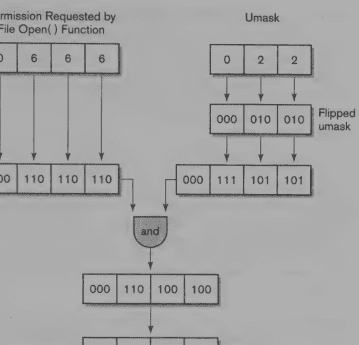

图 3-3 系统如何使用 `umask`

### 设置可执行文件权限

可以由普通用户运行的程序文件绝不应为除所有者外的任何人设置写权限。例如，`/usr/bin` 中的程序文件应具有这样的权限设置：只有 `root` 可以读取、写入和执行，其他人只能读取和执行这些文件。允许其他人写入程序文件会造成严重的 安全漏洞。例如，如果 `root` 以外的某人被允许写入 `/usr/bin/zip` 等程序，恶意用户可以用特洛伊木马程序替换真正的 `Zip` 程序，从而损害系统安全并随意破坏文件和目录。因此，始终检查以确保系统上的程序文件具有正确的权限。你应经常运行 `COPS` 以检测与权限相关的问题。

### 为 FTP 设置默认文件权限

如果你的许多用户通过 `FTP` 在服务器上传输文件，你可以控制 `FTP` 服务器的默认 `umask` 设置，使一个用户的文件无法被另一个用户访问。例如，如果你希望设置权限，使只有用户及其组可以通过 `FTP` 上传到 `Web` 服务器的文件可读，你可以修改 `/etc/inetd.conf` 文件中的 `in.ftpd` 行。该行默认如下所示：

```
ftp stream tcp nowait root /usr/sbin/tcpd in.ftpd -l -a
```

要为通过 `FTP` 上传的所有文件设置默认 `umask`，需要添加 `-u` 参数并使用适当的 `umask` 值。例如，要为每个上传的文件设置 `640`（`rw-r-----`）权限，可以将 `umask` 设置为 `026`。因此，将前一行更改如下：

```
ftp stream tcp nowait root /usr/sbin/tcpd in.ftpd -l -a -u026
```

重启 `inetd` 服务器（`killall -HUP inetd`）并通过用户账户 `FTP` 一个文件，以查看权限是否按预期设置。

这对于充当多个不同客户端的 `Web` 服务器的系统非常有用。如果你不希望一个客户端看到另一个客户端的文件，可以将此选项与特殊的所有权设置一起使用。例如，假设你将所有 `Web` 客户端文件保存在 `/www` 分区或目录中，每个客户端站点都有自己的目录（例如 `/www/myclient1`、`/www/myclient2` 等）。你可能已经为每个客户端提供了 `FTP` 账户以在这些目录中上传文件。为了阻止客户端查看其他客户端的文件，使用上述方法在 `FTP` 服务器上使用 `umask`，并按如下方式重置每个客户端站点的所有权：

```
chown -R client.Webserveruser /www/clientdir
```

例如，如果你以 `httpd` 运行 `Web` 服务器，并且有一个名为 `myclient` 的客户端用户，则前面的命令将如下所示：

```
chown -R myclient.httpd /www/myclient
```

这会将 `/www/myclient` 目录及其所有子目录和文件的所有权更改为 `myclient`（用户）和 `httpd`（组）。这样做是为了允许客户端用户拥有、修改和删除她的文件，并允许 `Web` 服务器读取目录中的文件。然而，为了禁止其他所有人，你必须按如下方式更改权限：

```
chmod -R 2770 /www/clientdir
```

对于当前示例，实际命令如下：

```
chmod -R 2770 /www/myclient
```

这将 `/www/myclient` 的所有文件和子目录权限设置为 `2770`，这允许文件和目录对所有者（`myclient`）和 `Web` 服务器用户（`httpd`）可读、可写和可执行，并且还确保在创建新文件时，其权限会被设置为允许 `Web` 服务器读取文件。这是通过使用 `set-GID`（`2`）位实现的。

## 使用常用文件/目录实用程序

本节向您展示如何使用在 `Red Hat Linux` 系统上可随时使用的几个常用文件和目录实用程序。

### 查看文件和目录

`ls` 程序可能是任何 `UNIX` 或类 `UNIX` 平台上使用最广泛的程序。`ls` 最常用的选项是 `-l`（长列表）、`-a`（所有文件，包括以句点开头的文件名）、`-1`（一列、仅文件名列表）和 `-R`（递归列表）。

### 在目录中导航

你可能已经知道 `cd` 命令，它实际上是一个内置的 `shell` 命令。如果不提供目录名作为参数，`cd` 命令会将你返回到当前使用的用户账户的主目录。任何时候你不确定自己在文件系统中的位置，都可以使用 `pwd` 命令，它会显示当前目录名。

### 确定文件类型

与 `Microsoft Windows` 操作系统不同，`Linux` 不依赖文件扩展名来确定文件类型。你可以使用 `file` 实用程序来确定文件类型。例如，

```
file /usr/bin/file
```

显示 `/usr/bin/file`（它本身）是什么类型的文件。以下是其输出示例：

/usr/bin/file: ELF 32-bit LSB executable, Intel 80386, \
version 1, dynamically linked, not stripped

### 查看文件或目录的访问统计信息

你可以使用 `stat` 程序获取文件或目录的统计信息。例如，

```
stat /tmp
```

显示 `/tmp` 目录的统计信息。以下是其输出示例：

```
File: "/tmp"
Size: 2048          Filetype: Directory
Mode: (1777/drwxrwxrwt)     Uid: (    0/    root)
Gid: (    0/    root)
Device: 3,0   Inode: 16321   Links: 22
Access: Sun Feb  7 02:00:35 1999(000000.00:01:11)
Modify: Sun Feb  7 02:01:01 1999(000000.00:00:45)
Change: Sun Feb  7 02:01:01 1999(000000.00:00:45)
```

### 复制文件和目录

使用 `cp` 命令将文件从一个位置复制到另一个位置。例如，

```
cp /some/important.txt /new/place/
```

将名为 `important.txt` 的文件从 `/some` 目录复制到 `/new/place` 目录。你也可以指定新的目标文件名。`cp` 的常用选项包括 `-f`，它允许你强制将文件复制到已存在同名文件的位置。例如，

```
cp -f /some/important.txt /new/place/
```

即使 `/new/place` 目录中已存在同名文件，也会复制 `important.txt` 文件。

要复制目录及其所有文件和子目录，请使用以下命令：


```
cp -r source-directory destination-directory
```

例如，

```
cp -r /tmp/foo /zoo/foo
```

### 移动文件和目录

要移动文件或目录，请使用 `mv` 命令。例如，以下命令将 `/file1` 移动到 `/tmp/file2`：

```
mv /file1 /tmp/file2
```

同样，你也可以连同其所有内容一起移动目录。请注意，`mv` 不会在不同的文件系统之间移动目录。要执行此操作，请使用带 `-r` 选项的 `cp` 将目录复制到新的文件系统，然后从当前位置删除该目录（请参阅以下文本）。

### 删除文件和目录

要删除文件或目录，请使用 `rm` 命令。例如，以下命令删除文件：

```
rm filename
```

如果使用 `/bin/tcsh` shell，你可能已将 `rm` 别名设置为如下：

```
alias rm rm -i
```

在这种情况下，`-i` 提示会告诉命令在实际删除任何内容之前提示你。如果希望被提示，可以显式使用 `-i` 选项。另一方面，你可以使用 `-f` 选项强制删除。

要删除目录，需要指定 `-r` 选项。例如，

```
rm -rf directory
```

删除指定目录内的所有文件和子目录。

### 查找文件

要定位文件，可以使用各种命令。要定位程序的确切路径，可以使用 `which` 命令。例如，

```
which httpd
```

如果 `httpd` 程序位于包含在 `$PATH` 环境变量中的目录中，它会显示 `httpd` 程序的完全限定路径名。某些 shell 具有内置的 `which` 命令，而其他 shell 则使用 `/usr/sbin/which`。

你可以使用 `locate` 程序通过部分或完整名称定位文件或目录。例如，以下命令查询 `updatedb` 文件名数据库并返回所有出现位置的 `netpr.pl` 文件：

```
locate netpr.pl
```

为了使 `locate` 正常工作，你必须确保已设置 `cron` 作业以每日或每周运行 `updatedb`。Red Hat 默认安装实际上会自动设置此类作业。


### 提示

你可以使用 `find` 程序定位文件或目录。例如，要定位当前目录及其所有子目录中的所有 HTML 文件，请按如下方式运行 `find`：

```
find . -type f -name "*.html"
```

### 覆盖默认文件权限掩码

系统管理员可以在你使用的 shell 的全局资源文件中设置默认权限掩码。例如，如果你使用 `/bin/tcsh` shell，系统管理员可以使用 `umask` 命令在 `/etc/csh.cshrc` 文件中为你设置默认文件权限。然而，如果你想覆盖默认权限掩码，可以从命令行运行 `umask` 来更改默认掩码。例如，

```
umask 222
```

将默认权限掩码设置为对所有人都可读、可读、可读。换句话说，它关闭了用户、组和其他人的写权限。这也会覆盖 shell 的系统默认值。然而，此更改是临时的；当你注销并重新登录时，系统默认值将再次生效。如果你基本上不喜欢系统的权限掩码，请将适当的 `umask` 命令放入 shell 的资源文件中。例如，如果你希望掩码始终为 `222` 并使用 `/bin/tcsh` 作为 shell，可以将此命令放入你的 `~/.cshrc` 文件中，这样每次登录时，`umask` 命令都会覆盖系统的默认值。

### 使用 ext2 文件系统特定权限

Red Hat Linux 使用的 `ext2` 文件系统提供了一些独特功能。其中一个功能允许文件即使对 `root` 用户也是不可变的。例如，

```
chattr +i filename
```

设置 `ext2` 文件系统中文件的 `i` 属性。当设置此属性时，任何人都无法修改、删除或重命名该文件。也不能添加指向此文件的链接。此属性只能由 `root` 用户设置或清除。因此，你可以使用此属性来防止涉及文件的事故。当需要清除该属性时，可以运行以下命令：

```
chattr -i filename
```

`ext2` 系统的另外一些有趣功能，例如 `undelete` 属性，尚未实现，但在未来的 `ext2` 文件系统版本中将可用。如果你开始使用 `chattr` 命令，你会注意到有时即使你有权限也无法修改或删除文件。这发生在你忘记之前使用 `chattr` 设置了文件的不可变属性时；因为此属性不会显示在 `ls` 输出中，所以可能会令人困惑。要查看哪些文件具有哪些 `ext2` 属性，请使用文件名作为参数运行 `lsattr` 程序。

### 第 4 章

## 使用 Linuxconf

### Linuxconf 适合你吗？

`Linuxconf` 是一个系统管理工具，提供可通过多种接口访问的核心功能集，例如 Web 浏览器、基于文本的菜单式界面或基于 X Window 系统的界面。`Linuxconf` 附带一组核心模块；每个模块为某个系统服务或任务提供一组管理功能。例如，Apache Web 服务器管理是在 Apache 模块中实现的。模块存储在 `/usr/lib/linuxconf/module` 目录中。目前，许多模块随 `Linuxconf` 的 RPM 包版本一起分发。例如，表 4-1 显示了随 `Linuxconf` 版本 1.1.6 一起提供的所有模块

表 4-1 随 `Linuxconf` 版本 1.1.6 发行的模块

| 模块 | 描述 |

|---|---|

| apache | Apache Web 服务器配置模块 |

| dhcpd | 动态主机配置协议服务器配置模块 |

| dialout | 出站 PPP 连接配置模块；如果使用 redhatppp 模块则不需要 |

| dnsconf | 用于 BIND 4 和 8 版本名称服务器的 DNS 配置模块 |

| inittab | `/etc/inittab` 文件配置模块 |

| firewall | 防火墙配置模块，允许在内核级别进行数据包过滤、IP 伪装、端口重定向和 IP 记账 |

| mailconf | sendmail SMTP 服务器配置模块 |

| motd | 每日信息文件 (`/etc/motd`) 配置模块 |

| mrtg | 多路由器流量图形化工具配置模块 |

| netasm | 网络配置模块 |

| pppdialin | PPP 相关配置模块 |

| rarp | Linux 内核的 RARP 表配置模块 |

| redhatppp | Red Hat Linux 的拨号服务 (PPP/SLIP/PLIP) 配置模块 |

| samba | Samba 配置模块 |

| squid | Squid 代理配置模块 |

| status | 系统状态模块 |

| treemenu | `Linuxconf` 的内部模块 |

| userinfo | 额外用户信息配置模块 |

| usermenu | `Linuxconf` 的内部模块 |

| uucp | UUCP 配置模块 |

| wuftpd | wu-ftpd FTP 服务器配置模块 |

| xterminals | X 终端配置模块 |

你可以在 `www.solucorp.qc.ca/linuxconf/` 找到许多其他模块。

尽管 `Linuxconf` 背后的想法非常令人印象深刻，但我对该应用程序的当前状态并不完全信服。我发现了一些令人厌烦的问题，这些问题很可能会在未来版本中得到修复。例如，许多重要的帮助页面缺失或尚未完成，而且 `Linuxconf` 本身生成的错误消息在性质上有点晦涩。除了这些烦恼之外，它的功能按预期工作。简而言之，我建议你将 `Linuxconf` 视为一个正在进行中的开发项目，距离成熟非常接近。

### 安装 Linuxconf

安装 `Linuxconf` 非常简单。如果你没有在 Red Hat Linux 安装期间安装 `Linuxconf`，你可以随时从随官方 Red Hat CD-ROM 提供的 RPM 包安装它。此外，你还可以从官方 `Linuxconf` FTP 站点 `ftp://ftp.solucorp.qc.ca/pub/linuxconf/devel/` 下载 RPM 包。确保你下载了适用于你的 Red Hat Linux 版本的正确 RPM 包。下载 RPM 包后，你可以通过运行 `rpm -ivh package` 命令安装它，其中 *package* 是实际的包名。

### 配置 Linuxconf

`Linuxconf` 可以以多种方式使用。它会自动在文本模式（用于控制台或远程 shell）或图形模式（用于 X Windows）之间选择。例如，如果你登录到系统控制台并从命令行运行 `/bin/linuxconf`，你将看到一个类似于图 4-1 所示的屏幕。

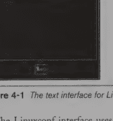

图 4-1 `Linuxconf` 的文本界面

`Linuxconf` 界面使用树形菜单结构。图 4-1 显示了两个顶级菜单项——Config 和 Control。以下是文本模式下的导航方式。


要展开菜单的特定分支，请使用箭头键选择它，然后按 `Enter`。例如，要展开 `Config` 菜单，请选择 `Config` 并按 `Enter`。结果如图 4-2 所示。


图 4-2 在 Linuxconf 中展开 Config 菜单

正如你所见，`Config` 有多个分支（`Networking`、`Users accounts`、`File systems` 和 `boot mode`）。要关闭一个分支，请选择它并按 `Enter`。要退出应用程序，请使用 `Tab` 键选择 `Quit` 按钮并按 `Enter`。`Linuxconf` 将探测正在运行的服务器和配置，并确定是否需要激活任何内容。如果需要激活某些内容，因为你对某些内容做了更改，你将看到一个带有图 4-3 所示选择的屏幕。

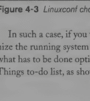

图 4-3 退出时 Linuxconf 的选择

在这种情况下，如果你想查看 Linuxconf 将如何将正在运行的系统与当前配置同步，请选择 `Preview what has to be done` 选项并按 `Enter`。会出现另一个屏幕，显示待办事项列表，如图 4-4 所示。

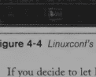

图 4-4 Linuxconf 的待办事项列表

如果你决定让 Linuxconf 激活列出的更改，则退出预览屏幕，选择 `Activate the changes` 选项并按 `Enter`。`Linuxconf` 将激活必要的内容然后退出。

如果你想从 X Windows 使用 Linuxconf 的 GUI，请从 X 终端窗口或通过你的窗口管理器运行 `/usr/bin/gnome-linuxconf` 或 `/bin/linuxconf`。树形菜单在 GUI 版本中看起来好得多，如图 4-5 所示。

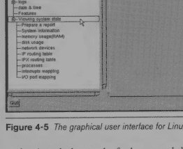

图 4-5 Linuxconf 的图形用户界面

任何可以进一步展开的分支都在分支名称前显示一个 `+` 号，而已经展开的分支显示一个 `-` 号。例如，在图 4-5 中，`Control` 分支完全展开，其他所有内容都可以进一步展开。双击 `+` 或 `-` 号可展开或关闭分支。

Linuxconf GUI 的一个非常有趣的功能是，你从树形菜单中选择的每个项目都会作为单独的标签页出现在屏幕右侧。在处理一个项目时，你可以决定处理另一个项目。在这种情况下，右侧会有多个标签页。图 4-6 显示了这样一个场景，其中“功能”和“工作站日期和时间设置”的标签页出现在界面的右侧。可以通过单击左侧界面树上的其他项目来添加更多标签页。这是一种同时处理多个项目非常灵活的方式。

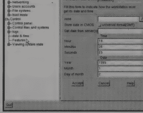

图 4-6 Linuxconf GUI 中的标签页窗口

与基于文本的界面一样，当你决定退出 GUI 时，Linuxconf 会要求你激活所做的任何更改。你也可以预览或在不激活当前配置的情况下退出。

不幸的是，基于 Web 的 Linuxconf 界面是三种界面中最难看的，尽管它本可以是最华丽的的那一个。因为我最喜欢的界面是 GUI，所以本章在讨论与 Linuxconf 相关的内容时始终使用它。

默认情况下，你只能从 `localhost` 访问基于 Web 的 Linuxconf 界面。换句话说，你需要在运行 Linuxconf 的同一台机器上运行你的 Web 浏览器。图 4-7 显示了此界面的主 Linuxconf 页面。

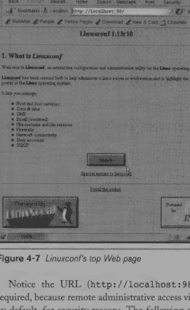

图 4-7 Linuxconf 的顶级 Web 页面

注意 URL（`http://localhost:98/`）。这里需要“`localhost`”，因为出于安全原因，默认情况下未启用通过 Web 的远程管理访问。下一节将向你展示如何启用它。

### 设置 Linuxconf 的基于 Web 的远程访问

能够随时从任何平台通过 Web 浏览器进行管理的好处是无穷无尽的。这对于在组织中管理大量 Linux 系统的人来说尤其有帮助。如果你允许你的 Linux 系统从任何地方进行管理，你就会产生巨大的安全风险——任何人现在都可以通过 Web 尝试入侵你的系统 Web 可访问的 Linuxconf 接口。正因如此，你必须将基于 Web 的 Linuxconf 访问仅限制在受信任的网络中。

基于 Web 的 Linuxconf 是一个由 `inetd` 运行的服务。当你安装 Linuxconf RPM 包时，类似以下的一行会被添加到你的 `/etc/inetd.conf` 文件中：

```
linuxconf stream tcp wait root /bin/linuxconf \
linuxconf --http
```

另一行类似以下的内容会被添加到你的 `/etc/services` 文件中：

```
linuxconf 98/tcp
```

这允许 `inetd` 在 TCP/IP 端口 98 上收到连接请求时以 HTTP 模式运行 Linuxconf。换句话说，当你在使用 Linux 系统上的浏览器访问 `http://localhost:98/` 时，`inetd` 守护进程会使用 `--http` 选项启动 `/bin/linuxconf`。

> **Caution**
>
> Linuxconf 以 setuid root 进程运行。因此，如果在 Linuxconf 中发现安全漏洞，很可能会允许任何人获得 root 权限。Linuxconf 有超过 80,000 行 C++ 代码。坦白说，我不太放心通过 Web 运行这样一个庞大的 setuid 程序。你必须自行决定是否通过 Web 使用它。

如前所述，默认情况下，Linuxconf 仅允许从 `localhost` 进行基于 Web 的访问。如果你想通过 Web 启用对 Linuxconf 的远程管理访问，请按以下步骤操作：

- 1. 从你的控制台或 X Windows 运行 `linuxconf`。
- 2. 选择 `Config` 菜单选项并展开其分支，文本模式下按 `Enter`，GUI 模式下双击。展开 `Misc` 菜单并选择 `Linuxconf network access`；右侧应显示一个类似图 4-8 所示的标签页。
- 3. 选择“启用网络访问”复选框。
- 4. 选择“在 `/var/log/htmlaccess.log` 中记录访问”复选框，以允许通过网络记录 Linuxconf 访问请求。

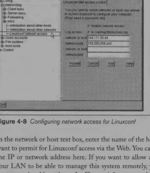

Figure 4-8 配置 Linuxconf 的网络访问

- 5. 在 network 或 host 文本框中，输入你希望允许通过 Web 访问 Linuxconf 的主机名称。你也可以在此输入 IP 或网络地址。如果你希望允许局域网上的任何主机远程管理此系统，可以在此使用网络地址。在图 4-8 中，使用了网络地址 `206.171.50.48`。为了启用该网络中的所有机器，可在可选的 netmask 文本框中指定子网掩码 `255.255.255.240`。子网掩码是可选的，因为 Linuxconf 可以从你的网络地址计算出子网掩码。如果你计划添加多个主机但不是整个网络，只需添加它们的 IP 地址即可。默认情况下，屏幕允许你输入两个 IP 地址和两个可选子网掩码。如果需要更多空间，请单击 `Add` 按钮以获取额外的输入框供其他主机使用。
- 6. 在输入主机名或 IP 地址或网络/子网掩码对后，单击“`Activate`”按钮。
- 7. 单击“`Quit`”按钮退出 Linuxconf，并在提示时激活当前配置。

这应该允许指定的主机（或 IP 地址）通过 Web 访问 Linuxconf。

如前所述，Linuxconf 使用内部代码函数和外部模块来执行实际配置。目前，Linuxconf RPM 包附带了几乎所有可用的模块。这可能会改变，因为 Linuxconf 模块理想情况下应随单个包一起发布。例如，Red Hat 的 Apache 包应包含一个 Linuxconf 模块。如果你不使用 Apache Web 服务器，则在 Linuxconf 配置中不需要 Apache 模块。模块越多，Linuxconf 界面看起来越杂乱。如果应用程序开发者自行提供模块，那么你就只有所需的内容。希望 Linuxconf 很快会这样做。在此之前，你可以手动配置所需的模块。

## 配置 Linuxconf 模块

你可以添加新模块或停用现有模块。模块保存在 `/usr/lib/linuxconf/modules` 目录中。要添加新模块，请从 Linuxconf FTP 站点下载必要的 RPM 包。提供 Linuxconf 文件的 FTP 站点列表可在 `http://dns.solucorp.gc.ca/linuxconf/available.html` 获取。


下载新的 Linuxconf 模块后，使用 `rpm -ivh module_package` 命令安装它。安装后，该模块会自动出现在 Linuxconf 的模块列表中。它也会自动被激活。

## 停用模块

要停用模块，请执行以下操作：

- 1. 从你的控制台或 X Windows 运行 `linuxconf`。
- 2. 从 Linuxconf 屏幕左侧选择 Control→ Control files and systems→ Configure Linuxconf modules。你将看到一个类似图 4-9 所示的屏幕。
- 3. 向下滚动模块列表并找到要停用的模块。切换“This module is active”复选框，使模块变为非活动状态。
- 4. 单击“Accept”按钮。
- 5. 如果你在 Linuxconf 中没有其他操作，单击“Quit”按钮。你将被提示激活更改。单击“Activate the changes”完成操作。

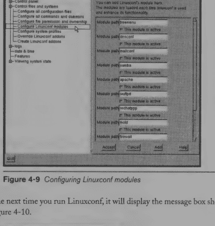

Figure 4-9 配置 Linuxconf 模块

下次运行 Linuxconf 时，它将显示图 4-10 所示的消息框。

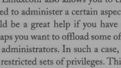

Figure 4-10 重新配置 Linuxconf 消息框

该消息表示 Linuxconf 正在删除与非活动模块相关的菜单项。Linuxconf 还允许你创建特权用户账户，用于管理 Linux 系统的某些方面。如果你的组织中有共同管理员，此功能应该会很有帮助。也许你想将一些简单的管理任务委派给初级管理员。在这种情况下，你可以创建具有受限权限集的普通用户账户。下一节将讨论此内容。

## 定义用户权限

Linuxconf 允许你将某些管理权限与普通用户关联起来。考虑以下示例。假设你有一个名为 pikeb 的普通用户账户，并希望为其分配一些管理权限。请执行以下操作：

- 1. 使用 root 账户运行 `linuxconf`。
- 2. 从 Linuxconf 屏幕左侧选择 Config→Users accounts→Normal→User accounts。系统上所有普通用户的列表将会出现。
- 3. 找到目标用户（本例中为 pikeb）并双击其记录行。你将看到一个类似图 4-11 所示的屏幕。

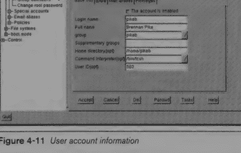

Figure 4-11 用户账户信息

- 4. 如图 4-11 所示，首先显示的是 Base Info 标签。单击 Privileges 标签以配置可用的权限选项，如图 4-12 所示。

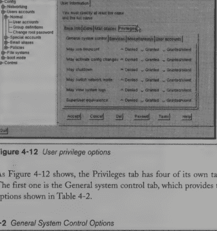

Figure 4-12 用户权限选项

- 5. 如图 4-12 所示，Privileges 标签下有四个子标签。第一个是 General system control 标签，它提供了表 4-2 所示的选项。

### 表 4-2 通用系统控制选项

| 权限选项 | 说明 |
|---|---|
| May use linuxconf | 如果你希望用户能够运行 Linuxconf，则授予此权限。 |
| May activate config changes | 如果你希望用户能够激活对当前系统配置的任何更改，则授予此权限。 |
| May shutdown | 如果你希望用户能够关闭系统，则授予此权限。 |
| May switch network mode | 如果你希望用户能够启用/禁用网络连接，则授予此权限。 |
| May view system logs | 如果你希望用户能够查看系统日志文件，则授予此权限。 |
| SuperUser equivalence | 仅授予需要 superuser（root）访问权限的用户此权限。 |

要授予表 4-2 中显示的任何权限，你需要单击适当的 Granted 或 Granted/silent 选项，两者的区别在于后者不需要用户使用密码进行身份验证。我建议不要对任何内容使用静默模式。

如果你希望用户管理一个或多个服务，请单击 Services 标签以查看服务选项。系统上可用的服务取决于你安装的内容。图 4-13 显示了示例系统上可用的服务。

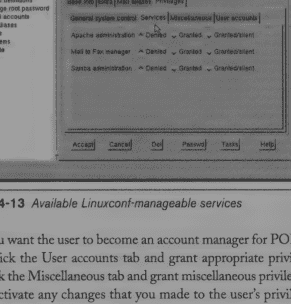

Figure 4-13 可由 Linuxconf 管理的可用服务

如果你希望用户成为 POP/PPP/UUCP 用户的账户管理员，请单击 User accounts 标签并授予适当的权限。你还可以单击 Miscellaneous 标签并授予用户各种权限。

要激活你对用户权限所做的任何更改，请单击 Accept 按钮，然后单击 Quit 按钮退出 Linuxconf。

退出 Linuxconf 后，以该用户身份登录系统并运行 Linuxconf。测试你的新权限。确保它们是你想要的。如果确定相关用户拥有所有正确的权限，那么你就完成了。给那个幸运的（希望是）用户带来好消息。

## 使用多系统配置配置文件

默认情况下，Linuxconf 提供两个系统配置文件：Office 和 Home。您可以在 Linuxconf 中找到可用系统配置文件的列表。从 Linuxconf 屏幕左侧选择 Control → Control files and systems → Configure system profiles。您将在 Configuration versioning 选项卡中看到可用配置的列表，如图 4-14 所示。

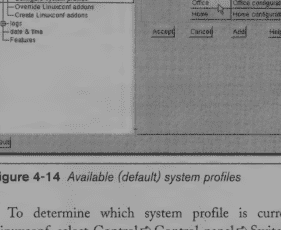

图 4-14 可用（默认）系统配置文件

要确定 Linuxconf 当前使用的是哪个系统配置文件，请从 Linuxconf 屏幕左侧选择 Control → Control panel → Switch system profile。您将在 Pick a version 选项卡中看到可用配置的列表，如图 4-15 所示。您也可以按如下方式创建自己的系统配置文件：

- 1. 从 Linuxconf 屏幕左侧选择 Control → Control files and systems → Configure system profiles。您将看到一个与之前图 4-14 中所示类似的窗口。
- 2. 点击 Add 按钮添加新的系统配置文件。系统会要求您输入新系统配置文件的名称，如图 4-16 所示。名称必须是一个单词，不能包含任何空格字符。输入您选择的名称并点击 Accept。

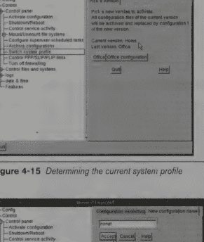

图 4-15 确定当前系统配置文件

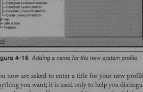

图 4-16 为新系统配置文件添加名称

- 3. 现在系统会要求您为新配置文件输入标题。这可以是您想要的任何内容；它用于帮助您将该配置文件与其他配置文件区分开来。输入对您有意义的内容。
- 4. 您需要为各种子系统提供归档族名称（即 `/etc/linux-conf/archive/subsystem-family-name`），例如 crond、PPP/SLIP/PLIP、DNS server、firewalling rules、wu-ftpd server、gated、inet、httpd、lpd 等。您还可以提供默认的归档族名称，当您未为某个子系统显式定义归档族名称时使用。如果您既未设置默认族名称也未提供显式族名称，则该子系统的数据将存储在 `/etc/conf.linuxconf` 文件中。如果您想使用另一个配置文件中的现有子系统，可以输入该配置文件的现有族名称。请注意，如果一个子系统在多个归档之间共享，则对该子系统配置文件所做的任何更改都将在使用该子系统的所有系统配置文件中生效。
- 5. 指定所有归档族名称后，点击 Accept 按钮。您的新配置文件将被添加到可用配置文件列表中。再次点击 Accept。
- 6. 要使用您新建的配置文件，请从 Linuxconf 屏幕左侧选择 Control → Control panel → Switch system profile。点击您的配置文件以切换到它。切换到新配置文件后，当您切换回另一个配置文件时，它会自动归档。如果您想手动归档它，请从 Linuxconf 屏幕左侧选择 Control → Control panel → Archive configurations。

正如您所见，Linuxconf 为您提供了一种非常强大的方式，让您可以在不担心丢失现有配置的情况下尝试各种配置。

## 系统启动时使用 Linuxconf

安装 Linuxconf 时，它会通过插入如下一行来修改 `/etc/rc.d/rc.sysinit` 文件：

```
/sbin/askrunlevel
```


因为 `/etc/rc.d/rc.sysinit` 是由 `init`（由内核作为第一个用户进程运行）在任何事情之前运行的，所以 `askrunlevel` 程序在 `init` 能够将系统切换到默认运行级别之前就运行了。`askrunlevel` 程序在系统控制台上显示一个菜单屏幕；在 GUI 模式下类似的菜单如图 4-17 所示。

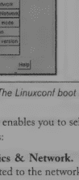

图 4-17 Linuxconf 启动菜单

此菜单使您能够从三个预建配置中选择一种操作模式：

- **Graphics & Network.** 适用于连接到网络的 X Windows 工作站。
- **Text mode & Network.** 适用于服务器。
- **Maintenance mode.** 适用于执行维护工作，例如运行文件系统扫描程序（`fsck`）或排除某些问题。

如果在设定的超时时间内未选择任何选项，则会选择默认操作模式。您也可以选择使用其中一个系统配置配置文件启动系统。要使用现有系统配置文件启动系统，请选择 Select 选项或 configuration version 选项。系统会要求您输入 root 密码。成功以 root 用户身份验证后，您将被允许选择要启动的系统配置。您还可以查看启动日志以检测启动错误。也可以使用 Linuxconf 跳过此菜单或更改默认操作模式或超时值。方法如下：

- 1. 运行 `linuxconf`。
- 2. 从 Config 菜单中，选择 boot mode，然后选择 default boot mode 选项。
- 3. 如果您想禁用启动菜单，请取消选中 Boot time menu enabled 复选框。
- 4. 要更改默认操作模式，请选择 Graphics & Network 选项或 Text mode & Network 选项。
- 5. 要更改提示超时或激活延迟，请分别在 Prompt timeout 或 Delay to activate 输入框中输入适当的秒数。
- 6. 完成所有更改后，点击 Accept 按钮并在退出 Linuxconf 之前激活更改。

## 第二部分

### 高级配置

- 章节
- 5 用户管理
- 6 进程管理
- 7 网络管理
- 8 DNS 服务
- 9 电子邮件服务
- 10 FTP 服务
- 11 使用 Samba 共享文件和打印机
- 12 使用 Apache 的 Web 服务
- 13 使用 NFS 文件服务器
- 14 配置 X Window

### 第 5 章

#### 用户管理

##### 创建多个超级用户账户

许多初级系统管理员认为用户 `root` 是唯一的超级用户。这完全不正确。用户名“root”并不是使一个账户成为超级用户的因素。请看以下来自示例 `/etc/passwd` 文件的行：

```
root:dcw12Y6bSUfyo:0:0:root:/root:/bin/tcsh
bin:*::1:1:bin:/bin:
daemon:*::2:2:daemon:/sbin:
kabir::HoiviYBP4/8U:0:0:Mohammed
sheila:gTWD/qILMF9M::501:501::/home/sheila:/bin/tcsh
apache:!!:502:502::/usr/local/apache:/bin/false
```

该密码文件有两个超级用户账户：`root` 和 `kabir`。要理解原因，您必须记住 `/etc/passwd` 文件具有以下格式：

```
username:password:UID:GID:fullname:home-dir:shell
```

请注意 `root` 账户的 UID（用户 ID）和 GID（组 ID）字段。它们都设置为 0。而且，如果您回顾一下看起来普通的 user `kabir` 的行，您会看到他的 UID 和 GID 也设置为 0。这就是使用户成为超级用户的原因。换句话说，任何 UID 和 GID 均为 0 的用户都等同于所谓的 root。

正如您所见，您可以将任何普通用户账户转变为超级用户账户。在大多数情况下，您不希望这样做，因为拥有多个超级用户账户可能意味着额外的安全风险。但是，在多个系统管理员共同操作同一系统的组织中，有时会使用多个超级用户账户。这样做是为了在多管理员环境中确保更大的责任归属。例如，如果上面描述的密码文件中的 `kabir` 和 `root` 账户属于两位不同的系统管理员，那么通过查看各种日志文件来判断谁以超级用户身份做了什么，比两位系统管理员共享默认的 `root` 账户要容易一些。

多个超级用户账户还可以在另一种不太理想的情况下使用——当系统被某人入侵时。在这种情况下，黑客通过将 UID 和 GID 值设置为 0 来创建一个看似普通的超级用户账户。这使得黑客可以在不知道 root 用户密码的情况下重新登录并成为超级用户。这种技巧在系统管理员是新手或太忙而无法留意此类事情的系统上有效。

实际上，在真正的盈利性组织的背景下，没有系统管理员有时间每天监控黑客，因此在这种情况下您可能希望使用一些脚本作为助手。例如，

```bash
/bin/grep '0:0' /etc/passwd | awk 'BEGIN {FS=":"} {print $1}' | mail -s "$(date +"%D %T")" root
```

这是一个非常小的脚本，使用几个标准命令检查 `/etc/passwd` 文件中 UID 和 GID 值设置为 0 的用户。它可以将此类账户的列表通过邮件发送给 root 用户。如果通过将该脚本放在 `/etc/cron.daily` 中的文件中由 cron 运行，您每天都会收到一封电子邮件，其中显示超级用户列表。然后您可以每天快速检查电子邮件以了解哪些账户具有超级用户权限。当然，聪明的黑客可以发现这一点并能够更改脚本以向您提供虚假信息。但是，我的个人经验表明，大多数黑客行为是由寻求刺激的人进行的，他们几乎不花时间自行调查事情。在我的经验中，大多数所谓的黑客只是从互联网上找到一个可利用的程序，编译它，

并运行它以获取访问权限；他们通常缺乏通过细心系统管理员可能设置的检查的能力。

现在你知道了任何用户账户都可以被转变为超级用户账户，你可能会认为任何这样的用户都可以很容易地登录到 Red Hat Linux 系统。并非如此。Red Hat Linux 系统默认使用可插拔认证模块（PAM）进行登录认证，该模块要求只有从被认为安全的终端才能允许超级用户访问。默认情况下，用于登录的 PAM 配置文件 `/etc/pam.d/login` 包含如下行：

```
auth required /lib/security/pam_securetty.so
```

此行说明在允许登录之前必须满足 `pam_securetty.so` 模块强制执行的 安全限制。此特定模块仅在登录尝试来自 `/etc/securetty` 文件中列出的 TTY 时才认为超级用户登录尝试是令人满意的。因此，如果你决定将普通用户转变为超级用户并尝试通过 Telnet 登录（这将使用伪 TTY 设备），你将无法登录。但是，这可以通过在 `/etc/securetty` 文件中添加伪 TTY 设备（通常为 `ttyS1` 到 `ttyS12`）来轻松更改。然而，这不被推荐，因为它会造成安全风险。相反，如果你因某些实际的行政和问责原因必须使用多个超级用户账户，你应该执行以下操作：

- 1. 创建多个超级用户账户。
- 2. 为每个超级用户创建一个普通用户账户。
- 3. 指示每个超级用户以普通用户身份登录到系统，并使用 `su` 命令切换到超级用户账户。

`su` 命令可用于替换 UID 和 GID。例如，你可以以普通用户身份登录并通过运行不带任何参数的 `su` 来切换到 `root` 账户。你将被提示输入 root 密码；如果你知道 root 密码，`su` 将启动一个新的 shell，并且你将以 root 用户身份登录。

请记住，超级用户（UID = 0，GID = 0）拥有对所有内容的完全访问权限，因此这些是非常敏感的账户。

#### 为普通用户分配权限

使用 `sudo` 命令，你可以允许普通用户执行通常由超级用户运行的命令。假设你是组织的首席系统管理员，刚刚获得了两位新的助理系统管理员，你希望将一些例行管理任务分发给他们。你是否应该创建两个超级用户账户并将 UID 和 GID 设置为 0，以便这两位管理员可以像你一样完全访问一切？这取决于你对他们在作为最终用户工作时能否像你一样谨慎的信心。因为信心需要一定的时间来建立，你可能只想让他们访问他们需要访问的内容，因此你需要配置 `sudo` 以允许这些个人以普通用户身份运行特权命令。方法如下。

`sudo` 命令允许在 `/etc/sudoers` 文件中指定的用户运行超级用户命令。例如，一个被允许通过 `sudo` 运行超级用户命令的普通用户可以运行以下命令：

```
sudo vi /etc/passwd
```

这允许该用户修改 `/etc/passwd` 文件。`sudo` 程序非常可配置，因此你可以自定义列在 `/etc/sudoers` 中的普通用户可以或不可以做什么。`/etc/sudoers` 文件具有以下类型的行：

- **空白行和注释行（以 # 字符开头）。** 被忽略的行。


### 可选的主机别名行
用于为主机列表创建简短名称。主机别名行必须以 `Host_Alias` 关键字开头，列表中的主机必须用逗号分隔。例如，在以下行中：

```
Host_Alias REDHAT=wormhole,blackhole
```

`wormhole` 和 `blackhole` 是可以称为 `REDHAT` 的两个主机。

### 可选的用户别名行
用于为用户列表创建简短名称。用户别名行必须以 `User_Alias` 关键字开头，列表中的用户必须用逗号分隔。例如，`User_Alias ASSISTANTS=mike,brian`

### 可选的命令别名行
用于为命令列表创建简短名称。命令别名必须以以下内容开头：`Cmnd_Alias CMDS=/bin/rm,/bin/chmod,/bin/chown`

### 可选的 run-as 别名行
用于为用户列表创建简短名称。此类别名可用于告诉 `sudo` 以别名用户之一的身份运行命令。例如，`Runas_Alias OP=root,operator`

### 必需的用户访问规范行
用户访问规范的语法如下：`user host=[run as user] command list`

你可以使用真实用户名作为 `user` 或使用 `User_Alias` 指定列表。同样，你可以使用真实主机名或 `Host_Alias` 作为 `host`。默认情况下，通过 `sudo` 执行的所有命令都作为 `root` 运行。如果你想使用不同用户运行命令，可以指定用户名（或 `Runas_Alias`）。你也可以指定命令（或 `Cmnd_Alias`）；例如，`kabir wormhole= /sbin/shutdown` 允许用户 `kabir` 在名为 `wormhole` 的主机上运行 `/sbin/shutdown` 命令。请注意，你可以在命令或命令别名前插入 `!` 以拒绝该命令或命令别名，如允许。

可以在单行中定义多个别名；例如，`User_Alias ASSISTANTS=mike,brian:INTERNS=joe,robert,steve` 在单行中定义两个别名（`ASSISTANTS` 和 `INTERNS`），其中别名定义由冒号字符分隔。此相同的语法也适用于其他别名类型。

存在两个特殊关键字：`ALL` 和 `NOPASSWD`。`ALL` 用于表示“一切”，`NOPASSWD` 用于说明不需要密码。列表 5-1 显示了一个示例 `/etc/sudoers` 文件。

#### 列表 5-1 一个示例 /etc/sudoers 文件

```
# sudoers file.
#
# This file MUST be edited with the `visudo`
# command as root.
#
# See the man page for the details on how to
# write a sudoers file.
#
# Host alias specification
#
# User alias specification
User_Alias SENIORADMIN=kabir
User_Alias ASSISTANTS=mike,john
# User privilege specification
SENIORADMIN ALL=ALL
ASSISTANTS ALL=ALL
```

此 `/etc/sudoers` 文件定义了两个用户别名，`SENIORADMIN` 和 `ASSISTANTS`，前者只有一个用户（`kabir`），后者有两个用户（`mike` 和 `john`）。用户权限规范说明如下：

- 用户别名 `SENIORADMIN` 中列出的用户可以在所有主机上以 `root`（默认）身份运行 `sudo`，并且可以运行所有命令。由于用户 `kabir` 是该组中唯一的成员，这有效地说明 `kabir` 可以通过 `sudo` 运行所有命令。换句话说，用户 `kabir` 可以做用户 `root` 可以做的任何事情。
- 第二个用户规范说明用户别名 `ASSISTANTS` 中列出的用户被允许与第一个规范中完全相同的访问权限。

回到第一个示例场景，其中你有两个助手尚未需要完全的超级用户访问权限，假设你（用户 ID = `yourid`）希望这两个用户（`sysad1`、`sysad2`）只有运行 `shutdown` 命令的权限。在这种情况下，你的 `/etc/sudoers` 文件可能如下所示：

```
# User alias specification
User_Alias SENIORADMIN=yourid
User_Alias ASSISTANTS=sysad1,sysad2

# User privilege specification
SENIORADMIN ALL=ALL
ASSISTANTS ALL=/sbin/shutdown
```

假设过了一段时间后，你确信这两个用户可以以负责任的方式处理其他超级用户权限，因此你希望给予他们除运行 `su` 命令权限之外的完全访问权限。`/etc/sudoers` 文件现在如下所示：

```
# User alias specification
User_Alias SENIORADMIN=yourid
User_Alias ASSISTANTS=sysad1,sysad2

# User privilege specification
SENIORADMIN ALL=ALL
ASSISTANTS ALL=ALL, !/bin/su
```

正如你从 `ASSISTANTS` 的用户规范中看到的那样，他们被允许通过 `sudo` 运行 `ALL` 命令，除了 `/bin/su` 命令。

## 使用命令行工具管理用户

本节向您展示使用各种命令行工具进行用户管理的传统方法。

### 创建新用户账户

创建新用户账户相当容易。要从命令行创建用户账户，您可以运行 `useradd` 命令。例如，要创建一个名为 `newuser` 的用户，可以按如下方式运行此命令：

```
useradd newuser
```

这会在 `/etc/passwd` 中添加一个新条目（如果使用 `shadow` 密码，则也在 `/etc/shadow` 中），使用系统默认值。例如，当我在我的 Red Hat 系统上运行上述命令时，`/etc/passwd` 会显示如下新行：

```
newuser::!!:506:506::/home/newuser:/bin/bash
```

如果您记得前面讨论中的 `/etc/passwd` 字段，您会看到密码字段（第二个字段）设置为 `!!`。这意味着该密码尚未设置，`newuser` 尚无法登录。因此，您需要通过运行 `passwd` 命令为该用户创建密码，如下所示：

```
passwd newuser
```

系统会要求您两次输入密码，密码被接受后会被加密并添加到用户在 `/etc/passwd` 文件中的条目中。

`UID` 和 `GID` 值将由 `useradd` 自动选择。基本上，它只是将 `/etc/passwd` 中最后一个 `UID` 增加 1，并将 `/etc/group` 中最后一个 `GID` 增加 1，分别创建新用户的 `UID` 和 `GID`。您也可以分别使用命令行开关 `-u` 和 `-g` 手动设置 `UID` 和组。主目录在默认的顶级主目录中创建。同样地，登录 `shell` 从系统默认值中选择。这些默认值的设置将在后面的章节中解释。如果您想覆盖系统默认值，可以指定一个命令行选项。要覆盖默认主目录，请使用 `-d newdirectory` 选项（其中 `newdirectory` 是您的目录名称）。例如，

```
useradd newuser -d /www/newuser
```

新用户（`newuser`）将被创建，其主目录将被设置为 `/www/newuser`。请注意，`useradd` 只会创建最后一个目录，而不是整个路径。例如，如果您指定 `-d /some/new/dir/myuser` 作为选项，`useradd` 只有在 `/some/new/dir` 已存在的情况下才会创建 `myuser`。

当创建新的主目录时，`/etc/skel` 目录中的文件会被复制到新的主目录。这些文件通常是默认 `shell` 的点配置文件。例如，如果默认 `shell` 是 `/bin/bash`，您应该在 `/etc/skel` 目录中拥有 `.bashrc`、`.bash_profile` 和 `.bash_login` 的默认版本，以便新用户的主目录可以用这些文件自动设置。

Red Hat Linux 附带的 `useradd` 会为用户创建一个与用户名同名的私有组。例如，如果您运行 `useradd kabir`，那么 `/etc/passwd` 文件中将创建一个名为 `kabir` 的新用户，并且 `/etc/group` 文件中将创建一个名为 `kabir` 的新组。这种方法允许新用户完全与其他用户隔离，从而确保用户有更大的隐私。每当新用户创建新文件时，由于这个私有组，该文件只能由新用户访问。用户必须显式更改文件权限才能允许其他人查看该文件。

然而，如果您的用户账户理念与这种私有组想法冲突，您可以通过使用 `-g group` 选项（其中 `group` 是您的组名）来覆盖它。例如，

```
useradd mjkabir -g users
```

使 `useradd` 创建新用户（`mjkabir`），其默认组设置为 `users`。


### 提示

您可以使用 `groups` `username` 命令来查找哪个用户属于哪个组。

如果您想让新用户成为系统上其他组的成员，可以使用 `-G` 以逗号分隔的组列表选项。例如，

```
useradd mjkabir -G wheel,admins
```

将新用户（`mjkabir`）添加到 `/etc/group` 文件中的 `wheel` 和 `admins` 组。

### 创建新组

要创建新组，请使用 `groupadd` 命令。例如，以下命令在 `/etc/group` 中以及在 `/etc/gshadow` 文件中（如果您使用 shadow 密码）添加一个名为 `mygroup` 的新组：

```
groupadd mygroup
```

默认情况下，`groupadd` 程序会创建 GID 大于 499 的组，因为 0 到 499（大致）保留用于系统级账户，如 `root`、`bin` 和 `mail`。因此，如果您的 `/etc/group` 文件中最后一个组的 GID 设置为 511，则使用此程序创建的新组将具有 512 的 GID，以此类推。如果您想专门设置新组的 GID，请使用 `-g` `GID` 选项。此外，如果您想创建一个 GID 在 0 到 499 范围内的组，请使用 `-r` 选项与 `-g` `GID` 选项一起使用，以强制 `groupadd` 将新组创建为系统组。请注意，如果您尝试在程序中使用的组或 GID 已在 `/etc/group` 中使用，您将收到错误消息。

### 修改现有用户账户

处理忘记的用户密码是系统管理员最常见的任务。本节解释如何更改用户账户的各种详细信息。

### 更改密码

要更改或设置用户的密码，请使用 `passwd` 命令。例如，以下命令可让您更改用户 `kabir` 的密码：

```
passwd kabir
```

系统会要求您两次输入密码以确认。为您的用户选择良好的密码。不要使用使用常见字典单词的易于记住的密码。请注意，`passwd` 程序也可以由用户运行以更改她自己的密码。当普通用户运行 `passwd` 程序时，不需要用户名参数，因为它只允许她更改自己的密码。

### 更改 shell

如果默认 shell 不适合用户，您可以将其更改为您在 `/etc/shells` 中列出的任何 shell。使用 `chsh` 命令更改用户的 shell。例如，以下命令可让您更改用户 `brian` 的当前 shell：

```
chsh brian
```

如果您指定任何不在 `/etc/shells` 中的 shell 或程序名称，用户将无法登录。请注意，用户可以使用此命令更改她自己的 shell。普通用户不需要指定用户名作为参数，因为她唯一可以更改的 shell 是她自己的。

您也可以使用 `usermod` 命令按如下方式修改 shell 信息：

```
usermod -s new shell path username
```

其中 `new shell path` 和 `username` 是正确的值。

### 更改主目录

要更改现有用户的主目录，请按如下方式运行 `usermod` 命令：

```
usermod -d new home directory username
```

其中 `new home directory` 和 `username` 是正确的值。

```
usermod -d /home2/keller keller
```

这将新目录设置为她的主目录。然而，如果您想将她主目录的内容移动到新位置，请按如下方式使用 `-m` 选项：

```
usermod -d -m /home2/keller keller
```

### 更改 UID

要更改用户的 UID，请按如下方式使用 `usermod` 命令：

```
usermod -u UID username
```

其中 `UID` 和 `username` 是正确的值。

例如，以下命令将用户 `mrfrog` 的 UID 更改为 500：

```
usermod -u 500 mrfrog
```

用户在其主目录内拥有的所有文件和目录将自动反映 UID 更改。然而，如果用户在自己的主目录之外拥有文件，您将必须使用 `chown` 命令手动更改所有权。

### 更改默认组

要更改用户的默认组，请按如下方式使用 `usermod` 命令：

```
usermod -g group name or GID username
```

其中 `group name or GID` 和 `username` 是正确的值。

例如，以下命令将用户 `mrfrog` 的默认组更改为 777：

```
usermod -g 777 mrfrog
```

### 更改账户过期日期

如果您使用 shadow 密码，可以使用 `usermod` 命令按如下方式更改用户账户的过期日期：

```
usermod -e MM/DD/YY username
```

其中 `MM/DD/YY` 和 `username` 为正确的值。

例如，以下命令将用户 `kabir` 的账户到期日期重置为 12/31/99：

```
usermod -e 12/31/99 kabir
```

## 更改 finger 信息

如果允许用户使用 `finger` 程序互相查找，或运行 `finger` 守护进程让外部人员查询您的用户账户，您也可以更改 finger 信息，例如全名和电话号码。运行 `chfn` 命令来更改用户的 finger 信息。例如，以下命令允许您更改用户 `jennifer` 的 finger 信息，该信息存储在 `/etc/passwd` 文件中：

```
chfn jennifer
```

用户也可以使用此程序自行更改自己的 finger 信息。用户还可以在其主目录中创建 `.plan` 文件，该文件将被附加到 `finger` 程序显示的信息中。

## 修改现有组

要修改现有组名或 GID，请使用 `groupmod` 命令。要将组重命名为新名称，请使用以下语法：

```
groupmod -n new group current group
```

例如，以下命令将现有的 `novices` 组重命名为 `experts`：

```
groupmod -n experts novices
```

要更改 GID，请使用 `-g` `new GID` 选项。例如，以下命令将 `troublemakers` 组的当前 GID 改为 666：

```
groupmod -g 666 troublemakers
```

## 删除或禁用用户账户

要删除现有用户，请使用 `userdel` 命令。例如，以下命令删除名为 `snake` 的用户：

```
userdel snake
```

如果要删除用户的主目录及其所有内容，请使用 `-r` 选项。请注意，如果用户当前已登录，`userdel` 将不会删除该用户。可以通过发送写消息（`write username`）请用户注销，如果这样做不可行，请使用 `killall` 命令终止与该用户关联的所有进程，然后再运行 `userdel` 命令。

如果要暂时禁用用户账户，可以执行以下任一操作：

- 使用 `usermod -s new shell username` 命令将 shell 更改为 `/bin/false`（确保新 shell 列在 `/etc/shells` 文件中）。这会禁止用户登录系统。

- 如果使用 shadow 密码，请使用 `usermod -e MM/DD/YY username` 命令使用户账户过期。

如果要暂时禁用所有用户账户访问，可以创建一个名为 `/etc/nologin` 的文件，并在其中写明不允许访问的原因。只要该文件存在，`login` 程序就不会允许任何非 root 账户登录。


> **警告**
>
> 如果您通过 Telnet 或其他方式（如安全 shell（`ssh`）访问）管理服务器，请不要创建 `/etc/nologin`，因为您将无法登录到系统。这是因为，默认情况下，`root` 或超级用户账户不允许直接从非安全 TTY（即未在 `/etc/securetty` 中指定的任何 TTY）登录，因此您无法先以普通用户登录然后再 `su` 到特权用户账户。

## 创建默认用户设置

使用 `useradd` 创建新用户的默认设置来自 `/etc/default/useradd`。清单 5-2 显示了此文件的示例。

### 清单 5-2 /etc/default/useradd 文件示例

```
# useradd defaults file
GROUP=100
HOME=/home
INACTIVE=-1
EXPIRE=
SHELL=/bin/bash
SKEL=/etc/skel
```

以下是对此文件中各条目的说明：

- `GROUP=100.` 指定默认 GID 为 100。此值仅在您使用 `-n` 选项禁用默认私有组（与新用户同名的组）时使用。您也可以指定组名而不是数值。此行中指定的值必须存在于 `/etc/group` 中。您可以按如下方式更改此值：

```
useradd -D -g new group name or GID
```

其中 `new group name` 和 `GID` 为正确的值。


### `HOME=/home.`
指定新用户的默认顶级主目录。例如，当您创建名为 `joe` 的新用户时，默认主目录为 `/home/joe`。您可以根据需要更改此设置。请确保该目录已存在。您可以按如下方式更改此值：

```
useradd -D -d directory
```

### `INACTIVE=-1.`
指定密码过期后（以天为单位）账户变为非活动状态的时间。这仅在您使用 `shadow` 密码时才有用。默认值 `-1` 表示账户永不非活动。您可以按如下方式更改此值：

```
useradd -D -f number of days
```

### `EXPIRE=`
指定应禁用账户的时间。这仅在您使用 `shadow` 密码时才有用。默认情况下，账户永不被禁用。您可以按如下方式更改此值：

```
useradd -D -e MM/DD/YY
```

用于创建新用户的默认值来自 `/etc/login.defs` 文件。清单 5-3 显示了此文件的示例。

### `SHELL=/bin/bash`
指定默认登录 shell 路径。您可以按如下方式更改此值：

```
useradd -D -s /bin/tcsh
```

请注意，`useradd` 程序不会检查您指定的路径是否是一个有效的 shell，甚至是否存在。因此，请确保您指定的路径是一个有效的 shell 并且列在 `/etc/shells` 文件中。

### `SKEL=/etc/skel`
指定存放各种用户配置文件目录的位置，例如 shell、X Windows 等的点文件。该目录中的文件会被复制到新用户账户的新主目录中。通常，您不希望将此路径更改为其他目录。另一方面，如果您确实想更改它，则必须使用编辑器修改 `/etc/default/useradd` 文件，或简单地创建指向所需目录的符号链接 `/etc/skel`。

如果您使用 `shadow` 密码，则在创建用户账户时还会使用另一个名为 `/etc/login.defs` 的默认配置文件。清单 5-3 显示了此文件的示例。

### 清单 5-3 `/etc/login.defs` 文件示例

```
# *REQUIRED*
# Directory where mailboxes reside, _or_ name
# of file, relative to the home directory.
# If you _do_ define both, MAIL_DIR takes precedence.
# QMAIL_DIR is for Qmail
#
#QMAIL_DIR Maildir
MAIL_DIR /var/spool/mail

#MAIL_FILE .mail
# Password aging controls:
#
# PASS_MAX_DAYS Maximum number of days a
# password may be used.
# PASS_MIN_DAYS Minimum number of days allowed
# between password changes.
# PASS_MIN_LEN Minimum acceptable password length.
# PASS_WARN_AGE Number of days warning given before
# a password expires.
#
PASS_MAX_DAYS 99999
PASS_MIN_DAYS 0
PASS_MIN_LEN 5
PASS_WARN_AGE 7
#
# Min/max values for automatic uid
# selection in useradd
#
UID_MIN 500
UID_MAX 60000
#
# Min/max values for automatic gid
# selection in groupadd
#
GID_MIN 500
GID_MAX 60000
#
# Require password before chfn/chsh can make
# any changes.
#
```

### 清单 5-3 继续

```
#
CHFN_AUTH yes

#
# Don't allow users to change their "real name"
# using chfn.
#
CHFN_RESTRICT yes

#
# If defined, this command is run when removing a user.
# It should remove any at/cron/print jobs etc. owned by
# the user to be removed (passed as the first argument).
#
USERDEL_CMD /usr/sbin/userdel_local

#
# If useradd should create home directories for
# users by default on RH systems, we do. This option is
# ORed with the -m flag on useradd command line.
#
CREATE_HOME yes
```

由于此文件中的注释足以解释配置细节，因此此处不再进一步讨论。

## 使用 `linuxconf` 管理用户

`linuxconf` 命令可用于执行所有用户管理任务。本节使用 `linuxconf` 的基于 X Windows 的界面。

### 添加新用户账户

要访问 `linuxconf` 中的用户管理界面，请从 `linuxconf` 窗口左侧选择 `Config→ Users accounts→ Normal→ User accounts`。

要添加新用户，请按以下步骤操作：

1. 单击窗口右侧的 `Add` 按钮。会出现一个带有多个选项卡的新窗口。
2. 在 `Base Info` 选项卡中，输入 `Login name`（用户名）、`Full name`、`group`、`Supplementary groups`（可选）、`Home directory`（可选）、`Command interpreter`（可选）和 `User ID`（可选）。您还可以选择创建此账户但暂不启用它，方法是取消选中 `This account is enabled` 复选框。您可以使用其他选项卡（`Extra`、`Mail aliases` 和 `Privileges`）设置此账户的附加信息。`Privileges` 选项卡中的特权选项仅适用于 `linuxconf`。换句话说，如果您为普通账户分配特权，则该特权仅在用户能够运行 `linuxconf` 时才适用。例如，如果您希望此用户能够运行 `linuxconf`，可以在 `Privileges` 选项卡中选择允许。
3. 选择适当的特权（如果有）后，单击 `Accept` 添加用户。请注意，直到您通过 `Control→Control Panel→Activate configuration` 选项告诉 `linuxconf` 激活配置，或在退出应用程序前允许其激活配置，用户才会被添加。

### 修改现有用户账户

要在 `linuxconf` 中修改用户账户，请执行以下操作：

1. 从 `linuxconf` 窗口左侧选择 `Config→User accounts→Normal→User accounts`。
2. 单击右侧的账户名称，您会看到一个已预加载所有用户账户信息的选项卡。修改您想要的任何内容，然后使用 `Control→Control Panel→Activate configuration` 选项立即激活更改，或在退出应用程序时激活它们。

## 删除或禁用现有用户账户

要删除或禁用用户账户，请执行以下操作：

1. 从 `linuxconf` 窗口左侧选择 `Config → User accounts → Normal → User accounts`。
2. 在右侧点击账户名称，即可看到一个已预加载所有账户信息的选项卡。要删除此账户，请点击 `Del` 按钮。要禁用它，请取消选中“此账户已启用”复选框。

## 添加、修改和删除组

要添加、修改或删除组，请执行以下操作：

- 从 `linuxconf` 屏幕左侧选择 `Config → User accounts → Normal → Group definitions`。
- 要添加新组，请点击 `Add`。这会打开一个新窗口。输入名称以及可选的 `GID`、成员等。点击 `Accept`。新的组在您在 `linuxconf` 中激活所做的更改后生效。
- 要修改现有组，请点击现有组名。会出现一个新选项卡，其中预加载了所选组的信息。进行必要的更改并点击 `Accept`。修改后的组在您在 `linuxconf` 中激活所做的更改后生效。
- 要删除现有组，请点击现有组名。会出现一个新选项卡，其中预加载了所选组的信息。点击 `Delete`。删除操作在您在 `linuxconf` 中激活所做的更改后生效。


虽然 `linuxconf` 试图让用户管理变得相当简单，但在系统发生变化时它经常出现问题。例如，当我升级我的 SMTP 邮件传输代理（`sendmail`）时，`linuxconf` 的用户管理方面就不太正常了。它无法找到随 `sendmail` 提供的程序（`makemap`），因此每次我想要添加、修改或删除用户时，它都会不断询问我（即使我在指定了程序路径之后）。在升级到最新版本后，该问题已得到修复。

## 为用户使用磁盘配额

磁盘空间在多用户系统上可能是一种相当稀缺的资源。经验表明，只要你插入一个空间很大的新驱动器，用户往往会迅速用完它。因此，你添加的越多，需要的就越多。确保系统有足够磁盘空间的最佳方法是强制执行磁盘配额。本节将说明如何操作。

## 安装磁盘配额软件

官方 Red Hat CD-ROM 附带了 `quota` 软件。例如，要为 x86 机器安装 `quota` 软件，可以从 CD-ROM 的 `/RedHat/RPMS` 目录运行以下命令：

```
rpm -ivh quota-version.i386.rpm
```

安装 `quota` 软件后，您就可以配置它了。

## 配置系统以支持磁盘配额

首先，确定要纳入磁盘配额的分区。通常，这些是用户主目录和 Web 空间的分区（们）。还要决定是否按用户、按组或两者执行配额。本讨论假设您希望为 `/home` 和 `/www` 分区启用磁盘配额，并且只对 `/home` 分区强制执行按用户磁盘配额，对 `/www` 分区强制执行按组磁盘配额。它还假设您的 `/etc/fstab` 文件如下所示：

```
/dev/sda1  /home  ext2  defaults  1 2

/dev/sda5  /www   ext2  defaults  1 2
```

要对 `/home` 强制执行用户级磁盘配额，您必须按如下方式修改第一行：

```
/dev/sda1  /home  ext2  defaults,usrquota  1 2
```

前述 `fstab` 行挂载选项字段中的新选项是启用用户磁盘配额所必需的。同样，要在 `/www` 上启用组级磁盘配额，第二条 `fstab` 行必须按如下方式修改：

```
/dev/sda5  /www  ext2  defaults,grpquota  1  2
```


### 提示

如果您计划同时为用户和组强制执行配额，也可以对单个分区同时使用 `usrquota` 和 `grpquota`。

完成这些修改后，您需要按如下方式修改 `/etc/rc.d/rc.local` 脚本：

```
# Check quota and then turn quota on.
if [ -x /sbin/quotacheck ]; then
    echo "Checking quotas. This may take some time..."
    sbin/quotacheck -avug
    echo " Done."
fi
if [ -x /sbin/quotaon ]; then
    echo "Enabling disk quota .."
    /sbin/quotaon -avug
    echo " Done."
fi
```

当此脚本在文件系统加载后运行时，它会启用配额检查，然后打开磁盘配额功能。

接下来，您需要为已置于配额控制下的每个文件系统创建配额文件。因此，按如下方式创建配额文件：

```
touch /home/quota.user
touch /www/quota.group
```

确保这两个文件仅对 `root` 用户具有读和写权限。现在您已完成系统级配额配置；在继续为用户和组分配配额之前，您应该重新启动系统。这将运行 `quotacheck` 程序，该程序将在配额文件中创建磁盘使用信息。

## 为用户分配磁盘配额

使用新的配额配置重新启动系统后，您就可以为每个用户分配磁盘配额了。要按用户分配磁盘配额，请使用 `edquota` 命令。例如，要为名为 `kabir` 的用户分配磁盘配额，请运行以下命令：

```
edquota -u kabir
```

这会打开默认文本编辑器（如 `vi` 或 `$EDITOR` 环境变量中设置的内容），内容类似于以下内容：

```
Quotas for user kabir:
/dev/sda5: blocks in use: 0, limits (soft = 0, hard = 0)
inodes in use: 0, limits (soft = 0, hard = 0)
```

这里，用户 `kabir` 在磁盘分区 `/dev/sda5`（处于 `usrquota` 控制下）上迄今使用了 0 个块（以 K 为单位），并且限制（软限制或硬限制）尚未设置。同样，该用户尚未拥有任何文件（`inode`），并且尚未设置任何限制（软限制或硬限制）。

正如您所见，您可以同时设置用户可消耗的空间量（以块为单位）的限制，并控制用户可以拥有的文件数量。软限制指定用户在文件系统上可以拥有的最大磁盘空间（块）或文件（`inode`）数量。硬限制是用户可以拥有的磁盘空间（块）或文件（`inode`）的绝对数量。

例如，假设您希望允许用户 `kabir` 的磁盘空间软限制为 1MB（1,024K），硬限制为 4MB（4,096K）。此外，假设您希望允许该用户的文件/目录（`inode`）软限制为 128，硬限制为 512。您可以使用 `edquota -u kabir` 按如下方式设置配额限制：

```
Quotas for user kabir:
/dev/sda5: blocks in use: 0, limits (soft = 1024, hard = 4096)

inodes in use: 0, limits (soft = 128, hard = 512)
```

保存配置后，用户将无法超过硬限制。如果用户尝试超过这两个（磁盘空间和 `inode` 计数）限制中的任何一个，将显示错误消息。例如，在以下示例中，用户 `kabir` 尝试在 `/home` 中创建新目录，但该配额的配额限制已被超过，因此显示错误消息：

```
[kabir@picaso /home]$ mkdir eat_space
mkdir: cannot make directory `eat_space': Disk quota exceeded
```

如果您有许多用户需要分配配额，以上方法可能相当耗时。为了帮助您处理这种情况，`edquota` 程序包含 `-p` 原型用户选项，允许您将原型用户的磁盘配额配置复制给其他用户。例如，假设您希望将刚刚为用户 `kabir` 创建的配额配置用于另外三个用户（`sheila`、`jennifer` 和 `mrfrog`）。您可以运行以下命令：

```
edquota -p kabir -u sheila jennifer mrfrog
```

现在，这三个用户都具有与 `kabir` 相同的配额配置。

将组置于磁盘配额控制下非常相似。配置组配额要求的 `edquota` 语法如下：

```
edquota -g group name
```

要强制执行用户或组配额的软限制，您需要使用 `edquota -t` 命令配置宽限期。运行此命令时，您的编辑器将显示类似于以下内容的内容：

```
Time units may be: days, hours, minutes, or seconds

Grace period before enforcing soft limits for users:

/dev/sda5: block grace period: 0 days, file grace period: 0 days
```

您可以按天、小时、分钟甚至秒来指定宽限期。例如，下面示例中，磁盘空间限制（以块为单位）的宽限期为 7 天，而文件数量（`inode`）的宽限期仅为 5 小时：

```
Time units may be: days, hours, minutes, or seconds
Grace period before enforcing soft limits for users:
/dev/sda5: block grace period: 7 days, file grace period:
5 hours
```

## 监控磁盘使用情况

要了解特定用户使用了多少磁盘空间，请按如下方式运行 `quota` 命令：

```
quota -u username
```

例如：

```
quota -u kabir
Disk quotas for user kabir (uid 500):
Filesystem blocks quota limit grace files quota limit grace
/dev/sda5 0 1024 4096 1 128 512
```

您可以使用相同命令来监控组的磁盘使用情况，如下所示：

```
quota -g group
```

当您发现用户或组超出限制时，可以向他们发送电子邮件，以便将磁盘使用量降至可接受的限制。

## 进程管理

### 控制和监控进程


守护进程通常在启动时由 `init` 进程启动。您可以通过重新配置 `/etc/inittab` 以及 `/etc/rc.d` 目录中的运行级别配置文件和脚本来控制启动时运行哪些守护进程。除了守护进程之外，您运行的其他类型的进程称为用户进程或交互式进程。您通过 `shell` 运行交互式进程。每个标准 `shell` 都提供一个命令行，用户可在其中输入程序名称。当用户在命令行中输入有效的程序名称时，`shell` 会复制自身作为一个新进程，并用命令行中指定的程序替换该新进程。换句话说，`shell` 将命名程序作为另一个进程运行。

要获取系统上所有正在运行进程的信息，您运行名为 `ps` 的实用程序。

## 使用 ps 获取进程状态

这个巧妙的实用程序会生成系统中所有进程的报告。例如，当我从登录 `shell` 运行 `ps` 时，它显示以下输出：

```
PID TTY STAT TIME COMMAND
31795 p7 S 0:00 -tcsh
31811 p7 R 0:00 ps
```

如您所见，`ps` 提供了一个表格报告。在这里，`ps` 显示我正在运行两个进程：`-tcsh` `shell`，实际上是作为登录 `shell` 运行的 `/bin/tcsh` `shell`，以及 `ps` 进程本身。表 6-1 解释了 `ps` 常用输出字段的含义。

### 表 6-1 ps 的输出字段

| 字段 | 说明 |
|---|---|
| USER or UID | 进程所有者的用户名。 |
| PID | 进程 ID。 |
| %CPU | 进程的 CPU 利用率。由于计算所依据的时间基准各不相同，因此该值可能超过 100%。 |
| %MEM | 进程的内存（以千字节为单位）利用率百分比。 |
| SIZE | 进程使用的虚拟内存大小（以千字节为单位）。 |
| RSS | 常驻集大小或进程使用的实际内存大小（以千字节为单位）。 |
| TTY | 与进程关联的终端（tty）。通常 tty 名称会被缩短。例如，`/dev/ttyp7` 显示为 `p7`。 |
| STAT | 进程状态。进程状态由字符表示，例如 R（运行或准备运行）、S（睡眠）、I（空闲）、Z（僵尸）、D（磁盘等待）、P（分页等待）、W（换出）、N（nice 降低优先级）、T（终止）、<（执行优先级由主管提高）等。 |
| START | 进程启动时间或日期。 |
| TIME | 进程使用的总 CPU 时间。 |
| COMMAND | 正在执行的命令行。 |
| NI | nice 优先级数字。 |
| PRI | 进程优先级数字。 |
| PPID | 父进程的进程 ID（PID）。 |
| WCHAN | 进程睡眠时所在的内核函数名称。函数名称从 `/boot/System.map` 文件中获取。 |
| FLAGS | 与进程关联的数字标志。 |

`ps` 实用程序还接受多个命令行参数。表 6-2 显示了常用的选项。

### 表 6-2 常用 ps 选项

| 选项 | 描述 |
|---|---|
| a | 显示所有用户所属的进程。 |
| e | 在正在执行的命令行之后显示进程环境变量。 |
| l | 以长格式显示输出。 |
| u | 显示用户名和进程启动时间。 |
| w | 以宽格式显示输出：通常，如果输出无法在一行中容纳，则会被截断。使用此选项可以防止截断。 |
| txx | 显示与 xx tty 设备关联的进程。 |
| x | 显示没有控制 tty 的进程。 |

下面提供了使用 `ps` 选项的几个示例。

要随时查看您正在运行的所有进程，请运行以下命令：

```
ps u
```

下面显示了前述命令输出的示例：

```
USER PID %CPU %MEM SIZE RSS TTY STAT START TIME COMMAND
kabir 18 0.0 0.8 1556 1040 p5 S 08:41 0:00 -tcsh
kabir 135 0.0 0.8 1560 1040 p7 S 09:03 0:00 -tcsh
kabir 852 53.8 0.6 1604 788 p5 R 09:33 0:04 perl ./eatcpu.pl
kabir 855 0.0 0.3 848 484 p7 R 09:34 0:00 ps u
```

这显示了名为 `kabir` 的用户正在运行的所有进程。请注意，`ps` 本身也列在输出中。前两行显示 `kabir` 正在运行两个 `tcsh` `shell` 会话。第三行非常有趣，因为它显示名为 `eatcpu.pl` 的 Perl 脚本使用了大约 53.8% 的 CPU。`STAT` 标志表明 Perl 脚本和 `ps` 实用程序是这里唯一正在运行（或可运行）的进程。

通过查看 `TTY` 字段，您可以判断哪个进程附加到哪个 tty。

在下一个示例中，`ps` 被告知显示所有进程（不包括与任何控制 tty 无关的进程）：

```
ps au
```

要了解特定用户拥有哪些进程，请运行

```
ps au | grep username
```

其中 `username` 是实际用户的名称。

例如，`ps au | grep sheila` 将显示名为 `sheila` 的用户正在运行的所有交互式进程（与 tty 关联的进程）。通常，普通用户不允许运行守护进程或与 tty 无关联的进程。但是，如果您只是想了解是否存在任何用户的此类进程，请运行

```
ps aux
```

`x` 选项指示 `ps` 列出与终端分离的进程。您可以通过查看 `TTY` 字段来识别这些进程，该字段显示 `?` 字符而不是 tty 设备（如 `p7`（`/dev/ttyp7`））的缩写名称。

要查找进程父进程的 PID，您可以运行

```
ps l PID
```

其中 `PID` 是该进程的 PID。

例如，如果您想查找 PID 为 123 的进程的父进程，请运行 `ps l 123`，父进程的 PID 将列在报告的 `PPID` 字段中。

要确定进程可用的初始环境变量，请运行

```
ps e
```

环境信息附加到 `COMMAND` 字段。


> **注意**
> 普通用户不能使用 `e` 选项查看其他用户进程的环境信息。这是安全功能。只有 `root` 或等效超级用户才能查看所有进程的环境信息。

## 向正在运行的进程发出信号

Linux 以及所有 UNIX 系统通常都提供向进程发送各种信号的方法。信号是一种异常，通常用于指示进程执行与通常不同的操作。例如，如果需要终止一个进程，可以向其发送终止信号。向进程发出信号的命令称为 `kill`。名称令人困惑，因为 `kill` 可用于发送任何有效信号，而不仅仅是终止进程的信号。

### 使用 kill

`kill` 命令可以是许多流行 `shell`（如 `csh` 和 `tcsh`）的内置 `shell` 命令。但是，还有一个外部 `kill` 程序，通常位于 `/bin` 目录中。两个版本的工作方式相同。要了解可通过 `kill` 向进程发送哪些信号，可以运行以下命令：

```
kill -l
```

您应该会看到类似以下内容的列表：

```
1) SIGHUP 2) SIGINT 3) SIGQUIT 4) SIGILL
5) SIGTRAP 6) SIGIOT 7) SIGBUS 8) SIGFPE
9) SIGKILL 10) SIGUSR1 11) SIGSEGV 12) SIGUSR2
13) SIGPIPE 14) SIGALRM 15) SIGTERM 17) SIGCHLD
18) SIGCONT 19) SIGSTOP 20) SIGTSTP 21) SIGTTIN
22) SIGTTOU 23) SIGURG 24) SIGXCPU 25) SIGXFSZ
26) SIGVTALRM 27) SIGPROF 28) SIGWINCH 29) SIGIO
30) SIGPWR
```

前面的输出是由 GNU Bourne-Again Shell（`/bin/bash`）中的内置 `kill` 命令产生的。其他 `shell` 或 `/bin/kill` 命令可能会以略有不同的方式打印输出。例如，`/bin/kill -l` 产生以下输出：

```
HUP INT QUIT ILL TRAP IOT UNUSED FPE KILL USR1 SEGV USR2
PIPE ALRM TERM STKFLT CHLD CONT STOP TSTP TTIN TTOU IO
XCPU XFSZ VTALRM PROF WINCH
```

请注意，这两个 `kill` 命令在 `-l` 输出上有所不同。事实上，如果你使用 `/bin/csh`（C shell）或 `/bin/tcsh`（增强型 C shell）并使用 `-l` 选项运行内置的 `kill` 命令，你会得到另一个与两者都不匹配的列表。为了确定在 Red Hat Linux 下真正可用的信号，并为你提供一个交互式演示，展示 `kill` 如何用于向进程发送各种信号，我编写了一个名为 `gen_signal_demo.pl` 的 Perl 脚本，如列表 6-1 所示，用于识别我的 Red Hat Linux 系统上可用的信号。

### 列表 6-1 gen_signal_demo.pl


```#!/usr/bin/perl
#
# Chapter 6
#
# Written by kabir@integrationlogic.com
#
# Purpose: to generate a Perl script that installs
#          signal handlers for all possible signals.
#          This script is used to demonstrate in an
#          interactive way how signals are caught.
#
# Notes: I don't attempt to stop the script from not
#        installing useless signal handlers for
#        uninterruptible signals (KILL, STOP).
#
#          This script is strictly for demonstration use.
#
# Syntax: gen_signal_demo.pl > signal_demo.pl
#-------------------------------------------------------------------------------
#
# First generate the #!/usr/bin/perl line for the
#
print <<SBANG;
#!/usr/bin/perl
SBANG

foreach $signal (keys %SIG){
print <<SIG;
\$$SIG{$signal} = sub { print "Caught a $signal signal.\n"; };
SIG

}

print <<MAIN;

print "Hello, my PID is \$\$.\n";
print "Use kill -signal \$\$ command to experiment on me.\n";

# Set a 10 sec. alarm event.
alarm(10);

# Loop forever.
while(1){
sleep(1); # Sleep for a second.
}

MAIN
```

这个相对较小的 Perl 脚本会生成另一个 Perl 脚本。按如下方式运行脚本：

```
gen_signal_demo.pl > signal_demo.pl
```

生成的脚本将为系统上所有可用的信号提供信号处理程序。生成的脚本使用以下结构定义信号处理程序：

```
$SIG{shortened signal name} = sub { # handler code };
```

例如，`SIGINT` 处理程序在这里定义：

```
$SIG{INT} = sub { print "Caught an INT signal.\n"; };
```

当脚本收到 `SIGINT` 信号时，它会打印 "Caught an INT signal.\n"。按如下方式运行 `signal_demo.pl` 脚本：

```
./signal_demo.pl
```

输出将类似于以下内容：

```
Hello, my PID is XXXX
Use kill -signal XXXX command to experiment on me.
```

`XXXX` 字符串将被进程的真实 PID 替换。在你可以使用 `kill` 命令向此程序发送各种信号之前，请浏览表 6-3 以了解每个信号的更多信息。

### 表 6-3 可用信号

| # | 名称（简称） | 描述 |
|---|---|---|
| 1 | `SIGHUP` (`HUP`) | 挂断。此信号通常用于指示进程重新加载配置文件。 |
| 2 | `SIGINT` (`INT`) | 中断。 |
| 3 | `SIGQUIT` (`QUIT`) | 退出。 |
| 4 | `SIGILL` (`ILL`) | 非法指令。 |
| 5 | `SIGTRAP` (`TRAP`) | 跟踪陷阱。 |
| 6 | `SIGIOT` (`IOT`) | IOT 指令。 |
| 7 | `SIGBUS` (`BUS`) | 总线错误。 |
| 8 | `SIGFPE` (`FPE`) | 浮点异常。 |
| 9 | `SIGKILL` (`KILL`) | 杀死。此信号无法被捕获（即在进程中处理）、阻塞或忽略。 |
| 10 | `SIGUSR1` (`USR1`) | 用户自定义信号 1。 |
| 11 | `SIGSEGV` (`SEGV`) | 段错误。 |
| 12 | `SIGUSR2` (`USR2`) | 用户自定义信号 2。 |
| 13 | `SIGPIPE` (`PIPE`) | 向无人读取的管道写入。 |
| 14 | `SIGALRM` (`ALRM`) | 闹钟。 |
| 15 | `SIGTERM` (`TERM`) | 软件终止信号。此信号通常在发出 `KILL` 信号前发送。这允许进程捕获此信号并准备退出。 |
| 16 | `SIGSTKFLT` | 协处理器堆栈故障。 |
| 17 | `SIGCHLD` (`CHLD`) | 子进程状态已更改。 |
| 18 | `SIGCONT` (`CONT`) | `STOP` 信号后继续。此信号无法被阻塞。 |
| 19 | `SIGSTOP` (`STOP`) | 停止。此信号无法被捕获（即在进程中处理）、阻塞或忽略。 |
| 20 | `SIGTSTP` (`TSTP`) | 从键盘生成的停止信号，通常使用 Ctrl+Z。 |
| 21 | `SIGTTIN` | 从控制终端尝试后台读取。 |
| 22 | `SIGTTOU` | 尝试向控制终端进行后台写入。 |
| 23 | `SIGURG` | 套接字上存在紧急情况。 |
| 24 | `SIGXCPU` | CPU 时间限制超出。请参阅 `man setrlimit (2)`。 |
| 25 | `SIGXFSZ` | 文件大小限制超出。请参阅 `man setrlimit (2)`。 |
| 26 | `SIGVTALRM` | 虚拟时间闹钟。请参阅 `man setitimer (2)`。 |
| 27 | `SIGPROF` | 分析计时器闹钟。请参阅 `man setitimer (2)`。 |
| 28 | `SIGWINCH` | 窗口大小更改。 |
| 29 | `SIGIO` | 描述符上可以进行 I/O。请参阅 `man fcntl (2)`。 |
| 30 | `SIGPWR` | 断电。 |
| 31 | `UNUSED` | 未使用。 |

在 `signal_demo.pl` 脚本运行时，使用另一个虚拟控制台、登录 shell 或 `xterm`（如果你在 X Windows 上）向进程发送信号。当你运行脚本时，它会显示 PID，因此你无需使用 `ps` 来定位此进程的 PID。向进程发送刚刚列出的任何信号并查看其显示的消息。例如，如果此进程的 PID 为 12345 且你运行

```
kill -HUP 12345
```

它将显示以下内容：

Caught a HUP signal.

请注意，脚本安排了一个闹钟事件（使用 `alarm` 函数），在执行 10 秒后触发并打印以下内容：

```
Caught a ALRM signal.
```

当你使用 `kill -KILL 12345` 向其发送 `KILL` 信号时，进程会退出，因为此信号无法被信号处理程序捕获。同样，如果你向进程发送 `STOP` 信号，它将被挂起。挂起时，你会看到类似这样的消息：

Suspended (signal)

你可以运行 `ps` 查看 `STAT` 字段显示 `T` 标志，这意味着进程已终止。这有点误导，因为进程实际上是停止而不是终止。要将进程恢复到运行模式，你向其发送 `CONT` 信号。

关于挂起模式的一个有趣之处是，进程仍能够接收在其挂起阶段发送的任何待处理信号。换句话说，如果你使用 `STOP` 信号挂起此进程，然后在进程仍处于挂起状态时发送 `HUP` 信号，则此信号将在因 `CONT` 信号而再次运行时发送给进程。

表 6-3 中列出的大多数信号在系统程序之外很少使用。作为系统管理员，你可能只使用 `HUP`、`INT`、`TERM`、`STOP` 和 `KILL`。如果你不喜欢打字或更喜欢数字而不是字母，你也可以使用信号编号与 `kill` 一起使用。例如，要发出 `KILL` 信号，你可以使用 `kill -KILL PID` 或 `kill -9 PID`。或者，更好的是，你可以使用 `killall` 实用程序按名称杀死进程。

### 使用 killall

这个巧妙的实用程序允许你按名称杀死进程。例如，如果你有一个名为 `signal_demo.pl` 的进程并且想在不输入其 PID 的情况下杀死它，你可以运行

```
killall -KILL signal_demo.pl
```

当你不提供信号名称时，`killall` 会自动发送 `SIGTERM` 信号。然而，使用 `killall` 时要非常小心，因为它会杀死指定命令的所有实例。有时，不需要知道 PID 的便利性可能会适得其反。例如，查看以下 `ps` 输出：

| PID | TTY | STAT | TIME | COMMAND |


|---|---|---|---|---|

| 1246 | p8 | S | 0:00 | -tcsh |

| 2160 | p6 | S | 0:00 | -tcsh |

| 2365 | p1 | S | 0:00 | -bash |

| 2459 | p6 | S | 0:00 | vi bar.txt |

| 2460 | p8 | S | 0:00 | vi foo.txt |

| 2463 | p1 | R | 0:00 | ps |

假设由于某种原因你想杀死用于编辑 `foo.txt` 文件的 `vi` 进程。如果你运行 `killall vi foo.txt` 期待它只终止此实例的 `vi`，你会惊讶地发现你的所有 `vi` 会话都已终止。这是因为 `killall` 将命令名称作为参数并向命名程序的所有实例发送信号。

## 警告


以超级用户身份运行 `killall` 命令时要极其谨慎，因为它会从整个系统（包括所有用户）中删除指定命令的每个实例。

## 控制进程优先级

Linux 为每个进程关联两个优先级数字。例如，如果你运行 `ps -l`，你会看到两个字段 `PRI` 和 `NI`。`PRI`（`PRIORITY` 的缩写）字段显示实际进程优先级，该优先级由操作系统动态计算。在操作系统计算和更新 `PRI` 数字时，会考虑 `NI`（`NICE` 的缩写）数字等因素。`NI` 数字称为 nice 数字或请求的进程执行优先级数字。此数字可以由所有者或超级用户设置以影响实际执行优先级数字（`PRI`）。你可以使用 `/bin/nice` 实用程序更改 `NI` 数字。此实用程序的功能通常内置于流行的 shell 中，包括 `/bin/csh`、`/bin/tcsh` 等。

## 使用 nice 更改进程优先级

默认情况下，内置 shell 版本的 `nice` 或 `/bin/nice` 实用程序仅允许用户降低进程优先级。只有超级用户才允许提高进程的优先级。进程优先级的有效范围为 -20 到 20，数字越低，优先级越高。换句话说，-20 是最高的 `NI` 优先级，20 是最低的。在设置进程优先级之前，运行 `which nice` 来确定你是否

将运行 `nice` 的内置 shell 版本或 `/bin/nice` 实用程序。你需要这样做，因为这两种版本的语法有所不同。

例如，假设你想以最低优先级（20）运行名为 `foo.pl` 的 Perl 脚本，且 `nice` 命令的 shell 版本为

```
nice +10 foo.pl
```

而 `/bin/nice` 版本的相同命令为

```
nice -10 foo.pl
```

现在，如果你是超级用户并且想将 `foo.pl` 脚本的优先级提高到 -10，命令的内置 shell 版本如下所示：

```
nice -10 foo.pl
```

而 `/bin/nice` 版本的相同命令如下所示：

```
nice --10 foo.pl
```

如果这对你来说太 confusing，你可以使用另一个名为 `snice`（simple nice 的缩写）的实用程序来处理进程优先级的提升或降低。方法如下：

- 1. 使用 `ps` 找到你想要更改优先级的进程的 PID。
- 2. 要提升优先级，运行 `snice -n PID`，其中 `n` 为新的优先级数字。例如，`snice -5 1234` 将进程 1234（PID）的优先级提高 5。注意，与 `nice` 一样，只有超级用户才能提高优先级。
- 3. 要降低优先级，运行 `snice +n PID`，其中 `n` 为新的优先级数字。例如，`snice +5 1234` 将进程 1234（PID）的优先级降低 5。与 `nice` 一样，任何用户都可以降低其拥有的进程的优先级。

与 `snice` 一样，你可以使用 `renice` 实用程序来更改进程的优先级。`snice` 的前述步骤同样适用于 `renice`。为了确保优先级更改已生效，你可以运行 `ps -l` 来确定 `NI` 字段的值。

## 在前台或后台运行进程

通常，当你从控制台、shell 或 xterm 运行进程时，你在前台运行程序。当进程在前台运行时，你必须等待它完成。然而，与其等待进程完成，你可以通过在命令行末尾指定一个 `&` 字符来在后台运行它。当你运行一个需要很长时间才能完成的进程并且希望在它工作时做些有用的事情时，这非常方便。例如，假设你想使用 `du` 命令了解系统中哪些文件占用了最多的磁盘空间。你可以按如下方式在后台运行它：

```
du > /tmp/du.out &
```

这里，输出被定向到文件 `/tmp/du.out`，因为你不想在处理其他事情时被 `du` 输出打断。


Tip

如果你想在注销 shell 会话后仍让程序在后台运行，请使用 `nohup` 程序。它使命令免受 `SIGHUP` 和 `SIGTERM` 信号的影响，并允许进程在没有 tty 的情况下继续运行。详情请参阅手册页。

## 监控进程和系统负载

能够随时监控系统中进程的状态对于系统管理非常重要。作为 Red Hat Linux 系统管理员，你有几个工具可以帮助你监控进程。

### 使用 top

`top` 实用程序是我最喜欢的进程监控工具之一。使用 `top`，你可以实时监控进程活动。`top` 屏幕会自动更新，以提供系统运行状态的最新视图。以下是 `top` 显示的前五个标题行的说明。

- Line 1. 系统运行时间行，显示系统的当前时间、系统自上次重启以来的运行时间、当前系统上的用户数以及三个负载平均数。负载平均数是过去 1、5 和 15 分钟内准备运行的进程的平均数。
- Line 2. 进程统计行，显示上次 `top` 屏幕更新时正在运行的进程总数。该行还显示睡眠、运行、僵尸和停止进程的数量。
- Line 3. 显示 CPU 统计信息，包括用户、系统、nice 和空闲进程使用的 CPU 时间百分比。
- Line 4. 提供内存统计信息，包括总可用内存、空闲内存、已用内存、共享内存和用于缓冲区的内存。
- Line 5. 提供虚拟内存或交换统计信息，包括总可用交换空间、已用交换空间、空闲交换空间和缓存交换空间。其余行类似于 `ps` 生成的报告。

使用 `top`，你只需查看类似 `ps` 的输出中的几项条目即可识别哪些进程使用最多资源。消耗第二多资源的进程就是 `top` 实用程序本身！当你运行 `top` 来监控其他进程时，`top` 本身会占用一些资源，但你仍然可以很好地了解哪个进程消耗了多少资源。要退出 `top`，请随时键入 'q'。

### 使用 vmstat

`vmstat` 实用程序也提供有关进程、内存、I/O 和 CPU 活动的有趣信息。当你不带任何参数运行此实用程序时，输出如下所示：

```
procs memory . swap io system cpu
r b w swpd free buff cache si so bi bo in cs us sy id
0 0 0 8 8412 45956 52820 0 0 0 0 104 11 66 0 33
```

下面的列表描述了此输出的元素：

- `procs` fields. 显示等待运行时间（`r`）、被阻塞（`b`）以及被换出（`w`）的进程数。
- `memory` fields. 显示以 K 为单位的交换、空闲、缓冲和缓存内存量。
- `swap` fields. 显示从磁盘换入（`si`）的内存量（以 K/秒为单位）和换出到磁盘（`so`）的内存量。
- `io` fields. 显示每秒发送（`bi`）和接收（`bo`）到块设备的块数。
- `system` field. 显示每秒的中断（`in`）和上下文切换（`cs`）数。
- `cpu` field. 显示以用户（`us`）、系统（`sy`）和空闲（`id`）时间为单位的总 CPU 时间百分比。

如果你希望 `vmstat` 自动更新信息，可以将其作为 `vmstat nsec` 运行，其中 `nsec` 是在下次更新前等待的秒数。

### 使用 uptime

要快速了解系统关于进程负载的状态，你可以运行 `uptime` 实用程序。它显示系统的当前时间、系统自上次重启以来的运行时间、当前系统上的用户数以及三个负载平均数。负载平均数是过去 1、5 和 15 分钟内准备运行的进程的平均数。

## 记录进程

进程日志是系统管理员最好的朋友。日志文件通常为系统管理员提供有关某个进程正在发生什么情况的许多线索。几乎所有广泛使用的服务器软件包——`sendmail`、`Apache`、`named` 等——都会写入日志。服务器程序在写入日志时遵循两种趋势之一：有些写入自定义日志文件，有些使用名为 `syslog` 的设施，这是由 `syslogd` 守护进程提供的日志设施。通常，`syslogd` 由 `init` 在运行级别 3（多用户）启动。`syslog` 设施为想要写入日志的进程提供集中式日志环境。

### 配置 syslog

通常，大多数系统上 `syslog` 已经配置好了。默认的 Red Hat 安装会安装 `syslog` 及其 `/etc/syslog.conf` 配置文件，该文件在清单 6-2 中显示。


### Listing 6-2 The syslogd Configuration File, `/etc/syslog.conf`

```
# Log all kernel messages to the console.
# Logging much else clutters up the screen.
kern.*                  /dev/console

# Log anything (except mail) of level info or higher.
# Don't log private authentication messages!
*.info;mail.none;authpriv.none  /var/log/messages

# The authpriv file has restricted access.
authpriv.*              /var/log/secure

# Log all the mail messages in one place.
mail.*                  /var/log/maillog

# Everybody gets emergency messages.
*.emerg                  *

# Save mail and news errors of level err and
#higher in a special file.
uucp,news.crit          /var/log/spooler
```

配置文件非常简单。空白行和以 `#` 开头的行将被忽略。`syslogd` 配置行的结构如下：

```
facility.priority   destination
```

其中 `facility` 可以是以下关键字之一：`auth`、`Authpriv`、`cron`、`daemon`、`kern`、`lpr`、`mail`、`news`、`syslog`、`user`、`uucp` 以及 `local0` 到 `local7`。`priority` 可以是以下关键字之一，按严重性升序排列：`debug`、`info`、`notice`、`warning`、`err`、`crit`、`alert`、`emerg`、`none`。你也可以

还可以使用 `*` 作为通配符用于行中的设施或优先级部分，分别表示所有设施或所有优先级。你可以在一行中使用以逗号分隔的多个具有相同优先级的设施列表。例如，以下内容表示来自 `uucp` 和 `news` 设施（`uucp` 和新闻服务器程序）的 `critical`（`crit`）优先级日志条目（通常称为消息）被写入 `/var/log/spooler` 文件：

```
uucp,news.crit  /var/log/spooler
```

你也可以使用以分号分隔的多个 `facility.priority` 对列表来为它们指定一个单一目标。例如，以下内容表示所有设施的所有 `informative`（`info`）日志条目都被写入 `/var/log/messages` 文件，但 `mail` 和 `authpriv` 设施的 `informative` 消息除外：

```
*.info;mail.none;authpriv.none  /var/log/messages
```

默认的 `syslogd` 配置使其将日志文件写入 `/var/log` 目录。

## 使用 tail 监控日志

如果你遇到服务器进程的某些问题，请查明该进程是否写入日志文件。如果它有自己的日志文件或使用 `syslog` 设施，你可以使用 `tail` 实用程序在进程运行时监控日志文件，`tail` 允许你通过查看文件的最后一部分来监控正在增长的日志文件。例如，要监控 `/var/log/messages` 文件，你可以运行以下命令：

```
tail -f /var/log/messages
```

这允许你在新条目写入文件时查看文件。如果你想限制看到的行数，请使用 `--line number` 选项。例如，要仅查看与上一个示例相同文件的最后三行，你可以运行 `tail -f --line 3 /var/log/messages`。

请注意，在非常活跃的系统上，由 `syslogd` 产生的日志文件可能会变得非常大。因此，你需要使用 `logrotate` 设施来轮转日志文件。事实上，默认情况下，`syslogd` 的 RPM 包会在 `/etc/logrotate.d` 目录中安装一个名为 `syslog` 的 `logrotate` 配置文件。`logrotate` 设置每周轮转一次日志文件，并保留压缩的备份日志。

## 调度进程

像所有其他形式的 UNIX 和类 UNIX 操作系统一样，Red Hat Linux 为你提供了两种广泛使用的进程调度设施。本节描述如何使用这两种服务。

### 使用 at

`at` 实用程序允许你将命令排队以便在稍后执行。例如，要在晚上 8:40 运行名为 `du` 的磁盘使用汇总生成器实用程序，你可以按如下方式运行 `at`：

```
at 20:40
```

`at` 命令会显示类似 `at>` 的提示符，你可以在其中按如下方式输入 `du` 命令：

```
at> du -a > /tmp/du.out
```

这里，`du` 的输出被定向到一个文件。在你输入命令（本例中为 `du` 命令）后，`at` 会再次显示提示符。你可以按 `Ctrl+D` 退出。你会看到类似以下的消息：

```
at> <EOT>
warning: commands will be executed using /bin/sh
job 1 at 1999-12-06 20:40
```

这意味着 `at` 已安排由 `atd` 守护进程在 1999 年 12 月 6 日晚上 8:40 运行 `du -a > /tmp/du.out` 作业。你可以使用多种时间格式来指定执行时间。例如，除了说 `at 20:40`，你也可以说 `at 8:40pm`。你也可以在时间中指定日期。例如，`8:40pm feb 23`、`10am + 5 days`、`12:30pm tomorrow`、`midnight` 和 `noon` 都是有效的时间说明。

要验证你的作业是否在作业队列中，请运行 `atq` 命令，该命令显示队列中当前调度的作业。所有调度的作业都存储在 `/var/spool/at` 目录中。

### 提示

如果你是系统上的 `root` 用户，你可以检查 `/var/spool/at` spool 目录中的文件以查看将要运行的命令。

如果出于某种原因你想停止调度的作业，你可以运行 `atrm` 命令来删除你的作业。你需要知道作业序列号才能用 `atrm` 删除作业。要了解你已调度的作业，请运行 `atq` 命令。要删除任何作业，请使用 `atrm job#`。例如，要删除作业 #1，请运行 `atrm 1`。

调度的作业通过 `atd` 守护进程运行，该进程由 `init` 在运行级别 3（多用户模式）启动。如果你想限制 `at` 设施的使用，你可以创建 `/etc/at.allow` 文件并列出允许运行它的所有用户。请记住，每行输入一个用户名。未列在 `allow` 文件中的任何用户将被拒绝访问 `at` 设施。另一方面，如果你只想拒绝少数用户但允许其余用户，你可以创建一个名为 `/etc/at.deny` 的类似文件。此文件中列出的所有用户名都将被拒绝 `at` 访问。

虽然 `at` 为你提供了进程调度功能，但另一种名为 `cron` 的设施比 `at` 更广泛使用，因为 `cron` 提供了更结构化的方法来创建重复任务的无人值守进程执行计划。

### 使用 cron

Linux 系统中的许多任务（进程）需要在定期基础上安排无人值守执行。例如，要轮转 `syslog` 创建的日志文件，或从 `/tmp` 目录中删除旧文件，你需要每天或每周运行一次进程。`cron` 设施允许你创建重复的任务计划。

`cron` 设施包括 `crond` 守护进程，该守护进程由 `init` 进程启动。`crond` 守护进程从 `/etc/crontab` 和 `/var/spool/cron` 目录中的文件读取任务计划。后者用于存储允许运行 `cron` 作业的普通用户的计划文件（通常称为 `crontab` 或 `cron` 表）。作为超级用户，你可以在 `/etc/cron.allow` 文件中指定允许运行 `cron` 作业的用户列表。同样，你可以通过在 `/etc/cron.deny` 文件中指定她的名字来明确拒绝任何用户的 `cron` 访问。两个文件都使用简单的每行一个用户名的格式。

如果普通用户被允许运行 `cron` 作业，她可以使用 `crontab` 实用程序创建作业计划。例如，如果普通用户被允许运行 `cron` 作业，他可以运行 `crontab -e` 来创建和编辑自己的作业条目。`cron` 作业规范具有以下格式：

```
minute(s) hour(s) day(s) month weekday username command arguments(s)
```

前五个时间指定字段在表 6-4 中讨论。

### 表 6-4 cron 时间指定字段

| 字段 | 描述 | 范围 |
|---|---|---|
| Minutes | 一个或多个分钟。可以是以逗号分隔的分钟列表 | 1-59 |
| Hours | 一个或多个小时。可以是以逗号分隔的小时列表 | 0-23 其中 0 为午夜 |


| Days | 一个或多个天。可以是以逗号分隔的天列表 | 1-31 |

| Month | 一个或多个月。可以是以逗号分隔的月列表 | 1-12 |

| Weekday | 一周中的一个或多个天。可以是以逗号分隔的天列表 | 0-6 其中 0 为星期日 |

对于表 6-4 中显示的任何字段，你都可以使用 `*` 作为通配符。

以下是 cron 作业规范的示例：

```
02 * * * * root /some/script
```

这表示 `/some/script` 应在每小时的第一分钟、每天、每月、每周五天运行。脚本将作为 `root` 用户运行。要每十分钟运行一次此脚本，可以定义如下 cron 作业：

```
0,10,20,30,40,50 * * * * root some-script
```

要仅每月运行一次同一脚本，可以按如下方式安排 cron 作业：

```
1 1 1 * * root /some/script
```

这里，脚本将在每个月的第一天凌晨 1:01 运行。系统的默认 cron 作业是 `/etc/crontab`，其中包含一些有趣的 cron 作业条目，例如以下内容：

```
SHELL=/bin/bash
PATH=/sbin:/bin:/usr/sbin:/usr/bin
MAILTO=root
```

```
# run-parts
01 * * * * root run-parts /etc/cron.hourly
02 4 * * * root run-parts /etc/cron.daily
22 4 * * 0 root run-parts /etc/cron.weekly
42 4 1 * * root run-parts /etc/cron.monthly
```

这些 cron 作业用于运行位于 `/usr/bin` 目录中的 `run-parts` 脚本。该脚本使用前述列表中的四个 cron 作业规范每小时、每天、每周和每月运行一次。它以目录名作为参数并运行该目录中位于的所有脚本或程序。例如，考虑前述列表中的第一个 cron 条目。它表示 `run-parts` 脚本应在每小时的第一分钟运行。脚本被提供参数 `/etc/cron.hourly`。由于脚本运行该目录中的所有文件，整个过程实际上相当于将 `/etc/cron.hourly` 目录中的所有文件都设置为 cron 作业。这种技巧允许你将新文件放入 `/etc/cron.hourly` 目录并自动安排每小时运行。同样，另外三个 cron 条目允许你通过将程序放在 `/etc/cron.daily`、`/etc/cron.weekly` 或 `/etc/cron.monthly` 目录中，分别按每日、每周或每月运行任何程序。这使得为几乎所有内容创建 cron 作业变得容易，而无需真正配置 cron 条目。

例如，假设你想每天与远程时间服务器同步系统时间。你决定使用 `rdate` 实用程序通过 Internet 设置时间。要运行的命令如下：

```
/usr/bin/rdate -s time.server.host.tld
```

由于默认的 `/etc/crontab` 包含一个 cron 条目，允许你只需将脚本或程序放在

`/etc/cron.daily` 目录中，你可以创建一个如下的简单 shell 脚本并将其放置在 `/etc/cron.daily` 目录中：

```
#!/bin/sh
/usr/bin/rdate -s time.server.host.tld
```

你的工作完成了。每天凌晨 4:02，你的脚本将与其他所有脚本和程序一起运行在 `/etc/cron.daily` 目录中。

如你所见，设置 cron 作业比使用 `at` 命令排队任务要系统得多，因此 cron 比 `at` 更受青睐。事实上，我建议你通过从 `/etc/rc.d/rc3.d` 目录中删除 `atd` 条目来禁用 `at` 功能。

## 网络管理

### IP 网络分类

IP 编号用于标识主机计算机上的网络接口。这些编号不是随机分配的。每个 IP 编号都包含两种类型的信息。你可以这样理解一个 IP 地址：

IP = { 网络地址 } + [ 主机计算机的接口地址 ]

例如，`192.168.2.10` 是 `192.168.2.0` 网络中的一个 IP 地址，其接口地址，通常称为主机地址，是 `.10`。换句话说，这个 IP 地址指向 `192.168.2.0` 网络中的 `.10` 网络接口。IP 地址中用于标识网络的部分取决于网络的类别。请注意，当你书写网络地址时，接口标识字节写为零。

32 位 IP 地址覆盖从 `0.0.0.0` 到 `255.255.255.255`（2^32）的范围。它们（有例外）分类如下。

#### A 类网络

任何范围从 `0.0.0.0` 到 `127.255.255.255` 的 IP 地址都是 A 类 IP 网络。图 7-1 显示了此类中 IP 地址的可能范围。

##### A 类 IP 网络

| 网络 | 总地址空间 | 可用地址空间 |

|---|---|---|

| 0.0.0.0 | 0.0.0.0 - 0.255.255.255 | 0.0.0.1 to 0.255.255.254 |

| 1.0.0.0 | 1.0.0.0 - 1.255.255.255 | 1.0.0.1 to 1.255.255.254 |

| 2.0.0.0 | 2.0.0.0 - 2.255.255.255 | 2.0.0.1 to 2.255.255.254 |

| 3.0.0.0 | 3.0.0.0 - 3.255.255.255 | 3.0.0.1 to 3.255.255.254 |

| ... | ... | ... |

| 126.0.0.0 | 126.0.0.0 - 126.255.255.255 | 126.0.0.1 to 126.255.255.254 |

| 127.0.0.0 | 127.0.0.0 - 127.255.255.255 | 127.0.0.1 to 127.255.255.254 |

图 7-1 A 类网络地址

在此类中，网络地址由 IP 地址的最左边字节决定。其余三个字节用于标识主机上的网络接口。所以，你可以把此类看作 `n.x.x.x`，其中 `n` 为 0 到 127，`x.x.x` 可以是 0.0.0 到 255.255.255 的任意三字节数字。换句话说，每个 A 类网络的 IP 地址数量为 2^24（16,777,216）。

请注意，第一个网络是 `0.0.0.0`，它是两个特殊的 A 类网络之一。`0.0.0.0` 网络被保留并用于指示网络的默认路由；`127.0.0.0` 网络用作回环接口 IP 网络。每台计算机应使用 `127.0.0.1` 作为回环接口 IP 地址。该地址用于在没有物理网络的情况下测试网络软件。例如，你可以运行 `telnet 127.0.0.1` 来在一台单机、非联网计算机上测试 Telnet 客户端。在这种情况下，Telnet 客户端程序将连接到本地主机计算机。你还会注意到 `/etc/hosts` 文件包含一个条目，将此 IP 地址分配给名为 `localhost` 的主机名——回环网络中唯一的 主机名。因为这些特殊的 A 类网络具有特殊含义且不用于标识任何物理 A 类网络，技术上只有 126 个 A 类网络可用。还请注意 `10.0.0.0` 网络被保留。

#### B 类网络

任何范围从 `128.0.0.0` 到 `191.255.255.255` 的 IP 地址都是 B 类网络。图 7-2 显示了此类中 IP 地址的可能范围。

##### B 类 IP 网络

| 网络 | 总地址空间 | 可用地址空间 |

|---|---|---|

| 128.0.0.0 | 128.0.0.0 – 128.0.255.255 | 128.0.0.1 to 128.0.255.254 |

| 128.1.0.0 | 128.1.0.0 – 128.1.255.255 | 128.1.0.1 to 128.1.255.254 |

| ... | ... | ... |

| 128.255.0.0 | 128.255.0.0 – 128.255.255.255 | 128.255.0.1 to 128.255.255.254 |

| ... | ... | ... |

| 191.255.0.0 | 191.255.0.0 – 191.255.255.255 | 191.255.0.1 to 191.255.255.254 |

图 7-2 B 类网络地址

在此类中，网络地址由最左边的两个字节决定。所以，你可以把此类看作 `n1.n2.x.x`，其中 `n1` 可以是 128 到 191，`n2` 可以是 0 到 255，`x.x` 可以是 0.0 到 255.255 之间的任意两字节数字。然而，0.0 和 255.255 对用于网络地址（例如 `128.0.0.0`）和广播地址（`128.0.255.255`），因此 `x.x` 的可用范围为 0.1 到 254.254。每个 B 类网络的 IP 地址数量为 2^16（65,536）。`128.0.0.0` 与 `191.255.0.0` 之间的 B 类网络数量为 2^14（16,384）。请注意 `172.16.0.0` 到 `172.31.0.0` 的 B 类网络被保留。

### C 类网络


任何范围从 192.0.0.0 到 223.255.255.255 的 IP 地址都是 C 类 IP 网络。图 7-3 显示了此类中 IP 地址的可能范围。

## C 类 IP 网络

| 网络 | 总地址空间 | 可用地址空间 |
|---|---|---|
| 192.0.0.0 | 192.0.0.0 – 192.0.0.255 | 192.0.0.1 to 192.0.0.254 |
| 192.0.1.0 | 192.0.1.0 – 192.0.1.255 | 192.0.1.1 to 192.0.1.254 |
| ... | ... | ... |
| 192.0.255.0 | 192.0.255.0 – 192.0.255.255 | 192.0.255.1 to 192.0.255.254 |
| 192.1.0.0 | 192.1.0.0 – 192.1.0.255 | 192.1.0.1 to 192.1.0.254 |
| ... | ... | ... |
| 192.255.255.0 | 192.255.255.0 – 192.255.255.255 | 192.255.255.1 to 192.255.255.254 |
| 193.0.0.0 | 193.0.0.0 – 193.0.0.255 | 193.0.0.1 to 193.0.0.254 |
| ... | ... | ... |
| 223.255.255.0 | 223.255.255.0 – 223.255.255.255 | 223.255.255.1 to 223.255.255.254 |

图 7-3 C 类网络地址

在此类中，网络地址由最左边的三个字节决定。所以，你可以把此类看作 `n1.n2.n3.x`，其中 `n1` 可以是 192 到 223，`n2` 可以是 0 到 255，`n3` 可以是 0 到 255，`x` 可以是 0 到 255 之间的单字节数字。每个 C 类网络的 IP 地址数量为 `2^8`（256）。192.0.0.0 与 223.255.255.0 之间的 C 类网络数量为 `2^21`（2,097,152）。请注意 223.255.255.0 以上的地址（即 224.0.0.0 到 255.255.255.255）被保留。

快速确定哪个 IP 地址属于哪个网络的最简单方法之一在图 7-4 中演示。

只需查看 IP 地址的最左边字节并确定网络的类别即可。例如，A 类网络中的 IP 地址最左边字节始终设置为 0 到 126（127 是回环网络）。同样，B 类网络中的 IP 地址最左边字节设置为 128 到 191，C 类网络中的 IP 地址最左边字节设置为 192 到 223。

## IP 地址的最左边字节

| 二进制 | 十六进制 | 十进制 |
|---|---|---|
| 0000 0000 | 00 | 0 |
| 0111 1110 | 7F | 126 |

A 类

| 二进制 | 十六进制 | 十进制 |
|---|---|---|
| 1000 0000 | 80 | 128 |
| 1011 1111 | BF | 191 |

B 类

| 二进制 | 十六进制 | 十进制 |
|---|---|---|
| 1100 0000 | C0 | 192 |
| 1101 1111 | DF | 223 |

C 类

图 7-4 识别 IP 网络的速查表

任何网络（A、B 或 C）中的第一个和最后一个 IP 地址都不能用作网络接口的 IP 地址。例如，206.171.50.0 是一个 C 类网络，其范围为 206.171.50.0 到 206.171.50.255。然而，206.171.50.0 地址是网络地址，206.171.50.255 被视为该网络的广播地址，因此不应分配给任何网络接口。

## 配置网络接口

本节假定你已经安装了一张与 Red Hat Linux 兼容的以太网适配器卡（即网络接口卡，NIC）。要了解哪些 NIC 与你的 Red Hat Linux 版本兼容，请参阅 Red Hat 网站（http://www.redhat.com/corp/support/hardware/）的硬件兼容性部分。通常，大多数流行的 NIC 卡都能很好地与 Red Hat Linux 配合使用。

你可以通过多种方式配置网络。命令行传统方法首先介绍，因为它最强大（在不需要依赖除你喜欢的文本编辑器之外的任何特殊工具的意义上）。

### 配置新的网络接口

在做任何操作之前，运行 `dmesg` 程序（或查看 `/var/log/dmesg` 文件）以确定您的 NIC 是否被当前 Linux 内核识别。如果 Linux 内核识别到您的网卡，您应该会在 `dmesg` 输出中看到一些与内核发现网络设备的相关行。例如，当我在装有通用（NE2000 兼容）以太网卡的 Red Hat Linux 系统上运行以下命令时：

```
dmesg | grep -i eth
```

它显示以下输出：

```
NE2000 ethercard probe at 0x340: 00 c0 f6 98 37 37
eth0: NE2000 found at 0x340, using IRQ 5.
```

这告诉我我的 NE2000 兼容 NIC 已被内核找到，并且使用中断请求线（IRQ）5 以及从 0x340 开始的 I/O 地址空间。另请注意，此设备称为 `eth0`（以太网设备 0）。

在确认网络设备已被内核识别后，您就可以配置它了。本示例假定您想要配置第一个以太网设备 `eth0`，并且想要一个持久配置，即每次启动计算机时都会使用它。这是通过 `/etc/rc.d/init.d/network` 脚本完成的。当此脚本从默认运行级别目录（可能是 `/etc/rc.d/rc3.d`）链接（其中链接名为 `Sxxnetwork`；xx 可以是任意数字）时，`/etc/rc.d/init.d/network` 脚本会在启动时运行。此脚本使用存储在 `/etc/sysconfig` 目录中的文件加载网络接口。

现在，来看如何配置 `eth0` 使其在启动时自动启动。您必须修改的第一个文件是 `/etc/sysconfig/network`。清单 7-1 显示了此文件的示例。

#### 清单 7-1 `/etc/sysconfig/network` 文件

```
NETWORKING=yes
FORWARD_IPV4=yes
HOSTNAME=picasso.nitec.com
DOMAINNAME=nitec.com
GATEWAY=206.171.50.49
GATEWAYDEV=eth0
```

以下列表解释了此文件中的各行：

- `NETWORKING=yes` 行表示您想要启用网络支持。
- `FORWARD_IPV4=yes` 应设置为 yes，如果您希望允许转发 IP 数据包到和来自您的 Red Hat Linux 服务器。这仅在 Red Hat Linux 计算机将充当网络的网关或路由器（将在后面的章节中讨论）时才需要。例如，如果您计划在计算机上安装代理服务器软件以允许 LAN 上其他计算机进行 Web 访问，您应该将此设置为 yes。相反，如果您计划仅将此计算机用作 ISP 网络上的共置 Web 服务器，则可以通过将其设置为 no 来关闭 IP 转发。
- 接下来的两行指定计算机的主机名和网络的域名。您指定的主机名必须包含您在 `DOMAINNAME` 行中指定的域名。换句话说，不要指定一个使用与 `DOMAINNAME` 行中所述不同域名的域名的主机名。
- 接下来的两行指定确定计算机默认网关所需的信息。默认网关是传输数据包到和来自您的计算机的计算机（或路由器）。例如，如果您的 Red Hat Linux 计算机将连接到您的 LAN，其中有一个 ISDN 路由器将 LAN 连接到 Internet，您指定 ISDN 路由器网络接口的 IP 地址作为默认网关。当您有多个网络接口时，`GATEWAYDEV` 很重要。如果您只有一个以太网设备，这始终应设置为 `eth0`。如果您有多个以太网设备（`eth0`、`eth1` 等），您必须使用连接到默认网关的接口名称。

配置完 `/etc/sysconfig/network` 文件后，您就可以在 `/etc/sysconfig/network-scripts` 目录中创建网络接口文件了。网络接口文件使用 `ifcfg-interface` 作为命名约定。例如，`eth0` 的网络接口文件名是 `ifcfg-eth0`。清单 7-2 显示了此文件的示例。

#### 清单 7-2 `/etc/sysconfig/network-scripts/ifcfg-eth0` 文件

```
DEVICE=eth0
NETMASK=255.255.255.240
IPADDR=206.171.50.50
NETWORK=206.171.50.48
BROADCAST=206.171.50.63
ONBOOT=yes
```

在配置此文件中的信息之前，您必须从 ISP 处获取网络地址、网络掩码、主机上网络接口的 IP 地址以及广播地址。网络掩码和广播地址将在后面的章节中讨论。

以下是前述文件中条目的说明：

- 第一行指定设备名称。
- 第二行指定网络掩码（`netmask`）号码。
- 第三行指定计算机的 IP 地址。


- 第四行指定网络地址。

- 第五行指定广播地址。

- 第六行包含 `ONBOOT` 选项，如果您希望网络接口在启动后处于“up”（启动）状态，则应将其设置为 `yes`。

配置完这两个文件后，您就可以启动网络了。启动您刚刚配置的接口的最简单方法是运行以下命令：

```
/etc/sysconfig/network-scripts/ifup eth0
```

`ifup` 脚本以设备名称作为参数并启动它。它还为网络创建默认路由。运行此命令后，您可以使用 `ifconfig` 程序查看接口是否已启动并运行。要查看设备 `eth0` 是否已启动，请运行以下命令：

```
ifconfig eth0
```

您应该会看到类似以下的输出：

```
eth0 Link encap:Ethernet HWaddr 00:C0:F6:98:37:37
inet addr:206.171.50.50 Bcast:206.171.50.63
Mask:255.255.255.240
UP BROADCAST RUNNING MULTICAST MTU:1500 Metric:1
RX packets:9470 errors:0 dropped:0 overruns:0 frame:0
TX packets:7578 errors:0 dropped:0 overruns:0 carrier:0
collisions:0
Interrupt:5 Base address:0x340
```

这里，`ifconfig` 报告网络接口设备 `eth0` 的 Internet 地址（`inet addr`）为 206.171.50.50，广播地址（`Bcast`）为 206.171.50.63，网络掩码为 255.255.255.240。其余信息显示此接口迄今接收了多少数据包（`RX packets`）、发送了多少数据包（`TX packets`）、迄今发生了多少种不同类型的错误、此设备使用哪个中断地址线、使用的 I/O 地址基址是什么等等。

您可以在不带任何参数的情况下运行 `ifconfig` 以获取所有已启动网络设备的完整列表。请注意，`ifup` 脚本使用 `ifconfig` 启动接口。例如，

```
ifconfig eth0 206.171.50.50 netmask 255.255.255.240 \
broadcast 206.171.50.63
```

启动 `eth0` 并使用 IP 地址 206.171.50.50。您也可以使用 `ifconfig` 命令快速关闭接口。例如，以下命令关闭 `eth0` 接口：

```
ifconfig eth0 down
```

接口启动并运行后，尝试联系网络中的一台计算机。您可以使用 `ping` `IP 地址` 命令查看新的接口是否可用于联系同一网络上的主机。

如果在安装期间 `/etc/resolv.conf` 文件未正确设置，您将无法使用主机名 `ping` 主机。`/etc/resolv.conf` 文件如下所示：

```
search nitec.com
nameserver 206.171.50.50
```

这是在 Red Hat Linux 安装期间设置的。如果您为名称服务器指定了无效的 IP 地址，您的计算机将无法联系名称服务器。因此，如果您的网络接口已启动但无法使用主机名 `ping` 主机，请尝试使用主机的 IP 地址（实际上是网络接口地址）。如果您可以 `ping` 网络上的其他主机，则您的接口已正确设置；只需通过修复名称服务器的 IP 地址来更正 name-server 行即可。

但是，如果您无法使用 IP 地址或主机名 `ping` 主机，则可能存在路由问题。如果您没有使用前面所示的 `ifup` 脚本，而是使用 `ifconfig` 启动接口，则需要手动创建到网络的默认路由和默认网关。要为网络创建默认路由，请按如下方式使用 `route` 命令：

```
route add -net network address netmask device
```

例如，要为 206.171.50.48 网络创建默认路由，网络掩码为 255.255.255.240，接口为 `eth0`，我可以运行：

```
route add -net 206.171.50.48 255.255.255.240 eth0
```

要设置默认网关，您可以按如下方式运行 `route` 命令：

```
route add default gw gateway address device
```

例如，要将默认网关地址设置为 206.171.50.49，我可以运行以下命令：

```
route add default gw 206.171.50.49 eth0
```

您可以使用以下命令验证网络路由和默认网关是否已正确设置在路由表中：

```
route -n
```

以下是前述命令输出的示例：

内核 IP 路由表

| 目标 | 网关 | 掩码 | 标志 | 度量 | 引用 | 使用 | 接口 |
|---|---|---|---|---|---|---|---|
| 206.171.50.48 | 0.0.0.0 | 255.255.255.240 | U | 0 | 0 | 6 | eth0 |
| 127.0.0.0 | 0.0.0.0 | 255.0.0.0 | U | 0 | 0 | 5 | lo |
| 0.0.0.0 | 206.171.50.49 | 0.0.0.0 | UG | 0 | 0 | 17 | eth0 |

在此阶段，使用 `ping` 程序 `ping` 网络内部和外部的主机。如果成功，则您的网络已启动。如果仍然没有收到 `ping` 尝试的任何回复，请返回本节开头并确保已按照建议执行了所有步骤。

## 使用单个网络接口为多个 IP 地址创建别名

创建 IP 别名的第一步是确定内核是否已加载 IP 别名模块。检查此问题的最简单方法是运行 `lsmod` 命令并查看输出中是否列出了 `ip_alias.o`。如果没有看到该模块，并且没有自定义编译内核以将该模块作为内核的一部分包含在内，你可以尝试使用以下命令加载模块：

```
/sbin/insmod /path/to/ip_alias.o
```

其中 `/path/to/ip_alias.o` 是 `ip_alias.o` 模块的实际路径。你可以使用 `locate ip_alias.o` 来定位系统中的路径。通常，路径为 `/lib/modules/kernel version number/ipv4/ip_alias.o`。加载 `ip_alias.o` 模块后，运行 `lsmod` 以确保它已加载。现在，要为 `eth0` 设备创建别名，请执行以下操作：

- 1. 将现有的 `/etc/sysconfig/network-scripts/ifcfg-eth0` 文件复制到 `/etc/sysconfig/network-scripts/ifcfg-eth0:0` 以创建名为 `eth0:0` 的别名设备。

- 2. 修改文件，使其具有与清单 7-3 中所示类似的行。当然，你的网络、子网掩码和 IP 地址会有所不同。请确保只更改 `DEVICE` 和 `IPADDR` 行。`DEVICE` 行应设置为 `eth0:0`，而 `IPADDR` 应设置为你希望用作 `eth0` 已分配地址的别名的 IP 地址。

### 清单 7-3 `/etc/sysconfig/network-scripts/ifcfg-eth0:0` 文件

```
DEVICE=eth0:0
USERCTL=no
ONBOOT=yes
BOOTPROTO=
BROADCAST=206.171.50.63
NETWORK=206.171.50.48
NETMASK=255.255.255.240
IPADDR=206.171.50.58
```

- 3. 要启动别名设备，运行 `ifconfig eth0:0 up`，你应该会看到类似以下内容的输出：


```
lo Link encap:Local Loopback
 inet addr:127.0.0.1 Bcast:127.255.255.255
 Mask:255.0.0.0
 UP BROADCAST LOOPBACK RUNNING MTU:3584 Metric:1
 RX packets:501 errors:0 dropped:0 overruns:0
 frame:0
 TX packets:501 errors:0 dropped:0 overruns:0
 carrier:0
 collisions:0

eth0 Link encap:Ethernet HWaddr 00:C0:F6:98:37:37
 inet addr:206.171.50.50 Bcast:206.171.50.63
 Mask:255.255.255.240
 UP BROADCAST RUNNING MULTICAST MTU:1500
 Metric:1
 RX packets:2 errors:0 dropped:0 overruns:0
 frame:0
 TX packets:2 errors:0 dropped:0 overruns:0
 carrier:0 collisions:4
 Interrupt:5 Base address:0x340

eth0:0 Link encap:Ethernet HWaddr 00:C0:F6:98:37:37
 inet addr:206.171.50.58 Bcast:206.171.50.63
 Mask:255.255.255.240
 UP BROADCAST RUNNING MTU:1500 Metric:1
 RX packets:9 errors:0 dropped:0 overruns:0
 frame:0
 TX packets:9 errors:0 dropped:0 overruns:0
 carrier:0 collisions:0
```

如你所见，`eth0:0`设备已启动并运行。你可以用相同的方式为任何其他以太网设备创建别名。

## 使用 netcfg 配置网络接口卡

使用`netcfg`需要你的系统上运行 X Windows。该程序允许你配置基本网络配置的各个方面。你必须以超级用户身份从 X Windows 运行它。如图 7-5 所示的初始窗口显示当前主机名、域名和名称服务器配置。

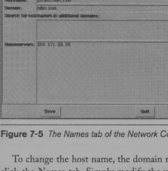

图 7-5 网络配置器窗口的 Names 选项卡

要更改主机名、域名或名称服务器，请先单击 Names 选项卡。只需修改值并单击 Save 即可。程序在单击 Save 时不会显示任何状态消息，因此起初有点令人困惑。此外，程序中显示的域名来自`/etc/resolv.conf`文件中的搜索列表（列表中的第一项），因此如果在此文件中未设置任何搜索列表，`netcfg`将不会显示任何域名。

要添加、修改或删除网络接口，请单击如图 7-6 所示的 Interfaces 选项卡，其中显示当前网络接口。

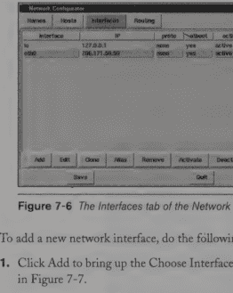

图 7-6 网络配置器窗口的 Interfaces 选项卡

要添加新的网络接口，请执行以下操作：

- 1. 单击 Add 以调出如图 7-7 所示的 Choose Interface Type 对话框。

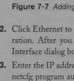

图 7-7 添加新的网络接口

- 2. 单击 Ethernet 以创建新的以太网网络接口配置。单击 OK 后，你将看到如图 7-8 所示的 Edit Ethernet/Bus Interface 对话框。
- 3. 输入此新设备的 IP 地址和网络掩码。`netcfg`程序会根据你提供的信息自动计算网络地址和广播地址。如果希望此接口在启动时处于活动状态，请单击 Activate interface at boot time。你应将 Allow any user to (de)activate interface 选项保持未选中状态，因为允许任何人激活/停用你的网络接口实在是个坏主意。如果不使用 DHCP 或 BOOTP 服务器为此接口动态分配 IP 地址，请将接口配置协议选择为 none。单击 Done 完成配置；系统会要求你确认是否要保存配置。通过单击 OK 保存配置。新的接口将出现在下一屏幕中显示的接口列表中。

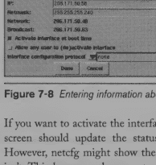

图 7-8 输入有关新接口的信息

- 4. 如果你想立即激活接口，请单击 Activate。屏幕应将接口状态更新为活动状态。然而，`netcfg`可能在接口实际上未激活时仍显示其为活动状态。这发生在你尝试配置不存在的 NIC 时。检查接口最简单的方法之一是从命令行运行`ifconfig interface name`命令，以查看哪些接口已启动并运行。

你刚刚激活了新接口；现在需要按如下方式设置默认网关：

- 1. 单击 Routing 以调出如图 7-9 所示的 Network Configurator 窗口。
- 2. 输入默认网关 IP 地址。网关设备名称应为你刚刚配置的设备。
- 3. 如果你想设置此设备以转发网络上计算机之间往返的 IP 数据包，请设置 Network Packet Forwarding (IPv4) 选项。
- 4. 保存新设置并退出程序。

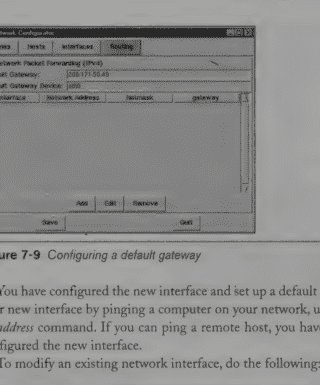

图 7-9 配置默认网关

你已配置了新接口并设置了默认网关。通过使用`ping IP address`命令 ping 网络上的计算机来测试新接口。如果可以 ping 通远程主机，则说明你已成功配置了新接口。

要修改现有网络接口，请执行以下操作：

- 1. 单击 Interfaces。双击现有的网络接口行。按需进行更改。
- 2. 在进行并保存更改后，先停用接口然后再激活它。

### 警告

如果你在使用远程终端上的 X Windows 运行`netcfg`程序，切勿停用为终端提供网络连接的接口。如果你停用了远程 X 连接所需的接口，你的 X 会话将不再工作，并且在没有本地访问的情况下你将无法激活该接口。

要删除现有网络接口，请执行以下操作：

- 1. 单击 Interfaces。选择现有的网络接口。
- 2. 单击 Delete 完成该过程。前述警告中的说明在此同样适用。

## 使用默认网关

图 7-10 显示了两个网络——网络 A（192.168.1.0）和网络 B（192.168.2.0）。

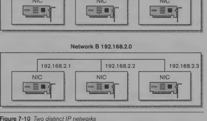

图 7-10 两个不同的 IP 网络

这两个网络完全分开。任一网络中的计算机都可以很好地看到同一网络中的主机。网络 A 中使用 192.168.1.1 计算机的用户可以通过其网络接口 IP 地址 ping 另外两台计算机。然而，该用户无法访问网络 B 上的任何主机计算机，因为网络 A 中的数据包没有通往网络 B 的途径。由于两个不同的网络可以物理连接在一起，因此这两个网络可以通过使用网关计算机或路由器连接起来，如图 7-11 所示。网络中的新计算机是网关计算机。它有两个网络接口。连接到网络 A 的网络接口的 IP 地址为 192.168.1.100，而连接到网络 B 的网络接口的 IP 地址为 192.168.2.100。该计算机被设置为在两个网络之间转发 IP 数据包。例如，当 192.168.1.1 计算机想要向 192.168.2.1 发送数据包时，它会转发 IP 数据包到 192.168.1.100 网关计算机。该网关机器随后在其另一个接口（192.168.2.100）上放置数据包的修改版本，该版本可供目标计算机使用。当目标计算机想要响应时，它会遵循类似的过程，使得网关计算机能够将数据包发送到网络 A 上的源计算机。

所以，只有当你想在两个不同的网络之间通信时才需要网关计算机。网关计算机不必是 PC 或工作站；它可以是专用计算机硬件，例如路由器。

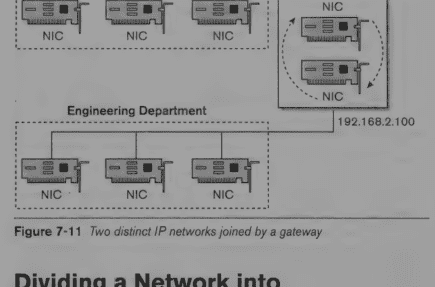

Figure 7-11 由网关连接的两个不同的 IP 网络

## 将网络划分为子网

图 7-12 所示的网络有 100 台主机计算机连接到单个网络 192.168.1.0。

由于所有计算机共享同一条物理网络电缆，高峰时段的流量负载很可能相当重。例如，如果市场部所有人员与工程部的工程师同时开始使用网络，情况会变得非常缓慢，因为每个主机都必须共享网络带宽。解决方案是子网，类似于图 7-13 所示的设置。

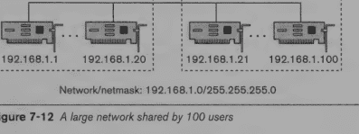

Figure 7-12 100 个用户共享的大型网络

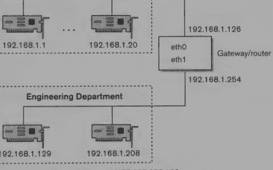


# Figure 7-13 将大型网络划分为子网

`192.168.1.0` 网络已被划分为两个子网——`192.168.1.0` 和 `192.168.1.128`。这些子网通过具有两个网络接口的网关（或路由器）相互连接。当这两个网络上的每台主机计算机都正确配置时，网络流量将在这些网络之间分离。例如，当市场部门的用户想要与同一部门的另一台计算机通信时，这两台计算机之间的网络流量将保留在其网络中。工程部门也是如此。不同部门计算机之间的通信也是允许的。这种网络间流量由网关计算机在这些网络之间转发。最终结果是网络速度更快，因为用户不再都在同一个大型网络上。接下来将描述如何实现此类解决方案。

当完整网络（如 `192.168.1.0`）需要划分为子网时，计算机需要一种方法来确定哪个 IP 地址属于哪个网络。例如，营销部门中网络接口为 `192.168.1.1` 的计算机需要知道 `192.168.1.129` 是否在同一网络中，以便确定是否应将发往 `192.168.1.129` 的数据包发送到网关计算机进行进一步转发。它可以通过使用网络掩码或子网掩码来确定 IP 地址是否属于其自己的子网。

在从网络创建子网之前，你需要了解如何创建子网掩码。例如，假设你想确定网络 `192.168.1.0` 的网络掩码。该地址的二进制格式如下：

```
11000000.10101000.00000001.00000000
```

因为这是一个 C 类地址，网络位是前 24 位（3 字节）。要创建掩码，必须将这些位全部设为 1，并将剩余的（主机接口）位设为 0。因此，子网掩码如下所示：

```
11111111.11111111.11111111.00000000
```

以十进制格式表示，这看起来像 `255.255.255.0`。因此，在创建子网掩码时，只需记住网络位全为 1，主机位全为 0。例如，A 类网络 `10.0.0.0` 的子网掩码为 `255.0.0.0`，类似地，B 类网络 `129.1.0.0` 的子网掩码为 `255.255.0.0`。

在 TCP/IP 网络中，当计算机想要向 IP 地址发送数据包时，它通过执行按位 AND 操作来确定该 IP 地址是否本地。例如，要确定 `192.168.1.1` 是否属于子网掩码为 `255.255.255.0` 的网络的主机，主机计算机执行以下操作：

```
Binary                          Decimal
11000000.10101000.00000001.00000001 => 192.168.1.1
AND 11111111.11111111.11111111.00000000 => 255.255.255.0
----------------------------------------
11000000.10101000.00000001.00000000 => 192.168.1.0
```

正如你所见，按位 AND 操作返回 IP 地址 `192.168.1.1` 的网络地址（`192.168.1.0`）。由于主机计算机知道它属于哪个网络，因此可以非常容易地确定如何处理此类 IP 地址的数据包。

由于你很可能会经常处理 C 类网络，因此本节中的所有示例都使用此类。

当 C 类网络保持完整时，子网掩码为 `255.255.255.0`。要将网络划分为子网，需要通过将默认类子网掩码（`255.255.255.0`）的主机接口部分中的一个或多个位设为 1 来创建新的子网掩码。考虑正在进行的示例 C 类网络——`192.168.1.0`。通过将地址主机接口号部分中的最高有效位置为 1，你得到：

```
11111111.11111111.11111111.10000000 => 255.255.255.128
```

这是一个将网络一分为二的新子网掩码。`192.168.1.0` 到 `192.168.1.127` 之间的所有 IP 地址都属于 `192.168.1.0` 网络，其余 IP 地址 `192.168.1.128` 到 `192.168.1.255` 属于 `192.168.1.128` 网络。两个网络都使用 `255.255.255.128` 子网掩码。例如，要确定 IP 地址 `192.168.1.10` 属于哪个网络，可以执行以下按位 AND 操作：

```
Binary                          Decimal
11000000.10101000.00000001.00001010 => 192.168.1.10
AND 11111111.11111111.11111111.10000000 => 255.255.255.128
----------------------------------------
11000000.10101000.00000001.00000000 => 192.168.1.0
```

子网掩码 `255.255.255.128` 告诉你给定的 IP 地址属于 `192.168.1.0` 网络。以下显示 IP 地址 `192.168.1.200` 属于哪个网络：

```
Binary Decimal
11000000.10101000.00000001.11001000 => 192.168.1.200
AND 11111111.11111111.11111111.10000000 => 255.255.255.128
----------------------------------------
11000000.10101000.00000001.10000000 => 192.168.1.128
```

相同的子网掩码为给定的 IP 地址给出不同的网络地址（`192.168.1.128`）。因此，使用此子网掩码，你有效地将 `192.168.1.0` 网络划分为两个子网——`192.168.1.0` 和 `192.168.1.128`

由于完整的 C 类网络有 256 个可能的 IP 地址，每个单独的子网有 128 个 IP 地址。然而，并非所有地址都可作为主机（接口）IP 地址使用。在完整的 C 类网络中，例如 `192.168.1.0`（子网掩码为 `255.255.255.0`），`192.168.1.0` 用作网络地址，`192.168.1.255` 用作广播地址。广播地址用于与网络中的所有主机计算机通信。因此，这两个地址在某种意义上是保留的。因此，在完整的 C 类网络中，你有 254（255 – 网络 IP 地址 – 广播 IP 地址）个可能的 IP 地址。类似地，当网络被细分时，每个子网都会获得一个网络地址和一个广播地址，因此当 C 类网络被划分为两个子网时，四个 IP 地址将无法用于主机寻址。在本例中，这看起来如下：

```
Network: 192.168.1.0
Netmask: 255.255.255.128
First usable host IP address: 192.168.1.1
Last usable host IP address: 192.168.1.126
Broadcast address: 192.168.1.127
```

```
Network: 192.168.1.128
Netmask: 255.255.255.128
First usable host IP address: 192.168.1.129
Last usable host IP address: 192.168.1.254
Broadcast address: 192.168.1.255
```

从完整的 A、B 或 C 类网络中可以创建的子网数量的公式如下：子网数量 = `2^(主机位 - 1)`。例如，C 类网络中的主机位数为 8（最后一个字节），因此从技术上讲，可以从单个 C 类网络创建 `2^7`（128）个等大小的子网。然而，由于 IP 地址的损失（作为网络地址和广播地址），大多数网络管理员不会从 C 类网络中创建超过 16 个子网。

如果你对子网划分概念非常陌生，你可能会发现 `ipcalc` 工具非常有用。例如，假设你想确保你的子网计算符合预期。你可以使用此工具来确认你的数字是否正确。例如，如果你想确认图 7-13 中使用的子网是否正确，可以向 `ipcalc` 提供 `192.168.1.1` 到 `254` 范围内的任意 IP 地址以及子网掩码，以确定该 IP 地址将属于哪个网络。以下是两个示例：

```
ipcalc --broadcast --network 192.168.1.1 255.255.255.128
BROADCAST=192.168.1.127
NETWORK=192.168.1.0
```

```
ipcalc --broadcast --network 192.168.1.129 255.255.255.128
BROADCAST=192.168.1.255
NETWORK=192.168.1.128
```

在第一个示例中，`ipcalc` 程序被告知使用 `255.255.255.128` 子网掩码显示 IP 地址 `192.168.1.1` 的广播地址（使用 `--broadcast` 参数）和网络地址（使用 `--network` 参数）。它返回广播地址为 `192.168.1.127`，网络地址为 `192.168.1.0`。这是正确的。在第二个示例中，程序被要求为属于网络另一半的 IP 地址显示相同的信息，并且它显示了正确的地址。

## 网关计算机配置


图 7-13 中之前显示的网关计算机必须有两个网络接口。其中一个接口必须连接到每个子网。此计算机的 `/etc/sysconfig/network` 文件在清单 7-4 中显示。

### 清单 7-4 `/etc/sysconfig/network` 文件

```
NETWORKING=yes
FORWARD_IPV4=yes
HOSTNAME=gateway.nitec.com
DOMAINNAME=nitec.com
```

这里最重要的是 `FORWARD_IPV4=yes` 设置，它在内核中启用 IP 转发。


### 提示

你必须在内核中内置 IP 转发支持。你可以使用 `cat /proc/sys/net/ipv4/ip_forward` 命令来查看正在运行的内核中是否启用了 IP 转发。如果输出为 1，则表示 IP 转发已设置；值为 0 表示 IP 转发已关闭。你也可以通过使用 `echo n > /proc/sys/net/ipv4/ip_forward` 命令插入 1 或 0 的值来打开或关闭它，其中 n 为 1 或 0。

清单 7-5 和 7-6 显示了两个接口（`eth0` 和 `eth1`）文件。

### 清单 7-5 `/etc/sysconfig/network-scripts/ifcfg-eth0` 文件

```
DEVICE=eth0
IPADDR=192.168.1.126
NETMASK=255.255.255.128
NETWORK=192.168.1.0
BROADCAST=192.168.1.127
ONBOOT=yes
```

### 清单 7-6 `/etc/sysconfig/network-scripts/ifcfg-eth1` 文件

```
DEVICE=eth1
IPADDR=192.168.1.254
NETMASK=255.255.255.128
NETWORK=192.168.1.128
BROADCAST=192.168.1.255
ONBOOT=yes
```

在设置这些文件并且接口已启动并运行（通过重启或使用 `ifup` 命令）之后，你需要使用以下 `route` 命令为两个网络创建两个默认路由：

```
route add -net 192.168.1.0 255.255.255.128 eth0
route add -net 192.168.1.128 255.255.255.128 eth1
```

前述每个 `route` 命令确保发往指定网络的数据包通过指定的接口设备传输。

### 主机计算机配置

每个子网上的每台主机计算机都必须进行配置，以便每台计算机都知道网络地址、本地子网掩码和网关信息。例如，假设所有主机计算机也是 Linux 工作站，并且每台都有一个以太网接口设备（`eth0`），则 `192.168.1.0` 网络上任意一台主机计算机上的 `/etc/sysconfig/network` 文件如清单 7-7 所示。

### 清单 7-7 `/etc/sysconfig/network` 文件

```
NETWORKING=yes
FORWARD_IPV4=yes
HOSTNAME=marketing-1.nitec.com
DOMAINNAME=nitec.com
GATEWAY=192.168.1.126
GATEWAYDEV=eth0
```

同一台计算机上的接口文件将如下清单 7-8 所示的示例。

### 清单 7-8 `/etc/sysconfig/network-scripts/ifcfg-eth0` 文件

```
DEVICE=eth0
IPADDR=192.168.1.1
NETMASK=255.255.255.128
NETWORK=192.168.1.0
BROADCAST=192.168.1.127
ONBOOT=yes
```

类似地，`192.168.1.128` 网络中的计算机也需要设置。该网络中的每台计算机将在 `/etc/sysconfig/network` 文件中使用 `GATEWAY=192.168.1.254` 行，并在其 `/etc/sysconfig/network-scripts/ifcfg-eth0` 文件中使用 `NETWORK=192.168.1.128` 和 `BROADCAST=192.168.1.255`。

当然，如果这些计算机中有任何一台是非 Linux 系统，例如 Windows 9x/2000，你必须使用适当的网络配置工具来设置这些值。

在设置好网关计算机和每个网络中至少一台主机后，你就可以测试子网了。最简单的测试方法是使用 `ping` 程序。以下是一些简单的测试和故障排除指南，

- 1. 使用 `ping` 程序 ping 同一子网中的主机计算机。例如，从 `192.168.1.1` 计算机运行 `ping 192.168.1.2`。如果没有收到 ping 回复，请检查网络配置文件（`/etc/sysconfig/network` 和 `/etc/sysconfig/network-scripts/ifcfg-eth0`）。纠正你注意到的任何问题，并通过先使用 `ifconfig eth0 down` 关闭接口，然后使用 `/etc/sysconfig/network-scripts/ifup eth0` 启动它来重新启动接口。在你能够 ping 同一子网中的主机后，继续下一步。

- 2. 从每个子网 ping 网关计算机。如果无法执行此操作，请检查网关计算机的网络配置文件并纠正任何错误或拼写错误。在你能够从每个子网 ping 网关计算机后，继续下一步。

- 3. 尝试 ping 另一个子网中的主机。如果无法 ping 另一个子网中的主机，请尝试使用 `traceroute IP address` 确定数据包是否到达了网关机器。如果 `traceroute` 显示数据包到达了网关但未转发到目标，则问题出在网关。你应确保该计算机已打开 IP 转发。在网关计算机上运行 `cat /proc/sys/net/ipv4/ip_forward` 以查看返回的值是 1 还是 0。如果不是 1，则 IP 转发要么在 `/etc/sysconfig/network` 文件中关闭，要么在内核中未启用。在这种情况下，修复此问题并重试。

到目前为止，你应该能够从两个子网中的任何一个发送 ping 请求。如果可以，那么你就有两个正常工作的子网。

### 第 8 章

### DNS 服务

### 配置 DNS 客户端（解析器）

通常，Red Hat 安装程序会询问你的 DNS 服务器并自动配置必要的解析器配置文件。然而，经常需要更改解析器配置以反映你使用的 DNS 服务器的任何更改。例如，如果你在 Red Hat 安装期间配置了解析器，并且后来更换了 ISP，你需要再次手动配置。方法如下。

如果你计划使用 ISP 的 DNS 服务器来解析名称和 IP 地址，请要求你的 ISP 提供其 DNS 服务器的主机名和 IP 地址。获得所需信息后，你可以按如下方式配置解析器：

- 1. 首先，你需要修改名为 `/etc/resolv.conf` 的解析器配置文件。清单 8-1 显示了一个名为 `nitec.com` 的域的典型 `/etc/resolv.conf` 文件。

### 清单 8-1 解析器配置文件 `/etc/resolv.conf`

```
# Default Domain
domain nitec.com

# Default search list
search nitec.com

# First name server
```

### 清单 8-1 继续

```
nameserver 206.171.50.50
# Second name server
nameserver 206.171.50.55
```

2. 将 `Domain` 指令设置为系统的域名。如果你没有将此行设置为系统的域名，则默认域名将自动从系统的完全限定主机名中提取。

3. 将 `Search` 指令设置为系统的域名。此指令用于影响解析器搜索未完全限定主机名的方式。例如，如果你想在具有上述解析器配置文件的系统上的 shell 中输入 `ping www` 命令，`ping` 程序将使用解析器解析 `www`。由于 `www` 是一个部分主机名，解析器将使用搜索列表（例如 `www.nitec.com`）创建一个完整的主机名并尝试解析该主机的 IP。例如，如果你在前面的清单中将 `search` 指令设置为 `integrationlogic.com` 并发出相同的 ping 请求，解析器将返回 `www.integrationlogic.com` 的 IP 地址。如果你没有提供 `search` 指令，则在需要解析部分主机名时会自动应用默认域名。


### 将 Nameserver 指令设置为解析器应用于执行 DNS 查询的 DNS 服务器

你可以在配置文件中（并且应该）指定多个`nameserver`指令。每个域名服务器按其在配置文件中出现的顺序进行查询。例如，如果一个程序要求解析器解析名为`www.ad-engine.com`的主机名，解析器首先尝试使用`206.171.50.50`域名服务器将名称解析为 IP。如果`206.171.50.50`域名服务器未能返回响应（即查询超时），则会联系第二个域名服务器`206.171.50.55`。目前，你只能在配置文件中列出三个`nameserver`指令。一般来说，最好至少设置两个`nameserver`指令指向两个不同的名称服务器。


#### 注意

你可以将`nameserver`指令设置为 Internet 上任何域名服务器的 IP 地址。然而，你应仅使用最近的域名服务器 IP 地址，以减少域名解析的延迟。此外，切勿在未获得许可的情况下在你的解析器配置文件中使用他人的域名服务器 IP 地址。这被认为是不礼貌的，如果你的解析器给他人的名称服务器带来沉重负载，还可能产生法律后果。

也可能将一个或多个 IP 地址硬编码到其对应的主机名中，写入`/etc/hosts`文件。该文件具有非常简单的格式，如下所示：

```
IP address host name short-cut host name
```

以下是`/etc/hosts`文件的一个示例：

```
206.171.50.50 picaso.nitec.com picaso
127.0.0.1 localhost localhost
```

解析器可以在远程 DNS 服务器不可用时使用此文件来解析地址。此外，如果你有一个小型网络并且不想运行本地 DNS 服务器，你可以使用此文件来解析本地主机名。然而，当远程 DNS 服务器和`/etc/hosts`文件都可用时，解析器需要知道尝试处理 DNS 查询时使用哪个顺序。你可以在`/etc/host.conf`文件中使用`order`指令来设置顺序。例如，

```
order hosts,bind
```

如果你的`/etc/host.conf`文件具有此`order`指令，则解析器首先尝试使用`/etc/hosts`文件来响应查询。如果文件中不包含可用的条目，则将使用`/etc/resolv.conf`文件中指定的`bind`或 DNS 服务器。


#### 提示

如果你拥有大量用户，可以通过使用本地 DNS 服务器而不是`/etc/hosts`文件来改善与 DNS 相关的性能，因为为每个新的 DNS 请求读取文件可能会相当缓慢。

在设置完上面描述的文件后，你的 DNS 解析器配置就完成了。测试 DNS 配置最简单的方法是尝试`ping`Internet 上的计算机。如果`ping`程序因未知主机名而失败，请仔细检查你的 DNS 解析器配置是否有拼写错误。

## 设置 DNS 服务器

Red Hat Linux 附带 Berkeley Internet Name Domain (`BIND`) 服务器软件。如果你在操作系统安装阶段未安装它，你可以安装该软件的 RPM 版本。例如，要为 Intel x86 平台安装`BIND`软件的 8.2-6 版本，我在 Red Hat Linux CD-ROM 的 RPMS 目录中找到了`bind-8.2.6-i386.rpm`包并运行了以下命令来安装`BIND`：

```
rpm -ivh bind-8.2.6-i386.rpm
```

上面描述的`BIND`软件的 RPM 包安装了以下四个程序：

- `/usr/sbin/named`. 名称服务器本身。
- `/usr/sbin/named-xfer`. 名称服务器的辅助程序。
- `/usr/sbin/ndc`. 用于控制名称服务器的程序。
- `/usr/doc/bind-8.1.2/named-bootconf.pl`. 用于将旧配置文件转换为新格式的辅助 Perl 脚本。

### 配置主/主 DNS 服务器

假设我在`ns.nitec.com`主机上运行着`BIND`域名服务器（`named`），并且我刚刚在 InterNIC 注册了一个名为`classifiedworks.com`的域名，并希望在`ns.nitec.com`上设置`named`为此新域名提供主 DNS。方法如下。

首先，我需要在`/etc/named.conf`文件中创建以下区域声明：

```
zone "classifiedworks.com" {
    type master;
    file "classifiedworks.db";
};
```

这表明我的名称服务器是`classifiedworks.com`域的主名称服务器。现在，我需要在名称服务器的工作目录中创建一个名为`classifiedworks.db`的区域文件（由`options { directory path_name };`语句指定）。清单 8-2 是`classifiedworks.com`域此类区域文件的一个示例。

#### 清单 8-2 classifiedworks.com 域的区域文件

```
@ IN SOA ns.nitec.com. kabir.nitec.com. (
    1999020100    ; Serial
    7200          ; Refresh - 2 hours
    3600          ; Retry - 1 hour
    43200         ; Expire - 12 hours
    3600 )        ; Minimum - 1 hour

IN NS ns.nitec.com.
IN MX 10 mail.nitec.com.

www IN CNAME www.nitec.com.
ftp IN A 206.171.50.55
```

我已设置`SOA`和`NS`记录以声明`ns.nitec.com`是`classifiedworks.com`域的名称服务器。因为我想在`mail.nitec.com`主机上接收该域的邮件，所以我设置了一个`MX`记录来实现这一点。我为`www.nitec.com`设置了一个名为`www.classifiedworks.com`的别名。最后，我为`ftp.classifiedworks.com`设置了一个`A`记录，使其指向`206.171.50.55`

正如你所见，通过使用各种资源记录，你可以根据需要配置区域文件。在配置区域文件并将其存储在 DNS 服务器的工作目录中后，该域的主名称服务器配置就完成了。

### 配置从/辅助 DNS 服务器

配置从或辅助 DNS 服务器相当简单。你唯一需要手工更新的文件是`/etc/named.conf`文件。例如，假设我想使用名为`ns2.nitec.com`的 DNS 服务器作为`classifiedworks.com`域的辅助名称服务器。我需要做的第一件事是在`ns2.nitec.com` `named`服务器的`/etc/named.conf`文件中创建如下区域声明：

```
zone "classifiedworks.com" {
    type slave;
    file "classifiedworks.db";
};
```

因为这是一个从或辅助服务器，所以我不需要手工创建`classifiedworks.db`文件。我可以使用名为`named-xfer`的程序从`classifiedworks.com`域的主名称服务器获取该文件，该程序随`named`发行版提供。因为我知道`classifiedworks.com`域的主名称服务器名为`ns1.nitec.com`，所以我可以按如下方式运行`named-xfer`命令：

```
named-xfer -z classifiedworks.com -f classifiedworks.db \
-s 0 ns1.nitec.com
```

这里，`-z`选项用于指定区域名称，`-f`选项用于指定区域文件名，`-s`选项用于指定信息当前所在的名称服务器。

运行此程序后，当前目录中会创建一个名为`classifiedworks.db`的文件。将文件移动到`ns2.nitec.com`机器上`named`服务器的工作目录后，`classifiedworks.com`域的辅助 DNS 配置就完成了。

### 配置反向 DNS 服务器

如果你拥有自己的网络 IP 地址，就必须为它们做反向 DNS。例如，如果你拥有一个名为`206.171.50.0`的 IP 网络，并在名为`nitec.com`的域的正向 DNS 配置中使用它，你就必须为此网络设置反向 DNS 区域。方法如下。

首先，修改`/etc/named.conf`文件以包含一个新的区域，如下所示：

```
zone "50.171.206.in-addr.arpa" {
    type master;
    file "db.206.171.50";
};
```


前面区域配置中使用的特殊区域名称（`50.171.206.in-addr.arpa`）是必需的，用于反转你的网络号码并在名称末尾附加 `in-addr.arpa` 以创建反向 DNS 区域名称。

接下来，在 `named` 服务器的工作目录中创建 `db.206.171.50`。反向 DNS 区域的文件名可以是任意名称，但通常使用 `db.network-address` 名称。此文件与迄今为止显示的区域文件类似；唯一的区别是它将具有 `PTR` 记录而不是 `A`、`CNAME` 等。清单 8-3 显示了 `db.206.171.50` 文件的一个示例。

### 清单 8-3 反向 DNS 区域文件示例（db.206.171.50）

```
@ IN SOA ns.nitec.com. (
    1999020100 ; Serial
    7200      ; Refresh - 2 hours
    3600      ; Retry - 1 hour
    43200     ; Expire - 12 hours
    3600 )    ; Minimum - 1 hour

IN NS ns.nitec.com.

51.50.171.206.in-addr.arpa. IN PTR ns.nitec.com.
52.50.171.206.in-addr.arpa. IN PTR mail.nitec.com.
53.50.171.206.in-addr.arpa. IN PTR www.nitec.com.
```

这里，`PTR` 记录用于将三个不同的 IP 地址映射到三个不同的主机名。你也可以按如下方式以缩写形式指定前面的 `PTR` 记录：

```
51 IN PTR ns.nitec.com.
52 IN PTR mail.nitec.com.
53 IN PTR www.nitec.com.
```

在大多数情况下，你的 ISP 拥有你网络的 IP 地址，应准备提供主反向 DNS 服务。然而，对于一个特殊网络 `127.0.0`，你必须提供反向名称服务。此网络用于本地回环接口 IP（`127.0.0.1`）。由于没有人对这个回环网络拥有管辖权，因此每个人都必须提供反向为自己提供 DNS 服务，这就是为什么你总需要在 `/etc/named.conf` 文件中有一个特殊的区域声明，看起来如下：

```
zone "0.0.127.in-addr.arpa" {
    type master;
    file "named.local";
};
```

你还必须在你的域名服务器的工作目录中拥有 `named.local` 区域文件。该文件在清单 8-4 中显示。

### 清单 8-4 named.local 文件

```
@   IN  SOA .localhost. root.localhost. (
        1999020100    ; Serial
        7200          ; Refresh - 2 hours
        3600          ; Retry - 1 hour
        43200         ; Expire - 12 hours
        3600 )        ; Minimum - 1 hour

    IN  NS  localhost.

1   IN  PTR localhost.
```

## 配置仅缓存/从属 DNS 服务器

技术上，所有 DNS 服务器都启用了缓存；换句话说，DNS 服务器默认使用缓存。然而，如果你不想为任何 Internet 域名提供 DNS 服务，而只想提高网络的 DNS 查询性能，你可以运行一个仅缓存的 DNS 服务器。这样的服务器将具有 `/etc/named.conf` 文件，如清单 8-5 所示。

### 清单 8-5 仅缓存 DNS 服务器的 /etc/named.conf 文件

```
zone "." {
    type hint;
    file "named.ca";
};
```

```
zone "0.0.127.in-addr.arpa" {
type master;
file "named.local";
};
```

第一个区域声明指定名称服务器在启动时使用 `named.ca` 文件来确定根名称服务器名称。第二个区域声明用于为本地回环网络提供反向名称服务。这就是创建仅缓存名称服务器所需的一切。

## 控制 DNS 服务器

`named` 分发版附带一个名为 `ndc` 的便捷程序，它为控制名称服务器提供了一个简单的命令行界面。

## 启动名称服务器

你的名称服务器应该在启动时自动启动。如果它没有自动启动，你需要执行以下步骤：

- 1. 以 root 身份登录到你的名称服务器系统并将目录更改为 `/etc/rc.d/init.d`。确保该目录中有一个名为 "`named`" 的脚本。如果缺少此脚本，请从 Red Hat CD-ROM 重新安装 BIND 分发版 RPM。

- 2. 确认你拥有 `/etc/rc.d/init.d/named` 脚本后，将目录更改为你的默认系统运行级别（参见 `/etc/inittab`）`rc` 目录。对于大多数系统，默认系统运行级别是 3；如果你的也是如此，将目录更改为 `/etc/rc.d/rc3.d/`。

- 3. 创建一个名为 `SXXnamed` 的符号链接，指向 `/etc/rc.d/init.d/named` 脚本。用一个较大的数字（如 55 或 85）替换 `SXXnamed` 中的 `XX`，以确保系统不会在网络接口正确设置之前尝试启动名称服务器。例如，要创建一个名为 `S55named` 的符号链接指向 `named` 脚本，你可以运行以下命令：

```
ln -s /etc/rc.d/init.d/named S55named
```

创建此链接后，你的系统在每次启动时都会启动名称服务器。然而，如果你更喜欢手动运行名称服务器，可以使用 `ndc` 程序，如下所示：

```
ndc start
```

## 重新加载新的名称服务器配置

在修改任何区域文件或 `/etc/named.conf` 文件后，你必须重新启动名称服务器才能使更改生效。你可以按如下方式强制名称服务器重新加载新配置：

```
ndc reload
```

不要忘记修改你所修改的任何区域文件的 `SOA` 记录中的序列号，否则名称服务器将不会加载新配置。

要先杀死名称服务器再重新启动它，你可以在前一行中使用 `restart` 代替 `reload`。

## 停止名称服务器

如果出于任何原因需要停止名称服务器，请按如下方式运行 `ndc` 命令：

```
ndc stop
```

## 查看名称服务器统计信息

你可以使用 `ndc` 程序在名称服务器的工作目录中生成各种名称服务器统计信息。运行以下命令可在名称服务器的工作目录中创建一个名为 `named.stats` 的文件：

```
ndc stats
```

该统计文件显示各种信息项目，包括每个 RR 的查询次数。每次修改 DNS 信息时，不要忘记使用名称服务器查询工具测试配置。

## 测试你的 DNS 服务器

有许多工具可用于手动查询名称服务器。如果你想要一些常用的查询工具，请从 Red Hat CD-ROM 安装 `bind-utils` RPM 分发版。`bind-utils` 分发版附带 `dig`、`dnsquery`、`host`、`nslookup` 等。我的最爱，也是使用最广泛的是 `nslookup` 实用程序，因此本节中用于测试 DNS 配置。

假设你刚刚在 InterNIC 注册了一个全新的域名，并且已经在你的名称服务器上设置了必要的 DNS 配置。重新启动名称服务器后，你想通过 `nslookup` 测试配置。

当你从命令行运行 `nslookup` 时，它会显示默认情况下将使用的名称服务器的主机名和 IP 地址。如果你正在名称服务器系统上运行 `nslookup`，你应该会看到名称服务器的名称和 IP。如果看不到名称服务器的信息，请确保你的 `/etc/resolv.conf` 文件配置正确。

另一方面，如果你在名称服务器以外的计算机上运行 `nslookup`，你必须告诉程序使用你想要测试的名称服务器。只有在 InterNIC 尚未将新域的名称服务器信息发布到其根名称服务器时才需要这样做。要告诉 `nslookup` 使用与默认不同的名称服务器，请从 `nslookup` 命令提示符输入 `server host name`（其中 `host name` 是你想要测试的服务器的主机名）。输入此命令后，`nslookup` 将对所有查询使用指定的名称服务器主机。

`nslookup` 实用程序允许你使用简单语法执行任何类型的 DNS 查询。例如，要查找域的名称服务器，请在 `nslookup` 程序中运行以下命令：

```
set query=ns
domain.tld
```

第一行告诉 `nslookup` 对下一个域名（`domain.tld`）执行 `NS`（名称服务器 RR）查询。同样，你可以执行 `A`、`MX`、`CNAME` 等查询。如果收到的响应看起来不正确，请返回区域文件并确保没有拼写错误。一个常见的错误是在完整主机名末尾省略句点。

## 管理虚拟域的 DNS


单个名称服务器可以为多个域名提供名称服务。此功能允许单个系统托管众多 Internet 域名。事实上，大多数 ISP 就是这样为客户提供网站的。因为此类域名托管在另一个域上（例如 ISP 自己的域），所以它们被称为虚拟域，目前相当常见。如果你每天需要为客户创建大量虚拟域，你可能希望尽可能自动化该过程。清单 8-6 显示了一个名为 `makesite` 的 Perl 脚本，你经常可以用它来创建虚拟域。

### 清单 8-6 makesite 脚本

```
#!/usr/local/bin/perl -w

use strict;

#
# Purpose: makesite creates virtual sites.
# It uses a set of templates to create DNS and HTTPD
# configuration files.
#
# Note: this is a very *simple* script.
#
####################################################

use Time::localtime;

my $site = $ARGV[0] or $syntax;
my $MAKESITE_DIR = '/scratch/dns/makesite';
my $USER = 'httpd';
my $GROUP = 'httpd';
my $PERMISSION = '2770';
my $BASE_DIR = '/tmp';
my $HTDOCS = 'htdocs';
my $CGIBIN = 'cgi-bin';
my $NAMED_PATH = '/var/named';
my $NAMED_FILE_EXT = '.db';
my $NAMED_TEMPLATE = "$MAKESITE_DIR/named.template";
my $NAMED_CONF = '/etc/named.conf';
my $HTTPD_CONF = 
'/usr/local/apache/etc/httpd.conf';
my $VHOST_TEMPLATE = "$MAKESITE_DIR/httpd.template";

my $LOG_FILE           = "$BASE_DIR/makesite.log";

my $dir = $site;
my @domain_types = qw(com net org edu);
my ($domain_ext, $thesite_dir, $public_dir,
$htdocs_dir, $cgibin_dir, $named_file,
$dir_len, $temp_len);

my $tm = localtime(time);
my $date = sprintf("%s-%02s-%02d-%02d", $tm->year+1900,
                                    $tm->mon+1,
                                    $tm->mday,
                                    $tm->hour,
                                    $tm->min);

my $serial = sprintf("%s%02d%02d000", $tm->year+1900,
                                    $tm->mon+1,
                                    $tm->mday);

$site =~ y/[A-Z]/[a-z]/;

# Get the length with the EXT
$dir_len = length($dir);

foreach $domain_ext (@domain_types){ $dir =~ s/\.$domain_ext//g; }

# Get the new length without the EXT
$temp_len = length($dir);

# If the user has not entered an extension, then show
syntax.
```

## 清单 8-6 继续


```perl
&syntax if($temp_len == $dir_len);

$named_file = $NAMED_PATH . '/' . $dir . $NAMED_FILE_EXT
;
$thesite_dir = $BASE_DIR . '/' . $dir;
$htdocs_dir = $BASE_DIR . '/' . $dir . '/' . $HTDOCS;
$cgibin_dir = $BASE_DIR . '/' . $dir . '/' . $CGIBIN;

die "$thesite_dir already exist! Aborted!\n" if(-e $thesite_dir);

system("mkdir $thesite_dir");
system("mkdir $htdocs_dir");
system("mkdir $cgibin_dir");

&createNamedFile($named_file,$site,"$dir$NAMED_FILE_EXT")
;
&createIndexFile($htdocs_dir,$site);
&createVirtualHostConf(
    domain=>$site,
    website=>"www.$site",
    cgibin=>$cgibin_dir,
    htdocs=>$htdocs_dir);

system("chown -R $USER.$GROUP $thesite_dir");
system("chmod -R $PERMISSION $thesite_dir");

open(FP,">$LOG_FILE") || die "Can't write to log file.\n";
print FP "$date created www.$site [$htdocs_dir] site.\n";
close(FP);

exit 0;

sub createNamedFile{
my $file = shift;
my $domain = shift;
my $database = shift;
my $line;

open(OUT,">$file") || die "Can't write $file\n";
open(FP,$NAMED_TEMPLATE) || die "Can't open $NAMED_TEMPLATE\n";
while($line=<FP>){
    $line =~ s/<DOMAIN>/$domain/g;
    $line =~ s/<SERIAL>/$serial/g;
    print OUT $line;
}
close(FP);
close(OUT);

open(FP,">$NAMED_CONF") || die "Can't open $NAMED_CONF\n";
print FP <<ZONE;
// $domain was created on $date
zone "$domain" {
    type master;
    file "$database";
};
ZONE
close(FP);
}

sub createIndexFile{
my $htdocs = shift;
my $domain = shift;
open(FP,">$htdocs/index.html") || die "Can't write index.html \n";
print FP <<INDEX_PAGE;
<HTML>
<HEAD><TITLE> $domain </TITLE></HEAD>
<BODY BGCOLOR="white">
<CENTER>
This is $domain Web site
<p> It was created on $date </p>
</CENTER>
</BODY>
</HTML>
INDEX_PAGE

close(FP);
}

sub createVirtualHostConf{
my %params = @_;
my $line;
open(OUT,">$HTTPD_CONF") || die "Can't open $HTTPD_CONF $!\n";

open(FP,$VHOST_TEMPLATE) || die "Can't open $VHOST_TEMPLATE $!\n";
while($line=<FP>){
$line =~ s/<DOMAIN>/$params{domain}/g;
$line =~ s/<CGI-BIN-DIR>/$params{cgibin}/g;
$line =~ s/<HTDOCS-DIR>/$params{htdocs}/g;
$line =~ s/<WWW-SITE>/$params{website}/g;
print OUT $line;
}
close(FP);
close(OUT);
}

sub syntax{
    print <<SYNTAX;

makesite <virtual Internet domain>
Example: makesite nitec.com

SYNTAX
    exit 0;
}
```

该 Perl 脚本的目的是让你能够在不进行大量文件编辑任务的情况下创建具有正确 DNS 和 Apache Web 服务器配置的虚拟网站。例如，假设你想创建一个名为 `www.newdomain.com` 的新网站。要手动完成此操作，你必须执行以下操作：

### 手动操作步骤
1. 在 `/etc/named.conf` 文件中为 `newdomain.com` 添加新的区域语句。
2. 在名称服务器的工作目录中为 `newdomain.com` 添加新的区域文件。我必须从头创建它或复制并修改现有的域名文件。
3. 在服务器上的适当 Web 空间中为该域创建网站文档根目录和 CGI 脚本目录。
4. 修改 Apache 服务器配置文件，以便 Apache 将 `www.newdomain.com` 视为一个新网站。

由于手动配置这些重要文件容易出错，你应该编写 `makesite` 脚本来执行所有这些步骤。例如，要使用正确的 DNS 和 Apache 配置创建 `www.newdomain.com` 站点，你可以运行以下命令：

```
makesite newdomain.com
```

### DNS 配置
此命令在 `/etc/named.conf` 文件中添加如下所示的区域语句：

```
// newdomain.com was created on 1999-02-03-13-30
```

```
zone "newdomain.com" {
    type master;
    file "newdomain.db";
};
```

此语句在 `/var/named`（我的名称服务器的工作目录）中创建 `newdomain.db` 文件，如清单 8-7 所示

## 清单 8-7 `/var/named/newdomain.db` 文件

```
@ IN SOA newdomain.com. hostmaster.newdomain.com. (
    19990206000  ; serial YYYYMMDDXX
    7200         ; refresh
    3600         ; (1 hour) retry
    1728000      ; (20 days) expire
    3600)        ; (1 hour) minimal TTL

; Name Servers
    IN NS ns.nitec.com.
    IN MX 10 mail.nitec.com.

; CNAME records
www IN CNAME www.nitec.com.
```

### Apache 配置
脚本随后将以下行追加到 Apache 服务器配置 `httpd.conf` 文件的末尾：

```
#
# Domain Configuration for www.newdomain.com
#
<VirtualHost www.newdomain.com>
ServerName www.newdomain.com
ServerAdmin webmaster@newdomain.com

DocumentRoot /tmp/newdomain/htdocs
ScriptAlias /cgi-bin/ /tmp/newdomain/cgi-bin/

ErrorLog logs/www.newdomain.com.error.log
TransferLog logs/www.newdomain.com.access.log

</VirtualHost>

#
# End of Domain Configuration for www.newdomain.com
#
```

### 目录结构
最后，脚本创建以下目录结构以及网站的 `index.html` 页面：

- `/www/newdomain`
- `/www/newdomain/htdocs` -- 网站的文档根目录
- `/www/newdomain/cgi-bin` -- cgi-bin 目录


`index.html` 页面存储在 `/www/newdomain/htdocs/` 目录中。脚本还设置了网站目录的权限，以便只有指定的用户和组具有读写权限。

由于脚本完成了所有繁琐的工作，你可以在不必不断担心配置问题的情况下创建许多虚拟站点。而且，在完成站点创建后，你可以重新启动名称服务器和 Web 服务器以将所有站点上线。这确实是一个简单而有用的工具。

`makesite` 脚本将域名作为参数，并使用两个文本模板文件来创建名称服务器和 Web 服务器的配置信息。清单 8-8 显示了用于创建名称服务器配置的 `named.template` 文件。

## 清单 8-8 named.template 文件

```
@ IN SOA <DOMAIN>. hostmaster.<DOMAIN>. (
    <SERIAL> ; serial YYYYMMDDXXX
    7200     ; refresh
    3600     ; (1 hour) retry
    1728000  ; (20 days) expire
    3600)    ; (1 hour) minimal TTL

; Name Servers
IN NS ns.nitec.com.
IN MX 10 mail.nitec.com.

; CNAME records
www IN CNAME www.nitec.com.
```

`makesite` 脚本读取此模板并用适当的信息替换 `<DOMAIN>` 和 `<SERIAL>` 标签。因为目标是使用正确的 DNS 配置创建虚拟网站，所以不需要创建 A 记录。例如，前面的配置说明 `www.<DOMAIN>`（例如 `www.newdomain.com`）是 `www.nitec.com` 的别名。使用 A 记录会在需要更改 IP 时使维护多个虚拟网站变得耗时。因此，我使用 CNAME 记录，这样如果 `www.nitec.com` 主机的 IP 需要更改，虚拟域的配置文件就无需修改。清单 8-9 显示了用于创建 Apache 服务器配置的 `httpd.template` 文件。

## 清单 8-9 httpd.template 文件

```
#
# Domain Configuration for <WWW-SITE>
#

<VirtualHost <WWW-SITE>>
    ServerName <WWW-SITE>
    ServerAdmin webmaster@<DOMAIN>

DocumentRoot <HTDOCS-DIR>
ScriptAlias /cgi-bin/ <CGI-BIN-DIR>/

ErrorLog logs/<WWW-SITE>.error.log
TransferLog logs/<WWW-SITE>.access.log

</VirtualHost>
#
# End of Domain Configuration for <WWW-SITE>
#
```

与之前的模板一样，此文件中使用了几个自定义标签，并用适当的信息替换。

要在自己的环境中使用此 Perl 脚本，请修改脚本开头以下的代码行，并按照每行之后描述的更改进行修改：

```
my $MAKESITE_DIR = '/usr/local/src/makesite';
```

将目录路径更改为存放所有 `makesite` 文件的位置。

```
my $USER = 'httpd';
```

如果使用其他用户（如 `'nobody'` 或其他）运行 Apache Web 服务器，请更改用户名。

```
my $GROUP = 'httpd';
```

如果使用其他组（如 `'nobody'` 或其他）运行 Apache Web 服务器，请更改组名。

```
my $PERMISSION = '2770';
```

根据需要更改值 `2770`。此值仅允许 `$USER` 和 `$GROUP` 在网站目录中拥有完全访问权限。

```
my $BASE_DIR = '/www/';
```

将其更改为所有网站的基础目录。

```
my $HTDOCS = 'htdocs';
```

Change this to the relative name of the document root directory name for `httpd.conf` file. The current setting creates `$BASE_DIR/<sitename>$HTDOCS` (default: `/www/<sitename>/htdocs`) as the document root for the Web site.

```
my $CGIBIN = 'cgi-bin';
```

Change this relative directory name to whatever is applicable if you do not want the Apache `ScriptAlias` directive to be set to `$BASE_DIR/<sitename>$CGIBIN` (default: `/www/<sitename>/cgi-bin`).

```
my $NAMED_PATH = '/var/named';
```

Change this directory to the working directory of your name server.

```
my $LOG_FILE = "$BASE_DIR/makesite.log";
```

Change this to point to somewhere else if you do not want to write the `makesite` log file in the base directory. For example, you can set this to `"/tmp/makesite.log"` to write to the `/tmp` directory.

```
my $HTTPD_CONF = '/usr/local/apache/etc/httpd.conf';
```

Change this to point to the `httpd.conf` file of your Web server.

After you make the preceding changes, modify the `named.template` and `httpd.template` files as you see fit and store both of them in the directory where you keep the `makesite` script. Finally, make sure that the script is executable and that the Perl interpreter line (the `#!` bang line) is set up correctly. Hopefully, this will save you some work. If you know Perl programming, you can always fine-tune the script to your environment as much as you want.

## 使用 DNS 服务器平衡负载

其思想是在同类服务器之间共享负载。这通常用于在多个 Web 服务器之间平衡 Web 负载。这种技巧称为轮询域名服务。

假设你有两个 Web 服务器，`www1.yourdomain.com`（`192.168.1.10`）和 `www2.yourdomain.com`（`192.168.1.20`），并且你想使用轮询 DNS 技巧在这两个服务器上平衡 `www.yourdomain.com` 的负载。在你的 `yourdomain.com` 区域文件中添加以下行：

```
www1 IN A 192.168.1.10
www2 IN A 192.168.1.20
```

```
www IN CNAME www1
www IN CNAME www2
```

重启你的名称服务器并 `ping` `www.yourdomain.com` 主机。你将在 `ping` 输出中看到 `192.168.1.10` 地址。停止并重新开始 `ping` 同一主机，你会看到第二个 IP 地址被 `ping`，因为前面的配置告诉名称服务器循环遍历 `www` 的 CNAME 记录。换句话说，`www.yourdomain.com` 主机既是 `www1.yourdomain.com` 也是 `www2.yourdomain.com`。

现在，当有人输入 `www.yourdomain.com` 时，名称服务器会先给出第一个地址，然后为下一个请求给出第二个地址，并在这两个地址之间不断循环。

轮询 DNS 技巧的一个缺点是名称服务器无法知道哪个系统负载很重，哪个没有；它只是盲目循环。如果其中一台服务器崩溃或因某种原因变得不可用，轮询 DNS 技巧仍会定期返回损坏服务器的 IP。这可能会相当混乱，因为有些人能够访问站点，而有些人不能。


如果你的负载需要更好的管理并且检查服务器健康状况很重要，你最好的选择是使用新的 director 产品获取硬件解决方案，例如 Web Director（www.radware.com/）、Ace Director（www.alteon.com/）或 Local Director（www.cisco.com/）。我曾使用 Web Director 取得了巨大成功。

# 第 9 章

## 电子邮件服务

### 为 SMTP 服务器设置 DNS

DNS 配置中的邮件交换（MX）记录用于标识域的 SMTP 邮件服务器资源。假设你想将名为 `mail.yourdomain.com` 的主机指定为 `yourdomain.com` 域的 SMTP 邮件服务器。`yourdomain.com` 的起始授权（SOA）记录必须包含如下一行

```
IN MX preference-value mail-server-hostname.
```

其中 `preference-value` 是一个正整数，仅在你有多个 SMTP 邮件服务器时才有用。如果你只有一个 SMTP 邮件服务器，此数字可以是任意值。例如，以下设置将单个 SMTP 邮件服务器 `mail.yourdomain.com` 的首选项级别设置为 5：

```
IN MX 5 mail.yourdomain.com.
```

以下是在多服务器场景中的示例，其中首选项编号起着至关重要的作用：

```
IN MX 10 fast-mail-server.ad-engine.com.
IN MX 20 slow-mail-server.ad-engine.com.
```

当互联网上的任何人的 SMTP 邮件服务器想要向 `someone@ad-engine.com` 发送邮件时，它首先执行 DNS 查询以定位 `ad-engine.com` 的 MX 记录。返回给 SMTP 邮件服务器的 MX 记录将与刚才显示的相同。然后 SMTP 邮件服务器选择 `fast-mail-server.ad-engine.com` 作为投递的首选邮件服务器，因为它在两个可用服务器中具有更高的优先级（即较低的首选项编号）。

然后 SMTP 邮件服务器尝试使用端口 25 与 `fast-mail-server.ad-engine.com` 计算机建立 SMTP 连接。如果 `fast-mail-server.ad-engine.com` 服务器因任何原因不可用，则会选择 `slow-mail-server.ad-engine.com` 服务器进行投递。因此，拥有多个 MX 记录为你的邮件投递系统提供了冗余，如果电子邮件是组织中的关键部分，这非常重要。


#### 注意

在 MX 记录中始终使用具有自己的 A 记录的主机名。换句话说，不要在 MX 记录中使用主机别名。有关详细信息，请参阅 RFC 1123。

在使用适当的 MX 记录设置 DNS 后，按如下方式测试配置：
- 1. 从 shell 运行 `nslookup` 程序。
- 2. 当你在 `nslookup` 提示符下时，输入 `set q=mx` 以告诉 `nslookup` 你想要执行 MX 记录查询。
- 3. 输入你的域名。

如果你已按上述讨论配置了 DNS，你将看到之前创建的 MX 记录（s）。另一方面，如果你没有获得 MX 记录或 `nslookup` 返回错误，请修复你的 DNS 配置，重新启动 DNS 服务器并再次执行此测试。

### 设置 SMTP 邮件服务器

设置 SMTP 服务器的第一步是决定为你的 Red Hat Linux 系统使用哪个 SMTP 邮件服务器。有许多 SMTP 邮件服务器产品可用。然而，由于其悠久的全球部署历史，`sendmail` 脱颖而出。它也是 Red Hat Linux 的默认 SMTP 邮件服务器。因此，本章使用 `sendmail` 作为 SMTP 服务器。

### 安装 sendmail

就像你在 Red Hat 系统上安装的任何其他服务器软件一样，`sendmail` 以 RPM 包的形式提供。然而，你需要为 `sendmail` 安装多个 RPM 包：
- `sendmail-<version>.<architecture>.rpm`. 主要发行版
- `sendmail-cf-<version>.<architecture>.rpm`. `sendmail` 配置文件发行版
- `sendmail-config-<version>.<architecture>.rpm`. 辅助配置文件发行版
- `sendmail-doc-<version>.<architecture>.rpm`. 文档发行版

安装这些包非常简单；运行 `rpm -ivh package name` 安装每个包。

#### 提示


如果你在 Red Hat Linux 安装期间安装了旧版本的 `sendmail`，请在安装新版本之前删除 `sendmail` 包，因为它们可能不完全兼容。要卸载 RPM 包，请使用 `rpm -e package name` 命令。你也可以使用 `rpm -q partial package name` 命令来定位 RPM 包的确切包名。

安装包后，你就可以配置 `sendmail` 了。`sendmail` 的主要配置文件是 `/etc/sendmail.cf`。

### 启动和停止 sendmail

虽然你尚未配置 `sendmail` 服务器，但仍可以运行它。要手动启动 `sendmail`，请运行以下命令：

```
/usr/sbin/sendmail -q<queue processing interval>
```

用时间替换 `queue processing interval`。通常，时间以分钟或小时为单位指定。例如，要每 15 分钟处理一次邮件队列，使用 `-q15m`，或者要每小时处理一次队列，使用 `-q1h`。你也可以指定秒（s）、天（d）或周（w）。例如，要让 `sendmail` 每一个半小时处理一次队列，请指定 `-q1h30m`。


#### 提示

如果你没有全天候的互联网连接，你可以使用 `/usr/sbin/sendmail -bd -o DeliveryMode=d` 以延迟模式启动 `sendmail`，这样在下次通过 `/usr/sbin/sendmail -q` 运行之前会避免使用 DNS。如果你定期连接，可以将 `/usr/sbin/sendmail -q` 放入 `cron` 作业中，这样当你的连接可用时，队列会自动处理。

如果你希望 `sendmail` 在每次启动后自动启动，请从默认的运行级别目录创建一个符号链接（以 Sxx 开头，其中 xx 为数字）到 `/etc/rc.d/init.d/sendmail` 脚本。例如，要在多用户系统（运行级别 3）每次启动后运行 `sendmail`，我可以创建以下符号链接：

```
ln -s /etc/rc.d/init.d/sendmail
/etc/rc.d/rc3.d/S85sendmail
```

这确保 `sendmail` 在每次启动后自动启动。`/etc/rc.d/init.d/sendmail` 脚本使用 `-bd` 选项启动 `sendmail`。你可能希望修改 `/etc/rc.d/init.d/sendmail` 脚本以反映你站点的队列间隔要求。此外，你可能希望在以下行之前添加以下代码：

```
daemon /usr/sbin/sendmail -bd
```

在脚本中以便在启动时自动对配置文件运行 `newaliases` 和 `makemap`：

```
newaliases
for i in virtusertable access domaintable mailertable
do
if [ -f /etc/mail/$i ] ; then
echo "Making $i database for sendmail..."
makemap hash /etc/mail/$i < /etc/mail/$i
sleep 1
fi
done
sleep 1
```

这确保每次启动服务器进程时，所有配置数据库都会重建。

你也可以很方便地使用 `/etc/rc.d/init.d/sendmail` 脚本来启动、停止和重启 `sendmail`。要停止 `sendmail`，运行

```
/etc/rc.d/init.d/sendmail stop
```

要重启 `sendmail`，运行

```
/etc/rc.d/init.d/sendmail restart
```

你还可以通过使用 `-q` 选项强制 `sendmail` 立即处理其队列：

```
/usr/sbin/sendmail -q
```

如果你希望部分处理队列，可以使用 `-qString` 选项仅处理发件人地址包含指定字符串的消息队列。例如，以下命令强制 `sendmail` 处理发件人为 `kabir` 的所有排队邮件：

```
/usr/sbin/sendmail -qSkabir
```

当队列中有大量邮件等待时，这非常方便。


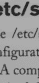

## 提示

你可以运行 `mailq` 命令来查找当前队列中的消息。

你也可以使用 `-qRstring` 强制 `sendmail` 处理收件人地址包含指定字符串的消息。

## 理解和配置 `/etc/sendmail.cf`

`/etc/sendmail.cf` 配置文件被认为是有史以来 UNIX 管理员必须处理的最高复杂度的配置文件。

本节提供了配置文件中设置方式的简要概述，并使你能够按照 `sendmail` 网站 (`http://www.sendmail.org/`) 上的说明根据需要实现某些功能。换句话说，本章中的信息足以让你开始使用，并提供足够的知识来遵循清晰编写的说明以实施配置更改。本节不解释如何创建自己的配置规则，这需要对 `sendmail` 配置的内部工作原理有深入的理解。

`sendmail.cf` 文件包含以下类型的配置信息：

- 空行将被忽略。
- 以 `#` 号开头的注释行也将被忽略。
- 以 `C`、`D`、`F`、`H`、`O`、`P`、`V`、`K`、`M`、`S` 或 `R` 开头的行是配置行。
- 以前导空白字符开头的行是续行。

以下各节简要展示了各种配置，以便你了解它们各自的作用。

### S 和 R：地址重写规则

`S` 行用于标记新重写规则的开始。此类行的语法为 `Srule`，其中 `rule` 为规则名称/编号。例如，`S3` 标记规则集 3 的开始。

`R` 行定义地址重写规则。可以将重写规则视为如下语句：

```
If (current e-mail address matches rule's left-hand-side pattern) then
    Replace current address
        with the rule's right-hand-side pattern
end
```

其语法如下：

```
R<LHS>  <RHS>  <optional comments>
```

`LHS` 是规则的左手侧模式，`RHS` 是右手侧模式。例如，在以下语法中，

```
RS* < $* > $* <&>   $: $1 < $2 > $3
```

`LHS` 模式为 `$* < $* > $* <&>`，`RHS` 模式为 `$: $1 < $2 > $3`。`LHS` 和 `RHS` 模式均由各种元符号组成，例如 `$*`、`$+`、`$-`、`$=x` 和 `$-x`。

重写规则相当复杂，通常不需要你进行任何更改。然而，如果你计划编写自己的重写规则，你应该阅读随 `sendmail` 文档提供的 Sendmail 安装和操作指南。

### D：定义宏

`D` 行定义宏。语法如下：

```
D<macro name> <string>
```

例如，以下语法等同于 `$P = someword`，并且每当在其他地方引用 `$P` 时，它会扩展为 `someword`：

```
DP someword
```

通常，你不需要添加、删除或移除任何 `D` 宏定义。

### C 和 F：定义类

`C` 行与 `D` 行类似。此类行的语法如下：

```
C<class name> <string> <string> . . .
```

此文件必须每行包含一个条目。你在 `sendmail.cf` 文件中会注意到的另一个 `F` 行如下：

```
FR-o /etc/mail/relay-domains \
```

类 `R` 是 `/etc/mail/relay-domains` 中所有域名列表。请注意 `-o` 选项，它使该行成为可选的。换句话说，如果此文件为空，`sendmail` 不会报错。通常，你不需要在此处进行任何更改。然而，如果你希望 `sendmail` 在未定义中继域时报错，可以从前面的 `FR` 行中删除 `-o` 选项。

### M：定义邮件传输代理

`M` 行用于创建邮件传输代理定义。此类行的语法如下：

```
Mmailer name field=value, field=value, . . .
```

在以下示例中，定义了邮件传输代理 `SMTP`：

```
Msmtp, P=[IPC], F=mDFMuX, S=11/31, R=21/31, E=\r\n, L=990,
T=DNS/RFC822/SMTP
```

通常，你不需要对标准邮件传输代理定义进行任何更改。

### H：定义头部

`H` 行用于创建头部定义。此类行的语法如下：

```
H[?flags?]<header name>: <header template>
```

例如，以下每个 `H` 行都定义了一个邮件头部：

```
H?P?Return-Path: <$g>
HReceived: $?from $s $.$?($?s$|from $.$_)
.$ by $j ($v/$z)$?r with $r.$. id $i.$?u
for $u; $|
.$b
H?D?Resent-Date: $a
H?D?Date: $a
```

```
H2?Resent-From: $7x5x <Sg>$|Sg$.
H2?From: $7x5x <Sg>$|Sg$.
H2xFull-Name: $x
H2MResent-Message-Id: <St.$i8$j>
H2MMessage-Id: <St.$i8$j>
```

你不应对头部定义进行任何更改。

### O：设置选项

`O` 行用于为 `sendmail` 设置全局选项。此类行的语法如下：

```
O option name = value
```

表 9-1 显示了 `sendmail` 最新版本（8.9.x）中所有可用的选项。

## 表 9-1 Sendmail 选项

| Option | Explanation |
|---|---|
| AliasFile=/etc/mail/aliases | 设置别名数据库文件的名称。仅当你将别名数据库保存在 `/etc/mail/aliases` 以外的其他位置时才更改。 |
| AliasWait=30m | 启动时别名加载的默认超时时间（以分钟为单位）。请勿更改。 |
| AutoRebuildAliases=True | 如果设置为 True，`sendmail` 会在必要且可能的情况下尝试重建别名数据库。请勿更改。 |
| BlankSub= | 设置空白替换字符。请勿更改。 |
| CheckAliases=False | 如果设置为 True，会检查别名数据库中别名右侧的有效性。默认设置为 False。不建议更改。 |
| ClassFactor=1800 | 用于计算消息的优先级。请勿更改。 |
| ConnectionCacheSize=2 | 任何时候将被缓存的打开连接的最大数量。 |
| ConnectionCacheTimeout=5m | 在空闲期间，缓存的连接保持打开的最大时间（以分钟为单位）。 |
| ConnectionRateThrottle=20 | 允许每秒不超过指定数量的守护进程处理传入连接。将此值设置为 0 允许无限（即系统资源允许的）数量的守护进程每秒。 |

## 表 9-1 续

| 参数 | 描述 |
|---|---|
| DefaultUser=mail | 邮件发送者的默认用户和组。UID 8 是 `/etc/passwd` 中用户 `mail` 的默认值，GID 12 是 `/etc/group` 中组 `"mail"` 的默认值。不建议更改。 |
| DeliveryMode=background | 在后台运行 `sendmail`。无需更改。 |
| EightBitMode=pass8 | 设置八位数据如何处理。保留默认值。 |
| ForkEachJob=False | 当设置为 True 时，会为队列中的每条消息派生一个单独的进程进行处理。无需更改。 |
| ForwardPath=$z:/forward $w:~/.forward $z:~/.forward $w:~/.forward | 设置为每个用户搜索 `.forward` 文件的路径。无需更改。 |
| HelpFile=/usr/lib/sendmail.hf | 设置帮助文件的位置。 |
| HoldExpensive=False | 当设置为 True 时，昂贵的邮件发送程序（在邮件发送程序的 `M` 行中使用 `F=e` 标志标记）不允许立即连接。保留默认值。 |
| HostStatusDirectory=~hoststat | 设置主机状态信息目录名称。默认值将目录设置为 `/var/spool/mqueue/hoststat`。无需更改。 |
| HostsFile=/etc/hosts | 设置 `hosts` 文件的名称。无需更改。 |
| LogLevel=0 | 设置默认日志级别。无需更改。 |
| MatchGECOS=False | 当设置为 True 时，`sendmail` 会在 `/etc/passwd` 文件中执行模糊搜索，以在每个密码条目的 GECOS 字段中查找相似的用户名。建议使用默认值。 |
| MaxDaemonChildren=40 | 任何时候分叉的子进程的最大数量。 |
| MaxHopCount=30 | 消息在被拒绝前可拥有的最大跳数。 |


# Sendmail 配置选项

| `MaxMessageSize=5000000` | 消息的最大大小，以字节为单位。大于此大小的消息将被拒绝。 |
| `MeToo=False` | 当别名包含发送者本人时，`sendmail` 会自动从展开中移除发送者。如果将此选项设置为 `True`，则在这种情况下发送者会收到邮件。你可能希望将其设置为 `True`，因为这可能会减少一些技术支持电话，这些电话来自希望即使邮件源自他们本人也接收邮件的用户。 |
| `MinFreeBlocks=100` | 在 `sendmail` 接受消息之前必须存在的最小空闲块数。这使你能够确保没有人可以通过邮件轰炸（即向你的服务器发送大量邮件消息的多个副本）来耗尽你的磁盘空间。你可能希望将其增加到高于默认值。 |
| `MinQueueAge=10m` | 消息必须在队列中至少停留指定的分钟数后才会被处理。 |
| `NoRecipientAction=add-to-undisclosed` | 当消息不包含适当的收件人标头时，将执行指定的操作。默认值会创建 `To: undisclosed-recipients` 标头。 |
| `OldStyleHeaders=True` | 切换旧/新标头格式。无需更改。 |
| `OperatorChars=-%?()! /\|+` | 标记分隔符字符列表。无需更改。 |
| `PrivacyOptions=needstify,hello, restrictmail, restrictdivr,qowait` | 有关详细信息，请参阅本章中“Securing Sendmail”下的“确保隐私”部分。 |
| `QueueDirectory=/var/spool/mqueue` | 队列目录的完全限定路径名。 |
| `QueueLA=8` | 当系统负载平均值超过指定数字时，不要发送消息而是将其排队。 |
| `QueueSortOrder=Host` | 设置队列排序顺序。默认值允许 `sendmail` 使用收件人的主机名对队列进行排序。你可以将其更改为 `Priority` 按优先级标头排序邮件，或更改为 `Time` 按提交时间排序。 |
| `RecipientFactor=30000` | 用于惩罚收件人数量很大的消息的优先级。 |
| `RefuseLA=12` | 当系统负载平均值超过指定值时，拒绝传入连接。 |
| `RetryFactor=80000` | 用于降低优先级。不建议更改。 |
| `RunAsUser=mail` | 指定 `sendmail` 为其所有子进程使用的用户名。换句话说，分叉以处理实际请求的 `sendmail` 子进程不会以超级用户身份运行；因此，这增强了安全性。不建议更改。 |
| `SendMimeErrors=True` | 当设置为 `True` 时，错误消息使用 MIME 格式设置。无需更改。 |
| `SevenBitInput=False` | 当设置为 `True` 时，消息会被转换为七位数据。不要更改默认值。 |
| `O SmtpGreetingMessage= $] Sendmail $v/$Z, $b` | 设置 `sendmail` 在建立连接时发出的问候消息。如果不想让全世界知道你使用的 `sendmail` 版本，请从此行中删除 `$v$` 变量。这可能会为试图利用任何安全漏洞的人提供更少的线索。 |
| `StatusFile=/var/log/sendmail.st` | 状态文件的完全限定路径名。 |
| `SuperSafe=True` | 切换超级安全模式。建议使用默认设置。 |
| `TempFileMode=0600` | 设置队列中临时文件的默认模式。 |
| `Timeout.command=30m` | SMTP 命令的默认超时值。 |
| `Timeout.connect=3m` | 连接的默认超时值。 |
| `Timeout.datablock=1h` | 数据块的默认超时值。 |
| `Timeout.datafinal=1h` | 数据中最终 '.' 的默认超时值。 |
| `Timeout.datatime=5m` | `DATA` 命令的默认超时值。 |
| `Timeout.fileopen=60s` | 打开、转发和包含文件的默认超时值。 |
| `Timeout.helo=5m` | `HELO` 命令的默认超时值。 |
| `Timeout.hoststatus=10m` | 主机状态在指定的超时期限后变得陈旧。 |
| `Timeout.iconnect=10s` | 连接的默认超时值。 |
| `Timeout.initial=5m` | 初始问候消息的默认超时值。 |
| `Timeout.mail=10m` | `MAIL` 命令的默认超时值。 |
| `Timeout.misc=2m` | `NOOP` 或 `VERB` 命令的默认超时值。 |
| `Timeout.queuereturn.non-urgent=7d` | 非紧急消息在被退回发送者之前的时间长度。 |
| `Timeout.queuereturn.normal=5d` | 普通消息在被退回发送者之前的时间长度。 |
| `Timeout.queuereturn.urgent=2d` | 紧急消息在被退回发送者之前的时间长度。 |
| `Timeout.queuereturn=5d` | 消息在被退回发送者之前的时间长度。 |
| `Timeout.queuewarn.non-urgent=12h` | 由于尚未投递的非紧急消息而向发送者发送警告之前的时间长度。 |
| `Timeout.queuewarn.normal=6h` | 由于尚未投递的普通消息而向发送者发送警告之前的时间长度。 |
| `Timeout.queuewarn.urgent=2h` | 由于尚未投递的紧急消息而向发送者发送警告之前的时间长度。 |
| `Timeout.queuewarn=6h` | 由于尚未投递的消息而向发送者发送警告之前的时间长度。 |
| `Timeout.quit=2m` | `QUIT` 命令的默认超时值。 |
| `Timeout.rcpt=30m` | `RCPT` 命令的默认超时值。 |
| `Timeout.rset=5m` | `RSET` 命令的默认超时值。 |
| `UnixFromLine=From %g %d` | 定义用于 UNIX 风格 `From` 行的格式。不要更改默认值。 |
| `UnsafeGroupWrites=True` | 当设置为 `True` 时，当 `forward` 和 `include` 等文件可由组写入时，被认为是不安全的。不要更改默认值。 |
| `UseErrorsTo=False` | 当设置为 `True` 且发生错误时，`sendmail` 使用 `ErrorsTo` 标头（如果可用）来报告错误。不要更改默认值。 |

## P：优先级定义

一条 `P` 行用于为 `Precedence:` 标头字段设置值。此类行的语法如下：

```
Pfield name = value
```

例如：

```
Pfirst-class=0
```

## V：配置版本级别

`V` 行用于与旧版本的配置兼容。

你不需要对此类行进行任何更改。

## K：键文件声明

`K` 行用于定义映射。此类行的语法如下：

```
Kmap name mapclass arguments
```

例如：

```
Kaccess hash -o /etc/mail/access.db
```

## 配置 `/etc/mail/*` 文件

本节讨论在 `/etc/mail` 目录中找到的 `sendmail` 配置文件。

## 使用 `/etc/mail/access` 限制对 `sendmail` 服务器的访问

此配置文件可用于为 `sendmail` 服务器创建访问限制数据库。你可以根据域名、子域名、IP地址或网络来控制对 `sendmail` 服务器的访问。此文件中的配置行具有以下格式：

```
host or user access control option
```

`host` 或 `user` 可以是完全或部分限定的主机名、域名、IP地址、网络地址或电子邮件地址，例如 `wormhole.nitec.com`、`nitec.com`、`192.168.1.10`、`192.168.1.0`、`spammer@somewhere.com` 等。可用配置选项在表 9-2 中显示。

## 表 9-2 `/etc/mail/access` 数据库的配置选项

| 选项 | 描述 |
|---|---|
| `OK` | 接受邮件，即使其他配置规则想要拒绝来自指定主机或用户的邮件。 |
| `RELAY` | 作为指定主机的 SMTP 邮件中继。换句话说，接受发往指定域上用户的邮件，并允许指定域上的用户通过服务器发送邮件。即使其他规则想要这样做，也不要拒绝来自指定域的邮件。 |
| `REJECT` | 拒绝指定域的所有（传入/传出）邮件。 |
| `DISCARD` | 通过使用 `$#discard` 邮件程序完全丢弃消息。被丢弃的消息会被接受但静默未投递，因此发件人认为它们已被投递。 |
| `501 <message>` | 如果发件人地址部分或完全匹配指定的 `user@host`，则不接受邮件。 |
| `553 <message>` | 如果发件人地址不包含主机名，则不接受邮件。 |
| `550 <message>` | 不接受发往指定域名的邮件。 |


以下是`/etc/mail/access`配置的示例：

```
any-spam-maker.com    REJECT
client-domain.com     RELAY
annoying-company.com  DISCARD
dumbguy@dumb-net.com  501 You can't use this mail server.
```

所有来自`any-spam-maker.com`的邮件将被拒绝；所有进出`client-domain.com`的邮件将被中继；所有来自`annoying-company.com`的邮件将被接受但静默丢弃；所有来自`dumbguy@dumb-net.com`的邮件将被拒绝，并显示"`You can't use this mail server.`"消息。

请注意，`sendmail`并不会直接使用`/etc/mail/access`配置文件。它使用该文件的 DBM 数据库版本。要为`/etc/mail/access`文件创建必要的 DBM 文件，请运行以下命令：

```
makemap hash /etc/mail/access < /etc/mail/access
```

这会在同一目录中创建必要的 DBM 数据库文件（如`/etc/mail/access.db`）。修改此文件后，您无需重新启动`sendmail`守护进程。

## 使用`/etc/mail/aliases`为用户创建别名

此配置文件可让您为用户创建别名数据库。例如，假设您想为名为`carol`的用户创建一个名为`carol.godsave`的别名。您可以通过使用此配置文件来实现，其格式如下：

```
alias name: comma-separated list of users
```

要创建`carol.godsave`别名，请按如下方式在此配置文件中添加一行：

```
carol.godsave: carol
```

当`sendmail`收到发往`carol.godsave@yourdomain.com`的邮件时，它将被投递到邮件服务器上的`carol`账户。

别名的一个非常有用的用途是创建本地组。例如，

```
web-developers: keith, cynthia, jason
```

定义了一个别名`web-developers`，可用于向指定用户发送电子邮件消息。

默认的`/etc/mail/aliases`文件已包含一组默认别名，您可以根据需要进行更改。另请注意，如果您有一个与别名同名的用户，电子邮件将发送到别名中指定的用户（们）。以下是此类别名的示例：

```
root: kabir
```

当邮件发送到`root@nitec.com`时，即使邮件服务器上存在名为`root`的用户账户，邮件仍将被发送给用户`kabir`。您还可以链式别名。在以下示例中，别名`root`解析为别名`kabir`，别名`kabir`解析为`mohammed`：

```
root: kabir
kabir: mohammed
```

因此，发送到我系统上`root@localhost`的邮件可以进入名为`mohammed`的用户的邮箱。

`Sendmail`并不会直接使用`/etc/mail/aliases`配置文件。它使用该文件的 DBM 数据库版本。要为`/etc/mail/aliases`文件创建必要的 DBM 文件，请运行以下命令：

```
newaliases
```

这会在同一目录中创建必要的 DBM 数据库文件（如`/etc/mail/aliases.db`）。修改此文件时，您无需重新启动`sendmail`守护进程。

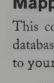

### 提示

运行`newaliases`等同于运行`sendmail -bi`命令。

## 使用`/etc/mail/domaintable`映射域

此配置文件可用于创建域名映射数据库，例如以下示例，将`yet-another-domain.com`映射到`yourdomain.com`：

```
Yet-another-domain.com yourdomain.com
```

因此，当收到发往`user@yet-another-domain.com`的邮件时，它将被翻译为`user@yourdomain.com`。目标域（`yourdomain.com`）必须是完全限定域名。此外，域表中 的域名映射会反映到头部；即，这是在规则集 3 中完成的。

`Sendmail`并不会直接使用`/etc/mail/domaintable`配置文件。它使用该文件的 DBM 数据库版本。要为`/etc/mail/domaintable`文件创建必要的 DBM 文件，请运行以下命令：

```
makemap hash /etc/mail/domaintable < /etc/mail/domaintable
```

这会在同一目录中创建必要的 DBM 数据库文件（如`/etc/mail/domaintable.db`）。修改此文件时，您无需重新启动`sendmail`守护进程。

## 使用`/etc/mail/mailertable`重定向域的邮件

此配置文件可用于创建数据库，以覆盖某些域的默认邮件路由。该文件的格式如下：

```
source-domain mailer:replacement-domain or user@host
```

例如：

```
visitor-01.mydomain.com local:visitor1
```

当邮件到达`visitor-01.mydomain.com`时，它将被重定向到本地用户`visitor1`。只能使用在`/etc/sendmail.cf`文件中使用`M`行指定的邮件程序。快速查看`/etc/sendmail.cf`文件可知，`qmtp`、`procmail`、`smtp`、`esmtp`、`smtp8`、`relay`、`usenet`、`uucp`、`uucp-ol`、`suucp`、`uucp-new`、`uucp-om`、`uucp-u uom`、`local`和`prog`被定义为邮件程序。

您还可以指定源域名的部分域名。在以下示例中，`*.mydomain.com`主机的邮件将通过 SMTP 邮件程序中继到`mail-hub.mydomain.com`：

```
.mydomain.com smtp:mail-hub.mydomain.com
```


### 注意

您必须为源域拥有适当的 MX 记录，否则邮件永远不会被投递。

考虑另一个示例，只要`ad-engine.com`列在`/etc/sendmail.cw`文件中，所有发往`ad-engine.com`的邮件都将通过 SMTP 邮件程序投递给用户`kabir@integrationlogic.com`：

```
ad-engine.com smtp:kabir@integrationlogic.com
```

`Sendmail`并不会直接使用`/etc/mail/mailertable`配置文件。它使用该文件的 DBM 数据库版本。要为`/etc/mail/mailertable`文件创建必要的 DBM 文件，请运行以下命令：

```
makemap hash /etc/mail/mailertable < /etc/mail/mailertable
```

这会在同一目录中创建必要的 DBM 数据库文件（例如`/etc/mail/mailertable.db`）。修改此文件时，您无需重新启动`sendmail`守护进程。

## 使用`/etc/mail/relay-domains`设置邮件中继

`sendmail`的最新版本（v 8.9.x）默认拒绝未经授权的邮件中继。换句话说，如果`sendmail`未明确指示接受发往另一域的邮件，它会拒绝这样做。例如，假设您在名为`mail.mydomain.com`的主机上运行`sendmail`的最新版本。如果未经授权的用户试图使用`mail.mydomain.com`将邮件投递到另一台 SMTP 服务器，您的`sendmail`服务器默认会拒绝此类请求。这是为了消除发送未经请求的电子邮件的人对邮件中继的滥用。

要允许合法域使用您的`sendmail`服务器作为中继，您必须在此文件中指定它们。添加您自己的域以及您希望允许中继操作的任何其他友好域。例如：

```
nitec.com
integrationlogic.com
ad-engine.com
```

您也可以使用网络地址或完整 IP 的形式使用 IP 地址。

要测试中继配置，请运行以下命令：

```
echo '$=R' | sendmail -bt
```

这应显示所有允许的域。

## 设置本地投递目的地：`/etc/mail/sendmail.cw`

使用此文件指定`sendmail`服务器将接收邮件的主机和域名名称。此文件的示例如下所示：

```
nitec.com
ad-engine.com
classifiedworks.com
```

每一行指定`sendmail`服务器将服务的域名。


## 使用 `/etc/mail/virtusertable` 创建虚拟邮件服务器

为了为多个域名提供邮件支持，使用 sendmail 设置虚拟邮件服务。例如，要为名为 `yourclient.com` 的域名提供虚拟邮件服务，请执行以下操作：

- 1. 在 `/etc/mail/sendmail.cw` 文件中添加该域名 (`yourclient.com`)，以便 sendmail 接受发往此主机的邮件。
- 2. 在 `/etc/mail/relay-domains` 文件中添加该域名 (`yourclient.com`)，以便 sendmail 中继该域名的邮件。

要将虚拟域用户映射到一个或多个本地账户，请按如下方式使用 `/etc/mail/virtusertable` 文件：

```
virtual e-mail address real e-mail address

Here are some examples:
webmaster@yourclient.com   mike
mike@yourclient.com        mike
info@yourclient.com        jason
jason@yourclient.com       jason
```

在这些示例中，发往 `webmaster@yourclient.com` 和 `mike@yourclient.com` 等虚拟电子邮件地址的邮件会发送到本地用户 `mike`；同样，`info@yourclient.com` 和 `jason@yourclient.com` 的邮件会发送到另一个本地用户 `jason`。这为 `yourclient.com` 提供了它原本没有的邮件服务器。对外界而言，`yourclient.com` 看起来拥有一个邮件服务器。如果你还为该域名提供 `yourclient.com` 域名的 DNS 服务，可以通过以下操作使整个过程看起来非常专业：

- 在 `yourclient.com` 域名的 DNS 服务中添加一条 A 记录，使其指向你的 sendmail 服务器。例如，如果你的 sendmail 服务器的主机 IP 地址是 `192.168.1.10`，则在 `yourclient.com` 域名的 DNS 配置文件中添加以下行：

```
mail.yourclient.com. IN A 192.168.1.10
```

- 在 `yourclient.com` 域名的区域文件中添加一条 MX 记录，使其指向 `mail.yourclient.com`。例如：

```
IN MX 5 mail.yourclient.com.
```

只要你按照前面讨论的虚拟配置设置了 sendmail，这就会让其他（毫不知情的）世界认为 `yourclient.com` 拥有一个真正的邮件服务器。

虚拟邮件服务经常被 ISP 的网站客户请求。换句话说，付费让 ISP 进行网站托管（`www.client-domain.com`）的人或公司也经常要求提供虚拟邮件服务。在这种情况下，创建一个单一的 `/etc/mail/virtusertable` 通常难以管理。例如，如果你托管数百个域名，每次你（或你的助理管理员）修改文件时，`/etc/mail/virtusertable` 都会成为人为错误的来源。在这种情况下，你可以创建一个更易于管理的解决方案。例如，要为两个名为 `client-a.com` 和 `client-b.com` 的客户端创建两个虚拟邮件服务，请执行以下操作：

- 1. 为每个域名创建一个单独的虚拟电子邮件映射文件。使用 `domain.ftr` 之类的命名约定（`.ftr` 是 fake-to-real 的缩写）。
- 2. 创建一个 `/etc/mail/client-a.ftr` 文件，其中包含通常会放入该域名 `/etc/mail/virtusertable` 中的内容。例如，该文件可能如下所示：
- 3. 为第二个客户端创建 `/etc/mail/client-b.ftr` 文件。该文件可能与前一个示例类似；但是，假设 `client-b.com` 的所有者希望所有电子邮件地址自动映射到她在你家乡 ISP 邮件服务器中已有的账户。在这种情况下，该映射文件如下所示：

```
user1@client-b.com client1
webmaster@client-b.com unix@home-town-isp.com
@client-b.com client1
```

在此示例文件中，`user1@client-b.com` 地址映射到本地账户 `client1`；`webmaster@client-b.com` 映射到远程 ISP 账户；并且该域名的所有其他可能的电子邮件地址都映射到本地账户。最后一条条目非常有用，并且经常被虚拟域名所有者要求。它允许 `client-b.com` 域名所有者在网站或其他商业出版物和广告中使用其想要的任何电子邮件地址，同时仍能将邮件正确送达。例如，如果 `www.client-b.com` 发布了一个名为 `info@client-b.com` 的电子邮件地址，任何发送到该账户的邮件都将由 `client1` 用户愉快地处理。

`@client-b.com` `@home-town-isp.com`

- 4. 现在你有了两个虚拟用户映射文件，请使用以下命令创建最终的 `/etc/mail/virtusertable` 文件：

```
touch /etc/mail/virtusertable
```

```
cat *.ftr > /etc/mail/virtusertable
```

第一个命令创建 `/etc/mail/virtusertable` 文件（如果它尚不存在）。第二个命令将所有 FTR 文件连接到 `/etc/mail/virtusertable`。这有效地创建了最终的 `/etc/mail/virtusertable` 文件。

- 5. 运行 `makemap` 程序以创建文件的数据库版本，如下所示：

```
makemap hash /etc/mail/virtusertable.db < /etc/mail/virtusertable
```

正如本示例所示，创建多个虚拟用户映射文件可以帮助你轻松跟踪各个域名。任何时候你想更改特定域名的映射，只需修改该域名的 FTR 文件，然后使用刚才讨论的技术创建最终的 `/etc/mail/virtusertable` 文件即可。

由于大多数邮件客户端程序允许用户将发件人 `From:` 行设置为他们想要的任何内容，因此你可能不需要对虚拟站点的传出流量进行任何映射。但是，如果你想确保虚拟邮件站点用户的传出邮件转换为其虚拟域名，可以使用 `/etc/mail/genericstable` 文件。

例如，假设你有一个名为 `classifiedworks.com` 的虚拟邮件站点，其中有一个 FTR 文件如 `/etc/mail/classifiedworks.ftr`，其中包含以下行：

```
sales@classifiedworks.com sheila
```

`sales@classifiedworks.com` 地址映射到一个名为 `sheila` 的本地用户。当 `sheila` 使用 sendmail 服务器发送邮件时，你希望她的邮件显示为 `sheila@classifiedworks.com`，而不是 `sheila@yourdomain.com`。在这种情况下，使用以下行创建 `/etc/mail/genericstable` 文件：

```
sheila sales@classifiedworks.com
```

这颠倒了 `virtusertable` 文件的内容。为了保持域名特定信息分离，你可能希望为每个域名创建一个单独的反向映射文件。假设该文件将具有 `.rtf`（real-to-fake）扩展名。在为使用虚拟邮件服务的每个域名创建此类文件后，按如下方式创建合并的 `/etc/mail/genericstable` 文件：

```
touch /etc/mail/genericstable
cat *.rtf > /etc/mail/genericstable
```

运行 `makemap` 程序以创建此文件的数据库版本：

```
makemap hash /etc/mail/genericstable.db < /etc/mail/genericstable
```

总结来说，对于每个虚拟邮件域名，创建一个将假电子邮件地址映射到真实地址的 FTR 文件，并创建另一个将真实地址映射到假电子邮件地址的文件。在创建这些文件后，将它们合并以创建 `/etc/mail/virtusertable` 文件（用于 `*.ftr`）和 `/etc/mail/genericstable` 文件（用于 `*.rtf`）。然后，运行 `makemap` 创建这些文件的数据库版本。只要你在 `/etc/mail/sendmail.cw` 和 `/etc/mail/relay-domains` 文件中列出了每个虚拟域名，此过程就完成了。

## 测试 Sendmail 配置

Sendmail 配置很复杂，因此经常需要尝试各种配置更改以实现所需的功能。作为一般规则，始终执行以下操作：

- 在进行任何更改之前备份你的配置。
- 每次对 sendmail 配置进行更改时，在继续进行之前先测试它。

本节提供了一些测试典型配置问题的示例。

### 测试 sendmail 地址重写规则


要测试 `sendmail` 规则的行为，请按如下方式运行 `sendmail`：

```
sendmail -bt
```

这以地址模式运行 `sendmail` 并为你提供一个提示以与其交互。在提示符下，输入测试命令，例如以下内容：

```
<rewrite rule #s> <test address>
```

例如，要查看 `sendmail` 的重写规则 `0` 对 `kabir@nitec.com` 的操作，请运行以下命令：

```
0 kabir@nitec.com
```

我 `sendmail` 系统上的输出如下所示：

```
ADDRESS TEST MODE (ruleset 3 NOT automatically invoked)
Enter <ruleset> <address>
> 0 kabir@nitec.com
rewrite: ruleset 0 input: kabir @ nitec . com
rewrite: ruleset 199 input: kabir @ nitec . com
rewrite: ruleset 199 returns: kabir @ nitec . com
rewrite: ruleset 98 input: kabir @ nitec . com
rewrite: ruleset 98 returns: kabir @ nitec . com
rewrite: ruleset 198 input: kabir @ nitec . com
rewrite: ruleset 198 returns: $# local $: kabir @ nitec . com
rewrite: ruleset 0 returns: $# local $: kabir @ nitec . com
```

`kabir@nitec.com` 地址使用本地邮件程序投递。

### 域映射示例

考虑另一个示例，其中你有以下 `/etc/mail/domaintable` 映射：

```
ad-engine.com nitec.com
```

前面的映射将所有发往 `ad-engine.com` 的邮件路由到 `nitec.com`。以下示例测试此映射：

```
ADDRESS TEST MODE (ruleset 3 NOT automatically invoked)
Enter <ruleset> <address>
> 3,0 kabir@nitec.com
rewrite: ruleset 3 input: kabir @ nitec . com
rewrite: ruleset 96 input: kabir < @ nitec . com >
```

```
rewrite: ruleset 96 returns: kabir < @ ad-engine . com . >
rewrite: ruleset 3 returns: kabir < @ ad-engine . com . >
rewrite: ruleset 0 input: kabir < @ ad-engine . com . >
rewrite: ruleset 199 input: kabir < @ ad-engine . com . >
rewrite: ruleset 199 returns: kabir < @ ad-engine . com . >
rewrite: ruleset 98 input: kabir < @ ad-engine . com . >
rewrite: ruleset 98 returns: kabir < @ ad-engine . com . >
rewrite: ruleset 198 input: kabir < @ ad-engine . com . >
rewrite: ruleset 90 input: < ad-engine . com > kabir < @ ad-engine . com . >
rewrite: ruleset 90 input: ad-engine . < com > kabir < @ ad-engine . com . >
rewrite: ruleset 90 returns: kabir < @ ad-engine . com . >
rewrite: ruleset 90 returns: kabir < @ ad-engine . com . >
rewrite: ruleset 95 input: < > kabir < @ ad-engine . com . >
rewrite: ruleset 95 returns: kabir < @ ad-engine . com . >
rewrite: ruleset 198 returns: $# esmtp $ @ ad-engine . com . $ : kabir < @ ad-engine . com . >
rewrite: ruleset 0 returns: $# esmtp $ @ ad-engine . com . $ : kabir < @ ad-engine . com . >
```

地址 `kabir@nitec.com` 被重写为 `kabir@ad-engine.com`，并且 `sendmail` 显示它将通过 ESMTP（昂贵的 SMTP）邮件程序投递，因为 `ad-engine.com` 未列在 `/etc/mail/sendmail.cw` 中。如果列在其中，前面的测试将显示以下输出：

```
ADDRESS TEST MODE (ruleset 3 NOT automatically invoked)
Enter <ruleset><address>
> 3,0 kabir@ad-engine.com
rewrite: ruleset 3 input: kabir @ ad-engine . com
rewrite: ruleset 96 input: kabir < @ ad-engine . com >
rewrite: ruleset 96 returns: kabir < @ ad-engine . com . >
rewrite: ruleset 3 returns: kabir < @ ad-engine . com . >
rewrite: ruleset 0 input: kabir < @ ad-engine . com . >
rewrite: ruleset 199 input: kabir < @ ad-engine . com . >
rewrite: ruleset 199 returns: kabir < @ ad-engine . com . >
rewrite: ruleset 98 input: kabir < @ ad-engine . com . >
rewrite: ruleset 98 returns: kabir < @ ad-engine . com . >
rewrite: ruleset 198 input: kabir < @ ad-engine . com . >
rewrite: ruleset 198 returns: $# local $: kabir
rewrite: ruleset 0 returns: $# local $: kabir
```

请注意，使用的是 `3,0` 作为规则集，因为规则集 `3` 参与 `domaintable` 翻译，而规则集 `0` 参与地址解析。

## 测试 `/etc/mail/*` 数据库文件

只要你修改 `/etc/mail/access`、` /etc/mail/aliases`、` /etc/mail/domaintable`、` /etc/mail/mailertable`、` /etc/mail/virtusertable` 以及类似文件，请确保 `sendmail` 能够正确执行查找。例如，假设你刚刚在 `/etc/mail/alias` 文件中创建了以下别名：

```
root: kabir
```

在运行 `newaliases` 命令后，通过运行 `sendmail -bt` 来确认 `sendmail` 是否能够执行适当的别名查找。在地址测试模式提示符下，输入以下内容：

```
/map database name key
```

例如，要测试 `/etc/mail/aliases` 数据库中 `root` 别名，我可以运行

```
/map aliases root
```

其显示以下输出：

```
map_lookup: aliases (root) returns kabir
```

## 使用 `sendmail` 详细查看 SMTP 事务

你也可以使用 `sendmail` 来查看它如何将消息投递到目的地。例如，以下命令中的 `-vt` 选项会告诉 `sendmail` 以详细模式运行，并在输入中扫描 `To:`、`From:`、`Cc:` 和 `Bcc:` 标头：

```
sendmail -vt
```

运行上述命令后，它会等待用户输入。此时，你可以输入类似以下内容：

```
To: kabir@integrationlogic.com
From: someone@somewhere.com
Subject: Testing sendmail

This is a test.
```


# Sendmail 示例与调试

## SMTP 事务示例

输入简短消息，如上所示后，按 `Ctrl+D` 退出消息输入模式。然后 `Sendmail` 会显示类似以下的 SMTP 事务：

```
kabir@integrationlogic.com... Connecting to mail.integrationlogic.com via esmtp...
220 wormhole.integrationlogic.com ESMTP Sendmail 8.9.3/8.9.3; Sun, 21 Feb 1999 19:57:00 -0500
>> EHLO picaso.nitec.com
250-wormhole.integrationlogic.com Hello picaso.nitec.com {206.171.50.50}, pleased to meet you
250-EXPN
250-VERB
250-8BITMIME
250-SIZE
250-DSN
250-ONEX
250-ETRN
250-XUSR
250 HELP
>> MAIL From:<kabir@picaso.nitec.com> SIZE=77
250 <kabir@picaso.nitec.com>... Sender ok
>> RCPT To:<kabir@integrationlogic.com>
250 <kabir@integrationlogic.com>... Recipient ok
>> DATA
354 Enter mail, end with "." on a line by itself
>>
.
250 TAA16439 Message accepted for delivery
kabir@integrationlogic.com... Sent
(TAA16439 Message accepted for delivery)
Closing connection to mail.integrationlogic.com.
>> QUIT
221 wormhole.integrationlogic.com closing connection
```

以 `>>` 开头的行是由本地 `sendmail` 服务器（`picaso.nitec.com`）发送到远程 `sendmail` 服务器（`mail.integrationlogic.com`）。这与我之前通过 `Telnet` 连接演示的内容非常接近。

## 使用 sendmail 调试标志

使用 `-dX` 选项（其中 `X` 为调试级别）与 `-bv` 结合使用，以查看 `sendmail` 对特定地址将采取什么操作。例如，

```
sendmail -bv -d0 kabir@nitec.com
```

在我的 `sendmail` 服务器上产生以下输出：

```
Version 8.9.3
Compiled with: MAP_REGEX LOG MATCHGECOS MIME7TO8 MIME8TO7 NAMED_BIND NETINET NETUNIX NEWDB NIS QUEUE SCANF SMTP USERDB XDEBUG

========== SYSTEM IDENTITY (after readcf) ===========
(short domain name) $w = picaso
(canonical domain name) $j = picaso.nitec.com
(subdomain name) $m = nitec.com
(node name) $k = picaso.nitec.com
========================================
```

`kabir@nitec.com... deliverable: mailer local, user kabir`

`-d0` 选项会导致 `sendmail` 显示有关 `sendmail` 本身的各种信息。最后一行显示 `sendmail` 将如何处理给定的地址。指定 `-d` 而不带任何调试级别数字会显示你想要的所有调试信息。

## 使用测试配置文件

当你修改 `sendmail.cf` 时，最好创建 `/etc/sendmail.cf` 文件的测试版本并仅修改测试副本，这样就不会丢失任何正在工作的配置。以下是如何测试新配置的方法：

1. 创建 `/etc/sendmail.cf` 的副本并使用新名称命名。对于本示例，将测试配置命名为 `/etc/sendmail-test.cf`。
2. 要使用新的测试配置文件运行 `sendmail`，请使用 `-C` 选项。例如，`/usr/sbin/sendmail -C sendmail-test.cf` 使用 `/etc/sendmail-test.cf`。
3. 如果你想为测试配置使用不同的队列（即不同于 `/var/spool/mqueue`），请使用 `-Q` 选项。例如，`/usr/sbin/sendmail -C sendmail-test.cf -oQ /var/spool/test-mqueue` 使用 `/var/spool/test-mqueue` 目录作为测试配置。

此时，你应该已按预期配置了 `sendmail`。

## 保护 Sendmail

作为最古老的邮件服务器之一，`sendmail` 曾出现过不少安全漏洞并受到指责。最近版本的 `sendmail` 是在严格的安全考虑下发布的。

### 保护配置文件

从 `8.9.x` 版本开始，`sendmail` 已收紧了配置文件权限的限制。例如，如果我运行 `chmod -R 664 /etc/mail/*` 来更改配置文件的权限，然后尝试重启 `sendmail`，我会收到以下错误消息：

```
Starting sendmail: /etc/sendmail.cf: line 93: fileclass:
cannot open /etc/mail/sendmail.cw: Group writable directory

WARNING: Group writable directory /etc/mail
/etc/mail/virtusertable.db: could not create:
Permission denied

WARNING: Group writable directory /etc/mail
/etc/mail/access.db: could not create: Permission denied

WARNING: Group writable directory /etc/mail
/etc/mail/domaintable.db: could not create:
Permission denied

WARNING: Group writable directory /etc/mail
/etc/mail/mailertable.db: could not create: Permission denied
```

总的来说，请执行以下操作以确保 `sendmail` 在你的系统上安全运行：

- 确保 `/etc/sendmail.cf` 和 `/etc/mail/*` 文件和目录仅可由超级用户或在 `/etc/sendmail.cf` 文件的 `RunAsUser` 行中指定的用户名读取。所有这些文件和目录应仅由超级用户写入。
- 不要为任何配置文件、目录或 `sendmail` 需要读取的任何其他文件启用组写权限。

在任何情况下都不应为任何配置文件启用组写访问。虽然 `sendmail` 允许你通过使用 `DontBlame Sendmail` 选项来禁用与文件权限和所有权相关的安全功能，但你应改为修复权限/所有权问题。

并且永远不要在 `sendmail` 中禁用检查。如果您想保持安全检查不变，请确保存放 `.forward` 文件的用户主目录不允许任何组写入。`.forward` 文件本身应具有 `644`（`rw-r--r--`）权限设置。还请确保 `sendmail` 读取的任何文件的路径中的目录都已禁用组写访问。

在您确保文件/目录级别权限设置正确，并且 `sendmail` 因文件和目录的权限/所有权问题不会输出任何警告或错误消息后，请确保日志记录已正确启用。默认情况下，`sendmail` 通过 `syslogd` 写入日志，因此在您的 `/etc/syslog.conf` 中包含以下行：

```
mail.*		/var/log/maillog
```

您可以根据喜好更改日志文件名；通常，此文件名为 `maillog` 或 `mail.log`。还请确保在 `/etc/logrotate.d/syslog` 文件中具有如下条目：

```
/var/log/maillog {
postrotate
/usr/bin/killall -HUP syslogd
endscript
}
```

这将在 `logrotate` 处理 `/var/log/maillog` 文件后重新启动 `syslogd`。

### 确保更严格的运行模式和隐私

您可以强制 `sendmail` 在客户端连接到服务器时严格遵守 SMTP 协议，并且还可以控制用户如何与 `sendmail` 交互。这是通过使用如下选项行完成的：

```
O PrivacyOptions=needvrfyhelo,restrictmailq,restrictqrun,goaway
```

`PrivacyOptions` 的值如表 9-3 所示。


### 表 9-3 Sendmail 的隐私选项

| 选项 | 说明 |
|---|---|
| public | 允许开放访问。 |
| needmailhelo | 客户端在发出 `MAIL` 命令之前必须使用 `HELO` 或 `EHELO`。 |
| needexpnhelo | 客户端在发出 `EXPN` 命令之前必须使用 `HELO` 或 `EHELO`。 |
| noexpn | 客户端不能使用 `EXPN` 命令。 |
| needvrfyhelo | 客户端在发出 `VRFY` 命令之前必须使用 `HELO` 或 `EHELO`。 |
| novrfy | 客户端不能使用 `VRFY` 命令。 |
| noetrn | 客户端不能使用 `ETRN` 命令。 |
| noverb | 客户端不能使用 `VERB` 命令。 |
| restrictmailq | 限制 `mailq` 命令的使用。当此选项设置时，只有超级用户以及队列目录的所有者和组用户才能运行 `mailq` 命令。 |
| restrictqrun | 限制 `-q` 选项。当此选项设置时，只有超级用户和队列目录的所有者才能使用此选项。 |
| noreceipts | 成功时不返回成功代码。 |
| goaway | 不允许 SMTP 状态查询。 |
| authwarnings | 在消息中插入 `X-Authentication-Warning` 头部。 |

## 采取反垃圾邮件措施

在这种大量非请求电子邮件的时代，您的 `sendmail` 服务器可能容易受到外部人员的滥用。发送非请求电子邮件给成千上万的人的人通常使用他人的邮件服务器来做他们的肮脏工作。这称为第三方邮件中继漏洞。

### 应对第三方邮件中继漏洞

直到最近，`sendmail` 默认允许任何人进行邮件中继。换句话说，与您或您的组织完全无关的人可以使用您的 `sendmail` 服务器作为 SMTP 邮件中继向您不知道的某人发送邮件。在这种情况下，发送者和接收者都是未知或与您或您的组织无关。这以前是允许的，因为它为邮件管理员提供了调试能力以定位邮件连接问题。然而，批量电子邮件发送者或垃圾邮件发送者现在在互联网上猖獗，他们寻求不受保护的中继来执行他们的大量邮件工作。这滥用了您的系统资源，也使您或您的组织面临法律并发症。

美国许多州现在正在通过针对非请求电子邮件的法律，相关方可能要对这些法律下的损害承担财务责任。如果您的邮件服务器涉及与非请求电子邮件相关的法律事务，处理此事并证明自己的清白可能需要您投入额外的法律和财务资源。此外，如果您的服务器涉及此类邮件发送，许多收件人会简单地假设您积极参与此事，他们很可能会向您发送数百封愤怒的电子邮件并向垃圾邮件黑名单举报您。这可能会损害您的声誉或您组织的声誉。它还可能干扰您的邮件连接操作，因为许多邮件服务器在同意与域交换邮件之前会检查垃圾邮件黑名单。以下是如何判断您的 `sendmail` 是否容易受到此类中继攻击。

检查邮件服务器是否存在中继漏洞的最简单方法之一是访问 URL `http://maps.vix.com/tsi/ar-test.html`，该 URL 由 Mail Abuse Prevention System（MAPS）Transport Security Initiative（TSI）网站提供。在目标主机输入框中输入您的邮件服务器的主机名，然后单击 GO 按钮以确定您的邮件服务器是否容易受到中继攻击。

如果您想允许一个或多个域使用您的 `sendmail` 服务器进行中继用途，请将它们添加到 `/etc/mail/relay-domains` 文件中。此外，如果您想阻止已知垃圾邮件发送者发送垃圾邮件，请使用 `/etc/mail/access` 文件明确拒绝他们访问您的邮件服务器。

### 将垃圾邮件发送者发送到黑洞

Mail Abuse Prevention System 的 Realtime Blackhole List（RBL）可用于自动阻止已知垃圾邮件发送者使用您的 `sendmail` 服务器。RBL 的网站位于 `http://maps.vix.com/`。

您可以将 RBL 视为已知垃圾邮件发送者的数据库。通过查询数据库，您可以找出谁是垃圾邮件发送者并拒绝来自相关域的邮件服务。MAPS RBL 是一个基于 DNS 的垃圾邮件检查和阻止系统，可以查询以确定某个 IP 地址是否被阻止为垃圾邮件发送者。您可以使用 RBL 两种方式。

- 简单地与 MAPS RBL 签订协议，将整个数据库传输到本地主机，并为自己的使用创建本地 RBL。
- 逐案查询主 RBL 数据库。

`sendmail` 的最新版本（8.9.x）自带 RBL。最新版本的 Red Hat Linux RPM 在 `/etc/sendmail.cf` 中启用了 RBL，因此您无需执行任何操作即可配置它。以下是如何在 `sendmail` 中测试 RBL 配置的方法。

1. 运行以下命令：

```
sendmail -bt
```

2. 在地址测试模式提示符下，输入：

```
.D{client_addr}127.0.0.1
Basic_check_relay <>
```

输出如下所示：

```
ADDRESS TEST MODE (ruleset 3 NOT automatically invoked)
Enter <ruleset> <address>
> .D{client_addr}127.0.0.1
> Basic_check_relay <>
rewrite: ruleset 190 input: < >
rewrite: ruleset 190 returns: OK SO FAR
```

这告诉您地址 `127.0.0.1`（环回地址）在 RBL 中未被阻止，因为重写结果为 `OK SO FAR`。

3. 现在，使用 `127.0.0.2`（RBL 提供的测试 IP，已在 RBL 中被阻止）重复上述测试。您应该会看到类似以下的输出：

```
ADDRESS TEST MODE (ruleset 3 NOT automatically invoked)
Enter <ruleset> <address>
> .D{client_addr}127.0.0.2
> Basic_check_relay <>
rewrite: ruleset 190 input: < >
rewrite: ruleset 190 returns: $# error $# 5 . 7 . 1
$: "Mail from " 127 . 0 . 0 . 2 " refused by
blackhole site rbl.maps.vix.com. Email from your
server is blocked. Contact your local Systems
Administrator or ISP."
```

如您所见，此 IP 在 RBL 中被黑洞或列入黑名单，因此 `sendmail` 不允许此 IP 中继消息。

您还可以使用 Russell Nelson 编制的自动回复程序进行实际测试。根据自动回复程序所有者的说法，您必须从要测试 RBL 阻止的服务器向 `nelson-rbl-test@crynwr.com` 发送邮件。预期从 `ns.crynwr.com` 收到一条回复，其中包含 SMTP 会话。如果您收到来自 `linux.crynwr.com` 的另一条回复，则表示您的 RBL 设置不起作用。

> 提示
> 如果您想知道哪些邮件事务因 RBL 被拒绝，只需运行 `grep "maps.vix.com" /var/log/maillog` 查看被拒绝的请求即可。

## 设置 POP 邮件服务

POP 协议的最新版本是 3，因此请安装 POP3 服务器。Red Hat CD-ROM 上包含的 IMAP 软件包包含 POP3 服务器。因此，要安装 POP3，只需使用 `rpm -ivh package name` 命令安装 IMAP 软件包即可。

安装服务器后，按如下方式配置它：

1. 修改 `/etc/inetd.conf` 文件，使其具有如下行：

```
pop-3 stream tcp nowait root /usr/sbin/tcpd ipop3d
```

如果您有 `pop-2` 行，请将其注释掉，因为 POP2 并未广泛使用，而大多数最新的 POP 客户端都支持 POP3。

2. 检查 `/etc/services` 文件，确保您具有以下行：

```
pop-3 110/tcp # PostOffice V.3
pop 110/tcp # PostOffice V.3
```

3. 使用 `killall -HUP inetd` 重启 `inetd` 守护进程，使其能够在 TCP 端口 `110` 上监听 POP3 请求。当系统收到 POP3 连接请求时，`inetd` 守护进程将启动 `ipop3d` 守护进程来处理请求。

您的 POP3 服务器现在已准备好提供服务。然而，如果您想增强系统安全性，您可能希望通过使用 TCP wrapper（`tcpd`）使用的 `/etc/hosts.allow` 和 `/etc/hosts.deny` 文件来限制对 POP3 服务器的访问。

## 配置 SMTP/POP 邮件客户端


在配置好 `SMTP` 和 `POP3` 服务器后，您需要为用户设置邮件客户端软件。如果用户将通过 `Telnet` 连接到邮件服务器来访问邮件，您需要安装一个或多个邮件客户端软件包，例如 `mail`、`pine` 和 `procmail`。使用 `Telnet` 访问邮件的人可以非常轻松地使用邮件转发功能。

例如，一个想要将邮件发送到不同账户或另一台邮件服务器的用户可以在其主目录中添加一个 `.forward` 文件，以便 `sendmail` 将邮件投递到请求的地址。`.forward` 文件的格式非常简单。例如，要将名为 `mrfrog` 的用户的所有邮件转发到 `mrfrog@freemail-domain.net`，请编辑 `~/.forward`，使 `mrfrog@freemail-domain.net` 地址单独占一行。此外，请确保 `.forward` 的文件权限仅允许所有者读写；其他人应只有读取权限。

然而，在大多数情况下，用户通过运行 `POP3` 客户端的 `Windows` 机器访问邮件。为了使用户能够配置典型的 `Windows POP3/SMTP` 邮件客户端，请向每个用户提供以下信息：

- 用户名
- 密码
- 传入 `POP3` 邮件服务器 `IP` 或主机名
- 发出 `SMTP` 邮件服务器 `IP` 或主机名

您必须允许此类客户端将您的 `sendmail` 服务器用作中继，否则客户端将无法发送邮件。例如，如果您的邮件服务器通过 `America Online` 访问，请将 `aol.com` 添加到您的 `/etc/mail/relay-domains`。

# 第 10 章

## FTP 服务

### 使用 wu-ftpd：默认的 FTP 服务器

`Red Hat Linux` 发行版附带 `Wuarchive-ftpd`，更亲切地称为 `wu-ftpd`。`wu-ftpd` 由华盛顿大学开发，是互联网上最流行的 `FTP` 服务器，全球数千个 `FTP` 站点都在使用它。

如果您在 `Red Hat Linux` 安装期间选择安装 `FTP` 服务，`wu-ftpd` 服务器将默认安装。但是，如果您不确定是否已安装 `wu-ftpd` 服务器，只需查询已安装软件包的 `RPM` 数据库：

```
rpm -qa | grep wu-ftpd
```

`rpm -qa` 命令列出所有已安装的 `RPM` 软件包，而管道后的 `grep wu` 命令匹配 `rpm` 命令输出的软件包名称中的 `wu-ftpd` 模式，从而让您查看是否有任何软件包的名称包含 "`wu-ftpd`" 字符串模式。例如，前述命令在我的 `Red Hat` 机器上显示 "`wu-ftpd-2.4.2vr17-3`"。

您系统上的版本号会有所不同，因为随 `Red Hat Linux` 的更新版本可能会发布 `wu-ftpd` 服务器的新版本。

如果前述命令没有任何输出，则您当前尚未安装 `wu-ftpd` 服务器，需要按照以下文本所述继续安装。另一方面，如果您看到已安装了 `wu-ftpd` 的某个版本，请跳过安装部分，直接进入配置 `FTP` 服务的部分。

### 安装 wu-ftpd 服务器

安装 `wu-ftpd` 服务器有两种选择：

- 安装 `wu-ftpd` 的预编译 `RPM` 软件包版本。
- 从 `ftp://ftp.academ.com/pub/wu-ftpd/private/` 获取源代码并自行编译。

由于 `Red Hat` 提供的 `wu-ftpd RPM` 软件包对大多数人来说相当合适，第二种流程在本章中未作描述。除非您有非常特殊的原因需要从源代码编译和安装，否则请使用 `wu-ftpd RPM` 软件包。在后一种情况下，请务必仔细阅读随附的文档。

#### 从 Red Hat CD-ROM 安装

要从 `Red Hat CD-ROM` 安装：

1. 以 `root` 身份登录到您的 `Red Hat` 服务器。
2. 挂载您的 `Red Hat CD-ROM` 并切换目录到 `RedHat/RPMS`。运行 `ls | grep wu-ftpd` 以定位 `wu-ftpd` 服务器的 `RPM` 软件包。
3. 定位到 `wu-ftpd` 的 `RPM` 软件包文件名后，运行以下命令安装软件包：`rpm -ivh name of the wu-ftpd package` 例如，`rpm -ivh wu-ftpd-2.4.2vr17-3.i386.rpm` 安装适用于 `x86` 计算机的 `wu-ftpd 2.4.2vr17-3` 版本。您的版本号和系统架构可能有所不同。

#### 从 Red Hat FTP 服务器安装

如果您没有 `Red Hat CD-ROM` 或想从互联网安装最新版本，请运行以下命令：

```
rpm -ivh URL
```

例如，要从名为 `ftp://ftp.cdrom.com/` 的匿名 `FTP` 服务器安装 `wu-ftpd-2.4.2vr17-3.i386.rpm` 软件包，该服务器镜像了 `Red Hat` 发行版，我运行了以下命令：

```
rpm -ivh ftp://ftp.cdrom.com/pub/linux/redhat/redhat-\
5.2/i386/RedHat/RPMS/wu-ftpd-2.4.2vr17-3.i386.rpm
```

如果您想从此类服务器安装，请务必先通过 `Web` 浏览器浏览该站点以确定正确的 `URL`。`URL` 会因您的系统架构 `i386`、`Alpha`、`Sparc` 等以及 `Red Hat Linux` 和 `wu-ftpd` 软件的版本而异。

如果您尝试在保留旧版本的同时安装更新版本的 `wu-ftpd`，则必须在前述代码行中提供 `--force` 选项。在您安装 `wu-ftpd` 或确认其作为 `Red Hat` 安装的一部分已安装后，您就可以配置新的 `FTP` 服务器了。

## 配置 FTP 服务器

您的 `FTP` 服务器配置由 `/etc` 目录中的以下文件组成：

- `services`
- `inetd.conf`
- `ftpaccess`
- `ftpconversions`
- `ftpgroups`
- `ftphosts`
- `ftpusers`

`wu-ftpd` 服务器像许多其他基于 `TCP/IP` 的服务器一样，通过名为 `inetd` 的 `Internet` 超级服务器运行，`inetd` 在端口 `21` 上监听 `FTP` 连接；当检测到此类连接请求时，`inetd` 启动 `wu-ftpd` 服务器。启动时，`inetd` 会查看两个文件，`/etc/services` 和 `/etc/inetd.conf`，以确定哪个服务 `端口` 与服务器关联。

### /etc/services

`/etc/services` 文件描述了 `Linux` 服务器上可用的 `TCP/IP` 服务。以下是 `FTP` 服务器配置的相关行：

```
ftp-data    20/tcp
ftp         21/tcp
```

这两行告诉 `inetd FTP` 服务的数据和命令功能分别使用哪些端口。默认端口声明是标准的，不应更改。

前述行告诉 `inetd` 哪些端口属于 `FTP` 服务，但 `inetd` 仍需要知道哪个服务器软件负责该服务。这在 `/etc/inetd.conf` 文件中定义。

### /etc/inetd.conf

与 `FTP` 配置相关的行如下所示：

```
ftp stream tcp nowait root /usr/sbin/tcpd in.ftpd -l -a
```

名称为 `ftp` 的服务与名为 `in.ftpd` 的服务器软件绑定，后者是 `wu-ftpd` 可执行文件的名称。这行告诉 `inetd` 如何实现该服务。`inetd` 对此行的解释如下：

```
service name: ftp
socket type: stream
protocol: tcp
wait/nowait[.max]: nowait
user[.group] : root
server program: /usr/sbin/tcpd
server program arguments: in.ftpd -l -a
```

注意 `inetd` 被告知服务器程序的名称是 `/usr/sbin/tcpd`，并且 `/usr/sbin/tcpd` 使用参数 `in.ftpd -l -a` 而不是运行裸服务器程序 `in.ftpd`。这样做是为了 trick `inetd` 运行 `TCP wrapper` 程序 `/usr/sbin/tcpd`，后者反过来使用 `-l` 和 `-a` 参数运行 `in.ftpd` 程序。

`-l` 和 `-a` 选项默认指定。`-l` 选项指定每个 `FTP` 会话通过 `syslog` 设施进行记录，而 `-a` 选项指定启用 `/etc/ftpaccess` 中指定的访问控制配置。这两个参数非常有用，不应删除。有关其他选项，请参阅 `ftpd` 手册页。

运行 `FTP` 服务器而不使用 `TCP` 包装器 `/usr/sbin/tcpd` 是可能的，但强烈不建议这样做。但是，如果你有非常充分且合理的理由在不使用 `TCP` 包装器的情况下运行它，则必须按如下方式更改 `FTP` 服务的默认 `/etc/inetd.conf` 行：

```
ftp stream tcp nowait root /usr/sbin/in.ftpd -l -a
```

这假定你的 `in.ftpd` 可执行文件位于 `/usr/sbin` 目录中。


如果对 `/etc/inetd.conf` 或 `/etc/services` 进行了任何更改，请通过发送 `SIGHUP` 信号来通知 `inetd` 重新加载配置，如下所示：

```
kill -HUP PID of inetd
```

or

```
killall -HUP inetd
```

## `/etc/ftpaccess`

这是 FTP 服务器的主要配置文件。该文件包含以下格式的配置信息：

```
keyword one or more options
```

默认的 `/etc/ftpaccess` 文件如清单 10-1 所示。

### 清单 10-1 默认的 `/etc/ftpaccess` 文件

```
class all real,guest,anonymous *

email root@localhost

loginfails 5

readme README* login
readme README* cwd=*
```

### 清单 10-1 继续

```
message /welcome.msg login
message .message cwd=*

compress yes all
tar yes all
chmod no guest,anonymous
delete no guest,anonymous
overwrite no guest,anonymous
rename no guest,anonymous
```

```
log transfers anonymous,real inbound,outbound
```

```
shutdown /etc/shutmsg
```

```
passwd-check rfc822 warn
```

这是服务器最重要的配置文件，因此本章将对其进行详细讨论。你可以在此文件中指定五种类型的配置信息。

## 访问配置

访问配置可以使用 `class`、`deny`、`limit`、`noretrieve`、`loginfails`、`private`、`autogroup` 和 `guestgroup` 关键字进行指定。

### class

```
Syntax: class <classname> typelist addrglob
Default: class all real,guest,anonymous *
```

`class` 关键字用于定义类名并指定属于该类的用户类型。它还指定了类成员可以访问 FTP 服务器的 IP 地址或域名。

参数如下：

- **`classname`.** 类的任意名称。
- **`typelist`.** 用户类型的逗号分隔列表。可用的用户类型有三种：`real`、`anonymous` 和 `guest`。`real` 用户是指在 `/etc/passwd` 或 `/etc/shadow` 文件中有有效用户名和密码的人。
- **`addrglob`.** 可以是主机的 IP 地址、带通配符的部分 IP 地址（如 `206.171.50.*`）、主机名（如 `blackhole.nitec.com`）或带通配符的部分域名（如 `*.nitec.com`）。

默认的 `/etc/ftpaccess` 文件包含一个名为 `all` 的类定义，指定类型为 `real`、`guest` 和 `anonymous` 的用户可以从任何地方访问 FTP 服务器。通配符 `*` 用于表示“任何地方”。

在以下示例中，仅允许从 `206.171.50.0` 网络访问服务器的 `real` 用户进行 FTP 访问：

```
class all real 206.171.50.*
```

你也可以使用域名代替 IP 地址，如以下示例所示：

```
class all real *.nitec.com *.ad-engine.com
```

前面的类定义允许 `real` 用户从 `nitec.com` 和 `ad-engine.com` 域中的任何机器登录。

如果不打算在 FTP 服务器上允许匿名或访客账户，可以从 `all` 类的默认 `typelist` 中删除 `guest` 和 `anonymous` 关键字。

### deny

语法：`deny addrglob message_file`

默认值：`none`

该关键字用于拒绝与指定 IP 地址或域名匹配的主机的 FTP 服务。例如，

`deny *.edu`

告诉 FTP 服务器拒绝任何尝试从美国大学访问服务器的人的访问。另一个示例是：

`deny *.com /etc/goaway.msg`

此配置拒绝 `.com` 域中任何人的 FTP 访问，并显示 `/etc/goaway.msg` 文件。

### limit

语法：`limit class n times message_file`

默认值：`none`

该关键字限制指定类的同时用户登录数。参数如下：

- **`n`.** 允许访问的用户数。
- **`times`.** 指定限制应适用的时间。时间可以用 24 小时制格式指定。例如，`0700–1700` 是一个涵盖上午 7 点至下午 5 点的范围。时间格式还可以包括日期，如表 10-1 所示。

#### 表 10-1 limit 的时间格式

| 关键字 | 含义 |
|---|---|
| Any | 任何时间 |
| Wk | 任何工作日 |
| Sa | 星期六 |
| Su | 星期日 |
| Mo | 星期一 |
| Tu | 星期二 |
| We | 星期三 |
| Th | 星期四 |
| Fr | 星期五 |

你也可以组合日期。例如：`SaSu07-17` 涵盖周末上午 7 点至下午 5 点。以下是设置访问限制的示例配置：

```
class local real anonymous *.nitec.com
class remote anonymous *

limit local 200 Any /etc/msgs/msg.toomany
limit remote 100 Any /etc/msgs/msg.toomany
```

前面的配置允许 `nitec.com` 域的用户在任何时间最多登录 200 人，并且仅允许 100 个匿名用户在任何时间访问系统。

### noretrieve

语法：`noretrieve filename filename . . .`

默认值：`none`

该关键字拒绝 FTP 用户检索命名文件的能力。例如，

```
noretrieve /etc/passwd
```

拒绝任何人检索 `/etc/passwd` 文件的能力。会显示类似“`/etc/passwd` 已标记为不可检索”的消息。请注意，如果文件名不包含完全限定路径名，则所有具有此类名称的文件都将被标记为不可检索。例如，

```
noretrieve passwd core
```

防止任何人从任何目录检索名为 `passwd` 或 `core` 的文件。文件名中不能使用通配符。

### loginfails

语法：`loginfails number`

默认值：`loginfails 5`

该关键字定义用户在断开连接之前可以尝试登录的次数。当用户在指定次数内未能输入有效的用户名/密码组合进行登录时，会记录错误消息并断开用户连接。

### private

语法：`private yes or no`

默认值：`none`

`wu-ftpd` 服务器提供了一组扩展的非标准 FTP 命令。其中一个命令称为 `SITE`，被认为是一个安全风险。因此，不建议使用 `private` 关键字。事实上，Red Hat 随附的 `wu-ftpd` 默认版本中已禁用 `SITE` 命令。你必须自行编译 `wu-ftpd` 才能启用 `SITE` 命令，这是不推荐的。

### guestgroup

语法：`guestgroup groupname groupname . . .`

默认值：`none`

该关键字指定应被视为访客用户账户的用户组。

### autogroup

语法：`autogroup groupname class [class . . .]`

默认值：`none`

该关键字允许你在匿名用户属于一个或多个指定类时更改其有效组 ID。

## 信息配置

信息配置可以使用 `banner`、`email`、`message` 和 `readme` 关键字进行指定。

### banner

语法：`banner filename`

默认值：`none`

该关键字可用于显示指定文件的内容。通常，许多系统使用横幅来标识系统并提供用户策略和联系信息。

如果使用 `banner` 关键字在登录前显示文件，一些非标准 FTP 客户端可能无法登录，因为它们无法处理服务器的多行响应。

### email

语法：`email user@host`

默认值：`email root@localhost`

该关键字设置 FTP 站点管理员的电子邮件地址。

### message

语法：`message path {when {class . . .}}`

默认值：`message /welcome.msg login`
`message .message cwd=*`


该关键字用于设置在用户登录系统或使用更改目录命令更改目录时要显示的文件名。例如，刚才显示的第一个默认设置会在用户成功登录时显示 `/welcome.msg` 文件的内容。第二个默认设置会在用户更改目录时显示 `.message` 文件的内容。当要显示的文件丢失时，不会显示任何内容。

要显示的文件可以包含表 10-2 所示的一个或多个魔术 cookie 字符串。

### 表 10-2 消息文件的魔术 Cookie 字符串

| Cookies | 替换文本 |
|---|---|
| `%C` | 当前工作目录 |
| `%E` | `ftpaccess` 中定义的维护人员的电子邮件地址 |
| `%F` | `CWD` 分区中的可用空间（K） |
| `%L` | 本地主机名 |
| `%M` | 此类允许的最大用户数 |
| `%N` | 此类中的当前用户数 |
| `%R` | 远程主机名 |
| `%T` | 本地时间（格式为“Thu Nov 15 17:12:42 1990”） |
| `%U` | 通过 `RFC 931` 身份验证确定的用户名 |
| `%U` | 登录时提供的用户名 |

### 清单 10-2 `/welcome.msg` 文件示例

```
Hello %U

Welcome to %L. You are user %N of possible %M users.
You are logging in from %R.

Local time is %T
```

## 列表 10-2 继续

```
Feel free to email (&E) if you have any questions or comments.
```

```
Your current directory is &C (Free &F KB)
```

消息文件每个目录仅显示一次。如果您计划为匿名访问显示消息文件，请使用相对于匿名 FTP 目录树基目录的相对路径。

### readme

```
Syntax: readme path {when {class . . .} }
Default:
readme README* login
readme README* cwd=*
```

此关键字与前面讨论过的 `message` 关键字类似。然而，它不会显示命名文件的内容，而是使 FTP 服务器通知用户该文件的存在，并告知用户该文件的修改日期和时间。

## 日志配置

日志配置可使用 `log commands` 和 `log transfers` 关键字指定。

### log commands

```
Syntax: log commands typelist
Default: none
```

此关键字允许您为一个或多个类型的用户记录 FTP 命令。例如，

```
log commands anonymous
```

logs all the FTP commands performed by all anonymous users.

### log transfers

```
Syntax: log transfers typelist directions
Default: log transfers anonymous,real inbound,outbound
```

此关键字允许您记录进出系统的文件传输。默认设置使服务器记录匿名用户和真实用户的入站和出站文件传输。

## 权限配置

以下关键字允许您控制用户的文件/目录权限设置。

### chmod

语法：`chmod yes|no typelist`

默认值：`chmod no guest,anonymous`

此关键字启用或禁用指定列表中的用户类型的 `chmod` 命令（`site chmod`）。例如，默认设置会为 `guest` 和 `anonymous` 用户禁用此命令。默认情况下，`chmod` 命令不可用。

### delete

语法：`delete yes|no typelist`

默认值：`delete no guest,anonymous`

此关键字启用或禁用 `type` 列表中指定的用户的 `delete`（`del`）命令。例如，默认设置会为 `guest` 和 `anonymous` 用户禁用 `delete` 命令。

### overwrite

语法：`overwrite yes|no typelist`

默认值：`overwrite no guest,anonymous`

此关键字启用或禁用 `typelist` 中指定的用户覆盖文件的操作。例如，默认设置会为 `guest` 和 `anonymous` 用户禁用文件覆盖。

### umask

此关键字启用或禁用指定 `typelist` 中用户的 `umask` 命令（`site umask`）。默认情况下，`umask` 命令不可用。

### passwd-check

```
Syntax: passwd-check none|trivial|rfc822 (enforce|warn)
```

```
Default: passwd-check rfc822 warn
```

此关键字定义匿名用户所需的密码类型。默认设置要求密码为电子邮件地址；然而，如果用户未能输入有效的电子邮件地址，则不会强制执行此规则——服务器仅警告用户密码无效。当不需要密码检查时，请按如下方式设置 `passwd-check` 关键字：

```
passwd-check none
```

如果将检查设置为 `trivial`，服务器仅检查密码中是否存在 `@` 字符。

### path-filter

```
Syntax: path-filter typelist mesg allowed_charset {disallowed regexp . . .}
```

```
Default: none
```

此关键字允许您限制 `typelist` 中指定的用户在文件上传时使用的某些文件名。

### upload

```
Syntax: upload root-dir dirglob yes|no owner group
```

```
Default: none
```

此关键字允许您启用或禁用上传目录。例如，

```
upload /home/ftp /dropbox yes root ftp 0600
```

在 `/dropbox` 目录下新建子目录，然后将前面的 `upload` 行更改为以下内容：

```
upload /home/ftp /dropbox yes root ftp 0600 nodirs
```

另一方面，如果您希望允许上传者创建子目录，则将 `nodirs` 替换为 `dirs`。

## 杂项配置

以下关键字允许您控制各种设置。

### alias

语法：`alias string dir`

默认值：`none`

此关键字允许您为目录创建别名。例如，

```
alias redhat /pub/linux/distributions/redhat
```

允许用户键入 `cd redhat` 命令以更改到 `/pub/linux/distributions/redhat` 目录。

### cdpath

语法：`cdpath dir`

默认值：`none`

此关键字将指定目录添加到更改目录（`cd`）命令的搜索路径中。例如：

```
cdpath /pub/linux/redhat
```

如果用户输入命令 `cd RPMS`，则服务器首先在用户当前目录中查找名为 `RPMS` 的目录。如果找不到，则查找名为 `RPMS` 的别名。如果仍然找不到，则尝试将目录更改为 `/pub/linux/redhat/RPMS`。

### compress

语法：`compress yes|no class [class ...]`

默认值：`compress yes all`

此关键字为指定类启用或禁用压缩功能。默认设置为名为 `all` 的类启用压缩功能，该类默认涵盖所有真实、匿名和访客用户。

当默认设置保持不变且 `ftpconversions` 文件未被修改时，使用 FTP 服务的所有用户都能够即时压缩文件。例如，想要以压缩文件形式获取整个目录内容的用户可以输入命令 `get directoryname.tar.gz`，并将下载压缩的 tar 文件。

### tar

语法：`tar yes|no class [class ...]`

默认值：`tar yes all`

此关键字为指定类启用或禁用 `tar`（磁带归档文件）功能。默认设置允许名为 `all` 的类的 `tar` 功能，该类默认涵盖所有真实、匿名和访客用户。当默认设置保持不变且 `ftpconversions` 文件未被修改时，使用 FTP 服务的所有用户都能够即时打包文件。例如，想要以压缩文件形式获取整个目录内容的用户可以输入命令 `get directoryname.tar`，并将下载 tar 文件。

### shutdown

语法：`shutdown path`

默认值：`shutdown /etc/shutmsg`

此关键字指定 FTP 服务器不时监控以检测关闭事件的文件。此文件可使用 `ftpshut` 命令创建。例如，要立即关闭服务器，请运行以下命令：

```
ftpshut now
```


您还可以安排关闭，使已登录用户在关闭开始前有一定时间。例如，假设当前日期为 2000 年 7 月 03 日星期一，时间为 1600（24 小时制）。要在一小时后关闭系统，请发出以下命令：

```
ftpshut -d 30 1700
```

这将创建 `/etc/shutmsg` 文件，如下所示：

```
2000 06 03 17 00 0010 0030
System shutdown at %s
```

第一行的格式如下：

`YYYY MM DD HH MM HHMM HHMM`

`YYYY` 是年份，`MM` 是月份（0-11），`DD` 是日期（1-31），`HH` 是小时（0-23），`MM` 是分钟（0-59）。第一个 `HHMM` 对是拒绝新连接的时间偏移，第二个 `HHMM` 对是断开当前连接的时间偏移。`-d 30` 选项将前述示例文件中的最后一个 `HHMM` 对设置为 `0030`。新连接的拒绝偏移默认是十分钟，但您可以使用 `-l` 选项更改它。另请注意，您可以使用表 10-3 中显示的一个或多个 magic cookies 为默认的“System shutdown at %s”提供更自定义的警告消息。

### 表 10-3 ftpshut 警告消息的魔法 Cookie

| 魔法 Cookie | 替换文本 |
|---|---|
| `%s` | 系统将要关闭的时间 |
| `%n` | 新连接将被拒绝的时间 |
| `%d` | 当前连接将被断开的时间 |

除了这些 cookie 外，您还可以使用表 10-2 中之前显示的所有 cookie。要创建此类消息，请按如下方式运行 `ftpshut` 命令：

```
ftpshut -d MM -l MM HHMM "Shutdown at %s. Be done by %d."
```

不要忘记用适当的值替换 `MM`、`HHMM` 等。当您准备好重新启动 FTP 服务时，必须删除 `/etc/shutmsg` 文件。

### virtual

```
Syntax: virtual address root|banner|logfile path
Default: none
```

如果您的 Linux 系统有多个 IP 地址并且想要提供虚拟 FTP 服务，请使用此关键字。有关详细信息，请参阅本章稍后部分的“创建虚拟 FTP 站点”。

## `/etc/ftpconversions`

`ftpconversions` 文件存储 FTP 服务器的转换数据库。此文件的默认配置对于几乎所有安装都足够。如果需要更多信息，请参阅 `ftpconversions` 的 man 手册。

## `/etc/ftpgroups`

文件 `/etc/ftpgroups` 只有在允许非标准的 `SITE` 命令时才重要。Red Hat 提供的 `wu-ftpd` 包默认禁用 `SITE` 命令，以增强安全性，因为 `SITE` 命令在服务器早期版本中已知会造成安全漏洞。出于完整性考虑，这里描述了该文件的作用，但其使用强烈不被建议。

当不太懂安全的 FTP 管理员启用 `SITE` 命令时，她需要按如下方式设置 `/etc/ftpgroups` 文件：

```
groupname:encrypted password:realgroup
```

通常，`SITE GROUP` 和 `SITE GPASS` 命令用于允许已登录的 FTP 用户提升其组权限。`/etc/ftpgroups` 文件提供了当使用 `SITE GPASS` 命令输入有效密码时，将 `groupname` 用户升级为 `realgroup` 所需的映射。另请注意，`realgroup` 必须是 `/etc/group` 文件中的一个组。

## `/etc/ftphosts`

文件 `/etc/ftphosts` 用于控制从各个主机对特定账户的 FTP 访问。要允许用户从一个或多个主机登录，使用如下行：

```
allow username addrglob [addrglob . . .]
```

这允许指定的用户从指定的主机登录。例如，

```
allow joegunchy *.nitec.com
```

允许用户 `joegunchy` 从 `nitec.com` 域中的任何机器登录。要禁止用户从一个或多个主机登录到服务器，使用以下行：

```
deny username addrglob [addrglob . . .]
```

例如，要阻止 `joegunchy` 从 `206.171.50.0` 网络登录到服务器，使用以下行：

```
deny joegunchy 206.171.50.*
```

## `/etc/ftpusers`

文件 `/etc/ftpusers` 指定不允许访问 FTP 服务器的用户列表。默认的 `/etc/ftpusers` 文件包含以下用户：

|  |  |
|---|---|
| root | halt |
| bin | mail |
| daemon | news |
| adm | uucp |
| lp | operator |
| sync | games |
| shutdown | nobody |

这些账户不允许登录，因为它们不是真实的用户账户。如果需要阻止真实用户通过 FTP 访问服务器，请将用户名放入此文件。

到目前为止，你已经了解了运行 FTP 服务器所需的所有配置文件。现在我将在以下章节讨论一些常见的 FTP 服务器配置问题。


> **Tip**
>
> 因为适当的 FTP 服务需要大量配置，定期验证配置文件的方法很有用。名为 `ftpck` 的实用程序可以提供这种定期验证，你可以从 `ftp://ftp.landfield.com/wu-ftpd/ftpck/` 下载它。

## Creating an anonymous FTP site

拥有一个匿名 FTP 站点有利有弊。它可以成为分发需要广泛传播的文件的绝佳媒介。事实上，你可以从互联网上下载的所有免费软件包（包括 Red Hat Linux 发行版）都存储在世界各地众多的匿名 FTP 站点中。试想一下，如果你需要为互联网上的每个 FTP 服务器创建账户才能访问免费软件，那将是多么噩梦般的事情。这根本不切实际。匿名 FTP 服务解决了这个问题。然而，匿名 FTP 服务也是黑客入侵系统的常见入口。因此，在决定创建匿名 FTP 服务器之前请三思。

幸运的是，Red Hat 使创建匿名 FTP 服务器变得非常容易。你只需要 `anonftp` RPM 包。首先，查询你的 RPM 数据库以确定是否已安装 `anonftp` 包：

```
rpm -qa | grep anonftp
```

如果已作为 Red Hat Linux 安装的一部分安装了 `anonftp` 包，这将显示包名，例如 `anonftp-2.8-1`。如果没有，前述命令不会产生任何输出。在这种情况下，从你的 Red Hat CD-ROM 获取最新的 `anonftp` 包并运行以下命令：

```
rpm -ivh anonftp-2.8-1.i386.rpm
```

如果你想从 Red Hat 镜像站点安装最新版本，运行以下命令：

```
rpm -ivh ftp://ftp.cdrom.com/pub/linux/redhat/redhat-6.0/i386/RedHat/RPMS/anonftp-2.8-1.i386.rpm
```

你的 `anonftp` 包名会根据系统架构和 `anonftp` 版本而变化。此外，如果你还没有 FTP 服务器，例如 `wu-ftpd`，`anonftp` 包将无法安装。

安装 `anonftp` 包后，你就拥有了一个可运行的匿名 FTP 服务器。

## Tip

在使用匿名 FTP 服务之前，你必须在 `/etc/passwd` 文件中拥有名为 `ftp` 且没有任何密码的用户账户。你的 `/etc/passwd` 中的 FTP 用户账户行应类似于：

```
ftp:*:14:50:FTP User:/home/ftp:/bin/true
```

如果你想知道该包安装了什么，运行以下命令：

```
rpm -qlp anonftp-2.8-1.i386.rpm
```

注意，它已在 `~ftp` 目录下安装了所有文件（`ftp` 账户的 home 目录——参见 `/etc/passwd` 文件）。这些文件将在下文详细描述。

切换到 `~ftp` 目录并输入 `ls -l`。你将看到以下目录：

```
[kabir@picaso ~ftp]$ ls -l
total 4
d--x--x--x 2 root root 1024 Nov 5 19:29 bin
d--x--x--x 2 root root 1024 Nov 5 19:29 etc
drwxr-xr-x 2 root root 1024 Nov 5 19:29 lib
dr-xr-sr-x 2 root ftp 1024 Sep 10 17:21 pub
```

切换到 `bin` 子目录并再次运行 `ls -l`，你将看到类似以下内容：


```
[kabir@picaso ~ftp/bin]$ ls -l
total 313
---x--x--x 1 root root 15236 Nov 5 20:02 compress
---x--x--x 1 root root 46356 Nov 5 20:02 cpio
---x--x--x 1 root root 45436 Nov 5 20:02 gzip
---x--x--x 1 root root 29980 Nov 5 20:02 ls
---x--x--x 1 root root 62660 Nov 5 20:02 sh
---x--x--x 1 root root 110668 Nov 5 20:02 tar
lrwxrwxrwx 1 root root 4 Nov 5 20:02 zcat -> gzip
```

这些是提供合理的匿名 FTP 服务所需的实用程序。`ls` 实用程序用于提供目录列表，而 `compress` 实用程序用于提供即时压缩/解压缩功能。这些文件之所以提供，是因为服务器在有人访问匿名 FTP 服务器时需要对 `~ftp` 目录执行 `chroot`。`chroot` 程序允许服务器将 `~ftp` 目录视为系统的根目录。换句话说，当匿名 FTP 用户登录到服务器时，服务器会 `chroot` 到 `~ftp`，从而隐藏真实的文件系统，仅显示 `~ftp` 目录下的内容。这就是为什么你需要一份包含绝对最少文件的 `etc`、`bin` 和 `lib` 目录副本。`lib` 目录包含 `bin` 目录中程序所需的系统库文件。`~ftp/pub` 目录是你应该存放可公开分发文件的地方。

如果你需要一个匿名用户可以上传文件的 `incoming` 或 `dropbox` 目录，请执行以下操作：

- 1. 在 `~ftp` 目录中创建一个用于上传的子目录。该目录通常称为 "incoming"，因此此处使用该名称。
- 2. 在你的 `/etc/ftpaccess` 文件中添加以下行：

```
upload /home/ftp /incoming yes root ftp 0600 nodirs
```

- 3. 将 `/home/ftp` 更改为适当的目录。例如，如果你的 `~ftp` 实际上是 `/data/ftp`，则在前一行中将 `/home/ftp` 更改为 `/data/ftp`。此外，如果你希望允许匿名用户在 `~ftp/incoming` 下创建子目录，请删除前一行中的 `nodirs` 选项。
- 4. 运行以下命令：

```
chown -R root.ftp ~ftp/incoming
chmod -R 1733 ~ftp/incoming
```

`chown` 命令将 `root` 和 `ftp` 设置为 `incoming` 目录的所有者。`chmod` 命令更改 `incoming` 目录权限，使 `root` 具有读、写和执行（rwx）权限，而组和其他用户具有写和执行（wx）权限。它还为目录及其所有文件设置了粘滞位，这可以防止普通用户删除文件。通常，当目录对所有人设置了写和执行权限时，系统的任何用户都可以删除该目录中的文件。粘滞位通过只允许文件创建者删除文件来阻止这种情况。由于 FTP 服务器以 `root` 作为所有者写入文件，因此只有 `root` 才能删除上传的文件。
- 5. 确保在你的 `/etc/ftpaccess` 文件中的至少一个类定义中列出了匿名用户类型。默认情况下，`real`、`guest` 和 `anonymous` 都包含在默认类中，因此除非你更改了默认类定义，否则无需执行任何操作。

完成这些步骤后，以匿名用户身份 FTP 到服务器，并确保只能将文件上传到指定的目录。

因为您对 `~/ftp/incoming` 目录没有读取权限，所以您不应该能够使用 `ls` 命令查看您上传的文件。但是，如果您提供正确的文件名，仍然可以下载已上传的文件。

## 增强匿名 FTP 安全

创建匿名 FTP 站点本身就是一种安全风险，而拥有可上传目录会增加这种风险。然而，许多组织多年来一直成功运行匿名 FTP 服务器，因此不要过于气馁——只需谨慎即可。以下是增强匿名 FTP 服务器安全性的一些指南：

- 确保 `/etc/passwd` 中的 `ftp` 账户使用无效密码。例如，您在 `passwd` 文件中的 `ftp` 账户条目应如下所示：

`ftp:*::14:50:FTP User:/home/ftp:/bin/true`
- `~/ftp/bin` 目录应由 `root` 所有，而不是 `ftp` 账户。您在 `~/ftp/bin` 目录中的二进制文件，如 `ls`、`compress` 和 `tar`，也必须由 `root` 用户拥有。`~/ftp/bin` 目录及其内容应仅可执行。运行以下命令以确保 `~/ftp/bin` 目录中的所有文件仅可执行：

`chown -R root.root ~/ftp/bin; chmod -R 111 ~/ftp/bin`
- `~/ftp/etc` 目录应由 `root` 用户拥有，并且必须仅可执行。您可以使用以下命令使其如此：

`chown -R root.root ~/ftp/etc; chmod 111 ~/ftp/etc`
- `~/ftp/etc` 目录的内容必须只读并且必须由 `root` 拥有。运行以下命令以确保权限设置正确：

`chown -R root.root ~/ftp/etc; cd ~/ftp/etc; chmod 444 *`
- 切勿将您的 `/etc/passwd` 或 `/etc/group` 文件复制到 `~/ftp/etc` 目录中。`~/ftp/etc/passwd` 和 `~/ftp/etc/group` 文件是虚拟文件，因为服务器 `chroot` 到 `~ftp`，所以在 `~ftp` 作为根目录运行时，需要这些文件来满足查找它们的程序。
- 作为一般安全规则，请确保 `~ftp` 中的任何文件或目录都不是由 `ftp` 用户拥有的。

## 创建访客 FTP 账户

访客 FTP 账户是一个具有真实用户名和密码的真实账户。当访客用户登录到 FTP 服务器时，服务器会对访客用户的 home 目录执行 `chroot` 操作，从而使访客用户的 home 目录看起来像整个文件系统。

设置访客账户最简单的方法是使用 `anonftp` 包，即使您不想提供匿名 FTP 服务。只需暂时安装该包以创建单个访客账户即可。以下是创建访客账户所需的步骤：

### 1. 创建访客用户账户。

以 `root` 身份登录并以创建真实用户账户相同的方式创建访客用户账户。此示例假设该访客用户账户名为 `mrfrog`，并且它是通过通常的 `useradd` 命令创建的，如下所示：

```
useradd mrfrog
```

为 `mrfrog` 设置所需的密码，使用以下命令：

```
passwd mrfrog
```

### 2. 停止 Telnet 访问。

使用以下命令将 `mrfrog` 的默认 shell 更改为 `/bin/true`：

```
chsh mrfrog
```

系统提示输入新的 shell 路径时，输入 `/bin/true`。这禁止 `mrfrog` 通过 telnet 登录系统，以确保 `mrfrog` 不能使用 telnet 访问服务器并浏览其他用户或系统文件。

编辑 `/etc/passwd` 文件并在现有 home 目录路径后附加 `/./`。例如，如果 `/etc/passwd` 文件中有类似以下的行：

```
mrfrog:$1$dev33vylewv.:516:519:/home/mrfrog:/bin/true
```

则将其更改为：

```
mrfrog:$1$dev33vylewv.:516:519:/home/mrfrog/./:/bin/true
```

`./` 序列用于告诉 FTP 服务器对 `/home/mrfrog` 目录执行 `chroot` 操作。

编辑 `/etc/shells` 文件并在文件末尾添加 `/bin/true`。这使 `/bin/true` 程序成为有效的 shell 选项。请注意，`/bin/true` 程序不执行任何操作，并在运行后立即退出。这使其成为需要验证但拒绝用户任何操作然后退出的 shell 的良好候选者。因为退出 shell 会注销用户，所以在尝试 Telnet 连接时，用户永远没有机会做任何事情。

### 3. 安装 anonftp 包。

如果您系统上已安装 `anonftp` 包，请跳过此步骤并转到第 4 步。否则，获取最新的 `anonftp` 包并通过运行 `rpm` 命令安装它：

```
rpm -ivh anonftp-2.6.1-1386.rpm
```

您的 `anonftp` 包名称将根据系统架构和 `anonftp` 版本而有所不同。此外，如果您还没有 FTP 服务器，例如 `wu-ftpd`，`anonftp` 包将无法安装。

### 4. 将 anonftp 包文件复制到访客用户的 home 目录。

将目录更改为 `~ftp` 并使用以下命令将所有文件和目录复制到 `~mrfrog`：

```
tar cvf - * | ( cd ~mrfrog ; tar xvf - )
```

您真正需要的只是 `~ftp/bin`、`~ftp/etc` 和 `~ftp/lib` 目录。您可以删除 `~ftp/pub` 目录或您在 `~ftp` 目录中可能已有的任何其他目录。


### 5. 更新 `~mrfrog/etc/passwd` 和 `~mrfrog/etc/group` 文件。

编辑 `~mrfrog/etc/passwd` 文件并删除 FTP 用户的行。附加来自 `/etc/passwd` 文件的 `mrfrog` 的确切密码行。但是，删除 `mrfrog` 的密码并将其替换为 `*` 以使其无效。例如：

```
mrfrog:$1$dev33vylewv.:516:519::/home/mrfrog/./:/bin/true
```

此行需要复制到 `~mrfrog/etc/passwd`，并且密码需要替换，使该行看起来如下：

```
mrfrog:*:516:519::/home/mrfrog/./:/bin/true
```

修改 `~/mrfrog/etc/group` 文件并添加在 `/etc/group` 中找到的 `mrfrog` 行。这假设您没有以某种方式禁用 Red Hat 的默认功能，即为与新用户同名的用户自动创建私有组。换句话说，当您使用 `useradd` 程序创建用户时，它会自动为该用户创建具有相同名称的私有组。因此，当您创建 `mrfrog` 时，您也应该自动在 `/etc/group` 中创建了一个名为 `mrfrog` 的组。如果您更改了 `useradd` 程序的默认行为或手动创建了用户，请为该用户创建组并将其添加到 `~/mrfrog/etc/group` 文件中。此外，从 `~/ftp/etc/group` 文件中删除 `ftp` 组。

### 6. 设置目录和文件权限。

按如下方式更改目录/文件权限：

```
chown mrfrog.mrfrog ~/mrfrog
chmod 750 ~/mrfrog
```

`chown` 命令将用户和组所有权设置为 `mrfrog` 的用户和组。`chmod` 命令使 `~/mrfrog` 目录仅对 `mrfrog` 用户和组可访问。

```
chown -R root.root ~/mrfrog/etc ~/mrfrog/bin ~/mrfrog/lib
```

此命令将 `~/mrfrog` 下的 `etc`、`bin` 和 `lib` 子目录的所有权更改为 `root` 用户和组。

```
cd ~/mrfrog
chmod -R 111 *
```

第一个命令将目录更改为 `~/mrfrog`，第二个命令使所有文件和目录对每个人仅可执行。

```
cd etc; chmod 444 *
```

这些命令将目录更改为 `~/mrfrog/etc` 目录并将文件权限更改为对每个人只读。

### 7. 在 `/etc/ftpaccess` 中设置 `guestgroup`。

因为您希望真实用户 `mrfrog` 成为访客用户，所以您需要将 `mrfrog` 的组（也称为 `mrfrog`）添加到 `guestgroup` 组列表中。例如，

```
guestgroup mrfrog
```

允许 `/etc/group` 中找到的 `mrfrog` 组的任何成员成为访客用户。换句话说，FTP 服务器将执行 `chroot` 操作。对于 `mrfrog` 用户，FTP 服务器将 `chroot` 到 `/home/mrfrog`。

### 8. 测试账户。

FTP 到服务器并以 `mrfrog` 身份登录。如果一切设置正确，您将只看到该用户的 home 目录。尝试上传文件或创建目录。您应该被允许执行这些操作。然而，`mrfrog` 是否被允许删除、覆盖或重命名文件取决于您在 `/etc/ftpaccess` 中为这些操作设置的权限。例如，默认的 `/etc/ftpaccess` 包含以下行：

```
chmod  no  guest,anonymous
delete  no  guest,anonymous
overwrite  no  guest,anonymous
rename  no  guest,anonymous
```

这些行禁止访客账户执行 `chmod`、`delete`、`overwrite` 或 `rename` 操作。如果您希望允许访客账户执行这些操作，请从这些行中的默认类型列表中删除 `"guest"`，并将它们更改为以下行：

```
chmod  no  anonymous
delete  no  anonymous
overwrite  no  anonymous
rename  no  anonymous
```

如果您不想保留 `anonftp` 包或不想在 FTP 服务器上拥有 `anonftp` 功能，请从适当的 `(~ftp)` 目录中删除包文件，或简单地运行以下命令：

```
rpm -e anonftp-2.6-1.i386.rpm
```

请不要忘记使用适当的文件名，因为您的版本或架构可能与刚才描述的不同。

## 创建虚拟 FTP 站点

如果您有多个域并且需要支持单独的 FTP 服务器（`ftp.domain-1.com`、`ftp.domain-2.com` 等），您可以使用虚拟 FTP 服务，该服务允许您共享单个服务器系统以
多个域。`wu-ftpd` FTP 服务器可以至少以两种方式配置以支持虚拟 FTP 服务，两者均在此描述。由于两种方法都需要你在系统上设置 IP 地址别名，请先查看 IP 别名问题。

## 创建 IP 别名

要拥有虚拟 FTP 服务器，首先需要为每个 FTP 主机准备适当的 DNS 记录。你需要多个 IP 地址（每个 FTP 服务器主机一个）路由到你的 FTP 服务器机器。使用 IP 别名技术，你必须为所有 IP 地址创建虚拟以太网接口。例如，假设我需要在名为 `ftp.nitec.com` 的 FTP 服务器上创建两个虚拟 FTP 服务器（`ftp.client-01.com` 和 `ftp.client-02.com`）。同时假设我已经为每个域设置了 DNS 记录，使得以下行成立：

```
; In client-01.com DNS database
ftp.client-01.com. IN A 206.171.50.51

; In client-02.com DNS database
ftp.client-02.com. IN A 206.171.50.52

; In nitec.com DNS database
ftp.nitec.com. IN A 206.171.50.50
```

在我设置 `ftp.nitec.com` 机器上的 IP 别名和路由后，如果我运行

```
cat /proc/net/aliases
```

我会看到以下 IP 别名：

| 设备 | 族 | 地址 |
|---|---|---|
| eth0:0 | 2 | 206.171.50.51 |
| eth0:1 | 2 | 206.171.50.52 |

## 创建有限的虚拟 FTP 服务

此方法比另一种方法更简单，但也相当受限。虽然你将拥有虚拟 FTP 服务，但你无法像使用另一种方法那样对其进行大量自定义。如果你想要完全可定制的服务（如主 FTP 服务器），请跳到下一节“创建完整的虚拟 FTP 服务”。

要创建这种有限的虚拟 FTP 服务版本，你需要制作 `anon-ftp` 包创建的文件/目录结构的多个副本。只需安装 `anonftp` 包并为每个虚拟主机制作其副本即可。对于前面的示例，我将创建两个虚拟 FTP 站点目录 — `/home/client1/ftp` 和 `/home/client2/ftp` — 并复制 `/home/ftp` 文件和目录的所有内容。制作 `/home/ftp` 的精确副本最简单的方法之一是运行以下命令：

```
cd /home/client1/ ; cp -a /home/ftp .
cd /home/client2/ ; cp -a /home/ftp .
```

这些命令将 `/home/ftp` 文件/目录结构复制到虚拟站点目录中。现在，编辑 `/etc/ftpaccess` 文件以添加 `virtual` 关键字，如下所示：

```
virtual 206.171.50.51 root      /home/client1/ftp
virtual 206.171.50.51 banner
/home/client1/ftp/banner.msg
virtual 206.171.50.51 logfile /home/client1/ftp/xferlog

virtual 206.171.50.52 root      /home/client2/ftp
virtual 206.171.50.52 banner
/home/client2/ftp/banner.msg
virtual 206.171.50.52 logfile /home/client2/ftp/xferlog
```

不要忘记用你之前选择的内容替换 IP 地址和目录路径。修改每个主机的 `banner.msg` 文件以反映你想要显示的任何站点特定信息。此外，你的虚拟 FTP 站点不需要 `pub` 子目录，因此将其从每个站点中删除。

在创建上述配置后，你的虚拟 FTP 服务器即可进行测试。FTP 到每个虚拟 IP 地址，注意每个主机的横幅文件是不同的。虽然这种虚拟设置非常容易创建，但它缺乏完全自定义服务器外观和感觉的能力。例如，你不能在 `/etc/ftpaccess` 中使用 `email` 关键字指向适用于虚拟站点的不同电子邮件地址。


标准 `wu-ftpd` 提供的 `ftpshut` 命令不支持虚拟站点的关闭，因为它仅在 `/etc/ftpaccess` 文件中 `shutdown` 关键字指定的单个位置写入关闭消息文件。此外，当需要重新启动服务器时，你需要手动删除关闭消息文件。为了克服这些麻烦，你可能想从以下网站获取替换的 `ftpshut`/`ftprestart` 实用程序：`http://www.landfield.com/wu-ftpd/restart`。你必须自行编译和构建这些实用程序。

## 创建完整的虚拟 FTP 服务

此方法要求你修补 `wu-ftpd` 源代码并自行编译：

- 1. 你可以从 `ftp://ftp.academ.com/pub/wu-ftpd/private/` 下载 `wu-ftpd` 的源代码。你还需要从 `ftp://ftp.meme.com/pub/software/wu-ftpd-2.4.2/` 获取补丁文件。
- 2. 阅读随补丁 `tar-ball` 提供的 `README` 文件，并将补丁应用到你之前下载的 `wu-ftpd` 源代码中。根据 `wu-ftpd` 源包提供的说明编译并安装修补后的 `wu-ftpd`。将新的 FTP 服务器安装到默认位置 `/usr/sbin/in.ftpd`。
- 3. 新修补的 `wu-ftpd` 程序 `in.ftpd` 现在接受 `-a` 选项的参数。通常，`-a` 告诉服务器你希望它读取 `/etc/ftpaccess` 文件。现在，修补版本允许它指定 `ftpaccess` 文件的不同路径。因此，这允许新服务器查看将用于创建虚拟 FTP 站点所需的不同 `ftpaccess` 配置文件。
- 4. 修改 `/etc/inetd.conf` 文件，使 FTP 服务具有如下行：
  - 这通过 TCP wrapper `tcpd` 调用 FTP 服务器。
- 5. 修改 `/etc/hosts.allow` 文件，使其对每个 FTP 服务器（即主服务器和所有虚拟 FTP 服务器）具有如下类似的行：

```
ftp stream tcp nowait root /usr/sbin/tcpd in.ftpd
```

```
# For the primary server
ftp@206.171.50.50 : ALL : twist exec \
```

```
/usr/sbin/in.ftpd -l -a /etc/ftp/ftpaccess
```

```
# For the virtual FTP server
ftp@206.171.50.51 : ALL : twist exec \
/usr/sbin/in.ftpd -l -a /etc/ftp/client1.ftpaccess
```

```
# For the second virtual FTP server
ftp@206.171.50.52 : ALL : twist exec \
/usr/sbin/in.ftpd -l -a /etc/ftp/client2.ftpaccess
```

- 6. 创建 `/etc/ftp` 目录并将 `/etc/ftpaccess` 文件移入该目录。制作 `/etc/ftp/ftpaccess` 文件的两份副本，以便你拥有 `/etc/ftp/client1.ftpaccess` 和 `/etc/ftp/client2.ftpaccess` 文件。从用于邮件 FTP 服务器的 `/etc/ftp/ftpaccess` 文件中删除任何 `virtual` 关键字。最后，修改 `client1.ftpaccess` 文件，使其具有如下行：

```
virtual 206.171.50.51 root /home/client1/ftp
```

类似地，修改 `client2.ftpaccess` 文件，使其具有如下行：

```
virtual 206.171.50.52 root /home/client2/ftp
```

不要忘记用你自己的 IP 地址和目录路径替换。

- 7. 复制 `/home/client1/ftp` 和 `/home/client2/ftp` 目录中的 `anonftp` 文件。
- 8. 在创建上述配置后，使用以下命令重新启动 `inetd` 服务器：

```
killall -HUP inetd
```

就这样。现在你有两个虚拟 FTP 站点，可以通过各自的主机名或 IP 地址访问。

## 监控传输日志

日志对于 FTP 服务非常重要，因为你希望能够知道谁在对你的文件做什么。`wu-ftpd` 服务器将传输记录在 `xferlog` 文件中，该文件通常位于 `/var/log` 目录中。你可以使用前面讨论的 `log` 命令和 `log transfers` 关键字来自定义日志记录。

如果你有兴趣定期监控 `xferlog`，请尝试 `Dumpxfer`，你可以从 `ftp://ftp.microimages.com/tools/dumpxfer.1.2.tar.gz` 下载。

## 使用商业 FTP 服务器

`wu-ftpd` 服务器是免费的，并且在提供标准 FTP 服务方面提供了相当好的可配置性。然而，`wu-ftpd` 在高负载下的性能不足，并且没有非常干净且可定制的虚拟 FTP 服务解决方案。如果你需要高性能的 FTP 服务器并且不介意付费，请考虑 `NcFTPd` 包，这是一款具有以下有趣功能的商业 FTP 服务器：

- 不通过 `inetd` 运行，因此启动性能比 `wu-ftpd` 好得多。基于 `inetd` 的进程从未打算用于高性能。
- 内置目录列表功能，而 `wu-ftpd` 必须为每个目录列表请求形成一个 `ls` 进程。因此，`NcFTPd` 在处理目录列表方面更好。它甚至可以在内存中缓存目录列表，以在高容量 FTP 站点中提供更快的文件传输。
- 高度可配置的虚拟主机功能。每个虚拟主机都可以拥有自己的欢迎消息、匿名 FTP 目录树、密码认证方案、用户限制和日志文件。

通过从 `http://www.ncftp.com/download/` 下载来试用此商业 FTP 服务器。`NcFTPd` 对具有某些顶级域（如 `.edu` 和 `.us`）的教育机构免费。

## 使用 Trivial File Transfer Protocol 服务器

你可能已经安装了 TFTP 服务器。它被称为 `tftpd` 服务器。它实际上不是 FTP 服务器，因为它使用 Trivial File Transfer Protocol 而不是 File Transfer Protocol。TFTP 使用 UDP over IP，这是一种不可靠的、面向数据包的传输方法。FTP 使用 TCP over IP，这是一种可靠的，流式传输方法。TFTP 没有安全保障措施。

FTP 具有用户身份验证的安全保障措施。

然而，TFTP 服务器的工作方式与 FTP 服务器基本相同。唯一大的区别是它仅用于匿名 FTP 类似的文件传输，且不使用身份验证。

许多人主要将 TFTP 与 `bootp` 协议结合使用来加载无盘工作站，例如 X Windows 终端。TFTP 服务在 `/etc/inetd.conf` 文件中默认是禁用的。你可以通过从以下行中删除 `#`（注释符号）来启用它：

```
# tftp dgram udp wait root /usr/sbin/tcpd \
 in.tftpd /tftpboot
```

启用上述行后，重新启动 `inetd` 服务器以使更改生效。请注意，`/tftpboot` 是 TFTP 客户端可以访问的目录。请确保该目录不包含任何你不想与任何人共享的文件。请记住，访问此文件不需要身份验证，因此任何可以访问你的服务器的人都将可以访问此目录。你可能还只想允许对目录中的文件进行只读访问。

### 第 11 章

## 使用 Samba 共享文件和打印机

### 安装 Samba

如果你在 Red Hat Linux 安装期间选择了 DOS/Windows 兼容性选项，Samba RPM 包会被自动安装。但是，如果你在安装期间未安装 Samba 包，你始终可以使用 `rpm` 命令安装它们。例如，要为 x86 Red Hat Linux 系统安装 Samba 客户端/服务器包，我从官方 Red Hat CD-ROM 的 `/RedHat/RPMS` 目录运行了以下命令：

```
rpm -ivh samba-version.i386.rpm
```

使用此命令安装 Samba 包时，不要忘记将 `samba-version.i386.rpm` 替换为实际的包文件名。

如果你计划使用 Samba 在 Red Hat Linux 系统上挂载 Windows 磁盘，你需要安装另一个名为 `smbfs` 的 Samba 文件系统包。例如，要为 x86 Red Hat Linux 系统安装 Samba 文件系统包，我从官方 Red Hat CD-ROM 的 `/RedHat/RPMS` 目录运行了以下命令：

```
rpm -ivh smbfs-version.i386.rpm
```

同样，使用此命令安装 `smbfs` 包时，不要忘记将 `smbfs-version.i386.rpm` 替换为实际的包文件名。

### 配置 Samba

安装 Samba RPM 包时，它会在你的 `/etc` 目录中安装一个名为 `smb.conf` 的配置文件。列表 11-1 显示了默认的 `/etc/smb.conf`。


### 列表 11-1 默认的 `/etc/smb.conf` 文件

```
# This is the main Samba configuration file.
# You should read the smb.conf(5) manual page
# in order to understand the options listed here.
# Samba has a huge number of configurable options
# (perhaps too many!) most of which are not shown
# in this example
#
# Any line which starts with a ; (semi-colon) or
# a # (hash) is a comment and is ignored. In this
# example we will use a '#' for commentary and a ';'
# for parts of the config file that you may wish to
# enable
#
# NOTE: Whenever you modify this file you should
# run the command "testparm" to check that you have
# not made any basic syntactical errors.
#
#====== Global Settings ==============

[global]

# workgroup = NT-Domain-Name or Workgroup-Name
workgroup = MYGROUP

# server string is the equivalent of the NT
# Description field
server string = Samba Server
```

```
# This option is important for security. It allows
# you to restrict connections to machines which are on
# your local network. The following example restricts
# access to two C class networks and the "loopback"
# interface. For more examples of the syntax see
# the smb.conf man page
; hosts allow = 192.168.1. 192.168.2. 127.

# If you want to automatically load your printer
# list rather than setting them up individually
# then you'll need this
printcap name = /etc/printcap
load printers = yes

# It should not be necessary to spell out the
# print system type unless yours is non-standard.
# Currently supported print systems include:
# bsd, sysv, plp, lprng, aix, hpux, qnx
; printing = bsd

# Uncomment this if you want a guest account, you
# must add this to /etc/passwd
# otherwise the user "nobody" is used
; guest account = pcguest

# This tells Samba to use a separate log file for
# each machine
# that connects
log file = /var/log/samba/log.%m

# Put a capping on the size of the log files (in Kb).
max log size = 50

# Security mode. Most people will want user
```

### 列表 11-1 继续

```
# level security. See
# security_level.txt for details.
    security = user
# Use password server option only with
# security = server
;   password server = <NT-Server-Name>

# Password Level allows matching of _n_
# characters of the password for
# all combinations of upper and lower case.
; password level = 8
; username level = 8

# You may wish to use password encryption. Please read
# ENCRYPTION.txt, Win95.txt and WinNT.txt
# in the Samba documentation.
# Do not enable this option unless you have
# read those documents
; encrypt passwords = yes
; smb passwd file = /etc/smbpasswd

# Unix users can map to different SMB User names
;   username map = /etc/smbusers

# Using the following line enables you to
# customize your configuration
# on a per machine basis. The %m gets replaced
# with the netbios name of the machine that is
# connecting
;   include = /etc/smb.conf.%m

# Most people will find that this option gives
# better performance. See speed.txt and the manual
# pages for details
```


### 列表 11-1 继续

```
socket options = TCP_NODELAY

# Configure Samba to use multiple interfaces
# If you have multiple network interfaces then you must
list them
# here. See the man page for details.
; interfaces = 192.168.12.2/24 192.168.13.2/24

# Configure remote browse list synchronization here
# request announcement to, or browse list sync from:
# a specific host or from / to a whole subnet (see below)
; remote browse sync = 192.168.3.25 192.168.5.255

# Cause this host to announce itself to local
# subnets here
; remote announce = 192.168.1.255 192.168.2.44

# Browser Control Options:
# set local master to no if you don't want Samba to
# become a master browser on your network.
# Otherwise the normal election rules apply
; local master = no

# OS Level determines the precedence of this
# server in master browser elections. The default
# value should be reasonable
; os level = 33

# Domain Master specifies Samba to be the Domain
# Master Browser. This allows Samba to collate browse
# lists between subnets. Don't use this if you already
# have a Windows NT domain controller doing this job
; domain master = yes
```

```
# Preferred Master causes Samba to force a local
# browser election on startup and gives it a slightly
# higher chance of winning the election
;    preferred master = yes

# Use only if you have an NT server on your
# network that has been configured at install time
# to be a primary domain controller.
;    domain controller = <NT-Domain-Controller-SMBName>

# Enable this if you want Samba to be a domain
# logon server for Windows95 workstations.
;    domain logons = yes

# If you enable domain logons then you may want
# a per-machine or per user logon script run a
# specific logon batch file per workstation (machine)
;    logon script = %m.bat
# run a specific logon batch file per username
;    logon script = %U.bat

# Where to store roving profiles (only for Win95
# and WinNT) %L substitutes for this servers
# netbios name, %U is username
# You must uncomment the [Profiles] share below
;    logon path = \\%L\Profiles\%U

# All NetBIOS names must be resolved to
# IP Addresses 'Name Resolve Order' allows
# the named resolution mechanism to be specified
# the default order is "host lmhosts wins bcast".
# "host" means use the unix system gethostname()
# function call that will use either /etc/hosts OR
```

```
# /etc/host.config, /etc/nsswitch.conf and the
# /etc/resolv.conf file. "host" therefore is system
# configuration dependent. This parameter is most
# often of use to prevent DNS lookups in order to
# resolve NetBIOS names to IP Addresses. Use with care!
# The example below excludes use of name resolution
# for machines that are NOT on the local network segment
# - OR - are not deliberately to be known via lmhosts
# or via WINS.
; name resolve order = wins lmhosts bcast

# Windows Internet Name Serving Support Section:
# WINS Support - Tells the NMBD component of Samba
# to enable its WINS Server
; wins support = yes

# WINS Server - Tells the NMBD components of Samba
# to be a WINS Client
# Note: Samba can be either a WINS Server, or a
# WINS Client, but NOT both
; wins server = w.x.y.z

# WINS Proxy - Tells Samba to answer name resolution
# queries on behalf of a non WINS capable client, for
# this to work there must be at least one WINS Server
# on the network. The default is NO.
; wins proxy = yes

# DNS Proxy - tells Samba whether or not to try
# to resolve NetBIOS names via DNS nslookups. The
# built-in default for versions 1.9.17 is yes, this has
# been changed in version 1.9.18 to no.
dns proxy = no
```

## 列表 11-1 继续


```
# Case Preservation can be handy - system default
# is no NOTE: These can be set on a per share basis
; preserve case = no
; short preserve case = no

# Default case is normally upper case for all
# DOS files
; default case = lower

# Be very careful with case sensitivity - it can
# break things!
; case sensitive = no

#================ Share Definitions ================
[homes]
    comment = Home Directories
    browseable = no
    writable = yes

# Un-comment the following and create the netlogon
# directory for Domain Logons
; [netlogon]
;   comment = Network Logon Service
;   path = /home/netlogon
;   guest ok = yes
;   writable = no
;   share modes = no

# Un-comment the following to provide a specific
# roving profile share the default is to use the
# user's home directory
;[Profiles]
;   path = /home/profiles
;   browseable = no
; guest ok = yes

# NOTE: If you have a BSD-style print system there
# is no need to specifically define each
# individual printer
[printers]
 comment = All Printers
 path = /var/spool/samba
 browseable = no
# Set public = yes to allow user 'guest account'
# to print
 guest ok = no
 writable = no
 printable = yes

# This one is useful for people to share files
;[tmp]
; comment = Temporary file space
; path = /tmp
; read only = no
; public = yes

# A publicly accessible directory, but read only,
# except for people in the "staff" group
;[public]
; comment = Public Stuff
; path = /home/samba
; public = yes
; writable = yes
; printable = no
; write list = @staff

# Other examples.
```

## 列表 11-1 继续

```
#
# A private printer, usable only by fred. Spool data
# will be placed in fred's home directory. Note that
# fred must have write access to the spool directory,
# wherever it is.
;[fredsprn]
; comment = Fred's Printer
; valid users = fred
; path = /homes/fred
; printer = freds_printer
; public = no
; writable = no
; printable = yes

# A private directory, usable only by fred. Note
# that fred requires write
# access to the directory.
;[fredadir]
; comment = Fred's Service
; path = /usr/somewhere/private
; valid users = fred
; public = no
; writable = yes
; printable = no

# A service which has a different directory for
# each machine that connects this allows you to
# tailor configurations to incoming machines. You
# could also use the %u option to tailor it by user
# name. The %m gets replaced with the machine name
# that is connecting.
;[pchome]
; comment = PC Directories
; path = /usr/pc/%m
; public = no
; writable = yes

# A publicly accessible directory, read/write to
# all users. Note that all files created in the directory
# by users will be owned by the default user, so any user
# with access can delete any other user's files.
# Obviously
# this directory must be writable by the default user.
# Another user could of course be specified, in which case
# all files would be owned by that user instead.
;[public]
; path = /usr/somewhere/else/public
; public = yes
; only guest = yes
; writable = yes
; printable = no

# The following two entries demonstrate how to
# share a directory so that two users can place files
# there that will be owned by the specific users. In this
# setup, the directory should be writable by both users
# and should have the sticky bit set on it to prevent
# abuse. Obviously this could be extended to as many
# users as required.
;[myshare]
; comment = Mary's and Fred's stuff
; path = /usr/somewhere/shared
; valid users = mary fred
; public = no
; writable = yes
; printable = no
; create mask = 0765
```

如果从默认的 `/etc/smb.conf` 文件中删除所有注释行，则文件中只定义了三个特殊的配置部分。接下来将讨论它们。

## 设置 `[global]` 参数

`[global]` 部分定义了适用于所有其他配置部分（即它们所定义的服务）的 Samba 参数。默认的 `[global]` 配置如下：

```
[global]
workgroup = MYGROUP
server string = Samba Server
printcap name = /etc/printcap
load printers = yes
log file = /var/log/samba/log.%m
max log size = 50
security = user
socket options = TCP_NODELAY
dns proxy = no
```

以下是如何配置这些参数的说明。

### 工作组


将此参数设置为你希望 Samba 作为节点参与的 Windows 工作组或 Windows NT 域名称。例如，我使用 `NITEC` 作为 Windows NT 域名称，以便将 `workgroup` 设置为 `NITEC`。当我的网络上的 Windows 9x 或 NT 系统浏览网络邻居时，它会在 `NITEC` Windows NT 域下看到 Samba 服务器。将其设置为适合你的局域网的工作组或域名称。

### 服务器字符串

设置此参数以提供 Samba 服务器的描述。此描述对 Samba 客户端（例如 Windows 9x 机器）可见。

### printcap 名称

使用此参数设置 `printcap` 文件路径。默认值 `/etc/printcap` 应该适合你。`/etc/printcap` 文件用于描述打印机功能。如果你的 Linux 服务器上连接有一个或多个打印机，并且你希望将所有打印机提供给局域网上的 Windows 系统，请设置此参数以及 `load printers` 参数。

### 加载打印机

使用此参数告诉 Samba 自动将本地打印机提供给网络上任何 SMB 客户端计算机。设置为 `yes` 可启用此功能；设置为 `no` 则在各个配置部分中指定打印机配置。

### 日志文件

使用此参数设置 Samba 日志文件的名称。默认设置会为每个客户端写入一个日志文件。这是通过 `%m` 宏实现的，该宏会扩展为客户端名称。例如，如果你保持日志文件设置不变，并且从名为 `r2d2` 的 Windows 机器访问 Samba 服务器，将创建名为 `/var/log/samba/log.r2d2` 的日志文件。

### 最大日志大小

使用此参数控制最大日志文件大小，以千字节为单位

### 安全性

`security` 参数是所有全局参数中最重要的。使用它来告诉 Samba 如何执行客户端身份验证。以下是 `security` 的三个可能值，以及 Samba 服务器在 `security` 设置为每个值时所执行的操作的描述：

- `user`。Samba 服务器要求客户端提供用户名/密码对进行身份验证。如果你使用相同的用户名/密码对在 Windows 系统和 Linux 系统上，设置 `security` 参数为 `user`。例如，如果你在 Windows NT Server 上有一个名为 `joe` 的用户，并且在 Samba 服务器上使用相同密码有相同的用户，请将此参数设置为 `user`。

- `share`。Samba 服务器期望每次请求服务时提供密码。不需要用户名。如果你的 Windows 系统和 Linux Samba 服务器没有相同的一组用户名/密码对，请使用此设置。

- `server`。Samba 服务器要求客户端提供用户名/密码对，就像将此参数设置为 `user` 时一样，但 Samba 服务器本身不会验证用户名/密码对。它使用另一个 SMB 服务器来验证用户。因此，当你将 `security` 设置为 `server` 时，还必须设置 `password server` 参数，该参数用于命名将负责身份验证的 SMB 服务器。如果你希望在 Windows NT Server 上集中管理 SMB 活动的用户名/密码，请将 `password server` 参数指向 Windows NT Server。

> `警告`
>
> 如果你使用 Windows NT Server 作为密码服务器来执行 Samba 的所有身份验证，请确保在 Windows NT 系统上未启用访客帐户。如果启用了访客帐户，只要用户名/密码对因密码错误而失败，Windows NT 仍会向 Samba 服务器提供有效响应，因为 Windows NT 只会将失败的身份验证尝试分配访客权限并向 Samba 服务器返回成功响应。

`security` 的默认设置是 `user`，这意味着客户端必须提供明文密码以及用户名。Samba 服务器通过使用 `/etc/password` 文件来验证此用户名/密码对。然而，后期的 Windows 9x 和 Windows NT 操作系统默认不使用明文（也称为 clear-text）密码。微软决定将其作为操作系统服务包升级的一部分使用加密密码。因为这些 Windows 客户端不提供明文密码，所以无法验证；因此，Samba 服务器拒绝为其提供服务。为了解决此问题，你有两个选择：

- 在 Windows 系统上启用明文密码。如果满足以下任一条件，此选项是可以接受的：
  - 您已在 Windows 机器与 Red Hat Linux 服务器之间允许基于明文的服务，例如 `FTP` 和 `Telnet`。
  - 您的网络未连接到 Internet，因此使用明文密码不会对您的组织构成很大威胁。
  - 您只想先让 Samba 正常工作，然后再处理加密密码，或计划长期将所有身份验证任务委托给 Windows NT 服务器。
- 使用加密密码进行身份验证。

您可能会选择第一个选项，因此接下来会进行描述。有关使用加密密码进行身份验证的详细信息，请参阅本章最后一节“Securing Your Samba Server。”

如果您使用的是 Windows 98、带有 Service Pack 3 或更高版本的 Windows 95，或带有 Service Pack 3 或更高版本的 Windows NT 4，请按照以下步骤启用明文密码：

- 1. 运行名为 `RegEdit` 的 Windows 注册表编辑器程序。
- 2. 对于 Windows 9x，定位以下注册表项：
```
/HKEY_LOCAL_MACHINE
/System
/CurrentControlSet
/Services
/VxD
/VNETSUP
```
对于带有 Service Pack 3 或更高版本的 Windows NT 4，定位以下注册表项：
```
/HKEY_LOCAL_MACHINE
/SYSTEM
/CurrentControlSet
/Services
/Rdr
/Parameters
```
- 3. 在注册表树中找到 `VNETSUP` 分支（适用于 Windows 9x）或 `Parameters` 分支（适用于 Windows NT）后，选择 编辑→ 新建 并选择创建新的 DWORD 值。
- 4. `RegEdit` 将在注册表中插入一个名为 `New Value #1` 的新 DWORD 值。将此新值重命名为 `EnablePlainTextPassword` 并双击此新名称。
- 5. 弹出一个对话框，使您能够为刚创建的 `EnablePlainTextPassword` 设置值。将值输入为 `1` 并像平常一样关闭 `RegEdit`。
- 6. 重启您的 Windows 9x/NT 系统。

这可确保您的 Windows 9x/NT 系统能够使用明文密码进行 SMB 身份验证。

## 套接字选项

默认情况下，全局配置部分中的 `socket options` 参数设置为 `TCP_NODELAY`，这可在某些平台上增强 Samba 性能。应保持此参数不变。

## DNS 代理

此参数影响 Samba 套件内置的 Windows Internet 名称服务器 (`nmbd`) 在无法将 Windows 系统名称 (`NetBIOS` 名称) 解析为 IP 地址时的行为。如果将此参数设置为 `yes`，`nmbd` 服务器将把 `NetBIOS` 名称视为 Internet 域名并尝试使用 `DNS` 协议解析它。建议保持默认设置。

## 设置 `[homes]` 参数

`[homes]` 部分是一个特殊的配置部分，允许您从 Windows 系统设置主目录访问。换句话说，在 Red Hat 系统上具有有效用户名/密码的用户可以从 Windows 系统访问其在 Linux 系统上的主目录。默认的 `[homes]` 配置如下：

```
[homes]
    comment = Home Directories
```

```
browseable = no
writable = yes
```

以下是您可以更改这些参数的方法。

- `comment`。正如其名称所示。将其设置为您想要的任何内容。
- `browseable`。控制主目录是否在浏览器列表中可见（例如“网络邻居”）或从 Windows 命令提示符使用 `NET VIEW` 命令时是否可见。根据需要将其设置为 `yes` 或 `no`。
- `writable`。控制用户是否可以写入自己的主目录。对于大多数实际用途，此项需要设置为 `yes`。如果将其设置为 `no`，用户将只能以只读方式访问自己的主目录。

## 设置 `[printers]` 参数

`[printers]` 部分仅在 Red Hat Linux 系统上连接有一个或多个打印机时才有用。默认的 `[printers]` 配置如下：

```
[printers]
comment = All Printers
path = /var/spool/samba
browseable = no
guest ok = no
writable = no
printable = yes
```

以下是您可以更改这些参数的方法。

- `comment`。正如其名称所示。将其设置为您想要的任何内容。
- `path`。将其设置为打印机数据文件将被 spool 的目录。如果用户很多，请确保该目录有足够的磁盘空间。


- `browseable`. 默认情况下，打印机在浏览器中不可见（例如网络邻居）或 `NET VIEW` 命令输出中不可见。要更改此行为，请将其设置为 `yes`。

- `guest ok`. 默认情况下，打印机服务对没有密码的访客用户不可用。要更改此行为，请将其设置为 `yes`。

- `printable`. 默认情况下，此参数允许打印。如果将其设置为 `no`，打印将被完全禁用。

默认配置包含许多已注释的配置参数和附加部分。请仔细检查这些选项并启用您想要使用的任何功能。但是，如果您第一次使用 Samba，请先使用默认配置使其正常工作。

## 通过 Web 管理 Samba

使用随 Samba 提供的新的基于 Web 的配置工具 `SWAT`，您可以使用标准 Web 浏览器管理 Samba。以下是如何使用 `SWAT`。

- 1. 验证您的 `/etc/services` 文件是否包含以下行：

```
swat 901/tcp
```

如果上述行不存在，请添加此行并保存 `/etc/services` 文件。

- 2. 验证您的 `/etc/inetd.conf` 文件是否包含以下行：

```
swat stream tcp nowait.400 root /usr/sbin/swat swat
```

如果上述行缺失或被注释掉，请添加或取消注释并保存 `/etc/inetd.conf` 文件。在这种情况下，使用 `killall -HUP inetd` 命令重启 `inetd` 守护进程。

- 3. 接下来，运行可以访问您的 Samba 服务器的任意 Web 浏览器。输入以下 URL：

```
http://your-samba-server:901/
```

- 4. 系统会要求您输入用户名和密码。将 `root` 输入为用户名并输入相应的密码。如果您输入了合适的用户名/密码组合，您将看到 `SWAT` 欢迎屏幕。

- 5. 单击可用链接以管理 Samba 的各个方面。

如果您计划从 Samba 服务器本身以外的机器访问 `SWAT`，应按如下方式对其进行保护：

- 1. 编辑 `/etc/inetd.conf`，使其包含以下行：

```
swat stream tcp nowait.400 root /usr/sbin/tcpd /usr/sbin/swat swat
```

- 2. 编辑 `/etc/hosts.deny`，使其包含以下行：

```
swat: ALL
```

- 3. 接下来，编辑 `/etc/hosts.allow`，使其包含如下行：

```
swat: IP-address-of-machine
```

这里的 `IP-address-of-machine` 是您计划运行将访问 `SWAT` 的 Web 浏览器的机器的 IP 地址。

您可以列出多个 IP 地址，只要它们至少用一个空格字符分隔即可。

## 测试 /etc/smb.conf 配置

只要您更改 Samba 配置文件，请运行随 Samba 包提供的 `testparm` 实用程序。当您从命令行运行此便捷实用程序时，它会检查 `/etc/smb.conf` 文件的语法并提供有用的警告和错误消息。由于配置错误的 `/etc/smb.conf` 文件可能成为安全漏洞，因此在修改此文件时请使用此实用程序。

## 启动、停止和重启 Samba 服务

在确保 `/etc/smb.conf` 文件无误后，您就可以启动 Samba 了。Samba 包包含两个守护进程。`smbd` 守护进程是 Samba 服务器，`nmbd` 守护进程是 NetBIOS 名称服务器。要启动守护进程，请以 `root` 身份运行以下命令：

```
/etc/rc.d/init.d/smb start
```

然后您可以从 Windows 计算机开始访问 Samba 服务器。要停止 Samba 服务器，请使用 `stop` 参数运行相同的命令。您也可以使用 `restart` 参数运行相同的命令来重启守护进程。

如果您想在启动时启动 Samba 服务，请按如下方式创建符号链接：

```
ln -s /etc/rc.d/init.d/smb  /etc/rc.d/rc3.d/S91smb
```

这将在 Red Hat Linux 服务器进入运行级别 3 时启动 Samba 服务，而运行级别 3 是所有多用户系统的默认运行级别。

如果您使用基于 X Window 系统的登录（使用 `XDM`）并希望自动启动 Samba，请创建以下链接：

```
ln -s /etc/rc.d/init.d/smb  /etc/rc.d/rc5.d/S91smb
```

## 在 Windows 上使用 Linux 文件服务器

在 Windows 上使用 Linux 文件服务器可能是 Linux/Windows 环境中的 Linux 管理员考虑使用 Samba 的最常见原因。例如，假设您想将名为 `/intranet` 的 Linux 分区（或目录）提供给 LAN 上的 Windows 用户组（`john`、`mary` 和 `phil`）使用。以下是您需要执行的操作：

- 1. 如果您将 `[global]` 配置部分中的 `security` 参数设置为 `user` 或 `share`，请在 Linux 系统上创建三个用户帐户（`john`、`mary` 和 `phil`）。这些用户帐户需要设置成每个帐户的密码与其 Windows 对应项匹配。例如，如果 `jennifer` 在其 Windows 系统上的密码设置为 `tsk#tsk`，那么您必须使用相同的密码设置她的 Linux 帐户。此外，在 `/etc/group` 中创建一个名为 `intranet` 的组，其中仅包含用户 `jennifer`、`chad` 和 `phil` 作为成员。

- 2. 修改 `/etc/smb.conf` 文件以添加以下内容：

```
[Intranet]
    comment = Intranet Directory
    path = /intranet
```

```
public = no
writable = yes
write list = @intranet
printable = no
```

前面的 `[Intranet]` 配置指定 `/intranet` 不对外公开，且写入权限授予 `intranet` 组。运行 `testparm` 确认 `/etc/smb.conf` 文件没有语法错误后，您可以重启 Samba 服务。

现在，`john`、`mary` 和 `phil` 可以从他们的 Windows 机器访问 `/intranet` 分区或目录。如果您想创建一个只读文件服务器，将 `writable` 参数设为 `no` 并从前面的配置中删除 `write list` 参数。要强制此共享分区（或目录）中的文件权限保持不变，请使用 `force create mode` 参数。例如，

```
force create mode 0750
```

确保共享空间中创建的所有文件对所有者具有完全访问权限（读、写和执行），对组内所有成员具有读和执行权限。组外的人员将无法访问这些文件。

## 在 Linux 系统上使用 Windows 文件服务器

如果您有一个希望 Linux 用户可用的 Windows 文件服务器，可以使用 `smbfs`（SMB 文件系统）将 Windows 磁盘和目录挂载到 Linux 系统上。例如，要将名为 `PLUTO` 的 Windows NT 服务器的默认驱动器（C 驱动器）挂载到 Linux Samba 服务器上，请执行以下操作：

- 1. 在 Windows NT 系统上，双击“我的电脑”图标打开“我的电脑”窗口。选择 C 驱动器图标然后右键单击它。在弹出的窗口中，选择“共享”选项。这将打开属性对话框，并选中“共享”选项卡。

- 2. 单击“共享为”单选按钮，并从下拉的“共享名”列表中选择一个共享名称。在此示例中，共享名为 C。写一行注释以帮助在其他计算机浏览时识别该共享。

- 3. 单击“应用”并退出窗口。

您刚刚为 C 驱动器启用了 SMB 共享。现在，只需将此共享挂载到 Linux 系统上即可。`smbfs` 文件系统附带一个名为 `smbmount` 的命令，可用于挂载 SMB 共享。常用语法如下所示：

```
smbmount //WINDOWS-SERVER/path /mount-point \
-U WindowsUser -P WindowsUserPassword
```

`//WINDOWS-SERVER` 是具有共享（`path`）的 Windows 系统；`/mount-point` 是 Linux 系统上的挂载目录；`WindowsUser` 是在 Windows 系统上至少具有共享读取权限的用户；`WindowsUserPassword` 是该用户的密码。如果您的 Windows NT 系统设置正确，只有 `Administrator` 用户（或等效用户）应具有整个驱动器的完全访问权限。因此，此示例使用 `Administrator` 用户挂载来自 `PLUTO` 的 C 驱动器：

```
smbmount //PLUTO/c /mnt/pluto-c -U Administrator -P gowent
```


如果运行上述命令的版本时出现错误消息，请确保您输入了正确的密码。另外，尝试使用 `-I` 选项指定 Windows NT 服务器的 IP 地址，以防它未广播其 IP 地址。命令成功后，您将在 `df` 列表中看到 `/mnt/pluto-c`，并能够访问 Windows 系统 C 驱动器的所有文件。如果您希望仅让 Linux 系统上的某些用户和组访问 C 驱动器，请使用 `-u UID` 和 `-g GID` 选项，如以下示例所示：

```
smbmount //PLUTO/c /mnt/pluto-c -U Administrator -P gowent \
-u root -g admin
```

在这里，只有用户 `root` 和 `admin` 组中的任何人可以访问挂载在 Linux 系统 `/mnt/pluto-c` 下的 `PLUTO` 的 C 驱动器。

要从 Linux 系统卸载或移除 SMB 文件系统，请运行 `smbumount` 命令。例如，以下命令将 `//PLUTO/c` 共享从 Linux 系统卸载：

```
smbumount /mnt/pluto-c
```

## 在 Linux 和 Windows 之间共享打印机

共享打印机是局域网环境中的常见优势。使用 Samba，您可以在 Linux 和 Windows 之间共享打印机。

### 与 Linux 共享 Windows 打印机

在连接打印机的 Windows 系统上，创建一个可以不使用密码使用打印机的账户。例如，在 Windows NT 工作站或服务器上，按以下步骤创建此类账户：

1. 使用“用户管理员”程序创建一个名为 `printeruser` 的账户。不要为此用户分配任何密码，并仅将用户分配到普通用户组。

2. 从“我的电脑”文件夹中选择您的打印机并右键单击它以打开打印机属性窗口。选择“安全”选项卡并单击“权限”。如果“Everyone”具有打印访问权限，则无需执行任何操作。如果“Everyone”没有打印访问权限，请将 `printeruser` 添加到列表中，并授予其打印到所选打印机的权限。配置完 Windows NT 打印账户后，您就可以进行测试了。

从 Linux 系统使用 `smbclient` 程序连接打印机，如下所示：

```
smbclient //WINDOWS-SYSTEM/SharedPrinter -U printeruser -N -P
```

将 `WINDOWS-SYSTEM` 替换为您的 Windows 系统名称，并将 `SharedPrinter` 替换为打印机名称。`-N` 和 `-P` 选项用于指示 `smbclient` 程序使用空密码进行连接。

在 `smbclient` 程序提示符下，输入 `printmode text` 将打印模式设为文本，并输入类似 `print /path/to/a/linux/textfile` 的命令来打印文件。如果打印机打印出文件，您就完成了一半。

3. 配置 Linux 端。配置基于 SMB 的打印机最简单的方法是使用 Red Hat 附带的基于 X Windows 的 `printtool` 实用程序。从 `xterm` 运行 `printtool` 并单击“添加”。在出现的对话框中，选择“Lan Manager Printer (SMB)”选项并单击“确定”继续。这使您可以编辑 Lan Manager 打印机（SMB）条目。

4. 如果这是您的第一台打印机，名称将设为 `lp`，您可以将其更改为您想要的任何名称。此名称由打印命令（如 `lpr`）用于标识打印机。`spool` 目录也应设为 `/var/spool/lpd/lp`。如果您更改打印机名称，请确保同时更改 `spool` 目录路径以反映名称更改。文件限制选项应保持原样，除非您在用户可以发送大文件的环境中设置打印机。在这种情况下，使用合理的限制，例如 `2048K`（2MB）。打印机主机名应设为打印机所连接的 Windows NT 系统。此主机的 IP 地址是可选的。打印机名称是您为打印机创建的共享名称。用户名应为之前创建的打印机用户（`printeruser`）。密码字段应保持空白，因为您未为此用户分配密码。

5. 单击“输入过滤器选择”以修改输入过滤器。配置过滤器对话框出现。选择适当的打印机类型和打印机选项。单击“确定”完成过滤器配置，然后单击“确定”添加新打印机。

6. 测试打印机。从 Red Hat Linux 打印系统管理器屏幕中，选择新创建的打印机，然后单击“测试”菜单并选择一个测试选项来测试打印机。如果打印机有输出，则配置正常工作。但是，如果输出基本是乱码，请返回输入过滤器配置对话框并进行更改以获得更好的或适当的输出。

如果您在上一步成功测试打印，则打印机配置已完成，您可以从 Linux 应用程序中使用打印机。例如，要从命令行使用打印机打印文本文件，请使用 `lpr` 命令如下：

```
lpr -Pprintername /path/to/file
```

如果打印机名称为 `lp` 且您想打印 `/etc/smb.conf` 文件，请使用以下命令：

```
lpr -Plp /etc/smb.conf
```

使用 `lpq` 命令查看打印队列，并使用 `lprm` 命令从队列中删除打印作业。请注意，当文件被传输到 Windows 打印 spooler 时，其状态将不再对您可用。

### 与 Windows 共享 Linux 打印机

要与 Windows 共享 Linux 打印机，请按如下方式修改 `/etc/smb.conf` 文件：

1. 在 `[global]` 配置部分，设置以下内容：

   - `printcap name = /etc/printcap`
   - `load printers = yes`

2. 在您的 `[printers]` 配置部分，设置以下内容：

   - `comments = All Printers`
   - `path = /var/spool/lpd`
   - `writable = no`
   - `printable = yes`

如果您希望打印机列表出现在浏览器列表中，请在前面的配置中将 `browseable` 参数设置为 `yes`。同样，如果您希望允许访客账户使用打印机，请在 `[printers]` 配置中将 `guest ok` 设置为 `yes`。

这就是设置所有打印机所需的一切。然而，如果您希望将一台或多台打印机私下提供给一个或多个用户，您可以为这些用户中的每个用户指定一个单独的节。例如，如果我想为名为 `bigboss` 的用户创建对私有打印机（`fancyjet`）的访问权限，我可以创建如下配置：

```
[fancyjet]
comment = Big Boss Only Printer
valid users = bigboss
path = /home/bigboss/fancyjet
guest ok = no
browseable = no
writable = no
printable = yes
```

`valid users` 参数使您能够指定一个由空格分隔的用户列表，这些用户可以访问打印机。

修改并测试 `/etc/smb.conf` 文件后，重新启动 Samba 服务，然后您应该能够从 Windows 计算机访问 Linux 打印机。

### 使用交互式 Samba 客户端

Samba 包附带一个名为 `smbclient` 的程序，可让您交互式地访问 Samba 资源。例如，如果您想从 Linux 系统访问 Windows 系统上的磁盘共享，请按如下方式使用 `smbclient` 程序进行访问：

```
smbclient //WINDOWS-SERVER/resource -U username -P password
```

在下面的示例中，`smbclient` 用于以用户 `kabir` 的身份访问 `PLUTO` 上的 C 驱动器：

```
smbclient //PLUTO/c -U kabir -P foobar
```

如果身份验证成功（换句话说，`PLUTO` 允许连接），`smbclient` 会显示类似 FTP 客户端的提示，并允许您执行许多 FTP 客户端命令。随时键入 `help` 或 `?` 可提供有关命令的更多信息。

您可以使用 `smbclient` 列出远程计算机上可用的 Samba 资源。在下面的示例中，`-L` 选项指定使用用户名 `kabir` 进行查询的 Samba 服务器：

```
smbclient -L reboot -U kabir
```

示例输出如列表 11-2 所示。

#### 列表 11-2 smbclient 示例输出

```
Server time is Sat Feb 13 19:48:03 1999
Timezone is UTC-8.0
Password:
Domain=[NITEC] OS=[Windows NT 4.0] Server=[NT LAN Manager 4.0]
security=user

Server=[REBOOT] User=[] Workgroup=[NITEC] Domain=[]
```

| 共享名 | 类型 | 注释 |
|-----------|------|---------|
| ADMIN$ | Disk | 远程管理 |
| C | Disk | PLUTO 上的 C 驱动器 |
| C$ | Disk | 默认共享 |


| F | Disk |  |

| home | Disk |  |

| IPC$ | IPC | 远程 IPC |

| Okidata0 | Printer | Okidata OL-600e |

| print$ | Disk | 打印机驱动程序 |

| sheila | Disk |  |

| TEMP | Disk |  |

### 列表 11-2 继续

此机器有一个浏览列表：

| 服务器 | 注释 |

|-------- | -------- |

| PICASO | Picaso Samba 服务器 |

| PLUTO |  |

| R2D2 | Nitec 笔记本电脑 (r2d2) |

| REBOOT |  |

此机器有一个工作组列表：

| 工作组 | 主服务器 |

|---------- | -------- |

| NITEC | PLUTO |

正如您所见，`smbclient` 程序可用于确定从其他 Samba 兼容系统共享了哪些资源。

`smbclient` 程序还允许您向已启用此服务的 Windows 计算机发送 Windows 弹出消息。

例如，当您运行

```
smbclient -M reboot
```

`smbclient` 使您能够键入文本消息，它将这些消息作为弹出消息显示在目标 Windows 计算机上。

## 保护您的 Samba 服务器

如果使用正确，Samba 可以将混合环境（Linux/Windows）转变为更顺畅的计算环境。然而，与其他任何有用的服务一样，当 Samba 配置错误时，它可能成为安全漏洞的潜在来源。如果您的 Samba 服务器连接到 Internet，此问题尤其重要。我建议您不要将 Samba 服务器连接到 Internet 或通过 Internet 启用 Samba 服务。本节讨论您可以采取的几项安全措施，以降低涉及 Samba 的风险。

本章前面的一节回顾了如何在 Windows 9x 和 NT 系统的较新版本上启用明文密码。这对这些系统来说效果很好，但在存在非法 TCP/IP 数据包嗅探器风险的局域网或广域网环境中可能不合适。换句话说，如果您认为您的网络可能容易受到数据包嗅探器的攻击，请实施加密密码。SMB 协议允许的基于加密密码的身份验证永远不会在 Samba 客户端和服务器之间传输任何密码。这确保了更高程度的安全性，因此在安全和保密性至关重要的高风险场景中非常理想。存在两种使用加密密码的方法，接下来都会进行描述。

### 使用 Windows NT Server 作为密码服务器

Windows NT Server 默认情况下可以提供加密密码服务。因此，如果您的网络上有 Windows NT Server，请考虑将其作为您的密码服务器。您可以将所有用户账户集中在 Windows NT Server 上，以便使用加密密码启用 Samba 服务。要将 Windows NT Server 用作加密密码服务器，请执行以下操作：

- 1. 为每个需要 Samba 访问的用户创建一个 Windows NT Server 账户。

- 2. 修改 `/etc/smb.conf` 文件，使 `password server` 参数设置为 Windows NT Server 的名称。另请将 `security` 参数设置为 `server`。

- 3. 运行 `testparm` 命令，以确保 `/etc/smb.conf` 文件中的所有配置行在语法上正确。

- 4. 重新启动 Samba 服务。

要测试您的新配置，请使用其中一个 Windows NT Server 用户账户访问 Samba 服务器。

### 在您的 Samba 服务器上使用加密密码

Red Hat 随附的 Samba 包已预编译了加密密码支持，因此您无需下载 Samba 源代码并使用加密密码支持进行编译。要启用加密密码，请执行以下步骤：

- 1. 使用 Samba 包提供的 `mksmbpasswd.sh` 脚本来为 `/etc/passwd` 创建一个替换密码文件。运行以下命令：

这将创建一个特殊密码文件，其中包含如下行：

`root:x:XXXXXXXXXXXXXXX:XXXXXXXXXXXXXXX:XXXXXXXXXXXXXXX`

`XXXXXXXXXXXXXXX:root:/root:/bin/tcsh`

- 2. 使用 `smbpasswd` 程序为每个用户创建加密的 Samba 密码。例如，要为名为 `sheila` 的用户创建加密的 Samba 密码，请运行以下命令：

- 3. 修改 `/etc/smb.conf` 文件，使以下行出现在 `[global]` 配置文件中：

- 4. 通过运行 `testparm` 程序测试您的新配置；如果测试成功，重新启动 Samba 服务。另一方面，如果 `testparm` 显示错误，请根据需要检查并修改您的配置。

```
cat /etc/passwd | mksmbpasswd.sh > /etc/smbpasswd
```

```
smbpasswd sheila
```

```
encrypt passwords = yes
```

从 Windows 系统测试 Samba 服务。如果您已修改 Windows 注册表以使用明文密码，请删除您创建的注册表项，以便可以使用加密密码。

## 使用 Apache 的 Web 服务

### 从 Internet 获取 Apache

尽管 Red Hat Linux 的官方副本附带了预构建 Apache Web 服务器的 RPM 打包版本，您仍可能希望从官方 Apache 网站 `http://www.apache.org/` 下载最新版本。

如果您不在美国，从附近的 Apache 镜像站点获取 Apache 源代码和二进制文件可能会更快。使用 URL `http://www.apache.org/dyn/closer.cgi` 找到您附近的良好镜像站点。本讨论假设您从官方 Apache 网站获取软件。软件（源代码和二进制文件）可以在 `http://www.apache.org/dist/` 找到。

您将看到许多使用各种压缩程序归档的最新 Apache 发行版版本，例如以下内容：

- Apache_1.3.9.tar.gz

- Apache_1.3.9.tar.Z

这些是 Apache 版本 1.3.9 源分发的示例。唯一的区别在于其大小，这是由于使用的压缩技术不同而导致的。下载其中一个文件。无论您下载哪种格式，您都需要 `tar` 实用程序以及 `gunzip` 或 `gzip` 实用程序来解压缩文件。例如，要在我的 Red Hat 5.2 系统上解压缩 Apache 1.3.9.tar.gz 文件，我使用以下命令：

```
tar xzvf apache_1.3.9.tar.gz
```

或者我也可以使用

```
gzip -d apache_1.3.9.tar.gz
```

```
tar xvf apache_1.3.9.tar
```

这会解压缩并提取子目录中的所有文件，同时保持每个文件的相对路径不变。

二进制文件通常保存在不同的目录中，每个操作系统都有自己的子目录。最好自己编译 Apache 源代码，而不是使用别人的二进制文件。当你使用下载的二进制文件时，你就让别人（可能是你不认识的人）决定你的 Web 服务器中启用哪些模块和功能。有时，下载的二进制文件在你的系统上根本无法工作，因为二进制文件所需的库文件与系统上可用的库文件不兼容。如果这种情况可以接受，或者编译不是你的选择，请确保你从信誉良好的站点下载二进制文件。本章假设你将自行编译自己的副本。

## 创建自定义 Apache 服务器

在你选择的目录中提取源代码后，你就可以配置和编译自己的 Apache 副本。你可以手动配置 Apache，也可以使用名为 APACI 的新 Autoconf 风格接口。推荐使用 APACI 方法，因为它更快，并且需要了解的 Apache 配置细节更少；换句话说，完成工作时需要阅读更少的 README 和 INSTALL 文件。因此，它也是推荐的方法。

## 使用 APACI 配置 Apache 源代码

在源代码分发包的顶层目录中有一个名为 `configure` 的脚本，这就是使用 APACI 配置 Apache 所需的脚本。按如下方式运行此脚本：

```
./configure --help
```

这使你能够查看所有可用的选项。

配置 Apache 的第一步是确定要将其安装在何处。例如，要将 Apache 安装到名为 `/usr/local/apache` 的目录中，按如下方式运行配置脚本：

```
./configure --prefix=/usr/local/apache
```

这会将所有 Apache 文件安装在指定的目录下。但是，如果你需要将某些文件安装在目录之外，可以使用以下 `--prefix` 选项：

| 前缀选项 | 描述 |

|---|---|

| `--exec-prefix=DIR` | 在 DIR 中安装架构相关文件 |

| `--bindir=DIR` | 在 DIR 中安装可执行文件 |

| `--sbindir=DIR` | 在 DIR 中安装系统管理员可执行文件 |

| `--libexecdir=DIR` | 在 DIR 中安装程序可执行文件 |


## 安装路径选项

| `--mandir=DIR` | 在 `DIR` 中安装手册（man）页 |
| `--sysconfdir=DIR` | 在 `DIR` 中安装配置文件 |
| `--datadir=DIR` | 在 `DIR` 中安装只读数据文件 |
| `--includedir=DIR` | 在 `DIR` 中安装包含文件 |
| `--localstatedir=DIR` | 在 `DIR` 中安装可修改数据文件 |
| `--runtimedir=DIR` | 在 `DIR` 中安装运行时数据 |
| `--logfiledir=DIR` | 在 `DIR` 中安装日志文件数据 |
| `--proxycachedir=DIR` | 在 `DIR` 中安装代理缓存数据 |
| `--compat` | 按照 Apache 1.2 安装路径进行安装 |

例如，如果你将日志保存在名为 `/logs` 的单独分区中，并且希望 Apache 在那里写入日志，则按如下方式运行 `configure` 脚本：

```
./configure --prefix=/usr/local/apache --logfiledir=/logs
```

如果你想百分之百确定哪个文件将安装到哪个目录，请使用 `--layout` 选项。例如，

```
./configure --prefix=/usr/local/apache --layout
```

显示以下输出：

```
Configuring for Apache, Version 1.3.9

Installation paths:
prefix: /usr/local/apache
exec_prefix: /usr/local/apache
bindir: /usr/local/apache/bin
sbindir: /usr/local/apache/bin
libexecdir: /usr/local/apache/libexec
mandir: /usr/local/apache/man
sysconfdir: /usr/local/apache/etc
datadir: /usr/local/apache/share
includedir: /usr/local/apache/include
localstatedir: /usr/local/apache/var
rundir: /usr/local/apache/var/run
logfiledir: /usr/local/apache/var/log
proxycachedir: /usr/local/apache/var/proxy

Compilation paths:
HTTPD_ROOT: /usr/local/apache
SUEEXEC_BIN: /usr/local/apache/sbin/suexec
SHARED_CORE_DIR: /usr/local/apache/libexec
DEFAULT_PIDLOG: var/run/httpd.pid
DEFAULT_SCOREBOARD: var/run/httpd.scoreboard
DEFAULT_LOCKFILE: var/run/httpd.lock
DEFAULT_XFERLOG: var/log/access_log
DEFAULT_ERRORLOG: var/log/error_log
TYPES_CONFIG_FILE: etc/mime.types
SERVER_CONFIG_FILE: etc/httpd.conf
ACCESS_CONFIG_FILE: etc/access.conf
RESOURCE_CONFIG_FILE: etc/srm.conf
```

`--layout` 选项允许你在实际使用之前验证目录结构。如果你从 1.2 升级 Apache 并希望保留旧的目录结构，可以使用 `--compat`，它使用旧式的目录结构。


### 提示

如果你发现自己不断覆盖默认布局，可以简单地在 `configure.layout` 文件中创建一个自定义布局。创建自定义布局最简单的方法是编辑顶层 Apache 源代码分发包中的 `configure.layout` 文件。复制从 `<Layout apache>` 行开始到 `</Layout>` 结束的现有 Apache 布局。然后，按你喜欢的方式更改目录路径，并将布局名称从 `Apache` 更改为你喜欢的名称。然后，你可以使用 `--with-layout=<你的自定义布局名称>` 选项使用此布局。

配置 Apache 的下一步是决定是否要使用 Apache 开发者提供的标准模块配置。如果你第一次编译 Apache，请坚持使用标准配置，只是为了熟悉整个过程。

`APACI` 基于配置的标准或默认配置文件是 `Configuration.apaci`，它存储在 `src` 子目录中。此文件包含三种类型的信息：

- `EXTRA_*` lines. 由 `configure` 脚本用于在 `Makefile` 中添加额外标志，而这又需要编译 Apache。
- Rule lines. 由脚本用于打开/关闭某些功能。
- `AddModule` lines. 启用应成为 Apache 可执行文件一部分的 Apache 模块。

## Makefile 配置选项

对于大多数系统，你不需要修改任何这些额外标志。另请注意，`configure` 脚本将尝试找出系统上使用的 C 编译器。如果你认为它可能由于某种原因找不到你的编译器，请取消注释 `#CC=` 行并指向你的编译器。例如：`CC = gcc`

在这种情况下，你可能还需要在以下行中提供额外的编译器标志：

```
EXTRA_CFLAGS=
EXTRA_LDFLAGS=
```

如果你的系统需要特殊的库或包含文件，请使用以下行指定它们：

```
EXTRA_LIBS=
EXTRA_INCLUDES=
```

`configure` 脚本自动将代码优化设置为 `-O2`。如果你想要不同的设置，首先取消注释以下行：

```
#OPTIM=-O2
```

然后，如果你的 C 编译器支持，将值更改为你想要的。对于大多数安装，默认设置效果很好，就像我在 Red Hat 5.2 Linux 系统上一样。

## 规则配置选项

与 `Makefile` 标志一样，你不需要修改 Rules 行。但是，如果你必须修改这些规则，可以使用 `configure` 脚本。要启用规则，请使用 `--enable-rule=NAME` 选项，其中 `NAME` 是规则的名称。例如：

```
./configure --prefix=/usr/local/apache --enable-rule=SOCKS4
```

同样，通过使用 `--disable-rule` 选项禁用规则。

前两条 Rule 行（`SHARED_CORE` 和 `SHARED_CHAIN`）与动态共享对象（DSO）支持有关，应保持不变。

默认情况下关闭 `SOCKS4` 功能。`SOCKS` 是一个控制系统，其中所有 TCP/IP 网络应用程序数据都通过 `SOCKS` 守护进程传输。这使 `SOCKS` 能够收集、审计、筛选、过滤和控制网络数据。大多数人将其用作基于软件的防火墙。如果你想使 Apache `SOCKS4` 兼容，你需要通过在 `configure` 脚本命令行中使用 `--enable-rule=SOCKS4` 选项将其设置为 Yes 来打开此功能。此外，修改 `Makefile` 配置区域中的 `EXTRA_LIBS` 设置，以指向你的 `SOCKS4` 库文件。否则，`configure` 脚本将将其设置为 `-`。同样，如果你想要 `SOCKS5` 支持，请通过在 `configure` 脚本命令行中使用 `--enable-rule=SOCKS5` 选项将其设置为 Yes 来打开它。

The `IRIXNIS` rule is for people who want to use Apache on a Silicon Graphics system running IRIX and NIS. The `IRIXN32` option is also meaningful for systems running an IRIX operating system. It tells Apache to use n32 libraries instead of o32 libraries.

The `PARANOID` rule allows you to see whether any Apache module is executing any shell scripts during configuration. Apache 1.3 allows modules to execute custom shell scripts when the `configure` script is run. This rule is turned off by default. If you want to enable it, set this to Yes using the `--enable-rule=PARANOID` option in the command line of the `configure` script.


The `WANTHSREGEX` option is automatically set to `Default`. This specifies that you want to use the regular expression package included with Apache. If you'd rather use your own system's regular expression package, however, you can set this option to `No` using the `--disable-rule=WANTHSREGEX` option in the command line of the `configure` script.

## 模块配置选项

默认模块集是通过使用 `AddModule` 行添加到标准 Apache 中的。模块按反向优先级顺序列出。如果您计划添加其他模块，请不要手动修改此文件。使用 `configure` 脚本来添加、删除、启用或禁用模块。

要启用默认未启用的模块，请使用 `--enable-module=NAME` 选项。要禁用模块，请使用 `--disable-module=NAME` 选项。例如，要禁用 CGI 模块，请使用以下命令：

```
./configure --prefix=/usr/local/apache --disable-module=cgi
```

或者，要启用用户跟踪模块，请按如下方式运行 `configure`：

```
./configure --prefix=/usr/local/apache --enable-module=usertrack
```

在使用前面讨论的一个或多个选项成功运行 `configure` 脚本后，您就可以编译和安装 Apache 了。

## 编译和安装 Apache

在运行 `configure` 脚本后，编译和安装 Apache 非常简单。只需从 Apache 源代码分发的顶层目录运行 `make` 命令即可。如果一切顺利，您将看不到任何错误消息。在这种情况下，您可以通过运行 `make install` 命令来安装 Apache。如果在运行 `make` 时出现错误，请记下错误消息并重新进行配置步骤。如果您仍有问题，请访问 Apache 网站并阅读 FAQ，以了解是否需要做其他事情才能让 Apache 运行。在我的经验中，标准 Apache 源代码分发在 Red Hat 上可以毫无问题地编译。因此，如果事情无法正常工作，请在寻求 Usenet 新闻组（如 `comp.infosystems.www.servers.unix` 和 `linux.redhat`）的帮助之前先仔细检查您的步骤。

编译并安装 Apache 后，运行 `make clean` 以删除编译期间创建的所有目标文件。

## 编译和安装 Apache 支持工具

当您使用 `configure`（或 `config.status`）脚本配置 Apache 时，它会自动安装一套支持工具。唯一的例外是 `logresolve.pl` Perl 脚本，您需要手动安装。如果您不想安装任何支持工具，可以在运行 `configure`（或 `config.status`）时提供 `--without-support` 选项。我强烈建议保留默认设置，因为支持工具在管理 Apache 的各个方面非常有帮助。

### apachectl

使用此脚本，您现在可以控制 Apache。要确定它接受哪些命令行选项，请不带任何命令行选项运行它，或按如下方式使用 `help` 选项：

```
/path/to/apache/bin/apachectl help
```

要启动服务器，请按如下方式运行脚本：

```
/path/to/apache/bin/apachectl start
```

要停止服务器，请按如下方式运行脚本：

```
/path/to/apache/bin/apachectl stop
```

要重启服务器，请按如下方式运行脚本：

```
/path/to/apache/bin/apachectl restart
```

要执行优雅重启，请按如下方式运行脚本：

```
/path/to/apache/bin/apachectl graceful
```

对于好奇的人来说，`restart` 参数会使 `apachectl` 向 Apache 发送 `SIGHUP` 信号，而 `graceful` 参数则改为发送 `SIGUSR1` 信号。由于后者是用户定义的（由 Apache 开发人员定义），因此对正在运行的服务器来说要友好得多。

要获取正在运行服务器的完整状态，请按如下方式运行脚本：

```
/path/to/apache/bin/apachectl fullstatus
```

您将获得一页显示各种服务器状态数据的信息。由于它很可能超过一屏的详细信息，因此建议将状态信息重定向到文件。以下是如何将数据重定向到名为 `/TMP/STATUS` 的文件：

```
/path/to/apache/bin/apachectl fullstatus >
/tmp/status
```

要测试服务器配置文件是否存在语法错误，请按如下方式运行 `apachectl` 脚本：

```
/path/to/apache/bin/apachectl configtest
```

### ab

此实用程序允许您对 Web 服务器运行基准测试。不带任何选项运行程序以了解其接受的命令行选项。

### apxs

此实用程序有助于编译用于动态加载的模块。除非在 Apache 服务器上启用了动态共享对象（DSO）支持，并且您的操作系统支持 DSO，否则它没有用。

### logresolve.pl

此 Perl 脚本不会自动安装，但您可以从 Apache 源代码分发的 `src/support` 目录手动将其复制到适当的位置。此脚本将 Apache 日志文件中找到的 IP 地址解析为其主机名。此脚本生成子进程并使用父进程提供缓存支持以加快 DNS 查找速度，而 DNS 查找通常非常慢。

### logresolve

此实用程序的工作方式与 `logresolve.pl` 脚本基本相同，只是此可执行程序默认会被安装。要了解命令行语法，请使用 `-h` 选项运行它。

### htpasswd

此实用程序允许您为每个目录的身份验证方案创建用户名/密码对。要查看使用语法，请不带任何参数运行程序。与前面提到的支持工具不同，此实用程序安装在 Apache 服务器安装目录的 `bin` 目录中。

### dbmmanage

此实用程序允许您管理 DBM 基于身份验证方案的 DBM 基于用户名/密码对。要查看使用语法，请不带任何参数运行程序。此实用程序也安装在 Apache 服务器安装目录的 `bin` 目录中。

### htdigest

此实用程序允许您为 MD5 摘要基于身份验证方案创建用户名/密码对。要查看使用语法，请不带任何参数运行程序。此实用程序也安装在 Apache 服务器安装目录的 `bin` 目录中。

## 使用可选或第三方模块自定义 Apache

在添加任何第三方模块之前，请先尝试标准 Apache，以确保在添加任何第三方代码之前一切正常。在标准 Apache 在您的系统上运行后，您可以随意自定义它。在这种情况下，您不再需要像第一次那样以相同的方式运行 `configure` 脚本。运行 `configure` 脚本时会自动创建一个名为 `config.status` 的脚本。`config.status` 脚本维护了您提供给 `configure` 脚本的选项的历史记录。例如，如果您按如下方式运行 `configure` 脚本一次：

```
./configure --prefix=/usr/local/apache --disable-module=cgi
```

`config.status` 脚本看起来像这样：

```
#!/bin/sh
##
##  config.status -- APACI auto-generated
##                configuration restore script
##
## Use this shell script to rerun the APACI
## configure script for restoring your configuration.
## Additional parameters can be supplied.
##
./configure \
"--prefix=/usr/local/apache" \
"--disable-module=cgi" \
"$@"
```

假设您想启用 `usertrack` 模块。请按如下方式再次运行 `configure`：

```
./configure --prefix=/usr/local/apache \
--disable-module=cgi --enable-module=usertrack
```

或者，运行以下命令：

```
./config.status --enable-module=user track
```

`config.status` 脚本使使用 `configure` 变得更容易，因此在所有后续编译中都使用它。如果你决定重新开始，只需删除 `config.status` 并运行 `configure` 以创建新的 `config.status` 脚本即可。

## 添加 FastCGI 支持


## 在 Apache 中添加 FastCGI 支持

在 Apache 中添加 FastCGI 支持之前，你必须从 FastCGI 网站 `http://www.fastcgi.com/` 下载最新的 FastCGI 模块 `mod_fastcgi.c`，并按照以下步骤操作：

- 1. 第一步是解压 FastCGI 模块发行版。接下来，将发行版复制或移动到 Apache 源发行版的 `src/modules/fastcgi` 目录中。然后，切换到顶层的 Apache 源发行版目录并按如下方式运行配置脚本：

```
./configure \
--activate-module=src/modules/fastcgi/libfastcgi.a
```

- 2. 如果你之前使用 `APACI` 编译过 Apache，并且希望在保留现有配置的同时更新新的 `mod_fastcgi.c` 模块，请改运行以下命令：

```
./config.status \
--activate-module=src/modules/fastcgi/libfastcgi.a
```

- 3. 现在，通过运行 `make` 命令重新构建 Apache 服务器可执行文件 `httpd`。如果没有错误信息，再次使用 `install` 选项运行 `make` 命令以重新安装 Apache 可执行文件。

- 4. 构建新的 Apache 可执行文件后，检查以验证 `mod_fastcgi.c` 模块是否包含在可执行文件中。验证此点的最简单方法是运行以下命令：

```
/path/to/your/apache/httpd -l
```

- 5. 如前所示，使用适当的路径代替 `/path/to/your/apache`。你应该会在 `-l` 选项产生的输出中看到列出 `mod_fastcgi.c`。如果看不到它，说明你在编译 Apache 时遗漏了一步或多步操作，因此请返回并验证你的步骤。

## 在 Apache 中添加嵌入式 Perl 解释器

确保你的系统上已安装最新版本。通过使用 `perl -v` 命令检查已安装 Perl 的版本号，并在 `http://www.perl.com/` 核实最新可用版本。如果你没有最新版本，请下载并安装它。

在目标系统上安装最新 Perl 版本后，从 `http://perl.apache.org/` 下载 `mod_perl` 的最新版本。

此外，用于验证 `mod_perl` 安装的许多测试都使用 `LWP` Perl 模块，因此请安装 `LWP` 模块以及 `LWP` 的先决条件模块。如果你已正确安装 Perl，可以使用 `CPAN` 模块非常轻松地安装 `LWP` 模块。按如下方式运行 `CPAN`：

```
perl -MCPAN -install LWP
```

完成这些先决条件任务后，你可以按如下方式安装 `mod_perl` 模块：

- 1. 在 Apache 服务器中安装 `mod_perl` 支持涉及两个部分：使用 `mod_perl` 更新你的 Perl 发行版，然后使用 `mod_perl` 更新你的 Apache 发行版。为了简化操作，本讨论假设你已从 `http://perl.apache.org/` 下载并解压 `mod_perl` 源发行版到一个目录中，使得 Apache 源和 `mod_perl` 源共享同一个父目录作为其顶级目录；换句话说，Apache 源和 `mod_perl` 源发行版都是单个父目录的子目录。对于此示例安装，假设 Apache 服务器位于 `/usr/local/build/apache-1.3.9`，`mod_perl` 源发行版位于 `/usr/local/build/mod_perl-1.16`。`Apache` 和 `mod_perl` 的版本号可能会有所不同。

- 2. 切换到源发行版目录 `/usr/local/build/mod_perl-1.16` 并运行以下命令：

```
perl Makefile.PL APACHE_SRC=../apache-1.3.9/src \
DO_HTTPD=1 \
USE_APACI=1 \
PREP_HTTPD=1 \
EVERYTHING=1
```

- 3. 这将构建 `mod_perl` 的 Perl 部分并准备 `mod_perl` 的 Apache 部分。接下来，只要错误信息没有阻止你，请运行以下命令：

```
make
make test
make install
```

- 4. 如果你第一次编译 Apache，请从 Apache 源发行版目录运行以下命令以完成 `mod_perl` 安装的 Apache 部分：

```
./configure \
--prefix=/path/to/where/you/want/to/install/apache \
--activate-module=src/modules/perl/libperl.a
```

如果你已经编译过 Apache，请改用以下命令：

```
./config.status --activate-module=src/modules/perl/libperl.a
```

这会保留你之前提供给 `configure` 命令的所有选项。

- 5. 接下来，运行以下命令以安装带 `mod_perl` 支持的 Apache：

```
make
make test
make install
```

- 6. 要验证 `mod_perl` 是否是你的 Apache 可执行文件 `httpd` 的一部分，请使用 `httpd -l` 命令。

## 添加 PHP 脚本支持

在安装 PHP 支持之前，请确保你至少已编译过一次 Apache。在从 `http://www.php.net/` 下载最新 PHP 发行版后，将其解压到合适的目录中，并按照以下步骤操作：

- 1. 进入顶层的 PHP 发行版目录，按如下方式运行其自身的 `configure` 脚本：

```
./configure \
--with-apache=/path/to/your/apache/distribution/directory
```

使用 Apache 配置完成后，如果没有编译错误，请运行 `make` 命令然后运行 `make install`。这将在你的系统上构建 PHP，然后你可以继续此安装的 Apache 部分。

- 2. 切换到你的 Apache 源发行版目录并按如下方式运行 `configure`（或 `config.status`）脚本：

```
./configure --activate-module=src/modules/php3/libphp3.a
```

- 3. 运行上述命令后，运行 `make` 然后运行 `make install` 以在 Apache 中安装 PHP 支持。编译并安装 Apache 后，你就可以将其启动运行了。

## 启动 Apache

每个 Apache 源发行版都附带以下默认配置文件集：

- `httpd.conf`
- `srm.conf`
- `access.conf`
- `magic`
- `mime.types`

最后两个文件在大多数情况下应保持原样。`magic` 文件用于名为 `mod_mime_magic` 的特殊模块，而 `mime.types` 文件控制为给定文件扩展名发送给客户端的 MIME 类型。如果出于某种原因你需要在服务器上创建额外的 MIME 类型，请使用 `AddType` 指令而不是修改此文件。

`httpd.conf`、`access.conf` 和 `srm.conf` 文件是你需要自定义的文件。尽管这三个是单独的文件，但它们共享相同的结构。事实上，建议你将所有指令都放在 `httpd.conf` 中并保持另外两个文件为空。Apache 发行版提供的 `srm.conf` 和 `access.conf` 的默认版本仅包含注释，这些注释也建议你不要使用这两个文件。因此，请遵循建议，仅使用 `httpd.conf` 进行所有服务器特定配置。

`httpd.conf` 文件是一个文本文件，包含两种类型的信息：可选注释（以 `#` 开头）和服务器指令。注释对服务器软件没有作用；它们作为服务器管理员的文档形式。你可以添加任意多的注释行；服务器在解析这些文件时 simply 忽略所有注释。

服务器将除注释和空行之外的所有行视为完整或部分的指令。

存储在 Apache 安装目录的 `conf` 子目录中的默认 `httpd.conf` 文件，是使 Apache 正常运行所需配置的唯一文件。

## 以独立模式或 inetd 服务器运行 Apache

默认 `httpd.conf` 配置文件中的第一个指令是 `ServerType`，它指定 Web 服务器的运行方式。服务器可以使用两种方法之一运行：独立模式或 `inetd`。尽管这些方法在功能上看起来几乎相同，但在服务器性能方面存在很大差异。由 `inetd` 运行的服务器进程在完成请求服务后立即退出。在独立模式下，子 Web 服务器进程会在停止存在之前保持一段时间，从而有机会被未来的请求重用。由于独立模式下不存在每个请求启动新进程的开销，因此这种模式更高效。因此，默认值 `standalone` 应适用于大多数站点。如果你希望将 Apache 作为 `inetd` 服务器运行，则将 `ServerType` 设置为 `inetd`。


# 编辑 inetd.conf 配置 Apache

编辑你的 `/etc/inetd.conf` 文件以添加 Apache 的新记录。此文本文件具有特定的记录格式，你应该可以通过查看文件中的现有条目来确定。对于 Red Hat Linux 系统，`inetd.conf` 记录语法如下：

```
service_name sock_type proto flags user server_path args
```

正如前一行所示，服务是以特定用户运行的。因此，决定你希望以哪个用户身份运行 Apache 服务器。最简单的方法是使用 `nobody` 用户或创建一个名为 `httpd` 的特殊用户来运行服务器进程。如果你已为其他服务使用 `nobody` 用户，则不要再为 Apache 使用它。重复使用 `nobody` 用于 Web 服务可能会影响 Web 服务器可访问的内容，当你使用 `nobody` 账户修改其他服务的目录/文件设置时就会出现这种情况。我建议创建一个特殊的 `httpd` 账户并按如下方式使用：

```
httpd stream tcp nowait httpd /path/to/httpd -f /path/to/httpd.conf
```

修改 `inetd.conf` 文件后，修改 `/etc/services` 文件，其记录结构如下：

```
service name port number/protocol name service entry in inetd.conf
```

在 `/etc/services` 中添加以下行：

```
httpd 80/tcp httpd
```

前述条目描述了 `inetd` 服务器可用的并使用的 `httpd` 服务。它指定 HTTP 服务在端口 `80` 上可用。如果你想为你的 Web（HTTP）服务使用不同的端口，请将 `80` 替换为未被其他服务使用的端口号。因为所有低于 `1024` 的端口号都保留给标准服务，请使用高于 `1024`（例如 `8080`）且低于 `65535` 的端口地址。

重启你的 `inetd`。首先，你需要其进程 ID（PID），你可以通过使用以下命令获得：

```
ps auxw | grep inetd
```

将 `ps` 的输出通过管道传递给 `grep` 实用程序，使 `grep` 能够搜索匹配单词 `inetd` 的行并将该行打印到屏幕（标准输出）。尽管 `ps` 输出格式在不同系统上有所不同，通常输出中的第一个数字列是该行进程的 PID。

按如下方式使用 `kill` 实用程序，将 `inetd` 的 PID 替换为实际 PID：

```
kill -HUP PID of inetd
```

`kill` 实用程序向指定的 PID 发送 `SIGHUP`（HUP 是其缩写名称）信号。这会重启你的 `inetd` 服务器并使其重新读取你修改的配置文件。现在，你的 `inetd` 配置已完成。

在将 Apache 指令 `ServerType` 分配给 `inetd` 并配置 `/etc/inetd.conf` 和 `/etc/services` 文件后，`httpd.conf` 文件中的 `User` 和 `Group` 指令将不起作用。然而，请确保你在 `/etc/inetd.conf` 文件中使用的用户名对你的 Web 目录以及服务器日志文件的存储位置具有访问权限。

我建议你仅在系统剩余 RAM 很少时，或不期望拥有高流量网站时，才将 Apache 作为 `inetd` 服务器运行。

## 独立服务器的端口

如果选择将 Apache 服务器作为 `inetd` 进程运行，则 `Port` 指令无效。另一方面，如果你保留了默认的 `ServerType` 设置（`standalone`），则可以使用此指令告诉 Apache 监听哪个端口地址。

默认 HTTP 端口是 `80`，典型网站应使用此端口。然而，如果你不是系统的 `root` 用户并且想运行 Web 服务器，则需要使用大于 `1023` 且小于 `65535` 的端口号。所有低于 `1024` 的端口都被视为标准保留端口，需要 `inetd` 级别（`root` 级别）访问权限才能在此类端口上启动服务。如果你只是在系统的非 `root` 账户上尝试 Web 服务器，只要该端口未被占用，你就可以使用高于上述范围的端口。如果尝试使用已被另一服务器使用的端口地址，在启动服务器时你会收到错误消息。此外，如果你使用除标准 HTTP 端口 `80` 之外的任何端口，则必须在所有对服务器的 URL 请求中提供端口号。例如，如果将此指令设置为 `Port 8080`，则需要按如下方式请求此服务器上的资源（例如名为 `mypage.html` 的页面）：

```
http://www.domain.tld:8080/mypage.html
```

## 独立服务器的用户和组

与 `Port` 指令类似，`httpd.conf` 文件中的 `User` 和 `Group` 指令仅对独立服务器有意义。这些指令的语法如下：

```
User [username | #UID]
Group [group name | #GID]
```

这两个指令因安全原因非常重要。当主 Web 服务器进程启动子服务器进程以满足请求时，它会根据为这些指令设置的值更改子进程的 UID 和 GID。

如果子进程作为 `root` 用户进程运行，则会为黑客攻击打开潜在的安全漏洞。允许与 `root` 用户进程交互的能力会最大化系统潜在安全漏洞的风险；因此，不鼓励这种用户能力。相反，选择以非常低权限的用户身份运行子服务器进程，这些用户属于非常低权限的组。名为 `nobody` 的用户（通常 UID = -1）和名为 `nogroup` 的组（通常 GID = -1）是低权限的。请查阅你的 `/etc/group` 和 `/etc/passwd` 文件以确定这些设置。

如果你计划以非 `root`（普通）用户身份运行主 Web 服务器，它将无法更改子进程的 UID 和 GID，因为只有 `root` 用户进程才能更改其他进程的 UID 或 GID。因此，如果你以名为 `foobar` 的用户身份运行主服务器，所有子进程都将具有 `foobar` 的相同权限。同样，你拥有的 GID 也将是子进程的 GID。

如果你计划对 UID 和/或 GID 使用数字格式，则需要在数字值前插入 `#` 符号，该数字可在 `/etc/passwd` 和 `/etc/group` 文件中找到。

## 配置通用指令

独立服务器和基于 `inetd` 的服务器共享以下通用指令：

```
CustomLog path/to/logfile
```

此指令设置用于存储成功访问请求日志的日志文件路径。它还设置了记录访问请求时需要使用的日志格式。例如，默认设置使用 `LogFormat` 指令指定的 `common` 日志格式。如果你选择使用不同的日志格式，例如 `combined`，则确保将默认值从 `common` 改为 `combined`。

```
ErrorLog path/to/logfile
```

此指令指定用于记录错误消息的日志文件。如果你将此指令设置为相对路径（不以斜杠字符开头的路径），则该路径被假定为相对于 `ServerRoot` 目录。例如，如果你的 `ServerRoot` 目录设置为 `/usr/local/apache`，且 `ErrorLog` 设置为 `var/logs/error_log`，则等同于以下内容：

```
ErrorLog /usr/local/apache/logs/error_log
```

无论你将日志保存在哪个目录，都要确保只有主服务器进程对该目录具有写访问权限。这是一个重大的安全问题；允许其他用户或进程写入日志目录会带来未经授权的人能够接管你的主 Web 服务器进程 UID 的潜在风险，而该 UID 通常是 `root` 账户。

```
HostnameLookups on | off
```

当此指令设置为 `off` 时，它告诉 Apache 不要执行 DNS 查找来确定请求客户端的主机名。因为 DNS 查找耗时，使用默认值 `off` 是非常好的主意。打开它可能会导致客户端超时，如果其 ISP 未正确设置客户端的反向 DNS 设置。

```
LogFormat format
```

`LogFormat` 指定服务器日志文件的格式并为该格式分配一个昵称。默认 `httpd.conf` 文件包含多个 `LogFormat` 指令，但仅与 `CustomLog` 指令一起使用其中一个。例如：

```
LogFormat " %h %l %u %t \"%r\" %>s %b \"%{Referer}i\" \"%{User-Agent}i\"" combined
```

此名为 `"combined"` 的日志格式指定了所有 Common Log Format（CLF）字段，并添加了 `referrer` 和 `user-agent` 字段。默认配置中的下一个格式如下：

```
LogFormat "%h %l %u %t \"%r\" %>s %b" common
```

此格式只是 CLF，因此昵称为 `"common"`。默认 `httpd.conf` 文件中的最后两个 `LogFormat` 指令如下：

```
LogFormat "%{Referer}i -> %U" referer
```

```
LogFormat "%{User-agent}i" agent
```


这两个指令为仅存储 referrer 和 user-agent 信息的日志格式创建了昵称。默认情况下，`common`格式与`CustomLog`指令一起使用。然而，由于大多数日志分析程序接受`combined`格式，你可能希望将其设为默认值。毕竟，更多的日志信息总是有助于确定谁在访问你的网站以及如何访问。

## LogLevel [emerg | alert | crit | errors | warn | debug ]

此指令指定`ErrorLog`指令的日志级别。默认值`warn`通常足够。它告诉 Apache 记录所有紧急（`emerg`）错误条件、警报（`alert`）条件、严重（`crit`）错误以及所有警告（`warn`）。如果你计划进行大量调试，请将其设置为`debug`，这将捕获几乎所有类型的错误、警告和服务器信息消息。还请记住，服务器执行的磁盘 I/O 越多，速度越慢，因此将`LogLevel`保持在`debug`对于生产服务器来说并不理想。

## ServerAdmin 电子邮件地址

此指令设置服务器管理员的电子邮件地址。当服务器生成错误消息页面时，电子邮件地址会显示。通常设置为如下：

```
ServerAdmin webmaster@domain.tld
```

## ServerName hostname

此指令设置服务器的 Internet 主机名。通常，您希望输入类似`www.yourcompany.com`的主机名。然而，请务必确保您在此处输入的主机名具有指向服务器机器的正确 DNS 记录。

## ServerRoot 路径

此指令指定服务器的配置文件、错误文件和日志文件所存放的顶级目录。这是所有服务器相关文件的父目录。如果您使用 APACI 接口编译并安装了 Apache，则默认的`ServerRoot`设置为作为`configure`脚本参数提供的`PREFIX`值。例如，如果您从 Apache 分发目录按如下方式运行`configure`脚本：

```
./configure --PREFIX=/usr/local/apache
```

默认情况下，`ServerRoot`将被设置为`/usr/local/apache`。然而，如果您手动编译了 Apache，您可能需要更改默认值以指向适当的目录。

## Timeout 数字

使用此指令，您可以设置 Apache 等待客户端的秒数。默认值应该就足够了。

## UseCanonicalName 开 | 关

设置为`on`时，此指令告诉 Apache 在创建自引用 URL 时使用`ServerName`和`Port`指定的值。相反，当设置为`off`时，服务器使用客户端提供的主机名和端口信息构建自引用 URL。如果客户端未提供此类信息，服务器随后使用`ServerName`和`Port`指定的值。大多数站点不使用自引用 URL 地址，因此这对大多数管理员来说不是一个重要的指令。

您需要配置的下一组指令用于告诉服务器您希望从网站提供哪些资源，以及如何提供它们。

## AccessFileName 文件名 文件名 文件名 . . .

此指令设置目录访问控制文件名。一些 Web 管理员会更改默认的`(.htaccess)`以增强安全性，因为`.htaccess`名称广为人知。如果您计划更改名称，请选择以句点开头的名字，这样它就不会出现在目录列表中。另请注意，默认的`access.conf`文件禁止 Apache 查看任何目录级别的访问控制文件。如果您计划使用此类访问控制文件，请确保相应地修改`httpd.conf`文件。例如，默认的`httpd.conf`文件具有以下配置段：

```
<Directory />
Options FollowSymLinks
AllowOverride None
</Directory>
```

此配置使用`AllowOverride`指令禁止 Apache 查看`AccessFileName`指定的文件。如果您有兴趣允许 Apache 在网站的某个子部分中查找访问控制文件，请使用以下配置：

```
<Directory "/path/to/your/dir">
Options FollowSymLinks
AllowOverride All
</Directory>
```

此配置允许您在`/path/to/your/dir`目录或其下的任何子目录中拥有`.htaccess`等访问控制文件。它还允许您覆盖所有允许的指令。如果您有兴趣采用更受限制的设置，请将`AllowOverride`设置为以下设置之一：

- `AuthConfig:` 允许授权指令，例如`AuthDBMGroupFile`、`AuthDBMUserFile`、`AuthGroupFile`、`AuthName`、`AuthType`、`AuthUserFile`和`require`。
- `FileInfo:` 允许文档类型指令，例如`AddEncoding`、`AddLanguage`、`AddType`、`DefaultType`、`ErrorDocument`和`LanguagePriority`。
- `Indexes:` 允许目录索引指令，例如`AddDescription`、`AddIcon`、`AddIconByEncoding`、`AddIconByType`、`DefaultIcon`、`DirectoryIndex`、`FancyIndexing`、`HeaderName`、`IndexIgnore`、`IndexOptions`和`ReadmeName`。
- `Limit:` 允许主机访问指令，例如`allow`、`deny`和`order`。
- `Options:` 允许目录选项指令，例如`Options`和`XbitHack`。

```
AddEncoding MIME-encoding file-extension file-extension . . .
```

此指令为文件名扩展名分配 MIME 编码信息。保持默认值不变。

```
AddIcon icon name name . . .
```

此指令为特定文件扩展名设置图标文件名。当`FancyIndexing`打开时，Apache 会在此指令指定的扩展名匹配的每个文件旁边显示此图标。保持默认值不变。

```
AddIconByEncoding icon MIME-encoding mime-encoding . . .
```

此指令为`FancyIndexing`设置要在具有 MIME 编码的文件旁边显示的图标。保持默认值不变。

```
AddIconByType icon MIME-type MIME-type . . .
```

此指令还为`FancyIndexing`设置要在具有 MIME 编码的文件旁边显示的图标。保持默认值不变。

```
AddLanguage MIME-language file-extension file-extension . . .
```

此指令为文件名扩展名分配特定语言的 MIME 编码信息。保持默认值不变。

```
Alias URL-path path
```

您可以使用此指令为物理目录创建别名。默认别名`/icons/`指向存储服务器图标图像的目录。如果路径不正确，请相应地修改它。图标图像用于创建花哨的目录列表。

```
BrowserMatch variable[=value] [ . . ]
```

此指令基于`User-Agent`HTTP 请求头字段定义环境变量。保持默认值不变。

```
DefaultIcon url
```

此指令设置在没有特定图标已知时为文件显示的图标。保持默认值不变。

```
DefaultType MIME-type
```

使用此指令设置默认内容类型。当服务器无法使用存储在`mime.types`中的映射信息或其他方式（例如`AddType`指令）确定文档的 MIME 类型时，它使用此指令设置的值。保持默认值不变。

```
DirectoryIndex filename filename filename . . .
```

此指令指定 Apache 服务器应将哪个文件视为所请求目录的索引。例如，当请求类似`www.yourcompany.com`的 URL 时，Apache 服务器确定这是访问网站`/`（文档根）目录的请求。如果`DocumentRoot`指令设置如下：

```
DocumentRoot "/www/www.yourcompany.com/public/htdocs"
```

Apache 服务器会查找名为`/www/www.yourcompany.com/public/htdocs/index.html`的文件；如果服务器找到该文件，Apache 通过将文件内容返回给请求的 Web 浏览器来提供服务。然而，如果`DirectoryIndex`被分配为`welcome.html`而不是默认的`index.html`，Web 服务器则会查找`/www/www.yourcompany.com/public/htdocs/welcome.html`。如果文件不存在，Apache 通过创建 DHTML 页面返回目录列表。您还可以在`DirectoryIndex`指令中指定多个索引文件名。例如，


```
DirectoryIndex index.html index.htm welcome.htm
```

告诉 Web 服务器应检查三个文件中的任何一个是否存在，如果找到其中任何一个，则应将其返回给请求的 Web 客户端。

将许多文件列为索引可能会产生两个问题：

- 服务器必须为每个目录请求检查许多文件的存在，这可能会使其比平时稍慢一些。
- 从组织角度来看，您的站点可能变得有点难以管理。

然而，如果您的网站内容开发人员使用各种系统创建文件，则将 `index.html` 和 `index.htm` 都保留为索引文件可能是一个实用的解决方案。例如，Windows 3.x 机器无法创建扩展名超过三个字符的文件名，因此在这种机器上工作的用户可能需要手动更新 Web 服务器上的所有 `index.html` 文件。使用推荐的索引文件名可以消除这种麻烦。

## DocumentRoot "路径"

此指令告诉服务器将提供的目录名视为所有文档的根目录。默认值通常设置为 Apache 自身的 `htdocs` 目录，其中保存服务器文档。您必须更改默认值。这是您必须做出的非常重要的决定。例如，如果指令设置如下：

```
DocumentRoot /
```

系统上的每个文件都可由 Web 服务器访问。当然，您可以通过提供适当的文件权限设置来保护文件，但将文档根目录设置为系统物理根目录绝对是一个重大的安全风险。相反，您希望将 `DocumentRoot` 指向文件系统的特定子目录。

然而，一个可能更好的选择是为您的组织创建 Web 目录结构。例如，如果您计划使用 Apache 服务器托管多个网站（例如虚拟主机），您可能希望专门为 Web 文档和脚本创建一个分区。我通常使用单独的磁盘分区，例如 `/www`，来存储所有 Web

我管理的站点。我将每个站点都作为 `/www` 目录的子目录。以下是一个相当不错的目录结构：

- `www.nitec.com` 在 80 端口的目录结构

  - `/www/www.nitec.com/public`
  - `/www/www.nitec.com/public/htdocs` 文档根目录
  - `/www/www.nitec.com/public/cgi-bin` CGI 脚本目录

- `www.nitec.com` 在 8080 端口的目录结构

  - `/www/www.nitec.com/staging`
  - `/www/www.nitec.com/staging/htdocs` 文档根目录
  - `/www/www.nitec.com/staging/cgi-bin` CGI 脚本目录

- `www.nitec.com` 在 9000 端口的目录结构

  - `/www/www.nitec.com/dev`
  - `/www/www.nitec.com/dev/htdocs` 文档根目录
  - `/www/www.nitec.com/dev/cgi-bin` CGI 脚本目录

这是我为公司网站 `www.nitec.com` 整个生产环境使用的目录结构。采用这种目录结构可以让我以系统化的方式开发、预发布和发布网站。例如，当为站点完成某些新的开发工作时，它可以从 `www.nitec.com:9000` 站点访问。然后，在获得批准后，`newly` 开发的内容会移动到 `www.nitec.com:8080`。最后，内容会移动到公共站点。

仅仅因为你的文档根指向某个特定目录，并不意味着 Web 服务器无法访问文档树之外的目录。你可以通过使用符号链接（具有适当的权限）或别名轻松地启用它。从组织和安全角度来看，我不建议使用大量符号链接或别名来访问文档树之外的文件和目录。尽管如此，有时有必要将某些类型的信息保留在文档树之外，即使你需要定期让服务器访问该目录的内容。

如果你必须向文档树之外的其他目录位置添加符号链接，请确保在备份文件时，备份程序被指示正确备份符号链接。

## FancyIndexing on | off

此指令为目录设置 `FancyIndexing` 选项。当对目录发出请求且目录中没有任何文件与 `DirectoryIndex` 指令中指定的名称匹配时，服务器会生成动态目录列表。此功能可通过此指令打开和关闭。另外，请注意 `FancyIndexing` 和 `IndexOptions` 指令会相互覆盖。与其使用 `FancyIndexing` 指令，你可以使用 `IndexOptions` 指令，如下所示：

```
IndexOptions FancyIndexing
```

这也会为服务器生成的目录列表打开花哨索引。

## HeaderName filename

此指令设置将嵌入服务器创建的目录列表中的文件名。此文件插入在实际列表之前，从而产生页眉的效果。

## IndexIgnore filename filename filename . . .

此指令设置服务器在创建动态目录列表时将忽略的文件名。文件名可以是简单正则表达式，以空格字符分隔。保持默认值。

## LanguagePriority MIME-language MIME-language . . .

此指令按递减偏好顺序设置语言的优先级。如果英语（`en`）是你的首选语言，请保持默认值不变。

## ReadmeName filename filename filename . . .

此指令设置将附加在服务器创建的目录列表末尾的文件名。此文件插入在实际列表之后，从而产生页脚的效果。此文件必须在同一目录中。

## TypesConfig filename

此指令设置 MIME 类型配置文件的位置。除非你移动了 `mime.types` 文件，否则请保持默认值。

## UserDir directory

此指令设置

此指令用于告诉 Apache 将哪个目录视为系统上用户的 `DocumentRoot`。这仅在你系统上有多个用户并且希望允许每个用户拥有自己的 Web 目录时适用。默认值是 `public_html`，这意味着如果你将 Web 服务器的名称设置为 `www.yourcompany.com`，并且有两个用户 `joe` 和 `jenny`，他们的个人网站 URL 和 Web 目录将如下所示：

```
http://www.yourcompany.com/~joe  ~joe/public_html
http://www.yourcompany.com/~jenny  ~jenny/public_html
```

波浪号（`~`）字符扩展到用户的 home 目录。`UserDir` 指令指定的目录位于每个用户的 home 目录中，并且 Apache 必须具有读取和执行权限才能读取 `public_html` 目录中的文件和目录。这可以通过使用以下命令来实现：

```
chown -R <user>.<Apache server's group name> \
~<user>/<directory assigned in UserDir>
chmod -R 770 ~<user>/<directory assigned in UserDir>
```

例如，如果用户名是 `joe`，Apache 的组名为 `httpd`，并且在 `UserDir` 指令中指定了 `public_html`，则前面的命令将如下所示：

```
chown -R joe.httpd ~joe/public_html
chmod -R 2770 ~joe/public_html
```

第一个命令 `chown` 将 `~joe/public_html` 目录（以及其中所有文件和子目录）的所有权更改为 `joe.httpd`。换句话说，它赋予用户 `joe` 和组 `httpd` 对 `public_html` 目录中所有文件和目录的完全所有权。下一个命令 `chmod` 将访问权限设置为 `2770`；换句话说，只有用户（`joe`）和组（`httpd`）在 `public_html` 及其下的所有文件和子目录中具有完全的读、写和执行权限。它还确保当在 `public_html` 目录中创建新文件或子目录时，新创建的文件会设置 GID。这使得 Web 服务器无需用户干预即可访问新文件。

如果你通过使用脚本（例如 Linux 系统上的 `/usr/sbin/useradd` 脚本）在系统上创建用户帐户，你可能希望将网站创建过程合并到此脚本中。只需添加一个 `mkdir` 命令来创建默认的 `public_html` 目录（如果你将其分配给 `UserDir` 指令），以创建 Web 目录。添加 `chmod` 和 `chown` 命令以授予 Web 服务器用户读取和执行此公共目录下文件和目录的权限。

你需要配置的最后一组指令用于设置网站上文件、目录和脚本等项目的访问权限。你需要修改的第一个指令的语法如下：

```
<Directory "path"> . . . </Directory>
```

`<Directory>` 和 `</Directory>` 用于包含一组指令。所包含指令的作用范围仅限于指定的目录路径（包括子目录）；但是，你只能使用在目录上下文中允许的指令。指定的目录是目录的完整路径或通配符字符串。


第一个 `<Directory />` ... `</Directory>` 容器配置段非常严格；它只允许服务器跟随符号链接，并为从系统根目录开始的所有目录禁用基于目录的访问控制文件（`.htaccess`）。请保持此配置段不变。想法是既打开需要打开的东西，又锁定其他所有东西。例如，`<Directory "/usr/local/apache/htdocs">` ... `</Directory>` 配置段允许 `DocumentRoot` 目录的目录索引和 `FollowSymLinks` 功能。

你可能需要将目录 `/usr/local/apache/htdocs` 更改为你在 `httpd.conf` 文件中 `DocumentRoot` 指令中之前设置的参数。默认设置包括 `Options` 和 `AllowOverride` 等多个指令，告诉服务器以下内容：

- 指定的目录及其下的所有子目录可以被索引。换句话说，如果存在索引文件，则会显示它；如果没有索引文件，服务器会为该目录创建动态索引。`Options` 指令指定了这一点。
- 指定的目录及其下的所有子目录可以拥有服务器可以跟随的符号链接（即用作路径来访问信息）。`Options` 指令也指定了这一点。
- 目录容器中未指定的选项不能被本地访问控制文件（由 `srm.conf` 中的 `AccessFileName` 指令指定；默认是 `.htaccess`）覆盖。这是通过 `AllowOverride` 指令指定的。
- 允许所有人访问。

默认设置在此早期阶段应已足够。然而，如果你的服务器要放在互联网上，你可能希望从 `Options` 指令行中移除 `FollowSymLinks` 选项。保留此选项会造成潜在的安全风险。例如，如果你的网站中的某个目录没有索引页，服务器会显示一个自动索引，列出该目录中你可能拥有的任何符号链接。这可能导致敏感信息被显示，甚至可能允许任何人运行位于随意链接目录中的可执行文件。

`<Directory "/usr/local/apache/cgi-bin">` ... `</Directory>` 容器指定了 `/usr/local/apache/cgi-bin` 目录的选项：这是存放分发 CGI 脚本的目录。由于 CGI 脚本的内容不应被浏览或通过目录索引提供，因此无需在此目录上允许任何按目录的控制；因此，默认情况下会移除所有选项。

## 为独立服务器配置指令

默认 `httpd.conf` 文件中的以下指令仅对以独立模式运行的 Apache 有意义。

```
KeepAlive on | off
```

此指令启用或禁用 Apache 内置的 `KeepAlive` 功能。简单来说，`KeepAlive` 是一种允许服务器与客户端之间保持持久连接的功能。保持持久连接有助于加快内容传输速度，因为无需为每个请求建立新连接而浪费时间。保持默认设置不变，因为它是 HTTP 1.1 规范的一部分。

```
KeepAliveTimeout
```

此指令指定服务器在与客户端断开连接前等待后续连接的最长时间（以秒为单位）。保持默认设置不变。

### MaxClients 数量

此指令设置可支持的同时请求数量的限制。最大可能值为 256。如果你觉得需要处理超过 256 个同时连接，请编辑 `src/include/httpd.h` 头文件并将 `HARD_SERVER_LIMIT` 常量设置为所需限制。编译新服务器后，你将能够将此指令设置为所需限制。

### MaxKeepAliveRequests 数量

此指令指定每个 `KeepAlive` 连接要处理的请求的最大数量。保持默认设置不变。请注意，将值设置为 0 会禁用 `KeepAlive` 功能。

### MaxRequestsPerChild 数量

此指令设置子服务器进程在终止前将处理的请求数量的限制。如果你将值设置为 0，子服务器进程将永不终止。保持默认设置不变。

### MaxSpareServers 数量

此指令指定 Apache 将运行的备用（空闲）服务器的最大数量。你只有在运行 Apache 以托管非常繁忙的网站时才应尝试此指令。

此指令在 Apache 的 Windows 版本中无用。

### MinSpareServers 数量

此指令设置主服务器将保留的备用（空闲）服务器的最小数量。你只有在运行 Apache 以托管非常繁忙的网站时才应尝试此指令。Apache 可以自动调整负载，因此我建议你在此处不要使用很大的数字。

此指令在 Apache 的 Windows 版本中无用，因为它不使用服务器池来处理请求。

### Pidfile 路径/文件名

此指令用于指定存储主服务器 PID 信息的文件名。此文件可由脚本用来轻松确定主服务器的 PID。例如，如果 `PidFile` 设置如下：

```
PidFile /usr/local/apache/var/run/httpd.pid
```

我可以通过以下方式使用 `kill` 命令重启 Apache 服务器：

```
kill -HUP `cat /usr/local/apache/var/run/httpd.pid`
```

无论你将此文件保存在哪个目录，都要确保只有主服务器进程对该目录具有写权限。这是一个重大的安全问题；允许其他用户或进程写入该目录可能会使未经授权的人接管你的主 Web 服务器进程 UID，通常是 root 账户。

### ScoreBoardFile 路径/文件名

此指令设置为主服务器用于与其子服务器进程通信的文件名。这仅在少数操作系统平台上需要。如果你必须使用 `ScoreBoardFile`，则将其放在 RAM 磁盘上可能会提高速度。请参阅你的操作系统手册。

### StartServers 数量

此指令设置 Apache 启动时将启动的子服务器进程的初始数量。Apache 可以自动调整负载，因此你无需更改默认值。

## 控制 Apache 服务器

Apache 1.3.x 附带一个名为 `apachectl` 的便捷 shell 脚本，可用于以多种方式控制服务器。本节详细讨论此脚本。然而，在你能够控制 Apache 之前，必须成为系统上的超级用户，除非你已配置 Apache 在 1023 之上的端口上运行。

如果你正确设置了 `httpd` 的 `inetd` 配置，则无需执行任何操作即可启动或停止 Apache 服务器，因为 `inetd` 在收到 HTTP 端口的访问请求时会运行它。

### 启动服务器

要启动服务器，请按如下方式运行 `apachectl` 脚本：

`/path/to/apache/bin/apachectl start`

如果你希望服务器在系统重启后自动启动，请将前一行添加到你的 `/etc/rc.local` 文件或 `r.c.d` 目录中的类似文件。我使用清单 12-1 中所示的脚本分别在启动和重启时自动启动和关闭 Apache。

### 清单 12-1 httpd.sh 脚本

```sh
#!/bin/sh
# httpd This shell script starts and stops the Apache server
# It takes an argument 'start' or 'stop' to start and
# stop the server process, respectively.
#
# Notes: You might have to change the path information
# used
# in the script to reflect your system's configuration.
#
[ -f /usr/local/apache/bin/apachectl ] || exit 0

# See how the script was called.
case "$1" in
start)
    # Start daemons.
    echo -n "Starting httpd:"
    /usr/local/apache/bin/apachectl start
    touch /var/lock/subsys/httpd
    echo
    ;;
stop)
    # Stop daemons.
    echo -n "Shutting down httpd:"
    /usr/local/apache/bin/apachectl stop
    echo "done"
    rm -f /var/lock/subsys/httpd
    ;;
*)
    echo "Usage: httpd {start|stop}"
    exit 1
esac
exit 0
```

我将此脚本放在 `/etc/rc.d/init.d` 目录中并创建了以下符号链接：

`/etc/rc.d/rc3.d/S80httpd -> /etc/rc.d/init.d/httpd.sh`

`/etc/rc.d/rc3.d/K80httpd -> /etc/rc.d/init.d/httpd.sh`

系统启动时，它会自动加载 Apache 服务器。该脚本也在系统关机或重启时停止 Apache 服务器。

### 停止服务器

要停止服务器，请按如下方式运行 `apachectl` 脚本：

`/path/to/apache/bin/apachectl stop`

### 重启服务器


要重启服务器，请按如下方式运行 `apachectl` 脚本：

```
/path/to/apache/bin/apachectl restart
```

要执行优雅重启，请按如下方式运行 `apachectl` 脚本：

```
/path/to/apache/bin/apachectl graceful
```

对于好奇的人来说，`restart` 命令向 Apache 发送 `SIGHUP` 信号，而 `graceful` 命令则发送 `SIGUSR1` 信号。由于后者是用户定义的（由 Apache 开发人员定义），因此对正在运行的服务器来说要友好得多。

### 获取服务器的完整状态

在获取服务器的完整状态之前，请确保你的系统上已安装 Lynx 文本型 Web 浏览器。你可以从以下 URL 获取这个便捷的 Web 浏览器：`http://lynx.browser.org/`。

安装 Lynx 后，你可以通过按如下方式运行 `apachectl` 脚本来获取正在运行的服务器的完整状态：

```
/path/to/apache/bin/apachectl fullstatus
```

你将获得一个充满信息的页面，显示各种服务器状态数据。将状态信息重定向到文件，因为它很可能超过一屏。以下是如何将数据重定向到名为 `/tmp/status` 的文件：

```
/path/to/apache/bin/apachectl fullstatus > /tmp/status
```

### 检查服务器配置文件

要测试服务器配置文件的语法错误，请按如下方式运行 `apachectl` 脚本：

```
/path/to/apache/bin/apachectl configtest
```

### 测试 Apache 服务器

运行你喜欢的 Web 浏览器并将其指向运行你新配置的 Apache 服务器的网站。如果你正在同一系统上运行 Web 浏览器，该系统也在运行 Apache，你可以使用以下 URL：`http://localhost/`。

在所有其他情况下，你需要指定确切的主机名（例如 `www.yourcompany.com`）。如果你没有对默认的 `htdocs` 目录进行任何更改，你将看到一个显示"It Works!"的页面。此页面随 Apache 发行版提供，需要用你自己的内容替换。

最后，确保日志文件已正确更新。要检查日志文件，请进入日志目录并运行以下命令：

```
tail -f [/path/to/access_log]
```

命令的 `tail` 部分是一个实用工具，可在指定 `-f` 选项时查看不断增长的文件。现在，使用 Web 浏览器访问该站点，或者，如果你已经在站点上，只需重新加载浏览器中当前打开的页面即可。你应该会在屏幕上的列表中看到一条新条目被添加。多次点击重新加载按钮，以确保访问日志文件相应更新。如果看到更新的记录，则说明你的访问日志文件正在正常工作。按 `Ctrl+C` 退出 `tail` 命令会话。如果在文件中看不到任何新记录，请检查日志文件及其所在目录的权限设置。另一个需要检查的日志是错误日志文件。使用以下命令查看错误日志条目：

```
tail -f [/path/to/error_log]
```

只需在 Web 浏览器上请求不存在的资源（例如你没有的文件），你就会看到条目被添加。如果观察到这种情况，则说明错误日志文件配置正确。

如果所有这些测试都成功，则说明你已成功配置 Apache 服务器。恭喜！

## 管理你的 Apache 服务器

本节回顾典型的 Web 服务器管理问题。

## 为 CGI 脚本配置 Apache

配置 Apache 处理 CGI 请求包括告诉 Apache 你存储 CGI 程序的位置，为特定文件扩展名设置 CGI 处理程序，并指定哪些文件扩展名应被视为 CGI 程序。将 CGI 程序保存在一个中央目录中，以便更好地控制它们。将 CGI 程序分散在整个 Web 空间可能会使站点难以管理，并可能造成难以追踪的安全漏洞。

## 创建 CGI 程序目录

创建中央 CGI 程序目录只是设置安全 CGI 环境的开始。建议将此中央 CGI 程序目录放在 `DocumentRoot` 目录之外，以便无法直接访问 CGI 程序。对于 CGI 程序，你希望尽可能少地向外部世界提供信息。这可确保你的站点（们）具有更好的安全性。某人对你的 CGI 程序的物理位置了解得越少，他能造成的危害就越小。

第一步是在 `DocumentRoot` 目录之外创建一个目录。例如，如果 `/www/mycompany/public/htdocs` 是网站的 `DocumentRoot` 目录，那么 `/www/mycompany/public/cgi-bin` 就是 CGI 程序目录的一个不错选择。要为你的 CGI 程序目录创建别名，请使用 `ScriptAlias` 指令。

如果你为主要 Web 服务器设置 CGI 支持，请编辑 `httpd.conf` 文件并插入具有以下语法的 `ScriptAlias` 行：

```
ScriptAlias /alias/ /path/to/CGI-program-dir/
```

例如，

```
ScriptAlias /cgi-bin/ /www/mycompany/public/cgi-bin/
```

如果你为虚拟站点设置 CGI 支持，请在定义虚拟主机的 `<VirtualHost ... >` 容器中添加 `ScriptAlias` 行。例如，以下内容使用 `/apps/` 别名来创建 CGI 程序目录别名：

```
NameVirtualHost 206.171.50.60
<VirtualHost 206.171.50.60>
ServerName blackhole.nitec.com
ScriptAlias /apps/ /www/nitec/blackhole/public/cgi-bin/
</VirtualHost>
```

如果 `/www/nitec/blackhole/public/cgi-bin` 目录中存在名为 `feedback.cgi` 的 CGI 程序，则只能通过以下方式访问：

```
http://blackhole.nitec.com/apps/feedback.cgi
```

设置 `ScriptAlias` 指令后，请确保目录权限允许 Apache 读取和执行目录中的文件。`ScriptAlias` 指向的目录应具有非常严格的权限设置。除 CGI 程序开发者或服务器管理员外，不应有任何人对该目录具有完全（读、写和执行）权限。请注意，你可以定义多个 CGI 程序目录别名，并且出于安全原因，默认情况下 `ScriptAlias` 指定的目录不可浏览。

在请求时，Apache 会尝试运行 `ScriptAliased` 目录中找到的任何可执行（按文件权限）文件。例如：

- `http://blackhole.nitec.com/apps/foo.cgi`

- `http://blackhole.nitec.com/apps/foo.pl`

- `http://blackhole.nitec.com/apps/foo.bak`

- `http://blackhole.nitec.com/apps/foo.dat`

所有上述 URL 请求都会提示 Apache 尝试运行各种 `foo` 文件。

我不太喜欢在 `ScriptAlias` 指定的目录中任何文件都可以作为 CGI 程序运行的想法。我更喜欢一种解决方案，使我能够限制 CGI 程序名称，以便只有具有特定扩展名的文件才被视为 CGI 程序。这是通过 `AddHandler` 处理程序实现的。例如：

```
Alias /cgi-bin/ "/path/to/cgi/dir/outside/doc/root/"

<Directory "/path/to/cgi/dir/outside/doc/root/">
Options ExecCGI -Indexes
AddHandler cgi-script .pl .cgi
</Directory>
```

`Alias` 指令行告诉 Apache 为 `/path/to/cgi/dir/outside/doc/root/` 目录创建名为 `cgi-bin` 的别名。`Options ExecCGI -Indexes` 行告诉 Apache 允许在此目录中执行 CGI 程序，并且不允许任何人浏览目录内容。`AddHandler cgi-script .pl .cgi` 行告诉 Apache 将列出的扩展名视为 CGI 程序扩展名（换句话说，每当 Apache 遇到请求具有其中一个扩展名的文件的 URL 时，必须将其作为 CGI 程序执行）。

## 为你的用户启用 cgi-bin 访问

在 Apache Web 服务器上为用户提供 `cgi-bin` 访问至少有两种方法。你只需要实现以下方法之一。

## 使用 Directory 或 DirectoryMatch 容器

当 `UserDir` 指令设置为目录名时，Apache 将其视为用户网站的顶级目录。例如：

```
ServerName www.yourcompany.com
UserDir public_html
```

现在，当请求 `www.yourcompany.com/~username` 时，Apache 会定位命名用户的 home 目录（通常通过检查 `/etc/passwd` 文件），然后附加 `UserDir` 指定的目录以创建顶级用户 Web 目录的路径名。例如，


`http://www.yourcompany.com/~joe`

会使 Apache 查找 `/home/joe/public_html`（假设 `/home/joe` 是 `joe` 的 home 目录）。如果目录存在，则该目录的索引页将被发送给请求客户端。

为每个用户添加 CGI 支持的一种方法是在 Apache 配置文件之一中添加以下配置：

```
<Directory "~/home/[a-z]+/public_html/cgi-bin">
Options ExecCGI
AddHandler cgi-script .cgi .pl
</Directory>
```

或者，如果你使用的是最新的 Apache 服务器，可以使用以下配置：

```
<DirectoryMatch "/home/[a-z]+/public_html/cgi-bin">
Options ExecCGI
AddHandler cgi-script .cgi .pl
</DirectoryMatch>
```

在这两种方法中，Apache 将 `www.yourcompany.com/~username/cgi-bin/` 请求翻译为 `/home/username/public_html/cgi-bin/`，并允许具有正确扩展名（`.cgi` 或 `.pl`）的任何 CGI 程序执行。

请注意，要使其正常工作，所有用户名必须是小写字符。如果你的用户名是字母数字的，你必须使用不同的正则表达式。

### 使用 ScriptAliasMatch

使用 `ScriptAliasMatch` 指令也可以为每个用户支持 CGI 程序目录。例如，

```
ScriptAliasMatch ~([a-z]+)/ \
cgi-bin/(.*)/home/$1/public_html/cgi-bin/$2
```

将用户名匹配到 `$1`，其中 `$1` 等于 `~([a-z]+)`，并将 `/cgi-bin/` 之后的所有内容匹配到 `$2`，其中 `$2` 等于 `(.*)`。然后，它使用 `$1` 和 `$2` 来创建 CGI 程序目录的实际位置。例如：

```
http://www.yourcompany.com/~joe/ \
cgi-bin/feedback.cgi?book=dummies&author=kabir
```

在此示例中，`~([a-z]+)` 将波浪号 (`~`) 之后的一个或多个小写字符映射到 `$1`。换句话说，括号对使你能够捕获波浪号 (`~`) 与用户名后的尾部正斜杠 (`/`) 之间的所有内容。因此，`$1` 被设置为 `kabir`，而 `(?)` 将 `cgi-bin/` 之后的内容以及此正则表达式中的括号对映射，并使你能够将所有内容放入 `$2`。因此，`$2` 被设置为 `search.cgi?book=dummies&author=kabir`。

现在，Apache 可以使用以下内容创建 CGI 程序目录的物理路径：

`/home/$1/public_html/cgi-bin/$2`

此正则表达式对于前一个示例产生的路径如下：

```
ScriptAliasMatch ~-([a-z]+)/cgi-bin/(.*) /home/$1/cgi-bin/$2
```

这将示例调用映射为

```
http://www.yourcompany.com/~joe/ \
cgi-bin/feedback.cgi?book=dummies&author=kabir
```

到以下物理文件：

```
/home/kabir/cgi-bin/search.cgi?book=dummies&author=kabir
```

当然，如果你不太喜欢让用户子目录对全世界可读（即 `public_html`），你可以通过为用户创建一个 Web 分区（或目录）并为他们提供各自的目录来托管其主页来解决这个问题。

### 使用 AddType 创建新的 CGI 扩展

如果你想在特定目录中创建新的 CGI 程序扩展，也可以使用 `.htaccess` 文件（或 `AccessFileName` 指令指定的文件）。

在使用基于目录的访问控制文件（`.htaccess`）添加新扩展之前，你必须按如下方式创建一个 `<Directory>` 容器：

```
<Directory "/path/to/your/directory">
Options ExecCGI
AllowOverride FileInfo
</Directory>
```

第一个指令告诉 Apache 你想在此目录中启用 CGI 程序执行。第二个指令告诉 Apache 在基于目录的访问控制文件（`.htaccess`）中启用 `FileInfo` 功能。此功能使你能够在基于目录的访问控制文件中使用 `AddType` 指令。

要添加新的 CGI 程序扩展（`.wizard`），只需在目录中创建 `.htaccess`（或你在 `AccessFileName` 指令中指定的文件）文件，内容如下：

```
AddType application/x-httpd-cgi .wizard
```

现在，将该目录中现有 CGI 程序重命名为 `.wizard` 扩展名，并通过浏览器请求它。确保目录和 CGI 程序的所有文件权限设置都已设置为 Apache 可读和可执行。

### 为服务器端包含配置 Apache

CGI 脚本并不是创建动态内容的唯一方式；使用服务器端包含（SSIs）是另一种选择。同样，Apache 使为你的网站添加 SSI 支持变得相当容易。

尽管用于服务器端包含（SSI）支持的 `mod_include.c` 模块默认已编译到标准 Apache 可执行文件中，但 HTML 页面的 SSI 解析默认未启用。要为 Apache 启用 SSI 支持，你需要执行以下步骤：

- 1. 添加新的 SSI 页面处理器。
- 2. 为 SSI 页面添加新的文件扩展名。
- 3. 为目录启用 SSI 解析。

当这些步骤为名为 `chapter12` 的目录完成，且该目录位于名为 `apache.nitec.com` 的虚拟主机下时，配置如下所示：

```
<VirtualHost 206.171.50.50>

ServerName apache.nitec.com
DocumentRoot "/data/web/apache/public/htdocs"
ScriptAlias /cgi-bin/ /data/web/apache/public/cgi-bin

<Directory "/data/web/apache/public/htdocs/chapter12">
```

```
AddHandler server-parsed .shtml
AddType text/html .shtml
Options +Includes
</Directory>
```

```
</VirtualHost>
```


#### 注意

在 `Options` 指令中使用 `Include` 会启用所有 SSI 命令。如果计划通过 SSI 命令禁用外部程序的执行，请改用 `IncludesNOEXEC`。这会禁用外部程序的执行。然而，它也会通过 SSI 命令 `Include` 禁用加载外部文件。

启用 SSI 支持的前述步骤在以下各节中进行了描述。

#### 添加新的 SSI 页面处理器

假设你想对包含一个或多个 SSI 命令的所有 HTML 页面使用 `.shtml` 作为 SSI 文件扩展名。你需要告诉 Apache 将文件扩展名 `.shtml` 视为 SSI 启用的页面。你可以通过以下方式使用 `AddHandler` 指令来实现：

```
AddHandler server-parsed .shtml
```

`AddHandler` 指令告诉 Apache `.shtml` 文件需要由 `server-parsed` 处理器处理，该处理器位于 `mod_include` 模块中。

如果由于某种原因，你必须使用 `.html` 和 `.htm` 扩展名作为 SSI 扩展名，请不要使用以下内容：

这会降低服务器性能。Apache 将处理所有 `.html` 和 `.htm` 文件，这意味着没有 SSI 命令的文件也会被解析，从而增加文件传输的延迟。尽量避免对 SSI 使用 `.html` 或 `.htm` 扩展名；如果必须使用它们，请使用 `XBitHack` 指令。例如，

```
<Directory "/some/path/">
Options +Includes
XBitHack on
</Directory>
```

只要文件所有者对文件具有读和执行权限，就可为 `/some/path/` 目录中的每个 `.html`（和 `.htm`）文件启用 SSI 解析。

#### 为 SSI 页面添加新的文件扩展名


尽管 Apache 现在知道如何处理 `.shtml` 文件，但它需要被告知要向 Web 浏览器说明此文件的什么信息。Web 服务器为每个响应发送标头信息，以告诉 Web 浏览器响应的内容类型。因此，你需要告诉 Apache，当响应 `.shtml` 文件请求时，它应通过设置内容类型来告诉浏览器，所发送的信息仍然是 HTML 文档。这样，Web 浏览器将像往常一样在屏幕上呈现内容。HTML 内容的 MIME 类型是 `text/html`。以下行显示了如何指示 Apache 在传输 `.shtml` 页面的输出时生成 `text/html` 内容类型标头：

```
AddType text/html .shtml
```

为了向后兼容，具有 MIME 类型 `text/x-server-parsed-html` 或 `text/x-server-parsed-htm` 的文档也将被解析（并且 resulting 输出被赋予 MIME 类型 `text/html`）。

### 为目录启用 SSI 解析

Apache 和 Web 浏览器都知道如何处理新的 `.shtml` 文件；然而，Apache 仍未准备好解析 `.shtml` 页面。

使用 `Options` 指令，你需要告诉 Apache 你想启用 `Includes` 支持。然而，首先你需要确定将此 `Options` 指令放在何处。

如果你想在整个（主）网站中启用 SSI 支持，请在其中一个全局配置文件（如 `access.conf`）中添加以下指令：

```
Options +Includes
```

如果你想为虚拟网站启用 SSI 支持，请将前述指令放在适当的 `<VirtualHost ...>` 容器内。或者，如果你想能够按目录控制此选项，请将此指令放在 `<Directory ...>` 容器内或基于目录的访问控制文件（`.htaccess`）中。

如果你使用基于目录的访问控制文件（`.htaccess`）来启用 SSI 支持，请确保拥有该目录的站点的 `AllowOverride` 指令允许覆盖 `Includes` 选项。例如，如果站点的 `AllowOverride` 设置为 `None`，则不会发生 SSI 解析。

如果你在前述示例的 `Options` 行中不使用 `+` 号，则除 `Includes` 之外的所有选项都将被禁用。

## 使用 SSI 命令

SSI 命令以注释的形式嵌入 HTML 页面中。

基本命令结构如下所示：

```
<!--#command argument1=value argument2=value
argument3=value -->
```

值通常用双引号括起来；许多命令只允许单个属性-值对。注释结束符（`-->`）前面应有空白，以确保它不被视为 SSI 命令的一部分。

接下来，将检查 `config`、`echo`、`exec`、`fsize`、`flastmod`、`include`、`printenv` 和 `set` SSI 命令。

### config

`config` 命令使你能够配置错误消息和输出格式。以下是语法：

```
config [errmsg="error message"] [sizefmt="bytes" | "abbrev"] [timefmt=format string]
```

例如，

```
<!--#config errmsg="This is a custom SSI error message." -->
<!--#config errmsg_typo="This is a custom error message." -->
```

第一个命令是有效的 `config errmsg` 命令，它将错误消息设置为字符串 `"This is a custom SSI error message."`。第二个命令是无效的 SSI 命令，会导致解析错误；因此会显示错误消息 `"This is a custom SSI error message."`。消息出现在发现无效命令的位置。可以将 HTML 标签甚至客户端脚本插入错误消息的字符串中。

要配置文件大小的输出格式，请使用 `config sizefmt=["bytes" | "abbrev"]` 命令。可接受的格式说明符为 `"bytes"` 或 `"abbrev"`。例如，

```
<!-- config sizefmt="bytes" -->
```

显示文件大小以字节为单位。要以千字节或兆字节显示文件，请使用以下内容：

```
<!-- config sizefmt="abbrev" -->
```

要配置时间的显示格式，请使用 `config timefmt=format string` 命令。格式字符串的常用值可能由以下标识符组成：

例如，以下内容以 `05/20/1998` 的格式显示时间：

```
<!--#config timefmt="%m/%d/%Y" -->
```

### echo

`echo` 命令打印其中一个 Include 变量或任何 CGI 环境变量。以下是语法：

```
echo var="variable name"
```

| 标识符 | 描述 |
|---|---|
| `%a` | 根据当前区域设置缩写的星期几名称 |
| `%A` | 根据当前区域设置完整的星期几名称 |
| `%b` | 根据当前区域设置缩写的月份名称 |
| `%B` | 根据当前区域设置完整的月份名称 |
| `%c` | 当前区域设置的首选日期和时间表示形式 |
| `%d` | 月份中的日期，十进制数（范围 01 到 31） |
| `%H` | 使用 24 小时制的小时，十进制数（范围 00 到 23） |
| `%I` | 使用 12 小时制的小时，十进制数（范围 01 到 12） |
| `%j` | 一年中的第几天，十进制数（范围 001 到 366） |
| `%m` | 月份，十进制数（范围 01 到 12） |
| `%M` | 分钟，十进制数 |
| `%p` | 根据给定时间值或区域的上午或下午 |
| `%S` | 秒，十进制数 |
| `%w` | 星期几的十进制数，星期日为 0 |
| `%x` | 当前区域设置不含时间的首选日期表示形式 |
| `%X` | 当前区域设置不含日期的首选时间表示形式 |
| `%y` | 不含世纪的年份，十进制数（范围 00 到 99） |
| `%Y` | 包含世纪的年份，十进制数 |
| `%Z` | 时区名称或缩写 |
| `%%` | 字面上的 % 字符 |

如果变量的值不可用，则将其打印为 `"(none)"`。打印的任何日期均受当前配置的 `timefmt` 约束。例如，

```
<!--#config timefmt="%m/%d/%Y" -->
<!--#echo var="DATE_LOCAL" -->
```

由于指定的 `timefmt` 字符串，会打印一个日期，例如 `05/20/1998`。

## exec

`exec` 命令使您能够执行外部程序，该程序可以是 CGI 程序或任何其他类型的可执行文件，例如 shell 脚本或原生二进制文件。语法如下：

```
exec [cgi="path/to/cgi/program"]
[cmd="path/to/other/program "]
```

如果为 `Options` 指令使用 `IncludesNOEXEC` 值，则 `exec` 命令将被禁用。`exec cgi` 命令将命名程序作为 CGI 脚本运行，而 `exec cmd` 命令使用 `sh` (`/bin/sh`) shell 将命名程序作为外部程序运行。

## fsize

`fsize` 命令打印指定文件的大小。语法如下：

```
fsize [ file="path" ] [ virtual="URL" ]
```

使用第一种语法（`file="path"`）时，路径假定相对于正在解析的当前 SSI 文档所在的目录。路径中不能使用 `./`，也不能使用绝对路径。这种方式无法访问 CGI 脚本。但是，您可以访问另一个被解析的文档。例如：

```
<!--#fsize file="download.zip"-->
```

如果使用第二种语法（`virtual="URL"`），则虚拟路径假定为（%-编码的）URL 路径。如果路径不以斜杠（`/`）开头，则视为相对于当前文档。必须通过这种方式访问普通文件，但不能通过这种方式访问 CGI 脚本。

## flastmod

`flastmod` 命令打印指定文件的最后修改日期。语法如下：

```
flastmod [ file = "path" ] [ virtual="URL" ]
```

输出受 `timefmt` 格式规范的约束。例如：

```
<!--#flastmod file="free_software.zip"-->
```

```
<!--#flastmod virtual="/download/free_software.zip"-->
```

如果您对语法差异不明确，请参阅有关 `fsize` 命令的上一节作为示例。要控制修改日期的打印方式，请参阅 `config` 命令的早期描述。

## include

`include` 指令将文档的文本插入正在处理的 SSI 文档中。语法如下：

```
include [ file = "path" ] [ virtual="URL" ]
```


请参阅 `fsize` 命令的先前描述，了解 `file` 和 `virtual` 模式之间的差异说明。

任何包含的文件均受通常的访问控制约束。如果包含解析文件的目录设置了 `IncludesNOEXEC` 选项，并且包含该文档会导致程序执行，则不会包含该文档。这可以防止 CGI 脚本的执行。否则，CGI 脚本将按正常方式调用，使用命令中给出的完整 URL，包括任何查询字符串。例如，

```
<!--#include file="copyrights.html" -->
```

将当前文档中的 `copyrights.html` 文件包含在内。递归包含会被检测到，并在第一次传递后生成错误消息。

## printenv

`printenv` 命令打印所有现有变量及其值的列表。语法如下：

```
printenv
```

例如，以下内容打印所有可用的 Include 和 CGI 环境变量：

```
<!--#printenv -->
```

使用 `<PRE>` 标签对使输出更易读。还请注意，在公开可访问的页面中显示此命令的输出可能会泄露有关系统的一些敏感信息。因此，仅将此命令用于调试目的。

## set

`set` 命令设置用户定义变量的值。语法如下：

```
set var="name" value="something"
```

例如，

```
<!--#set var="home" value="index.shtml" -->
```

请注意，使用前述命令设置的任何变量都不是持久的。换句话说，每次加载使用 `set` 命令的页面时，所有变量都会被重置。

## Using SSI variables

SSI 模块为所有 SSI 文件提供一组变量，除 CGI 环境变量外，称为 include 变量。这些变量可由 SSI 命令（`echo`、`if`、`elif` 等）以及由 SSI 命令调用的任何程序使用。变量如下：

- `DATE_GMT`。格林威治标准时间的当前日期。
- `DATE_LOCAL`。本地时区的当前日期。
- `DOCUMENT_NAME`。当前 SSI 文件名。
- `DOCUMENT_URI`。文档的（%-解码）URL 路径。
- `LAST_MODIFIED`。当前文件的最后修改日期。日期受 `config` 命令的 `timefmt` 格式约束。

`include` 变量和 CGI 变量已预设并可供使用。任何预设的变量都可以用作其他命令的参数。使用已定义变量的语法如下：

```
<!--#command argument1="$variable1"
argument2="$variable2" . . . -->
```

变量名以 `$` 符号为前缀。以下是另一个示例：

```
<!--#config errmsg="An error occurred in $DOCUMENT_NAME page." -->
```

在 `var="variable"` 字段中使用变量时，`$` 符号不是必需的。例如：

```
<!--#echo var="DOCUMENT_NAME" -->
```

如果需要在变量的值中插入字面上的美元符号，可以使用反斜杠引用插入美元符号。例如，

```
<!--#set var="password" value="\$cheese" -->
<!--#echo var="password" -->
```

打印 `$cheese` 作为变量 `"password"` 的值。

此外，如果需要在可能被视为有效标识符的字符序列中间引用变量名，请在变量名周围使用一对大括号。例如，

```
<!--#set var="uniqueid" value="${DATE_LOCAL}_${REMOTE_HOST}" -->
```

根据 `timefmt` 设置，将 `uniqueid` 设置为类似 `Tue May 20 06:47:48 1998_206.171.50.51` 的内容。

## Using SSI flow control commands

如同编程语言一样，SSI 模块中提供了流程控制。通过使用流程控制命令，您可以有条件地创建不同的输出。最简单的流程控制（即条件）语句如下：

```
<!--#if expr="test_expression" -->
<!--#endif -->
```

`test_expression` 会被求值，如果测试结果为真，则直到 `endif` 命令为止的所有文本都将包含在输出中。`test_expression` 可以是一个字符串，如果字符串不为空则为真，或一个比较表达式，涉及两个字符串和比较运算符，例如 `=`（等于）、`!=`（不等于）、`<`（小于）、`>`（大于）、`<=`（小于或等于）或 `>=`（大于或等于）。以下是一个字符串本身的示例：

```
<!--#if expr="foobar" -->
This test is successful.
<!--#endif -->
```

这总是显示 "This test is successful"，因为当 `test_expression` 是一个非空字符串时表达式为真。但是，如果将 `expr="foobar"` 改为 `expr=""` 或 `expr=""`，则 `if-endif` 块内的文本永远不会成为输出的一部分。

以下是一个字符串相等性测试的示例：

```
<!--#set var="quicksearch" value="yes" -->
<!--#if expr="$quicksearch = yes" -->
Quick search is requested.
<!--#endif -->
```

变量 `quicksearch` 被赋值为 `yes`，并在之后与 `yes` 进行比较。因为设置的值和比较的值相等，所以会输出 “Quick search is requested” 这一行。如果需要更复杂的流程控制结构，可以使用以下形式：

```
<!--#if expr="test_condition1" -->
<!--#elif expr="test_condition2" -->
<!--#else -->
<!--#endif -->
```

`elif` 指令使你能够创建 else-if 条件。例如：

```
<!--#if expr="${HTTP_USER_AGENT} = /MSIE/" -->
<!--#set var="browser" value="IE" -->
<!--#include file="vbscript.html" -->
<!--#elif expr="${HTTP_USER_AGENT} = /Lynx/" -->
<!--#set var="browser" value="Lynx" -->
<!--#include file="simple-html.html" -->
<!--#else -->
<!--#set var="browser" value="Navigator" -->
<!--#include file="javascript.html" -->
<!--#endif -->
```

第一行中的 `HTTP_USER_AGENT` 变量会被检查是否包含字符串 `MSIE`（这是 Microsoft Internet Explorer 浏览器使用的字符串）。如果包含该字符串，则 `browser` 变量会被设为 `"IE"`，并且文件名为 `vbscript.html` 的文件会被插入到当前文档中。另一方面，如果 `HTTP_USER_AGENT` 不包含 `MSIE` 字符串，则假定为另一款主流浏览器 Netscape Navigator，因此 `browser` 变量会被设为 `"Navigator"`，并且 `javascript.html` 文件会被插入到当前文档中。通过使用 `if-then-else` 结构，此示例为同一变量设置不同的值并加载不同的文件。

## 托管虚拟网站

Apache 支持两种类型的虚拟主机——基于 IP 的虚拟主机和基于名称的虚拟主机。不论选择实现哪种类型的虚拟主机，正确的域名系统（DNS）配置都是前提。基于 IP 的虚拟主机配置需要为每个虚拟主机分配唯一的 IP 地址，而基于名称的虚拟主机则使用 `CNAME` 记录创建。

## Apache 虚拟主机的配置

你可以按两种方式配置 Apache，使其支持多个主机（主服务器和虚拟服务器）：

- 运行多个守护进程，使每个主机都有一个独立的 `httpd` 守护进程。
- 运行单个守护进程，使其支持所有虚拟主机和主服务器主机。

第二种方法被广泛使用，在大多数情况下也是首选。因此，本节仅讨论此方法。

单个 `httpd` 守护进程会启动子进程来为主要网站和所有虚拟站点提供请求服务；默认情况下，Apache 在本地机器的所有 IP 地址上监听端口 `80`，这通常已足够。如果有更复杂的需求，例如监听不同的端口号或仅监听特定的 IP 地址，可以使用 `BindAddress` 或 `Listen` 指令。

Apache 在 `httpd.conf` 文件中使用特殊的容器 `<VirtualHost>` 来处理所有虚拟主机特定的配置。最小的虚拟主机配置示例可能如下所示：

```
<VirtualHost 192.168.0.50>
DocumentRoot "/www/apachehandbook/public/htdocs"
```


# VirtualHost 配置

`ServerName www.apachehandbook.com`

```
</VirtualHost>
```

第一行标记了虚拟主机（`www.apachehandbook.com`）配置的开始。括起来的 IP 地址需要是 `www.apachehandbook.com` 的有效 IP。如果需要使用非标准（即不是 80）的端口地址，可以按如下方式提供：

```
<VirtualHost IP-address:port>
```

例如，

```
<VirtualHost 192.168.0.50:8080>
```

`<VirtualHost>` 容器内的任何指令仅适用于该虚拟主机。任何在 `<VirtualHost>` 容器外部使用的指令都构成主服务器的配置。每个虚拟主机都会继承其主服务器的配置，除非存在冲突。如果同一指令同时在主服务器配置和虚拟主机配置（即在 `<VirtualHost>` 容器内）中使用，则虚拟主机配置中的指令仅对该特定虚拟主机覆盖主服务器的设置。

例如，如果你在主服务器配置（即在任何 `<VirtualHost>` 容器之外）中将 `ServerName` 设置为 `www.yourcompany.com`，而在 `<VirtualHost>` 容器中的 `ServerName` 指令设置为 `www.yourclient.com`，那么显然你希望虚拟主机响应 `www.yourclient.com`。实际情况正是如此；虚拟主机部分中的指令会覆盖主服务器的对应指令。可以把主服务器配置看作使用 `<VirtualHost>` 创建的所有虚拟主机的全局默认配置。因此，在配置虚拟主机时，你需要决定在每个虚拟主机配置中需要做哪些更改。

指令要么覆盖主服务器给出的配置，要么对其进行补充，具体取决于指令。例如，`<VirtualHost>` 容器中的 `DocumentRoot` 指令会覆盖主服务器的 `DocumentRoot`，而 `AddType` 指令则补充主服务器的 MIME 类型。

现在，当请求到达时，Apache 使用请求到达的 IP 地址和端口来查找匹配的虚拟主机配置。如果没有虚拟主机与地址和端口匹配，则由主服务器配置处理。如果匹配虚拟主机地址，Apache 则使用该虚拟服务器的配置来处理请求。

在前面的示例中，使用的虚拟主机配置与主服务器相同，只是 `DocumentRoot` 设置为 `/www/apachehandbook/public/htdocs`，`ServerName` 设置为 `www.apachehandbook.com`。`<VirtualHost>` 容器中常用的指令有 `DocumentRoot`、`ServerName`、`ErrorLog` 和 `TransferLog`。你可以在 `VirtualHost` 容器中放置几乎任何配置指令，除了 `ServerType`、`StartServers`、`MaxSpareServers`、`MinSpareServers`、`MaxRequestsPerChild`、`BindAddress`、`Listen`、`PidFile`、`TypesConfig`、`ServerRoot` 和 `NameVirtualHost`。如果使用 `suEXEC` 包装器，则可以在 `VirtualHost` 容器中使用 `User` 和 `Group`。

你可以拥有任意数量的 `<VirtualHost>` 容器。你可以让一个或多个虚拟主机由主服务器处理，也可以为每个可用的地址和端口设置一个 `<VirtualHost>`，并让主服务器不处理任何请求。

## 基于 IP 的虚拟主机的 Apache 配置

在单个主 Apache 服务器配置中设置基于 IP 的虚拟主机非常简单。只需为每个虚拟 IP 地址创建一个 `<VirtualHost>` 容器。例如，要创建一个名为 `vhost1.domain.com`（`192.168.0.50`）的虚拟主机，其 `DocumentRoot` 目录为 `/www/vhost1/`，请在 `httpd.conf` 文件中添加以下行：

```
<VirtualHost 192.168.0.50>

    DocumentRoot "/www/vhost1"

    ServerName vhost1.domain.com

</VirtualHost>
```

## 基于名称的虚拟主机的 Apache 配置

设置基于名称的虚拟主机也很简单。第一步是将 `NameVirtualHost` 指令设置为基于名称的虚拟主机的 IP 地址。该指令指定应作为基于名称的虚拟主机目标的 IP 地址。例如，假设你想在监听 IP 地址 `192.168.0.50` 的 Apache 服务器上设置两个虚拟主机，如 `www.client1.com` 和 `www.client2.com`。以下是此类设置的示例配置：

```
NameVirtualHost 192.168.0.50

<VirtualHost 192.168.0.50>

    ServerName www.client1.com

    DocumentRoot "/www/client1"

</VirtualHost>

<VirtualHost 192.168.0.50>

    ServerName www.client2.com

    DocumentRoot "/www/client2"

</VirtualHost>
```

对于使用该 IP 地址的所有基于名称的虚拟主机，每个 IP 地址只需要一个 `NameVirtualHost` 指令。当来自符合 HTTP/1.1 的浏览器的请求针对这些虚拟主机之一时，Apache 会将 `ServerName` 指令与请求中 `Host` 头部提供的主机名进行匹配。因此，Apache 能够确定请求的是哪个虚拟主机。

在为 Apache 创建虚拟主机配置后，启动（或重启）Apache 服务器以使配置生效。另外，在重启 Apache 服务器之前，不要忘记创建虚拟主机配置中可能使用的任何目录。

### 提示
从 Apache 1.3.x 开始，你可以通过使用 `-S` 选项运行 Apache 来验证虚拟主机配置。

## 使用 Apache 作为代理服务器

Apache 的代理支持来自 `mod_proxy` 模块。该模块默认情况下未编译。

## 编译代理模块

如果您使用 APACI 接口来编译和安装 Apache，那么在 Apache 源代码分发目录中执行以下步骤即可轻松构建带有代理模块的新 Apache 可执行文件：

1. 如果您第一次运行 `configure` 脚本，请输入以下命令：

```
./configure \
    --prefix=/dir/where/you/want/to/install/apache \
    --enable-module=proxy
```

相反，如果您已经运行 `configure` 脚本来编译 Apache，请输入以下内容：

```
./config.status --enable-module=proxy
```

您的先前配置选项将在创建新配置文件时应用。

2. 运行 `make` 命令。如果没有返回错误信息，请运行 `make install` 命令将新编译的 Apache 可执行文件安装到适当目录。

## 代理模块指令

Apache 的代理模块附带了使用该模块所需的指令集。所有这些指令都可在主服务器配置和任何虚拟服务器配置上下文中使用。

### `ProxyRequests on | off`

此指令允许您启用或禁用缓存代理服务。但是，它不影响 `ProxyPass` 指令的功能。默认值是 `off`。

### `ProxyRemote match remote-proxy-server-URL`

此指令使您能够将代理服务器与其他代理服务器进行接口。`match` 的值可以是 URL 方案的名称（`http`、`ftp` 等）或部分 URL。

`remote-proxy-server-URL` 可以是 `http://remote-proxy-hostname:port`。目前仅支持 HTTP 协议。换句话说，您只能指定处理 HTTP 协议的代理服务器；但是，您可以按如下方式将 FTP 请求从代理服务器转发到同时支持 HTTP 和 FTP 协议的服务器：

```
ProxyRemote ftp http://ftp.proxy.nitec.com:8000
```

这会将所有发送到本地代理服务器的 FTP 请求发送到 `ftp://ftp.proxy.nitec.com`。请求将通过 HTTP 发送，因此实际的 FTP 事务将在远程代理服务器上发生。

如果您只想将某个网站的所有代理请求直接转发到其代理服务器，可以使用 `ProxyRemote` 指令。例如，

```
ProxyRemote http://www.isp.com/ http://web-proxy.isp.com:8000
```

将所有匹配 `www.isp.com` 的请求发送到 `web-proxy.isp.com`。但是，如果您想将所有代理请求转发到另一个代理，则可以使用星号作为匹配短语。例如，

```
ProxyRemote * http://proxy.domain.com
```


将所有本地代理请求发送到 `proxy.domain.com` 处的代理服务器。

### ProxyPass relative-URL destination-URL

此指令使您能够将 Web 服务器的文档树映射到代理服务器的文档空间。例如，

```
ProxyPass /internet/formserv www.formserv.com/
```

上面的 `ProxyPass` 指令位于名为 `proxy.nitec.com` 的代理服务器的 `httpd.conf` 文件中，允许代理服务器的用户使用以下 URL 访问 FormServ 网站：

```
http://proxy.nitec.com/internet/formserv
```

此指令（`ProxyPass`）使 `proxy.nitec.com` 充当 `www.formserv.com` 网站的镜像。任何使用 `relative-URL` 的请求都将在内部转换为对 `destination-URL` 的代理请求。

### ProxyPassReverse relative-URL destination-URL

此指令在您想使用 Apache 创建反向代理服务器时很有用。在这种反向代理设置中，此指令会修复实际 Web 服务器可能返回的 Location 头。例如，在下面，`www.nitec.com` 是从另一个名为 `realserver.nitec.com` 的服务器获取所有页面的代理服务器：

```
<VirtualHost 206.171.50.50>
ServerName www.nitec.com
ProxyRequests on
ProxyPass / realserver.nitec.com/
ProxyPassReverse / realserver.nitec.com/
</VirtualHost>
```

`ProxyPass` 指令启用此功能。但是，如果 `realserver.nitec.com` 上的页面在响应中发送 Location 头，`ProxyPassReverse` 指令会修复它，以便客户端不会绕过代理服务器 `www.nitec.com`。

## ProxyBlock partial or full host name . . .

此指令使您能够阻止访问指定的主机或域。例如，

```
ProxyBlock gates
```

阻止名称中包含单词 "`gates`" 的任何主机的访问。这样，`http://gates.ms.com` 或 `http://gates.friendsof-bill.com` 的访问将被阻止。您也可以按如下方式指定多个主机：

```
ProxyBlock apple orange.com banana.com
```

此指令阻止与前面任何单词或域名匹配的主机的所有访问。`mod_proxy` 模块在服务器启动期间尝试确定这些主机的 IP 地址并将其缓存以供以后匹配。

要阻止访问所有主机，请使用以下内容：

```
ProxyBlock *
```

这实际上会禁用您的代理服务器。

### NoProxy Domain name | Subnet | IP Address | Hostname

此指令使您能够在内联网环境中对 `ProxyRemote` 指令进行一些控制。您可以指定不应由 `ProxyRemote` 指令中指定的代理服务器提供服务的域名、子网、IP地址或主机名。例如：

```
ProxyRemote * http://firewall.yourcompany.com:8080
NoProxy .yourcompany.com
```

对 `anything.yourcompany.com`（例如 `www.yourcompany.com`）的所有请求都将由本地代理服务器提供服务，而其他所有内容都将转到 `firewall.yourcompany.com` 代理服务器。

## ProxyDomain Domain

此指令指定代理服务器的默认域名。当此指令设置为内联网上的本地域名时，如以下示例所示，任何不包含域名的请求都将在请求中附加此域名：

```
ProxyDomain .nitec.com
```

当 `nitec.com` 域的用户发送对 URL 的请求，例如 `http://marketing/us.html` 时，请求将被重新生成为以下 URL：

```
http://marketing.nitec.com/us.html
```

请注意，您指定的域名必须以句点开头。

## ProxyReceiveBufferSize bytes

此指令设置代理服务器发出请求的网络缓冲区大小。它必须大于 512。但是，要使用系统的默认缓冲区大小，请将此指令设置为 0。

## CacheRoot directory

此指令允许您启用磁盘缓存。您可以指定代理服务器可以写入缓存文件的目录名称。运行代理模块的 Apache 服务器必须对该目录具有写权限。例如，

```
CacheRoot /www/proxy/cache
```

告诉 Apache 将代理缓存数据写入 `/www/proxy/cache` 目录。在代理服务器开始使用此目录进行缓存之前，您需要使用 `CacheSize` 指令指定缓存的大小。您可能还需要使用其他缓存指令，例如 `CacheSize`、`CacheMax Expire`、`CacheDefaultExpire`、`CacheGcInterval` 和 `CacheDirLength`，以创建可用的磁盘缓存代理解决方案。

### CacheSize n kilobytes

此指令指定应用于磁盘缓存的磁盘空间量（以 K 为单位）。缓存文件写入 `CacheRoot` 指令指定的目录。请注意，代理服务器可能会写入超过指定限制的数据，但代理服务器的垃圾回收机制会删除文件，直到使用量达到或低于此设置。默认设置（5K）不切实际；我建议根据用户负载在 10MB 到 1GB 之间。

### CacheGcInterval n hours

此指令指定 Apache 应检查缓存目录以删除过期文件的时间间隔（以小时为单位）。Apache 也是在此时候执行 `CacheSize` 指令指定的磁盘空间使用限制。

### CacheMaxExpire n hours

此指令指定所有缓存文档过期的时间（以小时为单位）。换句话说，如果您将此指令指定为

```
CacheMaxExpire 48
```

所有缓存文档将在 48 小时或 2 天后过期。此指令会覆盖文档本身指定的任何过期日期；因此，如果文档的过期日期晚于此指令指定的最大值，文档仍将被删除。默认值是 24。

### CacheLastModifiedFactor floating point number

此指令指定一个因子（默认为 0.1），用于在原始 Web 服务器未为文档提供过期日期时计算过期时间。计算使用以下公式进行：

```
expiry-period = (last modification time for the document) * (floating point number)
```

因此，如果某文档在 24 小时前最后一次修改，默认因子 0.1 会使 Apache 计算该文档的过期时间为 2.4 小时。如果计算出的过期时间长于 `CacheMaxExpire` 所设定的时间，则后者优先。

## CacheDirLength 长度

当磁盘缓存开启时，Apache 会在 `CacheRoot` 指令指定的目录中创建子目录。该指令指定用于创建子目录名称的字符数（默认为 1）。你真的不需要更改此指令的默认值。

## CacheDirLevels 级别

该指令指定 Apache 将创建的子目录数量以存储缓存数据文件（默认值是 3）。请参阅 `CacheDirLength` 获取相关信息。

## CacheDefaultExpire n 小时

该指令提供一个默认时间（以小时为单位），当文件的最后修改时间未知时用于使缓存文件过期（默认值是 1）。`CacheMaxExpire` 不会覆盖此设置。

## CacheForceCompletion 百分比

该指令告诉代理服务器即使请求被取消，也继续从远程 HTTP/FTP 服务器传输文档。指令中指定的百分比使代理服务器判断是否应继续传输。默认值是 90%，这表示当文档的 90% 已被缓存时，代理服务器继续传输。你可以将值从 1 改到 100。

## NoCache 域名 | 子网 | IP 地址 | 主机名 ...

`NoCache` 指令指定一个由空格分隔的主机、域名和 IP 地址列表，对这些主机不进行缓存。该指令应用于禁用内联网上本地 Web 服务器的缓存。请注意，代理服务器也会匹配主机的部分名称。如果要完全禁用缓存，请使用以下内容：

```
NoCache *
```

要启用代理服务器，你需要将 `ProxyRequests` 指令设置为 On。此后，额外的配置取决于你想对代理服务器做什么。无论你决定做什么，你选择的任何代理配置都应放在如下所示的特殊 `<Directory ...>` 容器内：

```
<Directory proxy:*>
...
</Directory>
```


你想要用来控制代理服务器行为的任何指令都应放在此容器内。星号是所请求的 URL 的通配符。换句话说，当 Apache 服务器处理对 `www.nitec.com` 的请求时，它看起来像这样：

```
<Directory proxy:http://www.nitec.com/>

...

</Directory>
```

你也可以使用使用正则表达式的 `<Directory ~/RE/>` 容器；例如，

```
<Directory ~ proxy:http://[^/]+/>

...

</Directory>
```

## 缓存远程网站

由于互联网和内联网上的大量 Web 内容很可能是静态的，将其缓存到本地代理服务器上可以节省宝贵的网络带宽。启用缓存的代理服务器仅在缓存包含过期文档或所请求文档不在缓存中时才获取请求的文档。要在代理服务器上启用缓存，你需要在特殊目录容器内指定缓存指令。例如，以下配置定义了一个将缓存文件写入 `/www/cache` 目录的缓存代理服务器：

```
<Directory proxy:*>

CacheRoot /www/cache

CacheSize 1024

CacheMaxExpire 24

</Directory>
```

允许写入 1,024K 数据（1MB），并且缓存必须在每天（24 小时）后过期。

为防止外部人员滥用你的代理，你可以通过主机或用户名/密码身份验证来限制代理访问。

要控制哪些主机可以访问代理服务器，请创建如下配置，该配置拒绝除 `myhost.nitec.com` 之外的所有主机的访问：

```
<Directory proxy:*>

AuthType Basic

AuthName Proxy

order deny,allow

deny from all

allow from myhost.nitec.com

</Directory>
```

如果你想使用用户名/密码身份验证，可以使用类似以下内容：

```
<Directory proxy:*>

AuthType Basic

AuthName Proxy

AuthUserFile /path/to/proxy/.htpasswd

AuthName Proxy

require valid-user

</Directory>
```

使用随 Apache 提供的 `htpasswd` 实用程序创建 `.htpasswd` 文件。

你也可以按如下示例限制协议的访问：

```
<Directory proxy:http:*>

...

</Directory>
```

这使你能够控制代理服务器如何处理 HTTP 请求。

同样，你可以使用以下内容来控制代理服务器如何处理这些协议中的每一个：

```
<Directory proxy:ftp:*>

...

</Directory>
```

你也可以专门为代理服务器创建一个虚拟主机。在这种情况下，指令应放在代理主机的 `<VirtualHost>` 容器内：

```
<VirtualHost proxy.host.com:*>

...

</VirtualHost>
```

## 镜像网站

镜像网站是远程网站的本地副本。例如，如果你想镜像 `www.apache.org` 网站，以便你的用户可以连接到你的镜像站点快速访问 Apache 信息，你可以使用代理服务器创建这样的镜像，如下所示：

```
ProxyPass / www.apache.org/
ProxyPassReverse / www.apache.org/
CacheRoot /www/cache
CacheDefaultExpire 24
```

这使代理服务器成为 `www.apache.org` 网站的镜像。例如，此配置将我的代理服务器 `blackhole.nitec.com` 变成 `www.apache.org` 镜像。用户输入 `http://blackhole.nitec.com` 作为 URL 时，会收到 Apache 镜像的索引页面，就好像他们去了 `www.apache.org` 一样。

> 警告
>
> 在镜像他人的网站之前，你必须获得他们的许可，因为可能涉及版权问题。

## 创建反向代理服务器

当真实的 HTTP/FTP 服务器位于防火墙之后或需要某种负载均衡方案来加速或分发内容交付时，需要反向代理服务器。使用 Apache 1.3.x 中找到的最新代理模块创建反向代理服务器相当容易。假设你有一个主机名为 `realserver.yourcompany.com` 的 Web 服务器，并且你希望每个人通过名为 `www.yourcompany.com`（11.22.33.44）的反向代理服务器访问它。你可以在 `.yourcompany.com` 服务器上创建以下虚拟主机：

```
<VirtualHost 11.22.33.44>

ServerName www.yourcompany.com

ProxyPass / realserver.yourcompany.com/
ProxyPassReverse / realserver.yourcompany.com/
CacheRoot /www/cache
CacheDefaultExpire 24

</VirtualHost>
```

这使代理服务器成为 `realserver.yourcompany.com` 的反向代理。对你的访客来说，看起来他们正在访问 `www.yourcompany.com`。

## 对 Web 用户进行身份验证

了解如何在网站中创建受密码保护的受限区域是任何 Web 管理员必须掌握的技能。默认情况下，Apache 支持诸如基于主机的身份验证和基本 HTTP 身份验证等身份验证方案。

### 使用基于主机的身份验证

在此身份验证方案中，访问由主机名或主机的 IP 地址控制。当对某个资源发出请求时，Web 服务器首先检查请求主机是否被允许访问该资源，然后根据检查结果采取行动。标准的 Apache 发行版包含一个名为 `mod_access` 的模块，该模块通过使用 `Allow`、`Deny`、`Order`、`Allow from env=variablename` 和 `Deny from env=variablename` 等指令提供此访问控制支持。

```
Allow from host1 host2 host3 . . .
```


该指令使你能够定义一个主机列表（包含一个或多个主机或 IP 地址），允许它们访问某个目录。当指定多个主机或 IP 地址时，它们应使用空格字符分隔。表 12-1 显示了该指令的可能值。

### 表 12-1 allow 指令的可能值

| 值 | 示例 | 描述 |
|---|---|---|
| All | `allow from all` | 此保留字允许所有主机访问。示例显示了如何使用此选项。 |
| 主机的完全限定域名（FQDN） | `allow from wormhole.nitec.com` | 只有具有指定 FQDN 的主机才允许访问。示例中的 `allow` 指令仅允许 `wormhole.nitec.com` 访问。请注意，这比较的是整个组件；因此 `toys.com` 不会匹配 `etoys.com` |
| 主机的部分域名 | `allow from .mainoffice.nitec.com` | 只有主机名匹配部分主机名的主机才允许访问。示例允许 `.mainoffice.nitec.com` 网络中的所有主机访问站点。例如，`developer1.mainoffice.nitec.com` 和 `developer2.mainoffice.nitec.com` 可以访问站点，但 `developer3.baoffice.nitec.com` 不允许访问。 |

### 列表 12-1（续）

| 值 | 示例 | 描述 |
|---|---|---|
| 主机的完整 IP 地址 | `allow from 206.171.50.50` | 仅允许指定的 IP 地址访问。示例显示了一个完整的 IP 地址（IP 的全部四个八位组均存在），`206.171.50.50`，该地址被允许访问。 |
| 部分 IP 地址 | 示例 1: `allow from 206.171.50` 示例 2: `allow from 130.86` | 当 `allow` 指令中没有提供 IP 地址的全部四个八位组时，部分 IP 地址将从左到右匹配，并且具有匹配的 IP 地址模式（即属于同一子网）的主机将被允许访问。在第一个示例中，所有 IP 地址范围在 `206.171.50.1` 到 `206.171.50.255` 的主机均可访问。在第二个示例中，所有来自 `130.86` 网络的主机均被允许访问。 |
| 网络/子网掩码对 | `Allow from 206.171.50.0/255.255.255.0` | 这使您能够使用网络地址和子网掩码地址指定一组 IP 地址。示例仅允许 IP 地址范围在 `206.171.50.1` 到 `206.171.50.255` 的主机访问。此功能在 Apache 1.3 或更高版本中可用。 |
| 网络/非 CIDR 规范 | `Allow 206.171.50.0/24` | 与上一项类似，只是子网掩码由非高位 1 位组成。示例等同于 `allow from 206.171.50.0/255.255.255.0`。此功能在 Apache 1.3 或更高版本中可用。 |

```
deny from host1 . . .
```

该指令是 `allow` 指令的完全相反。它使您能够定义被拒绝访问指定目录的主机列表。与 `allow` 指令一样，它可以接受表 12-1 中显示的所有值。

```
order deny, allow | allow, deny | mutual-failure
```

该指令控制 Apache 如何评估 `allow` 和 `deny` 指令。例如，以下内容拒绝主机 `myboss.mycompany.com` 的访问并允许所有其他主机访问该目录：

```
<Directory "/mysite/myboss/rants">
    order deny, allow
    deny from myboss.mycompany.com
    allow from all
</Directory>
```

`order` 指令的值是一个以逗号分隔的列表，表示哪个指令具有优先权。通常，影响所有主机的指令会被赋予最低优先级。在前面的示例中，由于 `allow` 指令影响所有主机，因此它被赋予最低优先级。当该指令设置为 `mutual-failure` 时，只有同时出现在 `allow` 列表中但未出现在 `deny` 列表中的主机才会被授予访问权限。在所有情况下，每个 `allow` 和 `deny` 指令都会被评估。

## `allow from env=variable`

该指令是 `allow` 指令的一个变体，当指定的环境变量被设置时允许访问。只有在您使用其他指令（如 `BrowserMatch`）来设置环境变量时才有用。例如，

```
BrowserMatch "MSIE" ms_browser
<Directory "/path/to/Vbscript_directory">
    order deny,allow
    deny from all
    allow from env=ms_browser
</Directory>
```

在此，Apache 服务器将为所有在 User-Agent 头部提供 MSIE 字符串的浏览器设置 `ms_browser` 环境变量。`allow` 指令将只允许 `ms_browser` 变量被设置过的浏览器。

## `deny from env=variable`

该指令是 `deny` 指令的一个变体，拒绝为所有指定环境被设置的主机提供访问能力。例如，

```
BrowserMatch "MSIE" ms_browser
<Directory "/path/to/vbscript_directory">
    order deny,allow
    allow from all
    deny from env=ms_browser
</Directory>
```

阻止所有在请求中 User-Agent 头部发送 MSIE 字符串的 Web 浏览器访问。

## 使用 HTTP 指定的基本身份验证

Apache 中对 HTTP 指定的基本身份验证的支持已经存在相当一段时间了。默认情况下，Apache 使用 `mod_auth.c` 模块提供身份验证支持。

## 使用标准 `mod_auth`

该模块在标准发行版中默认编译。基于标准 `mod_auth` 的基本 HTTP 身份验证使用存储在文本文件中的用户名、组和密码来确认身份验证。当您处理的只是少数用户时，这效果很好。然而，如果您有大量用户（数千个或更多），使用 `mod_auth` 可能会带来性能损失。在这种情况下，您可以使用更高级的东西，例如 DBM 文件、Berkeley DB 文件，甚至 SQL 数据库。默认身份验证模块提供以下指令：

## `AuthUserFile filename`

该指令设置包含用于基本 HTTP 身份验证的用户名和密码的文本文件的名称。您必须提供要使用的文件的完全限定路径。例如：

```
AuthUserFile /www/nitec/secrets/.htpasswd
```

该文件通常使用一个名为 `htpasswd` 的支持实用程序创建。该文件的格式非常简单。每一行包含一个用户名和一个加密密码。为了增强安全性，请将 `AuthUserFile` 指定的文件保留在 Web 站点的文档树之外。

## `AuthGroupFile filename`

该指令指定一个文本文件作为基本 HTTP 身份验证的用户组列表。文件名是组文件的绝对路径。您可以使用任何文本编辑器创建此文件。该文件的格式如下：

```
groupname: username1 username2 username3 . . .
```

为了增强安全性，请确保 `AuthGroupFile` 指定的文件位于 Web 站点的文档树之外。

## `AuthAuthoritative on | off`

如果您为同一目录使用多个身份验证方案，则可以将此指令设置为 `on`，以便当用户名/密码对在第一个方案中失败时，它会被传递到下一个（较低）级别。

以下是一个基本身份验证的示例，展示了如何创建一个需要用户名和密码才能访问的受限目录。为了简化示例，假设 `apache.nitec.com` 网站的设置如下：

```
DocumentRoot "/data/web/apache/public/htdocs"
AccessFileName .htaccess
AllowOverride All
```

还假设您希望限制对以下目录的访问，使得只有名为 `"reader"` 且密码为 `"bought-it"` 的用户才能访问 `/www/IDGbooks/readers/` 目录。按照以下步骤创建受限访问。

### 第 1 步：使用 `htpasswd` 创建用户文件

标准 Apache 发行版附带一个名为 `htpasswd` 的实用程序程序，它创建 `AuthUserFile` 指令所需的用户文件。按如下方式使用该程序：

```
htpasswd -c /data/web/apache/secrets/.htpasswd reader
```


`htpasswd` 实用程序会询问 "reader" 的密码。输入 `bought-it`，然后再次输入密码以确认您没有输入错误。重新输入密码后，实用程序将在 `/data/web/apache/secrets` 目录中创建一个名为 `.htpasswd` 的文件。请注意以下几点：

- 使用 `-c` 选项告诉 `htpasswd` 您想要创建一个新的用户文件。如果您已经有密码文件并且想要添加新用户，则不希望使用此选项。
- 将用户文件放在 `apache.nitec.com` 站点的文档根目录之外，因为您不希望任何人通过 Web 下载它。
- 在文件名中使用前导句点（`.`），这样它在未指定 `-a` 选项的情况下不会出现在 `ls` 输出中。这是一种简单地隐藏文件不被窥探的尝试。

为避免未来的麻烦，执行以下命令：

```
cat /data/web/apache/secrets/.htpasswd
```

这应该显示类似于以下的行（密码不会与此示例完全相同）：

```
reader:hu16RFFh1sX6
```

这确认您在 `.htpasswd` 文件中有一个名为 `reader` 的用户。密码 `bought-it` 由 `htpasswd` 程序使用标准的 `crypt()` 函数加密。

## 第 2 步：创建 .htaccess 文件

使用文本编辑器，将以下行添加到名为 `/data/web/apache/public/htdocs/chapter12/.htaccess` 的文件中：

```
AuthName "IDG Readers Only"

AuthType Basic

AuthUserFile /data/web/apache/secrets/.htpasswd

require user reader
```

以下列表描述了前述语法中的指令：

- `AuthName.` 设置身份验证的 realm（保护域）。这实际上只是一个标签，会发送给 Web 浏览器，以便用户在访问之前获得一些提示。在本例中，“IDG Readers Only”字符串表示只有 IDG 读者才能访问此目录。
- `AuthType.` 指定要使用的身份验证类型。由于仅支持基本身份验证，因此 `AuthType` 始终设置为 `Basic`。
- `AuthUserFile.` 指定用户文件的名称。用户文件的路径在此提供。
- `Require.` 指定名为 "reader" 的用户允许访问此目录。

## 第 3 步：设置文件权限

创建 `.htaccess` 和 `.htpasswd` 文件后，重要的是确保只有 Apache 可以读取这些文件。除了文件所有者和 Apache 之外，不应有其他用户访问这些文件。

## 第 4 步：测试

使用 Web 浏览器访问以下 URL：`http://apache.nitec.com/chapter12`。Apache 将向浏览器发送 401 状态头和 `WWW-Authenticate` 响应头，其中包含 realm（在 `AuthName` 中设置）和身份验证类型（在 `AuthType` 中设置）的信息。浏览器将显示一个弹出对话框，要求输入用户名和密码。

检查是否可以在没有用户名或密码的情况下进入，在对话框的输入框中输入空内容并按 OK 按钮。这应导致身份验证失败。浏览器会再次收到相同的身份验证质询，因此会显示另一个对话框。

选择 Cancel 按钮会导致浏览器显示来自 Apache 的标准“Authentication Required”错误消息。

在浏览器上按 Reload 按钮会再次请求相同的 URL，浏览器会从服务器收到相同的身份验证质询。这次，将 `reader` 输入为用户名，将 `bought-it` 输入为密码，然后按 OK 按钮。Apache 现在将允许您访问该目录。

如果您愿意，可以使用 `ErrorDocument` 指令更改“Authentication Required”消息：

```
ErrorDocument 401 /nice_401message.html
```

将此行插入 `httpd.conf` 文件中，并在 `nice_401message.html` 文件中创建一个友好的消息。

与前一个示例中允许单个用户 `reader` 访问受限区域不同，在下一个示例中，您将允许属于名为 `asb_readers` 的组的任何人访问同一目录。假设该组有两个用户：`pikebj` 和 `bcaridad`。按照以下步骤为 `asb_readers` 组中的用户授予目录访问权限。

## 第 1 步：使用 htpasswd 创建用户文件

使用 `htpasswd` 实用程序创建用户 `pikebj` 和 `bcaridad`。

## 第 2 步：创建组文件

使用 `vi` 等文本编辑器创建名为 `/data/web/apache/secrets/.htgroup` 的文件。该文件只有一行，如下所示：

```
asb_readers: pikebj bcaridad
```

## 第 3 步：创建 .htaccess 文件

使用文本编辑器创建名为 `/www/IDGbooks/readers/.htaccess` 的文件并添加以下行：

```
AuthName "IDG Readers Only"

AuthType Basic

AuthUserFile /data/web/apache/secrets/.htpasswd

AuthGroupFile /data/web/apache/secrets/.htgroup

require group asb_readers
```

这几乎与前一个示例中讨论的配置相同，但有两个更改：新增了一个指令 `AuthGroupFile`，它指向前面创建的 `.htgroup` 组文件，以及 `require` 指令行，现在要求一个名为“`asb_readers`”的组。换句话说，Apache 将允许属于该组的人访问。注意，您同样可以轻松使用以下行：

```
require user pikebj bcaridad
```

代替

```
require group asb_readers
```

然而，在 `require` 行中列出所有用户可能会变得繁琐并造成不必要的麻烦。使用 `group`，您可以轻松添加或删除多个用户。与前一个示例一样，请确保 `.htaccess`、`.htpasswd` 和 `.htgroup` 文件只能由 Apache 读取，并且只有所有者具有写权限。

您还可以将 Apache 的基于主机的访问控制与基本 HTTP 身份验证方案混合使用。例如，

```
AuthName "IDG Readers Only"

AuthType Basic

AuthUserFile /data/web/apache/secrets/.htpasswd

AuthGroupFile /data/web/apache/secrets/.htgroup

require group asb_readers

order deny, allow

deny from all

allow from .nitec.com
```

这与上一个示例相同，但添加了三个基于主机的访问控制指令：

- `order.` 告诉 Apache 在 `allow` 指令之前评估 `deny` 指令。
- `deny.` 告诉 Apache 拒绝所有主机的访问。
- `allow.` 告诉 Apache 允许来自 `apache-training.nitec.com` 域的访问。这实际上告诉 Apache `.nitec.com` 域中的任何主机都可以访问此目录。

在这里，Apache 将假定此目录同时需要基于主机和基本 HTTP 身份验证。如果您希望在用户输入有效的用户名/密码组合或从 `nitec.com` 域发出请求时允许访问，则需要在前述配置末尾添加 `satisfy any`。

## 监控服务器状态

模块 `mod_status.c` 使 Apache 管理员能够通过 Web 监控服务器。会创建一个包含服务器统计信息的 HTML 页面。该模块还生成一个机器可读的页面。两个页面上显示的信息包括：服务器版本和编译日期/时间戳；服务器系统上的当前时间；服务器上次重启的时间；服务器运行时间；迄今为止提供的总访问次数；迄今为止传输的总字节数；空闲服务器的数量及其状态；每秒请求数、每秒提供字节数和每个请求字节数的平均值；每个子服务器的 CPU 使用率和 Apache 进程对服务器造成的总负载；以及当前正在处理的虚拟主机和请求的列表。

该模块在标准 Apache 发行版中默认未编译，因此您需要自行将其编译到 Apache 可执行文件（`httpd`）中。完成此操作后，您需要定义 Apache 用于显示信息的 URL 位置。换句话说，您需要告诉 Apache 哪个 URL 会在您的 Web 浏览器中显示服务器统计信息。

假设您的域名是 `yourdomain.com`，并且您想使用以下 URL：`www.mydomain.com/apache-status`。使用 `<Location ...>` 容器，您可以通过使用 `mod_status` 模块中的 `server-status` 处理程序来告诉服务器您希望它处理此 URL。以下行将完成此任务：

```
<Location /apache-status>
```


`SetHandler server-status`

</Location>

`SetHandler`指令为前面提到的URL设置处理程序（`server-status`）。此配置段通常应放在`access.conf`文件中，但实际上可以放在任何三个配置文件中。

在其中一个文件中添加配置后，您可以重新启动服务器并从浏览器访问前面的URL。请注意，此示例中的`<Location ...>`容器允许任何人使用此URL查看服务器状态，这在安全方面可能并不理想。为了确保只有您域上的机器可以访问状态页面，请将前面的配置替换为以下内容：

```
<Location /apache-status>
SetHandler server-status
order deny, allow
deny from all
allow from .yourdomain.com
</Location>
```

其中`yourdomain.com`应替换为您自己的域名。如果您只希望一个或多个选定主机可以访问此页面，只需在`allow`指令行中列出主机名即可。

### 提示
如果您的浏览器支持`refresh`命令，您可以让状态页面自动更新。访问页面`http://www.yourdomain.com/server-status?refresh=N`以每`N`秒刷新一次页面。

要简化状态显示，请在URL末尾添加`?auto`。此查询字符串告诉Apache显示简化的输出。

## 记录命中和错误

默认情况下，标准Apache发行版包含一个名为`mod_log_config`的模块，负责基本日志记录，并默认写入`Common Log Format`（`CLF`）日志文件。您可以使用`LogFormat`指令更改此行为。然而，`CLF`在大多数环境中涵盖了日志记录需求。

`CLF`文件包含每个请求的单独一行。一行由多个空格分隔的标记组成：

`host ident authuser date request status bytes`

如果标记没有值，则用连字符（`-`）表示。标记的含义如下：

- **Host.** 客户端的完全限定域名或其IP 地址。
- **Ident.** 如果`IdentityCheck`指令已启用并且客户端机器运行`identd`，则这是客户端报告的身份信息。
- **Authuser.** 如果请求的URL需要成功的`Basic HTTP`身份验证，则这是用户名。
- **Date.** 请求的日期和时间。
- **Request.** 来自客户端的请求行，用双引号括起来。
- **Status.** 返回给客户端的三位HTTP状态码。
- **Bytes.** 返回给客户端的对象中的字节数，不包括所有HTTP头。

日期字段可以具有以下格式：

```
date = [day/month:year:hour:minute:second zone]
```

例如，

```
[02/Jan/1998:00:22:01 -0800]
```

`mod_log_config`模块中有四个指令可用，其中第一个如下：

```
TransferLog filename | " | " /path/to/external/program
```

此指令设置日志信息将被发送到的日志文件或程序的名称。默认情况下，日志信息采用`CLF`格式，可使用`LogFormat`指令进行自定义。

当在虚拟主机容器内找到`TransferLog`指令时，日志信息会使用上下文中`found`的`LogFormat`指令进行格式化。但是，如果在同一上下文中找不到`LogFormat`指令，则使用服务器的日志格式。

`TransferLog`指令将日志文件路径或指向外部程序的管道作为参数。如果未找到前导`/`字符，则假定日志文件名相对于`ServerRoot`设置。例如，如果`ServerRoot`设置为`/etc/httpd`，则以下内容告诉Apache将日志信息发送到`/etc/httpd/logs/access.log`文件：

```
TransferLog logs/access.log
```


当参数是向外部程序的管道时，日志信息将被发送到外部程序的标准输入（`STDIN`）。

请注意，如果虚拟主机从主服务器继承 `TransferLog` 指令，则不会为其启动新程序。 如果使用程序，则它将在启动 `httpd` 的用户下运行。 如果服务器由 `root` 启动，则该用户为 `root`。 请确保该程序是安全的。

## LogFormat 格式 [昵称]

此指令设置由 `TransferLog` 指令命名的默认日志文件的格式。 默认值为 `"%h %l %u %t \"%r\" %>s %b。"` 如果在指令行中包含格式的昵称，您可以在其他 `LogFormat` 和 `CustomLog` 指令中使用它，而无需重复整个格式字符串。 定义昵称的 `LogFormat` 指令不会执行其他操作——也就是说，它只定义昵称；它实际上并不应用格式。

## CustomLog 文件管道 格式或昵称

与 `TransferLog` 指令类似，`CustomLog` 指令使您能够将日志信息发送到日志文件或外部程序。 然而，与 `TransferLog` 指令不同，它使您能够使用可作为参数指定的自定义日志格式。

参数格式指定日志文件中每一行的格式。 格式可用的选项与 `LogFormat` 指令的参数完全相同。 如果格式包含任何空格（在几乎所有情况下都会如此），则应将其用双引号括起来。

除了实际的格式字符串，您还可以使用 `LogFormat` 指令定义的格式昵称。 （昵称仅在 Apache 1.3 或更高版本中可用。）此外，`TransferLog` 和 `CustomLog` 指令可以在每个服务器中使用多次，以使每个请求都被记录到多个文件中。

## CookieLog 文件名

`CookieLog` 指令设置 cookie 日志记录的文件名。 文件名相对于 `ServerRoot`。 此指令仅为与 `mod_cookies` 兼容而包含，并且已弃用；因此，不建议使用此指令。 请改用用户跟踪模块的指令。 用户跟踪模块 `mod_usertrack` 在本章后面讨论。

## 自定义服务器日志文件

虽然 CLF 满足大多数日志要求，但有时您可能希望能够自定义日志数据。 例如，您可能希望记录访问您站点的浏览器的类型，以便您的 Web 设计团队确定应避免或使用的特定浏览器 HTML 类型。 或者，也许您想知道哪些网站正在向您的网站发送（引用）访问者。 所有这些在 Apache 中都很容易实现。 默认日志模块 `mod_log_config` 支持自定义日志记录。

自定义格式使用模块的 `LogFormat` 和 `CustomLog` 指令设置。 `LogFormat` 和 `CustomLog` 的格式参数是一个字符串，可以包含文字字符和特殊的 `%` 格式说明符。 当在此字符串中使用文字值时，它们会被复制到每个请求的日志文件中。 然而，`%` 说明符会被相应的值替换。 特殊的 `%` 说明符描述如下：

| 说明符 | 描述 |
|---|---|
| `%b` | 发送的字节数，不包括 HTTP 头。 |
| `%f` | 请求的文件名。 |
| `%{variable}e` | 环境变量 `VARIABLE` 的内容。 |
| `%h` | 发出请求的远程主机。 |
| `%{IncomingHeader}i` | `IncomingHeader` 的内容——即发送到服务器的请求中的头部行。 末尾的 `i` 字符表示这是一个客户端（传入）头部。 |
| `%l` | 如果 `IdentityCheck` 指令已启用并且客户端机器运行 `identd`，则这是客户端报告的身份信息。 |
| `%{MODULE_NOTE}n` | 来自另一个模块的注释 `MODULE_NOTE` 的内容。 |
| `%{OutgoingHeader}o` | `OutgoingHeader` 的内容——即回复中的头部行。 末尾的 `o` 字符表示这是一个服务器（传出）头部。 |
| `%p` | 提供请求的端口。 |
| `%P` | 为请求提供服务的子进程的进程 ID。 |
| `%r` | 请求的第一行。 |
| `%s` | 服务器响应请求返回的状态。 当请求被重定向时，此格式说明符的值仍为原始请求状态。 如果您想存储重定向请求状态，请改用 `%>s`。 |

## 继续

| 说明符 | 描述 |
|---|---|
| `%t` | 请求的时间。 时间格式与 CLF 格式相同。 |
| `%{format}t` | 时间，以 `format` 给出的形式。 （请参阅 `strftime` 手册页。） |
| `%T` | 提供请求所需的时间，以秒为单位。 |
| `%u` | 如果请求的 URL 需要成功的 Basic HTTP 身份验证，则用户名是此格式说明符的值。 如果服务器在身份验证尝试后返回 401 状态（身份验证 required），则该值可能无效。 |
| `%U` | 请求的 URL 路径。 |
| `%v` | 请求到达的服务器或虚拟主机的名称。 |

您可以在前面每个说明符中包含条件信息。 条件可以是某些 HTTP 状态码的存在（或不存在）。 例如，假设您想记录所有指向不存在页面的引用 URL。 在这种情况下，服务器会生成 404 状态（未找到）头。 因此，要记录引用 URL，您可以使用格式说明符：

```
'$404{Referer}i'
```

同样，要记录导致异常状态的引用 URL，您可以使用以下内容：

```
'$!200,304,302{Referer}i'
```

请注意使用 `!` 字符来表示服务器状态列表的缺失。

同样，要在 CLF 格式说明符末尾包含附加信息，您可以扩展 CLF 格式，该格式由格式字符串定义：

```
"%h %l %u %t \"%r\" %>s %b"
```

例如，以下内容记录 CLF 格式数据，并在每个日志条目中添加客户端提供头部中 found 的 `Referer` 和 `User-agent` 信息：

```
"%h %l %u %t \"%r\" %>s %b \"%{Referer}i\" \"%{User-agent}i\""
```

## 使用错误日志

如果您不记录错误，您将无法确定出了什么问题以及错误发生在哪里。 有趣的是，错误日志记录在 Apache 核心中受支持。 `ErrorLog` 指令使您能够记录 Apache 遇到的所有类型的错误。 您可以指定文件名或使用 `syslog` 守护进程（`syslog`）记录所有错误。 例如，

```
ErrorLog /logs/error_log
```

会导致 Apache 将错误消息写入 `/logs/error_log` 文件。 要记录 `syslog` 设施的使用，请使用以下内容：

```
ErrorLog syslog
```

使用 `LogLevel` 指令，您可以指定 Apache 应向 `syslog` 发送的消息类型。 例如，以下指令指示 Apache 将调试消息发送到 `syslog`：

```
ErrorLog syslog

LogLevel debug
```

如果您想通过 `syslog` 将调试消息存储在不同的文件中，则需要修改 `/etc/syslog.conf`。 例如，

```
*.debug    /var/log/debug
```


在 `/etc/syslog.conf` 中添加此行，重新启动 `syslogd`（`killall -HUP syslogd`），Apache 将使您能够将所有 Apache 调试消息存储到 `/var/log/debug` 文件。还请注意，您可以将 `LogLevel` 设置为以下任何设置：

- `emerg.` 紧急消息
- `alert.` 警告消息
- `crit.` 严重消息
- `error.` 错误消息
- `warn.` 警告
- `notice.` 通知消息
- `info.` 信息消息
- `调试。` 在调试级别记录的消息还将包含生成该消息的源文件和行号，以帮助调试和代码开发

**提示**
如果你想在日志发生时实时查看 syslog 或其他日志文件的更新，请使用带有 `-f /path/to/log` 选项的 `tail` 工具。

## 分析服务器日志文件

许多第三方 Web 服务器日志分析工具可用。大多数这些工具期望日志文件采用 CLF 格式，因此请确保你的日志中有 CLF 格式。以下是其中一些工具及其查找位置：

- **WebTrends:** http://www.webtrends.com/
- **Wusage:** http://www.boutell.com/wusage/
- **wwwstat:** http://www.ics.uci.edu/pub/websoft/wwwstat/
- **http-analyze:** http://www.netstore.de/Supply/http-analyze/
- **pwebstats:** http://www.unimelb.edu.au/pwebstats.html
- **WebStat Explorer:** http://www.webstat.com/
- **AccessWatch:** http://netpresence.com/accesswatch/

找到最适合你的方法就是试用它们，或者至少访问它们的网站进行功能比较。我发现 `Wusage` 和 `wwwstat` 两个实用程序非常有用。`Wusage` 是我最喜欢的商业日志分析应用程序。它高度可配置，并使用公司著名的 GD 图形库生成出色的图形报告。我也喜欢免费的 `wwwstat` 程序。它是用 Perl 编写的，因此你需要在想要运行它的系统上安装 Perl。

## 维护服务器日志文件

在访问率高或虚拟主机众多的 Apache 站点上，日志文件可能在很短时间内变得巨大，这很容易导致磁盘危机。当日志文件变得非常大时，你应该轮转它们。你有两种轮转日志的选择：使用 Apache 附带的名为 `rotatelog` 的实用程序，或使用 `logrotate`。

### 使用 rotatelog

Apache 附带一个名为 `rotatelog` 的支持工具。你可以按如下方式使用此程序：

```
TransferLog "| /path/to/rotatelogs logfile rotation time in seconds"
```

例如，如果你想每 86,400 秒（24 小时）轮转一次访问日志，请使用以下行：

```
TransferLog "| /path/to/rotatelogs /var/logs/httpd 86400"
```

你将每天的访问日志信息存储在名为 `/var/logs/httpd.nnnn` 的文件中，其中 `nnnn` 代表一个长数字。

### 使用 logrotate

`logrotate` 实用程序会轮转、压缩和邮件发送日志文件。它旨在简化日志文件的系统管理。它能够按日、周、月或按大小基准自动轮转、压缩、删除和邮件发送日志文件。通常，`logrotate` 作为每日 cron 作业运行。你可以按如下方式创建一个名为 `/etc/logrotate.d/apache` 的文件：

```
/path/to/apache/access_log {
compress
rotate 5
mail webmaster@yourdomain.com
errors root@yourdomain.com
size=1024K
postrotate
kill -HUP `cat /path/to/httpd.pid`
endscript
}
```

此配置指定当 `/path/to/apache/access_log` 文件增长超过 1MB（1,024K）大小时进行轮转，并且旧日志文件在经过五次轮转后会被压缩并邮件发送给 `webmaster@yourdomain.com`，而不是被删除。处理日志文件期间发生的任何错误都会被邮件发送给 `root@yourdomain.com`。

## 增强 Web 服务器安全性

为了降低安全风险，你必须时刻保持警惕。使 Web 服务器达到百分之百安全可以做的事情数量是无限的。保持高度安全是一个持续的过程；你必须及时了解计算机安全领域发生的情况，并在需要时采取预防措施。本节讨论一些特定于 Web 服务器的安全问题。

### 安装 Apache 而不是特洛伊木马

Apache 是免费软件，因此请确保从可靠来源获取。切勿从任何 Web 或 FTP 站点下载 Apache 二进制文件或源代码。务必先检查官方网站 `www.apache.org`。将来，Apache 源代码将由 PGP（Pretty Good Privacy）签名。

### 为 Apache 使用专用用户和组

如果将 Apache 作为独立服务器运行，请为 Apache 创建专用用户和组。不要使用 `nobody` 用户或 `nogroup` 组，特别是如果你的系统已经定义了这些。很可能你的系统正将它们用于其他服务或其他地方。这可能导致管理问题和安全问题。相反，为 Apache 创建一个全新的用户和组，并使用 `User` 和 `Group` 指令使用它们。

### 保护 ServerRoot 和日志目录

确保 `ServerRoot` 目录（尤其是日志目录和文件）只能由 `root` 用户写入。你无需向 Apache 用户/组授予日志目录的读取或写入权限。允许 `root` 用户以外的人在日志目录中写入文件可能导致严重的安全漏洞。

### 禁用默认访问

严格的安全模型规定不存在默认访问，因此养成先不允许访问的习惯。仅对特定位置允许特定访问。要实现无默认访问，请在 Apache 配置文件之一中使用以下配置段：

```
<Directory />
    Order deny,allow
    Deny from all
</Directory>
```

这首先禁用所有访问。现在，如果你需要启用对特定目录的访问，请再次使用 `<Directory ...>` 容器打开该目录。例如，如果你想允许访问 `/www/mysite/public/htdocs`，请添加以下配置：

```
<Directory "/www/mysite/public/htdocs">
    Order deny,allow
    Allow from all
</Directory>
```

这种方法——只打开你需要的——是一种预防性安全措施，强烈推荐。

### 禁用用户覆盖

如果你不希望用户使用目录中的按目录配置的配置文件（`.htaccess`）覆盖服务器配置设置，请按如下方式禁用此功能：

```
<Directory />
    AllowOverride None
    Options None
    allow from all
</Directory>
```


这禁止用户覆盖，事实上还会加快你的服务器速度，因为服务器不再为每个请求查找按目录访问控制文件（`.htaccess`）。

### 降低 CGI 风险

Web 上最大的安全风险来自 CGI 应用程序。CGI 本身并不固有不安全，但编写不佳的 CGI 应用程序是 Web 安全漏洞的主要来源。实际上，CGI 规范的简单性使得许多缺乏经验的程序员很容易编写 CGI 应用程序。这些缺乏经验的程序员由于不了解网络互连的安全性方面，创建了可工作的应用程序，但也在应用程序运行的系统上创建了隐藏的后门和漏洞。

以下是 CGI 应用程序可能造成的三种最常见的安全风险：

- **信息泄露。** 这种泄露有助于黑客入侵系统。黑客对系统了解的越多，入侵系统的能力就越强。
- **通过 CGI 应用程序执行系统命令。** 在许多情况下，远程用户成功欺骗基于 HTML 表单的邮件脚本运行系统命令或泄露机密系统信息。
- **消耗系统资源。** 编写不佳的 CGI 应用程序可能被用来消耗系统资源，以至于服务器几乎无法响应。

当然，当你的 Apache 服务器将以非特权用户身份运行这些应用程序时，你在开发或安装 CGI 应用程序时应采取谨慎步骤，但即使是精心编写的应用程序也可能存在安全风险。

CGI 应用程序创建的大多数安全漏洞都是由用户输入造成的。

### 使用包装器限制 CGI 风险

减少 CGI 相关风险的最佳方法是不运行任何 CGI 应用程序；然而，在动态 Web 内容的时代，这是不现实的。也许你可以将所有 CGI 应用程序集中在一个位置并密切监控其开发，以确保它们编写良好。

在许多情况下，尤其是在 ISP 系统上，所有拥有网站的用户都希望获得 CGI 访问权限。在这种情况下，以拥有 CGI 应用程序的用户 UID 运行 CGI 应用程序可能是一个好主意。默认情况下，Apache 运行的 CGI 应用程序使用 Apache UID。如果你使用所有者 UID 运行这些应用程序，所有可能的损害都限制在 UID 被允许访问的范围内。换句话说，以 Apache 服务器 UID 以外的 UID 运行的恶意 CGI 应用程序只能损坏用户的文件。负责 CGI 应用程序的用户现在

请更加谨慎，因为可能的损害仅会影响他或她的內容。一举两得，你获得了更高的用户责任感和意识，同时潜在损害的范围也受到了限制。要使用除 Apache 服务器之外的 UID 运行 CGI 应用程序，你需要一种特殊的程序，称为包装器，它使你能够以拥有文件的人的用户身份而不是 Apache 服务器用户身份运行 CGI 应用程序。某些 CGI 包装器在运行请求的 CGI 应用程序之前会执行其他安全检查。以下章节介绍了两种流行的 CGI 包装器。

## suEXEC

Apache 附带了一个名为 `suEXEC` 的支持应用程序，它为 Apache 用户提供在与 Apache 的 UID 不同的 UID 下运行 CGI 和 SSI 程序的能力。`suEXEC` 是一个 `setuid` 包装程序，当对管理员指定为除 Apache 服务器之外的 UID 运行的 CGI 或 SSI 程序发出 HTTP 请求时会被调用。当发出此类请求时，Apache 会向 `suEXEC` 包装程序提供程序的名称以及 UID 和 GID。`suEXEC` 使用给定的 UID 和 GID 运行程序。

在运行 CGI 或 SSI 命令之前，`suEXEC` 包装程序会执行一系列测试以确保请求有效。其中其他测试确保 CGI 脚本由允许运行该包装程序的用户拥有，并且 CGI 目录或 CGI 脚本不能被除所有者之外的任何人写入。安全检查成功后，`suEXEC` 包装程序分别通过 `setuid` 和 `setgid` 调用将 UID 和 GID 更改为目标 UID 和 GID。组访问列表也会使用用户所属的所有组进行初始化。`suEXEC` 通过建立一个安全执行 PATH（在配置期间定义），以及仅传递名称列在安全环境列表中的变量（也在配置期间创建）来清理进程的环境。`suEXEC` 进程随后成为目标 CGI 应用程序或 SSI 命令并执行。这看起来像是大量工作——确实如此——但这也提供了更高的安全系数。

### 配置和安装 suEXEC

如果你有兴趣在 Apache 中安装 `suEXEC` 支持，请按如下方式运行 `configure`（或 `config.status`）脚本：

```
./configure --prefix=/path/to/apache \
    --enable-suexec \
    --suexec-caller=httpd \
    --suexec-userdir=public_html \
    --suexec-uidmin=100 \
    --suexec-gidmin=100 \
    --suexec-safepath="/usr/local/bin:/usr/bin:/bin"
```

以下是此配置的详细说明：

- `--enable-suexec.` 启用 `suEXEC` 支持。
- `--suexec-caller=httpd.` 将 `httpd` 更改为你在 Apache 配置文件中的 `User` 指令使用的 UID。这是唯一允许运行 `suEXEC` 程序的用户。
- `--suexec-userdir=public_html.` 定义在用户主目录下保存 `suEXEC` 可执行文件的子目录。将 `public_html` 更改为你用作 `UserDir` 指令的值，该指令指定用户网站的文档根目录。
- `--suexec-uidmin=100.` 定义允许运行基于 `suEXEC` 的 CGI 脚本的最低 UID。换句话说，低于此数字的 UID 将无法通过 `suEXEC` 运行 CGI 或 SSI 命令。查看你的 `/etc/passwd` 文件，确保你选择的范围不包括通常低于 100 的系统帐户。
- `--suexec-gidmin=100.` 定义允许作为目标组的最低 GID。换句话说，低于此数字的 GID 将无法通过 `suEXEC` 运行 CGI 或 SSI 命令。查看你的 `/etc/group` 文件，确保你选择的范围不包括通常低于 100 的系统帐户组。
- `--suexec-safepath="/usr/local/bin:/usr/bin:/bin".` 定义 `suEXEC` 为 CGI 应用程序和 SSI 命令执行的 PATH 环境变量。

### 启用和测试 suEXEC

在正确的位置安装 `suEXEC` 包装程序和新的 Apache 可执行文件后，重新启动 Apache，它将写入类似以下的消息：

```
[notice] suEXEC mechanism enabled (wrapper: /usr/local/sbin/suexec)
```

这告诉你 `suEXEC` 已激活。现在，测试 `suEXEC` 的功能。在 `srm.conf` 文件中，添加以下行：

```
UserDir public_html
AddHandler cgi-script .pl
```

第一个指令（`UserDir`）将用户网站的文档根目录设置为 `~username/public_html`，其中 `username` 可以是系统上的任何用户。第二个指令将 `cgi-script` 处理程序与 `.pl` 文件关联。这是为了将扩展名为 `.pl` 的 Perl 脚本作为 CGI 脚本运行。对于此测试，你需要一个用户帐户。在此示例中，我将使用主机 `wormhole.nitec.com` 和一个名为 `kabir` 的用户。复制列表 12-2 中显示的脚本到一个文件中，并将其放在你的用户 `public_html` 目录中。在我的例子中，我将文件放在 `~kabir/public_html` 目录中。

### 列表 12-2 用于测试 suEXEC 支持的 CGI 脚本

```perl
#!/usr/bin/perl
#
# Make sure the preceding line is pointing to the
# right location. Some people keep perl in
# /usr/local/bin.
my ($key,$value);
print "Content-type: text/html\n\n";
print "<h1>Test of suEXEC</h1>";
foreach $key (sort keys %ENV){
$value = $ENV{$key};
print "$key = $value <br>";
}
exit 0;
```

要通过 Web 浏览器访问该脚本，我请求以下 URL：

```
http://wormhole.nitec.com/~kabir/test.pl
```

只有在通过 `suEXEC` 执行的所有安全检查后，CGI 脚本才会被执行。`suEXEC` 还会在其日志文件中记录脚本请求。

我的请求的日志条目如下所示：

```
[1998-12-23 16:00:22]: uid: (kabir/kabir) gid: (kabir/kabir) cmd: test.pl
```


如果你真的有兴趣知道脚本是否在用户的 UID 下运行，请在 `foreach` 循环中插入一个 `sleep` 命令（例如 `sleep(10);`），这将减慢执行速度，让你能够在 Web 服务器控制台上运行诸如 `top` 或 `ps` 之类的命令，以找出运行 `test.pl` 的进程的 UID。你也可以使用 `chown` 命令更改脚本的所有权，通过 Web 浏览器访问脚本，并查看 `suEXEC` 记录的错误消息。例如，当我按如下方式更改 `~/kabir/public_html` 目录中 `test.pl` 脚本的所有权时：

```
chown root test.pl
```

我收到服务器错误，日志文件显示以下行：

```
[1998-12-23 16:00:22]: uid/gid (500/500) mismatch with directory (500/500) or program (0/500)
```

这里，程序由 UID `0` 拥有，而组仍然是 `kabir`（`500`），因此 `suEXEC` 拒绝运行它，这意味着 `suEXEC` 正在按预期工作。

此外，如果这些指令是为 `<VirtualHost>` 容器指定的，则假定服务器用户 ID 或组 ID。

出于安全和效率原因，所有 `suEXEC` 请求必须保持在虚拟主机请求的顶级文档根目录内，或用户目录请求的单个顶级个人文档根目录内。例如，如果你配置了四个虚拟主机，你需要将所有虚拟主机文档根目录结构化在同一个主 Apache 文档层次结构下，以便为虚拟主机利用 `suEXEC`。

## CGIWrap

`CGIWrap` 与 `suEXEC` 程序类似，因为它允许用户使用 CGI 应用程序而不损害 Web 服务器的安全性。CGI 程序以文件所有者的权限运行。此外，`CGIWrap` 对 CGI 应用程序执行多项安全检查，如果任何检查失败则不会执行。

`CGIWrap` 由 Nathan Neulinger 编写；`CGIWrap` 的最新版本可从主 FTP 站点 `ftp://ftp.cc.umr.edu/pub/cgi/cgiwrap/` 获得。`CGIWrap` 通过 HTML 文档中的 URL 使用。按分发方式配置时，`CGIWrap` 配置为运行位于 `~/public_html/cgi-bin/` 目录中的用户脚本。

### 配置和安装 CGIWrap

`CGIWrap` 以 gzip 压缩的 tar 文件形式分发。你可以使用 `gzip` 解压缩它，并使用 `tar` 实用程序提取它。

运行 `Configure` 脚本，它会提示你回答许多问题。这些问题大多不言自明。另请注意，此包装器中有一个与 `suEXEC` 不同的功能。它使你能够创建 `allow` 和 `deny` 文件，可用于限制对 CGI 应用程序的访问。这两个文件具有相同的格式，如下所示：

```
User ID

mailto:Username@subnet1/mask1,subnet2/mask2. . .
```

你可以有一个单一的用户名（非数字 UID）或一个 `user mailto:ID@subnet/mask` 行，其中可以定义一个或多个 `subnet/mask` 对。例如，如果在 `allow` 文件（你指定文件名）中找到以下行，

```
mailto:Myuser@01.2.3.4/255.255.255.255
```

用户 `kabir` 的 CGI 应用程序允许由属于 `206.171.50.0` 网络且网络掩码为 `255.255.255.0` 的主机运行。

运行 `Configure` 脚本后，您必须运行 `make` 工具来创建 `CGIWrap` 可执行文件。

## 启用 CGIWrap

要使用包装应用程序，请将 `CGIWrap` 可执行文件复制到用户的 `cgi-bin` 目录。请注意，此目录必须与您在配置过程中指定的目录相匹配。最简单的方法是为 CGI 应用程序目录保留 `~username/public_html/cgi-bin` 类型的目录结构。

复制 `CGIWrap` 可执行文件后，按如下方式更改所有权和权限位：

```
chown root CGIWrap
chmod 4755 CGIWrap
```

在 `cgi-bin` 目录中按如下方式创建三个名为 `nph-cgiwrap`、`nph-cgiwrapd` 和 `cgiwrapd` 的硬链接或符号链接到 `CGIWrap`：

```
ln [-s] CGIWrap cgiwrapd
ln [-s] CGIWrap nph-cgiwrap
ln [-s] CGIWrap nph-cgiwrapd
```

在我的 Apache 服务器上，我只指定了 `cgi` 扩展作为 CGI 应用程序；因此，我将我的 `CGIWrap` 可执行文件重命名为 `cgiwrap.cgi` 以使其工作。如果您有类似的限制，您可以尝试这种方法或改用链接。

现在，按如下方式执行 CGI 应用程序：

```
http://www.yourdomain.com/cgi-bin/cgiwrap/username/scriptname
```

例如，要访问 `wormhole.nitec.com` 站点上用户 `kabir` 的 CGI 应用程序 `test.cgi`，我必须使用以下内容：

```
http://wormhole.nitec.com/cgi-bin/cgiwrap/kabir/test.cgi
```

如果您想查看 CGI 的调试输出，请在以下 URL 中指定 `cgiwrapd` 而不是 `CGIWrap`：

`http://www.yourdomain.com/cgi-bin/cgiwrapd/username/scriptname`

如果脚本是 `nph` 风格的脚本，您必须使用以下 URL 运行它：

`http://www.yourdomain.com/cgi-bin/nph-cgiwrapd/username/scriptname`

## 降低服务器端包含风险

如果您使用 `exec` 等 SSI 命令运行外部应用程序，其安全风险几乎与 CGI 应用程序相同。但是，您可以在 Apache 下使用 `Options` 指令非常轻松地禁用此命令，如下所示：

```
<Directory />
    Options IncludesNOEXEC
</Directory>
```

这会在您的 Web 空间的任何地方禁用 `exec` 和包含 SSI 命令；但是，您可以通过定义范围更窄的目录容器在必要时启用这些命令。以下是一个示例：

```
<Directory />
    Options IncludesNOEXEC
</Directory>

<Directory "/ssi">
    Options +Include
</Directory>
```


此配置段在 `/ssi` 目录之外禁用 `exec` 命令。

## 使用 SSL 进行安全交易

Web 上的电子商务以惊人的速度蓬勃发展。许多公司正在建立电子商务网站以在互联网上开展业务。电子商务网站的一个先决条件是具有安全交易能力，这由安全套接层 (`SSL`) 提供。不幸的是，由于美国强制执行的关于密码学出口的法律限制，Apache 并未随附 SSL 支持。然而，目前有多种第三方 SSL 软件可供 Apache 选择。表 12-2 应有助于您为自己的需求选择合适的软件。

表 12-2 Apache 的 SSL 解决方案

| 软件 | 分发 | 限制 | 注释 |
|---|---|---|---|
| Apache-SSL | Free | Commercial use in the U.S. may be restricted by copyright and patent laws | Not recommended, because it isn't the cleanest solution. Apache-SSL is basically a set of patches for Apache and isn't very well-documented. |
| mod_ssl | Free | Commercial use in the U.S. may be restricted by copyright and patent laws | A clean solution. Although partly based on Apache-SSL, it is much cleaner and better documented. Recommended by the author. |
| Red Hat Secure Server | Commercial | U.S. cryptography-related export restrictions apply for countries outside the U.S. and Canada | The cheapest commercial solution. Based on the mod_ssl module. |
| Raven SSL module | Commercial | None | A midrange solution, price-wise. |
| Stronghold Web Server | Commercial | None | The author's personal favorite SSL solution for serious e-commerce sites. It is the most expensive among the commercial options. |

`mod_ssl` 模块不仅比 Apache-SSL 更干净，而且是免费的。虽然它部分基于 Apache-SSL，但它是由 Ralf S. Engelschall 编写的另一个文档完善的模块。如果您使用的是最新版本的 Apache，我建议使用它。

## 获取 mod_ssl

`mod_ssl` 模块未随标准 Apache 源分发一起分发。您必须从 `http://www.engelschall.com/sw/mod_ssl/` 下载它。由于该模块依赖于 SSLeay 包（如 Apache-SSL），您还必须从 `ftp://ftp.psy.uq.oz.au/pub/Crypto/SSL/` 获取 SSLeay 包。如果您是美国公民并计划在美国使用 SSL 支持，您需要从 `ftp://ftp.rsa.com/rsaref/` 获取 RSA 参考实现包。

查看 FTP 站点上的 `README` 文件以找到仅限美国公民的目录，其中存放着 `rsaref2.0.tar.Z` 包。

您还需要一个可用的 Perl 5 解释器，并且必须确保您已从 Apache 网站或其镜像站点之一获取了最新的 Apache 源代码。

## 编译和安装 mod_ssl

将所有包提取到适当的目录。我通常为此目的使用 `/usr/local/src`。然后，使用以下步骤编译和安装它们。此说明假定您已将必要的包提取到以下目录中：

- `/usr/local/src/apache_1.3.9` 用于 Apache 源分发
- `/usr/local/src/mod_ssl-2.0.13-1.3.9` 用于 mod_ssl 源分发
- `/usr/local/src/SSLeay-0.9.0b` 用于 SSLeay 源分发
- `/usr/local/src/rsaref-2.0` 用于仅限美国公民的 RSAref 包

您的版本号可能会有所不同，因为该软件一直在更新，因此请确保在按照本书中的说明操作时提供适当的版本号。

### 构建 RSAref 库

如果您不在美国，则不需要为 `mod_ssl` 使用 RSAref 包。如果您在美国并且尚未拥有 `librsaref.a` 库模块，请按照以下步骤操作：

1. 更改目录到 `/usr/local/src/rsaref-2.0`。

2. 运行以下命令：

```
cp -rp install/unix local \
cd local
make
mv rsaref.a librsaref.a
```

创建 `librsaref.a` 库文件后，您可以编译 SSLeay。

### 构建 SSLeay

按照以下步骤操作：

1. 更改目录到 `/usr/local/src/SSLeay-0.9.0b` 并运行以下命令：

```
make -f Makefile.ssl links
```

2. 如果您在美国，您需要告诉 SSLeay 关于 rsaref 库包，因此运行以下命令：

```
perl ./Configure gcc -DNO_IDEA -DRSAref -lRSAglue \
-I`pwd`/../rsaref-2.0/local/ -lrsaref
cp rsaref/rsaref.h include/
```

其他人应运行以下命令，该命令不指定 RSAref 库包：

```
perl ./Configure gcc -DNO_IDEA
```

3. 通过运行以下命令编译和测试包：

```
make
make test
```

### 构建 mod_ssl 和 Apache

更改目录到 `/usr/local/src/mod_ssl-2.0.13-1.3.9` 并按如下方式运行 `configure` 脚本：

如果您不在美国，则不需要 `--with-rsaref` 选项。此外，请确保为所需的 Apache 目标使用适当的 `--prefix` 值。

如果您已有可用的服务器证书和私钥，您可以向 `configure` 脚本提供以下选项：

```
--with-key=/path/to/your/server.key
--with-crt=/path/to/your/server.crt
```

现在，您可以按如下方式编译 Apache：

1. 将您的文档目录更改为 `/usr/local/src/apache_1.3.9` 并运行以下命令：
   `make`
2. 如果您没有真正的服务器证书和私钥，您可以使用以下命令制作测试证书：
   `make certificate`
3. 运行以下命令安装 Apache 服务器：
   `make install`

您现在拥有一个启用了 SSL 的 Apache 服务器。剩下的就是 Apache 配置。

## 为 mod_ssl 配置 Apache

`mod_ssl` 包在您的 Apache 安装目录的 `etc` 子目录中安装 `httpd.conf.default` 文件的副本。您可以使用此文件来测试和配置您的 Apache 服务器。Listing 12-3 中显示了此文件的一个示例。

### 列表 12-3 使用 mod_ssl 安装的默认 httpd.conf

```
##
## httpd.conf -- Apache HTTP server configuration file
##
ServerType standalone
```

### 列表 12-3 继续

```
Port 80
<IfDefine SSL>
Listen 80
Listen 443
</IfDefine>
HostnameLookups off
User nobody
Group nobody
ServerAdmin kabir@picasso.nitec.com
ServerRoot "/usr/local/apache"
ErrorLog /usr/local/apache/var/log/error_log
LogLevel warn
LogFormat "%h %l %u %t \"%r\" %>s %b \"%{Referer}i\" \"%{User-Agent}i\"" combined
LogFormat "%h %l %u %t \"%r\" %>s %b" common
LogFormat "%{Referer}i -> %U" referer
LogFormat "%{User-agent}i" agent
```


# Apache 配置示例

## 主配置

```
CustomLog /usr/local/apache/var/log/access_log common

PidFile /usr/local/apache/var/run/httpd.pid

ScoreBoardFile /usr/local/apache/var/run/httpd.scoreboard

ServerSignature on

UseCanonicalName on

Timeout 300

KeepAlive on

MaxKeepAliveRequests 100

KeepAliveTimeout 15

MinSpareServers 5

MaxSpareServers 10

StartServers 5

MaxClients 150

MaxRequestsPerChild 30

<IfModule mod_ssl.c>

# We disable SSL globally.

SSLDisable

SSLCacheServerPath      /usr/local/apache/sbin/ssl_gcache

SSLCacheServerPort

/usr/local/apache/var/run/ssl_gcache_port

SSLSessionCacheTimeout 300

<IfDefine SSL>

<VirtualHost _default_:443>

# Set up the general virtual server configuration.

DocumentRoot "/usr/local/apache/share/htdocs"

ServerName picasso.nitec.com

ServerAdmin kabir@picasso.nitec.com

ErrorLog /usr/local/apache/var/log/error_log

TransferLog /usr/local/apache/var/log/access_log

# Enable SSL for this virtual host.

SSLEnable

SSLRequireSSL

SSLCertificateFile

/usr/local/apache/etc/ssl.crt/server.crt

SSLCertificateKeyFile

/usr/local/apache/etc/ssl.key/server.key

SSLVerifyClient none

MD5:DES-CBC3-SHA

SSLLogFile /usr/local/apache/var/log/ssl_misc_log

CustomLog /usr/local/apache/var/log/ssl_log "%t %h

%{version}c \

%{cipher}c %{subjectdn}c %{issuerdn}c "%r" %b"

</VirtualHost>

</IfModule>

</IfModule>
```

## 条件监听配置

文件中的第一个配置段如下

```
<IfDefine SSL>

Listen 80

Listen 443

</IfDefine>
```

这里，Apache 只有在 Apache 可执行文件 `httpd` 的命令行中定义了名为 `"SSL"` 的标签时，才会监听端口 `80` 和 `443`。你可以直接运行 Apache 可执行文件时按如下方式定义该标签：

```
httpd -DSSL
```

或者使用 Apache 安装目录 `sbin` 子目录中的 `apachectl` 脚本，如下所示：

```
apachectl -sslstart
```

如果未定义此标签，Apache 仅监听端口 `80`，该端口由配置中更早的 `Port` 指令设置。

默认 `httpd.conf` 文件中发现的与 `mod_ssl` 相关的指令被包含在 `<IfModule mod_ssl.c> ... </IfModule>` 容器中，用于确保只有在 `mod_ssl.c` 模块编译到正在运行的 Apache 可执行文件中时，才会考虑这些指令。

## SSLDisable

该指令用于在所有地方禁用 SSL 支持，以便在需要时稍后启用 SSL 支持。在此示例中，监听端口 `443` 的主服务器已启用 SSL 支持。

```
SSLCacheServerPath    /usr/local/apache/sbin/ssl_gcache

SSLCacheServerPort

/usr/local/apache/var/run/ssl_gcache_port

SSLSessionCacheTimeout 300
```

这三个指令用于设置 SSL 会话缓存服务器的路径、端口和超时值。然后，再次使用 `<IfDefine Label>` 容器来确保服务器 intended 以 SSL 模式运行，使用命令行提供的 `-DSSL` 或 `sslstart` 选项。

接下来是运行在端口 `443` 上的默认服务器的虚拟主机配置。这是启用了 SSL 的服务器。在通常的 `DocumentRoot`、`ServerName`、`ServerAdmin`、`ErrorLog` 和 `TransferLog` 指令之后，`SSLEnable` 指令用于为此虚拟主机打开 SSL 支持。

接下来，`SSLRequireSSL` 指令用于确保仅允许基于 SSL 的访问此虚拟主机。

Author: Is the preceding syntax supposed to include the `<IfDefine Label>` container,

```
SSLCertificateFile \

/usr/local/apache/etc/ssl.crt/server.crt
```

```
SSLCertificateKeyFile \

/usr/local/apache/etc/ssl.key/server.key
```

这两个指令分别设置服务器的证书和私钥文件路径。如果您已有服务器的真实证书和私钥，请在此使用它们。

下一个指令 `SSLVerifyClient` 设置为 `none` 以允许任何支持 SSL 的客户端访问站点。如果您只想允许具有客户端证书的客户端，可以将其设置为 `require`。

`SSLLogFile` 和 `CustomLog` 指令用于将 SSL 相关日志数据写入自定义文件。这其实不是必需的，因为大多数 SSL 数据会自动写入虚拟主机的错误日志文件。

如果您有兴趣将主服务器作为启用 SSL 的服务器运行，请将以下指令放在任何虚拟主机配置之外：

```
Listen 443

SSLEnable

SSLRequireSSL

SSLCertificateFile

/usr/local/apache/etc/ssl.crt/server.crt

SSLCertificateKeyFile

/usr/local/apache/etc/ssl.key/server.key
```


## SSLVerifyClient none

`mod_ssl` 中使用的指令与 `Apache-SSL` 指令相同。

## 测试使用 mod_ssl 构建的 Apache

测试使用 `mod_ssl` 启用的服务器非常简单。使用 `sslstart` 或 `startssl` 选项通过 `apachectl` 脚本重新启动服务器，并以 `https://yourserver.domain.tld` 的形式访问它。请确保输入 `https` 而不是 `http` 以访问您的启用 SSL 的站点。如果您使用的是通过 `make certificate` 命令创建的证书，Web 浏览器将显示警告对话框，指出服务器使用 SSL 但证书不是由任何已知的证书颁发机构签发的。在这种情况下，请向已知的 CA，如 `VeriSign` 或 `Thawte` 申请真实证书。

## 获取 CA 签名的证书

您只需从知名 CA 中获取一个浏览器可识别的证书。以下 CA 很可能为您提供 `Apache-SSL` 的证书：

- `VeriSign`: http://www.verisign.com/
- `Thawte Consulting`: http://www.thawte.com/certs/server/request.html
- `IKS GmbH`: http://www.iks-jena.de/produkte/ca/

认证过程要求您提供证明贵公司真实性的纸质文件。此类文件必须附有贵组织高级人员的信件。可以为个人 Web 服务器获取证书；您不必拥有合法成立的公司。对于个人服务器证书，大多数 CA 只要求提供现有银行账户的证明。

## 商业 SSL 解决方案

如果您对使用基于 `mod_ssl` 的 SSL 解决方案的法律能力存疑，并且能够承担费用，我建议您选择 `Stronghold` 或 `Red Hat Secure` 服务器。我个人评估并使用过 `Stronghold` 服务器，认为它是一款可靠的产品。`Red Hat Secure Server` 不提供评估。

### 第 13 章

## 使用 NFS 文件服务器

## 安装 NFS 服务器

您可以从随 Red Hat CD-ROM 提供的 RPM 包安装 NFS 服务器软件。例如，要为 x86 Red Hat Linux 系统安装 NFS 服务器包，我从 CD-ROM 的 `/RedHat/RPMS` 目录运行以下命令：

```
rpm -ivh nfs-server-version.i386.rpm
```

NFS 服务器包包括将 Red Hat Linux 系统转变为 NFS 服务器所需的 NFS 守护进程和配置文件。然而，由于 NFS 基于远程过程调用（RPC），您需要另一个名为 `portmap` 的包。如果您尚未安装此包（使用 `rpm -q portmap` 检查），则应从 CD-ROM 安装它。

## 配置 NFS 服务器

NFS 服务器需要运行一个名为 `portmap`（也称为 `rpc.portmap`）的程序，该程序通常在启动时通过 `init` 启动。要检查 `portmap` 是否已在运行，请使用以下命令：

```
ps auxw | grep portmap
```

当您安装 `portmap` 包时，它还会在 `/etc/rc.d/init.d` 中安装一个名为 `portmap` 的 init 脚本。此脚本也应在您的默认运行级别中自动链接（通常是多用户系统的运行级别 3）在 `/etc/rc.d` 目录中。缺少这样的符号链接需要你手动运行 `portmap`。在这种情况下，运行

```
ln -s /etc/rc.d/init.d/portmap /etc/rc.d/rc3.d/S11portmap
```


这会创建一个符号链接，使 Red Hat Linux 在启动时自动运行 `portmap`。同样，你的 `/etc/rc.d/init.d` 目录中应该还有另一个名为 `nfs` 的脚本。它用于在启动时启动 NFS 守护进程（`rpc.mountd`、`rpc.nfsd`）。它也应从默认运行级别目录链接，否则你必须手动运行这些守护进程。

下一步是创建 `/etc/exports` 文件，以告诉系统需要向 NFS 客户端导出的文件系统或目录。该文件的语法如下：

```
/directory nfs-client-host-ip-or-name (access options)
```

以下是 `/etc/exports` 文件的示例：

```
/www    www1.nitec.com(ro) www2.nitec.com(ro)
/www-data  cgi.nitec.com(rw) fastcgi.nitec.com(rw)
```

NFS 服务器上的 `/www` 目录导出到 `www1.nitec.com` 和 `www2.nitec.com` NFS 客户端。这两台机器都被授予对导出目录的只读（`ro`）访问权限。第二行用于将 `/www-data` 目录导出到 `cgi.nitec.com` 和 `fastcgi.nitec.com` 客户端系统。这两个系统对导出目录具有读写（`rw`）访问权限。你也可以以以下常用方式指定 NFS 客户端：

- 在 `/etc/exports` 文件中将 NFS 客户端指定为 IP 地址。例如：
  ```
  /www    206.171.50.51(ro)
  ```
  IP 地址为 `206.171.50.51` 的机器被授予对 `/www` 目录的只读 NFS 访问权限。
- 指定整个 IP 网络，如以下示例所示：
  ```
  /    206.171.50.48/255.255.255.240 (rw)
  ```
  整个 `206.171.50.48` 网络（`206.171.50.48` 到 `206.171.50.63` 范围内的 14 个 IP 地址）已被授予对 NFS 服务器根文件系统的读写权限。
- 使用通配符指定一组主机。例如：
  ```
  /pc *.nitec.com (rw)
  ```
  `nitec.com` 域中的所有主机都可以访问 NFS 服务器上的 `/pc` 目录。
- 使用 `?` 字符作为单个字符通配符。
- 通过在用于导出的行中省略 NFS 客户端列表，将文件系统或目录导出到世界上所有的 NFS 客户端。
  例如：
  ```
  /pub (ro)
  ```
  `/pub` 目录导出到任何 NFS 客户端。

## 授予对导出目录的只读访问权限

如果你只想允许从 NFS 服务器向客户端导出的任何目录或文件系统的只读访问，请使用 `ro` 作为访问选项。
例如，
```
/master-data production.nitec.com (ro)
```
为 `production.nitec.com` 客户端系统提供对 `/master-data` 目录的只读访问权限。

## 授予对导出目录的读写访问权限

如果你想允许从 NFS 服务器向客户端导出的任何目录或文件系统的读写访问，请使用 `rw` 作为访问选项。
例如，
```
/intranet *.nitec.com (rw)
```
授予 `nitec.com` 域上的所有 NFS 客户端对 `/intranet` 目录的读写访问权限。

## 禁用对某个目录的访问

当你导出整个文件系统或目录时，导出目录下的子目录会自动使用相同的访问选项访问。但是，这可能并不总是期望的。你可能希望允许访问名为 `/pub` 的目录，但不允许访问名为 `/pub/staff-only` 的目录。在这种情况下，你需要使用 `noaccess` 访问选项，如下所示：

```
/pub weblab-??.nitec.com (ro)
/pub/staff-only weblab-??.nitec.com (noaccess)
```

这里，所有 `weblab-??.nitec.com`（其中 `??` 为任意两个字符）计算机对 `/pub` 目录具有只读访问权限，但由于下一行中的 `noaccess` 选项，它们不允许访问 `/pub/staff-only` 目录。

## 在 NFS 服务器和客户端之间映射用户

在设置 NFS 服务器后，很快就会出现的一个问题是 NFS 服务器和客户端之间的用户映射。例如，假设你正在导出一个名为 `/www` 的目录，该目录由名为 `webguru` 的用户和名为 `webdev` 的组拥有。能够挂载此目录的 NFS 客户端必须具有名为 `webguru` 的用户或 `webdev` 组才能访问它。这通常是不期望的。特别是，你不希望 NFS 客户端 `root` 帐户在 NFS 挂载的目录上具有 `root` 权限。这就是为什么 NFS 服务器默认强制执行名为 `root_squash` 的选项。

这通常将 `root` 用户（`UID = 0`）和 `root` 组（`GID = 0`）映射到客户端系统上的 `nobody` 用户。你可以通过在定义导出行时添加 `no_root_squash` 来禁用 `root` 用户和 `root` 组默认映射到 `nobody` 的行为。但是，我建议你不要这样做，除非 NFS 客户端和服务器都在一个隔离的、受信任的环境中，并且存在非同寻常的情况。

如果你想将 `root` `UID/GID` 对映射到特定的 `UID/GID`，请使用 `anonuid` 和 `anongid` 选项。例如，以下行中指定的 `anonuid` 和 `anongid` 允许 `root` `squash` 到 `UID 500` 和 `GID 666`：

```
/proj    *.nitec.com (anonuid=500 anongid=666)
```

如果你更喜欢将所有 `UID/GID` 对压缩到匿名 `UID/GID` 对，请使用 `all_squash` 选项。例如：

```
/proj    *.nitec.com (anonuid=500 anongid=666
all_squash)
```

这里，`/proj` 目录导出到 `nitec.com` 域中的所有主机，但所有访问都作为 `UID 500` 和 `GID 666` 进行。

如果你想指定需要使用匿名 `UID/GID` 对进行压缩的 `UID` 和 `GID` 列表，请使用 `squash_uids` 和 `squash_gids` 选项。例如，以下内容使用匿名 `UID 500` 和 `GID 666` 将 `0-100` 范围内的所有 `UID` 和 `GID` 进行压缩：

```
/proj    *.nitec.com (anonuid=500 anongid=666 \
squash_uids=0-100 squash_gids=0-100)
```

你也可以指定一个外部映射文件来将 NFS 客户端提供的 `UID` 和 `GID` 映射到你想要的任何内容。映射使用 `map_static` 选项指定。例如：

```
/proj    *.nitec.com (map_static=/etc/nfs.map)
```

这里，`/proj` 目录导出到所有 `nitec.com` 主机，但所有 NFS 客户端提供的 `UID` 和 `GID` 都使用 `/etc/nfs.map` 文件映射。此映射文件的示例如下：

```
uid 0-100  -  # squash all remote uids in the 0-100 range

gid 0-100  -  # squash all remote gids in the 0-100 range

uid 500  666  # map remote uid 500 to local uid 666

gid 500  777  # map remote gid 500 to local gid 777
```

这涵盖了创建 `/etc/exports` 文件时常用的所有选项。但是，每当对 `/etc/exports` 文件进行更改时，NFS 守护进程都需要被告知此更改。可以使用名为 `exportfs` 的脚本来重新启动这些守护进程，如下所示：

```
/usr/sbin/exportfs
```

为了确保 `rpc.mountd` 和 `rpc.nfsd` 都正常运行，请运行名为 `rpcinfo` 的程序，如下所示：

```
rpcinfo -p
```


输出如下所示：

| program | vers | proto | port | service |
|---|---|---|---|---|
| 100000 | 2 | tcp | 111 | rpcbind |
| 100000 | 2 | udp | 111 | rpcbind |
| 100005 | 1 | udp | 635 | mountd |
| 100005 | 2 | udp | 635 | mountd |
| 100005 | 1 | tcp | 635 | mountd |
| 100005 | 2 | tcp | 635 | mountd |
| 100003 | 2 | udp | 2049 | nfs |
| 100003 | 2 | tcp | 2049 | nfs |

这表明 `mountd` 和 `nfsd` 已宣布其服务并且工作正常。此时，NFS 服务器已设置好，因此 NFS 客户端主机现在可以设置。

## 安装 NFS 客户端

如果你还使用 Red Hat Linux 系统作为 NFS 客户端，则需要在其上安装 NFS 客户端软件。NFS 客户端软件也以 RPM 包的形式提供。你应该从 Red Hat CD-ROM 安装它。例如，要为 x86 Red Hat Linux 系统安装 NFS 客户端包，我可以从 CD-ROM 的 `/RedHat/RPMS` 目录运行以下命令：

```
rpm -ivh nfs-client-version.i386.rpm
```

安装 NFS 客户端包后，你就可以配置客户端了。

## 配置 NFS 客户端

本节假定你正在配置基于 Red Hat Linux 的 NFS 客户端。如果你正在配置不同平台上的 NFS 客户端，请阅读如果需要帮助，请参阅适当的文档。NFS 客户端包附带一个名为 `showmount` 的程序，可用于获取 NFS 服务器上导出的文件系统或目录的信息。您可以使用 NFS 服务器的主机名或 IP 地址作为参数运行此命令，以查看哪些主机被允许访问导出的文件系统或目录。例如，

```
showmount nfs-server.nitec.com
```

显示允许从 `nfs-server.nitec.com` 导入文件的 NFS 客户端列表。要查看 NFS 服务器的导出列表，请使用 `-e` 选项运行此命令。要查看哪个客户端被允许导入哪些文件系统或目录，请使用 `-a` 选项运行命令。

如果 `showmount` 命令显示您当前正在配置的 NFS 客户端被允许导入文件系统或目录，则您可以继续进行客户端配置。如果它未显示当前 NFS 客户端的主机名或 IP 地址，则必须重新配置 NFS 服务器上的 `/etc/exports` 文件，以允许此客户端访问您想要导入的目录或文件系统。

要从 NFS 服务器导入目录或文件系统，您需要使用标准的 `mount` 命令将其挂载。例如，要从名为 `nfs-server.nitec.com` 的 NFS 服务器挂载名为 `/www` 的目录，请使用以下 `mount` 命令：

```
mount nfs-server.nitec.com:/www /www -t nfs
```

此命令使用 `-t` 选项将 `nfs-server.nitec.com` 系统上的 `/www` 目录挂载到 `/www` 作为 nfs 文件系统。然而，如果您计划定期并在启动时挂载 NFS 文件系统或目录，则需要在客户端系统的 `/etc/fstab` 文件中添加新行。例如，要在启动时挂载来自 `nfs-server.nitec.com` 的 `/www` 目录，请在 `/etc/fstab` 文件中添加以下行：

```
nfs-server.nitec.com:/www /www nfs
```

为确保您的 NFS 客户端在启动时自动挂载 NFS 文件系统和目录，请检查默认运行级别 rc 目录中是否具有指向 `/etc/rc.d/init.d/nfs` 脚本的符号链接（以 `Sxx` 开头，其中 `xx` 为两位数字）。卸载 NFS 文件系统与卸载本地文件系统完全相同。

在 NFS 客户端系统上挂载 NFS 服务器导出的文件后，您的用户即可立即开始使用已挂载的文件系统或目录。在允许用户访问您的 NFS 导出之前，请考虑以下安全问题。

## Securing Your NFS Server

`portmap` 程序结合 `rpc.nfsd` 使用时可能被欺骗，使得未经授权的人员无需任何权限即可访问 NFS 服务器上的文件。幸运的是，Linux 使用的 `portmap` 程序对攻击具有相对安全性，并且可以通过在 `/etc/hosts.deny` 文件中添加以下行来使其更安全：

```
portmap: ALL
```

系统将拒绝所有人访问 `portmap`。接下来，需要按如下方式修改 `/etc/hosts.allow` 文件：

```
portmap: 192.168.1.0/255.255.255.0
```

这允许 `192.168.1.0` 网络上的所有主机访问由 `portmap` 管理的程序，例如 `nfsd` 和 `mountd`。

> **Caution**
>
> 切勿在 `/etc/hosts.allow` 中的 `portmap` 行中使用主机名，因为使用主机名查找可能会间接导致 `portmap` 活动，从而在循环中触发主机名查找。

服务器端另一个安全问题是是否允许客户端上的 root 账户在服务器上被视为 root。默认情况下，Linux 禁止 NFS 客户端侧的 root 在服务器侧被视为 root。换句话说，由服务器上的 root 拥有的导出文件不能被客户端 root 用户修改。要明确执行此规则，可以按如下方式修改 `/etc/exports` 文件：

```
/www www1.nitec.com(rw, root_squash)
```

现在，如果客户端上的用户 UID 为 0（root 用户）尝试访问（读取、写入或删除）文件系统，服务器将替换为服务器的 nobody 账户的 UID。这意味着客户端上的 root 用户无法访问或更改只有服务器上的 root 才能访问或更改的文件。要授予对 NFS 文件系统的 root 访问权限，请改用 `no_root_squash` 选项。

请注意，您也可以通过不过分信任 NFS 服务器来增强 NFS 客户端安全性。例如，您可以使用 `nosuid` 选项禁用 NFS 文件系统上的 suid 程序的工作。这意味着服务器的 root 用户无法在文件系统上创建 suid-root 程序，以普通用户身份登录客户端，然后使用 suid-root 程序也成为客户端的 root。

您也可以使用 `noexec` 选项完全禁止在已挂载文件系统上执行文件。将这些选项输入到 `/etc/fstab` 文件中描述 NFS 挂载点的行的选项列中。

## Distributing Files Using rdist

`rdist` 程序使您能够在多个主机上维护文件的相同副本。它使用 `rcmd` 函数调用或远程 shell（`rsh`）来访问每个目标主机计算机。

让 `rdist` 运行的最简单方法是为涉及的所有机器创建通用账户，并为每个目标（即客户端）系统创建 `.rhosts` 文件，以便主主机上的通用用户被允许运行 `rsh` 会话。由于示例会使这一点易于理解，假设您想要创建一个文件分发环境，其中名为 `master.an-university.edu` 的主计算机包含文件的 master 副本，而两个主机 `student1.an-university.edu` 和 `student2.an-university.edu` 需要每天从主计算机获取文件的最新副本。还假设这三台计算机共享一个名为 `updater` 的通用用户账户。以下是设置此类环境的步骤。

在每个学生计算机上，在 `updater` 用户的主目录中添加一个 `.rhosts` 文件。此文件包含一行，例如以下内容：

```
master.an-university.edu
```

该文件必须由 root 用户拥有，并且对其他所有人只能读取。这允许 `master.an-university.edu` 上的名为 `updater` 的用户在每个学生系统上运行远程 shell 会话。

下一步是为 `rdist` 创建一个文件分发配置文件。此文件通常称为 `distfile`。`distfile` 是一个文本文件，其中包含 `rdist` 如何执行文件分发任务的说明。列表 13-1 显示了这样一个 `distfile`，`rdist_distfile`。

### Listing 13-1 The rdist_distfile File

```
#
# Distfile for rdist
#
# This is used to distribute files from
# master.an-university.edu to student[12].an-university.edu
# systems
#
# $Author$ (kabir@nitec.com)
#
# $Version$
# $Date$
# $Id$
#
# List all the hosts that need to be updated.
```


# The list is created using user@hostname entries where each entry is separated by a whitespace character.

```
HOSTS = (updater@student1.an-university.edu \
    updater@student2.an-university.edu)
```

# List the directories that need to be updated.

```
FILES = (/csc101)
```

# List the directories that need to be excluded from the update process.

```
EXCLUDE_DIR = (/csc101/instructor /csc101/secret)
```

# Here are the commands:
# Install all directories listed in FILES for all hosts listed in HOSTS except for the directories that are listed in EXCLUDE_DIR

```
${FILES} -> ${HOSTS}
install ;
except ${EXCLUDE_DIR};
```

这个非常简单的 distfile 定义了一个名为 `HOSTS` 的变量，其值有两个条目：`updater@student1.an-university.edu` 和 `updater@student2.an-university.edu`。这告诉 `rdist` 在 `student1.an-university.edu` 和 `student2.an-university.edu` 上使用 `updater` 用户账户进行连接。

下一个变量 `FILES` 定义了 `rdist` 要分发的目录。在这里，只有 `/csc101` 目录正在被分发。

第三个变量是 `EXCLUDE_DIR`，它被设置为列出您想要从分发中排除的所有文件和目录。示例中看到的值是 `/csc101/instructor`（可能包含只有讲师应有权访问的文件）和 `/csc101/secret`（学生不应访问的目录）。

文件的其余部分描述了一个简单的命令：

```
${FILES} -> ${HOSTS}
install ;
except ${EXCLUDE_DIR};
```

此命令获取 `FILES` 变量指向的所有文件和目录，并将它们安装到 `HOSTS` 变量指示的主机上。它还告诉 `rdist` 排除 `EXCLUDE_DIR` 变量指定的文件和目录。要以 `updater` 身份运行 `rdist`，请从命令行执行以下操作：

- 1. 以 `updater` 身份登录。（如果您是主系统上的 `root`，您也可以使用 `su` 将 UID 更改为 `updater`。）
- 2. 以 `updater` 身份运行以下命令：
- `/usr/bin/rdist -p /usr/sbin/rdistd -oremove,quiet \` 
- `-f /usr/local/rdist/ rdist_distfile`

以下是选项的描述：

- `-p.` 指定 `rdist` 所需的 `rdistd` 程序的位置。
- `-o.` 指定其后跟随一个或多个选项——在此情况下为 `remove` 和 `quiet`。
- `remove.` 告诉 `rdist` 删除在目标系统目标目录中发现的任何多余文件。这提供了一种在每个学生系统上维护文件相同副本的简便方法。
- `quiet.` 告诉 `rdist` 在操作期间尽可能安静。
- `-f.` 指定 `distfile` 的位置。

为减少运行此命令时的人为错误，请创建一个名为 `redistribute.sh` 的 `sh` 脚本，如第 13-2 节所示。

## 第 13-2 节 redistribute.sh 脚本

```sh
#!/bin/sh

# This script runs rdist to update Web servers via the
# non-routable lan an-university.edu. The script is run
# by cron at a fixed interval.
# /etc/rc.d/rc.local starts the script to clean up
# left-over tempfiles that might have been left
# at shutdown. This process also removes the
# log file.
# $Author$ (kabir@nitec.com)
# $Version$
# $Id$
# $Date$
# $Status$
########################################
####
# If the script is called with an
# argument then
case "$1" in
boot)
# since the argument is 'boot' the script is being
# called at system start-up so remove all old lock
# files and logs.
echo -n "Cleaning up rdistribute.sh tmp files: "
    rm -f /tmp/rdist.lck
    rm -f /tmp/rdist.log
echo "complete."
exit 0;
;;
# since the argument is 'restart' the script
# needs to clean up as if the system just booted.
restart)
    $0 boot
;;
esac
# If the lock file exists then don't do anything.
if [ -f /tmp/rdist.lck ]; then
    exit 0
fi
# Otherwise create the lock file using /bin/touch
/bin/touch  /tmp/rdist.lck
# Run rdist
/usr/bin/rdist -p /usr/sbin/rdistd -oremove,nochkgroup,nochkmode,nochkowner,quiet -f /usr/local/rdist/rdist_distfile
# Remove the lock file
rm -f /tmp/rdist.lck
# Write the time and date in the log file
echo `date` > /tmp/rdist.log
# Exit the script
exit 0
```

该脚本足够智能，可以通过使用锁文件来检测 `redistribute.sh` 进程是否正在进行中，这可以判断之前的 `rdistribute.sh` 是否已在进行中并继续进行。当在多个服务器上更新大量文件时可能会发生这种情况。脚本还接受一个名为 `boot` 的参数，可用于在启动过程中清理锁文件和它创建的日志文件。脚本应从 `/etc/rc.d/rc.local` 调用，如下所示：

```
/usr/local/rdistribute.sh boot
```

可以通过 `/etc/crontab` 中的 `cron` 条目安排此脚本运行。例如，要每小时运行此脚本，可以在 `/etc/crontab` 中添加以下 `cron` 条目：

```
01 * * * * updater /usr/local/rdistribute.sh > /dev/null
```

`cron` 守护进程将以 `updater` 身份运行脚本。或者，您也可以根据需要从 `/etc/cron.hourly`（或 `/etc/cron.daily`、`/etc/cron.monthly` 等）创建指向 `rdistribute.sh` 的链接。

### 第 14 章

## 配置 X Window

## 安装 XFree86

当您从官方 CD-ROM 安装 Red Hat Linux 时，您有机会安装和配置 XFree86。如果您尚未执行此操作，可以使用 CD-ROM 上的 RPM 包非常轻松地安装 XFree86。要从 CD-ROM 的 RPMS 目录安装 XFree86，请运行以下命令：

```
rpm -ivh XFree86*.rpm
```


这将安装 CD-ROM 上的所有 XFree86 包。

## 配置 XFree86

在为系统配置 XFree86 之前，您需要知道以下信息：

- 您有多少视频内存
- 您的显卡使用什么类型的芯片组
- 显示器的最大分辨率
- 显示器的水平和垂直刷新率、品牌和型号

如果您不知道显卡的信息，请运行随 XFree86 提供的 SuperProbe 实用程序来确定：

`/usr/X11R6/bin/SuperProbe`

以下是 SuperProbe 输出的示例：

```
WARNING - THIS SOFTWARE COULD HANG YOUR MACHINE.

READ THE SuperProbe.1 MANUAL PAGE BEFORE

RUNNING THIS PROGRAM.

INTERRUPT WITHIN FIVE SECONDS TO ABORT!
```

第一视频：Super-VGA
芯片组：S3 Trio64V+ (Port Probed)
内存：2048 Kbytes
RAMDAC：Generic 8-bit pseudo-color DAC
(with 6-bit wide lookup tables (or in 6-bit mode


## 注意

正如输出中的警告信息清楚地指出的那样，此程序可能使您的系统无响应。请务必在运行此程序之前阅读手册页。

在您确定系统信息后，您需要决定如何配置 XFree86。您有三种选择：

- 使用一个名为 `Xconfigurator` 的全屏、菜单驱动的实用程序。
- 使用一个名为 `xf86config` 的命令行、提示导向的实用程序。
- 手动创建 `XF86Config` 文件。这是 XFree86 中创建可用 X Windows 环境所需的主要配置文件。它通常位于 `/etc/X11` 目录中，并且通常有一个符号链接 (`/usr/X11R6/lib/X11/XF86Config`) 指向 `/etc/X11/XF86Config`。

## 使用 Xconfigurator 创建 XF86Config 文件

`Xconfigurator` 实用程序允许您非常轻松地创建 `XF86Config` 文件：

- 1. 按如下方式运行程序：
  `/usr/X11R6/bin/Xconfigurator`

这会显示一个说明程序用途的屏幕。如开屏建议的那样，您应该阅读 `/usr/X11R6/lib/X11/doc/README.Config` 文件以了解有关文件结构的最新详细信息。

2. 单击 OK 继续。如果由于某种原因 `/usr/X11R6/lib/X11/XF86Config` 符号链接损坏，`Xconfigurator` 会显示一个要求您修复问题的屏幕。

3. 单击 OK 创建符号链接。如果您没有符号链接问题或刚刚修复了它，您将在下一个屏幕中看到结果，其中列出了显卡信息和所选 X 服务器名称。

4. 单击 OK 继续。使用上下箭头键滚动以查找显示器品牌和型号来选择显示器类型。如果您在列表中找到显示器，请选择它并按 OK 继续。如果显示器未在此列出，请选择 Custom monitor 并按 OK 继续。下一个屏幕会提示您指定显示器的垂直刷新率和水平同步率。请查阅显示器手册以找到这些数字。如果您仍然找不到显示器的信息，请检查 `/usr/X11R6/lib/X11/doc/Monitor` 文件。


> 提示
> 如果您丢失或扔掉了显示器手册，您可能能够在显示器厂商的网站上找到有关显示器的信息。

5. 单击 OK 继续显示器规格。下一个屏幕列出了显示器分辨率。选择最适合您显示器的分辨率和水平刷新率。如果您不知道这些设置应该是什么，请联系您的显示器或计算机厂商查找此信息。除非您非常不在乎显示器的健康状况，否则不要尝试这些设置。请注意，如果您为 XFree86 提供错误的显示器设置，可能会损坏显示器。

6. 在您指定分辨率和水平刷新率后，单击 OK 继续指定垂直刷新率。完成后，单击 OK。

7. 出现一个对话框，说明 `Xconfigurator` 现在将使用所选 X 服务器探测您的显卡。单击 OK 继续。等待探测完成。如之前的对话框所警告的那样，屏幕在探测过程中可能会变黑几次。探测完成后（希望没有问题），屏幕会显示默认视频模式（颜色深度和分辨率大小）。

8. 如果默认视频模式不令人满意，请单击 Let Me Choose 选项来选择您想要的视频模式。选择此选项是推荐的，以便您可以自定义视频模式。

9. 使用上下箭头键，通过按空格键为每种颜色模式选择合适的分辨率。您也可以使用空格键切换选择。在为每种颜色模式选择所有所需分辨率后，单击 OK。

10. 对话框确认 `XF86Config` 文件已创建。在启动 X 服务器之前，请查看 `XF86Config` 文件。

## 了解 XF86Config 文件

与任何典型的 UNIX 配置文件一样，`XF86Config` 文件会忽略空白行和以 `#` 字符开头的任何行，这些行被视为注释。`XF86Config` 文件分为多个部分。每个部分为 X 服务器提供特定类型的信息。此外，每个部分都以 `Section "<section name>"` 行开始，以 `EndSection` 行结束。以下列表描述了各部分：

- `Files section.` 用于指定字体和颜色数据库路径。以下是此类部分的示例：

```
Section "Files"

RgbPath    "/usr/X11R6/lib/X11/rgb"

FontPath   "/usr/X11R6/lib/X11/fonts/misc/"

FontPath   "/usr/X11R6/lib/X11/fonts/Type1/"

FontPath   "/usr/X11R6/lib/X11/fonts/Speedo/"

FontPath   "/usr/X11R6/lib/X11/fonts/75dpi/"
```

```
FontPath "/usr/X11R6/lib/X11/fonts/100dpi/"

EndSection
```

如果您向系统添加新字体，可以使用 `FontPath` 选项指定已安装字体的目录。

本节中可以添加的其他常用选项列于表 14-1 中。

### 表 14-1 XF86Config 的 Files 部分选项

| 选项 | 描述 |
|---|---|
| AllowNonLocalXvidtune | 允许 xvidtune 程序从远程主机连接 |
| DisableVidMode | 禁用 xvidtune 程序使用的某些视频模式扩展 |
| AllowNonLocalModInDev | 允许远程 X 客户端更改键盘和鼠标设置 |
| DisableModInDev | 禁用某些通常可以动态设置的输入设备扩展 |
| AllowMouseOpenFail | 允许 X 服务器在没有鼠标的情况下启动 |

## 服务器标志部分
用于为 X 服务器指定通用选项。以下是此类部分的示例：

```
Section "ServerFlags"

# Uncomment this to cause a core dump at the

# spot where a signal is received. This may leave

# the console in an unusable state, but may provide

# a better stack trace in the core dump to aid in

# debugging

#NoTrapSignals

# Uncomment this to disable the <Ctrl><Alt><BS>

# server abort sequence This allows clients to

# receive

# this key event.

#DontZap

# Uncomment this to disable the

# <Ctrl><Alt><KP_+>/<KP_-> mode switching sequences.

# This allows clients to receive these key events.

#DontZoom

EndSection
```


以下是本节中的选项：

- `NoTrapSignals.` 只有在您是 X Windows 开发者并且知道自己在做什么时，才应通过移除前导 `#` 符号来启用。
- `DontZap.` 禁止您使用 `Ctrl+Alt+Backspace` 终止 X Windows 服务器。如果您有需要此键序列的 X 应用程序，可以取消注释 `DontZap` 行，以便将此键序列传递给应用程序。
- `DontZoom.` 禁止您使用 `Ctrl+Alt+小键盘加号` 和 `Ctrl+Alt+小键盘减号` 在不同屏幕分辨率之间切换。如果您有需要这些键序列的 X 应用程序，可以取消注释 `DontZoom` 行，以便将这些键序列传递给应用程序。
- `Keyboard section.` 用于设置键盘设备。以下是该部分的示例：

```
Section "Keyboard"

Protocol "Standard"

# when using XQUEUE, comment out the above line,
# and uncomment the following line
#Protocol "Xqueue"

AutoRepeat 500 5

```

| LeftAlt | Meta |
|---|---|
| RightAlt | Meta |
| ScrollLock | Compose |
| RightCtrl | Control |

```
XkbRules "xfree86"

XkbModel "pc101"

XkbLayout "us"

```
EndSection

以下是本节中的选项：

- `Protocol.` 指定键盘选项。对于所有 Linux 系统都应将其设置为 `standard`。
- `AutoRepeat.` 设置自动重复延迟（第一个参数）和速率（第二个参数）。
- `LeftAlt, RightAlt, ScrollLock, and RightCtrl.` 允许您分别将左 Alt 键、右 Alt 键、滚动锁定键和右 Ctrl 键映射到 Meta、Compose 或 Control 值。
- `XkbModel.` 用于将非美国 102 键键盘设置为 `pc102`。同样，可用于将 Microsoft Natural Keyboard 设置为 Microsoft。
- `XkbLayout.` 用于使用两位语言代码将语言设置为除美国英语（默认值为 `us`）之外的任何语言。例如，要将键盘语言设置为法语，请使用 `fr` 作为 `XkbLayout` 选项。
- `XkbOptions.` 用于为那些喜欢 Sun Microsystems 键盘设置的用户交换常规键盘的 Ctrl 键和 Caps Lock 键（即 Caps Lock 变为 Ctrl）。例如，`XkbOptions "ctrl:swapcaps"` 将 Caps Lock 与 Ctrl 交换。默认情况下保持键位不变。
- `XkbRules.` 用于指定规则文件。默认规则文件为 `xfree86`。

本节中可以添加的其他常用选项列于表 14-2 中。

## 表 14-2 XF86Config 的键盘部分选项

| 选项 | 描述 |
|---|---|
| XkbTypes | 用于设置键盘类型。默认值为 default；其他可能的值有 basic、cancel、complete、iso9995、mouskeys、nocancel 和 pc。 |
| XkbCompat | 用于设置键盘兼容性。默认值为 default；其他可能的值有 accessx、basic、complete、group_led、iso9995、japan、keypad、misc、mouskeys、noperepeat、pc、pc99 和 xiest。 |
| XkbSymbols | 用于设置键盘符号。默认值为 us；其他可能的值有 amiga、ataritt、be、bg、ca、cs、czsk、de、de_CH、digital、dk、dvorak、en_US、fi、fr、fr_CH、fujitsu、gb、group、hu、iso9995-3、it、jp、keypad、lock、nec、no、pc104、pl、pt、ru、se、sgi、sony、sun 和 th。 |
| XkbGeometry | 用于设置键盘几何参数。默认值为 pc；其他可能的值有 amiga、ataritt、dell、digital、everex、fujitsu、keytronic、kinesis、Microsoft、nec、northgate、sgi、sony、sun 和 winbook。 |
| XkbKeycodes | 用于设置键盘的键码。默认值为 xfree86；其他可能的值有 amiga、ataritt、digital、fujitsu、hp、ibm、sgi、sony 和 sun。 |

## 指针部分
用于设置指针设备，通常是鼠标。以下是该部分的示例：

```
Section "Pointer"

    Protocol    "Microsoft"

    Device      "/dev/mouse"

EndSection
```

以下是本节中的选项：

- `Protocol.` 设置指针设备的协议。协议可以是 Auto、BusMouse、GlidePoint、GlidePointPS/2、IntelliMouse、IMPS/2、Logitech、Microsoft、MMHitTab、MMSeries、Mouseman、MouseManPlusPS/2、MouseSystems、NetMousePS/2、NetScrollPS/2、OSMouse、PS/2、SysMouse、ThinkingMouse、ThinkingMousePS/2 或 Xqueue。如果您不知道适合您新型指针设备的协议是什么，请尝试将协议设置为 Auto。
- `Device.` 指定设备路径。如果您使用鼠标作为指向设备并且将其连接到串口 1（`cua0`）或串口 2（`cua1`），您可以分别指定 `/dev/cua0` 或 `/dev/cua1`。然而，最好的方法是创建一个名为 `/dev/mouse` 的符号链接，指向您的串口设备（`cua0` 或 `cua1`），并将设备设置为 `/dev/mouse`。这样，如果您更改端口，只需重新调整链接，而无需更改配置文件。

本节中可以添加的其他常用选项列于表 14-3 中。

## 表 14-3 XF86Config 的指针部分选项

| 选项 | 描述 |
|---|---|
| BaudRate | 用于设置指针设备的波特率。 |
| Port | 与前面列表中描述的 Device 选项用法相同。 |
| Button | 用于设置按钮数量。 |
| Emulates3Buttons | 用于用双按钮鼠标模拟三按钮鼠标。当您同时按下两个按钮时，会模拟第三个按钮。 |
| Emulate3Timeout | 用于设置三按钮模拟的超时时间（以毫秒为单位）。当您同时按住两个按钮时，X 服务器会等待指定的毫秒数来判断是否按下了第三个按钮。 |

## 监视器部分
用于描述您的监视器。

这是 XF86Config 文件中最常修改的部分。以下是该部分的示例：

```
Section "Monitor"

Identifier "My Monitor"

VendorName "Unknown"

ModelName "Unknown"

HorizSync 31.5 - 82.0

VertRefresh 50-100

# This is a set of standard mode timings.
# Modes that are out of monitor spec
# are automatically deleted by the server
# (provided the HorizSync and VertRefresh lines
# are correct), so there's no immediate need to
# delete mode timings (unless particular mode
# timings
# don't work on your monitor). With these modes,
# the best standard mode that your monitor
# and video card can support for a given resolution
# is automatically used.
# 640x400 @ 70 Hz, 31.5 kHz hsync
Modeline "640x400" 25.175 640 664 760 800 400 409 411 450
# 640x480 @ 60 Hz, 31.5 kHz hsync
Modeline "640x480" 25.175 640 664 760 800 480 491 493 525
# 800x600 @ 56 Hz, 35.15 kHz hsync
```


Modeline `"800x600"` 36 800 824 896 1024 600 601 603 625

## 640x480 @ 72 Hz, 36.5 kHz hsync

`Modeline "640x480" 31.5 640 680 720 864 480 488 491 521`

## 800x600 @ 60 Hz, 37.8 kHz hsync

`Modeline "800x600" 40 800 840 968 1056 600 601 605 628 +hsync +vsync`

## 1024x768 @ 60 Hz, 48.4 kHz hsync

`Modeline "1024x768" 65 1024 1032 1176 1344 768 771 777 806 -hsync -vsync`

## 1024x768 @ 70 Hz, 56.5 kHz hsync

```
Modeline "1024x768" 75 1024 1048 1184 1328 768 771 777 806 -hsync -vsync
```

## 1024x768 @ 76 Hz, 62.5 kHz hsync

```
Modeline "1024x768" 85 1024 1032 1152 1360 768 784 787 823
```

## 1280x1024 @ 61 Hz, 64.2 kHz hsync

```
Modeline "1280x1024" 110 1280 1328 1512 1712 1024 1025 1028 1054
```

## 1280x1024 @ 74 Hz, 78.85 kHz hsync

```
Modeline "1280x1024" 135 1280 1312 1456 1712 1024 1027 1030 1064
```

## 1280x1024 @ 76 Hz, 81.13 kHz hsync

```
Modeline "1280x1024" 135 1280 1312 1416 1664 1024 1027 1030 1064
```

`EndSection`

以下是在本节中的选项：

- **标识符。** 用于为显示器设置唯一标识符。每个显示器都需要有一个唯一的标识符，可以在 `Screen` 部分中引用。
- **厂商名称和型号名称。** 用于指定显示器的厂商名称和型号。
- **HorizSync。** 用于设置水平刷新（同步）频率，单位为 KHz。如果您想以兆赫或赫兹指定该频率，请分别在行尾使用 `MHz` 或 `Hz`。
- **VertRefresh。** 用于设置垂直刷新（同步）频率，单位为 Hz。如果您想以兆赫或千赫指定该频率，请分别在行尾使用 `MHz` 或 `KHz`。

- **ModeLine。** 用于指定视频模式。每个 `ModeLine` 选项具有以下格式：

```
ModeLine mode clk-rate Horizontal-timing Vertical-timing Flags
```

`clk-rate` 是此模式的像素时钟速率。这是一个单一的正整数。`Horizontal-timing` 和 `Vertical-timing` 各为一组四个时序整数。`Flags` 可选用于指定模式的额外特性。

可以使用 `mode` 选项将 `ModeLine` 写成多行。例如：

```
ModeLine "1024x768i" 45 1024 1048 1208 1264 768 776 784 817 Interlace
```

```
Mode "1024x768i"
DotClock 45
HTimings 1024 1048 1208 1264
VTimings 768 776 784 817
Flags "Interlace"
EndMode
```

前述两个视频模式描述是相同的。

- **图形设备部分。** 用于设置显卡的选项。

这里是一个示例部分：

```
# Device configured by Xconfigurator:
```

```
Section "Device"
    Identifier "Trio32/Trio64"
    VendorName "Unknown"
    BoardName "Unknown"
EndSection
```

以下是在本节中的选项：

- **标识符。** 用于为显示器设置唯一标识符。每个显示器都需要有一个唯一的标识符，可以在 `Screen` 部分中引用。
- `VendorName`。用于指定厂商名称。
- `BoardName`。用于指定显卡的名称。通常，X 服务器会检测您显卡上安装的功能，包括 RAM 容量、芯片组等。
- `Screen` 部分。用于指定 X 服务器应如何使用视频硬件（显示器和显卡）。以下是该部分的示例：

```
Section "Screen"
    Driver      "accel"
    Device      "Trio32/Trio64"
    Monitor     "My Monitor"
    Subsection "Display"
        Depth       8
        Modes       "640x480" "800x600" "1024x768"
        "1280x1024"
        ViewPort    0 0
        Virtual     1280 1024
    EndSubsection
    Subsection "Display"
        Depth       16
        Modes       "640x480" "800x600" "1024x768"
        ViewPort    0 0
        Virtual     1024 768
    EndSubsection
    Subsection "Display"
        Depth       32
        Modes       "640x480" "800x600"
        ViewPort    0 0
        Virtual     800 600
    EndSubsection
```

## EndSection

以下是在本节中的选项：

- **驱动程序。** 设置驱动程序名称。支持的驱动程序名称有 `accel`、`mono`、`svga`、`vga2` 和 `vga16`。
- **设备。** 设置要使用的显卡名称。
- **显示器。** 设置要使用的显示器名称。

`Display` 子部分用于为特定显示设备指定一组参数。`Depth` 选项用于设置颜色深度；`Modes` 选项用于设置视频模式或分辨率；`ViewPort` 选项用于设置初始显示的左上角；`Virtual` 选项用于指定虚拟视频分辨率。`Screen` 部分可以有多个显示子部分。

在 `Display` 部分中作为 `Modes` 选项参数指定的视频分辨率，可以通过使用 `Ctrl+Alt+Keypad-Plus` 和 `Ctrl+Alt+Keypad-Minus` 键来选择或取消选择。

## 使用 X Windows

您可以以多种方式启动 X Windows。您可以运行 `xinit`，它会启动 X Windows 服务器并运行第一个 X 客户端应用程序。它运行的客户端应用程序取决于用户主目录中的 `.xinitrc` 脚本。例如，如果您以 root 身份运行 `xinit`，则 `~/root/.xinitrc` 脚本将被用来确定 X Windows 服务器启动并运行后需要启动什么 X 客户端应用程序。如果在命令行中未指定客户端应用程序，或 `~/.xinitrc` 文件不存在，它将使用以下命令作为默认值：

```
xterm -geometry +1+1 -n login -display :0
```


换句话说，它将启动一个 `xterm` 会话作为唯一的客户端应用程序。当此客户端应用程序退出时，X Windows 服务器也将终止。

为了提供更好的用户控制，发布了一个名为 `startx` 的 `sh` 脚本。您可以不带任何参数运行 `startx` 来启动 X Windows 服务器。该脚本实际上是 `xinit` 程序的前端。默认情况下，`startx` 脚本会在用户主目录中查找 `.xserverrc`，如果找不到，`startx` 会在 `/usr/X11R6/lib/X11/xinit` 目录中查找系统范围的 `xserverrc` 文件。`~/.xserverrc` 文件或 `/usr/X11R6/lib/X11/xinit/xserverrc` 文件用于确定需要启动哪个 X Windows 服务器。

`startx` 脚本还会查找用户主目录中的 `.xinitrc`，如果在那里找不到，它会在 `/usr/X11R6/lib/X11/xinit` 目录中查找系统范围的 `xinitrc` 文件。`~/.xinitrc` 或 `/usr/X11R6/lib/X11/xinitrc` 文件用于确定 X Windows 服务器启动后将运行哪些客户端应用程序。

您可以提供命令行参数来更改这些文件中找到的默认设置。但是，如果您一直覆盖默认值，不如将您选择的设置放在这些文件中，这样您在每次运行此脚本时就不必每次都输入它们。

如果您愿意，可以通过在命令行中指定颜色模式来以不同的颜色模式启动 X Windows。例如，以下命令以 256 色模式启动 X Windows：

```
startx -- -bpp 8
```

要以真彩色模式启动 X Windows，请使用以下命令：

```
startx -- -bpp 32
```

双破折号是必需的，以便将参数直接传递给 `xinit` 程序。

当您第一次运行 `startx` 时，您主目录中可能没有预安装的 `.xinitrc` 文件；因此，将使用系统范围的 `xinitrc` 文件。要创建自己的 `.xinitrc` 文件，请运行 `locate xinitrc` 命令以在 `/usr/X11R6/lib/X11/xinit` 或 `/etc/X11/xinit` 中定位该文件副本。通过将其重命名为以句点作为第一个字符，将此文件复制到您的主目录中，以便最终名称为 `.xinitrc`。

## 配置 `.xinitrc`

如前所述，`.xinitrc` 脚本用于根据用户的偏好启动客户端应用程序。当在用户主目录中找到此类脚本时，`startx` 将运行它；当 `.xinitrc` 脚本退出时，它将终止 X Windows 服务器。因此，您必须在脚本中调用一个客户端应用程序，以便控制不会落到脚本底部
（导致其退出）直到您终止该客户端应用程序。通常，这是通过在后台运行除最后一个客户端程序之外的所有程序来实现的。最后一个客户端程序通常是 X Windows 管理器。列表 14-1 显示了一个示例 `.xinitrc` 文件。

### 列表 14-1 一个示例 `.xinitrc` 文件

```
#
# Example .xinitrc
#
# start xclock (in the background)
xclock -geometry 50x50-1+1 &
# start two xterms (in the background)
xterm -geometry 80x50+494+51 &
xterm -geometry 80x20+494-0 &
#
# now start a window manager in
# the foreground
#
# If my favorite fvwm95 is there, start it
if [ -f /usr/X11R6/bin/fvwm95 ]; then
exec fvwm95
# Ok, no fvwm95, try fvwm2
elif [ -f /usr/X11R6/bin/fvwm2 ]; then
exec fvwm2
# Ok, no fvwm95 or fvwm2, try just fvwm
elif [ -f /usr/X11R6/bin/fvwm ]; then
exec fvwm
# Ok, no fvwm of any kind, so try afterstep
```

```
elif [ -f /usr/X11R6/bin/afterstep ]; then
    exec afterstep
# Ok, not even afterstep, try twm
else
    exec twm
fi
```

正如你所见，像 `xclock` 和 `xterm` 这样的 X 应用程序实例是通过使用 `&` 运算符在后台执行的。只有 X Windows 管理器应用程序在前台运行。从像前述这样简单的 `.xinitrc` 文件开始，并修改它以包含你需要默认启动的 X 应用程序。

你可以通过直接运行 `xinit` 在没有窗口管理器的情况下运行 X Windows；然而，大多数人发现窗口管理器是在 X Windows 下工作的必备工具。流行的 X Windows 管理器有 `fvwm2`、`fvwm`、`afterstep`、`twm`、`wmaker` 和 `wmx` 等。每个窗口管理器都有自己的外观和感觉，因此对不同用户具有不同的吸引力。我建议你安装流行的 X Windows 管理器并试用它们。

## 自定义窗口管理器的外观和感觉

X Windows 管理器控制整个 X Windows 环境的外观和感觉，因此你需要控制所选窗口管理器的行为方式。

Red Hat Linux 附带一个名为 `wmconfig` 的程序，可以让你做到这一点。例如，要为 `fvwm2` 窗口管理器创建自定义配置文件，请运行

```
wmconfig --output=fvwm2 > .fvwm2rc
```

在你创建此类配置文件并在 `.xinitrc` 中将 `fvwm2` 启用为窗口管理器后，它将使用主目录中 `.fvwm2rc` 文件中的配置运行。如果你已有 `.fvwm2rc` 文件，在运行上述命令之前可能需要先重命名它，以免删除现有配置。此外，你可以手动编辑 `.fvwm2rc` 文件以添加或删除进一步的自定义。如果你希望使用 `fvwm2` 的用户在你的系统上拥有一致的环境，可能需要将自定义的 `.fvwm2rc` 文件复制到 `/usr/lib/X11/fvwm2` 目录。

同样，`wmconfig` 允许你为其他窗口管理器创建和自定义配置，例如 `fvwm95`、`afterstep`、`mwm`、`anotherlevel`、`icewm`、`wmaker` 和 `kde`。如果你不带任何参数输入 `wmconfig` 命令，它将显示 `--output` 选项行中支持的窗口管理器。

## 自定义客户端应用程序的外观和感觉

当你运行 X 客户端应用程序，例如 `xterm` 或计算器 `xcalc` 时，应用程序的默认外观和感觉通常来自 `/usr/X11R6/lib/X11/app-defaults` 中的一个文件。例如，`xcalc` 的默认外观和感觉来自 `/usr/X11R6/lib/X11/app-defaults/XCalc` 文件。你可以修改这些默认值以为你和/或你的用户提供自定义的外观和感觉。务必备份你要修改的每个文件。

如果你只想为自己更改少数几个应用程序的外观和感觉，可以在主目录中创建 `.Xresources` 文件并使用以下语法添加行：

```
<application>*<resource key>: <resource value>
```

例如，我在我的 `.Xresources` 文件中放置了以下行，以更改 `xcalc` 程序数字显示的默认背景颜色（黑色）：

```
XCalc*bevel.Background: red
```

为了确定负责更改此特定颜色的资源，我首先查看了 `/usr/X11R6/lib/X11/app-defaults/XCalc` 文件。找到资源后，我将其复制到我的 `.Xresources` 文件中，并在行前加上应用程序名称 `XCalc`。如果你在主目录中使用 `.xinitrc` 文件，请在加载任何客户端应用程序之前在其中放入 `xrdb -merge $HOME/.Xresources`。任何时候你在 `.Xresources` 文件中添加或修改资源，你都可以从命令行运行此命令以将资源更改集成到当前 X 环境中。

## 使用 `xdm`，X 显示管理器

如果你想提供图形用户身份验证界面，`xdm`，即 X 显示管理器，就是你的答案。使用 `xdm`，你可以通过图形登录屏幕对用户进行身份验证，并直接将他们带到其 X Windows 环境。该程序的目的是提供类似于 `getty` 和 `login` 的服务。按如下方式启动显示管理器：

```
xdm &
```

`xdm` 配置文件位于 `/usr/X11R6/lib/X11/xdm` 目录中。`xdm-config` 文件用于配置登录屏幕对用户显示的方式，而 `Xsetup_0` 用于告诉 `xdm` 在启动 X 时应启动哪些程序。默认的 `Xsetup_0` 如下所示：

```
#!/bin/sh
/usr/X11R6/bin/xconsole -geometry 480x130-0-0 -daemon \
```


```
-notify -verbose -fn fixed -exitOnFail
/usr/X11R6/bin/xbanner
```

当用户通过身份验证时，此文件启动 `xconsole` 和 `xbanner` 程序。对于大多数用户来说，这些程序几乎毫无用处；因此，请将其修改为适合你的内容。例如，你可以使用 `xv` 程序将 X 环境的背景设置为适合你组织的背景。或者，你也许可以启动一些大多数用户通常运行的应用程序，例如 `xmailbox`。

通过将默认运行级别更改为 5，可以在启动后自动运行 `xdm`。要将系统的运行级别更改为 5，请修改 `/etc/inittab` 文件中的以下行：

```
id:3:initdefault:
```

将 `3` 替换为 `5`，并确保在同一文件中具有以下行：

```
x5:respawn:/usr/bin/X11/xdm -nodaemon
```

## 在 MS Windows 9x/2000 上使用 XFree86

要在 MS Windows 9x/2000 上运行 X Windows 应用程序，你需要在此类平台上运行 X Windows 服务器。许多商业 X Windows 服务器软件包可用于 MS Windows 9x/2000。本节使用 Micro `X-Win32`，我已使用它一年多，发现它非常易于安装和支持。

### 获取 Micro X-Win32

你可以从 StarNet Communications Corporation 在 `http://www.starnet.com/` 下载 `X-Win32` 的试用版。产品的试用版与产品版完全相同；唯一的限制是你每会话仅可使用试用版两小时；在每个两小时周期后，你必须重新启动 MS Windows 端的 X Windows 服务器。由于试用版中没有任何功能被削弱，因此此限制不是什么大问题。毕竟，如果你使用它，你应该付费。

下载试用版后，通常以自解压可执行文件形式提供，通过双击可执行文件提取文件；安装将自动开始。你将被要求选择安装的目标目录。安装完成后，你就可以在 MS Windows 上使用 X Windows 服务器，并且你的 Red Hat Linux 服务器的 X 客户端应用程序可以在运行本地 X Windows 服务器的 MS Windows 系统上运行。

在你能够从 Red Hat Linux X 安装运行 X 客户端之前，你需要使用随发行版提供的 `X-Util32` 程序配置 Micro `X-Win32`。请执行以下操作：

- 1. 运行 `X-Util32` 程序。
- 2. 从其菜单中选择 `Sessions→Edit sessions`。从该菜单中选择一个现有会话条目，例如 `sun`。这将显示一个包含当前会话信息的对话框。
- 3. 通过在 `Session name` 字段中输入新名称来重命名会话条目。这可以是任何名称。接下来，选择连接方法：`rsh`（远程 shell）、`rexec`（远程 exec）或 `XDMCP`（用于 `xdm`）。选择最适合你的 Red Hat Linux X Windows 环境的一个。例如，如果你在 Linux 端运行 `xdm`，请选择 `XDMCP`。
- 如果你选择使用远程 shell 选项，你必须在 Linux 用户的主目录中有一个 `.rhosts` 文件。该文件必须包含 MS Windows 系统的主机名或 IP 地址。
- 同时确保你没有在 `/etc/inetd.conf` 中禁用 `rsh` 或 `rexec` 行。出于安全考虑，你可能希望通过 `/etc/hosts.deny` 文件禁止任何人使用 `rsh` 或 `rexec`，并且只允许在 `/etc/hosts.allow` 文件中明确允许每个服务的 hosts。
- 4. 如果你希望每次启动 `X-Win32` 时自动启动此会话，请单击 `Auto startup` 选项。此外，确保 Windows 设置设置为 `Switch to multiple windows` 选项。
- 5. 输入 X 应用程序将驻留的 Red Hat Linux 服务器的主机名。
- 6. 在 `Login` 字段中输入用户名。如果你选择远程 exec（`rexec`）选项，每次想要连接会话时都会被要求输入密码。如果你更喜欢只输入一次密码，请在 `Password` 字段中输入密码，该字段仅在选择 `rexec` 选项时出现。
- 7. 在 `Command` 字段中输入你想要运行的命令。通常，你希望在这里运行 `xterm`。因此，将此字段设置为此值：
  
  ```
  /usr/bin/X11/xterm -ls -display $DISPLAY.
  ```
- 8. 保存修改后的会话并退出 `X-Util32` 应用程序。

现在，你可以运行新会话了。单击任务栏中的 `X-Win32` 图标，选择 `Sessions` 菜单，然后选择修改后的会话名称。如果你通过 `rexec` 连接，将被要求输入密码。

身份验证成功后，`xterm`（或你在 `X-Util32` 中编辑此条目时在 `Command` 字段中放置的任何应用程序）将出现在你的 MS Windows 系统上。但是，如果你在几秒钟内看不到应用程序，请返回任务栏上的 `X-Win32` 图标，

点击“Show Messages”选项，然后再次尝试运行你的应用程序。注意消息窗口中是否出现任何权限错误。如果确实出现权限错误，要么你忘记在 `/etc/inetd.conf` 中启用 `rexec` 或 `rsh` 服务，要么你忘记在修改 `/etc/inetd.conf` 文件后重启 `inetd` 服务器，要么你尚未为仅 `rsh` 会话设置 `.rhosts` 文件。确保你的 `.rhosts` 文件只能由所有者写入；其他人应仅具有对此文件的只读访问权限。

到此时，你应该已在 Micro `X-Win32` 服务器下运行一个 X Windows 应用程序。如果你希望启动一个 X Windows 管理器，例如 `fvwm2` 或 `openstep`，并像往常一样运行所有 X Windows 应用程序（也就是说，就像你在使用 Red Hat Linux 系统一样），请执行以下操作：

- 1. 使用 `XWin32` 创建或编辑一个会话。输入主机名、登录用户名以及连接方法（`rsh`、`rexec`），如之前所做。选择“Switch to single window”选项并输入以下行作为命令：

```
fvwm2 -display $DISPLAY
```


- 2. 不要忘记用你喜欢的 X Windows 管理器替换 `fvwm2`。保存新的（或已编辑的）会话。

关闭你已启动的任何 X Windows 客户端会话；然后启动新会话。你应该会看到一个大的单窗口，其中加载了你喜欢的 X Windows 管理器。现在你可以像从 Red Hat Linux 系统的控制台运行它一样使用 X Windows。如有问题，请阅读在线故障排除信息以获取详细信息。

# Part III

# Troubleshooting

- Chapter
- 15 Security
- 16 Network Security
- 17 Customizing the Kernel

## Chapter 15

## Security

### Securing User Access

如果你能将一台计算机置于所有人触及范围之外，它很可能完全安全。当然，它对任何人来说也几乎毫无用处。不幸的是，所有安全风险都与访问你的计算机的用户相关。你永远不会听说一台计算机自行攻击另一台计算机。攻击可能来自拥有合法访问权限的用户，也可能来自通过非法手段获得访问权限的人。在大多数情况下，拥有合法访问权限的人不会攻击他们使用的计算机；然而，他们经常无意中协助来自获得非法访问权限的人的攻击。因此，限制用户对系统造成损害的能力是完全合理的；此类限制反过来又增强了系统安全性。以下各节描述了如何限制用户与系统的不必要交互。

#### Restricting physical access

所有安全措施都会在能够物理访问你计算机的人决定对你的计算机或其提供的服务和数据造成物理损害时失效。几乎没有简单的方法可以保护你的计算机免受此类坏人的侵害，他可以拔掉电源插头使计算机戛然而止，用软盘启动计算机并窃取或破坏你的数据，或做他想做的任何事情。

确保系统物理安全唯一的办法是限制谁有权访问你的计算机。了解可能访问你计算机的人。将服务器远离公共场所，在那里很难随时知道谁进谁出。如果你无法阻止陌生人物理上靠近你的计算机，请执行以下操作：

- 对计算机 BIOS 的访问进行密码保护。你应该在第一次获得计算机时就这样做。如果你的计算机将放置在公共场所，请确保有人会在你之前尝试进入 BIOS 并通过添加密码将你锁在外面。解决此类问题可能需要联系计算机供应商或打开计算机，通过短时间拔掉电池来重置 BIOS。因此，通过密码保护来保护你的 BIOS。除了你之外，不应有任何人访问你的计算机 BIOS。
- 如果你的 BIOS 允许你在启动时禁用软盘寻道，请打开该选项。一些较新的 BIOS 允许从 CD-ROM 驱动器启动；如果你有这样的计算机，也请禁用该选项。不要允许你的计算机从硬盘以外的任何设备启动。
- 创建或修改 `/etc/shutdown.allow` 文件并仅列出允许关闭计算机的用户。如果你只允许 root 用户执行此任务，请创建一个空的 `/etc/shutdown.allow` 文件。当计算机控制台上的任何人在重启计算机时按下 Ctrl+Alt+Del 键时，计算机将检查该文件，以确保在关闭前有指定用户登录到控制台。当不被允许关闭的人按下这些键时，计算机将忽略请求并在控制台上显示警告消息。当然，这并不能阻止任何人按下复位按钮（如果你的计算机有此按钮）或切断电源以强制关闭。因此，请确保你有某种方式保护这些开关。
- 将你的计算机锁在一件大型家具上，就像你会将自行车锁在自行车架上一样。这种方法通常用于阻止或延迟计算机设备的被盗。

#### Restricting normal user access

Red Hat Linux 系统有两种用户：普通用户和超级用户。当普通用户账户被用于非法获取超级用户权限时，计算机就会开始出现问题。因此，你（超级用户）需要确保用户账户具有完成工作所需的最少权限。例如，如果你创建 Red Hat Linux 服务器为用户提供电子邮件和 Web 服务，你不需要允许他们通过 Telnet（从而获得 shell）访问服务器。要限制不需要此类服务用户的 Telnet（shell）访问，请执行以下操作：

- 1. 编辑 `/etc/shells` 文件以插入 `/bin/false` 作为有效 shell。你可以使用 `vi` 等编辑器手动修改文件，也可以使用 `linuxconf`。
- 2. 使用 `usermod` 或 `linuxconf` 修改每个用户账户，将登录 shell 设置为 `/bin/false`。

完成这些步骤后，已修改的账户无法用于 Telnet 访问。你还可以使用 `wu-ftpd` 服务器中提供的访客账户功能为仅 FTP 用户创建更受限制的用户账户。访客 FTP 账户是一个具有真实用户名和密码的真实账户。然而，当访客用户访问 FTP 服务器时，她看不到自己的主目录之外的任何内容。换句话说，当访客用户登录到 FTP 服务器时，服务器会对访客用户的主目录执行 `chroot` 操作，使访客用户的主目录看起来像整个文件系统。这种设置的巨大优势在于用户无法看到其他任何内容，例如系统文件和其他用户目录。

#### Restricting superuser access

许多人错误地将超级用户访问与仅 root 账户联系起来。他们认为如果你不是 root 用户，就不是超级用户。事实上，使 root 账户成为超级用户的不是名称，而是其用户 ID（`UID`）和组 ID（`GID`）。root 账户的 `UID` 和 `GID` 设置为 0，这使其成为超级用户。因此，通过分配前面提到的 `UID` 和 `GID` 值，可以创建多个超级用户账户。超级用户账户非常强大且容易被滥用。因此，超级用户账户应不频繁使用，仅在必要时使用，并需极其谨慎。仅仅因为某人拥有超级用户权限并不意味着他或她应该随时使用它。作为超级用户，你可能希望遵循以下准则：

仅在必要时使用超级用户账户。换句话说，当你在配置系统或安装系统范围的软件时——例如安装新版本的 Web 服务器软件、为整个系统编译和安装 Perl，或执行类似任务——你可以使用超级用户账户。然而，避免使用 root 账户或任何超级用户等效账户执行日常任务，例如发送电子邮件、浏览网页、运行 IRC 客户端与朋友或同事交谈、通过 FTP 传输文件等等。


##### Tip

有时，新系统管理员会想知道为什么他们不能以 root 用户身份通过 Telnet 登录到系统。原因在于 `/etc/securetty` 文件指定了可用于 root 登录的 tty 设备。通常，`/etc/securetty` 将 `tty[0-8]` 列为允许的设备。因为 Telnet 访问将使用伪 tty 设备 `pty0[0-9]`，所以 root 无法通过 Telnet 登录。保持 `/etc/securetty` 不变。

不要从任何地方以 root 或等效超级用户身份登录。执行管理任务的首选方法是先以普通用户身份登录，然后使用 `su` 命令成为超级用户（如 root）。这降低了对系统造成意外损害的可能性。


##### Tip

使用 `-` 作为参数运行 `su` 命令，这样它会使 shell 成为登录 shell，进而使 shell 读取 shell 启动文件（如 `.bashrc`）。该参数还会使 `su` 更改目录到用户的主目录。

如果你有其他人需要超级用户访问权限来完成工作的情况，请考虑使用 `sudo` 而不是给每个人一个超级用户账户。如果其他人需要运行某些需要超级用户访问权限的程序，你可以在 `/etc/sudoers` 文件中指定这些用户，使他们能够在不成为超级用户的情况下运行这些程序。`sudo` 命令允许普通用户以超级用户身份运行某些命令（由超级用户指定）。这是一个很好的机制，因为它比给予某人完全的超级用户访问权限风险更小。`sudo` 命令本身以 `setuid root` 运行。这意味着当 `sudo` 运行 时，它作为 root 用户进程运行，这允许它运行其他需要超级用户访问权限的程序。

特权。Red Hat Linux 不附带 `sudo` 包，但你可以从 `ftp://contrib.redhat.com/` 站点获取它。通常，访问 Red Hat 繁忙的 FTP 服务器很困难，因此如果无法使用其服务器，请尝试 `http://www.courtesan.com/sudo/` 站点，即官方 sudo 网站，其中包含大量关于 sudo 的信息，包括 sudo 的 FTP 站点列表。

主要思想是只要有可能就减少超级用户特权。

## 紧急情况或攻击时限制所有访问

在许多情况下，当系统管理员检测到攻击或紧急情况（例如磁盘问题）时，首要任务是禁止用户登录，直到问题得到解决或系统被离线为止。有时，管理员在系统可以关闭之前需要进行一些慎重考虑。在这种情况下，禁止新的登录变得很重要。为快速禁止新的登录，请创建一个名为 `/etc/nologin` 的文件，并附上适当的说明，让用户知道你为何阻止他们以及系统预计何时恢复在线。该文件的存在会禁止任何普通用户登录。由于超级用户只能从控制台登录，请确保你拥有系统的物理控制台访问权限，否则你可能会意外退出当前的 shell 会话并将自己锁定在系统之外。

## 使用影子密码

只有少数几个程序，包括 `login`、`passwd` 等，真正需要 `/etc/passwd` 文件中的加密密码字段。所有其他程序只需要用户信息，例如用户名、`UID`、`GID` 和 `shell`。因此，你可以将加密密码从 `/etc/passwd` 迁移到另一个文件，并更改需要访问加密密码的程序，使其能够读取此文件。此文件不会对所有用户可读，因为将被允许访问的程序将作为 `setuid root` 程序运行。换句话说，这些程序将以 root 用户身份运行以读取新的密码文件。名为 Shadow Utils 的软件包会为你完成所有这些操作。

影子密码支持位于 Shadow Utils 软件包中，该软件包默认未安装。安装后，此软件包提供实用程序，可让你将 `/etc/passwd` 文件转换为无密码文件。加密密码将被迁移到 `/etc/shadow` 中，后者仅能被 root 以及以 `setuid root` 运行的程序读取。这意味着恶意人员利用薄弱程序获取 `/etc/passwd` 访问权限时仍可能获取它，但该文件不会提供任何密码信息。`shadow` 实用程序包还提供其他有趣的功能，例如密码老化、账户过期和锁定功能。以下部分描述了如何在你的系统上使用影子密码。

## 安装 shadow 实用程序包

从你的 Red Hat CD-ROM 或 Red Hat FTP 站点获取文件 `shadow-utils-(version-release-architecture).rpm`（例如，`shadow-utils-980403-4.i386.rpm`）。使用 `rpm` 实用程序按如下方式安装它：

```


`rpm -ivh shadow utility rpm file`

安装软件包后，你需要将现有的 `/etc/passwd` 文件转换为基于影子密码的 `/etc/passwd` 文件。

## 将 `/etc/passwd` 和 `/etc/group` 转换为 shadow 格式

传统的 `/etc/passwd` 文件具有以下格式：

```
username:passwd:UID:GID:full_name:directory:shell
```

要将 `/etc/passwd` 和 `/etc/group` 文件转换为 shadow `/etc/passwd` 格式，只需运行

```
/usr/sbin/pwconv
```

转换 `/etc/passwd` 后，它将具有以下格式：

```
username:x:UID:GID:full_name:directory:shell
```

第二个字段现在用 `x` 代替加密密码。你还有另一个名为 `/etc/shadow` 的文件，其格式如下：

```
username:passwd:last:max:must:warn:expire:disable:reserved
```

加密密码字段（`*passwd*`）现在位于此文件中。`/etc/shadow` 文件中的所有字段在表 15-1 中有描述。

### 表 15-1 `/etc/shadow` 文件中的字段

| 字段 | 描述 |
|---|---|
| username | 用户名 |
| passwd | 加密字符密码 |
| last | 最后一次密码更改日期 |
| max | 当前密码可更改的最小天数 |
| must | 当前密码必须更改的最大天数 |
| warn | 用户将被警告当前密码即将过期的天数 |
| expire | 当前密码过期且账户被禁用的天数 |
| disable | 账户已过期的天数 |

新字段（除 `username` 和 `passwd` 之外的所有内容）可用于提供用户记账功能，例如账户过期和密码老化。`/usr/sbin/pwconv` 实用程序使用来自 `/etc/login.defs` 文件的 `PASS_MAX_DAYS`（当前密码必须更改的最大天数）、`PASS_MIN_DAYS`（当前密码可更改的最小天数）和 `PASS_WARN_AGE`（用户将被警告当前密码即将过期的天数）值。修改 `/etc/login.defs` 文件以设置这些字段的理想值。

## 管理用户账户

`shadow` 实用程序包为诸如 `useradd`、`userdel`、`usermod`、`groupadd`、`groupdel` 和 `groupmod` 等实用程序安装了替代品，这些实用程序通常用于管理用户账户。你可以运行以下 `rpm` 命令来查找安装此软件包时实际安装了什么：

```
rpm -q -l shadow-utils-version-release
```

用 `shadow` 实用程序包副本中的实际版本和发行信息替换 `version-release`。

新的且日益流行的 `linuxconf` 实用程序也能够与影子密码系统一起工作。此对话框成为用户账户创建过程的一部分，允许你指定有关密码老化、账户过期等的信息。你还可以使用 `linuxconf` 更改存储在 `/etc/login.defs` 中的 `PASS_MAX_DAYS`、`PASS_MIN_DAYS` 和 `PASS_WARN_AGE` 的默认值。

## 使用可插拔认证模块 (PAM)

你可能会想知道诸如 `chsh`、`chfn`、`ftp`、`imap`、`linuxconf`、`login`、`rexec`、`rsh`、`su`、`login` 和 `passwd` 等程序为何突然理解影子密码方案并使用 `/etc/shadow` 密码文件进行身份验证。它们之所以能够做到这一点，是因为 Red Hat 以影子密码功能分发这些程序。实际上，Red Hat 以一种更宏大的身份验证支持方案分发这些程序，称为可插拔认证模块（PAMs）。这些 PAM 感知程序不仅能够使用影子密码方案，还能够使用几乎任何你想要实现以增强系统安全性的其他身份验证方案。

传统上，身份验证方案内置于授予用户特权的程序中。诸如 `login` 或 `passwd` 之类的程序过去是用必要的代码构建来处理身份验证的。随着时间的推移，这种方法被证明是不可扩展的，因为引入新的身份验证方案需要重新编码和重新编译授予特权的程序。为了减轻授予特权软件开发人员编写安全身份验证代码的负担，PAM 被开发出来。图 15-1 显示了 PAM 如何与授予特权的应用程序协同工作。

当诸如 `/bin/login` 之类的授予特权的应用程序被制作成 PAM 感知应用程序时，它通常按图 15-1 所示并在此描述的方式工作：

- 1. 首先，用户调用此类应用程序以访问其提供的服务。
- 2. PAM 感知应用程序调用底层的 PAM 库来执行身份验证。
- 3. PAM 库在 `/etc/pam.d/` 目录中查找应用程序特定的配置文件。此文件告诉 PAM 此应用程序需要什么类型的身份验证。

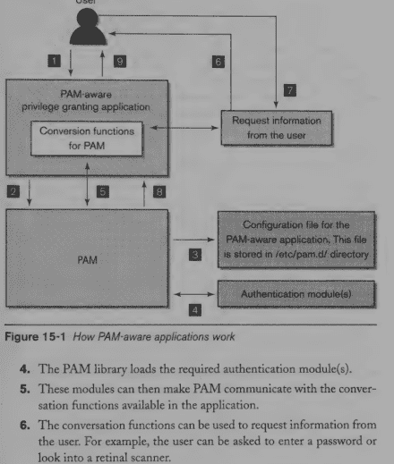

### 图 15-1 PAM 感知应用程序的工作方式

- 4. PAM 库加载所需的身份验证模块。
- 5. 这些模块随后可使 PAM 与应用程序中可用的对话函数进行通信。
- 6. 对话函数可用于向用户请求信息。例如，可以要求用户输入密码或注视视网膜扫描仪。
- 7. 用户通过提供所需信息来响应请求。
- 8. PAM 身份验证模块通过 PAM 库向应用程序提供身份验证状态消息。
- 9. 如果身份验证过程成功，应用程序会授予用户请求的特权或告知用户失败。

将 PAM 视为一种机制，它将身份验证的负担从应用程序中移走，并允许你为单个应用程序堆叠多个身份验证方案。例如，`rlogin` 应用程序的 PAM 配置文件如清单 15-1 所示。

### 清单 15-1 `/etc/pam.d/rlogin` 文件

```
auth required /lib/security/pam_securetty.so

auth sufficient /lib/security/pam_rhosts_auth.so

auth required /lib/security/pam_pwdb.so shadow

nullok

auth required /lib/security/pam_nologin.so

account required /lib/security/pam_pwdb.so

password required /lib/security/pam_cracklib.so

password required /lib/security/pam_pwdb.so shadow

nullok \ use_authtok

session required /lib/security/pam_pwdb.so
```

在此文件中，使用了 `/lib/security` 中的多个身份验证模块来对用户进行身份验证。

## 使用 PAM 配置文件

清单 15-1 显示了特定于应用程序的 PAM 配置文件是什么样子的。以 `#` 字符开头的行和空白行将被忽略。配置行具有以下字段：

```
module-type control-flag module-path module-args
```


目前存在四种模块类型，描述于表 15-2

### 表 15-2 PAM 模块类型

| 模块类型 | 描述 |
|---|---|
| auth | 执行实际身份验证。通常，auth 模块要求用户输入密码或提供其他证明来证明其身份。 |
| account | 处理身份验证请求的全部记账方面。通常，account 模块检查用户访问是否符合所有访问准则。例如，它可以检查用户是否从安全主机访问服务并且在指定时间内。 |
| password | 处理用户获得请求服务访问权限之前和之后需要完成的事情。 |
| session | 用于处理会话管理任务，例如刷新会话令牌。 |

控制标志用于定义 PAM 库将如何处理模块的响应。目前允许使用四种控制标志，描述于表 15-3。

### 表 15-3 PAM 模块控制标志

| 控制标志 | 描述 |
|---|---|
| required | 指定同一行中指定的模块的成功是必需的。当模块返回表示失败的响应时，身份验证肯定会失败，但 PAM 仍将继续处理其他模块（如果有）。这是为了确保用户无法检测身份验证过程的哪个部分失败，因为知道该信息可能会帮助潜在攻击者。 |
| requisite | 使用此控制标志时，一旦 PAM 库收到失败响应，身份验证过程就会立即中止。 |
| sufficient | 使用此控制标志时，如果收到成功响应，则认为身份验证过程已完成。换句话说，继续处理配置文件中的其他模块是不必要的。 |
| optional | 此控制标志很少使用。它不对模块的成功或失败响应给予任何重视。 |

模块路径是可插拔身份验证模块的路径。Red Hat Linux 将所有 PAM 模块存储在 `/lib/security` 目录中。你也可以为每个模块提供可选参数。回顾清单 15-1，注意 PAM 库调用 `pam_securetty.so` 模块，该模块必须返回表示成功的响应，身份验证才能成功。如果模块的响应表示失败，PAM 仍将继续处理其他模块，以便用户（可能是潜在攻击者）不知道失败发生在哪里。如果下一个模块 `pam_rhosts_auth.so` 返回成功响应，身份验证过程就完成了，因为控制标志设置为 `sufficient`。但是，如果前一个模块 `pam_securetty.so` 未失败而此模块失败，身份验证过程将继续进行，失败不会影响最终结果。以同样的方式，PAM 库将处理其余模块。

执行顺序完全遵循模块在配置中出现的顺序。然而，每种类型的模块（`auth`、`account`、`password` 和 `session`）将以堆栈方式处理。换句话说，对于清单 15-1 中的示例，所有 `auth` 模块将被堆叠并按在配置文件中出现的顺序处理。其余模块将以类似方式处理。

## 使用 PAM 精细调整身份验证过程

现在你已经了解了 PAM 的工作原理，请考虑一个示例，说明如何使用 PAM 为某些服务精细调整身份验证过程。你应该采取的非常第一步是阅读所有可用 PAM 身份验证模块的文档。所有可用的 PAM 模块都存储在 `/lib/security` 目录中，你可以在 `/usr/doc/pam-X.xx` 目录中找到每个模块的文档，其中 `X.xx` 是你的 PAM 版本。阅读每个模块的文档并确定你想在构建系统更严格的身份验证方案时使用哪些模块。在本节中，我将向你展示如何通过时间限制对服务器的登录访问。

要按时间限制服务访问，你需要一个名为 `pam_time` 的记账模块（`/lib/security/pam_time.so`）。该模块可以根据用户姓名、当天时间、星期几、他们申请的服务以及他们发出请求的终端来拒绝（单个）用户的访问。其操作由 `/etc/security/time.conf` 配置文件确定。

因为你想控制登录访问，你需要通过添加以下行来修改 `/etc/pam.d/login` PAM 配置文件：

```
account required /lib/security/pam_time.so
```

接下来，你需要为登录服务制定访问策略。换句话说，你需要确定你希望用户能够登录的时间。本示例假设你希望允许用户在上午 6 点之后且不超过晚上 8 点登录。现在，你需要配置 `/etc/security/time.conf` 文件。此文件中配置行的语法如下：

```
services;ttys;users;times
```

你可以在每个字段中使用一些特殊字符。表 15-4 显示了你可以使用特殊字符的含义。

### 表 15-4 /etc/security/time.conf 中配置字段的特殊字符

| 字符 | 含义 |
|---|---|
| ! | NOT。 例如，`!login` 表示“非 login”或“除 login 外”。 |
| \| | OR。 例如，`kabir|ronak` 表示“kabir 或 ronak”。 |
| & | AND。 例如，`login&su` 表示“login 和 su”。 |
| * | 通配符。 例如，`foo*` 表示“以 foo 开头的所有内容”。 |

表 15-5 描述了此类配置行中的字段。

### 表 15-5 /etc/security/time.conf 文件的字段

| 字段 | 描述 |
|---|---|
| services | 受时间限制影响的服务列表。例如，要使用单个规则同时控制 login 和 su，请在配置行中指定服务为 "`login&su`"。 |
| ttys | 受时间限制影响的终端列表。例如，要仅控制伪终端而不控制控制台终端，请指定 "`typ* tty*`"，其中 "`typ*`" 列出通过 Telnet 等服务进行远程登录时使用的所有伪终端，而 "`tty*`" 列出所有控制台终端。 |
| users | 受时间限制影响的用户列表。例如，要指定所有用户，请在配置行中使用通配符 `*`。 |
| time | 限制适用的时间列表。您可以以 24 小时制格式指定时间范围。例如，要指定从晚上 8 点到凌晨 6 点的范围，请指定 `2000-0600`，即 HHMM 格式，其中 HH 为 00-23，MM 为 00-59。您还可以使用两字符代码指定天数，例如 `Mo`（星期一）、`Tu`（星期二）、`We`（星期三）、`Th`（星期四）、`Fr`（星期五）、`Sa`（星期六）和 `Su`（星期日）。您还可以使用特殊代码，例如 `Wk` 表示所有工作日、`Wd` 表示周末、`Al` 表示七天。例如，要在每天从晚上 8 点到凌晨 6 点限制对服务的访问，请将时间范围指定为 `Al2000-0600`。 |

对于正在进行的示例，你可以创建一个基于时间的规则，禁止所有通过远程方式（如 Telnet）访问系统的用户在晚上8点到早上6点期间登录，通过在 `/etc/security/time.conf` 文件中添加以下行：

```
login;ttyp*;*;!Al2000-0600
```

此行可以解释如下：

```
If (requested service is login) and
(access is made from a pseudo tty p type device) and
(current time is between 8PM to 6 AM) then
    Access to the requested service is not allowed.
Else
Access to the requested service is permitted.
End
```

如果你想允许名为 `kabir` 的用户随时访问系统，但要求所有其他用户遵循前述规则，请按如下方式修改规则：

```
login;ttyp*;!*kabir;!Al2000-0600
```

这只是 PAM 如何用于微调用户身份验证过程的一个简单示例。再次阅读模块文档并尝试设置，以为你的系统制定最合适的身份验证方案。

## 安全服务

经常情况下，系统的安全会被坏人破坏，因为系统管理员没有花时间剔除不必要的服务。记住，你的系统上程序越多，坏人入侵的方式就越多。因此，从一开始就开始剔除过程。

### 在操作系统安装期间移除不必要的服务

在计算机上安装 Red Hat Linux 之前，确定你希望在系统上运行什么。写下实现目标所需的服务。例如，如果你正在创建 Web 服务器系统，你可能不需要 POP 服务器、gopher 服务器或 NNTP 新闻服务器。列出你想要安装的服务器软件清单。Red Hat Linux 安装程序允许你在安装前选择单个软件包。花时间浏览所有列表，只选择必要的软件包。有时，安装程序会安装一个或多个你所选软件包的先决条件软件包。在安装过程中完成软件包选择后，它实际上会显示这些先决条件软件包的名称。写下这些软件包的名称。

在安装所有必要的软件包并首次启动系统后，你可以查看存储在 `/tmp` 中的安装日志，或者运行以下 `rpm` 命令以获取所有已安装软件包的完整列表：

```
rpm -qa > /tmp/all.packages
```

仔细查看 `/tmp/all.packages` 文件，以检测任何你不记得批准安装的软件包。如果软件包未出现在你的先决条件列表中，你可能想通过使用以下命令了解更多关于该软件包的信息：

```
rpm -qi package_name
```

如果软件包似乎不必要，请使用以下命令将其删除：


`rpm -e package_name`

`rpm` 命令会检查 `package_name` 是否被其他软件包所需要。如果是，你会收到警告信息，除非使用 `-e --force` 选项，否则软件包不会被删除。仔细阅读警告内容并据此决定。如果软件包不是任何其他软件包的依赖项，它将被干净地从你的系统中移除。

我建议不要在将用作互联网服务器的计算机上安装以下类型的软件包：

- 与 X-Windows 相关的任何内容以及 X-Windows 本身。
- 任何多媒体应用程序（如果你计划提供实时音频/视频服务，则除外 real-audio/video 服务器软件包）。
- 任何除所需之外的解释器。我个人仅使用 Perl 进行脚本编写，因此不安装其他脚本语言。
- 任何不必要的服务器软件，例如你不需要的 NFS、NIS、INN、POP2 或 3 或 Samba。
- 任何你不使用的文件编辑器。我只使用 vi，因此不安装 emacs 等复杂编辑器。当然，如果你是一个 emacs 类型的人，你会选择这头猛兽而不是 vi。我也不安装各种更新的 vi 克隆版。
- 任何你不需要的客户端程序。例如，不要安装你认为自己或你的用户不会使用的电子邮件客户端。

正如你所见，主题始终相同——安装得越少，担心的就越少。

### 保护 inetd 运行的服务

`inetd` 守护进程被称为 Internet“超级服务器”，因为它用于提供 FTP、Telnet、POP2/3 和 finger 等许多流行的 Internet 服务。`inetd` 守护进程通常在多用户启动过程的某个阶段启动。启动时，`inetd` 守护进程读取 `/etc/inetd.conf` 配置并监听 `/etc/services` 中列出的所有标准端口上的请求。当在某个端口收到请求时，`inetd` 守护进程启动适当的服务来处理请求。列表 15-2 显示了一个典型的 `/etc/inetd.conf` 文件。

### 列表 15-2 一个 `/etc/inetd.conf` 文件

```
#
# inetd.conf
# This file describes the services that will be available
# through the INETD TCP/IP super server. To reconfigure
# the running INETD process, edit this file, then send the
# INETD process a SIGHUP signal.
#
# Version: @(#)/etc/inetd.conf 3.10 05/27/93
#
# Authors: Original taken from BSD UNIX 4.3/TAHOE.
#
# Fred N. van Kempen,
# <waltje@uwalt.nl.mugnet.org>
#
# Modified for RHS Linux by Marc Ewing <marc@redhat.com>
#
# <service_name> <sock_type> <proto> <flags> <user> \
# <server_path> <args>
#
# Echo, discard, daytime, and chargen are used
# primarily for testing.
#
# To re-read this file after changes,
# just do a 'killall -HUP inetd'
#
#echo stream tcp nowait root internal
#echo dgram udp wait root internal
#discard stream tcp nowait root internal
#discard dgram udp wait root internal
#daytime stream tcp nowait root internal
#daytime dgram udp wait root internal
#chargen stream tcp nowait root internal
#chargen dgram udp wait root internal
#
# These are standard services.
#
ftp stream tcp nowait root /usr/sbin/tcpd in.ftpd -l -a
```

### 列表 15-2 继续

```
telnet stream tcp nowait root /usr/sbin/tcpd in.telnetd
gopher stream tcp nowait root /usr/sbin/tcpd gopherd
# Do not uncomment smtp unless you *really* know what you are doing.
# smtp is handled by the sendmail daemon now, not smtpd.
# It does NOT
# run from here, it is started at boot time from
/etc/rc.d/rc#.d.
#
#smtp stream tcp nowait root /usr/bin/smtpd smtpd
#nntp stream tcp nowait /usr/sbin/tcpd in.nntpd
#
# Shell, login, exec and talk are BSD protocols.
#
shell stream tcp nowait root /usr/sbin/tcpd in.rshd
login stream tcp nowait root /usr/sbin/tcpd in.rlogind
exec stream tcp nowait root /usr/sbin/tcpd in.rexecd
talk dgram udp wait root /usr/sbin/tcpd in.talkd
ntalk dgram udp wait root /usr/sbin/tcpd in.ntalkd
#dtalk stream tcp wait nobody /usr/sbin/tcpd in.dtalkd
#
# Pop and imap mail services et al
#
pop-2 stream tcp nowait root /usr/sbin/tcpd ipop2d
pop-3 stream tcp nowait root /usr/sbin/tcpd ipop3d
imap stream tcp nowait root /usr/sbin/tcpd imapd
#
# The Internet UUCP service.
#
#uucp stream tcp nowait uucp /usr/sbin/tcpd /usr/lib/uucp/uucico -l
#
# Tftp service is provided primarily for booting. Most sites
# run this only on machines acting as "boot servers."
# Do not uncomment this unless you *need* it.
#
#tftp dgram udp wait root /usr/sbin/tcpd in.tftpd
#bootps dgram udp wait root /usr/sbin/tcpd bootpd
#
# Finger, systat, and netstat give out user information
# which may be valuable to potential "system crackers."
# Many sites choose to disable some or all of these
# services to improve security.
#
# cfinger is for GNU finger, which is currently not in
# use in RHS Linux
#
finger stream tcp nowait root /usr/sbin/tcpd in.fingerd
#cfinger stream tcp nowait root /usr/sbin/tcpd in.cfingerd
#systat stream tcp nowait guest /usr/sbin/tcpd /bin/ps -auwwx
#netstat stream tcp nowait guest /usr/sbin/tcpd /bin/netstat -f inet
#
# Time service is used for clock synchronization.
#
```


`time stream tcp nowait nobody /usr/sbin/tcpd in.timed`

`time dgram udp wait nobody /usr/sbin/tcpd in.timed`

#

# Authentication

#

`auth stream tcp nowait nobody /usr/sbin/in.identd in.identd -l -e -o`

## Listing 15-2 续

```
linuxconf stream tcp wait root /bin/linuxconf linuxconf -
-http
```

#

# End of inetd.conf

正如许多其他 UNIX 配置文件一样，以 `#` 字符开头的行被视为注释，并连同空行一起被忽略。

每一行配置的格式如下：

```
service_name sock_type proto flags user server_path args
```

`service_name` 字段与 `/etc/services` 文件中指定的服务名称相匹配。以下是一个示例：

```
finger stream tcp nowait root /usr/sbin/tcpd in.fingerd
```

`/etc/services` 文件将 `finger` 服务映射到 TCP 端口 79。当 `inetd` 在 TCP 端口 79 上收到连接请求时，它会使用 `in.fingerd` 参数启动 `/usr/sbin/tcpd` 服务。`tcpd` 程序被称为 TCP wrapper，它启动 `in.fingerd` finger 服务器。finger 服务器按其认为合适的方式响应请求。

## 从 `/etc/inetd.conf` 中移除不必要的服务

默认的 `/etc/inetd.conf` 可能并不适合你的需求。浏览此文件，删除或注释掉任何你不想向任何人提供的服务。例如，前面默认安装的 `/etc/inetd.conf` 文件启用了 FTP、Telnet、Gopher、远程 shell（`rsh`）、远程登录（`rlogin`）、远程执行（`rexec`）、talk、ntalk、POP2、POP3、IMAP、finger、`time`（tcp）、`time`（udp）、`auth`（ident）以及 `linuxconf` 的 Web 服务。这几乎相当于让系统完全暴露在攻击之下。通过 `inetd` 可用的任何服务都是潜在攻击的开放入口。在我的 Web 服务器系统上，我只保留 FTP、Telnet 和 POP3 服务，因为这些是用户使用的。因此，我的 Red Hat Linux 服务器上的 `/etc/inetd.conf` 看起来像这样：

```
ftp stream tcp nowait root /usr/sbin/tcpd in.ftpd
-l -a
```

```
telnet stream tcp nowait root /usr/sbin/tcpd
in.telnetd
```

```
pop-3 stream tcp nowait root /usr/sbin/tcpd ipop3d
```

弄清楚你必须保留哪些服务，哪些可以不用。修改 `/etc/inetd.conf` 后不要忘记重启 `inetd` 服务。你可以使用 `killall -HUP inetd` 命令来重启它。

## 使用 TCP wrapper 保护 inetd 运行的服务

`/etc/inetd.conf` 中的配置行表明每一行的 `server_path` 部分始终为 `/usr/sbin/tcpd`，而实际的服务器程序是 `tcpd` 程序的参数。例如，

```
pop-3 stream tcp nowait root /usr/sbin/tcpd ipop3d
```

在功能上等同于以下行：

```
pop-3 stream tcp nowait root /usr/sbin/ipop3d
```

当 `inetd` 收到 POP3 请求时，两种情况下都会启动 `ipop3d` 服务器，但第一个更安全，因为 `tcpd` 程序是 TCP wrapper 程序，通过提供以下服务来增强安全性：

- Logging service. Logs information about a request by using the syslog facility.
- Host-based access control. Provides host-based access control by using pattern matching.
- Host name and address verification service. Detects spoofing of host names or addresses when a host is pretending to be some other host.

TCP wrapper 足够重要，以至于它作为默认 Red Hat Linux 安装的一部分提供。没有任何理由不将你的每个 `inetd` 服务用 TCP wrapper 包裹起来。


## 注意

默认情况下，Red Hat Linux 不使用 `tcpd` 包裹 `linuxconf` 的 Web 服务，因为它似乎在用 `tcpd` 包裹时无法工作。这是一个非常好的理由不要运行 `linuxconf` Web 服务。

## 通过 TCP wrapper 限制主机访问

如前所述，TCP wrapper 在控制 Internet 主机（或 IP 地址）级别的访问方面提供了很大的灵活性。这种灵活性在配置紧密的服务器系统时非常有用。本节讨论一个紧密控制的系统的示例，该系统基于我每天使用的系统。

首先，确定示例控制配置的目标。假设你想要创建一个 Internet Web 服务器系统，只允许 Telnet、FTP、POP3 和 HTTP 服务。由于 Web 服务（HTTP）通常是高需求服务，它不通过 `inetd` 运行。假设 Web 服务器是 Apache 并且作为独立服务运行。因此，`inetd` 将管理其余服务。此外，假设你只想将 Telnet、FTP 和 POP3 访问限制为网络地址为 `206.171.50.0` 的单个网络。

Listing 15-3 显示了此示例所需的 `/etc/inetd.conf` 文件。

## Listing 15-3 `/etc/inetd.conf` 文件

```
ftp stream tcp nowait root /usr/sbin/tcpd in.ftpd
-l -a
telnet stream tcp nowait root /usr/sbin/tcpd in.telnetd
in.telnetd
pop-3 stream tcp nowait root /usr/sbin/tcpd in.pop3d
```

如你所见，所有三个服务都用 `tcpd` wrapper 包裹。现在，你需要通过 `/etc/hosts.allow` 和 `/etc/hosts.deny` 文件来限制对这些服务的访问。`/etc/hosts.allow` 文件用于指定哪些主机允许访问 `inetd` 服务，而 `/etc/hosts.deny` 文件用于指定哪些主机不允许访问 `inetd` 服务。这两个文件使用相同的配置格式，如下所示：

```
daemon list : client list [ : shell command ]
```


`daemon list` 是一个或多个服务进程名称的列表。例如，`in.ftpd`、`in.telnetd` 和 `in.pop3d` 是此示例的守护进程名称。`client list` 由一个或多个主机名或 IP 地址组成。你可以在 `daemon` 和 `client` 列表中同时使用表 15-6 中显示的通配符。

## 表 15-6 `/etc/hosts.allow | deny` 文件中守护进程和客户端列表的通配符

| Wildcard | Meaning |
|---|---|
| ALL | Always matches. |
| LOCAL | Matches a local host name such as wormhole, but not wormhole.nitec.com |
| UNKNOWN | Matches when the host name or IP address is unknown due to a problem. |
| KNOWN | Matches when a host or IP address is known. |
| PARANOID | Matches a host that does not match its IP address. This works only if the `tcpd` wrapper program is not built with the `-DPARANOID` option at compilation. |

你也可以使用以下模式：

- `'.nitec.com'` matches a host name such as `wormhole.nitec.com` or `picaso.nitec.com`. In other words, when a leading dot is used in a pattern, it can be matched from the right side of the host name.
- `'206.171.50.'` matches any hosts with addresses in the range of `206.171.50.0` to `206.171.50.255`. In other words, when a trailing dot is used in a pattern, the matching is done from the left.
- `'206.171.50.0/255.255.255.0'` matches any hosts with addresses in the range of `206.171.50.0` to `206.171.50.255`. The pattern is treated as a network/netmask definition.

此外，如果你计划使用 shell 命令执行某些操作，请利用表 15-7 中显示的字符扩展。

## 表 15-7 Shell 命令的字符扩展

| Character | Expanded Meaning |
|---|---|
| `%a` | The IP address of the client trying to access a service |
| `%A` | The IP address of the server |
| `%c` | Client information such as host name or IP address, or user@host or user@ip_address, etc. |
| `%d` | The name of the daemon or service |
| `%h` | The host name of the client trying to access a service |
| `%H` | The host name of the server |
| `%p` | The process ID (PID) of the daemon or service |
| `%s` | Server information such as host name or IP address, or user@host or user@ip_address, etc. |
| `%u` | The client username, if known; otherwise, set to unknown |
| `%%` | The % character |

由于此示例的目标是禁止除属于 `206.171.50.0` 网络的主机之外的所有主机，你可以创建如 Listing 15-4 所示的 `/etc/hosts.deny` 文件。

## Listing 15-4 `/etc/hosts.deny` 文件

```
#
# hosts.deny  This file describes the names of the
# hosts that are not allowed to use the local INET
# services, as decided by the /usr/sbin/tcpd program.
#
# Deny all daemon access to all hosts.
#
ALL : ALL
```

`/etc/hosts.deny` 文件设置为拒绝所有主机。单行配置 `ALL : ALL` 告诉 TCP wrapper（`tcpd`）拒绝 `ALL` 守护进程对 `ALL` 主机的访问。如果保持原样并且系统中不存在 `/etc/hosts.allow` 文件，则没有任何主机能够访问三个 `inetd` 运行的服务（Telnet、FTP 和 POP3）。因此，你必须在 `/etc/hosts.allow` 文件中允许特定主机，特别是 `206.171.50.0` 网络，访问这些服务。这在 Listing 15-5 中完成。

## Listing 15-5 `/etc/hosts.allow` 文件

```
#
# hosts.allow  This file describes the names of the
# hosts that are allowed to use the local INET
# services, as decided by the /usr/sbin/tcpd program.
#
# Deny all daemon access to all hosts.
#
ALL : 206.171.50.0/255.255.255.0
```

这里，单行配置 `ALL : 206.171.50.0/255.255.255.0` 表示 TCP wrapper（`tcpd`）应允许指定 `206.171.50.0` 网络访问所有守护进程。换句话说，IP 范围为 `206.171.50.0` 到 `206.171.50.255` 的所有主机都应有权访问 Telnet、FTP 和 POP3 服务。

配置 TCP wrapper 就这么简单。现在，如果你想允许另一个网络 `208.233.7.48/255.255.255.240` 访问这些服务，只需在 `/etc/hosts.allow` 中进行更改。只需按如下方式将此网络添加到客户端列表中：

```
ALL : 206.171.50.0/255.255.255.0
208.233.7.48/255.255.255.240
```

如你所见，使用 `/etc/hosts.allow` 和 `/etc/hosts.deny` 配置 `tcpd` 非常简单。

## 在 `/etc/hosts.allow` 中使用主机名和域名

假设你想允许 `classifiedworks.com` 域中的所有主机访问所有 `inetd` 服务，但 `mysql.classifiedworks.com` 主机除外。`/etc/hosts.deny` 文件将有一行，例如 `ALL: ALL`，用于拒绝未在 `/etc/hosts.allow` 中指定的所有人的所有服务。`/etc/hosts.allow` 文件将有一行如下：

```
ALL: .classifiedworks.com EXCEPT mysql.classifiedworks.com
```

## 阻止特定主机访问服务

本示例演示了如何阻止名为 `reboot.nitec.com` 的单个主机的 FTP 服务，同时允许 `nitec.com` 域中的其他所有主机访问所有服务。`/etc/hosts.deny` 文件将有一行，例如 `ALL: ALL`，用于拒绝未在 `/etc/hosts.allow` 中指定的所有人的所有服务。`/etc/hosts.allow` 文件将有如下行：

```
in.ftpd: .nitec.com EXCEPT reboot.nitec.com
ALL EXCEPT in.ftpd: .nitec.com
```

第一行表示 `in.ftpd` 守护进程可为 `nitec.com` 域中的所有主机提供服务，但 `reboot.nitec.com` 除外。下一行表示除 FTP 服务（`in.ftpd`）之外的所有守护进程（即服务）均可为 `nitec.com` 域中的所有主机提供服务。

TCP wrapper 还可以使用扩展主机访问控制语言进行配置，该语言使用以下配置语法：


`daemon list : client list : option : option : . . .`

选项可以是表 15-8 中显示的任何关键字。

## 表 15-8 扩展主机访问控制语言中可接受的关键字

| Keyword | Description |
|---|---|
| ALLOW client list | 用于允许一个或多个主机访问。例如，`ALL : your-domain.com : ALLOW` 允许 `your-domain.com` 中的所有主机访问所有由 `inetd` 运行的服务。 |
| DENY client list | 用于限制一个或多个主机的访问。例如，`ALL : bad-guy-domain.com : DENY` 拒绝 `bad-guy-domain.com` 中的所有主机访问所有由 `inetd` 运行的服务。 |
| SPAWN shell command | 用于执行 `shell` 命令。命令以 `STDIN`、`STDOUT` 和 `STDERR` 都指向 `/dev/null` 的方式运行。这确保命令不会干扰尝试访问服务的客户端主机上的客户端软件。调用命令之前会应用前面讨论的字符扩展。 |
| TWIST shell command | 用于执行 `shell` 命令。命令以 `STDIN`、`STDOUT` 和 `STDERR` 都指向客户端的方式运行。调用命令之前会应用前面讨论的字符扩展。在配置行中使用 `TWIST` 作为最后一个选项。我建议仅对基于 TCP 的服务使用 `TWIST`。 |
| LINGER seconds | 用于使内核在指定秒数内重试数据传输。 |
| RFC931 seconds | 当客户端运行符合 `RFC 931` 的 `IDENT` 服务器时，用于在客户端查找用户信息。指定的秒数用于在 `IDENT` 服务器无响应时超时。这仅适用于基于 TCP 的服务。 |
| BANNERS directory | 用于向客户端显示文本文件。文本文件或横幅在指定目录中查找。文件名必须与守护进程名称相同。这仅适用于 `Telnet` 等面向连接的基于 TCP 的服务。 |
| NICE number | 用于更改守护进程优先级。数字越高，优先级越低。 |
| SETENV name value | 在守护进程的环境进程中设置 `name=value`。这并不总是有效，因为许多守护进程在处理请求时使用子进程重置其环境。 |
| UMASK mask | 用于以传统 `umask` `shell` 命令相同的方式设置文件权限策略。 |
| USER username.group | 用于指定守护进程的用户和组。 |

## 在 `/etc/hosts.allow` 中使用 shell 命令

假设你想阻止名为 `spooky.badguy-domain.com` 的主机的 `Telnet` 服务，但也想让该主机知道你不欢迎它。在这种情况下，你可以按如下方式创建 `/etc/hosts.allow` 配置文件：

```
# Everyone but spooky is allowed Telnet access

in.telnetd: ALL EXCEPT spooky.badguy-domain.com

# spooky.badguy-domain.com is made clear that it is

# not welcome on this server.

in.telnetd: spooky.badguy-domain.com: twist /bin/echo \
You are not welcome here!
```

或者，如果你想在 `spooky` 主机尝试 `Telnet` 时立即收到电子邮件，你可以使用 `/bin/mail` 程序给自己发送消息。在这种情况下，你需要如下的 `/etc/hosts.allow` 配置：

```
# Everyone but spooky is allowed Telnet access

in.telnetd: ALL EXCEPT spooky.badguy-domain.com
```

```
# spooky.badguy-domain.com is made clear that it is

# not welcome on this server. \
in.telnetd: spooky.badguy-domain.com: linger 5: twist
/bin/mail \
-s "a {%c} tried to access %d {%p}" your@emailaddress </etc/badguy-came.txt
```

这里，当 `spooky` 尝试 `Telnet` 进入时，会调用 `/bin/mail` 程序。`mail` 程序使用 `-s` 选项调用以将主题行设置为 `"%a {%c} tried to access %d {%p},"`，其展开为 `"x.x.x.x (spooky.badguy-domain.com) tried to access in.telnetd (xyz),"`，其中 `x.x.x.x` 是主机的 IP 地址，`xyz` 是守护进程的 PID。

## 检查 TCP wrapper 配置

`/etc/inetd.conf` 中的错误在安全方面可能代价很高。因此，使用 `tcpdchk` 等程序检查配置是值得的。该程序检查你的 `/etc/inetd.conf` 配置文件并报告诸如不存在的路径名、`/etc/hosts.allow` 或 `/etc/hosts.deny` 文件中的配置错误、无效参数等问题。你可以按如下方式运行 `tcpdchk` 程序：

```
/usr/sbin/tcpdchk
```

你也可以使用 `tcpdmatch` 实用程序来测试你的 `/etc/hosts.allow` 和 `/etc/hosts.deny` 配置。例如，假设你在 `/etc/hosts.allow` 中有一行例如 `ALL: 206.171.50.48/255.255.255.240`，在 `/etc/hosts.deny` 中有一行例如 `ALL:ALL`。前面提到的配置仅允许来自 `206.171.50.48` 网络的主机访问 `inetd` 运行的服务。要了解当来自名为 `blackhole.nitec.com`（`206.170.189.100`）的主机的 `Telnet` 请求到来时 `tcpd` 会做什么，运行以下命令：

```
/usr/sbin/tcpdmatch in.telnetd blackhole.nitec.com
```

`tcpdmatch` 程序将应用 `/etc/hosts.[allow,deny]` 配置并告诉你是否允许访问。运行上述命令时显示如下：

```
client: hostname blackhole.nitec.com

client: address 206.170.189.100
```

```
server:  process in.telnetd

matched: /etc/hosts.deny line 10

access:  denied
```


该实用程序允许你相当彻底地测试 `tcpd` 配置。如果要在系统上运行 `inetd`，TCP wrapper 是必不可少的。有关 `tcpd` 及其配置的更多信息，可以通过阅读 `tcpd (8)`、`tcpdchk (8)`、`tcpdmatch (8)`、`hosts.allow (5)` 和 `hosts_options (5)` 手册页获得。你也可以在 `http://www.cert.org/ftp/tools/tcp_wrappers/` 找到 `tcpd` 源代码。

## 用 Secure Shell (ssh) 替换 r 命令

如果你不使用 `r*` 命令，包括 `rlogin`、`rsh`、`rexec` 等，请考虑完全从系统中删除它们。你可以在 `/etc/inetd.conf` 文件中注释掉特定于 `r*` 命令的行，以确保这些命令提供的服务不再可用。

如果你使用这些服务访问系统，请考虑用名为 Secure Shell 或 `ssh` 的安全解决方案替换它们，它提供了 `r*` 命令的所有好处（甚至更多）。例如，使用 `ssh`，你可以通过安全加密连接登录到远程系统或在远程系统上执行命令。它提供广泛的日志记录功能并能很好地与 `syslog` 配合使用。使用 `ssh`，你还可以创建安全的远程 X 会话。它可以提供对 IP 和 DNS 欺骗、基于 X 认证协议弱点的攻击等的保护。你可以从以下网站获取运行 `ssh` 的 RPM 包：`http://www.replay.com/redhat/ssh.html`。

你需要基础 `ssh` 包、`ssh` 客户端包和 `ssh` 服务器包。美国加密软件的出口管制法律可能会对 `ssh` 造成一些法律限制，因此请务必阅读前述网站中的文档。

## 保护文件和文件系统

确保文件和文件系统安全最好的方法之一是为它们提供最小权限访问。如果用户仅凭只读访问就能满足需求，那么不要仅仅因为可以就给用户写入或执行权限。本节讨论了其中一些问题。

## 将文件系统挂载为只读

在可能的情况下，将某些文件系统挂载为只读是一个好主意。例如，如果你需要在一个单独的分区上维护一个公共 FTP 服务器，并在其上存储公共文件，可以将该分区挂载为只读。例如，假设公共文件存储在 `/dev/sda5`（SCSI 磁盘的一个分区）中，并通过 `/etc/fstab` 文件中的以下行自动挂载到 `/public`：

```
/dev/sda5 /public ext2 defaults 1 2
```

该分区的挂载选项为“`defaults`”，其含义如下：

- 将文件系统挂载为读写 (`rw`)
- 允许 set-UID 或 set-GID 位生效 (`suid`)
- 在文件系统上解释字符/块设备 (`dev`)
- 允许执行程序 (`exec`)
- 在系统启动时或使用 `-a` 选项运行 `mount` 命令时挂载文件系统 (`auto`)
- 不允许除超级用户 (`UID = 0`, `GID = 0`) 之外的任何人挂载文件系统 (`nouser`)
- 为文件系统使用同步 I/O 模式 (`async`)

如果你确定该分区不需要写权限，请按如下方式更改该行：

```
/dev/sda5 /public ext2 ro,suid,dev,exec,auto,nouser,async 1 2
```

如果你进一步决定不需要允许 `suid` 和 `exec` 支持，也将其移除，如下所示：

```
/dev/sda5 /public ext2 ro,nosuid,dev,noexec,auto,nouser,async 1 2
```

在适当的地方使用 EXT2 文件系统的属性。我使用过最有用的一个是不可变标志，它使得即使 `root` 也无法更改某些文件。有关详细信息，请查阅 `chattr(1)` 和 `lsattr(1)` 手册页。

## 利用 ext2 文件系统

Linux `ext2` 文件系统有一些很实用的功能，可以在保护文件和目录免受人为错误方面非常有用。例如，使用 `chattr` 命令可防止即使是 `root` 用户也意外修改和删除。方法如下。

用于 Red Hat Linux 的 `ext2` 文件系统提供了一些独特的功能。其中一个功能允许文件即使对 `root` 用户也不可变。例如，

```
chattr +i filename
```

设置 `ext2` 文件系统中文件的 `i` 属性。当设置此属性时，文件无法被任何人修改、删除或重命名。也不能添加链接指向此文件。此属性只能由 `root` 用户设置或清除。因此，你可以使用此属性来防止文件事故。当需要清除该属性时，运行

```
chattr -i filename
```

`ext2` 系统还有一些其他有趣的功能，例如 `undelete` 属性，目前尚未实现，但将在未来的 `ext2` 文件系统版本中提供。如果你开始使用 `chattr` 命令，你可能会注意到有时即使你有权限也无法修改或删除文件。这发生在你忘记之前已使用 `chattr` 设置了文件的不可变属性时；因为此属性不会显示在 `ls` 输出中，所以可能会有点令人困惑。要查看哪些文件具有哪些 `ext2` 属性，请使用 `lsattr` 程序。

不幸的是，你现在所知道的文件和文件系统安全知识可能也被知情的黑客所知。使用 `chattr` 等工具可能会使黑客破坏你的文件或文件系统变得更困难，但并不会使其不可能。事实上，如果坏人获得了 `root` 级别权限，`ext2` 属性只提供一个简单的捉迷藏游戏。入侵后一个主要问题是确定你是否可以信任你的文件。你可能会怀疑坏人是否安装了特洛伊木马应用程序或嵌入了病毒以感染新文件并可能提供访问你访问的其他计算机的途径。本节讨论的方法均未处理安全问题的这一方面。解决方案是运行文件完整性检查程序，例如 `Tripwire`。

## 使用 Tripwire 确保文件完整性

简单来说，`Tripwire` 是一个文件和目录完整性检查器，它为所有文件和目录创建签名数据库并将其存储在单个文件中。当再次运行 `Tripwire` 时，它会为当前文件和目录计算新的签名，并将其与数据库中存储的原始签名进行比较。如果存在差异，则会报告文件或目录名称以及有关差异的信息。

因此，`Tripwire` 可以成为帮助你确定入侵中哪些文件被修改的绝佳工具。在设置新服务器系统时，许多经验丰富的系统管理员会执行以下操作：

- 1. 确保新系统未连接到任何网络，以保证没有人已安装特洛伊木马程序、病毒程序或类似的东西。
- 2. 运行 `Tripwire` 为所有重要系统文件创建签名数据库，包括所有系统二进制文件和配置文件。
- 3. 将数据库写入可记录的 CD-ROM。这可确保高级黑客无法修改 `Tripwire` 数据库以隐藏特洛伊木马和被修改的文件。管理员如果要监控的文件相对较少，通常会使用软盘存储数据库。写入软盘后，管理员会对磁盘进行写保护，如果 BIOS 允许，还会将磁盘驱动器配置为只读设备。
- 4. 设置 `cron` 作业定期（每天、每周或每月）运行 `Tripwire`，使应用程序使用 CD-ROM 版本的数据库。

## 安装 Tripwire

Red Hat 出售的官方 Red Hat 发行版（盒装版）包含一个应用程序 CD-ROM，其中包含一个 `Tripwire` 版本。该软件版本适用于单 CPU、终端用户设置。软件包含两个单独的 RPM 包——一个包含二进制发行版，另一个包含源代码发行版。除非你有兴趣自行编译，否则请使用二进制发行版。通常我会编译安全软件，但由于 Red Hat 将此软件打包在其产品中，我对其专业性有一定信任度；因此此处提供二进制安装。

通常，二进制安装非常简单；按如下方式运行 `rpm` 命令：

```
rpm -ivh tripwire_package.rpm
```


将 `tripwire_package.rpm` 替换为适合你系统架构的 RPM 包。安装 Tripwire 后，运行 `rpm -ql tripwire_package.rpm` 以了解文件安装位置。Tripwire 版本 1.3 的默认安装目录是 `/usr/local/bin/tw`。

包含 Tripwire 二进制发行版的 RPM 包不包含任何手册页。但是，手册页包含在源代码发行版中，因此请安装 Tripwire 的源 RPM 发行版，该发行版也包含在随 Red Hat 提供的应用程序 CD-ROM 中。

使用 `rpm` 安装源发行版后，将 `/usr/src/redhat/SOURCES` 目录中的源提取到适当位置以访问手册页。如果你想安装手册页，请按以下步骤操作：

- 1. 在一个目录中提取源发行版 tar 文件并更改目录到 `man` 子目录。
- 2. 编辑 `man` 目录中的 `Makefile`，并在 `Makefile` 顶部注释行之后添加一行 `MANDIR = /usr/man`
- 3. 运行 `make` 将手册页安装到系统中的适当手册页位置。

完成这些步骤后，你可以访问 `siggen (8)`、`tripwire (8)` 和 `tw.config (5)` 手册页，在继续使用 Tripwire 之前应阅读这些手册页。

## 创建 Tripwire 数据库

让 Tripwire 工作的首要任务是为你想要与之比较的所有文件和目录创建签名数据库。为此，你必须在名为 `tw.config` 的配置文件中指定文件和目录名称，该文件也存储在 `/usr/local/bin/tw` 目录中。RPM 包版本的配置文件专为 Linux 系统量身定制。在阅读 `tw.config` 手册页并理解所使用的语法后对其进行修改。清单 15-6 显示了我在一台 Red Hat Web 服务器系统上使用的 `tw.config`。

### 清单 15-6 一个示例 tw.config 文件

```
# $Id: tw.conf.linux,v 1.1 1994/04/04 00:34:03 gkim Exp $

#

# last updated: 1998/04/17 genek

#

# tripwire.config for linux machines

#

# First, root's "home"

/root                R

/                     R

# critical boot resources

/boot                R

# Critical directories and files

#             some exceptions are noted further down

/etc                 R

/etc/inetd.conf      R

/etc/rc.d            R

/etc/exports         R

/etc/mtab            L

/etc/motd            L

/etc/group           R   # changes should be

infrequent

/etc/passwd          L

# other popular filesystems

/usr                 R

/usr/local           R
```
/dev I--am
/usr/etc R

# truncate home
=/home R

# var tree
=/var/spool L
/var/log L
/var/spool/cron L
/var/spool/mqueue L
/var/spool/mail L
!/var/lock
!/var/tripwire

# GENERAL: /sbin contains binaries critical when in single user mode
/sbin R

# other critical directories
/usr/etc R

# unusual directories
=/proc E
=/tmp
```

由于此类配置文件语法在 `tw.config` 手册页中有详细说明，这里不讨论文件语法。

在创建数据库文件之前，请务必确认当前系统上的文件尚未被坏人修改。创建此数据库的理想时间是在新系统尚未连接到互联网或任何其他网络时。在确定文件未被触动后，切换目录到 `/usr/local/bin/tw` 并按如下方式运行 Tripwire：

```
./tripwire --initialize
```

创建数据库后，请尽快将其移动到只读介质上，例如如果可能的话使用 CD-ROM。你也可以打印整个数据库内容，以便在必要时手动验证信息。创建数据库后，你还需要保护 Tripwire 文件。

## 保护 Tripwire 本身

坏人可以修改 Tripwire 二进制文件 `tripwire` 或配置文件 `tw.config` 来隐藏其工作的痕迹。因此，运行 `siggen` 实用程序为这些文件创建一组签名。从 `/usr/local/bin/tw` 目录运行以下命令为 `tripwire` 二进制文件生成签名：

```
./siggen tripwire
```

屏幕上会显示类似以下内容：

```
sig0: nullsig  : 0

sig1: md5     : 0F17oytJsFosJXBXC Bz uo

sig2: snefru  : 2U0InePiKytb5K2DJ0Z06G

sig3: crc32   : 08arMS

sig4: crc16   : 000DFD

sig5: md4     : 2DDym8m3JSGrry.Y5WwPzX4

sig6: md2     : 3N7KPomAs5ynvixPGLCW.O

sig7: sha     : 4AZqq5nq1GMD7GpbaRtMk49WX

sig8: haval   : 07QMy6T4EERZwlpMyz2kw

sig9: nullsig : 0
```

你可以通过重定向将其保存到文件中。同样打印签名，并不要忘记为 `siggen` 实用程序本身生成签名。如果怀疑 Tripwire 工作不正常，运行 `siggen` 实用程序对每个文件进行签名并比较签名。如果任何签名不匹配，不要信任这些文件——用新副本替换它们并调查差异是如何发生的。

## 运行 Tripwire 以检测完整性问题

你可以以两种方式运行 Tripwire：

- 交互模式；每当 Tripwire 遇到已添加、删除或更改的文件或目录时，它会询问是否更新数据库。
- 作为 `cron` 作业，通过创建如清单 15-7 所示的小脚本。

### 清单 15-7 tripwire.sh 文件

```bash
#!/bin/sh

/usr/local/bin/tw/tripwire -q | /bin/mail -s "Security report by Tripwire" your@email
```

`-q` 允许 `tripwire` 静默运行并通过邮件将报告发送到 `your@email` 地址。你可以将此类脚本放在 `/etc/cron.daily` 目录中以便每天运行。任何文件更改都将每天向你报告。

## 更新 Tripwire 数据库

要更新整个 Tripwire 数据库，运行

```
./tripwire -update
```

或者，如果你想添加一个新目录及其下的所有文件和子目录，运行

```
./tripwire -update /some/dir
```

此命令在更新现有已修改目录或其文件时同样有效。如果只想添加或更新单个文件，请使用以下语法：

```
./tripwire -update newfile
```

## 在速度与更高级别的安全性之间权衡

Tripwire 采用多种签名算法，例如空签名、来自 RSA Data Security, Inc. 的消息摘要算法 `MD5`、来自 Xerox 的称为 `Snefru` 的安全哈希函数、循环冗余校验 `CRC-32`、`CRC-16`、`MD4`、`MD2`、安全哈希算法 `SHA` 和 `Haval`。在大型文件系统上的每个文件上执行所有这些算法会消耗大量 CPU 资源并花费很长时间。为了减轻系统负载或加快检查过程，你可以指示 Tripwire 忽略其中一个或多个算法。例如，

```
./tripwire -i 1
```


告诉 Tripwire 忽略第一个算法 MD5。你可以使用 `-i` 命令行选项忽略任何算法，只要你知道该算法对应的编号即可。编号到算法的映射显示在表 15-9 中。

### 表 15-9 Tripwire 算法

| -i 选项 | 签名算法 |
|---|---|
| -0 | 空签名 |
| -1 | MD5 |
| -2 | Snefru |
| -3 | CRC-32 |
| -4 | CRC-16 |
| -5 | MD4 |
| -6 | MD2 |
| -7 | SHA |
| -8 | Haval |
| -9 | 空签名（保留供将来使用） |

要定位新文件或缺失文件而不进行任何签名完整性检查，运行

```
./tripwire -i all
```

## 扮演魔鬼代言人

许多经验丰富的管理员认为，仅采取预防措施并希望永远不会发生坏事纯属一厢情愿。为了获得真正的安心感，他们认为系统应接受真实测试。换句话说，为什么不在坏人动手之前自己攻击你的安全基础设施呢？通过扮演潜在攻击者，你可能能够在不友好的人发现之前自行揭示潜在漏洞。幸运的是，如今成为“坏人”并不需要付出太多努力。有工具可以帮助你很容易地扮演坏人的角色。本节讨论其中一些常用工具。

## 破解你自己的密码

弱密码通常是各年龄段攻击者的易攻击目标。在坏人非法获取你的 `/etc/passwd` 文件后（如果你尚未使用 shadow 密码），他或她会将其提供给密码破解程序以揭示你的秘密——弱密码。因此，在黑客之前破解自己的密码可以帮助你消除弱密码。

## 密码是如何被破解的

理解这种加密的神秘细节的最佳方式是使用示例。如果你使用用户名 `bob` 和密码 `umbrella` 在系统上创建新用户，你将在 `/etc/passwd` 文件中看到类似以下行的行：

```
bob:XoAlxlaiwepBs:Red Hat Linux User:/home/bob:/bin/bash
```

该行可能看起来不完全相同，但要点是你将有一行包含 `bob` 的加密密码。加密密码是由名为 `crypt()` 的函数创建的 13 个字符字符串，如下所示：

```
Encrypted Password (XoAlxlaiwepBs) = crypt('umbrella', salt)
```

`salt` 是一个从 `[a-zA-Z0-9./]` 集合中选择的两个字符字符串。此字符串用于以 4,096 种不同方式之一影响加密算法。`salt` 值作为前两个字符存储在加密密码中，例如，如果 `XoAlxlaiwepBs` 是 `umbrella` 的加密密码，则使用的 `salt` 值为 `Xo`。由于使用的加密算法是单向的，因此没有已知方法可以从加密版本中检索原始密码。然而，如果已知加密密码，则可以编写程序使用两个字符的 `salt` 值并用此 `salt` 加密大量字典单词。如果密码恰好是字典中的单词，如本例所示，它将被破解并找到匹配。换句话说，当你知道 `bob` 密码的 `salt` 值为 `Xo` 时，你可以使用此 `salt` 编写程序执行以下操作：

```
Encrypted Password = crypt(each dictionary_word, Xo)
```

当此程序选择单词 `"umbrella"` 时，加密密码将与 `/etc/passwd` 中存储的相同。太糟糕了，`bob` 的密码刚刚被破解！现在程序知道哪个单词（`umbrella`）用于创建密码。这是对破解软件工作原理的简化解释。然而，请记住，今天的破解软件要先进得多，随着计算机硬件变得越来越强大，破解密码变得更容易、更快。

## 安装 Crack 以破解你自己的密码

要破解系统的密码，你需要一个密码破解程序。`Crack` 就是这样一个广泛使用、免费的软件包。你可以从许多保留用户贡献软件的 Red Hat 镜像站点下载 `Crack` 的 RPM 包版本。其中一个站点是 `http://ftp.digital.com/pub/linux/redhat/contrib/`。

你必须进入对应于系统架构的目录，例如 `i386`（x86 或 Intel）、`sparc`（Sun Microsystems）、`alpha`（Digital Alpha）等，并下载 `crack-X.xx-x.(architecture).rpm`，其中 `X.xx-x` 是版本号，`(architecture)` 是系统架构。例如，对于基于 x86 或 Intel 的系统，下载 `crack-4.1f-1.i386.rpm`。版本号可能会有所不同，因为随着时间的推移会上传更新版本。

上传 RPM 包后，按如下方式安装：

```
rpm -ivh crack_package_name.rpm
```

然后你可以通过运行以下命令来了解安装了哪些文件：

```
rpm -qi crack_package_name
```

通常，`Crack` 会安装在 `/root/Crack-X.xx/` 目录中。

## 运行 Crack

要从已安装目录运行 `Crack` 程序，请使用以下命令：

```
Crack /etc/passwd
```


## 提示

如果你使用影子密码并且想运行 `Crack`，你需要使用一个名为 `shadmrg` 的支持脚本（位于 `Scripts` 目录中）来合并 `/etc/passwd` 和 `/etc/shadow` 文件。合并后的输出通常会发送到 STDOUT，因此你必须将其重定向到一个文件，然后可以用该文件作为输入密码文件与 `Crack` 一起使用。

`Crack` 将开始破解你的密码。如果你的密码文件中有很多用户账户，`Crack` 完成工作可能需要很长时间。这就是为什么 `Crack` 会自动在后台运行。你还可以指定一些命令行选项来控制 `Crack` 的某些行为。运行 `Crack` 且不带任何参数即可查看命令行选项列表。

## 获取 Crack 的输出

运行 `Crack` 后，它会在两个文件中创建输出：`out.PID` 和 `out.host-name/PID`。例如，输出文件可能是 `out.5678` 和 `out.picaso.nitec.com/5699`，其中 `picaso.nitec.com` 是运行 `Crack` 的主机名。列表 15-8 显示了 `Crack` 输出文件的示例。

### 列表 15-8 Crack 输出文件示例

```
join: User apache (in /etc/passwd) has a locked password:- !!

join: User uucp (in /etc/passwd) has a locked password:- *

join: User operator (in /etc/passwd) has a locked password:- *

join: User ftp (in /etc/passwd) has a locked password:- *

join: User bin (in /etc/passwd) has a locked password:- *

join: User daemon (in /etc/passwd) has a locked password:- *

join: User adm (in /etc/passwd) has a locked password:- *

join: User lp (in /etc/passwd) has a locked password:- *

join: User sync (in /etc/passwd) has a locked password:- *
```

### 列表 15-8 继续

```
join: User shutdown (in /etc/passwd) has a locked password:- *

join: User halt (in /etc/passwd) has a locked password:- *

join: User mail (in /etc/passwd) has a locked password:- *

join: User nobody (in /etc/passwd) has a locked password:- *

join: User news (in /etc/passwd) has a locked password:- *

join: Guessed pikeb (/bin/tics in /etc/passwd) {book} NssDrM.TU/EPc
```


为了减少行宽，出现在 `join:` 右后的日期时间戳字段已被移除。当 Crack 报告密码被锁定时，意味着密码被设置为 `*`；换句话说，用户账户无法用于登录。前面的最后一行是最有趣的。它说 Crack 已猜出用户 `pikeb` 的密码（`book`）。

在你知道哪些用户密码可以被破解后，立即使用 `*` 作为密码锁定该账户，并亲自联系用户讨论安全问题。如果做不到这一点，请通知用户立即更改密码。如果用户在规定时间内未更改密码，务必锁定该账户并向你的上级汇报此事。

密码并不是系统中唯一的薄弱点。要找到许多其他潜在的安全漏洞，你需要 COPS。

## 让 COPS 随时可用

COPS 是一组尝试定位系统中潜在安全漏洞的工具。其中，这些工具重点关注可能源于文件/目录/设备权限、密码、`/etc/rc.d` 目录中的 init 文件、`cron` 配置以及匿名 FTP 设置的潜在安全问题。基本上，COPS 的目的是检测潜在的安全问题并警告你。它不会修复检测到的任何问题。

## 安装 COPS

我尚未见过 RPM 打包版本的 COPS。因此，你必须从以下 FTP 站点获取通用的 COPS 发行版：`ftp://ftp.cert.org/pub/tools/cops/`。

下载最新的 COPS 发行版，并将其解压缩并提取到系统上的适当目录。

COPS 发行版包含同一软件的两个版本。一个版本主要用 C 编写，另一个主要用 Perl 编写。只要你拥有 Perl 或 C 编译器中的任意一个，就可以使用其中一个版本，这两者在 Red Hat Linux 中几乎都是标准配置。

本讨论解释了如何使用 C 版本。如果你有兴趣运行该软件的 Perl 版本，请阅读 Perl 版本附带的 README 文件。你还会在安装目录的 `perl` 子目录中找到该软件的 Perl 版本。

要配置 COPS 的 C 版本，请执行以下操作：

1. 首先，从安装目录运行以下脚本：
   
   ```
   ./reconfig
   ```
   这会调整某些脚本中二进制文件（如 `awk`）的一些路径以匹配你的系统。

2. 接下来，修改 `docs` 目录中的 `makefile`，从 `ROFFLAGS = -ms` 行中删除 `-ms`。如果你已安装 `nroff` 的 `-ms` 包，则无需执行此操作。然后，从安装目录运行以下命令：
   
   ```
   ./make all
   ```

3. 编辑 `cops` shell 脚本并修改以下行：
   
   ```
   SECURE=/usr/foobar
   SECURE_USERS="foo@bar.edu"
   ```

4. 将第一行更改为安装路径的完全限定目录名。例如，如果你将 COPS 安装在 `/usr/local/security/cops` 目录中，则将 `SECURE` 设置为该目录。将第二行设置为 COPS 输出将发送到的电子邮件地址。如果你不想以电子邮件格式接收报告，请修改 `MMAIL=NO` 或将该行更改为 `MMAIL=YES` 以通过电子邮件接收报告。

5. 如果你决定不接收电子邮件报告，你可以在 `$SECURE/(短主机名)` 目录中找到报告文件。例如，如果你的系统主机名为 `picaso.nitec.com`，且 `SECURE` 设置为 `/usr/local/security/cops`，报告文件将存储在 `/usr/local/security/cops/picaso/` 目录中。报告文件名采用 `year_month_day` 格式创建（例如，`1999_Feb_25`）。

6. 如果你计划使用 Crack 程序作为你的密码破解软件，可以注释掉以 `$SECURE/pass.chk` 开头的行（在行前插入 `#` 字符）。如果你运行匿名 FTP 站点，可以将以 `$SECURE/ftp.chk` 开头的行修改为 `$SECURE/ftp.chk -a`。

## 运行 COPS

运行 COPS 非常简单；从安装目录按如下方式运行：

```
./cops
```

列表 15-9 显示了 COPS 报告的示例。

### 列表 15-9 COPS 报告示例

```
ATTENTION:

Security Report for Thu Jan 29 10:35:44 PST 1998

from host picaso.nitec.com

Warning! /dev/fd0 is _World_ readable!

Warning! /etc/security is _World_ readable!

Warning! /etc/crontab is _World_ readable!

ATTENTION:

COPS Security Report for Thu Jan 29 10:34:39 PST 1998

from host picaso.nitec.com

replaced -rw-r--r-- root  root Jan 28 23:22:01 1998

/etc/passwd
```
```
removed -r------ root  root Dec 20 13:31:36 1998

/etc/shadow
```


COPS 只是查找问题，它不会修复它们。调查和修复它们的工作由你负责。通过将其设置为 `cron` 作业定期运行 COPS，以便在坏人利用之前获得有关潜在问题的定期报告。

## 备份并回溯一切

任何人能给你的最重要的安全建议就是定期备份所有文件。以下是我的建议：

- 为你的系统创建一个可维护的备份计划。
- 在工作日执行增量备份，并在周末安排完全备份。我更喜欢基于可移动介质的备份设备，例如 8mm 磁带驱动器或 DAT 驱动器。
- 拥有可移动备份介质使你能够将备份带离现场并存放在安全异地位置。
- 定期检查备份机制是否按预期运行。确保你能够从随机选择的备份介质中恢复文件。
- 你可以重复使用备份介质，但要确保你了解介质制造商声称的使用限制。
- 保护系统不仅仅是阻止坏人进入。你还希望保护数据免受其他类型的灾难，而良好的定期备份提供了这种保护。

另一种你应该习惯做的“备份”类型是作为系统管理员回溯你的工作。记录你所做的一切，尤其是你作为超级用户所做的工作。这可以让你更快地追踪问题。我在进行系统管理时喜欢做的一件事是保持较大的历史记录设置（shell 功能，可记住最近 N 条命令）并定期将历史记录打印到文件或纸上。你也可以使用 `script` 命令记录使用特权账户时所做的一切。

## 获取最新的安全新闻

了解世界上存在哪些安全问题有助于您领先于可能想要攻击您系统的坏人一步。一旦您得知可能影响您系统的安全问题，请立即采取行动，免得为时已晚。您应该订阅可靠的安全警报资源，这些资源可在互联网上获得。以下是两个。

### CERT

计算机应急响应小组（CERT）会定期发布有关计算机安全问题的咨询。尽快订阅其邮件列表。访问其网站 at `http://www.cert.org/` 了解详情。

### BUGTRAQ@NETSPACE.ORG

BUGTRAQ 是另一个邮件列表，您可以订阅以获取有关安全问题的每日报告。访问其网站 at `http://www.netspace.org/lsv-archive/bugtraq.html` 了解详情。

## 网络安全

### 设计安全的网络

随着网络的增长，将安全作为事后考虑来实现变得更加困难。用户习惯于使用模式，糟糕的选择被接受为固有缺陷，管理员必须玩政治游戏才能做出更改。这些是一些原因，说明在规划拓扑结构时必须检查整个网络的安全性。

### 使用私有 IP 地址

维护网络安全的最简单方法是确保网络上的主机无法联系外界，也无法被外界联系。实现这一点的最简单方法是永远不要将它们连接到公共网络，例如互联网。这种通过隔离实现安全的策略在许多情况下是不可接受的限制。使用私有 IP 地址是允许用户访问互联网同时阻止坏人私下访问用户机器的一种简便方法。`RFC 1918` 规定了可在本地 TCP/IP 网络内使用但不能穿越互联网路由器的 IP 地址块。这些 IP 地址组通常称为 LAN IP 地址或私有 IP 地址。由于这些 IP 地址不会在互联网上路由，因此您无需注册即可使用它们。通过分配该范围内的 IP 地址，您有效地将计算机的进出流量限制在本地网络中。这是一种快速有效的方法，可以拒绝外部对计算机的访问，同时允许内部计算机之间进行流量传输。

私有 IP 地址块如下：

- `10.0.0.0 - 10.255.255.255`
- `172.16.0.0 - 172.31.255.255`
- `192.168.0.0 - 192.168.255.255`

请记住，来自私有 IP 地址的流量无法穿越互联网路由器，这意味着分配了私有 IP 地址的任何计算机都无法被网络外部的计算机访问。然而，这种方法也会导致用户无法与外界通信。IP 伪装是解决此问题的方案。

### 伪装 IP 地址

私有 IP 地址在互联网中不可路由，因此使用私有 IP 地址的系统无法访问互联网。您可以通过放置一个 IP 伪装的 Red Hat Linux 服务器来解决此问题。启用 IP 伪装后，当数据包离开用户计算机时，其“源地址”为其自身的 IP 地址。当数据包通过 Red Hat 服务器前往外部世界时，它会被转换。数据包的源地址被更改为 Red Hat 服务器的地址，该地址是一个完全可路由的 IP 地址。Red Hat 服务器还会记录哪个源地址联系了互联网上的哪个目标。当数据包发送到互联网时，它完全有能力到达目的地并获得响应。

此设置有一个问题。由于数据包的源地址设置为 Red Hat 服务器的 IP，而不是服务器后面的用户机器，因此外国计算机的响应会发送到 Red Hat 服务器。因此，为了完成数据包传输，Red Hat 服务器必须搜索一个表，查看此数据包属于哪台机器。然后它将数据包的源地址设置为私有用户计算机的地址并将数据包发送到该计算机。瞧，从一台具有私有 IP 地址的机器完成了互联网往返。IP 伪装也称为网络地址转换（NAT）。

从用户角度来看，用户拥有一个似乎完全可路由的互联网连接。安全性来自 Red Hat 服务器保存的有关哪些用户计算机正在与哪些外国互联网站点通信的表。如果某个坏人想访问您的其中一台用户计算机，他将无法做到。外界看到的唯一 IP 地址是 Red Hat 服务器的地址，而不是其后面的所有地址。即使坏人向 Red Hat 服务器发送数据包，服务器也无法知道将其转发给哪台用户机器。

默认情况下，Red Hat Linux 内核内置了 IP 伪装支持。然而，如果您之前移除了此类支持或使用的是未内置 IP 伪装的内核，则需要重新编译内核、加载几个模块并设置数据包过滤规则以允许地址转换发生。要使 IP 伪装正常工作，您需要在服务器上启用 IP 转发服务。您可以通过在 `/etc/sysconfig/network` 文件中将 `FORWARD_IPV4` 设置为 `yes` 来启用 IP 转发（适用于 Red Hat 提供的默认内核）。本文档假设您使用的是内置 IP 伪装和转发支持的内核，并且您已在 Red Hat 服务器上安装了 `ipchains` 软件包。

要将内部网络连接到外部世界，您需要在 IP 伪装服务器上配置两个网络接口。一个接口用于连接到内部网络，另一个接口用于将服务器（以及通过 IP 伪装的内部网络）连接到外部世界。由于此类服务器具有多个接口，因此通常称为 *multihomed* 服务器。您可以为连接到内部网络的网卡分配一个私有 IP 地址。例如，

```
/sbin/ifconfig eth1 inet 192.168.1.1 netmask
255.255.255.0
```


这假设您的内部网络接口为 `eth1`，并且您在网络中运行的用户计算机少于 253 台。如果您将拥有超过 253 台用户计算机，则可以使用 `255.255.0.0` 的子网掩码，这允许在单个 Red Hat IP 伪装计算机后面有超过 65,000 台用户计算机。如果超过 253 台用户计算机，请设置第二台 IP 伪装计算机并将网络划分为两个子网。

通过将用户计算机配置为 IP 地址从 `192.168.1.2` 开始到 `192.168.1.254` 结束，并将它们全部的网关设置为 `192.168.1.1`、子网掩码设置为 `255.255.255.0`，您应该能够从每台用户计算机 ping 网关（`192.168.1.1`）。

此时，所有用户机器都可以相互通信并与 Red Hat 服务器通信，但如果您不在 Red Hat 服务器上定义过滤规则，则仍无法从客户端机器访问外部世界。输入以下命令后，您应该能够从用户机器浏览和通信，就像直接连接到互联网一样：

```
/sbin/ipchains -A forward -j MASQ -s 192.168.0.0/24 -d 0.0.0.0/0
/sbin/ipchains -P forward DENY
```

第一条命令为所有目标不是 `192.168.0.0` 网络的 IP 数据包启用 IP 伪装服务。它将源自 `192.168.0.0` 网络的伪装 IP 数据包转发到连接到另一个接口的网络的默认路由。第二条命令将默认转发策略设置为拒绝所有未源自内部网络的数据包。将这些命令放入 `/etc/rc.d/rc.local` 中，以便在启动 Red Hat 服务器时开始 IP 伪装。

## 什么是防火墙？

有时，您可能不希望使用私有 IP 地址实现的全有或全无的方法。您可能希望让公众访问 Web 服务器上的网站，但不允许其他类型的访问。或者，您可能有政策限制，仅允许员工使用电子邮件访问互联网。这两种情况都是防火墙非常合适的场景。

防火墙是一台旨在执行您关于允许何种类型的流量从公共网络传递到私有网络的策略的计算机。最常见的是，防火墙放置在私有内联网和互联网之间，以允许符合特定标准的流量通过，同时拒绝其余流量。防火墙可以非常开放，允许几乎所有流量通过，也可以非常严格，仅允许有限的使用。防火墙管理员通过规则集的配置控制所有这些。

明智的做法是专门分配一台计算机作为防火墙。如果您依赖防火墙来控制对内部网络的访问，那么请确保您的防火墙尽可能安全。此机器

将不仅充当安全检查点，也充当从安全网络到外部世界的网关。坏人知道如果他们能控制你的防火墙，就能访问你的内部网络。因此，你需要关好窗户并锁好门。以下是基本防火墙安全的一些指导原则：

- 关闭任何不必要的服务。更进一步，考虑禁用 `sendmail`、`finger`、`netstat`、`systat`、`bootp` 和 `FTP`。
- 限制有权访问防火墙 shell 的人数。如果你只有一两个用户账户，坏人必须非常幸运才能找到其中一个。
- 不要在防火墙上使用你在其他地方使用的相同密码。有时，人们会陷入为许多不同计算机使用相同密码的陷阱。这里不要那样做！否则，你的网络可能会像多米诺骨牌一样倒塌。
- 将物理安全作为重要考虑因素。虽然你可能认为将台式机放在开放办公室或隔间是可以接受的，但你应该更严格地控制人们对防火墙的物理访问。

防火墙种类繁多。有些是软件应用程序，而其他则是作为硬件出售。许多防火墙的价格高达数万美元，而其他则是免费的。防火墙通常可以分为两类：数据包过滤防火墙或应用级防火墙。

## 数据包过滤器

数据包过滤器仅做一件事：逐个检查每个数据包，将其与一组规则进行测试，然后允许或拒绝该数据包到达另一个网络。数据包过滤器是决定哪些流量通过、哪些不通过的快速、简单且有效的方法。数据包过滤器存在于网络层，不关心数据包中包含的数据。通常，数据包过滤器能够检查源 IP 地址、目标 IP 地址、源端口号、目标端口号和协议类型。它还可以区分计算机上的不同网络接口。这样，从外部世界伪造你其中一个 IP 地址的人就可以被阻止。表 16-1 显示了数据包过滤器的优势与劣势。

### 表 16-1 数据包过滤器的优势与劣势

| 优势 | 劣势 |
|---|---|
| 速度 | 无法记录应用数据 |
| 易于管理 | 无法控制对特定应用的访问 |

由于数据包过滤器逐个查看每个数据包，因此它们看不到“全貌”。例如，数据包过滤器无法看到你正在查看哪个网页，或确保你没有将公司机密邮件发送给竞争对手。

## 使用基本的数据包过滤防火墙：ipchains

Red Hat Linux 附带一个名为 `ipchains` 的软件包，可让你创建数据包过滤防火墙。

### 提示

那些在 pre-6.0 Red Hat Linux 系统上使用 `ipwadm` 创建数据包过滤防火墙的人会发现 `ipwadm` 已不再受支持，因为 `ipchains` 是其改进的替代品。

考虑一个使用 `ipchains` 控制对内部网络访问的实际示例。假设你的网络服务提供商已为你分配了 `206.170.189.1` 至 `206.170.189.254` 的 IP 地址。你已将一台多宿主 Red Hat Linux 服务器配置为防火墙，并安装了两块以太网接口卡 `eth0` 和 `eth1`。你已将外部以太网接口 `eth0` 的 IP 地址设为 `206.170.189.1`，并将内部以太网接口 `eth1` 的 IP 地址设为 `206.170.189.2`。内部网络中的每台计算机都分配了从 `206.170.189.3` 开始的 IP 地址，一直延续到剩余的 252 个地址。内部每台计算机的网关均设置为 IP 地址为 `206.170.189.2` 的防火墙计算机。

首先，你想设置默认的过滤策略，拒绝所有进出防火墙系统的流量。这将成为你的规则集中的最后一项规则，也是强制执行安全策略“防火墙未明确允许的所有流量均被拒绝”的自然方式。你通过执行以下三个命令来实现：

```
/sbin/ipchains -P input DENY
/sbin/ipchains -P output DENY
/sbin/ipchains -P forward DENY
```

按顺序，这表示你的传入数据包、传出数据包和数据包转发的默认策略是拒绝 `ipchains` 过滤规则未允许的任何内容。

### 注意

始终从防火墙的控制台而不是远程管理你的过滤规则。使用也会排除你自己的拒绝规则很容易将自己锁在外面。这些规则在你按下 Enter 键的瞬间就会生效。此外，如果你刷新 `ipchains` 过滤规则（使用 `-F` 命令），你可能会发现唯一仍存在的规则是拒绝所有进出防火墙的流量。这种情况曾让我在深夜多次驱车前往办公室。请小心。

接下来，你需要以下规则：

```
/sbin/ipchains -A input -j DENY -i eth0 -s 206.170.189.0/24
```

该规则拒绝声称来自内部网络但由防火墙外部计算机发送的数据包。在正常情况下，这永远不应该发生，但坏人已被发现会在数据包上放置虚假头部以规避防火墙。这种绕过防火墙的方法称为数据包欺骗。

```
/sbin/ipchains -A input -j ACCEPT -i eth1
/sbin/ipchains -A output -j ACCEPT -i eth1
```

这两条规则允许本地网络与防火墙之间的所有流量。这允许你的任何机器相互通信。它们不必经过防火墙中转，但添加这些规则无害。

```
/sbin/ipchains -A input -j DENY -p icmp
```

此规则可能会引起用户们的争议。通过设置此规则，你拒绝所有使用 ICMP 协议的数据包，ICMP 是 `ping` 和 `traceroute` 等程序使用的协议。通过拒绝此流量，你可以限制一种流行的拒绝服务攻击，称为 ping 洪水，其中坏人使用 `ping` 程序发送极大尺寸的数据包。ping 洪水攻击不会破坏任何数据，但可用于消耗所有带宽以传输 ping 数据包，从而不留空间给合法流量。通过禁止 ICMP 流量，你还限制了本地网络使用 `ping` 或 `traceroute` 等工具检查防火墙之外机器的状态的能力。这是一个你必须自行决定的权衡。

```
/sbin/ipchains -A input -j ACCEPT -p tcp -d 206.170.189.3 smtp
```

此规则允许所有使用 TCP 协议且目标为 `206.170.189.3` 的流量访问 SMTP 端口。在此示例中，`206.170.189.3` 是你的邮件服务器，你将允许外部世界向邮件服务器发送任何邮件。你也可以使用以下行

```
/sbin/ipchains -A input -j ACCEPT -p tcp -d 206.170.189.5 www
/sbin/ipchains -A input -j ACCEPT -p tcp -d 206.170.189.6 domain
```

以允许访问你的 Web 服务器（`206.170.189.5`）和你的 DNS 服务器（`206.170.189.6`）。此过程可以无限期地继续，适用于任意数量的主机和服务。

## 使用应用级防火墙

会出现需要你在应用层而非网络层控制网络的情况。你可能需要限制用户向某些地址发送电子邮件、监控用户访问的网站，或了解用户通过防火墙发送的文件的平均大小。当你需要此类信息和控制时，你需要应用级防火墙。

应用级防火墙，有时称为应用代理或代理服务器，其工作方式与数据包过滤器不同。应用级防火墙在本地和远程计算机之间没有直接连接。它们不允许任何流量从内部传递到外部。相反，本地计算机向防火墙查询所需的信息。防火墙随后检查请求，连接到外部世界，检索信息并将信息传回客户端。就外部世界而言，所有的信息请求都来自应用防火墙。使用应用代理，你无需担心不需要的流量进入你的网络。它不可能。

由于应用级防火墙特定于其传输的协议，因此需要为每种协议使用单独的应用级防火墙，例如 `FTP`、`Telnet` 和 Web 流量。如果你不希望用户能够查看网页，你只需从防火墙程序套件中省略 Web 代理程序即可。你可以基于哪些本地 IP 地址可以访问哪些外部 IP 地址以及它们正在通信的协议制定规则。

## 使用 Squid 代理服务器

`Squid` 是一个代理服务器，为 HTTP、FTP 和 Gopher 协议实现缓存。`Squid` 能够使用访问控制列表（ACL）来允许或拒绝对位置的访问。由于 `Squid` 可配置性强且稳健，定制它以满足你的使用需要一些时间，但你可能会发现它很容易学习。最好的部分是，`Squid` 可以配置为你的用户甚至不知道它的存在。

## 获取和安装 Squid

截至本文撰写时，`Squid 2.2` 仅作为 `tar.gz` 文件提供，而非 RPM。你可以从 FTP 站点 `ftp://squid.nlanr.net/pub` 获取最新版本。希望到本书出版时，会存在一个贡献的 RPM 版本。你可以定期检查网站的 contrib 子目录以获取该软件的 RPM 版本。

本文假设你的代理服务器有两个网络接口，一个面向外部世界，一个面向内部网络，并且已关闭 IP 转发。

你可以让 `Squid` 仅在一个网络接口上运行，但我不推荐这样做。此配置会使本地网络流量翻倍

且可能导致拥塞。随着网络接口卡和集线器价格的低廉，即使对于相对较小的网络来说，这也物有所值。

如果您计划使用 `Squid` 来维护缓存，则需要考虑硬盘和内存的限制。Web 缓存的特性是拥有成千上万个小文件，您需要同时且高效地将这些文件提供给客户端。`Squid` 作者建议至少使用 300MHz Pentium II CPU、512MB RAM 以及五个每个 9GB 的超宽 SCSI 磁盘。我听说过一家整个互联网服务提供商仅使用几台 486/66 处理器和 IDE 驱动器。我怀疑大多数人会选择介于这两个极端之间的配置。我建议至少使用 100MHz Pentium CPU、64MB RAM 和 6GB 的 SCSI 磁盘。您可能会发现使用稍少的配置也能应付。

在获得 `tar.gz` 文件后，使用以下命令解压它：

```


`gunzip -c squid-2.2.RELEASE-src.tar.gz | tar -xv`

这会将 tar 文件解压到名为 `squid-2.2.RELEASE` 的目录中。进入该目录后，运行 `./configure` 以检查计算机的功能并创建配置文件。完成后，输入 `make` 开始将 Squid 编译成可用的产品。如果没有错误完成，输入 `make install` 将二进制文件安装到指定位置。

## Making Squid work for the first time

要创建交换目录，输入以下内容：

```
/usr/bin/squid -z
```

Squid 可以直接运行——只有一个例外。在首次运行之前，您需要更改配置文件 `/etc/squid/squid.conf`。Squid 的访问控制列表默认拒绝所有请求。您可以通过编辑文件 `/etc/squid/squid.conf` 并添加以下行来更改此行为

```
acl local_net src 192.168.0.1/255.255.255.0
```

其中 `192.168.129.1` 是您本地网络中的一个 IP 地址，而 `255.255.255.0` 是您内部网络的网络掩码。您还需要添加以下行

```
http_access allow local_net
```

放在 `http_access deny all` 之前。这定义了允许使用缓存的 IP 地址组。

输入 `squid &` 以首次启动 Squid。您可以通过以下几种方式验证其是否正常工作：

- Squid 应该出现在 `ps -x` 列表中。
- 运行客户端 `www.yahoo.com` 应该将网页文本转储到您的终端。
- `/var/log/squid` 目录中的文件 `cache.log` 和 `store.log` 应该显示 Squid 正在工作。
- 运行 `squid -k check && echo "Squid is running"` 可告诉您 Squid 是否处于活动状态。

现在，进行真正的测试：如果您将客户端机器上的 Web 浏览器配置为使用 Squid 代理，您应该会看到结果。在 Netscape Navigator 4.5 中，可以通过选择 Edit→Preferences 然后在 Advanced 类别中选择 Proxies 来实现。通过选择 Manual Proxy Configuration 然后点击 View，您可以指定 Squid 服务器的 IP 地址作为 HTTP、FTP 和 Gopher 代理服务器。默认代理端口是 `3128`，因此除非您在 `squid.conf` 文件中更改了它，否则请将该数字填入端口字段。现在您应该能够像没有代理一样浏览任何网站。您可以通过检查代理服务器上的日志文件 `/var/log/squid/access.log` 并确保您正在查看的网站在其中来再次确认 Squid 是否正常工作。

## Tweaking Squid to fit your needs

现在 Squid 已经运行，您可以对其进行自定义以满足您的需求。此时，它不会限制用户访问任何站点。您可以在 `squid.conf` 文件中定义规则来设置 ACL 并根据这些列表允许或拒绝访客。

添加以下行定义了一个名为 `BadWords` 的 ACL 规则，该规则匹配包含单词 `foo` 或 `bar` 的任何 URL：

```
acl BadWords url_regex foo bar
```

这适用于 `http://foo.deepwell.com/pictures` 和 `http://www.thekennedycompound.com/ourbar.jpg`，因为它们都包含 BadWords 的成员单词。

将以下内容添加到 `squid.conf` 中可阻止用户访问匹配此规则的任何 URL：

```
http_access deny BadWords
```


### Caution

几乎每个使用基于单词的 ACL 的管理员都有一个关于没有检查单词所有使用方式的故事。请意识到，如果您禁止用户访问包含单词“sex”的站点，您也禁止他们访问 `www.builders exchange.com` 以及可能属于该类别的其他站点。

由于 Squid 的所有功能方面都在 `squid.conf` 文件中控制，因此您可以根据需要对其进行调整。

通过添加以下行

```
cache_mem 16 MB
```

您可以允许 Squid 使用 16MB 的内存来在内存中保存网页。通过反复试验，您可能会发现需要不同的数量。


### Caution

`cache_mem` 并不是 Squid 消耗的内存量；它仅设置 Squid 用于保存网页、图片等内容的最大内存量。Squid 文档称，您可以预计 Squid 会消耗多达三倍于此的内存。

通过使用以下行

```
emulate_httpd_log on
```

您可以安排 `/var/log/squid` 中的文件以类似于 Web 服务器日志文件的方式写入。这使您可以使用 Analog 或 Webtrends 等 Web 统计程序来分析日志并查看用户去向。

某些 FTP 服务器要求在有人匿名登录时使用电子邮件地址。通过将 `ftp_user` 设置为有效的电子邮件地址，如下所示，您可以向 FTP 会话另一端的服务器提供其想要看到的数据：

```
ftp_user squid@deepwell.com
```

您可能希望使用代理防火墙管理员的地址。这将为外国 FTP 管理员提供在出现问题时联系的对象。

如果您输入一个 URL 发现页面不存在，那么该页面在不久的将来可能也不会存在。通过将 `negative_ttl` 设置为所需的分钟数，如下一个示例所示，您可以控制 Squid 记住页面在早期尝试中未找到的时间长度（称为负缓存）：

```
negative_ttl 2 minutes
```

这并不总是好事。默认值为五分钟，但我建议将其降低到两分钟或可能一分钟，如果不是完全禁用它，因为您希望代理尽可能透明。如果用户正在寻找她知道存在的页面，您不希望代理由于负缓存而在页面实际可用之前插入延迟。

```
cache_mgr proxy@deepwell.com
```

通过将其设置为您自己的电子邮件地址，您可以安排在 Squid 检测到缓存问题时接收电子邮件。

```
cache_effective_user nobody

cache_effective_group nobody
```


这两行非常重要！如果您在 `root` 身份下启动 `Squid`，这两行会将 `Squid` 运行的 `UID` 更改为用户“`nobody`”。这有望防止程序中的任何错误更改或删除它们不应该更改或删除的内容。

最终，像 `Squid` 这样的工具应该对用户完全透明。这使他们免于管理的复杂性，并允许他们像没有 Web 代理服务器一样浏览 Web。尽管本文未介绍如何做到这一点，但您可以参考 `Squid` 常见问题解答 http://squid.nlanr.net/Squid/FAQ/FAQ.html。第 17 节详细介绍了将 `Squid` 用作透明代理。

此外，如果您发现自己在 `squid.conf` 文件中管理着大量“黑名单”站点，请考虑使用一个名为重定向器的程序。大量的 `ACL` 规则可能会开始减慢繁忙的 `Squid` 代理。通过使用重定向器执行相同的工作，您可以提高基于过滤规则允许或拒绝 `URL` 的效率。您可以在 http://www.senet.com.au/squirm/ 上获取有关 `Squirm` 的更多信息，`Squirm` 是一个功能齐全的与 `Squid` 配合使用的重定向器。

`cachemgr.cgi` 文件包含在 `Squid` 发行版中。它是一个 `CGI` 程序，使您能够查看代理的统计信息以及关闭和重新启动 `Squid`。它只需要几分钟的时间安装，但它提供了有关代理性能的明确详细信息。如果您想调整 Web 缓存，此工具将有所帮助。

本节仅涉及使用 `Squid` 作为 Web 代理防火墙的基础知识。`Squid` 具有超出此处讨论的许多功能。如果您有兴趣使 `Squid` 的功能超出本文所述，请访问 `Squid` 网页 http://squid.nlanr.net/。

## Getting Help from SATAN

主动检查网络安全总是有帮助的。如果您定期主动检查计算机的安全性，您就会了解自己的弱点。早上走进办公室才发现入侵者已进入系统的事，几乎是最糟糕的事情之一。`SATAN` 是一个工具，您可以用它来探测计算机，寻找黑客可能利用的弱点以进入您的系统。

`SATAN`，即分析网络的安全管理员工具，在发布时获得了大量媒体关注。早在 1995 年工具发布时，人们陷入了狂热，期望黑客会将其用作开锁工具，从而自动化他们的工作。但黑客早已编写并相互分享了许多用于进入其他系统、寻找已知弱点并清除其痕迹的工具。然而，黑客并没有与好人分享，好人无法访问此类工具。`Dan Farmer` 和 `Wietse Venema` 决定编写 `SATAN` 以为好人扭转局势。通过向公众发布 `SATAN` 等工具，他们让每个人都能访问安全工具。凭借如此广泛的访问，管理员可以在心怀不轨的人闯入之前发现问题并修补漏洞。`SATAN` 扫描已知漏洞，完成后会引导用户通过 `HTML` 教程，解释黑客如何利用该问题以及如何修补它。用户界面是通过 Web 浏览器，因此任何习惯于浏览网页的人都可以操作它。`SATAN` 设计用于在 `UNIX` 计算机上使用，但你可以探测任何操作系统。

引用自文档，`SATAN` 测试以下内容：

- 导出到任意主机的 `NFS` 文件系统
- 导出到无特权程序的 `NFS` 文件系统
- 通过端口映射器导出的 `NFS` 文件系统
- 来自任意主机的 `NIS` 密码文件访问
- 旧版（即 8.6.10 之前）`sendmail` 版本
- 来自任意主机的 `REXEC` 访问
- `X` 服务器访问控制已禁用
- 通过 `TFTP` 可访问的任意文件
- 来自任意主机的远程 shell 访问
- 可写的匿名 `FTP` 主目录

所有这些都是陈旧且标准的错误配置，因此不要指望 `SATAN` 能告诉你一位经验丰富的管理员不会发现的事情。但安装和运行该程序比用细齿梳仔细检查系统要容易得多，也便宜得多。

## 安装 SATAN

你可以从多个站点获取 `SATAN`。不过请记住，与任何安全程序一样，确保你从可靠的站点下载。我的经验法则是，如果某个站点不在镜像站点列表中，我就不信任它。你可以在 http://www.fish.com/~zen/satan/satan.html 找到镜像站点列表。

虽然你可以从官方 `SATAN` 站点获取 `satan-1.1.1.tar.gz` 文件，但这样做需要你从其他站点获取额外的补丁。编译和安装 `SATAN` 最干净的方法是从 http://contrib.redhat.com/ 下载源 `RPM` 版本。假设你在 `x86` 系统上运行 `Red Hat`，你需要获取 `satan-1.1.1.linux-3.i386.rpm` 包或更高版本。下载 `RPM` 包后，以 `root` 用户运行以下命令：

```
rpm -ivh satan-1.1.1.linux-3.i386.rpm
```


默认情况下，这会将 SATAN 源分发安装到 `/root/satan` 目录。会自动执行配置和源代码编译。


提示
如果你不想在 `/root/satan` 中安装和编译 SATAN，请在前面的 `rpm` 命令中使用 `--prefix path` 选项将其安装到其他位置。

编译过程要求你拥有最新版本的 GNU C 编译器 (`gcc`)、glibc 支持和 C 开发库。你还需要在系统上安装 Web 浏览器。由于 `rpm` 程序会自动编译并安装 SATAN，下一步是启动它。

## 使用 SATAN

假设你已让 `rpm` 将 SATAN 安装在 `/root/satan` 中，使用以下命令运行它：

`/root/satan/satan`

如果你从 `xterm`（即在 X Windows 中）运行上述命令，SATAN 会启动 Netscape Navigator 浏览器 (`/usr/bin/netscape`)。如果你没有此 Web 浏览器，而想使用基于文本的 Lynx 浏览器，请修改 `/root/satan/config/paths.pl` 脚本，使 `$MOSAIC` 变量设置为 Lynx 浏览器的完全限定路径名。然后，当你启动 SATAN 时，它将使用指定的浏览器。本文讨论假设你使用的是 Netscape Navigator。

另一个你可能需要解决的问题（取决于你的 Netscape Navigator 版本）是，当你从 SATAN 主界面屏幕点击链接时，它们可能无法工作。例如，使用 Netscape Navigator 4 访问主页面上的任何链接时，浏览器会提示下载 SATAN 脚本。这是因为由于 MIME 配置错误或缺失，Navigator 无法运行脚本。如果你遇到此问题，请执行以下操作：

- 1. 从 Netscape Navigator 的编辑菜单中，选择首选项选项并点击应用程序。
- 2. 点击新建，将 `.pl` 扩展名关联到 `/usr/bin/perl`（或你存放 Perl 解释器的位置）。
- 3. 在出现的对话框中，在描述字段中输入你想要的任何内容（如 Perl 脚本）；在 MIMEType 字段中输入 `application/x-perl`；在 Suffixes 字段中输入 `.pl`。
- 4. 选择应用程序以分配 `.pl` 文件的处理程序，然后在输入框中输入 Perl 解释器的完全限定路径名。
- 5. 点击确定完成此过程并像往常一样关闭首选项窗口。

完成这些步骤后，SATAN 脚本将按预期运行。

启动 SATAN 时，你可能会对其界面感到惊讶。虽然大多数安全工具的用户界面非常有限，但 SATAN 对用户交互给予了非常高的优先级。要立即开始你的第一次网络安全探测，请执行以下操作：

- 1. 从主菜单屏幕点击 SATAN 目标选择链接。
- 2. 在下一个屏幕中，输入你想要启动探测的主要主机或网络的名称。
- 3. 告诉 SATAN 是否还想探测子网中的其他主机，并设置你想要探测的级别。我建议先对一台主机进行轻度扫描。从那里，你将熟悉 SATAN，然后可以扩展到更强大的探测。
- 4. 为了快速测试，选择你自己网络上的主机。选择“仅扫描目标主机”选项和“轻度”选项以进行轻度扫描。
- 5. 点击开始扫描以启动探测。
- 6. SATAN 完成对主机（或网络）的探测后，点击查看主要目标结果链接以查看探测结果。你将在新屏幕中看到 SATAN 探测的结果。

轻度探测使用 `fping`、`nslookup`、`rpcinfo` 和 `showmount` 来收集有关 DNS、RPC 服务和 NFS 的信息。如果轻度探测未检测到问题，你应该尝试正常探测。除了轻度探测中的任务外，正常探测还尝试确定 UDP 和 TCP 服务以及 finger 服务的信息。

在正常探测中，如果 SATAN 在你的服务器上发现信任配置问题，请在结果页面中点击受信任主机(s)链接以显示问题的更多详细信息。

进行更耗时、更深入的扫描可能会揭示更多问题。如你所见，SATAN 提供了相当不错的文档，概述了 SATAN 遇到的（或未遇到）的问题。你可以跟随每个漏洞，了解如何使系统更安全。在掌握对单个目标主机的探测后，尝试扫描给定子网中的所有主机。你还可以使用主页上的 SATAN 配置管理链接更改 SATAN 的配置。如果在运行 SATAN 时遇到任何问题，请使用故障排除链接查看常见问题和答案。

### 第 17 章

### 自定义内核

### 你使用的是哪个 Linux 内核？

Linux 运行在许多不同的硬件架构上，包括 x86（Intel）、Alpha 和 Sparc 等。然而，由于在一个章节中讨论所有平台的内核问题几乎是不可能的，本章假设像大多数 Red Hat Linux 用户一样，你拥有基于 x86（Intel）的系统。如果你在一台基于强大的 Alpha 处理器的系统上运行 Red Hat Linux，可以在 `http://www.alphalinux.org/` 找到有用的内核相关信息。此外，对于所有架构（包括 x86），你可以在 `http://www.kernel.org/` 找到有用的信息。

要确定系统当前内核的版本，请运行以下命令：

```
rpm -q kernel-headers kernel-ibcs \
 kernel-pcmcia-cs kernel-source > /current-kernel-pkgs.txt
```

`current-kernel-pkgs.txt` 文件包含内核相关包的版本信息。你还需要知道 `mkinitrd`（用于创建初始 ramdisk 映像）、SysVinit（init 包）和 `initscripts`（`/etc/rc.d` 脚本）包的版本号，这些包通常会随着新内核而更改。

你可以运行以下命令将这些包的版本信息添加到 `current-kernel-pkgs.txt` 文件中：

```
rpm -q mkinitrd SysVinit initscripts > \
 /current-kernel-pkgs.txt
```

通过运行上述 `rpm` 命令，你已为完整内核升级所需的所有典型包放置了版本信息。表 17-1 列出了这些包的名称和 RPM 描述。

### 表 17-1 内核升级所需的典型包

| 包 | RPM 中的描述 |
|---|---|
| `kernel-2.x-x.x-x-i386.rpm` | 该包包含用于启动和运行系统的 Linux 内核。它包含很少的特定硬件设备驱动程序，如硬盘、视频、键盘、鼠标等。大多数硬件则由启动后加载的模块支持。 |
| `kernel-headers-2.x.x-x-i386.rpm` | 这些是 Linux 内核的 C 头文件，定义了在 Linux 下构建大多数标准程序以及重建内核所需的结构和常量。 |
| `kernel-ibcs-2.x.x-x-i386.rpm` | 该包允许你运行 iBCS2（Intel 二进制兼容标准，版本 2）及相关可执行格式的程序。 |
| `kernel-pcmcia-cs-2.x.x-x-i386.rpm` | 许多笔记本电脑（以及其他一些设备）支持用于扩展的 PCMCIA 卡。也称为“信用卡适配器”，PCMCIA 卡是用于 SCSI 支持到调制解调器等各种用途的小卡。它们支持热插拔（可在不重启系统的情况下更换）且非常方便。该包包含对各种 PCMCIA 卡的支持，并提供一个允许热插拔的守护进程。 |
| `kernel-source-2.x.x-x-i386.rpm` | 这是 Linux 内核的源代码。构建大多数 C 程序需要它，因为它们依赖于此处定义的常量。你还可以构建一个针对特定硬件调优更好的自定义内核。 |
| `mkinitrd-x-x.src.rpm` | 通用内核可以在不为作为模块加载 SCSI 驱动程序的任何 SCSI 适配器提供驱动程序的情况下构建。为了解决内核在无法寻址 SCSI 适配器的情况下读取模块的问题，会使用初始 ramdisk。该 ramdisk 由操作系统加载器（如 LILO）加载，并在加载后立即可供内核使用。该映像负责加载正确的 SCSI 适配器并允许内核挂载根文件系统。该程序使用 `/etc/conf.modules` 中的信息创建此类 ramdisk 映像。 |
| `SysVinit-x.xx-x.src.rpm` | SysVinit 是 Linux 内核在系统启动时启动的第一个程序，控制所有其他程序的启动、运行和关闭。 |

| 包 | RPM 中找到的描述 |
|---|---|
| `initscripts-x.x.x-x.src.rpm` | 该软件包包含用于启动系统、更改运行级别以及干净地关闭系统的脚本。它还包含用于激活和停用大多数网络接口的脚本。 |

现在，您准备好查找当前用于启动系统的内核。一种可靠的方法是查看您的 `/etc/lilo.conf` 文件。以下是一个 `/etc/lilo.conf` 文件的示例：

```
boot=/dev/hda

map=/boot/map

install=/boot/boot.b

prompt

timeout=50

image=/boot/vmlinuz-2.2.5-15

    label=linux
```


`root=/dev/hda1`

`initrd=/boot/initrd-2.2.5-15.img`

`read-only`

这里，使用上述 `/etc/lilo.conf` 文件的系统使用一个单一的 Linux 内核映像 (`/boot/vmlinuz-2.2.5-15`) 并标记为 `"linux"`，内核为 `/boot/vmlinuz-2.2.5-15`。如果您之前升级过 Linux 内核，您可能在 `/etc/lilo.conf` 文件中定义了多个标签。在这种情况下，您需要识别用于启动系统的内核 (`image=/boot/vmlinuz-2.x.x.x-x`)。只需找到您用来启动系统的 LILO 标签并找到对应的 `image=/boot/vmlinuz-2.x.x.x-x` 行。现在您已识别出内核软件包和使用的内核，是时候为升级做准备了。

## 为内核升级做准备

Red Hat Linux 更新的官方 FTP 站点是 `ftp://updates.redhat.com/`。除非是在非常奇怪的时间，例如凌晨 3 点或更晚，否则访问这个繁忙的站点会很困难。您最好的选择是访问 `http://www.redhat.com/mirrors.html` 来找到您附近的镜像站点。

在您找到更新内核 RPM 软件包的镜像站点后，连接到该站点并比较您之前存储在 `/current-kernel-pkgs.txt` 文件中的软件包版本。下载在之前创建的 `/current-kernel-pkgs` 文件中列出的软件包的新软件包。如果您在 `/current-kernel-pkgs.txt` 文件中列出的某个软件包看不到更新的版本，就忽略它，因为更新的软件包尚未可用。

在您获得内核升级的新软件包后，您应该创建一个紧急启动软盘，以防内核升级出现问题。此外，在根分区内的目录中保留旧内核的副本也是一个好主意。

要创建独立的启动软盘，将格式化的软盘插入软盘驱动器并运行

```
mkbootdisk 2.x.xx-x
```

用您之前识别的当前内核版本替换 `2.xx.x-x`。此外，如果您有多个软盘驱动器并且不想使用默认的软盘设备 (`/dev/fd0`)，请使用 `--device` 选项指定您选择的软盘设备。例如，

```
mkbootdisk --device /dev/fd1 2.0.36-0.7
```

使用内核映像版本 `2.0.36-0.7` 在 `/dev/fd1` 上创建紧急启动软盘。在您创建启动磁盘后，使用此软盘重新启动系统，以确保紧急启动磁盘确实有效。

## 安装新内核

在您测试紧急启动磁盘后，您就可以安装新内核了。使用 `rpm` 安装您已下载的所有软件包。我通常将所有新软件包下载到临时空间中的新目录，例如 `/tmp/new-kernel-pkgs`，然后运行以下命令：

```
rpm -ivh /tmp/new-kernel-pkgs/*.rpm
```

### Tip
如果您永远不打算编译内核，您可以跳过 `kernel-headers-2.x.xx-x.i386.rpm` 和 `kernel-source-2.x.xx-x.i386.rpm` 软件包，因为它们仅用于编译自定义内核。

在您升级新内核及其相关软件包后，您需要创建内核启动系统所需的初始 ramdisk 映像文件。初始 ramdisk 映像文件允许内核访问诸如磁盘驱动程序之类的模块，而这些模块又需要访问驻留在根文件系统上的其余模块。

## 创建初始 ramdisk

`mkinitrd` 命令用于创建初始 ramdisk。用新内核的版本号替换 `2.x.xx-x`，运行以下命令：

```
mkinitrd /boot/initrd-2.x.xx-x.img 2.x.xx-x
```

这将创建 `/boot/initrd-2.x.xx-x.img` 初始 ramdisk 映像文件。使用 `ls` 实用程序确认此文件确实已创建在 `/boot` 目录中。在您创建初始 ramdisk 后，您需要修改 `/etc/lilo.conf` 文件以配置 LILO 以使用新内核。

## 配置 LILO

配置 LILO 对于内核安装至关重要，在按照本文所述重新配置 LILO 之前，您不得重新启动系统。使用您喜欢的文本编辑器，将如下所示的新配置段添加到您的 `/etc/lilo.conf` 文件中：

```
image=/boot/vmlinuz-2.x.x.x-x

label=new_linux

root=/dev/hda1

initrd=/boot/initrd-2.x.x.x-x.img

read-only

append="mem=128M"
```


### Tip
在您修改 `/etc/lilo.conf` 文件之前，您应该先复制一份，以防您需要恢复旧配置。

将 `2.x.x-x` 替换为 `image=` 和 `initrd=` 行的适当内核版本号。`label=` 行应设置为您选择的任意字符串。`root` 设备应指向您的根磁盘分区。例如，如果您的当前根分区是 `/dev/sda1`，请确保 `root=` 行设置为该分区。如果 Linux 无法识别超过 64MB 的内存，请使用 `append=` 行将内存大小设置为适当的限制。在您修改并保存 `/etc/lilo.conf` 文件后，运行 `/sbin/lilo`

这将使 LILO 读取新的配置文件并更新适当根分区的引导扇区。您可以使用 `-v` 标志使 LILO 更详细一些。在您运行 LILO 后，您就可以重新启动系统了。

## 使用新内核启动

输入 `shutdown -r now` 命令按常规重新启动系统。在 LILO 提示符下，按 Tab 键查看您的选择。您为旧内核和新内核输入的标签（在 `label=` 行中）将显示在屏幕上。在 LILO 提示符下输入新标签（在前面的示例中，该标签为 `new-linux`）以使用新内核启动系统。

下一步在很大程度上取决于您告诉 LILO 启动新内核后的面部表情。如果您面带微笑，您的新内核正在运行。如果您在尖叫或完全不微笑，请不要惊慌——您仍然有旧内核。如果系统锁定，请按 Ctrl+Alt+Del 或执行硬重启。在您再次获得 LILO 提示符后，输入旧内核的标签名称。系统应按常规重新启动。在这种情况下，请检查您已采取的步骤，特别是关于 `/etc/lilo.conf` 配置文件的内容。确保您已正确设置新配置。重新运行 `/sbin/lilo` 并尝试使用新内核启动系统。如果问题仍然存在，您需要将问题的详细信息（例如在尝试启动新内核时控制台上显示的内容）发布到 Linux 专用的 comp.linux 新闻组。如果您的软件许可证允许，您也可以联系 Red Hat 寻求帮助。

在大多数情况下，新安装应该顺利进行，没有任何事故。为了确保您正在运行新内核，运行以下命令：

```
uname -a
```

这将显示内核版本号以及其他信息。在您的新内核运行后，使用 `mkbootdisk` 命令创建新的启动磁盘，就像您在此安装的准备部分中之前所做的那样。

## 自定义内核

自定义内核的唯一方法是通过自定义编译。要在 Red Hat Linux 服务器系统上编译内核，您需要获取内核头文件和源 RPM 软件包。如果您尝试自定义的内核不是生产级别，可能没有可用的 RPM 版本。在这种情况下，您必须以压缩的 tar 格式（`.tar.gz`）下载源代码。检查官方 Red Hat 网站以了解内核源代码和头文件 RPM 软件包的可用性。如果找不到 RPM 软件包，请从官方 `http://www.kernel1.com/` 站点（或其镜像之一）下载 `.tar.gz` 分发版。本节假设您想要自定义最新的 2.2.5 内核，并且已从上面提到的站点下载了 `linux-2.2.5.tar.gz` 源分发版。

## 安装 Linux 内核源代码

通过输入 `tar xvf linux-2.2.5.tar.gz` 命令在 `/usr/src` 目录中提取 `linux-2.2.5.tar.gz` 分发版。源分发版将存储在 `/usr/src` 中的名为 `linux-2.2.5` 的子目录中。Linux 内核传统上存储在 `/usr/src/linux` 中。实际上，`/usr/src/linux` 是指向 `/usr/src/linux-x.x.x` 目录的符号链接。使用 `rm /usr/src/linux` 删除符号链接，然后使用以下命令创建新的符号链接：

```
ln -s /usr/src/linux-2.2.5 /usr/src/linux
```

到达此阶段需要执行的命令序列可能如下所示：

```
cd /usr/src

tar xzvf linux-2.2.5.tar.gz

rm -f /usr/src/linux

ln -s linux-2.2.5 linux
```


### 提示

当我在`/usr/src`目录中提取源代码分发包时，它创建了一个`linux`子目录，因此符号链接是不必要的。然而，如果你计划尝试各种内核，我建议你将特定的源代码分发包保存在`/usr/src/linux-x.x.x`目录中，并始终将一个符号链接（`linux`）指向你当前正在工作的内核。

尽管刚下载的源代码分发包不会有任何陈旧的对象文件，但为了以防万一，运行以下命令来清理此类文件是明智的：

```
make mrproper
```

你已准备好配置（即自定义）内核。你有多种选择来定制内核。

## 以老式方式配置内核

要以老式方式配置内核，请从`/usr/src/linux`目录运行以下命令：

```
make config
```

这是配置内核最简单的方法；然而，它可能不适合初学内核黑客。以下是使用上述`make`命令配置 Linux 内核的一个示例会话。

### 代码成熟度级别选项

在本节中，你需要决定是否希望被询问关于尚未准备好投入使用的功能。换句话说，你需要决定是否希望对实验性功能进行提示。如果你为一个系统配置内核，在该系统上进行实验或停机和崩溃是乐趣的一部分而不是负担，你可以选择查看（也许使用）这些实验性功能。提示如下所示：

```
Prompt for development and/or incomplete code/drivers

(CONFIG_EXPERIMENTAL) [N/y/?]
```

默认答案是`N`，即否，你可以通过按 Enter 键来选择。另请注意，默认答案始终以大写字母显示。

### 处理器类型和特性

在本节中，你将被询问关于处理器家族、数学协处理器、多处理器和其他处理器特定问题。以下是第一个问题：

```
Processor family (386, 486/Cx486, 586/R5/5x86/6x86,

Pentium/K6/TSC, PPro/6x86MX) [PPro/6x86MX]
```

如果默认处理器架构不正确，请选择其中之一。在我的例子中，默认值是错误的，所以我输入了 `"Pentium/K6/TSC"` 作为处理器家族

```
defined CONFIG_M686
```

```
Math emulation (CONFIG_MATH_EMULATION) [N/y/?]
```

除非你有一台（非常旧的）处理器内置数学协处理器，否则通过按 Enter 选择默认值。

```
MTRR (Memory Type Range Register) support (CONFIG_MTRR) [N/y/?]
```

前面的问题可能是你不太理解的第一个问题（除非你是 x86 CPU 设计方面的专家）。默认选项通常是正确的。或者，你可以通过在提示符下输入 `?` 来了解 Memory Type Range Register（MTRR）支持实际上意味着什么。你将获得帮助屏幕，如下所示：

```
CONFIG_MTRR:

On Intel Pentium Pro and Pentium II systems the Memory Type Range Registers (MTRRs) may be used to control processor access to memory ranges. This is most useful when you have a video (VGA) card on a PCI or AGP bus. Enabling write-combining allows bus write transfers to be combined into a larger transfer before bursting over the PCI/AGP bus. This can increase performance of image write operations 2.5 times or more. This option creates a /proc/mtrr file which may be used to manipulate your MTRRs. Typically the X server should use this. This should have a reasonably generic interface so that similar control registers on other processors can be easily supported.
```

在这里选择 `Y` 还可以修复一个问题，即有缺陷的 SMP BIOS 只为启动 CPU 设置 MTRR，而不为次要 CPU 设置。这可能导致各种各样的问题。

即使你的机器没有 MTRR，你也可以安全地说 `Y`，你只会给内核增加大约 3k。

*See Documentation/mtrr.txt for more information.*

*As you can see, this is quite helpful.*

```
Symmetric multi-processing support (CONFIG_SMP) [Y/n/?]
```

如果你的系统上有多个处理器并且想要启用对称多处理支持，请选择默认值 `Y`。我没有一台装有多个处理器的主板，所以我选择了 `n` 以不启用 SMP 支持。

## 可加载模块支持

Linux 内核使用一种创新的方法来保持低调。它使用作为外部模块实现的功能和驱动程序。模块按需动态加载和卸载。这使得内核需要的内存更少，并且变得越来越硬件独立。模块通常使用名为 `kernel` 的程序加载，后者又使用名为 `modprobe` 的程序来管理可用模块。模块可以是设备驱动程序、文件系统、二进制可执行格式等等。在本节中，你将被询问是否想要模块相关支持。第一个问题如下：

```
Enable loadable module support (CONFIG_MODULES) [Y/n/?]
```

这真的不应该是一个提示，因为在几乎所有场景下你都 definitely 想要可加载模块支持。所以，默认值 `Y` 是可以的。

```
Set version information on all symbols for modules (CONFIG_MODVERSIONS) [N/y/?]
```

当模块编译时带有版本信息，它们可以在无需从头重新编译的情况下与更新的内核一起重用。然而，首选的方法是与新内核一起编译模块，以消除兼容性问题。因此，不包含版本信息的默认选项就足够了。

```
Kernel module loader (CONFIG_KMOD) [N/y/?]
```

如前所述，模块通常使用 `kerneld` 程序加载。此提示询问你是否希望在内核本身中使用模块加载器，从而避免使用 `kerneld` 守护进程。无论哪种方式，模块都将自动加载，所以这并没有多大区别。默认答案 `N` 是可以的。

## 通用设置

在本节中，你配置通用选项。

```
Networking support (CONFIG_NET) [Y/n/?]
```

这是个愚蠢的问题，不是吗？谁会想要运行 Linux 却没有网络支持呢？也许有少数人。默认值是必须的。

```
PCI support (CONFIG_PCI) [Y/n/?]
```

除非你在一台只有 ISA 总线的非常旧的 x86 系统上，默认值是可以的。请注意，在 Sparc 系统上，如果你只有 sbus 卡，可能不需要 PCI 支持。

```
PCI access mode (BIOS, Direct, Any) [Any]
```

默认选项允许内核使用直接方法检测 PCI 配置，如果失败，则从系统 BIOS 获取 PCI 配置。所以，默认值是可以的。

```
PCI quirks (CONFIG_PCI_QUIRKS) [Y/n/?]
```

此选项适用于 BIOS 设置 PCI 总线不正确的劣质主板。如果你没有这样的主板，请选择 `n` 表示否。如果你不确定，可以保留默认值。

```
MCA support (CONFIG_MCA) [N/y/?]
```

除非你有一台基于 IBM PS/2 Micro Channel Architecture（MCA）的系统，否则不需要 MCA 支持。

```
SGI Visual Workstation support (CONFIG_VISWS) [N/y/?]
```


如果你没有使用 SGI 系统，请保留默认值。

### System V 进程间通信 (CONFIG_SYSVIPC) [Y/n/?]

进程间通信（IPC）被许多程序需要，因此默认值是必须的。

### BSD 进程记账 (CONFIG_BSD_PROCESS_ACCT) [N/y/?]

这允许一个进程要求内核转储信息，例如进程所有者的 UID、创建时间、内存统计和其他有关进程的信息。这不是必需的；任选其一。

### Sysctl 支持 (CONFIG_SYSCTL) [Y/n/?]

此选项允许在不重新启动或重新编译内核的情况下，通过 `/proc` 文件系统动态更改各种内核参数。这对所有系统都是必须的，所以选择 Y。

### 内核对 a.out 二进制文件的支持 (CONFIG_BINFMT_AOUT) [Y/m/n/?]

`a.out` 格式传统上用于创建可执行和库程序；然而，新的可执行和可链接格式（ELF）已经使用了一段时间。你可能希望将支持保留为模块而不是使其成为内核的一部分。因此，选择 m 选项作为模块。

### 内核对 ELF 二进制文件的支持 (CONFIG_BINFMT_ELF) [Y/m/n/?]

ELF 支持是必须的；因此，选择默认值 Y。

### 内核对 MISC 二进制文件的支持 (CONFIG_BINFMT_MISC) [Y/m/n/?]

如果你计划运行 Java 应用程序、使用解释器或模拟器的 MS-DOS 程序，你可能希望回答 Y 以将杂项二进制支持作为模块。

### 并行端口支持 (CONFIG_PARPORT) [N/y/m/?]

如果你计划将打印机或其他并行端口设备连接到你的 Linux 系统，输入 y 将支持添加到内核，或输入 m 将支持作为模块提供。

Advanced Power Management BIOS support (`CONFIG_APM`) [N/y/?]

如果你不关心省电，默认设置就足够了。

## 即插即用支持

根据我的个人经验，即插即用本应称为即插即祈祷（不知道是谁最先说的）。因此，我强烈建议你不要在像 Linux 这样优秀的系统上启用 PNP。

Plug and Play support (`CONFIG_PNP`) [N/y/?]

如果你有一张只能在 PNP 模式下工作的卡，你很可能会遇到问题，所以请注意。最好的做法是购买具有关闭 PNP 选项的硬件。

## 块设备

在本节中，你将被询问有关磁盘驱动器的内容。

Normal PC floppy disk support (`CONFIG_BLK_DEV_FD`) [Y/m/n/?]

包含 IDE/ATAPI 磁带支持 (`CONFIG_BLK_DEV_IDETAPE`) [N/y/m/?]

包含 IDE/ATAPI 软盘支持 (`CONFIG_BLK_DEV_IDEFLOPPY`) [N/y/m/?]

SCSI 仿真支持 (`CONFIG_BLK_DEV_IDESCSI`) [N/y/m/?]

SCSI 仿真仅适用于 Linux 中没有原生驱动程序支持的 IDE/ATAPI 设备。你可能需要考虑使用不同的驱动器以避免仿真，而仿真是不推荐的。

CMD-Technologies CMD640 IDE 芯片和 PC-Technologies RZ1000 IDE 芯片常见于许多 486/P5 主板上。如果你的系统使用这些芯片，你需要对以下提示选择 yes（如果你不知道，选择 yes 也不太可能造成任何问题）：

CMD640 芯片组修复/支持 (`CONFIG_BLK_DEV_CMD640`) [Y/n/?]

CMD640 增强支持 (`CONFIG_BLK_DEV_CMD640_ENHANCED`) [N/y/?]

RZ1000 芯片组修复/支持 (`CONFIG_BLK_DEV_RZ1000`) [Y/n/?] n

如果你在 PCI 系统上使用 IDE 驱动器，请为以下选项保留默认值：

通用 PCI IDE 芯片组支持 (`CONFIG_BLK_DEV_IDEPCI`) [Y/n/?]

通用 PCI 总线主控 DMA 支持 (`CONFIG_BLK_DEV_IDEDMA`) [Y/n/?]

先启动板外芯片组支持 (`CONFIG_BLK_DEV_OFFBOARD`) [Y/n/?]

如果你的系统能够为 IDE 驱动器使用直接内存访问（DMA），请为以下问题保留默认值：

可用时默认使用 DMA (`CONFIG_IDEDMA_AUTO`) [Y/n/?]

如果你想为各种 IDE 芯片组启用增强支持，请对以下问题选择 y：

Other IDE chipset support (`CONFIG_IDE_CHIPSETS`) [N/y/?]

## 附加块设备

对于大多数情况，本节中的所有选项都是无用的，因此你可以安全地接受此处的默认答案：

Loopback device support (`CONFIG_BLK_DEV_LOOP`) [N/y/m/?] y

Network block device support (`CONFIG_BLK_DEV_NBD`) [N/y/m/?]

Multiple devices driver support (`CONFIG_BLK_DEV_MD`) [N/y/?]

RAM disk support (`CONFIG_BLK_DEV_RAM`) [N/y/m/?]

XT hard disk support (`CONFIG_BLK_DEV_XD`) [N/y/m/?]

Parallel port IDE device support (`CONFIG_PARIDE`) [N/y/m/?]

## 网络选项

网络是其中最重要的部分之一。在这里，你决定各种网络问题。

Packet socket (`CONFIG_PACKET`) [Y/m/n/?]

Packet 协议被 `tcpdump` 等应用程序使用，因此你应该接受默认答案 Y。

Kernel/User netlink socket (`CONFIG_NETLINK`) [N/y/?]

如果你想将系统用作防火墙或使用 `arpd` 守护进程维护内部 ARP 缓存，请在此处选择 y。

Network firewalls (`CONFIG_FIREWALL`) [N/y/?]

如果你想将系统用作数据包过滤防火墙，请将其设置为 y。

Network aliasing (`CONFIG_NET_ALIAS`) [N/y/?] ?


如果你的系统有多个网络接口，请将其设置为 `y`。

### 套接字过滤 (`CONFIG_FILTER`) [N/y/?]

此功能允许程序将过滤器附加到套接字并控制数据如何通过套接字。除非你使用此类程序，否则默认答案 `N` 就足够了。

### Unix 域套接字 (`CONFIG_UNIX`) [Y/m/n/?]

套接字是建立和访问网络连接的标准 UNIX 机制。因此，默认答案 `Y` 就足够了。

### TCP/IP 网络 (`CONFIG_INET`) [Y/n/?]

显而易见的答案是 `Y` 或 `yes`。

### IP：多播 (`CONFIG_IP_MULTICAST`) [N/y/?]

IP 多播通常用于通过大带宽连接传输大量数据，例如实时、广播质量的视频。除非你有此类需求，选择默认值应该没问题。

### IP：高级路由器 (`CONFIG_IP_ADVANCED_ROUTER`) [N/y/?]

如果你打算主要将 Linux 机器用作路由器（即转发和重新分发网络数据包的计算机），请选择 `y`。

### IP：内核级自动配置 (`CONFIG_IP_PNP`) [N/y/?]

这在内核启动期间基于内核命令行提供的信息或 BOOTP 或 RARP 协议启用设备的 IP 地址和路由表的自动配置。

### IP：优化为路由器而非主机 (`CONFIG_IP_ROUTER`) [N/y/?]

一些 Linux 网络驱动程序使用一种称为复制和校验和的技术来优化主机性能。对于大部分时间充当路由器并将大多数数据包转发到另一主机的机器，使用这种技术会导致性能下降。因此，如果你计划将 Linux 系统用作网关或路由器，请选择 `y` 或选择默认答案 `N`。

### IP：隧道 (`CONFIG_NET_IPIP`) [N/y/m/?]

隧道意味着将一种协议类型的数据封装在另一种协议中，并通过理解封装协议的通道发送。此特定隧道驱动程序实现了 IP 在 IP 内的封装，这听起来有点无意义，但在你希望使你的（或其他）机器出现在与物理连接不同的网络上时，或者如果你想使用移动 IP 功能（允许笔记本电脑在不更改 IP 地址的情况下无缝地在网络之间移动）时可能很有用。

### IP：IP 上的 GRE 隧道 (`CONFIG_NET_IPGRE`) [N/y/m/?]

GRE（通用路由封装）目前允许在现有 IPv4 基础设施上封装 IPv4 或 IPv6。

### IP：别名支持 (`CONFIG_IP_ALIAS`) [N/y/?]

如果你想将多个 IP 地址附加到单个网络接口，请在此处输入 `y`。

### IP：TCP syncookie 支持（默认未启用） (`CONFIG_SYN_COOKIES`) [N/y/?]

正常的 TCP/IP 网络容易受到一种称为 SYN 洪泛的攻击。这种拒绝服务攻击在攻击进行期间阻止合法远程用户连接到你的计算机，并且攻击者只需付出很少的工作即可进行攻击，攻击者可以从互联网上的任何地方操作。SYN cookies 可防止此类攻击。如果你在此处输入 `y`，TCP/IP 堆栈将使用一种称为 SYN cookies 的加密挑战协议，使合法用户即使在机器受到攻击时也能继续连接。合法用户无需更改其 TCP/IP 软件，但 SYN cookies 可能在服务器严重过载时阻止客户端的正确错误报告。如果这种情况经常发生，则应关闭 SYN cookies。如果你在此处输入 `y`，请注意 SYN cookies 默认未启用；你可以通过对下面的“/proc 文件系统支持”和“Sysctl 支持”回答 `y` 并执行以下命令来启用它们

```
echo 1 >/proc/sys/net/ipv4/tcp_syncookies
```

在 `proc` 文件系统挂载后于启动时执行。

### IP：反向 ARP (`CONFIG_INET_RARP`) [Y/n/m/?]

如果你希望你的服务器为网络上的其他计算机提供反向地址解析协议（RARP）服务，请输入 `y` 或将此功能设置为模块（输入 `m`）。

### IP：丢弃源路由帧 (`CONFIG_IP_NOSR`) [Y/n/?]

源路由是 IP 协议的一项功能，允许源 IP 数据包包含目标 IP 地址的完整路由信息。这通常是许多网络安全问题的根源，应避免。推荐使用默认选项。

### IP：允许大窗口（如果内存 <16Mb 不推荐） (`CONFIG_SKB_LARGE`) [Y/n/?]

此选项仅在你处理 2MB/秒或以上的带宽和长距离网络时才有用。

### IPX 协议 (`CONFIG_IPX`) [N/y/m/?]

除非你需要 Novell 网络支持，否则默认答案就足够了。

### AppleTalk DDP (`CONFIG_ATALK`) [N/y/m/?]

除非你需要 AppleTalk 网络支持，否则默认答案就足够了。

## SCSI 支持

如果你有 SCSI 磁盘、CD-ROM、磁带驱动器或其他 SCSI 设备，本节可让你配置此类设备的支持。根据可用的 SCSI 硬件回答以下问题：

`SCSI` 支持 (`CONFIG_SCSI`) [Y/m/n/?]

`SCSI` 磁盘支持 (`CONFIG_BLK_DEV_SD`) [Y/m/n/?]

`SCSI` 磁带支持 (`CONFIG_CHR_DEV_ST`) [N/y/m/?]
`SCSI` CD-ROM 支持 (`CONFIG_BLK_DEV_SR`) [N/y/m/?]
`SCSI` 通用支持 (`CONFIG_CHR_DEV_SG`) [N/y/m/?]

在每个 `SCSI` 设备上探测所有 LUN (`CONFIG_SCSI_MULTI_LUN`) [Y/n/?]

除非您拥有具有多个逻辑单元号 (`LUNs`) 的 `SCSI` 设备，否则对上一个问题输入 `n`。

详细 `SCSI` 错误报告（内核大小 +=12K） (`CONFIG_SCSI_CONSTANTS`) [Y/n/?]

如果在此处输入 `Y`，关于您 `SCSI` 硬件的错误消息将更容易理解。

`SCSI` 日志设施 (`CONFIG_SCSI_LOGGING`) [N/y/?]

这会打开一个可用于调试众多 `SCSI` 相关问题的日志设施。如果您回答 `y`，则必须在 `/etc/rc.d/rc.local` 中使用以下命令启用日志：

```
echo "scsi log token [level]" > /proc/scsi/scsi
```


这里，`token` 可以是 `error`、`scan`、`mlqueue`、`mlcomplete`、`llqueue`、`llcomplete`、`hlqueue` 或 `hlcomplete`。`level` 控制日志的详细程度，可以是包括 0 在内的任何正数。

SCSI 部分中的其余问题特定于 SCSI 主机适配器。您应仅为已安装的适配器选择支持。

## 网络设备支持

在本节中，您配置各种网络设备功能。

`CONFIG_NETDEVICES` [Y/n/?]

由于您正在为服务器配置内核，请对上一个问题回答 Y。

`CONFIG_ARCNET` [N/y/m/?]

除非您拥有 ARCnet 网络接口卡，否则默认值 N 就足够了。

### 伪网卡驱动支持

`CONFIG_DUMMY` [M/n/y/?]

该驱动程序创建一个伪网络接口设备，可用于欺骗网络客户端程序。将此作为模块保留可能会很有用；因此，推荐使用默认值 M。

### EQL（串行线路负载均衡）支持

`CONFIG_EQUALIZER` [N/y/m/?]

此功能对大多数服务器配置没有用。推荐使用默认答案。

### 以太网（10 或 100Mbit）

`CONFIG_NET_ETHERNET` [Y/n/?]

如果您要在以太网上使用系统，请选择默认答案 Y。

以下问题的答案取决于您拥有的网络卡类型；因此，请相应回答：

- `CONFIG_NET_VENDOR_3COM` [N/y/?]
- `CONFIG_LANCE` [N/y/m/?]
- `CONFIG_NET_VENDOR_SMC` [N/y/?]
- `CONFIG_NET_VENDOR_RACAL` [N/y/?]
- `CONFIG_NET_ISA` [N/y/?]
- `CONFIG_NET_EISA` [Y/n/?]
- `CONFIG_PCNET32` [N/y/m/?]
- `CONFIG_APRICOT` [N/y/m/?]
- `CONFIG_CS89x0` [N/y/m/?]
- `CONFIG_DE4X5` [N/y/m/?]
- `CONFIG_DEC_ELCP` [N/y/m/?]

`CONFIG_DGRS` [N/y/m/?]
`CONFIG_EXPRESS_PRO100` [Y/m/n/?]
`CONFIG_NE2K_PCI` [N/y/m/?]
`CONFIG_TLAN` [N/y/m/?]
`CONFIG_VIA_RHINE` [N/y/m/?]
`CONFIG_NET_POCKET` [N/y/?]
`CONFIG_FDDI` [N/y/?]
`CONFIG_DLCI` [N/y/m/?]
`CONFIG_PPP` [N/y/m/?]
`CONFIG_SLIP` [N/y/m/?]
`CONFIG_NET_RADIO` [N/y/?]
`CONFIG_TR` [N/y/?]
`CONFIG_HOSTESS_SV11` [N/m/?]
`CONFIG_COSA` [N/m/?]
`CONFIG_RCPCI` [N/y/m/?]
`CONFIG_WAN_DRIVERS` [N/y/?]
`CONFIG_LAPBETHER` [N/y/m/?]
`CONFIG_X25_ASY` [N/y/m/?]

## 业余无线电、ISDN 和旧 CD-ROM 支持

假设您不会使用业余无线电、ISDN 或旧 CD-ROM 支持，以下问题的默认答案就足够了：

- `CONFIG_HAMRADIO` [N/y/?]
- `CONFIG_ISDN` [N/y/m/?]
- `CONFIG_CD_NO_IDESCSI` [N/y/?]


### 提示

如果您计划使用 ISDN 卡为系统提供 Internet 连接，请获取 ISDN 路由器而不是内部卡。我与内部卡的个人经验使我得出这一结论。我尝试过一些知名品牌的 ISDN 卡，它们工作得并不好。除了处理另一张卡（PC 上的 IRQ 和 I/O 地址资源有限）的问题外，当考虑到在美国大部分地区专用 ISDN 本身就是一项相当昂贵的服务时，内部卡与外部 ISDN 路由器之间的价格差异并不显著。

## 字符设备

在本节中，您将被询问终端配置。

### 虚拟终端

`CONFIG_VT` [Y/n/?]

此功能允许您拥有虚拟终端。除非您在嵌入式 Linux 系统中安装内核，否则需要默认答案。

### 虚拟终端上控制台支持

`CONFIG_VT_CONSOLE` [Y/n/?]

此功能允许您将虚拟终端转变为系统控制台。这与上一个答案的原因相同。

### 串行端口上控制台支持

`CONFIG_SERIAL_CONSOLE` [N/y/?]

如果您想使用计算机的串行端口作为系统控制台，请选择 y。

### 扩展哑串行驱动程序选项

`CONFIG_SERIAL_EXTENDED` [N/y/?]

### Unix98 PTY 支持

`CONFIG_UNIX98_PTYS` [Y/n/?]

此功能提供对 UNIX 98 伪终端编号约定的支持，该约定优于传统的 Linux 伪终端编号约定。您应保留默认值。

如果您保留默认值，系统会询问您以下问题，以设置系统可使用的 UNIX 98 PTY 的最大数量：

### 使用中的 Unix98 PTY 的最大数量 (0-2048)

`CONFIG_UNIX98_PTY_COUNT` [256]

对于大多数情况，默认值应该足够。

### 鼠标支持（非串行鼠标）

`CONFIG_MOUSE` [Y/n/?]

此功能允许您在能够使用此类设备的终端上使用鼠标。推荐默认值。

### QIC-02 磁带支持

`CONFIG_QIC02_TAPE` [N/y/m/?]

如果您有 QIC-02 磁带，可以在此处选择添加对其的支持。

### 看门狗定时器支持

`CONFIG_WATCHDOG` [N/y/?]

如果您想创建一个看门狗定时器以便在故障时重启系统，请在此处回答 y。如果您启用此功能，则必须使用 `mknod` 程序创建一个名为 `/dev/watchdog` 的特殊设备（major,minor=130,0）。然后，您可以使用看门狗守护程序，每分钟向此特殊设备写入一次。如果内核检测到守护程序一分钟内未向设备写入，它将重启系统。

### /dev/nvram 支持

`CONFIG_NVRAM` [N/y/m/?]

此功能允许您创建一个特殊设备 `/dev/nvram`，从而可以读取/写入实时时钟中的非易失性内存。除非您知道自己在做什么，否则请保留默认值。

### 增强实时时钟支持

`CONFIG_RTC` [N/y/?]

此功能允许您创建一个特殊设备 `/dev/rtc`，可用于访问系统中的实时时钟。除非您知道自己在做什么，否则请保留默认值。

## 视频和操纵杆支持

您可能没有视频采集硬件或操纵杆，因此应接受以下问题的默认答案：

`CONFIG_VIDEO_DEV` [N/y/m/?]

`CONFIG_JOYSTICK` [N/y/m/?]

## Ftape，软盘磁带设备驱动程序

如果您拥有基于软盘控制器的磁带驱动器，则需要在此处选择添加对其的支持：

`CONFIG_FTAPE` [N/y/m/?]

## 文件系统

在本节中，您为各种文件系统特定功能配置内核。

`CONFIG_QUOTA` [N/y/?]

如果您希望内核内置磁盘配额支持，请在此处输入 y。

`CONFIG_AUTOFS_FS` [Y/m/n/?]


如果您希望远程文件系统（如 NFS 文件系统）自动挂载和卸载，请选择添加 automounter 的直接或基于模块的支持。

以下是各种厂商特定的文件系统支持问题。请根据需要回答：

`Amiga FFS filesystem support (CONFIG_AFFS_FS)` `[N/y/m/?]`

`Apple Macintosh filesystem support (experimental) (CONFIG_HFS_FS)` `[N/y/m/?]`

`DOS FAT fs support (CONFIG_FAT_FS)` `[N/y/m/?]`

`ISO 9660 CDROM filesystem support (CONFIG_ISO9660_FS)` `[Y/m/n/?]`

`Microsoft Joliet CDROM extensions (CONFIG_JOLIET)` `[N/y/?]`

`Minix fs support (CONFIG_MINIX_FS)` `[N/y/m/?]`

## NTFS 文件系统支持（只读） (`CONFIG_NTFS_FS`)

`[N/y/m/?]`

## OS/2 HPFS 文件系统支持（只读） (`CONFIG_HPFS_FS`)

`[N/y/m/?]`

## `/proc` 文件系统支持 (`CONFIG_PROC_FS`) `[Y/n/?]`

`/proc` 文件系统是任何现代 Linux 系统必不可少的，因此强烈建议对前一个问题使用默认答案。

## `/dev/pts` 文件系统用于 Unix98 PTYs (`CONFIG_DEVPTS_FS`)

`[Y/n/?]`

如果您选择添加对 UNIX 98 伪终端的支持，则需要添加 `/dev/pts` 文件系统支持。

## ROM 文件系统支持 (`CONFIG_ROMFS_FS`)

`[N/y/m/?]`

此类文件系统对于大多数典型系统来说是不需要的。

## 第二扩展文件系统支持 (`CONFIG_EXT2_FS`) `[Y/m/n/?]`

Extended fs 是 Linux 的主要文件系统，因此默认答案是必须的。

选择以下问题的默认答案对于大多数系统应该有效：

## System V 和 Coherent 文件系统支持 (`CONFIG_SYSV_FS`)

`[N/y/m/?]`

## UFS 文件系统支持 (`CONFIG_UFS_FS`) `[N/y/m/?]`

请注意，如果您选择挂载由其他操作系统（如 Solaris x86 或 BSD）创建的磁盘分区，则需要 UFS 文件系统支持。

## 网络文件系统

在本节中，您可以为高级网络文件系统配置内核。

## Coda 文件系统支持（高级网络文件系统）

(`CONFIG_CODA_FS`) `[N/y/m/?]`

Coda 文件系统尚未流行到足以... 我不建议将其添加到内核中；您可以选择将其作为模块添加。

### NFS 文件系统支持 (`CONFIG_NFS_FS`) `[Y/m/n/?]`

如果您计划使用 NFS，请使用默认答案。

### 模拟 SUN NFS 服务器 (`CONFIG_NFSD_SUN`) `[N/y/?]`

除非您希望 Linux NFS 服务器的行为类似于基于 Sun 的 NFS 服务器，该服务器允许 NFS 客户端访问本地文件系统上的挂载点目录，否则保持默认设置不变。

### SMB 文件系统支持（用于挂载 WfW 共享等） (`CONFIG_SMB_FS`) `[N/y/m/?]`

如果您想将 Windows 9x/NT 文件系统作为 SMB 文件系统挂载到 Linux 系统上，请输入 y 或将此功能设为模块（m），

### NCP 文件系统支持（用于挂载 NetWare 卷） (`CONFIG_NCP_FS`) `[N/y/m/?]`

除非您计划在 Linux 系统上挂载 NetWare 卷，否则保持默认答案。

## 分区类型

如果您想要对基于 BSD、Macintosh、Solaris 等的磁盘分区提供支持，请相应地回答以下问题：

- BSD disklabel（BSD 分区表）支持 (`CONFIG_BSD_DISKLABEL`) `[N/y/?]`
- Macintosh 分区映射支持 (`CONFIG_MAC_PARTITION`) `[N/y/?]`
- SMD disklabel（Sun 分区表）支持 (`CONFIG_SMD_DISKLABEL`) `[N/y/?]`
- Solaris（x86）分区表支持 (`CONFIG_SOLARIS_X86_PARTITION`) `[N/y/?]`

在大多数情况下，默认答案已足够。

## 控制台驱动程序

在本节中，您将能够配置控制台驱动程序设置。

### VGA 文本控制台 (`CONFIG_VGA_CONSOLE`) `[Y/n/?]`

如果您想要 VGA 文本控制台，请保持默认设置。

### 视频模式选择支持 (`CONFIG_VIDEO_SELECT`) `[N/y/?]`

如果您希望在内核启动时能够指定文本模式，请设置此选项或保持默认。

## 声音

假设您可能不需要在服务器系统中安装声卡，您可以对以下问题保持默认答案：

### 声卡支持 (`CONFIG_SOUND`) `[N/y/m/?]`

## 内核调试

本节中唯一的选项是 Magic SysRq 键的支持。如果您通过对以下问题回答 y 来启用此键的支持，您将能够在系统崩溃时按 SysRq+Alt+PrintScreen 倾倒状态信息。

### Magic SysRq 键 (`CONFIG_MAGIC_SYSRQ`) `[N/y/?]`

这仅对内核开发人员有用。您应在此处选择 N。

回答完所有这些问题后，配置脚本将在 `/usr/src/linux` 目录中创建 `.config` 文件。您可能希望查看此文件的内容，以确保所有功能都按您认为的方式配置。

使用 `make config` 配置内核是一个相当漫长的过程。它也有些繁琐；然而，如果您恰好通过 Telnet 连接在远程服务器上配置内核，则非常合适。基于行的界面可能并不优雅，但它适用于几乎所有场景，并且在以下两种方法不可用时应被视为默认的配置方法。

## 使用 `make menuconfig` 配置内核

`make config` 基于配置脚本的主要问题之一是，如果您犯了错误，就无法在不重新开始的情况下返回修复。此外，除非您使用文本编辑器手动查看 `/usr/src/linux/.config` 文件，否则无法审查您的选择。

为了解决这些不足，可以使用以下命令：

```
make menuconfig
```


这运行了一个菜单驱动的配置工具，比 `make config` 脚本用户友好得多。

用户界面相当简单易于导航。然而，配置问题完全相同。此配置程序还允许您保存和加载配置文件。换句话说，您可以创建具有不同设置的多个配置文件，并使用这些配置文件来尝试新内核的各种功能。

尽管 `make menuconfig` 脚本相当友好，但它确实对远程内核配置提出了一些额外要求。例如，如果您计划通过 `Telnet` 连接到远程服务器来配置和编译内核，您必须确保您这边的 `Telnet` 客户端程序能够进行良好的终端仿真，这是全屏菜单应用程序所必需的。此外，`make menuconfig` 并不是配置内核最精致的方式。这一头衔属于 `make xconfig` 脚本。

## 使用 make xconfig 配置内核

正如您从脚本名称可能猜到的那样，此内核配置方法需要 X Window 系统。由于我不建议在服务器系统上安装 X Window 系统，我也不能推荐此方法。然而，我必须承认，在具有 X Windows 的系统上，这是首选的内核配置方法。从 `/usr/src/linux` 运行 `make xconfig` 脚本（`wish -f scripts/kconfig.tk`）以启动 `xconfig`。

您可以单击任意按钮来配置整个配置的特定部分。这是一个相当用户友好的界面。此界面的另一个优点是，您可以通过单击适当的按钮打开多个部分。例如，如果您正在配置分区类型部分，并且想要确认您已在文件系统部分启用了 UFS 文件系统支持，只需单击这两个部分的按钮并验证您的选择即可。

希望您能够确定哪种方法适合您的环境。

## 编译、安装和启动新内核

要编译、安装和启动新内核，请执行以下操作：

1. 运行：
   `make dep`
   以确保源代码中的所有依赖项都已正确设置。除非内核源代码本身存在问题，否则应无错误返回。

2. 要编译并创建压缩的 Linux 内核，请运行以下命令：
   `make bzImage`

3. 如果您在配置期间将内核的任何部分配置为模块，请运行以下命令编译模块：
   `make modules`

4. 编译模块后，使用以下命令将它们安装到 `/lib/modules/2.2.5` 目录中：
   `make modules_install`

5. 按如下方式将新内核复制到 `/boot` 目录：
   `cp /usr/src/linux-2.2.5/arch/i386/boot/bzImage /boot/vmlinuz-2.2.5`

6. 按如下方式复制并重命名新的 `System.map` 文件到 `/boot` 目录：
   `cp /usr/src/linux-2.2.5/System.map /boot/System.map-2.2.5`

7. `rm -f /boot/System.map`

8. 按如下方式创建名为 `/boot/System.map` 的新符号链接：
```
ln -s /boot/System.map-2.2.5 /boot/System.map
```

9. 接下来，按如下方式创建新的初始 ramdisk：
```
mkinitrd /boot/initrd-2.2.5.img 2.2.5
```

10. 在启动新内核之前的最后一步是为新内核准备 LILO。请参阅前面的“配置 LILO”部分，了解如何为新内核在 `/etc/lilo.conf` 中创建新的配置段。修改 `/etc/lilo.conf` 文件并运行 `/sbin/lilo` 后，您可以重新启动系统并开始使用新内核

如果一切顺利，您将拥有一个全新的、自定义配置的内核运行您所有喜爱的 Linux 应用程序。

> Tip
> 不要忘记使用 `mkbootdisk --device /dev/fd0 2.2.5` 命令制作新的启动软盘。

## 修补内核

在需要修补现有内核以使其按您想要的方式工作的情况并不少见。在这种情况下，您只需修补源代码并重新构建内核即可。您可以使用以下命令从 `/usr/src` 目录修补内核源代码：
```
gzip -cd patchXX.gz | patch -p0
```

> Caution
> 如果内核有多个补丁可用，请按顺序应用补丁。换句话说，先应用 `patch01.gz`，然后再应用 `patch02.gz`，依此类推。

补丁内核后，请按照前面讨论的内容，遵循编译和安装新内核的说明。由于现代 Linux 内核支持可通过 `kerneld` 守护进程自动加载和卸载的模块，您可能需要为这些模块配置一个或多个参数以使其正常工作。您可以使用 `kernelcfg` 来完成此类工作。

## 使用 kernelcfg

所有模块配置信息都存储在 `/etc/conf.modules` 中。您可以手动修改此文件，也可以使用 `kernelcfg` 工具。

您可以使用此界面添加、删除或修改模块配置信息。要了解如何配置模块，请查看 `/etc/conf.modules` 文件，即 `kernelcfg` 工具所管理的对象。

要添加新的模块配置，请单击 `Add` 按钮并从下拉菜单中选择模块名称。单击 `OK` 继续。如果模块需要任何参数，请在下一屏幕中添加它们。

在参数输入窗口中添加参数并单击 `OK` 后，新的模块配置会出现在主窗口中。您也可以使用界面上提供的相应按钮来编辑或删除现有模块配置。完成更改后，通过单击 `Restart kerneld` 按钮重新启动 `kerneld` 守护进程。

## 通用命令

### 通用文件和目录命令

本节回顾了您日常可能使用的文件和目录特定命令。

### cat

语法：
```
cat file [> | >>] [destination file]
```
`cat` 命令将文件内容显示到 stdout。使用 `cat` 命令检查文件内容通常很有帮助。您传递给 `cat` 的参数是要查看的文件。要查看名为 `myfile` 的文件的内容，请运行
```
cat myfile
```
`cat` 也可以将多个现有文件合并为一个：
```
cat name1 name2 name3 > allnames
```
此示例将文件 `name1`、`name2` 和 `name3` 合并以生成最终文件 `allnames`。合并的顺序由文件在命令行中输入的顺序决定。

使用 `cat`，您可以将一个文件追加到另一个现有文件。例如，如果您在之前的命令中忘记添加 `names4`，您仍然可以通过执行以下操作获得相同的结果
```
cat names4 >> allnames
```
将 `names4` 追加到 `allnames`。

### chmod

语法：
```
chmod [-R] permission-mode file or directory
```
`chmod` 命令用于更改文件或目录的权限模式。权限模式指定为三位或四位八进制数。例如，
```
chmod 755 myscript.pl
```
将 `myscript.pl` 脚本的权限更改为 `755`（`rwxr-xr-x`），这允许文件所有者读取、写入和执行，并且仅允许其他人读取和执行权限。另一个例子，
```
chmod -R 744 public_html
```
将 `public_html` 目录及其所有内容（文件和子目录）的权限更改为 `744`（`rwxr--r--`），这是在 Apache 服务器下使用 `http://server/~username` URL 访问的个人 Web 目录的典型权限设置。`-R` 选项告诉 `chmod` 递归更改命名目录下所有文件和目录的权限。

### chown

语法：
```
chown [ -fHr ] Owner [ :Group ] { File . . . | Directory. . }
```


`chown` 命令将 `File` 参数指定的文件的所有者更改为 `Owner` 参数指定的用户。`Owner` 参数的值可以是 `/etc/passwd` 文件中找到的用户 ID 或登录名。可选地也可以指定组。`Group` 参数的值可以是 `/etc/group` 文件中找到的组 ID 或组名。

只有 `root` 用户才能更改文件的所有者。您只能在是 `root` 用户或拥有该文件时更改文件的组。如果您拥有该文件但不是 `root` 用户，则只能将其组更改为您所属的组。表 A-1 列出并描述了 `chown` 选项。

### 表 A-1 chown 选项

| Option | Description |
|---|---|
| -f | Suppresses all error messages except usage messages. |
| -h | Changes the ownership of an encountered symbolic link but not that of the file or directory pointed to by the symbolic link. |
| -R | Descends directories recursively, changing the ownership for each file. When a symbolic link is encountered and the link points to a directory, the ownership of that directory is changed but the directory is not further traversed. |

以下示例将文件现有所有者更改为另一用户：

```
chown bert hisfile.txt
```

### clear

语法：

```
clear
```

`clear` 命令清除您的终端并将命令行提示符返回到屏幕顶部。此命令仅在名为 `TERM` 的环境变量设置为适当的终端类型时才能正常工作。通常，终端类型为 `vt100`。如果 `clear` 命令无法工作，请使用 shell 的 `set` 命令设置 `term`。例如，要为 `tcsh` shell 会话设置 `TERM`，请使用

```
set TERM = vt100
```

### cmp

语法：

```
cmp [-ls] file1 file2
```

`cmp` 命令比较两个文件的内容。如果两个文件中没有差异，则 `cmp` 默认保持沉默。

为演示，`file1.txt` 包含

```
this is file 1

the quick brown fox jumps over the lazy dog.
```

而 `file2.txt` 包含

```
this is file 2

the quick brown fox jumps over the lazy dog.
```

两个文件之间的唯一区别是第一行的最后一个字符。在一个文件中，该字符为 `1`，而另一个文件为 `2`：

```
cmp file1.txt file2.txt

file1.txt file2.txt differ: char 14, line 1
```

`cmp` 的结果正确地将字符 14、行 1 识别为两个文件之间不相等字符。`-l` 选项将打印每个文件的字节编号和不同的字节值：

```
cmp -l file1.txt file2.txt

14 61 62
```

前例的结果显示字节 14 在两个文件之间不同，第一文件在该位置为八进制 61，第二文件为八进制 62。

最后，`-s` 选项不会显示任何内容。`-s` 选项仅返回指示文件相似性的退出状态。如果文件相同，则返回 `0`（零）。如果文件不同，则返回 `1`。发生错误时返回大于 `1` 的数字。

### cp

语法：

```
cp [-R] source file or directory file or directory
```

使用 `cp` 命令制作文件的精确副本。`cp` 命令至少需要两个参数。第一个参数是要复制的文件，第二个参数是文件的路径或文件名。如果第二个参数是现有目录，`cp` 将源文件复制到该目录中，并使用目标文件名。

```
cp main.c main.c.bak
```

前例将复制现有文件 `main.c`，并在同一目录中创建一个名为 `main.c.bak` 的新文件。这两个文档在位级别上完全相同。

### cut

语法：

```
cut [-cdf list] file
```

`cut` 命令提取数据列。数据可以是文件中每一行的字节、字符或字段。例如，一个名为 `names` 的文件包含一组人的信息。每一行包含一个人的数据：

```
Fast Freddy:Sacramento:CA:111-111-1111

Joe Smoe:Los Angeles:CA:222-222-2222

Drake Snake:San Francisco:CA:333-333-3333

Bill Steal:New York:NY:444-444-4444
```

要列出文件中所有个人的姓名和电话号码，`-f` 和 `-d` 选项就足够了：

```
cut -f 1,4 -d : names
```

```
Fast Freddy:111-111-1111

Joe Smoe:222-222-2222

Drake Snake:333-333-3333

Bill Steal:444-444-4444
```

`-f list` 选项指定您选择显示的字段。每个字段由 `-d` 选项定义。在前例中，`-d :` 表示每个字段由冒号分隔。使用 `:` 作为字段分隔符使字段 1 和 4 成为姓名和电话号码字段。

要显示特定列的内容，请使用 `-c list` 选项：

```
cut -c 1-5 names

Fast

Joe

Drake

Bill
```

前例显示了如何列出文件名 `names` 中的第 1 到第 5 列，而不列出其他内容。

### diff

语法：

```
diff [-iqb] file1 file2
```

`diff` 命令用于确定文件之间的差异。默认情况下，如果文件相同，`diff` 不会产生任何输出。`diff` 命令与 `cmp` 命令在比较文件的方式上不同。`diff` 按行报告两个文件之间的差异，而 `cmp` 按字符报告两个文件之间的差异。因此，`cmp` 比 `diff` 更适合比较二进制文件。对于文本文件，`cmp` 主要在您只想知道两个文件是否相同的情况下有用。为了说明按字符考虑更改与按行考虑更改之间的区别，请考虑如果在文件开头添加单个换行符会发生什么。如果该文件随后与除开头缺少换行符外完全相同的另一个文件进行比较，`diff` 将报告文件添加了一行空白，而 `cmp` 将报告两个文件在几乎每个字符上都不同。

正常输出格式由一个或多个差异块组成；每个差异块显示文件不同的一个区域。正常格式的差异块如下所示：

```
change-command

< from-file-line

< from-file-line. . .

---

> to-file-line

> to-file-line. . .
```

存在三种类型的更改命令。每种类型都由第一个文件中的行号或以逗号分隔的行范围、一个表示要进行何种更改的字符以及第二个文件中的行号或以逗号分隔的行范围组成。所有行号都是每个文件中的原始行号。以下是更改命令的类型：

- `'a'`. 在第一个文件第 `l` 行之后添加第二个文件中范围 `r` 的行。例如，`'8a12,15'` 表示将文件 2 的第 12–15 行追加到文件 1 的第 8 行之后；或者，如果将文件 2 改为文件 1，则删除文件 2 的第 12–15 行。
- `'c'`. 用第二个文件中范围 `t` 的行替换第一个文件中范围 `f` 的行。这相当于一次添加和删除的组合，但更紧凑。例如，`'5,7c8,10'` 表示将文件 1 的第 5–7 行更改为文件 2 的第 8–10 行的内容；或者，如果将文件 2 改为文件 1，则将文件 2 的第 8–10 行更改为文件 1 的第 5–7 行的内容。
- `'d'`. 从第一个文件中删除范围 `r` 中的行；行 `l` 是如果未删除它们，它们将在第二个文件中出现的所在位置。例如，`'5,7d3'` 表示删除文件 1 的第 5–7 行；或者，如果将文件 2 改为文件 1，则将文件 1 的第 5–7 行追加到文件 2 的第 3 行之后。

例如，如果 `a.txt` 包含

```
a

b

c

d

e
```

且 `b.txt` 包含

```
c
d
e
f
g
```

`diff` 命令产生的输出如下：

```
1,2d0

< a

< b

5a4,6

> f

> g
```


`diff` 命令产生的输出显示文件如何不同以及需要做什么才能使文件相同。首先，注意 `c` 是两个文件之间的第一个共同字符。输出的第一行读作 `1,2d0`。这被解释为删除第一个文件的第 1 和第 2 行，即行 `a` 和 `b`。接下来，第三行读作 `5a4,6`。字母 `a` 表示追加。如果将第二个文件的第 4 到第 6 行追加到第一个文件的第 5 行，文件将相同。

`diff` 命令有一些常用选项。`-i` 选项忽略大小写变化。`diff` 将大小写字符视为等价。`-q` 选项提供信息摘要。简单来说，`-q` 选项报告文件是否根本不同。例如：

```
diff -q a.txt b.txt
Files a.txt and b.txt differ
```

`-b` 选项忽略空白变化。如果使用 `-b` 选项，短语 "the foo" 将等同于 "the foo"。

## du

Syntax:

```
du [-ask] filenames
```

`du` 命令汇总磁盘使用情况。如果指定目录，`du` 会报告该目录及其包含的任何目录的磁盘使用情况。如果未指定文件名或目录，`du` 假定为当前目录。`du -a` 会分解总计并显示每个目录和文件的大小。`-s` 选项显示总计。另一个有用的选项是 `-k` 选项，它以千字节为单位显示所有文件大小。以下是各种选项的一些示例：

```
du -a
247      ./util-linux_2.9e-0.1.deb
130      ./libncurses4_4.2-2.deb
114      ./slang1_1.2.2-2.deb
492      .
```

```
du -s
492      .
```

## emacs

`emacs` 程序是一个全屏可视编辑器，是最好的编辑器之一。它以其灵活性和强大功能而闻名，同时也以资源消耗大著称。`emacs` 的强大功能并不容易获得。它有一个陡峭的学习曲线，需要耐心。某些操作需要多达四个连续的键组合才能执行。

然而，`emacs` 几乎可以做任何事情。除了基本编辑功能外，`emacs` 还支持语法高亮、宏、同时编辑多个文件、拼写检查、邮件、FTP 等许多其他功能。

阅读关于 `emacs` 的内容时，你经常会看到 `meta-key` 和 `C-x` 等词。`meta` 键是键盘上的 `meta` 键（如果有的话），或最常见的是 `Esc` 键。`C-x` 是 `Ctrl` 加 `X` 键的语法。任何 "`C-`" 组合都指的是 `Ctrl` 键。

对于新 `emacs` 用户来说，最重要的两个键组合是 `C-x C-c` 和 `C-h C-h`。`C-x C-c` 退出 `emacs`。`C-h C-h` 显示在线帮助，你可以在其中跟随教程或获取有关命令的详细信息。表 A-2 显示了 `emacs` 最常用的命令。

### 表 A-2 常用 emacs 命令

| 命令 | 效果 |
|---|---|
| C-v | 向前移动一屏 |
| M-v | 向后移动一屏 |
| C-p | 将光标移动到上一行 |
| C-n | 将光标移动到下一行 |
| C-f | 将光标向右移动一个位置 |
| C-b | 将光标向左移动一个位置 |
| M-f | 向前移动一个词 |
| M-b | 向后移动一个词 |
| C-a | 移动到行首 |
| C-e | 移动到行尾 |
| M-a | 移回句首 |
| M-e | 向前移动到句尾 |
| <Delete> | 删除光标前的一个字符 |
| C-d | 删除光标后的下一个字符 |
| M-<Delete> | 删除光标前立即的词 |
| M-d | 删除光标后的下一个词 |
| C-k | 从光标位置删除到行尾 |
| M-k | 删除到当前句子的末尾 |
| C-x | 撤销上一个命令 |
| C-x C-f | 打开另一个文件 |
| C-x C-s | 保存当前文件 |
| C-x C-w | 将当前文件另存为其他名称 |
| C-x s | 保存所有最近更改的缓冲区 |
| C-x C-c | 退出 emacs |

## fgrep

`fgrep` 命令设计为更快的搜索程序（与 `grep` 相比）。然而，它只能搜索确切的字符，而不能搜索一般规范。名称 `fgrep` 代表 "fixed character grep"。如今，计算机和内存足够快，很少需要 `fgrep`。

## file

Syntax:

```
file filename
```

`file` 命令确定文件类型。如果文件不是普通文件，则会识别其文件类型。文件类型目录、FIFO、块特殊和字符特殊将被如此识别。如果文件是普通文件且文件长度为零，则被识别为空文件。

如果文件似乎是文本文件，`file` 会检查前 512 字节并尝试确定其编程语言。如果文件是可执行的 `a.out`，`file` 还会显示版本戳，前提是它大于 0。

## find

Syntax:

```
find [path] [-type fdl] [-name pattern] [-atime [+-
]number of days] [-exec command {} \;] [-empty]
```

`find` 命令查找文件和目录。例如，

```
find . -type d
```

`find` 命令返回当前目录下的所有子目录名称。`-type` 选项通常设置为 `d`（目录）、`f`（文件）或 `l`（链接）。

以下命令查找当前目录及其所有子目录中所有文本文件（以 `.txt` 扩展名结尾）：

```
find . -type f -name "*.txt"
```

以下命令在当前目录及其所有子目录中的所有文本文件（以 `.txt` 扩展名结尾）中搜索关键字 "magic" 并返回其名称（因为 `grep` 使用了 `-l`）：

```
find . -type f -name "*.txt" -exec grep -l 'magic' {} \;
```

以下命令查找过去 24 小时内访问过的所有 GIF 文件，并使用 `ls -l` 命令显示其详细信息：

```
find . -name "*.gif" -atime -1 -exec ls -l {} \;
```

以下命令显示当前目录层次结构中的所有空文件：

```
find . -type f -empty
```

## grep

Syntax:

```
grep [-v|-w] pattern file(s)
```

`grep` 命令允许你在一个或多个文件中搜索特定字符模式。每个文件中包含该模式的每一行都会在终端上显示。`grep` 命令在你有很多文件并且想要找出哪些文件包含特定单词或短语时很有用。

使用 `-v` 选项，你可以显示模式的反向。也许你想选择 `data.txt` 中不包含单词 "the" 的行：

```
grep -v -w 'the' data.txt
```

如果未指定 `-w` 选项，则任何包含 "the" 的单词都会匹配，例如 `toge[the]r`。`-w` 选项指定模式必须是整个单词。`-i` 选项在搜索模式时忽略大小写字母之间的差异。

## head

Syntax:

```
head [-count | -n number] filename
```

`head` 命令显示文件的前几行。默认情况下，显示文件的前十行。然而，你可以使用前面的选项指定不同的行数。以下示例说明如何查看文本文件 `doc.txt` 的前两行：

```
head -2 doc.txt
# Outline of future projects
# Last modified: 02/02/99
```

## ln

### Syntax

```
ln [-s] sourcefile target
```

`ln` 命令创建两种类型的链接：硬链接和软链接。链接最好被理解为同一文件的两个名称。创建链接后，它与原始文件无法区分。只要文件仍有硬链接指向它，就不会从硬盘中删除，直到所有链接都被删除。不使用 `-s` 选项即可创建硬链接：

```
ln ./www ./public_html
```

然而，硬链接也有局限性：它既不能链接到另一个目录，也不能链接到另一个文件系统上的文件。但是，通过使用 `-s` 选项，可以创建软链接，从而消除这些限制：

```
ln -s /dev/fs02/jack/www /dev/fs01/foo/public_html
```

上述命令在文件系统 2 上的目录 `www` 与文件系统 1 上新创建的文件 `public_html` 之间创建了一个软链接。

## locate

### Syntax

```
locate keyword
```

`locate` 命令查找特定文件或命令的路径。`locate` 会查找完全匹配或子字符串匹配。例如：

```
locate foo
/usr/lib/texmf/tex/latex/misc/footnpag.sty
/usr/share/automake/footer.am
/usr/share/games/fortunes/food
/usr/share/games/fortunes/food.dat
/usr/share/gimp/patterns/moonfoot.pat
```


locate 的输出结果将包含绝对路径中的关键字“`foo`”，或完全没有输出。

## ls
### Syntax

```
ls [-laRl] file or directory
```

`ls` 命令允许你列出目录中的文件（和子目录）。它是最常用的程序之一。不使用 `-l` 选项时，`ls` 命令仅显示当前目录中的文件和目录名称。使用 `-l` 选项时，会显示包含文件/目录权限信息、大小、修改日期等的长列表。使用 `-a` 选项可以查看当前目录中的所有文件和目录（包括名称以句点开头的文件）。`-R` 选项允许命令递归显示子目录（如果有）的内容。

## mkdir
### Syntax

```
mkdir directory . . .
```

要创建目录，请使用 `mkdir` 命令。选择目录名称时只有两个限制：文件名最长可达 255 个字符；目录名可以包含除 `/` 之外的任何字符。

以下示例在当前目录中创建三个目录，前提是当前目录具有写权限：

```
mkdir dir1 dir2 dir3
```

## mv
### Syntax

```
mv [-if] sourcefile targetfile
```

使用 `mv` 命令移动或重命名目录和文件。该命令会根据 `targetfile` 是否为现有目录来执行移动或重命名操作。为说明，假设你想将当前名为 `foo` 的现有目录重命名为 `foobar`：

```
mv foo foobar
```

因为 `foobar` 目前并不作为目录存在，所以 `foo` 将被重命名为 `foobar`。如果发出以下命令

```
mv doc.txt foobar
```

并且 `foobar` 是一个现有目录，则会执行移动操作。文件 `doc.txt` 现在将位于目录 `foobar` 中。

`-f` 选项会删除已存在的目标文件且从不提示用户。`-i` 选项会提示用户是否覆盖每个已存在的目标文件。如果回复不是以 "y" 或 "Y" 开头，则跳过该文件。

## pico
### Syntax

```
pico [filename]
```

`pico` 是一款全屏文本编辑器，非常用户友好，非常适合从 MS Windows 或 DOS 环境迁移过来的用户。

## pwd
### Syntax

```
pwd
```

`pwd` 命令打印当前工作目录。显示的目录将是绝对路径。显示的目录中不会有硬链接或软符号链接。

## rm
### Syntax

```
rm [-rif] directory/file
```

要删除文件或目录，请使用 `rm` 命令。这里有一些示例：

```
rm doc.txt
```

```
rm -f doc.txt
```

```
rm /tmp/foobar.txt
```

使用 `rm` 删除多个文件时，可以使用通配符或逐个输入文件名。例如，

```
rm doc1.txt doc2.txt doc3.txt
```

等价于

```
rm doc[1-3].txt
```

`rm` 是一个功能强大的命令，如果使用不当可能会造成混乱。例如，假设你在电脑上保存了一篇花了六个月时间辛苦撰写的论文。你决定删除所有文档，错误地以为自己在论文所在的另一个目录中。在发现备份文件不存在（并且你不再否认）之后，你会想是否可以通过某种方式避免这个错误。

`rm` 命令的 `-i` 选项使 `rm` 具有交互性。它告诉 `rm` 在删除每个文件之前征求你的许可。例如，如果你输入

```
rm -i *.doc
```

```
rm: remove thesis.doc (yes/no)? n
```

要删除目录及其内部的所有文件和目录，请使用 `-r` 选项。`rm -r` 将删除整个子树：

```
rm -r documents
```

如果你不确定自己在做什么，请将 `-r` 选项与 `-i` 选项结合使用：

```
rm -ri documents
```

上述示例会在删除每个文件和目录之前征求你的许可。

## sort
### Syntax

```
sort [-rnd u] [-o outfile] [infile/sortedfile]
```

该命令最明显的任务是排序。然而，`sort` 还可以合并文件。`sort` 读取包含已排序数据的并将它们合并为一个大的排序文件。

要保存排序结果，请使用 `-o` 选项：`sort -o sorted.txt a.txt` 将把排序后的 `a.txt` 文件保存到 `sorted.txt` 中。要使用 `sort` 将已存在的排序文件合并为一个文件并将输出保存到 `sorted.txt` 中，请使用以下命令：

```
sort -o sorted.txt a.txt b.txt c.txt
```

该命令的 `-r` 选项会反转排序顺序。因此，如果使用 `-r` 选项，包含字母表字母的文件将按 z 到 a 的顺序排序。`-d` 选项按字典顺序对文件进行排序。`sort` 只考虑字母、数字和空格，忽略其他字符。`-u` 选项查找相同的行并只保留其中一个。因此，`sort` 只产生唯一的行。

## stat
### Syntax

```
stat file
```

此程序显示文件或目录的各种统计信息。例如，

```
stat foo.txt
```

显示以下输出：

```
File: "foo.txt"

Size: 4447232    Filetype: Regular File

Mode: (0644/-rw-r--r--)  Uid: ( 0/root)  Gid: (0/root)

Device: 3,0  Inode: 16332      Links: 1

Access: Mon Mar  1 21:39:43 1999(00000.02:32:30)

Modify: Mon Mar  1 22:14:26 1999(00000.01:57:47)

Change: Mon Mar  1 22:14:26 1999(00000.01:57:47)
```

如你所见，此输出显示文件访问、修改、更改日期、大小、所有者及组信息、权限模式等。

## strings
### Syntax

```
strings filename
```

`strings` 命令打印至少四个字符长的字符序列。此实用程序主要用于描述非文本文件的内容。

## tail
### Syntax

```
tail [-count | -f] filename
```

`tail` 命令显示文件的末尾。默认情况下，`tail` 显示文件的最后 10 行。要显示文件 `doc.txt` 的最后 50 行，你需要发出以下命令：

```
tail -50 doc.txt
```

`-r` 选项以相反顺序显示输出。默认情况下，`-r` 显示文件中的所有行，而不仅仅是 10 行。例如，要以相反顺序显示文件 `doc.txt` 的全部内容，请使用以下命令：

```
tail -r doc.txt
```

要以相反顺序显示文件 `doc.txt` 的最后 10 行，请使用：

```
tail -10r doc.txt
```

`-f` 选项在监视文件时很有用。使用此选项，`tail` 会等待新数据写入文件。当向文件添加新数据时，`tail` 会将其显示到屏幕上。要停止 `tail` 监视文件，请按 Ctrl+C（中断键），因为 `tail` 命令不会自行停止。

## touch
### Syntax

```
touch file or directory
```

`touch` 命令更新文件或目录的时间戳。如果指定的文件不存在，它将被创建为空文件。

## umask
请参阅第 3 章中关于为用户设置默认文件权限的部分。

## uniq
### Syntax

```
uniq [-c] filename
```

`uniq` 命令比较相邻行并仅显示一个唯一行。使用 `-c` 选项时，`uniq` 会统计出现次数。内容为

a
b
a

使用 `uniq` 时会产生以下结果：

```
uniq test.txt
```

a
b
a

注意相邻的 `a` 被去除了，但文件中并非所有 `a` 都被移除。使用 `uniq` 时请记住这一点很重要。如果想查找名为 `test.txt` 的文件中所有唯一的行，可以运行以下命令：

```
sort test.txt | uniq
```

该命令对 `test.txt` 文件进行排序，并将相似的行放在彼此相邻的位置，使 `uniq` 仅显示唯一的行。例如，假设你想快速查明有多少唯一访客访问了你的网站。可以运行以下命令：

```
awk '{print $1}' access.log | sort | uniq
```


这会显示 CLF 日志文件中的唯一 IP 地址，而 Apache Web 服务器使用的是这种日志格式。

## vi

`vi` 程序是一个功能强大的全屏文本编辑器，由于其体积小巧和功能强大，几乎肯定可以在所有 UNIX 系统上找到。`vi` 在使用其功能时不需要太多资源。除了基本的编辑功能外，`vi` 还可以搜索和替换、连接文件，它拥有自己的宏语言，并提供其他多个附加功能。

`vi` 有两种模式，学习和理解它们很重要：

- Input mode. 你可以在文档中输入文本，并插入或追加文本。
- Command mode. 你可以在文档中移动、合并行、搜索等等。你可以从命令模式执行 `vi` 的所有功能，除了输入文本。只有在输入模式下才能输入文本。

典型的 `vi` 新手假设自己处于输入模式并开始在文档中输入。他期望看到新输入的文本，但由于他处于命令模式，反而看到当前文档被破坏了。

启动 `vi` 时，它处于命令模式。你可以使用以下其中一个命令从命令模式进入输入模式：`[aAiIoOcCsSR]`。要返回命令模式，请按 `Esc` 键。

表 A-3 显示了在命令模式下常见 `vi` 命令及其效果的摘要。

### 表 A-3 常见 vi 命令摘要

| 命令 | 效果 |
|---|---|
| Ctrl+D | 将窗口向下移动半屏。 |
| Ctrl+U | 将窗口向上移动半屏。 |
| Ctrl+F | 将窗口向前移动一屏。 |
| Ctrl+B | 将窗口向后移动一屏。 |
| k or up arrow | 将光标向上移动一行。 |
| j or down arrow | 将光标向下移动一行。 |
| l or right arrow | 将光标向右移动一个字符。 |
| h or left arrow | 将光标向左移动一个字符。 |
| Return | 将光标移动到下一行的开头。 |
| - (minus) | 将光标移动到上一行的开头。 |
| w | 将光标移动到下一个单词的开头。 |
| b | 将光标移动到上一个单词的开头。 |
| ^ or 0 | 将光标移动到当前行的开头。 |
| $ | 将光标移动到当前行的末尾。 |
| A | 在光标后立即插入文本。 |
| o | 在当前行后立即打开一个新行。 |
| O | 在当前行前立即打开一个新行。请注意，这是一个大写字母 O，而不是零。 |
| x | 删除光标下的字符。 |

### 表 A-3 继续

| 命令 | 效果 |
|---|---|
| dw | 删除一个单词（包括其后的空格）。 |
| D or d | 从光标处删除到行尾。 |
| d ^ | （d caret）从行首删除到光标左侧的空格或字符。 |
| dd | 删除当前行。 |
| U | 撤销上一次更改。请注意，连续两次撤销会撤销撤销操作（没有任何变化）。 |
| :w | 写入当前文件的更改并继续编辑。 |
| :q! | 不保存任何更改就退出 `vi`。 |
| :ZZ | 保存当前文件并退出 `vi`。 |

## wc

语法：

```
wc [-lwc] filename
```

`wc`（word count）命令统计行数、字符数和单词数。如果不使用任何选项使用 `wc` 命令，输出会显示文件的全部统计信息。示例文件 `test.txt` 包含以下文本：

```
the quick brown fox jumps over the lazy dog
```

```
wc test.txt
```

```
1  9  44 test.txt
```

结果表明 `test.txt` 文件有 1 行，包含 9 个单词，共 44 个字符。要仅显示行数，使用 `-l` 选项。`-w` 选项仅显示单词数。`-c` 选项仅显示字符总数。

## whatis

语法：

```
whatis keyword
```

`whatis` 命令为提供的关键字显示一行描述。`whatis` 命令等同于输入 `man -f`。例如，如果你想显示时间，但不确定使用 `time` 还是 `date` 命令，输入以下内容：

```
whatis time date
time    time (1)    - time a simple command
date    date (1)    - print the date and time
```

查看结果，你可以看到你想要的命令是 `date`。`time` 命令实际上测量程序或命令执行所需的时间。

## whereis

`whereis` 命令定位指定文件的源代码/二进制文件和手册部分。提供的名称首先会去掉前导路径名组件和任何（单个字符）文件扩展名，例如 `.c`、`.h` 等。

```
whereis ls
ls: /bin/ls /usr/man/man1/ls.1.gz
```

前面的示例指出了相关命令的位置。`ls` 位于 `/bin` 目录，其对应的手册页位于 `/usr/man/man1/ls.1.gz`。

## which

语法：

```
which command
```

`which` 命令显示任何有效可执行命令的路径和任何别名。

```
which df
/usr/bin/df
```

前面的示例显示 `df` 命令位于 `/usr/bin` 目录。`which` 命令还显示 shell 命令的信息：

```
which setenv
setenv: shell built-in command.
```

## 文件压缩和归档专用命令

本节讨论的命令可帮助你压缩、归档和打包文件。

### compress

语法：

```
compress [-v] file(s)
```

`compress` 命令尝试使用自适应 Lempel-Ziv 编码算法减小文件的大小。被压缩的文件会被扩展名为 `.Z` 的文件替换。对文件使用任何类型的压缩都很重要，因为文件越小，可用磁盘空间就越多。此外，在网络上传输更小的文件可减少网络拥塞。

`-v`（verbose）选项显示每个被压缩文件的减少百分比，并告诉你新文件的名称。以下是使用 `compress` 命令的典型会话：

```
ls -alF inbox
-rw------- 1 username cscstd 194261 Feb 23 20:12
inbox
compress -v inbox
inbox: Compression: 37.20% -- replaced with inbox.Z
ls -alF inbox.Z
-rw------- 1 username cscstd 121983 Feb 23 20:12
inbox.Z
```

### gunzip

语法：

```
gunzip [-v] file(s)
```

要将文件解压缩到原始形式，请使用 `gunzip` 命令。

`gunzip` 尝试解压缩以以下扩展名结尾的文件：`.gz`、`-gz`、`.z`、_z、Z 或 `.tgz`。

`-v` 选项在解压缩文件时显示详细输出：

```
gunzip -v README.txt.gz
README.txt.gz:      65.0% -- replaced with
README.txt
```

### gzip

语法：

```
gzip [-rv9] file(s)
```

`gzip` 命令是另一个压缩程序。它以具有最佳压缩比之一而闻名，但代价是速度相当慢。用 `gzip` 压缩的文件会被扩展名为 `.gz` 的文件替换。

`-9` 选项可获得最佳压缩，但会牺牲速度。

`-v` 选项是详细选项，会列出每个文件的大小和压缩比。此外，`-r` 选项会递归遍历每个目录，一路压缩所有文件。

### rpm

```
Syntax:
rpm -[ivhqla defUV] [--force] [--nodeps] [--oldpackage]
package list
```

`rpm` 是 Red Hat Package Manager 程序。它允许你管理 RPM 包，使安装和卸载软件变得非常容易。

要安装名为 `precious-software-1.0.i386.rpm` 的新 RPM 包，运行以下命令：

```
rpm -i precious-software-1.0.i386.rpm
```

你可以通过使用 `-ivh` 而不是仅使用 `-i` 选项使 `rpm` 更详细一些。如果已安装该包，并且由于某种原因想在旧安装之上再次安装它，则需要使用 `--force` 选项强制 `rpm`。

如果要升级软件包，请使用 `-U` 选项。例如，

```
rpm -Uvh precious-software-2.0.i386.rpm
```

将 `precious-software` 包的先前版本升级到 2.0 版本。但是，如果你已安装了更新的版本并想回退到以前的版本，`rpm` 会检测到它并显示错误消息，指出已安装的版本比你尝试安装的版本更新。在这种情况下，如果你仍决定继续，请使用 `-U` 选项配合 `--oldpackage` 选项强制 `rpm` 降级你的软件。

要查找系统上安装的所有可用包的列表，运行以下命令：

```
rpm -qa
```

要查明 `sendmail` 等程序属于哪个包，运行

```
rpm -q sendmail
```


它返回用于安装 `sendmail` 的 RPM 包名。要查明 `/bin/tcsh` 等特定文件属于哪个包，运行

```
rpm -qf /bin/tcsh
```

它显示指定文件的包名。如果想查找随文件一起提供的文档，请使用 `-d` 选项与 `-qf` 选项一起使用。要列出 `sendmail` 等程序或包关联的所有文件，请使用 `-ql` 选项，如下所示：

```
rpm -ql sendmail
```

为了确保已安装的软件包未以任何方式被修改，请使用 `-V` 选项。例如，要验证所有已安装的软件包是否处于原始状态，请运行以下命令：

```
rpm -Va
```

如果发现一个或多个软件包可能已被您或其他人损坏，此选项将非常有用。

要卸载 `sendmail` 之类的软件包，请运行以下命令：

```
rpm -e sendmail
```

如果发现移除某个软件包或程序会导致其他程序损坏，因为它们依赖于该软件包或其文件，您必须决定是否要破坏这些程序。如果您仍决定移除该软件包或程序，请使用 `-e` 选项配合 `--nodeps` 选项，强制 `rpm` 卸载该软件包。

## tar

语法：

```
tar [c] [x] [v] [z] [f filename] file or directory names
```

`tar` 命令允许您将多个文件和目录归档到单个 TAR 文件中。它还允许您从此类归档文件中提取文件和目录。例如，

```
tar cf source.tar *.c
```

创建一个名为 `source.tar` 的 TAR 文件，其中将包含当前目录下所有 C 源码文件（以 `.c` 为扩展名）。

`v` 选项可让您查看正在归档的文件：

```
tar cvf source.tar *.c
```

在以下示例中，名为 `important_dir` 的目录下的所有文件和子目录都被归档到名为 `backup.tar.gz` 的文件中。请注意，由于 `z` 选项，该文件同时被压缩，因此结果文件应使用 `.gz` 扩展名。通常，`.tar.gz` 扩展名会被缩短为 `.tgz`。

```
tar cvzf backup.tar.gz important_dir
```

要提取归档文件 `backup.tar`，请运行以下命令：

```
tar xf backup.tar
```

要提取压缩的 tar 文件（如 `backup.tgz` 或 `backup.tar.gz`），请运行

```
tar xzf backup.tgz
```

## uncompress

语法：

```
uncompress [-v] file(s)
```

当使用 `compress` 命令压缩文件时，它不再处于原始形式。要将压缩文件恢复为原始形式，请使用 `uncompress` 命令。

`uncompress` 命令期望找到带有 `.Z` 扩展名的文件，因此命令行“`uncompress inbox`”等同于“`uncompress inbox.Z`。”

`-v` 选项会产生详细输出：

```
uncompress -v inbox.Z
inbox.Z: -- replaced with inbox
```

## unzip

语法：

```
unzip file(s)
```

`unzip` 命令解压缩具有 `.zip` 扩展名的文件。这些文件可以用 `unzip` 命令、`Phil Katz's PKZIP` 或任何其他 PKZIP 兼容程序进行压缩。

## uudecode

语法：

```
uudecode file
```

`uudecode` 命令将 `uuencode` 编码的文件转换回其原始形式。`uudecode` 使用 `uuencode` 命令指定的 `target_name` 创建文件，该名称也可以在 `uuencode` 编码文件的第一行中识别。

要将 `uuencode` 编码的文件从

```
uudecode a.out.txt
```

转换回其原始形式，可执行文件 `a.out` 将从文本文件 `a.out.txt` 创建。

## uuencode

语法：

```
uuencode in_file target_name
```

`uuencode` 命令通过将二进制文件转换为 ASCII 可打印字符，将二进制文件转换为可读形式。`uuencode` 的众多用途之一是通过电子邮件传输二进制文件。经过 `uuencode` 的文件会显示为一封大型电子邮件。收件人可以保存该消息并使用 `uudecode` 命令检索其二进制形式。

`target_name` 是使用 `uuencode` 工具时创建的二进制文件的名称。

以下示例将对可执行程序 `a.out` 进行 `uuencode`。`uudecode` 创建的目标名称将称为 `b.out`。`a.out` 的 `uuencode` 版本将保存在文件 `a.out.txt` 中。

```
uuencode a.out b.out > a.out.txt
```

## zip

语法：

```
zip [-ACde9] file(s)
```

此压缩实用程序以 PKZIP 兼容格式压缩文件，从而实现与 VMS、MS-DOS、OS/2、Windows NT、Minix、Atari、Macintosh、Amiga 和 Acorn RISC OS 等系统的兼容性。

`zip` 命令有一系列可通过其开关切换的选项。该命令可以创建自解压文件，为 zip 文件添加注释，从归档中删除文件，并对归档进行密码保护。

这些是 `zip` 支持的其中一些功能。有关更详细的描述，请参阅本地手册页。

## 文件系统特定命令

本节中的命令用于文件系统的管理。

### dd

语法：

```
dd if=input file [conv=conversion type] of=output file [obs=output block size]
```

此程序允许您转换文件格式。例如，

```
dd if=/tmp/uppercase.txt conv=lcase of=/tmp/lowercase.txt
```

读取 `/tmp/uppercase.txt` 文件并写入一个名为 `/tmp/lowercase.txt` 的新文件，将所有字符转换为小写（`lcase`）。要执行相反操作，您可以使用 `conv=ucase` 选项。然而，`dd` 最广泛的用途是将引导映像文件写入已由 `mkfs` 创建文件系统的软盘。例如，

```
dd if=/some/boot.img conv=lcase of=/dev/fd0 obs=16k
```

以 16K 块的形式将 `/some/boot.image` 文件写入第一张软盘（`/dev/fd0`）。

### df

语法：

```
df [-k] FileSystem | File
```

`df` 命令汇总系统上已挂载驱动器的可用磁盘空间。硬盘空间是计算机中的重要资源，应仔细监控。硬盘空间管理不当可能导致计算机运行缓慢，并导致一些用户不满意。

要查看当前文件系统的磁盘空间摘要，请运行

```
df .
```

`-k` 选项改为以 1024 块显示摘要。

### edquota

要为每个用户分配磁盘配额，请使用 `edquota` 命令。例如，要为名为 `kabir` 的用户分配磁盘配额，请运行以下命令：

```
edquota -u kabir
```

这将打开默认文本编辑器（如 `vi` 或 `$EDITOR` 环境变量中设置的内容），内容类似于以下内容：

```
Quotas for user kabir:

/dev/sda5: blocks in use: 0, limits (soft = 0, hard = 0)

    inodes in use: 0, limits (soft = 0, hard = 0)
```

在这里，用户 `kabir` 在磁盘分区 `/dev/sda5`（在 `usrquota` 控制下）上迄今已使用 0 块（以 K 为单位），并且限制（软限制或硬限制）尚未设置。同样，该用户尚未拥有任何文件（inode），并且尚未设置任何限制（软限制或硬限制）。

如您所见，您可以同时设置用户可消耗的空间量（以块为单位）的限制，并控制用户可以拥有的文件数量。软限制指定用户在文件系统上可以拥有的最大磁盘空间（块）或文件（inode）数量。硬限制是用户可以拥有的磁盘空间（块）或文件（inode）的绝对数量。

例如，假设您希望允许用户 `kabir` 的磁盘空间软限制为 1MB（1,024K），硬限制为 4MB（4,096K）。此外，假设您希望允许该用户的文件/目录（inode）软限制为 128，硬限制为 512。您可以使用 `edquota -u kabir` 按如下方式设置配额限制：

```
Quotas for user kabir:

/dev/sda5: blocks in use: 0, limits (soft = 1024, hard = 4096)

    inodes in use: 0, limits (soft = 128, hard = 512)
```


保存配置后，用户将无法超过硬限制。如果用户尝试超过这两个（磁盘空间和 inode 计数）限制中的任何一个，将显示错误消息。例如，在以下示例中，用户 `kabir` 尝试在 `/home` 中创建新目录，但该配额的配额限制已被超过，因此显示错误消息：

```
{kabir@picasso /home}$ mkdir eat_space

mkdir: cannot make directory 'eat_space': Disk quota exceeded
```

如果您有许多用户需要分配配额，以上方法可能非常耗时。为了帮助您处理这种情况，`edquota` 程序包含 `-p` 原型用户选项，允许您将原型用户的磁盘配额配置复制给其他用户。例如，假设您希望将刚刚为用户 `kabir` 创建的配额配置用于另外三个用户（`sheila`、`jennifer` 和 `mrfrog`）。您可以运行以下命令：

```
edquota -p kabir -u sheila jennifer mrfrog
```

现在，这三个用户都具有与 `kabir` 相同的配额配置。将组置于磁盘配额控制下非常相似。配置组配额要求的 `edquota` 语法如下：

```
edquota -g group name
```

要强制执行用户或组配额的软限制，您需要使用 `edquota -t` 命令配置宽限期。当您运行此命令时，编辑器将显示类似于以下内容的内容：

时间单位可以是：天、小时、分钟或秒
在执行用户软限制之前宽限期：
`/dev/sda5`：块宽限期：0 天，文件宽限期：
0 天

您可以将宽限期指定为天、小时、分钟甚至秒。例如，在下面，磁盘空间限制（以块计）的宽限期为 7 天，而文件数量（inode）的宽限期仅为 5 小时：

```
Time units may be: days, hours, minutes, or seconds

Grace period before enforcing soft limits for users:

/dev/sda5: block grace period: 7 days, file grace period:

5 hours
```

## fdformat

语法：

```
fdformat floppy-device
```

`fdformat` 程序对软盘设备进行低级格式化。例如，

```
fdformat /dev/fd0H1440
```

使用高密度 1.44MB 格式格式化第一张软盘（`/dev/fd0`）。

## fdisk

`fdisk` 程序一次处理一个磁盘，尽管它提供了一个简单、不优雅的用户界面，但实际上比 Disk Druid 工具提供了更多的灵活性。

`fdisk` 具有简单的面向命令行提示符的界面。它也是在您已经安装 Red Hat Linux 后可用的默认分区工具。您可以使用以下语法从命令行运行 `fdisk`：

```
fdisk hard disk device
```

例如，

```
fdisk /dev/sda
```

告诉 `fdisk` 您想要操作第一块 SCSI 磁盘的分区。在输入此类命令后，`fdisk` 显示其命令提示符 `Command (m for help):`，您可以输入 `m` 来获取如下帮助屏幕：

### 命令操作

- `a` 切换可引导标志
- `b` 编辑 bsd 磁盘标签
- `c` 切换 dos 兼容性标志
- `d` 删除分区
- `l` 列出已知分区类型
- `m` 打印此菜单
- `n` 添加新分区
- `o` 创建新的空 DOS 分区表
- `p` 打印分区表
- `q` 不保存更改而退出
- `t` 更改分区的系统 id
- `u` 更改显示/输入单位
- `v` 验证分区表
- `w` 将表写入磁盘并退出
- `x` 额外功能（仅限专家）

要查看所选磁盘中的现有分区，请输入 `p`，这将以表格格式显示所有当前分区，如下所示：

磁盘 `/dev/sda`：33 个磁头，63 个扇区，1014 个柱面

单位 = 2079 * 512 字节的柱面

| 设备 | 启动 | 开始 | 结束 | 块 | Id | 系统 |
|---|---|---|---|---|---|---|
| `/dev/sda1` |  | 1 | 505 | 524916 | 83 | Linux 原生 |
| `/dev/sda2` |  | 506 | 1014 | 529105+ | 5 | 扩展 |

```
/dev/sda5  506   886  396018  83  Linux native

/dev/sda6  887  1011 129906  82  Linux swap
```

如图所示，`/dev/sda` 磁盘已被分为四个分区，其中第一个分区是 `/dev/sda1`，从块 1 开始到块 505 结束。每个块为 1,024 字节，或 1K，因此第一个分区由 524,916 个块组成，或 524,916K，或大约 512MB。

要逐一删除所有现有分区，请使用 `d` 命令并输入要删除的分区号。删除一个或多个分区后，您可以按如下方式创建新分区。

首先，输入 `n` 添加新分区：

```
Command (m for help): n

Command action

e   extended

p   primary partition (1-4)
```

如图所示，您有两个选择：创建扩展分区或主分区。您仅在想要创建超过四个分区时才需要扩展分区。因为在 Linux 下运行所需仅有 `/`、`/usr`、`/home` 和一个交换分区，所以您真的不需要创建扩展分区。因此，通过在提示符下输入 `p` 来创建主分区。下一个提示符要求您选择分区号：

```
Partition number (1-4): 1
```

输入 1 表示第一个分区，2 表示第二个，以此类推。下一个提示符要求您选择起始块号。括号中显示的范围是可用于分区的总块数。如果这是第一个分区，您可以选择 1 作为起始块：

```
First cylinder (1-1014): 1
```

要创建 512MB 分区，您可以以字节、千字节或兆字节输入大小。由于兆字节的值易于处理，此示例对最后一个柱面使用 `+512M`：

```
Last cylinder or +size or +sizeM or +sizeK ([1]-1014):

+512M
```

要查看分区是否已按要求创建，请使用 `p` 命令查看分区信息：

```
Disk /dev/sda: 33 heads, 63 sectors, 1014 cylinders

Units = cylinders of 2079 * 512 bytes
```

| 设备 | 启动 | 开始 | 结束 | 块 | Id | 系统 |
|---|---|---|---|---|---|---|
| `/dev/sda1` |  | 1 | 505 | 524916 | 83 | Linux 原生 |

如最后两行所示，第一个分区已按要求创建，默认分区类型为 Linux 原生；如果您想更改此设置，请使用 `t` 命令切换分区的系统 ID 标志。例如，要将分区的系统 ID 标志切换为 Linux swap，请使用以下命令：

```
Command (m for help): t

Partition number (1-4): 1

Hex code (type L to list codes): 82

Changed system type of partition 1 to 82 (Linux swap)
```

```
Command (m for help): p
```

```
Disk /dev/sda: 33 heads, 63 sectors, 1014 cylinders

Units = cylinders of 2079 * 512 bytes
```

| 设备 | 启动 | 开始 | 结束 | 块 | Id | 系统 |
|---|---|---|---|---|---|---|
| `/dev/sda1` |  | 1 | 505 | 524916 | 82 | Linux swap |

首先，输入 `t` 命令以切换分区的系统 ID。然后选择分区并输入 82 作为交换分区类型。`L` 命令可用于列出所有可用的分区类型。

请注意，如果您使用 `fdisk` 创建分区，必须使 Linux 原生分区可引导。例如，要将 `/dev/sda1` 设为可引导分区，需要切换引导标志，输入以下内容：

命令 (m for help): a
分区号 (1-6): 1

使用 `p` 命令显示现有分区表：

```
Disk /dev/sda: 33 heads, 63 sectors, 1014 cylinders

Units = cylinders of 2079 * 512 bytes
```


| 设备 | 启动 | 开始 | 结束 | 块 | Id | 系统 |
|---|---|---|---|---|---|---|
| `/dev/sda1` | * | 1 | 505 | 524916 | 83 | Linux 原生 |
| `/dev/sda2` |  | 506 | 1014 | 529105+ | 5 | 扩展 |
| `/dev/sda5` |  | 506 | 886 | 396018 | 83 | Linux 原生 |
| `/dev/sda6` |  | 887 | 1011 | 129906 | 82 | Linux swap |

`/dev/sda1` 在 Boot 列中有 “*”，表示该分区可引导。

## mkfs

语法：

```
mkfs [-t fstype] [-cv] device-or-mount-point [blocks]
```

`mkfs` 命令允许您创建新的文件系统。例如，`mkfs -t ext2 /dev/hda3` 在第一块 IDE 硬盘的 `/dev/hda3` 分区上创建 `ext2` 类型文件系统。`-c` 选项可指示 `mkfs` 在构建文件系统前检查坏块。`-v` 选项产生详细输出。

## mount

语法：

```
mount -a [-t fstype] [-o options] device directory
```

`mount` 命令挂载文件系统。通常，常用文件系统的挂载选项存储在 `/etc/fstab` 中。例如，如果

```
/dev/hda6  /intranet  ext2  defaults  1  2
```

在 `/etc/fstab` 中找到，则可以按如下方式挂载存储在分区 `/dev/hda6` 中的文件系统：

```
mount /intranet
```

也可以按如下方式挂载同一文件系统：

```
mount -t ext2 /dev/hda6 /intranet
```

`-t` 选项用于指定文件系统类型。要挂载 `/etc/fstab` 中指定的所有文件系统，请使用 `-a` 选项。例如，以下命令挂载所有 `ext2` 文件系统：

```
mount -a -t ext2
```

`-o` 选项的常用参数是 `ro`（只读）和 `rw`（读写）。例如，以下命令将 `/dev/hda6` 以只读文件系统的方式挂载到 `/secured`：

```
mount -t ext2 -o ro /dev/hda6 /secured
```

## quota

要了解特定用户使用了多少磁盘空间，请按如下方式运行 `quota` 命令：

```
quota -u username
```

例如：

```
quota -u kabir
Disk quotas for user kabir (uid 500):
Filesystem blocks quota limit grace files quota limit grace
/dev/sda5  0  1024  4096  1  128  512
```

你可以使用相同的命令来监控组的磁盘使用情况，如下所示：

```
quota -g group
```

当你发现超出限制的用户或组时，可以向他们发送电子邮件消息，以便将磁盘使用量降至可接受的限制。

### swapoff

Syntax:

```
swapoff -a
```

`swapoff` 命令允许你禁用交换设备。`-a` 选项允许你禁用 `/etc/fstab` 中指定的所有交换分区。

### swapon

Syntax:

```
swapon -a
```

`swapon` 命令允许你启用交换设备。`-a` 选项允许你启用 `/etc/fstab` 中指定的所有交换分区。

### umount

Syntax:

```
umount -a [-t fstype]
```

`umount` 命令将文件系统从当前系统卸载。例如，

```
umount /cdrom
```

卸载挂载点为 `/cdrom` 且其挂载点详细信息在 `/etc/fstab` 中指定的文件系统。

`-a` 选项允许你卸载 `/etc/fstab` 文件中指定的所有文件系统（除 `proc` 文件系统外）。你也可以使用 `-t` 选项指定要卸载的特定文件系统类型。例如，

```
umount -a -t iso9660
```

卸载所有 `iso9660` 类型的文件系统，通常是 CD-ROM。

## DOS-Compatible Commands

如果你需要从 Linux 系统访问 MS-DOS 文件，则需要安装 `Mtools` 软件包。`Mtools` 以 RPM 软件包的形式随 Red Hat 提供，因此安装起来相当简单。有关如何安装 RPM 软件包的详细信息，请参阅上一节“File Compression and Archive-Specific Commands”中 `rpm` 命令的说明。

`Mtools` 是一组实用程序的集合，允许你读取、写入和移动 MS-DOS 文件。它还支持 Windows 9x 风格的长文件名、OS/2 Xdf 磁盘和 2m 磁盘。本节介绍 `Mtools` 软件包中常见的实用程序。

### mcopy

Syntax:

```
mcopy [-tm] source-file-or-directory destination-file-or-directory
```

`mcopy` 实用程序用于在 MS-DOS 和 Linux 之间复制文件。例如，

```
mcopy /tmp/readme.txt b:
```

### mdel

Syntax:

```
mdel msdosfile
```

`mdel` 实用程序允许你删除 MS-DOS 文件系统上的文件。

### mdir

Syntax:

```
mdir [-/] msdos-file-or-directory
```

`mdir` 实用程序允许你查看 MS-DOS 目录。`- /` 选项还允许你查看所有子目录。

### mformat

Syntax:

```
mformat [-t cylinders] [-h heads] [-s sectors]
```

`mformat` 实用程序允许你格式化软盘以容纳最小的 MS-DOS 文件系统。然而，使用 MS-DOS 机器格式化磁盘比指定柱面、磁头、扇区等要容易得多。我的建议是使用 MS-DOS 机器来完成这项工作，而不是使用 `mformat`。

### mlabel

Syntax:

```
mlabel [-vcs] drive:[new label]
```

`mlabel` 实用程序显示指定驱动器的当前卷标（如果有），如果在命令行中在 `drive:` 之后未输入新卷标，则会提示输入新卷标。`-v` 选项打印指定驱动器引导扇区的十六进制转储。`-c` 选项清除现有的卷标。`-s` 选项显示驱动器的现有卷标。

## System Status-Specific Commands

本节讨论的命令涉及系统资源的状态信息。

### dmesg

Syntax:

```
dmesg
```

`dmesg` 程序打印内核在启动期间显示的状态消息。

### free

Syntax:

```
free
```

`free` 程序显示内存使用统计信息。输出示例如下所示：

```
total used free shared buffers cached
Mem: 127776 124596 3180 30740 2904 107504
-/+ buffers/cache: 14188 113588
Swap: 129900 84 129816
```

### shutdown

Syntax:

```
shutdown [-r] [-h] [-c] [-k] [-t seconds] time [message]
```

要关闭系统，请将 `-r` 替换为 `-h`。`-k` 选项允许你在不实际执行的情况下模拟关机事件。例如，

```
shutdown -r -k now System going down for maintenance
```

向所有用户发送虚假的关机消息。`-t` 选项允许你指定警告消息与实际关机事件之间的延迟时间，以秒为单位。在这种情况下，如果你决定中止关机，请使用 `-c` 选项并再次运行 `shutdown` 以取消它。

请注意，你可以使用 `HH:MM` 格式指定时间。例如，

```
shutdown -r 12:55
```

将在 12:55 重启系统。你也可以使用 `+minutes` 来指定时间。例如，

```
shutdown -r +5
```

将在警告消息打印后五分钟开始关机过程。

### uname

Syntax:

```
uname [-m] [-n] [-r] [-s] [-v] [-a]
```

`uname` 命令显示有关当前系统的信息。例如，

```
uname -a
```

```
Linux picaso.nitec.com 2.0.36 #1 Tue Oct 13 22:17:11 EDT 1998 i586 unknown
```


-m 选项显示系统架构（例如，`i586`）。-n 选项显示主机名（例如，`picaso.nitec.com`）。-r 选项显示操作系统的发行版本（例如，`2.0.36`）。-s 选项显示操作系统名称（例如，`Linux`）。-v 选项显示操作系统的本地构建版本（例如，`#1 Tue Oct 13 22:17:11 EDT 1998`）。

### uptime

Syntax:

```
uptime
```

`uptime` 命令显示当前时间；系统自上次重启以来运行了多长时间；有多少用户连接到服务器；以及最近 1、5 和 15 分钟的系统负载。

## User Administration Commands

本节中的命令涉及用户管理。

### chfn

运行 `chfn` 命令以更改用户的 finger 信息。例如，以下命令允许你更改用户 `jennifer` 的 finger 信息，该信息存储在 `/etc/passwd` 文件中：

```
chfn jennifer
```

用户也可以使用此程序更改自己的 finger 信息。用户还可以在其主目录中创建 `.plan` 文件，该文件将被附加到 finger 程序显示的信息中。

### chsh

使用 `chsh` 命令更改用户的 shell。例如，以下命令允许你更改用户 `brian` 的当前 shell：

```
chsh brian
```

如果你指定任何不在 `/etc/shells` 中的 shell 或程序名称，用户将无法登录。请注意，用户可以使用此命令更改自己的 shell。普通用户无需将用户名作为参数指定，因为他或她只能更改自己的 shell。

### groupadd

要创建新组，请使用 `groupadd` 命令。例如，以下命令在 `/etc/group` 中以及在 `/etc/gshadow` 文件中（如果你使用 shadow 密码）添加一个名为 `mygroup` 的新组：

```
groupadd mygroup
```

默认情况下，`groupadd` 程序会使用高于 499 的 GID 创建组，因为 0 到 499（或多或少）保留用于系统级帐户，例如 `root`、`bin` 和 `mail`。因此，如果你的 `/etc/group` 文件中最后一个组的 GID 设置为 511，则使用此程序创建的新组将具有 512 的 GID，以此类推。如果你想专门设置新组的 GID，请使用 `-g GID` 选项。此外，如果你想创建 GID 在 0 到 499 范围内的组，请使用 `-r` 选项与 `-g GID` 选项一起强制 `groupadd` 将新组创建为系统组。请注意，如果你尝试使用该程序的组或 GID 已在 `/etc/group` 中使用，你将收到错误消息。

### groupmod

要修改现有组名或 GID，请使用 `groupmod` 命令。要重命名组，请使用以下语法：

```
groupmod -n new group current group
```

例如，以下命令将现有的 `novices` 组重命名为 `experts`：

```
groupmod -n experts novices
```

要更改 GID，请使用 `-g new GID` 选项。例如，以下命令将 `troublemakers` 组的当前 GID 更改为 666：

```
groupmod -g 666 troublemakers
```

### groups

Syntax:

```
groups [username]
```

`groups` 命令显示指定用户当前所属的组列表。如果未指定 `username`，则显示当前用户的组。

### last

Syntax:

```
last [-number] [username] [reboot]
```

`last` 命令显示自 `/var/log/wtmp` 创建以来登录的用户列表。例如，以下命令显示用户 `julie` 自上次创建 `/var/log/wtmp` 以来登录的次数：

```
last julie
```

以下命令仅显示 `julie` 最后十次登录：

```
last -10 julie
```

此命令显示自创建 `/var/log/wtmp` 文件以来系统重启的次数：

```
last reboot
```

### passwd

Syntax:

```
passwd
```

## su

语法：

```
su [-] [username]
```

`su` 命令可用于切换到另一个用户。例如，

```
su john
```

允许你成为用户 `john`。

此命令最常见的用途是成为 `root`。例如，如果你在不带任何用户名参数的情况下运行此命令，它会假定你想成为 `root`，因此会提示你输入 `root` 密码。如果你输入正确的 `root` 密码，`su` 将使用 `root` 的 UID（0）和 GID（0）运行一个 shell。这有效地允许你成为 `root` 用户并执行管理任务。如果您只有 Telnet 访问服务器，此命令非常有用。你可以以普通用户身份通过 Telnet 登录到服务器，并使用它成为 `root` 以执行系统管理任务。如果提供 `-` 选项，则新 shell 将被标记为登录 shell。成为 `root` 用户后，你可以 `su` 到其他用户而无需输入密码。

## useradd

要从命令行创建用户帐户，可以运行 `useradd` 命令。例如，要创建一个名为 `newuser` 的用户，可以按如下方式运行此命令：

```
useradd newuser
```

这会使用系统默认值在 `/etc/passwd` 中添加一个新条目（如果使用 shadow 密码，则在 `/etc/shadow` 中）。例如，当我在我的 Red Hat 系统上运行前面的命令时，`/etc/passwd` 显示如下新行：

```
newuser::!:506:506::/home/newuser:/bin/bash
```

如果你记得前面讨论中的 `/etc/passwd` 字段，你会看到密码字段（第二个字段）设置为 `!`。这意味着此密码未设置，`newuser` 尚无法登录。因此，你需要通过运行以下命令为此用户创建密码：

```
passwd newuser
```

系统会要求你两次输入密码，密码被接受后，它会被加密并添加到 `/etc/passwd` 文件中用户的条目中。

UID 和 GID 值将由 `useradd` 自动选择。基本上，它只是将 `/etc/passwd` 中最后一个 UID 增加 1，并将 `/etc/group` 中最后一个 GID 增加 1，分别创建新用户的 UID 和 GID。你也可以使用命令行开关 `-u` 和 `-g` 手动设置 UID 和组。主目录在默认的顶级主目录中创建。同样，登录 shell 从系统默认值中选择。如果你想覆盖系统默认值，可以指定命令行选项。要覆盖默认主目录，请使用 `-d newdirectory` 选项（其中 `newdirectory` 是你的目录名称）。例如，

```
useradd newuser -d /www/newuser
```

新用户（`newuser`）将被创建，其主目录将被设置为 `/www/newuser`。请注意，`useradd` 只会创建最后一个目录，而不是整个路径。例如，如果你指定 `-d /some/new/dir/myuser` 作为选项，`useradd` 只会在 `/some/new/dir/` 已存在的情况下创建 `myuser`。

当创建新的主目录时，`/etc/skel` 目录中的文件会被复制到新的主目录中。这些文件通常是默认 shell 的点配置文件。例如，如果默认 shell 是 `/bin/bash`，则 `/etc/skel` 目录中应有 `.bashrc`、`.bash_profile` 和 `.bash_login` 的默认版本，以便新用户的主目录可以自动使用这些文件进行设置。

随 Red Hat Linux 提供的 `useradd` 会为用户创建一个与用户名同名的私有组。例如，如果你运行 `useradd kabir`，则 `/etc/passwd` 文件中会创建一个名为 `kabir` 的新用户，并且 `/etc/group` 文件中会创建一个名为 `kabir` 的新组。这种方法允许新用户完全与其它用户隔离，从而确保用户有更大的隐私。无论何时新用户创建一个新文件，由于这个私有组，该文件只能由新用户访问。用户必须显式更改文件权限才能允许其他人查看该文件。

然而，如果你的用户帐户理念与这种私有组想法相冲突，你可以通过使用 `-g group` 选项（其中 `group` 是你的组名）来覆盖它。例如，

```
useradd mjkabir -g users
```

使 `useradd` 创建新用户（`mjkabir`），其默认组设置为 `users`。

如果你想使新用户成为系统上其他组的成员，可以使用 `-G` 以逗号分隔的组列表选项。例如，

```
useradd mjkabir -G wheel,admins
```

将新用户（`mjkabir`）添加到 `/etc/group` 文件中的 `wheel` 和 `admins` 组。

## userdel

要删除现有用户，请使用 `userdel` 命令。例如，以下命令删除名为 `snake` 的用户：

```
userdel snake
```


如果你想删除用户的主目录及其所有内容，请使用 `-r` 选项。请注意，如果用户当前已登录，`userdel` 将不会删除该用户。通过发送写消息（`write username`）要求用户注销，如果要求不是一个选项，请使用 `killall` 命令终止与该用户关联的所有进程，然后运行 `userdel` 命令。

- 如果你想暂时禁用用户帐户，可以执行以下操作之一：
  - 使用 `usermod -s new shell username` 命令将 shell 更改为 `/bin/false`（确保新 shell 列在 `/etc/shells` 文件中）。这会禁止用户登录系统。
  - 如果你使用 shadow 密码，请使用 `usermod -e MM/DD/YY username` 命令使用户帐户过期。

如果你想暂时禁用所有用户帐户访问，可以创建一个名为 `/etc/nologin` 的文件，其中包含解释为何不允许访问的消息。只要此文件存在，`login` 程序将不允许任何非 root 帐户登录。

## usermod

`usermod` 命令用于修改用户帐户。要更改现有用户的主目录，请按如下方式运行 `usermod` 命令：

```
usermod -d new home directory username
```

其中 `new home directory` 和 `username` 是正确的值。

例如，如果一个名为 `keller` 的用户的主目录是 `/home/keller`，而你想将其移动到 `/home2/keller`，可以按如下方式运行 `usermod` 命令：

```
usermod -d /home2/keller keller
```

这会将新目录设置为她的主目录。但是，如果你想将她主目录的内容移动到新位置，请使用 `-m` 选项如下：

```
usermod -d -m /home2/keller keller
```

要更改用户的 UID，请按如下方式使用 `usermod` 命令：

```
usermod -u UID username
```

其中 `UID` 和 `username` 是正确的值。

例如，以下命令将用户 `mrfrog` 的 UID 更改为 500：

```
usermod -u 500 mrfrog
```

用户主目录内由用户拥有的所有文件和目录将自动反映 UID 更改。但是，如果用户拥有主目录之外的文件，你将必须使用 `chown` 命令手动更改所有权。

要更改用户的默认组，请按如下方式使用 `usermod` 命令：

```
usermod -g group name or GID username
```

其中 `group name or GID` 和 `username` 是正确的值。

例如，以下命令将用户 `mrfrog` 的默认组更改为 777：

```
usermod -g 777 mrfrog
```

如果你使用 shadow 密码，可以使用 `usermod` 命令按如下方式更改用户帐户的到期日期：

```
usermod -e MM/DD/YY username
```

其中 `MM/DD/YY` 和 `username` 是正确的值。

例如，以下命令将用户 `kabir` 的帐户到期日期重置为 12/31/99：

```
usermod -e 12/31/99 kabir
```

## who

语法：
```
who
```

`who` 命令显示当前登录到系统的用户的信息。你也可以使用 `w` 命令用于相同目的。

## whoami

语法：
```
whoami
```

此命令显示你当前的用户名。

## 用于访问网络服务的用户命令

本节讨论的命令使您能够访问各种网络服务。

### finger

语法：

```
finger user@host
```

此程序允许您查询指定主机上的 finger 守护进程。例如，

```
finger kabir@blackhole.integrationlogic.com
```

请求连接到 `blackhole.integrationlogic.com` 服务器上运行的 finger 守护进程。如果指定主机不允许 finger 连接，此尝试将失败。成功后，finger 请求会显示有关指定用户的信息。如果用户在主目录中有 `.plan` 文件，大多数传统 finger 守护进程也会显示此文件。由于 finger 已被用于造成安全问题，大多数系统管理员会在其域之外禁用 finger 服务。

### ftp

语法：

```
ftp hostname or IP address
```

这是默认的 FTP 客户端程序。您可以使用此程序连接到 FTP 服务器。例如，

```
ftp ftp.cdrom.com
```

打开到 `ftp.cdrom.com` 的 FTP 连接并提示您输入用户名和密码。如果您知道用户名和密码，您可以登录 FTP 服务器并上传或下载文件。在 FTP 提示符下，您可以输入 `help` 或 `?` 来获取 FTP 命令的帮助。

### lynx

语法：

```
lynx [-dump] [-head] [URL]
```

`lynx` 是最流行的交互式文本网页浏览器。要运行浏览器，只需将所需的 URL 作为命令行参数输入即可。例如，

```
lynx http://www.integrationlogic.com/
```

显示该站点的首页。`lynx` 是一个非常实用的程序。例如，要快速了解站点使用何种类型的 Web 服务器，而无需询问网站管理员，请运行以下命令：

```
lynx -head http://www.integrationlogic.com/
```

上述命令显示 `lynx` 浏览器从 Web 服务器接收到的 HTTP 头。其输出示例如下所示：

```
HTTP/1.1 302 Moved

Date: Tue, 02 Mar 1999 06:47:27 GMT

Server: Apache/1.3.3 (Unix)

Location: http://www.integrationlogic.com/index.shtml

Connection: close

Content-Type: text/html
```

此头部显示 `www.integrationlogic.com` 运行在 UNIX 平台上的 Apache 1.3.3 Web 服务器上。请注意，并非所有网站都会公开其 Web 服务器平台信息，但大多数会。如果您想避免交互模式，可以使用 `-dump` 选项将页面转储到屏幕（STDOUT）。例如，

```
lynx -dump -head http://www.integrationlogic.com/
```

将头部转储到 stdout。`-dump` 功能非常方便。例如，

```
lynx -dump -head http://webserver/new.gif > new.gif
```

允许您将 Web 服务器主机上的 `new.gif` 保存到本地名为 `new.gif` 的文件中。

交互模式允许您以相当不错的方式浏览适合文本浏览器的站点。

### mail

语法：

```
mail user@host [-s subject] [< filename]
```

`mail` 是默认的 SMTP 邮件客户端程序。您可以使用此程序从系统发送或接收邮件。例如，如果您在不带任何参数的情况下运行此程序，它会显示一个 `&` 提示符并通过数字列表显示当前未读邮件。要读取邮件，输入索引号，邮件将被显示。要了解有关 `mail` 的更多信息，请在 `&` 提示符下使用 `?` 命令。

要向名为 `kabir@integrationlogic.com` 的用户发送主题为 "About your Red Hat book" 的邮件，请运行

```
mail kabir@integrationlogic.com -s "About your Red Hat book"
```

然后您可以输入邮件内容并按 Ctrl+D 结束邮件。在撰写模式下，您可以在行首输入 `~v` 切换到默认文本编辑器。

如果您已在文件中准备好邮件，请使用如下命令发送：

```
mail kabir@nitec.com -s "About your Red Hat book" << feedback.txt
```

这将发送一封带有指定主题行的邮件；邮件内容为 `feedback.txt` 文件的内容。

### pine

语法：

```
pine
```

`pine` 是一个全屏 SMTP 邮件客户端，使用起来非常友好。如果您通常通过 Telnet 使用邮件客户端，您一定应该尝试此程序。

由于其用户友好的界面，它适合尚未熟悉 Linux 的 Linux 用户。

### rlogin

语法：
```


`rlogin` `[-l username] host`

```
rlogin 命令允许您远程登录到主机。例如，要登录名为 shell.myhost.com 的主机，请运行
```

```
rlogin shell.myhost.com
```

由于 `rlogin` 不被认为安全，我建议您仅在封闭的局域网环境中使用它。`-l` 选项允许您指定用于身份验证的用户名。如果您想在不输入密码的情况下远程登录主机，请在用户主目录中创建 `.rhosts` 文件。添加您将用于发出 `rlogin` 请求的计算机的主机名或 IP 地址。再次强调，由于许多人认为这是一种安全风险，我不建议广泛使用 `rlogin`。

### talk

语法：

```
talk username tty
```

如果您需要向另一用户发送消息，电子邮件效果很好。但是，如果您需要与另一用户实时通信，类似于电话交谈，请使用 `talk` 命令。要与已登录的另一用户交谈，请使用以下命令：`talk ronak@csus.edu` 您请求的 user 必须接受您的 `talk` 请求。用户接受您的 `talk` 请求后，您可以开始互相交谈（输入）。`talk` 程序在任一方执行 Ctrl+C（intr 键）时终止。

### telnet

语法：

```
telnet hostname or IP address [port]
```

这是默认的 Telnet 客户端程序。您可以使用此程序连接到 Telnet 服务器。例如，如果指定主机运行 Telnet 服务器，以下命令将打开到 shell.myportal.com 系统的 Telnet 连接：

```
telnet shell.myportal.com
```

连接打开后，您将被提示输入用户名和密码。登录成功后，您可以访问 Telnet 服务器上的本地用户账户。

### wall

语法：

```
wall
```

`wall` 命令允许您向所有用户的终端发送文本消息，只要他们未通过 `mesg` 命令禁用其 tty 的写访问权限。输入 `wall` 后，您可以输入单行或多行消息，然后按 Ctrl+D 发送。

## 网络管理员命令

本节讨论的命令使您能够收集有关网络服务和网络本身的信息。

### host

语法：

```
host [-a] host IP address
```

默认情况下，`host` 程序允许您快速检查主机 IP 地址。如果使用 `-a` 选项，`host` 会返回有关指定主机或 IP 地址的各种 DNS 信息。

### hostname

语法：

```
hostname
```

此程序显示系统的主机名。

### ifconfig

语法：

```
ifconfig [interface] [up | down] [netmask mask]
```

`ifconfig` 程序允许您配置网络接口。您也可以使用此程序查看接口的状态。例如，如果您之前已为 Red Hat Linux 系统配置了网络，并且有一个预配置的网络接口设备 `eth0`，您可以运行以下命令：

```
ifconfig eth0
```

您应该会看到类似以下内容的输出：

```
eth0 Link encap:Ethernet HWaddr 00:C0:F6:98:37:37

inet addr:206.171.50.50 Bcast:206.171.50.63

Mask:255.255.255.240

UP BROADCAST RUNNING MULTICAST MTU:1500 Metric:1

RX packets:9470 errors:0 dropped:0 overruns:0 frame:0

TX packets:7578 errors:0 overruns:0 carrier:0

collisions:0

Interrupt:5 Base address:0x340
```

这里，`ifconfig` 报告网络接口设备 `eth0` 具有 Internet 地址（inet addr）206.171.50.50、广播地址（Bcast）206.171.50.63 和网络掩码（255.255.255.240）。其余信息显示该接口迄今为止接收了多少数据包（RX packets）、发送了多少数据包（TX packets）、迄今为止发生了多少种不同类型的错误、该设备使用什么中断地址线、使用什么 I/O 地址基址等等。

你可以在不带任何参数的情况下运行 `ifconfig`，以获取所有已启动的网络设备的完整列表。

你可以使用 `ifconfig` 启动接口。例如，以下命令使用 IP 地址 206.171.50.50 启动 `eth0`：

```
ifconfig eth0 206.171.50.50 netmask 255.255.255.240 \ broadcast 206.171.50.63
```

你也可以使用 `ifconfig` 命令快速关闭接口。例如，以下命令关闭 `eth0` 接口：

```
ifconfig eth0 down
```

## netcfg

请参阅第 7 章中关于使用 `netcfg` 配置网络接口卡的部分。

## netstat

语法：

```
netstat [-r] [-a] [-c] [-i] [-n]
```

`netstat` 程序显示本地系统进出网络连接的状态。例如，以下命令显示本地系统上的所有网络连接：

```
netstat -a
```

要显示路由表，请使用 `-r` 选项。要持续显示网络连接状态，请使用 `-c` 选项。要显示所有网络接口的信息，请使用 `-i` 选项。要显示数字 IP 地址，请使用 `-n` 选项。

## nslookup

语法：

```
nslookup [-query=DNS record type] [hostname or IP] [name server]
```

`nslookup` 命令使你能够执行 DNS 查询。你可以选择以交互方式查询 DNS 服务器，或立即查找信息。例如，

```
nslookup -query=mx integrationlogic.com
```

立即返回 `integrationlogic.com` 域的 MX 记录。

以下命令执行相同的操作，但不是使用 `/etc/resolv.conf` 文件中指定的默认名称服务器，而是使用 `ns.nitec.com` 作为名称服务器：

```
nslookup -query=mx integrationlogic.com ns.nitec.com
```

你也可以使用 `-q` 代替 `-query`。例如，以下命令返回命名主机名的 IP 地址（地址记录）：

```
nslookup -q=a www.formtrack.com
```

你也可以以交互模式运行 `nslookup`。只需不带任何参数运行命令，即可看到 `nslookup` 提示符。在 `nslookup` 提示符下，输入 `?` 可获取帮助。如果你计划同时执行多个 DNS 查询，交互模式会非常有帮助。例如，要查询多个域（如 `ad-engine.com` 和 `classifiedworks.com`）的 NS 记录，只需输入以下命令：

```
set query=ns
```

设置查询类型为 `ns` 后，输入 `ad-engine.com` 并等待回复；收到回复后，尝试下一个域名；以此类推。如果你想在 `nslookup` 提示符下更改名称服务器，请使用 `server` 命令。例如，

```
server ns.ad-engine.com
```

使 `nslookup` 使用 `ns.ad-engine.com` 作为名称服务器。要退出交互模式并返回 shell 提示符，请在 `nslookup` 提示符下输入 `exit`。

## ping

语法：

```
ping [-c count] [-s packet size] [-I interface]
```

这是网络管理员最广泛使用的程序之一，`ping` 用于检查远程计算机是否可以通过 TCP/IP 协议访问。技术上，该程序向远程主机发送 Internet 控制消息协议（ICMP）回显请求。由于协议要求对回显请求作出响应，远程主机必须发送回显响应。这使 `ping` 程序能够计算将数据包发送到远程主机所需的时间。例如，

```
ping blackhole.nitec.com
```

会持续向 `blackhole.nitec.com` 主机发送 ping 消息。要停止 `ping` 程序，请按 Ctrl+C，这会导致程序显示一组统计信息。以下是前述命令生成的 ping 请求输出示例：

```
PING blackhole.nitec.com (209.63.178.15): 56 data bytes

64 bytes from 209.63.178.15: icmp_seq=0 ttl=53 time=141.5 ms

64 bytes from 209.63.178.15: icmp_seq=1 ttl=53 time=162.6 ms

64 bytes from 209.63.178.15: icmp_seq=2 ttl=53 time=121.4 ms
```


64 bytes from 209.63.178.15: icmp_seq=3 ttl=53 time=156.0 ms

64 bytes from 209.63.178.15: icmp_seq=4 ttl=53 time=126.4 ms

64 bytes from 209.63.178.15: icmp_seq=5 ttl=53 time=101.5 ms

64 bytes from 209.63.178.15: icmp_seq=6 ttl=53 time=98.7 ms

64 bytes from 209.63.178.15: icmp_seq=7 ttl=53 time=180.9 ms

64 bytes from 209.63.178.15: icmp_seq=8 ttl=53 time=126.2 ms

64 bytes from 209.63.178.15: icmp_seq=9 ttl=53 time=122.3 ms

64 bytes from 209.63.178.15: icmp_seq=10 ttl=53 time=127.1 ms

--- blackhole.nitec.com ping statistics ---

11 packets transmitted, 11 packets received, 0% packet loss

round-trip min/avg/max = 98.7/133.1/180.9 ms

前述输出显示了对 `blackhole.nitec.com` 主机的 10 次 `ping` 请求。由于程序在第 11 次请求后被中断，统计信息显示 `ping` 已传输 11 个数据包并收到了所有数据包，因此未发生数据包丢失。这很好，因为数据包丢失是 `ping` 请求方与 `ping` 响应方之间网络状况不佳的迹象。其他有趣的统计信息是往返最小 `min` 时间、平均 `avg` 时间和最大 `max` 时间。这些数字越低，相关主机之间的路由就越好。例如，如果你 `ping` 同一局域网内的主机，你应该会看到往返时间在毫秒范围内。

如果你希望 `ping` 在传输一定数量的数据包后自动停止，请使用 `-c` 选项。例如，以下命令向指定主机发送十次 `ping` 请求：

```
ping -c 10 blackhole.nitec.com
```

默认情况下，`ping` 发送 64 字节的数据包（56 字节数据 + 8 字节头）。如果你还想控制发送的数据包大小，请使用 `-s` 选项。例如，

```
ping -c 1024 -s 1016 reboot.nitec.com
```

向远程主机发送长度为 1,024（1016 + 8）字节的数据包。


## Caution

通过向运行弱操作系统的远程主机发送大包，可能会导致该主机对远程主机上的用户变得非常不可用。这可能被视为攻击，因此在世界大多数地区很可能属于违法行为。所以，在开始使用 `ping` 实验他人计算机时，请务必非常小心。

## route

语法：

```
route add -net network address netmask dev device
route add -host hostname or IP dev device
route add default gw hostname or IP
```

`route` 命令使你能够控制进出计算机的路由。要为你的网络创建默认路由，请按如下方式使用 `route` 命令：

```
route add -net network address netmask device
```

例如，要为网络 `206.171.50.48` 创建默认路由，掩码为 `255.255.255.240`，接口为 `eth0`，我可以运行以下命令：

```
route add -net 206.171.50.48 255.255.255.240 eth0
```

要设置默认网关，你可以按如下方式运行 `route` 命令：

以下是前述命令输出的示例：

内核 IP 路由表
| 目标 | 网关 | 掩码 | 标志 | 度量 | 引用 | 使用 | 接口 |
|---|---|---|---|---|---|---|---|
| 206.171.50.48 | 0.0.0.0 | 255.255.255.240 | U | 0 | 0 | 6 | eth0 |
| 127.0.0.0 | 0.0.0.0 | 255.0.0.0 | U | 0 | 0 | 5 | lo |
| 0.0.0.0 | 206.171.50.49 | 0.0.0.0 | UG | 0 | 0 | 17 | eth0 |


Tip
请确保在 `/etc/sysconfig/network` 中以及内核中打开 IP 转发，以便允许在两个不同的网络接口之间路由数据包。

## tcpdump

语法：

```
tcpdump expression
```

这是一个很棒的网络调试工具。例如，要跟踪 `brat.nitec.com` 和 `reboot.nitec.com` 两个主机之间的所有数据包，请使用以下命令：

```
tcpdump host brat.nitec.com and reboot.nitec.com
```

此命令使 `tcpdump` 监听这两个计算机之间的数据包。如果 `reboot.nitec.com` 开始向 `brat.nitec.com` 发送 `ping` 请求，输出可能如下所示：

```
tcpdump: listening on eth0
09:21:14.720000 reboot.nitec.com> brat.nitec.com: icmp: echo request
09:21:14.720000 brat.nitec.com> reboot.nitec.com: icmp: echo reply
09:21:15.720000 reboot.nitec.com> brat.nitec.com: icmp: echo request
09:21:15.720000 brat.nitec.com> reboot.nitec.com: icmp: echo reply
```

```
09:21:16.720000 reboot.nitec.com> brat.nitec.com: icmp: echo request
09:21:16.720000 brat.nitec.com> reboot.nitec.com: icmp: echo reply
09:21:17.730000 reboot.nitec.com> brat.nitec.com: icmp: echo request
09:21:17.730000 brat.nitec.com> reboot.nitec.com: icmp: echo reply
```

假设你在使用 FTP 服务器连接时遇到问题。你可以在局域网网关系统上使用 `tcpdump` 来查看发生了什么。例如，

```
tcpdump port ftp or ftp-data
```

显示源自你的网络并到达你的网络的与 FTP 相关的报文。

这使你能够在低级别调试网络问题。如果你在两台主机之间使用服务时遇到问题，请使用 `tcpdump` 来识别问题。

## traceroute

Syntax:

```
traceroute host or IP address
```

该程序可帮助你定位网络路由问题。`traceroute` 通过诱骗主机之间的网关对 ICMP TIME_EXCEEDED 请求做出响应来显示两台主机之间的路由。以下是从我的本地系统到 `blackhole.nitec.com` 主机的 `traceroute` 示例：

```
traceroute to blackhole.nitec.com (209.63.178.15), 30 hops max, 40 byte packets
1 router (206.171.50.49) 4.137 ms 3.995 ms 4.738 ms
2 PM3-001.v1.NET (206.171.48.10) 32.683 ms 33.295 ms 33.255 ms
3 HQ-CS001.v1.NET (206.171.48.1) 42.263 ms 44.237 ms 36.784 ms
4 ix.pxbi.net (206.13.15.97) 106.785 ms 63.585 ms 101.277 ms
5 ix.pxbi.net (206.13.31.8) 86.283 ms 64.246 ms 69.749 ms
6 ca.us.ixbm.net (165.87.22.10) 71.415 ms 72.319 ms 85.183 ms
7 mae.exli.net (198.32.136.128) 101.863 ms 80.257 ms 67.323 ms
```


8 y.exli.net (207.173.113.146) 71.323 ms 104.685 ms

110.935 ms

9 z.exli.net (207.173.113.217) 69.964 ms 137.858 ms

85.326 ms

10 zl.exli.net (207.173.112.251) 81.257 ms 107.575 ms

78.453 ms

11 209.210.249.50 (209.210.249.50) 90.701 ms 91.116 ms

109.491 ms

12 209.63.178.15 (209.63.178.15) 83.052 ms 76.604 ms

85.406 ms

每行代表一次跳数；跳数越多，路由通常越差。换句话说，如果源和目标之间只有少数几个网关，那么这两台主机之间的报文很可能会以相当快的速度传输。然而，这并非总是如此，因为单个缓慢的网关可能会破坏交付时间。使用 `traceroute`，你可以定位你的数据包的去向以及它们可能卡住的地方。定位问题点后，请联系相关负责人解决路由问题。

## Process Management Commands

本节讨论的命令用于管理进程——系统中的正在运行的程序。

### bg

Syntax:

```
bg
```

这是一个内置的 shell 命令，常见于流行的 shell 中。`bg` 命令允许你将挂起的进程放到后台。例如，假设你运行 `du -a / | sort -m > /tmp/du.sorted` 来按磁盘使用量（大小）顺序列出系统中的所有文件和目录，并将结果放入名为 `/tmp/du.sorted` 的文件中。根据系统中的文件数量，这可能需要一段时间。在这种情况下，你只需使用 `Ctrl+Z` 挂起命令行，然后输入 `bg` 将命令行涉及的所有命令发送到后台，从而返回 shell 提示符以供其他使用。

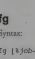

> 提示
> 如果你想从开始就让命令在后台运行，只需在命令行的末尾加上 `&` 即可。

要了解后台正在运行哪些命令，请输入 `jobs`，你将看到后台命令行的列表。要将命令从后台调回前台，请使用 `fg` 命令。

### fg

Syntax:

```
fg [%job-number]
```

这是一个内置的 shell 命令，常见于流行的 shell 中。`fg` 命令使你能够将后台进程调到前台。如果不带任何参数运行此命令，它会将你最后放到后台的命令调回前台。如果有多个命令在后台运行，你可以使用 `jobs` 命令找到作业编号，然后将该编号作为 `fg` 的参数以将命令调到前台。例如，如果 `jobs` 显示你有两个后台命令，你可以使用以下命令调出第一个放到后台的命令：

```
fg %1
```

### jobs

Syntax:

```
jobs
```

这是一个内置的 shell 命令，常见于流行的 shell 中。`jobs` 使你能够查看在后台运行或当前挂起的进程列表。

### Kill -signal PID

此命令用于向进程发送信号。`Kill` 可以是许多流行 shell（如 `csh` 和 `tcsh`）的内置 shell 命令。然而，也有一个外部 `kill` 程序，通常位于 `/bin` 目录中。两个版本的工作方式相同。要了解可通过 `kill` 向进程发送哪些信号，可以运行以下命令：

```
kill -l
```

你应该会看到类似以下的列表：

```
1) SIGHUP  2) SIGINT  3) SIGQUIT  4) SIGILL
5) SIGTRAP  6) SIGIOT  7) SIGBUS  8) SIGFPE
9) SIGKILL  10) SIGUSR1  11) SIGSEGV  12) SIGUSR2
13) SIGPIPE  14) SIGALRM  15) SIGTERM  17) SIGCHLD
18) SIGCONT  19) SIGSTOP  20) SIGTSTP  21) SIGTTIN
22) SIGTTOU  23) SIGURG  24) SIGXCPU  25) SIGXFSZ
26) SIGVTALRM  27) SIGPROF  28) SIGWINCH  29) SIGIO
30) SIGPWR
```

前面的输出由 GNU Bourne-Again Shell (`/bin/bash`) 中的内置 `kill` 命令产生。其他 shell 或 `/bin/kill` 命令可能会以略有不同的方式打印输出。例如，`/bin/kill -l` 产生以下输出：

```
HUP INT QUIT ILL TRAP IOT UNUSED FPE KILL USR1 SEGV USR2
PIPE ALRM TERM STKFLT CHLD CONT STOP TSTP TTIN TTOU IO
XCPU XFSZ VTALRM PROF WINCH
```

例如，要向 `PID` 为 `1234` 的进程发送 `SIGKILL`（9），运行

```
kill -KILL 1234
```

或者你也可以运行

```
kill -9 1234
```

你可以使用信号的名称（不带 `SIG` 前缀）或使用其数值作为信号标识符，如前所示。

### killall

此实用程序允许你按名称终止进程。例如，如果你有一个名为 `signal_demo.pl` 的进程，并且想在不输入其 `PID` 的情况下终止它，可以运行

```
killall -KILL signal_demo.pl
```

当你不提供信号名称时，`killall` 会自动发送 `SIGTERM` 信号。然而，使用 `killall` 时要非常小心，因为它会终止指定命令的所有实例。有时，不必知道 `PID` 的便利性可能会适得其反。

### ps

此实用程序生成系统中所有进程的报告。例如，当我从登录 shell 运行 `ps` 时，它显示以下输出：

```
PID TTY STAT TIME COMMAND
31795 p7 S 0:00 -tcsh
31811 p7 R 0:00 ps
```

如你所见，`ps` 提供表格报告。这里，`ps` 显示我正在运行两个进程：`-tcsh` shell，实际上是作为登录 shell 运行的 `/bin/tcsh` shell，以及 `ps` 进程本身。表 A-1 解释了 `ps` 常见输出字段的含义。

### 表 A-1 ps 的输出字段

| 字段 | 说明 |
|---|---|
| USER or UID | 进程所有者的用户名。 |
| PID | 进程 ID。 |
| %CPU | 进程的 CPU 利用率。由于计算所依据的时间基准不同，这可能超过 100%。 |
| %MEM | 进程的内存（以千字节为单位）利用率百分比。 |
| SIZE | 进程使用的虚拟内存大小（以千字节为单位）。 |
| RSS | 常驻集大小或进程使用的实际内存大小（以千字节为单位）。 |
| TTY | 与进程关联的终端（tty）。通常 tty 名称会被缩短。例如，`/dev/ttyp7` 显示为 p7。 |
| STAT | 进程的状态。进程状态由字符表示，例如 R（运行或准备运行）、S（睡眠）、I（空闲）、Z（僵尸）、D（磁盘等待）、P（分页等待）、W（换出）、N（nice 降低优先级）、T（终止）、<（超级用户提高执行优先级）等。 |
| START | 进程启动时间或日期。 |
| TIME | 进程使用的总 CPU 时间。 |
| COMMAND | 正在执行的命令行。 |
| NI | nice 优先级数字。 |
| PRI | 进程优先级数字。 |
| PPID | 父进程的进程 ID（PID）。 |
| WCHAN | 进程睡眠的内核函数名称。函数名称从 `/boot/System.map` 文件中检索。 |
| FLAGS | 与进程关联的数字标志。 |

`ps` 实用程序还接受多个命令行参数。表 A-2 显示了常用的选项。

### 表 A-2 常用 ps 选项

| 选项 | 描述 |
|---|---|
| A | 显示所有用户所属的进程。 |
| E | 在正在执行的命令行之后显示进程环境变量。 |
| L | 以长格式显示输出。 |
| U | 显示用户名和进程启动时间。 |

## 表 A-2（续）

| 选项 | 描述 |
|---|---|
| W | 以宽格式显示输出。通常，如果输出无法在一行内显示，则会被截断。使用此选项，您可以防止截断。 |
| Txx | 显示与 xx tty 设备关联的进程。 |
| X | 显示没有控制 tty 的进程。 |

接下来提供了使用 `ps` 选项的几个示例。

要随时查看您正在运行的所有进程，请运行以下命令：

```
ps u
```

下面显示了前述命令输出的示例：

```
USER PID %CPU %MEM SIZE RSS TTY STAT START TIME COMMAND
kabir 18 0.0 0.8 1596 1040 p5 S 08:41 0:00 -tcsh
kabir 135 0.0 0.8 1560 1040 p7 S 09:03 0:00 -tcsh
```


```
kabir 852 53.8 0.6 1604 788 p8 R 09:33 0:04 perl ./eatcpu.pl

kabir 855 0.0 0.3 848 848 p7 R 09:34 0:00 ps u
```

这显示了名为 `kabir` 的用户正在运行的所有进程。请注意，`ps` 本身也列在输出中。前两行显示 `kabir` 正在运行两个 `tcsh` shell 会话。第三行非常有趣，因为它显示名为 `eatcpu.pl` 的 Perl 脚本大约使用了 53.8% 的 CPU。`STAT` 标志表明 Perl 脚本和 `ps` 实用程序是这里唯一正在运行（或可运行）的进程。通过查看 `TTY` 字段，您可以判断哪个进程连接到哪个 tty。

在下一个示例中，`ps` 被告知显示所有进程（不包括与任何控制 tty 无关的进程）：

```
ps au
```

要查找特定用户拥有的进程，请运行

```
ps au | grep username
```

其中 `*username*` 是实际用户的名称。

例如，`ps au | grep sheila` 将显示名为 `sheila` 的用户正在运行的所有交互式进程（与 tty 关联的进程）。通常，普通用户不允许运行守护进程或与 tty 无关的进程。但是，如果您只是想知道是否存在任何此类进程，无论哪个用户，都可以运行

```
ps aux
```

`x` 选项告诉 `ps` 列出从终端分离的进程。您可以通过查看 `TTY` 字段来识别这些进程，该字段显示 `?` 字符而不是 tty 设备的缩写名称，例如 `p7`（`/dev/ttyp7`）。

要查找进程父级的 PID，您可以运行

```
ps l PID
```

其中 `*PID*` 是该进程的 PID。

例如，如果您想查找 PID 为 123 的进程的父级，请运行 `ps l 123`，父级的 PID 将列在报告的 `PPID` 字段中。

要确定进程可用的初始环境变量，请运行

```
ps e
```

环境信息附加到 `COMMAND` 字段。

## top

使用 `top`，您可以实时监控进程活动。`top` 屏幕会自动更新，以提供系统运行状态的最新视图。下面是 `top` 显示的前五个标题行的说明。

- Line 1. 运行时间行，显示系统的当前时间、系统自上次重启以来运行了多长时间、当前系统上有多少用户以及三个负载平均数。负载平均数是过去 1、5 和 15 分钟内准备运行的进程的平均数量。
- Line 2. 进程统计行，显示上次 `top` 屏幕更新时正在运行的进程总数。该行还显示休眠、运行、僵尸和停止进程的数量。
- Line 3. 显示 CPU 统计信息，包括用户、系统、nice 和空闲进程使用的 CPU 时间百分比。
- Line 4. 提供内存统计信息，包括总可用内存、空闲内存、已用内存、共享内存和用于缓冲区的内存。
- Line 5. 提供虚拟内存或交换统计信息，包括总可用交换空间、已用交换空间、空闲交换空间和缓存交换空间。其余行类似于 `ps` 生成的报告。

使用 `top`，您只需查看 `ps` 类输出中的几项条目，即可识别哪些进程使用最多的资源。消耗第二多资源的进程就是 `top` 实用程序本身！当您运行 `top` 来监控其他进程时，`top` 本身也会消耗一些资源，但您仍然可以很好地了解哪个进程消耗了多少资源。要退出 `top`，请随时键入 `'q'`。

## 任务自动化命令

本节讨论的命令向您展示如何运行无人值守任务。

### at

`at` 实用程序允许您将命令排队以在稍后时间执行。例如，要在晚上 8:40 运行名为 `du` 的磁盘使用情况汇总生成器实用程序，您可以按如下方式运行 `at`：

```
at 20:40
```

`at` 命令会显示类似 `at>` 的提示，您可以在其中输入 `du` 命令，如下所示：

```
at> du -a > /tmp/du.out
```

这里，`du` 的输出被定向到一个文件。在输入命令（本例中为 `du` 命令）后，`at` 会再次显示提示。您可以按 `Ctrl+D` 退出。您将看到类似以下的消息：

```
at> <EOT>

warning: commands will be executed using /bin/sh

job 1 at 1999-12-06 20:40
```

这意味着 `at` 已安排 `du -a > /tmp/du.out` 作业由 `atd` 守护进程在 1999 年 12 月 6 日晚上 8:40 运行。您可以使用多种时间格式来指定执行时间。例如，除了说 `at 20:40`，您也可以说 `at 8:40pm`。您还可以同时指定日期和时间。例如，`8:40pm feb 23`、`10am + 5 days`、`12:30pm tomorrow`、`midnight` 和 `noon` 都是有效的时间说明。

计划的作业通过 `atd` 守护进程运行，该进程由 `init` 在运行级别 3（多用户模式）启动。如果您想限制 `at` 设施的使用，可以创建 `/etc/at.allow` 文件并列出允许使用它的所有用户。请记住，每行输入一个用户名。未列在允许文件中的任何用户都将被拒绝访问 `at` 设施。另一方面，如果您只想拒绝少数用户但允许其余用户，可以创建一个名为 `/etc/at.deny` 的类似文件。此文件中列出的所有用户名都将被拒绝 `at` 访问。

### atq

此命令用于验证您的 `at` 作业是否在作业队列中。当您运行此命令时，它会显示队列中当前安排的作业。所有计划的作业都存储在 `/var/spool/at` 目录中。

### atrm

要停止计划的 `at` 作业，您可以运行 `atrm` 命令来删除作业。您需要知道作业序列号才能使用 `atrm` 删除作业。要了解您安排了哪些作业，请运行 `atq` 命令。要删除任何作业，请使用 `atrm job#`。例如，要删除作业 `#1`，请运行 `atrm 1`。

### crontab

`crontab` 命令用于创建和修改 `cron` 作业设置。例如，如果用户允许运行 `cron` 作业，他可以运行 `crontab -e` 来创建和编辑 `cron` 作业条目。`cron` 作业规范具有以下格式：

```
minute(s) hour(s) day(s) month weekday username command argument(s) .
```

前五个时间规范字段在表 A-3 中讨论。

## 表 A-3 Cron 时间指定字段

| 字段 | 描述 | 范围 |
|---|---|---|
| Minute(s) | 一个小时中的一个或多个分钟。您可以指定以逗号分隔的分钟列表。 | 0-59 |
| Hour(s) | 一天中的一个或多个小时。您可以指定以逗号分隔的小时列表。 | 0-23，其中 0 为午夜 |
| Day(s) | 一个月中的一天或多天。您可以指定以逗号分隔的天数列表。 | 1-31 |
| Month | 一年中的一个或多个月份。您可以指定以逗号分隔的月份列表。 | 1-12 |
| Weekday | 一周中的一天或多天。您可以指定以逗号分隔的天数列表。 | 1-7，其中 1 为星期一 |

对于表 A-3 中显示的任何字段，您都可以使用 `*` 作为通配符。下面是一个 `cron` 作业规范示例：

```
01 * * * root /some/script
```

这表示 `/some/script` 将在每小时的第 1 分钟、每天、每月、每周的每一天运行。该脚本将以 `root` 用户身份运行。要每十分钟运行一次此脚本，可以定义如下 `cron` 作业：

```
0,10,20,30,40,50 * * * * root /some/script
```

要仅每月运行一次相同的脚本，可以按如下方式安排 `cron` 作业：

```
01 1 1 * * root /some/script
```

这里，脚本将在每个月的第一天凌晨 1:01 运行。系统的默认 `cron` 作业是 `/etc/crontab`，其中包含一些有趣的 `cron` 作业条目，例如以下内容：

```
SHELL=/bin/bash

PATH=/sbin:/bin:/usr/sbin:/usr/bin

MAILTO=root
```

```
# run-parts

01 * * * * root run-parts /etc/cron.hourly

02 4 * * * root run-parts /etc/cron.daily

22 4 * * 0 root run-parts /etc/cron.weekly

42 4 1 * * root run-parts /etc/cron.monthly
```


这些 `cron` 作业用于运行位于 `/usr/bin` 目录中的 `run-parts` 脚本。该脚本使用前述列表中的四个 `cron` 作业规范每小时、每天、每周和每月运行一次。它接受一个目录名作为参数并运行该目录中位于其中的所有脚本或程序。例如，考虑前述列表中的第一个 `cron` 条目。它说明 `run-parts` 脚本应在每小时的第一分钟运行。脚本被赋予参数 `/etc/cron.hourly`。由于脚本运行该目录中位于其中的所有文件，整个过程实际上就像 `/etc/cron.hourly` 目录中的所有文件都已设置成 `cron` 作业一样。这种技巧允许您将新文件放入 `/etc/cron.hourly` 目录并自动安排每小时运行。同样，另外三个 `cron` 条目允许您只需将程序分别放置在 `/etc/cron.daily`、`/etc/cron.weekly` 或 `/etc/cron.monthly` 目录中，即可按每日、每周或每月的基础运行任何程序。这使得无需真正配置 `cron` 条目即可轻松为几乎所有内容创建 `cron` 作业。

例如，假设您希望每天与远程时间服务器同步系统时间。您决定使用 `rdate` 实用程序通过 Internet 设置时间。需要运行的命令如下：

```
/usr/bin/rdate -s time.server.host.tld
```

由于默认的 `/etc/crontab` 包含一个 `cron` 条目，允许您只需将脚本或程序放置在 `/etc/cron.daily` 目录中即可安排每日 `cron` 作业，您可以创建如下的简单 `shell` 脚本并将其放置在 `/etc/cron.daily` 目录中：

```
#!/bin/sh

/usr/bin/rdate -s time.server.host.tld
```

任务完成。每天凌晨 4:02，您的脚本将与其他所有位于 `/etc/cron.daily` 目录中的脚本和程序一起运行。

## 生产力命令

本节讨论的命令可帮助您提高生产力。

### bc

语法：

```
bc
```

这是一个交互式计算器，同时也实现了一种计算器专用语言。当您在没有任何参数的情况下运行 `bc` 时，它会将您的输入解释为计算器编程语句。例如，要将 1024 乘以 4，只需输入 `1024*4`，结果就会显示出来。当前结果可以通过使用句点字符来重复使用。

### cal

语法：

```
cal [month] [year]
```

这个巧妙的程序会显示命令行中指定的月份或年份的格式良好的日历。如果您未指定任何参数，则会显示当前月份的日历。要查看整年的日历，请输入 1-9999 范围内的年份。

### ispell

语法：
`ispell filename`

`ispell` 程序允许您以交互方式纠正文本文件中的拼写错误。如果文件中存在拼写错误，程序会建议拼写并提供将其替换为正确拼写单词的选项。这是文本文件的拼写检查器。

### msg

语法：
`msg [y | n]`

`msg` 程序允许您启用或禁用终端的公共写访问。例如，

```
msg y
```

启用对您终端的写访问，以便同一系统上的另一用户可以使用 `write` 命令向您写入文本消息。`n` 选项允许您禁用写访问。如果您不想在任何时候被任何人打扰，请将 `msg n` 添加到您的登录脚本（`.login`）文件中。

### write

语法：
`write username tty`

`write` 程序允许您在该用户未禁用其 `tty` 的写访问的情况下向指定用户写入文本消息。例如，以下命令允许您在屏幕上键入文本消息：

```
write shoeman
```

当您通过按 `Ctrl+D` 结束消息时，消息会显示在用户 `shoeman` 的终端上。如果用户登录多次，您还必须指定终端名称。例如，

```
write shoeman tty p0
```

允许您向 `shoeman` 写入并将消息显示在终端 `tty p0` 上。如果有人打开了多个终端，请运行 `w` 或 `who` 命令以查看哪个 `tty` 最合适。

## Shell 命令

本节描述了一些非常基本的 `shell` 命令。

### alias

语法：

```
alias name of the alias = command
```

这是一个内置的 `shell` 命令，在大多数流行的 `shell` 中都可用。`alias` 允许您为命令创建别名。例如，

```
alias dir ls -l
```

为 `ls -l` 命令创建名为 `dir` 的别名。要查看整个别名列表，请在不带任何参数的情况下运行 `alias`。

### history

语法：

```
history
```

这是一个内置的 `shell` 命令，在大多数流行的 `shell` 中都可用。`history` 显示您最近在命令行中输入的命令列表。`history` 显示的命令数量受名为 `"history"` 的环境变量限制。例如，如果您在登录文件中添加 `set history = 100`，那么每次登录时，`history` 命令最多会记住 100 条命令。您在历史记录中看到的命令可以通过输入其索引号加上 `!` 符号轻松重新运行。例如，假设您在输入 `history` 命令后看到以下列表：

```
1 10:25 vi irc-bot.h

2 10:25 vi irc-bot.c

3 10:26 which make
```

要再次运行 `vi irc-bot.c` 命令，只需在命令行中输入 `!2` 即可。

### set

语法：

```
set var = value
```

这是一个内置的 `shell` 命令，在大多数流行的 `shell` 中都可用。`set` 允许您为环境变量设置特定值。例如，

```
set foo = bar
```

设置一个新环境变量 `foo`，其值为 `bar`。要查看所有环境变量的列表，请单独运行 `set`。要查看特定环境变量的值，例如 `path`，请运行以下命令：

```
echo $path
```

这会显示命名环境变量的值。如果您经常使用此命令设置几个特殊环境变量，请将其添加到 `.login` 或 `.profile` 或您的 `shell` 的点文件中，以便在登录时自动设置特殊环境变量。

### source

语法：

```
source filename
```

这是一个内置的 `shell` 命令，在大多数流行的 `shell` 中都可用。`source` 允许您在当前 `shell` 环境中从指定文件中读取并执行命令。

### unalias

语法：

```
unalias name of the alias
```

这是一个内置的 `shell` 命令，在大多数流行的 `shell` 中都可用。`unalias` 允许您删除命令的别名。例如，

```
unalias dir
```

删除名为 `dir` 的别名。要删除所有别名，请使用 `*` 作为参数。

## 打印专用命令

本节讨论有助于从 Linux 系统打印的命令。

### lpq

语法：

```
lpq [-al] [-P printer]
```

`lpq` 命令列出打印机的状态。如果在不带任何参数的情况下输入 `lpq`，则会提供有关默认打印机 的信息。

`-P` 选项指定有关特定打印机 的信息。`-a` 选项返回所有打印机 的状态。

使用 `-l` 选项，`lpq` 报告作业标识号、请求打印作业的用户名、源主机、队列中的排名、作业描述和作业大小。

### lpr

语法：

```
lpr [-i indentcols] [-P printer] [filename]
```

`lpr` 命令将文件发送到打印 `spool` 以进行打印。如果未给出文件名，则假定数据来自标准输入。

`-i` 选项允许您从特定列开始打印。要指定特定打印机，您可以使用 `-P printer` 选项。以下示例尝试打印文件 `main.c`：

```
lpr main.c
```

### lprm

语法：

```
lprm [-a] [jobid] [all]
```

`lprm` 命令向 `lpd` 发送请求以从打印队列中删除一项。要删除的打印作业可以通过作业 ID 或用户名指定，也可包括所有项目。

要删除所有打印队列中的所有作业：

```
lprm -a all
```

要删除打印机 `p1` 上用户 `kiwee` 的所有作业：

```
lprm -Pp1 kiwee
```


## 附录 B
## Linux 资源
### Usenet 新闻组
以下 Usenet 新闻组是了解 Linux 进展、参与 Linux 特定讨论以及找到您可能有的问题的答案的绝佳场所。

### The comp.os.linux hierarchy
Linux 拥有自己的 Usenet 新闻组层级结构。这些组严格限于 Linux。在这些新闻组（或任何 Usenet 新闻组）中发布文章或问题之前，请确保您了解该组的章程。特别是，当您寻找问题的答案或问题的解决方案时，请确保您已经阅读了可用的常见问题解答、手册页和 how-to 文档。如果您发布的问题已在常见问题解答或 how-to 文档中得到解答，那么积极参与该组的一些人可能不会对此感到满意。此外，在发布相同问题到多个组（称为交叉发布）以期增加获得答案的机会时要小心。只要您的帖子与该组相关，就是可以的。

### comp.os.linux.advocacy (unmoderated)
该新闻组用于讨论 Linux 相对于其他操作系统的优势。

### comp.os.linux.announce (moderated)
该新闻组用于所有 Linux 特定公告。您可以在此找到有关新 Linux 软件、错误和安全警报以及用户组信息。

### comp.os.linux.answers (moderated)
Linux FAQs、how-to 文档、readme 文件和其他信息来源发布在此新闻组。如果您对某事有疑问，请在任何 Linux 新闻组发布问题之前先查看此新闻组。

### comp.os.linux.development.apps (unmoderated)
该新闻组用于希望与其他人讨论开发问题的 Linux 开发者。

### comp.os.linux.hardware (unmoderated)
该新闻组用于硬件特定讨论。如果您对尝试与 Linux 一起使用的硬件有疑问，请在此寻求帮助。

### comp.os.linux.m68k (unmoderated)
该新闻组用于摩托罗拉 68K 架构特定 Linux 讨论。

### comp.os.linux.alpha (unmoderated)
该新闻组用于 Compaq/Digital Alpha 架构特定讨论。

### comp.os.linux.networking (unmoderated)
该新闻组用于网络相关讨论。

### comp.os.linux.x (unmoderated)
该新闻组用于有关在 Linux 下运行的 X Window System、版本 11 兼容软件（包括服务器、客户端、库和字体）的讨论。

### comp.os.linux.development.system (unmoderated)
该新闻组用于内核黑客和模块开发者。您将在这里找到有关 Linux 操作系统本身开发的持续讨论：内核、设备驱动程序、可加载模块等。

### comp.os.linux.setup (unmoderated)
该新闻组用于安装和系统管理问题的讨论。

### comp.os.linux.misc (unmoderated)
这是 comp.os.linux 层级结构的垃圾桶。任何不适合该层级结构中其他新闻组的讨论都在这里进行。

### Miscellaneous Linux newsgroups
以下新闻组被认为不是主流 Linux 新闻组，因为其中大多数是地理导向的，通常用于 Linux 用户组会议和活动的本地 Linux 相关公告：

- alt.uu.comp.os.linux.questions
- alt.fan.linus-torvalds
- aus.computers.linux
- dc.org.linux-users
- de.alt.sources.linux.patches
- de.comp.os.linux.hardware
- de.comp.os.linux.misc
- de.comp.os.linux.networking
- de.comp.os.x
- ed.linux
- fido.linux-ger
- fj.os.linux
- fr.comp.os.linux
- han.sys.linux
- hannet.ml.linux.680x0
- it.comp.linux.pluto
- maus.os.linux
- maus.os.linux68k
- no.linux
- okinawa.os.linux
- tn.linux
- tw.bbs.comp.linux
- ucb.os.linux
- uiuc.sw.linux
- umich.linux

## Mailing Lists
邮件列表提供了一种将信息直接发送到您的电子邮件账户的好方法。如果您对 Linux 新闻、公告和其他讨论感兴趣，邮件列表会非常有帮助。特别是提供摘要选项的邮件列表更是如此。此类邮件列表会将每日或每周的所有消息摘要发送到您的电子邮件地址。

### General lists
以下 Linux 邮件列表性质通用。它们提供了关于 Linux 新闻的良好一般讨论以及对初学 Linux 用户有帮助的信息。

### Linux-announce
通过向 `linux-announce-request@redhat.com` 发送电子邮件，在消息主题行中写上“subscribe”一词，即可订阅 Linux-announce。

### linux-list
要订阅，请向 `linux-list-request@ssc.com` 发送电子邮件，在消息正文中写上“subscribe”一词。

### linux-newbie
要订阅，请向 `majordomo@vger.rutgers.edu` 发送电子邮件，在消息正文中写上“subscribe linux-newbie”。

### linuxusers
要订阅，请向 `majordomo@dmu.ac.uk` 发送电子邮件，在消息正文中写上“subscribe linuxusers”。

### Security alert lists
以下邮件列表涉及 Linux 和计算机安全问题。我强烈建议您立即订阅 bugtraq 邮件列表。

### linux-security
这是由 Red Hat Software, Inc. 主办的邮件列表。要订阅，请向 `linux-security-request@redhat.com` 发送电子邮件，在主题行中写上“subscribe linux-security”。

### bugtraq
虽然 BugTraq 不是 Linux 特定的，但它是一个很棒的错误警报资源。要订阅，请向 `listserv@netspace.org` 发送电子邮件，消息正文为“SUBSCRIBE bugtraq your-firstname your-lastname.”

### Special lists
以下邮件列表涉及两个问题：Linux 作为服务器平台和 Linux 作为桌面平台。

### SERVER-LINUX
要订阅，请向 `listserv@netspace.org` 发送电子邮件，在主题行中写上“subscribe SERVER-LINUX”。

### WORKSTATION-LINUX
要订阅，请向 `listserv@netspace.org` 发送电子邮件，在主题行中写上“subscribe WORKSTATION-LINUX”。

## Web Sites
许多网站提供 Linux 导向的信息。以下是一些不错的网站。

### General resources
以下网站性质通用，其中大多数充当门户网站：

- http://www.redhat.com
- http://www.linuxresources.com/
- http://linuxcentral.com/
- http://www.linuxcare.com/

### Publications
以下网站是各种 Linux 出版物的官方网站：

- http://www.linuxworld.com/
- http://www.linuxgazette.com/
- http://www.linuxjournal.com/

### Software stores
以下网站提供商业 Linux 软件：

- http://www.linuxmall.com/
- http://www.cheapbytes.com
- http://www.lsl.com

### Security resources
以下网站涉及计算机安全：

- http://www.cert.org
- http://www.rootshell.com/
- http://www.replay.com/redhat/

## Index
### Symbols and Numbers
(冒号), 26, 91
(句点), 307, 359
(分号), 256
*, *星号*, 21, 129, 227, 245, 343, 348, 439, 468
? (问号), 36, 439
! (感叹号), 391
& (与号), 26, 128, 190, 256
# 字符, 439
| (管道/字符), 439
% 说明符, 365~-366
@# 字符 (未找到) 处理, 366
\(波浪号), 313, 325

### A
aB 实用程序, 393
Aix, 访问文件权限, 权限, 特权; 安全, 103
access, 控制列表 (ACLs), 483, 483~-485
access strings, 使用设置文件/目录权限, 36~-37
Access/Re/Name 目录, 306~-307, 315
Access/Name, 368
Ace 目录, 183
ACES (访问控制列表), 483, 483~-485
Action-and-configuration 选项, 105
Archive interact at boot time in check box, 148~-149
Add/-and-remove 目录, 108
Adif/Define, 322~-324, 328, 375
Adif-and-remove, 108
Adif/Config/By-Encoding, 308
Adif/Config/By-Type, 308
Add/-to-directory, 308
Adding-and-removing-directory-and-directory, 308
address-rule-table
defined, 150~-151
directory, 220~-229
Add/-to-directory, 220-229
Adm-and-manage-user-account, 419
Administrative-privileges, 393, 419
Advanced-Power-Management-(APM), 76
Afore-and-after-Windows, 14
Afore/Windows, 550, 539, 420
alias-keyword, 235
alias-rules, 90
Aliases, 325-329, 322-323
AlF/Access, 268, 199-200
AlF/Copy, 228, 229
AlF/File, 143-147, 155
AlF/Remove, 324-325
All-in-one, 45-47
ALL-and-users, 91
ALL-keyword, 183-185
A-to-z/-directory, 168-170
All/-directory, 152-153, 360
A-to-z/-directory, 152, 360
AlF/-list-of-all-users, 242-243, 360
AlF/-list-of-all-users, 242, 243, 360
AlF/-list-of-all-users, 242-243, 360
AlF/-list-of-all-users, 242, 243, 360
AlF/-list-of-all-users, 242-243, 360
AlF/-list-of-all-users, 242, 243, 360

America-Online, 219
AMD-and-Intel, 515
... 
## 612 索引
Apache Web 服务器（续）
- Apache Sockets 层 (ASL)，380–398
- 服务器端包含 (SSI) 风险，379
...
