# Red Hat Linux 管理员手册 (Professional Mindware)


请访问 mandtbooks.com

**P R O F E S S I O N A L M I N D W A R E™（专业思维软件™）**


**作者及修订者**
Mike Galbraith 和 Kevin Aken

**技术编辑**
John Vlatko 和 Michael Swift


## 关于 IDG BOOKS WORLDWIDE

欢迎来到 IDG Books Worldwide 的世界。

IDG Books Worldwide, Inc. 是 International Data Group 的子公司，IDG 是全球最大的计算机相关信息出版商，也是领先的信息服务和信息技术全球提供商。IDG 由 Patrick J. McGovern 于 20 多年前创立，现拥有全球 9,000 多名员工。IDG 在 75 多个国家出版 200 多种计算机杂志。每月有超过 9000 万人阅读一份或多份 IDG 出版物。

IDG Books Worldwide 于 1990 年创立，如今已成为美国最畅销计算机图书的首选出版商。我们为荣获计算机新闻协会八次表彰编辑卓越性的奖项以及《计算机趋势》首届读者选择奖三次荣誉而感到自豪。我们最畅销的“傻瓜丛书®”系列印刷量超过 5000 万册，并翻译成了 31 种语言。IDG Books Worldwide 通过与 IDG Hi-Tech-Beijing 的合资企业，成为第一家在中国出版计算机图书的美国出版商。在极短的时间内，IDG Books Worldwide 已成为全球读者想要学习如何更好地管理其业务的首选出版商。

我们的使命很简单：我们的每本书都旨在为读者提供额外的价值和技能构建指导。我们的书由理解并关心读者的专家撰写。我们的编辑团队的知识基础来自出版、教育和新闻行业的多年经验——我们利用这些经验来创作能引领我们进入新千年的图书。简而言之，我们可以提供内容建议，并减少在图书制作技术细节（如受众、内部设计、图标和插图的使用）上的时间。由于我们采用电子方式高效地进行作者撰写、编辑和桌面出版，我们可以花费更多时间确保内容卓越，减少在图书制作技术细节上的时间。

您可以信赖我们对以具有竞争力的价格提供高质量图书的承诺，主题为您想阅读的内容。在 IDG Books Worldwide，我们继续发扬 IDG 三十多年来提供优质服务的传统。找不到比 IDG Books Worldwide 出版的关于某一主题更好的书了。


**John K. Kelcic**
董事长兼首席执行官
IDG Books Worldwide, Inc.

IDG 是全球领先的 IT 媒体、研究和展示公司。IDG 成立于 1964 年，1997 年收入为 7.19 亿美元，在全球拥有超过 4,000 名员工。IDG 提供最广泛的媒体曝光范围，覆盖 75 个国家，代表全球 95% 的 IT 支出。IDG 多样化的产品和服务组合涵盖五个领域，包括印刷出版、在线服务、出版物和会议、市场研究、教育和培训以及全球营销服务。每月有超过 9000 万人阅读 IDG 的 290 种杂志和报纸中的一种或多种，包括 IDG 的领先全球品牌——Computerworld、PC World、Network World、MacroWorld 和 Channel World 系列出版物。IDG Books Worldwide 是全球增长最快的计算机图书出版商之一，在 36 种语言中拥有超过 700 种图书。“傻瓜丛书”系列单系列的印刷量就超过 5000 万册。IDG 为在线用户提供最大的电子商务网络：通过 IDG.net (http://www.idg.com) 连接全球网站，涵盖全球 55 个国家的 225 多个目标网站。国际数据公司 (IDC)，全球领先的信息技术数据、分析和咨询提供商，在 41 多个国家设有研究中心，拥有 400 多名研究分析师，在全球范围内与 2,200 多家公司合作，并开设 785 门课程。IDC 营销服务帮助行业领先的 IT 公司通过 IDC 的全球印刷、在线和展示产品制定全球营销计划，以建立国际品牌知名度。有关该公司的更多信息可在 www.idg.com 找到。


## 作者简介

Mohamed J. Kabir 是 Intevo, Inc. 的首席技术官和联合创始人。在工作中，他设计并开发了 Intevo Mail，这是一种面向所有规模组织的、经济实惠的基于许可的电子消息服务。Kabir 在加利福尼亚州立大学萨克拉门托分校学习计算机工程，也是《Red Hat Linux 7 服务器》、《Apache 服务器圣经》和《Apache 服务器管理员手册》的作者，并合著了《SuSE Linux 服务器》。你可以在他的个人网站 http://www.nitec.com 上找到更多关于他的信息。你还可以通过电子邮件 kabir@nitec.com 与他联系。

致我在孟加拉国的高中老师们

服务：
- `ETC/RC.EL`
- `UNIT.D`
- `USR/LIB`
- `LINUXCONF`
- `Mod`
- `/BIN/LINUXCONF`
- `ETC` (PASSWD)
- `ETC/SYSCONFIG/NETWORK`

- 第 70 页 基于 WEB 的注释
- 第 84 页 超级用户检查
- 第 90 页 新用户
- 第 94 页 确定文件类型

2023.03.08
2-10-10-11-12-13-14
1-13-15-17-19

2023.03.09
2023.03.10
11-12-13-14
13-15-17
08-10-12
10-12-14

2023.03.15
10-12-14

## 前言

欢迎阅读《Red Hat Linux 管理员手册（第二版）》。本更新版反映了 Red Hat Linux 7.0 中的变化。如果你是一名从事 Red Hat Linux 管理工作的管理员，你会发现这本书非常实用。

在这本书中，你将找到有关如何管理用户、磁盘配额、进程和网络的实际信息；如何设置 DNS 服务器、SMTP/POP3 邮件服务器、Web 服务器、FTP 服务器、NFS 服务器、基于 Samba 的文件和打印服务器等等。你将能够利用各种工具和技术来增强系统和网络安全，并自定义编译 Linux 内核，以优化系统以获得更高的性能。

尽管 Red Hat Linux 6.2 和 7.0 之间主要变化很少，但书中肯定会对它们进行讨论。诸如从 inetd 迁移到 xinetd 等变化将通过实用示例加以说明，以便于向 7.0 或更高版本的过渡。

这本书涉及一项严肃的工作：保持你组织的 Linux 服务器和工作站处于运行状态。如果你希望体验许多成功的 Red Hat Linux 管理员所享有的长达数月甚至更长时间的正常运行时间，请开始阅读这本书。

## 本书结构

我将本书分为三个部分。

### 第一部分：安装与基本配置

第一部分将引导你开始安装 Red Hat Linux 并进行必要的配置使其运行。你将找到有关如何自定义你的 Red Hat 安装、如何启动和关闭 Linux 系统以及如何管理文件和目录的有用信息。

### 第二部分：高级配置

本书最重要的部分，第二部分涉及用户、进程和内联网/互联网服务配置与管理。

本部分各章涵盖：

- 管理用户和组，以及实施磁盘配额
- 向运行中的进程发送信号、控制进程优先级、使用各种实用工具监控进程、通过 Cron 设施自动化进程执行，以及使用 Syslog 设施记录进程信息
- TCP/IP 网络、对 IP 网络进行分类、配置服务器的网络接口以及创建子网
- 配置 BIND 作为 DNS 服务器，并使用 DNS 执行负载均衡
- 为 SMTP 邮件服务设置 DNS，配置 sendmail 以提供 SMTP 邮件服务，启用反垃圾邮件措施，并设置 Post Office Protocol 3 (POP3) 邮件服务器和客户端
- 配置 wu-ftpd 文件传输协议 (FTP) 服务器，以支持标准、匿名和访客 FTP 服务（对该广泛使用的 FTP 服务器的深入讲解将为你提供有价值的配置选项，这些选项不仅能增强安全性，还能为你的 FTP 用户提供自定义的外观和感觉）
- 配置你的 Red Hat Linux 服务器作为局域网中 Windows 计算机的文件和打印服务器
- 编译、配置和安装用于 CGI 脚本、服务器端包含 (SSI)、虚拟主机、代理服务和安全事务的 Apache Web 服务器（根据经验，我知道 Web 服务是许多人决定使用 Red Hat Linux 的主要原因之一，因此专门编写了一章，为你提供创建优雅 Web 解决方案所需的所有信息）
- 配置你的 Red Hat Linux 作为 NFS 服务器，该服务器可以通过网络提供可挂载的文件系统；以及使用 rdist 程序，该程序允许你自动分发文件并更新网络中其他计算机上的文件
- 配置 X 窗口系统

### 第三部分：故障排除

第三部分包含有关如何使用各种技术来保护和调整 Red Hat Linux 的信息。本部分各章涵盖使用影子密码、可插拔认证模块 (PAM)、文件/目录完整性检查工具、TCP wrapper 和 COPS；使用私有 IP 地址、如何掩码/取消掩码 IP 地址、如何使用包过滤防火墙和代理服务器，以及如何利用 SATAN 监控网络安全漏洞；以及如何配置、编译和构建自定义内核。

## 本书排版约定

在阅读本书之前，请了解以下几条约定。

- 等宽字体用于表示 URL 以及否则将出现在程序输入或输出中的各种命令、文件名和选项。
- *斜体* 用于表示占位符。
- 箭头用于表示渐进的菜单选择（例如，Control ↕ Control files and systems ↕ Configure Linuxconf modules 意味着选择 Control 菜单，然后从生成的子菜单中选择 Control files and systems，再选择 Configure Linuxconf modules）。
- 当命令行或脚本代码超过页面宽度时，使用反斜杠字符 (\) 作为换行续符。

本书还使用以下图标：


**提示**

提示告知你一些可能为你节省时间和精力事项。


**警告**

警告指示潜在的危险。

## 告诉我们你的想法

IDG Books Worldwide 和我都非常想了解你对这本书的看法。请随时在 IDG Books Worldwide 网站（http://www.idgbooks.com）上注册此书，并给我们反馈意见。如果你有兴趣直接联系我，请发送电子邮件至 kabir@nitec.com 或访问我的个人网站 http://www.nitec.com。我会尽力及时回复。

## 致谢

感谢 Debra Williams Cauley 给我机会更新这本书。长期以来，她对我非常友善且有耐心。

本书的发展编辑 Eric Newman 在本书整个开发阶段都非常友善和友好。

特别感谢 Matt Hayden，他在确保这本书技术上无误方面给予了巨大帮助。他富有洞察力的评论、建议和小贴士所做的远不止是纠正我的技术疏漏。

衷心感谢两版的校对编辑：Mildred Sanchez、Bill McManus 和 Maarten Reilingh。他们经常将我那些“机器语言”的句子改写为通俗易懂的英语。

我的妻子 Sheila Kabir 包容我同时经营一家有前途的互联网初创公司和撰写关于开源技术文章之间的平衡。她的耐心和灿烂的笑容让我每天都能坚持下去。

最后，我也想感谢 IDG Books Worldwide 团队的其他成员，是他们将这本书变为现实。正是他们将几个文件变成了一本精美且完善的书。


## 第一部分

### 安装与基本配置

-   第 1 章：入门
-   第 2 章：启动与关机配置
-   第 3 章：文件权限
-   第 4 章：使用 Linuxconf

### 第 1 章

#### 入门

##### 选择你的平台

Red Hat Linux 运行在许多硬件平台上，例如 x86 PC 克隆机、Alpha 和 SPARC。本章重点介绍基于 x86 的安装，因为 x86 PC 克隆机在 Linux 平台中占主导地位。其他平台上的安装任务略有不同；详情请参考 Red Hat 网站。

##### 检查硬件要求

从一开始，Linux 就要求具备最低限度的硬件才能运行。虽然 Red Hat Linux 可以在非常基本的硬件上运行，但仅仅是能运行 Linux 与将其用于创建服务器级操作是有区别的。要了解你的硬件是否受 Red Hat Linux 支持，请查看以下网站：[http://www.redhat.com/support/docs/rhl](http://www.redhat.com/support/docs/rhl)。

显然，硬件越好，你的 Red Hat Linux 系统性能就越好。以下是一些创建强大 Red Hat Linux 系统的通用准则：

-   **CPU（中央处理器）。** 越快越好。然而，购买可用的最快处理器并不总是必要的。例如，如果你只是想创建运行 Apache 的 Web 服务器，可以考虑中端 Pentium Pro 或低端 Pentium II 处理器。没必要非要去买 400+ MHz 的 Pentium III。当然，如果你计划通过 CGI 或其他方式在 Web 服务器上运行 CPU 密集型应用程序，则应考虑非常快的 CPU；对于大多数安装，中端处理器是最佳选择。

-   **RAM（内存）。** 多多益善。这是你可以尽情投入并尽可能多获取的硬件部件之一。RAM 是影响性能方程式的最关键变量之一。话虽如此，在决定 Web 服务器需要多少 RAM 时，例如，首先决定你希望每秒处理多少个请求。有时，确定每秒请求数（requests/sec）是很困难的。也许你对每天希望处理的请求数量有个大概的想法。假设你希望 Web 服务器每天能处理 3,456,000 个请求。你可以按如下方式计算每秒请求数：3,456,000 请求/天 × 1 天/24 小时 × 1 小时/3,600 秒。
    这算出来是每秒 40 个请求。既然你知道预期的每秒请求数，你也知道你需要 40 个 Apache 守护进程才能同时处理 40 个请求。在这种情况下，仅 Apache 的内存需求就是 40 × 单个 Apache 进程的内存占用量。这可能是大约 40MB 或更多，具体取决于你如何配置 Apache 本身。例如，如果你在 Apache 内部放入 Perl 解释器（*mod_perl*），添加 FastCGI 支持（*mod_fastcgi*），或添加额外模块，每个 Apache 进程可能需要更多内存。你对内存需求了解得越多，你就越能明智地应对内存要求。对于大多数典型的 Web 服务器部署任务，我建议较新的计算机使用 256MB 高速 100 MHz（10 纳秒）DRAM 模块。另请注意，你拥有的 RAM 越多，应该在硬盘上分配的交换空间（swap space）就越多。通常，你需要分配的交换空间大小是 RAM 大小的两倍。

-   **硬盘。** 服务器需要多少硬盘空间取决于你打算用它做什么。如果你希望服务器托管你的网站或局域网的大量文件，确定数据大小要求并购买合适大小的硬盘。鉴于大容量硬盘的价格正在定期下降，大小真不是大问题。相反，重要的是你为服务器选择哪种类型的硬盘。你有两个选择：IDE/EIDE 或 SCSI。
    如果你的服务器对你局域网或互联网操作至关重要，例如 Web、FTP 或邮件服务，请使用多个 SCSI 磁盘。SCSI 比 IDE/EIDE 对等物提供更好的吞吐量。我建议使用宽 SCSI 硬盘，它们提供大约 20MB/sec 的性能。通过使用多个宽 SCSI 磁盘，你可以最大限度地减少驱动子系统造成的磨损。换句话说，当你使用多个 SCSI 磁盘时，磁盘 I/O 相关的瓶颈可以减少，这对服务器来说是一件非常好的事。你可能会被吸引去获取超宽 SCSI 磁盘和控制器，但要注意，对于你购买的极速 SCSI 硬件，可能没有合适的驱动程序可用。关于高性能硬盘的另一个重要点是，这种硬盘可能会很快变得很热。请务必包含适当的冷却设备；例如，安装在未使用的驱动器托架中的额外风扇可能有助于降低灾难风险。

-   **网络接口卡。** 好的服务器需要好的网卡（NIC）。确保你从知名供应商（如 3Com 或 Intel）购买高性能网卡。理想情况下，你希望获取一张可以使用开关禁用即插即用（PnP）的卡，因为 PnP 目前在 Red Hat Linux 上尚不支持。

-   **其他硬件。** 其他重要硬件包括速度合理的 CD-ROM 驱动器和软盘驱动器。最近的 most 主板都自带 IDE 控制器，并允许你连接四个 IDE 设备。由于 CD-ROM 驱动器在服务器上并不频繁使用，你不需要最快的驱动器；只需获取一个速度在 40–60x 范围内的即可。最后但同样重要的是，确保为你的系统获取服务器级机箱和电源。你可以获取一个带有冗余电源并高出大功率（300 瓦或更多）的机箱。

准备好 Red Hat Linux 的硬件后，你需要为安装做准备。

##### 准备安装 Red Hat Linux

我强烈建议你使用本地 CD-ROM 驱动器并在本地执行所有安装任务，以节省时间和精力。当 Red Hat CD-ROM 位于远程计算机上时，你可以通过 FTP、NFS 或 SMB 服务安装 Red Hat Linux，但这种方法容易出错且不一定能正常工作。

如果你必须通过 FTP、NFS 或 SMB 服务安装，请确保你设置了一台本地（即局域网内）计算机来提供所需服务，并且 Red Hat CD-ROM 已挂载并为预期的 Red Hat 服务器计算机导出。你还可以将整个 Red Hat CD-ROM 复制到硬盘上以执行快速安装。

另请注意，你可以从本地硬盘上的 DOS 分区安装 Red Hat。如果你甚至无法为临时安装任务在本地系统上配备 CD-ROM，则推荐这样做。假设你可以通过 NFS、SMB、FTP 或其他手段访问局域网上的远程计算机，请执行以下操作：

1.  在一个不会用于你的 Red Hat Linux 安装的分区中创建 Red Hat 目录。例如，如果你希望保留一个 MS-DOS 分区不变，可以将其用于此目的。
2.  在 Red Hat 目录下创建一个名为 *base* 的子目录，并从远程计算机上的 Red Hat CD-ROM 复制 Red Hat/*base* 目录的内容。
3.  在 Red Hat 目录下创建另一个名为 *RPMs* 的子目录，并从远程计算机上的 Red Hat CD-ROM 复制 Red Hat/*RPMs* 目录的内容。

由于通过简单的本地 CD-ROM 安装可以节省很多麻烦，本章其余部分假设你将采取这种做法。

为 Red Hat Linux 安装做准备的下一步是确定你是否需要启动磁盘。如果你购买了官方 Red Hat CD-ROM，你就已经拥有由 Red Hat 提供的启动磁盘和补充磁盘。

如果你拥有较新的主板，其 BIOS 支持从 CD-ROM 启动系统，则你不需要使用启动磁盘。在这种情况下，重新配置你的 BIOS 设置以从 CD-ROM 启动系统。


请注意，安装完成后，您需要将此设置（即从 CD-ROM 启动）改回硬盘。大多数较新的 BIOS 版本允许您选择一个设备链，以便系统尝试从这些设备启动。例如，BIOS 可能允许您选择诸如 CD-ROM、C:\、A:\ 这样的顺序，这意味着它将首先尝试从 CD-ROM 启动系统，然后从硬盘，最后从 A 软盘驱动器启动。这样的选项允许您保持设置不变，因为您只需从 CD-ROM 驱动器中取出磁盘即可从硬盘启动。

##### 在 MS Windows 9x/2000 下创建启动磁盘

您可以按照以下步骤在 MS Windows 9x/2000 操作系统下创建启动磁盘：

- 假设您的 CD-ROM 驱动器名为 D:\，并且该驱动器中已挂载 Red Hat CD-ROM，请在 MS-DOS shell 窗口中运行以下命令：

```
d:/dosutils/rawrite
```

rawrite 实用程序将显示以下提示：

```
enter disk image source file name:

Please insert a formatted diskette into drive A: and
press the enter key
```

输入 `\images\boot.img` 作为镜像源文件。现在 rawrite 显示以下提示：

```
enter target diskette drive:
```

输入适当的驱动器字母。例如，如果软盘位于 A 驱动器中，请输入 `a` 作为目标驱动器。

将一张空白的、已格式化的软盘放入软盘驱动器，然后按 Enter 键继续。

rawrite 实用程序会将 boot.img 镜像写入磁盘，至此完成。

**提示**

如果您需要使用基于 PCMCIA 的 CD-ROM 来安装 Red Hat Linux，您还需要使用上述技术创建一张辅助软盘。在第 3 步中，仅输入 `\\images\\supp.img` 作为镜像源文件名。

##### 在 Linux 下创建启动磁盘

如果您在 Linux 下创建启动磁盘，请执行以下操作：

1. 像往常一样挂载您的 Red Hat CD-ROM。这些说明假设您已将其挂载在 `/mnt/cdrom` 目录上。将当前目录更改为 `/mnt/cdrom/images` 目录，启动镜像保存在此处。
2. 假设您的软盘驱动器为 `/dev/fd0`（默认软盘设备）且使用的是 1.44MB（3.5 英寸，高密度）软盘，请运行以下命令：

```
dd if=boot.img of=/dev/fd0 bs=1440K
```

这将创建必要的启动磁盘。您还可以通过将上述命令中的 `if=boot.img` 参数替换为 `if=supp.img` 来创建辅助软盘镜像。您仅需要在基于 PCMCIA 的设备上使用辅助镜像，这些设备通常仅用于笔记本电脑/便携式计算机。

创建启动磁盘后，您即可从 CD-ROM 安装 Red Hat Linux。

##### 安装 Red Hat Linux

如果您从 CD-ROM 启动系统，只需将 Red Hat CD 插入驱动器并重启或启动目标服务器计算机即可。如果您使用的是启动软盘，请将其插入可启动的软盘驱动器，然后重启或启动系统。

系统启动时，您将看到一个 Red Hat 欢迎屏幕和类似以下的提示：

```
boot:
```

您有五种选择。

- 您可以直接按 Enter 键开始常规安装或升级。
- 您可以在启动提示处输入文本，以便在安装或升级过程中使用基于文本的菜单。
- 您可以在启动提示处输入 expert 以专家用户模式执行安装和升级。在专家模式下，Red Hat 安装程序不会尝试自动检测您的硬件，而是允许您手动选择各种硬件组件。仅当您是真正的专家或在某些硬件的自动检测方面遇到问题时，才进入专家模式。
- 您可以在启动提示处输入 rescue。当您试图从灾难中恢复时使用此选项。在这种情况下，除了标准的启动镜像，您还需要一张救援磁盘。您以与创建启动镜像磁盘或辅助镜像磁盘相同的方式创建救援磁盘。只需将之前描述的启动镜像创建过程中的镜像文件名替换为 *rescue.img* 即可。
- 最后，如果您正在安装或升级需要特殊驱动盘的系统，您可以输入 df。

如果您计划执行无人值守安装并且不需要用户交互，您也可以可以在启动提示处输入 *linux ks*。这将允许安装程序启动一种称为 Kickstart 模式的安装模式。这种非常先进的模式要求您在启动软盘上创建一个名为 ks 的自定义配置文件，或者在文件服务器中保留一个名为 *IP address* of the machine being set up-kickstart 的文件。

如果您按 Enter 键开始默认安装，Red Hat 将使用基于 X Window System 的安装过程。由于此安装过程的成功在很大程度上依赖于服务器系统使用的视频卡和显示器的质量，因此我不推荐将此方法用于服务器安装或升级任务。我所认识的多数人在通常被锁在机架或服务器房间中的服务器系统上不使用高端视频卡或显示器。此外，在许多我测试过的服务器上，默认安装检测到的分辨率非常低，无法使用。

假设这是您首次安装 Red Hat Linux 服务器，建议选项是在启动提示处输入 *text* 以开始安装过程。

安装程序启动时，您将看到另一个欢迎屏幕。按 Enter 继续安装。

##### 选择语言、键盘和安装方法

一旦您越过欢迎页面，您将被要求选择要使用的语言；默认值为英语。选择适当的语言并按 Enter 键继续。下一个屏幕要求您选择键盘类型。默认值为英语。您可以按 Enter 键，或者选择适当的键盘类型并继续。再次按 Enter 键以越过欢迎屏幕继续。

##### 选择安装类型

接下来，安装程序提供四种安装类型选项——工作站、服务器系统、自定义系统和升级现有安装。

- 如果您计划将 Red Hat Linux 系统用作个人工作站计算机，请选择工作站类。此选项允许安装程序删除您所有现有的 Linux 分区，并使用整个未分区的磁盘空间来创建预配置的系统。工作站类系统通常有一个小的交换分区（32MB）和一个称为 /boot 的 16MB 分区，用于存储内核及相关文件。剩余的未分区磁盘空间用于创建单个 / 分区（根分区）。通常，工作站类安装至少需要 600MB 的磁盘空间。

- 第二个选项，服务器类，适合创建服务器系统。它使用 64MB 交换分区、16MB /boot 分区用于内核及相关文件、256MB /（根）分区、512MB（或更多）/usr 分区用于存储常用应用程序和工具、512MB（或更多）/home 分区用于用户主目录，以及 256MB /var 分区用于系统日志和队列。此类系统大约需要 1.6GB 的磁盘空间。

- 第三种选择是自定义类。这是最灵活的选项，因为它允许您使用分区工具选择任何您想要的分区方案。我在这里描述此选项。

第四个选项用于升级现有的 Linux 系统。如果您选择此选项，您的现有 Linux 系统将使用新版本的先前安装的软件包进行升级。我们将假设您是在新系统上安装 Linux，因此不会讨论此选项。

选择自定义设置选项后，安装程序将要求您设置磁盘。

##### 对磁盘进行分区

对磁盘进行分区是一个非常敏感的步骤，因为在不丢失数据的情况下无法安全地更改磁盘分区。因此，在这一步中务必非常小心。

安装程序显示一个屏幕，要求您选择磁盘分区工具。

您有两个选择——Disk Druid 或 fdisk 程序。Disk Druid 分区实用程序比 fdisk 程序更用户友好，因此我推荐给初学者使用。选择此工具后，您当前的磁盘分区将被显示。

如果您有来自先前操作系统（如 MS Windows 9x/NT/2000）的分区，您可以在此删除这些分区，或使用未使用的分区创建双启动 Red Hat Linux 系统。

Red Hat Linux 允许您对每个磁盘进行分区，其中每个分区使用 hda[ a-z 0-9] [ M] 方案标记 IDE 硬盘，使用 sd[ a-z 0-9] [ N] 方案标记 SCSI 磁盘。这里，N 是分区号，a-z 是分区字母。例如，hda1 是第一个 IDE 磁盘 hda 上的分区 1，类似地，sda1 是第一个 SCSI 磁盘的第一个分区。您需要决定要对磁盘进行何种分区。以下是一些提示。

1. 您需要一个 /（根）分区来存储内核及相关文件。此分区不需要非常大。实际上，根据前文讨论的 Red Hat 服务器类规范，您可以将其做得尽可能小，为 256MB。确保您为根分区选择 Linux native 作为分区类型。

2. 确定 /（根）分区的大小后，确定 /usr 分区的大小。这是所有应用程序驻留的地方，因此请确保此分区相对较大。您的 /usr 分区应至少占用 512MB。确保您为 /usr 分区选择 Linux native 作为分区类型。


3. 接下来，为用户主目录创建 `/home` 分区。如果你有大量用户，请确定你希望为每个用户分配多少空间，将其乘以你预计的用户总数，并创建一个合适的分区。请注意，你可以通过稍后添加磁盘配额支持来强制执行用户的磁盘使用量。与 `/` 或 `/var` 分区不同，用户主分区可以命名为任意名称。例如，如果你正在创建一个 Web 服务器，并希望有一个名为 `/www` 的分区用于所有用户 Web 站点，你也可以将用户主目录放在同一个分区下。换句话说，你并不受限于将分区命名为 `/home`。如果你使用除 `/home` 以外的名称作为用户主分区，请务必更新 `useradd`、`userdel`、`usermod` 及相关程序所需的配置文件。对于主目录分区，务必选择 Linux 原生（Linux native）作为分区类型。

4. 接下来，创建一个交换分区（分区类型为 Linux swap），其大小不超过物理内存的两倍或 128MB，以较小者为准。例如，如果你有 32MB 的内存，你可以创建一个 64MB 的交换分区。

5. 如果你有剩余的磁盘或空间，可以随意添加额外的分区。

6. 创建分区和挂载点分配后，单击“确定”按钮继续下一步。

如果你选择了 fdisk 而不是 Disk Druid，你会看到一个显示系统中所有可用硬盘的屏幕。在这里，你可以选择要使用 fdisk 程序进行分区的硬盘。

fdisk 程序一次处理一个磁盘，尽管它的用户界面非常简单，但它实际上提供了比 Disk Druid 工具更多的灵活性。

fdisk 具有一个简单的、基于命令提示符的界面。它也是安装 Red Hat Linux 后默认可用的分区工具。你可以使用以下语法从命令行运行 fdisk：

```
fdisk 硬盘设备
```

例如，

```
fdisk /dev/sda
```

告诉 fdisk 你想操作第一个 SCSI 磁盘的分区。输入此类命令后，fdisk 会显示其命令提示符，Command (m for help)；你可以输入 m 以获取如下所示的帮助屏幕：

| 命令 | 操作 |
|---|---|
| a | 切换可引导标志 |
| b | 编辑 bsd 磁盘标签 |
| c | 切换 dos 兼容模式标志 |
| d | 删除一个分区 |
| l | 列出已知的分区类型 |
| m | 打印此菜单 |
| n | 添加一个新分区 |
| o | 创建一个新的空 DOS 分区表 |
| p | 打印分区表 |
| q | 退出且不保存更改 |
| t | 更改分区的系统 ID |
| u | 更改显示/输入单位 |
| v | 验证分区表 |
| w | 将分区表写入磁盘并退出 |
| x | 扩展功能（仅限专家） |

要查看所选磁盘中的现有分区，输入 p，这将导致当前所有分区以表格形式显示，如下所示：

```
Disk /dev/sda: 33 heads, 63 sectors, 1014 cylinders
Units = cylinders of 2079 * 512 bytes
```

| 设备 | 引导 | 起始 | 结束 | 块数 | Id | 系统 |
|---|---|---|---|---|---|---|
| /dev/sda1 | | 1 | 505 | 524916 | 83 | Linux native |
| /dev/sda2 | | 506 | 1014 | 529105+ | 5 | Extended |
| /dev/sda5 | | 506 | 886 | 396018 | 83 | Linux native |
| /dev/sda6 | | 887 | 1011 | 129906 | 82 | Linux swap |

如所示，/dev/sda 磁盘已被划分为四个分区，其中第一个分区是 /dev/sda1，从块 1 开始，到块 505 结束。每个块为 1,024 字节，即 1K，因此第一个分区由 524,916 个块组成，即 524,916K，约为 512MB。

要逐个删除所有现有分区，使用 d 命令并输入要删除的分区号。删除一个或多个分区后，你可以按以下方式创建新分区。

1. 输入 **n** 添加一个新分区：

```
Command (m for help): n

Command action
e  extended
p  primary partition (1-4)
```

2. 如指示所示，你有两个选择：创建一个扩展分区或一个主分区。只有当你想创建超过四个分区时才需要扩展分区。由于在 Linux 下启动系统只需要 `/`、`/usr`、`/home` 和一个交换分区，你实际上不需要创建扩展分区。因此，在提示符下输入 **p** 来创建一个主分区。下一个提示要求你选择一个分区号：

```
Partition number (1-4): 1
```

3. 为第一个分区输入 **1**，第二个输入 **2**，依此类推。下一个提示要求你选择起始块号。括号中显示的范围是可用于分区的总块数。如果是第一个分区，你可以选择 **1** 作为起始块：

```
First cylinder (1-1014): 1
```

要创建一个 512MB 的分区，请输入以字节、千字节或兆字节为单位的尺寸。由于兆字节的值更容易处理，本示例使用 +512MB 作为最后一个柱面：

```
Last cylinder or size or +sizeM or +sizeK
{11}-1014): +512M
```

4. 要查看分区是否按要求创建，使用 **p** 命令查看分区信息：

```
Disk /dev/sda: 33 heads, 63 sectors, 1014 cylinders
Units = cylinders of 2079 * 512 bytes
```

| 设备 | 引导 | 起始 | 结束 | 块数 | Id | 系统 |
|---|---|---|---|---|---|---|
| /dev/sda1 | | 1 | 505 | 524916 | 83 | Linux native |

最后两行显示第一个分区已按要求创建，且默认分区类型为 Linux native；如果你想更改此类型，请使用 t 命令切换分区的系统 ID 标志。例如，要将分区的系统 ID 标志切换为 Linux swap，请使用以下命令：

```
Command (m for help): t
Partition number (1-4): 1
Hex code (type L to list codes): 82
Changed system type of partition 1 to 82 (Linux swap)

Command (m for help): p
```

```
Disk /dev/sda: 33 heads, 63 sectors, 1014 cylinders
Units = cylinders of 2079 * 512 bytes
```

| 设备 | 引导 | 起始 | 结束 | 块数 | Id | 系统 |
|---|---|---|---|---|---|---|
| /dev/sda1 | * | 1 | 505 | 524916 | 82 | Linux swap |

首先，输入 t 命令以切换分区的系统 ID。然后，选择分区并输入 82 作为交换分区类型。可以使用 L 命令列出所有可用的分区类型。

请注意，如果你使用 fdisk 创建分区，必须使 Linux 原生分区可引导。例如，要启用 /dev/sda1 作为可引导分区，你需要通过输入以下内容来切换引导标志：

```
Command (m for help): a
Partition number (1-6): 1
```

使用 p 命令显示现有的分区表：

```
Disk /dev/sda: 33 heads, 63 sectors, 1014 cylinders
```

```
Units = cylinders of 2079 * 512 bytes

Device Boot Start End Blocks Id System
/dev/sda1 * 1 505 524916 83 Linux native
/dev/sda2 506 1014 529105+ 5 Extended
/dev/sda5 506 886 396018 83 Linux native
/dev/sda6 887 1011 129906 82 Linux swap
```

/dev/sda1 在“Boot”列中有 *，表明该分区是可引导的。

##### 选择 LILO 安装选项

你可以将 Red Hat Linux 引导加载程序安装在主引导记录中，或者安装在引导分区的第一扇区。如果你没有其他已安装的操作系统，你可以选择主引导记录。另一方面，如果你已经安装了某个操作系统并希望保留其运行，你就必须选择引导分区的第一扇区。


###### 注意

> 请记住，将 LILO 放置在主引导记录中会赋予 LILO 控制整个系统引导过程的能力。如果你希望保持系统处于与另一个操作系统双启动的设置，很可能另一个操作系统已经将其引导加载程序安装在主引导记录中。因此，请在此处选择时务必小心。

接下来，你需要选择希望 LILO 管理的可引导分区。对话框将显示系统中所有可用于引导操作系统（包括 Linux 和其他系统）的分区（交换分区除外）。

默认的可引导 Red Hat Linux 分区标有 *。该分区被赋予默认的引导标签，称为 linux。换句话说，当 LILO 在引导过程中启动时，它允许你在引导提示符处输入 linux 来引导 Red Hat Linux。如果你有其他操作系统


与该操作系统共存于本系统时，您可以选择其所在的分区并为其创建启动标签。选择相关分区并选择编辑该条目。输入适当的启动标签名称，以便轻松识别操作系统。完成启动标签的编辑后，选择“确定”继续。

###### 为您的服务器命名

接下来，安装程序会要求您输入服务器的主机名。该主机名应是一个完整限定名称，例如 `r2d2.nitec.com`。换言之，主机名中应包含主机部分和域名部分。选择一个适当的主机名，然后按“确定”继续。

###### 选择鼠标类型

接下来，您需要选择鼠标类型。如果您不打算安装 X Window 系统，或者不想使用鼠标，可以保持默认设置并继续。如果您不确定自己拥有的鼠标类型，也请保持默认设置。

###### 配置时钟

接下来，您需要配置时钟。如果您的 (CMOS) 硬件时钟设置为格林尼治标准时间 (GMT)，请选择“硬件时钟设置为 GMT”选项。然后选择服务器所在的适当时区。

###### 设置 root 密码

root 账户是 Red Hat Linux 系统上的默认超级用户账户。您使用此账户登录到新系统。

请为该账户设置一个密码。您需要两次输入此密码。出于安全原因，该密码不会在屏幕上显示；因此，在输入密码时请确保清楚自己正在输入的内容！也不要忘记选择一个良好的密码。良好的密码是不易被猜测或破解的。切勿在密码中使用字典单词；务必在密码中包含一个或多个标点符号和数字。同时确保使用较长的密码。通常，五到八个字符即可接受。

###### 创建可选的用户账户

如果愿意，您也可以在下一步中创建可选的用户账户。由于您之后始终可以使用 useradd 程序创建用户账户，因此现在可以跳过此步骤。

###### 配置用户身份验证方法

默认情况下，Red Hat 使用影子密码（shadow passwords）进行用户身份验证。通常，除非您正在运行网络信息系统 (NIS)、轻量级目录访问协议 (LDAP) 服务器或 Kerberos 身份验证服务器，否则无需更改此方法。如果您的网络中运行这些类型的外部身份验证服务器系统，请选择适当的选项以启用 Red Hat Linux 通过首选方法对用户进行身份验证。在大多数情况下，您可以使用默认选择并进入下一步。

###### 选择要安装的软件

在硬盘分区格式化完成后，安装程序会要求您选择软件包。

我建议仅安装您在服务器或工作站上需要运行的组件。不过，您之后可以使用 rpm 命令或基于 X Window 的 glint 工具随时添加或移除组件。

> **提示**
>
> 服务器无需运行 X Window 系统，因此除非您单纯出于好奇想要查看其外观或运行情况，否则不应安装任何 X Window 软件。在此示例安装过程中，假设您不会安装 X Window。

如果您想选择组件类别内的个别软件包，请选择“选择个别软件包”选项。

要选择组件（例如 Networking/Daemons）中的软件包，请执行以下操作：

- 1. 选择组件类别并单击*Edit*按钮，这将弹出*Select Packages*对话框。
- 2. 选择适当的组件。
- 3. 选择完想要的所有软件包并取消选择不需要的软件包后，单击“确定”继续。

下一个屏幕将告知您将在 /tmp/install.1.log 文件中创建完整的安装日志。单击“确定”继续安装。安装程序将显示状态屏幕。

如果您想了解安装程序具体正在做什么，请使用 Alt+F1 和 Alt+F4 键在虚拟控制台之间切换。所有软件包安装完成后，安装程序将探测系统中的鼠标。

###### 跳过 X Window 系统特有的配置

接下来的几个屏幕会询问关于您的显示器、视频卡、屏幕分辨率等问题，这些都是 X Window 系统特有的配置。建议您接受默认设置，并跳过安装程序的任何探测请求。

###### 创建自定义启动盘

系统会询问您是否想要创建自定义启动盘。

创建启动盘应该是强制性的，因为自定义启动盘是必需品。即使启动加载器程序（如 LILO）无法启动系统，它也允许您启动系统。因此，您应该创建此磁盘。选择“是”，系统会要求您在 /dev/fd0 中插入软盘。

请使用一张全新的空白软盘来创建启动盘。此启动盘可与使用 rescue.img 映像创建的救援磁盘配合使用。如果您此时未创建自定义启动盘，仅仅是因为手头没有软盘，请确保之后使用 mkbootdisk 程序创建。

现在，您已准备好第一次重启系统。请从驱动器中取出 CD-ROM 和任何软盘，然后单击“确定”按钮以重启。

系统重启并显示启动提示符。您可以输入 linux 或按 Enter 键首次启动 Red Hat Linux。当然，如果您忘记执行任何操作，LILO 很快会超时并启动默认操作系统。

Linux 内核开始启动后，您会看到一个包含大量信息的对话框。如果看到的信息快速闪过，请不要绝望。您很快就能访问到所有这些信息的。请耐心等待，让系统在控制台上显示登录提示符。

当显示登录提示符时，使用您在安装过程中之前创建的密码以 root 用户身份登录。现在，您应以 root 身份登录到系统。您刚刚成为了您自己的 Red Hat Linux 服务器的管理员。您的 Linux 系统正等待您的指令。

如果您想查看启动过程中一闪而过的内容，请运行 dmesg 命令查看启动消息。如果屏幕滚动过多，请使用 dmesg | more 逐页查看。

###### 提示

Linux 具有微软基于 Windows 的系统所不具备的一个功能：可以向后滚动控制台历史记录。按下 Shift+PgUp 可显示刚刚在屏幕上闪过的内容。但是，当您切换到其他虚拟控制台时，此历史记录将丢失。

登录屏幕执行“清屏”操作并破坏 boottrap 显示的最后一行信息，这令人沮丧。因此，您可以修改 /etc/inittab，以阻止在虚拟控制台 1 上运行 getty，从而保留启动消息供您使用。您还可以随时使用 dmesg 程序查看启动消息。运行 man dmesg 命令以了解更多信息。

这是一个检查硬件是否被内核正确检测的好时机。阅读 dmesg 程序的输出以找出答案。

### 第 2 章

#### 启动和关机配置

##### 配置第一个进程：init

Red Hat Linux 内核（即核心操作系统）通常存储在压缩文件中。当由 LILO 等启动加载器程序启动内核时，它会解压自身，初始化显示设备，并开始检查连接到计算机的其他硬件。当它找到您的硬盘、软驱、网卡等时，会加载相应的设备驱动程序模块。在此过程中，它会在控制台屏幕上显示文本消息。

此时，内核将根文件系统 (/) 挂载为只读，并检查文件系统。如果内核发现一切正常，它会将根文件系统挂载为读/写。如果出现问题且内核无法挂载根分区，内核将发生恐慌（panic）并且系统停止。如果磁盘 somehow 损坏，内核可能会提供选项，从受限 shell 中运行文件系统检查程序（如 fsck.ext2）。在这种情况下，请在根分区或启动期间失败的任何其他分区上运行 fsck.ext2。例如，如果您的系统根分区位于 /dev/sda1（一个 SCSI 磁盘分区）并且它失败，请运行

```
fsck.ext2 /dev/sda1
```


修复过程完成后，键入 **exit** 退出 shell，系统将尝试再次启动。这次应该能成功。

根文件系统挂载完成后，内核会启动一个名为 **init** 的程序。该程序会启动所有其他程序。当 init 启动完所有必要的程序后，系统即处于运行状态，启动过程也随之完成。

init 在启动过程中运行的内容是高度可定制的。接下来的部分将详细讨论 init。

init 程序有两种类型——Unix System V init 和 BSD init。Red Hat 发行版附带的是 Unix System V init 程序。这两种类型的区别在于，System V init 使用运行级别（本节稍后讨论），而 BSD init 不使用。由于 Red Hat 发行版使用 Unix System V init，本书对 init 的讨论仅限于该类型。

由于 init 是内核运行的第一个程序，其进程 ID（PID）为 1。当 init 启动时，它会读取一个名为 `/etc/inittab` 的配置文件。典型的 Red Hat Linux 系统中的 `/etc/inittab` 文件如列表 2-1 所示。

# 列表 2-1 典型的 /etc/inittab 文件

```
# inittab - This file describes how the init
process should set up the system in a
certain run level.

#
# Author: Miguel van Snoorenburg,
<miquels@drinkel.nl.mugnet.org>

#
# Modified for RHS Linux by Marc Ewing and Donnie Barnes

#

# Default runlevel. The runlevels used by RHS are:
#	0 - halt (Do NOT set initdefault to this)
#	1 - Single-user mode
#	2 - Multiuser, without NFS (The same as 3, if you
do not have networking)
#	3 - Full multiuser mode
# 4 - unused
# 5 - X11
# 6 - reboot (Do NOT set initdefault to this)
#
id:3:initdefault:

# System initialization.
si:sysinit:/etc/rc.d/rc.sysinit

10:0:wait:/etc/rc.d/rc 0
11:1:wait:/etc/rc.d/rc 1
12:2:wait:/etc/rc.d/rc 2
13:3:wait:/etc/rc.d/rc 3
14:4:wait:/etc/rc.d/rc 4
15:5:wait:/etc/rc.d/rc 5
16:6:wait:/etc/rc.d/rc 6

# Things to run in every runlevel.
ud::once:/sbin/update

# Trap Ctrl+Alt+Delete
ca::ctrlaltdel:/sbin/shutdown -t3 -r now

# When our UPS tells us power has failed, assume we have
# a few minutes of power left. Schedule a shutdown for
# 2 minutes from now.

# This does, of course, assume you have powerd installed
# and your UPS connected and working correctly.

pf:powerfail:/sbin/shutdown -f -h +2 "Power Failure; \
System Shutting Down"

# If power was restored before the shutdown kicked in,
# cancel it.
pr:12345:powerokwait:/sbin/shutdown -c "Power Restored; \
Shutdown Cancelled"

# Run getty's in standard runlevels
1:2345:respawn:/sbin/mingetty tty1
2:2345:respawn:/sbin/mingetty tty2
3:2345:respawn:/sbin/mingetty tty3
4:2345:respawn:/sbin/mingetty tty4
5:2345:respawn:/sbin/mingetty tty5
6:2345:respawn:/sbin/mingetty tty6

# Run xdm in runlevel 5
x:5:respawn:/etc/X11/prefdm -nodaemon
```

该文件定义了 init 在服务器启动或关机事件期间的行为。以下讨论将更详细地查看该文件。

init 程序会忽略 `/etc/inittab` 文件中的所有空白行和注释行（即那些以 # 开头的行）。含有冒号分隔字段的行是 init 配置行。此类行的语法如下：

`id:runlevels:action:process arguments`

第一个字段是用于标识文件中条目的唯一标签字段。*id* 可以是 2 到 4 个字符长。第二个字段 *runlevels* 定义了该应用行生效的运行级别。第三个字段定义了需要采取什么操作。最后一个字段（*process*）定义了需要运行哪个进程。可选地，您也可以在第四个字段中指定该进程的命令行参数。

如前所述，运行级别指定了系统的状态。表 2-1 描述了这九个运行级别。

# 表 2-1 init 的运行级别

| 运行级别 | 描述 |
| :--- | :--- |
| 0 | 关机 – 用于停止系统。 |
| 1 | 单用户 – 用于将系统设置为适合单用户的最小配置。 |
| 2 | 未使用。 |
| 3 | 多用户 – 用于将系统设置为支持多用户的配置。 |
| 4 | 未使用。 |
| 5 | 用于启动 X 窗口系统和 xdm 程序。 |
| 6 | 重启 – 用于重启系统。 |
| S 或 s | 由运行级别 1 中运行的脚本内部使用。 |
| a, b, c | 按需运行级别 – 通常不使用。 |

请注意，您可以在单个 init 配置行中指定多个运行级别。例如，如果希望 init 在单用户和多用户模式下都运行某个进程，您可以指定如下一行：

`id:13:action:process arguments`

表 2-2 显示了动作的可能取值。

# 表 2-2 特定运行级别的可能动作

| 动作 | 描述 |
| --- | --- |
| respawn | 每当该进程终止时，都会重新启动该进程。 |
| wait | 该进程只运行一次，init 会等待其终止。 |
| once | 该进程只运行一次。 |
| boot | 该系统启动期间运行该进程，且 init 忽略运行级别字段。 |
| bootwait | 该系统启动期间运行该进程，且 init 等待该进程终止。 |
| off | 不执行任何操作。这可用于禁用配置行而不将其移除。不过，您也可以使用行首的 # 简单注释掉该行。 |
| ondemand | 仅当运行级别为 a、b 或 c 时有用。每当 init 被调用这三个按需运行级别中的任意一个时，该进程都会运行。通常不使用。 |
| initdefault | 设置系统的默认运行级别。进程字段被忽略。 |
| sysinit | 该系统启动期间该进程只运行一次。sysinit 动作优先于 boot 或 bootwait 动作。 |
| powerwait | 当 init 接收到 SIGPWR 信号时，该进程运行。通常，UPS 监控软件检测到电源故障并向 init 发出此类信号。在这种情况下，init 会等待该进程终止。 |
| powerfail | 与 powerwait 相同，但 init 不等待进程完成。 |
| powerokwait | 当 init 接收到 SIGPWR 信号，且名为 `/etc/powerstatus` 的文本文件包含“OK”字符串时，该进程运行。通常，UPS 监控程序会创建此文件，并向 init 发送 SIGPWR 信号以指示电源故障已修复。 |
| ctrlaltdel | 当 init 接收到 SIGINT 信号时，该进程运行。 |
| kbrequest | 当 init 从键盘处理器接收到 KeyboardSignal 时，该进程运行。 |

Red Hat Linux init 所属的 Unix System V 类型的 init 使用以下目录结构：

```
/etc
+--rc.d
+--init.d (dir)
+--rc0.d (dir)
+--rc1.d (dir)
+--rc2.d (dir)
+--rc3.d (dir)
+--rc4.d (dir)
+--rc5.d (dir)
+--rc6.d (dir)
+--rc.sysinit (script)
+--rc.local (optional script, supplied with Red Hat Linux)
+--rc.serial (optional script)
+--rc (script)
```

##### /etc/rc.d/rc.sysinit 脚本

正如您已知，当 Red Hat Linux 系统启动时，内核运行 init，而 init 在继续执行任何针对目标运行级别的其他脚本之前，先执行 `/etc/rc.d/rc.sysinit` 脚本。`/etc/inittab` 文件中的以下行导致 init 在执行其他任何内容之前先运行该脚本：

`si:sysinit:/etc/rc.d/rc.sysinit`

请注意运行级别字段为空，因为 *init* 将 *sysinit* 识别为系统初始化动作。*rc.sysinit* 脚本执行许多操作，包括设置主机名、启用交换分区、检查文件系统、加载内核模块等。通常，您不需要修改此脚本。

##### /etc/rc.d/init.d 目录

*init.d* 子目录用于存储所有运行级别所需的所有脚本。将所有脚本集中在一个位置可以简化对它们的管理。每个脚本都用于启动和停止特定的服务 —— 域名系统（DNS）、Web 服务或其他此类服务。所有这些脚本都遵循特殊的命令行参数语法。例如，要启动 NFS（网络文件系统）服务，请运行以下脚本：

```
/etc/rc.d/init.d/nfs start
```

要停止相同的服务，请运行如下所示的相同脚本：

```
/etc/rc.d/init.d/nfs stop
```

*nfs* 脚本将 *start* 和 *stop* 作为参数。该目录中的所有脚本均如此，它们会根据需要符号链接到 *rc0.d* 到 *rc6.d* 目录。

##### /etc/rc.d/rc 脚本

当 *init* 被指示更改运行级别到七个常用运行级别之一时，它会执行 `/etc/inittab` 文件中以下某一行中指定的脚本：

```
10:0:wait:/etc/rc.d/rc 0
11:1:wait:/etc/rc.d/rc 1
12:2:wait:/etc/rc.d/rc 2
13:3:wait:/etc/rc.d/rc 3
14:4:wait:/etc/rc.d/rc 4
15:5:wait:/etc/rc.d/rc 5
16:6:wait:/etc/rc.d/rc 6
```


正如你所见，对于每个运行级别（0 到 6），都会运行一个名为 `/etc/rc.d/rc` 的脚本，并将运行级别作为该脚本的参数。此脚本负责启动和停止目标运行级别下的所有服务。例如，假设 init 被指示将运行级别更改为 3。它将以类似以下命令行，运行带有参数 3 的 `/etc/rc.d/rc` 脚本：

```
/etc/rc.d/rc 3
```

`/etc/rc.d/rc` 脚本如列表 2-2 所示。

###### 列表 2-2 脚本 /etc/rc.d/rc

```bash
#!/bin/bash
#
# rc This file is responsible for starting/stopping
# services when the runlevel changes. It is also
# responsible for the very first setup of basic
# things, such as setting the hostname.
#
# Original Author:
# Miquel van Smoorenburg, <miquels@drinkel.nl.mgn.net.org>
#
# Source function library.
. /etc/init.d/functions

# Now find out what the current and what the previous
# runlevel are.
argv1=$1
set `/sbin/runlevel`
runlevel=$2
previous=$1
export runlevel previous

# See if we want to be in user confirmation mode
if [ "$previous" = "N" ]; then
    if grep -i confirm /proc/cmdline >/dev/null || [ -f /var/run/confirm ]; then
        rm -f /var/run/confirm
        CONFIRM=yes
        echo "Entering interactive startup"
    else
        CONFIRM=
        echo "Entering non-interactive startup"
    fi
fi

# Get first argument. Set new runlevel to this argument.
[ -n "$argv1" ] && runlevel="$argv1"

# Tell linuxconf what runlevel we are in
[ -d /var/run ] && echo "/etc/rc$runlevel.d" > /var/run/runlevel.dir

# Is there an rc directory for this new runlevel?
if [ -d /etc/rc$runlevel.d ]; then
    # First, run the KILL scripts.
    for i in /etc/rc$runlevel.d/K*; do
        # Check if the script is there.
        [ ! -f $i ] && continue

        # Don't run [KS]??foo.{rpmsave,rpmorig}
        [ "$${i%.rpmsave}" = "$${i}" ] && continue
        [ "$${i%.rpmorig}" = "$${i}" ] && continue
        [ "$${i%.rpmnew}" = "$${i}" ] && continue

        # Check if the subsystem is already up.
        subsys=${i#/etc/rc$runlevel.d/K??}
        [ ! -f /var/lock/subsys/$subsys ] && \
        [ ! -f /var/lock/subsys/$( $subsys ).init ] && continue

        # Bring the subsystem down.
        if egrep -q "(killproc | action )" $i ;
        then
            $i stop
        else
            action "$subsys: " $i stop
        fi
    done

    # Now run the START scripts.
    for i in /etc/rc$runlevel.d/S*; do
        # Check if the script is there.
        [ ! -f $i ] && continue

        # Don't run [KS]??foo.{rpmsave,rpmorig}
        [ "$${i%.rpmsave}" = "$${i}" ] && continue
        [ "$${i%.rpmorig}" = "$${i}" ] && continue
        [ "$${i%.rpmnew}" = "$${i}" ] && continue

        # Check if the subsystem is already up.
        subsys=${i#/etc/rc$runlevel.d/S??}
        [ -f /var/lock/subsys/$subsys ] || \
        [ -f /var/lock/subsys/$( $subsys ).init ] && continue

        # If we're in confirmation mode, get user confirmation
        [ -n "$CONFIRM" ] && {
            confirm $subsys
            case $? in
                0)
                    :
                    ;;
                1)
                    CONFIRM=
                    ;;
                2)
                    continue
                    ;;
            esac
        }

        # Bring the subsystem up.
        if egrep -q "(daemon | action )" $i ; then
            $i start
        else
            if [ "$subsys" = "halt" -o \
                 "$subsys" = "reboot" -o \
                 "$subsys" = "single" -o \
                 "$subsys" = "local" ]; then
                $i start
            else
                action "Starting $subsys: " $i start
            fi
        fi
    done
fi
```

该脚本主要执行以下操作：

- 检查是否为参数中指定的运行级别存在子目录。换句话说，如果脚本以参数 3 运行，它会检查 `/etc/rc.d/rc3.d/` 目录是否存在。如果存在，脚本将继续下一步。
- 确定是否有任何应该在新运行级别中运行的程序（通常称为服务）已经在运行。如果服务已经在运行，脚本将终止该服务，以便你可以在下一步中重新启动它。为了终止正在运行的服务，脚本运行必要的 K 脚本，并带有 stop 参数。
- 运行所有带有 start 参数的 S 脚本。

##### /etc/rc0.d 到 rc6.d 目录

rc0.d 到 rc6.d 子目录用于运行级别 0 到 6。这些目录包含指向 `/etc/init.d` 目录中脚本的符号链接。看看一个示例 Red Hat Linux 7.0 系统中的 rc3.d 目录。该目录列出了列表 2-3 中显示的符号链接。

###### 列表 2-3 /etc/rc.d/rc3.d 的目录列表

```
lrwxrwxrwx 1 root root  14 Mar  3  2001 K05innd -> ../init.d/innd
lrwxrwxrwx 1 root root  15 Mar  3  2001 K10xntpd -> ../init.d/xntpd
lrwxrwxrwx 1 root root  13 Mar  3  2001 K15gpm -> ../init.d/gpm
lrwxrwxrwx 1 root root  15 Mar  3  2001 K15httpd -> ../init.d/httpd
lrwxrwxrwx 1 root root  20 Mar  3  2001 K15postgresql -> ../init.d/postgresql
lrwxrwxrwx 1 root root  20 Mar  3  2001 K20bootparam -> ../init.d/bootparam
lrwxrwxrwx 1 root root  17 Mar  3  2001 K20ruserd -> ../init.d/ruserd
lrwxrwxrwx 1 root root  16 Mar  3  2001 K20rwhod -> ../init.d/rwhod
lrwxrwxrwx 1 root root  15 Mar  3  2001 K25squid -> ../init.d/squid
lrwxrwxrwx 1 root root  15 Mar  3  2001 K34ypasswdd -> ../init.d/ypasswdd
lrwxrwxrwx 1 root root  15 Mar  3  2001 K35chcpd -> ../init.d/chcpd
lrwxrwxrwx 1 root root  16 Mar  3  2001 K35yppasswdd -> ../init.d/yppasswdd
lrwxrwxrwx 1 root root  14 Mar  3  2001 K45arpwatch -> ../init.d/arpwatch
lrwxrwxrwx 1 root root  15 Mar  3  2001 K50snmpd -> ../init.d/snmpd
lrwxrwxrwx 1 root root  15 Mar  3  2001 K55routed -> ../init.d/routed
lrwxrwxrwx 1 root root  15 Mar  3  2001 K75gated -> ../init.d/gated
lrwxrwxrwx 1 root root  16 Mar  3  2001 K87ypbind -> ../init.d/ypbind
lrwxrwxrwx 1 root root  16 Mar  3  2001 K96pcmcia -> ../init.d/pcmcia
lrwxrwxrwx 1 root root  17 Mar  3  2001 S01kernel -> ../init.d/kernel
lrwxrwxrwx 1 root root  17 Mar  3  2001 S10network -> ../init.d/network
lrwxrwxrwx 1 root root  17 Mar  3  2001 S10portmap -> ../init.d/portmap
lrwxrwxrwx 1 root root  15 Mar  3  2001 S10nfsfs -> ../init.d/nfsfs
lrwxrwxrwx 1 root root  16 Mar  3  2001 S20random -> ../init.d/random
lrwxrwxrwx 1 root root  16 Mar  3  2001 S30syslog -> ../init.d/syslog
lrwxrwxrwx 1 root root  13 Mar  3  2001 S40atd -> ../init.d/atd
lrwxrwxrwx 1 root root  15 Mar  3  2001 S40crond -> ../init.d/crond
lrwxrwxrwx 1 root root  14 Mar  3  2001 S50inet -> ../init.d/inet
lrwxrwxrwx 1 root root  15 Mar  3  2001 S55named -> ../init.d/named
lrwxrwxrwx 1 root root  13 Mar  3  2001 S60lpd -> ../init.d/lpd
lrwxrwxrwx 1 root root  13 Mar  3  2001 S60nfs -> ../init.d/nfs
lrwxrwxrwx 1 root root  18 Mar  3  2001 S75keytable -> ../init.d/keytable
lrwxrwxrwx 1 root root  18 Mar  3  2001 S80sendmail -> ../init.d/sendmail
lrwxrwxrwx 1 root root  13 Mar  3  2001 S91smb -> ../init.d/smb
lrwxrwxrwx 1 root root  19 Mar  3  2001 S99linuxconf -> ../init.d/linuxconf
lrwxrwxrwx 1 root root  11 Mar  3  2001 S99local -> ../rc.local
```

请注意，来自 `/etc/init.d` 目录的脚本以两种方式链接。一些脚本如下链接：

```
K{两位数}f{脚本名称}
```

其他脚本的链接方式如下所示：

```
S{两位数}f{脚本名称}
```

所有以 K 为前缀的脚本都带有 stop 参数运行，而所有以 S 为前缀的脚本都带有 start 参数运行。两位数用于设置执行顺序。因此，名为 `S01foo` 的脚本将在 `S01bar` 之前运行。这些 S 和 K 脚本由 `/etc/rc.d/rc` 脚本运行。

rc 脚本完成后，init 处理的流程也结束了，系统在新的运行级别下变得可用。

##### /etc/rc.d/rc.local 脚本

rc.local 脚本通常在运行级别 2、3 和 5 的末尾运行一次。你可以在此文件中添加任何需要在每次启动时运行一次的内容。

##### /etc/rc.d/rc.serial 脚本

rc.serial 脚本通常在运行级别 1 或 3 的末尾运行一次，以初始化串行端口。

##### 启动你的系统

在启动过程中，init 首先运行 rc.sysinit 脚本，然后运行默认运行级别的脚本。默认运行级别在 `/etc/inittab` 中设置，使用的行如下所示：

```
id:3:initdefault:
```

这里，默认运行级别被设置为 3。这意味着 init 将运行使系统进入多用户模式所需的脚本。

回顾列表 2-1，以下行指定了运行级别 3 需要运行的内容：

```
1:3:wait:/etc/rc.d/rc 3
```

rc 脚本以参数 3 运行。如前所述，此脚本运行 `/etc/rc.d/rc3.d` 目录中所有以 S 开头的脚本。它还向每个以 S 为前缀的脚本提供 start 参数。在所有 S 脚本运行完毕后，rc 脚本结束，系统在默认运行级别下变得可用。


###### 提示

可以在 LILO 提示符处覆盖默认运行级别。例如，如果你想以单用户模式启动系统，可以指定 `linux single` 以单用户模式启动。如果你使用 "linux" 以外的标签来启动 Linux，你必须改为指定 `yourlabel single`，其中 `yourlabel` 是相应标签的名称。


##### 关闭系统

  你可以手动运行 init 并通过在命令中提供所需运行级别来指示其更改系统运行级别。例如，`init 1` 指示 init 将当前运行级别更改为 1。换句话说，这会停止系统。如果你处于多用户模式（运行级别 3），上述命令并不理想，因为它不会通知系统中的用户系统即将停止。

  通常使用 `shutdown` 命令来关闭系统。它会向所有登录用户广播一条警告消息，告知系统正在更改运行级别。它还提供了调度关机事件的选项。

  `shutdown` 命令通过指示 init 将系统的当前运行级别更改为 0（停止）或 6（重启）来工作。例如，`shutdown -h now` 指示 init 立即将运行级别更改为 0（停止）。

###### 取消关机

  `shutdown` 命令允许你稍后调度关机事件。例如，`shutdown +10` 调度在 shell 提示符下输入该命令后的十分钟后准确关机。

  假设需要取消关机事件；在这种情况下，你可以发出另一个带有 `-c` 选项的 `shutdown` 命令。例如，`shutdown -c` 会取消任何已调度的关机事件。

###### 重启服务器

  你也可以手动运行 init 来重启服务器。例如：

  ```
  init 6
  ```

  如果你处于多用户模式（运行级别 3），此命令并非最佳方案，因为它不会通知系统中的用户系统即将重启。相反，请使用 shutdown 命令重启服务器。例如，

  ```
  shutdown -r +10
  ```

  将在十分钟后重启服务器。所有用户都会收到一条消息，告知系统即将重启，以便他们完成工作并保存数据。


###### 提示

  当你使用延迟关机命令（如刚才描述的那种）时，已登录的用户会看到广播的警告消息，但关机不会阻止任何人在关机倒计时期间登录。要禁止新的登录，你可以创建一个名为 /etc/nologin 的文本文件，其中包含适当的消息，说明已经发起关机，用户应稍后尝试登录。重启后别忘了重命名或删除该文件。


###### 注意

  如果你正在远程重启服务器，请务必在实际上执行关机之前删除或重命名此文件。当此文件存在时，不允许普通用户账号登录。实际上，你可能希望在 /etc/rc.local 脚本末尾添加 `rm -f /etc/nologin`，并确保它在运行级别 3 末尾由 init 执行。

  要立即重启，请以超级用户身份运行以下命令：

  ```
  shutdown -r now
  ```

###### 使用 Ctrl+Alt+Delete 重启

  如果你位于系统控制台上，可以使用传统的 Ctrl+Alt+Delete 组合键重启服务器。/etc/inittab 中的以下行使这成为可能：

  ```
  ca:ctrlaltdel:/sbin/shutdown -t3 -r now
  ```

  此行允许 init 捕获 Ctrl+Alt+Delete 组合键并调用 shutdown 脚本立即重启。


###### 注意

  > 任何对系统控制台拥有物理访问权限的人都可以通过按下 Ctrl+Alt+Delete 组合键来关闭系统。为了保护自己免受此类关机影响，你可以创建一个名为 /etc/shutdown.allow 的文件，其中包含允许关闭系统的用户列表（每行一个用户名）。root 账号无需列在此文件中。

###### 断电时自动关机

  如果你使用不间断电源（UPS）为系统提供备用电源，当你的 UPS 电量即将耗尽时，可以使用 init 优雅地关闭系统。默认的 /etc/inittab 包含以下行：

  ```
  pf:powerfail:/sbin/shutdown -f -h +2 "Power Failure; \
  System Shutting Down"
  ```

  这些行指示 init 在发生断电时运行 shutdown。当 UPS 程序或 powerd（电源监控守护进程）向 init 发送 SIGPWR 信号时，powerfail 动作被激活。默认设置允许系统在断电前依靠 UPS 电源运行两分钟。如果你的 UPS 能够维持更长或更短的供电时间，请修改此值。

  由于在 UPS 电量合理耗尽之前电力恢复的可能性很大，可以调用 init 来取消之前调度的关机事件。这是通过 /etc/inittab 中的以下行完成的：

  ```
  pr:12345:powerokwait:/sbin/shutdown -c "Power Restored; \
  Shutdown Cancelled"
  ```

  当 init 接收到 SIGPWR 信号，且名为 /etc/powerstatus 的文件包含一个 OK 字符串时，powerokwait 动作被激活。

##### 管理 init 文件

  正如你已知的，System V init 使用许多文件、符号链接和目录。为了简化 init 文件的管理，提供了一些工具。本节讨论两种常用的此类工具。

###### 使用 chkconfig 管理运行级别

  chkconfig 实用程序使你能够维护在某个运行级别启动和停止服务所需的各类符号链接。此工具可以管理 /etc/rc.d/init.d 目录中所有脚本的运行级别配置。其用途如下所述。

####### 列出可管理服务

  要查看哪些服务将在哪些运行级别启动或停止，请运行以下命令：

  ```
  chkconfig --list
  ```

  此命令列出所有可被 chkconfig 管理的服务，并告知每个运行级别哪些服务将被启动（on）或停止（off）。你还可以通过在命令行中指定服务名称（即 /etc/rc.d/init.d 中的脚本名称）来检查特定服务的运行级别配置。例如，

  ```
  chkconfig --list httpd
  ```

  在一个 Red Hat Linux 服务器示例中显示以下输出：

  ```
  httpd  0:off  1:off  2:off  3:on  4:on  5:on  6:off
  ```

  httpd 服务在运行级别 3、4 和 5 中开启，在级别 0、1、2 和 6 中关闭。

###### 添加新服务

  如果你刚在 /etc/rc.d/init.d 目录中添加了一个新脚本，并希望使其提供的服务在特定运行级别可用，请如下运行 chkconfig 命令：

  ```
  chkconfig --add service_name [--level runlevel]
  ```

  例如，

  ```
  chkconfig --add named
  ```

  将一个名为 named 的服务添加到当前运行级别。换句话说，它会在当前运行级别目录中创建一个符号链接，该链接带有 S[两位数] 前缀，指向 /etc/rc.d/init.d/named 脚本。如果你希望将服务添加到不同于当前运行级别的其他级别，可以使用 `--level` 选项指定运行级别。例如，

  ```
  chkconfig --level 4 --add named
  ```

  将 named 服务添加到运行级别 4。

###### 删除现有服务

  要从运行级别中移除现有服务，请使用以下命令：

  ```
  chkconfig --del service_name [--level runlevel]
  ```

  例如，

  ```
  chkconfig --del named
  ```

  从当前运行级别中移除 named 服务。要从不同于当前运行级别的其他级别移除服务，请使用 `--level` 选项。例如，

  ```
  chkconfig --del named --level 5
  ```

  从运行级别 5 中移除 named 服务。

##### 使用 ntsysv 管理运行级别

  ntsysv 实用程序使你可以通过简单的菜单界面在任何运行级别中开启和关闭各种服务。当你不带任何参数运行该命令时，它会显示一个类似于图 2-1 所示的屏幕。

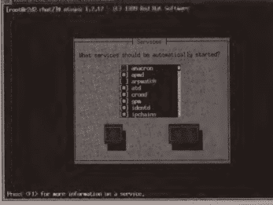

  可滚动屏幕显示当前运行级别中所有服务的状态。要开启一个服务，你需要选择它；要关闭一个服务，你只需取消选择它。完成所有更改后，你可以通过点击“确定”按钮保存更改，或通过点击“取消”按钮放弃更改。如果你希望在不同的运行级别配置上进行操作，只需使用 `--level` 选项提供运行级别即可。例如，`ntsysv --level 1` 使你可以操作运行级别 1 的配置。


##### 使用 *linxconf* 管理运行级别

你还可以使用 *linxconf* 工具来配置运行级别。请遵循以下步骤：

1. 选择 控制面板 \ 控制服务。
2. 启用或禁用一个或多个服务。
3. 接受更改。
4. 在退出 *linxconf* 之前激活这些更改。

##### 为运行级别创建新服务

如果你安装来自知名厂商的服务器软件包，它们通常会提供一个不错的 RPM 包，其中也包含了必要的服务脚本，位于 `/etc/rc.d/init.d` 目录下。然而，有时你会发现一些有用的软件并没有附带所有功能齐全的附件，最终你需要自定义它，或者至少修改它在你的系统上的工作方式。在这种情况下，你可能需要为新软件创建一个服务脚本。本节展示了如何轻松创建一个新的服务脚本，并将其放置在 `/etc/rc.d/init.d` 目录中。

首先，请查看列表 2-4，其中展示了 *httpd* 脚本，这是 `/etc/rc.d/init.d` 目录中的一个现有服务脚本。该脚本用于启动和停止 Apache Web 服务器。

```bash
Listing 2-4 /etc/rc.d/init.d/httpd
#!/bin/sh
#
# Startup script for the Apache Web Server
#
# chkconfig: 345 85 15
# description: Apache is a World Wide Web server. \
#               It is used to serve HTML files and CGI.
# processname: httpd
# pidfile: /var/run/httpd.pid
# config: /etc/httpd/conf/access.conf
# config: /etc/httpd/conf/httpd.conf
# config: /etc/httpd/conf/srm.conf

# Source function library.
. /etc/rc.d/init.d/functions

# See how we were called.
case "$1" in

start)
	echo -n "Starting httpd: "
	odaemon httpd
	echo
	touch /var/lock/subsys/httpd
	;;
stop)
	echo -n "Shutting down httpd: "
	[ -f /var/run/httpd.pid ] && {
		kill `cat /var/run/httpd.pid`
		echo -n httpd
	}
	echo
	rm -f /var/lock/subsys/httpd
	rm -f /var/run/httpd.pid
	;;
status)
	status httpd
	;;
restart)
	$0 stop
	$0 start
	;;
reload)
	echo -n "Reloading httpd: "
	[ -f /var/run/httpd.pid ] && {
		kill -HUP `cat /var/run/httpd.pid`
		echo -n httpd
	}
	echo
	;;
*)
	echo "Usage: $0 {start|stop|restart|reload|status}"
	exit 1
esac

exit 0
```

这个 sh 脚本其实是一个简单的 case（条件）语句。你可以基于像这样的现有服务脚本创建一个新服务脚本。假设你的新服务名为 webmonitor，可执行文件存储在 /usr/sbin/webmonitor。


> 脚本和可执行程序使用相同名称是一种惯例。

以下是创建 /etc/rc.d/init.d/webmonitor 脚本的方法：

1. 从 /etc/rc.d/init.d 复制一个现有脚本，并重命名为 /etc/rc.d/init.d/webmonitor。为了简化并便于理解，此示例假设你使用了列表 2-4 中显示的 /etc/rc.d/init.d/httpd 脚本。
2. 使用你喜欢的文本编辑器（如 vi），搜索并替换所有 httpd 实例为 webmonitor。
3. 如果你将可执行文件保留在 /sbin、/usr/sbin、/bin 或 /usr/bin 以外的目录中，你必须更改 daemon webmonitor 行以反映 webmonitor 可执行文件的路径。例如，如果你将可执行文件保留在 /usr/local/web/bin 目录中，请将 daemon webmonitor 行更改为 daemon /usr/local/web/bin/webmonitor。
4. 如果 `/usr/sbin/webmonitor` 没有创建 PID 文件（`/var/run/webmonitor.pid`），请用 `killproc webmonitor` 替换 kill `cat /var/run/webmonitor.pid` 行，并删除 `rm -f /var/run/webmonitor.pid` 行。
5. 运行 `chmod 750 /etc/rc.d/init.d/webmonitor` 以更改文件权限，使 root 用户能够读取、写入和执行该脚本。

这就是创建新的 webmonitor 服务所需做的全部工作。现在，你可以使用 `chkconf`、`ntsysv` 或 `linuxconf` 实用工具将此新服务添加到所需的运行级别中。

# 第 3 章：文件权限

## 理解文件/目录权限

与其他所有 Unix 和类 Unix 操作系统一样，Linux 将文件或目录与一个用户和一个组关联。考虑以下示例：

```text
-rw-rw-r--  1 sheila intranet  512 Feb 6 21:11 milkweb.txt
```

上面一行是在我的 Red Hat Linux 系统上通过 `ls -l milkweb.txt` 命令生成的。你可能已经知道 `ls` 程序用于列出文件和目录。`-l` 选项显示 `milkweb.txt` 文件的完整列表。表 3-1 以表格形式显示了相同的信息。

### 表 3-1 示例 ls 1 命令的输出

| 信息类型 | ls 输出 |
| :--- | :--- |
| 文件访问权限 | -rw-rw-r-- |
| 链接数 | 1 |
| 用户（文件所有者） | sheila |
| 组 | intranet |
| 文件大小（字节） | 512 |
| 最后修改日期 | Feb 6 |
| 最后修改时间 | 21:11 |
| 文件名 | milkweb.txt |

在这里，`milkweb.txt` 文件的所有者是一个名为 `sheila` 的用户。她是唯一可以更改该文件访问权限的普通用户。唯一可以更改权限的其他用户是超级用户。该文件的组为 `intranet`。任何属于 intranet 组的用户都可以基于当前设置的组权限（由所有者设置）来访问（读取、写入或执行）该文件。

要成为文件所有者，用户必须创建该文件。在 Red Hat Linux 中，当用户创建文件或目录时，其组也会设置为该用户的默认组，该组恰好是与用户同名的私有组。为了更清楚地说明这一点，假设我以 `kabir` 身份登录到 Red Hat Linux 系统，并使用 `vi` 等文本编辑器创建一个名为 `todo.txt` 的文件。如果我使用 `ls -l todo.txt` 命令，将出现以下输出：

```text
-rw-rw-r-  1 kabir  kabir  4848 Feb 6 21:37 todo.txt
```

文件所有者和组名相同，因为在 Red Hat Linux 中，`kabir` 的默认（私有）组也称为 `kabir`。这可能会引起一些混淆，但这是为了省去你一些麻烦；当然，你可以很容易地改变这种行为。然而，关键是当创建新文件时，文件所有者是文件的创建者，而组是所有者的默认组。接下来，看看如何更改文件的所有权。

作为普通用户，你不能将文件或目录的所有权重新分配给其他人。例如，我不能以用户 `kabir` 的身份创建一个文件，然后将其所有权重新分配给名为 `sheila` 的用户。原因当然是安全性。如果允许普通用户将文件所有权重新分配给他人，某人可能会创建一个恶意的程序，删除文件，将程序的所有权更改为超级用户，并清除整个文件系统。只有超级用户可以重新分配文件或目录的所有权。

### 使用 chown 更改文件/目录的所有权

作为超级用户，你可以使用 `chown` 命令更改文件/目录的所有权。要更改文件或目录的所有权，请按照如下方式运行命令：

```bash
chown newuser file_or_directory
```

例如，以下命令使用户 sheila 成为文件 `kabirs_plans.txt` 的新所有者：

```bash
chown sheila kabirs_plans.txt
```

超级用户可以使用 `chown` 命令按如下方式更改文件或目录的组：

```bash
chown newuser.newgroup file_or_directory
```

例如，以下命令不仅使 sheila 成为新所有者，还将文件的组重置为 admin：

```bash
chown sheila.admin kabirs_plans.txt
```

希望更改给定目录下所有文件或目录的用户和/或组所有权的超级用户可以使用 `-R` 选项以递归模式运行 `chown` 命令。以下示例更改 /home/kabir/plans 目录及其内部所有文件和子目录的用户和组所有权：

```bash
chown -R sheila.admin /home/kabir/plans/
```

虽然你必须成为超级用户才能更改文件的所有权，但你仍然可以使用 `chgrp` 命令作为普通用户更改文件或目录的组。

### 使用 chgrp 更改文件/目录的组所有权

只要你也是新组的一部分，`chgrp` 命令允许你更改文件或目录的组所有权。换句话说，只有当你属于旧组和新组，或者像往常一样作为超级用户时，你才能更改组。例如，如果你运行以下命令来更改目录中所有 HTML 文件的组，你也必须是 httpd 组的一部分：

```bash
chgrp httpd *.html
```


你可以使用不带任何参数的 `groups` 命令来查看你所属的组。与 `chown` 命令类似，`chgrp` 也使用 `-R` 选项递归更改一个或多个文件或目录的组名。

## 使用八进制数设置文件/目录权限

尽管使用八进制数是我设置文件/目录权限的首选方法，但我必须提醒你，这涉及到位（bits）的概念。如果你觉得自己数学能力有限，可以跳过本节，下一节将使用更简单的访问字符串来解释相同的权限。

由于使用了一种不常用的数字系统（*八进制数系统*）来解释访问权限，这里提供一个小知识复习，介绍八进制数。八进制数系统使用 8 个数字，而常用的十进制系统使用 10 个数字。八进制数字是 0 到 7，每个数字都可以用三个二进制位表示（在二进制系统中）。表 3-2 展示了每个八进制数字的二进制等价形式。

### 表 3-2 八进制到二进制的转换

| 八进制 | 二进制 |
|-------|--------|
| 0 | 000 |
| 1 | 001 |
| 2 | 010 |
| 3 | 011 |
| 4 | 100 |
| 5 | 101 |
| 6 | 110 |
| 7 | 111 |

这张表对于理解文件/目录权限非常有用。图 3-1 展示了如何将权限可视化为四个八进制数字。在此，第一个八进制数字是最左边的，也就是权重最大的数字。

### 图 3-1 使用四个八进制数字的权限图示

| 八进制值 | set-UID | r | r | r |
|-------------|---------|---|---|---|
|             | set-GID | w | w | w |
|             | sticky-bit | x | x | x |
| **特殊权限** | **用户** | **组** | **其他** |     |

如图 3-1 所示，第一个八进制数字用于设置特殊权限，第二个数字用于设置文件所有者的权限，第三个数字用于设置组的权限，第四个数字用于设置其他所有用户的权限。当省略这些数字中的任何一个时，它被视为 0。表 3-3 展示了几个权限值的示例。

### 表 3-3 权限值示例

| 权限值 | 说明 |
|---|---|
| 0400 | 仅文件所有者拥有读取（r）权限。这等同于 400，其中缺失的八进制数字被视为前导 0。 |
| 0440 | 文件所有者和组中的用户都拥有读取（r）权限。这等同于 440。 |
| 0444 | 所有用户都拥有读取（r）权限。这等同于 444。 |
| 0644 | 文件所有者拥有读取（r）和写入（w）权限。其他所有人对文件只有只读访问权限。这等同于 644；数字 6 由 4 (r) 和 2 (w) 相加得出。 |
| 0755 | 文件所有者拥有读取（r）、写入（w）和执行（x）权限，其他所有人拥有读取（r）和执行（x）权限。这等同于 755；数字 7 由 4 (r) + 2 (w) + 1 (x) 相加得出。 |
| 4755 | 与上一个示例中的 755 相同，区别在于该文件设置了 set-UID。当运行具有 set-UID 权限的可执行文件时，该进程将以文件所有者的身份运行。换句话说，如果一个文件设置了 set-UID 且所有者为用户 gunchy，那么每当该文件运行时，运行的程序将享有用户 gunchy 的特权。因此，如果一个文件的所有者是 root，并且也设置了 set-UID，任何能够运行该文件的人实质上都将拥有超级用户的权限。如果任何人都能进入一个由 root 拥有的 set-UID 文件（除了 root 之外），这将是一个重大的安全漏洞。在设置 set-UID 位时要非常小心。 |
| 2755 | 类似于 755，但还设置了 set-GID 位。当执行此类文件时，它实质上拥有该文件所属组的所有权限。 |
| 1755 | 类似于 755，但还设置了 sticky 位，正式名称为 save text mode。这个不常用的功能告诉操作系统在程序退出后仍将可执行程序映像保留在内存中。这是一种试图减少大型程序启动时间的外部尝试。在可能的情况下，你应该尝试重新编码应用程序以获得更好的性能，而不是设置 sticky 位。 |

为了确定合适的权限设置，你需要确定用户、组和其他所有人应该拥有何种类型的访问权限，并考虑是否必要设置 set-UID、set-GID 或 sticky 位。确定需求后，要构造每个八进制数字，请使用 4（读取）、2（写入）和 1（执行），或通过相加这三个值中的任意组合来使用自定义值。虽然基于八进制数的权限起初可能看起来有点难，但通过练习，使用它们可以变得得心应手。

## 使用访问字符串设置文件/目录权限

使用访问字符串方法设置权限（据称）比前面部分讨论的数字方法更简单。图 3-2 展示了权限图示的访问字符串版本。

|             | set-UID (s) | read (r) | read (r) | read (r) |
|-------------|-------------|----------|----------|----------|
|             | set-GID (s) | write (w)| write (w)| write (w)|
|             | sticky-bit (t)| execute (x)| execute (x)| execute (x)|
| **特殊权限** | **用户 (u)** | **组 (g)** | **其他 (o)** | **所有 (a)** |


每种权限类型都用一个字符表示（括号内为说明）。要创建一个权限字符串，你需要指定以下内容：

- 它影响谁。你的选择是 u（用户）、g（组）、o（其他）或 a（所有）。
- 需要设置的权限类型。你的选择是 r（读取）、w（写入）、x（执行）、s（set-UID 或 set-GID）或 t（sticky 位）。
- 操作类型。指明你是在设置权限还是在移除权限。当设置权限时，你需要指定 + 表示添加，指定 - 表示移除。

例如，为了允许文件所有者读取该文件，你需要指定如 u+r 这样的权限字符串。为了允许所有用户读取和执行文件，你需要如 a+rx 这样的权限字符串。类似地，要使文件设置为 set-UID，你需要 u+s；要设置为 set-GID，你需要 g+s。

## 使用 chmod 更改文件/目录权限模式

chmod 实用工具允许你更改权限模式，因此被称为 chmod。你可以使用八进制方法或字符串方法使用这个实用工具。例如，

```
chmod 755 *.pl
```

更改扩展名为 .pl 的文件的权限。每个 PL 文件都被设置为所有者具有读取、写入和执行权限（7 = 4 [读取] + 2 [写入] + 1 [执行]）。这些文件也被设置为组和其他用户具有读取和执行权限（5 = 4 [读取] + 1 [执行]）。

你可以使用字符串方法实现相同的结果，如下所示：

```
chmod a+rx,u+w *.pl
```

这里 a+rx 用于允许所有用户（a）拥有读取（r）和执行（x）权限，u+w 用于允许文件所有者（u）写入（w）文件。请注意，当需要使用多个访问字符串时，每对字符串之间需要用逗号分隔。另外请注意，权限字符串之间不允许有空格。

如果你想更改目录中所有文件和子目录的权限，请使用 -R 选项执行递归权限操作。例如，

```
chmod -R 750 /www/mysite
```

将 750 八进制权限应用于 /www/mysite 目录中的所有文件和子目录。

> **注意**
> 在使用 chmod 的 -R 选项时要非常小心。你可能会更改子目录的权限，从而产生潜在的安全问题。

## 关于目录权限的特殊说明

目录的权限设置与常规文件类似，但不完全相同。以下是关于目录权限的一些特殊说明：

- 对目录的只读访问不允许你 `cd` 进入该目录；要做到这一点，你需要执行权限。
- 仅执行权限允许你访问目录内的文件，前提是你知道它们的名称并且有权读取这些文件。
- 要使用 `ls` 等程序列出目录内容，或 `cd` 进入目录，你需要同时拥有读取和执行权限。
- 如果你对目录拥有写入权限，你可以创建、删除或修改该目录内的任何文件或子目录，即使该文件或子目录由其他人拥有。

## 管理链接的权限

除了常规文件和目录，你很经常会遇到另一种类型的文件——*链接*。

链接是指向其他文件的指针文件。链接允许你为单个文件或目录创建多个名称。链接有两种类型：硬链接和软链接（符号链接）。本节讨论使用链接时产生的特殊权限问题。


## 更改硬链接的权限或所有权

如果你更改硬链接的权限或所有权，原文件的权限也会被更改。例如，请查看以下 `ls -1` 输出：

```
-rw-r--r--  1 root    21 Feb  7 11:41 todo.txt
```

现在，如果 root 用户使用命令行 `ln todo.txt plan` 为 `todo.txt` 创建一个名为 `plan` 的硬链接，`ls -1` 的输出如下所示：

```
-rw-r--r--  2 root    21 Feb  7 11:41 plan
-rw-f--r--  2 root    21 Feb  7 11:41 todo.txt
```

如你所见，硬链接 `plan` 和原始文件 `todo.txt` 具有相同的文件大小（显示在第四列），并且共享相同的权限和所有权设置。现在，如果 root 用户运行以下命令：

```
chown sheila plan
```

以将硬链接的所有权授予名为 `sheila` 的用户，它会正常工作吗？请查看上述命令执行后的 `ls -1` 输出：

```
-rw-f--r--  2 sheila  root    21 Feb  7 11:41 plan
-rw-f--r--  2 sheila  root*   21 Feb  7 11:41 todo.txt
```

`chown` 命令更改了 `plan` 的所有权，但 `todo.txt`（原始文件）的所有权也随之更改了。因此，当你更改硬链接的所有权或权限时，该效果同样适用于原始文件。

## 更改软链接的权限或所有权

更改软链接（或符号链接）的所有权的方式与硬链接不同。例如，请查看以下 `ls -1` 输出：

```
lrwxrwxrwx  1 sheila  root    8 Feb  7 11:49 plan -> todo.txt
-rw-f--r--  1 sheila  root    21 Feb  7 11:41 todo.txt
```

文件 `plan` 是指向 `todo.txt` 的符号链接。现在，假设 root 用户按如下方式更改符号链接的所有权：

```
chown kabir plan
```

`ls -1` 输出显示：

```
lrwxrwxrwx  1 kabir  root     8 Feb  7 11:49 plan -> todo.txt
-rw-f--r--  1 sheila  root    21 Feb  7 11:41 todo.txt
```

现在的问题是，用户 `kabir` 能否使用符号链接（`plan`）向 `todo.txt` 写入？答案是否定的，除非存储这些文件的目录的所有者是 `kabir`。因此，更改软链接的所有权的效果与硬链接不同。然而，如果你更改软链接的权限设置，其所指向的文件会获得新的设置。例如：

```
chmod 666 plan
```

会更改 `todo.txt` 文件的权限，如 `ls -1` 列表所示：

```
-rw-rw-rw-  1 kabir  kabir   25 Feb  7 11:52 plan
-rw-f--r--  1 sheila  root   21 Feb  7 11:41 todo.txt
```

因此，在使用链接时要谨慎，因为这些特殊文件上的权限和所有权设置有点反直觉。

## 为多服务器系统创建权限策略

Unix 和类 Unix 系统中大多数用户问题都与文件权限有关。如果昨天运行正常的某个功能突然停止工作，你应该首先怀疑是权限问题。权限问题的最常见原因之一是 root 账户。许多缺乏经验的系统管理员经常通过超级用户（root）账户访问文件和程序。当使用 root 用户账户运行程序时，该程序创建的文件通常被设置为 root 用户所有。本节讨论一些你可能想要实施的权限策略，特别是如果你的单台系统上有许多用户时。

## 设置用户配置文件的权限

每个用户的主目录都包含一些部分隐藏的文件，这些文件名以点（或句号）开头。这些文件通常用于在用户登录时执行命令。例如，用户可用的所有 shell（sh、csh、bash 等）都会从点文件读取其设置，例如扩展名为 `.cshrc` 或 `.bashrc` 的文件。如果用户没有小心地正确设置文件权限，另一个不太友好的用户可能会给天真的用户带来麻烦。例如，如果一个用户的 `.cshrc` 文件允许第二个用户写入，后者可以搞一些小恶作剧，比如在 `.cshrc` 文件的开头放入一个注销命令，使第一个用户一登录就被注销。当然，这种小恶作剧可能会演变成其他破坏系统用户文件隐私的恶作剧。因此，在多人系统上，你可能需要关注这种情况。你可以运行 COPS 程序来检测许多权限问题。如果你只有少数几个用户，你也可以快速进行简单的检查，例如：

```
find /home -type f -name ".*rc" -exec ls -l {} \;
```

此命令生成 `/home` 目录层次结构中所有以 `rc` 结尾（如 `.cshrc`、`.bashrc` 等）的点文件的权限列表。如果你的用户主目录保存在 `/home` 中，这可以快速向你展示哪些用户可能存在权限问题。

## 设置用户的默认文件权限

作为系统管理员，你可以为系统中所有用户文件定义默认的权限设置。要为新文件设置默认权限，请使用 `umask` 命令，如下所示：

```
umask mask
```

要了解 `umask` 的工作原理，请考虑一个例子。假设 `umask` 设置为 022。当创建新文件时，文件创建函数 `open` 通常会请求 0666 的权限设置。然而，在这种情况下，文件的最终权限设置由系统推导得出，如图 3-3 所示。

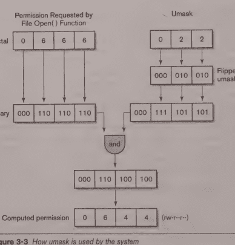

**图 3-3 系统如何使用 umask**

如图 3-3 所示，请求的权限 0666 与当前文件掩码的补数（即 022 变为 755）进行逻辑与（AND）运算，结果为 0644，这允许文件所有者读取和写入，但仅允许其他人员读取。

要为文件权限创建默认掩码，你可以将 **umask** 命令嵌入 `/etc` 中的全局 shell 资源文件，这样当用户登录并运行 shell 时，该 shell 的全局资源文件将执行。这进而执行 `umask` 命令，并为用户会话提供默认掩码。例如，如果你的用户使用 `/bin/csh` 或 `/bin/sh` shell，你可以将所需的 `umask` 命令放入 `/etc/csh.cshrc` 文件中以实现此目的。

## 设置可执行文件权限

普通用户可以运行的程序文件，除了所有者之外，永远不应为任何人设置写权限。例如，`/usr/bin` 中的程序文件应具有的权限设置应使得只有 root 可以读取、写入和执行，而其他人只能读取和执行这些文件。允许其他人写入程序文件会造成严重的安全漏洞。例如，如果允许 root 以外的人写入诸如 `/usr/bin/zip` 这样的程序，恶意用户可以用特洛伊木马程序替换真正的 Zip 程序，从而破坏系统安全，并随意损坏文件和目录。因此，务必检查以确保你系统上的程序文件具有适当的权限。经常运行 COPS 来检测权限相关的问题。

## 设置 FTP 的默认文件权限

如果你的许多用户在服务器上通过 FTP 传输文件，你可以控制 FTP 服务器的默认 `umask` 设置，以确保一个用户的文件不能被另一个用户访问。例如，如果你想设置权限，使得仅该用户及其组可以读取通过 FTP 上传到 Web 服务器上的文件，你可以修改 `/etc/xinetd.d/wu-ftpd` 文件中的 `server_args` 行。该行默认为：

```
server_args						= -l -a
```

要为通过 FTP 上传的所有文件设置默认 `umask`，你需要添加一个带有适当 `umask` 值的 `-u` 参数。例如，要为每个上传的文件设置 640（rw-r--r--）权限，你可以将 `umask` 设置为 026。因此，按如下方式更改上一行：

```
server_args						= -l -a -u026
```

重启 `inetd` 服务器（`killall -USR1 xinetd`），然后通过用户账户 FTP 一个文件，以查看权限是否如预期那样设置。

对于作为许多不同客户端的 Web 服务器的系统，这可能非常有用。如果你不希望一个客户端看到另一个客户端的文件，你可以使用此选项并配合特殊的所有权设置。例如，假设你将所有 Web 客户端文件保存在 `/www` 分区或目录中，每个客户端网站都有自己的目录（`/www/myclient1`、`/www/myclient2` 等）。你可能拥有


已经为每个客户端分配了一个 FTP 账户，用于向这些目录上传文件。为了防止某个客户端看到其他客户端的文件，请按照 FTP 服务器的说明使用 `umask`，并重置每个客户端站点的所有权，方法如下：

```
chown -R client.Web server user /www/client dir
```

例如，如果你以 httpd 身份运行 Web 服务器，并且有一个名为 myclient 的客户端用户，那么上述命令将如下所示：

```
chown -R myclient.httpd /www/myclient
```

这将把 `/www/myclient` 目录及其所有子目录和文件的所有权更改为 myclient（用户）和 httpd（组）。这样做的目的是允许客户端用户拥有、修改和删除她的文件，并允许 Web 服务器读取该目录中的文件。但是，为了禁止其他人访问，你必须如下更改权限：

```
chmod -R 2770 /www/client dir
```

对于当前的示例，实际命令如下：

```
chmod -R 2770 /www/myclient
```

这将把 `/www/myclient` 的所有文件和子目录权限设置为 `2770`，这允许所有者（myclient）和 Web 服务器用户（httpd）读取、写入和执行这些文件和目录，同时也确保当创建新文件时，它们的权限会被设置以允许 Web 服务器用户读取该文件。这是通过使用 set-GID (2) 位来实现的。

## 使用常见的文件/目录实用工具

本节向你展示如何使用 Red Hat Linux 系统中现成的几个常用文件和目录实用程序。

### 查看文件和目录

ls 程序可能是任何 Unix 或类 Unix 平台上使用最广泛的程序。ls 最常用的选项有 -l（长列表），-a（所有文件，包括以句点开头的文件名），-1（单列，仅文件名列表），和 -R（递归列表）。

### 导航进入目录

你可能已经知道 cd 命令，这实际上是一个内置的 shell 命令。如果你不提供目录名称作为参数，cd 命令会将你返回到当前使用的用户帐户的主目录。任何时候如果你对文件系统中的位置感到疑惑，请使用 pwd 命令，它会显示你当前的目录名。

### 确定文件类型

与 Microsoft Windows 操作系统不同，Linux 不依赖文件扩展名来确定文件类型。使用 file 实用工具来确定文件的类型。例如，

```
file /usr/bin/file
```

显示 /usr/bin/file（本身）是什么类型的文件。以下是其输出示例：

```
/usr/bin/file: ELF 32-bit LSB executable, Intel 80386, \
version 1, dynamically linked, not stripped
```

### 查看文件或目录的访问统计

你可以使用 stat 程序获取文件或目录的统计信息。例如，

```
stat /tmp
```

显示 /tmp 目录的统计信息。以下是其输出示例：

```
File: "/tmp"
Size: 2048
Filetype: Directory
Mode: (1777/drwxrwxrwt)
Uid: { 0/
root }
Gid: { 0/
root }
Device: 3,0
Inode: 16321
Links: 22
Access: Sun Feb 7 02:01:35 1999\(00000.00:01\|1\)\)
Modify: Sun Feb 7 02:01:01 1999\(00000.00:00\|45\)\)
Change: Sun Feb 7 02:01:01 1999\(00000.00:00\|45\)\)
```

### 复制文件和目录

使用 `cp` 命令将文件从一个位置复制到另一个位置。例如，

```
cp /some/important.txt /new/place/
```

将名为 `important.txt` 的文件从 `/some` 目录复制到 `/new/` 目录。你还可以指定新的目标文件名。`cp` 的一个常用选项是 `-f`，它允许你将文件强制复制到已有同名文件的位置。例如，

```
cp -f /some/important.txt /new/place/
```

即使 `/new/place` 目录中已有名为 `important.txt` 的文件，也会复制该文件。

若要连同其所有文件和子目录一起复制一个目录，请使用以下命令：

```
cp -r source-directory destination-directory
```

例如：

```
cp -r /tmp/foo /zoo/foo
```

### 移动文件和目录

若要移动文件或目录，请使用 `mv` 命令。例如，以下命令将 `/file1` 移动到 `/tmp/file2`：`mv /file1 /tmp/file2`

类似地，你也可以连同其所有内容一起移动一个目录。请注意，`mv` 不能跨不同文件系统移动目录。要做到这一点，请使用带有 `-r` 选项的 `cp` 将目录复制到新的文件系统，然后从当前位置删除该目录（见下文）。

### 删除文件和目录

若要删除文件或目录，请使用 `rm` 命令。例如，以下命令删除该文件：

```
rm filename
```

如果你使用的是 `/bin/tcsh` shell，你可能有一个名为 `rm` 的别名设置如下：

```
alias rm rm -i
```

在这种情况下，`-i` 提示符会告知命令在实际删除任何内容前先提示你。如果你希望被提示，可以使用 `-i` 选项。使用 `-f` 选项可强制删除。

若要删除一个目录，你需要指定 `-r` 选项。例如，

```
rm -rf directory
```

删除指定目录内的所有文件和子目录。

### 查找文件

若要定位文件，你可以使用各种命令。若要定位程序的完整路径，请使用 `which` 命令。例如，

```
which httpd
```

如果 httpd 程序在包含在 `$PATH` 环境变量中的某个目录中可用，则会显示 httpd 程序的完整限定路径名。某些 shell 内置了 `which` 命令，而另一些则使用 `/usr/sbin/which` 代替。

你可以使用 `locate` 程序通过部分或完整名称来定位文件或目录。例如，以下命令查询 `updatedb` 文件名数据库并返回 `netpr.p1` 文件的所有出现位置：

```
locate netpr.p1
```

为了让 `locate` 正常工作，你必须确保已设置一个 cron 任务以每日或每周运行 `updatedb`。Red Hat 默认安装实际上会自动设置这样的任务。

###### 提示

你可以使用 `find` 程序来定位文件或目录。例如，若要定位当前目录及其所有子目录中的所有 HTML 文件，请如下运行 `find`：

```
find . -type f -name "*.html"
```

### 覆盖默认文件权限掩码

系统管理员可以在你使用的 shell 的全局资源文件中设置默认权限掩码。例如，如果你使用的是 /bin/tcsh shell，系统管理员可以使用 umask 命令在 /etc/csh.cshrc 文件中为你设置默认文件权限。但是，如果你想覆盖默认权限掩码，请在命令行运行 umask 来更改默认掩码。例如，系统设置的默认 `umask` 为 `022`（未显示）。

```
umask 222
```

将默认权限掩码设置为对所有人可读、可读、可读。换句话说，它关闭了用户、组和其他人的写权限。这也会覆盖你 shell 的系统默认设置。但是，这种更改是临时的；当你注销并重新登录时，系统默认设置将再次生效。如果你不喜欢系统的权限掩码，请在你的 shell 资源文件中放入适当的 `umask` 命令。例如，如果你希望掩码始终为 222 并且使用 /bin/tcsh 作为 shell，你可以在你的 ~/.cshrc 文件中放入此命令，以便每次登录时，umask 命令都会覆盖系统默认设置。

### 使用 ext2 文件系统特有的权限

用于 Red Hat Linux 的 ext2 文件系统提供了一些独特的功能。其中一个功能允许文件对即使是 root 用户也是不可变的。例如，`chattr +i filename` 设置 ext2 文件系统中文件的 i 属性。当此属性被设置时，任何人都不可以修改、删除或重命名该文件。无法创建链接到


也未指向此文件。此属性只能由 root 用户设置或清除。因此，你可以使用此属性来防止涉及文件的意外情况。当需要清除该属性时，请运行以下命令：

```
chattr -i filename
```

如果你开始使用 `chattr` 命令，你可能会注意到，即使你有权限修改或删除文件，有时却无法做到。这种情况发生在你忘记之前已经使用 `chattr` 设置了文件的不可变属性时；由于此属性不会显示在 `ls` 命令的输出中，这可能会让人困惑。要查看哪些文件具有哪些 ext2 属性，请运行 `lsattr` 程序并传入文件名作为参数。

## 使用 Linuxconf

### Linuxconf 适合你吗？

Linuxconf 是一个系统管理工具，它提供了一组核心功能，可以通过多种接口访问，例如 Web 浏览器、基于文本的菜单导向接口或基于 X Window 的图形接口。Linuxconf 附带一组核心模块；每个模块为某个系统服务或任务提供一组管理功能。例如，Apache Web 服务器管理是在 Apache 模块中实现的。模块存储在 `/usr/lib/linuxconf/module` 目录中。目前，许多模块随 Linuxconf 的 RPM 包版本一起分发。表 4-1 展示了 Linuxconf 版本 1.1.6 中包含的所有模块。

### 表 4-1 Linuxconf 版本 1.1.6 中包含的模块

| 模块 | 描述 |
|:-------|:-----------|
| chcpd | 动态主机配置协议服务器配置模块 |
| firewall | 防火墙配置模块，允许内核级数据包过滤、IP 伪装、端口重定向和 IP 计费 |
| mailconf | Sendmail SMTP 服务器配置 |
| motd | 当日消息文件 (etc/motd) 配置模块 |
| mrtg | Mrtg (Multitool Traffic Crapher) 配置模块 |
| netadm | 网络配置模块 |
| pppdadm | PPP 相关配置模块 |
| rarp | Linux 内核 RARP 表配置模块 |
| squid | Squid 代理配置模块 |
| status | 系统状态模块 |
| treemenu | 内部模块 |
| usermenu | 内部模块 |
| wuftpd | wu-ftpd, FTP 服务器配置模块 |
| opensshd | open sshd 配置模块 |
| syslogconf | syslog 配置模块 |
| uucp | uucp 配置模块 |
| kernelconf | 内核配置模块 |
| inittab | /etc/inittab 文件配置模块 |
| fetchmailconf | fetchmail 配置模块 |
| ircdconf | IRC 客户端配置模块 |
| modemconf | 调制解调器配置模块 |
| shellmod | shell 配置模块 |
| managerpm | RPM 包管理模块 |
| vregistry | 虚拟注册表配置模块 |
| isapnconf | ISA 即插即用配置模块 |

你可以在 www.solucomrp.qc.ca/linuxconf/ 找到许多其他模块。虽然 Linuxconf 背后的理念非常令人印象深刻，但我对该应用程序的现状并非完全买账。我发现了一些令人恼火的问题，这些问题很可能在未来的版本中得到修复。例如，许多重要的帮助页面缺失或尚未完成，而且 Linuxconf 自身生成的错误消息有些晦涩难懂。除了这些烦恼之外，它按预期运行。简而言之，我建议你将 Linuxconf 视为一个正在进行的开发项目，它非常接近成熟。

### 安装 Linuxconf

安装 Linuxconf 非常简单。如果你在 Red Hat Linux 安装过程中没有安装 Linuxconf，你可以随时从官方 Red Hat CD-ROM 附带的 RPM 包中安装它。例如，我按如下方式安装以下 RPM 包：

```
rpm -ivh gnome-linuxconf-0.33-6.i386.rpm
rpm -ivh linuxconf-1.19r2-2.i386.rpm
```

上述 RPM 包安装了 Linuxconf 以及 Linuxconf 接口的 Gnome 版本。

此外，你还可以从官方 Linuxconf FTP 站点 `ftp://ftp.solucorp.gc.ca/pub/linuxconf/devel/` 下载 RPM 包。

### 配置 Linuxconf

Linuxconf 可以以多种方式使用，包括文本模式、图形模式或 Web 模式。它会自动在文本模式（用于控制台或远程 shell）或图形模式（用于 X Window）之间进行选择。例如，如果你登录到系统控制台并从命令行运行 `/bin/linuxconf`，你将看到一个类似于图 4-1 所示的屏幕。

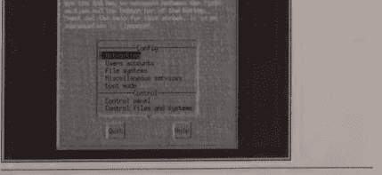

图 4-1 Linuxconf 的文本接口

Linuxconf 界面使用树状菜单结构。图 4-1 显示了两个顶级菜单项——Config 和 Control。以下是文本模式中的导航方式。

要展开菜单的某个分支，使用方向键选择它，然后按 Enter。例如，要展开 Config 菜单下的 Networking 分支，请选择 Networking 并按 Enter。结果如图 4-2 所示。

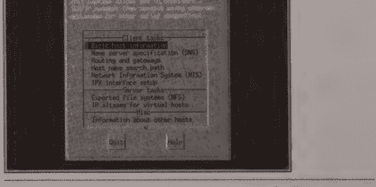

图 4-2 在 Linuxconf 的 Config 部分下展开 Networking 部分

如你所见，Config 下有多个分支（Networking, Users accounts, File systems, boot mode）。要关闭一个分支，请选择 Quit 按钮并按 Enter。要退出 Linuxconf，请使用 *Tab* 键再次选择 Quit 按钮，然后按 Enter。Linuxconf 会探测正在运行的服务器和配置，并确定是否需要激活任何内容。如果由于你更改了某些内容而需要激活某些配置，你会看到一个带有图 4-3 中选项的屏幕。

在这种情况下，如果你想查看 Linuxconf 将如何同步运行系统与当前配置，请选择 *Preview what has to be done* 选项并按 Enter。会出现另一个屏幕，显示待办事项列表，如图 4-4 所示。


图 4-3 Linuxconf 退出时的选项

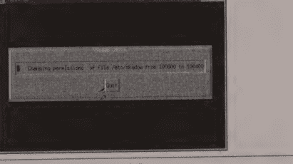

图 4-4 Linuxconf 的待办事项列表

如果你决定让 Linuxconf 激活列出的更改，请退出预览屏幕，选择 **Activate the changes** 选项，然后按 Enter。Linuxconf 将激活必要的部分，然后退出。

如果你想在 X Window 中使用 Linuxconf 的 GUI，请在 X 终端窗口中或通过你的窗口管理器运行 **/usr/bin/gnome-linuxconf** 或 **/bin/linuxconf**。如图 4-5 所示，树状菜单在 GUI 版本中看起来美观得多。

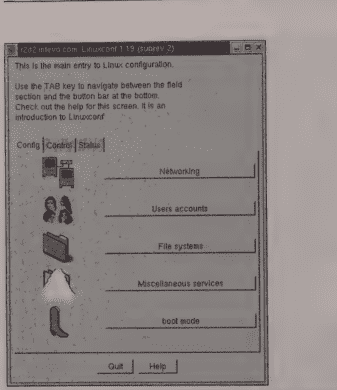

图 4-5 Linuxconf 的图形用户界面

与基于文本的界面一样，当你决定退出 GUI 时，Linuxconf 会要求你激活所做的任何更改。你还可以预览或退出而不激活当前配置。

不幸的是，基于 Web 的 Linuxconf 界面是三种界面中最难看的一种，尽管它本来可以是最酷的。由于我最喜欢的界面是 GUI，因此本章中关于 Linuxconf 的讨论都使用 GUI。

### 为 Linuxconf 设置基于 Web 的远程访问

能够随时通过任何平台上的 Web 浏览器进行管理的优势是无限的。这对于管理组织中大量 Linux 系统的人来说特别有帮助。然而，如果你允许从任何地方管理你的 Linux 系统，你就会带来巨大的安全风险——任何人都可以现在尝试通过 Web 可访问的 Linuxconf 界面闯入你的系统。这就是为什么你必须将基于 Web 的 Linuxconf 访问限制在你的可信网络中。

基于 Web 的 Linuxconf 是一个由 xinetd 运行的服务。当你安装 Linuxconf RPM 包时，你会向 *etc/services* 文件添加一行，例如：

```
linuxconf    98/tcp
```

rpm 安装还会放入一个 *etc/xinetd.d/linuxconf-web* 文件。默认情况下，该文件看起来如下：

```
# default: off
# description: The Linuxconf system can also be accessed
via a web \
			browser. Enabling this service will allow
connections to \
# 			Linuxconf running in web UI mode.
service linuxconf
{
	socket_type		= stream
	wait			= yes
	user			= root
	server		= /sbin/linuxconf
	server_args		= --http
disable			= yes
}
```

要启用 Web 界面，请将 **disable = yes** 行更改为 **disable = no**。这允许 xinetd 在 **TCP/IP** 端口 **98** 上收到连接请求时以 HTTP 模式运行 Linuxconf。换句话说，当你在 Linux 系统上使用浏览器访问 `http://localhost:98/` 时，*xinetd* 守护程序将使用 `--http` 选项启动 `/sbin/linuxconf`。


## 警告

Linuxconf 以 setuid root 进程的形式运行。因此，如果在 Linuxconf 中发现了安全漏洞，它很可能会让任何人获得 root 权限。Linuxconf 拥有超过 80,000 行的 C++ 代码。坦白说，我对于通过 Web 运行大型设置程序感到不太放心。你需要自己决定是否通过 Web 使用它。

如前所述，默认情况下，Linuxconf 仅允许来自本地主机的基于 Web 的访问。如果你想通过 Web 启用 Linuxconf 的远程管理访问，请按照以下步骤操作：

- 1. 在你的控制台或 X Window 中运行 `linuxconf`。
- 2. 选择 Config（配置）菜单。点击 Networking（网络）按钮。选择 Misc（杂项）菜单并点击 Linuxconf network access（Linuxconf 网络访问）按钮。你应该会看到一个如图 4-6 所示的窗口。

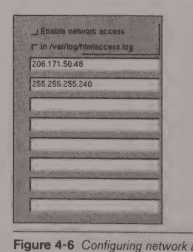

- 3. 选择 Enable network access（启用网络访问）复选框。
- 4. 选择 /var/log/htmlaccess.log 复选框，以允许记录通过网络对 Linuxconf 的访问请求。
- 5. 在网络或主机文本框中，输入你允许通过 Web 访问 Linuxconf 的主机名称。你也可以在此处输入 IP 或网络地址。如果你希望允许局域网上的任何主机远程管理此系统，请使用网络地址。在图 4-6 中，使用了 206.171.50.48 的网络地址。为了启用该网络中的所有机器，在可选的子网掩码文本框中指定了 255.255.255.240 的子网掩码。子网掩码是可选的，因为 Linuxconf 可以根据你的网络地址计算子网掩码。如果你计划添加多个主机但不是整个网络，请仅添加它们的 IP 地址。默认情况下，屏幕允许你输入两个 IP 地址和两个可选的子网掩码。如果你需要更多空间，请点击 Add（添加）按钮以获取用于额外主机的输入框。
- 6. 输入主机名称或 IP 地址，或网络/子网掩码对后，点击 Activate（激活）按钮。
- 7. 点击 Quit（退出）按钮退出 Linuxconf，并在提示时激活当前配置。

这将允许指定的主机（或 IP 地址）通过 Web 访问 Linuxconf。

如前所述，Linuxconf 使用内部代码函数和外部模块来执行实际配置。目前，Linuxconf RPM 包几乎包含所有可用的模块。这很可能会改变，因为理想情况下 Linuxconf 模块应与各个软件包一起分发。例如，Red Hat 的 Apache 软件包应包含一个 Linuxconf 模块。如果你不使用 Apache Web 服务器，则你的 Linuxconf 配置中不需要 Apache 模块。你拥有的模块越多，Linuxconf 界面看起来就越杂乱。如果应用程序开发人员自己分发模块，那么你只会拥有你需要的内容。希望 Linuxconf 很快就能朝这个方向发展。在此之前，你可以手动配置所需的模块。

## 配置 Linuxconf 模块

你可以添加新模块或停用现有模块。模块保存在 /usr/lib/linuxconf/modules 目录中。要添加新模块，请从 Linuxconf FTP 站点下载必要的 RPM 软件包。提供 Linuxconf 文件的 FTP 站点列表可在 http://dns.solucorp.qc.ca/linuxconf/available.html 上找到。

下载新的 Linuxconf 模块后，使用 rpm -ivh module_package 命令进行安装。安装完成后，该模块会自动出现在 Linuxconf 的模块列表中。它也会被自动激活。

要停用某个模块，请执行以下操作：

- 1. 在你的控制台或 X Window 中运行 Linuxconf。
- 2. 在 Linuxconf 屏幕的左侧选择 Control > Control files and systems > Configure Linuxconf modules。你会看到一个类似于图 4-7 所示的屏幕。

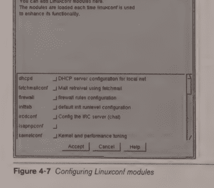

- 3. 向下滚动模块列表，找到你要停用的模块。切换 This module is active（此模块已激活）复选框，使该模块变为非活动状态。
- 4. 点击 **Accept**（接受）按钮。
- 5. 如果你在 Linuxconf 中没有其他要做的事情，点击 **Quit**（退出）按钮。系统会提示你激活更改。点击 **Activate**（激活）更改以完成过程。

下次运行 Linuxconf 时，它会告诉你它正在移除与该非活动模块相关的菜单项。

## 定义用户权限

Linuxconf 还允许你创建具有特权权限的用户账户，这些账户可用于管理你的 Linux 系统的特定方面。如果你的组织中有联合管理员，这项功能会非常有帮助。也许你想将一些较简单的管理任务移交给初级管理员。在这种情况下，你可以创建具有受限权限集的正常用户账户。假设你有一个名为 kabir 的正常用户账户，并希望为该账户分配一些管理权限。请执行以下操作：

- 1. 在你的 root 账户中运行 linuxconf。
- 2. 在 Linuxconf 屏幕上选择 Config > User accounts > Normal User accounts。屏幕上会出现系统中所有正常用户的列表。
- 3. 找到目标用户（本例中为 kabir），并双击该用户记录的行。你会看到一个类似于图 4-8 所示的屏幕。

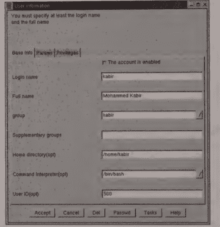

**图 4-8** *用户账户信息*

- 4. 如图 4-8 所示，首先显示 Base Info（基本信息）选项卡。点击 Privileges（权限）选项卡以配置可用的权限选项，如图 4-9 所示。
- 5. 如图 4-9 所示，Privileges（权限）选项卡有两个自带的选项卡。第一个是 General system control（通用系统控制）选项卡，它提供表 4-2 中所示的选项。

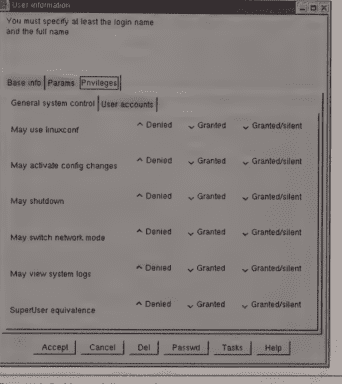

**图 4-9** **用户权限选项**

**表 4-2** **通用系统控制选项**

| 权限选项 | 说明 |
| :--- | :--- |
| May use Linuxconf | 如果你希望用户能够运行 Linuxconf，请授予此权限。 |
| May activate config changes | 如果你希望用户能够激活当前系统配置的任何更改，请授予此权限。 |
| May shutdown | 如果你希望用户能够关闭系统，请授予此权限。 |
| May switch network mode | 如果你希望用户能够启用/禁用网络连接，请授予此权限。 |
| May view system logs | 如果你希望用户能够查看系统日志文件，请授予此权限。 |
| SuperUser equivalence | 仅向需要具有超级用户 (root) 访问权限的用户授予此权限。 |

要授予表 4-2 中显示的任何权限，你需要点击相应的 Granted（已授予）或 Granted/silent（已授予/静默）选项，区别在于后者不需要用户使用密码进行身份验证。我建议不要在任何地方使用静默模式。

如果你希望用户管理一个或多个服务，请点击 Services（服务）选项卡以查看服务选项。你的系统中可用的服务将取决于你安装了什么。

如果你希望用户成为 POP/PPP/UCP 用户的账户管理员，请点击 User accounts（用户账户）选项卡并授予适当的权限。你还可以点击 Miscellaneous（杂项）选项卡并授予用户杂项权限。

要激活你对用户权限所做的任何更改，请点击 Accept（接受）按钮，然后点击 Quit（退出）按钮退出 Linuxconf。

退出 Linuxconf 后，以该用户身份登录系统并运行 Linuxconf。测试你的新权限。确保它们是你想要的。如果你确定相关用户拥有所有正确的权限，那么你就完成了。告诉这位幸运用户这个好消息。

## 使用多系统配置档案

默认情况下，Linuxconf 提供两个系统档案：Office（办公）和 Home（家庭）。你可以在 Linuxconf 中找到可用系统档案的列表。点击 Control > Control files and systems > Configure system profiles（控制 > 控制文件和系统 > 配置系统档案）选项。你会看到如图 4-10 所示的可用配置列表。

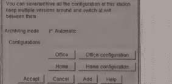

**图 4-10** 可用（默认）系统档案


要确定当前 Linuxconf 正在使用哪个系统配置文件，请从 Linuxconf 屏幕左侧选择 **控制面板 - 切换系统配置文件**。您将在“选择版本”标签页中看到可用配置列表，如图 4-11 所示。

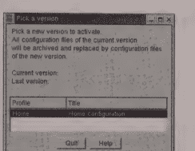

图 4-11 确定当前系统配置文件

您也可以创建自己的系统配置文件，步骤如下：

1.  从 Linuxconf 屏幕选择 **控制文件和系统 - 配置系统配置文件**。您将看到类似图 4-10 所示的窗口。
2.  点击 **添加** 按钮以添加一个新的系统配置文件。系统将要求您输入新系统配置文件的名称，如图 4-12 所示。名称必须是一个单词，且不能包含任何空格字符。输入您选择的名称并点击 **接受**。


图 4-12 为新的系统配置文件命名

3.  现在系统会要求您输入新配置文件的标题。这可以是您想要的任何内容；它仅用于帮助您将此配置文件与其他配置文件区分开来。请输入符合您需求且有意义的内容。
4.  您需要为各种子系统提供归档族名称（即 `/etc/linuxconf/archive/subsystem-family-name`），例如 `crond`、`PPP/SLIP/PLIP`、`DNS 服务器`、`防火墙规则`、`wu-ftpd 服务器`、`gated`、`inet`、`httpd`、`lpd` 等。您还可以提供一个默认的归档族名称，当您在某些子系统中未明确定义归档族名称时使用。如果您既未设置默认族名称，也未提供明确的族名称，子系统的数据将存储在 `/etc/conf.linuxconf` 文件中。如果您想使用来自其他配置文件的现有子系统，请为该配置文件输入现有的族名称。请注意，如果一个子系统在多个归档之间共享，那么对该子系统配置文件的任何更改都将对所有使用该子系统的系统配置文件生效。
5.  指定所有归档族名称后，点击 **接受** 按钮。您的新配置文件将被添加到可用配置文件列表中。再次点击 **接受**。
6.  若要使用您新创建的配置文件，请从 Linuxconf 屏幕选择 **控制面板 - 切换系统配置文件**。点击您的配置文件以切换到它。切换到您的新配置文件后，当您切换回另一个配置文件时，它会自动归档。如果您想手动归档，请从 Linuxconf 屏幕选择 **控制面板 - 归档配置**。

由此可见，Linuxconf 提供了一种非常强大的手段，让您可以在不必担心丢失现有配置的情况下，试验各种配置。

## 第二部分
### 高级配置

-   5 用户管理
-   6 进程管理
-   7 网络管理
-   8 DNS 服务
-   9 电子邮件服务
-   10 FTP 服务
-   11 使用 Samba 共享文件和打印机
-   12 使用 Apache 的 Web 服务
-   13 使用 NFS 文件服务器
-   14 配置 X 窗口

## 第 5 章
### 用户管理
#### 创建多个超级用户帐户

许多初级的系统管理员认为 `root` 用户是唯一超级用户。事实并非如此。用户名 "root" 并不是使帐户成为超级用户的原因。请查看来自示例 `/etc/passwd` 文件的以下行：

```text
root:dcw12YbBSUFyo:0:0:root:/root:/bin/tcsh
bin::1:1:bin:/bin:
daemon::*:2:2:daemon:/sbin:
kabir:.HoiiviYBP4/8U.û:0:Mohammed
sheila:g7wD/qLMFW9M.:501:501:/home/sheila:/bin/tcsh
apache:!1:502:502::/usr/local/apache:/bin/false
```

此密码文件中有两个超级用户帐户：`root` 和 `kabir`。要理解原因，您必须记住 `/etc/passwd` 文件具有以下格式：

```text
username:password:UID:GID:full-name:home-dir:shell
```

注意 `root` 帐户的 UID（用户 ID）和 GID（组 ID）字段。它们都设置为 0。而且，如果您回看看起来像普通用户的 `kabir` 的行，您会发现他的 UID 和 GID 也设置为 0。这就是用户变成超级用户的原因。换句话说，任何 UID 和 GID 为 0 的用户都等同于所谓的 `root`。

如您所见，您可以将任何普通用户帐户变成超级用户帐户。在大多数情况下，您不希望这样做，因为拥有多个超级用户帐户可能意味着额外的安全风险。但是，在拥有多个系统管理员共同管理相同系统的组织中，有时会使用多个超级用户帐户。这是为了确保在多管理员环境中有更多的问责制。例如，如果上述密码文件中的 `kabir` 和 `root` 帐户属于两个不同的系统管理员，那么与两个系统管理员 *共享* 默认的 *root* 帐户相比，通过查看各种日志文件来确定谁执行了什么超级用户操作会稍微容易一些。

另一个不太理想的情况也可以使用多个超级用户帐户——当系统被某人入侵时。在这种情况下，黑客通过将 UID 和 GID 值设置为 0 来创建一个看起来像普通用户的超级用户帐户。这使得黑客可以登录并成为超级用户，而无需知道 root 用户的密码。这种伎俩在系统管理员是新手或太忙而未能留意此类情况的系统中有效。

现实地说，在真实的盈利组织背景下，没有系统管理员有时间每天监控黑客，因此在这种情况下，您可能希望使用一些脚本作为您的助手。例如：

```bash
/bin/grep '0:0' /etc/passwd | awk 'F$5=="0" {print $1}' | mail -s "$(date +%d %m)" root
```

这个小脚本使用几个标准命令检查 `/etc/passwd` 文件中 UID 和 GID 值设置为 0 的用户。它可以将此类帐户的列表通过电子邮件发送给 root 用户。如果您将此脚本放在 `/etc/cron.daily` 中每天运行一次，您每天都会收到来自它的电子邮件消息，显示超级用户列表。然后您可以每天快速检查电子邮件，了解哪些帐户具有超级用户权限。当然，聪明的黑客可能会发现这一点，并能够修改脚本以向您提供虚假的信息。但根据我的经验，大多数黑客行为是由寻求刺激的人进行的，他们很少花时间自行调查事情。这些所谓的黑客只是在互联网上找到一个可利用的程序，编译它并运行以获取访问权限；他们通常缺乏通过谨慎的系统管理员可能设置的检查所需的技能。

既然您知道任何用户帐户都可以变成超级用户帐户，您可能认为任何这样的用户都可以很容易地登录到 Red Hat Linux 系统。事实并非如此。默认情况下，Red Hat Linux 系统使用可插拔身份验证模块（PAM）进行登录身份验证，这要求仅允许从被认为安全的终端进行超级用户访问。默认情况下，登录的 PAM 配置文件 `/etc/pam.d/login` 包含如下行：

```text
auth required /lib/security/pam_securetty.so
```

这行语句表示，在允许登录之前，必须满足由 `pam_securetty.so` 模块执行的安全限制。该特定模块仅当登录尝试来自 `/etc/securetty` 文件中列出的 TTY 时，才认为超级用户登录尝试是有效的。因此，如果您决定将一个普通用户变成超级用户并尝试通过 Telnet（将具有伪 TTY 设备）登录，您将无法登录。但是，您可以在 `/etc/securetty` 文件中添加伪 TTY 设备（通常是 `tty1` 到 `tty12`）轻松更改这一点。然而，不建议这样做，因为它会产生安全风险。相反，如果您必须出于管理和问责原因使用多个超级用户帐户，请执行以下操作：

1.  创建多个超级用户帐户。
2.  为每个超级用户创建一个普通用户帐户。
3.  指示每个超级用户以普通用户身份登录系统，并使用 `su` 命令切换到超级用户帐户。

`su` 命令可用于替代 UID 和 GID。例如，您可以以普通用户身份登录，并通过运行不带参数的 `su` 切换到 `root` 帐户。系统会提示您输入 `root` 密码；如果您知道 `root` 密码，`su` 将启动一个新的 shell，您将作为 `root` 用户登录。

请记住，超级用户（UID = 0, GID = 0）拥有一切权限的完全访问权，因此这些是非常敏感的帐户。


## 为普通用户分配权限

使用 `sudo` 命令，你可以允许普通用户执行通常由超级用户运行的命令。假设你是你所在组织的首席系统管理员，并且刚拥有了两位新的助理系统管理员，你想将一些例行的管理任务分配给他们。你是否应该创建两个 UID 和 GID 均设置为 0 的超级用户账户，以便这两位管理员像你一样拥有一切资源的完整访问权限？这取决于你对他们在作为最终用户工作时能否像你一样谨慎的信心有多大。由于信心需要一定时间才能建立，你可能希望只允许他们访问所需的内容，因此需要配置 `sudo` 以允许这些个人以普通用户身份运行特权命令。方法如下。

`sudo` 命令允许在 `/etc/sudoers` 文件中指定的用户运行超级用户命令。例如，一个被允许通过 `sudo` 运行超级用户命令的普通用户可以运行以下命令：

```bash
sudo vi /etc/passwd
```

这允许该用户修改 `/etc/passwd` 文件。`sudo` 程序的可配置性非常高，因此你可以自定义在 `/etc/sudoers` 中列出的普通用户可以或不可以执行的操作。`/etc/sudoers` 文件包含以下类型的行：

-   **空白行和注释行**（以 `#` 开头），这些行会被忽略。
-   **可选的主机别名行**。用于为主机列表创建简短名称。主机别名行必须以 `Host_Alias` 关键字开头，且列表中的主机必须用逗号分隔。例如，在以下行中，

```bash
Host_Alias REDHAT=wormhole,blackhole
```

wormhole 和 blackhole 是两个可以被称为 REDHAT 的主机。

-   **可选的用户别名行。** 用于为用户列表创建简短名称。用户别名行必须以 `User_Alias` 关键字开头，且列表中的用户必须用逗号分隔。例如：

```bash
User_Alias  ASSISTANTS=mike,brian
```

-   **可选的命令别名行。** 用于为命令列表创建简短名称。命令别名行必须以以下内容开头：

```bash
Cmd_Alias  CMDS=/bin/rm,/bin/chmod,/bin/chown
```

-   **可选的以某用户身份运行别名行。** 用于为用户列表创建简短名称。此类别名可用于指示 `sudo` 以别名化的用户之一身份运行命令。例如：

```bash
Runas_Alias  OP=root,operator
```

-   **必需的用户访问权限指定行。** 用户访问权限指定的语法如下：

```bash
user  host=[run as user]  command list
```

你可以指定真实的用户名作为 `user`，或者使用 `User_Alias` 来指定一个列表。同样，你可以使用真实的主机名或 `Host_Alias` 作为 `host`。默认情况下，通过 `sudo` 执行的所有命令均以 root 身份运行。如果你想以不同用户身份运行命令，可以指定用户名（或 `Runas_Alias`）。你還可以指定命令（或 `Cmd_Alias`）；例如，

```bash
kabir  wormhole= /sbin/shutdown
```

允许用户 kabir 在名为 wormhole 的主机上运行 `/sbin/shutdown` 命令。请注意，你可以在命令或命令别名前插入 `!` 以拒绝该命令或命令别名（在允许的情况下）。

可以在单行中定义多个别名；例如，

```bash
User_Alias  ASSISTANTS=mike,brian;INTERNS= joe,robert,steve
```

在单行中定义了两个别名（ASSISTANTS 和 INTERNS），其中别名定义之间用冒号分隔。相同的语法也适用于其他类型的别名。

存在两个特殊关键字：ALL 和 NOPASSWD。ALL 用于表示“所有”，NOPASSWD 用于声明不需要密码。列表 5-1 展示了一个 `/etc/sudoers` 文件的示例。

### 列表 5-1 *一个 /etc/sudoers 文件示例*

```bash
# sudoers file.
#
# This file MUST be edited with the 'visudo'
# command as root.
#
# See the man page for the details on how to
# write a sudoers file.
#
# Host alias specification

# User alias specification
User_Alias SENIORADMIN=kabir
User_Alias  ASSISTANTS=mike,john
# User privilege specification

SENIORADMIN ALL=ALL
ASSISTANTS  ALL=ALL
```

这个 `/etc/sudoers` 文件定义了两个用户别名，SENIORADMIN 和 ASSISTANTS，其中前者只有一个用户（kabir），后者有两个用户（mike 和 john）。用户权限指定说明了以下内容：

-   列在用户别名 SENIORADMIN 中的用户可以在所有主机上以 root 身份（默认）运行 `sudo`，并且可以运行所有命令。由于用户 kabir 是该组中唯一的一个，这实际上意味着 kabir 可以通过 `sudo` 运行所有命令。换句话说，用户 kabir 可以做 root 用户所能做的一切。
-   第二个用户指定说明列在用户别名 ASSISTANTS 中的用户拥有与第一个指定中完全相同的访问权限。

回到第一个示例场景，即你拥有两位尚不需要完整超级用户访问权限的助理。假设你（user ID = yourid）希望这两位用户（sysad1, sysad2）仅拥有运行 shutdown 命令的权限。在这种情况下，你的 `/etc/sudoers` 文件可能如下所示：

```bash
# User alias specification
User_Alias SENIORADMIN=yourid
User_Alias ASSISTANTS=sysad1,sysad2

# User privilege specification
SENIORADMIN ALL=ALL
ASSISTANTS ALL=/sbin/shutdown
```

假设过一段时间后，你确信这两位用户能够以负责任的方式处理其他超级用户权限，因此你想给他们提供除运行 su 命令权限之外的完整访问权限。现在的 `/etc/sudoers` 文件如下所示：

```bash
# User alias specification
User_Alias SENIORADMIN=yourid
User_Alias ASSISTANTS=sysad1,sysad2

# User privilege specification
SENIORADMIN ALL=ALL
ASSISTANTS ALL=ALL, !/bin/su
```

从 `ASSISTANTS` 的用户指定中可以看出，他们被允许通过 `sudo` 运行除 `/bin/su` 命令之外的所有命令。

## 使用命令行工具管理用户

本节向你展示了使用各种命令行工具进行用户管理的传统方法。

### 创建新的用户账户

创建新的用户账户非常简单。要从命令行创建用户账户，请运行 `useradd` 命令。例如，要创建名为 `newuser` 的用户，请按以下方式运行此命令：

```bash
useradd newuser
```

这使用系统默认值在 `/etc/passwd`（如果使用影子密码，则在 `/etc/shadow`）中添加一个新条目。例如，当我在我的 Red Hat 系统上运行上述命令时，`/etc/passwd` 中会显示如下所示的新行：

```bash
newuser:$1:506:506::/home/newuser:/bin/bash
```

如果你还记得之前讨论的 `/etc/passwd` 字段，你会发现密码（第二个）字段被设置为 `!!`。这意味着尚未设置密码，且 `newuser` 尚无法登录。因此，你需要通过运行以下 `passwd` 命令来为该用户创建密码：

```bash
passwd newuser
```

系统会要求你两次输入密码，在你的密码被接受后，它会被加密并添加到用户在 `/etc/passwd` 文件中的条目中。

UID 和 GID 值将由 useradd 自动选择。基本上，它只是将 `/etc/passwd` 中最后一个 UID 加 1，并将 `/etc/group` 中最后一个 GID 加 1，分别为新用户创建 UID 和 GID。你也可以分别使用命令行开关 `-u` 和 `-g` 手动设置 UID 和 GID。主目录在默认顶级主目录中创建。同样，登录 shell 也是从系统默认值中选择的。这些默认值的设置将在后续章节中说明。

如果你想覆盖系统默认值，请指定一个命令行选项。要覆盖默认主目录，请使用 `-d` 选项（其中 `newdirectory` 是你的目录名称）。例如：

```bash
useradd newuser -d /www/newuser
```

新用户（`newuser`）将被创建，其主目录将设置为 `/www/newuser`。请注意，useradd 只会创建最终目录，


而不仅仅是整个路径。例如，如果您指定 `-d /some/new/dir/myuser` 作为选项，useradd 仅当 `/some/new/dir/` 已存在时才会创建 myuser。

当创建新的主目录时，`/etc/skel` 目录中包含的文件会被复制到新的主目录中。这些文件通常是默认 Shell 的点配置文件（dot configuration files）。例如，如果默认 Shell 是 `/bin/bash`，您应该在 `/etc/skel` 目录中有 `.bashrc`、`.bash_profile` 和 `.bash_login` 的默认版本，以便新用户的主目录可以使用这些文件自动设置。

Red Hat Linux 随附的 useradd 会为用户创建一个与用户名同名的私有组。例如，如果您运行 `useradd kabir`，则会在 `/etc/passwd` 文件中创建一个名为 kabir 的新用户，并在 `/etc/group` 文件中创建一个名为 kabir 的新组。这种方法允许新用户与其他用户完全隔离，从而确保用户拥有更高的隐私性。每当新用户创建新文件时，由于这个私有组的作用，该文件仅可由该新用户访问。用户必须显式更改文件权限才能允许其他人查看该文件。

但是，如果您的用户账户理念与这种私有组理念相冲突，您可以使用 `-g group` 选项（其中 `group` 是您的组名）来覆盖它。例如，

```
useradd mykabir -g users
```

会使 useradd 创建新用户（mykabir）并将默认组设置为 users。


> **提示**
> 您可以使用 `groups username` 命令来查找某个用户属于哪些组。

如果您希望将新用户作为系统中其他组的成员，请使用 `-G comma-separated list of groups` 选项。例如，

```
useradd mykabir -G wheel,admins
```

将在 `/etc/group` 文件中将新用户（mykabir）添加到 wheel 和 admins 组。

## 创建新组

要创建新组，请使用 groupadd 命令。例如，以下命令在 /etc/group 和 /etc/gshadow 文件（如果您使用的是 shadow passwords）中添加了一个名为 mygroup 的新组：

```
groupadd mygroup
```

默认情况下，groupadd 程序创建的组 GID 大于 499，因为 0 到 499 之间的 GID 是（某种程度上）保留给系统级账户的，例如 root、bin 和 mail。因此，如果您的 /etc/group 文件中最后一个组的 GID 设置为 511，那么通过此程序创建的新组的 GID 将为 512，依此类推。如果您想明确设置新组的 GID，请使用 -g GID 选项。此外，如果您想创建一个 GID 在 0 到 499 范围内的组，请使用 -r 选项结合 -g GID 选项，以强制 groupadd 将新组创建为系统组。请注意，如果您尝试在 /etc/group 中使用的组或 GID 已被占用，您将收到错误消息。

## 修改现有用户账户

处理用户遗忘的密码是系统管理员最常执行的任务之一。本节介绍如何更改用户账户的各种详细信息。

### 更改密码

要更改或设置用户密码，请使用 passwd 命令。例如，以下命令允许您更改用户 kabir 的密码：

```
passwd kabir
```

系统会要求您两次输入密码以进行确认。请为您的用户选择良好的密码。不要使用容易记忆的、使用常见字典单词的密码。请注意，passwd 程序也可以由用户运行以更改其自己的密码。当普通用户运行 passwd 程序时，不需要提供用户名参数，因为它只允许他们更改自己的密码。

### 更改 Shell

如果默认 Shell 不适合某个用户，您可以将其更改为 /etc/shells 中列出的任何 Shell。使用 chsh 命令来更改用户的 Shell。例如，以下命令允许您更改用户 brian 的当前 Shell：

```
chsh brian
```

如果您指定了任何不在 /etc/shells 中的 Shell 或程序名称，该用户将无法登录。请注意，用户可以使用此命令更改自己的 Shell。普通用户不需要将用户名作为参数指定，因为他们只能更改自己的 Shell。

您也可以使用 usermod 命令来修改 Shell 信息，如下所示，

```
usermod -s new shell path username
```

其中 new shell path 和 username 是正确值。

### 更改主目录

要更改现有用户的主目录，请运行 usermod 命令，如下所示，

```
usermod -d new home directory username
```

其中 new home directory 和 username 是正确值。

例如，如果名为 keller 的用户其主目录为 /home/keller，而您想将其移动到 /home2/keller，请运行以下 usermod 命令：

```
usermod -d /home2/keller keller
```

这将新目录设置为她的新主目录。但是，如果您想将她主目录的内容移动到新的位置，请使用 -m 选项，如下所示：

```
usermod -d -m /home2/keller keller
```

### 更改 UID

要更改用户的 UID，请使用 `usermod` 命令，如下所示，

```
usermod -u UID username
```

其中 `UID` 和 `username` 是正确值。

例如，以下命令将用户 `mrfrog` 的 UID 更改为 500：

```
usermod -u 500 mrfrog
```

该用户主目录内所有属于该用户的文件和目录将自动反映 UID 的更改。但是，如果该用户拥有其主目录以外的文件，您将必须使用 `chown` 命令手动更改所有权。

### 更改默认组

要更改用户的默认组，请使用 `usermod` 命令，如下所示，

```
usermod -g group_name or GID username
```

其中 `group_name` 或 `GID` 和 `username` 是正确值。

例如，以下命令将用户 `mrfrog` 的默认组更改为 777：

```
usermod -g 777 mrfrog
```

### 更改账户过期日期

如果您使用的是 shadow passwords，请使用 `usermod` 命令更改用户账户的过期日期，如下所示，

```
usermod -e MM/DD/YY username
```

其中 `MM/DD/YY` 和 `username` 是正确值。

例如，以下命令将用户 `kabir` 的账户过期日期重置为 12/31/99：

```
usermod -e 12/31/99 kabir
```

### 更改 finger 信息

如果您允许用户使用 finger 程序来查找彼此，或者运行 finger 守护进程以便外部人员可以 finger 您的账户，您也可以更改 finger 信息，例如全名和电话号码。运行 chfn 命令来更改用户的 finger 信息。

例如，以下命令允许您更改用户 jennifer 的 finger 信息，这些信息存储在 /etc/passwd 文件中：

```
chfn jennifer
```

用户也可以使用此程序更改自己的 finger 信息。用户还可以在主目录中创建一个 .plan 文件，该文件将被追加到 finger 程序显示的信息中。

## 修改现有组

要修改现有组的名称或 GID，请使用 groupmod 命令。要将组重命名为新名称，请使用以下语法：

```
groupmod -n new group current group
```

例如，以下命令将现有的 novices 组重命名为 experts：

```
groupmod -n experts novices
```

要更改 GID，请使用 -g new GID 选项。例如，以下命令将 troublemakers 组的当前 GID 更改为 666：

```
groupmod -g 666 troublemakers
```

## 删除或禁用用户账户

要删除现有用户，请使用 userdel 命令。例如，以下命令删除名为 snake 的用户：

```
userdel snake
```

如果您想删除用户的主目录及其所有内容，请使用 -r 选项。请注意，如果用户当前已登录，userdel 将不会删除该用户。请让用户通过发送写入消息（*write username*）来注销，如果要求用户注销不可行，请使用 killall 命令终止与该用户相关的所有进程，然后运行 userdel 命令。

如果您想暂时禁用用户账户，您可以执行以下操作之一：

- 使用 usermod -s new shell username 命令将 Shell 更改为 /bin/false（确保新 Shell 已列在 /etc/shells 文件中）。这将禁止用户登录系统。
- 如果您使用的是 shadow passwords，请使用 usermod -e MM/DD/YY username 命令使该用户账户过期。

如果您想暂时禁用所有用户账户的访问，您可以创建一个名为 /etc/nologin 的文件，其中包含一条解释为何不允许访问的消息。只要该文件存在，登录程序就不允许任何非 root 账户登录。

###### 注意

> 如果您通过 Telnet 或其他方式（如 secure shell (ssh) 访问）管理服务器，请勿创建 /etc/nologin，因为您将无法登录您的系统。这是因为，默认情况下，root 或超级用户账户不允许直接从非安全 TTY（即未在 /etc/securetty 中指定的任何 TTY）登录，因此您不能先以普通用户登录，然后 su 到特权用户账户。

## 创建默认用户设置

使用 useradd 创建新用户的默认设置来自 /etc/default/useradd。该文件的一个示例如图 5-2 所示。

### 图 5-2 /etc/default/useradd 文件示例

```
# useradd defaults file
GROUP=100
HOME=/home
INACTIVE=-1
```


## /etc/default/useradd 配置说明

该文件中的各项配置如下：

- **GROUP=100.** 指定默认 GID 为 100。此值仅在你禁用（使用 `-n` 选项）默认私有组（与新用户同名）时使用。你也可以指定组名称而不是数字值。在此行中指定的值必须存在于 `/etc/group` 中。你可以按如下方式更改此值：
  ```bash
  useradd -D -g newsgroup name or GID
  ```
  其中 *newsgroup name* 和 *GID* 是相应的值。

- **HOME=/home.** 指定新用户默认的最高级主目录。例如，当你创建一个名为 *joe* 的新用户时，默认主目录为 */home/joe*。你可以将此值更改为符合你需求的目录。请确保该目录已存在。你可以按如下方式更改此值：
  ```bash
  useradd -D -d directory
  ```

- **INACTIVE=-1.** 指定账户在密码过期后多少天变为不活跃。这仅在你使用影子密码时有效。默认值 `-1` 表示账户永不会变为不活跃。你可以按如下方式更改此值：
  ```bash
  useradd -D -f number of days
  ```

- **EXPIRE=-** 指定何时禁用账户。这仅在你使用影子密码时有效。默认情况下，账户永远不会被禁用。你可以按如下方式更改此值：
  ```bash
  useradd -D -e MM/DD/YY
  ```

- **SHELL=/bin/bash.** 指定默认登录 Shell 路径。你可以按如下方式更改此值：
  ```bash
  useradd -D -s /bin/tosh
  ```

注意，useradd 程序不会检查你指定的路径是否为有效的 Shell，甚至是否不存在。因此，请确保你指定的路径是有效的 Shell 并列在 `/etc/shells` 文件中。

- **SKELETON=/etc/skel.** 指定保存各种用户配置文件的目录，例如 Shell 的 dot 文件、X Window 等。此目录中的文件将被复制到新用户账户的新主目录中。通常，你不希望将此路径更改为其他目录。另一方面，如果你确实想要更改它，你必须使用编辑器修改 `/etc/default/useradd` 文件，或者简单地创建一个指向目标目录的符号链接 `/etc/skel`。

如果你使用影子密码，另一个默认配置文件 `/etc/login.defs` 用于创建用户账户。列表 5-3 展示了此文件的示例。

### 列表 5-3 /etc/login.defs 文件示例

```bash
#REQUIRED

#  Directory where mailboxes reside, _or_ name
#  of file, relative to the home directory.
#  If you _do_ define both, MAIL_DIR takes precedence.

    QMAIL_DIR  is for Qmail

#QMAIL_DIR     Maildir
MAIL_DIR  /var/spool/mail

#MAIL_FILE    .mail
# Password aging controls:

#   PASS_MAX_DAYS  Maximum number of days a
#                  password may be used.
#
#   PASS_MIN_DAYS  Minimum number of days allowed
#                  between password changes.
#
#   PASS_MIN_LEN   Minimum acceptable password length.
#
#   PASS_WARN_AGE  Number of days warning given before
#                  a password expires.

PASS_MAX_DAYS  99999
PASS_MIN_DAYS  0
PASS_MIN_LEN   5
PASS_WARN_AGE  7

#
# Min/max values for automatic uid
# selection in useradd
#
UID_MIN  500
UID_MAX  60000

#
# Min/max values for automatic gid
# selection in groupadd
#
GID_MIN  500
GID_MAX  60000

#
# Require password before chfn/chsh can make
# any changes.
#
CHFN_AUTH  yes

#
# Don't allow users to change their "real name"
# using chfn.
#
CHFN_RESTRICT  yes

#
# If defined, this command is run when removing a user.
# It should remove any at/cron/print jobs etc. Owned by
# the user to be removed (passed as the first argument).
#
#USERDEL_CMD /usr/sbin/userdel_local

#
# If useradd should create home directories for
# users by default on RH systems, we do. This option is
# ORed with the -m flag on useradd command line.
#
CREATE_HOME yes
```

由于该文件中的注释足以解释配置细节，因此这里不再进一步讨论。

## 使用 linuxconf 管理用户

linuxconf 命令可用于执行所有用户管理任务。本节使用基于 X Window 的 linuxconf 界面。

### 添加新用户账户

要访问 linuxconf 中的用户管理界面，请选择 Config → User accounts → Normal → User accounts 选项。
要添加新用户，请遵循以下步骤：

1. 点击窗口右侧的 Add 按钮。将出现一个新窗口，其中包含多个选项卡。
2. 在 Base Info 选项卡中，输入 Login name (username)、Full name、group、Supplementary groups (optional)、Home directory (optional)、Command interpreter (optional) 和 User ID (optional)。你还可以通过取消选中 This account is enabled 复选框来选择创建此账户但尚未启用它。
3. 你可以使用其他选项卡（Params 和 Privileges）来设置有关此账户的附加信息。Privileges 选项卡中发现的特权选项仅适用于 linuxconf。换句话说，如果你为普通账户分配权限，该权限仅在用户能够运行 linuxconf 时适用。例如，如果你希望此用户能够运行 linuxconf，你可以在 Privileges 选项卡中选择允许这样做。
4. 在你选择适当的权限（如果有）后，点击 Accept 以添加用户。请注意，用户不会立即被添加，直到你通过 Control -> Control Panel -> Activate configuration 选项告知 linuxconf 激活配置，或者允许它在退出应用程序前激活配置。

### 修改现有用户账户

要在 linuxconf 中修改用户账户，请执行以下操作：

1. 在 linuxconf 窗口左侧选择 Config -> User accounts -> Normal -> User accounts。
2. 在右侧点击账户名称，你将看到一个包含所有预加载用户账户信息的标签。修改任何你想更改的内容，然后使用 Control -> Control Panel -> Activate configuration 选项立即激活更改，或者在退出应用程序时激活它们。

### 删除或禁用现有用户账户

要删除或禁用用户账户，请执行以下操作：

1. 选择 Config -> User accounts -> Normal -> User accounts 选项。
2. 在右侧点击账户名称，你将看到一个包含所有预加载账户信息的标签。要删除此账户，点击 Del 按钮。要禁用它，取消选中 This account is enabled 复选框。

### 添加、修改和删除组

要添加、修改或删除组，请执行以下操作：

1. 选择 Config -> User accounts -> Normal -> Group definitions 选项。
2. 要添加新组，点击 Add。这将打开一个新窗口。输入名称，可选地输入 GID、成员等。点击 Accept。当你激活在 linuxconf 中做出的更改时，新组将生效。
3. 要修改现有组，点击现有组名称。将出现一个新标签，其中包含所选组的信息预加载。进行必要的更改并点击 Accept。当你激活在 linuxconf 中做出的更改时，修改后的组将生效。
4. 要删除现有组，点击现有组名称。将出现一个新标签，其中包含所选组的信息预加载。点击 Delete。当你激活在 linuxconf 中做出的更改时，删除将生效。

虽然 linuxconf 试图使用户管理变得非常简单，但当你更改系统中的某些内容时，它往往会失效。例如，当我升级我的 SMTP 邮件传输代理 (sendmail) 时，linuxconf 的用户管理方面不再那么好用。它无法定位随 sendmail 提供的程序 (makemap)，因此每次我想要添加、修改或删除用户时，它都会不断询问我（即使我指定了该程序的路径）。在我升级到最新版本后，问题得到了解决。

## 对用户使用磁盘配额

在多服务器系统上，磁盘空间可能是一种相当稀缺的资源。经验表明，只要插入新驱动器并提供大量空间，用户往往会迅速用完这些空间。因此，你添加得越多，你就需要得越多。确保系统拥有足够磁盘空间的最好方法是强制实施磁盘配额。本节将解释如何操作。


## 安装磁盘配额软件

红帽官方 CD-ROM 附带配额软件。例如，要为 x86 架构的机器安装配额软件，请从 CD-ROM 的 /RedHat/RPMS 目录运行以下命令：

```bash
rpm -ivh quota-version.i386.rpm
```

安装配额软件后，即可开始配置。

## 配置系统以支持磁盘配额

首先，确定哪些分区需要纳入磁盘配额管理。通常，这些分区包括用户主目录和 Web 空间所在的分区。此外，还需决定是按用户、按组，还是同时按两者来强制执行配额。本讨论假设你希望对 /home 和 /www 分区启用磁盘配额，并且仅对 /home 分区执行按用户磁盘配额，对 /www 分区执行按组磁盘配额。它还假设你有一个如下所示的 /etc/fstab 文件：

```
/dev/sda1  /home   ext2  defaults   1 2
/dev/sda5  /www    ext2  defaults   1 2
```

要在 /home 上强制执行用户级磁盘配额，请修改第一行，如下所示：

```
/dev/sda1  /home   ext2  defaults,usrquota  1 2
```

在上述 fstab 行的挂载选项字段中新增的选项用于启用用户磁盘配额。类似地，要在 /www 上启用组级磁盘配额，请修改第二行 fstab 条目，如下所示：

```
/dev/sda5  /www    ext2  defaults,grpquota  1 2
```

提示

如果你计划对用户和组都执行配额，可以在单个分区上同时使用 usrquota 和 grpquota。

完成这些修改后，请按如下方式修改 /etc/rc.d/rc.local 脚本：

```bash
# 检查配额，然后开启配额。
if [ -x /sbin/quotacheck ]; then
    echo "正在检查配额。这可能花费一些时间..."
    /sbin/quotacheck -avug
    echo " 完成。"
fi
if [ -x /sbin/quotaon ]; then
    echo "正在启用磁盘配额 .."
    /sbin/quotaon -avug
    echo " 完成。"
fi
```

当此脚本在文件系统加载后运行时，它将启用配额检查，然后打开磁盘配额功能。

接下来，你需要为每个纳入配额控制的文件系统创建配额文件。因此，请按如下方式创建配额文件：

```bash
touch /home/quota.user
touch /www/quota.group
```

确保这两个文件仅对 root 用户具有读写权限。此时，你已完成系统级配额配置；在继续为用户和组分配配额之前，请重新启动系统。这将运行 quotacheck 程序，该程序会在配额文件中创建磁盘使用情况信息。

## 将磁盘配额分配给用户

使用新的配额配置重新启动系统后，你即可为每个用户分配磁盘配额。要按用户分配磁盘配额，请使用 edquota 命令。例如，要为名为 kabir 的用户分配磁盘配额，请按如下方式运行 edquota：

```bash
edquota -u kabir
```

这会启动默认文本编辑器（如 vi 或 $EDITOR 环境变量中设置的任意编辑器），其内容类似于以下内容：

```
用户 kabir 的配额：
/dev/sda5: 已用块数: 0, 限制 (软限制 = 0, 硬限制 = 0)
已用 inode 数: 0, 限制 (软限制 = 0, 硬限制 = 0)
```

此处，用户 kabir 迄今为止在磁盘分区 /dev/sda5（受 usrquota 控制）上已使用 0 个块（单位 K），且限制（软限制或硬限制）尚未设置。类似地，该用户尚未拥有任何文件（inode），也尚未设置任何限制（软限制或硬限制）。

如图所示，你可以同时设置用户可消耗的空间量（以块为单位）的限制，并控制该用户可拥有的文件数量。软限制指定了用户在文件系统中可以拥有的最大磁盘空间（块数）或文件（inode 数）。硬限制是用户可以拥有的绝对磁盘空间（块数）或文件（inode 数）。

例如，假设你希望允许用户 kabir 拥有 1MB（1,024K）的软限制和 4MB（4,096K）的硬限制的磁盘空间。此外，假设你希望允许该用户 128 个文件/目录（inode）的软限制和 512 个文件/目录的硬限制。使用 edquota -u kabir 设置配额限制，如下所示：

```
用户 kabir 的配额：
/dev/sda5: 已用块数: 0, 限制 (软限制 = 1024, 硬限制 = 4096)
已用 inode 数: 0, 限制 (软限制 = 128, 硬限制 = 512)
```

保存配置后，用户将无法再超过硬限制。如果用户试图超过这两项限制（磁盘空间和 inode 计数）中的任何一项，系统将显示错误消息。例如，在下例中，用户 kabir 试图在 /home 中创建一个新目录，但由于该配额的限制已超出，因此显示错误消息：

```
[kabir@pcasо /home]$ mkdir eat_space
mkdir: 无法创建目录 ‘eat_space’: 磁盘配额已超出
```

如果有很多用户需要分配配额，前述方法可能会相当耗时。为了帮助处理这种情况，edquota 程序包含一个 `-p 原型用户` 选项，允许你为其他用户复制原型用户的磁盘配额配置。例如，假设你想将刚刚为用户 **kabir** 创建的磁盘配额配置用于其他三个用户（sheila, jennifer, 和 mrfrog）。运行以下命令：

```bash
edquota -p kabir -u sheila jennifer mrfrog
```

现在，这三个用户都拥有与 kabir 相同的配额配置。

将组置于磁盘配额控制下非常相似。用于配置组配额需求的 edquota 语法如下：

```bash
edquota -g 组名
```

要强制执行用户或组配额的软限制，你需要使用 edquota -t 命令配置宽限期。运行此命令时，编辑器将显示类似以下内容：

```
时间单位可以是：天、小时、分钟或秒
在强制执行用户软限制之前的宽限期：
/dev/sda5: 块宽限期: 0 天, 文件宽限期: 0 天
```

你可以指定以天、小时、分钟甚至秒为单位的宽限期。例如，在下例中，磁盘空间限制（以块为单位）的宽限期为 7 天，而文件（inode）数量的宽限期仅为 5 小时：

```
时间单位可以是：天、小时、分钟或秒
在强制执行用户软限制之前的宽限期：
/dev/sda5: 块宽限期: 7 天, 文件宽限期: 5 小时
```

## 监控磁盘使用情况

要了解特定用户使用了多少磁盘空间，请运行 quota 命令，如下所示：

```bash
quota -u 用户名
```

例如：

```
quota -u kabir
用户 kabir (uid 500) 的磁盘配额：
文件系统 块 配额 限制 宽限 文件 配额 限制
 宽限
/dev/sda5 0 1024 4096 1 128 512
```

你可以运行相同的命令来监控组的磁盘使用情况，如下所示：

```bash
quota -g 组
```

当你发现用户或组超过限制时，可以向他们发送电子邮件消息，以便将磁盘使用情况降低到可接受的限度。

# 第 6 章

# 进程管理

## 控制和监控进程

守护进程通常在启动时由 init 进程启动。你可以通过重新配置 /etc/inittab 以及 /etc/rc.d 目录中的运行级别配置文件和脚本来控制在启动时运行哪些守护进程。除了守护进程外，你运行的其他类型进程被称为用户进程或交互进程。你通过 shell 运行交互进程。每个标准 shell 都提供一条命令行，用户在其中输入程序名称。当用户在命令行中输入有效的程序名称时，shell 会创建一个自身副本作为新进程，并用命令行中指定的程序替换该新进程。换句话说，shell 将指定程序作为另一个进程运行。

要获取关于系统中所有运行进程的信息，请运行名为 ps 的工具。

## 使用 ps 获取进程状态

这个实用工具生成系统中所有进程的报表。例如，当我从登录 shell 运行 ps 时，它显示以下输出：

```
PID   TTY STAT TIME COMMAND
31795 p7    S     0:00 -tcsh
31811 p7    R     0:00 ps
```


如图所示，`ps` 提供了一份表格形式的报告。在这里，`ps` 显示我正在运行两个进程：`tcsh` shell，它实际上是以登录 shell 形式运行的 `/bin/tcsh` shell；以及 `ps` 进程本身。表 6-1 解释了 `ps` 常见输出字段的含义。

## 表 6-1 `ps` 的输出字段

| 字段 | 说明 |
| :--- | :--- |
| USER 或 UID | 进程所有者的用户名。 |
| PID | 进程 ID。 |
| %CPU | 进程的 CPU 使用率。由于计算此值的时间基准不同，该值有可能超过 100%。 |
| %MEM | 进程内存（以千字节计）的使用百分比。 |
| SIZE | 进程使用的虚拟内存大小（以千字节计）。 |
| RSS | 常驻集大小或进程使用的物理内存大小（以千字节计）。 |
| TTY | 与该进程关联的终端（`tty`）。通常，TTY 名称会被缩写。例如，`/dev/tty7` 显示为 `pt7`。 |
| STAT | 进程状态。进程状态由字符表示，例如 **R**（运行中或准备运行）、**S**（睡眠）、**T**（空闲）、**Z**（僵尸）、**D**（磁盘等待）、**P**（分页等待）、**W**（已交换出）、**N**（由 `nice` 降低优先级）、**T**（终止）、`<`（超级用户提升执行优先级）等。 |
| START | 进程启动时间或日期。 |
| TIME | 进程使用的总 CPU 时间。 |
| COMMAND | 正在执行的命令行。 |
| NI | Nice 优先级数值。 |
| PRI | 进程优先级数值。 |
| PPID | 父进程的进程 ID（PID）。 |
| WCHAN | 进程正在睡眠的内核函数名称。该函数名称取自 `/boot/System.map` 文件。 |
| FLAGS | 与进程关联的数值标志。 |

`ps` 实用程序还接受多个命令行参数。表 6-2 显示了常用选项。

## 表 6-2 常用的 `ps` 选项

| 选项 | 描述 |
| :--- | :--- |
| a | 显示属于所有用户的进程。 |
| e | 在执行命令行的后面显示进程的环境变量。 |
| l | 以长格式显示输出。 |
| u | 显示用户名和进程启动时间。 |
| w | 以宽格式显示输出。通常，如果输出无法适合一行，则会被截断。使用此选项可以防止截断。 |
| t | 显示与 TTY 设备关联的进程。 |
| x | 显示没有控制 TTY 的进程。 |

以下是使用 `ps` 选项的几个示例。要查看您当前正在运行的所有进程，请运行以下命令：

```bash
ps u
```

前一条命令的输出示例如下：

```text
USER  PID %CPU %MEM  SIZE  RSS TTY STAT START TIME COMMAND
kabir 18 0.0 0.8 1556 1040 p5 S 08:41 01:00 -tcsh
kabir 135 0.0 0.8 1560 1040 p7 S 09:03 01:00 -tcsh
kabir 852 53.8 0.6 1604 788 p5 R 09:33 01:04 perl ./eatcpu.pl
kabir 855 0.0 0.3 848 45 p7 R 09:34 01:00 ps u
```

这显示了用户 kabir 正在运行的所有进程。请注意，`ps` 本身列在输出中。前两行显示 kabir 正在运行两个 `tcsh` shell 会话。第三行非常有趣，因为它显示名为 `eatcpu.pl` 的 Perl 脚本正在使用大约 53.8% 的 CPU。STAT 标志表明，Perl 脚本和 `ps` 实用程序是这里唯一正在运行（或可运行）的进程。通过查看 TTY 字段，你可以知道哪个进程连接到哪个 TTY。在下一个示例中，`ps` 被指示显示所有进程（排除未与控制 TTY 关联的那个）：

```bash
ps au
```

要了解某个特定用户拥有哪些进程，请运行

```bash
ps au | grep 用户名
```

其中*用户名*是实际用户的名称。

例如，`ps au | grep sheila` 将显示用户 sheila 正在运行的所有交互式进程（与 TTY 关联的进程）。通常，普通用户不允许运行守护进程或与 TTY 不关联的进程。然而，如果你只是想查看是否存在任何用户（不限于特定用户）的此类进程，请运行

```bash
ps aux
```

*x* 选项指示 *ps* 列出已脱离终端的进程。你可以通过查看 *TTY* 字段来识别这些进程，该字段显示 *?* 而不是 *TTY* 设备（如 *p7* (`/dev/ttyp7`)）的缩写名称。

要查找进程的父进程的 *PID*，请运行

```bash
ps l PID
```

其中 *PID* 是该进程的 *PID*。

例如，如果你想查找 *PID* 为 123 的进程的父进程，请运行 `ps l 123`，父进程的 *PID* 将列在报告的 *PPID* 字段中。

要确定哪些初始环境变量可供进程使用，请运行

```bash
ps e
```

环境信息附加在 *COMMAND* 字段之后。

###### 注意
普通用户不能使用 *e* 选项来查看其他用户进程的环境信息。这是一个安全特性。只有 root 或等效超级用户才能查看所有进程的环境信息。

## 向运行中的进程发送信号

Linux，以及通常所有 UNIX 系统，都提供了一种向进程发送各种信号的方法。信号是一种异常，通常用于指示进程执行常规操作以外的动作。例如，如果需要终止一个进程，你可以发送一个终止信号。用于向进程发送信号的命令称为 *kill*。这是一个令人困惑的名称，因为 `kill` 可以发送任何有效的信号，而不仅仅是终止进程的信号。

### 使用 `kill`

`kill` 命令可以是许多流行 shell（如 `csh` 和 `tcsh`）的内置命令。但是，也有一个外部 `kill` 程序，通常位于 /bin 目录中。这两个版本的工作方式相同。要了解可以通过 `kill` 向进程发送哪些信号，请运行以下命令：

```bash
kill -l
```

你应该看到如下类似的列表：

```text
1) SIGHUP    2) SIGINT    3) SIGQUIT   4) SIGILL
5) SIGTRAP   6) SIGIOT    7) SIGSEGV   8) SIGFPE
9) SIGKILL   10) SIGUSR1   11) SIGUSR2  12) SIGTSTP
13) SIGCONT  14) SIGCHLD  15) SIGTTIN  16) SIGTTOU
17) SIGIO    18) SIGURG    19) SIGXCPU  20) SIGXFSZ
21) SIGVTALRM 22) SIGPROF  23) SIGWINCH 24) SIGUSR1
25) SIGUSR2  26) SIGRTMIN  27) SIGRTMIN+1 28) SIGRTMIN+2
29) SIGRTMIN+3 30) SIGRTMIN+4 31) SIGRTMIN+5 32) SIGRTMIN+6
```

*注：上述列表是用于更正原文中 OCR 可能存在的错误。根据提供的原始文本，信号列表可能存在格式错误，以下提供两种可能的输出形式，请根据实际系统环境确认。*

你应该看到如下类似的列表：

```text
1) SIGHUP    2) SIGINT    3) SIGQUIT   4) SIGILL
5) SIGTRAP   6) SIGIOT    7) SIGSEGV   8) SIGFPE
9) SIGKILL   10) SIGUSR1   11) SIGUSR2  12) SIGTSTP
13) SIGCONT  14) SIGCHLD  15) SIGTTIN  16) SIGTTOU
17) SIGIO    18) SIGURG    19) SIGXCPU  20) SIGXFSZ
21) SIGVTALRM 22) SIGPROF  23) SIGWINCH 24) SIGUSR1
25) SIGUSR2
```

前面输出的产生于 GNU Bourne-Again Shell（`/bin/bash`）中的内置 `kill` 命令。其他 shell，或 `/bin/kill` 命令可能会生成不同的输出。例如，`/bin/kill -l` 产生以下输出：

```text
HUP INT QUIT ILL TRAP IOT NUSUED FPE KILL USR1 SEGV USR2
PIPE ALRM TERM STKFLT CHLD CONT STOP TSTP TTIN TTOU ITO
XCPU XFSZ VTALRM PROF WINCH
```

请注意，这两个 `kill` 命令在它们产生的 `-l` 输出方面有所不同。实际上，如果你使用 `/bin/csh`（C shell）或 `/bin/tcsh`（增强型 C shell）并运行带有 `-l` 选项的内置 `kill` 命令，你会得到另一个与这些都不匹配的列表。为了确定 Red Hat Linux 下真正可用的信号，并交互式地演示如何使用 `kill` 向进程发送各种信号，我编写了一个名为 `gen_signal_demo.pl` 的 Perl 脚本，如列表 6-1 所示，用于识别我的 Red Hat Linux 系统上可用的信号。

## 列表 6-1 `gen_signal_demo.pl`

```perl
#!/usr/bin/perl
#
#  第 6 章
#
#  作者：kibir@nitec.com
#
#  目的：生成一个 Perl 脚本，该脚本安装
#       所有可能信号的信号处理程序。
#       此脚本用于交互式地演示如何捕获信号。
#
#  说明：我不尝试阻止脚本为不可中断的信号
#       （KILL, STOP）安装无用的信号处理程序。
#
#       此脚本严格仅用于演示目的。
#
#  语法：gen_signal_demo.pl > signal_demo.pl
#-------------------------------------------------

# 首先生成 #!/usr/bin/perl 行
#
print <<SBANG;
#!/usr/bin/perl

SBANG

foreach $signal (keys %SIG) {
```


print <<SIG;
    \$SIG{\$signal} = sub { print "Caught a \$signal signal.\n"; }
SIG

}

print <<MAIN;

print "Hello, my PID is \$\$.","
print "Use kill -signal \$\$ command to experiment on me.\n";

# Set a 10 sec. alarm event.
alarm(10);

# Loop forever.
while(1){
    sleep(1); # Sleep for a second.
}
MAIN

这个相对较小的 Perl 脚本生成了另一个 Perl 脚本。请按照以下方式运行该脚本：

```
gen_signal_demo.pl > signal_demo.pl
```

生成的脚本将为系统上所有可用的信号设置信号处理程序。生成的脚本使用以下结构定义信号处理程序：

```
\$SIG{ \$shortened signal name)  = sub { # handler code };
For example, the SIGINT handler is defined here:
\$SIG(INT) = sub { print "Caught an INT signal.\n"; };
```

当脚本接收到 SIGINT 信号时，它会打印 `Caught an INT signal.`。请按照以下方式运行 `signal_demo.pl` 脚本：

```
./signal_demo.pl
```

输出结果看起来大致如下：

```
Hello, my PID is XXXX
Use kill -signal XXXX command to experiment on me.
```

字符串 `XXXX` 将被进程的实际 PID 替换。在使用 kill 命令向该程序发送各种信号之前，请浏览表 6-3 以获取有关每个信号的更多信息。

### 表 6-3 可用信号

| # | 名称（简称） | 描述 |
|---|---|---|
| 1 | SIGHUP (HUP) | 挂起。该信号通常用于指示进程重新加载配置文件。一个好的例子是更新 sendmail.cf。与其停止并重新启动 sendmail，不如向 sendmail 发送 `kill -l` 信号，这将强制 sendmail 重新读取 sendmail.cf（就好像它刚刚启动一样）并使用新的参数。 |
| 2 | SIGINT (INT) | 中断。 |
| 3 | SIGQUIT (QUIT) | 退出。 |
| 4 | SIGILL (ILL) | 非法指令。 |
| 5 | SIGTRAP (TRAP) | 跟踪陷阱。 |
| 6 | SIGIOT (IOT) | IOT 指令。 |
| 7 | SIGBUS (BUS) | 总线错误。 |
| 8 | SIGFPE (FPE) | 浮点异常。 |
| 9 | SIGKILL (KILL) | 终止。该信号无法被捕获（即在进程中进行处理）、阻塞或忽略。 |
| 10 | SIGUSR1 (USR1) | 用户定义信号 1。 |
| 11 | SIGSEGV (SEGV) | 分段违规。 |
| 12 | SIGUSR2 (USR2) | 用户定义信号 2。 |
| 13 | SIGPIPE (PIPE) | 向没有读取者的管道写入。 |
| 14 | SIGALRM (ALRM) | 闹钟。 |
| 15 | SIGTERM (TERM) | 软件终止信号。这通常在发出 KILL 信号之前发送。这允许进程捕获该信号并准备退出。 |
| 16 | SIGSTKFLT | 协处理器堆栈故障。 |
| 17 | SIGCHLD (CHLD) | 子进程状态已改变。 |
| 18 | SIGCONT (CONT) | 在 STOP 信号后继续。该信号无法被阻塞。 |
| 19 | SIGSTOP (STOP) | 停止。该信号无法被捕获（即在进程中进行处理）、阻塞或忽略。 |
| 20 | SIGTSTP (TSTP) | 从键盘生成的停止信号，通常使用 Ctrl+Z。 |
| 21 | SIGTTIN | 尝试从控制终端进行后台读取。 |
| 22 | SIGTTOU | 尝试向控制终端进行后台写入。 |
| 23 | SIGURG | 套接字上存在紧急条件。 |
| 24 | SIGXCPU | 超出 CPU 时间限制。参见 man setrlimit(2)。 |
| 25 | SIGXFSZ | 超出文件大小限制。参见 man setrlimit(2)。 |
| 26 | SIGVTALRM | 虚拟时间闹钟。参见 man setitimer(2)。 |
| 27 | SIGPROF | 性能分析计时器闹钟。参见 man setitimer(2)。 |
| 28 | SIGWINCH | 窗口大小改变。 |
| 29 | SIGIO | 描述符上可进行 I/O 操作。参见 man fcntl(2)。 |
| 30 | SIGPWR | 电源故障。 |
| 31 | UNUSED | 未使用。 |

当您拥有正在运行的 `signal_demo.pl` 脚本后，请使用另一个虚拟控制台、登录 shell 或 xterm（如果您在 X Window 环境下）向该进程发送信号。运行脚本时，它会显示 PID，因此您无需使用 ps 来定位该进程的 PID。向进程发送上面列出的任何信号，并查看其显示的消息。例如，如果该进程的 PID 为 12345，并且您运行

```
kill -HUP 12345
```

它将显示以下内容：

Caught a HUP signal.

请注意，该脚本安排了一个闹钟事件（使用 alarm 函数），在运行 10 秒后触发，并打印以下内容：

Caught a ALRM signal.

当您通过运行 `kill -KILL 12345` 向其发送 KILL 信号时，进程将退出，因为该信号无法被信号处理程序捕获。同样，如果您向进程发送 STOP 信号，该进程将被挂起。当这种情况发生时，您会看到类似这样的消息：

> Suspended (signal)

您可以运行 ps 来查看 STAT 字段显示了一个 T 标志，这意味着进程已终止。这在一定程度上具有误导性，因为进程实际上是停止而不是终止。为了将进程恢复为运行模式，请向其发送 CONT 信号。关于挂起模式的一个有趣事实是，进程仍然能够接收在其挂起阶段发送的任何待定信号。换句话说，如果您使用 STOP 信号挂起此进程，然后在进程仍处于挂起状态时发送 HUP 信号，由于 CONT 信号导致进程再次运行时，该信号将被发送到该进程。

表 6-3 中列出的大多数信号在系统程序之外很少使用。作为系统管理员，您可能只使用 HUP、INT、TERM、STOP 和 KILL。如果您不喜欢打字或更喜欢使用数字而不是字母，您可以使用信号数字与 kill 一起使用。例如，要发出 KILL 信号，您可以使用 `kill -KILL PID` 或 `kill -9 PID`。或者，更好的是，您可以使用 killall 实用程序按名称杀死进程。

### 使用 killall

这个巧妙的实用程序允许您按名称杀死进程。例如，如果您有一个名为 signal_demo.pl 的进程并希望在不输入其 PID 的情况下杀死它，请运行

```
killall -KILL signal_demo.pl
```

当您不提供信号名称时，killall 会自动发送 SIGTERM 信号。然而，在使用 killall 时请务必非常小心，因为它会杀死指定命令的所有实例。有时，无需知道 PID 的便捷性可能会适得其反。例如，查看以下 ps 输出：

```
PID TTY STAT TIME COMMAND
1246 p8 S 0:00 -tcsh
2160 p6 S 0:00 -tcsh
2365 p1 S 0:00 -bash
2459 p6 S 0:00 vi bar.txt
2460 p8 S 0:00 vi foo.txt
2463 p1 R 0:00 ps
```

假设由于某种原因，您想要杀死用于编辑 foo.txt 文件的 vi 进程。如果您运行 `killall vi foo.txt` 并期望它只终止此 vi 实例，您会惊讶地发现您所有的 vi 会话都已被终止。这是因为 killall 期望命令名称作为参数，并向指定名称程序的所有实例发送信号。

> **注意**
> 作为超级用户运行 killall 命令时要极其谨慎，因为它将从整个系统中移除指定命令的每个实例，包括所有用户。

### 控制进程优先级

Linux 中每个进程都有两个优先级数字。例如，当您运行 `ps -l` 时，您会看到两个字段，PRI 和 NI。PRI（PRIORITY 的缩写）字段显示了实际的进程优先级，这是由操作系统动态计算的。除了其他因素外，NI（NICE 的缩写）数字在操作系统计算和更新 PRI 数字时也会被考虑在内。

NI 数字被称为*nice 数字*或*请求的进程执行优先级*数字。该数字可以由所有者或超级用户设置，以影响实际执行优先级数字（PRI）。您可以使用 /bin/nice 实用程序来更改 NI 数字。此实用程序的功能通常内置于流行 shell 中，包括 /bin/sh、/bin/tcsh 和其他 shell。

### 使用 nice 更改进程优先级

默认情况下，内置的 shell 版本的 nice 或 /bin/nice 实用程序允许用户只能*降低*进程优先级。只有超级用户才被允许*提高*进程的优先级。进程优先级的有效范围是从 -20 到 20，数字越低，优先级越高。换句话说，-20 是最高的 NI 优先级，而 20 是最低的。在设置进程优先级之前，运行 `which nice` 以确定您是否


即将运行的是内置 shell 版本的 `nice` 或 `/bin/nice` 实用程序。您需要这样做，因为这两个版本的语法各不相同。

例如，假设您想以最低优先级（20）运行一个名为 `foo.pl` 的 Perl 脚本，而 shell 版本的 `nice` 命令是

```
nice +10 foo.pl
```

而 `/bin/nice` 版本的相同命令是

```
nice -10 foo.pl
```

现在，如果您是超级用户并希望将 `foo.pl` 脚本的优先级提高到 -10，那么内置 shell 版本的命令如下所示：

```
nice -10 foo.pl
```

而 `/bin/nice` 版本的相同命令如下所示：

```
nice --10 foo.pl
```

如果这让您感到困惑，您可以使用另一个名为 `snice`（simple nice 的缩写）的实用程序来处理进程优先级的提升或降低。方法如下：

1. 使用 `ps` 查找需要更改优先级的进程的 PID。
2. 若要提升优先级，请运行 `snice -n PID`，其中 `n` 为新的优先级数字。例如，`snice -5 1234` 将进程 1234（即该 PID）的优先级提高 5。请注意，与 `nice` 一样，只有超级用户才能提高优先级。
3. 若要降低优先级，请运行 `snice +n PID`，其中 `n` 为新的优先级数字。例如，`snice +5 1234` 将进程 1234（即该 PID）的优先级降低 5。与 `nice` 一样，任何用户都可以降低其所属进程的优先级。

与 `snice` 类似，您可以使用 `renice` 实用程序来更改进程的优先级。上述关于 `snice` 的步骤同样适用于 `renice`。

若要验证优先级更改是否生效，请运行 `ps -l` 以确定 `NI` 字段的值。

## 在前台或后台运行进程

通常，当您从控制台、shell 或 xterm 运行进程时，您是在前台运行该程序。当进程在前台运行时，您必须等待其完成。然而，您可以将进程在后台运行，而无需等待其完成，只需在命令行末尾指定 `&` 即可。当您正在运行一个耗时较长的进程，并且希望在其工作时做其他有用的事情时，这会非常有用。例如，假设您想使用 `du` 命令了解系统中哪些文件占用了最多的磁盘空间。您可以在后台按如下方式运行它：

```
du > /tmp/du.out &
```

这里，输出被重定向到文件 `/tmp/du.out`，因为您不希望在做其他工作时被 `du` 的输出中断。

> **提示**
> 如果您希望在对 shell 会话进行注销后让程序继续在后台运行，请使用 `nohup` 程序。它可以使命令免受 `SIGHUP` 和 `SIGTERM` 信号的影响，并允许进程在没有 TTY 的情况下继续运行。详情请参见 man 页。

## 监控进程和系统负载

能够随时监控系统中进程的状态对于系统管理非常重要。作为 Red Hat Linux 系统管理员，您有一些工具可以帮助您监控进程。

### 使用 top

`top` 实用程序是我最喜欢的进程监控工具之一。使用 `top`，您可以实时监控进程活动。`top` 屏幕会自动更新，以提供系统运行状态的最新视角。以下是 `top` 显示的前五个标题行的说明：

- **第 1 行**。运行时间行显示系统的当前时间、自上次重启以来系统已运行的时间、当前在系统上的用户数以及三个负载平均值数字。负载平均值是过去 1、5 和 15 分钟内处于就绪状态等待运行的进程的平均数量。
- **第 2 行**。进程统计行显示上次 `top` 屏幕更新时正在运行的总进程数。此行还显示睡眠、运行、僵尸和停止状态的进程数量。
- **第 3 行**。显示 CPU 统计信息，包括用户、系统、已 nice 处理以及空闲进程使用的 CPU 时间百分比。
- **第 4 行**。提供内存统计信息，包括可用总内存、空闲内存、已用内存、共享内存以及用于缓冲区的内存。
- **第 5 行**。提供虚拟内存或交换统计信息，包括可用的交换空间总量、已用交换空间、空闲交换空间以及缓存交换空间。其余各行与在 `ps` 生成的报告中看到的类似。

使用 `top`，您只需查看类似 `ps` 输出中的几项条目，即可识别哪些进程使用了最多的资源。消耗资源第二多的进程是 `top` 实用程序本身！当您运行 `top` 来监控其他进程时，`top` 本身也会消耗一些资源，但您仍然可以大致了解哪个进程消耗了多少资源。要退出 `top`，随时按 `q` 即可。

### 使用 vmstat

`vmstat` 实用程序还提供了关于进程、内存、I/O 和 CPU 活动的有趣信息。当您在没有参数的情况下运行此实用程序时，输出类似于以下内容：

```
proc    memory       swap      io     system    cpu
r b w   swpd free    buff cache si so bi bo in cs us sy id
0 0 0   8 4132 45956 52820 0  0  0  0 104 11 66  0  33
```

以下列表描述了该输出的各个元素：

- **proc 字段**。显示等待运行时间的进程数量（r）、被阻塞的进程数量（b）以及被换出的进程数量（w）。
- **memory 字段**。显示交换、空闲、缓冲和缓存内存的大小，单位为 K。
- **swap 字段**。显示从磁盘换入内存的数量（si，单位为 K/sec）以及换出到磁盘的内存数量（so）。
- **io 字段**。显示每秒发送（bi）和接收（bo）到/从块设备的块数。
- **system 字段**。显示每秒的中断数（in）和上下文切换数（cs）。
- **cpu 字段**。显示总 CPU 时间在用户（us）、系统（sy）和空闲（id）时间方面的百分比。

如果您希望 `vmstat` 自动更新信息，请将其作为 `vmstat nsec` 运行，其中 `nsec` 是您希望它在另一次更新前等待的秒数。

### 使用 uptime

若要快速获取有关系统进程负载状态的信息，请运行 `uptime` 实用程序。它显示系统的当前时间、自上次重启以来系统已运行的时间、当前在系统上的用户数以及三个负载平均值数字。负载平均值是过去 1、5 和 15 分钟内处于就绪状态等待运行的进程的平均数量。

## 记录进程日志

进程日志是系统管理员的好朋友。日志文件通常向系统管理员提供关于特定进程状态的许多线索。几乎所有广泛使用的服务器软件包——如 sendmail、Apache、named 等——都会写入日志。服务器程序在写入日志时遵循两种趋势之一：一些写入自定义日志文件，一些使用名为 syslog 的设施，这是由 syslogd 守护程序提供的日志记录设施。通常，syslogd 在运行级别 3（多用户模式）下由 init 启动。syslog 设施为希望写入日志的进程提供了集中式的日志记录环境。

### 配置 syslog

通常，大多数系统已经配置了 syslog。默认的 Red Hat 安装会安装 syslog 及其 `/etc/syslog.conf` 配置文件，如列表 6-2 所示。

**列表 6-2** *syslog 配置文件，/etc/syslog.conf*

```
# Log all kernel messages to the console.
# Logging much else clutters up the screen.
kernel.* /dev/console

# Log anything (except mail) of level info or higher.
# Don't log private authentication messages!
*.info;mail.none;authpriv.none /var/log/messages

# The authpriv file has restricted access.
authpriv.* /var/log/secure

# Log all the mail messages in one place.
mail.* /var/log/maillog

# Everybody gets emergency messages.
*.emerg *

# Save mail and news errors of level err and
#higher in a special file.
uucp,news.crit /var/log/spooler
```

配置文件相当简单。空行和以 # 开头的行会被忽略。syslog 配置行的结构如下：

```
facility.priority destination
```

其中 *facility* 可以是以下关键字之一：auth, authpriv, cron, daemon, kern, lpr, mail, news, syslog, user, uucp 以及 local0 到 local7。*priority* 可以是以下关键字之一，按严重程度升序排列：debug, info, notice, warning, err, crit, alert, emerg,


无。您也可以使用 `*` 作为通配符，分别代表该行的设备（facility）部分或优先级（priority）部分，以指示所有设备或所有优先级。您可以在一行中使用逗号分隔的多个具有相同优先级的设备列表。例如，以下内容表示来自 ucp 和 news 设备（ucp 和 news 服务器程序）的严重（crit）优先级日志条目（通常称为消息）被写入 `/var/log/spooler` 文件：

```
uucp,news.crit /var/log/spooler
```

您还可以使用分号分隔的多个 `facility.priority` 对列表，将它们分配给单个目标。例如，以下内容表示来自所有设备的所有信息（info）日志条目被写入 `/var/log/messages` 文件，但邮件（mail）和 authpriv 设备的信息消息除外：

```
*.info;mail.none;authpriv.none /var/log/messages
```

默认的 syslogd 配置会将其日志写入 `/var/log` 目录。

## 使用 tail 监控日志

如果您遇到服务器进程问题，请查明该进程是否写入日志文件。如果它写入自己的日志文件或使用了 syslog 设施，您可以使用 tail 实用工具在进程运行时监控日志文件，该工具允许通过查看文件的最后部分来监控正在增长的日志文件。例如，要监控 `/var/log/messages` 文件，请运行以下命令：

```
tail -f /var/log/messages
```

这允许您在新条目写入文件时查看该文件。如果您想限制查看的行数，请使用 `-n` 或 `--lines` 选项。例如，要仅查看与上一个示例相同文件的最后三行，请运行 `tail -f -n 3 /var/log/messages`。

请注意，在非常活跃的系统上，由 syslogd 生成的日志文件可能会变得相当大。因此，您需要使用 logrotate 设施来轮转您的日志文件。事实上，默认情况下，syslogd 的 RPM 包会安装一个名为 syslog 的 logrotate 配置文件，位于 `/etc/logrotate.d` 目录中。

logrotate 配置每周轮转日志文件，并且也保留过去日志的压缩备份。

## 调度进程

与所有其他形式的 Unix 和类 Unix 操作系统一样，Red Hat Linux 为您提供两种广泛使用的进程调度设施。本节介绍如何使用这两种服务。

## 使用 at

at 实用工具允许您将命令排队以稍后执行。例如，要在晚上 8:40 运行名为 `du` 的磁盘使用情况摘要生成实用工具，请按如下方式运行 `at`：

```
at 20:40
```

at 命令会显示诸如 `at>` 这样的提示，您可以在其中输入 du 命令，如下所示：

```
at> du -a > /tmp/du.out
```

这里，du 的输出被重定向到一个文件。输入命令后（在本例中为 du 命令），at 会再次显示提示。您可以按 Ctrl+D 退出。您会看到类似以下的消息：

```
at> <EOF>
warning: commands will be executed using /bin/sh
job 1 at 2000-12-04 20:40
```

这意味着 at 已计划由 at 守护进程（atd）在 2000 年 12 月 4 日晚上 8:40 运行 `du -a > /tmp/du.out` 任务。您可以使用多种时间格式来指定执行时间。例如，除了说 `at 20:40` 之外，您也可以说 `at 8:40 p.m.`。您还可以指定日期连同时间。例如，`8:40pm Feb 23`、`10am + 5 days`、`12:30pm tomorrow`、`midnight` 和 `noon` 都是有效的时间规范。

要验证您的任务是否在任务队列中，请运行 `atq` 命令，它显示当前队列中已调度的任务。所有已调度的任务都存储在 `/var/spool/at` 目录中。

###### 提示

如果您是该系统的 root 用户，您可以检查 `/var/spool/at` 存储目录中的文件，以查看将要运行的命令。

如果由于某种原因您想停止一个已调度的任务，您可以运行 `atrm` 命令来移除您的任务。使用 `atrm` 移除任务需要知道任务的序列号。要了解您已调度了哪些任务，请运行 `atq` 命令。要删除任何任务，请使用 `atrm job#`。例如，要移除任务 1，请运行 `atrm 1`。

调度的任务通过 `atd` 守护进程运行，该守护进程由 `init` 在运行级别 3（多用户模式）下启动。如果您想限制 at 设施的使用，请创建一个 `/etc/at.allow` 文件，并列出所有被允许运行它的用户。请记住每行输入一个用户名。任何未列在允许文件中的用户都会被拒绝访问 at 设施。另一方面，如果您只想拒绝少数用户但允许其余用户，请创建一个名为 `/etc/cron.deny` 的类似文件（原文此处可能有误，根据上下文应为 `/etc/at.deny`，但根据指令“翻译内容并保留符号”及不改变原文逻辑的原则，此处按原文直译，但在实际技术文档中通常对应 at.deny。不过，原文写的是 `/etc/at.deny` 吗？ 让我们仔细看原文：“create a similar file called `/etc/at.deny`”。 好的，原文确实是 `/etc/at.deny`。 抱歉，我刚才看错了。 原文是：`create a similar file called /etc/at.deny`。 好的。） 列出在此文件中的所有用户名都会被拒绝 at 访问。

尽管 at 为您提供了进程调度功能，但另一种名为 `cron` 的设施比 at 使用得更广泛，因为 `cron` 为重复性任务提供了创建无人值守进程执行计划表的更结构化的方式。

## 使用 cron

Linux 系统中的许多任务（进程）需要定期调度以进行无人值守执行。例如，要轮转 syslog 创建的日志文件，或从 tmp 目录中删除旧文件，您需要每天或每周运行一次进程。cron 设施允许您创建循环任务计划表。

cron 设施包括 `crond` 守护进程，该守护进程由 `init` 进程启动。crond 守护进程从 `/etc/crontab` 和 `/var/spool/cron` 目录中的文件读取任务计划表。后者用于存储被允许运行 cron 任务的普通用户的计划文件（通常称为 `crontab` 或 `cron table`）。作为超级用户，您可以在 `/etc/cron.allow` 文件中指定允许运行 cron 任务的用户列表。同样，您可以通过在 `/etc/cron.deny` 文件中指定其姓名来明确拒绝任何用户对 cron 的访问。这两个文件都使用简单的每行一个用户名的格式。被允许运行 cron 任务的普通用户可以使用 `crontab` 实用工具创建任务计划表。例如，被允许运行 cron 任务的普通用户可以运行 `crontab -e` 来创建和编辑 cron 任务条目。cron 任务规范具有以下格式：

```
minute(s) hour(s) day(s) month weekday username command argument(s)
```

前五个时间规范字段在表 6-4 中讨论。

表 6-4 cron 时间规范字段

| 字段 | 描述 | 范围 |
| :--- | :--- | :--- |
| minutes(s) | 一小时中的一个或多个分钟。您可以指定逗号分隔的分钟列表。 | 0-59 |
| hour(s) | 一天中的一个或多个小时。您可以指定逗号分隔的小时列表。 | 0-23，其中 0 是午夜 |
| day(s) | 一个月中的一个或多个天。您可以指定逗号分隔的天列表。 | 1-31 |
| month | 一年中的一个或多个月份。您可以指定逗号分隔的月份列表。 | 1-12 |
| weekday | 一周中的一个或多个天。您可以指定逗号分隔的天列表。 | 1-7，其中 1 是星期一 |

对于表 6-4 中显示的任何字段，您都可以使用 `*` 作为通配符。以下是一个示例 cron 任务规范：

```
01 * * * * root /some/script
```

这表明 `/some/script` 将在每小时的第一分钟、每天、每月、每星期几运行。该脚本将作为 root 用户运行。要每十分钟运行一次此脚本，可以定义如下的 cron 任务：

```
0,10,20,30,40,50 * * * * root /some/script
```

要运行相同的脚本但每月仅运行一次，可以按以下方式调度 cron 任务：

```
01 1 1 * * root /some/script
```

这里，脚本将在每月第一天的凌晨 1:01 运行。

系统的默认 cron 任务是 /etc/crontab，其中包括一些有趣的 cron 任务条目，例如以下内容：

```
SHELL=/bin/bash
PATH=/sbin:/bin:/usr/sbin:/usr/bin
MAILTO=root

# run-parts
01 * * * * root run-parts /etc/cron.hourly
02 4 * * * root run-parts /etc/cron.daily
22 4 * * 0 root run-parts /etc/cron.weekly
42 4 1 * * root run-parts /etc/cron.monthly
```

这些 cron 任务用于运行位于 /usr/bin 目录中的 run-parts 脚本。使用前面的示例中的四个 cron 任务规范，该脚本每小时、每天、每周和每月运行一次。它接受目录名称作为参数，并运行位于该目录中的所有脚本或程序。例如，考虑前面示例中的第一个 cron 条目。它表示 run-parts 脚本应在每小时的第一分钟运行。该脚本被传入参数 /etc/cron.hourly。由于该脚本运行位于此目录中的所有文件，因此整个过程的效果就好像 /etc/cron.hourly 目录中的所有文件都被设置为 cron 任务一样。这种技巧允许您将新文件放入 /etc/cron.hourly 目录，并自动将其调度为每小时运行一次。同样，其他三个 cron 条目允许您只需将程序放置在 /etc/cron.daily、/etc/cron.weekly 或 /etc/cron.monthly 目录中，即可分别每天、每周或每月运行任何程序。这使得创建几乎所有一切 cron 任务变得轻而易举，而无需真正配置 cron 条目。


例如，假设你需要每天将系统时间与远程时间服务器同步。你决定使用 `rdate` 实用工具通过 Internet 设置时间。要运行的命令如下：

```
/usr/bin/rdate -s time.server.host.tld
```

由于默认的 `/etc/crontab` 包含一个 cron 条目，允许你只需将脚本或程序放置在 `/etc/cron.daily` 目录中即可安排每日 cron 作业，因此你可以创建一个简单的 shell 脚本（例如以下所示）并将其放入 `/etc/cron.daily` 目录：

```bash
#!/bin/sh
/usr/bin/rdate -s time.server.host.tld
```

你的任务就完成了。每天上午 4:02，你的脚本将与 `/etc/cron.daily` 目录中的所有其他脚本和程序一起运行。

正如你所见，设置 cron 作业比使用 `at` 命令排队任务更具系统性，因此大多数系统管理员更倾向于使用 cron 而非 `at`。事实上，我建议通过从 `/etc/rc.d/rc3.d` 目录中删除 `atd` 条目来禁用 `at` 功能。

# 第 7 章 网络管理

## IP 网络的分类

IP 编号用于识别主机计算机上的网络接口。这些编号并非随机分配。每个 IP 编号都携带两类信息。你可以这样理解 IP 地址：

```
IP = {网络地址} + {主机计算机的接口地址}
```

例如，192.168.2.10 是 192.168.2.0 网络中的一个 IP 地址，而接口地址（通常称为主机地址）是 .10。换句话说，该 IP 地址指向 192.168.2.0 网络中的接口 .10。IP 地址的哪一部分用于识别网络取决于网络的类别。请注意，在书写网络地址时，接口标识字节写为零。32 位 IP 地址覆盖从 0.0.0.0 到 255.255.255.255（2^32）个地址的范围。它们（除例外情况外）分类如下。

## A 类网络

任何范围从 0.0.0.0 到 127.255.255.255 的 IP 地址都是 A 类 IP 网络。图 7-1 显示了该类中 IP 地址的可能范围。

| 网络 | 总地址空间 | 可用地址空间 |
| :--- | :--- | :--- |
| 0.0.0.0 | 0.0.0.0 – 0.255.255.255 | 0.0.0.1 到 0.255.255.254 |
| 1.0.0.0 | 1.0.0.0 – 1.255.255.255 | 1.0.0.1 到 1.255.255.254 |
| 2.0.0.0 | 2.0.0.0 – 2.255.255.255 | 2.0.0.1 到 2.255.255.254 |
| 3.0.0.0 | 3.0.0.0 – 3.255.255.255 | 3.0.0.1 到 3.255.255.254 |
| ... | ... | ... |
| 126.0.0.0 | 126.0.0.0 – 126.255.255.255 | 126.0.0.1 到 126.255.255.254 |
| 127.0.0.0 | 127.0.0.0 – 127.255.255.255 | 127.0.0.1 到 127.255.255.254 |


在此类中，网络地址由 IP 地址最左边的字节确定。其余三个字节用于识别主机上的网络接口。因此，你可以将该类视为 n.x.x.x，其中 n 为 0 到 127，x.x.x 可以是 0.0.0 到 255.255.255 之间的任意三字节数字。换句话说，每个 A 类网络中的 IP 地址数量为 2^24（16,777,216）。

请注意，第一个网络是 0.0.0.0，它是两个特殊的 A 类网络之一。0.0.0.0 网络被保留，用于指示网络的默认路由；127.0.0.0 网络用作回环网络。每台计算机都应使用 127.0.0.1 作为回环接口的 IP 地址。该地址用于在没有物理网络的情况下测试网络软件。例如，你可以运行 `telnet 127.0.0.1` 来测试单个非联网计算机中的 Telnet 客户端。在这种情况下，Telnet 客户端程序将连接到本地主机计算机。你还会注意到，`/etc/hosts` 文件包含一个条目，将此 IP 地址分配给一个名为 `localhost` 的主机名——这是回环网络中唯一的主机名。由于这些特殊的 A 类网络具有特殊含义，并且不用于识别任何物理 A 类网络，因此从技术上讲，只有 126 个可用的 A 类网络。另外请注意，10.0.0.0 网络是被保留的。有关保留网络地址的详细信息，请参阅 RFC1918。

## B 类网络

任何范围从 128.0.0.0 到 191.255.255.255 的 IP 地址都是 B 类网络。图 7-2 显示了该类中 IP 地址的可能范围。

| 网络 | 总地址空间 | 可用地址空间 |
| :--- | :--- | :--- |
| 128.0.0.0 | 128.0.0.0 - 128.0.255.255 | 128.0.0.1 到 128.0.255.254 |
| 128.1.0.0 | 128.0.0.0 - 128.1.255.255 | 128.1.0.1 到 128.1.255.254 |
| ... | ... | ... |
| 128.255.0.0 | 128.255.0.0 - 128.255.255.255 | 128.255.0.1 到 128.255.255.254 |
| ... | ... | ... |
| 191.255.0.0 | 191.255.0.0 - 191.255.255.255 | 191.255.0.1 到 191.255.255.254 |


在此类中，网络地址由最左边的两个字节确定。因此，你可以将该类视为 *n1.n2.x.x*，其中 *n1* 可以是 128 到 191，*n2* 可以是 0 到 255，*x* 可以是 0.0 到 255.255 之间的任意两字节数字。但是，0.0 和 255.255 对分别用于网络地址（例如 128.0.0.0）和广播地址（128.0.255.255），因此 *x.x* 的可用范围是 0.1 到 254.254。每个 B 类网络中的 IP 地址数量为 2^16（65,536）。128.0.0.0 到 191.255.0.0 之间的 B 类网络数量为 2^14（16,384）。请注意，172.16.0.0 到 172.31.0.0 的 B 类网络是被保留的。

## C 类网络

任何范围从 192.0.0.0 到 223.255.255.255 的 IP 地址都是 C 类 IP 网络。图 7-3 显示了该类中 IP 地址的可能范围。

| 网络 | 总地址空间 | 可用地址空间 |
|---|---|---|
| 192.0.0.0 | 192.0.0.0 - 192.0.0.255 | 192.0.0.1 到 192.0.0.254 |
| 192.0.1.0 | 192.0.1.0 - 192.0.1.255 | 192.0.1.1 到 192.0.1.254 |
| *** | *** | *** |
| 192.0.255.0 | 192.0.255.0 - 192.0.255.255 | 192.0.255.1 到 192.0.255.254 |
| 192.1.0.0 | 192.1.0.0 - 192.1.0.255 | 192.1.0.1 到 192.1.0.254 |
| *** | *** | *** |
| 192.255.255.0 | 192.255.255.0 - 192.255.255.255 | 192.255.255.1 到 192.255.255.254 |
| 193.0.0.0 | 193.0.0.0 - 193.0.0.255 | 193.0.0.1 到 193.0.0.254 |
| *** | *** | *** |
| 223.255.255.0 | 223.255.255.0 - 223.255.255.255 | 223.255.255.1 到 223.255.255.254 |

图 7-3 C 类网络地址

在此类中，网络地址由最左边的三个字节确定。因此，你可以将该类视为 n1.n2.n3.x，其中 n1 可以是 192 到 223，n2 可以是 0 到 255，n3 可以是 0 到 255，x 可以是 0 到 255 之间的单字节数字。每个 C 类网络中的 IP 地址数量为 2^8（256）。192.0.0.0 到 223.255.255.0 之间的 C 类网络数量为 2^21（2,097,152）。请注意，高于 223.255.255.255 的地址（即 224.0.0.0 到 255.255.255.255）是被保留的。

快速确定某个 IP 地址属于哪个网络的最简单方法之一，如图 7-4 所示。

只需查看 IP 地址的最左边字节，即可确定网络的类别。例如，A 类网络中的 IP 地址最左边字节始终设置为 0 到 126（127 是回环网络）。类似地，B 类网络中的 IP 地址最左边字节设置为 128 到 191，C 类网络中的 IP 地址最左边字节设置为 192 到 223。

| 二进制 | 十六进制 | 十进制 |
| :--- | :--- | :--- |
| 0000 0000 | 00 | 0 |
| 0111 1110 | 7F | 126 |


| 二进制 | 十六进制 | 十进制 |
| :--- | :--- | :--- |
| 1000 0000 | 80 | 128 |
| 1011 1111 | BF | 191 |


| 二进制 | 十六进制 | 十进制 |
| :--- | :--- | :--- |
| 1100 0000 | C0 | 192 |
| 1101 1111 | DF | 223 |


*图 7-4 识别 IP 网络的速查表*

任何网络（A、B 或 C）中的第一个和最后一个 IP 地址都不能用作网络接口的 IP 地址。例如，206.171.50.0 是一个 C 类网络，其范围是从 206.171.50.0 到 206.171.50.255。但是，206.171.50.0 地址是网络地址，206.171.50.255 被视为该网络的广播地址，因此不应分配给任何网络接口。

## 配置网络接口

本节假设你已经安装了与 Red Hat Linux 兼容的以太网适配器卡（即网络接口卡，或 NIC）。要了解哪些 NIC 与你的 Red Hat Linux 版本兼容，请参阅 Red Hat 网站上的硬件兼容性部分（http://www.redhat.com/corp/support/hardware/）。一般来说，大多数流行的 NIC 在 Red Hat Linux 上运行良好。

你可以用几种方式配置网络。首先介绍命令行传统方法，因为它是功能最强大的（意指你不需要依赖除你喜欢的文本编辑器之外的任何特殊工具）。


# 配置新的网络接口

在进行任何操作之前，请运行 `dmesg` 程序（或查看 `/var/log/dmesg` 文件），以检查你的网卡（NIC）是否被当前的 Linux 内核识别。如果 Linux 内核识别到你的网卡，你应该能在 `dmesg` 输出中看到一些与内核发现你的网络设备相关的行。例如，当在一个带有通用（NE2000 兼容）以太网卡的红帽 Linux 系统上运行

```
dmesg | grep -I eth
```

时，它会显示以下输出：

```
NE*000 ethercard probe at 0x340: 00 c0 f6 98 37 37
eth0: NE2000 found at 0x340, using IRQ 5.
```

这告诉我，我的 NE2000 兼容网卡已被内核找到，并且使用了中断请求线（IRQ）5 以及从 0x340 开始的 I/O 地址空间。还要注意，该设备被称为 `eth0`（以太网设备 0）。

确认你的网络设备被内核识别后，你就可以准备配置它了。本示例假设你要配置第一个以太网设备 `eth0`，并且你希望进行*持久性*配置，这意味着每次启动计算机时都会使用该配置。这可以通过 `/etc/rc.d/init.d/network` 脚本的帮助来完成。当该脚本链接到默认运行级别目录（可能是 `/etc/rc.d/rc3.d`）中（链接名称为 `S*network`，其中 `*x` 可以是任何数字）时，`/etc/rc.d/init.d/network` 脚本将在启动时运行。该脚本使用存储在 `/etc/sysconfig` 目录中的文件加载网络接口。

现在，让我们看看如何配置 `eth0`，使其在启动时自动启动。你必须修改的第一个文件是 `/etc/sysconfig/network`。清单 7-1 展示了该文件的一个示例。

### 清单 7-1 `/etc/sysconfig/network` 文件

```
NETWORKING=yes
FORWARD_IPV4=yes

HOSTNAME=picaso.nitec.com
DOMAINNAME=nitec.com

GATEWAY=206.171.50.49
GATEWAYDEV=eth0
```

以下列表解释了该文件中的各行：

- `NETWORKING=yes` 行表示你希望启用网络支持。
- 如果你希望允许 IP 数据包在你的红帽 Linux 计算机之间进行转发，请将 `FORWARD_IPV4=yes` 设置为 yes。仅当红帽 Linux 计算机将作为网络的路由器或网关时（将在后续章节中讨论）才需要此设置。例如，如果你计划在计算机上安装代理服务器软件，以便为局域网上的其他计算机提供网络访问，请将其设置为 yes。相反，如果你计划仅将此计算机用作 ISP 网络上的同置 Web 服务器，则可以通过将其设置为 no 来关闭 IP 转发。
- 接下来的两行指定了计算机的主机名和你的网络域名。你指定的主机名必须包含你在 `DOMAINNAME` 行中指定的域名。换句话说，不要指定一个与你在 `DOMAINNAME` 行中陈述的域名不同的主机名。
- 接下来的两行指定了确定计算机默认网关所需的信息。默认网关是一台将数据包在你的计算机之间传输的计算机（或路由器）。例如，如果你的红帽 Linux 计算机将连接到你的局域网，而该局域网中有一个通过 ISDN 路由器将局域网连接到互联网，请指定该 ISDN 路由器网络接口的 IP 地址作为默认网关。当你有多个网络接口时，`GATEWAYDEV` 条目非常重要。如果你只有一个以太网设备，这始终应设置为 `eth0`。如果你有多个以太网设备（`eth0`、`eth1` 等），你必须使用连接到默认网关的接口名称。

配置 `/etc/sysconfig/network` 文件后，你可以准备在 `/etc/sysconfig/network-scripts` 目录中创建网络接口文件。网络接口文件使用 `ifcfg-interface` 作为命名约定。例如，`eth0` 的网络接口文件名是 `ifcfg-eth0`。该文件的一个示例如清单 7-2 所示。

### 清单 7-2 `/etc/sysconfig/network-scripts/ifcfg-eth0` 文件

```
DEVICE=eth0
NETMASK=255.255.255.240
IPADDR=206.171.50.50
NETWORK=206.171.50.48
BROADCAST=206.171.50.63
ONBOOT=yes
```

在配置此文件中的信息之前，你必须从你的 ISP 处获取网络地址、网络掩码、主机的网络接口 IP 地址以及广播地址。网络掩码和广播地址将在后续章节中讨论。

以下是对前述文件中各条目的解释：

- 第一行指定设备名称。
- 第二行指定网络掩码（netmask）数字。
- 第三行指定计算机的 IP 地址。
- 第四行指定网络地址。
- 第五行指定广播地址。
- 第六行包含 `ONBOOT` 选项，如果你希望网络接口在启动后处于“up”（启动）状态，应将其设置为 yes。

配置这两个文件后，你可以准备启动网络。启动你刚刚配置的接口最简单的方法是运行以下命令：

```
/etc/sysconfig/network-scripts/ifup eth0
```

`ifup` 脚本将设备名称作为参数并启动它。它还会为网络创建一个默认路由。运行此命令后，你可以使用 `ifconfig` 程序来查看接口是否已启动并运行。要查看设备 `eth0` 是否已启动，请运行：

```
ifconfig eth0
```

你应该会看到类似于以下内容的输出：

```
eth0  Link encap:Ethernet  HWaddr 00:C0:F6:98:37:37
      inet addr:206.171.50.50  Bcast:206.171.50.63
      Mask:255.255.255.240
      UP BROADCAST RUNNING MULTICAST  MTU:1500  Metric:1
      RX packets:9470  errors:0  dropped:0  overruns:0  frame:0
      TX packets:7578  errors:0  dropped:0  overruns:0  carrier:0
      collisions:0
      Interrupt:5  Base address:0x340
```

这里，`ifconfig` 报告网络接口设备 `eth0` 的互联网地址（`inet addr`）为 206.171.50.50，广播地址（`Bcast`）为 206.171.50.63，网络掩码为 255.255.255.240。其余信息显示了该接口迄今接收到的数据包数量（`RX packets`）、传输的数据包数量（`TX packets`）、迄今发生不同类型的错误数量、该设备使用的中断地址线、使用的 I/O 地址基数等。

你可以不带任何参数运行 `ifconfig` 来获取所有已启动网络设备的完整列表。请注意，`ifup` 脚本使用 `ifconfig` 来启动接口。例如，

```
ifconfig eth0  206.171.50.50 netmask 255.255.255.240 \
    broadcast 206.171.50.63
```

以 IP 地址 206.171.50.50 启动 `eth0`。你还可以通过使用 `ifconfig` 命令快速关闭接口。例如，以下命令将关闭 `eth0` 接口：

```
ifconfig eth0 down
```

接口启动并运行后，尝试联系你网络中的一台计算机。你可以使用 `ping IP address` 命令来查看你的新接口是否可以用于联系同一网络上的主机。

如果你的 `/etc/resolv.conf` 文件在安装过程中未正确设置，你将无法使用主机名 ping 主机。`/etc/resolv.conf` 文件看起来像这样：

```
search nitec.com
nameserver 206.171.50.50
```

这通常是在红帽 Linux 安装期间设置的。如果你为名称服务器指定了无效的 IP 地址，你的计算机将无法联系名称服务器。因此，如果你的网络接口已启动但你无法使用主机名 ping 主机，请尝试使用主机（实际上是网络接口地址）的 IP 地址。如果你可以 ping 到你网络上的其他主机，则说明你的接口已正确设置；只需通过修复名称服务器的 IP 地址来纠正名称服务器链接即可。

然而，如果你无法使用 IP 地址或主机名 ping 主机，你可能遇到了路由问题。如果你没有像前面那样使用 `ifup` 脚本，而是使用 `ifconfig` 启动接口，则需要手动创建到网络的默认路由和默认网关。要为你的网络创建默认路由，请使用如下 `route` 命令：

```
route add -net network address netmask device
```

例如，要为具有 255.255.255.240 网络掩码的 206.171.50.48 网络创建默认路由，并以 `eth0` 作为接口，我可以运行：

```
route add -net 206.171.50.48 255.255.255.240 eth0
```

要设置默认网关，请如下运行 `route` 命令：

```
route add default gw gateway address device
```

例如，要将默认网关地址设置为 206.171.50.49，我可以运行以下命令：

```
route add default gw 206.171.50.49 eth0
```

要验证你的网络路由和默认网关是否正确设置在了路由表中，请使用以下命令：

```
route -n
```

以下是前述命令输出的示例：

```
Kernel IP routing table
Destination     Gateway         Flags  Metric  Ref  Use  Interface
206.171.50.48   0.0.0.0       U      255.255.255.240 U          0        0      eth0
127.0.0.0       0.0.0.0       U           0        0        0      lo
0.0.0.0         206.171.50.49 UG          0        0        0      eth0
```

此时，使用 `ping` 程序 ping 网络内部和外部的主机。如果你成功了，你的网络就已启动。如果你仍然不...


如果没有收到任何 ping 尝试的回复，请回到本节开头，确保你已按照建议执行了所有步骤。

## 使用单个网络接口设置多个 IP 地址别名

创建 IP 别名的第一步是确定内核是否已加载 IP 别名模块。检查这一点的最简单方法是运行 `lsmod` 命令，查看输出中是否列出了 `ip_alias.o`。如果你没有看到该模块，并且没有通过自定义编译内核将其作为内核的一部分包含进去，你可以尝试使用以下命令加载该模块：

```
/sbin/insmod /path/to/ip_alias.o
```

其中 `/path/to/ip_alias.o` 是 `ip_alias.o` 模块的实际路径。你可以使用 `locate ip_alias.o` 来定位系统中的路径。通常，路径为 `/lib/modules/kernel_version_number/ipv4/ip_alias.o`。加载 `ip_alias.o` 模块后，运行 `lsmod` 以确保它已加载。现在，要为 `eth0` 设备创建别名，请执行以下操作：

- 将现有的 `/etc/sysconfig/network-scripts/ifcfg-eth0` 文件复制到 `/etc/sysconfig/network-scripts/ifcfg-eth0:0`，以创建一个名为 `eth0:0` 的新设备。
- 修改该文件，使其包含类似于列表 7-3 中所示的行。当然，你的网络、子网掩码和 IP 地址会有所不同。请确保只更改 `DEVICE` 和 `IPADDR` 行。`DEVICE` 行应设置为 `eth0:0`，而 `IPADDR` 应设置为你想用作别名的 IP 地址，以替代你分配给 `eth0` 的地址。

### 列表 7-3 /etc/sysconfig/network-scripts/ifcfg-eth0:0 文件

```
DEVICE=eth0:0
USERCTL=no
ONBOOT=yes
BOOTPROTO=
BROADCAST=206.171.50.63
NETWORK=206.171.50.48
NETMASK=255.255.255.240
IPADDR=206.171.50.58
```

- 要启动别名设备，请运行 `ifconfig eth0:0 up`。你应该看到类似于以下内容的输出：

```
lo Link encap:Local Loopback
innet addr:127.0.0.1 Bcast:127.255.255.255
Mask:255.0.0.0
UP BROADCAST LOOPBACK RUNNING MTU:3584 Metric:1
RX packets:501 errors:0 dropped:0 overruns:0
frame:0
TX packets:501 errors:0 dropped:0 overruns:0
carrier:0
collisions:0
eth0 Link encap:Ethernet HWaddr 00:C0:F6:98:37:37
innet addr:206.171.50.50 Bcast:206.171.50.63
Mask:255.255.255.240
UP BROADCAST RUNNING MULTICAST MTU:1500
Metric:1
RX packets:2 errors:0 dropped:0 overruns:0
frame:0
TX packets:2 errors:0 dropped:0 overruns:0
carrier:0 collisions:4
Interrupt:5 Base address:0x340
eth0:0 Link encap:Ethernet HWaddr 00:C0:F6:98:37:37
innet addr:206.171.50.58 Bcast:206.171.50.63
Mask:255.255.255.240
UP BROADCAST RUNNING MTU:1500 Metric:1
RX packets:9 errors:0 dropped:0 overruns:0 frame:0
TX packets:9 errors:0 dropped:0 overruns:0 carrier:0 collisions:0
```

如你所见，`eth0` 设备已启动并正在运行。你可以以相同的方式为任何其他以太网设备创建别名。

## 使用 netcfg 配置网络接口卡

你需要在系统上拥有可用的 X Window System 才能使用 `netcfg`。该程序允许你配置基本网络配置的所有方面。你必须以超级用户身份在 X Window System 中运行此程序。初始窗口（如图 7-5 所示）显示当前的主机名、域名和名称服务器配置。

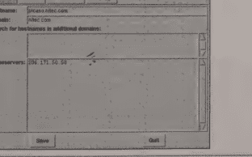

图 7-5 网络配置器窗口中的“名称”选项卡

若要更改主机名、域名或名称服务器，请先点击“名称”选项卡。只需修改值并点击保存。当你点击保存时，程序不会显示任何状态消息，因此起初可能会让人有些困惑。此外，程序中显示的域名来自 `/etc/resolv.conf` 文件中的搜索列表（列表中的第一个条目），因此如果你没有在此文件中设置任何搜索列表，`netcfg` 将不会显示任何域名。

若要添加、修改或删除网络接口，请点击如图 7-6 所示的“接口”选项卡，该选项卡显示当前的网络接口。

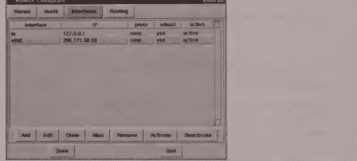

要添加新的网络接口，请执行以下操作：

- 点击**添加**以调出如图 7-7 所示的“选择接口类型”对话框。

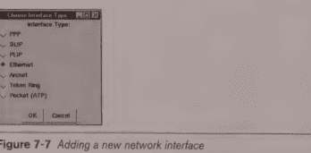

- 点击**以太网**以创建新的以太网网络接口配置。点击**确定**后，你将看到如图 7-8 所示的“编辑以太网/总线接口”对话框。


图 7-8 输入有关新接口的信息

- 输入此新设备的 IP 地址和子网掩码。`netcfg` 程序会根据你提供的信息自动计算网络和广播地址。如果希望此接口在启动时处于活动状态，请勾选“在启动时激活接口”。保持“允许任何用户（取消）激活接口”选项未选中，因为允许任何人都能激活或停用你的网络接口真的是一个坏主意。如果你没有使用 DHCP 或 BOOTP 服务器为此接口动态分配 IP 地址，请选择“无”作为接口配置协议。点击“完成”以完成配置；系统会询问你是否确认保存。通过点击“确定”保存配置。新接口将出现在下一个屏幕中显示的接口列表中。
- 如果你想立即激活该接口，请点击“激活”。屏幕应将接口的状态更新为活动状态。然而，当尝试配置不存在的网卡（NIC）时，`netcfg` 可能会显示接口为活动状态，而实际上它并非如此。检查接口的最简单方法之一是运行 `ifconfig interface name` 命令，以查看哪些接口已启动并正在运行。

你刚刚激活了新接口；现在你需要设置默认网关，步骤如下：

- 点击“路由”以调出如图 7-9 所示的网络配置器窗口。
- 输入默认网关的 IP 地址。网关设备名称应为你刚刚配置的设备。

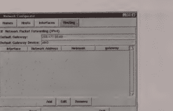

- 如果你想将此设备设置为向网络中的计算机转发 IP 数据包，请设置**网络数据包转发 (IPV4)** 选项。
- 保存新设置并退出程序。

你已配置好新接口并设置了默认网关。通过向网络中的计算机发送 ping 请求，使用 `ping IP address` 命令来测试你的新接口。如果你能 ping 通远程主机，说明你已成功配置了新接口。

要修改现有的网络接口，请执行以下操作：

- 点击**接口**。双击现有的网络接口行。进行适当的修改。
- 在保存更改后，先停用接口，然后再激活它。

###### 注意

如果你正在远程终端上使用 X Window System 运行 `netcfg` 程序，切勿停用用于为终端提供网络连接性的接口。如果你停用了远程 X 连接所需的接口，你的 X 会话将不再工作，并且你无法在本地访问的情况下激活该接口。

要删除现有的网络接口，请执行以下操作：

- 点击**接口**。选择现有的网络接口。
- 点击**删除**以完成此过程。前文中“注意”部分中的说明在此处同样适用。

## 使用默认网关

图 7-10 显示了两个网络——网络 A (192.168.1.0) 和网络 B (192.168.2.0)。

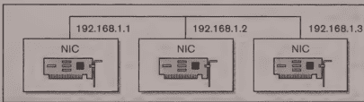

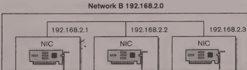

图 7-10 两个独立的 IP 网络

这两个网络是完全独立的。任一网络中的计算机都可以正常查看同一网络中的主机。使用网络 A 中 192.168.1.1 计算机的用户可以通过使用网络接口 IP 地址来 ping 其他两台计算机。然而，该用户无法访问网络 B 中的任何主机计算机，因为网络 A 中的数据包没有任何途径到达网络 B。由于两个独立的网络可以在物理上连接在一起，因此可以使用网关计算机或路由器将这两个网络连接起来，如图 7-11 所示。


图 7-11 *两个由网关连接的独立 IP 网络*

网络中的新计算机即网关计算机。它拥有两个网络接口。连接网络 A 的网络接口 IP 地址为 192.168.1.100，连接网络 B 的网络接口 IP 地址为 192.168.2.100。该计算机被配置为在这两个网络之间转发 IP 数据包。例如，当 192.168.1.1 计算机想要向 192.168.2.1 发送数据包时，它会将 IP 数据包转发给 192.168.1.100 网关计算机。然后，这台网关机器将数据包的修改版本放置在其另一个接口（192.168.2.100）上，使其对目标计算机可用。当目标计算机想要回复时，它遵循类似的过程，以便网关计算机能够将数据包发送给网络 A 上的源计算机。

因此，只有当你希望与两个不同的网络通信时才需要网关计算机。网关计算机不必是 PC 或工作站；它可以是专用的计算机硬件，例如路由器。

## 将网络划分为子网

图 7-12 中显示的网络有 100 台主机计算机连接到单个网络 192.168.1.0。

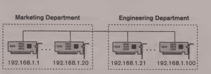

### 图 7-12 由 100 名用户共享的大型网络

由于所有计算机共享同一根物理网线，高峰时段的流量负载可能会相当大。例如，如果市场部门的所有人员同时开始使用网络，而工程部门的工程师也在同时使用，情况会变得非常缓慢，因为每台主机都必须共享网络带宽。解决方案是子网，类似于图 7-13 所示的设置。

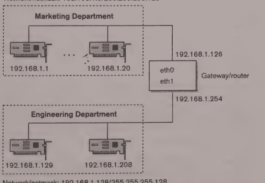

### 图 7-13 将大型网络拆分子网

192.168.1.0 网络已被划分为两个子网——192.168.1.0 和 192.168.1.128。这些子网通过一个具有两个网络接口的网关（或路由器）相互连接。当这两个网络中的每台主机计算机都配置正确时，网络流量将在这些网络之间分开。例如，当市场部门的一名用户希望与该部门内的另一台计算机通信时，这两台计算机之间的网络流量将保留在其所在网络中。工程一侧也是如此。不同部门计算机之间的通信也是允许的。这种网间流量由网关计算机在这些网络之间进行转发。结果是一个更快的网络，因为不再所有用户都在同一个大型网络中。以下是如何实现这种方案的描述。

当一个完整网络（如 192.168.1.0）需要划分为子网时，计算机必须找到一种方法来确定哪个 IP 地址属于哪个网络。例如，市场部门中网络接口为 192.168.1.1 的计算机需要知道 192.168.1.129 是否在同一网络中，以便确定是否应将目标为 192.168.1.129 的数据包发送到网关计算机进行进一步转发。它可以使用网络掩码（或 netmask）来确定 IP 地址是否属于其子网。

在从网络创建子网之前，你需要了解如何创建 netmask。例如，假设你希望确定网络 192.168.1.0 的网络掩码。该地址的二进制格式如下：

11000000.10101000.00000001.00000000

由于这是一个 C 类地址，网络位是前 24 位（3 字节）。要创建掩码，你必须将这些位全部设置为 1，并将剩余的（主机接口）位设置为 0。因此，netmask 如下所示：

11111111.11111111.11111111.00000000

在十进制形式中，这看起来像 255.255.255.0。因此，在创建 netmask 时，你只需要记住网络位都是 1，主机位都是 0。例如，A 类网络 10.0.1.0 的 netmask 是 255.0.0.0，同样，B 类网络 129.1.0.0 的 netmask 是 255.255.0.0。

在 TCP/IP 网络中，当计算机想要向某个 IP 地址发送数据包时，它通过执行按位与（bitwise AND）操作来确定该 IP 地址是否属于本地。例如，要确定 192.168.1.1 是否属于子网掩码为 255.255.255.0 的网络，主机计算机执行以下操作：

```
Binary          Decimal
11000000.10101000.00000001.00000001  => 192.168.1.1
AND 11111111.11111111.11111111.00000000 => 255.255.255.0
-------------------------------------------------------
11000000.10101000.00000001.00000000  => 192.168.1.0
```

如你所见，按位与操作返回了 IP 地址 192.168.1.1 的网络地址（192.168.1.0）。由于主机计算机知道它属于哪个网络，因此它很容易确定如何处理针对该 IP 地址的数据包。

由于你可能经常处理 C 类网络，本章节中的所有示例都使用该类。

当 C 类网络保持完整时，netmask 为 255.255.255.0。要将网络划分为子网，你需要通过将默认 C 类 netmask（255.255.255.0）的主机接口部分的一位或多位设置为 1 来创建新的 netmask。考虑正在使用的 C 类网络示例——192.168.1.0。通过将地址主机接口号部分的最显著位设置为 1，得到：

```
11111111.11111111.11111111.10000000 => 255.255.255.128
```

这是一个将 C 类网络对半拆分的新 netmask。从 192.168.1.0 到 192.168.1.127 的所有 IP 地址属于 192.168.1.0 网络，而其余 IP 地址，即 192.168.1.128 到 192.168.1.255，属于 192.168.1.128 网络。这两个网络都使用 255.255.255.128 netmask。例如，要确定名为 192.168.1.10 的 IP 地址属于哪个网络，执行以下按位与操作：

```
Binary          Decimal
11000000.10101000.00000001.00001010 => 192.168.1.10
AND 11111111.11111111.11111111.10000000 =>
255.255.255.128
-------------------------------------------------------
11000000.10101000.00000001.00000000 => 192.168.1.0
```

netmask **255.255.255.128** 告诉你给定的 IP 地址属于 192.168.1.0 网络。以下显示了名为 192.168.1.200 的 IP 地址属于哪个网络：

| 二进制 | 十进制 |
| :--- | :--- |
| 11000000.10101000.00000001.11001000 => | 192.168.1.200 |
| AND 11111111.11111111.11111111.10000000 => | |
| | **255.255.255.128** |
| ---------------------------------------------------------- | |
| 11000000.10101000.00000001.10000000 => | 192.168.1.128 |

相同的 netmask 为给定的 IP 地址提供了不同的网络地址（192.168.1.128）。因此，使用此 netmask，你实际上已将 192.168.1.0 网络分成了两个子网——192.168.1.0 和 192.168.1.128。

由于完整的 C 类网络有 256 个可能的 IP 地址，每个独立的子网有 128 个 IP 地址。然而，并非所有这些都可以作为主机（接口）IP 地址使用。在完整的 C 类网络中，例如 192.168.1.0（netmask 为 255.255.255.0），192.168.1.0 用作网络地址，192.168.1.255 用作广播地址。广播地址用于与网络中的所有主机计算机通信。因此，从某种意义上说，这两个地址是保留的。因此，在完整的 C 类网络中，你有 254 个（256 – 网络 IP 地址 – 广播 IP 地址）可用的 IP 地址。同样，当网络被细分时，每个子网都获得一个网络地址和一个广播地址，因此当 C 类网络被划分为两个子网时，四个 IP 地址无法用于主机寻址。在当前的例子中，情况如下：

网络：192.168.1.0
Netmask：255.255.255.128
第一个可用的主机 IP 地址：192.168.1.1
最后一个可用的主机 IP 地址：192.168.1.126
广播地址：192.168.1.127

网络：192.168.1.128
Netmask：255.255.255.128
第一个可用的主机 IP 地址：192.168.1.129
最后一个可用的主机 IP 地址：192.168.1.254
广播地址：192.168.1.255


## 子网划分计算和工具

用于确定可以从完整的 A 类、B 类或 C 类网络中创建多少个子网的公式如下：
子网数量 = $2^{(host \ bits - 1)}$。

例如，C 类网络中的主机位数为 8（最后一个字节），因此，技术上可以从单个 C 类网络中创建 $2^{7}$（128）个大小相等 的子网。然而，由于 IP 地址的损失（作为网络地址和广播地址），大多数网络管理员不会从 C 类网络中创建超过 16 个子网。

如果你对子网划分概念非常陌生，你可能会发现 `ipcalc` 工具非常有用。例如，假设你想确保你的子网计算符合预期。你可以使用此工具来确保你的数字正确。例如，如果你想确认图 7-13 中使用的子网是否正确，你可以将 192.168.1.1 到 254 范围内的任意 IP 提供给 `ipcalc`，连同子网掩码，以确定 IP 地址将属于哪个网络。以下是两个示例：

```
ipcalc --broadcast --network 192.168.1.1 255.255.255.128
BROADCAST=192.168.1.127
NETWORK=192.168.1.0
```

```
ipcalc --broadcast --network 192.168.1.129 255.255.255.128
BROADCAST=192.168.1.255
NETWORK=192.168.1.128
```

在第一个示例中，`ipcalc` 被告知显示广播地址（使用 `--broadcast` 参数）和 IP 地址 192.168.1.1 的网络地址（使用 `--network` 参数），使用 255.255.255.128 网掩。它返回广播地址为 192.168.1.127，网络地址为 192.168.1.0。这是对的。在第二个示例中，程序被要求显示属于网络另一半的 IP 的相同信息，并且它显示了正确的地址。

## 网关计算机配置

图 7-13 中显示的网关计算机必须有两个网络接口。其中一个接口必须连接到每个子网。此计算机的 `/etc/sysconfig/network` 文件在清单 7-4 中显示。

### 清单 7-4
*/etc/sysconfig/network 文件*

```
NETWORKING=yes
FORWARD_IPV4=yes
HOSTNAME=gateway.nitec.com
DOMAINNAME=nitec.com
```

这里最重要的设置是 `FORWARD_IPV4=yes`，它在内核中启用 IP 转发。

> **提示**
>
> 你必须在内核中内置 IP 转发支持。你可以使用 `cat /proc/sys/net/ipv4/ip_forward` 命令查看正在运行的内核中是否启用了 IP 转发。如果输出为 1，则表示 IP 转发已设置；值为 0 表示 IP 转发已关闭。你还可以通过使用 `echo n > /proc/sys/net/ipv4/ip_forward` 命令插入 1 或 0 的值来打开或关闭它，其中 *n* 为 1 或 0。

清单 7-5 和 7-6 显示了两个接口（`eth0` 和 `eth1`）文件。

### 清单 7-5
*/etc/sysconfig/network-scripts/ifcfg-eth0 文件*

```
DEVICE=eth0
IPADDR=192.168.1.126
NETMASK=255.255.255.128
NETWORK=192.168.1.0
BROADCAST=192.168.1.127
ONBOOT=yes
```

### 清单 7-6
*/etc/sysconfig/network-scripts/ifcfg-eth1 文件*

```
DEVICE=eth1
IPADDR=192.168.1.254
NETMASK=255.255.255.128
NETWORK=192.168.1.128
BROADCAST=192.168.1.255
ONBOOT=yes
```

在设置这些文件并且接口已启动并运行（通过重新启动或使用 `ifup` 命令）之后，你需要使用以下 route 命令为两个网络创建两个默认路由：

```
route add -net 192.168.1.0   255.255.255.128 eth0
route add -net 192.168.1.128 255.255.255.128 eth1
```

前述每个 route 命令确保发往指定网络的数据包通过指定的接口设备传输。

## 主机计算机配置

每个子网上的每台主机计算机都必须配置，以便每台计算机都知道网络地址、本地子网掩码和网关信息。例如，假设所有子计算机也是 Linux 工作站，并且每台都有一个以太网接口设备（`eth0`），则 192.168.1.0 网络上任何主机计算机上的 `/etc/sysconfig/network` 文件在清单 7-7 中显示。

### 清单 7-7
*/etc/sysconfig/network 文件*

```
NETWORKING=yes
FORWARD_IPV4=yes

HOSTNAME=marketing-1.nitec.com
DOMAINNAME=nitec.com
GATEWAY=192.168.1.126
GATEWAYDEV=eth0
```

同一台计算机上的接口文件将如下清单 7-8 所示的示例。

### 清单 7-8
*/etc/sysconfig/network-scripts/ifcfg-eth0 文件*

```
DEVICE=eth0

IPADDR=192.168.1.1
NETMASK=255.255.255.128
NETWORK=192.168.1.0
BROADCAST=192.168.1.127
ONBOOT=yes
```

类似地，192.168.1.128 网络中的计算机需要设置。 该网络中的每台计算机将在 `/etc/sysconfig/network` 文件中使用 `GATEWAY=192.168.1.254` 行，并在其 `/etc/sysconfig/network-scripts/ifcfg-eth0` 文件中使用 `NETWORK=192.168.1.128` 和 `BROADCAST=192.168.1.255`。

当然，如果这些计算机中有任何一台是非 Linux 系统，例如运行 Windows 9x/2000 的系统，你必须使用适当的网络配置工具来设置这些值。

在设置网关计算机和每个网络中的至少一台主机后，你就可以测试子网了。测试最简单的方法是使用 `ping` 程序。以下是一些简单的测试和故障排除指南：

1. 使用 `ping` 程序 ping 同一子网中的主机计算机。例如，从 192.168.1.1 计算机运行 `ping 192.168.1.2`。如果未收到 ping 回复，请检查网络配置文件（`/etc/sysconfig/network` 和 `/etc/sysconfig/network-scripts/ifcfg-eth0`）。纠正你注意到的任何问题并重新启动接口，先使用 `ifconfig eth0 down` 将其关闭，然后使用 `/etc/sysconfig/network-scripts/ifup eth0` 将其启动。在你能够 ping 同一子网中的主机后，继续下一步。
2. 从每个子网 ping 网关计算机。如果无法执行此操作，请检查网关计算机的网络配置文件并纠正任何错误或拼写错误。在你能够从每个子网 ping 网关计算机后，继续下一步。
3. 尝试 ping 另一个子网中的主机。如果无法 ping 另一个子网中的主机，请尝试使用 `traceroute IP address` 确定数据包是否到达网关机器。如果 `traceroute` 显示数据包到达网关但未转发到目标，则问题出在网关。你应确保计算机已打开 IP 转发。在网关计算机上运行 `cat /proc/sys/net/ipv4/ip_forward` 查看返回的值是 1 还是 0。如果不是 1，则 IP 转发在 `/etc/sysconfig/network` 文件中已关闭或在内核中未启用。在这种情况下，修复此问题并重试。

在这一点上，你应该能够从两个子网中的任何一个发送 ping 请求。如果可以，那么你就有两个正在工作的子网。

## 第 8 章

# DNS 服务

## 配置 DNS 客户端（解析器）

通常，Red Hat 安装程序会询问你的 DNS 服务器并自动配置必要的解析器配置文件。然而，通常有必要更改解析器配置以反映你使用的 DNS 服务器的任何更改。例如，如果你在 Red Hat 安装期间配置了解析器并随后更改了 ISP，你必须手动重新配置它。方法如下。

如果你计划使用 ISP 的 DNS 服务器来解析名称和 IP 地址，请向你的 ISP 询问其 DNS 服务器的主机名和 IP 地址。获得所需信息后，你可以按如下方式配置解析器：

1. 首先，修改名为 `/etc/resolv.conf` 的解析器配置文件。清单 8-1 显示了名为 `nitec.com` 的域的典型 `/etc/resolv.conf` 文件。

### 清单 8-1
*解析器配置文件 /etc/resolv.conf*

```
# Default Domain
domain nitec.com

# Default search list
search nitec.com
```

### 清单 8-1 继续

```
# First name server
nameserver 206.171.50.50

# Second name server
nameserver 206.171.50.55
```

2. 将 Domain 指令设置为系统的域名。如果未将此行设置为系统的域名，则默认域名将自动从系统的完全限定主机名中提取。
3. 将 Search 指令设置为系统的域名。此指令用于影响解析器搜索未完全限定的主机名的方式。例如，如果你想在具有上述解析器配置文件的系统上的 shell 中输入 `ping www` 命令，`ping` 程序将使用解析器解析 `www`。由于 `www` 是部分主机名，解析器将使用搜索列表（例如 `www.nitec.com`）创建完整主机名并尝试解析该主机的 IP。例如，如果你在前面的清单中将搜索指令设置为 `integrationlogic.com` 并发出相同的 `ping` 请求，解析器将返回 `www.integrationlogic.com` 的 IP 地址。如果未提供搜索指令，则在需要解析部分主机名时会自动应用默认域名。
4. 将 `nameserver` 指令设置为解析器应用于执行 DNS 查询的 DNS 服务器。你可以在配置文件中（并且应该）指定多个 `nameserver` 指令。每个域名服务器按其在配置文件中出现的顺序进行查询。例如，如果程序请求解析器解析名为 `www.ad-engine.com` 的主机名，解析器首先尝试使用 206.171.50.50 域名服务器将名称解析为 IP。如果 206.171.50.50 域名服务器未能返回响应（即查询超时），则会联系第二个域名服务器 206.171.50.55。目前，你只能在配置文件中列出三个 `nameserver` 指令。一般来说，最好至少设置两个 `nameserver` 指令指向两个不同的名称服务器。


###### 注意

你可以将 nameserver 指令设置为互联网上任何域名服务器的 IP 地址。不过，为了减少域名解析的延迟，你应该仅使用最近的名称服务器 IP 地址。此外，切勿在未经授权的情况下，在你的解析器配置文件中使用他人的域名服务器 IP 地址。如果解析器对某人的名称服务器造成沉重负载，这样做不仅无礼，还可能带来法律后果。

也可以在 `/etc/hosts` 文件中将一个或多个 IP 地址硬编码为其相应的主机名。该文件的格式非常简单，如下所示：

```
IP address  host name  short-cut host name
```

以下是 `/etc/hosts` 文件的一个示例：

```
206.171.50.50  picoaso.nitec.com  picoaso
127.0.0.1      localhost         localhost
```

当远程 DNS 服务器不可用时，解析器可以使用该文件来解析地址。此外，如果你拥有一个小型网络且不想运行本地 DNS 服务器，可以使用该文件来解析本地主机名。然而，当远程 DNS 服务器和 `/etc/hosts` 文件都可用时，解析器需要知道按什么顺序处理 DNS 查询。你可以使用 order 指令在 `/etc/host.conf` 文件中设置顺序。例如，

```
order  hosts,bind
```

如果你的 `/etc/host.conf` 文件包含此 order 指令，解析器将首先尝试使用 `/etc/hosts` 文件来处理查询。如果该文件中没有可用的条目，则会使用在 `/etc/resolv.conf` 文件中指定的 bind 或 DNS 服务器。

###### 提示

如果你拥有大量用户，通过本地 DNS 服务器代替 `/etc/hosts` 文件可以提高 DNS 相关性能，因为对于每个新的 DNS 请求读取文件可能非常缓慢。

设置好上述文件后，你的 DNS 解析器配置就完成了。测试 DNS 配置最简单的方法是尝试 ping 互联网上的一台计算机。如果 ping 程序因未知主机名而失败，请仔细检查你的 DNS 解析器配置中是否有拼写错误。

## 设置 DNS 服务器

Red Hat Linux 附带 Berkeley Internet Name Domain (BIND) 服务器软件。如果在操作系统安装阶段未安装，你可以安装该软件的 RPM 版本。例如，要为 Intel x86 平台安装 BIND 软件 8.2.2-P5 版本，我在 Red Hat Linux CD-ROM 的 RPMs 目录中找到了 bind-8.2.2-P5.i386.rpm 软件包，并运行以下命令安装 BIND：

```
rpm -ivh bind-8.2.2-P5.i386.rpm
```

上述 BIND 软件的 RPM 软件包安装了以下四个程序：

- `/usr/sbin/named`。名称服务器本身。
- `/usr/sbin/named-xfer`。名称服务器的辅助程序。
- `/usr/sbin/ndc`。用于控制名称服务器的程序。
- `/usr/doc/bind-8.2.2/named-bootstrap.pl`。用于将旧配置文件转换为新格式的辅助 Perl 脚本。

## 配置主 DNS 服务器

假设我在 ns.nitec.com 主机上运行 BIND 域名服务器 (named)，并刚刚通过 InterNIC 注册了一个名为 classifiedworks.com 的域名，希望设置 ns.nitec.com 上的 named 以提供该新域名的主 DNS 服务。方法如下。

首先，我需要在 /etc/named.conf 文件中创建以下区域声明：

```
zone "classifiedworks.com" {
    type master;
    file "classifiedworks.db";
};
```

这表明我的名称服务器是 *classifiedworks.com* 域的主名称服务器。现在，我需要在名称服务器的工作目录（由 options { *directory_path_name* } 声明指定）中创建一个名为 classifiedworks.db 的区域文件。清单 8-2 是 *classifiedworks.com* 域此类区域文件的示例。

### 清单 8-2：classifiedworks.com 域的区域文件

```
@   IN   SOA    ns.nitec.com. kabir.nitec.com. (
    1999020100  ; Serial
    7200        ; Refresh  –  2 hours
    3600        ; Retry    –  1 hour
    43200       ; Expire   –  12 hours
    3600 )      ; Minimum  –  1 hour

    IN  NS   ns.nitec.com.
    IN  MX  10 mail.nitec.com.

www  IN  CNAME www.nitec.com.
ftp  IN A  206.171.50.55
```

我设置了 SOA 和 NS 记录，以声明 ns.nitec.com 是 *classifiedworks.com* 域的服务器。因为我想在 *mail.nitec.com* 主机上接收该域的邮件，所以我设置了一个 MX 记录来实现这一点。我设置了别名 *www.classifiedworks.com* 指向 *www.nitec.com*。最后，我设置了一个 A 记录，让 *ftp.classifiedworks.com* 指向 206.171.55。
正如你所见，通过使用各种 RR，你可以按需配置区域文件。配置好区域文件并将其存储在 DNS 服务器的工作目录中后，该域的主名称服务器配置即告完成。

## 配置从 DNS 服务器

配置从或次级 DNS 服务器非常简单。我们唯一需要手动更新的文件是 */etc/named.conf* 文件。例如，假设我想使用名为 *na2.nitec.com* 的 DNS 服务器作为 *classifiedworks.com* 域的次级服务器。我需要做的第一件事是在 ns2.nitec.com 命名服务器的 `/etc/named.conf` 文件中创建区域声明，如下所示：

```
zone "classifiedworks.com" {
    type slave;
    file "classifiedworks.db";
};
```

由于这是一个从或次级服务器，我不需要手动创建 `classifiedworks.db` 文件。我只需使用名为 `named-xfer` 的程序从 **classifiedworks.com** 域的主名称服务器获取该文件，该程序随 `named` 发行版一起提供。由于我知道 **classifiedworks.com** 域的主名称服务器名称为 `ns.nitec.com`，我可以按如下方式运行 `named-xfer` 命令：

```
named-xfer -z classifiedworks.com -f classifiedworks.db \
-s 0 ns.nitec.com
```

在此，`-z` 选项用于指定区域名称，`-f` 选项用于指定区域文件名，`-s` 选项用于指定当前存储信息的名称服务器。

运行此程序后，当前目录下会创建一个名为 `classifiedworks.db` 的文件。将该文件移动到 `ns2.nitec.com` 机器上 named 服务器的工作目录后，**classifiedworks.com** 域的次级 DNS 配置即告完成。

## 配置反向 DNS 服务器

如果你拥有网络 IP 地址，就必须为它们进行反向 DNS。例如，如果你拥有一个名为 `206.171.50.0` 的 IP 网络，并在名为 `nitec.com` 的域的前向 DNS 配置中使用它，你就必须为该网络设置反向 DNS 区域。方法如下。

首先，修改 `/etc/named.conf` 文件以包含一个新区域，如下所示：

```
zone "50.171.206.in-addr.arpa" {
    type master;
    file "db.206.171.50";
};
```

前一个区域配置中使用的特殊区域名称 (50.171.206.in-addr.arpa) 是通过反转你的网络号并在名称末尾添加 in-addr.arpa 来创建反向 DNS 区域名称所必需的。

接下来，在 named 服务器的工作目录中创建 db.206.171.50。反向 DNS 区域的文件名可以是任何名称，但惯例是使用 db.network-address 名称。该文件与之前展示的其他区域文件类似；唯一的区别是它将拥有 PTR 记录，而不是 A、CNAME 等。清单 8-3 展示了 db.206.171.50 文件的示例。

### 清单 8-3：反向 DNS 区域文件 (db.206.171.50) 的示例

```
    IN SOA ns.nitec.com.  kabir.nitec.com. (

    1999020100  ; Serial

    7200        ; Refresh  - 2 hours

    3600        ; Retry   - 1 hour

    43200       ; Expire  - 12 hours

    3600 )      ; Minimum - 1 hour

    IN NS ns.nitec.com.

51.50.171.206.in-addr.arpa. IN PTR ns.nitec.com.
52.50.171.206.in-addr.arpa. IN PTR mail.nitec.com.
53.50.171.206.in-addr.arpa. IN PTR www.nitec.com.
```

在此，PTR 记录用于将三个不同的 IP 地址映射到三个不同的主机名。你还可以按以下形式指定前面的 PTR 记录：

```
51 IN PTR ns.nitec.com.
52 IN PTR mail.nitec.com.
53 IN PTR www.nitec.com.
```

在大多数情况下，你的 ISP 拥有你网络的 IP 地址，并应准备好提供主反向 DNS 服务。然而，对于一个特殊网络 127.0.0，你必须提供反向名称服务。该网络用于本地回环接口 IP (127.0.0.1)。由于没有人对这个回环网络拥有权限，每个人都必须提供


DNS 服务本身是由反向 DNS 服务提供的，这就是为什么你的 `/etc/named.conf` 文件中总需要一个特殊的区域声明，其形式如下：

```
zone "0.0.127.in-addr.arpa" {
type master;
file "named.local";
};
```

你还需要在名称服务器的工作目录中拥有 `named.local` 区域文件。该文件如清单 8-4 所示。

**清单 8-4** *named.local 文件*

```
@ IN SOA localhost. root.localhost. (
1999020100 ; Serial
7200 ; Refresh - 2 hours
3600 ; Retry - 1 hour
43200 ; Expire - 12 hours
3600 ) ; Minimum - 1 hour

IN NS localhost.
1 IN PTR localhost.
```

## 配置仅缓存/从属 DNS 服务器

从技术角度来看，所有的 DNS 服务器都具有缓存功能；换句话说，DNS 服务器默认使用缓存。然而，如果你不想为任何互联网域名提供 DNS 服务，而仅希望提高网络的 DNS 查询性能，你可以运行一个仅缓存的 DNS 服务器。这样的服务器将包含一个 `/etc/named.conf` 文件，如清单 8-5 所示。

**清单 8-5** *仅缓存 DNS 服务器的 /etc/named.conf 文件*

```
zone "" {
type hint;
file "named.ca";
};

zone "0.0.127.in-addr.arpa" {
    type master;
    file "named.local";
};
```

第一个区域声明指定名称服务器使用 `named.ca` 文件在启动时确定根名称服务器名称。第二个区域声明用于为本地回环网络提供反向名称服务。这就是创建仅缓存名称服务器所需的全部内容。

## 控制 DNS 服务器

`named` 发行版附带了一个名为 `ndc` 的实用程序，它提供了一种简单的命令行界面来控制名称服务器。

## 启动名称服务器

你的名称服务器应在启动时自动启动。如果它没有自动启动，请执行以下步骤：

1.  以 root 用户身份登录到你的名称服务器系统，并将目录更改为 `/etc/rc.d/init.d`。确保该目录下有一个名为 `named` 的脚本。如果你缺少此脚本，请从你的 Red Hat CD-ROM 重新安装 BIND 发行版 RPM，或从 RegHat 网站下载它。
2.  在确认你有 `/etc/rc.d/init.d/named` 脚本后，将目录更改为你的默认系统运行级别（参见 `/etc/inittab`）的 `rc` 目录。对于大多数系统，默认运行级别是 3；如果你的也是如此，请将目录更改为 `/etc/rc.d/rc3.d`。
3.  创建一个名为 `SXXnamed` 的符号链接，指向 `/etc/rc.d/init.d/named` 脚本。在 `SXXnamed` 中用一个大数字（例如 55 或 85）替换 `XX`，以确保系统不会在网卡正确设置之前尝试启动名称服务器。例如，要创建一个指向 `named` 脚本的名为 `S55named` 的符号链接，请运行以下内容：

创建此链接后，每次启动系统时，你的系统都会启动名称服务器。然而，如果你更喜欢手动运行名称服务器，请使用 `ndc` 程序，如下所示：

`ndc start`

## 重新加载新的名称服务器配置

在你修改任何区域文件或 `/etc/named.conf` 文件后，必须重启名称服务器才能使更改生效。你可以按以下方式强制名称服务器重新加载新配置：

`ndc reload`

别忘了修改你所修改的任何区域文件中 SOA 记录里的序列号，否则名称服务器将不会加载新配置。

若要先终止名称服务器再重启，请在上述行中使用 `restart` 代替 `reload`。

## 停止名称服务器

如果由于任何原因需要停止名称服务器，请运行 `ndc` 命令，如下所示：

`ndc stop`

## 查看名称服务器统计信息

你可以使用 `ndc` 程序在名称服务器的工作目录中生成各种名称服务器统计信息。运行以下内容以在名称服务器的工作目录中创建一个名为 `named.stats` 的文件：

`ndc stats`

此统计文件显示各种信息项，包括每个 RR 的查询数量。

每次修改 DNS 信息时，别忘了使用名称服务器查询工具测试配置。

## 测试你的 DNS 服务器

有许多工具可用于手动查询名称服务器。如果你想拥有几个常用的查询工具，请从你的 Red Hat CD-ROM 安装 `bind-utils` RPM 发行版。`bind-utils` 发行版包含 `dig`、`dnsquery`、`host`、`nslookup` 等。我最喜欢的，也是使用最广泛的，是 `nslookup` 实用程序，因此本节使用它来测试 DNS 配置。

假设你刚刚在一个域名注册网站注册了一个全新的域名，并且已经在名称服务器上设置了必要的 DNS 配置。在重启名称服务器后，你想通过 `nslookup` 测试配置。

当你从命令行运行 `nslookup` 时，它会显示默认使用的名称服务器的主机名和 IP 地址。如果你正在名称服务器系统上运行 `nslookup`，你应该看到名称服务器的名称和 IP。如果你没有看到名称服务器的信息，请确保你的 `/etc/resolv.conf` 文件已正确配置。

另一方面，如果你在一台非名称服务器的计算机上运行 `nslookup`，你必须告诉程序使用你想要测试的名称服务器。只有当域名注册网站尚未向根名称服务器发布新域名的名称服务器信息时，你才需要这样做。要告诉 `nslookup` 使用不同于默认的名称服务器，请在 `nslookup` 命令提示符下输入 `server host_name`（其中 `host_name` 是你想要测试的服务器的 hostname）。输入此命令后，`nslookup` 将对所有查询使用指定的名称服务器主机。

`nslookup` 实用程序允许你使用简单的语法执行任何类型的 DNS 查询。例如，要查找域的名称服务器，请在 `nslookup` 程序内运行以下命令：

```
set query=ns
domain.tld
```

第一行告诉 `nslookup` 为下一个域（`domain.tld`）执行 NS（名称服务器 RR）查询。类似地，你可以执行 A、MX、CNAME 等查询。如果你得到的响应看起来不对，请回到区域文件，确保没有拼写错误。一个常见的错误是省略完整主机名末尾的句点。

## 管理虚拟域名的 DNS

单个名称服务器可以为许多域名提供名称服务。此功能允许单个系统托管许多互联网域名。事实上，大多数 ISP 就是这样为客户提供商网站服务的。由于这些域名托管在另一个域（例如，ISP 自己的域）上，它们被称为*虚拟域名*，这在如今非常常见。如果你需要日常为客户创建大量虚拟域名，你可能希望尽可能自动化此过程。清单 8-6 显示了一个名为 *makesite* 的 Perl 脚本，你经常可以使用它来创建虚拟域名。

**清单 8-6** *makesite 脚本*

```
#!/usr/local/bin/perl -w

use strict;

# Purpose: makesite creates virtual sites.
# It uses a set of templates to create DNS and HTTPD
# configuration files.
#
# Note: this is a very *simple* script.
#
########################################

use Time::localtime;

my $site		= $ARGV[0] or &syntax;
my $MAKESITE_DIR	= '/scratch/dns/makesite/';
my $USER		= 'httpd';
my $GROUP		= 'httpd';
my $PERMISSION	= '2770';
my $BASE_DIR		= '/tmp/';
my $HTTPDIR		= 'htdocs';
my $SCGIBIN		= 'cgi-bin';
my $NAMED_PATH        = '/var/named';
my $NAMED_FILE_EXT    = '.db';
my $NAMED_TEMPLATE    = "$MAKESITE_DIR/named.template";
my $NAMED_CONF        = '/etc/named.conf';
my $HTTPD_CONF        = '/usr/local/apache/etc/httpd.conf';
my $VHOST_TEMPLATE    = "$MAKESITE_DIR/httpd.template";
my $LOG_FILE          = "$BASE_DIR/makesite.log";

my $dir = $site;
my @domain_types = qw(com net org edu);
my ($domain_ext, $thesite_dir, $public_dir,
    $htdocs_dir, $cgbind_dir, $named_file,
    $dir_len, $temp_len);

my $tm = localtime(time);
my $date = sprintf("%s-%02s-%02s-%02d", $tm->year+1900,
                   $tm->mon+1,
                   $tm->mday,
                   $tm->hour,
                   $tm->min);
my $serial = sprintf("%s%02d%02d000", $tm->year+1900,
                    $tm->mon+1,
                    $tm->mday);

$site =~ y/[A-Z]/[a-z]/;

# Get the length with the EXT
$dir_len = length($dir);
```

*续*


# 列表 8-6（续）

```perl
foreach ($domain_ext) { foreach ($domain_types) {
    $dir =~ s/\.$domain_ext//g;
}}

# 获取去掉扩展名后的新长度
$temp_len = length($dir);

# 如果用户未输入扩展名，则显示语法。
$syntax if ($temp_len == $dir_len);

$named_file = $NAMED_PATH . '/' . $dir . $NAMED_FILE_EXT;

$testsite_dir = $BASE_DIR . '/' . $dir;

$htdocs_dir = $BASE_DIR . '/' . $dir . '/' . $HTDOCS;

$cgibin_dir = $BASE_DIR . '/' . $dir . '/' . $CGIBIN;

die "$testsite_dir already exists! Aborted!\n" if (-e $testsite_dir);

system("mkdir $testsite_dir");

system("mkdir $htdocs_dir");

system("mkdir $cgibin_dir");

&createNamedFile($named_file, $site, "$dir$NAMED_FILE_EXT");

&createIndexFile($htdocs_dir, $site);

&createVirtualHostConf(domain => $site,
                       website => "$www.$site",
                       cgibin => $cgibin_dir,
                       htdocs => $htdocs_dir);

system("chown -R $USER.$GROUP $testsite_dir");

system("chmod -R $PERMISSION $testsite_dir");

open (FP, ">>$LOG_FILE") || die "Can't write to log\n";
print FP "$date created www.$site [${docs_dir}].\n";
close (FP);
exit 0;

sub createNamedFile {
    my $file = shift;
    my $domain = shift;
    my $database = shift;
    my $line;
    open (OUT, ">>$file") || die "Can't write $file\n";
    open (FP, $NAMED_TEMPLATE) || die "Can't open $NAMED_TEMPLATE\n";
    while ($line = <FP>) {
        $line =~ s/<DOMAIN>/$domain/g;
        $line =~ s/<SERIAL>/$serial/g;
        print OUT $line;
    }
    close (FP);
    close (OUT);
    open (FP, ">>$NAMED_CONF") || die "Can't open $NAMED_CONF\n";
    print FP <<ZONE;
// $domain was created on $date
zone "$domain" {
    type master;
    file "$database";
};
ZONE
    close (FP);
}

sub createIndexFile {
    my $htdocs = shift;
    my $domain = shift;

    open (FP, ">$htdocs/index.html") || die "Can't write index.html \n";
    print FP <<INDEX_PAGE;
<HTML>
<HEAD> <TITLE> $domain </TITLE> </HEAD>
<BODY BGCOLOR="white">
<CENTER>
This is $domain Web site
<P> It was created on $date </P>
</CENTER>
</BODY>
</HTML>
INDEX_PAGE

    close (FP);
}

sub createVirtualHostConf {
    my @params = @_;
    my $line;
    open (OUT, ">>$HTPD_CONF") || die "Can't open $HTPD_CONF $!\n";
    open (FP, $VHOST_TEMPLATE) || die "Can't open $VHOST_TEMPLATE $!\n";

    while ($line = <FP>) {
        $line =~ s/<DOMAIN>/$params{domain}/g;
        $line =~ s/<CGI-BIN-DIR>/$params{cgibin}/g;
        $line =~ s/<HTDOCS-DIR>/$params{htdocs}/g;
        $line =~ s/<WWW-SITE>/$params{website}/g;
        print OUT $line;
    }
    close (FP);
    close (OUT);
}

sub syntax {
    print <<SYNTAX;

makesite <virtual Internet domain>
Example: makesite nitec.com
SYNTAX
    exit 0;
}
```

该 Perl 脚本旨在允许您创建虚拟网站，并正确配置 DNS 和 Apache Web 服务器，而无需手动进行大量的文件编辑任务。例如，假设您想要创建一个名为 www.newdomain.com 的新网站。如果手动操作，您需要执行以下步骤：

1.  在 /etc/named.conf 文件中为 newdomain.com 添加一个新的区域（zone）语句。
2.  在 DNS 服务器的工作目录中为 newdomain.com 添加一个新的区域文件。我必须从零开始创建它，或者复制并修改现有的域名文件。
3.  在服务器上的适当 Web 空间中为该域名创建网站文档根目录和 CGI 脚本目录。
4.  修改 Apache 服务器配置文件，以便 Apache 将 www.newdomain.com 视为一个新的网站。

由于手动配置这些重要文件容易出现错误，您应该编写 makesite 脚本来执行所有这些步骤。例如，要创建具有正确 DNS 和 Apache 配置的 www.newdomain.com 站点，请运行以下命令：

```bash
makesite newdomain.com
```

该命令会在 /etc/named.conf 文件中添加如下所示的区域语句：

```text
# newdomain.com was created on 1999-02-03-13-30

zone "newdomain.com" {
    type master;
    file "newdomain.db";
};
```

此语句会在 /var/named（我的 DNS 服务器的工作目录）中创建一个 newdomain.db 文件，如列表 8-7 所示。

### 列表 8-7 /var/named/newdomain.db 文件

```text
# IN SOA newdomain.com. hostmaster.newdomain.com. (
      1999020600 ; serial YYYYMMDDXXX
      7200       ; refresh
      3600       ; (1 hour) retry
      1728000    ; (20 days) expire
      3600)      ; (1 hour) minimal TTL

; Name Servers
IN NS ns.nitec.com.
IN MX 10 mail.nitec.com.

; CNAME records
www IN CNAME www.nitec.com.
```

然后，脚本会在 Apache 服务器配置文件（httpd.conf）的末尾追加以下内容：

```apache
#
# Domain Configuration for www.newdomain.com
#
<VirtualHost www.newdomain.com>
    ServerName www.newdomain.com
    ServerAdmin webmaster@newdomain.com

    DocumentRoot /tmp/newdomain/htdocs
    ScriptAlias /cgi-bin/ /tmp/newdomain/cgi-bin/

    ErrorLog logs/www.newdomain.com.error.log
    TransferLog logs/www.newdomain.com.access.log
</VirtualHost>

#
# End of Domain Configuration for www.newdomain.com
#
```

最后，脚本创建以下目录结构以及网站的 index.html 页面：

```text
/www/newdomain
/www/newdomain/htdocs -- 网站文档根目录
/www/newdomain/cgi-bin -- cgi-bin 目录
```

index.html 页面存储在 /www/newdomain/htdocs/ 目录中。脚本还为网站目录设置权限，使得只有指定的用户和组具有读/写权限。

由于脚本完成了所有繁琐的工作，您可以创建许多虚拟网站，而无需担心配置问题。并且，当您完成网站创建后，可以重启 DNS 服务器和 Web 服务器以使所有站点上线。这确实是一个简单但非常有用的工具。

makefile 脚本接受域名作为参数，并使用两个文本模板文件来创建 DNS 服务器和 Web 服务器配置信息。列表 8-8 显示了用于创建 DNS 服务器配置的 named.template 文件。

### 列表 8-8 named.template 文件

```text
@       IN  SOA <DOMAIN>.    hostmaster.<DOMAIN>. {
                                             ;
    <_SERIAL>                                ; serial YYYYMMDDXXX
    7200                                     ; refresh
    3600                                     ; (1 hour) retry
    1728000                                  ; (20 days) expire
    3600)                                    ; (1 hour) minimal TTL

; Name Servers
    IN  NS  ns.nitec.com.
    IN  MX  10 mail.nitec.com.

; CNAME records
www   IN  CNAME www.nitec.com.
```

makefile 脚本读取此模板，并用适当的信息替换 <DOMAIN> 和 <SERIAL> 标签。由于目的是创建具有正确 DNS 配置的虚拟网站，因此无需创建 A 记录。例如，前述配置表明 www.<DOMAIN>（例如，www.newdomain.com）是 www.nitec.com 的别名。如果需要更改 IP 地址，使用 A 记录会使维护许多虚拟网站变得耗时。因此，我使用 CNAME 记录，这样如果 www.nitec.com 主机的 IP 需要更改，虚拟域名的配置文件就不需要修改。

列表 8-9 显示了用于创建 Apache 服务器配置的 httpd.template 文件。

### 列表 8-9 httpd.template 文件

```text
#
# Domain Configuration for <WWW-SITE>
#

<VirtualHost <WWW-SITE>>
  ServerName <WWW-SITE>
  ServerAdmin webmaster@<DOMAIN>

  DocumentRoot <HTDOCS-DIR>
  ScriptAlias /cgi-bin/ <CGI-BIN-DIR>/

  ErrorLog logs/<WWW-SITE>.error.log
  TransferLog logs/<WWW-SITE>.access.log
</VirtualHost>

#
# End of Domain Configuration for <WWW-SITE>
#
```

与之前的模板一样，此文件使用了一些自定义标签，并被替换为适当的信息。

要在您自己的环境中使用此 Perl 脚本，请通过进行每行后面描述的更改来修改脚本开头的以下代码行：

```perl
my $MAKESITE_DIR = '/usr/local/src/makesite';
```
将目录路径更改为您存放所有 makesite 文件的位置。

```perl
my $USER = 'htpd';
```
如果您使用其他用户（如 nobody 或其他用户）运行 Apache Web 服务器，请更改用户名。

```perl
my $GROUP = 'htpd';
```
如果您的 Apache Web 服务器在不同的组下运行，请更改组名。


## 配置 Apache Web 服务器

如果您使用其他组（例如 `nobody` 或别的组）来运行 Apache Web 服务器，请更改组名。

```perl
my $PERMISSION = '2770';
```

根据您的需要更改该值（2770）。此值仅允许 `$USER` 和 `$GROUP` 对网站目录拥有完全访问权限。

```perl
my $BASE_DIR = '/www/';
```

将此值更改为您所有网站的基础目录。

```perl
my $HTDOCS = 'htdocs';
```

将此值更改为 `httpd.conf` 文件中文档根目录的相对名称。当前设置将 `$BASE_DIR/<site name>/$HTDOCS`（默认为 `/www/<site name>/htdocs`）创建为网站的文档根目录。

```perl
my $CGIBIN = 'cgi-bin';
```

如果您不希望 Apache 的 `ScriptAlias` 指令设置为 `$BASE_DIR/<site name>/$CGIBIN`（默认为 `/www/<site name>/cgi-bin`），请根据适用情况更改此相对目录名。

```perl
my $NAMED_PATH = '/var/named';
```

将此目录更改为您的 DNS 服务器的工作目录。

```perl
my $LOG_FILE = "$BASE_DIR/makesite.log";
```

如果您不想将 `makesite` 日志文件写入基础目录，请将其更改为指向其他位置。例如，您可以将其设置为 `/tmp/makesite.log` 以写入 `/tmp` 目录。

```perl
my $HTTPD_CONF = '/usr/local/apache/etc/httpd.conf';
```

将此值更改为指向您的 Web 服务器的 `httpd.conf` 文件。在完成上述更改后，请根据需要修改 `named.template` 和 `httpd.template` 文件，并将这两个文件都存储在您存放 `makesite` 脚本的目录中。最后，确保该脚本具有可执行权限，并且 Perl 解释器行（`#!` 感叹号行）已正确设置。这应该能为您省去一些工作。如果您懂 Perl 编程，始终可以根据需要微调脚本以适应您的环境。

## 使用 DNS 服务器进行负载平衡

其思想是在同类型的多个服务器之间分担负载。这通常用于在多个 Web 服务器之间平衡 Web 负载。这种技巧被称为**轮询域名系统**。

假设您有两个 Web 服务器，**www1.yourdomain.com**（192.168.1.10）和 **www2.yourdomain.com**（192.168.1.20），并且您希望使用轮询 DNS 技巧在这两个服务器上为 **www.yourdomain.com** 平衡负载。将以下内容添加到您的 **yourdomain** com 区域文件中：

```dns
www1  IN  A   192.168.1.10
www2  IN  A   192.168.1.20

www   IN  CNAME  www1
www   IN  CNAME  www2
```

重启您的 DNS 服务器并 ping **www.yourdomain.com** 主机。您将在 ping 输出中看到 192.168.1.10 地址。停止并重新开始 ping 同一主机，您会看到正在 ping 第二个 IP 地址，因为前面的配置告诉 DNS 服务器循环遍历 **www** 的 CNAME 记录。换句话说，**www.yourdomain.com** 主机既是 **www1.yourdomain.com** 又是 **www2.yourdomain.com**。

现在，当有人输入 **www.yourdomain.com** 时，DNS 服务器会先给出第一个地址一次，然后为下一个请求给出第二个地址，并持续在这些地址之间循环。

轮询 DNS 技巧的一个缺点是，DNS 服务器没有方法知道哪个系统负载较重，哪个负载较轻——它只是盲目地循环。如果其中一个服务器崩溃或因某种原因变得不可用，轮询 DNS 技巧仍会定期返回故障服务器的 IP 地址。这可能会非常混乱，因为有些人可以访问网站，而有些人则不能。

如果您的负载需求需要更好的管理，并且检查服务器健康状况很重要，您最好的选择是使用新的 Director 产品（如 Web Director (**www.radware.com**)、Ace Director (**www.alteon.com**) 或 Local Director (**www.cisco.com/**)）来获取硬件解决方案。我使用 Web Director 取得了巨大成功。

# 第 9 章

## 电子邮件服务

### 为 SMTP 服务器配置 DNS

DNS 配置中的邮件交换 (MX) 记录用于识别域名的 SMTP 邮件服务器资源。假设您希望指定名为 `mail.yourdomain.com` 的主机作为域名 `yourdomain.com` 的 SMTP 邮件服务器。`yourdomain.com` 的授权起始 (SOA) 记录必须包含如下的一行：

```dns
IN MX preference-value mail-server-hostname.
```

其中 `preference-value` 是一个正整数，仅当您有多个 SMTP 邮件服务器时才有用。如果您只有一个 SMTP 邮件服务器，此数字可以是任何值。例如，以下命令将单个 SMTP 邮件服务器 `mail.yourdomain.com` 设置为优先级级别 5：

```dns
IN MX 5 mail.yourdomain.com.
```

以下是一个多服务器场景的示例，在这种情况下，优先级数字起着至关重要的作用：

```dns
IN MX 10 fast-mail-server.ad-engine.com.
IN MX 20 slow-mail-server.ad-engine.com.
```

当互联网上任何人的 SMTP 邮件服务器想要向 `someone@ad-engine.com` 发送邮件时，它首先执行 DNS 查询以定位 `ad-engine.com` 的 MX 记录。返回给 SMTP 邮件服务器的 MX 记录将与刚刚显示的一样。然后，SMTP 邮件服务器选择 `fast-mail-server.ad-engine.com` 作为首选邮件服务器进行投递，因为在这两个可用服务器中，它具有较高的优先级（即较低的优先级数字）。

然后，SMTP 邮件服务器尝试与 `fast-mail-server.ad-engine.com` 计算机建立 SMTP 连接（使用端口 25）。如果 `fast-mail-server.ad-engine.com` 服务器因任何原因不可用，`slow-mail-server.ad-engine.com` 服务器将被选为投递对象。因此，拥有多个 MX 记录为您的邮件投递系统提供了冗余，如果电子邮件是您组织的重要组成部分，这将非常有益。

> **注意**
> 在 MX 记录中始终使用拥有自己的 A 记录的主机名。换句话说，不要在 MX 记录中使用主机别名。详情请参阅 RFC 1123。

在您使用适当的 MX 记录设置好 DNS 之后，按以下步骤测试配置：

1.  从 shell 中运行 `nslookup` 程序。
2.  在 `nslookup` 提示符下，输入 `set q=mx` 以告诉 `nslookup` 您想执行 MX 记录查询。
3.  输入您的域名。

如果您已如上所述配置了 DNS，您将看到之前创建的 MX 记录。另一方面，如果您未获取到 MX 记录或 `nslookup` 返回错误，请修复您的 DNS 配置，重启 DNS 服务器，并再次执行此测试。

### 设置 SMTP 邮件服务器

设置 SMTP 服务器的第一步是决定要在您的 Red Hat Linux 系统中使用哪个 SMTP 邮件服务器。市面上有许多 SMTP 邮件服务器产品。然而，`sendmail` 由于其长期在全球范围内的部署历史而脱颖而出。它也是 Red Hat Linux 的默认 SMTP 邮件服务器。因此，本章使用 `sendmail` 作为 SMTP 服务器。

### 安装 sendmail

与其他已安装在您的 Red Hat 系统上的服务器软件一样，`sendmail` 也是以 RPM 包形式提供的。但是，您需要为 `sendmail` 安装多个 RPM 包：

-   `sendmail-<version>.<architecture>.rpm` 是主发行版。
-   `sendmail-cf-<version>.<architecture>.rpm` 是邮件发送配置发行版。
-   `sendmail-config-<version>.<architecture>.rpm` 是辅助配置发行版。
-   `sendmail-doc-<version>.<architecture>.rpm` 是文档发行版。

安装这些包非常简单；运行 `rpm -ivh package name` 来安装每个包。


> **提示**
> 如果在安装 Red Hat Linux 期间您安装了旧版本的 `sendmail`，请在安装新版本之前删除 `sendmail` 包，因为它们可能不完全兼容。要卸载 RPM 包，请使用 `rpm -e package name` 命令。您还可以使用 `rpm -q partial package name` 命令来确定 RPM 包的准确名称。

安装完包后，您就可以配置 `sendmail` 了。`sendmail` 的主要配置文件是 `/etc/sendmail.cf`。

### 启动和停止 sendmail

虽然您尚未配置 `sendmail` 服务器，但仍可以运行它。要手动启动 `sendmail`，请运行以下命令：

```bash
/usr/sbin/sendmail -q<queue processing interval>
```

用时间值替换 *queue processing interval*。通常，时间以分钟或小时为单位指定。例如，要使 `sendmail` 每 15 分钟处理一次邮件队列，请使用 `-q15m`；或者要每小时处理一次队列，请使用 `-q1h`。


你还可以指定秒（s）、天（d）或周（w）。例如，若要让 sendmail 每 1.5 小时处理一次队列，请指定 `-q1h30m`。

###### 提示


如果你没有全时互联网连接，可以使用 `/usr/sbin/sendmail -bd -o DeliveryMode=d` 启动 sendmail 的延迟模式，这样可以避免在再次通过 `/usr/sbin/sendmail -q` 运行之前使用 DNS。如果你定期连接互联网，可以将 `/usr/sbin/sendmail -q` 放入 cron 作业中，这样当你的连接建立时，队列会自动被处理。

如果你希望 sendmail 在每次启动后自动运行，请从默认的运行级别目录指向 `/etc/rc.d/init.d/sendmail` 脚本创建一个符号链接（以 Sx 开头，其中 xx 是一个数字）。例如，要在多服务器系统（运行级别 3）中让 sendmail 在每次启动后运行，我可以创建以下符号链接：

```bash
ln -s /etc/rc.d/init.d/sendmail /etc/rc0/rc3.d/S85sendmail
```

这确保了 sendmail 在每次启动后自动运行。`/etc/rc.d/init.d/sendmail` 脚本使用 `-bd` 选项启动 sendmail。你可能需要修改 `/etc/rc.d/init.d/sendmail` 脚本，以反映你所在站点所需的队列间隔要求。此外，你可能希望在脚本中的 `daemon /usr/sbin/sendmail -bd` 行之前添加以下代码，以便在启动时自动对配置文件运行 newaliases 和 makemap：

```bash
newaliases
for i in virtusertable access dbmailltable mailertable
do
    if [ -f /etc/mail/$i ] ; then
        echo "Making $i database for sendmail..."
        makemap hash /etc/mail/$i < /etc/mail/$i
        sleep 1
    fi
done
sleep 1
```

这确保了每次启动服务器进程时，所有配置数据库都会被重建。

你可以轻松地使用 `/etc/rc.d/init.d/sendmail` 脚本来启动、停止和重启 sendmail。若要停止 sendmail，请运行：

`/etc/rc.d/init.d/sendmail stop`

若要重启 sendmail，请运行：

`/etc/rc.d/init.d/sendmail restart`

你也可以使用 `-q` 选项强制 sendmail 立即处理其队列：

`/usr/sbin/sendmail -q`

如果你希望部分处理队列，请使用 `-q$String` 选项来处理仅那些发件人地址中包含指定字符串的消息。例如，以下命令强制 sendmail 处理发件人为 kibir 的所有排队邮件：

`/usr/sbin/sendmail -q$kibir`

当队列中有大量待处理邮件时，这非常有用。

> **提示**
>
> 运行 *mqueue* 命令以查找当前在队列中的消息。

使用 `-q$string` 强制 sendmail 处理收件人地址中包含指定字符串的消息。

## 理解和配置 /etc/sendmail.cf

`/etc/sendmail.cf` 配置文件被认为是 Unix 管理员必须处理的最复杂的配置文件。

关于 `/etc/sendmail.cf` 所需的配置，完全可以（并且已经）写成整本书。然而，并非每个管理员都需要了解 `/etc/sendmail.cf` 配置的详细信息。事实上，在大多数情况下，你甚至不需要修改此配置文件，因为它已经配备了常用配置。

本节简要概述了配置文件的设置方式，使你可以遵循在 sendmail 网站 (http://www.sendmail.org/) 上找到的说明，按需实现某些功能。换句话说，本章提供的信息足以让你上手运行，并提供了足够的知识来按照清晰的说明实施配置更改。本节不解释如何创建自己的配置规则，这需要深入理解 sendmail 配置的内在运作机制。

**sendmail.cf** 文件包含以下类型的配置信息：

- 空白行会被忽略。
- 以 # 开头的注释行也会被忽略。
- 以 C、D、F、H、O、P、V、K、M、S 或 R 开头的行是配置行。
- 以空白字符开头的行是续行。

以下部分简要展示了各种配置，让你了解每一部分的作用。

### S 和 R：地址重写规则

S 行用于标记新重写规则的开始。这种行的语法是 *Srule*，其中 *rule* 是规则名称/编号。例如，**S3** 标记规则 3 的开始。

R 行定义地址重写规则。你可以将重写规则想象成如下陈述：

```text
If (current e-mail address matches rule's left-hand-side pattern) then
    Replace current address with the rule's right-hand-side pattern
end
```

它具有以下语法：

```text
R<LHS>   <RHS>   <optional comments>
```

*LHS* 是规则的左侧模式，*RHS* 是规则的右侧模式。例如，在以下语法中：

```text
R$* < $* > $* <@> : $ $1 < $2 > $3
```

左侧模式是 `$* > $* <@>`，右侧模式是 `$1 < $2 > $3`。左侧和右侧模式都由各种元符号组成，例如 `$*`、`$+`、`$-`、`$=x` 和 `$-x`。

重写规则相当复杂，通常不需要你进行任何更改。但是，如果你计划编写自己的重写规则，你应该阅读随 sendmail 文档附带的 Sendmail 安装和运行指南。

### D：定义宏

D 行定义宏。其语法如下：

```text
D<macro name> <string>
```

例如，以下语法等同于 $P = someword$，每当在其他地方引用 $P$ 时，它会被扩展为 someword：

```text
DP someword
```

通常，你不需要添加、删除或移除任何 D 宏定义。

### C 和 F：定义类

C 行类似于 D 行。这种行的语法如下：

```text
C<class name> <string> <string> ...
```

例如，此处显示的 A 类是 $str1$、$str2$ 和 $str3$ 字符串的列表：

```text
CA str1 str2 str3
```

F 行与 C 行相同，只是 F 行用于指定从文件中读取的类。在以下示例中，w 类是 /etc/mail/sendmail.cw 文件中所有域名名的列表：

```text
Fw/etc/mail/sendmail.cw
```

此文件必须每行包含一个条目。你在 sendmail.cf 文件中注意到的另一个 F 行如下：

```text
FR-o /etc/mail/relay-domains
```

R 类是 /etc/mail/relay-domains 中所有域名的列表。注意 -o 选项，它使该行成为可选项。换句话说，如果此文件为空，sendmail 不会报错。通常，你不需要在此处进行任何更改。但是，如果你希望在没有定义中继域时 sendmail 报错，请从上述 FR 行中移除 -o 选项。

### M：定义邮件器

M 行用于创建邮件器定义。这种行的语法如下：

```text
Mmailer_name field=value, field=value, . . .
```

在以下示例中，定义了邮件器 SMTP：

```text
Msmt, P=IPC, F=mDFMux, S=11/31, R=21/31, E=\r\n, I=990,
D=TLS/RFC822/SMTP
```

通常，你不需要在标准邮件器定义中进行任何更改。

### H：定义头部

H 行用于创建头部定义。这种行的语法如下：

```text
H[?flags?]<header_name>:<header_template>
```

例如，以下每个 H 行都定义了一个邮件头：

```text
H?P?Return-Path: <$g>
HReceived: $${from $s .$$_${$$}\from.$.$}
$$by $$ (SV/$S2)$$ with $${s.id}$${?u for $; $ |}
$$.$b
H?D?Resent-Date: $a
H??Date: $a
H??Resent-From: $?x$ <$$>$$g$.
H?From: $?x$ <$$>$$g$.
H??Full-Name: $x
H??Resent-Message-Id: <$t.$I$S$J>
H?Message-Id: <$t.$I$S$J>
```

你不应该对头部定义进行任何更改。

### O：设置选项

O 行用于为 sendmail 设置全局选项。这种行的语法如下：

```text
O option name = value
```

表 9-1 显示了最新版本的 sendmail (8.11.x) 中可用的所有选项。

**表 9-1 sendmail 选项**

| 选项 | 说明 |
|---|---|
| AliasFile=/etc/mail/aliases | 设置别名数据库文件的名称。仅当你将别名数据库保存在 /etc/mail/aliases 以外的位置时才更改。 |
| AliasWait=30m | 启动时加载别名的默认超时时间（以分钟为单位）。请勿更改。 |
| AutoRebuildAliases=True | 如果设置为 True，sendmail 会尝试在必要且可能的情况下重建别名数据库。请勿更改。 |
| BlankSub=- | 设置空白替换字符。请勿更改。 |
| CheckAliases=False | 如果设置为 True，检查别名数据库中别名的右侧是否有效。默认为 False。不建议更改。 |
| ClassFactor=1800 | 用于计算消息优先级。请勿更改。 |
| ConnectionCacheSize=2 | 任何时间将缓存的最大打开连接数。 |


## 表 9-1 *续*

| 选项 | 说明 |
| :--- | :--- |
| ConnectionCacheTimeout=5m | 空闲期间缓存连接保持打开状态的最长时间（以分钟计）。 |
| ConnectionRateThrottle=20 | 允许每秒接收连接的最大守护进程数量。将此值设置为 0 则允许每秒使用无限数量（即系统资源允许的最大限度）的守护进程。 |
| DefaultUser=8:12 | 邮件服务器的默认用户和组。UID 8 是 `/etc/passwd` 中用户 *mail* 的默认值，GID 12 是 `/etc/group` 中组 *mail* 的默认值。不建议更改。 |
| DeliveryMode=background | 在后台运行 sendmail。无需更改。 |
| EightBitMode=pass8 | 设置八位数据的处理方式。保持默认值即可。 |
| ForkEachJob=False | 当设置为 **True** 时，会分叉一个独立的进程来处理队列中的每条消息。无需更改。 |
| ForwardPath=$z/.forward,$w+$h:$Z/.forward+$h$Z/.forward | 搜索每个用户 *forward* 文件的路径。无需更改。 |
| HelpFile=/usr/lib/sendmail.hf | 设置帮助文件的位置。 |
| HoldExpensive=False | 当设置为 **True** 时，昂贵的邮件服务器（在 ML 文件中通过 **F=** 标志标记的邮件服务器）不允许立即连接。保持默认值。 |
| HostStatusDirectory=,hoststat | 设置主机状态信息的目录名称。默认值将目录设置为 */var/spool/mqueue/.hoststat*。无需更改。 |
| HostsFile=/etc/hosts | 设置主机文件名。无需更改。 |
| LogLevel=8 | 设置默认日志级别。无需更改。 |
| MatchGECOS=False | 当设置为 **True** 时，sendmail 会在 `/etc/passwd` 文件中执行模糊搜索，以查找每个密码条目的 GECOS 字段中“相似”的用户名。建议使用默认值。 |
| MaxDaemonChildren=40 | 任何时刻分叉的子进程的最大数量。 |
| MaxHopCount=30 | 消息在被拒绝之前可以被处理的最大时间长度。 |
| MaxMessageSize=5000000 | 消息的最大字节数。大于此大小的消息将不被接受。 |
| MeToo=False | 当别名包含发件人本身时，sendmail 会自动从扩展中移除发件人。如果此选项设置为 True，在此情况下发件人将收到邮件。您可能希望将此设置为 True，因为这可以减少因用户希望即使邮件源自其自身也能收到邮件而打来的技术支持电话。 |
| MinFreeBlocks=100 | sendmail 接受消息前必须存在的自由块的最小数量。这使您可以确保某人无法通过邮件轰炸（即向您的服务器发送大量大型邮件副本）来耗尽您的磁盘空间。您可能希望将此值增加到高于默认值的数值。 |
| MinQueueAge=10m | 消息必须在队列中停留至少指定的分钟数后才被处理。 |
| NoRecipientAction=add-to-undisclosed | 当消息不包含适当的收件人头部时，将执行指定的操作。默认值创建一个 To: undisclosed-recipients 头部。 |
| OldStyleHeaders=True | 切换旧/新头部格式。无需更改。 |
| OperatorChars=.:!*'"/[\]#+ | 标记分隔符字符的列表。无需更改。 |
| PrivacyOptions=needvrifyhelo, restrictmailq, restrictrctrout, gonawy | 有关详细信息，请参阅本章中“保护 sendmail”部分中关于确保隐私的内容。 |
| QueueDirectory=/var/spool/mqueue | 队列目录的完全限定路径名。 |
| QueueLimit=8 | 当系统负载平均值超过指定数字时，不要发送消息，而是将其放入队列。 |
| QueueSortOrder=Host | 设置队列排序顺序。默认值允许 sendmail 使用收件人的主机名对队列进行排序。您可以将其更改为 **Priority** 以按优先级头部排序，或更改为 **Time** 以按提交时间排序。 |
| RecipientFactor=30000 | 用于降低拥有大量收件人的消息的优先级。 |
| RefuseLimit=12 | 当系统负载平均值超过指定值时，拒绝传入连接。 |
| RetryFactor=90000 | 用于降低优先级。不建议更改。 |
| RunAsUser=mail | 指定 sendmail 为其所有子进程使用的用户名。换句话说，sendmail 分叉以处理实际请求的子进程并非以超级用户身份运行；因此，这增强了安全性。不建议更改。 |
| SendMIMErrors=True | 当设置为 True 时，错误消息使用 MIME 格式设置。不建议更改。 |
| SevenBitInput=False | 当设置为 True 时，消息将被转换为七位数据。请勿更改默认值。 |
| OSmtgGreetingMessage=$j Sendmail $v/$N; $b | 设置 sendmail 在建立连接时发出的问候消息。如果您不希望向外界透露您使用的 sendmail 版本，请从此行中移除 $v 和 $N 变量。这可能会为试图利用安全漏洞的人提供较少的线索。 |
| StatusFile=/var/log/sendmail.st | 状态文件的完全限定路径名。 |
| SuperSafe=True | 切换超级安全模式。建议使用默认设置。 |
| TempFileMode=0600 | 设置队列中临时文件的默认模式。 |
| Timeout.command=30m | SMTP 命令的默认超时值。 |
| Timeout.connect=3m | 连接的默认超时值。 |
| Timeout.datablock=1h | 数据块的默认超时值。 |
| Timeout.datafinal=1h | 数据中 *final* 的默认超时值。 |
| Timeout.datainit=5m | DATA 命令的默认超时值。 |
| Timeout.fileopen=60s | 打开 forward 和 include 文件的默认超时值。 |
| Timeout.helo=5m | HELO 命令的默认超时值。 |
| Timeout.hoststatus=10m | 主机状态在指定的超时周期后变为过期。 |
| Timeout.iconnect=10s | 连接的默认超时值。 |
| Timeout.initial=5m | 初始问候消息的默认超时值。 |
| Timeout.mail=10m | MAIL 命令的默认超时值。 |
| Timeout.misc=2m | NOOP 或 VERB 命令的默认超时值。 |
| Timeout.quereturn.non-urgent=7d | 非紧急消息退回给发件人之前的时间段长度。 |
| Timeout.quereturn.normal=5d | 普通消息退回给发件人之前的时间段长度。 |
| Timeout.quereturn.urgent=2d | 紧急消息退回给发件人之前的时间段长度。 |
| Timeout.quereturn=5d | 消息退回给发件人之前的时间段长度。 |
| Timeout.queuewarn.non-urgent=12h | 因未投递的非紧急消息而向发件人发送警告之前的时间段长度。 |
| Timeout.queuewarn.normal=6h | 因未投递的普通消息而向发件人发送警告之前的时间段长度。 |
| Timeout.queuewarn.urgent=2h | 因未投递的紧急消息而向发件人发送警告之前的时间段长度。 |
| Timeout.queuewarn=6h | 因未投递消息而向发件人发送警告之前的时间段长度。 |
| Timeout.quit=2m | QUIT 命令的默认超时值。 |
| Timeout.rcpt=30m | RCPT 命令的默认超时值。 |
| Timeout.reset=5m | RSET 命令的默认超时值。 |
| UnixFromLine=From $g $d | 定义 Unix 风格 From 行使用的格式。请勿更改默认值。 |
| UnsafeGroupWrites=True | 当设置为 **True** 时，诸如 `forward` 和 `include` 等文件如果可被组写入，则被视为不安全。请勿更改默认值。 |
| UseErrorsTo=False | 当设置为 **True** 且发生错误时，sendmail 使用 `ErrorsTo` 头部（如果可用）来报告错误。请勿更改默认值。 |

### P：优先级定义

P 行用于设置 Precedence: 头部字段的值。此类行的语法如下：

*P字段名* = 值

例如：

Pfirst-class=0

### V：配置版本级别

V 行用于与旧版本的配置保持兼容。您无需对这样的行进行任何更改。

### K：键文件声明

K 行用于定义映射。此类行的语法如下：

*K映射名 映射类 参数*

例如：

Kaccess hash -o /etc/mail/access.db

## 配置 /etc/mail/* 文件

本小节讨论位于 /etc/mail 目录中的 sendmail 配置文件。


## 使用 /etc/mail/access 限制对 sendmail 服务器的访问

可以使用此配置文件创建针对您的 sendmail 服务器的访问限制数据库。您可以基于域名、子域名、IP 地址或网络来控制对 sendmail 服务器的访问。此文件中的配置行格式如下：

*host* 或 *user* *访问控制* *选项*

其中，*host* 或 *user* 可以是完全限定或部分限定的主机名、域名、IP 地址、网络地址或电子邮件地址，例如 *wormhole.nitec.com*、*nitec.com*、*192.168.1.10*、*192.168.1.0*、*spammer@somewhere.com* 等。可用的配置选项如表 9-2 所示。

表 9-2 /etc/mail/access 数据库的配置选项

| 选项 | 描述 |
| :--- | :--- |
| OK | 即使其他配置规则未拒绝来自指定主机或用户的邮件，也接受该邮件。 |
| RELAY | 作为指定主机的 SMTP 邮件中继。换句话说，接受发送给指定域名用户的邮件，并允许指定域名的用户通过服务器发送邮件。即使其他规则希望拒绝，也不拒绝来自指定域名的邮件。 |
| REJECT | 拒绝指定域名的所有（入站/出站）邮件。 |
| DISCARD | 使用 $d/discard 邮件器完全丢弃消息。被丢弃的消息会被接受，但会静默地保持未送达状态，从而让发送者以为已送达。 |
| 501 <message> | 如果发件人地址部分或完全匹配指定的 user@host，则不接受邮件。 |
| 553 <message> | 如果发件人地址不包含主机名，则不接受邮件。 |
| 550 <message> | 不接受发送给指定域名名称的邮件。 |

以下是一个配置示例：

```
any-spam-maker.com REJECT
client-domain.com RELAY
annoying-company.com DISCARD
dumbguy@dumb-net.com 501 You can't use this mail server.
```

来自 any-spam-maker.com 的所有邮件将被拒绝；发送到和来自 client-domain.com 的所有入站和出站邮件将被中继；来自 annoying-company.com 的所有邮件将被接受，但会被静默丢弃；来自 dumbguy@dumb-net.com 的所有邮件将拒绝，并提示“You can't use this mail server”信息。

请注意，sendmail 并不直接使用 /etc/mail/access 配置文件。它使用文件的 DBM 数据库版本。要为 /etc/mail/access 文件创建所需的 DBM 文件，请运行以下命令：

```
makemap hash /etc/mail/access < /etc/mail/access
```

这将在同一目录中创建所需的 DBM 数据库文件（例如 /etc/mail/access.db）。修改此文件后，无需重启 sendmail 守护进程。

## 使用 /etc/mail/aliases 为用户创建别名

此配置文件允许您为用户创建别名数据库。例如，假设您想为一个名为 carol 的用户创建一个名为 carol.godsave 的别名。您可以通过使用此配置文件来实现，其格式如下：

*别名名称：逗号分隔的用户列表*

要创建 carol.godsave 别名，在此配置文件中添加一行，如下所示：

```
carol.godsave: carol
```

当 sendmail 接收到发送给 carol.godsave@yourdomain.com 的邮件时，它将投递到您邮件服务器上的 carol 账户。

别名的一个有用用途是创建本地组。例如，`web-developers: keith, cynthia, jason` 定义了一个名为 web-developers 的别名，可用于向指定用户发送电子邮件消息。

默认的 /etc/mail/aliases 文件已经包含一组您可以根据需要更改的默认别名。另外，请注意，如果您有一个与别名同名的用户，邮件将发送到别名中指定的用户。以下是此类别名的示例：

```
root: kabir
```

当邮件发送给 root@ntec.com 时，即使邮件服务器上存在名为 root 的用户账户，邮件仍将发送给用户 kabir。

您还可以链式使用别名。在以下示例中，别名 root 解析为别名 kabir，进而解析为 mohammed：

```
root: kabir
kabir: mohammed
```

因此，在我的系统中，发送给 root@localhost 的邮件可以到达名为 mohammed 用户的邮箱。

Sendmail 并不直接使用 /etc/mail/aliases 配置文件。它使用文件的 DBM 数据库版本。要为 /etc/mail/aliases 文件创建所需的 DBM 文件，请运行以下命令：

```
newaliases
```

这将在同一目录中创建所需的 DBM 数据库文件（例如 /etc/mail/aliases.db）。修改此文件时，无需重启 sendmail 守护进程。


> **提示**
> 运行 newaliases 等同于运行 sendmail -bi 命令。

## 使用 /etc/mail/domaintable 映射域名

可以使用此配置文件创建域名映射数据库，例如将 yet-another-domain.com 映射到 yourdomain.com：

```
yet-another-domain.com yourdomain.com
```

因此，当接收到发送给 user@yet-another-domain.com 的邮件时，它将被转换为 user@yourdomain.com。目标域名（yourdomain.com）必须是完全限定域名。此外，域表中的域名映射反映在报头中；也就是说，这是在 ruleset 3 中完成的。

sendmail 并不直接使用 `/etc/mail/domaintable` 配置文件。它使用文件的 DBM 数据库版本。要为 `/etc/mail/domaintable` 文件创建所需的 DBM 文件，请运行以下命令：

```
makemap hash /etc/mail/domaintable < /etc/mail/domaintable
```

这将在同一目录中创建所需的 DBM 数据库文件（例如 `/etc/mail/domaintable.db`）。修改此文件时，无需重启 sendmail 守护进程。

## 使用 `/etc/mail/mailertable` 重新路由域名的邮件

可以使用此配置文件创建数据库，以覆盖特定域名的默认邮件路由。此文件的格式如下：

```
源域名 邮件器:替换域名或 user@host
```

例如：

```
visitor-01.mydomain.com    local:visitorl
```

当发给 **visitor-01.mydomain.com** 的邮件到达时，它将被重新路由到本地用户 **visitorl**。您只能使用在 `/etc/sendmail.cf` 文件中通过 M 行指定的邮件器。快速查看 `/etc/sendmail.cf` 文件可以看到 qsmtp, procmail, smtqp, smsmtp, smtph, relay, usenet, ucp, ucp-ol, smc-, ucp-new, ucp-om, ucp-uom, local, 和 prog 被定义为邮件器。

您还可以指定部分域名作为源域名。在以下示例中，发给 `*.mydomain.com` 主机的邮件将通过 SMTP 邮件器中继到 mail-hub.mydomain.com 服务器：

```
mydomain.com    smtp:mail-hub.mydomain.com
```


> **注意**
> 您必须拥有源域名的相应 MX 记录，否则邮件将永远无法送达。

考虑另一个示例，其中只要 ad-engine.com 列在 /etc/mail/sendmail.cw 文件中，发给 ad-engine.com 的所有邮件都将通过 SMTP 邮件器投递到 kabir@intevo.com：

```
ad-engine.com    smtp:kabir@intevo.com
```

sendmail 并不直接使用 /etc/mail/mailertable 配置文件。它使用文件的 DBM 数据库版本。要为 /etc/mail/mailertable 文件创建所需的 DBM 文件，请运行以下命令：

```
makemap hash /etc/mail/mailertable < /etc/mail/mailertable
```

这将在同一目录中创建所需的 DBM 数据库文件（例如 /etc/mail/mailertable.db）。修改此文件时，无需重启 sendmail 守护进程。

## 使用 /etc/mail/relay-domains 设置邮件中继

最新版本的 sendmail (v 8.11.x) 默认拒绝未经授权的邮件中继。换句话说，如果未明确告知 sendmail 接受发往其他域名的邮件，它将拒绝这样做。例如，假设您在名为 mail.mydomain.com 的主机上运行最新版本的 sendmail。如果未经授权的用户试图使用 mail.mydomain.com 将邮件投递到另一个 SMTP 服务器，您的 sendmail 服务器默认将拒绝此类请求。这样做是为了消除那些发送未经请求的电子邮件消息的人滥用邮件中继。

要允许合法域使用您的 sendmail 服务器作为中继，您必须在此文件中指定它们。添加您自己的域名以及您希望允许中继操作的其他友好域名。例如：

```
nitec.com
intevo.com
ad-engine.com
```

您还可以使用网络地址形式或完整 IP 形式的 IP 地址。

要测试中继配置，请运行以下命令：

```
echo '$=R' | sendmail -bt
```

这应该会显示所有允许的域名。


## 设置本地投递目标：/etc/mail/sendmail.cw

使用此文件指定 sendmail 服务器将接收电子邮件的主机和域名。该文件的一个示例如下：

niotec.com
ad-engine.com
classedrew.com

每一行指定一个由 sendmail 服务器处理服务的域名。

## 使用 /etc/mail/virtusertable 创建虚拟邮件服务器

要为多个域提供邮件支持，请使用 sendmail 设置虚拟邮件服务。例如，要为名为 yourclient.com 的域提供虚拟邮件服务，请执行以下操作：

- 1. 将域名（yourclient.com）添加到 /etc/mail/sendmail.cw 文件中，以便 sendmail 接受针对该主机的邮件。
- 2. 将域名（yourclient.com）添加到 /etc/mail/relay-domains 文件中，以便 sendmail 中继该域名的消息。

要将虚拟域用户映射到一个或多个本地账户，请如下使用 /etc/mail/virtusertable 文件：

```
virtual e-mail address    real e-mail address
```

以下是一些示例：

```
webmaster@yourclient.com    mike
mike@yourclient.com        mike
info@yourclient.com        jason
jason@yourclient.com       jason
```

在这些示例中，发往 webmaster@yourclient.com 和 mike@yourclient.com 等虚拟电子邮件地址的邮件将发送给本地用户 mike；类似地，发往 info@yourclient.com 和 jason@yourclient.com 的邮件将发送给另一个本地用户 jason。这为 yourclient.com 提供了一个它原本没有的邮件服务器。对于世界其他地方而言，yourclient.com 似乎拥有一个邮件服务器。如果你还为此域名提供 **yourclient.com** 域的 DNS 服务，你可以通过执行以下操作使整个过程看起来非常专业：

- 在 **yourclient.com** 域的 DNS 服务中添加一条 A 记录，指向你的 sendmail 服务器。例如，如果你的 sendmail 服务器主机的 IP 地址是 192.168.1.10，请在 **yourclient.com** 域的 DNS 配置文件中添加以下行：

```
mail.yourclient.com. IN A 192.168.1.10
```

- 在 **yourclient.com** 域的 SOA 记录中添加一条 MX 记录，指向 mail.yourclient.com。例如：

```
IN MX 5 mail.yourclient.com.
```

只要你的 sendmail 已根据前面讨论的虚拟配置设置好，这就会让世界上其他（毫不知情的）人认为 **yourclient.com** 拥有一个真实的邮件服务器。

支付 ISP 进行网站托管（**www.client-domain.com**）的个人或公司通常也要求提供虚拟邮件服务。在这种情况下，创建单一的 /etc/mail/virtusertable 文件通常难以管理。例如，如果你托管数百个域，每次你（或你的助理管理员）修改 /etc/mail/virtusertable 文件时，它都会成为大量人为错误的根源。在这种情况下，你可以创建一个更易于管理的解决方案。例如，要为两个名为 client-a.com 和 client-b.com 的客户端创建两个虚拟邮件服务，请执行以下操作：

- 为每个域创建单独的虚拟电子邮件映射文件。使用诸如 *domain.ftr* 的命名约定（*ftr* 是 fake-to-real 的缩写）。

- 创建一个 /etc/mail/client-a.ftr 文件，其中包含通常放入该域 /etc/mail/virtusertable 的内容。例如，该文件可能如下所示：

```
user1@client-1.com client1
webmaster@client-1.com unix@home-town-isp.com

@client-1.com client1
```

在此示例文件中，user1@client-1.com 地址映射到本地账户 client1；webmaster@client-1.com 映射到远程 ISP 账户；该域的所有其他可能的电子邮件地址都映射到本地账户。最后一条条目非常有用，并且经常被虚拟域所有者请求。它允许 **client-1.com** 域的所有者在网站或其他商业出版物和广告中使用任何他们想要的电子邮件地址，并且仍能在正确的地方接收邮件。例如，如果 **www.client-1.com** 发布了一个名为 **info@client-1.com** 的电子邮件地址，任何向该账户发送邮件的人都会得到 client1 用户的妥善服务。

- 3. 为第二个客户端创建 */etc/mail/client-b.ftr* 文件。该文件可能类似于上一个示例；但是，假设 **client-b.com** 的所有者希望所有电子邮件地址都自动映射到她在当地 ISP 邮件服务器中现有的账户。在这种情况下，该映射文件如下所示：

```
@client-b.com $1@home-town-isp.com
```

- 4. 现在既然有了两个虚拟用户映射文件，使用以下命令创建最终的 */etc/mail/virtusertable* 文件：

```
touch /etc/mail/virtusertable
cat *.ftr >> /etc/mail/virtusertable
```

第一条命令创建 */etc/mail/virtusertable* 文件（如果尚不存在）。第二条命令将所有 FTR 文件连接到 */etc/mail/virtusertable*。这有效地创建了最终的 */etc/mail/virtusertable* 文件。

- 5. 运行 **makemap** 程序创建该文件的数据库版本，如下所示：

```
makemap hash /etc/mail/virtusertable < /etc/mail/virtusertable
```

正如本例所示，创建多个虚拟用户映射文件可以帮助你轻松跟踪各个域。任何时候你想更改特定域的映射，只需修改该域的 FTR 文件，并使用刚才讨论的技术创建最终的 */etc/mail/virtusertable* 文件。

由于大多数邮件客户端程序允许单个用户将出站 **From:** 行设置为任何他们希望的内容，你可能不需要对虚拟站点的出站流量进行任何映射。然而，如果你希望确保虚拟邮件站点用户的出站邮件转换为其虚拟域名，请使用 /etc/mail/genericstable 文件。

例如，假设你有一个名为 classifiedworks.com 的虚拟邮件站点，你有一个 FTR 文件，如 /etc/mail/classifiedworks.ftr，其中包含以下行：

```
sales@classifiedworks.com sheila
```

sales@classifiedworks.com 地址映射到名为 sheila 的本地用户。当 Sheila 使用 sendmail 服务器发送邮件时，你希望她的邮件显示为 sheila@classifiedworks.com，而不是 sheila@yourdomain.com。在这种情况下，创建一个 /etc/mail/genericstable 文件，并包含以下行：

```
sheila sales@classifiedworks.com
```

这反转了 virtusertable 文件的内容。本着保持特定域信息分离的精神，你可能希望为每个域创建单独的逆映射文件。假设该文件将使用 .rtf 扩展名（real-to-fake）。在为每个使用虚拟邮件服务的域创建此类文件后，按如下方式创建合并的 /etc/mail/genericstable 文件：

```
touch /etc/mail/genericstable
cat *.rtf >> /etc/mail/genericstable
```

运行 makemap 程序创建该文件的数据库版本：

```
makemap hash /etc/mail/genericstable < /etc/mail/genericstable
```

总之，对于每个虚拟邮件域，创建一个 FTR 文件将虚假电子邮件地址映射为真实地址，并创建另一个文件将真实地址映射为虚假电子邮件地址。创建这些文件后，将它们合并以创建 /etc/mail/virtusertable 文件（针对 *.ftr）和 /etc/mail/genericstable 文件（针对 *.rtf）。然后，运行 makemap 创建这些文件的数据库版本。只要你在 /etc/mail/sendmail.cw 和 /etc/mail/relay-domains 文件中列出了每个虚拟域，流程就完成了。

sendmail 配置很复杂，因此通常有必要尝试各种配置更改以实现你想要的效果。作为一般规则，请始终执行以下操作：

- 在进行任何更改之前备份你的配置。
- 每次更改 sendmail 配置时，在深入推进之前先进行测试。

本节介绍了一些测试典型配置问题的示例。

## 测试 sendmail 配置

### 测试 sendmail 地址重写规则

要测试 sendmail 规则的行为，请如下运行 **sendmail**：

```
sendmail -bt
```

这将使 sendmail 以地址模式运行，并给你一个提示符与之交互。在提示符下，输入测试命令，例如：

```
<ruleset> <address>
```

例如，要查看 sendmail 的重写规则 0 如何处理 **kabir@nitec.com**，请运行以下命令：

```
0 kabir@nitec.com
```

在我的 sendmail 系统上，输出显示如下：

```
ADDRESS TEST MODE (rule set 3 NOT automatically invoked)

Enter <ruleset> <address>

> 0 kabir@nitec.com

rewrite: rule set 0 input: kabir@nitec.com

rewrite: rule set 199 input: kabir@nitec.com

rewrite: rule set 199 returns: kabir@nitec.com

rewrite: rule set 90 input: kabir@nitec.com

rewrite: rule set 90 returns: kabir@nitec.com

rewrite: rule set 198 input: kabir@nitec.com
```


rewrite: ruleset 198 returns: $@ local $@ kabilr @ nitec . com
rewrite: ruleset 0 returns: $@ local $@ kabilr @ nitec . com

地址 kabilr@nitec.com 是使用本地邮件发送器（local mailer）进行投递的。

考虑另一个示例，假设你有以下 `/etc/mail/domaintable` 映射：

```
ad-engine.com nitec.com
```

上述映射将所有发往 ad-engine.com 的邮件路由到 nitec.com。以下示例测试该映射：

```
ADDRESS TEST MODE [ruleset 3 NOT automatically invoked]
Enter <ruleset> <address>
> 3,0 kabilr@nitec.com

rewrite: ruleset 3 input: kabilr @ nitec . com
rewrite: ruleset 96 input: kabilr @ nitec . com >
rewrite: ruleset 96 returns: kabilr < @ ad-engine . com >
rewrite: ruleset 3 returns: kabilr < @ ad-engine . com >
rewrite: ruleset 0 input: kabilr < @ ad-engine . com >
rewrite: ruleset 199 input: kabilr < @ ad-engine . com >
rewrite: ruleset 199 returns: kabilr < @ ad-engine . com >
rewrite: ruleset 98 input: kabilr < @ ad-engine . com >
rewrite: ruleset 98 returns: kabilr < @ ad-engine . com >
rewrite: ruleset 198 input: kabilr < @ ad-engine . com >
rewrite: ruleset 90 input: < ad-engine . com > kabilr < @ ad-engine . com >
rewrite: ruleset 90 input: ad-engine . com > kabilr < @ ad-engine . com >
rewrite: ruleset 90 returns: kabilr < @ ad-engine . com >
rewrite: ruleset 95 input: < kabilr < @ ad-engine . com >
rewrite: ruleset 95 returns: kabilr < @ ad-engine . com >
rewrite: ruleset 198 returns: $@ smtp $@ ad-engine . com . $: kabilr < @
ad-engine . com >
rewrite: ruleset 0 returns: $@ smtp $@ ad-engine . com . $: kabilr < @
ad-engine . com >
```

地址 kabilr@nitec.com 被重写为 kabilr@ad-engine.com，并且 sendmail 显示它将通过 ESMTP（增强型 SMTP 邮件发送器）进行投递，因为 ad-engine.com 未列在 `/etc/mail/sendmail.cw` 中。如果 ad-engine.com 列在其中，上述测试将显示以下输出：

```
ADDRESS TEST MODE (ruleset 3 NOT automatically invoked)
Enter <ruleset> <address>
> 3,0 kabir@ad-engine.com

rewrite: ruleset     3  input: kabir @ ad-engine . com
rewrite: ruleset    96  input: kabir<@ ad-engine . com >
rewrite: ruleset    96 returns: kabir<@ ad-engine . com >
rewrite: ruleset     3  returns: kabir<@ ad-engine . com >
rewrite: ruleset     0  input: kabir<@ ad-engine . com >
rewrite: ruleset   199  input: kabir<@ ad-engine . com >
rewrite: ruleset   199  returns: kabir<@ ad-engine . com >
rewrite: ruleset    98  input: kabir<@ ad-engine . com >
rewrite: ruleset    98  returns: kabir<@ ad-engine . com >
rewrite: ruleset   198  input: kabir<@ ad-engine . com >
rewrite: ruleset   198  returns: $! local $: kabir
rewrite: ruleset     0  returns: $! local $: kabir
```

请注意，这里使用 3,0 作为*规则集*（ruleset），因为规则集 3 涉及域表转换，而规则集 0 涉及地址解析。

## 测试 `/etc/mail/*` 数据库文件

每当您修改 `/etc/mail/access`、`/etc/mail/aliases`、`/etc/mail/domaintable`、`/etc/mail/mailertable`、`/etc/mail/virtuortable` 及类似文件时，请确保 sendmail 能够正常执行查找操作。例如，假设您刚在 `/etc/mail/aliases` 文件中创建了以下别名：

```
root: kabir
```

运行 *newaliases* 命令后，通过运行 `sendmail -bt` 来检查 sendmail 是否能进行适当的别名查找。在地址测试模式提示符下，输入以下内容：

```
/map database name key
```

例如，要测试 `/etc/mail/aliases` 数据库中别名 `root`，我可以运行

```
/map aliases root
```

这将显示以下输出：

```
map_lookup: aliases (root) returns kabir
```

## 使用 sendmail 详细查看 SMTP 事务

您还可以使用 sendmail 来查看它如何将邮件投递到目的地。例如，以下命令中的 `-vt` 选项告诉 sendmail 以详细模式运行，并扫描输入中的 To:、From:、Cc: 和 Bcc: 头：

```
sendmail -vt
```

运行上述命令后，它会等待用户输入。此时，您可以输入类似以下内容：

```
To: kabir@intevo.com
From: someone@somewhere.com
Subject: Testing sendmail

This is a test.
.
```

输入如上所示的短消息后，按 Ctrl+D 退出消息输入模式。然后，Sendmail 将显示类似以下的 SMTP 事务：

```
kabir@intevo.com... Connecting to mail.intevo.com via esmtp...
220 wormhole.intevo.com ESMTP Sendmail 8.11.0/8.11.0;
Sun, 24 Nov 2001 19:57:00 -0500
>>> EHLO piasco.nitesc.com

250-wormhole.intevo.com Hello picao.nitec.com [206.171.50.50], pleased to meet you

250-EXPN

250-VERB

250-8BITMIME

250-SIZE

250-DSN

250-ONEX

250-ETRN

250-XUSR

250 HELP

>>> MAIL From:<kabilir@picao.nitec.com> SIZE=77

250 <kabilir@picao.nitec.com>... Sender ok

>>> RCPT To:<kabir@intevco.com>

250 <kabir@intevco.com>... Recipient ok

>>> DATA

354 Enter mail, end with "." on a line by itself

>>> .

250 TAAA16439 Message accepted for delivery

kabir@intevco.com... Sent

(TAAA16439 Message accepted for delivery)

Closing connection to mail.intevco.com.

>>> QUIT

221 wormhole.intevco.com closing connection
```

以 `>>>` 开头的行是由本地 sendmail 服务器（picao.nitec.com）发送到远程 sendmail 服务器（mail.intevco.com）的内容。这非常接近我前面通过 Telnet 连接展示的内容。

## 使用 sendmail 调试标志

使用 `-dX` 选项（其中 X 是调试级别）以及 `-bv` 来查看 sendmail 将对特定地址采取何种操作。例如，

```
sendmail -bv -d0 kabir@nitec.com
```

在我的 sendmail 服务器上产生以下输出：

```
Version 8.9.3
  Compiled with: MAP REGEX LOG MATCHGECOS MIME/8TO8
MIME8TO7 NAMED BIND NETINET NETUNIX NENDB NIS QUEUE SCANF
SMTP USERDB XDEBUG


========== SYSTEM IDENTITY (after readcf) ===========
(short domain name) $w = picao
(canonical domain name) $j = picao.nitac.com
(subdomain name) $m = nitac.com
(node name) $k = picao.nitac.com
========== SYSTEM IDENTITY (after readcf) ==========

kabir@nitac.com... deliverable: mailer local, user kabir
```

`-d0` 选项使 sendmail 显示有关其自身的各种信息。最后一行显示了 sendmail 将如何处理给定的地址。指定 `-d` 而不带任何调试级别数字将显示您想要的所有调试信息。

## 使用测试配置文件

当修改 `sendmail.cf` 时，创建一个 `/etc/sendmail.cf` 文件的测试版本并只修改测试副本是一个好主意，这样您就不会丢失任何可用的配置。以下是测试新配置的方法：

1. 创建 `/etc/sendmail.cf` 的副本并赋予新名称。在此示例中，将测试配置命名为 `/etc/sendmail-test.cf`。
2. 要使用新的测试配置文件运行 sendmail，请使用 `-C` 选项。例如，`/usr/sbin/sendmail -Csendmail-test.cf` 使用 `/etc/sendmail-test.cf`。
3. 如果您希望为测试配置使用不同的队列（即除 `/var/spool/mqueue` 以外的目录），请使用 `-OQ` 选项。例如，`/usr/sbin/sendmail -Csendmail-test.cf -OQ/var/spool/test-mqueue` 为测试配置使用 `/var/spool/test-mqueue` 目录。

此时，sendmail 应已按预期配置完毕。

# 保护 sendmail

作为最古老的邮件服务器之一，sendmail 也有其安全漏洞和责任分担。当前版本的 sendmail 是在严格安全意识的指导下发布的。

## 保护您的配置文件

从版本 8.11.x 开始，sendmail 收紧了对配置文件权限的限制。例如，如果我运行 `chmod -R 664 /etc/mail/*` 更改配置文件的文件权限，然后尝试重启 sendmail，我会得到以下错误消息：

```
Starting sendmail: /etc/sendmail.c: line 93: fileclass:
cannot open /etc/mail/sendmail.cw: Group writable directory
```

```
WARNING: Group writable directory /etc/mail
/etc/mail/virtualuserstable.db: could not create: Permission
denied
```

```
WARNING: Group writable directory /etc/mail
/etc/mail/access.db: could not create: Permission denied
```

```
WARNING: Group writable directory /etc/mail
/etc/mail/domaintable.db: could not create: Permission
denied
```

```
WARNING: Group writable directory /etc/mail
/etc/mail/virtualuserstable.db: could not create: Permission
denied
```


```
/etc/mail/mailer table.db: could not create: Permission
denied
```

一般而言，为了确保 sendmail 在系统中安全运行，请执行以下操作：

- 确保 /etc/sendmail.cf 和 /etc/mail/* 文件及目录仅允许超级用户或您在 /etc/sendmail.cf 文件的 RunAsUser 行中指定的用户名读取。所有这些文件和目录应仅允许超级用户写入。
- 不要为任何 sendmail 需要读取的配置文件、目录或其他文件启用组写权限。

在任何情况下，您都不应为任何配置文件启用组写访问权限。虽然 sendmail 允许您通过使用 Dont BlameSendmail 选项来禁用与文件权限和所有权相关的安全功能，但如果 sendmail 在日志文件中报告了任何权限/所有权问题，您应该修复该问题，而不是禁用检查。切勿禁用 sendmail 中的检查。如果您希望保持安全检查不变，请确保存放 .forward 文件的用户主目录不允许任何组写入。.forward 文件本身应具有 644 (rw-r--r--) 的权限设置。此外，确保 sendmail 读取文件路径中的任何目录都禁用了组写访问权限。

在确认文件/目录级权限已正确设置，且 sendmail 没有因文件和目录的权限/所有权问题而抛出任何警告或错误信息后，请确保日志记录已正确启用。默认情况下，sendmail 通过 syslog 写入日志，因此在 /etc/syslog.conf 文件中包含以下行：

```
mail.*				/var/log/maillog
```

您可以按喜好更改日志文件名；通常，此文件命名为 mail.log 或 mail1.log。此外，请确保您在 /etc/logrotate.d/syslog 文件中包含如下一条目：

```
/var/log/maillog {
postrotate
		/usr/bin/killall -HUP syslogd
endscript
}
```

这会在 logrotate 处理 /var/log/maillog 文件后重启 syslogd。

# 确保更严格的运行模式和隐私

您可以强制 sendmail 在客户端连接到您的服务器时严格遵循 SMTP 协议，并且您可以控制用户如何与 sendmail 交互。您可以通过使用如下的选项行来实现：

```
O PrivacyOptions=needvrfyhelo, restrictmailq, restrictqrun, goaway
```

PrivacyOptions 的值如表 9-3 所示。

## 表 9-3 sendmail 的隐私选项

| 选项 | 说明 |
|:-------------|:--------------------------------|
| public | 允许公开访问 |
| needmailhelo | 客户端在发出 MAIL 命令前必须使用 HELLO 或 EHLO |
| needexpnhelo | 客户端在发出 EXPN 命令前必须使用 HELLO 或 EHLO |
| noexpn | 客户端不能使用 EXPN 命令 |
| needvrfyhelo | 客户端在发出 VRFY 命令前必须使用 HELLO 或 EHLO |
| novrfy | 客户端不能使用 VRFY 命令 |
| notrn | 客户端不能使用 TRN 命令 |
| noverb | 客户端不能使用 VERB 命令 |
| restrictmailq | 限制使用 mailq 命令。设置此选项时，只有超级用户以及队列目录的所有者和组所有者才能运行 mailq 命令 |
| restrictqrun | 限制 -q 选项。设置此选项时，只有超级用户以及队列目录的所有者才能使用此选项 |
| norereceipts | 成功时不返回成功代码 |
| goaway | 不允许 SMTP 状态查询 |
| authwarnings | 在消息中插入 X-Authentication-Warning: 头 |

# 采取反垃圾邮件措施

在这个大量非应邀电子邮件的时代，您的 sendmail 服务器可能会遭受外部人员的滥用。向成千上万的人发送非应邀电子邮件的人通常使用他人的邮件服务器来为他们肮脏的工作服务。这被称为第三方邮件中继漏洞。

# 应对第三方邮件中继漏洞

直到最近，sendmail 默认允许任何人进行邮件中继。换句话说，与您或您的组织完全无关的人可以使用您的 sendmail 服务器作为 SMTP 邮件中继，向您所不知道的人发送邮件。在这种情况下，发送者和接收者对您或您的组织都是未知且无关的。以前这是被允许的，因为它为邮件管理员提供了定位邮件连接问题的调试功能。然而，群发邮件者（或垃圾邮件发送者）如今在互联网上泛滥成灾，他们寻找未受保护的中继服务器来执行他们的大量邮件任务。这滥用了您的系统资源，并可能使您或您的组织面临法律纠纷。

许多司法管辖区现在正在通过针对非应邀电子邮件的法律，根据这些法律，相关方可能需要对损害承担财务责任。如果您的邮件服务器卷入与垃圾邮件相关的法律事务，处理该事务并证明您的无辜可能需要大量的法律和财务资源。此外，如果您的服务器卷入此类邮件发送，许多收件人将简单地认为您积极参与了此事，他们很可能会向您发送数百封愤怒的电子邮件，并将您列入垃圾邮件发送者黑名单。这会损害您或您组织的声誉。它还可能干扰您的邮件连接操作，因为许多邮件服务器在同意与某个域交换邮件之前会检查垃圾邮件发送者黑名单。

检查您的邮件服务器是否存在中继漏洞的最简单方法之一是访问 `http://maps.vix.com/tsi/ar-test.html`，这是由邮件滥用预防系统 (MAPS) 传输安全倡议 (TSI) 网站提供的。在目标主机条目框中输入您的邮件服务器的主机名，并点击 **GO** 按钮，以确定您的邮件服务器是否存在中继攻击漏洞。

如果您希望允许一个或多个域使用您的 sendmail 服务器进行中继，请将它们添加到 `/etc/mail/relay-domains` 文件。此外，如果您希望阻止已知的垃圾邮件发送者发送垃圾电子邮件，请使用 `/etc/mail/access` 文件明确拒绝他们访问您的邮件服务器。

# 将垃圾邮件发送者送入黑洞

邮件滥用预防系统的实时黑洞列表（**RBL**）可用于自动阻止已知的垃圾邮件发送者使用您的 sendmail 服务器。RBL 的网站位于 `http://maps.vix.com/`。

您可以将 RBL 视为已知垃圾邮件发送者的数据库。通过查询该数据库，您可以找出某个域是否是垃圾邮件发送者，并拒绝来自相关域的服务。MAPS RBL 是一个基于 DNS 的垃圾邮件检查和阻止系统，可以查询以确定特定 IP 地址是否因垃圾邮件发送而被阻止。您可以以两种方式使用 RBL。

- 只需与 MAPS RBL 签署协议，将整个数据库传输到本地主机，并为您自己的使用创建一个本地 RBL。
- 按个案查询主 RBL 数据库。

最新版本的 sendmail（**8.11.x**）附带 RBL。最新版本的 Red Hat Linux RPM 在 `/etc/sendmail.cf` 中启用了 RBL，因此您无需做任何配置操作。以下是如何在 sendmail 中测试 RBL 配置的方法。

1. 运行以下内容：
   `sendmail -bt`
2. 在地址测试模式提示符处，输入：
   `.D{client_addr}127.0.0.1`
   `Basic_check_relay <>`
   输出看起来如下：
   `ADDRESS TEST MODE (ruleset 3 NOT automatically invoked)`
   Enter `<ruleset> <address>`
3. 现在，使用 127.0.0.2（RBL 提供的测试 IP，在 RBL 中被阻止）重复上述测试。您应该看到类似以下内容的输出：

```
ADDRESS TEST MODE (ruleset 3 NOT automatically invoked)

Enter <ruleset> <address>
> .D(client_addr)127.0.0.2
> Basic_check_relay <>

rewrite: ruleset 190     input: < >

rewrite: ruleset 190 returns: $$ error $$ 5 . 7 . 1
$ : "Mail from " 1 2 7 . 0 . 0 . 2 * * refused by blackhole site rbl.maps.vix.com. Email from your server is blocked. Contact your local Systems Administrator or ISP."
```

如您所见，该 IP 在 RBL 中被黑洞化或列入黑名单，因此 sendmail 将不允许其中继消息。

您还可以使用 Russell Nelson 制作的自动回复器进行实际测试。根据自动回复器所有者的说法，您必须从您想要测试其 RBL 阻止功能的服务器向 nelson-rbl-test@crynwr.com 发送邮件。预期会从 ns.crnwr.com 收到一条包含 SMTP 对话的回复。如果您收到另一条来自 linux.crnwr.com 的回复，则说明您的 RBL 设置未起作用。

> **提示**
> 如果您想知道哪些邮件交易因 RBL 而被拒绝，只需运行 `grep "maps.vix.com" /var/log/mail log` 即可查看被拒绝的请求。


## 配置 POP 邮件服务

POP 协议的最新版本是 3，因此请安装 POP3 服务器。只需从 Red Hat 网站下载 IMAP rpm 文件，或从您的 Red Hat CD-ROM 获取即可。使用 `rpm -ivh *package* *name*` 命令安装 IMAP 软件包。

安装服务器后，请按照以下步骤进行配置：

- 1. 修改 `/etc/xinetd.d/iripop3` 文件，确保其中包含类似以下内容的行：

```text
disable = no
```

如果不存在此文件，您可以按如下方式创建：

```text
service pop3
{
  flags = REUSE
  socket_type = stream
  protocol = tcp
  disable = no
  wait = no
  user = root
  server = /usr/sbin/in_pop3d
  logtype = FILE /var/admin/xinetd.log
  log_on_success = HOST EXIT DURATION
  log_on_failure = HOST ATTEMPT RECORD
}
```

- 2. 检查 `/etc/services` 文件，确保其中包含以下行：

```text
pop3 110/tcp # PostOffice V.3
pop 110/tcp # PostOffice V.3
```

- 3. 使用 `killall -USR1 xinetd` 重启 xinetd 守护进程，使其能够监听 TCP 端口 110 上的 POP3 请求。当系统收到 POP3 连接请求时，inetd 守护进程将启动 ipop3d 守护进程来处理该请求。

您的 POP3 服务器现在已经就绪，可以处理请求了。

## 配置 SMTP/POP 邮件客户端

配置好 SMTP 和 POP3 服务器后，您需要为用户设置邮件客户端软件。如果用户将通过 Telnet 访问邮件服务器，您需要安装一个或多个邮件客户端软件包，例如 mail、pine 和 procmail。使用 Telnet 访问邮件的用户可以非常方便地使用邮件转发功能。

例如，如果用户希望将邮件发送到其他账户或另一台邮件服务器，可以在其主目录中添加一个 `.forward` 文件，以便 sendmail 将邮件投递到指定地址。`.forward` 文件的格式非常简单。例如，要将用户 mrfrog 的所有邮件转发到 mrfrog@freemail~domain.net，请编辑 `~/mrfrog/.forward`，使 `mrfrog@freemail~domain.net` 地址单独占一行。此外，确保 `.forward` 文件的权限设置仅允许所有者读写该文件；其他用户仅应具有读取权限。

然而，在大多数情况下，普通用户是通过运行 POP3 客户端的 Windows 计算机来访问邮件的。为了启用用户配置典型的 Windows POP3/SMTP 邮件客户端，请向每位用户提供以下信息：

- 用户名
- 密码
- 传入 POP3 邮件服务器 IP 或主机名
- 传出 SMTP 邮件服务器 IP 或主机名

您必须允许此类客户端使用您的 sendmail 服务器作为中继，否则客户端将无法发送邮件。例如，如果您的邮件服务器是通过 America Online 访问的，请将 `aol.com` 添加到您的 `/etc/mail/relay-domains` 文件中。

## 第 10 章

### FTP 服务

#### 使用 wu-ftpd：默认 FTP 服务器

Red Hat Linux 发行版附带 wu-ftpd，更亲切地被称为 *wu-ftpd*。*wu-ftpd* 由华盛顿大学开发，是互联网上最受欢迎的 FTP 服务器，被世界各地数千个 FTP 站点使用。

如果您在 Red Hat Linux 安装过程中选择安装 FTP 服务，*wu-ftpd* 服务器将被默认安装。但是，如果您不确定是否已经安装了 *wu-ftpd* 服务器，只需查询已安装软件包的 RPM 数据库即可：

```bash
rpm -qa | grep wu-ftpd
```

`rpm -qa` 命令列出所有已安装的 RPM 软件包，管道后面的 `grep wu-ftpd` 命令匹配 `rpm` 命令输出的软件包名称中包含 *wu-ftpd* 模式的条目，从而让您查看是否有软件包的名称中包含 *wu-ftpd* 字符串模式。例如，上述命令在我的 Red Hat 机器上显示 *wu-ftpd-2.6.1-4*。您系统上的版本号可能会不同，因为较新版本的 *wu-ftpd* 服务器可能会随后续版本的 Red Hat Linux 一起提供。

如果上述命令没有任何输出，则意味着您目前未安装 *wu-ftpd* 服务器，需要按照下文所述的步骤继续安装。另一方面，如果您看到已安装某个版本的 *wu-ftpd*，请跳过安装部分，直接前往配置 FTP 服务的部分。

#### 安装 wu-ftpd 服务器

安装 **wu-ftpd** 服务器有两个选项：

- 安装预编译的 **wu-ftpd** RPM 软件包版本。
- 从 `ftp://ftp.academy.com/pub/wu-ftpd/private/` 获取源代码并自行编译。

由于 Red Hat 提供的 **wu-ftpd** RPM 软件包对大多数人来说都非常合适，因此本章未描述第二种流程。除非您有非常特殊的原因需要从源代码编译和安装，否则请使用 **wu-ftpd** RPM 软件包。在后者情况下，请务必仔细阅读随附的文档。

#### 从 Red Hat CD-ROM 安装

要从 Red Hat CD-ROM 安装：

- 以 **root** 身份登录您的 Red Hat 服务器。
- 挂载您的 Red Hat CD-ROM 并将目录更改为 `RedHat/RPMS`。运行 `ls | grep wu-ftpd` 以定位 **wu-ftpd** 服务器的 RPM 软件包。
- 找到 **wu-ftpd** 的 RPM 软件包文件名后，运行以下命令安装该软件包：

```bash
rpm -ihv name_of_the_wu-ftpd_package
```

- 例如，

```bash
rpm -ihv wu-ftpd-2.6.1-4.i386.rpm
```

- 将 **wu-ftpd** 的 2.6.1-4 版本安装到 x86 计算机上。您的版本号 and 系统架构可能会有所不同。

#### 从 Red Hat FTP 服务器安装

如果您没有 Red Hat CD-ROM，或者想从互联网安装最新版本，请运行以下命令：

```bash
rpm -ihv URL
```

例如，要从名为 `ftp://ftp.cdrom.com/` 的匿名 FTP 服务器安装 `wu-ftpd-2.6.1-4.i386.rpm` 软件包（该服务器镜像了 Red Hat 发行版），我运行了以下命令：

```bash
rpm -ivh ftp://ftp.cdrom.com/pub/linux/redhat/redhat-5.2/i386/RedHat/RPMS/wu-ftpd-2.6.1-4.i386.rpm
```

如果您想从此类服务器安装，请务必先通过 Web 浏览器浏览该站点以确定正确的 URL。URL 会根据您的系统架构（386、Alpha、SPARC 或其他）以及 Red Hat Linux 和 wu-ftpd 软件的版本而变化。

如果您正在保留旧版本的同时尝试安装较新版本的 wu-ftpd，您必须在上述代码行中提供 `-force` 选项。安装 wu-ftpd 或确认其作为 Red Hat 安装的一部分已安装后，您就可以配置新的 FTP 服务器了。

#### 配置 FTP 服务器

您的 FTP 服务器配置由 /etc 目录中的以下文件组成：

- services
- xinetd.d/wu-ftpd
- ftpaccess
- ftpconversions
- ftpgroups
- ftphosts
- ftpusers

wu-ftpd 服务器与其他许多基于 TCP/IP 的服务器一样，通过名为 xinetd 的 Internet 超级服务器运行，它监听端口 21 上的 FTP 连接；当检测到此类连接请求时，xinetd 启动 wu-ftpd 服务器。启动时，xinetd 查看两个文件 /etc/xinetds 和 /etc/xinetd.conf，以确定哪个服务（端口）与某个服务器相关联。/etc/xinetd.conf 文件包含一条指令，告诉 xinetd 将 /etc/xinetd.d/wu-ftpd 文件读取为 wu-ftpd 的配置文件。

/etc/services 文件描述了您的 Linux 服务器上可用的 TCP/IP 服务。以下是 FTP 服务器配置的相关行：

```text
ftp-data              20/tcp
ftp                   21/tcp
```

这两行告知 inetd 使用哪些端口分别用于 FTP 服务的数据功能和命令功能。默认的端口声明是标准的，不应更改。

上述行告知 inetd 哪些端口属于 FTP 服务，但 inetd 仍然需要知道哪个服务器软件负责该服务。这在 /etc/xinetd.d/wu-ftpd 文件中定义。

#### /etc/xinetd.d/wu-ftpd

/etc/xinetd.d/wu-ftpd 文件的默认版本如下所示：

```text
# default: on
# description: The wu-ftpd FTP server serves FTP
# connections. It uses \
# normal, unencrypted usernames and passwords for
# authentication.
service ftp
{
	socket_type		= stream
	wait			= no
	user			= root
	server		= /usr/sbin/in.ftpd
	server_args	= -l -a
	log_on_success	+= DURATION USERID
	log_on_failure	+= USERID
	nice			= 10
}
```

名为 ftp 的服务与名为 in.ftpd 的服务器软件绑定，这是 wu-ftpd 可执行文件的名称。此文件告知 inetd 如何实施该服务。


`-l` 和 `-a` 选项是默认指定的。`-l` 选项指定通过 syslog 设施记录每个 FTP 会话，而 `-a` 选项指定启用在 `/etc/ftpaccess` 中指定的访问控制配置。这两个参数非常有用，不应移除。有关其他选项，请参阅 ftpd 的手册页（man page）。

如果你对 `/etc/xinetd.d/vu-ftpd` 或 `/etc/services` 进行了任何更改，请通过发送 SIGUSR1 信号来告知 xinetd 重新加载配置，如下所示：

```
kill -USR1 PID of xinetd

or

killall -USR1 xinetd
```

## /etc/ftpaccess

这是 FTP 服务器的主要配置文件。此文件包含以下格式的配置信息：

```
keyword one or more options
```

默认的 `/etc/ftpaccess` 文件如清单 10-1 所示。

### 清单 10-1 默认的 `/etc/ftpaccess` 文件

```
class    all     real,guest,anonymous    *
email    root@localhost
loginfails    5
readme    README*    login
readme    README*    cwd=*
message    /welcome.msg    login
message    .message    cwd=*
compress    yes    all
```

```
tar           yes    all
chmod         no     guest,anonymous
delete        no     guest,anonymous
overwrite     no     guest,anonymous
rename        no     guest,anonymous

log transfer  anonymous,real inbound,outbound

shutdown /etc/shutmsg

passwd-check  rfc822 warn
```

这是服务器最重要的配置文件，因此本章将对此进行详细讨论。你可以在该文件中指定五种类型的配置信息。

### 访问配置

可以使用 class、deny、limit、noretrieve、loginfails、private、autogroup 和 guestgroup 关键字指定访问配置。

#### class

**语法：** `class classname typelist addrglob`
**默认：** `class all real,guest,anonymous *`

class 关键字用于定义类名并指定属于该类的用户类型。它还指定了类成员可以访问 FTP 服务器的 IP 地址或域名。参数如下：

- **classname.** 类的任意名称。
- **typelist.** 用户类型的逗号分隔列表。有三种可用的用户类型：real（真实用户）、anonymous（匿名）和 guest（访客）。真实用户是指在 `/etc/passwd` 或 `/etc/shadow` 文件中拥有有效用户名和密码的用户。
- **addrglob.** 可以是主机的 IP 地址、带通配符的部分 IP 地址（例如 206.171.50.*）、主机名（例如 blackhole.nitec.com）或带通配符的部分域名（例如 *.nitec.com）。

默认的 `/etc/ftpaccess` 文件包含一个名为 `all` 的类定义，它指定类型为 `real`、`guest` 和 `anonymous` 的用户可以从任何地方访问 FTP 服务器。通配符 `*` 用于表示“任何地方”。

在以下示例中，仅授予从 `206.171.50.0` 网络访问服务器的真实用户的 FTP 访问权限：

```
class    all    real 206.171.50.*
```

你还可以使用域名代替 IP 地址，如下例所示：

```
class    all    real *.nitec.com *.ad-engine.com
```

上述类定义允许真实用户从 `nitec.com` 和 `ad-engine.com` 域中的任何机器登录。

如果你不打算在 FTP 服务器上允许匿名或访客账户，可以从 `all` 类的默认 `typelist` 中移除 `guest` 和 `anonymous` 关键字。

#### deny

**语法：** `deny addr_glob message_file`
**默认：** 无

此关键字用于拒绝与指定 IP 地址或域名匹配的主机的 FTP 服务。例如，

```
deny  *.edu
```

指示 FTP 服务器拒绝任何尝试从美国大学访问服务器的人。以下是另一个示例：

```
deny  *.com   /etc/goaway.msg
```

此配置拒绝任何 `*.com` 域中的人员的 FTP 访问，并显示 `/etc/goaway.msg` 文件。

#### limit

**语法：** `limit class n times message_file`
**默认：** 无

此关键字限制指定类的同时用户登录数。参数如下：

- **n.** 允许访问的用户数量。
- **times.** 指定限制何时生效。时间可以以 24 小时制格式指定。例如，0700–1700 是涵盖上午 7 点至下午 5 点的范围。时间格式也可以包括天数，如表 10-1 所示。

**表 10-1 limit 的时间格式**

| 关键字 | 含义 |
| :--- | :--- |
| Any | 任何时间 |
| Wk | 任何工作日 |
| Sa | 星期六 |
| Su | 星期日 |
| Mo | 星期一 |
| Tu | 星期二 |
| We | 星期三 |
| Th | 星期四 |
| Fr | 星期五 |

你还可以组合天数。例如：SaSu07–17 涵盖从上午 7 点到下午 5 点的周末。以下是一个设置访问限制的配置示例：

```
class  local   real     *.nitec.com
class  remote  anonymous  *

limit local  200  Any /etc/msgs/msg.toomany
limit remote 100  Any /etc/msgs/msg.toomany
```

上述配置允许来自 nitec.com 域的多达 200 名用户在任何时间登录，并且仅允许 100 名匿名用户在任何时间访问系统。

#### noretrieve

**语法：** `noretrieve filename filename . . .`
**默认：** 无

此关键字禁止 FTP 用户检索指定名称的文件。例如，

```
noretrieve /etc/passwd
```

禁止任何人检索 /etc/passwd 文件。会显示诸如“/etc/passwd 被标记为不可检索”之类的消息。请注意，如果文件名不包含完全限定路径名，则所有具有此类名称的文件都被标记为不可检索。例如，

```
noretrieve passwd core
```

防止任何人从任何目录检索任何名为 passwd 或 core 的文件。文件名中不能使用通配符。

#### loginfails

**语法：** `loginfails number`
**默认：** `loginfails 5`

此关键字定义用户在断开连接前可以尝试登录的次数。当用户在指定次数内未能输入有效的用户名/密码对进行登录时，会记录错误消息并断开该用户的连接。

#### private

**语法：** `private yes or no`
**默认：** 无

wu-ftpd 服务器提供了一组非标准的扩展 FTP 命令。其中一个命令称为 SITE，被视为安全风险。因此，不建议使用 private 关键字。事实上，随 Red Hat 发行的 wu-ftpd 默认版本中已禁用了 SITE 命令。你需要自行编译 wu-ftpd 才能启用 SITE 命令，但不推荐这样做。

#### autogroup

**语法：** `autogroup groupname class [class . . . ]`
**默认：** 无

此关键字允许你更改匿名用户的有效组 ID，前提是该用户属于一个或多个指定的类。

### 信息配置

可以使用 banner、email、message 和 readme 关键字指定信息配置。

#### banner

**语法：** `banner filename`
**默认：** 无

此关键字可用于显示指定文件的内容。通常，许多系统使用横幅（banner）来标识系统并提供用户策略和联系信息。

如果你使用 banner 关键字在登录前显示文件，某些非标准 FTP 客户端可能无法登录，因为它们无法处理来自服务器的多行响应。

#### email

**语法：** `email user@host`
**默认：** `email root@localhost`

此关键字设置 FTP 站点管理员的电子邮件地址。

#### message

**语法：** `message path {when [class . . . ]}`
**默认：** `/welcome.msg login`, `.message cwd=*`

此关键字用于设置在用户登录系统或使用更改目录命令切换目录时显示的文件名称。例如，上面显示的第一个默认设置会在用户成功登录时显示 /welcome.msg 文件的内容。第二个默认设置会在用户更改目录时显示 .message 文件的内容。如果要显示的文件缺失，则不会显示任何内容。


## 魔术 Cookie 字符串

要显示的文件可以包含表 10-2 中所示的一个或多个魔术 Cookie 字符串。

### 表 10-2 消息文件的魔术 Cookie 字符串

| Cookie | 替换文本 |
|---|---|
| $C | 当前工作目录 |
| $E | 在 ftpaccess 中定义的文件维护者电子邮件地址 |
| $F | CWD 分区的可用空间 (K) |
| $L | 本地主机名 |
| $M | 此类中允许的最大用户数 |
| $N | 此类中当前的用户数 |
| $R | 远程主机名 |
| $T | 本地时间（格式为“Fri 30 15 17:12:42 2001”） |
| $U | 通过 RFC 931 认证确定的用户名 |
| $U | 登录时给出的用户名 |

### 清单 10-2 /welcome.msg 文件的示例

清单 10-2 显示了我用于 Red Hat 系统的 *welcome.msg* 文件。

```
Hello $U
Welcome to $L. You are user $N of possible $M users. You are logging in from $R.
Local time is $T
Feel free to email ($E) if you have any questions or comments.
Your current directory is $C (Free $F KB).
```

消息文件在每个目录下仅显示一次。如果您计划显示匿名访问的消息文件，请使用相对于匿名 FTP 目录树根目录的相对路径。

## readme

语法：`readme path {when {class . . .}}`
默认值：`readme README* login`
`readme README* cwd=*`

此关键字类似于之前讨论的 message 关键字。然而，它不会显示指定文件的内容，而是让 FTP 服务器通知用户该文件的存在，并告知用户该文件的修改日期和时间。

## 日志配置

可以使用 log commands 和 log transfers 关键字指定日志配置。

### log commands

语法：`log commands typelist`
默认值：`none`

此关键字允许您记录一个或多个类型用户的 FTP 命令。例如，

```
log commands anonymous
```

记录所有匿名用户执行的所有 FTP 命令。

### log transfers

语法：`log transfers typelist directions`
默认值：`log transfers anonymous,real inbound,outbound`

此关键字允许您记录进出货系统的文件传输。默认设置使服务器记录匿名用户和真实用户的入站和出站文件传输。

## 权限配置

以下关键字允许您控制用户的文件/目录权限设置。

### chmod

语法：`chmod yes|no typelist`
默认值：`chmod no guest,anonymous`

此关键字为列表中指定的用户类型启用或禁用 chmod 命令 (site chmod)。例如，默认设置为游客和匿名用户禁用此命令。默认情况下，chmod 命令不可用。

### delete

语法：`delete yes|no typelist`
默认值：`delete no guest,anonymous`

此关键字为 `typelist` 中指定的用户启用或禁用 `delete` (del) 命令。例如，默认设置为游客和匿名用户禁用 `delete` 命令。

### overwrite

语法：`overwrite yes|no typelist`
默认值：`overwrite no guest,anonymous`

此关键字为 `typelist` 中指定的用户启用或禁用文件覆盖。例如，默认设置为游客和匿名用户禁用文件覆盖。

### rename

语法：`rename yes|no typelist`
默认值：`rename no guest,anonymous`

此关键字为 `typelist` 中指定的用户启用或禁用 `rename` 命令。例如，默认设置为游客和匿名用户禁用 `rename` 命令。

### umask

语法：`umask yes|no typelist`
默认值：`none`

此关键字为 `typelist` 中指定的用户启用或禁用 `umask` 命令 (site umask)。默认情况下，`umask` 命令不可用。

### passwd-check

语法：`passwd-check none|trivial|rfc822 (enforce|warn)`
默认值：`passwd-check rfc822 warn`

此关键字定义匿名用户所需的密码类型。默认设置要求匿名访问的密码必须是电子邮件地址；然而，如果用户未输入有效的电子邮件地址，则不会强制执行此规则——服务器仅警告用户密码无效。如果不需要密码检查，请按如下设置 **passwd-check** 关键字：

```
passwd-check none
```

如果您将检查设置为 trivial，服务器仅检查密码中是否存在 @。

### path-filter

语法：`path-filter typelist msg allowed_charset (disallowed regexp ...)`
默认值：`none`

此关键字允许您限制在 typelist 中指定的用户执行的文件上传中使用的特定文件名。

### upload

语法：`upload root-dir dirglob yes|no owner group`
默认值：`none`

此关键字允许您启用或禁用上传目录。例如，

```
upload /home/ftp /dropbox yes root ftp 0600
```

启用 /dropbox 目录作为上传目录，其中文件所有者为 **root**，组所有权设置为 **ftp**。上传文件的权限设置为 **0600**。请注意，/home/ftp 必须是用户 **ftp** 的主目录。如果您不希望上传者能够在 /dropbox 目录下创建新的子目录，请在上述 upload 行中添加 **nodirs**：

```
upload /home/ftp /dropbox yes root ftp 0600 nodirs
```

另一方面，如果您希望允许上传者创建子目录，则用 **dirs** 替换 **nodirs**。

### alias

语法：`alias string dir`
默认值：`none`

此关键字允许您为目录创建别名。例如，别名 `redhat /pub/linux/distributions/redhat` 允许用户输入 `cd redhat` 命令以切换到 `/pub/linux/distributions/redhat` 目录。

### cdpath

语法：`cdpath dir`
默认值：`none`

此关键字将指定目录添加到更改目录 (cd) 命令的搜索路径中。例如：

```
cdpath /pub/linux/redhat
```

如果用户输入命令 `cd RPMS`，则服务器首先在用户的当前目录中查找名为 RPMS 的目录。如果未找到，则查找名为 RPMS 的别名。如果仍未找到，则尝试将目录更改为 `/pub/linux/redhat/RPMS`。

### compress

语法：`compress yes|no class [class ...]`
默认值：`compress yes all`

此关键字为指定的类启用或禁用压缩功能。默认设置为名为 *all* 的类启用压缩功能，该类默认覆盖所有真实、匿名和游客用户。当保留默认设置且未修改 *ftpconversions* 文件时，所有使用 FTP 服务的用户都能够即时压缩文件。例如，想要将目录的全部内容作为压缩文件获取的用户可以输入命令 `get directoryname.tar.gz`，然后会下载一个压缩的 tar 文件。

### tar

语法：`tar yes|no class [class ...]`
默认值：`tar yes all`

此关键字为指定的类启用或禁用 tar（磁带归档文件）功能。默认设置允许名为 all 的类使用压缩功能，该类默认覆盖所有真实、匿名和游客用户。当保留默认设置且未修改 ftpconversions 文件时，所有使用 FTP 服务的用户都能够即时打包文件。例如，想要将目录的全部内容作为压缩文件获取的用户可以输入命令 `get dirname.tar`，然后会下载一个 tar 文件。

### shutdown

语法：`shutdown path`
默认值：`shutdown /etc/shutmsg`

此关键字指定 FTP 服务器定期监视以检测关闭事件的文件。可以使用 ftpshut 命令创建此文件。例如，若要立即关闭服务器，请运行以下命令：

```
ftpshut now
```

您还可以安排关闭，以便登录的用户在开始关闭前有一些时间。例如，假设当前日期是 2001 年 7 月 3 日星期二，时间为 1600（24 小时制）。若要在一小时后关闭系统，请发出以下命令：

```
ftpshut -d 30 1700
```

这将创建 /etc/shutmsg 文件，如下所示：

```
2001 06 03 17 00 0010 0030
System shutdown at %s
```

第一行的格式如下：

```
YYYY MM DD HH MM  HHMM HHMM
```

YYYY 是年份，MM 是月份（0–11），DD 是日期（1–31），HH 是小时（0–23），MM 是分钟（0–59）。第一个 HHMM 对是拒绝新连接的时间偏移量，第二个 HHMM 对是断开当前连接的时间偏移量。-d 30 选项在前面的示例文件中将最后一个 HHMM 对设置为 0030。


默认情况下，新连接的拒绝偏移量为十分钟，但你可以通过 `-l` 选项更改此设置。此外请注意，你可以使用表 10-3 中显示的一个或多个魔术串（magic cookies）来提供比默认值 `System shutdown at %s` 更定制化的警告信息。

## 表 10-3 ftpshut 警告信息的魔术串

| 魔术串 | 替换文本 |
| :--- | :--- |
| `%s` | 系统即将关闭的时间 |
| `%r` | 新连接将被拒绝的时间 |
| `%d` | 当前连接将被断开的时间 |

除了这些魔术串，你还可以使用之前表 10-2 中显示的所有魔术串。要创建这样的消息，请按照以下方式运行 `ftpshut` 命令：

```
ftpshut -d NN -l MM HHMM "Shutdown at %s. Be done by %d."
```

别忘了将 *MM*、*HHMM* 等替换为适当的值。当你准备重启 FTP 服务时，你必须删除 `/etc/shmssg` 文件。

## virtual

**语法：** `virtual address root[\ banner\ logfile path`

**默认值：** 无

如果你的 Linux 系统有多个 IP 地址，并且希望提供虚拟 FTP 服务，请使用此关键字。关于详细信息，请参阅本章后面的“创建虚拟 FTP 站点”部分。

## /etc/ftpconversions

`ftpconversions` 文件存储 FTP 服务器的转换数据库。此文件的默认配置对于几乎所有安装都足够了。如果你需要更多信息，请参见 `ftpconversions` 的手册页。

## /etc/ftpgroups

仅当你允许非标准的 SITE 命令时，文件 `/etc/ftpgroups` 才很重要。Red Hat 随附的 `wu-ftp` 软件包默认禁用了 SITE 命令，以增强安全性，因为已知早期版本的服务器中 SITE 命令会创建安全漏洞。为了完整性，我们将描述此文件的目的，但强烈建议不要使用它。

当安全意识不强的 FTP 管理员启用 SITE 命令时，她需要按如下方式设置 /etc/ftpgroups 文件：

```
groupname:encrypted password:realgroup
```

通常，SITE GROUP 和 SITE GPASS 命令用于允许已登录的 FTP 用户升级其组权限。/etc/ftpgroups 文件提供了必要的映射，使得当使用 SITE GPASS 命令输入有效密码时，名为 group-name 的用户可以升级为 realgroup。请注意，realgroup 必须是 /etc/group 文件中的一个组。

## /etc/ftphosts

文件 /etc/ftphosts 用于控制来自不同主机的特定账户的 FTP 访问。要允许用户从一个或多个主机登录，请使用如下所示的行：

```
allow  username  addrGlob [addrGlob . . .]
```

这允许指定用户从指定主机登录。例如，

```
allow  joequency *.nitec.com
```

允许用户 joequency 从 nitec.com 域中的任何机器登录。要禁止用户从一个或多个主机登录服务器，请使用以下行：

```
deny  username  addrGlob [addrGlob . . .]
```

例如，要防止 joequency 从 206.171.50.0 网络登录服务器，请使用以下行：

```
deny  joequency  206.171.50.*
```

## /etc/ftpusers

文件 `/etc/ftpusers` 指定不允许访问 FTP 服务器的用户列表。默认的 `/etc/ftpusers` 文件包含以下用户：

- root
- sync
- ucp
- bin
- shutdown
- operator
- daemon
- halt
- games
- adm
- mail
- nobody
- lp
- news

这些账户不允许登录，因为它们不是真正的用户账户。如果你需要阻止某个真实用户通过 FTP 访问服务器，请将该用户名放入此文件中。

此时，你已经了解了运行 FTP 服务器所需的所有配置文件。现在，我将讨论一些常见的 FTP 服务器配置问题。


> 由于适当的 FTP 服务需要大量配置，定期验证配置文件的方法非常有用。一个名为 ftpec 的工具，你可以从 `ftp://ftp.landfield.com/wu-ftp-d/ftpec/` 下载，提供这种定期验证功能。

## 创建匿名 FTP 站点

拥有匿名 FTP 站点可能是一把双刃剑。它可以是分发需要广泛传播的文件的一种极佳手段。事实上，你可以从互联网下载的免费软件包（包括 Red Hat Linux 发行版）都存储在世界各地的许多匿名 FTP 站点中。想想如果访问互联网上每个 FTP 服务器上的免费软件都需要账户，那将是一场噩梦。这显然是不切实际的。这个问题已通过匿名 FTP 服务得到解决。然而，匿名 FTP 服务也是黑客进入系统的常见入口。因此，在决定创建匿名 FTP 服务器之前，请三思。

幸运的是，Red Hat 使创建匿名 FTP 服务器变得非常简单。你只需要 **anontftp RPM 软件包**。首先，查询你的 RPM 数据库以了解你是否已经安装了 anontftp 软件包：

```
rpm -qa | grep anontftp
```

如果你已经作为 Red Hat Linux 安装的一部分安装了 anontftp 软件包，这将显示软件包名称，例如 **anontftp-3.0-6**。但是，如果你没有安装，上述命令不会产生任何输出。在这种情况下，请从你的 Red Hat CD-ROM 获取最新的 anontftp 软件包并运行以下命令：

```
rpm -ivh anontftp-3.0-6.i386.rpm
```

如果你想从 Red Hat 镜像站点安装最新版本，请运行以下命令：

```
rpm -ivh ftp://ftp.cdrom.com/pub/linux/redhat/redhat-6.0/i386/Redhat/RPMS/ anontftp-3.0-6.i386.rpm
```

你的 anontftp 软件包名称会根据你的系统架构和 anontftp 版本而有所不同。此外，如果你没有已安装的 FTP 服务器（如 **wu-ftpd**），anontftp 软件包将无法安装。

安装 anontftp 软件包后，你就拥有一个准备就绪的匿名 FTP 服务器。

###### 提示
在使用匿名 FTP 服务之前，你必须在 `/etc/passwd` 文件中有一个名为 ftp 的用户账户，且没有任何密码。你的 `/etc/passwd` 中的 FTP 用户账户行应类似于以下内容：
ftp:*::140:5:FTP User:/home/ftp:/bin/true

如果你想知道软件包安装了哪些内容，请运行以下命令：

```
rpm -qlp anontftp-3.0-6.i386.rpm
```

请注意，它已在 `/ftp` 目录（ftp 账户的主目录 — 参见 `/etc/passwd` 文件）下安装了所有文件。这些文件将在下面详细说明。

将目录更改为 ~ftp 并输入 `ls -l`。你将看到以下目录：

```bash
[kabiri@picaso ~ftp]$ ls -l
total 4
d---x---x 2 root root 1024 Nov 5 19:29 bin
d---x---x 2 root root 1024 Nov 5 19:29 etc
drwxr-xr-x 2 root ftp 1024 Nov 5 19:29 lib
dr-xr-sr-x 2 root ftp 1024 Sep 10 17:21 pub
```

将目录更改为 bin 子目录并再次运行 `ls -l`；你将看到类似以下内容的内容：

```bash
[kabiri@picaso ~ftp/bin]$ ls -l
total 313
---x-x--x 1 root root 15236 Nov 5 20:02 compress
---x-x--x 1 root root 46356 Nov 5 20:02 cpio
---x-x--x 1 root root 45436 Nov 5 20:02 gzip
---x-x--x 1 root root 29980 Nov 5 20:02 ls
---x-x--x 1 root root 62660 Nov 5 20:02 sh
---x-x--x 1 root root 110668 Nov 5 20:02 tar
lrwxrwxrwx 1 root root 4 Nov 5 20:02 zcat -> gzip
```

这些是提供合理的匿名 FTP 服务所需的实用工具。`ls` 实用工具用于提供目录列表，而压缩实用工具用于提供即时压缩/解压缩功能。提供这些文件是因为服务器需要执行 chroot 到 ~ftp 目录，当有人访问匿名 FTP 服务器时。chroot 程序允许服务器将 ~ftp 目录视为系统的根目录。换句话说，当匿名 FTP 用户登录服务器时，服务器执行 chroot 到 ~ftp，从而隐藏真实的文件系统，只显示 ~ftp 目录下的内容。这就是为什么你需要具有绝对最少文件数量的 etc、bin 和 lib 目录副本。lib 目录包含 bin 目录中程序所需的系统库文件。~ftp/pub 目录是你应该存放公开可分发文件的地方。


## 配置匿名 FTP 上传

如果你需要一个允许匿名用户上传文件的传入或收件箱目录，请执行以下操作：

- 在 `/ftp` 目录下创建一个用于上传的子目录。该目录通常被称为“incoming”，因此这里使用该名称。
- 将以下行添加到你的 `/etc/ftpaccess` 文件中：`upload /home/ftp /incoming yes root ftp 0600 nodirs`
- 将 `/home/ftp/` 更改为适当的目录。例如，如果你的 `/ftp` 实际上是 `/data/ftp`，请将上述行中的 `/home/ftp/` 更改为 `/data/ftp`。此外，如果你希望允许匿名用户能够在 `/ftp/incoming` 下创建子目录，请移除上述行中的 `nodirs` 选项。
- 运行以下命令：
  ```bash
  chown -R root.ftp /ftp/incoming
  chmod -R 1733 /ftp/incoming
  ```
  `chown` 命令将 `root` 设置为 `incoming` 目录的所有者，并将 `ftp` 设置为该目录的组。`chmod` 命令更改 `incoming` 目录的权限，使得 `root` 具有读取、写入和执行（`rwx`）权限，而组和用户（everyone）具有写入和执行（`wx`）权限。它还设置了目录及其所有文件的粘滞位（sticky-bit），从而保护文件不被普通用户删除。通常，当一个目录对所有人设置了写入和执行权限时，该系统的任何用户都可以删除该目录中的文件。粘滞位通过仅允许文件的创建者删除文件来阻止这种行为。由于 FTP 服务器以 `root` 为所有者写入文件，因此除了 `root` 以外，没有人被允许删除上传的文件。
- 确保你的 `/etc/ftpaccess` 文件中至少在一个类定义中列出了匿名用户类型。默认情况下，`real`、`guest` 和 `anonymous` 都包含在默认的 `all` 类中，因此除非你更改了默认类定义，否则无需执行任何操作。

完成这些步骤后，以匿名用户身份 FTP 到服务器，并确保你只能将文件上传到指定目录。由于你没有对 `/ftp/incoming` 目录的读取访问权限，你不应该能够使用 `ls` 命令看到你上传的文件。但是，如果你提供正确的文件名，你仍然可以下载已上传的文件。

## 增强匿名 FTP 安全性

创建匿名 FTP 站点本身就是一种安全风险，而具有可上传目录会增加该风险。然而，许多组织多年来已成功运行匿名 FTP 服务器，因此不要过于沮丧——只要保持谨慎即可。以下是一些增强匿名 FTP 服务器安全性的准则：

- 确保 `/etc/passwd` 中的 `ftp` 账户使用的是无效密码。例如，你在 `passwd` 文件中的 `ftp` 账户条目应如下所示：
  ```text
  ftp::14:50:FTP User:/home/ftp:/bin/true
  ```
- `/ftp/bin` 目录的所有者应为 `root`，而不是 `ftp` 账户。你在 `/ftp/bin` 目录中的二进制文件，如 `ls`、`compress` 和 `tar`，也必须由 `root` 用户拥有。`/ftp/bin` 目录及其内容应仅具有可执行权限。运行以下命令以确保 `/ftp/bin` 目录中的所有文件都仅具有可执行权限：
  ```bash
  chown -R root.root /ftp/bin; chmod 111 /ftp/bin
  ```
- `/ftp/etc` 目录的所有者应为 `root` 用户，且必须仅具有可执行权限。你可以使用以下命令来实现：
  ```bash
  chown -R root.root /ftp/etc; chmod 111 /ftp/etc
  ```
- `/ftp/etc` 目录的内容必须是只读的，并且必须由 `root` 拥有。运行以下命令以确保权限设置正确：
  ```bash
  chown -R root.root /ftp/etc; cd /ftp/etc; chmod 444 *
  ```
- 切勿将你的 `/etc/passwd` 或 `/etc/group` 文件复制到 `/ftp/etc` 目录中。`/ftp/etc/passwd` 和 `/ftp/etc/group` 文件是满足那些在以 `/ftp` 为根目录运行时查找这些文件的程序的虚拟文件，这是由于服务器的 `chroot` 操作所致。
- 作为一般的安全规则，确保 `/ftp` 中没有任何文件或目录由 `ftp` 用户拥有。

## 创建来宾 FTP 账户

来宾 FTP 账户是一个具有真实用户名和密码的真实账户。当来宾用户登录到 FTP 服务器时，服务器会对来宾用户的家庭目录执行 `chroot` 操作，从而使来宾用户的家庭目录表现为整个文件系统。

设置来宾账户最简单的方法是使用 `anonftp` 软件包，即使你不想提供匿名 FTP 服务。只是为了创建单个来宾账户而暂时安装该软件包。以下是创建来宾账户所需的步骤：

1. **创建来宾用户账户。**
   成为 `root` 并以创建真实用户账户相同的方式创建来宾用户账户。此示例假设该来宾用户账户名为 **mrfrog**，并且是使用通常的 `useradd` 命令创建的，如下所示：
   ```bash
   useradd mrfrog
   ```
   使用以下命令为 `mrfrog` 设置所需密码：
   ```bash
   passwd mrfrog
   ```

2. **停止 Telnet 访问。**
   使用以下命令将 `mrfrog` 的默认 shell 更改为 `/bin/true`：
   ```bash
   chsh mrfrog
   ```
   当提示输入新 shell 路径时，输入 `/bin/true`。这禁止 `mrfrog` 通过 Telnet 访问系统，以确保 `mrfrog` 无法使用 Telnet 访问服务器并浏览其他用户或系统文件。编辑 `/etc/passwd` 文件，并在现有的家庭目录路径后追加 `./`。例如，如果 `/etc/passwd` 文件中有一行类似于以下内容：
   ```text
   mrfrog:1:516:519::/home/mrfrog:/bin/true
   ```
   请将其更改为：
   ```text
   mrfrog:1:516:519::/home/mrfrog./:/bin/true
   ```
   `./` 序列用于告知 FTP 服务器在 `/home/mrfrog` 目录上执行 `chroot` 操作。

   编辑 `/etc/shells` 文件，并在文件末尾添加 `/bin/true`。这使得 `/bin/true` 程序成为一个有效的 shell 选项。请注意，`/bin/true` 程序不做任何事情，并且在运行后立即退出。这使其成为需要验证但拒绝用户任何操作然后退出的 shell 的良好候选者。由于从 shell 退出会导致用户注销，因此当尝试进行 Telnet 连接时，用户永远没有机会做任何事情。

3. **安装 anonetftp 软件包。**
   如果你的系统上已经安装了 `anonftp` 软件包，请跳过此步骤并转到第 4 步。否则，获取最新的 `anonetftp` 软件包并通过运行 `rpm` 命令进行安装：
   ```bash
   rpm -ivh anonetftp-3-0-6.i386.rpm
   ```
   你的 `anonetftp` 软件包名称会根据你的系统架构和 `anonetftp` 版本而变化。此外，如果你没有 FTP 服务器，例如 `wu-ftp`，`anonetftp` 软件包将不会安装。

4. **将 anonetftp 软件包文件复制到来宾用户的家庭目录。**
   更改目录到 `/ftp` 并使用以下命令将所有文件和目录复制到 `/mrfrog`：
   ```bash
   tar cvf - * | ( cd /mrfrog ; tar xvf - )
   ```
   你真正需要的只有 `/ftp/bin`、`/ftp/etc` 和 `/ftp/lib` 目录。你可以删除 `/ftp/pub` 目录或你在 `/ftp` 目录中可能已有的任何其他目录。

5. **更新 `/mrfrog/etc/passwd` 和 `/mrfrog/etc/group` 文件。**
   编辑 `/mrfrog/etc/passwd` 文件并删除 FTP 用户的行。追加 `/etc/passwd` 文件中 `mrfrog` 的精确密码行。但是，删除 `mrfrog` 的密码并将其替换为 `*` 以使其无效。例如，该行：
   ```text
   mrfrog:1:516:519::/home/mrfrog./:/bin/true
   ```
   需要将此行复制到 `/mrfrog/etc/passwd`，并且需要替换密码，使得该行看起来像以下这样：
   ```text
   mrfrog*:516:519::/home/mrfrog./:/bin/true
   ```
   修改 `/mrfrog/etc/group` 文件并添加在 `/etc/group` 中找到的 `mrfrog` 行。这假设你没有以某种方式禁用 Red Hat 的默认功能，即自动创建与新用户同名的私有组。换句话说，当你使用 `useradd` 程序创建用户时，它会自动为该用户创建一个同名的私有组。因此，当你创建 `mrfrog` 时，你应该也自动在 `/etc/group` 中创建了一个名为 `mrfrog` 的组。如果你更改了 `useradd` 程序的默认行为或手动创建了用户，请为该用户创建一个组并将其添加到 `/mrfrog/etc/group` 文件中。此外，从 `/ftp/etc/group` 文件中删除 `ftp` 组。

6. **设置目录和文件权限。**
   更改目录/文件权限如下：
   ```bash
   chown mrfrog.mrfrog /mrfrog
   chmod 750 /mrfrog
   ```
   `chown` 命令将用户和组所有权设置为 `mrfrog` 的用户和组。`chmod` 命令使 `/mrfrog` 目录仅对 `mrfrog` 用户和组可访问。
   ```bash
   chown -R root.root /mrfrog/etc /mrfrog/bin /mrfrog/lib
   ```
   此命令将 `/mrfrog` 下 `etc`、`bin` 和 `lib` 子目录的所有权更改为 `root` 用户和组。
   ```bash
   cd /mrfrog
   chmod -R 111 *
   ```
   第一个命令将目录更改为 `/mrfrog`，第二个命令使所有文件和目录对所有人都只有可执行权限。
   ```bash
   cd etc; chmod 444 *
   ```
   这些命令将目录更改为 `/mrfrog/etc` 目录，并将文件权限更改为对所有人都只读。


7. 在 /etc/ftpassess 中设置 guestgroup。因为您希望真实用户 mrfrog 成为访客用户，所以需要将 mrfrog 的组（也称为 mrfrog）添加到 guestgroup 组列表中。例如，

```
guestgroup  mrfrog
```

允许 mrfrog 组（在 /etc/group 中查找）的任何成员成为访客用户。换句话说，FTP 服务器将执行 chroot 操作。对于 mrfrog 用户，FTP 服务器将 chroot 到 /home/mrfrog。

8. 测试账户。通过 FTP 连接服务器并以 mrfrog 身份登录。如果一切设置正确，您只会看到该用户的主目录。尝试上传文件或创建目录。您应该被允许执行这些操作。然而，mrfrog 是否被允许删除、覆盖或重命名文件，取决于您在 /etc/ftpassess 中为这些操作设置的权限。例如，默认的 /etc/ftpassess 包含以下行：

```
chmod
    no    guest,anonymous
delete
    no    guest,anonymous
overwrite   no    guest,anonymous
rename
    no    guest,anonymous
```

这些行禁止访客账户执行 chmod、delete、overwrite 或 rename 操作。如果您希望允许访客账户执行这些操作，请将这些行默认类型列表中的 guest 移除，使其变成以下行：

```
chmod
    no    anonymous
delete
    no    anonymous
overwrite   no    anonymous
rename
    no    anonymous
```

如果您不想保留 anonftp 软件包，或者不希望在您的 FTP 服务器上拥有匿名 FTP 功能，请从相应的 (-ftp) 目录中移除软件包文件，或者直接运行以下命令：

```
rpm -e  anonftp-3.0-6.i386.rpm
```

不要忘记使用正确的文件名，因为您的版本或架构可能与此处描述的有所不同。

对于 FTP 服务而言，日志记录非常重要，因为您需要能够知道谁在对您的文件做什么。**wu-ftpd** 服务器将传输记录到 `xferlog` 文件中，该文件通常位于 `/var/log` 目录中。您可以使用前面讨论的 `log` 命令和 `log transfers` 关键字来自定义日志记录。

如果您有兴趣定期监控 `xferlog`，请尝试 **Dumpxfer**，您可以从 `ftp://ftp.microimages.com/tools/dumpxfer.1.2.tar.gz` 下载它。

## 使用商业 FTP 服务器

**wu-ftpd** 服务器是免费的，在提供标准 FTP 服务时具有相对较好的可配置性。然而，**wu-ftpd** 在高负载下的性能表现不佳，并且没有非常干净且可定制虚拟 FTP 服务解决方案。如果您需要高性能的 FTP 服务器，并且不介意付费，请考虑 **NcFTPd** 软件包，这是一款具有以下有趣特性的商业 FTP 服务器：

- 不通过 `inetd` 运行，因此启动性能比 **wu-ftpd** 好得多。基于 `inetd` 的进程从未打算用于高性能场景。
- 内置目录列表功能，而 **wu-ftpd** 必须为每个目录列表请求生成一个 `ls` 进程。因此，**NcFTPd** 在处理目录列表方面表现更好。它甚至可以将在内存中缓存目录列表，以在大型 FTP 站点中提供更快的此类列表传输。
- 高度可配置的虚拟主机功能。每个虚拟主机可以拥有自己的欢迎消息、匿名 FTP 目录树、密码认证方案、用户限制和日志文件。

通过从 `http://www.ncftp.com/download/` 下载来试用这款商业 FTP 服务器。

**NcFTPd** 对具有特定顶级域（例如 `.edu` 和 `.us`）的教育组织免费。

## 使用简单文件传输协议服务器

您可能已经安装了 TFTP 服务器。它被称为 tftpd 服务器。它实际上不是一个 FTP 服务器，因为它使用的是简单文件传输协议（Trivial File Transfer Protocol）而不是文件传输协议（File Transfer Protocol）。TFTP 使用 IP 上的 UDP，这是一种不可靠的、面向报文的传输方式。FTP 使用 IP 上的 TCP，这是一种可靠的、面向流的传输方式。TFTP 没有安全机制。FTP 有用户认证机制以确保安全。

然而，TFTP 服务器的工作方式与 FTP 服务器大致相同。唯一的主要区别是，它*不*适用于除类似匿名 FTP 且不使用认证的文件传输之外的任何其他用途。

许多人主要将 TFTP 与引导协议结合使用，以加载无盘工作站，例如 X 窗口系统终端。TFTP 服务在 `/etc/inetd.conf` 文件中默认是禁用的。您可以通过从以下行中移除 \#（注释符号）来启用它：

```
# tftp dgram udp wait root /usr/sbin/tcpd \
 in.tftpd /tftpboot
```

启用上一行后，重启 inetd 服务器以使更改生效。请注意，`/tftpboot` 是 TFTP 客户端可以访问的目录。确保此目录中不包含任何您不希望与他人共享的文件。请记住，访问此文件不需要认证，因此任何能够访问您服务器的人都可以访问此目录。您可能还希望仅允许对该目录中的文件进行只读访问。

# 第 11 章

# 使用 Samba 共享文件和打印机

## 安装 Samba

如果您在 Red Hat Linux 安装期间选择了 DOS/Windows 兼容性选项，则 Samba RPM 软件包会自动安装。但是，如果您在安装期间没有安装 Samba 软件包，您可以随时使用 rpm 命令安装它们。例如，要为 x86 Red Hat Linux 系统安装 Samba 客户端/服务器软件包，我从官方 Red Hat CD-ROM 的 /RedHat/RPMS 目录运行了以下命令：

```
rpm -ivh samba-version.1386.rpm
```

使用此命令安装 Samba 软件包时，不要忘记将 samba-version.1386.rpm 替换为实际的软件包文件名。

## 配置 Samba

安装 Samba RPM 软件包时，它会在您的 /etc/samba 目录中安装一个名为 smb.conf 的配置文件。清单 11-1 显示了默认的 /etc/samba/smb.conf，其中包含一些小的格式更改。

## 清单 11-1 默认的 /etc/samba/smb.conf 文件

```
/etc/samba/smb.conf

# This is the main Samba configuration file.
# You should read the smb.conf(5) manual page in
# order to understand the options listed
# here. Samba has a huge number of configurable
# options (perhaps too
# many!) most of which are not shown in this example
#
# Any line which starts with a ; (semi-colon) or a
# (hash) is a comment and is ignored. In this example
# we will use a for commentary and a;
# for parts of the config file that you
# may wish to enable
#
# NOTE: Whenever you modify this file you should
# run the command "testparm" to check that you
# have not many any basic syntactic errors.

# =================Global Settings ======================
[global]

# workgroup = NT-Domain-Name or Workgroup-Name
workgroup = MYGROUP

# server string is the equivalent of the NT
# Description field
server string = Samba Server

# This option is important for security.
# It allows you to restrict connections to machines
# which are on your local network. The following
# example restricts access to two C class networks and
# the "loopback" interface. For more examples of
# the syntax see

# the smb.conf man page
# hosts allow = 192.168.1. 192.168.2. 127.

# if you want to automatically load your printer list rather
# than setting them up individually then you'll need this
   printcap name = /etc/printcap
   load printers = yes

# It should not be necessary to spell out the print system type unless
# yours is non-standard. Currently supported print systems include:
#  bsd, sysv, plp, iprmg, aix, hpux, qpx
   printing = iprpg

# Uncomment this if you want a guest account, you must add this to /etc/passwd
# otherwise the user "nobody" is used
# guest account = pcguest

# this tells Samba to use a separate log file for each machine
# that connects
   log file = /var/log/samba/%m.log

# Put a capping on the size of the log files (in Kb).
   max log size = 0

# Security mode. Most people will want user level security. See
# security_level.txt for details.
   security = user

# Use password server option only with security = server or
# security = domain
#   password server = <NT-Server-Name>

# Password level allows matching of _n_ characters of the password for
# all combinations of upper and lower case.
# password level = 8
```


**列表 11-1 续**

```text
; username level = 0
# You may wish to use password encryption. Please read
# ENCRYPTION.txt, Win95.txt and WinNT.txt in the Samba documentation.
# Do not enable this option unless you have read those documents
; encrypt passwords = yes
; smb passwd file = /etc/samba/smbpasswd

# The following are needed to allow password changing from Windows to
# update the Linux system password also.

# NOTE: Use these with 'encrypt passwords' and 'smb passwd file' above.
# NOTE2: You do NOT need these to allow workstations to change only
#
#       the encrypted SMB passwords. They allow the Unix password
#
#       to be kept in sync with the SMB password.
; unix password sync = Yes
; passwd program = /usr/bin/passwd %u
; passwd chat = *UNIX*new*password* \n
 *Re*type*new*UNIX*password* \n
 *password*all*authentication*tokens*updated*successfully*

# Unix users can map to different SMB User names
# username map = /etc/samba/csumbers

# Using the following line enables you to customize your configuration
# on a per machine basis. The %m gets replaced with the netbios name
# of the machine that is connecting
; include = /etc/samba/smb.conf.%m

# Most people will find that this option gives better performance.
# See speed.txt and the manual pages for details
   socket options = TCP_NODELAY SO_RCVBUP=8192 SO_SNDBUF=8192

# Configure Samba to use multiple interfaces
#
# If you have multiple network interfaces then you must list them
# here. See the man page for details.
; interfaces = 192.168.12.2/24 192.168.13.2/24

# Configure remote browse list synchronization here
# request announcement to, or browse list sync from:
# a specific host or from / to a whole subnet (see below)
# remote browse sync = 192.168.3.25 192.168.5.255
# Cause this host to announce itself to local subnets here
# remote announce = 192.168.1.255 192.168.2.44

# Browser Control Options:
# set local master to no if you don't want Samba to become a master
# browser on your network. Otherwise the normal election rules apply
; local master = no

# OS Level determines the precedence of this server in master browser
# elections. The default value should be reasonable
; os level = 33

# Domain Master specifies Samba to be the Domain Master Browser. This
# allows Samba to collate browse lists between subnets. Don't use this
# if you already have a Windows NT domain controller doing this job
; domain master = yes

# Preferred Master causes Samba to force a local browser election on startup
# and gives it a slightly higher chance of winning the election
; preferred master = yes

# Enable this if you want Samba to be a domain logon server for
# Windows95 workstations.
; domain logons = yes

# if you enable domain logons then you may want a per-machine or
# per user logon script
# run a specific logon batch file per workstation (machine)
; logon script = %u.bat

# run a specific logon batch file per username
; logon script = %u.bat

# All NetBIOS names must be resolved to IP Addresses
# Name Resolve Order' allows the named resolution mechanism to be specified
# the default order is "host lnhostos wins boast", "host" means use the unix
# system gethostbyname( ) function call that will use either /etc/hosts OR
# DNS or NIS depending on the settings of /etc/host. config, /etc/nsswitch. conf
# and the /etc/resolv. conf file. "host" therefore is system configuration
# dependent. This parameter is most often of use to prevent DNS lookups
# in order to resolve NetBIOS names to IP Addresses. Use with care!
# The example below excludes use of name resolution for machines that are NOT
# on the local network segment
; name resolve order = wins lnhosts. bcast

# Windows Internet Name Servling Support Section:
# WINS Support - Tells the NMBD component of Samba to enable it's WINS Server
; wins support = yes

# WINS Server - Tells the NMBD components of Samba to be a WINS Client
#       Note: Samba can be either a WINS Server, or a WINS Client, but NOT
#       both
; wins server = w.x.y.z

# WINS Proxy - Tells Samba to answer name resolution queries on
# behalf of a non WINS capable client; for this to work there must be
# at least one    WINS Server on the network. The default is NO.
; wins proxy = yes

DNS Proxy - tells Samba whether or not to try to resolve NetBIOS names
# via DNS nslookups. The built-in default for versions 1.9.17 is yes,
# this has been changed in version 1.9. 18 to no.
dns proxy = no

# Case Preservation can be handy - system default is _no_
# NOTE: These can be set on a per share basis
; preserve case = no
; short preserve case = no
# Default case is normally upper case for all DOS files
; default case = lower
# Be very careful with case sensitivity - it can break things!
; case sensitive = no

#================================================ Share Definitions =====================
[homes]
comment = Home Directories
browseable = no
writable = yes

# Un-comment the following and create the netlogon directory for Domain Logons
; [netlogon]
; comment = Network Logon Service
; path = /home/netlogon
; guest ok = yes
; writable = no
; share modes = no

# Un-comment the following to provide a specific roving profile share
# the default is to use the user's home directory
;[Profiles]
;
; path = /home/profiles
; browseable = no
;
; guest ok = yes

# NOTE: If you have a BSD-style print system there is no need to
# specifically define each individual printer

[printers]
        comment = All Printers
        path = /var/spool/samba
        browseable = no

# Set public = yes to allow user ‘guest account’ to print
        guest ok = no
        printable = yes

# This one is useful for people to share files

[tmp]
        ; comment = Temporary file space
        ; path = /tmp
        ; read only = no
        ; public = yes

# A publicly accessible directory, but read only, except for people in
# the ‘staff’ group

[Public]
        ; comment = Public Staff
        ; path = /home/samba
        ; public = yes
        ; writable = yes
        ; printable = no
        ; write list = @staff

# Other examples.
#

# A private printer, usable only by fred. Spool data will be placed in fred’s
# home directory. Note that fred must have write access to the spool directory,
# wherever it is.

[fredsptr]
        ; comment = Fred’s Printer
; valid users = fred
; path = /homes/fred
; printer = freda_printer
; public = no
; printable = yes

# A private directory, usable only by fred. Note that fred requires write
# access to the directory.
;[fredisdir]
; comment = Fred's Service
; path = /usr/somewhere/private
; valid users = fred
; public = no
; writable = yes
; printable = no

# a service which has a different directory for each machine that connects
# this allows you to tailor configurations to incoming machines. You could
# also use the %u option to tailor it by user name.
# The %m gets replaced with the machine name that is connecting.
;[pchome]
; comment = PC Directories
; path = /usr/%m
; public = no
; writable = yes

# A publicly accessible directory, read/write to all users. Note that all files
# created in the directory by users will be owned by the default user, so
# any user with access can delete any other user's files. Obviously this
# directory must be writable by the default user. Another user could of course
# be specified, in which case all files would be owned by that user instead.
;[public]
; path = /usr/somewhere/else/public
; public = yes
;
    only guest = yes
;
    wrtable = yes
;
    printable = no
#
# The following two entries demonstrate how to share a directory so that two
# users can place files there that will be owned by the specific users. In this
# setup, the directory should be wrtable by both users and should have the
# sticky bit set on it to prevent abuse. Obviously this could be extended to
# as many users as required.
;[myshare]
;
    comment = Mary's and Fred's stuff
;
    path = /usr/somewhere/shared
;
    valid users = mary fred
;
    public = no
;
    writable = yes
;
    printable = no
;
    create mask = 0765
```

如果您从默认的 `/etc/samba/smb.conf` 文件中删除所有注释行，该文件中仅定义了三个特殊的配置部分。下文将对此进行探讨。

## 设置 [global] 参数

[global] 部分定义了适用于所有其他配置部分（即它们定义的服务）的 Samba 参数。默认的 [global] 配置如下所示：

```text
[global]
        workgroup = MYGROUP
        server string = Samba Server
        printcap name = /etc/printcap
        load printers = yes
        printing = lprng
        log file = /var/log/samba/%m.log
```


```
max log size = 0
security = user
socket options = TCP_NODELAY \
SO_RCVBUF=8192 \
SO_SNDBUF=8192
dns proxy = no
```

以下是配置这些参数每一项的方法。

## workgroup

将此参数设置为你希望 Samba 作为节点加入的 Windows 工作组或 Windows NT/2000 域名称。例如，我将 NITEC 用作 Windows NT/2000 域名称，因此我可以将 workgroup 设置为 NITEC。当我网络中的 Windows 9x 或 Windows NT/2000 系统浏览网络邻接区时，它们会在 NITEC Windows NT/2000 域下看到 Samba 服务器。请根据你的局域网情况，将此设置为适当的工作组或域名称。

## server string

设置此参数以提供对 Samba 服务器的描述。此描述对 Samba 客户端（例如 Windows 9x 计算机）可见。

## printcap name

使用此参数设置 printcap 文件路径。默认值 `/etc/printcap` 应该适用于你。`/etc/printcap` 文件用于描述你的打印机功能。如果你的 Linux 服务器连接了一个或多个打印机，并且你希望将你所有的打印机提供给局域网中的 Windows 系统使用，请同时设置此参数和 load printers 参数。

## load printers

使用此参数告知 Samba 自动使本地打印机对网络上的任何 SMB 客户端计算机可用。如果你想启用此功能，请将其设置为 yes；如果你更喜欢在单独的 configuration sections 中指定打印机配置，请将其设置为 no。

## printing

**printing** 参数用于设置打印命令。默认值 `lpqng` 告诉 Samba 使用 `lpr` 命令。

## log file

使用此参数设置 Samba 日志文件的文件名。默认设置会为每个客户端写入一个日志文件。这是通过使用 `%m` 宏实现的，该宏展开为客户端名称。例如，如果你保持日志文件设置不变，并从一台名为 `r2d2` 的 Windows 机器访问 Samba 服务器，则会创建一个名为 `/var/log/samba/r2d2.log` 的日志文件。

## max log size

使用此参数控制日志文件的最大大小，单位为千字节。

## security

security 参数是所有全局参数中最重要的一个。使用它来告诉 Samba 如何执行客户端身份验证。以下是 security 的三种可能值，以及当 security 设置为每个值时 Samba 服务器执行的操作描述：

- **user.** Samba 服务器告诉客户端提供用户名/密码对进行身份验证。如果你在 Windows 系统和 Linux 系统上使用相同的用户名/密码对，请将 security 参数设置为 user。例如，如果你在 Windows NT/2000 服务器上有一个名为 joe 的用户，并且在 Samba 服务器上有相同用户名和密码的相同用户，请将此参数设置为 user。
- **share.** Samba 服务器期望在每次请求服务时提供密码。不需要用户名。如果你的 Windows 系统和 Linux Samba 服务器没有相同的用户名/密码集合，请使用此设置。
- **server.** Samba 服务器告诉客户端提供用户名/密码对，就像将此参数设置为 user 时一样，但 Samba 服务器本身不验证用户名/密码对。它使用另一个 SMB 服务器来验证用户。因此，当你将 security 设置为 server 时，你还必须设置 password server 参数，该参数用于命名一个负责身份验证的 SMB 服务器。

如果你希望将 SMB 活动的用户名/密码集中管理在 Windows NT/2000 服务器上，请将 password server 参数设置为指向该 Windows NT/2000 服务器。

## Caution

> 如果你使用 Windows NT/2000 作为密码服务器来为 Samba 执行所有身份验证，请确保你没有启用 Windows NT/2000 系统上的 guest 账户。如果启用了 guest 账户，每当用户名/密码对因密码不正确而失败时，Windows NT/2000 仍会向 Samba 服务器提供有效的响应，因为 Windows NT/2000 将仅为失败的身份验证尝试分配 guest 权限并向 Samba 服务器返回成功响应。

security 的默认设置是 user，这意味着客户端必须提供一个明文密码以及用户名。Samba 服务器通过使用 `/etc/passwd` 文件来验证此用户名/密码对。然而，Windows 9x 和 Windows NT/2000 的较新版本默认不使用明文（也称为清晰文本）密码。Microsoft 决定将其操作系统服务包升级作为使用加密密码的一部分。由于这些 Windows 客户端不提供明文密码，因此无法对其进行验证；因此，Samba 服务器拒绝为它们提供服务。要解决此问题，你有两个选择：

- 在 Windows 系统上启用明文密码。如果以下任一条件为真，此选项是可以接受的：
    - 你已经允许在 Windows 机器和 Red Hat Linux 服务器之间使用基于明文密码的服务，例如 FTP 和 Telnet。
    - 你的网络未连接到互联网，因此使用明文密码对你的组织不构成重大威胁。
    - 你只想先让 Samba 工作，然后再处理加密密码，或者打算长期将所有身份验证任务委托给 Windows NT/2000。
- 使用加密密码进行身份验证。

你可能会选择第一个选项，因此接下来将对此进行描述。使用加密密码进行身份验证的详细说明在本章最后一部分“保护你的 Samba 服务器”中提供。

如果你使用的是 Windows 98、带有 Service Pack 3 或更高版本的 Windows 95，或者带有 Service Pack 3 或更高版本的 Windows NT，请按照以下步骤启用明文密码：

1. 运行名为 **RegEdit** 的 Windows 注册表编辑器程序。
2. 对于 Windows 9x，定位以下注册表项：

   **HKEY_LOCAL_MACHINE**
   /System
   /CurrentControlSet
   /Services
   /Vxd
   /VNETSUP

   对于带有 Service Pack 3 或更高版本的 Windows NT/2000，定位以下注册表项：

   **HKEY_LOCAL_MACHINE**
   /SYSTEM
   /CurrentControlSet
   /Services
   /Rdr
   /Parameters
3. 在注册表树中定位 **VNETSUP** 分支（对于 Windows 9x）或 **Parameters** 分支（对于 Windows NT/2000）后，选择 **Edit** ➔ **New** 并选择创建一个新的 **DWORD** 值。
4. RegEdit 将在注册表中插入一个新的名为 **New Value #1** 的 **DWORD** 值。将此新值重命名为 **EnablePlainTextPassword**，并双击此新名称。
5. 弹出一个对话框，允许你设置刚刚创建的 **EnablePlainTextPassword** 的值。输入 **1** 作为值，并像往常一样关闭 RegEdit。
6. 重新启动你的 Windows 9x/NT 系统。

这确保你的 Windows 9x/NT 系统能够使用明文密码进行 SMB 身份验证。

## socket options

默认情况下，全局配置部分中的 socket options 参数设置为 TCP_NODELAY SO_RCVBUF=8192 SO_SNDBUF=8192，这增强了 Samba 在某些平台上的性能。请保持此参数不变。

## dns proxy

此参数影响 Samba 套件内置的 Windows Internet 名称服务（nmbd）在无法将 Windows 系统名称（NetBIOS 名称）解析为 IP 地址时的行为。如果你将此参数设置为 yes，nmbd 服务器将把 NetBIOS 名称视为 Internet 域名，并尝试使用 DNS 协议进行解析。请保持默认设置。

## 设置 [homes] 参数

[homes] 部分是一个特殊的配置部分，允许你设置从 Windows 系统访问主目录。换句话说，在 Red Hat 系统上拥有有效用户名/密码的用户可以从 Windows 系统访问 Linux 系统上的主目录。默认的 [homes] 配置如下：

```
[homes]
    comment = Home Directories
    browseable = no
    writable = yes
```

以下是更改这些参数的方法。

- **comment.** 正如其名称所示。你可以将其设置为你希望的任何内容。
- **browseable.** 控制主目录是否可见于浏览器列表（如网络邻接区）或在 Windows 命令提示符下使用 NET VIEW 命令时可见。根据你的需要将其设置为 yes 或 no。
- **writable.** 控制用户是否可以写入其自己的主目录。就大多数实际用途而言，这应设置为 yes。如果你将此设置为 no，用户对其自己的主目录将只有只读访问权限。


## 设置 [printers] 参数

仅当您的红帽 Linux 系统连接了一个或多个打印机时，`[printers]` 部分才值得关注。默认的 `[printers]` 配置如下：

```
[printers]
    comment = All Printers
    path = /var/spool/samba
    browseable = no
    guest ok = no
    printable = yes
```

以下是如何更改这些参数。

- **comment.** 如其名称所示。您可以将其设置为您希望的任何值。
- **path.** 将其设置为打印机数据文件将被暂存的目录。如果您有很多用户打印大文件，请确保此目录有足够的磁盘空间。
- **browseable.** 默认情况下，打印机在浏览器（如网络邻居）或 `NET VIEW` 命令输出中不可见。要更改此行为，请将其设置为 **yes**。
- **guest ok.** 默认情况下，没有密码的来宾用户无法使用打印机服务。要更改此行为，请将其设置为 **yes**。
- **printable.** 默认情况下，此参数允许打印。如果将其设置为 **no**，则完全禁用打印功能。

默认配置包含许多注释掉的配置参数和额外的部分。请仔细检查这些选项并启用您想要使用的任何选项。但是，如果您是首次使用 Samba，请先使用默认配置使其正常工作。

## 通过 Web 管理 Samba

使用随 Samba 提供的新的基于 Web 的配置工具 SWAT，您可以使用标准的 Web 浏览器来管理 Samba。以下是如何使用 SWAT 的方法。

- 验证您的 /etc/services 文件是否包含以下行：
  swat 901/tcp
  
  如果上述行不存在，请添加此行并保存 /etc/services 文件。

- 验证您的 /etc/xinetd.d/swat 文件是否包含以下行：
  disable = no
  
  如果上述行缺失、被注释掉或设置为 yes，请添加或取消注释该行，使 disable 设置为 no。在这种情况下，使用 `killall -USR1 xinetd` 命令重新配置 xinetd 守护进程。

- 接下来，运行您最喜欢的 Web 浏览器以访问您的 Samba 服务器。输入以下 URL：
  http://your-samba-server:901/

- 系统会要求您输入用户名和密码。输入 root 作为用户名及相应的密码。如果您输入了正确的用户名/密码对，您将会看到 SWAT 欢迎屏幕。

- 单击可用的链接以管理 Samba 的各个不同方面。

## 测试 /etc/samba/smb.conf 配置

每当您更改 Samba 配置文件时，请运行 testparm 实用程序，该实用程序包含在 Samba 软件包中。当您从命令行运行这个好用的实用程序时，它会检查 /etc/samba/smb.conf 文件的语法，并为您提供有用的警告和错误消息。由于配置错误的 /etc/samba/smb.conf 文件可能是一个安全漏洞，因此在修改此文件时请始终使用该实用程序。

## 启动、停止和重启 Samba 服务

在确认您的 /etc/samba/smb.conf 文件没有错误后，您就准备好启动 Samba 了。Samba 软件包附带两个守护进程。smbd 守护进程是 Samba 服务器，nmbd 守护进程是 NetBIOS 名称服务器。要启动守护进程，请以 root 身份运行以下命令：

```
/etc/rc.d/init.d/smb start
```

然后，您可以开始从 Windows 计算机访问 Samba 服务器。要停止 Samba 服务器，请运行带有 stop 参数的相同命令。您也可以通过使用带有 restart 参数的相同命令来重启守护进程。

如果您希望在启动时启动 Samba 服务，请创建如下符号链接：

```
ln -s /etc/rc.d/init.d/smb /etc/rc.d/rc3.d/S91smb
```

当您的红帽 Linux 服务器进入运行级别 3 时，这将启动 Samba 服务，这是所有多用户系统的默认运行级别。

如果您使用基于 X Window System 的登录（使用 XDM）并希望自动启动 Samba，请创建以下链接：

```
ln -s /etc/rc.d/init.d/smb /etc/rc.d/rc5.d/S91smb
```

## 在 Windows 上使用 Linux 文件服务器

在 Windows 上使用 Linux 文件服务器可能是 Linux/Windows 环境中的 Linux 管理员考虑使用 Samba 的最常见原因。例如，假设您希望使名为 intranet 的 Linux 分区（或目录）对局域网中的一组 Windows 用户（john、jennifer 和 chad）可用。以下是您需要执行的操作：

1. 如果您将 [global] 配置部分中的 security 参数设置为 user 或 share，请在 Linux 系统上创建三个用户帐户（john、jennifer 和 chad）。需要设置这些用户帐户，使每个帐户的密码与其 Windows 对应项匹配。例如，如果 jennifer 在 Windows 系统上的密码设置为 tsk!tsk，则必须使用相同的密码设置她的 Linux 帐户。此外，在 /etc/group 中创建一个名为 intranet 的组，该组仅包含用户 jennifer、chad 和 phil 作为成员。

2. 修改 /etc/samba/smb.conf 文件以添加以下内容：
   ```
   [Intranet]
   comment = Intranet Directory
   path = /intranet
   public = no
   writable = yes
   write list = @intranet
   printable = no
   ```

前述 [Intranet] 配置指定 /intranet 不可公开访问，并为 intranet 组授予写入权限。在运行 testparm 确保 /etc/samba/smb.conf 文件没有语法错误后，您可以重启 Samba 服务。

现在，您可以让 john、mary 和 phil 从他们的 Windows 机器访问 /intranet 分区或目录。如果您想创建一个只读文件服务器，请将 writable 参数设置为 no，并从前述配置中删除 write list 参数。若要强制此共享分区（或目录）中的文件权限保持不变，请使用 force create mode 参数。例如，

```
force create mode 0750
```

确保在共享空间中创建的所有文件对所有者具有完全访问权限（读取、写入和执行），对组内所有人具有读取和执行访问权限。组外的任何人都无权访问这些文件。

## 在 Linux 系统上使用 Windows 文件服务器

如果您有一个希望提供给 Linux 用户使用的 Windows 文件服务器，请使用 smbfs（SMB 文件系统）将 Windows 磁盘和目录挂载到 Linux 系统上。例如，要在 Linux Samba 服务器上挂载名为 PLUTO 的 Windows NT/2000 服务器的默认驱动器（C:），请执行以下操作：

1. 在 Windows NT/2000 系统上，双击“我的电脑”图标以打开“我的电脑”窗口。选择 C:\ 驱动器图标，然后右键单击。在弹出的窗口中，选择“共享”选项。这将打开属性对话框，并选中“共享”选项卡。
2. 单击“作为共享”单选按钮，并从下拉的“共享名称”列表中选择一个共享名称。在此示例中，共享名称为 C。编写一行注释，以便在从其他计算机浏览时帮助识别该共享。
3. 单击“应用”并退出窗口。

您刚刚启用了 C:\ 驱动器的 SMB 共享。现在，只需将此共享挂载到 Linux 系统上即可。smbfs 文件系统附带一个名为 smbmount 的命令，该命令允许您挂载 SMB 共享。常见语法如下所示：

```
smbmount //WINDOWS-SERVER/path /mount-point -U WindowsUser -P WindowsUserPassword
```

//WINDOWS-SERVER 是拥有共享（路径）的 Windows 系统；/mount-point 是 Linux 系统上的挂载目录；WindowsUser 是 Windows 系统上至少具有读取共享权限的用户；WindowsUserPassword 是该用户的密码。如果您的 Windows NT/2000 设置正确，只有 Administrator 用户（或等效用户）应该具有整个驱动器的完全访问权限。因此，此示例使用 Administrator 用户来挂载 C 驱动器。以下是从 PLUTO 挂载 C:\ 驱动器的 smbmount 示例：

```
smbmount //PLUTO/c /mnt/pluto-c -U Administrator -P gowent
```

如果运行上述命令版本时出现错误消息，请确保您输入了正确的密码。另外，尝试使用 -I 选项指定 Windows NT/2000 服务器的 IP 地址，以防它未广播其 IP 地址。当命令成功时，您将在 df 列表中看到 /mnt/pluto-c，并能够访问 Windows 系统 C:\ 驱动器上的所有文件。如果您偏好挂载 C:\ 驱动器，使得只有 Linux 系统中的某些用户和组可以访问该驱动器，请使用 -u UID 和 -g GID 选项，如下例所示：

```
smbmount //PLUTO/c /mnt/pluto-c -U Administrator -P gowent -u root -g admin
```


在此处，只有用户 root 和 admin 组中的任何人可以访问 PLUTO 的 C:\ 驱动器，该驱动器已挂载在 Linux 系统的 /mnt/pluto-c 下。

要从 Linux 系统中卸载或移除 SMB 文件系统，请运行 smbunmount 命令。例如，以下命令从 Linux 系统卸载 //PLUTO/c 共享：

```
smbunmount /mnt/pluto-c
```

## 在 Linux 和 Windows 之间共享打印机

共享打印机是局域网环境中的一个常见优势。使用 Samba，你可以在 Linux 和 Windows 之间共享打印机。

## 将 Windows 打印机共享给 Linux

在连接打印机的 Windows 系统上，创建一个可以使用该打印机的账户，并且该账户不需要密码。例如，在 Windows NT/2000 工作站或服务器上，请按照以下步骤创建此类账户：

1. 使用用户管理员程序创建一个名为 printeruser 的账户。不要为该用户分配任何密码，并且仅将该用户分配到普通用户组。
2. 从“我的电脑”文件夹中选择你的打印机，然后右键单击它以打开打印机属性窗口。选择“安全性”选项卡并点击“权限”。如果“Everyone”（所有人）拥有打印访问权限，则你不需要做任何事情。如果“Everyone”没有打印访问权限，请将 printeruser 添加到列表中，并赋予其打印到所选打印机的权限。配置完 Windows NT/2000 账户以进行打印后，你就可以进行测试了。

从 Linux 系统使用 smbclient 程序连接到打印机，方法如下：

```
smbclient //WINDOWS-SYSTEM/SharedPrinter -U printeruser -N -P
```

将 *WINDOWS-SYSTEM* 替换为你的 Windows 系统名称，将 *SharedPrinter* 替换为打印机名称。`-N` 和 `-P` 选项用于指示 smbclient 程序使用空密码进行连接。

在 smbclient 程序提示符处，输入 *printmode text* 将打印模式设置为文本模式，并输入诸如 *print /path/to/file to /at/linux/textfile* 之类的命令来打印文件。如果你的打印机可能需要用户名/密码，那你就完成了一半。

3. 配置 Linux 端。配置基于 SMB 的打印机的最简单方法是使用 X Window 图形界面上的 printtool 实用工具，该工具随 Red Hat 一起提供。在 xterm 中运行 printtool 并点击 *添加*（Add）。在出现的对话框中，选择 *SMB/Windows 9x/NT 打印机* 选项。你将看到一条关于远程 SMB/Windows 9x/NT/2000 打印机可能需要用户名/密码的警告消息。警告窗口建议，如果你的远程打印机需要用户名/密码，请确保所使用的账户不是真实的用户账户。换句话说，在你的 SMB/Windows 服务器上为打印机使用一个无特权用户账户。点击 *确定*（OK）继续。
4. 如果这是你的第一个打印机，名称将被设置为 *1p*，你可以将其更改为任何你想要的名称。此名称由打印命令（例如 *1pr*）使用，以标识该打印机。spool 目录也应设置为 */var/spool/1pd/1p*。如果你更改了打印机名称，请确保也更改 spool 目录路径以反映名称变更。文件限制选项应保持原样，除非你正在设置一个用户可以发送大文件的环境中的打印机。在这种情况下，请使用合理的限制，例如 *2048K*（2MB）。打印机的主机名应设置为打印机所连接的 Windows NT/2000。该主机的 IP 地址是可选的。打印机名称是你为打印机创建的共享名称。用户名应为你之前创建的打印机用户（*printuser*）。密码字段应留空，因为你没有为该用户分配密码。
5. 点击 *输入过滤器选择*（Input Filter Select）以修改输入过滤器，将显示 *配置过滤器*（Configure Filter）对话框。适当选择打印类型和打印机选项。点击 *确定*（OK）完成过滤器配置，并点击 *确定*（OK）添加新打印机。

6. 测试打印机。从 Red Hat Linux 打印系统管理器屏幕中，选择新创建的打印机，然后点击“测试”（Tests）菜单并选择测试选项来测试你的打印机。如果你在打印机上获得输出，则你的配置正在工作。然而，如果你的输出基本上是一些乱码，请返回输入过滤器配置对话框并进行更改，以获得更好或适当的输出。

如果你在上一步中成功进行了测试打印，那么打印机配置就完成了，你可以从 Linux 应用程序中使用该打印机。例如，要使用该打印机从命令行打印文本文件，请按如下方式使用 lpr 命令：

```
lpr -Pprintername /path/to/file
```

如果打印机名称为 lp，并且你想打印 /etc/samba/smb.conf 文件，请使用以下命令：

```
lpr -Plp /etc/samba/smb.conf
```

使用 lpq 命令查看打印队列，使用 lp rm 命令从队列中移除打印任务。请注意，当正在打印的文件传输到 Windows 打印后台程序时，其状态将不再对你可用。

## 将 Linux 打印机共享给 Windows

要将 Linux 打印机共享给 Windows，请修改你的 /etc/samba/smb.conf 文件，如下所示：

1. 在 [global] 配置部分中，设置以下内容：

```
printcap name = /etc/printcap
load printers = yes
```

2. 在你的 [printers] 配置部分中，设置以下内容：

```
comments = All Printers
path = /var/spool/lpd
writable = no
printable = yes
browsable = no
guest ok = no
```

如果你希望打印机列表出现在浏览器列表中，请在上述配置中将 `browseable` 参数设置为 `yes`。类似地，如果你希望允许 `guest` 账户使用打印机，请在 `[printers]` 配置中将 `guest ok` 设置为 `yes`。

这就是设置所有打印机所需的全部内容。但是，如果你更喜欢使一个或多个打印机私密地供一个或多个用户使用，你可以为这些用户中的每一个指定一个单独的部分。例如，如果我想为用户 bigboss 创建私密打印机（fancyjet）访问权限，我可以创建如下配置：

```
[fancyjet]  
comment = Big Boss Only Printer  
valid users = bigboss  
path = /home/bigboss/fancyjet  
guest ok = no  
browseable = no  
writable = no  
printable = yes
```

`valid users` 参数允许你指定一个空格分隔的用户列表，这些用户有权访问打印机。

修改并测试 `/etc/samba/smb.conf` 文件后，重启 Samba 服务，你应该能够从 Windows 计算机访问 Linux 打印机。

## 使用交互式 Samba 客户端

smbclient 还允许你交互式地访问 Samba 资源。例如，如果你要从 Linux 系统访问 Windows 系统上的磁盘共享，请按如下方式使用 smbclient：

```
smbclient //WINDOWS-SERVER/resource -U username -P password
```

在以下示例中，`smbclient` 被用于作为用户 kabir 访问 PLUTO 上的 C:\ 驱动器：

```
smbclient //PLUTO/c -U kabir -P foobar
```

如果认证成功（换句话说，PLUTO 允许连接），smbclient 将显示类似 FTP 客户端的提示符，并允许你执行许多 FTP 客户端命令。在任何时候输入 help 或 ? 都可以获取有关命令的更多信息。

你可以使用 smbclient 列出远程计算机上可用的 Samba 资源。在以下示例中，-L 选项指定使用用户名 *kabir* 查询 Samba 服务器：

`smbclient -L REBOOT -U kabir`

示例输出如图 11-2 所示。

### 图 11-2 _smbclient 示例输出_

```
Server time is Sat Oct 13 19:48:03 2000
Timezone is UTC-8.0
Password:
Domain=[NITEC] OS=[Windows NT/2000 4.0] Server=[NT LAN Manager 4.0]
security=user

Server=[REBOOT] User=[] Workgroup=[NITEC] Domain=[]

    Sharename    Type    Comment
    ---------    ----    -------
    ADMIN$       Disk    Remote Admin
    C            Disk    C Drive on PLUTO
    C$           Disk    Default share
    F            Disk
    home         Disk
    IPC$         IPC     Remote IPC
    OkidataO     Printer Okidata OL-600e
    print$       Disk    Printer Drivers
    sheila       Disk
    TEMP         Disk
```


## 列表 11-2（续）

这台机器有一个浏览列表：

| 服务器 | 注释 |
|---|---|
| PICASO | Picaso Samba 服务器 |
| PLUTO | |
| R2D2 | Nitec 笔记本电脑 (r2d2) |
| REBOOT | |

这台机器有一个工作组列表：

| 工作组 | 主服务器 |
|---|---|
| NITEC | PLUTO |

如你所见，smbclient 程序可用于确定其他符合 Samba 标准的系统正在共享哪些资源。

smbclient 程序还允许你向已启用此服务的 Windows 计算机发送 Windows 弹出消息。例如，当你运行

```bash
smbclient -M reboot
```

时，smbclient 允许你输入文本消息，该消息将在目标 Windows 计算机上显示为弹出消息。

## 保护你的 Samba 服务器

如果正确使用，Samba 可以将混合环境（Linux/Windows）转化为更顺畅的计算环境。然而，像其他有用的服务一样，当 Samba 配置错误时，它可能成为潜在的安全漏洞来源。如果你的 Samba 服务器连接到 Internet，这一问题尤为重要。我建议不要将 Samba 服务器连接到 Internet 或启用 Internet 上的 Samba 服务。本节讨论了一些你可以采取的安全措施，以减少涉及 Samba 的风险。

本章早些时候的章节（“设置 [global] 参数”）回顾了如何在后期的 Windows 9x 和 Windows NT/2000 系统上启用明文密码。这对这些系统效果很好，但对于 LAN 或 WAN 环境可能不太合适，因为那里存在非法 TCP/IP 数据包嗅探器的潜在风险。换句话说，如果你认为你的网络可能易受数据包嗅探器攻击，请实施加密密码。SMB 协议允许的基于加密密码的身份验证永远不会在 Samba 客户端和服务器之间传输任何密码。这确保了更高的安全程度，因此在对安全性和保密性至关重要的高风险场景中非常受欢迎。使用加密密码有两种方法，下面将对这两种方法进行描述。

### 使用 Windows NT/2000 服务器作为密码服务器

Windows NT/2000 服务器默认可以提供加密密码服务。因此，如果你的网络上有 Windows NT/2000 服务器，可以考虑将其作为你的密码服务器。你可以在 Windows NT/2000 服务器上集中管理所有用户账户，以便使用加密密码启用 Samba 服务。要在加密密码系统中使用 Windows NT/2000 服务器，请执行以下操作：

1. 为每个需要 Samba 访问权限的用户创建一个 Windows NT/2000 服务器账户。
2. 修改 /etc/samba/smb.conf 文件，使 password server 参数设置为 Windows NT/2000 服务器的名称。此外，将 security 参数设置为 server。
3. 运行 testparm 命令，确保 /etc/samba/smb.conf 文件中的所有配置行语法正确。
4. 重启 Samba 服务。

要测试你的新配置，请使用其中一个 Windows NT/2000 服务器用户账户访问 Samba 服务器。

### 在你的 Samba 服务器上启用加密密码

随 Red Hat 分发的 Samba 包已预先编译了加密密码支持，因此你不需要下载 Samba 源代码并编译以支持加密密码。要启用加密密码，请采取以下步骤：

1. 使用随 Samba 包提供的 mksmbpasswd.sh 脚本为 /etc/passwd 创建一个替代的密码文件。运行以下命令：

   ```bash
   cat /etc/passwd | /usr/bin/mksmbpasswd.sh > /etc/samba/smbpasswd
   ```

   这将创建一个特殊的密码文件，其中包含如下行：

   ```bash
   root:0:XXXXXXXXXXXXXXXXXXXXXXXXXXXXXXXXXXXXXX:XXXXXXXXXXXXXXXXXXXXXXXXXXXXXX:root::root:/root:/bin/tcsh: [U ]:LCT-00000000::root
   ```

2. 使用 smbpasswd 程序为每个用户创建加密的 Samba 密码。例如，要为名为 sheila 的用户创建加密的 Samba 密码，请运行以下命令：

   ```bash
   smbpasswd sheila
   ```

3. 修改 /etc/samba/smb.conf 文件，使 [global] 配置部分中出现以下行：

   ```bash
   encrypt passwords = yes
   ```

4. 通过运行 testparm 程序来测试你的新配置；如果测试成功，请重启 Samba 服务。另一方面，如果 testparm 显示错误，请根据需要检查和修改你的配置。

从你的 Windows 系统测试 Samba 服务。如果你已修改 Windows 注册表以使用明文密码，请删除你创建的注册表项，以便可以使用加密密码。

## 第 12 章

## 使用 Apache 的 Web 服务

### 从 Internet 获取 Apache

虽然 Red Hat Linux 的官方版本附带了一个预构建的 Apache Web 服务器的 RPM 打包版本，但你可能仍希望从位于 http://www.apache.org/ 的官方 Apache 网站下载最新版本。

如果你不在美国，从附近的镜像站点获取 Apache 源代码和二进制文件可能会更快。使用 URL http://www.apache.org/dyn/closer.cgi 查找离你较近的良好镜像站点。本讨论假设你正在从官方 Apache 网站获取软件。软件（包括源代码和二进制文件）可以在 http://www.apache.org/dist/ 找到。

你会看到许多 Apache 发行版的最新版本使用了各种压缩程序进行归档，例如：

```text
Apache_1.3.12.tar.gz
Apache_1.3.12.tar.Z
```

这些是 Apache 1.3.12 版本源代码发行版的示例。它们之间的唯一区别在于大小，这是由于使用的压缩技术不同造成的。请下载其中一个文件。无论下载哪种格式，你都需要 tar 工具以及 gzip 或 bzip2 工具来解压文件。例如，要在我的 Red Hat 7.0 系统上解压 Apache 1.3.12.tar.gz 文件，我使用以下命令：

```bash
tar xvzf apache_1.3.12.tar.gz
```

或者我可以使用

```bash
gzip -d apache_1.3.12.tar.gz
tar xvf apache_1.3.12.tar
```

这将解压并提取所有文件到一个子目录中，同时保持每个文件的相对路径完整。

自己编译 Apache 源代码而不是使用别人的二进制文件是个好主意。当你使用下载的二进制文件时，你实际上是在让其他人（可能是你都不认识的人）决定在你的 Web 服务器中启用哪些模块和功能。偶尔，由于二进制文件所需的库文件与你系统上可用的文件之间的不兼容性，下载的二进制文件在你的系统上可能完全无法工作。如果这是可以接受的，或者对你来说编译不是选项，请确保你下载二进制文件的站点是信誉良好的。本章假设你将编译自己的副本。

### 创建自定义 Apache 服务器

提取源代码后，你就可以配置和编译你的自定义 Apache 副本。你可以手动配置 Apache，或者使用称为 APACI 的新式 Autoconf 接口。我推荐 APACI 方法，因为它更快，并且对 Apache 配置细节的知识要求较少；换句话说，你需要阅读更少的 README 和 INSTALL 文件就能完成任务。

#### 使用 APACI 配置 Apache 源代码

在源代码发行版的顶级目录中有一个名为 `configure` 的脚本，这是你需要用来通过 APACI 配置 Apache 的工具。按以下方式运行此脚本：

```bash
./configure --help
```

这使你可以查看所有可用的选项。

这将所有 Apache 文件安装到指定的目录下。但是，如果你需要安装某些文件到目录外部，可以使用表 12-1 中显示的 `--prefix` 选项。

#### 表 12-1 configure 脚本的选项

| 前缀选项 | 描述 |
| :--- | :--- |
| --exec-prefix=DIR | 在 DIR 中安装架构相关的文件 |
| --bindir=DIR | 在 DIR 中安装可执行文件 |
| --sbindir=DIR | 在 DIR 中安装系统管理可执行文件 |
| --libexecdir=DIR | 在 DIR 中安装程序可执行文件 |
| --mandir=DIR | 在 DIR 中安装手册 (man) 页 |
| --sysconfdir=DIR | 在 DIR 中安装配置文件 |
| --datadir=DIR | 在 DIR 中安装只读数据文件 |
| --includedir=DIR | 在 DIR 中安装头文件 |
| --localstatedir=DIR | 在 DIR 中安装可修改的数据文件 |
| --runimedir=DIR | 在 DIR 中安装运行时数据 |
| --logfiledir=DIR | 在 DIR 中安装日志文件 |
| --proxycachedir=DIR | 在 DIR 中安装代理缓存数据 |
| --compat | 按照 Apache 1.2 的安装路径安装 |

例如，如果你将日志保存在名为 `/logs` 的分区中，并希望 Apache 在那里写入日志，请按以下方式运行 configure 脚本：

```bash
./configure --prefix=/usr/local/apache --logfiledir=/logs
```

如果你想 100% 确定哪个文件将安装到哪个目录，请使用 `--layout` 选项。例如，

```bash
./configure --prefix=/usr/local/apache --layout
```

显示以下输出：

Configuring for Apache, Version 1.3.12

```text
Installation paths:
prefix: /usr/local/apache
exec_prefix: /usr/local/apache
```


## Apache 目录结构配置

以下显示了编译时的默认目录路径：

```
bindir: /usr/local/apache/bin
sbindir: /usr/local/apache/bin
libexecdir: /usr/local/apache/libexec
mandir: /usr/local/apache/man
sysconfdir: /usr/local/apache/etc
datadir: /usr/local/apache/share
includedir: /usr/local/apache/include
localstatedir: /usr/local/apache/var
rundir: /usr/local/apache/var/run
logfiledir: /usr/local/apache/var/log
proxycachedir: /usr/local/apache/var/proxy
```

编译路径详情：

```
HTTP_ROOT: /usr/local/apache
SUEXEC_BIN: /usr/local/apache/sbin/suexec
SHARED_CORE_DIR: /usr/local/apache/libexec
DEFAULT_PIDLOG: var/run/httpd.pid
DEFAULT_SCOREBOARD: var/run/httpd.scoreboard
DEFAULT_LOCKFILE: var/run/httpd.lock
DEFAULT_XFERLOG: var/log/access_log
DEFAULT_ERRORLOG: var/log/error_log
TYPES_CONFIG_FILE: etc/mime.types
SERVER_CONFIG_FILE: etc/httpd.conf
ACCESS_CONFIG_FILE: etc/access.conf
RESOURCE_CONFIG_FILE: etc/srm.conf
```

`--layout` 选项允许你在实际创建目录结构之前对其进行验证。如果你正在从 Apache 1.2 升级，并希望保留旧的目录结构，请使用 `--compat`，该选项使用旧式目录结构。

配置 Apache 的下一步是决定你是否希望使用开发人员提供的标准模块配置。如果你第一次编译 Apache，请坚持使用标准配置，以便熟悉整个流程。

###### 提示

如果你发现自己经常需要覆盖默认布局，你可以简单地通过在 `confignore.layout` 文件中创建自定义布局来实现。创建自定义布局最简单的方法是编辑顶级 Apache 源发行版中的 `confignore.layout` 文件。复制以 `<Layout apache>` 行开始并以 `</Layout>` 结尾的现有 Apache 布局。然后，按你的意愿更改目录路径，并将布局名称从 Apache 更改为你喜欢的任意名称。然后，你可以使用 `--with-layout=<你的自定义布局名称>` 选项来使用该布局。

基于 APACI 的标准或默认配置文件是 `Configuration.apaci`，它存储在 src 子目录中。该文件包含三种类型的信息：

- **EXTRA * 行。** 用于在 Makefile 中添加额外标志，供 configure 脚本使用，进而用于编译 Apache。
- **Rule 行。** 用于让脚本开启或关闭某些功能。
- **AddModule 行。** 启用应作为你的 Apache 可执行文件一部分的 Apache 模块。

## Makefile 配置选项

对于大多数系统，你不需要修改这些额外标志中的任何一个。还要注意，configure 脚本将尝试确定你在系统上使用的 C 编译器。如果你认为它可能因为某种原因无法找到你的编译器，请取消注释 `#CC=` 行并将其指向你的编译器。例如：`CC=gcc`。

在这种情况下，你还可能需要提供以下行中的额外编译器标志：

```
EXTRA_CFLAGS=
EXTRA_LDFLAGS=
```

如果你的系统需要特殊的库或 `include` 文件，请使用以下行指定：

```
EXTRA_LIBS=
EXTRA_INCLUDES=
```

configure 脚本自动将代码优化设置为 `-O2`。如果你想要不同的设置，首先取消注释以下行：

```
#OPTIM=-O2
```

然后，将值更改为你想要的任何值（如果 C 编译器支持的话）。对于大多数安装，默认设置工作良好，就像在 Red Hat 7.0 Linux 系统上对我来说那样。

## 规则配置选项

与 Makefile 标志一样，你不需要修改 `Rules` 行。然而，如果你必须修改这些规则，你可以使用 configure 脚本。要启用规则，请使用 `--enable-rule=NAME` 选项，其中 `NAME` 是规则的名称。例如：

```
./configure --prefix=/usr/local/apache --enable-rule=SOCKS4
```

类似地，通过使用 `--disable-rule` 选项来禁用规则。前两个 `Rules` 行（`SHARED_CORE` 和 `SHARED_CHAIN`）与动态共享对象 (DSO) 支持有关，应保持原样。

`SOCKS4` 功能默认是关闭的。`SOCKS` 是一个控制系统，所有 `TCP/IP` 网络应用数据都通过 `SOCKS` 守护进程流动。这使得 `SOCKS` 能够收集、审计、筛选、过滤和控制网络数据。大多数人将其用作基于软件的文件墙。如果你希望使 Apache 符合 `SOCKS4` 标准，请通过在使用 configure 脚本的命令行中设置 `--enable-rule=SOCKS4` 选项将其设置为 `yes` 来启用此功能。此外，修改 Makefile 配置区域的 `EXTRA_LIBS` 设置，使其指向你的 `SOCKS4` 库文件。否则，configure 脚本将把它设置为 `-`。类似地，如果你想要 `SOCKS5` 支持，请通过在使用 configure 脚本的命令行中设置 `--enable-rule=SOCKS5` 选项将其设置为 `yes` 来启用。

`IRIXN32` 规则是为希望在运行 `IRIX` 和 `NIS` 的 Silicon Graphics 系统上运行 Apache 的人准备的。`IRIXN32` 选项对于运行 `IRIX` 操作系统的系统也有意义。它告诉 Apache 使用 `n32` 库而不是 `o32` 库。

`PARANOID` 规则允许你查看是否有任何 Apache 模块在配置期间执行任何 shell 脚本。Apache `1.3` 允许模块在运行 configure 脚本时执行自定义 shell 脚本。此规则默认关闭。如果你想启用它，请通过在使用 configure 脚本的命令行中设置 `--enable-rule=PARANOID` 选项将其设置为 `yes`。

`WANTHSREGEX` 选项自动设置为默认值。这指定你希望使用随 Apache 一起提供的正则表达式包。然而，如果你更愿意使用你自己系统的正则表达式包，请通过使用在 configure 脚本的命令行中设置 `--disable-rule=WANTHSREGEX` 选项将其设置为 `no`。

## 模块配置选项

默认设置的模块通过 AddModule 行添加到标准 Apache 中。模块按反向优先级顺序列出。如果你计划添加其他模块，不要手动修改此文件。使用 configure 脚本添加、删除、启用或禁用模块。

要启用未默认启用的模块，请使用 `--enable-module=NAME` 选项。要禁用模块，请使用 `--disable-module=NAME` 选项。例如，要禁用 CGI 模块，请使用以下命令：

```
./configure --prefix=/usr/local/apache --disable-module=cgi
```

或者，要启用用户跟踪模块，请运行 `configure` 如下：

```
./configure --prefix=/usr/local/apache --enable-module=usertrack
```

成功运行 configure 脚本并使用之前讨论的一个或多个选项后，你就准备好编译和安装 Apache 了。

## 编译和安装 Apache

在运行 configure 脚本后，编译和安装 Apache 非常简单。只需从 Apache 源发行版的顶级目录运行 `make` 命令。如果一切顺利，你不会看到任何错误消息。在这种情况下，你可以通过运行 `make install` 命令来安装 Apache。如果在运行 `make` 时遇到错误，请写下错误消息并重新执行配置步骤。如果你仍然遇到问题，请前往 Apache 网站阅读 FAQ，以找出你是否需要执行其他操作才能使 Apache 运行。据我的经验，标准 Apache 源发行版在 Red Hat 上编译时没有任何问题。所以，如果事情不工作，请在向 Usenet 新闻组（如 comp.infosystems.www.servers.unix 和 linux.redhat）寻求帮助之前再次检查你的步骤。

编译和安装 Apache 后，运行 `make clean` 以删除编译过程中创建的所有目标文件。

## 编译和安装 Apache 支持工具

当你使用 configure（或 config.status）脚本配置 Apache 时，它会自动安装一组支持工具。唯一的例外是 `logresolve.pl` Perl 脚本，你需要手动安装它。如果你不想安装任何支持工具，请在运行 configure（或 config.status）脚本时提供 `--without-support` 选项。我强烈建议保持默认设置不变，因为支持工具在管理 Apache 的各个方面非常有帮助。

### apache1

使用此脚本，你现在可以控制 Apache。要确定它接受哪些命令行选项，请不带任何命令行选项运行它，或使用 `help` 选项如下：

```
/path/to/apache/bin/apache1 help
```

要启动服务器，请如下运行脚本：

```
/path/to/apache/bin/apache1 start
```

要停止服务器，请如下运行脚本：

```
/path/to/apache/bin/apache1 stop
```

要重启服务器，请如下运行脚本：

```
/path/to/apache/bin/apache1 restart
```

要执行优雅重启，请如下运行脚本：

```
/path/to/apache/bin/apache1 graceful
```


对于好奇者而言，**restart** 参数会让 **apachectl** 向 Apache 发送 SIGHUP 信号，而 **graceful** 参数则会使其发送 SIGUSR1 信号。由于后者是由用户（即 Apache 开发人员）定义的，因此它对正在运行的服务器更加友好。

要获取运行中服务器的完整状态，请按如下方式运行脚本：

```
/path/to/bin/apachectl fullstatus
```

你会得到一页显示各种服务器状态数据的信息。建议将状态信息重定向到文件中，因为细节很可能超过一整个屏幕。以下是将数据重定向到名为 `/tmp/status` 的 file 的方法：

```
/path/to/apache/sbin/apachectl fullstatus > /tmp/status 2>&1
```

要测试服务器配置文件的语法错误，请按如下方式运行 **apachectl** 脚本：

```
/path/to/apache/sbin/apachectl configtest
```

## **ab**

此实用程序允许你在 Web 服务器上运行基准测试。不带任何选项运行该程序即可查看其支持的命令行选项。

## **apxs**

此实用程序有助于编译用于动态加载的模块。除非你的 Apache 服务器启用了动态共享对象（DSO）支持，并且你的 Linux 版本支持 DSO，否则它没有用处。

## **logresolve.pl**

此 Perl 脚本不会自动安装，但你可以手动从 Apache 源代码发行版的 *src/support* 目录将其复制到合适的位置。此脚本将 Apache 日志文件中找到的 IP 地址解析为它们的主机名。此脚本会生成子进程，并使用父进程提供缓存支持以加速 DNS 查找，而 DNS 查找通常非常缓慢。

该实用程序的工作方式实际上与 logresolve.pl 脚本相同，只不过这个可执行程序是默认安装的。要了解命令行语法，请带 -h 选项运行它。

## **logresolve**

## **htpasswd**

此实用程序允许你为基于目录的身份验证方案创建用户名/密码对。要查看用法语法，不带任何参数运行该程序即可。与之前提到的支持工具不同，此实用程序会安装在你 Apache 服务器安装目录的 bin 目录下。

## **dbmmanage**

此实用程序允许你管理基于 DBM 的身份验证方案中的基于 DBM 的用户名/密码对。要查看用法语法，不带任何参数运行该程序即可。此实用程序也会安装在你 Apache 服务器安装目录的 bin 目录下。

## **htdigest**

此实用程序允许你为基于 MD5 摘要的身份验证方案创建用户名/密码对。要查看用法语法，不带任何参数运行该程序即可。此实用程序也会安装在你 Apache 服务器安装目录的 bin 目录下。

# **使用可选或第三方模块自定义 Apache**

在添加任何第三方模块之前，请先试用标准的 Apache，以确保在引入任何第三方代码到环境中之前，一切运行正常。标准 Apache 在你的系统上运行后，你可以随心所欲地对其进行自定义。在这种情况下，你不再需要以首次那样的方式运行 configure 脚本。当你运行 configure 脚本时，会自动创建一个名为 `config.status` 的脚本。`config.status` 脚本维护了你提供给 configure 脚本的选项历史。例如，如果你按如下方式运行 configure 脚本：

`config.status` 脚本将如下所示：

```sh
#!/bin/sh
##
## config.status -- APACI auto-generated
## configuration restore script
##
## Use this shell script to rerun the APACI
## configure script for restoring your configuration.
## Additional parameters can be supplied.
##

./configure \
"--prefix=/usr/local/apache" \
"--disable-module=cgi" \
"$@"
```

假设你想启用 usertrack 模块。再次运行 `configure` 如下所示：

```sh
./configure --prefix=/usr/local/apache \
--disable-module=cgi --enable-module=usertrack
```

或者，运行以下内容：

```sh
./config.status --enable-module=usertrack
```

`config.status` 脚本使与 `configure` 协作变得更加容易，因此请将其用于所有未来的编译。如果你决定重新开始，只需删除 `config.status` 并运行 `configure` 以创建新的 `config.status` 脚本即可。

## 添加 FastCGI 支持

要在你的 Apache 中添加 FastCGI 支持，你必须先从 FastCGI 网站 http://www.fastcgi.com/ 下载最新的 FastCGI 模块（`mod_fastcgi.c`），并遵循以下步骤：

- 1. 解压 FastCGI 模块发行版。接下来，将发行版复制或移动到你 Apache 源代码发行版的 `src/modules/fastcgi` 目录。

然后，更改目录到顶级的 Apache 源代码发行版目录，并按如下方式运行配置脚本：

```sh
./configure \
--activate-module=src/modules/fastcgi/libfastcgi.a
```

- 2. 如果你之前使用 APACI 编译了 Apache，并希望保留现有配置同时更新新的 mod_fastcgi.c 模块，请改为运行以下命令：

```sh
./config.status \
--activate-module=src/modules/fastcgi/libfastcgi.a
```

- 3. 现在，通过运行 make 命令重建 Apache 服务器可执行文件（httpd）。如果没有收到错误消息，请再次运行带有 install 选项的 make 命令以重新安装 Apache 可执行文件。

- 4. 构建新的 Apache 可执行文件后，检查以验证 mod_fastcgi.c 模块是否包含在可执行文件中。验证此问题的最简单方法是运行以下命令：

```sh
/path/to/your/apache/httpd -l
```

- 5. 使用合适的路径代替 /path/to/your/apache，如前所述。你应该在 -l 选项产生的输出中看到列出的 mod_fastcgi.c。如果你没有看到它，说明你在编译 Apache 时遗漏了一个或多个步骤，因此请返回并核对你的步骤。

## 添加嵌入式 Perl 解释器

确保你的系统上安装了最新版本的 Perl。使用 `perl -v` 命令检查已安装 Perl 的版本号，并在 http://perl.com/ 上确认最新的可用版本。如果没有最新版本，请下载并安装它。

在目标系统上安装最新版本的 Perl 后，从 http://perl.apache.org/ 下载最新版本的 mod_perl。

此外，用于验证 mod_perl 安装的许多测试都使用 LWP Perl 模块，因此请随 LWP 一起安装其先决条件模块。如果你已正确安装 Perl，使用 CPAN 模块可以相当容易地安装 LWP 模块。按如下方式运行 CPAN：

```sh
perl -MCPAN -install LWP
```

完成这些先决条件任务后，按如下方式安装 mod_perl 模块：

- 1. 在 Apache 服务器中安装 mod_perl 支持包括两个部分：使用 mod_perl 更新 Perl 发行版，然后使用 mod_perl 更新 Apache 发行版。为了简化说明，本讨论假设你已将 mod_perl 源代码发行版从 http://perl.apache.org/ 下载并解压到一个目录中，使得 Apache 服务器和 mod_perl 源代码共享同一个顶级目录作为它们的父目录；换句话说，Apache 源代码和 mod_perl 源代码发行版都是单个父目录的子目录。对于此示例安装，假设 Apache 服务器位于 `/usr/local/build/apache-1.3.12`，而 mod_perl 源代码发行版位于 `/usr/local/build/mod_perl-1.16`。（你的 Apache 和 mod_perl 的版本号可能有所不同。）

- 2. 更改目录到源代码发行版（`/usr/local/build/mod_perl-1.16`），并运行以下命令：

```sh
perl Makefile.PL APACHE_SRC=../apache-1.3.12/src \
DO_HTTPD=1 \
USE_APACI=1 \
PREP_HTTPD=1 \
EVERYTHING=1
```

- 3. 这将构建 mod_perl 的 Perl 部分并准备 mod_perl 的 Apache 部分。接下来，只要没有错误消息阻止你，请运行以下命令：

```sh
make
make test
make install
```

- 4. 如果你是第一次编译 Apache，请从 Apache 源代码发行版目录运行以下命令，以完成 mod_perl 安装的 Apache 部分：

```sh
./configure --prefix=/path/to/where/you/want/to/install/apache \
--activate-module=src/modules/perl/libperl.a
```


如果您已经编译了 Apache，请使用以下命令代替：

```
./config.status --activate-module=src/modules/perl/libperl.a
```

这保留了您之前提供给配置命令的所有选项。

5. 接下来，运行以下命令以安装带有 mod_perl 支持的 Apache：

```
make
make test
make install
```

6. 要验证 mod_perl 是否是您的 Apache 可执行文件 (httpd) 的一部分，请使用 `httpd -l` 命令。

# 添加 PHP 脚本支持

在安装 PHP 支持之前，请确保您至少已经编译过 Apache 一次。从 `http://www.php.net` 下载最新的 PHP 发行版后，将其解压到适当的目录，并按照以下步骤操作：

1. 进入 PHP 发行版的顶级目录，运行其自身的 configure 脚本如下：

```
./configure \
    --with-apache=/path/to/your/apache/distribution/directory
```

当您使用 Apache 对其进行配置后，如果没有出现任何编译错误，请运行 `make` 命令，然后运行 `make install`。这将在您的系统上构建 PHP，然后您可以继续此安装的 Apache 部分。

2. 切换到您的 Apache 源代码发行版目录，并运行 configure（或 config.status）脚本，如下所示：

```
./configure --activate-module=src/modules/php3/libphp3.a
```

3. 运行上述命令后，运行 make，然后运行 make install 以在 Apache 中安装 PHP 支持。编译并安装 Apache 后，您就准备好使其运行了。

# 启动 Apache

每个 Apache 源代码发行版都包含一组默认配置文件：

- httpd.conf
- srm.conf
- access.conf
- magic
- mime.types

在大多数情况下，最后两个文件应保持原样。*magic* 文件用于一个名为 *mod_mime_magic* 的特殊模块，而 *mime.types* 文件控制发送给客户端的给定文件扩展名的 MIME 类型。如果由于某种原因您需要为服务器创建额外的 MIME 类型，请使用 AddType 指令，而不是修改此文件。

您必须自定义 *httpd.conf*、*access.conf* 和 *srm.conf* 文件以创建适当的 Web 服务器配置。虽然这三个文件是独立的，但它们共享相同的结构。事实上，建议将所有指令放在 *httpd.conf* 中，并保持其他两个文件为空。Apache 发行版提供的 *srm.conf* 和 *access.conf* 的默认版本仅包含注释，这些注释也建议您不要使用这两个文件。因此，请 heed 建议，仅使用 *httpd.conf* 进行所有特定于服务器的配置。

*httpd.conf* 文件是一个文本文件，包含两种类型的信息：可选注释（以 # 开头）和服务器指令。注释对服务器软件没有作用；它们作为服务器管理员的一种文档形式。您可以添加任意数量的注释行；服务器在解析这些文件时简单地忽略所有注释。

服务器将所有其他非注释和空行的行视为完整或部分指令。

默认的 `httpd.conf` 文件存储在 Apache 安装目录的 `conf` 子目录中，是使 Apache 正常工作所需配置的唯一文件。

# 作为独立或 inetd 服务器运行 Apache

默认 `httpd.conf` 配置文件中的第一个指令是 `ServerType`，它指定了如何运行 Web 服务器。服务器可以通过两种方法之一运行：独立模式或 inetd 模式。虽然这些方法在功能上看起来几乎相同，但它们在服务器性能方面存在巨大差异。由 `xinetd` 运行的服务器进程在完成服务请求后随即退出。在独立模式下，子 Web 服务器进程在终止之前会存活一段时间，从而有机会被未来的请求重用。由于独立模式不存在每次请求启动新进程的开销，因此这种模式更有效率。所以，默认值（standalone）应该适用于大多数站点。如果您更喜欢将 Apache 作为 `xinetd` 服务器运行，请将 `ServerType` 设置为 `inetd`。

接下来，创建一个名为 `/etc/xinetd.d/www` 的文件，如下所示：

```
service www
{
        flags         = REUSE
        port          = 80
        socket_type   = stream
        protocol      = tcp
        wait          = no
        user          = root
        server        = /usr/sbin/httpd
        log_on_failure    += USERID
}
```

创建 `/etc/xinetd.d/www` 文件后，修改 `/etc/services` 文件，该文件具有如下记录结构：

```
service name port number/protocol name service entry in inetd.conf
```

因此，要在 /etc/services 中添加的行是：

```
www 80/tcp httpd
```

上述条目表示 www（即 httpd）服务在端口 80 上可用。如果您想为 Web (HTTP) 服务使用不同的端口，请将 80 替换为一个未被其他服务使用的端口号。由于所有低于 1024 的端口号都保留给标准服务，因此您希望使用高于 1024（例如，8080）且低于 65535 的端口地址。

现在您需要告诉 xinetd 服务器重新配置自身，如下所示：

```
killall -USR1 xinetd
```

这使得 xinetd 服务器能够重新读取您修改的配置文件。现在您的 xinetd 配置已完成。

将 Apache 指令 ServerType 分配给 xinetd 并配置 /etc/xinetd.d/www 和 /etc/services 文件后，httpd.conf 文件中的 User 和 Group 指令将不起作用。但是，请确保您在 /etc/xinetd.d/www 文件中使用的用户名对您的 Web 目录和服务器日志文件存储位置都有访问权限。

我建议您仅在系统剩余 RAM 非常少或您不期望拥有高流量 Web 站点的情况下，将 Apache 作为 xinetd 服务器运行。

# 独立服务器的端口

如果您选择将 Apache 服务器作为 inetd 进程运行，Port 指令将不起作用。另一方面，如果您保持默认的 ServerType 设置（standalone），您可以使用此指令告诉 Apache 监听哪个端口地址。

默认 HTTP 端口是 80，这应该用于典型的 Web 站点。但是，如果您不是系统的 root 用户，并且想要运行 Web 服务器，您需要使用大于 1023 且小于 65535 的端口号。所有低于 1024 的端口都被视为标准保留端口，并且需要 inetd 级别（root 级别）的访问权限才能在这些端口上启动服务。如果您只是在系统的非 root 账户上试验 Web 服务器，您可以使用高于上述范围的端口，只要该端口尚未被占用即可。如果您尝试使用已被其他服务器占用的端口地址，在尝试启动服务器时将收到**错误消息**。此外，如果您使用除标准 HTTP 端口 80 以外的任何端口，您必须在向服务器发出的所有 URL 请求中提供端口号。例如，如果您使用此指令为 Port 8080，您需要如下请求此服务器上的资源（例如名为 *mypage.html* 的页面）：

```
http://www.domain.tld:8080/mypage.html
```

# 独立服务器的用户和组

与 Port 指令一样，httpd.conf 文件中的 User 和 Group 指令仅对独立服务器有意义。这些指令的语法如下：

```
User [username | #UID]
Group [group_name | #GID]
```

出于安全原因，这两个指令非常重要。当主 Web 服务器进程启动子服务器进程以处理请求时，它会根据为这些指令设置的值更改子进程的 UID 和 GID。

如果子进程作为 root 用户进程运行，就会为黑客攻击打开潜在的安全漏洞。允许与 root 用户进程交互的能力最大化了系统潜在安全漏洞的风险；因此，不鼓励此用户权限。相反，选择将子服务器进程作为属于极低权限组的极低权限用户运行。名为 nobody（通常 UID = -1）的用户和名为 nogroup（通常 GID = -1）的组是低权限的。查阅您的 /etc/group 和 /etc/passwd 文件以确定这些设置。

如果您计划以非 root（普通）用户身份运行主 Web 服务器，它将无法更改子进程的 UIDs 和 GIDs，因为只有 root 用户进程才能更改其他进程的 UIDs 或 GIDs。因此，如果您以名为 foobar 的用户运行主服务器，所有子进程将具有与 foobar 相同的权限。同样，您拥有的任何 GID 也将是子进程的 GID。

如果您计划使用数字格式表示 UIDs 和/或 GIDs，您需要在数值前插入 #，该数值可以在 /etc/passwd 和 /etc/group 文件中找到。


# 配置常用指令

独立运行和基于 inetd 的服务器共享以下常用指令：

- `CustomLog _path_/_logfile`

此指令设置用于存储成功访问请求日志的日志文件路径。它还设置了记录访问请求时需要使用的日志格式。例如，默认设置使用通过 `LogFormat` 指令指定的通用日志格式。如果您选择使用不同的日志格式，例如 combined，请确保将默认值从 common 更改为 combined。

- `ErrorLog _path_/_to_/_logfile`

此指令指定用于记录错误消息的日志文件。如果将此指令设置为相对路径（即不以斜杠字符开头的路径），则假设该路径是相对于 `ServerRoot` 目录的。例如，如果您的 `ServerRoot` 目录设置为 /usr/local/apache，并且 `ErrorLog` 设置为 `var_/logs/error_log`，则等价于以下命令：

```
ErrorLog /usr/local/apache/logs/error_log
```

无论您将日志保存在哪个目录，请确保只有主服务器进程在该目录中拥有写入权限。这是一个重大的安全问题；允许其他用户或进程写入日志目录可能会使未经授权的人能够接管主要 Web 服务器进程的 UID，通常这是 root 账户。

- `HostnameLookups on | off`

当此指令设置为 _off_ 时，它会指示 Apache 不执行 DNS 查找来确定请求客户端的主机名。由于 DNS 查找耗时较长，因此使用默认值 _off_ 是一个非常好的主意。如果将其开启，如果 ISP 未正确设置客户端的反向 DNS 设置，可能会导致客户端超时。

- `LogFormat _format`

LogFormat 指定服务器日志文件的格式，并为该格式分配一个昵称。默认的 httpd.conf 文件包含多个 LogFormat 指令，但只使用其中一个与 CustomLog 指令配合使用。例如：

```
LogFormat "%h %l %u %t "%r" %>s %b" %"{Referer}i\"
%"{User-Agent}i\"" combined
```

这个昵称为 combined 的日志格式指定了所有通用日志格式 (CLF) 字段，并添加了 referrer 和 user-agent 字段。默认配置中的下一个格式如下：

```
LogFormat "%h %l %u %t "%r" %>s %b" common
```

此格式仅仅是 CLF，因此被昵称为 "common"。默认 httpd.conf 文件中的最后两个 LogFormat 指令如下：

```
LogFormat "%{Referer}i --> %U" referrer
LogFormat "%{User-agent}i" agent
```

这两个指令为仅存储 referrer 和 user-agent 信息的日志格式创建昵称。默认情况下，common 格式与 CustomLog 指令一起使用。但是，由于大多数日志分析程序都接受 combined 格式，您可能希望将其设置为默认值。毕竟，更多的日志信息对于确定谁正在访问您的站点以及访问方式总是有用的。

- `LogLevel [emerg | alert | crit | errors | warn | debug ]`

此指令指定 ApacheLog 指令的记录级别。默认值 warn 通常就足够了。它告诉 Apache 记录所有紧急 (emerg) 错误状况、告警 (alert) 状况、严重 (crit) 错误和警告 (warn)。如果您打算进行大量调试，请将其设置为 debug，这将捕获几乎所有类型的错误、警告和来自服务器的信息性消息。另外，请记住服务器执行的磁盘 I/O 越多，速度就越慢，因此将 LogLevel 保持在 debug 对于生产服务器来说并不是理想的选择。

- `ServerAdmin e-mail address`

此指令设置服务器管理员的电子邮件地址。当服务器生成错误消息页面时，会显示该电子邮件地址。通常设置如下：

```
ServerAdmin webmaster@domain.tld
```

- `ServerName hostname`

此指令设置服务器的 Internet 主机名。通常，您希望输入诸如 www.yourcompany.com 这样的主机名。但是，请务必确保您在此输入的主机名具有适当的 DNS 记录，并将其指向您的服务器机器。

- `ServerRoot path`

此指令指定服务器配置、错误和日志文件所在的顶层目录。这是所有服务器相关文件的父目录。如果您使用 APACI 接口编译和安装 Apache，则默认 ServerRoot 设置为您作为 configure 脚本参数提供的 PREFIX 的值。例如，如果您从 Apache 分发目录运行 configure 脚本如下：

```
./configure --PREFIX=/usr/local/apache
```

默认情况下，ServerRoot 将被设置为 /usr/local/apache。但是，如果您手动编译 Apache，可能需要更改默认值以指向适当的目录。

- `Timeout number`

使用此指令，您可以设置 Apache 等待客户端的秒数。默认值应该是合适的。

- `UseCanonicalName on | off`

当设置为 on 时，此指令告诉 Apache 在创建自引用 URL 时使用 ServerName- 和 Port- 指定的值。相反，当设置为 off 时，服务器使用客户端提供的服务器名称和端口信息构建自引用 URL。如果客户端未提供任何此类信息，服务器则使用 ServerName- 和 Port- 指定的值。大多数站点不使用自引用 URL 地址，因此对于大多数管理员来说，这不是一个重要的指令。

您需要配置的下一组指令用于告诉服务器您希望从 Web 站点提供哪些资源，以及在哪里和如何提供它们。

# AccessFileName filename filename filename . . .

此指令设置目录访问控制文件名。一些 Web 管理员更改默认名称（.htaccess）以增强安全性，因为 .htaccess 名称是广为人知的。如果您打算更改名称，请选择一个以句点开头的名称，这样它就不会出现在目录列表中。此外，请注意，默认 **access.conf** 文件禁止 Apache 查看任何目录级别访问控制文件。如果您打算使用此类访问控制文件，请确保相应地修改 **httpd.conf** 文件。例如，默认 **httpd.conf** 文件具有以下配置段：

```
<Directory />
    Options FollowSymLinks
    AllowOverride None
</Directory>
```

此配置使用 **AllowOverride** 指令禁止 Apache 查看 **AccessFileName**-指定的文件。如果您希望允许 Apache 在网站的某个子部分中查找访问控制文件，请使用以下配置：

```
<Directory "/path/to/your/dir">
    Options FollowSymLinks
    AllowOverride All
</Directory>
```

此配置允许您在 */path/to/your/dir* 目录或其下方的任何子目录中拥有诸如 **.htaccess** 这样的访问控制文件。它还允许您覆盖所有允许的指令。如果您希望获得更严格的设置，请将 **AllowOverride** 设置为以下设置之一：

- **AuthConfig**，允许授权指令，例如 **AuthDBMGroupFile**、**AuthDBMUserFile**、**AuthGroupFile**、**AuthName**、**AuthType**、**AuthUserFile** 和 **require**。
- **FileInfo**，允许文档类型指令，例如 AddEncoding、AddLanguage、AddType、DefaultType、ErrorDocument 和 LanguagePriority。
- **Indexes**，允许目录索引指令，例如 AddDescription、AddIcon、AddIconByEncoding、AddIconByType、DefaultIcon、DirectoryIndex、FancyIndexing、HeaderName、IndexIgnore、IndexOptions 和 ReadmeName。
- **Limit**，允许主机访问指令，例如 allow、deny 和 order。
- **Options**，允许目录选项指令，例如 Options 和 XbitHack。

- `AddEncoding MIME-encoding file-extension file-extension . . .`

此指令将 MIME 编码信息与文件扩展名关联。请保持默认值不变。

- `AddIcon icon name name . . .`

此指令为特定的文件扩展名设置图标文件名。当开启 FancyIndexing 时，Apache 会在每个匹配此指令中指定扩展名的文件旁边显示此图标。请保持默认值不变。

- `AddIconByEncoding icon MIME-encoding mime-encoding . . .`

此指令为带有 MIME-encoding 的文件设置用于 FancyIndexing 的显示图标。请保持默认值不变。

- `AddIconByType icon MIME-type MIME-type . . .`

此指令也为带有 MIME-encoding 的文件设置用于 FancyIndexing 的显示图标。请保持默认值不变。

- `AddLanguage MIME-language file-extension file-extension . . .`

此指令将语言特定的 MIME 编码信息与文件扩展名关联。请保持默认值不变。

- `Alias URL-path path`

您可以使用此指令为物理目录创建别名。默认别名 /icons/ 指向服务器图标图像所在的目录。


## BrowserMatch
`variable=[value] . . .`

此指令基于 User-Agent HTTP 请求头字段定义环境变量。保持默认值不变。

## DefaultIcon
`url`

此指令设置当未知特定图标时，显示文件所用的图标。保持默认值不变。

## DefaultType
`MIME-type`

使用此指令设置默认的内容类型。当服务器无法使用存储在 mime.types 中的映射信息或通过其他方式（如 AddType 指令）确定文档的 MIME 类型时，它将使用此指令设置的值。保持默认值不变。

## DirectoryIndex
`filename filename filename . . .`

此指令指定 Apache 服务器应视为被请求目录索引的文件。例如，当请求诸如 www.yourcompany.com 的 URL 时，Apache 服务器确定这是对 Web 站点 /（文档根目录）目录的访问请求。如果 DocumentRoot 指令设置如下，

```
DocumentRoot "/www/www.yourcompany.com/public/htdocs"
```

Apache 服务器会查找名为 /www/www.yourcompany.com/public/htdocs/index.html 的文件；如果服务器找到该文件，Apache 将通过将文件内容返回给请求的 Web 浏览器来服务该请求。但是，如果 DirectoryIndex 被指定为 welcome.html 而不是默认的 index.html，Web 服务器将改为查找 /www/www.yourcompany.com/public/htdocs/welcome.html。如果文件不存在，Apache 将通过创建一个 DHTML 页面来返回目录列表。你还可以在 DirectoryIndex 指令中指定多个索引文件名。例如，

```
DirectoryIndex index.html index.htm welcome.htm
```

告诉 Web 服务器，它应检查这三个文件中是否存在任何一个，如果找到其中任何一个，应将其返回给请求的 Web 客户端。

将许多文件列为索引可能会造成两个问题：

- 服务器必须针对每次目录请求检查许多文件的存在，这可能会使其比平时稍慢一些。
- 从组织角度来看，你的站点可能会变得有点难以管理。

然而，如果你的 Web 站点内容开发人员使用各种系统来创建文件，保留 `index.html` 和 `index.htm` 作为索引文件可能是一个实用的解决方案。例如，Windows 3.x 机器无法创建扩展名超过三个字符的文件名，因此在该机器上工作的用户可能需要手动更新 Web 服务器上的所有 `index.html` 文件。使用推荐的索引文件名可以消除这个问题。

## DocumentRoot
`path`

此指令告知服务器将提供的目录名视为所有文档的根目录。默认值通常设置为 Apache 自己的 `htdocs` 目录，服务器文档保存在那里。你将不得不更改默认值。这是一个你需要做出的非常重要的决定。例如，如果该指令设置如下，

```
DocumentRoot /
```

系统上的每个文件都可以通过 Web 服务器访问。当然，你可以通过提供适当的文件权限设置来保护文件，但将文档根目录设置为系统的物理根目录绝对是一个重大的安全风险。相反，将 DocumentRoot 指向文件系统的一个特定子目录。

一个潜在更好的选项是为你的组织创建一个 Web 目录结构。例如，如果你计划使用 Apache 服务器托管多个 Web 站点（如虚拟主机），你可能想要创建一个专门用于 Web 文档和脚本的分区。我通常使用一个名为 /www 的独立磁盘分区，来存储我管理的所有 Web 站点。我将每个站点作为 `/www` 目录的子目录保存。这是一个相当好的目录结构：

- 端口 80 上的 www.nitec.com 的目录结构：
  - `/www/www.nitec.com/public`
  - `/www/www.nitec.com/public/htdocs` 文档根目录
  - `/www/www.nitec.com/public/cgi-bin` CGI 脚本目录
- 端口 8080 上的 www.nitec.com 的目录结构：
  - `/www/www.nitec.com/staging`
  - `/www/www.nitec.com/staging/htdocs` 文档根目录
  - `/www/www.nitec.com/staging/cgi-bin` CGI 脚本目录
- 端口 9000 上的 dev.nitec.com 的目录结构：
  - `/www/www.nitec.com/dev`
  - `/www/www.nitec.com/dev/htdocs` 文档根目录
  - `/www/www.nitec.com/dev/cgi-bin` CGI 脚本目录

这是我在整个公司网站（www.nitec.com）生产中使用的目录结构。拥有这样的目录结构允许我以系统化的方式开发、预发布和生产该网站。例如，当为该站点完成一些新的开发工作时，可以从 www.nitec.com:9000 站点访问它。然后，在其获批后，新开发的内容移动到 www.nitec.com:8080。最后，内容移动到公开站点。

仅因为你的文档根目录指向某个特定目录，并不意味着 Web 服务器无法访问文档树之外的目录。你可以通过使用符号链接（配合适当的文件权限）或别名轻松启用此功能。从组织和安全角度来看，我不建议使用大量符号链接或别名来访问文档树之外的文件和目录。尽管如此，有时确实有必要将某些类型的信息保持在文档树之外，即使你需要让服务器定期访问此类目录的内容。

如果你必须添加指向文档树之外其他目录位置的符号链接，请确保在备份文件时，你的备份程序被指示正确备份符号链接。

## FancyIndexing
`on | off`

此指令为目录设置 FancyIndexing 选项。当发出目录请求且目录中的任何文件都不匹配 DirectoryIndex 指令中指定的任何名称时，服务器将生成动态目录列表。此功能通过该指令开启和关闭。另外请注意，FancyIndexing 和 IndexOptions 指令会相互覆盖。与其使用 FancyIndexing 指令，不如按以下方式使用 IndexOptions 指令：

```
IndexOptions FancyIndexing
```

这也为服务器生成的目录列表开启了高级索引。

## HeaderName
`filename`

此指令设置嵌入在服务器创建的目录列表中的文件名。该文件插入在实际列表之前，从而产生标题的效果。

## IndexIgnore
`filename filename filename ...`

此指令设置在服务器创建动态目录列表时将被忽略的文件名。这些文件名可以是空格分隔的简单正则表达式。保留默认值。

## LanguagePriority
`MIME-language MIME-language ...`

此指令按偏好降低的顺序设置语言的优先级。如果英语 (en) 是你的首选语言，请保持默认值不变。

## ReadmeName
`filename filename filename ...`

此指令设置将附加在服务器创建的目录列表末尾的文件名。该文件插入在实际列表之后，从而产生页脚的效果。此文件必须位于请求的同一目录中。

## TypesConfig
`filename`

此指令设置 MIME 类型配置文件的位置。除非你移动了 mime.types 文件，否则保持默认值。

## UserDir
`directory`

此指令用于告知 Apache 将系统上用户的哪个目录视为 DocumentRoot。这仅适用于系统中拥有多个用户且希望允许每个用户拥有自己的 Web 目录的情况。默认值为 public_html，这意味着如果你将 Web 服务器名称设置为 www.yourcompany.com，并且有两个用户 joe 和 jenny，他们的个人网站 URL 和 Web 目录如下：

```
http://www.yourcompany.com/~joe ~/joe/public_html
http://www.yourcompany.com/~jenny ~/jenny/public_html
```

波浪号 (~) 扩展到用户的家庭目录。UserDir 指令指定的目录位于每个用户的家庭目录中，并且 Apache 必须具有读取和执行权限才能在 public_html 目录内读取文件和目录。这可以通过使用以下命令实现：

```
chown -R <user>.<Apache server's group name> \
           ~<user>/<directory assigned in UserDir>
chmod 770 ~<user>/<directory assigned in UserDir>
```

例如，如果用户名是 joe，Apache 的组名为 httpd，并且 UserDir 指令中分配了 public_html，则上述命令看起来如下：

```
chown -R joe.httpd ~/joe/public_html
chmod -R 2770 ~/joe/public_html
```

第一个命令 chown 将 ~/joe/public_html 目录（以及其中的所有文件和子目录）的所有权更改为 joe.httpd。换句话说，它给予用户 joe 和组 httpd 对 public_html 目录中所有文件和目录的完全所有权。下一个命令 chmod 将访问权限设置为 2770；换句话说，只有用户 (joe) 和组 (httpd) 在 public_html 及其下的所有文件和子目录中拥有完全读、写和执行权限。它还确保当在 public_html 目录中创建新文件或子目录时，新创建的文件具有设置的 GID。这使 Web 服务器能够在无需用户干预的情况下访问新文件。

如果你使用脚本（例如 /usr/sbin/useradd 脚本）在系统上创建用户账户，你可能希望将网站纳入其中


此脚本中的创建流程。只需添加一个 `mkdir` 命令来创建默认的 public_html 目录（如果你将其分配给 UserDir 指令），用作 Web 目录。添加 chmod 和 chown 命令，以授予 Web 服务器用户读取和执行该公共目录下文件和目录的权限。

你需要配置的最后一组指令用于设置网站中文件、目录和脚本等项目的访问权限。你需要修改的第一个指令具有如下语法：

```
<Directory "path"> . . . </Directory>
```

`<Directory>` 和 `</Directory>` 用于包裹一组指令。所包裹指令的作用范围仅限于指定的目录路径（包括子目录）；但是，你只能使用允许在目录上下文中使用的指令。指定的目录可以是目录的完整路径，也可以是通配符字符串。

第一个 `<Directory /> . . . </Directory>` 容器配置段限制非常严格；它使服务器仅跟随符号链接，并禁用从系统根目录开始的所有目录基于目录的访问控制文件（htaccess）。请保持此配置段不变。其理念是开放需要开放的内容，并锁定其他所有内容。例如，`<Directory "/usr/local/apache/htdocs"> . . . </Directory>` 配置段允许 DocumentRoot 目录进行目录索引并启用 FollowSymLinks 功能。

你可能需要将目录 /usr/local/apache/htdocs 更改为之前设置为 httpd.conf 文件中 DocumentRoot 指令参数的值。包含 Options 和 AllowOverride 等多个指令的默认设置告诉服务器以下内容：

- 指定的目录及其下所有子目录可以被索引。
- 换句话说，如果存在索引文件，它将显示；如果没有索引文件，服务器会为目录创建一个动态索引。Options 指令指定了这一点。
- 指定的目录及其下所有子目录可以拥有服务器可以跟随（即用作路径）以访问信息的符号链接。Options 指令也指定了这一点。
- 目录容器中指定的任何选项都不能被本地访问控制文件覆盖（由 *srm.conf* 中的 AccessFileName 指令指定；默认为 `.htaccess`）。这是使用 AllowOverride 指令指定的。
- 允许所有人访问。

在此早期阶段，默认设置应该足够了。然而，如果你的服务器将接入 Internet，你可能希望从 Options 指令行中移除 FollowSymLinks 选项。保留此选项会带来潜在的安全风险。例如，如果你网站中的某个目录没有索引页，服务器将显示一个自动索引，该索引会显示该目录中可能存在的任何符号链接。这可能导致敏感信息显示出来，甚至可能允许任何人运行位于随意链接目录中的可执行文件。

```
<Directory "/usr/local/apache/cgi-bin"> . . . </Directory>
```

`<Directory "/usr/local/apache/cgi-bin">` 容器指定了 /usr/local/apache/cgi-bin 目录的选项。这是存放分发 CGI 脚本的目录。由于 CGI 脚本的内容不应被浏览或通过目录索引提供访问，因此无需允许对该目录进行任何基于目录的控制；因此，默认是移除所有选项。

## 为独立服务器配置指令

默认 *httpd.conf* 文件中的以下指令仅在 Apache 以独立模式运行时才有意义。

### KeepAlive on | off

此指令启用或禁用内置于 Apache 的 KeepAlive 功能。简单来说，KeepAlive 是一种允许服务器和客户端之间保持持久连接的功能。拥有持久连接有助于加快内容传递速度，因为无需为每个请求花费时间建立新连接。请保持默认设置不变，因为它是 HTTP 1.1 规范的一部分。

### KeepAliveTimeout

此指令指定服务器在断开与客户端连接之前等待后续连接的最大时间（以秒为单位）。请保持默认设置不变。

### MaxClients _number_

此指令设置可以同时支持的最大请求数限制。最大可能值为 256。如果你认为需要处理超过 256 个并发连接，请编辑 `src/include/httpd.h` 头文件并将 HARD_SERVER_LIMIT 常量设置所需的限制。编译新的服务器后，你将能够将此指令设置为所需的限制。

### MaxKeepAliveRequests _number_

此指令指定每个 KeepAlive 连接要处理的最大请求数。请保持默认设置不变。注意，将值设置为 0 会禁用 KeepAlive 功能。

### MaxRequestsPerChild _number_

此指令设置子服务器进程在终止之前将处理的请求数限制。如果你将值设置为 0，子服务器进程将永远不会终止。请保持默认设置不变。

### MaxSpareServers _number_

此指令指定 Apache 将保留的最大备用（空闲）服务器数量。只有在你运行 Apache 来托管非常繁忙的 Web 网站时，才尝试使用此指令。Apache 可以自动调整负载，所以我建议不要在此使用较大的数值。此指令对 Windows 版本的 Apache 毫无用处，因为它不使用服务器池来处理请求。

### PidFile _path/filename_

此指令用于指定一个用于存储主服务器 PID 信息的文件名。脚本可以使用此文件轻松确定主服务器的 PID。例如，如果 PidFile 设置如下，

```
PidFile /usr/local/apache/var/run/httpd.pid
```

我可以使用 kill 命令通过以下方式重启 Apache 服务器：

```
kill -HUP `cat /usr/local/apache/var/run/httpd.pid`
```

无论你将在哪个目录中保存此文件，请确保只有主服务器进程在该目录中具有写访问权限。这是一个主要的安全问题；允许其他用户或进程写入此目录可能会让未经授权的人接管你的主 Web 服务器进程 UID，这通常是 root 账户。

### ScoreBoardFile path/filename

此指令设置为一个文件名，主服务器使用该文件与其子服务器进程进行通信。不建议使用此指令。

### StartServers number

此指令设置 Apache 在启动时启动的初始子服务器进程数。Apache 可以自动调整负载，因此你不需要更改默认值。

## 控制 Apache 服务器

可以使用 apachectl 脚本以多种方式控制服务器。本节详细讨论此脚本。但是，在控制 Apache 之前，你必须成为系统超级用户，除非你已配置 Apache 在 1023 以上的端口上运行。

如果你正确设置了 httpd 的 inetd 配置，则无需执行任何操作来启动或停止 Apache 服务器，因为当 inetd 收到 HTTP 端口的访问请求时，它会运行该服务。

### 启动服务器

要启动服务器，请按如下方式运行 apachectl 脚本：

```
/path/to/apache/bin/apachectl start
```

如果你希望服务器在系统重启后自动启动，请将上一行添加到你的 `/etc/rc.local` 文件或 `rc.d` 目录中的类似文件中。我使用清单 12-1 中显示的脚本在启动和重启时分别自动启动和关闭 Apache。

### 清单 12-1 httpd.sh 脚本

```sh
#!/bin/sh
#
# httpd  此 shell 脚本启动和停止
# Apache 服务器。
# 它接受 'start' 或 'stop' 参数，分别用于
# 启动和停止服务器进程。
#
# 注意：你可能需要更改脚本中使用的
# 路径信息，以反映你系统的配置。
#
[ -f /usr/local/apache/bin/apachectl ] || exit 0

# 查看脚本是如何被调用的。
case "$1" in
start)
    # 启动守护进程。
    echo -n "Starting httpd:"
    /usr/local/apache/bin/apachectl start
    touch /var/lock/subsys/httpd
    echo
    ;
stop)
    # 停止守护进程。
    echo -n "Shutting down httpd:"
    /usr/local/apache/bin/apachectl stop

    echo "done"
```


## 代码列表 12-1（续）

```bash
rm -f /var/lock/subsys/httpd
;
*)
echo "Usage: httpd {start|stop}"
exit 1
esac
exit 0
```

我将此脚本放入 /etc/rc.d/init.d 目录，并创建了以下符号链接：

- /etc/rc.d/rc3.d/S80httpd -> /etc/rc.d/init.d/httpd.sh
- /etc/rc.d/rc3.d/K80httpd -> /etc/rc.d/init.d/httpd.sh

系统启动时，会自动加载 Apache 服务器。该脚本还会在系统关闭或重启时停止 Apache 服务器。

### 停止服务器

要停止服务器，请按如下方式运行 apachectl 脚本：

```bash
/path/to/apache/bin/apachectl stop
```

###### 重启服务器

要重启服务器，请按如下方式运行 apachectl 脚本：

```bash
/path/to/apache/bin/apachectl restart
```

要执行优雅重启，请按如下方式运行 apachectl 脚本：

```bash
/path/to/apache/bin/apachectl graceful
```

对于好奇的人，restart 命令向 Apache 发送 SIGHUP 信号，而 graceful 命令则发送 SIGUSR1 信号。由于后者是用户定义的（由 Apache 开发者定义），它对正在运行的服务器更加友好。

### 获取服务器完整状态

在获取服务器完整状态之前，请确保您的系统上已安装基于文本的 Web 浏览器 Lynx。您可以从以下网址获取这款出色的 Web 浏览器：http://lynx.browser.org。

安装 Lynx 后，您可以按如下方式运行 apachectl 脚本来获取正在运行的服务器的完整状态：

```bash
/path/to/apache/bin/apachectl fullstatus
```

您将获得一个包含大量信息的页面，显示各种服务器状态数据。请将状态信息重定向到一个文件，因为内容很可能超过一屏。以下是如何将数据重定向到名为 /tmp/status 的文件的方法：

```bash
/path/to/apache/bin/apachectl fullstatus > /tmp/status
```

### 检查服务器配置文件

要测试服务器配置文件中的语法错误，请按如下方式运行 apachectl 脚本：

```bash
/path/to/apache/bin/apachectl configtest
```

### 测试 Apache 服务器

运行您喜爱的 Web 浏览器，并将其指向运行着您新配置的 Apache 服务器的网站。如果您在运行 Apache 的同一系统上运行 Web 浏览器，请使用以下 URL：http://localhost/。

在其他所有情况下，您需要指定确切的主机名（例如 www.yourcompany.com）。如果您没有更改默认的 docs 目录，您将看到一个写着“它工作了！”的页面。此页面随 Apache 发行版一起提供，需要使用您自己的内容进行修改。

最后，确保日志文件正常更新。要检查您的日志文件，请进入日志目录并运行以下命令：

```bash
tail -f [/path/to/access_log]
```

命令中的 **tail** 部分是一个实用工具，可以查看*正在增长的文件*（当指定 *-f* 选项时）。现在，使用 Web 浏览器访问该站点，或者如果您已经在那里，只需重新加载浏览器中当前拥有的页面即可。您应该会看到屏幕上列表中添加了一条记录。多点击几次“重新加载”按钮，以确保访问文件已相应更新。如果您看到更新的记录，说明您的访问日志文件正在工作。按 Ctrl+C 退出 tail 命令设置。如果您在文件中没有看到任何新记录，请检查日志文件及其所在目录的权限设置。

另一个需要检查的日志是错误日志文件。使用以下内容查看传入的错误日志条目：

```bash
tail -f [/path/to/error_log]
```

只需在您的 Web 服务器上请求不存在的资源（例如您没有的文件），您就会看到条目被添加。如果您观察到这一点，说明错误日志文件已正确配置。

如果所有这些测试都成功，那么您已经成功配置了您的 Apache 服务器。恭喜！

## 管理您的 Apache 服务器

本节回顾典型的 Web 服务器管理问题。

### 为 CGI 脚本配置 Apache

配置 Apache 以处理 CGI 请求包括告知 Apache 您存储 CGI 程序的位置，为特定文件扩展名设置 CGI 处理器，并指明哪些文件扩展名应被视为 CGI 程序。将您的 CGI 程序保存在一个中央目录中，以便更好地控制它们。将 CGI 程序散布在整个 Web 空间中可能会使网站难以管理，并可能创建难以追踪的、更不用说修复的安全漏洞。

#### 创建 CGI 程序目录

创建一个中央 CGI 程序目录只是建立安全的 CGI 环境的开始。建议将此中央 CGI 程序目录保持在 DocumentRoot 目录之外，以便 CGI 程序无法被直接访问。对于 CGI 程序，您希望尽可能少地向外界提供信息。这确保了您的网站更好的安全性。有人对您的 CGI 程序物理位置了解得越少，他们能造成的危害就越小。

第一步是在 DocumentRoot 目录之外创建一个目录。例如，如果 /www/mycompany/public/htdocs 是某个网站的 Document Root 目录，那么 /www/mycompany/public/cgi-bin 是 CGI 程序目录的一个很好的候选项。要创建您的 CGI 程序目录的别名，请使用 ScriptAlias 指令。

如果您正在为主要 Web 服务器设置 CGI 支持，请编辑 httpd.conf 文件并插入具有以下语法的 ScriptAlias 行：

```apache
ScriptAlias /alias /path/to/CGI-program-dir
```

例如：

```apache
ScriptAlias /cgi-bin/ /www/mycompany/public/cgi-bin/
```

如果您正在为虚拟站点设置 CGI 支持，请在定义虚拟主机的 <VirtualHost . . . > 容器中添加一行 ScriptAlias。例如，以下示例使用 /apps/ 别名创建 CGI 程序目录别名：

```apache
NameVirtualHost 206.172.50.60
<VirtualHost 206.172.50.60>
    ServerName blackhole.nitec.com
    ScriptAlias /apps/ /www/nitec/blackhole/public/cgi-bin/
</VirtualHost>
```

如果名为 feedback.cgi 的 CGI 程序存在于 /www/nitec/blackhole/public/cgi-bin 目录中，只能通过以下方式进行访问：

```text
http://blackhole.nitec.com/apps/feedback.cgi
```

设置好 ScriptAlias 指令后，确保目录权限允许 Apache 读取和执行目录中发现的文件。ScriptAlias 指向的目录应具有非常严格的权限设置。除了 CGI 程序开发人员或服务器管理员之外，任何人都不应具有该目录的完全权限（读、写和执行）。请注意，您可以定义多个 CGI 程序目录别名，并且出于安全原因，ScriptAlias 指定的目录默认不可浏览。

当被请求时，Apache 会尝试运行 ScriptAlias 目录中发现的任何可执行文件（就文件权限而言）。例如：

```text
http://blackhole.nitec.com/apps/foo.cgi
http://blackhole.nitec.com/apps/foo.pl
http://blackhole.nitec.com/apps/foo.bak
http://blackhole.nitec.com/apps/foo.dat
```

前面所有的 URL 请求都会促使 Apache 尝试运行各种 foo 文件。

我并不特别喜欢 ScriptAlias 指定目录中的任何文件都可以作为 CGI 程序运行的想法。我更喜欢一种能够限制 CGI 程序名称的解决方案，使得只有具有特定扩展名的文件被当作 CGI 程序处理。这通过 AddHandler 处理器来实现。例如：

```apache
Alias /cgi-bin/ "/path/to/cgi/dir/outside/doc/root/"
<Directory "/path/to/cgi/dir/outside/doc/root/">
    Options ExecCGI -Indexes
    AddHandler cgi-script .pl .cgi
</Directory>
```

Alias 指令行告诉 Apache 为 /path/to/cgi/dir/outside/doc/root/ 目录创建一个名为 cgi-bin 的别名。Options ExecCGI -Indexes 行告诉 Apache 允许从此目录内执行 CGI 程序，并且不允许任何人浏览目录的内容。AddHandler cgi-script .pl .cgi 行告诉 Apache 将命名的扩展名列表视为 CGI 程序扩展名（换句话说，每当 Apache 遇到请求具有这些命名扩展名之一的文件的 URL 时，它必须将其作为 CGI 程序执行）。

### 为其他用户启用 cgi-bin 访问

在 Apache Web 服务器上为用户提供 cgi-bin 访问至少有两种方法。您只需要实施以下方法之一。


## 使用 Directory 或 DirectoryMatch 容器

当 `UserDir` 指令设置为某个目录名称时，Apache 将其视作用户网站根目录。例如：

```apache
ServerName www.yourcompany.com
UserDir public_html
```

当收到对 **www.yourcompany.com/~username** 的请求时，Apache 会定位该用户的家目录（通常通过检查 /etc/passwd 文件来实现），然后添加由 `UserDir` 指定的目录以创建顶层用户 Web 目录的路径。例如，

```
http://www.yourcompany.com/~joe
```

会导致 Apache 查找 /home/joe/public\_html（假设 /home/joe 是 joe 的家目录）。如果该目录存在，该目录的索引页面将发送给请求客户端。

为每个用户添加 CGI 支持的一种方法是在 Apache 配置文件之一中添加以下配置：

```apache
<Directory "/home/[a-z]*/public_html/cgi-bin">
    Options ExecCGI
    AddHandler cgi-script .cgi .pl
</Directory>
```

或者，如果你使用的是最新版本的 Apache 服务器，请使用以下配置：

```apache
<DirectoryMatch "/home/[a-z]+/public_html/cgi-bin">
    Options ExecCGI
    AddHandler cgi-script .cgi .pl
</DirectoryMatch>
```

在这两种方法中，Apache 都会将 **www.yourcompany.com/~username/cgi-bin/** 请求转换为 **/home/username/public\_html/cgi-bin/**，并允许带有正确扩展名（.cgi 或 .pl）的任何 CGI 程序执行。

请注意，为了使此功能生效，所有用户名必须是小写字母。如果你的用户名包含字母和数字，你必须使用不同的正则表达式。

## 使用 ScriptAliasMatch

使用 `ScriptAliasMatch` 指令也可以为每个用户支持 CGI 程序目录。例如，

```apache
ScriptAliasMatch ~([a-z]+)/\
cgi-bin/(.*) /home/$1/public_html/cgi-bin/$2
```

将用户名匹配到 $1，其中 $1 等于 `~([a-z]+)`，并将 `/cgi-bin/` 之后的所有内容匹配到 $2，其中 $2 等于 `(.*)`。然后，它使用 $1 和 $2 来创建 CGI 程序目录的实际位置。例如：

```
http://www.yourcompany.com/~joe/\
cgi-bin/feedback.cgi?book=dummies&author=kabir
```

在这个例子中，`~([a-z]+)` 将波浪号 (~) 后面跟随的一个或多个小写字母映射到 $1。换句话说，括号允许你捕获波浪号 (~) 和用户名后尾随的前导斜杠 (/) 之间的所有内容。因此，$1 被设置为 `kabir`，而 `(.*)` 映射 `cgi-bin/` 之后的所有内容，该正则表达式中的括号允许你将所有内容放入 $2。因此，$2 被设置为 `search.cgi?book=dummies&author=kabir`。

现在，Apache 可以使用以下内容创建 CGI 程序目录的物理路径：

```
/home/$1/public_html/cgi-bin/$2
```

对于之前的示例，该正则表达式产生的路径如下：

```
/home/kabir/public_html/\
cgi-bin/search.cgi?book=dummies&author=kabir
```

因为 CGI 程序 `search.cgi` 存储在此处，所以它会执行。

如果你和我一样，不喜欢将 CGI 程序目录放在 `public_html` 下（即 `UserDir` 指定的目录），你可以通过从表达式中移除 `public_html` 部分来将其保持在外部，如下所示：

```apache
ScriptAliasMatch ~([a-z]+)/\
cgi-bin/(.*) /home/$1/cgi-bin/$2
```

这会将示例调用
`http://www.yourcompany.com/~joe/\
cgi-bin/feedback.cgi?book=dummies&author=kabir`
映射到以下物理文件：
`/home/kabir/cgi-bin/search.cgi?book=dummies&author=kabir`

当然，如果你不太喜欢让用户子目录对世界可读（即 `public_html`），你可以通过为用户创建 Web 分区（或目录）并为他们提供个人目录来托管主页，从而解决这个问题。

## 使用 AddType 创建新的 CGI 扩展名

如果你想在特定目录中创建新的 CGI 程序扩展名，你也可以使用 `.htaccess` 文件（或由 Access-FileName 指令指定的文件）。

在能够使用基于目录的访问控制文件 (.htaccess) 添加新扩展名之前，你必须创建如下所示的 `<Directory>` 容器：

```apache
<Directory "/path/to/your/directory/">
    Options ExecCGI
    AllowOverride FileInfo
    ...
</Directory>
```

第一条指令告诉 Apache 你希望在此目录中启用 CGI 程序执行。第二条指令告诉 Apache 在基于目录的访问控制文件 (.htaccess) 中启用 FileInfo 功能。此功能允许你在基于目录的访问控制文件中使用 AddType 指令。

要添加新的 CGI 程序扩展名（.wizard），只需在该目录中创建一个包含以下内容的 .htaccess 文件（或你在 AccessFileName 指令中指定的任何文件）：

```apache
AddType application/x-httpd-cgi .wizard
```

现在，将该目录中现有的 CGI 程序重命名为带有 .wizard 扩展名，并通过浏览器请求它。确保目录和 CGI 程序的所有文件权限设置都设置为允许 Apache 读取和执行。

## 配置 Apache 以支持服务器端包含

CGI 脚本不是创建动态内容的唯一方法；使用服务器端包含 (SSI) 是另一种选择。同样，Apache 使为你的网站添加 SSI 支持变得非常容易。

虽然支持服务器端包含 (SSI) 所需的 mod_include.c 模块在标准 Apache 可执行文件中默认已编译，但 HTML 页面的 SSI 解析默认并未启用。要为 Apache 启用 SSI 支持，你需要执行以下步骤：

-   1. 为 SSI 页面添加新的处理程序。
-   2. 为 SSI 页面添加新的文件扩展名。
-   3. 为目录启用 SSI 解析。

当对一个名为 chapter12 的目录、在名为 apache.nitec.com 的虚拟主机下完成这些步骤后，配置如下所示：

```apache
<VirtualHost 206.171.50.50>
    ServerName apache.nitec.com
    DocumentRoot "/data/web/apache/public/htdocs"
    ScriptAlias /cgi-bin/ /data/web/apache/public/cgi-bin

    <Directory "/data/web/apache/public/htdocs/chapter12">
        AddHandler server-parsed .shtml
        AddType text/html .shtml
        Options +Includes
    </Directory>
</VirtualHost>
```


**注意**

在 Options 指令中使用 Include 会启用所有 SSI 命令。如果你计划禁用通过 SSI 命令执行外部程序，请改用 IncludesNOEXEC。这将禁用外部程序的执行。但是，它也会禁用通过 SSI 命令 Include 加载外部文件。

上述启用 SSI 支持涉及的步骤在以下章节中进行描述。

### 为 SSI 页面添加新的处理程序

假设你想使用 .shtml 作为所有包含一个或多个 SSI 命令的 HTML 页面的 SSI 文件扩展名。你需要告诉 Apache，文件扩展名 .shtml 应被视为启用 SSI 的页面。你可以通过使用 AddHandler 指令来实现，如下所示：

```apache
AddHandler server-parsed .shtml
```

AddHandler 指令告诉 Apache，.shtml 文件需要由 mod_include 模块中的 server-parsed 处理程序来处理。

如果由于某种原因，你必须使用 .html 和 .htm 扩展名作为 SSI 扩展名，请不要使用以下内容：

```apache
AddHandler server-parsed .html
AddType text/html .html
```

```apache
AddHandler server-parsed .htm
AddType text/html .htm
```

这将降低你的服务器性能。Apache 将处理所有的 .html 和 .htm 文件，这意味着没有包含任何 SSI 命令的文件也会被解析，从而增加文件交付的延迟。尽量避免使用 .html 或 .htm 扩展名用于 SSI；如果你必须使用它们，请使用 XbitHack 指令。例如，

```apache
<Directory "/some/path/">
    Options +Includes
    XbitHack on
</Directory>
```

只要其所有者对该文件具有读取和执行权限，就会为 /some/path/ 目录中的每个 .html（和 .htm）文件启用 SSI 解析。

### 为 SSI 页面添加新的文件扩展名

虽然 Apache 现在知道如何处理 .shtml 文件，但它需要知道向 Web 浏览器发送什么关于此文件的信息。Web 服务器发送标头


...关于每个请求的信息，以便告知 Web 浏览器发送作为响应的内容类型。因此，您需要告诉 Apache，在响应 .shtml 文件请求时，应通过设置内容类型来告知浏览器，所发送的信息仍然是 HTML 文档。这样，Web 浏览器就会像往常一样在屏幕上渲染内容。

HTML 内容的 MIME 类型为 `text/html`。以下行展示了如何指示 Apache 在传输 .shtml 页面的输出时生成 `text/html` 内容类型头：

```
AddType text/html .shtml
```

为了向后兼容，具有 MIME 类型 `text/x-server-parsed-html` 或 `text/x-server-parsed-html3` 的文档也将被解析（并且其输出结果会被赋予 MIME 类型 `text/html`）。

## 启用目录的 SSI 解析

Apache 和 Web 浏览器都知道如何处理新的 .shtml 文件；然而，Apache 尚未准备好解析 .shtml 页面。

使用 `Options` 指令，您需要告诉 Apache 您希望启用 Includes 支持。但是，首先您需要确定在哪里放置这个 `Options` 指令。

如果您希望在整个（主）Web 站点中启用 SSI 支持，请在其中一个全局配置文件（如 `access.conf`）中添加以下指令：

```
Options +Includes
```

如果您希望为虚拟 Web 站点启用 SSI 支持，请将上述指令放在相应的 `<VirtualHost ...>` 容器内。或者，如果您希望能够按目录控制此选项，请将此指令放在 `<Directory ...>` 容器内或每目录访问控制文件（`.htaccess`）中。

如果您使用每目录访问控制文件（`.htaccess`）来启用 SSI 支持，请确保拥有该目录的站点的 `AllowOverride` 指令允许覆盖 Includes 选项。例如，如果站点的 `AllowOverride` 设置为 `None`，则不会发生 SSI 解析。

如果您在上述示例的 `Options` 行中不使用 `+` 号，除了 Includes 之外的所有选项都将被禁用。

## 使用 SSI 命令

SSI 命令以注释的形式嵌入在 HTML 页面中。基本的命令结构如下所示：

```
<!--#command argument1=value argument2=value argument3=value -->
```

值通常用双引号括起来；许多命令只允许单个属性值对。注释终止符（`-->`）前面应有空白，以确保其不被视为 SSI 命令的一部分。

接下来，我们将检查 config, echo, exec, fsize, lastmod, include, printenv 和 set 等 SSI 命令。

### config

`config` 命令允许您配置错误消息和输出格式。语法如下：

```
config [errmsg="error message"] [sizefmt=["bytes" | "abbrev"]] [timefmt=format_string]
```

例如：

```
<!--#config errmsg="This is a custom SSI error message." -->
<!--#config errmsg_type="This is a custom error message." -->
```

第一条命令是一个有效的 `config errmsg` 命令，它将错误消息设置为字符串“This is a custom SSI error message.”。第二条命令是一个无效的 SSI 命令，会导致解析错误；结果是显示错误消息“This is a custom SSI error message”。消息出现在发现无效命令的位置。可以在错误消息的字符串中输入 HTML 标签，甚至可以插入客户端脚本。

要配置文件大小显示格式，请使用 `config sizefmt=["bytes" | "abbrev"]` 命令。可接受的格式说明符为“bytes”或“abbrev”。例如，

```
<!--#config sizefmt="bytes" -->
```

以字节显示文件大小。要以千字节或兆字节显示文件，请使用以下内容：

```
<!--#config sizefmt="abbrev" -->
```

要配置时间显示格式，请使用 `config timefmt=format_string` 命令。格式字符串中常用的值可能包含表 12-2 中显示的标识符。

### 表 12-2 timefmt 的格式说明符

| 标识符 | 描述 |
|---|---|
| `%a` | 根据当前区域设置，星期名称的缩写 |
| `%A` | 根据当前区域设置，星期的完整名称 |
| `%b` | 根据当前区域设置，月份名称的缩写 |
| `%B` | 根据当前区域设置，月份的完整名称 |
| `%c` | 当前区域设置的首选日期和时间表示 |
| `%d` | 月中的日期，作为十进制数（范围 01 到 31） |
| `%H` | 小时，使用 24 小时制的十进制数（范围 00 到 23） |
| `%I` | 小时，使用 12 小时制的十进制数（范围 01 到 12） |
| `%j` | 一年中的第几天，作为十进制数（范围 001 到 365） |
| `%m` | 月份，作为十进制数（范围 01 到 12） |
| `%M` | 分钟，作为十进制数 |
| `%p` | 根据给定的时间值或区域设置，为 a.m. 或 p.m. |
| `%s` | 秒，作为十进制数 |
| `%w` | 星期中的第几天，作为十进制数，周日为 0 |
| `%x` | 当前区域设置的首选日期表示，不含时间 |
| `%X` | 当前区域设置的首选时间表示，不含日期 |
| `%y` | 年份，作为不含世纪的十进制数（范围 00 到 99） |
| `%Y` | 年份，作为包含世纪的十进制数 |
| `%z` | 时区名称或缩写 |
| `%%` | 字面量 `%` 字符 |

例如，以下内容以 05/20/2000 的格式显示时间：

```
<!--#config timefmt="%m/%d/%Y" -->
```

### echo

`echo` 命令打印某个 Include 变量或任何 CGI 环境变量。语法如下：

```
echo var="variable name"
```

如果变量的值不可用，则打印“(none)”作为值。打印的任何日期都受当前配置的 `timefmt` 约束。例如，

```
<!--#config timefmt="%m/%d/%Y" -->
<!--#echo var="DATE_LOCAL" -->
```

由于指定的 `timefmt` 字符串，将打印一个日期，例如 05/20/2000。

### exec

`exec` 命令允许您执行外部程序，该程序可以是 CGI 程序或其他类型的可执行文件，如 shell 脚本或原生二进制文件。语法如下：

```
exec [cgi=path/to/cgi/program] [cmd=path/to/other/program -]
```

如果您对 `Options` 指令使用 `IncludesNOEXEC` 值，则 `exec` 命令将被禁用。`exec cgi` 命令将指定的程序作为 CGI 脚本运行，而 `exec cmd` 命令使用 `sh` (`/bin/sh`) shell 作为外部程序来运行指定的程序。

### fsize

`fsize` 命令打印指定文件的大小。语法如下：

```
fsize [ file="path" ] [-] [ virtual="URL"]
```

当使用第一种语法（`file="path"`）时，路径被视为相对于包含当前正在解析的 SSI 文档的目录。您不能在路径中使用 `../`，也不能使用绝对路径。您不能以这种方式访问 CGI 脚本。但是，您可以访问另一个被解析的文档。例如：

```
<!--#fsize file="download.zip" -->
```

如果使用第二种语法（`virtual="URL"`），则虚拟路径被视为 ($-编码的) URL 路径。如果路径不以斜杠（`/`）开头，则被视为相对于当前文档。您必须以这种方式访问普通文件，但不能以这种方式访问 CGI 脚本。

### flastmod

`flastmod` 命令打印指定文件的最后修改日期。语法如下：

```
flastmod [ file = "path" ] [ virtual="URL"]
```

输出受 `timefmt` 格式说明符的约束。例如：

```
<!--#flastmod file="free_software.zip" -->
<!--#flastmod virtual="/download/free_software.zip" -->
```

如果您不清楚语法差异，请参阅前面关于 `fsize` 命令的部分作为示例。要控制修改日期的打印方式，请参阅前面关于 `config` 命令的描述。

### include

`include` 指令将文档的文本插入到正在处理的 SSI 文档中。语法如下：

```
include [ file = "path" ] [ virtual="URL"]
```

请参阅前面关于 `fsize` 命令的描述，以了解 `file` 模式和 `virtual` 模式之间的区别。

任何包含的文件都受常规访问控制约束。如果包含被解析文件的目录设置了 `IncludesNOEXEC` 选项，并且包含该文档会导致执行某个程序，则它不会被包含。这防止了 CGI 脚本的执行。否则，CGI 脚本将按照常规方式调用，使用命令中给出的完整 URL，包括任何查询字符串。例如，

```
<!--#include file="copyrights.html" -->
```

在当前文档中包含 `copyrights.html` 文件。会检测到递归包含，并在第一次传递后生成错误消息。

### printenv

`printenv` 命令打印所有现有变量及其值的列表。语法如下：

```
printenv
```

例如，以下内容打印所有可用的 Include 和 CGI 环境变量：

```
<!--#printenv -->
```


使用 `<PRE>` 标签对使输出更易于阅读。另请注意，在可公开访问的页面上显示此命令的输出可能会泄露有关系统的某些敏感信息。因此，请仅将此命令用于调试目的。

**set** set 命令用于设置用户定义变量的值。其语法如下：

```
set var="name" value="something"
```

例如：

```
<!--#set var="home" value="index.shtml" -->
```

请注意，使用上述命令设置的任何变量都不是持久的。换句话说，每次加载使用 set 命令的页面时，所有变量都会重置。

## 使用 SSI 变量

除了 CGI 环境变量外，SSI 模块还向所有 SSI 文件提供一组称为包含变量（include variables）的变量。这些变量可被 SSI 命令（echo、if、elif 等）以及由 SSI 命令调用的任何程序使用。包含变量如下：

- **DATE_GMT**：格林尼治平均时间的当前日期。
- **DATE_LOCAL**：当地时区的当前日期。
- **DOCUMENT_NAME**：当前的 SSI 文件名。
- **DOCUMENT_URI**：文档的（经过 %-解码的）URL 路径。
- **LAST_MODIFIED**：当前文件的最后修改日期。该日期取决于 config 命令的 timefmt 格式。

包含变量和 CGI 变量是预定义的，可供使用。任何预定义变量都可以用作其他命令的参数。使用已定义变量的语法如下：

```
<!--#command argument1="$variable1" argument2="variable2" . . . -->
```

变量名前缀为 $。这里还有另一个示例：

```
<!--#config errorlog="An error occurred in DOCUMENT_NAME page." -->
```

当您在 `var="variable"` 字段中使用变量时，$ 不是必需的。例如：

```
<!--#echo var="DOCUMENT_NAME" -->
```

如果您需要在变量的值中插入字面量美元符号，可以通过使用反斜杠引用来插入美元符号。例如，

```
<!--#set var="password" value=\$cheese -->
<!--#echo var="password" -->
```

将 $cheese 打印为变量 password 的值。

另外，如果您需要在可能被视为有效标识符的字符序列中间引用变量名，请使用花括号对（\{\}）将变量名括起来。例如，

```
<!--#set var="uniqueid" value=\${DATE_LOCAL}_\${REMOTE_HOST} -->
```

根据 timefmt 设置，将 uniqueid 设置为类似 Mon Dec 4 06:47:48 2000.206.171.50.51 的值。

### 使用 SSI 流程控制命令

与编程语言一样，SSI 模块中可以使用流程控制。通过流程控制命令，可以有条件地创建不同的输出。最简单的流程控制（即条件）语句如下：

```
<!--#if expr="test_expression" -->
<!--#endif -->
```

test_expression 将被求值，如果测试结果为真，则 endif 命令之前的所有文本都将包含在输出中。test_expression 可以是一个字符串（如果该字符串非空则为真），或者是一个涉及两个字符串和一个比较运算符的比较表达式，例如 =（等于）、!=（不等于）、<（小于）、>（大于）、<=（小于或等于）或 >=（大于或等于）。以下是一个单独字符串的示例：

```
<!--#if expr="foobar" -->
    This test is successful.
<!--#endif -->
```

因为当 `test_expression` 是一个非空字符串时表达式为真，所以这总是显示 **This test is successful**。但是，如果将 `expr="foobar"` 更改为 `expr=""` 或 `expr=" "`，则 if-endif 块内的文本永远不会成为输出的一部分。

以下是一个字符串相等性测试的示例：

```
<!--#set var="quicksearch" value="yes" -->
<!--#if expr="${quicksearch} = yes" -->
  Quick search is requested.
<!--#endif -->
```

名为 **quicksearch** 的变量被设置为值 **yes**，随后与 **yes** 进行比较。由于设置的值与比较的值相等，因此 **Quick search is requested** 这一行是输出。如果您需要更复杂的流程控制结构，请使用以下形式：

```
<!--#if expr="test_condition1" -->

<!--#elif expr="test_condition2" -->

<!--#else -->

<!--#endif -->
```

`elif` 指令允许您创建 `else-if` 条件。例如：

```
<!--#if expr="${HTTP_USER_AGENT} = /MSIE/" -->

  <!--#set var="browsetest" value="IE" -->
  <!--#include file="vbcs.html" -->
<!--#elif expr="${HTTP_USER_AGENT} = /Lynx/" -->

  <!--#set var="browsetest" value="Lynx" -->
  <!--#include file="simple-html.html" -->
<!--#else -->

```

## 328 第二部分：高级配置

```
<!--#set var="browser" value="Navigator" -->
<!--#include file="javascript.html" -->
<!--#endif -->
```

检查第一行中的 HTTP_USER_AGENT 变量是否包含字符串 MSIE（微软 Internet Explorer 浏览器使用的字符串）。如果包含此字符串，则 browser 变量被设置为“IE”，并且名为 vbscript.html 的文件被插入到当前文档中。另一方面，如果 HTTP_USER_AGENT 不包含 MSIE 字符串，则假设它是其他主要浏览器 Netscape Navigator，因此 browser 变量被设置为“Navigator”，并且 javascript.html 文件被插入到当前文档中。通过使用 if-then-else 结构，此示例为同一变量设置不同的值并加载不同的文件。

## 托管虚拟 Web 站点

Apache 支持两种类型的虚拟主机——基于 IP 的虚拟主机和基于名称的虚拟主机。无论您选择实现哪种类型的虚拟主机，正确的域名系统（DNS）配置都是先决条件。基于 IP 的虚拟主机配置需要每个虚拟主机具有唯一的 IP 地址，而基于名称的虚拟主机是使用 CNAME 记录创建的。

## Apache 针对虚拟主机的配置

您可以通过两种方式来配置 Apache 以使其支持多个主机（主要服务器和虚拟服务器）：

- 运行多个守护进程，使每个主机拥有单独的 httpd 守护进程。
- 运行单个支持所有虚拟主机和主要服务器主机的守护进程。

第二种方法被广泛使用，并且在大多数情况下是首选的。因此，本节只讨论这种方法。

单个 httpd 守护进程启动子进程来为主要的 Web 站点和所有虚拟站点服务请求；默认情况下，Apache 在本地机器的所有 IP 地址上侦听端口 80，这通常就足够了。

如果您有更复杂的需求，例如侦听各种端口号或仅侦听特定的 IP 地址，可以使用 BindAddress 或 Listen 指令。

Apache 使用 httpd.conf 文件中的特殊容器 <VirtualHost> 来处理所有虚拟主机特定的配置。一个最小的虚拟主机配置示例可能如下所示：

```
<VirtualHost 192.168.0.50>
    DocumentRoot "/www/apachehandbook/public/htdocs"
    ServerName www.apachehandbook.com
</VirtualHost>
```

第一行标记了一个虚拟主机（www.apachehandbook.com）配置的开头。其中的 IP 地址必须是 www.apachehandbook.com 的有效 IP。如果需要使用的非标准（即不是 80）端口地址，可以按以下方式提供：

```
<VirtualHost IP-address:port>
```

例如，

```
<VirtualHost 192.168.0.50:8080>
```

<VirtualHost> 容器内的任何指令仅适用于该虚拟主机。在 <VirtualHost> 容器之外使用的任何指令构成主要服务器的配置。除非存在冲突，否则每个虚拟主机都继承主要服务器的配置。如果在主服务器配置和虚拟主机配置（即在 <VirtualHost> 容器内）中都使用了相同的指令，则虚拟主机配置内的指令仅覆盖该特定虚拟主机的主要服务器设置。

例如，如果在主要服务器配置（即在 <VirtualHost> 容器外）中将 ServerName 设置为 www.yourcompany.com，并且在 <VirtualHost> 容器中有一个设置为 www.yourclient.com 的 ServerName 指令，那么显然你希望虚拟主机响应 www.yourclient.com。正是这样发生的——虚拟主机部分内的指令覆盖了主服务器相应的指令。将主服务器配置视为使用以下方法创建的所有虚拟主机


的 `<VirtualHost>`。因此，在配置虚拟主机时，你需要决定每个虚拟主机配置需要进行哪些更改。

指令要么覆盖主服务器中给出的配置，要么对其进行补充，具体取决于该指令。例如，`<VirtualHost>` 容器中的 DocumentRoot 指令会覆盖主服务器的 DocumentRoot，而 AddType 指令则会补充主服务器的 MIME 类型。

现在，当请求到达时，Apache 使用到达时的 IP 地址和端口来查找匹配的虚拟主机配置。如果没有虚拟主机匹配该地址和端口，则由主服务器配置处理。如果匹配某个虚拟主机地址，Apache 将使用该虚拟服务器的配置来处理请求。

在上一示例中，使用的虚拟主机配置与主服务器相同，区别在于 DocumentRoot 被设置为 `/www/apachehandbook/public/htdocs`，且 ServerName 被设置为 `www.apachehandbook.com`。在 `<VirtualHost>` 容器中通常设置的指令包括 DocumentRoot、ServerName、ErrorLog 和 TransferLog。

你可以在 `<VirtualHost>` 容器中放置几乎任何配置指令，除了 ServerType、StartServers、MaxSpareServers、MinSpareServers、MaxRequestPerChild、BindAddress、Listen、PidFile、TypeConfig、ServerRoot 和 NameVirtualHost。如果使用 suEXEC 包装器，则可以在 `<VirtualHost>` 容器内部使用 User 和 Group。

你可以拥有任意数量的 `<VirtualHost>` 容器。你可以让一个或多个虚拟主机由主服务器处理，或者为每个可用的地址和端口创建一个 `<VirtualHost>`，使主服务器没有请求需要处理。

## Apache 基于 IP 的虚拟主机配置

在单个主 Apache 服务器配置中设置基于 IP 的虚拟主机非常简单。只需为每个虚拟 IP 地址创建一个 `<VirtualHost>` 容器。例如，若要创建一个名为 `vhost1.domain.com`（192.168.0.50）且 DocumentRoot 目录为 `/www/vhost1/` 的虚拟主机，请将以下行添加到 `httpd.conf` 文件中：

```
<VirtualHost 192.168.0.50>
DocumentRoot "/www/vhost1/"
ServerName vhost1.domain.com
</VirtualHost>
```

## Apache 基于名称的虚拟主机配置

设置基于名称的虚拟主机也非常简单。第一步是将 `NameVirtualHost` 指令设置为基于名称的虚拟主机的 IP 地址。此指令指定应作为基于名称的虚拟主机目标的 IP 地址。例如，假设你希望在一个监听 IP 地址 192.168.0.50 的 Apache 服务器上设置两个虚拟主机，例如 `www.client1.com` 和 `www.client2.com`。以下是此类配置的一个示例：

```
NameVirtualHost 192.168.0.50
```

```
<VirtualHost 192.168.0.50>
    ServerName www.client1.com
    DocumentRoot "/www/client1"
</VirtualHost>
```

```
<VirtualHost 192.168.0.50>
    ServerName www.client2.com
    DocumentRoot "/www/client2"
</VirtualHost>
```

对于使用特定 IP 地址的所有基于名称的虚拟主机，每个 IP 地址只需要一个 `NameVirtualHost` 指令。当来自符合 HTTP/1.1 标准的浏览器的请求到达这些虚拟主机之一时，Apache 将 `ServerName` 指令与请求中 `Host` 头提供的 主机名进行匹配。因此，Apache 能够确定请求的是哪个虚拟主机。

在为 Apache 创建虚拟主机配置后，启动（或重启）Apache 服务器以使配置生效。此外，在重启 Apache 服务器之前，不要忘记创建虚拟主机配置中可能使用的任何目录。


###### 提示

从 Apache 1.3.x 开始，你可以使用 `-s` 选项运行 Apache 来验证虚拟主机配置。

## 将 Apache 用作代理服务器

Apache 中的代理支持来自 `mod_proxy` 模块。此模块默认未编译。

### 编译代理模块

如果你使用 APACII 界面来编译和安装 Apache，那么构建包含代理模块的新 Apache 可执行文件就像在你的 Apache 源码发行版目录中执行以下步骤一样简单：

- 1. 如果你是第一次运行 `configure` 脚本，请输入以下命令：

```
./configure \
--prefix=/dir/where/you/want/to/install/apache \
--enable-module=proxy
```

相反，如果你已经运行了 `configure` 脚本来编译 Apache，请输入以下内容：

```
./config.status --enable-module=proxy
```

当你创建新的配置文件时，之前的配置选项将被应用。

- 2. 运行 `make` 命令。如果没有返回错误消息，请运行 `make install` 命令将新编译的 Apache 可执行文件安装到适当的目录中。

### 代理模块指令

Apache 的代理模块附带了你使用该模块所需的一组指令。所有这些指令都可以在主服务器配置以及任何虚拟服务器配置上下文中使用。

`ProxyRequests on | off`

此指令允许你启用或禁用缓存代理服务。然而，它不影响 `ProxyPass` 指令的功能。默认值为 off。

`ProxyRemote match remote-proxy-server-URL`

此指令允许你将你的代理服务器与另一个代理服务器进行接口连接。*match* 的值可以是 URL 方案（`http`、`ftp` 等）的名称或部分 URL。

*remote-proxy-server-URL* 可以是 `http://remote-proxy-hostname:port`。目前仅支持 HTTP 协议。换句话说，你只能指定处理 HTTP 协议的代理服务器；然而，你可以将 FTP 请求从你的代理服务器转发到同时支持 HTTP 和 FTP 协议的服务器，如下所示：

```
ProxyRemote ftp http://ftp.proxy.nitec.com:8000
```

这将所有到达本地代理服务器的 FTP 请求发送到 `ftp://ftp.proxy.nitec.com`。请求将通过 HTTP 发送，因此实际的 FTP 事务将在远程代理服务器上发生。

如果你想将针对特定网站的所有代理请求直接转发到其代理服务器，你可以使用 `ProxyRemote` 指令做到这一点。例如，

```
ProxyRemote http://www.isp.com  http://web-proxy.isp.com:8000
```

将匹配 `www.isp.com` 的所有请求发送到 `web-proxy.isp.com`。

然而，如果你想将所有代理请求转发到另一个代理，请使用星号作为匹配短语。例如，

```
ProxyRemote  * http://proxy.domain.com
```

将所有本地代理请求发送到 `proxy.domain.com` 上的代理服务器。

`ProxyPass relative-URL destination-URL`

此指令允许你将 Web 服务器的文档树映射到你的代理服务器的文档空间。例如，

```
ProxyPass  /internet/microsoft  www.formserv.com/
```

上述在名为 `proxy.nitec.com` 的代理服务器的 `httpd.conf` 文件中找到的 `ProxyPass` 指令，允许代理服务器用户使用以下 URL 访问 FormServ Web 站点：

```
http://proxy.nitec.com/internet/formserv
```

此指令（**ProxyPass**）使 **proxy.nitec.com** 表现得像 **www.formserv.com** Web 站点的镜像。任何使用 *relative-URL* 的请求都将在内部转换为针对 *destination-URL* 的代理请求。

`ProxyPassReverse relative-URL destination-URL`

当你希望使用 Apache 创建反向代理服务器时，此指令非常有用。在这种反向代理设置中，此指令修复了实际 Web 服务器可能返回的 *Location* 头。例如，在下面的示例中，**www.nitec.com** 是获取另一个名为 *realserver.nitec.com* 的服务器所有页面的代理服务器：

```
<VirtualHost 206.171.50.50>
  ServerName www.nitec.com
  ProxyRequests on
  ProxyPass / realserver.nitec.com/
  ProxyPassReverse / realserver.nitec.com/
</VirtualHost>
```

**ProxyPass** 指令启用了此功能。但是，如果 *realserver.nitec.com* 上的页面在响应中发送 *Location* 头，**ProxyPassReverse** 指令会修复它，以确保客户端不会绕过代理服务器 **www.nitec.com**。

`ProxyBlock partial or full host name . . .`

此指令允许你阻止访问命名主机或域名。
例如，

```
ProxyBlock gates
```

阻止访问名称中包含 **gates** 一词的任何主机。这样，对 *http://gates.ms* 或 *http://gates.friendsofbill.com* 的访问将被阻止。你还可以指定多个主机，如下所示：


## 代理配置与缓存

若要阻止访问所有主机，请使用以下配置：

```
ProxyBlock *
```

这会有效地禁用您的代理服务器。

`NoProxy 域名 | 子网 | IP 地址 | 主机名`

此指令使您能够在内网环境中对 ProxyRemote 指令进行一定的控制。您可以指定一个域名、子网、IP 地址或主机名，使其不由 ProxyRemote 指令中指定的代理服务器提供服务。例如：

```
ProxyRemote *    http://firewall.yourcompany.com:8080
NoProxy      .yourcompany.com
```

对于 anything.yourcompany.com（例如 www.yourcompany.com）的所有请求将由本地代理服务器处理，而其他所有请求都将转发至 firewall.yourcompany.com 代理服务器。

`ProxyDomain 域名`

此指令指定代理服务器的默认域名。当此指令在内网中设置为本地域名时（如下例所示），任何不包含域名的请求都将被自动附加该域名：

```
ProxyDomain      .nitec.com
```

当 nitec.com 域名的用户发送诸如 http://marketing/us.html 这样的 URL 请求时，该请求将被重新生成为以下 URL：

http://marketing.us.html.nitec.com/

`CacheRoot 目录`

此指令允许您启用磁盘缓存。您可以指定一个目录名，代理服务器可以将缓存文件写入该目录。运行代理模块的 Apache 服务器必须对该目录具有写入权限。例如，

```
CacheRoot /www/proxy/cache
```

指示 Apache 将代理缓存数据写入 /www/proxy/cache 目录。在代理服务器开始使用该目录进行缓存之前，您需要使用 CacheSize 指令指定缓存的大小。您可能还需要使用其他缓存指令，如 CacheSize、CacheMaxExpire、CacheDefaultExpire、CacheGclnterval 和 CacheDirLength，以创建一个可用的磁盘缓存代理解决方案。

`CacheSize n 千字节`

此指令指定用于磁盘缓存的磁盘空间量（以 K 为单位）。缓存文件将写入 CacheRoot 指令指定的目录中。请注意，代理服务器写入的数据可能超过指定限制，但代理服务器的垃圾收集方案会删除文件，直到使用量达到或低于此设置。默认设置（5K）不切实际；我建议根据用户负载，将其设置在 10MB 到 1GB 之间。

`CacheGclnterval n 小时`

此指令指定 Apache 应检查缓存目录并删除过期文件的时间间隔（以小时为单位）。这也是 Apache 执行 CacheSize 指令指定的磁盘空间使用限制的时间点。

`CacheMaxExpire n 小时`

此指令指定所有缓存文档过期的时间（以小时为单位）。换句话说，如果您将此指令指定为

```
CacheMaxExpire 48
```

所有缓存文档将在 48 小时（即 2 天）内过期。此指令会覆盖文档本身指定的任何过期日期；因此，如果文档的过期日期晚于此指令指定的最大时间，该文档仍会被删除。默认值为 24。

### CacheLastModifiedFactor *浮点数*

此指令指定一个因子（默认为 0.1），用于在原始 Web 服务器未提供文档过期日期时计算过期时间。计算采用以下公式：

```
expiry-period = (文档的最后修改时间) * (浮点数)
```

因此，如果文档在 24 小时前最后修改，默认的 0.1 因子将使 Apache 计算该文档的过期时间为 2.4 小时。如果计算出的过期时间长于 CacheMaxExpire 设置的时间，则以 CacheMaxExpire 设置的时间为准。

### CacheDirLength *长度*

当磁盘缓存开启时，Apache 会在 CacheRoot 指令指定的目录中创建子目录。此指令指定用于创建子目录名的字符数（默认为 1）。您无需更改此指令的默认值。

### CacheDirLevels *层级数*

此指令指定 Apache 将创建的子目录数量，用于存储缓存数据文件（默认值为 3）。请参阅 CacheDirLength 了解相关信息。

### CacheDefaultExpire *n 小时*

当文件的最后修改时间未知时，此指令提供一个默认的过期时间（以小时为单位）用于使缓存文件过期（默认值为 1）。CacheMaxExpire 不会覆盖此设置。

### CacheForceCompletion *百分比*

此指令告诉代理服务器，即使请求被取消，也要继续从远程 HTTP/FTP 服务器传输文档。指令中指定的百分比使代理服务器决定是否应继续传输。默认值为 90%，这告诉代理服务器在文档的 90% 已经缓存时继续传输。您可以将该值从 1 更改到 100。

`NoCache 域名|子网 | IP 地址 | 主机名`

NoCache 指令指定了一个以空格分隔的主机、域名和 IP 地址列表，对这些地址不进行缓存。此指令应用于禁用内网上本地 Web 服务器的缓存。请注意，代理服务器也会匹配主机名的部分名称。如果您希望完全禁用缓存，请使用以下配置：

`NoCache *`

要启用代理服务器，请将 ProxyRequests 指令设置为 On。之后，额外的配置取决于您想对代理服务器做什么。无论您决定如何使用它，您选择的任何代理配置都应放在一个特殊的 `<Directory ...>` 容器内，如下所示：

```
<Directory proxy:*>
   ...
</Directory>
```

您希望用于控制代理服务器行为的任何指令都应放在此容器内。星号是请求 URL 的通配符。换句话说，当对 www.nitetc.com 的请求由 Apache 服务器处理时，它看起来像这样：

```
<Directory proxy:http://www.nitetc.com/>
   ...
</Directory>
```

您也可以使用 `<Directory - /RE/>` 容器，它使用正则表达式；例如：

```
<Directory - proxy:http://[^*]+/.*>
   ...
</Directory>
```

## 缓存远程 Web 站点

由于互联网和内网上的大量 Web 内容很可能是静态的，将其缓存到本地代理服务器可以节省宝贵的网络带宽。启用缓存的代理服务器仅在缓存中包含过期的文档或请求的文档不在缓存中时，才会获取请求的文档。要在您的代理服务器上启用缓存，请在特殊的目录容器中指定缓存指令。例如，以下配置定义了一个缓存代理服务器，它将缓存文件写入 /www/cache 目录：

```
<Directory proxy:*>
 CacheRoot /www/cache
 CacheSize 1024
 CacheMaxExpire 24
 </Directory>
```

允许写入 1,024K 的数据（1MB），且缓存必须在每天（24 小时）后过期。

为防止外部人员滥用您的代理，您可以通过主机或用户名/密码身份验证来限制代理访问。

要控制哪些主机可以访问代理服务器，请创建如下配置，该配置拒绝除 myhost.nitec.com 以外的所有访问：

```
<Directory proxy:*>
 AuthType Basic
 AuthName Proxy
 order deny,allow
 deny from all
 allow from myhost.nitec.com
 </Directory>
```

如果您希望启用用户名/密码身份验证，请使用类似于以下的配置：

```
<Directory proxy:*>
 AuthType Basic
 AuthName Proxy
 AuthUserFile /path/to/proxy/.htpasswd
 require valid-user
</Directory>
```

使用随 Apache 附带的 htpasswd 实用程序创建 .htpasswd 文件。

您还可以限制特定协议的访问，如下例所示：

```
<Directory proxy:http:*>
...
...
...
</Directory>
```

这使得您可以控制代理服务器如何处理 HTTP 请求。

同样，您可以使用以下配置来控制代理服务器如何处理这些协议中的每一种：

```
<Directory proxy:ftp:*>
...
...
...
</Directory>
```

您还可以为您的代理服务器创建一个专用虚拟主机。在这种情况下，指令应放在代理主机的 `<VirtualHost>` 容器内：

```
<VirtualHost proxy.host.com:*>
...
...
...
</VirtualHost>
```

### 镜像 Web 站点

镜像 Web 站点是远程 Web 站点的本地副本。例如，如果您想镜像 www.apache.org Web 站点，以便您的用户可以快速访问 Apache 信息，您可以使用代理服务器创建这样的镜像，如下所示：

```
ProxyPass / www.apache.org/
ProxyPassReverse / www.apache.org/
```


###### 注意

在镜像他人的网站之前，你必须获得他们的许可，因为这可能涉及版权问题。

## 创建反向代理服务器

当真实的 HTTP/FTP 服务器位于防火墙之后，或者需要某种负载均衡方案来加速或分发内容交付时，就需要使用反向代理服务器。使用 Apache 1.3.x 中最新的代理模块创建反向代理服务器非常容易。假设你有一个主机名为 realserver.yourcompany.com 的 Web 服务器，你希望所有人都通过名为 www.yourcompany.com（11.22.33.44）的反向代理服务器来访问它。你可以在 yourcompany.com 服务器上创建以下虚拟主机：

```
<VirtualHost 11.22.33.44>
ServerName www.yourcompany.com
ProxyPass / realserver.yourcompany.com/
ProxyPassReverse / realserver.yourcompany.com/
CacheRoot /www/cache
CacheDefaultExpire 24
</VirtualHost>
```

这使得代理服务器成为 realserver.yourcompany.com 的反向代理。对于你的访问者来说，看起来他们正在访问 www.yourcompany.com。

## 身份验证 Web 用户

知道如何创建密码保护的受限区域是每个 Web 管理员的必备技能。默认情况下，Apache 支持主机基础身份验证和基本 HTTP 身份验证等方案。

### 使用主机基础身份验证

在此身份验证方案中，访问权限由主机名或主机的 IP 地址控制。当请求某个资源时，Web 服务器首先检查请求主机是否允许访问该资源，然后根据检查结果采取行动。标准的 Apache 发行版包含一个名为 mod_access 的模块，该模块通过 Allow、Deny、Order、Allow from env=variablename 和 Deny from env=variablename 等指令提供此访问控制支持。

`Allow from host1 host2 host3 ...`

该指令允许你定义一个主机列表（包含一个或多个主机或 IP 地址），这些主机被允许访问某个目录。当指定多个主机或 IP 地址时，它们之间应使用空格字符分隔。表 12-3 展示了该指令的可能取值。

**表 12-3 allow 指令的可能取值**

| 取值 | 示例 | 描述 |
| ----- | ------- | ----------- |
| All | allow from all | 该保留字允许所有主机访问。示例展示了如何使用此选项。 |
| 主机的完全限定域名 (FQDN) | allow from wormhole.nitec.com | 只有拥有指定 FQDN 的主机才被允许访问。示例中的 allow 指令仅允许 wormhole.nitec.com 访问。请注意，这是逐部分比较的；因此，toys.com 不会匹配 o Toys.com。 |
| 主机的部分域名 | allow from .mainoffice.nitetc.com | 只有匹配部分主机名的主机才被允许访问。示例允许 .mainoffice.nitetc.com 网络中的所有主机访问该站点。例如，developer1.mainoffice.nitetc.com 和 developer2.mainoffice.nitetc.com 可以访问该站点，但 developer3.baoffice.nitetc.com 不被允许访问。 |
| 主机的完整 IP 地址 | allow from 206.171.50.50 | 只有指定的 IP 地址被允许访问。示例显示了一个完整的 IP 地址（包含 IP 地址的所有四个八位组），即 206.171.50.50，因此允许访问。 |
| 部分 IP 地址 | 示例 1: allow from 206.171.50<br>示例 2: allow from 130.86 | 当 allow 指令中未包含 IP 地址的所有四个八位组时，部分 IP 地址将从左向右进行匹配，拥有匹配 IP 地址模式（即属于同一子网）的主机将被允许访问。在第一个示例中，所有 IP 地址在 206.171.50.1 到 206.171.50.255 范围内的主机都有访问权限。在第二个示例中，130.86 网络中的所有主机都被允许访问。 |
| 网络/子网掩码对 | Allow from 206.171.50.0/255.255.255.0 | 这允许你使用网络地址和子网掩码地址来指定 IP 地址范围。示例仅允许 IP 地址在 206.171.50.1 到 206.171.50.255 范围内的主机进行访问。此功能在 Apache 1.3 或更高版本中可用。 |
| 网络/nnn CIDR 规范 | Allow 206.171.50.0/24 | 与上一条类似，只是网络由 nnn 位高位 1 组成。示例等同于 allow from 206.171.50.0/255.255.255.0。此功能在 Apache 1.3 或更高版本中可用。 |

### deny from host1 ...

该指令是 allow 指令的完全相反操作。它允许你定义一个被拒绝访问指定目录的主机列表。与 allow 指令一样，它可以接受表 12-3 中显示的所有取值。

### order deny, allow | allow, deny | mutual-failure

该指令控制 Apache 如何评估 allow 和 deny 指令。例如，以下内容拒绝了主机 myboss.mycompany.com 的访问，并允许所有其他主机访问该目录：

```
<Directory "/my site/myboss/rants">
order deny, allow
deny from myboss.mycompany.com
allow from all
</Directory>
```

order 指令的取值是一个逗号分隔的列表，指示哪个指令具有优先级。通常，影响所有主机的指令被赋予最低的优先级。在上面的示例中，由于 allow 指令影响所有主机，因此被赋予最低的优先级。当此指令设置为 mutual-failure 时，只有出现在 allow 列表中但未出现在 deny 列表中的主机才获得访问权限。在所有情况下，每个 allow 和 deny 指令都会被评估。

### allow from env=variable

该指令是 allow 指令的一个变体，当指定的环境变量被设置时，允许访问。这仅在你使用其他指令（例如 *BrowserMatch*）来设置环境变量时才有用。例如：

```
BrowserMatch "MSIE" ms_browser
<Directory "/path/to/Vbscript_directory">
    order deny,allow
    deny from all
    allow from env=ms_browser
</Directory>
```

在此处，Apache 服务器将为所有在 *User-Agent* 头文件中提供 MSIE 字符串作为部分内容的浏览器设置 *ms_browser* 环境变量。allow 指令将仅允许已设置 *ms_browser* 变量的浏览器进行访问。

### deny from env=variable

该指令是 deny 指令的一个变体，对于设置了指定环境变量的所有主机，拒绝其访问能力。例如，

```
BrowserMatch "MSIE" ms_browser
<Directory "/path/to/Vbscript_directory">
    order deny,allow
    allow from all
    deny from env=ms_browser
</Directory>
```

阻止了所有在请求的 *User-Agent* 头文件中发送 MSIE 字符串作为部分内容的 Web 浏览器的访问。

## 使用 HTTP 指定的基本身份验证

Apache 对 HTTP 指定的基本身份验证的支持已经存在相当长的时间了。默认情况下，Apache 使用 mod_auth_c 模块提供身份验证支持。

该模块在标准发行版中默认被编译。标准的基于 mod_auth 的基本 HTTP 身份验证使用存储在文本文件中的用户名、组和密码来确认身份验证。这在处理少量用户时工作得很好。但是，如果你有很多用户（数千名或更多），使用 mod_auth 可能会带来性能上的损失。在这种情况下，你可以使用更高级的东西，例如 DBM 文件、Berkeley DB 文件，甚至 SQL 数据库。默认的身份验证模块提供以下指令：

`AuthUserFile filename`

该指令设置包含基本 HTTP 身份验证中使用的用户名和密码的文本文件的名称。你必须提供要使用的文件的完全限定路径。例如：

`AuthUserFile /www/ntec/secrets/.htpasswd`

该文件通常使用名为 htpasswd 的支持实用程序创建。该文件的格式非常简单。每一行包含一个用户名和一个加密的密码。为了增强安全性，请将 AuthUserFile 指定的文件保存在网站文档树之外。

`AuthGroupFile filename`

该指令指定用于基本 HTTP 身份验证用户组列表的文本文件。filename 是组文件的绝对路径。你可以使用任何文本编辑器创建此文件。该文件的格式如下：

`groupname: username1 username2 username3 ...`

为了增强安全性，请确保 AuthGroupFile 指定的文件位于网站文档树之外。

`AuthAuthoritative on | off`


## 基本认证示例

如果您对同一目录使用多种认证方案，可以将此指令设置为 on，以便当用户名/密码组合在第一种方案中失败时，它会被传递给下一个（较低）级别。

以下是一个基本认证示例，展示了如何创建一个需要用户名和密码才能访问的受限目录。为简化示例，假设以下是名为 apache.nitec.com 的网站的设置：

```
DocumentRoot "/data/web/apache/public/htdocs"
AccessFileName .htaccess
AllowOverride All
```

同时假设您想限制对以下目录的访问，使得仅名为 reader 且密码为 bought-it 的用户能够访问 /www/IDGbooks/readers/ 目录。请遵循以下步骤创建受限访问。

### 1. 使用 htpasswd 创建用户文件

标准 Apache 发行版附带了一个名为 htpasswd 的实用程序，它创建 AuthUserFile 指令所需的用户文件。按如下方式使用该程序：

```
htpasswd -c /data/web/apache/secrets/.htpasswd reader
```

htpasswd 实用程序会询问 reader 的密码。输入 bought-it，然后再次输入密码以确认您没有输错。重新输入密码后，该实用程序会在 /data/web/apache/secrets 目录中创建一个名为 .htpasswd 的文件。请注意以下几点：

- 使用 `-c` 选项告诉 htpasswd 您想要创建一个新的用户文件。如果您已有密码文件并想添加新用户，则不需要此选项。
- 将用户文件放在 apache.nitec.com 站点的文档根目录之外，因为您不希望任何人通过 Web 下载它。
- 在文件名中使用前导句点 (.)，这样除非指定了 `-a` 选项，否则它不会出现在 `ls` 输出中。这是一种防止窥视者看到文件的简单方法。

为避免未来的麻烦，请执行以下命令：

```
cat /data/web/apache/secrets/.htpasswd
```

这应显示类似于以下内容的行（密码不会与此示例完全相同）：

```
reader:hulr6FFphLsxK6
```

这确认您在 .htpasswd 文件中有一个名为 reader 的用户。密码 bought-it 由 htpasswd 程序使用标准的 crypt() 函数进行加密。

### 2. 创建 .htaccess 文件

使用文本编辑器，将以下行添加到名为 `/data/web/apache/public/htdocs/chapter12/.htaccess` 的文件中：

```
AuthName "IDG Readers Only"
AuthType Basic
AuthUserFile /data/web/apache/secrets/.htpasswd
require user reader
```

以下列表描述了上述语法中的指令：

- **AuthName**。设置认证的领域。这只是一个发送给 Web 浏览器的标签，以便用户能获得关于即将访问内容的一些线索。在本例中，"IDG Readers Only" 字符串表明只有 IDG Books 的读者可以访问此目录。
- **AuthType**。指定要使用的认证类型。因为仅支持基本认证，所以 AuthType 始终设置为 Basic。
- **AuthUserFile**。指定用户文件的文件名。此处提供了用户文件的路径。
- **require**。指定允许名为 reader 的用户访问此目录。

### 3. 设置文件权限

创建 .htaccess 和 .htpasswd 文件后，重要的是要确保只有 Apache 可以读取这些文件。除文件所有者和 Apache 外，不应有其他用户有权访问这些文件。

### 4. 测试

使用 Web 浏览器访问以下 URL：http://apache.nitec.com/chapter12。Apache 将向浏览器发送 401 状态头和 WWW-Authenticate 响应头，其中包含领域（在 AuthName 中设置）和认证类型（在 AuthType 中设置）信息。浏览器将显示一个弹出对话框，请求用户名和密码。

尝试不输入用户名或密码是否能进入，在对话框的输入框中什么都不填，然后按确定按钮。这应该会导致认证失败。浏览器再次收到相同的认证质询，因此会显示另一个对话框。

选择取消按钮会导致浏览器显示 Apache 的标准“Authentication Required”错误消息。

按浏览器上的重新加载按钮会再次请求相同的 URL，浏览器会从服务器收到相同的认证质询。这次，输入 reader 作为用户名，输入 bought-it 作为密码，然后按确定按钮。Apache 现在将允许您访问该目录。

如果您愿意，可以使用 ErrorDocument 指令更改“Authentication Required”消息：

```
ErrorDocument 401 /nice_401message.html
```

将此行插入您的 httpd.conf 文件，并在 nice_401message.html 文件中创建一条友好的消息。

## 基于组的访问控制

与前一个示例中仅允许名为 reader 的单个用户访问受限区域不同，在下一个示例中，您将允许属于名为 asb_readers 的组的任何人访问同一目录。假设该组有两个用户：pikejb 和 bcariad。请遵循以下步骤授予 asb_readers 组用户目录访问权限。

### 1. 使用 htpasswd 创建名为 .htpasswd 的密码文件

使用 htpasswd 实用程序创建用户 pikejb 和 bcariad。

### 2. 创建组文件

使用文本编辑器（如 vi），创建一个名为 /data/web/apache/secrets/.htgroup 的文件。该文件包含单行，如下所示：

```
asb_readers: pikejb bcariad
```

### 3. 创建 .htaccess 文件

使用文本编辑器，创建一个名为 `/www/IDGbooks/readers/.htaccess` 的文件并添加以下行：

```apache
AuthName "IDG Readers Only"
AuthType Basic
AuthUserFile /data/web/apache/secrets/.htpasswd
AuthGroupFile /data/web/apache/secrets/.htgroup
require group asb_readers
```

这与前一个示例中讨论的配置几乎相同，但有两处变化：添加了一个新指令 AuthGroupFile，它指向前面创建的 .htgroup 组文件；以及 require 指令行，现在要求一个名为 asb_readers 的组。换句话说，Apache 将允许属于该组的任何人访问。请注意，您也可以轻松使用以下行：

```apache
require user pikejb bcariad
```

代替

```apache
require group asb_readers
```

然而，在 require 行中列出所有用户可能会变得繁琐并引起麻烦。使用组，您可以轻松添加或删除多个用户。与前一个示例一样，确保 .htaccess、.htpasswd 和 .htgroup 文件仅可被 Apache 读取，并且除所有者外无人拥有对文件的写入权限。

您还可以将 Apache 基于主机的访问控制与基本 HTTP 认证方案混合使用。例如：

```apache
AuthName "IDG Readers Only"
AuthType Basic
AuthUserFile /data/web/apache/secrets/.htpasswd
AuthGroupFile /data/web/apache/secrets/.htgroup
require group asb_readers
order deny, allow
deny from all
allow from .nitec.com
```

这与上一个示例相同，但添加了三个基于主机的访问控制指令：

- **order**。告诉 Apache 在 allow 指令之前评估 deny 指令。
- **deny**。告诉 Apache 拒绝来自所有主机的访问。
- **allow**。告诉 Apache 允许来自 apache-training.nitec.com 域的访问。这实际上告诉 Apache .nitec.com 域中的任何主机都欢迎访问此目录。

在这里，Apache 将假设此目录同时需要基于主机和基本 HTTP 认证。如果您想在用户输入有效的用户名/密码组合**或**从 nitec.com 域发出请求时允许访问，则需要在前面的配置末尾添加 satisfy any。

# 监控服务器状态

模块 mod_status.c 使 Apache 管理员能够通过 Web 监控服务器。将创建一个包含服务器统计信息的 HTML 页面。该模块还生成一个机器可读的页面。这两个页面上显示的信息包括服务器版本和编译日期/时间戳；服务器系统上的当前时间；服务器上次重启的时间；服务器正常运行时间；迄今为止服务的总访问次数；迄今为止传输的总字节数；空闲服务器的数量及其状态；每秒请求数、每秒服务字节数和每请求字节数的平均值；每个子服务器的 CPU 使用量以及 Apache 进程给服务器带来的总负载；以及当前正在处理的虚拟主机和请求列表。

该模块在标准 Apache 发行版中默认不编译，因此您需要自行将其编译到 Apache 可执行文件 (httpd) 中。完成此操作后，您需要定义一个 Apache 应用于显示信息的 URL 位置。换句话说，您需要告诉 Apache 哪个 URL 会在您的 Web 浏览器中调出服务器统计信息。

假设您的域名是 yourdomain.com，并且您想使用以下 URL：http://yourdomain.com/apache-status。使用 `<Location ...>` 容器，您可以告诉服务器您希望它


## 第二部分：高级配置

通过使用 `mod_status` 模块中提供的 `server-status` 处理程序来处理此 URL。以下几行配置即可完成任务：

```
<Location /apache-status>
  SetHandler server-status
</Location>
```

`SetHandler` 指令为前面提到的 URL 设置处理程序（`server-status`）。此配置段通常应放在 `access.conf` 文件中，但实际上可以放在三个配置文件中的任意一个。

将配置添加到三个文件中的任意一个后，重启服务器并从浏览器访问前面的 URL。请注意，此示例中的 `<Location ...>` 容器允许任何人使用此 URL 查看服务器状态，从安全角度来看这可能是不可取的。为确保只有您域中的机器可以访问状态页面，请用以下配置替换前面的配置：

```
<Location /apache-status>
  SetHandler server-status
  order deny, allow
  deny from all
  allow from .yourdomain.com
</Location>
```

其中 *yourdomain.com* 代表您自己的域名。如果您只希望一个或多个选定的主机有权访问此页面，只需在 `allow` 指令行中列出这些主机名即可。

> **提示** 如果您使用的浏览器支持刷新命令，可以让状态页面自动更新。访问页面 `http://www.yourdomain.com/server-status?refresh=N` 即可每 N 秒刷新一次页面。

要简化状态显示，请在 URL 末尾添加 `?auto`。此查询字符串告诉 Apache 显示简化输出。

## 记录访问和错误

默认情况下，标准 Apache 发行版包含一个名为 `mod_log_config` 的模块，它负责基本日志记录，并默认写入通用日志格式（CLF）日志文件。您可以通过使用 `LogFormat` 指令来改变此行为。然而，CLF 满足大多数环境中的日志记录要求。

CLF 文件为每个请求包含单独的一行。每一行由若干用空格分隔的标记组成：

`host ident authuser date request status bytes`

没有值的标记用连字符（-）表示。标记含义如下：

- **host**。客户端的完全限定域名，或其 IP 地址。
- **ident**。如果启用了 `IdentityCheck` 指令且客户端机器运行 ident，则这是客户端报告的身份信息。
- **authuser**。如果请求的 URL 需要成功的基本 HTTP 认证，则这是用户名。
- **date**。请求的日期和时间。
- **request**。来自客户端的请求行，用双引号括起来。
- **status**。返回给客户端的三位数 HTTP 状态码。
- **bytes**。返回给客户端的对象中的字节数，不包括所有 HTTP 头部。

日期字段具有以下格式：

```
date = [day/month/year:hour:minute:second zone]
```

例如：

```
[01/Dec/2000:00:22:01 -0800]
```

`mod_log_config` 模块中有四个可用指令，第一个如下：

```
TransferLog filename | "/path/to/external/program"
```

此指令设置发送日志信息的日志文件名或程序。默认情况下，日志信息采用 CLF 格式，可使用 `LogFormat` 指令进行自定义。

当 `TransferLog` 指令位于 `<VirtualHost>` 容器内时，日志信息将使用上下文中找到的 `LogFormat` 指令进行格式化。然而，如果在同一上下文中未找到 `LogFormat` 指令，则使用服务器的日志格式。

`TransferLog` 指令接受日志文件路径或通向外部程序的管道作为参数。如果未找到前导 `/`，则日志文件名被假定为相对于 `ServerRoot` 设置。例如，如果 `ServerRoot` 设置为 `/etc/httpd`，则以下配置告诉 Apache 将日志信息发送到 `/etc/httpd/logs/access.log` 文件：

```
TransferLog logs/access.log
```

当参数是通向外部程序的管道时，日志信息将发送到外部程序的标准输入（STDIN）。

请注意，如果虚拟主机从主服务器继承了 `TransferLog` 指令，则不会为其启动新程序。如果使用程序，则它将在启动 `httpd` 的用户身份下运行。如果服务器由 root 启动，则该用户为 root。请确保该程序是安全的。

`LogFormat format [nickname]`

此指令设置由 `TransferLog` 指令命名的默认日志文件的格式。默认值为 `%h %l %u %t "%r" %>s %b`。如果您在指令行中为格式包含一个别名，则可以在其他 `LogFormat` 和 `CustomLog` 指令中使用它，而无需重复整个格式字符串。定义别名的 `LogFormat` 指令不执行其他任何操作 —— 即它仅定义别名；并不实际应用该格式。

`CustomLog file|pipe format|nickname`

与 `TransferLog` 指令类似，`CustomLog` 指令允许您将日志信息发送到日志文件或外部程序。然而，与 `TransferLog` 指令不同的是，它允许您使用可作为参数指定的自定义日志格式。

参数 `format` 指定日志文件每行的格式。可用于该格式的选项与 `LogFormat` 指令参数的选项相同。如果格式包含任何空格（在几乎所有情况下都会包含），则应将其用双引号括起来。

您可以使用 `LogFormat` 指令定义的格式别名，而不使用实际的格式字符串。（别名仅在 Apache 1.3 或更高版本中可用。）此外，`TransferLog` 和 `CustomLog` 指令可在每个服务器中多次使用，以导致每个请求被记录到多个文件中。

`CookieLog filename`

`CookieLog` 指令设置记录 Cookie 的文件名。该文件名相对于 `ServerRoot`。此指令仅为兼容 `mod_cookies` 而包含，且已被弃用；因此，不建议使用此指令。请改用用户跟踪模块的指令。用户跟踪模块 `mod_usertrack` 将在本章后面讨论。

### 自定义服务器日志文件

虽然 CLF 满足大多数日志要求，但有时您可能希望自定义日志数据。例如，您可能想记录访问您站点的浏览器类型，以便您的 Web 设计团队确定应避免或使用哪种特定于浏览器的 HTML。或者，您可能想知道哪些网站将访问者引荐（推荐）到您的站点。在 Apache 中，所有这些都很容易实现。默认日志模块 `mod_log_config` 支持自定义日志记录。

自定义格式通过模块的 `LogFormat` 和 `CustomLog` 指令设置。`LogFormat` 和 `CustomLog` 的 `format` 参数是一个字符串，可以包含字面字符和特殊的 `%` 格式说明符。当字符串中使用字面值时，它们将为每个请求复制到日志文件中。然而，`%` 说明符将被相应的值替换。特殊的 `%` 说明符见表 12-4。

### 表 12-4 LogFormat 的 % 说明符

| 说明符 | 说明 |
| :--- | :--- |
| %b | 发送的字节数，不包括 HTTP 头部。 |
| %f | 请求的文件名。 |
| %{variable}e | 环境变量 VARIABLE 的内容。 |
| %h | 发出请求的远程主机。 |
| %{incomingHeader}i | incomingHeader 的内容 —— 即发送到服务器的请求中的头行。结尾的 i 表示这是客户端（传入）头部。 |
| %l | 如果启用了 `IdentityCheck` 指令且客户端机器运行 ident，则这是客户端报告的身份信息。 |
| %{MODULE_NOTE}n | 来自另一个模块的笔记 MODULE_NOTE 的内容。 |
| %{OutgoingHeader}o | OutgoingHeader 的内容 —— 即回复中的头行。结尾的 o 表示这是服务器（传出）头部。 |
| %p | 为请求提供服务的端口。 |
| %P | 服务请求的子进程的进程 ID。 |
| %r | 请求的第一行。 |
| %s | 服务器响应请求返回的状态。当请求被重定向时，此格式说明符的值仍为原始请求状态。如果要存储重定向后的请求状态，请改用 `%>s`。 |
| %t | 请求的时间。时间格式与 CLF 格式相同。 |
| %{format}t | 由 format 给出形式的时间。（请参阅 strftime 手册页。） |
| %T | 服务请求所花费的时间，单位为秒。 |
| %u | 如果请求的 URL 需要成功的基本 HTTP 认证，则用户名为此格式说明符的值。如果服务器在认证尝试后返回 401 状态（需要认证），则该值可能是虚假的。 |
| %U | 请求的 URL 路径。 |
| %v | 请求到达的服务器名称或虚拟主机名称。 |

您可以在表 12-4 所示的每个说明符中包含条件信息。条件可以是某些


## HTTP 状态码和日志格式

HTTP 状态码。例如，假设你想记录所有将用户指向不存在页面的引用 URL。在这种情况下，服务器会生成一个 404 状态（未找到）头。因此，要记录引用 URL，可以使用格式说明符：

```
'%404(%Referer)i'
```

类似地，要记录导致异常状态的引用 URL，可以使用以下内容：

```
'%!200,304,302(%Referer)i'
```

注意 `!` 的用法，它表示服务器状态列表的缺失。类似地，要在 CLF 格式说明符的末尾包含附加信息，可以扩展 CLF 格式，该格式由以下格式字符串定义：

```
"%h %l %u %t \"%r\" %s %b"
```

例如，以下内容记录 CLF 格式数据，并在每个日志条目中添加在客户端提供的头部中找到的 Referer 和 User-agent 信息：

```
"%h %l %u %t \"%r\" %s %b \"%{Referer}i\" \"%{User-agent}i\""
```

## 使用错误日志

如果不记录错误，你将无法确定出了什么问题以及错误发生在何处。核心 Apache 支持错误日志记录。`ErrorLog` 指令允许你记录 Apache 遇到的所有类型的错误。你可以指定一个文件名，或使用 syslog 守护进程（`syslogd`）来记录所有错误。例如，

```
ErrorLog /logs/error_log
```

会导致 Apache 将错误消息写入 `/logs/error_log` 文件。要使用 syslog 设施进行记录，请使用以下内容：

```
ErrorLog syslog
```

使用 `LogLevel` 指令，你可以指定 Apache 应发送什么类型的消息到 syslog。例如，以下内容指示 Apache 发送调试消息到 syslog：

```
ErrorLog syslog
LogLevel debug
```

如果你想通过 syslog 将调试消息存储在不同的文件中，请修改 `/etc/syslog.conf`。例如，

```
*.debug   /var/log/debug
```

在 `/etc/syslog.conf` 中添加此行，重启 syslog（`killall -HUP syslogd`），Apache 将使你能够将所有 Apache 调试消息存储到 `/var/log/debug` 文件中。此外，请注意你可以将 `LogLevel` 设置为以下任何设置：

- **emerg.** 紧急消息
- **alert.** 警报消息
- **crit.** 严重消息
- **error.** 错误消息
- **warn.** 警告
- **notice.** 通知消息
- **info.** 信息消息
- **debug.** 在调试级别记录的消息还将包含生成消息的源文件和行号，以帮助调试和代码开发


> 如果你想在 syslog 或任何其他日志文件更新时实时查看，请使用带有 `-f /path/to/log` 选项的 tail 实用程序。

## 分析服务器日志文件

有许多第三方 Web 服务器日志分析工具可用。这些工具大多期望日志文件采用 CLF 格式，因此请确保你的日志中具有 CLF 格式。以下是其中一些工具及其获取地址：

- WebTrends: http://www.webtrends.com/
- Wusage: http://www.boutell.com/wusage/
- wwwstat: http://www.ics.uci.edu/pub/websoft/wwwstat/
- http-analyze: http://www.netstore.de/Suply/http-analyze/
- pwebstats: http://www.unimelb.edu.au/pwebstats.html
- WebStat Explorer: http://www.webstat.com/
- AccessWatch: http://netpresence.com/accesswatch/

找出哪个工具适合你的最佳方法是试用它们，或者至少访问它们的网站进行功能比较。我发现非常有用的两个实用程序是 Wusage 和 wwwstat。Wusage 是我最喜欢的商业日志分析应用程序。它高度可配置，并使用该公司著名的 GD 图形库生成精美的图形报表。我也喜欢免费的 wwwstat 程序。它是用 Perl 编写的，因此你需要在想要运行它的系统上安装 Perl。

## 维护服务器日志文件

在命中率高或拥有许多虚拟域的 Apache 站点上，日志文件可能在极短的时间内变得巨大，这很容易导致磁盘危机。当日志文件变得非常大时，请轮转它们。你有两个轮转日志的选项：使用 Apache 自带的名为 `rotatelog` 的实用程序，或使用 `logrotate`。

### 使用 rotatelog

Apache 自带一个名为 `rotatelog` 的支持工具。你可以按如下方式使用此程序：

```
TransferLog "| /path/to/rotatelog logfile rotation_time_in_seconds"
```

例如，如果你想每 86,400 秒（24 小时）轮转一次访问日志，请使用以下行：

```
TransferLog "| /path/to/rotatelog /var/logs/httpd 86400"
```

你将把每天的访问日志信息存储在一个名为 `/var/logs/httpd.nnn` 的文件中，其中 `nnn` 代表一个长数字。

### 使用 logrotate

`logrotate` 实用程序可轮转、压缩和邮寄日志文件。它旨在简化日志文件的系统管理。它支持基于每日、每周或每月，或基于大小自动轮转、压缩、删除和邮寄日志文件。通常，`logrotate` 作为每日 cron 作业运行。你可以创建一个名为 `/etc/logrotate.d/apache` 的文件，内容如下：

```
/path/to/apache/access_log {
    compress
    rotate 5
    mail webmaster@yourdomain.com
    errors root@yourdomain.com
    size=1024K
    postrotate
        kill -HUP `cat /path/to/httpd.pid`
    endscript
}
```

此配置指定当 `/path/to/apache/access_log` 文件增长超过 1MB (1,024K) 时进行轮转，旧日志文件在经过五次轮转后被压缩并邮寄给 `webmaster@yourdomain.com`，而不是被删除。处理日志文件期间发生的任何错误都会邮寄给 `root@yourdomain.com`。

## 增强 Web 服务器安全性

为了降低安全风险，你必须时刻保持警惕。你可以为 Web 服务器做的事情以使其 100% 安全是无限的。保持高度安全是一个持续的过程；你必须随时了解计算机安全领域发生的事情，并根据需要采取预防措施。本节讨论了几个特定于 Web 服务器的安全问题。

### 安装 Apache 而非特洛伊木马

Apache 是免费软件，因此请务必从可靠来源获取。切勿从任何 Web 或 FTP 站点下载 Apache 二进制文件或源代码。请始终首先查看官方网站 **www.apache.org**。

### 为 Apache 使用专用用户和组

如果你将 Apache 作为独立服务器运行，请为 Apache 创建一个专用用户和组。不要使用 `nobody` 用户或 `nogroup` 组，特别是如果你的系统已经定义了这些。你的系统很有可能正将它们用于其他服务或其他地方。这可能导致管理和安全问题。相反，请为 Apache 创建一个全新的用户和组，并将它们与 `User` 和 `Group` 指令一起使用。

### 保护 ServerRoot 和日志目录

确保 `ServerRoot` 目录（特别是日志目录和文件）只能由 root 用户写入。你不需要在日志目录中给 Apache 用户/组读或写权限。允许除 root 用户之外的任何人在日志目录中写入文件可能会导致重大安全漏洞。

### 禁用默认访问

严格的安全模型要求不存在默认访问，因此请养成最初不允许任何访问的习惯。仅允许对特定位置的特定访问。要实现无默认访问，请在你的 Apache 配置文件之一中使用以下配置段：

```
<Directory />
    Order deny,allow
    Deny from all
</Directory>
```

这首先禁用所有访问。现在，如果你需要启用对特定目录的访问，请再次使用 `<Directory>` 容器来打开该目录。例如，如果你想允许访问 `/www/mysite/public/htdocs`，请添加以下配置：

```
<Directory "/www/mysite/public/htdocs">
    Order deny,allow
    Allow from all
</Directory>
```

这种方法——仅打开你需要的内容——是一种预防性安全措施，强烈推荐使用。


## 降低 CGI 风险

Web 上最大的安全风险以 CGI 应用程序的形式出现。CGI 本身并不不安全，但编写糟糕的 CGI 应用程序是 Web 安全漏洞的主要来源。实际上，CGI 规范的简单性使得许多缺乏经验的程序员能够轻松编写 CGI 应用程序。这些缺乏经验的程序员不了解互联网网络的安全方面，创建的应用程序虽然能运行，却也在运行这些应用程序的系统上制造了隐藏的后门和漏洞。

以下是 CGI 应用程序可能造成的三种最常见的安全风险：

- **信息泄露。** 此类泄露帮助黑客入侵系统。黑客了解的系统信息越多，入侵系统就越容易。
- **通过 CGI 应用程序执行系统命令。** 在许多情况下，远程用户成功诱骗基于 HTML 表单的邮件脚本运行系统命令或泄露机密系统信息。
- **消耗系统资源。** 编写糟糕的 CGI 应用程序可能会消耗系统资源，导致服务器几乎无响应。

当然，当您的 Apache 服务器以非特权用户身份运行这些应用程序时，您应该在开发或安装 CGI 应用程序时采取谨慎的步骤，但即使编写仔细的应用程序也可能成为安全风险。CGI 应用程序造成的大多数安全漏洞都是由用户输入引起的。

### 使用包装器限制 CGI 风险

降低 CGI 相关风险的最佳方法是根本不运行任何 CGI 应用程序；然而，在动态 Web 内容的时代，这不切实际。也许您可以将所有 CGI 应用程序集中在一个位置，并密切监控其开发，以确保它们编写良好。

在许多情况下，特别是在 ISP 系统上，所有拥有网站的用户都想要 CGI 访问权限。在这种情况下，以拥有 CGI 应用程序的用户的 UID 运行 CGI 应用程序可能是个好主意。默认情况下，在 Apache 上运行的 CGI 应用程序使用 Apache UID。如果您使用所有者的 UID 运行这些应用程序，所有可能的损害将仅限于该 UID 被允许访问的内容。换句话说，使用除 Apache 服务器 UID 以外的 UID 运行的不良 CGI 应用程序只能损坏用户的文件。负责 CGI 应用程序的用户现在可以更加小心，因为可能的损害将仅影响其自己的内容。一举两得，您获得了更高的用户责任感和意识，同时也限制了潜在损害的范围。要使用 Apache 服务器使用的 UID 以外的 UID 运行 CGI 应用程序，您需要一种称为包装器的特殊程序，它允许您以拥有该文件的用户身份运行 CGI 应用程序，而不是作为 Apache 服务器用户。一些 CGI 包装器在运行请求的 CGI 应用程序之前会进行其他安全检查。以下部分介绍两种流行的 CGI 包装器。

#### suEXEC

Apache 自带一个名为 suEXEC 的支持应用程序，它为 Apache 用户提供了以不同于 Apache UID 的 UID 运行 CGI 和 SSI 程序的能力。suEXEC 是一个 setuid 包装器程序，当对管理员指定的以不同于 Apache 服务器 UID 的 UID 运行的 CGI 或 SSI 程序发出 HTTP 请求时，会调用该程序。发出此类请求时，Apache 会向 suEXEC 包装器提供程序名称、UID 和 GID。suEXEC 使用给定的 UID 和 GID 运行程序。

在运行 CGI 或 SSI 命令之前，suEXEC 包装器会执行一组测试以确保请求有效。除其他事项外，此测试过程确保 CGI 脚本由被允许运行包装器的用户拥有，并且 CGI 目录或 CGI 脚本仅可由所有者写入。安全检查成功后，suEXEC 包装器分别通过 setuid 和 setgid 调用将 UID 和 GID 更改为目标 UID 和 GID。组访问列表也会初始化为用户所属的所有组。suEXEC 通过建立安全的执行 PATH（在配置期间定义），以及仅传递安全环境列表中列出的变量名（也在配置期间创建），来清理进程的环境。然后 suEXEC 进程成为目标 CGI 应用程序或 SSI 命令并执行。这似乎需要做很多工作——确实如此——但这也提供了更高的安全系数。

如果您有兴趣在 Apache 中安装 suEXEC 支持，请按如下方式运行 configure（或 config_status）脚本：

```
./configure --prefix=/path/to/apache \
--enable-suexec \
--suexec-caller=httpd \
--suexec-userdir=public_html \
--suexec-uidmin=100 \
--suexec-gidmin=100 \
--suexec-safepath="/usr/local/bin:/usr/bin:/bin"
```

以下是此配置的详细说明：

- **--enable-suexec.** 启用 suEXEC 支持。
- **--suexec-caller=httpd.** 将 *httpd* 更改为您在 Apache 配置文件中 User 指令使用的 UID。这是唯一被允许运行 suEXEC 程序的用户。
- **--suexec-userdir=public_html.** 定义用户主目录下存放 suEXEC 可执行文件的子目录。将 *public_html* 更改为您用作 UserDir 指令值的任何内容，该指令指定用户网站的文档根目录。
- **--suexec-uidmin=100.** 定义允许运行基于 suEXEC 的 CGI 脚本的最低 UID。换句话说，低于此数字的 UID 将无法通过 suEXEC 运行 CGI 或 SSI 命令。查看您的 /etc/passwd 文件，确保您选择的范围不包括通常低于 100 的系统账户。
- **--suexec-gidmin=100.** 定义允许作为目标组的最低 GID。换句话说，低于此数字的 GID 将无法通过 suEXEC 运行 CGI 或 SSI 命令。查看您的 /etc/group 文件，确保您选择的范围不包括通常低于 100 的系统账户组。
- **--suexec-safe-path="/usr/local/bin:/usr/bin:/bin".** 定义 suEXEC 为 CGI 应用程序和 SSI 命令执行的 PATH 环境变量。

在您将 suEXEC 包装器和新的 Apache 可执行文件安装到适当位置后，重启 Apache，它将写入类似如下的消息：

```
[notice] suEXEC mechanism enabled (wrapper: /usr/local/sbin/suexec)
```

这表明 suEXEC 已激活。现在，测试 suEXEC 的功能。在 `srm.conf` 文件中，添加以下行：

```
UserDir public_html
AddHandler cgi-script .pl
```

第一条指令（`UserDir`）将用户网站的文档根目录设置为 `~username/public_html`，其中 `username` 可以是系统上的任何用户。第二条指令将 cgi-script 处理程序与 `.pl` 文件关联。这样做是为了将扩展名为 `.pl` 的 Perl 脚本作为 CGI 脚本运行。对于此测试，您需要一个用户账户。在本示例中，我将使用主机 `wormhole.nicee.com` 和一个名为 `kabir` 的用户。将清单 12-2 中所示的脚本复制到一个名为 `test.pl` 的文件中，并将其放在用户的 `public_html` 目录中。在我的情况下，我将文件放在 `~kabir/public_html` 目录中。

### 清单 12-2：用于测试 suEXEC 支持的 CGI 脚本

```
#!/usr/bin/perl

#
# Make sure the preceding line is pointing to the
# right location. Some people keep perl in
# /usr/local/bin.

my ($key,$value);
print "Content-type: text/html\n\n";
print "<h1>Test of suEXEC<h1>";

foreach $key (sort keys %ENV){
  $value = $ENV{$key};
  print "$key = $value <br>";
}
exit 0;
```

要通过 Web 浏览器访问该脚本，我请求以下 URL：
`http://wormhole.nitec.com/~kabir/test.pl`

CGI 脚本只有在通过 suEXEC 执行的所有安全检查后才会执行。suEXEC 还会在其日志文件中记录脚本请求。我的请求的日志条目如下：

`[2000-12-01 16:09:22] aid: (kabir/kabir) gid: (kabir/kabir) cmd: test.pl`

如果您真的想知道脚本是否在用户的 UID 下运行，请在 foreach 循环中插入一个 sleep 命令（如 `sleep(10);`）。这将减慢执行速度，并允许您在 Web 服务器控制台上运行 `top` 或 `ps` 等命令，以找出运行 `test.pl` 的进程的 UID。您也可以使用 chown 命令更改脚本的所有权。尝试通过 Web 浏览器访问该脚本，并查看 suEXEC 记录的错误消息。例如，当我按如下方式更改 `~kabir/public_html` 目录中 `test.pl` 脚本的所有权时，

`chown root test.pl`


我遇到了一个服务器错误，日志文件显示如下行：

```
[2000-12-01 16:00:22]  uid/gid (500/500) mismatch with
directory (500/500) or program (0/500)
```

这里，该程序由UID 0拥有，而组仍然是kabir (500)，因此suEXEC拒绝运行它，这意味着suEXEC正在执行其应有的功能。

为了确保suEXEC将在其他目录中运行test.pl程序，我在~kabir/public_html中创建了一个cgi-bin目录，并将test.cgi放在该目录中。确定新目录和文件的用户和组所有权均设置为用户ID kabir和组ID kabir后，我使用以下命令访问了该脚本：

http://wormhole.host.com/~kabir/cgi-bin/test.pl

如果您有虚拟主机，并希望使用suEXEC运行CGI程序和/或SSI命令，则必须在`<VirtualHost>`标记内使用User和Group指令。将这些指令设置为Apache服务器当前运行时所用的用户和组ID之外的其他ID。如果为`<VirtualHost>`容器仅指定了其中一个指令，或两者均未指定，则将假定为服务器用户ID或组ID。

出于安全和效率的原因，所有suEXEC请求必须保持在虚拟主机请求的顶级文档根目录或用户ID请求的一个顶级个人文档根目录内。例如，如果您配置了四个虚拟主机，则需要将所有虚拟主机文档根目录构建在一个主Apache文档层次结构下，以便为虚拟主机利用suEXEC。

## CGIWrap

CGIWrap类似于suEXEC程序，因为它允许用户使用CGI应用程序，而不会危及Web服务器的安全。CGI程序以文件所有者的权限运行。此外，CGIWrap会对CGI应用程序执行多项安全检查，如果任何检查失败，则不会执行。

CGIWrap由Nathan Neulinger编写。CGIWrap的最新版本可从主要FTP站点ftp://ftp.cc.umn.edu/pub/cgi/cgiwrap/获取。CGIWrap通过HTML文档中的URL使用。在分发版中，CGIWrap被配置为运行位于~/public_html/cgi-bin/目录中的用户脚本。

CGIWrap作为gzip压缩的tar文件分发。您可以使用gzip解压缩，并使用tar实用程序提取。

运行Configure脚本，它将提示您回答许多问题。这些问题大多不言自明。另请注意，此包装程序中有一项功能与suEXEC不同。它允许您创建allow和deny文件，可用于限制对CGI应用程序的访问。这两个文件具有相同的格式，如下所示：

- 用户ID
- 用户名@子网1/掩码1, 子网2/掩码2 ...

您可以拥有单个用户名（非数字UID）或user ID@subnet/mask行，其中可以定义一个或多个subnet/mask对。例如，如果在allow文件中找到以下行（您指定文件名），

```
Myuser@1.2.3.4/255.255.255.255
```

用户kabir的CGI应用程序允许由属于206.171.50.0网络（网络掩码255.255.255.0）的主机运行。

运行Configure脚本后，您必须运行make实用程序以创建CGIWrap可执行文件。

要使用包装器应用程序，请将CGIWrap可执行文件复制到用户的cgi-bin目录中。请注意，此目录必须与您在配置过程中指定的目录匹配。最简单的方法是为CGI应用程序目录保留~username/public_html/cgi-bin类型的目录结构。

复制CGIWrap可执行文件后，请按如下方式更改所有权和权限位：

```
chown root CGIWrap
chmod 4755 CGIWrap
```

在cgi-bin目录中创建三个名为nph-cgiwrap、nph-cgiwrapd和cgiwrapd的硬链接或符号链接，链接到CGIWrap，如下所示：

```
ln [-s] CGIWrap cgiwrapd
ln [-s] CGIWrap nph-cgiwrap
ln [-s] CGIWrap nph-cgiwrapd
```

在我的Apache服务器上，我仅将cgi扩展名指定为CGI应用程序；因此，我将CGIWrap可执行文件重命名为cgiwrap.cgi以使其工作。如果您有类似的限制，可以尝试此方法或改为创建链接。

现在，按如下方式执行CGI应用程序：

```
http://yourdomain.com/cgi-bin/cgiwrap/username/scriptname
```

例如，要访问wormhole.nitec.com站点上用户kabir的CGI应用程序test.cgi，我必须使用以下内容：

```
http://wormhole.nitec.com/cgi-bin/cgiwrap/kabir/test.cgi
```

如果您想查看CGI的调试输出，请指定cgiwrapd而不是CGIWrap，如以下URL所示：

```
http://www.yourdomain.com/cgi-bin/cgiwrapd/username/scriptname
```

如果脚本是nph风格的脚本，则必须使用以下URL运行它：

```
http://www.yourdomain.com/cgi-bin/nph-cgiwrap/username/scriptname
```

## 降低服务器端包含风险

如果您使用SSI命令（如exec）运行外部应用程序，则安全风险与CGI应用程序几乎相同。但是，您可以使用Options指令在Apache中轻松禁用此exec命令，如下所示：

```
<Directory />
Options Includes=NOEXEC
</Directory>
```

这将在您的整个Web空间中禁用exec和includes SSI命令；但是，您可以通过定义范围更窄的目录容器，在必要时启用这些命令。以下是一个示例：

```
<Directory />
Options Includes=NOEXEC
</Directory>

<Directory "/ssi">
Options +Includes
</Directory>
```

此配置段在除/ssi目录以外的所有位置禁用**exec**命令。

## 使用SSL进行安全交易

Web上的电子商务正以惊人的速度蓬勃发展。许多公司维护电子商务网站以在互联网上开展业务。电子商务网站的一个先决条件是具备安全交易能力，这由安全套接字层（SSL）提供。目前Apache有多种第三方SSL软件可供选择。表12-5将帮助您选择适合您需求的软件。

### 表12-5 Apache的SSL解决方案

| 软件 | 分发方式 | 评论 |
| :--- | :--- | :--- |
| Apache-SSL | 免费 | 不推荐，因为它不是最简洁的解决方案。Apache-SSL基本上是一组Apache补丁，文档不太完善。 |
| mod_ssl | 免费 | 一个简洁的解决方案。虽然部分基于Apache-SSL，但它更简洁且文档更完善。作者推荐。 |
| Red Hat Secure Server | 商业 | 最便宜的商业解决方案。基于mod_ssl模块。 |
| Raven SSL模块 | 商业 | 价格适中的解决方案。 |
| Stronghold Web Server | 商业 | 作者最喜欢的用于严肃电子商务网站的SSL解决方案。它是最昂贵的商业选项。 |

**mod_ssl**模块不仅比Apache-SSL方法更简洁，而且是免费的。虽然它部分基于Apache-SSL，但它是Ralf S. Engelschall编写的另一个文档完善的模块。如果您使用的是最新版本的Apache，我建议使用它。

## 获取mod_ssl

mod_ssl模块不包含在标准Apache源代码分发中。您必须从http://www.engelschall.com/sw/mod_ssl/下载它。因为此模块依赖于SSLeay包（像Apache-SSL一样），您还必须从ftp://ftp.psy.ug.oz.au/pub/Crypto/SSL/获取SSLeay包。

您还需要一个可用的Perl 5解释器，并且必须确保您拥有来自Apache网站或其镜像站点之一的最新Apache源代码。

### 编译和安装mod_ssl

将所有包解压到合适的目录中。我通常使用/usr/local/src为此目的。此说明假设您已将必要的包解压到以下目录中：

- `/usr/local/src/apache_1.3.9` 用于Apache源代码分发
- `/usr/local/src/mod_ssl-2.0.13-1.3.9` 用于mod_ssl源代码分发
- `/usr/local/src/SSLeay-0.9.0b` 用于SSLeay源代码分发
- `/usr/local/src/rsaref-2.0/` 用于RSARef包（仅限美国公民）

您的版本号可能会有所不同，因为这些软件一直在更新。请确保在遵循本书说明时提供适当的版本号。

### 构建RSARef库

如果您不在美国，则不需要RSARef包即可使用mod_ssl。如果您在美国且尚未拥有librsaref.a库模块，请执行以下步骤：

1. 更改目录至/usr/local/src/rsaref-2.0。
2. 运行以下命令：
   
   ```
   cp -rp install/unix local
   cd local
   ```

```
make
mv rsaref.a librsaref.a
```

创建 librsaref.a 库文件后，您可以编译 SSLey。

### 构建 SSLey

按照以下步骤操作：

1. 将目录切换到 `/usr/local/src/SSLey-0.9.0b` 并运行以下命令：
   ```
   make -f Makefile.ssl links
   ```

2. 如果您在美国，您需要告知 SSLey 关于 rsaref 库包的信息，因此请运行以下命令：
   ```
   perl ./Configure gcc -DNO_DEA -DRSAref -lRSAglue \
   -L'/pwd/.../rsaref-2.0/local/' -lrsaref
   cp rsaref/rsaref.h include/
   ```

   其他所有人应运行以下命令，该命令不指定 RSAref 库包：
   ```
   perl ./Configure gcc -DNO_DEA
   ```

3. 通过运行以下命令编译并测试该包：
   ```
   make
   make test
   ```

### 构建 mod_ssl 和 Apache

将目录切换到 `/usr/local/src/mod_ssl-2.0.13-1.3.9` 并按如下方式运行 configure 脚本：

```
./configure \
--with-apache=../apache_1.3.9 \
--with-ssleay=../SSLey-0.9.0b \
--with-rsaref=../rsaref-2.0/local \
--prefix=/usr/local/apache
```

如果您不在美国，则不需要 `--with-rsaref` 选项。此外，请确保为您期望的 Apache 安装目标使用适当的 `--prefix` 值。

如果您已经拥有有效的服务器证书和私钥，可以向 configure 脚本提供以下选项：

```
--with-key=/path/to/your/server.key
--with-crt=/path/to/your/server.crt
```

现在，按如下方式编译 Apache：

1. 将您的文档目录切换到 `/usr/local/src/apache_1.3.9` 并运行以下命令：
   ```
   make
   ```

2. 如果您没有真实的服务器证书和私钥，可以使用以下命令创建一个测试证书：
   ```
   make certificate
   ```

3. 运行以下命令以安装 Apache 服务器：
   ```
   make install
   ```

您现在拥有一个启用了 SSL 的 Apache 服务器。剩下的就是 Apache 配置了。

## 为 mod_ssl 配置 Apache

mod_ssl 包会在您的 Apache 安装目录的 etc 子目录中安装一份 httpd.conf.default 文件的副本。您可以使用此文件来测试和配置您的 Apache 服务器。该文件的示例见清单 12-3。

### 清单 12-3 随 mod_ssl 安装的默认 httpd.conf

```
##
## httpd.conf -- Apache HTTP server configuration file
##

ServerType standalone

Port 80
<IfDefine SSL>
Listen 80
Listen 443
</IfDefine>

HostnameLookups off

User nobody
Group nobody
ServerAdmin kabir@picaso.nitec.com
ServerRoot "/usr/local/apache"
ErrorLog /usr/local/apache/var/log/error_log
LogLevel warn
LogFormat "%h %l %u %t \"%r\" %>s %b \"%{Referer}i\" \"%{User-Agent}i\"" combined
LogFormat "%h %l %u %t \"%r\" %>s %b" common
LogFormat "%{Referer}i -> %U" referrer
LogFormat "%{User-agent}i" agent
CustomLog /usr/local/apache/var/log/access_log common
PidFile /usr/local/apache/var/run/httpd.pid
ScoreBoardFile /usr/local/apache/var/run/httpd.scoreboard
ServerSignature on
UseCanonicalName on

Timeout 300
KeepAlive on
MaxKeepAliveRequests 100
KeepAliveTimeout 15

MinSpareServers 5
MaxSpareServers 10
StartServers 5
MaxClients 150
MaxRequestsPerChild 30

<IfModule mod_ssl.c>
# We disable SSL globally.
SSLDisable

SSLCacheServerPath /usr/local/apache/sbin/ssl_gcache
SSLCacheServerPort /usr/local/apache/var/run/ssl_gcache_port
SSLSessionCacheTimeout 300

<IfDefine SSL>
<VirtualHost _default_:443>

# Set up the general virtual server configuration.
DocumentRoot "/usr/local/apache/share/htdocs"
ServerName pica.nitec.com
ServerAdmin kabir@pica.nitec.com
ErrorLog /usr/local/apache/var/log/error_log
TransferLog /usr/local/apache/var/log/access_log

# Enable SSL for this virtual host.
SSLRequireSSL
SSLCertificateFile /usr/local/apache/etc/ssl.crt/server.crt
SSLCertificateKeyFile /usr/local/apache/etc/ssl.key/server.key
SSLVerifyClient none
SSLCipherSuite DES-CBC3-SHA
SSLLogFile /usr/local/apache/var/log/ssl_misc_log
CustomLog /usr/local/apache/var/log/ssl_log "%t %h %{version}c %{cipher}c %{subjectdn}c %{issuer}dn \"%r\" %b"
</VirtualHost>
</IfDefine>
</IfModule>
```

### 清单 12-3 续

文件中的第一个配置段如下：

```
<IfDefine SSL>
Listen 80
Listen 443
</IfDefine>
```

在这里，仅当在 Apache 可执行文件的命令行中定义了一个名为 SSL 的标签时，Apache 才会监听端口 80 和 443。您可以在直接运行 Apache 可执行文件时定义该标签，如下所示：

```
httpd -DSSL
```

或通过使用 Apache 安装目录的 sbin 子目录中的 apachectl 脚本，如下所示：

```
apachectl -sslstart
```

如果未定义此标签，Apache 将仅监听端口 80，该端口由配置文件前面的 Port 指令设置。

默认 httpd.conf 文件中与 mod_ssl 相关的指令被包含在一个 `<IfModule mod_ssl.c>...</IfModule>` 容器中，该容器用于确保仅当 mod_ssl.c 模块被编译进正在运行的 Apache 可执行文件时，才会考虑其中包含的指令。

```
SSLDisable
```

此指令用于在所有地方禁用 SSL 支持，以便稍后在需要的地方启用 SSL 支持。在本示例中，为监听端口 443 的主服务器启用了 SSL 支持。

```
SSLCacheServerPath /usr/local/apache/sbin/ssl_gcache
SSLCacheServerPort /usr/local/apache/var/run/ssl_gcache_port
SSLSessionCacheTimeout 300
```

这三个指令用于设置 SSL 会话缓存服务器的路径、端口和超时值。然后，再次使用 `<IfDefine SSL>` 容器来确保服务器打算使用命令行提供的 -DSSL 或 sslstart 选项以 SSL 模式运行。

接下来是运行在端口 443 上的默认服务器的虚拟主机配置。这是启用了 SSL 的服务器。在通常的 DocumentRoot、ServerName、ServerAdmin、ErrorLog 和 TransferLog 指令之后，使用 SSLEnable 指令为该虚拟主机开启 SSL 支持。

接下来，使用 SSLRequireSSL 指令确保仅允许基于 SSL 的访问该虚拟主机。

```
SSLCertificateFile /usr/local/apache/etc/ssl.crt/server.crt
SSLCertificateKeyFile /usr/local/apache/etc/ssl.key/server.key
```

这两个指令分别设置服务器的证书和私钥文件路径。如果您已经拥有服务器的真实证书和私钥，请在此处使用它们。

下一个指令 `SSLVerifyClient` 设置为 `none`，以允许任何支持 SSL 的客户端访问该站点。如果您只想允许拥有客户端证书的客户端访问，可以将其设置为 `require`。

`SSLLogFile` 和 `CustomLog` 指令用于将 SSL 相关的日志数据写入自定义文件。这其实不是必需的，因为大多数 SSL 数据会自动写入虚拟主机的错误日志文件中。

如果您有兴趣将主服务器作为启用了 SSL 的服务器运行，请在任何虚拟主机配置之外使用以下指令：

```
Listen 443
SSLEnable
SSLRequireSSL
SSLCertificateFile /usr/local/apache/etc/ssl.crt/server.crt
SSLCertificateKeyFile /usr/local/apache/etc/ssl.key/server.key
SSLVerifyClient none
```

mod_ssl 中使用的指令与 Apache-SSL 指令相同。

## 测试使用 mod_ssl 构建的 Apache

测试您的 mod_ssl 启用的服务器非常简单。使用带有 sslstart 或 startssl 选项的 apachectl 脚本重新启动服务器，并以 https://yourserver.domain.tld 的方式访问它。请务必输入 https 而不是 http 来访问您启用了 SSL 的站点。如果您使用的是通过 make certificate 命令创建的证书，Web 浏览器将显示警告对话框，指出服务器正在使用 SSL，但该证书并非由任何已知的证书颁发机构颁发。在这种情况下，请向已知的 CA（如 VeriSign 或 Thawte）申请真实证书。

## 获取 CA 签名的证书

您只需从知名 CA 中获取一个浏览器可识别的证书。以下是几个可能为您提供 Apache-SSL 证书的 CA：

- VeriSign: http://www.verisign.com/
- Thawte Consulting: http://www.thawte.com/certs/server/request.html
- IKS GmbH: http://www.iks-jena.de/produkte/ca/

认证过程要求您出示证明您业务真实性的纸质文件。这些文件必须附有您组织中高层权威机构的信函。您可以为个人 Web 服务器获取证书；不必拥有合法成立的公司。对于个人服务器证书，大多数 CA 只要求提供现有银行账户的证明。

## 商业 SSL 解决方案

如果您对使用基于 mod_ssl 的 SSL 解决方案的法律能力存有疑虑，且能承担费用，我建议购买 Stronghold 或 Red Hat Secure Server。我亲自评估并使用过 Stronghold 服务器，发现它是一个可靠的产品。Red Hat Secure Server 不提供评估版。


## 第 13 章：使用 NFS 文件服务器

### 安装 NFS 服务器

您可以从随 Red Hat CD-ROM 附带的 RPM 包中安装 NFS 服务器和客户端软件。例如，要为 x86 Red Hat Linux 系统安装 NFS 服务器包，我可以从 CD-ROM 的 /RedHat/RPMS 目录运行以下命令：

```
rpm -ivh nfs-utils-0.1.9-7.i386.rpm
```

NFS 服务器包包含将 Red Hat Linux 系统变为 NFS 服务器所需的 NFS 守护进程和配置文件。然而，因为 NFS 基于远程过程调用（RPC），所以您需要另一个称为 portmap 的包。如果您尚未安装此包（使用 `rpm -q portmap` 检查），您应该从 CD-ROM 通过 rpm 命令安装它。Red Hat Linux 内核默认带有 NFS 模块 (nfs.o)。但是，如果您想编译自定义内核并仍在内核中保留 NFS 支持，则在运行 kernelcfg 实用程序时必须选择 NFS 文件系统支持。

### 配置 NFS 服务器

NFS 服务器需要运行一个称为 portmap（也称为 rpc.portmap）的程序，它通常在启动时通过 init 启动。要检查 portmap 是否已在运行，请使用以下命令：

```
ps auxw | grep portmap
```

安装 portmap 包时，它也会在 /etc/rc.d/init.d 中安装一个名为 portmap 的 init 脚本。此脚本也应自动链接到您的默认运行级别（通常是多用户系统的运行级别 3）rc 目录中。如果缺少此类符号链接，则需要手动运行 portmap。在这种情况下，请运行

```
ln -s /etc/rc.d/init.d/portmap /etc/rc.d/rc3.d/S11portmap
```

这将创建一个符号链接，使 Red Hat Linux 能够在启动时自动运行 portmap。同样，您的 /etc/rc.d/init.d 目录中应该还有一个名为 nfs 的脚本。它用于在启动时启动 NFS 守护进程 (rpc.mountd, rpc.nfsd)。这也应从您的默认运行级别目录链接，否则您必须手动运行这些守护进程。

下一步是创建 /etc/exports 文件，以告知系统哪些文件系统或目录需要导出给 NFS 客户端。此文件的语法如下：

```
/directory nfs-client-host-ip-or-name (access options)
```

以下是 /etc/exports 文件的示例：

```
/www www1.nitec.com(ro) www2.nitec.com(ro)
/www-data cgi.nitec.com(rw) fastcgi.nitec.com(rw)
```

NFS 服务器上的 /www 目录导出给 www1.nitec.com 和 www2.nitec.com 客户端。这两台机器均被授予对导出目录的只读 (ro) 访问权限。第二行用于将 /www-data 目录导出给 cgi.nitec.com 和 fastcgi.nitec.com 客户端系统。这两个系统均拥有对导出目录的读/写 (rw) 访问权限。您还可以通过以下常用方式指定 NFS 客户端：

- 在 /etc/exports 文件中将 NFS 客户端指定为 IP 地址。例如：

```
/www 206.171.50.51(ro)
```

IP 地址为 206.171.50.51 的机器被授予对 /www 目录的只读 NFS 访问权限。

- 指定整个 IP 网络，如下例所示：

```
/ 206.171.50.48/255.255.255.240 (rw)
```

整个 206.171.50.48 网络（206.171.50.48 到 206.171.50.63 范围内的 14 个 IP 地址）被授予对 NFS 服务器根文件系统的读/写权限。

- 使用通配符指定一组主机。例如：

```
/pc
    *.nitec.com (rw)
```

nitec.com 域中的所有主机都可以访问 NFS 服务器上的 /pc 目录。

- 使用 ? 作为单字符通配符。

- 通过省略导出行中的 NFS 客户端列表，将文件系统或目录导出给世界上所有的 NFS 客户端。例如：

```
/pub
    (ro)
```

/pub 目录被导出给任意 NFS 客户端。

### 授予导出目录的只读访问权限

如果您只想允许对从 NFS 服务器导出到客户端的任何目录或文件系统进行只读访问，请使用 ro 作为访问选项。例如，

```
/master-data
    production.nitec.com (ro)
```

为 production.nitec.com 客户端系统提供对 /master-data 目录的只读访问权限。

### 授予导出目录的读写访问权限

如果您想允许对从 NFS 服务器导出到客户端的任何目录或文件系统进行读写访问，请使用 rw 作为访问选项。例如，

```
/intranet
    *.nitec.com (rw)
```

授予 nitec.com 域上的所有 NFS 客户端对 /intranet 目录的读写访问权限。

### 禁用对特定目录的访问

当您导出整个文件系统或目录时，导出目录下的子目录将自动使用相同的访问选项进行访问。但是，这并不总是可取的。您可能希望允许访问名为 `/pub` 的目录，但不允许访问名为 `/pub/staff-only` 的目录。在这种情况下，您需要使用 noaccess 访问选项，如下所示：

```
/pub weblab-??.nitec.com (ro)
/pub/staff-only weblab-??.nitec.com (noaccess)
```

在这里，所有 weblab-??.nitec.com（其中 ?? 为任意两个字符）计算机都拥有对 `/pub` 目录的只读访问权限，但由于下一行中的 noaccess 选项，它们不允许访问 `/pub/staff-only` 目录。

### 在 NFS 服务器和客户端之间映射用户

设置 NFS 服务器后很快会出现的问题之一是 NFS 服务器和客户端之间的用户映射。例如，假设您正在导出一个名为 `/www` 的目录，该目录分别由名为 webgwu 的用户和名为 webdev 的组拥有。能够挂载此目录的 NFS 客户端必须拥有名为 webgwu 的用户或名为 webdev 的组才能访问它。这通常是不可取的。特别是，您不希望 NFS 客户端的 root 账户在 NFS 挂载的目录上拥有 root 特权。这就是为什么 NFS 服务器默认强制执行一个称为 root_squash 的选项。

这通常将 root 用户 (UID = 0) 和 root 组 (GID = 0) 映射为客户端系统上的 nobody 用户。您可以通过在定义导出行时添加 no_root_squash 来禁用将 root 用户和 root 组默认映射为 nobody 的行为。但是，除非 NFS 客户端和服务器都处于隔离的、受信任的环境中这种特殊情况，否则我建议您不要这样做。

如果您想将 root UID/GID 对映射到特定的 UID/GID，请使用 anonuid 和 anongid 访问选项。例如，下面一行中指定的 anonuid 和 anongid 允许将 root 压缩映射到 UID 500 和 GID 666：

```
/proj       *.nitec.com (anonuid=500 anongid=666)
```

如果您倾向于将所有 UID/GID 对压缩映射到一个匿名 UID/GID 对，请使用 all_squash 选项。例如：

```
/proj       *.nitec.com (anonuid=500 anongid=666 all_squash)
```

这里，`/proj` 目录被导出给 `nitec.com` 域中的所有主机，但所有访问均作为 UID 500 和 GID 666 进行。

如果您想指定一组需要使用匿名 UID/GID 对进行压缩映射的 UID 和 GID，请使用 squash_uids 和 squash_gids 选项。例如，以下内容使用匿名 UID 500 和 GID 666 将 0~100 范围内的所有 UID 和 GID 进行压缩映射：

```
/proj       *.nitec.com (anonuid=500 anongid=666 \
                squash_uids=0~100 squash_gids=0~100)
```

您还可以指定一个外部映射文件，将 NFS 客户端提供的 UID 和 GID 映射为您想要的任何值。该映射通过 map_static 选项指定。例如：

```
/proj       *.nitec.com (map_static=/etc/nfs.map)
```

这里，`/proj` 目录被导出给所有 `nitec.com` 主机，但所有 NFS 客户端提供的 UID 和 GID 都使用 `/etc/nfs.map` 文件进行映射。此映射文件的示例如下：

| 类型 | 范围/ID | 映射 | 注释 |
|------|----------|---------|---------|
| uid  | 0~100    | -       | 将 0~100 范围内的所有远程 uid 压缩映射 |
| gid  | 0~100    | -       | 将 0~100 范围内的所有远程 gid 压缩映射 |
| uid  | 500      | 666     | 将远程 uid 500 映射为本地 uid 666 |
| gid  | 500      | 777     | 将远程 gid 500 映射为本地 gid 777 |

以上涵盖了创建 `/etc/exports` 文件的所有常用选项。但是，每当对 `/etc/exports` 文件进行更改时，都需要通知 NFS 守护进程这一更改。可以使用名为 `exportfs` 的脚本来重启这些守护进程，如下所示：

```
/usr/sbin/exportfs
```


为了确保 `rpc.mountd` 和 `rpc.nfsd` 都在正常运行，请运行一个名为 `rpcinfo` 的程序，如下所示：

```
rpcinfo -p
```

输出如下所示：

| program | vers | proto | port | service    |
|---------|------|-------|------|------------|
| 100000  | 2    | tcp   | 111  | portmapper |
| 100000  | 2    | udp   | 111  | portmapper |
| 100021  | 1    | udp   | 1024 | nlockmgr   |
| 100021  | 3    | udp   | 1024 | nlockmgr   |
| 100024  | 1    | udp   | 1025 | status     |
| 100024  | 1    | tcp   | 1024 | status     |
| 100011  | 1    | udp   | 728  | rquotad    |
| 100011  | 2    | udp   | 728  | rquotad    |
| 100005  | 1    | tcp   | 1026 | mountd     |
| 100005  | 1    | tcp   | 1025 | mountd     |
| 100005  | 2    | udp   | 1026 | mountd     |
| 100005  | 2    | tcp   | 1025 | mountd     |
| 100003  | 2    | udp   | 2049 | nfs        |

这表明 `mountd` 和 `nfsd` 已宣布其服务且运行正常。此时，NFS 服务器已设置完毕，因此现在可以配置 NFS 客户端主机了。

## 安装 NFS 客户端

如果您也将 Red Hat Linux 系统用作 NFS 客户端，则需要在它们上安装 NFS 客户端软件。NFS 客户端软件也以 RPM 包的形式提供。您应该从 Red Hat CD-ROM 安装它。例如，要为 x86 Red Hat Linux 系统安装 NFS 客户端包，我可以从 CD-ROM 的 `/RedHat/RPMS` 目录运行以下命令：

```
rpm -ivh nfs-client-version.i386.rpm
```

安装 NFS 客户端包后，您就可以开始配置客户端了。

## 配置 NFS 客户端

本节假设您正在配置基于 Red Hat Linux 的 NFS 客户端。如果您在其他平台上配置 NFS 客户端，如有需要，请阅读相应的文档。NFS 客户端包附带一个名为 `showmount` 的程序，它可提供有关 NFS 服务器上导出的文件系统或目录的信息。您可以将 NFS 服务器的主机名或 IP 地址作为参数运行此命令，以查看允许哪些主机访问导出的文件系统或目录。例如，

```
showmount nfs-server.nitec.com
```

将显示允许从 `nfs-server.nitec.com` 导入文件的 NFS 客户端列表。要查看 NFS 服务器的导出列表，请使用 `-e` 选项运行此命令。要查看允许哪个客户端导入哪些文件系统或目录，请使用 `-a` 选项运行该命令。

如果 `showmount` 命令表明您正在配置的 NFS 客户端被允许导入某个文件系统或目录，则您可以继续进行客户端配置。如果它未显示您当前 NFS 客户端的主机名或 IP 地址，则必须重新配置 NFS 服务器上的 `/etc/exports` 文件，以允许该客户端访问您想要导入的任何目录或文件系统。

要从 NFS 服务器导入目录或文件系统，您需要使用标准的 `mount` 命令来挂载它。例如，要从名为 `nfs-server.nitec.com` 的 NFS 服务器挂载一个名为 `/www` 的目录，请使用以下 `mount` 命令：

```
mount nfs-server.nitec.com:/www /www -t nfs
```

此命令将 `nfs-server.nitec.com` 系统上的 `/www` 目录作为 NFS 文件系统挂载，该文件系统类型通过 `-t` 选项指定。但是，如果您计划定期并在启动时挂载 NFS 文件系统或目录，则必须在客户端系统的 `/etc/fstab` 文件中添加一行新内容。例如，要在启动时从 `nfs-server.nitec.com` 挂载 `/www` 目录，请在 `/etc/fstab` 文件中添加以下行：

```
nfs-server.nitec.com:/www /www nfs
```

要确保您的 NFS 客户端能在启动时自动挂载 NFS 文件系统和目录，请检查在您的默认运行级别 `rc` 目录中，是否有一个指向 `/etc/rc.d/init.d/nfs` 初始化脚本的符号链接（以 `Sxx` 开头，其中 `xx` 为两位数字）。卸载 NFS 文件系统与卸载本地文件系统完全相同。

将 NFS 服务器导出的文件挂载到您的 NFS 客户端系统后，您的用户可以立即开始使用挂载的文件系统或目录。在允许用户访问您的 NFS 导出之前，请考虑以下安全问题。

## 保护您的 NFS 服务器

`portmap` 程序与 `rpc.nfsd` 结合使用时可能会被欺骗，这使得未经授权的人员无需任何特权即可访问 NFS 服务器上的文件。幸运的是，Linux 使用的 `portmap` 程序相对安全，能抵御攻击，并且可以通过在 `/etc/hosts.deny` 文件中添加以下行来使其更安全：

```
portmap: ALL
```

系统将拒绝所有人对 `portmap` 的访问。接下来，需要按如下方式修改 `/etc/hosts.allow` 文件：

```
portmap: 192.168.1.0/255.255.255.0
```

这允许来自 `192.168.1.0` 网络的所有主机访问由 `portmap` 管理的程序，例如 `nfsd` 和 `mountd`。

> **警告**
> 切勿在 `/etc/hosts.allow` 的 `portmap` 行中使用主机名，因为主机名查找的使用可能会间接导致 `portmap` 活动，从而触发循环的主机名查找。

服务器端的另一个安全问题是是否允许客户端上的 `root` 账户被视为服务器上的 `root`。默认情况下，Linux 禁止 NFS 客户端侧的 `root` 被视为服务器侧的 `root`。换句话说，服务器上由 `root` 拥有的导出文件不能被客户端 `root` 用户修改。要显式强制执行此规则，请按如下方式修改 `/etc/exports` 文件：

```
/www nitec.com(rw, root_squash)
```

现在，如果客户端上 UID 为 0 的用户（`root` 用户）尝试访问（读取、写入或删除）文件系统，服务器将替换为服务器 `nobody` 用户的 UID。这意味着客户端上的 `root` 用户无法访问或更改只有服务器上的 `root` 才能访问或更改的文件。要授予对 NFS 文件系统的 `root` 访问权限，请改用 `no_root_squash` 选项。

请注意，也可以通过不过度信任 NFS 服务器来增强 NFS 客户端安全性。例如，您可以使用 `nosuid` 选项来禁用 NFS 文件系统上的 suid 程序。这意味着服务器的 `root` 用户无法在文件系统上创建 suid-root 程序，以普通用户身份登录到客户端，然后使用 suid-root 程序也成为客户端上的 `root`。

您还可以使用 `noexec` 选项完全禁止在挂载的文件系统上执行文件. 在 `/etc/fstab` 文件中描述您的 NFS 挂载点的那一行的选项栏中输入这些选项。

## 使用 rdist 分发文件

`rdist` 程序使您能够在多台主机上维护文件的相同副本。它使用 `rcmd` 函数调用或远程 shell (`rsh`) 来访问每台目标主机计算机。

让 `rdist` 工作的最简单方法是在所有涉及的机器上创建一个通用账户，并为每个目标（即客户端）系统创建 `.rhosts` 文件，以便主机上的通用用户被允许运行 `rsh` 会话。因为示例会使其易于理解，假设您想要创建一个文件分发环境，其中名为 `master.an-university.edu` 的主计算机包含文件的主副本，而名为 `student1.an-university.edu` 和 `student2.an-university.edu` 的两台主机需要每天从主计算机获取文件的新副本。还假设这三台计算机中的每一台都共享一个名为 `updater` 的通用用户账户。以下是建立此类环境的方法。

在每台学生计算机上，在 `updater` 用户的主目录中添加一个 `.rhosts` 文件。此文件包含单行，如下所示：

```
master.an-university.edu
```

该文件必须归 `root` 用户所有，且对其他所有人只读。这允许 `master.an-university.edu` 上名为 `updater` 的用户在每个学生系统上运行远程 shell 会话。

下一步是为 `rdist` 创建一个文件分发配置文件。此文件通常称为 `distfile`。`distfile` 是一个文本文件，包含 `rdist` 如何执行文件分发任务的说明。清单 13-1 显示了一个这样的 `distfile`，即 `rdist_distfile`。

### 清单 13-1：rdist_distfile 文件

```
# 
# rdist 的 Distfile
# 
# 这用于将文件从 
# master.an-university.edu 分发到 student[12].an-
# university.edu 
# 系统
# 
# $Author$ (kabir@nitec.com)
# $Version$
# $Date$
# $Id$

# 列出所有需要更新的主机。
# 列表使用 user@hostname 条目创建，其中 
# 每个 
# 条目由空白字符分隔。
```


HOSTS = (updater@student1.an-university.edu \
 updater@student2.an-university.edu)

# 列出需要更新的目录。
# 
FILES = (/csc101)

# 列出需要从更新过程中排除的目录。
EXCLUDE_DIR = (/csc101/instructor /csc101/secret)

# 以下是命令：
# 为HOSTS中列出的所有主机安装FILES中列出的所有目录，但排除EXCLUDE_DIR中列出的目录。
#
${FILES} -> ${HOSTS}
    install ;
    except ${EXCLUDE_DIR};

这个非常简单的distfile定义了一个名为HOSTS的变量，它有两个值：updater@student1.an-university.edu和updater@student2.an-university.edu。这告诉rdist在student1.an-university.edu和student2.an-university.edu上使用updater用户账户进行连接。

下一个变量FILES定义了rdist要分发的目录。这里只分发/csc101目录。

第三个变量是EXCLUDE_DIR，它被设置为列出所有你想要从分发中排除的文件和目录。示例中的值是/csc101/instructors（这可能包含只有教师才能访问的文件）和/csc101/secret（学生不应有权访问的目录）。文件的其余部分描述了一个简单的命令：

```
${FILES} -> ${HOSTS}
    install ;
    except ${EXCLUDE_DIR};
```

此命令获取**FILES**变量指向的所有文件和目录，并将它们安装在**HOSTS**变量指示的主机上。它还告诉rdist排除由EXCLUDE_DIR变量指定的文件和目录。要以(updater)身份运行rdist，请从命令行执行以下操作：

- **以updater身份登录。**（如果你是主系统上的root，也可以使用su将UID更改为updater。）
- **以updater身份运行以下命令：**
    ```
    /usr/bin/rdist -p /usr/sbin/rdist -oremove,quiet \
      -f /usr/local/rdist/rdist_distfile
    ```
    以下是选项的说明：
    - **-p.** 指定rdist所需的rdist程序的位置。
    - **-o.** 指定后面跟随一个或多个选项——在本例中为remove和quiet。
    - **remove.** 告诉rdist删除在目标系统目标目录中发现的任何多余文件。这为在每个学生系统上维护文件的相同副本提供了一种简单的方法。
    - **quiet.** 告诉rdist在操作期间尽可能安静。
    - **-f.** 指定distfile的位置。

为了减少运行此命令时的人为错误，请创建一个名为r-distribute.sh的sh脚本，如清单13-2所示。

### 清单13-2：rdistribute.sh脚本

```
#!/bin/sh
#
# This script runs rdist to update Web servers via the
# non-routable lan an-university.edu. The script is run
# by cron at a fixed interval.
#
# /etc/rc.d/rc.local starts the script to clean up
# left-over tempfile that might have been left
# at shutdown. This process also removes the
# log file.
```

```
# $Author$ (kabir@nitec.com)
# $Version$
# $ID$
# $Date$
# $Status
###############################################

# If the script is called with an
# argument then
case "$1" in
boot)

    # since the argument is 'boot' the script is being
    # called at system start-up so remove all old lock
    # files and logs.
    echo -n "Cleaning up rdist.rsh tmp files: "
    rm -f /tmp/rdist.lck
    rm -f /tmp/rdist.log
    echo "Complete."
    exit 0;
 ;;

    # since the argument is 'restart' the script
    # needs to clean up as if the system just booted.
restart)
    $0 boot
 ;;

esac
```

### 清单13-2（续）

```
# If the lock file exists then don't do anything.
if [ -f /tmp/rdist.lck ]; then
  exit 0
fi

# Otherwise create the lock file using /bin/touch
/bin/touch  /tmp/rdist.lck

# Run rdist
/usr/bin/rdist -p /usr/sbin/rdistd \
  -oremove,nochkgroup,nochkmode,nochkowner,quiet -f \
  /usr/local/rdist/rdist_distfile

# Remove the lock file
rm -f /tmp/rdist.lck

# Write the time and date in the log file
echo `date` >> /tmp/rdist.log

# Exit the script
exit 0
```

该脚本足够智能，可以通过使用锁文件来检测正在进行的rdistribute.sh进程，锁文件可以判断之前的rdistribute.sh是否已经在运行并继续。当大量文件在多个服务器上更新时，可能会发生这种情况。该脚本还接受一个名为boot的参数，可用于在启动过程中清理它创建的锁文件和日志文件。该脚本应从/etc/rc.d/rc.local调用，如下所示：

```
/usr/local/rdistribute.sh boot
```

可以通过/etc/crontab中的cron条目来安排此脚本运行。例如，要每小时运行此脚本一次，可以在/etc/crontab中添加以下cron条目：

```
01 * * * * updater /usr/local/rdistribute.sh > /dev/null
```

cron守护进程将以`updater`身份运行该脚本。或者，你可以根据需要从`/etc/cron.hourly`（或`/etc/cron.daily`、`/etc/cron.monthly`等）创建指向`rdistribute.sh`的链接。

## 第14章：配置X Window

### 安装XFree86

当你从官方CD-ROM安装Red Hat Linux时，你有机会安装和配置XFree86。如果你还没有这样做，可以使用CD-ROM上的RPM包轻松安装XFree86。要从CD-ROM的RPMs目录安装XFree86，请运行以下命令：

```
rpm -ivh XFree86*.rpm
```

这将从CD-ROM安装所有XFree86包。

### 配置XFree86

在为你的系统配置XFree86之前，你需要知道以下信息：

- 你拥有的显卡制造商和型号
- 你拥有的显存大小
- 你的显卡使用的芯片组类型
- 显示器的最大分辨率
- 显示器的水平和垂直刷新率、制造商和型号

如果你不知道显卡的信息，请运行XFree86附带的SuperProbe实用程序来确定它：

```
/usr/X11R6/bin/SuperProbe
```

以下是SuperProbe输出的示例：

```
WARNING - THIS SOFTWARE COULD HANG YOUR MACHINE.
READ THE SuperProbe.1 MANUAL PAGE BEFORE
RUNNING THIS PROGRAM.

INTERRUPT WITHIN FIVE SECONDS TO ABORT!
```

```
First video: Super-VGA
   Chipset: S3 Trio64V+ (Port Probed)
   Memory: 2048 Kbytes
   RAMDAC: Generic 8-bit pseudo-color DAC
```

6位模式


> **警告**
> >
> > 正如输出中的警告消息清楚地表明的那样，该程序可能会使你的系统无响应。请务必在运行此程序前阅读手册页。

在确定系统信息后，你需要决定如何配置XFree86。你有三种选择：

- 使用名为Xconfigurator的全屏幕、菜单驱动实用程序。
- 使用名为xf86config的命令行、提示式实用程序。
- 手动创建XF86Config文件。这是在XFree86中创建可用的X Window环境所需的主要配置文件。它通常位于*/etc/X11*目录中，通常有一个符号链接(/usr/X11R6/lib/X11/XF86Config)指向*/etc/X11/XF86Config*。

### 使用Xconfigurator创建XF86Config文件

Xconfigurator实用程序允许你非常容易地创建XF86Config文件：

- 按如下方式运行程序：
    ```
    /usr/X11R6/bin/Xconfigurator
    ```
    这将显示一个屏幕，说明该程序的功能。正如启动屏幕所建议的，请阅读`/usr/X11R6/lib/X11/doc/README.Config`文件，以了解有关文件结构的最新详细信息。

- 单击**OK**继续。如果由于某些原因`/usr/X11R6/lib/X11/XF86Config`符号链接损坏，Xconfigurator将显示一个屏幕要求你修复问题。

- 单击**OK**创建符号链接。如果你没有符号链接问题或刚刚修复了它，你将在下一个屏幕中看到结果，该屏幕列出了显卡信息和选定的X服务器名称。

- 单击**OK**继续。使用上下箭头键滚动选择显示器类型，以找到你的显示器品牌和型号。如果你在列表中找到了你的显示器，请选择它并按**OK**继续。如果你的显示器未在列表中，请选择Custom monitor（自定义显示器）并按**OK**继续。下一个屏幕会让你指定显示器的垂直刷新率和水平同步率。请查阅显示器手册以找到这些数字。如果你仍然找不到显示器的信息，请查看`/usr/X11R6/lib/X11/doc/Monitor`文件。

> 如果你丢失或扔掉了显示器手册，你可能能在显示器供应商的网站上找到相关信息。


5. 单击“确定”以继续进行显示器规格设置。下一个屏幕将显示显示器分辨率列表。为您的显示器选择最合适的分辨率和水平刷新率。如果您不知道这些设置应该是什么，请致电显示器或计算机供应商以获取此信息。除非您不在乎显示器的健康状况，否则请勿尝试这些设置。警告：如果您给 XFree86 提供了错误的显示器设置，可能会损坏显示器。

6. 指定分辨率和水平刷新率后，单击“确定”以继续指定垂直刷新率。完成后，单击“确定”。

7. 将出现一个对话框，提示 Xconfigurator 将使用选定的 X 服务器探测您的显卡。单击“确定”以继续。等待探测完成。正如前一个对话框所警告的，屏幕可能会在探测过程中变黑几次。探测完成后（希望没有任何问题），屏幕将显示默认视频模式（色深和分辨率大小）。

8. 如果默认视频模式不令人满意，请单击“让我选择”选项以选择您想要的视频模式。建议选择此选项，以便您可以自定义视频模式。

9. 使用上、下箭头键，通过按空格键为每种颜色模式选择合适的分辨率。您也可以使用空格键切换选择。为每种颜色模式选择所有所需的分辨率后，单击“确定”。

10. 一个对话框确认 XF86Config 文件已创建。在启动 X 服务器之前，请查看 XF86Config 文件。

## 理解 XF86Config 文件

与任何典型的 Unix 配置文件一样，XF86Config 文件会忽略空行和以 # 字符开头的任何行，这些行被视为注释。XF86Config 文件分为多个节。每个节向 X 服务器提供特定类型的信息。此外，每个节以 Section “<节名称>” 行开始，以 EndSection 行结束。下面的列表描述了这些节：

## Files 节

用于指定字体和颜色数据库路径。以下是此类节的示例：

```text
Section "Files"

RgbPath     "/usr/X11R6/lib/X11/rgb"

FontPath    "/usr/X11R6/lib/X11/fonts/misc/"
FontPath    "/usr/X11R6/lib/X11/fonts/Type1/"
FontPath    "/usr/X11R6/lib/X11/fonts/Speedo/"
FontPath    "/usr/X11R6/lib/X11/fonts/75dpi/"
FontPath    "/usr/X11R6/lib/X11/fonts/100dpi/"

EndSection
```

如果您向系统添加新字体，可以使用 FontPath 选项指定您安装的字体的目录。

您可以在此节中添加的其他常用选项列在表 14-1 中。

### 表 14-1：XF86Config Files 节的选项

| 选项 | 说明 |
| :--- | :--- |
| AllowNonLocalXvidmode | 允许 xvidmode 程序从远程主机连接。 |
| DisableVidMode | 禁用 xvidmode 程序使用的某些视频模式视频扩展。 |
| AllowNonLocalModInDev | 允许远程 X 客户端更改键盘和鼠标设置。 |
| DisableModInDev | 禁用通常可动态设置的某些输入设备扩展。 |
| AllowMouseOpenFail | 允许 X 服务器在没有鼠标的情况下启动。 |

## ServerFlags 节

用于指定 X 服务器的常规选项。以下是此类节的示例：

```text
Section "ServerFlags"

# Uncomment this to cause a core dump at the
# spot where a signal is received. This may leave
# the console in an unusable state, but may provide
# a better stack trace in the core dump to aid in
# debugging
# NoTrapSignals

# Uncomment this to disable the <Ctrl>+<Alt>+<BS>
# server abort sequence. This allows clients to
# receive this key event.
# DontZap

# Uncomment this to disable the
# <Ctrl>+<Alt>+<KP_+>/<KP_-> mode switching sequences.
# This allows clients to receive these key events.
# DontZoom

EndSection
```

以下是此节中的选项：

- **NoTrapSignals**。仅当您是 X Window 开发人员且知道自己在做什么时，才应通过删除前导 # 来启用它。
- **DontZap**。禁止您使用 Ctrl+Alt+Backspace 终止 X Window 服务器。如果您有需要此按键序列的 X 应用程序，可以取消 DontZap 行的注释，以便将此按键序列传递给应用程序。
- **DontZoom**。禁止您使用 Ctrl+Alt+Keypad+Plus 和 Ctrl+Alt+Keypad-Minus 在不同屏幕分辨率之间切换。如果您有需要这些按键序列的 X 应用程序，可以取消 DontZoom 行的注释，以便将这些按键序列传递给应用程序。

## Keyboard 节

用于设置键盘设备。此处显示了此节的示例：

```text
Section "Keyboard"

Protocol    "Standard"

# when using XQUEUE, comment out the above line,
# and uncomment the following line
#Protocol "Xqueue"

AutoRepeat  500 5

LeftAlt     Meta
RightAlt    Meta
ScrollLock  Compose
RightCtrl   Control

XkbRules    "xfree86"
XkbModel    "pc101"
XkbLayout   "us"

EndSection
```

以下是此节中的选项：

- **Protocol**。指定键盘选项。对于所有 Linux 系统，应将其设置为 standard。
- **AutoRepeat**。设置自动重复延迟（第一个参数）和速率（第二个参数）。
- **LeftAlt、RightAlt、ScrollLock 和 RightCtrl**。分别允许您将左 Alt 键、右 Alt 键、Scroll Lock 键和右 Ctrl 键映射到 Meta、Compose 或 Control 值。
- **XkbModel**。用于将非美国标准的 102 键键盘设置为 pc102。同样，可用于将 Microsoft Natural Keyboard 设置为 Microsoft。
- **XkbLayout**。用于使用两位语言代码设置语言为除美式英语（默认为 us）以外的任何语言。例如，要将键盘语言设置为法语，请使用 fr 作为 XkbLayout 选项。
- **XkbOptions**。用于将普通键盘的 Caps Lock 键与 Ctrl 键互换（即 Caps Lock 变为 Ctrl），以适应偏好 Sun Microsystems 键盘布局的用户。例如，`XkbOptions "ctrl:swapcaps"` 将 Caps Lock 与 Ctrl 互换。默认保持键位不变。
- **XkbRules**。用于指定规则文件。默认规则文件是 `xfree86`。

您可以在此节中添加的其他常用选项列在表 14-2 中。

### 表 14-2：XF86Config Keyboard 节的选项

| 选项 | 说明 |
| :--- | :--- |
| KbdTypes | 设置键盘类型。默认值为 **default**；其他可能的值为 `basic`、`cancel`、`complete`、`iso9995`、`mousekeys`、`nocancel` 和 `pc`。 |
| KbdCompat | 设置键盘兼容性。默认值为 **default**；其他可能的值为 `accessx`、`basic`、`complete`、`group_led`、`iso9995`、`japan`、`keypad`、`misc`、`mousekeys`、`norepeat`、`pc`、`pc98` 和 `xtrest`。 |
| KbdSymbols | 设置键盘符号。默认值为 **us**；其他可能的值为 `amiga`、`ataritt`、`be`、`bg`、`ca`、`cs`、`ctrl`、`cszk`、`de`、`CH`、`digital`、`dk`、`dvorak`、`eu`、`US`、`es`、`fi`、`fr`、`fr CH`、`fujitsu`、`gb`、`group`、`hu`、`iso9995`、`J`、`it`、`jp`、`keypad`、`Tok`、`nec`、`no`、`pc104`、`pl`、`pt`、`ru`、`se`、`sg`、`si`、`sony`、`sun` 和 `th`。 |
| KbdGeometry | 设置键盘几何参数。默认值为 **pc**；其他可能的值为 `amiga`、`ataritt`、`dell`、`digital`、`everex`、`fujitsu`、`kytronik`、`kinetic`、`Microsonic`、`nec`、`northgate`、`sgi`、`sony`、`sun` 和 `winbook`。 |
| KbdKeycodes | 设置键盘的键码。默认值为 `xfree86`；其他可能的值为 `amiga`、`ataritt`、`digital`、`fujitsu`、`hp`、`ibm`、`sgi`、`sony` 和 `sun`。 |

## Pointer 节

用于设置指针设备，通常是鼠标。此节的示例如下：

```text
Section "Pointer"

Protocol   "Microsoft"
Device     "/dev/mouse"

EndSection
```

以下是此节中的选项：

- **Protocol**。设置指针设备的协议。协议可以是 Auto、BusMouse、GlidePoint、GlidePointPS/2、IntelliMouse、IMPS/2、LogiTech、Microsoft、MMhiTab、NMSeries、Mouseman、MouseManPlusPS/2、MouseSystems、NetMousePS/2、NetScrollPS/2、OSiMouse、PS/2、SysMouse、ThinkingMouse、ThinkingMousePS/2 或 Xqueue。如果您不知道哪种协议适合您的新型指针设备，请尝试将协议设置为 Auto。
- **Device**。指定设备路径。如果您使用鼠标作为指针设备并将其连接到串口 1 (cua0) 或串口 2 (cua1)，则可以分别指定 /dev/cua0 或 /dev/cua1。然而，最好的方法是创建一个名为 /dev/mouse 的符号链接指向您的串口设备 (cua0 或 cua1)，并将设备设置为 /dev/mouse。这样，如果您更换端口，只需重新调整链接，而无需修改配置文件。

您可以在此节中添加的其他常用选项列在表 14-3 中。

### 表 14-3：XF86Config Pointer 节的选项

| 选项 | 说明 |
| :--- | :--- |
| BaudRate | 用于设置指针设备的波特率。 |
| Port | 用法与前面列表中描述的 Device 选项相同。 |
| Button | 用于设置按钮数量。 |
| Emulate3Buttons | 用于用两键鼠标模拟三键鼠标。当您同时按下两个按钮时，将模拟第三个按钮。 |


## 表 14-3 续

| 选项 | 说明 |
|---|---|
| Emulate3Timeout | 用于设置三键模拟的超时时间（以毫秒为单位）。X 服务器将等待指定的毫秒数，以判断当你同时按住两个按钮时是否按下了第三个按钮。 |

### Monitor 部分

用于描述你的监视器。这是 XF86Config 文件中最常修改的部分。以下是该部分的示例：

```
Section "Monitor"
    Identifier "My Monitor"
    VendorName "Unknown"
    ModelName "Unknown"
    HorizSync 31.5 - 82.0
    VertRefresh 50-100

# This is a set of standard mode timings.
# Modes that are out of monitor spec
# are automatically deleted by the server
# (provided the HorizSync and VertRefresh lines
# are correct), so there's no immediate need to
# delete mode timings (unless particular mode
# timings don't work on your monitor). With these modes,
# the best standard mode that your monitor
# and video card can support for a given resolution
# is automatically used.

# 640x400 @ 70 Hz, 31.5 kHz hsync
Modeline "640x400" 25.175 640 664 760 800 400 409 411 450

# 640x480 @ 60 Hz, 31.5 kHz hsync
Modeline "640x480" 25.175 640 664 760 800 480 491 493 525

# 800x600 @ 56 Hz, 35.15 kHz hsync
Modeline "800x600" 36 800 824 896 1024 600 601 603 625

# 640x480 @ 72 Hz, 36.5 kHz hsync
Modeline "640x480" 31.5 640 680 720 864 480 488 491 521

# 800x600 @ 60 Hz, 37.8 kHz hsync
Modeline "800x600" 40 800 840 968 1056 600 601 605 628 +hsync +vsync

# 1024x768 @ 60 Hz, 48.4 kHz hsync
Modeline "1024x768" 65 1024 1032 1176 1344 768 771 777 806 -hsync -vsync

# 1024x768 @ 70 Hz, 56.5 kHz hsync
Modeline "1024x768" 75 1024 1048 1184 1328 768 771 777 806 -hsync -vsync

# 1024x768 @ 76 Hz, 62.5 kHz hsync
Modeline "1024x768" 85 1024 1032 1152 1360 768 784 787 823

# 1280x1024 @ 61 Hz, 64.2 kHz hsync
Modeline "1280x1024" 110 1280 1328 1512 1712 1024 1025 1028 1054

# 1280x1024 @ 74 Hz, 78.85 kHz hsync
Modeline "1280x1024" 135 1280 1312 1456 1712 1024 1027 1030 1064

# 1280x1024 @ 76 Hz, 81.13 kHz hsync
Modeline "1280x1024" 135 1280 1312 1416 1664 1024 1027 1030 1064

EndSection
```

以下是该部分中的选项：

- **标识符**。用于为监视器设置唯一标识符。每个监视器都需要有一个唯一标识符，以便在 Screen 部分中引用。
- **供应商名称** 和 **型号名称**。用于指定监视器的供应商名称和型号。
- **水平同步**。用于设置水平刷新（同步）频率，单位为 kHz。如果你想以兆赫或赫兹为单位指定此频率，请分别在行尾使用 MHz 或 Hz。
- **垂直刷新**。用于设置垂直刷新（同步）频率，单位为 Hz。如果你想以兆赫或千赫为单位指定此频率，请分别在行尾使用 MHz 或 kHz。
- **模式行**。用于指定视频模式。每个 Modeline 选项具有以下格式：

```
Modeline mode clk-rate Horizontal-timing Vertical-timing Flags
```

- *时钟频率* 是该模式的像素时钟频率。这是一个单一的正（整数）数。*水平时序* 和 *垂直时序* 是一组四个时序（整数）数字。*标志* 可选择性地用于指定模式的其他特征。可以使用 *mod* 选项将 Modeline 写成多行。例如：

```
Modeline "1024x768i" 45 1024 1048 1208 1264 768 776 784 817 Interlace
Mode "1024x768i"
DotClock        45
HTimings        1024 1048 1208 1264
VTimings        768 776 784 817
Flags           "Interlace"
EndMode
```

上述两种视频模式描述是相同的。

### Graphics Device 部分

用于设置显卡选项。以下是示例部分：

```
# Device configured by Xconfigurator:
Section "Device"
    Identifier   "Trio32/Trio64"
    VendorName   "Unknown"
    BoardName    "Unknown"
EndSection
```

以下是该部分中的选项：

- **标识符**。用于为设备设置唯一标识符。每个设备都需要有一个唯一标识符，以便在 Screen 部分中引用。
- **供应商名称**。用于指定供应商名称。
- **板卡名称**。用于指定显卡的名称。通常，X 服务器会检测显卡上安装的功能，包括内存大小、芯片组等。

### Screen 部分

用于指定视频硬件（监视器和显卡）应如何被 X 服务器使用。以下是该部分的示例：

```
Section "Screen"
    Driver     "accel"
    Device     "Trio32/Trio64"
    Monitor    "My Monitor"

    Subsection "Display"
        Depth      8
        Modes      "640x480" "800x600" "1024x768" "1280x1024"
        ViewPort   0 0
        Virtual    1280 1024
    EndSubsection

    Subsection "Display"
        Depth    16
        Modes    "640x480" "800x600" "1024x768"
        ViewPort 0 0
        Virtual  1024 768
    EndSubsection

    Subsection "Display"
        Depth    32
        Modes    "640x480" "800x600"
        ViewPort 0 0
        Virtual  800 600
    EndSubsection
EndSection
```

以下是该部分中的选项：

- **驱动**。设置驱动名称。支持的驱动名称有 accel、mono、svga、vga2 和 vga16。
- **设备**。设置要使用的显卡名称。
- **监视器**。设置要使用的监视器名称。

Display 子部分用于为特定显示类型指定一组参数。**色深** 选项用于设置色深；**模式** 选项用于设置视频模式或分辨率；**视口** 选项用于设置初始显示的左上角；**虚拟** 选项用于指定虚拟视频分辨率。Screen 部分可以有多个 Display 子部分。

在 **Display** 部分中作为 **Modes** 选项参数指定的视频分辨率，可以使用 Ctrl+Alt+小键盘+ 和 Ctrl+Alt+小键盘- 键来选择或取消选择。

## 使用 X Window

你可以通过多种方式启动 X Window。你可以运行 xinit，它将启动 X Window 服务器并运行第一个 X 客户端应用程序。它运行的客户端应用程序取决于用户主目录中的 .xinitrc 脚本。例如，如果你以 root 身份运行 xinit，将使用 `~root/.xinitrc` 脚本来确定 X Window 服务器启动并运行后需要启动哪个 X 客户端应用程序。如果命令行中未指定客户端应用程序，或者 `~user home directory>/.xinitrc` 文件不存在，它将使用以下命令作为默认值：

```
xterm -geometry +1+1 -n login -display :0
```

换句话说，它将启动一个 xterm 会话作为唯一的客户端应用程序。当此客户端应用程序退出时，X Window 服务器也将终止。

为了提供更好的用户控制以决定启动什么，发行了一个名为 startx 的 sh 脚本。你可以不带任何参数运行 startx 来启动 X Window 服务器。该脚本实际上是 xinit 程序的前端。

默认情况下，startx 脚本会在用户主目录中查找 `xserverrc`，如果找不到，startx 会在 `/usr/X11R6/lib/X11/xinit` 目录中查找系统范围的 `xserverrc` 文件。`~user home directory>/.xserverrc` 文件或 `/usr/X11R6/lib/X11/xinit/xserverrc` 文件用于确定需要启动哪个 X Window 服务器。

startx 脚本还会在用户主目录中查找 `.xinitrc`，如果在那里找不到，它会在 `/usr/X11R6/lib/X11/xinit` 目录中查找系统范围的 `xinitrc` 文件。`~user home directory>/.xinitrc` 或 `/usr/X11R6/lib/X11/xinit/.xinitrc` 文件用于确定 X Window 服务器启动后将运行哪些客户端应用程序。

你可以提供命令行参数来更改这些文件中发现的默认设置。然而，如果你不断覆盖默认值，不如将你选择的设置放入这些文件中，这样你就不必每次运行此脚本时都输入它们。

如果你愿意，可以通过在命令行中指定颜色模式，以不同的颜色模式启动 X Window。例如，以下命令以 256 色模式启动 X Window：

```
startx -- -bpp 8
```

要以真彩色模式启动 X Window，请使用以下命令：

```
startx -- -bpp 32
```


双破折号是将参数直接传递给 xinit 程序所必需的。

当你首次运行 startx 时，你的主目录中很可能没有预装的 .xinitrc 文件；因此，将使用系统范围的 xinitrc 文件。要创建你自己的 .xinitrc 文件，请运行 `locate xinitrc` 命令，在 `/usr/X11R6/lib/X11/xinit` 或 `/etc/X11/xinit` 中找到一份 xinitrc 的副本。将此文件复制到你的主目录，并重命名为以句点开头，使最终文件名为 `.xinitrc`。

## 配置 .xinitrc

如前所述，`.xinitrc` 脚本用于根据用户偏好启动客户端应用程序。当在用户主目录中找到此类脚本时，startx 将运行它；当 `.xinitrc` 脚本退出时，它将终止 X Window 服务器。因此，你必须在脚本中调用一个客户端应用程序，以便控制权不会落到脚本底部（导致其退出），除非你终止该客户端应用程序。通常，这是通过在后台运行除最后一个之外的所有客户端程序来实现的。最后一个客户端程序通常是一个 X Window 管理器。清单 14-1 显示了一个示例 `.xinitrc` 文件。

### 清单 14-1 示例 .xinitrc 文件

```
#
# Example .xinitrc
#

# start xclock (in the background)
xclock -geometry 50x50-1+1 &

# start two xterms (in the background)
xterm -geometry 80x50+494+51 &
xterm -geometry 80x20+494-0 &

#

# now start a window manager in
# the foreground
#
# If my favorite GNOME is there, start it
if [ -f /usr/bin/gnome-session ]; then
    exec gnome-session
# Ok, no GNOME, try KDE
elif [ -f /usr/bin/startkde ]; then
    exec startkde
# Ok, no GNOME or KDE, try just twm
else
    exec twm
fi
```

正如你所见，xclock 和 xterm 等 X 应用程序的实例使用 `&` 运算符在后台执行。只有 X Window 管理器应用程序在前台运行。你应该从像前面那样简单的 `.xinitrc` 文件开始，并修改它以包含你需要默认启动的 X 应用程序。

你可以选择不使用窗口管理器直接运行 `xinit` 来运行 X Window；然而，大多数人会发现窗口管理器是在 X Window 下工作的必备工具。流行的 X Window 管理器包括 fvwm2、fvwm、afterstep、twm、wmaker 和 wmx 等。每个窗口管理器都有其自己的外观和风格，因此对不同用户有不同的吸引力。我建议你安装流行的窗口管理器并试用它们。

## 自定义客户端应用程序的外观和风格

当你运行一个 X 客户端应用程序，如 xterm 或计算器 (xcalc) 时，该应用程序的默认外观和风格通常来自 `/usr/X11R6/lib/X11/app-defaults` 中的一个文件。例如，xcalc（计算器）的默认外观和风格来自 `/usr/X11R6/lib/X11/app-defaults/Xcalc` 文件。你可以修改这些默认值，为你和/或你的用户提供自定义的外观和风格。请务必备份你想要修改的每个文件。

如果你只对更改少数应用程序的外观和风格以供自己使用感兴趣，可以在主目录中创建一个 `.Xresources` 文件，并使用以下语法添加行：

```
<application><resource key>: <resource value>
```

例如，我在我的 `.Xresources` 文件中放入了以下行，以更改 xcalc 程序数字显示的默认背景颜色（黑色）：

```
XCalc*bevel.Background: red
```

为了确定哪个资源负责更改这一特定颜色，我首先查看了 `/usr/X11R6/lib/X11/app-defaults/XCalc` 文件。找到该资源后，我将其复制到我的 `.Xresources` 文件中，并在该行前加上应用程序名称 (XCalc)。如果你在主目录中使用 `.xinitrc` 文件，请在加载任何客户端应用程序之前放入 `xrdb -merge $HOME/.Xresources`。每当你在 `.Xresources` 文件中添加或修改资源时，都可以从命令行运行此命令，以将资源更改集成到当前的 X 环境中。

## 使用 xdm，X 显示管理器

如果你想提供一个图形用户认证界面，X 显示管理器，即 xdm，就是答案。使用 xdm，你可以通过图形登录屏幕认证用户，并直接将他们带入他们的 X Window 环境。该程序的目的是提供类似于 getty 和 login 的服务。你可以简单地按如下方式启动显示管理器：

```
xdm &
```

xdm 配置文件位于 `/usr/X11R6/lib/X11/xdm` 目录中。文件 `xdm-config` 用于配置登录屏幕向用户显示的外观，`Xsetup_0` 用于告诉 xdm 启动 X 时应启动哪些程序。默认的 `Xsetup_0` 如下所示：

```
#!/bin/sh

# Xsetup for Red Hat Linux
# Copyright (c) 1999, 2000 Red Hat, Inc.

pidof -s kdm > /dev/null 2>&1
if [ $? -eq 0 -a -x /usr/bin/kdesktop ]; then
    /usr/bin/kdesktop
else
    /usr/X11R6/bin/xsetroot -solid "#356390"
fi

# only set the background if the xsri program is installed
if [ -x /usr/bin/xsri ]; then
    /usr/bin/xsri -geometry +5+5 -avoid 300x250 -keep-aspect \
    /usr/share/pixmaps/redhat/redhat-transparent.png
fi
```

当用户通过认证时，此文件启动 xconsole 和 xbanner 程序。这些对大多数用户实际上毫无用处。因此，你应该将其修改为适合你的内容。例如，你可以使用 xv 程序将 X 环境的背景设置为适合你组织的内容。或者，你可以启动一些通常由大多数用户运行的应用程序，如 xmailbox。

可以通过将默认运行级别更改为 5，使 xdm 在引导后自动运行。要将系统的运行级别更改为 5，请修改 `/etc/inittab` 文件中的以下行：

```
id:3:initdefault:
```

将 3 替换为 5。并确保同一文件中包含以下行：

```
# Run xdm in runlevel 5
# xdm is now a separate service
x:5:respawn:/etc/X11/prefdm -nodaemon
```

## 在 MS Windows 9x/2000 上使用 XFree86

要在 MS Windows 9x/2000 上运行 X Window 应用程序，你需要在这类平台上运行一个 X Window 服务器。有许多适用于 MS Windows 9x/2000 的商业 X Window 服务器软件包，如 Metro X-Win32、Reflection/X、Exceed 和 NTCracker。本节使用 Micro X-Win32，我已使用一年多，发现它非常易于安装和支持。

### 获取 Micro X-Win32

你可以从 StarNet Communications Corporation 的 http://www.starnet.com/ 下载 X-Win32 的评估副本。该产品的评估版运行方式与产品版完全相同；唯一的限制是每个会话只能使用评估版两小时；每过两小时，你就必须在 MS Windows 端重新启动 X Window 服务器。由于评估版中没有任何功能被阉割，因此这一限制并不是大问题。毕竟，如果你使用它，你应该付费！

下载评估副本后，它通常以自解压可执行文件的形式出现，双击该可执行文件即可解压文件；安装程序将自动开始。系统会要求你选择安装的目标目录。安装完成后，你就可以在 MS Windows 上使用 X Window 服务器了，你的 Red Hat Linux 服务器的 X 客户端应用程序可以在运行本地 X Window 服务器的 MS Windows 系统上运行。

在你能从 Red Hat Linux 安装运行 X 客户端之前，需要使用随发行版提供的 X-Util32 程序配置 Micro X-Win32。执行以下操作：

- 在 Windows 9x 或 Windows NT/2000 系统上运行 X-Util32 程序。
- 从其菜单中选择 **Sessions > Edit sessions**。从此菜单中选择一个现有的会话条目，如 sun。这将显示一个包含当前会话信息的对话框。
- 通过在 **Session name** 字段中键入新名称来重命名会话条目。这可以是任何名称。接下来，选择连接方式：rsh（远程 shell）、rexec（远程执行）或 XDMCP（用于 xdm）。为你的 Red Hat Linux X Window 环境选择最合适的一种。例如，如果你在 Linux 端运行 xdm，请选择 XDMCP。

如果你选择使用远程 shell 选项，则必须在 Linux 用户的主目录中有一个 `.rhosts` 文件。该文件必须包含 MS Windows 系统的主机名或 IP 地址。

此外，请确保你没有在 `/etc/xinetd.d` 中相应的服务文件里禁用 rsh 或 rexec 服务。出于安全考虑，你可能希望通过 `/etc/hosts.deny` 文件禁止任何人使用 rsh 或 rexec，并仅在 `/etc/hosts.allow` 文件中允许特定主机使用这些服务。

- 如果你想每次启动 Micro X-Win32 时自动启动此会话，请勾选 **Auto startup** 选项。此外，确保 **Window setting** 设置为 **Switch to multiple windows** 选项。
- 在 **Host** 字段中输入将驻留 X 应用程序的 Red Hat Linux 服务器的主机名。
- 在 **Login** 字段中输入用户名。如果你选择远程执行 (rexec) 选项，每次想要连接会话时都会被要求输入密码。如果你倾向于只输入一次密码（不推荐，因为这可能是一个安全问题），请在 **Password** 字段中输入，该字段仅在你选择 rexec 选项时出现。
- 在 **Command** 字段中，输入你想要运行的命令。通常，你会想在这里运行一个 xterm。因此，将此字段设置为以下值：

```
/usr/bin/X11/xterm -ls -display $DISPLAY
```

- 保存修改后的会话并退出 Micro X-Win32 应用程序。

现在，你已准备好运行新会话。单击任务栏上的 Micro X-Win32 图标，选择 **Sessions** 菜单，然后选择修改后的会话名称。如果你通过 rexec 连接，系统会要求你输入密码。


成功通过身份验证后，xterm（或你在 X-Utl32 中编辑此条目时在“命令”字段中指定的任何应用程序）将出现在你的 MS Windows 系统上。然而，如果几秒钟内看不到该应用程序，请返回任务栏上的 X-Win32 图标，单击“显示消息”选项，然后尝试再次运行你的应用程序。留意消息窗口中的任何权限错误。如果确实出现权限错误，可能是你忘记启用 rexec 或 rsh 服务，忘记在修改 `/etc/xinetd.d/rsh` 或 `/etc/xinetd.d/rexec` 文件后重启 xinetd 服务器，或者尚未为仅限 rsh 的会话设置 `.rhosts` 文件。确保 `.rhosts` 文件仅可由所有者写入；其他人应只有只读访问权限。

此时，你应该有一个 X Window 应用程序正在 Micro X-Win32 服务器下运行。如果你更倾向于启动一个 X Window 管理器（如 `fvwm2` 或 `openstep`），并像往常一样运行所有 X Window 应用程序（即就像你在 Red Hat Linux 系统上一样），请执行以下操作：

1. 使用 XUtl32 创建或编辑一个会话。输入主机名、登录用户名和连接方法（rsh、rexec），就像之前一样。选择“切换到单窗口”选项，并输入以下行作为命令：
   `fvwm2 -display $DISPLAY`
2. 别忘了将 fvwm2 替换为你喜欢的 X Window 管理器。保存新建（或编辑过）的会话。

关闭你已启动的任何 X Window 客户端会话；然后启动新会话。你应该会看到一个大的单窗口，其中加载了你喜欢的 X Window 管理器。现在你可以像从 Red Hat Linux 系统控制台运行一样使用 X Window。如果出现问题，请阅读在线故障排除信息以获取详细内容。

## 第三部分：故障排除

- **15** 安全
- **16** 网络安全
- **17** 定制内核

### 第 15 章：安全

#### 保护用户访问

如果你能让计算机远离所有人的接触范围，它很可能是完全安全的。当然，它对任何人也将毫无用处。不幸的是，所有安全风险都与访问你计算机的用户有关。你永远不会听说一台计算机自发地攻击另一台计算机。攻击可能来自拥有合法访问权限的用户，也可能来自通过非法手段获取访问权限的人。在大多数情况下，拥有合法访问权限的人不会攻击他们使用的计算机；然而，他们往往无意中协助了那些非法获取访问权限的人发动攻击。因此，限制用户破坏系统的能力非常合理；反过来，这种限制能增强系统安全性。以下章节将介绍如何限制用户与系统的不必要交互。

#### 限制物理访问

当有能力物理接触你计算机的人决定对其或其提供的服务和数据造成物理破坏时，所有安全措施都将失效。几乎没有简单的方法可以保护计算机免受此类恶人的侵害，他们可以拔掉电源插头让计算机戛然而止，用软盘启动计算机并窃取或破坏你的数据，或者做任何他们想做的事情。

确保系统物理安全的唯一方法是限制谁拥有此类物理访问权限。了解那些可能接触你计算机的人。将服务器放置在非公共场所，避免难以时刻掌握人员进出情况。如果你无法限制陌生人在物理上接近你的计算机，请执行以下操作：

- 为计算机 BIOS 访问设置密码保护。你应该在第一次拿到计算机时就做这件事。如果你的计算机将放在公共场所，可以肯定有人会试图在你之前进入 BIOS 并通过添加密码将你锁在外面。从这种问题中恢复可能需要联系计算机供应商，或打开机箱拔掉电池一小段时间来重置 BIOS。因此，请通过设置密码来保护 BIOS。除你之外，任何人都不应有权访问计算机的 BIOS。
- 如果你的 BIOS 允许在启动时禁用软驱检测，请开启该选项。一些较新的 BIOS 还允许从 CD-ROM 驱动器启动；如果你有这样的计算机，也请禁用该选项。确保计算机只能从硬盘启动。
- 创建或修改 `/etc/shutdown.allow` 文件，仅列出允许关闭计算机的用户。如果你只允许 root 用户执行此任务，请创建一个空的 `/etc/shutdown.allow` 文件。当控制台前的任何人按下 Ctrl+Alt+Del 键重启计算机时，计算机将检查该文件，确保指定用户已在控制台登录，然后才会关机。当不被允许关机的人按下这些键时，计算机会忽略该请求并在控制台显示警告消息。当然，这无法阻止任何人按下复位键（如果你的计算机有的话）或切断电源强行关机。因此，请确保你有办法保护这些开关。
- 像锁自行车到车架上一样，将计算机锁在一件大型家具上。这种方法通常用于阻止或延缓计算机设备被盗。

#### 限制普通用户访问

Red Hat Linux 系统有两类用户：普通用户和超级用户。当普通用户账户被用来非法获取超级用户权限时，计算机就会开始出现问题。因此，你（系统管理员）需要确保用户账户仅拥有完成其工作所需的最少特权。例如，如果你创建一台 Red Hat Linux 服务器为用户提供电子邮件和 Web 服务，则无需允许他们通过 Telnet（从而获得 Shell）访问你的服务器。要限制不需要此类服务的用户的 Telnet（Shell）访问，请执行以下操作：

1. 编辑 `/etc/shells` 文件，插入 `/bin/false` 作为有效 Shell。
   你可以使用像 `vi` 这样的编辑器手动修改文件，也可以使用 `linuxconf`。
2. 使用 `usermod` 或 `linuxconf` 修改每个用户账户，将登录 Shell 设置为 `/bin/false`。

完成这些步骤后，修改过的账户将无法用于 Telnet 访问。你也可以利用 `wu-ftpd` 服务器中的来宾账户功能，为仅限 FTP 的用户创建受限更严格的用户账户。来宾 FTP 账户是一个拥有真实用户名和密码的真实账户。然而，访问 FTP 服务器的来宾用户除了自己的主目录外，看不到任何其他内容。换句话说，当来宾用户登录 FTP 服务器时，服务器会对来宾用户的主目录执行 chroot 操作，使来宾用户的主目录看起来像是整个文件系统。这种设置的巨大优势在于用户无法看到其他任何内容，例如系统文件和其他用户目录。

#### 限制超级用户访问

许多人错误地将超级用户访问权限仅与 root 账户联系起来。他们认为如果你不是 root 用户，你就不是超级用户。事实上，使 root 账户成为超级用户的不是名称，而是其用户 ID (UID) 和组 ID (GID)。root 账户的 UID 和 GID 设置为 0，这使其成为超级用户。因此，可以通过分配上述 UID 和 GID 值来创建多个超级用户账户。超级用户账户权力很大，容易被滥用。因此，超级用户账户应不常使用，仅在必要时使用，并极其小心。仅仅因为某人拥有超级用户特权，并不意味着他或她应该一直使用它们。作为超级用户，你可能需要遵循以下准则：

- 仅在必要时使用超级用户账户。换句话说，当你配置系统或安装系统级软件时——例如安装新版本的 Web 服务器软件、为整个系统编译安装 Perl，或执行某些类似任务时——你可以使用超级用户账户。


但是，请避免使用 root 账户或任何等同于超级用户的账户来执行日常任务，例如发送电子邮件、浏览网页、运行 IRC 客户端与朋友或同事交谈、通过 FTP 传输文件等。


**提示**
有时，新系统管理员会疑惑为什么他们无法以 root 用户身份 Telnet 到系统。原因在于 */etc/securetty* 文件指定了哪些 tty 设备可用于 root 登录。通常，*/etc/securetty* 将 *tty[0-8]* 列为允许的设备。因为 Telnet 访问将使用伪 tty 设备 *pty[0-f]*，所以 root 无法通过 Telnet 登录。请保持 */etc/securetty* 原样。

- 请勿从任何地方以 root 或等效超级用户身份登录。执行管理任务的首选方法是以普通用户身份登录，然后使用 *su* 命令切换为超级用户（如 root）。这能降低对系统造成意外损坏的几率。


**提示**
运行 *su* 命令时带上 *--* 参数，这样会使 shell 成为登录 shell，进而会使 shell 读取 shell 启动文件（如 *.bashrc*）。该参数还会使 *su* 将目录切换到用户的主目录。

- 如果您遇到其他人需要超级用户访问权限来完成工作的情况，请考虑使用 *sudo*，而不是给每个人一个超级用户账户。如果其他人需要运行一些需要超级用户访问权限的程序，您可以在 */etc/sudoers* 文件中指定这些用户，使他们能够以无需以超级用户身份登录的方式运行这些程序。（*sudo* 命令允许普通用户以超级用户身份运行特定命令（由超级用户指定）。这是一种很好的机制，因为它比给予某人完全的超级用户访问权限风险更小。*sudo* 命令本身作为 setuid root 运行。这意味着当 *sudo* 运行时，它作为 root 用户进程运行，从而允许它运行其他需要超级用户特权的程序。Red Hat Linux 不附带 *sudo* 软件包，但您可以从 ftp://ftp.redhat.com/ftp/site 获取。通常，访问 Red Hat 繁忙的 FTP 服务器很困难，所以如果您在那些服务器上碰壁，请尝试 http://www.courtesan.com/sudo/，即官方 sudo 网站，那里有大量关于 sudo 的信息，包括 sudo 的 FTP 站点列表。）

主要思想是尽可能减少超级用户特权。

## 紧急情况或遭受攻击时限制所有访问

在许多情况下，当系统管理员检测到攻击或紧急情况（如磁盘问题）时，首要任务是禁止用户登录，直到问题解决或系统下线。有时，管理员在系统关闭前需要稍作考量。在这种情况下，禁止新登录变得很重要。要快速禁止新登录，请创建一个名为 `/etc/nologin` 的文件，并写入适当的消息，让用户知道您为何阻止他们以及系统预计何时恢复在线。该文件的存在将禁止任何普通用户登录。因为超级用户只允许从控制台登录，请确保您拥有系统的物理控制台访问权限，否则您可能会意外退出当前的 shell 会话并将自己锁在系统之外。

## 使用影子密码

只有少数程序（包括 login、passwd 等）真正需要 /etc/passwd 文件中的加密密码字段。所有其他程序只需要用户信息，如用户名、UID、GID 和 shell。因此，您可以将加密密码从 /etc/passwd 移至另一个文件，并更改需要访问加密密码的程序，使它们能够读取此文件。此文件不会是全局可读的，因为被允许访问的程序将作为 setuid-root 程序运行。换句话说，这些程序将以 root 用户身份运行以读取新密码文件。一个名为 Shadow Utils 的软件包会为您完成所有这些工作。

影子密码支持包含在 Shadow Utils 软件包中，该软件包默认未安装。安装后，该软件包提供实用程序，使您能够将 /etc/passwd 文件转换为无密码文件。加密密码将被移至 /etc/shadow，该文件仅可被 root 和任何作为 setuid root 运行的程序读取。这意味着，利用薄弱程序获取 /etc/passwd 访问权限的恶意用户仍可能访问该文件，但该文件将不提供任何密码信息。影子实用程序包还提供其他有趣的功能，如密码老化、账户过期和锁定功能。下一节介绍如何在您的系统上使用影子密码。

### 安装影子实用程序包

从您的 Red Hat CD-ROM 或 Red Hat FTP 站点获取文件 shadow-utils-(version-release-architecture).rpm（例如 shadow-utils-980403-4.i386.rpm）。使用 rpm 实用程序安装它，如下所示：

```
rpm -ivh shadow utility rpm file
```

安装软件包后，您需要将现有的 /etc/passwd 文件转换为基于影子密码的 /etc/passwd 文件。

### 将 /etc/passwd 和 /etc/group 转换为影子格式

传统的 /etc/passwd 文件具有以下格式：

```
username:passwd:UID:GID:full_name:directory:shell
```

要将 /etc/passwd 和 /etc/group 文件转换为影子 /etc/passwd 格式，只需运行

```
/usr/sbin/pwconv
```

转换 /etc/passwd 后，它将具有以下格式：

```
username:x:UID:GID:full_name:directory:shell
```

第二个字段现在是一个 x，而不是加密密码。您还将拥有另一个名为 /etc/shadow 的文件，其格式如下：

```
username:passwd:last:max:min:warn:expire:disable:reserved
```

加密密码字段（passwd）现在位于此文件中。/etc/shadow 文件中的所有字段均在表 15-1 中描述。

**表 15-1 /etc/shadow 文件中的字段**

| 字段 | 说明 |
|---|---|
| *username* | 用户名 |
| *passwd* | 加密的字符密码 |
| *last* | 最后一次密码更改的日期 |
| *min* | 当前密码可被更改前的最少天数 |
| *max* | 当前密码必须被更改前的最多天数 |
| *warn* | 当前密码过期前警告用户的天数 |
| *expire* | 当前密码过期并禁用账户后的天数 |
| *disable* | 账户过期以来的天数 |

新字段（除 *username* 和 *passwd* 之外的所有字段）可用于提供用户核算功能，如账户过期和密码老化。*/usr/sbin/pwconv* 实用程序使用来自 */etc/login.defs* 文件的 *PASS_MAX_DAYS*（当前密码必须更改前的最大天数）、*PASS_MIN_DAYS*（当前密码可更改前的最小天数）和 *PASS_WARN_AGE*（当前密码过期前警告用户的天数）值。修改 */etc/login.defs* 文件以设置这些字段的理想值。

### 管理用户账户

影子实用程序包安装了 useradd、userdel、usermod、groupadd、groupdel 和 groupmod 等实用程序的替代品，这些程序通常用于管理用户账户。您可以运行以下 *rpm* 命令来查明安装此软件包时实际复制了什么内容：

```
rpm -q -l shadow-utils-version-release
```

将 *version-release* 替换为您的影子实用程序包副本中的实际版本和发布信息。

新的且日益流行的 *linuxconf* 实用程序也能够处理影子密码系统。此对话框成为用户账户创建过程的一部分，并允许您指定信息


## 使用可插拔认证模块 (PAM)

您可能会想知道，诸如 csh、chfn、ftp、imap、linuxconf、rlogin、rexe、rsh、su、login 和 passwd 等程序，是如何突然理解影子密码方案并使用 `/etc/shadow` 密码文件进行认证的。它们之所以能做到这一点，是因为 Red Hat 发行的这些程序具备影子密码功能。实际上，Red Hat 随附这些程序时采用了一套更为宏大的认证支持方案，称为*可插拔认证模块 (PAM)*。这些支持 PAM 的程序不仅能使用影子密码方案，还能使用您想要实现的几乎任何其他认证方案，以增强系统安全性。

传统上，认证方案是内置于授予用户特权的程序中的。诸如 login 或 passwd 等程序过去都是内置必要代码来处理认证的。随着时间的推移，这种方法被证明几乎不可扩展，因为引入新的认证方案要求授予特权的程序必须重写代码并重新编译。为了让授予特权的软件开发人员免于编写安全认证代码，PAM 应运而生。图 15-1 展示了 PAM 如何与授予特权的应用程序协同工作。

当授予特权的应用程序（如 `/bin/login`）被制作成支持 PAM 的应用程序时，它通常按图 15-1 所示的方式工作，并遵循以下编号步骤所述。

1. 首先，用户调用此类应用程序以访问其提供的服务。
2. 支持 PAM 的应用程序调用底层 PAM 库以执行认证。
3. PAM 库在 `/etc/pam.d/` 目录中查找特定于应用程序的配置文件。该文件告诉 PAM 此应用程序需要哪种类型的认证。
4. PAM 库加载所需的认证模块。

### 图 15-1 支持 PAM 的应用程序如何工作

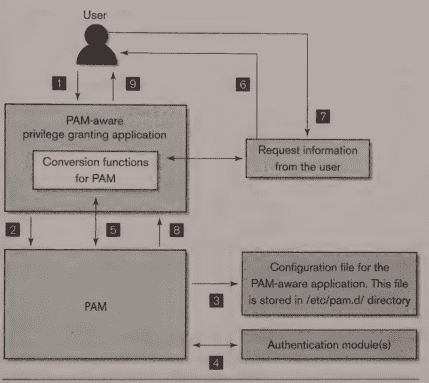

5. 这些模块随后可使 PAM 与应用程序中可用的对话函数进行通信。
6. 对话函数可用于向用户请求信息。例如，可要求用户输入密码或注视视网膜扫描仪。
7. 用户通过提供所请求的信息来响应请求。
8. PAM 认证模块通过 PAM 库向应用程序提供认证状态消息。
9. 如果认证过程成功，应用程序将授予用户请求的特权，或通知用户该过程失败。

可将 PAM 视为一种机制，它将认证的负担从应用程序中移除，并允许您为单个应用程序堆叠多种认证方案。例如，rlogin 应用程序的 PAM 配置文件如清单 15-1 所示。

### 清单 15-1 /etc/pam.d/login 文件

```
auth             required       /lib/security/pam_security.so
auth             sufficient     /lib/security/pam_rhosts_auth.so
auth             required       /lib/security/pam_pwd.so shadow nullok
auth             required       /lib/security/pam_nologin.so
account          required       /lib/security/pam_pwdb.so
password         required       /lib/security/pam_cracklib.so
password         required       /lib/security/pam_pwd.so shadow nullok
 \ use_autotok
session          required       /lib/security/pam_pwdb.so
```

在该文件中，来自 /lib/security 的多个认证模块被用于认证用户。

## 使用 PAM 配置文件

清单 15-1 展示了特定于应用程序的 PAM 配置文件的样子。以 # 开头的行和空行将被忽略。配置行包含以下字段：

```
module-type control-flag module-path module-args
```

目前存在四种模块类型，如表 15-2 所述。

**表 15-2 PAM 模块类型**

| 模块类型 | 说明 |
| :--- | :--- |
| auth | 执行实际认证。通常，auth 模块要求用户输入密码或提供其他身份证明。 |
| account | 处理认证请求的所有记账方面。通常，account 模块检查用户访问是否符合所有访问准则。例如，它可以检查用户是否从安全主机并在指定时间内访问服务。 |
| password | 处理在授予用户对请求服务的访问权限之前和之后需要执行的事项。 |
| session | 用于处理会话管理任务，例如刷新会话令牌。 |

控制标志用于定义 PAM 库将如何处理模块的响应。目前允许使用四种控制标志，如表 15-3 所述。

**表 15-3 PAM 控制标志**

| 控制标志 | 说明 |
| :--- | :--- |
| required | 指定同一行中指定模块的成功是必须的。即使模块返回指示失败的响应，认证肯定会失败，但 PAM 将继续处理其他模块（如果有）。这样做是为了确保用户无法检测到认证过程的哪一部分失败了，因为了解该信息可能会助长潜在攻击者。 |
| requisite | 当使用此控制标志时，PAM 库一收到失败响应，认证过程即中止。 |
| sufficient | 当使用此控制标志时，如果收到成功响应，则认为认证过程完成。换句话说，继续处理配置文件中的其他模块是不必要的。 |
| optional | 此控制标志极少使用；它不强调模块的成功或失败响应。 |

模块路径是可插拔认证模块的路径。Red Hat Linux 将所有 PAM 存储在 /lib/security 目录中。您也可以为每个模块提供可选参数。

回顾清单 15-1，请注意 PAM 库调用 pam_security.so 模块，该模块必须返回指示成功的响应，认证才能成功。如果模块的响应指示失败，PAM 仍将继续处理其他模块，以便用户（可能是潜在攻击者）不知道失败发生在何处。如果下一个模块 (pam_rhosts_auth.so) 返回成功响应，则认证过程完成，因为控制标志设置为 sufficient。但是，如果前一个模块 (pam_security.so) 未失败而此模块失败，认证过程将继续，且该失败不会影响最终结果。以同样的方式，PAM 库将处理其余模块。

执行顺序完全遵循模块在配置中出现的顺序。然而，每种类型的模块将在一个栈中处理。换句话说，对于清单 15-1 中的示例，所有 auth 模块将被堆叠并按在配置文件中出现的顺序处理。其余模块将以类似方式处理。

## 使用 PAM 微调认证过程

现在您已经了解了 PAM 工作原理的许多细节，请考虑一个示例，说明如何使用 PAM 微调某些服务的认证过程。您应采取的第一步是阅读所有可用 PAM 的文档。所有可用的 PAM 都存储在 `/lib/security` 目录中，您可以在 `/usr/doc/pam-x.xx` 目录中找到每个模块的文档，其中 `x.xx` 是您的 PAM 版本。阅读每个模块的文档，并确定您想要使用哪些模块来为您的系统构建更严格的认证方案。在本节中，我将向您展示如何按时间限制对服务器的登录访问。

要按时间限制对服务的访问，您需要一个名为 pam_time (`/lib/security/pam_time.so`) 的记账模块。该模块可配置为根据用户名、一天中的时间、一周中的某天、他们申请的服务以及发出请求的终端，拒绝个别用户的访问。其行为由 `/etc/security/time.conf` 配置文件决定。

因为您想控制登录访问，所以需要修改 `/etc/pam.d/login` PAM 配置文件，添加以下行：

```
account required /lib/security/pam_time.so
```

接下来，您需要为登录服务制定访问策略。换句话说，您需要确定希望用户在何时能够登录。本示例假设您希望允许用户在上午 6 点后且不晚于晚上 8 点登录。现在，您需要配置 `/etc/security/time.conf` 文件。该文件中的配置行具有以下语法：

```
services:tts:users:times
```

您可以在每个字段中使用一些特殊字符。表 15-4 显示了可使用的特殊字符的含义。


## 表 15-4 etc/security/time.conf 中配置字段的特殊字符

| 字符 | 含义 |
| :--- | :--- |
| ! | 非。例如，**!login** 表示“非登录”或“除登录外”。 |
| \| | 或。例如，**kabir\|ronak** 表示“kabir 或 ronak”。 |
| & | 与。例如，**login&su** 表示“同时包含 login 和 su”。 |
| \* | 通配符。例如，**foo\*** 表示“以 foo 开头的所有内容”。 |

## 表 15-5 etc/security/time.conf 文件的字段

| 字段 | 说明 |
| :--- | :--- |
| *services* | 受时间限制影响的服务列表。例如，要使用单条规则同时控制 login 和 su，请在配置行中将服务指定为 **login&su**。 |
| *ttys* | 受时间限制影响的终端列表。例如，要仅控制伪终端而不控制控制台终端，请指定 **ttyp\*\|tty\***。其中 **ttyp\*** 列出 telnet 等远程登录守护服务中使用的所有伪终端，而 **tty\*** 列出所有控制台终端。 |
| *users* | 受时间限制影响的用户列表。例如，要指定所有用户，请在配置行中使用通配符 \*。 |
| *time* | 限制生效的时间列表。您可以使用 24 小时制格式指定时间范围。例如，要指定从晚上 8 点到早上 6 点的范围，请指定 **2000-0600**（即 *HHMM* 格式，其中 *HH* 为 00–23，*MM* 为 00–59）。您也可以使用两字符代码指定日期，例如 **Mo**（周一）、**Tu**（周二）、**We**（周三）、**Th**（周四）、**Fr**（周五）、**Sa**（周六）和 **Su**（周日）。您也可以使用特殊代码，例如 **Wk** 表示所有工作日，**Wd** 表示周末，**AL** 表示所有七天。例如，要限制每天晚上 8 点到早上 6 点访问某服务，请将时间范围指定为 **@AL2000–0600**。 |

在本示例中，您可以通过向 /etc/security/time.conf 文件添加以下行，创建一条基于时间的规则，禁止所有通过远程方式（如 Telnet）访问系统的用户在晚上 8 点到早上 6 点进行登录访问：

```
login;ttyp\*::;\*@AL2000–0600
```

该行可解释如下：

```
if (requested service is login) and
(access is made from a pseudo ttyp type device) and
(current time is between 8PM to 6 AM) then

Access to the requested service is not allowed.

Else

Access to the requested service is permitted.

End
```

如果您想允许名为 kabir 的用户随时访问系统，但要求所有其他用户遵循前面的规则，请按如下方式修改规则：

```
login:ttyp:*:!kabir:@AL2000-0600
```

这只是 PAM 如何用于微调用户认证过程的一个示例。同样，请阅读模块文档并尝试各种设置，以找出最适合您系统的认证方案。

## 保护服务

往往是因为系统管理员没有花时间清除不必要的服务，导致不法分子能够破坏系统的安全。请记住，系统上的程序越多，不法分子入侵的途径就越多。因此，从一开始就要着手清理工作。

### 在操作系统安装期间移除不必要的服务

在计算机上安装 Red Hat Linux 之前，先决定要在系统上运行什么。记下实现目标所需的服务。例如，如果您要创建一台 Web 服务器系统，则不太可能需要 POP 服务器、Gopher 服务器或 NNTP 新闻服务器。列出您想要安装的服务器软件。Red Hat Linux 安装程序允许您在安装前选择单个软件包。请花时间浏览所有列表，仅选择必要的软件包。有时，安装程序会安装一个或多个您所选软件包的前置依赖包。在安装过程中完成软件包选择后，它实际上会显示这些前置依赖包的名称。请记下这些包的名称。

安装完所有必要的软件包并首次启动系统后，您可以查看存储在 /tmp 中的安装日志，或运行以下 rpm 命令以获取所有已安装软件包的完整列表：

```bash
rpm -qa > /tmp/all.packages
```

仔细检查 `/tmp/all.packages` 文件，找出任何您不记得批准安装的软件包。如果某个软件包未出现在您的前置依赖列表中，您可以使用以下命令了解有关该软件包的更多信息：

```bash
rpm -qi package_name
```

如果该软件包似乎不必要，请使用以下命令将其移除：

```bash
rpm -e package_name
```

rpm 命令会检查 package_name 是否被其他软件包所需。如果是，您将收到一条警告消息，且除非您使用 `-e -f` 选项，否则不会移除该软件包。请仔细阅读警告内容并据此决定。如果没有其他软件包依赖该软件包，它将从您的系统中彻底移除。

我建议不要在将用作互联网服务器的计算机上安装以下类型的软件包：

- 与 X Window 相关的任何内容，或 X Window 本身。
- 任何多媒体应用程序（如果您计划提供实时音频/视频服务，则 real-audio/video 服务器包除外）。
- 除所需解释器外的任何解释器。我个人仅使用 Perl 编写脚本，因此不安装其他脚本语言。
- 您不需要的任何不必要的服务器软件，如 NFS、NIS、INN、POP2 或 3、Samba 等。
- 您不使用的任何文件编辑器。我只用 vi，因此不安装像 emacs 这样复杂的编辑器。当然，如果您是 emacs 爱好者，您会选择它而不是 vi。我也不安装各种较新的 vi 克隆版本。
- 您不需要的任何客户端程序。例如，如果您认为用户不会使用电子邮件客户端，则不要安装它们。

正如您所见，主题始终如一——安装得越少，操心的事就越少。

## 保护由 xinetd 运行的服务

xinetd 守护进程被称为互联网“超级服务器”，因为它用于提供 FTP、Telnet、POP2/3 和 finger 等许多流行的互联网服务。xinetd 守护进程通常在多用户启动过程的某个时刻启动。启动时，xinetd 守护进程读取 `/etc/xinetd/xinetd.conf` 配置文件，并在 `/etc/services` 中列出的所有标准端口上监听请求。当某个端口收到请求时，它会启动相应的服务来处理该请求。清单 15-2 显示了一个典型的 `/etc/xinetd.conf` 文件。

### 清单 15-2 /etc/xinetd.conf 文件

```
#
# Simple configuration file for xinetd
#
# Some defaults, and include /etc/xinetd.d/

defaults
{
    instances       = 60
    log_type        = SYSLOG authpriv
    log_on_success  = HOST PID
    log_on_failure  = HOST RECORD
}

includedir /etc/xinetd.d
```

与许多其他 Unix 配置文件一样，以 # 开头的行被视为注释并被忽略，空行也会被忽略。此文件为 xinetd 设置了一些默认值，并使其读取 /etc/xinetd.d 目录以获取服务文件。通过 xinetd 管理的每个互联网服务必须在 /etc/xinetd.d 目录中拥有一个服务文件。例如，FTP 服务文件 /etc/xinetd.d/wu-ftpd 如下所示：

```
# default: on
# description: The wu-ftpd FTP server serves FTP
# connections.
# It uses normal, unencrypted usernames and passwords
# for authentication.

service ftp
{
    socket_type             = stream
    wait                    = no
    user                    = root
    server                  = /usr/sbin/in.ftpd
    server_args             = -l -a
    log_on_success          += DURATION USERID
    log_on_failure          += USERID
    nice                    = 10
}
```

此处定义 FTP 服务，以便每当 xinetd 在 /etc/services 中列出的 FTP 端口上检测到 FTP 服务的连接请求时，就运行 /usr/sbin/in.ftpd FTP 守护进程。正如 server_args 配置行所述，/usr/sbin/in.ftpd 服务器使用服务器参数 -l 和 -a 运行。

### 从 /etc/inetd.conf 中移除不必要的服务

如果您安装了许多互联网服务，如 FTP、Telnet、Gopher、远程 Shell (rsh)、远程登录 (rlogin)、远程执行 (rexec)、talk、ntalk、POP3、finger 等，并发现您不想运行其中的一项或多项


只需编辑 `/etc/xinetd.d` 目录中相应的服务文件，并按如下方式添加一行即可禁用其中的某项服务：

```
disable = yes
```

此行将禁用由 xinetd 运行的相应服务。然而，在 xinetd 知晓此更改之前，您必须通过运行以下命令来重新加载 xinetd 配置文件：

```
killall USR1 xinetd
```

如果您希望永不运行某项 Internet 服务，可能需要将相应的服务文件从 `/etc/xinetd.d` 目录中彻底删除，并按上述方式重新加载 xinetd 配置文件。这样您就可以确信该服务将永远被禁用。

另一方面，如果您不想完全禁用某项服务，而是希望仅部分地将其提供给一组受限的 IP 地址或网络，可以在服务定义文件中添加：

```
only_from <IP address or network>
```

以控制访问。

## 使用 TCP wrapper 程序保护 xinetd 运行的服务

TCP wrapper 程序可以控制对 xinetd 运行服务的访问。通过修改 `/etc/xinetd.d` 目录中相应的服务文件，任何 xinetd 运行的服务都可以通过 TCP wrapper 运行。需要添加或修改的行如下：

```
flags             = REUSE NAMEINARGS
server            = /usr/sbin/tcpd
server_args       = /path/to/service_daemon
```

`server_args` 行需要设置为服务守护进程的路径。例如，要通过 TCP wrapper 运行 FTP 服务，`/etc/xinetd.d/wu-ftpd` 服务定义文件可能如下所示：

```
service ftp
{
       flags             = REUSE NAMEINARGS
       socket_type       = stream
       wait              = no
       user              = root
       server            = /usr/sbin/tcpd
       server_args       = /usr/sbin/in.ftpd
       log_on_success    += DURATION USERID
       log_on_failure    += USERID
       nice              = 10
}
```

TCP wrapper 程序通过提供以下服务来增强安全性：

- **日志服务** 可以使用 syslog 设施记录有关请求的信息。
- **基于主机的访问控制** 可以使用模式匹配提供基于主机的访问控制。
- **主机名和地址验证服务** 可以在主机伪装成其他主机时检测主机名或地址的欺骗行为。

您可以想象 TCP wrapper 有多么重要，因为它作为默认 Red Hat Linux 安装的一部分提供。绝对没有理由不将您的每一项 xinetd 服务都用 TCP wrapper 封装起来。

## 通过 TCP wrapper 限制主机访问

TCP wrapper 在控制 Internet 主机（或 IP 地址）级别的访问方面提供了极大的灵活性。这种灵活性对于配置一台严密的服务器系统非常有用。这里我将讨论一个基于我日常使用的系统的严密控制系统示例。

首先，确定示例控制配置的目标。假设您想创建一个 Internet Web 服务器系统，仅允许 Telnet、FTP、POP3 和 HTTP 服务。由于 Web 服务 (HTTP) 通常是高需求服务，因此它不通过 xinetd 运行。让我们假设 Web 服务器是 Apache，并作为独立服务运行。在此示例中，xinetd 管理其余服务。此外，假设我们希望将 Telnet、FTP 和 POP3 的访问限制为仅单个网络，其网络地址为 206.171.50.0。

清单 15-3 显示了这些服务中每一项的 flags、server 和 server argument 行。

### 清单 15-3 Telnet、FTP 和 POP3 的 Flags、server 和 server_args 行

```
# Telnet (在 /etc/xinetd.d/telnet 中)

    flags       = REUSE NAMEINARGS
    server      = /usr/sbin/tcpd
    server_args = /usr/sbin/in.telnetd

# FTP (在 /etc/xinetd.d/wu-ftpd 中)

    flags       = REUSE NAMEINARGS
    server      = /usr/sbin/tcpd
    server_args = /usr/sbin/in.ftpd

# POP3 (在 /etc/xinetd.d/ipop3 中)

    flags       = REUSE NAMEINARGS
    server      = /usr/sbin/tcpd
    server_args = /usr/sbin/in.ipop3d
```

现在您需要通过 `/etc/hosts.allow` 和 `/etc/hosts.deny` 文件来限制对这些服务的访问。`/etc/hosts.allow` 文件用于指定允许访问 xinetd 服务的主机，而 `/etc/hosts.deny` 文件用于指定不允许访问 xinetd 服务的主机。这两个文件都使用如下所示的相同配置格式：

```
daemon list : client list [ : shell command ]
```

守护进程列表是一个或多个服务进程名称的列表。例如，`in.ftpd`、`in.telnetd` 和 `ipop3d` 是此示例中的守护进程名称。客户端列表由一个或多个主机名或 IP 地址组成。您可以在守护进程列表和客户端列表中使用表 15-6 中所示的通配符。

### 表 15-6 /etc/hosts.{allow | deny} 文件中守护进程和客户端列表的通配符

| 通配符 | 含义 |
| :--- | :--- |
| ALL | 总是匹配。 |
| LOCAL | 匹配本地主机名，如 wormhole，但不匹配 wormhole.nitec.com。 |
| UNKNOWN | 当主机名或 IP 地址因问题而未知时匹配。 |
| KNOWN | 当主机或 IP 地址已知时匹配。 |
| PARANOID | 匹配与其 IP 地址不匹配的主机。仅当 TCP wrapper 程序在编译时未使用 -DPARANOID 选项构建时有效。 |

您还可以使用如下模式：

1. `nitec.com` 匹配诸如 wormhole.nitec.com 或 pisco.nitec.com 之类的主机名。换句话说，当模式中使用前导点时，可以从主机名的右侧进行匹配。
2. `206.171.50.*` 匹配地址在 206.171.50.0 到 206.171.50.255 范围内的任何主机。换句话说，当模式中使用尾随点时，从左侧进行匹配。
3. `206.171.50.0/255.255.255.0` 匹配地址在 206.171.50.0 到 206.171.50.255 范围内的任何主机。该模式被视为网络/掩码定义。

此外，如果您计划使用 Shell 命令执行某些操作，请利用表 15-7 中所示的字符扩展。

### 表 15-7 Shell 命令的字符扩展

| 字符 | 扩展含义 |
| --- | --- |
| $a | 试图访问服务的客户端的 IP 地址 |
| $A | 服务器的 IP 地址 |
| $c | 客户端信息，如主机名或 IP 地址，或 user@host 或 user@ip_address 等 |
| $d | 守护进程或服务的名称 |
| $h | 试图访问服务的客户端的主机名 |
| $H | 服务器的主机名 |
| $p | 守护进程或服务的进程 ID (PID) |
| $s | 服务器信息，如主机名或 IP 地址，或 user@host 或 user@ip_address 等 |
| $u | 客户端用户名（如果已知）；否则设为 unknown |
| $% | % 字符 |

因为此示例的目标是禁止除属于 206.171.50.0 网络的主机以外的所有主机，所以您可以创建一个如清单 15-4 所示的 `/etc/hosts.deny` 文件。

### 清单 15-4 /etc/hosts.deny 文件

```
# hosts.deny   此文件描述了根据 /usr/sbin/tcpd 程序的决定，
# 不允许使用本地 INET 服务的主机名称。
#

# 拒绝所有主机的所有守护进程访问。
#
ALL : ALL
```

`/etc/hosts.deny` 文件设置为拒绝所有主机。单个配置行 `ALL : ALL` 告诉 TCP wrapper (tcpd) 拒绝所有主机的所有守护进程访问。如果保持原样且系统中不存在 `/etc/hosts.allow` 文件，则没有主机能够访问这三项由 xinetd 运行的服务（Telnet、FTP 和 POP3）。因此，您必须在 `/etc/hosts.allow` 文件中允许特定主机，特别是 206.171.50.0 网络，访问这些服务。这在清单 15-5 中完成。

### 清单 15-5 /etc/hosts.allow 文件

```
#
#
# hosts.allow   此文件描述了根据 /usr/sbin/tcpd 程序的决定，
# 允许使用本地 INET 服务的主机名称。
#

# 拒绝所有主机的所有守护进程访问。
#
ALL : 206.171.50.0/255.255.255.0
```

在这里，单个配置行 `ALL : 206.171.50.0/255.255.255.0` 表明 TCP wrapper (tcpd) 应允许指定的 206.171.50.0 网络访问所有守护进程。换句话说，所有主机


IP 范围在 206.171.50.0 到 206.171.50.255 内的主机应能访问 Telnet、FTP 和 POP3 服务。

这就是配置 TCP 包装器的全部内容。现在，如果你想允许另一个网络 208.233.7.48/255.255.255.240 访问这些服务，唯一需要做的更改就是在 /etc/hosts.allow 中。只需按如下方式在客户端列表中添加此网络：

```
ALL : 206.171.50.0/255.255.255.0 208.233.7.48/255.255.255.240
```

正如你所见，使用 /etc/hosts.allow 和 /etc/hosts.deny 配置 tcpd 非常简单。

## 在 /etc/hosts.allow 中使用主机名和域名

假设你想允许 classifiedworks.com 域中的所有主机访问所有 inetd 服务，但 ms@i.classifiedworks.com 这台主机除外。/etc/hosts.deny 文件将包含一行内容，例如 `ALL : ALL`，以拒绝所有未在 /etc/hosts.allow 中指定的主机访问所有服务。/etc/hosts.allow 文件将包含如下行：

```
ALL : .classifiedworks.com EXCEPT ms@i.classifiedworks.com
```

## 阻止特定主机访问某项服务

此示例演示如何阻止名为 reboot.nitec.com 的单台主机访问 FTP 服务，而允许 nitec.com 域中的所有其他主机访问所有服务。/etc/hosts.deny 文件将包含一行内容，例如 `ALL : ALL`，以拒绝所有未在 /etc/hosts.allow 中指定的主机访问所有服务。/etc/hosts.allow 文件将包含如下行：

```
in.ftpd : nitec.com EXCEPT reboot.nitec.com
ALL EXCEPT in.ftpd : nitec.com
```

第一行声明 in.ftpd 守护进程允许为 nitec.com 域中的所有主机提供服务，但 reboot.nitec.com 除外。下一行声明除 FTP 服务 (in.ftpd) 之外的所有守护进程（即服务）都允许为 nitec.com 域中的所有主机提供服务。TCP 包装器还可以使用扩展主机访问控制语言进行配置，该语言使用以下配置语法：

```
daemon list : client list : option : option : . . .
```

*option* 可以是表 15-8 中显示的任何关键字。

## 表 15-8 扩展主机访问控制语言中可接受的关键字

| 关键字 | 说明 |
|---|---|
| ALLOW client list | 用于允许一个或多个主机访问。例如，`ALL: .*your-domain.com: ALLOW` 允许 your-domain.com 中的所有主机访问所有由 inetd 运行的服务。 |
| DENY client list | 用于限制一个或多个主机的访问。例如，`ALL: .*miscreant-domain.com: DENY` 拒绝 miscreant-domain.com 中的所有主机访问所有由 inetd 运行的服务。 |
| SPAWN shell command | 用于执行一个 Shell 命令。该命令的运行方式使得 STDIN、STDOUT 和 STDERR 都指向客户端。在配置行中将 TWIST 用作最后一个选项。我建议仅对基于 TCP 的服务使用 TWIST。 |
| TWIST shell command | 用于执行一个 Shell 命令。该命令的运行方式使得 STDIN、STDOUT 和 STDERR 都指向 /dev/null。这确保了该命令不会干扰试图访问服务的主机上的客户端软件。 |
| LINGER seconds | 用于使内核在指定秒数内重试数据传递。 |
| RFC931 seconds | 当客户端运行符合 RFC 931 标准的 IDENT 服务器时，用于锁定客户端的用户信息。指定的秒数用于在 IDENT 服务器无响应时超时。这仅适用于基于 TCP 的服务。 |
| BANNERS directory | 用于向客户端显示一个文本文件。在指定目录中查找文本文件或横幅。文件名必须与守护进程名相同。这仅适用于面向连接的基于 TCP 的服务，如 Telnet。 |
| NICE number | 用于更改守护进程的优先级。数字越大，优先级越低。 |
| SETENV name value | 在守护进程的环境进程中设置 name=value。这并不总是有效，因为许多守护进程在使用子进程处理请求时会重置其环境。 |
| UMASK mask | 用于以与传统 umask Shell 命令相同的方式设置文件权限策略。 |
| USER username group | 用于指定守护进程的用户和组。 |

## 在 /etc/hosts.allow 中使用 Shell 命令

假设你想阻止名为 spooky.badguy-domain.com 的主机访问 Telnet 服务，但你也想让该主机知道你正在这么做。在这种情况下，你可以创建如下的 /etc/hosts.allow 配置文件：

```
# 除 spooky 外，所有人都允许 Telnet 访问
in.telnetd: ALL EXCEPT spooky.badguy-domain.com

# 明确告知 spooky.badguy-domain.com
# 它不受欢迎。
in.telnetd: spooky.badguy-domain.com: twist /bin/echo \ 
You are not welcome here!
```

或者，如果你想在 spooky 主机尝试 Telnet 连接时立即收到电子邮件，可以使用 /bin/mail 程序给自己发送一条消息。在这种情况下，你需要一个如下的 /etc/hosts.allow 配置文件：

```
# 除 spooky 外，所有人都允许 Telnet 访问
in.telnetd: ALL EXCEPT spooky.badguy-domain.com

# 明确告知 spooky.badguy-domain.com
# 它不受欢迎。
in.telnetd: spooky.badguy-domain.com: linger 5: twist
/bin/mail \ 
-s "%a (%c) tried to access %d ({%p})" your@emailaddress <
/etc/badguy-came.txt
```

这里，当 spooky 尝试 Telnet 登录时，会调用 /bin/mail 程序。mail 程序使用 -s 选项将主题行设置为 `%a (%c) tried to access %d ({%p})`，它将扩展为 `x.x.x.x (spooky.badguy-domain.com) tried to access in.telnetd (xyz)`，其中 x.x.x.x 是主机的 IP 地址，xyz 是守护进程的 PID。

## 检查 TCP 包装器配置

就安全性而言，`/etc/inetd.conf` 中的错误代价高昂。因此，使用 tcpdchk 等程序检查配置是值得的。该程序检查你的 `/etc/inetd.conf` 配置文件，并报告诸如路径名不存在、 `/etc/hosts.allow` 或 `/etc/hosts.deny` 文件中的配置错误、无效参数等问题。你可以按如下方式运行 tcpdchk 程序：

```
/usr/sbin/tcpdchk
```

你也可以使用 tcpdmatch 实用程序来测试 `/etc/hosts.allow` 和 `/etc/hosts.deny` 配置。例如，假设你在 `/etc/hosts.allow` 中有一行 `ALL:206.171.50.48/255.255.255.240`，在 `/etc/hosts.deny` 中有一行 `ALL:ALL`。上述配置仅允许来自 206.171.50.48 网络的主机访问由 inetd 运行的服务。要查明当来自名为 **blackhole.nitec.com** (206.170.189.100) 的主机的 Telnet 请求到达时 tcpd 会做什么，请运行以下命令：

```
/usr/sbin/tcpdmatch in.telnetd blackhole.nitec.com
```

tcpdmatch 程序将应用 `/etc/hosts.allow` 和 `/etc/hosts.deny` 配置，并告诉你是否允许访问。运行上述命令时显示的内容如下：

```
client:		hostname blackhole.nitec.com
client:		address 206.170.189.100
server:		process in.telnetd
matched:	/etc/hosts.deny line 10
access:		denied
```

此实用程序允许你相当彻底地测试 tcpd 配置。如果你打算在系统上运行 inetd，TCP 包装器是必不可少的。通过阅读 tcpd (8)、tcpdchk (8)、tcpdmatch (8)、hosts.allow (5) 和 hosts_options (5) 手册页，可以获得有关 tcpd 及其配置的更多信息。你也可以在 `http://www.cert.org/ftp/tools/tcp_wrappers/` 找到 tcpd 源代码。

## 用 Secure Shell (ssh) 替换 r 命令

如果你不使用 r 命令，包括 rlogin、rsh、rexec 等，请考虑将它们从系统中完全移除。你可以注释掉 /etc/inetd.conf 文件中特定于 r 命令的行，以确保这些命令提供的服务不再可用。

如果你使用这些服务来访问系统，请考虑用一个名为 Secure Shell 或 ssh 的安全解决方案来替换它们，它提供了 r 命令的所有优点（甚至更多）。例如，使用 ssh，你可以登录到远程系统，或使用安全的加密连接在远程系统上执行命令。它提供广泛的日志记录功能，并与 syslog 配合良好。使用 ssh，你还可以创建安全的远程 X 会话。它可以防止 IP 和 DNS 欺骗、基于 X 认证协议弱点的攻击等。你可以从以下网站获取 ssh 的现成 RPM 包：http://www.replay.com/redhat/ssh.html。

你需要基础 ssh 包、ssh 客户端包和 ssh 服务器包。美国针对加密软件的出口管制法可能会对 ssh 施加一些法律限制，因此请务必阅读该网站上的文档。

## 保护文件和文件系统

确保文件和文件系统安全的最佳方法之一是提供对它们的最小特权访问。如果用户只需读取访问权限即可完成工作，则不要仅仅因为你能给予他们写入或执行访问权限。本节讨论几个此类问题。

### 以只读方式挂载文件系统

在可能的情况下，以只读方式挂载某些文件系统是个好主意。例如，如果你必须在单独的分区上维护一个存储公共文件的公共 FTP 服务器，你可以将该分区挂载为只读。例如，假设公共文件存储在 /dev/sda5（SCSI 磁盘的一个分区）中，并通过 /etc/fstab 文件中的以下行自动挂载在 /public 上：

```
/dev/sda5  /public  ext2  defaults  1 2
```


该分区的挂载选项是 **defaults**，这意味着以下内容：

- 以读/写方式挂载文件系统 (*rw*)。
- 允许 set-UID 或 set-GID 位生效 (*suid*)。
- 解释文件系统上的字符/块设备 (*dev*)。
- 允许执行程序 (*exec*)。
- 在系统启动或使用 *-a* 选项运行 mount 命令时挂载文件系统 (*auto*)。
- 仅允许超级用户（UID = 0，GID = 0）挂载文件系统 (*nouser*)。
- 对文件系统使用同步 I/O 模式 (*async*)。

如果您确定该分区不需要写权限，请按如下方式更改该行：

```
/dev/sda5 /public ext2 ro,suid,dev,auto,nouser,async 1 2
```

如果您进一步决定不需要允许 suid 和 exec 支持，请也将它们移除，如下所示：

```
/dev/sda5 /public ext2 ro,nosuid,dev,noexec,auto,nouser,async 1 2
```

在适当的地方使用 EXT2 文件系统的属性。我遇到的最有用的一个是 immutable 标志，它可以禁止甚至 root 用户更改某些文件。请查阅 chattr (1) 和 lsattr (1) 手册页以获取详细信息。

## 利用 ext2 文件系统

Linux ext2 文件系统有一些很棒的功能，可有效保护您的文件和目录免受人为错误的影响。例如，使用 chattr 命令可防止甚至 root 用户意外修改和删除文件。具体方法如下。

Red Hat Linux 使用的 ext2 文件系统提供了一些独特功能。其中一项功能允许即使是 root 用户也能将文件设为不可变。例如，

```
chattr +i filename
```

在 ext2 文件系统中设置文件的 i 属性。设置此属性后，任何人都无法修改、删除或重命名该文件。也无法添加链接指向该文件。只有 root 用户可以设置或清除此属性。因此，您可以使用此属性防止文件意外损坏。当您需要清除该属性时，请运行

```
chattr -i filename
```

ext2 系统的其他一些有趣功能（如 undelete 属性）尚未实现，但将在未来的 ext2 文件系统版本中提供。如果您开始使用 chattr 命令，可能会注意到有时即使您有权限，也无法修改或删除某个文件。这发生在您忘记之前曾使用 chattr 设置了该文件的 immutable 属性时；因为该属性不会显示在 ls 输出中，所以可能会让人困惑。要查看哪些文件具有哪些 ext2 属性，请使用 lsattr 程序。

不幸的是，您现在了解的文件和文件系统安全知识，知情的黑客可能也知道。使用 chattr 等工具可能会让黑客破坏您的文件或文件系统变得更难一些，但无法使其完全不可能。事实上，如果恶意入侵者获得了 root 权限，ext2 属性只能提供简单的捉迷藏游戏。入侵后的一个主要问题是确定您是否仍可信任您的文件。您可能会怀疑入侵者是否安装了特洛伊木马程序或植入了病毒，以感染新文件并可能提供对其他计算机的访问。本节讨论的方法都无法解决安全问题的这一方面。解决方案是运行文件完整性检查程序，例如 Tripwire。

## 使用 Tripwire 确保文件完整性

简单来说，Tripwire 是一个文件和目录完整性检查器，它为所有文件和目录创建签名数据库并将其存储在单个文件中。当再次运行 Tripwire 时，它会为当前的文件和目录计算新签名，并与数据库中存储的原始签名进行比较。如果存在差异，将报告文件或目录名称以及差异信息。

因此，Tripwire 可以成为帮助您确定入侵中哪些文件被修改的绝佳工具。在设置新服务器系统时，许多经验丰富的系统管理员会执行以下操作：

1. 确保新系统未连接任何网络，以保证没有人已经安装了特洛伊木马程序、病毒程序或类似程序。
2. 运行 Tripwire 为所有重要系统文件创建签名数据库，包括所有系统二进制文件和配置文件。
3. 将数据库写入可刻录 CD-ROM。这可确保高级黑客无法修改 Tripwire 数据库以向应用程序隐藏特洛伊木马和修改过的文件。需要监控的文件较少的管理员通常使用软盘存储数据库。将数据库写入软盘后，管理员会对软盘进行写保护，如果 BIOS 允许，则将磁盘驱动器配置为只读设备。
4. 设置 cron 作业定期运行 Tripwire（每天、每周或每月），以便应用程序使用 CD-ROM 版本的数据库。

## 安装 Tripwire

Red Hat 销售的官方 Red Hat 发行版（盒装版本）包含一个应用程序 CD-ROM，其中包含一个版本的 Tripwire。该版本软件适用于单 CPU、最终用户设置。该软件包含两个单独的 RPM 包——一个包含二进制分发，另一个包含源代码分发。除非您有兴趣自行编译，否则请使用二进制分发。通常情况下，如果可以，我会编译安全软件，但由于 Red Hat 将此软件打包在其产品中，我对其专业性有一定程度的信任；因此，这里首选二进制安装。

像往常一样，二进制安装非常简单；请按如下方式运行 rpm 命令：

```
rpm -ivh tripwire_package.rpm
```

将 tripwire_package.rpm 替换为适合您系统架构的 RPM 包。安装 Tripwire 后，运行 `rpm -ql tripwire_package.rpm` 以确定文件安装位置。Tripwire 1.3 版本的默认安装目录是 /usr/local1/bin/。

包含 Tripwire 二进制分发的 RPM 包不包含任何手册页。但是，手册页包含在源代码分发中，因此请安装 Tripwire 的源代码 CD-ROM 分发，它也包含在随 Red Hat 提供的应用程序 CD-ROM 中。

使用 rpm 安装源代码分发后，将源代码解压到 /usr/src/redhat/SOURCES 目录下的适当位置以访问手册页。如果您想安装手册页，请按以下步骤操作：

1. 将源代码分发的 tar 文件解压到一个目录中，并将目录切换到 man 子目录。
2. 编辑 man 目录中的 Makefile，在 Makefile 顶部的注释行之后添加一行 `MANDIR = /usr/man`。
3. 运行 make 将手册页安装到系统中适当的手册页位置。

完成这些步骤后，您可以访问 sigen (8)、tripwire (8) 和 tw.cfg (5) 手册页，在继续使用 Tripwire 之前，您应该阅读这些手册页。

## 创建 Tripwire 数据库

让 Tripwire 运行的首要任务是为您想要比较的所有文件和目录创建签名数据库。为此，您必须在一个名为 tw.cfg 的配置文件中指定文件和目录名称，该文件也存储在 /usr/local1/bin/ 目录中。RPM 包版本的配置文件专门针对 Linux 系统定制。在阅读 tw.cfg 手册页并理解所用语法后对其进行修改。清单 15-6 显示了我在 Red Hat Web 服务器系统上使用的 tw.cfg 文件。

### 清单 15-6 示例 tw.cfg 文件

```
# Sld: tw.cfg.linux, v 1.1 1994/04/04 00:34:03 gkim Exp $

# last updated: 1998/04/17 gene

# tripwire.config for linux machines

# First, root's "home"
/root                  R
/                     R

# critical boot resources
/boot                   R

# Critical directories and files
#       some exceptions are noted further down
/etc                     R
/etc/inetd.conf         R
/etc/rc.d               R
/etc/exports            R
/etc/mtab               L
/etc/motd               L
/etc/group              R       # changes should be infrequent:
/etc/passwd             L

# other popular filesystems
/usr                    R
/usr/local             R
/dev                   L-am
/usr/etc               R

# truncate home
=/home                 R

# var tree
=/var/spool            L
/var/log               L
```


/var/spool/cron L
/var/spool/mqueue L
/var/spool/mail L
!/var/lock
!/var/tripwire

# GENE: /sbin 包含单用户模式下至关重要的二进制文件
/sbin R

# 其他关键目录
/usr/etc R

# 非标准目录
=/proc E
=/tmp

由于此类配置文件的语法在 tw.config 手册页中已有详细说明，此处不再讨论文件语法。

在创建数据库文件之前，请务必确定当前系统上的文件未被不法分子篡改。创建该数据库的理想时机是您的新系统尚未连接到互联网或任何其他网络时。在确定文件未被动过后，将目录切换到 /usr/local/bin/tw 并按如下方式运行 Tripwire：

```
./tripwire -initialize
```

创建数据库后，请迅速将其移至只读介质（如 CD-ROM，如果可能）。您也可以打印整个数据库内容，以便在必要时手动核对信息。创建数据库后，您还需要保护 Tripwire 文件。

## 保护 Tripwire 本身

不法分子可能会修改 Tripwire 二进制文件或配置文件以掩盖其行踪。因此，请运行 siggen 实用程序为这些文件创建一组签名。要为 tripwire 二进制文件生成签名，请从 `/usr/local/bin/tw` 目录运行以下命令：

```
./siggen tripwire
```

您将在屏幕上看到类似如下内容：

```
sig0: nullsig : 0
sig1: md5 : 0f17OytJSfosJXBXCXbZxuo
sig2: snefru : 2U0lmpiKyb5tKDJ0206G
sig3: crc32 : 08arMS
sig4: crc16 : 000dFd
sig5: md4 : 2DDym8m3JGRyRy.W5uwPzX4
sig6: md2 : 3NTKpom:A5ynvixpGLmK.O
sig7: sha : 4AGzq5nq16DM7D6pRartMk49wGX
sig8: haval : 07MQyp6T4EERZw1mypzLkw
sig9: nullsig : 0
```

您可以通过重定向将签名保存在文件中。同时打印签名，别忘了为 siggen 实用程序本身也生成签名。如果您怀疑 Tripwire 未按预期工作，请在这些文件上各运行一次 siggen 实用程序并比对签名。如果有任何不匹配，请勿信任这些文件 —— 用新副本替换它们，并调查差异产生的原因。

## 运行 Tripwire 检测完整性问题

您可以通过两种方式运行 Tripwire：

- **交互模式** —— 每当 Tripwire 遇到已添加、删除或更改的文件或目录时，它会询问您是否更新数据库。
- **作为 cron 作业** —— 通过创建一个小脚本，如 **清单 15-7** 所示。

### 清单 15-7：tripwire.sh 文件

```
#!/bin/sh
/usr/local/bin/tw/tripwire -q | /bin/mail -s "Security report by Tripwire" your@email
```

`-q` 允许 tripwire 安静运行并通过邮件将报告发送到 your@email 地址。您可以将此类脚本放入 `/etc/cron.daily` 目录，使其每日运行。您的文件如有任何更改，将每日报告给您。

## 更新 Tripwire 数据库

要更新整个 Tripwire 数据库，请运行

```bash
./tripwire -update
```

或者，如果您想添加一个新目录及其下的所有文件和子目录，请运行

```bash
./tripwire -update /some/dir
```

更新现有的已修改目录或其文件时，也使用此命令。如果您只想添加或更新单个文件，请使用以下语法：

```bash
./tripwire -update newfile
```

## 在速度与更高安全级别之间权衡

Tripwire 采用多种签名算法，例如空签名、来自 RSA Data Security, Inc. 的消息摘要算法 (MD5)、来自施乐的安全哈希函数 Snefru、循环冗余校验 (CRC-32)、CRC-16、MD4、MD2、安全哈希算法 (SHA) 和 Haval。

在大型文件系统上对每个文件执行所有这些算法会消耗大量 CPU 资源并耗费很长时间。为了减轻系统负载或加快检查过程，您可以指示 Tripwire 忽略其中一种或多种算法。例如，

```bash
./tripwire -i 1
```

指示 Tripwire 忽略第一种算法 MD5。只要您知道算法对应的编号，就可以使用 `-i` 命令行选项忽略任意算法。编号到算法的映射如表 15-9 所示。

### 表 15-9：Tripwire 算法

| -i 选项 | 签名算法 |
|---|---|
| -i 0 | 空签名 |
| -i 1 | MD5 |
| -i 2 | Snefru |
| -i 3 | CRC-32 |
| -i 4 | CRC-16 |
| -i 5 | MD4 |
| -i 6 | MD2 |
| -i 7 | SHA |
| -i 8 | Haval |
| -i 9 | 空签名（保留供将来使用） |

要在不进行任何签名完整性检查的情况下查找新增或丢失的文件，请运行

```bash
./tripwire -i all
```

## 扮演反方辩手

许多经验丰富的管理员认为，仅采取预防措施并希望坏事永不发生，无异于自寻死路。他们认为，要获得真正的安全感，系统必须经受实际考验。换句话说，为什么不在不法分子发动攻击之前，自己先攻击自己的安全基础设施？通过扮演潜在攻击者，您可能在*不友好*的攻击者发现您之前，自行揭示潜在漏洞。幸运的是，如今您无需费太大力气就能扮演不法分子。现有工具可以帮助您轻松承担这一角色。本节讨论一些常用工具。

### 破解自己的密码

弱密码通常是各年龄段攻击者的易攻击目标。不法分子一旦非法获取您的 `/etc/passwd` 文件（如果您尚未使用影子密码），就会将其输入密码破解程序以揭示您的秘密 —— 弱密码。因此，在黑客破解之前先破解自己的密码，有助于消除弱密码。

### 密码如何被破解

理解加密学神秘细节的最佳方法是举个例子。如果您在系统上创建一个用户名为 bob、密码为 umbrella 的新用户，您将在 /etc/passwd 文件中看到类似如下的一行：

```
bob:XoAlxlaie wp8s:Red Hat Linux User:/home/bob:/bin/bash
```

该行可能不完全相同，但关键是您将得到一行包含 bob 加密密码的记录。加密密码是一个由 crypt() 函数创建的 13 字符字符串，如下所示：

```
加密密码 = crypt("umbrella", "Xo", salt)
```

salt 是从 `[a-zA-Z0-9./]` 集合中选取的两字符字符串。该字符串用于以 4,096 种不同方式之一影响加密算法。salt 值存储在加密密码的前两个字符中。例如，**XoAlxlaie wp8s** 中的 Xo 是 umbrella 的加密密码，使用的 salt 值为 Xo。没有已知方法能从加密版本中恢复原始密码，因为加密算法是单向的。然而，如果已知加密密码，则可以编写程序利用两字符的 salt 值，用该 salt 加密大量字典单词。如果密码恰好是字典中的单词（如本例），它将被加 salt 并找到匹配项。换句话说，当您知道 bob 密码的 salt 值为 Xo 时，可以使用该 salt 编写程序执行以下操作：

```
加密密码 = crypt(每个单词, "Xo")
```

当该程序选中单词 "umbrella" 时，加密密码将与 /etc/passwd 中存储的相同。糟糕，bob 的密码刚被破解！现在程序知道创建密码使用的是哪个单词。这是破解软件工作原理的简化解释。但请记住，现在的破解软件先进得多，随着计算机硬件越来越强大，破解密码变得更容易、更快。


## 安装 Crack 以破解您自己的密码

要破解系统的密码，您需要一个密码破解程序。Crack 就是一个这种广泛使用的免费软件包。您可以从许多保存用户贡献软件的 Red Hat 镜像站点下载 Crack 的 RPM 包版本。其中一个站点是 http://ftp.digital.com/pub/linux/redhat/contrib/。

您必须进入与您系统架构对应的目录，例如 i386（x86 或 Intel）、SPARC（Sun Microsystems）、alpha（Digital Alpha）等，并下载 crack-X.xx-x-(architecture).rpm，其中 X.xx-x 是版本号，(architecture) 是您系统的架构。例如，对于基于 x86 或 Intel 的系统，下载 crack-4.1f-1.i386.rpm。版本号可能会有所不同，因为较新的版本会随着时间的推移被上传。

上传 RPM 包后，按如下方式安装它：

```
rpm -ivh crack_package_name.rpm
```

然后您可以通过运行以下命令来查看安装了哪些文件：

```
rpm -qi crack_package_name
```

通常，Crack 安装在 /root/crack-X.xx/ 目录中。

### 运行 Crack

要从安装目录运行 Crack 程序，请使用以下命令：

```
crack /etc/passwd
```


> **提示**
>
> 如果您使用影子密码并想运行 Crack，则需要使用一个名为 shadowmgr 的支持脚本（位于 Scripts 目录中）来合并 /etc/passwd 和 /etc/shadow 文件。合并后的输出通常发送到 STDOUT，因此您必须将其重定向到一个文件，然后将该文件作为输入密码文件供 Crack 使用。

Crack 将开始破解您的密码。如果您的密码文件中有大量用户帐户，Crack 可能需要很长时间才能完成工作。这就是为什么 Crack 会自动在后台运行。您还可以为 Crack 指定一些命令行选项来控制其部分行为。不带任何参数运行 Crack 可查看命令行选项列表。

### 获取 Crack 的输出

运行 Crack 后，它会在两个文件中创建输出：out.PID 和 out.(主机名)PID。例如，输出文件可能是 out.5678 和 out.picaso.nitec.com5699，其中 picaso.nitec.com 是运行 Crack 的主机名。清单 15-8 显示了一个 Crack 输出文件的示例。

#### 清单 15-8 Crack 输出文件示例

```
join: User apache (in /etc/passwd) has a locked password: !!
join: User uucp (in /etc/passwd) has a locked password: !!
join: User operator (in /etc/passwd) has a locked password: !!
join: User ftp (in /etc/passwd) has a locked password: !!
join: User bin (in /etc/passwd) has a locked password: !!
join: User daemon (in /etc/passwd) has a locked password: !!
join: User adm (in /etc/passwd) has a locked password: !!
join: User lp (in /etc/passwd) has a locked password: !!
join: User sync (in /etc/passwd) has a locked password: !!
join: User shutdown (in /etc/passwd) has a locked password: !!
join: User halt (in /etc/passwd) has a locked password: !!
join: User mail (in /etc/passwd) has a locked password: !!
join: User nobody (in /etc/passwd) has a locked password: !!
join: User news (in /etc/passwd) has a locked password: !!
guessed pikleb (/bin/tirc in /etc/passwd) (book) #aa0D8.TU/Frc
```

紧跟在 join: 后面的日期戳字段已被移除以减少行宽。当 Crack 报告密码被锁定时，意味着密码被设置为 !!；换句话说，该用户帐户无法用于登录。清单中的最后一行最有趣。它表明 Crack 猜中了用户 pikleb 的密码（book）。

在您知道哪些用户密码可被破解后，立即通过使用 \* 作为密码来锁定该帐户，并亲自联系用户讨论安全问题。如果无法做到这一点，请通知用户立即更改密码。如果用户在给定的时间范围内不更改密码，请锁定该帐户并向上级汇报此事。

密码并不是系统中唯一的弱点。要发现许多其他潜在的安全漏洞，您需要 COPS。

## 使用 COPS

COPS 是一组工具，旨在定位系统中潜在的安全漏洞。除其他功能外，这些工具专注于检测可能源于文件/目录/设备权限、密码、/etc/rc.d 目录中的 init 文件、cron 配置和匿名 FTP 设置的潜在安全问题。一般来说，COPS 的目的是检测潜在的安全问题并警告您。它不会修复检测到的任何问题。

### 安装 COPS

我还没有见过 COPS 的 RPM 打包版本。您可以从以下 FTP 站点获取通用的 COPS 发行版：ftp://ftp.eart.org/pub/tools/cops/。

下载最新的 COPS 发行版，并将文件解压缩并提取到系统上的适当目录中。

COPS 发行版包含同一软件的两个版本。一个版本主要用 C 编写，另一个主要用 Perl 编写。只要您有 Perl 或 C 编译器（这两者在 Red Hat Linux 中几乎都是标准配置），就可以运行其中一个版本。本讨论解释了如何使用 C 版本。如果您有兴趣运行该软件的 Perl 版本，请阅读随附的 Perl 版本 README 文件。您还将在安装目录的 perl 子目录中找到该软件的 Perl 版本。

要配置 COPS 的 C 版本，请执行以下操作：

1. 从安装目录运行以下脚本：
   ```
   . ./reconfig
   ```
   这会调整某些脚本中二进制文件（如 `awk`）的几个路径以匹配您的系统。

2. 修改 `docs` 目录中的 `Makefile`，从 `ROFFLAGS=-ms` 行中移除 `-ms`。如果您已为 troff 安装了 `-ms` 包，则无需执行此操作。然后，从安装目录运行以下命令：
   ```
   ./make all
   ```

3. 编辑 cops shell 脚本并修改以下行：
   ```
   SECURE=/usr/foobar
   SECURE_USERS="foo@bar.edu"
   ```

4. 更改第一行，使该目录成为您安装路径的全限定目录名。例如，如果您将 COPS 安装在 `/usr/local/security/cops` 目录中，则将 `SECURE` 设置为该目录。将第二行设置为接收 COPS 输出的电子邮件地址。如果您不想以 `e-mail` 格式接收报告，请修改 `MAIL=NO`；否则，将该行更改为 `MAIL=YES` 以通过电子邮件接收报告。

5. 如果您决定不接收电子邮件报告，可以在 `$SECURE/$(short_hostname)` 目录中找到报告文件。例如，如果您的系统主机名是 `picaso.nitec.com`，且 `SECURE` 设置为 `/usr/local/security/cops`，则报告文件将存储在 `/usr/local/security/cops/picaso/` 目录中。报告文件名采用年_月_日格式创建（例如 `2001_Feb_21`）。

6. 如果您打算使用 Crack 作为密码破解软件，可以注释掉以 `$SECURE/pass_chk` 开头的行（在该行前插入 `#`）。如果您运行匿名 FTP 站点，可以将以 `$SECURE/ftp.chk` 开头的行修改为 `$SECURE/ftp.chk -a`。

### 运行 COPS

运行 COPS 非常简单；从安装目录按如下方式运行它：

```
./cops
```

#### 清单 15-9 COPS 报告示例

```
ATTENTION:
Security Report for Fri Dec 7 10:35:44 PST 2000
from host piasco.nitec.com

Warning! /dev/fd0 is _World_ readable!
Warning! /etc/security is _World_ readable!
Warning! /etc/crontab is _World_ readable!

ATTENTION:
CRC Security Report for Fri Dec 7 10:34:39 PST 1998
from host piasco.nitec.com

replaced -rw-r--r-- root root Dec 7 23:22:01 2000 /etc/passwd
removed -rw------- root root Dec 7 13:31:36 2000 /etc/shadow
```

COPS 只负责发现问题，不负责修复。您需要自行调查并修复它们。通过将其设置为 cron 作业，定期运行 COPS，以便在潜在问题被不法分子利用之前定期获得报告。

## 备份并追踪所有内容

任何人能给您的最重要的安全建议是定期备份所有文件。以下是我的建议：

- 为您的系统创建一个可维护的备份计划。
- 在工作日执行增量备份，并在周末安排完全备份。我倾向于使用基于可移动介质的备份设备，例如 8mm 磁带机或 DAT 磁带机。
- 拥有可移动备份介质使您能够将备份带离现场，并将其存储在安全的异地位置。


## 获取最新安全资讯

了解世界上存在的安全问题有助于您比可能想要攻击您系统的不法分子领先一步。一旦您知晓可能影响您系统的安全问题，请立即采取行动，以免为时已晚。您应该订阅互联网上可用的信誉良好的安全警报资源。以下是其中两个。

- **CERT：** 计算机应急响应小组（CERT）定期发布关于计算机安全事项的通告。请尽快订阅其邮件列表。访问其网站 www.cert.org/ 了解详情。
- **BUGTRAQ：** BUGTRAQ (bugtraq@netspace.com) 是另一个您可以订阅以获取每日安全问题报告的邮件列表。访问他们的网站 www.securityfocus.com/ 了解详情。

## 第 16 章：网络安全

### 设计安全网络

随着网络的增长，将安全作为事后考量来实施变得更加困难。用户习惯了使用模式，糟糕的选择变成了被接受的缺陷，管理员必须玩政治博弈才能做出更改。这些都是为什么在规划拓扑时必须整体审视网络安全性的原因。

### 使用私有 IP 地址

维护网络安全的最简单方法是确保您网络上的主机无法联系外部世界，也无法被外部世界联系。实现这一点最简单的方法是永远不要将它们连接到互联网等公共网络。然而，这种隔离安全策略在许多情况下并不切实际。使用私有 IP 地址是一种简单的方法，既允许您的用户访问互联网，又能防止不法分子接触到用户机器。

RFC 1918 指定了可在本地 TCP/IP 网络中使用但不能穿越互联网路由器的 IP 地址块。这些 IP 地址组通常称为 LAN IP 地址或私有 IP 地址。因为这些 IP 地址不在互联网上路由，所以您无需注册即可使用它们。通过分配此范围内的 IP 地址，您可以有效地将计算机的进出流量限制在本地网络内。这是一种快速有效的方法，可在允许内部计算机间流量流动的同时拒绝外部对计算机的访问。

私有 IP 地址块如下：

- 10.0.0.0 - 10.255.255.255
- 172.16.0.0 - 172.31.255.255
- 192.168.0.0 - 192.168.255.255

请记住，来自私有 IP 地址的流量无法穿越互联网路由器，这意味着分配了私有 IP 地址的任何计算机都无法被您网络外部的计算机访问。然而，这种方法也会导致不允许您的用户与外部世界通信。IP 地址伪装是解决此问题的方案。

### 伪装 IP 地址

私有 IP 地址在互联网上不可路由，因此使用私有 IP 地址的系统无法访问互联网。您可以通过在私有 IP 网络和互联网之间（即您到 ISP 的上游链路）放置一台 IP 地址伪装的 Red Hat Linux 服务器来解决此问题。启用 IP 地址伪装后，当数据包离开用户计算机时，它带有自己的 IP 地址作为“源地址”。当数据包通过 Red Hat 服务器流向外部世界时，会被转换。数据包的源地址会被更改为 Red Hat 服务器的地址，后者是一个完全可路由的 IP 地址。Red Hat 服务器还会记录哪个源地址联系了互联网上的哪个目标。当数据包发送到互联网时，它完全有能力到达目的地并获得响应。

此设置有一个隐患。因为数据包的源地址被设置为 Red Hat 服务器的 IP，而不是服务器后面用户机器的 IP，所以外部计算机的响应会被发送到 Red Hat 服务器。因此，为了完成数据包传输，Red Hat 服务器必须搜索表格以查看该数据包属于哪台机器。然后它将数据包的源地址设置为私有用户计算机的地址，并将数据包发送给该计算机。就这样，一次从私有 IP 地址机器出发的互联网往返行程完成了。IP 地址伪装也称为网络地址转换（NAT）。

从用户的角度来看，用户拥有一个似乎完全可路由的互联网连接。安全性来自于 Red Hat 服务器保留的表格，该表格记录了哪些用户计算机正在与哪些互联网站点通信。想要访问您用户计算机之一的不法分子将无法做到。外部世界看到的唯一 IP 地址是 Red Hat 服务器的地址，而不是它背后的所有地址。即使不法分子向 Red Hat 服务器发送数据包，服务器也无法知道将其转发给哪台用户机器。

默认情况下，Red Hat Linux 内核内置了 IP 地址伪装支持。但是，如果您之前移除了一些支持，或者使用的内核没有内置 IP 地址伪装，则需要重新编译内核、加载一些模块，并设置数据包过滤规则以允许地址转换发生。要使 IP 地址伪装工作，您需要在服务器上启用 IP 转发服务。您可以通过在 `/etc/sysconfig/network` 文件中将 `FORWARD_IPV4` 设置为 `yes` 来启用 IP 转发（针对 Red Hat 提供的默认内核）。本讨论假设您使用的是内置了 IP 地址伪装和转发支持的内核，并且您已在 Red Hat 服务器上安装了 `ipchains` 软件包。

要将内部网络连接到外部世界，您需要在 IP 地址伪装服务器上配置两个网络接口。一个接口用于连接内部网络，另一个接口用于将服务器（以及通过 IP 地址伪装的内部网络）连接到外部世界。因为这样的服务器有多个接口，所以它通常被称为*多宿主服务器*。您可以为连接到内部网络的网卡分配一个私有 IP 地址。例如：

```
/sbin/ifconfig eth1 inet 192.168.1.1 netmask 255.255.255.0
```

这假设您内部网络的网络接口是 `eth1`，并且您的网络中将运行少于 253 台用户计算机。如果您的情况将有超过 253 台用户计算机，您可以使用 `255.255.0.0` 的子网掩码，这允许一台 Red Hat IP 地址伪装计算机后面连接超过 65,000 台用户计算机。如果超过 253 台用户计算机，请设置第二台 IP 地址伪装计算机并将网络划分为两个子网。

通过将用户计算机配置为从 `192.168.1.2` 到 `192.168.1.254` 的 IP 地址，并为它们全部分配网关 `192.168.1.1` 和子网掩码 `255.255.255.0`，您应该能够从每台用户计算机 ping 通网关（`192.168.1.1`）。

此时，所有用户机器都可以相互通信并与 Red Hat 服务器通信，但用户仍无法从客户端访问外部世界


## 什么是防火墙？

有时，您可能不想采用使用私有 IP 地址所实现的“要么全有、要么全无”的方法。您可能希望允许公众访问您 Web 服务器上的网站，但不允许其他类型的访问。或者，您可能有一项政策限制，规定外部使用互联网仅限于电子邮件。这两个例子都是防火墙完美适用的场景。

*防火墙* 是一台旨在强制执行您策略的计算机，该策略规定了允许哪种类型的流量从公共网络通过到私有网络。通常，防火墙放置在私有内部网和互联网之间，允许符合特定标准的流量通过，而拒绝其余流量。防火墙可以非常开放，允许几乎所有流量通过；也可以非常严格，仅允许极有限的使用。防火墙管理员通过配置规则集来控制所有这些。

将一台计算机专门用作防火墙是明智之举。如果您依赖防火墙来控制对内部网络的访问，请确保您的防火墙尽可能安全。这台机器不仅将作为安全检查点，还将作为从安全网络通往外部世界的网关。不法分子知道，如果他们能控制您的防火墙，就能访问您的内部网络。

因此，您需要关窗锁门。以下是基本防火墙安全的一些准则：

- **关闭任何不需要的服务。** 更进一步，考虑禁用 sendmail、finger、netstat、systat、bootp 和 FTP。
- **限制拥有防火墙 Shell 访问权限的人数。** 如果您只有 1 到 2 个用户账户，不法分子要想碰巧找到其中一个就非常困难。
- **不要在防火墙上使用与其他地方相同的密码。** 有时，人们会陷入在许多不同计算机上使用相同密码的陷阱。在这里不要这样做！否则，您的网络可能会像多米诺骨牌一样倒塌。
- **将物理安全作为重中之重。** 虽然您可能觉得将台式机放在开放式办公室或工位中可以接受，但您应该严格控制人员对防火墙的物理访问。

防火墙种类繁多。有些是软件应用程序，而另一些则作为硬件出售。许多价格高达数万美元，而另一些则是免费的。防火墙通常可分为两类：包过滤防火墙或应用层防火墙。

### 包过滤器

包过滤器所做的仅仅是获取每个数据包，根据一组规则对其进行测试，然后允许或拒绝该数据包到达另一个网络。包过滤器是决定哪些流量通过、哪些不通过的快速、简单且有效的方法。包过滤器存在于网络层，不关心数据包内包含的数据。

通常，包过滤器具备检查源 IP 地址、目标 IP 地址、源端口号、目标端口号和协议类型的能力。它还可以区分计算机上独立的网络接口。这样，来自外部世界伪造您的 IP 地址之一的行为就可以被阻止。表 16-1 显示了包过滤器的优缺点。

**表 16-1 包过滤器的优缺点**

| 优点 | 缺点 |
| :--- | :--- |
| 速度 | 无法记录应用程序数据 |
| 易于管理 | 无法控制对特定应用程序的访问 |

因为包过滤器单独查看每个数据包，所以它们无法看到“全貌”。例如，包过滤器无法看到用户正在查看哪个网页，也无法确保他们没有将所有公司机密通过电子邮件发送给您的竞争对手。

### 使用基本包过滤防火墙：ipchains

Red Hat Linux 自带一个名为 ipchains 的软件包，它允许您创建一个包过滤防火墙。

> **提示**
>
> 那些在 Red Hat Linux 6.0 之前的系统上使用过 ipfwadm 创建包过滤防火墙的用户会发现 ipfwadm 不再受支持，因为 ipchains 是其改进的替代品。

考虑一个使用 ipchains 控制对内部网络访问的真实案例。假设您的网络提供商分配给您 IP 地址 206.170.189.1 到 206.170.189.254。您已将一台多模块 Red Hat Linux 服务器配置为防火墙，并安装了两块以太网接口卡 eth0 和 eth1。您给外部以太网接口 eth0 分配了 IP 地址 206.170.189.1，给内部以太网接口 eth1 分配了 IP 地址 206.170.189.2。您内部网络中的每台计算机都被分配了一个 IP 地址，从 206.170.189.3 开始，一直延续到剩余的 252 个地址。每台内部计算机的网关都设置为 IP 地址为 206.170.189.2 的防火墙计算机。

首先，您需要设置一个默认安全策略，拒绝所有进出防火墙系统的流量。这将成为您的规则集中的最后一条规则，也是强制执行安全策略“防火墙未明确允许的所有流量均被拒绝”的自然方式。您可以通过发出以下三条命令来实现：

```
/sbin/ipchains -P input DENY
/sbin/ipchains -P output DENY
/sbin/ipchains -P forward DENY
```

依次而言，这表示您对入站数据包、出站数据包和数据包转发的默认策略，是拒绝任何未被 ipchains 过滤规则允许的内容。

> **警告**
>
> 始终从防火墙的控制台管理您的过滤规则，而不是远程管理。使用一条也将您排除在外的拒绝规则，非常容易把自己锁在外面。这些规则在您按下 Enter 键的那一刻生效。此外，如果您刷新 ipchains 过滤规则（使用 -F 命令），您可能会发现唯一剩下的规则是拒绝所有进出防火墙的流量。这种情况曾让我不得不在半夜开车去办公室。请小心操作。

接下来，您需要以下规则：

```
/sbin/ipchains -A input -j DENY -i eth0 -s 206.170.189.0/24
```

此规则拒绝任何声称来自您内部网络、实则由防火墙外部计算机发送的数据包。在正常情况下，这绝不会发生，但不法分子已知会在数据包上放置伪造头部以绕过防火墙。这种绕过防火墙的方法称为 *包欺骗*。

```
/sbin/ipchains -A input -j ACCEPT -i eth1
/sbin/ipchains -A output -j ACCEPT -i eth1
```

这两条规则允许本地网络与防火墙之间的所有流量。这允许您的任何机器与任何其他机器通信。它们不必经过防火墙反弹，但添加这些规则也无妨。

```
/sbin/ipchains -A input -j DENY -p icmp
```

此规则可能在您的用户中引起一些争议。通过设置此规则，您拒绝所有使用 ICMP 协议的数据包，该协议被 ping 和 traceroute 等程序使用。通过拒绝此流量，您可以限制一种名为 *死亡之 ping* 的流行拒绝服务攻击，在这种攻击中，不法分子使用 ping 程序发送大小极其巨大的数据包。Ping 洪水攻击不会破坏任何数据，但可用于用 ping 数据包消耗您所有的带宽，从而不给合法流量留出空间。通过禁止 ICMP 流量，您也限制了本地网络使用 ping 或 traceroute 等工具检查防火墙以外机器的状态。这是一个您必须权衡取舍的决定。

```
/sbin/ipchains -A input -j ACCEPT -p tcp -d 206.170.189.3 smtp
```

此规则允许所有目标为 206.170.189.3、使用 TCP 协议的流量前往 SMTP 端口。在本例中，206.170.189.3 是您的邮件服务器，您将允许来自外部世界的任何邮件发送到该邮件服务器。您也可以使用以下命令行

```
/sbin/ipchains -A input -j ACCEPT -p tcp -d 206.170.189.5 www
/sbin/ipchains -A input -j ACCEPT -p tcp -d 206.170.189.9 domain
```

来允许访问您的 Web 服务器 (206.170.189.5) 和 DNS 服务器 (206.170.189.9)。此过程可无限延续，适用于任意数量的主机和服务。

### 使用应用层防火墙

有时会出现这样的情况：您需要在应用层而非网络层控制网络的能力。您可能需要限制用户向特定地址发送电子邮件、监控用户访问的网站，或大致了解用户通过防火墙发送的文件的平均大小。当您需要这种类型的信息和控制时，您需要一个应用层防火墙。

应用层防火墙有时称为 *应用代理* 或 *代理服务器*，其工作方式与包过滤器不同。应用层防火墙在没有本地和远程直接连接的情况下工作


计算机。它们不允许任何流量从内部传递到外部。相反，本地计算机向防火墙查询它想要的信息。然后防火墙检查该请求，连接到外部世界，检索信息，并将信息传回给客户端。就外部世界而言，所有信息请求都是来自应用程序防火墙。使用应用程序代理，你无需担心不需要的流量进入你的网络。它做不到。

由于应用层防火墙专用于它们所传递的协议，因此每种协议（如 FTP、Telnet 和 Web 流量）都需要一个单独的应用层防火墙。如果你不想让用户有浏览网页的能力，只需从防火墙程序套件中省略 Web 代理程序即可。你不仅可以根据哪些本地 IP 地址可以访问哪些外部 IP 地址制定规则，还可以根据它们通信所用的协议制定规则。

## 使用 Squid 代理服务器

Squid 是一个实现了 HTTP、FTP 和 Gopher 协议缓存的代理服务器。Squid 能够使用访问控制列表（ACL）来允许或拒绝对特定位置的访问。由于 Squid 具有高度可配置性和健壮性，针对你的用途对其进行定制需要一些时间，但你可能会发现它很容易上手。最重要的是，Squid 可以配置为让用户甚至完全感觉不到它的存在。

### 获取并安装 Squid

截至撰写本文时，Squid 2.2 仅作为 tar.gz 文件提供，不提供 RPM 包。你可以从 ftp://squid.nlanr.net/pub 的 FTP 站点获取最新版本。定期检查该 FTP 站点的 contrib 子目录，看是否有软件的 RPM 版本。

本讨论假设你的代理服务器有两个网络接口，一个连接外部世界，一个连接内部网络，并且你已关闭 IP 转发。

你可以让 Squid 仅在一个网络接口上运行，但我不推荐这样做。这种配置会使本地网络上的流量翻倍，并可能导致拥塞。考虑到网卡和集线器的低价，即使对于相对较小的网络，这笔投资也是值得的。

如果你计划使用 Squid 维护缓存，你需要考虑硬盘和内存的限制。Web 缓存的本质是拥有成千上万个小文件，你需要同时且高效地将它们提供给客户端。Squid 作者建议至少配备 300MHz Pentium II CPU、512MB 内存和五个 9GB 的超宽 SCSI 硬盘。我听说过有整个互联网服务提供商仅使用几台配备 IDE 硬盘的 486/66 处理器。我怀疑大多数人会对这两个极端之间的某个配置感到满意。我建议至少使用 100MHz Pentium CPU、64MB 内存和 6GB SCSI 硬盘。你可能会发现配置略低于此也能工作。

获取 targz 文件后，使用以下命令解包：

```
gunzip -c squid-2.2.RELEASE-src.tar.gz | tar -xv
```

这会将 tar 文件解包到一个名为 squid-2.2.RELEASE 的目录中。进入该目录后，运行 ./configure 以检查计算机性能并创建配置文件。完成后，输入 make 开始将 Squid 编译为可用产品。如果编译无错误完成，输入 make install 以安装二进制文件。

### 让 Squid 首次运行

要创建交换目录，请输入以下命令：

```
/usr/bin/squid -z
```

Squid 可以开箱即用——只有一个例外。你需要在首次运行前更改配置文件 /etc/squid/squid.conf。Squid 的访问控制列表默认拒绝所有请求。你可以通过编辑文件 /etc/squid/squid.conf 并添加以下行来更改此行为：

```
acl local_net src 192.168.0.1/255.255.255.0
```

其中 192.168.129.1 是你本地网络中的一个 IP 地址，255.255.255.0 是你内部网络的子网掩码。当然，你需要根据自己的网络替换 IP 地址和子网掩码。你还需要在 `http_access deny all` 之前添加以下行：

```
http_access allow local_net
```

这定义了允许使用缓存的 IP 地址组。

输入 `squid &` 首次启动 Squid。你可以通过几种方式验证它是否正常工作：

- Squid 应出现在 `ps -x` 列表中。
- 运行 `client www.yahoo.com` 应将网页文本转储到终端。
- 目录 `/var/log/squid` 中的 `cache.log` 和 `store.log` 文件应显示 Squid 正在工作。
- 运行 `squid -k check && echo "Squid is running"` 可告知你 Squid 是否处于活动状态。

现在进行真正的测试：如果你将客户机上的 Web 浏览器配置为使用 Squid 代理，你应该能看到结果。在 Netscape Navigator 6 中，可以通过选择 `Edit Preferences`（编辑 首选项），然后在 Advanced（高级）类别中选择 Proxies（代理）来实现。通过选择 Manual Proxy Configuration（手动代理配置）并点击 `View`（查看），你可以将 Squid 服务器的 IP 地址指定为 HTTP、FTP 和 Gopher 代理服务器。默认代理端口是 `3128`，因此除非你在 `squid.conf` 文件中更改了它，否则请在端口字段中填入该数字。

你现在应该能像没有代理一样浏览任何网站。你可以通过检查代理服务器上的日志文件 `/var/log/squid/access.log` 来再次确认 Squid 是否正常工作，确保你访问的网站记录在其中。

### 调整 Squid 以满足你的需求

现在 Squid 已启动并运行，你可以对其进行定制以满足你的需求。此时，它并未限制用户访问任何站点。你可以在 `squid.conf` 文件中定义规则来设置 ACL，并根据这些列表允许或拒绝访问者。

添加以下行定义了一个名为 `BadWords` 的 ACL 规则，该规则匹配包含单词 `foo` 或 `bar` 的任何 URL：

```
acl BadWords url_regex foo bar
```

这适用于 http://foo.nitex.com/pictures 和 http://www.nitex.com/courbar.jpg，因为它们都包含属于 BadWords 的单词。

将以下内容添加到 squid.conf 可阻止用户访问任何匹配此规则的 URL：

```
http_access deny BadWords
```


### 警告

> 几乎每个使用基于单词 ACL 的管理员都有过因未审视单词所有可能用法而导致问题的故事。请意识到，如果你禁止用户访问包含单词 "sex" 的站点，你也同时禁止了他们访问 www.bu111erexchange.com 以及可能属于该类别的任何其他站点。

因为 Squid 运行的所有方面都在 squid.conf 文件中控制，所以你可以对其进行调整以满足你的需求。

通过添加以下行：

```
cache_mem 16 MB
```

你允许 Squid 使用 16MB 内存在内存中保存网页。通过反复试验，你可能会发现需要不同的数量。


### 警告

> cache_mem 不是 Squid 消耗的内存总量；它仅设置 Squid 用于保存网页、图像等的最大内存量。根据 Squid 文档，你可以预期 Squid 最多会消耗该数值三倍的内存。

通过使用以下行：

```
emulate_httpd_log on
```

你指定 `/var/log/squid` 中的文件以类似于 Web 服务器日志文件的形式写入。这允许你使用 Web 统计程序（如 Analog 或 Webtrends）来分析日志，了解用户访问了哪些地方。

某些 FTP 服务器要求匿名登录时使用电子邮件地址。通过将 ftp_user 设置为有效的电子邮件地址（如下所示），你可以向 FTP 会话另一端的服务器提供它想要看到的数据：

```
ftp_user squid@deepwell.com
```

你可能想使用代理防火墙管理员的地址。这将给另一端的 FTP 管理员提供一个联系人以防出现问题。

如果你输入一个 URL 并发现该页面不存在，那么该页面在近期内很可能也不会存在。通过将 negative_ttl 设置为所需的分钟数（如下例所示），你可以控制 Squid 记住某页面在早期尝试中未找到的时间（称为负面缓存）：

```
negative_ttl 2 minutes
```

这并不总是好事。默认值是五分钟，但我建议将其减少到两分钟，甚至可能是一分钟，或者完全禁用它，因为你希望代理尽可能透明。如果用户正在寻找一个他们知道存在的页面，你不希望代理因负面缓存而在页面实际可用前插入延迟。

```
cache_mgr proxy@deepwell.com
```

将其设置为你自己的电子邮件地址，以便在 Squid 检测到缓存问题时接收邮件。

```
cache_effective_user nobody
cache_effective_group nobody
```

这两行非常重要！如果你以 root 身份启动 Squid，这两行会将 Squid 运行的 UID 更改为用户 nobody。这应该能防止程序中的任何漏洞更改或删除任何内容。

最终，像 Squid 这样的工具应该对用户完全透明。这将用户从管理的复杂性中解脱出来，让他们能像没有 Web 代理服务器一样浏览 Web。虽然如何实现这一点的细节未在此呈现，但你可以参考 http://squid.nlanr.net/Squid/FAQ/FAQ.html 的 Squid 常见问题解答。第 17 节详述了将 Squid 用作透明代理。


此外，如果你发现自己在 squid.conf 文件中管理着一个庞大的“黑名单”站点列表，不妨考虑使用一个称为重定向器的程序。庞大的 ACL 规则列表可能会开始拖慢繁忙的 Squid 代理的速度。通过使用重定向器来完成同样的工作，你可以提高根据过滤规则允许或拒绝 URL 的效率。你可以从 http://www.senet.com.au/squirm/ 获取更多关于 Squirm 的信息，它是一个功能齐全、专为配合 Squid 工作而设计的重定向器。

cachemgr.cgi 文件包含在 Squid 发行版中。它是一个 CGI 程序，使你能够查看代理的统计信息，以及关闭和重启 Squid。它只需花费你几分钟时间进行安装，便能提供关于代理性能表现的详细信息。如果你想调优你的 Web 缓存，这个工具将会有所帮助。

本节仅涉及了将 Squid 用作 Web 代理防火墙的基础知识。Squid 还有许多此处未讨论的特性。如果你有兴趣让 Squid 发挥超出此处描述的功能，请访问 Squid 网页 http://squid.nlanr.net/。

## 从 SATAN 获取帮助

在网络安全方面保持进攻态势总是有益的。如果你定期主动检查计算机的安全性，你就会了解自己的弱点。没有什么比某天早上上班发现入侵者已潜入你的系统更糟糕的了。SATAN 是一个你可以用来探测计算机、寻找黑客可能利用以入侵你系统的潜在弱点的工具。

SATAN，即网络安全分析工具，在发布时获得了大量媒体关注。早在 1995 年工具发布时，人们陷入狂热，预期黑客会将其用作开锁工具，从而自动化入侵系统。但黑客早已编写并相互分享了许多用于入侵其他系统、搜索已知弱点和清除踪迹的工具。然而，黑客们并未与好人分享这些工具，导致好人无法接触到此类工具。Dan Farber 和 Wietse Venema 决定编写 SATAN，以让好人也拥有同等的机会。通过向公众发布 SATAN 等工具，他们让每个人都能接触到安全工具。有了这种广泛的访问权限，管理员可以在怀有恶意的人闯入之前发现问题并修补漏洞。

SATAN 扫描已知漏洞，完成后会通过 HTML 教程引导用户，解释黑客如何利用该问题以及如何修补它。用户界面通过 Web 浏览器实现，因此任何习惯浏览网页的人都能操作它。SATAN 设计用于 Unix 计算机，但你可以用它来探测任何操作系统。

引用文档内容，SATAN 检测以下项目：

- 导出给任意主机的 NFS 文件系统
- 导出给非特权程序的 NFS 文件系统
- 通过端口映射器导出的 NFS 文件系统
- 来自任意主机的 NIS 密码文件访问
- 旧版（即 8.6.10 之前）sendmail 版本
- 来自任意主机的 REXD 访问
- X 服务器访问控制已禁用
- 可通过 TFTP 访问的任意文件
- 来自任意主机的远程 Shell 访问
- 可写的匿名 FTP 主目录

所有这些都是陈旧且标准的错误配置，所以不要指望 SATAN 会告诉你任何一个经验丰富的管理员发现不了的东西。但是，安装和运行该程序比用放大镜逐个排查系统要容易且廉价得多。

## 安装 SATAN

你可以从多个站点中的任意一个获取 SATAN。但请记住，与任何安全程序一样，要确保你是从信誉良好的站点下载。我的经验法则是：如果一个站点不在镜像站点列表中，我就不信任它。你可以在 http://www.fish.com/~zen/satan/satan.html 找到镜像站点列表。

虽然你可以从官方 SATAN 站点获取 satan-1.1.1.tar.gz 文件，但这要求你从其他站点获取额外的补丁。编译和安装 SATAN 最干净的方法是从 http://contrib.redhat.com/ 下载源码 RPM 版本。假设你在 x86 系统上运行 Red Hat，你需要获取 Satan-1.1.1.linux-i386.rpm 包或更新版本。下载 RPM 包后，以 root 用户身份运行以下命令：

```
rpm -ivh Satan-1.1.1.linux-i386.rpm
```

默认情况下，这会在 /root/satan 目录中安装 SATAN 源码分发版。将自动执行配置和源码编译。


> **提示**  
> 如果你不想在 /root/satan 中安装和编译 SATAN，请在前述 rpm 命令中使用 `--prefix path` 选项将其安装在其他位置。

编译过程要求你拥有最新版本的 GNU C 编译器 (gcc)、glibc 支持和 C 开发库。你还需要在系统上安装一个 Web 浏览器。因为 rpm 程序会自动编译和安装 SATAN，所以你的下一步是启动它。

## 使用 SATAN

假设你让 rpm 在 /root/satan 中安装了 SATAN，使用以下命令运行它：

```
/root/satan/satan
```

如果你从 xterm（即在 X Window 中）运行前述命令，SATAN 将启动 Netscape Navigator 浏览器 (/usr/bin/netscape)。如果你没有这个 Web 浏览器，而是想使用基于文本的 Lynx 浏览器，请修改 /root/satan/config/paths.pl 脚本，使 `$MOSAIC` 变量设置为 Lynx 浏览器的全限定路径名。然后，当你启动 SATAN 时，它将使用指定的浏览器。本讨论假设你正在使用 Netscape Navigator。

根据你的 Netscape Navigator 版本，你可能还需要解决另一个问题：当你从 SATAN 主界面屏幕点击链接时，它们可能无法工作。例如，使用 Netscape Navigator 6 访问主页上的任何链接时，浏览器会要求下载 SATAN 脚本。这是由于 Navigator 无法运行该脚本，因为 MIME 配置错误或缺失。如果你遇到此问题，请执行以下操作：

1. 从 Netscape Navigator 的“编辑”菜单中，选择“首选项”选项并点击“应用程序”。
2. 点击“新建”将 .pl 扩展名与 /usr/bin/perl 关联（或你存放 Perl 解释器的任何位置）。
3. 在出现的对话框中，在“描述”字段中输入任意内容（如 Perl Script）；在“MIME 类型”字段中输入 application/x-perl；在“后缀”字段中输入 .pl。
4. 选择“应用程序”以分配 .pl 文件的处理程序，然后在输入框中输入 Perl 解释器的全限定路径名。
5. 点击“确定”完成此过程，并像往常一样关闭“首选项”窗口。

完成这些步骤后，SATAN 脚本将按预期运行。

当你启动 SATAN 时，其界面可能会让你感到惊讶。大多数安全工具的用户界面都非常有限，而 SATAN 非常重视用户交互。要直接开始你的第一次网络安全探测，请执行以下操作：

1. 从主菜单屏幕点击“SATAN 目标选择”链接。
2. 在下一个屏幕中，输入你要发起探测的主机或网络的名称。
3. 告诉 SATAN 是否也要探测子网中的其他主机，并设置你想要探测的级别。我建议从对单个主机进行轻度扫描开始。从那里，你将熟悉 SATAN，然后可以扩展到更强大的探测。
4. 为了快速测试，选择你自己网络上的一个主机。同时选择“仅扫描目标主机”选项和“轻度”选项以进行轻度扫描。
5. 点击“开始扫描”以启动探测。
6. SATAN 探测完一个主机（或网络）后，点击“查看主要目标结果”链接以查看探测结果。你将在新屏幕中看到 SATAN 探测的结果。


轻量探测使用 finger、nslookup、rpcinfo 和 showmount 来收集有关 DNS、RPC 服务和 NFS 的信息。如果轻量探测未检测到问题，请尝试普通探测。除了轻量探测的任务外，普通探测还会尝试确定 UDP 和 TCP 服务以及 finger 服务的信息。

在普通探测中，如果 SATAN 发现服务器上的信任配置存在问题，请单击结果页面中的“受信任主机”链接以显示问题的更多详细信息。

执行更耗时的重度扫描可能会发现更多问题。正如你所见，SATAN 提供了相当不错的文档，概述了 SATAN 遇到或未遇到的问题。你可以跟进每个漏洞，了解如何使系统更安全。在掌握了探测单个目标主机后，尝试扫描给定子网中的所有主机。你还可以通过使用主页上的“SATAN 配置管理”链接来更改 SATAN 的配置。如果在运行 SATAN 时遇到任何问题，请使用故障排除链接查看常见问题和解答。

## 第 17 章：定制内核

### 你使用的是哪个 Linux 内核？

Linux 可在许多不同的硬件架构上运行，包括 x86 (Intel)、Alpha 和 SPARC 等。然而，由于在单章中讨论所有平台的内核问题几乎是不可能的，本章假设你和大多数 Red Hat Linux 用户一样，使用基于 x86 (Intel) 的系统。如果你在基于强大 Alpha 处理器的系统上运行 Red Hat Linux，可以在 http://www.alphalinux.org/ 找到有用的内核相关信息。此外，对于所有架构（包括 x86），你都可以在 http://www.kernel.org/ 找到有用信息。

要确定系统当前内核的版本，请运行以下命令：

```
rpm -q kernel kernel-headers kernel-ibcs \
 kernel-pcmcia-cs kernel-source > /current-kernel-pkgs.txt
```

`current-kernel-pkgs.txt` 文件包含内核相关软件包的版本信息。你还需要知道 mkinitrd（用于创建初始 ramdisk 镜像）、SysVinit（init 软件包）和 initscripts（`/etc/rc.d` 脚本）软件包的版本号，这些软件包通常会随新内核而变化。

你可以运行以下命令，将这些软件包的版本信息添加到 `current-kernel-pkgs.txt` 文件中：

```
rpm -q mkinitrd SysVinit initscripts >> \
 /current-kernel-pkgs.txt
```

通过运行前面的 rpm 命令，你已将完整内核升级所需的所有典型软件包的版本信息记录在案。表 17-1 列出了这些软件包的名称和 RPM 说明。

**表 17-1：内核升级所需的典型软件包**

| 软件包 | RPM 中的说明 |
| :--- | :--- |
| **kernel-2.xx-x-x-xx-i386.rpm** | 此软件包包含用于引导和运行系统的 Linux 内核。它包含特定硬件的低级设备驱动程序。启动后加载的模块控制大多数硬件。 |
| **kernel-headers-2.xx-x-x-xx-i386.rpm** | 这些是 Linux 内核的 C 头文件，定义了在 Linux 下构建大多数标准程序以及重新构建内核所需的结构和常量。 |
| **kernel-ibcs-2.xx-x-x-xx-i386.rpm** | 此软件包允许你运行 IBCS2（Intel 二进制兼容性标准，版本 2）及相关可执行格式的程序。 |
| **kernel-pcmcia-cs-2.xx-x-x-xx-i386.rpm** | 许多笔记本电脑（及其他一些设备）支持用于扩展的 PCMCIA 卡。PCMCIA 卡也称为“信用卡”适配器，是用于从 SCSI 支持到调制解调器等各种功能的小型卡片。它们支持热插拔（无需重启系统即可更换），非常方便。此软件包包含对所有类型 PCMCIA 卡的支持，并提供一个守护进程以允许热插拔。 |
| **kernel-source-2.xx-x-x-xx-i386.rpm** | 这是 Linux 内核的源代码。构建大多数 C 程序需要它，因为 C 程序依赖于此处定义的常量。你也可以构建一个更适合你硬件的定制内核。 |
| **mkinitrd-xx.x-x.rpm** | 你可以构建不带任何新 SCSI 适配器驱动程序的通用内核，将 SCSI 驱动程序作为模块加载。你可以使用 initrd 镜像来解决内核无法寻址 SCSI 适配器而无法读取模块的问题。操作系统加载程序（如 LILO）加载 *ramdisk*，并在内核加载后立即将其提供给内核。该 *镜像* 负责加载适当的 SCSI 适配器，并允许内核挂载根文件系统。此程序使用 `/etc/conf.modules` 中的信息创建此类 *ramdisk* 镜像。 |
| **SysVinit-xx.xx-x-x.rpm** | SysVinit 是系统启动时 Linux 内核启动的第一个程序，控制所有其他程序的启动、运行和关闭。 |
| **initscripts-x.x-x-x.x.x.x.rpm** | 此软件包包含用于引导系统、更改运行级别和干净地关闭系统的脚本。它还包含激活和停用大多数网络接口的脚本。 |

现在，你已准备好找出当前用于引导系统的内核。一个确定的方法是查看你的 `/etc/lilo.conf` 文件。下面是一个示例 `/etc/lilo.conf` 文件：

```
boot=/dev/hda
map=/boot/map
install=/boot/boot.b
prompt
timeout=50
message=/boot/message
linear
default=linux

image=/boot/vmlinuz-2.2.16-21
	label=linux
	read-only
	root=/dev/hda2
```

使用上述 `/etc/lilo.conf` 文件的系统使用单个 Linux 内核 (`/boot/vmlinuz-2.2.16-21`)，标记为“linux”，该内核为 `/boot/vmlinuz-2.2.16-21`。如果你之前升级过 Linux 内核，`/etc/lilo.conf` 文件中可能定义了多个标签。在这种情况下，你需要确定用于引导系统的内核 (`image=/boot/vmlinuz-2.2.16-21`)。只需找到你用于引导系统的 LILO 标签，并找到相应的 `image=/boot/vmlinuz-2.2.16-21` 行。现在你已确定内核软件包和所用的内核，是时候准备升级了。

### 准备内核升级

Red Hat Linux 更新的官方 FTP 站点是 `ftp://updates.redhat.com/`。有时访问这个繁忙的站点会有困难。你最好的选择是访问 `http://www.redhat.com/mirrors.html` 找到一个离你近的镜像站点。

找到更新内核 RPM 软件包的镜像站点后，连接到该站点，将最新软件包与 `/current-kernel-pkgs.txt` 文件中已存储的软件包版本进行比较。下载较新的软件包。如果在 `/current-kernel-pkgs.txt` 文件中列出的软件包中没有看到较新的软件包，请忽略它，因为较新的软件包尚不可用。

获取内核升级的新软件包后，请创建一个应急启动软盘，以防内核升级出错。此外，在根分区的一个目录中保留一份旧内核的副本也是个好主意。

要创建独立的启动软盘，请将一张格式化的软盘插入软驱并运行：

```
mkbootdisk 2.x.x.x-x
```

将 `2.x.x.x` 替换为你之前确定的当前内核版本。另外，如果你有多个软驱且不想使用默认软盘设备 (`/dev/fd0`)，请使用 `--device` 选项指定你选择的软盘设备。例如：

```
mkbootdisk --device /dev/fd1 2.0.36-0.7
```

在 `/dev/fd1` 上使用内核镜像版本 `2.0.36-0.7` 创建应急启动软盘。创建启动盘后，使用该软盘重启系统，以确保应急启动盘确实有效。

### 安装新内核

测试应急启动盘后，你就可以安装新内核了。使用 `rpm` 安装所有已下载的软件包。我通常将所有新软件包下载到临时空间的一个新目录中，例如 `/tmp/new-kernel-pkgs`，然后运行以下命令：

```
rpm -ivh /tmp/new-kernel-pkgs/*.rpm
```


> **提示**
> 如果你不打算编译内核，可以跳过 *kernel-headers-2.*.xx-x.*.i386.rpm* 和 *kernel-source-2.*.xx-x.*.i386.rpm* 软件包，因为它们仅用于编译自定义内核。

升级新内核及其相关软件包后，你需要创建内核启动系统所需的初始 ramdisk 镜像文件。初始 ramdisk 镜像文件允许内核访问磁盘驱动程序等模块，而这些模块反过来又是访问驻留在根文件系统上的其余模块所必需的。

## 创建初始 ramdisk

`mkinitrd` 命令用于创建初始 ramdisk。将 `2.*.xx-x` 替换为你的新内核版本号，运行以下命令：

```
mkinitrd /boot/initrd-2.*.xx-x.img 2.*.xx-x
```

这将创建 `/boot/initrd-2.*.xx-x.img` 初始 ramdisk 镜像文件。使用 `ls` 实用程序，确认该文件确实已在 `/boot` 目录中创建。创建初始 ramdisk 后，你需要修改 `/etc/lilo.conf` 文件以为新内核配置 LILO。

## 配置 LILO

配置 LILO 对你的内核安装至关重要，在按此处讨论的方法重新配置 LILO 之前，绝对不要重新启动系统。使用你喜欢的文本编辑器，将如下所示的新配置段添加到你的 `/etc/lilo.conf` 文件中：

```
image=/boot/vmlinuz-2.*.*.x-x
    label=new-linux
    root=/dev/hda1
    initrd=/boot/initrd-2.*.*.x-x.img
    read-only
```

> **提示**
> 在修改 /etc/lilo.conf 文件之前，先复制一份以防万一你需要恢复到旧配置。

在 `image=` 和 `initrd=` 行中，将 2.x.x-x 替换为合适的内核版本号。`label=` 行应设置为你选择的任意字符串。根设备应指向你的根磁盘分区。

例如，如果你当前的分区是 /dev/sda1，请确保 `root=` 行设置为该分区。如果 Linux 无法识别 64MB 以上的内存，你可以使用 `append=` 行将内存大小设置为适当的限制。

修改并保存 /etc/lilo.conf 文件后，运行 /sbin/lilo

这将使 LILO 读取新配置文件并更新相应根分区的引导扇区。你可以结合 `-v` 标志使用前面的命令，让 LILO 显示更详细的信息。运行 LILO 后，你就可以重新启动系统了。

## 使用新内核启动

输入 `shutdown -x now` 命象像往常一样重新启动系统。在 LILO 提示符下，按 Tab 键查看你的选项。你为旧内核和新内核输入的标签（即 `label=` 行中的内容）将显示在屏幕上。在 LILO 提示符下输入新标签（在前面的示例中，该标签为 new-linux）以使用新内核启动系统。

下一步可能取决于你在告诉 LILO 启动新内核后的面部表情。如果你在微笑，说明你的新内核已启动并正在运行。如果你在尖叫或根本笑不出来，不要惊慌——你仍然有旧内核。如果系统死机，请按 Ctrl+Alt+Del 或进行硬重启。再次获得 LILO 提示符后，输入旧内核的标签名称。系统应照常重新启动。在这种情况下，请检查你已采取的步骤，特别是关于 /etc/lilo.conf 文件的步骤。确保你已正确设置新配置。重新运行 /sbin/lilo 并尝试用新内核启动系统。如果问题持续存在，你需要将问题的详细信息（例如尝试启动新内核时控制台上显示的内容）发布到 comp.linux 新闻组。如果你的软件许可允许，你也可以联系红帽公司寻求帮助。

在大多数情况下，新安装将顺利进行，不会发生任何意外。为确保你正在运行新内核，请运行以下命令：

```
uname -a
```

这将显示内核版本号以及其他信息。在你的新内核启动并运行后，使用 `mkbootdisk` 命令创建一张新的启动盘，就像你在本安装的准备部分先前所做的那样。

## 定制内核

定制内核以满足你喜好的唯一方法是自定义编译。要在红帽 Linux 服务器系统上编译内核，你需要获取内核头文件和源代码 RPM 软件包。如果你试图定制的内核不是生产级别的，可能无法获得 RPM 版本。在这种情况下，你必须下载压缩 tar 格式（.tar.gz）的源代码。查看红帽官方网站上内核源代码和头文件 RPM 软件包的可用性。如果你找不到 RPM 软件包，请从官方 http://www.kernel.com/ 站点（或其任何镜像站点）下载 .tar.gz 发行版。本节假设你想要定制最新的 2.2.5 内核，并已从刚才提到的站点下载了 linux-2.2.2.tar.gz 源代码发行版。

### 安装 Linux 内核源代码

通过输入 `tar xvzf linux-2.2.2.tar.gz` 命令，在 /usr/src 目录中解压 linux-2.2.2.tar.gz 发行版。源代码发行版将存储在 /usr/src 下名为 linux-2.2.2 的子目录中。Linux 内核传统上存储在 /usr/src/linux 中。实际上，/usr/src/linux 是指向 /usr/src/linux-x.x.x 目录的符号链接。使用 `rm /usr/src/linux` 删除该符号链接，然后使用以下命令创建一个新的符号链接：

```
ln -s /usr/src/linux-2.2.2    /usr/src/linux
```

你必须执行的一系列命令以达到此阶段可能如下所示：

```
cd /usr/src
tar xvfz linux-2.2.2.tar.gz
rm -f /usr/src/linux
ln -s linux-2.2.2 linux
```

> **提示**
> 当我在 /usr/src 目录中解压源代码发行版时，它创建了一个 linux 子目录，因此符号链接是不必要的。但是，如果你打算尝试各种内核，我建议你将特定的源代码发行版保留在 /usr/src/linux-x.x.x 目录中，并始终将一个符号链接（linux）指向你当前正在处理的内核。

尽管新下载的源代码发行版不会有任何陈旧的目标文件，但为了以防万一，运行以下命令清理这些文件是明智之举：

```
make mrproper
```

你已准备好配置（即定制）内核。你有多种选择来定制内核。

### 以传统方式配置内核

要以传统方式配置内核，你需要从 /usr/src/linux 目录运行以下命令：

```
make config
```

这是配置内核最简单的方法；然而，它可能不是初学者最合适的方法。接下来，我将讨论使用 `make config` 方法的示例内核配置会话。不过，你应该知道，随着功能和对各种设备的支持被添加到 Linux 中，`make config` 显示的确切步骤也会发生变化。因此，你在下一节中看到的内容可能与你在系统上运行 `make config` 时看到的内容不完全相同。我在此讨论主要的决策点。如果你运行 `make config` 时发现新的配置问题，可以通过在提示符下输入 `?` 来了解更多信息，或者你可以选择采用默认值。

### 代码成熟度选项

在本节中，你必须决定是否希望被询问关于尚未准备好投入生产使用的功能。换句话说，你会被询问是否希望针对实验性功能获得提示。如果你为实验或停机和崩溃是乐趣一部分而非负担的系统配置内核，你可以选择查看（并可能使用）这些实验性功能。提示如下所示：

**Prompt for development and/or incomplete code/drivers**  
**(CONFIG_EXPERIMENTAL)** [N/y/?]

默认答案是 N，即否。你可以通过按 Enter 键选择默认答案。请注意，默认答案始终是大写字母。

### 处理器类型、内存模型和特性

在本节中，你将被询问处理器系列、内存模型、数学协处理器、多处理器以及其他特定于处理器的问题。这是第一个：

Processor family (386, 486/Cx486, 586/R5/x586/6x86,  
Pentium/K6/TSC, PPro/6x86MX) [PPro/6x86MX]

如果默认的处理器架构不正确，请从列出的选项中选择一个。在我的例子中，默认值是错误的，所以我输入 Pentium/K6/TSC 作为处理器系列。

Maximum Physical Memory (1GB, 2GB) [1GB]

默认内存模型是 1GB，如果你的系统拥有 1GB 或更少的 RAM，这应该没问题。如果你有 2GB 或更少，请选择 2GB。在我的例子中，我选择默认值。

`defined CONFIG_M686`

Math emulation (CONFIG_MATH_EMULATION) [N/y/?]


## 第三部分：故障排除

除非你使用的是（非常古老的）没有内置数学协处理器的处理器，否则请按回车键选择默认值。

### MTRR（内存类型范围寄存器）支持 (CONFIG_MTRR) [Y/n/?]

这可能是第一个让你不太理解的问题（除非你是 x86 CPU 设计专家），对大多数初学者内核黑客来说也是如此。那么这里该怎么选？虽然默认选项在大多数情况下通常是正确的，但在这种情况下，你可以通过在提示符下输入 `?` 来了解什么是内存类型范围寄存器 (MTRR) 支持。你将获得如下所示的帮助屏幕：

```
CONFIG_MTRR:

在 Intel Pentium Pro 和 Pentium II 系统上，内存类型范围
寄存器 (MTRR) 可用于控制处理器对内存范围的访问。
当你在 PCI 或 AGP 总线上有一张显卡 (VGA) 时，这最有用。
启用写合并允许在突发传输到 PCI/AGP 总线之前，
将总线写传输合并为更大的传输。这可以将图像文件操作的性能
提高 2.5 倍或更多。此选项将创建一个 /proc/mtrr 文件，
可用于操作你的 MTRR。通常 X 服务器应使用此文件。
这应该有一个相当通用的接口，以便其他处理器上的
类似控制寄存器可以轻松得到支持。

选择 Y 还可以修复有缺陷的 SMP BIOS 仅为启动 CPU
设置 MTRR 而不为辅助 CPU 设置的问题。这可能导致
各种各样的问题。

详见 Documentation/mtrr.txt 以获取更多信息。

即使你的机器没有 MTRR，你也可以放心地选择 Y；
这只会给内核增加约 3K 的大小。
```

正如你所见，这非常有帮助。因为我是在为服务器配置此内核，所以不太关心显卡，我在这里选择了 "N"。

### 对称多处理支持 (CONFIG_SMP) [Y/n/?]

如果你的系统有多个处理器并希望开启对称多处理支持，请选择默认值。在我的情况下，我没有多处理器主板；因此，我选择 "n" 以拒绝 SMP 支持。

## 可加载模块支持

Linux 内核采用一种创新方法来保持精简。它将功能和驱动程序实现为外部模块。模块根据需要动态加载和卸载。这使得内核占用更少的内存并变得更加独立于硬件。通常，你通过一个名为 kerneld 的程序加载模块，后者又使用另一个名为 modprobe 的程序来管理可用模块，依此类推。模块可以是设备驱动程序、文件系统、二进制可执行格式等。在本节中，将询问你是否需要模块相关支持。第一个问题如下：

### 启用可加载模块支持 (CONFIG_MODULES) [y/n/?]

这其实不应该是一个提示，因为你几乎在所有场景下都绝对希望拥有可加载模块支持。默认值即可。

### 为模块上的所有符号设置版本信息 (CONFIG_MODVERSIONS) [N/y/?]

当你编译带有版本信息的模块时，你可以在不需要从头重新编译的情况下将它们用于新内核。然而，首选的方法是将模块与新内核一起编译，以消除兼容性问题。因此，默认选项不包含版本信息就足够了。

### 内核模块加载器 (CONFIG_KMOD) [N/y/?]

同样，你通过内核程序加载模块。此提示询问你是否想在内核本身内部使用模块加载器，以避免使用 kmod 守护进程。无论哪种方式，模块都会自动加载，所以这没有太大区别。

## 通用设置

在本节中，你配置通用选项。

### BIGMEM 支持 (CONFIG_BIGMEM) [N/y/?]

如果你有超过 1GB 的物理内存，你需要在此选择 y。如果你未使用 2GB 内存模型，请使用默认值。

### 网络支持 (CONFIG_NET) [Y/n/?]

这是个愚蠢的问题，不是吗？谁想运行 Linux 却没有网络支持？也许极少数人会。默认值是必须的。

### PCI 支持 (CONFIG_PCI) [Y/n/?]

除非你使用的是只有 ISA 总线的非常古老的 x86 系统，否则默认值即可。注意，在 SPARC 系统上，如果你只有 sbus 卡，可能不需要 PCI 支持。

### PCI 访问模式 (BIOS, Direct, Any) [Any]

默认选项允许内核使用直接方法检测 PCI 配置；如果失败，则从系统 BIOS 获取 PCI 配置，所以默认值即可。

### PCI 怪癖/特殊处理 (CONFIG_PCI_QUIRKS) [Y/n/?]

此选项用于那些拥有劣质 BIOS、无法正确设置 PCI 总线的主板。如果你没有这种主板，请选择 n 表示否。如果不确定，请保留默认值。

### MCA 支持 (CONFIG_MCA) [N/y/?]

除非你拥有基于 IBM PS/2 微通道架构 (MCA) 的系统，否则你不需要 MCA 支持。

### SGI 可视工作站支持 (CONFIG_VISWS) [N/y/?]

如果你没有使用 SGI 系统，请保留默认值。

### System V IPC (CONFIG_SYSVIPC) [Y/n/?]

许多程序需要进程间通信 (IPC)；因此，默认值是必须的。

### BSD 进程记账 (CONFIG_BSD_PROCESS_ACCT) [N/y/?]

这允许程序请求内核转储关于进程的信息，例如进程所有者的 UID、创建时间和内存统计数据。这不是必需的；任选其一均可。

### Sysctl 支持 (CONFIG_SYSCTL) [Y/n/?]

此选项允许在 /proc 文件系统中动态更改各种内核参数，而无需重启或重新编译内核。这对所有系统都是必须的。

### 内核对 a.out 二进制文件的支持 (CONFIG_BINFORMAT_AOUT) [Y/n/m/?]

传统上，a.out 格式被用于创建可执行程序和库文件；然而，新的可执行与可链接格式 (ELF) 已经使用了一段时间。你可能希望将支持作为模块保留，而不是将其作为内核的一部分。因此，选择 m 选项表示模块。

### 内核对 ELF 二进制文件的支持 (CONFIG_BINFORMAT_ELF) [Y/n/m/?]

ELF 支持是必须的；因此，默认值即可。

### 内核对 MISC 二进制文件的支持 (CONFIG_BINFORMAT_MISC) [Y/n/m/?]

如果你计划使用解释器运行 Java 或 DOS 可执行文件，你可能希望将杂项二进制支持作为模块。

### 并行端口支持 (CONFIG_PARPORT) [N/y/m/?]

如果你计划将打印机或其他并行端口设备连接到你的 Linux 系统，请选择 y 将支持添加到内核，或选择 m 使支持作为模块可用。

### 高级电源管理 BIOS 支持 (CONFIG_APM) [N/y/?]

如果你不关心省电，默认值即可。

## 即插即用支持

根据我的经验，即插即用 (PnP) 其实应该叫即插即祈（不知道谁最先说的）。我强烈建议你不要在 Linux 这么好的系统中启用 PnP。

你应该知道我对这个提示的回答。如果你有一张只能在 PNP 模式下工作的卡，你很可能会遇到问题。最好的做法是购买带有关闭 PNP 选项的硬件。

## 块设备

在本节中，将询问关于磁盘驱动器的问题。

### 标准 FC 软盘支持 (CONFIG_BLK_DEV_FD) [Y/m/n/?]

因为大多数系统都有软驱，这应该设置为 yes。

如果你使用 IDE/EIDE 硬盘、IDE/ATAPI CD-ROM、磁带驱动器、软驱等，请对以下所有问题回答 yes（或选择模块选项）：

- 增强型 IDE/MFM 磁盘/cdrom/磁带/软盘支持 (CONFIG_BLK_DEV_IDE) [Y/m/n/?]
- 在主接口上使用旧的仅磁盘驱动程序 (CONFIG_BLK_DEV_IDE_ISA) [Y/n/?]
- 包含 IDE/ATA-2 磁盘支持 (CONFIG_BLK_DEV_IDEDISK) [Y/m/n/?]
- 包含 IDE/ATAPI CDROM 支持 (CONFIG_BLK_DEV_IDECD) [Y/m/n/?]
- 包含 IDE/ATAPI 磁带支持 (CONFIG_BLK_DEV_IDETAPE) [N/y/m/?]
- 包含 IDE/ATAPI 软盘支持 (CONFIG_BLK_DEV_IDEFLOPPY) [N/y/?]

### SCSI 仿真支持 (CONFIG_BLK_DEV_IDESCSI) [N/y/m/?]

SCSI 仿真仅适用于在 Linux 中没有原生驱动程序支持的 IDE/ATAPI 设备。你可能需要考虑使用不同的驱动程序以避免仿真。我不推荐仿真。

CMD-Technologies CMD640 芯片和 PC-Technologies RZ1000 IDE 芯片常见于许多 486/P5 主板上。如果你的系统使用这些芯片，你需要对以下提示回答 yes。如果你不知道你的系统是否使用这些芯片，回答 yes 也不太可能造成任何问题：

- CMD640 芯片组修复/支持 (CONFIG_BLK_DEV_CMD640) [Y/m/?] (默认: N)
- CMD640 增强支持 (CONFIG_BLK_DEV_CMD640_ENHANCED) [N/y/?] (默认: 1)
- RZ1000 芯片组修复/支持 (CONFIG_BLK_DEV_RZ1000) [Y/m/?] (默认: 3)


如果您在 PCI 系统上使用 IDE 驱动器，请为以下选项保留默认值：

- **通用 PCI IDE 芯片组支持** (`CONFIG_BLK_DEV_IDEPCI`) [Y/n/?]
- **通用 PCI 总线主控 DMA 支持** (`CONFIG_BLK_DEV_IDEDMA`) [Y/n/?]
- **首先引导板外芯片组支持** (`CONFIG_BLK_DEV_OFFBOARD`) [N/y/?]

如果您的系统能够对 IDE 驱动器使用直接内存访问 (DMA)，请为以下问题选择默认值：

- **默认在可用时使用 DMA** (`CONFIG_IDEDMA_AUTO`) [Y/n/?]

如果您想为各种 IDE 芯片组启用增强支持，请对以下问题选择 yes：

- **其他 IDE 芯片组支持** (`CONFIG_IDE_CHIPSETS`) [N/y/?]

## 附加块设备

在大多数情况下，本节中的所有选项都没用，因此您可以放心地接受此处的默认答案：

- **回环设备支持** (`CONFIG_BLK_DEV_LOOP`) [N/y/m/?] y
- **网络块设备支持** (`CONFIG_BLK_DEV_NBD`) [N/y/m/?]
- **多设备驱动支持** (`CONFIG_BLK_DEV_MD`) [N/y/?]
- **RAM 磁盘支持** (`CONFIG_BLK_DEV_RAM`) [N/y/m/?]
- **XT 硬盘支持** (`CONFIG_BLK_DEV_XD`) [N/y/m/?]
- **并行端口 IDE 设备支持** (`CONFIG_PARIDE`) [N/y/m/?]

## 网络选项

网络是最重要的部分之一。在这里，您决定各种网络问题。

- **数据包套接字** (`CONFIG_PACKET`) [Y/m/n/?]  
  tcpdump 等应用程序使用数据包协议；因此，您应该接受默认答案。

- **内核/用户 netlink 套接字** (`CONFIG_NETLINK`) [N/y/?]

### 网络防火墙 (`CONFIG_FIREWALL`) [N/y/?]

如果您想将系统用作防火墙，或想使用 arpd 守护进程维护内部 ARP 缓存，请在此选择 yes。  
如果您想将系统用作包过滤防火墙，请将此项设为 yes。

### 网络别名 (`CONFIG_NET_ALIAS`) [N/y/?]

如果您的系统有多个网络接口，请将此项设为 yes。

### 套接字过滤 (`CONFIG_FILTER`) [N/y/?]

此功能允许程序将过滤器附加到套接字并控制数据如何通过套接字。除非您使用此类程序，否则默认答案即可。

### Unix 域套接字 (`CONFIG_UNIX`) [y/N/m/n/?]

套接字是建立和访问网络连接的标准 Unix 机制。因此，默认答案即可。

### TCP/IP 网络 (`CONFIG_INET`) [Y/n/?]

这毋庸置疑。

### IP：组播 (`CONFIG_IP_MULTICAST`) [N/y/?]

通常，IP 组播用于传输大量数据，例如使用大带宽连接的实时、广播质量视频。除非您有此类需求，否则默认值即可。

### IP：高级路由器 (`CONFIG_IP_ADVANCED_ROUTER`) [N/y/?]

如果您打算主要将 Linux 机器用作路由器（即转发和重新分发网络数据包的计算机），请按 y。

### IP：内核级自动配置 (`CONFIG_IP_PNP`) [N/y/?]

这将根据内核命令行提供的信息，或通过 BOOTP 或 RARP 协议提供的信息，在内核启动期间自动配置设备的 IP 地址和路由表。

### IP：针对路由器而非主机进行优化 (`CONFIG_IP_ROUTER`) [N/y/?]

某些 Linux 网络驱动程序使用一种称为“复制和校验和”的技术来优化主机性能。然而，对于大部分时间充当路由器并将大多数数据包转发给另一台主机的机器，这种优化是不需要的——请选择默认值。

### IP：隧道 (`CONFIG_NET_IPIP`) [N/y/m/?]

隧道是指将一种协议的数据封装在另一种协议中，并通过理解封装协议的信道发送它。这个特定的隧道驱动程序实现了 IP 在 IP 中的封装，这听起来似乎毫无意义，但如果您想让您的（或其他）机器出现在与其物理连接的网络不同的网络上，或者使用移动 IP 功能（允许笔记本电脑在不更改 IP 地址的情况下在网络间无缝移动），它可能会很有用。

### IP：IP 上的 GRE 隧道 (`CONFIG_NET_IPGRE`) [N/y/m/?]

GRE（通用路由封装）允许在现有的 IPv4 基础设施上封装 IPv4 或 IPv6。

### IP：别名支持 (`CONFIG_IP_ALIAS`) [N/y/?]

如果您想将多个 IP 地址绑定到单个网络接口，请在此选择 yes。

### IP：TCP syncookie 支持（默认不启用） (`CONFIG_TCP_SYNCOOKIES`) [N/y/?]

正常的 TCP/IP 网络容易受到一种称为“SYN 洪水攻击”的攻击。这种拒绝服务攻击会在攻击进行期间阻止合法远程用户连接到您的计算机，且攻击者只需极少的工作量，即可从互联网上的任何地方发起攻击。SYN cookie 可防范此类攻击。如果您在此选择 y，TCP/IP 协议栈将使用一种称为“SYN cookie”的加密质询协议，使合法用户即使在您的机器受到攻击时也能继续连接。合法用户无需更改其 TCP/IP 软件，但当服务器过载时，SYN cookie 可能会阻止客户端正确报告错误。如果这种情况频繁发生，您最好将其关闭。如果您在此选择 y，请注意选择默认值不会启用 SYN cookie；您可以通过为 /proc 文件系统支持（见下文）和 Sysctl 支持（见上文）选项选择 Y，并在 /proc 文件系统挂载后启动时执行命令 `echo 1 >/proc/sys/net/ipv4/tcp_syncookies` 来启用它们。

### IP：反向 ARP (`CONFIG_INET_RARP`) [N/y/m/?]

如果您希望您的服务器为网络上的其他计算机提供反向地址解析协议 (RARP) 服务，可以选择 yes 或将此功能设为模块。

### IP：丢弃源路由帧 (`CONFIG_IP_NOSR`) [Y/n/?]

源路由是 IP 协议的一项功能，允许发出的 IP 数据包包含目标 IP 地址的完整路由信息。源路由通常是许多网络安全问题的原因，您应该避免使用它。推荐使用默认选项。

### IP：允许大窗口（如果内存 <16Mb 则不推荐） (`CONFIG_SKB_LARGE`) [y/n/?]

只有当您处理 2MB/秒或更高带宽以及长距离网络时，上述选项才有用。

### IPX 协议 (`CONFIG_IPX`) [N/y/m/?]

除非您需要 Novell IPX 网络支持，否则默认答案即可。

### AppleTalk DDP (`CONFIG_ATALK`) [N/y/m/?]

除非您需要 AppleTalk 网络支持，否则默认答案即可。

## SCSI 支持

如果您有 SCSI 磁盘、CD-ROM、磁带驱动器或其他 SCSI 设备，本节允许您为这些设备配置支持。请根据可用的 SCSI 硬件回答以下问题：

- **SCSI 支持** (`CONFIG_SCSI`) [Y/n/m/?]
- **SCSI 磁盘支持** (`CONFIG_BLK_DEV_SD`) [Y/n/?]
- **SCSI 磁带支持** (`CONFIG_CHR_DEV_ST`) [Y/n/m/?]
- **SCSI CD-ROM 支持** (`CONFIG_BLK_DEV_SR`) [N/y/m/?]
- **SCSI 通用支持** (`CONFIG_CHR_DEV_SG`) [N/y/m/?]

- **探测每个 SCSI 设备上的所有 LUN** (`CONFIG_SCSI_MULTI_LUN`) [Y/n/?]  
  除非您有具有多个逻辑单元号 (LUN) 的 SCSI 设备，否则请在此选择 no。

- **详细 SCSI 错误报告（内核大小 +12K）** (`CONFIG_SCSI_CONSTANTS`) [Y/n/?]  
  如果您在此选择 yes，关于 SCSI 硬件的错误消息将更易于理解。

- **SCSI 日志记录功能** (`CONFIG_SCSI_LOGGING`) [N/y/?]  
  这将开启一个日志记录功能，您可以用它来调试许多 SCSI 相关问题。如果您选择 yes，必须通过在 /etc/rc.d/rc.local 中使用以下命令来启用日志记录：

  ```
  echo "scsi log token [level]" > /proc/scsi/scsi
  ```

  此处，token 可以是 error、scan、mlqueue、mlcomplete、llqueue、llcomplete、hlqueue 或 hlcomplete。level 控制日志的详细程度，可以是任何正数或 0。

SCSI 部分的其余问题特定于 SCSI 主机适配器。您应该只为已安装的适配器选择支持。

## 网络设备支持

在本节中，您配置各种网络设备功能。

- **网络设备支持** (`CONFIG_NETDEVICES`) [Y/n/?]  
  因为您正在为服务器配置内核，所以您必须对上一个问题回答 yes。

- **ARCNET 支持** (`CONFIG_ARCNET`) [N/y/m/?]  
  除非您有 ARCNET 网络接口卡，否则默认值即可。

- **虚拟网络驱动支持** (`CONFIG_DUMMY`) [N/y/?]

此驱动程序允许您拥有一个虚拟网络接口设备，您可以用它来欺骗网络客户端程序。将其作为模块保留可能会很方便；因此，建议采用默认值。

- EQL（串行线路负载均衡）支持 [CONFIG_EQUALIZER] [N/y/m/?]
- 以太网（10 或 100Mbit） [CONFIG_NET_ETHERNET] [Y/n/?]

以下问题的答案取决于您拥有的网卡类型；请据此回答：

- 3COM 网卡 [CONFIG_NET_VENDOR_3COM] [N/y/?]
- AMD LANCE 和 PCnet (AT1550 和 ME1200) 支持 [CONFIG_LANCE] [N/y/m/?]
- Western Digital/SMC 网卡 [CONFIG_NET_VENDOR_SMC] [N/y/?]
- Racal-Interlan (NI) 网卡 [CONFIG_NET_VENDOR_RACAL] [N/y/?]
- 其他 ISA 网卡 [CONFIG_NET_ISA] [N/y/?]
- EISA、VLB、PCI 和板载控制器 [CONFIG_NET_EISA] [Y/n/?]
- AMD PCnet32 (VLB 和 PCI) 支持 [CONFIG_PCNET32] [N/y/m/?]
- Apricot Xen-II 板载以太网 [CONFIG_APRICOT] [N/y/m/?]
- CS89x0 支持 [CONFIG_CS89x0] [N/y/m/?]
- 通用 DECchip 和 DIGITAL EtherWORKS PCI/EISA [CONFIG_DE4X5] [N/y/m/?]
- DECchip tulip (dc21x4x) PCI 支持 [CONFIG_DEC_ELCEP] [N/y/m/?]
- Digi Intl. RightSwitch SE-X 支持 [CONFIG_DIGI_RIGHTSWITCH] [N/y/m/?]
- EtherExpressPro/100 支持 [CONFIG_EXPRESS_PRO100] [Y/n/m/?]
- PCI ME2000 支持 [CONFIG_ME2K_PCI] [N/y/m/?]
- TI ThunderLAN 支持 [CONFIG_TLAN] [N/y/m/?]
- VIA Rhine 支持 [CONFIG_VIA_RHINE] [N/y/m/?]
- 便携式适配器 [CONFIG_NET_POCKET] [N/y/?]
- FDDI 驱动支持 [CONFIG_FDDI] [N/y/?]
- 帧中继 DLCI 支持 [CONFIG_DLCI] [N/y/m/?]
- PPP（点对点）支持 [CONFIG_PPP] [N/y/m/?]
- SLIP（串行线路）支持 [CONFIG_SLIP] [N/y/m/?]
- 无线局域网（非业余无线电） [CONFIG_NET_RADIO] [N/y/?]

- 令牌环驱动支持 [CONFIG_TR] [N/y/?]
- Control Hostess SV-11 支持 [CONFIG_HOSTESS_SV11] [N/m/?]
- COSA/RAP 同步串口板支持 [CONFIG_COSA] [N/m/?]
- Red Creek 硬件 VPN (实验性) [CONFIG_RPCPI] [N/y/m/?]
- WAN 驱动 [CONFIG_WAN_DRIVERS] [N/y/?]
- 以太网 LAP 驱动 [CONFIG_LAPETHERNET] [N/y/m/?]
- X.25 异步驱动 [CONFIG_X25_ASY] [N/y/m/?]

## 业余无线电、ISDN 和旧版 CD-ROM 支持

我假设您不打算使用业余无线电、ISDN 或旧版 CD-ROM 支持；因此，以下问题的默认答案已足够：

- 业余无线电支持 [CONFIG_HAMRADIO] [N/y/?]
- ISDN 支持 [CONFIG_ISDN] [N/y/m/?]
- 非 SCSI/IDE/ATAPI CDROM 驱动器支持 [CONFIG_CD_NO_IDESCSI] [N/y/?]

###### 注意


如果您计划使用 ISDN 网卡为服务器提供互联网连接，我强烈建议您购买 ISDN 路由器，而不是内置网卡。我使用内置网卡的经验让我得出了这个结论。我试过几个知名品牌的 ISDN 网卡，它们工作得并不理想。除了要处理另一张网卡的问题（PC 上的 IRQ 和 I/O 地址资源是有限的），当您考虑到专用 ISDN 本身在美大部分地区都是一项相当昂贵的服务时，内置网卡和外置 ISDN 路由器之间的价格差异并不显著。

## 字符设备

在本节中，您将被询问关于终端配置的问题。

- 虚拟终端 [CONFIG_VT] [Y/n/?]

此功能允许您拥有虚拟终端。除非您是在嵌入式 Linux 系统中安装内核，否则需要默认答案。

- 虚拟终端上的控制台支持 [CONFIG_VT_CONSOLE] [Y/n/?]

此功能允许您将虚拟终端变为系统控制台。出于与上一个答案相同的原因，这是必需的。

- 串口上的控制台支持 [CONFIG_SERIAL_CONSOLE] [N/y/?]

如果您想使用计算机的串口作为系统控制台，请更改默认答案。

- 扩展哑串口驱动选项 [CONFIG_SERIAL_EXTENDED] [N/y/?]

除非您在上一个问题中启用了串口作为系统控制台，否则请保持此处的默认值。

- Unix98 PTY 支持 [CONFIG_UNIX98_PTYS] [Y/n/?]

此功能提供对 UNIX 98 伪终端编号约定的支持，该约定优于传统的 Linux 伪终端编号约定。您应该保持默认值。

如果您保持默认值，将会被问到以下问题以设置系统可使用的最大 UNIX 98 PTY 数量：

- 最大 Unix98 PTY 使用数量 (0-2048) [CONFIG_UNIX98_TTY_COUNT] [256]

在大多数情况下，默认值应该足够。

- 鼠标支持（非串口鼠标） [CONFIG_MOUSE] [Y/n/?]

此功能允许您在能够使用此类设备的终端上使用鼠标。建议采用默认值。

- QIC-02 磁带支持 [CONFIG_QIC02_TAPE] [N/y/m/?]

如果您有 QIC-02 磁带驱动器，可以选择在此处添加对它的支持。

- 看门狗定时器支持 [CONFIG_WATCHDOG] [N/y/?]

如果您想创建一个看门狗定时器，以便在发生故障时重新启动系统，请在此回答 yes。如果您启用此功能，必须使用 mknod 程序创建一个名为 /dev/watchdog 的特殊设备（主设备号,次设备号=130,10）。然后，您可以使用一个看门狗守护进程程序，每分钟向该特殊设备写入一次。如果内核检测到守护进程一分钟内未向设备写入，它将重新启动系统。

- /dev/nvram 支持 [CONFIG_NVRAM] [N/y/m/?]

此功能允许您创建特殊设备 /dev/nvram，以对实时时钟中的非易失性内存进行读写访问。除非您知道自己在做什么，否则请保持默认值。

- 增强型实时时钟支持 [CONFIG_RTC] [N/y/?]

此功能允许您创建一个特殊设备 /dev/rtc，用于访问系统中的实时时钟。除非您知道自己在做什么，否则请保持默认值。

## 视频和游戏杆支持

因为您正在配置服务器系统，我假设系统上没有视频采集硬件或游戏杆；因此，您应该接受以下问题的默认答案：

- Video For Linux [CONFIG_VIDEO_DEV] [N/y/m/?]
- 游戏杆支持 [CONFIG_JOYSTICK] [N/y/m/?]

## Ftape，软盘磁带设备驱动程序

如果您有基于软盘控制器的磁带驱动器，需要选择在此处添加对它的支持。

- Ftape (QIC-80/Travan) 支持 [CONFIG_FTAPE] [N/y/m/?]

## 文件系统

在本节中，您将为各种特定于文件系统的功能配置内核。

- 配额支持 [CONFIG_QUOTA] [N/y/?]

如果您希望内核内建磁盘配额支持，请在此选择 yes。

- 内核自动挂载器支持 [CONFIG_AUTOFS_FS] [Y/y/n/m/?]

如果您希望远程文件系统（如 NFS 文件系统）自动挂载和卸载，请选择在此处添加对自动挂载器的直接支持或基于模块的支持。

以下是各种特定于供应商的文件系统支持问题。请根据您的需求回答：

- Amiga FFS 文件系统支持 [CONFIG_AFFS_FS] [N/y/m/?]
- Apple Macintosh 文件系统支持 (实验性) [CONFIG_HFS_FS] [N/y/m/?]
- DOS FAT 文件系统支持 [CONFIG_FAT_FS] [N/y/m/?]
- ISO 9660 CDROM 文件系统支持 [CONFIG_ISO9660_FS] [N/y/m/?]
- Microsoft Joliet CDROM 扩展 [CONFIG_JOLIET] [N/y/?]
- Minix 文件系统支持 [CONFIG_MINIX_FS] [N/y/m/?]
- NFS 文件系统支持 (只读) [CONFIG_NFS_FS] [N/y/m/?]
- OS/2 HPFS 文件系统支持 (只读) [CONFIG_HPFS_FS] [N/y/m/?]
- /proc 文件系统支持 [CONFIG_PROC_FS] [Y/n/?]

/proc 文件系统是任何现代 Linux 系统的必备项；因此，强烈建议采用默认答案。

- 用于 Unix98 PTYs 的 /dev/pts 文件系统 [CONFIG_DEVPTS_FS] [Y/n/?]

如果您选择添加对 UNIX 98 伪终端的支持，则需要在此处添加 /dev/pts 文件系统支持。

- ROM 文件系统支持 [CONFIG_ROMFS_FS] [N/y/m/?]

大多数系统不需要此类文件系统。

- 第二扩展文件系统支持 [CONFIG_EXT2_FS] [Y/m/n/?]

扩展文件系统是 Linux 的主要文件系统；因此，默认答案是必须的。

以下问题的默认答案适用于大多数系统：

- System V 和 Coherent 文件系统支持 [CONFIG_SYSV_FS] [N/y/?]
- UFS 文件系统支持 [CONFIG_UFS_FS] [N/y/m/?]

请注意，如果您选择挂载由其他操作系统（如 Solaris x86 或 BSD）创建的磁盘分区，则需要 UFS 文件系统支持。


## 网络文件系统

在此，您可以为高级网络文件系统配置内核。

**Coda 文件系统支持（高级网络 fs）（CONFIG_CODA_FS）[N/y/m/?]**

Coda 文件系统尚未广泛使用，我不建议将其添加到内核中；您可以选择将其作为模块添加。

**NFS 文件系统支持（CONFIG_NFS_FS）[Y/m/n/?]**

如果您打算使用 NFS，请选择默认答案。

**模拟 SUN NFS 服务器（CONFIG_NFSD_SUN）[N/y/?]**

除非您希望您的 Linux NFS 服务器表现得像基于 Sun 的 NFS 服务器那样，允许 NFS 客户端访问本地文件系统上的挂载点目录，否则请保持默认设置。

**SMB 文件系统支持（用于挂载 WfW 共享等）（CONFIG_SMB_FS）[N/y/m/?]**

如果您想在 Linux 系统上将 Windows 95/98/NT/2000 文件系统作为 SMB 文件系统挂载，则需要选择 yes 或将此功能设置为模块。

**NCP 文件系统支持（用于挂载 NetWare 卷）（CONFIG_NCP_FS）[N/y/m/?]**

除非您计划在 Linux 系统上挂载 NetWare 卷，否则请保持默认答案。

## 分区类型

如果您希望支持基于 BSD、Macintosh、Solaris 等的磁盘分区，请根据以下问题相应作答：

- *BSD 磁盘标签（BSD 分区表）支持（CONFIG_BSD_DISKLABEL）[N/y/?]*
- *Macintosh 分区映射支持（CONFIG_MAC_PARTITION）[N/y/?]*
- *SMD 磁盘标签（Sun 分区表）支持（CONFIG_SMD_DISKLABEL）[N/y/?]*
- *Solaris (x86) 分区表支持（CONFIG_SOLARIS_X86_PARTITION）[N/y/?]*

在大多数情况下，默认答案已足够。

## 控制台驱动程序

在本节中，您可以设置以下内容：

- `VGA 文本控制台 (CONFIG_VGA_CONSOLE) [Y/n/?]`
  - 如果您想要 VGA 文本控制台，请保持默认。

- `视频模式选择支持 (CONFIG_VIDEO_SELECT) [N/y/?]`
  - 如果您希望能够在内核启动时指定文本模式，请选择此选项，或保持默认。

## 声音

假设您在服务器系统中可能不需要声卡，您可以对以下问题保持默认答案：

`声卡支持 (CONFIG_SOUND) [N/y/m/?]`

## 内核调试

本节中唯一可用的选项是对 Magic SysRq 键的支持。如果您通过回答 yes 来启用对此键的支持，即使系统已崩溃，您也可以按 SysRq+Alt+PrintScreen 来转储状态信息。

- `Magic SysRq 键 (CONFIG_MAGIC_SYSRQ) [N/y/?]`
  - 这仅对内核开发人员有用。此处选择 no。

一旦您回答了所有这些问题，配置脚本将在 `/usr/src/linux` 目录中创建一个 `.config` 文件。您可能想要查看该文件的内容，以确保所有功能都已按您的指定进行配置。

> **注意**
> 
> 如果您不想了解还可以如何配置内核，而是准备编译内核，请跳过接下来的两节，直接进入“编译、安装和引导新内核”。

使用 `make config` 配置内核是一个相当漫长的过程。它也有点繁琐；然而，如果您碰巧通过远程服务器上的 Telnet 连接配置内核，这非常合适。

基于命令行的界面可能不够优雅，但它适用于大多数场景，当以下两种方法不可用时，您应将其视为默认配置方法。

## 使用 make menuconfig 配置内核

基于 `make config` 的配置脚本的主要问题之一是，如果您犯了错误，除非重新开始，否则无法返回修复。此外，除非您手动使用文本编辑器查看 `/usr/src/linux/.config` 文件，否则无法回顾您的选择。

为了解决这些缺点，可以使用以下命令：

```
make menuconfig
```

这将运行一个菜单驱动的配置工具，比 `make config` 脚本更加用户友好。

用户界面非常简单且易于导航。但是，配置问题完全相同。此配置程序还允许您保存和加载配置文件。换句话说，您可以创建具有不同设置的多个配置文件，并使用这些配置文件来尝试新内核的各种功能。

虽然 `make menuconfig` 脚本非常友好，但它确实对远程内核配置提出了一些额外要求。例如，如果您计划通过到远程服务器的 Telnet 连接来配置和编译内核，您必须确保您这边的 Telnet 客户端程序能够进行良好的终端仿真，这是全屏菜单应用程序所必需的。此外，`make menuconfig` 并不是配置内核最花哨的方式。这个头衔属于 `make xconfig` 脚本。

## 使用 make xconfig 配置内核

正如您可能从脚本名称猜到的那样，这种内核配置方法需要 X Window System。因为我不建议在服务器系统上安装 X Window System，所以我也无法推荐此方法。然而，我必须说，在安装了 X Window 的系统上，这是首选的内核配置方法。从 `/usr/src/linux` 运行 `make xconfig` 脚本（`wish -f scripts/kconfig.tk`）以启动 xconfig。

您可以单击任意按钮来配置整个配置的特定部分。这是一个非常用户友好的界面。该界面的另一个优点是您可以通过单击相应的按钮打开多个部分。例如，如果您正在配置“分区类型”部分，并想确认您已在“文件系统”部分启用了 UFS 文件系统支持，只需单击这两个部分的按钮并验证您的选择即可。

您应该能够确定哪种方法最适合您的环境。

## 编译、安装和引导新内核

要编译、安装并引导新内核，请执行以下操作：

1. 运行：
   ```
   make dep
   ```
   以确保源代码中的所有依赖关系均已正确设置。除非内核源代码本身存在问题，否则这应该会无错误返回。

2. 要编译并创建压缩的 Linux 内核，请运行以下命令：
   ```
   make bzImage
   ```

3. 如果您在配置期间将内核的任何部分配置为模块，请运行以下命令来编译模块：
   ```
   make modules
   ```

4. 编译模块后，使用以下命令将它们安装在 `/lib/modules/2.2.2` 目录中：
   ```
   make modules_install
   ```

5. 将新内核复制到 `/boot` 目录，如下所示：
   ```
   cp /usr/src/linux-2.2.2/arch/i386/boot/bzImage /boot/vmlinuz-2.2.2
   ```

6. 复制并重命名新的 **System.map** 文件到 `/boot` 目录，如下所示：
   ```
   cp /usr/src/linux-2.2.2/System.map /boot/System.map-2.2.2
   ```

7. 使用 `rm -f /boot/System.map` 命令删除该文件。

8. 创建一个名为 `/boot/System.map` 的新符号链接，如下所示：
   ```
   ln -s /boot/System.map-2.2.2 /boot/System.map
   ```

9. 接下来，创建一个新的初始 ramdisk，如下所示：
   ```
   mkinitrd /boot/initrd-2.2.2.img 2.2.2
   ```

10. 在引导新内核之前的最后一步是为新内核准备 **LILO**。有关如何在 `/etc/lilo.conf` 中为新内核创建新配置段的详细信息，请参阅前面的“配置 LILO”部分。修改 `/etc/lilo.conf` 文件并运行 `/sbin/lilo` 后，您可以重新引导系统并开始使用新内核。

如果一切顺利，您将拥有一个全新的、自定义配置的内核，运行您所有喜爱的 Linux 应用程序。

**提示**
别忘了使用 `mkbootdisk --device /dev/fd0 2.2.2` 命令制作一张新的启动软盘。

## 修补内核

需要修补现有内核以使某些功能按您想要的方式工作的情况并不罕见。在这种情况下，您可以简单地修补源代码并重新构建内核。您可以从 `/usr/src` 目录使用以下命令修补内核源代码：

```bash
gzip -cd patchXX.gz | patch -p0
```


###### 注意

如果内核有多个补丁可用，请按顺序应用这些补丁。换句话说，在应用 *patch02.gz* 之前先应用 *patch01.gz*，以此类推。

或者，可以使用脚本 *patch-kernel* 来自动完成此过程。将补丁文件存储在 */usr/src* 目录中，然后从 */usr/src* 目录运行以下命令：

```bash
./linux/scripts/patch-kernel
```

给内核打完补丁后，按照之前讨论的编译和安装新内核的说明进行操作。

由于现代 Linux 内核支持可通过 *kerneld* 守护进程自动加载和卸载的模块，您可能需要为这些模块配置一个或多个参数以使其正常工作。您可以使用 *kernelcfg* 完成此类工作。

## 使用 kernelcfg

所有模块配置信息均存储在 */etc/conf.modules* 中。您可以手动修改此文件，也可以使用 *kernelcfg* 工具。

您可以使用此界面添加、删除或修改模块配置信息。要了解如何配置模块，请查看 */etc/conf.modules* 文件，这是 *kernelcfg* 工具所管理的内容。

要添加新的模块配置，请单击 *Add* 按钮，然后从下拉菜单中选择模块名称。单击 **OK** 继续。如果该模块需要任何参数，请在下一个屏幕中添加它们。

添加参数后，在参数输入窗口中单击 **OK**，新的模块配置将出现在主窗口中。您也可以使用界面上相应的按钮编辑或删除现有的模块配置。完成更改后，通过单击 *Restart kerneld* 按钮重启 *kerneld* 守护进程。

## 附录 A

### 常用命令

### 通用文件和目录命令

本节回顾您可能每天都会用到的特定于文件和目录的命令。

### cat

**语法：** `cat file [> [>>] [destination file]]`

cat 命令将文件内容显示到标准输出。使用 cat 命令查看文件内容通常很有帮助。传递给 cat 的参数是您要查看的文件。要查看名为 `myfile` 的文件内容，请运行：

```
cat myfile
```

cat 还可以将多个现有文件合并为一个：

```
cat name1 name2 name3 > allnames
```

此示例将文件 `name1`、`name2` 和 `name3` 合并以生成最终文件 `allnames`。合并顺序由命令行中输入文件的顺序决定。

使用 cat，您可以将一个文件追加到另一个现有文件。例如，如果您在上一个命令中忘记添加 names4，仍可通过执行以下命令获得相同结果：

```
cat names4 >> allnames
```

将 names4 追加到 allnames。

### chmod

**语法：** `chmod [ -R ] *permission-mode*  *file or directory*`

chmod 命令用于更改文件或目录的权限模式。权限模式指定为三位或四位八进制数。例如：

```
chmod 755 myscript.pl
```

将 myscript.pl 脚本的权限更改为 755 (rwxr-xr-x)，允许文件所有者读、写和执行，而其他人仅拥有读和执行权限。再如：

```
chmod -R 744 public_html
```

将 public_html 目录及其所有内容（文件和子目录）的权限更改为 744 (rwxr-r--)，这是 Apache 服务器下通过 http://server/~username URL 访问的个人 Web 目录的典型权限设置。-R 选项告诉 chmod 递归地更改指定目录下所有文件和目录的权限。

### chown

**语法：** `chown [ -fhr ] *Owner* [ : *Group* ] [ *File* ... ] [ *Directory* ... ]`

chown 命令将 File 参数指定的文件的所有者更改为 Owner 参数指定的用户。Owner 参数的值可以是用户 ID 或在 /etc/passwd 文件中找到的登录名。也可以选择性地指定组。Group 参数的值可以是组 ID 或在 /etc/group 文件中找到的组名。

只有 root 用户可以更改文件的所有者。只有当您是 root 用户或拥有该文件时，才能更改文件的组。如果您拥有该文件但不是 root 用户，则只能将组更改为您所属的组。表 A-1 列出并描述了 chown 选项。

### 表 A-1 _chown_ 选项

| 选项 | 说明 |
| :--- | :--- |
| `-f` | 除用法消息外，抑制所有错误消息。 |
| `-h` | 更改遇到的符号链接的所有权，而不更改符号链接指向的文件或目录的所有权。 |
| `-R` | 递归地遍历目录，更改每个文件的所有权。当遇到符号链接且该链接指向目录时，将更改该目录的所有权，但不再进一步遍历该目录。 |

以下示例将文件的现有所有者更改为另一用户：

```
chown bert hisfile.txt
```

### clear

**语法：** `clear`

clear 命令清除您的终端，并将命令行提示符返回到屏幕顶部。仅当名为 TERM 的环境变量设置为适当的终端类型时，此命令才能正常工作。通常，终端类型为 vt100。如果 clear 命令不起作用，请使用 Shell 的 set 命令设置 term。例如，要为 tcsh Shell 会话设置 TERM，请使用：

```
set TERM = vt100
```

### cmp

**语法：** `cmp [ -ls ] file1 file2`

cmp 命令比较两个文件的内容。默认情况下，如果两个文件中不存在差异，cmp 将保持静默。

为演示此功能，`file1.txt` 包含：

```
this is file 1
the quick brown fox jumps over the lazy dog.
```

而 `file2.txt` 包含：

```
this is file 2
the quick brown fox jumps over the lazy dog.
```

两个文件的唯一区别在于第一行的最后一个字符。一个文件中该字符为 `1`，而另一个文件中为 `2`：

```
cmp file1.txt file2.txt
file1.txt file2.txt differ: char 14, line 1
```

`cmp` 的结果正确地将字符 14、第 1 行识别为两个文件之间不相等的字符。`-l` 选项将打印每个文件不同字节的字节编号和不同字节值：

```
cmp -l file1.txt file2.txt
14 61 62
```

前面示例的结果显示字节 14 在两个文件中不同，第一个文件在该位置为八进制 61，第二个文件为八进制 62。

最后，`-s` 选项将不显示任何内容。`-s` 选项仅返回指示文件间相似性的退出状态。如果文件相同，返回 0（零）。如果文件不同，返回 1。发生错误时返回大于 1 的数字。顺便说一下，如果 `cmp` 不是您要找的命令，您可能想看看 `diff` 和 `uniq` 命令。

### cp

**语法：** `cp [-R] source file or directory file or directory`

使用 `cp` 命令创建文件的精确副本。`cp` 命令至少需要两个参数。第一个参数是您要复制的文件，第二个参数是目标文件的位置或文件名。如果第二个参数是现有目录，cp 将把源文件复制到该目录中，并保留目标文件的名称。

```
cp main.c main.c.bak
```

前面的示例将复制现有文件 main.c，并在同一目录下创建一个名为 main.c.bak 的新文件。这两个文档将完全相同，逐位对应。

### cut

**语法：** `[ -cdf list ] *file*`

cut 命令提取数据列。数据可以是文件中每一行的字节、字符或字段。例如，一个名为 names 的文件包含一组人的信息。每行包含关于一个人的数据：

```
Fast    Freddy:Sacramento:CA:111-111-1111
Joe     Smoe:Los Angeles:CA:222-222-2222
Drake   Snake:San Francisco:CA:333-333-3333
Bill    Steal:New York:NY:444-444-4444
```

要列出文件中所有人的姓名和电话号码，选项 -f 和 -d 就足够了：

```
cut -f 1,4 -d : names
```

```
Fast    Freddy:111-111-1111
Joe     Smoe:222-222-2222
Drake   Snake:333-333-3333
Bill    Steal:444-444-4444
```

-f list 选项指定您选择显示的字段。每个字段由 -d 选项定义。在前面的示例中，-d : 表示每个字段由冒号分隔。使用 1 作为字段分隔符使字段 1 和 4 成为姓名和电话号码字段。


## 516 附录

### cut

要显示特定列的内容，请使用 `-c list` 选项：

```bash
cut -c 1-5 names
Fast
Joe
Drake
Bill
```

前面的示例展示了如何列出文件 `names` 中第 1 列到第 5 列的内容，而不显示其他内容。

### diff

**语法**：`diff [-iqb] file1 file2`

diff 命令用于确定文件之间的差异。默认情况下，如果文件相同，diff 不会产生任何输出。

diff 命令与 cmp 命令在比较文件的方式上有所不同。diff 逐行报告两个文件之间的差异，而 cmp 逐字符报告两个文件之间的差异。因此，cmp 比 diff 更适合比较二进制文件。对于文本文件，cmp 主要用于当你只想知道两个文件是否相同时。

为了说明逐字符考虑变化与逐行考虑变化的区别，请设想在文件开头添加一个换行符会发生什么。如果将该文件与另一个在其他方面完全相同但开头没有换行符的文件进行比较，diff 将报告文件中添加了一个空行，而 cmp 将报告这两个文件几乎在每个字符上都不同。

正常输出格式由一个或多个差异块组成；每个块显示文件存在差异的一个区域。正常格式的差异块如下所示：

```
change-command
< from-file-line
< from-file-line...
---
> to-file-line
> to-file-line...
```

存在三种类型的更改命令。每种类型由第一个文件中的行号或逗号分隔的行范围、一个指示要进行的更改类型的单个字符，以及第二个文件中的行号或逗号分隔的行范围组成。所有行号均为各文件中的原始行号。以下是更改命令的类型：

- **添加 (`la r`)**：将第二个文件范围 `r` 内的行添加到第一个文件第 `l` 行之后。例如，`8a12,15` 表示将文件 2 的第 12–15 行追加到文件 1 的第 8 行之后；或者，如果将文件 2 更改为文件 1，则删除文件 2 的第 12–15 行。
- **更改 (`fc t`)**：用第二个文件范围 `t` 内的行替换第一个文件范围 `f` 内的行。这类似于组合的添加和删除，但更紧凑。例如，`5,7c8,10` 表示将文件 1 的第 5–7 行更改为文件 2 的第 8–10 行的内容；或者，如果将文件 2 更改为文件 1，则将文件 2 的第 8–10 行更改为文件 1 的第 5–7 行的内容。
- **删除 (`rd l`)**：从第一个文件中删除范围 `r` 内的行；第 `l` 行是这些行若未被删除本应出现在第二个文件中的位置。例如，`5,7d3` 表示删除文件 1 的第 5–7 行；或者，如果将文件 2 更改为文件 1，则将文件 1 的第 5–7 行追加到文件 2 的第 3 行之后。

例如，如果 `a.txt` 包含

```
a
b
c
d
e
```

而 `b.txt` 包含

```
c
d
e
f
g
```

diff 命令将产生以下输出：

```
1,2d0
< a
< b
5a4,5
> f
> g
```

diff 命令产生的输出显示了文件有何不同以及需要做什么才能使文件相同。首先，请注意 `c` 是两个文件之间的第一个公共行。输出的第一行读作 `1,2d0`。这被解释为删除第一个文件的第 1 行和第 2 行，即 `a` 和 `b` 行。接下来，第四行读作 `5a4,5`。字母 `a` 表示追加。如果将第二个文件的第 4 行到第 5 行追加到第一个文件的第 5 行之后，这两个文件将变得相同。

diff 命令有一些常用选项。`-i` 选项忽略大小写的变化；diff 将大写和小写字符视为等效。`-q` 选项提供信息摘要。简单来说，`-q` 选项报告文件是否存在任何差异。例如：

```bash
diff -q a.txt b.txt
Files a.txt and b.txt differ
```

`-b` 选项忽略空白字符的变化。如果使用 `-b` 选项，短语 "the foo" 将等同于 "the  foo"。

### du

**语法**：`du [-ask] filenames`

du 命令汇总磁盘使用情况。如果指定目录，du 将报告该目录及其包含的任何目录的磁盘使用情况。如果未指定文件名或目录，du 假定为当前目录。`du -a` 细分总计并显示每个目录和文件的大小。`-s` 选项显示总计。`-k` 选项也很有用，它以千字节为单位显示所有文件大小。以下是各种选项的示例：

**du -a**
- 247 ./util-linux_2.9e-0.1.deb
- 130 ./libncurses4.4.2-2.deb
- 114 ./slang1_1.2.2-2.deb

**du -s**
[源文件中未显示输出]

### emacs

emacs 程序是一个全屏编辑器，是最优秀的编辑器之一。它以灵活性和强大功能著称，同时也因占用资源大而闻名。emacs 的强大功能并非轻易获得。它有一个陡峭的学习曲线，需要耐心。某些操作需要多达四个连续的组合键来执行。

然而，emacs 几乎无所不能。除了基本的编辑功能外，emacs 还支持语法高亮、宏、同时编辑多个文件、拼写检查、邮件、FTP 以及许多其他功能。

在阅读有关 emacs 的内容时，你经常会看到 meta key（元键）和 C-x 这样的术语。元键是键盘上的元键（如果有的话），或者最常见的是 Esc 键。C-x 是 Ctrl 加 X 键的语法。任何 “C-” 组合都指代 Ctrl 键。

对于新 emacs 用户来说，最重要的两个组合键是 C-x C-c 和 C-h C-h。C-x C-c 退出 emacs。C-h C-h 显示在线帮助，你可以在其中学习教程或获取关于命令的详细信息。表 A-2 显示了最常用的 emacs 命令。

#### 表 A-2 常用 emacs 命令

| 命令 | 效果 |
| :--- | :--- |
| C-v | 向前移动一屏 |
| M-v | 向后移动一屏 |
| C-p | 将光标移至上一行 |
| C-n | 将光标移至下一行 |
| C-f | 光标右移一个位置 |
| C-b | 光标左移一个位置 |
| M-f | 向前移动一个单词 |
| M-b | 向后移动一个单词 |
| C-a | 移至行首 |
| C-e | 移至行尾 |
| M-a | 移回句首 |
| M-e | 移至句尾 |
| <Delete> | 删除光标前的字符 |
| C-d | 删除光标后的字符 |
| M-<Delete> | 删除光标前的单词 |
| M-d | 删除光标后的单词 |
| C-k | 从光标位置删除至行尾 |
| M-k | 删除至当前句尾 |
| C-x | 撤销上一条命令 |
| C-x C-f | 打开另一个文件 |
| C-x C-s | 保存当前文件 |
| C-x C-w | 另存为当前文件 |
| C-x s | 保存所有最近更改过的缓冲区 |
| C-x C-c | 退出 emacs |

### fgrep

fgrep 命令的设计初衷是作为一个更快的搜索程序（与 grep 相比）。然而，它只能搜索精确字符，而不能搜索通用规范。fgrep 这个名字代表 “fixed character grep”（固定字符 grep）。如今，计算机和内存速度足够快，很少需要使用 fgrep。

### file

**语法：** `file filename`

file 命令确定文件的类型。如果文件不是普通文件，则识别其文件类型。目录、FIFO、块特殊文件和字符特殊文件等文件类型将被相应识别。如果文件是普通文件且长度为零，则识别为空文件。

如果文件似乎是文本文件，file 会检查前 512 字节并尝试确定其编程语言。如果文件是可执行的 a.out 文件，file 还会显示版本戳记（前提是版本号大于 0）。

### find

**语法：** `find [path] [-type fd] [-name pattern] [-atime [+/-]number of days] [-exec command \\; -empty]`

find 命令查找文件和目录。例如，

```bash
find -type d
```

find 命令返回当前目录下所有子目录的名称。`-type` 选项通常设置为 d（目录）、f（文件）或 l（链接）。

以下命令在当前目录（包括所有子目录）中查找所有文本文件（以 .txt 扩展名结尾）：

```bash
find -type f -name "*.txt"
```

以下命令在当前目录（包括所有子目录）的所有文本文件（以 .txt 扩展名结尾）中搜索关键字 magic 并返回它们的名称（因为 grep 配合使用了 `-l`）：

```bash
find -type f -name "*.txt" -exec grep -l 'magic' {} \\;
```

以下命令查找过去 24 小时内被访问过的所有 GIF 文件，并使用 `ls -l` 命令显示其详细信息：

```bash
find . -name "*.gif" -atime -1 -exec ls -l {} \\;
```

以下命令显示当前目录层次结构中的所有空文件：

```bash
find . -type f -empty
```

### grep

**语法：** `grep [-viw] pattern file(s)`


## grep

**语法：** `grep [options] pattern [file...]`

grep 命令允许你在一个或多个文件中搜索特定的字符模式。包含该模式的每一行都将显示在终端上。当你有大量文件并想找出哪些文件包含特定单词或短语时，grep 命令非常有用。

使用 `-v` 选项，你可以显示不匹配模式的行。也许你想选取 `data.txt` 中*不*包含单词 `the` 的行：

```
grep -vw 'the' data.txt
```

如果未指定 `-w` 选项，则包含 the 的任何单词都会匹配，例如 toge[the]r。`-w` 选项指定模式必须是完整单词。`-i` 选项在搜索模式时忽略大小写差异。

## head

**语法：** `head [-count | -n number] filename`

head 命令显示文件的前几行。默认情况下，显示文件的前十行。不过，你可以使用上述选项指定不同的行数。以下示例说明如何查看文本文件 doc.txt 的前两行：

```
head -2 doc.txt
# Outline of future projects
# Last modified:  02/02/01
```

## ln

**语法：** `ln [-s] sourcefile target`

ln 命令创建两种类型的链接：硬链接和软链接。链接可以被视为文件的另一个名称。创建链接后，它与原始文件无法区分。具有硬链接的文件，直到所有链接都被移除，才会从硬盘上删除。不使用 `-s` 选项创建硬链接：

```
ln ./www ./public_html
```

然而，硬链接确实有局限性：它既不能链接到另一个目录，也不能链接到另一个文件系统上的文件。但是，通过使用 `-s` 选项，你可以创建软链接，从而消除这些限制：

```
ln -s /dev/fs02/jack/www /dev/fs01/foo/public_html
```

前面的命令在文件系统 2 上的目录 www 和文件系统 1 上新创建的文件 public_html 之间创建了一个软链接。

## locate

**语法：** `locate keyword`

locate 命令查找特定文件或命令的路径。locate 会查找精确匹配或子串匹配。例如：

```
locate foo
/usr/lib/texmf/tex/latex/misc/footnpag.sty
/usr/share/automake/footer.am
/usr/share/games/fortunes/food
/usr/share/games/fortunes/food.dat
/usr/share/gimp/patterns/moonfoot.pat
```

locate 产生的输出将在绝对路径中包含关键字 foo，或者根本没有任何输出。

## ls

**语法：** `ls [-laRl] file or directory`

ls 命令允许你列出目录中的文件（和子目录）。它是最常用的程序之一。配合 `-1` 选项使用时，ls 命令仅显示当前目录中的文件和目录名称。使用 `-l` 选项时，将显示包含文件/目录权限信息、大小、修改日期等的长列表格式。使用 `-a` 选项可查看当前目录中的所有文件和目录（包括名称以句点开头的）。`-R` 选项允许命令递归显示子目录的内容（如果有）。

## mkdir

**语法：** `mkdir directory ...`

要创建目录，请使用 `mkdir` 命令。选择目录名时仅有两个限制：文件名最长可达 255 个字符，目录名称可以包含除 `\` 以外的任何字符。

以下示例在当前目录中创建三个目录，前提是当前目录具有写权限：

```
mkdir dir1 dir2 dir3
```

## mv

**语法：** `mv [-i-f] sourcefile targetfile`

使用 `mv` 命令移动或重命名目录和文件。该命令将执行移动或重命名，具体取决于 `targetfile` 是否为现有目录。举例来说，假设你想将一个名为 `foo` 的现有目录重命名为 `foobar`：

```
mv foo foobar
```

因为 `foobar` 不存在作为目录，所以 `foo` 将被重命名为 `foobar`。如果发出以下命令

```
mv doc.txt foobar
```

且 `foobar` 是现有目录，则将执行移动操作。文件 `doc.txt` 现在将位于目录 `foobar` 中。

`-f` 选项删除现有目标文件且从不提示用户。`-i` 选项提示用户是否覆盖每个已存在的目标文件。如果响应不以 `y` 或 `Y` 开头，则跳过该文件。

## pico

**语法：** `pico [filename]`

`pico` 是一个全屏文本编辑器，非常用户友好，高度适合从 MS Windows 或 DOS 环境迁移到 Linux 的用户。

## pwd

**语法：** `pwd`

pwd 命令打印当前工作目录。显示的目录将是绝对路径。显示的目录均不会是硬链接或软符号链接。

## rm

**语法：** `rm [-rif] directory/file`

要删除文件或目录，请使用 `rm` 命令。以下是一些示例：

```
rm doc.txt
rm ./doc.txt
rm /tmp/foo.txt
```

要使用 `rm` 删除多个文件，请使用通配符或单独键入每个文件。例如，

```
rm doc1.txt doc2.txt doc3.txt
```

等同于

```
rm doc[1-3].txt
```

如果使用不当，`rm` 是一个可能造成混乱的强力命令。例如，假设你在电脑上存放了一篇论文，你为此辛苦工作了过去六个月。你决定 `rm` 所有文档，错误地以为你在另一个目录中，而不是存放论文的那个目录。在发现不存在备份文件（且你不再否认现实）后，你会想知道是否本可以以某种方式防止这个错误。

`rm` 命令的 `-i` 选项使 `rm` 具有交互性。它告诉 `rm` 在删除每个文件前询问你的许可。例如，如果你输入

```
rm -i *.doc
rm: remove thesis.doc (yes/no)? n
```

`-i` 选项给了你一把“降落伞”，询问你是否拉绳（回答 no，默认）还是承担后果（回答 yes）。`-f` 选项则完全相反。`-f`（强制）选项告诉 rm 删除你指定的所有文件，而不管文件权限如何。仅当你 100% 确定要删除正确的文件时才使用 `-f` 选项。

要删除目录及其内部的所有文件和目录，请使用 `-r` 选项。`rm -r` 将删除整个子树：

```
rm -r documents
```

如果你不确定自己在做什么，请将 `-r` 选项与 `-i` 选项结合使用：

```
rm -ri documents
```

前面的示例在删除每个文件和目录前都会请求你的许可。

## sort

**语法：** `sort [-rndu] [-o outfile] [infile/sortedfile]`

该命令执行的显而易见的任务是排序。然而，sort 还可以合并文件。sort 读取包含预先排序数据的文件，并将它们合并为一个大的已排序文件。

要保存排序结果，请使用 `-o` 选项：`sort -o sorted.txt a.txt` 将把排序后的 a.txt 文件保存在 sorted.txt 中。要使用 sort 将现有的已排序文件合并为一个文件并将输出保存在 sorted.txt 中，请使用以下命令：

```
sort -o sorted.txt a.txt b.txt c.txt
```

该命令的 `-r` 选项反转排序顺序。因此，如果一行包含字母表中的字母，使用 `-r` 选项将按 z 到 a 的顺序排序。

`-d` 选项按字典顺序排序文件。sort 仅考虑字母、数字和空格，忽略其他字符。

`-u` 选项查找相同的行并仅保留一行，抑制其他行。因此，sort 仅产生唯一的行。

## stat

**语法：** `stat file`

该程序显示文件或目录的各种统计信息。例如，

```
stat foo.txt
```

显示以下输出：

```
File: "foo.txt"
  Size: 4447232      Filetype: Regular File
  Mode: (0644/-rw-r----)  Uid: (  0/root)   Gid: (  0/root)

Device: 3,0   Inode: 16332     Links: 1

Access: Mon Mar  1 21:39:43 2000 (00000.02:32:30)
Modify: Mon Mar  1 22:14:26 2000 (00000.01:57:47)
Change: Mon Mar  1 22:14:26 2000 (00000.01:57:47)
```

正如你所见，此输出显示了文件访问、修改、状态改变日期、大小、所有者和组信息、权限模式等。

## strings

**语法：** `strings filename`

strings 命令打印至少四个字符长的字符序列。此实用程序主要用于描述非文本文件的内容。

## tail

**语法：** `tail [-count | -n number] filename`

tail 命令显示文件的末尾。默认情况下，tail 显示文件的最后 10 行。要显示文件 doc.txt 的最后 50 行，请发出此命令：

```
tail -50 doc.txt
```


## 附录

### tail

`-r` 选项以逆序显示输出。默认情况下，`-r` 显示文件中的所有行，而不仅仅是 10 行。例如，要以逆序显示文件 `doc.txt` 的全部内容，请使用以下命令：

```bash
tail -r doc.txt
```

要以逆序显示文件 `doc.txt` 的最后 10 行，请使用：

```bash
tail -10r doc.txt
```

当您监控文件时，`-f` 选项非常有用。使用此选项时，`tail` 将等待新数据写入文件。随着新数据被添加到文件中，`tail` 会将数据显示在屏幕上。要停止 `tail` 监控文件，请按 `Ctrl+C`（中断键），因为 `tail` 命令不会自行停止。

### touch

**语法：** `touch file or directory`

`touch` 命令更新文件或目录的时间戳。如果指定的文件不存在，它将被创建为一个空文件。

### umask

**语法：** `umask octal-number`

此命令设置用户创建新文件时的掩码值。为了理解 `umask` 的工作原理，请看一个例子。假设 `umask` 设置为 `022`。当创建一个新文件时，通常文件创建函数 `open` 会请求权限设置 `0666`。请求的权限 `0666` 与当前掩码的补码进行 AND 运算（即 `022` 变为 `755`），结果为 `0644`，这允许文件所有者读写访问，但仅给其他人读取权限。

要为文件权限创建默认掩码，您可以将 `umask` 命令嵌入 `/etc` 中的全局 Shell 资源文件中，以便当用户登录并运行 Shell 时，Shell 的全局资源文件被执行。这反过来又执行 `umask` 命令并为用户会话提供默认掩码。例如，如果您的用户使用 `/bin/csh` 或 `/bin/tcsh` Shell，您可以将所需的 `umask` 命令放在 `/etc/csh.cshrc` 文件中以实现此目的。

### uniq

**语法：** `uniq [-c] filename`

`uniq` 命令比较相邻行并仅显示唯一的一行。当与 `-c` 选项一起使用时，`uniq` 会计算出现次数。一个包含以下内容的文件：

```
a
a
a
b
a
```

配合 `uniq` 使用时产生以下结果：

```
uniq test.txt
a
b
a
```

请注意相邻的 `a` 被移除了，但文件中并非所有的 `a` 都被移除。这是使用 `uniq` 时要记住的一个重要细节。如果您想查找名为 `test.txt` 的文件中所有唯一的行，请运行以下命令：

```bash
sort test.txt | uniq
```

此命令对 `test.txt` 文件进行排序，并将所有相似的行放在一起，从而允许 `uniq` 仅显示唯一的行。例如，假设您想快速查明有多少唯一访问者访问了您的网站。请运行以下命令：

```bash
awk '{print $1}' access.log | sort | uniq
```

这将显示 CLF 日志文件中的唯一 IP 地址，这是 Apache Web 服务器所使用的格式。

### vi

`vi` 程序是一个功能强大的全屏文本编辑器，几乎可以在所有 Unix 系统上找到，这得益于其体积和功能。`vi` 利用其功能不需要太多资源。除了基本的编辑功能外，`vi` 还可以搜索和替换以及连接文件，它有自己的宏语言，并提供其他几个附加功能。

`vi` 有两种模式，学习和理解它们非常重要：

- **输入模式**。您可以在文档中输入文本，并插入或追加文本。
- **命令模式**。您可以在文档中移动、合并行、搜索等。您可以从命令模式执行 `vi` 的所有功能，除了输入文本。您只能在输入模式下输入文本。

典型的 `vi` 新手会假设自己处于输入模式，并开始在文档中输入。他期望看到新输入的文本，但却看到当前文档被搞乱了，因为他处于命令模式。

启动 `vi` 时，它处于命令模式。您可以通过使用以下命令之一从命令模式进入输入模式：`[aAiI0OeCScSR]`。要返回命令模式，请按 `Esc` 键。

#### 表 A-3 常用 vi 命令摘要

| 命令 | 作用 |
| :--- | :--- |
| Ctrl+D | 向下移动半屏。 |
| Ctrl+U | 向上移动半屏。 |
| Ctrl+F | 向前移动一屏。 |
| Ctrl+B | 向后移动一屏。 |
| k 或上箭头 | 光标上移一行。 |
| j 或下箭头 | 光标下移一行。 |
| l 或右箭头 | 光标右移一个字符。 |
| h 或左箭头 | 光标左移一个字符。 |
| Return | 光标移至下一行行首。 |
| - (减号) | 光标移至上一行行首。 |
| w | 光标移至下一个单词开头。 |
| b | 光标移至上一个单词开头。 |
| ^ 或 0 | 光标移至当前行行首。 |
| $ | 光标移至当前行行尾。 |
| A | 在光标后立即插入文本。 |
| o | 在当前行后立即打开新行。 |
| O | 在当前行前立即打开新行。注意这是大写字母 O，不是数字零。 |
| x | 删除光标下的字符。 |
| dw | 删除一个单词。 |
| D 或 d$ | 从光标处删除至行尾。 |
| d^ (d 光标) | 从行首删除至光标左侧的空格或字符。 |
| dd | 删除当前行。 |
| U | 撤销上一次更改。请注意，连续两次撤销将撤销撤销操作（无任何变化）。 |
| :w | 写入当前文件的更改并继续编辑。 |
| :q! | 不保存更改退出 vi。 |
| :wq | 保存当前文件并退出 vi。 |

### wc

**语法：** `wc [-lcw] filename`

`wc`（word count，字数统计）命令统计行数、字符数和单词数。如果不带任何选项使用 `wc` 命令，输出将显示文件的所有统计信息。示例文件 `test.txt` 包含以下文本：

```
the quick brown fox jumps over the lazy dog
```

```bash
wc test.txt
    1     9    44 test.txt
```

结果表明 `test.txt` 文件有 1 行、9 个单词、44 个字符。要仅显示行数，请使用 `-l` 选项。`-w` 选项仅显示单词数。`-c` 选项仅显示字符总数。

### whatis

**语法：** `whatis keyword`

`whatis` 命令为提供的关键字显示单行描述。`whatis` 命令产生的结果与输入 `man -f` 相同。例如，如果您想显示时间，但不确定是使用 `time` 还是 `date` 命令，请输入以下内容：

```bash
whatis time date
    time     time (1)     - time a simple command
    date     date (1)     - print the date and time
```

查看结果，您可以看到您想要的命令是 `date`。`time` 命令实际上是测量程序或命令执行所需的时间。

### whereis

`whereis` 命令定位指定文件的源代码/二进制文件和手册页。提供的名称首先会被剥离前导路径名组件和任何（单个）字符文件扩展名，例如 `.c`、`.h` 等。

```bash
whereis ls
ls: /bin/ls /usr/man/man1/ls.1.gz
```

前面的示例显示了相关命令的位置。`ls` 位于 `/bin` 目录中，其相应的手册页位于 `/usr/man/man1/ls.1.gz`。

### which

**语法：** `which command`

`which` 命令显示任何有效可执行命令的路径和别名。

```bash
which df
/usr/bin/df
```

前面的示例显示 **df** 命令位于 `/usr/bin` 目录中。`which` 命令还显示有关 Shell 命令的信息：

```bash
which setenv
setenv: shell built-in command.
```

### 文件压缩和归档专用命令

本节讨论的命令可帮助您压缩、归档和打包文件。

#### compress

**语法：** `compress [-v] file(s)`

`compress` 命令尝试使用自适应 Lempel-Ziv 编码算法减小文件大小。被压缩的文件将被替换为带有 `.Z` 扩展名的文件。任何类型的文件压缩都可能是有益的，因为文件变小会增加可用磁盘空间。此外，跨网络传输较小的文件可减少网络拥塞。

`-v`（verbose，详细）选项显示每个被压缩文件的压缩百分比，并告诉您新文件的名称。以下是使用 `compress` 命令的典型会话：

```bash
ls -a1F inbox
-rw-------    1 username cscstd   194261 Feb 23 20:12 inbox
compress -v inbox
inbox: Compression: 37.20% -- replaced with inbox.Z
ls -a1F inbox.Z
-rw-------    1 username cscstd   121983 Feb 23 20:12 inbox.Z
```


## gunzip

**语法：** `gunzip [-v] file(s)`

要将文件解压缩为其原始形式，请使用 gunzip 命令。gunzip 会尝试解压缩以 `.gz`、`-gz`、`.z`、`-z`、`Z`、`.Z` 或 `.tgz` 为扩展名的文件。

`-v` 选项在解压缩文件时显示详细输出：

```
gunzip -v README.txt.gz
README.txt.gz:   65.0% -- replaced with
README.txt
```

## gzip

**语法：** `gzip [-rv9] file(s)`

gzip 命令是另一个压缩程序。它以拥有最佳压缩比之一而闻名，但代价是速度相当慢。使用 gzip 压缩的文件将被替换为带有 `.gz` 扩展名的文件。

`-9` 选项可产生最佳压缩效果，但会牺牲速度。`-v` 选项是详细模式选项，它会列出每个文件的大小和压缩比。此外，`-r` 选项会递归遍历每个目录，压缩沿途的所有文件。

## rpm

**语法：** `rpm -i[vhqladeUF] [--force] [--nodeps] [--oldpackage] package list`

rpm 是 Red Hat Package Manager（红帽软件包管理器）程序。它允许您管理 RPM 软件包，使安装和卸载软件变得非常容易。

要安装一个名为 `precious-software-1.0.i386.rpm` 的新 RPM 软件包，请运行以下命令：

```
rpm -i precious-software-1.0.i386.rpm
```

您可以通过使用 `-ivh` 代替仅使用 `-i` 选项，使 rpm 的输出更加详细。如果您已经安装了该软件包，出于某种原因想在旧安装的基础上重新安装，请使用 `--force` 选项强制 rpm 执行。

如果您要升级软件包，请使用 `-U` 选项。例如，

```
rpm -Uvh precious-software-2.0.i386.rpm
```

将 **precious-software** 软件包的先前版本升级到 2.0 版。但是，如果您已经安装了更新的版本并想回退到之前的版本，rpm 会检测到这一点并显示一条错误消息，提示已安装的版本比您尝试安装的版本更新。在这种情况下，如果您决定继续操作，请将 `--oldpackage` 选项与 `-U` 选项一起使用，强制 rpm 降级您的软件。

要查找系统上安装的所有可用软件包的列表，请运行以下命令：

```
rpm -qa
```

要查明 sendmail 等程序属于哪个软件包，请运行

```
rpm -q sendmail
```

这将返回用于安装 sendmail 的 RPM 软件包名称。要查明特定文件（如 `/bin/test`）属于哪个软件包，请运行

```
rpm -qf /bin/test
```

这将显示指定文件的软件包名称。如果您有兴趣查找随文件附带的文档，请将 `-d` 选项与 `-qf` 选项一起使用。要列出与程序或软件包（如 sendmail）关联的所有文件，请使用 `-l` 选项，如下所示：

```
rpm -ql sendmail
```

为确保已安装的软件包未以任何方式被修改，请使用 `-V` 选项。例如，要验证所有已安装的软件包是否处于原始状态，请运行以下命令：

```
rpm -Va
```

如果您发现一个或多个软件包可能已被您或他人损坏，此选项将变得非常有用。

要卸载 sendmail 等软件包，请运行以下命令：

```
rpm -e sendmail
```

如果您发现移除某个软件包或程序会破坏其他程序，因为它们依赖于该软件包或其文件，您必须决定是否要破坏这些程序。如果您决定无论如何都要移除该软件包或程序，请将 `--nodeps` 选项与 `-e` 选项一起使用，强制 `rpm` 卸载该软件包。

## tar

**语法：** `tar [c] [x] [v] [z] [f filename] file or directory names`

tar 命令允许您将多个文件和目录归档到单个 TAR 文件中。它还允许您从这种归档文件中提取文件和目录。例如，

```
tar cf source.tar *.c
```

创建一个名为 **source.tar** 的 TAR 文件，该文件将包含当前目录中所有的 C 源文件（以 .c 为扩展名）。

`v` 选项让您可以看到正在归档哪些文件：

```
tar cvf source.tar *.c
```

在下面的示例中，名为 **important_dir** 的目录中的所有文件和子目录都被归档到一个名为 **backup.tar.gz** 的文件中。请注意，由于 `z` 选项，该文件也被压缩了，因此生成的文件应赋予 `.gz` 扩展名。通常，`.tar.gz` 扩展名会被缩写为 `.tgz`。

```
tar cvfz backup.tar.gz important_dir
```

要提取归档文件 **backup.tar**，请运行以下命令：

```
tar xf backup.tar
```

要提取压缩的 tar 文件（如 **backup.tgz** 或 **backup.tar.gz**），请运行

```
tar xzf backup.tgz
```

## uncompress

**语法：** `uncompress [-v] file(s)`

当文件使用 compress 命令压缩后，它就不再是原始形式。要将压缩文件转换回其原始形式，请使用 uncompress 命令。

uncompress 命令期望找到一个带有 `.Z` 扩展名的文件，因此命令行 `uncompress inbox` 等同于 `uncompress inbox.Z`。

`-v` 选项产生详细输出：

```
uncompress -v inbox.Z
inbox.Z: -- replaced with inbox
```

## unzip

**语法：** `unzip file(s)`

unzip 命令解压缩带有 `.zip` 扩展名的文件。这些文件可以用 zip 命令、Phil Katz 的 PKZIP 或任何其他兼容 PKZIP 的程序进行压缩。

## uudecode

**语法：** `uudecode file`

uudecode 命令将 uuencoded 文件转换回其原始形式。uudecode 通过使用 uuencode 命令指定的 *target_name*（目标名称）来创建文件，该名称也可以在 uuencoded 文件的第一行识别。

要将 uuencoded 文件从

```
uudecode a.out.txt
```

转换回其原始形式，可执行文件 *a.out* 将从文本文件 *a.out.txt* 创建。

## uuencode

**语法：** `uuencode in_file target_name`

uuencode 命令通过将二进制文件转换为 ASCII 可打印字符，将其翻译为可读形式。uuencode 的众多用途之一是通过电子邮件传输二进制文件。经过 uuencode 处理的文件显示为一条大的电子邮件消息。接收者可以保存该消息，然后使用 uudecode 命令恢复其二进制形式。

*target_name* 是使用 uudecode 实用程序时创建的二进制文件的名称。

下面的示例将对可执行程序 `a.out` 进行 uuencode 编码。uuencode 创建的目标名称将称为 `b.out`。`a.out` 的 uuencoded 版本将保存在文件 `a.out.txt` 中。

```
uuencode a.out b.out > a.out.txt
```

## zip

**语法：** `zip [-ACDe9] file(s)`

此压缩实用程序以兼容 PKZIP 的格式压缩文件，从而实现与 VMS、MS-DOS、OS/2、Windows NT、Minix、Atari、Macintosh、Amiga 和 Acorn RISC OS 等系统的兼容性。

zip 命令拥有大量由其开关切换的选项。此命令可以创建自解压文件、向 zip 文件添加注释、从归档中移除文件以及对归档进行密码保护。

这些只是 zip 支持的部分功能。如需更详细的说明，请参阅您本地的 man 手册页。

## 文件系统专用命令

本节中的命令用于文件系统的管理。

## dd

**语法：** `dd if=input_file [conv=conversion_type] of=output_file [obs=output_block_size]`

此程序允许您转换文件格式。例如，`dd if=/tmp/uppercase.txt conv=lcase of=/tmp/lowercase.txt` 读取 `/tmp/uppercase.txt` 文件并写入一个名为 `/tmp/lowercase.txt` 的新文件，将所有字符转换为小写 (lcase)。要执行反向操作，请使用 `conv=ucase` 选项。然而，dd 最广泛的用途是将启动镜像文件写入已由 mkfs 创建文件系统的软盘。例如，`dd if=some/boot.img conv=lcase of=/dev/fd0 obs=16k` 以 16K 块的大小将 `/some/boot.img` 文件写入第一个软盘 (`/dev/fd0`)。

## df

**语法：** `df [-k] FileSystem | File`

df 命令汇总系统上已挂载驱动器的可用磁盘空间。硬盘空间是计算机中的重要资源，应仔细监控。硬盘空间管理不善会导致计算机运行缓慢，并引起用户不满。

要查看当前文件系统的磁盘空间摘要，请运行 `df`。

`-k` 选项以 1024K 块为单位显示摘要。

## edquota

要为每个用户分配磁盘配额，请使用 edquota 命令。例如，要为名为 kabis 的用户分配磁盘配额，请运行以下命令：

```
edquota -u kabis
```

这将打开默认文本编辑器（如 vi 或 `$EDITOR` 环境变量中设置的任何编辑器），其内容类似于以下内容：

```
Quotas for user kabis:
/dev/sda5 : blocks in use: 0, limits (soft = 0, hard = 0)
inodes in use: 0, limits (soft = 0, hard = 0)
```


## 540 附录

在这里，用户 *kabir* 迄今为止在磁盘分区 */dev/sda5*（受 usrquota 控制）上已使用了 0 个块（单位为 K），且限制（*软* 或 *硬*）尚未设置。同样，该用户尚未拥有任何文件（索引节点），且未设置任何限制（*软* 或 *硬*）。

正如你所见，你可以同时设置用户可消耗的空间量（以块为单位）的限制，并控制用户可拥有的文件数量。软限制指定用户在文件系统上可拥有的最大磁盘空间（块）或文件数（索引节点）。硬限制是用户可拥有的绝对磁�盘空间量（以块为单位）或文件数（索引节点）。

例如，假设你想允许用户 *kabir* 拥有 1MB（1,024K）的磁盘空间软限制和 4MB（4,096K）的硬限制。此外，假设你想允许该用户拥有 128 个文件/目录（索引节点）的软限制和 512 个文件/目录的硬限制。你可以使用 *edquota -u kabir* 设置配额限制，如下所示：

用户 kabir 的配额：

/dev/sda5: 已用块数: 0, 限制 (软 = 1024, 硬 = 4096)

已用索引节点数: 0, 限制 (软 = 128, 硬 = 512)

保存配置后，用户将无法超过硬限制。如果用户试图超过这两个（磁盘空间和索引节点计数）限制中的任何一个，将显示错误消息。例如，在下面的示例中，用户 *kabir* 尝试在 */home* 中创建一个新目录，但该配额的限制已被超过，因此显示错误消息：

[kabir@picaso /home]$ *mkdir eat_space*

mkdir: cannot make directory 'eat_space': Disc quota exceeded

如果你有许多用户需要分配配额，前面的方法可能会相当耗时。为了帮助你应对这种情况，*edquota* 程序包含一个 *-p 原型用户* 选项，允许你为其他用户复制原型用户的磁盘配额配置。例如，假设你想将刚为用户 *kabir* 创建的配额配置用于其他三个用户（*sheila*、*jennifer* 和 *mrfrog*）。你可以运行以下命令：

```
edquota -p kabir -u sheila jennifer mrfrog
```

现在，这三个用户都拥有与 kabir 相同的配额配置。将组置于磁盘配额控制之下非常相似。用于配置组配额要求的 edquota 语法如下：

```
edquota -g group name
```

要对用户或组配额强制执行软限制，请使用 edquota -t 命令配置宽限期。运行此命令时，你的编辑器将显示类似以下的内容：

```
Time units may be: days, hours, minutes, or seconds
Grace period before enforcing soft limits for users:
/dev/sda5: block grace period: 0 days, file grace period:
0 days
```

你可以以天、小时、分钟甚至秒为单位指定宽限期。例如，在下面的示例中，磁盘空间限制（以块为单位）的宽限期为 7 天，文件数量（索引节点）的宽限期仅为 5 小时：

```
Time units may be: days, hours, minutes, or seconds
Grace period before enforcing soft limits for users:
/dev/sda5: block grace period: 7 days, file grace period:
5 hours
```

## fdformat

**语法：** fdformat floppy-device

fdformat 程序对软盘设备进行低级格式化。例如，

```
fdformat /dev/fd0H1440
```

使用高密度 1.44MB 格式对第一个软盘（/dev/fd0）进行格式化。

## fdisk

fdisk 程序一次处理一个磁盘，尽管它提供了一个简单、不美观的用户界面，但它实际上比 Disk Druid 工具提供了更多的灵活性。

fdisk 具有简单的面向命令提示符的界面。它也是在安装完 Red Hat Linux 后可用的默认分区工具。使用以下语法从命令行运行 fdisk：

```
fdisk hard_disk_device
```

例如，

```
fdisk /dev/sda
```

告诉 fdisk 你想处理第一个 SCSI 磁盘的分区。输入此类命令后，fdisk 会显示其命令提示符 `Command (m for help):`，你可以输入 m 以获得如下帮助屏幕：

- a 切换可引导标志
- b 编辑 bsd 磁盘标签
- c 切换 dos 兼容性标志
- d 删除一个分区
- l 列出已知分区类型
- m 打印此菜单
- n 添加一个新分区
- o 创建一个新的空 DOS 分区表
- p 打印分区表
- q 不保存更改退出
- t 更改分区的系统 ID
- u 更改显示/输入单位
- v 验证分区表
- w 将表写入磁盘并退出
- x 额外功能（仅限专家）

要查看所选磁盘中的现有分区，请输入 **p**，这将以表格形式显示所有当前分区，如下所示：

```
Disk /dev/sda: 33 heads, 63 sectors, 1014 cylinders
Units = cylinders of 2079 * 512 bytes

Device Boot Start End Blocks Id System
/dev/sda1 1 505 524916 83 Linux native
/dev/sda2 506 1014 529105+ 5 Extended
/dev/sda5 506 886 396018 83 Linux native
/dev/sda6 887 1011 129906 82 Linux swap
```

如上所示，*/dev/sda* 磁盘已被划分为四个分区，其中第一个分区是 */dev/sda1*，起始于块 1，结束于块 505。每个块为 1,024 字节，即 1K，因此第一个分区由 524,916 个块组成，即 524,916K，约 512MB。

要逐个删除所有现有分区，请使用 **d** 命令并输入要删除的分区编号。删除一个或多个分区后，你可以按如下方式创建新分区。

首先，输入 **n** 以添加新分区：

```
Command (m for help): n
Command action
 e extended
 p primary partition (1-4)
```

如所示，你有两个选择：创建扩展分区或主分区。只有当你想创建四个以上分区时才需要扩展分区。因为在 Linux 下启动系统只需要 /、/usr、/home 和一个 swap 分区，所以你实际上不需要创建扩展分区。因此，在提示符下输入 **p** 创建主分区。下一个提示要求你选择分区编号：

```
Partition number (1-4): 1
```

为第一个分区输入 **1**，为第二个输入 **2**，依此类推。下一个提示要求你选择起始块编号。括号中显示的范围是可用于分区的总块数。如果这是第一个分区，请选择 1 作为起始块：

`First cylinder (1-1014): 1`

要创建一个 512MB 的分区，请以字节、千字节或兆字节为单位输入大小。因为以兆字节为单位的值易于处理，此示例对最后一个柱面使用 `+512MB`：

`Last cylinder or +size or +sizeM or +sizeK (1-1014): +512M`

要查看分区是否已按要求创建，请使用 `p` 命令查看分区信息：

```
Disk /dev/sda: 33 heads, 63 sectors, 1014 cylinders
Units = cylinders of 2079 * 512 bytes

Device Boot     Start      End Blocks Id System
/dev/sda1           1       505  524916 83 Linux native
```

如最后两行所示，第一个分区已按要求创建，默认分区类型为 Linux native；如果要更改此类型，请使用 `t` 命令切换分区的系统 ID 标志。例如，要将分区的系统 ID 标志切换为 Linux swap，请使用以下命令：

```
Command (m for help): t
Partition number (1-4): 1
Hex code (type L to list codes): 82
Changed system type of partition 1 to 82 (Linux swap)

Command (m for help): p
```

```
Disk /dev/sda: 33 heads, 63 sectors, 1014 cylinders
Units = cylinders of 2079 * 512 bytes

Device Boot     Start      End Blocks Id System
/dev/sda1           1       505  524916 82 Linux swap
```

首先，输入 `t` 命令以切换分区的系统 ID。然后，选择分区并输入 82 作为 swap 分区类型。`L` 命令可用于列出所有可用的分区类型。

请注意，如果你使用 fdisk 创建分区，必须使 Linux native 分区可引导。例如，要将 `/dev/sda1` 设为可引导分区，需要切换引导标志。输入以下内容：

Command (m for help): **a**

Partition number (1-6): **1**

使用 `p` 命令显示现有分区表：

| 设备 | 引导 | 起始 | 结束 | 块数 | ID | 系统 |
|:----- |:-----|:-----|:-----|:-----|:-----|:-----|
| `/dev/sda1` | * | 1 | 505 | 524916 | 83 | Linux native |
| `/dev/sda2` | | 506 | 1014 | 529105+ | 5 | Extended |
| `/dev/sda5` | | 506 | 886 | 396101 | 83 | Linux native |
| `/dev/sda6` | | 887 | 1011 | 129906 | 82 | Linux swap |

`/dev/sda1` 的引导列中有 *，表明该分区是可引导的。

## mkfs

**语法：** `mkfs [-t fstype] [-cv] device-or-mount-point [blocks]`

mkfs 命令允许你创建一个新的文件系统。例如，`mkfs -t ext2 /dev/hda3` 在第一块 IDE 硬盘的 `/dev/hda3` 分区上创建一个 ext2 类型的文件系统。`-c` 选项允许你指示 `mkfs` 在构建文件系统前检查坏块。`-v` 选项产生详细输出。

## mount

**语法：** `mount -a [-t fstype] [-o options] device directory`


## mount

mount 命令用于挂载文件系统。通常，常用文件系统的挂载选项存储在 /etc/fstab 中。例如，如果在 /etc/fstab 中发现 `/dev/hda6 /intranet ext2 defaults 1 2`，可以按如下方式挂载存储在分区 /dev/hda6 中的文件系统：

```
mount /intranet
```

同一文件系统也可以按如下方式挂载：

```
mount -t ext2 /dev/hda6 /intranet
```

`-t` 选项用于指定文件系统类型。要挂载 /etc/fstab 中指定的所有文件系统，请使用 `-a` 选项。例如，以下命令挂载所有 ext2 文件系统：

```
mount -a -t ext2
```

`-o` 选项常用的参数有 `ro`（只读）和 `rw`（读/写）。例如，以下命令将 /dev/hda6 作为只读文件系统挂载在 /secured 上：

```
mount -t ext2 -o ro /dev/hda6 /secured
```

## quota

要查明特定用户使用了多少磁盘空间，请按如下方式运行 quota 命令：

```
quota -u username
```

例如：

```
$ quota -u kabir
Disk quotas for user kabir (uid 500):
  Filesystem blocks quota limit grace files quota limit grace
  /dev/sda5 0 1024 4096 1 128 512
```

运行相同的命令以监控组的磁盘使用情况，如下所示：

```
quota -g group
```

当你发现超出限制的用户或组时，可以向他们发送电子邮件，以便将磁盘使用量降至可接受的限度内。

## swapon

```
swapon -a
```

swapon 命令允许你启用交换设备。`-a` 选项允许你启用 `/etc/fstab` 中指定的所有交换分区。

## umount

```
umount -a [-t fstype]
```

umount 命令从当前系统卸载文件系统。例如，

```
umount /cdrom
```

卸载挂载点为 `/cdrom` 且其挂载点详情在 `/etc/fstab` 中指定的文件系统。

`-a` 选项允许你卸载 `/etc/fstab` 文件中指定的所有文件系统（`/proc` 文件系统除外）。你也可以使用 `-t` 选项指定要卸载的特定文件系统类型。例如，

```
umount -a -t iso9660
```

卸载所有 iso9660 类型的文件系统，这些通常是 CD-ROM。

## DOS-Compatible Commands

如果你需要从 Linux 系统访问 MS-DOS 文件，则需要安装 Mtools 软件包。Mtools 以 RPM 软件包的形式随 Red Hat 提供，因此安装起来非常简单。（有关如何安装 RPM 软件包的详细信息，请参阅前一节“文件压缩和归档专用命令”中对 rpm 命令的描述。）

Mtools 是一组实用程序的集合，允许你读取、写入和移动 MS-DOS 文件。它还支持 Windows 9x/2000 风格的长文件名、OS/2 Xdf 磁盘和 2m 磁盘。本节介绍 Mtools 软件包中常见的实用程序。

### mcopy

**语法：** `mcopy [-tm] source-file-or-directory destination-file-or-directory`

mcopy 实用程序用于在 Linux 和 MS-DOS 之间复制文件。例如，

```
mcopy /tmp/readme.txt b:
```

将 **readme.txt** 文件从 /tmp 目录复制到 b: 驱动器。**-t** 选项允许你自动将 MS-DOS 文本文件中的回车/换行对转换为换行符。**-m** 选项允许你保留文件修改时间。

### mdel

**语法：** `mdel msdosfile`

mdel 实用程序允许你删除 MS-DOS 文件系统上的文件。

### mdir

**语法：** `mdir [-/] msdos-file-or-directory`

mdir 实用程序允许你查看 MS-DOS 目录。**-/** 选项允许你同时查看所有子目录。

### mformat

**语法：** `mformat [-t cylinders] [-h heads] [-s sectors]`

mformat 实用程序允许你格式化软盘以容纳最小的 MS-DOS 文件系统。然而，使用 MS-DOS 机器格式化磁盘比指定柱面、磁头、扇区等要容易得多。我的建议是使用 MS-DOS 机器来完成这项工作，而不是使用 mformat。

### mlabel

**语法：** `mlabel [-vcs] drive:[new label]`

mlabel 实用程序显示指定驱动器的当前卷标（如果有），如果命令行中 drive: 后未输入新标签，则提示输入新标签。`-v` 选项打印指定驱动器引导扇区的十六进制转储。`-c` 选项清除现有的卷标。`-s` 选项显示驱动器的现有标签。

## System Status-Specific Commands

本节讨论的命令处理系统资源的状态信息。

### dmesg

**语法：** `dmesg`

dmesg 程序打印内核在启动期间显示的状态消息。

### free

**语法：** `free`

free 程序显示内存使用统计信息。free 输出的一个示例如下所示：

| | total | used | free | shared | buffers | cached |
| :--- | :--- | :--- | :--- | :--- | :--- | :--- |
| Mem: | 127776 | 124596 | 3180 | 30740 | 2904 | 107504 |
| -/+ buffers/cache: | | 14188 | | | 113588 | |
| Swap: | 129900 | 84 | 129816 | | | |

### shutdown

**语法：** `shutdown [-r] [-h] [-C] [-k] [-t seconds] time [message]`

`shutdown` 命令允许超级用户或 `/etc/shutdown.allow` 文件中列出的普通用户关闭系统以进行重启或停机。要立即重启计算机，请运行以下命令：

```bash
shutdown -r now
```

要在关机后停止系统，请将 `-r` 替换为 `-h`。`-k` 选项允许你模拟关机事件而不实际执行。例如，

```bash
shutdown -r -k now "System going down for maintenance"
```

向所有用户发送一条虚假的关机消息。`-t` 选项允许你指定警告消息和实际关机事件之间的延迟（以秒为单位）。在这种情况下，如果你决定中止关机，请使用 `-c` 选项并再次运行 shutdown 来取消它。

请注意，你可以使用 `HH:MM` 格式指定时间。例如，

```bash
shutdown -r 12:55
```

在 12:55 重启系统。你也可以使用 `+minutes` 指定时间。例如，

```bash
shutdown -r +5
```

在警告消息打印五分钟后开始关机过程。

### uname

**语法：** `uname [-m] [-n] [-r] [-s] [-v] [-a]`

`uname` 命令显示有关当前系统的信息。例如，

```bash
uname -a
```

显示类似于以下内容的行：

```
Linux pica5o.nitec.com 2.0.36 #1 Mon Dec 3 22:17:11 EDT 2000 i586 unknown
```

`-m` 选项显示系统架构（例如 `i586`）。`-n` 选项显示主机名（例如 `pica50.nitec.com`）。`-r` 选项显示操作系统的发布版本（例如 `2.0.36`）。`-s` 选项显示操作系统名称（例如 Linux）。`-v` 选项显示操作系统的本地构建版本（例如 `#1 Mon Dec 13 22:17:11 EDT 2000`）。

### uptime

**语法：** `uptime`

uptime 命令显示当前时间；自上次重启以来系统已运行的时间；有多少用户连接到服务器；以及过去 1、5 和 15 分钟的系统负载。

## User Administration Commands

本节中的命令与用户管理有关。

### chfn

运行 chfn 命令以更改用户的 finger 信息。例如，以下命令允许你更改用户 jennifer 的 finger 信息，该信息存储在 /etc/passwd 文件中：

```
chfn jennifer
```

用户也可以使用此程序更改自己的 finger 信息。用户还可以在其主目录中创建一个 .plan 文件，该文件将附加到 finger 程序显示的信息中。

### chsh

使用 chsh 命令更改用户的 shell。例如，以下命令允许你更改用户 brian 当前的 shell：

```
chsh brian
```

如果你指定的 shell 或程序名称不在 /etc/shells 中，该用户将无法登录。请注意，用户也可以使用此命令更改自己的 shell。普通用户不需要将用户名作为参数指定，因为他或她只能更改自己的 shell。

### groupadd

要创建新组，请使用 groupadd 命令。例如，以下命令在 /etc/group 和 /etc/gshadow 文件中添加一个名为 mygroup 的新组（如果你使用的是影子密码）：

```
groupadd mygroup
```

默认情况下，groupadd 程序创建的组 GID 高于 499，因为 0 到 499（某种程度上）保留给系统级账户，如 root、bin 和 mail。因此，如果你的 /etc/group 文件中的最后一个组 GID 设置为 511，则使用此程序创建的新组将具有 512 的 GID，依此类推。如果你想专门设置新组的 GID，请使用 `-g GID` 选项。此外，如果你想创建一个 GID 在 0 到 499 范围内的组，请使用 `-r` 选项和 `-g GID` 选项强制 groupadd 将新组创建为系统组。请注意，如果你尝试将程序中使用的组或 GID 已在 /etc/group 中使用，你将收到一条错误消息。

### groupmod

要修改现有组名或 GID，请使用 groupmod 命令。要重命名组，请使用以下语法：

```
groupmod -n new_group current_group
```


## groupmod

例如，以下命令将现有的 novices 组重命名为 experts：

```
groupmod -n experts novices
```

要更改 GID，请使用 `-g new GID` 选项。例如，以下命令将 troublemakers 组当前的 GID 更改为 666：

```
groupmod -g 666 troublemakers
```

## groups

**语法：** `groups [username]`

**groups** 命令显示指定用户当前所属的组列表。如果未指定用户名，则显示当前用户的组。

## last

**语法：** `last [-number] [username] [reboot]`

**last** 命令显示自 `/var/log/wtmp` 创建以来已登录的用户列表。例如，以下命令显示自上次创建 `/var/log/wtmp` 以来用户 julie 登录的次数：

```
last julie
```

以下命令仅显示 julie 最近的十次登录：

```
last -10 julie
```

此命令显示自创建 `/var/log/wtmp` 文件以来系统重启的次数：

```
last reboot
```

## passwd

**语法：** `passwd username`

**passwd** 命令允许您更改用户的密码。只有超级用户可以指定用户名；其他所有人**必须**在不带任何参数的情况下输入 `passwd`，这允许用户更改自己的密码。超级用户可以使用此程序更改任何人的密码。

## su

**语法：** `su [ - ] [ username ]`

`su` 命令可以切换到另一个用户。例如，

```
su john
```

允许您成为用户 *john*。

此命令最常见的用途是切换到 root。例如，如果您在不带任何用户名参数的情况下运行此命令，它会假定您想成为 root，从而提示您输入 root 密码。如果您输入了正确的 root 密码，`su` 将使用 root 的 UID (0) 和 GID (0) 运行一个 shell。这实际上允许您成为 root 用户并执行管理任务。如果您只有对服务器的 Telnet 访问权限，此命令非常有用。您可以作为普通用户 Telnet 到服务器，然后使用它成为 root 以执行系统管理任务。如果您提供 `-` 选项，新 shell 将被标记为登录 shell。成为 root 用户后，您可以 `su` 切换到其他用户，而无需输入任何密码。

## useradd

要从命令行创建用户帐户，请运行 `useradd` 命令。例如，要创建一个名为 `newuser` 的用户，请运行：

```
useradd newuser
```

这将使用系统默认值在 `/etc/passwd` 中添加一个新条目（如果您使用影子密码，则在 `/etc/shadow` 中也会添加）。例如，当我在我的 Red Hat 系统上运行前面的命令时，`/etc/passwd` 会显示如下所示的新行：

```
newuser::11:506:506::/home/newuser:/bin/bash
```

如果您还记得前面讨论的 `/etc/passwd` 字段，您将看到密码字段（第二个字段）被设置为 `!!`。这意味着该密码未设置，newuser 尚无法登录。因此，您需要通过运行 `passwd` 命令为此用户创建密码，如下所示：

```
passwd newuser
```

系统会要求您输入两次密码，密码被接受后，它会被加密并添加到 `/etc/passwd` 文件中的用户条目里。

UID 和 GID 值将由 `useradd` 自动选择。基本上，它只是将 `/etc/passwd` 中的最后一个 UID 加 1，将 `/etc/group` 中的最后一个 GID 加 1，分别为新用户创建 UID 和 GID。您也可以使用命令行开关 `-u` 和 `-g` 分别手动设置 UID 和组。主目录将在默认的顶级主目录中创建。同样，登录 shell 也是从系统默认值中选择的。如果您想覆盖系统默认值，请指定命令行选项。要覆盖默认主目录，请使用 `-d newdirectory` 选项（其中 `newdirectory` 是您的目录名称）。例如：

```
useradd newuser -d /www/newuser
```

将创建新用户（`newuser`），其主目录将设置为 `/www/newuser`。请注意，`useradd` 将仅创建最后一级目录，而不会创建整个路径。例如，如果您将 `-d /some/new/dir/myuser` 指定为选项，只有当 `/some/new/dir` 已经存在时，`useradd` 才会创建 `myuser`。

创建新主目录时，`/etc/skel` 目录中包含的文件将被复制到新主目录中。这些文件通常是默认 shell 的点配置文件。例如，如果默认 shell 是 `/bin/bash`，您应该在 `/etc/skel` 目录中拥有 `.bashrc`、`.bash_profile` 和 `.bash_login` 的默认版本，以便新用户的主目录可以自动设置这些文件。

Red Hat Linux 自带的 `useradd` 会为用户创建一个与用户名同名的私有组。例如，如果您运行 `useradd kabir`，一个名为 `kabir` 的新用户将在 `/etc/passwd` 文件中创建，一个名为 `kabir` 的新组将在 `/etc/group` 文件中创建。这种方法使新用户完全与其他用户隔离，从而确保用户更高的隐私。每当新用户创建新文件时，凭借这个私有组，该文件仅可由新用户访问。用户必须显式更改文件权限，才能允许其他人查看该文件。

但是，如果您的用户帐户与这种私有组的想法冲突，您可以使用 `-g group` 选项覆盖它（其中 `group` 是您的组名）。例如，

```
useradd mjkabir -g users
```

使 `useradd` 创建新用户 (mjkabir)，并将默认组设置为 users。

如果您想让新用户成为系统上其他组的成员，请使用 `-G comma-separated list of groups` 选项。例如，

```
useradd mjkabir -G wheel,admins
```

将新用户 (mjkabir) 添加到 `/etc/group` 文件中的 `wheel` 和 `admins` 组。

## userdel

要删除现有用户，请使用 `userdel` 命令。例如，以下命令删除名为 `snake` 的用户：

```
userdel snake
```

如果您想删除用户的主目录及其所有内容，请使用 `-r` 选项。请注意，如果用户当前已登录，`userdel` 将不会删除该用户。通过发送 `write` 消息（`write username`）要求用户注销，如果无法要求，请使用 `killall` 命令终止与该用户关联的所有进程，然后运行 `userdel` 命令。

要暂时禁用用户帐户，请执行以下操作之一：

- 使用 `usermod -s new shell username` 命令将 shell 更改为 `/bin/false`（确保新 shell 列在 `/etc/shells` 文件中）。这将禁止用户登录系统。
- 如果您使用影子密码，请使用 `usermod -e MM/DD/YY username` 命令导致用户帐户过期。

要暂时禁用所有用户帐户访问，请创建一个名为 `/etc/nologin` 的文件，其中包含一条解释为何不允许访问的消息。只要此文件存在，登录程序将不允许任何非 root 帐户登录。

## usermod

`usermod` 命令用于修改用户帐户。要更改现有用户的主目录，请按如下方式运行 `usermod` 命令：

```
usermod -d new_home_directory username
```

其中 `new_home_directory` 和 `username` 是正确的值。

例如，如果名为 `keller` 的用户将 `/home/keller` 作为其主目录，而您想将其移至 `/home2/keller`，请按如下方式运行 `usermod` 命令：

```
usermod -d /home2/keller keller
```

这将设置新目录作为其主目录。但是，如果您想将其主目录的内容移动到新位置，请使用 `-m` 选项，如下所示：

```
usermod -d -m /home2/keller keller
```

要更改用户的 UID，请按如下方式使用 `usermod` 命令：

```
usermod -u UID username
```

其中 `UID` 和 `username` 是正确的值。

例如，以下命令将用户 `mrfrog` 的 UID 更改为 500：

```
usermod -u 500 mrfrog
```

用户在其主目录中拥有的所有文件和目录将自动反映 UID 的更改。但是，如果用户在其主目录之外拥有文件，您将不得不使用 `chown` 命令手动更改所有权。


## usermod

要更改用户的默认组，请按如下方式使用 usermod 命令：

```
usermod -g group name or GID username
```

其中，*group name* 或 *GID* 以及 *username* 均为正确的值。

例如，以下命令将用户 myfrog 的默认组更改为 777：

```
usermod -g 777 myfrog
```

如果您使用的是影子密码，可以按如下方式使用 usermod 命令更改用户账户的过期日期：

```
usermod -e MM/DD/YY username
```

其中，*MM/DD/YY* 和 *username* 均为正确的值。

例如，以下命令将用户 kabir 的账户过期日期重置为 12/31/01：

```
usermod -e 12/31/01 kabir
```

## who

**语法：** who

who 命令显示当前登录到系统的用户信息。您也可以使用 w 命令达到相同目的。

## whoami

**语法：** whoami

此命令显示您当前的用户名。

## 用于访问网络服务的用户命令

本节讨论的命令可让您访问各种网络服务。

### finger

**语法：** finger user@host

该程序允许您查询指定主机上的 finger 守护进程。例如，

```
finger kabir@blackhole.integrationlogic.com
```

请求连接到在 blackhole.integrationlogic.com 服务器上运行的 finger 守护进程。如果指定的主机不允许 finger 连接，此尝试将失败。成功时，finger 请求会显示有关指定用户的信息。如果用户主目录下有 .plan 文件，大多数传统的 finger 守护进程也会显示该文件。由于 finger 曾被用于制造安全问题，大多数系统管理员会在其域外禁用 finger 服务。

### ftp

**语法：** ftp ftp hostname or IP address

这是默认的 FTP 客户端程序。您可以使用此程序连接到 FTP 服务器。例如，

```
ftp ftp.cdrom.com
```

将打开到 ftp.cdrom.com 的 FTP 连接，并提示您输入用户名和密码。如果您知道用户名和密码，便可登录 FTP 服务器并上传或下载文件。进入 FTP 提示符后，您可以输入 help 或 ? 以获取 FTP 命令的帮助。

### lynx

**语法：** `lynx [-dump] [-head] [URL]`

lynx 是最流行的基于文本的 Web 浏览器。要运行浏览器，只需将所需的 URL 作为命令行参数输入。例如，`lynx http://www.integrationlogic.com/` 将显示该站点的首页。lynx 是一个非常实用的程序。例如，若想在不询问网站管理员的情况下快速了解站点使用何种 Web 服务器，请运行以下命令：

```
lynx -head http://www.integrationlogic.com/
```

前述命令显示 lynx 浏览器从 Web 服务器接收到的 HTTP 头部。其输出示例如下：

```
HTTP/1.1 302 Moved
Date: Tue, 05 Dec 2000 06:47:27 GMT
Server: Apache/1.3.3 (Unix)
Location: http://www.integrationlogic.com/index.html
Connection: close
Content-Type: text/html
```

此头部显示 www.integrationlogic.com 运行在 UNIX 平台上的 Apache 1.3.3 Web 服务器。请注意，并非所有网站都会透露其 Web 服务器平台信息，但大多数会。如果您想避免交互模式，可使用 `-dump` 选项将页面转储到屏幕 (STDOUT)。例如，

```
lynx -dump -head http://www.integrationlogic.com/
```

将头部转储到 STDOUT。`-dump` 功能非常方便。例如，

```
lynx -dump -head http://webserver/new.gif > new.gif
```

允许您将 Web 服务器主机上的 `new.gif` 保存为本地名为 `new.gif` 的文件。

交互模式允许您以一种相当不错的方式浏览对文本浏览器友好的站点。

### mail

```
语法: mail user@host [-s subject] [< filename]
```

mail 是默认的 SMTP 邮件客户端程序。您可以使用此程序从您的系统发送或接收邮件。例如，如果您不带任何参数运行此程序，它将显示一个 & 提示符，并通过数字列表向您显示当前未读的邮件。要阅读某条邮件，请输入其索引号，邮件内容将随即显示。要了解更多关于 mail 的信息，请在 & 提示符下使用 ? 命令。

要发送一封主题为 "About your Red Hat book" 的邮件给名为 `kabiri@integrationlogic.com` 的用户，请运行

```
mail kabiri@integrationlogic.com -s "About your Red Hat book"
```

随后您可以输入邮件正文，并按 Ctrl+D 结束输入。在编辑模式下，您可以在行首输入 ^v 切换到默认文本编辑器。

如果您已在文件中准备好邮件内容，可使用如下命令发送：

```
mail kabiri@nit.ec -s "About your Red Hat book" < feedback.txt
```

这将发送一封带有指定主题行的邮件；邮件正文由 `feedback.txt` 文件的内容组成。

### pine

```
语法: pine
```

pine 是一个全屏的 SMTP 邮件客户端，非常易于使用。如果您通常通过 Telnet 使用邮件客户端，一定要尝试此程序。因其友好的用户界面，它适合那些尚未熟悉 Linux 的 Linux 用户。

### rlogin

**语法：** rlogin [-l username] host

rlogin 命令允许您远程登录到一台主机。例如，要登录到名为 shell.myhost.com 的主机，请运行

```
rlogin shell.myhost.com
```

由于安全专家不认为 rlogin 安全，我建议您仅在封闭的局域网环境中使用它。-l 选项允许您指定用于认证的用户名。如果您想远程登录到主机而无需输入密码，请在用户的主目录下创建一个 .rhosts 文件。添加您将用于发出 rlogin 请求的计算机的主机名或 IP 地址。同样，由于许多人认为这存在安全风险，我不建议广泛使用 rlogin。

### talk

**语法：** talk username tty

如果您需要给另一位用户发送消息，电子邮件效果很好。但如果您需要与另一位用户实时通信，类似于电话交谈，请使用 talk 命令。

要与另一位已登录的用户通话，请使用以下命令：

```
talk ronak@ocus.edu
```

被请求的用户必须接受您的 talk 请求。用户接受您的请求后，你们便可以开始互相通话（打字）。当任一方执行 Ctrl+C（中断键）时，talk 程序终止。

### telnet

**语法：** telnet hostname or IP address [port]

这是默认的 Telnet 客户端程序。您可以使用此程序连接到 Telnet 服务器。例如，如果指定主机运行 Telnet 服务器，以下命令将打开到 shell.myportal.com 系统的 Telnet 连接：

```
telnet shell.myportal.com
```

连接打开后，系统将提示您输入用户名和密码。成功登录后，您将被允许访问 Telnet 服务器上的本地用户账户。

### wall

**语法：** wall

wall 命令允许您向所有用户的终端发送文本消息，前提是他们未通过 mesg n 命令禁用对其 TTY 的写入访问。如果您输入 wall，可以输入单行或多行消息，并按 Ctrl+D 发送。

## 网络管理员命令

本节讨论的命令可让您收集有关网络服务和网络本身的信息。

### host

**语法：** host [-a] host IP address

默认情况下，host 程序允许您快速检查主机的 IP 地址。如果您使用 -a 选项，host 将返回关于指定主机或 IP 地址的各种 DNS 信息。

### hostname

**语法：** hostname

此程序显示系统的主机名。


## ifconfig

**语法**：`ifconfig [interface] [up | down] [netmask mask]`

ifconfig 程序允许你配置网络接口。你也可以使用该程序查看接口的状态。例如，如果你之前已将 Red Hat Linux 系统配置为联网状态，并有一个预配置的网络接口设备 eth0，则可以运行以下命令：

```
ifconfig eth0
```

你应该会看到类似以下的输出：

```
eth0  Link encap:Ethernet  HWaddr 00:C0:F6:98:37:37
    inet  addr:206.171.50.50  Bcast:206.171.50.63
    Mask:255.255.255.240

    UP BROADCAST RUNNING MULTICAST  MTU:1500  Metric:1
       RX packets:9470 errors:0 dropped:0 overruns:0 frame:0
       TX packets:7578 errors:0 dropped:0 overruns:0 carrier:0
       collisions:0
    Interrupt:5  Base address:0x340
```

在这里，ifconfig 报告网络接口设备 eth0 具有一个互联网地址 206.171.50.50、一个广播地址 206.171.50.63 和网络掩码 255.255.255.240。其余信息显示了该接口迄今为止接收了多少数据包、发送了多少数据包、发生了多少不同类型的错误、该设备使用了哪条中断地址线、使用了哪个 I/O 地址基址，等等。

你可以不带任何参数运行 ifconfig，以获取所有处于启动状态的网络设备的完整列表。

你可以使用 ifconfig 启动一个接口。例如，以下命令使用 IP 地址 206.171.50.50 启动 eth0：

```
ifconfig eth0 206.171.50.50 netmask 255.255.255.240 \
  broadcast 206.171.50.63
```

你也可以使用 `ifconfig` 命令快速关闭一个接口。例如，以下命令关闭 `eth0` 接口：

`ifconfig eth0 down`

## netstat

**语法：** `netstat [-r] [-a] [-c] [-i] [-n]`

`netstat` 程序显示本地系统发出和接收的网络连接状态。例如，以下命令显示本地系统上的所有网络连接：

`netstat -a`

要显示路由表，请使用 `-r` 选项。要持续显示网络连接状态，请使用 `-c` 选项。要显示所有网络接口的信息，请使用 `-i` 选项。要显示数字 IP 地址，请使用 `-n` 选项。

## nohup

**语法：** `nohup command argument list`

使用此命令在后台运行命令。该命令将作为非 TTY 进程运行。换句话说，如果你使用此命令运行程序，该程序在你注销后不会被终止。它将持续运行，直到完成或被系统管理员可能设置的系统进程清理程序终止。

## nslookup

**语法：** `nslookup [--query=DNS record type] [hostname or IP] [name server]`

`nslookup` 命令允许你执行 DNS 查询。你可以选择以交互方式查询 DNS 服务器，也可以立即查找信息。例如，

`nslookup --query=mx integrationlogic.com`

立即返回 integrationlogic.com 域的 MX 记录。

以下命令执行相同的操作，但它不使用 /etc/resolv.conf 文件中指定的默认域名服务器，而是使用 ns.nitex.com 作为域名服务器：

```
nslookup -query=mx integrationlogic.com ns.nitex.com
```

你也可以使用 -q 代替 -query。例如，以下命令返回指定主机名的 IP 地址（地址记录）：

```
nslookup -q=a www.formtrack.com
```

### 交互模式

你也可以在交互模式下运行 nslookup。只需不带任何参数运行该命令，你将看到 nslookup 提示符。在 nslookup 提示符下，你可以输入 ? 以获取帮助。如果你打算同时执行多个 DNS 查询，交互模式会非常有用。例如，要查询多个域（如 ad-engine.com 和 classifiedworks.com）的 NS 记录，只需输入以下命令：

```
set query=ns
```

设置查询类型为 ns 后，输入 ad-engine.com 并等待回复；收到回复后，尝试下一个域名；以此类推。如果你想在 nslookup 提示符下更改域名服务器，请使用 server 命令。例如，

```
server ns.ad-engine.com
```

使 nslookup 使用 ns.ad-engine.com 作为域名服务器。要退出交互模式并返回 Shell 提示符，请在 nslookup 提示符下输入 exit。

## ping

**语法：** `ping [-c count] [-s packet_size] [-I interface]`

这是网络管理员最广泛使用的程序之一。ping 用于检查远程服务器是否可通过 TCP/IP 协议到达。从技术上讲，该程序向远程主机发送一个互联网控制消息协议 (ICMP) 回显请求。由于协议要求对回显请求进行响应，远程主机必定会发回一个回显响应。这使得 ping 程序能够计算发送数据包到远程主机所需的时间。例如，

```
ping blackhole.nitec.com
```

向 **blackhole.nitec.com** 主机持续发送 ping 消息。要停止 ping 程序，请按 `Ctrl+C`，这将导致程序显示一组统计数据。以下是前面命令生成的 ping 请求输出示例：

```
PING blackhole.nitec.com (209.63.178.15): 56 data bytes
64 bytes from 209.63.178.15: icmp_seq=0 ttl=53 time=141.9 ms
64 bytes from 209.63.178.15: icmp_seq=1 ttl=53 time=162.6 ms
64 bytes from 209.63.178.15: icmp_seq=2 ttl=53 time=121.4 ms
64 bytes from 209.63.178.15: icmp_seq=3 ttl=53 time=156.0 ms
64 bytes from 209.63.178.15: icmp_seq=4 ttl=53 time=126.4 ms
64 bytes from 209.63.178.15: icmp_seq=5 ttl=53 time=101.5 ms
64 bytes from 209.63.178.15: icmp_seq=6 ttl=53 time=98.7 ms
64 bytes from 209.63.178.15: icmp_seq=7 ttl=53 time=180.9 ms
64 bytes from 209.63.178.15: icmp_seq=8 ttl=53 time=126.2 ms
64 bytes from 209.63.178.15: icmp_seq=9 ttl=53 time=122.3 ms
64 bytes from 209.63.178.15: icmp_seq=10 ttl=53 time=127.1 ms

--- blackhole.nitec.com ping statistics ---
11 packets transmitted, 11 packets received, 0% packet loss
round-trip min/avg/max = 98.7/133.1/180.9 ms
```

前面的输出显示了对 **blackhole.nitec.com** 主机的 10 次 ping 请求。由于程序在第 11 次请求后被中断，统计数据显示 ping 已发送 11 个数据包并接收了所有数据包，因此未发生丢包。这是好的现象，因为丢包是 ping 请求者和响应者之间网络状况不佳的迹象。其他有趣的统计数据是往返最小时间、平均时间和最大时间。这些数字越低，涉及主机之间的路由效果越好。例如，如果你 ping 同一局域网内的主机，你应该会看到往返时间在 1 毫秒左右。

如果你希望 ping 在发送指定数量的数据包后自动停止，请使用 -c 选项。例如，以下命令向指定主机发送 10 个 ping 请求：

```
ping -c 10 blackhole.nitsec.com
```

默认情况下，ping 发送 64 字节的数据包（56 字节数据 + 8 字节头部）。如果你也想控制发送数据包的大小，请使用 -s 选项。例如，

```
ping -c 1024 -s 1016 reboot.nitsec.com
```

向远程主机发送一个 1,024 字节（1016 + 8）长的数据包。

### 警告

向运行脆弱操作系统的远程主机发送大数据包，可能会导致该主机对远程主机上的用户变得极其不可用。这可能被视为攻击，因此在世界上大部分地区极有可能是非法的。所以，当你开始尝试 ping 别人的电脑时，请非常小心。

## route

**语法：** 
```
route add -net network address netmask dev device
route add -host hostname or IP dev device
route add default gw hostname or IP
```

*route* 命令允许你控制进出计算机的路由。要为你的网络创建默认路由，请按如下方式使用 *route* 命令：

```
route add -net network address netmask device
```

例如，要为网络 206.171.50.48 创建一个具有 255.255.255.240 网络掩码且以 *eth0* 为接口的默认路由，我可以运行以下命令：

```
route add -net 206.171.50.48 255.255.255.240 eth0
```


## tcpdump

语法：tcpdump expression

这是一个非常棒的网络调试工具。例如，要追踪两台主机 brat.nitec.com 和 reboot.nitec.com 之间的所有数据包，请使用以下命令：

```
tcpdump host brat.nitec.com and reboot.nitec.com
```

此命令使 tcpdump 监听这两台计算机之间的数据包。如果 reboot.nitec.com 开始向 brat.nitec.com 发送 ping 请求，输出可能如下所示：

```
tcpdump: listening on eth0
09:21:14.720000 reboot.nitec.com> brat.nitec.com: icmp: echo request
09:21:14.720000 brat.nitec.com> reboot.nitec.com: icmp: echo reply
09:21:15.720000 reboot.nitec.com> brat.nitec.com: icmp: echo request
09:21:15.720000 brat.nitec.com> reboot.nitec.com: icmp: echo reply
09:21:16.720000 reboot.nitec.com> brat.nitec.com: icmp: echo request
09:21:16.720000 brat.nitec.com> reboot.nitec.com: icmp: echo reply
09:21:17.730000 reboot.nitec.com> brat.nitec.com: icmp: echo request
09:21:17.730000 brat.nitec.com> reboot.nitec.com: icmp: echo reply
```

假设您在连接 FTP 服务器时遇到问题。您可以在您的局域网网关系统上使用 tcpdump 来查看发生了什么。例如，

```
tcpdump port ftp or ftp-data
```

显示源自您网络并到达您网络的 FTP 相关数据包。这允许您在底层调试网络问题。如果您在两台主机之间使用服务时遇到问题，请使用 tcpdump 来定位问题。

## traceroute

*语法：* traceroute *主机名或 IP 地址*

## 附录 A：常用命令

该程序允许您定位网络路由问题。traceroute 通过欺骗主机之间的网关使其响应 ICMP TIME EXCEEDED 请求，从而显示两台主机之间的路由。以下是从我的本地系统到 blackhole.nitec.com 主机的 traceroute 示例：

```
traceroute to blackhole.nitec.com (209.63.178.15), 30 hops max, 40 byte packets

1 router (206.171.50.49) 4.137 ms 3.995 ms 4.738 ms
2 PM3-001.v1.NET (206.171.48.10) 32.683 ms 33.295 ms 33.255 ms
3 HQ-CS001.v1.NET (206.171.48.1) 42.263 ms 44.237 ms 36.784 ms
4 ix.pxbi.net (206.13.15.97) 106.785 ms 63.585 ms 101.277 ms
5 ix.pxbl.net (206.13.31.8) 86.283 ms 64.246 ms 69.749 ms
6 ca.us.isxbm.net (165.87.22.10) 71.415 ms 72.319 ms 85.183 ms
7 mae.elixi.net (198.32.136.128) 101.863 ms 80.257 ms 67.323 ms
8 y.exlii.net (207.173.113.146) 71.323 ms 104.685 ms 110.935 ms
9 z.exlii.net (207.173.113.217) 69.964 ms 137.858 ms 85.326 ms
10 zl.exlii.net (207.173.112.251) 81.257 ms 107.575 ms 78.453 ms
11 209.210.249.50 (209.210.249.50) 90.701 ms 91.116 ms 109.491 ms
12 209.63.178.15 (209.63.178.15) 83.052 ms 76.604 ms 85.406 ms
```

每一行代表一跳；跳数越多，路由通常越差。换句话说，如果源和目标之间只有少数几个网关，那么这两台主机之间的数据包很可能会以合理的快速速度传输。然而，这并非总是成立，因为单个缓慢的网关就可能搞乱传输时间。使用 traceroute，您可以定位数据包去向何处以及它们可能卡在何处。定位问题点后，联系相关部门解决路由问题。

## 进程管理命令

本节讨论的命令用于管理进程——系统中正在运行的程序。

### bg

**语法：** bg

这是一个在流行 Shell 中内置的 shell 命令。bg 命令允许您将一个挂起的进程放入后台运行。例如，假设您运行 `du -a / | sort -rn > /tmp/du.sorted` 以根据磁盘使用量（大小）顺序列出系统中的所有文件和目录，并将结果放入名为 /tmp/du.sorted 的文件中。根据您系统上的文件数量，这可能需要一段时间。在这种情况下，您可以简单地使用 Ctrl+Z 挂起命令行，然后输入 bg 将命令行中涉及的所有命令发送到后台，从而释放您的 shell 提示符供其他用途使用。

> **提示**
>
> 如果您想从一开始就在后台运行命令，只需在命令行末尾追加 & 即可。此外，如果您希望该命令在您注销后继续运行，则使用 nohup 命令来运行它。

要查找有哪些命令正在后台运行，请输入 jobs，您将看到后台命令行的列表。要将命令从后台调回前台，请使用 fg 命令。

### fg

**语法：** fg [ *$job-number* ]

这是一个在流行 Shell 中内置的 shell 命令。fg 命令允许您将一个后台进程调至前台。如果不带任何参数运行此命令，它会将您放入后台的最后一个命令调至前台。如果您有多个命令在后台运行，可以使用 jobs 命令查找作业编号，然后将此编号作为参数提供给 fg 以将命令调至前台。例如，如果 jobs 显示您有两个命令在后台，您可以通过以下方式调起您放入后台的第一个命令：

```
fg $1
```

### jobs

**语法：** jobs

这是一个在流行 Shell 中内置的 shell 命令。jobs 允许您查看在后台运行或当前挂起的进程列表。

### Kill -signal PID

此命令用于向进程发送信号。Kill 可以是许多流行 Shell（如 csh 和 tsh）的内置 shell 命令。然而，也有一个外部的 kill 程序，通常位于 /bin 目录中。两个版本的工作方式相同。要查明可以通过 kill 向进程发送哪些信号，请运行以下命令：

```
kill -1
```

您应该会看到类似以下的列表：

```
1) SIGHUP 2) SIGINT 3) SIGQUIT 4) SIGILL 5) SIGTRAP 6) SIGIOT 7) SIGBUS 8) SIGFPE 9) SIGKILL 10) SIGUSR1 11) SIGSEGV 12) SIGUSR2 13) SIGPIPE 14) SIGALRM 15) SIGTERM 17) SIGCHLD 18) SIGCONT 19) SIGSTOP 20) SIGSTP 21) SIGTSTP 22) SIGTTOU 23) SIGURG 24) SIGXCPU 25) SIGXFSZ 26) SIGVTALRM 27) SIGPROF 28) SIGWINCH 29) SIGIO 30) SIGPWR
```

前面的输出由 GNU Bourne-Again Shell (*/bin/bash*) 中的内置 *kill* 命令生成。其他 Shell 或 */bin/kill* 命令可能会以稍微不同的方式打印输出。例如，*/bin/kill -l* 产生以下输出：

```
HUP INT QUIT ILL TRAP IOT UNUSED FPE KILL USR1 SEGV USR2
PIPE ALRM TERM STKFLT CHLD CONT STOP TSTP TTIN TTOU IO
XCPU XFSZ VTALRM PROF WINCH
```

例如，要向 PID 为 1234 的进程发送 *SIGKILL* (9)，请运行

```
kill -KILL 1234
```

或

```
kill -9 1234
```

您可以使用信号的名称（不带 SIG 前缀）或其数值作为信号标识符，如前所示。

### killall

此实用程序允许您通过名称终止进程。例如，如果您有一个名为 *signal_demo.pl* 的进程并想在不输入其 PID 的情况下终止它，请运行

```
killall -KILL signal_demo.pl
```

当您不提供信号名称时，*killall* 会自动发送 *SIGTERM* 信号。但是，使用 *killall* 时要非常小心，因为它会终止该命令的所有实例。有时，不必知道 PID 的便利性可能会适得其反。

### ps

此实用程序生成系统中所有进程的报告。例如，当我从登录 Shell 运行 *ps* 时，它显示以下输出：

```
PID  TTY STAT TIME COMMAND
31795 p7 S 0:00 -tcsh
31811 p7 R 0:00 ps
```


> **提示**
> 请确保在 /etc/sysconfig/network 和内核中都开启了 IP 转发，以允许在两个不同的网络接口之间路由数据包。

要设置默认网关，请按如下方式运行 route 命令：

```
route add default gw gateway address device
```

例如，要将默认网关地址设置为 206.171.50.49，我可以运行以下命令：

```
route add default gw 206.171.50.49 eth0
```

要验证您的网络路由和默认网关是否已在路由表中正确设置，请使用以下命令：

```
route -n
```

以下是前面命令的输出示例：

| Destination | Gateway | Genmask | Flags | Metric | Ref | Use | Iface |
|-------------|---------|---------|-------|--------|-----|-----|-------|
| 206.171.50.48 | 0.0.0.0 | 255.255.255.240 | U | 0 | 0 | 6 | eth0 |
| 127.0.0.0 | 0.0.0.0 | 255.0.0.0 | U | 0 | 0 | 5 | lo |
| 0.0.0.0 | 206.171.50.49 | 0.0.0.0 | UG | 0 | 0 | 17 | eth0 |


正如你所见，`ps` 提供了一个表格报告。这里，`ps` 显示我正在运行两个进程：`tcsh` shell（实际上是作为登录 shell 运行的 `/bin/tcsh` shell），以及 `ps` 进程本身。表 A-4 解释了 `ps` 常见输出字段的含义。

### 表 A-4 ps 的输出字段

| 字段 | 说明 |
| :--- | :--- |
| **USER** 或 **UID** | 进程所有者的用户名。 |
| **PID** | 进程 ID。 |
| **%CPU** | 进程的 CPU 利用率。由于计算此值的时间基准各不相同，因此该值可能超过 100%。 |
| **%MEM** | 进程内存（以千字节为单位）利用率的百分比。 |
| **SIZE** | 进程使用的虚拟内存大小（以千字节为单位）。 |
| **RSS** | 驻留集大小或进程使用的实际内存大小（以千字节为单位）。 |
| **TTY** | 与进程关联的终端 (TTY)。通常会显示缩短的 TTY 名称。例如，`/dev/ttyp7` 显示为 `p7`。 |
| **STAT** | 进程的状态。进程状态由字符表示，例如 R（运行中或可运行）、S（睡眠）、I（空闲）、Z（僵尸）、D（磁盘等待）、P（页面等待）、W（已换出）、L（由 nice 降低优先级）、T（已终止）、<（由超级用户提高执行优先级）等。 |
| **START** | 进程启动时间或日期。 |
| **TIME** | 进程使用的总 CPU 时间。 |
| **COMMAND** | 正在执行的命令行。 |
| **NI** | nice 优先级数值。 |
| **PRI** | 进程优先级数值。 |
| **PPID** | 父进程的进程 ID (PID)。 |
| **WCHAN** | 进程正在其中睡眠的内核函数名称。该函数名从 `/boot/System.map` 文件中检索。 |
| **FLAGS** | 与进程关联的数字标志。 |

`ps` 实用程序还接受多个命令行参数。表 A-5 显示了常用选项。

### 表 A-5 常用 ps 选项

| 选项 | 说明 |
| :--- | :--- |
| A | 显示属于所有用户的进程。 |
| E | 在执行的命令行后显示进程环境变量。 |
| L | 以长格式显示输出。 |
| U | 显示用户名和进程启动时间。 |
| W | 以宽格式显示输出。通常，如果输出无法在一行内容纳，会被截断。使用此选项可防止截断。 |
| Txx | 显示与 xx TTY 设备关联的进程。 |
| X | 显示没有控制终端的进程。 |

下面提供了几个使用 `ps` 选项的示例。

要查看你在任何时候运行的所有进程，请运行以下命令：

```
ps u
```

前面命令的输出示例如下所示：

```
USER PID %CPU %MEM SIZE RSS TTY STAT START TIME COMMAND
kabir 18 0.0 0.8 1556 1040 p5 S 09:41:00 --tcsh
kabir 135 0.0 0.8 1560 1040 p7 S 09:03:00 --tcsh
kabir 852 53.8 0.6 1604 788 p5 R 09:33 00:04 perl ./eatcpu.pl
kabir 855 0.0 0.3 848 484 p7 R 09:34 00:00 ps u
```

这显示了名为 kabir 的用户运行的所有进程。请注意，`ps` 本身也列在输出中。前两行显示 kabir 正在运行两个 `tcsh` shell 会话。第三行非常有趣，因为它显示一个名为 `eatcpu.pl` 的 Perl 脚本正在使用约 53.8% 的 CPU。STAT 标志表明，Perl 脚本和 `ps` 实用程序是此处唯一正在运行（或可运行）的进程。通过查看 TTY 字段，你可以判断哪个进程连接到哪个 TTY。

在下一个示例中，`ps` 被指示显示所有进程（排除未与任何控制 TTY 关联的进程）：

```
ps au
```

要查明特定用户拥有哪些进程，请运行

```
ps au | grep username
```

其中 *username* 是实际用户的名称。

例如，`ps au | grep sheila` 将显示名为 sheila 的用户正在运行的所有交互式进程（与 tty 关联的进程）。通常，普通用户不允许运行守护进程或未与 TTY 关联的进程。但是，如果你只想查明是否存在此类进程（针对任何用户），请运行

```
ps aux
```

**x** 选项告诉 `ps` 列出与终端分离的进程。你可以通过查看 **TTY** 字段来识别这些进程，该字段显示 `?` 而不是 TTY 设备的缩短名称（如 `p7`，即 `/dev/ttyp7`）。

要查找进程父进程的 PID，请运行

```
ps l PID
```

其中 *PID* 是该进程的 PID。

例如，如果你想查找 PID 为 123 的进程的父进程，请运行 `ps l 123`，父进程的 PID 将列在报告的 **PPID** 字段中。

要确定进程可用的初始环境变量，请运行

```
ps e
```

环境信息将附加到 **COMMAND** 字段。

### top

使用 `top`，你可以实时监控进程活动。top 屏幕会自动更新，以提供系统运行状态的最新视图。以下是 `top` 显示的前五个标题行的说明。

- **第 1 行。** 运行时间行显示系统的当前时间、自上次重启以来系统运行了多长时间、当前有多少用户登录系统，以及三个负载平均值。负载平均值分别是过去 1、5 和 15 分钟内准备运行的进程的平均数量。
- **第 2 行。** 进程统计行显示上次 top 屏幕更新时正在运行的进程总数。此行还显示睡眠、运行、僵尸和停止进程的数量。
- **第 3 行。** 显示 CPU 统计信息，包括用户、系统、nice 和空闲进程使用的 CPU 时间百分比。
- **第 4 行。** 提供内存统计信息，包括总可用内存、空闲内存、已用内存、共享内存和用于缓冲区的内存。
- **第 5 行。** 提供虚拟内存或交换空间统计信息，包括总可用交换空间、已用交换空间、空闲交换空间和缓存交换空间。其余行类似于 `ps` 生成的报告。

使用 `top`，你只需查看类 `ps` 输出中的前几个条目，即可识别出哪些进程正在使用你的大部分资源。消耗第二多资源的进程是 `top` 实用程序本身！当你运行 `top` 来监控其他进程时，`top` 本身会消耗一些资源来运行，但你仍然可以很好地了解哪个进程消耗了多少资源。要退出 `top`，请随时输入 `q`。

## 任务自动化命令

本节讨论的命令展示了如何运行无人值守任务。

### at

`at` 实用程序允许你将命令排队以供稍后执行。例如，要在晚上 8:40 运行名为 `du` 的磁盘使用摘要生成实用程序，请按如下方式运行 `at`：

```
at 20:40
```

`at` 命令会显示一个提示符，如 `at>`，你可以在其中输入 `du` 命令，如下所示：

```
at> du -a > /tmp/du.out
```

这里，`du` 的输出被定向到一个文件。输入命令后（本例中为 `du` 命令），`at` 会再次显示提示符。按 Ctrl+D 退出。你将看到类似于下面的消息：

```
at> <EOT>
warning: commands will be executed using /bin/sh
job 1 at 2000-12-06 20:40
```

这意味着 `at` 已将 `du -a > /tmp/du.out` 作业安排在 2000-12-06 20:40 由 `at` 守护进程 (`atd`) 运行。你可以使用多种时间格式来指定执行时间。例如，除了 `at 20:40`，你也可以说 `at 8:40pm`。你还可以指定日期和时间。例如，`8:40pm Feb 23`、`10am + 5 days`、`12:30pm tomorrow`、`midnight` 和 `noon` 都是有效的时间规范。

计划作业通过 `atd` 守护进程运行，该进程由 `init` 为运行级别 3（多用户模式）启动。要限制该功能的使用，请创建 `/etc/at.allow` 文件并列出所有允许运行它的用户。请记住每行输入一个用户名。未在允许文件中列出的任何用户将被拒绝访问该功能。另一方面，如果只想拒绝少数用户但允许其余用户，请创建一个名为 `/etc/at.deny` 的类似文件。此文件中列出的所有用户名都将被拒绝 `at` 访问权限。

### atq

此命令用于验证你的 `at` 作业是否在作业队列中。运行此命令时，它会显示队列中当前计划的作业。所有计划作业都存储在 `/var/spool/at` 目录中。

### atrm

要停止计划的 `at` 作业，请运行 `atrm` 命令以移除作业。你需要知道作业序列号才能使用 `atrm` 移除作业。要查明你安排了哪些作业，请运行 `atq` 命令。要删除任何作业，请使用 `atrm job`。例如，要移除作业 #1，请运行 `atrm 1`。


## crontab

crontab 命令用于创建和修改 cron 作业设置。例如，被允许运行 cron 作业的用户可以运行 `crontab -e` 来创建和编辑 cron 作业条目。cron 作业规范具有以下格式：

**分钟 小时 日期 月份 星期 用户名 命令 参数**

前五个时间规范字段在表 A-6 中讨论。

### 表 A-6 Cron 时间规范字段

| 字段 | 说明 | 范围 |
| :------- | :---------- | :----- |
| 分钟 | 一小时中的一分钟或多分钟。您可以指定以逗号分隔的分钟列表。 | 0-59 |
| 小时 | 一天中的一小时或多小时。您可以指定以逗号分隔的小时列表。 | 0-23，其中 0 代表午夜 |
| 日期 | 一个月中的一天或多天。您可以指定以逗号分隔的日期列表。 | 1-31 |
| 月份 | 一年中的一个月或多月。您可以指定以逗号分隔的月份列表。 | 1-12 |
| 星期 | 一周中的一天或多天。您可以指定以逗号分隔的星期列表。 | 1-7，其中 1 代表星期一 |

对于表 A-6 中显示的任何字段，您都可以使用 `*` 作为通配符。以下是一个 cron 作业规范示例：

```
01 * * * * root /some/script
```

这表示 `/some/script` 将在每小时的第 1 分钟、每天、每月、每个星期运行。该脚本将以 root 用户身份运行。要每 10 分钟运行一次此脚本，可以定义如下的 cron 作业：

```
0,10,20,30,40,50 * * * * root /some/script
```

要运行相同的脚本但仅每月一次，可以按如下方式安排 cron 作业：

```
01 1 1 * * root /some/script
```

在这里，脚本将在每月第一天的凌晨 1:01 运行。系统的默认 cron 作业是 `/etc/crontab`，它包含一些有趣的 cron 作业条目，如下所示：

```
SHELL=/bin/bash
PATH=/sbin:/bin:/usr/sbin:/usr/bin
MAILTO=root

# run-parts
01 * * * * root run-parts /etc/cron.hourly
02 4 * * * root run-parts /etc/cron.daily
22 4 * * 0 root run-parts /etc/cron.weekly
42 4 1 * * root run-parts /etc/cron.monthly
```

这些 cron 作业用于运行位于 `/usr/bin` 目录中的 `run-parts` 脚本。此脚本使用前面列表中的四个 cron 作业规范，每小时、每天、每周、每月运行一次。它接受一个目录名作为参数，并运行该目录中所有的脚本或程序。例如，考虑前面列表中的第一个 cron 条目。它声明 `run-parts` 脚本应在每小时的第 1 分钟运行。向脚本传递参数 `/etc/cron.hourly`。因为该脚本运行位于此目录中的所有文件，所以整个过程实际上就像 `/etc/cron.hourly` 目录中的所有文件都已被设置为 cron 作业一样。此技巧允许您将新文件放入 `/etc/cron.hourly` 目录，并自动安排其每小时运行一次。同样，其他三个 cron 条目允许您只需将程序分别放入 `/etc/cron.daily`、`/etc/cron.weekly` 或 `/etc/cron.monthly` 目录，即可按每日、每周或每月的频率运行任何程序。这使得创建 cron 作业变得非常容易，而无需真正配置 cron 条目。

例如，假设您想每天将系统时间与远程时间服务器同步。您决定使用 `rdate` 实用程序通过互联网设置时间。要运行的命令如下：

```
/usr/bin/rdate -s time.server.host.tld
```

因为默认的 `/etc/crontab` 包含一个 cron 条目，允许您只需将脚本或程序放入 `/etc/cron.daily` 目录即可安排每日 cron 作业，所以您可以创建如下简单的 shell 脚本并将其放入 `/etc/cron.daily` 目录：

```sh
#!/bin/sh
/usr/bin/rdate -s time.server.host.tld
```

您的工作完成了。每天凌晨 4:02，您的脚本将与 `/etc/cron.daily` 目录中的所有其他脚本和程序一起运行。

## 生产力命令

本节讨论的命令可帮助您提高工作效率。

### bc

**语法：** `bc`

这是一个交互式计算器，还实现了一种特定于计算器的语言。当您不带任何参数运行 `bc` 时，它会将您的输入解释为计算器编程语句。例如，要将 1,024 乘以 4，只需输入 `1024*4`，即可显示结果。可以使用句点字符重用当前结果。

### cal

**语法：** `cal [month] [year]`

这个实用的程序会为命令行中指定的月份或年份显示一个格式良好的日历。如果您未指定任何参数，则会显示当前月份的日历。要查看整年的日历，请输入 1–9999 范围内的年份。

### ispell

**语法：** `ispell filename`

`ispell` 程序允许您以交互方式更正文本文件中的拼写错误。如果文件中有拼写错误，程序会建议正确的拼写，并为您提供选项将其替换为拼写正确的单词。这是文本文件的拼写检查器。

### msg

**语法：** `msg [ y | n ]`

`msg` 程序允许您启用或禁用对终端的公共写入访问。例如：

```
msg y
```

启用对终端的写入访问，以便同一系统上的其他用户可以使用 `write` 命令向您发送文本消息。`n` 选项允许您禁用写入访问。如果您不想在任何时候被任何人打扰，请将 `msg n` 添加到您的登录脚本 (`.login`) 文件中。

### write

**语法：** `write username tty`

如果指定用户未禁用对其 TTY 的写入访问，`write` 程序允许您向该用户发送文本消息。例如，以下命令允许您在屏幕上输入文本消息：

```
write shoeman
```

当您按 Ctrl+D 完成消息输入后，该消息将显示在用户 shoeman 的终端上。如果用户登录了多次，您还必须指定终端名称。例如：

```
write shoeman tty00
```

## Shell 命令

本节介绍一些非常基础的 shell 命令。

### alias

**语法：** `alias 别名 = 命令`

这是一个内置 shell 命令，大多数流行的 shell 都提供。`alias` 允许您为命令创建别名。例如：

```
alias dir='ls -1'
```

为 `ls -1` 命令创建一个名为 `dir` 的别名。要查看完整的别名列表，请不带任何参数运行 `alias`。

### history

**语法：** `history`

这是一个内置 shell 命令，大多数流行的 shell 都提供。`history` 显示您最近在命令行中输入的命令列表。`history` 显示的命令数量由一个名为 `history` 的环境变量限制。例如，如果您将 `set history = 100` 添加到 `.login` 文件中，则每当您登录时，`history` 命令最多可记住 100 行命令。您在历史记录中看到的命令可以通过输入其索引编号和感叹号 (`!`) 来轻松重新运行。例如，假设您输入 `history` 命令后看到以下列表：

```
1  10:25  vi iro-bot.h
2  10:25  vi iro-bot.c
3  10:26  which make
```

要再次运行 `vi iro-bot.c` 命令，只需在命令行中输入 `!2`。

### set

**语法：** `set 变量 = 值`

这是一个内置 shell 命令，大多数流行的 shell 都提供。`set` 允许您为环境变量设置特定值。例如：

```sh
set foo = bar
```

设置一个新的环境变量 `foo`，其值为 `bar`。要查看所有环境变量的列表，请单独运行 `set`。要查看特定环境变量（如 `path`）的值，请运行以下命令：

```sh
echo $path
```

这将显示指定环境变量的值。如果您经常使用此命令来设置一些特殊的环境变量，请将其添加到您的 `.login` 或 `.profile` 文件或 shell 的点文件中，以便在您登录时自动设置这些特殊环境变量。

### source

**语法：** `source 文件名`

这是一个内置 shell 命令，大多数流行的 shell 都提供。`source` 允许您在当前 shell 环境中读取并执行指定文件中的命令。

### unalias

**语法：** `unalias 别名`

这是一个内置 shell 命令，大多数流行的 shell 都提供。`unalias` 允许您删除命令的别名。例如：

```sh
unalias dir
```

删除一个名为 `dir` 的别名。要删除所有别名，请使用 `*` 作为参数。


## 特定于打印的命令

本节讨论可帮助您从 Linux 系统进行打印的命令。

### lpq

**语法：** `lpq [-al] [-P printer]`

lpq 命令列出打印机的状态。如果不带任何参数输入 lpq，则会提供关于默认打印机的信息。

`-P` 选项指定特定打印机的信息。`-a` 选项返回所有打印机的状态。

使用 `-l` 选项时，lpq 会报告作业标识号、请求打印作业的用户名、源主机、队列中的排名、作业描述以及作业大小。

### lpr

**语法：** `lpr [-i indentcols] [-P printer] [filename]`

lpr 命令将文件发送到打印后台处理程序以进行打印。如果未给出文件名，则假定数据来自标准输入。

`-i` 选项允许您选择从特定列开始打印。要指定特定打印机，请使用 `-P printer` 选项。下面的示例尝试打印文件 main.c：

```
lpr main.c
```

### lprm

**语法：** `lprm [-a] [jobid] [all]`

lprm 命令向 lpd 发送请求，以从打印队列中移除一个项目。要移除的打印作业可以通过作业 ID 或用户名指定，也可以包含所有项目。

要移除所有打印队列中的所有作业：

```
lprm -a all
```

要移除用户 kiwee 在打印机 p1 上的所有作业：

```
lprm -Pp1 kiwee
```

## 附录 B

### Linux 资源

本附录为您提供了一份 Linux 资源列表。Internet 上有许多面向 Linux 的新闻组、邮件列表和网站。随着时间推移和 Linux 普及度的提高，您可能会发现更多新的 Linux 资源，但以下资源始终可能保持良好状态。我几乎每天都在使用这些资源。

#### Usenet 新闻组

以下 Usenet 新闻组是了解 Linux 进展、参与 Linux 专门讨论以及寻找您可能遇到的问题答案的好去处。

##### comp.os.linux 层级

Linux 拥有自己的 Usenet 新闻组层级。这些组严格限于 Linux。在这些新闻组（或任何 Usenet 新闻组）中发布文章或提问之前，请确保您了解该组的章程。特别是，当您寻找问题答案或解决方案时，请确保您已经阅读了可用的 FAQ、手册页和操作指南文档。如果您发布的问题已在 FAQ 或操作指南文档中得到解答，积极参与该组讨论的人可能不会善待您。此外，当您在多个组中发布相同问题（称为交叉发布），希望增加获得答案的机会时，请小心谨慎。只要您的发布与该组相关，就是可以的。

- **comp.os.linux.advocacy (unmoderated)**：该新闻组旨在讨论 Linux 与其他操作系统相比的优势。
- **comp.os.linux.announce (moderated)**：该新闻组用于所有 Linux 专用公告。您可以在此找到有关新 Linux 软件、错误和安全警报以及用户组信息的信息。
- **comp.os.linux.answers (moderated)**：Linux FAQ、操作指南文档、自述文件和其他信息来源会发布在此新闻组中。如果您有疑问，请在任何 Linux 新闻组发帖前先查看此新闻组。
- **comp.os.linux.development.apps (unmoderated)**：该新闻组供想要与他人讨论开发问题的 Linux 开发者使用。
- **comp.os.linux.hardware (unmoderated)**：该新闻组用于特定硬件的讨论。如果您对试图与 Linux 一起使用的硬件有疑问，请在此寻求帮助。
- **comp.os.linux.m68k (unmoderated)**：该新闻组用于 Motorola 68K 架构专用的 Linux 讨论。
- **comp.os.linux.alpha (unmoderated)**：该新闻组用于 Compaq/Digital Alpha 架构专用的讨论。
- **comp.os.linux.networking (unmoderated)**：该新闻组用于网络相关的讨论。
- **comp.os.linux.x (unmoderated)**：该新闻组用于讨论在 Linux 下运行的 X Window System、版本 11 兼容软件，包括服务器、客户端、库和字体。
- **comp.os.linux.development.system (unmoderated)**：该新闻组供内核黑客和模块开发者使用。您将找到关于 Linux 操作系统本身开发的持续讨论：内核、设备驱动程序、可加载模块等。
- **comp.os.linux.setup (unmoderated)**：该新闻组用于讨论安装和系统管理问题。
- **comp.os.linux.misc (unmoderated)**：这是 comp.os.linux 层级的垃圾桶。任何不适合该层级中其他新闻组的讨论都在这里进行。

##### 杂项 Linux 新闻组

以下新闻组不被视为主流 Linux 新闻组，因为它们大多按地理区域划分，通常用于发布当地 Linux 用户组会议和活动的 Linux 相关公告：

- alt.uu.comp.os.linux.questions
- alt.fan.linux-torvalds
- aus.computers.linux
- dc.org.linux-users
- de.alt.sources.linux.patches
- de.comp.os.linux.hardware
- de.comp.os.linux.misc
- de.comp.os.linux.networking
- de.comp.os.x
- ed.linux
- fido.linux-ger
- fj.os.linux
- fr.comp.os.linux
- han.sys.linux
- hannet.ml.linux.680x0
- it.comp.linux.pluto
- maus.os.linux
- maus.os.linux68k
- no.linux
- okinawa.os.linux
- tn.linux
- tw.bbs.comp.linux
- ucb.os.linux
- uiuc.sw.linux
- umich.linux

#### 邮件列表

邮件列表提供了一种将信息直接发送到您电子邮件账户的好方法。如果您对 Linux 新闻、公告和其他讨论感兴趣，邮件列表会非常有帮助。这对于提供摘要选项的邮件列表尤其如此。此类邮件列表会将每日或每周所有消息的摘要发送到您的电子邮件地址。

##### 综合列表

以下 Linux 邮件列表属于综合性质。它们提供关于 Linux 新闻的良好综合讨论，并为初学者提供有用信息。

- **Linux-announce**：通过发送电子邮件至 linux-announce-request@redhat.com 订阅 Linux-announce，邮件主题行包含单词 "subscribe"。
- **linux-list**：要订阅，请发送电子邮件至 linux-list-request@ssc.com，邮件正文包含单词 "subscribe"。
- **linux-newbie**：要订阅，请发送电子邮件至 major@domovger.rutgers.edu，邮件正文包含 "subscribe linux-newbie"。
- **linuxusers**：要订阅，请发送电子邮件至 majordom@dmu.ac.uk，邮件正文包含 "subscribe linuxusers"。

##### 安全警报列表

以下邮件列表涉及 Linux 和计算机安全问题。我强烈建议您立即订阅 bugtraq 邮件列表。

- **bugtraq**：虽然 bugtraq 不专门针对 Linux，但它是一个极好的错误警报资源。要订阅，请发送电子邮件至 listserv@netspace.org，邮件正文为 "SUBSCRIBE bugtraq your-firstname your-lastname"。
- **linux-security**：这是由 Red Hat Software, Inc. 托管的邮件列表。要订阅，请发送电子邮件至 linux-security-request@redhat.com，邮件主题包含 "subscribe linux-security"。

##### 专用列表

以下邮件列表涉及两个问题：Linux 作为服务器平台和 Linux 作为桌面平台。

- **SERVER-LINUX**：要订阅，请发送电子邮件至 **listserv@netspace.org**，邮件主题包含 “subscribe SERVER-LINUX”。
- **WORKSTATION-LINUX**：要订阅，请发送电子邮件至 **listserv@netspace.org**，邮件主题包含 “subscribe WORKSTATION-LINUX”。

#### 网站

许多网站提供面向 Linux 的信息。以下是几个不错的网站。

##### 综合资源

以下网站属于综合性质，其中大多数充当门户网站：

- http://www.redhat.com
- http://www.linux.com
- http://www.linuxresources.com/
- http://linuxcentral.com/
- http://www.linuxcare.com/

##### 刊物

以下网站是各种 Linux 刊物的官方网站：

- http://www.linuxworld.com/
- http://www.linuxgazette.com/
- http://www.linuxjournal.com/


## 软件商店

以下网站提供商业 Linux 软件：

- http://www.linuxmall.com/
- http://www.cheapbytes.com
- http://www.lsi.com

## 安全资源

以下网站涉及计算机安全：

- http://www.cert.org
- http://www.rootshell.com/
- http://www.replay.com/redhat/

## 用户组

当地的 Linux 用户组可能正是您查找 Linux 信息所需的帮助。您可以使用以下 URL 在您所在的地区查找甚至注册一个新的用户组：http://www.linuxresources.com/glug/index.html。

## 索引

### 符号与数字

- /etc/conf.modules 文件, 510
- /etc/default/useradd 文件, 96–100
- /etc/exports 文件, 380
- 更改, 383–384
- /etc/ftpaccess 文件, 223–235
- 访问配置规范, 224–228
- 默认文件, 223–224
- /etc/ftpconversion 文件, 235
- /etc/ftpgroups 文件, 235–236
- /etc/ftphosts 文件, 236
- /etc/group 文件
  - 来宾组列表, 245
  - shadow 格式, 转换为, 424
- /etc/host.conf 文件或 /etc 目录, 159
- /etc/hosts 文件, 158
- /etc/hosts.allow 文件, 438, 440–441
  - 客户端列表, 438
  - 守护进程列表, 438
  - 主机名和域名, 441
  - 模式, 439
  - Shell 命令, 443
  - 测试, 444
- /etc/hosts.deny 文件, 438
  - 客户端列表, 438
  - 创建, 440
  - 守护进程列表, 438
  - 模式, 439
  - 测试, 444
- /etc/inetd.conf 文件
  - 检查, 444
  - 替换其中的 r 命令, 445
- /etc/inittab 文件, 22–26
  - 运行级别的动作, 25–26
  - 目录结构, 26
  - init 配置行, 24
  - 运行级别, 24–25
- /etc/lilo.conf 文件, 483, 485–486
- /etc/login.defs 文件, 98–100
- /etc/mail/* 文件, 194–203
  - 访问限制, 211
  - 测试, 206–207
- /etc/mail/access 文件, 195–196
  - 用于 DBM 邮件, 196
- /etc/mail/aliases 文件, 196–197
- /etc/mail/domaintable 文件, 197–198
- /etc/mail/mailertable 文件, 198–199
- /etc/mail/relay-domains 文件, 199
- /etc/mail/sendmail.cw 文件, 200
- /etc/mail/virtusertable 文件, 200–203
- /etc/nologin 文件, 96, 423
- /etc/pam.d/ 目录, 426
- /etc/pam.d/login 文件, 430
- /etc/passwd 文件
  - ftp 用户账户, 238
  - 重定位密码, 423–424
  - shadow 格式, 转换为, 424
  - 传统格式, 424
- /etc/printcap 文件, 259
- /etc/rc.d/init.d 文件, 27 其中的命名脚本, 165
- /etc/rc.d/init.d/httpd 文件, 41–43
- /etc/rc.d/init.d/network 脚本, 136
- /etc/rc.d/init.d 脚本, 到 rc0.d 到 rc6.d 目录的符号链接, 32–33
- /etc/rc.d/init.d/sendmail 脚本, 184–185
- /etc/rc.d/rc 脚本, 27–32
- /etc/rc.d/rc0.d 到 rc6.d 目录, 32–33
- /etc/rc.d/rc.local 脚本, 34 为磁盘配额修改, 104
- /etc/rc.d/rc.serial 脚本, 34
- /etc/rc.d/rc.sysinit 脚本, 26–27
- /etc/resolv.conf 文件, 139–140, 157–158
  - Domain 指令, 158
  - Nameserver 指令, 158
  - Search 指令, 158
- /etc/samba/smb.conf 文件, 249–258
  - dns proxy 参数, 263
  - [global] 参数, 258–263
  - [homes] 参数, 263
  - local printers 参数, 259
  - log file 参数, 260
  - max log size 参数, 260
  - printcap name 参数, 259
  - [printers] 参数, 264
  - printing 参数, 260
  - security 参数, 260–263
  - server string 参数, 259
  - socket options 参数, 263
  - 测试配置, 265
  - workgroup 参数, 259
- /etc/security/ 文件, 422
- /etc/security/time.conf 文件, 431–432
- /etc/sendmail.cf 文件
  - 地址重写规则, 186–187
  - C 行, 187–188
  - 配置版本级别, 194
  - 配置, 185–194
  - D 行, 187
  - F 行, 187–188
  - 全局选项, 189–194
  - H 行, 188–189
  - 头定义, 188–189
  - K 行, 194
  - M 行, 188
  - 宏定义, 187
  - 邮件程序定义, 188
  - 映射定义, 194
  - O 行, 189
  - P 行, 194
  - 优先级定义, 194
  - R 行, 186–187
  - 中继域定义, 188
  - S 行, 186–187
  - V 行, 194
- /etc/sendmail.cf 文件, 访问限制, 211
- /etc/services 文件, 216, 222, 292–293
- /etc/squid.conf 文件, 423–424
  - 字段, 425
- /etc/shells 文件, 421
- /etc/shutdown.allow 文件, 420
- /etc/skel 目录, 91, 98
- /etc/squid/squid.conf 文件, 472
- /etc/sudoers 文件, 86–89, 422
- /etc/sysconfig/network 文件, 136–137, 153–154
- /etc/sysconfig/network-scripts/ifcfg 目录, 137–138
- /etc/syslog.conf 文件, 124
- /etc/xinetd.conf 文件, 434–435
  - 禁用和移除服务, 435–436
- /etc/xinetd.d 目录, 435
- /etc/xinetd.d/linuxconf-web 文件, 71
- /etc/xinetd.d/wu-ftpd 文件, 222–223
- /etc/xdm/xdm 文件, 292
- /etc/printcap 文件, 237
- Home 分区, 12
- /lib/security 目录, 429
- /tmp/all.packages 文件, 433
- /usr/doc/pam-X.xx 目录, 430
- /usr 分区, 11
- /usr/src 目录, 487

### A

- A 记录, 161, 176, 201
- ab 实用程序, 285
- 访问, 安全保护, 419–423
- 访问配置, 用于 FTP 服务, 224–228
- 访问控制文件, 目录级, 298
- 访问控制列表 (ACL)
  - 定义, 473–474
  - 效率, 476
- 访问权限
  - 更改模式, 51–52
  - 链接和, 52–54
  - 策略, 54–58
  - 设置, 48–51
- 访问限制, 430–432
  - 导出目录上, 381
  - 代理服务器, 339
  - sendmail 服务器上, 195–196
- 访问字符串, 50–51
- access.conf 文件, 291
- AccessWatch, 359
- 账户管理器. 另见 root 用户; 超级用户
  - 特权, 78
- Ace Director, 179
- AddHandler 处理程序, 314
- 管理特权, 分配给用户账户, 75–78
- 管理任务, 422
- afterstep, 411
- 报警关键字, 117
- alias 关键字, 233
- 别名
  - 链接, 197
  - 创建, 141–143, 196–197
  - 定义, 87
  - FTP 目录, 233
- All 关键字, 87–88
- Alpha 处理器, 481
- 业余无线电支持, 501
- anonftp RPM 包, 238
  - 创建来宾账户, 242–246
  - 安装, 243
- 匿名 FTP 站点
  - 创建, 237–242
  - 安全性, 241–242
- 反垃圾邮件措施, 213–215
- Apache-SSL, 370
- Apache Web 服务器
  - 目录别名, 299–300
  - 认证支持, 342–351
  - cgi-bin 访问, 314–317
  - CGI 脚本, 配置, 312–317
  - CGI 脚本, 安全保护, 362–363
  - cgid 服务器进程, 308
  - 代码优化设置, 282
  - 编译器标志, 281
  - 编译, 283–284
  - 配置文件, 检查, 311
  - configure 脚本, 278–282
  - 为 mod_ssl 配置, 373–378
  - 为新 Web 站点配置, 173–178
  - 内容类型, 300
  - 自定义, 278–291
  - 专用用户和组, 361
  - 默认访问, 禁用, 361
  - 默认配置文件, 291
  - 独立服务器和 inetd 服务器的指令, 295–306
  - 独立服务器的指令, 306–308
  - 目录访问控制文件名, 298
  - 目录索引文件规范, 300
  - 目录列表, 303
  - 目录结构, 280, 301–302
  - DNS 查找, 禁止, 295
  - 下载, 277–278, 360
  - 环境变量, 300
  - 错误日志, 357–359
  - FastCGI 支持, 287–288
  - 页脚文件, 303
  - 图标显示, 299–300
  - 图标文件名, 299
  - 包含文件, 281
  - 索引文件, 300–301
  - 安装位置, 278–279
  - 安装, 283–284
  - Internet 主机名, 297
  - KeepAlive 特性, 306–307
  - 语言偏好, 303
  - 布局, 281
  - 库, 281
  - 日志文件, 355–357. 另见服务器日志文件
  - 日志文件, 保护, 361
  - makefile 选项, 281–282
  - MIME 类型配置文件, 303
  - 镜像站点, 277
  - 模块配置, 283
  - 监控状态, 351–352
  - Perl 解释器, 嵌入式, 288–290
  - PHP 脚本支持, 290–291
  - PID 信息, 307–308
  - 私钥文件路径配置, 377
  - 作为代理服务器, 332–342
  - 公共目录, 304–305
  - 正则表达式包, 283
  - 请求, 最大数量, 307
  - 重启, 308, 310
  - 根目录, 303–304
  - 根目录, 保护, 361
  - 根目录规范, 301
  - Rules 选项, 282–283
  - 安全性, 294, 298, 301, 306, 308, 360–378
  - 自引用 URL, 处理, 297


## A

- server certificate configuration，377
- server-side includes，securing，369–370
- server-side includes，support for，318–328
- shell script execution，282–283
- on Silicon Graphics systems，282
- SOCKS4 support，282
- spare servers，maximum and minimum number of，307
- as standalone or inetd，292–294
- standard configuration，280–281
- starting，308–310
- status of，displaying，311
- stopping，310
- suEXEC support，363–367
- support tools for，284–286
- testing，311–312，378
- third-party modules for，286–291
- timeout value，297
- top-level directory，297
- user overrides，disabling，362
- virtual host configuration，377
- virtual Web site hosting，328–331
- wrappers for CGI applications，363–369
- apachectl script，284–285，308–312
- APACI，278–283
- application proxies，470
- apxs utility，285
- archiving family names，80
- ASSISTANTS file，88
- at utility，126–127
- at daemon process，127
- atq command，126–127
- atrm command，127
- attacks，restricting access during，423
- authentication，342–351
  - DBM-based，286
  - graphical user interface for，412–413
  - host-based，342–345，350–351
  - HTTP-specified，346–351
  - login，85
  - MD5 digest-based，286
  - per-directory，286
  - Pluggable Authentication Modules and，426–432
  - of Samba clients，260–263
- autogroup keyword，228

## B

- background processes，121
- backups，460–461
- banner keyword，228
- base directory，6
- Berkeley Internet Domain Name (BIND) server software，160
- binary files，278
- bind-init RPM module，167
- BIOS，password protection for，420
- bitwise AND operations，151
- boot disk，6–7
  - creating，7–8
  - custom，19
- boot loader programs，21
- boot partition，16–17
- boot time
  - floppy seek at，420
  - mounting directories and file systems at，385–386
  - nameserver startup at，165
  - running portmap at，380
  - starting Apache server at，309
  - starting NICs at，136
  - starting Samba service at，266
  - starting sendmail at，184
- bootup process，20–22，34
  - /etc/rc/rc.sysinit script execution，26–27
  - problems during，21
  - rebooting，36–37
  - run level script storage，27
- bottlenecks，disk I/O–related，5
- broadcast addresses，152
- BSD init，22
- BUGTRAQ，461

## C

- cache-only/slave DNS servers，164–165
- cachemgr.cgi file，476
- caching，472
  - disks，335–338
  - negative caching，475
  - Web sites，339–340
- case，server-class，5
- cd command，59
- CD-ROM
  - booting system from，6–7
  - PCMCIA-based，8
- CD-ROM drive，minimum requirements for，5
- cdp path keyword，233
- Certificate Authority (CA)，378
- certificates，378
- cgi-bin access，allowing，314–317
- CGI scripts
  - configuring Apache Web servers for，312–317
  - directory structure for，312–314
  - extension creation，317
  - securing，362–369
  - wrappers，for，363–369
- CGIWrap，367–369
- character expansions，for shell commands，439
- chattr command，63，446–447
- chfn
  - PAM awareness，426
  - shadow password capabilities，426
- chfn command，95
- chgrp command，47–48
- child server processes，294，308
- chkconfig utility
  - adding services with，39
  - deleting services with，39
  - listing services with，38
  - for run level management，38–39
- chmod utility，51–52，230–231，244
  - enabling and disabling，230–231
- chown command，46–47，240，244
- chroot program，239
- chsh command，93
  - PAM awareness，426
- Class A networks，131–132
- Class B networks，133
- Class C networks，133–135
  - broadcast address of，152
  - IP addresses of，152
  - netmasks of，151–152
  - subnets of，152–153
- class keyword，224–225
- class name，defining，224–225
- clock，setting，17
- CMD/Technologies CMD640 IDE chip，494
- CNAME records，176
- command-line tools for user management，89–100
- commands，queueing for later execution，126–130
- Common Log Format (CLF) files，296，353–355
- compress keyword，233
- compression feature for FTP files，233
- Computer Emergency Response Team (CERT)，461
- config command，321–322
- config.status script，286–287
- configure script，286–287
- console，displaying history of，20
- console drivers，506
- CONT signal，118
- context switches，statistics on，123
- cookies，logging，355
- cooling equipment for hardware，5
- COPS，458–460
  - installing，458–459
  - output from，460
  - for permissions problem detection，55
- cp command，60
- CPAN module，288
- CPU
  - minimum requirements for，4
  - statistics on，123
- Crack，456–458
  - output of，457–458
  - shadow script，456
- cron facility，127–130
- cron jobs
  - default，129
  - setting up，129–130
  - specification fields，128
- cron table，127
- crond daemon，127–128
- cryptography，455
- Ctrl key，402

## D

- daemons processes，controlling，109–121
- DATE_GMT variable，325
- DATE_LOCAL variable，325
- ddmamage utility，286
- db_network_address string，163
- debug messages，storing，358
- default access，disabling，361
- delete command，231
  - enabling and disabling，231
- denial-of-service attacks，470
  - SYN flooding，497
- deny keyword，225
- devices，aliases for，141–143
- directories
  - access permissions to，381–382
  - access statistics，59–60
  - copying，60
  - deleting，61
  - exporting，380–382
  - group ownership of，47–48
  - importing，385–386
  - listing，45
  - listing files in，59
  - moving，60
  - navigating in，59
  - ownership of. See file ownership
  - restricted，347–454
- directory integrity checkers，Tripwire，447–454
- directory permissions
  - changing mode of，51–52
  - setting，48–51
  - special notes on，52
- directory structure for Web files，301–320
- disaster recovery，9
- disk caching，335–338
- Disk Druid，11–12
- disk partitions，11–16，505
- disk quotas，102–107
  - assigning to groups，106
  - assigning to users，104–106
  - copying configuration to multiple users，106
  - software installation for，103
  - system configuration for，103–104
- disk usage，monitoring，107
- distfiles，388–389
- dmesg program，20，136
- DNS clients，configuring，157–160
- DNS queries，processing order，159
- DNS servers
  - cache-only/slave，164–165
  - configuring for new Web sites，173–176
  - load balancing，179
  - local，159
  - master/primary，160–161
  - reconfiguring，166
  - reverse，162–164
  - setting up，160–166
  - slave/secondary，161–162
  - stopping，165–166
  - testing，167
  - viewing statistics on，166
  - for virtual domains，168–178
- DNS service
  - round-robin，179
  - SMTP server setup，181–182
- DNS services
  - testing configuration of，160
- DOCUMENT_NAME variable，325
- DOCUMENT_URI variable，325
- domain name resolution. See also DNS service
  - reducing delays in，159
- domain names
  - mapping，197–198
  - sendmail servicing of，200
- domains
  - reverse virtual e-mail map files for，203
  - SNMP resources for，181
  - virtual e-mail map files for，201–202
- DOS partition，installing from，6
- DRAM modules，4
- driver rooms，408
- dual-boot setup，16
- Dumpfax，246
- Dynamic Shared Object (DSO) support，282

## E

- e-mail
  - antispam measures，213–215
  - forwarding to different accounts，217
- echo command，322–323
- edquota command，104–106
- electronic commerce，SSL for，370–378
- else-if conditions，327–328
- email keyword，228
- emergencies，restricting access during，423
- encryption，455
- Engelschlager，Ralf S.，370
- environment variables，printing，324–325
- error logs，296，357–359
- error messages
  - for disk quota violations，105
  - setting，321
- EXCLUDE_DIR variable，389–390
- exec command，323
  - disabling，369
- executables，executing，323

## F

- exportfs script，383–384
- ext2 file system，62–63，446–447
  - immutable flag，446–447
  - delete feature，447
- Extended Host Access Control Language keyword，442
- Farmer，Dan，476
- FastCGI，Apache Web server support of，287–288
- fdisk program，11–16
  - changing partition type with，15
  - creating partitions with，14–15
  - displaying partitions with，13
  - help screen，13
  - removing partitions with，14
- file integrity checkers，Tripwire，447–454
- file ownership
  - changing，46–47
  - permissions and，46
  - reassigning，46
- file permissions
  - changing mode of，51–52
  - default mask，55–56
  - default mask，overriding，62
  - executable，57
  - for FTP，57–58
  - immutable attribute，62–63
  - problems with，54
  - setting，48–51
  - for user home directories，55
- file size
  - output format，321
  - printing，323
- file system checker programs，21
- file systems
  - importing，385–386
  - kernel configuration options for，503–504
  - read-only access to，445–446
  - securing，445–454
- file utility，59
- files
  - access statistics，59–60
  - backing up，460–461
  - copying，60
  - deleting，61
  - distributing，387–393
  - finding，61–62
  - group ownership of，47–48
  - listing，45，59
  - modification date，324
  - moving，60
  - securing，445–454
  - signatures for，447，451–452
  - type of，determining，59
- FILES variable，389–390
- filters，packet，468–470
- find program，62
- finger information，changing，95
- firewalls，466–471
  - application-level，470–471
  - packet filter，467–470
  - security of，467
- flamstod command，324
- floppy drives，494
  - minimum requirements for，5
- floppy seek at boot，disabling，420
- flow-control commands，326–328
- foreground processes，121
- fsize command，323
- ftp
  - PAM awareness，426
  - shadow password capabilities，426
- ftp/bin directory，241
- FTP commands，logging，230


- **FTP 目录**
  - 别名，233
  - 更改，233
  - 上传目录，232
- **ftp 目录**, 238–239
  - 其中的传入目录，240
- **ftp/etc 目录**, 241
- **FTP 文件**
  - 显示，228–229
  - 消息文件，228–229
  - readme 文件，230
- **FTP 服务器**
  - 商用产品，246
  - 配置，221–237
  - 转换数据，235
  - 默认 umask 设置，57–58
  - 关闭事件检测，234–235
  - wu-ftp，219–237
- **FTP 服务**
  - 访问配置，224–228
  - 允许，224–225
  - 匿名用户，228, 231–232
  - 压缩功能，233
  - 拒绝，225
  - 文件上传，232
  - 访客账户，242–246, 421
  - 访客用户组指定，227–228
  - 信息配置，228–230
  - 通过安装，6
  - 日志配置，230
  - 日志，246
  - 登录失败，限制次数，227
  - 登录权限，236–237
  - 登录，限制，225–226
  - 杂项配置，232–235
  - 命名文件检索，拒绝，226–227
  - 权限配置，230–232
  - 端口，222
  - 服务器标志，438
- **SITE 命令**, 227
  - 上传目录，232
  - 用户账户，238–239
  - 虚拟，235
- **FTP 站点管理员**, 地址，228
- **FTP 站点**, 匿名，237–242
- **ftp 用户账户**, 238–239
- **ftpcd 实用程序**, 237
- **ftpstat 命令**, 234
- **FTR 文件**, 203
- **fvm**, 411
- **fvm2**, 411, 416
- **网关计算机**
  - 配置，153–155
  - ping，156
- **网关**, 默认，140, 145–156
- **通用路由封装 (GRE)**, 497
- **glint 工具**, 18
- **组**, 默认，更改，94
- **组 ID (GID)**
  - 更改，95
  - 默认，97
  - 用于新用户，90
  - 设置，92
  - 超级用户设置，83
- **组名**, 46
- **组写访问**, 禁止配置文件的，211
- **groupadd 命令**, 92
- **groupmod 命令**, 95
- **组**
  - 对受限区域的访问，349–351
  - 添加，102
  - 添加用户到，91
  - 更改所有权，47–48
  - 创建，92
  - 删除，102
  - 磁盘配额，103, 106
  - 磁盘使用量，107
  - 修改，95, 102
- **访客 FTP 账户**, 242–246, 421
- **guestgroup 关键字**, 227

## H
- **黑客**
  - 监控，84
  - 超级用户账户创建，84
- **硬盘**
  - 高性能，5
  - IDE/EIDE，494
  - 最低要求，5
- **硬链接**, 更改所有权，57
- **硬件平台**, 3
- **主机名**, 17
- **主机**
  - 访问权限，342–345
  - 阻止服务，441–442
  - 配置，155–156
  - ping，139–141, 156
  - 限制访问，437–441
- **HOSTS 变量**, 389–390
- **.htaccess 文件**, 348
- **htdigest 实用程序**, 286
- **HTML**, 内容，MIME 类型，320
- **httpswl 实用程序**, 286, 346–351
- **httpd-analyze**, 359
- **httpd.conf 文件**
  - 访问权限指令，305
  - AccessFileName 指令，298
  - AddEncoding 指令，299
  - AddHandler 指令，319
  - AddIcon 指令，299
  - AddIconByType 指令，299
  - Alias 指令，299–300
  - AllowOverride 指令，298–299
  - BrowserMatch 指令，300
  - CustomLog 指令，295
  - 默认文件，373–376
  - DefaultType 指令，300
  - Directory 指令，315, 317
  - DirectoryIndex 指令，300–301
  - DirectoryMatch 指令，315
  - DocumentRoot 指令，300–302
  - ErrorLog 指令，295
  - FancyIndexing 指令，302–303
  - HeaderName 指令，303
  - HostnameLookups 指令，295
  - IndexIgnore 指令，303
  - IndexOptions 指令，303
  - KeepAlive 指令，306
  - KeepAliveTimeout 指令，306–307
  - LanguagePriority 指令，303
  - LogFormat 指令，295–296
  - LogLevel 指令，296
  - MaxClients 指令，307
  - MaxKeepAliveRequests 指令，307
  - MaxRequestsPerChild 指令，307
  - MaxSpareServers 指令，307
  - MinSpareServers 指令，426
  - mod_md 指令，376
  - PidFile 指令，307–308
  - Port 指令，293–294
  - ReadmeName 指令，303
  - ScoreBoardFile 指令，308
  - ScriptAlias 指令，313
  - ScriptAliasMatch 指令，316–317
  - ServerAdmin 指令，296–297
  - ServerName 指令，297
  - ServerRoot 指令，297
  - ServerType 指令，292–293
  - StartServers 指令，308
  - timeout 指令，297
  - TypeConfig 指令，303
  - UseCanonicalName 指令，297
  - User 和 Group 指令，293–294
  - UserDir 指令，303–304
  - VirtualHost 容器，329–330
- **httpd.sh 脚本**, 309–310
- **httpd.template 文件**, 176–178
- **HUP 信号**, 118
- **I/O**, 统计，123
- **IDE/ATAPI CD-ROM**, 494
- **IDE 驱动器和芯片**, 5, 11, 494–495
- **ifcfg-接口命名约定**, 137
- **ifconfig 程序**, 138–139
- **ifup 脚本**, 138
- **IKS GmbH**, 378
- **imap**
  - PAM 感知，426
  - shadow 密码功能，426
- **不可变标志**, 446–447
- **include 命令**, 324
- **include 变量**, 325–326
- **init**, 22
  - BSD，22
  - 文件管理，38–44
  - 手动执行，35
  - 进程 ID，22
  - Unix System V，22
- **/etc/inittab 文件**, 22–26
- **initscripts**, 版本信息，481
- **Red Hat Linux 安装**, 8–19
  - 时钟配置，17
  - 自定义启动磁盘创建，19
  - Custom 类，10
  - 在专家用户模式下，9
  - 安装日志，19
  - 键盘类型，10
  - K 语言，10
  - LILO 选项，16–17
  - Linuxconf 的，67
  - 本地，6
  - 鼠标类型选择，17
  - 命名服务器，17
  - 正常，9
  - 可选用户账户，18
  - 软件包选择，18–19, 432–434
  - 分区磁盘，11–16
  - 准备，6–8
  - 在救援模式下，9
  - root 用户账户密码指定，17
  - Server 类，10
  - 服务器名称选择，17
  - 基于文本的菜单，9
  - 无人值守，9
  - 升级，11. 另见 kernel upgrades
  - 用户身份验证配置，18
  - Workstation 类，10
- **INT 信号**, 118
- **完整性检查器**, 447–454
- **交互式进程**, 109
- **中断**, 统计，123
- **intranet 组**, 46
- **IP 地址**, 131
  - 别名，141–143
  - 硬编码到主机名，159
  - 伪装，464–466
  - 网络地址，151–152
  - 私有，463–464
- **IP 别名模块**, 141
- **IP 转发**
  - 启用，465
  - 在内核中，154
- **IP 伪装**, 464–466
- **IP 网络**, 分类，131–135
- **ipcalc 工具**, 153
- **ipchains**, 468–470
- **ISDN 支持**, 501
- **ISPs**, 主反向 DNS 服务，163

## J
- **作业队列**, 126–127
- **操纵杆支持**, 503

## K
- **Apache 服务器中的 KeepAlive 功能**, 306
- **Kerberos 身份验证服务器**, 用户身份验证，18
- **内核**, 21
  - 块设备选项，494–495
  - 控制台驱动程序支持，506
  - 磁盘分区支持，505
  - 实验性功能，489
  - 外部模块，491
  - 文件系统特定配置，503–504
  - 一般选项，491–493
  - IP 转发，154
  - IP Masquerading 支持，465
  - Magic SysRq 键，506–507
  - 网络设备支持，499–501
  - 网络选项，495–498
  - 补丁，509–510
  - 即插即用支持，493–494
  - 处理器信息，489–491
  - SCSI 支持，498–499
  - 声音支持，506
  - 终端配置，501–503
  - 版本信息，481–483
  - 视频和操纵杆支持，503
- **内核升级**, 482–483
  - 启动软盘，484
  - 启动新内核，486–487, 508–509
  - 编译和安装新内核，508–509
  - 配置新内核，488–508
  - 自定义新内核，487–507
  - 安装新内核，484–487
  - LILO 配置，485–486
  - 准备，484
  - 源代码分发安装，487–488
- **kernelcfg 工具**, 510
- **kernel 程序**, 491
- **键盘设备**, 设置，401–402
- **kill 命令**, 113–118
- **killall 实用程序**, 118–119

## L
- **标签**, SSL，376
- **LAN IP 地址**, 463
- **语言**, 键盘的，402
- **LAST_MODIFIED 变量**, 325
- **轻量级目录访问协议 (LDAP)**, 服务器
  - 用户身份验证，18
- **LILO**
  - 配置，485–486
  - 安装选项，16–17
- **limit 关键字**, 225–226
- **Linuxconf**
  - 安全性，72
  - 激活更改，69
  - 配置，67–80
  - FTP 站点，74
  - GUI 版本，69–70
  - 安装，69
  - 模式，67
  - 模块，65–66, 73
  - 模块，配置，74–75
  - PAM 感知，426
  - shadow 密码功能，425–426
  - 系统配置文件，78–80
  - 文本界面，67–68
  - 待办事项列表，68–69
  - 用户账户创建，75–78
  - 用于用户管理，100–102
  - 基于 Web 的界面，70
  - 基于 Web 的远程访问，70–73
- **链接**, 52–54
  - 更改权限和所有权，53–54
- **Windows 系统上的 Linux 文件服务器**, 266–267
- **Linux 系统**
  - 启动磁盘创建，8
  - 打印机，与 Windows 系统共享，269–272
  - 基于 Web 的远程管理，70–73
  - Windows 文件服务器，267–274
- **负载均衡**, 使用 DNS 服务器，179
- **Local Director**, 179
- **localhost**, 132
- **locate 程序**, 61
- **锁文件**, 392
- **log commands 关键字**, 230
- **日志文件**
  - 用于 Apache 服务器访问请求，295
  - 用于 Apache 服务器错误消息，295
  - 用于 Apache 服务器，295–296
  - 检查，311–312
  - 格式，295–296


## L

- FTP 服务，230, 246
- 监控，125–126
  - 进程监控，123–126
  - 轮转，125–126
- Samba 相关，260
- sendmail 相关，211
- log transfers 关键字，230
- 登录认证，85。另见 authentication
- login 实用程序
  - PAM 感知，426–427
  - 阴影密码功能，426
- loginfails 关键字，227
- 登录
  - 访问策略，430
  - 禁止登录，36, 423
  - 失败次数限制，227
  - FTP 登录数限制，225–226
- logresolve 实用程序，286
- logresolve.pl 脚本，285
- logrotate 实用程序，125–126, 360
- 回环网络，132, 163–164
- lpr 命令，260, 271
- ls 程序，45, 59, 239
- lsmod 命令，141
- LWP Perl 模块，288
- Lynx 浏览器，311

## M

- FTP 的魔术 cookie 字符串
- 消息文件，229
- magic 文件，291
- Magic SysRq 键，506
- 邮件
  - 中转，199
  - 路由，198–199
- 邮件滥用预防系统 (MAPS) 实时黑洞列表 (RBL)，214
- 邮件滥用预防系统 (MAPS) 传输安全倡议 (TSI) 网站，213
- 邮件客户端，SMTP/POP，217
- 邮件投递系统，181–182。另见 sendmail；SMTP 服务器
- 邮件交换 (MX) 记录，161, 181–182, 201
  - 源域名的，198
- 邮件服务器，漏洞，213–214
- 邮件服务器。另见 sendmail
  - 虚拟，200–203
- 邮件服务，POP，216–217
- make certificate 命令，378
- make clean 命令，284
- make 命令，283
- make config 命令，488, 506–507
- make install 命令，283
- make menuconfig 脚本，507
- make xconfig 脚本，507–508
- makemap 程序，202
- maketie 脚本，168–178
- 伪装服务器，464–466
- 主引导记录，安装引导加载程序，16
- 主/主 DNS 服务器，160–161
- 内存，统计信息，123
- 内存模型信息，489–491
- 内存类型范围寄存器 (MTRR)，490
- message 关键字，228–229
- Micro X-Win32，414–416
  - 权限错误，416
- MIME 类型
  - Apache 服务器的，291
  - 分配，299
  - 配置文件，303
  - HTML 内容的，320
- mime.types 文件，291
- 镜像网站，340–341
- 混合环境。另见 Samba
- mkintcmd 命令，485
- 版本信息，481
- mkssmpasswd.sh 脚本，276
- mod_access 模块，342–345
- mod_auth 模块，346–351
- mod_log_config 模块，353–355
- mod_perl 安装，288–290
- mod_proxy 模块，332
  - 阻止访问指定主机，334–335
  - 缓存代理服务，332
  - 编译，332
  - 默认域名规范，335
  - 指令，332–338
  - 磁盘缓存，335–338
  - 从代理访问 FormServ 网站，333–334
  - FTP 请求转发，333
  - 与其他代理服务器交互，332–333
  - 网络缓冲区大小规范，335
  - ProxyRemote 指令，335
  - 请求转发，333
  - 反向代理，334
  - Web 服务器文档树映射，333
- mod_ssl 模块，370
  - 构建，372–373
  - 编译和安装，371
  - 下载，371
  - RSafe 库，371–372
  - 用于 mod_ssl 的 SSLKey 包，371–372
  - 测试服务器，378
- mod_status 模块，351–352
- 模块，491
- 显示器
  - 标识符，406
  - 信息，397–398
  - 设置，407
  - 厂商名称和型号，406
  - 垂直刷新率，406
  - 视频模式，406
- mount 命令，385
- 鼠标，选择类型，17
- mv 命令，60

## N

- named-xfer 程序，162
- named.template 文件，176, 178
- nameserver 指令，158–159
- 名称服务器。另见 DNS 服务器
- NcFTPd 包，246
- ndc 程序，165–166
- 负向缓存，475
- Nelson, Russell，215
- NetBIOS 名称，解析为 IP 地址，263
- netconfig，143–147
- 网络访问。另见访问权限；访问限制；认证
  - Linux 的，72–73
- 网络地址转换 (NAT)，464
- 网络地址，131–135
- 网络配置器窗口
  - 默认网关配置，145–146
  - 删除 NIC，147
  - 输入信息，145
  - “接口”选项卡，144
  - 修改 NIC 配置，146
  - “名称”选项卡，143
- 网络设计，安全考量，463–466
- 网络驱动程序，497
- 网络文件系统 (NFS)。另见文件系统；NFS 客户端；NFS 服务器
  - 通过 NFS 安装，6
  - 内核配置选项，505
- 网络信息系统 (NIS) 服务器，用户认证，18
- 网络接口卡 (NIC)
  - 使用别名绑定多个 IP 地址，141–143
  - 与 Red Hat Linux 的兼容性，135–136
  - 配置，135–149
  - 删除，147
  - 最低要求，5
  - 修改，146
  - 开机启动，136–138
  - 关闭，139
  - 查看配置数据，139
- 网络接口文件，创建，137–138
- 网络掩码，150
  - 创建，150–151
- 网络，内核配置，495–501
- 网络
  - 互连，147–148
  - 子网划分，148–153
- Neulinger, Nathan，367
- newaliases 命令，197
- NFS 客户端
  - 配置，385–386
  - 安装，384–385
  - 挂载目录和文件系统，385–386
  - 安全性，387
  - 用户映射，382–384
- NFS 守护进程，更新，383–384
- nfs 脚本，380
- NFS 服务器
  - /www 目录，380
  - 目录访问权限，381–382
  - 客户端规范，380–381
  - 配置，379–384
  - 导出列表，385
  - 安装，379
  - no_root_squash 选项，387
  - root 账户，387
  - 用户和组映射，382–384
  - root_squash 选项，382–384
  - 安全加固，386–387
  - UID 和 GID，压缩映射，383
  - 用户映射，382–384
- NL 数值，119–120
- nice 实用程序，119–120
  - 语法，120
- nmbd 守护进程，265–266
- nmbd 服务器，263
- nobody 用户，361
- nogroup 组，361
- nohup 程序，121
- NOPASSWD 关键字，87–88
- noreturn 关键字，226–227
- NS 记录，161, 167
- nslookup 实用程序，167
- ntsysv 实用程序，40

## O

- 八进制编号系统，48
  - 转换为二进制，48
- 旧版 CD-ROM 支持，501
- onestep，416
- 覆盖，禁用用户覆盖，362
- overwrite 关键字，231
  - 启用和禁用，231

## P

- 包过滤器，467-470
- pam_time 模块，430
- 磁盘分区，11-16
- 分区
  - 可引导，15-16
  - 创建，14-15
  - 扩展和主分区，14
  - 设置磁盘配额，103
  - 删除，14
  - 系统 ID 标志，15
  - 查看，13
- PASS_MAX_DAYS，426
- PASS_MIN_DAYS，426
- PASS_WARN_AGE，426
- passwd-check 关键字，231-232
- passwd 命令，92
- PAM 感知，426
  - 阴影密码功能，426
- 密码服务器，260-261, 275-276
- 密码
  - 匿名 FTP 用户的，231-232
  - BIOS 密码，420
  - 修改，92
  - 破解，454-458
  - 创建，90
  - 加密，275-276, 423, 455
  - 明文，261-262
  - root 用户账户的，17
  - Samba 客户端认证的，260-263
  - 阴影密码，18, 423-432。另见阴影密码
- 补丁，内核的，509-510
- path_filter 关键字，232
- PC-Technologies RZ1000 IDE 芯片，494
- perl -v 命令，288
- Perl 解释器，在 Apache Web 服务器中，288-290
- 权限
  - CGI 程序目录访问的，313-314
  - 文件所有权和权限，46
  - FTP 服务的，230-232
  - 来宾 FTP 账户的，244-245
- PHP 脚本，Apache Web 服务器支持，290-291
- 物理访问，限制，419-420
- ping IP 地址命令，139
- ping 深度，470
- ping 程序，测试子网，156
- 即插即用
  - 禁用，5
  - 支持，493-494
- 可插拔认证模块 (PAM)，85, 426-432
  - 配置文件，428-429
  - 模块控制标志，429
  - 模块执行顺序，429-430
  - 模块路径，429
  - 模块类型，428


## R

- r 命令，用 ssh 替换，445
- RAM，最低要求，4
- ramdisk 镜像文件，485
  - 创建，485
- rawrite 实用程序，7
- rcmd 函数调用，387
- rdist 程序，387–393
  - 文件分发配置文件，388–389
  - rdist_distfile 文件，388–389
  - rdistribute.sh 脚本，390–392
  - 调度，392–393
- 读取访问权限，针对导出的目录，381
- 只读访问
  - 针对导出的目录，381
  - 针对文件系统，445–446
- readme 关键字，230
- 实时黑洞列表 (RBL)，214
- 重启，36–37
  - 用于重启的 Ctrl+Alt+Delete，37
  - 远程重启，36
- Red Hat Linux
  - 引导启动。参见引导启动过程
  - 硬件要求，3–5
  - 安装，8–19
  - 关机，35
  - 启动，20
- Red Hat Linux 网站，3
- Red Hat Secure Server，378
- 重定向器，476
- refresh 命令，352
- 远程 Shell (rsh)，387
- rename 命令，231
  - 启用和禁用，231
- 请求的进程执行优先级数字，119
- 解析器，配置，157–160
- restart 命令，310
- 逆地址解析协议 (RARP)，498
- 反向 DNS 服务器，162–164
- 反向代理服务器，341
- 重写规则，186–187
  - 测试，204–206
- rexec
  - PAM 感知，426
  - Shadow 密码功能，426
- rhosts 文件，387–388，416
  - 登录
    - PAM 感知，426
    - Shadow 密码功能，426
- rm 命令，61
- 根文件系统，挂载，21
- 根分区，11
- root 用户，17，421–422。另见超级用户
  - 密码，17
- rotatelogs 实用程序，359
- 轮询 DNS，179
- route 命令，140，155
- 路由，默认，140
  - 创建，155
- rpcinfo 程序，384
- rpm -ga 命令，219
- rpm 命令，18
- RPM 包
  - 从 RPM 包安装 Linuxconf，67
  - 列出，219
  - sendmail 的包，183
  - 卸载，183
- RPMS 目录，6
- RSAref 库，构建，371–372

## S

- Samba
  - 配置，249–264
  - 安装，249
  - 用于 Windows 上的 Linux 文件服务器，266–267
  - 通过 Web 管理，264–266
  - 用于将 Windows 文件系统挂载到 Linux 系统，267–274
  - 安全加固，274–276
  - 启动、停止和重启，265–266
  - 测试，276
  - 测试配置，265
- Samba 资源
  - 访问，272–273
  - 列表，273–274
- SATAN (Security Administrator Tool for Analyzing Networks，网络安全分析管理员工具)，476–480
  - 功能，477
  - 配置管理，480
  - 安装，477–478
  - 探测，479–480
  - 从 Netscape 运行，478–479
  - 用户界面，479
- 计划作业，126–127
  - 停止，127
- SCSI 设备，5
  - 上的磁盘分区，11
  - 内核支持，498–499
- SCSI 仿真，494
- Secure Shell (ssh)，用于替换 r 命令，445
- Secure Sockets Layer (SSL)，370–378
  - 认证过程，378
  - 商业解决方案，378
  - 禁用，376
  - 安全事务，SSL 用于，370–378
- 安全
  - 别名与，302
  - 匿名 FTP 站点的，241–242
  - Apache 服务器的，294
  - 备份用于，460–461
  - 检测问题，458–460
  - 文件和文件系统的，445–454
  - 防火墙用于，466–471
  - 网络设计用于，463–466
  - NFS 客户端的，387
  - Samba 服务器的，386–387
  - Samba 服务器的，260–263，274–276
  - SATAN 用于，476–480
  - sendmail 的，210–212
  - 服务的，432–445
  - 符号链接与，302
  - 测试，454–460
  - 用户访问的，419–423
  - Web 服务器的，360–378
- 安全警报资源，461
- 安全攻击，攻击期间限制访问，423
- sendmail，182
  - /etc/mail/* 文件配置，194–203
  - /etc/sendmail.cf 文件配置，185–194
  - 访问限制，195–196
  - 杀毒措施，213–215
  - 安装，183
  - 日志记录功能，211
  - 隐私选项，212
  - RBL 支持，214
  - 安全加固，210–212
  - 安全检查，211
  - 启动和停止，183–185
  - 测试配置，204–210
  - 网站，186
- sendmail -bv 命令，208–209
- sendmail -daG 命令，208–209
- sendmail -vt 命令，207–208
- SENDMAILADMIN 别名，88
- 串口，初始化，34
- 服务器管理员。另见 root 用户；超级用户
  - 地址，297
- 服务器日志文件。另见日志文件
  - 分析，358–359
  - 来自 Apache 服务器，353–355
  - 格式化，355–357
  - 维护，359–360
  - 轮转，359–360
  - 安全保护，361
  - 更新，查看，358
- 服务器端包含 (SSI)
  - 添加文件扩展名，319–320
  - 命令，320–321
  - 为 Apache Web 服务器配置，318–328
  - 流控制命令，326–328
  - 包含变量，325–326
  - 包含文件，324
  - 解析，320
  - 安全加固，369–370
  - UID 和 GID，363–367
- 服务器系统，安装，10
- 服务
  - 添加，39
  - 阻塞，441–442
  - 创建，41–44
  - 删除，39
  - 显示，40
  - 安全加固，432–445
  - 停止和重启，32
  - 不必要的，移除，432–434
- set 命令，325
- set-GID 值，50
- set-UID 值，50
- setuid 程序，基于 Web 的执行，72
- Shadow 密码，18，423–432
  - 用于 Shadow 密码的 /etc/login.defs 文件，98–100
  - 账户过期，94，97
  - 破解，456
- Shadow Utils 包，423–424
  - 安装，424
- Shell
  - 更改，93
  - 默认，97
- Shell 命令
  - 在 `/etc/hosts.allow` 文件中，443
  - 字符扩展，439
- showmount 程序，385
- shutdown 命令，35，234–235
  - 延迟，36
  - 重启系统，36
- 关机事件，35
  - 电源故障时自动，37–38
  - 取消，35
  - 检测，234–235
  - 限制访问，420
- sign 实用程序，451–452
- SIGCHLD 信号，121
- 信号处理程序，115–116
- 信号，112–113，116–117
  - 识别，114–115
- 签名，针对文件，447，451–452
- SIGPWR 信号，38
- SIGTERM 信号，118，121
- SITE 命令，227，235–236
- SITE GPASS 命令，236
- SITE GROUP 命令，236
- 从/辅助 DNS 服务器，161–162
- SMB，通过...安装，6
- SMB 共享，267–268
- smbclient 程序，269–270
- smb.conf 文件，249
- smbd 守护进程，265–266
- smbfs，267
- smbmount 命令，268
- smbpasswd 程序，276
- SMTP 服务器
  - 配置，182–203
  - 多个，181
  - 优先值，181
- snice 实用程序，120
- 套接字，用于 Samba 服务器，263
- SOCKS4 功能，282
- 源路由，498
- 垃圾邮件
  - 反垃圾邮件措施，213–215
  - 阻塞，214–215
- Squid，471–476
  - 配置，472
  - 定制，473–476
  - 下载，471
  - 常见问题解答，475
  - 安装，471–472
  - 交换目录，472
  - 测试配置，473
- Squirrel，476
- srm.conf 文件，291
- SSLeay 包，371
  - 构建，372
- StarTel Communications Corporation，414
- 起始授权机构 (SOA) 记录，161，181
- startx 脚本，409
- stat 程序，59–60
- 粘滞位，50
- STOP 信号，118
- 字符串相等测试，327
- Stronghold，378
- su 命令，85，422
  - PAM 感知，426
  - Shadow 密码功能，426
- 子网，148–153
  - 网关配置，153–155
  - 主机计算机配置，155–156
  - ipcalc 工具，用于，153
  - 可能的数量，153
  - 测试，156
- sudo 命令，86，422


### S
- suEXEC，363–367
  - 安装，364–365
  - 测试，365–367
- SuperProbe 实用程序，396
- 管理员访问，限制，421–423
- 管理员命令，由普通用户运行，86
- 超级用户，20
  - 回溯其工作，461
  - 监控，84
  - 创建多个，83–85
- 交换字段，统计信息，123
- 交换分区，12
- 交换空间，4
- SWAT，264–265
- 符号链接，302
  - 更改所有权，53–54
  - 指向命名脚本，165–166
- SYN 洪水攻击，497
- syslog，123
  - 配置，124–125
- syslogd，211–212
- 系统管理员（另见 root 用户；超级用户）
  - 回溯其工作，461
  - 多个，75
- 系统配置，用于磁盘配额支持，103–104
- 系统负载，监控，121–123
- 系统管理，远程，70–73
- 系统配置文件，78–80
  - 创建，79–80
- SysVinit，22–26
  - 版本信息，481

### T
- tail 实用程序，125，312
- 磁带驱动器，494
- tar 功能，233–234
  - 启用和禁用，233–234
- 任务计划，创建，127–130
- TCP 包装器
  - 用于阻止主机访问服务，441–442
  - 配置，444
  - 用于主机访问限制，437–441
  - 用于保护 xinetd 运行的服务，436–444
- tcpd 源代码，444
- tcpdchk，444
- tcpdmatch，444
- Telnet
  - 通过它访问邮件，217
  - 限制其访问，242–243，421
  - 通过它进行 root 登录，422
  - 其服务器标志，438
- TERM 信号，118
- 终端配置，501–503
- 测试
  - Apache Web 服务器，311–312
  - DNS 配置，160
  - DNS 服务器，167
  - Samba 配置，265
  - sendmail 配置，204–210
  - 子网掩码，156
- testpam 实用程序，265
- Thawte Consulting，378
- 第三方邮件中继漏洞，213–214
- 时间，显示格式，322
- 令牌，353
- top 实用程序，121–122
- traceroute IP 地址，156
- Tripwire，447–454
  - cron 作业模式，452–453
  - 数据库，449–451
  - 数据库，更新，453
  - 使用它检测完整性问题，452–453
  - 安装，448–449
  - 交互模式，452
  - 保护，451–452
  - 资源使用，453
- 简单文件传输协议 (TFTP) 服务器，247
- 子网故障排除，156
- 隧道技术，497
- tw.config 文件，449–451
- twrc，411

### U
- Umask 命令，55–56，231
  - 启用和禁用，231
  - 用它覆盖默认值，62
- updatedb，61
- updater，390
- 上传目录，启用和禁用，232
- 上传文件，用于它们的 dropbox/incoming 目录，240
- upload 关键字，232
- uptime 实用程序，123
- 用户访问
  - 限制，420–421
  - 使用 PAM 限制，430–432
  - 保护，419–423
- 用户账户
  - 添加，100–101
  - 添加到组，91
  - 创建，90–91
  - 默认登录 Shell，97
  - 默认设置，96–100
  - 删除，95–96，101
  - 禁用，96，101
  - 过期日期，94，97
  - 指纹信息，更改，95
  - 组，更改，94
  - 管理，425–426
  - 修改，92–95，101
  - 可选，18
  - 密码，更改，92
  - 私有组，91
  - 特权，75–78
  - Shell，更改，93
  - UID 和 GID，90
- 用户管理
  - 命令行工具，89–100
  - lynxconf，100–102
- 用户覆盖，禁用，362
- 用户特权，用于 cron 设施，127–128
- 用户进程，109
- useradd 命令，18，90–91
- userdel 命令，95–96
- usermod 命令，93–94
- username 命令，91
- 用户名/密码认证（另见认证）
  - 用于代理服务器访问，339–340
- 用户名/密码对
  - 用于基于 DBM 的认证，286
  - 用于基于 MD5 摘要的认证，286
  - 用于目录级认证，286
- 用户
  - 访问受限区域，347–349
  - 别名数据库，196–197
  - cgi-bin 支持，314–317
  - 磁盘配额，103–106
  - 磁盘使用量，107
  - FTP 访问权限，224–225，236–237
  - 特权，86–89
  - 拥有的进程，112
- usr/sbin/sendmail 命令，183–184

### W
- virtual 关键字，235
- 虚拟 Web 站点
  - 创建，168–174
  - 在 Apache 服务器上托管，328–331
- VirtualHost 容器，329–330
- vmstat 实用程序，122–123
- 漏洞，检测，476–480
- Web 浏览器，通过它们管理 Samba，264–266
- Web 缓存，472
- Web 客户端，文件权限设置，57–58
- Web Director，179
- Web 页面
  - 目录结构，175，178
  - index.html 页面，175
- Web 服务器（另见 Apache Web 服务器）
  - RAM 需求，4
- var/spool/at 目录，127
- 变量
  - 打印，322–325
  - 设置值，325
- Venema，Wieste，476
- VeriSign，378
- 视频卡
  - 信息，395–396
  - 设置选项，407
- 视频支持，503
- 虚拟域，DNS 服务器，168–178
- 虚拟主机
  - 基于 IP，330
  - 基于名称，331
  - 用于 suEXEC，367
- Web 站点（另见虚拟 Web 站点）
  - 缓存，339–340
  - 托管，201
  - 镜像，340–341
  - SSL 支持，320
- WebSplainer，359
- WebTrends，359
- which 命令，61
- 窗口管理器，411
- Windows 文件服务器，在 Linux 系统上，267–274
- Windows NT/2000 服务器
  - 加密密码服务，275–276
  - 作为密码服务器，261
- Windows 系统
  - 启动盘创建，7
  - 通过 Samba 访问主目录，263
  - 启用明文密码，261–262
  - 打印机，与 Linux 系统共享，269–272
  - 在其上使用 Linux 文件服务器，266–267
  - 用于它们的 X Window 文件服务器，414–416
- wmaker，411
- wxm，411
- 工作站级系统，10
- 包装器
  - 用于 CGI 应用程序，363–369
  - TCP 包装器，436–444
- 写权限，57（另见访问权限）
  - 对导出目录，381
- wu-ftpd，219–237，246
  - FTP 传输日志记录，246
- wu-ftpd 服务器
  - 配置，221–237
  - 安装，220–221
- wuarchive-ftpd，219–237
- Wusage，359
- wwstat，359

### X
- X 客户端应用程序，408–409
  - 外观和风格，411–412
- X 显示管理器 (xdm)，412–413
- x86 PC 兼容机，安装在其上，3–4
- X-Unix32 程序，414–415
- X Window 服务器，终止，399

### X Window 系统
- 颜色模式，409–410
- netcfg 支持，143
- 启动，408–410
- xbanner 程序，413
- xconsole 程序，413
- Xconfigurator，397–398
- XF86Config 文件，398–408
  - Files 部分，398
  - Graphics Device 部分，407
  - Keyboard 部分，401–402
  - Monitor 部分，404–407
  - Pointer 部分，403–404
  - Screen 部分，407–408
  - Server flags 部分，399–401
- XFree86
  - 配置，395–408
  - 安装，395
  - 在 Windows 9x/2000 系统上，414–416
- xrrigox 文件，246
- xinetd，221
  - 保护由其运行的服务，434–435
  - 用于它的 TCP 包装器，436–444
- xinitrc 文件，410
- xinitrc 脚本，408–409
  - 配置，410–411
- Xresources 文件，412
- xterm，416

### Z
- 区域文件，161–164
  - 创建，161
  - named.local，164
  - 反向，163–164
- 区域语句，160–161
  - 用于仅缓存服务器，164–165
  - 用于新域，174

## My2cents.idgbooks.com

## 注册本书——赢取大奖！

访问 http://my2cents.idgbooks.com 注册本书，我们将自动让您参加我们精彩的月度奖品抽奖。这也是您给我们反馈的机会：让我们知道您对这本书的看法，以及您希望如何看到其他主题的覆盖。

## 发现 IDG Books 在线！

IDG Books 在线网站是在家和办公室解决技术问题的在线资源。经常更新，IDG Books 在线网站提供独家软件、内部信息、在线书籍和现场活动！

## 在 www.idgbooks.com 可以做的 10 件高效且有益职业发展的事

- 为您自己的编程项目获取源代码。
- 下载软件。
- 阅读网络独家内容：IDG Books Worldwide 作者的特别文章和书籍摘录。
- 利用资源帮助您作为 Novell 或 Microsoft 专业人士提升职业生涯。
- 购买 IDG Books Worldwide 书籍或找到销售它们的方便书店。
- 注册您的书并赢取奖品。
- 与作者在线实时聊天。
- 注册定期电子邮件更新，了解我们最新的书籍。
- 建议您想读或想写的书。
- 给我们您的 2¢ 意见，关于我们的书和我们的网站。

您说您还没上网？有 IDG Books 的《发现互联网》，在各地零售商处均有销售，轻松入门。


## Red Hat Linux 系统管理员手册

### 第 2 版

Mohammed J. Kabir 是 Intevo 公司的首席技术官兼联合创始人，该公司专注于基于 Web 的软件开发。他还是《Red Hat Linux 7 Server》和《Apache Server Bible》的作者。

### 实战 Red Hat Linux 解决方案

贵公司要求您立即解决那些网络瓶颈 —— 这听起来熟悉吗？《Red Hat Linux 系统管理员手册，第 2 版》正是那本能帮您摆脱困境的书 —— 一本一站式的实操参考指南，现已更新至 Red Hat Linux 7，将真实世界的解决方案置于您指尖。本书组织精良，装载着清晰明了的行动步骤，是您随身携带、日日参阅的唯一一本参考书。

### 您的一站式指南，涵盖：

- 安装与基本配置
- 启动与关机配置
- 文件权限
- 使用 Linuxdoc
- 用户管理
- 进程管理
- 网络管理
- DNS 服务
- 电子邮件服务
- FTP 服务
- 使用 Samba 共享文件和打印机
- 使用 Apache 构建 Web 服务
- 使用 NFS 文件服务器
- 配置 X Window
- 安全
- 网络安全
- 定制内核

### 读者级别
中级至高级

### 上架分类
网络/Linux

### 定价
- $24.99 美元
- $37.99 加元
- £19.99 英镑

### 网站
www.mandbooks.com

### ISBN
0-7645-4797-6


7 85555 06103 3

9 780764 547973

