# 红帽 Linux Fedora 入门指南


## 关于作者

**Jon ‘maddog’ Hall** 是 Linux International 的执行董事，这是一个致力于推广 Linux 操作系统使用率的供应商组织。他在计算机行业工作了二十多年（不知怎的，这听起来比仅仅说“25 年”更有影响力），其中过去 18 年一直在使用、编程并赞美 Unix 操作系统。Jon 在康柏电脑公司（Compaq Computer Corporation）工作，致力于帮助制定康柏在 Linux 方面的战略。此前，Jon 曾是哈特福德州立技术学院的计算机科学系主任，他的学生们（希望如此）亲切地给他取了昵称‘maddog’，当时他正在试图教授他们操作系统设计、编译器理论以及如何体面地生活。

1994 年 5 月，当 Jon 在数字设备公司（Digital Equipment Corporation）工作时，‘maddog’ 遇到了 Linus Torvalds，并足够聪明（他的批评者说 ‘maddog’ 只是幸运）地认识到 Linux 操作系统的潜力。Linux 改变了他的生活，主要是让他每天工作 22 个小时。然而，自从 ‘maddog’ 开始使用 Linux 以来，他也开始认识更多的女孩（特别是他的两个教女）。通常你可以在各种 Linux 会议和活动上听到 Jon 演讲（‘maddog’ 只是在吠叫），他还以长途跋涉去当地 Linux 用户组演讲而闻名。

**Paul G. Sery** 是计算机系统工程师，受雇于位于新墨西哥州阿尔伯克基的沙尼亚国家实验室（Sandia National Laboratories）。他是计算机支持单位特别项目部的成员，该部门专门负责管理和排除 UNIX 及 Linux 系统故障。

当他不在系统管理问题上撞得头破血流的时候，Paul 和他的妻子 Lidia 喜欢在里奥格兰德河谷骑行他们的双人自行车。他们还喜欢在整个墨西哥旅行。Paul 是《Linux Network Toolkit》的作者，也是其他几本书的合著者。他拥有新墨西哥州的电气工程学士学位。

## 献词

**Jon ‘maddog’ Hall：** 献给爸爸妈妈（TM），他们对电子产品的厌恶众所周知，而且他们仍然可以称呼他们的儿子为 Jon 而不是 maddog。

**Paul G. Sery：** 献给我的妻子，Lidia Maura Vazquez de Sery。

## 作者致谢

我想感谢我的妻子 Lidia，感谢她的耐心、支持和良好建议，所有这些都使得编写这本书成为可能。没有她，我将仍然是一个戴着护口器、眼镜用胶带粘着、看“星际迷航”、穿着皱巴巴衬衫、在洗碗池里煮意大利面、周六晚上黑客操作的可怜家伙。好吧，我从来就不是“星际迷航”的粉丝，而且我现在周六晚上正在敲击键盘，但我美丽的妻子确实让我成为了一个更好的人。

我还想感谢 Anne Hamilton 和 Laura Lewin，她们给了我写作的机会，特别是写这本书的机会。她们都对我表现出极大的信心和耐心。我非常感激，并祝她们的事业成功。

当然，我想感谢 Wiley Publishing 的职员，他们也提供了大量且必不可少的帮助。Terri Varveris 和 Rebecca Whitney 提供了持续且必不可少的协助。

我要承认，我的狗臭名昭著的 Oso Maloso 在写这本书时完全没有提供帮助；它吃了很多本该早早终结其长期生涯的东西，包括但不限于老鼠药、Advil、万圣节那天许多磅的 Tootsie Rolls、聚会上几袋鸡骨头、啤酒和其他各种物品；逃脱了许多围栏和大门；并且是已故的伟大狗狗 Paunchy（你在本书中随处可见它的名字）和其他当地狗狗的朋友。

Oso 有用吗？嗯，一天晚上在写这本书时，我接到一个电话。我把苹果派留在键盘旁边，下楼去接电话，从他上楼的旁边经过。我应该知道有些不对劲，因为他手里拿着一个手机，而我拿起来接电话时没有人回答。他下楼时我上楼。苹果派不见了。Oso 1 分，人类 0 分。

*— Paul G. Sery*

## 出版商致谢

我们为这本书感到自豪；请通过位于 www.dummies.com/register/ 的在线注册表格向我们发送您的评论。

以下是一些帮助这本书推向市场的人员：

- **收购、编辑和媒体开发**
  - 项目编辑：Rebecca Whitney
  - 收购编辑：Terri Varveris
  - 技术编辑：Korry 和 Susan Douglas
  - 编辑经理：Carol Sheehan
  - 版权编辑：Laura Moss
  - 媒体开发专家：Angela Denny
  - 媒体开发经理：Laura VanWinkle
  - 媒体开发主管：Richard Graves
  - 编辑助理：Amanda M. Foxworth
  - 卡通：Rich Tennant (www.the5thwave.com)

- **制作**
  - 项目协调员：Erin Smith
  - 排版和图形：Carrie Foster, Joyce Haughey, Kristin McMullan, Mary Gillot Virgin, Shae Lynn Wilson
  - 校对员：Laura Albert, Carl William Pierce, Charles Spencer, Ethel M. Winslow
  - 索引编制：TECHBOOKS 制作服务

**技术 Dummies 系列的出版和编辑**
Richard Swadley，副总裁兼执行群出版社
Andy Cummings，副总裁兼出版社
Mary C. Corder，编辑总监

**消费者 Dummies 系列的出版**
Diane Graves Steele，副总裁兼出版社
Joyce Pepple，收购总监

**排版服务**
Gerry Fahey，制作服务副总裁
Debbie Staley，排版服务总监


# 引言

*Red Hat Linux Fedora 傻瓜入门*旨在帮助你安装和使用 Red Hat Linux。这本书向你展示了如何用 Red Hat Linux 执行有趣且引人入胜——甚至是有用的——任务。这本书也被设计成一个有效的门垫或咖啡杯垫。无论你用它做什么，我们希望你能享受乐趣。

## 关于本书

这本书被设计成一个帮手式教程。它提供了一个寻求帮助和慰藉的地方，就在那种时刻：当你花了两小时试图让网络连接工作，而你的狗撞了一下线缆，它却神奇地开始工作了。

**注意：** 在付印时，Red Hat 将其 Linux 产品更名为 Fedora 项目。在整本书中，我们通常称该产品为 Red Hat Linux。你可能会在新闻、网络上或其他地方看到该产品被称为 Fedora 项目，但请放心，书中使用的不同术语指的是同一个产品。

我们尽力在这本书中填充了你需要了解的内容，例如如何：
* 安装 Red Hat Linux
* 使用宽带 DSL 和电缆调制解调器或老式拨号调制解调器连接到互联网
* 连接到你的局域网 (LAN)
* 构建简单但有效的防火墙
* 构建互联网和 LAN 服务，例如 Web 页面和打印服务器
* 使用 Red Hat Linux 播放 CD 和收听互联网广播电台
* 使用 GNOME 桌面环境
* 利用有用且可用的应用程序，例如 OpenOffice 桌面生产力套件、Evolution 桌面组织者和电子邮件客户端，以及流媒体多媒体播放器 MPlayer
* 使用 OpenOffice 桌面生产力套件来满足你的文字处理、电子表格和演示需求
* 升级你的计算机和网络安全
* 知道去哪里寻求帮助
* 管理你的 Red Hat Linux 工作站

你会在整本书中看到故障排除提示，第 18 章专门致力于此主题。并不是说 Red Hat Linux 有那么大的麻烦，但我们希望你有准备，以防你遇到坏运气。

本书中的指令旨在适用于你在随附 DVD 上找到的 Red Hat Linux 版本；我们还描述了如何下载几个未在 DVD-ROM 上找到的软件包。尽管你可以自由使用其他版本的 Red Hat Linux 甚至其他 Linux 发行版，但请注意，我们的指令可能不精确或不适用。祝你好运！


## 愚蠢的假设

你知道人们做假设时说的话，但如果我们没有做一些假设，这本书就不会被写出来。如果你是以下情况，这本书适合你：
* **想要构建一个 Red Hat Linux 工作站：** 你想使用 Linux 操作系统来构建你的个人工作站。惊喜！本书后面的 DVD-ROM 包含 Red Hat Linux 发行版。
* **有一台计算机：** 这只是一个技术细节，但你需要一台计算机，因为本书描述了如何在计算机上安装 Red Hat Linux。
* **没有强力胶带：** 你想将 Red Hat Linux 操作系统和计算机组合在一起，而使用强力胶带没有奏效。
* **不想成为大师：** 你不想成为 Red Hat Linux 大师——至少现在还不。

但是，如果你正在寻找以下内容，这本书 *不* 适合你：
* **一本包罗万象的参考书：** 我们仅仅是没有足够的空间，或者没有从出版商那里获得许可来提供全面的主题范围。我们专注于提供让流行且有用之物运行起来的帮助。例如，我们花在让你的 DSL 或电缆调制解调器工作上的空间，比描述使其工作的理论要多。

**一本系统管理书：** 同样，我们没有足够的空间来公正地对待这个主题。我们提供了执行某些基本管理任务的说明，如添加用户、软件包和网络连接。本书选择特定主题进行重点介绍，并将其余留给其他书籍。

## 本书使用的约定

在计算机大会上，成千上万的计算机人聚在一起讨论深入的技术问题，例如：
* 运行 Red Hat Linux 的最佳硬件是什么？
* 可乐比百事好吗？
* 超人能打败蝙蝠侠吗？
* 超人、蝙蝠侠和蜘蛛侠能一起打败惩罚者吗？
    * （没门！）

但我们指的约定不是这种。我们的约定是特定信息的速记方式，例如什么是和什么不是命令，或者某些看起来奇怪的符号的含义。

### 输入代码

我们向你展示了如何使用图形界面来运行我们在本书中描述的大多数程序、实用程序和应用程序。然而，有时从基于文本的界面运行命令更好或必要。例如，在第 4 章中，我们描述了如何启动一个终端仿真器窗口来运行命令。为了预想运行基于文本的命令，我们描述了我们使用的约定。

当你在文本中看到文件名、目录、命令和参数时，它们以 `等宽字体` 格式化。这有助于将这些项目与普通文本区分开来。

当你看到粗体字时，它们表示你应该输入的内容；例如：

在命令提示符处输入 **man chown** 并按 Enter。


那行命令的意思是输入 `man chown`，然后按下 Enter（或 Return）键。随后命令就会被执行。（全书中，每当我们需要你执行一条命令时，我们都会说“按下 Enter 键”；Enter 键等同于 Return 键。）

文本中未直接展示、但单独占一行排布的命令如下所示：

```
pwd
```

以下是 Linux 命令语法的概览：

- 未用 [ ] 或 ( ) 括号包围的文本 *必须* 严格按照显示的样子输入。
- 方括号 [ ] 内的文本是可选的。
- *斜体* 文本表示命令中需要用适当文本替换的部分。你不应该逐字输入命令中斜体的部分。例如，如果我们说“输入命令 **more** *somefile*”，意思是让你将 *somefile* 替换为你感兴趣的文件名。例如，你最终可能输入命令 **more** */etc/passwd*，其中你用 */etc/passwd* 替换了 *somefile*。
- 花括号 { } 内的文本表示你必须选择花括号内的值之一，这些值由 | 符号分隔。例如，如果你看到命令 **echo “[one|two|three]”**，你应该输入 **echo “one”** 或 **echo “two”** 或 **echo “three”**。
- 省略号 (...) 表示*如此类推*，或者根据需要重复前面的命令行。

暂时不用太担心这些约定。本书的大多数章节中，你不需要知道这些细节。当你需要了解特定语法时，再回到本介绍部分复习。

## 按键操作等

按键操作通过键之间的加号显示。例如，Ctrl+Alt+Delete 表示你需要同时按下 Ctrl 键、Alt 键和 Delete 键。（不，我们不会让你同时按超过三个键。）

我们在本书中描述的大多数应用程序和实用工具使用图形用户界面（GUI），例如 GNOME，它允许你通过鼠标指向和点击来控制计算机。然而，偶尔我们会给出非图形化的指示，要求你按下键盘上的键。在这种情况下，我们通常会通过说“点击 OK”来简化指示。这个指示通常意味着你按下 Tab 键，这将光标移动到 OK 按钮上，然后按下 Enter 键。这个两步过程等效于在 GUI 中点击 OK 按钮。

## 本书的结构

像所有正规的 For Dummies 书籍一样，本书分为几个独立的部分。你可以按任何顺序阅读这些部分。嘿，甚至试着倒着读以获得真正的挑战。本书并非设计成从封面读到封底；相反，它是一本参考书，帮助你在需要时找到你要找的东西。通过“内容速览”页、目录和索引，你应该能毫不费力地找到你需要的内容。

如果你确实按顺序阅读本书的章节，你会先遇到有用和有趣的内容，而更技术性的内容则放在最后。例如，在安装完第一部分中的 Red Hat Linux 之后，你可能想立即进入第二部分，查看如何将 Linux 连接到 Internet 或你的本地网络。从那里，你可以使用你的新工作站浏览 Internet 并使用电子邮件。

以下部分描述了每一部分的内容。

### 第一部分：安装 Red Hat Linux

在第一部分中，你将了解什么是 Linux 以及如何准备计算机以安装 Red Hat Linux。然后，我们将引导你完成安装过程，并展示 Red Hat Linux 的基本操作。

### 第二部分：有网络连接了吗？

在第二部分中，你将了解如何连接到 Internet 和局域网。你会看到如何使用日常调制解调器或高速（宽带）DSL 或电缆调制解调器连接到 Internet。我们还展示如何连接到现有网络。如果该局域网拥有高速 Internet 连接，你可以将其作为你进入精彩网络世界的门户。Internet 可能充满危险，因此我们包含了创建你自己防火墙的说明。

### 第三部分：Linux，嗯！它有什么用？绝对是一切！

第三部分将指导你探索使用 Red Hat Linux *做* 一些事情的精彩细节。你将熟悉 GNOME 桌面窗口环境。你将通过了解如何移动、调整大小、隐藏和关闭窗口，以及如何使用文件管理器和更多功能来学习它的运作方式。有两章专门介绍使用 Red Hat Linux 的多媒体功能，例如收听 CD 和 MP3，以及如何抓取和录制它们。现在，借助流媒体技术，全球各地的广播电台向你开放。我们向你介绍 Mozilla 浏览器，以便你可以浏览网络并使用 Evolution 日程安排软件来阅读电子邮件、进行日程安排和其他任务。我们还详细描述了功能齐全的 OpenOffice 桌面生产力套件。你可以使用 OpenOffice 在你的 Red Hat Linux 机器上进行所有的写作和其他与工作相关的功能。你甚至可以用它写一本书！最后，你将看到如何使用 Red Hat Linux 来组织事务。

### 第四部分：书呆子的复仇

在第四部分中，我们将引导你使用你的 Red Hat Linux 计算机的网络功能。这是书呆子之城，但它既有趣又有用。我们首先展示如何构建一个简单的网络。在你的网络搭建并运行之后，我们描述如何构建网络服务，例如 Apache Web 服务器、Samba 和打印机服务器。最后两章致力于探索网络计算机安全的艺术以及排除网络故障。戴上你的口袋保护器，把老式 HP 计算器系在腰上，重新粘好眼镜带，准备迎接周六的夜晚吧！

### 第五部分：十个部分

没有“十个部分”，*For Dummies* 书就不完整，这里你可以找到十个极其重要的资源和安装 Red Hat Linux 后人们最常遇到的十个棘手问题的答案。（这些问题由 Red Hat Software 的人提供。）我们还介绍了十个最重要的安全关切点。

### 第六部分：附录

啊，附录。附录 A 概述了 Red Hat Linux 系统管理实用工具。附录 B 描述如何了解你的计算机各个硬件部件的详细信息；这些信息有时在安装 Red Hat Linux 时很有帮助。附录 C 和 D 向你介绍使用和管理 Linux 文件系统。附录 E 展示如何使用 Red Hat 包管理器（RPM）。附录 F 通过描述你可以在随书附带的 DVD-ROM 上找到的内容，为本书画上句号。

## 你不必阅读的内容

嘿，如果你不想，你不必阅读本书的任何内容，但你为什么买了它呢？（并不是在抱怨。）第一部分有背景信息。如果你不想要，我们来读。此外，侧栏中的文本是可选的，尽管通常很有帮助。如果你正在快速使用 Linux，你可以跳过侧栏和 `Technical Stuff` 图标旁边的文本，如下节所述。但我们建议稍微放慢脚步，享受这个过程。

## 本书中的图标

本节描述你在本书中看到的图标。图标通过注入有趣或重要的信息来增强讨论。


巧妙的快捷方式和省时技巧在这个图标下。Red Hat Linux 是一个强大的操作系统，通过使用其工具和程序，你可以节省不可思议的大量时间和精力。我们希望我们的提示能展示给你。


别让你遇到这种情况！我们希望我们在 Red Hat Linux 上的经验能帮助你避免我们犯过的错误。


此信息帮助你回忆书中其他地方提到的信息。


此信息特别偏向书呆子和技术性。你可以跳过它，但如果你有极客倾向，可能会觉得它有趣。


## 接下来该去哪里

你即将加入那些使用和开发 Linux 的人群大军。我们使用 Unix 已超过 20 年，使用 Linux 超过 10 年，使用 Red Hat Linux 也有 10 年之久。我们发现 Red Hat Linux 是一个灵活且强大的操作系统，即使没有大量的商业软件支持，它也能解决大多数问题。Linux——尤其是 Red Hat Linux——操作系统的未来充满光明。你为了熟悉它而投入的时间和精力将是值得的。*珍惜 Linux 时光*。

# 第一部分
## 安装 Red Hat Linux


> 这叫做“Linux 扑克”。每个人都能看到彼此的手牌，所有的牌都是百搭，你可以利用对手的手牌进行游戏，除了比尔·盖茨，其他人都能赢，因为他的脸印在鬼牌上。

## 本部分导读……

你即将开始一段通过 Red Hat Linux 安装程序的旅程。也许你对在计算机上安装操作系统一无所知。没关系。Red Hat Linux 的安装系统天生就是易于接受的，使用起来也很直接。此外，我们还会引导你完成安装过程。

在第 1 章中，你开始发现 Red Hat Linux 是什么，以及它能为你做什么。第 2 章帮助你为安装 Red Hat Linux 做好准备，如有必要，重新划分硬盘分区。真正的乐趣从第 3 章开始，当你安装自己的企鹅时。（Linux 的发明者林纳斯·托瓦兹喜欢企鹅；企鹅也被选为 Linux 的吉祥物。）第 4 章简要但重要地介绍了如何在 Red Hat Linux 上进行操作。

# 第 1 章
## 对面的角落……是一只企鹅？

*本章要点*

- 小睡片刻，了解 Linux 历史入门
- 发现 Red Hat Linux 能做什么
- 将 Red Hat Linux 用作工作站
- 使用 Red Hat Linux 的网络功能

**我**们看到你的未来中有一只企鹅。他是一位谦逊的家伙，正在与另一个巨大的竞争对手——那个其他的操作系统——争夺计算机用户的心、思维和桌面。Red Hat Linux，凭借其显赫的品牌名称和可识别的标志，无疑是推动 Linux 革命的主要力量之一——而且是迄今为止最受欢迎的 Linux 品牌。

本章向你介绍最新、最棒的 Red Hat 发行版，Red Hat Linux 10。这本书涵盖了基础内容——至少是许多重要的基础——关于如何将 Red Hat Linux 用作桌面生产力工具、互联网门户、多媒体工作站以及基础网络服务器。你可以用 Red Hat Linux 做很多事情，本章除了简要回顾 Linux 的历史外，还为你概述了这些可能性。

### 世界史——呃，Linux 史——第二部分

在计算机世界的开端（以洪亮如雷的声音说道），世界充斥着笨重的巨型机。这些懒惰的巨兽在大型企业中缓慢前行；需要一种特殊的超级极客来让它们保持满意；并且吞噬了巨大的空间、电力和资金。然后 IBM PC 和微软出现了，世界改变了。权力下放给了人民——算是吧。

1991 年，赫尔辛基大学的一名名叫林纳斯·托瓦兹的学生对标准的 PC 操作系统感到不满。托瓦兹认为，Unix 操作系统可能比 MS-DOS 或 Windows 更适合帮助他完成工作。Unix 发明于 20 世纪 70 年代，虽然功能强大，但价格昂贵，于是他开始了编写自己版本的 Unix 的工作。现在，编写你自己的操作系统是一项简单的任务——*并非如此！* 在制定出基本部分后，托瓦兹通过互联网招募了一支才华横溢的程序员团队，他们共同创造了一个新的操作系统，*或者说内核*，现在被命名为 Linux。

托瓦兹在 Linux 早期做出的最重要决定之一，是自由分发 Linux 内核代码，让任何人可以随意处置。这些自由的 Linux 发行版当时和现在都以多种形式存在，主要是在线形式。

林纳斯对其创作物的自由分发施加的唯一限制是，该软件的版本不能被专有化。（*专有*软件由私人公司拥有和开发，这些地方通常安全级别堪比 51 区。*开源*代码是为了“大众”——任何人可以使用和开发它，而无须担心侵犯版权。）你可以对它进行大量修改，并且为了乐趣或利润而分发它。你不能做的是阻止其他人使用、修改和分发你修改过的软件。

把开源软件想象成一条链。你可以使用现有的链，并给链添加另一个链接。然而，你不能阻止任何人使用这条链或为其添加内容。

Linux 缺乏专有限制导致其技术发生了巨大的改进。开源软件，尤其是 Linux，对所有用户和开发者都是透明的。这种透明度允许全世界的人快速改进 Linux 及其相关子系统。相比之下，专有操作系统就像一个黑箱，除了少数内部人员外，没有人知道里面发生了什么。只有那少数群体才能进行修改，这限制了创新和改进。

回到我们的历史课。1994 年早春，Linux 的第一个正式版本（版本 1.0）可供公众使用。即使在那时，它也是一个令人印象深刻的操作系统，能够在拥有少于 2MB 内存和简单 386 微处理器的计算机上智能运行。Linux 1.0 还包含了其他操作系统收费数百美元才能获得的免费功能。如今，数千万用户在工作和家中享受 Linux。

## 了解你可以用 Red Hat Linux 做什么

Linux 是免费提供的软件。Linux 的源代码，它是操作系统的心脏和灵魂，也是公开可用的。自由软件基金会（FSF）提供了许多实用软件，使使用 Linux 变得更加容易——FSF 是伟大的理查德·斯托尔曼创立的。

Red Hat Linux 将这些组件结合在一起，并增加了一些额外的应用程序，进而再进一步，添加了一些自己的应用程序，从而创建了一个*集成产品*。Red Hat, Inc. 将基本的 Linux 操作系统与软件（部分由其他公司制造，部分由 Red Hat 制造）结合，产生了一个价值大于其部分总和的软件包。这种组合被称为 Linux 的*发行版*或*风味*。

为了让你能尽快上手，我们将 Red Hat Linux 10 发行版捆绑在这本书后面的 DVD 上。出版商版本包含完整 Red Hat 发行版的所有主要部分，除了源代码和一些 MS-DOS 实用工具（例如，Windows 文件分配表，或 FAT，重新分区程序 First nondestructive Interactive Partitions Splitting [FIPS] 未包含在内）。


如果你的计算机无法使用 DVD-ROM，你可以通过寄出本书后面的优惠券来获取完整的 Red Hat Linux 发行版的 CD-ROM。

Red Hat Linux 最初几乎仅用于提供网络服务。然而，Red Hat 开始努力使 Linux 适合日常使用。结果是，Red Hat Linux 现在既用于服务器环境，也用于桌面环境。个人、企业和政府使用它来降低成本、提高性能，并仅仅为了完成工作。

你可以将 Red Hat Linux 用作桌面工作站、网络服务器、互联网网关、防火墙、嵌入式系统的基础（例如智能 VCR 或机器人），甚至作为多处理器超级计算机。并且，得益于许多不断进行精化和创新的人，Red Hat Linux 在每次发行中都变得更加灵活和强大。

此列表展示了一些你可以使用的很酷的 Red Hat Linux 功能：

- 桌面生产力工具：Red Hat 在过去几年里成功加班工作，使 Linux 能在你的桌面上运行。Red Hat 捆绑了软件，例如 OpenOffice 生产力工具套件，这样你就可以完成日常工作。OpenOffice 套件包含一个全功能的文字处理器，外加电子表格、演示文稿、图形绘制和网页创建工具。其文字处理器可以读取和写入所有 Windows Office 格式以及许多其他格式，例如 WordPerfect。当你安装 Red Hat Linux 时，OpenOffice 会被安装，并且图标会被放置在菜单栏上以便于访问。
- 多媒体内容：Red Hat Linux 为你打包了许多多媒体工具。你可以播放、录音和从 CD 和 DVD 中抓取音轨。你可以通过网络收听流媒体源，例如广播电台。Linux 还允许你从自己的相机和 MP3 播放器等设备传输照片和其他物品。
- 网络服务：Red Hat Linux 也作为基于网络的服务器运行。Linux 因执行如 Web 服务器和文件及打印机共享等工作而获得了最初的人气，并且从未止步。我们将向你展示如何创建几种网络服务。

## 提升你的个人工作站

我们再怎么强调 Red Hat Linux 作为个人工作站运行得多么好都不为过。使用 Red Hat Linux，你可以轻松创建自己的、廉价的、灵活的且强大的个人工作站。Linux 为你完成工作所需的大多数应用程序提供了平台。许多应用程序随 Red Hat Linux 一起捆绑提供，从桌面生产力套件到网络浏览器和多媒体系统，例如。

以下列表描述了可用于 Linux 的几个主要类别的免费软件，以及一些流行程序的示例：

- 办公套件：OpenOffice 提供一个完整的桌面生产力套件，其中包括一个高级文字处理器、电子表格和演示文稿编辑器，例如。OpenOffice 文字处理器可以读取和写入 Microsoft Word 文件、HTML 编辑器、电子表格编辑器和图形编辑器。


OpenOffice 提供自己的文件格式，但也可以读取和写入 Microsoft Office 97、Office 2000 和 Office XP 文件。它还可以使用其他格式，如富文本格式。请访问其网站，www.openoffice.org。


## 多媒体播放器
Red Hat 打包并安装了开源的 XMMS 播放器。你可以使用 XMMS 播放下载的 Ogg/Vorbis 文件或连续的 Ogg/Vorbis 流。你可以下载优秀的开源 MPlayer 音视频播放器。MPlayer 让你可以观看 DVD 并收听 MediaPlayer 流。或者，你可以从 RealNetworks 下载专有 RealPlayer 的免费版本，以收听 RealAudio 流。互联网正因多媒体而沸腾，这些多媒体播放器让你能够参与其中。

## 运行 Microsoft Windows 应用程序和环境
你可以使用 Linux 来运行 Windows 程序。WINE（Wine Is Not an Emulator，Wine 不是模拟器）系统有助于直接在 Linux 下运行 Windows 程序。

商业的 VMware 工作站产品在你的 Linux 个人电脑内创建一个虚拟计算机。这个虚拟机在外观、行为、甚至“气味”（指感觉/氛围）和性能上都与一台真实的计算机无异，但它实际上只是一个在 Linux 操作系统下运行的程序。你可以在虚拟机上安装 Linux、Windows 或两者兼有。WINE 和 VMware 都在 Linux 和 Windows 之间架设了桥梁，让你享受两者的优势。

## 网络浏览器和电子邮件客户端
开源浏览器 Mozilla 包含在 Red Hat Linux 10 中。非图形的、基于文本的 `lynx` 和 `links` 浏览器也包含在内，如果你使用的是较旧且较慢的调制解调器，它们会很有用，因为它们对速度的要求不像 Mozilla 那么高。你可以使用 Mozilla 或新的 Ximian Evolution 个人管理器、日历和电子邮件客户端。


## Linux 也适合极客

Linux 操作系统已从 32 位 Intel 架构移植（或转换）到多种其他架构，包括 Alpha、MIPS、PowerPC 和 SPARC。这种转换为用户提供了硬件制造商的选择，并使 Linux 内核对新处理器保持灵活性。Linux 支持对称多处理（它可以在每个系统机箱中处理多于一颗 CPU 或数学/逻辑处理单元）。此外，有一些项目正在开发中，以提供复杂的处理能力，例如：

- **实时编程：** 控制机械或测试设备。
- **高可用性：** 运行需要全天候工作的服务器。
- **并行处理：** 通过让多个处理器并行工作来放大计算机的问题解决能力。并行处理系统有多种形式，如对称多处理（SMP）、极端 Linux 系统（extreme Linux systems）和 Beowulf 集群。研究组织甚至个人都能以超级计算机零头的价格创建具有超级计算机能力的机器。在某些情况下，极端 Linux 系统是由过时的 PC 组建而成的，这使得制作这些系统的组织在材料成本上几乎为零。

## 使用 Linux 网络工具和服务

Linux 电脑可以提供许多强大且灵活的网络服务。你的 Red Hat Linux Publisher's Edition DVD 中打包了提供这些服务的工具：

- **Apache 网络服务器：** 在互联网上所有的网络服务器中，大多数都是由开源的 Apache 网络服务器运行的。你只需安装本书附带 DVD-ROM 中捆绑的 Apache 软件，即可启动一个简单的网络服务器。
- **OpenSSH：** 安全 Shell（Secure Shell）的开源版本使你可以安全地在互联网上通信。Secure Shell 比 Telnet 安全得多，因为在登录时（即使登录到其他计算机时）它会加密你的通信，大大降低了他人发现你的密码和其他敏感信息的可能性。OpenSSH 还提供其他身份验证和安全功能，并允许你在机器之间安全地复制文件。使用 OpenSSH，你可以防止他人窃听你的通信。
- **互联网访问工具：** Red Hat Linux 提供多种配置工具，帮助你连接到互联网。这些工具帮助你配置 DSL、有线电视调制解调器和普通电话调制解调器以连接到互联网。它们还帮助你使用以太网适配器连接到局域网（LAN）。
- **防火墙：** 防火墙是一个控制系统，它控制任何外部网络（在这种情况下，即互联网）对你私有网络的访问，并控制你的私有网络对外部世界的访问。为了将“坏蛋”拒之门外，Red Hat Linux 通过提供工具让你构建自己的防火墙来提供保护。Red Hat Linux 在这方面非常灵活，并且有许多软件包可用，包括流行且易于使用的 netfilter/iptables 过滤软件，该软件包含在随书 DVD-ROM 中。第 8 章涵盖了防火墙的构建。

这份列表仅仅是你可以使用 Red Hat Linux 完成的一些“网络化”工作的示例。我们在本书中描述了许多内容，但要发现所有内容需要更多的探索！

# 第 2 章

## 为 Red Hat Linux 做好准备

### 本章内容
- 准备安装 Red Hat Linux
- 确定你的 Windows 分区是 FAT 还是 NTFS
- 对硬盘进行磁盘碎片整理
- 调整 Windows 9x/Me FAT 分区的大小
- 调整 Windows NT、Windows 2000 和 Windows XP NTFS 分区的大小

所有主要的个人电脑（PC）制造商现在默认都在其机器上安装 Microsoft Windows。然而，你仍然可以通过邮寄订购或从当地的非品牌商店购买没有预装操作系统的计算机。

这意味着什么？基本上，如果你有一台没有预装操作系统的电脑，你可以跳过这一章。如果你有一台 Windows 电脑，并且愿意重新格式化你的硬盘，永久擦除其内容，你也可以跳过这一章。如果你的 Windows 电脑包含一个可以安装 Linux 的辅助分区，你也可以跳过这一章。

> **TIP** 分区是磁盘驱动器的一部分，用于组织文件和目录。例如，著名的 Windows C: 盘安装在其自己的分区上。一个分区可以使用磁盘的全部或部分空间。大多数系统使用一个大的分区，占满整个硬盘。

否则，你必须做出调整，以便 Red Hat Linux 能与现有的 Windows 分区共存。由于 Linux 是一个随和的家伙，能与他人很好地相处，你可以将它安装在与 Windows 相同的硬盘上。这种配置被称为*双启动系统*：当你开启或*引导*电脑时，选择要使用的操作系统。

本章向你展示如何准备你的硬盘，以便 Linux 和 Windows 能够和谐共处。这将是一场爱的庆典。

## 为 Red Hat Linux 准备你的硬盘

在你将 Red Hat Linux 与 Windows 并列安装之前，你需要准备好你的硬盘。此列表提供了磁盘准备过程的概述：

1. 戴上一顶红色费多拉帽。
2. 备份你的电脑。

我们在本章中描述的过程不应影响你现有的 Windows 安装。然而，在处理你珍贵的文件时，你永远不会过于小心，因此你应该进行备份。关于如何备份 Windows 电脑的描述超出了本书的范围。我们建议你考虑使用像 Norton Ghost 2003 这样的产品。该系统既可以备份也可以重新分区你的电脑。Ghost 的一个附带好处是你可以用它来重新分区你的硬盘。还有许多其他的商业和免费（不要与开源混淆）备份系统可用。

3. 确定你的 Windows 电脑硬盘的格式化方式。

Microsoft Windows 使用两种类型的磁盘格式：FAT（文件分配表）和 NTFS（NT 文件系统）。FAT 比 NTFS 更古老且先进程度较低。然而，有免费工具可用于调整基于 FAT 的磁盘大小以为 Linux 腾出空间。你需要购买商业软件来重新分区 NTFS 系统。

4. 对你的磁盘进行碎片整理。

所有调整大小的程序都要求你在继续之前对你的磁盘进行碎片整理。随着时间的推移，构成你文件的比特和字节倾向于分散在你的硬盘周围。如果你的电脑碎片过多，调整大小可能不起作用，甚至可能引发问题。

5. 如果你想将 Red Hat Linux 与 Windows（或其他操作系统）并列安装，请重新分区你电脑的硬盘以腾出空间。

你可以使用破坏性或非破坏性调整大小来为 Linux 腾出空间。*破坏性*调整大小会清除你硬盘上的所有内容并重新开始。*非破坏性*调整大小使用 Windows 工具动态缩小现有分区，然后使用释放出的空间创建新的 Linux 分区。

随完整版 Red Hat Linux 发行版提供的开源 FIPS（First nondestructive Interactive Partition Splitting，首次非破坏性交互式分区拆分）程序用于重新分区 FAT


磁盘。您需要使用像 PartitionMagic 或 Norton Ghost 这样的商业工具来重新划分 NTFS 磁盘；这两款程序也适用于 FAT 系统。

### “我胖了还是只是 NTFS？”

确定分区类型的过程很简单。以下说明描述了如何使用 Windows（Windows 9x、Windows Me、Windows NT、Windows 2000 和 Windows XP）提供的工具来显示分区类型。

请在所有 Windows 系统上按照以下说明操作：

1. **启动您的计算机。**
2. **打开“我的电脑”图标。**
3. **右键单击 C:\ 驱动器图标。**
4. **点击 *Properties* 按钮。您应该能看到关于该分区的信息，如图 2-1 所示。**

图 2-1 显示了关于 C:\ 驱动器（分区）的信息。图中上部中间部分显示，在本例中，该分区使用的是 FAT。

下一节描述如何对 FAT 和 NTFS 分区进行碎片整理。

> 图 2-1：
> 显示 NTFS 分区的“属性”窗口。

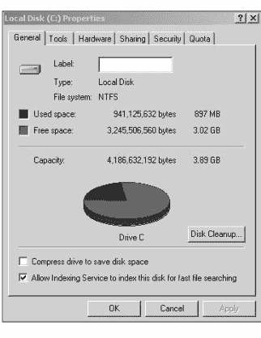

# 20 第一部分：安装 Red Hat Linux

### 整理您的硬盘碎片

*碎片整理* 将硬盘上的所有文件合并到连续的部分。这项任务是必要的，因为 Windows 在操作系统中是个邋遢鬼，它将数据散落在硬盘的各个角落，而不是按照某种逻辑顺序排列。

以下步骤展示了如何整理您的 Windows 分区碎片：

1. **关闭计算机上的所有程序和窗口，只保留桌面和图标栏。**
2. **双击桌面上的“我的电脑”图标。**
3. **通过单击 C: 驱动器选择它，然后选择 文件->属性->工具。**
4. **点击“立即整理碎片”按钮。**

碎片整理程序会检查驱动器以确定其是否需要整理碎片。

您可能会收到一条消息，告诉您不需要进行碎片整理，因为您的硬盘碎片不多；请不要相信它。在正常情况下，这种说法可能是正确的。但调整大小不是一般的情况；整理硬盘碎片是必要的，因为您将移动分区文件系统的末尾并缩小分区，从而擦除该屏障之外的任何数据。

5. **点击“开始”。**


碎片整理窗口出现，过程开始。碎片整理可能需要很长时间，这取决于您的硬盘大小和需要修正的错误数量。


通过点击“显示详细信息”按钮，您可以在大窗口中上下滚动，以观察碎片整理的过程，如图 2-2 所示。

彩色块代表程序和数据，而白色空间代表硬盘上 FIFS 可以分配给 Linux 文件系统的空闲空间。块在屏幕上的移动表明数据正在驱动器上向前移动。您应该会看到窗口底部出现白色空间，这代表您的驱动器末尾。在碎片整理过程结束时，窗口底部不会出现彩色块，所有块都压缩在窗口顶部。在经过似乎相当长的时间后，碎片整理结束。所有有用的信息块现在都位于驱动器的开头，使其为调整大小程序做好准备。

以下说明描述了如何整理您的 Windows NT、Windows 2000 或 Windows XP（NTFS）计算机的碎片：

1. 关闭计算机上的所有程序和窗口。
2. 点击 **开始→程序→附件→系统工具→磁盘碎片整理程序。**
3. 选择要整理碎片的分区。大多数计算机使用标记为 C:\ 的单个分区（无处不在的“C 驱动器”）。点击“整理碎片”按钮，过程开始。

图 2-3 显示了 NTFS 分区的碎片整理过程。

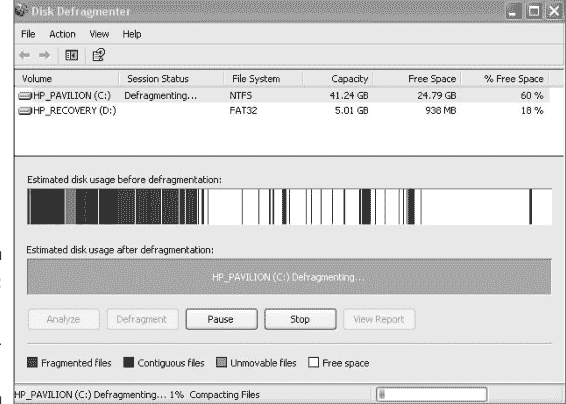

图 2-2：
整理 FAT 分区碎片。

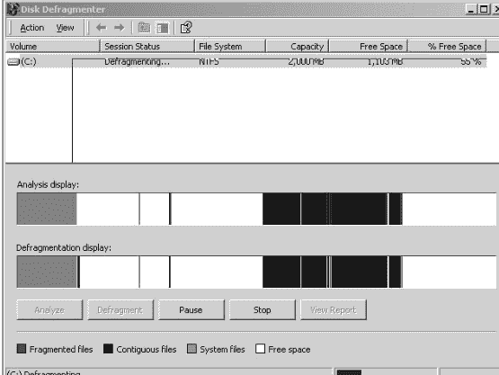

图 2-3：
整理 NTFS 分区碎片。

### 让开，Windows——Linux 来了

您需要为 Linux 腾出空间。本节描述了如何重新划分您的 Windows 计算机以腾出必要的空间。您可以使用开源 FIPS 程序来重新划分 FAT 分区。FIPS 不适用于 NTFS 分区，因此您需要购买商业工具，例如 PartitionMagic。下一节专门介绍在 FAT 上使用 FIPS。后续部分描述在 NTFS 分区上使用商业 PartitionMagic 程序。


我们强烈建议在进行之前备份您的整个计算机。如果这不可行或不可能，您应该备份所有重要文件。您通常可以从系统光盘重新安装操作系统和应用程序，但对于您的数据则无法这样做。您不希望丢失任何您费尽心思创建的数据或程序。请参阅您系统的所有者手册以了解如何备份系统以及如何在必要时恢复数据。

#### 使用 FIPS 调整 Windows 9x 和 Windows Me FAT 分区大小

FIPS 可以调整基于 FAT 的 Windows 分区的大小。较新版本的 Windows（某些版本的 Windows 95、Windows 98 和 Windows Me）使用 32 位文件分配表（称为 FAT32）和驱动器管理工具，这些工具支持大于 2GB 的单驱动器配置。较旧版本的 Windows 95 使用 16 位 FAT（令人奇怪地称为 FAT16）；要使用超过 2GB 的空间，硬盘必须分区为 2GB 或更小的逻辑驱动器。较新的计算机拥有比旧 2GB 限制大得多的硬盘。如果重新划分驱动器，大型驱动管理系统将失效，DOS 和 Windows 分区再次限制在 2GB。

您需要使用古老的 MS-DOS（Microsoft Disk Operating System，微软磁盘操作系统）操作系统——是的，无论如何，所有基于 Windows 的领域都 owe 其存在给 MS-DOS。以下说明描述了如何创建 MS-DOS 启动软盘，您将用它来运行 FIPS：


1. **插入软盘并点击“我的电脑”图标。**
   请注意，这些说明将永久擦除软盘上的所有信息。
2. 右键单击 3.5" 软盘 (A:) 图标并选择“格式化”选项。
   “格式化 A:\”窗口出现。
3. 点击“制作启动盘”选项，然后点击“开始”按钮。
   一个确认窗口——标记为再次格式化 A:\ ——打开。
4. 点击“确定”按钮，您的软盘即被格式化。

随本书捆绑的 Red Hat Linux 发行商版 DVD-ROM 遗憾的是没有包含 FIPS 实用工具。但是，您可以将 FIPS 下载到刚才创建的软盘：

1. 打开您的浏览器并访问 www.redhat.com/download/mirrors.html。
2. 选择任何 Red Hat 镜像。
   *镜像* 确实如其名——可下载软件的镜像。许多组织通过提供他们的资源（例如允许您下载软件的网页）来帮助开源运动，以分担软件分布的负担。Red Hat Linux，一个流行的下载站点，从镜像中受益匪浅。
3. 当您的浏览器显示您选择的镜像时，如果您使用的是 Windows 98 或 Windows Me 或较新版本的 Windows 95（或碰巧使用 FAT 文件系统的 Windows NT、Windows 2000 或 Windows XP 系统），请前往子目录 redhat/8.1/en/os/i386/dosutils/fips20。
   或者，如果您使用的是较旧版本的 Windows 95，请前往 redhat/10/en/os/i386/dosutils/fips15c。
   例如，前往俄勒冈大学 Red Hat 镜像，位于 ftp://limestone.uoregon.edu/redhat/8.0/en/os/i386/dosutils。
4. 将 fips.exe、restorrb.exe、errors.txt 以及可选的 readme.1st 和 fips.faq 下载到您的软盘。
5. 从软盘启动您的计算机。
   计算机以 MS-DOS 模式重新启动。
6. 在 DOS 提示符下键入 cd a:\ 并按 Enter。
7. 在提示符下键入 fips 并按 Enter。
   会出现一些信息并闪过，但除了最后一条询问您按任意键的信息外，您可以忽略所有其他信息。
8. 当您看到“按任意键”的信息时，请照做。
   您将看到硬盘上所有现有的分区。


9. 当你看到“按任意键”提示时，再次按下任意键。

你越来越熟练了！磁盘的描述和一系列消息一闪而过。然后，FIPS 找到第一个分区中的可用空间。

10. 当系统询问你是否要创建扇区备份副本时，按 `y` 表示“是”。

屏幕会询问驱动器 A 中是否有软盘。

11. 将一张已格式化的软盘放入驱动器 A，然后按 `y`。

屏幕上会出现类似 `Writing file a:/rootboot.000` 的消息，随后是其他消息，最后是 `Use cursor key to choose the cylinder, enter to continue`（使用方向键选择柱面，按回车继续）。

屏幕上会出现三列：旧分区（Old Partition）、柱面（Cylinder）和新分区（New Partition）。旧分区号指的是你硬盘主分区中的兆字节数。新分区号指的是你为 Red Hat Linux 操作系统创建的新分区中的兆字节数。

12. 按左箭头键和右箭头键，更改“旧分区”和“新分区”字段中的数字，以便为 Windows 操作系统和 Linux 创建所需的存储空间。

有关安装需求，请参阅第 3 章。

13. 当你在每个字段中设置了正确的硬盘空间量后，按回车键。

分区表再次显示，展示了为 Linux 操作系统创建的新分区。这个新分区可能是分区 2；你的 C: 盘可能是分区 1。

你还会看到屏幕底部的一条消息，询问你是否要继续或进行修改。

14. 如果你对分区大小感到满意，请按 `c` 继续（如果不满，请按 `r`，这将把你带回到步骤 12）。

更多关于你硬盘的消息一闪而过。随后出现一条消息，声明系统已准备好将新的分区方案写入磁盘，并询问你是否要继续。

15. 按 `y` 让 FIPS 将新的分区信息写入硬盘。

分区过程开始。

如果你按 `n`，FIPS 将退出且不更改硬盘上的任何内容，使你的硬盘保持在对系统进行碎片整理后的原样。


16. 为了测试无损分区是否正常工作，请取出启动软盘，并按 `Ctrl+Alt+Delete` 重启系统。

17. 允许 Windows 启动，然后运行 ScanDisk。点击“开始”按钮，并选择 `程序` → `附件` → `系统工具` → `ScanDisk`。

ScanDisk 会指示你是否拥有开始时的所有文件和文件夹，以及是否有内容丢失。即使一切检查正常，为了保险起见，建议保留备份文件一段时间。

现在你准备好安装 Red Hat Linux 10 了，我们将在第 3 章中介绍如何进行安装。Red Hat Linux 安装过程可以使用新创建的空间来创建自己的分区。第 3 章描述了如何使用新空间，同时避免影响现有的 Windows 分区。

##### 使用 PartitionMagic 调整 Windows NT、2000 和 XP 的 NTFS 分区

调整 NTFS 分区需要使用商业工具，例如 [Norton Ghost](https://www.norton.com) 或 [PartitionMagic](https://www.powerquest.com)。PartitionMagic 通过收缩 Microsoft Windows 分区来工作，从而为新分区腾出可用空间。然而，Ghost 2003 并不会动态修改现有的 NTFS 文件系统。相反，它备份现有的 Windows 分区（拍一个“快照”），然后在原始分区之上创建一个或多个新分区。最后，它将原始的 Windows 镜像写入新分区。Ghost 需要一个存储设备来保存快照镜像。如果你的 Windows 安装相对较小（小于 2GB），你可以使用 Jaz 驱动器、Zip 驱动器，甚至可写 CD-ROM 作为存储设备。但是，对于较大的安装，你必须使用第二个硬盘、磁带备份或其他备份机制。

本节描述如何使用 PartitionMagic。Norton Ghost 是一个出色的工具，但由于我们无法假设你拥有使用它所需的备份资源，因此它超出了本书的范围。（你需要足够大的备份介质来存储整个 Windows 安装。）PartitionMagic 不会像获得备份那样让你感到安心，但它仍然工作良好。我们多次使用它都取得了良好的结果。

以下步骤描述了如何安装 PartitionMagic：

1. 拿出你的信用卡，去你附近友好的电脑商店，购买 PartitionMagic 8 或更高版本；或者，你也可以去你友好的网络商店。

在一本专门介绍免费、开源 Linux 操作系统的书中做出这种声明让人不太舒服。然而，关键是完成任务，在这种情况下，我们没有非商业的替代方案。因此，在开源的 NTFS 调整工具出现之前，请继续购买。


有三种 NTFS 变体可用。较旧的 Windows 9x 系统使用一种，Windows NT 使用另一种，第三种版本用于当前的 Windows 版本。你必须使用 PartitionMagic 8（当前版本），因为它可以识别和处理所有三种 NTFS 版本。

2. 将光盘插入 CD-ROM 驱动器，开始 PartitionMagic 安装。
3. 当安装窗口打开时，点击 PartitionMagic 按钮。
4. 当后续屏幕打开时，点击“安装”选项。
5. 安装向导开始。根据你的计算机配置回答问题。通常，你应该能够使用默认选项。
6. 创建急救磁盘。安装向导会引导你完成此过程。

安装 PartitionMagic 后，你可以使用它来重新划分你的驱动器。以下说明展示了如何选择现有分区、收缩它，然后利用新空间创建第二个分区：

1. 启动 PartitionMagic，你会看到类似于图 2-4 所示的屏幕。
2. 点击你想要重新分配的分区。
3. 点击屏幕左上角的“创建新分区”选项。创建新分区窗口打开。此向导将引导你完成收缩现有分区并利用新空间创建第二个分区的过程。
4. 点击“下一步”按钮。选择创建位置窗口打开。你需要告诉 PartitionMagic 要重新划分哪个分区。在此示例中，我们假设你拥有典型的单分区 Windows 计算机（无处不在的 C: 驱动器），如图 2-5 所示。

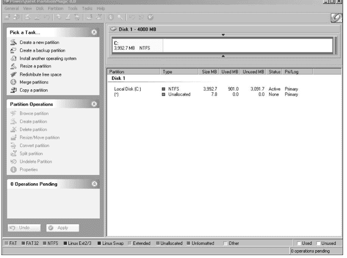

#### 图 2-4：初始的 Partition-Magic 屏幕。

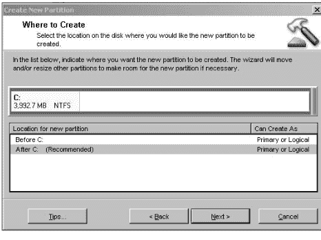

#### 图 2-5：选择创建位置窗口。

5. 点击“下一步”按钮。

分区属性窗口允许你为新分区选择选项。图 2-6 显示了我们为新分区设置的配置。此示例为 2GB，标签为 `linux`，是一个逻辑分区，并使用 `ext3` 文件系统。

此列表展示了 Partition Magic 的选项：

-   **大小：** 分区的大小取决于你磁盘的大小。
-   **标签：** 标签是可选且任意的。可以使用你想要的任何描述。
-   **创建为：** 你有两个选项：逻辑和主。PC 驱动器最多可以有四个主分区和任意数量的逻辑分区。

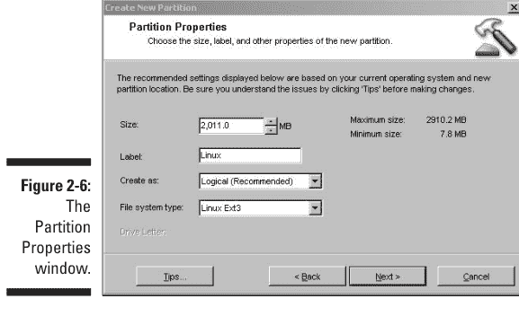

6. 点击“下一步”按钮，确认选择窗口打开，如图 2-7 所示。

7. PartitionMagic 希望你确认即将创建的新分区，并总结潜在的新配置。检查信息，如果你对选择感到满意，请点击“完成”按钮。

如果你不想使用当前的选择重新划分分区，请点击“后退”按钮返回到上一个窗口，在那里你可以做出新的选择。

点击“完成”按钮后，即将创建的新分区将显示在主窗口中。然而，只有当你点击 PartitionMagic 窗口左下角的“应用”按钮时，你的磁盘才会被重新划分。


8. 点击**应用**按钮，会打开一个最终确认窗口。
9. 在确认窗口中点击**确定**按钮，您的磁盘将完成重新分区。

新分区在您重启计算机之前不会生效。

10. **重启您的计算机**。

PartitionMagic 会在计算机启动期间应用更改以创建新分区。

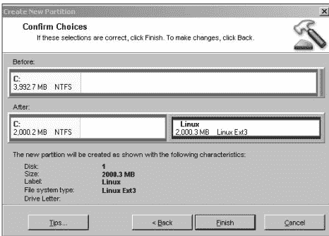

**图 2-7：**  
确认选择对话框。

## 第 3 章  
准备就绪，开始安装！

### 本章内容

- 决定使用哪种 Red Hat Linux 安装类型
- 启动 Red Hat Linux 安装过程
- 自动选择 Linux 分区
- 配置您的网络
- 配置您的系统选项
- 超越不可逆转点
- 配置您的图形系统
- 完成安装

安装 Red Hat Linux 10 并非什么高深的科学——它更像天体物理学。不不——开个玩笑。别跑——请放松，坐下，倒杯你喜欢的饮料，想想安装 Red Hat Linux 的乐趣吧。完成后，您将拥有一台功能强大的计算机，能够完成大多数甚至所有日常计算任务——而这仅需付出这本书的成本！想想看，这简直令人惊叹：花几美元，就能获得几年前需要百万美元才能买到的同等运算能力。

本章将引导您完成 Red Hat Linux 的安装过程。该过程包括插入随书附赠的 Red Hat Linux DVD-ROM 光盘，打开计算机电源，并回答一些问题。

本书附带一张 DVD-ROM 光盘，其中包含完整的 Red Hat Linux 发行版。这张 DVD-ROM 取代了多张 CD-ROM，减少了安装过程中频繁更换 CD-ROM 的需求；它还通过消除寻找包含所需软件包的那张特定 CD-ROM 的麻烦，使软件安装变得更加容易。然而，如果您的计算机无法处理 DVD-ROM，您可以通过邮寄本书背面的优惠券来获取 CD-ROM 版本的 Red Hat Linux 发行版。

Red Hat Linux 安装过程有一个不可逆转点。这个时刻出现在配置过程的后期，在此之后磁盘将被分区，软件将被写入您的硬盘（参见后面“安装阶段 5：不可逆转点”部分）。如果您在该点之前或当时停止安装，您计算机上现有的操作系统（或多个系统）将得以保留。


#### 仅供安装纯主义者

您可以从图形界面或基于文本的界面运行 Red Hat Linux 安装系统。如果安装过程成功检测到您的图形硬件，系统将自动选择图形安装方法，这也是本章讨论的内容。除了使用鼠标进行指向和点击的便利性外，图形方法还将类似的配置选项分组显示。例如，键盘和鼠标的选择在一个窗口中呈现，而不是像基于文本的安装那样分为两个窗口。

Red Hat Linux 安装系统可能无法使用您的图形适配器。当您发现图形安装窗口未出现，但出现了基于文本的窗口时，即可识别出这种情况；在基于文本的系统中，您使用键盘输入信息，并使用光标（箭头）键在不同步骤之间移动。这种情况现在已经很少发生，因为 Red Hat 团队做了充分的准备工作并优化了安装过程。然而，制造商偶尔会引入新的图形系统，而安装系统可能无法支持这些系统。

您可能需要基于以下原因使用基于文本的安装：

- 您母亲告诉您永远不要使用指向和点击（比喻义：不要依赖图形界面）。

您可以在 **boot:** 提示符下输入 **text** 来选择基于文本的安装方法。

#### 选择安装类型

Red Hat 提供了多种安装类型供选择。虽然我们可能认为您的系统可以使用更少的空间，但我们决定列出 Red Hat 为每个安装选项建议的最小磁盘空间要求：

- **服务器 (Server)：** 为提供托管网页等服务的计算机创建一个操作系统环境。如果您只需要最基本功能，此安装需要 850MB 的可用空间；如果您想安装所有高级功能但不包括图形 X 窗口系统，至少需要 1.4GB 的可用空间；如果您想安装所有高级功能并包含 Acme 高级功能工厂（包括 GNOME 和 KDE），则至少需要 2.1GB。

- **自定义 (Custom)：** 安装最基本的软件基础，并要求您选择额外的服务、实用工具和应用。另一个选项是安装随附光盘上的所有内容。前者至少需要 475 MB，后者需要 5.0GB。

- **升级 (Upgrade)：** 更新已安装在计算机上的 Red Hat Linux 软件，但保持现有的设置、用户和数据不变。您可以选择安装额外的软件包。

- **个人桌面 (Personal Desktop)：** 安装将计算机用作工作站所需的软件。诸如 OpenOffice、Mozilla 和 Evolution 等应用程序加上 GNOME 图形环境，为您提供享受互联网和完成工作所需的所有工具。此安装类型至少需要 1.7GB 的可用空间。

- **工作站 (Workstation)：** 在个人桌面安装类型的基础上添加软件开发工具。使用此选项至少需要 2.1GB。


工作站和个人桌面安装类型的主要区别在于，工作站安装软件开发工具，而个人桌面不安装。我们在本书中使用工作站安装选项，并不是因为不讨论软件编程，而是因为这些工具在安装应用程序时往往非常有用。我们鼓励您在安装 Red Hat Linux 时使用工作站安装类型。

工作站和个人桌面安装类型都自动化了那些原本非常复杂、理智的人都不愿去纠结的决策，例如如何分区硬盘和选择软件。安装包含 GNOME 图形用户界面 (GUI) 以及普通计算机用户（即您）生存所需的所有工具。如果您想要安装未提供的软件，您随时可以稍后添加软件包。

## 安装阶段 1：开始旅程

在安装 Red Hat Linux 之前，您需要将随附的 DVD-ROM 插入 DVD/CD-ROM 驱动器，并启动或重启您的计算机。本节中的说明描述了如何在计算机上开始安装 Red Hat Linux。

本节介绍 Red Hat Linux 安装过程的开始。使用这些初始步骤来启动安装并进行一些基本配置：

1. 插入随本书附带的 DVD-ROM，并启动（或重启）您的计算机。请注意，如果您的计算机无法从 DVD-ROM（或 CD-ROM）启动，您需要创建一张启动软盘并从其中启动（创建启动软盘的说明请参见第 2 章）。

计算机“思考”片刻后，第一个安装屏幕出现，显示欢迎消息、一些选项以及 *boot:* 提示符。

2. 按 **Enter**。

一系列消息滚动显示，指示 Red Hat Linux 内核在您的计算机上检测到的硬件。大多数时候，特别是对于较新的系统，Red Hat Linux 会检测到所有基本硬件。

### 34 第一部分：安装 Red Hat Linux

3. **当 Red Hat Linux 检测到您的硬件后，Red Hat 安装过程将开始，屏幕上会显示欢迎消息。点击“下一步”按钮以继续到下一步。**

您可以点击屏幕左下角的“发布说明”按钮来查看关于 Red Hat Linux 的信息。窗口左侧的侧边栏上会显示有关在哪里查找更多信息的额外信息。

欢迎消息屏幕消失后，将出现语言选择窗口。

4. **选择一种语言并点击“下一步”。**

选择您使用的语言，或者，如果您想冒险一下，选择一种您不使用的语言（不推荐）。

键盘配置窗口将出现。

5. **选择您的键盘配置，然后点击“下一步”。**

鼠标配置窗口将出现。

6. **选择您的鼠标（吱吱声），并点击“下一步”。**

Red Hat 通常会自动检测您的鼠标。然而，如果 Red Hat 未能找到您的鼠标，您可以从看到的许多鼠标中手动选择您的鼠标。如果您使用的是 PS/2 鼠标，只需选择制造商和按钮数量即可。如果您使用的是通过串行端口连接的旧式鼠标，您需要选择制造商、按钮数量以及连接的串行端口；您只有四个串行端口可供选择，在很多情况下，它是 `ttyS0` 或 `ttyS1`。

如果您有一个双键鼠标（串行或 PS/2），您可以通过选择“模拟 3 个按钮”选项来让该鼠标模拟三个按钮。通过同时按下两个鼠标按钮，您可以模拟第三个（中间）按钮。

7. **点击“下一步”。**

Red Hat 安装系统尝试检测和识别您的显示器。在大多数情况下，Red Hat 可以完成识别，不需要您提供输入，因此您可以跳至步骤 11。

8. **如果安装系统无法自动识别您的显示器，将显示监视器配置窗口。**

Red Hat 安装过程会检测您的视频驱动程序硬件并自动选择最佳分辨率。您可以在安装过程结束后手动配置视频卡。有关配置说明，请参见第 4 章。


### 第 3 章：准备就绪，开始安装！

我们通用 *monitor*（显示器）一词来指代传统的阴极射线管（CRT）和现代的液晶显示器（LCD）设备。CRT 显示器当然使用厚重的玻璃管，而 LCD 则使用更轻薄的塑料面板。

如果你的显示器未被检测到，屏幕将默认为“未探测显示器”（Unprobed Monitor）选项。你可以从制造商及其型号列表中选择以手动选择你的显示器。如果你找不到你的型号，最好的选择是选择其中一个通用显示器。例如，如果你使用的是 LCD 显示器，请选择“通用笔记本电脑顶部显示面板 1024x768”。或者，你可以简单地选择默认的“未探测显示器”类型；最坏的情况是你之后必须重新配置显示器，或者忍受略低于最佳的性能。

- 9. 点击 **Next**（下一步）按钮。

如果你选择了未探测显示器，将打开“显示器未指定”（Monitor Unspecified）对话框。点击 **Choose Monitor Type**（选择显示器类型）按钮，控制权将返回到显示器配置窗口，如步骤 8 中所述。否则，你不会看到该对话框，应继续到步骤 10。

- 10. 点击 **Proceed**（继续）按钮并继续到步骤 11。

较旧的 CRT 显示器（非 LCD 显示）无法处理高于其设计规格的分辨率速率和扫描频率。例如，一个为 640 x 480 分辨率（和低扫描频率）设计的显示器，无法显示 2,048 x 1,024 的分辨率（和高扫描频率）。如果你试图让显示器显示其能力范围之外的高频率，显示器可能会起火。（我们当时也不相信，直到我们亲眼看到一台显示器冒烟。嘿，至少你因此换了一台新显示器。欢迎来到 21 世纪。）

现代的 CRT 显示器（非 LCD 显示），被称为 *multiscanning*（多扫描）显示器，可以自动匹配一系列扫描频率和分辨率。其中一些显示器甚至足够智能，如果频率过高，它们会关闭自身而不是起火。查找文档并正确匹配垂直和水平频率是最佳途径（特别是对于较旧的显示器）。如果你没有这些信息，请首先尝试较低的分辨率，只是为了让 X Window System 运行起来。（LCD 不会以这种方式着火。）

- 11. 安装类型窗口出现。然而，如果你已经在你的计算机上安装了 Linux，系统会询问你是想升级还是进行全新安装。如果你愿意，可以选择升级；你当前的软件将更新到新版本。本书侧重于首次安装 Red Hat Linux。

参见以下章节以选择你的 Red Hat Linux 安装类型，然后继续分区你的磁盘。


#### 检查你的光盘

Red Hat 提供了一种验证机制来检查其 DVD-ROM 或 CD-ROM。Red Hat 在其光盘中插入数字密钥，以帮助验证它们没有损坏。如果你在 **boot :** 提示符下输入 **linux mediacheck**，安装过程将启动并显示一个对话框。按照以下步骤验证你的 DVD-ROM（或 CD-ROM）是否正常工作。

- 1. 如果你想要验证你的 **DVD**（或 **CD**）是否完好，请按 **Enter** 键选择 **OK**（确定）选项。

如果你已经验证过你的介质，也许你在之前的安装中已经检查过了——你可以选择 **Skip**（跳过）选项，在检查介质的情况下直接返回 Red Hat 安装过程。

介质检查窗口打开。

- 2. 如果你从未测试过用于安装 Red Hat Linux 的 **DVD-ROM**（或一组 **CD-ROM**），请选择 **Test**（测试）选项，测试将开始。

介质检查系统会显示一个进度条，完成后在介质检查结果窗口中显示结果。可能的结果是 **PASS**（通过）和 **FAIL**（失败）。

- 3. 点击介质检查结果窗口中的 **OK** 按钮（唯一的选项）。

- 4. 检查完成后，**DVD-ROM**（或 **CD-ROM**）将被弹出。

如果你使用的是 CD-ROM，请继续到步骤 5。否则，你已完成操作。

- 5. 插入 **第二** 或 **第三** 张 **CD-ROM**，并在 **Media Check**（介质检查）对话框中点击 **Continue**（继续）按钮。**对每张 CD-ROM 重复步骤 2–4**。**在你完成第三张 CD-ROM 的检查后，你即完成操作**。

显然，如果 DVD-ROM（或任何 CD-ROM）未通过测试，你不应该使用它。你应该购买另一本此书的副本。不，不——只是开玩笑。请联系 Wiley 媒体开发部门，邮箱为 MediaDev@wiley.com，以了解如何获取替换的 DVD-ROM（或 CD-ROM）。

## 安装阶段 2：切分披萨

你必须决定在硬盘上的哪个位置安装 Red Hat Linux，这个过程称为磁盘分区。磁盘分区将磁盘划分为多个部分，或切片。然后 Red Hat Linux 被安装在分区上。通常使用三个到七个分区。

Red Hat 提供了创建磁盘分区的自动和手动方法。我们使用 Red Hat 的自动方法，因为它易于使用。自动方法会擦除任何现有的 Red Hat Linux 分区，但保留任何现有的 Windows 分区。如果你没有任何现有的 Red Hat 分区或磁盘上没有未使用的空间，你需要腾出一些空间。请参阅第 2 章了解如何缩小 Windows 分区以为 Linux 腾出空间的说明。


Linux 磁盘分区类似于 Windows 磁盘分区。众所周知的 C: 盘位于一个磁盘分区上。Linux 的对应物是根（ / ）分区。这两个操作系统使用不同的术语，类比并不完美，但概念是相同的。

按照以下步骤继续安装：

- 1. **在安装类型窗口中选择工作站选项，然后点击 Next（下一步）按钮。**

磁盘分区设置窗口出现。Red Hat Linux 安装系统必须对你的硬盘进行分区才能安装其软件。分区将硬盘划分为一个或多个部分。这些划分用于组织组成操作系统的软件和数据（例如用户文件）。

Red Hat 提供两种分区方法：自动和手动。手动方法使用 Red Hat Disk Druid 实用程序。使用 Disk Druid 需要你做出几个决定来选择你的磁盘分区，所以我们使用更简单的自动方法。自动方法更容易使用，除非你觉得幸运（或者想要尝试或拥有手动分区硬盘的经验），我们推荐它。

- 2. **选择自动分区选项并点击 Next（下一步）按钮。**

如果你使用的是从未分区过的新磁盘，或者你现有磁盘的分区表以某种方式损坏，将出现一个警告对话框。

- 3. **点击 Yes（是）按钮将创建一个新分区表。（选择 No（否）将停止安装过程并重新启动你的计算机。）**

自动分区窗口出现。你有三个选项：
    - **删除此系统上的所有 Linux 分区：** 此选项在擦除任何现有 Linux 分区的同时保持任何 Windows 分区（FAT, VFAT, 和 NTFS）不变。如果你正在重新安装 Red Hat Linux（双启动或单独配置），请使用此选项。
    - **删除此系统上的所有分区：** 此选项是最危险的，因为它会擦除硬盘上所有内容。仅当你绝对确定硬盘上没有数据或不想保存任何数据时，才使用此选项。如果你使用此选项，新的 Red Hat Linux 安装将是硬盘上唯一的操作系统。
    - **保留所有分区并使用现有空闲空间：** 如果你使用第 2 章中描述的非破坏性重新分区（例如使用 FIPFS, Norton Ghost, 或 PartitionMagic）来缩小你的 Windows 分区，请使用此选项。


### 第一部分：安装 Red Hat Linux

你可以使用商业产品（例如 Norton Ghost 2002）来缩小 NTFS 分区。缩小 Windows 分区可以释放磁盘空间，这些空间可用于安装 Red Hat Linux。如果计算机中已存在 Windows，使用此选项将创建一个双启动配置。


除非你希望擦除磁盘上的所有内容，否则切勿选择*移除此系统上的所有分区*选项！请务必格外谨慎，因为此操作会销毁所有已安装的操作系统（Windows 和 Red Hat Linux）及数据。例如，如果你的计算机预装了 Windows，而你希望将其转换为仅运行 Red Hat Linux 的工作站，就可以使用此选项。

如果你希望在硬盘上的额外未使用空间（例如，如果你已经按照第 2 章的描述缩小了现有的 Windows FAT 或 NTFS 分区）上安装 Red Hat Linux，请选择标记为*保留所有分区并使用现有空闲空间*的选项。

4. **选择最适合你的自动分区选项。**

如果你在章节 2 中重新划分了 Windows 磁盘以为 Linux 腾出空间，请点击标记为*保留所有分区并使用现有空闲空间*的按钮。Red Hat Linux 安装系统会使用磁盘上的额外空间进行安装。

可选地，如果你是在旧 Linux 安装基础上覆盖安装 Linux，请点击*移除此系统上的所有 Linux 分区*按钮。

可选地，如果你想擦除任何现有操作系统并从头开始使用 Red Hat Linux，请点击*移除此系统上的所有分区*按钮，这将连同磁盘上的所有程序和数据一起删除。

5. **（可选）选择位于屏幕底部的、标记为*查看（并在需要时修改）已创建分区*的选项。**

选择此选项可以让你查看你的分区。

*警告*对话框将打开，告知你哪些（如果有）分区将被擦除。

6. **点击*是*按钮以继续安装。点击*否*按钮以返回到步骤 3 的自动分区窗口。**

7. **如果你在步骤 5 中选择了标记为*查看（并在需要时修改）已创建分区*的选项，将显示分区对话框，如图 3-1 所示。**

如果你没有选择“查看”选项，请继续执行步骤 10。

8. **检查分区，如有必要则进行修改。**

分区窗口显示了 Red Hat 安装过程计划如何将硬盘上的可用空间划分为三个分区。（可用空间由你在步骤 2 中选择的选项决定。）创建的分区是*根分区*（/）、*引导分区*（/boot）和*交换分区*（*swap*）。（swap 是 Red Hat Linux 内部使用的，与其他分区不同，你无法直接访问它。）


此时，如果你想要修改默认的磁盘分区，可以点击*新建*、*编辑*和*删除*按钮。只有当你是经验丰富的 Unix 或 Linux 用户，并且理解使用多个分区的概念时，才应该修改默认分区。除非你非常幸运或经验非常丰富，否则我们建议让 Red Hat 在此处完成工作。

9. **点击*下一步*按钮。**

10. **将显示引导加载程序配置窗口，如图 3-2 所示。默认设置应该非常适合你，因此点击*下一步*。**

引导加载程序有助于在启动计算机时启动你的操作系统；如果你创建了双启动计算机，引导加载程序允许你选择其中一个操作系统。标准的 Red Hat Linux 引导加载程序是 GRUB，它是一个强大的系统，功能远不止加载操作系统。然而，GRUB 的默认选项应该就足够你使用了（其高级功能的介绍超出了本书的范围）。

如果你的计算机有 NIC（网络接口卡），Red Hat 会检测到它，并显示网络配置窗口，如图 3-3 所示。你应该继续执行下一节中的步骤 1，以配置你的网络。但是，如果你没有以太网 NIC，或者使用的是 Red Hat 无法检测到的无线设备，安装过程将跳过网络配置，并继续执行下一节中的步骤 7。

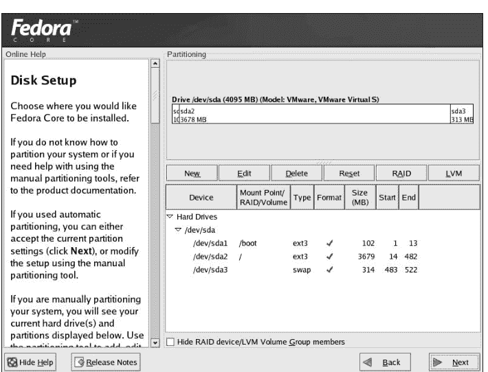

**图 3-1：** 磁盘设置窗口显示将要创建的分区。

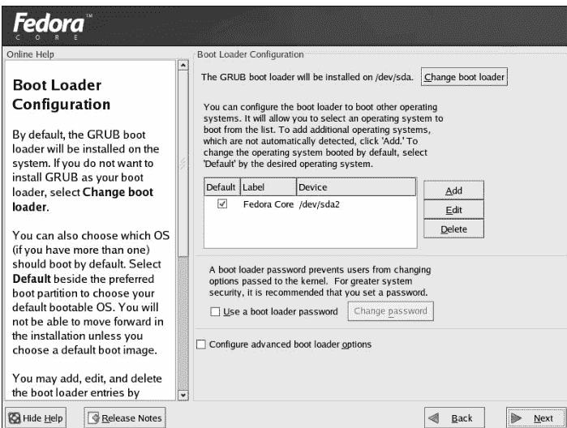

**图 3-2：** 引导加载程序配置窗口。

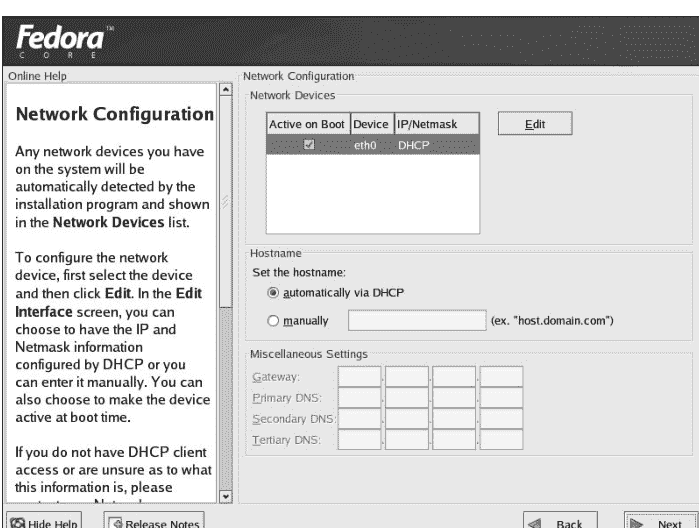

**图 3-3：** 网络配置窗口。

#### 针对 Windows 用户的机密提示

如果你在与 Windows NT、Windows 2000 或 Windows XP 的双启动配置中安装 Red Hat Linux，你的 NT 启动记录将被临时覆盖，这意味着你无法启动 Windows NT。别惊慌：你的 NT 分区没有被擦除——它只是变得无法启动了。（NT*启动记录*是指使 Windows NT 系统在启动计算机时能够自动启动的内容。）

如果你点击*更改引导加载程序*按钮并选择*不安装引导加载程序*单选按钮，可以在不覆盖 NT 启动分区的情况下安装 Red Hat Linux。当你点击*下一步*按钮时，*高级引导加载程序配置*窗口将打开。选择*引导分区的第一个扇区*选项，然后点击*下一步*按钮。你的 Windows 启动配置将继续像以前一样工作。


在下一节中，我们将向你展示如何为 Red Hat Linux 使用而配置网络。如果你没有网络，或者现在不想去处理它，你仍然可能想要阅读下一节，因为如果你将来决定创建网络，它会让你更省事。如果你仍然不感兴趣，请点击*下一步*，跳过本节，进入“安装阶段 4：配置你的系统”。

## 安装阶段 3：配置网络

如果你准备好配置网络，且你的计算机有以太网或 Wi-Fi（使用 802.11b 标准的无线网络接口）适配器，请按照以下步骤输入相应信息。如果你有网络适配器但没有网络可连接，仍应在步骤 3 中输入一个主机名。如果将来你最终连接到网络，提前输入主机名会让生活更轻松。


有时，安装过程无法检测到网络设备，并跳过本节描述的步骤。如果发生这种情况，请按照下一节“安装阶段 4：配置你的系统”的说明继续安装。你可以在完成 Red Hat Linux 安装后配置网络。有关网络配置的说明，请参阅第 7 章。

如果你从上一节末尾继续，将显示网络配置窗口。按照以下步骤配置系统的网络：

1. 如果你正在*连接到使用动态主机配置协议*（DHCP）的网络，你不需要*做任何其他事情*来配置网络连接。点击*下一步*按钮，跳到*步骤 7*。


你可能需要咨询你的 LAN（局域网）管理员，以了解该 LAN 是否使用 DHCP。如果你自己构建了 LAN，但不确定是否正在运行 DHCP，那么你就没有运行。请参阅第 15 章了解如何安装和配置 DHCP 服务器。

2. 点击**编辑**按钮，然后在“编辑接口”子窗口中输入你的 IP 地址和子网掩码。

以下列表简要解释了 IP 地址和子网掩码：

- **IP 地址：** 此地址是你的 Red Hat Linux 计算机的数值网络地址，也是你的计算机在你的本地网络以及（在许多情况下）互联网上被识别的地址。如果你没有通过 InterNIC（负责分配 IP 地址的组织）注册你的私有网络地址空间，你可以使用从 `192.168.1.1` 到 `192.168.254.254` 的公共地址空间。

如果你正在连接到现有的 LAN，请咨询其管理员以获取一个尚未被使用的 IP 地址。如果你正在运行自己的 LAN，你必须记录未使用的 IP 地址。

- **子网掩码：** 基于互联网协议（IP）的私有网络被划分为子网。子网掩码决定网络如何划分。对于 IP 地址（如前面要点中的示例 `192.168.1.1`），最常见的子网掩码是 `255.255.255.0`。

3. 点击窗口中**设置主机名**部分下标记为**手动**的按钮。在文本框中输入你的计算机的主机名，包括网络（域名）名称。

例如，如果你想将计算机命名为 *cancun*，且你的网络名称是 *paunchy.net*，请键入 **cancun.paunchy.net**。


如果你在配置网络过程中没有为计算机指定名称和域名，它将被称为 `localhost.localdomain`。否则，欢迎屏幕将显示你赋予的任何名称。例如，在前面的示例中，你将看到 **欢迎来到 cancun.paunchy.net**。

4. 在屏幕底部的“其他”部分的相应文本框中，输入你的网关和首选 DNS（以及可选的备用和第三级 DNS）IP 地址。

此列表说明了这些参数的作用：

- **网关：** *网关*是将你的私有网络连接到互联网（或另一个私有网络）的计算机的数值 IP 地址。Red Hat Linux 默认使用地址 `192.168.1.254`。你可以接受此地址，但除非该地址确实是你的网关，否则留空是更好的选择。第 5、6 和 7 章分别描述了如何配置你的 Linux 计算机通过电话、宽带（DSL 或电缆）和现有 LAN 连接接入互联网。如果你那样做，现在设置默认路由可能会干扰你的连接。


+   • **主 DNS：** 互联网协议使用域名系统（DNS）将诸如 `www.redhat.com` 这样的名称转换为数字 IP 地址。充当 DNS 服务器的计算机被称为*名称服务器*。我们建议保持此框为空，除非您处于具有名称服务器的私有网络中，或者将连接到互联网（您的 ISP 提供 DNS）。如果您指定了一个不存在的名称服务器，许多网络程序会因为徒劳地等待不存在的服务器而运行非常缓慢。

+   • **备用和第三 DNS：** 备用和第三 DNS 作为主 DNS 服务器的备份。如果您的计算机无法找到主 DNS 服务器，它可能会找到备用服务器。如果仍然找不到，它应该能找到第三服务器。祝您好运！

5. 如果您使用调制解调器（普通拨号、DSL 或电缆）直接连接到互联网，请保留*网关*地址为空。否则，如果您的计算机连接到具有互联网访问权限的局域网，请在*网关*文本框中输入互联网网关的地址。

如果您连接到他人的局域网——例如，如果您在工作中正在构建一台 Red Hat Linux 计算机——您应该从系统管理员那里获取此地址。如果您在家连接到自己的局域网，请咨询自己，因为您可能就是管理员。

6. **完成网络配置表单后，单击“下一步”按钮以继续。**

防火墙配置窗口将打开。

防火墙默认是开启的。如果您愿意，可以将其关闭，但我们建议保持开启状态。

7. **单击“下一步”按钮。**

Red Hat 为您的计算机创建一个适用于工作站使用的防火墙。该防火墙足够好，并能提供合理的保护。然而，我们将在第 8 章中向您展示如何构建一个更好——更安全且更简单——的防火墙。

下一节将向您展示如何完成 Red Hat Linux 工作站的配置。

## 安装阶段 4：配置您的选项

本节描述了您的 Red Hat Linux 计算机的基本配置步骤。我们将介绍如何设置时区和 root 用户密码。此外，您还可以选择在默认软件包之外安装额外的软件。以下步骤描述了如何执行这些基本任务。请注意，如果您一直按照本章操作并完成了上一节的步骤 7，附加语言支持窗口将打开，并为您提供额外的语言选项。


### 介绍密码礼仪

您的密码长度至少需要六个字符，但您应该使用至少八个字符：使用的字符越多，密码越难破解。如果您关心安全性，我们建议您使用大写字母、小写字母、符号和数字的组合，以使您的密码尽可能难以被攻破。此外，不要选择词典中可以找到的任何内容，或者与您容易关联的名称或物品。换言之，您的名字、您的名字倒拼、您的生日、您宠物的名字，或任何语言中的任何单词都是糟糕的选择。例如，对于 Jon 来说，“Beer”是一个糟糕的密码选择，尽管它包含大写字母和小写字母，因为 Jon 和啤酒通常在一起出现。

想出一个好密码的好方法是选择一个短语并将其“破坏”。例如，将“我不仅仅是一个数字”变成类似 imN0tun# 的东西。尽管结果并没有真正拼写出该短语，但它给了您所有线索来记住那些本质上是随机的字符（“我” = im，“不” = N0t，“一个” = un，“数字” = #）。其他常见的替换包括用 3 代替 e，用 4 代替 a，用 9 代替 g，用 1 代替 l，用 8 代替 b，以及用 5 代替 s。通过这种方式，您可以创建像 s0uthb4y（southbay）或 14mn0t4g33k（iamnotageek）这样的密码。

此外，务必将您的密码写在一个不会丢失且不易被发现或窃取的地方。例如，将您的工作密码保存在家中，或存储在锁着的书桌或保险箱中。不要将您的密码写在便利贴上并贴在您的电脑显示器上！

请遵循以下步骤：

1. **打开附加语言支持窗口，进行您的选择（尽管美国几乎任何人都不必进行选择），然后单击“下一步”按钮。**
   时区选择窗口将显示。
2. **要选择您的时区，请单击代表最接近您居住地点的城市的点。**


您可以使用地图通过指点的方式找到您的时区。当您点击成千上万个光点中的一个时，所代表的城市及其时区会出现在地图下方的子窗口中。您也可以通过点击屏幕底部的滑块条来定位您城市或时区的名称。找到后，单击该文本以选择您的时区。

3. **单击“下一步”。**
   设置 Root 密码窗口将显示。
4. **在 Root 密码和确认文本框中两次输入您的 root 密码。**

该密码是用于 root 用户（也称为*超级用户*）的，该用户有权访问整个系统，几乎可以做任何事情——无论是好的还是坏的。

root 用户是唯一能够访问计算机上所有资源的用户。所有文件、进程和设备都由 root 控制。您应该仅在执行系统维护或管理任务时以 root 用户身份登录。为了避免对这些重要文件进行不想要的更改或删除，您通常应以普通（非 root）用户身份登录。请参阅本章稍后“安装后：使用设置代理”部分的步骤 2，了解如何添加用户。

您必须两次输入密码，以确保输入正确。当您输入密码时，密码在屏幕上显示为星号。“天哪，安全被破坏了，蝙蝠侠！”您不希望有人能从您身后偷看并获取您的密码，对吧？

5. **单击“下一步”。**

工作站默认设置窗口打开，显示将安装的重要软件摘要。（如果您没有使用工作站类型，则显示您所使用的任何安装类型的摘要。）您可以选择接受当前软件包列表（默认选项）或自定义要安装的软件包集选项。

在本书中，我们使用工作站安装环境中的默认软件包。

如果您选择自定义要安装的软件包集选项，软件包组选择窗口将打开。您可以单独或按组选择要额外安装的软件包。例如，如果您想安装 KDE 环境，只需单击 KDE 桌面环境菜单旁边的按钮，所有必要的软件包随后将被选中。通过单击“选择单个软件包”选项来选择单个软件包。完成选择后，单击“下一步”按钮并继续执行步骤 6。

6. **单击“下一步”按钮。**

即将安装窗口将出现。一个响亮的声音回响着，这是“不归点”。嗯，不完全是。没有响亮的声音说什么，但确实是“不归点”。如果您单击“下一步”按钮，您的磁盘将按照您在上一节中选择的方式进行重新格式化，然后安装 Red Hat Linux。以下部分描述了该过程如何进行。


GNOME 是 Red Hat 的默认图形环境，也是我们在本书中全程使用的环境。然而，许多人更喜欢 KDE 环境。选择权在您；您可以使用任一环境或两者兼用，如果您愿意的话。（如果您在计算机上同时安装了 GNOME 和 KDE，您登录时可以选择其中一个作为您的桌面环境。）若要安装

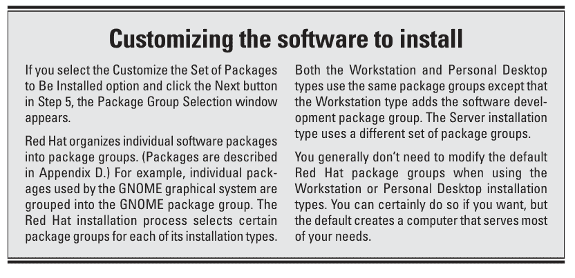

### 定制要安装的软件

如果您选择“自定义要安装的软件包集”选项，并在步骤 5 中单击“下一步”按钮，则软件包组选择窗口将出现。

Red Hat 将单个软件包组织成软件包组。（软件包在第 D 附录中描述。）例如，GNOME 图形系统使用的单个软件包被归类为 GNOME 软件包组。Red Hat 安装过程为其每种安装类型选择某些软件包组。

工作站和个人桌面类型使用相同的软件包组，除了工作站类型额外添加了软件开发软件包组。服务器安装类型使用不同的软件包组集合。

当使用工作站或个人桌面安装类型时，您通常不需要修改默认的 Red Hat 软件包组。如果您愿意，当然可以这样做，但默认设置创建了一台能够满足您大部分需求的计算机。

KDE，请选择“自定义要安装的软件包集”选项，如步骤 5 中所述。单击 KDE 软件包组旁边的复选框，然后单击“下一步”按钮。

## 安装阶段 5：不归点

如果您一直按照本章操作，本章中描述的指令尚未导致对您的计算机进行任何永久性更改。可以说，您的选择尚未板上钉钉。没有分区被擦除。也没有任何 Red Hat Linux 软件包被写入您的硬盘。您可以通过单击“后退”按钮停止安装过程并返回到您原来的计算机。

决定是继续还是停止。深呼吸，并按照以下指令在您的计算机上安装 Red Hat Linux：

1.  单击**下一步**按钮。
    安装媒体对话框打开。如果您使用的是 CD-ROM 光盘，会告知您需要哪些光盘。
    如果您想中止安装过程，可以单击“重新启动”按钮。
2.  在您屏住呼吸一秒钟后决定孤注一掷时，单击“继续”按钮。
    您的磁盘分区将被创建和格式化，然后 Red Hat Linux 发行版将被写入其中。


哎呀！“正在安装包”窗口（见图 3-4）除了告知你当前正在安装的软件包外，还显示了已安装的数量、剩余待安装的数量以及预计剩余时间。


如果你拥有最新、最高性能的高速计算机和 DVD/CD-ROM 光驱，整个过程只需几分钟。否则，对于旧设备，请预留 20 到 40 分钟——甚至更长的时间。

3. **在计算机上安装 Red Hat Linux 后，安装程序会询问你是否想要创建一个启动磁盘。**

此选项有助于你创建一张软盘，以防磁盘上的启动分区出现意外，你可以使用它来启动计算机。例如，Microsoft 产品有一个糟糕的习惯：在安装或甚至更新时会覆盖主引导记录（MBR）——从而破坏你的 Red Hat Linux 引导系统。硬盘启动失败也可能因多种原因发生——外星人和小妖精都以搞破坏闻名。启动盘是挫败这些邪恶捣蛋鬼的绝佳工具。


这个启动盘与你用于开始 Red Hat Linux 安装的那个不同。如果硬盘上存储的 Red Hat Linux 引导信息损坏，你可以使用此启动软盘来启动你的 Red Hat Linux 计算机。

**图 3-4：** 正在安装包的窗口。

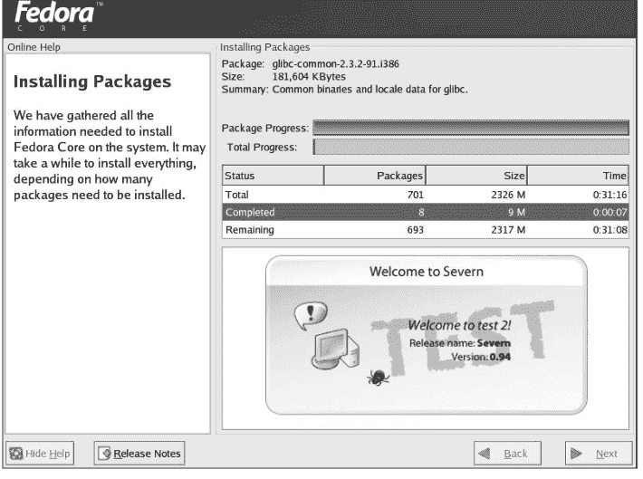

4. **（可选）** 将一张空白磁盘插入主软驱，选择**创建启动软盘**选项，然后单击**下一步**以创建启动盘。

“恭喜”窗口将打开。它提供有关在哪里查找 Red Hat Linux 信息的信息。

5. **将 DVD-ROM（或 CD-ROM 或软盘）从计算机中取出，然后单击“退出”按钮。**

你的计算机将重启。请参阅以下部分以完成安装。

## 安装后：使用设置代理

计算机重启后，Red Hat 设置代理（Setup Agent）将启动。设置代理通过将部分配置工作推迟到安装后阶段，从而简化了安装过程。无论是否运行设置代理，你的新 Red Hat Linux 计算机都能正常工作。设置代理帮助你微调计算机。这种微调不需要在安装期间进行，这使整个过程稍微容易一些。

安装 Red Hat Linux 后，首次启动计算机时，设置代理会自动运行。设置代理帮助你添加或配置用户帐户。它还帮助你配置计算机的日期、时间和声音系统。

设置代理还帮助你执行以下功能：

- 注册 Red Hat Network。
- 设置 Red Hat 更新代理。
- 安装额外应用程序。本书附带的 Linux 操作系统不包含额外应用程序，因此你无法使用此功能。

本书中详细描述了配置这些系统的过程。以下步骤描述了在 Red Hat Linux 安装完成后如何立即使用设置系统：

1. **当 Red Hat 设置系统启动时，你将看到欢迎屏幕。** 单击**下一步**按钮以开始安装后配置过程。
2. **日期和时间配置窗口出现，如有需要，你可以更改日期和时间。**

你还可以让计算机自动且持续更新时钟。如果你计划通过局域网（LAN）或宽带调制解调器（DSL 或电缆）连接到互联网，请选择**启用网络时间协议 (NTP)**选项。你可以从包含许多 NTP 时间服务器的下拉菜单中进行选择。默认选择 clock.redhat.com 和 clock2.redhat.com 运行良好，但你可以输入任何你想要的。或者，你可能可以访问不在列表中的 NTP 服务器，并手动输入它。单击“继续”按钮以转到声音配置屏幕。

如果你的计算机通过局域网或 DSL 或电缆调制解调器持续连接到互联网，我们建议使用 NTP 选项。PC 时钟每天会漂移几秒到几分钟。保持最新总比落后好。

3. 单击**下一步**按钮。用户帐户窗口打开。在安装过程中只创建了 root 用户，但在这里你有机会创建一个或多个用户帐户。
4. 输入帐户名称、帐户所有者姓名及其密码。单击**下一步**按钮以继续。
5. Red Hat 在检测硬件（如声卡）方面做得很好，应该能检测到你的硬件。单击**播放测试声音**按钮以测试你的系统。一个对话框打开，询问你是否听到了音乐。
6. 如果听到了请单击**是**，如果没有请单击**否**。
7. 如果你单击了**否**，会打开一个**错误**对话框。单击**确定**按钮以继续。如果声音测试失败，请参阅第 11 章中关于设置声音系统的章节以获取帮助。单击**继续**按钮以继续。
8. 单击**下一步**按钮，**更新代理**窗口打开。Red Hat 致力于为 Linux 操作系统提供额外的价值。其出色的服务之一是 Red Hat Network，它提供各种服务。**更新代理**帮助你保持计算机的最新状态。Red Hat **更新代理**旨在持续连接到 Red Hat 网络并检查新软件。通过保持勾选标有**是的，我愿意注册 Red Hat Network**的选项并单击**下一步**按钮，你可以注册该服务。一个注册窗口将打开，你在那里输入所需信息。Red Hat 更新代理对计算机安全至关重要。我们要跳过 Red Hat Network 注册过程，因为我们将在专注于安全问题的第 17 章中更详细地讨论它。选择标有**不，我不想注册我的系统**的选项。
9. 单击**下一步**按钮。**附加软件**窗口打开。与本书捆绑的 Red Hat Linux Publisher’s Edition DVD-ROM 不包含任何附加软件，因此你在这里无需做任何事。
10. **单击下一步按钮。** *完成设置* 窗口打开。
11. **单击下一步按钮，设置代理关闭。**


你可以随时运行设置代理。设置代理是一个名为 `firstboot` 的脚本。你可以通过运行带有 `reconf` 选项的 `firstboot` 脚本来运行设置代理。只需以 root 身份在 GNOME 终端窗口中运行以下命令：

```
rm /etc/sysconfig/firstboot
/usr/sbin/firstboot
```

就这样！你搭建了一台 Red Hat Linux 计算机。计算机自行重启后，你就可以将其用作你的个人工作站了。

# 第 4 章

## 获取 Red Hat Linux

### 本章内容

- 了解 Red Hat Linux 文件系统
- 启动 Red Hat Linux
- 理解登录和 root 用户
- 使用基于文本的命令
- 配置图形显示
- 使用图形工具添加用户
- 不使用图形工具添加用户
- 停止 Red Hat Linux

安装 Red Hat Linux 后，是花几分钟浏览一些基础知识的好时机。本章涵盖了足够的 Linux 基础知识以让你入门，包括启动和停止 Red Hat Linux，以及理解图形应用程序和非图形应用程序之间的差异等主题。

我们首先介绍 Linux 用于在磁盘上存储信息的系统。与 Windows 一样，Linux 使用文件和目录来存储和组织信息和应用程序。以下部分描述了 Linux 文件系统。

## 介绍 Linux 文件系统树

Linux 将其所有部分（网络除外）视为文件。Linux 将文件、目录和设备作为文件地址进行访问。Linux 使用字母和数字系统来指代磁盘和磁盘分区；例如，/dev/hda 可能是第一个 IDE 硬盘的名称，而 /dev/sdb 可能是第二个 SCSI 硬盘的名称。


你可以将 Linux 文件系统比作一棵树，如图 4-1 所示，该图展示了根目录下的三个子目录（根目录下实际上有十多个子目录）；子目录是目录中的目录。倒置树的顶部由 `/`（斜杠）表示，即根目录。一系列树枝、枝条和树叶延伸到根目录下方：树枝是挂载点，从树枝延伸出的枝条是目录，而这些枝条上的树叶就是你的文件。

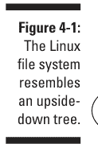

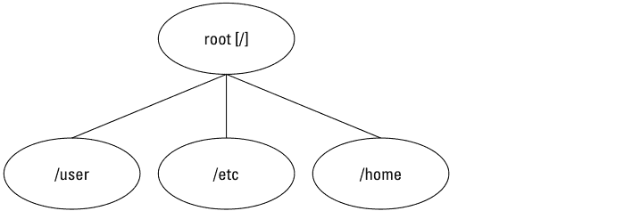

> 每个挂载点都是一个磁盘分区或远程文件系统（例如你的 DVD 或 CD-ROM 驱动器），它被挂载，或者说被暴露给其上方的树枝目录。每当磁盘分区或远程文件系统被挂载到目录枝条上时，该枝条就会变成另一根树枝，从而允许更多的枝条位于挂载点下方并与其连接。

Red Hat Linux 需要至少一个根分区和一个交换空间分区。根分区用于存储你所有的个人文件和系统目录；Linux 使用交换空间——计算机世界里的“汉堡帮手”——来将内存扩展到你随机存取存储器 (RAM) 的限制之外。例如，如果你拥有 512MB 的 RAM 和 512MB 的交换空间，你就可以运行使用 1GB 内存的程序。

这种配置与 Windows 和 MS-DOS 文件系统没有太大区别。Windows 使用分层目录树的概念。然而，语法略有不同。Red Hat Linux 中的顶层目录（根目录）由正斜杠 (/) 指定。每个后续的子目录名称都跟随那个初始斜杠。例如，home 目录是根目录的子目录，显示为 /home。在 Windows 世界中，根目录由初始反斜杠 (\) 指定。著名的 C : 等同于 C :\。当划分子目录时，两种操作系统的主题得以延续：Linux 使用正斜杠，而 Windows 使用反斜杠。因此，你的 home 目录在 Linux 中显示为 /home/me，在 Windows 中则显示为 \user_directories\me。


Linux 和 Windows 文件系统之间的另一个主要区别是，Linux 要求你显式地挂载文件系统，而 Windows 会自动完成此操作。显式挂载文件系统并不像听起来那样繁重。Red Hat Linux 安装了实用程序，会在必要时自动检测并挂载文件系统。例如，默认的 Red Hat Linux 配置会在你将 DVD 或 CD-ROM 插入驱动器时自动挂载它。

我们在第 3 章中描述的 Workstation 安装类型会自动设置你的根分区和交换分区，此外还有一个额外的启动分区，用于存储 Red Hat Linux 内核以及用于启动计算机的其他文件。（Personal Desktop 安装类型使用与 Workstation 安装类型相同的分区方案。）

下一节将描述如何启动和停止 Linux。

## 启动 Red Hat Linux

启动计算机 simply 意味着启动它（而*重新启动*意味着重启它）。按照以下步骤首次启动你的 Red Hat Linux 系统：

- 1. 确保你的计算机已关闭。
- 2. 打开显示器的电源，然后打开计算机的主电源开关。

片刻之后，Red Hat 启动菜单会出现在你的屏幕上。如果你只在计算机上安装了 Red Hat Linux，那么你只有一个可启动的操作系统选项：Linux。


默认操作系统是列表中的第一个。如果你安装了 Red Hat Linux 以及其他操作系统，你可以更改默认启动的操作系统。


Linux 运行在三种不同的状态：1、3 和 5（称为*运行级别*）。每个运行级别用于执行不同的功能。在级别 1（也称为*单用户模式*）下，Linux 以最少的进程运行，以便你可以进行配置更改和调试问题。级别 3 基本上与级别 5 相同，只是级别 3 不运行 X 服务器——它是非图形化的。通常，你在级别 3 下运行不需要运行图形应用程序（如文字处理软件）的服务器。级别 5 是个人工作站的默认级别。你可以使用 GRUB（Grand Unified Bootloader）选择不同的 Linux 运行级别。当 GRUB 出现时，按 e 键进行编辑。会出现三行。按向下箭头键选择以*Kernel*开头的那一行。再次按 e 键，添加一个空格，然后按 **1、3** 或 **5**。按 Enter 键，然后按 b 键。你的计算机将启动到单用户模式 (1)、非图形模式 (3) 或图形模式 (5)。

- 3. 按上下箭头键高亮显示单词 Linux（如果尚未高亮显示），然后按 Enter。

如果你不按任何键，默认操作系统（Linux 在安装时将自己设置为默认）将在五秒延迟后自动启动。

如果你正在运行多个操作系统（例如 Red Hat Linux 和 Windows），你可以选择列出的任何操作系统进行启动；我们在此假设你选择了 Linux。

按下 Enter 后，Red Hat Linux 启动。在此过程中，你的屏幕上会显示大量信息。Red Hat Linux 在探测你的计算机以确定存在哪些硬件（例如磁盘驱动器和打印机）时，会收集这些信息。

由于 Red Hat Linux 是一个多用户系统，一个或多个用户可以同时使用它；例如，当其他人通过网络连接登录时，你可以在计算机控制台（连接的键盘和显示器）上登录。因此，你和每个其他用户都需要一个用户账户才能使用计算机。每个账户都需要一个独立的账户名和密码，以保护你的信息并将你的任务与其他人的任务分开。

## 登录

当你使用 Red Hat Linux 时，你必须以具有独特登录名的特定用户身份登录。为什么？因为 Red Hat Linux 是一个多用户系统，因此使用不同的账户来防止人们查看他人的秘密文件、从系统中删除必要的文件，或以其他方式（故意或无意地）做坏事。

使用唯一身份有助于防止一个人的行为影响另一个人的行为，因为可能有几个人同时使用同一个计算机系统（例如通过网络）。这种策略的一个好处是，Red Hat Linux 系统基本上对病毒具有免疫力，因为每个用户的文件和目录无法被用来破坏整个系统。（虽然我们不以此计分或类似，但病毒可以破坏 Windows 9x 系统或仅仅使生活变得糟糕，因为它们不具备此能力。）

当 Red Hat Linux 启动时，你会看到屏幕上滚动显示各种信息。滚动停止后，登录屏幕出现。

如果你在安装期间选择不让 X 在每次启动系统时自动运行，你会看到 `login:` 提示符。

如果你输入密码或登录名时出错，系统会要求你重新输入。

我们强烈建议你以非特权用户身份进行大多数 Red Hat Linux 实验，仅在必要时以 root 用户登录。以 root 身份操作意味着你面临损坏系统、不得不重新安装或丢失数据的风险，因为你可以删除或更改任何事物。当你以普通用户身份登录时，你可能会意外删除自己的文件和数据，但你不能删除他人的文件或系统文件。

幸运的是，Red Hat Linux 提供了许多图形化实用工具，你可以以非特权用户身份启动它们。每个 Red Hat 管理实用程序在启动时都会提示你输入 root 密码，然后执行其特定功能，但仅限于该功能，并具有 root 权限。因此，你可以避免对系统造成意外损坏。（请参阅附录 C，了解文件权限的工作方式以及如何修改它们。）

## 命令行接口 (CLI) 与图形用户界面 (GUI)

Red Hat Linux 默认安装 X 窗口系统。你可以使用 Red Hat 提供的基于 GUI 的工具（GUI 代表 graphical user interface，即图形用户界面）执行大多数管理任务。本书中的大多数操作指南使用基于 X 的应用程序和实用程序。我们这样做是因为它们通常更易于使用，并且本书并不是为系统管理员编写的。

偶尔，某个实用程序或程序不会图形化运行；其他时候，使用非图形化方法和系统只是更有趣或更方便。信不信由你，一些更极客的 Linux 用户*偏好*使用基于文本的命令行接口 (CLI)。如果你不熟悉使用 CLI 执行一些基本管理任务，我们不推荐你仅仅为了证明你可以而使用它。不那么极客一点也没关系。我们仍然喜欢并尊重你。另一方面，了解一些基础知识是有意义的，以防你需要在基于文本的界面上即兴发挥。


命令行界面通常从*shell*（外壳程序）中运行，它充当 Red Hat Linux 操作系统与您之间的基于文本的接口。Red Hat Linux 默认使用的 *bash* 外壳程序会显示类似 `[lidia@ Cancun lidia]$` 的提示符。您在外壳程序提示符处输入命令。这就是“命令行界面”（或 CLI）这一术语的由来。

您可以在 GNOME 界面内通过启动 GNOME 终端（也通称为终端模拟器）来启动一个 shell。点击 GNOME 菜单，然后选择“系统工具：终端”（您也可以在 GNOME 桌面任意位置右键单击并选择“新建终端”）来启动一个终端会话，如图 4-2 所示。（有关 GNOME 界面的更多信息，请参阅第 9 章。）

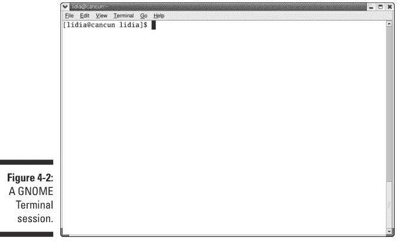

您可以使用 GNOME“运行程序”菜单在不启动交互式 shell 的情况下运行单个程序。点击 GNOME 菜单按钮——位于屏幕左下角的红帽子——并选择“运行程序”。“运行程序”窗口将打开；在文本框中键入任何程序的名称。随后程序将会运行——如果它是图形化的。如果该程序被设计为与终端屏幕交互（技术术语为*标准输出*），您将看不到其输出。例如，输入 **xclock** 会在屏幕上显示一个图形时钟。

GNOME 菜单按钮看起来像一个红帽子，位于桌面左下角的工具栏上。该按钮的工作方式类似于 Windows 的“开始”按钮。


GNOME 终端类似于 Windows 中的 MS-DOS 窗口。打开 MS-DOS 窗口会提供一个用于输入 DOS 命令的 CLI。Windows CLI 的底层技术与 Linux CLI 的技术不同。然而，它们的功能大致相同。

## 配置您的图形显示

Red Hat 安装过程擅长自动配置自身以使用您的视频硬件和显示器——Linux 使用 X 窗口系统（简称 X）来显示图形。然而，偶尔 X 配置过程会失败，或者您可能希望重新配置它。Red Hat 让您能够访问其在安装过程中使用的相同配置工具。

Red Hat X 配置实用程序是 redhat-config-xfree86 程序。我们将其简称为显示器配置器。通常，显示器配置器会自动检测您的显示器（监视器）和显卡。检测完成后，您可以设置显示器的分辨率和色深。

## 使用显示器配置器进行配置

即使您没有运行 X 窗口（如果您处于非图形模式；非图形模式是运行级别 3），您也可以启动显示器配置器：

1. **以 root 身份登录。**

   您会自动进入一个 CLI。
2. **在 Bash 提示符处输入此命令：**

   `redhat-config-xfree86`

   显示器配置器窗口将打开。该实用程序在图形界面内运行。

当然，如果您的计算机正在运行 X，您也可以启动显示器配置器。例如，您可能希望重新配置您的系统。请按照以下步骤启动该实用程序：

1. **点击 GNOME 菜单。**
2. **选择“系统设置” → “显示器”。**
3. **如果系统提示，请输入 root 密码。**

显示器配置器将打开。使用以下步骤组来配置您的图形（X 窗口）界面。


X 窗口系统（简称 X）由麻省理工学院（MIT）发明。MIT 设计 X 是为了在广泛范围的机器上显示图形应用程序。它最初构建于 Unix 平台之上，但已适应 Linux、Windows 和其他平台。


不支持多扫描（multiscanning）的旧式显示器如果在高于 VGA（即 640 x 480 和 60Hz）的分辨率下使用，可能会受损（支持多扫描的显示器可以切换到显卡生成的相同信号频率）。大多数新型显示器都内置了保护机制，以防止它们在所谓的“过驱动”（overdriving）中烧毁，但旧式显示器没有这种类型的保护。旧式显示器真的可能着火。如果您听到显示器发出奇怪的声音或闻到组件燃烧的气味，请立即关闭计算机！

## 手动配置

如果显示器配置器未能自动检测您的显示设置，您可以手动更改这些设置。以下步骤描述了如何访问和使用显示器配置器的高级功能：

1. **启动显示器配置器** 并 **点击“高级”选项卡。**

   图 4-3 显示您可以配置监视器、显卡和多主机计算机（以便同时使用多个监视器）。多主机系统的描述超出了本书的范围。

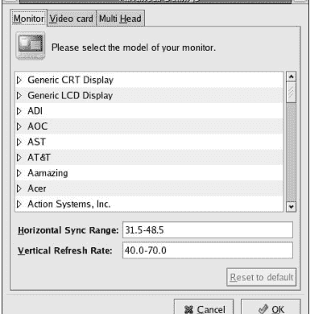

图 4-3：监视器的高级设置对话框。

高级设置窗口显示了您默认可用的监视器。

2. 尝试查找并选择您的特定监视器。

   您有数十种甚至更多的监视器可供选择，因此找到您自己的可能性至少和中 PowerBall 一样大。如果没有，您最好的选择是在“通用”部分中仔细查找。

   通用监视器包括几种笔记本电脑配置和老式笨重的型号。如果您不知道哪种类型适合您的监视器，请猜测并尝试一种。如果第一个选择不起作用，请继续尝试不同的通用监视器。

   点击“确定”按钮并返回高级设置窗口。
3. 点击“配置视频卡”按钮。控制权会转到视频卡设置窗口，如图 4-4 所示。从长列表中选择您的视频卡。

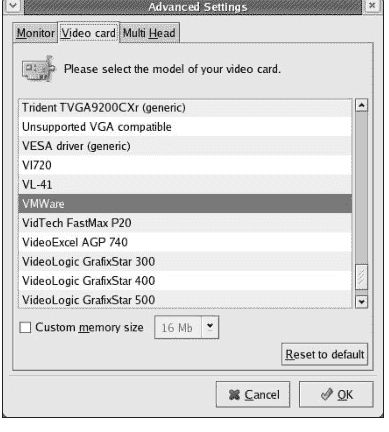

您可以点击“探测视频卡”按钮，让显示器配置器为您探测和定位您的视频卡。您的显卡很可能已被检测到并被高亮显示。

最低（8 位）选项允许窗口一次仅显示 256 种颜色。16 位选项允许 65,535 种颜色，而 24 位允许超过 1600 万种颜色（也称为*真彩*）。

4. 点击“确定”按钮返回高级显示设置窗口。


## 深入探讨色深

色深，即您的系统在任何时候窗口上可以同时激活的颜色数量，大致是系统所含视频内存量和窗口分辨率的函数。

如果您的系统内存较小（例如 1MB），您的屏幕可以拥有 1024 x 768 像素（点）的分辨率，同时在屏幕上显示 256 种颜色（8 位）。如果您的系统有 2MB 内存，您可以在相同分辨率下同时在屏幕上显示 64K 种颜色（16 位）。如果您拥有较旧的视频板，视频内存较少但有一些额外的视频内存插槽，您可能能够升级视频卡上的视频内存数量。

如果您只有 1MB 内存并希望一次在屏幕上看到 64K 种颜色，您可以将分辨率从 1,024 x 768 降低到 800 x 600 像素。如果您想要真彩（24 位），您可以将分辨率设置为 640 x 480 像素。您正在查看的图片会占据屏幕的更大部分，但色深与分辨率之间的权衡可以通过选择正确的选项来实现。

当您想显示图像且色深不正确时，不会发生剧烈变化。图片可能看起来暗淡或不太正常。X 有一个有趣的功能，即拥有虚拟颜色映射，允许活动窗口利用色深位的所有颜色，即使其他窗口正在使用不同的颜色。当此选项开启时（在本书附带 DVD-ROM 上的 Red Hat 发行版中是开启状态），当您的鼠标在一个窗口之间移动时，各个窗口会变成奇怪的颜色，但您的鼠标激活的窗口会以可用的最佳颜色显示。随着具有更大视频内存的较新显卡的出现，允许在每个窗口中以高分辨率显示真彩，此选项的实用性降低了。

5. 点击“确定”按钮，显示设置窗口将关闭。

   一个信息窗口将打开，通知您需要注销并重新登录以使更改生效。

   注销并重新登录以使更改生效。


在紧急情况下（例如，如果系统崩溃），您也可以通过按 Ctrl+Alt+Backspace 来重启 X。当前的 X 会话将停止并最终重启。然后您可以重新登录。

## 使用 Red Hat 用户管理器创建用户账户

如果您有需要添加新用户（例如，如果您有一个家庭网络），或者您在安装过程中忘记创建非 root 用户，本节


下面将向你展示操作方法。红帽提供了多种系统管理工具以方便你使用。红帽用户管理器是一款非常出色的管理工具，可以简化你的操作。


以下说明假设你正在使用 GNOME 窗口系统，这是红帽的默认设置。但用户管理器在 KDE 窗口系统下的操作与在 GNOME 下一致。KDE 随红帽 Linux 捆绑提供，并可在安装过程中选择 KDE 替代 GNOME。（我们在第 9 章中讨论 GNOME。）


你可以使用红帽用户管理器修改现有用户账户。单击用户名，然后单击“属性”按钮，将打开一个与“创建新用户”窗口类似的窗口。然后你可以修改账户的任何方面。

按照以下步骤使用用户管理器创建新账户：

1. **通过单击 GNOME 菜单按钮，然后选择“系统设置\用户和组”来打开用户管理器。**
   - 如果你没有以 root 用户身份登录，系统会提示你输入 root 密码。
   - 红帽用户管理器窗口将显示。
2. **单击屏幕上左上角的“添加用户”按钮。**
   - “创建新用户”窗口将显示，如图 4-5 所示。

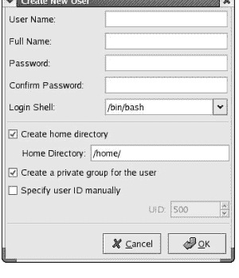

**图 4-5：**
**创建新用户对话框。**

3. **输入你的用户名、真实姓名（全名）以及两次输入密码（以确认其正确性）；接受登录 Shell 的默认值 /bin/bash。**
   - 红帽用户管理器默认也会创建一个主目录。

这些选项中的大多数都是不言自明的，但以下是一些额外信息：

- 你的用户名（也称为*登录名*）是你用于登录计算机的名称。请让你的登录名易于记忆，并全部使用小写字母。一些俏皮的名字以后可能并不合适。避免选择过长的名字，因为你可能一天要输入好几次。你最终还可能使用你的登录名作为电子邮件地址，并在电话中告知他人，因此像 `phool` 这样的登录名会导致邮件误投，让你觉得自己像个傻瓜（phoolish 是 foolish 的谐音双关）。
- 如果你愿意，可以输入你的全名。这些信息将保存在 `/etc/passwd` 文件中，该文件可以被系统中拥有账户的任何人读取。这些信息通常对系统管理员很有用，因为它们允许他们将某个账户与某个人员联系起来。如果你正在配置个人系统，这信息可能是多余的。
- 新密码应与用于 root 的密码不同。当你输入密码时，屏幕上会出现小星号而不是实际密码，以防有人在你输入时从肩膀上看过来。（红帽 Linux 在这里表现出了其多疑的一面。）在文本模式下，你不会得到任何反馈（星号或其他字符）。
- 在许多默认的 Shell 选择中，`/bin/bash` 是一个不错的选择（*bash* 是一个流行的 Shell，也是红帽 Linux 的默认 Shell）。
4. 单击**确定**。
   - 你的账户已创建。


红帽 Linux 使用可插拔身份验证模块 (PAM) 来阻止你输入简单或危险密码；但不要因此认为你的新密码是好的。一个好的密码不能在字典中找到，因为密码破解者拥有自动尝试字典中所有单词来破解你密码的程序。避免使用生日和纪念日——或者任何他人可以与你联系起来的东西。关于好密码的建议，请查看第 3 章。只要不要忘记它，并且不要把它写在便利贴上然后贴在显示器上！


你也可以使用红帽用户管理器删除现有的用户账户。单击用户名，然后单击“删除”按钮，该账户将立即被移除。请小心，因为你不会被要求确认删除账户。但是，因为账户的主目录被保留（未被删除），如果需要，你可以返回并重新创建该账户。

## 无 X 环境下创建账户

如果 X 无法正常工作或你想从终端模拟器工作，你仍然可以添加用户账户。为此，请遵循以下步骤：

1. 通过单击 GNOME 菜单按钮并选择“系统工具→终端”打开一个 GNOME 终端窗口。
2. 通过输入以下命令登录为 root：

   ```
   su -
   ```
3. 在提示时输入 root 密码。
4. 在命令提示符处输入 useradd *name*，其中 *name* 是新登录账户的登录名。
5. 在命令提示符处输入 passwd *name* 并按下 **Enter**。
   - 此步骤更改新账户的密码，该密码由第 1 步中的 *useradd* 命令分配了默认值。如果你使用默认密码，那密码有什么好的？
6. 再次输入你的**密码**。
   - 红帽 Linux 要求你重新输入新密码，以确保你输入的密码是你认为你输入的密码。如果你没有像第一次那样完全准确地重新输入密码（由于密码不会在屏幕上显示，这很容易发生错误），你就必须重复该过程。红帽 Linux 将更新新登录的密码。

## 结束你的第一次会话

注销系统并重新启动登录过程非常简单。为此，单击 GNOME 菜单按钮并选择**注销**。“确定要注销吗？”窗口将显示，你将被要求确认是否要注销。如果你确实要注销（你真的要吗？），请单击**确定**按钮，你就退出了。如果你改变主意，想再玩玩你的新操作系统一会儿，请单击**否**。


你还可以通过单击**关机**或**重新启动**按钮，然后单击**确定**来确认你的决定，从而选择从此窗口重新启动或停止你的计算机。取决于你选择了哪个，你的系统将完全停止或重新启动。你还可以按下 **Ctrl+Alt+Backspace** 键来关闭当前会话。这种方法虽然不那么优雅，但依然有效，特别是在某个失控进程冻结了你的 X 会话时。

# 第二部分

## 有网吗？

### 第五波 作者：瑞奇·滕南特


> *“当我们创立公司时，我们原本不打算叫‘红帽’。但最终我们决定它听起来比‘蜜蜂胡须 Linux’好多了。”*

#### 本部分 . . .

在创建你的红帽 Linux 工作站后，该开始工作了。本部分的章节展示了连接互联网的三种不同方式：传统、慢速的拨号（模拟）调制解调器；快速宽带 DSL 或电缆调制解调器；或者已连接到互联网的现有局域网 (LAN)。

第 5 章侧重于基于电话的调制解调器。调制解调器很像古老、可靠的皮卡：它们可能不是到达某地的最快方式，但它们仍然能让你到达。事实上，调制解调器提供了最简单、最经济且有效的互联网连接方式。

第 6 章介绍宽带互联网连接。电话、有线电视及其他类型的公司现在为许多社区提供宽带服务。以并非完全不合理的低价，你可以获得高速、始终在线的服务。

许多人在工作、学校和家中都有机会访问现有的计算机局域网（称为 LAN）。第 7 章展示了如何将你的计算机连接到 LAN，并且如果你的 LAN 有互联网连接，你可以了解如何配置你的工作站以使用它。

一旦连接到互联网，你的计算机就变得容易受到攻击了。如果你使用如 DSL 这种始终连接的宽带服务，这一点尤其正确。这种区别类似于住在安静的街道与繁忙的街道之间。在繁忙的街道上你更容易受到攻击。这就是为什么我们在第 8 章中向你展示如何构建防火墙。


# 第 5 章

## 拨号调制解调器依然能胜任工作

### 本章内容

- 寻找互联网服务提供商 (ISP)
- 配置你的互联网连接
- 配置你的调制解调器
- 连接到你的 ISP

冲浪互联网既有趣，有时也是一种有益的活动。来，承认吧：你知道你想占住电话线好几个小时，以便烦扰你的家人或室友，浏览诸如 www.theonion.com 这样荒谬地址的网站，并与那些你在现实中绝不会做梦去交谈的人亲切地聊天。但问题是，在你加入这个新兴的在线宇宙之前，你必须先获得互联网的接入。

本章描述了如何使用调制解调器连接到互联网服务提供商（或 ISP），并创建你通往互联网的桥梁。一旦你接入了互联网，你也可以参加派对并随口说出这句话：“我今天下午在 Red Hat Linux 系统上网时发现的。” 这样别人就知道你真的很酷。而且，如果你以前从未成为派对的焦点，这句话无疑会让你更受欢迎。

本章假设你正在使用标准的拨号调制解调器连接互联网。我们在第 6 章中描述了如何配置你的 Red Hat Linux 计算机，以使用更快的连接技术，即宽带连接。


许多人在工作和学校都能访问连接互联网的 network。（也许你的 5 岁小孩构建了一个连接互联网的家庭网络。）第 7 章描述了如何连接你的 Red Hat Linux 计算机到现有的私有网络，并通过该网络的连接访问互联网。然后你可以以光速冲浪，直到牛都回家了。


## 迫切寻找一个 ISP

要使用拨号调制解调器连接，你必须成功地将调制解调器连接到你的计算机，然后找到一个好的互联网服务提供商 (ISP) 进行拨号。很可能你有一块随计算机安装的内部调制解调器。如果没有，你可能需要考虑升级。请查看 Andy Rathbone（Wiley Publishing, Inc. 出版）编写的*Upgrading & Fixing PCs For Dummies*（《升级与维修 PC 新手指南》）第 6 版。


寻找好 ISP 的最佳方式是通过口碑。获得个人推荐是了解 ISP 优缺点的好方法，这些优点和缺点是你无法通过阅读广告找到的。在你与 ISP 签约之前，确保该公司支持 Linux。

如果你没有朋友，且你认识的人不与你说话，试着找一个当地的 Linux 用户组 (LUG) 去询问。你可以在 www.redhat.com/apps/community 的 Red Hat 社区网页上查找 LUG。

表 5-1 展示了支持 Linux 的 ISP 示例。

| ISP | 免费电话（仅限美国） | 网络地址 |
| :--- | :--- | :--- |
| Access4Free | 866-MyFree/ 770-349-3430 | www.access4free.com |
| AT&T WorldNet | 800-967-5363 | www.att.net |
| CompuServe | 800-336-6823 | www.compuserve.com |
| Earthlink | 800-EARTHINK | www.earthlink.net |
| Prism Access | 888-930-1030 | www.pris m.net |
| SprintLink | 800-473-7983 | www.sprint.net |
| CompuGlobalMega HyperNet Network | 867-555-5309 | www.compu globalmegahyper.net |

无论你想使用哪一个，务必询问你潜在的 ISP 是否提供拨号 PPP 服务。PPP（点对点协议）是 Linux 用于连接互联网的方式。如果你对话的人对你投来茫然的眼神，你可能会遇到麻烦。如果你遇到某种障碍，提前获知一下。ISP 的技术人员可能无法指导你完成程序。你得靠自己。

## 如果你正在购买调制解调器

拨号调制解调器是一项老技术，但仍然是进行个人或小型企业互联网连接的最常见方法。由于宽带连接用户数量迅速增加，且大多数大型企业也使用宽带服务，这一说法可能很快就会不再成立。

*内部调制解调器* 插入计算机主板上的 PCI 或 ISA 插槽，并从计算机获取电源。*外部调制解调器* 拥有自己的外壳，需要自己的电源（那些笨重的、方形的插头），并通过串行 (RS232) 连接连接到计算机。两种类型的调制解调器都使用你的电话插座连接到互联网。

内部调制解调器通常比外部的便宜，但外部调制解调器有几个优点。你可以轻松开关它们，你可以不打开计算机机箱就将它们连接到计算机，如果你的电话线被闪电击中，通过调制解调器传递的电荷不会损坏你的计算机。另一方面，内部调制解调器只需要一条电话线电缆，而外部调制解调器需要电话线、串行连接和电源线。

第三种串行线调制解调器是 *PCMCIA 卡*（有时称为 PC 卡）。这些卡最常与笔记本电脑一起使用。大多数现代笔记本电脑都预装了内部调制解调器。


现在是确认你的电话服务是固定费率而非计量费率的好时机；你应该确保你使用的拨号号码不是长途电话。如果你有计量服务，或者最终拨了长途收费电话，当你花几个小时谈论独行侠和阅读关于维度空间旅行者的文章时，你会产生巨额电话费。

选择互联网服务提供商并安排付款后，ISP 会提供某些信息，包括：

- 电话接入号码
- 用户名（通常是你想要的）
- 密码（通常是你提供的）
- 电子邮件地址，通常是你的用户名加上 ISP 的域名
- 主要 *域名服务器* (*DNS*) 号，这是一个由句号分隔成四组数字的大数
- 次要域名服务器 (DNS) 号，这是另一个由句号分隔成四组数字的大数
- 一个 SMTP（邮件）服务器名称
- 一个 NNTP（新闻）服务器名称
- 一个 POP3 或 IMAP 服务器名称，用于从 ISP 的服务器下载电子邮件到你的机器


Access4Free 提供了免费和订阅互联网服务的良好组合。注册后，你每月可获得 10 小时的免费服务。超过 10 小时后，按每小时收费，最高为 9.95 美元。你也可以订阅每月的 9.95 美元获得无限制的拨号访问；订阅为你提供电话支持（866-693-7334），否则每次通话费用为 5 美元。（这也不错！）Access4Free 还在许多美国城市提供本地拨号和 PPP 访问。


当你为新调制解调器购物时，避免购买 WinModem，因为它们就像 dot.com 股票一样，这些调制解调器仅专为 Windows 计算机设计。它们比普通调制解调器便宜，因为它们比较懒（或者聪明，取决于你看问题的角度），并依赖 Windows 操作系统为其完成大部分工作。Linux 驱动程序刚刚开始出现，适用于这些类型的调制解调器。有关为你的 Red Hat Linux 计算机购买调制解调器的更多信息，请参见前面的边栏“如果你正在购买调制解调器”。

## 配置你的互联网连接

你需要配置调制解调器，以便 Red Hat Linux 可以使用它连接到你的 ISP。Red Hat 拨号配置工具在检测和配置调制解调器方面做得很好。它还会设置一个拨号账户，将你的计算机连接到你的 ISP，从而连接到互联网。

请按照以下步骤开始：


1. 单击 GNOME 菜单按钮，选择 System Tools::Internet Configuration Wizard。

GNOME 菜单按钮是屏幕左下角看起来像一顶红色宽边帽的图标。

如果你不是以 root 身份登录，系统会提示你在输入对话框中进入 root 密码。请输入 root 密码。

2. 打开“选择设备类型”窗口。你使用此窗口配置任何类型的通信设备，例如调制解调器或网络接口。从菜单中选择 Modem connection（调制解调器连接）选项，然后单击 Forward（下一步）按钮。

当拨号配置工具扫描计算机上的调制解调器时，会出现“正在搜索调制解调器”对话框；该窗口消失


如果检测到调制解调器，它将快速响应。如果未找到调制解调器，则会弹出警告窗口，提示未找到调制解调器。请单击“确定”按钮。

- **3. 如果未检测到调制解调器，将显示“选择调制解调器”窗口，如图5-1所示。**（*显示的信息*可能与你的计算机有所不同。）**否则，如果检测到调制解调器，请跳至步骤5。**

如果“互联网配置向导”未找到调制解调器，它会猜测调制解调器连接在你的第一个串行端口：/dev/ttyS0 上。

如果需要，你可以在“选择调制解调器”窗口中修改调制解调器设置。（请参阅以下章节“在 Linux 中定位你的调制解调器”和“在 Windows 中定位你的调制解调器”，以了解获取调制解调器信息的方法。）

- **4. 再次单击“下一步”。**

将显示“选择提供商”窗口。

- **5. 在“选择提供商”窗口的相应框中输入你的电话号码、互联网服务提供商（ISP）名称以及你的登录名和密码。**

如有必要，还应在相应的文本框中输入你 ISP 的拨号前缀以及地区或国家代码。

- **6. 填写完信息后，单击“下一步”。**

将打开 IP 设置对话框，如图5-2所示，允许你进一步配置拨号连接。

默认选项是“自动获取 IP 地址设置”和“自动从提供商获取 DNS 信息”。

使用默认选项允许你的 ISP 在你每次连接时自动为计算机分配 IP 地址和 DNS 服务器地址。你几乎总是可以使用这些设置。

- **7. 单击“下一步”按钮。**

将显示“创建拨号连接”窗口，展示你刚刚输入的信息摘要。

- **8. 单击“应用”。**

将打开“网络配置”窗口。你可以在窗口中看到你的新调制解调器以及其他网络设备，例如以太网接口。

- **9. 选择“文件::保存”菜单选项以保存你的调制解调器配置。**

- **10. 单击“激活”按钮以连接到你的 ISP。**

“网络配置”工具将拨号连接你的 ISP，向你的 ISP 进行身份验证，并为你的计算机提供互联网连接。你的 IP 地址、默认路由和 DNS 提供商由 ISP 自动设置（使用 PPP 协议）。只要拨号连接处于活动状态，这些数值将优先于任何现有参数，例如以太网接口。当你停用连接时，你现有的（如果有的）IP 地址和默认路由将被重置。只有当你在私有网络上使用 DHCP 时，你之前的 DNS 提供商才会被重置；否则，拨号连接的 DNS 提供商将继续生效。请参阅第7章中关于配置 DNS 和以太网或无线接口的部分。

此时，你已配置好调制解调器以连接互联网。如果在使用“互联网连接向导”配置调制解调器时遇到问题，以下两部分内容将有所帮助。

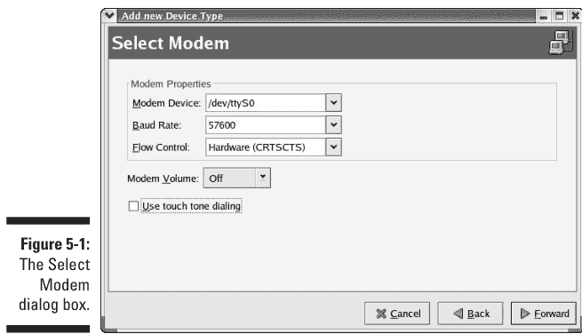

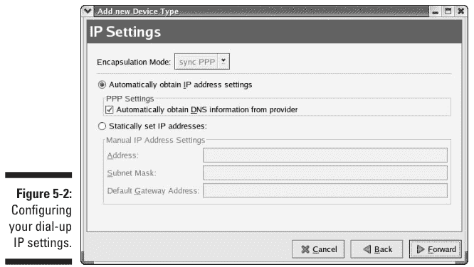

## 在 Linux 中定位你的调制解调器

Linux 使用设备文件与外围设备通信。设备文件位于 `/dev` 目录中，在某种程度上等同于 Windows 驱动程序：你需要它们才能使硬件正常工作。

你的调制解调器可以连接到你的 PC 上可用的四个串行端口之一。*串行端口*是计算机用于与设备（如调制解调器）通信的机制。外部调制解调器通常连接到端口 `/dev/ttyS0` 或 `/dev/ttyS1`，尽管也可以将其配置为 `/dev/ttyS2` 或 `/dev/ttyS3`。如果你使用的是内部调制解调器，它可以是任何 *tty* 设备。

在启动过程中，Red Hat Linux 提供 *kudzu* 实用工具，它会自动尝试定位系统中的新设备。*kudzu* 工具擅长检测调制解调器（包括内部和外部）等设备。当 *kudzu* 检测到新设备时，它会提示你配置该设备，你应该允许它这样做。

如果在启动过程中，Linux 硬件检测系统 *kudzu* 未能找到你的调制解调器，你必须手动完成。一种手动方法是排除法；这种方法虽然粗糙，但很有效。以下两个编号列表描述了如何找到你的调制解调器。第一种方法适用于外部调制解调器，涉及向调制解调器发送一串字符并观察发光二极管（LED）是否亮起。第二种方法适用于内部调制解调器，由于它们没有 LED，因此你必须通过调制解调器发出的刺耳尖叫声来追踪它。

若要使用 *kudzu* 查找外部调制解调器，请遵循以下步骤：

- 1. 通过单击 GNOME 菜单按钮并选择“系统工具 > 终端”来打开终端模拟器窗口。
- 2. 在终端的命令提示符下运行以下命令：

```text
echo "anything" > /dev/ttyS0
```

诚然，上述命令中引号内的内容无关紧要。只需要是*任意*文本即可。

如果你的调制解调器连接到目标串行端口，你会看到发送-接收 LED（有时标记为 RX/TX）短暂亮起。

- 3. 在极不常见的情况下，如果未找到你的调制解调器，请尝试通过修改步骤1中命令末尾的数字以匹配你目标端口，将字符串发送到 `/dev/ttyS1`、`/dev/ttyS2`，最后发送到 `/dev/ttyS3`。

如果你使用的是内部调制解调器，生活会稍微艰难一些，因为你没有视觉反馈。不过，你可以听调制解调器的扬声器来了解正在发生什么。请遵循以下步骤：

- 1. **通过单击 GNOME 菜单按钮并选择“系统工具 → 终端”来打开终端模拟器窗口。**
- 2. **在命令提示符下输入以下命令：**

```
echo "atdt5555309" > /dev/ttyS0
```

如果你听到调制解调器摘机并拨号，你就赢了这场捉迷藏游戏，并知道调制解调器连接到了哪个设备。然后你可以跳至步骤4。

- 3. **如果没有听到任何声音，请通过输入以下命令并确保扬声器已打开，然后重试步骤1：**

```
echo "atv" > /dev/ttyS0
```

如果你听到调制解调器摘机并拨号，请跳至步骤4。

- 4. **如果你仍然听不到任何声音，请尝试使用其他串行端口，在命令中替换为 ttyS1、ttyS2 和 ttyS3 并再次尝试。**
- 5. **找到你的调制解调器后，向调制解调器发送以下命令以断开连接：**

```
echo "atz" > /dev/ttyS0
```

## 在 Windows 中定位你的调制解调器

如果你正在运行 Windows 9x、Windows Me、Windows NT 或 Windows 2000 计算机，你可以按照以下步骤查看你的调制解调器连接到哪个端口：

- 1. **给比尔·盖茨发送电子邮件，询问他的配置信息。**

如果他正在法庭上或因其他原因太忙而无法回复，请参见步骤2。

- 2. **选择“开始 → 设置 → 控制面板”。**

将显示“控制面板”窗口。

- **3. 在 Windows NT 系统中双击“调制解调器”图标或“电话和调制解调器控制”图标，或在 Windows 2000 系统中双击“电话和调制解调器选项”图标。**
- **4. 当“电话和调制解调器选项”窗口打开时，单击“调制解调器”选项卡。从出现的列表中选择了你的调制解调器。**


将显示“调制解调器属性”对话框。

- 6. **选择“诊断”选项卡。**

你会看到你的调制解调器旁边有一个 COM 行号。这是 Windows 对你调制解调器串行通信线的指定。如果显示数字 1，意味着 Windows 将其识别为 COM1；如果是 2，则位于 COM2；依此类推。这些数字指定直接对应 Red Hat Linux 中相应的 `ttyS0`、`ttyS1`、`ttyS2` 和 `ttyS3` 编号。

如果你正在运行 Windows XP，请遵循以下步骤查看你的调制解调器连接到哪个端口：

- 1. **单击“开始”按钮，然后单击“控制面板”图标。**

将显示“控制面板”。

- 2. **双击“系统”图标。**

将显示“系统属性”窗口。

- 3. **选择“硬件”选项卡并单击“设备管理器”按钮。**

将显示“设备管理器”。

- 4. **单击“调制解调器”菜单项旁边的小加号。**

你的调制解调器应列在“调制解调器”菜单项下。

## 启动你的互联网连接

Red Hat Linux 提供 Red Hat PPP 拨号器实用工具，帮助你建立 PPP 连接。通过使用你使用“拨号配置工具”（在本章前文“配置你的互联网连接”部分中描述）设置的 PPP 配置来建立此连接。

若要使用 Red Hat PPP 拨号器连接互联网，请遵循以下步骤：

- 1. **作为任意用户登录 Linux。**
- 2. **单击 GNOME 菜单按钮并选择“系统工具 → 网络设备控制”。**

将显示“网络设备控制”窗口，显示你拥有的所有网络接口。


3.  **单击调制解调器的名称（例如，Myconnection），然后单击“启用”（Activate）。**

如果您有以太网网络适配器，它会显示为 *eth0* 或 *eth1*。您通常可以忽略以太网设备，因为它可能不会干扰您的调制解调器。但是，如果某个网络设备似乎干扰了您的调制解调器，您应该以停用调制解调器相同的方式将其停用。第 4 步描述了如何停用设备。

网络设备控制实用程序负责拨号并连接到您的 ISP。

4.  **使用完互联网后，单击网络设备控制窗口中的“停用”（Deactivate）按钮。**

您的连接将结束。

Red Hat 安装的防火墙相当不错。然而，我们在第 8 章中描述了一个更安全 的防火墙。


# 第 6 章

## 宽带很棒！

*本章内容*

- DSL 和电缆互联网连接
- 使用电缆连接
- 使用 DSL 连接

您可能已经熟悉了无处不在的拨号上网连接：您登录互联网，听到那吱吱作响的调制解调器声音——然后，砰！——您就上线了。如果运气好，整个拨号过程不到一分钟，但也可能需要更长时间。再加上网页在屏幕上构建得慢得让人抓狂的事实。

您有一种更好的上网方式，称为宽带。*宽带*（Broadband）是高速电缆和数字用户线（DSL）连接的统称。电缆连接由有线电视公司提供，而 DSL 由电话公司提供。两者都比拨号连接快得多，而且各有所长、有所短。


宽带（broadband）中的 *broad*（宽）意味着连接调制解调器与互联网的电线和电缆具有宽*带宽*（bandwidth）；它们可以处理更多数据，速度更快，且可靠性更高。普通旧式电话服务（POTS）是为传输模拟语音数据而创建的。不用说，就互联网而言，POTS 远不如宽带媒体出色。

访问互联网最流行的两种宽带连接是电缆调制解调器（利用现有的有线电视线路传输数据）和 DSL（使用高级数字电话线）。宽带连接的速度大约从 500 千比特每秒（Kbps）到几百万比特每秒（Mbps）。这足以在几秒钟内传输图形丰富的网页；也足以收听多个音频流或观看低分辨率的视频流。


如果您准备切换到 DSL 或电缆互联网连接，请相信我们，您再也不愿回到拨号调制解调器了。本章描述了如何获取和配置宽带连接。

我们建议避免使用 ISDN、卫星和心灵感应互联网连接。旧的 ISDN 技术正在迅速被 DSL 取代。ISDN 配置也很复杂，而且速度并没有比拨号调制解调器连接快多少。卫星互联网连接刚刚开始推出，并遭受诸如传输延迟（*latency*）等问题，这会严重破坏您的通信。有些人说心灵感应效果极佳，但我们认为英特尔还没有生产出这样的芯片。卫星系统可能会迅速改进，但在那之前，我们建议使用普通的旧式拨号调制解调器，或者，如果可能的话，使用 DSL 或电缆调制解调器连接。

### 介绍 DSL 和电缆连接：证明在于布线

尽管电话网络系统在许多方面已经现代化，但其基础自 20 世纪初以来并没有发生根本变化。电话网络由成对的铜线组成，将家庭和企业连接到电信公司的中央办公室（CO）。电话公司在其 CO 中使用交换机在您拨打电话时将您连接到目的地。这些交换机被设计用于限制电话呼叫可使用的频率范围——即*带宽*。带宽大约为每秒 3,000 个周期（Hz），足以识别语音，但仅此而已。这些限制使得如今的模拟调制解调器无法通过电话网络传输超过大约 56,000 位每秒（即 56 Kbps）的数据。（该 56 Kbps 的速度会有所波动，主要取决于您连接的铜线状况，通常速度会下降。）


这对你意味着什么？改进你的调制解调器和布线，你就能获得更快的互联网访问。两种最常用宽带替代方案是

- **有线电视（CATV）：** 尽管 CATV 公司服务的住宅和企业数量不如电话公司多，但它们的纤维和同轴电缆网络可以承载比电话线多得多的带宽。CATV 网络没有 DSL 的 3 到 4 英里限制。通常，如果公司提供服务且该公司服务您的社区，您可以通过您的 CATV 公司获得互联网电缆服务。
- **数字用户线（DSL）：** DSL 设计用于绕过传统电话系统的限制，通过绕过语音交换机来重新布线现有的电话设置。您当地的电话公司可以将您的计算机连接到新设备，提供比拨号调制解调器快十倍以上 的速度。

DSL 的主要限制是传统铜线只能传输几英里的高速连接。您的电话公司可以告诉您他们是否能为您提供服务。

### 电缆调制解调器选项

电缆公司投资了大量资本（比电话公司多得多）来升级其网络，以获取互联网市场份额。他们的努力使您消费者受益，美国许多地方现在都可以访问高速互联网连接。

然而，您必须考虑一些缺点：

- 不幸的是，并非所有电缆公司都跟上了 21 世纪的技术。许多公司可能为您提供电视服务，但不提供互联网服务。
- 许多人不住在有电缆电视服务的区域。互联网电缆也不是提供诸如网页托管等服务的良好介质。
- 大多数电缆公司要求您连接到他们的 ISP。许多人喜欢使用不同的 ISP，因为它们提供更好的服务。使用您自己的 ISP 也使得更容易设置您的计算机（或网络）以提供通往互联网的服务。电缆公司无法阻止您使用不同的本地 ISP，但他们不会少收费——因此您最终为两项服务付费，其中一项您并未使用。
- 很少有电缆公司支持 Linux。您可能会获得连接，但如果您需要排除故障，即使是与 Red Hat Linux 无关但影响您机器的问题，您只能靠自己。

如果您决定电缆访问是满足您互联网访问需求的正确选择，以下是将您的 Red Hat Linux 计算机通过电缆调制解调器连接到互联网的过程概览：

1.  **做一些研究并订阅 ICP 服务。**

    找到一个互联网电缆提供商（ICP）——通常是您现有的有线电视公司——并订阅其 ICP 服务。

2.  **做出硬件承诺。**

    通过您的 ICP 获取互联网电缆调制解调器。许多 ICP 将电缆调制解调器作为其服务的一部分提供。否则，您可以从 ICP 或消费电子商店购买调制解调器。

3.  **进行注册。**

    将电缆调制解调器向您的 ICP 注册。您必须将调制解调器注册到您的 ICP。在注册过程中，您的计算机将被分配一个网络地址以连接到 ICP。网络地址称为互联网协议（IP）地址。

    您通过向您的 ICP 提供调制解调器的媒体访问控制（MAC）地址来注册您的调制解调器。ICP 使用 MAC 地址作为参考生成 IP 地址。您不需要对您的电缆调制解调器做任何事。注册过程全部由您的 ICP 完成，您的调制解调器会自动分配一个 IP 地址。您准备好使用您的互联网电缆调制解调器连接到互联网了。万岁！ blazing speed 现在属于您了！

4.  **设置电缆调制解调器。**

    电缆调制解调器有两个连接器：一个 75 欧姆同轴端口和一个双绞线（RJ-45）连接器。（同轴连接器与用于有线电视的类型相同。RJ-45 连接器看起来像一个大的电话插头。）

    - 将同轴电缆从电缆调制解调器的同轴端口连接到墙上的电缆插孔，就像连接电视一样。
    - 将网络电缆从 RJ-45 调制解调器端口连接到您的 Red Hat Linux 计算机。如果直接从调制解调器连接到您的计算机，普通网络电缆（称为 5 类电缆）不起作用。如果您想将计算机直接连接到电缆调制解调器，需要使用*交叉*电缆。如果您将电缆调制解调器和计算机连接到以太网集线器或交换机，可以使用普通的 5 类电缆。

5.  **设置您的互联网协议。**

    配置您的计算机以使用连接调制解调器的网络接口的 DHCP。重新启动您的计算机网络接口，您就可以开始了。

以下章节将带您了解寻找电缆提供商并设置访问的过程。

#### 寻找互联网电缆提供商

寻找互联网电缆提供商（ICP）就像给您的有线电视公司打电话一样简单。并非所有有线电视系统都承载互联网流量，但许多系统都承载。


寻找一家提供宽带 Internet 连接的有线电视公司其实非常简单。不幸的是，有线电视行业内几乎不存在竞争。联邦法律实际上限制了城市内部的竞争，并为类垄断企业的形成创造了环境。其结果当然是价格维持在不必要的高位。唉，至少许多有线电视公司确实提供了 Internet 连接。

你的 ICP 是你的默认 Internet 服务提供商 (ISP)。大多数有线电视公司会给你一个或多个电子邮件地址。然而，与其他的 ISP 不同，有线电视公司通常不提供登录账户。

登录账户用于启动应用程序和存储信息。它们并非必不可少，但非常有用。不过，没有什么阻止你保留一个常规 ISP 并使用其登录账户。这样一来，你就拥有了一个高速 Internet 连接，可以用来登录你拥有的任何账户。

我们不会带你走一遍注册有线 Internet 服务的流程；我们认为这个过程足够简单。注册流程中很大一部分是等待挂机和听轻音乐。不过，有一个建议：确保你有关于你系统的最新信息，并且有线电视公司知道你在使用 Red Hat Linux 10。

### 处理硬件

有线 Internet 的一个伟大之处是，你可以从当地的电子商店或 Internet 分销商那里购买有线电视调制解调器。DSL 设备则不那么容易获得。无论通过服务提供商、Internet 还是实体店购买，有线电视调制解调器的价格通常是一样的。（有线电视公司有时会运行促销，通过返利返还大部分，甚至全部调制解调器的价格。）但去当地商店购买的便利性是巨大的，特别是如果你的有线电视调制解调器在周六晚上坏了，而你又*必须*下载最新的游戏补丁。

在购买有线电视调制解调器之前，确保你

- 询问你是否必须通过有线服务提供商购买调制解调器。如果不是，你可以四处逛逛以寻找最佳价格。
- 确保你购买的调制解调器与你的服务提供商兼容。有线电视行业正趋于使用 Data Over Cable Service Interface Specification (DOCSIS) 作为其 Internet 连接标准。DOCSIS 调制解调器非常容易配置，所以祝你好运，希望你的服务提供商使用它们。如果你的服务提供商不使用 DOCSIS，你很可能必须通过你的服务提供商购买调制解调器。


### 有线电视调制解调器如何工作

现代有线电视调制解调器不仅仅传输网络数据包。它们通过在有线电视线上调制和解调电信号来传输数据包——因此得名调制解调器（modulate/demodulate）。有线电视调制解调器现在使用行业标准 Data Over Cable Service Interface Specification (DOCSIS) 协议在有线电视网络上传输电信号。电信号承载构成网络数据包的实际位和字节。一个好的类比是 AM-FM 无线电系统。基于 DOCSIS 的电信号承载数据包，就像无线电波传输语音或音乐一样。

我们稍后在本章中提供的指令是为 DOCSIS 调制解调器设计的。

设置你的有线电视调制解调器通常是一个直接的过程。现代 DOCSIS 有线电视调制解调器充当网络桥接器。网络桥接器只是双向重新广播网络数据包——传入和传出。桥接器的一侧连接到有线电视公司。另一侧通过你的以太网 NIC 和 Category 5 交叉线连接到你的电脑；你也可以通过网络交换机或集线器（LAN）连接。如果你的调制解调器是桥接类型——我们认为美国有线电视行业主要使用该系统——它不需要任何配置。

### 设置 Internet 协议

你不需要配置有线电视调制解调器使其工作。然而，你*需要*做的是告诉你的 Red Hat Linux 电脑如何连接到调制解调器。有线电视调制解调器通常通过以太网网络接口连接到你的电脑。因此，你需要使用基于以太网的网络将有线电视调制解调器连接到你的电脑。

你需要使用动态主机配置协议 (DHCP) 配置你的 Red Hat Linux 电脑的以太网适配器；当然，你的电脑上需要安装以太网适配器。你的有线电视调制解调器通过使用 DHCP 设置你的以太网 NIC 的 IP 地址。以下是指南：

1. 登录你的电脑。
2. 点击 GNOME 菜单按钮（屏幕左下角看起来像红色软帽的按钮）并选择 系统设置 网络。

弹出网络菜单，如果你不是以 root 用户登录，它将提示你输入 root 密码。

3. 如果提示，请输入 root 密码，点击 确定，并通过点击 新建 按钮创建以太网连接。

弹出选择设备类型窗口。

4. 选择以太网连接选项并点击 前进 按钮。

弹出选择以太网设备窗口，显示网络实用程序找到的以太网设备。

5. 点击 前进 按钮。

弹出配置网络设置窗口，如 图 6-1 所示。默认情况下，选择带有 DHCP 选项的自动获取 IP 地址设置；自动从提供商获取 DNS 信息按钮也被激活。这些是你在使用 DOCSIS 有线电视调制解调器时需要使用的设置。但是，你可以为你的电脑选择一个名称。

6. 为你的电脑选择一个名称，并输入到 主机名（可选） 文本框中。

此步骤是可选的，如果你愿意，可以跳过它并前往第 7 步。

7. 点击 前进 按钮。

弹出创建以太网设备窗口，显示你的以太网接口配置的摘要。

8. 点击 应用 按钮，控制返回到原始的网络配置窗口。

网络配置窗口显示你新的以太网设备。但是，在退出配置系统之前，你仍然需要保存更改。

9. 选择 文件 → 保存 并点击 确定 按钮。

在点击 确定 之前，会弹出一个信息窗口，告诉你更改已保存，并且你需要重启网络或电脑以使更改生效。

控制返回到网络配置窗口。

10. 点击 激活 按钮，你新的以太网 NIC 就会开启。

11. 选择 文件 → 退出 以关闭网络配置窗口。

你创建并保存了使用有线电视调制解调器所需的配置。你还激活了该连接。你可以开始使用你的宽带 Internet 连接。例如，打开 Mozilla，开始以闪电般的速度浏览。

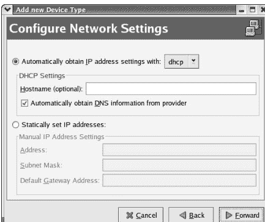

**图 6-1：** 配置网络设置窗口。

**记住**

我们强烈建议，在使用防火墙保护你自己之前，不要永久保持 Internet 连接处于激活状态。关闭你的 Internet 连接——例如关闭调制解调器。如果你没有使用 Red Hat Linux 附带的默认防火墙，或者你在寻找更安全的防火墙，请参见第 8 章。防火墙运行后，你可以重启你的 Internet 连接，并相对安全地免受黑客攻击。

### DSL 选项

世界是有线的——那是指电话线。DSL 调制解调器利用这项古老但常见的技术为消费者提供高速 Internet 连接。DSL 选项使用特殊设备，通过 POTS 线路传输比传统模拟调制解调器多得多的数据。

**记住**

电话系统在电信行业中被称为普通旧电话服务 (POTS)。

DSL 通过将你的电脑的数字信息电子转换为一种形式，从而提供高速 Internet 连接，这种形式可以从你的家或办公室传输到电话公司。当你的数据找到通往电话公司的路径时，它被转换成另一种形式并发送到你的 ISP。

**技术细节**

与在每秒数千次循环 (KHz) 范围内工作的传统模拟调制解调器相比，DSL 使用每秒数百万次循环——兆赫兹 (MHz) 范围——的频率。当你使用更高频率时，你会获得更高的连接速度。然而，问题在于，电话系统并非设计用于处理更高频率。


幸运的是，全世界的技术精英们已经找到了如何从老旧且缓慢的传统拨号（POTS）线路中获取高速数字用户线路（DSL）连接的方法。他们设计了新的数字信号处理芯片来克服 POTS 架构的局限。结果是，如果你居住的地方离你的 DSL 提供商的设备足够近——大约三到四英里——你就可以使用 DSL 连接上网。

### 直面 DSL 配置难题

本节描述了基本的 DSL 调制解调器配置问题。我们花时间给你一个概览，因为如果你只关注细节，很容易感到困惑。请查看以下列表并熟悉它。熟悉之后，让你的 DSL 调制解调器正常工作会变得更容易。

大多数家用 DSL 提供商现在使用非对称数字用户线路（ADSL）类型的连接。以下列表描述了使 ADSL 连接正常工作的过程。（请注意，我们互换使用通用缩写 DSL 和 ADSL。大多数家用 DSL 连接实际上是 ADSL，这就是本章描述的连接类型。）按照以下步骤设置 DSL 服务：

- 1. **寻找 DSL 提供商。**

你需要确定你的居住地或工作地是否足够接近 DSL 提供商的设备以获取连接。DSL 提供商会检查你的地址，并告知他们是否接受你的业务。

- 2. **将你的 DSL 调制解调器连接到你的电话插座和你的计算机。**

你的 DSL 调制解调器在你的计算机和你的 DSL 服务提供商之间充当中介。你必须将调制解调器的一侧连接到电话插座，另一侧连接到你的计算机的以太网 NIC。

- 3. **配置你的 Red Hat Linux 计算机以与 DSL 调制解调器通信。**

你的 Red Hat Linux 计算机通过以太网 NIC 连接到 DSL 调制解调器。你必须配置你的以太网 NIC 以配合调制解调器工作。

- 4. **设置 DSL 调制解调器的用户和管理员密码。**

DSL 调制解调器提供了合理的安全级别。你应该通过为调制解调器分配自己的密码来利用这种安全性。此举可防止黑客入侵你的调制解调器并造成问题。

- 5. **设置你的 ISP PPP 账户名称和密码。**

你必须向你的 ISP 验证你的 DSL 调制解调器。DSL 连接登录你的 ISP 的方式与传统模拟调制解调器相同。你用你的 ISP 用户名和密码配置你的 DSL 调制解调器。

- 6. **配置 DSL 调制解调器的内部（私有）网络接口。**

你的 DSL 调制解调器必须能够通过以太网连接与 Red Hat Linux 计算机通信。你必须配置 DSL 调制解调器，使其使用与你的计算机相同的网络参数。

- 7. **配置调制解调器的网络地址转换（NAT）设置。**

Internet 被设计为尽可能快地将信息发送——或*路由*——到其目的地。互联网协议（IP）地址用于指定信息的来源和去向。IP 地址可以是可路由的或不可路由的。不可路由地址可以重用；你可以使用与邻居相同的不可路由地址而不会互相干扰。

NAT 用于将不可路由的 IP 地址转换为可路由的地址，当你将私有网络连接到 Internet 时很有用，通过在你的内部 IP 地址和一个由你的 ISP 分配的可路由 IP 地址之间进行转换。你需要配置你的 DSL 调制解调器，将你的计算机的私有（例如，`192.168.1.1`）和不可路由地址转换为你的 ISP 分配给你的 DSL 连接的地址。


- 8. **将设置保存到非易失性内存并重启。**

在设置好 DSL 调制解调器后，你需要保存其设置。你不想每次打开调制解调器时都重新输入配置。

### *寻找 DSL 提供商*

你需要同时获得 DSL 和 ISP 服务才能使宽带连接工作。一些公司——特别是地区贝尔电话公司——可以提供这两项服务。然而，在我们的案例中，我们更喜欢我们现有的 ISP，而不是与 DSL 提供商结盟的 ISP。我们有幸在购买 DSL 服务时保留了我们现有的 ISP。


DSL 提供商市场是流动的。在选择一家提供商之前，请仔细分析你所在地区的 DSL 服务提供商，并记住长期性（稳定性）与低价同样重要。地区贝尔公司比许多竞争对手更有可能提供长期服务。


DSL 服务的一个优点是，你通常不需要签订服务合同；如果你对服务不满意，可以合理地更换提供商。

通常，你在选择 DSL 提供商后必须选择 ISP。DSL 提供商要么提供自己的 ISP，要么允许你从几个独立的 ISP 中选择（DSL 提供商负责安排并直接与第三方 ISP 合作）。

### **DSL 的多种形态**

DSL 有多种类型。大多数消费者最终使用 ADSL，因为它提供价格合理的高速 Internet 连接。ADSL 很好地满足了单个计算机用户的 Internet 需求；它甚至为小型企业提供了足够的服务。不出所料，ADSL 是所有 DSL 类型中最普及的。

其他类型更适合商业使用。大多数地区可能只有其中两到三种服务可用。以下列表描述了 DSL 的变化类型：

- **ADSL（非对称数字用户线路）：** ADSL 的下载（*下行*）速度与上传（*上行*）速度不同。（这就是为什么它是非对称的。）ADSL 的最大速度为 8 Mbps，但由于 POTS 基础设施的限制，通常会被限制在更低的数值。

- **G-Lite：** 也称为通用 DSL 或无分线 ADSL，G-Lite 是 ADSL 的低速版本，不需要过滤 POTS 信号。它提供高达 1.5 Mbps 的下行速度和 512 Kbps 的上行速度。

- **HDSL（高比特率数字用户线路）：** HDSL 是一种对称协议，上行和下行速度相等。你可以将 HDSL 用作 T1 连接的替代品，因为它提供相同的 1.544 Mbps 数据速率。

- **HDSL2（高比特率数字用户线路 2）：** HDSL2 提供与 HDSL 相同的规范，但在单对双绞线连接上工作。

- **IDSL（ISDN 数字用户环路）：** IDSL 是当前 ISDN 技术的后继者，使用与 ISDN 和 SDSL 相同的线路编码（2B1Q）。IDSL 主要用于在 ADSL 和 SDSL 等更流行的形式不可用的地区提供 DSL 服务。IDSL 能够提供 144 Kbps 的上行和下行速率。

- **SDSL（单线数字用户线路）：** SDSL 通常被称为*对称数字用户线路*，因为 SDSL 的上行和下行速度相同。

- **VDSL（甚高比特率数字用户线路）：** VDSL 在短环路（距离不超过 1,500 米）上提供高达 50 Mbps 的速度。VDSL 对校园环境——大学和商业园区——特别有用。VDSL 目前正通过市场试验在现有的电话线上提供视频服务。你还可以将 VDSL 配置为对称模式。

- **xDSL：** xDSL 是所有 DSL 类型的通用术语。

### **将你的 Cisco 调制解调器连接到你的 Red Hat Linux 计算机**

编写明确的配置示例总是很困难，并且可能会让一些读者感到失望。但是 DSL 世界仍然很年轻，我们不确定是否已经出现了任何标准。因此，我们认为提供以下说明比不提供任何说明要好。（很有可能你们中很多人使用相同的 DSL 调制解调器，我们希望我们的说明与你的设备相匹配。）

本节展示了如何使用更常见的 DSL 调制解调器之一。Qwest 是一个“小贝尔”公司（地区性电话公司），也是较大的 DSL 提供商之一，它使用这种设备。我们的 **Cisco 675** 或 **678** DSL 调制解调器路由器是 Qwest 推荐的设备。Cisco 是世界上最大的网络设备供应商之一，许多人使用其 DSL 调制解调器。


即使你使用的是不同的设备，我们的说明在概述配置 DSL 连接的一般过程时仍然有用。过程如下：

- 1. 将你的 Red Hat Linux 计算机连接到调制解调器，以便你可以配置它。
- 2. 启动 Mozilla 并打开调制解调器的 IP 地址。DSL 调制解调器通常默认使用公共地址，例如 `192.168.1.1`。
- 3. 设置调制解调器的密码。
- 4. 告知调制解调器如何连接到你的 DSL 提供商。
- 5. 设置调制解调器的防火墙和 NAT 配置，如果可用的话。
- 6. 保存配置。

完成每个步骤的具体细节因制造商而异，但思想仍然相同。请参考你的调制解调器用户指南获取详细的配置信息。


# 第 7 章

## 本地连接，全球通信：连接到局域网

### 本章内容

- 使用以太网或无线网卡进行网络通信
- 使用红帽网络实用工具
- 启动和停止本地网络连接

本章展示如何将运行 Red Hat Linux 的计算机连接到现有的局域网（Local Area Network，简称 **LAN**），也称为*私有网络*。这与通过拨号调制解调器或宽带连接直接连接到 Internet 不同，我们将在第 5 章和第 6 章中描述那种方法；那些章节展示的是如何将一台独立的 Red Hat Linux 计算机直接连接到 Internet。在这种情况下，您是将您的 Red Hat Linux 计算机连接到 LAN。

您可能是在家中、工作或学校构建您的 Red Hat Linux 计算机。场所并不重要——您可以使用本章中的信息将您的计算机连接到任何现有的 LAN。请注意，如果该 LAN 连接到 Internet，您的计算机就可以访问 Internet。


如果您无法访问 LAN，请不要灰心。您可以自己建立一个！第 15 章描述了如何组装一个网络。

在本书中，术语 LAN 和私有网络可以互换使用。


如果您在 Chapter 3 中描述的 installation 过程中配置了以太网卡以连接到您的 LAN，那就太棒了！您可以跳过本章，或者只是浏览一下以寻找乐趣。否则，您可以使用本章将您的计算机连接到 LAN。

虽然建立私有网络并不完全是火箭科学，但由于可能的网络配置种类非常多，详细描述如何将两台或多台计算机组网超出了本书的范围。有许多好书解释如何做到这一点，最好的起点是 Wiley 网站：www.wiley.com。

## 介绍局域网

Linux 的发明彻底改变了计算机网络。在 Linux 出现之前，创建 LAN 既复杂又昂贵。LAN 几乎是大型公司、大学和其他庞大组织的专属领域。

但是，TCP/IP 网络协议从 Linux 一开始就被内置其中。在 20 世纪 90 年代中期，如果您买得起几台 PC、一段便宜的同轴电缆以及几个 10 Mbps（兆位每秒）或更快的以太网适配器，一个 LAN 就诞生了。以太网适配器，通常也称为*网络接口卡*（NIC），当时的价格约为 150 美元。幸运的是，自那以后价格大跌，落地如《Ziggy Stardust》般低廉：现在一个 100 Mbps NIC 的价格低至 15 美元，您可以花不到 100 美元买一个 11 Mbps 的无线 NIC。

为了让您的 Red Hat 计算机上网，您只需要配置少数几个网络子系统。以下是为了让您的网络正常工作所需执行的任务：

- 加载您的无线或以太网 NIC 内核模块。Red Hat Linux 通常会自动检测您的硬件并加载正确的内核模块。
- 配置您的网络接口卡（NIC）。
- 配置您的域名服务（DNS），它将 Internet 名称转换为 Internet 协议（IP）地址。

无线网络存在一些安全漏洞。请参阅本章后面的“无线网络警告”边栏。

执行这些步骤工作量相当大。使用 Red Hat 提供的图形化网络配置实用工具系统管理工具可以大大减轻负担。玩得开心！

## 使用 Red Hat 网络实用工具配置 NIC

要在现有的局域网（LAN）上使用您的 Red Hat Linux 计算机，您需要在该计算机上安装无线或以太网 NIC，以及一个网络集线器或交换机，用于连接 NIC。设置好硬件后，您需要配置 Red Hat Linux 的网络设置。

如果您的 LAN 也有 Internet 连接，您也可以设置该连接。虽然高速 Internet 连接效果最佳，但在网络配置方面，连接类型并不重要。


### IEEE 和无线网络

主流的无线标准基于 **IEEE 802-11b**（以及较旧的 802-11a 和即将发布的 802-11g）标准；802-11b 也被称为 **Wi-Fi**（这是无线行业术语 *wireless fidelity* 的缩写）。如果您听到人们谈论 Wi-Fi NIC，他们只是在谈论无线 NIC。

**IEEE**（发音为 "eye-triple-e"），即电气电子工程师学会，是一个全球性的极客专业协会。（使用像 *nerds* 或 *geeks* 这样的词汇来传达某些技术含义是否必要？）IEEE 是无线网络领域的“三眼怪”，它关注诸如无线网络设备应使用哪种频率等问题。幸运的是，该组织制定了这个美妙的标准，现在使得所有感兴趣的人都能在机器之间无需布线即可通信。

### 准备配置无线 NIC

在您配置无线 NIC 之前，您需要弄清楚两件事：

- 您拥有（或需要）哪种类型的无线 NIC
- 您的无线 NIC 应如何连接到您的网络

目前有两种主要的无线电子（或芯片组）在使用：由 Lucent Technologies 制造的 **Wavelan** 和由 Intersil 设计的 **Prism2**。Red Hat 支持这两种类型。以下列表显示了每种类型的制造商。您可以使用列表来确定您的设备使用哪种类型的芯片组：

- **Wavelan：** Orinoco, Apple Airport, Enterasys RoamAbout 802, Elsa AirLancer 11, 和 Melco/Buffalo 802.11b。
- **Prism2：** D-Link DWL-650, LinkSys, Netgear, WPC11, 和 Compaq WL110。其他不太流行的型号包括 Addtron AWP-100, Bromax Freeport, GemTek WL-211, Intalk/Nokia, SMC 2632W, YDI, Z-COM X1300, 和 Zoom Telephonics Zoom Air 4100。

您需要弄清楚您的无线 NIC（或网络适配器）应如何连接到您的网络。无线 NIC 可以通过两种方式连接到 LAN：

- **适配器到适配器：** 这种类型被称为 **ad hoc**（临时）连接，如果您有两台或更多计算机想要相互通信并形成自己的、专属的私有网络，这种连接很有用。
- **适配器到无线集线器：** 这种类型被称为 *基础设施*（infrastructure），它提供了进入 LAN 的单一入口点（一个 **access point** 接入点）。**接入点**允许一台或多台计算机连接到网络。然而，与 ad hoc 网络不同，单独的计算机可以连接到任何允许它们的接入点。

我们提供的无线配置说明适用于基础设施或 ad hoc 连接方式。只要您正确配置网络 ID（ESSID）和加密密钥，您的无线 NIC 就可以连接到接入点或其他计算机（Linux 和 Windows）。

### 在 ad hoc 和 infrastructure 之间选择

使用 ad-hoc 模式提供三个优点：

- **较低的成本：** 您不需要购买接入点；接入点的起价约为 50 美元。运行 ad-hoc 模式无线 NIC 的计算机直接相互通信，消除了对公共接入点的需求。
- **对 Linux 用户更简单的配置：** 旧式的接入点设备只能使用基于 Windows 的软件进行配置——确切地说是简单网络管理协议（SNMP）。您必须通过有线以太网物理连接一台 Windows 计算机到接入点，然后使用随设备提供的软件。如果您没有任何基于 Windows 的计算机，这会很难。较新的接入点倾向于使用基于 HTML 的配置系统，因此您可以使用 Mozilla 来配置这些较新的设备。
- **无需配置任何接入点：** 您只需要配置网络上每台计算机中的无线 NIC。您可以使用 Red Hat 网络配置实用工具来配置无线 NIC，这简化了过程。每个 NIC 必须具有相同的网络 ID 和加密密钥。

Ad hoc 网络也可以提供更多的安全性，因为它们通过网络路由器连接到其他网络——以及 Internet。接入点作为网桥工作。路由器检查 IP 地址，然后决定如何将网络流量从一个网络引导到另一个网络。网桥自动传递所有流量。Ad hoc 网络可以配置为更紧密地——但不是完全地——控制基于接入点的网络之间的网络流量。与使用接入点的网络相比，更容易配置 ad hoc 网络的防火墙。（然而，当前许多接入点现在提供 NAT 和防火墙支持；使用 NAT 实际上有效地创建了一个防火墙。）


## 无线网络警告


Wi-Fi，即无线技术标准，使用一种名为无线等效保密（WEP）的加密系统来提供安全性。WEP 对无线设备之间的通信进行加密，以防止拥有合适设备的人监听和使用你的无线网络。但 WEP 存在缺陷，并且可以使用互联网上提供的工具进行破解（这真是个大惊喜）。如果黑客侵入你的 Wi-Fi 网络，他们可以阅读你的通信内容。但问题并未就此结束。黑客可以利用你的无线网络连接到你的专用网络和互联网；你等于给坏人提供了免费午餐和通往互联网的发射台。

另一方面，无线网络如此有用，以至于许多人愿意承担风险。这种逻辑是？如果你假设你的无线网络已经被黑客入侵了，那么你就无需担心将来它可能会被入侵的情况。

你应该使用 OpenSSH、安全套接字层（SSL）和虚拟专用网络（VPN）——所有这些功能都包含在 Red Hat Linux 中——来进行所有内部和外部通信。请记住，使用 SSH、SSL 和 VPN 可以保护你的信息，但不能阻止某人连接到你的网络。下一代 Wi-Fi，即 802.11g，据称将修复 WEP 的弱点。在 WEP 问题得到解决之前，请务必了解这些风险。

## 配置以太网或无线网卡

要使 Red Hat Linux 计算机在局域网（LAN）上正常工作，你必须首先配置其网络接口卡，即网卡（NIC）。网卡是将你的计算机在电子上连接到局域网的设备。要与网络上的其他计算机通信，你的以太网或无线适配器必须被分配一个网络地址以及一些其他信息。


我们将配置说明分为以太网和无线（或 Wi-Fi）网卡两部分。说明首先解释如何启动 Red Hat 网络配置实用程序。然后我们分别用一个子章节来描述配置以太网和无线设备的细节。在涵盖设备具体细节之后，我们将讨论一般的配置问题。整体配置过程按以下步骤概述：

- 1. 启动网络配置实用程序。
- 2. 配置你的以太网或无线设备。
- 3. 配置你的计算机主机名。
- 4. 配置你的计算机域名服务。
- 5. 重新启动网络。

## 启动网络配置实用程序

请按照以下步骤启动网络配置实用程序：

- 1. 点击 **GNOME 主菜单按钮** 并选择 **系统设置→ 网络**。

    *提示*
    或者，你可以点击 GNOME 菜单按钮并选择 **系统工具→ 网络设备控制**。当网络设备控制窗口打开时，选择以太网或无线设备并点击 **配置** 按钮。网络配置实用程序随即启动。

- 2. 如果被提示，请输入 **root 密码**。

    图 7-1 显示了初始配置窗口。窗口中可能显示也可能不显示网卡。只有在你 Red Hat 安装期间配置了网络时，才会显示网卡。

    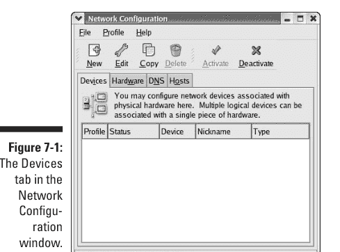

- 3. 如果在 **设备** 选项卡上没有显示网卡，或者你想配置额外的网卡，请点击 **新建** 按钮。

    否则，如果你正在使用以太网设备，请跳至下一节中的步骤 3；如果你正在使用 Wi-Fi 网卡，请跳至本章后面“配置无线网卡”部分中的步骤 1。
    此时会出现选择设备类型窗口。

- 4. 从设备列表中选择适当的类型，然后点击 **前进** 按钮。

    例如，如果你使用的是以太网接口，请选择 **以太网**。如果你使用的是 Wi-Fi（也称为无线或 IEEE 802.11b）设备，请选择 **无线连接**。

接下来你做什么取决于你是要配置以太网还是无线网卡。以下两个部分分别专门针对以太网和无线网卡。

## 配置以太网网卡

如果你使用的是以太网网卡，请按照本节中的步骤配置其参数（如果你使用的是无线网卡，请转到下一节）：

- 1. **遵循本章前面“启动网络配置实用程序”部分中的步骤。**

    当你在前一列表的步骤 4 的下拉列表中选择以太网时，会出现选择以太网设备窗口。

- 2. **选择适当的以太网设备并点击前进按钮。**

    网络配置实用程序会检测所有连接到你计算机的以太网设备。大多数 PC 只有一个以太网设备，因此你无需决定选择哪一个。

    网络设置配置窗口将如本节稍后所示在图 7-2 中打开。

- 3. **配置你的 TCP/IP 地址设置。**

    Red Hat 网络配置实用程序默认选择 DHCP（动态主机配置协议）作为确定你机器 IP 地址的方法。（DHCP 动态地将 IP 地址和其他参数分配给你的以太网网卡，这样你就完成了网卡的配置。）如果你连接的是提供 DHCP 服务的网络，请在“主机名（可选）”字段中输入你的计算机名称（例如，Cancun），点击“前进”按钮，然后转到步骤 9。

    如果你的网络不使用 DHCP，你需要手动配置 IP 地址。请继续执行步骤 4。

- 4. **点击静态设置 IP 地址单选按钮。**

    你应该向当地友好的系统管理员询问你的网络使用哪种系统（除非你就是管理员，在这种情况下你可能想要避免自言自语）。

    如果你的计算机上同时有无线和以太网网卡，情况会稍微复杂一些。你可以同时运行这两个设备，但配置更困难。你可以通过点击“自动获取 IP 地址设置”单选按钮来解决问题，使该点消失。这个简单的鼠标点击操作可以防止以太网网卡自动启动。

    

- 5. **通过在地址文本框中输入内容来为计算机分配 IP 地址。**

    

    IP 地址类似于街道地址：它们提供一个数字，使你的机器与其他所有机器区分开来。私有 IP 地址不需要向 InterNIC 组织（负责分配 IP 地址的机构）进行注册。公共 IP 地址不会在互联网上路由，可以在局域网中供你自己使用。

    如果你使用的是拥有注册 IP 地址的网络，务必从系统管理员处获取 IP 地址。否则，直接使用私有 IP 地址即可。（使用 192.168.1.1 到 192.168.254.254 之间的任何 C 类地址；例如，192.168.1.20 或 192.168.32.5。）此范围内的私有 IP 地址被指定供私有网络使用。根据设计，私有 IP 地址不会通过互联网进行*路由*（从一台机器发送到另一台机器），任何人都可以使用它们。如果私有 IP 地址被路由，将会在互联网上造成混乱。

- 6. **在子网掩码文本框中输入 255.255.255.0 或你 IP 地址的子网掩码。**

    

    互联网协议（IP）仅定义了三种网络地址类别：A、B 和 C。只有 C 类地址是由 InterNIC 分配的。C 类网络使用 255.255.255.0 子网掩码，B 类使用 255.255.0.0，A 类使用 255.0.0.0。

    

    C 类子网掩码现在几乎被普遍使用，我们在此处仅使用 C 类地址。如果你没有使用 C 类地址，那你很可能精通 TCP/IP 的机制，并知道该使用哪个子网掩码。祝你好运。否则，不要违背自然规律：使用 C 类地址。

- 7. **在默认网关地址文本框中，输入你局域网的互联网网关 IP 地址。**

    互联网网关是连接你的网络到你的 ISP（互联网服务提供商）和互联网的设备（路由器或计算机）。如果你在工作中并且有系统管理员，请从他们那里获取地址。如果你是家庭用户，通常的约定是将 C 类子网中最大的地址——254——作为网关。例如，输入 192.168.1.254。

    你的 TCP/IP 设置应与图 7-2 中显示的对话框类似。

- 8. **点击前进按钮。**

    创建以太网设备对话框将打开，表明你已完成配置过程。该对话框显示了你在前面步骤中输入的信息摘要。

- 9. **查看摘要并点击应用按钮。**

    你将返回到网络配置窗口，该窗口现在显示新配置的以太网网卡。


### 配置无线网卡

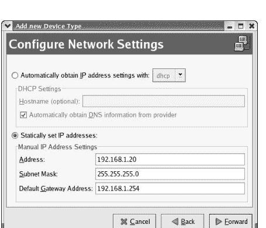

-   **图 7-2：** 输入静态（非 DHCP）IP 地址设置。
-   **10. 通过选择“文件 → 保存”来保存新的配置。**

会打开一个对话框，通知你更改已保存。点击“确定”按钮继续。

-   **11. 点击“激活”按钮启动网卡。**

此步骤完成了你的以太网网卡配置。

你的以太网网卡现在已激活。但如果你没有使用 DHCP，仍然需要配置你的域名服务 (DNS)。请继续阅读本章稍后的“配置 DNS 服务”部分。

*内核模块* 是 Linux 中相当于微软 Windows 设备驱动程序的东西。通常，Red Hat Linux 可以检测你的以太网适配器并自动加载正确的模块。但是，如果 Red Hat Linux 找不到你的以太网适配器，你可能也无法在提供的列表中找到正确的那个。你仍然可以继续尝试；这样做没有坏处。

本节描述如何配置无线网卡（也称为 Wi-Fi 网卡）的参数。（如果你没有无线网卡，请跳过本节。）

以下步骤描述了如何配置你的无线设备：

-   **1. 遵循本章前面“启动网络配置实用工具”部分的步骤。**

当你在上面列表的步骤 4 的下拉列表中选择“无线”时，将出现“选择无线设备”窗口。

-   **2. 选择适当的无线设备。**
-   **3. 点击“下一步”按钮。**

将打开“配置无线连接”窗口，如图 7-3 所示。

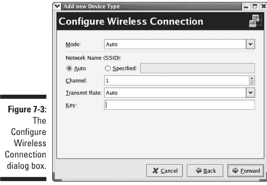

-   **4. 从“模式”下拉列表中选择“受管理”或“自组织网”。**

当你使用接入点时，使用受管理模式。如果你配置了一个没有接入点的无线网络，请使用自组织网模式。

-   **5. 如果你使用接入点，请在 ESSID（网络 ID）文本框中输入 ANY。对于自组织网，输入特定的 ESSID 名称。**

连接到自组织无线网的所有机器必须共享相同的 ESSID。例如，你可以选择字符串 mynetwork 作为你的 ESSID。在这种情况下，你必须将 mynetwork 作为连接到你自组织网的所有机器的 ESSID。

-   **6. 在“密钥”文本框中输入加密密钥，然后点击“下一步”按钮。**

你应该从网络管理员处获取加密密钥。如果你设置了自己的无线家庭网络，你可以自己生成密钥。与密码类似，加密密钥可以保护你的无线网络免受随意窃听。在文本框中输入一个不超过 13 个字符的密钥——例如，this_is_a_password；使用全部 13 个字符可以最大限度地发挥加密密钥的效果。


加密密钥是 40 位或 128 位的二进制数。它们可以表示为文本字符串，如步骤 6 中所述，也可以表示为十六进制——十六进制——数字串。十六进制数在计算机科学中常用于表示二进制数。对于你的目的来说，知道十六进制数由 16 个字符表示就足够了：0 到 9 以及 A 到 F。例如，十六进制 0 表示为十进制 0；十六进制 3，表示为十进制 3；十六进制 9，表示为十进制 9。但是十进制 10 是十六进制 A，而十进制 16 的十六进制值是 F。此示例密钥的十六进制值：

```
-- this_is_a_password --
```

是

```
746869735F69735F615F6B6579
```

你可以通过在密钥前加上字符串 0x 来在“密钥”字段中输入十六进制值。在示例中，你输入这行：

0x746869735F69735F615F6B6579

输入你的加密密钥并点击“下一步”按钮后，将打开“配置网络设置”窗口。为你的计算机分配主机名、IP 地址、子网掩码和网关的过程与以太网接口相同。请参考前面部分的步骤 3 到 9，了解如何配置你的无线网卡 TCP/IP 参数。

你的无线网卡配置已完成。如果你没有使用 DHCP，仍然需要配置你的域名服务 (DNS)。如果是这种情况，请继续以下部分。

## 配置 DNS 服务

你需要配置你的计算机使用一到三个 DNS 服务器。如果你的 LAN 可用，你可以使用你的 LAN 的 DNS 服务器。无论你的 LAN 上是否存在，你也可以使用外部 DNS 服务器。要配置你的 Red Hat Linux 计算机使用 DNS，请遵循以下步骤：

-   **1. 点击网络配置对话框中的 DNS 选项卡，** 这是你在上述步骤列表中停下来的地方。
-   **2. 在“主机名”文本框中输入你计算机的主机名。**

主机名是你想要使用的任何名称（例如，Cancun）。

如果你正在连接到由他人控制的网络（例如，在工作中），在选择主机名之前请先咨询系统管理员。

-   **3. 在“主 DNS”文本框中输入你的 DNS 服务器的 IP 地址。**

如果你的 LAN 提供 DNS 服务器，你可以将其用作你的主名称服务器 (DNS)。

-   **4. 如果你有，请在“次要 DNS”文本框中输入你的次要名称服务器的 IP 地址。**

大多数 ISP 提供备份 DNS 服务器地址。如果你的 LAN 有自己的 DNS 服务器，如果需要，你可以将 ISP 服务器指定为你的次要 DNS 服务器。

-   **5. 在“DNS 搜索路径”文本框中输入你网络的域名。**

图 7-4 显示了一个示例 DNS 配置屏幕。

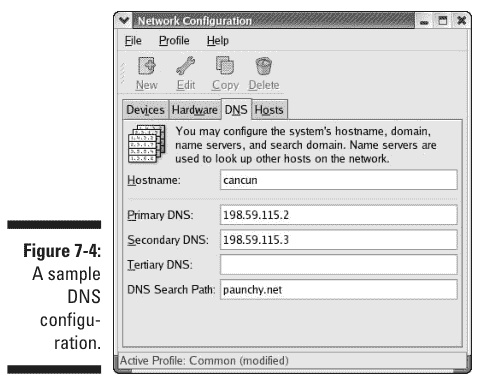

*域名* 是由一个点分隔的两部分名称。例如，paunchy.net 是一个域名，它是本书中使用的示例 LAN 的域名。当然，你应该用你 LAN 的名称替换 paunchy.net 域名。

-   **6. 选择“文件 → 退出”。**

网络配置实用工具关闭。你的设置已保存，并在你下次重启计算机时激活。继续以下部分以立即激活你的设置。

## 手动启动和停止网络

有时，网络配置实用工具配置了你的网络设备，但无法激活它们。为什么会这样发生？谁知道呢？可能是因为网络配置实用工具还相对年轻，随着时间的推移会变得更加完善。在此期间，你可以通过遵循以下步骤以另一种方式启动你的网络系统：

-   **1. 点击 GNOME 菜单按钮，选择“系统设置 > 服务器设置 > 服务，”然后输入你的 root 密码（如果被提示）。**
-   **2. 选择“网络”选项，然后点击“重启”按钮。**
-   **3. 如果你使用的无线网卡无法通信，你可能需要重启你的 PCMCIA 系统。方法如下：**
    -   1. 在服务配置实用工具中找到并点击 PCMCIA 服务。
    -   2. 点击“重启”按钮。
    -   3. 重复步骤 3 以重启你的网络。

所有网络连接都会停止，然后再次启动。

或者，你可以在终端模拟器中以 root 身份登录并运行此命令：`/etc/init.d/network restart`。（或者要停止你的网络，运行 `/etc/init.d/network stop`。）

# 第 8 章

## 只有你才能防止网络入侵

### 本章内容

- 介绍防火墙
- 使用 Iptables 防火墙系统
- 设计和查看你的过滤规则
- 自动启动防火墙

在连接到互联网时，你真的面临坏人试图入侵或以其他方式破坏你的计算机的风险。坏人戴着黑帽子，就像电影里一样（与红帽子相对，红帽子有点奇怪，但也是好人）。你可能也听说过他们被称为黑客、 crackers、Joker，以及其他什么。无论他们的名字和意图如何，互联网每天都在变得更加危险，所以你必须保护自己。

防火墙是一种设备，使你在最小化互联网利用你的可能性的同时使用互联网。防火墙基本上允许你的网络通信外出，但最小化任何人对你的计算机或私有网络进行不受连接的连接的可能性。

不出所料，本章描述了如何构建防火墙，以帮助保护你的 Red Hat Linux 计算机免受坏人的侵害。首先，为了让你相信你真的需要防火墙，我们解释了为什么防火墙很重要。然后，我们向你介绍 Iptables，Linux 防火墙系统，并描述如何设置你的防火墙过滤规则。设置好防火墙过滤器后，你需要知道如何自动运行防火墙。你通过设置一个脚本来做到这一点——这也是我们在本章中解释的内容。当然，如果你的防火墙不起作用，它有什么好处呢？所以，我们展示如何做一个简单的测试，以确保你的防火墙运行良好。

**警告！** 本章中描述的防火墙旨在保护连接到互联网的单个 Red Hat Linux 计算机。该防火墙并非旨在保护整个网络。第 15 章描述了如何修改此防火墙以保护你的私有网络。


## 理解你为什么首先需要防火墙

你可能认为人多人安全。毕竟，在任何特定时刻，都有数百万个人、企业和组织通过网络和互联网彼此连接。作为一个拥有简单电脑以及可能连接互联网的小型网络的个体，你有什么需要担心的呢？坏人通常对大钱或大曝光感兴趣，对吧？

嗯，这基本上是正确的，你被黑客入侵的可能性很小。如果你认同这种观点，那么用技术术语来说，你依赖的是*模糊安全*。

许多黑客使用自动扫描并攻击整个网络的工具。成功的黑客无需费力去搜索大量网络以查找并利用未受保护的计算机。不要冒无谓的风险被黑客*接管*——即你的电脑被入侵并控制——尤其是在 Linux 提供了有效的自我保护工具的情况下。

使用防火墙是在连接互联网时保护自己的一种简单但非常有效的方法。防火墙允许你连接互联网，同时阻止不必要和不受欢迎的连接进入。


防火墙提供了良好的高性价比保护。然而，它们并不是你应该采取的唯一安全措施。例如，锁门确实有助于防范窃贼，但并不 100% 有效——他们仍然可以从窗户闯入。最好的办法是采用多层安全策略，例如锁好窗户、使用报警器和关注社区活动。其理念是让每一层安全机制相互强化。第 17 章描述了如何为你的计算机添加安全层。

## 构建有效的防火墙


Linux 捆绑了一个简单但极其有效的防火墙系统，名为 Netfilter/Iptables。Netfilter 部分指的是内置于 Linux 操作系统——确切地说是内核——中的防火墙系统，而 Iptables 是控制它的接口。我们将其整体系统称为 Iptables，因为那是你直接操作的部分。

### 设计过滤规则：宽松方法和严格方法

防火墙过滤规则就像构建防火墙的砖块（如果你更喜欢，也可以是石棉）。基本上，过滤规则决定了哪些网络通信可以离开和进入你的计算机。

在设计防火墙过滤规则时，你可以选择两种理念之一：

- 默认允许所有连接，然后拒绝特定访问。
- 默认拒绝所有连接，然后允许特定访问。

允许所有连接的方法认为，你应该从允许与计算机的所有通信开始，然后逐一拒绝连接。（Red Hat 防火墙在安装过程中创建时使用了这种方法。）这种方法的危险在于，你可能会无意间允许危险流量到达你的机器。另一种方法是从拒绝所有通信开始，然后有选择地允许某些流量。这种更严格的方法从安全角度来看，是创建防火墙的最佳方式，因为你确切知道你允许了哪些访问。然而，严格方法也可能带来问题，因为你可能会无意间阻止必要的或期望的网络流量到达你的计算机。

本章解释了如何使用严格方法，原因如下：

- 这是最安全的方法。严格方法更安全，因为它最小化了外部与你联网计算机的所有接触。例如，它最小化了端口扫描和其他花招可以向黑客提供的关于你防火墙的信息。
- 它更容易配置。由于 Iptables 提供有状态过滤，你只需要配置两条规则即可创建安全的防火墙。然而，在使用宽松模型时，你必须配置大量的单独规则。多余的、不必要的复杂性会降低安全性。

Iptables 系统过滤 IP 数据包，这是互联网的基础（IP 实际上是 Internet Protocol 的缩写）。当你连接到互联网时，你发送和接收的所有信息（图形和文本）都以 IP 数据包的形式传输。通过互联网进入和离开你计算机的所有信息都打包成 IP 数据包。你可以使用 Iptables 根据目的地、源地址和端口来接受或拒绝 IP 数据包。

Iptables 系统之所以有效，是因为它使用*有状态过滤*，这意味着防火墙可以跟踪每个网络连接的状态。这是技术性的说法，表明 Iptables 知道哪些 IP 数据包是有效的，哪些不是。例如，如果你正在浏览 www.dummies.com，Iptables 会跟踪属于该连接的所有数据包。Iptables 实用程序可以拒绝试图到达你计算机但不属于你连接的数据包，从而防止任何黑客潜入你的防火墙。


Red Hat Linux 默认安装基于 Iptables 的防火墙。安装系统在安装过程中配置了中等程度的保护。你可能会记得，在第 3 章中，我们建议你使用默认的防火墙配置。然而，默认防火墙在连接互联网时并不如我们期望的那样安全。因此，我们在本章中描述了如何构建更全面和安全的防火墙。


端口的概念是互联网协议的重要组成部分。端口用于组织客户端和服务器之间的通信。例如，当你点击一个网页时，你的浏览器通过端口与 web 服务器通信。当然，这是一个非常简化的描述，但它说明了基本理念。简而言之，端口用于控制互联网的内部运作，例如进行 web 浏览。

## 设置防火墙

现在你知道你需要防火墙并希望创建一个。接下来做什么？以下部分解释了如何使用严格模型来设置基于 Iptables 的防火墙。本节描述了如何手动创建防火墙过滤规则。当你完成规则设置后，请参见本章稍后的“将过滤规则保存到脚本”部分，这样你就不必每次打开电脑时都输入这些规则了。

在本节中，你将设计一个基于 Iptables 的防火墙，关闭调制解调器上的所有传入连接，同时允许你建立到互联网的传出连接。然后，你会放宽对传入通信的完全限制，以允许传入的安全 shell 连接。（安全 shell 提供加密通信。）


不要通过远程连接执行这些指令！你必须从你的电脑控制台运行这些命令。也就是说，你必须坐在你的电脑前，而不是通过网络连接操作它。原因是这些防火墙规则在恢复外部网络连接之前会切断它们。

这些指令描述了如何逐块构建你的防火墙：

1.  以 root 身份登录你的计算机，然后通过右键点击桌面的任何空白区域并从菜单中选择“新建终端”来打开一个 GNOME 终端窗口。

2.  通过在终端窗口中的命令提示符下输入以下规则，确保你尚未运行防火墙：

```
iptables --flush
iptables --flush -t nat
```

iptables 条目移除了任何现有的过滤或网络地址转换（NAT）规则。*NAT 规则*将你的网络地址伪装成另一个地址，使你的计算机看起来像是被别人使用。NAT 经常用于使你的计算机看起来像是来自你的 ISP，这样你就无需为计算机注册正式的互联网协议（IP）地址。

3.  **通过输入以下规则过滤所有进出及通过你计算机的网络通信：**

```
iptables --policy INPUT  DROP
iptables --policy OUTPUT DROP
iptables --policy FORWARD DROP
```

这些命令将你的防火墙默认策略设置为不允许任何网络流量进入（INPUT 规则）或离开（OUTPUT 规则）任何网络接口；如果你有任何网络接口，也不允许任何流量通过它们之间的传递（FORWARD 规则）。此时，你拥有一个极其安全的网络。然而，你的计算机在用于任何网络相关任务方面是无用的。下一步稍微打开防火墙，以便你可以安全地访问互联网（或你连接的任何网络）。

4.  **输入以下规则允许网络流量通过回环设备：**

```
iptables -A OUTPUT -j ACCEPT -o lo
iptables -A INPUT  -j ACCEPT -i lo
```

Linux 计算机使用内部网络，称为*回环接口*（lo）。回环不是物理设备，而是虚拟设备。Linux 使用 lo 进行内部通信。（Linux 计算机幕后发生了很多事情。）

5.  **打开你计算机的所有传出通信：**

```
iptables -A OUTPUT -m state --state NEW,RELATED,ESTABLISHED -j ACCEPT
iptables -A INPUT  -m state --state RELATED,ESTABLISHED -j ACCEPT
```

这些规则没有指定任何特定的网络接口。然而，由于过滤器是有状态的，这些规则实际上在你的以太网、无线或拨号点对点（PPP）接口上有效。

第一个过滤规则允许所有传出通信。--state NEW, RELATED, ESTABLISHED 选项告诉防火墙允许新连接和已建立连接的数据包通过。（数据包是所有网络通信的基本部分。）与现有连接相关但使用不同端口的数据包（如 FTP 数据传输）也被允许。


第二条过滤规则控制来自传出连接的返回数据包。例如，当你连接到某个网站时，你的浏览器会发出数据包，而 Web 服务器会对这些数据包做出响应。你可能会点击网站上的一个按钮，然后弹出一个新的显示窗口。点击按钮会发送一个数据包出去，Web 服务器则会发送数据包回来。你之前已经阻止了来自 Internet 的数据包。这条规则创建了一个例外，允许属于现有连接的数据包——例如代表你点击按钮的连接——通过防火墙返回到你的计算机。请注意，我们不允许建立新的传入连接（--state NEW），因为这会违背此防火墙的初衷。

6. **（可选）使用以下规则允许 SSH 连接进入你的 Linux 计算机：**

```bash
iptables -A INPUT -p tcp -m state --state NEW,ESTABLISHED -j ACCEPT -dport 22
```

此规则允许 22 端口上的 SSH 连接进入你的计算机。你可以登录为 root，挂载随附的 DVD，并运行以下命令来安装 OpenSSH 服务器：

```bash
rpm -ivh /mnt/cdrom/RedHat/RPMS/openssh-server*
```

运行以下命令启动 OpenSSH 服务器：

```bash
/etc/init.d/sshd start
```

你可以修改此规则以允许其他类型的传入连接进入你的计算机。例如，添加一条使用 -dport 80 的新规则，防火墙就会允许传入的 HTTP 数据包。你所需要做的只是安装 Apache Web 服务器（包含在本书的随附 DVD-ROM 中，并在第 16 章中有描述），你的工作站就会变身为一个 Web 服务器。

你刚刚创建了一个简单而有效的防火墙，保护你的计算机免受“网络领域”（Netdom）中“狼人”的攻击。（“它们会把你的心掏出来，吉姆！”）你的防火墙将保持活动状态，直到你关闭规则或重启计算机。下一节将展示如何显示你新的防火墙规则。

## 显示你的防火墙规则

配置好防火墙后，你自然会想验证过滤规则是否设置正确。要显示防火墙规则，请遵循以下步骤：

- 1. 通过右键点击桌面的任意空白区域并选择 **新终端** 菜单，打开一个 GNOME 终端仿真器窗口。
- 2. 如果你当前不是 root 用户，请在 GNOME 终端窗口中输入 su - 命令。
- 3. 输入 root 密码，并键入以下命令以显示防火墙规则：

```bash
iptables -L
```

完成这些步骤后，你会看到防火墙过滤规则在终端窗口中显示如下（使用前一条命令中的详细模式 -v 选项可以显示额外信息，包括网络接口——为了简洁起见，本示例中未使用该选项）：

```
Chain INPUT (policy DROP)
target     prot opt source       destination
ACCEPT     all  --  anywhere       anywhere
ACCEPT     all  --  anywhere       anywhere       state RELATED,ESTABLISHED
ACCEPT     tcp  --  anywhere       anywhere       tcp dpt:ssh
state NEW,ESTABLISHED

Chain FORWARD (policy DROP)
target     prot opt source       destination

Chain OUTPUT (policy DROP)
target     prot opt source       destination
ACCEPT     all  --  anywhere       anywhere
ACCEPT     all  --  anywhere       anywhere       state NEW,RELATED,ESTABLISHED
```

第一条链，INPUT，用于处理传入的数据包。你可以看到默认策略是拒绝所有数据包。INPUT 链中的前几条规则指示 iptables 允许逻辑回环接口（lo）上的所有内部数据包；许多程序使用内部（lo）网络进行相互通信。第二条规则允许传出连接的返回数据包（RELATED 和 ESTABLISHED）进入。最后一条规则（可选的）允许传入的安全 Shell（SSH）连接进入你的计算机。

下一条链，FORWARD，拒绝所有数据包通过你的 Linux 计算机进行转发。只有当你的计算机用于路由或其他高级网络功能时，才需要转发。

最后一条链，OUTPUT，定义了哪些 IP 数据包允许离开你的计算机。同样，第一条规则允许通过回环（lo）接口进行无限制的交通。第二条也是最后一条规则允许任何及所有数据包离开你的防火墙。

下一节将描述如何保存你刚刚创建并显示的那些规则，以便它们可以自动启动。

## 启动你的防火墙（以及熄灭火焰）

前一节描述了如何显示你的防火墙过滤规则。然而，你肯定不希望每次重启计算机时都手动输入这些规则。本节将向你展示如何自动设置你的防火墙。我们将展示如何使用 Red Hat 实用工具来保存你刚刚创建的规则，并在每次启动计算机时启动防火墙。

以下说明假设你已按照前一节描述配置了防火墙，且该配置仍然有效。

### 将过滤规则保存到脚本中

创建防火墙后，你需要保存你的规则集。Red Hat 提供了一个专门用于此目的的工具。`iptables-save` 实用程序读取你当前的防火墙规则，并将其转换为脚本兼容的格式。Red Hat 还提供了一个脚本，用于在每次启动计算机时启动你的防火墙。每当启动计算机时都会运行 `/etc/init.d/iptables` 脚本，因此你的防火墙也会随之启动。请遵循以下步骤：

- 1. 如有必要，登录为 root，并打开一个 GNOME 终端窗口（参见第 4 章），如有必要。
- 2. 运行以下命令，如果你的防火墙规则被保存到脚本中：

```bash
iptables-save > /etc/sysconfig/iptables
```

### 关闭和开启你的防火墙

Red Hat 使用 `/etc/sysconfig/iptables` 脚本来启动 *Netfilter/iptables* 防火墙。`/etc/init.d/iptables` 脚本使用存储在 `/etc/sysconfig/iptables` 文件中的过滤规则来实现过滤规则。

你可以通过运行此 `iptables` 脚本启动 *Netfilter/iptables* 防火墙：

```bash
/etc/init.d/iptables start
```

当然，你必须以 root 身份登录。注意，你可以将 start 替换为 stop 来关闭你的防火墙：

```bash
/etc/init.d/iptables stop
```

你也可以使用图形化的 Red Hat 服务配置实用程序。以下说明展示如何使用该实用程序启动或停止你的防火墙：

- 1. **点击 GNOME 菜单按钮并选择 系统设置:: 服务器设置:: 服务。**

如果你未以 root 身份登录，将弹出一个输入窗口，要求你输入 root 密码。

- 2. **输入你在 Red Hat 安装过程中设置的 root 密码。**

服务配置窗口将出现。此窗口控制所有的 Linux 守护进程（提供服务的进程）。

- 3. **向下滚动服务配置窗口，直到找到 Iptables 服务。**

复选框中应打有勾。

- 4. **点击窗口左上角的 重新启动 按钮。**

你可以点击 启动 按钮，但我们建议你使用 重新启动 功能。启动和重新启动按钮产生相同的结果，但如果服务已经在运行，重新启动仍然有效。如果服务已经在运行，使用 启动 功能则无效。

点击 停止 按钮即可关闭你的防火墙。

服务重新启动后，你会看到一条确认消息。

- 5. **点击 确定。**

你的防火墙已重新启动，你可以退出服务配置窗口。

你也可以防止 Iptables 脚本在系统启动时自动运行。点击服务名称左侧的方框以移除勾选。点击 保存 按钮，指向启动脚本（/etc/init.d/iptables）的指针（/etc/rc.d/rc5.d/S08iptables）将被移除。你可以通过再次点击方框使勾选重新出现来恢复该指针。


# 第三部分
## Linux，嘿！它有什么用？绝对什么都能干！

### 第五波

作者：Rich Tennant


> “把我们的关系想象成 Red Hat Linux 的一个版本——我不会与你人生之爱的分支共享目录。”

## 本部分导读...

你可以用电脑做的一件事就是翘起脚，等待屏幕保护程序启动。在下次参加派对时，你可以向所有朋友透露你有一台“Red Hat Linux 机器”。（这会让你很受欢迎，因为他们会急切地想知道你的股票期权何时到期。）或者，你可以使用你的 Red Hat Linux 新工作站来完成工作。

为此，第 9 章介绍了友好的 GNOME 窗口环境。GNOME，一个喜欢给 Linux 穿上友好外衣的家伙，可以帮助你设置 Linux 的“外观和感觉”，让你感到舒适自在。第 10 章更进一步，介绍了你可以使用 GNOME 应用程序做的酷事。

在第 11 章，乐趣开始了。你会说“Par-tay”吗？（抱歉。）了解如何使用 Mozilla 浏览器，以及如何使用多媒体播放器收听音频 CD 和 Ogg 或 MP3 文件。我们将向你展示如何从 CD 录制音乐，以及如何通过录制音频（如果你是极客，还可以录制数据）到 CD 来建立你自己的录音棚。

第 12 章将音频功能再推进一步。它描述如何使用开源多媒体播放器 XMMS 和 MPlayer 来收听流动的视频流——不，不是水流的视频，而是从互联网流出的音频和视频流。你可以收听广播和音频片段，也可以观看视频。有了这些知识，你再也不必离开你的沙发。

幸运的第 13 章描述了如何使用 OpenOffice 完成工作。抱歉——现实是残酷的，个人生产力套件（例如文字处理器和电子表格）是一种必要的恶。得去赚面包了。

第 14 章描述如何使用 WINE 和 VMware。WINE 系统允许你直接在你的 Linux 工作站上运行 Windows 应用程序，如 Word 2000！VMware 创建虚拟计算机，既运行 Windows 也运行 Linux。

# 第 9 章
## 了解 GNOME

**本章内容**

- 介绍 X 窗口系统
- 介绍并探索 GNOME 桌面环境
- 探索 GNOME 桌面
- 使用 GNOME 窗口
- 创建 GNOME 图标
- 探索 GNOME 面板
- 添加 GNOME 面板
- 退出 GNOME 和 X
- 修改桌面外观
- 介绍 GNOME 应用程序
- 配置 MIME 类型

Red Hat Linux 操作系统提供了两个交互界面供你使用：基于文本的命令行界面（CLI），如我们在第 4 章中所述；以及图形化的 X 窗口系统。命令行界面类似于旧的 Microsoft Disk Operating System (MS-DOS) 环境，该环境要求你向操作系统输入单独的命令；你可以使用 GNOME 终端（模拟器）作为你的 CLI。X 窗口系统，也简称为 $X$，提供了一个图形化的“指点即控”环境，大多数人更喜欢在此环境下工作。

Red Hat Linux 提供了两个桌面环境供你使用：GNOME 和 KDE，或称 K 桌面环境。GNOME 和 KDE 都运行在 X 之上，并且这两个环境都包含一个菜单系统，以图标和许多其他增强功能的形式访问实用工具、应用程序和快捷方式。使用其中任何一个桌面环境都能让使用 Red Hat Linux 作为你的工作站变得简单且愉快。

GNOME 是 Red Hat Linux 的默认桌面环境。Red Hat 还给你安装 KDE 的选项，这是一个许多人更喜欢的优秀系统。然而，由于本书篇幅有限，我们仅讨论 GNOME。


优秀的 Red Hat Linux“迷你书”更详细地描述了 KDE。

在本章中，你将了解 X 以及使用 GNOME 工作的一些基础知识。你还将摆弄一下 GNOME 面板和桌面（GNOME 面板类似于 Windows 计算机中的任务栏）。我们将向你展示一些简单但有效的操作来管理你的桌面，并描述一些应用程序。

### 介绍 X 窗口系统

Red Hat 给你提供了使用 GNOME 和 KDE 桌面环境的选项。然而，GNOME 和 KDE 运行在 X 之上，而 X 运行在 Linux 上。*X* 是提供 GNOME 等系统所需的底层图形工具的软件。X 是中间件，使得构建像 GNOME 这样的复杂系统成为可能。


Red Hat Linux 随附的 X 版本既复杂又简单易用。不过，情况并非总是如此；事实上，正是大量的自然——我们敢说是达尔文式的？——选择才形成了 X 目前的架构，且其运行良好。

X 由三个主要部分组成：

- X 服务器
- 众多图形库
- 一组 X 客户端图形应用程序

*X 服务器* 是一个与计算机上的人机交互硬件（如显卡、键盘和鼠标）通信的程序，并在此硬件与其他图形软件之间进行协调。它使用图形库以正确的方式与图形硬件协同工作。

*X 客户端* 是图形程序，如 Mozilla 和 xclock。X 客户端通过 X 服务器显示其图形输出；它们也通过 X 服务器获取键盘和鼠标输入。X 客户端可以在运行 X 服务器的同一台计算机上运行，也可以通过网络在运行 X 服务器的任何计算机上运行。例如，通过使用 X，你可以在世界另一端的计算机上运行一个 X 客户端，并在你家中计算机上运行的 X 服务器上查看它。

假设你登录了一台在澳大利亚的计算机，你想看看那里的时间。你可以运行 *date* 命令（从命令行）来查看日期和时间，但那会很无聊。相反，你可以在远程机器上运行 *xclock* 程序，并在你的本地计算机上看到图形时钟。然后你可以验证澳大利亚人使用的时钟是顺时针运行的，且一天有 24 小时。


X 服务器程序，通常简称为 *X*，并不是操作系统的一部分，正如在某些其他操作系统中那样。相反，X 服务器是一个*用户级*程序——尽管它很特别且复杂。

X 窗口系统为这些基于图形的系统提供了基础：

- **桌面环境**：GNOME 和 KDE 提供桌面环境，使使用计算机变得简单。桌面环境提供高级功能，如菜单系统、图标和背景。桌面环境相当于房屋，而 X 是其地基。
- **图形应用程序**：Red Hat 安装了众多应用程序，如游戏、系统管理工具、Mozilla 和 Ximian Evolution，提供帮助你使用计算机和互联网的功能。图形应用程序相当于房屋中的电器。

### 介绍 GNOME 桌面环境

GNOME 代表 GNU Network Object Model Environment。（GNU 本身代表 GNU's Not UNIX，这是一个由可能从未参加过毕业舞会但确实改变世界的人设计的递归缩略语。）如果你很难记住缩略语，只需将 GNOME 想象为*免费提供的出色图形*。无论你怎么记住它，GNOME 都是一个开源的图形桌面环境。它提供了一个平台，用于完成你的日常任务，如在 Red Hat Linux 计算机上进行文字处理和互联网浏览。

登录你的 Red Hat Linux 计算机并查看 GNOME 界面。它应该看起来像图 9-1 所示，并由这三个主要元素组成：

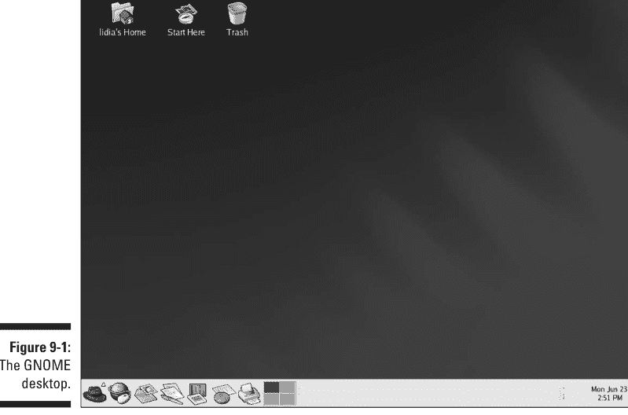

- **桌面**：简而言之，桌面就是你在计算机屏幕上看到的内容。它是你工作的工作空间，相当于——瞧！——桌子的表面。桌面预配置了背景和几个图标，其中包括链接到你的主目录和回收站等位置。图标相当于堆在桌子上的杂物：有些有用，有些没用。

当你双击主目录（或右键单击并选择打开）时，会打开一个 Nautilus 窗口，显示这些目录的内容。*Nautilus* 是一个图形系统，不仅用于处理文件和目录，还用于管理工具和网络页面。有关 Nautilus 的更多信息，请参见第 10 章。

- **面板**：跨越 GNOME 屏幕底部的菜单栏就是面板。你可以从 GNOME 面板访问每个 GNOME 功能以及 Red Hat 或第三方应用程序。它相当于桌子中的抽屉。

- **应用程序**：这些元素包括用户系统和 GNOME 级别的应用程序。用户程序包括 Mozilla、Evolution、XIMS 和 Xine 等应用程序。系统应用程序包括 Red Hat Linux 系统管理工具，如网络配置和用户管理工具，以及 GNOME 工具，如帮助浏览器。应用程序相当于桌子上及桌内需要完成的玩具和工作。


## 探索 GNOME 桌面环境

GNOME 能够执行你期望桌面环境具备的所有基本图形功能。例如，你可以设置背景并创建图标。本节将介绍如何执行一些基本的 GNOME 桌面操作和配置。掌握基础知识后，你可以继续自行探索。

默认的 GNOME 桌面——由 Red Hat Linux 安装程序安装——预装了若干元素。让我们快速浏览一下这个桌面。

### 介绍默认桌面图标

在桌面的左上角有三个图标：你的主目录、从此处开始（Start Here）和回收站（Trash）（参见图 9-1）。它们执行以下任务：


**主目录：** 这个看起来像文件夹的图标代表你的主目录。例如，如果你创建一个名为 `lidia` 的用户账户，系统会创建一个名为 `/home/lidia` 的目录；该图标标记为 `lidia 的主目录`。当你以 `lidia` 身份登录时，主目录图标将链接到该目录。双击主目录（或右键单击并选择“打开”），就会打开一个 Nautilus 窗口，显示主目录的内容。

双击图标会打开与该图标关联的窗口。例如，双击你的主目录会打开一个链接到你主目录的 Nautilus 文件管理器窗口。你还可以通过右键单击图标并选择“打开”选项来打开它。

**从此处开始：** GNOME 提供了一个偏好设置窗口，其中包含指向主要 GNOME 和 Red Hat 配置工具和应用程序的链接。双击“从此处开始”图标，该窗口便会打开。打开任何图标——例如应用程序、偏好设置、服务器设置或系统设置——都会打开另一个 Nautilus 窗口，提供对这些工具和应用程序的访问权限：

- **应用程序图标：** 单击“应用程序”图标相当于单击 GNOME 菜单。你会看到一个镜像 GNOME 菜单的图标窗口。你可以从 GNOME 菜单访问的任何项目，都可以从“应用程序”图标访问。
- **偏好设置：** 单击“桌面属性”图标相当于选择 GNOME 菜单 > 偏好设置。你可以从多种 GNOME 配置选项中进行选择。GNOME 偏好设置窗口将在本章稍后的“让 GNOME 识别 MIME 类型”部分中介绍。
- **系统设置：** 双击“系统设置”图标会打开系统设置窗口，允许你启动各种管理工具。你可以在这里找到诸如 Red Hat 网络配置和打印工具等图标。
- **回收站图标：** GNOME 提供了以回收站目录形式处置文件和目录的方法。单击任何图标、文件或目录，并将其拖到回收站图标上。虽然 Jesse James 的怪物车库自动垃圾收运车不会来收取你的文件，但文件会被放入回收站目录；该回收站目录位于你的主目录中。

回收站中的项目在你右键单击回收站图标并选择“清空回收站”之前并没有被真正删除。你可以通过打开回收站（双击图标），然后单击项目并将其拖出到桌面或打开的偏好设置窗口来恢复被删除的项目。


### 更改主题和背景

GNOME 提供了更改其元素外观和感觉的能力。元素的外观和感觉——通常指在桌面上打开的窗口——被称为其*主题*。*主题*决定了已打开窗口的按钮、滑块、菜单、边框及其他部件的大小、形状、纹理和颜色。

通过选择 GNOME 菜单 > 偏好设置 > 主题，你可以比政客在选举期间更容易、更快地改变主题；或者，你也可以打开*从此处开始*图标，并在打开的窗口中选择*偏好设置*。当*偏好设置*窗口打开时，双击*主题*图标。

当*主题偏好设置*窗口打开时，默认会激活*应用程序*选项卡。你可以选择任何主题，所有已打开的窗口会立即采用该主题。应用程序主题更改了应用于每个窗口的色调和纹理。例如，单击*金属*主题会使你的窗口呈现拉丝表面外观。

单击*窗口边框*选项卡。单击任何主题，你的窗口边框就会随之改变。窗口边框由环绕每个窗口的条带及其上的按钮的色调和纹理组成。

继续选择不同的主题，直到找到你喜欢的那个。完成后，单击*关闭*按钮。

你还可以选择显示在桌面上的图像。图像可以是图片、图案或纯色。右键单击桌面上任何空白（无杂乱）区域以更改桌面，寻找你喜欢的背景。

从菜单中选择“更改桌面背景”，背景偏好设置窗口便会打开。通过单击“图片”部分或其变体之一来选择图像。此时会打开“请选择一张图像”窗口。你可以选择列出的任何图像，或在磁盘上搜索其他图像。或者，通过单击“无图片”按钮选择纯色。

打开“背景样式”菜单，选择纯色，或选择在垂直或水平轴上变化的颜色。然后，你可以单击“颜色”按钮更改颜色（纯色或渐变）。从“选择颜色”窗口中选择你的颜色。对另一种颜色重复此过程，你就会得到满屏的色彩。

右键单击桌面空白区域的任意位置，然后选择“使用默认背景”可重置背景。默认背景将重新激活。

### 在你的工作场所忙碌

使用 GNOME 一段时间后，你会发现随着你启动越来越多的应用程序，屏幕上创建了大量窗口。你甚至可能将窗口隐藏在其他窗口后面。也许你想将多个显示器连接在一起，以便一次性显示所有窗口。

显示器昂贵且笨重，所以你可能不得不继续使用单个显示器。但你不必局限于一个*屏幕*。GNOME 允许你将工作分散到多个*虚拟显示器*上。

想象一下，你有一个大的 GNOME 桌面均匀地分布在四个显示器上。如果你能在任何显示器上打开窗口，生活将会很美好。你将拥有大量的空间来展开工作。

然而，由于你可能没有四个显示器，GNOME 模拟了四个*虚拟显示器*，称为*工作区*。每个工作区相当于一个真实的显示器，你可以在其中展开工作。唯一的限制是你一次只能查看一个工作区。

### 在你的工作区切换器上换位

在工作区之间切换很容易。GNOME 提供了一个实用工具——工作区切换器（Workspace Switcher）——用于选择任何工作区。工作区切换器位于 GNOME 面板上。

你使用 GNOME 工作区切换器访问每个工作区。工作区切换器分为四个象限。单击任何象限都会将你置于对应的桌面。单击右下角的象限，你会进入该工作区。

你可以将窗口强制放入任何或所有工作区。单击窗口左上角向下指向的箭头。打开的菜单提供了所有预期的功能，如关闭、最小化、最大化和调整窗口大小。然而，在菜单底部有选项，可将窗口放入剩余的三个工作区中的任意一个；或者，你可以将窗口放入所有工作区。例如，你可能希望将 Mozilla 等应用程序放入所有工作区，以便无论你正在做什么都能使用它。

### 与窗口嬉戏

在对窗口执行任何操作之前，你必须引起它的注意。当窗口获得注意时，它具有*焦点*。根据你对 GNOME 的设置，你可以通过多种方式为 GNOME 中的窗口提供焦点：

- 单击 GNOME 面板上的窗口名称。
- 单击窗口顶部的窗口标题栏。
- 单击窗口本身的某部分，这通常也会使窗口成为最顶层窗口。此方法是默认方法。
- 如果你在有很多人的办公室工作，你可以大喊：“嘿，你——醒醒！”虽然这种策略不太可能唤醒你的窗口，但确实很有趣。


在这本书中，我们坚持 Red Hat 和 GNOME 的默认行为，即单击窗口以赋予其焦点。

### 移动窗口

要移动窗口，在窗口标题栏的任何位置单击并保持按住鼠标左键。只要你继续按住该按钮，窗口就会随鼠标移动而移动到任何位置。释放按钮，窗口将停留在该位置。

### 调整窗口大小

有时，窗口略微太大或太小，你知道如果能轻推一下让窗口变回原样，生活会轻松得多。要


照做即可，将鼠标光标置于窗口的任意边框上。点击并拖动窗口轮廓至所需大小。松开鼠标按钮，窗口即会调整为新大小。

### 最小化窗口

既然您已在屏幕上打开了许多窗口，该如何清理其中几个或全部呢？您可以*最小化*（或*图标化*）窗口，方法是点击靠近右上角的加粗且带下划线的按钮，这会将窗口从桌面移除，并将其放置在 GNOME 面板的存储区域中。如果您正心情恶劣，可以采取更果断的措施，即*关闭*窗口。图 9-2 显示了一个在 GNOME 中最小化的 Mozilla 窗口——您可以看到它的图标位于屏幕下方中央边缘的 GNOME 面板上。

**图 9-2：**
GNOME 中最小化的 Mozilla。

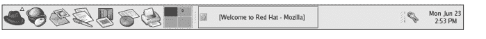

以下是清理窗口的几种方法，从最不极端的方式开始，逐步升级到彻底关闭窗口：

- 利用窗口或窗内应用程序提供的任何退出按钮或菜单选项。例如，许多应用程序允许您选择“文件→退出”来关闭该应用程序。
- 点击窗口标题栏右上角的 X 按钮以关闭窗口。
- 点击窗口左上角（或右键点击标题栏），并从弹出的菜单中选择“关闭”选项。

您可以通过点击 GNOME 面板上对应窗口的图标，将最小化的窗口恢复到桌面。

### 最大化窗口

若要使窗口占满整个屏幕，请点击窗口右上角的“最大化”按钮。查看典型窗口标题栏右侧的按钮。最大化按钮是中间那个，它看起来像个正方形，其操作方式类似于 Windows 中的“层叠”按钮。

## 创建桌面图标

您可以为 GNOME 菜单中的任何应用程序在桌面上创建图标。只需点击 GNOME 菜单按钮，找到您想要创建图标的应用程序菜单项，然后左键点击该应用程序的图标并保持按下鼠标按钮。在继续按住按钮的同时，将鼠标光标拖到 GNOME 桌面（或 GNOME 面板）上的任意空白区域。松开鼠标按钮，该应用程序的图标就会被放置在桌面上。您随后可以通过双击桌面上的图标（或仅点击位于 GNOME 面板上的图标）来启动该应用程序。

在 GNOME 中，您可以使用徽标来增强图标。*徽标*提供了关于图标功能的额外信息。您可以通过右键点击图标并选择*属性*来分配徽标。此时会打开属性窗口。点击*徽标*选项卡并选择一个徽标。例如，如果您选择“酷”徽标，桌面图标旁会显示一副 Wayfarer 墨镜——很酷。您可以在本段旁的边缘看到那个酷图标。


GNOME 图标的另一个酷功能是能够拉伸图标边界。右键点击图标并选择*拉伸*。虚线和四个方形按钮将包围该图标。点击任意按钮，您可以随意拉伸图标图像。

## 操作 GNOME 面板

GNOME *面板*是桌面底部的菜单栏。类似于 Windows 中的任务栏，GNOME 面板提供了一个放置常用菜单和小程序的位置，以便快速启动或查看。GNOME 面板还让您查看虚拟桌面，并有助于跟踪最小化的窗口。

默认情况下，Red Hat Linux 在 GNOME 面板上放置了图标，用于访问 GNOME 菜单、Mozilla、Evolution、OpenOffice（Writer、Impress 和 Calc）以及 GNOME 工作区切换器。您可以点击其图标来启动这些程序中的任何一个或使用切换器。

GNOME 面板上最重要的元素是 GNOME 菜单按钮，位于最左侧，您使用它来访问所有标准的 GNOME 应用程序和配置工具。GNOME 菜单按钮看起来非常像一顶红帽子，位于屏幕左下角。您可以从点击 GNOME 菜单按钮时显示的任意菜单中进行选择。例如，“系统设置”和“系统工具”菜单包含了许多您可用于管理 Red Hat Linux 计算机的 Red Hat 实用工具。“声音与视频”菜单提供对 CD 播放机的访问，而“图形”菜单提供对图形应用程序的访问。您大概明白意思了。

您可以使用“添加到面板”子菜单来修改 GNOME 面板的配置和行为。例如，如果您右键点击 GNOME 面板的任何未使用部分并选择“添加到面板->娱乐->眼睛”，您将在 GNOME 面板上获得一个有趣的眼睛小程序。这些眼睛会跟随您的鼠标在屏幕上移动——哦，有点吓人。Eyes 展示了使用 Red Hat Linux 进入您生活的巨大额外功能维度。（您可以通过右键点击其图标并选择“从面板移除”选项来移除这些眼睛。）

GNOME 面板菜单的另一个有趣功能是“添加新启动器”功能。点击 GNOME 面板的任何未使用部分并选择“添加到面板->启动器”。此时会打开“创建启动器小程序”窗口。通过输入应用程序的路径名，您可以添加一个新的小程序到 GNOME 面板，该程序用于*启动*或打开该应用程序。

GNOME 提供了一个名为“搜索工具”的文件搜索实用程序。点击 GNOME 菜单按钮并选择“搜索文件”，搜索工具即会打开。输入您想查找的文件名并点击“查找”按钮。点击“高级”选项卡，您可以进行更精细的文件搜索。

试试吧。例如，如果您经常使用 MPlayer 收听互联网音频流（在第 12 章中描述），您可以为其添加一个小程序到您的面板，以便您可以随时启动 MPlayer。再次打开“创建启动器小程序”窗口，并添加名称、通用名称、任何注释以及启动该程序的命令（mplayer）。如果您点击“无图标”按钮，您将看到几页标准图标，可用于将您的新小程序与 GNOME 面板上的其他程序区分开来；在这种情况下，我们选择了一个通用的苹果作为我们的图标吉祥物。图 9-3 显示了完成的小程序启动器窗口。

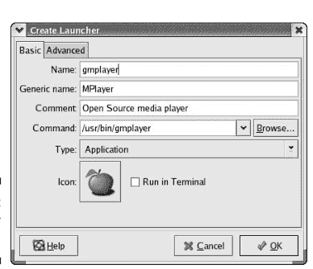

完成编辑“创建启动器小程序”窗口后，点击**确定**。如图 9-4 所示，该图标会被添加到您的面板中。您可以以同样的方式为 Red Hat Linux 计算机上的任何应用程序创建启动器。

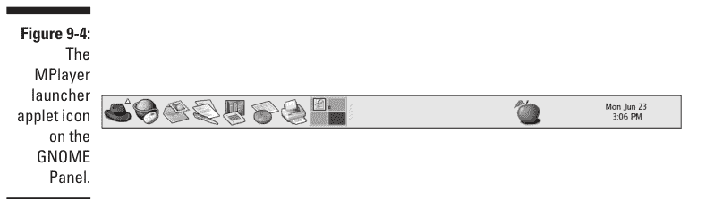

## 添加和删除面板

您并不局限于默认的 GNOME 面板。您可以随意创建额外的面板。点击 GNOME 面板未使用部分的任意位置并选择“新面板”。例如，选择“边缘面板”会在屏幕顶部放置一个空白面板。

新面板是空白的，不包含任何图标，不像默认的 GNOME 面板那样。新面板确实有一个基本菜单，您可以使用它来填充图标和其他菜单。右键点击新面板，“添加到面板”子菜单将打开。您可以使用“添加到面板”菜单来构建新面板。例如，选择“附件 时钟”，面板中会添加一个数字时钟，如图 9-5 所示。或者，选择“娱乐 Geyes”。继续添加图标，直到您对新的系统感到满意。

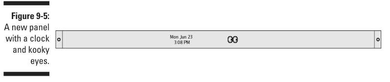

当然，您可以删除您创建的任何面板，但不能删除默认的 GNOME 面板。过程很简单：右键点击面板的任何未使用部分并选择“删除此面板”。点击打开的“删除面板”窗口中的“删除”按钮，面板即被删除。

任何面板都可以设置为在不使用时隐藏。右键点击面板的任何未使用部分并从弹出菜单中选择“属性”，随后将打开“面板属性”窗口。选中“自动隐藏”选项并点击“关闭”按钮。面板将从屏幕边缘消失，直到您将鼠标光标移回该边缘。随后面板会重新出现。


每个新面板的两端都包含箭头，称为“隐藏”按钮；原始的默认面板没有这些按钮。点击任意箭头都会强制面板滑向一侧或另一侧。除了这些相同的箭头外，面板是隐藏的。点击箭头会揭示隐藏的面板。

## 离开 GNOME 和 X

如果您想保持计算机开机但不希望让任何路过的人随意使用，您可以使用屏幕锁定来省去注销 GNOME 桌面所花的时间。为此，点击 GNOME 菜单按钮并选择“锁定屏幕”；此时将显示屏幕保护程序。要返回富有生产力的生活和您的桌面，请按任意键或晃动鼠标，并在打开的 X 屏幕保护程序窗口中输入您的密码。

### 短暂离开时保护您的计算机

锁定屏幕是您可以使用的一种最佳安全功能。要锁定屏幕，点击 GNOME 菜单按钮并选择“锁定屏幕”。您的屏幕将被锁定，您必须输入密码才能重新进入。当您打算离开一两个分钟甚至更长时间时，锁定屏幕是个好主意。

### 晚间回家

在您结束一天的工作并希望回家（或只是上楼）时，您需要注销。点击 GNOME 菜单按钮并选择“注销”。此时会打开“确定要注销吗？”窗口。点击“注销”——正如您猜测的那样——注销。您还有关闭或重启计算机的选项。


GNOME 默认配置了随机屏幕保护程序。您可以通过点击 GNOME 菜单按钮并选择“首选项→屏幕保护程序”来选择单一屏幕保护程序。此时将打开“屏幕保护程序首选项”窗口。例如，您可以从默认的随机屏幕保护程序切换到 X Jack（我们都知道


……所有的劳作而不娱乐，会让杰克变得呆板）的屏幕保护程序。对于在宁静的度假村度过漫长冬季、有充足时间撰写 Linux 书籍的人来说，这是一个不错的选择！

## 终止 X

当你无法让应用程序响应你的操作时，可以直接停止 X，这将终止在其下运行的所有程序。为此，请同时按下 Ctrl+Alt+Backspace 键。如果你是手动启动 X 的，则可以注销该账户。如果 X 是在启动时自动运行的（如本书所述假设），你将看到 X 登录屏幕，可以重新登录。

## 让 GNOME 识别 MIME 类型

你可以通过使用各种 GNOME 配置实用程序来修改桌面的外观和感觉。双击桌面上的“开始此处”图标。当窗口打开后，双击“首选项”图标。（你还可以通过点击 GNOME 菜单按钮，然后打开“首选项”菜单来访问相同的功能。将打开一个子菜单，显示与“首选项”窗口中相同的选项。）

图 9-6 显示了“首选项”窗口，你可以在其中修改 GNOME 属性。例如，双击“文件类型和程序”选项，你可以将应用程序与 MIME 类型关联起来。

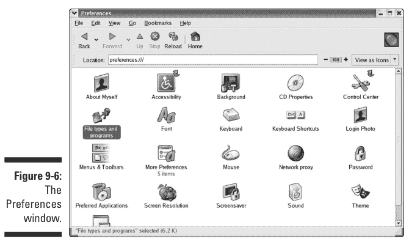

双击**文件类型和程序**图标，将显示“文件类型和程序”对话框。GNOME 通过此实用程序存储的信息来识别 MIME 类型。例如，选择**音频**::**OGG**，然后点击**编辑**。“文件类型和程序”窗口将打开（见图 9-7）。

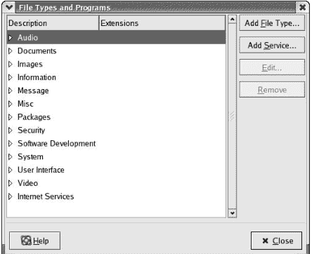

“编辑文件类型”窗口显示 Ogg 音频文件属于 MIME 类型 `application/x-ogg`。该窗口还显示 Ogg 音频文件使用 `.ogg` 文件扩展名。未指定默认操作。你可以打开“默认操作”下拉菜单，如果你想让 XMMS 播放你的 Ogg 文件，可以选择**X 多媒体系统**，或者在“要运行的程序”子窗口中手动输入程序名称。无论选择哪个程序，只要你在 Nautilus 或其他文件管理器窗口中点击 Ogg 文件，该程序就会被用来播放它们。XMMS 是随 Red Hat Linux 捆绑提供的标准音频播放器。

“首选项”窗口还允许你配置屏幕保护程序以外的其他项目（包括那些有着狂热评分的项目）。我们留给你去探索设置键盘铃声和其他项目的奇妙世界。

## 访问 GNOME 应用程序

GNOME 的最后一个组成部分是随 GNOME 一起打包提供的应用程序。GNOME 提供了许多旨在用于工作和娱乐的应用程序。Red Hat 也提供了广泛范围的应用程序，其中一些可以通过 GNOME 访问。（你还可以从开源社区和第三方添加自己的应用程序。）

Nautilus 提供了另一种访问 Red Hat Linux 计算机上许多应用程序的方式。没有链接到 GNOME 的应用程序无法通过 GNOME 菜单系统访问；你通常可以通过手动使用 GNOME“添加到面板”选项添加链接来纠正这种情况。

以下列表描述了访问应用程序使用的方法：

- **开始此处：** 打开 GNOME“开始此处”窗口，双击“应用程序”图标。然后你可以启动 Red Hat Linux 在你计算机上安装的大多数应用程序。
- **Nautilus：** 点击你的主目录图标会打开一个 Nautilus 窗口。然后你可以通过双击其图标来启动存储在你的主目录中的任何可执行应用程序。你还可以切换到任何其他你有访问权限的目录来运行应用程序。
- **GNOME 菜单：** 打开 GNOME 菜单可以访问 GNOME“知道”的每个应用程序（即 GNOME 已配置为访问的每个应用程序）。使用 GNOME 菜单可以访问与“开始此处”应用程序窗口中相同的程序集合。
- **老派方式：** GNOME 提供了两种通过 CLI（命令行界面）运行程序的方法。你可以启动一个 GNOME 终端模拟器窗口，或使用 GNOME 运行程序功能。前者在一个终端模拟器窗口中打开一个 bash shell，你可以从中启动应用程序。后者打开一个窗口，你可以在其中输入要执行的程序名称。这两个系统的主要区别在于，使用终端模拟器时你可以与应用程序进行更多的交互。运行程序系统只允许你在应用程序创建 GUI 时与之交互。

以下列表展示了使用 Red Hat 和 GNOME 时获得的丰富应用程序环境。该列表对应于你点击 GNOME 菜单按钮时看到的菜单选择：

- **附件：** 不属于此列表中任何组的应用程序被标记为附件。GNOME 计算器、gedit 和字典等应用程序被放置在这个类别中；字典非常有用——输入一个单词，其定义就会显示出来。
- **游戏：** 由于 Linux 最初侧重于运行服务，你可能不会认为它适合游戏玩家。但它有很多游戏。打开“游戏”图标，你会看到其中许多。你可以通过 Linux 同样轻松地浪费生命，就像使用 Windows 一样！哈哈！
- **图形：** 你可以使用这些图形实用程序来查看和操作图像；ImageMagick 和 The Gimp 是处理像素的优秀工具。你可以使用“扫描”工具在扫描仪上扫描图像。包括 DVI、Adobe Acrobat Reader 和通用图像查看器，以及数码相机工具。你可以通过从 GNOME 菜单中选择“图形”来访问一些实用程序。可以通过 GNOME 菜单访问更多的图形应用程序：选择“更多” -> “图形”。
- **帮助：** 点击“帮助”菜单会打开 GNOME 帮助浏览器。它提供了关于许多 GNOME 主题的信息。
- **互联网：** 新的 Red Hat 默认电子邮件客户端 Evolution 在这个文件夹中。你还会发现一个图形聊天应用程序，即时通讯（Instant Messenger）。
- **网络服务器：** 你可以查看你网络上的 Samba 服务器。“网络服务器”提供了与 Microsoft 网上邻居相同的功能。
- **办公：** 开源的 OpenOffice 应用程序存储在这个文件夹中。OpenOffice 提供文字处理器、电子表格、演示文稿管理器和绘图工具，你都可以在这里访问。你还可以在这里找到 OpenOffice 修复和打印机配置实用程序。（图标会自动放置在 GNOME 面板中。）
- **编程：** Linux 提供了良好的编程环境。Red Hat Linux 通过此菜单提供指向许多编程实用程序的链接，例如许多人在编辑源代码时使用的 Emacs。
- **搜索文件：** 此功能有助于你在计算机上搜索文件和目录。选择此功能会打开一个窗口，你可以在其中输入要搜索的文件名。
- **声音和视频：** 有趣的东西存储在这里。例如，Red Hat Linux CD 播放器和 XMMS 就在这里。你还会在这个文件夹中发现更多普通的项目，如音量控制和音量监视实用程序。
- **服务器设置：** 你可以访问“服务”实用程序，它允许你启动和停止 Red Hat Linux 服务。
- **系统设置：** Red Hat 将其许多出色的配置实用程序放在这里。例如，Red Hat 网络配置、X 配置和声卡检测实用程序都在这里。
- **系统工具：** 你可以从此文件夹访问更多的 Red Hat 系统管理实用程序。

# 第 10 章

## 了解更多应用程序

- 本章内容
  - Nautilus，GNOME 文件和集成管理器
  - Ximian Evolution 电子邮件和个人组织器

许多应用程序使你的 Red Hat Linux 计算机变得有用。在本章中，你将了解如何使用随 Red Hat Linux 一起打包提供的几个最有用应用程序。第一个是 Nautilus 文件管理器，它是 GNOME 桌面系统的一个组成部分。第二个应用程序是新的电子邮件和组织器应用程序，名为 Evolution。我们还介绍了几个其他有用的应用程序。

**提示**  
第 11 章描述如何使用 Mozilla 网络浏览器。第 13 章介绍 OpenOffice 桌面生产力套件，它提供与 Microsoft Word 兼容的文字处理、电子表格程序、与 PowerPoint 兼容的演示文稿程序以及其他功能。这些程序结合 Evolution，为你提供了使你的 Red Hat Linux 计算机成为一个功能完整的工作站所需的所有功能。

### 使用 Nautilus 文件和互联网集成管理器进行导航

成为老板并不意味着你是个坏人。这只是一份工作。对吗？好吧，那个小小的 GNOME 小人是个好工人，而且薪水不高。只需在此处按一个键，在彼处点一个按钮，你就可以像任何一位值得尊敬的 Dilbert 经理一样指挥他。GNOME 甚至自带一个文件和集成管理器，它可以节省工作时间为那些长时间的午餐腾出时间。


*Nautilus* 是 GNOME 的文件和互联网导航系统。Nautilus 沿袭了所有优秀文件管理器的传统，以图形化方式显示计算机上的文件和目录。你可以通过指向和点击来复制、移动、删除文件以及执行程序；创建目录和查看文件详细信息也轻而易举。Nautilus 更进一步：你可以使用它来配置 GNOME 桌面。而且，这还不是全部！Nautilus 还可以浏览互联网、访问多媒体应用程序，并且可以进行切割和处理！考虑到它是免费使用的，这真是一项不错的交易。

## 唤醒 Nautilus

Red Hat Linux 将 Nautilus 配置为在登录时自动启动。Nautilus 会在登录过程的后期出现，并作为文件管理器运行（参见图 10-1，它显示了主目录的内容）。如果你想手动启动它——例如，在你关闭它之后——只需右键单击桌面背景上的任意位置，然后选择“新建窗口”。

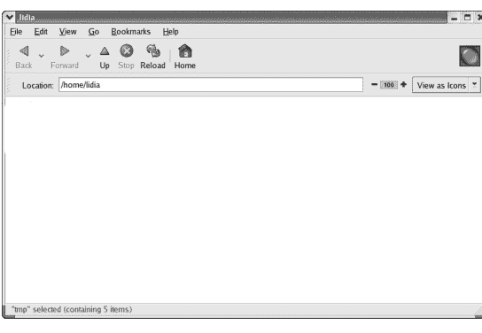

**图 10-1：** Nautilus 文件管理器。

主菜单遵循熟悉的菜单格式（例如文件和编辑），并执行你期望这些菜单所做的所有功能。主菜单下方的工具栏允许你快速向上移动一级目录（Up）并跳回到之前的操作（Back 和 Forward）。它还让你能够重新扫描目录、转到主目录，以及更改图标的显示方式。

**提示** 如果你创建了一个新文件——例如，通过终端模拟器——重载功能会很有用。文件不会显示在文件管理器中，直到你移动到另一个目录并返回，或者执行重载操作。

### 移动文件和目录

移动文件或目录非常简单，只需点击并拖动你要移动的项目到目标目录即可。松开鼠标按钮，你就完成了文件或目录的移动。

你可以通过点击并拖动鼠标光标覆盖你要移动的文件来移动多个文件。鼠标光标会创建一个矩形轮廓，并突出显示该框内的所有文件。接下来，在突出显示的框内任意位置点击，并将鼠标光标拖动到目标目录。松开鼠标按钮，文件就会移动到指定目录。

### 复制文件和目录

复制文件或目录比移动稍微复杂一点。你不需要简单地点击并拖动图标到某个地方，而是要右键单击文件或目录图标，并从打开的菜单中选择“复制”。接下来，双击目标目录的图标进入你想复制到的目录。当目录打开时，右键单击背景上的任意位置，并选择“粘贴”选项。文件或目录将被复制到新位置。

你可以用同样的方式复制多个文件和目录。通过点击并拖动鼠标光标，在你想要复制的文件或目录周围画一个框。接下来，右键单击蓝色高亮图标名称中的任意一个（但不要点图标和名称周围的空白处），并选择“复制”选项。双击要复制到的目录，右键单击背景，并选择“粘贴”。松开鼠标按钮，文件就会被复制到指定目录。

#### 删除文件和目录

删除文件和目录的过程与复制类似。右键单击你要删除的文件或目录图标，并从打开的菜单中选择“移到回收站”。文件或目录会被移动到回收站目录。


“已回收”的文件和目录不会立即被删除。例如，当你使用“移到回收站”选项删除文件时，文件会被移动到回收站文件夹。双击回收站图标打开回收站目录，然后右键单击要删除的文件或目录。选择“从回收站删除”选项。此时会打开“从回收站删除”的警告窗口，提示你确认删除操作。点击“删除”键，文件就会被清除。

你可以删除多个文件和目录。同样，你通过点击并拖动鼠标光标来画一个框。右键单击蓝色高亮的图标或图标名称（但不要点图标和名称周围的空白处）。文件或目录会被移动到回收站目录。

#### 创建目录

在 Nautilus 窗口中任意位置右键单击，并选择“新建文件夹”来创建新目录。新文件夹将以“未命名文件夹”的名称显示。你可以随意为目录输入任何名称。

### 查看文件和目录

默认情况下，文件和目录在屏幕上以图标形式显示。图标上显示的唯一信息是名称以及该项目是文件还是目录（目录图标还会显示它们包含的文件和目录数量）。你可以通过点击“视图 > 以列表查看”或“视图 > 以目录查看”来显示更多信息。

此列表描述了不同视图之间的区别：

- **图标视图：** 默认显示选项；显示图标并指示项目是文件还是目录。普通文件图标有多种形式，但文本和配置文件看起来像折叠了一角的纸张。包含特定类型数据的文件会在文件图标上叠加小的子图标。例如，PDF 文件有 PDF 子图标。链接、设备和其他对象呈现其他形式。目录呈现为半开的棕褐色文件夹。图标均匀分布在文件管理器屏幕上。图标往往使区分文件和目录更容易，但占用更多屏幕空间。
- **列表视图：** 除了名称外，还显示每个文件和目录的大小和时间戳。
- **以……查看：** 允许你为所有或特定目录选择图标或列表作为默认文件夹视图。你还可以将 MIME 类型与特定应用程序关联。


你可以使用 Nautilus 在桌面上创建指向文件或应用程序的快捷方式图标。在 Nautilus 中，只需点击并拖动任何文件或应用程序到桌面的空白处，然后松开鼠标按钮。桌面上就会放置一个图标。你可以通过双击其图标来启动应用程序。如果图标指向数据文件（例如文本文件）且 Nautilus 知道如何处理其 MIME 类型，Nautilus 将启动适当的应用程序来打开文件。否则，Nautilus 会提示你告诉它使用哪个应用程序来打开文件。


Nautilus 被编程识别多种多用途互联网邮件扩展（MIME）类型，这些类型定义了文件存储的信息类型——换句话说，MIME 某种程度上维护着自己的联系人名单。每种 MIME 类型都与某些文件扩展名相关联。例如，当你双击 .doc 文件时，Nautilus 识别出 .doc 文件后缀对应 Word 文档的 MIME 类型，并打开 OpenOffice 文字处理器（如第 13 章所述），加载该 .doc 文件。


Nautilus 提供了收藏你常用位置的功能。Nautilus 的收藏功能与 Mozilla 或任何其他 web 浏览器的功能类似。转到任意目录并点击“书签 > 添加书签”。你只需点击“书签”并选择特定书签即可跳转到该位置。你可以通过选择“书签 > 编辑书签”来修改现有书签。

## 运行程序

Nautilus 是一个如此勤劳的工作者，它很乐意为你启动命令。右键单击你要运行的图标以打开子菜单，然后选择“打开”。例如，如果你点击 /usr/bin/X11 目录中的 xclock 图标，xclock 会出现在你的桌面上。（双击图标也可以。）

通常，管理器并不非常聪明。但 Nautilus 比一般的经理更聪明，当它遇到各种文件类型时，它知道该做什么。如果你打开一个不可执行文件，例如 PDF 文件，文件管理器知道使用哪个程序来查看它。

## Ximian Evolution 革命的到来

Ximian Evolution 系统是 GNOME 和 Linux 世界的新主力。Evolution 通过将出色的电子邮件和日历客户端与其他功能结合，创建了一个集成的单一软件包，为 Linux 桌面的演进提供了重要的一步。Evolution 提供以下功能：

- 日历
- 联系人管理器
- 电子邮件客户端
- 个人数字助理（PDA）管理器
- 任务主管（待办事项列表）

以下两部分描述了如何配置 Evolution 的电子邮件和 PDA 功能。


Red Hat 使用 Evolution 作为其默认邮件客户端。Evolution 使您可以轻松配置一个或多个电子邮件账户。以下步骤描述了如何配置 Evolution，以便向您的 ISP 电子邮件账户发送和接收消息：

1.  以普通用户身份（而非 root）登录您的 Red Hat Linux 计算机，并点击 GNOME 面板左侧的 Evolution Email 图标。

    首次启动 Evolution 时，将打开“安装向导”（Setup Assistant）。

2.  点击“Forward”按钮。然后在“身份”（Identity）窗口的相应文本框中输入您的姓名和电子邮件地址，并点击“Forward”按钮。

    您可以选择性地输入您的组织名称和签名文件（一个存放个人信息或商务信息、将附加到您发送的每条消息末尾的文件）。

    图 10-2 展示了“身份”窗口中的一些示例输入。

    “接收邮件”（Receiving Mail）窗口将打开。

3.  点击“Server Type”下拉菜单，并选择与您 ISP 的电子邮件系统相匹配的选项。大多数 ISP 使用 Internet 消息访问协议（IMAP）服务器类型。

    “接收邮件”窗口会展开，以便您输入有关您 ISP 电子邮件系统的更多信息。

4.  输入您 ISP 电子邮件服务器的主机名以及您的 ISP 用户名。图 10-3 展示了此窗口的一个示例屏幕。

    当您首次订阅服务时，您的 ISP 会提供其传入和传出电子邮件服务器的名称。您需要在“Host”文本框中输入传入服务器名称。例如，您的 ISP 传入服务器可能是 mail.myisp.com 或 imap.myisp.com。

    您的 ISP 用户名可能与您在 Linux 计算机上的用户名不同。例如，您的 ISP 用户名可能基于您的名首字母和姓氏——`gagon`——但您家用 Linux 计算机的用户名可能只是您的名字——`gabe`。

5.  点击“Forward”按钮。

    第二个“接收邮件”（Receiving Email）窗口将打开。

    您可以通过选择“Automatically check for new mail”（自动检查新邮件）选项来更改设置，例如让 Evolution 自动查找传入的消息。

6.  进行必要的更改，然后点击“Forward”按钮。“发送邮件”（Sending Mail）窗口将打开。

    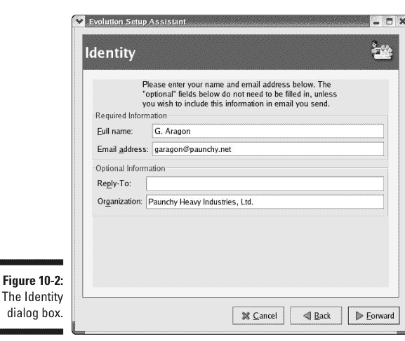

    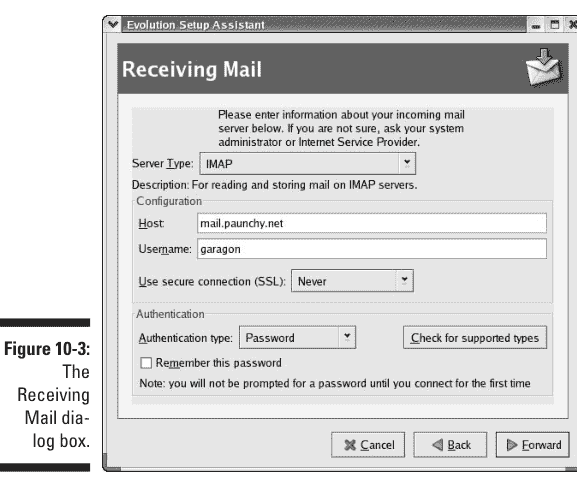

7.  输入您 ISP 的出站邮件服务器名称，然后点击“Forward”按钮。

    图 10-4 展示了此窗口的一个示例屏幕。

    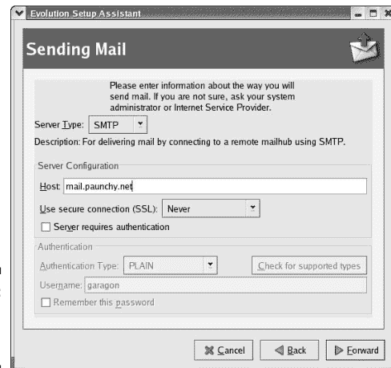

    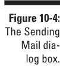

    Evolution 的默认出站邮件协议是 SMTP。ISP 经常使用 SMTP，因此您可能不需要更改它。您的 ISP 应该会向您提供其使用的协议。

    一些 ISP 可能使用加密的安全套接字层（SSL）连接并需要身份验证。同样，您需要从您的 ISP 获取这些信息，并在必要时使用这些选项。

    “账户管理”（Account Management）窗口将打开。您正在创建的账户将以此名称称呼。Evolution 默认使用您的电子邮件地址作为名称。您可以更改名称，但这并不是必须的。

    如果这是您唯一的账户，那么您的新账户将是默认账户。否则，您可以通过选择“Make This My Default Account”（将此设为我的默认账户）选项来选择将其设为默认账户。

8.  最后一步配置需要您选择时区。点击距离您所在位置最近的点。

    会出现一张更大的地图，必要时您可以精确调整您的位置。这与第 3 章中设置计算机时区所使用的系统相同。

9.  点击“Forward”按钮。

    “完成”（Done）窗口将弹出。

10. 点击“Apply”按钮，即完成操作。

    Evolution 打开并显示一个“摘要”（Summary）窗口；另一个对话框也会打开，显示有关 Ximian 的信息（阅读完对话框中的信息后，点击“OK”按钮）。Evolution 功能的快捷键位于窗口左侧。点击您的电子邮件账户快捷方式，即可看到列出的新电子邮件账户。（您也可以点击窗口左上角附近的“Summary”按钮来访问您的账户。）选择您的账户以激活它。然后您就可以发送和接收消息。您还可以对账户执行其他典型操作，例如排序、移动和删除消息。

    

    您可以按需添加新的电子邮件账户。您也可以返回修改或删除现有账户。点击您的电子邮件账户快捷图标，并选择“Tools->Mail Settings”（工具 -> 邮件设置）。“邮件设置”（Mail Settings）窗口将打开，您可以修改账户、添加新账户以及删除旧账户。请注意，点击“Add”（添加）按钮时会打开 Evolution 账户助手。

### 将 Evolution 与您的 PDA 配合使用

您可以将 Evolution 日历、待办事项管理器和联系人管理器与您的 PDA 配合使用。在本节中，我们重点向您展示如何使用 Evolution 备份您的 PDA，因为这是您可以做的更有趣且好玩的事情之一。您可以通过阅读在线 Evolution 文档（点击“Help”或访问 www.gnome.org/gnome-office/evolution.shtml）或简单地通过试验来了解有关使用日历的更多信息。

您可以使用 Evolution 的 pilot-link 实用工具将 PDA 数据库备份到您的计算机。请按照以下步骤操作：

1.  将您的 Palm 底座插入计算机的串行端口。

    连接到底座的电缆末端是一个 9 针（DB9）母插头。大多数甚至所有现代计算机都带有一个 9 针公插头，用于连接由 /dev/ttyS0 Linux 设备控制的串行端口插槽。（在 Windows 世界中，/dev/ttyS0 相当于 COM1，/dev/ttyS1 是 COM2，依此类推。）

2.  点击 GNOME 面板上的 Evolution 图标。

    Ximian Evolution（革命？）应用程序将打开。

3.  点击“Contacts”（联系人）按钮，并选择“Tools->Pilot settings”（工具 -> Pilot 设置）。

    “欢迎使用 GNOME Pilot 向导”窗口将打开。

4.  点击“Forward”按钮，“Cradle Settings”（底座设置）窗口将打开，如图 10-5 所示。

    您必须告诉 Evolution 在哪里找到您的 PDA。打开“Port”（端口）菜单并选择串行设备。

    设备可能是 /dev/ttyS0 或 /dev/ttyS1。尝试和错误并没有什么可耻的，请按顺序选择每个端口，直到找到正确的那个。

    

    不用担心选择速度。除非您的计算机非常老旧，否则默认值是足够的。

5.  点击“Forward”按钮。

    “Pilot 身份验证”（Pilot Identification）窗口将打开。

6.  点击“No, I've Never Used Sync Software with This Pilot Before”（不，我从未在此 Pilot 上使用过同步软件）按钮。

    您的用户名将被插入到“User Name”（用户名）文本框中。（例如，如果您以 paul 身份登录，paul 将是您的默认 Pilot ID。）

7.  点击“Forward”按钮以接受用户名；否则，请输入您希望用作 Pilot ID 的名称。

8.  在 PDA 底座上按下同步按钮（例如 Palm Pilot 的 HotSync）。

    日历数据库将被复制到您的 Red Hat Linux 计算机。

    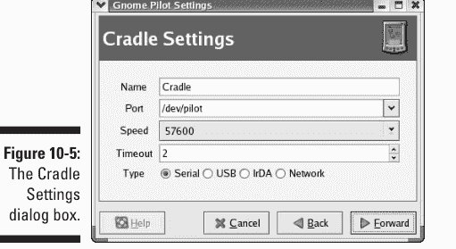

    Evolution 还可以同步您的联系人列表和地址簿。很酷，是吧？

# 第 11 章

## 冲浪网络与聆听音乐

### 本章内容

- Web 的简史
- 使用 Mozilla 浏览 Web
- 安装插件
- 播放您的 CD
- 构建您的音响系统
- 处理 CD

在本章中，我们将介绍开源 Mozilla Web 浏览器。Mozilla 提供了其他流行浏览器的所有功能。我们将展示如何为 Red Hat Linux 计算机设置 Mozilla，以便您可以浏览网络。您可以将计算机用作多媒体设备。在使用 Mozilla 之后，我们将描述如何配置 Linux 计算机以收听音乐和创建 CD。

> **牢记**
> 本章的目标是描述如何使用 Mozilla 的基本功能。然而，我们想让您知道，Mozilla 的功能远不止我们在此处描述的那样。有关 Mozilla 的更多信息，请查看“Help”（帮助）菜单上可用的功能，例如 Reference Library 或 Help 内容。

### 让万维网成为可能

曾经有一家公司叫 Netscape，它创建了一个浏览 Internet 的浏览器。该浏览器最初名为 Navigator，后来改为 Communicator。数百万人免费从 Internet 下载了它。Netscape 将访问数量呈爆炸式增长的 Web 服务器的能力交给了数百万人（包括我们作者）。Netscape 创造了历史并改变了世界，因为它将 Internet 从服务于科学家的媒介变成了任何人可以使用工具。


尽管 Netscape Communicator 免费向任何想要使用它的人分发，但它并不像 Linux 那样属于开源软件。简单来说，Netscape Communicator 是一项盈利业务，Netscape 将其软件的工作方式视为专有技术。

另一方面，Netscape 认可开源动态的重要性，因此它发布了名为 Mozilla 的 Netscape 开源版本。如今，无数人正在开发和增强 Mozilla，它是 Red Hat Linux 计算机的默认浏览器。

随书附带的 DVD 中包含 Mozilla，它是 Netscape Communicator 的开源“兄弟”。Netscape 和 Mozilla 非常相似，尽管它们在外观和感觉上略有不同。

## 使用 Mozilla 上网冲浪

如果你曾经浏览过互联网（如今谁没浏览过呢？），你想要做的第一件事就是将 Mozilla 定制以符合你的偏好。你可以在不连接互联网的情况下完成此任务。请按照本节中的步骤将 Mozilla 定制为你喜欢的样子，并设置 Mozilla 作为你的电子邮件客户端。

当你连接到互联网时，你看到的第一页是你的主页。你可以选择将主页设置为你想要查看的网页，而不是查看别人想让你看的页面。你可能还出于某种原因（但绝不是偏执的原因）想要调整你的历史记录设置。这些步骤说明了你需要做什么：

- 通过点击 GNOME 面板上的蓝色地球图标启动 Mozilla。Mozilla 中会出现“欢迎来到 Red Hat Linux”屏幕。你可以使用此页面获取更多关于 Red Hat 及其产品的信息。

  专注于配置 Mozilla，跳过所有的 Red Hat 信息；不过那里有很多有用的信息，所以你可以随时去探索它的领域。

- 选择 Edit::Preferences。在偏好设置窗口的左侧是一个类别列表，你可以将其视为你在偏好设置窗口中所处位置的地图。

- 点击 Navigator 类别旁边的加号箭头以展开它。在这里，你可以确定启动 Mozilla 时显示哪个网页，以及点击导航工具栏上的主页按钮时加载哪个网页。


- 在偏好设置窗口的主页区域，在 Location 字段中输入你希望作为主页的网页 URL。

  你也可以访问你选择的网站，点击 Preferences，然后点击 Use Current Page 按钮。

  例如，输入 www.linuxworld.com，每次启动浏览器或点击 Mozilla 窗口左上角的主页按钮时，你都会看到关于 Linux 的有趣信息。


Mozilla 会记住你去过的地方，并让你选择（并访问）以前的位置。Mozilla 记住多久（进而列表变得多大）取决于你选择保存多少天的历史记录。History 配置选项决定保存你访问位置的天数。如果你的磁盘空间不足，请选择较小的 History 数值，例如一天或两天。否则，保持默认设置即可。


如果你的 Linux 计算机连接到带有代理防火墙的网络，你必须配置 Mozilla 以配合其工作。为此，在偏好设置窗口中选择 Advanced→Proxies。点击 Manual Proxy configuration 单选按钮并输入你的防火墙名称。例如，在 HTTP Proxy 文本框中输入 proxy.mynetwork.com（如果那是你的防火墙名称），并在 Port 文本框中输入 80。如果你使用 Red Hat 默认防火墙或我们在本书中描述的包过滤防火墙，则无需执行此配置。

### 插入插件

Mozilla 执行你对浏览器期望的任务，例如同时显示图形和文本。如果没有帮助，Mozilla 不会多走一步去显示动画和 JavaScript 等内容。在特殊功能方面，Mozilla 是一张白纸。

然而，在像你我这样的朋友的一点帮助下，Mozilla 可以多走那一步。这种帮助以插件的形式提供。插件是 Mozilla 在需要执行额外功能时使用的软件。要使用插件，你只需要——抱歉——把它插进去。

插件过程很简单：

- 获取插件并将其放入 Mozilla 插件目录中。
- 可选地，配置 Mozilla 偏好设置以使用该插件。

我们将描述如何下载和安装几个流行且必要的插件。让我们从流行的 Macromedia Shockwave Flash 插件开始。Mozilla 可以显示动画和其他酷炫内容。请遵循以下步骤：

- 启动 Mozilla 和你的互联网连接（如果需要），然后通过点击 Help▸About Plug-ins 菜单来检查 Mozilla 已经可以访问哪些插件。Mozilla 显示仅安装了默认插件 libnullplugin.so。你需要下载和安装一些有用的插件。点击已安装插件页面顶部的 Netscape.com 链接会将你带到 Netscape 插件网页。该页面描述了插件的作用以及有哪些流行的插件可用。
- 在文本框中输入地址 www.macromedia.com/downloads 并按下 Enter 键。Macromedia 下载页面打开。
- 点击 Download Free Players 部分（页面中间）中的 Get Macromedia Flash Player 按钮。
- 点击 Download Now 按钮，Opening install_flash_player_6_linux.tar.gz 窗口打开。你需要保存包含 Flash 软件的文件，因此点击 OK。打开第二个窗口，标题为 Enter name of file to save to。Mozilla 默认保存到你当前正在工作的目录——通常是你的主目录。
- 点击 Save 按钮，软件将保存到计算机上。（下载管理器窗口显示下载进度。）
- 现在你需要解包并安装 Flash 插件。打开一个 Gnome Terminal 窗口。
- 你需要变成 root（超级用户），因此在终端窗口中输入此命令：`su`

  在提示时输入 root 密码。
- 输入此命令来解包 Flash Media 软件：`tar xzf install_flash_player_6_linux.tar.gz`

  创建了 install_flash_player_6_linux 目录，Flash 插件被放置在其中。
- 将 Flash 插件复制到 Mozilla 插件目录：
  ```
  cp install_flash_player_6_linux/libflashplayer.so /usr/lib/mozilla-*/plug-ins
  ```


我们在该命令中指定使用星号 (*)，因为你可能正在使用与我们不同版本的 Mozilla。星号替代 Mozilla 版本号。

- 选择 Help→About Plug-ins，窗口将打开，如 图 11-1 所示。步骤 1 中描述的 Mozilla 窗口打开并显示你刚刚安装的新 Flash Player 插件。

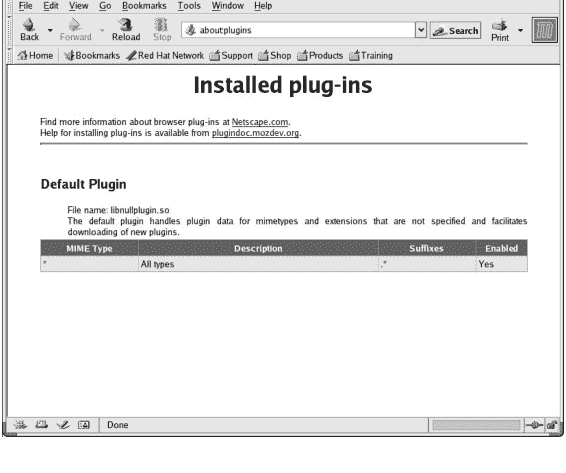

现在，你的 Mozilla 浏览器可以显示任何使用 Flash 内容的网页。

安装 Macromedia Flash Player 插件对你有很大帮助。以下列表列出了可供 Linux 使用的、你应该考虑安装的一些更常见的插件：

> - **Acrobat (Adobe):** 读取 Adobe 可移植文档格式 (PDF) 文件。许多网站通过 PDF 文件而非 HTML 或其他格式提供信息。你可以从 `ftp://ftp.adobe.com/pub/adobe/acrobatreader/unix/4.x.` 下载 Adobe Acrobat 插件。（注意你可以使用开源的 xpdf 程序来查看 PDF 文件。）

- **Shockwave (Macromedia):** 提供多媒体、图形和游戏支持。你可以从 `www.macromedia.com/downloads.` 下载 Shockwave 插件。

- **RealPlayer (RealAudio):** 允许你播放 RealNetworks 音频和视频流。许多互联网广播电台仍使用 RealNetworks 协议来流式传输其内容。你可以从 `http://proforma.real.com/real/player/unix/unix.html?src=d owner,000814rpchoice_c1` 下载 RealPlayer 插件。

  安装 RPM 包，然后将插件复制到 Mozilla 插件目录，就像 Macromedia Flash 那样：
  ```
  cp /usr/lib/RealPlayer8/rnp.so /usr/lib/mozilla-*/plugins
  ```
  你也可以使用 RealPlayer8 应用程序直接收听 RealAudio 流。

- **Java (Sun Microsystems):** 一种许多网站用于提供动态内容的编程语言。虽然动态内容形式多样，但基本上它是随时间变化的任何东西。Java 擅长提供那些有趣且常常烦人的、旋转并做其他滑稽把戏的网页元素。从 java.sun.com/j2se/1.4.1/download.html 下载适用于 Linux 的 Java 2 平台，标准版 (J2SE) RPM。

说到音乐，下一节将展示如何从 CD-ROM 播放音乐。

## 伴随着 CD 播放器的音乐

想象一下，你独自坐在电脑前工作。或者，你可能正在读一本让你感到无聊的书。当然是星期六晚上。真无聊。想要找点乐子？也许是些音乐？我们提供不了音乐，但我们可以向你展示如何使用电脑听一些乐曲。

在以下部分中，我们向你展示 Red Hat Linux 提供的工具，这些工具可以将你的工作站变成一个音响系统，包括播放 CD 所需的所有应用程序，以及将你的 PC 连接到声卡和扬声器的工具。首先确保你的电脑可以播放音乐。

## 设置你的音响系统

Red Hat Linux 在我们在第 3 章中描述的 post installation 过程中应该已经自动配置了你电脑的音响系统。然而，你可能会遇到问题——尤其是在较旧的电脑上——因此 Red Hat 提供了一个声卡检测实用程序。


您可以通过以下步骤同时配置和测试您的声卡：

1. **登录您的 Linux 计算机，点击 GNOME 菜单按钮，并选择“系统设置 > 声卡检测”。**
   如果提示，请输入 root 密码。
   音频设备窗口会打开，如图 11-2 所示。
2. **点击“播放测试声音”按钮。**
   如果您听到一些优美的音乐，您的电脑就准备就绪了。
3. **点击“确定”，即可开始使用。**

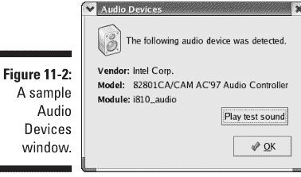

如果您正确连接并重复了上述步骤，但*仍然*听不到任何声音，可能的原因如下：

- 您的电脑配备了一老旧的、无法识别的声卡。
- 您的电脑没有声卡。
- 别人的音响音量开得太大。

如果您没有声卡，您肯定需要购买一张。使用旧声卡通常比较困难，因此我们也建议购买一张新的声卡。对于第三种可能性，我们帮不上太多忙。


红帽 Esound 守护进程（称为 *ESD*）旨在允许多个应用程序同时使用您的计算机声音系统。然而，有时应用程序可能无法充分利用这个优雅的系统。例如，当您启动 XMMS 时，可能需要关闭 ESD 守护进程。您可以通过启动一个 GNOME 终端窗口并输入以下命令来关闭 ESD：

```
HUP esd
```

## 播放 CD

每个人都希望生活中有一些音乐。但你买了台电脑，而不是音响系统。哎呀！没问题：事实证明，你确实把钱花在了明智的地方，因为你的 Red Hat Linux 计算机可以很好地充当音响系统。本节介绍如何设置你的电脑以播放音乐 CD。

Red Hat 为 Linux 用户捆绑了两个开源 CD 播放器：CD Player 和 XMMS。我们在本章中描述 CD Player，因为当你将 CD 插入电脑时，它会自动启动。（但我们并没有忽略 XMMS，因为在第 12 章中，我们将展示如何使用它播放互联网音频流。）

总之，以下步骤展示了如何开始播放音乐：

1. **以任意用户登录，并将 CD 放入 CD 驱动器。**

   GNOME CD Player 应用程序会出现。
2. **听着你的 CD 开始播放。**

这是本书中最简单的步骤。但是，如果你退出了 CD Player，你就必须手动重新启动它（除非你插入另一张 CD，在这种情况下 CD Player 会自动再次启动）。你可以通过点击 GNOME 菜单按钮并选择“Sound & Video > CD Player”来启动 CD Player。没什么难的！

对于任何 20 世纪出生的人来说，CD Player 的控制界面应该都很熟悉。以下是为那些“原始人”提供的快速复习：

- 要改变音量，请点击 CD Player 窗口右侧的垂直滑动条。在调整音量时按住鼠标按钮。
- 点击窗口中左区域的交叉工具（螺丝刀和扳手）按钮，以打开“首选项”窗口。然后你可以选择 CD Player 在启动和停止时如何反应。你还可以控制默认的 CD 设备（默认是 `/dev/cdrom`，但你可以根据你的计算机硬件将其更改为 `/dev/cdrom1` 或其他设备）。你还可以选择 CD Player 的皮肤主题。还有一个简单的帮助系统可用。
- 其余的控制项不言自明：开始、停止、前进，等等。

如你所见，播放 CD 非常简单。请注意，在第 12 章中，我们将展示如何使用简单的 XMMS 和通用的 MPlayer 播放器来播放互联网音乐流和文件。

## 抓取 CD

你有多疑吗？如果没有，你想变得多疑吗？好吧，cdparanoia 可以帮助实现你所有的恐惧。开个玩笑。实际上，cdparanoia 用于从 CD 中抓取音频信息——音乐文件——到你的硬盘或其他 CD 上。*抓取*指的是将音频从 CD 复制到你的计算机的过程。

以下步骤展示了如何使用 GNOME RIP（Grip）界面来简化使用 cdparanoia 从 CD 将音乐复制到你的硬盘的过程：

1. **将你最喜爱的 CD 插入驱动器，点击 GNOME 菜单按钮，并选择 *Sound & Video* → 更多 Sound & Video 应用程序。**
   Grip 窗口会打开，如图 11-3 所示。
2. **点击你想使用的每个轨道的 *Rip* 列（在屏幕右侧）。**
   每个你选择的轨道旁边会出现一个勾选标记。
3. **选择窗口顶部的 *Rip* 标签页（在 *Tracks* 标签页旁边）。**
4. **点击 *Rip Only* 按钮。**

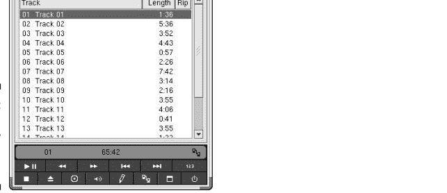

Grip 启动 cdparanoia 程序并传入你刚刚选择的选项。音乐以 Ogg 格式存储，这是一种新兴的开源协议。Grip 默认在你的主目录中创建 *ogg* 目录（假设你没有更改默认设置）。Grip 为每个你录制的 CD 创建一个子目录（在 *ogg* 中），并以该 CD 命名。单独的轨道存储在以每首歌曲命名的文件中；这些文件位于以 CD 命名的目录中。

创建音乐文件后，你可以使用 XMMS 或 GNOME-CD 来收听它。

## 进入烈火环：刻录 CD

回到 1980 年代，当黑胶唱片在 CD 的入侵下逐渐消失时，建立生产 CD 的工厂耗资巨大；当时制作一张 CD 需要巨大的努力。现在，只需大约 100 美元购买一张 CD 刻录机（*burn* 意味着刻录到 CD）的成本，你就可以建立自己的个人工厂。太棒了！


如果你没有 CD 刻录机（或写入器），本节对你没有任何帮助。抱歉。

一次性可记录 CD 称为 *CD-R*；可重写 CD 称为 *CD-RW*。CD 刻录机看起来像普通的只读驱动器，并连接在 IDE 或 SCSI 接口上。

### 使用 Nautilus Burn:// 实用程序

Nautilus 提供了一个替代的 CD 刻录实用程序。只需将 CD-R 或 CD-RW 插入 CDR 驱动器，Nautilus 就会完成其余工作。以下步骤描述了如何使用该系统：

1. **以任意用户登录**，并将 CD-R 或 CD-RW 光盘插入你的 CD 写入器驱动器。

   打开一个 Nautilus 窗口，显示你主目录的内容。
2. **双击**位于桌面左上角的你的主目录图标。
3. **点击并拖动**任何文件或目录，将其拖到 *burn://* 窗口。

   所有文件和目录都显示在 *burn://* 窗口中；这些文件和目录实际上没有被复制，而是链接到 *burn://* 窗口。
4. **点击所有需要的文件和目录以突出显示它们。**

   选择文件或目录会启用将其刻录到 CD 的功能。
5. **点击“Write to CD”按钮**，你就开始了。

   经过短暂思考后，打开“Writing CD”对话框。CD 刻录完成后，默认会弹出光盘。
6. 完成后，**点击“Close”按钮**。
7. **将 CD 托盘推回驱动器以关闭它。**

   打开一个 Nautilus 窗口，显示你刚刚刻录完成的光盘内容。

## 燃烧，宝贝，燃烧：刻录 CD

本节的步骤描述了如何创建，或*刻录*，一张 CD-ROM。你可以将任何类型的文件复制到你的 CD-R 或 CD-RW 上：

1. **以任意用户登录，并将 CD-R 或 CD-RW 光盘插入你的 CD 写入器驱动器。（当 Burn:/// 窗口打开时，关闭它。）**

   你可以刻录什么？世界是你的牡蛎，你可以制作任何你想要的 CD：数据、软件或音乐。一个好的起点是将你的 `/home` 目录备份到 CD 上。
2. **点击 GNOME 菜单按钮并选择“System Tools -> More System Tools -> CD Writer”。**

   GNOME Toaster 窗口会打开，如图 11-4 所示；还会打开一个信息对话框，你可以通过点击“OK”按钮读取并关闭它。
3. **点击窗口左下角附近的文件夹图标。**

   Gtoaster 包含自己的文件管理器。
4. **通过点击其存储所在的目录，找到你要记录的文件或目录。**

   例如，双击 `/home`，然后是 `paul/ogg/Pat Metheny` 目录。
5. **点击并拖动文件或目录（在此示例中是 `rh18fd` 目录）到你在第 3 步中打开的文件夹子窗口。**

   你不需要使用 GNOME Toaster 文件管理器来选择要记录的文件。你可以打开一个 Nautilus 窗口并将文件拖到 Track 子窗口中。
6. **点击左下角 Track 按钮正下方的 CD 图标。**

   Record 子窗口会打开并替换 Track 子窗口。你会看到几个控制 CD-R/RW 驱动器的选项。默认设置应该适用于你的 ISO 镜像。ISO（国际标准化组织）在此上下文中是一种文件系统的类型，可以被许多不同类型的计算机操作系统读取。
7. **点击“Record”按钮，CD 刻录过程开始倒计时。**

   你有九秒钟的时间中止你的任务。
8. **你可以通过按“Stop”按钮停止过程。**

   你的主目录被刻录到 CD 上，创建了一个简单、可靠且有效的备份系统。使用它很容易。


### 第三部分：Linux，啊！它有什么用处？一切都有！

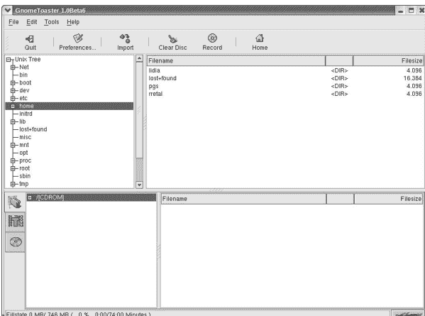

**图 11-4：** GNOME Toaster 窗口。

# 第 12 章

## 来自网络实时传输

### 本章内容

- 使用 XMMS 收听互联网音频流
- 使用 MPlayer 收听实时广播和播放 DVD

近几十年的一大创新是利用互联网传输——流式传输——音频和视频节目。流媒体技术使得任何人都可以创办在地理范围和政府审批方面不受限制的广播电台或电视台；而且其成本也极低。借助流媒体技术，计算机用户可以在任何地方收听或观看这些广播。

本章将描述如何使用 Red Hat Linux 机器作为音频接收器和 DVD 视频播放器。我们将使用开源的 XMMS 和 MPlayer 应用程序来收听网络内容。

### 使用 XMMS 音频播放器

开源的 XMMS（X MultiMedia System）应用程序是收听音频流和文件的优秀工具。XMMS 默认可以播放由 `grtp` / `cdparooia` 生成的 .wav 文件。它还可以播放新兴的开源 Ogg/Vorbis 格式（编解码器）。

Ogg 编解码器不使用任何专有或受专利保护的算法。Ogg 对任何人都免费开放，不想依赖专有系统的人和组织正在发现它的价值；Ogg 还能生成比其他流行系统（如 MP3）保真度更高的音频流。当你不需要时，为什么要受另一家公司的摆布呢？


你可以使用 XMMS 来收听你在第 11 章中可能保存的一些音乐。如果你使用 $grip$ 将音乐保存到你的主目录并想收听它，请打开 XMMS 并右键点击窗口。选择“打开 $\rightarrow$ 文件”，然后选择你创建的任何 WAV 文件。


$Ogg$ 是用于格式化音频流的系统，而 Vorbis 用于压缩已格式化的音频流。与大多数其他技术系统不同，Ogg/Vorbis 不是缩写，而是以科幻小说中的角色命名的。如需了解关于 Ogg/Vorbis 及类似开源多媒体系统的更多信息，请访问 www.vorbis.com。

现在你已经有了一些技术背景，就可以开始使用 XMMS 来收听 Ogg/Vorbis 流了：

1. **登录你的计算机并点击 GNOME 面板中的蓝色地球图标以打开 Mozilla。** 在 Mozilla 的文本框中输入地址 www.vorbis.com/music.psp。
2. **点击任意一个“曲目”链接。** 例如，点击第一个，Lepidoptera。此时会打开“正在下载 Epoc-Lepidoptera.ogg”对话框。
3. **点击“确定”按钮，然后点击“保存”按钮。** “输入要保存的文件名”窗口打开，Mozilla 将音乐文件保存到你的主目录。
4. **点击 GNOME 菜单并选择“声音与视频 $\rightarrow$ 音频播放器”以启动 XMMS。** 此时会打开一个 XMMS 窗口。图 12-1 展示了该播放器。
5. **右键点击 XMMS 窗口，选择“播放文件”，然后点击你刚刚保存到磁盘的文件名。** 当你点击“确定”按钮时，XMMS 开始播放音乐。

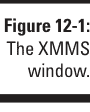

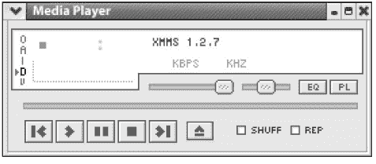

Vorbis 网页提供了其他支持 Ogg 的来源链接。例如，点击 www.vorbis.com/music.psp 页面顶部的“音乐站点页面”链接。你将看到一个包含其他来源链接的页面。例如，点击 WCPE 链接进入一个流式传输古典音乐的网页。

现在是一个描述如何配置 Mozilla 以在点击 Ogg/Vorbis 来源和流时自动启动 XMMS 的好时机：

1. **登录并打开 Mozilla，然后点击“编辑::首选项”菜单。** 首选项窗口打开。
2. **选择“浏览器::辅助应用程序”。** 辅助应用程序子窗口在首选项窗口中打开。Red Hat 为 Ogg 添加了一个 MIME（多用途互联网邮件扩展）条目，在“文件类型”子窗口中显示为 `application/x-ogg`。
3. **点击 application/x-ogg，然后点击“编辑”按钮。** “编辑类型”对话框打开，显示它知道如何处理 Ogg 格式的媒体。图 12-2 显示了完整的“编辑类型”对话框。

   此列表描述了各种字段：
   - **MIME 类型：** 与辅助应用程序关联的 MIME 类型。如果你读过第 10 章，你知道 MIME 类型有助于你的计算机决定如何处理不同的媒体格式和类型。在此字段中输入 `audio/x-ogg`。
   - **描述：** 描述 MIME 类型的简短文本。
   - **扩展名：** 此字段中的文件类型扩展名。在这种情况下，Ogg 文件使用 `ogg` 扩展名。
   - **遇到此类型文件时：** 当遇到 MIME 类型时，你希望对流执行的操作。你可以选择使用默认应用程序（在此情况下是 XMMS）；指定要使用的应用程序；或将信息保存为磁盘上的文件。
   - **处理此类型文件前始终询问我：** 强制 Mozilla 在对 MIME 类型执行任何操作之前提示你。

4. 点击 **打开方式** 按钮，并在文本框中输入 `/usr/bin/xmms`。
5. 在 **编辑类型** 对话框中点击 **确定** 按钮以返回 **首选项** 窗口。
6. 在 **首选项** 窗口中点击 **确定** 按钮以返回 **Mozilla**。

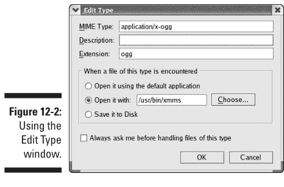

现在，每当点击指向 Ogg/Vorbis 来源的链接时，Mozilla 都会启动 XMMS。XMMS 启动并连接，然后播放流媒体。


XMMS 默认使用 Enlightened Sound Daemon (esd) 进程来访问你的计算机扬声器。esd 的设计目的是允许多个音频播放器同时使用你的计算机扬声器，但 esd 有时会混乱，你需要重新启动它。以 root 身份登录，打开一个 GNOME 终端窗口，并运行命令 `killall -HUP esd`。如果这不起作用，你可以配置 XMMS 使用其他输出系统。右键点击 XMMS 窗口并选择“选项 $\rightarrow$ 首选项”。点击“输出插件”子窗口并选择 OSS Driver 1.2.7 插件。点击“应用”按钮，然后点击“确定”按钮。

### 使用强大的 MPlayer

每当存在迫切需求时，超人——呃——开源运动，就会前来救场。直到最近，你还无法使用任何单一 Linux 应用程序来收听和观看大多数流行的流媒体格式。现在，MPlayer 横空出世，填补了这一空白。

MPlayer 可以播放大多数流行（以及许多冷门）的音频和视频流媒体格式。虽然它处于密集开发阶段，但仍 technically 处于 beta 开发阶段。然而，MPlayer 相当可用，我们认为你应该考虑使用它。我们这么做！

此列表展示了 MPlayer 可以播放的一些流媒体格式：

- MPEG-1/层 3 (MP3)：MP3 是一种流行但专有的编解码器，用于音频存储和流传输。
- Ogg/Vorbis：这种新兴的开源流媒体格式不像其他格式那样受版权或专利的限制。
- 微软媒体服务器 (MMS)：你可以使用 MPlayer 收听使用流行 MMS 格式的广播。以前，你需要使用微软客户端来收听 MMS 流。
- 数字通用光盘 (DVD)：你可以使用 MPlayer 从计算机播放 DVD。
- RealAudio：你需要下载、编译并安装 RTSP 包才能使用 RealAudio。

MPlayer 目前并未包含在 Red Hat Linux 发行版中。我们希望将来它会包含在内，但目前你需要从开发人员那里获取它。这些步骤描述了如何下载、安装和使用 MPlayer：

1. 登录，打开 Mozilla，并访问 `www.mplayerhq.hu/homepage/download.html`。
2. 点击最新的 Red Hat RPM 版本。在本书撰写时，最新的 Red Hat RPM 位于 MPlayer Red Hat 7.x RPM 包中。7.x 包适用于 Red Hat 10 系统。
3. 下载这些包中的每一个：
   - `mplayer`
   - `mplayer-common`
   - `mplayer-gui`
   - `mplayer-skins`
   - 以及这个字体包：`MPlayerISO-8859-1-font`
   
   在本书该版本撰写时，最新的 MPlayer RPM 包版本为 0.92。你可能会看到——并应使用——可用的最新版本。
4. 打开一个 GNOME 终端窗口并切换到 root：
   ```
   su -
   ```
   在提示时输入 root 密码。
5. 安装包：
   ```
   rpm -ivh --nodeps mplayer*
   ```


`www.shoutcast.com` 是音频流的一个良好来源。点击任意一个 Tune In! 按钮，Mozilla 将下载多个播放列表并启动 MPlayer 通过播放列表播放音乐。

*播放列表* 是存储一个或多个音频和视频流位置的文件。例如，如果你点击 Shoutcast 流（位于 `www.shoutcast.com`），Mozilla 会将播放列表保存到 `/tmp` 目录，启动 MPlayer 并指示其播放这些播放列表。播放列表的 MIME 类型 `x-scpls` 在安装 MPlayer 软件包时被插入到 Mozilla 中作为辅助应用程序。

或者，你可以点击“保存到磁盘”按钮，并将播放列表保存到你的主目录。然后，你可以从终端仿真器窗口或“运行程序”实用程序手动启动 MPlayer，使用命令 `mplayer -playlist playlist.pls`。


你也可以使用 MPlayer 来播放音乐文件。假设你在第 11 章中使用 *grip* 将一些音乐保存到一个名为 `track1.wav` 的文件中。输入以下命令来播放该文件：

```
mplayer track1.wav
```

按控制键然后按 C 键（Ctrl-c）以结束会话。

你可以使用 MPlayer 收听各种流。整个互联网广播世界——希望很快还有——视频广播都对你开放。MPlayer 将变得更多样化和有用。

MPlayer 也能播放 DVD！使用命令 `grep -i dvd /var/log/dmesg` 来定位 DVD 设备文件。例如，你的 DVD 设备文件应该是 `/dev/hdd` 之类的。接下来，创建一个 *软链接文件*，以便 MPlayer 知道在哪里找到 DVD 驱动器：`ln -s /dev/hdd /dev/dvd`。启动 MPlayer，右键单击 MPlayer - Video 窗口并选择 Open->Play DVD。DVD 就会播放。


第一个 MPlayer RealAudio（使用 RTSP 协议）插件最近从 `www.live.com/mplayer` 发布。该插件目前还太新，不易使用，但很快会成熟。请关注此系统。当 Live.com 的 MPlayer RTSP 插件成熟时，你可以通过从 gmplayer 或 MPlayer 打开此 URL 来收听与 Linus Torvalds 本人进行的精彩访谈：


```
rtsp://audio.npr.org/fa/20010604.fa.rm
```

在这个片段中，来自国家公共广播电台的 Terri Gross 在 2001 年夏天的她的节目“Fresh Air”中进行了一次访谈。Linus 讨论了 Linux 的开发、他在硅谷的生活以及其他事务。你也可以使用商业软件 RealPlayer8 来收听此或任何 RealAudio 流。第 11 章关于插入插件的部分描述了如何获取 RealPlayer8 RPM 软件包。

## 代理音频：让 XMMS 通过防火墙工作

防火墙是打击潜伏在互联网上的坏人所必需的，但它们可能会影响你的收听乐趣。*防火墙* 用于防止来自外部——在大多数情况下是互联网——的未经授权访问到达你的计算机或网络。

我们在第 8 章中展示如何构建的防火墙以及 Red Hat 的默认防火墙都不会影响本章中描述的任何播放器。然而，许多局域网是通过*代理*防火墙连接的，它们会拦截发送到互联网的包并根据某些规则重写它们；我们的防火墙根据包的源和目的地址以及端口进行过滤。

（gmplayer 没有专门设计用于与代理配合的机制。）

若要配置 XMMS 以与代理防火墙配合工作，请遵循以下步骤：

1.  **启动 XMMS，右键单击 XMMS 窗口，然后选择 Options → Preferences。**
2.  **在输入插件子窗口中点击 Ogg Vorbis 插件，然后点击 Configure。**

Ogg Vorbis 配置窗口会打开。你需要输入你的代理服务器地址。你可能需要联系你友好的当地系统管理员以获取该信息。

3.  **点击 Use Proxy 按钮，并在 Host 子窗口中输入代理服务器地址。**

如果你的 Red Hat Linux 工作站位于具有包过滤防火墙的网络上，例如你可能在第 8 章中安装的那个，你不需要修改 XMMS。关键在于过滤式防火墙允许所有出站的 TCP 和 UDP 连接（或端口）。但是，如果你的网络使用基于代理的防火墙，你可能需要修改 XMMS。

4.  **如果你的代理服务器需要身份验证，点击 Use Authentication 单选按钮，并在相应的子窗口中输入你的用户名和密码。**

## 从 GNOME 面板启动 gmplayer


到目前为止，你一直在手动启动 MPlayer。现在是时候将 gmplayer 放置在 GNOME 面板上的位置了。你可以在 GNOME 面板上为 gmplayer 创建一个小部件启动器（一个可点击的图标）。

*面板* 是位于屏幕底部的灰色条。

遵循以下步骤为 gmplayer 创建一个启动器小部件：

1.  **右键单击 GNOME 面板的任何空白区域，然后选择 Add to Panel → Launcher items。**
2.  **输入 gmplayer 启动器图标的名称，然后按 Tab 键以显示通用名称文本框。输入任何你想要的名称。**

诸如 `Radio Player` 或 `Streaming Audio/Video player` 之类的条目描述了启动器的用途。

3.  **再次按 Tab 键，并在 Comment 文本框中输入描述性注释。**

注释会在你将光标悬停在 MPlayer 图标上时显示。

4.  **再按一次 Tab 键，并在 Command 文本框中输入 /usr/bin/gmplayer。**
5.  **点击启动器窗口底部的 Icon 按钮，为启动器选择一个图标。**

浏览图标窗口会打开并显示通用的 GNOME 图标图像。你可以通过点击图像，然后点击 OK 按钮来选择任何你想要的图像。你将返回到创建启动器窗口。

在此步骤中选择图标图像意味着你可以跳过步骤 7 到 9，这些步骤帮助你查找自定义图标图像。跳到步骤 9。

6.  **点击 Browse 按钮以选择自定义图像。**

浏览窗口会打开。

7.  **选择任何喜欢的通用图标，然后点击 OK 按钮。**

gmplayer 图标显示在启动器窗口中，准备随时启动程序。

8.  **点击 Close 按钮，gmplayer 图标将被放置在 GNOME 面板上。**
9.  **在启动器窗口中点击 OK 按钮，然后点击你刚在 GNOME 面板上创建的新 gmplayer 启动器。**

新图标将插入到 GNOME 面板中，并打开 gmplayer 窗口。

你也可以从 GNOME 菜单访问 gmplayer。安装 MPlayer 软件包后，注销然后再登录。点击 GNOME Menu 按钮，并选择 Sound & Video → More Sound & Video Applications → gmplayer。


你可以轻松地将 gmplayer 图标（或任何图标）从 GNOME 面板复制到你的桌面上。点击并持有 GNOME 面板中的 gmplayer 图标，将其拖动到桌面上。释放鼠标按钮，图标将被复制到你的桌面背景。然后你可以右键单击桌面图标，并从弹出的菜单中选择 Properties。gmplayer 属性窗口会打开，允许你修改图标的外观和感觉。

# 第 13 章

## 进入办公室

### 本章内容

- 介绍 OpenOffice
- 使用 OpenOffice Writer
- 从 OpenOffice 打印

**R**ed Hat Linux 是一个伟大的产品，拥有大量的服务和应用程序基础。它一直是一个提供服务和应用的优秀平台。但是，直到最近，你在许多世界上的日常办公计算机上没有发现 Red Hat；换句话说，它在“桌面”上缺乏存在感。

Red Hat 的问题是缺乏一个完整的办公套件来处理文字处理文档、电子表格和类似文档。幸运的是，桌面生产力套件——如 OpenOffice 及其姊妹应用程序 StarOffice——已将 Linux 从后台办公室带到了前台。

## 打开你的办公室

OpenOffice 桌面生产力套件几乎可以做 Microsoft Office 所做的所有事情，但花费更少。少多少呢？好吧，少 100 倍，因为它 100% 免费。Sun Microsystems, Inc. 销售名为 StarOffice 的版本，并提供一个名为——你猜对了——OpenOffice 的开源版本。OpenOffice 在 GPL/LGPL 和 SISSL 许可证下授权。所有这些字母意味着什么？它们意味着免费，还意味着 Linux 可以集成来自 OpenOffice 的办公生产力功能，因为 Linux 和 OpenOffice 共享 GPL 许可证。你可以在 `www.openoffice.org/project/www/license.html` 找到更多关于许可证的信息。

OpenOffice 不仅免费（我们提到它是免费的吗？），而且功能强大，为你提供了这些功能：


### 第三部分：Linux，嗯！它有什么用？几乎无所不能！

- **文字处理器：** 一款功能完整的所见即所得（WYSIWYG）文字处理器，名为 Writer。OpenOffice Writer 具备许多你预期的功能——格式化、剪切和粘贴、图形、拼写检查等，如图 13-1 所示。它使用自己的文件格式，也可以读取和写入富文本格式（RTF）；此外，它还能处理 Microsoft Word 6.0、Word 95、Word 97、Word 2000 和 Word XP 文件。

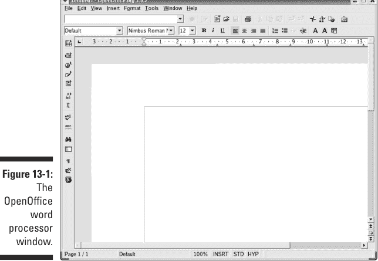

- **电子表格：** 一款功能完整的电子表格程序，名为 Calc，被华尔街经纪人用来计算期权行权价及类似项目。如果你熟悉电子表格软件，Calc 的使用应该非常简单。图 13-2 显示了 Calc 的初始窗口。

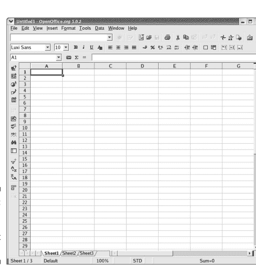

*图 13-2：OpenOffice 电子表格窗口。*

- **演示文稿：** 一款名为 Impress 的图形程序，拥有创建演示文稿所需的各种功能。你还可以使用 Impress 导入和导出 PowerPoint 文档。图 13-3 显示了 Impress 窗口。

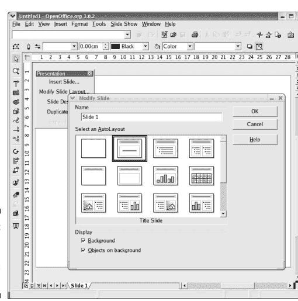

*图 13-3：OpenOffice Impress 窗口。*

- **绘图：** OpenOffice Draw 程序为你提供图形工具，用于创建从初学者画作到杰作的任何内容，如图 13-4 所示。Draw 为你的创造力的发挥提供了创建图形的工具。

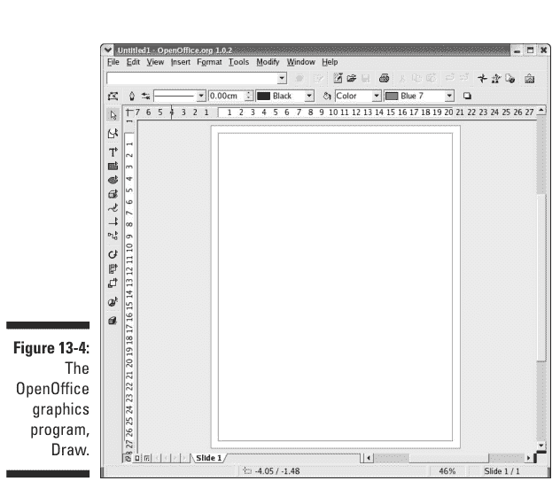

*图 13-4：OpenOffice 图形程序 Draw。*

- **杂项：** OpenOffice 提供其他功能，如 HTML 编辑器、面向高阶用户的数学编辑器，以及标签和名片制作工具。你还可以创建文字处理模板。

好吧，OpenOffice 拥有许多很棒的功能。它们有多好？它们能胜任工作吗？嗯，我们用 OpenOffice 撰写了本书的这一版，而用 StarOffice 撰写了上一版。这确实是对 OpenOffice 功能的良好证明。

#### 了解 OpenOffice

如果你熟悉 Microsoft Office，你应该能够很快熟悉 OpenOffice。外观和感觉略有不同，但理念是相同的。OpenOffice 在道德上也优于 Office，因为它是*免费的*，而且是开源的一部分。本节简要介绍了 OpenOffice 的一些最常见功能。

接下来的几节仅提供关于 OpenOffice 可以执行的操作的基本介绍。不，我们并不是懒惰；只是详细描述所有内容需要太多的篇幅。请用自己的测试文档进行实验，并查阅在线帮助系统以获取更多信息。

#### 启动和使用 OpenOffice

Red Hat Linux 提供 OpenOffice 并默认安装它。OpenOffice 易于访问。点击 GNOME 菜单按钮，然后选择 **Office > OpenOffice Writer**。你也可以从这个菜单中选择其他一些（但不是所有）OpenOffice 功能。（但是，你只能从 OpenOffice 窗口启动电子表格程序 Calc。例如，从任何窗口——Writer 或 Impress——选择 文件 → 新建 → 电子表格 来打开 Calc。）在思考人生几秒钟后，OpenOffice 窗口出现了。

第一次启动 OpenOffice 时，它会询问你是要使用工作站模式还是个人模式。前者将 OpenOffice 程序安装在所有用户均可访问的中心位置；后者选项将 OpenOffice 的副本安装在你的主目录中。在本节中，请使用工作站配置，但你也可以选择个人模式。

当你第一次使用 OpenOffice 时，还会被问及一些关于导入通讯录的问题。我们取消该操作，因为我们更喜欢使用 Ximian Evolution 通讯录。

通过点击窗口左上角的 File（文件）按钮，然后选择你需要的选项，你可以访问所有 OpenOffice 功能。

以下列表介绍了这些功能。如果你使用过 Microsoft Office，可能已经熟悉了菜单的布局和操作流程：

- **文件：** 正如你所预期的，你可以使用“文件”菜单来打开、关闭、保存或以其他方式操作 OpenOffice 文档。Writer 文件的扩展名为 .sxw。其他文件格式，如 Microsoft Word 和 HTML，必须通过导入和导出进行处理。

- **新建：** 你可以为任何 OpenOffice 功能创建新文档。当你选择 文件 → 新建 时，你可以选择创建新文本文档、电子表格、演示文稿或其他功能。

- **编辑：** 此菜单提供了修改文档所需的所有功能。诸如剪切、复制、粘贴和删除等功能均已提供。在任何时间激活的功能取决于你正在编辑的是文档、电子表格还是演示文稿。例如，如果你没有编辑文档（就像你刚启动 OpenOffice 且未打开任何文件时那样），剪切、复制和粘贴选项将是无效的。

你还可以跟踪更改，就像在 Microsoft Word 中一样。选择 编辑 → 更改，你可以按字符逐个跟踪更改。你可以显示更改，也可以将其隐藏。当你对自己的编辑感到满意时，你可以使更改永久化，并将只有完成的文档保存到磁盘。这相当酷。

OpenOffice 还提供“编辑”菜单中的查找和替换功能。查找和替换功能使你可以查找文本字符串，并将它们替换为另一个字符串或删除它们。你可以向前或向后搜索文档。你可以替换一个实例或所有实例。

**拼写检查：** OpenOffice 当然提供拼写检查器。你可以通过选择 工具 ➪ 拼写检查 ➪ 检查 来指示拼写检查器检查整个文档。对于检查器检测到的每个可能的拼写错误，系统会提示你进行操作。

或者，你可以设置拼写检查器连续运行。选择 工具 ➪ 拼写检查器 ➪ 自动拼写检查 以切换实时拼写检查器；当它被激活时，菜单选项旁边会出现一个对勾。**连续** 选项告诉 OpenOffice Writer 检查你输入的每个单词，并用红色波浪线下划线标记可能的拼写错误。当你成功纠正错误时，红线会消失。

**视图：** 此菜单显示或隐藏各种菜单栏。你可以显示文档的格式字符，并增加或减少屏幕上显示的文本大小（放大或缩小）。缩放功能使你无需更改文档即可使较小的字体更易读。

**插入：** 此菜单使你能够向文档中插入特殊字符、对象、文件和宏。特殊字符包括各种符号（例如重音符号和分音符），它们不属于日常字符集（除非你经常使用像 *café* 这样的词）。对象包括图形、符号和图表。（你可以使用 Draw 创建自己的图表。）你还可以向文档中插入宏和超链接。

你可以在文档中插入具有任意行数和列数的表格。OpenOffice 可以自动调整行高，你也可以手动调整。选择 插入 ➪ 表格，并尝试一下此功能。

**工具：** 从此菜单中，你可以访问拼写检查器、同义词词典、各种 OpenOffice 配置设置以及其他功能。诸如拼写检查器等工具都是不言自明的。

**窗口：** 此菜单使你可以控制桌面的外观。除了允许你修改和移动窗口外，该菜单还提供其他操作功能。

**帮助：** OpenOffice 提供相当好的在线帮助服务。许多服务是上下文敏感的。如果你正在编辑文本文档，点击“帮助”菜单即可访问与 Writer 模块相关的信息。

例如，选择 帮助 ➪ 帮助代理，帮助代理窗口将显示。帮助代理在新用户感兴趣的几个领域提供帮助，包括：

- **Writer 介绍：** 提供文字处理器的介绍
- **基本提示文本文档：** 告诉你关于阅读、编写和打印文本文档的所有知识（甚至更多）


- **高级提示：** 将前面基本文本文档的提示扩展到更高级的主题
- **菜单：** 描述所有 OpenOffice 菜单如何协同工作
- **工具栏：** 描述提供信息和快捷键的工具栏
- **快捷键：** 描述可用于执行各种文字处理功能的关键组合
- **新功能：** 描述自上一个 OpenOffice 版本以来的新内容
- **支持：** 显示关于从 Sun Microsystems 获取支持的简要信息

## 使用 OpenOffice 打印

在配置好 Red Hat Linux 使用打印机后，从 OpenOffice 进行打印是一个简单的过程。OpenOffice 使用默认的 Linux 打印机，因此您只需对其进行配置。本节首先描述如何配置 Red Hat Linux 打印机，然后展示如何设置 OpenOffice 以使用该打印机。

配置连接到您的 Red Hat Linux 电脑的打印机是一个简单的过程。您只需运行 `printconf-gui` 打印机配置实用程序并输入有关打印机的信息。以下步骤描述了操作方法：

1. 以 root 身份登录到您的 Red Hat Linux 电脑。
2. 将打印机连接到您的 Linux 电脑的并行（打印机）端口。

并行端口是电脑机箱背面上的 25 针母连接器。新电脑通常用某种打印机图标标记并行端口（尽管有时很难想象他们是怎么想出这个符号的）。如果您的电脑没有标记，通过试错法找到合适的端口也不会造成伤害。

3. 通过点击 GNOME 菜单按钮并选择“系统设置→打印”来启动打印机配置工具。

如果被提示，请输入 root 密码。打印机配置窗口将打开。

4. 若要添加打印机，请点击“新建”按钮。当介绍性的“添加新的打印队列”窗口打开时，点击“向前”按钮。

“添加新的打印队列”对话框将打开。


5. **输入一个描述性的队列名称（例如，Eps on 777）**，并且可选择性地输入队列的描述。（当然，您可以使用默认名称——printer——但我们更喜欢使用描述性名称。）

6. **点击“向前”按钮以打开队列类型对话框。**

假设您的打印机直接连接到您的电脑，您将看到队列类型对话框中的设备名称 `/dev/lp0`。

7. **选择 `/dev/lp0` 设备并点击“向前”按钮。**

打印机型号对话框将打开。您可以从各种制造商或通用型号中进行选择。

8. **点击“通用（点击选择制造商）”按钮。**

从下拉菜单中选择您的打印机制造商。

9. **使用垂直滑块定位并选择您的特定型号，然后点击“向前”按钮。**

完成后，“添加新的打印队列”对话框将打开。

10. **点击“完成”按钮。**

一个问题窗口将打开。您将询问是否要打印测试页。点击“确定”按钮，将打印一张测试页。一个信息窗口将打开，并提示您检查测试页是否成功打印。

11. **点击“确定”按钮返回到打印机配置窗口。**

您可以创建额外的打印队列或修改现有的队列。

GNOME 打印管理器窗口将打开，并显示您刚刚创建的新打印队列的图标。双击新图标，一个状态窗口将打开，显示当前和过去的打印任务。

现在您已将打印机连接到您的 Red Hat Linux 电脑，您可以从 OpenOffice 打印而无需进一步配置。OpenOffice 默认使用 Red Hat Linux 的打印机配置。打开您要打印的文件。从 OpenOffice 桌面，选择“文件→打印”。您可以选择打印整个文档、个别页面或页面范围。

# 第 14 章

## 美酒与应用之日

### 本章内容

- 介绍和使用 Wine
- 使用 CodeWeavers CrossOver Office
- 使用 VMware 运行虚拟 Windows 和 Linux 电脑

如果您读过本书的其他章节，您知道 Linux 提供了许多，甚至大多数桌面需求。前几章中描述的应用程序满足了您日常工作的绝大多数要求。所有基本应用程序，如 OpenOffice 和 Evolution，都在您的掌控之中。

然而，有时您需要执行 Linux 世界未提供的某些功能。例如，大多数游戏是为 Microsoft 世界编写的，不能在 Linux 上使用。在某些时候，例如当您需要使用复杂宏编辑文档时，您必须使用 Microsoft Word。这时，Wine 和 VMware 就派上用场了。

尽管如此，总有改进的空间，开源界努力工作以提供新的和有用的应用程序。

### 介绍 Wine

Wine 并不来自索诺玛山谷，甚至不是来自法国南部。您也不会因此微醺或花很多钱。Wine 不是饮料，而是一个软件系统，允许您在 Linux 电脑上运行 Windows 应用程序。Wine 有助于填补 Linux 应用程序的空白。

现代 Windows 应用程序，其核心是为 Intel 或 Intel 兼容（例如 AMD）奔腾处理器编写的。（一些 Windows 应用程序在 Apple Mac 上运行；然而，就本文讨论而言，我们只谈论基于 Intel 的 PC。）但是，您不能只是将像 Microsoft Word 这样的程序加载到您的 Linux 电脑上并期望它能正常工作。

Microsoft Windows 操作系统提供了一个运行 Microsoft 应用程序（如 Word）的平台。该平台有点像提供电力以运行各种电器的电气插头；电器类似于应用程序。Windows 插头提供的是一个常用低级函数的库，称为应用程序编程接口（API）。这些函数执行每个应用程序共有的任务，如打开文件或通过网络通信。使用公共库防止每个应用程序重新发明轮子。相反，应用程序只需插入公共“插座”并专注于执行其特定功能。

问题是，Windows 平台或“插头”有方孔，而 Linux 有圆孔。例如，您不能将 Word 直接插入 Linux 操作系统。这时 Wine 介入并提供适配器，使您可以将圆钉插入方孔。


Wine 代表 Wine Is Not an Emulator（Wine 不是模拟器）。这种典型的缩写是 Linux 和 Unix 程序员所喜爱的那种。Wine 这个缩写不仅意味着有些人只需多出去走走，还意味着它并不模拟（仿真）整个 Windows 环境。相反，它复制了应用程序与操作系统之间的接口。使用电气插头的比喻，Wine 并不模拟整个电网（如 Windows 那样），而是简单提供适配器。

### 下载 Wine

不幸的是，由于 Red Hat 未在其发行版中包含 Wine，您必须从互联网下载它。以下步骤描述了如何操作：

1. **以任意用户身份登录到您的 Red Hat Linux 电脑。**

   如果需要，您可以以超级用户（root）身份登录，但这并非必要。不以超级用户身份登录，您就不会有意外损坏电脑的风险（例如，删除所有您的文件）。

2. **通过点击 GNOME 菜单上的蓝色地球图标打开您的 Mozilla 浏览器。**

   第 11 章描述了如何使用 Mozilla。

3. **在浏览器顶部的文本框中输入地址 www.winehq.com 并按 Enter。**

   您将前往 Wine 项目的首页。

4. **在网页中左侧“下载”标题下，点击“二进制文件”链接。**

   您的浏览器将显示 Wine 二进制下载页面。此页面包含指向各种非商业和商业存储库的链接。


（我们稍后将介绍本章中 Wine 的商业版本。）本节描述如何获取和使用 Wine 的非商业版本。

- 5. **点击 SourceForge.net 链接。**

SourceForge 网站包含适用于各种 Linux 发行版的 Wine 软件包，包括 Red Hat 的版本。（SourceForge 是一个广为人知且流行的许多 Linux 系统的软件仓库，并不限于只提供 Wine。）

- 6. **选择最新的 Red Hat RPM。**

RPM，即 Red Hat Package Manager（Red Hat 软件包管理器），用于安装和管理软件。有关使用 RPM 的信息，请参见附录 E。

在撰写本书时，最新版本为 `wine-20030813-1rh9winehq.i686.rpm`。该软件包是为 Red Hat Linux 9 编译的，但可以在 Red Hat Linux 10 上运行。（不要下载日期早于 20030618 的软件包。日期早于 2003 年 6 月 18 日的软件包通常可以工作，但它们需要修改才能与 Microsoft Office 和 Word 配合使用。）


如果你不确定你的计算机使用哪一类 Intel（或 Intel 兼容）处理器，请选择 i386 版本。即使你的计算机使用的是 i686 类处理器，使用 i386 版本的 Wine 也能工作——只是效率不如 i686 高。


SourceForge.net 下载服务器页面将打开，并提供多个地理位置供你下载。

- 7. **点击离你最近的链接。**

将打开一个对话框，其中“将文件保存至磁盘”按钮处于选中状态。

- 8. **点击“保存”按钮，将打开一个标有“输入要保存的文件名”的对话框。**

默认位置是你当前的工作目录。点击“保存”按钮，下载过程开始。将打开一个进度窗口，显示进度条和预计完成时间。

### 安装 Wine

下载 Wine 后，你必须安装它。这些步骤描述了安装过程：

- 1. **要安装 Wine 软件包，请通过双击桌面左上角的“主目录”图标打开 Nautilus 文件管理器。**

主目录图标标记为 X 的主目录，其中 X 是你登录使用的用户名。例如，如果你以用户 Gabe 身份登录，则显示为 Gabe 的主目录。

- 2. **右键点击 Wine RPM 软件包文件**，然后选择**使用“安装软件包”打开**。将打开一个查询窗口，如果你未以 root 身份登录，会提示你输入 root 密码。

- 3. **如果被提示，请输入 root 密码**。软件包管理器将检查计算机的当前状态，并打开“系统准备完成”窗口。

你可以选择点击**显示详细信息**按钮，查看你即将安装的 Wine 软件包的摘要。

- 4. **点击“继续”按钮，Wine 软件包将被安装**。当窗口消失时，你的软件包已安装完毕。

或者，你可以通过“手动”方式安装软件包：打开终端窗口，切换到 root（su -）并输入命令 `rpm -ivh wine*`。有关手动安装过程的更多信息，请参见附录 E。

### 运行记事本和 Wine 文件管理器

你刚刚安装的 Wine 软件包（如果你阅读了上一节）包含几个简单的 Windows 应用程序。这些应用程序是这些应用的*模拟*版本。Wine 贡献者不仅复制了功能，还复制了外观和感觉，以便提供一些即时的满足感。

我们利用这一情况演示了几个程序。这些步骤描述了如何运行记事本和文件管理器程序：

- 1. **以普通用户（而非 root）身份登录。**
- 2. **点击 GNOME 菜单，并打开“运行程序”菜单。**
- 3. **点击“在终端中运行”单选按钮。**
- 4. **在文本窗口中输入以下命令：**

```text
wine notepad.exe
```

首次运行 Wine 程序——例如，`wine notepad.exe`——会在你的主目录中创建一个 `.wine` 目录。`.wine` 目录包含 Wine 系统运行所需的所有配置信息。配置信息包含在 `config` 文件中。几个其他文件——全部带有 `.reg` 后缀——模拟 Windows 注册表。Windows 操作系统使用注册表来组织其配置参数；而 Linux 则使用单独的文件（例如 /etc、/etc/sysconfig 和 /usr/local/etc 目录中的文件）来保存其配置信息。

- 5. **点击“运行”键，记事本窗口将打开，如图 14-1 所示。**

你可以使用记事本创建、修改和保存文本文件。

Wine 也提供了一个类似 Windows 的文件管理器。

- 6. **重复步骤 2–5，并用 winefile 替换 wine notepad.exe：**

Wine 文件（文件管理器）将打开，显示你当前工作目录的内容。

### 玩游戏

既然你可能对文本编辑已经看腻了，你可以探索 Wine 的真正威力。Wine 擅长运行尚未提供 Linux 形式的程序。从下载基于 Windows 的共享软件游戏开始。

*共享软件*是开发者让你免费测试的软件；有时，该软件有有限的试用期。如果你喜欢它，你可以——也应该——给程序员发送一小笔费用。

图 14-1：Wine 记事本工具。

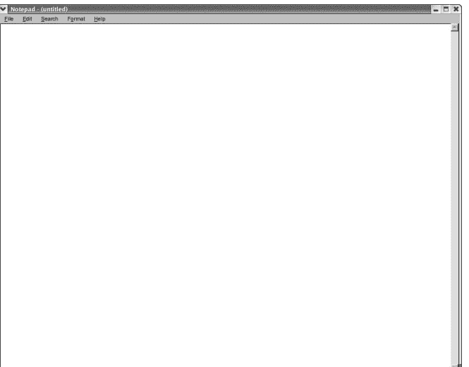

### Wine 实用工具

Wine 提供了一些有用的实用工具，帮助你配置和测试它。此侧边栏描述了一些工具。

- **wineboot：** 模拟 Windows 计算机的重启。当你安装大量 Windows 应用程序（例如，Microsoft Word）时，需要重启，此实用工具提供此功能。
- **winpdb：** 调试 Wine 应用程序。此实用工具展示了表面之下的工作情况。只有当你正在开发 Wine 应用程序时才需要使用此实用工具。
- **winecfg：** 帮助设置许多 Wine 配置选项。
- **clock：** 复制简单的 Windows 时钟。
- **regedit：** 复制注册表编辑器。
- **progman：** 充当程序管理器。

你可以尝试运行其中一个 Wine 实用工具。例如，测试 winfile 实用工具，它充当文件管理器。

像我们这样有些呆板、上了年纪的人仍然喜欢呆板、老式的游戏，比如 PacMan（哇！——甚至我们虚度的青春也是呆板的），因此我们向你展示如何下载类似 PacMan 的街机游戏。这些步骤描述了软件下载位置以及安装方法（弄清楚 PacMan 的启发式方法由你决定）：

- 1. **以普通用户身份登录，并通过点击 GNOME 面板上的蓝色地球（带鼠标环绕）打开你的 Mozilla Web 浏览器。**
- 2. **在浏览器顶部的文本框中输入地址 www.tucows.com 并按 Enter 键。**
- 3. **在“计算机游戏”标题下，靠近网页中心，点击“Windows”链接。**

你的浏览器将显示一个包含许多类别游戏的页面。

- 4. **在“街机”标题下，点击“PacMan”链接。**
- 5. **在下一个窗口中点击“WinPac2”链接。**

WinPac 2 1.03b 页面将打开。

- 6. **点击“Win98”选项，“下载 WinPac2_103b.exe”对话框将打开。**


“选择区域”窗口将打开。

Win95 程序可以运行，但经常有问题。

- 7. **点击合适的地理下拉菜单，选择你的州或国家，然后点击“Go”按钮。**

“选择镜像”窗口将打开。

- 8. **点击离你最近的镜像。**
- 9. **当“打开 WinPac2_103b.exe”对话框打开时，点击“确定”按钮。**
- 10. **在“输入要保存的文件名”对话框中点击“保存”按钮。**

WinPac2 安装程序将保存到你的主目录。

以下步骤描述了如何安装和运行游戏。大多数 Windows 应用程序的安装应该与此类似：你启动安装程序，然后看到一个图形用户界面（GUI）：

- 1. **点击“GNOME 菜单”并打开“运行程序”菜单。**

“运行程序”窗口将打开。

- 2. **点击“在终端中运行”按钮，并在文本窗口中输入以下命令：**

```text
wine WinPac2_103b.exe
```

- 3. **点击“运行”键，“WinPac2 设置：许可协议”窗口将打开。**

阅读许可。

- 4. **点击“我同意”按钮。**

“WinPac 2 设置：安装选项”窗口将打开，并显示典型的安装选项。

- 5. **点击“快速启动图标”和“桌面图标”选项。**

安装图标使启动游戏对你来说更方便。

- 6. **点击“下一步”按钮，“WinPac 2 设置 安装目录”窗口将打开**，显示游戏文件的安装位置。

C: 标记是你主目录中 .wine/c 目录的别名。例如，如果你的主目录是 /home/gabe，那么 C: 对应于 /home/gabe/.wine/c。

- 7. **点击“安装”按钮，“WinPac2 设置 正在安装文件”窗口将打开。** 完成后，它变为“WinPac2 设置：完成”。

- 8. **点击“关闭”按钮，你已完成安装。**


Wine Web 页面提供经过测试的应用程序数据库。访问 http://appdb.winehq.com/ 浏览已知在 Wine 下运行的应用程序。Wine 主 Web 页面提供有关应用程序的更多信息，位于 www.winehq.com/?page=supported_applications。应用程序分为 Gold 和 Silver 列表。Gold 级程序运行最佳；Silver 程序可以运行，但并非完美无瑕。


启动基于 Wine 的应用程序有几种方法：

- **手动操作，通过使用终端模拟器：** 以通常的方式打开一个终端模拟器窗口，然后输入此命令：`wine "C:\Program Files\WinPac 2\WinPac2.exe"`
- **通过使用 GNOME 运行实用程序：** 打开 GNOME 运行实用程序并输入此命令：`wine "C:\Program Files\WinPac 2\WinPac2.exe"`
- **通过创建并点击一个 GNOME 图标：** 该方法在下述一系列步骤中有详细说明。

我们将展示如何创建一个 GNOME 图标，以轻松使用新游戏。这些步骤描述了该过程：

1. **在 GNOME 面板上任意位置右键单击，并选择“添加到面板 → 启动器”。**
   “创建启动器”窗口将打开。
2. **在“名称”文本框中输入 WinPac2，并在“命令”文本框中输入此命令：** `wine "C:\Program Files\WinPac 2\WinPac2.exe"`
3. **单击“图标”按钮，并在打开的“浏览图标”窗口中选择一个图像。**
   例如，选择 Apple 图标。
4. **单击“确定”按钮，图标将在面板上创建。**
5. **单击新的 WinPac2 图标，游戏即启动，如**图 14-2**所示。**

### 运行 Microsoft Word（这确实很有用）

你也可以使用 Wine 运行主要应用程序。例如，你可能更喜欢使用 Microsoft Word 而不是 OpenOffice。幸运的是，Wine 提供了这种功能。

在本节中，我们将展示如何在我们的 Red Hat Linux 计算机上安装 Microsoft Word 2000。当然，你必须拥有 Word 2000 的许可证，但你不需要 Windows 2000 操作系统的许可证。Wine 提供了运行像 Word 2000 这样的应用程序所需的所有库挂钩和杂项项目。


Wine 持续被修改和更新，以保持与 Microsoft 尽可能高的兼容性。然而，Wine 偶尔在运行如 Office 和 Word 等复杂应用程序时会出现问题。如果你遇到此类问题，请查阅我们的帮助页面 [www.dummies.com/go/rhlfedoraf4](https://www.dummies.com/go/rhlfedoraf4) 以查找可能的解决方案。你也可以使用商业 Wine 变体，如 CrossOver Office，来运行 Office 或 Word。


去找你的 Word 2000（或 Word 97、Word XP 或其他版本）光盘，准备好开始吧。这些步骤展示了如何安装和使用该文字处理器：

1. **以非 root 用户身份登录你的计算机，并将 Microsoft Word 2000 CD 插入 CD-ROM 驱动器。**

   这些步骤在 Microsoft Office 2000 CD 上应该也能良好运行。

2. **单击 GNOME 菜单，选择“系统工具 -> 终端”。**

   “运行程序”窗口将打开。

3. **在此文本窗口中输入此命令：**

   ```
   wine --dll cabinet=n /mnt/cdrom/setup.exe
   ```

   如果你有两个驱动器，可能需要将 `cdrom` 替换为 `cdrom1`。

   根据你安装的 Wine 的状态，你可能会看到一个 Microsoft Word 2000 设置窗口，通知你它找不到字体。缺失的字体通常不会影响应用程序的功能。

4. **每当出现缺失字体警告时，单击“确定”按钮。**

   安装过程在进展过程中会显示大量信息。你可以忽略这些闪过的行。它们不影响安装过程。

   Microsoft Word 2000: 欢迎 窗口将打开。

5. **在五个文本框中输入你 Microsoft Word 2000 光盘（或微软将光盘封入的物理包装中）上的产品密钥。**

   请记住，Wine 仅提供运行有效 Windows 应用程序的*平台*。它不提供应用程序本身。

6. **下一个窗口显示安装标准 Word 配置的选项，或者可选地自定义安装。**

   为了简单起见，我们建议单击“立即安装”按钮。（如果你选择“自定义”选项，我们需要留给你去导航各种额外的配置步骤。）

   安装将继续，直到提示你重新启动计算机。当然，你运行的不是 Windows 计算机，所以单击“否”按钮。安装过程似乎结束了。

7. **Wine 提供了一个 Windows 重启模拟实用程序。重复步骤 2 和 3，并输入此命令：**

   ```
   wineboot
   ```

   安装过程再次启动并完成。你已经在 Linux 计算机上安装了 Microsoft Word 2000！

8. **通过重复步骤 3–5 并在此文本窗口中输入此命令，你可以启动文字处理器：**

   ```
   wine "C:\Program\Files\Microsoft\Office\Office\winword.exe"
   ```

   

   在 Linux 世界中，反斜杠 (\) 是转义字符；在 Windows 世界中，反斜杠用于分隔目录名。也就是说，它们防止 Linux（bash shell）将后面的字符按字面意思解释。如果没有反斜杠，Linux（bash）会将目录名 `Program Files` 解释为两个独立的实体 Program 和 Files，因为 bash shell 认为空格字符是分隔符，而不是目录名或文件名的一部分。因此，反斜杠和空格的组合——`Program\ Files`——允许 Linux 正确处理好目录名：Program Files。前面的命令（参见步骤 8）被 Linux 解释为 `wine C:\Program\ Files\Microsoft\Office\Office\winword.exe`。

### 介绍 CodeWeavers CrossOver Office

出色的 Wine 系统让你能够利用 Windows 世界的深厚资源。Wine 是在开源系统下开发的，志愿者为计算世界提供了无数小时的无偿服务。然而，开源社区并不限制其软件仅用于非商业用途。根据通用公共许可证（GPL）开发的软件允许商业使用，只要不限制原始 GPL 软件的使用即可。

在特定情况下，开源软件的商业使用可以提供额外的动力。为了利润而开源？确实如此。像 CodeWeavers（[www.codeweavers.com](https://www.codeweavers.com)）和 TransGaming（[www.transgaming.com](https://www.transgaming.com)）这样的公司就提供了这样的动力。这两家公司都为基本的 Wine 软件增加了功能，使安装过程更简单。CodeWeavers 专注于让 Wine 在通用桌面上更易用；该公司使安装和使用 Microsoft Office、Internet Explorer 以及各种插件变得简单。另一方面，TransGaming 的产品 WineX 则提供了一个面向游戏的系统。

本书侧重于将 Linux 用作实用的日常工作站。我们的工作倾向于使用文字处理器和类似程序。我们将使用 WineX 的实验留给你去进行。只需说明一下，我们面向游戏的同事认为 WineX 很有用。

CodeWeavers 生产两种产品：CrossOver Office 和 CrossOver Plugin。Office 作为安装实用程序具有价值，有助于安装 Windows 应用程序。Plugin 产品提供内部开发的软件，有助于使用插件。CrossOver Office 主要使用未修改的 Wine 软件，但提供了一个时尚的安装系统。CrossOver Plugin 使用其自定义库，使 Windows 插件（如 QuickTime）能够与你的 Linux 浏览器配合使用。CrossOver Office 的成本为 54.95 美元，Plugin 的成本为 24.95 美元。你可以以 69.95 美元购买两者。（这些价格是指从互联网下载产品时的价格。CD 版本的价格分别为 64.95 美元、34.95 美元和 79.95 美元。）

### 下载 CrossOver Plugin 的试用版

CodeWeavers 慷慨地为 CrossOver Plugin 和 CrossOver Office 提供 30 天的评估许可证。因此，你可以测试其产品的完整版本。这些步骤描述了如何下载 CrossOver Plugin 的试用版：

1. 以超级用户身份登录你的 Red Hat Linux 计算机。
2. 打开 Mozilla 并前往 [www.codeweavers.com/products/download_trial.php](https://www.codeweavers.com/products/download_trial.php)。
3. 单击页面顶部的 CrossOver Plugin 按钮。
4. 填写注册表单并单击“请求评估”按钮。
   “下载 CrossOver 试用版”页面将打开，通知你 CrossOver 的安装说明正在通过电子邮件发送给你。
5. 当信息通过电子邮件发送给你时，在 Mozilla 中打开此页面：[http://crossover.codeweavers.com/download/plugin-trial](http://crossover.codeweavers.com/download/plugin-trial)。
   “CrossOver 安全下载”窗口将打开。
6. 在“访问密钥”和“序列号”文本框中输入刚刚通过电子邮件发送给你的访问密钥（你的电子邮件地址）和序列号。
7. 单击“下载”按钮。
   “正在下载 install-crossover-plugin-1.2.1-demo.sh”对话框将打开。
8. 单击“确定”按钮。
   “输入要保存到的文件名称”对话框将打开。
9. 单击“保存”按钮，软件将保存到你的当前目录。

### 安装 CrossOver Plugin

在你下载了 CrossOver Plugin 安装系统之后，你的下一步是安装 CrossOver Plugin。这些步骤描述了如何使用安装系统来安装和配置软件：

1. 以（root）超级用户身份登录。
2. 打开一个 GNOME 终端窗口。
3. 输入以下命令：
   ```
   chmod +x install-crossover-plugin-1.2.1-demo.sh
   ./install-crossover-plugin-2.0.2-demo.sh
   ```
   “许可协议”对话框将打开。
4. 阅读许可证并单击“我同意”按钮。
   “CrossOver Plugin 设置”窗口显示了 Plugin 软件将安装的位置。默认目录是 /opt/cxplugin（该目录将为你创建）。
5. 单击“开始安装”按钮，CrossOver Plugin 软件将为你安装。
   当安装完成时（可能需要几分钟），“CrossOver Plugin 设置”窗口将显示消息 `Installation complete`。


6. **单击“Configure Now”按钮。**
插件设置窗口将打开。

7. **单击“Install”按钮。**
安装软件窗口将打开，显示可供安装的插件列表。

8. **单击“Next”按钮。**
浏览器选择窗口将打开，显示将为 Netscape 和 Mozilla 安装的插件。

9. **单击“Next”按钮。**
HTTP 代理配置窗口将打开，允许您配置插件以配合 Web 代理服务器工作。代理服务器会过滤您可以浏览的位置。如果您有代理，请输入相关代理信息。

10. **单击“Finish”按钮。**
CrossOver 插件设置窗口将打开，如“图14-3”所示。


#### 使用 CrossOver 插件

配置过程的下一阶段允许您从众多流行的 Windows 插件中选择。当您选择要安装的插件时，系统会自动为您从互联网下载。简单快捷。

以下步骤介绍了如何选择一个 Windows 插件并自动下载它：

1. **单击“Install”按钮，随后将打开下一个 CrossOver 插件设置窗口。**
   “图14-4”展示了安装软件窗口。
2. **单击 QuickTime 6 插件。**
3. **单击“Next”按钮。**
   “Express Install (Recommended)”按钮默认被选中。


4. 单击“Next”按钮，QuickTime 6 插件将从互联网下载。
   QuickTime 6 设置窗口将打开，如“图14-5”所示。
5. 单击“Next”按钮。
   将显示一个欢迎屏幕。
6. 单击“Next”按钮以继续。
   下一个窗口显示 QuickTime 许可协议。
7. 阅读该许可协议（最好是在坐满律师的房间里阅读），然后单击“Agree”按钮。
   下一个窗口显示将安装 QuickTime 插件的安装位置。默认位置是模拟的 Windows 目录，实际上是您主目录中的 `.wine/c/program files` 目录。
8. 单击“Next”按钮。
   选择安装类型对话框将打开。
9. 您可以选择不同复杂程度的级别。最低级别（默认级别）通常就足够了，因此只需单击“Next”按钮即可。
10. 当“Select Program Folder”打开时，单击“Next”按钮以选择默认文件夹名称：QuickTime。
    深呼吸一下，因为您快要完成了。下一个窗口是输入注册信息的窗口。
11. 输入您的姓名和组织名称（如果您有的话）。（您不需要输入注册号。）单击“Next”按钮。

12. 最后一步是输入任何代理信息。如果您有代理（例如，如果贵公司网络使用代理），请获取其信息并输入。
13. 单击 *Continue* 按钮。
    安装系统会思考片刻，然后在从互联网下载 QuickTime 插件时显示一个进度对话框。


**图14-5：QuickTime 6 设置对话框。**

#### 配置 QuickTime

最终的 QuickTime 配置过程从 QuickTime 设置/介绍窗口打开时开始。以下步骤介绍了如何完成 QuickTime 的配置：

1. 单击 *Next* 按钮，**连接速度对话框**将打开。
   连接速度对话框询问您使用哪种类型的互联网连接。
2. 从**下拉菜单**中**选择您的连接速度和类型**，然后单击 *Next* 按钮。
   浏览器插件窗口将打开，询问您是否想要更改哪些 MIME 设置（如果有的话）。
3. **默认设置应该就可以了，因此单击 *Next* 按钮。**
   接下来打开的文件类型关联窗口允许您选择 QuickTime 应该处理哪些类型的文件。默认选项是 QuickTime，用于处理 Mac 文件（例如 PICT 和 AIFF）。
4. 进行适合您的任何更改，然后单击 *Finish* 按钮。
5. **单击“Yes, I Want to Launch QuickTime Player”按钮，然后单击“Close”按钮。**
   安装报告窗口将打开，显示所有插件的信息。
6. **单击“OK”按钮，控制权返回到 CrossOver 插件设置窗口。**
   CrossOver 安装系统除了安装插件外，还会为 QuickTime 播放器应用程序安装链接。CrossOver 还会在 GNOME 主菜单上安装菜单项。
7. **单击 GNOME 菜单按钮，然后选择“Programs ➔ QuickTime ➔ QuickTime Player”。**
   QuickTime 播放器将打开，您可以在“图14-6”中看到这一点。
   CrossOver 还会安装其自己的实用工具。单击 GNOME 菜单并打开 CrossOver 菜单。您将看到几个实用工具。单击“Plugin Setup”选项，插件设置窗口将打开。


QuickTime 插件及其支持软件安装在主目录中的 `.mozilla/plugins` 目录中。您可以通过打开 Mozilla 并选择**Help→About Plugins**来验证插件是否已安装。Mozilla 将显示所有已安装的插件。

#### VMware：一台虚拟现实机器

有时，您需要使用一个在 Linux 下根本无法运行的应用程序——即使借助 Wine 的帮助也不行。例如，我们其中一人必须使用故障单系统来解决客户的问题。问题是，该故障单应用程序在 Linux 下无法运行，无论是否使用 Wine。因此，那位作者必须在他的计算机上同时安装 Windows 和 Linux（**双启动系统**），否则就得维护一台专门用于运行该单一应用程序的独立计算机。

当然，使用双启动计算机没有什么不对。但如果只需要运行一两个应用程序，这样做有点浪费时间。双启动计算机在需要使用另一个操作系统时还必须重新启动。双启动的一种替代方案是 VMware，这是 VMware, Inc. 的一款商业产品。该程序在物理计算机内创建了一台虚拟计算机。虚拟计算机作为一个应用程序运行，就像 OpenOffice 或 Mozilla 一样。

VMware 看起来和工作起来就像一台真正的 PC。VMware 虚拟 PC 可以像任何真实计算机一样运行操作系统，例如 Linux 或 Windows。在虚拟机上运行的操作系统行为与真实操作系统完全相同。因此，它托管的任何应用程序看起来和工作起来也与真实应用程序完全一样！


VMware 也很适合编写 Linux 书籍。像这样编写技术性书籍需要在初稿阶段使用新版本的早期测试版。老方法要求将测试版安装在您的计算机上，并同时用于测试和写作；或者，您可以在旁边使用两台计算机。这两种方法都很笨拙，当测试版做出一些奇怪的操作时会带来无数头痛。VMware 允许您在主计算机上运行当前的 Red Hat Linux 生产版本，并在虚拟计算机上安装测试版，从而解决了这个问题。您可以在 OpenOffice 中写作的同时，随心所欲地测试该测试版——全部在同一台虚拟计算机上进行。从一个测试版本更新到另一个版本也很容易。

您可以免费下载 VMware Workstation 产品。它需要一个许可证，商业使用费用约为 300 美元，教育使用费用为 100 美元。这笔钱花得值。

VMware 虚拟计算机可以使用主计算机的网络连接。VMware 提供了两种访问专用局域网的方法和一种访问主计算机本地文件系统的方法：

- **桥接网络：** 通过主机的网络接口卡（NIC）将虚拟机“桥接”到主机的专用网络上。对于局域网，虚拟机似乎是一个独立的网络设备。虚拟计算机拥有自己的虚拟 NIC 和一个真实的 IP 地址。桥接配置为虚拟机提供了最灵活的网络配置。然而，虚拟机必须像任何其他设备一样进行配置和维护。

- **网络地址转换（NAT）网络：** 一种使一台联网计算机看起来像另一台计算机的过程。NAT 将源网络地址（和端口）转换为另一个地址（和端口）。这种方法被专用网络广泛用于将所有主机通过单一网关访问互联网。VMware 使用 NAT 使虚拟机在主机局域网中看起来就像主机。由于只需配置虚拟机的网络配置协议（DHCP），NAT 很容易配置。因此，您只需选择 DHCP，无需其他配置。（我们在第 16 章中介绍了 NAT。）

- **仅限主机网络：** 配置虚拟机使用主机的文件系统。VMware 在主机上设置 Samba，然后虚拟机可以挂载主机的文件系统。(*Samba* 是一个与 Microsoft 文件共享系统使用相同协议（或语言）的 Linux/Unix 系统。Samba 允许 Linux 计算机访问 Windows 计算机上的文件系统，反之亦然。）

VMware 还免费提供 30 天的评估许可证。该临时许可证除了时间限制外没有任何其他限制，非常适合测试这个强大的工具。以下部分中的步骤介绍了如何下载该产品及其临时许可证，以了解其强大功能。

### 下载 VMware

VMware, Inc. 允许您轻松下载和使用其软件。这些步骤描述了该过程——人人都可以享用虚拟计算！

1. **登录到您的 Red Hat Linux 计算机，打开 Mozilla 浏览器，并在文本框中输入 www.vmware.com/download。**
2. **在“Desktop Products”下，单击“Download”按钮。**
   VMware Workstation 4 窗口将打开。您需要获取一个临时许可证才能使用该软件。
3. **单击“Evaluation Serial Number”链接。**
   “Try VMware Workstation 4”窗口将打开。


### 安装 VMware Workstation

4. 点击 **注册** 按钮，注册表单将打开。填写表单时，请务必填写所有标有红色星号的字段。
5. 点击 **继续** 按钮，浏览器将跳转到 **下载** 页面。
6. 点击 [适用于 Linux 系统的二进制文件下载](https://example.org/download) 链接。
7. 阅读 **VMware 最终用户许可协议**，并点击 **是** 按钮。您将看到“下载 VMware Workstation 4（适用于 Linux 系统）”链接。您可以从全球各地的多个站点进行下载。
8. 点击离您最近的站点上的 **RPM 版本**。将打开 **输入要保存的文件名** 对话框。
9. 点击 **保存** 按钮。VMware-workstation RPM 文件将被保存到您的主目录。


您不仅限于将此文件或其他文件保存在主目录中。您可以选择任何您拥有写入权限的位置。例如，您可能希望将其保存到 `/tmp` 目录。

10. 点击 **评估版序列号** 按钮。
11. 点击 **注册** 按钮，并在显示的表单中输入您的姓名、电子邮件地址和其他信息。确保在“产品主机平台”部分指定 Linux。完成表单后，评估版许可密钥将通过电子邮件发送到您提供的地址。

下载软件和评估版许可后，请阅读以下章节以安装软件。

### 安装 VMware

下载 VMware 软件后，您只需安装它即可。该软件以 Red Hat 包管理器（RPM）格式提供，具有自安装功能；有关 RPM 操作的更多信息，请参见附录 D。这些步骤描述了如何解包 RPM 包并安装许可：

1. 双击桌面左上角的 Home 图标，打开 Nautilus 文件管理器。
2. 右键点击 VMware-workstation RPM 包文件，选择“打开方式：安装包”。如果您未以 root 身份登录，将打开查询窗口并要求您输入 root 密码。
3. 如果被提示，请输入 root 密码。包管理器将检查您的计算机状态并打开“系统准备完成”窗口。
4. 点击 **继续** 按钮，VMware-workstation 包将被安装。当窗口消失时，VMware Workstation 即安装完成。

#### 安装 Linux 内核头文件

VMware 使用类似于 Windows 设备驱动的 Linux 内核模块与宿主 Linux 计算机进行交互。VMware 附带了一些版本的 Red Hat Linux 可自动使用的内核模块。然而，我们无法确定这些模块是否与您随本书附带的 Linux 内核相匹配。因此，以下步骤将帮助您构建自己的 VMware 内核模块。

构建 VMware 模块需要存在 Linux 内核头文件，而您的计算机上可能未安装。您需要通过安装 Linux 内核源代码 RPM 包来安装头文件。请按照以下步骤操作：

1. 将附带的 DVD 插入 DVD-ROM/CD-ROM 驱动器。
2. 点击 GNOME 菜单按钮，选择“系统工具 -> 终端”。
3. 如果您不是以 root 身份登录，请运行以下命令：
   ```
   su -
   ```
4. 在提示时输入 root 密码。
5. 输入以下命令以安装 Linux 内核头文件：
   ```
   rpm -Uvh /mnt/cdrom/RedHat/RPMS/kernel-headers*
   ```
内核源包已安装，现在您可以配置 VMware 了。

### 配置 VMware Workstation

本节将引导您完成构建（如必要）、安装正确的内核模块以及配置所有或部分虚拟网络连接的过程。完成本节内容后，您将拥有一个能够运行 Linux 和 Windows 工作站的可用虚拟 PC。

#### 启动 VMware 配置过程

本节描述了如何开始配置您的 VMware 虚拟 PC。以下步骤描述了如何使用 VMware 配置脚本。

1. **以超级用户（root）身份登录。**
2. **点击 GNOME 菜单按钮，选择“系统工具 > 终端”。**
3. **终端模拟器窗口打开后，在终端模拟器窗口中输入命令** `vmware-config.pl` **。** `vmware-config.pl` 脚本将显示 VMware 许可协议。
4. **按 Enter 键开始显示整个协议，并继续按空格键显示每一新页。**
5. **假设您是一位律师，并且了解并接受了刚才阅读的内容，在提示时输入 yes 并按 Enter 键。**

配置脚本会尝试为您当前版本的 Linux 定位现有的模块。如果脚本找到了正确的模块，请跳至“配置 VMware 网络”章节。否则，请阅读以下章节。

#### 构建 VMware 内核模块

如果您安装的 VMware Workstation 包不包含正确的内核模块，您需要创建一个。以下步骤描述了如何创建您自己的 VMware 内核模块。

如果随 VMware 提供的内核模块与您的内核不匹配，您将会看到以下文本：

```
None of VMware Workstation's pre-built vmmon modules is suitable for your running kernel. Do you want this program to try to build the vmmon module for your system (you need to have a C compiler installed on your system)? [yes]
```

1. **按 Enter 键接受默认的 Yes 回答。**

然后您将看到描述您的 C 编译器的文本（*编译器*是将人类可读的计算机代码翻译成计算机可理解形式的软件）。

2. **输入 yes 并按 Enter 键接受 GNU C 编译器 gcc。**

`vmware-config.pl` 脚本将显示它在哪里找到了您的内核头文件：

```
What is the location of the directory of C header files that match your running kernel? [/lib/modules/2.4.20-8/build/include]
```

具体的模块版本号和位置会根据您安装的内核头文件包版本而异。不过，该值应该是正确的。

3. **按 Enter 键。**

配置脚本将继续创建它所需的内核模块。完成后，它会提示您配置 VMware 网络。您将被提示配置 VMware 网络。

#### 配置 VMware 网络

这组步骤描述了如何配置 VMware 网络：

- **1. 我们假设您想使用虚拟网络，因此按 Enter 键。脚本会自动配置桥接和 NAT 网络。**

  如果宿主计算机使用无线网卡，桥接网络将无法工作。然而，NAT 在无线网卡上可以工作。此限制最终可能会被修复。

- **2. 回答 Yes 以允许脚本探测未使用的子网。**

- **3. 您需要接受 DHCP 许可，因此输入 yes 并按 Enter 键。**

  DHCP 许可存储于 `/usr/share/doc/vmware/DHCP-COPYRIGHT`。该许可协议值得一读。

- **4. 可选，输入 yes 并按 Enter 键以使用仅主机网络。**

  仅主机网络由一个虚拟网络接口组成，该接口仅与 VMware 宿主计算机（即您现在正在配置的计算机）通信。仅主机网络主要用于将宿主机的文件系统共享给虚拟计算机。

- **5. 当提示探测未使用的子网（用于仅主机网络）时，输入 yes 并按 Enter 键。**

  我们假设您将会，或者可能希望，将宿主计算机（Linux）上的文件共享给虚拟计算机（Linux 或 Windows）。如果您不想共享，可以在此回答 No——但那样您的妈妈可能会生气。

- **6. 当提示配置另一个（第二个）仅主机网络时，回答 No。**

- **7. 回答 Yes 以允许系统自动访问宿主文件系统。**

  安装脚本希望您接受 Samba 许可。（在此情况下，Samba 用于将 Linux 文件共享给虚拟 Windows 和 Linux 计算机。）

- **8. 按 Enter 键接受许可。**

  Samba 许可存储于 `/usr/share/doc/vmware/SAMBA-LICENSE` 文件中——这是一份更有趣的阅读材料。


安装脚本会启动 VMware *守护进程*（在后台持续运行以提供系统级服务的程序），并询问你是否希望与虚拟机共享文件。

9. 按 Enter 键。
10. 输入主机上账户的用户名和密码。例如，你应输入你的 Linux 账户的用户名和密码。当脚本提示你输入 SMB 密码时，请使用你的 Linux 密码。
11. 系统会提示你输入其他用户名和密码。如果你希望这样做，请输入 yes。否则，按 Enter 键接受默认的 No 回答，配置过程即结束。

VMware 服务器现已在你的主机上配置完毕。`vmware-config.pl` 脚本在完成后会启动虚拟机进程。你可以随时重新运行 `vmware-config.pl` 以重新配置 VMware。

### 在虚拟计算机上安装操作系统

VMware 非常擅长在 Linux 下运行其他操作系统的平台。你可以在你的虚拟 PC 上安装 Windows 或 Linux。安装并配置 VMware 后，你就可以运行和使用你的虚拟 PC 了。

本节描述如何在新的 VMware Workstation 上安装 Linux。我们使用 Linux，是因为我们无法在随书光盘上提供 Windows，也不指望你出去购买那个昂贵的系统。（我们曾询问微软是否可以捆绑其操作系统，但从未收到回复。直到最近我们才意识到它与 Linux 使用的许可证不同。开玩笑的！）因为我们可以并且确实捆绑了 Red Hat Linux，所以我们可以轻松地展示如何安装它。然而，如果你拥有 Windows 的合法副本，那就去安装它吧。

#### 在 GNOME 面板上创建 VMware 图标

你首先创建一个 GNOME 小工具，通过点击它来启动 VMware，以此开始安装过程。这一操作使启动 VMware 变得轻而易举。请遵循以下步骤：

- 1. 右键单击 Gnome 面板，选择 Panel⇢ Add to Panel⇢ Launcher。
- 2. 在 Name 子菜单中，输入你想为图标起的名字；例如，VMware。
- 3. 在 **Comment** 字段中输入你想要的任何信息，然后在 **Command** 字段中输入 `/usr/bin/vmware`。
- 4. 点击 **Icon** 按钮，会出现许多通用图标供你选择。选择一个你喜欢的。
- 5. 点击 **OK** 按钮。新的启动器将出现在 GNOME 面板上。

#### 启动你的虚拟机

现在，你可以使用新图标来启动你的 VMware 虚拟机。以下步骤描述了如何启动该机器：

- 1. 点击 **VMware** 图标，**VMware Workstation** 将出现。
- 2. 你需要输入评估许可证序列号，因此选择 **Help>Enter Serial Number**。
    - 输入通过电子邮件发送给临时序列号。另外，输入你的名字，以及可选的公司名称。
- 3. 点击 **OK** 按钮，然后点击 **New Virtual Machine**。
    - **New Virtual Machine Wizard**（新建虚拟机向导）将打开。默认设置应该适合你，因此你无需进行任何更改。
- 4. 点击 **Next** 按钮，打开 **Guest Operating System**（客户机操作系统）下拉菜单，并选择 **Linux**。
    - 你可以安全地接受接下来一系列步骤中的默认设置。
- 5. 当看到 **Network settings**（网络设置）窗口时，选择 **Use Network Address Translation (NAT)**（使用网络地址转换 (NAT)），然后点击 **Finish** 按钮。

恭喜！你启动了第一台虚拟计算机。

#### 在虚拟机上安装 Red Hat Linux

你的虚拟机已经运行起来了，那么你能用它做什么？你可以在上面安装 Linux 和 Windows。过程中的下一步是在该虚拟计算机上安装 Red Hat Linux：

- 1. 插入随书的 **Red Hat Linux DVD**。
    - 或者，如果你有一张 Windows CD，可以将其插入驱动器。按照这组步骤进行操作，并在适当的地方用 Windows 安装过程替代。
- 2. 点击 **Power On** 按钮。
    - VMware 工作站将启动。你会看到 BIOS 菜单，就像在真实机器上一样。虚拟计算机应该会检测到你的 Red Hat Linux CD 并开始安装过程，就像在第 3 章中那样。


- 3. **安装 Red Hat Linux。** 安装过程与我们在第 3 章中描述的相同。

VMware 使用主机上的简单 Linux 文件来模拟虚拟计算机的磁盘分区。（你可以选择为虚拟计算机使用单独的分区，但最常见的方法是使用主机文件。）在 VMware 虚拟计算机上安装操作系统 (OS) 时，会将操作系统的虚拟磁盘放置在文件中。因此，在安装虚拟 OS 时，你不必担心会损害你的主机计算机。在虚拟 OS 安装或使用过程中遇到的任何问题都仅限于主机计算机文件。用于虚拟 OS 的文件带有 .vmdk 后缀。

- 4. **当提示网络配置时，选择 DHCP。**

使用 DHCP 缩短了网络配置过程，因为你无需选择静态 IP 地址、子网掩码和其他参数。

- 5. **安装操作系统完成后，点击 Reset。**

你的虚拟 PC 将重启，你便拥有了一个运行 Red Hat Linux 的全功能虚拟计算机。很酷。

实验一下你新获得的工具。虚拟机为你提供了一个新的杀手级应用，几乎可以执行你想让它做的任何事。你拥有一个令人兴奋、有趣且强大的设备。


VMware 不仅创建虚拟计算机，还创建虚拟网络。每台配置为使用桥接网络的虚拟计算机都会连接到一个虚拟交换机。因此，如果你在单个主机上创建两个虚拟机，每台机器都可以与其他机器——以及主机本身——通信，就像它们连接到一个以太网集线器一样。这种能力允许你创建实验性和生产级虚拟网络。例如，你可以使用一台功能强大的 PC 创建几个虚拟服务器，而无需购买和维护独立的服务器。很酷。


Plex86 是开源界对 VMware 的回答。Plex86 系统提供与 VMware 功能类似的虚拟计算平台。Plex86 可以工作，但在这本书撰写之时仍处于 alpha 开发阶段——它无法运行生产系统。我们鼓励你尝试该系统，你可以在 http://plex86.sourceforge.net 找到它。

# Part IV
书呆子的复仇


> “小心驾驶，记得带午餐，并且在修改硬盘分区文件之前，务必备份你的目录树。”

## 本部分包含……

遵循拖延者和懒汉的伟大传统，我们尽可能推迟了真正的工作。在本部分中，你将了解如何把你的 Red Hat Linux 电脑变成一台服务器。这些章节不会让你变成能够收取六位数咨询费的 Linux 专家，但它们会向你介绍 Linux 的技术方面。

我们从第 15 章开始，描述如何构建一个简单的局域网 (LAN)。构建局域网并不像听起来那样困难。你需要连接你的计算机，配置它们以相互识别，然后创建一个 Internet 网关或防火墙。

第 16 章展示如何在新创建的网络上使用你的 Red Hat Linux 计算机作为网络服务器；你还可以为 Internet 提供服务。

我们在第 17 章变得严肃，描述如何快速但有效地保护你的服务器和网络。这一章实际上是安全方法和系统的入门介绍。

如果（好吧，当你）需要排除 Red Hat Linux 的故障时，请查看第 18 章。它提供了一些详细的帮助，用于修复计算机问题，并特别关注网络。当你完成本部分的学习时，你将和我们中最优秀的人一样，戴着袖口套！

第 19 章从严肃的计算机安全世界回归，回归乐趣。该章描述如何运行流式音频服务。是的，你可以运行你自己的 Internet 广播电台。


## 第 15 章 构建你自己的专用网络

### 本章导读

- 设计你的专用网络
- 构建互联网网关
- 构建防火墙以保护你的专用网络

*专用网络*是由两台或多台计算机互联而成的，它们之间可以相互通信；也称为*局域网*（LAN）。这些计算机通常位于同一房间或建筑物内，彼此邻近。与旨在让全球计算机相互通信的互联网不同，局域网的设计目的是保持通信的局部性和私密性。（当然，你可以随时将局域网连接到互联网，但我们会在本书的其他章节中讨论这一话题。）

构建一个专用网络并不像听起来那么难。首先，你必须确定一个通用的网络布局。其次，你必须使用电缆和无线设备在物理上连接计算机。最后，你必须配置每台计算机的网络设置。设计、连接、配置——一、二、三——就是这么简单。

本章展示了如何构建一个简单的局域网。如果你想了解如何将 Linux 计算机添加到现有网络中，请参见第 7 章。要了解如何在你的局域网中添加防火墙，请参见第 8 章。


在本章中，我们向你展示了如何将计算机连接起来；你应该依赖第 7 章中的 Linux 网络说明来使你的计算机在你的网络中连接。第 7 章中的步骤也设计用于配合你在此处构建的新局域网工作。

在本章中，我们描述了如何连接计算机以形成局域网。然而，你可以将许多其他设备连接到网络。诸如宽带互联网调制解调器（电缆和 DSL）、路由器、交换机和集线器、具有网络功能的打印机，甚至一些个人数字助理（PDA）等设备都可以连接到网络。在未来，我们完全预计能够将近乎所有的电子设备连接到局域网。这里我们只讨论计算机，因为我们要关注的是 Red Hat Linux 计算机。然而，请记住，你不仅仅局限于将计算机组网。

### 设计和构建你的专用网络

专用网络有许多不同的形状和规模。正如你可能预期的那样，大型或中型组织的局域网设计与小型办公室或家庭的设计不同。除非从事复杂的工作，否则个人和小型组织通常不需要复杂的网络。就本书而言，我们假设你希望并需要一个简单的网络。我们描述了如何设计一个既强大又可靠的基础局域网。该网络可用于许多小型或中型企业和大多数家庭。

本章向你展示了如何设计一个扁平网络。*扁平*指的是所有连接到网络的计算机都在单个*子网*（简称*子网*）上通信这一事实。子网可以在单个局域网中组合，但这会使网络的设计、构建和维护变得更加复杂。

我们在此描述的网络也设计为使用 Red Hat Linux 互联网网关。*互联网网关*是充当门户的计算机，将专用网络连接到互联网。专用网络中的网络计算机——也称为*主机*或*客户端*——通过以下两种方法之一进行连接：

- **有线连接：** 主机通过称为*以太网集线器*或*以太网交换机*（简称集线器或交换机）的设备连接到局域网。交换机在性能上优于集线器，并且正在成为标准。对于你的局域网，我们建议使用以太网交换机连接所有计算机（主机），包括互联网网关。图 15-1 展示了我们专用网络的示例，其中互连结构是以太网交换机。（近年来，以太网交换机变得便宜且普遍，而以太网集线器正在消失。）

- **无线连接：** 无线设备使得在没有互连电缆的情况下构建网络成为可能。无线网络可以采用两种形式：
  - **使用接入点：** 使用称为*接入点*的设备，你可以将无线主机连接到局域网。此设计通过射频（RF）信号让主机连接到接入点。接入点也连接到有线网络，无线主机通过该连接与有线网络通信。

无线网络使用的射频信号与你收音机调谐、手机通信或打开车库门时所使用的那些相同。AM 电台发出的射频信号与无线网络设备发出的信号之间的唯一区别在于其频率和强度。美国联邦通信委员会（FCC）允许任何人将 5 GHz（每秒数十亿次循环）频段的频谱用于任何目的，只要信号强度较低即可。

接入点已成为创建无线局域网最流行的系统。你可以在消费电子产品商店找到价格远低于 100 美元的接入点设备。

- **使用 ad-hoc 模式：** 另一种无线连接方法，称为 ad-hoc 模式，除了每个主机的无线设备外，不需要单独的接入点。无线主机使用 ad-hoc 模式直接相互通信。（你可以在本章后面“用线连接你的网络”部分中阅读更多关于 ad-hoc 模式的信息。）


### 交换机和集线器的基础知识

交换机比集线器稍贵一些，因为它们做了更多的工作。假设你的网络由三台机器——A、B 和 C——组成，全部连接到交换机。当机器 A 想要与机器 B 通信时，交换机将来自 A 的网络流量直接传输到 B。

机器 C 完全被排除在外。通过确保 C 不知道 A 和 B 在说什么，交换机保持网络通信的私密性。另一方面，集线器将一台机器的网络流量广播到连接到集线器的所有机器。当 A 向 B 发送信息时，集线器将该信息广播给 B 和 C 两者。

下一节描述如何构建有线网络；其后的部分展示无线网络。你可以混合有线和无线网络，但为了简单起见，我们描述了如何构建纯有线或无线网络。

### 用线……啊，线来连接你的网络

在很久以前的史前时代（大约 1996 年），你必须精通技术才能自己布线。布线由类似于有线电视连接使用的同轴电缆组成。同轴电缆笨重，并且需要特殊工具来将连接器连接到电缆末端。

现在生活变得轻松了。给你的网络布线需要你获取*Cat 5*电缆，其外观类似于电话线。Cat 5 电缆采用类似电话插头的连接器制造，使用起来很容易（原谅这个双关）。毫不费力，没有麻烦。


**提示**

你可以在任何电子产品店买到 Cat 5 电缆。它们有许多颜色和尺寸。Cat 5 电缆不便宜，但也不算特别贵。它们可靠，并且比同轴电缆更容易操作。

你必须使用网络交换机或集线器配合 Cat 5 电缆。交换机和集线器是将你的网络连接在一起的粘合剂。交换机和集线器都连接独立的计算机，使它们能够相互通信。

现在，大多数——如果不是全部——网络设备都基于以太网协议。以太网便宜且容易获得。你可以从任何消费电子产品店、邮购目录或在线计算机卖家那里购买。你不需要了解以太网的任何技术方面，因为它不需要配置。你只需要知道以太网连接器看起来类似于电话插孔。然而，以太网和电话插孔不兼容。


**提示**

交换机设计的一个副产品是，它实际上使你的网络更快。网络流量仅在相互通信的机器之间流动。没有相互通信的计算机不使用交换机的带宽。例如，当机器 A 向 B 发送信息时，机器 C 看不到任何流量。


对于您的网络，请首先将您的计算机连接到一个中央交换机。（如果需要，您也可以使用集线器。）

虽然您可以连接交换机或集线器所能容纳的任意数量计算机，但为了简化操作，以下说明描述了两台计算机 Cancun 和 Veracruz 的布线方法。这些步骤假设您拥有一个交换机或集线器，以及至少两根 Cat 5 线缆：

1. **在第一台计算机上**，将一根 Cat 5 线缆的一端插入**机器背面的以太网网卡（NIC）连接器**。
2. **将线缆的另一端插入交换机。**

在您使用的交换机连接器附近应会出现一盏绿灯。绿灯表示存在*链路状态*，这意味着以太网连接已建立：您已在计算机与交换机之间建立了活动连接。

如果没有链路状态，请确保线缆两端的连接器都已正确插入。将每个连接器拔出并用力按回原位（称为*重新插紧*）。

如果此建议未能解决问题，请确保线缆工作正常。例如，检查线缆是否有裂纹或割痕。检查线缆连接器是否有松脱的导线。如果可能，请更换另一根线缆；使用一根已知可用的线缆有助于判断可疑线缆是否存在故障。


如果以上两种方法均无效，您可能遇到了交换机、线缆、以太网 NIC 故障，或是这些设备的组合故障。您可能需要更换其中或所有设备才能确定真正的问题所在。或许您可以从一个正常工作的网络中借用一根已知好的线缆和 NIC，用以排除故障。

3. **对每台额外的计算机重复步骤 1 和 2。**

成功将所有计算机连接到交换机后，您可以继续阅读本章稍后“构建互联网网关”一节。该节描述了如何在 Linux 计算机上构建互联网网关。互联网网关将您的整个私有网络连接到互联网。

## 无线布线

过去几年（约 2000 年左右）生活变得轻松了许多。无线网络是过去五年中家庭或小型企业网络用户最有益的技术进步，且如今对消费者而言已可负担得起。

采用无线意味着：

- **无需在家中或办公室拉设线缆**：您无需花费金钱和时间在墙壁、管道、阁楼和地下室中布线（作者们曾享受过所有这些活动）。您还节省了线缆本身的成本。
- **地理自由度**：您可以自由地在任何地方使用计算机，无论您的服务器、互联网网关或打印机位于何处。啊，在美好的日子里坐在户外敲击键盘，生活更轻松。
- **外观美观**：即使您并非真正的高科技用户，看起来也很高科技。您可以给亲友留下深刻印象。

构建无线网络的过程很直接。您需要决定如何将无线设备连接到您的私有网络。您可以以两种方式进行：

- **使用无线接入点**：*无线接入点*（WAP）是无线设备通信的设备。接入点提供单一的接触点，所有其他设备通过它进行通信。
  - 接入点使用两个网络连接。一个是连接到私有局域网（LAN）的以太网端口，通过 Cat 5 以太网线缆连接；另一个点连接到您的无线设备。接入点充当到您局域网的公共连接点。
  - 另一个连接点是接入点的无线接收器。无线“端口”与网络上所有其他无线设备通信。
- **使用点对点（ad-hoc）通信**：与流行观点相反，您可以在没有接入点的情况下创建无线网络。无线网卡设计为可以直接相互通信，也可以通过接入点通信。您配置每个网卡知道一个通用网络名称和一个通用加密密钥，网卡通过直接相互通信形成自己的 ad hoc 网络。我们将在本节稍后展示方法。
  - 点对点通信被称为 ad-hoc 模式。术语 *ad hoc* 意味着用你拥有的任何方式组装某物。使用无线 ad-hoc 模式意味着每个无线设备都可以与其他无线设备通信。（使用无线网卡设置网络比使用 WAP 更便宜。）

您可以购买接入点来构建无线局域网。这简单快捷，虽然有点昂贵。如果选择此路径，请遵循接入点的说明将其他计算机连接到它。您可以遵循第 7 章中的步骤，将 Red Hat Linux 无线网卡配置为接入点。

我们描述如何节省几美元并使用 Linux 计算机构建 ad hoc 网络。构建 ad hoc 网络需要您在 Linux 网关上安装 Wi-Fi 网卡。然后，配置私有网络上的每台计算机使用相同的网络名称和加密密钥。这些计算机然后通过 Linux 网关直接相互通信并访问互联网。

按照这些步骤创建无线局域网：

1. **在互联网网关计算机上安装 Wi-Fi 和以太网网卡。**
   - 私有网络中的每台计算机都可以通过无线网卡与互联网网关通信。以太网通过 DSL 或电缆调制解调器将网关连接到互联网；如有必要，可以用电话调制解调器替代以太网网卡。
   - 本章下一节描述如何构建互联网网关。
2. **在每台 Linux 和 Windows 计算机上安装 Wi-Fi 网卡。**
3. **配置每个 Wi-Fi 网卡使用相同的网络名称和加密密钥。**
   - 参考第 7 章了解如何配置 Wi-Fi 网卡；使用该处描述的网络 IP 地址、子网掩码和其他项目。
4. **配置您的互联网网关将您的私有网络流量转发到互联网。**
5. **在您的互联网网关上配置防火墙。**
   - 参考本章稍后“使用防火墙保护您的局域网”一节。


使用基础设施模式的一个优点是，无线设备可以在不同接入点之间移动而无需重新配置。接入点提供移动性和灵活性，如果您恰好在大型、分散的环境中工作，这可能是一个好事。例如，如果您的公司分布在多个地点，您希望能够在任何地方使用计算机。然而，如果您未正确配置接入点——例如，未使用加密密钥——灵活性就会成为安全负担。确保您正确配置所有无线设备。

### 构建互联网网关

好的，您已经建立了您的局域网。万岁！那并不容易。下一个问题是“你可以用它做什么？”一个答案是，私有网络上的每台计算机都可以与其他所有计算机通信并共享信息和服务。（我们将在第 16 章描述如何共享一些有用的基于网络的服务。您将了解如何共享文件和打印机、向局域网设备分配 IP 地址、配置域名服务器（DNS），以及——瞧！——构建 Web 服务器。）

一项基本的网络功能是连接到互联网。第 5 章和第 6 章展示了如何将单台独立的 Linux 计算机连接到互联网。我们将该过程再向前推进一步，展示如何将互联网连接转化为整个私有网络都可使用的连接。随后，连接到您局域网的任何计算机都具有互联网访问权限。共享是美好的，您的母亲应该会感到高兴。

本章其余部分讨论构建互联网网关。我们假设您拥有一个可用的互联网连接，如第 5 章和第 6 章所述。该连接是从您的局域网到互联网的通道。您只需配置一台 Linux 计算机，将来自局域网的互联网流量重定向到互联网（路由），并修改我们在第 8 章中描述的防火墙以配合网关工作。

#### 理解 IP 转发和网络地址转换（NAT）

互联网网关需要一台具有两个网络连接的 Linux 计算机。您需要一个以太网或无线网卡来连接您的局域网。另一个网络连接用于建立互联网连接；该连接可以是传统电话调制解调器、DSL 调制解调器或电缆调制解调器。您使用以太网网卡来建立第二个连接。

假设您在示例 Red Hat Linux 计算机 Cancun（IP 地址为 192.168.1.1）上打开 Mozilla 并输入网址 www.redhat.com。网络数据包在您的局域网内流动，然后飞向互联网（并返回），Mozilla 最终显示 Red Hat Web 页面。

发生这些事件需要很多步骤。以下是其工作原理的简化版本：

- Mozilla 请求 Linux 查找地址——通过域名服务（DNS）——将 www.redhat.com 转换为数字 IP 地址 66.187.232.56。

Linux 将该 IP 地址与其内部路由表进行比较。如果地址不匹配其本地网络，操作系统将网络流量引导至默认路由。（换句话说，如果 IP 地址属于私有网络上的某台机器，Linux 将将其通信引导到连接到局域网的以太网设备。然而，如果 IP 地址位于局域网外部，Linux 将数据包转发到适当的路由器。）


在这种情况下，由于局域网中不存在 66.187.232.56，因此该浏览会话的所有流量都会导向默认路由。

3. 在您的私有网络中，每个主机的默认路由都指向示例互联网网关，即 Red Hat Linux 计算机 Veracruz。例如，Cancun 产生的所有旨在发往互联网的网包都会被发送到 Veracruz。
4. 互联网网关 Veracruz 通过其内部连接接收来自 Cancun 的出站数据包，并将其转发到其外部连接。通过其外部连接传输的数据包会被导向互联网。
5. Veracruz (192.168.1.254) 还将来自 Cancun (192.168.1.1) 数据包的源地址转换为其外部连接的源地址。例如，如果 Veracruz 拥有一个地址为 192.168.32.254 的 DSL 互联网连接，那么 Cancun 数据包的源地址会被更改为 192.168.32.254。（此处假设的外部互联网地址已做修改，以保护无辜者。）
6. 数据包到达其预期目的地。www.redhat.com 服务器响应查询并返回请求的信息。
7. Veracruz 接收返回的数据包，将其目标地址重新转换为 Cancun 的地址，并将其转发到私有网络。
8. Cancun 接收数据包，浏览器随后显示该信息。

#### 通过网关转发网络流量

本节描述如何配置一台 Linux 计算机作为互联网网关。该过程要求您配置 Linux 内核，以便将数据包从一个网络接口转发到另一个网络接口——即在局域网端口和互联网端口之间进行转发。由于 Red Hat Linux 默认关闭转发功能，因此本节中的步骤描述了如何开启转发（为了构建网关，您还需要一台具有两个网络连接 Linux 计算机）：

-   其中一个网络连接应该是连接网关到局域网的以太网或无线网卡。我们将其称为内部网络连接。
-   另一个连接是基于电话的调制解调器，或连接到 DSL 或有线调制解调器的以太网网卡。我们将其称为外部网络连接。

图 15-2 展示了修改后作为互联网网关工作的 Veracruz。


**图 15-2：** 带有互联网连接的 Veracruz。

暂时关闭您的外部网络连接。开启 IP 转发以启用互联网与您的私有网络之间的网络流量传输，这可能带来安全隐患。断开互联网连接即可消除这种不安全性：拔掉调制解调器（DSL、有线或电话）的外部（互联网）线缆。

以下步骤描述了如何将 Linux 计算机配置为局域网的互联网网关：

1.  **为您的拟议互联网网关添加适当的内部和外部网络连接。**
    例如，内部网络连接是 `eth0`，外部网络连接是 `eth1`。
2.  **以 root 身份登录到您的互联网网关（在示例中为 Veracruz）。**
3.  **点击 GNOME 菜单按钮，选择 附件→文本编辑器，然后点击 打开 按钮。**
    打开文件窗口将弹出。
4.  **在 选择 文本框中输入** `/etc/sysctl.conf` **并点击 确定 按钮。**
    gedit 程序将显示 sysctl.conf 的内容，如图 15-3 所示。
5.  **定位到这一行（该行应位于文件顶部附近）：**
   ```
   net.ipv4.ip_forward = 0
   ```
6.  **将 0 更改为 1：**
   ```
   net.ipv4.ip_forward = 1
   ```
7.  **点击 保存 按钮，然后选择 文件 > 退出 以关闭 gedit。**
    通过点击 Nautilus 刷新按钮可以查看此更改。要使更改生效，必须重启 Linux 网络服务。
8.  **通过点击 GNOME 菜单按钮并选择 系统设置 > 服务器设置 > 服务 来打开服务配置实用程序。**
9.  **如果被提示，请输入 root 密码。**
10.  **定位并点击 网络 服务。**
11.  **点击 重启 按钮以开启 IP 转发。**


#### 连接您的互联网网关

在配置您的互联网网关将网络流量从您的私有网络转发到互联网连接之后（参见上一节），您需要建立该连接。在本节中，我们描述如何使用第 5 章和第 6 章中介绍的互联网连接。您可以基于那些说明，通过这些连接将整个网络连接到互联网。

从功能角度来看，您使用的互联网连接类型——电话、DSL 或有线——并不重要，因为所有这些互联网连接发送和接收的是相同的网络流量。（当然，实际上，宽带比旧式电话调制解调器具有更高的吞吐量和更低的延迟，因此更具吸引力。）因此，您可以将您在第 5 章和第 6 章中可能读到的互联网连接视为可互换的。

我们在上一节中描述的转发功能负责通过互联网网关将数据包路由到互联网以及从互联网路由回来。请按照以下步骤配置互联网网关：

1.  在您的 Red Hat Linux 互联网网关上安装以太网或 Wi-Fi 网卡，以便将其连接到您的私有网络。
2.  在您的 Red Hat Linux 互联网网关上安装以太网网卡，以便将其连接到您的 DSL 或有线网关。
3.  将网关连接到其互联网连接设备。
    您可以将第二个以太网网卡连接到 DSL 或有线调制解调器，或者将计算机的串行电缆连接到电话调制解调器（或直接连接到内部电话调制解调器）。
4.  配置您的互联网网关以允许数据包转发。
    （参见上一节。）
5.  为每个网卡分配 IP 地址。例如，为您的内部连接 (eth0) 分配地址 192.168.1.254，为外部连接 (eth1) 分配地址 192.168.32.254。
    请注意，当您使用电话或有线调制解调器时，此操作会自动为您完成——调制解调器直接连接到您的网关，而不是通过以太网网卡；某些 DSL 调制解调器也可以直接插入计算机，不需要以太网连接。对于本书，我们假设您是通过以太网网卡进行连接的。


电话调制解调器使用点对点协议 (PPP)，而有线和某些 DSL 调制解调器使用 DHCP，DHCP 会为其各自的接口分配 IP 地址。

6.  **分配指向互联网连接设备的默认路由。**
    PPP 和 DHCP 协议会自动执行此步骤。

请按照以下步骤配置私有网络上的计算机或网络设备，以便通过网关连接到互联网：

1.  **配置您的计算机的网络参数。**
    换言之，在使用基于以太网的局域网时，为每台计算机分配 IP 地址和子网掩码（可选但强烈建议分配主机名和网络名）。在无线网络中，您必须分配 IP 地址、子网掩码、通用网络名和加密密钥。
    例如，第 7 章描述了如何设置示例计算机 Cancun。您为其分配主机名 `cancun`；网络名 `paunchy.net`；IP 地址 `192.168.1.1`；以及子网掩码 `255.255.255.0`。
    如果您在 Cancun 上使用 Wi-Fi 网卡，您可以分配网络名 (ESSID) `myfi` 和加密密钥 `iamnotanumber`。
2.  **配置每台设备的默认路由，使其指向互联网网关。**
3.  **重复上述步骤。（为私有网络上的每台计算机重复这些步骤。）**

在配置好您的互联网网关和私有网络上的每台额外计算机后，您应该测试它们是否能与互联网通信。如果遇到困难，请查阅第 18 章以获取网络故障排除的技巧。在您满意局域网已顺利连接到互联网后，请关闭它。您仍然需要设置防火墙（如我们将在下一节中描述的那样），因为您不希望在没有防火墙的情况下保持连接。

#### 使用防火墙保护您的局域网

在配置网关进行 IP 转发后，您需要保护您的网络免受互联网上不法分子的攻击。本节描述如何将您的网关变成防火墙。您使用我们在第 8 章中描述的相同流程和许多相同规则；然而，这个防火墙旨在


保护你的整个网络，而第 8 章中的防火墙则侧重于保护单台机器。

你正在构建的防火墙有助于保护你的计算机和网络。该防火墙还提供网络地址转换（NAT）功能，允许私有网络上的计算机访问互联网。如你所记得的，NAT 将不可路由的源 IP 地址（例如 192.168.1.1）转换为你的互联网连接的可路由源 IP 地址。


网络地址转换也被称为 IP 伪装（IP masquerading），或简称为伪装。

我们在第 8 章中描述的防火墙基本配置在新的配置中也能正常工作。防火墙执行以下功能：

- 阻止所有传入、传出和转发的数据包：首先，默认情况下阻止所有网络流量。此防火墙完全保护你的私有网络，但也使其毫无用处！从此策略开始，以确保防火墙阻止除你明确允许的连接以外的所有连接。
- 允许所有回环流量：你必须允许互联网网关内部回环（lo）接口上的所有网络流量。Linux 操作系统使用回环接口进行其自身的内部通信。许多内部进程通过此虚拟网络进行通信。
- 允许所有内部网卡流量：允许私有网络上的计算机与网关通信可提供便利性。例如，你可能希望通过 SSH 管理网关。采取一种宽松的方法，允许任何内部机器与网关通信；这种策略使构建防火墙更加容易。如果你的安全需求要求如此，你可以决定限制内部访问。
- 允许所有来自防火墙的传出流量：允许防火墙内的所有传出连接。防火墙需要执行其自身的内部进程，例如进行 DNS 查询。
- 允许转发：网关需要将流量从一个接口传递到另一个接口。你更改转发策略，以允许来自私有网络的通信通过防火墙到达互联网。缺点是来自互联网的流量可以通过防火墙到达私有网络——这不是一个好主意。你通过添加 NAT 来修复这个问题。它有效地防止了通过防火墙的外部访问。

你可能希望设置特定的转发规则，为你的私有网络提供额外的保护。我们认为，使用 NAT 有效阻止外部发起的连接已足以满足你的需求。

- **对传出连接使用 NAT：** 创建一个 NAT 规则，使所有源自私有网络的连接看起来像是来自互联网网关。所有私有网络机器的源地址和端口号都会被更改为网关的地址。

如果你的互联网连接设备（电话、DSL 或电缆调制解调器）执行 NAT，则不需要网络地址转换。然而，通过提供 NAT 过滤规则，你确保你的互联网网关可以与任何连接设备配合使用——无论该设备是否执行 NAT。NAT 还可以防止对私有网络的外部访问。

- **允许传入的 SSH 连接：** 安全外壳（SSH）是一种用于加密网络连接协议。SSH 提供了一种相对安全的系统，用于从互联网连接到你的私有网络。我们配置防火墙以允许 SSH 连接进入我们的防火墙。

互联网网关上的防火墙与我们在第 8 章中描述的防火墙类似，只是你添加了 IP 转发和 NAT。IP 转发允许来自私有网络的数据包通过防火墙并继续传输到互联网。在这种情况下，NAT 使所有指向互联网的流量看起来像是来自防火墙或网关，并防止传入的数据包被转发到你的私有网络。

# 第 16 章

## 创建基础 Linux 网络服务

### 本章内容

- 准备网络服务器
- 构建 Linux Web 服务器
- 使用 Samba 构建 Linux 文件服务器
- 构建 Linux 打印服务器
- 构建 DNS 服务器

Linux 从一开始就是带着网络功能设计的。因此，网络功能完全集成在 Linux 中，而不仅仅是一个事后的补充。Linux 还附带提供文件共享、打印机共享及其他功能的软件。因此，Linux 最初通过以低成本和可靠性提供网络服务而获得普及。（Linux 只有在像文字处理之类的应用程序为其编写后才扩展到桌面领域。）

在较早的章节中，我们展示了如何使用现有的网络以及一台 Red Hat Linux 计算机。我们还展示了如何使用 Red Hat Linux 计算机作为客户端和互联网网关（或防火墙）来构建私有网络。在本章中，我们将描述如何配置一台 Linux 机器，以便向私有网络提供一些流行的服务。

## 准备网络服务器

本章中展示的所有示例都可以在任何 Red Hat Linux 计算机上运行，例如你在第 3 章中构建的那台。Linux 不在乎你构建计算机时的意图。Linux 平静地执行其被指示的操作，并优雅地作为工作站或服务器运行。

无论运行的是文字处理器还是 Web 服务器，Linux 都表现良好；它们之间的区别仅在于所使用的软件及其配置方式。例如，当你将计算机用作文字处理器时，你会启动 OpenOffice 程序；或者，你使用 Apache 程序提供 Web 服务。事实上，你可以同时运行这两个程序，在运行 Web 服务器时进行文字处理。（例如，基础 Web 服务器使用的资源比 OpenOffice 少。）

就性能、维护和安全性而言，工作站和服务器最好运行在专用机器上（如果可能的话）。工作站所需的软件范围比服务器更广。你的工作站天生就是多才多艺的。服务器在配置为只做少量（最好是一两个）任务时表现更好。

当你的业务和生计依赖于提供网络服务时，你希望构建并专用机器用于此目的。然而，在那一天到来之前，你可以使用我们在第 3 章中描述的简单工作站，这也是我们假设你在本书中正在使用的方法。

你可以配置第 3 章中的 Red Hat Linux 计算机，以向私有网络提供服务，就像我们在第 7 章和第 15 章中描述的那样。本章描述了如何使 Apache Web 服务器对互联网可见。然而，诸如 Samba 和打印服务绝对应保持私有，不应向互联网展示。

本章还假设你通过私有网络连接到互联网，如第 7 章和第 15 章所述。（第 15 章告诉你如何使用 Red Hat Linux 计算机作为互联网网关和防火墙。）本章假设你想使用同一台计算机向你的私有网络提供服务。对于小型办公室和居家办公室（SOHO）网络而言，这个假设是合理的，因为小型网络对现代 PC 施加的要求并不高。将一台计算机用于多种用途大大简化了你必须做的工作，并是一种高效利用资源的方式。


> **提示** 使用单台 Linux 计算机作为互联网网关并提供网络服务，是充分利用你有限资源的一种经济方式。然而，这种类型的配置更难确保安全。你在单台机器上添加的每个功能都会增加潜在漏洞的数量。将添加功能想象成给房子添加门和窗：只有一个门且没有窗户的房子比有 5 个门和 15 扇窗户的房子更安全。然而，谁想住在一个黑暗的房子呢？安全，就像生活中的其他事物一样，是一种妥协。请参阅本书的第二部分以及第 17 章和第 21 章，了解如何提高安全性的讨论。


### 构建 Apache Web 服务器

  Web 就是 Internet，Internet 也是 Web。好吧，这并不完全正确，因为 Internet 为广泛使用的功能（如电子邮件）提供了基础。然而，Internet 的 popularity 主要是因为万维网（WWW）而迅速普及的。

  Web 并不像乍看起来那样神秘。它本质上就是所有连接到 Internet 的全球 web 服务器。Internet 的作用与全球电话系统相同：它将所有人连接起来。你可以将 web 服务器视为电话，允许人们联系彼此、企业和其他组织。就像你可以创办一个企业或组织，让人们通过电话与你联系一样，你也可以让人们通过你的 web 服务器与你联系。本节描述如何构建一个简单的 web 服务器。

> **提示** 描述如何设置比简单 web 服务器更复杂的系统超出了本书的范围。不用说，你可以配置 Apache 以提供海量的 Web 服务。如果你想利用 Apache 的强大功能，请咨询如 Mohammed J. Kabir 著、由 Wiley Publishing, Inc. 出版的优秀书籍《*Apache Server 2 宝典*》。

#### 安装和启动 web 服务器

  Linux 为提供 Web 服务提供了理想的平台。Apache web 服务器系统随 Red Hat Linux 一起提供。Apache 易于设置和使用。

  既然你即将进入创建和管理 Linux 服务的世界，你的方向将从在 GUI（图形用户界面）中执行工作转变为使用命令行界面（CLI）。Linux 系统管理员应该习惯使用 CLI，因为许多功能最好在命令行中执行。在本章中，你将在 GNOME 终端（终端模拟器）窗口中输入命令，而不是使用图形化工具。

  请按照以下步骤安装和配置基本的 web 服务器：

- 1. **以 root 身份登录并挂载随附的 DVD-ROM。**
   现在你需要安装 Apache RPM 软件包。
- 2. **通过手动安装软件包开始，首先点击 GNOME 菜单并选择“系统工具→终端”来启动一个 GNOME 终端窗口。输入以下命令：**

```
rpm -ivh /mnt/cdrom/RedHat/RPMS/apr*
rpm -ivh /mnt/cdrom/RedHat/RPMS/httpd*
```

  Apache RPM 软件包将所有配置文件放置到位，所以你只需启动相应的守护进程即可。

- 3. **从 GNOME 终端窗口输入以下命令：**

```
/etc/init.d/httpd start
```


  当 Linux 提到一个持续运行以提供服务的进程时，使用术语 *daemon*（守护进程）。Apache 守护进程名为 `httpd`，是 HyperText Transfer Protocol Daemon（超文本传输协议守护进程）的缩写。*超文本传输协议（HTTP）* 是用于协调服务器和客户端（例如 Mozilla 浏览器）之间 Web 页面传输的系统。HTTP 是双方都通用的语言。

- 4. **启动你的 Mozilla Web 浏览器，并在 URL 窗口中输入 localhost。** 你的新 web 服务器将显示出来，如图 16-1 所示。

- 5. **如果你希望每次启动计算机时 web 服务器都能自动启动，请在终端模拟器窗口中输入以下命令：**

```
chkconfig --level 35 httpd on
```

  *level 35* 选项配置 web 服务器在非图形模式（系统级别 3）或图形模式（系统级别 5）下启动。


  运行 chkconfig 实用程序会创建 *soft links*（软链接），它们大致相当于指针。在这种情况下，软链接 S05httpd 将在每次启动计算机时自动运行。

  此时，你的 web 服务器应该在你的私有网络中可见。（如果你的计算机未连接到局域网——例如，它是一台独立的机器，通过电话、电缆或 DSL 连接 Internet——你仍然可以从该机器本身使用你的 web 服务器。）但是，独自拥有你的 web 服务器并不太有趣。下一节描述如何允许从 Internet 访问你的 web 服务器。


  Open Office 套件包含一个 HTML 编辑器，你可以使用它来创建 Web 页面。它使用起来很简单，并能生成外观精美的文档。打开任何 Open Office 程序（例如 Writer 或 Spreadsheet），然后选择“文件 > 新建 > HTML 文档”。HTML 编辑器窗口将打开，你可以开始创建 Web 页面。

#### 通过防火墙访问你的 web 服务器

  本节描述如何打开防火墙以允许访问你的 web 服务器。具体如何允许访问取决于你是直接从 Linux 计算机连接到 Internet，还是通过局域网（LAN）连接。本节的步骤描述如何修改防火墙和 DSL Internet 连接，以允许 Internet 查看你的 Web 页面。


  图 16-1：你的第一个 web 服务器！

  如果你使用的是第 6 章中描述的 DSL 调制解调器之类的设备，你必须修改网络地址转换（NAT）配置。按照第 6 章的描述连接到 DSL 调制解调器，并运行以下命令：

```
set nat entry add 10.0.0.1 80 192.168.32.254 80
write
```

  你还需要修改你的 Internet 网关或防火墙。你必须允许外部 web 浏览器连接到 Apache 服务器的 80 端口。通过输入以下命令创建防火墙规则：

```
iptables -A INPUT -p tcp -m state --state NEW,ESTABLISHED -j ACCEPT -dport 80
```

  世界各地的“亚马逊们”，小心了！好吧，仅仅比默认 Apache Web 页面多一点点内容就足以惹恼那些巨头，但你已经具备了基础。你只需弄清楚要卖什么。怎么样，一本很棒的 Linux 书？

### 构建 Samba 文件服务器

  在游戏初期，Linux 通过充当 Windows 和 Linux 计算机的文件服务器而获得了极大的普及。它通过跳“Samba 舞”做到了这一点。Samba 不仅仅是一种舞蹈动作——它是一套使用与 Microsoft Windows 相同的文件共享语言（即 *protocol*，协议）的程序。使用 Samba 产生了一种在网络中共享 Linux 文件系统的方法。

  本节描述如何在你的 Red Hat Linux 计算机上安装和配置 Samba。当然，Samba 随 Red Hat Linux 一起提供，因此安装非常轻松。Samba 也被配置为自动共享通用的 `/home` 目录，因此配置也很简单。


  Samba 基于客户-服务器模型，其中一台计算机（服务器）为一台或多台计算机（客户端）提供服务。Samba 使用术语 *share*（共享，源自 Microsoft Windows 领域）来指代其导出到网络上的任何对象。对象可以是目录或打印机。

#### 安装和启动 Samba

  Samba 由多个程序、配置文件和文档文件组成。完整的 Samba 软件包由四个 RPM 文件组成，这些文件随本书的 DVD-ROM 一起提供。以下列表描述了每个 RPM 文件的用途：

- **samba-client:** 此软件包含实用程序和其他支持软件，用于将 Linux 计算机连接到 Samba 服务器。你可以使用交互式实用程序 `smbclient` 来连接 Samba 共享。默认的 Red Hat Linux 安装会默认安装此软件包。
- **samba:** Samba 服务器软件包含在此软件包中。用于共享文件、目录和打印机的所有程序都包含在这里；两个关键的守护进程是 `smbd` 和 `nmbd`；关键的配置文件是 `smb.conf`。用于控制守护进程的实用程序也包含在内。
- **samba-swat:** 如果你是专家，你可以手动配置 Samba 配置文件 `smb.conf`。然而，Samba 提供了一个基于 Web 的系统，使用起来简单得多，并生成干净且可读的配置文件。
- **samba-common:** 其他三个软件包所需的所有软件都包含在此文件中。此软件包也默认安装。


## 第16章：创建基础Linux网络服务


Samba最初由澳大利亚的Andrew Tridgell设计和编写。Samba迅速在全球范围内变得流行，以至于少数几人无法应付。因此，启动了Samba项目以处理这一现象。你可以在www.samba.org找到关于Samba的更多信息。

按照以下步骤来——嗯，安装、配置和使用——Samba：

- 1. **以root身份登录并插入本书随附的DVD-ROM。**

- 2. **打开一个终端仿真器窗口并输入以下命令：**

```
rpm -ivh /mnt/cdrom/RedHat/PPMS/samba-client*
```

Samba服务器由两个守护进程组成：smbd 和 nmbd。在任何人都能访问你的Samba服务器之前，你必须启动这两个守护进程。

- 3. **输入以下命令以启动守护进程：**

```
/etc/init.d/smb start
```

你可以通过用 stop 选项替换 start 选项来停止守护进程。你可以使用 restart 选项重启Samba服务器：

```
/etc/init.d/smb restart
```

- 4. **通过创建以下软链接使用 chkconfig 实用程序来自动化Samba守护进程的启动：**

以下命令告诉Linux在级别3（非图形界面）和级别5（运行图形X服务器）自动启动Samba；无论你的Linux计算机以图形模式还是非图形模式启动，Samba都会启动：

```
chkconfig --level 35 smb on
```

Samba默认配置为使用其自己的密码文件。你必须使用 mksmbpasswd.sh 脚本创建密码文件。

- 5. **使用 smbpasswd 程序创建Samba用户账户和密码。**

-a 选项告诉脚本将用户账户添加到 smbpaswd 文件：

```
smbpasswd -a paul
```

系统会提示你两次输入密码。

- 6. 这是终极测试：**运行以下命令来查看你的主目录（在本例中，它是Paul的主目录）：**

```
smbclient //localhost/paul -U paul
```

- 7. **输入你在第6步中输入的密码，你将获得访问Paul主目录的权限，其外观应类似于以下内容：**

```
added interface ip=192.168.1.1 bcast=192.168.1.255
                   nmask=255.255.255.0
Password:
Domain=[MYGROUP] OS=[Unix]  Server=[Samba 3.0]
smb: \>
```

- 8. **在** `smb: \>` **提示符下输入 help，你将看到所有可用的命令。**

例如，输入 **dir**，你将看到主目录中的所有文件。

- 9. **你可以在Linux计算机上挂载Samba文件系统。输入以下命令以将你登录的同一台计算机上的主目录 (/home/paul) 挂载起来：**

```
mount -t smbfs -o username=paul //localhost/paul /mnt
```

此示例不需要你有网络即可工作，并将你的主目录挂载在 /mnt 挂载点上。你可以通过指定远程机器名称来挂载另一台Linux计算机上的Samba共享。例如，如果你登录到计算机 Cancun，而Samba服务器运行在 Veracruz 上，请输入此行：

```
mount -t smbfs -o username=paul //veracruz/paul /mnt
```

你的主目录现在已挂载在 /mnt 目录上。这很好！现在你可以使用你的Linux计算机向网络上的其他部分提供文件和目录。

##### 使用SWAT配置Samba

呼叫SWAT小组！（抱歉，这不得不这么写。）**SWAT** 是 Samba Web Administration Tool（Samba Web管理工具）的缩写，用于图形化配置Samba。SWAT帮助你配置Samba服务器的所有方面，还可以启动、停止并查看Samba的状态。

你必须配置 `inetd.d` 守护进程以启动SWAT。这些步骤展示了如何设置 `xinetd.d` 以运行SWAT：

- 1. 以root身份登录到你的Samba服务器并打开一个终端仿真器窗口（参见第4章）。

- 2. 插入随附的DVD-ROM并通过输入以下命令安装SWAT包：

```
rpm -ivh /mnt/cdrom/RedHat/RPMS/samba-swat*
```

- 3. 编辑 `/etc/xinetd.d/swat` 文件并将最后一行从 `disable=yes` 更改为 `disable=no`。

- 4. 重启 xinetd.d。

```
/etc/init.d/xinetd restart
```

- 5. 在你的Samba服务器上启动Mozilla，并在URL窗口中输入此地址：

```
localhost:901
```

SWAT启动并提示你输入用户名和密码。SWAT通过 `/etc/xinetd.d/swat` 文件配置为使用root用户和密码。

- 6. 在 User Name 提示符下输入 root，在 Password 提示符下输入root用户的密码。

Mozilla显示SWAT配置系统，如图16-2所示。
你现在可以使用SWAT配置Samba的任何方面。这些步骤描述了如何使用Samba导出你的DVD-ROM/CD-ROM驱动器：
Samba默认配置为导出用户的主目录和它所在服务器上的打印机，因此基础部分已经涵盖。向你的局域网用户提供一个良好的Samba共享是你 DVD-ROM/CD-ROM 驱动器。

- 7. 点击 Shares 按钮。

Shares 窗口打开。

- 8. 在 Create Share 按钮旁边的文本框中输入 cdrom，然后点击 Create Share 按钮；单词 `cdrom` 是任意的但具有描述性。

新的 `cdrom` 共享的配置窗口打开。

- 9. 如图16-3所示，在 Path 文本框中输入 `/mnt/cdrom`。

可选地，你可以输入注释来描述你要导出的内容。

- 10. 点击 Commit Changes 按钮，新的共享将被保存到 `/etc/samba/smb.conf` 文件。

这些更改也会立即生效，因为每次向Samba服务器发出共享请求时，都会生成一个新的 `smbd` 守护进程。你现在可以从局域网上的任何机器（包括服务器）挂载这个新的Samba共享。

- 11. 创建一个新的目录来挂载Samba共享（名称是任意的）：
```
mkdir /samba
```

- 12. 重启 Samba 守护进程。
```
/etc/init.d/smb restart
```

- 13. 尝试通过从服务器输入以下命令来挂载共享：
```
mount -t smbfs -o username=paul //cancun/cdrom /samba
```


**图 16-2：**
SWAT 配置系统。


- 14. **输入你的密码，共享将被挂载在 /samba 目录上。**

请注意，当你将一个文件系统挂载到现有文件系统之上时，只有新挂载的文件系统可见。在这种情况下，你将CD-ROM挂载在 /mnt 上，这覆盖了初始的CD-ROM挂载。

##### 构建打印服务器

Linux可以在不使用Samba的情况下向其他Linux（和Unix）计算机共享打印机；你可以选择Unix Style打印队列来创建Linux打印服务器。但是，Windows不懂Unix，而使用Samba使得所有Linux、Unix和Windows计算机都能使用Linux打印服务器。

为了让你的Linux计算机作为整个网络的打印服务器，你完成以下步骤：

- 1. **将打印机连接到Linux计算机。**
- 2. **配置Linux打印服务器以使用打印机。**
- 3. **配置Linux客户端通过服务器打印。**

以下各节描述了如何完成这些步骤，以便你私有网络上的每台计算机都可以通过你的Linux打印服务器进行打印。

###### 将打印机连接到你的Linux计算机

在创建打印服务器时，你可以选择两种类型的打印机：

- ✓ **网络打印机：** 可以直接连接到局域网的打印机是网络打印机。它们拥有自己的以太网（以及未来的无线）NIC。网络打印机分为那些可以充当自身打印服务器（也称为*打印暂存器*）的打印机和那些需要连接到打印服务器的打印机。

- ✓ **非网络打印机：** 传统打印机必须通过打印机（并行）端口或通用串行总线（USB）端口连接到计算机。

非网络打印机比网络打印机多，因为成本更低。传统打印机比网络打印机灵活性低，因为它们必须连接到计算机；而网络打印机可以放置在存在网络连接的任何地方。

本节描述如何使用非网络计算机，因为它们非常常见。过程很简单：你通过USB或并行端口将打印机连接到Linux打印服务器。连接后，可以配置Linux计算机将打印作业发送到打印机。

使用并行端口不需要配置Linux操作系统。然而，USB连接需要Linux加载USB内核模块（在Windows术语中本质上是驱动程序）。加载内核模块应该是自动的。但是，如果你遇到问题，你可以手动加载模块：


##### 1. 以 root 身份登录。
##### 2. 打开一个终端模拟窗口（参见第 4 章）。
##### 3. 输入以下命令：

```
modprobe printer
```

Linux 将加载打印内核模块。

#### 配置 Linux 打印服务器

连接打印机后，你必须配置 Linux 使其作为打印服务器运行。Red Hat 提供了一个出色的打印配置实用程序。（Red Hat 称其配置系统为实用程序。）构建 Linux 打印服务器要求你将打印机配置为本地设备。但是，每个打印服务器客户端——即向打印服务器发送打印作业的局域网计算机——都将配置其打印队列以使用 Windows 打印机类型。打印服务器通过其 USB 或并口直接看到打印机，但打印客户端将打印机视为服务器上的 Samba（Windows）共享。

Red Hat Linux 可以处理五种打印机类型。打印机配置向导允许你配置每种类型。以下列表描述了这些打印机类型：

- **本地打印机**：如果打印机直接连接到你的计算机，请使用此类型。由于打印机直接连接到它，因此打印服务器使用此类型进行配置。
- **Unix 打印机**：如果你正在创建一个仅供其他 Linux 和 Unix 计算机使用的打印服务器，请使用此类型。Windows 计算机无法使用 Unix 打印机。Unix 打印队列不需要 Samba 即可工作。
- **Windows 打印机**：如果你正在向 Windows 打印服务器打印，请使用此类型。Samba 使打印服务器看起来像 Windows 打印服务器，且私有网络上的客户端使用此设置。
- **Novell 打印机**：如果你正在向 Novell 打印服务器打印，请使用此类型。
- **JetDirect 打印机**：如果你正在向惠普 (HP) JetDirect 打印机打印，请使用此类型。HP JetDirect 接口内置于许多 HP 及其他打印机中。你也可以购买连接非网络传统打印机的 JetDirect 打印服务器设备。JetDirect 打印服务器将传统打印机转换为网络打印机。

这些步骤描述了如何配置一台爱普生 (Epson) Stylus 打印机，因为它是一款优质且廉价的喷墨打印机。配置实用程序可以配置许多不同类型的打印机，因此请选择适合你的型号：

1. **登录到 Red Hat Linux 打印服务器。**
2. **点击 GNOME 菜单按钮，选择“系统设置：打印”，如果提示请输入 root 密码。** 点击**新建**按钮，将打开“添加新打印队列”窗口。
3. **点击“下一步”按钮，系统将提示你输入队列名称和可选的描述。**  
   图 16-4 显示了“添加新打印队列”窗口。  
   在**名称**文本框中输入你希望用于引用该打印机的名称（默认为*打印机*）。你可以为队列名称输入任何名称。例如，*Epson777* 明确表明你正在访问爱普生 Stylus 777 打印机。
4. **点击“下一步”按钮，将打开队列类型对话框。**  
   Linux 应检测到连接在 USB 或并口上的打印机。  
   如果你拥有网络打印机，可以将打印机配置为非本地设备。例如，如果你有一台带有 JetDirect 接口的中高端 HP LaserJet，请选择**网络 Jet-Direct** 而不是**本地连接**。  
   Linux 并行（打印机）端口对应 Windows 打印机端口。Linux `lp0` 等同于 `LPT1`，`/dev/lp1` 等同于 `LPT2`。
5. **点击本地打印机设备（通常列为 `/dev/lp0` 或 `/dev/lp1`），然后点击“下一步”按钮。**  
   将弹出打印机型号窗口。
6. **点击下拉菜单并选择你打印机的制造商。例如，选择*爱普生*。将出现制造商的型号列表。向下滚动型号列表并选择你的打印机型号。**  
   某些打印机附带多个驱动程序。选择最适合你打印机的驱动程序。如果你不知道哪个驱动程序最好，请使用试错法。
7. **点击“下一步”按钮。**
8. **在新窗口中点击“完成”按钮，将打开“问题”对话框。点击“是”按钮，你将返回到“打印机配置”窗口。**
9. **点击“应用”按钮，Linux 打印守护进程 `lpd` 将重启并使新配置生效。**


配置实用程序会向打印机发送测试页。如果页面打印正常，请点击“信息”对话框中的“是”按钮。

10. **通过选择“操作 → 退出”来关闭配置实用程序。**


打印机配置向导允许你返回并编辑或删除打印机配置。

#### 配置 Linux 客户端通过打印服务器打印

Samba 使将打印机共享给 Linux、Unix 和 Windows 计算机变得容易，因为这些类型都能讲会话消息块 (SMB) 协议；SMB 是一种 Windows 共享财富的方式（好吧，确实如此）。

Samba 默认配置为自动导出默认的 Linux 打印机。这一半仗已经赢了！你不需要配置服务器；你只需要配置每个客户端。

要配置 Linux 客户端通过 Linux 打印服务器打印，请重复上一部分中的步骤。步骤相同，只是你选择 Windows 队列类型而不是本地类型。你选择 Windows 类型，因为客户端通过 Samba 向服务器发送作业；Samba 使服务器表现得像 Windows 队列类型。

你可以选择“测试 → US Letter PostScript 测试页”在打印机配置实用程序中打印 PostScript 测试页，以测试你的打印机配置。

#### 构建 DNS 服务器

每个连接到互联网的设备，包括你的 Red Hat Linux 计算机，都需要一个互联网协议 (IP) 地址才能正常通信。IP 地址是唯一的数字，因此对我们碳基人类来说很难记忆和使用。域名系统 (DNS) 通过将数字转换为名称来解决这个问题，使人们可以使用诸如 www.redhat.com 这样的名称，而不是 66.187.232.56。在很多方面，DNS 使互联网变得可用，因此也使其流行。

DNS 是一个相互依赖的信息共享系统——一个分布式数据库。没有中央服务器包含实际地址，例如 www.redhat.com。相反，DNS 的结构使得本地服务器存储本地地址，而少数中央服务器存储关于在哪里查找本地地址的信息。

#### 介绍 DNS 组件

整体的 DNS 系统是一个包含许多组件的复杂系统。但由于我们将展示如何为你的私有网络构建一个 DNS 服务器，你可以使用一个更简单的系统。构建你的 DNS 服务器只需要理解相对少量的 DNS 组件。

以下列表概述了基本的 DNS 组件：

- **域：** 你是否熟悉域，可能你意识不到。域是你经常在互联网上访问的网络。例如，redhat.com 是一个域（www.redhat.com 是 redhat.com 域中服务器的名称）。  
  域可以可选地划分为子域。例如，Red Hat 有一个子域 beta.redhat.com，用于其测试软件开发。  
  域本身划分为顶级域。无处不在的 .com、.edu 和 .org 都是顶级域。它们分别将互联网划分为商业、教育和非营利领域。
- **区域：** 域划分为区域。DNS 服务器为区域提供服务。一个区域可以直接映射到一个域；多个区域也可以为一个域提供服务。你在此部分构建的 DNS 服务器由一个为虚构的 paunchy.net 域提供服务的单一域组成。
- **权威名称服务器：** 每个区域必须有一个权威名称服务器。它持有该区域内每个主机的信息。你可以创建主要和次要权威名称服务器。次要服务器作为主要服务器的备份。
- **非权威名称服务器：** 你可以创建不一定提供最新信息的名称服务器。
- **缓存名称服务器：** 名称服务器可以配置为从其他名称服务器查找地址，并临时保存或缓存信息。缓存名称服务器有助于分散为大型域提供服务的负载。
- **根名称服务器：** 控制域名注册的机构提供根名称服务器，其中存储每个域的名称服务器地址。DNS 查询会发送到根名称服务器以找出在哪里查找权威名称服务器。

以下列表描述了 DNS 配置和区域文件中找到的参数。这些参数称为资源记录 (RR)：

- **A 记录：** 地址 (A) 记录将 IP 名称映射到数字地址。
- **C 记录：** 规范 (C) 记录为 A 记录定义别名。
- **MX 记录：** 邮件交换 (MX) 记录指定为域提供服务的邮件服务器。
- **NS 记录：** 名称服务器 (NS) 记录指定区域的名称服务器。
- **SOA：** 权威起始 (SOA) 参数创建一个描述区域文件通用属性的部分。SOA 配置设置序列号和超时的参数，以及区域的域名。

##### 理解 DNS 地址请求的工作方式

本节让你了解浏览器如何找到 Red Hat Linux 网页：

1. 你打开浏览器并输入 URL www.redhat.com。
2. 浏览器要求 Linux 提供该网页的数字地址。
3. Linux 在其 /etc/resolv.conf 配置文件中查找，并找到名称服务器的地址。


你可以使用互联网上任何可用的 DNS 服务器。例如，你可以从互联网的任意位置使用阿尔伯克基最佳 ISP Southwest Cyberport 的 DNS 服务器，地址为 198.59.115.2。你应该使用你自家 ISP 的服务器，因为它们经过的路由器（或跳数）更少，从而具有更好的可靠性和速度。

- 4. Linux 向名称服务器请求 www.redhat.com 的 IP 地址。
- 5. 如果名称服务器不知道 www.redhat.com 的 IP 地址，它会向根服务器查询负责 redhat.com 域名的权威名称服务器的地址。
- 6. 根服务器返回 Red Hat 权威名称服务器的地址，其中第一个是 ns1.redhat.com (66.187.233.210)。
- 7. 名称服务器向 ns1.redhat.com 请求 www.redhat.com 的地址。
- 8. 名称服务器 ns1.redhat.com 返回 www.redhat.com 的地址。
- 9. 使用 www.redhat.com 的数字 IP 地址，你的浏览器开始与 web 服务器通信。

#### 构建 DNS 服务器

现在是时候构建服务器了。本节中的步骤描述了如何为你的私有网络构建一个权威名称服务器。该服务器提供我们在第 15 章中描述的私有、不可路由私有网络的地址。因此，你不需要向任何机构注册这些地址。DNS 服务器对你的私有域是权威的，但该信息在你的网络外部不可用。

本节中的步骤将向你展示如何安装 DNS 服务器软件。你将创建 /etc/named.conf、/var/named/local.zone、/var/named/paunchy.zone 和 /var/named/1.168.192.zone 文件。

#### 安装 DNS 软件

首先，安装包含 named 服务器软件的 bind RPM：

- 1. 以 root 身份登录你的计算机，并插入本书附带的光盘。
- 2. 启动一个 GNOME 终端会话。
- 3. 在终端模拟器窗口中输入以下命令：

```
rpm -ivh /mnt/cdrom/Redhat/RPMS/bind-9*
```

现在，你必须创建 DNS 配置文件 /etc/named.conf：

#### 创建 DNS 配置文件

以下步骤描述了如何创建基本的 named.conf 文件：

- 1. **通过点击 GNOME 菜单按钮并选择“配件 文本编辑器”来启动文本编辑器。**
- 2. **在 Gedit 窗口中输入此配置：**

```
options { directory "/var/named"; };
zone "." {
    type hint;
    file "named.ca";
};
zone "localhost" {
    type master;
    file "localhost.zone";
};
zone "paunchy.net" {
    type master;
    file "paunchy.zone";
};
zone "1.168.192.in-addr.arpa" {
    type master;
    file "1.168.192.zone";
};
```

此列表描述了 /var/named 文件的各个部分：

- **options** 部分将 `/var/named` 目录定义为数据库文件的位置。你可以配置更多选项。输入命令 `man named.conf` 以获取更多信息。
- `named.ca` 部分定义了提供整个互联网服务的 master 名称服务器。
- 第一个 zone 部分，`localhost`，定义了内部环回接口的 master 服务器。
- 第二个 zone 部分将 `paunchy.net` 域或 zone 的 master 服务器设置为在文件 `/var/named/paunchy.zone` 中查找。
- 第三个 zone 部分定义了反向查找 master 服务器，该服务器在 `/var/named/1.168.192.in-addr.arpa` 文件中查找。

- 3. **通过选择“文件 另存为”将配置保存到 /etc/named.conf。**
- 4. **在“选择”框中输入 /etc/named.conf，然后点击“确定”。** Gedit 将保存你的 DNS 配置文件。

##### 创建 localhost zone 文件

要创建 `localhost.zone` 文件，请遵循以下步骤：

- 1. 从 Gedit 文本编辑器中，从菜单选择 **文件** ▸ **新建**。
- 2. 输入以下配置。（当然，你可以选择你想要的机器名称。名称是任意的。事实上，IP 地址也是任意的。你可以选择任何你想要的不可路由地址空间。）

```
$TTL  86400
@       IN      SOA     @ root.localhost (
                            1 ; serial
                            28800 ; refresh
                            7200 ; retry
                            604800 ; expire
                            86400 ; ttl
)

@       IN      NS      localhost.

@       IN      A       127.0.0.1
```

分号 (;) 表示注释。分号后面的所有字符都被视为注释，并且不影响 DNS 配置文件的运行。

- 3. 通过选择 **文件** ▸ **另存为** 保存配置。
- 4. 在 **选择** 框中输入 `/var/named/local.zone`，然后点击 **确定**。

##### 创建私有网络 zone 文件

接下来，你创建 `paunchy.zone` 文件，该文件服务于私有网络。此文件包含你的 zone 中所有机器的 A 和 C 记录（在这种情况下，zone 直接映射到 `paunchy.net` 域。）

- 1. 从 Gedit 文本编辑器中，从菜单选择 **文件** ▸ **新建**。
- 2. 输入以下配置。（当然，你可以选择你自己的机器名称。名称是任意的。事实上，IP 地址也是任意的。你可以选择任何你想要的不可路由地址空间。）

```
$TTL  86400
@       IN      SOA     paunchy.net.
                        root.paunchy.net. (
                            200112211
                            10800
                            3600
                            86400
                            3600
)
IN NS ns.paunchy.net.
IN A 192.168.1.254
; servers
veracruz IN A 192.168.1.254
www CNAME veracruz
ns CNAME veracruz
; workstations
chivas IN A 192.168.1.1 ; Linux
pumas IN A 192.168.1.2 ; Linux
tigres IN A 192.168.1.100 ; Windows
```

- 3. 通过选择 **文件::另存为** **保存配置**。
- 4. 在 **选择框** 中输入 **`/var/named/paunchy.zone`**，然后点击 **确定**。

##### 创建反向 zone 文件

最后一步是为你的 zone 创建反向 DNS 查找文件。此文件是可选的，但非常有用。通过为网络提供反向查找功能，你可以指定一个数字 IP 地址并获取一个名称：

- 1. 回到 **Gedit** 文本编辑器，从菜单选择 **文件::新建**。
- 2. 创建反向 DNS 配置文件参数：

```
$TTL 86400
@ IN SOA paunchy.net root.paunchy.net
(
2002030801
28800
7200
604800
86400
)
@ IN NS paunchy.net.
; servers
254 IN PTR veracruz
; Linux workstations
1 IN PTR cancun
2 IN PTR veracruz
; Windows workstations
101 IN PTR cozumel
```

- 3. 选择 **文件::另存为**。
- 4. 在 **选择框** 中输入 **`/var/named/1.168.192.zone`**，然后点击 **确定**。
- 5. 创建 rndc 配置和密钥文件。rndc 实用工具用于控制名称服务器。输入此命令以自动创建配置和密钥：

- 6. 打开一个 GNOME 终端窗口，通过输入此命令创建 rndc 配置和密钥文件：

```
rndc-confgen
```

再次说明，文件名 1.168.192.zone 是任意的。你可以将其命名为 reverse.zone 或你想要的任何其他名称，只要你与 /etc/named.conf 文件中的名称匹配——也就是说，named.conf 需要调用反向 IP 地址数据库 reverse.zone，而不是 1.168.192.zone。

#### 启动你的 DNS 服务器

在你创建了 DNS 配置和 zone 文件之后，你可以启动你的服务器：

- 1. 点击 GNOME 菜单并选择 系统设置→服务器设置→服务。
- 2. 找到 named 服务并点击其单选按钮。

此步骤选择服务器在启动时开始运行。

- 3. 点击 重新启动 按钮。
- 4. 点击弹出的信息窗口中的 确定 按钮。

你现在拥有一个 DNS 服务器。


或者，你可以通过运行以下命令来启动 DNS 服务器：/etc/init.d/named start。

#### 配置你的 DNS 客户端

要使用你新的 DNS 服务器，你必须配置你 LAN 上的主机，并修改你的 Linux 计算机上的 /etc/resolv.conf 文件。修改你的 Windows 机器上的网络设置。

修改 Linux 计算机上的 resolv.conf 文件，使其看起来像这样：

```
search paunchy.net
nameserver 192.168.1.254
```


你可以指定多达三个名称服务器，因此可以将 ISP 的名称服务器作为备用添加：

```text
search paunchy.net
nameserver 192.168.1.254
nameserver 198.59.115.2
```

打开一个 **GNOME 终端** 窗口并运行以下命令。

```text
host cancun
```

你将看到此结果：

```text
cancun.paunchy.net  has  address 192.168.1.121
```

**host** 命令提供了许多选项，可提供有关查询的更多信息。例如，你可以查看 *host* 命令获取信息的位置。在前面的示例中添加 verbose (-v) 选项，你就能看到以下信息。

```text
Trying "cancun.paunchy.net"
; ->HEADER<- opcode: QUERY,  status: NOERROR,  id: 18016
;  flags: qr aa rd ra;  QUERY: 1,  ANSWER: 1,  AUTHORITY: 1,
;       ADDITIONAL: 0

;  QUESTION  SECTION:
;cancun.paunchy.net.     IN     A

;  ANSWER  SECTION:
cancun.paunchy.net.     86400  IN  A  192.168.1.1

;  AUTHORITY  SECTION:
paunchy.net.            86400  IN  NS   ns.paunchy.net.1
Received 69 bytes from 192.168.1.120#53  in 263 ms
```

此列表说明了前面输出中各个部分的含义。

- **Question section（问题部分）：** 你可以在问题部分看到查询是 cancun.paunchy.net。请注意，我们只询问 cancun 的地址，但 resolv.conf 文件中的 search 参数指定将 paunchy.net 域追加到 cancun。你还可以看到 A 记录是查询的一部分——你正在请求一个 IP 地址。
- **Answer section（答案部分）：** 这是对你查询的回应。答案包括主机名和域名——cancun.paunchy.net——及其数字 IP 地址。答案部分还包括生存时间（TTL）值。
- **Authority section（授权部分）：** 这些数据显示了前面的答案部分中信息是在哪里找到的。你从刚刚构建的名称服务器——192.168.1.254——那里获得了答案。

你网络上的所有计算机都可以使用你的 DNS 服务器。你的 DNS 为所有内部机器提供地址。服务器会在必要时转发对外部地址的请求。

# 第 17 章

## 保护你的未来

### 本章内容

- 安全思维
- 防止入侵者
- 更新 Red Hat Linux 软件包
- 使用 chkconfig 停用服务
- 使用 Secure Shell 客户端
- 配置 Secure Shell 服务器
- 使用 SSL 保护你的 Web 服务器
- 阅读日志
- 理解安全过程

在当今这个不安全的世界里，保护你的个人计算机和整体网络是一项基本任务。不幸的是，计算机和网络安全是一项庞大且复杂的工作。本章将该工作浓缩为一些基本功能。我们描述了几种简单直接的方法和工具，使你的安全工作变得可控。运用这些想法可以更安全地保护你的计算机和网络。

本章描述安全方法和系统。我们选择了几种安全工具和系统，它们应该能为你带来最大的回报。本章为让你的计算机和网络更安全提供了一个起点。我们鼓励你继续学习并不断升级你的安全系统。

## 安全思维

计算机安全最好被视为一个持续的过程。没有单一的方法、工具或系统——即所谓的“银弹”——能神奇地保护你免受狂野西部互联网的危害。安全，就像锻炼和饮食一样，需要辛苦的工作。

由于不存在“银弹”，你必须使用多层安全措施，称为*纵深防御*。每一层都有助于保护其他层，反之亦然。如果某一层失效，你可以依赖其他层。你可以根据需要添加或删除层。

分层安全系统和措施属于以下三类：

- **Prevention（预防）：** 工具、实用程序和可防止任何攻击成功的方法。我们在第 8 章中描述的密码和防火墙等工具属于此类。
- **Detection（检测）：** 由于并非所有攻击都能被预防，因此尽可能检测它们至关重要。入侵检测仍然更像是一门艺术，而非科学。
- **Process（过程）：** 大多数计算机用户更喜欢构建一个安全系统，然后坐享其成并忽略它。然而，黑客世界与其他世界一样变化迅速，现在有效的系统明天不一定有效。因此，你必须不断学习并利用所学知识来改进你的安全。

### 一分防护：防止入侵者

我们从描述如何降低被黑客攻击的可能性开始。以下章节描述了提高你安全性的系统：

- **Updating software（更新软件）：** Red Hat 更新实用程序有助于保持你计算机的软件处于最新状态，从而在发现漏洞时消除它们。
- **Removing services（移除服务）：** 如果你不使用易受攻击的软件，黑客就无法利用它。关闭不必要的服务可以减少你的暴露面。
- **OpenSSH and SSL：** 除了查看普通的非安全 Web 页面外，你不应该在没有使用加密的情况下通过互联网（或无线局域网）进行通信。开源的 SecureShell (SSH) 和 Secure Sockets Layer (SSL) 为你的通信提供了有效的加密。

我们将在本节中描述每个系统。

## 通过更新 Red Hat Linux 软件包来减少漏洞

标准的黑客操作程序很简单：查找然后利用漏洞。这种简单但有效的方法是这样运作的：乔·黑客在互联网上四处走动，扳动门把手，偶尔会发现一扇开着的门。当没有门开着时，黑客寻找更容易破解的锁。你的工作是确保你的门窗锁好且不易被破解。运行防火墙、关闭不必要的服务并使用良好的密码，可以确保你不会留下任何未加锁的入口。确保你的锁不易被攻破需要持续的监督。软件现在功能强大但也很复杂。复杂性滋生 bug，而 bug 带来漏洞。由于人生中唯一确定的是死亡、税收和有 bug 的软件，所以 bug 必须在可能的时候进行修复。每个人都需要在发现错误并更正时不断更新软件。

Red Hat 创建了一种出色的软件更新方法：Up-to-Date (up2date) 系统会自动检测新软件并为你安装。除了使用良好的密码和防火墙外，它可能是你可以运行的最有效安全系统之一。

如果你阅读了第 3 章中关于 Setup Agent (firstboot) 配置后处理流程的内容，你就知道 Firstboot 步骤之一是向 Red Hat Network (RHN) 注册。你可以免费向 RHN 注册一台计算机。有了 RHN，你就能够在一台计算机上使用 up2date（你需要额外付费才能订阅更多机器）。Red Hat 配置 up2date 每天安装新的 RPM 软件包。

如果你还没有注册，现在可以注册。请遵循以下步骤：

1. 点击 GNOME 菜单，选择 系统工具 -> Red Hat Network，如果被提示，请输入 root 密码。
    如 图 17-1 所示，将打开“欢迎使用 Red Hat Update Agent”窗口。
2. 点击 确定 按钮，将打开“问题”对话框。
    你将被告知你的密钥环不包含 Red Hat 公钥。密钥环系统有助于维护你需要安全通信的地方的公钥。因为这是你第一次尝试安全连接到 Red Hat Network，所以你没有它的公钥。

第 242 页 | 第四部分：书呆子的报复


**图 17-1：** Red Hat Network 配置窗口。

3. 点击“是”以接受 Red Hat 公钥。当 Red Hat Update Agent 欢迎窗口打开时，点击“下一步”。
    Step 1 窗口将打开。
4. 点击“下一步”按钮。
    或者，你可以让你的律师过来向你宣读声明，然后点击“下一步”按钮。
5. 在 Step 2 Login 窗口中输入你想使用的用户名和密码——加上你的电子邮件地址。点击“下一步”按钮。
6. 首次注册时，你需要创建一个账户。在这种情况下，如 图 17-2 所示，将打开 Step 2: Create a User Account 窗口。
7. （可选）在窗口中输入你的个人信息。
    Red Hat 读取你计算机上的配置机器并在下一个屏幕——Step 3: Register a System Profile Hardware——上显示。
8. 点击“下一步”按钮，将打开 Step 3: Register a System Profile — Packages 窗口。它显示了安装在你计算机上的软件包列表。
    更新系统会将这些软件包与 Red Hat 提供供下载的更新软件包进行比较。
9. 点击“下一步”按钮。
    Send Profile Information to Red Hat Network 窗口将打开。你准备好将你的计算机向 Red Hat 注册了。点击“下一步”按钮。


你可以省去每次有更新时手动点击 up2date 图标的麻烦（哎呀，生活真艰难）。你可以配置 up2date，使其在检测到新软件包时自动更新你的系统。

你的 Red Hat Linux 计算机现在可以接收更新了。up2date 图标显示在 GNOME 面板的右侧。当图标为绿色时，一切正常。然而，当图标变红时，表示有可用的更新。（黄色图标表示 up2date 不确定你的机器是否有可用的更新。）你需要点击该图标，以便下载并安装这些更新。

你可以使用 Linux 的 cron 机制来自动化更新过程。运行 `crontab -e` 命令并创建一个如下的 cron 条目：`0 1 * * * up2date -u`。此示例每天凌晨 1 点启动 up2date 实用程序。`-u` 选项强制 up2date 更新任何可用的 Red Hat 软件包。

Red Hat 在 `rhn.redhat.com` 提供关于你账户的摘要及其他信息。访问该页面，并在“登录 RHN”子窗口中输入你的用户名和密码。你可以查看已注册机器（或机器们）的状态，修改你的账户，并阅读其他重要信息。

定期更新你的计算机是一项基本的安全措施。许多、许多入侵事件的发生都是因为软件过时。借助 RHN，你可以在漏洞出现时消除大多数风险。


Red Hat 允许你免费注册一台计算机以获得基本更新服务。基本服务允许你下载和安装更新的 RPM 软件包。若要更新更多机器，你必须以每年 60 美元的价格购买额外的订阅。请注意，你可以在 Red Hat Network 服务下注册更多机器，但它们不符合更新资格。

## 降低暴露风险：移除和精简服务

黑客通过探测易受攻击的网络服务来寻找计算机漏洞。网络服务——例如 Apache、Samba 和 DHCP——当然被设计为响应网络查询。因此，黑客可以轻松找出你运行哪些服务，然后找到如果有的话应使用哪种攻击手段。

我们在其他地方描述了保持软件更新如何能将你的脆弱性降到最低。然而，你可以做得更好，通过关闭服务使其变得无懈可击。一条简单的安全规则是“保持简单”。事实很简单，如果你不需要运行某个服务，就不应该运行它。

本节描述了如何消除或减少网络和非网络服务。本节说明了如何使用 `chkconfig` 实用程序更改启动脚本，这些脚本控制网络服务在启动时何时、如何以及是否启动：

- 1. 点击 **GNOME 菜单** 并选择 **系统设置** > **服务器设置** > **服务**。如果提示输入密码，请输入 root 密码。服务配置窗口将打开。
- 2. 选择一个不必要的服务，点击 **停止** 按钮将其关闭。
- 3. 当确认窗口出现时，点击 **确定** 按钮。
- 4. 点击服务左侧的复选标记以移除它。移除复选标记可防止该服务在启动时自动运行。
- 5. 对每个不必要的服务重复步骤 2–4。
- 6. 当关闭了每个不必要的服务后，点击 **保存** 按钮。
- 7. 从 **文件** 菜单中选择 **退出**。

当然，你关闭哪些服务取决于你的需求。例如，如果你无意中正在运行 Web 服务器，请关闭 `httpd` 服务。通常你应该能够关闭以下服务：

- **高级电源管理守护进程 (APMD)：** 如果你——像大多数人一样——经常关闭个人工作站或笔记本电脑的电源，APMD 是有用的。然而，对于持续运行的服务器，APMD 通常是不必要的。在前一种情况（工作站或笔记本电脑）下，你需要保留 APMD；在后一种情况（服务器）下，你需要移除它。
- **GPM：** 此服务允许你在非图形模式下使用鼠标。由于你正在图形模式下运行，所以请关闭它。
- **作业队列守护进程：** atd 守护进程用于调度一次性的类 cron 作业。如果你需要 atd，你会知道的。否则，请关闭它。
- **网络文件共享 (NFS)：** 只有当你运行 NFS 服务器或客户端时，才需要 nfs、nfslock、portmap 和 autofs 等服务。你最不希望做的事情例如是将文件共享到互联网。
- **打印服务：** 许多人不在服务器上运行打印机守护进程。当你不需要打印时，请关闭 cups 或 lpd。
- **Samba：** 与 NFS 类似，如果你不需要 Samba，请关闭它。

其余的由你决定。彻底终止服务。

当服务未运行时，你无法修改该服务。你可以切换未运行服务的复选标记，但如果它没有运行，这不会有任何效果。

你可以使用基于 CLI 的 chkconfig 实用程序。打开一个 GNOME 终端会话并以 root 登录（`su -`）：

- 通过运行 `chkconfig --list` 命令列出服务。
- 通过指定 `--list` 选项后的服务来列出单个服务：`chkconfig --list apmd`。
- 使用 `--add` 选项添加服务：`chkconfig --add apmd`。
- 使用 `--del` 选项删除服务：`chkconfig --del apmd`。

## 使用安全外壳客户端

你可能最熟悉图形化的网络通信应用程序，如 Mozilla 网页浏览器和 Evolution 邮件客户端。但是，也有一个基于文本工具的世界可用，例如 Secure Shell（安全外壳）、Telnet 和 FTP。这些应用程序提供了一种通过命令行界面 (CLI) 跨网络和互联网连接到其他计算机的交互方法；有关 CLI 的更多信息，请参阅第 4 章。

交互式通信对于在远程机器上执行任务非常有效。例如，最初在 Linux 机器上工作的主要方式就是通过 CLI。CLI 通常也是执行远程任务的最佳方式。

基于 CLI 的通信过去主要通过不安全的 Telnet、FTP 和 rsh 连接进行。所有服务都使用未加密的连接，且密码很容易被检测。rsh 服务还使用一种机器间信任系统。这种信任允许黑客（如臭名昭著的 Kevin Mitnik）通过入侵一台机器并登录到无需身份验证的额外机器来“拥有”一个网络。

Open Secure Shell (OpenSSH) 提供了执行所有这些任务的加密通道。Red Hat Linux 默认捆绑了 OpenSSH。我们首先描述如何使用 OpenSSH 客户端与其他机器通信，其次创建 OpenSSH 服务器。

当你在互联网和无线网络上通信时，你应该（我们敢于说*必须*吗？）使用加密通道。互联网和 Wi-Fi 连接本质上是不安全的，你必须保护你的通信。

## 连接到安全外壳服务器

先从将 OpenSSH 用作客户端开始。假设你想使用 OpenSSH 登录到你的 ISP 服务器 `ssh.mysp.com`：

- 1. **打开一个 GNOME 终端会话。**
- 2. **输入以下命令：**
    ```
    ssh ssh.mysp.com
    ```
    当然，情况可能因人而异。例如，如果你的 ISP 用户帐户名称与你的本地计算机不同，你可能需要使用 `-1` 选项。如果你在本地机器上的用户名是 `lidia`，但在你的 ISP 上是 `lmaura`，请输入这一行：
    ```
    ssh -1 lmaura ssh.mysp.com
    ```
    第一次连接到远程服务器时，你会被提示接受远程服务器的指纹。
- 3. **在提示时输入 yes。**
- 4. **在提示时输入你的密码，你就登录了。**
    例如，你现在可以使用基于文本的邮件客户端（如 pine）来读取你的消息。如果你想安全地阅读邮件，但无法使用启用 SSL 的 Mozilla 或 Evolution 邮件客户端连接到你的 ISP，这个程序很有用。

## 通过网络隧道传输 X 窗口

这是一种简单且有用的 OpenSSH 使用方式，但你还可以做更多。Red Hat OpenSSH 客户端自动配置为通过其安全连接转发 X 窗口。在登录到你的 ISP 时，你可以运行 X Window 客户端软件并在你的本地机器上查看：

- 1. 按照上述描述登录到你的 ISP（或任何运行安全外壳服务器的机器）。
- 2. 运行一个 X Window 应用程序，例如 xclock。

简单的 xclock 窗口将显示在你的桌面上。

OpenSSH 还捆绑了文件传输应用程序 Secure Copy (scp) 和 Secure FTP (sftp)。Secure Copy 是非交互式的，并在远程机器之间复制文件。Secure FTP 是 FTP 的安全版本，也是交互式的。此列表描述了如何在两台机器之间复制文件：

- **从本地机器复制到远程机器：** 要将文件从你的本地计算机传输到远程计算机，请使用 Secure Copy (scp)：
    ```
    scp abc myacct@remote.myisp.com
    ```
    此命令将文件名 abc 从你当前所在的目录复制到远程机器上 myacct@remote.myisp.com 的主目录。你可以指定本地和远程目录中的任意一个或两个。例如，此命令将文件 abc 从本地机器的 /tmp 目录复制到远程机器的 /var/tmp 目录，并将其重命名为 xyz：
    ```
    scp myaccount@remote.myisp.com:/tmp/abc /var/tmp/xyz
    ```
    scp 的语法很重要。如果你省略冒号 (:)，你的文件不会复制到远程机器，而是简单地复制到你本地目录中一个名为 myacct@remote.myisp.com 的文件。

- **从远程机器复制到本地机器：** 反转参数顺序以从远程机器复制。以下示例将文件 abc 从远程机器上的主目录复制到本地机器上的当前工作目录：
    ```
    scp myacct@remote.myisp.com:abc
    ```

sftp 程序的工作方式类似于传统的 FTP，但当然使用了加密。请按照以下步骤使用 sftp 执行简单的文件传输：

- 1. 打开一个 GNOME 终端会话。
- 2. 输入此命令：
    ```
    sftp ssh.myisp.com
    ```


3. 输入你的用户名和密码。

4. 在 `sftp` 提示符下输入 `help` 命令。

你将看到一系列 `sftp` 命令。你使用最频繁的命令是 `cd`、`lcd`、`dir`、`ls`、`get` 和 `put`。这些命令的工作方式与其 Linux 等价命令类似。

使用 `sftp` 非常直观。使用 `get` 将文件、多个文件或目录从远程机器传输到本地机器；使用 `put` 则从本地传输到远程。


**提示**

OpenSSH 的另一个酷炫功能是它可以隧穿任何协议。例如，你实际上可以通过 X 窗口系统从远程机器显示整个 X 窗口。有关更多信息，请查阅 OpenSSH 文档。

## 配置 OpenSSH 服务器

配置 OpenSSH 服务器很简单。你只需修改 `/etc/ssh/sshd_config` 文件并运行 `/etc/init.d/sshd` 脚本。让我们来看看配置文件，其重要部分如下所示：

-   **移除较旧的、有缺陷的协议版本 1：** 版本 1 存在漏洞且不应使用（将参数 `Protocol 2,1` 更改为 `Protocol 2`，如本例所示）：

```
Port 22
Protocol 2
### HostKeys for protocol version 2
HostKey /etc/ssh/ssh_host_rsa_key
HostKey /etc/ssh/ssh_host_dsa_key
```

-   **移除登录宽限时间参数前的注释：** 此操作设定了从开始登录到完成登录的时限：

```
LoginGraceTime 600
```

-   **禁止 root 登录：** 你应该防止用户（包括你自己）直接以 root 身份登录。强制用户先以普通用户身份登录，然后“su”切换到 root，可以提供审计跟踪，用于查看谁以 root 身份执行了什么操作；这也迫使每个人在成为全能的 root 用户之前必须经过两道关卡：

```
PermitRootLogin no
StrictModes yes
```

**取消注释这些参数以允许各种身份验证模式：**

```
### rhosts authentication should not be used
RhostsAuthentication no
### Don't read the user's ~/.rhosts and ~/.shosts files
IgnoreRhosts yes
### For this to work you will also need host keys in
/etc/ssh/ssh_known_hosts
RhostsRSAAuthentication no
### similar for protocol version 2
HostbasedAuthentication no
### Change to yes if you don't trust ~/.ssh/known_hosts for
RhostsRSAAuthentication and HostbasedAuthentication
IgnoreUserKnownHosts no
```

**允许人们使用密码身份验证，但不允许未通过身份验证的访问：**

```
### To disable tunneled clear text passwords, change to no here!
PasswordAuthentication yes
PermitEmptyPasswords no
```

要启动 OpenSSH 守护程序，请遵循以下步骤：

1.  **进行修改并重启 Secure Shell 守护程序：**
    ```bash
    /etc/init.d/sshd restart
    ```
2.  **如果你正在运行防火墙，请将此规则添加到基于 iptables 的防火墙中：**
    ```bash
    iptables -A INPUT -p tcp --dport 22 -m state --state NEW,ESTABLISHED -j ACCEPT
    ```
3.  **保存你的新防火墙配置：**
    ```bash
    iptables-save > /etc/sysconfig/iptables
    ```
4.  **重启防火墙：**
    ```bash
    /etc/init.d/iptables restart
    ```

现在，你可以使用 OpenSSH 客户端和服务器与你的 Linux 计算机进行通信。使用 OpenSSH 客户端，你可以交互式登录到其他计算机，在计算机之间复制数据，并搭载任意通信流——例如 X 窗口——这个小家伙能做到这些。你可以反过来这个过程，与你的主机 Red Hat Linux 计算机通信。OpenSSH 加密你的所有通信，并防止你的密码和数据被窥探者获取。

## 交换密钥让你的生活更轻松

默认情况下，你使用传统的密码通过 OpenSSH 登录到远程用户账户。然而，OpenSSH 可以使用第二种身份验证方法，这种方法开始时稍费些功夫，但长期来看能省去很多麻烦。

OpenSSH 提供一种称为公钥密码学的身份验证方法。该系统使用一对公钥和私钥。你将公钥安装在远程系统上，并将私钥保留在你的计算机上。公钥可以与任何人共享——嘿，它是公有的。私钥必须不惜一切代价保密。事实上，OpenSSH 默认对私钥进行加密。在使用私钥之前，你必须使用一个口令短语——本质上是一个带空格的密码——来解密私钥。

当你想要登录或远程通信时，这些密钥将用于协商过程。公私钥系统保证你的用户账户已通过身份验证，并且是发起主机；密码仅验证你的登录账户，而不是你正在连接到的计算机。

## 设置公钥密码交换

要设置密钥交换，请遵循以下步骤：

1.  登录到本地计算机上的用户账户。
    例如，以用户 `rod` 身份登录到 `cancun`。
2.  打开一个 GNOME 终端会话。
3.  运行此命令：
    ```bash
    ssh-keygen -t dsa
    ```
    此步骤启动了生成你的公钥和私钥的程序。存在几种加密方法：DSA（数字签名标准）和 RSA（以 Ron Rivest、Adi Shamir 和 Len Adleman 命名）是最流行的。DSA 是一种非专有算法，而 RSA 直到最近才拥有专利。尽管 RSA 已可公共使用，但我们建议使用 DSA。

    程序会思考片刻并返回此输出：
    ```
    Enter file in which to save the key (/home/rod/.ssh/id_dsa):
    ```


密钥保存在你主目录下的 `.ssh` 目录中。默认值应该没问题，因此按 Enter 键。

4.  `ssh-keygen` 程序会要求你输入一个口令短语，用于加密你的私钥：
    ```
    Enter passphrase (empty for no passphrase):
    ```
5.  输入你的口令短语，`ssh-keygen` 将生成密钥。

    使用包含数字和其他字符的短语。例如，你可以尝试这样的口令短语：
    ```
    Giv3 m3 @ bre@k!
    ```
6.  通过第二次输入短语来验证。

    `ssh-keygen` 程序生成你的公钥和私钥。这些密钥默认存储在 `.ssh` 目录中。`.ssh` 目录默认存储在你的主目录中；如有必要，`ssh-keygen` 会创建 `.ssh` 目录。

## 将公钥复制到远程计算机

你必须将公钥复制到你要与之安全通信的计算机上。以下步骤描述了如何复制和配置它们：

1.  登录到本地计算机上的用户账户。
    例如，以用户 `rod` 身份登录到 `cancun`。
2.  通过点击 GNOME 菜单按钮并选择 系统工具 > 终端 来打开一个 GNOME 终端窗口。
3.  将你的公钥复制到远程计算机上的你的账户中。例如，如果你在远程计算机 `cancun` 上的账户是 `rod`，你可以使用 Open Secure Copy (`scp`)：
    ```bash
    scp .ssh/id_dsa.pub rod@cancun:
    ```
    在本例中，你正在连接回你已登录的同一台计算机。这是测试你正在实验的 OpenSSH 服务器的最简单方法——不需要其他机器，甚至不需要网络。
4.  当被提示时，输入你的账户密码，DSA 公钥将被复制到 Cancun 上的你的主目录中。
5.  登录到远程机器。例如，使用 `ssh`：
    ```bash
    ssh cancun
    ```
6.  **当被提示时，输入你的密码。**
    OpenSSH 默认在 `.ssh` 目录（在你的主目录中）的 `authorized_keys` 文件中查找公钥。
7.  **使用这些命令将公钥复制到 `authorized_keys` 文件中（记住你仍然应该在你的主目录中）：**
    ```bash
    cat id_dsa.pub >> .ssh/authorized_keys
    ```
    `cat` 命令将 `id_dsa.pub` 的内容“连接”到 Linux 标准输出（通常就是你的控制台，在这种情况下是 GNOME 终端）。双大于号 (>>) 将标准输出追加到 `.ssh` 目录中的 `authorized_keys` 文件。现有的密钥不会受到干扰。

    `authorized_keys` 文件必须具有正确的权限。（有关文件权限的更多信息，请参见附录 B。）在这种情况下，宽松的权限会导致船只沉没（意指系统不安全/失败），OpenSSH 无法工作，例如具有组读/写/执行权限的情况。
8.  **确保权限正确：**
    ```bash
    chmod 644 .ssh/authorized_keys
    ```
9.  **确保 OpenSSH 服务器配置允许密钥交换。这些选项应在 `/etc/ssh/sshd_config` 文件中设置：**
    ```bash
    RSAAuthentication yes
    PubkeyAuthentication yes
    AuthorizedKeysFile    .ssh/authorized_keys
    ```
10. **如果你对 `sshd_config` 文件进行了任何更改，请重启 `sshd` 守护程序：**
    ```bash
    /etc/init.d/sshd restart
    ```

### 通过密钥交换连接到远程计算机

准备好使用密钥交换身份验证系统了吗？从主机（本地）计算机，尝试这些步骤：

1.  **登录到本地计算机上的用户账户。**
    例如，以用户 `rod` 身份登录到 `cancun`。
2.  **打开一个 GNOME 终端会话。**
3.  **登录到远程机器：**
    ```bash
    ssh cancun
    ```
4.  **输入你用于加密私钥的口令短语。**


远程计算机验证了你和你的主机计算机。瞧！你进去了。

## 使用 ssh-agent 让生活更轻松

Red Hat 会自动启动一个名为 `ssh-agent` 的系统。使用 `ssh-agent`，你只需输入一次口令短语，`ssh-agent` 就会记住它。在你登录账户期间，你只需要输入一次口令短语。此后，`ssh-agent` 将向 OpenSSH 客户端提供口令短语，你就不再需要输入密码或口令短语了。生活变得简单了。

设置 `ssh-agent` 很简单。请按照以下步骤操作：

1. **登录到本地计算机上的用户账户。**
例如，以用户 `rod` 身份登录到 `cancun`。
2. **通过点击 GNOME 菜单并选择 系统工具 → 终端 来打开 GNOME 终端。**
3. **输入以下命令：**

```css
ssh-add
```

4. **当提示时，输入你的口令短语。**
5. **连接到远程机器——例如，Cancun：**

```css
ssh cancun
```

你无需输入密码或口令短语即可登录到远程机器上的账户。这个系统工作得很棒。

## 介绍加密和安全

运行像第 16 章中介绍的那样一个简单的 Web 服务器，不需要你采取英雄般的安全措施。提供静态文本和图形不会引起许多黑客的兴趣。然而，当你开始使用 Web 进行商业活动或处理敏感信息时，你就需要提高你的安全性。你在基本 Web 服务器的基础上构建一个安全的 Web 服务器。

使用安全套接层 (SSL) 协议来构建安全的 Web 服务器。SSL 提供了一种机制，允许你的 Web 服务器提供受保护和经过身份验证的连接。将 SSL 与 Apache 结合使用，Web 服务器可以通过加密进出 Web 服务器的网络通信来防止窃听，并向客户端浏览器标识自己。

SSL 提供加密并确保证明身份，这在以下两节中进行了描述。

### 加密

数学过程 *加密* 基本上使信息变得杂乱无章，只有经过授权的人才能还原（并阅读）它；加密防止你不希望阅读你通信内容的人阅读它。加密和解密的过程需要结合名为加密算法的数学过程和名为密码密钥（简称密钥）的数学实体。一个 *密钥* 基本上是一个非常长的数字。

书中不会描述加密的数学过程，但简而言之，你需要一个密钥来加密信息，另一个密钥来解密它。SSL 使用一种名为公钥加密的加密类型。公钥加密通过让服务器保留秘密密钥而客户端使用公钥来工作。公钥可以被任何人知道和使用；私钥必须保密，只有服务器知道。

公钥加密比其他类型的加密具有优势，因为通过像互联网这样的介质分发公钥很容易。听起来似乎反直觉，但公钥加密确实有效。

### 身份识别

如果你被骗连接到错误的 Web 服务器，世界上所有的加密都是无用的。假设你要从 Amazon.com 购买一本书。你启动 Mozilla，连接到 `www.amazon.com`，并高兴地输入你的信用卡号，期望第二天收到你的书。但它从未到来。

在这个场景中，某个聪明的黑客向互联网注入了虚假的 DNS 信息，而你的浏览器甚至连接到了 `www.hackazon.com`。（你的 Web 浏览器查询了 Amazon.com 的数字 IP 地址，但被骗了，收到了黑客的欺诈性 Web 服务器的地址。）在这种情况下，加密起效了——它像预期那样防止了其他黑客截获你的信用卡。然而，它没有确保 Web 服务器是你认为的那个，现在黑客正得益于你的信用卡在坎昆享受美妙的假期。哎呀！

SSL 身份识别基于证书的概念。*证书* 包含建立加密连接所需的公钥，以及用于验证 Web 服务器身份的其他信息。证书还包含关于谁创建了它、何时创建以及如何创建的信息。在获得你连接的 Web 服务器的证书后，你就准备好安全地交易了。嗯？如果你连接的是黑客的 Web 服务器，那有什么好呢？证书只是确保你安全地连接到那个不良网站。

使用称为 *证书颁发机构 (CA)* 的中间人来解决这个问题。当你连接到安全的 Web 服务器时，它会向你发送它的证书。Web 服务器还订阅了一个 CA。CA 调查了订阅该 Web 服务器，如果对真实性满意，就会为其身份作证。如果 CA 在你的已知 CA 列表中，你接受证书并使用公钥验证服务器身份并建立加密连接。

### 使用 SSL 保护你的 Web 服务器

安全的 Web 服务器需要一个证书。证书用于向客户端验证 Web 服务器。本节的说明描述了如何创建证书。

你可以查看浏览器知道的 CA 列表。请按照以下步骤查看 CA 列表：

1. **选择 Mozilla 编辑 → 首选项。**
首选项窗口打开。
2. **通过点击菜单选项左侧紧邻的加号 (+) 来展开隐私与安全菜单。**
3. **点击证书菜单。**
证书子窗口打开。
4. **点击管理证书按钮。**
证书管理器窗口在首选项窗口背后打开。
5. **点击首选项窗口的上边缘并将其移动，以便你可以看到证书管理器窗口。**
6. **点击权威性选项卡，你将看到浏览器知道的所有 CA 列表。**

你的浏览器会自动接受你访问的任何订阅了这些 CA 之一的安全网页的证书。

当然，订阅 CA 需要花费时间和金钱。然而，如果你打算将你的安全 Web 服务器用于个人用途或只是实验，你并不一定需要花钱。我们将向你展示如何构建证书，然后不使用 CA 注册即可使用它。

这些步骤概述了创建证书的一般过程：

1. 安装 SSL 软件。
2. 创建你的 Web 服务器的私钥。
3. 创建你的 Web 服务器的证书。
4. 你可以选择将你的证书在 CA 处注册。例如，VeriSign, Inc. 是最广为人知的 CA 之一。访问 www.verisign.com 并点击 SSL 证书链接以了解其服务的更多信息。
5. 连接到安全的 Web 服务器并接受证书；如果服务器订阅了 CA，接受证书是自动的；否则，你必须手动接受证书。

与 Apache 一样，SSL 软件包含在 Red Hat Linux 发行版中。以下部分描述了如何安装、配置和使用 SSL 来创建安全的 Web 服务器。

### 安装 SSL 软件包

请按照以下步骤安装 SSL 模块软件包（我们假设你已经安装了 Apache Web 服务器，如第 16 章所述）：

1. 以 root 身份登录并通过点击 GNOME 菜单按钮并选择 系统工具 → 终端 来打开 GNOME 终端会话。
Apache 需要一个额外的 RPM 软件包来提供 SSL 连接。
2. 将随附的 DVD 插入 DVD/CD-ROM 驱动器。
3. 输入以下命令安装 SSL 软件包：

```bash
rpm -ivh /mnt/cdrom/RedHat/RPMS/mod_ssl*
```

### 创建私钥

回想一下，公钥加密要求服务器使用私钥。（你的 Web 浏览器——客户端——使用公钥。）在本节中，我们描述如何生成私钥。

按照以下步骤生成你的 Web 服务器的私钥。安装 Mod_ssl 软件包在 */etc/httpd/conf* 中创建了几个目录，其中包含通用密钥和证书。在创建你自己的之前，你必须删除那些“虚拟”文件。

1. 输入以下命令以删除通用密钥和证书：

```bash
cd /etc/httpd/conf/ssl.key
rm server.key ../ssl.crt/server.crt
```


#### 2. 每次提示移除文件时，按 y 键确认。

#### 3. 切换到 makefile 证书所在的目录：

```bash
cd /usr/share/ssl/certs
```

#### 4. Makefile 中包含了制作证书的说明。你只需要“运行”这个 makefile 并指定要执行的操作：

```bash
make genkey
```

此时会打印出以下文本：

```bash
umask 77 ; \
/usr/bin/openssl genrsa -des3 1024 >
/etc/httpd/conf/ssl.key/server.key
Generating RSA private key, 1024 bit long modulus
..........+++.
......+++++
e is 65537 (0x10001)
Enter pass phrase:
```


请记住你的密码短语！每次启动安全 Web 服务器时，系统都会要求你输入密码短语。你还必须手动启动 Web 服务器并输入密码短语才能将其启动。

#### 5. 你需要输入一个密码短语。就像密码一样，密码短语用于保护 Web 服务器上的私钥。请输入一个良好的密码短语。

例如，可以输入类似这样的内容：

```bash
hack me no more
```

请注意，允许使用空格，实际上还鼓励使用空格。

#### 6. 当系统再次提示时，第二次输入相同的短语。

Apache Web 服务器的私钥现已就位。该密钥只能被 root 用户读取。务必不惜一切代价保护此密钥。

## 自我认证：创建你自己的证书

你需要生成一个公钥以配合私钥使用。虽然安全 Web 服务器使用私钥，但你的 Web 浏览器使用的是公钥。浏览器使用公钥来验证服务器的真实性；服务器使用公钥和私钥来建立加密连接。

公钥包含在证书中。

请按照以下步骤创建你自己的证书。

1. 切换到生成证书的 makefile 所在的目录：

   ```bash
   cd /usr/share/ssl/certs
   ```

2. 输入以下命令来制作新证书：

   ```bash
   make testcert
   ```

3. 系统会提示你输入在上一部分创建的密码短语。当系统提示时，请输入密码短语。

   系统会提示你输入有关你的位置、IP 地址及其他有助于确认证书有效性的信息。以下步骤概述了相关问题以及你需要输入的内容。

4. 系统会提示你输入你的国家代码。

   例如，如果你居住在美国，请输入 US；如果是英国，请输入 GB；如果是墨西哥，请输入 MX。

5. 输入你的州（如果是美国）或省份名称。（不要缩写名称。）

   例如，输入 New Mexico。

6. 输入你的城市名称。

   在本例中，输入 Albuquerque。

7. 如果你有组织或公司名称，请输入。

   例如，输入 Paunchy Heavy Industries, Ltd.

8. 可选地，如果你有下属组织，请输入其名称。

9. 输入你的 Web 服务器的完整名称。

   例如，示例 Web 服务器名为 Veracruz，网络名称为 paunchy.net。因此，你应输入 veracruz.paunchy.net。

   你的服务器名称必须与其 DNS 名称匹配（如果你运行自己的 DNS 服务器）。如果两者不匹配，每次连接 Web 服务器时，你都会被提示接受或拒绝该证书。

10. 输入你的电子邮件地址：

    ```text
    paul@paunchy.net
    ```

你的证书已构建完成。使用以下命令重启你的 Web 服务器：

```bash
/etc/init.d/httpd restart
```

## 危险，威尔·罗宾逊！检测入侵者

每个人都需要一个忠诚、警惕的机器人，当外星人、怪物、史密斯博士和黑客来袭时发出警报。你无法拥有字面意义上的机器人（或者你能？），但你可以拥有一个入侵检测系统（IDS）。

入侵检测是入侵预防的另一面。除非你关掉电脑并把它锁在密室里，否则你不能指望不被黑客攻击。请记住，在计算机安全领域不存在万能的“银弹”。你必须采取措施来检测自己是否以及何时遭到入侵。

与我们本书中讨论的其他安全系统相比，入侵检测需要更多持续的工作。其他系统，如防火墙和密码保护，需要一些前期工作，但之后几乎无需额外维护即可运行。然而，IDS 需要初步安装和配置，然后进行持续审查。如果你想让 IDS 发挥作用，必须每天监控它。*许多* IDS 系统——多到此处无法尽述——可以为你的安全提供额外保障。我们推荐两个成熟且相对易用的系统，它们能提供良好的性价比：Snort 和 Tripwire。

*Snort* 是一种基于网络的 IDS。它查找网络流量中表明黑客探测和入侵尝试的模式。Snort 并不完美，并且会报告误报。如果你想使用 Snort，就需要花时间识别和消除误报。不过，这笔时间花得很值，因为 Snort 被系统管理员和安全专业人员认为是一款出色的 IDS。请访问 www.snort.org 获取更多资讯。

*Tripwire* 通过安全地记录文件和目录的指纹，然后与后续的指纹进行比较来工作。当前指纹与原始指纹之间的任何差异都表明文件已更改，可能已被入侵。这些指纹被称为校验和（checksums），是从文件或目录内容计算得出的唯一数学值。你可以在 www.tripwire.com 找到 Tripwire。

当系统提示时，输入密码短语，你的安全 Web 服务器即会启动。

## 连接到你的安全 Web 服务器

创建好私钥和证书后，你就可以连接到你的安全 Web 服务器了。

以下步骤说明了获取服务器证书的过程是如何工作的：

1. 登录你的 Red Hat Linux 计算机并打开 Mozilla。
2. 点击 GNOME 主菜单，选择 Internet→Mozilla Web Browser。
3. 输入你的安全 Web 服务器的 URL。

   例如，如果你将服务器安装在 cancellon.paunchy.net，请输入 https://cancun.paunchy.net。https 代表 Hyper Text Transport Protocol Secure（安全超文本传输协议），用于安全浏览。

   除非你已付费向证书颁发机构（CA）申请认证，否则你需要接受该证书。每次你第一次通过浏览器连接到非订阅式（非 CA）安全 Web 服务器时，系统都会提示你接受或拒绝证书。由于这个安全 Web 服务器是你自己的，你可以接受该证书，并确信你已安全且真实地连接。

   将打开一个名为 *Website Certified By an Unknown Authority* 的对话框。

4. 点击 Examine Certificate（检查证书）按钮，将打开另一个对话框。

   新窗口显示了你在创建证书时输入的所有信息。

5. 点击 Close（关闭）按钮，你将返回到上一个对话框。

   你有三个选项：临时接受证书、永久接受证书或完全不接受。

6. 选择对你来说最合理的选项，然后点击 OK（确定）按钮。

   例如，点击 Accept This Certificate Temporarily for This Session（在此会话中临时接受此证书）按钮，然后你就可以查看并与安全 Web 服务器互动了。（然而，下次你仍需再次接受该证书。）

7. 在网页上的任何位置右键点击，选择 View Page Info（查看页面信息）。

   将打开另一个标记为 Page Info（页面信息）的对话框。点击 Security（安全）选项卡。将显示有关你网站的信息。

8. 点击 View（查看）按钮，你就能看到有关你证书的信息。

9. 点击 Close（关闭）按钮以离开对话框并返回到查看你的网页。

接受证书后，你的浏览器将与 Web 服务器协调并建立加密连接——也被称为 *通道*（channel）。你的所有通信都将免受窃听。

你可以通过从 Mozilla 偏好设置对话框中打开 Manage Certificate（管理证书）窗口来查看你刚刚接受的证书，如本章前面所述。


请访问此站点以了解如何创建并向证书颁发机构（CA）注册证书：


### 修改防火墙以允许 SSL

你必须修改互联网网关或防火墙以允许安全连接。你必须允许外部 web 浏览器连接到你的 Apache 服务器上的 80 端口。以下规则允许 SSL 连接：

```
iptables -A INPUT -p tcp -m state --state NEW,ESTABLISHED -j ACCEPT --dport 443
```

如果你使用的是我们在第 6 章中描述的那类 DSL 调制解调器，你必须修改调制解调器的网络地址转换 (NAT) 配置。现在市面上有很多 DSL 调制解调器；逐一描述如何配置它们超出了本书的范围。请查阅调制解调器的手册以获取配置说明。你必须允许外部连接访问 443 端口。

### 阅读你的日志

最终，你自己才是最好的入侵检测系统 (IDS)。日志文件存储了关于你几乎每一台 Red Hat Linux 系统的信息。阅读日志可以让你发现计算机上发生了什么事，这是检测入侵的一种方法。

不幸的是，探索日志文件有点像读茶叶渣（茶占卜）。不存在一种机械方法来筛选日志文件的“茶叶渣”。你必须寻找不寻常和可疑的事件。随着你阅读得越多，你会了解什么是正常的，当然也包括什么是异常的。当你充当 IDS 时，经验是非常重要的。

Red Hat 提供了两种良好的系统来查看日志文件：

- **Logwatch**：基于电子邮件的 Logwatch 日志警报系统会筛选 /var/log 中的日志文件，并通过电子邮件向 root 用户发送任何警报或错误。你可以配置 Logwatch 操作参数以更好地适应你的操作。然而，默认设置很好地提醒你计算机上的动态。
- **Red Hat Logviewer**：Logviewer 图形工具为所有标准日志文件提供一站式服务。这个手动工具帮助你记住要查看哪些日志文件。

### 使用 Logwatch

Logwatch 在 Red Hat 安装过程中默认安装，是一个由 *cron* 每晚运行的 Perl 脚本。它读取 /var/log 目录中的每个日志文件，并挑选出它认为有趣的项目。

Logwatch Perl 脚本位于 /etc/log.d/scripts/logwatch.pl。/etc/cron.daily 目录中的符号链接 00-logwatch 指示 *cron* 系统每晚运行该脚本。

Logwatch 由 /etc/log.d/conf/logwatch.conf 文件控制。该文件控制诸如谁收到结果电子邮件等选项。*logwatch* 配置文件是自文档化的，配置简单。

### 使用 Logviewer

Logviewer 是一个简单的实用工具，旨在显示 /var/log 目录中任何标准的 Red Hat Linux 日志文件。它默认显示原始日志信息，并筛选可疑条目的工作留给你。Logviewer 还可以基于简单文本字符串执行简单过滤。

Logviewer 没有什么特别的，除了帮助你访问常用日志文件并查看其数据。然而，请不要低估这种简单协助的价值。虽然忙碌的生活使得阅读日志文件成为一项艰难的任务，但它是一项令人麻木但必要的工作。枯燥但必不可少！

### 使用单一内核抵御模块化 root kits


互联网提供了寻找和利用易受攻击计算机的理想媒介。黑客不必离开家就可以攻击你的机器。然而，你不应该认为互联网是唯一的危险。你还应考虑你的计算机的物理易受攻击性。如果你与他人一起工作，某人可能会试图闯入。

### 理解安全流程

看待安全的最佳方式是将其视为一个流程。你思考得越多，研究得越深，你就越安全。你应该使用本章描述的安全系统作为你安全流程的基础。然而，你应该继续建立你的安全流程，以满足你 own 计算机网络系统的需求。

本节概述了你可能考虑添加到流程中的一些额外构建块：

- **制作备份**：备份是安全流程的一部分吗？是的！备份是一个重要的安全工具，因为你永远无法消除被黑客攻击的可能性。如果你的安全受到破坏，你可能会丢失各种信息和配置。例如，你的计算机可能会被完全擦除，或者更糟糕的是，你不知道哪些文件是好的，哪些是坏的。你必须确保你有能力从这类灾难中恢复。

一种良好的备份方法是使用 GNOME Toaster 应用程序，如我们在第 11 章中所述。你可以将你的用户帐户和配置文件存储在 CD-R/RW 上。它是可靠的，应该可以永久保存。唯一的限制是它只能存储 700MB 到 800MB；不过，使用压缩可以存储更多数据。

- **安全教育**：跟上安全趋势和主题有助于你避免被新的黑客攻击所伤。了解你的对手及其技术是至关重要的。

以下网址提供了良好的基于安全的信息；有关当前主要安全漏洞的信息，请参阅第 21 章：

- www.redhat.com/docs/manuals/linux/RHL-10-Manual/security-guide/
- www.linuxsecurity.com
- www.sans.org
- www.nmap.org
- www.securitytracker.com
- www.infosyssc.com
- www.cert.org

- **物理安全**：我们在本书中专注于基于网络的安全。我们假设你的 Red Hat Linux 计算机在你的家庭网络上运行，在这种情况下，你最需要担心的是网络上的坏人。然而，在办公室环境中，你需要担心物理安全。

物理安全涉及防止人们走过去并获得对你计算机的未授权访问。你应该设置 BIOS 密码，以防止任何人将你的计算机启动到单用户模式，从而完全绕过你的 Linux 密码。如果可能，你应该把计算机锁在办公室里，以防止任何人偷走你的硬盘。在任何情况下，都不要把你的密码写在任何容易访问的地方（例如在你的桌子上或计算机上）。

你还应该设置 GNOME（或 KDE）屏幕锁定，除非你希望每次离开桌子时都注销。选择 GNOME 菜单 > 偏好设置 > 屏幕保护程序，然后选择“在...后锁定屏幕”选项。选择屏幕锁定前的等待时间，然后单击关闭按钮。

- **乏味的坚持**：良好的长期安全取决于坚持。制作备份，阅读安全日志，执行其他类似任务都取决于你保持兴趣。这就像保持身材一样：你不能好一段时间然后就忘记你的锻炼计划。

# 第 18 章

## 引入 Red Hat Linux 维修工

**本章内容**

- 理解排错的艺术
- 使用故障树进行修剪（比喻：处理故障）
- 诊断网络问题

这本书是完美的，我们写的内容不可能出错——永远不可能。如果你期望遇到问题，你可能会像 Maytag 维修工一样孤独。正如“Pop Will Eat Itself”的歌曲所言：问题是，问题永远不会发生。勘误表（更正）就像实体书店一样过时。这本书使设置计算机和网络变得如此容易，以至于你可能会想知道为什么别人会有那么多问题！ blah, blah, blah。

也许不是。例如，这位名叫墨菲的人（来自墨菲定律）除了机械和电子方面的所有事物外，还经常出没于虚拟和实体书店。他总是事情开始顺利时就跳出来搅局。这家伙就是忍不住要干涉别人的事。本章旨在如果你被墨菲追上，就在你和墨菲之间抹平事情。

一个常见问题是让 Red Hat Linux 计算机在网络上工作。有时，最好的计划也会有点偏差，而墨菲会来访。本章旨在当网络问题出现时提供帮助。


### 修复已到位：排查网络故障

您的 Red Hat Linux 机器是您网络的基础，必须正确配置才能运行任何程序。如果它不工作，或者您的设置比较特殊（或者如果墨菲心情不好），您可以检查多种不同的原因。

在本章中，我们使用 Red Hat Linux 网络作为故障排除的示例。Red Hat Linux 网络是正确配置起来比较困难的事情之一，因为它不仅取决于您的 Linux 计算机，还取决于其他计算机。假设您的 Red Hat Linux 网络无法正常工作。请按照本章的以下部分作为一个简单的故障树来排查您的网络。


参见第五部分了解其他问题的见解。第 17 章介绍了如何查找有关您的 Red Hat Linux 计算机的信息。第 20 章还指出了您可以寻求帮助的地方，并解决了一些简单的、经常遇到的问题。第 21 章介绍了几种安全修复方法。

#### 介绍故障树

故障排除更多是一门艺术而非科学。有时候，你可以轻松看出问题所在以及如何修复它。而在其他时候，这就没那么容易了。你在解决问题时遇到的困难程度取决于问题的复杂程度以及你对相关知识的掌握程度。显然，你对计算机和 Linux 越熟悉，你的故障排除能力就越强。

每个问题都有解决方案。计算机是基于因果关系机制的机器。当某样东西损坏或不工作时，总会有原因。原因可能不容易找到，但它确实存在。

你怎么找到原因？这是一个价值百万美元的问题。赚到一百万美元并不容易，除非你愿意咬牙切齿，在偏远小岛上花几周时间谋划对付其他参赛者，购买 1000 万张强力球彩票，或者——信不信由你——努力工作和聪明工作。有些人愿意为了这个机会吃老鼠，或者幸运到赢得彩票，但大多数人只能努力工作。哦，算了。

努力工作在概念上很简单，但你如何聪明地工作呢？这就是故障树概念发挥作用的地方。*故障树*是一种概念辅助工具，帮助你排除除真实原因之外的所有因素。故障树看起来像一棵倒置的树，树干代表故障或问题。树枝的末端或叶子代表所有可能的原因。完成这一步后，解决问题几乎是板上钉钉的事。

例如，图 18-1 展示了故障树的一部分，指出你应该检查哪些主要子系统。要找到问题的解决方案，你必须系统地识别哪些部分是正常工作的。你逐步排查到不工作的部分，然后一旦找到它，你通常就解决了问题。故障树只是帮助规范化问题解决的流程。


以下是一些可能的故障：

- 左侧的第一分支涉及物理连接问题。你有网络适配器吗？电缆是否正确连接到适配器？电缆是否有断裂？如果有，你必须修复或更换电缆。
- 第二个分支涉及网络接口配置。你是否正确配置了以太网适配器的 IP 地址？如果是，子网掩码是否正确？
- 第三个分支帮助你判断问题是否存在于网络路由中。你的网络数据包能否被引导至正确的网络？

故障树帮助你解决任何大问题分解成几个更简单的问题。通过逐一排除每个简单问题，你最终应该能找到根本原因。


#### 盲人引路

Paul 的同事 Ken Hatfield 曾经说过：“大量故障排除带来的一个附带好处是我所谓的‘死胡同的价值’。在故障排除中，你通常会走进死胡同，或者在你的树示例中，走进解决方案树的错误分支。但通过这样做，你会学到一些东西。在未来，当你遇到不同的问题时，之前那个死胡同可能就是通往解决方案的道路。” 说得好。

这里有一个例子：Paul 最近有一台服务器遇到了很多问题。`/var` 文件系统填满了，导致一些程序失败。当 `/var` 上的空间被释放后，大多数程序又开始正常工作。但有一个程序不工作。Paul 花了很长时间试图弄清楚为什么在问题修复后它仍然不工作。结果发现，这个特定程序的真实问题是其许可证已过期。他不仅走进了死胡同，还撞到了墙并继续试图向前。哎呀！

#### 逐项检查 Linux 网络清单

我们将在本节中描述一些常见的网络问题和症状。我们从较简单的网络问题开始，然后转向更复杂的问题。在列举问题后，我们查看故障树的一个分支来解决一个问题。

#### 电源打开了吗？

首先，确认你已打开电源。这听起来很简单，但嘿，有时候最简单的事情最容易出错。

#### 你的网线断了吗？

确保你的网线没有断裂或切割。检查连接器以确保它们没问题。你还应确保使用的是正确的网线，应该是五类（8 芯）直通线。

#### 你的以太网集线器或交换机工作正常吗？

你的以太网集线器或交换机也应该打开。确保网线也连接牢固。


如果你还停留在中世纪（跟我们一样）并使用那种名为细网——或者极客们说的 10Base-2——的同轴网络电缆，你不需要检查以太网交换机或集线器，因为你没有这些设备。细网将每个 NIC（例如计算机和打印机）连接到子网中的每个其他 NIC。换句话说，连接在细网电缆上的每台计算机在电气上都连接到网络中的所有其他计算机。每台计算机都能看到该电缆上的所有网络流量。如果总线的任何部分受损，所有通信都会停止。例如，如果你断开电缆任一端的终端，所有通信都会结束。解决此类问题的最佳方法是从一端开始，沿着线路向下排查。尝试让两台计算机协同工作，然后三台，依此类推。最终，你会找到问题。

判断你的网络电缆是否受损，需要解决这些问题：

- 如果你使用的是细网，确保 BNC（卡口式螺母连接器）连接牢固。
- 检查电缆与以太网交换机或集线器之间的接口——如果你使用的是细网，则是 BNC 连接器——确保它们处于良好的物理接触状态。有时，电缆可能会稍微脱落，导致连接中断。
- 检查电缆本身，确保它没有被切割或压扁。
- 如果你使用的是细网，确保电缆的每一端都连接了一个 50 欧姆终端。细网必须被终端化；否则，它无法正常工作，就像电缆断裂时一样无法正常工作。原因是射频（RF）信号会从未终端化的末端反射并干扰传入的信号。如果你有一根已知良好的备用电缆，请尝试替换它。目的是尽可能消除你不确定的段。如果你只有两台靠近的计算机，并且怀疑正在使用的电缆有问题，你能做的只是尝试另一根电缆。如果计算机距离较远，并且依赖多个段或一根长电缆，尝试将它们移得更近，并使用一个短的段。如果你有三台或更多计算机，尝试让其中两台协同工作。然后尝试添加第三台。继续操作，直到找到有故障的段。


你必须拥有以太网适配器才能连接到以太网。请确保以太网适配器已牢固地插入计算机的主板——插紧。有时，你需要拔出适配器然后再重新插入。拔出适配器并重新插入的过程称为重新插接。

### 你的网络适配器配置是否正确？

有时启动脚本配置错误，导致启动屏幕一闪而过，而你却没有看到错误信息。如果发生这种情况，请以 root 用户身份登录，并在 shell 提示符下输入以下命令：

```
ifconfig
```

你会看到两个不同接口的列表，如下面的代码所示，如果你配置了 PPP，则可能会看到三个接口。`ifconfig` 命令告诉 Linux 内核你拥有一个网络适配器，并为其分配 IP 地址和网络掩码。这是将你的 Linux 计算机连接到网络的第一步：

```
eth0 Link encap:10Mbps Ethernet HWaddr 00:A0:24:2F:30:69
inet addr:192.168.1.1 Bcast:192.168.1.255 Mask:255.255.255.0
UP BROADCAST RUNNING MULTICAST MTU:1500 Metric:1
RX packets:16010 errors:18 dropped:18 overruns:23 TX packets:7075 errors:0 dropped:0 overruns:0
Interrupt:10 Base address:0x300

lo Link encap:Local Loopback
inet addr:127.0.0.1 Bcast:127.255.255.255 Mask:255.0.0.0
UP BROADCAST LOOPBACK RUNNING MTU:3584 Metric:1
RX packets:115 errors:0 dropped:0 overruns:0
TX packets:115 errors:0 dropped:0 overruns:0
```

### 检查你的无线网卡

Linux 提供了几种用于处理 Wi-Fi 网络接口的工具。Red Hat 默认安装 wireless-tools RPM 软件包。这些工具包括 `ifconfig`、`iwspy` 以及其他实用工具。我们将描述如何使用 `iwconfig` 来检查你的 Wi-Fi 接口配置。

#### “我是一位敬业者”

一位经验丰富的电气工程师兼 Linux 作者曾经对一家有线电视公司感到非常愤怒。费城老鹰队的一场球赛进行到一半时，他的有线电视服务突然中断了。即使老鹰队正在输球也没关系——他想看比赛，因为老鹰队在阿尔伯克基的电视上很少出现。工程师立即给有线电视公司打了电话。废话！废话！废话！我的连接——废话！

废话！那位和蔼的客服人员一步步引导这位倒霉的工程师通过他自己的故障树排查问题。步骤 1：你的 VCR 或电视打开了吗？“是的，当然。”步骤 2：你 VCR 上的 VCR 按钮是否打开？“当然——哎呀，哦，不，它没开。啊，是的，现在可以了，非常感谢。再见。”真是尴尬！五年电气工程专业的学习到底有什么用呢？

以 root 用户身份登录，打开一个 GNOME 终端窗口（有关更多信息，请参阅第 4 章），并运行 `iwconfig` 命令。如果你的网卡配置正确，你会看到类似以下示例的输出：

```
lo            no wireless extensions.

eth0      IEEE 802.11-DS  ESSID:"linky"  Nickname:"..."
          Mode:Ad-Hoc  Frequency:2.437GHz  Cell: "..."
          Bit Rate:11Mb/s   Tx-Power=15 dBm  Sensitivity:1/3
          Retry limit:4     RTS thr:off   Fragment thr:off
          Encryption key:A654-6277-43D6-ACC3-6E6D-1C12-98
          Power Management:off
          Link Quality:0  Signal level:0  Noise level:0
          Rx invalid nwid:0  Rx invalid crypt:0  Rx invalid ...
          Tx excessive retries:0  Invalid misc:0  Missed ...
```

这些选项是需要重点检查的关键项：

- **Mode：** 当你连接到自组网（ad hoc network）时，必须将此值设置为 Ad-Hoc。（有关此方法的更多信息，请参阅第 7 章。）当你连接到基础结构网络时，可以使用值 Any。在某些情况下，Any 值也可以用于自组网；然而，这些情况的描述超出了本书的范围，因此必要时请使用 ad-hoc 模式。
- **ESSID：** 连接到自组网 LAN 的每一台机器必须使用相同的值。例如，网络上的每台机器都被分配 ESSID linky。
- **Encryption key：** 连接到你的无线网络的每台机器必须使用相同的加密密钥。密钥分为两种类型：40 位和 128 位。40 位密钥几乎无用，因为黑客可以使用广泛可用的软件轻松破解它。

只要你正确设置这些参数，并且你的计算机在局域网内其他设备的范围内，你的无线网络就应该能正常工作。其他参数要么是自动生成的，要么对于使卡片正常工作不重要。

### 也许物理连接没有设置好

如果你没有看到包含 `lo`（回环接口）或 `eth0`（你的网络适配器）的行，那么你的物理网络连接没有设置好。回环接口不是一个物理设备；它用于网络软件的内部工作。网络适配器配置时需要存在回环接口。

如果回环接口不存在，输入以下命令：

```
ifconfig lo 127.0.0.1
```

如果网络适配器（通常是以太网卡）不存在，输入以下命令：

```
ifconfig eth0 192.168.1.1
```

由于此地址是 C 类网络地址，`ifconfig` 会自动默认为 `255.255.255.0` 子网掩码。如果你有非典型的子网掩码（你不应该这样做），请键入以下命令：

```
ifconfig eth0 192.168.1.1 netmask 255.255.255.0
```

键入 `ifconfig`，你的网络适配器应该能正确显示。如果没有，请查看 `ifconfig` 的手册页。你可以通过键入以下命令并按 Enter 来显示此手册页：

```
man ifconfig
```

你可以通过多种方式翻阅文档：按 Enter 逐行前进，按空格键逐页前进，按 Ctrl+B 逐页后退，或按 Q 退出。`ifconfig` 手册页提供了关于 `ifconfig` 是什么及其如何工作的详细信息。如果你仍有问题，请运行以下命令查看 Linux 启动信息：

```
dmesg | more
```

注意，你使用管道（使用 `|` 符号）将 `dmesg` 的输出传递给 `more` 命令。Linux 管道用于将输出命令传递到另一个命令的输入。运行前面的命令后，你将看到启动过程中显示的信息。`more` 命令每次显示一页信息；按空格键显示后续的每一页。


### 也许你有硬件问题

如果你没有看到你的以太网适配器，你可能有硬件问题。检查你的适配器。**重置它**（取出再重新插入）看看是否工作。如果不工作，你可能需要一个新的网卡。如果你确实看到了网卡，请查看 Linux 内核内部，看看它识别了哪些设备。输入以下命令以切换到一个名为 /proc 的特殊目录，其中包含进程信息：

```
cat /proc/devices
```

你应该看到一行列出了你的网络适配器。如果没有，Linux 不知道它的存在。


尝试再次运行你的以太网网卡。如果它仍然无法运行，你需要获取更多详细信息。

### 也许你有中断或地址冲突

你可能存在中断或地址冲突。通过键入以下命令，查看内核知道的所有设备的中断列表和 I/O 地址：

```
cat /proc/interrupts
cat /proc/ioports
```

I/O 地址是微处理器（例如，你的 Pentium 芯片）访问设备（例如网络适配器）的内存位置。中断通知微处理器，它应该停止当前所做的任何操作，以处理设备发送中断时到达的信息。

当你的以太网适配器接收到数据包时，它会向微处理器发送中断，以发出事件已发生的信号。你的 Pentium 停止当前操作并处理新信息。微处理器甚至与 Linux 交互以进行处理。

键入 **cat /proc/interrupts** 以显示 Red Hat Linux 熟悉的中断和 I/O 地址。输出应该看起来像以下示例：

```
0: 378425 timer
1: 1120 keyboard
2: 0 cascade
10: 16077 3c509
13: 1 math error
14: 63652 + ide0
```

此列表显示 Linux 知道以太网网卡（3c509）的存在。这是一个好迹象。


输入 `cat /proc/ioports` 会显示 Red Hat Linux 用于与计算机设备交互的输入/输出端口。以下输出显示了该计算机使用的 I/O 端口：

```
0000-001f : dma1
0020-003f : pic1
0040-005f : timer
0060-006f : keyboard
```

寻找你的网络适配器。在这种情况下，它是 `3c509`。如果适配器正常工作，你不应该遇到任何冲突。如果两个设备的 I/O 端口重叠，则存在冲突，你必须重新配置适配器。运行你的以太网 NIC 配置程序并设置其 EEPROM 中的适配器参数。较旧的适配器可能有跳线或称为 *DIP 开关* 的小型开关需要设置。如果你认为必须这样做，请记住写下所有其他设备的中断和 I/O 地址，以免最终与其他设备发生冲突。

#### 也许你的内核有点怪异

你可能正在使用一个未安装网络功能的内核。这种情况在 Red Hat Linux 10 中几乎是不可能的，因为 Linux 内核会自动按需加载网络——以及其他——模块（这是成熟的技术）。但请查看这些文件，以了解 Linux 的工作原理。

输入此命令来显示网络设备：

```
cat /proc/net/dev
```

如果你没有看到以太网接口，你可能有一个不受支持的网络适配器，或者是一个有缺陷或配置错误的适配器。Red Hat Linux 内核默认会自动加载所需的模块。你可以使用 `dmesg` 命令回顾启动过程的结果。寻找一条写着 `delaying eth0 configuration.` 的消息。这通常意味着 Linux 无法加载网络适配器模块，或者适配器不工作。

使用 `cat /proc/net/dev` 命令显示关于你设备的信息。

下一步是确保你的网络路由配置正确。这个区域也是你容易混淆的地方。你暂时不需要设置局域网外的路由，但 Linux 需要知道如何在其自己的网络上发送数据包。输入此命令查看你的路由表：

```
netstat -nr
```

你会看到路由表的列表。

此列表简要描述了路由表中的元素：

- 目的地是你希望发送数据包的位置——IP 地址。例如，地址 192.168.1.0 指的是你的本地网络。
- 网关是数据包必须发送的地址（计算机或路由器），以便它们能找到目的地。如果目的地是本地网络，地址 0.0.0.0 意味着没有网关。
- genmask（通用掩码）用于将 IP 地址中用于网络地址的部分与主机号分开。
- 标志用于指示各种接口信息，例如 U 表示 up（启用）和 G 表示 gateway（网关）。metric（度量值）用于衡量数据包到达目的地的距离（大于 32 的数字被视为无穷大）。接下来的两个标志——Ref 和 Use——对此次讨论不重要。
- Iface 字段显示使用的是哪个网络接口。（eth0 指代互联网适配器，而 lo 指代回环接口。回环接口由 Linux 内核内部使用，你不应该直接需要使用它。）

关于每个接口的信息——即路由表——显示在标题下方。例如，第一行告诉 Linux 将发往 192.168.1.0 到 192.168.1.255 地址的数据包发送到以太网适配器（eth0）。第二行处理内核内部的回环接口。第三行也是最后一行，地址为 0.0.0.0，被称为默认路由。它定义了所有未被特定路由覆盖的数据包应发送到的位置。

如果你的表格与示例不同，你可能存在路由问题。例如，如果你没有默认路由——0.0.0.0——你就无法与局域网或互联网上的任何机器通信。如果你缺少回环——127.0.0.1——路由，许多内部进程注定会失败。

#### 定义到回环接口的路由

你必须拥有到回环接口（也称为 lo）的路由，即 127.0.0.0 地址。如果你缺少其中一个或两个参数，你必须设置它们。要设置回环设备——这是网络适配器正常工作所必需的——请输入此命令：

```
route add -net 127.0.0.0
```

要设置网络适配器和你本地网络的路由，请输入此命令：

```
route add 192.168.1.0 dev eth0
```

此路由会自动分配给你的网络适配器。如有必要，你可以将路由分配给另一个 NIC；例如：

```
route add 192.168.1.0 dev eth1
```

输入 `netstat -rn` 查看你的路由表。你应该能看到回环和以太网的条目。如果你没有看到到你的网络接口的路由，请尝试重复上述步骤。你可能需要删除一个路由。要删除路由，请输入此命令：

```
route del 192.168.1.0 dev eth0
```

注意，这里使用的是网络地址而不是主机地址。零（0）指定了 C 类网络地址 `192.168.1`。

#### 执行 ping 操作

如果网络适配器配置正确且路由正确，请检查网络。最好的做法是先 ping 回环接口，然后 ping 另一台计算机。输入此命令，让它运行几秒钟（每秒进行一次 ping），然后按 Ctrl+C 停止它：

```
ping 127.0.0.1
```

你应该会看到与前一节示例中显示类似的响应。

每一行显示了从回环接口返回的字节数、序列号和往返时间。最后几行构成了摘要，显示是否有任何数据包未完成行程。这是一个正常工作的系统，但如果你没有看到返回的数据包，说明你的设置有问题，你应该回顾前面段落中概述的步骤。

接下来，尝试通过输入此命令来 ping 你的以太网接口：

```
ping 192.168.1.1
```

你应该会看到类似于以下代码片段中显示的响应：

```
PING 192.168.1.1 (192.168.1.1): 56 data bytes
64 bytes from 192.168.1.1: icmp_seq=0 ttl=64 time=2.0 ms
64 bytes from 192.168.1.1: icmp_seq=1 ttl=64 time=1.2 ms
64 bytes from 192.168.1.1: icmp_seq=2 ttl=64 time=1.1 ms
64 bytes from 192.168.1.1: icmp_seq=3 ttl=64 time=1.1 ms
--- 192.168.1.1 ping statistics ---
4 packets transmitted, 4 packets received, 0% packet loss
round-trip min/avg/max = 1.1/1.8/4.6 ms
```

#### 是否有另一台计算机或设备可以对话？

尝试 ping 你的网络上另一台计算机——如果存在的话。输入以下命令，让它运行 10 到 15 秒钟，然后按 Ctrl+C 停止它：

```
ping 192.168.1.2
```

（此示例假设另一台计算机具有 IP 地址 192.168.1.2。请调整你使用的地址以适配你的网络。）

你应该会看到类似于以下代码片段中显示的响应：

```
PING 192.168.1.2 (192.168.1.2): 56 data bytes
64 bytes from 192.168.1.2: icmp_seq=0 ttl=32 time=3.1 ms
64 bytes from 192.168.1.2: icmp_seq=1 ttl=32 time=2.3 ms
64 bytes from 192.168.1.2: icmp_seq=2 ttl=32 time=2.5 ms
64 bytes from 192.168.1.2: icmp_seq=3 ttl=32 time=2.4 ms
--- 192.168.1.2 ping statistics ---
4 packets transmitted, 4 packets received, 0% packet loss
round-trip min/avg/max = 2.3/2.5/3.1 ms
```

如果你得到连续返回的数据包流且丢包率为零或接近零，那么你的网络正在工作。如果没有，问题可能在另一台机器上。请再次回顾本章中的故障排除步骤。请注意，ICMP 到达外部计算机所需的时间比到达回环设备多大约 1 毫秒（ms）。原因是回环完全在 Linux 计算机内部。

# 第 19 章
## 构建流媒体音频服务器

**本章内容**

- 介绍 Ices2 和 Icecast2 流媒体音频服务器
- 创建音乐源
- 安装和配置 Ices2 和 Icecast2
- 将音频流传输到你的私有网络

光工作不玩耍，Linux 变傻小子。所以让我们玩一点吧。本章描述了如何在你的私有网络上播放音频流。

我们在第 12 章中向你展示了如何使用 MPlayer 和 XMMS 等 Linux 应用程序来收听音频流。在本章中，我们换到另一边，向你展示如何提供此类流。再次，开源运动通过 Ices2 和 Icecast2 填补了需求。

### 介绍 Ices2 和 Icecast2

你很可能从桌面角度熟悉音频流媒体是如何工作的。例如，第 12 章展示了如何使用 XMMS 和 MPlayer 来收听互联网音频流。（你也可以使用 MPlayer 观看视频内容。）然而，许多人认为多媒体（音频、视频和幻灯片）流的创建是一个谜。

向 Icecast2 等多媒体服务器提供音频或视觉数据，即可创建音频流。（Shoutcast 和 RealServer，它们是商业服务器，其操作方式与 Icecast2 类似。）你可以使用 Ices2 向 Icecast2 提供音频信息。然后多媒体客户端连接到服务器。服务器将音频信息流式传输到客户端，你可以坐下来享受。


原始的 Icecast 用于处理 MP3 流。Icecast 仍然可用，但已不再进行开发或支持。由于可能的版权问题，Icecast 基本上已被废弃，取而代之的是支持开源 Ogg Vorbis 格式的 Icecast2。

此列表提供了系统中每个组件的更多详细信息：

- **多媒体客户端：** 客户端连接到多媒体服务器并播放流媒体。例如，XMMS 连接到 Icecast2。
- **多媒体服务器：** 服务器负责接受来自客户端的请求，然后将多媒体信息流式传输到客户端。服务器还将原始多媒体内容转换为互联网协议 (IP) 数据包，以便在私有网络或互联网上路由。
- **多媒体内容：** 没有内容源，您的多媒体服务器就没太大用处。您的源可以是音乐 CD 或 DJ——例如，您自己。源可以是固定的或动态的。例如，音乐 CD 是一个固定源。如果您决定转行成为 DJ，那么您就是一个动态源。Ices2 应用程序从固定源读取并输入到 Icecast2。

### 创建音乐源

在创建服务器之前，您必须先创建要播放的内容。本节描述如何创建要播放的 Ogg Vorbis 文件。我们假设您想从一张商业音乐 CD 创建文件。这种做法是合法的，不违反版权法，因为您没有创建在互联网上广播的服务器。相反，您正在创建广播到私有网络（您的）的服务器。据我们所知，您仍然可以听自己的 CD。


Ogg Vorbis 音频格式化系统的功能类似于 MP3。然而，Ogg Vorbis——简称 Ogg——是一种开源格式（也称为编解码器），与 MP3 不同，它没有专有算法或协议。Ogg 还提供了比其他格式更高的保真度。Ogg Vorbis 实际上是两个独立的实体：Ogg 是一种音频压缩格式，而 Vorbis 是一种编码系统。

遵循以下步骤创建 Ogg-Vorbis 格式的音乐文件：

1. 以任意用户身份登录计算机并插入音频 CD。
2. 点击 GNOME 菜单按钮，选择 声音和视频 → 更多声音和视频应用程序 → Grip。

Grip 窗口打开，CD 的音轨显示在初始 Grip 窗口中。

3. 点击您想要使用的每个音轨的 **Rip 列**（在屏幕右侧）。

您选择的每个音轨旁边会出现一个对勾。

4. 点击 **Config 标签页**。

打开一个子窗口，显示几个附加标签页。

5. 点击 **子窗口中的 Encode 标签页**。

打开另一个显示几个配置选项的子窗口。

6. 点击 **编码器下拉菜单**（显示默认的 **blaudenc**）并选择 **oggenc**。

选择 oggenc 告诉 Grip 创建 Ogg 编码的音乐文件。

7. 点击 **窗口顶部的 Rip 标签页**（在 **Tracks 标签页**旁边）。

8. 点击 **Rip+Encode 按钮**。

Grip 将音乐从 CD 刻录到计算机上的文件。这些文件存储在当前工作目录中名为 ogg 的子目录中。

Grip 不执行 CD 刻录工作。Grip 通过启动 cdparanoia 程序并向其提供您刚选择的参数来完成其功能。音轨被刻录并最初保存为 Wave 格式。在 cdparanoia 完成后，Grip 启动 oggenc 实用程序并将 Wave 文件转换为 Ogg 格式。

您可以通过在终端模拟器中运行此命令将 Wave 转换为 Ogg 格式：`oggenc *.wav`。您可以播放 Ogg 编码的文件：`ogg123 xyz.wav`。

您现在拥有一个或多个 Ogg-Vorbis 格式的音频文件。您需要安装和配置 Ices2 和 Icecast2 才能向自己广播音乐。

### 安装 Ices2 和 Icecast2

在本节中，我们将告诉您如何安装其他应用程序和服务。Ices2 和 Icecast2 都不以 RPM 软件包形式提供，因此您必须从零开始构建它们。

在 Linux 世界中从零开始构建需要遵循这些一般步骤：

1. **配置。** 第一步需要配置软件。配置过程构建依赖项文件。有几个 Linux 系统可以做到这一点。Icecast2 和 Ices2 使用的系统是 `autogen.sh`。
2. **编译。** 配置软件后，必须对其进行编译。*编译* 是一种通用的计算机过程，将源代码更改为可执行代码。源代码是人类可读的——至少是被称为极客的这类人。编译源代码将其更改为计算机可以理解的形式。所有应用程序都是从源代码编译而来的。
3. **安装。** 编译结果后，必须安装它。Linux 使用默认目录，如 `/usr/bin`、`/usr/sbin`、`/usr/local/bin` 和 `/usr/local/sbin`，来存储可执行文件（应用程序和服务）。大多数软件系统需要放在这些位置才能正确工作。


程序员使用如开源并发版本系统 (CVS) 这样的系统来构建和维护大型项目。如果没有系统来保持每个人的组织，与众多地理上分离的人一起合作完成如 Icecast2 这样的项目将是不可能的。CVS 允许每个个人“签出”代码，在其上工作，然后可选地将修改重新集成回系统。这以及其他功能允许一个团队在不互相踩踏的情况下工作，并高效地推进项目。

### 下载 Icecast2 和 Ices2

在构建 Ices2 或 Icecast2 之前，您必须先获取它。本节描述如何下载软件。

你们中的许多人可能熟悉编译软件。但是，您可能尚未使用本节中即将使用的下载系统。您使用的是 CVS。


到现在为止，您知道 Linux 使用许多名称和缩写，其中许多最好被称为晦涩难懂。因此，当您遇到 Ogg Vorbis、Icecast2 或 Xiph.org 的名称时，您可能没有皱眉头。Ogg Vorbis 是其开发人员喜欢的一个科幻角色。Icecast2 是名称 Shoetest 的一个变体，而 Xiph 是 Xiphophorus hellerii 的缩写，这是一种小型剑尾鱼，流行于小型水族箱中。

这些步骤有助于准备您的 Red Hat Linux 计算机开始构建多媒体服务器：

1. **以 root 用户身份登录您的计算机。**
Icecast2 依赖于几个库，其中大多数已经安装在您的 Red Hat Linux 计算机上。然而，其中一个库没有。现在安装 xslt 库。

2. **将随附的 DVD-ROM 插入 DVD-ROM/CD-ROM 驱动器，并运行这些命令来安装额外的软件：**

```
rpm -ivh --nodeps /mnt/cdrom/RedHat/RPMS/libxslt*
rpm -ivh /mnt/cdrom/RedHat/RPMS/automake16*
```

#### 第 19 章：构建流式音频服务器

如果您的计算机没有 DVD-ROM 驱动器，您必须使用本书背面的优惠券在 CD-ROM 上获取 Red Hat Linux。收到 CD-ROM 后，使用它们安装 libxslt 和 automake 软件包。

现在您必须从互联网下载 Ices2 和 Ices2 软件。

3. **将您的计算机连接到互联网。**
您用于连接互联网的方法取决于您订阅的服务类型。有关如何将计算机连接到互联网的信息，请参阅第 5、6 和 7 章。

4. **在 GNOME 终端窗口中输入此命令：**
```
export CVSROOT=:pserver:anoncvs@xiph.org:/usr/local/cvsroot
```
此命令设置 CVS 完成下载所需的*环境变量*。环境变量告诉您正在使用的 shell——在这种情况下是 bash——在哪里找到文件和目录等元素。

5. **告诉您的 CVS 客户端登录远程 CVS 服务器。输入此命令登录远程系统：**
```
cvs login
```

6. **在提示输入 CVS 服务器密码时，输入 anoncvs。**
登录完成后，您可以下载——或*签出*（co，在 CVS 术语中）——软件。按顺序输入以下命令中的第一个（在继续下一个之前等待每一个完成。）

7. **登录完成后，您可以下载——签出（co，在 CVS 术语中）——软件：**
```
cvs co icecast
cvs co ices
cvs co libshout
cvs co ogg
```
您会看到文件在下载过程中显示出来，CVS 签出过程完成。

以下步骤描述了如何配置、编译和安装您的多媒体服务器：

1. **在终端模拟器中运行命令：**
```
export LD_LIBRARY_PATH=/lib:/usr/lib:/usr/local/lib
```
需要此环境变量以便编译器知道在哪里找到几个库。


##### 2. 配置、编译并安装 Shoutcast 库。在终端模拟器中输入以下命令：
```bash
cd libshout
```

##### 3. 运行此命令以设置编译过程：
```bash
./autogen.sh
```

##### 4. 通过运行 make 命令来编译和链接软件：
```bash
make
```

##### 5. 安装库：
```bash
make install
```

##### 6. 通过重复步骤 2–4 来创建 Ogg 软件。以下命令总结了这些步骤：
```bash
cd ../ogg
./autogen.sh
make
make install
```

##### 7. 通过重复步骤 2–4 来创建 Ices2 服务器。以下命令总结了这些步骤：
```bash
cd ../ices
./autogen.sh
make
make install
```

##### 8. 您可以通过编译 Icecast2 服务器来完成此过程。以下命令总结了这些步骤：
```bash
cd ../icecast
./autogen.sh
make
make install
```

您的 Ices2 和 Icecast2 服务器现在已准备好进行广播。下一节将描述如何配置这两个服务器。配置完成后，您就可以提供多媒体流服务了。

### 配置 Icecast2

Ices2 从静态文件（如 Ogg Vorbis 格式的音乐）中获取多媒体内容。然后，Ices2 将这些音频流传递给 Icecast2 服务器。接着，您可以使用客户端应用程序连接到 Icecast2 服务器来收听音乐。所有这些连接均通过 IP 网络建立。

Ices2 和 Icecast2 使用回环（`127.0.0.1`）接口进行通信。*（回环接口是一种不使用任何物理设备的内部网络接口。）* 使用回环接口提供了一种简单的方法来测试您的配置。


Icecast2 使用 8000 端口与其流源通信，使用 8001 端口进行管理。

您首先从配置 Icecast2 开始：

- **1. 以 root 用户身份登录您的 Red Hat Linux 计算机。**
  当您运行 `make install` 命令时，Icecast2 配置文件已安装在 `/usr/local/etc` 目录中。现在，您只需要对该文件进行一些小的修改，即可设置您的简单流媒体服务器。

- **2. 通过点击 GNOME 菜单并选择 Accessories➔ Text Editor 来打开 Gedit 文本编辑器。**
  在 Gedit 窗口中，选择 File➔Open。

- **3. 在 Selection 文本框中输入 /usr/local/etc/icecast.xml，然后点击 OK。**
  `icecast.xml` 的内容将在文本编辑器中显示，如 图 19-1 所示。


- **4. 找到配置文件中定义端口号和绑定地址的部分。移除这些参数的注释。**
  注释使用以下字符字符串封装配置参数：`<!--` 和 `-->`。

- **5. 移除注释，代码应如下所示：**
  ```xml
  <port>8000</port>
  <bind-address>127.0.0.1</bind-address>
  ```
  这些参数告知 Icecast2 服务器要监听的端口号和 IP 地址。它们还定义主服务器为同一台机器。

- **6. 找到配置中的 Master Server 部分并移除注释。配置应如下所示：**
  ```xml
  <master-server>127.0.0.1</master-server>
  <master-server-port>8001</master-server-port>
  <master-update-interval>120</master-update-interval>
  <master-password>hackme</master-password>
  ```

- **7. 找到 <logdir> 参数并将其更改为：**
  ```xml
  <logdir>/var/log/icecast</logdir>
  ```
  此位置用于存储有关正在运行的 Icecast2 服务器的所有信息（在日志中）。有关 Icecast2 问题的信息也存放在那里。

- **8. 找到 <security> 部分。您应该将 Icecast2 服务器设置为使用用户和组标识号 nobody：**
  ```xml
  <security>
    <chroot>0</chroot>
    <changeowner>
      <user>nobody</user>
      <group>nobody</group>
    </changeowner>
  </security>
  ```
  以 nobody 身份运行服务器会降低安全风险——即使黑客攻破了您的 Icecast2 服务器，也不会获得超级用户权限。

- **9. 移除 <changeowner> 参数之前和 </changeowner> 参数之后的注释：**
  ```xml
  <security>
      <chroot>0</chroot>

      <changeowner>
          <user>nobody</user>
          <group>nobody</group>
      </changeowner>
  </security>
  ```
  移除注释可使 `<user>` 和 `<group>` 指令生效，并强制 Icecast2 以用户和组 nobody 的身份运行。如果您不移除注释，Icecast2 将以启动它的进程的用户和组身份运行。由于您是以 root 身份登录的，因此在步骤 10 中启动时，Icecast2 将以 root 用户身份运行。以 root 身份运行服务可能会危及计算机的安全性。

- **10. 点击 Save 按钮保存您的更改。**
  选择 File→Quit，Gedit 窗口将关闭。

- **11. 通过点击 GNOME 菜单并选择 System Tools:: Terminal 来打开终端模拟器窗口。**

- **12. 输入以下命令创建 Icecast2 日志文件目录：**
  ```bash
  mkdir /var/log/icecast
  ```

- **13. 使用以下命令使 nobody 用户拥有新目录：**
  ```bash
  chown nobody.nobody /var/log/icecast
  ```

- **14. 输入以下命令以启动 Icecast2 服务器：**
  ```bash
  icecast -c /usr/local/etc/icecast.xml &
  ```

您刚刚启动了您的多媒体服务器，但尚未传输任何内容。现在处于静音状态。因为您不希望触犯 FCC，所以下一节将描述如何配置并启动 Ices2 服务器，以便您向 Icecast2 服务器提供内容。

### 配置 Ices2

配置 Ices2 与配置 Icecast2 类似。按照以下步骤配置 Ices2，然后向 Icecast2 提供音频流：

- **1. 打开 GNOME 终端窗口。**

- **2. 切换到 /usr/local/etc 目录，并在那里复制示例 Ices2 配置文件：**
  ```bash
  cd /usr/local/etc
  cp ~/ices/conf/*.xml .
  ```

- **3. 通过点击 GNOME 菜单并选择 Accessories→ Text Editor 来打开 Gedit 文本编辑器。**
- **4. 在 Gedit 窗口中，选择 File→ Open。**
- **5. 选择 /usr/local/etc/ices.xml 并点击 OK。**

icecast.xml 的内容将在文本编辑器中显示。


Ices2 可以处理静态和实时音频流。ices-live.xml 配置文件处理实时流，而 ices-playlist.xml 配置静态流。然而，提供实时流的内容超出了本书篇幅的描述范围，因此请您自行探索该主题。

Ices2 使用配置文件（播放列表）向 Icecast2 提供静态流。播放列表定义了 Ices2 提供给 Icecast2 的音频文件。

- **6. 使用以下命令创建一个名为 playlist 的简单播放列表：**
  ```bash
  echo "track1.ogg" > playlist.txt
  ```

- **7. 修改 ices-playlist.xml 文件以适配您的播放列表文件。找到 <input> 模块，并修改 file 参数以指向您新创建的播放列表文件：**
  ```xml
  <input>
      <module>playlist</module>
      <param name="type">basic</param>
      <param name="file">/usr/local/etc/playlist.txt</param>
      <param name="random">0</param>
      <param name="once">0</param>
  </input>
  ```
  `<input>` 和 `</input>` 定界符告诉 Ices2 这些参数用于定义播放列表：
  - **<module>**: 这些定界符定义了播放列表的边界。
  - **Type**: 此参数定义了您使用的播放列表类型。在这种情况下，它是一个 basic 系统。
  - **File**: 在此定义包含播放列表的文件名称。
  - **Random**: 如果此选项设置为 1，播放列表中的曲目将随机播放。
  - **Once**: 如果此参数设置为 1，则指示 Ices2 仅播放每个曲目一次。

- **8. 点击 Save 按钮保存您的更改。**

- **9. 选择 File→Quit，Gedit 窗口将关闭。**

- **10. 点击终端模拟器窗口，并输入以下命令以启动 Ices2 服务器：**
  ```bash
  ices /usr/local/etc/ices-playlist.xml &
  ```

Ices2 开始向 Icecast2 服务器流传输您创建的 Ogg Vorbis 文件。您现在开始收听您的私有流媒体服务器。我们在下一节中描述了如何做到这一点。

### 整合全部：向您的私有网络流式传输音乐

您可以使用 XMMS 等多媒体播放器连接并收听音频流。本节中的步骤描述了如何做到这一点：

- **1. 启动 XMMS，通过右键点击 XMMS 窗口中的任意位置或按 Ctrl-L 键组合来选择 Play Location 选项。**

- **2. 输入您的 Icecast2 服务器的 URL。在这种情况下，它是：**
  ```text
  http://127.0.0.1:8000/track1.ogg
  ```

就这样！您会听到您从音乐 CD 中抓取的任何音乐。

在您的 PC 本地使用 Icecast2 提供音乐流服务所获甚微。使用第 11 章中描述的 CD 播放器要容易得多。然而，在网络上收听您的多媒体流媒体服务器既有用又有趣。

### 在您的私有网络上进行流式传输

前一节描述了如何在您所在的计算机上进行音乐广播。本节将该过程扩展至涵盖您的私有网络。您将创建一种点唱机，可以从您局域网上的任何计算机收听。


### 理解 URL

你是否曾好奇过 URL 的各个部分是什么意思？通过访问像 `http://localhost:8000/track1.ogg` 这样的 URL 来连接流媒体音频服务器，我们想分析一下这些部分各自意味着什么以及它们的作用。以下列表描述了每个 URL 元素的功能：

- **协议（Protocol）：** Icecast2 使用超文本传输协议（HTTP）数据包来封装音频流。HTTP 是一个不错的选择，因为配置防火墙以允许 HTTP 连接非常容易。
- **地址（Address）：** Icecast2 服务器的 IP 地址。地址可以是域名形式，也可以是数字形式。例如，你可以将 localhost 替换为其数字地址 `127.0.0.1`。
- **端口（Port）：** Icecast2 用于监听 TCP 连接请求的端口号。Icecast2 默认使用端口 `8000`；你可以通过修改 Icecast2 配置文件轻松地更改端口。
- **挂载点（MountPoint）：** 此组件指定要连接的 Icecast2 流。Icecast2 能够播放两个流。在这个示例中，你使用的是内容文件 `track1.ogg`，你可能在前一节中已经创建了该文件。

以下步骤描述了如何配置你的 Icecast2 服务器以在你的私有网络上进行广播。

1. 以 root 身份登录，并通过点击 GNOME 菜单并选择**配件 文本编辑器（Accessories Text Editor）**来打开 Gedit 文本编辑器。
2. 在 Gedit 窗口中，选择**文件 打开（File Open）**。
3. 选择 `/usr/local/etc/icecast.xml` 并点击**确定（OK）**。
4. 更改回环地址 `127.0.0.1` —— 即你 Icecast2 服务器的 IP 地址。例如，如果你的服务器 IP 地址是 `192.168.1.1`，请按照此处所示修改文件；同时也请相应地更改主机名：

```xml
<hostname>veracruz</hostname>
<port>8000</port>
<bind-address>192.168.1.1</bind-address>
<master-server>192.168.1.</master-server>
```

注意端口号没有改变。

5. 更改默认密码。否则，任何下载 Icecast2 软件包的人都可以确定你的密码：

```xml
<source-password>givememusic</source-password>
<relay-password>givememusic</relay-password>
```

6. **修改电子邮件和位置信息以匹配你的网络。**

这能让任何听众大致了解你是谁以及你来自哪里。

```xml
<location>Hi-Fi Paunchy</location>
<admin>oldgomez@paunchy.net</admin>
```

7. **点击保存按钮保存你的更改，并在 Gedit 中打开 /usr/local/etc/ices-playlist.xml 文件。**

8. **修改文件，使 Ices2 联系 Icecast2 服务器：**

```xml
<hostname>veracruz</hostname>
<port>8000</port>
<password>givememusic</password>
<mount>/track1.ogg</mount>
```

9. **保存你的更改并关闭 Gedit 窗口。**

10. **打开一个 GNOME 终端窗口并启动服务器：**

```bash
killall -9 icecast ices
icecast -c /usr/local/etc/icecast.xml &
ices /usr/local/etc/ices-playlist.xml &
```

11. **输入此命令以启动 XMMS 并连接到新配置的 Icecast2 流：**

```bash
xmms http://192.168.1.1:8000/track1.ogg
```

如果你愿意，也可以使用 MPlayer 来监听流媒体：

```bash
mplayer http://192.168.1.1:8000/track1.ogg
```

# 第五部分

## 十项精选

### 第 $5^{th}$ 浪潮

作者 Rich Tennant


*“我们来这里清理代码。”*

#### 在本部分……

啊，这是每本 For Dummies 书里都会有的部分：十项精选。在这里，我们可以随意浏览，整理出十个这个和十个那个。

在第 20 章中，我们列出了一些经常遇到的问题（及其解决方案）。

不幸的是，世界仍然是一个充满危险的地方。第 21 章概述了十种计算机安全威胁。我们描述如何在被称为互联网（Internet）的“狂野西部”中变得更安全一点。

# 第 20 章

## 十个问题领域及解决方案

### 本章内容

- 查找有关 Linux 的信息
- “我忘记密码了”
- “我忘记 root 密码了”
- “我需要破解我自己的计算机！”
- “我想更改 GRUB 启动顺序”
- “当我启动进入 Windows 时，会进入恢复过程”
- “我的网络在工作，却又没在工作”
- “我想制作一个紧急启动盘”
- “我无法从我的 DVD 启动”
- “Linux 找不到 shell 脚本（或程序）”
- “我不知道如何让 X 窗口系统在启动时启动”
- “我的时间似乎总是不对”

在任何技术场景中，人们最终都会遇到需要帮助的问题和困境。本章旨在帮助回答人们在使用 Red Hat Linux 时遇到的最常见的问题。

### “救命！我需要帮助！”

在深入解决具体问题之前，本章首先介绍了几个信息来源。因为我们要无法涵盖超过几个最常见的问题，所以我们首先为你指出可以找到更多信息和帮助的方向。

### 书籍及更多书籍

多年前当我们使用计算机时，关于计算机的书籍数量还填不满一个书架，而且它们大多讲述的是硬件本身的电子学知识。网络书籍专注于诸如两个以太网数据包碰撞的概率等主题，而不是如何构建简单的网络。几乎没有关于计算机的书籍出现在大众书店里。如今有数千本关于计算机的书籍可供参考；大多数描述的是软件及其交互，硬件则退居次要地位。像*For Dummies*系列这样的书不再仅限于书店。你还可以在大众市场场所找到它们，例如当地的超级市场。


关于*For Dummies*书籍的一个绝佳信息来源是电视系列剧*The Simpsons*（《辛普森一家》）。该节目特别喜欢*For Dummies*的作者，并为我们提供了惊人的准确描绘。哎呀！

也许你在购买这本书之前看过其他书籍，却被它们使用的技术术语吓到了。或者，你认为其他书对于你想做的事情来说太通用了，你想要一些更具任务导向的内容。你可能想再看看那些书，因为读完这本书后，你的知识水平应该会更高。TCP/IP 网络、编译器设计、操作系统理论、形式语言理论、计算机图形学和系统管理培训都是当你拥有一台 Linux 计算机时可以深入研究的话题。

许多专门关于 Unix 操作系统的书籍在部分或全部方面都适用于 Linux，例如关于 Perl（一种全面的解释器）的书籍。通过获取一本（或多本）关于 Perl 的书籍并与你的 Linux 系统坐在一起，你不仅拥有了一个新的工作工具，还对一种完整的编程语言有了新的 appreciation（欣赏/理解）。如果你想了解如何编写 Perl，你可以直接查看源代码。

### Linux HOWTOs 和 Red Hat 手册

别忘了随 Red Hat Linux 商业版本提供的 Linux HOWTOs。这些优秀的 Linux 指南受 Linux 文档项目（LDP）的*版权保留（copyleft）*保护，这意味着你可以打印它们。

Red Hat 还提供了在线版本的手册，这是你购买其完整发行版时获得的手册。查看 `www.redhat.com/docs/manuals/linux/RHL-10-Manual` 以获取有关 Red Hat Linux 几乎每个方面的信息。

### 校园时光

获取更多关于 Unix 和 Linux 信息的另一种方式是上课，也许是在当地的社区大学。许多大学提供 Unix 课程，一些大学已经开始使用 Linux 来教授它们的 Unix 课程。你可以在家里的系统上做作业，或者，如果你有一台笔记本电脑（laptop computer），你可以在任何地方工作。（Jon 在本书第一版中是在新西兰奥克兰的一家酒店输入文字的，并在美国航空公司的芝加哥休息室更新了第二版的文字。）我们在大学时多么希望有机会坐在自己舒适的酒吧——呃，宿舍房间里做计算机项目。相反，我们不得不坐在一个堆满了打孔卡机器的房间里——好吧，不说了。如果我们有一个 Linux 系统，我们会更舒服、更高效。

### 在新闻中

你可以从互联网上的邮件列表和新闻组获取有关 Linux 操作系统的额外信息。事实上，互联网最早流行的用途之一就是 Usenet 信息共享系统。Usenet 类似于万维网，因为它使用一组协议在通用互联网上进行特殊类型的通信。Usenet 提供了让人们通过电子邮件参与讨论的能力。人们将消息发布到一个特定的兴趣组，任何人都可以查看和回复。

新闻组和邮件列表专注于特定主题：技术或两个以上的人（或一个拥有多重人格的人）感兴趣的任何主题。几十个个新闻组和邮件列表专门致力于 Linux 主题。搜索这些组通常能为你的问题提供如激光般精准的答案。这是因为其他人很有可能已经遇到过你的问题并找到了解决方案。必要时，你也可以将你的问题发布到新闻组。

你可以例如在 www.dejanews.com 和 www.mailgate.org 搜索新闻组。Google 也提供了一个名为 Google Groups 的优秀机制来搜索小组，位于 www.google.com/advanced\_group\_search。

别忘了直接查看 Red Hat 邮件列表，地址为 https://listman.redhat.com/mailman/listinfo。此网页提供了所有 Red Hat 组的摘要。


#### 用户组

用户组在全国各地层出不穷。有些组织比其他组织更活跃，但大多数至少每月举行一次会议。有些小组仅限 Linux 用户；其他小组则隶属于更大的计算机团体——无论是 Unix 还是更通用的计算机用户协会。用户组为提问提供了绝佳的机会。用户组也往往能激发新的想法和做事方式。

你可以通过查询 GLUE（遍布各地的 Linux 用户组，Groups of Linux Users Everywhere）来了解你所在区域是否有 Linux 用户组。GLUE 是由 Specialized Systems Consultants, Inc. (SSC) 运营的一项服务，该公司还出版了 *《Linux Journal》*（《Linux 杂志》）。你可以在 www.SSC.com 找到 GLUE，这是一个用户组的自动化地图。

到达该网站后，点击“资源”（Resources）链接，它会带你进入 *《Linux Journal》*（《Linux 杂志》）网站。然后查看那里的资源区域，以找出离你最近的用户组在哪里举行会议。


你所在地区没有用户组吗？在你当地的大学或社区学院发布一条消息，说明你想成立一个用户组；你所在地区的其他人可能会决定加入你。想到要尝试成立一个用户组而感到恐惧吗？用户组的领导者通常不是技术上知识最渊博的成员，而只是优秀的组织者。他们组织会议场所，寻找（或催促）演讲者，发送会议通知，寻找赞助商，安排茶点（通常是啤酒），并执行其他组织任务。有时，担任领导者似乎是一份吃力不讨好的工作，但当会议非常成功时，所有的努力都是值得的。所以，作为一个 Linux 新手，你可能还分不清 `grep` 和 `awk`，但你仍然可能成为一名优秀的会议主席。

#### 修复常见问题

本节描述如何解决一些常见问题。以下各部分概述了问题，然后描述了解决方案。

##### “我忘记密码了”

**问题：** 你在工作和家里需要记住无数密码。不幸的是，你记不起你的 Linux 密码。

**解决方案：** 如果你忘记了某个用户账户的密码但仍记得 root 密码，那么解决方案很简单。在这种情况下，只需以 root 身份登录并重置该用户密码。例如，如果用户名是 **rod**，请运行命令 **passwd rod** 并输入新密码（例如）*likes coffee*。

如果你忘记了 root 密码，解决方案会更困难。你必须成为一名黑客，入侵你的计算机以修复问题。幸运的是，Red Hat 提供了两种可能的解决方案：要么通过 GRUB 启动到单用户模式，要么从第一张 Red Hat 安装光盘启动。

##### *“我忘记了我的 root 密码！”*

如果你无法以 root（超级用户）身份登录，你就无法重置普通用户的密码。然而，你可以通过将 Red Hat Linux 计算机启动到单用户模式，轻松绕过以 root 用户身份登录的要求。

打开或重新启动计算机，当出现 GRUB 启动屏幕时，使用光标键选择 Linux 操作系统；如果你没有使用双启动系统（只安装了 Linux），Linux 会自动被选中。接下来，按 **e** 键编辑 GRUB 配置。你会看到三行，中间一行以 *kernel* 开头。当出现 3 行菜单时，使用光标键选择 *kernel* 行。再次按 **e** 键，按下空格键，然后在行末输入数字 **1**。按 **Enter** 键，你将返回到原始的 GRUB 窗口。最后，按 **b** 键将系统启动到单用户模式。


在编辑 GRUB 启动机制时，你可以将 **1** 替换为 **3**，从而指示 Linux 启动到非图形化——而不是单用户——模式。

##### *“我需要入侵我自己的计算机！”*

打开或重置你的计算机。如有必要，更改你的 BIOS 设置为从 CD-ROM 启动。在你的计算机开始 GRUB 启动系统之前，将随附 DVD 插入 DVD/CD-ROM 驱动器。当 Red Hat 安装过程开始时，在 **boot :** 提示符下键入 **linux rescue**。

Red Hat 将启动到单用户模式并挂载你的 Linux 分区。你可以通过输入此命令来访问并使用你计算机的根文件系统：

```
chroot /mnt/sysimage
```

现在你完全控制了你的计算机。例如，你可以重置 root 密码：

```
passwd
```

在提示时输入新密码。请注意，任何能物理接触你计算机的人都可以使用此方法入侵它！如果你在公共场所或半公共场所使用你的计算机，你应该设置 BIOS 密码。设置 BIOS 密码并不能使使用此方法入侵变得不可能，但确实会使它变得更难。

##### “我想更改 GRUB 启动顺序”

问题：你创建了一个带有 Red Hat Linux 和 Windows 的双启动计算机，并希望更改默认启动哪一个。

解决方案：修改你的 Linux 计算机上的 `/etc/grub/grub.conf` 文件。grub.conf 应该类似于这个示例：

```
default=0
timeout=10
splashImage=(hd0,0)/grub/splash.xpm.gz
title Red Hat Linux (2.4.20-20.1)
    root (hd0,1)
    kernel /vmlinuz-2.4.20-20.1 ro root=/dev/sda1 hdb=ide-scsi
    initrd /initrd-2.4.20-20.1.img
title DOS
    rootnoverify (hd0,0)
    chainloader +1
```

在这种情况下，Linux 是默认启动的操作系统，除非你另有选择；`default = 0` 对应列表中第一个操作系统——第一个 `title` 行。要更改顺序，只需将默认值从 0 更改为 1：

```
default=1
timeout=10
splashImage=(hd0,0)/grub/splash.xpm.gz
title Red Hat Linux (2.4.20-20.1)
    root (hd0,1)
    kernel /vmlinuz-2.4.20-20.1 ro root=LABEL=/1 hdb=ide-scsi
    initrd /initrd-2.4.20-20.1.img
title DOS
    rootnoverify (hd0,0)
    chainloader +1
```

下次你启动计算机时，你的 Windows 操作系统（DOS 行）将自动启动。

##### **“当我启动 Windows 时，我得到了恢复过程”**

*问题：* 你有一台双启动计算机，其中 Microsoft Windows 是备用操作系统。当你启动 Windows 时，你会看到 Windows 恢复屏幕。“救命，我吓坏了！”

*解决方案：* 放松——你几乎肯定没有失去理智或丢失你的 Windows 分区。发生的情况是，Red Hat Linux 安装过程错误地选择了用于启动 Windows 的恢复分区。大多数计算机现在都预装了 Windows 恢复分区（而不是恢复 CD-ROM），因此 Red Hat Linux 在配置 GRUB 时至少看到两个 Windows 分区，并且做出了错误的选择。例如，你有 `hda1` 和 `hda2`，而 GRUB 认为 `hda1` 是 Windows 分区；然而，`hda1` 是恢复分区，而 `hda2` 是 Windows C: 驱动器。

你必须重新配置 GRUB 以指向正确的 Windows 分区，使其正确工作。例如，你可能有这样一个 `/etc/grub/grub.conf` 文件：

```
default=0
timeout=10
splashimage=(hd0,0)/grub/splash.xpm.gz
title Red Hat Linux (2.4.20-20.1)
    root (hd0,1)
    kernel /vmlinuz-2.4.20-20.1 ro root=LABEL=/1 hdb=ide-scsi
    initrd /initrd-2.4.20-20.1.img
title DOS
    rootnoverify (hd0,0)
    chainloader +1
```

将 `rootnoverify (hd0,0)` 参数更改为 `rootnoverify (hd0,1)` 并重新启动你的计算机。这种技术应该能解决你的问题。

#### “我的网络在工作，但又不工作”

*问题：* 你配置并检查了你的网络连接，它看起来没问题。但你无法连接到你想要的某些或所有机器或网络服务。你感到困惑。

*解决方案：* 检查你的基于 iptables 的防火墙。Red Hat 在安装期间配置了两种不同级别的防火墙。本书还描述了几种不同的 iptables 防火墙配置。如果你的防火墙配置不正确，它会阻止某些或所有网络通信。即使你的防火墙配置正确，在许多情况下，它也可能被设计为阻止你想要进行的通信类型。

使用此命令关闭你的防火墙：

```
/etc/init.d/iptables stop
```

如果你的网络连接立即正常工作，那么你的防火墙很可能就是罪魁祸首。在这种情况下，你必须去修改你的防火墙以满足你的需求。别忘了在修复问题后立即重新打开你的防火墙：

```
/etc/init.d/iptables start
```

如何定制 iptables 防火墙的描述超出了本书的范围。然而，我们在书中教你如何构建的防火墙可能对你有用，同时也更容易理解和修改。有关基于 iptables 的防火墙的更多信息，请参阅第 8 章。

#### “我想制作一个紧急启动软盘”

*问题：* 你安装 Red Hat Linux 时跳过了制作紧急启动软盘，现在你非常想要一个。

*解决方案：* 即使你阅读了第 3 章并跳过了制作启动软盘，也并未全无可救。实际上，制作一个软盘很容易，没有什么会丢失。以 root 身份登录你的计算机，并插入一张你不在乎擦除（丢失该盘上所有内容）的软盘。运行此命令：

```
uname -r
```


此命令用于返回有关您正在运行的 Linux 版本的信息。输出看起来类似以下内容：

```
2.4.21-20.1
```

使用上述编号运行此命令：

```
mkbootdisk 2.4.21-20.1
```

当写入磁盘的过程完成后，您就拥有了一张 Red Hat Linux 引导软盘。重启您的计算机，并在 `boot:` 提示符处按下 Enter 键。随后您的计算机将启动 Red Hat Linux。

#### “我无法从我的 DVD 启动”

**问题：** 有时，你会得到一张无法从中启动的 DVD（或 CD-ROM）光盘。除了无法用于启动外，该光盘可能完全正常，但由于某种原因，它就是不起作用。

**解决方案：** 你可以通过使用本书背面附带的配套 DVD 中提供的引导镜像来创建一张可引导的软盘，从而绕过此问题。（此光盘与你在第 3 章中选择创建的那种紧急引导软盘不同。）

以 root 身份登录你的 Red Hat Linux 计算机，并挂载第一张配套 CD：

```
mount /mnt/cdrom
```

转到 CD-ROM 上的 images 目录：

```
cd /mnt/cdrom/images
```

将软盘插入软驱，并运行此命令：

```
dd if=bootdisk.img of=/dev/fd0
```

引导镜像将被写入磁盘，你可以从中启动你的计算机。

如果你拥有 CD-R 驱动器，你还可以创建一张可引导的 CD-ROM。插入一张可写 CD-ROM（CD-R 或 CD-R/W），并运行此命令：

```
cdrecord -isosize boot.iso
```

**问题：** 你输入了一个命令名称，但 Linux 找不到该命令，即使它位于当前目录中也是如此。

**解决方案：** 当你输入 shell 或二进制命令名称时，Linux 会在特定的位置并按照特定的顺序查找该名称。要查看 Linux 查找哪些目录以及查找顺序，请输入此命令：

```
echo $PATH
```

你会看到类似以下内容的输出：

```
/bin:/usr/bin:/usr/local/bin
```

Linux 在这些目录中查找你要执行的命令、程序或 shell。根据你的发行版或系统管理员（如果有的话）如何设置系统，你可能会看到更多的目录。

假设你创建了一个名为 *bark* 的 shell 或程序，并希望执行它（并假设你已设置权限位使 *bark* 可由你执行）。你有几种选择（虽然不止两种，但我们列出最安全的几种）。一种选择是在命令行中输入这一行：

```
./bark
```

这一行告诉 Linux 在此目录（./）中查找并执行 *bark*。

你的第二种选择是将 *bark* 移动到 PATH 变量中显示的目录之一，例如 /usr/local/bin，然后再次在提示符处输入 *bark*。

**问题：** 你不希望登录到命令行模式（例如 DOS）然后输入 startx。相反，你希望通过 X Window 系统登录。

**解决方案：** 如果你希望一开始就看到图形界面，请修改 /etc/inittab 文件中的这一行：

```
id:3:initdefault:
```

改为：

```
id:5:initdefault:
```

保存你的更改并重启。X 会在启动过程结束时启动，然后你可以通过图形界面登录。若要恢复旧的启动方式，请将 /etc/inittab 文件中的该行改回：

```
id:3:initdefault:
```

并重启你的机器。

#### “我的时间似乎总是不对”

**问题：** 当你启动 Linux 时，时间是错误的，所以你使用 date 命令设置它。然后你启动 Windows，发现它的时间也是错误的，所以你重置了它。当你重新启动 Linux 时，它的时间又错了。

**解决方案：** 大多数 Unix 系统使用通用时间（也称为格林尼治标准时间，即 GMT）来保持时间，但 Microsoft 系统则以本地时间来保持时间。当你在任一系统中设置时间时，你实际上是将 CPU 时钟设置为该版本的时间。然后，当你启动另一个系统时，它以不同的方式解释 CPU 时钟中的时间，并报告不同的时间。

Linux 允许你使用 GMT 或你的本地时间。你在安装系统时做出此选择。要更改此选择，请遵循以下步骤：

1.  **以 root 身份登录并输入** `timeconfig`。
    出现“配置时区”对话框。
2.  **选择 GMT 选项。**
    如有必要，按 Tab 键高亮显示该选项。（当你激活 `timeconfig` 命令时，光标应已位于此处。）
3.  **按空格键取消选中该选项。按 Tab 键直到到达 OK 按钮，然后按 Enter。**
4.  **使用 ntpdate 命令将时间重置为正确的值。**

你需要将 `ntpdate` 命令指向一个网络时间协议（NTP）时间服务器。例如，你可以运行命令 `ntpdate clock.redhat.com`。一些 ISP 维护自己的 NTP 服务器，因此你可以运行如下命令：

```
ntpdate clock.redhat.com
```

# 第 21 章

## 十大安全漏洞

### 本章内容

- 简化你的系统
- 加密你的通信
- 使用防火墙
- 更新你的软件
- 备份你的数据
- 介绍缓冲区溢出
- 社交工程
- 使用强密码
- 放眼未来
- 记录你的日志

它们来了！怪物在床底。那匹大木马里面装满了希腊人。约翰尼来了！走进光里。诸如此类，等等。无论如何说，有一件事是确定的：坏人正打算来害你。

你想先听好消息还是坏消息？好消息是，互联网让世界变得更好，并且正以越来越多且意想不到的方式继续这样做。变化的速度只会加速。坏消息是，因为互联网在不断变化，某人利用互联网伤害你的方式数量总是在增长。本章概述了潜伏在那条灯光昏暗的电子街道上的较为危险的几个家伙。

我们在本章的目的是为你指明正确的方向，以便你对计算机安全获得一般的认识。不幸的是，计算机安全是一个复杂的话题。由于安全主题的复杂性，我们在这里无法做到更多，只能触及一些重要的方面。我们只是试图通过在你的新 Red Hat Linux 计算机上添加一些简单但有效的安全措施，来为你提供最大的性价比。

本章介绍了十个重要的安全主题。你可以将它们作为起点来提高你的计算机安全性。

## 有多少守护进程可以在 Linux 进程表的头部跳舞？

每个商业操作系统公司都希望其操作系统易于安装和使用。操作系统本质上是复杂的动物，Linux 也不例外。（当然，当我们说 Linux 总体上是一个比 Windows 更简单的系统时，我们并没有偏见，无论你是通过代码行数还是设计透明度——即开源概念——来衡量简单性。）公司在让系统易于使用并使其 reasonably 安全之间走钢丝——当它们使其简单时，卖出更多副本；但当你被黑客入侵时，你会迁怒于它们。

易用性和安全性往往格格不入。例如，如果你安装并激活每个软件包和选项，你的操作系统将更容易使用。另一方面，运行每个软件包意味着你有更多的潜在漏洞。如果你安装 10 扇门和 20 扇窗户，进入你的房子就轻而易举，但这也为窃贼提供了更多的入侵机会。同样的逻辑适用于你的计算机操作系统：你安装的软件越多，某人进入你计算机的机会就越大。

我们想不出解决这一困境的万能药。从安全角度来看，最好的答案是不给入侵者任何机会：将你的计算机放在一个没有网络或外部连接的锁着的房间里，并将其关闭。这样你就拥有了一个真正安全的系统，其唯一的工作是保持地板稳定。

与生活中的大多数事情一样，最好的答案是使用你的最佳判断，在安全性和易用性之间取得平衡。仅运行你需要的服务。例如，如果你不想将你的 Red Hat Linux 计算机用作（Windows）文件系统服务器，就不要运行 Samba 文件系统服务。如果你在计算机上使用图形 X Window 模式，就不要运行基于文本的 gpm 鼠标程序。这个列表是无尽的，超出了本书详细讨论的范围。你可以从以下来源找到更多信息：

- **网站**：www.sans.org 和 www.usenix.org 都涉及安全问题。
- **HOWTOs**：访问网站 www.redhat.com/docs/manuals/linux/RHL-10.0-Manual 并打开 *Customization Guide and Reference* 文档以获取安全建议。
- **涵盖安全的书籍**：浏览你当地的书店，寻找讨论如何减少服务的 Linux 书籍。一些好的书籍是 Mohammed J. Kabir 著的 *Red Hat Linux Security and Optimization* 和 David A. Bandel 著的 *Linux Security Toolkit*，两者均由 Wiley Publishing, Inc. 出版。


## 使用 OpenSSH 隐藏您的通信内容

您可能会发现，难以信任那些您无法完全控制通信介质——例如大学局域网、无线家庭网络和互联网。我们的观点是：不信任任何人！


任何公共网络都潜在地存在危险，尤其是互联网。保护自己的方法之一是对所有通信使用加密。当您进行信用卡交易或读取远程电子邮件时，您会使用加密。安全套接字层（SSL）通信是安全互联网浏览和电子商务交易的标准加密机制。

安全外壳（SSH）协议用于执行加密的 CLI（命令行界面）终端会话和文件传输。Red Hat 在其发行版中捆绑了名为 OpenSSH 的开源 SSH 版本。安装 Red Hat Linux 时，您会自动获得 OpenSSH 客户端。您可以通过在终端会话中输入命令 `ssh destination` 来使用 OpenSSH。目标（destination）是您想要通信的计算机。您可以从 www.openssh.org 获取有关 OpenSSH 的信息。


在使用无线网络时，使用加密至关重要。Wi-Fi（也称为 802.11b）无线网络可以使用基于 WEP 协议的内建加密。然而，WEP 确实存在一些显著的安全漏洞。唯一的长期解决方案要么等待下一个标准问世以修复问题，要么使用 OpenSSH 为您提供自己的加密。如果您尽可能多地使用 OpenSSH 和 SSL 进行通信，您会安全得多。

## 啊哈！没有防火墙——非常好

宽带连接在您连接互联网时，在速度和便利性上给您带来了一次飞跃。宽带连接最受欢迎的两种选择是 DSL 和电缆调制解调器。开始使用它们后，您可能永远不会回到缓慢的石器时代基于电话的调制解调器。

但每件事都有两面性。宽带连接不仅为您提供快速的互联网连接，还提供持续连接。使用基于电话的调制解调器时，黑客只能攻击您的家庭计算机和私有网络，且仅限于您连接到互联网时。使用全天候 24/7 的宽带连接意味着互联网上的每个黑客——也就是世界上的每个黑客——都可以不断攻击您的计算机和私有网络。这带来了大量的脆弱性。

防火墙是您抵御基于互联网攻击的首要保护。现代 Netfilter/Iptables 数据包过滤防火墙系统在正确配置时能提供出色的保护。Red Hat 安装过程默认安装了一个好的基于 Iptables 的防火墙，第 8 章描述了如何配置一个更好的防火墙。您永远、永远不要在没有先配置个人防火墙的情况下连接互联网。


我们的意思并不是说如果您使用基于电话的调制解调器连接互联网就坚不可摧。传统调制解调器连接在*活动状态*下与持续宽带连接一样易受攻击。我们的意思是未连接的调制解调器是安全的调制解调器。

## 跟上软件漏洞的更新

没有人是完美的，操作系统厂商也是如此。即使是开源 Linux 开发者和像 Red Hat 这样优秀的公司也会犯错。软件系统中经常发现漏洞，必须加以修复。

Red Hat 通过其网站提供保持最新的问题和安全补丁的方式。访问 `ftp.redhat.com/pub/redhat` 查找所有系统 RPM 软件包的最新且最安全的版本。您还可以了解如何使用 Red Hat Linux Network，在 `rhn.redhat.com` 上，以便它自动更新——详见第 17 章。

## “备份？我不需要那些恶心的备份！”

如果您不 regularly 备份计算机内容，您就面临安全漏洞，简单明了。如果您的计算机被入侵，您可能会失去部分或所有有价值信息。您应尽可能频繁地备份数据。

您可以使用许多技术和软件进行备份，但这些是我们不可能在这本书中开始涵盖的内容。即使我们开始详细阐述，也无法涵盖 Red Hat Linux。


所以保持简单：归档您的主目录并将其复制到另一个位置是一种简单而有效的备份机制。

例如，以下命令使用无处不在的 Linux 磁带归档（tar）命令创建主目录的归档。然后您可以使用 OpenSSH $scp$ 命令安全地将归档复制到另一个位置，例如您的 ISP 账户或您可以访问的另一台计算机。按照这些步骤创建主目录的归档：

- 1. 登录您的用户账户。
- 2. 运行这个 $tar$ 命令：

```
tar czf mybackup.tgz .
```

在这种情况下，$c$ 选项表示使用 $tar$ 复制指定的文件和目录。$z$ 选项告诉 $tar$ 压缩数据。$f$ 选项定义其后的文本——$mybackup.tgz$——为要复制文件的文件。单个点（.）表示复制当前工作目录中的所有文件到归档。

- 3. 使用 OpenSSH 将 $tar$ 归档复制到另一个位置：

```
scp mybackup.tgz myloginaccount@myisp.com
```

此命令安全地将 $tar$ 归档复制到 ISP $myisp.com$ 上的账户 $mylogin$ $account$。

## 我的缓冲区溢出-乙

黑客用来入侵计算机的最流行方法之一是缓冲区溢出。缓冲区溢出技术试图向程序输入疯狂的数据流，使其以设计者从未预料到的方式运行。（关于队列的详细描述超出了本书的范围。简而言之，Linux 使用队列存储指令和地址以备用。）缓冲区溢出的结果是，有时程序失败时会为黑客提供 shell 或其他打开的大门。

由缓冲区溢出创建的 shell 是您计算机的一个入口。有时，该 shell 具有 root（超级用户）权限，此时黑客就拥有了您的系统。

以下是一些您可以用来最小化缓冲区溢出的简单技术：

- **第一道防线就是简单地尽量减少您运行的服务数量。** 如果您不运行服务 A，您将不会面临来自服务 A 缓冲区溢出漏洞的任何妥协风险。

  例如，Lion 蠕虫在 2001 年春天造成了巨大破坏。Lion 利用了 Linux sendmail 和 lpd 打印服务中的漏洞。没有运行这些服务的计算机不受 Lion 蠕虫的影响。

- 第二道防线是尽可能频繁地更新您的 Red Hat Linux 计算机。Red Hat 发布软件包更新，一旦可用，就修复漏洞。缓冲区溢出修复包含在许多软件包更新中。更新您的系统可以修复许多缓冲区溢出漏洞。

## 社会工程学 1010101010

黑客不必发现超技术技巧来入侵您的计算机。许多聪明的黑客在遇到保护良好的计算机或网络时并不被吓倒。在这个安全意识时代，一个低水平的黑客要入侵您的系统需要做什么？

一些黑客技术不依赖技术手段。一种这样的技术是*社会工程学*，这是一种委婉的说法，意思是“我计划欺骗您或您的同事，让他们给我信息以对您使用。”

社会工程学可以很简单，比如黑客打电话看您是否在家或办公室。如果您不在场，黑客或窃贼可以来访，闯入并偷走计算机或其磁盘。一旦某人获得您的计算机的物理控制权，您采取的大多数安全措施很容易被击败。

黑客采用的另一种社会工程技术是致电公司帮助台并假装自己是 VIP。最低工资的员工作者常常会被恐吓或哄骗交出密码或其他重要信息。


这个故事教训是练习良好的安全卫生并小心陌生人。除非必要且您可以验证请求的真实性，否则不要提供信息。

## 糟糕的密码

可能最容易避免，也最常被滥用的漏洞是糟糕或不存在的密码。密码是您第一道防线。如果您的密码容易被猜出，或者——更糟——是空白的，某人将会入侵。

糟糕的密码容易修复。从为每个创建的账户分配密码开始——*特别是* root。然后养成使用“好”密码的习惯。因为计算机变得非常快，密码可以通过蛮力破解。因为您连接到互联网，黑客可以窃取您的 `/etc/passwd` 文件，该文件包含您的基于文本的密码的加密版本，然后使用计算机破解它们。


**记住** 使用字典中未出现的单词组合而成的密码。任何语言的简单单词都极易被破解。例如，不要使用密码 *redhat80*。相反，你可以将 *red* 中的 *e* 改为 3，将 *hat* 中的 *a* 改为 @。这样你的密码就变成了 *r3dh@t80*，这意味着破解软件必须使用暴力破解，而不仅仅是字典搜索，才能发现它。

### 扫描我

在人们入侵系统并阻止外人进入方面，信息就是王道。黑客利用关于你的计算机和网络的知识来入侵你的系统。一种常见的且强大的工具是 nmap，它可以获取关于你拥有哪种操作系统及其运行哪些服务的信息。这种端口扫描工具可以发现关于单个计算机和网络的丰富信息。

Nmap 包含在 Red Hat Linux 发行版中。要安装它，请以 root 身份登录，挂载 DVD（将 DVD 插入 DVD/CD-ROM 驱动器），并输入此命令：

```
rpm -ivh /mnt/cdrom/RedHat/RPMS/nmap*
```

然后，你可以扫描你自己，或者你私有网络上的任何计算机（如果你有的话）。例如，如果你已登录到 cancun，你可以运行此命令：

```
nmap localhost
```

nmap 命令探测你的内部环回网络接口——例如 lo——并返回你正在运行的服务列表。此列表显示了一个示例结果：

```
Starting nmap 3.27 ( www.insecure.org/nmap/ ) at 2003-07-05

Interesting ports on localhost.localdomain (127.0.0.1):
(The 1616 ports scanned but not shown below are in state:
closed)
Port        State       Service
22/tcp      open        ssh
25/tcp      open        smtp
80/tcp      open        http
111/tcp     open        sunrpc
443/tcp     open        https
631/tcp     open        ipp
6000/tcp    open        X11

Nmap run completed -- 1 IP address (1 host up) scanned in
0.385 seconds
```

如果你是一名黑客，这些信息是很有价值的。通过知道机器正在运行某些服务，你可以尝试寻找可以利用的漏洞。

另一个值得运行的良好测试是登录你的 ISP 账户，并扫描你的计算机或私有网络所连接的互联网连接。如果你的防火墙运行正常，扫描将显示很少或没有信息。这很好。如果扫描显示了关于你的计算机和网络的信息，要么你的防火墙没有正确运行，要么它根本没有运行。

你可以利用这些信息对你有利。看到黑客看到的内容，使你有能力修补你的安全漏洞。

### 我知道你去年夏天在哪里登录了

Linux 擅长记日记。Red Hat 在安装时配置为记录每个用户登录和其他技术信息。然而，检查日志更像是一门艺术而非科学。我们没有任何明确的技术来确定你的系统是否正在被攻击或已被入侵。抱歉。

当你检查日志以寻找差异时，经验是非常重要的。你越多地跟踪你的系统，你就越能认识到它的怪癖和一般行为。Red Hat 在 `/var/log` 目录中检查其通用日志。经常检查你的日志。

# 第六部分
## 附录


### 本部分包含 . . .

本书的附录部分是你找到那些未能融入章节流程之处的地方：有趣且令人兴奋的附录。

附录 A 概述了 Red Hat Linux 系统管理实用工具。附录 B 展示了如何弄清楚你的计算机是由什么组成的。附录 C 和 D 描述了 Linux 文件系统及其使用方法。在附录 E 中，你会了解关于 Red Hat 包管理器 RPM 的所有内容。最后，附录 F 描述了随附 DVD 的内容。

# 附录 A
### Red Hat Linux 管理实用工具

- *本附录内容*
  - Red Hat 系统设置
  - Red Hat 服务器设置
  - Red Hat 系统工具

Red Hat, Inc. 做了许多其他 Linux 发行版所做的：它将 Linux 内核与 GNU 实用工具和其他应用程序打包，使使用 Linux 变得容易和方便。一些发行版，如 SELinux，定制化 Linux 以执行特定任务，如提供安全平台。然而，大多数发行版（如 Red Hat）提供通用的 Linux 配置，你可以用它来创建服务器或桌面工作站。

Red Hat 试图通过创建实用工具来简化你的工作，从而与竞争对手区分开来。例如，它创建了多个集成的、易于使用且功能强大的系统管理实用工具。这些实用工具是 Red Hat 赢得市场份额竞争的原因之一。本附录概述了 Red Hat Linux 配置实用工具。

本节中的列表描述了 Red Hat Linux 计算机上可用的每个实用工具。这些列表按照你找到它们的菜单组织。


本附录中列出的并非所有实用工具都默认安装。许多只有在你安装其各自的服务时才会安装。例如，只有在你安装了 Apache Web 服务器包时，你才可以使用 Apache 配置实用工具。我们会告诉你哪些实用工具不是工作站安装类型的一部分（参见第 3 章）。

#### 系统设置

这些实用工具位于 GNOME 系统设置菜单中，你可以通过使用 GNOME 菜单或“从这里开始”窗口找到它：

- **添加/删除应用程序：** 添加和删除 RPM 包。更多信息请参见附录 E。
- **身份验证：** 处理 Linux 用户帐户身份验证的所有形式。默认设置应满足大多数人的需求。
- **日期与时间：** 设置你的 Linux 计算机的日期、时间和时区。你还可以配置自动时间同步器——网络时间协议（NTP）守护进程。
- **显示：** 允许你配置视频驱动程序和监视器。更多信息请参见第 4 章。
- **键盘：** 让你选择键盘的国家/地区。
- **语言：** 帮助你选择计算机的默认语言。
- **登录屏幕：** 让你配置登录屏幕的外观和其他方面。
- **鼠标：** 配置你的鼠标。
- **网络：** 配置你的网络接口。你还可以用它来打开和关闭网络设备。使用此工具的示例请参见第 5、6 和 7 章。
- **打印：** 配置打印机。第 16 章提供了使用此实用工具的示例。
- **Root 密码：** 设置 root 密码。
- **安全级别：** 使用此系统配置你工作站的 IP 过滤防火墙（使用 iptables）。你可能记得在描述 Red Hat Linux 安装的第 3 章中，你被提供了三个标准防火墙配置选项。此工具允许你复制这些设置，然后进行自定义。
- **声卡检测：** 检测并配置你的声卡。第 11 章有进一步的说明。
- **用户和组：** 创建新的用户和组。你还可以修改现有的用户和组。第 4 章展示了如何使用此实用工具。

#### 服务器设置

通过选择 GNOME 主菜单 -> 系统设置命令，你可以显示服务器设置菜单。默认情况下，它仅包含服务配置实用工具。此列表描述了你可以根据选择安装的服务实用工具（列出的前四个实用工具不是工作站安装类型的一部分）：

- Apache 配置
- 域名服务
- NFS 服务器配置
- Samba 服务器配置
- 服务配置

> **提示**
这些实用工具位于以 `redhat-config` 开头的包中。例如，要安装 Apache 配置实用工具，插入随附的 DVD-ROM 并运行命令 `rpm -ivh /mnt/cdrom/RedHat/RPMS/redhat-config-httd*`。

#### 系统工具

选择 GNOME 主菜单 -> 系统工具以找到这些工具：

- **磁盘管理**：使用此系统挂载、卸载和格式化文件系统与设备。
- **软盘格式化工具**：格式化软盘。
- **硬件浏览器**：显示关于你计算机硬件子系统的信息。关于此工具的更多信息请参见附录 B。
- **互联网配置向导**：让你创建网络接口。使用此工具的示例请参见第 5、6 和 7 章。
- **Kickstart**：帮助你自动化和定制 Red Hat Linux 安装。你可以使用此工具记录并定制创建当前 Red Hat 安装的设置。然后使用该模板创建新安装。
- **网络设备控制**：打开和关闭你的网络设备。
- **打印通知图标**：通知你打印任务。
- **打印管理器**：帮助你维护和修改打印机设置。
- **Red Hat Network**：连接到 Red Hat Network (RHN)。你使用 RHN 保持你的 Red Hat Linux 计算机更新。
- **Red Hat Network 警报图标**：每当有 RHN 更新可用时提醒你。


- **系统日志：** 显示系统日志的内容。有关此工具的更多信息，请参考第 21 章。
- **系统监视器：** 显示计算机运行进程的信息。此实用程序还显示计算机处理器和内存使用的最近历史记录。

### 更多系统工具

每次打开系统工具菜单时，你都会看到“更多系统工具”子菜单。列表中列出的几个管理工具位于此处，描述如下：

- **桌面切换器：** Red Hat 在其发行版中包含了流行的 GNOME 和 KDE 桌面环境。
- **内核调优：** 你的 Linux 内核经过预配置，可在多种情况下正常工作。默认配置适用于工作站和通用服务器均能良好运行。然而，如果默认设置不符合你的需求，你可以使用此实用程序修改内核参数。
- **邮件传输代理切换器：** Red Hat Linux 安装了无处不在的 sendmail 邮件传输代理（MTA）。你可以安装较新的替代方案 Postfix MTA，并使用此实用程序在它们之间进行切换。

# 附录 B

### 发现你的硬件

#### 本附录内容

- PC 硬件子系统
- 硬盘控制器
- 计算机内存
- Windows NT、Windows 2000 和 Windows XP 计算机上的硬件识别
- Windows 9x 和 Windows Me 计算机上的硬件识别

在安装 Red Hat Linux 之前，你应尽可能多地了解你的计算机。本附录介绍了组成计算机的基本系统。我们还展示了如何发现关于这些部件的信息。

了解你的硬件在聚会上可能很有用：“我的处理器比你的处理器更快！”除了让你在聚会上炫耀之外，如果你在第 3 章中安装 Red Hat Linux 时遇到问题，这些知识也会很有帮助。理解组成你计算机的各个部分有助于你安装 Red Hat Linux。这些信息还能让你更好地了解你的新 Linux 计算机能做什么。本附录帮助你开始探索自我发现的旅程。


Linux 运行在从久负盛名的 386 到 Digital Equipment Corporation (DEC) Alpha、Sun SPARC 以及其他系统的 Intel 处理器上。然而，本书附带的 Red Hat Linux 版本仅适用于基于 Intel 386、486 和 Pentium 的计算机。这不应该是一个问题，因为似乎世界上 99.9% 的计算机（嗯，也许没那么精确）都使用 Intel。

#### 分解你的计算机

不，我们不是想让你弄坏你的计算机。但我们确实想描述计算机子系统。当你第一次使用计算机时，它们可能看起来神秘莫测，但事实是它们并不特别复杂。当你分解组成 PC 的部件时，你会发现每个部件执行特定的任务。部件的总和等于一台计算机。此列表概述了组成计算机的子系统：

- **中央处理单元（CPU）：** CPU，或微处理器，常被称为计算机的大脑，因为 CPU 以极其细微的细节控制计算机所做的每一件事。CPU 由软件控制，软件本质上是一个执行任务的配方，任务简单到检测键盘输入，复杂到通过网络通信以在 web 浏览器中显示图片。

  现在最常见的 CPU 是 Intel Pentium，你正在使用它来运行你的 PC。通常，CPU 越快，你的计算机越快。CPU 速度以*兆赫兹*（MHz）衡量，这意味着每秒数百万个周期。为了执行发送邮件等复杂任务，CPU 必须执行许多简单的任务，即指令，以完成较大的任务。尽管最简单的指令只需要一个 CPU 周期，但大多数需要几个周期。然而，MHz 测量值是衡量微处理器运行速度的合理指标。
- **硬盘：** 硬盘——也称为硬磁盘——存储计算机上的所有永久信息。硬盘是金属盘片，将比特和字节存储在微小的磁畴（斑点）中。磁盘旋转，一个漂浮在空气垫上的磁头从磁盘读取和写入数据。旋转的磁盘允许磁头快速访问磁盘上的任何位置，并创建了空气垫。
- **磁盘控制器：** 磁盘控制器将驱动器连接到计算机的微处理器。常用的控制器类型有几种：IDE、USB、FireWire 和 SCSI。大多数 PC 配有 IDE 内置硬盘。然而，高性能计算机倾向于使用 SCSI 驱动器，因为它们更快（也更贵）。IDE 控制器可以连接多达四个驱动器。
- **CD-ROM：** CD-ROM 像硬盘一样存储信息，但形式是光学的而不是磁性的。大多数 PC 使用基于 IDE 的 CD-ROM。SCSI CD-ROM 更快，就像 SCSI 硬盘一样。由于 USB 和 FireWire CD-ROM 的价格迅速下降，它们变得越来越普遍。
- **RAM，或随机存取存储器：** RAM 比硬盘和 CD-ROM 快得多。由于 RAM 用于存储临时信息，程序、数据和其他类型的信息存储在 RAM 中——当计算机断电时，它“忘记”所有内容。RAM 以兆字节（MB）衡量。一兆字节大约是一百万字节。
- **鼠标：** 你的是什么类型的鼠标——总线、PS/2 还是串口？它有多少个按钮？如果你使用的是串口鼠标，它连接到哪个 COM 端口，使用哪种协议（Microsoft 或 Logitech）？
- **监视器/平板显示器：** 监视器或平板显示器的品牌和型号是什么？它的垂直和水平刷新率是多少？如果你计划使用 X Window System（Linux 的图形部分），你需要这些信息。监视器和平板显示器执行完全相同的功能，但技术不同。监视器是无处不在的、类似电视的玻璃真空管设备，沉重且正在被平板显示器迅速取代。平板显示器使用液晶显示（LCD）技术，消耗更少的功率和空间。
- **视频卡：** 视频卡或视频芯片组的品牌和型号是多少，以及视频 RAM 的量是多少？
- **网络接口卡（NIC）：** 如果你有网络连接，网络接口卡的品牌和型号是多少？

这就是计算机子系统的概述。每个部件执行特定功能；封装在计算机机箱内（台式风格或笔记本电脑），它们协同工作，创建你熟悉的计算机。接下来的两节更详细地描述硬盘和内存。

#### 理解硬盘控制器

硬盘的两种主要类型是 IDE 和 SCSI，每种类型都有自己的控制器。IDE 在 PC 中更常见，较新的 PC 通常有两个 IDE 控制器而不是一个。对于每个 IDE 控制器，你的系统只能有两个硬盘：主盘和从盘。因此，具有两个 IDE 控制器的 PC 可以拥有多达四个硬盘。你应该知道哪个硬盘是哪个。此外，如果你有一个想要保留的 Windows 系统，你应该知道它驻留在哪个硬盘上。以下列表显示了 Windows 系统上的常规配置：

- 第一个控制器的主盘名为 C。
- 下一个硬盘，名为 D，是第一个控制器上的从盘。
- 下一个硬盘，E，是第二个控制器上的主盘。
- 最后一个硬盘，F，是第二个控制器上的从盘。

Windows 通常位于你的 C 盘，数据位于你的其他盘上。这种字母命名方案是一种可能性；你的硬盘可能设置得不同，并且你的 IDE 控制器上的 CD-ROM 可能作为驱动器包含在内。

一些高端 PC 在其主板上或单独的 SCSI 控制器板上具有 SCSI 控制器，除了 IDE 控制器之外或代替它们。较旧的 SCSI 控制器可以有 8 个设备，编号为


范围从 0 到 7，包括控制器本身。较新的 SCSI 控制器（被称为宽控制器）最多可以支持 16 个设备，包括控制器自身。

如果你只有一块 SCSI 硬盘，驱动器 0 或驱动器 1 通常是你的 C 盘，其他驱动器则按顺序排列。

如果你同时拥有 IDE 和 SCSI 控制器，你的 C 盘可能位于其中任意一个上。本附录后面的“发现你的 Windows 9x 或 Windows Me 硬件”和“发现你的 Windows NT、Windows 2000 或 Windows XP 硬件”各节，将展示如何识别你拥有多少块硬盘、它们是什么类型，以及它们连接在哪个控制器上。


建议将 Red Hat Linux 安装在单独的硬盘上，原因有以下几点。首先，现在你可以以低于 100 美元（美国售价）的价格买到 80GB 的硬盘。其次，为了能够以完整、辉煌的状态运行 Red Hat Linux，将 MS-DOS 和 Windows 缩减到足够小的空间是一项极其困难的任务，甚至是不可能的。此外，虽然可以将 Red Hat Linux 发行版分割在不同硬盘上，但这样做会使后续的更新变得困难。

#### 关于内存字节的一些知识

内存是决定计算机运行速度最关键的因素。计算机使用随机存取内存（RAM）来存储和访问操作系统、程序以及数据。英特尔处理器通常具备以下容量的 RAM（主内存）：

- Linux 可以在出人意料少的内存中运行。如果你愿意做一些配置且不使用图形界面，你甚至可以仅用 16MB 内存就能在旧款 PC 上让 Linux 勉强运行；而 32MB 内存则会让使用体验变得轻松许多，并且能显著加快计算机的速度。许多人使用内存较小的旧款 PC 作为简单的网络服务器。
- 然而，如果你希望以图形界面运行 Linux，你需要 64MB 内存。
- 拥有 128MB 内存时，Red Hat Linux 可以轻松地运行多个图形程序，例如 OpenOffice。
- 对于高强度计算任务，你需要 256MB 或更多的内存（许多 PC 现在标配 512MB）。使用大型应用程序（如 VMware）时，充足的内存是必需的。


VMware 虚拟计算机需要拥有独立的 RAM 才能以合理的速度运行；例如，你应该至少分配 128MB 内存来运行 Windows 2000 虚拟计算机。如果你打算运行多个 VMware 虚拟计算机实例，建议规划使用 512MB 内存。

你可以在大多数笔记本电脑上安装 Red Hat Linux，方法是使用笔记本内置的 CD-ROM 驱动器，或者使用 PCMCIA、USB 或专有接口的 CD-ROM 驱动器。如果你没有上述任何设备，你可以尝试获取一个 PCMCIA 以太网控制器并进行网络安装，前提是该网络上的另一台 Linux 系统已安装了 CD-ROM 驱动器。如果选择此方案，请查阅 Red Hat 安装文档，访问网址 www.redhat.com/support。你还需要一张 Red Hat 支持的显卡。Red Hat Linux 支持大多数显卡，通常出现的问题都源自那些使用最新、最先进视频硬件的尖端笔记本电脑。如果找不到特定驱动程序，你可以使用 Red Hat 提供的通用 VGA、XGA 或 SVGA 驱动程序。

#### 发现你的 Windows 9x 或 Windows Me 硬件

即便你是计算机硬件的一部分，想要被发现也不必去好莱坞。Windows 提供了工具，让你在家就能发现自己的各个组件。本节描述了如何使用 Windows 9x 或 Windows Me 进行发现过程。

如果你拥有 Windows 9x 或 Windows Me 计算机，请使用本节来发现并显示有关你计算机的信息。我们将使用无处不在的控制面板。启动你的 Windows 计算机并遵循以下说明：

1. 点击**开始**按钮，选择**设置** ➤ **控制面板**。双击**系统**图标，并选择**设备管理器**选项卡。
2. 在屏幕的**顶部**，选择**按连接查看设备**。此步骤将显示所有组件及其相互关系。
3. 在**系统属性**对话框中的**设备管理器**选项卡（来自**控制面板**）上，选择**按类型查看设备**选项。

在列表中，注意某些图标前有加号（+）或减号（–）。加号表示该项已折叠。减号表示该项已展开以显示所有子树。

4. 点击加号（+）以展开列表。

展开列表后，将显示每个计算机子系统。组成你计算机的所有设备都会被显示出来。右键点击某个设备，选择**属性**选项以显示关于该特定设备的信息。

你可以使用网络来了解你的计算机。计算机公司在其网站上提供有关其产品的详细信息。前往制造商的网页，查找你计算机的型号。到达你的页面后，寻找**规格**（或**Specs**）链接。


#### 发现你的 Windows NT、Windows 2000 或 Windows XP 硬件

发现 Windows NT、Windows 2000 和 Windows XP 的信息与发现 Windows 9x 和 Windows Me 的信息类似。过程是相同的，只是到达那里的方式略有不同：

*在 Windows NT 和 Windows 2000 计算机上*

1. 点击**开始**按钮，选择**设置** ➤ **控制面板**。然后，在控制面板窗口中双击**系统**图标。
2. 当**系统属性**窗口打开时，点击**硬件**选项卡。然后，点击**设备管理器**按钮以打开**设备管理器**窗口。
3. 点击任何你想要检查的硬件子系统的加号。
   会打开一个子菜单，显示某一特定类型的所有设备。
4. 右键点击任何硬件子系统，选择**属性**。
   属性选项将显示关于该特定设备的信息。

*在 Windows XP 计算机上*

1. 点击**开始**按钮，选择**我的电脑**选项。
2. 双击**控制面板**图标。
3. 双击**系统**图标，选择**硬件**选项卡，然后双击**设备管理器**按钮。**设备管理器**窗口将打开。
4. 点击加号（+）以显示子系统内的设备。
5. 右键点击一个设备以打开菜单，从中你可以选择**属性**选项。属性窗口将打开并显示该设备的信息。

# 附录 C

### 让你的一生存档

- *本附录内容*
  - 了解有关 Linux 文件和目录的所有知识
  - 在 Linux 文件系统中导航
  - 创建、移动、复制和删除目录和文件
  - 更改文件所有权和权限

在本附录中，你将开始探索 Linux 文件和目录结构。别担心：Linux 可能过着结构化有序的生活，但它也是灵活的。通过简单的介绍，你开始理解 Linux 的生活方式。

我们还将向你介绍文件类型、子目录以及根目录（这并不邪恶）。我们也会向你展示回家的路——你的主目录。在你熟悉了 Linux 文件和目录结构后，我们将向你展示如何做出一些更改，例如如何复制和移动文件和目录，以及如何——哎呀！——销毁它们。

#### 理清 Linux 文件事实

Linux 文件与 Unix、DOS、Windows 和 Macintosh 文件类似。所有操作系统都使用文件来存储信息。文件允许你整理你的东西并使它们保持独立。例如，构成本附录的文本就存储在一个文件中；书中其他所有元素都存储在它们自己的文件中。随着我们快速处理长文件，请跟随不断闪烁的提示符。

##### 存储文件

我们假设你知道文件是由文件名标识的一组信息，并且只要文件名称不同，Linux 就可以将多个文件存储在目录中。Linux 可以在不同的目录中存储同名文件。


无论好坏，Linux 文件名最长可达 256 个字符。文件名可以包含大写字母和小写字母（也称为*混合大小写*）、数字以及特殊字符，例如下划线（_）、句点（.）和连字符（-）。由于文件名可以由混合大小写的名称组成，并且每个名称都是唯一的，因此这些名称是*大小写敏感*的。例如，`FILENAME`、`filename` 和 `FileNaMe` 是不同文件的唯一文件名，但它们被视为同一个文件名（即如果存在冲突，它们在逻辑上指代相同的命名结构，尽管原文此处表述略有歧义，直译为“但它们是不同的文件名”或按语境理解为“但它们代表相同的命名模式”，根据上下文“unique filenames of different files”意为不同文件的唯一名称，后半句“but they're the same filename”原文逻辑较怪，通常意为“但作为字符串它们并不相同，只是名字相似”，或者原文意在说明大小写敏感导致它们被视为不同。此处忠实翻译原文：“但它们是相同的文件名”可能引起误解，结合前文“case sensitive”，原意应是“尽管它们看起来相似，但因大小写不同而被视为不同文件名”，但原文写的是“but they're the same filename”，这可能是原文错误，但作为翻译应保留原意。考虑到上下文强调大小写敏感，这里翻译为：“但它们是不同的文件名。” 或者更贴切地，原文可能想表达“尽管它们拼写不同，但在不区分大小写的系统中它们会被视为相同，但在 Linux 中它们是不同的。” 但原文直译是：“但它们是相同的文件名。” 这与前文矛盾。让我们再仔细看原文：“FILEMAME, filename, and FileNaMe are unique filenames of different files, but they're the same filename.” 这句话逻辑不通。可能是原文错误，本意是“but they are treated as the same filename in non-case-sensitive systems”或“but they look like the same filename”。鉴于我是翻译员，我应忠实于文字，但中文语境下“它们是不同的文件名”更符合“unique... of different files”。不过，为了准确反映原文可能的笔误或特定语境，我翻译为：“例如，`FILENAME`、`filename` 和 `FileNaMe` 是不同文件的唯一文件名，但在不区分大小写的系统中，它们会被视为相同的文件名。” 这样更通顺且符合技术常识，尽管原文没明确提“不区分大小写的系统”。或者，严格按字面意思：“但它们是相同的文件名。” 这太荒谬了。参考示例风格，保持自然。我将译为：“例如，`FILENAME`、`filename` 和 `FileNaMe` 是不同文件的唯一文件名，但它们的形式是相同的。”

实际上，让我们重新审视原文逻辑。Linux 文件名大小写敏感。`A` 和 `a` 是不同文件。原文说它们是 "unique filenames of different files"（不同文件的唯一文件名），然后说 "but they're the same filename"。这可能是指它们看起来很像，或者在某些上下文（如DOS）中是相同的。鉴于后文提到 DOS/Windows，可能是在对比。但此处没有明确。我将翻译为：“例如，`FILENAME`、`filename` 和 `FileNaMe` 是不同文件的唯一文件名，但在某些不区分大小写的环境中，它们会被视为相同的文件名。”

让我们看下一段。


虽然文件名在技术上可以包含通配符（如星号 * 和问号 ?），但并不建议使用它们。各种命令解释器（或*shell*）使用通配符来一次匹配多个文件名。如果你的文件名包含通配符，你在指定仅包含这些文件时会遇到困难。我们建议创建不包含空格或其他对 shell 有特殊含义字符的文件名。通过这种方式，Linux 文件名与 DOS 和 Windows 文件名不同。

### 通过文件类型进行排序

Linux 文件可以包含各种各样的信息。事实上，Linux 将除网络接口外的所有设备（例如磁盘、显示器或键盘）都视为文件。以下这五类文件最终会是你最熟悉的：

- 用户数据文件：包含你创建的信息。用户数据文件，有时被称为纯文本文件，通常包含最简的数据，由纯文本和数字组成。更复杂的用户数据文件，如图形文件或电子表格文件，必须由特定程序解释和使用。如果你用文本编辑器查看这些文件，它们大多是难以阅读的，因为这些文件的内容并不总是 ASCII 文本。修改这些文件通常只影响拥有该文件的用户。
- 系统数据文件：用于系统记录例如系统上的用户、登录信息和密码。作为系统管理员，你可能需要查看或编辑这些文件。作为普通用户，除了也许是你自己私人启动文件用作示例的那些文件外，你不需要关心系统数据文件。
- 目录文件：持有属于它们的文件和*其他目录*的名称。这些文件和目录被称为子项。Linux（和 Unix）中的目录只是另一种类型的文件。如果你在一个目录中，你上方的目录是*父目录*。这不是很亲切吗？

当你使用 `ls -l` 命令列出文件时，它会显示文件和目录的列表。目录文件以字母 *d* 开头；例如：

```
[lidia@cancun lidia]$ ls -l
drwxr-xr-x 5 lidia lidia 1024 Jul 3 2002 Desktop
drwx----- 2 lidia lidia 1024 Jul 10 2002 nsmail
```

- 特殊文件：代表硬件设备（如磁盘驱动器、磁带驱动器或键盘）或操作系统使用的某种占位符。`/dev` 目录保存了其中的许多特殊文件。你可以在命令提示符下运行此命令来查看该目录：

```
ls -l /dev
```

- 可执行文件：包含给计算机的指令（通常称为*程序*或*shell 脚本*）。当你输入其中一个文件的名称时，你是在告诉操作系统执行这些指令。一些可执行文件看起来像乱码，而另一些看起来像长长的计算机命令列表。许多这些可执行文件位于 `/bin`、`/usr/bin`、`/sbin` 和 `/usr/sbin` 中。

### 理解文件和目录

如果你生活在 Windows 世界，你可以将 Linux 文件系统想象成一个巨大的文件文件夹，其中包含文件和其他文件文件夹，而其他文件文件夹又包含文件和其他文件文件夹，以此类推。事实上，Linux 文件系统通常就是这样组织的。一个大目录包含文件和其他目录，所有其他目录又包含文件和目录。

#### 目录和子目录

包含在另一个目录中（或*嵌套*在另一个目录中）的目录是*子目录*。例如，名为 `/mother` 的目录可能包含一个名为 `/child` 的子目录。两者之间的关系被称为父和子。子目录的全名是 `/mother/child`，这是保存包含家庭聚会信息的文件 `/mother/child/reunion` 的好地方。

#### 根目录

在 Linux、DOS 和 Unix 的树形目录结构中，位于树底部的巨大目录是*根*目录。根目录是所有其他目录的父目录（那家伙一定累坏了），并由单个 `/` 符号（读作“斜杠”）表示。从根目录开始，整个目录结构像树一样生长，目录和子目录像树枝一样分支出来。


如果你能把这棵树翻转过来，使树干在空气中，树枝朝向地面，你就有了一个*倒置的树*——这就是 Linux 文件系统通常绘制和表示的方式（根在顶部）。如果我们谈论的是大自然母亲，你很快就会有一棵死树。然而，因为主题涉及计算机技术，你得到了一棵看起来永远在生长的倒置树。

### 名字里有什么？

你命名目录的方式与命名文件的方式相同，遵循相同的规则。判断一个名称是文件名还是目录名几乎唯一的方法是查看斜杠字符（\/）如何用于显示嵌套在其他目录中的目录。例如，`usr/local` 意味着 `local` 在 `usr` 目录中。你知道 `usr` 是一个目录，因为尾部的斜杠字符告诉了你；然而，你不知道 `local` 是文件还是目录。


如果你发出带有 `-f` 选项的 `ls` 命令，Linux 会在目录末尾添加一个斜杠字符进行列表显示，如 `local/`，这样你就知道 `local` 是一个目录。

区分斜杠字符指示的是根目录、独立的目录，还是目录和文件的最简单方法是查看目录路径说明中斜杠字符前面是否有内容。如果斜杠前面没有任何内容，那就是根目录。例如，你知道 `/usr` 是根目录中的子目录或文件，因为它前面只有一个斜杠字符。

### 回到家中

Linux 系统有一个名为 `/home` 的目录，其中包含用户的家庭目录，她可以在那里：

- 存储文件
- 创建更多的子目录
- 移动、删除和修改子目录和文件

Linux 系统文件和其他用户的文件永远不会位于用户的 `/home` 目录中。Linux 决定 `/home` 目录的位置，该位置只能由超级用户（root）更改，而一般用户不能更改。Linux 是专制的，因为它必须维持秩序并控制安全。

### 使用 pwd 和 cd 在文件系统周围移动

你可以导航 Linux 文件系统，而不需要地图或全球定位系统（GPS）。你需要知道的只有两个命令：`pwd` 和 `cd`。（你在命令行上运行这些命令。）然而，你也需要知道从哪里开始；因此，下一节的实用性就体现出来了。

#### 弄清楚你在哪里

登录你的 Red Hat Linux 计算机并打开一个 GNOME 终端会话。在这种情况下，你以示例用户 `lida` 的身份登录。要找出你在 Linux 文件系统中的位置，只需在命令提示符下输入 **pwd**：

```
[lida@cancun lida]$ pwd
```

你收到此响应：

```
/home/lida
[lida@cancun lida]$
```

此响应表明你以 `lida` 的身份登录，并位于 `/home/lida` 目录中。除非你的分身在那里，否则你应该以*你自己*的身份登录，并位于 `/home/yourself` 目录中，其中 *yourself* 是你的登录名。

`pwd` 命令代表*打印工作目录*。你的*工作目录*是 Linux 命令执行操作默认所在的目录；当你输入命令时，你位于文件系统中的位置就是工作目录。例如，当你输入 `ls(1)` 命令时，Linux 显示你工作目录中的文件。除非你是 root，否则你对文件进行的任何操作都会在你的工作目录中发生。出于我们在此不深入探讨的安全原因，root 用户默认配置为不能在当前工作目录上工作。你可以更改此设置，但 root 用户通常必须明确指定工作目录。例如，如果你是 root 并位于 `/etc` 目录中，并且你想要指示 `hosts` 文件，你必须输入 `cat /hosts` 而不是仅仅 `cat hosts`。

输入此命令：

```
ls -la
```

你只能看到工作目录中的文件。如果你想指定一个不在你工作目录中的文件，除了文件名外，你还必须指定包含该文件的目录的名称。例如，此命令列出了 `/etc` 目录中的 `passwd` 文件：

```
ls -la /etc/passwd
```


#### 指定目录路径

如果我要读取的文件位于当前所在目录的子目录中，可以通过输入相对文件名来访问该文件。*相对文件名* 指定了文件相对于当前位置的位置。

除了本附录前文讨论的关于指定目录路径的内容外，你还需要了解以下三条规则：

-   一个点 (.) 始终代表当前目录。
-   两个点 (..) 指定当前所在目录的父目录。
-   所有包含 (.) 或 (..) 的目录路径都是相对目录路径。

你可以使用 `ls(1)` 命令的 `-a` 选项来查看这些文件。如果没有 `-a` 选项，`ls(1)` 命令不会费心去列出 . 或 .. 文件，或者任何以句点开头的文件名。这个说法可能看起来很奇怪，但 Unix 的创造者认为，将一些通常隐藏的文件保留下来可以让目录结构更清晰。因此，总是存在的文件名（. 和 ..）以及特殊用途的文件都是隐藏的。应该隐藏的文件类型是那些用户在每次列出目录结构时通常不需要看到的文件（例如用于根据用户偏好定制应用程序的文件）。

相对于你所在的位置指定路径名；例如：

```text
[llidia@cancun llidia]$ pwd
/home/llidia
[llidia@cancun llidia]$ ls -la ../../etc/passwd
```

最后一行指示为了找到 passwd 文件，你需要向上移动两个目录级别 (../../)，然后进入 /etc。

如果你想查看你系统上的登录账户，可以从主目录执行以下命令：

```text
[llidia@cancun llidia]$ ls -la ..
```

此命令列出父目录。因为父目录 (/home/) 包含了你系统上所有人员的登录目录，所以此命令显示了他们登录目录的名称。

你一直在查看相对路径名，它们是相对于你在文件系统中的位置而言的。在文件系统的任何位置都有效的文件名是*绝对文件名*。这些文件名始终以斜杠字符 (/) 开头，表示根目录：

```text
ls -la /etc/passwd
```

#### 更改你的工作目录

你偶尔（经常？）想要更改你的工作目录。为什么？因为改变它可以让您使用更短的相对路径名来工作。为此，你只需使用 cd（change directory，更改目录）命令即可。

例如，要从你的工作目录更改到 /usr 目录，请输入此命令：

```bash
cd /usr
```

#### 返回主目录

如果你单独输入 **cd**，而不输入任何目录名，你将返回到主目录。仅仅知道可以轻松回到熟悉的地方就令人感到安慰。没有什么地方比得上家。

你也可以使用 **cd** 配合*相对说明*；例如：

```bash
cd ..
```

如果你位于 /usr/bin 目录并输入上述命令，Linux 会带你去名为 /usr 的父目录：

```bash
[lidia@cancun lidia]$ cd /usr/bin
[lidia@cancun bin]$ cd ..
[lidia@cancun usr]$ 
```


这里有几个技巧：如果你输入 **cd ~**，你将进入你的主目录（波浪号符号 (~) 等同于 /home/username）。如果你输入 **cd ~<username>**，你可以进入该用户的主目录。在非常大的系统上，此命令非常有用，因为它消除了你记住——并输入——大型目录说明的需要。

此列表描述了 shell 重定向符号：

-   `>` 被称为*重定向标准输出*。使用它时，你告诉计算机“捕获通常显示在屏幕上的信息，创建一个文件，并将该信息放入其中。”
-   `>>` 被称为*追加标准输出*。使用此符号时，你告诉计算机“捕获通常显示在屏幕上的信息，并将该信息追加到现有文件。如果文件不存在，则创建它。”
-   `<` 告诉计算机，“将指定文件中的信息输入到*标准输入*（也称为*标准输入*），就像信息来自键盘一样。”

### 操作文件和目录

Linux 有许多创建、移动、复制和删除文件和目录的方法。有些功能使用起来非常简单，因此你需要小心：与其他操作系统不同，Linux 不会告诉你即将覆盖文件——它只会遵循你的命令并进行覆盖！


我们在本书的其他地方已经说过，并且我们要再说一遍：确保在通过阅读这些章节时*不要*以 root 身份登录。当你以 root 身份登录时，可能会无意中损害你的计算机。作为 root，也就是超级用户，你可以擦除任何文件或目录——无论设置了什么权限。小心！

#### 创建目录

要在 Linux 中创建新目录，使用 `mkdir` 命令（就像在 MS-DOS 中一样）。该命令看起来像这样：

```console
[lidia@cancun lidia]$ mkdir newdirectory
```

此命令在你的当前或工作目录下创建子目录。如果你想将子目录创建在另一个目录下，请先更改到该目录，然后创建新的子目录。

创建一个名为 `cancun` 的新目录。请动手——做吧：

```bash
mkdir cancun
```

（你能猜到我们现在更想去哪里吗？）

创建另一个名为 `vacation` 的目录：

```bash
mkdir veracruz
```

然后，更改目录以便将自己放入 `cancun` 目录：

```bash
cd cancun
```

现在验证你是否在 `cancun` 目录中：

```bash
pwd
```

#### 移动和复制文件和目录

移动和复制目录和文件的命令分别是*mv*（移动）和*cp*（复制）。如果你想重命名一个文件，可以使用 *mv* 命令。不，你并没有真正移动文件，但在 Linux（以及 Unix）中，开发人员意识到重命名某物与移动它非常相似。移动命令的格式为

```text
mv source destination
```

创建一个你可以练习移动的文件。*touch* 命令更新现有文件的时间戳，或者如果文件不存在则创建一个空文件。在这种情况下，文件 *test* 不存在，将由 *touch* 创建：

```text
touch go
```

移动新文件：

```text
mv go to
```

此命令将文件保留在同一目录中，并将其名称更改为 *to*。文件并没有真正被移动——只是重命名了。

现在尝试将 *to* 文件移动到 *veracruz* 目录。为了做到这一点，你必须先将文件向上移动，然后将其移动到 *veracruz* 目录。你可以用一个命令完成：

```text
mv to ../veracruz
```


目标文件使用双点 (..) 指定；每个目录都包含一个指向父目录的双点目录。此命令告诉 Linux 向上移动一个目录级别，查找名为 *veracruz* 的目录，然后将文件放入该目录，并命名为 *newgoto*，因为你没有指定其他名称。如果你这样做：

```text
mv go ../veracruz/now
```

*go* 文件会移动到 *veracruz* 目录并命名为 *now*。注意，在这两种情况下（文件保留其名称 *go* 或采用新名称 *now*），你的当前目录仍然是 *cancun*，并且你所有的文件名都是相对于该目录的。


严格来说，文件仍然没有真正移动。数据位仍然位于磁盘上最初所在的位置。你用来描述文件的*文件说明*（目录路径加上文件名）不同，因此看起来像是移动了。

#### 删除文件和目录

删除或移除文件的命令是 `rm`。使用 `rm` 很直接。创建一个虚设文件以便擦除：

```bash
touch junk
```

你可以使用此命令删除该文件：

```bash
rm junk
```

你已从当前目录删除了虚设文件。要从其他目录删除文件，你需要提供相对文件名或绝对文件名。例如，如果你想从 `veracruz` 目录中删除 `now`，输入这行：

```bash
rm ../veracruz/now
```


你可以使用元字符（在许多方面与 Windows 通配符相似）配合 `rm`，但如果你这样做，请*非常小心*！在 Linux 中，当文件被删除时，它们将永远消失——完蛋了，不见了——无法恢复。

此命令删除当前目录中的*所有内容*，以及你有权限删除的它下面的所有目录：

```bash
[lidia@cancun lidia]$ rm -r *
```


*不要*以 root（超级用户）身份执行此命令！当你以 root 身份运行任何命令时都应小心，但对于可以擦除整个目录和文件系统的命令要格外小心。


为了减少使用元字符时无意中删除大量文件的风险，务必在 `rm`、`cp`、`mv` 和其他各种命令中使用 `-i` 选项。`-i` 选项意味着*交互式*，它会列出要删除（使用 `rm` 命令）或覆盖（使用 `mv` 或 `cp` 命令）的每个文件名。如果你回答 `y` 或 `Y`，文件将分别被删除或覆盖。如果你回答其他任何内容，Linux 将保留该文件不动。

你可以删除的不仅是文件，还有目录。假设你有一个旧的目录 `/tmp/junk`，你不再需要它了。你可以删除它及其所有内容：

```bash
[lidia@cancun lidia]$ rm -rf /tmp/junk
```

给 `rm` 命令这些选项（`r` 和 `f`）将删除 `/tmp/junk` 目录及其下的所有文件和目录。`r` 选项意味着以*递归*方式删除，在递归中，该命令会遍历父目录中的每个子目录。`f` 选项*强制*发出命令。不会给出任何提示。


### 更改文件所有权并授予权限

所有 Linux 文件和目录都有所有者，并被分配了一组权限。这套*所有权*和*权限*系统是限制和允许用户访问文件的基础。文件权限还可以用于指定文件是否可以作为命令执行，并确定谁可以使用该文件或命令。

文件和目录由用户账户拥有。用户账户定义在 */etc/passwd* 文件中。例如，当您在第 3 章中安装 Red Hat Linux 时，您创建了 root（超级用户）用户账户，安装系统创建了超级用户主目录 */root*，以及几个配置文件（例如 *.bashrc*）。root 用户拥有所有这些文件和目录。如果您创建了一个普通用户账户——例如 *lidia*——那么该用户的主目录和配置文件都由 *lidia* 拥有。用户可以访问和修改他们拥有的任何文件或目录。

除了用户所有权外，文件和目录还有组所有权。组由 */etc/group* 文件定义，并提供第二级访问控制。例如，您可以将组所有权分配给您拥有的文件，并允许属于该组的其他用户访问这些文件。

文件和目录被分配了允许或拒绝读取、写入和执行访问的权限。权限分配给文件 or 目录的所有者、组或非所有者。非所有者被称为“其他（other）”。所有者、组或其他权限是相互独立的。

使用带有 *-l* 选项的 *ls* 命令，您可以查看文件的权限以及其他相关信息，例如谁拥有该文件、哪一组人有权访问或修改该文件、文件或目录的大小、文件最后修改的时间及其名称。

首先，创建一个文件，然后列出它：

```bash
[lidia@cancun lidia]$ touch gotowork
[lidia@cancun lidia]$ ls -l gotowork
-rw-rw-r-- owner group 0 Feb 3 16:00 gotowork
```

*rw-rw-r--* 字符是 *gotowork* 文件的权限：所有者是您，组可能也是您，但也可能是其他人或事物，这取决于您的系统如何设置和管理。

您可能想知道如何成为文件的所有者。您自动成为您创建的任何文件的所有者，这是合乎情理的。作为所有者，您可以更改默认文件权限——甚至所有权。但是，如果您更改文件所有权，*您* 将失去所有者特权。

要更改文件或目录的所有权，请使用 `chown` 命令。（明白了吗？*chown* — *change ownership*。）通常您必须是 root 才能执行此操作。

假设您决定安定下来，过一种更 contemplative 的生活，一种更符合新职业——俳句写作——的生活方式。其他人将不得不计划周末计划和通宵派对。因此，您放弃了对 `gotowork` 文件的所有权：

```bash
[lidia@cancun lidia]$ chown root gotowork
```

此命令将 `gotowork` 的所有权更改为 root。要将其改回，您可以使用 `chown` 命令，但必须作为 root 执行。

文件和用户都属于*组*。在 `gotowork` 示例中，该组由用户组成。拥有组可以使您为大量用户——但不是所有用户——授予文件访问权限。组权限和所有权对于确保特定项目或工作组成员能够访问整个组所需的文件非常方便。

要查看您的系统上有哪些可用的组，请查看 `/etc/group` 文件。为此，请使用 `more` 命令。您将看到一个看起来大致如下的文件：

```text
root::0:root
bin::1:root,bin,daemon
...
nobody::99:
users::100:
floppy:x:19:
....
your_user_name::500:your_user_name
```

其中 *your_user_name* 是您用于账户的登录名。请记住，文件看起来并不完全像这样——只是相似。行首的名称是组名。行尾的名称（例如 *root*、*bin* 和 *daemon*）是可以属于 *user*-*group* 列表的 *user-group* 名称。

要更改文件所属的组，请以 root 身份登录并使用 `chgrp` 命令。其语法与 `chown` 命令相同。例如，要更改 `gotowork` 所属的组，请发出此命令：

```bash
[lidia@cancun lidia]$ chgrp newgroupname gotowork
```


Red Hat 为每个用户分配一个唯一的组。例如，当您向系统添加第一个用户时，该用户将获得用户 ID 和组 ID 500。下一个用户将接收用户 ID 和组 ID 501，依此类推。此系统使您可以充分控制谁可以获得对您的文件的什么访问权限。

### 制定您自己的规则

作为文件的所有者，您可以指定读取、写入或执行文件的权限。您还可以确定谁（您自己、一组人或所有人）可以在文件上执行这些操作。这些权限意味着什么？请继续阅读（我们允许您这样做）：

- **读取权限**：您可以读取文件。对于目录，读取权限允许 `ls` 命令列出目录中文件的名称。您还必须拥有目录名的执行权限才能使用 `ls` 命令的 `-l` 选项或切换到该目录。
- **写入权限**：您可以修改文件。对于目录，您可以创建或删除该目录内的文件。
- **执行权限**：您可以输入文件名并执行它。除非您也有读取权限，否则您不能查看或复制文件。因此，包含可执行 Linux 命令的文件，称为 *shell 脚本*，必须对执行它们的人既是可执行的又是可读的。然而，用编译语言（如 C）编写的程序只需具有可执行权限，以保护它们不被复制到不应被复制的地方。

对于目录，执行权限意味着您可以切换到该目录（使用 `cd`）。除非您也有目录的读取权限，否则 `ls -l` 不起作用。您可以列出该目录中的目录和文件，但仅使用 `ls -l` 命令无法看到关于文件或目录的额外信息。这种安排可能看起来很奇怪，但对于安全性很有用。

如果文件权限的第一字符是连字符 (-) 表示它是文件；目录的第一个字符是 d。其他九个字符是文件权限的三种类别中的每个类别的读、写和执行位置：

- **所有者**（也称为用户）
- **组**
- **其他**

例如，您的 gotowork 文件在使用 `ls -l gotowork` 命令列出时可能显示这些权限：

```text
-rw-rw-r--
```

第一个位置的连字符 (-) 表示这是一个常规文件（而不是目录或其他特殊文件）。接下来的字符 (*rw-*) 是所有者的权限。所有者可以读取和写入文件，但不能执行它。

接下来的三个字符 (*rw-*) 是组的权限。该组也有文件的读写访问权限。最后三个字符 (*r--*) 是其他的权限，它们是只读的。

`[-][rw-][rw-][r--]` 说明了权限的四个部分：文件类型后跟三组三元组，指示文件的所有者、组和 *其他* 用户（意为 *其他人*）的读、写和执行权限。

您可以仅使用六个字母来指定大多数文件权限：

- **ugo** 代表——不，不是汽车——user（或 *owner*）、group 和 other。
- **rwx** 代表 read、*write* 和 execute。

这六个字母以及一些符号，如等号 (=) 和逗号，组合在一起形成对您希望如何设置文件权限的说明。

更改权限的命令是 `chmod`。这是它的语法：

```bash
chmod specification filename
```

将 `gotowork` 的模式更改为给予用户读取、写入和执行文件的能力：

```bash
chmod u=rwx gotowork
```

这很容易。如果您想让组只有读取和执行文件的权限怎么办？您执行此命令：

```bash
chmod g=rx gotowork
```

此命令不影响所有者或其他的权限——只影响组的权限。您可以以其他方式设置权限位。但由于这种方式如此简单，为什么使用其他方式呢？


# 附录 D
### 变身西装精英：管理 Red Hat Linux 文件系统

#### 本附录内容
- 挂载和卸载文件系统
- 通过新驱动器或存储卡增加磁盘空间

管理 Linux 文件系统并不是一项复杂的任务，但至关重要。你有责任管理 Linux 文件系统，并确保用户（即使你是唯一的用户）能够访问安全且未损坏的数据。你是文件系统的管理者（是的——抱歉——一名*西装精英*）。

本章向你介绍如何管理你的 Linux 文件系统。请把自己看作一名管理实习生。读完这一章后，不妨去吃一顿精美、漫长且昂贵的午餐。

#### 挂载与卸载文件系统

Red Hat Linux 和其他类 Unix 操作系统使用文件的方式与 MS-DOS、Windows 和 Macintosh 操作系统不同。在 Linux 中，*所有*内容都以可预测的位置存储在目录结构中以文件形式存在；Linux 甚至将命令也存储为文件。与其他现代操作系统一样，它具有树状结构的层级目录组织：*文件系统*。

所有可供用户使用的磁盘空间都合并到一个单一的目录树中。该系统的基础是*根目录*（不要与 root 用户混淆），用斜杠 (/) 表示。通过使用挂载过程，文件系统的内容会被提供给 Linux。*挂载*文件系统会让 Linux 意识到其中包含的文件和目录。这个过程就像给马加马鞍——只不过不涉及马。

与 Windows 世界不同，Linux 文件系统（除了 /root 之外）必须显式地*挂载*或*卸载*，这意味着文件系统可以连接到目录树，也可以从目录树断开。

#### 从软盘挂载 Windows 文件

文件系统的挂载和卸载很好地展示了 Linux 与 Windows 之间的差异。如果你在 Windows 上使用软盘或 CD，只需将其插入驱动器即可立即访问。而在 Linux 中，你必须将软盘插入驱动器，然后显式地挂载它。听起来复杂吗？其实并不。

你可以在 Linux 计算机上挂载 Windows 硬盘分区或软盘。你可以读写 FAT 或 FAT32，但只能读取 NTFS 文件系统。以下步骤展示了如何挂载 Windows 软盘：

1. 将格式化为 Windows MS-DOS 格式的软盘插入驱动器，点击 GNOME 菜单按钮，并选择“系统工具” -> “磁盘管理”。如果提示，请输入 root 密码。


2. 选中软盘并点击“挂载”按钮。

当屏幕左侧显示软盘图标时，你知道软盘已成功挂载。

此时你可以对软盘进行读写（除非磁盘上的只读滑块处于锁定状态）。

3. 点击“退出”按钮关闭该工具。

Red Hat Linux 和 GNOME 被配置为在你将软盘或 CD 插入驱动器时自动启动挂载过程。这里我们使用手动方法，以便向你展示该过程的工作原理。要在命令行界面手动挂载软盘，请以 root 身份登录，打开终端窗口，并运行此命令：

```
mount -t msdos /dev/fd0 /mnt/floppy
```

#### 卸载文件系统

卸载 Linux 文件系统比挂载稍简单一些。因为文件系统已经挂载，所以不需要指定任何选项或其他信息。你只需告诉 Red Hat 磁盘管理向导卸载文件系统即可。请遵循以下步骤：

1. 点击主菜单按钮，并选择“系统工具” -> “磁盘管理”。如果提示，请输入 root 密码。

2. 当“用户挂载工具”窗口出现时，点击你感兴趣的文件系统右侧的按钮。

该按钮指示文件系统是已挂载还是未挂载。几秒后，按钮会从“卸载”变为“挂载”，表明其已被卸载。

3. 点击“退出”按钮关闭该工具。

文件系统已卸载。如果文件系统是可移动类型，如软盘或 CD，你可以将其移除。否则，该文件系统将不可用，直到你重新挂载它。


你可以从 bash shell 运行 `eject` 命令来弹出 CD。你必须先卸载 CD，然后输入 `eject` 命令。否则，若要弹出 CD，你必须先卸载它，然后按下 CD-ROM 驱动器上的弹出按钮。无论哪种情况，在卸载之前都无法弹出 CD。

#### 添加磁盘驱动器

迟早，生活会赶上我们，你可能会需要或想要更大的房子、汽车或牙里的钻石，或者其他东西。磁盘空间也是如此，在这种情况下，你想添加另一个磁盘驱动器。

增加驱动器空间的第一步是添加一个新的存储设备。它可以是硬盘（IDE 或 SCSI），也可以是 USB 或 FireWire 存储卡。以下步骤描述了添加存储设备，然后对其进行格式化和挂载的一般过程：

1. **安装硬盘或插入 USB 或 FireWire 设备。**

如果该设备是 IDE 或 SCSI 硬盘，请关闭计算机和显示器的电源。拔掉电源线并打开计算机机箱。（伸入机箱时，小心有时锋利的金属边缘以免割伤自己。）使用随硬盘附带的防静电手腕带；遵循手腕带的说明进行操作。

大多数 PC 使用 IDE 控制器。基于 SCSI 的 PC 价格更贵，且在消费级 PC 中不常见；这些类型在商业领域更为常见。基于 IDE 的 PC 有两个 IDE 控制器。每个设备可以控制多达两个 IDE 设备。排线将控制器连接到设备。

如果新磁盘连接到已连接其他设备（硬盘或 CD-ROM）的排线或 IDE 控制器，你必须将其配置为从设备。

如果该设备是 USB 或 FireWire 存储卡，请跳到步骤 3。


2. **重启你的计算机，并从 GNOME 终端窗口运行 `dmesg` 命令。**

如果你添加了 IDE 驱动器，请查找对 hdx 设备的提及，其中 x 被替换为字母 b、c、d 或 e。这些信息告诉你，内核在启动时“看到”了新的硬盘：

```
hdb: HITACHI_DK227A-50, 4789MB w/512KB Cache, CHS=610/255/63
```

如果你添加了 SCSI 驱动器，通用设备类型是 sdx。

3. 对新的驱动器进行分区。

对于 IDE 驱动器，运行此命令：

```
fdisk /dev/hdb
```

对于 USB 或 FireWire 存储卡，使用命令 `fdisk /dev/sda`。存储卡会显示为 SCSI 设备，如 /dev/sda、/dev/sdb 或 /dev/sdc，具体取决于你的计算机配置。


4. 在新的分区上创建文件系统（根据需要更改设备）。

例如，当使用 IDE 或 SCSI 驱动器时，输入此命令：

```
mkfs /dev/hdb
```

对于 USB 存储卡，输入此命令：

```
mkfs /dev/sdc
```

5. 创建一个新的目录用于挂载新设备：

```
mkdir /space
```

6. 使用适当的命令挂载新格式化的驱动器：

```
mount /dev/hdb /space
or
mount /dev/sdc /space
```

你的驱动器已在物理上添加到系统中并进行了分区，并且你已添加了文件系统。该驱动器已准备好加入其余的文件系统。

# 附录 E
### 加速 RPM

#### 本附录内容
- RPM 详解
- RPM 的功能
- Red Hat 包管理器
- 手动使用 RPM

本附录向你介绍 Red Hat 包管理器 (RPM)。Red Hat, Inc. 与另一家 Linux 发行商 Caldera Systems 合作开发了 RPM。RPM 做出了巨大的努力，以减少你在安装软件时需要工作量。换句话说，RPM 使软件的安装、更新和移除成为一个自动过程。太棒了！

尽管有其他的包管理器可用，但 RPM 已成为安装、修改和传输 Linux 软件的最流行的系统。这个便捷的工具是 Red Hat 成为事实上的 Linux 发行版领导者的主要原因之一。快速浏览本章，了解你需要知道的所有关于 RPM 的内容。

#### 介绍 RPM

Red Hat Linux 发行版受欢迎的主要原因之一是它通过诸如 Red Hat 包管理器 (RPM) 等技术为客户增加了价值。

在 Red Hat 安装过程中安装的所有软件都以一种名为包的格式存储在 RPM 中。包是一个集合，将单个软件（例如应用程序、库和文档）包含在一个文件中。

包管理概念已经存在相当一段时间了，所有主要的 Unix 供应商都提供他们自己的系统。这个想法是以单个文件分发软件，并让包管理器完成安装的工作，


或者卸载，并管理单个文件。Linux 世界从这个系统中受益匪浅，它简化了软件的分发和使用。


你*可以*不使用 RPM 来安装软件，但我们不确定你为什么要这样做——RPM 软件包包含了安装和运行应用程序所需的一切。例如，如果没有 RPM 软件包，安装 Mozilla 的工作流程大致如下：你需要安装组成 Mozilla 系统的各个独立部件，这可能需要几十个甚至更多的步骤。你还可以安装、更新或卸载 RPM 软件（详情参见下一节）。


我们记得，当年我们第一次使用 Linux 操作系统时，必须使用令人头疼的磁带归档系统（tar）来安装所有软件。相信我：使用 tar 来安装、维护和升级 Linux 是一项艰巨的任务。RPM 让这一切变得轻松简单。


`/mnt/cdrom/RedHat/RPMS` 目录包含所有的 RPM 软件包。

### 看看 RPM 能做什么

RPM 执行三项基本功能：安装、升级和移除软件包。除了这些功能外，它还可以查询有关已安装和待安装软件包的各种信息。（除了这些，它还能洗窗户呢。）以下是每项功能的简要说明：


- **安装软件包：** RPM 安装软件。像 Mozilla 这样的软件系统包含各种类型的文件，为了正常工作，必须将它们放置到特定的位置。例如，在 Red Hat 下，Mozilla 的某些（但并非全部）文件需要放入 `/usr/bin` 目录。RPM 会自动处理这种组织工作，无需费心。

  RPM 不仅将文件安装到正确的目录中，还执行创建目录和运行脚本等任务，以完成需要做的事情。（它是个非常整洁有序的小家伙。）

- **升级软件包：** 系统更新比看牙医还糟糕的日子已一去不复返。RPM 就像你一直渴望拥有的私人 Linux 助手一样，为你更新现有的软件包。RPM 还通过其自己的数据库追踪你已安装的软件包。当你升级某个软件包时，RPM 会处理所有的记录工作，并仅替换需要替换的文件。它还会保存被替换的配置文件。

- **移除软件包：** RPM 维护的软件包数据库在移除软件包时也很有用。简而言之，RPM 就是帮你清理垃圾。（大扫除从来如此容易。）RPM 会遍历每个文件并将其卸载。当没有来自其他软件包的文件占用这些目录时，属于该软件包的目录也会被移除。

- **查询软件包和文件：** RPM 还可以提供关于软件包及其文件的详细信息。你可以使用查询功能来了解软件包的功能以及哪些文件属于它。RPM 还可以直接处理 RPM 软件包本身，无论它们是否已经安装。

- **验证软件包：** RPM 可以通过 `checksum`（计算机指纹）来验证已安装的软件包，检查其是否以及如何被更改。出于安全原因，此功能非常有用。如果你怀疑某个文件或系统被入侵，可以使用 RPM 来查明其变化情况。


RPM 软件包通常包含配置文件作为安装的一部分。如果你删除一个 RPM 软件包，那些配置文件不会被删除，而是通过在原文件名末尾添加后缀 `.rpm.save` 进行重命名。例如，移除 Kerberos 软件包 krb5fs 时，配置文件通过重命名 `/etc/krb.conf` 为 `/etc/krb.conf.rpm.save` 来保存。


当你移除一个软件包时，RPM 会移除相关的文件和目录。RPM 会自我清理——玛莎·斯图尔特肯定会称其为“一件好事”。

### 使用 Red Hat 软件包管理器

Red Hat Linux 提供了一个名为 Red Hat 软件包管理器的工具，用于处理 RPM 软件包。该软件包管理器的图形工具提供了管理 RPM 的所有功能。这就好比给汽车装上自动变速箱：软件包管理器为你换挡。

好吧，软件包管理器为你换挡，但你仍然需要驾驶。软件包管理器提供了对 RPM 功能的轻松访问，例如安装、升级、卸载、查询和验证。本节介绍如何使用软件包管理器来让你的 RPM 全速运转。

要启动软件包管理器，点击 GNOME 菜单按钮并选择系统设置 ⇒ 添加/移除应用程序。如果你不是以 root 用户身份登录，当系统提示时，请在输入窗口中输入 root 密码。在软件包管理器确定你安装了哪些软件包期间，会短暂显示一个进度窗口。经过“思考”后，软件包管理窗口将出现。

软件包管理器显示你的系统上默认安装的所有 Red Hat 软件包组。单个软件包被组织成组，例如 X Window 系统和 GNOME。当组左侧的复选框处于激活状态（用加号 (+) 表示）时，该组中的一个或多个软件包已被安装。软件包组右侧的数字显示该组中已安装的软件包数量占总数的比例。

点击“详细信息”选项会打开 GNOME 桌面环境软件包详细信息窗口，显示该组中所有的基础和可选软件包；每个软件包旁边还显示简短的一行描述。基础软件包总是随软件包组一起安装。可选软件包嘛，当然是可选安装的。

这可能是一本《傻瓜书》，但你当然不是傻瓜。GNOME RPM 窗口顶部显示的 GNOME RPM 按钮的用途显然是显而易见的。本节介绍如何使用它们实现其预期功能。

#### 从 CD-ROM 安装 RPM 软件包

当你安装 Red Hat Linux 系统时，从 CD-ROM 复制到硬盘的所有软件都来自 RPM 软件包。当你想从配套 DVD、RPM 软件库（如 www.freshmeat.net）或 Red Hat（www.redhat.com）添加软件时，可以使用“安装”按钮来做到这一点。要从 CD-ROM 安装 RPM 软件包，请遵循以下步骤：

1. **启动软件包管理器：** 选择系统工具 ⇒ 添加/移除软件包。
   如果被提示，请在信息窗口中输入 root 密码。
2. **当“添加和移除软件”窗口打开时，选择你要安装的软件包组。**
   例如，如果你想安装 Mozilla 邮件客户端，你需要先进行一些探索。向下滚动到图形互联网软件包组。软件包组旁边的简短描述写着“该组包括图形化邮件、Web 和聊天客户端”，这表明你走上了正确的路径。
3. **点击“详细信息”按钮以了解你要安装的软件包的详细信息。**
   例如，选择图形互联网组，图形互联网软件包详细信息窗口打开。你会看到 Mozilla 邮件客户端包含在内。
4. **选择菜单选项旁边的单选按钮。**
5. **点击“关闭”按钮返回到软件包管理窗口。**
6. **点击“安装”按钮，“系统更新准备”窗口打开。**

软件包管理器确定你要安装的软件包需要哪些额外软件包。确定依赖关系后，“系统准备完成”窗口将显示要安装的软件包数量及其所需的磁盘空间。

7. 点击“继续”按钮。

   信息窗口打开，提示你插入 DVD。
8. 插入 CD 并点击“确定”。

   “系统更新进度安装”窗口显示进度条。
9. 如果提示，插入额外的 CD，并在信息窗口中点击“确定”按钮。
10. 安装过程结束后，“系统更新过程”窗口显示“更新完成”消息。
11. 点击“确定”按钮返回到“添加和移除软件”窗口。

### 使用 Nautilus 安装软件包

你也可以使用 Nautilus 文件管理器来安装软件包。Nautilus 充当 Red Hat 软件包管理器的前端。你使用 Nautilus 选择要操作的软件包，剩下的由系统自动处理。

以下说明描述如何使用 Nautilus 从 CD-ROM 安装 RPM 软件包：

1. 插入包含你要安装的 RPM 软件包的 CD。

   你也可以从硬盘安装软件包。如果你有一个存储在例如主目录中的软件包，请跳至第 3 步。
2. 插入 CD-ROM，显示该 CD 的 Nautilus 窗口打开。
3. 找到你要安装的软件包，并双击该软件包。

   如果你不是以 root 用户身份登录，系统会提示你输入 root 密码。如果被提示，请输入密码。
4. 当“系统准备完成”窗口打开时，点击“继续”按钮。

   如果要安装的软件包需要其他软件包，它们将在“系统准备完成”窗口中显示；它们也会被安装。你还可以通过点击“详细信息”按钮查看更多关于待安装软件包的信息。
5. “系统正在更新”窗口打开，并显示软件包安装过程的进度。

   Red Hat 为你安装软件包，“系统更新”窗口关闭。如有必要，系统会提示你插入其他 CD-ROM。


#### 移除 RPM 软件包

在 RPM（以及 Debian Linux 系统上的 Debian 包管理器）出现之前，Linux 软件仅通过 tar 归档分发，这些归档有时被称为*tarball*，或者更形象地称为*hairball*。tar 文件格式存储机制将一或多个文件以 tar 格式存储在单个文件中。tar 文件的后缀为 `.tar`；如果 tar 文件经过压缩，则后缀通常为 `.tgz` 或 `.tar.gz`。如果您的软件不常更新且您年纪轻轻，使用基于 tar 的分发系统就足够了。但当您需要升级或更改软件，或与复杂的软件系统打交道时，使用 tar 会变得非常困难。与其浪费一生去吐*毛球*（hairballs），不如使用诸如 RPM 等系统来极大地简化您的生活。

您移除 Red Hat 软件包就像安装它们一样容易。使用 RPM 的 `erase (-e)` 功能，它是 `install (-i)` 功能的反向操作。当您取消选中已安装的软件包时，包管理器会移除该软件包。以下步骤说明了如何移除软件包：

- **点击 GNOME 菜单按钮并选择“系统设置 > 添加/移除软件包”。**
- **如果在信息窗口中被要求，请输入 root 密码。**
  包管理窗口将打开。
- **点击“移除软件”按钮以打开“移除软件包组”菜单。**
- **点击“移除”按钮以选择包含您要移除的软件包的软件包组。**
  例如，若要移除邮件服务器组中的一个软件包，请选中邮件服务器组左侧的选项，如果它是空白的。（如果该单选按钮已被选中，请勿更改。）
- **选中您要移除的软件包左侧的单选按钮。**
  对号将消失。
- **点击“移除软件包”按钮。**
  “正在准备系统更新”对话框会短暂打开，然后您返回到“系统准备完成”窗口。
- **点击“继续”按钮。**
  软件包（或多个软件包）将被移除。
- **在“系统准备完成”窗口中点击“继续”按钮。**
  软件包（或多个软件包）将被移除。
- **软件包移除过程完成后，点击“确定”按钮。**
  您将返回到“添加或移除软件”窗口。


请确保您确实想要彻底清除该软件包，因为一旦移除软件包，它就会消失——真的是一去不复返*消失*了。好吧，好吧，也许我们有点夸张了。您始终可以在线访问诸如 www.freshmeat.net 或 www.redhat.com 之类的站点。在那里，您可以下载更多软件包进行安装。我们建议您这样做。总有新的工具发布，可以帮助优化您的 Red Hat Linux 计算体验。

#### RPM 手动操作

本章的第一部分集中介绍如何使用 Red Hat 包管理器来安装和移除软件包。但您也可以选择不使用包管理器，而是使用 *rpm* 命令。它为安装和移除功能提供了额外的特性。您可以使用 *rpm* 来安装、更新、移除和查询软件包。本节提供了如何使用手动 *rpm* 命令的示例。

##### 手动安装和升级软件包

*rpm -i* 参数表示将进行安装。您可以使用 *-v* 选项添加详细模式（这将提供额外信息）。（您可以将选项组合成一个组；例如，*-i -v* 可以变为 *-iv*。）请按照以下步骤安装和升级软件包：

- **以 root 身份登录。**
- **通过点击 GNOME 面板中的终端图标打开终端模拟器窗口（请参阅第 4 章了解操作说明）。**
  将打开 GNOME 终端模拟器窗口。
- **要在终端窗口中添加入包，请输入以下命令：**

```bash
rpm -iv /mnt/cdrom/RedHat/RPMS/mozilla-mail*
```

或者，您可以升级系统中已安装的软件包。将升级选项 *-U* 替换为安装选项 *-i*。例如，此命令用于更新 Mozilla 邮件客户端软件包：

```bash
rpm -Uv /mnt/cdrom/RedHat/RPMS/mozilla-mail*
```

组成较新 Mozilla-mail 软件包的文件将覆盖旧版本。不过，现有的配置会通过在配置文件中添加 *.rpm.save* 后缀来保存。

##### 手动移除软件包

RPM 软件包是计算机上的好居民，因为它们易于移除。rpm 命令允许您通过 erase (-e) 功能移除软件包。

假设您不太喜欢 Mozilla 邮件客户端，因为您更喜欢 Evolution 客户端。没问题：直接移除 Mozilla 邮件软件包即可。要移除 RPM 软件包，请按照以下步骤操作：

- **以 root 身份登录并打开终端模拟器窗口。**
  将打开 GNOME 终端窗口。
- **输入此命令以查找要移除的软件包名称：**

```bash
rpm -qa | grep mozilla
```

您应该看到以下结果：

```bash
mozilla-nss-1.0.1-10
mozilla-1.0.1-10
mozilla-nspr-1.0.1-10
mozilla-psm-1.0.1-10
mozilla-mail-1.0.1-10
```

在移除软件包之前，您需要知道软件包的名称。我们使用此步骤来显示所有已安装的 Mozilla 软件包以查找软件包名称。

- **您也可以通过使用此命令了解有关该软件包的信息：**

```bash
rpm -qi mozilla-mail
```

或者，您可以使用 `rpm -qa` 命令显示所有已安装软件包的列表。运行 `man rpm` 命令以查找查询选项。

- **输入此命令以移除 Mozilla 邮件客户端：**

```bash
rpm -e mozilla-mail
```

# 附录 F

### 关于 DVD

随书附赠的 DVD-ROM 包含完整的 Red Hat Linux 10（现更名为 Fedora Core）发行版。本附录描述了您安装 Red Hat Linux 所需的最低计算机配置，以及随附 DVD-ROM 中包含的部分内容。

> 如果您的计算机无法读取 DVD-ROM，您可以通过寄送本书末尾的优惠券来获得 Red Hat Linux 10 (Fedora Core) 的 CD-ROM 发行版。

虽然 DVD-ROM 包含 Linux 内核和支持性的 GNU 程序和应用，但它不包含本书中描述的一些应用。您必须从互联网下载 Wine 和 Icecast2 等应用。我们将描述如何以及从哪里下载本书中讨论的、未包含在随附 DVD-ROM 上的所有应用。

#### 系统要求

请确保您的计算机满足此处和第 3 章列出的最低系统要求。图形工作站需要更多资源。如果您的计算机不符合这些要求中的大多数，您在安装和运行 Red Hat Linux 时可能会遇到问题：

- 建议使用 133MHz 或更快的处理器的 Pentium 级 PC。
- 为了获得 X Window 系统的合理图形性能，我们建议至少 64MB，最好 256MB 的主内存。内存越多越好，这些数字是您应该拥有的最低数量。
- 如果您不需要图形界面，您可以在少于 128MB 内存的情况下运行 Linux。非图形 Linux 系统通常用作服务器。
- Red Hat 提供了几种安装类别，安装不同的软件捆绑包。当然，各种类别占用的空间不同。基本安装，个人桌面，占用 2.1GB 磁盘空间。我们在第 3 章中使用的图形工作站安装大约消耗 2.6GB。我们建议您的计算机至少有 3GB 空间，以便在安装 Linux 后还有一些空间供您使用。
- 一个 DVD-ROM 驱动器（可选还有一个 3.25 英寸软盘驱动器加一张空白 3.25 英寸软盘），一个多同步监视器，一个内部 IDE 或 SCSI 硬盘，一个键盘和一个鼠标。

从 DVD-ROM 安装 Red Hat Linux 操作系统的详细说明在第 I 部分。安装完软件后，请将 DVD-ROM 放回其塑料保护套中，或放置在其他合适的位置妥善保管。

#### 您会发现什么

您可以从 Red Hat 网站（`www.redhat.com/support`）下载安装手册。

您可以通过 HTML 查看器（如也包含在 DVD-ROM 上的 Mozilla）浏览此 DVD-ROM 上的大部分文档；或者您可以打印出来。您也可以在其他操作系统（如 DOS、Windows 或 Unix）中查看大多数文档。

DVD-ROM 包含完整的 Linux 实现，列出所有伴随的工具和实用程序将占用太多空间。简而言之，DVD-ROM 包含了大多数软件，以便您可以：

- 访问互联网
- 使用几种计算机语言编写程序
- 创建和处理图像
- 创建、处理和播放声音（如果您有声卡）
- 玩某些游戏
- 进行电气设计


有关 Red Hat Linux 协议和安装的更多信息，请参阅本书索引后面的页面。


#### 如果您遇到问题
**（DVD 类型的问题）**

我们已尽力测试符合最低系统要求的各种计算机。不幸的是，您的计算机可能有所不同，且 Linux 可能无法按说明安装或正常运行。

最可能出现的问题是：您没有足够的内存（RAM）来运行您想要使用的程序，或者您拥有 Linux 不支持的某些硬件。幸运的是，随着越来越多的硬件获得 Linux 的支持，后一种问题出现的频率每天都在降低。

您可能还有一个或多个使用 Linux 不支持的驱动程序（在 Linux 术语中称为内核模块）的 FireWire、USB 或 SCSI 硬盘，或者控制器太新，以至于在 DVD-ROM 压印时 Linux 开发团队尚未为其提供适当的支持。

如果您仍然遇到 DVD-ROM 相关的问题，请致电 Wiley 产品技术支持电话号码：800-762-2974。在美国以外地区，请拨打 1-317-572-3994。您也可以通过互联网访问 [www.wiley.com/techsupport](https://www.wiley.com/techsupport) 联系 Wiley 产品技术支持。Wiley Publishing, Inc. 仅就安装和其他一般质量控制项目提供技术支持；对于应用程序本身的技术支持，请咨询该程序的供应商或作者。

如需订购额外产品或获取有关其他 Wiley 产品的信息，请拨打 800-225-5945。

# 索引

**A**

- 绝对文件名，332
- 接入点（无线网络），200–201, 204
- Access4Free，68, 70
- 账户（用于用户）
  - 添加，61–63
  - 创建，49, 61–63
  - 删除，62
- Acrobat (Adobe)，147
- 添加
  - 书签，137
  - 硬盘，343–344
  - 内存棒，343–344
  - 面板，126
  - 用户账户，61–63
- 添加/删除应用程序实用程序，318, 347
- 地址冲突，273
- 自组织模式（无线网络），92, 201, 204
- Adobe Acrobat，147
- ADSL (非对称数字用户线)，87
- 高级电源管理守护进程 (APMD)，245
- 高级设置对话框，58–59
- Apache 配置实用程序，319
- 《Apache 服务器 2 圣经》，Mohammed J. Kabir，217
- Apache web 服务器
  - 配置，217–218
  - 防火墙，218–219
  - 安装，217–218
  - 包，217–218
  - 软件（在 DVD 上），16
- APMD (高级电源管理守护进程)，245
- 应用程序
  - 文件传输，247–248
  - GNOME，118, 129–131
  - 运行，137
- 架构，15
- 非对称数字用户线 (ADSL)，87
- atd 守护进程，245
- AT&T WorldNet，68
- 音频播放器
  - gmplayer，161–162
  - MPlayer，158–162
  - XMMS (X 多媒体系统)，15, 155–158, 161
- 音频流
  - MMS，159
  - MP3，158
  - Ogg/Vorbis，15, 155–158
  - 播放，289
  - 播放列表，160
  - RealAudio，15, 148, 159
  - Shoutcast 网站，160
- 身份验证实用程序，318
- 权威名称服务器 (DNS)，230–231

**B**

- 背景（桌面），120–121
- 反斜杠 (\)，180
- 备份
  - 硬盘，18
  - Norton Ghost 2003，18
  - 安全流程，263, 310–311
- Bandel, David A.,《Linux 安全工具包》，308
- bash shell，56
- 书签，137
- 启动过程
  - 启动加载器，39–40
  - 启动菜单，53
  - 启动顺序，300–301
  - DVD，故障排除，303
  - 紧急启动盘，47, 302–303
  - X Window 系统，304–305
- 侵入您的计算机，299–300
- 宽带互联网连接
  - 电缆调制解调器，77–84
  - DSL (数字用户线)，77, 79, 84–88
  - 播放，150
  - 提取，151–152
- 防火墙，309–310
- 安全，309
- 速度，77
- 浏览器。参见 web 浏览器
- 缓冲区溢出，311–312
- 构建
  - 防火墙，106–108
  - 有线网络，203
  - 无线网络，205
- Burn:// 实用程序，152–153
- 刻录 CD，152–154

**C**

- CA (证书颁发机构)，255–256
- 电缆调制解调器
  - 有线电视线路，77–78
  - 连接，82–84
  - DOCSIS (数据电缆接口规范)，81
  - 工作原理，82
  - 互联网电缆提供商 (ICP)，79–82
  - 网桥，82
- 电缆，202
- 缓存名称服务器 (DNS)，231
- Calc (OpenOffice)，164–165
- 文件名的区分大小写，328
- Cat 5 电缆，202
- cat /proc/interrupts 命令，273
- cat /proc/iports 命令，274
- cat /proc/net/dev 命令，274
- CD 刻录机，152
- cd 命令，333
- CD Player，150
- cdparanoia，151–152
- CD-ROM
  - IDE，322
  - Red Hat Linux，13, 31, 36
  - 备用 CD-ROM，36
  - SCSI，322
  - 验证，36
- CD
  - 刻录，152–154
  - CD-R，152
  - CD-RW，152
- 中央处理器 (CPU)，322
- 证书颁发机构 (CA)，255–256
- 证书，254–260
- 更改目录，333
- chgrp 命令，338
- chkconfig 实用程序，218, 244–245
- chown 命令，338
- CLI (命令行接口)，55–57
- clock 实用程序，176
- 关闭窗口，123
- CodeWeavers
  - CrossOffice，181
  - CrossOver 插件，181–186
  - 网站，181
- 关于 Linux 的大学课程，297
- 颜色深度，60
- 命令行接口 (CLI)，55–57
- 命令
  - cat /proc/interrupts，273
  - cat /proc/iports，274
  - cat /proc/net/dev，274
  - cd，333
  - chgrp，338
  - chown，338
  - cp，335
  - date，305
  - dmesg，343
  - echo，74
  - eject，343
  - ifconfig，270, 272
  - ls，330
  - mkbootdisk，303
  - mkdir，334
  - more，272
  - mv，335
  - netstat，274
  - nmap，313
  - ntpdate，306
  - output，272
  - passwd，63, 299
  - ping，276–277
  - pwd，330–331
  - rm，336
  - route add，275–276
  - route del，276
  - rpm，351–352
  - timeconfig，305
  - 故障排除，304
  - uname，302–303
  - useradd，63
- Communicator web 浏览器，143–144
- 编译
  - Icecast2，281–282
  - Ices2，281–282
- CompuGlobalMegaHyperNet 网络，68
- CompuServe，68
- 并发版本系统 (CVS)，282
- 配置
  - Apache web 服务器，217–218
  - DNS 服务器，99–100
  - DSL (数字用户线)，85–88
  - Icecast2，281, 284–287
  - Ices2，281, 287–289
  - 互联网连接，70–72
  - 互联网网关，208–211
  - NIC (网络接口卡)，90–99
  - OpenSSH 服务器，248–249
  - 打印服务器，227–229
  - Samba 文件服务器，221–225
  - 声卡，149
  - VMware，190–193
  - 无线 NIC，91, 93–95, 97–99
  - X Window 系统，57–60
- 连接
  - 电缆调制解调器，82–84
  - 互联网网关，210–211
  - Secure Shell 服务器，246
  - 无线 NIC，91–92
- 连接互联网
  - 宽带连接，77–88, 309
  - 拨号配置实用程序，70–72
  - 拨号连接，68–76
  - ICP (互联网电缆提供商)，79–81
  - ISDN，78
  - ISP (互联网服务提供商)，68–70
  - PPP 拨号器实用程序，75–76
  - PPP 服务，68
  - 卫星，78
- 复制
  - 目录，135, 335
  - 文件，135, 335
- 关于 Linux 的课程，297
- cp 命令，335
- CPU (中央处理器)，322
- Cradle 设置对话框，142
- 创建以太网设备对话框，96
- 创建启动器小程序窗口
  - (GNOME)，125–126
- 创建
  - 证书，257–258
  - 目录，136, 334
  - 音乐源，280–281
  - 私钥，256–257
  - 用户账户，49, 61–63
  - Web 页面，218
- cron 实用程序，243
- CrossOffice (CodeWeavers)，181
- CrossOver 插件 (CodeWeavers)
  - 成本，181
  - 下载，181–182
  - 安装，182–183
  - Windows 插件，183–186
- 密码学，250–253
- 自定义安装，33
- 客户服务，355
- CVS (并发版本系统)，282


**D**

- 守护进程
  - APMD，245
  - atd，245
  - ESD，149
- 日期和时间实用程序，318
- date 命令，305
- 日期/时间设置，48, 305–306
- Debian 包管理器，350
- 纵深防御安全，240
- 硬盘碎片整理，18, 20–21
- 延迟 eth0 配置
  - 消息，274
- 删除
  - 账户，62
  - 目录，135–136, 336
  - 文件，135–136, 336
  - 面板，126
  - 用户账户，62
- 桌面背景，120–121
- 桌面环境
  - GNOME，117–131
  - X 桌面环境 (KDE)，45, 115
  - X Window 系统，117
- 桌面图标，124
- 桌面切换实用程序，320
- /dev 目录，329
- 设备文件，73
- 拨号配置实用程序，70–72
- 拨号互联网连接
  - 配置，70–72
  - IP 设置，71–72
  - ISP (互联网服务提供商)，68–70
  - 调制解调器设置，73–76
  - PPP 拨号器实用程序，75–76
- 数字用户线 (DSL)
  - 工作原理，77, 79, 84
  - 局限性，79
  - 调制解调器配置，85–88
  - 速度，84
- 目录
  - 绝对文件名，332
  - 更改，333
  - 复制，135, 335
  - 创建，136, 334
  - 删除，135–136
  - /dev，329
  - /home，330
  - 主目录，119
  - 列出，330
  - /mnt/cdrom/RedHat/RPMS，346
  - 移动，135, 335
  - 命名，330
  - 权限，337–340
  - /proc，273
  - 相对文件名，332
  - 移除，336
  - 根目录，52, 329
  - 子目录，52, 329
  - 语法，52
  - 回收站目录，120
  - 查看，136
  - .wine，174
  - 工作目录，331
- 目录文件，328
- 发现硬件，325–326
- 磁盘控制器，322
- 磁盘管理实用程序，319
- 显示配置工具，57–60
- 显示实用程序，318
- 显示
  - 防火墙过滤规则，109
  - 包，347–348
- Linux 发行版，13
- dmesg 命令，343
- DNS (域名服务)，42–43
- DNS 服务器
  - 地址请求，231–232
  - 权威名称服务器，230–231
  - 缓存名称服务器，231
  - 客户端，236–238
  - 配置，99–100
  - 域名，230
  - 安装，232
  - localhost.zone 文件，234
  - named.conf 文件，233
  - 非权威名称服务器，231
  - 私有网络区域文件，234–235
  - 资源记录 (RR)，231
  - 反向区域文件，235–236
  - 根名称服务器，231
  - 启动，236
  - 区域，230
- 文档
  - Linux 文档项目 (LDP)，296
  - Red Hat Linux 手册，296
- 域名服务 (DNS)，42–43
- 域名服务实用程序，319
- 域名，100
- 域 (DNS 服务器)，230
- 下载
  - Adobe Acrobat，147
  - CrossOffice，181
  - CrossOver 插件，181–182
  - Icecast2，282–284
  - Ices2，282–284
  - Java (Sun Microsystems)，148
  - Macromedia Shockwave，147
  - MPlayer，159
  - 插件，146
  - RealPlayer (RealAudio)，148
  - VMware，187–189
  - Wine，172–173
- Draw (OpenOffice)，164, 166
- DSL (数字用户线)
  - 工作原理，77, 79, 84
  - 局限性，79


调制解调器配置，85–88
速度，84

双启动系统，17

DVD（来自本书）
启动问题，303
netfilter/iptables 过滤软件，16
Red Hat Linux 10 发行版，13，31
备用 DVD，36
系统要求，353–354
技术支持，355
验证，36
DVD，播放，159–160

### E

Earthlink，68
echo 命令，74
编辑菜单（OpenOffice），167
编辑书签，137
安全意识教育，263
eject 命令，343
电子邮件，138–141
徽标，124
紧急启动磁盘，47，302–303
加密
  定义，254
  OpenSSH，250–253
  无线网络，98–99
转义字符，180
ESD 守护进程，149
以太网集线器/交换机，200–203，269
Evolution
  功能，137
  电子邮件，138–141
  PDA，141–142
可执行文件，329
外部调制解调器，69

### F

FAT（File Access Table，文件分配表）
  碎片整理，20–21
  查找，19
  调整大小，18，22–25
故障树，266–267
Fedora 项目，1
File Access Table，文件分配表。参见 FAT

文件地址，51
文件管理器
  Nautilus，134–137
  Wine，175
文件菜单（OpenOffice），167
文件服务器（Samba）
  配置，221–225
  安装，220–222
  samba 软件包，220
  Samba Web Administration Tool (SWAT)，222–225
  samba-client 软件包，220
  samba-common 软件包，220
  samba-swat 软件包，220
文件系统
  挂载，341–342
  卸载，341–343
文件系统树，51–53
文件类型与程序对话框，129
文件名，328
文件
  绝对路径文件名，332
  复制，135，335
  删除，135–136
  目录文件，328
  可执行文件，329
  MIME 类型，137
  移动，135，335
  命名，328
  权限，337–340
  查询，347
  相对路径文件名，332
  移除，336
  特殊文件，329
  存储，327–328
  系统数据文件，328
  传输，247–248
  用户数据文件，328
  查看，136
文件传输应用程序，247–248
过滤规则（防火墙），105，107–110
FIPS（First nondestructive Interactive Partition Splitting，首次非破坏性交互式分区拆分），18，22–25
防火墙
  Apache Web 服务器，218–219
  宽带连接，309–310
  构建，106–108
  功能，103–104
  定义，16
  过滤规则，105，107–110
  局域网（LAN），211–213
  Netfilter/iptables，16，104–106
  代理防火墙，145，161
  安全套接字层（SSL），261
  启动，110–111
  开启/关闭，110–111
首次非破坏性交互式分区拆分（FIPS），18，22–25
修复措施（安全漏洞），241–243，310
Flash Player（Macromedia），146–147
扁平网络，200
平板显示器，323
Linux 版本风味，13
Floppy Formatter 实用工具，319
窗口焦点，122
忘记密码，298–300
自由软件基金会（FSF），13
FTP，247–248

图标，124
安装，45
注销，63，127–128
菜单按钮，56，124
MIME 类型，128–129
Nautilus，134–137
概述，117
面板，118，124–126
打印管理器，170
RPM 按钮，348
屏幕锁定，127
搜索工具，125
服务器设置，318–319
此处开始，119–120
系统设置，318
系统工具，319–320
终端仿真器，56–57
主题，120–121
Toaster 窗口，153–154
回收站，120
用户管理器，61
窗口，122–123
工作区，121–122
X 窗口系统，115
Ximian Evolution 系统，137–142

GNU Network Object Model Environment。参见 GNOME
Google Groups，297
GPL（General Public License，通用公共许可证），181
Grand Unified Bootloader。参见 GRUB

#### G

图形
  Draw（OpenOffice），164，166
  图形模式，53–54
  X 窗口系统，117
Grip 接口（GNOME），151–152
Groups of Linux Users Everywhere（GLUE，全球 Linux 用户组），298
GRUB（Grand Unified Bootloader，GRand Unified Bootloader）
  启动顺序，300–301
  默认选项，39
  运行级别，53–54
  Windows 恢复屏幕，301

游戏，130，175–178
网关，42
通用公共许可证（GPL），181
Ghost 2003（Norton），18–19
G.Lite DSL，87
GLUE（Groups of Linux Users Everywhere，全球 Linux 用户组），298
gmplayer，161–162
GNOME
  附件，130
  添加面板，126
  应用程序，118，129–131
  背景，120–121
  Create Launcher Applet 窗口，125–126
  删除面板，126
  桌面，118–120
  桌面背景，120–121
  桌面图标，124
  徽标，124
  游戏，130
  gmplayer，161–162
  Grip 接口，151–152
  帮助，131
  隐藏面板，127
  主目录，119

### H

黑客
  宽带互联网连接，309–310
  缓冲区溢出，311–312
  防火墙，309–310
  入侵检测系统（IDS），259
  网络服务，244
  Nmap 端口扫描工具，313–314
  密码，312–313
  社会工程学，312

硬盘
  添加，343–344
  备份，18
  碎片整理，18，20–21
  FAT（File Access Table，文件分配表），18–19
  工作原理，322
  IDE 控制器，323–324
  安装，343–344
  NTFS（NT 文件系统），18–19
  分区，17–19，36–37
  准备安装 Red Hat Linux，18
  重新分区，18–19
  SCSI 控制器，323

硬件浏览器实用工具，319

硬件发现，325–326
HDSL（high bit-rate DSL，高比特率数字用户线），87
HDSL2（high bit-rate DSL 2，高比特率数字用户线 2），87

帮助
  GNOME，131
  HOWTOs（自学教程），296
  Mozilla Web 浏览器，143
  OpenOffice，168–169

隐藏面板，127
高比特率数字用户线（HDSL），87
高比特率数字用户线 2（HDSL2），87
/home 目录，330
HOWTOs（自学教程），296
HTML 编辑器，218
集线器。参见 以太网集线器/交换机


Icecast2
  编译，281–282
  配置，281，284–287
  下载，282–284
  安装，281–282

Icecast2
  编译，281–282
  配置，281，287–289
  下载，282–284
  安装，281–282

图标
  GNOME 桌面，124
  打印通知图标，319
  Red Hat Network 警报图标，319

ICP（Internet cable provider，互联网有线电视提供商），79–81
身份对话框，138–139
IDS（intrusion-detection system，入侵检测系统），259
ISDN 数字用户环，87
IEEE（Institute of Electrical and Electronic Engineers，电气电子工程师学会），91

ifconfig 命令，270，272
Impress（OpenOffice），164–165
插入菜单（OpenOffice），168

安装
  Apache Web 服务器，217–218
  CrossOver Plugin，182–183
  DNS 服务器，232
  硬盘，343–344
  Icecast2，281–282
  Icecast2，281–282
  KDE（K Desktop Environment，K 桌面环境），45
  Linux 内核头文件，190
  MPlayer，159–160
  使用 VMware 安装操作系统，193–195
  软件包，346，348–351
  PartitionMagic，25–26
  插件，146–147
  Samba 文件服务器，220–222
  SSL 模块软件包，256
  VMware，189–190
  Wine，173–174

安装 Red Hat Linux
  启动加载程序，39–40
  CD-ROM 光盘，31
  自定义安装，33
  DVD 光盘，31
  图形化安装，32
  网络配置，39–43
  NT 启动记录，41
  软件包组，46
  分区，37–39
  个人桌面安装，33
  无法撤销点，32，45–47
  服务器安装，32
  安装代理（Setup Agent），48–50
  逐步说明，33–50
  基于文本的安装，32
  升级，33
  工作站安装，33

电气电子工程师学会（IEEE），91

接口
  命令行界面（CLI），55–57
  GNOME，56–57
  内部调制解调器，69
  互联网有线电视提供商（ICP），79–81
  互联网配置向导，70–71，319
  互联网连接
    宽带连接，77–88，309
    配置，70–72
    拨号配置实用工具，70–72
    拨号连接，68–76
    ICP（Internet cable provider，互联网有线电视提供商），79–81
    ISDN，78
    ISP（Internet Service Provider，互联网服务提供商），68–70
  PPP 拨号实用工具，75–76
  PPP 服务，68
  卫星，78
  互联网网关
    配置，208–211
    连接，210–211
    定义，200
    外部网络连接，207–208
    转发网络流量，207–208
    硬件要求，206
    工作原理，206–207
    内部网络连接，207–208
    IP 转发，209
    目的，205–206
    安全套接字层（SSL），261
  互联网服务提供商（ISP），68–70
  中断冲突，273
  入侵检测系统（IDS），259
  IP 地址，42
  IP 转发，209，213
  IP 伪装，212
  IP 设置，71–72
  IP 设置对话框，71
  Iptables 实用工具，105
    iptables-save 实用工具，110
  ISDN 数字用户环（IDSL），87
  ISDN 互联网连接，78
  ISP（Internet Service Provider，互联网服务提供商），68–70
  ifconfig 实用工具，270–271
  iwxpy 实用工具，270

### J

Java（Sun Microsystems），148

### K

K Desktop Environment。参见 KDE
Kabir, Mohammed J.
  Apache Server 2 Bible，217
  Red Hat Linux Security and Optimization，308
KDE（K Desktop Environment，K 桌面环境）
  安装，45
  X 窗口系统，115
内核调优实用工具，320
键盘实用工具，318
密钥。参见 私钥；公钥
Kickstart 实用工具，319
kudzr 实用工具，73

### L

局域网（LAN）。另参见 有线网络；无线网络
  连接设备，200
  定义，199
  DNS 服务器，99–100
  以太网适配器，270
  以太网集线器/交换机，269
  防火墙，211–213
  扁平网络，200
  互联网网关，200–201，205–211
  手动启动和停止，101
  NIC 配置，90–99
  流媒体，290–291
  子网，200
  故障排除，268–277，302
VMware，188
语言实用工具，318
笔记本电脑，325
安全层，240
LDP（Linux Documentation Project，Linux 文档项目），296
许可证，181
links Web 浏览器，15


#### Linux

- 体系结构，15
- 开发历史，12–13
- 发行版，13
- 变种，13
- HOWTOS（教程），296
- 邮件列表，297
- 内存要求，324
- 新闻组，297
- 分区，36–39
- 处理能力，15
- 资源，296
- 对称多处理，15
- Unix，12
- 版本，2

-  Linux 文档项目 (LDP)，296
- *Linux Journal*（Linux 杂志），298
- Linux 内核头文件，190
- *Linux Security Toolkit*（Linux 安全工具包），David A. Bandel，308
- Linux 用户组 (LUGs)，68，298
- 列目录，330
- 局域网。参见 LAN
- 查找调制解调器，73–75
- 锁屏功能，127

- 注销
  - GNOME，63，127–128
  - X 窗口系统，128
- 登录，54–55
- 登录屏幕实用工具，318
- 日志，261–262，314，320
- Logviewer 实用工具，261–262
- Logwatch 日志警报系统，261–262
- 回环接口，107，272，275
- `ls` 命令，330
- LUGs（Linux 用户组），68，298
- `lynx` 网页浏览器，15

### M

- Macromedia
  - Flash Player（闪客播放器），146–147
  - Shockwave，147
- 邮件传输代理切换器实用工具，320
- 邮件列表，297
- 手册，296
- 伪装，212

- 麻省理工学院 (MIT)，58
- 最大化窗口，123
- 内存
  - 颜色深度，60
  - RAM（随机存取存储器），322，324
  - 交换空间，52
  - VMware 虚拟计算机，324
- 记忆棒，343–344

- 关于延迟 eth0 配置的消息，274
- 微处理器，322
- Microsoft
  - Media Server（MMS），159
  - Office，167
  - Word，178–180
- MIME 类型，128–129
- 最小化窗口，123
- MIT（麻省理工学院），58
- `mkbootdisk` 命令，303
- `mkdir` 命令，334
- MMS（Microsoft Media Server），159
- `/mnt/cdrom/RedHat/RPMS` 目录，346

- 调制解调器
  - 电缆调制解调器，77–84
  - DSL 调制解调器，85–88
  - 外置，69
  - 内置，69
  - 查找，73–75
  - WinModems，70

- 模式
  - 图形模式，53–54
  - 非图形模式，53–54
  - 单用户模式，53–54
- 显示器
  - 颜色深度，60
  - 定义，323
  - 显示设置，57–60
  - 旧显示器的局限性，58
  - 多扫描，58
  - 过驱，58
- `more` 命令，272
- 挂载点，52
- 挂载文件系统，341–342
- 鼠标，322

- 鼠标实用工具，318
- 移动
  - 目录，135，335
  - 文件，135，335
  - 窗口，122
- Mozilla 网页浏览器
  - 带宽要求，15
  - 帮助，143
  - 历史记录，145
  - 插件，145–148
  - 首选项，144–145
  - 代理防火墙，145
  - 启动，144
  - 版本号，147
- XMS（X 多媒体系统）音频播放器，157–158
- MP3 流，158
- MPlayer，158，160–162
- MPlayer 音频和视频播放器，15
- 多媒体工具
  - Red Hat Linux 10 自带，14
  - MPlayer 音频和视频播放器，15
  - RealPlayer (RealNetworks)，15
  - XMS 播放器，15
- 多扫描（显示器），58
- 音乐
  - CD 刻录机，152–154
  - CD Player（CD 播放器），150
  - cdparanoia，151–152
  - 源，创建，280–281
  - XMS（X 多媒体系统）音频播放器，155
- `mv` 命令，335

### N

- 名称服务器，42
- 命名
  - 目录，330
  - 文件，328
- NAT（网络地址转换），212–213
- NAT 规则，107
- Nautilus
  - Burn/// 实用工具，152–153
  - 文件管理器，134–137
  - 安装软件包，349

- Navigator 网页浏览器，143
- netfilter/iptables 过滤软件，16
- Netfilter/iptables 防火墙，104–106
- 子网掩码，42
- Netscape
  - Communicator，143–144
  - Mozilla，144
  - Navigator，143
- `netstat` 命令，274
- 网络适配器，270–274
- 网络地址转换 (NAT)，212–213
- 网络桥接，82
- 网络配置，39–43
- 网络配置实用工具
  - DNS 服务，99–100
  - 以太网网卡 (NIC)，95–97
  - 启动，94
  - 无线网卡 (NIC)，97–99
- 网络设备控制实用工具，319
- 网络接口卡。参见 NIC
- 网络服务
  - 定义，14
  - 黑客，244
  - 减少，244–245
  - 移除，244–245
- 网络时间协议 (NTP)
  - 服务器，48，306
- 网络实用工具，318
- 网络打印机，226
- 网络。参见 LAN（局域网）；有线网络；无线网络
- 新建菜单 (OpenOffice)，167
- 新闻组，297
- NFS 服务器配置实用工具，319
- NIC（网络接口卡）
  - 配置，90–99
  - 成本，90
  - 以太网网卡 (NIC)，95–97
  - 制造商和型号，323
  - 故障排除，270–274
  - 无线网卡 (NIC)，91–95，97–99，270–271
- `nmap` 命令，313
- Nmap 端口扫描工具，313–314
- 非权威名称服务器 (DNS)，231
- 非图形模式，53–54

- 非网络打印机，226
- Norton Ghost 2003，18–19
- Notepad（记事本），174–175
- NT 引导记录，41
- NTFS（NT 文件系统）
  - 磁盘碎片整理，20–21
  - 查找，19
  - Norton Ghost 2003，19
  - 调整大小，18，25–29
- NTP（网络时间协议）
  - 服务器，48，306
- `ntpd` / `date` 命令，306

### O

- Ogg Vorbis 流，15，155–158
- 开源代码，12
- OpenOffice
  - Calc 电子表格程序，164–165
  - 成本，163
  - Draw 程序，164，166
  - 特性，14，164
  - 帮助，168–169
  - HTML 编辑器，218
  - Impress 演示文稿程序，164–165
  - 许可证，163
  - 菜单，167–168
  - Microsoft Office，167
  - 个人模型，167
  - 打印，169–170
  - 拼写检查器，168
  - 启动，166–167
  - 工作站模型，167
  - Writer 文字处理器，164
- OpenSSH
  - 使用的好处，16，246，309
  - 配置 OpenSSH 服务器，248–250
  - 连接到安全外壳服务器，246
  - 公钥密码学，250–253
  - 安全复制 (scp)，247
  - 安全 FTP (sftp)，247–248
  - `ssh-agent`，253
  - 跨网络隧道传输，247–248
  - 无线网络，309
- `output` 命令，272
- 过驱，58

#### P

- 软件包
  - Apache Web 服务器，217–218
  - 配置文件，347
  - 定义，345
  - 显示已安装软件包，347–348
  - 安装，346，348–351
  - 软件包组，46
  - 查询，347
  - 移除，346–347，350–352
  - Samba 文件服务器，220
  - SSL 模块，256
  - 升级，346，351
  - 验证，347
- PAM（可插拔认证模块），62
- Panel（面板）(GNOME)，118，124–126
- 面板
  - 添加，126
  - 删除，126
  - 隐藏，127
- 并行处理，15
- PartitionMagic，19，25–29

- 分区
  - 定义，17
  - 磁盘碎片整理，18，20–21
  - FAT（文件分配表），18–19
  - FIPS（首个非破坏性交互式分区拆分），18，22–25
  - Linux，36–39
  - 挂载点，52
  - Norton Ghost 2003，19
  - NT 引导记录，41
  - NTFS（NT 文件系统），18–19
  - PartitionMagic，19，25–29
  - 硬盘分区，18–19
  - 调整大小，22，24–29
  - 扩展分区，17
  - 交换空间，52
- `passwd` 命令，63，299

- 密码
  - 弱密码，312–313
  - 字符要求，44
  - 选择，44，62
  - 输入，62
  - 忘记密码，298–300
  - 可插拔认证模块 (PAM)，62
  - 根密码，44–45，299–300

- PC 卡，69
- PDA，141–142
- 企鹅标志，13
- 权限，337–340
- 个人桌面安装，33
- 个人工作站，14–15
- 物理安全，263–264
- pilot-link 实用工具，141
- `ping` 命令，276–277
- 播放
  - 音频流，289
  - CD，150
  - DVD，159–160
  - 游戏，175
  - MMS 流，159
  - MP3 流，158
  - Ogg Vorbis 流，156–158
  - RealAudio 流，159
  - 播放列表，160
- Plex86，195
- 可插拔认证模块 (PAM)，62
- 插件（Mozilla 网页浏览器）
  - Acrobat (Adobe)，147
  - 定义，145
  - 下载，146
  - Flash Player（Macromedia），146–147
  - 安装，146–147
  - Java (Sun Microsystems)，148
  - RealPlayer (RealAudio)，148
  - Shockwave (Macromedia)，147
- 插件（Windows 插件），183–186
- 点对点协议 (ppp) 服务，68
- 端口，106
- Postfix MTA，320
- PPP 拨号器实用工具，75–76
- PPP（点对点协议）服务，68
- 为安装 Red Hat Linux 准备硬盘，18
- 演示文稿，164–165
- 预防性安全措施
  - 日志文件，261–262
  - 减少或移除服务，244–245
  - 安全外壳客户端，245–253
  - 安全套接层 (SSL)，253–261
  - 更新 Red Hat Linux 软件包，240–244
- Print Manager（打印管理器）实用工具，319
- 打印服务器，225–229
- `printconf-gui` 打印机配置实用工具，169
- 打印机
  - 网络打印机，226
  - 非网络打印机，226
  - 类型，227
- 打印
  - GNOME Print Manager（打印管理器），170
  - OpenOffice，169–170
  - 打印通知图标，319
  - 打印实用工具，318
- Prism Access，68
- 私钥，256–257
- 私有网络。另参见有线网络；无线网络
  - 连接设备，200
  - 设计，199
  - DNS 服务器，99–100
  - 以太网适配器，270
  - 以太网集线器/交换机，269
  - 防火墙，212–213
  - 扁平网络，200
  - 互联网网关，200–201，205–211
  - 手动启动和停止，101
  - 网卡 (NIC) 配置，90–99
  - 流媒体传输，290–291
  - 子网，200
  - 故障排除，268–277，302
- VMware，188
- `/proc` 目录，273
- 处理能力，15
- 生产力工具。参见 OpenOffice
- 程序实用工具，176
- 编程，15
- 专有软件，12
- 代理防火墙，145，161


#### P

公钥
- 加密，254
- OpenSSH，250–253
- Red Hat Network，241–242
- 安全套接层 (SSL)，257–258
`pwd` 命令，330–331

### Q

查询软件包，347
QuickTime 6 插件，183–187

### R

RAM（随机存取存储器），322，324
Rathbone, Andy，*《电脑升级与修复傻瓜指南》*，第 6 版，68
RealAudio 流，15，148，159
RealPlayer (RealAudio)，15，148
实时编程，15
接收邮件对话框，138–139
Red Hat Linux
- 功能特性，13
- CD-ROM，13，31
- DVD，13，31
- 特性，14
- 灵活性，13
- 硬盘准备，18
- 安装，31–50
- 链接 Web 浏览器，15
- 登录，54–55
- lynx Web 浏览器，15
- 邮件列表，297
- 手册，296
- Mozilla Web 浏览器，15
- OpenOffice，14
- 个人工作站，14–15
- 重启，63
- 启动，53–54
- up2date 系统，241–243
- 升级，33
- Windows 程序，15
Red Hat Linux 安全与优化，Mohammed J. Kibir，308
Red Hat Network 警报图标，319
Red Hat Network 注册，49，241–243
Red Hat Network (RHN) 实用工具，319
Red Hat 包管理器 (RPM)
- 配置文件，347
- 显示已安装的软件包，347–348
- 安装软件包，346，348–350
- 查询软件包，347
- 移除软件包，346–347，350–351
- 启动，347
- 升级软件包，346
- 验证软件包，347
- 功能说明，345–347
`redhat-config-sxfree86` 实用工具，57
减少网络服务，244–245
`regedit` 实用工具，176
注册 Red Hat Network，49，241–243
相对文件名，332
远程文件系统，52
移除
- 目录，336
- 文件，336
- 网络服务，244–245
- 软件包，346–347，350–352
重新分区硬盘，18–19
替换 DVD（或 CD-ROM），36
调整分区大小
- FAT（文件分配表），18，22–25
- FIPS（首次非破坏性交互式分区拆分），18，22–25
- Norton Ghost 2003，19
- NTFS（NT 文件系统），18–19，25–29
- PartitionMagic，19，25–29
调整窗口大小，122–123
重启
- Red Hat Linux，63
- X 窗口系统，60
RHN (Red Hat Network) 实用工具，319
抓取 CD，151–152
`rm` 命令，336
根目录，52，329
根名称服务器 (DNS)，231
root 密码，299–300
Root Password 实用工具，318
root 用户，44–45

`route add` 命令，275–276
`route del` 命令，276
路由表，275–276
`rpm` 命令，351–352
RPM (Red Hat 包管理器)
- 配置文件，347
- 显示已安装的软件包，347–348
- 安装软件包，346，348–350
- 查询软件包，347
- 移除软件包，346–347，350–351
- 启动，347
- 升级软件包，346
- 功能说明，345–347
运行级别，53–54
运行
- 应用程序，137
- Setup Agent，50
- Windows 程序，15，171–172

### S

Samba 文件服务器
- 配置，221–225
- 安装，220–222
`samba` 软件包，220
Samba Web 管理工具 (SWAT)，222–225
`samba-client` 软件包，220
`samba-common` 软件包，220
`samba-swat` 软件包，220
Samba 服务器配置实用工具，319
卫星互联网连接，78
保存防火墙过滤规则，110
ScanDisk，25
`scp` (Secure Copy)，247
屏幕锁定，127
屏幕保护程序，127
SDSL（单线 DSL），87
搜索工具 (GNOME)，125
搜索调制解调器对话框，70
扩展分区，17
Secure Copy (`scp`)，247
Secure FTP (`sftp`)，247–248
Secure Shell (OpenSSH)
- 使用优点，16，246，309
- 配置 OpenSSH 服务器，248
- 连接到 Secure Shell 服务器，246
- 公钥加密，250–253
Secure Copy (`scp`)，247
Secure FTP (`sftp`)，247–248
`ssh-agent`，253
网络隧道技术，247–248
无线局域网，309
Secure Sockets Layer (SSL)
- 证书颁发机构 (CA)，255
- 证书，254–261
- 加密，253–254
- 防火墙，261
- 身份识别，254–255
- 安装 SSL 模块软件包，256
- 私钥，256–257
- 公钥，258
安全 Web 服务器。参见 Secure Sockets Layer (SSL)
安全性
- 备份，263，310–311
- 宽带互联网连接，309
- 缓冲区溢出，311–312
- 纵深防御，240
- 教育，263
- 加密，250–252
- 防火墙，103–111，309–310
- 修复补丁，241–243，310
- 入侵检测系统 (IDS)，259
- 层级，240
- Lock Screen 功能，127
- 日志，261–262，314
- Nmap 端口扫描工具，313–314
- OpenSSH，246–252，309
- 密码，312–313
- 物理安全，263–264
- 预防措施，240–260，262
- 预防性安全措施，261
- 流程，262–264
- 资源，308
- 社会工程学，312
- Update Agent，49
- 无线局域网，93
Security Level 实用工具，318
选择调制解调器对话框，72
SELinux，317
发送邮件对话框，139–140
`sendmail` MTA，320

#### G

服务器安装，32
服务器设置，318–319

### T

##### 服务器

- Apache Web 服务器，217–219
- DNS 服务器，230–238
- OpenSSH 服务器，248–249
- 打印服务器，225–229
- Samba 文件服务器，220–225
- Secure Shell 服务器，246
- 安全 Web 服务器，254–261

Service Configuration 实用工具，101，318–319
设置日期/时间，48，305–306
Setup Agent，48–50
`sftp` (Secure FTP)，247–248
共享软件，175
Shell，56
Shell 重定向符号，333
Shell 脚本，304
Shockwave (Macromedia)，147
Shoutcast 网站，160
关机，63
Single-line DSL (SDSL)，87
单用户模式，53–54
Snort 入侵检测系统，259
社会工程学，312
软链接，218

##### 声卡

- 配置，149
- ESD 守护进程，149
- 声卡检测实用工具，148
- 测试，149
- 故障排除，149

Soundcard Detection 实用工具，318
SourceForge 网站，173
特殊文件，329
Specialized Systems Consultants, Inc. (SSC)，298
拼写检查器 (OpenOffice)，168
电子表格程序，164–165
SprintLink，68
SSC (Specialized Systems Consultants, Inc.)，298
`ssh-agent`，253
SSL。参见 Secure Sockets Layer
Stallman, Richard，Free Software Foundation (FSF)，13
StarOffice (Sun Microsystems)，163

##### 启动

- CD 播放器，150
- DNS 服务器，236
- 防火墙，110–111
- GNOME 终端，56
- Mozilla Web 浏览器，144
- MPlayer，160
- Nautilus，134
- 网络配置实用工具，94
- OpenOffice，166
- OpenOffice 套件，167
- Red Hat Linux，53–54
- RPM (Red Hat 包管理器)，347
- Wine 应用程序，178

存储文件，327–328

##### 流媒体

- MMS 流，159
- MP3 流，158
- Ogg/Vorbis 流，15，155–158
- 播放列表，160
- 私有网络，289–291
- RealAudio，15
- RealAudio 流，15，148，159
- Shoutcast 流，160

子目录，52，329
子网，200

##### Sun Microsystems

- Java，148
- OpenOffice，163
- StarOffice，163

超级用户，44–45
交换空间，52
交换机。*参见 以太网集线器/交换机*
在桌面之间切换，121–122
对称 DSL，87
对称多处理器，15
系统数据文件，328
System Logs 实用工具，320
System Monitor 实用工具，320
DVD 系统需求，353–354
系统设置，318
系统工具，319–320

### T

`tar` 归档，350
技术支持
- DVD，355
- Wiley Media Development，36
测试
- 网络连接，276–277
- 声卡，149
主题 (GNOME)，120–121
时区，44
*timeconfig* 命令，305
时间/日期设置，48，305–306
Toaster 窗口 (GNOME)，153–154
工具菜单 (OpenOffice)，168
Torvalds, Linus（Linux 创始人），12
传输文件，247–248
TransGaming，181
Tripwire 入侵检测系统，259
故障排除
- 启动顺序，300–301
- 从 DVD 启动，303
- 检查清单，268–277
- 命令，304
- 故障树，266–267
- 忘记密码，298–300
- 网络连接，302
- Shell 脚本，304
- 声卡，149
- *Windows* 恢复屏幕，301
开启/关闭
- ESD 守护进程，149
- 防火墙，110–111
Tux 企鹅，13

### U

*uname* 命令，302–303
通用 DSL，87
Unix，12
卸载文件系统，341–343
更新
- 多台机器的成本，244
- Update Agent，49，241–242
- up2date 系统，241–243

升级
- 软件包，346，351
- Red Hat Linux，33
*《电脑升级与修复傻瓜指南》*，第 6 版，Andy Rathbone，68
用户账户
- 添加，61–63
- 创建，49，61–63
- 删除，62
用户数据文件，328
用户组，68，298
用户界面
- 命令行界面 (CLI)，55–56
- GNOME，56–57
- 用户管理器，61–62
*useradd* 命令，63
用户和组实用工具，318
实用工具
- 添加/删除应用程序，318，347
- Apache 配置，319
- 身份验证，318
- Burn:// 实用工具，152–153
- *chkconfig*，218，244–245
- *clock*，176
- *cron*，243
- 日期与时间，318
- 桌面切换器，320
- 拨号配置，70–72
- 磁盘管理，319
- 显示，318
- 显示器配置器，57–60
- 域名服务，319
- 软盘格式化，319
- 硬件浏览器，319
- Iptables，105
- *iptables-save*，110
- *iwconfig*，270–271
- *iwspy*，270
- 内核调优，320
- 键盘，318
- Kickstart，319
- kudzu，73
- 语言，318
- 登录屏幕，318
- Logviewer，261–262
- 邮件传输代理切换器，320


#### V

- VDSL（超高速数字用户线路），87
- 验证
  - CD-ROM 或 DVD，36
  - 软件包，347
- VeriSign 公司，256
- Red Hat Linux 的版本，2
- 超高速数字用户线路（VDSL），87
- 视频卡，59, 323, 325
- 视图菜单（OpenOffice），168
- 查看
  - 目录，136
  - 文件，136
- 虚拟 PC
  - Plex86，195
  - VMware，15, 187–195
- VMware
  - 构建内核模块，191–192
  - 配置，190–193
  - 成本，187
  - 下载，187–189
  - 功能，15, 187–188
  - 图标，193
  - 安装，189–190
  - Linux 内核头文件，190
  - 内存需求，324
  - 网络，188, 192–193, 195
  - 操作系统安装，193–195

#### W

- Web 浏览器
  - 书签，137
  - 链接，15
  - lynx，15
  - Mozilla，15, 143–148
  - Netscape Communicator，143–144
  - Netscape Navigator，143
- 创建 Web 页面，218
- Web 服务器
  - 配置，217–218
  - 防火墙，218–219
  - 安装，217–218
  - 软件包，217–218
  - 安全性，254–261
  - 用途，16
- 网站
  - CodeWeavers，181
  - OpenOffice，14
  - Shoutcast，160
  - SourceForge，173
  - TransGaming，181
  - VeriSign 公司，256
  - Wiley，89
  - Wine，177
- WEP（无线等效保密），93
- 文件名中的通配符，328
- Wiley 出版社
  - 客户服务，355
  - 媒体开发，36
  - 网站，89
- 窗口菜单（OpenOffice），168
- 窗口
  - 关闭，123
  - 创建启动器小程序窗口（GNOME），125–126
  - 焦点，122
  - 最大化，123
  - 最小化，123
  - 移动，122
  - 调整大小，122–123
- Windows 操作系统
  - 发现过程，325–326
  - 插件，183–186
  - QuickTime 6 插件，183–186
  - 恢复屏幕，301
  - 在 Linux 中运行 Windows 程序，15, 171–172
- Wine
  - 下载，172–173
  - 文件管理器，175
  - 游戏，175–178
  - 安装，173–174
  - Microsoft Word，178–180
  - 记事本，174–175
  - 用途，15, 171
  - 启动 Wine 应用程序，178
  - 实用工具，176
  - 网站，177
  - .wine 目录，174
- WineX（TransGaming），181
- wineboot 实用工具，176
- winecfg 实用工具，176
- winedbg 实用工具，176
- WinModems，70
- 有线网络。另请参见 局域网（LAN）
  - 构建，203
  - 5 类电缆，202
  - 以太网适配器，270
  - 以太网集线器/交换机，200–203, 269
  - ping 测试，276–277
  - 路由表，275–276
  - 故障排除检查清单，268–277
- 无线等效保密（WEP），93
- 无线网络
  - 接入点，200–201, 204
  - 临局域模式，92, 201, 204
  - 优势，203–204
  - 构建，205
  - 加密密钥，98–99
  - OpenSSH，309
  - 安全性，93
- 无线网卡
  - 配置，91, 93–95, 97–99
  - 连接，91–92
  - 故障排除，270–271
- 文字处理软件
  - Word（Microsoft），178–180
  - Write（OpenOffice），164
- 工作目录，331
- 工作区切换器，121–122
- 工作区（GNOME），121–122
- 工作站安装，33
- 工作站，14–15
- Writer（OpenOffice），164


#### X

- X 窗口系统
  - 配置，57–60
  - 桌面环境，117
  - 发展历史，58
  - GNOME，115
  - 图形应用程序，117
  - 图形库，116–117
  - K 桌面环境（KDE），115
  - 注销，128
  - 重启，60
  - 启动时开启，304–305
  - X 客户端，116–117
  - X 服务器，116–117
- xDSL，87
- Ximian Evolution 系统
  - 功能，137
  - 电子邮件，138–141
  - PDA，141–142
- XMMS（X 多媒体系统）音频播放器，155–158, 161


- 区域（DNS 服务器），230

#### 注释

#### 注释

#### 注释

#### 注释

# 傻瓜书


更轻松地完成任务并享受更多乐趣的简单方法

## 个人理财与商业


0-7645-2431-3


0-7645-5331-3


0-7645-5307-0

- 会计傻瓜书 (0-7645-5314-3)
- 商业计划书傻瓜工具包 (0-7645-5365-8)
- 管理傻瓜书 (1-5688-4858-7)
- 共同基金傻瓜书 (0-7645-5329-1)
- QuickBooks 全能桌面参考傻瓜书 (0-7645-1963-8)

- 简历傻瓜书 (0-7645-5471-9)
- 小型商业傻瓜工具包 (0-7645-5093-4)
- 开启 eBay 生意傻瓜书 (0-7645-1547-0)
- 2003 年税务傻瓜书 (0-7645-5475-1)

## 家居、园艺、食物与酒


0-7645-5295-3


0-7645-5130-2


0-7645-5250-3

- 调酒傻瓜书 (0-7645-5051-9)
- 圣诞烹饪傻瓜书 (0-7645-5407-7)
- 饼干傻瓜书 (0-7645-5390-9)
- 糖尿病食谱傻瓜书 (0-7645-5230-9)

- 烧烤傻瓜书 (0-7645-5076-4)
- 家庭维护傻瓜书 (0-7645-5215-5)
- 慢炖锅傻瓜书 (0-7645-5240-6)
- 葡萄酒傻瓜书 (0-7645-5114-0)

## 健身、运动、爱好与宠物


0-7645-5167-1


0-7645-5146-9


0-7645-5106-X

- 猫咪傻瓜书 (0-7645-5275-9)
- 国际象棋傻瓜书 (0-7645-5003-9)
- 狗狗训练傻瓜书 (0-7645-5286-4)
- 拉布拉多寻回犬傻瓜书 (0-7645-5281-3)
- 武术傻瓜书 (0-7645-5358-5)
- 钢琴傻瓜书 (0-7645-5105-1)

- 普拉提傻瓜书 (0-7645-5397-6)
- 力量瑜伽傻瓜书 (0-7645-5342-9)
- 幼犬傻瓜书 (0-7645-5255-4)
- 拼布傻瓜书 (0-7645-5118-3)
- 摇滚吉他傻瓜书 (0-7645-5356-9)
- 力量训练傻瓜书 (0-7645-5168-X)

在有图书销售的地方均可购买。
请访问 www.dummies.com 或拨打 1-877-762-2974 直接订购


## 旅游


0-7645-5453-0


0-7645-5438-7


0-7645-5444-1

也可获得：

- 美国国家公园傻瓜书 (0-7645-6204-5)
- 加勒比海傻瓜书 (0-7645-5445-X)
- 邮轮度假傻瓜书 2003 (0-7645-5459-X)
- 欧洲傻瓜书 (0-7645-5456-5)
- 爱尔兰傻瓜书 (0-7645-6199-5)
- 法国傻瓜书 (0-7645-6292-4)
- 拉斯维加斯傻瓜书 (0-7645-5448-4)
- 伦敦傻瓜书 (0-7645-5416-6)
- 墨西哥海滩度假村傻瓜书 (0-7645-6262-2)
- 巴黎傻瓜书 (0-7645-5494-8)
- 房车度假傻瓜书 (0-7645-5443-3)

## 教育与考试准备


0-7645-5194-9


0-7645-5325-9


0-7645-5249-X

也可获得：

- ACT 考试傻瓜书 (0-7645-5210-4)
- 化学傻瓜书 (0-7645-5430-1)
- 英语语法傻瓜书 (0-7645-5322-4)
- 法语傻瓜书 (0-7645-5193-0)
- GMAT 考试傻瓜书 (0-7645-5251-1)
- 英语（西班牙语版）傻瓜书 (0-7645-5427-1)
- 意大利语傻瓜书 (0-7645-5196-5)
- 研究论文傻瓜书 (0-7645-5426-3)
- SAT I 考试傻瓜书 (0-7645-5472-7)
- 美国历史傻瓜书 (0-7645-5249-X)
- 世界历史傻瓜书 (0-7645-5242-2)

## 健康、自助与灵性


0-7645-5154-X


0-7645-5302-X


0-7645-5418-2

也可获得：

- 圣经傻瓜书 (0-7645-5296-1)
- 控制胆固醇傻瓜书 (0-7645-5440-9)
- 约会傻瓜书 (0-7645-5072-1)
- 节食傻瓜书 (0-7645-5126-4)
- 高血压傻瓜书 (0-7645-5424-7)
- 犹太教傻瓜书 (0-7645-5299-6)
- 更年期傻瓜书 (0-7645-5458-1)
- 营养傻瓜书 (0-7645-5180-9)
- 如厕训练傻瓜书 (0-7645-5417-4)
- 怀孕傻瓜书 (0-7645-5074-8)
- 重燃激情傻瓜书 (0-7645-5303-8)
- 宗教傻瓜书 (0-7645-5264-3)


### 傻瓜入门

日常挑战的通俗英语解决方案

#### 家庭与商务电脑基础


0-7645-0838-5


0-7645-1663-9


0-7645-1548-9

同样提供：

- 《Excel 2002 全合一入门书》  
  (0-7645-1794-5)
- 《Office XP 9合1入门书》  
  (0-7645-0819-9)
- 《PC全合一入门书》  
  (0-7645-0791-5)
- 《PC故障排除入门书》  
  (0-7645-1669-8)
- 《PC升级与维修入门书》  
  (0-7645-1665-5)
- 《Windows XP 入门书》  
  (0-7645-0893-8)
- 《Windows XP 快速参考入门书》  
  (0-7645-0897-0)
- 《Word 2002 入门书》  
  (0-7645-0839-3)

#### 互联网与数字媒体


0-7645-0894-6


0-7645-1642-6


0-7645-1664-7

同样提供：

- 《CD和DVD刻录入门书》  
  (0-7645-1627-2)
- 《数码摄影全合一入门书》  
  (0-7645-1800-3)
- 《eBay入门书》  
  (0-7645-1642-6)
- 《在线家谱入门书》  
  (0-7645-0807-5)
- 《互联网全合一入门书》  
  (0-7645-1659-0)
- 《互联网入门书》  
  (0-7645-1645-0)
- 《互联网隐私入门书》  
  (0-7645-0886-6)
- 《Paint Shop Pro入门书》  
  (0-7645-2440-2)
- 《照片修饰与修复入门书》  
  (0-7645-1662-0)
- 《Photoshop Elements入门书》  
  (0-7645-1675-2)
- 《扫描仪入门书》  
  (0-7645-0783-4)

#### 聪明起来！访问 www.dummies.com

- 查找更多 Dummies 书名列表
- 浏览在线文章、摘录和教程
- 注册每日或每周邮件提示
- 查看 Dummies 健身视频和其他产品
- 从我们的在线书店订购

在有售书籍之处均有提供。请访问 www.dummies.com 或拨打 1-877-762-2974 直接订购

### 傻瓜入门

助您拓展视野，实现潜能

#### 图形与网站开发

- **《Photoshop 7 入门书》**  
  ISBN: 0-7645-1651-5
- **《创建网页入门书》**  
  ISBN: 0-7645-1643-4
- **《Macromedia Flash MX 入门书》**  
  ISBN: 0-7645-0895-4

同样提供：

- 《Adobe Acrobat 5 PDF 入门书》 (0-7645-1652-3)
- 《ASP.NET 入门书》 (0-7645-0866-0)
- 《ColdFusion MX 入门书》 (0-7645-1672-8)
- 《Dreamweaver MX 入门书》 (0-7645-1630-2)
- 《FrontPage 2002 入门书》 (0-7645-0821-0)
- 《HTML 4 入门书》 (0-7645-0723-0)
- 《Illustrator 10 入门书》 (0-7645-3636-2)
- 《PowerPoint 2002 入门书》 (0-7645-0817-2)
- 《网页设计入门书》 (0-7645-0823-7)

#### 编程与数据库

- **《C++ 入门书》**  
  ISBN: 0-7645-0746-X
- **《Visual Studio .NET 入门书》**  
  ISBN: 0-7645-1626-4
- **《XML 入门书》**  
  ISBN: 0-7645-1657-4

同样提供：

- 《Access 2002 入门书》 (0-7645-0818-0)
- 《编程入门》 (0-7645-0835-1)
- 《Crystal Reports 9 入门书》 (0-7645-1641-8)
- 《Java 与 XML 入门书》 (0-7645-1658-2)
- 《Java 2 入门书》 (0-7645-0765-6)
- 《JavaScript 入门书》 (0-7645-0633-1)
- 《Oracle9i 入门书》 (0-7645-0880-6)
- 《Perl 入门书》 (0-7645-0776-1)
- 《PHP 与 MySQL 入门书》 (0-7645-1650-7)
- 《SQL 入门书》 (0-7645-0737-0)
- 《Visual Basic .NET 入门书》 (0-7645-0867-9)

#### Linux、网络与认证

- **《Red Hat Linux 7.3 入门书》**  
  ISBN: 0-7645-1545-5
- **《TCP/IP 入门书》**  
  ISBN: 0-7645-1760-0
- **《网络入门书》**  
  ISBN: 0-7645-0772-9

同样提供：

- 《A+ 认证入门书》 (0-7645-0812-1)
- 《CCNP 全合一认证入门书》 (0-7645-1648-5)
- 《Cisco 网络入门书》 (0-7645-1668-X)
- 《CISSP 入门书》 (0-7645-1670-1)
- 《CIW 基础入门书》 (0-7645-1635-3)
- 《防火墙入门书》 (0-7645-0884-9)
- 《家庭网络入门书》 (0-7645-0857-1)
- 《Red Hat Linux 全合一入门书》 (0-7645-2442-9)
- 《UNIX 入门书》 (0-7645-0419-3)

在有售书籍之处均有提供。  
请访问 www.dummies.com 或拨打 1-877-762-2974 直接订购


# GNU 通用公共许可证

版本 2，1991年6月

版权所有 © 1989, 1991 自由软件基金会（Free Software Foundation, Inc.）

59 Temple Place - Suite 330, Boston, MA 02111-1307, USA

每个人都可以复制和分发本许可文档的逐字副本，但不允许对其进行修改。

## 前言

大多数软件的许可证旨在剥夺你分享和修改它的自由。相反，GNU 通用公共许可证旨在保证你分享和修改自由软件的自由——确保该软件对其所有用户都是自由的。本通用公共许可证适用于自由软件基金会的大多数软件，以及任何其他作者承诺使用它的程序。（自由软件基金会的其他一些软件则受 GNU 库通用公共许可证的保护。）你也可以将其应用于你的程序。

当我们谈论自由软件时，我们指的是自由，而非价格。我们的通用公共许可证旨在确保你拥有分发自由软件副本的自由（如果你愿意，可以为此服务收费），确保你获得源代码或在你想要时能够获取它，确保你可以修改软件或将其部件用于新的自由程序中；并且让你知道你能够做到这些事情。

为了保护你的权利，我们需要制定禁止任何人否认你这些权利或要求你放弃这些权利的限制。这些限制转化为如果你分发软件副本或修改它时，你对自己承担某些责任。

例如，如果你分发此类程序的副本，无论是免费还是有偿，你都必须向接收者提供你拥有的所有权利。你必须确保他们也能收到或获取源代码。并且你必须向他们展示这些条款，以便他们了解自己的权利。

我们采取两个步骤来保护你的权利：(1) 对软件进行版权登记，以及 (2) 向你提供本许可证，赋予你复制、分发和/或修改软件的法律许可。

此外，为了每位作者及我们的保护，我们希望确保每个人理解，此自由软件没有担保。如果软件被他人修改并传递下去，我们希望其接收者知道他们所拥有的并非原始版本，从而避免由他人引入的问题反映到原始作者的声誉上。

最后，任何自由程序都持续受到软件专利的威胁。我们希望避免自由程序的分发者 individually 获得专利许可，从而使程序实际上变成专有软件的危险。为了防止这种情况，我们已明确指出，任何专利都必须为每个人自由使用而授权，或者完全不予授权。

复制、分发和修改的精确条款和条件如下。

### 复制、分发和修改的条款和条件

0. 本许可证适用于包含版权持有人声明可按本通用公共许可证条款分发的任何程序或其他作品。下文中的“程序”指代此类任何程序或作品，“基于程序的作品”指程序本身或版权法下的任何衍生作品：即包含程序或其部分的作品，无论是逐字照抄，还是经过修改和/或翻译成另一种语言。（在此之后，翻译被无限制地包含在“修改”一词中。）每个被许可人称述为“你”。

除了复制、分发和修改之外的活动不受本许可证涵盖；它们超出其范围。运行程序的行为不受限制，且程序的输出仅当其内容构成基于程序的作品时（无论是否通过运行程序产生）才受涵盖。这是否成立取决于程序做什么。

1. 你可以以你接收到的方式，在任何介质中复制和分发程序源代码的逐字副本，前提是你必须在每个副本上显眼且适当地发布合适的版权通知和免责声明；保持所有提及本许可证和缺乏担保的通知完好无损；并将本许可证的副本随程序一起提供给任何其它接收者。

你可以为物理转移副本的行为收费，并且你可以选择以费用交换提供担保保护。

2. 你可以修改你拥有的程序副本或程序的任何部分，从而形成基于程序的作品，并按上述第 1 节条款复制和分发此类修改或作品，前提是你也满足所有这些条件：

   a) 你必须使修改过的文件携带显眼的通知，说明你修改了文件及任何修改的日期。

   b) 你必须使任何你分发或发布的、在全部或部分包含或源自程序或其任何部分的作品，作为整体免费向所有第三方按本许可证条款授权。

   c) 如果修改后的程序在运行时通常以交互方式读取命令，你必须在以最普通方式启动此类交互使用时，使其打印或显示一个通告，包括合适的版权通知、无担保的通知（或者说明你提供担保），以及用户可在这些条件下重新分发程序，并告知用户如何查看本许可证的副本。（例外：如果程序本身是交互式的但通常不打印此类通告，你基于程序的作品无需打印通告。）

这些要求适用于作为整体的修改作品。如果该作品可识别的部分并非源自程序，且可合理被视为独立且分离的作品本身，那么当你将它们作为独立作品分发时，本许可证及其条款不适用于这些部分。但当你将这些相同部分作为基于程序的作品的整体的一部分分发时，整体的分发必须依据本许可证条款，其对其他被许可人的许可扩展至整个整体，因此扩展至每一部分，无论谁编写了它。

因此，本节的意图并非声称权利或挑战你完全由你编写的作品的权利；相反，意图是行使控制基于程序的衍生或集体作品分发的权利。


此外，仅仅将其他未基于本程序的作品与本程序（或基于本程序的作品）在存储或分发介质的卷上进行聚合，并不被视为在本许可证范围内复制其他作品。

#### 3. 你可以按照上述第 1 节和第 2 节的条款，以目标代码或可执行文件形式复制和分发本程序（或基于本程序的作品，依据第 2 节），前提是你同时执行以下其中一项操作：

- a) 随附完整的、对应的机器可读源代码，该源代码必须按照上述第 1 节和第 2 节的条款，在通常用于软件交换的介质上进行分发；或者，
- b) 随附一份书面要约，有效期至少为三年，承诺向任何第三方提供完整的、机器可读的对应源代码副本。该要约收取的费用不得超过你实际执行源代码分发的物理成本，且该副本必须按照上述第 1 节和第 2 节的条款，在通常用于软件交换的介质上进行分发；或者，
- c) 随附你所收到的关于分发对应源代码要约的信息。（此选项仅允许用于非商业分发，且仅当你根据上述 b 款收到以目标代码或可执行文件形式的程序并附有此类要约时方可使用。）

作品的源代码是指为了修改该作品而首选的形式。对于可执行作品而言，完整的源代码意味着其包含的所有模块的所有源代码，加上任何相关的接口定义文件，以及用于控制该可执行文件编译和安装的脚本。然而，作为一种特别例外，分发的源代码无需包含通常随操作系统的主要组件（编译器、内核等）一起分发的任何内容（无论是源码还是二进制形式），除非该组件本身随可执行文件一起分发。

如果通过提供从指定位置复制的可执行代码或目标代码的分发方式，那么提供从同一位置复制源代码的等效访问权限，即视为源代码的分发，即使第三方并非被迫在复制目标代码的同时复制源代码也是如此。

#### 4. 除非本许可证明确允许，否则你不得复制、修改、重新许可或分发本程序。任何试图以其他方式复制、修改、重新许可或分发本程序的行为均属无效，并将自动终止你根据本许可证享有的权利。然而，只要你从你这里根据本许可证获得副本或权利的各方保持完全合规，他们的许可证就不会被终止。

#### 5. 由于你未签署本许可证，因此你无需接受本许可证。但是，除此之外没有任何其他授权允许你修改或分发本程序或其衍生作品。如果你不接受本许可证，这些行为在法律上是被禁止的。因此，通过修改或分发本程序（或任何基于本程序的作品），你即表明你接受本许可证以进行上述操作，以及关于复制、分发或修改本程序或基于本程序的所有作品的全部条款和条件。

#### 6. 每次你重新分发本程序（或任何基于本程序的作品）时，接收者自动获得来自原始许可人的许可，允许其按照这些条款和条件复制、分发或修改本程序。你不得对接收者行使此处授予的权利施加任何额外限制。你无责任强制执行第三方对本许可证的合规性。

#### 7. 如果由于法院判决、专利侵权指控或任何其他原因（不仅限于专利问题），对你施加了条件（无论是通过法院命令、协议还是其他方式），且这些条件与本许可证的条件相冲突，它们并不免除你履行本许可证条件的义务。如果你无法在分发时同时满足本许可证下的义务和其他相关义务，那么作为后果，你不得分发本程序。例如，如果专利许可不允许那些直接或间接通过你获得副本的人免费重新分发本程序，那么你满足该专利许可和本许可证的唯一方式就是完全停止分发本程序。

如果本节中的任何部分在特定情况下被判定为无效或不可执行，本节其余部分旨在继续适用，且本节整体旨在在其他情况下适用。

本节的宗旨并非诱导你侵犯任何专利或其他财产权主张，或质疑任何此类主张的有效性；本节的唯一目的是保护自由软件分发系统的完整性，该完整性由公共许可实践所实现。许多人依赖于该系统的一致性应用，向通过该系统分发的广泛软件做出了慷慨贡献；是否愿意通过其他系统分发软件由作者/捐赠者决定，许可人不得强加此选择。

本节旨在彻底阐明被认为是本许可证其余部分所产生的后果。

#### 8. 本程序的分发和/或使用在某些国家受到专利或版权限制。将本程序置于本许可证下的原始版权持有人可以增加明确的地理分发限制，排除那些国家，使得分发仅允许在未被如此排除的国家内部或国家之间进行。在这种情况下，本许可证将该限制纳入其中，仿佛该限制已写入本许可证正文。

#### 9. 自由软件基金会可能会不时发布通用公共许可证的修订版和/或新版本。这些新版本在精神上将与当前版本相似，但在细节上可能有所不同，以解决新的问题或担忧。

每个版本都给定一个具有区分意义的版本号。如果本程序指定了适用于它的本许可证版本号以及“任何后续版本”，你可以选择遵循该版本的条款和条件，或遵循自由软件基金会发布的任何后续版本的条款和条件。如果本程序未指定本许可证的版本号，你可以选择自由软件基金会发布的任何版本。

#### 10. 如果你希望将本程序的部分内容整合到其他分发条件不同的程序中，请写信给作者以请求许可。对于受自由软件基金会版权保护的软件，请写信给自由软件基金会；我们有时会对此类情况做出例外处理。我们的决定将由保护我们所有自由软件衍生作品的自由状态以及促进软件普遍共享和复用的双重目标所指导。

### 无保证

由于本程序是免费许可的，在法律允许的范围内，本程序不提供任何保证。除非另有书面说明，版权持有人和/或其他各方按原样提供本程序，不提供任何形式的明示或暗示保证，包括但不限于适销性和特定用途适用性的暗示保证。本程序质量和性能的全部风险由你承担。如果本程序被证明有缺陷，你承担所有必要的服务、修理或更正的成本。

在任何情况下，除非法律要求或书面协议约定，任何版权持有人，或任何根据上述允许修改和/或重新分发本程序的其他各方，对你因使用或无法使用本程序（包括但不限于数据丢失或数据不准确，或你或第三方遭受的损失，或本程序无法与其他程序协同工作）而导致的任何一般、特殊、附带或后果性损害不承担赔偿责任，即使该持有人或该其他各方已被告知此类损害的可能性。

条款和条件结束


# 威利出版有限公司
### Linux 光盘邮寄优惠券

如果您无法访问配备 DVD 光驱的个人电脑，我们将为您提供一套完整的 CD-ROM，仅需支付少量的运费和材料费。如果您希望收到光盘，请：

- 1. 填写本优惠券。
- 2. 注明书籍的购买地点和购买日期。
- 3. 随附一张支票或汇票，金额为 12 美元（美国货币）用于美国境内发货的订单，或 20 美元（美国货币）用于美国境外发货的订单。
- 4. 将此优惠券寄送至优惠券底部列出的地址。

**姓名**  
**公司**  
**地址**  
**城市 州 邮编**  
**国家**  
**电子邮件**  
**电话**

请将此优惠券及相应美国货币寄送至：
收件人：媒体开发部
076454232X Red Hat Linux Fedora 履行中心
Wiley Publishing, Inc.
10475 Crosspoint Blvd.
Indianapolis, IN 46256

**条款**：在法律禁止或限制的地方本优惠券无效。请预留 2-4 周时间用于配送。威利出版不对丢失、被盗、延误或无法辨认的订单负责。如需咨询此履行优惠相关事宜，请通过电子邮件联系我们：MediaDev@wiley.com。

